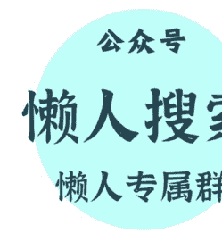

# 杜特尔特家族，非常危险

261012 猫哥星球
整理：公众号懒人搜索，懒人专属群精选
懒人微信：lazyhelper1

小懒判断 | 适合关注菲律宾政局和中菲关系走向的人；不适合想看莎拉个人八卦的吃瓜群众。最值得盯的是一个数字：参议院 24 席被改成按 20 人算，弹劾门槛从 16 票降到 14 票——宪法漏洞被小马科斯玩明白了。坑在于以为弹劾已成定局：还差 2 票，全在阿罗约家族手里，格洛丽亚和小马有旧怨，利益够大照样能翻盘。

最近，杜特尔特家族的日子不好过，菲律宾最高法院刚下了一份很重要的裁决。

小马科斯当了总统之后，一直想弹劾副总统莎拉，也就是杜特尔特的长女，几次都没办成，但最高法院的裁决让弹劾成功率高了不少。那么，到底怎么回事？

菲律宾宪法规定，参议院和众议院通过弹劾案，最少需要三分之二票数。小马科斯阵营在众议院优势很大，凑齐三分之二票数不难。可在参议院，他拿不到这么多票。

参议院一共 24 个位置，三分之二意味着要 16 票。杜特尔特阵营有 9 票，其中 7 个人属于铁杆，另外两个没那么铁但也倾向杜家。只要保持团结，小马科斯在参议院最多拿到 15 票，凑不齐 16 票。所以，针对莎拉的弹劾一直不成功，参议院是杜家的最大防火墙。

但在小马科斯的"努力"下，这道防火墙有崩塌的趋势。

今年9月末，菲律宾参议院投票，修改了弹劾规则。前面说过，菲律宾宪法规定，通过弹劾案需要三分之二的议员赞成，小马科斯拉不到16票，他的办法，就是重新定义三分之二。以前计算比例，是按24个席位算。要是不算24个，改用20个当作基数，只要14张赞成票就够三分之二了。有人会说：席位总数不是固定的吗？还能随便改？

因为小马科斯发现了菲律宾宪法的一个漏洞：宪法只是规定三分之二，没规定什么情况下的三分之二。菲律宾参议院有24个席位，现在有四名参议员没法参与投票。

第一个是杜特尔特的亲信德拉罗萨，当过警察总长，负责执行老杜的禁毒行动，树敌无数，被国际刑事法院通缉后就躲了起来，很少现身。

马列可塔、埃斯特拉达两位参议员，同样是老杜的人，牵扯贪腐案子，小马科斯下令把他们抓了，这件事在菲律宾争议不小。不管外界怎么吵，两人被关押，没法到场投票。

还有参议员李嘉达，病得很重，常年在国外治疗，很少回国参加投票。

这么一算，参议院实际能到场投票的就只剩20人。虽然宪法没写死要按24人算，只说三分之二，那凭什么不能拿20人当作基数？9月底参议院投票改规则，玩的就是这套逻辑。

以20人为总数的话，只需要14票，小马科斯阵营就可以弹劾莎拉，门槛大幅下降。莎拉察觉到危机，马上告到菲律宾最高法院，想让法院废掉参议院这次投票结果。

莎拉的理由很充分：小马科斯阵营这么玩，简直不把宪法放在眼里，严重破坏菲律宾法治。很遗憾，最高法院驳回了莎拉的诉讼，等于承认参议院的违宪行为合法。法院这么判断背后有没有别的隐情，暂时还不清楚，但眼下的局面，对杜家相当不妙。

事情已经定下来了，莎拉接下来能不能过关，关键要看另一个菲律宾豪门阿罗约家族的态度。

虽然弹劾投票规则改好了，但小马科斯也未必一定能扳倒莎拉，他得争取到阿罗约家族的支持。原因很简单，小马科斯这边手里的票数还差一点。在参议院里，小马科斯阵营有12票，距离弹劾所需的14个席位还差两个。巧了，阿罗约家族手中，就有两个席位。

阿罗约家族现任掌门人是格洛丽亚·阿罗约，2001年到2010年里，当了9年菲律宾总统，是菲律宾历史上第二位女总统（第一位是阿基诺夫人）。格洛丽亚的父亲奥斯达多，曾在1961年到1965年间担任了四年菲律宾总统。出过两位总统，可见阿罗约家族是绝对的顶级豪门。

理论上，格洛丽亚很难被小马科斯拉拢。

一方面，格洛丽亚和莎拉关系很不错，两人是闺蜜，还是政治盟友。另一方面，格洛丽亚和小马科斯有矛盾：2023年，格洛丽亚担任众议院高级副议长，属于众议院二号人物。当时众议院的一号人物、众议长罗穆亚尔德斯，是小马科斯的表弟。罗穆亚尔德斯担心，格洛丽亚这个二号人物，会不会想再进一步，变成一号人物？所以，罗穆亚尔德斯和小马科斯联手罢免了格洛丽亚。格洛丽亚从高级副议长，降级为普通议员。

有此矛盾，小马科斯想拉拢她没那么容易，但政治从来只看利益。9月末，菲律宾参议院修改弹劾规则，最终能够通过的关键，就是阿罗约派系的议员弃权。之前阿罗约这边本是不支持弹劾莎拉的。他们担心杜家垮掉后，小马科斯一家独大。让马家和杜家互相斗争，自己从中渔利，才最符合家族利益。

但这一次投票，阿罗约家族却转变了态度。菲律宾媒体普遍猜测，小马科斯承诺了一些好处，比如基建工程、中央财政拨款等等。小马科斯是总统，手上筹码很多。有第一次，就会有第二次，小马科斯会不会下更重的筹码拉拢阿罗约家族？谁都说不准。

可以说，莎拉本人和杜特尔特阵营的生死，就在阿罗约家族一念之间。如果弹劾真的成功，对中菲关系来说，绝对是个坏消息。

小马科斯大概率会在南海制造更多摩擦。这样做，除了转移舆论焦点，还能打击杜家的合法性。莎拉在菲律宾民间支持度很高，本身就是下一届总统的热门人选。小马科斯想要削弱她在民众心中的分量，就会在海上不断挑事。杜家跟中方的关系不错，这点菲律宾人都清楚。一旦中菲之间矛盾变多，杜家的民意根基就会受损，也能让更多菲律宾普通人觉得，弹劾莎拉理所应当。过去几年小马科斯就是这个套路。

菲律宾整个国家何去何从、中菲关系怎么走向，将很大程度上取决于阿罗约家族的态度。阿罗约家族最终会怎么选择、莎拉能否绝地翻盘，让我们拭目以待。

——————分割线——————

在这个 AI 能替你写代码、写文章的时代，基础技能正在迅速贬值。绝大多数人正被淹没在海量的免费垃圾信息里，陷入低效的体力内卷。

当“努力”不再是壁垒，人与人之间唯一的护城河，只剩下“信息过滤”的效率与“认知系统”的维度。

圈子已稳定运行 7 年。我们每天利用 Python 爬虫与大模型算力，过滤全网最顶级的政经内参和搞钱风向标，做你最冷酷的“外部大脑”。

如果你认同这种“重塑认知防线”的极客主义，欢迎围观我的个人情报智库：【懒人专属群】。

https://lazyso.com/insider/

 
（lazyhelper1）

