# 不会写代码，烧了 1300 亿 Token 把 App 送上 App Store：从个体户、软著、备案到提审，0→1 开发 5 万字全流程

261003 副业 SC 精华
整理：公众号懒人搜索，懒人专属群精选
懒人微信：lazyhelper1


小懒判断 | 适合有小程序或网页想做成 App 上架、或卡在备案软著提审的人看——纯小白想“一句话生成 App”的别点。最值得关注的一个点：代码之外的手续链最稀缺，个体户在苹果不算“组织”、卖家名只能显示真名，软著卡在“未使用 AI 开发”声明上，这些 AI 替你办不了。坑在于提审时间：旧手册说 1-3 个工作日，实际排了 6 天多，赶日子至少留一周余量。

一行代码都不会写，从 2025 年 11 月到现在，在 AI 上累计烧了 1351 亿 Token（生财 TokenRank 数据），近 90 天在全站 3,682 人里排第 20。

这些 Token 换来的最新一个结果：我把原来 58 个页面的微信小程序，用 Codex 和 Claude Code 重做成了 App「销冠营」，6 月 20 日开工，9 月 21 日上架 App Store，审核排队 6 天多，加急 2 次。

（图 0-1）生财 TokenRank 分享卡片：累计 1351.51 亿 Token，Codex 70%、Claude Code 30%

生财有术 | Token 排行榜

2025.11.17 – 2026.10.02

李可

累计消耗 Tokens

1351.51 亿

连续使用 74 天

累计 209 天

近半年 · 每格一天

主力工具

Codex 70%   Claude Code 30%

扫码查看李可的 Token 主页

scys.com/tokenrank

含输入、输出与缓存 · 北京时间


## 我是谁

- 美容行业 15 年：自己经营 3 家美容院，帮 20 多家门店做线上代运营。
- 生财有术 7 年圈友：多期生财航海教练，资深传术师。
- 不会写代码，接触 AI 4 年：从多维表格、Coze 工作流做到微信小程序，再到这次的 App；现在在探索实体行业的 AI Native 落地。
- 这次怎么干的：Claude Code 当“项目经理”拆任务、验收，写代码主要交给 Codex。

我在生财写过4篇精华帖，这篇是同一条路的下一站：

1. 《实体商家不写一行代码，如何搭建 AI 小程序赋能门店，实现业绩倍增》（2025 年 5 月）
2. 《实体店如何用 AI 获客？以美容院为例，如何用 1 万条真实评论沉淀出获客内容，并做一个拓客 skill 》（2026 年 3 月）
3. 《烧了 230 亿 Token，我终于跑通了一套实体老板也能复制的 AI 变现 SOP 》（2026 年 6 月）
4. 《从真实现场到 10+ 家付费内测 | 一个行业人跑通 FDE 产品化的完整过程》（2026 年 7 月）

前几篇讲的是 AI 怎么帮门店拓客、成交，怎么把一个想法做成有人愿意付费的小程序。

这篇接着往下走：

把小程序做成能在 App Store 下载的 App，以及代码之外的个体户、账号、软著、备案、提审，到底怎么一步步办下来。

## 这篇帖子能带给你什么

5. 一条从 0 到上架的完整路线。主体、账号、商标、软著和电子版权、备案、开发、打包、提审、上线后维护，拆成 18 章。每章都是「我当时怎么做 → 你照着做 → 做到这些才算完成」.
6. 代码之外的手续，写到能照着办。AI 能帮你写代码，但个体户还是公司、苹果个人还是组织账号、软著卡在「未使用 AI 开发」声明怎么办、备案先办哪个，这些 AI 替你办不了。这几章是我觉得最稀缺的部分。
7. 49 段能直接复制的提示词，105 个勾选项。给 AI 的话都放在代码框里，复制就能用；每章末尾的清单勾完，再进下一章。
8. 带日期的真实踩坑。审核排队 6 天、加急 2 次、iOS 27 一打开就闪退、个体户在苹果不算「组织」……每个都写了当时怎么误判、怎么解决、你怎么绕开。
9. 一个练手小项目「跟进小本」。只做记待办、填日期、标记完成三件事。只想练手的，不用办任何手续，从第 6 章开始就能动手。

## 销冠营是什么

销冠营给美容门店用：员工学专业知识、和 AI 扮演的顾客练话术；门店事先告知顾客后，用智能工牌记录服务过程，自动生成复盘卡片。开工那天（6 月 20 日），我先和 AI 把小程序的 58 个页面逐个定去留：哪些搬进 App，哪些合并，哪些先不做。

## 结果：从动手到上架，约 3 个月

| 日期 | 发生了什么 |
|---|---|
| 2026-06-20 | 整理完迁移文档，58 个小程序页面逐个定去留，开工 |
| 2026-08-19 | 定下现在的名字「销冠营」（前后改过两次名） |
| 2026-09-14 | 提交 iOS 1.0.0 审核，选「手动发布」 |
| 2026-09-18 | 排队 3 天多没动静，第一次申请加急 |
| 2026-09-21 | 审核通过，我自己点「发布」，1.0.0 上架 |
| 2026-09-22 | 1.0.1 修复“iOS 27 一打开就闪退”等问题、第二次加急，提交后不到一天通过并发布 |

表里的日期按我电脑所在时区记录，和 App Store 中国区页面显示的日期可能差一天。

现在去 App Store 搜「销冠营」就能找到。

（图 0-2）App Store 上的销冠营商品页，当前版本 1.0.1

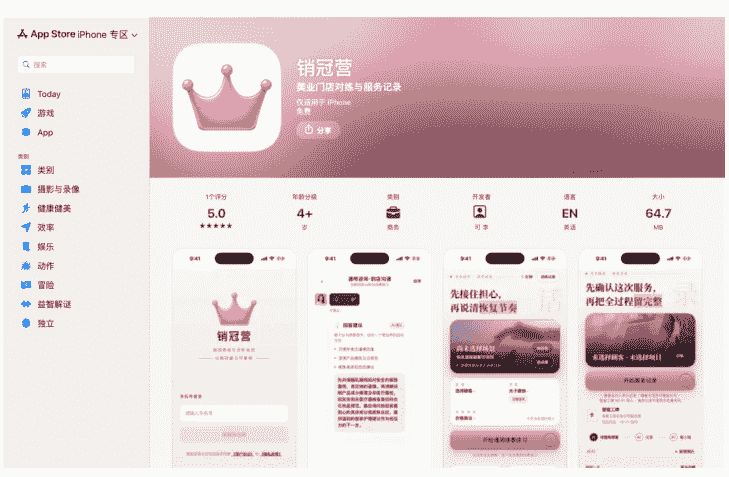

几个词先解释一下：

- 手动发布：审核通过后不会自动上架，要你自己点一下“发布此版本”。好处是上架时间你说了算。
- 加急：苹果给开发者的一个申请入口，写明理由，苹果可能优先审，不保证。

两件事，我是付了代价才懂的：

- **提交审核，不等于上架。** 我自己旧手册里写的是“通常 1-3 个工作日出结果”，结果首版排了 6 天多。
- **审核通过，也不等于是可以放心发。** 1.0.0 审核通过前几个小时，外测朋友（通过苹果的内测渠道先装测试版的朋友）报告：装了 iOS 27 的 iPhone 一打开就闪退。我选择先发布、第二天加急上修复版 1.0.1。这是一次有代价的取舍：那一天里刚升级 iOS 27 的人装上就打不开。当时怎么想的、回头看该怎么选，第 15 章细说。

（图 0-3）苹果开发者后台（App Store Connect）里 1.0.0 和 1.0.1 的审核记录

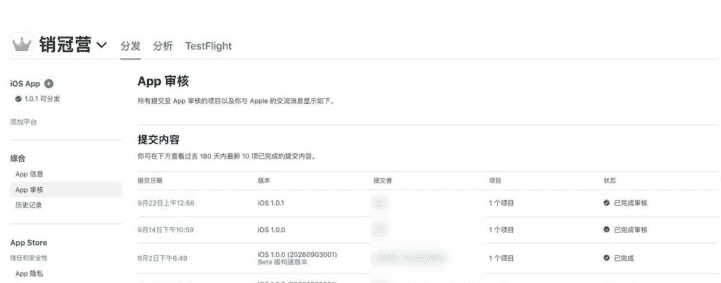

## 我真实付过的钱（速览）

只列我手上有账单或订单的：

| 项目 | 我付了多少 |
|---|---|
| 苹果开发者账号（个人） | 688 元/年 |
| 电子版权证书（普通时效） | 600 元 |
| 阿里云（服务器、数据库等） | 8 月约 567 元；9 月截至 28 日约 707 元 |
| App 里调用大模型 | 9 月头 8 天约 21 元 |

阿里云账单里含一套正式环境和一套自己测试用的环境。AI 编程助手订阅按各家套餐，不在此列。详细见第 18 章。

## 适合谁、不适合谁

### 适合：

- 不会写代码，但手里有一个具体的小问题，想做成 App。
- 已经有小程序或网页，想做成手机 App 上架。我走的就是这条路。
- 已经在用 AI 写代码，卡在打包、备案、提审这些“代码以外”的环节。

### 不适合：

- 想找“一句话生成 App”的神器。每一步都要你自己在手机上看结果、做判断。
- 做游戏、新闻、直播、医疗、金融这类要特殊许可证的业务。先问清属地主管部门或专业律师，这篇不覆盖。
- 想在 App 里卖会员、卖数字内容。苹果要求解锁 App 内功能走它的“App 内购买”（审核指南 3.1.1），这篇不展开收款。

## 怎么读这篇：两条路线

一句话：先决定你是只想练手，还是要公开发布，再决定从哪一章开始。

### 四个部分，18 章

- 第一部分 开工前：先把要排队的手续启动（第 1-5 章）第 1 章 用什么身份做 / 第 2 章 账号一次开齐 / 第 3 章 名字、商标、域名和包名 / 第 4 章 软著和电子版权证书 / 第 5 章 备案
- **第二部分 做出来（第 6–12 章）** 第 6 章找到一个值得做的小问题 / 第 7 章把第一版压成一页纸 / 第 8 章准备工具，在手机上看到第一个页面 / 第 9 章一次只做一件事 / 第 10 章接上数据 / 第 11 章报错、版本和换对话 / 第 12 章在自己手机上验收
- **第三部分 发出去（第 13–16 章）** 第 13 章做出能独立安装的包 / 第 14 章提审材料和隐私合规 / 第 15 章 iOS 上架 / 第 16 章安卓上架
- **第四部分 上线以后（第 17–18 章 + 附录）** 第 17 章先能发现问题，再加功能 / 第 18 章花了多少钱、多少 Token / 附录 A 卡住时查哪个工具 / 附录 B 我踩过的 16 个坑 / 附录 C 小白术语小抄 / 附录 D 手机自动化（进阶）

**两条路线，可以并行走**

**路线一 先练手：跟着「跟进小本」走到手机能用（不用办任何手续）** 从第 6 章开始，用「跟进小本」走到第 12 章：手机上有一个能新增、能标记完成、关掉再开还在的小 App。想装成不靠电脑的安装包，再看第 13 章（安卓包不用开发者账号；iOS 包要装到手机上，得有第 2 章的苹果开发者账号）。这条路一张营业执照都用不上，**只练手的读者可以先跳过第 1–5 章**，只需要按第 2 章「账号 1」开好 AI 编程助手、按「账号 7」注册一个免费的 Expo 账号。

**路线二 决定公开发布后，再启动要排队的手续** 主体、账号、商标、版权证书、备案（第 1-5 章）要排几周到几个月的队。决定发布那天，先花一天读完第一部分，当周把能交的先交出去；然后开发和排队同时跑，手续齐了再走第 13-16 章上架。

已经做好了，卡在发布： 直接跳到第 13-16 章。

### 每章都长一个样

一句话说清这章解决什么 → □ 大约多久 | □ 大约花多少 → 我当时是怎么做... → 你照着做 → 做到这些就算完成 → □□ 注意。

### 哪些是我亲自走过的，哪些是按官方文档整理的

练习线和我的真实线分开写。练手用 Expo，它是帮新手省掉大半环境配置的工具。销冠营本身用的是 React Native（一套代码同时做苹果和安卓 App 的技术），外加一整套更重的打包、测试和云服务工具。别把我的复杂做法，当成你必须走的路。

| 内容 | 亲测程度 |
|---|---|
| 主体（个体户）、苹果开发者账号、软著和电子版权证书申请、网站和 App 备案 | 我在销冠营上亲自办过 |
| Xcode + Fastlane 打包、TestFlight 内测、iOS 提审和加急、上架 | 亲自走过 |
| 上线后的错误监控和可用性监控 | 亲自搭过 |
| 跟进小本练习线的 Expo / EAS 命令 | 按官方文档整理，2026 年 10 月核对过，我没有原样走过 |
| Google Play 上架 | 按官方文档整理，我没走过 |
| 国内安卓商店上架 | 按各平台公开规则整理，我还没上架任何一家 |

软著我中途放弃了，电子版权证书写这篇时还在补正，经过见第 4 章。练习线如果你跑通了、或者卡住了，欢迎回帖告诉我。

### 路线二的时间表：哪些要排队，哪些能和开发同时做

决定公开发布以后，别按章节顺序一章做完再做下一章。真实节奏是：手续先排队，开发同时跑，有些手续要等代码出来才能办，上架放最后。先认识几个词：

- **备案**：在国内提供网站或 App 服务前的登记，分网站备案（也叫 ICP 备案）、App 备案、公安备案三件，分开办。你属于哪种情况、要办哪几件，第 5 章开头有一张表。
- **软著**：软件著作权登记证书，证明这个软件是你的。国内安卓商店上架基本都要；部分商店也认“电子版权证书”。
- **包名**：商店用来认你这个 App 的身份证号。**签名**：证明“这个安装包确实是你发的”的数字印章。

| 什么时候动手（从决定发布那天算） | 手续（对应章） | 大约要等多久 | 和开发的关系 |
|---|---|---|---|
| 第 1 周 | 定主体、办营业执照（第 1 章） | 看当地，以第 1 章为准 | 最先办，后面几乎每步都要用 |
| 第 1 周 | 苹果、安卓开发者账号（第 2 章） | 公司账号先办邓白氏编码（见第 1 章），1-2 周 | 和开发同时做 |
| 第 1 周 | 查名字、交商标（第 3 章） | 拿证一般 7 个月以上 | 同时做，不用等拿证 |
| 第 1 周 | 买服务器 → 网站备案（第 5 章，有网站时） | 服务器包年包月 3 个月以上；网站备案约 3-22 个工作日 | 和开发同时做 |
| 有能跑的版本后 | 软著或电子版权证书（第 4 章） | 软著受理后 60 日内审完；电子版权证书普通 10-15 个工作日 | 要真实代码，等开发出成果 |
| 包名、签名定下后 | App 备案（第 5 章） | 阿里云写的是提交后约 20 个工作日 | 要包名和签名，等开发出成果 |
| 网站开通后 | 公安备案（第 5 章） | 开通后 30 日内办好 | 开通后补办 |
| 手续齐了 | 打包、提审、上架（第 13-16 章） | iOS 审核看排队，我首版排了 6 天多 | 放在最后 |

表里的时长核对于 2026 年 10 月，细节和官方来源见第 1–5 章。

（图 0-4）决定发布后的全程路线图：手续先排队、开发同时跑、软著和 App 备案等代码、最后上架（图里的数字是本文章号）

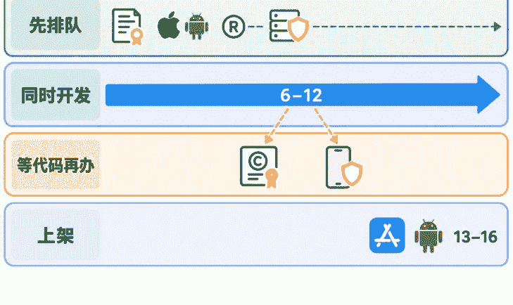

### 我当时是怎么做的

- 我是边开发边办手续的。名字在 8 月 19 日定下，提审前 App 备案已经办好。
- iOS 上架时，我的软著还没拿到，苹果这边没有因此卡我。但国内安卓商店基本都要软著或它的替代证明，我在这一步卡在了「未使用 AI 开发」那份声明上，第 4 章和第 16 章细说。
- 首版提审，按旧手册的说法是 1-3 个工作日出结果，实际排了 6 天多，中间还申请了一次加急。如果你有日子要赶，提审至少留出一周以上的余量。

> □□ 注意：
>
> 1. 表里的时长只是排队参考，各地、各平台会变。真去办的时候，以第 1-5 章和官方最新页面为准。
>
> 2. 主体从头到尾保持一致：域名实名、软著、备案、开发者账号尽量用同一个主体。中途换主体，很多手续要重做。
>
> 3. 游戏、新闻、直播、医疗、金融这类业务，先确认要不要特殊许可证，再开发。做完才发现缺证，前面全白干。

## 第一部分 开工前：先把要排队的手续启动

### 第1章 用什么身份做：个人、个体户还是公司

一句话：先定下「用谁的名义」办所有手续。苹果、安卓、备案、版权证书都要跟着它走，中途换名义，很多东西要重办。

> □ 做决定 10 分钟；网上办个体户执照，当场到 3 个工作日 ｜ □ 个体户登记免费；公司另有刻章、开对公账户、记账报税等开销（看当地）

#### 我当时是怎么做的

销冠营用的是个体工商户（下文简称个体户）。网站备案、App 备案、电子版权证书，都挂在这个个体户名下。

苹果那边是另一回事。苹果不把个体户当「组织」，我只能用个人开发者账号。结果是：App Store 上的卖家名，显示的是我的真名，不是店名。

我没刻公章。个体户不强制刻章，前几个月一次都没用上。直到办电子版权证书（第4章），平台要一页「签章页」，我才第一次面对「盖章还是签字」，最后交的是经营者本人的手写签名——结果被审核退回，要求「签章页盖章后提交」。

那页签字纸，我第一次用手机随手拍，被指出照片里有手指、有阴影，不像扫描件。后来用 iPhone 备忘录的「扫描文稿」重扫了一遍。

还有个小坑：很多表格写着「法定代表

国家税务总局数电发票公告。安卓各家的细节见第 2 章。

表里几个词，先用大白话说清楚：

- **卖家名**：App Store 商品页上「开发者」那一栏的名字，所有用户都看得到。
- **D-U-N-S 编码**（邓白氏编码）：一家国际征信机构给企业发的 9 位身份号。苹果靠它确认「这家公司真的存在」。
- **对公账户**：以公司或个体户名义在银行开的账户。安卓市场常用「往你对公账户打几毛钱、你回填金额」来验证主体。
- **备案**：在国内用服务器、上架 App 之前，登记「这是谁在运营」（第 5 章细讲）。个人备案的内容不能涉及企业、交易；要卖东西、给门店用，就得用个体户或公司做单位备案。

（图 1-1）三个问题选出你的身份：个人、个体户还是公司


#### 怎么选：问自己三个问题

10. **只是想练手，做给自己和几个朋友用？** 个人就够。本文第二部分的练习，一张营业执照都用不上。

11. 要上国内商店、要备案、以后可能收钱？

    至少办个个体户。成本最低，大部分手续都能办，销冠营就是这么走的。

12. 有下面任意一条，直接用公司：

    - 不想让 App Store 显示你的真名；
    - 国内安卓几大市场都要上，尤其是小米；
    - 做金融、医疗这类管得严的行业，平台明确只收企业。

已经有公司的，直接用公司，别再另起一个个体户。

为什么个体户在苹果那里不算组织？苹果官方写得很直白：独资、个人经营这一类，按个人身份注册。

（图 1-2）苹果官方 D-U-N-S 说明页：独资企业应以个人身份注册

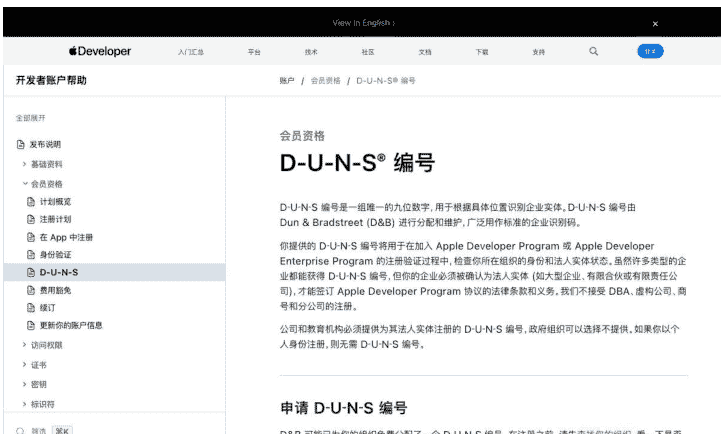

#### 你照着做：办个体户，再整理一份「主体资料包」

决定用个人身份的，直接跳到步骤 5，把身份证材料整理好就行。

##### 步骤 1：想好三样东西。


- **名称：** 常见格式是「地区 + 字号 + 行业 + 组织形式」，例如「某某区某某网络科技工作室」。

- **经营范围：** 勾上「软件开发」这一类。后面做单位备案时，App 内容不能超出经营范围。

- **经营场所：** 住宅能不能登记，各地规定不同，以当地办事页为准。

**步骤2：去当地政务服务网办。** 在你所在省份的政务服务网，或者当地市场监管局网站，搜「个体工商户设立登记」，选网上办理。全程不收费。各地入口不同，比如[上海的办事页]()。

**步骤3：交材料、做人脸。** 准备经营者身份证、本人实名的手机号、经营场所信息。跟着页面做人脸识别，然后提交。

**步骤4：等结果，领电子执照。** 按各地办事指南：材料齐全的当场登记；不能当场办的，3 个工作日内登记。通过后，在微信或支付宝里搜「电子营业执照」，领取电子版。执照上能看到「统一社会信用代码」，就算办成了。

**步骤5：建一个「主体资料包」文件夹。** 后面每一章都从这里取材料，不用临时翻找。

| 材料 | 要求 |
| --- | --- |
| 营业执照 | 原件拍照或扫描件，四角完整 |
| 经营者身份证 | 正反面各一张 |
| 手持身份证照 | 部分平台要 |
| 手机号、邮箱 | 本人实名，长期不换 |
| 签字页模板 | 需要签章时用 |
| 对公账户 | 个体户可选；有了，安卓打款认证更快 |

##### 步骤6：提前想好「盖章还是签字」。

个体户可以不刻章。但电子版权证书、部分商店的资质页，会要一页「签章」。我不刻章、交手写签名，被电子版权平台退回要求盖章，白等了一轮。要办电子版权证书的，建议开工前就把章刻好。签章页用 iPhone 备忘录的「扫描文稿」扫成 PDF，别用相机随手拍。

（图 1-3）用 iPhone 备忘录「扫描文稿」扫签字页，比随手拍清楚

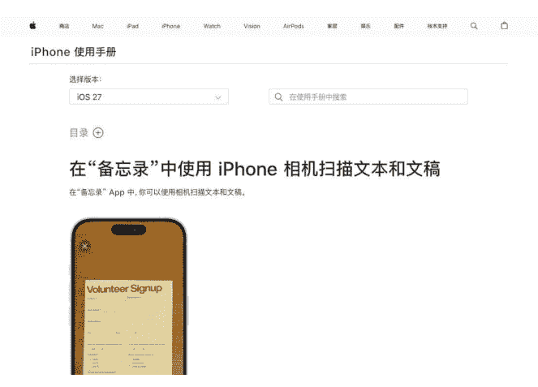

想让 AI 帮你把情况理一遍，可以把下面这段发给它。它能帮你列清单，但政策要以官方页面为准：

我准备用 AI 做一个手机 App，想在中国大陆上架。请帮我比较「个人 / 个体工商户 / 公司」三种身份。我的情况：

- 要上的平台：（例：iOS、华为、小米）
- 会不会在 App 里收费：（会 / 不会 / 还没想好）
- 行业：（例：美业门店培训）
- 能不能接受 App Store 显示我的真名：（能 / 不能）

请逐个平台列出：这种身份能不能注册开发者账号、要什么材料、大约等多久。
每一条附上官方网址；查不到官方说法的，写「需要我自己去官方页面确认」，不要猜。

#### 做到这些就算完成

**注意：**

- 1. 主体一旦定了，域名实名、备案、版权证书、安卓开发者账号都要用同一个名字。中途更换，已经办好的域名和备案不会自动跟着改。
- 2. 苹果个人账号会在商店显示真名。不想露名，只能用公司开组织账号，并且提前办 D-U-N-S。
- 3. 资料包里是身份证和执照，别同步到公开网盘，也别整包发给 AI。

### 第 2 章 账号一次开齐：AI 编程助手、苹果开发者、安卓各市场、云服务

一句话：注册账号、做实名认证，今天就能做；创建应用、填资料、买云资源，等包名、签名这些信息齐了、确定要用再做，别为暂时用不上的服务先付钱。

□ 动手半天；审核从几分钟到一两周不等 | □ 苹果 688 元/年；Google Play 25 美元一次性；国内安卓注册未见收费；AI 助手和云服务看你选的方案

#### 我当时是怎么做的

- 苹果用的是个人账号。主体是个体户，但苹果不收个体户当组织，只能按个人注册。所以销冠营在中国区 App Store 上，卖家名显示的是我的真名。注册前就要想清楚：你能不能接受这一点。
- 苹果后台的填表交给 AI，关键几步我自己点。App 名称、隐私网址、隐私标签、测试组，我都让 Codex 操作浏览器去填。一到登录、双重认证、同意协议，它就停下来，由我本人操作。
- **云服务全在阿里云。** 服务器、数据库、录音文件存储都在阿里云，备案也是在阿里云的备案系统里办的（第 5 章）。
- **微信开放平台改过一次名。** App 定名「销冠营」后，开放平台里的移动应用名称也得跟着改。改名要重新审核，大约 1-3 个工作日，AppID 不变。
- **iOS 首发版，我先把微信登录藏了起来，**只留手机号登录，原因见第 14 章。
- **安卓商店在等版权证书**（第 4、16 章），我先用正式签名的安装包直装给门店用（这不等于上架，见第 16 章）。电子版权证书的权利人、安卓商店开发者账号的主体，我统一定成同一个个体户。
- **AI 助手两个都用。** Codex 干大部分写代码的活，Claude Code 负责拆任务、做检查、改界面。用了多少，第 18 章摊开讲。

#### 先看总表：哪些要排队，哪些随开随用

| 账号 | 谁需要 | 费用 | 要等多久 | 今天先做 | 等什么再做 |
|---|---|---|---|---|---|
| AI 编程助手 | 所有人 | 看套餐 | 即开 | 开通、装好 | — |
| 苹果开发者（个人） | 要上 iOS | 688 元/年 | 付款后 24 小时内确认 | 决定上 iOS 就注册 | 包名定了再建 App |
| 苹果开发者（组织） | 用公司上 iOS | 688 元/年 | D-U-N-S 最多 5 个工作日，再加同步和审核 | 先办 D-U-N-S | 拿到编码再注册 |
| 国内安卓市场 | 要上国内安卓市场 | 未见注册费 | 实名几分钟到3个工作日 | 注册、实名认证 | 证书、备案号到了再建应用 |
| Google Play | 要出海 | 25美元一次性 | 个人新账号还要测14天 | 要出海就注册 | 有正式包再建应用 |
| 阿里云 | 有后端、要备案 | 注册免费，资源另算 | 企业实名几分钟到7个工作日 | 注册、实名 | 确定要后端或备案再买服务器 |
| 微信开放平台 | 要做微信登录 | 认证费以后台为准 | 认证和应用审核都要等 | 注册、资质认证 | 包名、签名齐了再建应用 |
| Expo | 跟着本文练习 | 免费档够用 | 即开 | 注册 | — |

真正耗时间的，其实不是这些账号，而是软著（或电子版权证书）和备案，见第4、5章。账号先注册、先认证；应用和资质，等信息齐了再建、再补传。

（图2-1）哪些账号今天就能注册认证，哪些要等信息齐了再建应用

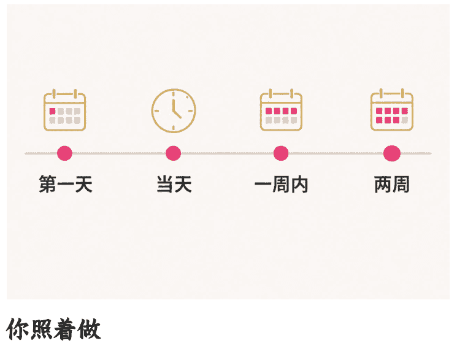

#### 你照着做

##### 账号 1：AI 编程助手，先选一个

|  | Codex | Claude Code |
|---|---|---|
| 用什么登录 | ChatGPT 账号 | Claude 账号 |
| 免费版能不能用 | 能，额度少 | 不能，要 Pro 及以上 |
| 小白入口 | Codex 桌面 App（在 ChatGPT 桌面 App 里也能用） | Claude 桌面 App 里的 Code |
| 官方起步页 | [Codex 快速开始](#) | [Claude Code 安装说明](#) |

- 13. 打开上表里的官方起步页，按页面指引下载桌面 App（Codex 以官方起步页写的下载方式为准）。不用先学终端，装好桌面 App 就够用了；第 8 章步骤 1 另有命令行版的装法，可选。
- 14. 用对应账号登录。用 Claude Code 的，先在 claude.ai 开通 Pro 或更高的套餐。
- 15. 付费前，先看两家的官方「支持的国家和地区」名单：[OpenAI 的名单](#)、[Anthropic 的名单](#)。核对于 2026 年 10 月，两家的名单里都没有中国大陆，以官方页面为准。确认你所在的地区能正常、

| 项目 | 个人账号 | 组织账号 |
| --- | --- | --- |
| 年费 | 688 元（99 美元） | 同左 |
| 要等多久 | 付款后 24 小时内确认 | D-U-N-S 最多 5 个工作日，同步最多 2 个工作日，再等苹果审核 |

###### 个人账号，照这个走（用手机上的官方 App 最顺）：

- 18. 准备。一个开了双重认证的 Apple 账户（双重认证：登录时除了密码，还要在你的苹果设备上点确认）；身份证；一台设了锁屏密码或面容 ID 的 iPhone；Apple 账户里绑好付款方式，账户余额和礼品卡不能用。
- 19. 下载 App。在 App Store 搜「Apple Developer」，装苹果官方 App。点底部「账户」→登录→同意《Apple Developer 协议》→点「现在注册」。
- 20. 填信息、验身份。填个人信息，拍一张自拍做身份验证。名字、姓氏、地址用拼音填，别填昵称或店名，会拖慢审批。实体类型选「个人」。
- 21. 付款。同意许可协议，购买年度会员：688 元/年，默认自动续订。全程用同一台设备。
- 22. 看到这些算成功。收到会员资格确认邮件（官方说 24 小时内没收到就联系苹果）；电脑上打开 developer.apple.com/account，能看到会员资格；App Store Connect（appstoreconnect.apple.com，苹果的上架后台）能登录。

（图 2-2）苹果注册页：个人和组织在商店里显示的名字不一样

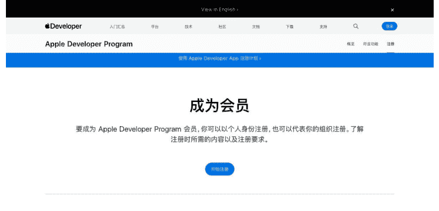

（图 2-3）苹果官方 App 注册说明：中国大陆 688 元/年，身份证加自拍验证

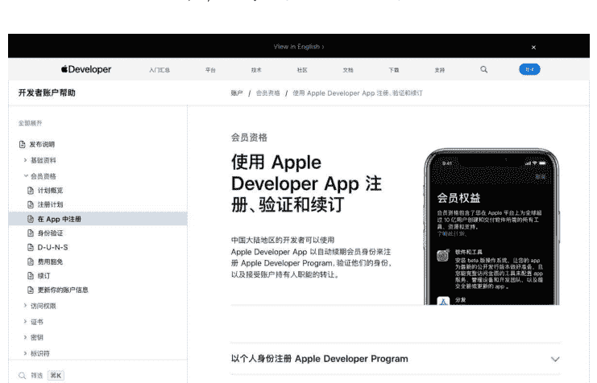

###### 组织账号，多做三件事：

- 23. 先去 D-U-N-S 查询页 查公司有没有编码，没有就在这里免费申请。最多 5 个工作日，催也不会更快；拿到后再等最多 2 个工作日，苹果那边才查得到。
- 24. 准备公司官网（公开、能正常打开、域名属于公司）和域名邮箱。注册人要有权代表公司签协议。
- 25. 按上面的流程走，实体类型选「组织」。提交后等苹果的审核邮件，再回 App 点「继续注册」付款。

（图 2-4）销冠营的 App Store 商品页，卖家名显示的是我的真名（已打码）

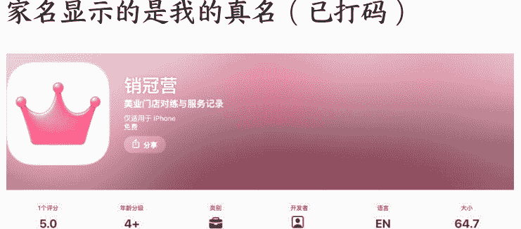

苹果的价格、流程核对于 2026 年 10 月，以官方最新为准：注册说明、用 Apple Developer App 注册、D-U-N-S 说明、购买与激活。

##### 账号 3：国内安卓各市场，一家一家认证

国内安卓没有统一入口，要分别注册。这一章只做「注册+实名认证」，传安装包和资质留到第 16 章。

| 市场 | 注册入口 | 个人能不能发 App | 企业 |
|---|---|---|---|
| 华为 | developer.huawei.com | 能，部分类目不收个人 | 能 |
| 小米 | dev.mi.com | 不收个人 | 能 |
| OPPO | open.oppomobile.com | 只能发快应用、主题、壁纸等 | 能 |
| vivo | dev.vivo.com.cn | 2026 年 9 月宣布有序开放个人通道 | 能 |
| 荣耀 | developer.honor.com | 官方曾说明暂不开放个人 | 能 |
| 应用宝 | app.open.qq.com | 说法不一，以注册页为准 | 能 |

个体户能不能按「企业」认证，各家没有统一的公开说法。小米据开发者反映，2024 年底起已不收个体户。其他几家，以注册页当天的选项为准：「企业」类下拉里有「个体工商户」，就说明收。

做美业、上门服务的要特别留意：华为审核指南写明，暂不收录以个人名义提交的上门保健类应用，比如按摩、SPA、足浴。

###### 步骤（每家都差不多）：

- 26. 打开入口，用常用手机号注册，开发者类型选「企业」。个体户也选这一类，有「个体工商户」选项就选它。
- 27. 实名认证。有对公账户，选「打款认证」最快：平台往你的对公账户打几毛钱，你回填金额。OPPO 要求 72 小时内回填，只有 3 次机会。没有对公账户，选「人工审核」，上传执照和身份证，一般 1-3 个工作日。
- 28. 成功标志：后台显示「已认证」，并出现「创建应用」入口。
- 29. 先别急着建应用。等软著（或电子版权证书）、App 备案号到了，再一起传。

安卓各家政策核对于 2026 年 10 月，变化很快，注册前以当天官方页面为准。

##### 账号 4：Google Play，只在要出海时开

- 30. 打开 Play 管理中心注册页，用 Google 账号登录。
- 31. 接受开发者分发协议，交 25 美元一次性注册费。
- 32. 选账号类型：个人或组织。组织必须提供邓白氏编码。按页面验证身份，可能要政府证件和信用卡。
- 33. 个人新账号多一关：正式发布前，至少 12 个测试人员连续参加 14 天封闭测试。要出海就第一天开，把这 14 天让出来。
- 34. 成功标志：Play 管理中心首页能点「创建应用」。

核对于 2026 年 10 月： 注册说明、 个人账号测试要求。

##### 账号 5：云服务账号，我用阿里云

- 35. 打开 aliyun.com，右上角「登录/注册」，用手机号加验证码注册。也可以用阿里云、支付宝或钉钉 App 扫码。
- 36. 进账号中心做实名。买任何资源、充值之前，必须先实名。企业实名有四种方式，个体户也能用：

| 方式 | 要什么 | 多久 |
|---|---|---|
| 法人扫脸 | 法定代表人（个体户是经营者）的支付宝 | 通常几分钟 |
| 企业银行卡收款 | 对公账户 + 执照照片 | 1-7 个工作日 |
| 法人支付宝 | 支付宝 + 执照照片 | 1-3 个工作日 |

- 40. 打开 open.weixin.qq.com，右上角「注册」，用邮箱注册并激活。
- 41. 做「开发者资质认证」：提交主体资料，交审核服务费，金额以后台显示为准。
- 42. 进「管理中心 → 移动应用 → 创建移动应用」，填 App 名称、图标、简介；iOS 填 Bundle ID 和通用链接，安卓填包名和签名。
  - Bundle ID、包名：商店用来认你这个 App 的身份证号（第 3 章定）。
  - 通用链接：一个网址，让用户在微信里点完「同意」后能跳回你的 App。
  - 签名：安卓安装包的「指纹」（第 13 章生成）。
- 43. 成功标志：移动应用状态显示「已通过」，拿到 AppID，「微信登录」能力显示已获得。

包名和签名要等第 3、13 章定下来。今天可以先注册、先认证，应用后面再建。

iOS 上要用微信登录，先看第 14 章步骤 6 讲的苹果审核规则。

##### 账号 7：Expo，跟着本文练习时用

Expo 是一套帮你快速做 React Native App 的工具，还能在云上替你打包（React Native：一种一套代码同时做出苹果和安卓 App 的技术）。

- 44. 打开 expo.dev/signup，用邮箱注册。
- 45. 免费档每月有 15 次安卓、15 次 iOS 云打包，排低优先级队列，练习够用（官方价格页，核对于 2026 年 10 月）。
- 46. 成功标志：登录后能看到自己的账号主页；第 8 章在电脑上登录时，会显示你的用户名。

销冠营要接蓝牙工牌，打包在自己电脑上做，没用 Expo 的云打包。但练习用的「跟进小本」，走 Expo 最省事。

##### 最后：做一张账号登记表

账号一多，一年后续费、换手机时，最怕想不起当初用哪个邮箱注册。把下面这段发给 AI：

请帮我做一张「账号登记表」 (Markdown 表格) ，列：平台、用途、登录用的邮箱或手机号（只写我能认出来的提示，不写全）、注册主体、认证状态、年费和续费日、双重认证在哪台设备、谁有权限。先按这些平台各留一行：Codex 或 Claude Code、苹果开发者、App Store Connect、华为、小米、OPPO、vivo、荣耀、应用宝、阿里云、微信开放平台、Expo。不要设计任何记录密码、验证码、密钥的列。

#### 做到这些就算完成

**注意：**

- 1. 苹果主账号、双重认证的手机、签名文件，永远自己掌握。找人帮忙，只给「团队成员」权限，别把主账号交出去。
- 2. 苹果会员一过期，新用户就下载不到你的 App，你也交不了更新（已经装了的人还能用）。另外认准 Apple Developer Program：企业计划（Enterprise）上不了 App Store。
- 3. 安卓开发者账号的主体，要和版权证书的权利人、备案主体是同一个名字。三者对不上，传资质时就会卡住。

### 第 3 章 名字、商标、域名和包名

一句话：给 App 定一个能用的名字，再把它在商标、域名、商店、包名这几处对齐。定了就别再改。

> □ 查重半天到一天；商标从提交到拿证一般要 7 个月以上 | □ 查询免费；商标网上申请官费 270 元/类；域名按后缀和注册商报价

#### 我当时是怎么做的

我的 App 一开始叫「美业话镜」。做到 8 月中旬，我决定给它换个名字。

前后想了好几轮：运筹、锦囊、长红、回头客......都只到「有点感觉」。8 月 16 日先定了「销冠之家」，3 天后（8 月 19 日）又改成了最终的「销冠营」。

第一次定名后，我马上让 AI 把代码里的名字改了一遍。3 天后名字又变，那一轮改动等于白做。教训：名字没定死，别让 AI 动代码。最终这次改名，牵动了下面这些地方：

| 地方 | 改了什么 | 谁来改 |
|---|---|---|
| 手机桌面上的名字 | iOS 和安卓各一处显示名 | AI 改代码 |
| 系统权限弹窗 | iOS 的 4 条权限说明（里面写着 App 名） | AI 改代码 |
| 录音时的麦克风提示 | 提示文字里的名字 | AI 改代码 |
| 微信开放平台 | 移动应用名称，改完要重新审核 | 我登录后台改 |
| App 备案 | 登记的 App 名称 | 备案时直接用新名 |
| App Store 商店名 | 「销冠营」 | 9 月 9 日在后台 |


|  |  | 填 |
| --- | --- | --- |
| 软著 / 电子版权 | 全称「销冠营销助手软件」，简称「销冠营」 | 申请时直接用新名 |

**没改的**：安卓包名、苹果 Bundle ID、App 跳转用的协议名、工程名、云服务器上的资源名。包名里到今天还是旧名字的拼音，用户看不到，也没有任何影响。

这次改名之所以轻松，全靠时机：那时 App Store 还没提审，安卓商店的材料还没做，软著也还没申请。要是上架以后再改，商店、备案、证书每一处都得走变更。

改完我又核对了一遍用字：App 里、微信开放平台、App 备案里，都是「冠军」的「冠」，三处一致。

（图 3-1）一个名字要过的五关：商标、域名、商店重名、备案、软著

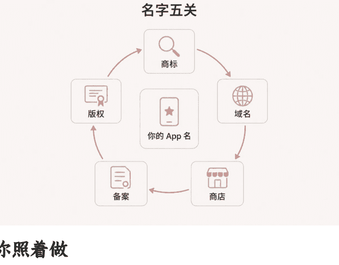

#### 你照着做

- **步骤 1** 想 3–5 个候选名

标准只有四条：好记；和你做的事有关；用手机拼音一打就对；不带「中国」「国家」这类字眼。多备几个，因为查下来大概率会有几个已经被别人占了。

我在做一个手机 App，帮【谁】解决【什么问题】。请给我 10 个中文名字候选，要求：

- 1. 2-4 个字，好记，用拼音输入法一次能打对；
- 2. 不含「中国」「国家」「官方」等字眼；
- 3. 每个名字后面写一句为什么这么起；
- 4. 标出你认为最容易和已有大 App 撞名的几个。

只给候选，不要替我做决定。

##### 步骤 2 去商标网查重

- 47. 打开中国商标网的商标查询入口：
  https://sbj.cnipa.gov.cn/sbj/sbcx/
- 48. 进入「商标近似查询」（第一次用要按页面提示注册登录）。
- 49. 「国际分类」先填 9（计算机软件，App 必看）；再按你的业务补查：42（软件服务、在线平台）、35（广告、商业经营）、41（教育培训，像销冠营这种带培训功能的要看）。
- 50. 查询方式选「汉字」，输入候选名，点「查询」。
- 51. 看到什么算过关：同一类别里，没有相同或读音、字形高度相似的商标。有的话，直接换下一个候选。

（图 3-2）中国商标网的商标查询入口

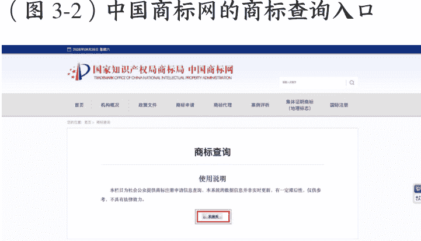

商标网自己写着：查询数据不是实时的，有滞后，只供参考。所以「查不到」不等于「一定能注册下来」。

##### 步骤 3 在各大商店搜一遍重名

App Store、华为、小米、OPPO、vivo、应用宝，每家搜一次候选名。同名 App 已经一大堆的名字，用户搜你时很难找到，直接换掉。

##### 步骤 4 买域名，并立刻实名

域名就是你官网的门牌号，比如 xxx.com。

- 52. 在阿里云、腾讯云这类大厂注册商买。
  **最好和你的云服务器放在同一家，后面备案会顺很多。**
- 53. 优先 .com，其次 .cn。在国内服务器上用，两种都要备案。
- 54. 买完当天做实名认证。持有人填你**打算拿来备案的那个主体**：
  - 个体户：填营业执照上的名称；
  - 公司：填公司名称；
  - 个人：填本人。
- 55. **看到什么算成功**：域名状态从「暂停解析」变成正常。

阿里云帮助页写明：.com 和 .net 域名注册成功 5 天内没通过实名，会被注册局锁定；实名信息同步到工信部还要 2–3 天，之后才能拿它去备案。

（图 3-3）阿里云域名注册页：先搜候选名，看哪个后缀还能买

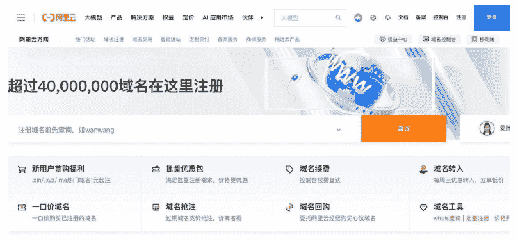

###### 域名注册

##### 步骤 5 决定要不要注册商标

我的建议很简单：

- 只是练手、做着试试 → 先只查重，不注册。
- 打算长期做、要做成品牌 → 尽早注册。商标周期很长，越早报越早受保护。

谁能申请，个体户和公司不一样：

| 你的身份 | 能不能申请商标 | 用什么材料 |
| --- | --- | --- |
| 公司 | 能 | 营业执照 |
| 个体工商户 | 能 | 个体户营业执照 + 经营者身份证 |
| 没有执照的个人 | 不能 | 商标局答复：自然人要有个体户营业执照（或农村土地承包合同） |

在哪办、花多少：

- 入口：国家知识产权局「商标网上服务系统」，从中国商标网首页进入。也可以找代理，代理费另算。
- 官费（核对于 2026 年 10 月，以官方最新为准）：网上申请 270 元/类，含 10 个商品项；超过 10 个，每多 1 个加 27 元。纸质申请 300 元/类。来源：https://sbj.cnipa.gov.cn/sbj/sbsq/sfbz/
- 时长：商标局答复「审查周期 4 个月左右」，审完还有 **3 个月**初审公告期，之后才是注册公告和发证。前后算下来大半年。
- 提交后先拿到**受理通知书**。证书还没下来，但它能证明你申请在先。

每多报一个类别，就多一份官费。App 至少报第 9 类；其他类别按你的业务和预算选。

##### 步骤 6 定好包名和 Bundle ID，写死

包名（安卓）和 Bundle ID（苹果），就是商店和备案系统用来认你这个 App 的「身份证号」。用户看不到，但它一辈子跟着这个 App。

格式一般是反写的域名加一个词，例如 com.你的域名.app 名。它和显示名是两回事：显示名可以改，包名不能。

为什么定了就别改：

- 苹果官方写明：**上传第一个构建以后，Bundle ID 就不能改了。**
- 安卓换包名，商店会当成一个全新的 App，以前的下载、评分都带不过来。
- App 备案里登记了包名（第 5 章会讲），改了要去做备案变更。

现在只把包名写在纸上和账号登记表里；第3章步骤1再写进工程。

##### 步骤 7 万一真要改名：先列清单，再动手

我准备把 App 的显示名从【旧名】改成【新名】。请先只读检查，不要改任何文件：

1. 列出代码里所有用户能看到旧名的地方（桌面名、权限弹窗、提示文字、关于页等）；
2. 列出包名、Bundle ID、跳转协议名、工程名出现的地方——这些我不打算改，只是让我知道；
3. 提醒我代码以外还要去改的后台（微信开放平台、商店、备案、软著等）。

等我确认清单后，再只改第 1 类。

（图 3-4）改名时改了什么、没改什么：显示名改了，包名没动

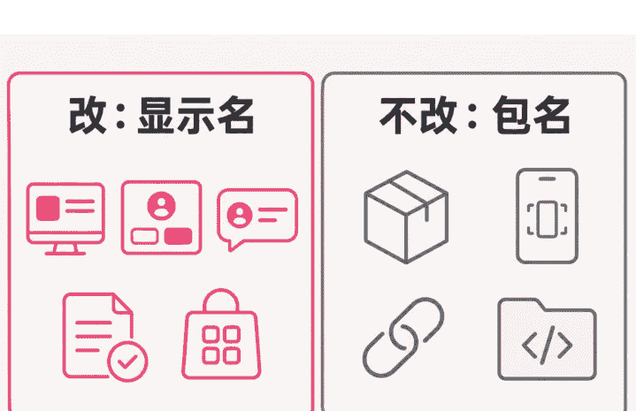

#### 做到这些就算完成

> 注意：
>
> 1. 没有营业执照的个人不能申请商标。想注册，要么先办个体户，要么用公司。
>
> 2. Bundle ID 一旦上传过构建就改不了，安卓换包名等于新 App。名字可以晚点定，包名要早定、定死。
>
> 3. 名字没定死，别让 AI 改代码。我改了两次名，第一次的改动全白做了。

### 第 4 章 软著和电子版权证书：我卡在了「未使用 AI 开发」那份声明上

一句话：国内安卓商店上架要一张版权证书。如果你的 App 是用 AI 写的，这一章请看完再动手。

> □ 软著：官方规定受理后 60 日内审定；电子版权：普通时效 10-15 个工作日 | □ 软著官方免费；电子版权我下单时页面价 600 元（普通时效）

#### 先搞懂：这两张证是什么，谁要

软著，全称「计算机软件著作权登记证书」，由中国版权保护中心登记发证。说白了，它证明「这个软件登记在你名下」。

电子版权证书，是市场化认证机构（易版权平台，北京版信通运营）出的两页证书：「APP 电子版权认证证书」和「软件著作权认证证书」。它不是软著，但有些安卓市场认。

苹果 App Store 不要这两样。国内安卓市场普遍要，但各家认的不一样（核对于 2026 年 9-10 月，以后台为准）：小米、OPPO、vivo 的公开规则写明接受电子版权证书；360 普通应用必须有软著；华为、应用宝没核到明确原文，荣耀的 FAQ 和上传页说法不一，都要先在后台问清。逐家对照表和官方原文链接，见第 16 章步骤 3。

易版权自己的页面写着华为、应用宝也能用，但这两家的官方页面我没找到对应条款。投之前在商店后台问清楚。

（图 4-1）易版权首页：「APP 电子版权认

好几页不到 30 行，第 1 页还留着「草稿」字样。

我想如实补正：用一台荣耀安卓手机重新截了真机截图，说明书改成 41 页；还亲笔写了一份《开发过程如实说明》，写明开发中用了 AI 辅助。

可补正时平台要签的申请确认签章页，是一份**固定模板**，原话是：

后面还要手抄一段承诺：如有失实或欺骗，自愿被列入版权登记失信名单和个人征信记录。再签名，写身份证号。页面上**没有「AI 辅助」这个选项**。

#### 第三步：我决定不签

事实是：这个 App 从头到尾都在用 AI 写代码。

签了，就和我写的如实说明自相矛盾，还要背失信风险。我给自己定了三条底线：**不说自己没用 AI；不为了躲检测去改写文档；不编造研发日志**。所以我不签，也不再补正。按规定，补正期满没补正，就视为撤回申请。

#### 第四步：转办电子版权证书，先问清能不能如实办

我查了各家商店的官方规则（对照表见第 16 章步骤 3），小米、OPPO、vivo 明确接受电子版权证书。

下单前我读了易版权的公开协议：**没有「未使用 AI」这句话**，但有「原创、权属合法、材料真实」的承诺。我拿不准 AI 辅助算不算「原创」，就书面问了客服。客服答复：这正是我的情况，需求、设计和验收是我做的，代码主要是 AI 写的。能如实办，我才下单；

- 56. 实名：我用的是个体工商户，所以走「企业实名」：营业执照 + 经办人身份证。当晚就通过了。
- 57. 付款：普通时效 600 元，10-15 个工作日。
- 58. 填报 6 步：全称、简称、包名、版本号，上传源代码和说明书。填到第 4 步才发现，源代码页眉、说明书、填报表写的是三个不同的版本号，只好重出两份 PDF。结果交上去，审核意见里还是一条「说明文档和代码页眉的版本号与填报的版本号不一致」。
- 59. 签章页：我的个体户没刻公章，用经营者手写签名扫描上传。审核意见第一条就是「签章页盖章后提交」，手写签名不行。
- 60. 提交后自查，又退回改了一次：说明书里有重复截图、两处图文对不上、十来页不到 30 行，封面还残留旧材料的字样。我申请退回修改，换上 21 页定稿，重新提交。

写这篇时，平台给的状态是「待补正」：要盖章，要把版本号统一，证书还没拿到。计划拿到后先投 OPPO。小米要先登录开发者后台，看「企业」类型里有没有「个体工商户」；没有，就只能等公司主体。

没有证书期间安卓版怎么发，详见第 16 章。

（图 4-3）易版权后台：认证状态「待补正」

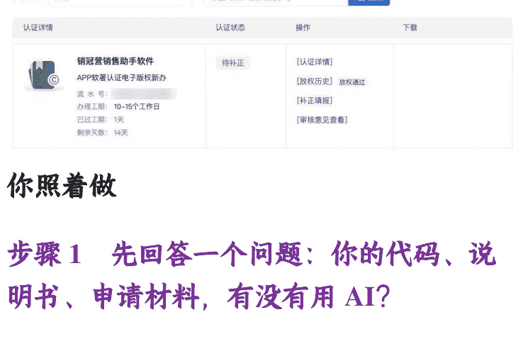

#### 你照着做

##### 步骤 1 先回答一个问题：你的代码、说明书、申请材料，有没有用 AI？

| 你的情况 | 先做什么 |
| --- | --- |
| 从头到尾都没用 AI | 走版权中心软著，官方免费 |
| 用了 AI（像我一样） | 先逐字核对当次看到的签章页声明：对得上才签；对不上，再考虑电子版权（步骤 3） |
| 拿不准 | 先打电话或书面问登记机构，再决定 |

怎么核对、怎么选：

- 61. 逐字读你当次看到的签章页。我补正时看到的模板写着「未使用 AI 开发编写代码、撰写文档或生成登记申请材料」，你看到的版本可能不一样。如果也是这句，注意它管的不只是代码：用 AI 写说明书、排源码 PDF，也算。
- 62. 如实申报。声明和你的实际情况对得上，才签；对不上，就别签。
- 63. 拿不准，先问登记机构，把答复留下来。
- 64. 我的选择是不签、改办电子版权证书。但电子版权证书也可能因为主体、盖章、版本号被退回，我就是（上面第四步写了被退回的原因）。不管走哪条，都要做好补正的准备。

##### 步骤 2（走软著的）在版权保护中心官网申请

- 65. 打开中国版权登记业务平台：https://register.ccopyright.com.cn/registration.html#/registerSoft ，注册账号，完成实名认证。
- 66. 选「软件登记」，在线填表。简称就填你的 App 名，商店要求名称一致；「主要功能」按真实功能写 500–1300 字。
- 67. 上传两份材料：

  - 程序鉴别材料：源代码前、后各连续 30 页，每页不少于 50 行；不到 60 页就全交。
  - 文档鉴别材料：说明书前、后各连续 30 页，每页不少于 30 行；不到 60 页就全交。
  - 每页页眉写软件名称和版本号，标好页码。

- 68. 点「确认填报」，打印申请确认签章页。签字前逐字读完。签章页不能改内容、格式和打印比例。
- 69. 签字（或盖章），扫描成 PDF 上传。
- 70. 等受理和审查。官方规定：受理后 60 日内审定；有补正要在 30 日内补，逾期视为撤回。通过后在官网用户中心下载电子证书。

费用：官方登记免费（官网有停征登记费的通知）。核对于 2026 年 10 月，以官方最新为准。

主体：公司用营业执照实名；个体户可以用经营者本人身份，想用个体户名义以平台实名选项为准。不管选哪个，著作权人要和你后面开安卓开发者账号的主体一致，小米 FAQ 就写明了这一条。

##### 步骤 3（决定走电子版权的）先书面问清，再下单

> 您好，我想申请 APP 电子版权认证证书，先确认一个问题：
>
> 我的软件由我主导需求、设计和验收，代码和部分文档使用了 AI 编程工具辅助完成。
>
> 1. 这种情况能否如实申请？
> 2. 申请或签著页里，是否有「未使用 AI」之类的声明？
> 3. 需要提交哪些材料，对说明书有什么要求？
>
> 请以文字回复，谢谢。

拿到「可以申请」的答复后：

- 71. 在易版权官网（https://www.yibanquan.com.cn）注册并实名。个人：身份证正面加手持证件照；个体户和公司：营业执照加经办人身份证。
- 72. 下单「APP 电子版权认证」。普通时效 10–15 个工作日，另有加急档，价格以页面为准。
- 73. 按 6 步填报，最后打印签章页，盖章后扫描上传。没有公章的，先刻章再提交，别像我一样交手写签名被退回。

##### 步骤 4 说明书自查清单（易版权的要求，我踩过其中好几条）

源代码 PDF 可以让 AI 帮你排版。前提是你已经问清楚对方允许 AI 辅助；走版权中心软著、签章页又要求声明未使用 AI 的，请自己动手。

请从我当前项目里挑选能代表核心功能的真实源代码文件，生成一份「程序鉴别材料」PDF：

1. A4 纵向，取连续的前 30 页和后 30 页，共 60 页；每页 50 行非空代码；
2. 每页页眉写「【软件全称】 【版本号】」，页脚写页码；
3. 不要包含任何密钥、密码、服务器地址、配置文件和第三方版权声明；
4. 生成后告诉我页数、每页行数，并把首页和末页渲染给我看。

不要修改项目里的任何代码文件。

（图 4-4）程序鉴别材料的样子：页眉写软件名和版本号，每页 50 行

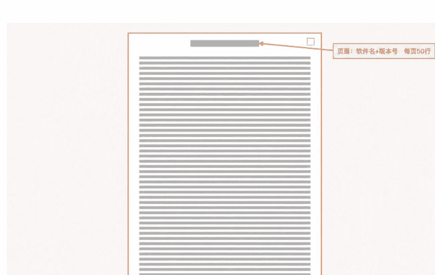

#### 做到这些就算完成

提交 ≠ 拿证。状态显示「办理中」，只说明对方收到了；证书 PDF 下载到手，才算这一步完成。

#### 先搞懂：三个备案分别管什么

| 备案 | 谁管 | 在哪办 | 拿到什么 |
| --- | --- | --- | --- |
| 网站备案（ICP 备案） | 工信部 | 你买服务器的那家云服务商 | 网站备案号，末尾是「-1」这样的数字 |
| App 备案 | 工信部 | 同上 | App 备案号，末尾多一个字母「A」 |
| 公安联网备案 | 公安部 | 全国互联网安全管理服务平台 | 公安备案号和图标 |

App 备案是 2023 年起的新要求。工信部 2023 年 8 月 4 日发文：新上线的 App 要先备案、再开展业务。没备案的 App，云服务商不给接入，商店不给分发。

一个主体下，网站和 App 共用同一个备案号的前半截。比如网站是「某 ICP 备 XXXXXXXX 号-1」，App 就是「某 ICP 备 XXXXXXXX 号-2A」这种样子。

（图 5-1）有官网时备案的先后顺序：域名实名 → 服务器 → 网站备案 → App 备案 → 公安备案 → 挂号

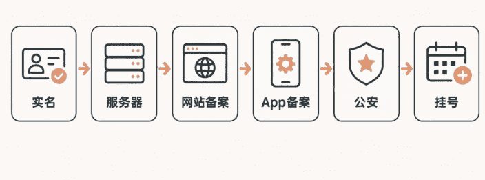

解决办法：在 App Store Connect 的「App 信息」里，确认「提供商是备案主体或附属主体」。我本人就是这个个体户的经营者，属实，就如实确认、保存。当晚 22:59 提交审核成功，9 月 21 日首版上架。

（图 5-2）App Store Connect「App 信息」里的 ICP 备案号和所有者确认（截图已打码）

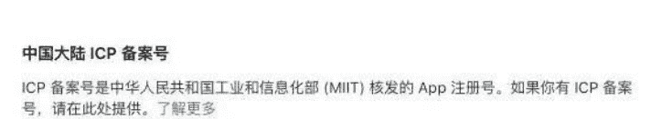

#### 你照着做

##### 步骤 1 按开头的三种情况，分清你要办哪几个

- 只做 App，没有网站：直接走「App 首次备案」，不用先建网站。
- 完全不联网、没有服务器的 App：工信部通知写明，App 备案可以通过网络接入服务提供者办，也可以通过 App 分发平台办。可以问问你要上架的应用商店能不能代办 App 备案（以工信部通知和平台说明为准），不一定要为备案专门买服务器。
- 有官网也有 App：网站备案和 App 备案都要办，可以在同一个主体下先后新增。
- App 或网站开通后：都要在 30 日内办公安联网备案。

##### 步骤 2 准备材料


###### 先按你的身份选好主体：

| 你的身份 | 能不能备案 | 注意 |
| --- | --- | --- |
| 个人 | 能 | 网站或 App 内容**不能涉及企业或商业经营**。做生意的 App 别用个人备案 |
| 个体工商户 | 能 | 用营业执照，负责人一般是经营者本人 |
| 公司 | 能 | 用营业执照，负责人可以是法定代表人或指定人员 |

另外，阿里云规定**一个阿里云账号只能备案一个主体**。个人号和公司号别混用。

**材料清单：**

这一步要等第 13 章做出正式签名后再做。用 EAS 打包的，先运行 `npx eas-cli@latest credentials --platform android`，把签名文件下载备份到自己电脑，再让 AI 帮你查指纹和公钥。

签名证书的指纹和公钥，可以让 AI 教你从电脑上查出来：

> 我要做 App 备案，需要安卓正式签名证书的「证书 MD5 指纹」和「公钥」。
> 请告诉我在我的电脑（Mac / Windows）上用 keytool 查看这两项的命令。
> 要求：命令里不要写密码，让我在终端里自己输入；
> 也不要把我的签名文件复制到任何别的地方。

阿里云也支持直接上传安卓安装包，自动识别包名、签名和公钥。两种都行，结果

- 88. 主体通过后：网站选「新办网站」；App 选「APP 业务 → 新增 APP」。按页面填接入服务商、域名注册商等信息。
- 89. 审核通过后，把平台给的公安备案号和图标代码放到官网底部。
- 90. 时限：网站或 App 开通之日起 30 日内。这是另一个部门、另一套系统，和工信部备案不自动同步。公安审核时长以平台为准。

##### 步骤 6 把备案号挂到该挂的地方

| 放在哪 | 放什么 | 点击后去哪 |
|---|---|---|
| App 内显著位置（我放在「我的」页底部） | App 备案号 | https://beian.miit.gov.cn/ |
| 官网每页底部 | 网站备案号、App 备案号 | https://beian.miit.gov.cn/ |
| 官网每页底部 | 公安备案号和图标 | 公安平台给的链接 |
| App Store Connect「App 信息」 | ICP 备案号 | 苹果核验后显示在商店页 |
| 安卓各商店上架表单 | App 备案号 | — |

苹果的要求是：你填的 ICP 备案号和 App 信息里的资料，要和你在工信部备案的一致。

请在 App 的「我的」页面底部加一行备案号：

- 1. 文字为：【你的 App 备案号】，字号小、颜色浅，不抢主要内容；
- 2. 点击后用系统浏览器打开 https://beian.miit.gov.cn/ ；
- 3. 放在用户容易找到的位置，别藏在多层菜单后面；
- 4. 改完给我在手机上截一张图看效果，并补一个测试确认这一行能渲染、能点击。

（图 5-4）全国互联网安全管理服务平台：新办网站 / 新增 APP 入口

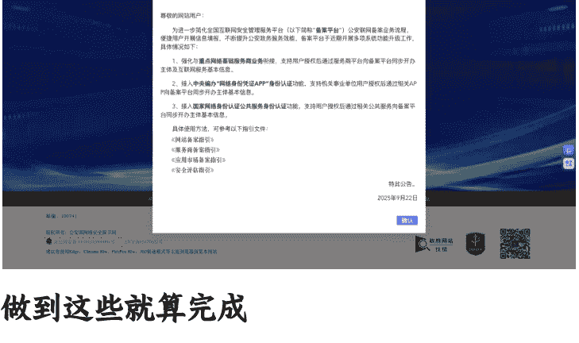

#### 做到这些就算完成

提交备案 ≠ 备案成功。能在工信部网站上查到号，才算这一步完成。

> 注意：
> 1. App 备案登记了安卓签名证书的指纹和公钥。正式签名文件定了就别换，换了要去做备案信息变更，否则备案信息和实际安装包对不上。
> 2. 备案不等于经营许可。要在 App 里收费做经营性业务的，可能还要办 ICP 经营许可证，先问清属地通信管理局。
> 3. 域名实名、备案主体、商店开发者账号，三处主体尽量一致。不一致时会被拦，像我在苹果那里一样，要能如实说明关系。

## 第二部分 做出来

### 第 6 章 先找到一个值得做的小问题

一句话：先别让 AI 写代码，先说清楚“给谁用、帮他省掉哪一步、做完能看到什么变化”。

- 半天到2天（大部分时间花在找真人聊）
- 免费

#### 我当时是怎么做的

销冠营是给美容院用的 App，最早有一套小程序。决定做 App 时，资料里有一份 58 个小程序页面的迁移清单，我第一反应是“58 页都要搬过去”。

后来定下的规矩是：每一页都要标清去向，是这一版做、以后再做，还是不做了；但第一版 App 不用把 58 页全部做出来。功能清单越长，越要先选定一条用户真正要走完的路。

（图 6-1）58 个页面的清单，收成一条真正要走通的主任务


这个问题也不是想一次就结束了。2026 年 9 月 25 日，我发现 App 里的“服务卡”（每次服务录音后自动生成的一张小结卡）内容写得很全，店里却用不起来。

我让 AI 回到最开始的问题：这张卡对美容师、店长、老板各有什么用？拿掉它，谁会损失什么？

想下来，这张卡该做的事是：把那一小时的服务过程，变成美容师、店长、老板明天各自要做的一件事。最后我又把它收成一句话：所有功能都围绕“让美容师把这位顾客成交”。

做到 9 月底，我还要回头问这几个问题。你在第一天就把它问清楚，后面能少返工很多。

#### 你照着做

##### 步骤 1：拿一张纸，回答四个问题。

| 要回答的问题 | 跟进小本的示例答案（虚构） |
| --- | --- |
| 谁会用到？先具体到一种人 | 手上同时有几件事、要按日期跟进的人 |
| 他在什么场景下遇到麻烦？ | 答应别人“周三前回复”，到了周三却忘了 |
| 他现在怎么解决？哪里不方便？ | 记在备忘录或聊天收藏里，翻起来乱，看不出哪件做完了 |
| 做完以后，他能少做哪一步，或得到什么新结果？ | 打开手机，一眼看到哪些还没做完 |

（图 6-2）四个问题卡片：谁用、什么场景、现在怎么做、能少哪一步

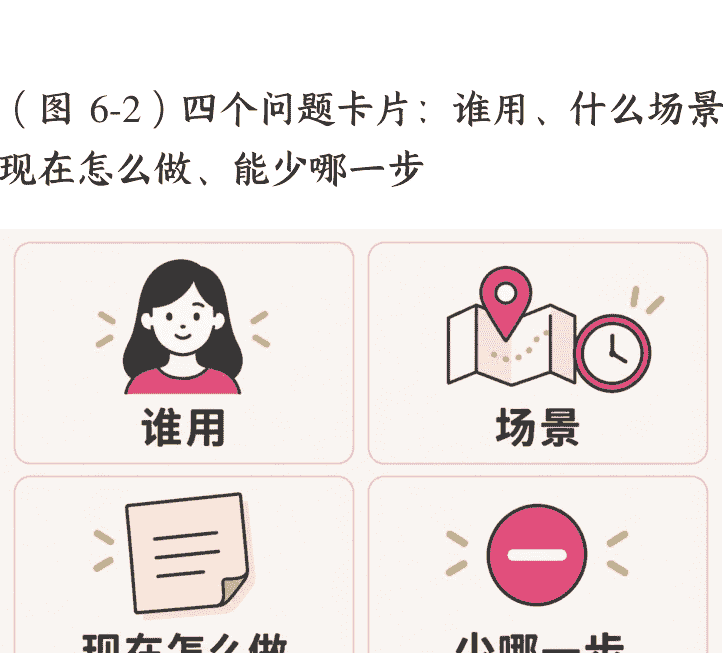

##### 步骤2：把需求缩小到“能继续拆”。

- 能继续拆的说法：“我想记录几件需要在指定日期跟进的事，打开手机就能看见哪些还没做完。”
- 还要再缩的说法：“做一个给所有门店使用的大平台。”

判断方法很简单：这句话里能不能找到一个具体的人、一个具体的动作。找不到，就继续缩。

（图 6-3）对比图：左边“大平台”打叉，右边“一件小事”打勾

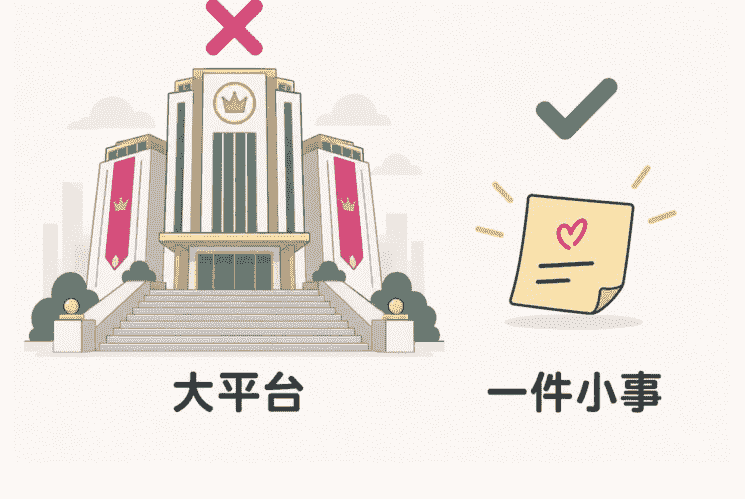

第一个 App，最好同时满足下面几条：

- 你自己或身边的人每周都会碰到这个麻烦，随时找得到人问；
- 第一版用三个动作就能说完；
- 不涉及医疗、金融、复杂支付这类需要额外资质、审核和设计的业务；
- 不依赖特殊硬件。销冠营要连智能工牌（一种录音硬件），难度比普通 App 高了一大截，第一个 App 别这么选。

##### 步骤3：去看别人怎么做、缺什么。

在应用商店和搜索引擎里搜同类产品，重点看评论区。只记一件事：人们在抱怨哪个具体操作，比如“每次都要点三下才能标记完成”。

不用收藏几十个竞品，记下三五条真实抱怨就够了。

##### 步骤4：找一个真实的人，问他“上一次”。

找一位符合你描述、愿意帮忙的人。不要问“如果有这个App，你会用吗”，几乎所有人都会说“会”。换成这样问：

- “你上一次遇到这事，是哪天？当时怎么处理的？”
- “能打开手机给我看看，你现在是怎么记的吗？”
- “那次最麻烦的是哪一步？”

让对方讲最近一次真实过程，或者直接展示现在的做法。这样你才知道，自己想改善的那一步到底有没有真的发生过。

##### 步骤5：把材料交给AI，先判断值不值得做。

打开第2章装好的编程助手（用网页版聊天也可以），发送下面这段。【填写】的地方换成你自己的内容：

```
先不要写代码，帮我确认一个应用是否值得做。

目标使用者是【填写】。
他最近一次遇到的问题是【填写真实过程】。
现在用的办法是【填写】。
我希望改善的是【填写一个具体动作】。

先指出缺少的事实，再问我最多三个关键问题。

比较手机 App、网页、小程序和现成工具是否适合。
给出一个推荐及理由，不要罗列一大串技术选项。
如果现成工具已经足够，请直接说。
不要把我的猜测写成已验证需求。
```

AI 反问的三个问题，能答就答。答不上来的，回到步骤 4 再去问人。

##### 步骤 6：写下一句话结论。

照这个格式填，写在纸上或手机备忘录里：

> 【谁】在【什么场景】下，现在要【现有做法】，很麻烦；
> 第一版只帮他做到【一个动作】，做完后他能在手机上看到【一个结果】。

#### 做到这些就算完成

暂时说不清，就先继续了解问题，别急着进第 7 章。

注意：

- 1. 别问“你会用吗”，要问“你上次是怎么做的”。前一种问法，答案几乎都是“会”，没有参考价值。
- 2. 如果 AI 说现成工具已经够用，认真考虑它。不做 App，是全篇最省钱的一种结果。
- 3. 你的猜测和别人亲口讲的真实经历，要分开记。没问过真人的部分，都只能算猜测。

### 第 7 章 把第一版压成一页纸

一句话：把“用户怎样完成一件事”写成一页需求说明，让你和 AI 说的是同一件事；AI 跑偏时，把它拉回这一页。

1-2 小时 | 免费（只用你已有的编程助手聊天）

| 主要动作 | 新增事项、查看事项、标记完成 |
| 输入 | 标题、日期、可选备注 |
| 输出 | 待办列表和完成状态 |
| 数据放哪里 | 当前手机本地 |
| 第一次打开 | 显示空态与新增入口 |
| 输入不正确 | 提示原因，保留已填内容 |
| 暂时不做 | 登录、云同步、AI、支付、录音、蓝牙、推送 |

“空态”就是还没有任何数据时页面显示什么，比如一句“还没有事项，点这里新增一条”。

（图 7-1）跟进小本的一页需求单样例

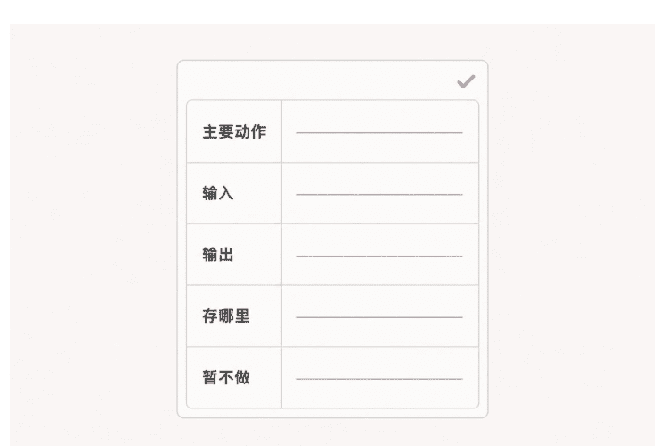

##### 步骤2：写五条你能亲手检查的要求。

- 91. 输入事项后，能在列表里找到它。
- 92. 空白标题和无效日期不能保存，并且有明确提示。
- 93. 每一条事项可以单独标记完成。
- 94. 两条同名事项不会互相覆盖。
- 95. 退出再打开，事项及完成状态仍然存在。

“页面要好看”“体验要流畅”可以作为方向，但代替不了这五条。

##### 步骤 3：让 AI 把它整理成一页说明。把步骤 1、2 的内容和第 6 章的一句话结论一起发给编程助手，再加上这段：

> 请根据已经确认的需求，生成一页第一版说明。
>
> 写清用户路径、页面、输入、输出、数据保存和错误提示。
> 第一版只保留三个主要动作。
> 把每条完成标准写成我在手机上能执行的检查。
> 列出暂时不做的功能和仍待我决定的问题。
> 再按依赖顺序拆成小任务，每个任务只改变一件主要事情。
> 这一轮只讨论和写说明，不写实现代码。

拿到结果后，让 AI 用自己的话把需求复述一遍。复述和你想的不一样，当场改，不要带着分歧开工。

##### 步骤 4：保存成文件，新想法放进“以后再做”。确认以后，不用自己找软件存，直接对编程助手说：

> 把这份说明存成一个叫“需求说明.md”的文件，放在我现在打开的这个文件夹里，告诉我完整路径。

.md 是一种纯文字文件，AI 读起来最方便。第 8 章会建一个“工程”，就是放这个 App 全部文件的那个文件夹，建好以后，再让编程助手把这个文件拷进去（第 9 章步骤 1 会提醒你）。

后面冒出新想法，先写到文件末尾的“以后再做”，不要让每次讨论都把正在开发的这一版改大。

##### 步骤5：每个小任务开工前，先问五句。

动手写代码前，按顺序问：

- 96. 这个功能这一版真的要做吗？
- 97. 项目里有没有已经能用的？
- 98. 手机系统或平台自带的能力够不够？
- 99. 已经装好的工具包能不能做到？
- 100. 前四个都不行，才写一段最小的新代码。

如果有意先做简化版，就在说明里补两句：它最多能撑到什么情况，出现什么信号就必须升级。

（图 7-2）五级台阶：真要做、有现成、系统有、工具有、才写码

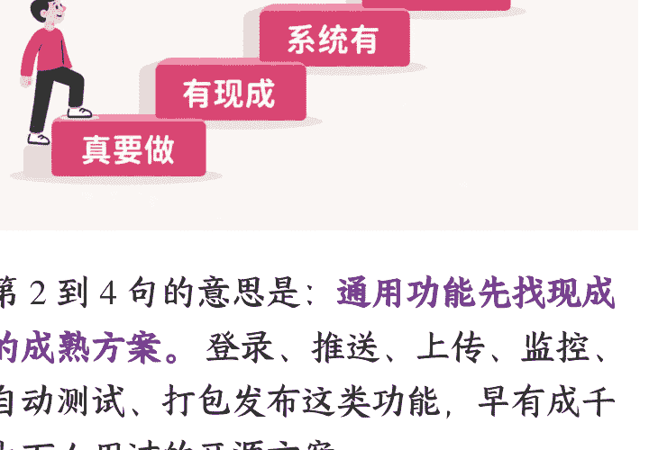

第 2 到 4 句的意思是：通用功能先找现成的成熟方案。登录、推送、上传、监控、自动测试、打包发布这类功能，早有成千上万人用过的开源方案。

2026 年 8 月 28 日我立了这条规矩。之前我们自己从零写了一套“打包、装到手机上”的流程，烧掉好几天还不稳定；而 fastlane、

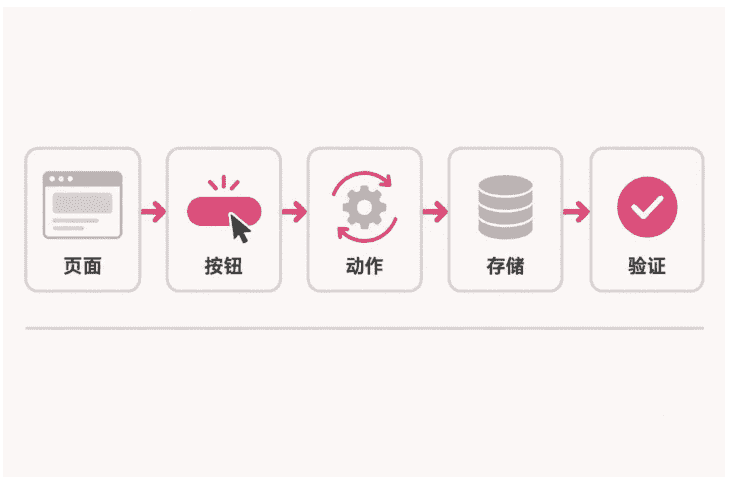

#### 做到这些就算完成

注意：

- 1. 新想法一律先进“以后再做”。每次聊天都把第一版改大，是做不完最常见的原因。
- 2. “文件存在、代码能编译”只说明了其中一层。说某个功能“已接入”之前，要查清是哪个按钮真的调用了它。
- 3. 通用功能先找成熟方案再动手。自己从零写，往往多花几天，还不稳定。

### 第 8 章 准备工具，先在手机上看到第一个页面

一句话：把电脑和手机的环境装好，让 Expo 的默认页面真正出现在你的手机上。

□ 第一次装大约 1-3 小时 | □ Node.js、Expo、Expo Go 免费；编程助手按你在第 2 章选的套餐

#### 我当时是怎么做的

先说清楚：销冠营的实际工程用的是 React Native，打包上架时还用了 Xcode 等一整套更重的工具。这一章给你的 Expo 路线是简化练习，更适合第一个 App，不是我当初原样走过的路。

工具上，第一天只用一个编程助手就够了，用熟再加。2026 年 8 月中旬以后，我的分工才变成：Claude Code 负责拆任务、检查结果，Codex 负责写代码。

我们把“先查当前官方文档”写进了给 AI 的长期规则，原因很简单：模型记住的用法，不一定对得上今天的版本。

写这篇文章时，我按这条规矩把本章的命令重新核对了一遍（2026 年 10 月），就查到几处和旧教程不一样的地方：

- iPhone 上的 Expo Go 从 2026 年 9 月 3 日起，要求电脑和手机登录同一个 Expo 账号，才能打开你的项目；
- 新建工程的首页文件，官方文档现在写的位置是 `src/app/index.tsx`，和不少旧教程写的不一样；
- Codex 的官方起步页换了网址。

如果照着旧教程做，你会在这几处卡住，还以为是自己装错了。

#### 你照着做

本章命令和版本核对于 2026 年 10 月，以官方最新为准。

**步骤 1：确认编程助手已经装好。** 第 2 章已经装好桌面 App、成功新建过 hello.txt 的，这一步直接跳过，去看步骤 2。还没装的，先按第 2 章「账号 1」开好账号、装好桌面 App；用国内编程助手的，按它官网的说明安装。只有想改用命令行版的，才需要往下看选项 A / B。

为什么非装不可？普通网页聊天只能把代码“说”给你，编程助手能直接读写你电脑里的工程文件、运行命令。这是两件事。

先认识终端：它是一个输入命令的窗口。

- Mac：按 Command + 空格，搜“终端”打开。
- Windows：在开始菜单里搜 PowerShell 打开。

##### 选项 A：Codex

官方说明在 Codex CLI 安装页（原来的 developers.openai.com/codex 页面现在会自动跳到这里）。不想用命令行，就用第 2 章装好的 Codex 桌面 App（在 ChatGPT 桌面 App 里也能用），见官方起步页。

Mac / Linux 在终端里运行：

```
curl -fsSL https://chatgpt.com/codex/install.sh | sh
```

Windows 在 PowerShell 里运行：

```
powershell -ExecutionPolicy ByPass -c "irm https://chatgpt.com/codex/install.ps1 | iex"
```

装好后输入 codex 回车，第一次会让你选 “Sign in with ChatGPT” 登录。官方定价页写明，ChatGPT 免费档也包含 Codex，但定位是试试小任务。

##### 选项 B：Claude Code

官方说明在 Claude Code 安装说明。

**Mac / Linux 在终端里运行：**

```
curl -fsSL https://claude.ai/install.sh | bash
```

**Windows 在 PowerShell 里运行：**

```
irm https://claude.ai/install.ps1 | iex
```

装完新开一个终端窗口，输入下面这行，打印出版本号就是装好了：

```
claude --version
```

再输入 claude，按浏览器里的提示登录。Claude Code 需要 Pro、Max、Team、Enterprise 或 Console 账号，免费版不包含。不想用命令行，也可以下载 Claude 桌面 App。

（图 8-1）编程助手官方安装页，复制对应系统的那一行命令

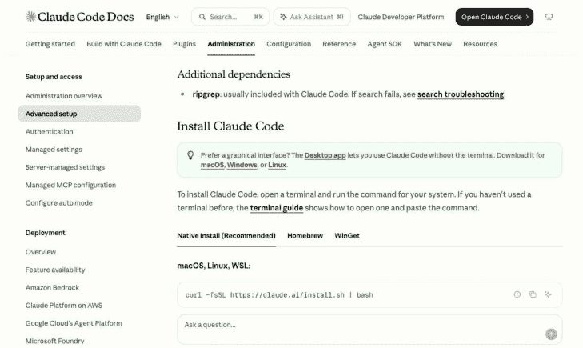

##### 步骤 2：在电脑上装 Node.js（选 LTS 版）。

Node.js 是让电脑能运行 JavaScript 工具的基础软件，Expo 要靠它跑起来。装 Node.js 时会顺带装上 npm，它是一个帮你下载各种工具包的“应用商店”。

- 101. 打开 Node.js 下载页。
- 102. 选带 LTS 字样的版本（LTS 是“长期支持版”，最稳）。2026 年 10 月初是 v24.21.0。
- 103. 下载你系统对应的安装包：Mac 是 .pkg，Windows 是 .msi。双击打开，一路“继续 / 下一步”。

（图 8-2）Node.js 官网下载页，选带 LTS 字样的版本

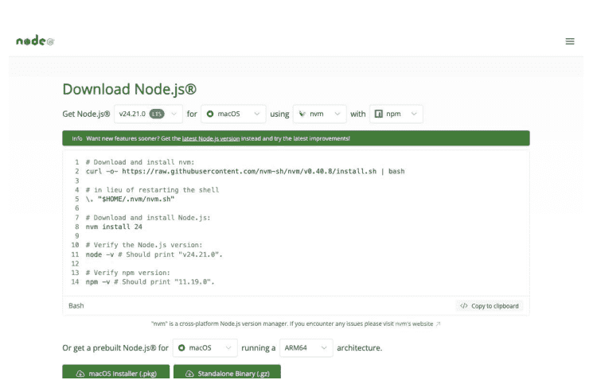

##### 步骤 3：在终端里确认装好了。装完关掉终端再重新打开，分别输入下面两行，每行输完按回车：

```
node --version
npm --version
```

两行都返回一串版本号（第一行类似 v24.21.0），才算成功。

（图 8-3）终端里输入 node --version 和 npm --version 后，返回版本号的样子


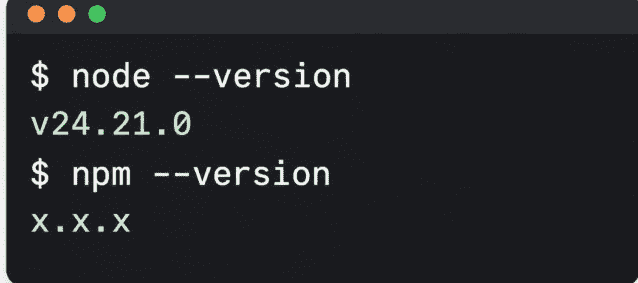

如果提示找不到命令（“command not found”或“无法识别”），先重开终端；还不行，把你的系统类型和完整报错原样贴给编程助手。

##### 步骤 4：手机装 Expo Go。

Expo 是一套帮你用 JavaScript 做手机 App 的工具。Expo Go 是它配套的手机 App：电脑上改代码，手机上用 Expo Go 扫码就能看到效果，不用先打包安装。

- iPhone：在 App Store 搜 “Expo Go” 安装。
- 有 Google Play 的安卓手机：在 Google Play 搜 “Expo Go” 安装。
- 国内安卓手机（华为、小米、OPPO、vivo 等）一般没有 Google Play，官网 expo.dev/go 上 Android 那一行的「Install」会跳到 Google Play，用不了。换这样装：
  1. 用手机浏览器打开 Expo 官方在 GitHub 的 expo-go-releases 发布页，那里放着 Android 安装包（.apk 文件）。
  2. 下载和你要用的 SDK 对得上的那一个。文件名里带版本号，比如 SDK 57 对应 Expo-Go-57.x.x.apk。
  3. 点开安装；手机弹出安全提示时，按手机提示允许本次安装。
  4. 下载不动或找不到，让编程助手按官方页面帮你查当前的安装方式。
- 核对：2026 年 10 月，expo.dev/go 页面写的是“SDK 57 (latest)”。
- **用 iPhone 的，还要多做一步**：去 [expo.dev/signup](https://expo.dev/signup) 免费注册一个 Expo 账号，然后在 Expo Go 首页点右上角头像登录。

（图 8-4）Expo Go 官网页面，标着当前支持的 SDK 版本

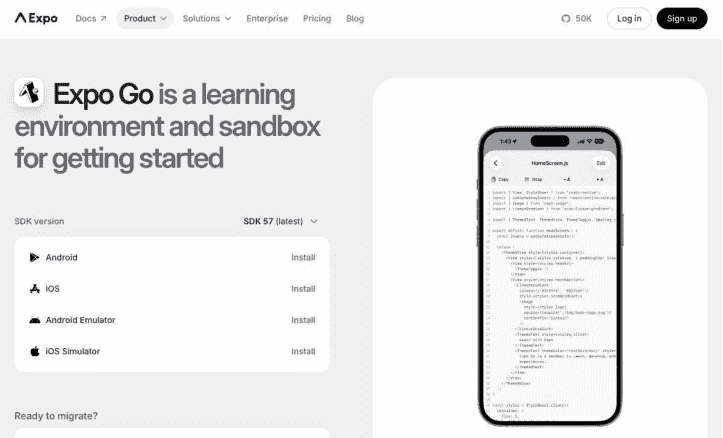

**步骤 5：在电脑上建一个专门的练习文件夹。** 不要在已有的产品工程里做练习。在终端里依次输入下面四行，**每行输完按回车**；某一行报错就停下，把完整报错发给编程助手，别继续往下复制。

Mac（终端）：

```bash
cd ~/Documents
mkdir app-practice
cd app-practice
pwd
```

Windows（PowerShell）：

```powershell
cd $HOME\Documents
mkdir app-practice
cd app-practice
pwd
```

最后一行 pwd 会显示你现在所在的位置：Mac 一般是 `/Users/你的用户名/Documents/app-practice`，Windows 一般是 `C:\Users\你的用户名\Documents\app-practice`。前半段和你的不完全一样没关系，末尾是 app-practice 就对了。打开 Mac 访达里的「文稿」或 Windows 的「文档」，也能看到这个新文件夹。不会操作，就把这几行发给编程助手，让它针对你的系统一步步带你，并回读当前路径。

##### 步骤 6：创建工程，启动开发服务。

依次运行下面三行：

```bash
npx create-expo-app@latest followup-notebook
cd followup-notebook
npx expo start
```

在国内，下载很慢或报 ETIMEDOUT（连接超时）很常见，不是你装错了。镜像源就是国内的下载加速站：同一批工具包，换从国内的服务器下载。它和第 13 章后端说的“镜像”（打包好的服务器程序）是两回事，只是名字像。把完整报错发给编程助手，再加一句：

> 请按官方方式把 npm 的下载地址换成国内镜像源，告诉我改了什么、以后怎么改回去。

改好以后，重跑出错的那一行。

- 第一行会创建一个叫 followup-notebook 的新工程。中途如果让你选模板或 SDK 版本，选和手机上 Expo Go 对得上的那一版，并记下你实际选了什么。
- Expo 把自己每一代工具叫一个「SDK 版本」，比如 SDK 57。手机上的 Expo Go 只认它支持的那一代，对不上就打不开。（别处说的 SDK，一般指别人做好的功能模块，见附录 C。）
- 2026 年 10 月初，官方教程写的是选 SDK 57。SDK 58 在 9 月 15 日出了测试版，官方说正式版发布后不久，商店里的 Expo Go 会跟着升级到 58。
- 第三行跑起来后，终端里会出现一个二维码。这个终端窗口要一直开着，关掉了，手机上就看不到页面。

###### 用 iPhone 的，在第三行之前先登录：

```bash
npx expo login
npx expo whoami
```

第一行按提示登录，用你在 Expo Go 里登录的同一个账号；第二行会显示电脑上当前登录的账号名，确认和手机上一致。

##### 步骤 7：用手机扫码。

1. 手机和电脑连同一个 Wi-Fi。
2. 安卓：打开 Expo Go，点“Scan QR code”，扫终端里的二维码。
3. iPhone：直接用系统相机扫二维码，按提示用 Expo Go 打开。
4. 手机上出现 Expo 的默认欢迎页面，就成功了。

（图 8-5）电脑终端显示二维码，手机用 Expo Go 扫码后出现默认页面

官方参考：Expo 项目创建说明、Expo 首次运行教程。

##### 步骤 8：环境卡住时，先分清是哪一类问题。

| 你看到的现象 | 先查什么 |
|---|---|
| 终端说找不到命令 | 运行环境：Node.js 装没装好、终端有没有重开 |
| 依赖装不上、下载报错 | 包管理器（npm）和网络 |
| 工程能打开，但某个功能“不存在” | 依赖版本和官方文档 |

“依赖”就是你的工程用到的、别人写好的工具包。三种问题，不要都用“删光重装”一种办法处理。

卡住时，把完整报错贴给编程助手，再加上这段：

> 先回读当前 Node、包管理器、框架和目标依赖的版本。
> 把第一条有效错误与这些版本对应起来。
> 查 Context7 或官方文档，给出适用于当前版本的修法。
> 保留锁文件，不要同时更换框架版本和依赖版本。
> 说明这次修复后，重新执行哪一条命令会出现什么结果。

“锁文件”是工程里记录每个工具包精确版本的清单（比如 package-lock.json），别让 AI 随手删掉它。

###### Context7 是什么？

它是一个让 AI 编程助手能查到第三方工具包最新文档的插件，GitHub 上有 6 万多颗星，用的是 MIT 开源许可证。想装的话，按它的 GitHub 页面说明运行：

```bash
npx ctx7 setup
```

装不上也没关系。它查不到或结果对不上时，直接让 AI 去该工具的官网确认。

#### 做到这些就算完成

注意：

1. 只在电脑浏览器里看到页面，不算完成。这一章要的是在手机上看到。
2. Expo Go 是官方定位的学习“试验场”，不支持你自己加的原生能力（比如连接特殊的蓝牙硬件）。需求里一开始就有这类功能，先让 AI 查清要不要改用“开发构建”（自己打的调试包），第 13 章会讲到打包。
3. iPhone 两边没登录同一个 Expo 账号，会提示 “You need to be signed in to Expo Go and Expo CLI”。按步骤 6 登录后，在手机上点 “Try Again”。

### 第 9 章 一次只做一件事，把页面变成能用的 App

一句话：按“改标题 → 新增、查看、完成 → 再调视觉”三步走，每一步都在手机上验证完，再进下一步。

□ 半天到 1 天 | □ 免费（只消耗编程助手的用量）

#### 我当时是怎么做的

2026 年 8 月 23 日以前，我习惯让 AI 撸一大批改动，再一起装到手机上验收。结果每次都一下子冒出一堆问题，每次都有，很烦。从那天起我改成一次只打磨一个页面；这一页改到我满意，再动下一页。

做界面时，我踩过三个典型的坑：

1. 改错了控件。2026 年 8 月有一次，需求是“右侧语音气泡随说话时长变长”，结果做成了底部按钮上的进度条。后来我把“改界面前先看图，确认位置”写进了交接规则。
2. 重复设计。服务页面已经有三轮设计稿，新接手的执行者不知道，又从头做了一轮。后来先让 AI 在工程和文件里查现有设计、确认选定的是哪一版，再把改动落进 App。设计稿存在，也并不等于安装包里已经做出来了。
3. 按钮是摆设。有一版建档页，返回需要的参数没传进页面，进去以后没有返回入口；还有几个“开关”其实只是固定文字，点了没反应。

这三个坑有个共同点：看截图觉得都对，真去点才发现不对。

#### 你照着做

##### 步骤 1：让编程助手先认清工程，只改一个标题。

第 8 章跑二维码的那个终端别关。再开一个新的终端窗口，进入工程文件夹，启动编程助手（Windows 把第一行换成 `cd $HOME\Documents\app-practice\followup-notebook`）：

```bash
cd ~/Documents/app-practice/followup-notebook
claude
```

用 Codex 的，把最后一行换成 codex。用桌面 App 的：在 App 里选「打开文件夹」，选中 文稿/app-practice/followup-notebook（Windows 在「文档」里），后面的提示词照样发。

打开以后，先对它说：「把我第 7 章存的需求说明.md 复制到这个工程文件夹里，和 package.json 放在同一层，告诉我完整路径。」 package.json 是工程的配置清单，它所在的那一层就是工程最外面一层。

再让它确认路径和实际文件结构，然后动手。第一次任务只改标题，发送：

> 读取当前工程，告诉我工程绝对路径、Expo 版本和首页文件位置。
> 本次只把首页改成“跟进小本”，加一句“今天只完成一件小事”。
> 不要按旧教程猜文件位置。
> 不加依赖，不接 API，不部署。
> 完成后告诉我改了哪些文件、怎样在手机验证。
> 你看不到我的手机，就明确让我确认，不要替我写通过。

几个词的意思：“依赖”是工程用到的外部工具包；“API”是 App 和服务器之间传数据的接口；“部署”是把东西发到线上服务器。这一步三样都不碰。

AI 改完保存后，手机上的 Expo Go 一般会自动刷新。没刷新，就摇一摇手机打开开发者菜单，手动重新加载。手机上看到了新标题，再进入下一步。

（图 9-1）三步走：改标题 → 新增、查看、完成 → 调视觉

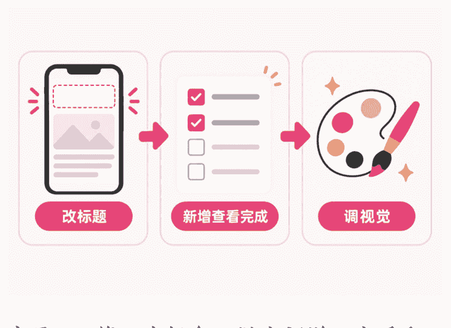

##### 步骤 2：第二次任务，做出新增、查看和完成。

按需求说明实现新增、查看和完成状态切换。

- 标题去掉首尾空白后不能为空，最多 40 个字。
- 日期采用 YYYY-MM-DD，必须是有效日期。
- 备注可以不填，最多 200 个字。
- 保存成功后在列表出现，并清空已成功提交的表单。
- 每条事项有独立标识，两条同名事项不能互相覆盖。
- 可以标记完成，也可以改回待办。
- 键盘弹出时，保存按钮仍能操作。

这一阶段先保存在内存，重开丢失属于已知限制。

不加入需求说明以外的功能。

完成后给我五条实际操作步骤。

“内存”是 App 运行时临时放数据的地方，App 一关就清空。所以这一步做完，关掉再打开、数据没了是正常的，真正存下来放在第 10 章。

AI 会给你五条操作步骤，拿手机一条条做。大致是这样：

1. 什么都不填，直接点保存 → 应该提示标题不能为空。
2. 日期填 2026-02-30 → 应该提示日期无效，已填的标题还在。
3. 填“给王姐回电话”和一个有效日期 → 列表出现这一条，表单清空。
4. 再新增一条同名的“给王姐回电话” → 列表里有两条，互不覆盖。
5. 点第一条的“完成” → 只有它变成已完成；再点一次 → 改回待办。

（图 9-2）跟进小本的三个状态：空态、有待办、已完成

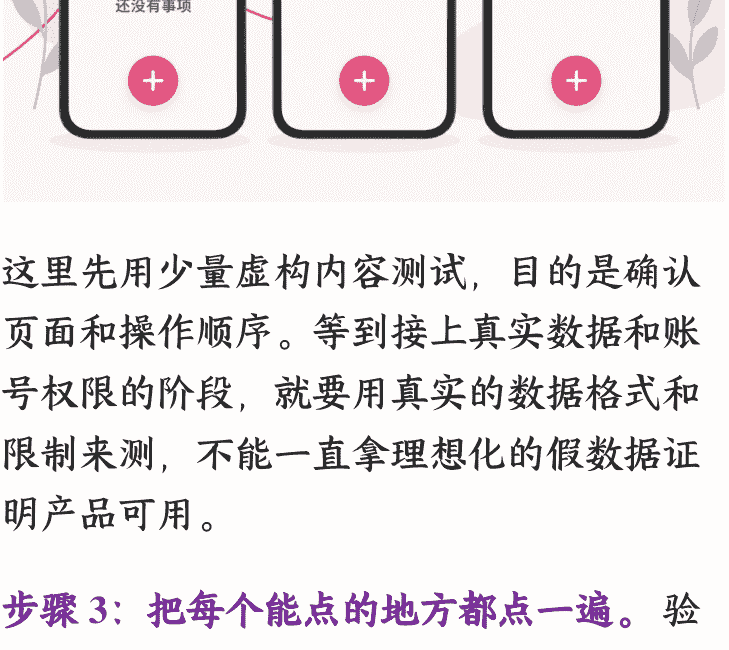

这里先用少量虚构内容测试，目的是确认页面和操作顺序。等到接上真实数据和账号权限的阶段，就要用真实的数据格式和限制来测，不能一直拿理想化的假数据证明产品可用。

##### 步骤 3：把每个能点的地方都点一遍。

验收时别让 AI 评价“整体美不美观”，而是把页面上每一个能点的东西——按钮、开关、返回、输入框——都亲手点一次。点了没反应、进去出不来，都记下来交给 AI。

如果你做的是网页或管理后台，可以多用两样工具：浏览器开发者工具里的 Network 面板（看点击后有没有发出请求）和 Console 面板（看有没有报错）。再用 Playwright 把稳定的操作路径录下来反复重跑，它的 Trace Viewer 能回看每一步动作、截图和网络请求。

##### 步骤 4：功能都对了，再调视觉。

###### 4.1 给参考图，说清借鉴哪一部分。

找一张你认可的 App 截图发给 AI，说明想借鉴的是哪一部分，比如字号、留白、按钮位置。一次只改一个页面，改完把步骤 2 那五条操作重走一遍，防止“美化”把功能改坏。

给 AI 截图时要指明三件事：**哪个区域、什么动作、改之前和改之后有什么不同**。只说“让它动起来”，AI 很容易理解成别的东西。我那次“语音气泡变成进度条”，就是这么来的。

###### 4.2 第一版界面一般都“喘不过气”，提前给留白下死命令。

2026 年 8 月 23 日，我看一版答题页截图，第一感觉是“一点呼吸感都没有”：框太多，很拥挤，文字和框贴得很近，很别扭，那一轮等于白做。之后我做所有界面，都把留白要求写成数字放进提示词：

> 调整这个页面的版式，只改样式，不改功能：
> 1. 屏幕左右边距不少于 20；卡片内边距不少于 20。
> 2. 任何文字离最近的边框不少于 16。
> 3. 元素之间间距 12 到 16，区块之间间距 24 到 32。
> 4. 行高不低于字号的 1.5 倍；标题和正文的字号要有明显层级。
> 5. 不要框里再套框，能用留白分组就不加边框。
> 改完告诉我改了哪些地方，我在手机上确认。

（图 9-3）留白对比：左边拥挤贴边，右边有呼吸感

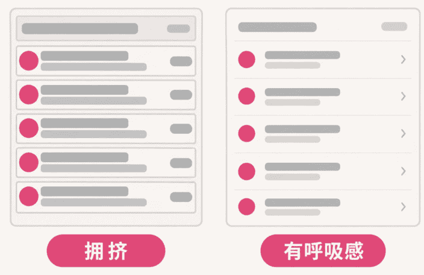

还有一点：一定要在真机上看。2026 年 9 月 20 日，我在自己手机上看到字整体偏大、两边很挤。查下来有两个原因：我手机的系统字号调大了一档，而页面没考虑这种情况；我们自己定的标题字号也偏大。电脑上的预览看不出这种问题。

###### 4.3 说不清“高级感”，就让 AI 先画一张参考图。

2026 年 9 月 3 日，我给一版首页打了 65 分：“还是差点意思，不高级，说不出来。”对比几个方向后才明白：我要的“高级”不是删到一片白，而是页首一张有质感的真实影像、排版有层次，下面的列表用同一种颜色的线条小图标，图片别堆。

自己说不清时，最有效的做法是让能生图的助手（比如 Codex 或 ChatGPT）先画参考效果图当样本，再照着改代码：

```
先不要改代码。我想让跟进小本的首页更有质感，但我说不清具体要什么。
请先画两张首页参考效果图：一张克制简洁，一张更丰富（有图片、图标和少量渐变）。
保持现在的功能和文字不变，只改视觉。
我选一张后，你再按它改代码。
```

###### 4.4 App 图标：让 AI 生图，别让它用代码画。

2026 年 9 月 1 日做销冠营图标时，我先让 AI 用代码一笔一笔“画”皇冠（用坐标描出图形），连着两轮都不好看；改成让 Codex 直接生图，大约 30 秒一张。可精致的细线皇冠放到手机桌面上，小得几乎看不见。我这才想清楚，图标要满足三条：

- 显眼：在手机桌面上，一眼能看到；
- 直观：一看就懂是什么意思；
- 简单：越简单越记得住，不要细线和复杂装饰。

我还圈出自己手机桌面上最喜欢的 3 个图标给 AI 当样本。前后出了几十张候选，当天定稿：白底，一顶亮玫红、带玻璃光泽的三尖皇冠，占画面宽度的 82%。

（图 9-4）图标对比：左边是用代码手画的细线皇冠，右边是 AI 生图定稿的亮玫红皇冠

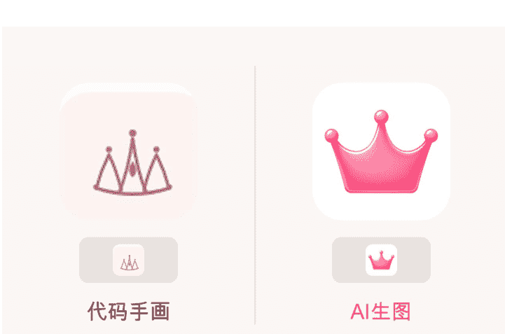

你可以这样让 AI 出跟进小本的图标：

```
帮我生成一个手机 App 图标，先出 4 个不同方向的候选。
App 名字：跟进小本。用途：记住要在哪天跟进的事，做完打勾。
要求：
1. 显眼：放在手机桌面上，一眼能看到。
2. 直观：一看就能联想到“记事、日期、打勾”。
3. 简单：只用一个粗一点的实心符号，不要细线、不要文字、不要复杂装饰。
4. 白色或单一颜色背景，符号占画面宽度的六到八成。
5. 正方形。
每张图说明设计思路。我挑一张后，再让你细修颜色和大小。
```

挑的时候，把候选缩小放进手机桌面截图里，和别的 App 图标并排看。放大时好看的，缩小后不一定还认得出。

#### 做到这些就算完成

关掉 App 再打开、数据没了，在这一章是正常的，第 10 章解决。

注意：

1. 截图只能说明页面长什么样，亲手操作的结果才说明按钮有没有用。
2. AI 看不到你的手机。它说“已完成”，要你自己在手机上点一遍才算数。
3. 网页测试工具替代不了原生 App 的蓝牙、麦克风和系统弹窗验收，这些要在真机上验，第 12 章会讲。

### 第 10 章 接上数据：本地保存、云端和后端

一句话：让跟进小本关掉再打开、记录还在；再弄清楚什么时候才需要后端，云端出了问题怎么一段一段查。

□ 本地保存练习：一次对话，加十分钟手机验收；接后端：按功能算，通常以天计 | □ 本地保存免费；云端看你选的方案


#### 我当时是怎么做的

销冠营的数据大多要上云：员工的服务录音要传到服务器转写、生成服务卡，店长还要看到员工的记录。本地保存只是起点，真正花时间的是云端。

而云端最耗人的，不是写代码，是“代码没错，线上就是不通”：

- **2026 年 8 月 14 日**，一天查出三个配置坑。最离谱的一个：对应的 AI 分析从部署到服务器起，一次都没成功过——线上配置里，密钥那一项名字在，值是空的。
- **8 月 27 日**，学习页打不开、话术页读不出门店数据，前后排查了 8 轮。根因全在线上：缺了 5 个配置项，数据库账号少了 6 张表的读取权限。本地测试一次都复现不出来。
- **上传录音那一层**，一开始是让 AI 自己写的。9 月 10 日晚上我跟 AI 说：“改一个问题去测一下……像在撞库。有成熟的解决方案吗？”（意思是一次次碰运气地试）9 月 12 日又说了一遍：“早说了，先用成熟的方案。”后来改成阿里云官方的上传工具包，加上服务器签发的临时凭证。

这几次让我记住两件事：出了问题，先拆成几段，看卡在哪一段；上传、登录、日志这类通用能力，先找成熟方案，别自己造。

#### 你照着做

- 117. 打开手机的“最近使用的应用”列表，把 Expo Go 彻底划掉。
- 118. 重新打开 Expo Go，进入同一个工程。
- 119. 两条事项都在，各自的完成状态也对，才算通过。

（图 10-1）关掉 App 再打开，两条事项和完成状态都还在

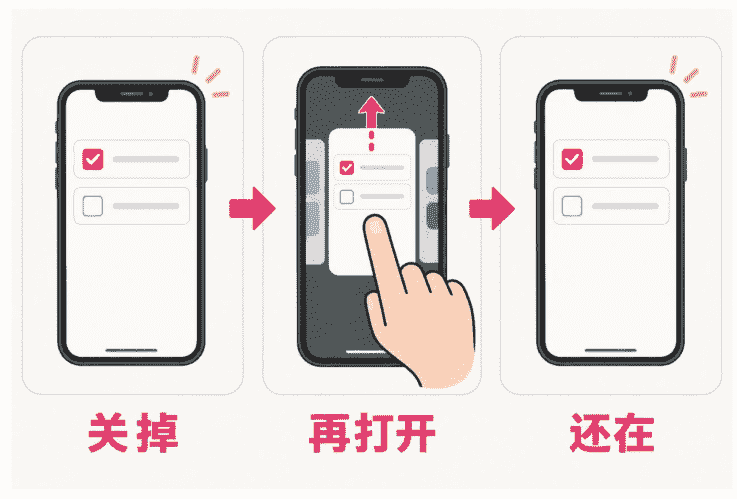

##### 步骤 2：判断你到底需不需要后端

后端，就是一台替你的 App 干活的服务器：接收请求、检查权限、处理数据。数据库，是它存记录的地方。

只有下面四种情况，才需要后端：

- 要登录；
- 要换手机或多台手机都看到同一份记录；
- 要多人共享，比如店长看员工的记录；
- 要用不能放进手机的密钥。API 密钥，就是调用 AI 等付费服务的“钥匙”，谁拿到谁就能花你的钱。

一条都不沾，就停在本地保存。跟进小本，练到这里就够了，可以直接跳到第 11 章。

|  | 只存在手机里 | 存在云端 |
|---|---|---|
| 数据在哪 | 这台手机 | 服务器和数据库 |
| 换手机还在吗 | 不在 | 在 |
| 别人能看到吗 | 不能 | 按权限可以 |
| 花钱吗 | 免费 | 要付云服务费 |
| 出错查哪 | 这台手机 | 五段都可能（见步骤 5） |

（图 10-2）本地保存和云端保存的区别

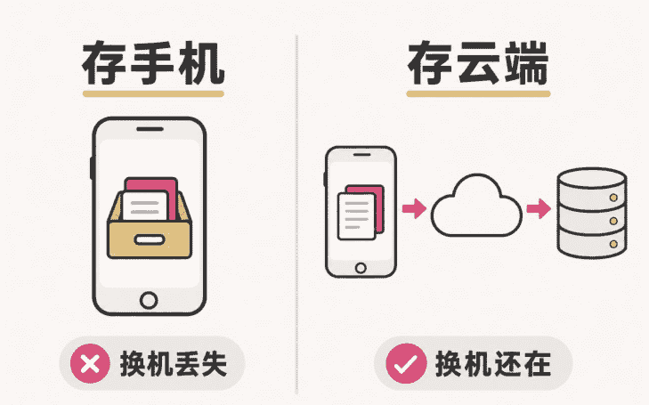

##### 步骤 3：先让 AI 推荐成熟方案，别急着买服务器

不用一上来就租一台大服务器。先让 AI 把方案讲清楚：

> 我现在需要增加【具体的云端能力】。
> 先不要购买或部署。
>
> 请根据目标地区、预计有多少人用、数据类型和预算，推荐一套成熟方案。
> 说明数据库保存哪些字段，哪些人能读取和修改。
> 说明本地版如何迁移，以及迁移失败怎样恢复。
> 列出开发环境与正式环境的区别、费用项目和退出方案。
> API 密钥只能留在合适的服务端环境，不能写进手机应用。
> 信息不够时先问我，不要替我开通服务。

拿到方案后，多问一句有没有现成的成熟方案（见第 7 章步骤 5）。同一类问题第二次出现，就换成熟方案，不修第三次。

还有一条：测试环境和正式环境要分开，各用各的数据库。我们 9 月初单独开了一个测试数据库，大约每月几十元。

##### 步骤 4：接好以后，做四项检查

每一项都要亲手在手机上做一遍：

- 120. 账号 A 能保存自己的记录；
- 121. 账号 B 看不到 A 的私有记录；
- 122. 网络断开时，App 有明确提示；
- 123. 连点几次保存，不会冒出说不清的重复记录。

接了 AI 的功能，再补四样记录：模型调用失败、超时、重试，以及每次调用花了多少钱。AI 回了一段文字，也要检查它是不是你约定的那些字段。

保存功能还要试“退出、重试、两件事同时发生”。销冠营有一轮修复就是这么发现的：录音已经加密存进手机，“上传状态”还没登记；就在这个间隙，清理程序把它当成没用的文件删了。修好后，我们用同一组测试证明了“改之前失败、改之后通过”。

##### 步骤 5：云端出了问题，按五段查

你在手机上点一次“保存”或“生成”，背后可能走了五段。“云端出错了”这句话太宽，先问 AI：卡在哪一段？（图 10-3）一次上传都会被拒。我们先拿一次真实上传的路径，再按它写权限，就通了。

**④ 后台任务：服务器在后面接着干的活，是你看不到的后台任务，比如转写录音、调 AI 生成服务卡。** 就是开头 8 月 14 日那次：日志里 AI 分析那一步只花了 1 毫秒——根本没真的调出去。同一天还查出，转写程序读的配置名，和实际存密钥的配置名对不上；失败又被一段空的错误处理“吞”掉了，所以一直没人发现。

**⑤ 结果：返回的内容合不合格** 9 月初，我们跑了 135 个 AI 测试用例，135 次全部被系统校验退回，换成了兜底的固定模板。逐条看，没有一条是 AI 说得不好，全是格式对不上：示例里混着两套字段名，偏偏缺了必填的那个；还让 AI 抄了一堆系统早就知道的信息。按附录 A.2 清单第 7 条改了字段合同以后，135 个全部救回，一条校验规则都没放松。问题出在“合同”上，换模型解决不了。

卡住时，把这段发给 AI，让它只查、不动手：

> 请只读定位这一次失败，不要改任何东西：
> 1. 先确认：哪个环境、手机上装的哪个版本、操作时间、这次请求的编号。
> 2. 查同一时间段里的接口、上传和后台任务日志。
> 3. 列出三类：已证明成功的阶段、已证明失败的阶段、没有证据的阶段。
> 4. 查不到日志时，先核对时间范围、查询条件、程序有没有记这条日志，不要直接说「请求没发生」。
> 不要重复创建记录，不要重新上传，不要改权限或重新发布。

“请求的编号”（也叫请求关联标识），是程序给这一次操作编的号。用它，能把散在五段里的记录串成同一件事。

等你真的接了后端、又卡住时，附录 A.2 有一张更细的云端排查清单：配置、权限、日志、接口、上传、后台任务、AI 返回的字段。第一次做可以跳过。

#### 做到这些就算完成

**注意**

- 1. 本地保存不等于备份：卸载 App 或清除应用数据，记录可能就没了。AsyncStorage 不加密，别放真实客户资料和密钥。
- 2. 只把账号 A 的顺利流程跑通，不能说明权限是对的。一定要用账号 B 试一次“看不到”。
- 3. 密钥只能放在服务器上，不能写进手机 App。让 AI 核查配置时，只看“有没有、是不是空、有多长”，别把密钥原文贴进聊天或文档。

### 第 11 章 报错怎么修、版本怎么留、换对话怎么接着做

一句话：出错时一次把事实给够；每过一关留一个退得回去的存档；对话再长、换了助手，也能从明确的一步接着做。

□ 每次存档几分钟；第一次恢复演练约半小时 | □ 免费（Git 免费；备份放在你已有的硬盘或私有仓库）

#### 我当时是怎么做的

这一章的每条规矩，背后都有一次真实的损失：

- 2026 年 8 月 16 日：我发现 App 主线攒了 121 次存档，一次都没备份到别处，只在这台电脑上有一份。同一天磁盘被撑到只剩 221MB，AI 为了腾空间还执行了删除命令。离全部丢失，只差一次手滑。从那天起，做完一个阶段就备份一次。
- 8 月 30 日到 31 日：一夜部署失败 6 次，6 次全是外层部署工具自己的毛病：把成功读成失败、取不到日志、测试用的临时凭证 15 分钟就过期，而流程要跑半小时……业务代码一次都没错。我当时问 AI：“有官方的那一套方案已经好了，为什么我们还要自研呢？”
- 9 月 1 日：一个清理脚本，被我在终端里重复粘贴、执行了两遍。第二遍把第一遍存好的约 40 份补丁截成空文件，又删掉了。这些补丁最后没找回来。
- 9 月初：两条开发线各自测试全过，却互不包含，差了 177 个文件。两批工作白做，只能先合并两条线，再重新派活。

#### 你照着做

##### 步骤 1：报错时，用这个模板问 AI

别只发一句“又坏了，修一下”。把能看到的事实一次给齐：

```
我使用的工程与版本是【填写】。
刚才依次做了【操作步骤】。
原本应该看到【预期结果】。
实际看到【现象】。
完整错误和发生时间是【填写，先去掉敏感信息】。
```

先复现，再定位最后一个成功步骤和第一个失败步骤。不要同时改页面、接口和模型设置。做最小修复，并告诉我修前修后怎样比较。同一做法两次失败仍无新证据，就给我阶段结论和新的排查方向。

（图 11-1）报错提示词模板：五个空填齐再发

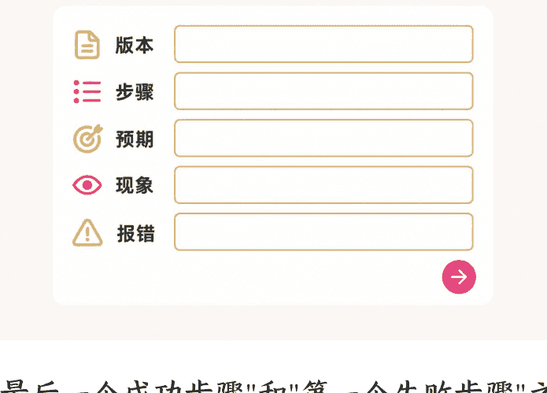

“最后一个成功步骤”和“第一个失败步骤”之间，就是问题所在的位置。

##### 步骤 2：同一处两次不过，就停下换路

重试不等于努力。同一处连续两次失败、又没有新发现，第三次大概率只是复制失败。

9 月 10 日出门前，我给 AI 定了一条硬规矩：真机上的每一步，最多试两次；第二次还不过，就回到日志和代码找原因，换一层修。

停下时，让 AI 先交一份阶段结论：已经知道什么、还不知道什么、下一条路走哪。如果你已经问过“是不是该换官方方案”，那一次就该停下认真回答，别硬撞到第六次。

##### 步骤 3：修好一个阶段，留一个存档

第一次用 Git：Mac 在终端输入 git --version，弹窗让你安装开发者工具就点「安装」；Windows 去 Git 官网下载安装包。装好后 git --version 能显示版本号再继续。

Git，是记录文件每次变化的工具。把它想成游戏存档点：每“提交”一次，就存一次档；“提交编号”就是这个存档的编号，以后凭它能找回这一刻的工程。（Git 官方中文教程）

（图 11-2）Git 像游戏存档点：每过一关存一次

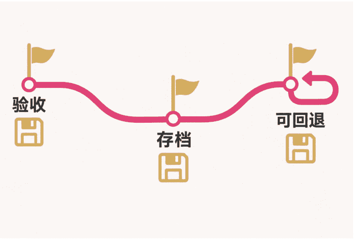

**手机上验收通过以后，把这段发给 AI：**

```
这一阶段已由我完成手机验收。
允许你为本练习建立本地 Git 版本记录。

先检查现有 Git 和改动，保留其他人的内容。
列清这次源文件，排除密钥、.env、依赖目录和构建产物。
只提交确认清单里的文件，报告分支与提交编号。
不创建远程仓库，不推送，不公开。
说明怎样在另一个副本中恢复和验证这个版本。
```

.env 是存放密钥和配置的文件；依赖目录、构建产物，是电脑自动生成的大文件。它们都不该进存档。

做完以后，你自己在工程目录看一眼：

```
git log --oneline -5
git show --stat HEAD
```

看到什么算成功：第一条命令最上面一行，是刚才那次存档的编号和说明；第二条命令列出的文件里，只有这次相关的源文件，没有 .env、node_modules、build 这类东西。

##### 步骤 4：备份到另一个地方，并真的恢复一次

本地 Git 还在同一台电脑上，电脑坏了就一起没了。所以还要把源文件和交接说明，备份到你自己控制的另一个地方，比如移动硬盘或私有代码仓库。

备份要恢复过一次才算数。把这段发给 AI：

> 请在一个新的恢复目录里打开我的备份，不能覆盖正在使用的原目录。
> 按交接说明恢复依赖并启动工程。
> 启动后告诉我怎样在手机上扫码打开。

然后你扫码确认：页面能打开，新增和标记完成都还能用。

（图 11-3）备份要恢复过一次才算数：备份→新目录恢复→扫码验证

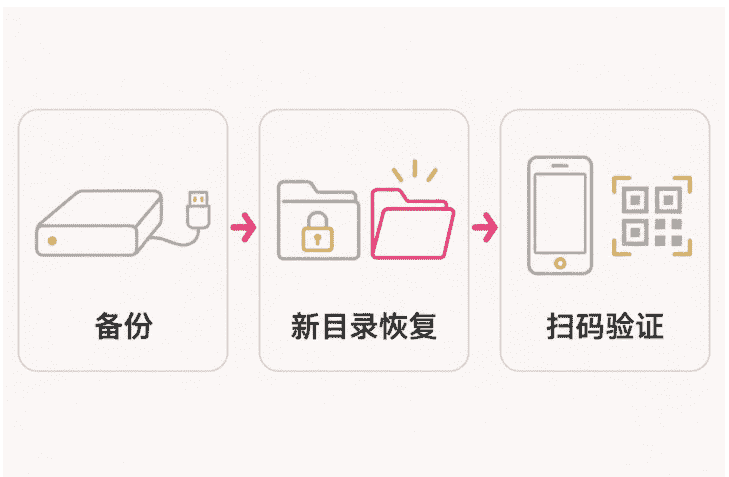

另外，源码的备份和手机里的业务数据（比如用户记录）是两回事，要分别考虑。

##### 步骤 5：对话长了、要换助手，先写交接

对话太长，AI 会“忘事”；换一个助手，它什么都不知道。在那之前，先让 AI 写一份交接：

```
请写一份下一次能直接继续的交接。

产品目标和本轮范围
工程目录、分支和提交编号
启动方式及实际依赖版本
已经通过的检查及证据位置
还没完成的地方和已知失败
目前谁在改哪些文件
下一步只做什么

不要把计划写成已完成，不抄整段聊天记录。
```

新对话开工前，先让 AI 确认两件事：工程目录对不对，版本是不是交接里写的那个。前面差 177 个文件那次，就是少了这一步。

还有两条：

- 同一个工作目录，同一时间只让一个 AI 改。第二个 AI 可以先只读审查。

一个隔离的副本里，把关键修复撤回、重跑测试。该变红却还是绿的，说明这个测试根本没在测这件事。不要在正在用的工程里随便撤代码。

**④ 退出码是多少？** 程序跑完会留一个“退出码”：0 是成功，不是 0 就是失败。如果 AI 用 npm test | tail 这种写法只看最后几行，拿到的是 tail（只显示末尾几行的小工具）的退出码——测试失败了，也可能显示成功。

正确做法：完整日志存进文件，先看退出码，再看末尾。

```bash
npm test > test.log 2>&1
echo "测试退出码: $?"
tail -n 30 test.log
```

这三行是 Mac 终端的写法；用 Windows PowerShell 的，让 AI 换成对应写法。测试命令在你的工程里也可能不叫 npm test，让 AI 告诉你该用哪条。

##### 步骤 7：清理和备份，都要测“第二次执行”

开发久了，电脑会被临时文件塞满。9 月初，我的磁盘可用空间从 60G 掉到 13G，光临时数据库目录就有 558 个、占 20.5G。清理确实把空间从 13G 救回到 35G，但同期也踩了三个雷：

- 有 AI 按名字模糊匹配去结束进程，差点把别的任务正在跑的测试一起关掉；
- 有 AI 用“一次提交所有改动”的偷懒写法，把 106 个自动生成的构建文件提交进了存档；
- 就是开头那次：清理脚本被重复执行，第二遍把备份截空，约 40 份补丁丢失。

所以，“备份成功”要查三样：文件在、大小正常、能恢复。“清理安全”还要多查一样：再执行一次会怎样。正确的脚本第二次运行时，应该什么都不做：旧备份在，就不覆盖；目录已经不在，就跳过。

让 AI 写任何清理脚本之前，先发这段：

> 先列出准备清理的路径、原因和对应备份，不执行删除。
> 验证备份确实能在独立位置恢复。
> 脚本必须允许重复运行，第二次不覆盖备份、不新增删除。
> 只结束本任务自己启动的进程，不按模糊名称批量杀进程。
> 请把“第二次运行无额外变化”的验证方式也给我。

恢复和删除分成两步执行，别塞进同一条停不下来的长命令里。

（图 11-4）清理脚本跑第二遍：应该什么都不做

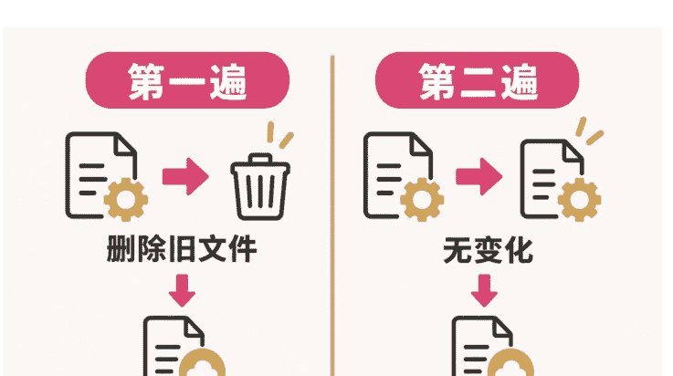

#### 做到这些就算完成

**注意**

- 1. 测试全绿，只说明“在它那份代码上是对的”，不说明那份代码就是你要的那份。判断某个修复在不在某个版本里，让 AI 按完整的提交编号查，不按标题猜——我们真遇到过两条分支上各有一条标题一模一样的提交，部署成功了，修复却不在里面。
- 2. 推送或备份到别处之前，先确认 .env、密钥文件没有被记进存档；只备份到私有位置。
- 3. 清理是不可逆的：先出清单再删；只结束自己启动的进程；不让 AI“一次提交所有改动”。

### 第 12 章 在自己的手机上验收，再让电脑替你点

一句话：自动测试全绿，只说明代码没写错；用户看到的是页面、提示和结果。这一章教你在真手机上按用户的动作逐项验收，同样的动作点多了，再交给电脑去点。

□ 手动验收表约半小时；自动化在模拟器上跑通第一条流程约一两个小时，物理 iPhone 第一次搭环境（附录 D）留出大半天 | □ 免费（Maestro 命令行和 Appium 都是开源工具；物理 iPhone 跑自动化要用苹果开发者团队签名，第 2 章开的账号就够）

#### 我当时是怎么做的

一开始，每改一版我都装到自己手机上点一遍，我成了整条流水线里最慢的一环。2026 年 8 月 13 日，我定了第一条规矩：装到我手机之前，AI 必须先在模拟器（电脑里跑的虚拟手机）上自测通过。

9 月 12 日凌晨，同一个导入问题连着两次都是我亲手点出来的。我跟 AI 说：“你最起码是跑通之后才让我进行测试吧？”从那天起，能自动化的先让电脑在真手机上跑；只有说话、听感、按工牌按键这类事，才轮到我。

最重的一课在 9 月 20 日到 21 日。一天之内，我和外测用户先后撞上 7 个问题，而当时 6000 多条自动测试全是绿的。最严重的一个：所有安装包在装了 iOS 27 的 iPhone 上一打开就闪退。

原因是苹果新系统要求一种新的启动写法（UIScene 生命周期，可以理解为 App 和系统打招呼的新规矩），我们没跟上。我的手机是 iOS 26，电脑里只有 iOS 26.5 的模拟器，所以自己一直没撞到。修好的 1.0.1 在 iOS 27 真机上能正常打开到登录页。

四天后安卓又来一次：9 月 25 日，1.0.6（内部测试版，没有提交任何商店；App Store 里仍是 1.0.1）在一台 Android 10 的手机上冷启动（彻底关掉再打开）连崩 3 次，那一版 7975 条测试同样全绿。之后，“在最低和最新两个系统版本上各冷启动 3 次、不崩”写进了出包流程。从那以后，测试全绿我只叫“代码检查通过”，不叫“可以给用户用了”。

#### 你照着做

##### 步骤 1：拿着验收表，在手机上亲手走一遍

用第 10 章做好本地保存的“跟进小本”，逐行操作。每一行旁边写上“通过 / 失败 / 未测”，再写上测的是哪个版本。

| 你实际做的动作 | 应该发生什么 |
|---|---|
| 首次打开 | 页面可见，空白状态能看懂 |
| 新增两条事项 | 各自保存，内容正确 |
| 标题只输空格，或日期填错 | 拦住保存，并说明原因 |
| 新增两条同名事项 | 分别存在，操作互不影响 |
| 快速切换完成状态，再重开 | 保留最后一次成功保存的状态 |
| 键盘弹出 | 不挡住必要的按钮 |
| 退出后重新打开 | 原来的数据还在 |
| 保存失败 | 明确报错，旧数据和刚输入的内容都还在 |

最后一行很难手动制造，让 AI 在测试里模拟：

> 请在测试里模拟“本地保存失败”的情况，检查 App 会不会：
> 1. 明确告诉用户保存失败；
> 2. 保留之前已经存好的事项；
> 3. 保留用户刚输入、还没保存成功的内容。
> 只在测试里模拟，不要改动或删除我手机上已有的资料。

##### 步骤 2：请一个人“盲测”

找一位愿意帮忙的人，在你的手机上独立完成“新增、标记完成、退出重开”。你只在旁边看，先别教他点哪里。他犹豫、点错的地方，就是下一版要改的地方。

##### 步骤 3：App 变复杂后，按五层往上验

练习 App 一张表就够。正式产品能力多了，按下面五层从下往上验，下一层没过，不去测上一层。

（图 12-1）五层验收：打开 → 接口 → 权限 → 完整任务 → 原生能力

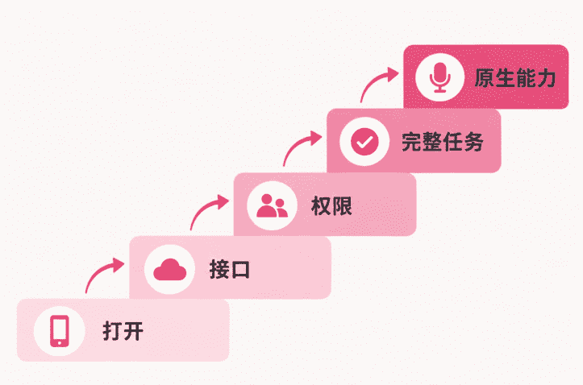

| 层 | 验什么 | 销冠营里的例子 |
|---|---|---|
| 1 打开 | 能安装、打开、进到目标页面 | 装上后五个底部标签都能进 |
| 2 接口 | 服务器返回真实数据，出错时错误码对 | 每个标签的核心数据真的从服务器来 |
| 3 权限 | 不同角色看到的内容对 | 员工和店长看到的不一样 |
| 4 完整任务 | 一件事从头做到尾 | 创建、提交、查看结果 |
| 5 原生能力 | 手机硬件和长时间运行 | 麦克风、长录音、蓝牙工牌、30分钟稳定 |

这五层管的是“App 跑起来对不对”。另外还有一组“发布状态”要分开记：代码写好没有、合并没有、部署没有、用户手机上看到没有。哪一层过了，就只写哪一层。

###### 我的一次第五层实验：两小时长录音

2026年9月13日前后，我们用真 iPhone、模拟工牌和合成音频，验一段两小时录音能不能传上云端，跑到第四轮才走到云端收齐、开始转写；第一轮手机锁屏中断；第二轮传到一半闪退（上传进度要一遍遍报给页面，我们用的通知方式只允许报一次，11.9MB 的小文件侥幸没崩，61MB 必崩，改成持续发“事件”后解决）；第三轮暴露出上传权限问题。

这个实验没有证明真实工牌的传输速度，也没有证明真实顾客对话的分析质量。用什么条件测的，就只写它证明了什么。

##### 步骤 4 同样的动作点了十几次，交给电脑

这一步可以先跳过。等你发现每改一版都要“打开、输入、保存、退出、重开”，重复十几次之后，再回来。

第一次仍然自己亲手走通。步骤和正确结果稳定了，再让工具重复执行。选工具先看它支不支持你手里的设备，再写“替我点哪里、看什么”。

（图 12-2）按设备选自动化工具

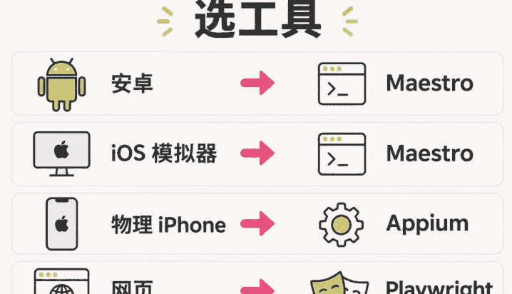

| 你要测的设备 | 先用什么 |
|---|---|
| Android 模拟器或真机 | Maestro（真机要开“USB 调试”） |
| iOS 模拟器 | Maestro |
| 物理 iPhone | Appium + XCUITest 驱动 + WDA（见附录 D） |
| 网页、管理后台 | Playwright |

我们走过的路：

- 2026 年 8 月，在 Android 模拟器上用 Maestro 跑了 6 条固定流程。它用 YAML（一种靠缩进写的清单格式）写“打开、点击、等文字出现、截图、检查”，新手最容易上手。
- 在 iOS 模拟器上测底部导航时遇到怪事：脚本说“点了”，页面没切。换标识、换文案、换坐标都试过。我们宁可让它红着，也没删掉检查、把“没跳转”算成通过。

物理 iPhone 要换成 Appium 那一套，步骤多、坑也多，我单独放在附录 D，等你真需要时再看。下面只讲 Maestro。

Maestro 需要 Java 17 或更高版本。在 Mac 终端检查 Java，再装 Maestro：

```
java -version
curl -fsSL "https://get.maestro.mobile.dev" | bash
```

一条流程大概长这样（示意）。appId 是你在第 3 章定的包名（第 13 章写进工程）；按钮文字换成你 App 里实际的字。还在用 Expo Go 时启动方式不一样，交给 AI 按官方文档处理：

```
appId: com.example.followupnotebook
---
- launchApp
- tapOn: "新增"
- inputText: "周五回访"
- tapOn: "保存"
- assertVisible: "周五回访"
```

不用自己写，交给 AI：

> 我想用 Maestro 给“跟进小本”写第一条自动化流程。先查 Maestro 当前官方文档，确认它支持我手里的设备：<填：Android 模拟器 / Android 真机 / iOS 模拟器>。
>
> 流程只做一件事：打开 App → 新增一条事项 → 保存 → 检查列表里出现这条事项。
>
> 要求：
>
> 1. 每一步点完都要有检查（断言），检查不过就让流程失败，不许删掉检查让它变绿；
> 2. 先告诉我要装什么、会改动电脑上的什么，我同意后再装；
> 3. 跑完把截图和结果放在一个文件夹里，告诉我路径。

Maestro 现在还自带 MCP（一种让 AI 助手直接调用外部工具的接口），Claude Code、Codex 可以直接用它在模拟器上点、看、检查。Maestro 官方说明

#### 做到这些就算完成

**注意**

- 未测的项不能用一张成功截图顶替。截图只证明它拍到的那一步。
- 同一时间只让一个操控者控制手机；停的时候只停自己启动的进程。
- 自动化只能证明它读得到的页面、事件和文件。说话、听感、物理按键这些，要真人确认，并单独记下来。

## 第三部分 发出去

### 第 13 章 做出能独立安装的包

一句话：在 Expo Go 里能跑，不等于你有了自己的 App。这一章把工程变成不靠电脑也能装、能用的安装包，再做出交给商店的候选包。

- 配置约半小时；每次云构建要排队加构建，免费档走低优先级队列，单次最长 45 分钟
- EAS 免费档 0 元：定价页写含 Android、iOS

| 要做的事 | 要不要 Mac |
|---|---|
| 用 EAS 云构建打 iOS 包（第 13、15 章） | 不要 |
| 在自己电脑上用 Xcode 打 iOS 包（我的真实路线） | 要 |
| 用 iOS 模拟器做冷启动检查、截商店截图（第 14、15 章） | 要 |
| 安卓的全部步骤 | 不要 |

没有 Mac 的，冷启动检查和截图这两件事用真机代替：冷启动检查，把 TestFlight 版装到一台系统最新的 iPhone 上做（第 15 章步骤 5）；商店截图，用尺寸对得上的 iPhone 真机截（第 14 章步骤 9），或者请有 Mac 的朋友用模拟器帮你截。

#### 你照着做

#### 先认清四种包

（图 13-1）四种包：Expo Go、development、preview、production

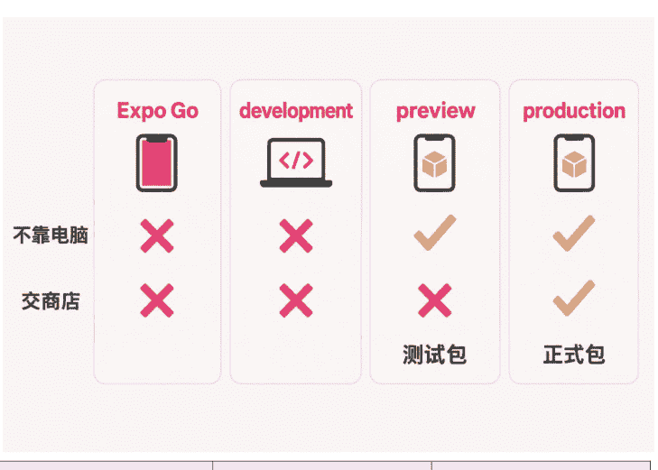

| 名称 | 用来做什么 | 能不能算上架结果 |
|---|---|---|
| Expo Go 预览 | 在 Expo 的通用 App 里跑你的工程 | 不能 |
| development 构建 | 你自己的“Expo Go”，能加自定义原生能力，带调试工具 | 不能 |

```
"ios": { "bundleIdentifier": "com.example.followupnotebook" },
"android": { "package": "com.example.followupnotebook" }
}
}
```

已有文件只改这两个字段，其他配置保留。用 app.config.* 的工程，让 AI 按实际结构处理：

> 请检查这个工程的应用身份：
> 1. 读出 app.json（或 app.config.*）里 ios.bundleIdentifier 和 android.package 的实际值；
> 2. 和我准备的包名 <填你的包名> 对比，不一致就只改这两个字段，其他配置保留；
> 3. 改完再读一遍给我看。

AI 读回的值，再和苹果开发者后台、App 备案里填的包名逐字对一遍。

##### 步骤 2 登录 EAS，生成构建配置

在工程目录里依次执行：

```
npx eas-cli@latest login
npx eas-cli@latest whoami
npx eas-cli@latest build:configure
```

whoami 显示的是你自己的 Expo 账号，就对了。配置完成后，工程里会多一个 eas.json，里面有 development、preview、production 三套配置。结构大致如下，已有配置时让 AI 合并，不要整个覆盖：

```
{
  "build": {
    "development": {
      "developmentClient": true,
      "distribution": "internal"
    },
    "preview": {
      "distribution": "internal"
    },
    "production": {}
  }
}
```

构建号是商店用来区分每一个包的内部编号，不能重复上传同一个；用户看到的是版本号（比如 1.0.0）。

顺手做一件事，省掉我们踩过的“构建号撞车”：让 EAS 在服务器上替你管构建号，每次正式构建自动加一。核对于 2026 年 10 月，官方写法是在 eas.json 里加这两处（让 AI 合并进现有文件）：

```
{
  "cli": { "appVersionSource": "remote" },
  "build": {
    "production": { "autoIncrement": true }
  }
}
```

构建配置说明 · 版本号与构建号

##### 步骤 3 先做 preview 包，装到手机上再测一次

选 Android 的，执行这一条：

```
npx eas-cli@latest build --platform android --profile preview
```

preview 配置成内部分发时，Android 会得到一个能直接安装的 APK。去哪下载：构建跑完后，登录 expo.dev，找到这个项目刚才那一次构建，打开它的详情页；在「Build artifact」一栏点「Install」，会弹出「Install on a test device」，用手机扫码，或者把「Send a link to a device」里的链接发到手机上打开（按钮名称核对于 2026 年 10 月，见 Expo 内部分发教程）。确认是本次构建的文件，再按手机提示允许本次安装。

第一次打安卓包，命令行会问要不要生成签名（keystore），选 Yes。打完运行 npx eas-cli@latest credentials --platform android，把签名文件和口令下载下来，存到两个你自己控制的地方。

选 iOS 的，先登记要装的那台 iPhone，再构建：

```
npx eas-cli@latest device:create
npx eas-cli@latest build --platform ios --profile preview
```

iOS 这种“指定设备安装”（ad hoc）需要付费开发者账号，每年最多登记 100 台 iPhone；新加的手机要重新构建（或重新签名）才能装。不能把链接随手转给任何一台手机就指望能装上。Expo 内部分发说明

命令行会让你登录 Apple ID、输双重认证码，这两样你自己在终端里输，别发给 AI。

装好以后，先停掉电脑上的开发服务：回到第 8 章跑着二维码的那个终端窗口，按 Ctrl + C（Mac 也是按 Control + C），终端回到能输入新命令的状态，就停了。再打开你自己的 App，把第 12 章的验收表走一遍；新增、保存、退出、重开都要还能做到，才算真的离开了电脑。

装不上时，先存下构建编号、用的是哪套配置、手机系统版本和完整报错，再交给 AI。

“processing the build”（处理完成）这一行；这时重传，只会撞上同一个构建号。

- 1.5 小时不出现：新增的依赖用到了“运动与健身”数据接口，Info.plist（App 的说明清单）里却没写“为什么要用”，苹果打回，代码 ITMS-90683。这种失败不进后台构建列表，只发邮件，一直刷列表是等不到的。补上说明、换新构建号重传，当天就通过了处理。

#### 上传卡住时，让 AI 按这几个问题逐一核对：

> 这次 TestFlight 上传出了问题，请按顺序核对，每一条都给出证据：
> 1. 本次打包和上传以哪个源码版本为准
> 2. 准备使用哪个构建号，是否有人正在占用
> 3. 构建与签名是否成功，产物如何校验
> 4. 平台是否收到同一构建号，是否处理完成
> 5. 目标测试组是否关联，测试者是否实际安装
> 6. 失败发生在哪一步，哪些动作已完成而无需重做

（图 13-4）App Store Connect 的 TestFlight 构建列表：同一页看构建号和处理状态

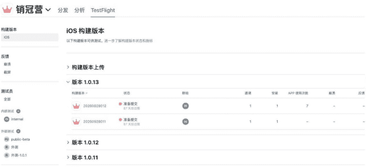

#### 如果你有后端：打包成功 ≠ 部署成功 ≠ 用户用上

只有带服务器程序的 App 才要看这节。服务器上的程序（比如销冠营的录音转写、AI 分析）要单独发布，改手机页面更新不等于服务器程序也更新。

#### 审核员要看的东西一次备齐

一句话：点「提交审核」之前，把材料、账号、隐私说明和收费方式逐项对上「当前这一版」App，别让审核员第一眼就卡住。

- 我实际用了约 5 天（9 月 9 日到 14 日），和开发同时进行
- 免费（隐私政策想请律师审，另算）

#### 我当时是怎么做的

9 月 9 日晚上，我定下「苹果端 9 月 15 日上线」的目标，当晚就把苹果后台的资料理了一遍：商店名「销冠营」、副标题、技术支持网址、隐私政策网址、年龄分级、分类。

隐私政策和用户协议之前已经定稿，发布成了网页。后台的「App 隐私」我对着 AI 整理的数据清单，如实勾了 9 类数据。

这一章有三件事差点出事：

1. 微信登录。我原本以为「国内 App 没人用苹果登录」。AI 查了苹果审核指南 4.8，发现条款里直接点名了微信登录：用它当主要登录方式，就必须同时给一个符合条件的等价登录方式。手机号验证码要收集手机号，算不上等价。我当晚拍板：iOS 首发版先把微信登录按钮藏起来，只留手机号登录。
2. 审核演示账号。审核员没有我们门店的账号，我准备了一个只有员工权限的演示号。提交前回读发现，后台填的账号

「套装 ID」就是苹果用来认你这个 App 的身份证号，安卓叫「包名」。第 3 章已经定好，这里只核对三处是不是同一个。

##### 步骤 2 开发账号和用户账号分开

- 开发账号：苹果开发者账号、云服务账号、AI 工具账号，只在你自己手里。
- 用户账号：App 里给店长、员工登录用的账号。
- 给审核员和测试的人，只发「用户账号」里专门建的演示号，权限越小越好。不要把自己的管理员账号交出去。

##### 步骤 3 让 AI 从代码里倒推隐私说明

不要找一份模板、把名字一换就交。把下面这段发给 AI：

> 请只读检查当前 App 的代码和依赖，不要改任何文件，整理一份「实际数据处理清单」：
>
> 1. 逐项写明：数据类型、什么时候收集、用来做什么、存在哪里、交给了哪些第三方、用户怎么删除。
> 2. 区分「现在已经有的功能」和「以后打算加的功能」，以后的先不要写进去。
> 3. 列出 App 申请的所有系统权限（麦克风、相机、蓝牙、定位等），以及用户拒绝后会看到什么。
> 4. 如果 App 支持注册账号，检查 App 里有没有删除账号的入口，把点击路径写给我。
> 5. 根据清单起草隐私政策；我没确认过的事实（主体名称、联系方式、保存期限）留空并标出来，不要自己编。

##### 步骤 4 按苹果规则写好隐私政策和账号删除

以下核对于 2026 年 10 月，以苹果审核指南最新版本为准。

- 两个网址先准备好，都要公开能打开。

（图 14-1）苹果官方「在 App 中提供账号删除」说明页：要删整个账号和个人数据，入口要好找

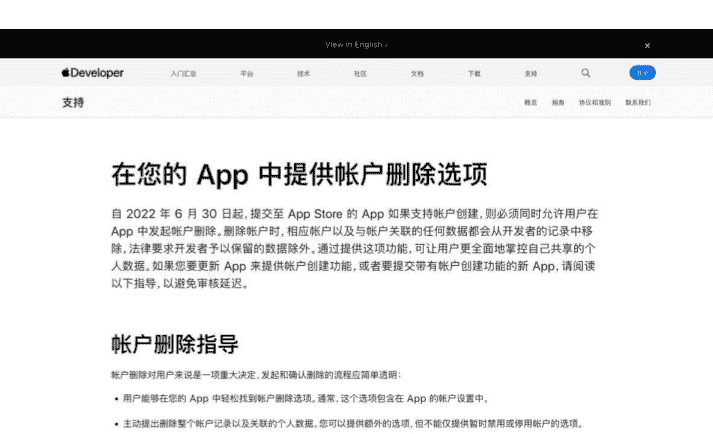

##### 步骤 5 在后台填「App 隐私」

App Store Connect → 你的 App → 左侧「App 隐私」→ 按步骤 3 的清单，一类一类勾选，说明用途、是否和用户身份关联 → 发布。页面显示已发布，就算完成。

（图 14-2）App Store Connect「App 隐私」页：按实际功能勾选收集的数据类型

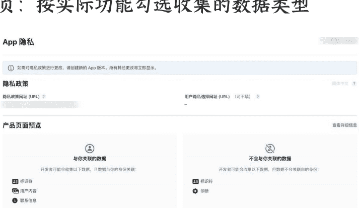

##### 步骤 6 第三方登录对一遍 4.8 审核指南

4.8 规定：用微信、Google 等第三方登录作为主要账号的 App，必须同时提供一个等价的登录方式，它要满足三条：只收集姓名和邮箱；允许用户隐藏邮箱；未经同意不拿来做广告。「通过 Apple 登录」就是常见的选择。

例外：App 只用你自己的账号体系（比如只有手机号登录），就不需要。

所以你有两条路：加上「通过 Apple 登录」；或者像我一样，iOS 版先只留自己的手机号登录，以后要加回微信登录时一起加上苹果登录。

（图 14-3）苹果审核指南 4.8「登录服务」条款原文，WeChat Login 被点名

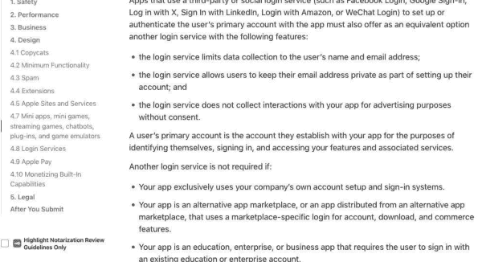

##### 步骤 7 收费方式在开发阶段就判断

先回答一个问题：用户付的钱，买的是什么？

- 解锁 App 里的数字功能或内容（会员、课程、高级功能）：审核指南 3.1.1 要求用苹果的 App 内购买。
- 买实体商品，或在 App 外享受的服务（比如到店服务）：3.1.3(e) 要求不用 App 内购买，改用其他支付方式。

想清楚再接支付。能调起付款页，不等于收款设计做完了。

##### 步骤 8 写好审核信息

版本页往下拉到「App 审核信息」：勾选

需要登录，填演示账号和验证码，再写备注。备注可以照这个模板写：

```
Demo account: <11 位手机号> (11 digits, no country code, do not add +86)
Verification code: <固定验证码> (fixed for this demo account, no SMS needed)
After login you can try: <核心功能 1>, <核心功能 2>.
<某功能> requires a physical hardware device that is not included; it is shown as unavailable in the demo account.
Our backend service will stay online during the review.
```

逐行意思（尖括号 <> 连同里面的字，换成你自己的内容；用不上的整行删掉）：

- 127. 演示账号：<11 位手机号>（11 位，不带国家码，不要加 +86）。【要换】你的演示号
- 128. 验证码：<固定验证码>（这个演示号固定用它，不用收短信）。【要换】你设的固定验证码
- 129. 登录后可以试：<核心功能 1>、<核心功能 2>。【要换】用英文写你的核心功能
- 130. <某功能>需要一台实体硬件设备，审核材料里不包含；在演示账号里它显示为不可用。【要换】需要硬件的功能名；没有这类功能，整行删掉
- 131. 审核期间，我们的后端服务会一直在线。不用改

审核指南 2.1 原话提醒：有登录就要给演示账号，「并且把后端服务开着」。审核

| 日期/时间 | 事件 |
|---|---|
| 9 月 14 日 22:59 | 我亲手点了「提交以供审核」：1.0.0，发布方式选「手动」 |
| 9 月 18 日 | 排了约 90 小时还是「正在等待审核」，提交第一次加急申请 |
| 9 月 20 日 | 打开 TestFlight 公开链接（限 50 人）给朋友装 |
| 9 月 21 日凌晨 | 一位朋友反馈：测试版一打开就闪退 |
| 9 月 21 日 03:27 | 审核通过，状态变成「等待开发者发布」 |
| 9 月 21 日 06:35 | 我点了「发布此版本」，几分钟后状态变成「可分发」，正式上架 |
| 9 月 21 日白天 | 修好闪退，版本号升到 1.0.1，先装真机验证 |
| 9 月 22 日 00:57 | 提交 1.0.1 审核，01:04 第二次加急申请被受理 |
| 9 月 22 日晚 | 1.0.1 审核通过，我手动发布 |

从第一次提交到上架，一共 6 天多。下面把关键的几处展开讲。

- 1. 排了 90 小时，我申请了加急。官方说大多数审核 24 小时内出结果，我等到第四天还没动静。9 月 18 日，我按苹果的加急条件写明「首次上架，9 月 21 日有线下活动」，提交了申请。2 天多后审核通过。

加急到底起没起作用，苹果不会告诉你。但它不花钱，符合条件就可以申请。

- 2. 审核通过的消息，我晚了 3 个多小时才知道，03:27 就通过了。我让 AI 写了个小程序定时查状态，那几个小时它恰好没提醒上。

#### 这是一次有代价的取舍，不是推荐做法：

那一天里，刚升级 iOS 27 的人装上就打不开。回头看，如果你的用户多是刚换新机、刚升级系统的人，应该等修复版再发。

##### 修复：

AI 按苹果和 Expo 的官方文档改了 iOS 启动代码，在 iOS 27.0 和 26.5 上各冷启动两次都没崩。再发给那位朋友装，iOS 27 上能正常打开到登录页。

##### 4. 1.0.0 上架后，不能再往 1.0.0 里传新包

版本号升到 1.0.1 才能提交。这次商店资料只换了 4 张新界面截图（当时后台要求的尺寸：6.5 英寸 1284x2778），其他沿用。

##### 5. 第二次加急，表单差点没交上去

我让 AI 在浏览器里替我填苹果的加急表单，它用脚本直接往输入框里写值。提交后苹果回了一句 "we didn't receive your request"，等于没交上。

改成在「App 名称」框里真的一个字一个字打、再从下拉列表里点选销冠营，Apple ID 就自动带出来了。这次页面显示 "We'll expedite review for 销冠营"。1.0.1 当天通过，当晚我手动发布。

##### 6. TestFlight 邮件邀请不靠谱，公开链接一次成功

我先用邮件邀请两位测试员，两人一直卡在「已邀请」，点邮件里的链接没反应（他们的邮箱不是 Apple ID）。换成公开链接，一次就装上了。

也正是公开链接让一台我没有的机型、没测过的系统装上了测试版，才在上架当天抓到 iOS 27 闪退。

#### 你照着做（练习线：跟进小本）

用第 13 章做好的 production 包来练，但练习线做到步骤 5（TestFlight 内测和新系统冷启动）就停，别把练习 App 提交审核：功能太少会被拒，还白占你的开发者账号。步骤 6 之后，留给你真正要上架的 App。真实项目如果已经用 Xcode 加 Fastlane 上传，跳过步骤 2 的命令即可。

##### 步骤 1 在 App Store Connect 建 App

打开 App Store Connect →「App」→ 左上角「+」→「新建 App」→ 平台选 iOS，填名称、主要语言、套装 ID（必须和工程里一模一样）、SKU（你自己起的内部编号，一串英文数字就行）。看到这个 App 的页面出来，就成功了。

##### 步骤 2 上传构建

在工程目录运行：

~~~
npx eas-cli@latest submit --platform ios
~~~

按提示选刚打好的那个构建，核对版本号和构建号。第一次先把「打包」和「上传」分开做，不要加 --auto-submit 一步到底，方便看清卡在哪一步。

成功标志：10–15 分钟后，App Store Connect →「TestFlight」里出现这个构建，处理完成。这条命令只负责上传，不会替你提交审核。见 Expo 官方说明。

##### 步骤 3 内部测试：先给自己装

「TestFlight」→ 内部测试新建群组 → 把自己加进去（团队成员最多 100 人，不用审核）→ 手机装 TestFlight App，打开安装 → 把核心任务走一遍：新建一条待办、填日期、标记完成。

##### 步骤 4 外部测试：用公开链接给朋友装

- 132. 「TestFlight」→ 外部测试旁边的「+」，新建群组。
- 133. 把构建加进群组，填测试说明，提交「TestFlight App 审核」。每个版本的第一个构建要完整审核，之后的构建通常只做基本审核。
- 134. 审核通过后，在群组的测试员页点「创建公共链接」→ 选「向所有人开放」→ 勾「设置上限」，填人数。
- 135. 把链接发给朋友，让他们先装 TestFlight，再点链接。

成功标志：群组里看到有人安装。

提醒：前一个构建还在等外测审核时，新构建挂不进外测群组，我遇到的提示是 "Another build is in review"。等前一个审完再加。见苹果外部测试说明（核对于 2026 年 10 月）。

##### 步骤 5 在最新系统上冷启动一次

「冷启动」就是把 App 彻底关掉、再重新打开。每次升级 Xcode，或苹果发了新系统，提审前至少在最新系统的模拟器或真机上冷启动一次。

没有 Mac 的，用真机代替模拟器：把步骤

##### 步骤 7 两步提交

- 136. 右上角点「添加以供审核」，状态变成「可供审核」。这时还没交给苹果。
- 137. 在草稿提交面板里确认内容，再点「提交以供审核」。

（图 15-2）提交前的真实页面，按钮为「提交以供审核」

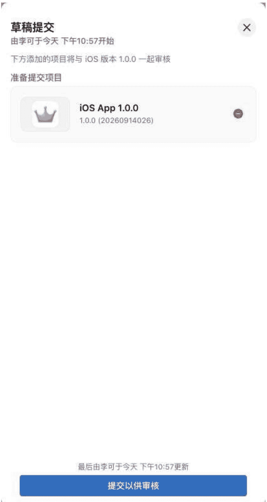

提交后，看后台状态判断走到了哪一步

（中文名称以苹果状态说明为准，核对于 2026 年 10 月）：

| 后台状态 | 意思 | 你要做的 |
|---|---|---|
| 准备提交 | 资料还在填 | 填完 |
| 可供审核 | 加进了草稿，还没提交 | 点「提交以供审核」 |
| 正在等待审核 | 苹果收到了，还没开始审 | 等；这时不能改截图 |
| 正在审核 | 开始审了 | 等 |
| 被拒绝 | 没通过 | 看原因，修好重交 |
| 等待开发者发布 | 通过了，等你点发布 | 点「发布此版本」 |
| 可分发 | 已经发布 | 去商店确认搜得到 |

##### 步骤 8 被拒了怎么办

在 App Store Connect 里打开苹果的拒绝说明，把原文交给 AI：

> 我的 App 审核被拒了。下面是苹果的原文、条款编号，以及被审核的版本号和构建号。
> 请先只读分析，不要改代码：
> 1. 用大白话告诉我，苹果认为哪里不合规；
> 2. 在当前代码里找到对应的功能，写出我能在手机上复现的步骤；
> 3. 给出最小修改方案，以及需要一起改的商店资料，等我确认后再动手。
> [粘贴拒绝原文]

先复现、再修，不要没弄懂原因就换描述、反复重传。觉得苹果误解了，可以向「App 审核委员会」申诉，每次被拒只能申诉一次。

##### 步骤 9 需要时申请加急

苹果写明可以申请加急的情况：修复严重 bug，或配合你直接参与的活动（核对于 2026 年 10 月，见苹果审核说明页）。

- 138. 打开加急申请页，用开发者账号登录。
- 139. 「App 名称」在框里亲手打字，从下拉列表点选你的 App，让 Apple ID 自动带出来。
- 140. 写清理由。修 bug 要附上在当前版本上复现的步骤；配合活动要写活动名称、日期，以及你和活动的关系。理由必须真实，写不出真实的活动或严重 bug，就别申请。可以参考：

```
(修 bug) Version <新版本号> fixes a crash on launch for users on <系统版本>.
Steps to reproduce on the current version:
install <当前版本号> on a device running <系统版本>, open the app, and it closes immediately.

(活动) We plan to launch the app at <活动名称> on <日期>. <你和活动的真实关系，例如: We are exhibiting at this event.>
```

逐行意思（二选一：修 bug 用前两行，配合活动用最后一行；行首的「（修 bug）」「（活动）」只是给你看的标签，提交时删掉；尖括号连同里面的字，换成你自己的真实内容）：

- （修 bug）第 1 行：<新版本号> 修复了 <系统版本> 用户一打开就闪退的问题。
- （修 bug）第 2 行：在当前版本上复现的步骤：在装着 <系统版本> 的手机上安装 <当前版本号>，打开 App，它会立刻关掉。
- （活动）我们计划在＜日期＞的＜活动名称＞上发布这个 App。后面那句写你和活动的真实关系，例句的意思是「我们在这个活动上参展」。

- 141. 提交后页面出现 "We'll expedite review" 一类的确认字样，才算申请成功。

（图 15-3）苹果加急审核申请表：App 名称从下拉列表选中后，Apple ID 自动带出

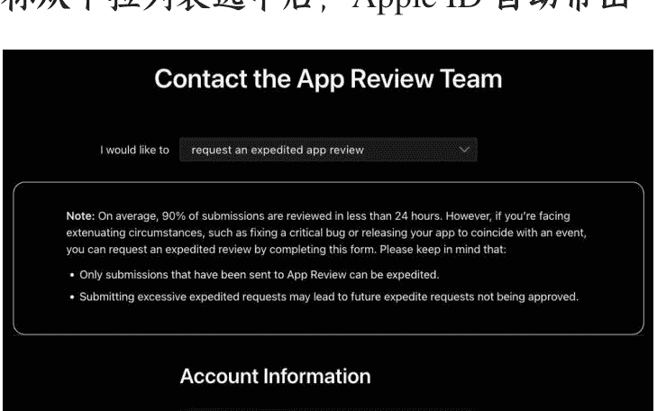

##### 步骤 10 通过后发布，并确认真的上架了

- 142. 状态变成「等待开发者发布」→版本页点「发布此版本」。
- 143. 苹果说发布后 24 小时内出现在 App Store。我 06:35 点完，后台几分钟后就变成「可分发」，但商店里搜索要晚一些才搜得到。
- 144. 用目标地区的 App Store 搜你的 App 名，点进去核对版本号，能下载才算上架。

（图 15-4）App Store Connect 版本页：状态「等待开发者发布」，右上角「发布此版本」

先说结果：到 10 月初，销冠营还没有上架任何一家国内安卓商店。这一章写的是我卡在哪、查到了什么、现在怎么给客户用。

#### 卡点是软著。

软著申请到了补正阶段，平台给的签章页是固定模板，要我声明「未使用 AI 开发」。我的 App 就是 AI 辅助写的，这句话我不能签，这份申请最后放弃了，经过见第 4 章。

##### 9 月 22 日，我让 AI 把安卓盘点了一遍。

结论很直接：国内商店现在上不了，签名包、商店截图和资料都还没准备。于是先做两件事：

- 145. 做出正式签名的安装包，装到一台荣耀手机上，把主要功能跑一遍。
- 146. 安卓的内部测试改走「蒲公英」这类内测分发平台，只给内部和小范围测试的人用；安装页设密码，是为了防止安装包外传。从这天起，iOS 和安卓从同一份代码出包。

##### 签名坑。

我电脑上有两份签名文件。AI 写的状态报告说「主副本」是其中一份，实际真正在用的是另一份，报告里那份的口令根本对不上。签名文件一旦搞混或丢了，这个 App 以后就没法更新。

##### 权限坑。

Android 10、11 扫描蓝牙设备需要定位权限。9 月 29 日我们加回定位权限，荣耀 Android 10 真机才扫到工牌。加权限本身就几行代码，但它会牵连隐私政策和商店的权限声明，这两样必须一起改。

##### 找无软著的路。

9 月 28 日软著卡死后，我让 AI 查「没有软著，国内哪些商店还能上」。结果是：小米、OPPO、vivo 明确接受「APP 电子版权证书」（小米据反映不收个体户，我得先去后台确认）。

9 月 29 日起，我改办电子版权证书：先书面问清客服，AI 辅助开发可以如实申请，再用个体工商户主体实名，交了源码和说明书。10 月初平台给的状态是「待补正」：要求签章页盖章、版本号统一，证书还没拿到（经过见第 4 章）。

#### 你照着做

##### 步骤 1 先决定发到哪

| 你的用户 | 建议先走 |
|---|---|
| 国内普通用户 | 国内主流商店，从你用户最多的手机品牌开始 |
| 国内企业或门店内部使用（销冠营就是这类） | 商店和自有域名下载同时推进（见步骤 5） |
| 海外用户 | Google Play |

第一次不需要同时维护所有市场。按目标用户的手机品牌挑两三家先上。

##### 步骤 2 国内各市场的通用顺序（图 16-1）

国内安卓市场上架的通用顺序：认证、建应用、传包、填资料、提审、返修

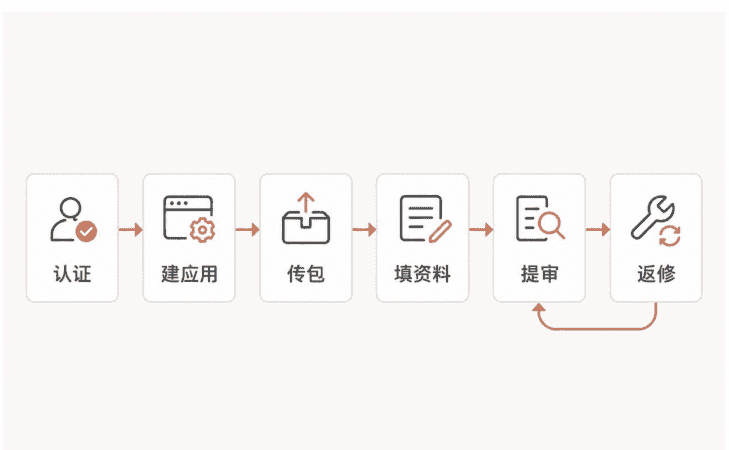

- 147. 注册开发者账号，完成主体认证。个人、个体户还是企业，看平台接受什么；主体要和版权证书、备案一致。
- 148. 创建应用。填包名和应用名称，名称要和版权证书上的软件名称一致。
- 149. 上传正式签名的安装包。国内市场多数要 APK。APK 就是安卓手机能直接点开安装的文件。不能用测试签名。
- 150. 填资料、传资质。隐私政策、权限说明、截图、描述，以及版权证书、App 备案号等。
- 151. 在后台点提交审核，截图保存当时的状态。
- 152. 被拒就按原文返修。通过后，用一台手机在这个商店里搜到、装上，才算上架。

##### 步骤 3 没有软著：先看哪些市场接受替代证书

以下核对于 2026 年 10 月，都是各平台公开页面的写法；提交前以当天后台的材料清单为准。

| 市场 | 公开规则怎么写 | 没有软著的人 |
|---|---|---|
| 小米 | 软著、APP 电子版权证书、软件著作权认证证书，三选一 | 可以用电子版权证书（个体户先确认能不能注册） |
| OPPO | 可上传官方通道申请的电子版权证书，两页一起交 | 可以用电子版权证书 |
| vivo | 上架必须提供上述三种证书之一 | 可以用电子版权证书 |
| 360 | 必须有计算机软件著作权登记证书 | 普通应用暂时走不通 |
| 华为 | 公开页面没核到明确原文 | 提交前在后台或工单问清 |
| 应用宝 | 公开页面没核到明确原文 | 提交前在后台或工单问清 |
| 荣耀 | 9月看到FAQ写三选一，上传页却标「可选」 | 提交前在工单问清 |

官方原文：小米应用资质 FAQ（2026-01-30 更新）、OPPO 应用上传流程、vivo 应用管理常见问题（2024-05-08 更新）、360 上线前准备材料。

（图 16-2）国内安卓市场是否接受电子版权证书对比图

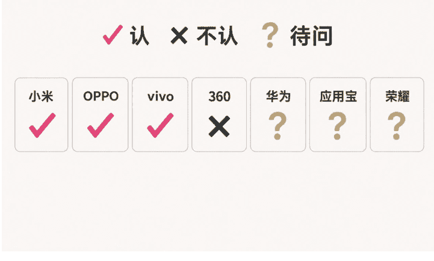

（图 16-3）小米开发者平台「应用资质 FAQ」：三种证书三选一的原文

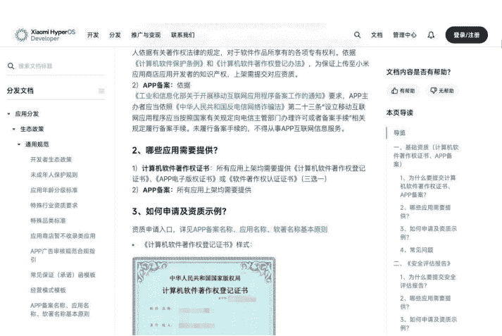

###### 三点要记住：

- 电子版权证书是市场化认证平台出的证书，不是中国版权保护中心发的软著登记证。只有明确写了接受它的市场才能用。
- 承诺函、商标、备案号，都不能顶替版权证书这一栏。
- 证书上的软件名称、主体，要和你在商店里填的应用名称、开发者账号主体一致。

##### 步骤 4 办电子版权证书 具体怎么办见第4章。这里只提醒两件事：

- 153. 实名时用的主体，要和你将来注册安卓开发者账号的主体是同一个。
- 154. 如果你也是 AI 辅助开发，下单前先问平台客服能不能如实申请，拿到明确答复再付钱。

##### 步骤 5 等证期间：怎么先让客户用上（这不等于上架）

- 内测分发平台（比如蒲公英）：上传 APK 生成安装页，可以设密码防外传。它只用于内部或小范围测试，能不能拿来给正式客户用，以平台协议为准。
- 给正式客户的路径：自有域名下载 + App 内显著展示备案号 + 正式签名。也就是在你自己已备案的域名（比如官网）上放 APK 下载链接或二维码，App 里显著位置挂备案号，安装包用正式签名。它能让客户先用上，但不等于上架商店，商店那条线照样要走。

合规上这几件事一样不能少：

- 155. 先完成 App 备案，并在 App 里显著展示备案号。工信部要求「在 APP 显著位置标明其备案编号，并在备案编号下方按要求链接备案系统网址」（工信部通知原文）。比如放在「我的 → 关于」，点了能打开备案查询页。
- 156. 隐私政策、删除账号入口、权限说明照样要有。
- 157. 一直用同一份正式签名，版本号一次比一次大，不然用户装不上新版。
- 158. 安装说明只写「按手机提示允许本次安装」。不同品牌手机弹的提示不一样，别教客户去关闭手机的安全防护；装不上时，让客户把手机提示截图发给你，再一起看。

可以让 AI 先帮你查一遍：

```
我的安卓 App 暂时没上商店，要在自己已备案的域名下
```


放正式签名的 APK 给客户下载安装。请只读检查并列一张清单，先不要改代码：

- 1. App 里有没有显示 App 备案号，点了能不能打开工信部的备案查询页；
- 2. 隐私政策、删除账号入口、各项权限的说明是否都在；
- 3. 这个安装包是不是正式签名，版本号是否比上一版大；
- 4. 帮我写一份发给客户的安装说明：从哪个网址下载、怎么确认是我发的正式版、安装时按手机提示允许本次安装。

##### 步骤 6 Google Play 线（发海外）

以下核对 于 2026 年 10 月。

- 159. 注册 Google Play 开发者账号，一次性注册费 25 美元。
- 160. 进 Play Console，点「创建应用」。
- 161. 按 Expo 的 Google Play 提交说明准备 Google 服务账号密钥，然后在工程目录运行：

```
npx eas-cli@latest credentials --platform android
```

选 production 配置，按提示配置服务账号密钥。密钥文件只放在自己电脑上，不贴进聊天、截图或代码仓库。

- 162. 上传：

```
npx eas-cli@latest submit --platform android
```

默认先进「内部测试」轨道。2021 年 8 月以后新建的应用要用 AAB 格式（Google Play 专用的打包格式，不能直接点开安装）。

- 163. 2023 年 11 月 13 日之后注册的个人账号

> 上，按 8 月账单约 86 元/月（同一台上还跑着别的监控）

#### 我当时是怎么做的

- 用户的反馈，我不再一股脑变成功能清单。9 月 25 日我自己真机试用，一天里记下的问题同时有「卡住了」「缺功能」「想更快」，我先只挑一个最影响练习的问题修。
- 错误监控用的是 GlitchTip（一个开源的错误收集工具），自己架在国内云服务器上，App 和后端的测试错误都在后台看到了。
- 另外两次教训：用户说「慢」，到底慢在哪；AI 自动打分高，用户却不觉得好。分别放在第 3 步和第 6 步里讲。

#### 你照着做

##### 第 1 步 把用户反馈分成三类，只先修一个

收到反馈后，先分类，不急着改：

| 类别 | 怎么认 | 怎么处理 |
|---|---|---|
| 使用障碍 | 想做的事做不下去：卡住、报错、找不到入口、等太久 | 最先修，一次只修一个 |
| 功能缺失 | 用户需要，但 App 本来就没有 | 放进待讨论列表，攒证据 |
| 个人偏好 | 换颜色、换说法，不影响完成任务 | 记下来，不急着动 |

我的例子：9 月 25 日，我在手机上练「语音对练」，第 2 轮顾客的语音一直显示「正在播放顾客语音…」，底部按钮锁在「顾客正在说」，我没法开口。这属于使用障碍——练习直接做不下去。

处理思路是两层：先加一个兜底，播放超过语音时长再多 3 秒，就自动把话筒还给用户，并给一个「重播」按钮；再补上记录，查清楚播放结束的信号为什么没回来。

同一天另一条反馈「练习要有目标、能设难度」，属于功能缺失，我单独拿去做方案，没有和这个卡死问题混在一起改。

给 AI 的提示词：

> 下面是用户这次的真实反馈（原话或截图描述）：
> 【粘贴反馈】
> 
> 先不要改代码，帮我做四件事：
> 1. 把每条反馈分成三类：
>    - 使用障碍：用户想做的事做不下去（卡住、报错、找不到入口、等太久）
>    - 功能缺失：用户需要、但 App 本来就没有
>    - 个人偏好：不影响完成任务的喜好
> 2. 从「使用障碍」里挑一个最影响核心任务的问题，说明为什么选它。
> 3. 针对这一个问题列出：要改哪些页面、哪些旧功能需要重测、涉不涉及数据变化、出问题怎么退回上一版。
> 4. 其余反馈放进「待讨论列表」，写清是谁、哪天提的。
> 改完后，用用户原来出问题的那个操作再走一遍，确认好了再告诉我。

（图 17-1）用户反馈三分类：先修使用障碍，其余进待讨论

##### 第 2 步 接入错误监控并验收

**接入提示词：**

我想给 App 接错误监控（用 GlitchTip，它兼容 Sentry 的上报组件）。
请先查当前官方文档再动手，然后做到：

- 1. 用户同意隐私政策之后，才启动错误监控。
- 2. 上报内容不带手机号、姓名、录音、聊天内容等个人信息：
  - 关闭「默认收集个人信息」的开关，发送前再过滤一遍。
- 3. 每条错误带上 App 版本号和环境（测试 / 正式）。
- 4. 在测试环境留一个只有我能触发的「测试报错」入口。

做完告诉我：我按什么步骤触发测试错误、去后台哪里看。

**四步验收，每一步都要亲眼看到：**

- 165. 在测试环境触发一条不含个人信息的测试错误。
- 166. 在后台找到这条错误，版本号和你手机上装的一致。
- 167. 点开详情，确认没有带出手机号、请求内容这类不该收的东西。
- 168. 负责处理的人（就是你自己）真的收到了通知：邮件或消息。

我们后来还写过 Sentry 的接入代码，但代码接入上只是第一步：还要填好上报地址、实际发一条、确认有人收到。那一轮没走完这几步，我就没把它算作「已接好」。

另外两样也值得配上：

- 可用性监控：每分钟去敲一下你的服务，

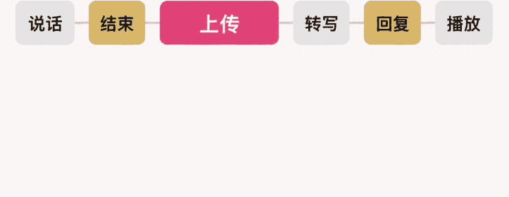

用户反馈「××页面等太久」。先不要改代码，先帮我量时间：

- 1. 把一次完整操作拆成几段，例如：开始说话 → 松手结束录音 → 上传 → 转成文字 → AI 生成回复 → 语音开始播放。
- 2. 每段开始和结束各记一个时间点。
- 3. 在测试环境跑 5 次，给我一张表：每段花了几秒，哪一段最长。
只报测到的数字，不要猜原因；也不要先在界面上加「AI 正在思考」之类的提示来掩盖等待。

##### 第 4 步 小步发版，先给少数人，留好退路

- 一次只发少量改动。攒一大堆再发，问题会一起爆，你分不清是哪处改坏的。
- 先给少数人用（灰度发布）。我们新版对练提示词，先只对几个测试账号打开，我自己在真机上盲测觉得好，才考虑扩大。
- 留好上一版和恢复办法。代码能退回去，不等于数据能退回去。凡是动了数据的改动，发布前让 AI 分别写清：代码怎么退、数据怎么退。
- 热更新别越线。热更新是不重新上架、直接给已装的 App 推小修改。苹果审核指南 2.5.2 写明，App 不能下载、执行会引入或更改功能的代码。修文案、修小 bug 可以评估，加新功能必须走审核。我写这篇时还没有正式用热更新，每次改动都是重新打包发版。

##### 第 5 步 多个 AI 一起干活，先定好谁来接结果

第一个 App 用一个 AI 就够，这一步等你同时开好几个 AI 时再看。9 月 4 日，我派出去的几个任务做完或失败后没人接，积压了 8 个小时才被发现：单独启动的 Codex 任务做完，不会通知任何人。

从那以后定了三条规矩：派活时把结果文件写成完整路径（从硬盘根目录写起），AI 才不会写进它自己的文件夹；每个任务做完都要有人工盯结果、接下一步；同一个文件夹同一时间只让一个 AI 改（第 11 章步骤 5 讲过）。

每次派活，任务单写这八项：

- 1. 本次目标和范围：
- 2. 从哪个版本开始做：
- 3. 你必须知道的已确认事实：
- 4. 允许修改的文件：
- 5. 做完怎么验收，输出什么：
- 6. 遇到什么情况要停下来报告：
- 7. 结果保存在哪里（写完整路径）：
- 8. 下一位接手的人需要做什么：

（图 17-4）派任务、盯结果、有人接：三步缺一步就会积压


##### 第 6 步 记录 Token，也记录它换来了什么

只看花了多少 Token 没意义，要看换回来什么。从现在起，每做完一件事记四列：

| 这次要解决什么 | 用了多少时间和 Token | 留下了什么 | 怎么确认有用 |
|---|---|---|---|
| 例：对练顾客回复慢、不像真人 | 三轮改提示词，约 600 个自动对话回合 | 一版更短的新提示词 | 我真机盲测「体感好很多」；回复耗时中位数 2.25 秒 → 1.0–1.3 秒 |

这一行里藏着一个坑：AI 自动打分，不等于用户觉得好。9 月 24 日，我们让另一个 AI 当评委，给对话的「真人感」打分。同一套配置，这一轮打 4.22 分，下一轮打 3.42 分，分数根本不能跨轮比。旧版本分数还更高，可我在手机上一试，还是不像真人。

后来改成：AI 评委只用来先筛掉明显差的，最后由我在真机上盲测拍板。第二天盲测，新版本我的感受是「好很多」。

#### 做到这些就算完成

我只好暂停派新任务。之后我把省 Token 的办法定成了硬规矩，写在本章最后一节。

#### 你照着做

##### 第 1 步 把费用分成 8 项，先列再填

先把两类钱分开看：

- 我真实付过的（有账单或订单）：苹果开发者 688 元/年；电子版权证书 600 元；阿里云 8 月约 567 元、9 月截至 28 日约 707 元；App 里调用大模型 9 月头 8 天约 21 元。和开头的速览是同一组数，AI 编程助手订阅不在此列。
- 下面表里的区间是粗估：因人而异，不是预算承诺，只帮你心里有个数，以各家实际报价为准。账号、商标、软著、备案这几项的官方价格，我核对于 2026 年 10 月，详细办法见第 1-5 章。

| 费用项 | 什么时候遇到 | 省钱做法（粗估） | 正常做法（粗估） | 容易漏掉 |
|---|---|---|---|---|
| AI 编程助手 | 开始写代码 | 每月 20 美元档起步 | 每月 100-200 美元档 | 额度用完要等重置 |
| 电脑与手机 | 准备工具、真机测试 | 用已有电脑和手机 | 二手 Mac mini 约 2000-4000 元 | 在自己电脑上打包 iOS 包必须有 Mac；用 EAS 云构建可以不用 |
| 构建服务（打包） | 做安装包 | 本机打包或用免费额度 | 每月 19 美元起 | 超额费、排队时间 |
| 域名与云端 | 有后端、对外服务 | 只存手机本地，0 元 | 每月几百元 | 数据库、存储、测试环境 |
| 应用内模型调用 | App 接上 AI 后 | 开发期很少 | 按用量计费 | 用户每用一次就花一次 |
| 商店开发者账号 | 签名、上架 | 苹果 99 美元/年 | 同左 | 每年都要续 |
| 材料办理 | 上架前 | 备案自己办 0 元；软著官费 0；电子版权证书按平台页面价 | 代理费几百到几千元 | 补正、返工、等待时间 |
| 维护 | 上线以后 | 自己盯监控 | 监控服务、客服时间 | 域名、服务器续费 |

**表格外的几句说明：**

- **AI 编程助手**：ChatGPT Plus（含 Codex）每月 20 美元，Pro 每月 100 美元起；Claude Pro（含 Claude Code）按月付 20 美元，Max 每月 100 美元起。
- **构建服务**：如果用 Expo 的云端打包（EAS），免费档每月 15 次安卓、15 次 iOS；付费档 19 美元/月起，另加超额费用。
- **苹果开发者账号**：每年 99 美元，注册时按当地货币显示，国内约七百元，以注册页为准。
- **安卓各市场**：国内主流市场注册开发者一般不收费，以各市场页面为准（见第 2 章）。
- **商标**：网上申请 270 元/类（10 个商品以内），一次注册管 10 年（见第 3 章）。
- **软著**：官方登记费 2017 年 4 月起已停收，自己办是 0 元（见第 4 章）。
- **电子版权证书**：我下单时普通时效 600 元。软著签章页的声明和你的实际情况对不上时，可以考虑这条（见第 4 章）。
- **备案**：云服务商的基础备案服务不收费，但要先有一台符合要求的云服务器（见第 5 章）。
- **域名**：一般几十到一百元左右一年，以注册商报价为准。

官方价格页：Apple 开发者计划 · ChatGPT / Codex 套餐 · Claude 套餐 · Expo EAS · 商标收费标准 · 阿里云备案费用说明（核对于 2026 年 10 月，以官方最新为准）

##### 第 2 步 首年大概准备多少

这张表是粗估，因人而异，不是预算承诺；它把不同的设备、套餐、云资源揉在了一起，你的数以第 1 步自己填的为准。我自己实付的钱，见第 1 步开头。

| 档位 | 适合谁 | 首年大致（粗估） |
|---|---|---|
| 最省验证版 | 只做本地保存的小 App，先上架试水 | 千元级，主要靠自己动手 |
| 自己 + AI 做正式版 | 有后端、有云端、自己用 AI 写 | 约 1-3 万元，大头是 AI 订阅和云服务 |
| 外包或请设计 | 不自己写，或需要专业设计 | 十几万元以上 |

每年都要续费的主要是：苹果开发者账号、域名、云服务器。商标是一次注册、管 10 年。

做练习和做正式服务，花费差别很大。动手练习的「跟进小本」只存在手机里，几乎不需要云端费用。

##### 第 3 步 看懂我的 Token 数字

先说清楚两个词：

- **Token**：AI 计量文字的单位，可以粗略理解成「字数」。AI 读进去的、写出来的都算。
- **缓存读取**：AI 每回答一次，都要把这段对话前面的内容、读过的文件再「过一遍」。重复过的这部分大多走缓存，计费便宜很多，但仍然算进总量。

（图 18-1）生财 TokenRank 个人页：近 90 天 1156.59 亿 Token，全站第 20 名


我 2026 年 10 月 2 日读到的数：

| 项目 | 数字 |
|---|---|
| 全部历史（2025-11-17 起，209 天有用量） | 1351.51 亿 Token |
| 全部历史里 Codex / Claude Code | 950.95 亿（70.4%）/ 400.52 亿（29.6%） |
| 近 90 天（7 月 5 日 – 10 月 2 日） | 1156.59 亿，日均 13.00 亿 |

个练习项目，用量会小得多。

（图 18-3）近 90 天的 Token 构成：缓存读取占绝大部分，新输入输出只有约 21 亿（10 月 2 日上午读数）


##### 第 4 步 怎么少花 Token

9 月 7 日额度一天烧完以后，我让 AI 复盘了之前的 159 次派单，Token 主要浪费在下面这些地方。每一条都对应一个改法：

- 169. 别把整份测试日志塞进对话。当时最大一份日志有 150MB，是几千条测试逐条打印出来的。改成：只把失败的那几条和汇总数字给 AI，完整日志存在电脑里。
- 170. 全套测试每批只跑一次。以前一个改动要经过「实现、复查、返工、最终核实」三四个 AI，每个都从头读资料、各跑一遍全套测试。改成：中途只跑相关的几项，收尾跑一次全套，复查直接用前面的结果。
- 171. 卡住了先接着原对话做。一卡住就开新对话，新对话要把所有资料重读一遍。但同一个任务也别反复续：每续一次都要把前面的对话重放一遍。同一个任务卡两次，就先想清楚方案再续一次。
- 172. **派活前先检查任务书。** 当时约有 10 次白跑，是我给的任务书前后矛盾，或者没告诉 AI 哪些失败是老问题。任务书按第 17 章第 5 步那八项写，发出去之前自己从头读一遍。
- 173. **大任务拆小。** 9 月 12 日，一个任务连跑 15 小时、用掉约 160 万 Token 后对话崩溃，什么都没交出来。现在的规矩：预计超过 3 小时就拆；2 小时没有阶段性成果，就停下来汇报。
- 174. **每次都要读的固定说明要精简。** AI 每开一次对话，都会先读你给它的长期说明和技能清单。我把常驻技能从 64 个减到 14 个，说明文件压到每份几 KB。
- 175. **别让 AI 满硬盘搜索。** 有两次 AI 全盘搜索，把一大堆无关结果灌进对话。给它具体的文件和行号范围。

最后一句提醒：**少输出不等于少验证。** 登录权限、数据隔离、发布上线这类出了错代价很大的事，不能为了省 Token 跳过检查。简单的活用便宜的模型，难的、风险大的才用贵的。

#### 做到这些就算完成

> **注意：**
> 
> 1. 用量页面上的「预估成本」是按公开单价估的，不等于你的实付账单；实付以你的订阅或账单为准。
> 2. 云服务按量计费的资源（数据库、负载均衡、公网 IP）不用也在计费。给账户设余额预警，月底看一次账单。
> 3. 文中的价格都会变，正式付款前以官方页面为准。

## 附录 A 卡住时查哪个工具

不用第一天就把这些工具装齐。先判断自己卡在哪一步，再拿能回答这个问题的工具。工具最后要帮你找到一个事实，而不是多一份看起来很忙的日志。

### A.1 一张总表

| 你卡住的地方 | 先用什么 | 要拿到什么结果 |
| --- | --- | --- |
| 需求越聊越多 | 一页需求单、产品逻辑图 | 这一轮只改什么、什么算完成 |
| AI 总写错某个库的用法 | Context7 或该库当前官方文档 | 你这个版本的准确用法 |
| 页面位置不对、按钮点了没反应 | 截图、模拟器、真机；网页用浏览器开发者工具或 Playwright | 点的是哪个按钮、点完发生了什么 |
| 改完代码旧功能坏了 | 类型检查、代码检查、自动测试 | 哪条测试失败、真实报错是什么 |
| 反复手点手机太慢 | 安卓手机或模拟器、iOS 模拟器用 Maestro；苹果真机用 Appium | 自动点完、截图、明确的对错判断 |
| 自动化工具连不上手机 | Xcode 和苹果自带工具；安卓用 adb | 卡在设备、签名、驱动、连接哪一关 |
| 手机上成功，云端没结果 | 请求工具、云日志、数据库只读查询 | 同一次请求停在哪一步 |
| 长文件上传失败 | 云存储官方上传组件、上传报错码 | 文件传完没有、凭证有没有过期、后台确认了没有 |


才用得上的细节：A.2 云端排查清单（五段的讲解在第 10 章步骤 5），A.3 后端发布，A.4 回滚。物理 iPhone 自动化放在附录 D。

### A.2 云端卡住：先找到卡在五段里的哪一段，再按清单查

五段的讲解、例子和只读排查提示词，见第 10 章步骤 5。这里先把顺序收在一起：

- 1. 手机：请求真的发出去了吗？
- 2. 接口：后台收到了吗？返回了什么状态码？
- 3. 文件存储：文件传完了吗？
- 4. 后台任务：转写、生成这类慢活排上队了吗、跑完了吗？
- 5. 结果：结果写回去、手机拿到了吗？

（图 A-1）一次请求的五段：手机、接口、文件存储、后台任务、结果


按同一次请求的编号去查，别在一屏红字里猜；同一时间段里别的接口报的错，不一定是这次的失败。

定位到哪一段以后，按下面这张清单逐项查。

#### 1. 配置：代码没错，线上就是调不通

- 让 AI 列一张表：用途 | 代码实际读取的配置名 | 部署在哪个环境 | 模型名 | 运行中的程序拿到没有。
- 配置文件里有、云控制台里有、运行中的程序拿到了，是三件事，要分别确认。控制台显示"保存成功"以后，仍要发一次最小的真实请求。
- 我们踩过的：配置名在、值是空的；代码读的名字和存密钥的名字对不上；模型的旧名字过了官方停用日期；粘贴密钥时多带了一对引号，结果 401，去掉引号就是 200。

#### 2. "理论上该通，实际不通"：先花 5 分钟做两个只读检查

- 服务器上的配置名清单，和代码里引用的配置名，逐个对一遍。
- 用线上真实的程序账号，查它对每张表有没有读写权限。
- 第 10 章开头 8 月 27 日那次排了 8 轮，就是因为没先做这两步。本地测试库会自己给自己授权，所以缺权限的问题，在本地永远出不来。

#### 3. 日志：用阿里云 SLS（日志服务）找"最后一个成功的阶段"

- 进入控制台 → 选项目（Project）→ 选日志库

```
总耗时 %{time_total} 秒\n" https://你的接口地址/只读路径
```

- 网页版可以同时打开浏览器开发者工具的 Network 页看。
- curl 返回 200，不能说明用户在 App 里完成了任务。带登录凭证（Authorization、Cookie）的完整日志，不要公开。

#### 5. 文件上传：用官方工具包，但权限要逐项查

- 我们最后用的是阿里云官方 OSS 工具包，加上服务器签发的 STS 临时凭证（有效期很短的临时钥匙）。官方流程见 使用 STS 临时访问凭证上传文件至 OSS。
- 工具包管"怎么传"。文件归谁、谁能读、传完怎么处理，仍要你的项目自己管。
- 大文件会分片上传。断点续传还需要"列出已传分片"的权限（OSS 里叫 ListParts）。能传一个短文件，不代表能续传；要专门做一次"传到一半中断、再恢复"的测试。（权限清单见 OSS 分片上传）
- 权限按服务器真实签出的文件路径写，不按配置里的路径猜。

#### 6. 后台任务：没到终点，就记"还没结果"

- 每个后台任务都保存：任务编号、输入版本、状态、查询时间。
- 有一次复测，30 个任务在观察时间内全停在"处理中"。正确的记法是"还没有终态，指标未测"——不填零，也不重复提交，免得再花一遍钱。

#### 7. AI 返回的字段：写清"字段合同"

- 示例和字段说明写全，要它填什么就逐个列出来。
- 系统已经知道的信息，由程序在校验前填好，不让模型抄。
- 校验前加一层"归一化"：同义词换成标准词、大小写统一。比如要求填"开放"，它写成了"进行中"。
- 涉及来源和证据的字段（比如"这条依据来自哪一轮对话"），缺了就留空，绝不替模型编。

#### 8. 成熟工具，也要在你自己的输入上测

- 我们用 30 份合成文件试验过文档解析（当时还只是试验）；普通文档、跨页表格、扫描件、手机照片，结果各不相同。能抽出文字，不代表能保住表格的行和列。

### A.3 后端发布卡住：先看打包，再看上线

我们的后端发布分两步：先把程序和运行环境打成一个「镜像」（可以理解成一个装好一切的包），存在阿里云的镜像服务（ACR）里；再交给应用托管服务（SAE）把它跑起来。

所以「打包成功」之后，「上线」仍然可能失败。我们遇到过：镜像好不容易构建成功，部署时又在数据库检查那一步失败、自动回滚。后来发布改走云平台官方的发布接口。第一处修好，不代表第二处会自动通过。

按这个顺序看：

| 先看哪里 | 看什么 | 能说明什么 |
|---|---|---|
| 镜像服务的打包记录 | 用的哪份代码、卡在哪一步、最终状态 | 包打出来没有 |
| 镜像服务的版本列表 | 版本标签和唯一编号 | 准备上线的到底是哪个包 |
| 应用托管的变更记录 | 拉取、启动等每一小步的状态 | 上线停在哪一步 |
| 应用托管的运行实例 | 实际在跑的是哪个包 | 现在线上真正跑的是什么 |
| 日志和一次真实请求 | 启动结果、真实返回 | 新版本的行为对不对 |

在网页控制台看明白以后，可以让 AI 用阿里云官方命令行工具做同样的只读查询，把时间和结果存下来。

官方文档： ACR 镜像构建诊断 · SAE 变更发布单（核对于 2026 年 10 月）

### A.4 回滚以后：核对实际在跑的那一份

新版本出问题，常见做法是让服务重新跑上一个能用的版本，这叫回滚。

回滚成没成，要看服务器上实际在跑什么，而不是设置页面填了什么。我们遇到过：设置已经改回旧版，运行中的实例却还是新版。只看设置，就会误以为回滚完成。

三条做法：

- 1. 先取证，再回滚。失败时先把报错和日志抓下来。我们改成「先取证再回滚」之后，一次失败当场就拿到了明确的错误码；在之前只能事后翻日志猜。
- 2. 回滚后三样一起核对：设置、实际在跑的版本、用户用起来的效果。
- 3. 数据库只读查。排查时只看状态、权限、迁移记录。真要改表或恢复数据，另写一份执行和恢复方案，确认后再做。

（图 A-3）回滚后核对三样：设置、实际运行版本、用户效果


## 附录 B 我踩过的 16 个坑

前面各章已经讲过最常见的问题。这张表留给你遇到类似情况时回来查，不用第一次开发前全部学会。

查的时候，先看第一列「发生了什么」和你现在像不像。比如你只是按钮点不动，就先查页面和测试，不用研究服务器回滚。

| 发生了什么 | 当时以为 | 下次这样做 |
|---|---|---|
| 自己写上传和装机工具，折腾好几天还是不稳 | 自己写更贴合项目 | 先比较官方方案和高星开源工具，再决定要不要自己写 |
| 只在一条支线上测过，就被报成「手机和后台都生效了」 | 电脑上准备好，就等于用户用上了 | 合并了吗、发布了吗、装到手机了吗、用起来对吗，四件事分开核对 |
| 自动检查几秒就通过，真机一用二十秒后失败 | 测试用的假数据没问题 | 用真实的数据格式、不同的账号测，再上真机走一遍 |
| 回滚只改了设置，服务器上跑的还昰新版 | 设置改回去，服务就回去了 | 设置、实际运行的版本、用户效果一起核对 |
| 修复只写在临时脚本里，清理文件后修复没了 | 跑通一次就是永久修好 | 修复写进正式代码并存档，写清怎么恢复 |
| 临时登录凭证还没用就过期了 | 提前半小时拿好没关系 | 用之前再拿，或先看有效期；凭证不贴进聊天 |
| 检查工具看不懂真实日志，把成功判成失败 | 检查工具本身一定对 | 先拿一条确定成功的样本让它判一次 |
| 测试名字写着查A，实际只查了B | 名字对、显示通过就行 | 对照需求，逐条看测试到底证明了什么 |
| 两次存档标题一样，修复被误以为已上线 | 看标题就能判断 | 让 AI 核对线上版本里到底有没有那次修复，再看实际效果 |
| 一夜发布六次，都卡在自己写的发布脚本上 | 再试一次也许就过了 | 同样的失败没有新线索就停，先修工具或换官方路线 |
| 自测任务空转很久没人发现 | 派出去就一定会收到「做完了」 | 盯新产出、进程在不在、结果文件写没写；写明超时就停 |
| 测试数据库是手写的简化版，错误照样通过 | 测试库少几条规则没关系 | 测试库用和正式库一样的建表步骤 |
| 一轮里好几条验收标准写错了 | 用内部概念或一闪而过的状态当标准 | 先确认检查工具真能读到那个结果，再写标准 |
| 复查到一半，被查的代码又被改了 | 一直查的是同一个版本 | 复查前先锁定版本，新改动重新查 |
| 清理脚本被执行两次，约 40 份备份被覆盖 | 用户只会执行一次 | 脚本重复执行也不出事，备份永不覆盖 |
| 请教外部专家时，凭记忆把语音服务商写错 | 我记得用的是哪家 | 从当前代码和配置里查，查的时候不打印密钥 |

这 16 条可以归成四句话：

- 1. **能用成熟方案，就别自己写**（第 7 章步骤 5）。
- 2. **「我这边好了」不等于「用户那边好了」。** 合并、发布、安装、使用，每一层单独确认。
- 3. **检查工具本身也会错。** 先用已知结果校准它，再相信它。
- 4. **一切操作都要能重复做。** 小白复制粘贴执行两遍是常事，脚本要扛得住。

## 附录 C 小白术语小抄

看不懂的词，翻这里。按做 App 的顺序分四组。

### 准备阶段

| 词 | 一句话人话 |
| --- | --- |
| 主体 | 用谁的名义做 App：个人、个体工商户还是公司（见第 1 章） |
| 包名 / Bundle ID | 商店用来认你这个 App 的身份证号（如 com.yourco.app），苹果后台也叫「套装 ID」；定了尽量别改 |
| ICP 备案 | 向主管部门登记「这个网站或服务是谁在运营」（见第 5 章） |
| App 备案 | 给 App 本身做的备案，国内应用市场上架要填备案号（见第 5 章） |
| 公安备案 | 在公安网安部门再登记一次，是另一套系统（见第 5 章） |
| 软著 | 计算机软件著作权登记证书，国内安卓市场普遍要（见第 4 章） |
| 电子版权证书 | 市场化认证平台出的版权证书，不是软著；小米、OPPO、vivo 等部分安卓市场接受它代替软著（见第 4、16 章） |

### 开发阶段

| 词 | 一句话人话 |
|---|---|
| 终端 / 命令行 | 终端是输入命令的窗口（Mac 叫「终端」，Windows 用 PowerShell）；在里面一行行输入命令操作电脑，就叫命令行 |
| Node.js | 让电脑能运行 JavaScript 工具的基础软件，Expo 要靠它跑起来 |
| npm | 装 Node.js 时顺带装上的，帮你下载各种工具包的「应用商店」 |
| 镜像源 | 国内的下载加速站，同一批工具包换从国内服务器下载；和后端的「镜像」是两回事（见第 8 章） |
| Expo | 一套帮你用 JavaScript 做手机 App 的工具，还能在云上替你打包 |
| Expo Go | Expo 配套的手机 App；电脑上改代码，手机上扫码就能看到效果，不用先打包安装 |
| 上下文 | AI 这一轮对话里「记得」的全部内容，太长会变慢、变贵、还会忘事 |
| Token | AI 计量文字的单位，读进去和写出来的都算 |
| 缓存读取 | AI 重复读已经读过的内容，便宜很多，但算进总量 |
| 前端 / 后端 | 前端是手机上看到的页面；后端是在服务器上处理数据的程序 |
| API（接口） | App 和服务器之间「对话」的约定 |
| 数据库 | 存数据的地方，像一张很大的表格 |
| 云服务器 | 租来的、24 小时开着的电脑 |
| Git / 存档（提交） | 给代码存档的工具，每存一次都能退回那个版本 |
| 分支 | 从主线复制出来的支线，改坏了不影响主线 |
| 独立工作目录（worktree） | 同一个项目复制出的另一个文件夹，几个 AI 同时改代码时各用各的 |
| 模拟器 / 真机 | 模拟器是电脑上假装的手机；真机是真的手机，最终验收以真机为准 |
| 自动测试 | 让电脑按写好的步骤检查功能对不对 |
| 日志 | 程序运行时记的流水账，出错时靠它查原因 |
| SDK（一般说法） | 别人做好的功能模块，拿来直接用；接了要在隐私政策里写明 |
| Expo 的 SDK 版本 | Expo 工具的第几代（如 SDK 57），要和手机上的 Expo Go 对得上（见第 8 章） |

### 打包上架

| 词 | 一句话人话 |
|---|---|
| 构建（打包） | 把代码变成能安装的文件 |
| ipa / APK / AAB | 安装文件：ipa 是 iOS 的，APK 是安卓能直接装的，AAB 是给 Google Play 的 |
| 签名 | 给安装包盖的「公章」，上架必须用正式签名 |
| keystore | 安卓正式签名的文件，丢了 App 就没法更新，务必备份 |
| 证书 / 描述文件 | 苹果那套证明「这个 App 是你发布的」的凭证 |
| App Store Connect | 苹果管理 App 上架的后台 |
| TestFlight | 苹果官方内测工具，把还没上架的版本发给测试的人装 |
| 元数据 | App 在商店里展示的名称、截图、描述、关键词 |
| 隐私政策 | 告诉用户你收集什么数据、怎么用、怎么删 |
| 权限用途说明 | App 要用麦克风、相机时弹窗里那句理由，iOS 缺了会被打回 |
| 提审 | 把版本交给商店审核；提交审核不等于已上架 |

### 上线以后

| 词 | 一句话人话 |
|---|---|
| 错误监控 | 用户手机上一出错，你的后台就能看到哪个版本、在哪出的错 |
| 部署 / 发布 | 把新版后端放到服务器上跑起来 |
| 镜像 | 把程序和运行环境打成一个包，服务器拿来直接运行 |

### D.2 认识三个名字，让 AI 按顺序检查

到了物理 iPhone 这一步，才需要认识下面三个名字：

- **Appium**：电脑上的自动化服务，接收"打开应用、点这个按钮"这类命令。
- **XCUITest 驱动**：Appium 连接 iOS 用的驱动，负责把命令翻译成苹果能懂的指令。
- **WDA（WebDriverAgent）**：装在 iPhone 上、真正去点屏幕的组件。

（图 D-1）自动化三件套：电脑上的 Appium、驱动，手机上的 WDA


你自己要写的，只是"进入服务页、选录音、检查结果"这类业务流程，加上开跑前的设备检查。手机驱动不用重新发明。

第一次让 AI 按这个顺序准备，新手别凭感觉改签名参数：

```
我要对自己指定的 iPhone 做 Appium 自动化。
先核对当前 Xcode、Appium 和 XCUITest driver 的兼容要求。
按以下顺序检查，不要一开始就跑整段业务。
```

- 1. 手机的数据连接是否可用
- 2. 手机是否解锁并信任这台电脑
- 3. WDA 的开发团队和签名是否匹配
- 4. WDA 能否在目标手机真正启动
- 5. Appium 能否建立 session，并取得截图和页面源
- 6. 目标按键能否定位，点击后页面是否发生预期变化

同一时间只有一个操控者，不要让另一套驱动或保活同时抢手机。

涉及信任、系统确认或需要真人操作时，明确停在哪一步。

把每一关的结果、错误和证据位置留下来。

让 AI 先说明安装会改变什么，再按当前官方文档准备。已有环境先检查，免得重复安装，或升级到互不兼容的组合。下面几条是在 Mac 终端查版本、设备和驱动；

```
xcodebuild -version
xcrun devicectl list devices
appium --version
appium driver list --installed
```

缺什么再装。核对于 2026 年 10 月，官方安装命令如下（Appium 用 npm 装，需要先有 Node.js）：

```
npm install -g appium
appium driver install xcuitest
```

WDA 用哪个开发团队签名、装到哪台手机，要按你的实际环境定。

Appium 安装 · XCUITest 驱动官方指南 · Apple 命令行工具

装好后，在一个终端启动 Appium，让它的日志一直开着；

```
appium
```

- 别按名字批量杀进程。我们手机上有一个叫 Runner 的进程，其实是另一个日常 App，不是 WDA。

### D.4 物理 iPhone 自动化的五种坑

| 现象 | 原因 | 怎么办 |
|---|---|---|
| 电脑显示已连接，自动化看不到手机 | 只是网络配对，数据连接没建立 | 换能传数据的线，手机点"信任"，Xcode 能看到设备再继续 |
| WDA 构建成功，手机上没跑起来 | 签名、安装、启动、会话是几道不同的关 | 存下第一条有效错误和 .xcresult 结果文件，别只看退出码猜 |
| 能截图，却找不到眼前的按钮 | 控件清单里没有这个按钮 | 看页面源或用 Appium Inspector；给关键按钮加固定的标识名 |
| 两套自动化同时控制一台手机 | 保活或另一会话又启动 WDA、换安装包 | 只留一个入口，先查占用、版本、驱动、会话，再跑业务 |
| 自动化"听到了"声音，却没证明录对了 | 电脑外放给手机收音不稳；脚本把自己的气泡当成顾客回复 | 说话、听感、物理按键、锁屏、插拔、首次信任，留给真人 |

补几句表里装不下的：

- 第 1 种坑，停在这一层时不需要让 AI 改 App 页面。
- 第 2 种坑，我们见过构建退出码 65 和 74，也见过手机端运行器一启动就退出。有一轮卸载、重签都没用，完整重启手机才恢复。这只代表那一次，别养成"一出问题先重启"的习惯。


- 第 3 种坑，我们遇到过确认框肉眼看得见、控件清单里却没有，只能真人点一次。看不清页面源码，就用 Appium Inspector：点一下截图里的按钮，就能看到工具认出的名字和位置。
- 第 4 种坑，我们最后把检查顺序收成一个统一入口：先确认“手机空闲、版本正确、驱动正常”，再执行页面操作。

下面两张是我们的历史自动化截图，放在一起看，就明白为什么“有一张结果图”还不够。

（图 D-2）历史 iPhone 自动化截图：本地带回了一段原音

20:34

智能工牌 ****W001 已连接

- 电量：100%
- 剩余空间：59424 MB
- 录音状态：空闲
- 固件：待确认

换一台智能工牌

完成，返回服务记录

已带回 1 段原音，智能工牌里的原文件保持不动。

连接诊断

只含时间、命令码、帧长、耗时、错误码和状态迁移，不含音频或手机号。

- 复制诊断
- 分享诊断

智能工牌录音 目录读取完成

- 今天 12:17：约 15 分钟 · 1.7 MB · 记录
- 9月9日 02:07：47 分钟 · 11.9 MB · 记录（已复制到本机）

图里的“已复制到本机”，只证明录音传回了手机这一步，不能说明已经上云、转写完成或生成了报告。

（图 D-3）历史 iPhone 自动化截图：导入失败与诊断入口

00:42

- 录音状态：空闲
- 固件：待确认
- 换一台智能工牌
- 带回选中的 1 段
- 继续上次导入

导入没有完成，请再试一次。
(recordpen_existing_capture_requires_review · ready)

查看诊断

连接诊断

只含时间、命令码、帧长、耗时、错误码和状态迁移，不含音频或手机号。

- 复制诊断
- 分享诊断

智能工牌录音 目录读取完成

- 昨天 20:17：约 7 分钟 · 1.7 MB · 记录
- 昨天 23:32：约 3 分钟 · 797 KB · 记录

失败时，先存下具体错误和当时的页面，再判断是记录状态、权限、网络还是工具的问题。这张图直接把错误码甩给用户，也是我们当时界面要改的地方：给普通人的提示，要让他看得懂、知道下一步怎么办。

### D.5 Android 和网页

## 配套资料

- 本文政策类信息核对于 2026 年 10 月，以官方最新为准。销冠营的经历按文中日期理解，不代表每个人的审核结果和完成时间都一样。

看完这篇 SOP，你觉得你懂了。但 90% 的人一到实操就会卡在第一步。

工具和教程只是最低级的壁垒，真正的壁垒是“立刻动手”和“圈层信息差”。

如果你想看全网最新的变现玩法，并且和一群执行力极强的极客一起下场拿结果，欢迎围观我的核心私域：【懒人专属群】。

我们不聊虚的，只做商业闭环的拆解与 AI 效率的压榨。系统内已沉淀 1000+ 跑通的套利实战局。

- 查阅圈子完整数字资产与上车门槛：https://lazyso.com/insider/

认同价值、准备好下场干活的，扫码加我微信（lazyhelper1）

备注：【实操上车】，不闲聊


公众号

懒人搜索

懒人专属群


微信：lazyhelper1
