# 复盘分享：「高性价比人生指南」衍生网站，一周 8k+ 用户

261004 副业 SC 精华
整理：公众号懒人搜索，懒人专属群精选
懒人微信： lazyhelper1

> 小懒判断 | 适合想借现成优质内容做衍生网站、又不想从 0 找需求的人——核心打法就一招：盯刚起飞的爆款仓库，4 小时做衍生品，提 issue 被原作者收录进 README，等于白捡长期入口。最值得记的数字：必应 1623 次访问 vs Google 只有 45 次，做国内用户站必应收录别忽视。坑在于：V2EX 社区帖第一天 278 次第三天剩 43 次，冷启动行，长期还得靠被收录和 PDF 留链接这种被动入口。

前几天刷抖音，刷到一条视频在介绍一个 GitHub 仓库：《高性价比人生指南》。讲怎么活得久，怎么少花冤枉钱，怎么别把自己搭进去。

我顺手搜到了源仓库，越看越觉得内容扎实。

然后，我把它做成了一个网站：
howtolivebetter.net。

一周过去，8000+ 个用户访问过。原作者把它放进了仓库首页，还有人主动发到论坛推荐。这篇把整个过程摊开讲讲，截图和数据都是真实的。

一份备选单，挑走一两条就算数。作者自己也没做到其中大部分。

所以我想，与其收藏一个链接，不如把它变成一个能打勾的清单。

想做的事加进待做，做到了就勾掉，好奇的先收藏。打开就能看到自己做到了多少。

读一遍容易，真的去做才难。

我想做的，就是把「做」迈出一小步。

## 二、4个小时，从第一行代码到被原作者收录

那天的时间线，我从提交记录里翻出来了：

10:53，第一次提交代码 14:24，加上「精选 50 条」和带二维码的分享图 14:35，去原仓库提了一个 issue，介绍这个网站 14:56，原作者回复，把网站加进了 README 从提 issue 到被收录，21 分钟。

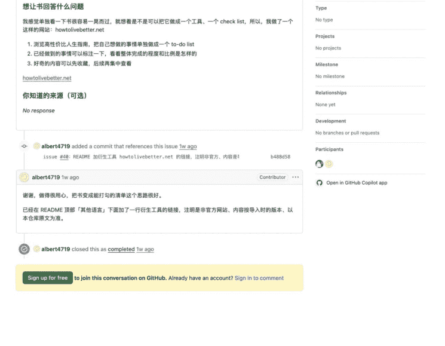

### 作者的回复是这样的：

谢谢，做得很用心，把书变成能打勾的清单这个思路很好。已经在 README 顶部「其他语言」下面加了一行衍生工具的链接。

说实话，看到这条回复挺开心的。

做衍生作品，我觉得应该第一时间告诉原作者。这本书用的是 CC BY 4.0 协议，网站上每一条都标了来源，也写清楚以原仓库为准。

整个网站我是和 AI 一起写的，主要用 Claude Code 和 Codex。我负责想清楚要做什么、验收效果，具体的代码交给 AI。这也是 4 个小时能上线的原因。

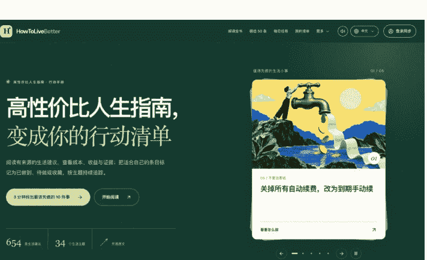

## 三、发到 V2EX，有人夸，也有人骂

下午 3 点多，我在 V2EX 的「分享创造」发了帖。

V2EX › 分享创造

### 高性价比人生指南，我做成了一个检查清单

littlebena · 9 月 28 日 · 2570 次点击

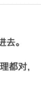

GitHub 上有个中文项目，3 周涨了 2 万星。

它不是代码，是一本书，叫《高性价比人生指南》。讲三件事：怎么活得久，怎么少花冤枉钱，怎么别把自己搭进去。

这本书和别的“人生建议”有什么不一样？市面上的 人生建议很多，大多是“多喝水”“早点睡”“别乱花钱”。道理都对，就是没法拿来做决定。

这本书的写法很特别。612 条建议，每一条都拆成同样几栏：

成本：花多少 钱、多少时间、要不要努力 说服人。一句话活告诉你做了能换回什么 收益：原始研究里的数字 证据等级：A、B、C 三档 来源：只引用论文和官方文件，附链接 A 级通常有荟萃分析、大型试验等强证据支撑。 全书 A 级 413 条，B 级 150 条，C 级 49 条。有争议的条目会声明“争议”，拒不方便摆一起列出来。

还有一点我挺喜欢。作者在 README 里直接写到：这是一份备选单，不是任务清单。挑走一两条就算是。作者自己也没做到其中大部分。

我感觉单独看一下书很容易一晃而过。就是看是不是可以把它做成一个工具、一个 check list，所以，我做了一个这样的网站 https://howtolivebetter.net/

- 1. 浏览人生说明书，把自己想做的事情单独做成一个 to-do list
- 2. 已经做到的事情可以标注一下，看整体完成程度和比例是怎样的
- 3. 好奇的内容可以先收藏，后续再集中查看

初步可能先做成这样。后续围绕健康生活、高性价比的事情还会做更多，大家可以继续关注

回复里什么声音都有。有人说「人生无法计划」，也有人说「这个世界没有相同的 2 片雪花」。

二楼骂得最狠，大意是：这跟 GitHub 上一大堆 Markdown 仓库有什么区别？遇到问题直接问 AI 不就行了？

@orion 可能今天太 a 号钱了？

@linvscode 杀人诛心脸😂

@lnmput 感同身受 🐻

唉。。。

看来怎么都是程序员/做题家思维

有没有可能，做题家思维是最没性价比的思维。

投入最多，收益最少

@linvscode #6 在有鱼的地方钓鱼，我不玩大A，这只是我本人的语言表达习惯，不对任何人。

@yinyu 和直接问 AI，主要的区别是，如果你没意识到，根本不会想着去问。

我刚刚基于这个《高性价比人生》HowToLiveLonger 做了一个小测试：https://gongfang.app/fangkeng/

@funet

我第二天回了一句：

和直接问 AI，主要的区别是，如果你没意识到，根本不会想着去问。

这也是我做这个网站最核心的想法。

比如「关掉所有自动续费」「每年做一次个税汇算」，你不会某天突然想起来去问 AI。但你在清单里刷到它，顺手就去做了。

被骂其实挺正常的。V2EX 这一帖，第一天带来了 278 次访问，后来累计 500 多次。

## 四、一周 83 次提交，每天都在改

上线只是开始。接下来一周，我基本每天

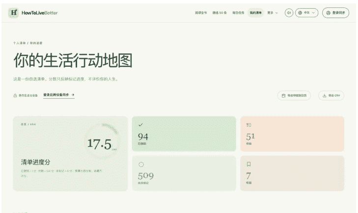

10月1日，国庆第一天。我发现手机用户和电脑用户差不多一半一半，就专门做了一轮手机优化：

底部加了导航栏，单手就能切换小字和按钮都放大了提醒用户把网站添加到手机桌面。Safari、Chrome、Edge、微信里，提示的步骤各不相同首页在手机4G网络下，从6秒才出内容，优化到2.5秒左右最后一条的原因有点意外。网站用了Google Fonts的中文字体。这个服务在国内经常连不上，页面就一直白屏等它。换成手机自带的字体之后，一下子快了很多。

第 5 章 / 44 条建议

### 不要浪费钱

这一节只算钱：能省下多少，每年收益差多少，一笔钱长期平均下来能拿回多少。这些不换算成寿命或时间。涉及投资的条目只讲怎么算账，只用核实过的历史数据，都不构成投资建议。

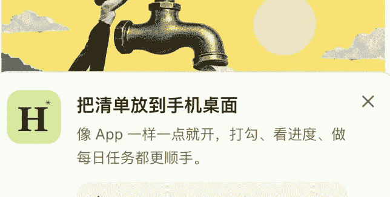

### 把清单放到手机桌面

像 App 一样一点就开，打勾、看进度、做每日任务都更顺手。

点 Safari 的分享按钮（方框加向上箭头，新版 iOS 在 … 菜单里），再选「添加到主屏幕」。

以后再说

10 月 2 日，上线了一个小论坛，叫「高性价比人生实验室」。大家可以分享自己的生活方式、效率工具和实践。发帖时，还能关联书里的某一条建议。

为了防止乱发，帖子发出去先只有自己能看到。审核卡片会推到我的飞书群，我点一下通过才公开。

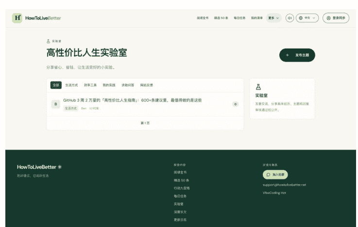

这些改动，我都整理在网站的更新日志里了。

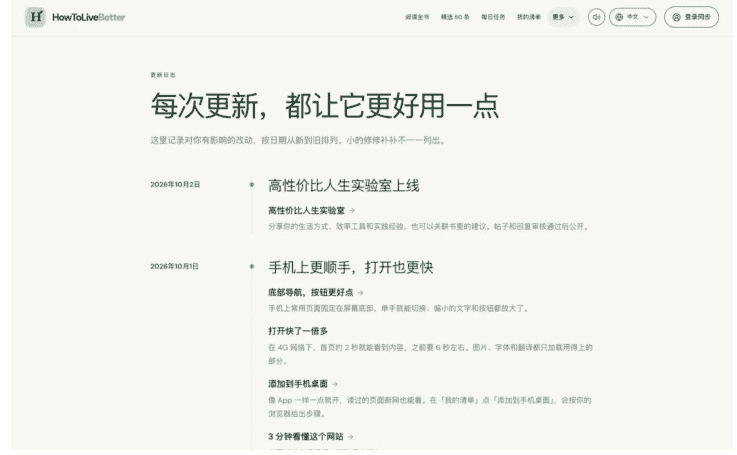

## 五、数据：一周 8808 人，流量从哪来

先看整体。9 月 28 日到 10 月 4 日上午，一共 8808 位用户，5 万多次页面浏览。平均每次停留 6.7 分钟。

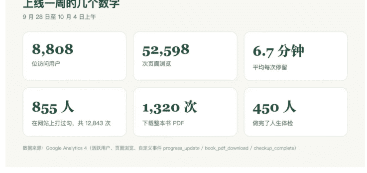

我最看重的是中间那几个数字。855 个人在网站上打过勾，一共标记了 12843 次。1320 次下载了整本书的 PDF。450 个人完成了人生体检。

这说明大家不只是点进来看一眼，是真的在用。每天的访问量是这样的：

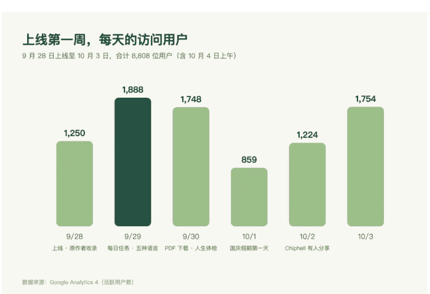

9 月 29 日最高，1888 人。国庆第一天掉到 859，大家应该都出门玩了。10 月 3 日又回到 1754。

再看流量从哪里来：

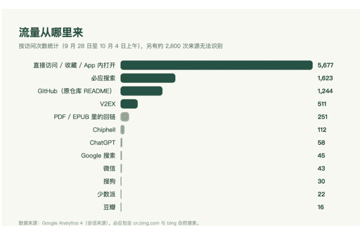

有几个地方，我觉得值得说一说。

- 1. 被原作者收录，是最有价值的一步

GitHub 带来了 1244 次访问，几乎都来自原仓库 README 里的那一行链接。而且它不像 V2EX 只热一天，前五天每天都有一两百次，很稳。

一个 3.7 万星的仓库，每天都有新人进来。这一行链接，相当于一个长期的入口。

- 2. 必应比 Google 多得多
必应搜索带来了 1623 次，Google 只有 45 次。我的用户 75% 在国内，Google 打不开。百度这一周也只带来了 6 次搜索访问。

做面向国内用户的网站，必应的收录要认真对待。（我看了一下百度的搜索结果，主要在给百度自家产品导流，一点都不流外人田）

- 3. 在 PDF 里留个链接
PDF 和 EPUB 里我放了网站的链接，这一项带来了 251 次访问。1320 次下载里，有人看完 PDF 又回到了网站。

做内容的时候，在产出物里留一个回来的入口，成本几乎为零。

- 4. 有人用 ChatGPT 找到了我
ChatGPT 带来了 58 次访问。数量不多，但很可能是有人问 AI 相关的问题，AI 推荐了这个网站。

- 5. 社区帖子来得快，去得也快
V2EX 第一天 278 次，第二天 110 次，第三天 43 次，到 10 月 3 日只剩 4 次。社区发帖适合冷启动，但撑不起长期流量。

## 六、谢谢主动分享的朋友

10 月 2 日，我在后台看到一个新的来源：Chiphell。

点过去一看，是一位网友主动发帖推荐了这个网站。这一帖带来了 112 次访问。

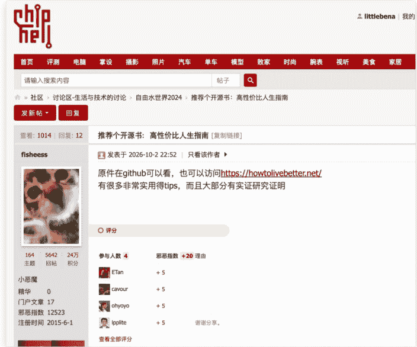

我不认识这位朋友，对方也没有任何理由帮我推荐。看到的时候，真的挺感动的。

除了 Chiphell，少数派、豆瓣、知乎和微信里，也有人在分享这个网站。

一并谢谢大家。

## 最后

回头看这一周，网站本身的技术并不复杂。

它能有人用，靠的是那本书的内容足够好。

我做的事情，只是把「看完就忘」变成「看完能做」。如果你也想学习怎样做出这样的网站，可以看我的「零基础 AI 编程课」，国庆限时额外 8 折（加微信获取优惠） [vibecoding.hot](vibecoding.hot)

网站在这里： [howtolivebetter.net](howtolivebetter.net)

挑一两条，今天就去做吧。

有任何建议和反馈，随时留言。

### 相关数据来源：

网站数据：Google Analytics 4、Google Search Console，统计区间 2026 年 9 月 28 日至 10 月 4 日上午。原书：
github.com/eternity4719/HowToLiveBetter
( CC BY 4.0 )， star 数为 2026 年 10 月 4 日数据

——————分割线——————

看完这篇 SOP，你觉得你懂了。但 90% 的人一到实操就会卡在第一步。

工具和教程只是最低级的壁垒，真正的壁垒是“立刻动手”和“圈层信息差”。

如果你想看全网最新的变现玩法，并且和一群执行力极强的极客一起下场拿结果，欢迎围观我的核心私域：【懒人专属群】。

我们不聊虚的，只做商业闭环的拆解与 AI 效率的压榨。系统内已沉淀 1000+ 跑通的套利实战局。

□ 查阅圈子完整数字资产与上车门槛：

https://lazyso.com/insider/

认同价值、准备好下场干活的，扫码加我微信（lazyhelper1）

备注：【实操上车】，不闲聊

公众号
懒人搜索
懒人专属群

微信：lazyhelper1
