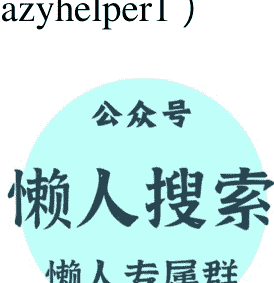

# 真正有效的辅导，是把思考还给孩子

261008
整理：公众号懒人搜索，懒人专属群精选
懒人微信：lazyhelper1

小懒判断 | 初中生家长直接照做，尤其觉得辅导作业鸡飞狗跳的那批；孩子还在小学或已上高中的可以缓读。最值得抄的是数学辅导两问：你最先看到哪个条件想到什么关系、改一个条件原方法还能不能用，第二问把原题丢给 AI 改条件就行，不用自己出题。作文用“第一位读者”定位替代上课改课。坑在于别把追问变成变相审问，多问一句孩子答不上就换话题，逼出标准答案等于把思考又收回去了。

今天是结束假期第一天，很多人就要投入 2026 年最后一个季度的工作。而对家长，尤其是初中生家长来说，除了工作之外，还有另外一场“硬仗”，这就是协助孩子的功课。为什么特别强调“初中”这个阶段？因为这也许是所有年龄段里，辅导功课难度最高的。首先，孩子恰好处在青春期，正是各方面最容易躁动的时候。没有小学时那么配合，也尚未达到高中程度的自觉。其次，课业难度提升，很多题目已经超出家长的能力范围。家长就算想辅导，也未必有插手的机会。

怎么办？关于这个问题，教育专家沈祖芸老师在课程《初中生家长必修课》里，讲过一套很实用的方法。主要针对三个主科，语文、数学、英语。

但在进入具体学科之前，我们得先强调一个贯穿三科的原则。

沈祖芸老师认为，孩子进入初中以后，家长首先需要重新确定自己在学习中的位置。青春期的孩子开始强烈地在意自己的判断和边界。因此，在这个阶段，孩子才是自己学业的负责人，家长需要的不再是代替他做判断，而是负责提供资源、扫清障碍、在必要的时候介入。基于这个总体原则，我们来看几个具体的方法。

## 第一，关于语文。

初中语文里，有一个问题特别让家长无从下手，就是作文。比如，孩子拿回来一篇作文，老师写了四个字，“立意一般”。你把文章从头看到尾，觉得也没什么明显错误。开头有观点，中间有例子，结尾也点题。可是老师说，立意还要再深一点。

那么，到底怎样才算“深一点”？

沈祖芸老师说，很多停留在中间水平的作文，问题未必是孩子没有想法，而是他刚获得第一个正确答案，就停止思考了。题目写“坚持”，马上想到“坚持就能成功”；写“挫折”，马上想到“挫折使人成长”；写“互相学习”，马上写“互相学习能够让人进步”。

这些话都没有错。

问题恰恰在于，它们太容易正确了。题目本身往往已经包含了这个意思，孩子只是把题目的意思重新说了一遍。真正好的立意，通常不是故意把道理说得更大，而是把这个道理再说准确一点。

比如，课程里有一道作文题，题目是“互鉴”。孩子最初可能写：“互鉴可以促进个人和社会共同进步。”往前再走一步，可以变成：“互鉴真正可贵的，不只是让人多学会一种办法，而是借由他人的不同，看清自身经验的局限，再作出适合自己的调整。借鉴因此不是模仿，而是一次重新认识自己。”

你注意，这句话并没有使用更生僻的形容词，也没有故意拔高。它只是多走一步，解释清楚了“为什么互鉴能让人进步”，同时又增加了一条边界，“借鉴不等于照搬”。

那么，父母在这个过程里要扮演什么角色？沈祖芸老师给出的定位叫“第一位读者”。不是坐下来给孩子上一节议论文课，而是认真听他说，他到底想表达什么。

比如孩子写了一篇关于“坚持”的作文，你可以问一问：“这篇文章，你最想让我记住哪句话？”如果他说，“坚持就能成功”，先不要评价“太浅了”。可以继续追问，比如，你觉得坚持就能成功这个道理，是否已经了解？假如人人都了解，为什么很多人做不到？哪些事情可能会阻碍人们的坚持？

这几个问题的目的不是把孩子引向某个标准答案，而是让他再第一反应之外，再多思考一步。

## 第二，关于数学。

数学可能是进入初中以后，家长最容易失去判断力的一门课。小学时，一道题做对还是做错，家长多少还能看明白。到了初中，方程、函数、几何、概率陆续出现，很多家长连题目都未必读得懂。这时候，很容易出现两个极端。要么彻底不管，觉得反正自己也不会；要么只剩下一个最简单的判断，答案对了就是会了，答案错了就是不会。

但沈祖芸老师提醒，初中数学里有一种很常见的情况，叫“题目做对了，却没有真正学会”。

比如一道题，孩子刚刚听完老师讲解，顺着步骤重新做了一遍，你问他“会了吗”，他说会了。这时候他未必是在敷衍。答案还在眼前，步骤也很熟悉，他确实有一种“我已经会了”的感觉。可过几天数字一换，图形转个方向，或者题目的问法稍微变化，他又不知道从哪里开始。

因为他记住的可能只是这道题的步骤，但没有理解题目背后的“为什么”。

怎么办？沈祖芸老师建议，在孩子做完一道题之后，家长可以问他两个问题。答对了，说明真正掌握。没答对，至少暴露了薄弱环节，有了加强的方向。第一个问题：“你最先看到了哪个条件，它让你想到什么关系？”比如一道应用题，如果孩子只能说，“老师说这里要设未知数”，那么他记住的很可能还是老师的操作。但如果他说，“因为这里遇到了一个问题，而要想解决这个问题，需要借用未知数”，这就不一样了。

他开始知道，自己为什么从这里进入。

第二个问题：“如果修改题目里的一个条件，原来的方法还能继续使用吗？为什么？”

这个变化不需要家长自己出题，可以把原题交给 AI，只让它改变一个条件，难度不要提高，也先不要给答案。孩子甚至不用把新题目完整算出来，只需要判断两件事：题目到底更改了什么条件？原来的思路为什么还能用，或者为什么不能用了？

这两个问题其实是在给“会了”找证据。第一问，看孩子能不能找到思路的入口。第二问，看这个思路能不能经受一点变化。

## 第三，关于英语。

很多家庭一提初中英语，注意力首先落在单词量上。但沈祖芸老师提醒，从小学到初中，英语真正发生的变化，不只是一张单词表越来越长。小学英语大多是短对话，人物少，情景简单，还有图片、动作和老师现场提示。到了初中，材料越来越长，孩子不仅要理解一句话，还要把前后内容连起来。听力、阅读、完形和写作，其实都越来越依赖同一种能力：在有限时间里持续处理一段完整的意义。因此，沈祖芸老师建议，家长可以找一本难度合适、孩子自己愿意读下去的英文故事书，让阅读成为主干，再把听、说、写自然调动起来。

但是，书也不能选得太难。随手翻开一页，绝大多数句子不用查词典也能大概理解，偶尔碰到陌生词，仍然能理解文章的大意，这个难度才合适。假如是一页需要查十几个词，再经典的书也会迅速变成另一张单词表。

所以选书时，首先要判断孩子是否对这本书感兴趣。其次，字可低一级，也不要为了“符合年级”强行拔高；如果可以，再尽量选择配有音频的版本，让文字和声音建立联系。最后，尽量选择故事书，因为故事往往有着连贯的叙事，很多人物、情境、事件会持续出现，这对孩子的理解和记忆都更友好。

好，刚才我们说了家长在初中的语文、数学、英语课程方面，可以给孩子提供的帮助。这些方法有一个共同点，家长并不是替代孩子完成思考，而是引导孩子往前再走一步。

借用沈祖芸老师的话说，家庭在学习中最有价值的位置，本来就不应该是“第二所学校”。学校负责教授知识、组织练习、完成评价，而家庭面对的是一个具体的孩子。

对家长来说，重要的也许是知道自己该在哪些地方出现，又该在哪些地方退后。从那个替孩子解决问题的人，变成一个让孩子越来越有能力自己解决问题的人。

关于这个话题，咱们先说到这。假如你还想了解更多的具体方法，沈祖芸老师的《初中生家长必修课》，强烈推荐你来听听看。

（注：《初中生家长必修课》系列课程，在懒人专属群内更新中，群友们自取）

在这个 AI 能替你写代码、写文章的时代，基础技能正在迅速贬值。绝大多数人正被淹没在海量的免费垃圾信息里，陷入低效的体力内卷。

当“努力”不再是壁垒，人与人之间唯一的护城河，只剩下“信息过滤”的效率与“认知系统”的维度。

圈子已稳定运行 7 年。我们每天利用 Python 爬虫与大模型算力，过滤全网最顶级的政经内参和搞钱风向标，做你最冷酷的“外部大脑”。

如果你认同这种“重塑认知防线”的极客主义，欢迎围观我的个人情报智库：【懒人专属群】。

https://lazyso.com/insider/

认同信息过滤价值、想省下每天 3 小时无效阅读时间的读者，扫码加我微信（ lazyhelper1 ）

微信： lazyhelper1
