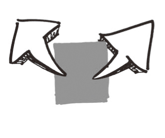
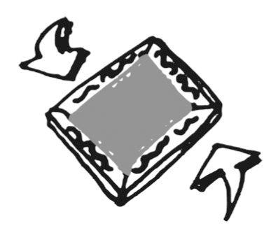
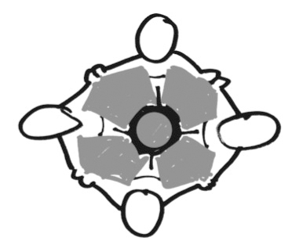

# 引言

如何设计你的人生

埃伦喜欢石头。她收集了很多石头，每一块都是她精心挑选的。她还根据石头的大小、形状、类型以及颜色，对自己收藏的石头进行了分类。埃伦曾就读于一所知名高校。在大三的时候，她需要选择一个专业方向，但对自己将来要做什么，或者希望以后成为什么样的人，埃伦当时并不是很清楚。然而，是时候了，她必须选一个专业，而且地理学专业似乎是一个最好的选择——毕竟埃伦真的非常喜欢石头。

埃伦的父母在得知女儿选了地理学专业时，他们感到非常骄傲——选择地理学专业意味着埃伦未来可能会成为一名地理学家。但是，埃伦大学毕业后并没有找到与地理学相关的工作，她不得不搬回父母家，和他们住在一起，每天只能通过帮人照看小孩或者帮人遛狗赚一点儿钱。她的父母对此感到非常困惑：这可是埃伦高中时兼职所做的工作啊。埃伦名牌大学毕业，他们为她支付了高昂的学费，但她为什么没有成为地理学家？何时才能出现奇迹，让他们的女儿成为一名地理学家？什么时候她才能开始她的事业？她的专业是地理学，地理学家才应当是她的职业目标。

埃伦知道，她并不想成为一名地理学家，她对研究地壳活动、土壤分层以及地球的历史根本不感兴趣，也不想花时间去研究这些。她不喜欢野外工作，不想为某个自然资源公司或者环保机构工作。她不喜欢绘制地图，也讨厌做报告。当年因为喜欢石头这个不成熟的理由而选择地理学专业是个错误。如今，埃伦大学毕业，也拿到了毕业证书，但她却让父母大失所望。如何凭借这张毕业证书找到一份工作，埃伦对此一无所知，她对自己的未来感到十分迷茫。

很多人都告诉过埃伦，大学四年是人生中最美好的一段时光，实际上埃伦丝毫没有这样的感觉。还有一些人和埃伦一样，他们大学选择了一个专业，但工作时并不想从事与该专业相关的工作。实际上，在美国，只有 27%的大学生毕业后所从事的工作和他们所学的专业有关。“你学什么专业，你将来就做什么工作”，以及“大学代表了你人生最美好的时光（随后你的人生就会充斥着无尽的工作和烦恼）”，这显然是两个错误的观念，我们把它们称为“思维误区”——这些谬论误导了很多人，使他们无法设计自己想要的人生。

思维误区：你的学位决定你的职业生涯。

重新定义：3/4 的大学毕业生最后从事的工作都与他们所学的专业无关。

雅尼娜，35 岁，经过十来年的付出，她的事业蒸蒸日上、发展稳定，现在正是她开始享受胜利果实的时候了。雅尼娜从名牌大学毕业后，又进入一流的法学院学习，随后在一家知名的律师事务所工作。在人生的道路上，她实现了每一个“预定目标”，名牌大学、一流法学院、结婚、事业——每一件事都准确无误地按照她的计划进行。凭借自己强大的意志力和努力付出，她获得了自己想要的一切。雅尼娜的人生可以说是一个成功的典范。

但是，在雅尼娜内心深处，却有一个秘密！

雅尼娜工作的律所位于硅谷，在美国非常有影响力。曾有很多个夜晚，她开车回到家，坐在汽车后盖上，看着硅谷亮起的灯光，抑制不住地大哭。她拥有了自己认为应该拥有的一切，实现了每一个梦想，但她却一点儿也不快乐。她知道自己应该为目前创造的生活而欣喜若狂，但她甚至连一丝的愉悦都感觉不到。

雅尼娜觉得自己一定是哪里出了问题。她早上醒来时是一副成功人士的模样，但到了晚上临睡觉前，却总是纠结辗转，感觉自己似乎失去了什么。在拥有了一切的同时又觉得自己一无所有，该怎么办呢？和埃伦一样，雅尼娜被“思维误区”击中。雅尼娜认为，如果她能在忙碌的工作中抓住所有成功的机会，她就会找到幸福。雅尼娜的情况并不是个例——在美国，有 2/3 的职场人士对他们的工作不满意，有 15%的人甚至痛恨他们的工作。

思维误区：获得成功就会感到幸福。

重新定义：真正的幸福源于设计有意义的人生。

唐纳德退休前的收入非常可观，他曾在一个岗位上干了 30 多年。他的家庭也很美满——他的孩子都从大学毕业了，他对自己的退休金也进行了妥善的投资。他曾经工作稳定，生活踏实——每天起床、上班、付账单、回家、睡觉，这就是生活的全部内容。但是，他每天都在重复前一天的生活，一遍又一遍，毫无新意。

多年来，唐纳德不停地在问自己同一个问题。不管他去哪里，他都会问——他在咖啡馆问，在餐桌上问，在教堂问，甚至在酒吧他也会问（在酒吧，有几个爱管闲事儿的苏格兰人曾热情地帮他解答这个问题）。但一次次的询问并没有阻止这个问题的再次出现。在近 10 年的时间里，他经常因为这个问题在凌晨两点惊醒，然后走到浴室的镜子前，问镜子中的自己：“我为什么要这样生活？”

唐纳德从来没有得到过一个满意的答案，他的思维误区和雅尼娜的一样——他们都认为成功的事业可以让自己幸福。和雅尼娜相比，唐纳德处于这种失调状态中的时间更久，而且唐纳德还有另外一种思维误区：他总是情不自禁地重复自己过去常做的事情。要是有人能够告诉唐纳德，他的情况不是个例，他没有必要重复过去就好了。在美国，年龄在 44~70 岁的成年人中，有超过 3100 万的人想要拥有一种“返场事业”——一份既可以体现个人生活意义和社会影响力，又可以继续赚钱的工作。在这 3100 万人中，一些人虽然已经找到了他们的“返场事业”，但仍然有很多人不知道该从哪里入手，而且他们对在这个年龄做出太大的改变感到恐惧。

思维误区：太晚了。

重新定义：设计一种自己热爱的生活，何时都不晚。

三个人，三个大问题！

设计思维的妙用

你可以环顾一下四周（不管是在家里还是在办公室），看看你身下的椅子，你手里拿的平板电脑或手机，你会发现，我们周围的每样东西都是由某个人设计的。在 CD 唱片流行的时期，人们无法随时随地尽情地听音乐，因为没有人会带着一箱子 CD 唱片到处走！要想畅快地享受音乐，该怎么办？有了问题，就会有人去解决，于是有了可以储存 3000 首歌曲、长宽仅一英寸左右的、可以别在衬衫上的 MP3 方形电子设备，让你可以随时听音乐。正是因为一个个的问题，现在你使用的手机尺寸正好符合手掌大小，笔记本电脑的电池可以续航 5 个小时，闹钟铃声可以被设置成小鸟的啁啾声。相对于很多重大事件来讲，闹钟恼人的铃声似乎并不是什么大事，但对那些厌烦了每天早晨千篇一律地听到刺耳的哔哔声的人来讲，这就是一个问题。因为问题的存在，你的家里有了自来水，人们在房屋建造中也使用了绝缘材料。抽水马桶被创造出来是因为一个问题，牙刷的发明也同样源于一个问题。椅子的出现更是因为某个地方的某个人想要解决一个大问题：坐在石头上屁股疼。

\*\*\*

当然，工程问题和设计问题不同。我和比尔都是工程学专业的，工程学能够提供一种解决问题的好方法，前提条件是你不仅收集了大量相关数据，而且相信存在理想的解决方法。比尔曾为早期的苹果笔记本电脑设计铰链（即屏幕与键盘连接的转轴），他和他的团队想出的解决方案让早期的苹果笔记本电脑成为市场上人们最安心的选择。在得出最后的解决方案前，他们设计了很多原型，并且经过了多次的测试。这和设计过程有些类似，但他们的目标是明确的，即创造出一种能够连续使用 5 年的铰链，一种可以让电脑进行正常打开、闭合上万次的铰链。比尔和他的团队实验了多种不同的机械方法，最终实现了目标。一个工程问题一旦被解决，那么其解决方案就可以被重复利用几百万次，这就是工程问题解决方案的优势所在。

下面让我们来看一下什么是设计问题。以早期苹果笔记本电脑的“内置鼠标”为例。那时，使用苹果笔记本电脑几乎随时都要用到鼠标，而普通鼠标需要用连接数据线才能使用，非常麻烦。这就出现了一个问题——显然，这是一个设计问题，它既没有设计先例可以借鉴，也没有一个确定的目标。实验人员绞尽脑汁，想出了各种不同的方法，但经过测试后都被一一否定了。当时，有一个名叫约翰·克拉克欧尔的工程师经常修理小型轨迹球，一天，他突然有了一个疯狂的想法：把键盘尽量向后推，这样就可以留出足够空间安装这个小装置了。实验证明，这正是解决这个问题的重大突破，这个设计也自此成为苹果笔记本的标志性外观设计的一部分。

从美学上来说，产品的外观设计显然属于设计问题，它是一个无论设计师多么辛苦努力都无法找到“正确”解决方案的问题。例如，世界上有很多高性能的运动跑车，每一辆都能够激起你追求疾速的激情，但不管是保时捷还是法拉利，它们在外形上没有任何相似之处。两个品牌的跑车在机械结构方面的设计都很精湛，内部构造几乎完全一样，但就外观而言，从审美的角度看，却各有各的魅力。两个公司的设计师同样都很关注跑车外观的流线设计、线条、前灯以及隔栅的设计，但最后所做的方案完全不同。每一个公司都有自己的设计理念——法拉利跑车倾向于清晰展现充满激情的意大利风格，而保时捷跑车则倾向于展现德国人对速度的追求和严谨的态度。为了让这些工业产品成为“奔跑的艺术品”，设计师花费了大量时间研究美学原理。从某种程度上来讲，这就是我们为什么会说“美学是终极设计问题”的原因。美学与人类情感相关——我们发现，当设计思维和设计者的情感相关联时，它就会成为最佳的问题解决工具。

我们现在面临的问题是：在大学生毕业时，如何帮助他们成为一个富有成效的、快乐的人？而且，在以后的生活中，他们到底要从事哪方面的工作？我们知道，设计思维是解决这个具体问题的最佳方法。设计你的人生并不是要求你制定一个明确的目标，例如设计一个可以使用 5 年的铰链，或者建造一座可以连接两块陆地的大桥，这些都是工程问题。解决工程问题时，你需要收集大量确凿的数据，然后找出最佳的解决方案。

当你有了一个期望（例如，一台便携的笔记本电脑、一辆外观“性感”的跑车，或者美好的未来生活），但眼下却没有一个明确的解决方法时，这就需要你开动脑筋，进行各种疯狂的尝试和即兴创作，不断地朝着目标努力，直到找到一个有效的方法。不管是炫酷的法拉利跑车，还是超便携的苹果笔记本电脑，只要你找到了这个方法，你就会知道它就是你一直在寻找的。一个伟大设计的诞生，不是通过解方程式、表格计算以及数据分析实现的，它有自己的外观和感觉——一种单独对你诉说的靓丽美感。

同样，你精心设计的人生也会有自身的外观和感觉，设计思维会帮助你解决在设计人生时遇到的问题。每一个能够让我们的生活变得更加便捷、更加富有成效、更加幸福快乐的事物被创造出来，都是因为问题的存在——因为在世界的某个地方，总有某位设计师或者某个设计团队在努力寻找方法解决这个问题。我们的生活、工作和娱乐空间都是经过精心设计的，其目的是让我们生活和工作得更好、心情更愉快。在我们的外部世界中，不管我们看向哪里，我们都可以看见设计师解决问题之后所带来的变化。

由此可见，设计思维带来的好处无所不见。

在生活中，你也可以看到设计思维带来的好处。设计不仅是创造出一个很酷的东西（如便携笔记本电脑或者法拉利跑车），而且可以为我们打造一种很酷的生活。你可以利用设计思维为自己营造一种有意义的、快乐的、充实的生活。不论你现在或者过去从事什么工作，无论你年轻与否，你都可以利用设计思维创造并设计你的人生和未来。这种思维可以创造令人惊艳的技术、产品和空间，也可以创造美好的人生。精心设计的人生具有旺盛的生命力——它不仅具有持久的创造力和生产力，而且能够在不断发展中，为你带来各种惊喜。在精心设计的人生中，你得到的将远超你的付出；在精心设计的人生中，你不会感到每天都像被复制一样，枯燥乏味、千篇一律。

斯坦福人生设计课的缘起

一切都始于一顿午餐。

确切来说，这一切始于 20 世纪 70 年代，当时笔者两人还是斯坦福大学的学生（戴夫比比尔入学早一点儿）。比尔兴奋地选择了产品设计专业作为自己的职业方向。小时候，比尔经常坐在奶奶的缝纫机下面画汽车和飞机。他读大学时选择了产品设计专业，是因为他惊喜地发现，在世界上，每天都有很多人在从事设计工作，他们被称为“设计师”。今天，比尔作为斯坦福大学的设计规划项目的执行总监，他依然在绘画和创作，并且指导大学生和研究生的设计课程；此外，他还在斯坦福大学的哈索普莱特纳设计学院任教——这是斯坦福大学的多学科创新研究中心，该学院的所有课程都以设计思维为基础。比尔也在新兴企业和世界 100 强企业工作过——他在苹果公司工作了 7 年，并设计出备受赞誉的笔记本电脑（和前面提到的铰链）；他还在玩具公司工作多年，设计了《星球大战》主题的超级英雄玩具。

对于能够就读于产品设计专业，并早早确定了一条充满愉悦感且可以施展抱负的职业道路，比尔认为自己非常幸运。在我们二人的教学生涯中，我们逐渐意识到，一个人若能够找对专业，早早确定自己的职业道路，是多么难得！很少有学生能够做到，即使是斯坦福大学的学生也不例外。

和比尔不同，戴夫在读大学时对自己将来要做什么并没有一个清晰的概念。他一开始读的是生物专业（稍后会详细介绍），后来转读了机械工程专业——坦白来说，这并不是一个多好的选择。在大学期间，戴夫对“我怎样才能够找到我的人生目标”这个问题也没有得到过任何有益的帮助。最后，他还是成功地找到了自己的人生目标，尽管“非常艰难”，但总算是找到了。戴夫在高科技领域做了 30 多年的行政部门领导和管理咨询工作，他非常享受这份工作。在苹果公司工作期间，他成功地研发了第一款鼠标，并负责苹果早期的激光打印项目。他还是美国艺电公司的共同创始人之一，并且帮助无数年轻的创业者找到了自己的人生目标。虽然戴夫的职业生涯在一开始并不如人意，但后来发展得非常精彩——他一直都十分清楚，寻找人生目标是最难的。

我们两人都开创了自己的事业，生活也很幸福，因此希望能够给我们的学生一些手把手的帮助。比尔在斯坦福大学工作，很多学生找他咨询，希望找到毕业后的人生目标。戴夫在加州大学伯克利分校任教，他在该校开设了一门名为“如何找到你的事业”（又名：你听到事业的召唤了吗）的课程。在 8 年的时间里，这门课他一共教授了 14 次，现在他依然渴望为斯坦福大学贡献更多的力量。一路走来，戴夫和比尔不仅在工作上携手并进，私下里两人也是好朋友。比尔刚担任斯坦福大学设计规划项目的执行总监时，戴夫就知道了。戴夫非常了解这个项目，他意识到，若要成为一名设计师，需要掌握多学科的知识，这很可能会给学生带来沉重的负担——他们需要努力找到一种方法，构想一个具有个人意义并且具有商业前途的事业愿景。于是戴夫决定给比尔打电话，邀请他共进午餐，问问他的想法——看看会发生什么。如果此次谈话顺利，他们可能需要多次共进午餐以继续讨论这个话题，而若想看到成果，大概需要一年的时间。

这也就是为什么我们会说“一切源于午餐”。

没想到，午餐刚进行了 5 分钟，我们就达成了一致。我们决定一起在斯坦福大学开设一门全新的课程，运用设计思维帮助大学生设计毕业后的人生。这门课一开始只针对设计专业的学生，如果进展顺利，将面向全体学生。

如今，该课程已经成为斯坦福大学最受欢迎的选修课之一。

有人问我们在斯坦福大学具体做什么时，我们偶尔会给出一个经过精心设计的颇有内涵的答案：“我们在斯坦福开设的课程可以帮助所有学生——在大学期间，或者大学毕业后，利用设计思维的创新原则解决有关人生设计的棘手问题。”当然，他们会继续问：“太棒了！不过，这是什么意思？”

我们通常会说：“我们教授的课程能够告诉你如何利用设计，确定你未来的人生目标。”这时，几乎每个人都会说：“哇！我能上这门课吗？”多年来，对这个问题我们都给予否定的回答，至少对斯坦福大学的 16000 多名学生而言，我们的回答都是否定的。现在我们终于不用说“不”了——我们已经开设了一个面向所有人的工作室，即“设计你的人生”（网站是：www.designingyour.life），而且我们两人合著了本书，这样，即使你没有机会在斯坦福大学读书，也可以设计自己的人生了。

不过，在开始设计人生前，你必须要问自己几个很难回答的问题。

重新定义你的人生

就像唐纳德每晚都会在镜子前不停地问自己“我为什么要这样生活”一样，每个人对自己的生活、工作，以及自己在这个世界上生存的意义和目标都存有类似的困惑。

•我如何才能找到一份自己喜欢的甚至是热爱的工作？

•我如何才能创立一番伟大的事业，过上美好的生活？

•我如何才能平衡好生活和工作之间的关系？

•我如何才能实现自己的人生价值？

•我如何才能变得苗条、性感，并拥有巨额财富？

除了最后一个问题，上述其他问题我们都可以帮你找到答案。

每个人都遇到过这样的问题：“你长大后想做什么？”这是一个非常基本的人生问题——不管我们是 15 岁还是 50 岁。设计师喜欢提问，实际上，他们喜欢的是“重新定义问题”。

“重新定义”是设计师应该具有的最重要的设计心态之一，很多伟大的创新都起源于“重新定义”。在提到设计思维时，我们经常会说：“不要从问题开始，要以人为本，抱持同理心。”一旦设计师与使用他们设计的产品的顾客有了同样的感受，他们就会确定设计理念、开动脑筋、进行头脑风暴和原型设计、挖掘他们不了解的地方。显然，这就是“重新定义”，即“轴点运动”。“重新定义”是指当我们对某个问题获得新的信息后，重新阐述我们的观点，重新开始思考并进行原型设计。例如你一开始觉得自己正在设计一个产品（一款新的混合咖啡和新款咖啡机），当你意识到自己实际上是在“重新设计”一种咖啡体验（如星巴克）时，你就是在“重新定义”。又如，你试图帮助贫苦大众，不再借钱给富裕阶层（贷款给富人），于是你给那些因过于贫困而无法偿还钱款的人借钱（如小额贷款机构和孟加拉乡村银行）。还有苹果公司团队推出的平板电脑系列，事实上也是对手提电脑的一种全方位的“重新定义”。

在人生设计中，我们经常会进行重新定义，其中最主要的原因是：人生不可能被设计得很完美，你的人生不可能只有一种活法。这是好事！你可以对自己的人生进行多次设计，而所有设计的目的都是为了打造一种充满创造性，具有无限希望和意义的生活。生活不是一件物品，而是一种体验，设计并享受这种体验会带给你无限的乐趣。

对于“你长大后想做什么”这个问题，我们重新定义一下，可以改为：“长大后，你想成为谁？”生活的真谛在于让我们成长和改变。生活不会静止不动，生活不仅仅是为了让我们到达某个目的地；生活也不是一次性回答了上述问题，就万事大吉了。没有人真正知道自己想要做什么，即使是那些选择了做医生、律师或者工程师的精英人士也是一样，这些职位只是人生路上一个模糊的方向。在人的一生中，会有无数问题不停地出现，人们所需要的是一个过程——一个人生设计的过程，在这个过程中，找到自己究竟想要什么、想要成为什么样的人，以及如何拥有自己理想中的生活。

欢迎“设计人生”

设计人生，意味着踏上了前进的道路，它可以帮助埃伦跳离大学专业的束缚，找到工作；它可以帮助雅尼娜摆脱现在的生活，过上她想要的生活；它还可以帮助唐纳德解决让他夜不能寐的那个问题。设计师会想象出一些原本不存在的东西，然后去建造，进而改变世界。你也可以这样做——你可以想象一种根本不存在的工作或者生活，然后据此塑造一个未来的你，进而改变你的生活。如果你很满意现在的生活，你热爱目前的状态，那么人生设计也可以让你的生活变得更加美好。

当你像一个设计师一样思考时，当你愿意提问题时，当你意识到生活就是设计以前并不存在的事物时，那么你的生活就会变得超乎想象、绚烂多彩。也就是说，如果你喜欢魅力四射的精彩生活，这便是了。毕竟，这是你自己的人生设计。

组建设计团队

在斯坦福大学的人生设计课上，学习设计思维及人生设计的学生已经超过了 1000 人。我们可以非常自豪地说，没有一个学生在设计人生时失败。实际上，他们也不可能失败——我们两个人加起来有 60 多年的授课经验，我们曾经将这个方法教授给无数人，包括高中学生、大学生、研究生、博士生、20 多岁的年轻人、中年高管以及希望开启事业“第二春”的退休人士。

作为老师，我们一直秉持着“一日为师，终生为师”的准则。如果你上了我们的课，我们会永远和你在一起。很多学生毕业多年后，依然会回来找我们，向我们讲述从人生设计课上学到的技巧、方法和思维是如何对他们的人生产生重要影响的。坦白说，我们两人希望并且坚信我们的理念也会给你们带来重大影响。

我们知道，斯坦福大学是一个凡事讲究严谨的地方。虽然奇闻趣事听起来不错，但在学术界却没有什么意义，而且数据最有说服力。眼下设计思维课程并不多见，我们的课程就是其中之一，它们都是经过科学研究证实，能够给学生带来重大影响的课程。曾有两位博士生专门就本课程做过研究，结果显示，学习我们课程的人能够更好地设计自己的人生，并且能追求自己想要的事业；他们不仅很少出现“思维误区”（即阻止我们前进的、错误的想法），而且能提出好想法，对生活的构思能力也大大增强了。所有这些策略都具有显著的“统计学意义”，这就是说，我们在课上所教授的方法和进行的练习，以及我们在本书中所介绍的方法和练习已经被证明是非常有效的，这些方法和练习可以帮助你们找到自己的人生目标，并且告诉你们如何去实现自己的梦想。

首先，我们要清楚，人生设计的确是一种高度个性化的行为。我们会为你提供一些技巧、方法和练习，但我们无法为你解决一切问题。我们不可能代替你思考，也无法改变你的看法，更不可能让你一下子就“顿悟”。但是，如果你使用了我们介绍的技巧，并做了练习，那么你将彻底明白你想要什么样的生活。有一个事实我们必须承认：世上有无数个“版本”的你，他们都是“正确的”。不论在生活的“影城”中，现在正在上演哪个版本的你，人生设计都将帮助你顺利融入其中。记住，没有错误的答案，我们不会给你打分评级。我们建议你做本书提供的练习项目，但在书后没有相关答案告诉你，你做得怎么样。在本书每个章节的后面，我们都会添加一些回顾练习，即课后练习——我们强烈建议大家能够尝试着做一做，这是设计师自己经常做的练习。我们不会拿你和任何人进行比较，你也不应该和他人进行比较。在这里，我们将和你共同创造新的人生，你可以把我们看作私人设计团队的一部分。

事实上，我们建议你走出去，组建一个设计团队——团队成员可以一起阅读本书，一起做练习；在团队中，你们可以彼此合作、互相支持、一起精心设计生活。随后，我们将详细介绍如何组建设计团队。现在，你的首要任务是阅读本书。很多人认为，设计师都是特立独行的天才，他们独自工作，等待灵感的闪现，寻找设计问题的解决方法。但事实并非如此。设计师有时是一个人工作，如设计工具或新式儿童积木，这样的设计通常只需要一个人就可以解决。但是，在高科技社会中，解决每一个问题几乎都需要设计团队的合作。在注重设计思维的今天，人们尤其重视团队合作。事实表明，最伟大的成果都源于团队的深度合作。深度合作的基本原则是，不同背景的、技术手段各异的、生活经历不同的人组成一个团队，共同努力。这样做不仅能够让团队成员透彻理解客户的需求，而且不同背景的人相互合作也有助于创造出别具一格的解决方法。

在斯坦福大学的设计学院，这一点已经得到了多次证明。由设计学院研究生组成的团队包括各个专业的学生，如商科、法律、工程、教育和医学，他们总是能够提出具有突破性的创新想法。把这些团队成员紧紧黏合在一起的是设计思维和以人为本的设计方法，团队充分利用了不同背景的学生的优势激发合作和进行创造。这些学生在报名参加我们的课程时，没有任何一个人学过设计。在团队建立之初，大家都非常努力并且高效。他们必须学会设计师的思维方式——尤其是深度合作和关注过程。很快，他们就发现，作为一个团队，整体的力量远远超过个人的力量，这让他们信心大增。很多成功的学生项目和创新公司，如 D-Rev 和 Embrace，都来自这个过程；同时，他们也证明了合作是完成设计不可或缺的方法。

所以，你可以做一个人生设计的天才，但不要认为设计天才一定要特立独行、独自创作不可。

像设计师一样思考

在开始设计人生之前，你需要学会像设计师一样思考。我们会给大家介绍一些简单的方法，但首先你需要明确一点：设计师并不是在“思考”他们未来的人生路，他们是在“创造”前进的人生路。这是什么意思呢？这意味着你不仅要凭空想象出许多和现实世界（或者真实的你）没有任何关系的有趣的事物，你还需要创造新事物（我们称之为“原型”），并进行测试练习。在这个过程中，你会体验到很多乐趣。

你想改变自己的职业吗？本书将帮助你实现这个改变。但你必须立刻行动起来，不要干坐着，而是应确定最终的目标。在这里，我们将教你像设计师一样进行思考，帮助你塑造未来，创造原型。印刷机、电灯泡和网络的发明离不开旺盛的好奇心和丰富的创造力，今天我们将激发你的好奇心和创造力，带领你迎接挑战，设计你想要的生活。

设计人生的焦点是工作和事业。我们必须承认，我们大部分时间都在工作，每天至少花 8 小时工作。工作有可能给我们带来巨大的快乐，这是生活的意义所在；工作也有可能带给我们无尽的痛苦，让我们感到上班的每一分钟都是煎熬，是在浪费时间，并且迫切渴望周末的到来。但是经过精心设计的人生绝对不会令你感到枯燥、乏味。是的，你活着绝不是为了一天把 8 个小时浪费在你憎恨的工作上，你不能虚度光阴。

这听起来可能有点儿夸张，但很多人都认为他们的生活状态就是这样。即使是那些幸运地找到自己喜欢的工作的人也经常有挫败的感觉，他们认为很难为自己设计一种平衡的生活。现在，是时候换种思维方式来思考一下了——对每一件事都要这样。

本书将介绍设计思维的 5 种基本心态，并教会大家如何应用它们进行人生设计。

这 5 种基本心态分别是：好奇心，努力实践，重新定义，专注和深度合作。它们如同 5 个设计工具，你可以用它们建造一切，包括你热爱的生活。

保持好奇。好奇心能够帮助人们挖掘事物的新鲜感，激发人们探索的欲望，让一切变得更有趣。最重要的是，好奇心会让你“好运连连”——这就是人们四处寻找机会的原因。

不断尝试。当你勇于付诸行动时，你就是在为自己打造一条不断前进的人生路。不要坐在那里空想，行动起来！设计师都乐于探索和尝试，他们会创造一个又一个原型。虽然经常失败，但他们从不放弃，直到找到解决问题的方法。有时，他们会发现问题与他们一开始设想的完全不同。设计师乐于接受改变，他们不会纠结于某一个特定结果；在他们眼中，没有最终结果，他们只专注于接下来要出现的东西。

重新定义问题。重新定义是指设计师转换其思维模式，摆脱困境的方法。通过重新定义，我们能够认识到问题的关键点。人生设计的关键就是重新定义问题，在重新构建的过程中，你可以退一步思考，重新审视自己的喜好，开启全新的解析空间。在本书中，我们将重新定义那些妨碍大家生活和工作的思维误区。要想找到真正的问题，找出正确的解决方法，重新定义问题是关键。

专注（了解人生设计是一个过程）。生活常常是复杂而混乱的，当你前进一步时，有时看起来你正在向后倒退。生活中的你可能会犯错，也可能会抛弃自己的原型。在这个过程中，你必须学会“放手”——不要纠结于自己最初的想法，放弃那个“不错但并不精彩的”解决方案。有时，令人惊艳的设计可能诞生于混乱之中。女士紧身衣就是在混乱中被发明的，不粘锅、万能胶、橡皮泥也都是这样被发明出来的。如果没有某位设计师在某个地方制造的一场混乱，这些东西可能就不会存在了。当你学会像设计师一样思考时，你就会知道“这个过程”意味着什么。人生设计犹如一段旅途，不要纠结哪里是最终的目的地，而是专注于过程，看看接下来会发生什么。

深度合作（寻求帮助）。在设计思维中，尤其是在谈到人生设计时，深度合作尤为重要。最优秀的设计师都知道，伟大的设计需要许多人的深度合作，需要一个团队共同完成。在海风吹拂的海岸上，一位画家能够独自创作出一幅艺术杰作，但单凭一位设计师却无法完成 iPhone 手机的创造，这与海风和沙滩无关。你的生活更像是一项伟大的设计，而不是一件艺术品，因此你无法独自创造它。你无须独自想出一个精彩的人生设计方案，设计是一个过程，需要与他人合作，最出色的想法大多源于很多人思维的碰撞。你需要做的，就是去问，但一定要知道自己应该问什么。通过本书，你将学会如何利用人生导师和支持团队，为自己设计人生。当你拥抱世界，世界必然会回馈你，你的生活也会随之改变。换句话说，人生设计和其他设计一样，也是一种团队活动。

激情是善于人生设计的结果

很多人都会陷入一种思维误区，他们认为只要找到让自己充满激情的事情，一切问题就迎刃而解了，似乎一旦某件事让他们激情澎湃，其他的一切就会奇迹般地明朗起来。我们并不赞同这种观点，一个非常明显的原因就是：大多数人并不知道自己的激情所在。

我们的同事威廉·戴蒙是斯坦福大学青少年研究中心的主任。他发现，在 12 岁到 26 岁的青少年中，只有 1/5 的人对于他们将来想要做什么、想要取得怎样的成就有一个清晰的愿景。同样，我们的教学经验也表明，有 80%的人并不是真的很了解自己的激情所在。

因此，求职者在与职业规划师谈话时，通常会出现如下对话：

职业规划师：“你最感兴趣的事是什么？”

求职者：“我不知道。”

职业规划师：“嗯，那等你找到答案后再来吧。”

一些职业规划师会对咨询者进行测试，评估他们的兴趣和优势，或者调查他们的技能，但参加这种测试的人都知道，测试结果并不意味着最后的结论。另外，知道了自己将来可能成为一名飞行员、工程师或者一名电梯修理工并没有太大的作用或者可借鉴性。因此，我们对能够让你充满激情的事情并不感兴趣，你真正需要的是花时间培养一种激情。研究表明，对于大多数人来讲，当他们尝试了某件事后，他们便会对这件事产生兴趣，进而去掌握它、精通它。由此可见，激情是一种美好人生设计的结果，而不是原因。

很多人都找不到一件能够让他们充满激情的事情——一个独一无二的动机，可以促使他们做出重要的人生抉择，让人生的每一步都目标明确、充满意义。如果你觉得研究软体动物从寒武纪到现在的交配习惯和生理进化是你的目标，那么我们向你致敬；查尔斯·达尔文花了 39 年的时间研究蚯蚓，我们向达尔文致敬。我们并不赞同把 80%的人排除在外的人生设计方法，实际上，大多数人都对各种各样的事情充满了激情，唯一可以了解他们想要什么的方法就是提供一些潜在的人生原型，并进行测试，看看是否会和他们产生共鸣。我们郑重提醒大家：如果是为了设计出你热爱的人生，那么你没有必要知道自己对什么充满激情。一旦你知道如何对你的人生路进行原型设计，你就已经踏上了正道，而你对它有没有激情并不重要。

设计出美好的人生

精心设计的人生是一种有意义的生活，它可以让你、你的信仰以及你的行为实现和谐统一。当你拥有了精心设计的人生时，如果有人问你“最近怎么样”，那么你可以告诉他，你的生活相当不错，并且可以告诉他你是如何生活的。精心设计的人生是一系列精彩事件的集合，包括你的经历、冒险、成败，让你变得更强大的艰难时刻，以及取得成就时的满足感。我们必须强调的一点是，所有人的一生中都会经历失败和挑战，即使是精心设计的人生也是如此。

我们将帮助你设计出专属于你的精彩人生。我们的学生和顾客都认为这是一个既有趣又充满无限惊喜的过程。我们必须向你说明，有时在这个过程中，你可能会远离你的“舒适区”。我们将会让你做一些让你感觉违背常理的事情，或者与你过去的认知不一致的事情。

保持好奇

不断尝试

重新定义问题

专注

深度合作

你可以思考一下，在你做这些事情时，发生了什么？当你致力于人生设计时，发生了什么？实际上，的确有一些非同寻常的事情发生了——一些你渴望的事情开始出现在你的生活中。例如，你听说你梦寐以求的职位出现了空缺，你碰到了一直想见的人。为什么会这样？对于初学者来说，这就是我们早些时候提到的“好运连连”，这是好奇心和潜意识的结果，是发挥 5 种基本心态的作用带来的意外收获。另外，发现自我和了解自己的过程将对你的生活产生非同寻常的影响。当然，这需要你付出努力、采取行动，但令人惊讶的是，好像每个人都在对你伸出援助之手。当你意识到人生设计是一个过程，那么在前进的途中，你将拥有无限乐趣。

在人生设计的过程中，我们会伴你左右，引导你，向你发出挑战。我们将为你出主意，为你提供所需的技巧和方法。我们将帮你找到你的下一份工作，开创你未来的事业。我们将帮助你设计你的人生——一种你真正热爱的生活。

本书由“[ePUBw.COM](http://epubw.com)”整理，[ePUBw.COM](http://epubw.com) 提供最新最全的优质电子书下载！！！ 
