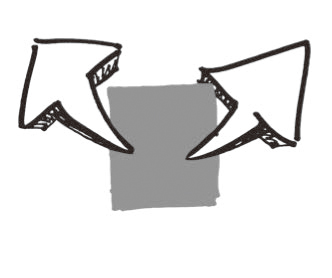
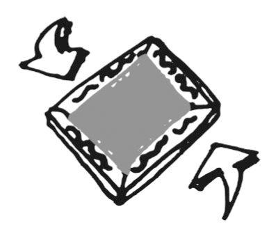
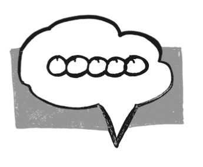
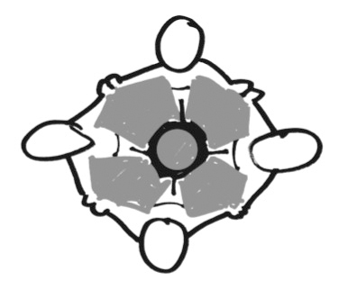

# 引言 人生不是单选题

埃伦从小喜欢石头，收集、挑选、分类，乐此不疲。选专业时，她顺理成章地选了地理学，父母也以为女儿将来会成为地理学家。可毕业后，她并没有找到对口工作，只能搬回父母家，靠遛狗、看孩子赚点零花钱。她很快明白：自己并不想研究地壳运动、土壤分层，也不爱野外作业、绘制地图和做报告。问题不在于她不够努力，而在于她把“专业”误当成了“职业判决书”。

在美国，只有27%的大学毕业生从事的工作与所学专业相关，约四分之三的人最终走向了别的领域。所以，第一个要拆掉的思维墙是：学位不会替你锁定一生，专业只是起点，不是终点。

第二个故事更扎心。35岁的雅尼娜一路名校、法学院、知名律所，结婚、事业、收入，样样都踩在“成功模板”上。可很多个夜晚，她把车停在硅谷的住处外，坐在车后盖上大哭。她拥有了自己以为该拥有的一切，却感受不到快乐。她一度怀疑是自己出了问题。其实，她只是被另一个误区困住了：以为成功会自动带来幸福。现实是，美国有三分之二的职场人对工作不满意，15%的人甚至痛恨自己的工作。

幸福不是成功的尾款，而是有意义生活的副产品。真正需要设计的，不是更漂亮的履历，而是能让自己愿意投入的人生。

第三个故事关于“时间”。唐纳德在同一个岗位上干了30多年，收入可观，家庭美满，孩子大学毕业，退休金也安排妥当。可他总在凌晨两点醒来，走到浴室镜子前问自己：“我为什么要这样生活？”这个问题他问了近十年。美国44岁到70岁的人群中，有超过3100万人想要一份“返场事业”——既能体现个人意义和社会影响，又能继续赚钱。很多人不是不想改变，而是害怕在这个年纪重新开始。

可热爱的生活，什么时候开始设计都不算迟。

这三个人的困境看似不同，底层却是同一种错误算法：把外部标准当成人生答案。设计思维提供的，不是一套标准答案，而是一种重新提问、反复试错的方法。

环顾四周，你坐的椅子、拿的手机、用的牙刷，都是因为某个问题被设计出来的。工程问题通常有明确目标和最优解，比如苹果早期笔记本的铰链，要能正常开合上万次、连续使用五年，团队可以不断测试直到达标。设计问题却不同：没有现成先例，也没有唯一正确答案。像笔记本的内置鼠标，像法拉利和保时捷的跑车外观，机械结构都可以很精湛，但审美与情感相连，方案可以完全不同。也正因如此，设计问题需要同理心、重新定义、头脑风暴、原型测试，甚至需要一点疯狂的尝试。

设计人生，正是一个设计问题。人生更像一段可以迭代的体验，而不是一件一次成型的物品。它不可能被设计得完美，也不该只有一种活法。你可以先做一个“原型”，小步尝试，收集反馈，再调整方向。设计师最常用的动作之一，就是把问题换个说法。与其问“长大后想做什么”，不如问“长大后想成为谁”。生活不是一次性答完的问卷，而是一个不断寻找、不断塑造的过程。

这套方法怎么来的？一切始于一顿午餐。比尔大学读产品设计，后来在苹果工作7年，参与设计过备受赞誉的笔记本铰链，也做过《星球大战》主题玩具；戴夫读书时从生物转到机械工程，后来在高科技领域做管理和咨询30多年，参与过苹果第一款鼠标和早期激光打印项目，还是美国艺电公司的共同创始人之一。两人是好友，戴夫深知学生需要一套能构想“有个人意义、也有商业前途”的人生愿景的方法，于是约比尔吃饭。没想到午餐开始5分钟，两人就决定在斯坦福开一门新课，用设计思维帮大学生设计毕业后的人生。课程从设计专业学生起步，后来面向全体，成为斯坦福最受欢迎的选修课之一。如今，他们又把方法写进书里、开成面向所有人的工作室，让没机会走进斯坦福课堂的人也能用上这套工具。

设计人生，能帮埃伦跳出专业的束缚，帮雅尼娜找回真正的快乐，也帮唐纳德回答镜子里那个反复出现的问题。如果你正卡在专业、成功或年龄的焦虑里，不妨像设计师一样：先承认没有完美答案，再做一个小原型，找同伴反馈，边试边改。设计人生不是孤军奋战，记得组建设计团队。

你完全可以想象一种现在还不存在的工作和生活，然后一步步把它造出来。欢迎设计人生。

在斯坦福大学开的一门关于人生设计的课上，已经有超过一千人走过这个课堂。我们可以很负责任地说，到现在还没有人卡在人生设计这件事上。事实上，从某种程度上讲，失败几乎不可能发生——两位老师加起来的教学年限已经超过六十年，把这套方法带给过高中生、大学生、博士生、二十多岁的年轻人、中年管理者，还有想开启人生第二段旅程的退休者。

我们一直把师生的关系看得很长。上了课就是一辈子的联系，毕业多年后依然会有学生回来，跟我们聊这门课里的工具和思维如何实实在在改变了他们的日常。坦白说，我们也希望这些理念能给阅读到这里的你带来同样的冲击。

斯坦福很讲究证据，我们也不例外。听起来很励志的故事在学术里不够，数据才有说服力。目前专门做设计思维的人生课并不多，我们的课就是其中之一，而且是被研究验证过的。两位博士生曾对课程做过独立研究，结果很明确：学过这门课的人更会为自己的人生做设计，更能去追寻想要的职业方向；他们陷入的限制性思维更少，产生好点子的能力更强，对生活的构想力明显提升。所有这些差异都达到了统计学意义，换句话说，课堂上和书里的方法和练习，被证实确实有效，能帮你找到人生目标并知道怎么去实现。

先说清楚，人生设计极其个性化。我们能提供的是一些思路、工具和练习，但无法替你把所有问题都解决了。没法替你思考，也改变不了你的三观，更做不到让你瞬间开悟。但如果你真去用这些工具、去做练习，你会越来越明白自己想要什么样的人生。

这里还有一个重要事实：有很多个“你”是成立的，而且都是对的。现在演在生活舞台上的是哪一个版本，人生设计都能帮你更好地落座。没有标准答案，也没有打分。我们会建议你完成书里的练习，但在书后不会给你正确答案，也不会拿你和其他人比较，你也不需要比较。我们是陪你一起创造新的人生，可以把我们当成你私人设计团队的一员。

更进一步，我们建议你真的组建一个小团队——几个人一起读、一起做练习，在互动里互相支持、互相挑刺，一起把生活打磨出来。后面会详细讲怎么搭团队。现在最重要的是先读下去。

很多人以为设计师都是孤僻的天才，等灵感降临再单打独斗。现实不是这样。设计师有时会一个人干活，比如设计一个工具或积木，这类项目一个人就能搞定。但在今天的高科技语境里，几乎所有难题都需要团队合力。越重视设计思维，就越重视合作。最顶尖的成果基本都来自深度协同。深度协同的底气在于，来自不同专业、技术路径各异、人生经历迥异的人一起干，这样既能更透彻理解需求，也更容易迸发出独特的解法。

斯坦福设计学院就是反复验证了这一点。参与的都是来自商科、法律、工程、教育、医学等不同背景的研究生，他们报名时没有一个人学过设计。起初大家都很认真、效率很高，很快学会了设计师的思考习惯，尤其是深度协作和关注过程。他们体会到，团队的整体力量远大于个人，信心也随之起来。D-Rev、Embrace 等成功的学生项目和创新公司就诞生在这个过程中，它们也证明了合作是设计不可或缺的方式。

所以，你可以成为人生设计的高手，但别觉得高手就得孤军奋战。

像设计师那样思考

在动手设计人生前，先学会用设计师的脑子。我们会介绍一些很简单的方法，不过首先要搞明白：设计师不是在“想”未来的路，而是在“造”未来的路。这意味着你不能只空想一些跟真实世界或真实的你无关的有趣点子，还要造出原型并去测试。在这个过程中，往往特别好玩。

想换职业？这本书能帮你，但别干坐着立刻行动，确定方向后再往前推。我们会教你像设计师那样思考，去塑造未来并制造原型。印刷术、白炽灯、互联网的出现，都离不开旺盛的好奇心和创造力，今天我们要点燃你的好奇心和创造力，带你迎接挑战，设计想要的生活。

人生的核心焦点其实是工作和事业。我们大部分时间都在工作，一天至少八小时。工作可以带来巨大的快乐，成为意义感的来源；也可以带来无尽的痛苦，让人觉得每一分钟都在浪费，急着盼周末。精心设计的人生不会枯燥乏味，你不需要把八小时浪费在自己讨厌的事上，生命不该被虚耗。

这听起来可能有点夸张，但很多人的人生状态就是这样。哪怕是运气不错找到喜欢的工作的人，也常感挫败，觉得很难为自己构建平衡的生活。是时候换一种思维方式了，对每件事都适用。

本书会介绍设计思维的五种基本心态，并教你如何用它们来设计人生。

这五种心态是：好奇心、动手实践、重新定义、专注以及深度合作。它们像五件设计工具，你可以用它们搭建一切，包括你热爱的生活。

保持好奇。好奇能让人挖掘新鲜感，点燃探索欲，让一切更有趣。最关键的是，好奇会带来“好运”——机会往往是好奇的人先撞见的。

不断尝试。当你敢于行动，你就在为自己铺路。不要空想，动手做。设计师喜欢探索和试错，他们会不断做出原型。虽然会失败，但从不轻易放弃，直到问题被解决。有时他们会发现问题跟最初设想的不一样。设计师拥抱变化，不执着于单一结果，在他们眼里没有终点，只有下一个要发生的事。

重新定义问题。重新定义是设计师跳出困境的转换思维方式。通过重新定义，我们能抓住问题的关键。人生的关键也在于此：退一步，重新审视自己的偏好，打开新的分析空间。书中会帮助你重新定义那些阻碍生活和工作的思维误区。要找到真正的问题与正确解法，重新定义是核心。

专注，记住人生设计是一个过程。生活常常混乱，迈步向前有时看起来像后退。你会犯错，也会丢弃原型。这个过程中要学会放手——别死守最初的想法，放弃那个“还行但不够精彩”的方案。有时候惊艳的设计正诞生于混乱。女士紧身衣、不粘锅、万能胶、橡皮泥，都是在混乱中诞生的。学会像设计师那样思考，你就懂什么是过程。人生的旅途不必执着终点，专注当下，看看接下来会发生什么。

深度合作，寻求帮助。在设计思维里，尤其在人生设计中，深度合作至关重要。顶尖设计师都知道，伟大的设计需要多人协作。一个人能画出艺术品，但 iPhone 绝不可能由一个设计师完成。你的生活更像一项伟大设计而非艺术品，无法单打独斗。你不需要独自想出完美方案，设计是过程，需要协作，最好的点子往往来自思维碰撞。你要做的就是去问，而且要问对问题。书里会教你如何借助人生导师和支持团队来设计人生。当你张开双臂拥抱世界，世界也会回馈你。人生设计和其他设计一样，本质上就是团队活动。

激情是结果，不是起点

很多人陷入一个误区：觉得只要找到激情，一切难题就迎刃而解，似乎有激情就一定会柳暗花明。我们不认同这个说法，最直接的原因是，大多数人根本不知道自己的激情在哪。

我们的同事威廉·戴蒙是斯坦福青少年研究中心的主任，他发现 12 到 26 岁的青少年中，只有五分之一的人对未来想做什么、想取得什么成就有一个清晰愿景。我们的教学经验也显示，约八成的人并不真正了解自己的激情所在。

于是求职者在职业规划师面前常出现这样对话：

规划师：“你最感兴趣的是什么？”

求职者：“我不知道。”

规划师：“那等你想清楚再来吧。”

有些规划师会做兴趣和优势测评，但参加过的人都知道，结果不等于结论。知道自己可能成为飞行员、工程师或电梯维修工，并没有太大借鉴价值。我们对“找到激情”这件事本身并不感兴趣，你真正需要的是花时间去培养激情。研究表明，大多数人在尝试某件事之后才会产生兴趣，进而精通它。所以激情是美好人生设计的成果，而不是原因。

很多人找不到能让自己热血沸腾的事——一个能驱动重要抉择的唯一动机。如果你的目标是研究软体动物从寒武纪到现在的交配习性，我们向你致敬；达尔文花了 39 年研究蚯蚓，我们向他致敬。我们不赞同排除八成人的设计方法。实际上大多数人对很多事都能产生激情，关键是提供一些可能的人生原型，然后去测试它们是否与你共鸣。我们郑重提醒：为了设计出热爱的人生，你没必要先搞清自己对什么充满激情。一旦你学会为人生做原型设计，你已经走上正轨，有没有激情并不重要。

设计出美好的生活

精心设计的人生是一种有意义的生活，它让你的信念、行为和体验保持一致。当有人问你最近怎么样，你可以说生活不错，并且能讲清自己是怎么过来的。精心设计的人生是一系列精彩事件的集合：经历、冒险、成败、让你变强大的艰难时刻，以及达成时的满足感。我们必须强调，每个人一生都会遇到失败和挑战，即使是精心设计的人生也不例外。

我们会帮你设计专属于你的精彩人生。我们的学生和客户都觉得过程既有趣又充满惊喜。有时你会离开舒适区，做一些违背直觉或与过去认知不一致的事。

保持好奇

不断尝试

重新定义问题

专注

深度合作

你可以回想一下，当你做这些事时发生了什么。当你投入人生设计时发生了什么。确实有一些不寻常的事在发生——你渴望的东西开始出现，比如梦寐以求的职位空缺，或遇见一直想见的人。为什么会这样？对新手来说，这就是我们说的“好运连连”，好奇心和潜意识在起作用，是五种基本心态带来的意外收获。自我觉察和了解自己的过程也会对生活产生非凡影响。当然需要付出努力和行动，但惊讶的是，好像每个人都在伸手帮助你。当你明白人生设计是一个过程，前进的路上会有无限乐趣。

在人生设计的旅程里，我们会陪着你，引导你，给你挑战。我们会出点子，提供技巧和方法。我们会帮你找到下一份工作，开创未来的事业。我们会帮你设计一种真正热爱的生活。