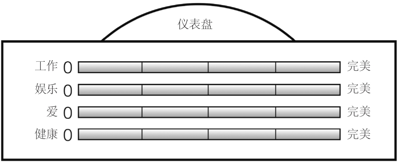
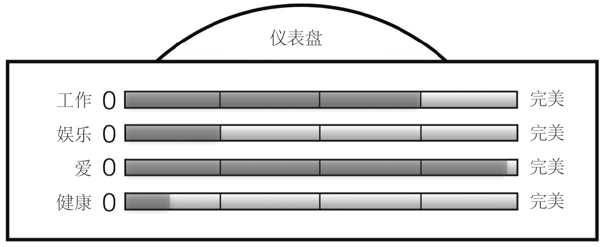
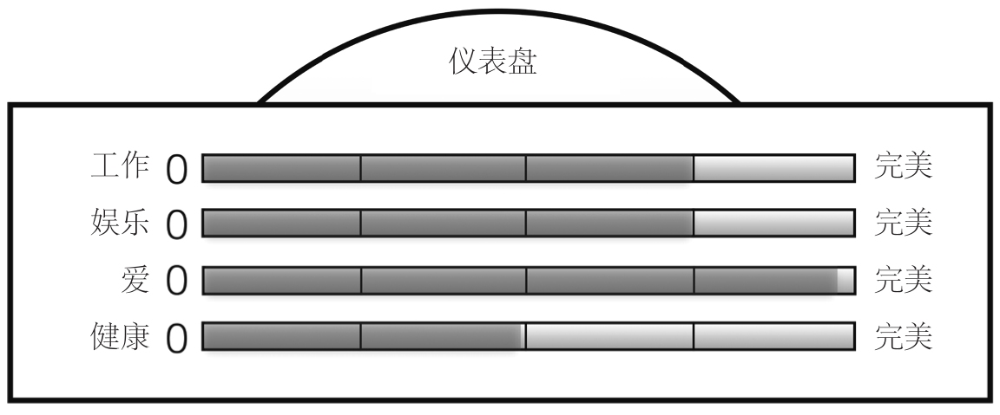
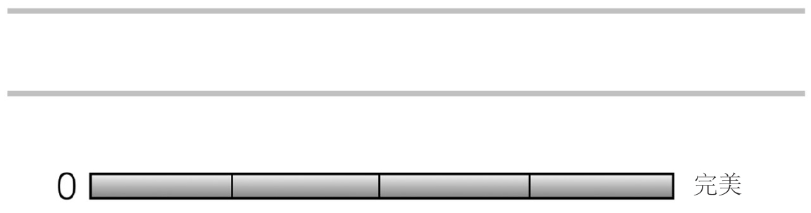
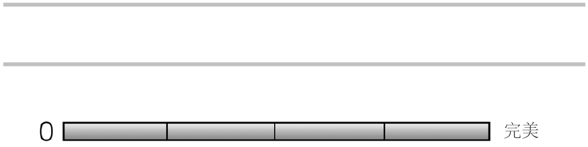
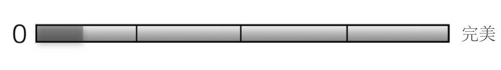
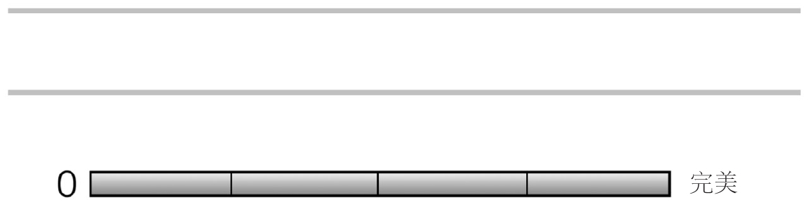
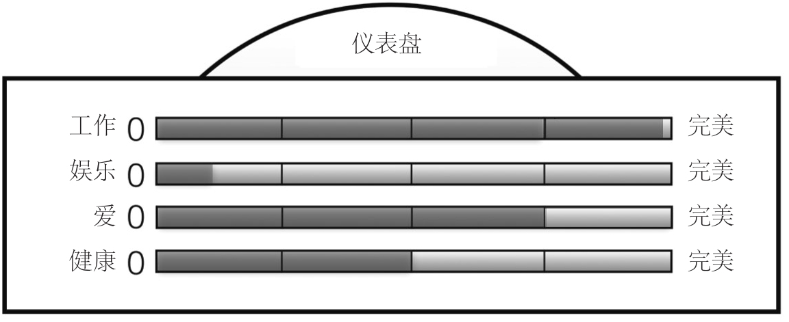
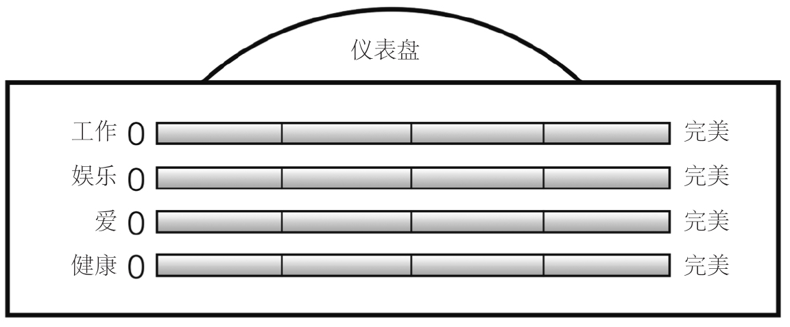

# 第一章 分析测评你目前的生活

在斯坦福大学的设计工作室有这样一个标牌，上面写着“你在这里”（You are here）。我们的学生都非常喜欢这句话。这个标牌告诉我们：“你来自哪里、未来将走向何处、你拥有什么样的工作或者事业，或者你认为你应该拥有什么样的工作和事业，这些都不重要。不管你多么不擅长设计人生，不管你当下处于什么境况，设计思维都可以帮助你开创前进之路。但在确定前进的方向之前，你需要知道自己所处的位置，知道你现在正在奋力解决的人生设计问题是什么。”正如我们前面介绍的，设计师喜欢问题，当你像一个设计师一样思考时，你处理问题的思路就会完全不同。那些能够让设计师兴奋的问题被他们称为“邪恶的”，这是因为这类问题都没有最终的解决方案。面对现实吧，你愿意阅读本书，那么说明在生活中的某个方面，你确实遇到了问题。

是的，你遇到了一个“邪恶的”问题，而这就是我们进行人生设计的最恰当也是最令人兴奋的起点。

发现问题+解决问题=精心设计的人生

在设计思维中，我们不仅重视解决问题，而且重视发现问题。想想看，如果你连问题都没找到，又何谈解决呢？实际上，发现问题并不是一件简单的事情，我们必须慎重对待。有时，你觉得自己需要换份工作，但你实际上并不知道自己真正需要的是什么。有时，你在处理问题时，就好像在做加减法一样，期望得到某个东西（加法）或失去某个东西（减法）。的确，我们都想得到更好的工作、赚更多的钱、获得更大的成功、有更多的储蓄、减掉近 10 斤的体重、避免不幸、消除痛苦，但我们并不清楚自己为什么感到不满，只是模糊地感觉自己想要一些不一样的东西，或者其他更多的一些东西。

通常，我们会以自己所缺少的事物来定义问题，包括以下情况：

•你遇到了问题。

•你的朋友遇到了问题。

•所有人都遇到了问题。

问题可能会与你的工作、家庭、健康、爱情、金钱等其中的一个相关，也可能和所有的事情都相关。有时，问题似乎非常棘手，让你感到无能为力，你只能默默忍受——这样的问题就像一个烦人的室友，虽然你总是对他抱怨连连，但是从来没有想过把他赶出去。你的问题变成了你的故事，让你陷入其中无法自拔。在你做的所有决定中，确定待解决的问题是其中最重要的一个，因为经常有人花费了数年甚至毕生的精力去解决一个错误的问题。

戴夫就曾遇到过困扰他数年、让他无法自拔的问题。刚考上斯坦福大学时，戴夫学的是生物专业，但他很快意识到，他不仅讨厌这个学科，而且他还时常考试不及格。实际上，戴夫高中毕业时，他曾坚信自己注定要成为一个海洋生物学家的。他之所以有这样特别的理想是因为两个人——法国著名的海底探险家雅克·库斯托和他的生物老师施特劳斯女士。

雅克·库斯托是戴夫儿时心目中的英雄。雅克制作的《雅克·库斯托的海底世界》节目，戴夫每一集都看过。戴夫非常喜欢海豹，他认为世界上最酷的事情就是以和海豹玩耍为职业。戴夫还特别想知道海豹是在水中还是在陆地上进行交配的。（多年后，随着搜索引擎的出现，他知道绝大多数物种都是在陆地上进行交配的。）

此外，在高中时，戴夫的各科成绩都非常优秀，但他学得最好的是生物，因为他最喜欢生物老师施特劳斯女士。施特劳斯女士讲课非常生动，戴夫认为，正是因为施特劳斯女士教得好，所以他才对生物产生了浓厚的兴趣。

因此，在雅克·库斯托和施特劳斯女士的双重影响下，戴夫读大学时选择了生物专业，而且坚持了两年。戴夫认为他当时正在解决的问题是“如何成为一位海洋生物学家”，或是“如何像雅克·库斯托一样，成为‘海洋之神’”。上大学时，戴夫坚信自己会成为一个海洋生物学家，但斯坦福大学没有开设海洋生物学专业，于是他选择了生物学。结果，他发现自己并不喜欢这个专业。那时，生物学专业的课程大多和生物化学及分子生物学有关，而且戴夫的专业课差得一塌糊涂，他的梦想——说着法语、以和海豹嬉戏玩闹为职业的梦想也随之破碎了。

对生物课不感兴趣、专业课成绩不好——戴夫觉得这一切都是因为自己没有接触到真正的科学，因此，他决定做一些真正的科学研究，比如进一步了解海豹的交配习性。于是，他开始在实验室“研究核糖核酸”，实际上他大多数时候都是在清洗试管，这不仅让他感到无聊，而且让他对这个专业更加难以忍受。

那时，生物助教经常问戴夫为什么选择生物专业。当戴夫告诉他们是因为施特劳斯女士、雅克·库斯托和海豹时，他们会打断他说：“你生物学得不好，你并不喜欢这个专业，这让你非常暴躁，对大家也不友善。你应该放弃这个专业！你擅长的是辩论，或许你可以成为一名律师。”

尽管大家都觉得戴夫不适合这个专业，但他依然固执地认为自己一定会成为海洋生物学家，他认为自己的“问题”在于成绩不好。因此，他继续努力学习，想要提高考试分数。他一门心思纠结在自己以为的“问题”上，以至于忽略了真正的问题——他就不应该选择生物专业，“注定成为海洋生物学家”的想法从一开始就误导了他。

由此可见，人们经常花费大量时间在错误的问题上，这种现象已经屡见不鲜。如果他们足够幸运，便会很快遭遇失败，然后迫于无奈去寻找真正的问题。如果他们没那么幸运，而且非常聪明，那么他们将取得成功——我们把这种成功称为“成功灾难”，然后十年后才会醒悟过来，不断地问自己：“我是怎么走到这一步的？我为什么不幸福？”

戴夫想成为一名海洋生物学家的梦想破灭了，他不得不承认自己的失败，并且转了专业。显然，专业不适合——这个别人可能只需要两周就能解决的问题，戴夫却纠结了两年半。他最终转到了医学工程专业里，这让他非常快乐，而且学得非常好。但是，他依然希望自己有一天能够和海豹嬉戏玩耍。

## 辨识无法解决的“重力问题”

如果戴夫在高中毕业时能够像设计师一样思考，他就不会武断且盲目地决定自己的大学专业，而是会对一切都充满初学者般的好奇和求知欲。拥有了初学者的心态，他就会弄明白海洋生物学家到底在做些什么，然后向一些专家咨询。他可以去斯坦福大学霍普金斯海洋站咨询生物化学专业的具体情况，他会做一些尝试，花些时间去外海，这样就可以感受到这类工作是否和电视上的一样富有魅力。他有可能登上一艘考察船，进而有机会和真实的海豹近距离接触。但这些他都没有做，只是根据自己心中的构想选择了生物专业。

那么，你也是这样吗？你也经常固执地坚持自己最初的想法，不管事实证明这个想法多么糟糕，你也不想放手？现在的你是否依然坚持最初的梦想，认为不需要调查研究就可以知道问题的答案？你是否会经常自省，看看自己是否找到了真正的问题？

“我需要一份更好的工作”——这并不能解决你下面的问题——“我工作不顺心，还不如在家陪孩子”。一定要注意，好问题并不代表它是你真正面临的问题。不要去解决这样的问题，不要在办公室解决婚姻问题，不要用一顿大餐来消除工作烦恼，否则你就会像戴夫一样，浪费大量的时间在错误的问题上。

此外，我们往往会陷入“重力问题”的泥沼。

“我最近遇到了一个大麻烦，不知道怎么办。”

“哦，简，什么问题？”

“重力。”

“重力？”

“是的——烦死我了！我感觉整个人非常沉重——骑自行车上坡时也越来越困难，那种沉重感总是跟着我，我不知道如何去除它。你能帮助我吗？”

这个例子听起来似乎有点儿蠢，但是我们经常会听到各种版本的“重力问题”。

“在目前的文化环境中，作为一个诗人，不仅收入低，而且也不受尊重，我该怎么办呢？”

“我工作的公司是一家家族企业，已经传承了 5 代人。作为一个‘外人’，我根本没有机会晋升到管理层，我该怎么办呢？”

“我失业 5 年了，现在更难找到工作了，这太不公平了，我该怎么办呢？”

“我想重新回到学校念书，然后成为一名医生，但这至少需要 10 年的时间。我不想花费这么长的时间，我该怎么办呢？”

以上都属于“重力问题”，也就是说，它们并不是真正的问题。这是因为在设计人生的过程中，如果一个问题不能被解决，那么它就不是真正的问题。让我们再强调一遍：如果一个问题不能被解决，那么它就不是一个问题。它只是一种情况，一种环境，一种生活现实；它像重力一样，是一个无法解决的问题。

这里有一个小小的诀窍，它有助于你节省大量的时间——几个月、几年，甚至几十年。这个诀窍就是——接受现实。我们拼命与现实抗争，利用所拥有的一切去改变现状，但不论你怎样做，现实永远是赢家。你无法打败它，无法欺骗它，也无法让它屈服于你的意志。

现在不能，以后也不能。

## 重力问题

明确如何解决所谓的重力问题是非常重要的。记住，我们的重点是让你不要纠结于那些无法付诸行动、无法解决的问题。但是，当你纠结于重力问题时，你就会深陷其中、无法摆脱，因为你什么也做不了。

重力问题有两种情况——一种是完全无法解决的问题（如地球重力的问题），一种是不具有可操作性的问题（如提高诗人平均收入的问题）。我们应该搞清楚困扰自己的问题究竟是一个不可解决的重力问题，还是一个棘手的、需要付出很大努力、承担很大风险的问题。下面，我们来分析一下。

妨碍自行车上坡的重力。你不可能改变地球的重力。要想改变地球重力，只有改变地球的运行轨道才可以实现，这是不可能的，接受现实吧。当你接受这个事实时，你的视野就会开阔，你就会寻找其他可行的方法来解决这个问题。骑自行车上坡时，如果骑车人想减轻重力的影响，可以买一辆更轻便的自行车，也可以试着减减肥，或者了解更有效的爬坡新技术（研究证明，骑小轮自行车且快速蹬时，上坡会变得更容易。上坡所需的更多的是耐力，而不是力量）。

诗人的收入。要想改变诗人收入的平均数，你必须先改变诗歌的市场需求，让人们购买更多的诗歌作品，或者为诗歌付更多的钱。你可以写信给编辑、大赞诗歌，也可以在你家附近的咖啡馆里举办一个“诗歌之夜”的聚会，然后挨家挨户地敲门，请大家来参加。但是，这样做成功的可能性非常小，我们依然建议你接受现实。如果你能够听从我们的建议，你的注意力就会被转移，进而为其他问题寻找解决方案。

失业 5 年的求职者。如果你曾经失业很长时间，那么想再次进入职场则是十分困难的。研究表明，大多数雇主都不会招聘有过长期失业经历的人。显然，大家会毫无理由地相信，你长时间找不到工作一定有非常充分的理由。这就是一个重力问题——你不能改变雇主的看法，与其企图改变别人的看法，你还不如思考一下如何改变自己。例如，你可以考虑从事一些志愿性质的工作，列举自己的专业成果（最好不要提自己过去的报酬有多低）；你也可以去一些对年龄歧视不那么严重的行业找工作。（对于自己能够在后来进入教师行业，戴夫心中充满了感激。现在，戴夫的年龄被看作智慧的源泉，他也不必在年龄比他小一半的客户面前假装自己是营销专家了。）即使面对严峻的现实，你也可以找到自己能够胜任的工作——找到它，立刻采取行动，不要再和重力对抗！

家族企业的“外来者”。在过去的 132 年间，公司的管理层都是由家族内部的人担任，没有一个外姓人。但是，你觉得只要自己工作表现突出，耐心静候时机，三五年后你就会成为公司副总裁。好吧，你可以花上三五年的时间去等待时机，但是，你要清楚，你未必会成功。我们觉得买张彩票更实际一点儿，你有其他选择——你可以秉持初衷，但应选择一家不是家族企业的公司。要知道，只有接受了现实，你才能拥抱美好的生活。换个角度思考这家家族企业：值得信赖的企业、可观的收入，都是你职业安全感的来源。没有了连续升迁的可能性，你也就不必要承担过多的责任——你可以平衡好工作和生活，也可以寻找更感兴趣的事情去做，放弃对权力的追逐。你可以在工作岗位上创造出新价值，促进公司发展、增加利润，成为某个方面的专家，做一个职场达人。也许你永远不会成为公司的副总裁，但你有可能成为工资最高的中层管理人员。如果你获得了期望中的工资，谁还会在乎一个头衔呢？

用 10 年时间攻读医学博士。这也是一个重力问题，除非你打算把改革医学教育作为你人生设计的起点。因此，你能做的就是改变你的想法。在美国的各大医院里，绝大部分诊治病人的工作都是由住院医师负责的。如果你不能改变你的生活，那么你可以改变你的想法；也可以选择换一条路试试，比如成为一名医师助理，医生的工作很多都是由助理来完成的。你还可以选择进入保健领域，比如在一家理念先进的保险公司开展疾病预防项目，虽然这类工作和临床治疗无关，但你依然可以在健康领域做出贡献。

\*\*\*

关键是，当你在某件事上没有任何成功的可能时，不要死揪住不放。你可以确定一个远大的目标，比如食品安全、男女平等、环保等。但在采取行动时，请选择明智的方法。如果你的思想开明，能够接受现实，你就可以重新构建一个可解决的问题，设计出一种应对方法，发挥你的作用。这就是我们的目的——我们会尽可能为你提供最佳方案，让你拥有你想要的生活。我们将帮助你在现实生活中设计美好且真实的人生，而不是一个虚幻的世界。

面对重力问题，唯一的解决途径就是接受它。这是优秀的设计师在一开始必须明白的——这就是“你在这里”这句话的含义，即设计思维中的“接受”阶段。接受，也是设计人生的起点。人生设计的起点不是你希望到达的地方，更不是你认为自己应该在的地方，而是你当下所处的真实位置。

## 人生设计评估

从当下所处的位置开始人生设计，我们需要把生活分成若干个不同的区域——健康、工作、娱乐和爱。正如我们之前提到的，我们大部分的注意力都集中在工作上，但是只有在工作与生活达到平衡时，你才会明白如何设计你的工作。因此，你首先要知道自己在哪里，并且对你的情况进行评估，对你的生活进行盘点，清楚地描绘你的现实情况，并回答一个老生常谈的问题：“你最近怎么样？”下面，我们首先来看看需要评估哪些方面的内容。

健康（Health）。从人类文明初期开始，善于思考的人已经认识到了健康的重要性。我们谈到的健康是指良好的思维、身体和精神状态——即情绪健康、身体健康和心理健康。如何权衡这三方面的健康情况由你自己决定，而且你要时刻关注自己的健康。在回答“最近怎么样”这个问题时，你的健康程度将成为你评估生活质量的重要因素。

工作（Work）。我们所说的“工作”是指你参与的人类在地球上不间断的伟大的探险活动。你也许会得到报酬，也许不会，不管怎样，这便是你正在“做”的工作。如果你在经济上还没有独立，那么通常你至少有一部分“工作”是有报酬的。大多数人都会同时做多种“工作”。

娱乐（Play）。娱乐就是为了快乐。我们所谓的“娱乐”指的是用手指蘸着泥巴作画，而不是足球争霸赛。任何活动都可以被称为“娱乐”，只要你从中感受到了快乐。“娱乐”活动既包括有组织的活动、各种竞赛，也包括生产性的活动。在做这些事情的时候，如果你只是为了寻找快乐，那么这就是“娱乐”。但是，当进行一项活动时，如果你的目的是为了获胜、进步或实现目标，即使你在其中感受到了快乐，我们也不能说它是娱乐活动。

爱（Love）。我们都知道“爱”是什么，我们也都知道自己什么时候拥有爱。是爱让世界转动，没有了爱，生活就失去意义。我们不会尝试着给“爱”下一个定义，我们也没有什么行动方案可以帮助你寻找真爱，但是，你必须关注“爱”。爱有多种类型，如亲情、友爱和爱情；爱可以来自很多人，如父母、朋友、同事以及爱人。你和他人，彼此分享了情感，有了爱，那么也就产生了亲密感。在你的人生中，谁爱你？你又爱谁？你是如何爱他们的？他们又是如何将爱给予你的？

在生活的这 4 个领域，每个人都有需要进行调整或重塑的地方。首先，你应挑选出需要设计的领域，然后对选定领域的设计方法进行探索。当你开始打造前进的人生路时，你会需要觉知和好奇心这两种设计思维模式。

下面这个练习将帮助你确定你的位置以及你准备处理的设计问题。如果你不知道自己当下的位置，就无法知道自己未来的方向。

现在，请做下面的练习。

这也是我们的标识牌上写着“你在这里”的原因。

## “健康/工作/娱乐/爱”仪表盘

评估当前情况（“你在这里”）的一个方法就是关注我们提供的“健康/工作/娱乐/爱（HWPL）仪表盘”。把它想象成你汽车仪表盘上的测量仪。通过汽车上的测量仪，你能够了解爱车的情况，比如，是否有足够的汽油完成旅途？润滑油是否可以让发动机运转顺畅？发动机是否过热？是否需要打开散热器？同样，根据 HWPL 仪表盘，你可以了解自己在这 4 个方面的情况，为你的人生旅途提供充足的能量和关注点，让生活顺利地运转起来。

思维误区：我应该已经知道自己的目的地了。

重新定义：只有你了解了自己现在的位置，你才能知道如何到达目的地。

我们将请你评估一下你的健康状况、工作方式、娱乐情况以及你拥有爱的现状。在我们的图表中，健康在最下面，因为一旦你失去了健康，那么其他的一切都无从谈起。虽然工作、娱乐和爱也非常重要，需要我们特别关注，但它们都是以健康为基础的。我们想要强调的是，在这几个领域之间并不存在一个完美的平衡模式。在人生的不同阶段，我们对健康、工作、娱乐和爱的关注度也是不同的。一个刚从大学毕业的单身年轻人，可能身体特别健康，他在娱乐和工作方面所占的比重很大，甚至还没有经历过一段深刻的恋爱。一对年轻的夫妻，有了孩子后，他们可能依然有很多时间娱乐，但这时的娱乐和单身或者没有孩子时的娱乐又有了很大的差别。人到中年，健康成为他们尤其关注的方面。关于这 4 个方面，你会找到适合自己的比例搭配。

当你考虑健康问题时，我们建议你不要只是做体检。在人生设计中，你不仅要有健康的身体，还要有积极的心理状态，要经常进行精神上的修行。我们所说的“精神修行”并不一定非得是宗教性质的，任何高于我们自身信仰的精神活动都可以被称为“精神修行”。另外，健康的这几个方面也没有一个客观、完美的平衡比例，你只能在主观上感觉，如“我很知足”或“若有所失”。

虽然我们并不追求健康各个方面的完美平衡，但下面的这个图表会时不时向我们提出警告，告诉我们有什么地方出错了。这个表格可以作为一个指示器，就像汽车仪表盘上的故障信号灯一样，及时提醒我们靠边停车，查找哪里出现了问题。

以实业家弗雷德为例。一天，弗雷德在看到他自己的“仪表盘”后发现，在健康和娱乐这两项上，他几乎没有任何显著的记录。他的“仪表盘”是这样的：

弗雷德的“仪表盘”

弗雷德非常注重家庭生活，他花了很多时间陪伴妻子和家人——创业可能会给夫妻关系带来严峻挑战，因此，他非常满意自己在“爱”一栏的评估结果。他愿意放弃大部分的娱乐时间，因为创业让他“累得要死”，所以这一方面的失衡他可以接受。但是，这个结果让他认识到，在健康方面他也出现了问题——在他的“仪表盘”上，健康一项已经亮起了红灯。“要想成为一个成功的、高效能的实业家，尤其是在承受高压的创业初期，我不能生病。我需要重视健康问题，尤其是在刚开始创业时。”于是，弗雷德雇了一个私人教练，一周健身三次，并且利用上下班时间聆听具有挑战性的智力有声读物。报告显示，在他做了调整之后，他的工作效率更高了，而且他对工作和生活的满意度也大大增强了。

黛比是苹果公司的一名产品经理，最近为了她的双胞胎孩子，她辞职了。令人惊讶的是，她发现自己的“仪表盘”状况良好。“我原本觉得，既然我不再工作了，那么仪表盘上的‘工作’一栏一定是亮红灯的。现在我明白了，如果我正确看待我为家庭和孩子所做的一切，那么我实际上就是在工作，而且工作起来也更有效率。目前，我非常注重自己的身心健康，以确保我和孩子们相处起来快乐愉悦。这个仪表盘证明了我做出的选择是正确的，我应该辞职在家陪伴孩子们。”

黛比的“仪表盘”

这就是弗雷德和黛比的 HWPL 评估结果，下面我们来看一下你的仪表盘。

你的健康评估

正如我们之前所提到的，健康不仅是指良好的身体状况，还包括情绪和心理上的健康。健康的这三个方面哪个更重要完全取决于你。健康也不单单是指良好的体检报告。请快速评估一下自己的健康情况，然后填写你的评估表（我们将以比尔填写的仪表盘为例，供大家参考）。

你对自己健康情况的评估不仅会影响到你对自己生活质量的评估，还会影响你未来的生活，以及如何重新设计以后的人生之路。

健康

比尔的健康评估

健康：我的身体一直很健康，在体能上也还不错，就是胆固醇有点儿高。要想达到理想体重，我需要减掉 14 斤。由于缺乏运动，我的身材有点走样。如果我稍稍跑几步，就需要停下来喘口气。我会阅读关于生活、工作和爱的哲理，还会阅读关于心理和健康方面的最新研究成果，但我记忆力越来越差了。每天早上我都会对自己说一句积极向上的话，这完全改变了我的人生观。自从我儿子 21 年前出生，我就参加了一个男子社团，团队成员既是我的指导者，也是我的朋友，我们一起经历了很多心灵之旅。我觉得我的健康状况达到了“1/2”的状态。

你的工作评估

列一个清单，写出你所有的工作方式，然后从整体上评估你的工作情况。假设在你的清单上，有一些工作会让你得到报酬，包括朝九晚五的工作，兼职工作，以及其他顾问或咨询类的工作等。如果你固定在某个组织中担任志愿者，也把这一点记下来。如果你是一个家庭主妇，那么一定要明白，养育孩子、为家人烹饪、照顾年迈的父母、做家务都属于“工作”内容。

工作

比尔的工作评估

工作：我在斯坦福大学工作，为大家提供私人咨询服务。我在工作坊教授“设计人生”这门课程。VOZ 是一家公益性质的新兴企业，我是该公司董事会成员（无偿）。

你的娱乐评估

娱乐是一种活动，在进行这项活动时，你必须是单纯为了追求快乐。娱乐活动包括有组织的活动，也包括生产性的活动，但都是为了寻求乐趣，而不是追求价值。我们坚信，每个人都需要娱乐。人生设计非常关键的一步就是确保你生活中的每一天都能有一些娱乐时间。列一个清单，记录下你的娱乐方式，然后完成娱乐评估——1/4，1/2，3/4，还是达到了完美状态？

娱乐

比尔的娱乐评估

娱乐：我的娱乐活动就是为朋友做大餐，组织大型户外派对——就这些。

（顺便说一下，比尔认为自己在这方面已经亮起了红灯。）

你的爱的评估

我们都认为，爱让世界运转，没有了爱，世界将黯淡无光，毫无生气。我们也知道，我们必须多多关注爱。爱有多种形式——首先是男女之爱，对孩子的爱紧随其后，然后是对其他人、宠物、团体或其他事物的情感。爱与被爱同样重要——爱是双向的。想想看，在你的生命中，爱流向了何方？流向了你？还是流向了他人？做一个列表，完成爱的评估。

爱

比尔的爱的评估

爱：在我的生活中，爱体现在很多方面——我爱我的妻子，爱我的孩子，爱我的父母和我的兄弟姐妹；同时，他们也以各自的方式爱着我。我爱伟大的艺术，尤其是绘画作品，没有什么比绘画更能触动我。我喜欢各种形式的音乐——音乐让我开心，也让我悲伤。我喜欢世界上所有让我震撼的风景——不管是人造的，还是大自然的杰作，我都喜欢。

回顾一下比尔的仪表盘，看看他在娱乐和健康方面存在问题。亮起的“红灯”表明比尔需要注意这些方面了。

比尔的“仪表盘”：娱乐一项亮起“红灯”

## 像设计师一样思考

通过健康/工作/娱乐/爱仪表盘，你对自己当前的概况已经有了了解，知道了一些有关自身的数据。只有你才能搞清楚自己在哪方面存在不足，而且立刻就可以了解。

在阅读了更多章节，并且掌握了更多的技巧后，你可能想重新做一下这个评估，看看是否有什么变化。既然人生设计是一个不停歇的实验、一个原型迭代的过程，那么一路走来，你将会面对无数出入口。如果你能够像设计师一样思考，你就会知道，工作永远做不完，娱乐会永远继续下去，爱不会消失，健康也远未达标。因此，看到这 4 个方面的评估结果，对此你是否认真地思考过？在哪些方面需要改善呢？或许你已经遇到了一个“邪恶”问题？如果你认为这是一个邪恶问题，要看看它是不是一个“重力问题”。问问自己，这个问题是否可操作。另外，在你的仪表盘上，平衡非常重要，不要想象在你的生活中会出现完美的对称或者绝对的均衡，把健康、工作、娱乐和爱进行平均分配是不可能的，当然也不能让生活完全失去平衡，不然一定会出现问题。

比尔发现，他的娱乐评估所占比例太低了。那么，你的娱乐评估是否只占了 1/4？你的工作是否已经满格，甚至超负荷了？你关于爱的评估比例是多少？你的健康情况又是怎样的？你的心理健康情况怎么样？也许，你已经意识到自己需要在生活中重新设计或者做出一些调整了。

当你开始像设计师一样思考时，请记住：预测未来是不可能的。由此可见，一旦你设计了某个目标，它就会改变你潜在的未来。

设计人生会改变你潜在的未来，这一定会让你感到不可思议。

因此，虽然你无法知晓未来，但是在你开始进行人生设计之前，你至少应该充分了解自己的起点。现在，你必须找到正确的人生方向，所以你需要一个指南针。

小练习

健康/工作/娱乐/爱 仪表盘

1.就这 4 个方面的情况写几句话。

2.在每个仪表盘上标出你的位置（0~完美）

3.在这 4 个方面，你是否存在需要解决的问题。

4.你的问题是不是一个“重力问题”？

本书由“[ePUBw.COM](http://epubw.com)”整理，[ePUBw.COM](http://epubw.com) 提供最新最全的优质电子书下载！！！ 
