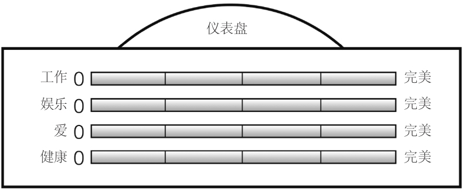
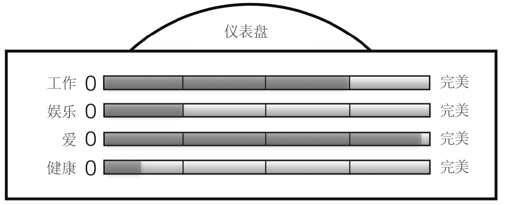
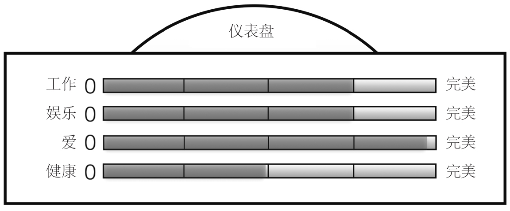
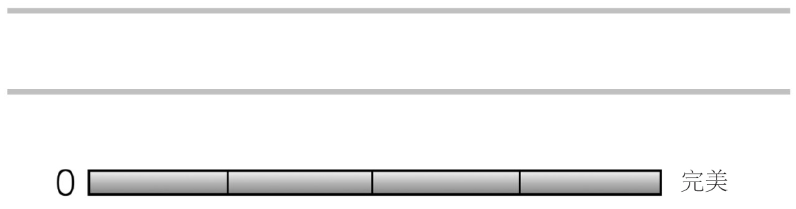
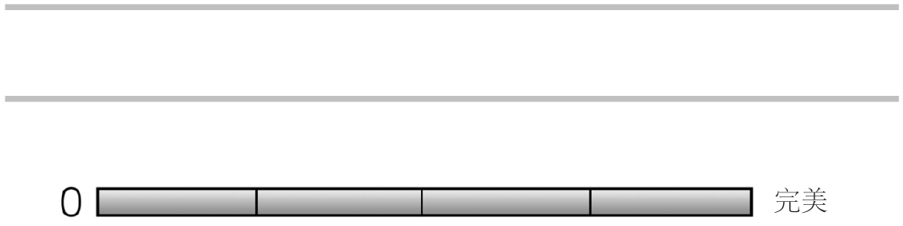
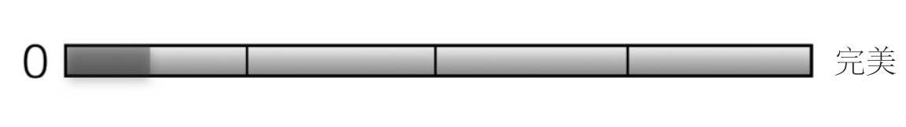
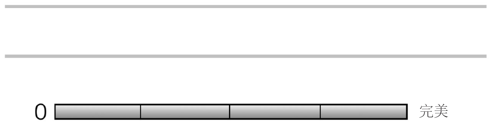
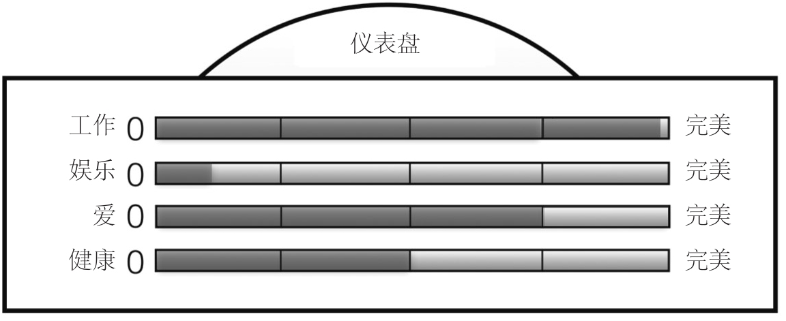
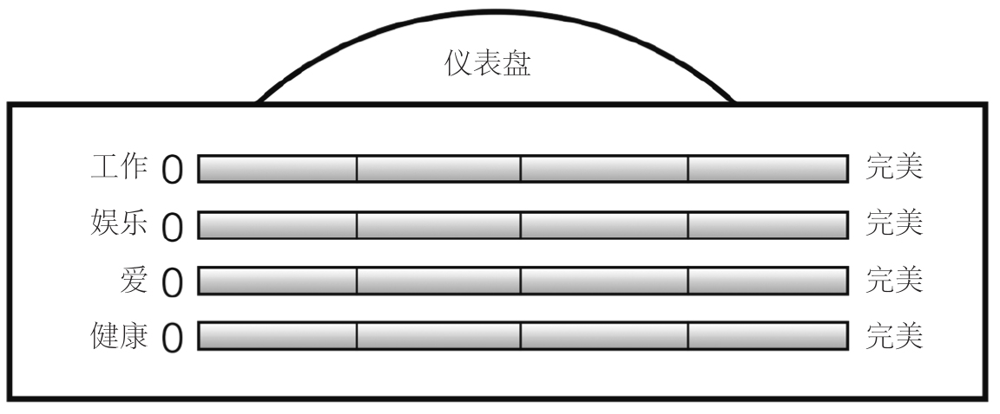

# 第一章 先把自己找回来

斯坦福设计工坊里挂着一块小牌子，上面就写着四个字——“你在这里”。学生们常拿它开玩笑，却也被它点醒。来路、去向、现在在做什么、觉得自己应该做什么，其实都不重要。人生设计做得再差、现状再尴尬，设计思维都能帮你找到下一步的路。但前提是，你得先知道脚下踩的是哪块地，你到底在试图解决什么。

设计师热爱问题，因为用设计师的方式看问题，整个局面就不一样了。他们说的“邪恶问题”，就是那种没有标准答案、永远解不完的问题。你愿意读这本书，大概率就是因为生活里正卡在这样一个难题上。

找到问题，再解决它，这才是人生被精心打磨出来的开始。

在设计思维里，发现问题比解决问题更关键。你连问题都找不准，何谈解决？找问题并不容易。很多人以为自己缺一份工作，其实内心要的根本不是工作。有时我们像做算术一样处理人生，想加点什么、减掉什么——想要更好的职位、更高的收入、更充足的存款、瘦十斤、躲开不幸、止住痛苦。可真正为什么不满，往往只是一种模糊的“想要不一样”。

我们常常拿“缺什么”来给问题下定义：是我有问题、朋友有问题、所有人都有问题。问题可能落在工作、家庭、健康、感情、金钱中的一个，或是全部一起炸锅。有些事让人觉得无力，只能硬扛，就像一个永远不走的室友，你天天吐槽却从没想过赶人。问题一旦变成故事，就让人陷进去出不来。而在所有抉择里，认准真正要解决的问题最重要，因为很多人花了好几年甚至一辈子，去修错了那个问题。

戴夫就是典型。进了斯坦福后他选了生物，因为高中时他坚信自己要成为海洋生物学家。两个原因推着他：童年偶像雅克·库斯托的《海底世界》，还有最爱的生物老师施特劳斯女士。戴夫迷恋海豹，甚至好奇海豹是在水里还是陆地上交配。多年后他才知道大多物种都在陆上。

在库斯托和施特劳斯的双重影响下，他硬读了两年生物。斯坦福没有海洋生物学，他便选了生物学。结果课程全是生化分子，成绩一塌糊涂，对海豹用法语嬉戏的梦想也破碎了。觉得自己没接触“真正的科学”，他跑去实验室“研究核糖核酸”，大部分时间其实在洗试管，更无聊更难受。

助教问他为什么选生物，他说因为老师、偶像和海豹。助教打断：你学不好也不喜欢，还把大家弄得烦躁，应该换专业，你擅长辩论，可以学法律。

大家都觉得不合适，他却固执认为问题是成绩不够，便死磕考试。直到两年半后才承认，真正的麻烦不是分数，是他根本不该读生物，“注定当海洋生物学家”的想法从一开始就带偏了他。

人们总容易在错误的问题上浪费时间。运气好的人早点撞墙，换个方向；运气不好又聪明的人，会取得“成功灾难”，十年后才问自己：我怎么会走到这里？我为什么不快乐？

戴夫最终转到医学工程，学得开心也做得好，只是偶尔仍想和海豹玩耍。

## 看清那些搬不动的“重力问题”

如果戴夫高中时就用设计师的视角，他不会盲目锁定专业，而是会保持初学者的好奇：海洋生物学家到底做什么？去霍普金斯海洋站问问、实地出海感受一下、登上考察船近距离接触海豹，比在脑子里幻想要实在得多。

你是不是也这样？牢牢抓住最初的念头，现实再打脸也不肯放手？你是否总觉得不需要调研就能知道答案？你是否常自问：我找的到底是不是真正的问题？

“我需要一份更好的工作”——这句话可能根本解决不了“我工作不顺心，不如在家陪孩子”。好问题不等于真问题。别在办公室里解决婚姻问题，别用一顿饭来消解工作烦恼，不然就会像戴夫一样把时间耗在错误的方向。

更要警惕“重力问题”的陷阱。

“我最近卡在一个大麻烦上，不知道怎么办。”

“什么麻烦？”

“重力。”

“重力？”

“对啊，烦死了！人总是往下沉，上坡骑车越来越吃力，我怎么去掉这种沉重感？”

听起来像玩笑，但这样的版本我们天天都在遇到。

“现在的环境下当诗人，收入低还不被尊重怎么办？”

“我在一家传承五代的家族企业，外人根本没机会晋升管理层，怎么办？”

“我失业五年了，现在更难找工作，太不公平了，怎么办？”

“我想回学校读医生，至少要十年，我不想等那么久怎么办？”

这些都是重力问题。做人生设计时，如果一个问题根本无法被解决，那它就不是问题。它只是一种处境、一种现实，像重力一样存在。

有个省时间的诀窍：接受现实。我们拼命对抗现实，用尽办法改变它，但现实永远是赢家。无法打败它、欺骗它、让它屈服。

不管现在还是将来，都不行。

重力问题大致两类：完全不可解的，比如地球引力；缺乏可操作性的，比如提高诗人平均收入。要分清自己卡住的到底是不可解的重力，还是只是棘手需要努力的难题。

骑车上坡的重力。你改不了地球引力，除非改轨道。接受后，视野就打开了：换辆更轻的车、减减肥、学更有效的爬坡技巧——研究显示小齿比快速踩踏上坡更省力，要的是耐力不是蛮力。

诗人的收入。想提高平均收入，就得改变诗歌市场需求，让更多人买诗、为诗付钱。你可以写信给编辑、在咖啡馆办诗会挨家敲门，但成功率极低。接受现实，注意力才会转移到能行动的地方。

失业五年的人。长期失业是重力问题，你改变不了雇主的偏见。不如改变自己：做志愿积累履历、列出专业成果、避开年龄歧视严重的行业。戴夫后来进入教育行业感恩不已，因为年龄被视作智慧，不必在比自己小一半的客户面前装专家。

家族企业的外来者。过去132年管理层都是家族人，你觉得工作出色耐心等几年就能当副总裁。或许可以等，但未必成功。更实际的选择是去非家族企业。接受现实后，反而能享受企业的稳定和收入，卸下晋升压力，平衡工作生活，专精某一领域成为职场达人，成为拿最高薪的中层，谁还在乎头衔？

十年读医。这也是重力，除非你的人生目标是改革医学教育。否则就改变想法：住院医师才是临床主力；成为医师助理同样能承担大量医生的工作；或进入保健预防领域，在健康赛道贡献力量。

关键是，当一件事情成功概率为零时，别死磕。你可以有宏大理想，但在行动上选聪明的路径。思想开明、接受现实，你就能把不可解的问题重构成可解的问题，找到自己的作用方式。

这就是设计师的起点——“你在这里”的含义。人生设计的起点不是你想去哪，也不是你觉得应该在哪，而是你此刻真实站立的位置。

## 人生设计盘点

从当前位置出发，我们把生活拆成四个区块：健康、工作、娱乐、爱。

我们的大多数注意力在工作上，但只有工作与生活平衡时，你才知道工作的意义。先搞清楚自己在哪，再做评估、盘点现实，回答那个老问题：你最近好吗？

健康。人类文明伊始就有智慧者强调健康。这里的健康是身心灵的整体状态：情绪、身体、精神。权衡三者的标准由你定，但它是评估生活质量的核心。

工作。指你在地球上参与的不间断的伟大探索。你可能有报酬，也可能没有。多数人同时做多种工作。

娱乐。为了快乐而做。画画玩泥巴也算，踢球也算。只要你在其中感受到快乐，就是娱乐。它可以是有组织的竞赛，也可以是生产性活动。但若目的为了获胜、进步、达成目标，即使快乐也不算纯粹的娱乐。

爱。我们都知道爱是什么，也知道何时拥有它。没有爱，生活失色。爱有亲情、友爱、爱情，来自父母、朋友、同事、伴侣。彼此分享情感就有亲密感。你的生命里谁爱你？你爱谁？你如何爱、如何被爱？

这四个领域每个人都有可调之处。先选出需要设计的领域，再探索方法。出发时需要觉知和好奇。

下面这个练习帮你定位。

这也是“你在这里”的牌子存在的意义。

## 健康/工作/娱乐/爱仪表盘

评估现状可以用“健康/工作/娱乐/爱”仪表盘。想象汽车仪表盘：油量够不够、机油是否顺畅、发动机是否过热？同样，这个仪表盘能告诉你能量是否充足、生活是否在平稳运转。

思维误区：我应该已经知道目的地了。

重新定义：只有先知道现在的位置，才能规划路线。

我们会请你评估健康、工作方式、娱乐和爱的现状。图表里健康在最下方，因为失去了健康，其他都无从谈起。工作、娱乐、爱都很重要，但都建立在健康之上。四个领域没有完美平衡的唯一比例。人生的不同阶段关注点不同。刚毕业的单身年轻人身体好，娱乐工作占比高，可能还没经历深刻的恋爱。有了孩子后娱乐形式变了。中年后健康更受关注。你会找到自己的比例。

谈健康时，我们建议别只做体检。人生设计需要健康的身体，更需要积极的心理状态和规律的精神修行。精神修行不一定是宗教，任何高于自我、滋养身心的信仰活动都可以。健康的各方面没有客观完美的平衡，只有主观的“知足”或“缺失”。

我们不追求完美平衡，但下面这张表会像汽车故障灯一样提醒你哪里出问题了。

以企业家弗雷德为例。他看了自己的仪表盘，发现健康和娱乐几乎没有记录。

弗雷德的“仪表盘”

他非常重视家庭，花大量时间陪伴妻子孩子，创业压力大所以在“爱”上很满意。他也接受娱乐的失衡，因为创业让他累得要死。但仪表盘亮红灯提醒他健康出了问题。“要想做一个成功高效的创业者，尤其在高压初期，我不能生病。健康必须被重视。”于是他请了私人教练每周健身三次，通勤时听智力有声书。调整后工作效率更高，对工作生活的满意度明显提升。

## 她离开职场后，那张人生仪表盘反而没变红：健康·职业·娱乐·爱，你会怎么给自己打分？

黛比原本在苹果负责产品方向。因为一对双生宝贝，她告别了办公室。让她意外的是，她那套人生仪表盘非但没有告急，反而状态良好。她原本以为，停止上班后“职业”那一栏一定会变红；后来她想通了：如果把照顾孩子、经营家庭所投入的心力也算进来，她并没有真正停下来，而且做得比以前更有效能。如今，她格外关注自己的身心状态，希望和孩子们相处时轻松、喜悦。她确信，这个仪表盘证明了一件事：回家陪伴孩子，是她做过的最正确的选择。

### 黛比的“人生仪表盘”

这套评估工具就是健康、职业、娱乐、爱四个维度的面板。前面案例中的两位主角都用它给自己打了分；现在，你也有机会来面对自己的仪表盘。

#### 健康栏：先别只看体检单

健康不是“身体没坏”，而是身体、情绪、心理三件事同时在线。哪一项更重要，由你自己判断。体检结果漂亮，也不等于整台机器安然无恙。你只需要快速感受一下自己的状态，把判断填进表里——比尔那份可以当作参照。这份自评会牵动你对生活品质的感受，也会影响未来的选择，以及你重新规划人生路线的起点。

健康

比尔提交的健康情况是这样的：他的底子不算差，体能也还行，但血脂偏高，还得再减14斤。因为平时动得少，身形有点松散，小跑几步就得停下来喘。他爱读关于人生、职业与情感的书籍，也留意最新的心理健康研究，但记性大不如前。每个清晨，他会对自己说一句打气的话，整个人看待日子的态度都变得明亮起来。儿子出生之后的21年里，他一直属于某个男性互助小组，同伴们既是他的导师，也是他的朋友，带他走过许多次内心旅程。他给自己打了1/2分。

#### 职业栏：别漏掉看不见的那些活

先列一张清单，把“你正在做的所有事情”都写上去，再整体看看自己的职业状态。清单上可以有带薪的正职、副业，也可以有顾问或咨询类的安排；如果你固定在某个机构做志愿者，也要算上。若你是全职主妇，请记住：给孩子张罗饮食起居、为家人做饭、照料年迈的父母、收拾房间，这些都是不折不扣的付出，也是一种职业。

职业

比尔在职业栏里写得很简单：他在一所高校做一对一咨询，也讲授“设计人生”课程；另外，他还是公益创业公司 VOZ 的无薪董事。

#### 娱乐栏：开心本身就是目的

娱乐很简单：你去做一件事，只因它能带给你快乐。它可以是集体活动，也可以是有点产出的手工活儿，但重点不是价值，而是趣味。我们深信，谁都离不开玩。设计人生时有一件特别要紧的事，就是保证每天都有一段完整的玩耍时间。写下你喜欢的玩乐项目，然后替自己打个分：1/4、1/2、3/4，还是已经满格？

娱乐

比尔在娱乐栏里只写了两件事：为朋友做一桌好菜，张罗一场大型露天聚会。用他自己的话说，这一栏早就亮了红灯。

#### 爱栏：双向流动才完整

爱让世界转动；没有爱，所有颜色都会黯淡。这一点我们都认同，也正因为如此，爱需要被认真对待。爱有许多面貌：先是伴侣之间的爱，然后是对子女的爱，还有亲友、宠物、社群或另一些存在的爱。去爱和被人爱同样重要——爱绝不是单向流动的。想想看，在你的生命中，爱正在流向哪里？是流向你，还是从你身上流向别人？写下你的答案，然后为爱打分。

爱

比尔的爱很充实：他爱妻子、孩子、父母和手足，也从他们那里得到同样的爱。他喜欢顶尖的绘画作品，觉得没有比画作更能打动内心的艺术；他沉迷不同流派的音乐，音乐让他开心，也让他感伤；他还为世界上那些让人屏住呼吸的风景着迷，无论那是人工造物，还是大自然的笔触。

回看比尔这张仪表盘，健康和娱乐两栏最薄弱。红色信号已经亮起，提醒他该分出更多精力补一补了。

比尔的人生仪表盘：娱乐栏亮了红灯

### 像设计师那样审视自己的人生

通过健康、职业、娱乐、爱四个维度，你已经能看到自己的大致概貌。哪里不够好，只有你知道，而且现在就能知道。等你读完全书、掌握更多方法后，完全可以再做一次，看看分数有没有变化。人生设计本来就是一场持续的试验，像一个反复迭代的原型；这一路上，你会不断遇见新的入口和出口。当你用设计师的眼光看自己，就会明白：手上的事永远做不完，玩乐可以一直延续，爱不会消失，健康也总有再进一步的空间。

所以，看着这四个分数，你是否真的认真想过：自己最需要调整的是哪一块？也许你遇上的，正是那种“邪恶问题”。如果真是这样，先别急着绕开，问一句：它是否属于那种“重力问题”？这件事现在能够动手解决吗？

另外，四格之间的平衡值得你放在心上。别指望生活会出现完美的对称，也别把健康、职业、娱乐、爱平均切开；但完全失衡同样危险，日子迟早会倾斜。

比尔发现自己的娱乐分数太低了。你的娱乐是不是只有1/4？职业那栏是否早已全满，甚至有点超载？爱这一项你给了多少分？健康与心理状态又还好吗？也许你早就感觉到，生活的某几块需要重新设计，甚至该换一种活法了。

当你以设计师的头脑出发，请记得：未来无法被预测。奇妙的是，恰恰因为未来未知，一旦你为一个目标做了设计，你原本通向的未来就可能被改写。设计人生最激动人心的部分，就在这里。所以，虽然你没法看见终点，至少要在出发前确认自己的起点。现在，你还需要找到正确的方向；而方向需要的，是一枚属于你的罗盘。

### 动手练：四维仪表盘

1. 针对健康、职业、娱乐、爱，分别写几句话。
2. 在每个仪表盘上标出你的位置，从0到满分。
3. 这四个维度里，是否存在一个你必须面对的问题？
4. 这个问题会不会只是“重力问题”？

本书由网络公开渠道整理分享；更多优质内容，请以正式出版物为准。