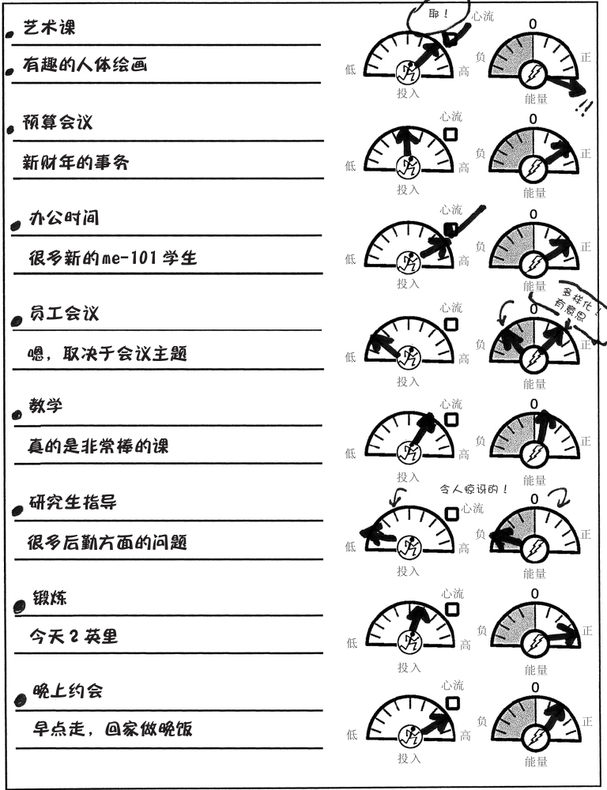
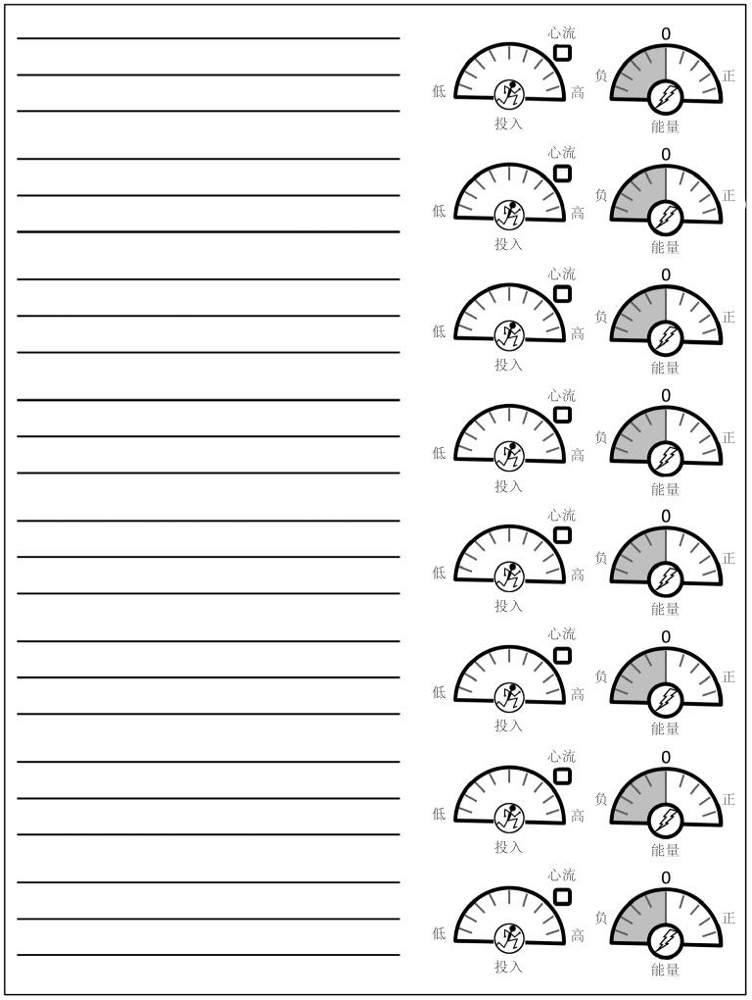

# 第三章 寻路

迈克尔过去一直过得很幸福。他出生在美国加利福尼亚州中部的一座大学城里，少年时的他无忧无虑，热爱运动，经常和朋友一起出去玩。他从未思考或者计划过未来，似乎一切都很美好。但他的母亲为他制订了很多计划——她希望迈克尔上大学，并且为他选好了大学，甚至连专业也为他选好了。于是，迈克尔去了圣路易斯–奥比斯波的加州州立理工大学学习土木工程专业。迈克尔自己并没有成为一名土木工程师的理想，他只是听从了母亲的建议。

迈克尔专业课学得不错，从大学顺利毕业后，他和斯凯拉相爱了。斯凯拉大学毕业后去了荷兰阿姆斯特丹的一家公司做咨询工作。于是，迈克尔也来到了阿姆斯特丹，并找到一份非常不错的土木工程方面的工作。这一次，迈克尔又跟随女友的计划，开始了自己的新生活。直到这时，迈克尔也从来没有停下来思考一下他自己想做什么，或者他想成为什么样的人。他也从来没有清楚地表达过自己的人生观或工作观，他总是让其他人为他导航，决定他的人生方向。至此，一切都还算顺利。

后来，迈克尔和斯凯拉（现在已经是他的妻子了）从阿姆斯特丹返回加利福尼亚州——因为斯凯拉在加利福尼亚州找到了一份自己热爱的好工作，迈克尔也在附近的一家土木工程公司找到了一份工作。这时，问题出现了——迈克尔依然从事着颇具社会声望的土木工作，但，他却觉得很无聊，焦躁不安，甚至很痛苦。第一次感受到这种痛苦时，他非常迷惘，不知道自己该何去何从，也不知道该做些什么。在迈克尔的人生中，跟着别人的脚步而做出的计划第一次失效了，他找不到方向，完全不知道该怎么办。

思维误区：工作不应该有乐趣，因此它才被称为“工作”。

重新定义：乐趣会指引你找到适合你的工作。

很多人给迈克尔提了建议，一些朋友建议他创办自己的土木工程公司，他们认为迈克尔的烦恼来自为别人打工。迈克尔的岳父说：“你非常聪明，不仅是一个工程师，而且精通数学，所以你应该进入金融行业，成为一个股票经纪人。”迈克尔考虑了所有人的建议，并打算辞职，重返校园学习金融，或者去商学院学习。但是，坦白来讲，他并不知道自己的问题出在哪里——他是一个优秀的土木工程师吗？土木工程方面的工作不适合他？他应该继续忍受这份工作吗？毕竟，这只是一份工作，是不是？

错误！

## 找到你的路

当你不清楚自己的位置，并想找到目的地时，寻路是常用的方法。寻路时，你需要指南针和明确的方向——不是一张地图，而是方向。刘易斯和克拉克是美国 18 世纪著名的探险家。当时，美国通过《路易斯安那购地案》获得了大片土地，于是托马斯·杰弗逊总统派遣刘易斯和克拉克去探索这片土地——他们深入美国西部，直到太平洋沿岸。在通向太平洋的途中，他们依靠的不是一张地图，而是绘制的大量路线图（准确来讲，是 140 张地图）。在人生中寻路也是一样，因为人生没有一个必须到达的目的地，你无法用 GPS 定位，然后规划路线，径直到达。你所能做的就是关注眼前出现的线索，尽最大的努力利用现有工具奋力前进。在我们看来，寻路时首先出现的线索就是投入和能量。

并不是土木工程专业本身让迈克尔失望，他只是产生了困惑，并感到他的生活出现了问题。迈克尔已经 34 岁了，但他不知道自己到底喜欢什么。当他向我们寻求帮助的时候，他的生活和工作不仅一团糟，而且他找不到确切的理由。我们让他在每天工作结束后做一个简单的记录，坚持几周。在某一天中，迈克尔记录下了自己工作时感到烦躁、心神不安以及沮丧的时刻，并记录下在那段时间（无法投入工作的时候）正在做的事情；同时，迈克尔也记录下了工作中让自己感到兴奋、注意力集中、过得愉快的时刻，以及当时（全身心投入时）正在做的事情。我们将这种方法称为“美好时光日志”。

我们为什么让迈克尔做这个日志？（是的，我们也将请你进行记录。）因为我们想让他了解自己什么时候是快乐的。当你明白什么活动会让你全身心投入时，你就会知道如何设计人生了。记住，设计师都注重行动——你应注重做什么事，而不是空想。行动中，记录下你全身心投入、精力充沛的时刻和分心、无法集中精力的时刻，这有助于你提高专注力，并且发现是什么在发挥作用。

## 拥有更多心流体验

“心流”体验是指全身心投入的一种心理状态，心流产生的同时伴有兴奋感。当你在某项活动中处于心流状态中时，你会感到时间仿佛静止了，你会全身心投入其中，这项活动的难度与你的技能相适应——你既不会感到无聊，也不会因为困难而感到紧张。“心流”是由心理学家米哈里·契克森米哈赖定义的，自 20 世纪 70 年代起，他就开始研究这种现象。在研究了数千人日常生活中的活动细节后，他区分出了这种特殊的高强度投入状态，并首次描述出“心流”体验。

进入心流状态的人通常会有如下特征：

•完全投入。

•会有极度兴奋或狂喜的感觉。

•内心清明——知道做什么，以及如何做。

•表现出出奇的镇定冷静。

•感觉时间似乎静止了，或者觉得时间倏忽而逝。

一个人不管是从事体力活动还是脑力活动，或者体力和脑力相结合的活动，都有可能进入心流状态。例如，在准备教案或是扬帆远航的时候，戴夫都会进入心流状态。比尔承认自己迷恋心流状态带来的快感，他在给学生建议、用草图记录自己的想法，或者用他最喜欢的刀切洋葱时，都会进入心流状态。人生中有很多体验“只可意会不可言传”，心流体验就是其中一种，你只能自己去识别它。作为全身心投入的终极状态，心流体验在你的人生设计中占据了一个非常特殊的位置，用心观察“美好时光日志”中记录的心流体验，这对你非常重要。

心流状态就是成年人的娱乐活动。在人生设计的仪表盘上，我们对自己的健康、工作、娱乐和爱进行了评估。一些人发现，在繁忙的现代生活中，他们投入最少的是“娱乐”。你可能会认为自己肩负太多的责任，没有时间娱乐。进入心流状态，是成年人娱乐的秘诀所在，一份真正有益的、令人满意的工作可以让你经常进入心流状态。娱乐的本质就是让你完全沉浸其中，享受正在做的事情，不会总是分心，担心结果。当你进入心流状态时，你必然会心无杂念、全身心投入到正在做的事情上，感觉不到时间的流逝。从这一点来看，你应该努力让心流体验经常出现在你的工作中（生活中、锻炼中和爱中……），你肯定明白我的意思了。

## 关注你的能量水平

寻路过程中的第二个线索是能量。和其他生物一样，人类需要能量才能够生存和发展。远古时期，不管是男人还是女人，他们每天绝大部分的能量都消耗在了体力劳动上——人们要打猎、采集食物、抚养孩子、种植庄稼，绝大部分时间都花费在了高耗能的体力劳动上。

现在，我们大都靠脑力吃饭，所以大脑肩负着重任。大脑是一个非常渴望能量的器官，每个人每天大约会消耗 2000 卡路里的热量，其中有 500 卡路里的热量供给了大脑。这个数字非常惊人：大脑只占据了我们身体总重量的 2%，但其消耗的能量却占我们每天消耗的总能量的 25%。这也是精力充沛会严重影响到专注力的原因。

我们整天都在从事各种体力和脑力活动，一些活动会维持能量，一些活动则会消耗能量。你可以在“美好时光日志”中记录下那些能量流。一旦你能很好地把握每周能量流的去向，你就能够重新设计你的活动，让自己充满活力。记住，人生设计是尽量从你当前的生活中汲取更多，而不单单是重新设计一种全新的生活。大部分人生设计都是为了改进、完善你现在的生活，而不是要求你做出重大的结构性的改变，如换工作、搬家或者重返校园读书等。

你可能会问：“记录能量流动和追踪投入情况是否不同？”这两方面有相似的地方，也有不同。高度投入和充沛的精力通常是一致的，但并不是必须的。戴夫的一个同事也是土木工程师，他聪明、思维敏捷，并且擅长辩论，所以经常有人请他帮忙进行辩论。但是参与那样的辩论经常让他精疲力竭——即使他“获胜”了。其实他并不是一个爱争论的人，每次辩论结束，他都感觉很糟糕。能量的独特之处还在于它会带来消极影响——有些活动实际上会抽干我们的生命能量，让我们精疲力竭，无力去完成下一件事。无聊是一个巨大的能量消耗源，但相对于切断能量来讲，无聊所造成的能量消耗更容易恢复，因此一定要特别注意你的能量水平，这一点很重要。

## 享受工作的乐趣

迈克尔开始记录“美好时光日志”，时刻关注自己什么时候特别投入、什么时候产生心流体验、什么时候精力充沛，充满能量。之后他意识到，当他处理困难复杂的工程问题时，他充满了活力，也非常投入。但是，他不善于应付复杂的人际关系，不喜欢与他人交流，也厌烦处理其他行政工作，或者和复杂的工程问题无关的事务。每当处理这些事务时，他就会特别烦恼，痛苦不堪。

迈克尔第一次密切关注了对自己真正有利的事情，他搞清了自己在工作中让他精力充沛或精神萎靡的原因，他明白自己其实非常喜欢土木工程的工作，只是讨厌行政事务、写计划书以及费用谈判。通过精心的人生设计，他已找到了一种工作方法，让他可以尽情做自己喜欢的事情，尽量少接触他不擅长的事情。迈克尔没有去商学院（去商学院上学很可能是一场灾难，而且花费巨大），他决定在土木工程专业上深造，于是他参加了一个博士课程，并且已经是高级土木和结构工程师了。他现在把大部分时间都花在了处理棘手的工程问题上，多数时候都是单独工作，这样的工作模式让他感受到了真正的快乐。有时，他下班回家后依然很有活力，甚至比之前上班时还要精力充沛。这种工作方法非常适合他。

在寻路的过程中，另一个关键因素是：跟随快乐前行，做能够吸引你、让你兴奋的事情，做能够激发你的活力的事情。经常有人告诉我们，工作从来都不轻松，我们必须忍受它。没错，任何工作和事业都存在困难，也都有让人厌烦的时候；但是，如果你的工作在绝大多数时候都不能激发你的活力，那么说明它正在一点点“杀死”你。毕竟，工作是需要你花费大量时间去做的事情。据统计，一个人一生中要花费 9 万~12.5 万个小时在工作上。如果你感到工作无聊透顶，那么你的生活也将是一团糟。

那么，是什么让工作充满乐趣？不是经常性的公司聚会、不是很高的薪水，更不是一连几周的带薪假期。只有当你在工作中真正发挥了自己的优势，全身心地投入其中时，你才能从工作中感受到乐趣。

到了这个阶段，经常有人问我们：“在工作中，如何实现目标、完成任务呢？”人生中除了全身心投入工作并保持精力充沛之外，我还想做其他对我来说重要的、紧急的事情。

我们完全同意。正如我们建议的，你一定要认真评估自己的工作是否和你的价值观和优先事项保持一致——看看你的工作、你的自我认知以及你的信仰是否一致。你在生活中不能只关注投入和能量水平，注重投入和能量水平能够为你的寻路之旅提供重要线索，但人生设计包括一系列的想法和技巧，这些想法和技巧可以共同发挥作用。我们将给你们提供很多建议，但是最后要由你自己来决定采纳哪条建议，以及如何组织你的人生设计项目。首先，让我们从“美好时光日志”练习开始。

## 记录“美好时光日志”

请你也做一下“美好时光日志”练习，如何做由你自己来决定——你可以选择写在一本精装笔记本上；也可以用活页纸记录，然后收集在活页夹中；当然你也可以选择在电脑上做（我们强烈建议你手写，这样你还可以画一些简图）。怎么做不重要，关键是要付诸行动，经常做一些记录。不管你喜欢什么形式，也不管你经常使用什么形式，这都没有问题。

“美好时光日志”中要包含两个元素：

•活动记录（记录能让你全身心投入并感到能量充沛的活动）

•反思（哪些活动让你有收获？收获是什么？）

活动记录只需要列举关键活动，以及在这些活动中有关投入和精力的情况。我们希望你每天都能够填写活动记录，一定要注意采集快乐的信息。如果隔几天记录一次也没有问题，但一周最好不要少于两次。如果你使用的是活页夹，在本章结束的时候，你可以用这些活页纸做一个记录表，并对你在活动中的投入和能量情况稍作评论（也可以登录 www.designingyour.life 下载记录表）。你可以通过简图画出你对活动的评论。通过这些书面记录，你可以了解很多信息。

我们总会被各种各样的工作或活动所激励。你的任务就是找出能够激励你的活动，并且尽可能地具体一些。没错，通常当我们在完成一天的工作后，我们会说“今天不错”，或者“糟透了”，但是我们几乎从不注意具体是哪件事让我们感觉不错、哪件事让我们感觉糟糕。一天当中，你有时感觉很棒，有时又感觉很糟，更多时候处于两者之间，不好不坏。你的任务是深入了解你一天中发生的每一个具体事件，捕捉一天中的快乐时光。

“美好时光日志”的第二个元素是反思。仔细查看你的活动日志，注意事项的发展趋向，从中得到的深刻见解和惊喜——任何事都可能是一条线索，让你清楚哪些事对你有益，哪些事无益。你可以对“活动日志”一周反思三次，或者在任何你对各种活动有了一定理解的时候反思。对于“美好时光日志”，我们建议你一周反思一次，这样你的反思就不会只局限于对某项活动的单一体验了。

此外，在“美好时光日志”中的空白页中记录下你每周的反思。

下面我们从比尔最近的“美好时光日志”中选取了一页，供大家参考。

比尔的反思包括如下观察：

他发现，当他上绘画课或者办公时，他一定会有心流体验；而教学和“约会之夜”活动不会让他消耗多少能量，反而会让他充满活力。如果这些活动翻倍的话，必能让他的精力更充沛。每周一次的员工会议中，有时大家的谈话很有趣，有时则比较无聊，因此，在能量图表中他画了两个箭头。如果某天召开了预算会议，那么他就会感到特别疲惫，因为他从来都不喜欢财务方面的工作（虽然他知道财务工作很关键）。

比尔对自己的日程进行了一些调整，减少了无法投入的活动，增加了对他来说更有吸引力的活动，并且当完成带给自己“负能量”的活动时，他会给自己一些小奖励。处理这些带来“负能量”的活动时，最好的方法是确保自己能充分休息，有足够的能量储备，否则，你可能需要返工重做，那么所消耗的能量将远远超出预期。

比尔很吃惊地发现，每周指导研究生（他很喜欢这些学生，在他们身上花费了很多时间）是极其消耗能量的一件事。在进行了一段时间的记录后，他发现了两个问题：（1）他在研究生办公室对学生进行指导时，周围环境非常嘈杂；（2）他对学生的指导并没有什么效果。了解到这两点之后，他首先调换了上课的教室，然后改变了对研究生的指导方式——以前他都是一对一指导，现在开始分小组进行指导，这样学生在接受指导的过程中也可以互相帮助。这些改变很快就取得了成效，几周后，他在授课中就进入了心流状态。不过，预算会议仍然让他精疲力竭，但这只占据了他工作的一小部分。全新的授课方式让他充满了活力，因此令人讨厌的预算会议也可以忍受。

比尔利用“美好时光日志”从根本上改善了他目前的人生设计，迈克尔在寻找职业规划方法时也做了这个练习。他们两人目标不同，得到的结果也不同，但两人使用了同样的技巧——他们都特别关注能够让自己全身心投入并且充满活力的活动细节。

两周之后，在“美好时光日志”中，你已经记录了很多事情，然后你会注意到一些有趣的事情。现在，你可以拉近镜头、关注细节。通常，当你开始对日常生活投入更多关注时，你就会注意到日志中有些事情被记录得特别详细。哪些活动对你有益、哪些活动无用，你了解得越清楚，就越容易为自己确定前进的方向。例如，你记录了这样的内容：“员工会议——今天非常享受，仅此一次。”当你回看这条记录后，可以更为精确地再次记录一下：“员工会议——感觉非常棒！因为在我重新解释了乔恩的话后，大家都表示赞同。”这种方式更精确，而且有助于你了解具体是哪个活动或行为吸引了你。同时，这样做也有助于你提高自我意识。如果你的日志中包含了活动的细节，你的反思也会更深刻。当你在日志中记录下你对员工会议的看法时，你可能会问自己：“我对此次会议更加投入，是通过技巧性地复述了乔恩的评论（恰到好处地清晰阐述了细节），还是通过促进员工之间达成共识（是我让整个团队出现了‘现在我们都理解了’的统一时刻）实现的？”如果你最终认定“清晰阐述”是你在员工会议中“关键点”的话，那么你就知道自己应该更多地注重内容创作，而不是促进团队合作。尽最大可能找到对你有用的、类似的观察和反思，这样就可以了——你肯定不想没完没了地研究日志。

## AEIOU 法的妙用

从“美好时光日志”的反思中得出深刻的见解并不是一件容易的事情，因此我们为大家提供 AEIOU 法，这个方法源于好奇心思维，设计师经常用它来进行详细精准的观察。这就是 AEIOU 法。AEIOU 法共包括 5 套问题。在你对活动日志进行反思时，可以利用这 5 套问题。

活动：你到底在做什么？这是一个结构性的活动，还是非结构性的活动？你是团队的领导者，还是会议的参与者？

环境：我们所处的环境会对我们的精神状态产生重大影响。在足球场和在教堂里，你产生的感觉也不同。当你参加某项活动时，注意自己所处的环境。那是什么样的环境？它带给你什么感觉？

互动：你和人或者机器有怎样的互动？这种互动对你来说是陌生的还是熟悉的？是正式的还是非正式的？

物体：你在和物体或者设备进行互动吗？是苹果平板电脑、智能手机、曲棍球球棍，还是帆船？这些事物能带给你投入感吗？

用户：活动中还有其他人吗？他们扮演了什么角色？他们为活动带来了正面影响还是负面影响？

利用 AEIOU 法有助于你拉近镜头，放大细节，发现具体有哪些活动对你有益，哪些活动无益。下面我们来看两个例子：

莉迪娅是一个合同文员，她的工作是帮助专家记录程序。她得出了一个结论，她讨厌接触人——因为每次会议后她都感觉糟透了；但如果一整天她都在写东西，那么她就会非常舒心。当她在做“美好时光日志”练习时，她想知道如何不再参加任何会议还可以谋生，于是她使用了 AEIOU 法。当她把活动放大，注重细节时，她发现自己实际上喜欢人少的活动——当她只和一两个人见面，努力写作或者就某个新项目的想法（活动）进行头脑风暴时，她都不会厌烦。但是，她讨厌制订计划、确认行程以及制定商业策略的会议，会议参与者如果超过 6 个人也会让她难受，她无法记录太多不同的观点。她意识到自己工作时是一个极其专注的人，其他人（用户）可能会让她更专注，也可能让她崩溃，这取决于合作的形式（互动）。

巴斯拉喜欢在大学里工作。她做什么并不重要——只要是在大学校园（环境）里做，她就感到非常幸福。因此她在自己攻读研究生学位的大学里找了一份工作。五六年里，她做了很多工作，包括筹集资金、迎接新生等，并且非常快乐。但渐渐地，这种幸福感开始减退，她发现自己对高等教育不感兴趣了，这让她很紧张。她做了“美好时光日志”练习后意识到，她仍然非常热爱大学，但是选错了工作。当她进入 30 岁，单纯的环境因素（大学）已经不够了，角色定位变得更为重要了。她当时已经升职，从学生工作转到了法律事务上，并且经常和行政人员、律师一起参加各种会议，处理文案工作。在她弄清自己兴趣减退的原因后，便找了一份办公室的工作，虽然比前一份工作稍微差一些，但她又可以进行更多有建设性的互动交流了，而且这里的文案工作也相对较少。

在对“美好时光日志”内的活动进行反思时，如果想从你的观察中获得更多信息，可以试试 AEIOU 法。不管出现什么你都可以记录下来，不要进行自我评判，这一点很重要，因为你的体验没有对错之分。需要注意的是，这类信息在设计人生时将会为你提供难以估量的好处。

## 回顾你的高峰体验

你过去的经历中也存在很多洞见，等待着你去挖掘——尤其是你的“巅峰时刻”，即高峰体验。你过去的高峰体验（即使是很早以前的体验）会让你受益匪浅。你可以花些时间回忆一下过去和工作相关的高峰体验，并记录在“美好时光日志”的活动日志中，对这些活动认真思考一下，看看会发现什么。那些记忆能够让你有所触动，必然有其原因。你可以把那些高峰体验列一个表，也可以通过记叙或者讲故事的方式记录下来。记录这些美好的时刻是一件令人享受的事。例如，你参加了团队组织的“终极销售会议”，并参与制订计划；或者你撰写的程序手册一直作为范本被发放给新的撰写员。关于你的高峰体验，最好以叙事的形式记录下来，这样更有助于你从这些故事中发现真正能让你投入其中、充满活力的活动，以及对今天的工作有益的见解。

当你现在所处的环境（如失业）不足以让你成功地制作一份“美好时光日志”时，过去的高峰体验就显得尤为重要了。如果你刚走上职场，还没有太多的经历，那么过去的高峰体验也非常有用。在这种情况下，思考一下其他你曾经历过的、让你感到生活美好的活动（甚至是几十年前的事情也没关系）。一份记载过去的“美好时光日志”会让你获益良多，内容可以包括学校生活、暑期课程、志愿活动等——任何曾让你全身心投入的事情都可以记录下来。在回顾自己过去的体验时，一定要谨防修正主义倾向，不要过度夸大美好时光，也不要对困难时期过于严苛，尽量客观、诚实地记录。

这个新发现有助于你明白下一步要怎么走。你正从一个意识水平上升到另一个意识水平，并开始真正探索自己（不是你的父母，老板或者爱人）对事物的见解和看法了。你已经踏上前进的旅途——从你现在的位置走向自己的目的地。带着你的指南针和从“美好时光日志”中得来的见解，在寻路的过程中，你一定会表现得十分出色。

迈克尔找到了他的路。

刘易斯和克拉克也找到了各自前进的路。

你也可以找到自己的路。

接下来就需要尽可能多地想出一些选项，这样就可以进行更多的实验，创造更多的原型。

若要完成上述内容，我们需要制作一个思维导图。

小练习

美好时光日志

1.制作一份活动日志，你可以使用活页纸，也可以使用笔记本。注意，着重记录你何时感到投入或者充满活力，以及在那些时间段你都在做什么。最好每天都记录一份，也可以隔几天记录一份，时间间隔要尽可能小。

2.连续记录三周。

3.在每个周末记录下你的感想。注意，一定记录清楚哪个活动吸引了你、让你感兴趣，哪个活动让你感到无聊。

4.在你的反思中，有什么意外的事情吗？

5.尽量把活动记录得详细一些，包括哪个活动吸引了你，让你充满活力？哪些活动不能吸引你？记录下具体细节。

6.在反思时，如果有需要，你可以使用 AEIOU 法。

本书由“[ePUBw.COM](http://epubw.com)”整理，[ePUBw.COM](http://epubw.com) 提供最新最全的优质电子书下载！！！ 
