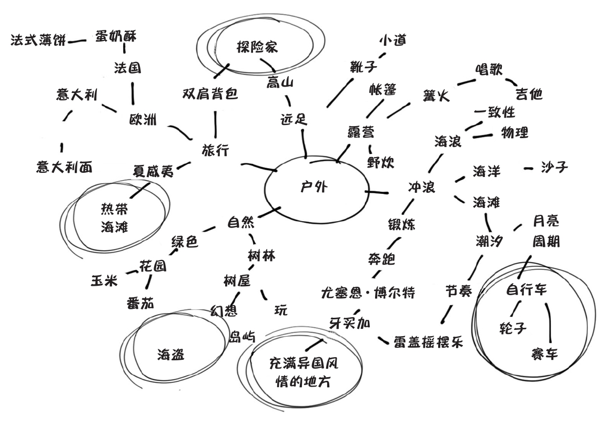
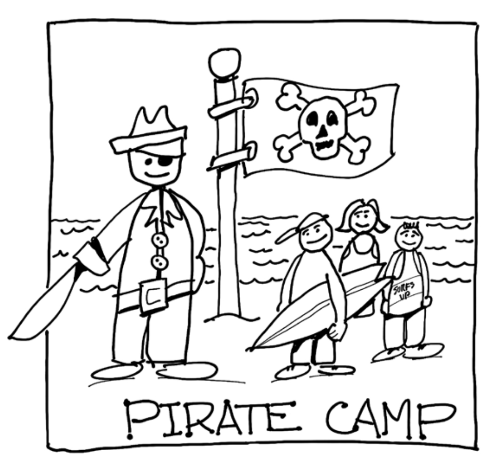

# 第四章 摆脱困境

格兰特陷入了困境。他在一家大型汽车租赁公司工作，在完成了自己的“美好时光日志”后，他意识到，他大部分时间都浪费在了既不能让他投入，也不能激发他的活力的活动上——他不喜欢与爱抱怨的客户打交道，他不喜欢处理没完没了的标准合同，他也不喜欢每天都重复相同的合同内容。他不愿意诱导客户进一步消费，而且，他感觉不到自己的重要性。他不想让自己成为一个大型企业里的小人物，他想成为有影响力的人，他希望自己所做的事情更加有意义。

格兰特回忆不起来自己在工作中是否有过心流体验，工作对他来说，沉闷而痛苦。他每天都盯着时钟、盼着下班，每周就是等着发工资。上班时他感觉时间很长；周末时，又觉得没怎么过就结束了；唯一让他开心的事情就是在红杉林里远足、和朋友一起打篮球，或者帮助他的侄子复习功课。

但这些事都不能让他拿到工资，帮他支付账单。

现在，格兰特即将升任店长，他比以前更加困惑了。他从来都没想过在汽车租赁公司工作，但不管他怎么绞尽脑汁地思考，他都想不出来自己还能干什么，他甚至不知道从哪里开始着手。他曾经想当一个摇滚明星，或者大联盟的棒球选手，但是他不会唱歌，也没玩过任何乐器，而且 12 岁时他就离开了少年棒球联合会。在重新设计自己的人生时，格兰特不想在汽车租赁公司工作了，但他又觉得自己别无选择。“有些人就是这么不幸，”他认为，“一些人注定无法实现自己的价值。”

格兰特越发感到挫败，他认为自己只能做现在的工作。他之所以会这样想，是因为他没有像设计师一样思考。设计师知道自己不可能永远坚持最初的想法，他有很多选项可以挑选，他可以挑出一个最好的。很多人都像格兰特一样执迷不悟，顽固地守着最初的想法，并且希望它起作用。

思维误区：我陷入了困境。

重新定义：我从来不会被困住，因为我总是能想出很多点子。

莎伦是一名律师助理，在被解雇前曾就职于波士顿一家著名的律师事务所。现在，她每天花费 6 个小时在网络上找工作，她这样做已经有一年的时间了。她彻底陷入了绝望，很早以前她就已经自信全无。实际上，做一名律师助理并不是她一开始的打算，律师助理只是她的备选方案。她于 2009 年毕业于商学院，作为一名工商管理硕士，她的“正确工作”应该是销售主管。但当时，美国经济陷入了低谷，她没有找到这样的工作。和很多人一样，莎伦也认为做“正确的工作”会让她感到幸福，但实际上，毕业时莎伦根本不清楚自己真正想要什么。在找了一年工作后，她觉得自己仍无法选择，这让她很崩溃。当然，莎伦并不是真的没有选择——选择很多，只是她没有第一时间想起来罢了。

思维误区：我必须找到一个正确的想法。

重新定义：我需要很多想法，这样就可以为我的未来探索出尽可能多的机会。

莎伦觉得自己只能继续目前的工作，除此之外别无选择。和格兰特一样，她陷入了困境。

很多人找工作时都和莎伦一样：浏览工作招聘列表，寻找他们认为自己能够做的工作。其实，这种方法是最不可取的，也是成功率最低的。这种思维方式不属于设计思维——只做能力范围之内的事不可能带给你长期的满足感。如果你的孩子没有饭吃，如果银行即将没收你的房子，或者你欠了别人一大笔钱，那么任何工作你都得去做。但是，当困境稍有改善，你就可以想办法寻找自己真正想做的工作。不要担心陷入困境，设计师总是处于困境。当你像设计师一样思考时，你就会知道如何构思想象，想出各种选项，为将来提供尽可能多的可能性。

这非常简单。在你思考清楚之前，你不可能知道自己真正想要的东西是什么，所以，你必须提出尽可能多的想法和可能性。

接受问题。

陷入困境。

克服困难，构思、构思、再构思！

## 打开思路，拒绝自我设限

现在我们请你跳出现实的约束，勇敢地进入一个更为广阔的“我可能想要什么”的世界。是时候拥抱困境了——格兰特陷入了困境，莎伦陷入了困境；每个人在人生的某个时候都有过陷入困境的体验——这就是我们需要进行构思的地方。构思能力，说白了就是想出很多点子的能力，包括异想天开的想法、疯狂的主意。有些人会死揪着最初的想法不放，有些人则一味地追求完美，认为不论他们处于何种境地，都能找到一种方法帮助他们解决问题、摆脱困境。实际上，如果你坚信解决问题的方法只有一种，那么就会导致压力和犹豫不决。

“我只是不确定。”

“我不想搞砸了。”

“我必须搞清楚这件事。”

“如果我有一个更好的（更正确的、更完美的）的想法，那么一切都会迎刃而解。”

这样的例子很多，无须一一列举。我们会告诉你这个令人惊喜的事实：一切都会好起来的。

一定会好起来的。

我们是非常幸运的，因为在现代社会中，我们可以在一定范围内自主做出选择，可以自由流动，可以接受高等教育、享受科技成果，我们的绝大部分时间都用在了做出最佳选择上。总是会有更好的主意和方法出现——甚至是最好的方法。这种思维对于人生设计是非常危险的。事实是，所有人并非只有一种生活方式。当我们问自己的学生：“在你的人生中，有多少段时光是有价值的？”结果，他们的回答的平均值是 3.4。如果你接受了这个想法——你可以设计多种人生，虽然你最后只能选择一种人生，但这一切将非常有意义。你的生活不会只有一种选择。要想过得既快乐又高效，有很多种活法（不管你现在年龄多大）。通向幸福、高效的路有很多条，每一条都不同，你可以选择其中一种。下面我们将告诉你一些技巧和方法，帮助你打开思路。

数量本身就含有一定质量的考量在内。在人生设计中，想法多多益善，因为想法越多，好的想法也就越多，好的想法多了，更优秀的设计也就多了。拓宽思路有助于提高你的构思能力、开展更多创新思维，找到真正让你充满活力的事情的概率也会随之加大。更多的点子意味着你有更多的见解和看法。

设计师喜欢广泛地思考——他们喜欢明智的见解，也喜欢疯狂的想法，甚至更青睐于后者。为什么？大多数人认为设计师都喜欢标新立异，他们喜欢疯狂的事物，他们时髦、前卫，而且永远戴着墨镜。这也许是真的，但并不是关键。设计师有很多狂野的想法，是因为他们知道创造力最大的敌人是评判。我们的大脑最善于评论、挑毛病，然后迅速做出评判。所以，若想得到更多的想法，你就不要急于做出评判，也不要在内心进行批评。如果你这样做了，那么一些不错的想法就会被无声地屏蔽在“评判”这堵墙之外。如果你们允许疯狂的想法出现，你就不应过早地做出评判。你可能不会选择疯狂的想法（事实上很少有人会这么选择），但是，通常在产生了这些疯狂想法后，你才会进入创造性的空间，很多全新的、创新的、有用的机会才会出现。

所以，让我们一起疯狂起来吧！

我们的学生都认为这个过程最令人兴奋、最有吸引力，而且令人快乐。谁不喜欢提出一大堆疯狂且伟大的想法呢？记住，我们的座右铭是“你在这里”，不管你觉得自己的个人创造力达到了什么水平，你都要做好准备，行动起来。任何水平都可以作为你行动的起点，我们的目标是激发你的活力，拓展你的能力。在帮助你设计人生时，我们会和你一起想出无数的解决方法。

作为一名人生设计师，你需要接受下面两种观点：

1.只有好点子足够多，你才能从中选择出更好的。

2.对于任何问题，都不要选择第一个解决方案。

你的大脑通常非常懒惰，它喜欢尽快摆脱问题，因此它会先用很多积极元素包围你的思想，让你“迷恋”。不要“恋上”你的第一个想法，它几乎从来不会起作用。通常，我们最初的解决方案都极其普通，没有任何创意。人类往往倾向于具有明显迹象的解决方案。使用构思技巧，有助于克服这种思维模式，帮助你重获创意自信。

你可能觉得自己没有创造力，但你在幼儿园、小学时，唱歌、跳舞和画画似乎都是一种非常自然的自我表达形式——你不会觉得难为情，也不会评判自己的画是否具有艺术性、歌唱得是否专业，或者自己的舞蹈是否会引起他人的关注。在那个时期，你可以自由地创造，表达自己。

你可能还记得，曾经有一位老师对你说“你不是一个艺术家，你不能画画”，或者“你跳舞很滑稽”，还有，“不要再唱了，你糟蹋了这首歌”。如果你曾遭遇过这种扼杀创造力的时刻，我们为你感到遗憾。在中学里，也会经常出现这种扼杀创造力的情况——社会规范取代了成年人的指责，我们学会了隐藏自己的不同之处，害怕别人发现自己的与众不同。因此，随着我们的成长，我们的创造力也越来越稀少了。

但是，请相信我们，你的创造力一直都在，我们将帮助你发现它。

## 制作你的思维导图

第一个构思技巧是思维导图。当你独自进行构思时，这个技巧非常有用，能够帮助你有效地摆脱困境。思维导图很简单，你可以从一个词联想到相关的词汇，以此类推，逐渐打开创意空间，让更多想法随之产生。思维导图采用图解的形式，把你的想法以及与其相关联的想法自动地连接在一起。通过这种方法，你可以想出无数的主意。思维导图采用视觉法，避开了你内在的逻辑/言辞上的审查。

制作思维导图的过程包括三个步骤：

1.选取一个主题

2.制作思维导图

3.制作次级连接，并创造概念（将概念连接起来，建立概念混搭模式）

上面这幅图是格兰特的思维导图，这是他不知如何找到一份“完美”工作时制作的思维导图。你可能还记得，当格兰特查看“美好时光日志”时，在他所做的事情中，唯一让他感到快乐的体验就是在他家附近的红杉林里远足。所以，他决定围绕这一点展开思维导图。你可以看到，他把“户外”放在了思维导图的中心位置，并用一个圆圈圈了起来。这就是制作思维导图的第一步——选取一个主题。

思维导图的第二步是制作思维导图。写下最初的想法后，你可以围绕这个想法展开联想，写出 5~6 个相关的概念。一定要严格且客观地记录下首先想到的词汇。现在，在第二层重复同样的过程，每个单词周围画 3~4 条线，由每个词再自由联想一些相关的新词。你此时想起来的这些词不一定非要和中心位置的词汇相关联，只要和第二圈的词汇有联系就可以。重复这个过程，直到写到第三层或者第四层。

在格兰特的思维导图中，他记录了旅游、远足、冲浪、露营和大自然，这些都和他的中心词“户外”有直接关联。然后，他又以这些词为基础，对每个词都创造出全新的词汇关联。远足让格兰特想起了高山，高山让他想到了探险。旅行让他想到了夏威夷、欧洲和背包，而夏威夷让他想到了热带海滩。他从欧洲想到了法国，想到法国就想到了法式薄饼，进而联想到了能多益巧克力酱。冲浪让他想到了海滩，由海滩想到了潮汐，由潮汐想到了摩托车、自行车以及赛车。冲浪同样让他想到了尤塞恩·博尔特，进而想到了牙买加，由牙买加想到的是一些充满异国风情的地方。由此可见，格兰特的创造性思维比他自认为的要厉害得多。

制作思维导图并进行词汇联想，这个过程只需要 3~5 分钟的时间。你可以给自己设定一个时间限制，快速完成，而且不要考虑自己的想法是否合理。然后，在这些任意配对的词汇中，选取几件比较有趣的事情（或是能立刻吸引你的），把它们打乱放到一起，形成几个概念。你可以从思维导图的最外层挑选词汇，因为最外层的词汇与你的意识思维之间至少有两三个词汇的间隔。即使“户外”一词最终让格兰特联想到了赛车和尤塞恩·博尔特，但在格兰特的潜意识中，这些都和他最初的提示词相关。格兰特随意联想到的词汇看起来非常有趣——在这一分支中，包括探险家、热带海滩、海盗、孩子、异国风情的地方以及自行车赛；然后，他把这些独立的词汇混合搭配在一起，产生了几组可能的想法。

他能够在为那些喜爱户外活动的孩子开设的儿童探险宿营地找到一份兼职工作吗？没准这还是一个海滩上的海盗宿营地？要是公司把他安排到靠近海滩的一家门店（他查了一下，发现公司在加州的圣克鲁斯有一个分店，太好了），并给他升职，又将怎样？或者，把他调到某个充满异国风情的地方，如夏威夷，在那里他可以在一家海盗冲浪营地给孩子们做教练。也许，如果他接受了升职，便有足够的钱可以每周只工作 4 天，这样他就有更多的时间“探索”其他有趣的新想法了。

这就是创新。

格兰特不再感到困扰，实际上，他的好主意很多，远远超过他之前的预期。更重要的是，他的思维发生了转变，他不再想着找到一份“完美的”工作，而是思考如何让自己的工作变得“完美”。事实证明，在一家门店遍布世界各地的跨国汽车租赁公司工作是非常值得的。在制作思维导图的过程中，格兰特意识到他有很多事情要做，同时，做好当前的工作可以为他寻找下一份工作积累经验。

记住，当你进行词汇联想的时候，不要进行自我审查，这一点非常重要。这也是我们建议你快速完成思维导图的原因。你应该快速记录下大脑中最初闪现的词汇。如果你进行自我检查，抑制自己的想法，那么你就是在限制自己的潜力，也就无法得到新的、有创意的想法了。斯坦福大学设计学院创始人戴维·凯利指出，经常有疯狂的想法出现，你才会得到切实可行的好主意。因此，不要对想出一些不切实际的、疯狂的想法感到恐惧，疯狂的想法很可能是创新的起点；同时，你也应该在一张大纸上制作你自己的思维导图。如果你希望有无数的想法诞生，那么就找一张大纸或者一块大白板，写下你的奇思妙想吧！

越大越好。

## 辨识无法自行消失的“锚问题”

有一类问题不会自行消失，我们把这样的问题称为“锚问题”。这类问题就像真正的锚一样，把你固定在一个地方，让你无法前进。对于格兰特和莎伦来讲，把他们限定住的问题是有关事业的问题。如果我们要进行美好人生设计，就要注意是否被一个锚问题绊住了，这是非常重要的。

戴夫发现自己也被一个锚问题缠住了，他的问题是关于他的住所的。你知道，戴夫是那种想拥有自家门店的人，像“工作坊”一样。他的父亲是一位了不起的手艺人，拥有一家非常不错的门店，所以，戴夫也想拥有一家自己的门店。但是，戴夫并不是一个手艺人，他更擅长修理东西，所以他的车间设计图没有必要和他父亲的完全一致。戴夫想精心设计一个前所未有的两用汽车修理铺，内部还有可停车的空间。

请不要评判戴夫的梦想。

他很喜欢这个想法，而且发誓他以后一定要有一家这样的汽车修理铺。后来，他搬到了海滩。迁居中，他发现他以前的贮藏室只有 1/5 的空间可以装东西，他知道自己遇到了一个“锚问题”，一个已经存在多年的“锚问题”。

在最初的几年里，戴夫除了将海滩的车库塞满东西，他还不得不另外又租了三个车库放东西。后来，他减少了车库的数量，但是有一堆报废的汽车垃圾他一直没有清理过。如果要想对店铺重新装修布局……好吧，不要问了，戴夫和具有美国特色的汽车垃圾已经共同生活了 5 年多，当然，他也习惯了这一切。其中有 4 年的夏天，他都发誓清理车库，然后进行装修，但是每次都不了了之。在他的大脑中，打造布局几近完美的修车铺的想法已经存在很久，可他现在很担心自己无法实现这个想法。终于，他开始清理，当他搬走最上层的旧自行车零件和录像带时，看着堆积如山的杂物，他感到非常气馁，觉得这些活儿永远也干不完，而且整理时他发现有一辆卡车需要换交流发电机，于是修理师便再次“附身”。后来，在圣诞节的时候，所有的盒子都从阁楼上掉落下来……不能再想了。

戴夫被这个问题困住了，他固执地只愿意接受一个解决方案——一间带有车库和工作间的布局完美的店铺。这是一项极其艰巨的任务，戴夫甚至没有尝试去完成它。每个来海边滑水的人都需要穿过车库的层层障碍，与此同时，停放在户外的汽车在阳光和海风的侵蚀下，车身的漆面正在逐渐褪色。

对戴夫来说，摆脱僵局的唯一方法就是略微换个角度，重新定义他的解决方案和原型。他可以：

1.重新定义，将该地点作为修理店，同时存放自行车和野营装备。

2.重新定义，依然保留一个小的生活储物空间，然后以每月 100 美元的价格回购他的车库。

3.谨慎处理，把整个过程分成若干步骤：（a）把一些旧书和音乐制品捐赠出去；（b）只保留 4 辆自行车；（c）清除满地的盒子；（d）清除工作台上残留的垃圾。

这样做的目的是为了让戴夫不再纠结，并且重新选择一个方案。如果戴夫仍固执地坚持原先完美的修理铺这个想法，那么他的问题永远也解决不了。

这不是一个重力问题，戴夫之所以会陷入困境，是因为他把自己固定在了一个根本行不通的方案上。

\*\*\*

梅拉妮在一所小型的文科院校教授社会学，社会创新和社会创业的蓬勃发展令她惊叹，那些非营利性组织正在进行变革，它们从新成立的企业和风险投资领域中不断吸取经验教训。她了解到学生们对这种新型的社会影响方法十分感兴趣，便开设了一门课程，并发起了一些社会创新项目。一切都进展得不错，但她希望能够进一步做些工作，为学校带来持久的影响力——她梦想着建立一个全新的社会创新学院。

若想实现这个愿景，她需要筹集 1500 万美元。于是，她制定了一个策略，想办法推销她的想法。她的学生很喜欢这个主意，行政部门也很赞同，但发展部门却不支持她的想法。

梅拉妮所在的学校长期都处于资金不足、勉强维持的状态。该校的发展部门小心地维护着与几个从该校走出去的主要赞助者的关系。发展部门给梅拉妮写了一份长长的学校主要赞助者名单，包括个人和基金会，她不能向这个名单上的人集资。

这让梅拉妮深深受挫，但她觉得这个梦想值得付出，所以她决定继续努力。在随后的两年里，她不停地联系他人，寻找投资，但事情毫无进展。她签下了几份赞助协议，但数额都太小了。凡是她看中的大赞助商都已经和学校的发展部门建立了联系，赞助了其他项目。梅拉妮的目标成了水中月、镜中花，遥不可及。因为无力拉来大赞助，她对筹足 1500 万美元这个目标一筹莫展。

她陷入了困境。其实，解决方案还是有的。

梅拉妮认为自己的问题在于筹足创办社会创新学院的 1500 万美元，但这并不是问题的关键所在，这只是她在面对自己的问题时想到的第一个解决方案，这个问题就如锚一样，把她的思维限定在了一个点上，让她无法产生其他想法，最终导致失败。在被无数次拒绝后，梅拉妮非常沮丧，因为忙着筹款，她的教学计划也受到了很大影响，而且同事们也厌倦了她的抱怨，大家都开始躲着她。你看，如果你的解决方案很糟糕，而且你还不知变通，不愿放手，那么随着时间的推移，情况只会变得越来越糟糕。

梅拉妮真正的问题是她希望社会创新为学校带来持久的影响力，而不是筹资建立一个学院。她犯了一个非常典型的错误，即针对一个问题过早下了结论。在我们的帮助下，梅拉妮接受了设计思维，想清楚了真正的问题是什么，还构思了很多创意原型。她意识到，这个筹建学院的主意（需要 1500 万美元）只是自己某天的突发奇想，她并没考虑过其他替代方法。于是，她在最终确定自己将采取什么行动前，做了很多翔实的调查研究。

她决定设计一个有趣的问题，然后和大家讨论。她开始采访校园领导，并问道：“如果让社会创新纳入学校，您怎么看？您觉得我们应该从哪里开始？”她采访了很多人，交流的内容都非常精彩，她也因此得到了很多好点子。人们提出了很多建议，如主题宿舍、春假替代规划、夏季实习计划，以及一门全新的毕业论文设计课程。她发现，无须建立一个新学院，就可以对学校产生持久的影响。诚然，创建一个新学院的确更令人振奋，带来的影响可能也更深远，不过，其他的想法更现实，也获得了更多支持。梅拉妮不再是校园中唯一的倡导者了，她组建了一个团队，成员中既有学生，也包括老师，最后大家一致确定了“社会创新主题宿舍”这个方案。

他们对此进行了原型设计和实验。首先，他们详细研究了目前所有的主题宿舍，看看他们正在做的事情哪些有用、哪些无用。在这个过程中，他们遇到了一些期待建成新宿舍的学生，于是他们邀请这些学生组成了一个校园俱乐部。两年中，他们对这个项目进行了测试，并把这个想法转化成了一种校园文化，获得了大家的认可。该项目进展得非常顺利，社会创新主题宿舍的项目得到了官方的认可，梅拉妮也成为该项目的指导老师，以及主管大学住宿管理处的副校长。

通过重新定义问题，充分利用自己的好奇心，建立原型，以及适当的深入合作，梅拉妮大大改变了校园文化和大学住宿体系。虽然没有筹建起一个学院，但她依然给这所学校带来了深远持久的影响。

\*\*\*

约翰也有一个“锚问题”。自从他在童子军中第一次听说有人骑驴穿越大峡谷旅行时，他就梦想着自己也能来一次。但长大后，他便忙于开创事业和建立家庭，使梦想一拖再拖。他希望和家人一起去实现这个梦想，留下令人难忘的家庭回忆。等到约翰攒够了钱后，他的体重已经达到了 221 磅（1 磅≈0.453 千克），而骑驴穿越大峡谷是有体重限制的——200 磅。有 5 年的时间，为了能够在夏天骑驴穿越大峡谷，约翰努力节食减肥，试图把体重控制在 200 磅以内。第一年他减到了 212 磅，第二年 208 磅。他曾一度减到了 203 磅（嗯……带瓶水就会达到 209 磅）。他的减肥计划眼看就要成功了，但孩子们渐渐长大，而且有了自己的夏季计划，他们不愿意和约翰一起花上三天的时间，骑驴在峡谷中闲逛了。

所以，他的这个梦想从未实现。

对自己的梦想，约翰只看到了一种解决方案——他必须骑驴穿越大峡谷。如果他能退后一步，承认自己的解决方案实施起来耗时太长，而且成功的可能性太渺茫，那么他就可以重新定义“骑驴穿越大峡谷”这个想法，比如改成“纵览大峡谷风光”——乘坐直升机、坐船或者徒步都可以。相对于把体重控制在 200 磅以下，进行徒步训练游览大峡谷的机会更大，后者的成功概率是前者的 10 倍。

戴夫、梅拉妮和约翰的故事告诉我们：不要固执地坚守一种无用的解决方法，不要把一个可解决的问题变成一个“锚问题”。重新定义解决方案，寻找其他的可能性，以具有可行性的方案（如进行徒步）为原型进行设计，从而摆脱困境。锚问题会困住我们，因为我们只能看到一种解决方案——一种根本不起作用的方法。锚问题涉及的不仅是我们现有的、已经失败的方法。锚问题揭露的其实是我们的恐惧：我们担心自己尝试了其他方法，如果依然没用，那么我们就不得不承认自己永久地陷入了困境。有时，放弃原有的方法，冒险做出巨大改变，可能会面临更大的失败；相对而言，坚持一个我们熟悉的、无效的解决方法却会让自己更舒适。这是一种很常见的，自相矛盾的人类行为。变化总是伴随着不确定性，不管我们多么努力，都无法保证成功。因此，感到忧心也无可厚非。在人生路上，我们可以通过设计一系列小的“原型”来进行测试，这样可以降低失败的风险（和恐惧）。原型测试可能会失败，这很正常，但从精心设计的原型中，我们仍会得到一些关于未来的启示。

原型设计会降低我们的焦虑感。通过提出一些有趣的问题，我们可以获得一些数据，知道通过努力，改变的概率有多大。设计思维的一条原则是“快速失败，在失败中前进”。当你被一个“锚问题”困住时，你可以试着重新定义一下这个问题，探索其他可能性（不要期待奇迹发生），然后进行原型测试。原型要小，而且可靠，这样你就可以找到一个更具创意的解决方法。

在结束“锚问题”前，我们需要弄清楚“锚问题”和“重力问题”的区别。这两者都属于令人厌恶的问题，它们会让我们陷入困境而无法自拔，但它们之间有着本质区别。“锚问题”是一个现实问题，它只是难以解决，它具有可操作性——但是因为我们被困在上面的时间太长，所以感觉它变得难以逾越了。（这就是必须对锚问题重新定义的原因。这类问题需要我们开拓思路、寻找新的解决方法，如原型测试。）但是，“重力问题”并不是一个真实的问题，它属于你无法改变的情况。“重力问题”没有解决方法。你只能重新定向。人生设计师知道，如果一个问题不具备可操作性，那么它就是不可解决的。设计师非常善于重构和发明，但是他心里清楚不能违背自然规律或市场规律。

我们在这里，就是来帮助你摆脱困境的。

我们希望你有很多想法，有很多选择。

当你有了很多主意之后，你就可以建立自己的生活原型，并对它们进行测试。这时，你就是一个人生设计师了。

## 根据美好时光日志绘制思维导图

如果你还没有记录“美好时光日志”，那么现在就完成它吧，在下面这个练习中，你需要用到“美好时光日志”。我们将绘制三张不同的思维导图，每张都要延伸到至少三到四层，最外层至少要有 12 个元素。

思维导图 1——投入

从“美好时光日志”中挑选一个你最感兴趣的领域，或者能真正投入的活动（例如，平衡预算或推销一个新想法），把它放在思维导图的中心位置，然后根据思维导图绘制技巧，围绕这个中心词汇联想相关的词汇或概念。

思维导图 2——能量

从“美好时光日志”中挑选出你认为能够真正让你充满活力的事（如上艺术课或帮助他人），据此绘制思维导图。

思维导图 3——心流体验

从“美好时光日志”中挑选出一段让你产生心流体验的经历，把这段经历放在导图的中心位置，完成你的心流思维导图（如在公众面前发表演讲或提出创新想法）。

完成了这三张思维导图后，让我们探索一下如何设计出有趣但不一定实用的“第二种生活”。

1.认真观察这三张思维导图的最外层，选出三个引起你注意且完全不相干的词汇。跟着感觉，你会知道是哪几个词——它们会一下子就自动“跳入”你的眼帘。

2.现在，在一份工作介绍中，你可以想办法用到这三个词。你会发现这个过程非常搞笑有趣，这对其他人也会有帮助（需要再次强调的是，这份工作介绍可能没什么实用性，也不一定要吸引很多人）。

3.给你的角色命名，然后在纸巾上画一幅草图（迅速完稿的草图），如下图。例如，当格兰特（厌倦了在汽车租赁公司工作）根据他感兴趣的生活（在红杉林中徒步，打篮球，帮助他的侄子学习）做了这个练习后，他画了一幅草图，图中他和孩子们一起在一个海盗冲浪营地里。

4.根据这三个方面的思维导图，做三次这个练习，确保每张导图都和其他两张不一样。

现在，你可能会想：“太棒了！你们介绍的方法太棒了，我一定可以用到！”如果是这样，那就太好了。

也许，你完成了这个练习，心里是这样想的：“太无聊了！随便想象出来的这些荒谬的想法到底有什么用？”如果你真这样想，那么你在这个练习上就白费功夫了——你获得的全部收获就只是没有仓促做出判断，在发现问题时没有在内心做出评判。如果你从未做过这个练习，你可能会觉得这个练习十分荒唐。如果你是这样认为的，那么你是聪明的现代人俱乐部中的一员——聪明的现代人总是试图做正确的事情，并且期望立刻得到正确答案。换个角度看一下你的工作，看看你能否从全新的视角去评价它，或者在几天后再试试这个练习。

你也可能会这样想：“嗯，这个练习好玩又有趣，但是我不知道对我有什么用。”如果你是这样想的，那真是太好了。这个练习的重点不是得出一个具体的结果，而是尽量打开你的思路，开拓你的思维，让你在不经评判的情况下进行构思。通过这个练习，你可以发挥想象力，在令人意想不到的任务或者工作中融入创造性的因素，转换你的思维模式，不再纠结于解决问题（下一步我要做什么），而是发展你的设计思维（我能够想象出什么）。这样，你就可以像设计师一样思考问题，用创造力构想出大量重要的想法和主意了。

现在，是时候行动起来，开启下面的任务——设计三种真实的人生计划。

开启你的奥德赛计划吧。

小练习

思维导图

1.回顾你的“美好时光日志”，关注那些能让你全身心投入、赋予你活力且让你产生心流体验的活动。

2.选能够让你全身心投入、赋予你活力以及让你产生心流体验的三项活动，然后制作三张思维导图，围绕每项活动绘制一张导图。

3.研读每张导图的外围因素，挑选三个能立刻引起你注意的因素，然后针对每个因素写出一段工作描述。

4.为每段工作描述创造一个角色，并画一幅草图。

本书由“[ePUBw.COM](http://epubw.com)”整理，[ePUBw.COM](http://epubw.com) 提供最新最全的优质电子书下载！！！ 
