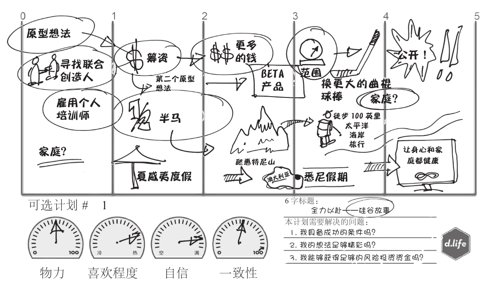
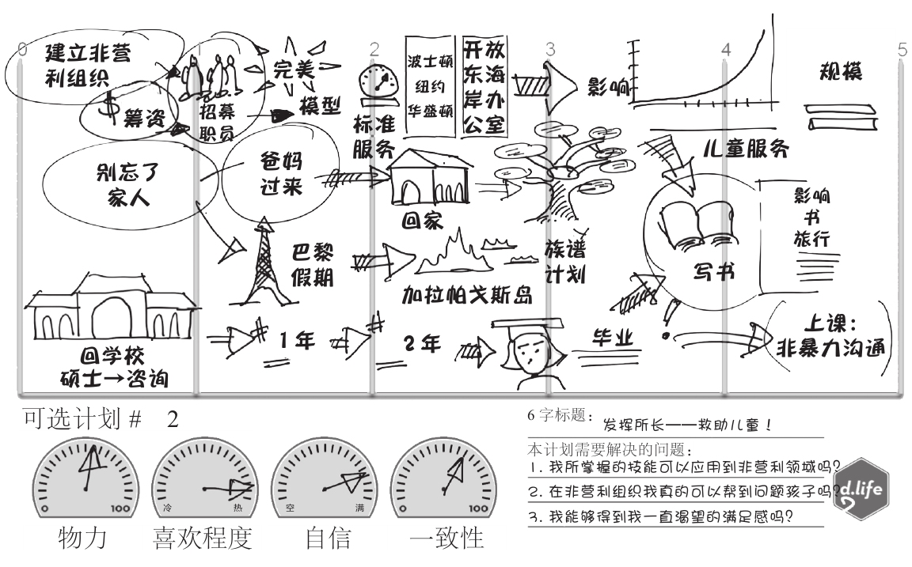
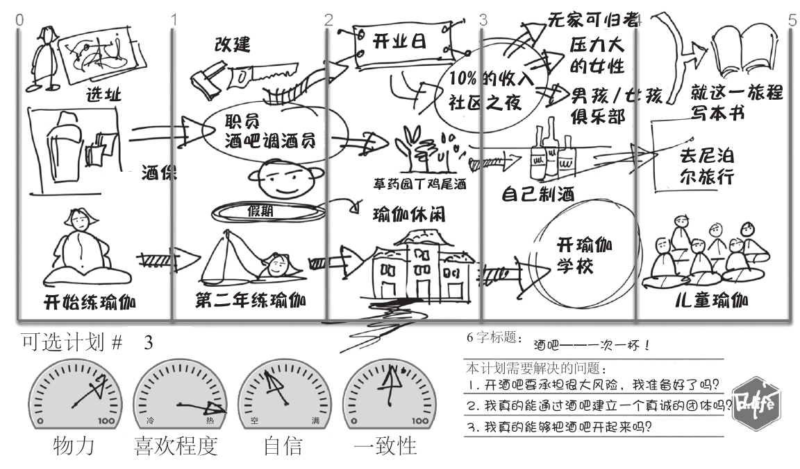
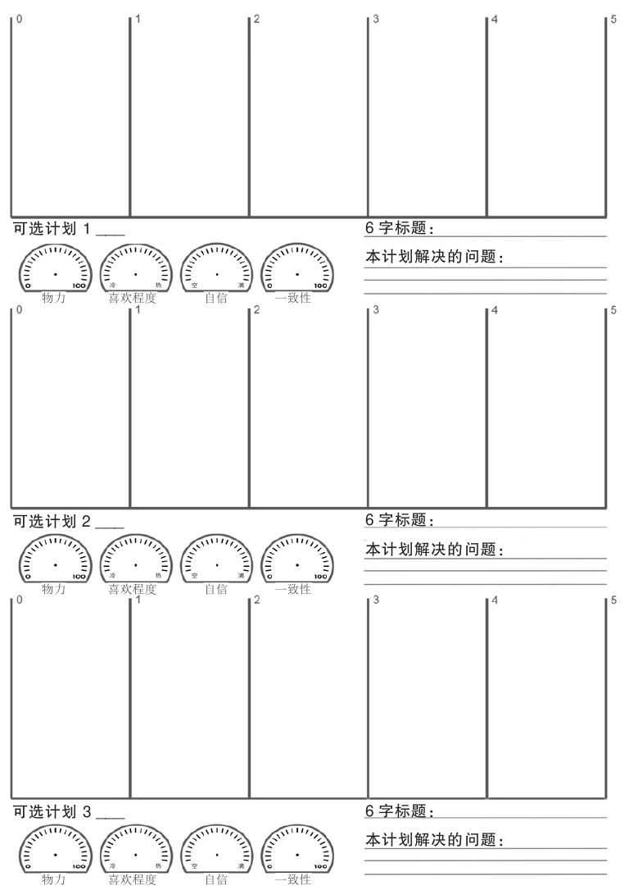

# 第五章 制订你的“奥德赛计划”

人是多面体，你也是。每个人都有很多面。

你当下经历的生活只是你所有生活片断中的一段。

我们现在并不是在谈论转世，或者其他具有宗教含义的内容。一个简单常见的事实是，在人的一生中，会有很多种不同的生活。如果对现在的生活你感觉有点儿不舒服，不要担心，人生设计会带给你无数契机，你可以在任何地点、任何时间重新开始。你应该随时允许自己“校正镜头”。

在工作中我们会遇到各个年龄段的人。我们发现，人们（不管年龄、教育背景或者事业情况）经常犯一个错误，那就是他们以为只需为自己的生活想出一个计划，就可以一帆风顺。如果他们做出了正确的选择（最好的、真实的、唯一的选择），那么他们将会为自己制作一幅蓝图，包括他们将会成为什么人、将来做什么，以及如何生活等。然而，这种生活方式就像一幅数字绘画，刻板且没有创意。实际上，生活更像一幅抽象画——不同的人有不同的解读。

钟感觉压力很大。他曾就读于加州大学伯克利分校，读书期间他非常努力，并以优异的成绩毕业。毕业后他想去读研究生，但在读研之前，他想先在他所选择的专业领域积累一些工作经验，帮助自己更好地完成专业学习，之后尽快开始他的职业生涯。为了让自己有更多的选择，钟申请了 6 个不同的实习项目，时间从一年到三年不等。结果，可怕的事情发生了。在这 6 个实习申请中，有 4 个公司录取了他，其中有三家是他特别想去的。可怕的是被录取后，他迟疑不决，完全不知该作何选择——他不知道如何做出选择，也不清楚自己要做什么。

面对三个自己最向往的实习项目，他并没有做好准备，更严重的是，这三个选择完全不同——一个是去亚洲的农村教书，一个是在比利时的非营利组织做法律助理，还有一个是在华盛顿特区的卫生保健研究中心做研究。该选哪一个呢？

钟知道这是一个非常重要的决定，因为他在哪里实习将直接影响到之后的研究生学习，而他研究生的学位也会影响他将来的工作，进而影响他的人生。

钟犯了一个常见的错误：他认为有一种“最好的方法”能帮助他拥有幸福成功的人生，他必须找到它，否则他就不得不退而求其次了，甚至更糟糕。但是，事实并非如此——我们都拥有足够的精力、天赋以及兴趣，可以过上自己想要的生活，每种生活都可以是真诚的、有趣的，而且可以创造出价值。若要搞清楚哪种生活最好则是一个非常愚蠢的问题，那就相当于去问是手好，还是脚好一样。

在钟来咨询时，戴夫问他：“你选择时如此困难，那么你三个实习项目都去做，一个接一个完成，你觉得怎么样？”钟回答说：“我当然希望三个都做，但是可能吗？我怎么才能够获得允许，连做三个项目呢？”

“去问一下。只是问问，你又不损失什么。”

于是，他去那三家公司咨询了，结果令他十分意外，竟然有两个组织愿意等他；并且他发现，如果他愿意的话，他可以在 5 年内完成这三个实习项目。

钟终于明白，他无法确定哪个项目最好的原因是：没有最好。这三个项目都很好，但它们又是完全不同的机会。在人生的这个阶段，他完全可以一一去尝试，他也的确这样做了。

当然，最后的结果是钟从来没有想过的。他的第一个实习项目为期两年，这期间，他和本科同学保持了密切联系，经常通过网络聊天。9 个月后，除了钟，其他人都发现自己并不快乐，他们对毕业后的生活所抱的幻想破灭了。毕业充满了压力，工作也曾让钟感到纠结，但钟学会了人生设计，他掌握了很多有用的技巧，并且认识到“条条大路通罗马”。他的同学则没有这样的信心，因此钟开始帮助他们确定下一步要做的事情。他很喜欢助人为乐。于是，他决定做一些调查，把这件事继续做下去。在第一份实习工作结束后，他放弃了其他两份实习工作，去了研究生院做职业咨询工作。在钟发现至少有三种职业可以让他生活得很快乐之后，他又发现了第四种职业。由此可见，只有当你停止“做正确的事情”，并开始设计你前进的人生路时，这一切才会发生。

思维误区：我需要找到最佳的生活方式，然后制订计划，实现它。

重新定义：有无数美好的生活（和计划）等着我，我可以自主做出选择，打造我的人生路。

## 畅想人生的多种可能性

在设计人生时，最有效的一个方法就是设计多种人生计划。现在，请你想象一下，然后写出未来 5 年的三个版本的人生计划。我们将这种方法称为“奥德赛计划”。只要你做了计划，就已经获得了三种完全不同的、完全可以维持生活的工作机会。在我们帮助过的数以千计的人中，每个人都向我们证明了这个计划的可靠性。在我们的内心存在着无数种生活的可能性，在任何时候，我们都要给自己设计三种可能的人生选择。当然，我们一次只能选择一种生活，但是我们可以构思多个版本，以便做出具有创意且富有成效的选择。

一下子想出三种不同的人生计划似乎是一项不可能完成的任务，但实际上你是可以做到的。我们帮助过的每个人都成功地想出了三种不同的人生计划，你也可以。你心里很可能已经有了一个首选计划，或许有一个计划你已经投入了很多，并且进展顺利，那也很棒——但你仍然需要制订三个“奥德赛计划”作为备选方案，真的很有必要。凡是认真实施“奥德赛计划”的人都从中获得了巨大的好处，并找到了一个适合自己的“真实计划”。同时构思多个原型（如三个“奥德赛计划”）则具有很大的意义，这一点已经在斯坦福教育学院得到了证实——丹·施瓦茨教授领导的研究团队通过对两个小组的研究证实了这一点。在研究中，一个小组的参与者同时开始构思三个想法，结果，在实现他们的最终目标时，他们至少能想出两个方案。第二个小组成员只需想一个方案，然后让他们对这个方案进行 4 次改进。两个小组分别进行了 5 轮练习，结果证明：第一组成员表现得更好——他们不仅提出了更多的方案，而且，他们的最终解决方案也更佳。第二组成员——从一开始就只提出了一个方案，他们只是不停地完善着同一个方案，这并没有带来真正意义上的创新。由此可见，如果你同时产生多个想法，有多种方案，就不会过早地选择一条路，思维也会变得更加开放，能够接受并提出更加新颖更加创新的想法。设计师深知这一点——不要只提出一个方案，否则你会一门心思纠结于这个方案，无法进一步拓展自己的思维。

不要把你的“奥德赛计划”看成“计划 A，计划 B，计划 C”——计划 A 非常棒；计划 B 是个不错的选择；而计划 C 你完全不想采用，但在无可奈何的情况下，你也可以勉强接受。每一个“奥德赛计划”都应是计划 A，因为它是你真正的渴望，有可能实现。“奥德赛计划”就是潜在的可能性草图，它可以激发你的想象力，帮助你选择前进的方向，让你开始原型设计，推动你的人生。

具体要选择哪种生活方式，我们会有很多方法和技巧帮助你攻克这类“选择”的难题，详细内容我们将在第九章具体介绍。下一步如何选择，其标准主要基于所有看得到的资源（距离、时间、金钱）、一致性（计划和你的人生观与工作观的匹配情况），你的自信水平（你是否相信自己可以做到），以及你对这个选择的喜欢程度。但凡事都有先后，首先你需要设计几个可替代的选项。

我们之所以称之为“奥德赛计划”，是因为人生就是一段漫长且充满风险的历程，有希望、有目标、有帮手和爱人，也有敌人，未知风险和好运并存。旅行开始时，我们会做好计划，随着时间的推移，生活中遭遇的一切会一一展现在我们面前。随着我们不断前进，好事、坏事融合交织在一起。《奥德赛》是古希腊大诗人荷马的代表作，该史诗讲述了奥德修斯海上漂流的故事，作者借此隐喻人生如一场探险。因此，我们需要花些时间，想出多种方法，帮助你开启人生旅途的下一个篇章——你的需求。

我们希望你设计三个不同的 5 年计划。为什么是 5 年？因为两年太短（会让你感到紧张，想得也不够长远），7 年又太长了（到那时，很多事情会发生变化）。实际上，如果你听过人们讲述自己的经历，你会发现大多数人的生活实际上都是由一系列 2~4 年的时间段串联起来的。即使是更长的时间段（如抚养子女的时间）也会被分割成几个独立的 2~4 年的时间段——幼儿期，学前，少年期，青春期。5 年时间其实是 4 年加上一年的机动时间。我们请涵盖了各个年龄段的数千人做过这个练习。在进行了多种尝试后，我们确信，5 年是一个合理的时间段。请尝试一下。

我们想强调的是（我们不会给你的练习打分），你要为自己创造三个完全不同的可供选择的生活版本。这三个计划将给你带来三个真正的选择，充分发挥你的创造力，你将了解到，你不会选择显而易见的答案。我们希望你想出三个真正不同的备选方案，而不是同一个主题的三个版本——生活在佛蒙特州的一个小镇与生活在以色列的基布兹不是两个不同的选择，它们是同一个选择的两个版本，所以你一定要认真想出三种不同生活计划。

我们相信你可以做到，因为我们已经见证了数以千计的人成功地完成了这个练习，其中有很多人一开始认为自己根本想不出三个未来生活的版本。如果你觉得自己想不出来，那么下面这个方法可以帮助你。

第一种选择——你已经在做的事。你的第一个计划应着重放在你已有的想法上——它也许是你当前生活的延展，也可能是一个你头脑中已酝酿很久的一个好主意。总之，就是你已经拥有的想法——这是一个很好的选择，非常值得引起你的注意。

第二种选择——如果你突然无法从事正在做的工作（第一种选择），那么第二种选择就是你想要做的事。这是常有的事情，因为一些类型的工作会突然没有市场。例如，现在几乎没有人再生产马鞭子或者创建互联网浏览器，因为前者已经过时，后者则被免费的操作系统取代，因此制作马鞭和创建浏览器不再是热门的职业了。想象一下，你的第一个生活选择突然间消失了或者不再适合你，你该怎么办？你不可能不生存，你不可能什么都不做，那该怎么办？实际上当你觉得自己无法做想做的事情，不得不重新寻找谋生之道时，你就会想出其他选择。

第三种选择——在不考虑金钱和形象的前提下，你想做的事情或者你想过的生活。如果你知道你会有不错的收入，而且这份工作也不会被人嘲笑，那么你想做什么？这只是个假设，我们无法肯定某份工作可以让你赚到很多钱，我们也无法保证没人嘲笑你，但是想象一种这样的生活将会对你的人生设计非常有益。

戴夫最近正在解答一位年轻的工商管理专业研究生的疑问，这个学生想不出有关他的生活的三个计划。

“那么，你将来打算做什么？”戴夫问这个学生。

“我想从事企业管理咨询工作。”

“很好，这就是你的第一个人生计划，”戴夫回答说，“但是，你知道吗，很多公司首席执行官都认为没有必要再花数十亿美元在管理咨询上，所以他们决定取消这方面的支出了，咨询行业已经走到头了。现在，你该怎么办？”

这位工商管理专业的学生非常震惊：“什么？完全不需要了吗？”

“是的，完全不需要了，你必须做其他工作了。你想做什么？”

“嗯，如果我不能做咨询工作了，我会尝试着去一家大型媒体公司工作，从事战略或者营销传播方面的工作。”

“很好，这可以作为你的第二个人生计划。”

当戴夫问他，如果不考虑金钱或者形象问题，他想干什么时，在再三确定不会有人嘲笑他后，这个年轻人提出了他的第三个人生选择。

“嗯，我非常想做红酒销售工作。真的，我非常感兴趣，我想尝试一下。”

“可以了，”戴夫说道，“你现在有三个人生选择了。”

在交谈中，很多人都固执地认为自己只有一种人生选择。如果你无法立刻想出三个人生选择，那就试试这种方法。一旦想象出三个人生选择，你就会想出更多的选择。

摆脱惯性思维，不要思虑过度，立刻行动起来！

这是一个可以改变人生的练习。

是真的。

## 奥德赛计划详解

请为你的人生设计三个可替换的 5 年计划，每个计划必须包括如下内容：

1.一个直观的/图解形式的时间明细表，包括私人的、与工作无关的事情。例如，你是否想结婚？你想参加培训而后在健身大赛中取得胜利吗？你希望学习通过意念掰弯汤勺吗？

2.为每个计划拟定一个六字标题，描述计划的核心内容。

3.针对每个计划提出两到三个问题。优秀的设计师会通过提问进行测试，发现新想法。在每一个时间明细表中，你可以尝试各种不同的可能性，多方了解自己和周围的世界。在这三个人生计划中，你想测试并探索哪些事情？

4.填写“仪表盘”，评估如下内容：

•物力（你拥有客观资源吗？例如时间、金钱、人脉，这些都是你实现计划所必需的）

•喜欢程度（你对这三个计划的态度如何？迫切、缺少热情还是满怀热情？）

•自信心（你相信自己一定会实现计划，还是不确定？）

•一致性（这些计划本身有意义吗？它们与你及你的工作观和人生观是否一致？）

•潜在考量：

•地理环境——你住在哪里？

•你会获得哪些经验？

•如果选择了其中一种计划，这将对你产生什么影响或者带来什么结果？

•你的生活会变成什么样？你希望自己成为什么样的人？你希望自己在什么行业或企业工作？

•其他内容：

•除了事业和金钱，其他事情你也要放在心上。事业和金钱，对你随后几年的发展方向能够起决定性作用，但仍然有一些其他的关键因素需要引起你的注意。

•上述的任何一个因素都可能成为你随后几年人生计划的起点。如果你发现自己陷入困境，就试着根据上述列举的设计因素绘制一张思维导图吧。关于这个练习，你不要思虑过度，也不要跳过不做。

“奥德赛计划”能够明确我们未来重点需要做的事情，帮助我们实现梦想。你在 12 岁时想成为宇航员的梦想不是没有了，它只是被埋藏在了内心深处。注意保持好奇心，看看还有什么其他发现。选择其中一个计划，放开一切顾忌，充分发挥你的想象力，越疯狂越好。可能有的想法太天马行空、太疯狂，你一辈子也不会付诸行动，但你也要记录下来——例如，在阿拉斯加或者印度隐居，在好莱坞的舞台上表演，成为一名专业滑板运动员，参与让人肾上腺素飙升的极限运动等。你或许想在生活中的不同领域（如事业、爱情、健康和娱乐）制订几个不同的可选计划，你或许想把这几个方面融合在一个计划中，这都没有关系，你唯一可能犯的错误就是什么也不做。

## 玛莎的奥德赛计划

下面是研讨班学员玛莎的“5 年奥德赛计划”的三个版本。玛莎是一位技术高管，她当时希望在以后的生活中尝试一些有意义的事情。玛莎为自己的未来设想出了三个版本，每一个版本都是风险性和创新性并存，而且都和社区建设有关。

玛莎的三个计划分别是：创立硅谷风格的企业，成为有关“问题儿童”非营利组织的首席执行官，以及在旧金山开一家温馨的社区酒吧。注意，每一个计划都包括 6 个词的标题和一份 4 项评估仪表盘，另外，针对每个计划还要提出三个问题。

例 1

标题：“全力以赴——硅谷故事”

问题

1.“我具备成功创立企业所需要的条件吗？”

2.“我的想法足够精彩吗？”

3.“我能够获得足够的风险投资资金吗？”

例 2

标题：“发挥所长——救助儿童！”

问题

1.“我所掌握的技能可以应用到非营利领域吗？”

2.“在非营利组织我真的可以帮到问题孩子吗？”

3.“我能够得到我一直渴望的满足感吗？”

例 3

标题：“酒吧——一次一杯！”

问题

1.“开酒吧要承担很大风险，我准备好了吗？”

2.“我真的能通过酒吧建立一个真诚的团体吗？”

3.“我真的能够把酒吧开起来吗？”

\*\*\*

现在，完成你自己的三个可选 5 年计划，你可以填写上文提供的计划表，也可以登录 www.designingyour.life 下载计划表。

## 分享你的人生计划

我们希望你能够和其他人分享你的三个计划表，不要紧张，拥有三个版本的人生计划是一件非常了不起的事情。这些计划表能够让你清楚地意识到，你的未来并非只有一种可能性。思考一下，你的哪个可选计划在物力、喜欢程度、自信以及一致性上的评分最高？哪个计划让你兴奋，能够点燃你的激情？哪个计划让你疲于应付？

充分了解可选方案的最佳方法就是和朋友分享，大声说给他们听——理想状态是和你的人生设计团队一起分享，就像我们在前言中所介绍的那样。最有趣、最有效的完成人生设计过程的方法就是组建团队，有 3~6 个成员，包括你自己。一个人进行人生设计也没问题，但你最好选择团队进行设计，因为在团队中，每个人在完成自己的计划的同时，还能够对其他人的人生计划给予支持。找 2~5 个人一起完成这个练习可能比你想象的情况要容易。只需把本书给几个对生活感到迷茫的人，然后一起讨论，看看你会发现什么。你可能会非常吃惊。我们并不是在说服你多买几本书，只是这样有助于你组建人生计划团队，展开话题讨论。

不管你是否会组建一个人生设计团队，你都需要找一些支持你的人，向他们展示你的“奥德赛计划”，听取他们的反馈和想法。你可以邀请一些人，请他们提出一些有建设性的问题，但请他们倾听时，最好遵循以下原则：不要批评、评论或者提建议。你和他们分享的目的是希望他们接受你的计划，并给予反馈，帮助你进一步扩展。这时要提一些问题，但要注意提问的方法，“再告诉我一些关于……”的提问方式不错，可以让你持续得到他人的支持。如果你实在找不到一组人一起分享你的计划，那么你可以读一下自己的计划，把它录下来，然后去听录音，这时不要把自己当作一个听众、一个局外人。听完后，看看你有什么想对自己说的，再记录下来。

人生设计就是为你的生活提供多种选择，设计多种人生的练习能够为你将来的生活提供参考。你不是在设计自己的余生，你设计的是下一步的打算。每个可能的设计版本都包含着未知事件和妥协方案，每一个设计版本都带有一定的意外后果。在这个练习中，与其说你是在寻找答案，不如说你是在学着如何接受、探索问题，对各种可能性保持满满的好奇心。

记住，有多种美好的生活在等着你。

每个人都是多面体。

选择哪种原型设计作为下一步生活的开端，这由你决定。

小练习

奥德赛计划

1.利用所提供的表格，制订三个可替换的 5 年计划。

2.为每个计划拟定一个标题，并根据每个计划的内容提出三个问题。

3.完成仪表盘上的内容评估——就计划所需的物力、喜爱程度、自信心以及一致性进行评估。

4.和他人、小组成员或你的人生设计团队分享你的计划，思考每个计划都是如何激发你的活力的。

本书由“[ePUBw.COM](http://epubw.com)”整理，[ePUBw.COM](http://epubw.com) 提供最新最全的优质电子书下载！！！ 
