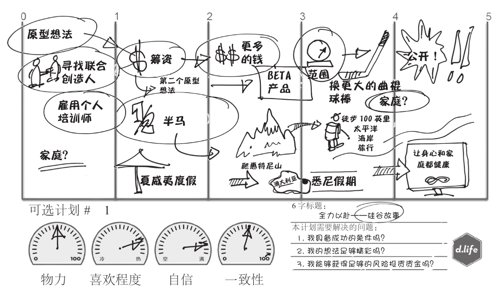
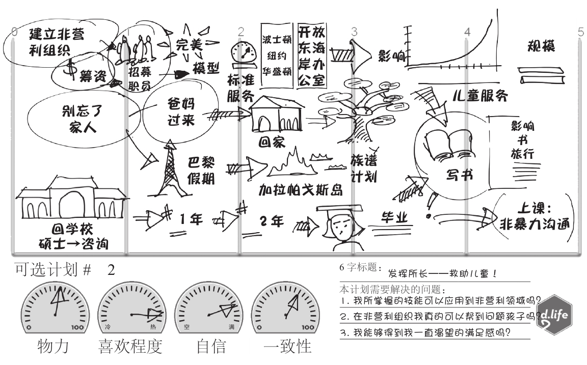
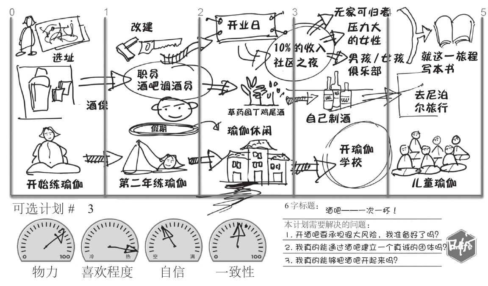
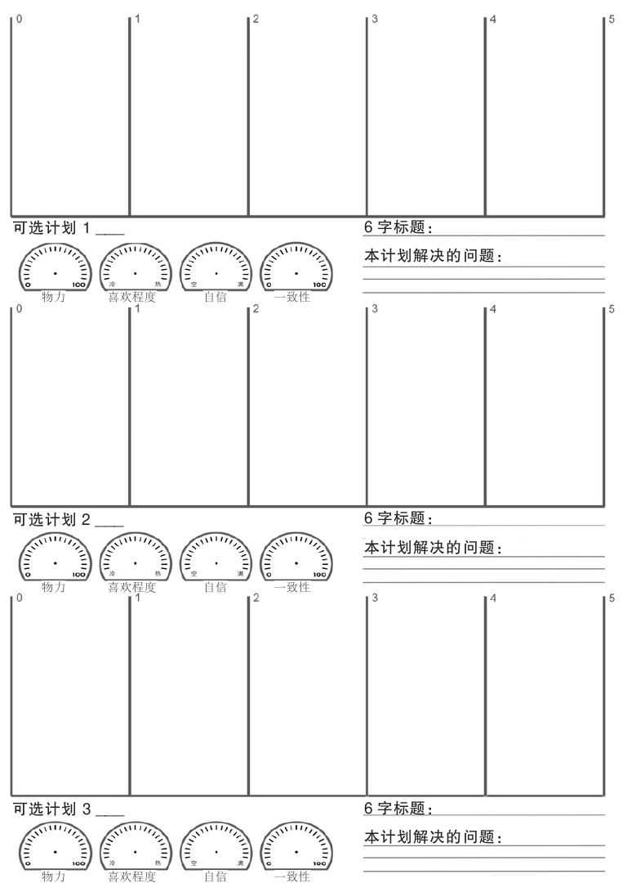

# 第五章 别把人生押成单选题

人有很多面，你也是。此刻的生活，只是你漫长人生中的一帧。这里不谈转世，也不谈玄学，只说一个朴素事实：一生可以容纳许多种活法。若眼下有点别扭，别慌。人生设计会给出一连串机会，你随时可以校准镜头，在任何时间、任何地点重新出发。

很多人常犯一个错：以为只要替生活找出一套完美方案，就能一路顺风。他们想选出“最正确、最真实、唯一”的答案，再画一张蓝图：我要成为谁、做什么、怎么活。可惜，这种活法像数字绘画，工整却死板。真实生活更像抽象画，不同的人能读出不同意义。

钟就卡在这样的路口。他毕业于加州大学伯克利分校，读书时很拼，成绩优异。原计划先读研，但想在读研前到专业领域积累经验，再尽快开启职业生涯。为了多留选择，他申请了6个实习项目，时长从1年到3年不等。结果“可怕”的事来了：4家公司录取他，其中3家是他特别想去的。他却迟疑了，不知道该怎么选，也不清楚自己到底要什么。三个机会方向完全不同：去亚洲农村教书；去比利时一家非营利组织做法律助理；去华盛顿特区卫生保健研究中心做研究。他知道这决定重要，因为实习会影响读研，读研又会影响工作，工作再影响人生。

他掉进了常见误区：以为存在一种“最佳方法”能通向幸福成功，必须找到它，否则只能退而求其次，甚至更糟。戴夫问他：“既然这么难选，三个实习一个接一个都做，怎么样？”钟说：“我当然想，但可能吗？怎么才能获准连做三个？”戴夫说：“去问。只是问问，又不损失什么。”钟去问了，结果出人意料：两个组织愿意等他；他还发现，若愿意，5年内可以完成这三个项目。钟终于明白：他无法确定哪个最好，是因为根本没有“最好”。三个项目都好，只是机会不同。这个阶段，他完全可以一一尝试。后来他真这么做了。

后续也超出他的想象。第一个实习为期两年，期间他和本科同学保持联系，常在网上聊天。9个月后，除钟以外，其他人发现自己并不快乐，对毕业后的生活幻想破灭。毕业有压力，工作也让钟纠结过，但他学会了人生设计，掌握不少实用技巧，也认识到“条条大路通罗马”。同学没这份信心，钟便开始帮他们确定下一步。他喜欢助人，于是决定做调查，把这件事继续下去。第一份实习结束后，他放弃另外两个实习，去研究生院做职业咨询。原本他发现至少有三种职业能让自己快乐，后来又发现了第四种。只有当他停止“做正确的事”，开始设计前路时，这一切才发生。

所以，请把旧思路换掉。旧思路是：我需要找到最佳生活方式，然后制订计划去实现。新思路是：有无数美好生活与计划等着我，我可以自主选择，亲手打造人生路。问“哪种生活最好”，就像问“手好还是脚好”一样荒唐。每种生活都可以真诚、有趣、有价值；我们也有足够的精力、天赋和兴趣去活出自己想要的样子。

最有效的设计方法之一，是同时构思多个版本的人生。想象未来5年，写出三个不同计划，这就是“奥德赛计划”。你一次只能选择一种生活，但可以先把多个版本摆在桌面上，做出有创意、有成效的选择。别把三个计划看成A、B、C：A很棒，B不错，C只好勉强接受。错了。每个都该是A，都是你真正渴望、并且可能实现的方向。它们是你的可能性草图，用来激发想象、辨别方向、启动原型设计，推动人生向前。只要你认真写下三个版本，就等于为自己准备三种完全不同、且足以维持生活的可能。哪怕你已有一个进展顺利的首选，也别省掉三个备选。也别只提一个方案，否则容易死盯它，思维打不开。斯坦福教育学院丹·施瓦茨教授团队做过研究：一组同时构思三个想法，另一组只想一个方案再改四次；经过五轮练习，前者不仅方案更多，最终方案也更好，至少能想出两个方案，而后者只是在同一方案上打转，创新有限。多方案能让你不急着选路，心态更开放，也更容易冒出新颖创意。

三个版本还必须真正不同，不能是同一主题的三个变体：住在佛蒙特小镇与住在以色列基布兹，只是同一选择的两个版本，不算两种生活。为什么叫“奥德赛”？因为人生像一场漫长探险。荷马史诗里，奥德修斯在海上漂流，有希望、目标、帮手和爱人，也有敌人、未知风险与好运。出发时会做计划，沿途一切逐渐展开，好事坏事交织。设计三个五年版本，就是为下一章做准备。为什么是5年？2年太短，容易紧张、想不远；7年又太长，变数太多。很多人的生活其实由一个个2到4年的阶段串成，抚养子女之类更长的阶段也会被切成几个小段；5年等于4年加1年机动。我们让各年龄段数千人练过，5年是个合理跨度。至于最终怎么选，可以看资源条件，如距离、时间、金钱，看计划与你的工作观、人生观是否一致，也看自信水平和喜欢程度。但先有可替代选项，才谈得上选择。

若一时想不出三个版本，可以从三个入口切入：第一，你已经在做的事，也许是你当前生活的延伸，或心里酝酿很久的好主意，值得认真看；第二，假设你突然无法从事现在的工作，你想做什么？有些职业会消失，就像马鞭和早期浏览器，市场说没就没，人总得另找谋生之道；第三，不考虑金钱和形象，你想做什么、想怎样生活？假设收入不错、不会被人嘲笑，你会选什么？有位工商管理研究生说自己想做管理咨询。戴夫说，好，这是第一计划；又假设咨询行业被企业砍掉，你怎么办？学生说去大型媒体公司做战略或营销传播，这是第二计划；再问不考虑钱和形象想做什么，他确认不会有人嘲笑后说，想做红酒销售。三个选择就出来了。很多人固执地认为人生只有一条路；一旦想象出三个，往往还能想出更多。别被惯性绑住，别思虑过度，先行动起来。这个练习真能改变人生。

具体怎么做？每个五年计划要包含四件事：第一，一份直观或图解式的时间明细表，也要放进私人生活，比如是否结婚、是否培训后参加健身比赛，甚至是否想学会用意念掰弯汤勺；第二，给计划起一个六字标题，点出核心；第三，围绕计划提出两到三个问题，像设计师测试原型那样，借提问发现新想法，看看自己想探索什么；第四，填“仪表盘”，评估物力（时间、金钱、人脉等客观资源）、喜欢程度（迫切、缺少热情还是满怀热情）、自信心（相信自己能实现，还是不确定）、一致性（计划是否与你的工作观、人生观匹配）。

还要做潜在考量：你住在哪里？会获得哪些经验？选了这个计划会产生什么影响和结果？生活会变成什么样？你希望自己成为谁？希望在什么行业或企业工作？此外，事业和金钱之外的事也要放在心上。它们对今后几年的方向很关键，但并非全部。上述任一因素都可能成为人生计划的起点。如果卡住，就按这些设计因素画一张思维导图。别过度思虑，也别跳过不做。

这个练习能帮你看清未来重点，靠近梦想。你12岁想当宇航员的念头没有消失，只是埋在了心底。保持好奇，看看还能发现什么。选一个计划，放下顾忌，把想象力开大，越疯狂越好。哪怕有些念头一辈子不会行动，也先记下来：去阿拉斯加或印度隐居，在好莱坞舞台表演，成为专业滑板运动员，参加肾上腺素飙升的极限运动……你也可以在事业、爱情、健康、娱乐等不同领域分别做计划，或把它们融进一个版本，都没关系。唯一可能犯的错误，是什么也不做。

看一个例子。玛莎是技术高管，希望往后做些有意义的事。她的三个五年版本都带着风险与创新，也都围绕社区建设：创立硅谷风格的企业；成为服务“问题儿童”的非营利组织首席执行官；在旧金山开一家温馨的社区酒吧。每个计划都有六字标题、四项仪表盘评估，并配三个问题。

例1  
标题：“全力以赴——硅谷故事”  
  
问题可以这样问：我是否具备成功创业的条件？我的点子够不够精彩？我能否拿到足够的风投资金？

例2  
标题：“发挥所长——救助儿童！”  
  
问题可以这样问：我的技能能迁移到非营利领域吗？在非营利组织里，我真能帮到问题孩子吗？我能得到一直渴望的满足感吗？

例3  
标题：“酒吧——一次一杯！”  
  
问题可以这样问：开酒吧风险不小，我准备好了吗？我真能借这家酒吧建立真诚的社群吗？我真的能把酒吧开起来吗？  

做完计划，记得分享。别紧张，拥有三个版本的人生计划是很了不起的事。它能让你清楚看到：未来并非只有一种可能。你可以找支持你的人，最好和人生设计团队一起，把计划大声讲出来。团队3到6人即可，找2到5个人一起练，可能比想象中容易；好处是，大家在完成自己计划时也能支持彼此。听的人要遵守原则：不批评、不评论、不急着提建议。分享不是求评判，而是希望对方接纳并反馈，帮你把思路扩宽。你可以请他们用“再告诉我一些关于……”来提问，让对话继续深入。若实在找不到小组，就把计划读出来录成音频，再回听。听的时候别把自己当局外人，听完记下你想对自己说的话。

人生设计，就是为生活打开多种选择。设计多种人生，是为将来提供参考。你不是在一次性设计余生，而是在设计下一步。每个版本都藏着未知事件、妥协和意外后果。这个练习与其说在寻找答案，不如说在练习接受问题、探索问题，并对各种可能性保持好奇。记住，多种美好生活正在等你。每个人都是多面体。选择哪一种原型作为下一步生活的开端，由你决定。

现在就开始小练习：制订三个可替换的五年计划；为每个计划拟标题、提三个问题；用仪表盘评估物力、喜欢程度、自信心和一致性；再和他人或小组分享，观察哪个计划最能点燃你的活力。别想太多，立刻行动。