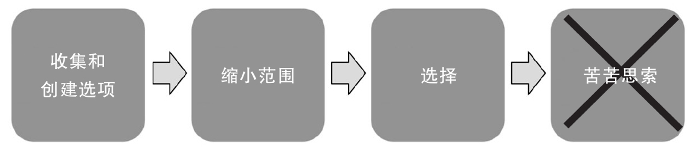
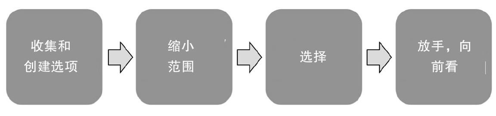
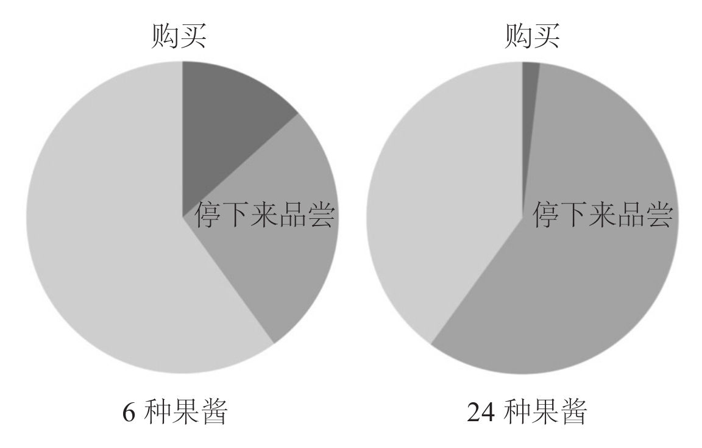

# 第九章 主动选择幸福

我们前面已经论证过了，设计一项事业和一种生活，你不仅需要很多选项和更佳的替代方法；同时也需要具备做出正确选择的能力，并有信心践行这些选择。这就意味着你要接受这些选择，事后不进行自我批评。不论你从哪里开始，以及你现在的生活和工作是什么情况，我们都可以确定，在设计人生的过程中，每人都有一个目标，即：幸福。

有谁不想幸福呢？我们希望自己幸福，希望我们的学生幸福，我们也希望你幸福。

在人生设计中，要想让自己幸福，意味着你要选择幸福。

选择幸福并不意味着你许个愿就可以到达幸福的彼岸了，拥有幸福的秘诀不是做出正确的选择，而是学会如何选择。

你可以完成人生设计中包含的各种事项——提出想法，原型设计，付诸行动，但这并不能保证你会幸福，会得到你想要的，因为是否能获得幸福和得到想要的事物与未来风险无关，也与你是否选择了正确的替代方案无关，而是与你如何选择以及如何去实践这些选择相关。如果选择不当，那么你所有的努力都会白费。与其说你是做出了错误的选择，还不如说你在心态上有偏差。一个好的、健康的、明智的人生设计选择过程对于获得幸福至关重要。许多人正在使用的选择模式不仅无法让他们从中领悟到真谛，而且他们在做出选择后，也毫无幸福感可言。研究表明：一个人无法得到幸福，是由于他不了解重要选择的设计步骤。

思维误区：要想幸福，我就不得不做出正确的选择。

重新定义：没有正确的选择——只有好的选择。

## 选择四步骤

在人生设计中，选择过程包括 4 个步骤：首先，你需要收集并创建一些选项，然后进行筛选，缩小范围，只留下几个最佳选项，再进行最后的选择。最后一个要点是，冥思苦想，做出选择。你要审慎思考自己是否选择对了。实际上，我们会鼓励你花上几个小时、几天、几个月，甚至几年去认真思考这个问题。

人们可能会用好几年时间苦苦思索他们做出的选择，但是这样的思考太浪费时间了。当然，我们不希望你这么痛苦，这也不是人生设计选择过程的第四个步骤。

在这个过程中，第四个步骤其实是让你放弃一些不必要的选项，向前看，直至完全接受你最后的选择。

你需要理解每一个选择步骤，能够鉴别领悟“选得好与不好”之间存在的重要差别。你要明白，选择恰当就会获得幸福，创造美好未来；选择不恰当，就会给你带来不愉快的体验。

步骤 1：收集和创建选项

收集和创建选项是本书一直在探讨的问题。深刻认识自己，探索自身与周围世界互动的选项，进行原型体验设计，这些方法都有助于你在人生设计中生成你的思路、可替代的方案或各种可靠的选项。当然，在这个过程中，你要保持旺盛的好奇心，寻找各种潜在的精彩之处，注重行动，不要思虑过度。在这里，我们不再花更多的时间讨论选项如何生成，只是再次提醒你，写出你的工作观和人生观，绘制思维导图，制订三个奥德赛计划，就对话和体验进行原型设计。这些方法都可以帮助你生成选项，你可以在生活的各个方面使用它们。

步骤 2：缩小列表范围

一些人认为他们没有足够的（或者没有任何）选项，另一些人和很多设计师则认为选择太多了。如果你自己想不出选项，那么可以回过头去看看我们在步骤 1 中给出的建议——花些时间非常有必要，多想出一些主意和选项。创建一张你真正喜欢的列表，这可能需要几周或者几个月的时间，没问题，毕竟你在设计你的未来，不可能一夜之间就完成。

现在，如果你的列表上有了足够多的选项，那么你就要为所有的潜在可能性纠结了。仔细思考其他人给你的建议，以及你在生活中可能做的事情……这可能会让你不知所措，你发现自己无法做出选择，或者无法自信地做出选择；你会觉得自己的“功课”做得不够，没有清楚地了解每个选项：“要是我有更多的信息，并且更清楚地了解这些选项，那么我就知道该选哪个了。”然后你开始做更多的研究，进行更多采访，切身体验更多原型设计。结果还是没有用，这是因为信息不足通常不是核心问题。大多数人在做重大决定时，都会尽可能做足准备，但我们不可能了解所有的信息。实际上，调查表明，我们更清楚自己不知道什么，而不是知道什么，于是我们以为，更多的研究会有帮助，但事实并非如此。如果你无法做出选择、你会停滞不前，这是因为你列表的长度以及你和所有选项之间的关系导致的。为了更清楚地说明这个问题，下面我们一起来看看“果酱实验”。

希娜·艾扬格是哥伦比亚大学商学院的教授，也是一位著名的心理学家和管理学家，她专门研究决策力。在心理学领域有一个经典的“果酱实验”，就是由她主持设计的。在一家零售店内，研究人员摆出了 6 种不同口味的果酱（都是一些新奇口味的果酱，如猕猴桃—橙子味、草莓—薰衣草味……你懂的），然后观察顾客如何选择，看看有多少人试吃，以及试吃的人当中有多少人真正购买了果酱。第一周，研究人员展示了 6 种果酱，有 40%的顾客停下来试吃，有 13%的顾客人购买了其中的一种。

几周后，在同一家零售店的同一时间段，研究人员又摆出了 24 种口味的果酱。这次，大约有 60%的顾客停下来品尝——试吃人数是上一次的 1.5 倍。但只有 3%的顾客购买了其中一种果酱。

这个研究说明了什么？首先，我们喜欢拥有许多选择（“哇！24 种口味的果酱！去看看！”）；其次，选择太多会导致我们无法做出决定（“这么多，不知道买哪个，还是去买奶酪吧”）。事实上，如果选项只有 3~5 种，那么绝大多数人都能够有效地做出选择。如果面临的选项数量超过了这个区间，我们的决策能力就开始下降；如果太多的话，我们就无法做出选择了。这是人类大脑的反应方式。我们喜欢做选择，现代文化也推崇提供多个选项——“获得多个选项！保留选择权！不要封闭自我！”我们总是能够听到这样的想法，听起来似乎没错，但若要做出一个恰当的选择，有太多选项就不是一件好事了，很多人都面临着选项过多的困境。

如果你意识到选项过多就意味着没有选项，那么你就会重新思考这个问题了。如果选项过多，让你望而却步，无法做出选择，那么，你等于一个选项都没有。记住，选项只有被选择、被实现，才能够创造价值，有益于你的生活。我们经常告诉学生，选项的存在是为了被选择。因此，当你面对 24 种口味的果酱时，其实你一种都选不出。一旦你明白了在决策时，“24 等于 0”，你就能轻松地进入下一个步骤：缩小范围。

面对如此多的选项，你需要做些什么呢？很简单，删除其中一些选项。首先，把所有选项做成分类列表，每个类别再分成更小的子列表，这有助于你了解每类选项中的优先选项。但是，你仍会因为选项过多而崩溃，这时就需要你删除其中一些选项了。怎么删除？在列表中画掉一些就可以了。

如果你的一张列表中有 12 个选项，删掉 7 个，重新写一遍，只保留 5 个选项，然后开始第三个步骤。

很多学生和客户听到这个主意后，通常会感到不安。

“不能删掉那些选项！”

“要是我删错了怎么办？”

我们理解大家的感受，但你要记住，如果选项太多，就意味着一个选择也没有，所以实际上也就没什么可怕。另外，你不会删错的，这就是典型的“比萨—中餐效应”，我们都有过这样的经历。例如，艾德来到你的办公室，问你：“宝拉，我们要去吃午饭，一起去吗？”

“当然！”

“我们打算去吃比萨或者中餐，你喜欢哪种？”

“都可以！”

“好，那我们吃比萨吧。”

“不，等一下，我想吃中餐！”

在这种情况下，当你给出了第一个答案“都可以”时，你以为那就是你所想的，直到别人说出你不喜欢的决定时，你才知道你自己有所偏好。可见，只有在选择后，你才会意识到自己的偏好。因此，当你缩减列表范围、删除选项时，实际上你什么也没有失去。如果你删错了选项，随后你会发现的。如果你的列表中有 12 个选项，先不要管对错，你必须删除其中 7 个，然后重新写一张只包含 5 个选项的列表；如果错了，你会知道的。当我们告诉你一定要相信自己的时候，请相信我们。如果你面对这 5 个选项依然无法做出选择，那么最常见的一个原因是你对于删除的 7 个选项无法放手，删除它们让你感到十分痛苦。如果是这个原因，你一定要想办法解决——你可以把那张写有要删除的 7 个选项的列表烧掉，过两天之后再回过头看看保留下来的 5 个选项，不要想着这张列表是删减后的，把它当作一开始只有这 5 个选项。但是，面对这 5 个选项，如果你不知道自己到底喜欢哪个，或者看不出它们之间有什么区别，那么你会发现自己处于“不能失去的境况”。这就意味着，这 5 个选项对你来说都具有战略性的价值，它们没有实质上的明显差别，它们都有用，需要你继续思考。

关键是，你在离开商店时能够挑选出一瓶果酱带走。

步骤 3：明智地选择

一旦你完成了前期的选项收集和缩减列表等工作（是的，你希望在前期收集很多选项，却无法做出选择，那是因为你需要从这些选项中进行挑选），就可以开始下一步了：真正做出选择。这一步有一定难度。

要想恰当地做出选择，我们需要知道，在选择过程中大脑是如何工作的。我们怎么才能做出恰当的选择呢？目前，科学家对大脑的研究取得了前所未有的进展。1990 年，约翰·迈尔和彼得·沙洛维合写了一篇影响巨大的学术论文，提出了“情商”（EQ）”的概念，并指出情商在获得成功和幸福过程中的重要性——在很多情况下，我们的情商和智商（IQ）同样重要，有时甚至比智商更重要。1995 年，《纽约时报》的科学作家丹尼尔·戈尔曼在他的著作《情商》中推广了这一概念，自此情商成为一种文化现象被普及开来。

在大脑中，帮助我们做决定的部分位于基底神经节，它从远古时期起就存在于大脑底部，这个部分是通过情感交流和原始而美好的直觉感受来传递信息的。戈尔曼把人类大脑中具有选择引导功能的记忆叫作“情感智慧”，即在生活中积累下来的对我们的生活有用或者无用的体验，以及我们在对决策进行评估时用到的经验。我们自身的智慧通过情感（精神）和直觉（身体的本能反应）发挥作用。因此，为了做出正确决定，我们需要了解自己对选项的情感和直觉反应。

前面介绍了当我们纠结于一个决定时通常呈现出的错误反应：“我需要更多的信息。”我们现在明白，实际上这是大脑对我们发出的干扰——当我们努力思考、试图做出恰当选择时，大脑就会不停地干扰我们，妨碍情感和直觉在决策中的作用。得到有用信息的确非常重要，你可以做大量功课和笔记、设计电子表格、进行多方比较、与专家交流，等等。但是，一旦完成这些工作，我们就需要发挥大脑智慧中枢的作用了，阅历丰富的情感认知体系能够帮助我们分辨出更好的选择。

在我们看来，辨别能力就是决策力，即可以利用多种知觉方式处理问题的能力。我们大多数时候使用的是认知能力，这种能力是非常可靠的、客观的、有条理的，并且以大量信息为依据，它可以帮助你在学校得到“A”。但是，我们也有其他一些与情感相关的知觉方式，包括直觉、精神以及情绪知觉，还有社会知觉（对他人的）和运动知觉（身体内部的）。戴夫有个朋友是一位技艺精湛的临床医学家，当她向病人了解重要情况时总是感觉到她的左膝盖疼，她自己也不知道这是怎么回事。经过一年多的观察后，她逐渐相信她的膝盖反应会带来暗示，因此，她变得更加明智，为病人提供的服务也更好了。

步骤 3 的关键是通过运用多种知觉方式，做出精明的决定，不要单纯地依赖认知判断。虽然认知判断会涵盖大量信息，但它并不完全可靠。我们也不建议单纯地依靠情感做出决策。感情用事同样会带来诸多麻烦，这样的例子我们有很多。因此，我们并不是让你不用大脑，仅用你的直觉来做决策；我们希望你在做决定时，能够充分发挥所有的决策能力，让你的情感和直觉认知方式都能够发挥作用。

要想让多种知觉方式共同发挥作用，需要培养并且完善你的情感/直觉/精神知觉方法和意识，最常见的方法是进行个人修行方面的练习，如记日志、祈祷或者冥想，同时结合身体练习，如瑜伽、太极等。

虽然我们无法对你进行专业培训，但是我们依然鼓励你做这些练习，因为这类练习能够充分调动你的情商。每天忙得团团转、夸夸其谈，或者在网上冲浪，这种情况无法激发出你的智慧。平时，我们经常进行个人修行练习，尤其是在工作不忙的时候，我们就会集中精力进行练习，获得内在的力量和平衡。你不要在压力很大、事情紧迫的关键时刻寻求心灵上的提升。做出决定会产生压力，因此要想做出恰当的选择，最佳时机是你不需要做出选择的时候。如果你希望自己能明智地做出决策，就要提高自己的情商，关注内在心灵的成长。

准备步骤 3 的最佳时间是在开始选择前的几个月，甚至几年。这就意味着现在就是开始准备的最佳时间。

下面这个方法是关于如何让情商发挥作用的，大家可以尝试一下。这个方法重点强调了如何利用你的情商，即神交。

神交

20 世纪 60 年代，美国著名科幻小说家罗伯特·海因莱因在《异乡异客》中发明了这个词“神交”（grok），借以描述火星人的知觉方式。这个词意味着对事物的理解十分透彻深入，已然深入其中，与之融为一体。在书中，因为水在火星上是稀缺物，火星人不知道水是什么，也不理解“喝水”的含义——他们通过与水“神交”，彻底了解了它。现在，这个词已深入美国的文化领域，也得到了广泛应用。“I grok that”（我深知它的真意）有点儿类似于“I get that”（我明白了），但“I grok that”是“I get that”的加强版。

当你经过认真思考，从缩减后的选项列表中做出选择时，你已经从认知上对这些问题进行了评估，并从情感和理性上仔细考虑过这些选项了，那么可能就到了与之“神交”的时刻了。要想和一个选项达到“神交”的程度，你就不能单纯地思考它——你要和它融为一体，成为它的一部分。下面我们以你已经拥有的 3 个选项为例，做进一步解释。从 3 个选项中选取一个，不要对它进行思考。然后在接下来的 1~3 天里，假设自己最终确定了这个选项，我们把它称为选项 A，选项 A 的情境就是你现在的真实生活，让自己真实地体验这种情境——从早上刷牙开始就让自己生活在选项 A 的情境中，比如在路边等红灯时，你就正向着与选项 A 相关的目的地前进。你心里一定要清楚：在头脑中把自己认定为正生活在选项 A 的现实情境中。不要从真正的现实角度去考虑选项 A，也不要把自己当作一个苦苦挣扎的选择者，你就当自己已经选择了选项 A，并在这种情境中平静地生活着。在选项 A 的生活中体验 1~3 天（时间长短取决于你）后，休息 1~2 天，回归到自己原本的生活中，然后重新开始。和选项 A 一样，依次把选项 B 和选项 C 当作现实生活去体验，两次体验之间同样要休息一下，最后对这些体验进行反思，看看你最想成为哪种人、最喜欢哪种体验。这个方法不能保证你会成功，但是通过这些体验，你将明白情感、精神、社交以及直觉等各类知觉方式在选择中的作用，我们可以利用它们弥补认知知觉在评估上的不足。

步骤 4：放手，继续前进

在我们开始步骤 4 的讨论前，有必要解决一个问题：为什么步骤 4 不是“苦苦思索”？“苦苦思索”通常是这样的：

“我做得对吗？”

“这真的是最佳选择吗？”

“要是我选择另一个选项，又会怎样？”

“我想知道，我是否可以重新做一遍？”

如果你不理解我们现在正在谈论的内容，那么你非常幸运，你要感谢你有一个睿智的大脑，请跳过这一部分。其实，我们经常听到有人抱怨他们在做决定时会苦苦思索决定是否正确，这是因为他们在意自己的生活，也在意他人的生活。我们都想尽自己最大的努力，为将来提供最佳的机会，我们都想做出恰当的选择，但我们不可能马上知道我们所做的选择是否恰当，没有人能够准确地预测未来。那么，如何战胜这种决策后出现的痛苦纠结呢？

对一个选择感到满意的最佳方法就是做出最佳选择，这似乎是一件显而易见的事情，但你不可能做出“最佳选择”，因为在所有的结果一一呈现之前，你不会知道最佳选择是什么。根据当前了解的情况，你可以努力为了最佳选择而奋斗，但是如果你的目标是“做出最佳选择”，你永远不会知道自己是否已经做到了。由于你无法获知自己是否做出了最佳选择，你就会一直纠结于自己是否选对了，然后不停地在心里想着已经放弃的选择，这就是“苦苦思索”。因为总是想着放弃的选项，你就会对已经做出的选择感到不满，无法集中注意力，进而无法全身心投入到已经做出的选择中。

哈佛大学的丹·吉伯特在一项研究中阐述了“对选项放手”的作用。研究中，他请人们根据自己的喜好，对莫奈的 5 幅作品按照 1~5 的顺序排名。他同时告诉这些参与者，他这里恰巧有这些作品的复制品，参与者可以把被自己排在第三名或者第四名的画作的复制品带回家。当然，绝大多数人都拿走了被他们排在第三名的作品。有意思的是，研究人员又告诉其中一部分人，如果他们愿意的话，稍后可以替换他们已经选好的画作；而另一部分人则被告知，不管他们选取哪幅画，都不能够更换。

几周之后，研究人员对这些参与者进行了回访，结果发现和那些不能更换画作的人相比，那些被告知可以稍后更换选择的人（即使他们没有更换）对自己选择的画作满意度更低。研究结果表明，可更换性并不利于增加人们对某个选择的满意度。显然，反复考虑或保留选择权会让我们心生怀疑，降低我们已做选择的价值。

更糟糕的是，心理学家巴里·施瓦茨在他的著作《选择的悖论》中告诉我们，人类大脑在做决定时具有的这个瑕疵，它所带来的负面影响还包括在我们面对众多选项时（甚至当我们以为自己有无数选项时），我们对自己做出的选择的满意度也会下降。我们拥有的选项、我们拥有保留权的选项，就连我们从未验证过的海量选项，都会降低我们选择的满意度。世上可能有亿万个不错的选项存在，但我们却没有选择过——这种看法会严重削减我们对自己所做选择的满意度。

关键是，那些想象出来的选项事实上并不存在，因为它们不可操作。你并非生活在幻想中，你努力设计的是一种真实的生活。如果你非要给自己增加负担，拼命去了解你选择的每个细节，去发现每一个可能的选项（当然，如果你正准备做出“最佳选择”，那么你可以这样做），那么你永远不会做出决定。在人生设计中，我们知道有无数种可能性，但不应受这个事实的阻挠。我们应尽情探索其中的可能性，然后确定一个选项，采取行动。只有真正行动起来，我们才能够铺设前进的道路。学会对不需要的选项放手，前行的道路就会越走越顺。你要相信，将来你将拥有更多的选项，不要急于一时。选择幸福，并且满意于自己所做的选择，这一点至关重要。

所以，在心存疑虑时，请放手，继续前进。就是这么简单。

我们不是让你假装自己不知道那些选项的存在，或者假装自己不会有任何发现。我们想表达的是，你拥有一条更明智的人生路，让你提高自己的能力，成功实现你的梦想，并且带给你幸福感和满足感。

对自己好一点，对多余的选项放手，对列表进行精简，将其缩小到一个可支配的范围（最多 5 个选项）；尽你所能做出最恰当的选择，然后根据自己的时间和资源，实现目标，打造自己的人生路。注意，如果你正在利用一个原型迭代、重复体验的方式采取行动，那么在你真正开始一个重大投入前，就不用承担什么风险，因为你可以在体验中进行自我调整和适应。当你苦苦思索一个问题时，你要把精力集中在努力实现自己的决策上来。在前进的过程中，学会专注，努力学习，不要后悔自己所做的决定。

这一步骤的实施主要取决于你是否自律。当你忍不住想要重新开始或者反复思虑的时候，一定要战胜自己。同时，你也需要他人的支持——找一个人生设计伙伴或者团队帮助你，时刻提醒你。你还可以分类记录自己做出的决定，当你感到困惑时，就再次阅读自己写下的内容，看看当时你为什么会做出这样的选择。

思维误区：幸福就是拥有一切。

重新定义：幸福是断舍离。

## 避免过度思虑，学会放手

安迪曾是一名优秀的医科大学预科学生。他对于未来有两个打算，还有一个备选方案。他为自己定下了一个重大使命——促进完善美国医疗保障体系。

安迪明白，若要改革医疗保障领域经济结构比例失调以及穷人看病难的局面，就要对医疗保障体系进行大规模的改革，大幅度改善预防保健护理和健康管理体系。他认为有两个途径可以助他实现：成为一名具有影响力的医疗政策制定者，或是成为一名医学科技企业家。安迪明白，只有真正进入医疗保障领域才能够引起重大变革。关于医疗科技，他知道新科技能够带动行业改变，但医疗科技的发展取决于市场，而不是政策。

他的备选方案“成为一名医生”。听起来有点儿好笑。外科医生是一份多么令人尊敬的职业，尤其是在他出生的那个亚裔大家庭中。他的备选方案只是给自己上了个保险，他认为，作为医生，他也能够在工作中施加一些影响，甚至对他所在的医院或地区产生影响，进行医疗保障的宣传。

对安迪来说，做出选择并不困难。他坚信制定政策是最具潜在影响力的，棘手的是如何实现这个目标。他是应该在大学毕业就攻读公共卫生的研究生，毕业后立刻就去华盛顿？还是先去医学院攻读医学博士——然后再攻读公共卫生的研究生？安迪知道，在医学领域，医学博士更具权威性。虽然在他看来，获得医学博士学位并不意味着能成为一名出色的政策制定者，但是他仍愿意花十年左右的时间拿到博士学位（获得博士学位需要 4 年时间，获得执业医师资格还需要先担任 4~6 年的住院医师。）

这对安迪来说是个艰难的决定——十年后才开始真正投身到事业中去，时间太长了。

安迪十分纠结，他不停地思考，最终也没有决定如何选择。他一遍又一遍地思考，然后不断否定自己的想法。他觉得自己的大脑中似乎装进了一个仓鼠转轮，整晚都在不停地旋转，还能听见仓鼠的尖叫声。

于是，安迪不再思考，他开始与各个选择“神交”，亲身体验每个选项。他发现，医学院情境中的安迪比政策学院中的安迪感觉更好。在医生情境的体验中，安迪依然会焦虑，但他会想：“是的，十年是很长的一段时间，但我正在为实现改善医疗保障体系的目标而奋斗。我选择了这条路，就要尽一切努力做好准备、全力以赴。这十年依然会有很多问题存在，但我一定要坚持到底。我只有尽力而为，才能无愧于心”。相反，当他体验政策制定者的角色时，就会想到“没有医学博士学位，大家都不相信我，不接受我的建议，怎么办？”这让安迪感觉糟透了。

之后，他选择去读医学博士，准备用十年的时间成为一个合格的医生，这样才能在将来成为一位更具公信力的政策制定者。那么，既然已经做出了选择，就算完事了，对不对？当然不是。

接下来，安迪必须执行第四个步骤——放手，继续前进。安迪很快就意识到我们为什么给步骤 4 起这个名字了——放手的关键在于继续前进。单纯放手是一件十分艰难的事情，有人会说这不可能。举例来说，现在，请你在心里任意想象，但不能去想一匹蓝色的马。不管你怎么做你都不能去想一匹蓝色的马。

在接下来的 60 秒内，请不要想象一匹蓝色的马。

好了，你做得怎么样？如果你和其他人一样，那么你会发现大脑中全是蓝色的马。这就是让你放手时会产生的问题——越刻意不去想什么，就越是想个不停。因此，放手的关键在于专注于某件事——而不是远离某件事。

对于“浪费人生十年光阴”的担心和焦虑，安迪是如何消除的？安迪意识到，要想摆脱困境，就必须先要认识它，并问问自己：“我如何才能够成为一名医生？”

他发现，进入医学院学习可谓一举两得，医学院的学生在住院实习的那几年一直都是做临床治疗工作的。那么，哪个专业与医疗卫生的政策息息相关？哪个医学院和华盛顿的联系最紧密，并且附属有公共卫生硕士项目？哪个提供医疗卫生服务的机构可以让他了解更多？当地诊所还是大医院？小城镇还是大城市？在确定了医学院学习会带给他哪些好处，以及怎样才能充分发挥医学院的优势后，他立刻就想出了办法。他卸除了思想上的包袱，学会了放手。根据医学院学生和住院医师的身份，安迪想出了很多和医疗卫生相关的原型对话方法和原型体验方法。

可见，安迪是一名优秀的学员。

人生设计师不会苦苦思索，他们不会幻想“原本会如何”，他们也不会不停地在脑海中“转轮”。人生设计师明白，无论怎样设计未来，这都是一种冒险，这也是选择幸福的方法。

说实在的，还有其他选择吗？

本书由“[ePUBw.COM](http://epubw.com)”整理，[ePUBw.COM](http://epubw.com) 提供最新最全的优质电子书下载！！！ 
