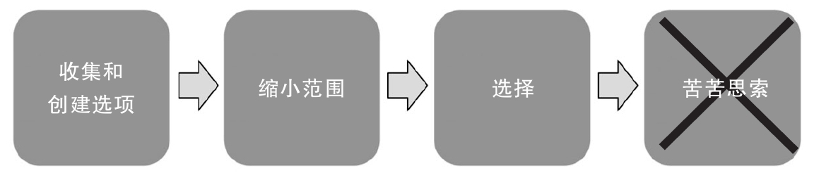
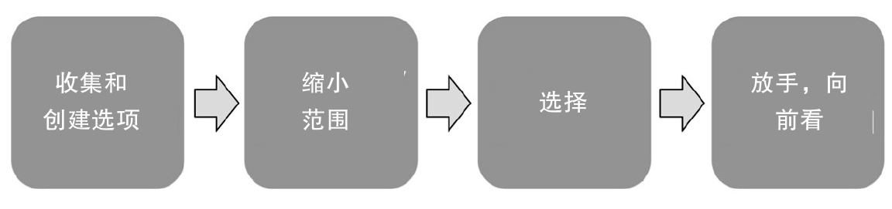
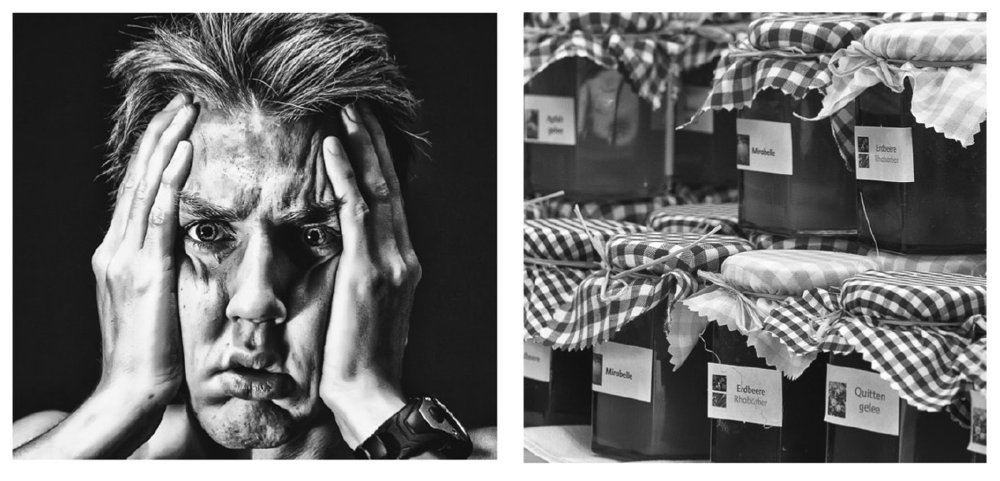
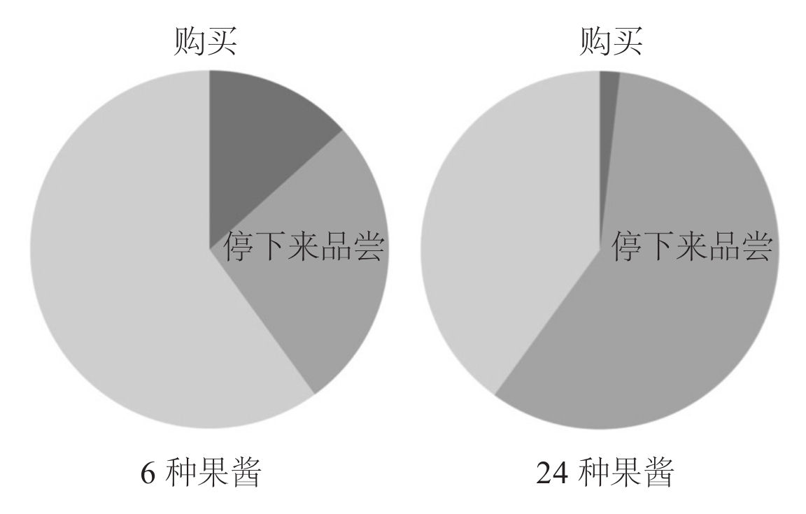

# 第九章 主动选择幸福

如果人生有一项终极设计目标，那大概就是幸福。我们努力工作、经营关系、规划未来，无非是想让自己活得更满意。但有趣的是，很多人以为幸福是“做对选择”之后自动到账的奖品，于是拼命寻找那个“唯一正确”的答案，结果却在纠结中离幸福越来越远。

人生设计告诉我们：幸福不是等来的，也不是“选对了”才有的。它更接近一种能力——一种主动选择、并且愿意为自己的选择负责的能力。所谓选择幸福，不是许愿，而是学会“如何选择”。真正决定你人生质量的，不是你选了什么，而是你用什么方式去选，以及选择之后你如何对待这个选择。

我们常常陷入一个思维误区：觉得必须做出正确的选择，才能幸福。但现实是，根本没有“正确”的选择存在，只有“好的选择”。好的选择不是靠预知未来做出来的，而是靠一套健康的设计流程做出来的。很多人不幸福，不是因为选错了，而是因为他们根本不会选——他们不了解选择背后的设计步骤。

在人生设计的方法论里，选择分为四步：先尽可能收集和创建选项；然后把选项缩减到可操作的范围；接着运用智慧做出选择；最后，放下那些没选的，坚定地往前走。

请注意，第四步不是让你反复咀嚼“我选对了没”，而是让你主动放弃那些不必要的选项，把目光投向未来，直到完全接纳你已有的选择。

只有真正理解每一步的用意，你才能分辨“选得好”和“选得糟”之间的差别：选得好，你会收获幸福和向前走的力量；选得糟，你会陷入自我怀疑和停滞不前。

第一步，收集和创建选项。这一步其实贯穿了人生设计的全过程：认识自己、探索世界、做原型体验，都可以帮我们生成很多可能的方向。关键是保持好奇心，多行动、少空想。你可以从工作观、人生观、思维导图、奥德赛计划里获得灵感，也可以从对话和体验中捕捉机会。总之，先把可能性铺开。

第二步，缩小范围。很多人抱怨自己没得选，但更多人被太多选项淹没。你可能觉得再多做点研究、再多收集点信息就能做出完美决定。但真相是：信息不足往往不是核心问题。我们永远不可能掌握所有信息，而且比起已知的部分，我们更清楚自己不知道什么。于是我们以为继续研究能解决犹豫，其实不会。

这里有一个经典的“果酱实验”。哥伦比亚大学商学院的希娜·艾扬格教授在一家零售店里做过一个实验：研究人员先摆出6种新奇口味的果酱，让顾客品尝并购买。那一次，40%的顾客停下来试吃，其中13%的人买了果酱。

几周后，同样在店里的同一时段，研究人员换上了24种口味的果酱。试吃的人几乎翻了一倍，达到60%，可最终只有3%的人真的买了。

这个实验告诉我们两件事：第一，我们天生迷恋更多的选项，觉得丰富就等于自由；第二，选项一旦太多，我们的决策力反而急剧下降。当选项超过5个，大多数人就很难做出有效率的选择；如果超过某个阈值，我们干脆什么都不选了。所以，如果你被24种果酱困住，那看起来有24个选择，实际上等于0。记住：选项只有被选中、被实现，才有价值。所以，别怕删。如果你列了12个选项，大胆划掉7个，只留5个再进入下一步。你可能会担心删错——但删错也没关系，因为“比萨—中餐效应”告诉我们：有时候你以为自己无所谓，直到别人替你做了决定，你才发现真正想要什么。也就是说，你的偏好往往是在删除和选择之后才浮现出来的。只要后面发现不对，你可以随时调整。不要指望一蹴而就，设计未来的过程本身需要时间。

第三步，明智地选择。这一步考验的不是智商，而是情商。早在1990年，心理学家约翰·迈尔和彼得·沙洛维就提出了“情商”的概念，指出它在成功和幸福中的作用不亚于智商，甚至更重要。后来丹尼尔·戈尔曼的《情商》让这个概念风靡全球。我们的大脑中，负责决策的基底神经节能与情感和直觉直接对话。我们积累的“情感智慧”——那些对生活有用或无用的经验——会通过情绪、直觉和身体感受来影响我们的判断。所以，做决定不能只靠理性分析。认知判断虽然重要，但不完整；感情用事同样会带来麻烦。真正明智的选择，要调动你所有的知觉方式：认知、情感、直觉、社会知觉和身体知觉。戴夫有位临床医学家朋友，她每次和某个病人交谈时左膝盖就会疼。起初她不明白原因，后来她逐渐相信这种身体信号，用它来辅助判断，结果她为病人提供了更好的帮助。

怎么培养这种能力？冥想、写日志、祈祷、瑜伽、太极……这些练习能帮你连接内心的感受，提升情商。别等到压力山大的时候才临阵磨枪，最好在不需做选择的时候就开始练习。提前几个月甚至几年做好准备，才是明智的做法。

还有一种方法叫“神交”。这个词源自罗伯特·海因莱因的科幻小说《异乡异客》，意思是与某物融为一体，彻底理解它。当你在缩减后的列表里挑出一个选项时，先别急着用理性分析它，而是试着在接下来的1到3天里，假设自己真的选了它，完全活在那个选项的情境里。从早上刷牙、等红灯、走路，都想象自己正过着那种生活。体验几天后，回归正常生活休整一两天，再用同样的方式体验下一个选项。最后回顾：哪一种生活让你最舒服、最喜欢？这个方法能帮你触及自己的情感、精神和直觉，弥补纯理性思考的不足。

第四步，放手，继续前进。很多人做出选择之后还是会痛苦地问自己：“我选对了吗？”“另一个选项会不会更好？”“我能不能重来一遍？”这种“苦苦思索”会严重消耗你的幸福感。你不可能知道什么是最佳选择，因为所有结果没有完全展开之前，没人能预知。哈佛大学的丹·吉伯特做过一个实验：让参与者给5幅莫奈作品排序，并允许他们带走自己排第三或第四的作品。大部分人拿了第三名那幅。其中一部分人被告知之后可以更换；另一部分人知道不能换。几周后追踪发现，那些“可以换”的人，即使没真的换，对已有作品的满意度也明显更低。可更换性本身，就是在削弱你的选择价值。还有巴里·施瓦茨在《选择的悖论》里也指出：选项越多，我们对自己最终选择的满意度反而越低。那些“想象中”的选项、我们没有尝试过的可能性，都会在潜意识里一点点偷走我们对当下的满足感。

但请记住：那些未被选择的选项其实根本不存在，因为它们没有被你真正实践。你设计的不是幻想，而是一个具体、真实的人生。人生设计当然承认未来有无穷的可能性，但这不等于你要被无穷的可能性绑架。正确的方式是：充分探索，然后果断选定一个，着手去做。只有行动，才能开辟前行的路。学会放手，路才会越走越宽；未来还会有新的选项出现，不必抓住所有可能性不放。

所以，别再纠结“我选的到底对不对”啦。在犹豫升起的时候，试着深呼吸，放开那些被自己放弃的选项，专注地走向你已选择的方向。选择幸福，从来不是一个结果，而是一个不断放下的过程。通往幸福的路不是找出来的，是你一边选择、一边相信、一边往前走，才一步步走出来的。

先对自己温柔一点，把那些泛滥的备选都删掉。把可能性清单压缩到能掌控的规模，最好不超过五个。选出最适配的那个，然后用你手头的时间和资源去把它落地，逐步搭建属于你的人生版图。

如果你走的是原型试错的路，用小范围反复体验来验证想法，那就没有所谓的“一锤子买卖”风险。你可以在真实体验里不断修正方向，而不是等投入变大才后悔。纠结最耗人的时候，不需要再追问“对不对”，要把脑力全部转到“怎么把已做的决定执行下去”。往前走的过程中，保持专注、持续学习，别为已经做出的选择反复自责。

能不能做到，核心看自律。忍不住想重启、想反刍的时候，要先赢过自己。同时别单打独斗，找一个人生设计搭档或小团队在旁边拉你一把。把每次关键决定分类记录下来，迷茫时翻出来读一遍，提醒自己当初的逻辑和动机。

思维误区：以为幸福就是什么都拥有。
重新定义：幸福是学会取舍。

**停止过度思虑，练习放手**

安迪是名医科预科的优等生。他的终极使命很清晰：重塑美国的医疗保障体系，让预防和健康管理真正落地。

他盘出两条主线：成为有话语权的医疗政策制定者，或成为医疗科技创业者。他明白，科技虽能推动行业，但受制于市场；而政策需要制度内的切口。保底路线是先当医生——在亚裔家庭里，外科医生是极光鲜的标签。他也认为，医生身份仍能产生局部影响。

一番权衡后，安迪认定政策路线影响力更大，但进入路径很纠结：本科毕业后直接读公共卫生硕士去华盛顿，还是先读医学博士再补公共卫生？医学博士在业内更具分量。即便博士不等于优秀政策人，他仍愿意用大约十年去换——四年医学院加四年到六年住院医师训练。十年后才真正起步，这个时间成本让他迟疑。

于是他的脑子像一只停不下来的仓鼠轮，整夜转圈，还能听见尖叫。

转折点不是更想，而是停止想。他开始“寄居”在每个选项里，真实感受。医生版的安迪更踏实，即便焦虑，他会告诉自己：十年虽长，但我正为改善医疗体系积蓄筹码，选择了就全力准备。政策版的安迪却一直卡在“我没有MD，谁会信我”的自我怀疑里，感觉糟糕透顶。

他最终选择走医学博士路线，用十年成为一名合格医生，再以更强的公信力进入政策领域。选完了并不是结束，而是进入第四步：放手并继续前进。

放手为什么难？想一个经典悖论：现在在脑中想象一匹蓝色的马，并且不要去想它。你越禁止，画面越清晰。放手不是逼自己不去想，而是把注意力挪到“去想什么”上。

安迪怎么化解“浪费十年”的恐惧？他先承认这个恐惧存在，然后把问题改写成：“我要怎样才算成为一名好医生？”

他发现住院医期间就是临床实践。哪个科室与卫生政策联动更强？哪所医学院靠近华盛顿且附设公共卫生硕士项目？在哪个机构实习能学到更多？社区诊所还是大三甲？小城还是大都市？当他把医学院的每一步都拆解成与政策目标的连接点后，焦虑自然松动。他开始用医学生和住院医师的身份做原型对话、原型体验，把学习过程本身变成探索。

这正是优秀学习者的样子。

真正的人生设计者不会在“如果当初”里沉溺，也不会让大脑一直空转。他们清楚，设计未来本质上就是一次次可控的冒险，而这恰恰是选择幸福的方式。

难道还有别的答案吗？