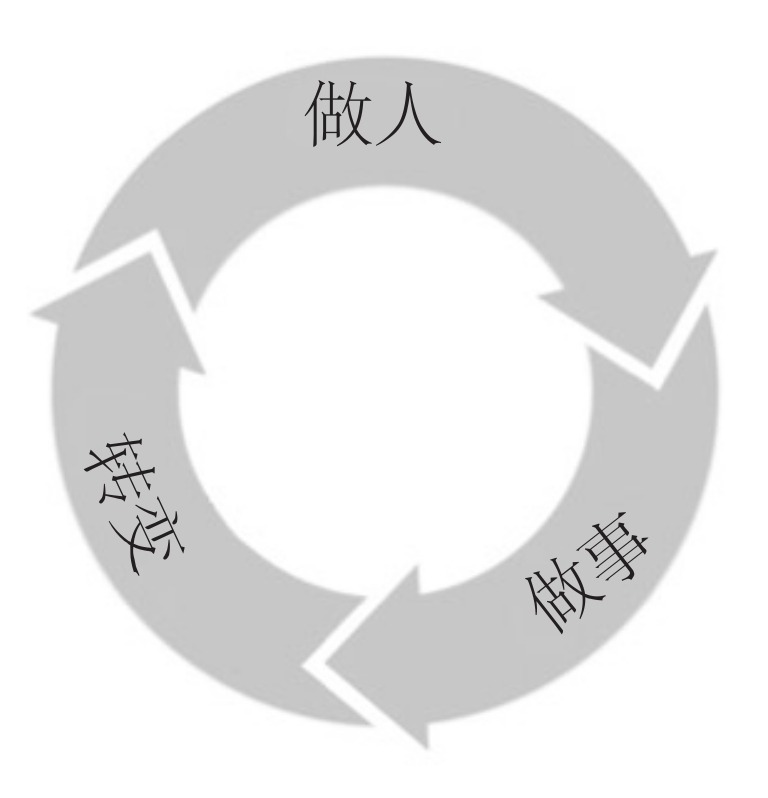
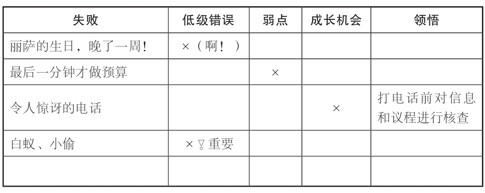
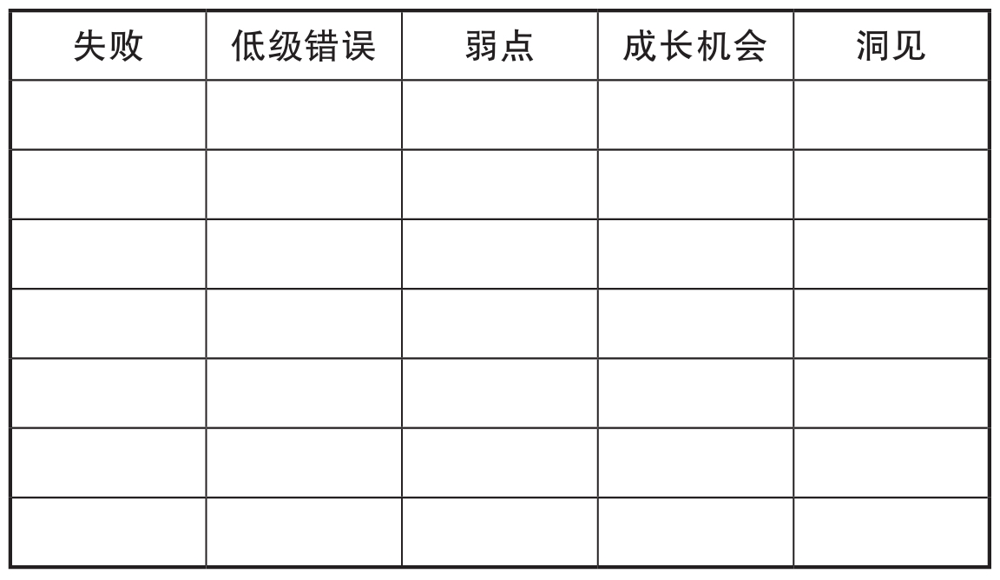

# 第十章 你可以对失败免疫

想象一下，如果存在这样一种疫苗，可以让你永不失败。只需要注射一针，你的生活就会一帆风顺，没有任何挫折，成功接踵而至。一段完全没有失败记录的人生，听起来相当不错吧？没有失望，没有挫折，没有麻烦，也不会悲伤，这是很多人梦寐以求的生活。没有人喜欢失败。失败的感觉非常糟糕，失败产生的压力会让你感觉胸闷，透不过气来。

有谁不想对失败免疫呢？

不幸的是，世上没有这样的疫苗，永不失败是不可能的，但对失败免疫却是可能的。我们并不是说你可以心想事成，一切都会按照你希望的方式进行，而是说你可以对失败带来的负面情绪免疫，消除它们给你的生活带来的不必要的负担。我们已经告诉了你很多方法和技巧，如果你能够充分利用，就可以减少失败，这一点非常重要。接下来要探讨的是失败免疫。

为了设计一种有意义的生活，你进行了各种各样的尝试。你进入社会，和朋友、家人和谐亲密相处，充分融入周围的环境，从事着有意义的工作。在人生设计的整个过程中，你都积极采取行动，每当心存疑虑时，你就会想办法去做些什么。

自始至终，你所做的一切都是在培养一种积极的品质，即心理学家安杰拉·达克沃思所说的“坚毅”（Grit）。达克沃思对坚毅的研究表明，在评估一个人成功的潜力时，坚毅的品格比智商、情商更关键。而且，失败免疫可以提高你的坚毅指数。

你要把自己看作一名人生设计师，这一点非常重要。人生设计师都充满好奇心，行动力强，乐于进行原型设计，为自己铺就通向未来的人生路。但是，当你利用这种方式设计你的人生时，你有可能遭遇失败。因此，在人生设计中，明白失败的含义以及如何做到“失败免疫”至关重要。

在生活中，没有人不恐惧失败，这似乎和人们对“美好生活”和“悲惨生活”的基本看法有关。“她是一个成功者（太棒了！）。”“他是一个失败者（真糟糕！）”想象一下，在你的葬礼上，其他人将如何对你的一生进行评论，你这一生是成功的，还是失败的呢？

幸运的是，如果你正在设计你的人生，那么你就不会是一个失败者。在原型设计和体验中，你可能无法实现自己的目标，但你仍可以从这个过程中获益。一旦你能够坚持对生活进行创造性的设计，你就不会失败，你会不断进步、不断成长。不管是成功还是失败，人数设计都可以为你提供不同的体验，让你从中受益。

## 不要以结果评判人生成败

现在，你一定知道进行原型设计是快速成功的好方法。实际上，小事情和不重要的事情即使失败了，影响也小，而且你还可以从中获得经验教训，帮助自己在重大事情上取得成功。一旦你完成了多次原型迭代循环，就能开始真正享受这个学习过程了。在其他人眼中，原型设计体验可能意味着失败，但对你来说，这都是一次次的邂逅体验。就在我们的一门大型“人生设计”课程开始的前一天，戴夫对其中一个教学活动进行了很大的改动。他有了一个新想法，然后想试试，他甚至没有时间告诉比尔——比尔是在上课的时候和所有学生同时知道的。在戴夫宣布了这个新练习，学生们开始做的时候，比尔走向了戴夫，对他说道：“这太好了！我很高兴，在这 80 个学生面前你无惧失败！我没有想过这个练习是否会成功，但我很欣赏你进行原型设计的这种做法。”戴夫和比尔都坚信人生设计的作用，而且他们在课堂上，从来不会就上课方式进行讨论。当你真正理解了设计思维，你对事物的看法就会随之改变。

这是失败免疫的第一个层次——积极采取行动，快速失败，认识到失败的价值在于消除麻烦（当然，你也能从失败中迅速吸取经验，然后改善、提高）。顺便说一下，戴夫在课上尝试的那个练习虽然效果不错，但我们还是决定以后不再使用它了，继续做以前的练习，因为后者更有效。这就是成功！

失败免疫的另一个层次叫作“重大失败免疫”，要想获得这种免疫，你必须明白设计思维中的一个非常重要的定义。你准备好了吗？“设计人生本身就是一种人生，因为人生是一个过程，而不是一个结果。

如果你理解了这一点，其他就都不是问题了。

思维误区：我们以结果评判我们的人生。

重新定义：人生是一个过程，而不是一个结果。

人生总是在不断前进，从现在走向未来，变化永远存在，每一个变化都会带来一个新设计。人生不是一个结果，它更像是一段舞蹈。人生设计就是一系列优美的舞蹈动作，不到最后一刻，人生永远不会终止，人生设计也是一样。

哲学家詹姆斯·卡斯写了一本非常有趣的书——《有限与无限的游戏》。在书中，他指出，我们做的每一件事都是一个有限游戏（为了获胜，我们遵守规则），或者是一个无限游戏（游戏中，我们玩的是规则，目的是为了获得快乐，让游戏继续下去）。比如，化学考试考了 A 是一个有限游戏；了解世界是如何形成的，你又是如何适应社会的，这就是一个无限游戏。你希望孩子在拼字大赛上获胜是一个有限游戏，让你的儿子相信你对他的爱是无条件的是一个无限游戏。生活中充满了这两种游戏。在这里，游戏仅仅是指我们在这个世界中如何行事，以及我们在行动中关注的重点是什么。）每个人无时无刻不在玩这两种游戏，不存在哪种游戏更好的问题。棒球运动是一个很棒的游戏，但如果没有规则、没有胜利者和失败者，那么这个游戏也就没有意义了。爱是一个无限的游戏——如果玩得好，就会让它延续到永远。

但这与人生设计有什么关系呢？你要记住自己一直在进行一场无限的游戏，游戏中，你会越来越接近真实的自己，并通过不停地设计来展现自己令人惊叹的一面，这样你就不会失败了。抱着无限游戏的心态，你所做的就不仅是减少失败了，而是真正对失败免疫。没错，你会体验到痛苦、失去和挫败，但这些体验会让你在现实生活中更具复原力。

几千年来，人们一直在一个难题上纠结，做人和做事，哪一个更重要？内在真实的我，还是忙碌的、成功的那个外在的我？到底是哪一个？人生设计认为这种两分法是错误的。因为生活是一个永远无法被“解决”的问题，你只有全力以赴地走下去，让自己生活得更好。下面这个图很好地描述了这个过程：

设计人生时，你是从“我是谁”开始，接着你会想出很多主意（不要一味地等待，妄想好想法会自己出现），然后采取行动，去实现这些想法，并尽你所能做出恰当的选择。在不断体验中，你的身心都得到了发展——你将更充分地展现自我。用这种方法，你的人生将迎来一个高速发展的生长期，也会自然形成做人、做事到转变的循环过程。当更加真实的你（全新的你）进入下一个“做事”环节时，这个过程便会不断重复。

生活中的所有篇章——不管是精彩的、胜利的，还是痛苦的、艰难的、令人失望的，都会带动你不断前进。通过这种方法了解并体验生活，那么在探索世界、积极参与社会的无限游戏中，你就会一直成功。

这种心态是失败免疫疫苗中极其重要的一剂药。

思维误区：人生是一个有限游戏，有赢家，也有失败者。

重新定义：人生是一个无限游戏，无所谓输赢。

我们已经见证了很多人的成功案例，你完全能换个角度审视失败，彻底改变对失败的看法，获得更加幸福、充实的生活。这也是进行人生设计必不可少的设计工具。

失败是成功之母。我们会犯错，我们都有弱点，我们都有成长的烦恼。我们都有自我救赎的故事。如果一个人生计划过于完美，那么你既不会有任何惊喜，也不会遭遇任何挑战和考验，这样的生活是相当无聊的，它并不算是一个精心设计的人生。

承认人生中有瑕疵、缺点和错误的存在，承认总有事情会超出你的控制范围。正是这些不如意让生活更有价值，这样的人生也是值得设计的。

## 成长到死

雷德从小就想当班级干部，小学五年级，他竞选了班级干部，但失败了。六年级时，他再次竞选，又失败了。他就这样屡战屡败。高三（美国高中四年制）结束的时候，他已经参加了 13 次学生干部竞选，但从没成功过。在高四的时候，他决定再试一次——竞选班长。

多年来，雷德的父母看到他不断地经受打击，非常心疼他，所以，每次雷德宣布“我要再次参加竞选”时，他们都不赞同。但他们非常明智，并没有劝阻雷德，虽然他们希望雷德放弃，不要再撞得头破血流。但是雷德对此毫不介意，他不会改变自己的想法。他认为，如果他坚持下去，就会知道自己到底错在了哪里，而且他相信自己一定会成功，还能从中学到很多东西。在他看来，失败只是人生的一部分。随着一次次落选，失败带给他的痛苦越来越小，他也变得更加勇敢，不断尝试新方法，如运动和表演，看看是否奏效。这些尝试大多没有成功，但他依然保持着良好的心态，每次竞选他都全力以赴，展现出最佳状态。高四这一年，他终于成为班长，他十分兴奋——不是因为他获胜了，而是因为他的坚持终于有了回报。

雷德 22 岁时，他的经历已经十分抢眼——童子军、班长、橄榄球四分卫、入读常春藤名校、团队冠军，不了解他的人都会觉得他是人生的赢家。大学毕业后，他获得了经济学学位，他的人生似乎将一帆风顺。他起初在一家大公司工作，头三年他的事业也发展得很不错。

雷德因工作需要会经常出差。一次去中西部出差时，他发现自己脖子下部长了一个肿块。在午休期间，他去诊所做了个检查，这时他已经订好了三天后回家的机票。结果，医生发现他患有霍奇金病，一种恶性淋巴癌。于是，他回到家后便立刻开始接受化疗。

25 岁得癌症并不在雷德的人生设计中，但现在，它出现在他的生活中。

面临失败不退缩的优势这时便展现出来了。很快，雷德就接受了自己得癌症的事实，并全身心投入到了治疗中。他既没有抱怨，也坚信自己一定会恢复健康。他做好准备投入到这场战争中。在随后的一年中，他停下了工作，开始进行手术，接受放疗和化疗。虽然年纪轻轻，但雷德已深切体会到了生命的脆弱。

随着治疗的结束，雷德的病症也得到了缓解，但雷德却对未来感到迷茫。实际上，他有一个疯狂的想法——他想花一年的时间，抛开一切杂务去滑雪。他非常矛盾，作为一个事业有成的美国青年，他不应该浪费一年的时间在滑雪上，况且他才大病初愈。但是，他仍决定去过自己想过的生活，而不是按计划生活。

在做决定前，他和一些商业人士进行了原型对话，因为他想要了解未来的人事部经理如何看待他这个决定。交谈后，他认为自己可以冒这个险。大家非常佩服他的勇气，并不认为他在战胜癌症后去滑雪探险是一种不负责任的行为。我们不是夸奖他“战胜了癌症”，而是在这个过程中，他能够欣然接受失败，能够从失败中吸取教训，让自己更加强大。他善于从逆境中发现曙光，在面对困境时，他能够设计出更加美好的人生。他没有沮丧失意，也没有纠结于自己的坏运气。

儿时的失败让他对失败免疫，也让他终身受益。几年后，雷德决定实现自己的梦想——为 NFL（美国国家橄榄球联盟）的球队工作。在大学时，他曾遇见过一位 NFL 执行董事，通过一些原型对话，雷德在联盟中建立起自己的关系网。他一边给 NFL 提出一些建议，一边寻找工作。最坏的情况无非是被 NFL 拒绝，但他根本不害怕被拒绝，所以为什么不试一试呢？

尝试失败后，他立刻放手，迅速调整了方向，开始向下一个备选方案努力。

一年以后，雷德获得了一个帮助 NFL 球队洽谈球员合同的机会。但在最后一关中，他失败了——他没有得到这份工作。他继续调整努力的方向，向自己的下一个目标前进。最终，他在一家大公司的金融管理部门找到了一份工作。

但雷德他仍没有放弃为 NFL 球队工作的渴望。尽管屡次被拒绝，他依然坚持进行原型体验。他和 NFL 的主管们一直保持联系，并把自己花费数百个小时建立的创新运动分析模型展示给他们看。最后，他被一个 NFL 球队聘用了，而且得到的职位比他最早申请的那个还要高。

三年后，雷德发现 NFL 的工作并不是他真正想要的，他再次“失败”了。于是他跳槽去了一家医疗保健公司。他想，如果这份工作还是不适合他的话，他会继续寻找，他总会找到自己的梦想。

可以说，雷德彻底对失败免疫了。我们不是说他感觉不到失败的痛苦，而是说他不会被失败误导——他从不认为自己是一个失败者，也不会用成败定义自己的人生。失败也会让他有所收获，不管失败还是成功，他都会欣然接受，继续努力前进。

看到雷德，你就看到了一个乐观向上的年轻人的形象。现在的他婚姻幸福，有一双可爱的儿女，他和妻子刚刚买了他们的第一套房子。他在这一家发展前景甚好的新兴公司里负责基因检测和保健的工作。雷德当然很享受目前的生活，他心存感恩，并且深知幸福源于一个人的心态。

这就是雷德成为生活赢家的真正原因。

## 失败重构练习

达到失败免疫是一个非常高的目标，设立这个目标很容易，但要想实现它就是另外一回事了。失败重构练习可以帮助你达成目标。失败是创造成功的原材料。失败重构是一个过程，通过对原材料（失败）的转化，达到质的飞跃（成功）。这个练习很简单，分为三步：

1.记录失败的经历。

2.对失败进行分类。

3.鉴别出蕴含成长机会的失败。

记录失败的经历

把经历过的失败记录下来。回顾一下过去一周、一个月或者一年，你都经历过哪些失败，然后把它们记录下来，或者创建一个“失败打击全记录”。如果你想从失败中获得成长，并希望使之成为习惯，那么我们建议你在形成全新的思维模式前，一个月至少要记录一次或者两次失败的经历。失败重构是一个非常健康的习惯，养成这个习惯可以让你对失败免疫。

对失败进行分类

对失败进行分类是非常有用的。你可以把失败分成三类，以确定哪些失败可以让你受益。

第一类失败是由低级错误导致的失败，即由你一般不会犯的错误所导致的失败。从这样的失败中，你学不到什么，你只是单纯地做错了。这时，最好的反应是承认自己犯错了，在必要的时候反省，然后继续前进。

第二类失败是由于自身弱点导致的失败。你会反复犯同样的错误，并且非常了解失败的原因。你可能已经非常努力地去改正了，并认为自己有所改善，但防不胜防，你还是失败了。我们不希望你认输，承认自己表现平庸，但我们觉得对于这种错误，即使你想尽了一切办法去改变也不会有什么效果。因为有一些弱点是你天性中的一部分，对你来说，最好的解决方法就是尽量避免接触这类的事情，而不是想着如何改正。

第三类失败是蕴含成长机会的失败，它是一种原本可以避免的失败，或者是以后可以避免的失败。这类失败的原因是可辨认的，而且有补救方法。我们重点关注的应该是这类失败，而不是其他两类失败，因为对于前两类即使我们花费了很多时间，也不会有多少改进。

鉴别出蕴含成长机会的失败

所有成长机会类型的失败都会为我们带来改善和提高吗？我们从中可以学到什么？失败的根本原因是什么？下次要采取什么方式呢（成功的关键因素是什么）？洞悉失败，从中寻找促成成功的经验教训，记录下来，应用到生活中去。这就是失败重构，非常简单。

下面的表格来自戴夫的失败记录日志，他的失败记录表几乎是无穷无尽的。

这一次，戴夫忘了女儿丽萨的生日，一周后才想起来。他不擅长记这种事情，经常忘（他的一个弱点），因此他利用日历提醒自己。但这一年，他在日历上标错了。他在错误的时间精心策划了一顿晚餐，准备带女儿出去过生日——时间是在丽萨生日过去一周之后。由于他那一周很忙，所以他对此毫无察觉。这种彻头彻尾的低级错误应该不会再发生了。另外一个低级错误是他被抢劫了。因为他的房子里出现了白蚁，要进行消毒，他和家人必须搬出去三天，住在临时帐篷里。在这期间，小偷光顾了他们的房子，偷走了所有值钱的东西。一切都糟糕透了。他怎么会犯这类错误呢？在那三天，他们没有请私人保安看家。但是，谁会为这种事雇保安呢？据警察说，这种被抢劫的情况非常少见（在屋里喷药的时候，没有几个小偷会冒着被毒死的危险偷东西）。虽然这类失败是可以预防的，但毕竟太少见了，因此他也把它看作一个低级错误。

戴夫还不得不熬夜（再次）完成某项预算，因为第二天就是截止日期。戴夫是一个典型的拖延症患者，这是他的顽疾，他想出了各种方法应对，但收效甚微。显然，这里也没有什么好的经验教训可以吸取。就这样，他改不了，这是他的弱点。

不久前，戴夫和一个客户在电话中进行交流。起初，他只是谈到了项目的营销问题，但这名客户突然失控、大发雷霆。戴夫非常震惊。他并不知道该项目的主管工程师已辞职，整个工程一团糟。虽然戴夫打这个电话是事先约定好的，但这个客户之所以愤怒是因为她觉得戴夫在浪费时间。这不是戴夫会犯的错误，实际上他非常擅长客户管理，基本一个星期要通过电话和客户交流几十个小时。但这次是怎么回事？事后他认真反思了一下，他意识到这次错误在于，自己没有事先进行核查就进入了电话议程。戴夫打过的所有电话几乎都有一个议程主题，而且严格规定了时间范围。如果立刻进入议事日程，那么绝大多数时候都没有问题。但这一次他意识到，当他与人会面时，他从来不会直接进入议事日程。

在和客户进行面对面交流时，戴夫都会问候一番，了解一下这个人的近况，而且，在开始着手处理业务时，他总会确认议程。在问候寒暄的过程中，他经常会发现一些重要的信息。但是，这次为了节省时间，他没有进行这样的寒暄。跳过这一步骤显然会冒一定风险，所以，和客户交流前应对信息和议程快速进行核查。这只需要几秒钟的时间，但作用却非常大。

你阅读这 5 个失败事件的时间可能比戴夫分析它们的时间还要长。这个练习并不难，但回报巨大。如果戴夫放下电话，气愤地说：“她有毛病吗？”那么他什么也学不到，而且下一次还会遇到同样的风险。同样地，如果他不认真思考是什么导致了那次闹心的抢劫，或者自己为什么会忘了女儿的生日，那么他就会永无止境地面临同样的失败和错误。

一个小小的失败重构对于培养失败免疫大有帮助，你也可以尝试一下。

\*\*\*

即使你现在拥有理想的工作、美满的生活，也仍然会遇到麻烦。设计师都知道，生活不可能事事都按计划进行，总会有意外出现。当你明白自己是谁，能够设计自己的人生，追求自己的人生时，你就不可能失败。这并不是说你不会犯错，或者说某个特殊的原型会如预期的那样永远起作用。失败免疫源于一种认知，一个原型设计即使失败了，也会让你从中了解到一些有用信息，你还可以以此作为前进的新起点。当困难发生时，当你在前进途中误入歧途时，当原型发生意外变化时，通过人生设计，所有变化、挫败都能够彻底转化为对你的生活和工作有益的事情。

人生设计师不会与现实作对。不管发生什么，通过对未来生活的设计，他们都可以获得强大的力量。在人生设计中，没有错误的选择，也不存在后悔与否，有的只是原型设计——一些原型设计会成功，一些原型设计会失败。从失败中我们能够吸取教训，期待下次成功。人生并不只有输和赢，人生是一个不断学习的过程，是一个无限游戏，当我们像设计师一样应对人生时，我们就会时刻充满好奇心，想知道下一刻会发生什么。

还有一个问题，你可以思考一下：如果你不会失败，那么你会做什么？

小练习

重新定义失败

1.利用下面的表格，回顾过去一周（一个月或一年），然后记录你遭遇的失败。

2.按照低级错误、弱点、成长机会的标准，对失败事件进行分类。

3.鉴别出蕴含成长机会的失败。

4.一个月做 1~2 次这个练习，养成习惯，从失败中吸取经验，获得成长。

本书由“[ePUBw.COM](http://epubw.com)”整理，[ePUBw.COM](http://epubw.com) 提供最新最全的优质电子书下载！！！ 
