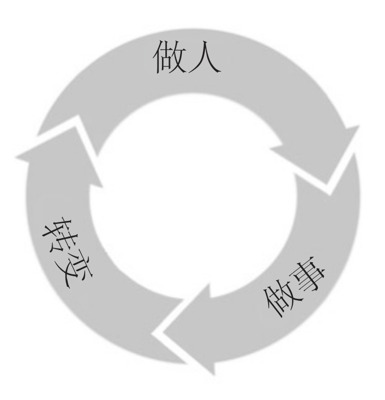
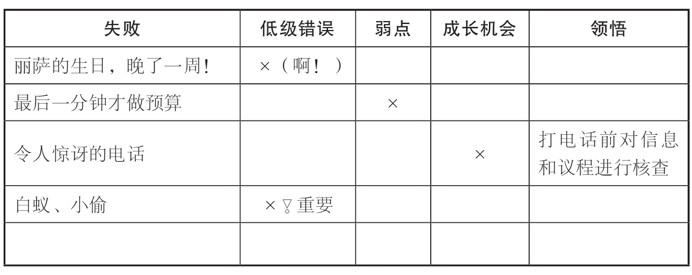
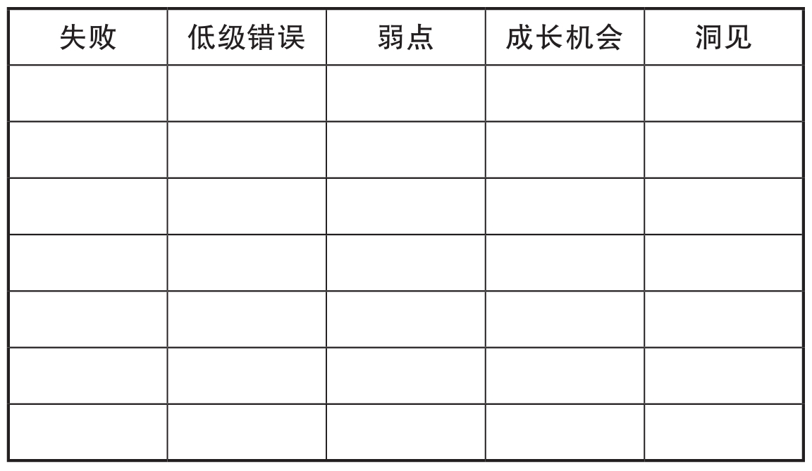

# 第十章 想对失败免疫，可以

设想一下，如果市场上真有一种抗失败疫苗，扎一针就能从此一路顺风再无跌倒，听起来是不是很诱人？没有失落、没有挫败、没有麻烦，也不会有伤心，这几乎是所有人偷偷想要的剧本。失败的滋味本就难受，它带来的压抑感让人胸口发闷、喘不过气。

谁不想拥有这种免疫力呢？

现实是，没有任何疫苗能让你永不失手，但你是可以对失败脱敏的。不是让你心想事成万事如愿，而是学会不被失败的负面情绪绑架，卸掉那些本不必要的心理负担。我们前面讲了大量降低失败发生率的方法，接下来要讲的是更彻底的那一步——建立失败免疫力。

当你开始当一个人生设计师，你会尝试各种可能性：去工作、去经营亲密关系、去融入环境、去做有意义的事。整个过程里你都在主动出击，每当心里打鼓，你就去找一种行动来回应。这种持续的行动力和好奇心，正是心理学家安吉拉·达克沃思所说的“坚毅”。研究反复显示，坚毅比智商、比情商更能预测一个人的长期成就。而对失败的免疫，正是坚毅指数的放大器。

人生设计师天然好奇、行动力强，喜欢做原型、喜欢为未来铺路。可只要你用这种方式来设计生活，碰壁就是常态。所以真正关键的问题不是怎样避免撞墙，而是弄懂失败到底意味着什么，以及如何做到免疫。

没有人完全不怕失败，这和我们对“好日子”与“坏日子”的本能判断有关。“他成功了，太棒了。”“他失败了，真糟糕。”试着想象自己的告别会上，别人会怎么评价你的一生，是赢家还是输家？

好消息是，只要你仍在设计人生，你就不是失败者。原型实验里目标可能没达成，但过程本身就在给你红利。只要你持续创造性地设计生活，就不算落败，你只是在进化、在成长。无论结果如何，原型都给你不同的体验和养分。

## 别再用结果给人生打分

原型设计的价值就在于小事上试错成本低。即便小事翻车，影响也有限，反而能为大事积累经验。迭代多了，你会开始享受学习本身。对外人而言这像失败，对你而言这只是次次相遇。

我们开设“人生设计”大课前一天，戴夫临时改动了一个教学环节，有了新想法就直接上手，连比尔都没提前说。课上宣布新练习后，比尔走到戴夫身边说：“太好了，在80个学生面前毫无惧色地试错，我很欣赏你这种原型做法。”戴夫和比尔都信奉设计思维，课堂上从不为形式争论。当你真正get到设计思维，视野会不一样。

这是第一层免疫——勇于行动、快速试错，懂得失败的价值在于帮你剔除麻烦，同时迅速提炼经验迭代升级。顺带一提，戴夫那个临时加的练习效果还行，但后来还是换回了原来的，因为更有效。这就是另一种成功。

第二层是“重大失败免疫”。要达到它，得先认同一个定义：设计人生本身就是人生，因为人生是过程不是终点。

get到这点，其他都顺了。

思维误区：用结果评判人生。
重新定义：人生是过程，不是结果。

人生一直在流动，从当下走向未来，变化是常态，每一次变化都是新的设计。人不是一个句号，更像一场舞。人生设计就是一连串舞步，直到最后一刻，人生才落幕，设计也一样。

哲学家詹姆斯·卡斯在《有限与无限的游戏》里说，我们要么玩有限游戏——按规则争胜负，要么玩无限游戏——用规则创造乐趣让游戏持续。考到化学A是有限游戏，探索世界如何运作、自己如何融入社会是无限游戏。让孩子赢拼字比赛是有限游戏，相信儿子你对他的爱是无条件的则是无限游戏。两种游戏无时无刻都在进行，没有谁更高尚。棒球需要胜负才好看，爱却像无限游戏，玩得好就会一直延续。

这和人生设计有什么关系？记住你在玩一场无限游戏，目标是不断靠近真实的自己，并用持续设计展现惊人的一面，你就不会“输”。持无限心态，你不只是减少失误，而是真正对失败免疫。你仍会感到痛、失去、挫败，但这些体验会让你在真实世界里更具复原力。

几千年了，人类一直在纠结：做人和做事，哪个更重要？内在的真实自我，还是忙碌成功的外部形象？人生设计认为这是个伪命题。因为生活是个解不开的题，你只能全情投入，让自己活得更好。下面这张图大致描绘了这个循环：

设计人生从“我是谁”出发，接着冒出各种点子，别干等灵感。然后付诸行动，做出恰当选择。在不断体验中，身心都在发育，你更能活出自我。用这种路径，你会进入高速成长期，形成做人-做事-转变的自然循环。下一次“做事”时，你会带着更真实的自己继续展开。

生活的所有章节，不管是高光还是泥泞，都在推动你前行。以此方式体验生活，你在探索世界、积极参与的无限游戏里，始终在赢。

这就是失败免疫疫苗里最为关键的那一剂。

思维误区：人生是有限游戏，有赢家有输家。
重新定义：人生是无限游戏，无所谓输赢。

我们见证过太多转折案例，换个视角看失败，就能换来更幸福、更充实的生活。这也是人生设计不可缺少的工具。

失败是成功的原料。我们会犯错，我们有短板，我们有成长的阵痛，也都有自我救赎的故事。如果一份人生计划太完美，既无惊喜也无考验，那生活会很无聊，也算不上精心设计。

承认人生有瑕疵、有缺陷、有失控，恰恰让生活更有价值，也更值得设计。

## 成长到死

雷德小时候就想当班干部。五年级竞选，失败。六年级再战，再次落选。到了高三结束，他已经参加了13次学生干部竞选，无一成功。高四那年他决定再试一次，竞选班长。

父母看着他一次次受挫很心疼，每次他说要再试时他们都不赞成，但很明智地没有阻止。他们希望他别再撞头，他却毫不在意。他认为坚持下去就能搞清楚问题所在，并且相信自己会成功，还能学到东西。对他而言，失败只是人生的一部分。随着落选次数增加，痛苦感递减，勇气却在增加。他尝试运动、表演等新方法来提升自己，大多没奏效，但心态始终稳定，每次都全力以赴呈现最好状态。高四那年，他终于当选班长。兴奋的不是获胜本身，而是坚持终于有了回响。

22岁时，雷德的履历已经很亮眼：童子军、班长、橄榄球四分卫、常春藤名校、团队冠军。外人看来他是人生赢家。大学毕业他拿了经济学学位，前三年工作也顺风顺水。

出差中西部时，他发现脖子下方有个肿块。午休去诊所检查，已订好三天后回家的机票。医生确诊霍奇金病，一种恶性淋巴癌。他立刻回家开始化疗。

25岁得癌，没在他的设计图里，但它来了。

这时，面对失败不退缩的优势就显现出来了。他很快接受事实，全身心投入治疗。没有抱怨，也坚信自己会康复。随后一年，他停下工作，进行手术、放疗、化疗。年轻的他切实体会到生命的脆弱。

治疗结束后，病症缓解，但他对未来迷茫。有一个疯狂念头——抛开一切去滑雪一年。作为一个事业有成的美国青年，这看似浪费时间，但他选择过自己想过的生活。决定前，他找一些商业人士做原型对话，想了解人事经理会怎么看这个决定。对方很佩服他的勇气，不觉得这是不负责任。我们不是称赞他“战胜癌症”，而是他在过程中学会拥抱失败、从中汲取养分变得更强。他能从逆境里看见曙光，为自己设计更美好的生活，没有沉沦，也没有怨天尤人。

童年的失败让他对失败免疫，并终身受益。几年后，他决定实现梦想——为NFL工作。大学时认识一位NFL执行董事，通过原型对话在联盟里建立人脉。他一边提供建议，一边找机会。最坏也就是被拒，他根本不怕拒绝。

尝试后立刻放手，快速调整到下一个备选。

一年后，他获得一个为NFL球队洽谈球员合同的机会，但在最后关卡失败。他继续调整方向，最终在一家大公司金融管理部门找到工作。

但他仍渴望NFL。屡次被拒，他依然坚持原型体验，持续和主管们保持联系，并展示自己耗时数百小时打造的创新运动分析模型。最终他被一家NFL球队聘用，而且职位比最初申请的更高。

三年后，他发现NFL工作并非真正想要的，于是再次“失败”，跳槽到医疗保健公司。他想，如果仍不合适，就会继续寻找，直至找到梦想。

可以说，雷德彻底对失败免疫了。不是感觉不到痛，而是不会被痛误导。他从不把自己定义为失败者，也不以成败定义人生。失败带来收获，成功带来前行，他都欣然接受。

看到雷德，你看到的是一个乐观向上的年轻人。如今他婚姻幸福，有一双可爱儿女，刚买下第一套房。在一家前景不错的新兴公司负责基因检测与保健。他很享受当下，充满感恩，也深知幸福源于心态。

这才是他成为生活赢家的真正原因。

## 失败重构练习

失败免疫是个很高的目标，容易立Flag，难落地。失败重构练习能帮你靠近它。失败是创造成功的原材料，重构就是把原材料转化成质变的过程。分三步，很简单：

1. 记录失败经历。
2. 对失败分类。
3. 辨别出蕴含成长机会的失败。

记录失败经历
把失败写下来。回顾过去一周、一个月或一年发生了哪些失败，建立“失败打击全记录”。如果你想把失败变成成长习惯，建议在形成新思维前，至少每月记录一到两次。持续记录能帮助你对失败免疫。

对失败分类
分类很有用。可以分成三类来判断哪些值得用心。

第一类是低级错误导致的失败，即你通常不会犯的错。从中学不到太多，只需承认、必要时反省，然后继续前行。

第二类是弱点导致的失败。你会反复犯同样错误，原因清楚。你可能努力改进过，但仍防不胜防。我们不建议你认输承认平庸，但有些弱点是天性一部分，最好的策略是尽量避开这类情境，而不是强行改正。

第三类是蕴含成长机会的失败。它原本可以避免，或以后可以避免。原因可识别，有补救办法。我们重点关注这类，而不是前两类，因为前两类投入再多也难有显著提升。

辨别出蕴含成长机会的失败
所有成长型失败都会带来改善吗？能学到什么？根本原因是什么？下次怎么做，成功的关键因素是什么？洞悉失败、提炼教训、记录下来应用到生活，这就是失败重构，非常直接。

下面这张表来自戴夫的失败记录日志，他的记录几乎写不完。

这一次，戴夫忘了女儿丽萨的生日，一周后才想起。他不擅长记这类事，经常忘，这是他的弱点，他本用日历提醒，但那年标错了时间。他在错误时间精心准备了一顿晚餐，女儿生日已过一周才“庆祝”。那周他很忙，毫无察觉。这属于彻头彻尾的低级错误，基本不会再犯。另一个低级错误是被抢劫。房子因白蚁要消毒，他和家人需搬出三天住帐篷，期间小偷光顾，东西被偷。那三天他们没请保安，但谁会为喷药雇保安呢？警方说这种事极少见，喷药时小偷冒着被毒的风险偷东西的概率很低。虽然可预防，但太罕见，他也当作低级错误。

戴夫还不得不熬夜（再次）赶预算，因为第二天截止。他是典型的拖延症患者，尝试过各种对策，收效有限。显然这里没有太多教训可挖，就当作弱点。

不久前，他和一个客户通电话。起初谈营销，客户突然失控大发雷霆。戴夫很震惊。他不知道该项目的主管工程师已离职，工程一团糟。虽然电话是约好的，但客户觉得他在浪费时间。这不是戴夫常犯的错，他很擅长客户管理，一周几十小时都在和客户沟通。这次的问题是，他没先核查就进入议程。戴夫的电话几乎都有议程主题并限定时长，通常没问题。但这次他意识到，面对面交流时他从不会直接开议程，会先寒暄问候，确认近况，开始前再确认议程。寒暄时常能捕捉到关键信息。这次为了省时跳过了这一步，显然有风险。所以和客户交流前，先花几秒核查信息和议程，效果极大。

你读这五个案例的时间可能比戴夫分析的时间还长。练习并不难，回报却很大。如果戴夫放下电话气愤地说“她有病吗”，他就学不到东西，下次还会踩坑。同样，如果他不思考抢劫和忘生日背后的原因，就会无止境地重复失败。

一个小小的失败重构，对培养失败免疫非常有帮助，你也可以试试。

***

即便你现在拥有理想工作、美满生活，麻烦仍会发生。设计师都知道，生活不会完全按计划走，意外永远在。明白自己是谁，能设计自己的人生，就不可能真正失败。这不是说你不犯错，也不是说某个原型会永远奏效。失败免疫来自一种认知：即使某个原型失败了，它也会给你有用信息，成为新的起点。当困难来临、误入歧途、原型变异时，通过人生设计，所有变化和挫败都能转化为对生活和工作有益的东西。

人生设计师不跟现实对着干。不管发生什么，通过对未来的设计，他们都能获得强大力量。在人生设计里，没有错误的选择，也没有后悔与否，只有原型——有的成功，有的失败。从失败中吸取教训，期待下次成功。人生不只有输赢，人生是持续学习的无限游戏，当你像设计师一样应对生活，你会时刻保持好奇，想知道下一刻会怎样。

还有一个问题可以思考：如果失败对你而言不再是问题，你会做什么？

小练习
重新定义失败
1. 用下面的表格回顾过去一周、一个月或一年，记录你遭遇的失败。
2. 按低级错误、弱点、成长机会的标准分类。
3. 辨别出蕴含成长机会的失败。
4. 每月做1~2次，形成习惯，从失败中汲取经验，获得成长。

本书由“[ePUBw.COM](http://epubw.com)”整理，[ePUBw.COM](http://epubw.com) 提供最新最全的优质电子书下载！！！