## 房地产投资依然无忧，逆向思维让你找到真实

66端午88

判断依据，大部分 2，3 线城市税收收入的接近 4 成半由房地产行业提供，另有一成半由相关的建筑相关行业提供，金融行业提供两成半（和房地产相关行业关联吻合度极高），就是说：地方政府的税收收入 80%要有房地产相关产业链提供。所以任何阻碍影响税收收入的政策都将在实施时被大打折扣。

反观其它行业税收收入，即使可以增长，增加量也比较少，对总量影响有限，不足以支撑政府的刚性支出。

以上仅仅计算了房地产行业的地税口径收入，尚未计算土地出让收入（国土资源方面的收益），如果算上这个收入，地方政府的收入 8 成以上都由房地产相关产业链支撑，关于营业税转增值税的传闻结果，可能会改，但结果是不会降低实际税负率。

由上所述得出结论，不论是 1，2，3 线城市，房地产投资将依然是政府的主力投资方向，如果市场价格发生下滑，可以利用拆迁等多种手段刺激需求，我们要做的事情依然是等待一次小规模的下滑机会，继续逢低买入，看清大形势，顺势而为，不要做趋势的叛逆，因为趋势不会轻易转向，特别这个趋势已经延续的 10 年的前提下，你怎么能轻易判断未来 10 年它不会延续哪？趋势也绝不会掌控在 P 民手里。

> 作者:66 端午 88 日期:2011-01-29 22:45

税务局的真实数据。

> 作者:66 端午 88 日期:2011-01-29 23:10

所谓经济崩溃，就是经济体系颠覆，组成经济的诸元素全面失去联系，可影响到经济运行的税收，财政，货币调节工具全部失灵，经济陷入停顿，无法运行。中国有这种可能吗？看到天涯论坛的诸多牛人，都在试图寻找这个一举成名的机会，通过蛛丝马迹，通过历史的事件，通过逻辑分析，力图把某些欠缺联系的单独事件转为自己的依据，大家不妨全面分析一下，目前的中国有这种可能吗？偶得出的结论是绝无可能，首先，中国不是一个传统意义上的市场经济，更不是传统意义上的计划经济。中国的经济发展不是建立在计划之上，更不是建立在市场需求之上，而是建立在国家意志之上的，谁都知道经济的本质政治，政治的基础是经济。这两者是相辅相成的核心要素。市场经济也许会出现崩溃，那是因为市场经济的核心基础是需求（更接近真实的需求），真实需求是完全市场经济无法回避的因果关系。中国是吗？不是的，中国的需求建立在两个基础之上，第一个是国家的需要，第二个才是真实的需要。

国家的经济份额是多少？按照我的计算，国家体系的运行能力和增值能力 2-3 倍于真实的需求一方的总量。国家意志主宰着经济主线，任何自以为是忽悠和预测经济崩溃的判断，都出于建立在真实需求的基础之上，不论是探讨 1929 年的美国，还是 1990 年的日本都是这样，毫无新意。与其探讨民营经济和真实需求的崩溃，不如探讨国家需求是否存在崩溃的可能。

其次，我们探讨一下大家的感觉，总而言之，2006 年后，大家的最突出感觉是国进民退了。我们不要探讨出现这个结果的 1 万个原因，这么小的帖子，根本也放不下这么大的论题。我们只谈结果，国进民退后的环境是这个国进来后，行业利润在普遍提升，门槛在逐步抬高。这部分市场逐步成为国家需求的一部分，这就是事实，我国的真实需求的市场基础在逐步边缘化。影响力在逐步走低，只要控制好原料库存就不会出现 2008 年的所谓崩溃，在 2008 年的所谓崩溃中，由于国家需求部分不能主导经济运行，一旦外需下滑，真实需求就会将经济的缺陷短时快速放大，导致经济活动停摆。2008 后的中国经济，到现在才运行了 3 年不到的时间，所谓一朝被蛇咬，十年怕井绳，不再有 2007-----2008 年的激进运行模式，都还在后怕哪。大规模囤货压库，那是极为少见的行为，通胀会失控吗？也没这个可能，通胀会继续存在，但也极难失控，我们今年和明年面对的最大问题是：钝刀割肉，绝不是什么所谓崩溃。

作者:66 端午 88 日期:2011-01-29 23:19

上海和重庆都是计划单列市，对于省一级的部门，不可能施行全省范围内的房产税试点，比如浙江的杭州，它就绝无可能试点一个房产税细则，最多是行政干预，对付行政干预，投资者会有诸多的回旋余地。不信等着看吧，重庆的结果绝不会让房价就此不动，如果继续上涨，等于试点失败。如果下滑，将导致重庆经济全面下滑，是另一种失败。

作者:66 端午 88 日期:2011-02-05 23:16

中国的下滑极限最多回到计划经济时代，有什么好怕的。事实上，我们的经济对内部分正滑向计划经济。最充足的证据就是喊空的人越来越多，可是经济数据并不支持这个观点，其中或许有部分统计因素在里面，绝对总量还是有相当部分是真实的，但谁占有这个数据是要研究的重点，真正的利润来源和新增份额大部分是计划体系内的部分，这部分带来的进展通常和平民阶层毫无关系，主要都是为税收，国家财政，国家投资，垄断行业所拥有，总篮子大了，你们的篮子里并没有什么新货色。

国家意志对经济的影响已经达到空前的规模，这个论点我在其它论坛上论证过，就是 M2 的增量主要是把民营的资本从实业领域挤出，而这种溢出效应导致了资产价格的大幅飙升，因为民营资金逐利的特性，喜欢短平快的项目，而国内短平快的项目目前已经饱和，长期投资的风险令民营资本望而却步，国家在几次三番启动这些项目力图拉动民企进入失败后，只能自己跳出来做这些项目，结果必然是需要大量的新增投资来驱动，民营资本只有两条路可走，第一条：稀释自己的资本加入这场豪赌。第二条：逃离长期投资领域，形成二元化分立的博弈资金群。目前看来民营资本选择了第二条。

既然在2008年后，民营资本已经选择了第二条路线，那么未来就变的清晰起来，就是主流经济的计划性特征将越来越明显。他们将主宰小范围的，可控的，边缘化的波动。而中国的主流经济将沿着国家利益为主线的方向缓步攀升。如果民营资本在几轮折腾后，无法对冲货币的兑水，将逐步被边缘化，直到丧失局部市场的控制能力。此时，中国将返回计划经济的起点。如果在若干次神来之笔一样的惊心动魄的翻云覆雨后，博弈性资本攫取了更多的波动性利润，并大量侵蚀计划体系的财富，中国的计划经济回潮被强烈阻击，两种目的性非常强的资金最终达成平衡，这算是最佳结局。如果计划体系资金一败涂地，则会造成中国经济崩溃，这种可能性基本没有，这种可能是：中国完全放开各种金融管制，在国内外流动性的夹击中，才会最终出现这种可能。

所以，我判断中国1-2年内的走势就是钝刀割肉，逐步挤压民营资本的流动性，但不会一刀致命，房价也是这种走势，涨-----不会涨的多，最多达到名义 CPI，连真实的 CPI 都超不过。股市的走势也是这样，涨跌均难。实业投资更是这样，赚钱容易，想赚超越 CPI 的快钱，没戏。

至于房产投资的问题，我坚信：持有房产仍是目前最佳的防御手段，但防御效果，要看你手里东西的成本，费用，现金流，稀缺性综合研判。

买房将更加困难，主要是受到收益率太低的约束。至于房价会跌吗？这个大家放心好了，没有可能大幅下滑，目前市场需要的是急速缩量的过程，连续缩半年最好，这将导致国家税收陷入瘫痪，地方财政入不敷出，地产商的资金链断裂将导致银行抵押品大幅缩水，核心资本能不能对冲抵押品的估值下滑。先看计划体系的资金能不能承受这种压力，我给大家的建议是：买方进入观望期，长期持有方着力拉高房租，提高长期受益的现金流量。等待局势明朗后再行操作。

> 作者:66 端午 88 日期:2011-02-06 11:43

很多人都对 2008 年底的经济短期失控耿耿于怀，认为那是一次崩溃，现在回头看看也不过如此，在 2004 年短期调控后，中国缓慢积累的超发货币面对国内持续加码的调控措施和外盘崩溃的一次合力作用，当时由于长期的经济快速发展带给企业的预期，企业库存和产品积压尽在高位，房价的连续上扬也需要一个快速的回落整理来夯实上涨的成果（事实上房价在 07 年 10 月后即开始调整，对应股市的房地产行业指数也提前大盘指数 4 个多月开始筑顶），资本市场其实已经给了经济基本面一个很长时间和很明确的预判，从 2008 年 2 月后即开始连绵下滑，房屋买卖成交量也陷入低迷（成交量下滑了 5 成以上），2008 年 9-12 月的突然失控，与其说是突然一击（对于管理层来说），不如说仅仅是业内人士兑现预测而已。失控的同时也就宣布底部来临，不但股市和房价到了重要的底部，经济也从断崖下滑后，进入了缓慢的筑底阶段，资本市场往往会先行启动，实体经济则在徘徊数月后(主要是消减高价库存和产成品的过程)，自 09 年 5, 6 月后也进入复苏阶段。

我们目前面临的调控，我认为是正常和符合规律的，目前欧美为代表的外需市场都在进行刺激，我们理应利用这个时机进行反向操作，大力回收流动性，夯实发展的基础。而不是像现在这样搞出若干个所谓什么高铁，什么水利计划，什么核电计划，管理层正在引导大家犯错误，也许是无心的，也许是有意的。

作者:66 端午 88 日期:2011-02-06 12:14

房产这个东西，区域性和功能性是其最核心的要素，房地产在建成前对经济发展有巨大的促进作用，在建成后则成为财富的储值手段，在建成前是政府部门的收入利器，建成后则成为分享政府收入的寄生虫，目前政府部门讨厌的是后者，力图通过征收持有税来摆脱这个寄生虫，P 民的理想当然是少盖房，我有房，我有只赚不亏的房，这和政府的预期绝对是南辕北辙，构成了博弈的关系。

知己知彼才能洞察博弈方的意图，先彼动而先动，及彼动而我先至，相信在中国这种投资环境及其恶劣环境下九死一生的投机资金已经找到如何应对的手段，这就是主动大幅缩减成交量，降低房地产对中国经济的输血量，目前这种走势已经比较明朗，在1月底到目前，各个可供参照的城市样本销售量分别萎缩了80%左右。如果以这个成交量来计算，180个工作日内，将导致财政和税收陷入泥沼，同时将房地产相关行业（能源，运输，金属非金属，汽车制造，纺织，建材，建筑，家电，广告，装潢）统统拉入低谷。180个工作日，对于国内大型地产商来说，资金链不会断裂，对于政府来说，很难熬。

至于地方政府的对策，很简单，就是你不买房，我就在政策允许范围内制造需求，重要特征就是旧城改造，以商业地产补贴住宅需求。这构成了商业地产绝佳的逢高获利了解时机。因为，在未来营销手段革命中，垂直销售和虚拟销售将挤占相当份额的传统零售份额，持有零售商铺的风险正在逐步加大，地方政府正在大规模的制造过剩的零售能力，同时一部分不了解商业地产的资金也在把投资重点由住宅转向商业物业，这种合力将导致今年的商业物业投资大幅提升，无疑会助长其价格水平，逢高卖出部分高估的商业物业将是今年的重中之重。

作者:66 端午 88  日期:2011-02-06 13:28

多头还用战斗吗？多头只是坐山观虎斗而已，谁最危险：拿了地的，正在盖房子的，盖了房子没卖出去的（地产商）。谁更危险：就是持有这些未完成商品的股份持有人（上市公司股东和银行股东）。谁最危险：当然是经济的承载体，国家体系。房地产一旦销售成功，就脱离了险境，即使将来洪水一片，被卷走的也是洪水自己和浮萍。

多头成功的将开发商和国家体系剥离，让国家站到空方一边。国家站到空方一测，意味着国家将失去资金支持，意味着国家要自己拿钱补贴空方，这样一来必然导致开发资金陷入短缺，如果国家强行开建大量廉租廉价房，就势必以货币价值补贴民生，资金可涌入民生领域获取差价。如果国家量力而行，缓步解决民生问题，就会导致库存房产成为短期稀缺资源，多头有从容的进退时机。

说一千道一万，按照你们说的那样会崩溃，当然也就没人再盖房子了，由国家解决住房的历史你们也看得到，上世纪90年代前，谁有可能拿到房子，体制内人士和官僚阶层，以前这些人能拿到住房，现在商品化了，人家还是能拿到，将来返回计划经济，还是这些人能拿到，原来拿不到的不论过去现在将来，拿不到就是拿不到，解决住房是成为这些人的一份子，而不是让这些人放弃住房给你。不要认为谁就会缺心眼，成本1万的房子，5千卖给你，这样算起来它会亏50%，它抵押给银行都是溢价的，大不了甩给银行了事，最多亏个20-30%，遍地烂尾楼才是符合逻辑的崩溃结局，绝不是房价便宜的人人都买得起。

作者:66 端午 88 日期:2011-02-06 14:02

照楼主的意思，过去现在将来，体制内人士和官僚阶层是永远的骑在人民头上了？呵呵，可笑。大清朝你是满族八旗的子民。民国你是国民党的子民，现在你是中华人民共和国的子民。这有什么可笑，P民不认命，就不要做P民，赶快国考去。

作者:66 端午 88 日期:2011-02-07 11:26

春节过后，基础粮食价格将加速上扬，证券市场农业股应该有所反应，房价依然会维持高位震荡，销售量急剧下滑，同时：各个1，2，3线城市旧城改造将会大大加速，囤积有该类房产的投资人可获得巨大收益。在房屋租赁市场上，房租涨幅将不低于去年，商铺出租率将显著下滑。

作者:66 端午 88 日期:2011-02-07 13:46

看到很多帖子是在说要：回归体制内。感到很可笑，体制内一直就是最佳选择，在我考大学那年就知道，上个世纪80年代，考大学的唯一理由就是进入国家体系。那会升学率很低，不到3%。以后听说升学率提高了，高到60%，进大学就可获得进入国家体系显然已经无法提供这个比例了，那么就再来进行一次考试吧。

所谓：中国私营经济的黄金十年已经彻底离我们远去，1997——2006 年是曾经有过的黄金 10 年，这个十年分流了很大一部分想进入体系内的人，十年过去了。目前的现实，大家只能进入体系才能有尊严的生活，因为直到目前为止，我发现私营提供的机会只是生存的机会，而不是提供足够比例越级（以财富换取社会权利）的发展机会。

作者:66 端午 88 日期:2011-02-07 14:15

关于中国崩溃这种议题，在没有天涯前，就经常通过各种渠道进入我的耳朵，开始时外国人在说，近几年，国外说的好像不是太刺耳了，国内确越来越甚嚣尘上，听从这种论调的悲观主义者，也包括我很多早期的合作伙伴，业务往来伙伴，朋友，他们在 2000 年左右就积累了足够的财富，当然也许有灰色成份的因素，过早的离开了中国，结果证明了他们的先知先觉是错了的，在 2008 年后，他们又纷纷加入回国二次创业的潮流，尽管现在的他们已经无法和当年叱咤风雨的气概相提并论，尽管已经无法在实业一线做出翻云覆雨的商业成就，即使如此，目前国内提供的机会也比在国外空守豪宅好的多。

所谓长期预测，我坚定的认为纯属忽悠，只是那些没有机会又不善于寻找机会，甚至失去梦想的人，他们是不善于忍耐，不能等待，毫无韧性的人，他们是崩溃论的坚定支持者。这个国家有我的一份，也有你的一份，尽管这份不在我们的掌握之中，但必定是属于我们自己的。我们需要拿出120分的精神，把属于我们的这份发展机会拿回来，我坚信这一天总会到来的。机会都是创造出来的，我希望通过我的论述，尽快帮助一些不懂经济，或者钻进理论出不来的人，迅速的，果断的加入到真实的经济波动中，大家一起努力，要回我们的权利，争取我们的权利，我们的手段是纯粹经济手段，既不违法，也不违宪，既不反党，也爱中国，这是一种趋势，一种以经济基础带动高层建筑的有效手段，逐步侵蚀禁锢我们的镣铐，让腐朽的体系不可遏止的消散于无形，这就是经济的力量。

作者：66 端午 88 日期：2011-02-07 14:58

外资不会跑，因为外资的背景是国家之间的博弈，他们比P民资金和国家资金之间的博弈更有优势，很显然，有钱赚的市场，没有资金会撤离。P民的资金有靠山吗？说实在的，真的没有，他们的靠山就是市场经济，当我们的主流经济越来越计划时，他们也就失去了靠山，当然，可以依靠灰色领域寻找靠山，权利寻租，权钱交换，但这些方式都是有原罪的，而且这样的运作成本也非常高，到头来不会形成真正的核心竞争力。

作者：66 端午 88 日期：2011-02-07 15:14

错误的对策总会产生错误的结果，尽管错误在总体上是无法体现的，这是因为错误的结果总会通过一部分人反应出来，这部分人通常是弱势群体，因为他们的呼声最小，也就无法通过合法的渠道在社会博弈场上形成有效的反制议题。我坚信，P民掌握的资源和资金，绝对不是主流体系内的资金，也不会对体系的主流资金造成颠覆性的打击，但是可以用敲牛皮糖的办法逐步的去侵蚀它，消弱它，分散它，从而降低它整体的使用效率。

通观2010年的全年，尽显P民游资展开对主流资金漂亮的游击战阻击，从一月份开始的粮食小品种，到年中的白银+黄金组合，再到年底股市对资源的突击，再到2-3月，11-12月对房价的炒作，都使主流资金疲于应付。2011年，则是战役由小变大的过程，这是因为：主流经济体系中，主流资金对民资的挤出效应越大，参与游资的民企资金就越多，计划经济的成份越大，留给民营体系的实体规模就越小，他们只能参与这场你死我活的阻击。

下面，先做一个实际的商业兵棋推演。这就今年P民游资即将对主流资金发起的第一次阻击。在2011年初，国家强力打压了房地产投资市场，将导致游资从中长线战场退出（甚至只要停止进入），就将大大加强游资的力量。他们会集中于短线产品市场进行肉搏，显而易见：今年的干旱将提供给大量短线游资以充分的市场空间想象力和炒作时间。我预测，年后，战役很可能就将快速展开，做个记号：目前超市促销的大米价格为：2.15元，成功炒作的目的将导致该价格在5月份达到3.15元以上。如果夏粮大幅减产，将构成游资的短线出货时机。游资的目的在于围点打援，在运动和交易中消耗主流资金。逼迫退出其预设投资标的（主流资金挤占了过量的优良投资标的），把主流资金耗散在回收期漫长，收益率低下的农业项目上，这无疑是正确的战略选择，利于国家将有效资金投入民生领域，停止和民企争夺投资标的。房产调控提供了足够的炒作资金，天气因素提供了良好的炒作理由，通胀的环境提供了良好的炒作背景，广大P民，现在就是最佳的买入节点。一家买上几百一千斤，宁可坏掉一半，让未来的米价长期稳定，在此一举。跨市场配合手段就是全力停止房产交易，既不买入也不卖出，停止向主流资金供血。游资怕主流资金看到吗？不怕，国家提前采取行动最好，游资不用搏命就起到同样的效果，何乐而不为哪？这位看客说了，国家明令禁止串谋涨价，呵呵，这点不用担心，根本都不用串谋，这是所有人的预期。大家看看游资提前入仓的品种，酒精类产品，其核心直指基础粮食，如果有超出粮食涨幅的溢价，酒精类产品无疑是效率最高的，相当于做了粮食涨价的现实期货。

作者:66 端午 88  日期:2011-02-07 16:35

游资触碰的领域均为：前期主流资金放弃的不重视的，或者无法控制的领域，均可绑架最底层P民，踏他一脚会出声，来影响管控主流资金流向，在主流资金扎堆聚集之地，绝难看到游资的身影，游资的战术就是游击，阻击，侧击，绝不正面迎战，绝不会让你围困聚歼，由此决定了游资的特点就是多点出击，速度取胜，不打没有理由的阻击。他们比主流资金更灵活，更懂的市场运行趋势。

市场反向运转的节点在于主流资金开始奉命进入，此时通常价格已至高位，利好兑现，才是反向运行的顶部，主流资金通常会充当游资的对手盘。黄雀通常由外资扮演，所以炒作时应该提前分析国际市场价格走势和国外可供进口商品的数量。

作者:66 端午 88 日期:2011-02-08 16:41

我指的是房地产的防御功能，任何财富的承载物都是房产，这个没有什么可以怀疑的，防御的效果则要看你的成本，2000 年的房产比现在的要强，现在有机会吗？一定有的，但你不一定买得到，甚至有，你也不敢买。至于房产现在的价格是否安全，要看货币未来的走势，你怎么就能肯定：货币未来就不存在增发的可能，甚至滥发的可能哪？房产的投资周期跨越若干个经济周期，从过去的历史来看，不论古今中外，每一轮刺激经济的结果都会导致货币贬值，从来没有出现过经济越发展，货币越昂贵的先例。房价越高，需要的资金量也越大，并不是你最终保留的资产量大，而是需要更多的短线资金炒作，将炒作利润固化在你保留的房产上，比如：如果存在短炒机会，买5套，抛4套，从而使你保留的一套处于安全边界内（以炒作利润补贴持有成本）。

房地产投资的高估时代结束需要两个条件，第一个是城市化进程结束。标志着供需关系逆转。第二个条件是中国找到替代房地产的另外一具发动机，这标志着即使经济发展，房地产行业也不是增值最快的行业，财富的存钱罐将由其它储值资产分流。以上两个条件均不具备的前提下，妄谈房地产的核心资产本质，是极端愚蠢的。

作者:66 端午 88 日期:2011-02-08 16:56

2000年的贷款政策是什么？首付一成，贷款利率的85折，当年如果你有50万，可以轻松买下北京200平二环内的房产一套。首付10万足够，其余40万，你可以当作银行低息贷给你的启动资金，随便找个还不饱和的行业去创业，赶上1997-2006年的创业黄金时期，每年资金翻一番不算很难。把每年赚的一部分继续加投房地产，赚得多时，就一把付清，赚的少则使用杠杆工具。交房后就转成固定资产出租，现在的价格：出租回报率也许只有2%，你别忘了10年前房产的价格，那会的房子回报率基本都超过10%甚至15%以上了。也许，你在07年前细细一算，靠，还不如不买房子，都投在实业上赚的多。可惜，现在一算，你又会发现，靠，还不如当时都买成房子。呵呵，其实，这都是事后诸葛的果，资产均衡配置，才会对冲各种经济周期带来的行业波动，没有谁可以称自己是保罗，但一定要把资产均衡的配置在有真实收益的资产上。

作者:66 端午 88 日期:2011-02-08 18:37

农业投机必须选择在粮食安全失控时的一种短期投机行为，绝不能作为长期的投资趋势，这种机会的存在是一次性的估值到位，一旦粮价在高位稳定后，必然推动所有粘连产业涨价，最终达到平衡，这时，农业又会成为食之无味弃之可惜的鸡肋行业，靠传统农业是无法做大和跟进财富急剧扩张的。因为农业对于中国政治来说，必须处于管控之下，必须处于稳定之中的地位所决定的。它不会提供给给大量新增资金以过高的利润和持续的盈利增长率。新农业倒是有些机会，但是门槛非常非常高，没有足够的科研和财政补贴，根本就熬不出技术成熟期和市场培育阶段。

国外缺粮，对中国会有影响，但影响不会很大，中国缺粮，将是世界的灾难。

关于房价近期的走势，我的预测就是大幅缩量相当一段时间，价格不会跌多少，甚至连跌都不会跌。房产税-------征收成本会异常之高。不信走着看吧，对于一项征收成本高，征收效率差，征收后对经济有重大负面影响的税收，又天生存在法理依据的税收，我持悲观的态度。

作者:66 端午 88 日期:2011-02-09 09:47

粮食现货市场已经出现异动，期货市场同步跟进，证券市场受到预期刺激 ，出现领先涨势。

作者:66 端午 88 日期:2011-02-09 11:55

本年度预期货币贬值率：10%，目前获得贷款的成本为：1.1 倍基础利率 6.6%*1.1=7.26 %，金融系统仍然在补贴贷款方，拐点未到，会出现放贷规模扩大的冲动，因为：中间差越小，就需要越大规模的贷款，来扩大补贴总量的规模效应。管理层会继续压制贷款总量，缩减风险规模。直到补贴出现拐点。所以：今年将是一个顿刀割肉的走势。

作者:66 端午 88 日期:2011-02-09 18:17

在通胀预期强烈的前提下，希望房价回跌，无疑是痴人说梦，通胀会通过房租水平的快速拉高体现出其优越于黄金的溢价。

作者:66 端午 88 日期:2011-02-09 21:43

刚看到新政策，国家提高粮食收购价格 10%，来和游资争夺储量权，这种做法可视为提高游资成本的一种手段，国家真实的意图是，依靠进口增加储备，提高收储价格提高游资的成本，双向挤压投机利润。结合上月胡主席在美以现货溢价 8%进口大量豆类的情况结合分析，中央对粮价的上涨已经采取了措施和应对，现在应该紧盯国际粮价，主要是泰国和越南的晚稻价格走势，如果不出现上涨，中国粮价就不会失控，否则，国家提高的 10%收购价格，不会对游资成本构成压力。

作者:66端午88 日期:2011-02-09 23:52

今日得到的最新房屋出租价格，证实了对通胀的最悲观预测，房租大涨25%左右，虽然新增房源较多，出租率也并未大幅提高，房租涨幅仍然超出预期，房主大多只肯小幅折让，没有超过10%的折让可能。而要价基本比去年同期大幅抬升了三分之一左右。比如：辛甸花园，这个没产权的小区，位置一般，设施还不错，一室一厅租金竟然已经涨至1200元，去年租金只有800元。彼岸新都，二室二厅租金高达2800元，去年仅仅2000元。国华经典：三室两厅租金4500元，去年只有3300元。这些小区并不是高档小区，都是我历年用于租金分析的数据样本。预计本城市房租将在两年后脱离估值体系，因为主城区正在广泛开建大规模的旧城改造工程，届时拉低房租的各种福利房和旧房将基本被拆迁一空，想住便宜点的房子，要么搬到距离主城10公里以外的偏远位置，要么只能选择合租。

作者:66端午88 日期:2011-02-10 00:01

如果物价以预期1月CPI：5.5%(+-0.1)的数据飞涨，加上新增的粮价超额预期，下次加息将在一个月后继续祭出，最合理的时间大约是3月10-12日。很可能会同时一次拉高存准率1个百分点，而不是预期的0.5。这样，今年的加息预期应该基本顶到加息的上限5次。

作者:66 端午 88 日期:2011-02-10 01:02

楼上你说错了，游资的目的就是利用粮食等问题消耗主流资金，只有主流资金捉襟见肘之时，土地财政才能玩下去。粮食肯定够吃，粮食价格肯定要涨，不涨就不够吃。粮价涨了够吃了，游资赚到钱了，主流资金去修水库了（当然绝不是用卖土地收益的10%去修），游资才会翻身杀回房市。所谓回调目标是30%，那是谁的预期？是P民的，还是主力的，跌30%如果是开发商的预期，那么马上就会出现停工。如果是P民的预期，P民有多少子弹？跌30%，P民就能接住吗？如果是投资房产阶层的预期，跌70%不是更好吗？决定房价的底线不是人，是钱。

作者:66 端午 88 日期:2011-02-10 11:07

关于旧城改造对于房租的影响，有个非常明显的例子可以说一下：文华园在改造前，其旧楼的出租价格为：60平房改房，前年出租价格为1400元左右，现在改造后，60平的置换面积大约为78平。现在82平的租金水平为：3200---3500元/套不等，即使可以小幅折扣后，也不会低于3000元。这就是旧城改造对房租的影响，你先看一下估值对比，60平的房改房买入价格基本可以估算为：2-5万/套，所以他肯便宜出租。在估值一次到位后，该处旧房的转让价格大约为：9000-10000元。貌似出租回报极低：中值为2.5%左右，实际回报：40-50%。如果按照现在的回报：中值为，2.5%左右，他实际回报（算上装修，置换的其它成本）也高达：20%以上。这就是房产获得持有的实际回报，等待房产涨价，然后按照貌似极低出租回报率获得实际高溢价房租。

作者:66 端午 88 日期:2011-02-10 11:42

崩溃是不会出现的，从以上分析即可得出结论，国家自己不想崩溃，那么就绝对不会崩溃。大型波动都是很好的投机机会，但今年，这种念头您就自行了断了吧，今年国家调控的步伐非常快，幅度非常小，就像一把钝刀，哪里有苗头就冲上去一锉刀给磨了去，就是我说的钝刀割肉过程，磨光你的锐气，考验你的韧性和忍耐力，除了粮食有一波机会外，其它领域不会有大机会。如果您有房产投资，那么就努力拉高房租，积极准备现金流，其它貌似都是虚幻一枪的可能性居大。这种经济态势最利于什么行业，特别是P民可以参与的？物流终端+可以依赖政府采购的技术垄断行业，这点亮色也绝不是您马上可以介入的，他们都熬了很长时间了，只是熬出了机会而已，其它行业会被成本提升和市场占有率之间的纠结磨的鲜血淋漓。

作者:66 端午 88 日期:2011-02-10 11:55

人权的基础是民生，国家在30年来的民生投入严重不足，民生的投入不足是游资屡屡可以在民生领域获得斩获的唯一理由，经常会看到这样的文字：出生出不起，生个孩子2万起，学校上不起，读所学校5万起，生病生不起，一次感冒一万起，住房住不起，一套房子百万起，连死都死不起，埋人一隅十万起。这些民生领域本来就应该是政府为主导的，百姓的投入只能为辅，结果都被商业化，既而成为捞取垄断利润的领域，畸形的市场必然产生畸形的市场规律，畸形的市场规律必然导致畸形的市场交易行为，畸形的市场行为必然导致畸形的市场价格，而畸形的市场价格造就畸形的人性。所以，现在的人多么变态无耻都是正常的，这是必然的结果。

作者:66 端午 88 日期:2011-02-10 12:16

失控是个伪命题，目前国有经济对经济整体的控制力已经强化到无以复加的程度，你该先看看我前面的解释。游资目前只有造势的能力，也绝不会玩到不可控的程度，游资的目标仅限于通过威慑获利，因为多年积累的实业资金已经被国进民退挤出了实体经济，无法跟进目前的财富正向增长圈（国家主导的刺激政策所带来的财富增值），只能透过这种手段获取保值，至于外部影响：在人民币自由兑换前可视作影响因素的一部分，而不是决定因素。

作者:66 端午 88 日期:2011-02-10 12:58

可以实施试点的无非是几个财政单独核算的地区：四个直辖市，几个计划单列市。规模不会很大，影响不会很大，我今年的预测就是：房产税由空转实，但不会真正开征。比如重庆和上海，仅仅各只有一套的缴税记录来给大家做指引，估计也是管理层自己搞的，否则搞出来这么个四不像的税收不是丢人吗。

作者:66 端午 88 日期:2011-02-10 16:07

中国人有过年回家的习惯，连我移民北美的同学朋友，大部分只要经济上可以承受，一般春节也会回国。国内就更是这样，在北京上海发展的济南人一样回到济南过春节，济南这样的中型城市更是这样，过年时很多父母不在济南的人都会选择回家过年，连不够用的车位都够用了。

拉高房租，不是把城市人口往农村赶，而是挤压他们向雇佣单位要求提高劳动报酬，这和拉高粮价异曲同工。中国很多低端加工行业都是建立在剥削劳工工资上的血汗工厂，中央要求下一个五年计划将产业向高端转移，高端不是空喊出来的，而是要有真实的效益支撑，产生的效益要真实的向人工成本倾斜，这是大势所趋。做任何事情一定要站在足够高的战略高度上去思维，不是简单的掠夺。

央行连续30年超发货币和P民们商量了吗？中央把刺激政策着力于央企和P民商量了吗？政府高价卖地低价收地和P民们商量了吗？有些官员搞权钱交易中饱私囊和P民们商量了吗？垄断企业提价和P民商量了吗？有了这些没商量，拉高房租也没什么好商量的。谁低价出租房屋那是在学雷锋，如果房价不涨，谁再去学雷锋，那绝对是雷锋标兵。利益链条和成本压力都是这样传递的，从最高端向最低端转移，如果各位看客发现链条到了你这里传不下去了，那你绝对是最底层，那么就像那位问我手里有几万存款该怎么办的兄弟一样，好好检讨一下为什么链条到了自己这环就断了哪？人无远虑必有近忧，不要事到了你身上再去考虑怎么这么难，努力不去做最后一环是人生努力的最基本要求。

作者:66端午88 日期:2011-02-10 16:30

我们再来探讨一下房价和房租的关系，一般条件下，如果房价上涨迅速，那么房租上涨的趋势就会被弱化，因为房价上涨时，刺激资金买入新房，利润主要体现在资产升值上，对房租的要求则不高。当房价停止上涨，那么资金就不会追逐新房买入，此时手里拿了房子的人，则会好好想想如何变现资产，最好的办法当然是卖出房产，但是卖的出去吗？如果房价不涨，是不会有人去接受你的房子。于是另外一个出路是选择长期出租。这时才会去考虑出租收益比的问题。你们会发现这个市场有一个非常有意思的现象，就是涨价快的房子租金水平低，不涨价的房子，出租收益比高，就像商铺租金高，但转手率低是一样的道理。

如果房地产市场陷入低迷，那么供应量也会相应减少，地方政府依靠高价卖地补贴廉租房的如意算盘就会被打破，廉租房从何而来哪？地方政府会用其它税收来保廉租房吗？这个问题问的非常幼稚。你们自己已经知道答案了，我也就不说了。事实上，房地产，专指住宅来说，09年以后买入的现在还在风险区域，这部分占总房产存量总额有多少？不足5%。所以，我一直在说房产投资依然无忧，看你的成本是多少了。而对于那些 08-09 年短线资金来说，则非常安全，人家倒腾 5 套，即使每套只赚了 20%，最后留下一套，它的成本也基本等于零，怎么会不安全，你看到有好多房产是成交后退给开发商的，然后开发商又卖了一遍，这些房子，大部分都是短线资金倒腾的。接手的人，钱被赚走了吧。

作者:66 端午 88 日期:2011-02-10 16:48

楼市去杠杆化、成交量萎缩，民营资本能否出逃楼市，问题一。

土地成本、工人工资、人民币汇率全在提高，民营资本在实业已无立锥之地，问题二。

股市萎迷不振，大型 IPO 不断，粮食炒作受压。问题三。

民营资本出国投资之路被堵。（国家叫停温州民间资本出国）。问题四。

产业升级算了吧。

问题一：任何投资都是有风险的。有些人终究是要当楼主的，只有他们的不安全才能体现你的安全。这就是风险的相对性。只有更多的人为你站岗，你才会睡的安全。

问题二：成本高是国营经济和民营经济要共同面对的问题，谁也没法回避，有效的手段是顺利把成本转到下一链条。国营经济大部分是垄断行业，有更低的资金成本和政策成本，可顺利将成本向下转移。民营企业只能面对去产能过剩的过程，一旦去过剩结束，成本也将顺利向后转移，死人是一定的，民营经济努力的方向是坚持到别人先死。

问题三：这个底部波动的进程就是在进行产业调整和去过剩产能，这个过程很痛苦，没有几把刷子还真是不好熬，就是拼谁的成本低，拼谁的转移能力强。现在搞很多 IPO，就是国家要去保想让他活下去的企业，这些企业也许是真的有效生产力，也许是权钱交易的结果，总之，活下去才能谈得上未来。

问题四：被堵的一定是没有核心竞争力的企业，在中国，社会关系背景和权钱交易许可也是一种核心竞争力，你还别不信。

作者：66 端午 88 日期：2011-02-10 17:04

楼上你知道美国人在做什么？没人存款没关系，钱不够用没关系，可以向美联储发债啊。发了债，就拿得回钞票。有了钞票就可以往外放贷了。国内不是这样吗？你看那死贵的高铁，是赚钱还是赔钱啊，你看那没几辆车跑的新建高速，是赚钱还是亏钱啊。你看哪死贵死贵，贵到 2 块的风电太阳能发电，到底是便宜还是贵啊。你看哪比普通车贵三倍的新能源车，一年卖几辆啊。你看哪到处都有的所谓给智能交通安装的摄像头，路该堵还是堵吧。
总是要有买单的，自从中国决定促进农村消费率开始，我就知道粮食涨到你吃不起是终究要发生的，现在的所谓智能电网，早晚电价给丫的涨1毛结账。现在的水利工程，早晚拉高城市生活用水2,3块埋单。一切早就命中注定，我们只不过在等待兑现的哪天而已。

作者:66 端午 88 日期:2011-02-10 17:07

打工倒逼企业提薪，这已经不是预言了，你现在去珠三角，长三角看看，工人找得到吗？如果长年缺工，提高工薪阶层工资就会不可逆的发生。另外变态的高等教育过剩，是目前尚待解决的最突出问题，这得等农民工的工资起薪大大超越高校毕业生起薪之日，当一个普通工工资也高过大学毕业生时，一定会挤压大学入学率，这时才谈得上解决中国变态的三座大山。

作者:66 端午 88 日期:2011-02-10 17:22

如果是政府的预期，那么好，先来解决一下土地财政收入的缺口，如果是用发债来解决，基本就等于恶性循环，还得再恶性发钞，CPI高企，当大伙明白过来，还得一窝蜂杀回楼市。本来股市可以吸纳流动性的，可惜中国股市根本就不打算给你回报，对一个十几年一贯欺骗你的东西来说，它已然成为职业骗子，大家进去炒炒，无非是赌一下而已，万一赌出点东西来，一般是赶快买房子置地，放在里面终究是竹篮打水一场空的。

作者:66 端午 88 日期:2011-02-10 19:01

楼上，投资房地产不是随时随地的买入一种，持有也是投资，观望也是投资，甚至卖出也是一种投资，只要你把房地产放入你的投资组合，何必在意今天手里是否有，或者明天是否没有。好像今天看多，就是投资，明天看空就是不投资，不要走极端，房地产投资只是篮子里最重的一个，因为它是 P 民的核心资产。

作者:66 端午 88 日期:2011-02-10 22:07

统计局的数据里，根本就不包括民营经济就业人口的收入统计，连收入都不统计，更别说是就业了。

作者:66 端午 88 日期:2011-02-10 22:26

之所以在众多投资品种中，要独尊房地产投资，就是因为房地产投资是目前经济结构总体错位和各种经济矛盾冲突的核心问题，它直指管理层对目前经济走势虽然可以强力控制，但却无法根治和转向的两难和无奈。只有死死抓住房地产投资，一切围绕房地产进行攻防，民企资金即可牢牢抓住管理层的缺陷，揪住对方的弱点绝不撒手，即可自保，也可对冲管理层释放的巨大流动性，避免资金被稀释，引导主流资金最终回到该去的地方，博弈双方的在博弈过程中，谁都不会轻易放弃这个战略主导权。其它所有品种的攻防都是为了这个核心服务的，粮食算个 P，那只是虚晃一枪而已。

作者:66 端午 88 日期:2011-02-10 22:47

调整是存在可能的，但要看如何调整，管理层给民企指的路根本就是套而已，那些所谓高新产业，有没有核心技术的支持，大家心里都和明镜似得，能搞还用管理层出什么政策，早就一窝蜂杀过去了，我努力的方向是靠出租收益即可满足自我循环，调整不正是增持的好机会吗？涨的快，其实对长期投资者来说是灾难性的。

作者:66 端午 88 日期:2011-02-10 23:06

关于房价高涨问题，只是一切经济现象纠缠在一起最终形成的结果，而不是由于房价高涨，才形成了如今经济乱象的原因。核心问题是货币失去了价值衡量工具的职能，为什么货币会失去价值衡量工具的职能，就是因为货币在过去 30 年在国内贬值超过了 95%。那么房价是在什么时候开始加速上扬的，而且是在全国范围内加速上扬，这个时间节点是 2006 年底。我在前面已经告诉大家了，中国的黄金创业期早在 2006 年底就结束了，这个时间整整持续了 10 年。而且你看到公务员考试热是什么时候变得依然热闹，也是这一年开始的。中国的高考扩招又是从哪一年开始提速的，没错 2001-2002 年，一切时间节点都指向 2006 年。中国股市又是什么时候突破上一轮最高点，没错 2006 年底到 2007 年初，为什么会有这么多看似巧合的必然。建议大家好好研究一下郎咸平的理论，虽然他比较能忽悠，但是他对中国经济有两大贡献，第一：二元化论。第二：国家计划经济回潮的时间点判断。其它忽悠的成份多，这两点是我所认可的。另外一个我自认为我首先发现的就是，2007 年开始，权力寻租出现了重大的模式变迁，就是权力持有人，开始自行操作，而不是向以前那样通过寻找代理人来间接操作了，这是因为通过 10 年的民企发展，权力阶层已经交换并积累了足够的资本，可以自己玩了。

美元放水并不是民企主导的，美元不放水就没有 10 年的黄金发展期，97 年，可能你还没从事实体经济，那会可真是国企的走麦城时期，那会如果没有民企“挺身而出”，中国熬不到今天。国营体系依靠 10 年民企发展期，为自己建立了稳定的市场容量，并在 2006 年开始从各种资源的政策性垄断入手，逐步把利润源头掌握起来，自 2006 年开始，民企发现已经沦为国企的后端链条。其实 1997 年-----2006 年，就是国企去产能化的 10 年，我预测，接着的整整 10 年，都是民企的去产能过程。没有美元储备的大幅增长（初段），央行哪里有 800 亿美元外储去核减对冲银行体系的坏账。不能只看到现在美元多的用不了，那会创汇经济可是三驾马车的头马，只是到了 2003 年后，在我们财力逐步充沛后，投资才取代出口成为头马。

你同意也好，不同意也好，中国经济的结构已经不可逆转的由二元结合转向二元分立，而主导地位已经彻底的被计划体系所掌握，这就是大家都觉得生活越来越艰难，大米越来越难赚，希望成了奢望。而经济数据根本不支持你的感觉，因为你的篮子没有增加什么东西，而“别人”的篮子里越来越丰富。

说的复杂点，央企的成本可以顺利的向你转移，你的成本则没法向其它什么人转移了，因为作为平民的我们的后端比我们还穷，你还别指望管理层给你点什么政策，比如价格听证之类的，呵呵。

在我听到你说的这些所谓成功人士后，我禁不住嘿嘿一乐，我问一下，这是特例哪？还是范例哪？万象（那是浙江私营的一面旗帜）、娃哈哈（不要掩饰娃哈哈成长过程，因为它是管理层收购的典范）、吉利汽车（我一直没搞明白这个企业）、马云的淘宝是我研究最多的企业之一，淘宝寄居于广大小零售商阶层，依靠吸取小规模零售商的血汗生存，淘宝的存在虽然让广大贫穷阶层暂时享受了低价，但更长久的看，淘宝会导致更多的人陷入贫困，它的规模将导致国家税收减少和对其它行业支撑力度减弱，C TO C的模式将在今年达到登峰造极后开始走下坡路。前几天，我看到一则新闻，澳洲零售商协会要求对网络销售商征收10%的特别商品税。民企现在生存模式也发生了重大变化，就是一致追求规模化，我感觉如果都去追求规模化，当风险来临时，反而丧失了转身的机会。但同时也有好处，用规模绑架政府政策，这叫尾大不掉。

很多劳动密集型的企业在考虑西迁，但仅限于一部分企业，规模稍微大点的可以西迁，大部分企业仍会受限于成本和规模问题而被消减，升级只是一种无奈的说辞而已，最终的结局是大部分民企被从实业领域挤出，形成博弈性资金群，这为实体资金的投机化迁移创造了绝佳的机会，目前挺房价的资金主要是这部分资金，最大的特点就是极少依赖金融杠杆。

在国家强力调控的一月份，全国重点监测的 100 个大中型城市样本均价涨幅 0.91%（环比），本城市涨幅 1.19，已达 9116 元，这还仅仅是众所周知的统计数据，百姓实际的感受价格远远不止这点，在新国八条发布后，特别是春节前后，全国成交量大幅萎缩 56%，预期 2 月成交量将继续下滑，很可能出现同比上的大幅萎缩。

同期 PMI 亦开始呈现走低，其中非制造业 PMI 首次出现下滑，滞胀是什么？是杀人不见血的钝刀，“不要犯错误”，实业经营者今年的警世箴言，没有人不会在心中经常默念几遍，在成本压力渐增和维持市场占有率的平衡中，民营企业的血肉之躯正在被豪华列车拖行在一条不甚平整的煤渣路上，一切都按照符合逻辑的过程演绎着。

房地产行业当然是最佳的蓄水池，但是中间隔着地方政府和开发商，还有中国极度变态的房地产开发制度，房地产行业已经不再是蓄水池，而是资金多方博弈的战场，是公权名义下掠夺弱势阶层的抽血机。

早几年，大家还曾天真的讨论过房地产的土地问题，发现这个问题是个死结，因为理顺房地产市场的最佳手段就是土地私有化，只有在土地私有化前提下，才能甩开地方政府对土地的垄断，才能甩开开发商对成品房产的垄断，但我们的建国基础就是土地公有制，一旦私有化，将导致解放前的地主阶层对政府展开大规模的诉讼。这就上升到了政治高度，平民，还是莫谈国事吧。

对房地产行业的投资，我是这样理解的，经济发展对于我们所处的阶层，构成的影响已经趋弱，即使经济有所发展，也不会带来更多的利益，但如果不幸走低，则会产生致命的打击。房地产投资是在进行积极的防御，而不是更有进取性的对策，如果非常非常多的人持有这种观点，那就构成了一种势力，是对目前经济发展方向的一种反击，起码会构成强大的牵制。因为目前经济发展的方向不符合我们利益所指，与其消极的用脚投票，不如积极的履行自己的经济责任，所以我说房地产投资归根到底是一种积极的防御手段。

现在给大家计算一下中国百座大中型城市的房地产市值，我估算每个城市大约平均常驻人口大约120万人（城区人口），人均住房面积大约30平米，即使按照国家的统计口径，总资金涉及：120万*30*100*8600=31万亿，这是中国最活跃的经济地带，其中房地产的死库容大约80%，大约活跃在里面的投资不少于6万亿。

西客站地区投资量很大，是政府的重点工程，城建的基础非常好，有后发优势，但是由于济南的居住格局是住东不住西，向南不向北，加上军用机场长期不能迁移，严重制约了济南的西部发展，目前已经有所改善。但是它不像东部，东部的价格是绵延向上的走的，基础走势非常好，且有较强的承接能力，这是由于济南的经济结构所决定的，大部分实业体系都在东部，教育资源和医疗资源，商业资源都在中东部，2002年--2004左右，东部楼盘的价格基本是西部的一倍左右，那会还是有相当投资潜力的，从最近两年的价格走势上看，西部的价格由3500左右直线上窜至7500-8000附近，基本已经填平了价格洼地，北部也存在这种现象。所以，西部目前没有特别强于其它地域的投资潜力，在调控加码的前提下，选择功能性房产机会更大，具有更强的安全边界。另外，济南最快可于今年公布轻轨+地铁的建设计划，关注一下轻轨站旁的边远房产。

在一个城市长期投资，必须了解这个城市的历史，济南的中心在几千年前，是接近章丘的（龙山文化），以后逐步西移，在元朝基本到了现在的老城区。这是因为大运河和小清河修建交叉所导致，房地产是跟着经济走的，在古代也是这样，一个城市的中心甚至会上千年不会发生转移。济南在1904年开埠设立商业区，就是经纬路那片，是内陆城市中开埠最早的城市。解放后，由于西部有军用机场和耕地，北部是黄河，向北发展缺乏足够的建设资金，城市发展一直偏于向东发展，因为向西是长清县，向东则是历城区，早期的经济政策是倾向于城市内发展，在改革开放后，济南新设开发区，导致了发展方向的严重不均衡。这就是济南城建的发展史。

有一定的参照意义，都是内陆城市，都是省会城市，都是中型城市，都是交通枢纽，都属于房地产后发城市，鉴于郑州的编组站地位在国内有重要的地位，如果我在郑州会有相当一部分地产会投向物流服务相关行业，也由于郑州商业已经相当繁荣，我不会投入郑州的商业零售地产，地产投入要考虑城市主业，紧紧跟随城市的核心竞争力，还要考虑主业的发展程度，应该在主业发展期投入，跟随主业共同成长，而不要去投和经济联系不那么紧密的或者已经处于成熟期的房产。

作为企业跨市场投资的一部分，我先做个图。

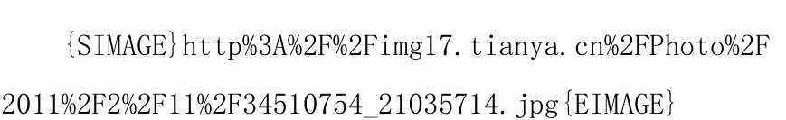

又做了一张解释中国经济目前的困局形式曲线

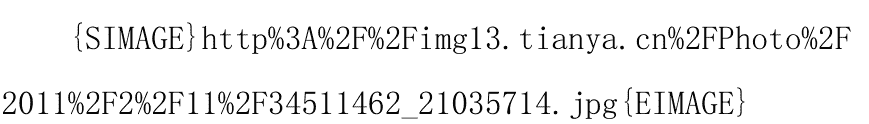

由于我国经济体系结构的问题，企业产品增值能力不强，技术含量低，企业汇聚成的经济运行安全区间越来越窄，通胀和通缩距离也越来越近，达到极端就会形成通胀和通缩并存，由于通缩和通胀的距离越缩越短，政府的调控也陷入尴尬境地，通常是刚刚刺激起来，就冒顶了，刚刚压制下去就疲软，这就是政府一直在强调的两难。

这一切原因都是我国的经济结构存在重大问题，突出特点就是以数量替代质量的生产运营方式。在我国难以在短期实现经济结构再造前提下，主动缩减产能应该是必须面对的问题，缩减的产能变现后，缩的越早，变现溢价越高。

目前政府采用提高大型企业技术含量（不惜以市场换技术），以大幅增加 IPO 培育新企业来带动结构转型，为的是这个目的，见图。

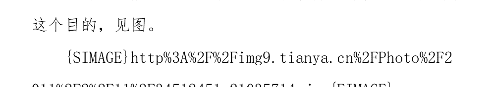

事实上哪？我们平民需要的是这种模式。通过市场规律，公平公正的解决经济结构问题，我们不需要一个成本快速抬高的发展模式，更不需要一个由国家主导的体系再造。

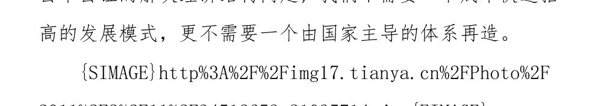

我对小城市和城镇房地产一贯是看空的，城市的最大功能就是商品经济的聚集功能，从资金，信息，物流的商品三要素上看，都是集中于城市的。在古代，大城市体现的是物流集中的功能，在商品化的近代，随着金融业的兴起，城市作为汇聚资金的功能已经发挥的淋漓尽致，随着现代信息化的发展，城市又成为信息的中转，交换和展示聚集地。中国的城市形成无不经历漫长的演化，大部分具有天然的地理优势，在历史上多是军事交通要塞，这说明了一个大问题，人类尽管可以改造世界，但利用的成份居大。

小城市和城镇有一种房产是功能性的，就是休闲和度假房产是值得关注的，但这种房产和普通居住/商业房产有着巨大的差异，并不能支撑所有小城市和城镇房产获得普遍的溢价。小城市房价最近非理性上涨，可以说是跟风和货币贬值因素所导致，他们相当于房价链条的最后一环，你的下家在哪里？

上面的几张图，我希望大家可以通过它们，了解我们所处的经济大环境，房价高涨，只是这种经济模式发展的必然结果，也许二十年后，我们的城市化进程行将结束，房价才有可能停止上涨的步伐，在这之前，房产持有者可伺机在货币回归价值衡量工具的起点兑现，或者一直持有获得长期的出租收益，或者寻找经济转型期中间某个适合自己的节点将房产抵押获得资金使用权，总之，目前持有房产优于现金，现金相当于灵活的选择权，目前 平民 的机会的确是少之又少，多选多错，等待时机是个好对策。

关键我们转型期是在通胀和通缩之间距离非常近的行将交汇处展开，如果在 2008 年附近或者更早开始调整，机会好的多，民营经济也不会如此尴尬。见下图。

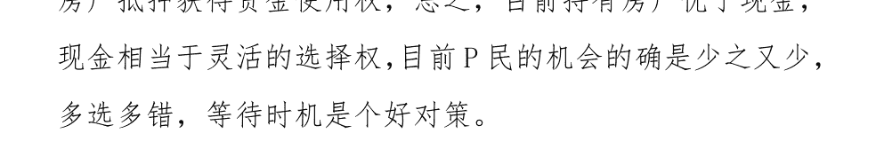

西部承接东部的淘汰产能，很多学者甚至管理层都非常支持，其实也就是把东部的发展过程再演绎一遍而已，东部已经投下了巨额投资，这部分投资，我想很大一部分都还没有回收。就又铺开新摊子，这张饼烙的有点大了。早在2008年，广东省就开始所谓腾龙换鸟了，成果如何，大家有目共睹，我想这样的玩法是非常利于交通运输的，所以中央拼了命似得在西部搞高速公路，原来有这招等着哪。中国的东西部和美国的东西部，那可是两个概念，美国东边是大西洋，西边是太平洋，中国东边有海，西边只有大山峡谷，还有比非洲还不如的阿富汗和外蒙古。脱离了产业集成度高的区域，这些西迁企业的确非常非常堪忧，就像西路军西征，没有了根据地，那就是一路路的孤军。

关于以防守替代进攻的做法，早就有谋定而后动之说，作为 平民 阶层，根本就不是开疆辟土的成色，等待大局初定，萌芽已现，再行顺势而为，尚有胜算可估，到处乱跑，是馅饼还是陷阱都还没搞清，就断送了卿卿性命，君不见，当年互联网大潮，死掉了多少小企业，这些人绝对没有白死，都给活下来的大企业做了肥料，替大企业培育了市场，我们不要去做这些先驱和烈士，还是去做活到最后的战士吧。

房地产销售量的大幅萎缩，并不是像大家想的那样，房地产行业就此终结了，相反，我认为是走上了正轨，像以前那样，随便买一套等待升值的傻作行情早晚有终结的一天。

房地产归根到底是经济链条的一部分，它必须加入经济循环，并利用自身先天具有的资源性优势，去占据经济链条中不可替代的一环。房地产销售量的下滑，迫使投资人平心静气下来，仔细想想，我的房产终究是经济链条的哪个环节。迫使投资人将思路从炒作阶段转到运作阶段。大幅缩减的新增供应量也为房地产长期投资提供了绝好的归位机会，它会真实的体现社会融资成本，并逐步达到理想的出租回报率，这也许就是最好的软着陆机会。如果就此房价不再上涨，刚需不再恐慌，房地产投资的长期收益率会逐步靠近金融投资回报率，那就是在贷款利率和长期存款利率中间寻找一个合适的平衡点。这个平衡点是针对目前房地产价格的，从1998年---2008年间一直从事房地产长线投资人的收益，将是超额溢价，收益将远远高于融资成本。

我在上面作了一些解释，说明了现代城市在经济体系中的重要和核心作用，房地产作为承载财富的基础作用，毋庸置疑，它不但具有承载作用而且还有金融属性，一旦大家把房地产放在更广阔的运营思路上，就会发现它的作用，大家不要沉溺于网销的热络，网销在通过缩减产业链长度获得营业规模优势和成本优势的同时，也丧失了对其它产业的支撑，一个加长的产业链才会导致经济繁荣，如果所有的销售商都去做网销，中国的经济将立刻沉入深渊。因为整个国民经济体系所提供的税收它不可能完全虚拟化，没有了税收也就丧失了国家对这个体系的支持，网销的劲爆只是一个短期行为，倘若把视线放的更长远一些，就会发现它终究不会有出路。话头转过来，房地产究竟会以何种手段实现其自身的价值，很多人都抱有疑问，以低价出租吗？这先要反问你自己，你买房时就没有想到吗？

最近我发现一个新开的盘，是济南最贵的公寓，华强广场，据传开盘价大约是1.6万起，周围的写字间成本在过去的10年，均价为6500元-7500元之间，周边的商住两用在过去的10年成本为4500元-5500元。如果华强销售情况良好，无疑会通通将周边的写字间和商住两用集体送入安全边界。对于这些进入安全边界的投资，我恭喜他们。如果华强的销售量不理想，我同样要恭喜过去10年的投资，因为不会再有开发商胆敢在周围加速提供新增房源，他们仍会进入更稳定的安全边界。

头几天我偶然翻到一个贴，未经作者允许转给大家看一下，虽然说得不完全恰当，但还是有一定参考意义的。

## 房租为什么要大涨（二）

前一篇《房租为什么要大涨》中，我们解释了经济学是一门“反馈”的科学。很多政策举动，最后会反作用伤害到你自身。

限于篇幅所限，我们不能将很多道理说得太细。

在本篇中，我们将继续解释二个问题。“本轮的宏观调控，将使得房租进一步上涨”，“房租会上涨，但为什么要说房租会‘大’涨”。

### 五）宏观无效

在本节中，我们将解释为什么“打击投资”“逼出空置”“三套免贷”是无效的，他们对社会没有任何好处。

在我们目前的媒体报导中，有这样一种观点，“投资”是不对的。房屋应该完全成为个人居住的住所，而不应该成为金钱的产物。目前市场上存在着大量的“空置”，只要把空置房逼出来，老百姓就会有房子住了。

可以说，这二种观点都是经济学盲，都是错误的。

首先，我们要问一下，你现在住在哪里？

答案是，住在房东的房子里。譬如 101 室。

如果哪一天房子大跌了，打击投资了，房东们都忙着抛盘了。你终于把房子买下来了，你终于有自己的房子了。那你住在哪里呢？

答案是一样的，还是 101 室。

那么，对于“实体”经济来说，对于真实的物质享受来说，二者有何区别呢。

对于真实的物质世界，二者毫无区别，你都是住一样的房子。都是一样的阳光日照，都是一样的上班二点一线。

二者的区别，仅在于虚拟世界“金钱”的区别。在前一种租房模式中，钱是在你和房东手中分配，由你支付给房东。而在后一种买房模式中，钱在你和售房者、银行之中分配。你每个月的薪水积蓄，要交给上家和银行按揭。

二者的金钱分配不同。

从“实体”经济来说，整个社会的实体产出并没有增加，GDP没有变化。人民群众的生活水准也没有提高。各种“政策”的唯一效果，是把金钱在不同人群中，进行从新分配，使某些人钱更多一点，某些人更穷一点。

宏观经济学，和微观经济学，有很大不同。

微观经济学考虑的是自己的利益，宏观经济学考虑的是整体的利益。

对于国家领导人来说，其实“宏观调控”是毫无意义的。因为他不会让我们这个国家更富裕，更有效，不会变出更多的建筑。

所谓“宏观调控”，只是将一部分人的钱，转到另一部分人手中。呃………顺带国家再咔掉一点油。

无论从任何一个角度讲，“宏观调控”都是非正义的，不公平的，剥削的。

### 六）空置谎言

对于另一种谎言，有人认为现在很多房子都是“空置”的。只要把空置房逼出来，就可以使市场上房源大增，房价大跌。

该观点也是非正义的。

首先，我们要问，全中国的空置房一共有多少？我们的回答干净利落，空置为0。全中国的空置房一共为0套。

相信一些“为民请命”的伪专家要跌破眼镜了。那么，你们就必须记住，经济学的第一课，“产能”永远是最大化利用的。

任何一种产能都不会闲置不用。

譬如说，你家里有一套小房子，如果租出去，可以有3000元/月的租金。

最近由于你刚刚从老房子搬出来，老房子暂时处于“空置”的状态。但这种状态，并不会持久。不出六个月，你老婆，你太太，就会想办法能不能“挖点潜力”补贴家用。

经济学第一课，“人”都是理性的。

理性人时时刻为自己谋求更大的利益，设法赚取更多的金钱。如果家里有空关的房屋，很快就会被亲人想起。老太太会心疼每月三千的租金，并让你尽快租出去。

“人”是理性的。房东绝不需要税务局给你寄空置税税单了，才想起哦我还有一套房子空关。

那么，市场上的空置是如何产生的呢。为什么有人不想要这3000元的租金呢。

那是因为信息不对称。譬如有很 多有意愿出租的房东，却暂时找不到租客。譬如随着开学/放学，招工/春节，市场上出现季节性的起伏。

又譬如某一些特高档的楼盘。“洁癖”远远胜于租金。保持一套干净的住所，可以卖出更高的价格。远胜于为了几勒2%的租金，把房子搞脏掉。很多房东出租三年，总租金正好把房子重新装修一下。此类例子也是屡见不鲜的。

又譬如某些特偏远的楼盘，其租金仍在上涨中。目前为了几百元，乃至1000元的租金。要到遥远的郊区，来往交通，打理租客。很多房东都宁愿空关。但等几年新区建设好后，情况又会不一样。

但无论何种情况，“人”都是理性的。每个人都在为自己谋取利益最大化。市场上并不存在“为空置，而空置”的房子。

那么，所谓“打击空置”的调控，又是怎么个论调呢？

这仍然是对“整体生产力”毫无帮助的政策，只是剥夺一部分人的金钱，给予另一部分人。

凡是持该类调控主张的，都是非正义的，非公平的，剥削的。

如果政府真的要“减少空置”，或该大力促进信息市场，使房东房客迅速诚信地找到对方。这样的系统建设，才是真正有效的。

## 七）房租大涨

在上一节的《房租为什么会大涨（一）》中，我们说到了，因为政府的宏观调控，所以房价房租都飞涨。因为宏观调控，所以房价飞涨。在本节中，我们会说宏观调控使房租上涨，但为什么要用“大”字呢？

这里牵涉到一个定义问题。什么是“大”。如果遇到一些风吹草动，房租上升了30%~50%，那我们说房租“大”涨了。如果遇到一些风吹草动，房租上涨3%~5%。那我们只能说房租涨了，而不能说房租大涨。

现在的问题是，房租马上就要“大”涨。

好比一座桥梁，下面有十根柱子。敲掉了一根，桥梁仍然可以矗立。断掉二根，桥梁还是可以通行汽车。断掉三根，桥梁有点摇摇晃晃，但人小心翼翼还是可以通过。但是，如果桥梁下面的柱子，断掉了八根，那整座桥梁就宛如危桥石拱，随时可能从百丈悬崖，轰然崩塌。

对于我们的房租市场，所有抑制租金的枷锁，十根已经断掉八根了。房租市场宛如大河决堤，又宛如高峡堰塞湖，随时可能汹涌咆哮。

对于租房市场，我们有三大看得见的隐患。

- 1. 供应已经枯竭

这是最重要，最核心，最根本的一条。

租房市场的供应，已经枯竭。

有谁会买房出租呢？理论上，当租赁市场需求增加，价格上涨，价格从2000->2500；就会有更多的房东，将房屋出租，赚取2500/月的租金。

但是，现在这条链条，已经被切断了。

租金已经远远低于房价的涨幅。业主买房，是基本他们自身的考虑。无论租金再怎么涨，也不可能发生“为赚取租金，而去买房”的行为。

按照普遍6%的租金回报率。现在市场上一套200W的房子，其租金最少也得10000元/月。

可目前的租金呢，刚刚从2000->2500。

也就是说，租金至少还要涨三到四倍。才会有“供应端”新增供应加入，抑制价格进一步上涨。

智者远虑。

目前的租赁市场，宛如一座桥梁，桥墩断掉了八根。一有风吹草动，就极易租金上涨。而租金上涨之后，不是2000->2500就止步不前，而是可以一直涨下去，最终涨到普通外环二房10000/月。

我们对于租赁市场，抱有极其危险的焦虑。目前房租市场，最后的防线，是许多房东原有的“陈年库存”。是之前十五年房产房改，积留下来的业主手中空闲房。这批房产成本很低，业主也比较愿意低价出租。

可是，“库存”终究有一天是会消耗完的。外来人口不断增加，本地人口不断改善。需求大约每年新增1平米/人。

一旦“库存”被消耗完毕。接下来就会进入“房租飞涨”的阶段。房租一共可以涨四倍。一直到200W的房子月租1万（可能二户小白领合租5000），然后才会有新增出租供应，“为赚取租金而买房”。而且还要承受政府的打压。

“库存”还能撑多远，我们不知道。但不会太久了。

- 2）社会总工资上涨，租客对租金有更高承受力。

即使在最普通的公司，年均7%的工资涨幅也是大量外资公司常例。几年积累下来，其实租客已有能力承受更高租金。

- 3）政府目前政策，对“买房--出租”模式不利。

综上所述，目前的房租市场，是最不能抱乐观态度的。

任何人都不能向你保证，房租会长期保持在目前2~3%租金回报率的地位。更理性地推断，房租目前正处于“消化陈年库存”的阶段。一旦该阶段完毕，房租会大涨，而且是“无阻力刚性上涨”。

我们预言房租上涨，这种上涨，不是目前20~30%的房租涨幅。这仅仅是房租飞涨暴风雨来临前的平静预演。我们说的大涨，是房租要涨200~300%。涨到你租也租不起。

作者:66端午88 日期:2011-02-12 16:14

楼上对房地产分析不要仅从横向的国际比较，更需要从纵向的传统角度分析，中国以及中国文化所影响到的国家，这包括日本，韩国，台湾，新加坡等。他们最终的结果都造成了房价高企，除了外贸导向型的经济外，更深刻的原因在于民族性的地主情节。

纵论中国经济发展的20多年，你很少会发现一直NB的行业，一直NB的企业，一直NB的经济人。总是各领风骚数载后，慢慢消失在经济大潮中，唯一留存的记忆就是那些曾经辉煌的建筑，今天你行，明天你行不行？我看大部分结局是不行的。这是为什么哪？因为随着财富的不断积累，后辈总想去取代前辈，因为不取代，就无法引导财富流向自己，于是游戏规则会随着经济导向的变化而不断变迁，你积累的竞争优势很快就会在更新的游戏规则面前失去先发优势，而主导中国经济发展的源动力不是现在的你所能掌控的，这个源动力是权利为导向的官僚体系，这是非市场化的因素，非人力所能预料，企图通过研究经济规律，而在经济学的视野里找不到答案。我们既然无法预测将来的主流方向，就是说我们不能预测那个行业将成为主流行业，但我们可以通过逆向思维找到将来肯定不差的行业。这就是我所说的，多以逆向思维来思考一下问题，房产肯定不会是将来很差的行业，这就足够了。我在这里指的房地产行业，并不是单纯的建造和开发，而是占据（依附于汇聚了资金，物流，信息流资源的）城市资源，说的简单点：现在穷，也要站在将来的富人堆里。

作者:66端午88 日期:2011-02-12 16:31

我曾经分析过重庆的廉租房建设，大意是按照目前的社会平均收益比，重庆的廉租房建设资金将是亏损的，重庆政府准备以 500 亿资金投入廉租房，这笔投入主要来自于：

- 1. 养老基金
- 2. 地方债
- 3. 政府其它盈余投入
- 4. 商品房的维修基金

我们先不去计较这些资金投入的合法和合规性。先计算一下它的收益，按照目前成本，建设成本在包含四通一平及正常的教育,商业,公用设施配套后,成本将不低于 2300 元（不含任何土地费用）。加上建设期的融资，建筑费用，和不能减免的税收。不低于 2600 元。按照廉租房的标准，50 平一套，租金 500 元/月。13 万的成本，回报率仅仅 4.5%。如果减去房产的维修成本和折旧，他的收益是负值。我们也不去计较将产生大量的以权谋私，那些投入的资金回本是完全不可以想像的。而且，你建的这些廉租房，位置一般都很偏远，可用性相当的差，并不适合廉租房的配给对象。

本人居住的城市济南，则采用了另外一种模式，就是旧城改造模式，回迁的结果是大量消灭了原来可以低价出租的库存房改房，从市场层面大幅拉高了城市中心的房租水平。

> 作者:66 端午 88 日期:2011-02-12 16:34

重庆模式就是中国的美国两房模式，早晚是要从根上烂掉的。

> 作者:66 端午 88 日期:2011-02-12 16:40

我还要强调一点，中国人需要廉租房模式吗？回答是否定的。仅仅在一个阶段内需要，一旦房价不再上涨，廉租房的需求也会下降，那些喊着要廉租房的人，真正想要的是完全免费的住房或者是不断升值的资产，廉租房只是被绑架的工具。如果，国家给大家一种债券，这种债券完全对冲货币的贬值，还能有盈余，我想：没人会选择房产，至少不会像现在这样亲赖房地产。事实上，没有一种债券可以对抗货币的贬值，甚至没有任何一个行业可以对抗货币的贬值（货币超发条件下）。

作者:66 端午 88 日期:2011-02-12 18:37

体系内的头羊高铁促进，是我一直看淡的产业，因为它没有可能在短期内盈利的可能，为此我一头扎到北京天津高速做了一周调查，发现他的规模效应根本就发挥不出来，无法支撑它的高额造价。也许盈利要等到货币贬值到相当程度，通过不提价，少提价来扩大规模。这种投资是以未来的产能过剩替代当今的产能过剩，虽然在短期可提供给经济以强大的建造需求，但未来的亏损将导致国有资产大幅缩水。在短途修建高铁更加强化了这种亏损预期，铁道部出事，早有预兆，通过刘志军的落马，我们可以深切的体会到维持体系运转的高昂代价。

作者:66 端午 88 日期:2011-02-12 19:25

楼上，看清楚再说哦，那不是我写的，我同样认为房租会涨，每年的涨幅大约 20-30%是我的预期，各个城市正在进行的旧城改造也为这个判断提供了有效的依据。租金水平逐步向资金的正常投资收益靠拢，只要房价停止上涨，销售量大幅下滑，只有这样才能减少向体系供血，从而最终减少廉租房的投资总量。

作者:66端午88 日期:2011-02-12 23:32

能看到10年内的无忧就已经很难了，况且这个时限还远不止10年，试问在座各位，你们谁能拿出这样一个可见的投资行业和机会，它的可预见性和风险敞口都远远在管理层的各种新兴行业之上。简单并不意味着弱智，有时它叫大智若愚，有比房地产结构更简单的产品，就是巴菲特一直当艺术品收藏着的可口可乐，它的核心技术仅仅就是一个配方，谁也搞不清到底有没有这个配方，它简简单单的生存了几乎一个世纪，就占据了饮料市场总份额的三成。房产比这个玩意要强的多。

在出租收益比逐步靠近正常投资的趋近过程中，你会发现更早的房产收益绝不会是仅仅靠近而已，是加倍的累加递增，以复利的方式逐步抽离这个市场，去从事收益比更大的投资，从这点上看，作为积极防御型的组合，均值在1998--2008年（平均成本大约是2003年的价位），早已立于不败之地，何忧之所在？

作者:66端午88 日期:2011-02-13 00:01

- 1. 假设手头只有30W现金，现在要进行地产投资，是选择商业地产和住宅地产？

R: 老实的说，30 万投资对于目前的房地产市场可参与程度几乎为零。我此前已经分析过了，房价越高，动用的资金量越大，30 万参与的时机仅仅限于一次崩盘的前提下。说实话我天天做梦都盼望着崩盘的一天，可惜 10 年了，不但中国经济毫无崩盘的迹象，房产更是仅仅以横盘替代回落，人生到底有几个十年，是不是盼的花儿也谢了。在 2006 年前，我是没有资格谈什么崩盘的，因为崩盘的机会都是留给有准备之人的。如果是刚需自用，不在我的议题选项内，我谈的是投资问题。虽然操作房地产的门槛越来越高，但是我提醒一下楼上，房地产相关粘连行业的机会却是越来越多了，你看家庭和环境安防产品，是不是做的有声有色。家庭装修，设计是不是很火，家庭用的各种电器是不是越来越细分化了。这都是机会，不要总想着去做主业，红花需要绿叶扶，有时另辟蹊径才是真正具有操作性的机会。这就像我前面说到的，看到网销火爆，我的第一反应是应该做新型物流，你们想到的却是开个网店，这是多么不同的思维方式。

## 二、假设要投资商业地产，是选择社区商铺？还是写字楼？还是 50 年产权的商业公寓？

R: 我最近三年内，买入的基本都是商铺和商务型公寓（短线利润已经固化），今年的操作机会将是逢高卖出一部分商铺，将利润锁定于继续持有的商铺。

## 三、假设要投资住宅地产，是在一线二线城市投资，还是在五线城市（比如汉中）投资？

> R: 我只从事我看得懂，算得清的投资，对于小城市和城镇的房产，我不知道如何计算回报，因为我不是太了解这种小规模的经济结构。我只看到资金将会越来越向大中城市集中，因为大中城市是权力的中心，资金不围着权力转，那就是傻钱。

## 四、相对于其他投资方式，现在房地产还是不是P民投资最为稳妥的方式？

> R: 因为我们接触的人不同，所以我们的看法也不同，我认识的朋友，去年做的最好的不是开发商，更不是房虫，而是从事建筑安装行业的人。有比建安行业更好的，那是从事土方挖掘和运输的人。后面这种人有点粘黑，就不便提了。如果你有能力从事这些房地产粘连行业，那么房地产现货就不是你的最佳投资方向。但房地产的确是绝大部分P民最稳妥的存钱罐，因为目前我国城市户籍人口中，拥有自有产权的人比例为：85%，只看这一个数字，你就明白了钱在什么地方。

作者:66端午88 日期:2011-02-13 01:51

因此，我这次上来向楼主请教，主要还是想找稳妥的投资方式，在今后两年积累下海的经验，顺便也积累一下第一桶金。

R: 请教谈不上，交流一下而已。第一桶金永远来源于你的早期投入，既然你有专业知识，当然对这个行业也是最熟悉的，人赚钱阶段，要做最熟悉的行业，就从你的专业入手。钱赚钱阶段，在屏蔽风险后，可考虑从事资金积累可加速腾飞的行业。钱赚钱阶段，考虑的最大问题是风险控制。

二、看来楼主还是倾向于商业地产投资，但就是不知道是写字楼的商铺，还是社区商铺。就是不知道为何现在要卖出一部分商铺。既然住宅地产已受打压，商铺正被炒作，而且房地产的周期一般比较长，完全没有必要在起步阶段就撤退啊。这样操作基于什么考虑呢？

我早期投资的写字间和商铺，收益率目前分别是 8.5% 和 15%，收益比差异一目了然。但商铺的风险要比写字间更大，所以在中段的投资更迭为商住两用和住宅。当这些投资熬进安全边界后，稳定的回报为继续投资奠定了较高的基础，加之住宅风险不断加大（涨幅太大），在综合考虑后，2008 年趁着房市低迷期，开始增持商铺。因为这些年，本城商铺价格变化并不明显，收益率有抬高之势。目前 2008 年增持商铺交房后收益率已经高达 9%。2009 年--2010 年，商铺价格起飞，我感觉风险加大，当期收益率比大幅下滑，有必要减持一部分，增厚收益率，对抗近两年由于网购导致的短期风险。总之，房产的持有品种和收益比，投资量分配都有牵扯，分散持有（你必须按照你的自身条件，提前谋划规避物业税的可行对策），按照市场风险进行平衡调整，这都是必须做的，房产投资的核心技术也是相当复杂的。对于商务公寓，这东西天生就是短炒的品种，总价不高，销售期较长，可在开盘大量买入，获得最大优惠幅度，并跟随开发商的销售进程缓慢减持，将利润锁定于保留的剩余部分，买入一套，期望快速增值的可能性甚小，这就是我说的房价越高，动用的资金量需越大的原因。我见过这种公寓有人一次性买入了75套，那才是职业高手。

对于初始资金30万的投资人，我认为目前谨慎介入房地产行业，除非有重大市场机遇，首先需要做的是对初始资金进行增厚，我不知道你从事的行业，如果有机会，可在你的行业淘到第一桶金后，在实业支撑可产生足够现金流量支持时，再考虑投资地产。有些人认为一次买入一套也是投资，那是在2006年前，现在的房地产投资都是企业在做，基本不使用信贷杠杆。这和我前面所说计划体系对民营体系的挤压导致实体经济资金溢出也是能对应起来的。国有计划体系越亢奋，房价就越难下沉，即使采用行政手段，也只能暂时压制。企业资金的加入却导致P民的参与难度越来越大，好处是：P民的前期投入被送入了保险箱。

作者:66端午88 日期:2011-02-13 01:52

切，讨厌，闪人，本贴结束。

作者:66端午88 日期:2011-02-14 00:10

不过又有疑问了：如果这样玩的话，光手续费、税，就会侵占很多盈利空间。。。而且你是在随着 KFS 销售进程就减持，那岂不是相当于刚买没几个月就卖了？几个月价格也涨不了多少啊。

R: 这种商务公寓除了位置特别好的外，只适合大盘，分成几期建设的，我拿个本地的例子来说明一下，诚基中心。一期开盘 1.6 万，开盘时间 2007 年，2008 年危机导致其二期开盘价暴跌，最便宜的才 1 万不到。截止到 2010 年初，其三期开盘，均价为 1.6 万，又回去了，目前三期价格已经涨至 2.2 万。二手售价在 2009 年 5 月起涨点算起，目前价位为：1.8-1.9 万左右。1 年半涨幅接近 70-80%。中国法律规定，房子是可以退掉的，只要向开发商缴纳一笔 3 万左右的过手费，你爱卖多少是多少。前提是房产证手续进行到开发商掌握阶段，交到房管局后，就无法再内部转让了，这个时间足足有 2 年的时间。

现在我担心的是等几年后增厚了初始资金，房价又蹭蹭蹭的上涨永远跟不上了。。。‘历史’已经证明，凡是这几年出国读书的、读研的、海外挣大钱的（都是为了增厚自己），大部分都被房价抛在了后面，导致步步踏空。因此我的想法是，有一点钱，就投入一点，即便是不增值或者被套，那我也可以使用它的居住价值、出租价值。我承受不了房价可能上涨的机会成本。更何况几乎所有人都认为，长远来看，房价必定是上涨的。

> R: 只要自己有能力，房产早晚是你的囊中之物，房价不会总这样涨的，但人的能力是无限的，不必计较一时得失，时间长着哪。有的会变无，没得会变有。

作者:66 端午 88 日期:2011-02-14 09:48

证券市场中高速公路板块发生异动，这和大家判断西部经济承接东部经济产业转移后，将造成东西部间运输业繁荣有关。结合目前东部的去产能化是符合的，东部缺工，这部分人力的转移留在了当地，从事什么行业，无非还是出口，当时外销港口都在东部，造成衔接东西部的运输业有潜在机会。

作者:66 端午 88 日期:2011-02-14 09:52

另外的助推作用是由于铁道部目前问题重重，是否高铁有投资下滑的可能，于是投资于物流的资金去寻找其它替代方式，但是由于燃料价格和通行费用问题，我并不看好公路物流运输。

作者:66 端午 88 日期:2011-02-14 09:58

国内物流行业的利润来源在于两个点，第一是运输平台的利润，据我的调研，运输平台今年提价比例为35%-40%，另外一个利润点，来自于运输终端，但是运输终端的利润会被人力成本大量吞噬，其实这部分机会才是P民的。

作者:66 端午 88 日期:2011-02-14 11:53

尚欠一次攻击下压线的过程（四次攻击已经完成了三次，目前下压线位于 2800,攻击的目标高度不会超过这个点 10%），才会发生大规模行情，这波涨，不要太看好。我一直把 6124 以来的行情视作 94 年熊市的翻版，到目前为止，基本是相同的，未来主要观察在上次反弹筑底的底部 2500 点是否能再次触碰，并坚守住，如果这样，可视作长期底部。2500 点附近类似于 94 后行情中的 512 点，下面行情无论怎么走，都不会很坏，不存在指数上的系统风险了。个人观点，仅供参考。

作者:66 端午 88 日期:2011-02-14 15:32

房地产市场是和证券市场完全不同的东西，房地产市场就是因为获利太容易，它自身也在调整，可他跌不下来，因为它是有价值的实物资产，就是调整，也是调整进入的门槛，如房价不涨了，则追逐短期大幅上涨的资金就不会再进去，进去的也出不来了，就会返身寻求长期的逃离，这种套利方式就是拉高租金水平，以租金形势逃离。这时，恰恰是长期投资人的目的达到了。这时：房地产行业会进入第二阶段，房产不再是普涨行情，将来是功能化的市场，真正需要的会按照它的实际价值定位而变化，不需要的会暴露其泡沫本质。证券市场，事实上给大家的回报很少，基本是负和收益，只能炒股价，拉上去又没有收益支撑，只能再下来，就在这反反复复的高低之中，P 民的银子不是交给庄家作为交易费用，就是给黑庄拿走了。这一切都因为这个市场是负和收益市场。

我手里随便有一套不好租，我都不会乱说话，我和坛子的人，最大的不同就是实际操作做铺垫，如果有问题，我是最先知道的。鬼城有吗？的确有，我把自己先添进去。等住满了，它就不再是鬼城，这时基本就进了安全边界。

楼上问的这个问题，我在另外一个帖子里正在探讨。

现在出租和以前已经呈现出明显不同的租赁方式，就是骑驴找驴，租金不高也先租出去，租给你，但是同时在找下一个承受能力更强的人，中高低档住宅基本都差不多的模式，因为承租人也在砍价，其实大家都是不理智的，承租人应该懂一些经济知识的，不如签个长期合同，稍微出高一些的价位。现在承租人和租赁人都不愿意签长期的合同了。这样比较起来，承租人的刚性更强一些，他们也在寻找更便宜的。结果大家都看到了，房租会越来越高，直到耗尽房改房存量（第一是因为交易原因导致的数量减少，第二是旧城改造导致低成本房产成本提高）。

租金最终是有市场决定的，不是你要涨就能涨的，和普通劳动者收入上涨不成比例的上涨是不现实的。一旦降价的口子打开，跌不跌不是你能说的算的。另外，09 后的房市和证券市场是类似的，房子就是被当做资本炒作的，这一年的购房的刚需和投资类型比也差不多和之前几年是倒挂的。多发的货币会在泡沫干净后一夜之间蒸发殆尽。

> RE: 是的，租金最终是由市场决定的，租金价格的较低，是历史形成的，主要是房改房的一次性返利给早期房主，这些库存一直都没有消化干净，加上 2006 年前，房价尚在百姓可接受范围内，大家又囤了不少低价房产，截止至 2010 年，已经没有低价房产可供应了，管理层或许可以充当低价房的提供者，但前提就是房价继续涨，政府有足够的土地转让费用，如果一只手按住房价，那么另一只手里就没有足够资金的转移支付给廉租房。总之，房价和房租只能按住一头。

房子如果失去了它的金融产品功能，剩余的就是赤裸裸的产品功能，如果房子不涨价，那么大家就不会再以炒作方式对待它，就会等着房租达到合理的租金水平才会由于它的产品工具功能才会去买它。这样就会造成房屋销售量的大幅萎缩，供应量减少，一方面会导致房价陷于价格呆滞，另一方面也会从根本上提高租赁需求。现在的房价，谁能买得起，大部分是投资人买去的，如果不涨价，那么就只能通过房租把成本拿回来，房租不涨才怪。中国这么多美女，凤毛麟角嫁给了没房的人，剩下的美女咋就都见房才嫁，咋就没形成竞争性削价处理哪？人人心里都有一杆秤，房租同理，租到便宜房子和娶到免费美女的，没事偷着乐去吧，这叫“狗屎运”。

按照你的说法，我降了100块把房子租出去了，另外一个再降100，到最后，晕，我付3000块给承租户，你来住我的房子，俺谢谢你了，求你来住吧，真是天下大同，共产主义终于实现了。

刚刚看了一个新闻报道，关于东部工人荒的报道，中国的人口减少了吗？没有。中国的企业用工需求增长了吗？并没有增长多少。为什么工资涨到2800到3000工人们还是不积极哪？因为工人们聪明了，知道压价竞工是愚蠢的，现在东部西部争抢人力资源，关键矛盾还是没有变化，劳动密集型行业仍是我国的就业主力，变化的只是更多的地方政府都在促进这些产业，以前只有东部需求，现在西部需求也旺盛了。现在政府是在做好事，帮大家抑制泡沫，提高炒房的门槛，减少供应量，有助于房价的软着陆，对长线投资者的确有安抚作用。中国人的地主情节会因为一个政策就有所改变吗？存在了2000年的情节一个月就能改变了吗？我想没人会信的。除了使用大规模金融杠杆的超短线投资人，这部分人实在是少之又少，不会构成投资群体的主流。也就是说，即使房价不涨，甚至有所下跌，抛盘也不会很大。具有金融属性的标的，通常还有另外一个特点，就是买涨不买跌，买时放量，跌时缩量，目标都指向最有利的市场状态：成交大幅缩量，房价陷入呆滞。

由于中国国情特殊，家里只用一套房子会疲惫不堪的，等你送送孩子上学就知道了。大中型城市的房产空置数量比城市吸引的外来人口说，仍显不足。另外，中国的人口众多，会产生大量的中小微型企业，都需要营业用房，企业的集中度越低，就业压力越大，就会产生越来越多的企业需求。

只有城市化进程+中国培育出另外一具经济发动机，这两个前提满足，才会导致房地产行业回归自身居住和使用功能。外资进退只能构成波动。中国的问题归根到底还是自己的问题，外来因素只能助推，他们的目的是获利而不是控制中国的房地产价格，事情总会有个因果关系，不要把结果当成原因。

西部由于思维落后，体系落后，现代经济的三要素（物流，信息流，资金流）不处于优势地位，其各类资源的使用效率上存在天生的缺陷，并不走在经济的前沿，只是夯实基础的跟进型经济，从长远看，在西部发展不是最优选择，不论是从经济前瞻，还是企业发展角度，抑或是个人前景，都只是暂时性的缓冲对策，从这个角度上看，大家一定要有清晰的认识。

房租的涨升是一个缓慢的，持续的过程，涨幅 20-30%，指的是对于原始租金的涨幅，不是环比的，如果按照环比的算法，要低很多，比如每个月有 1-2%的涨幅，由于租金的总额比房价低很多，不会有视觉上的冲击力，而且是在一年中缓慢上拉，只是在每年的 6-8 月，2-3 月有一个急升的过程，不怕涨停，就怕涨不停，这是最具良好基础的上扬趋势。那么大家不妨拭目以待，看看今年租金到明年是个什么价格，市场最终会大家一个说法，一切辩论都要以市场作为最终检验的标准。

房租合约的履约率问题，一定是会随着房产出租回报逐步达到合理水平而提高的，高效的市场会逐步淘汰不符合市场规律的交易方式，租赁双方的违约成本将在合规博弈下越来越高。

房租水平并不是亦步亦趋的跟着收入走的，而是房子的升值体现的手段上兑现，工资涨幅大时，如果房产价格同时涨，房租就跟不上涨速。同理，工资不涨时，房价同时不涨时，也不会造成房租涨幅减缓。因为供需关系和融资成本共同构成房租的基础。

国家意图是，消除干扰因素，把弹药集中于房地产打一场歼灭战，房租由廉租房调控，房价以行政实施干预，以最小的代价在主战场和游资+P 民，决一死战，调控的目标是稳定房价，通过逐步提供廉租房降低租金压力，辅以调控控制让空置房进入租赁市场，让 P 民和游资自相残杀。

P 民和游资的对策就是停止购入房产，让房地产供应链中断，减少对市场的供应，导致供求关系发生变化，同时有效的减少供应量也导致开发商的建设陷入停滞，直接影响上游土地转让市场。在供需失衡过程中，缓步推高房租水平，挤压 CPI 向上。

这就是博弈的推理过程，至于鹿死谁手，要看各方的成本和收支压力，我想国家的成本压力及收支平衡压力更大，一年内即可见分晓。

商铺属于功能性地产，也是我未来布局的重点，不过得先熬着，因为网购模式还在推进过程中，等影响到国家税收后，国家会规范这个行业，最终会平衡虚拟和现实销售的成本。这个过程必须坚持下去，时间是这波炒完商业地产后，将有有一大波调整，也就是网购风生水起，传统零售业被抛弃之时，既是布局商业地产的最佳时机。商铺的本质就是零售终端。商铺的价格将在今年到底中短期顶部，可以逢高兑现一部分。

我又思考了一遍国家为什么把 CPI 集中到房产上，事实上，国家是需要房租涨的，只有房租上涨，国家才能找到资金做廉租房和公租房。大家注意哦：廉租房和公租房的概念不同，把公租房的收益补在廉租房里，国家一样可以获得有收入担保的资金投入。要想公租房的收益达到有资金肯投入。而且还得比较高，就得让私人房产的房租达到空前的程度，国家就能两边讨好，一方面承接游资的投入，一方面提供比私房房租更低的公租房房租，然后还能用收益的国有部分（比如土地掺股等）投入廉租房的补贴。

> > 作者:66 端午 88 日期:2011-02-15 20:44
>
> %15 套，其中住宅只有四套，自用三套。其它均为商住两用，写字间，商铺。按揭支出占收入的 15%，这就是目前的负债率。

> > 作者:66 端午 88 日期:2011-02-15 21:07
>
> 避税筹划是 2004 年就开始实施了，这个偶比大家都警觉。现在才想到会被割肉，那就不是一个合格的长线投资人。

> > 作者:66 端午 88 日期:2011-02-15 22:08
>
> 看，你没有反驳我的观点，证明你心里也在敲鼓。你是投资者，你需要圈一圈比你更 2b 的人来买你的东西才行。
>
> 不管怎么说，一个国家执政党在牛逼，改变不了经济规律。就像平行线无法相交，你再牛逼你能说：“我牛逼，我能让平行线相交”吗？
>
> 在国家逐步割你们这些小资产阶级的肉时候，你们的利润会越来越少。你们也需要转移风险，问题是，房子这种固定风险，不好转移。最缺德的方式就是，让这样的人多起来，分担风险。
>
> 我觉得那些小的房产投资者，该警觉了。
>
> 另外，我判断中国在5年内经济崩盘，房价如果一直涨，那就涨到崩盘为止，如果跌，那么2013年拐点。
>
> 不信看着。

RE：房产税（物业税）实施是早晚的事，这是我2004年就预测的，每年我都会向相关人士探讨是否开征的可能。但不能因为征收房产税就徘徊于核心资产之外，如果税收公平的话，这是大家共有的成本，根本也不用担心什么，我盼望我的投资像在国外一样，200左右的回报期即可满足，但是国内只有房产有这种收益，房价涨并非我所支持的，这会大幅提高增持成本。之所以筹划避税手段是因为：中国不是一个公平税负的国家，你想达到合理的收益率，就必须首先保有社会平均税负成本。这就是我坚持不扩大实体公司规模，而把利润逐步转向固定收益产品的初衷。像楼上的说法，应该叫因噎废食。

如果实体经济那怕是存在一点可持续增长的希望，我都不会如此看重房地产投资，做过实体经济的人都会知道，现在做实体已经不是跪着就能赚到这么简单了，如果跪着都赚不踏实，即使赚到也是非法的，那么实体经济再去以超额风险的代价坚持也就丧失了实体的本质，即便如此，我还是坚持保留实体公司，用风险投机收入和房租收益坚持着，因为我知道：只有利用房产和体系进行攻防才有一丝可能回归实体经济的希望，为了房产不再充当武器，现在就必须坚守房产，这就是我的高度，我把它叫做爱国的投机。

国家必须应该知道，仅仅控制房地产是毫无出路的，你不给实体经济普惠制于P民，造成的营商环境大幅恶化才是引发房地产泡沫的根源。

按揭占收入的15%？如果这是平均数，每套每月租金10000元，而你每套房每月的按揭额只要1500元？您哪年买的房啊？现在能这样玩么？

租金一万？我就不好意思发这种帖子了。

前些时间，那些叫嚣房价只涨不跌；忽悠人的理由是什么城市化，4亿农民进城。丈母娘，二奶呀什么的。现在又来了一个什么廉租房的资金那里来的理由。楼主你真的认为政府会建N套什么廉租房，公租房的。我们这些所谓的刚需都不信，难道你还比我们还愚蠢？？？？楼主居心何在？呵呵。你知道的。

RE: 作为P民，可以做任何预测，但都要以市场走势为准绳，你的预测再符合逻辑，再令人信服，对于市场等于零。对于廉租房，公租房，是否能建起来，我们现在假设它能建起来，那么就得假设它有钱投进来，这些钱从哪里来？我们正在分析这个钱的来源。

我想问一下，很多政府考卖地赚了不少钱，可是当地人的生活并没有提高，请问这些钱去哪了？？

> RE:二元化对立，决定了取之于民用之于体系，这个问题已经讲过了。

切，这有什么好忽悠的，我这一个中型城市有几个人啊？我更不会什么害怕，从小就是吓大的。我的风险都是按照财务准则控制的，我只想和大家交流一下而已。

割肉？只有赚了的才能谈到割肉，没赚的都是砍骨头。
呵呵

呵呵，咋割肉啊，一个证一个名，抵押的控制关系。好好研究一下怎么对付偶。割了偶就割了真交不起房产税的人。这才是终极解决模式。

不出所料的话，今年7-8月，租房的人就该泪奔了。统计局会非常郁闷，怎么把石头放饭碗里了，咯到门牙了吧。

加 v 信 1101284955，获取更多好帖

楼上，我感觉你说的不对，我倒是觉得目前风险开始加大的品种并不是住宅，也不是商住两用和写字间，商铺的风险已经抬头了，因为它的风险是很现实的，买的便宜不构成安全边界，实体的传统零售开始下滑是风险来源。所以，今年我会择高卖出一些，缩窄敞口。

另外商铺的税负不公平是显而易见的，很多政府部门私设门头出租，都是不用缴纳房产税的，街道办事处盖得临时商铺也不用交，因为他们都没有产权证或者产权归属不清。公平的房产税加了等于不加，会全额转移至使用方，不公平的税负构成了体系对民间资产的掠夺。

现在住宅都在额外收取房产税了，那么商住两用公寓和商铺要不要交房产税？好像没见明确规定啊。网上查了下，也没个明确答复。楼主费力解答一下。

RE:这些房产大部分一般都是通过管理公司管理的，按照法律是应该交的，但是地税有很多优惠，比如什么三免两减半之类的。总之，管理公司可以去运作的成本低一些。如果自行出租，一般都是承租人签订：净房租。它要发票就去办好了，用物业管理费的发票走营业税（5.5%），房租发票走房产税+营业税（17%）。

关于房产税的征缴，地方税务局一般是不上心的，一是征收成本极高，只要你不开门，他们一点招都没有。二是他们也知道，严格征收房产税，他们的其它收入就会大幅降低，买卖房的税收，土地增值税的税收，土地交易税，营业税等等等，哪项也比经营房的房产税征收成本低，征收额度大，这种事大家心知肚明，默契。

CPI 权重转向，体系外的资金也会积极应对的，我今天看第一地产，上面说的开发商零开盘，就很能说明问题，我们当地很多应该在过了年就开盘的楼，现在都押后了，开发商这时也会帮游资一把的，就是减少入市量，一方面延缓向体系内输血，另一方面强化需求的累加效应。这是开发商的意图。

中央政府意图很明显：我要自己玩了。我估计他们也在等着房租的走势而定，大家都是走一步看一步。如果房租走高，我就四处融资，自己玩廉租房+公租房。地方政府也在观望，上面得应付，下面得捣腾，廉租房能盖点就盖点，大部分都是拆迁房替代廉价房的模式，最终的结果是提高大家的持有成本，自己顺便卖地收税和费，中央现在时剃头挑子一头热，又要求地方政府提供发展资金，又得保障房价不涨，这无米之炊不是好做的。

现在中央单打独斗，其它利益都拧在一起了，地方政府事实上是在坐山观虎斗，我说的 P 民也在体系之外，有房没房的虽然处境不同，事实上却是扯断骨头连着筋。真指望搞到廉租房，哪的猴年马月，在这之前，房租给拉的高高的，那就偷鸡不成蚀把米了。

我在 90 年代就经常读到一些所谓带着官帽子的经济学家的高论，就是说;现在储蓄率这么高，一下涌出来不得把经济体系冲乱套了，要想办法让他们逐步花掉。事实上，这些资金真是很老实，一直到 2005 年都没跑出来捣乱，我当时分析过，这些钱都是进行自我保障的死库容，就是P民存钱应付养老，医疗和教育的（当时总额大约10万亿）。很难拿出来消费或者投资投机。到了 05 年后，人民币开始升值，出口量不降反升，为了给外贸补贴，大幅增加的外储以人民币形式放到国内，钱多了，东西没多（都出口换手纸了），这些死库容开始慌了，于是房价涨，股市涨，通胀抬头了，到了 06 年底，实体经济事实上就玩不下去了（民营体系），因为收的税和费都转移支付到国有体系去了，民营体系的实体经济实际范围的萎缩导致了大量实体经营资金被挤压出来，最终牢牢的被压在股市里，流动性一夜间消失。

新房缩量60%，8个月，中国经济就只剩喝稀粥的光景了。缩量50%一年，中国经济就只剩一条底裤。哥，你这收的哪里是房产税，明明就是崩溃吗。

我说的预测都是一步一步按照逻辑来的，首先就是交易量大幅下滑，不论是一手还是二手，只要交易量大幅下滑，就很容易得到这样的结果。现在出租中介已经是一个服务业的新兴行业了，降低交易量，会把他们的盈利重点转移到出租领域，他们的盈利来自于更换房客，只有提租才能导致老房客弃租，他们才能不断的通过新增交易获得佣金。所以，房产投资人不用费多大劲就能把房租拉起来，这里面也有利益的博弈，并不像10年前，有房放在手里很着急，那是一个信息不畅的时代，“有房的找不到房客，没房的找不到合适的房子”，这种矛盾已经基本解决了。

我一个大学同学刚来座了一会，他是做医疗行业的，直到去年才开始增持房产，行业还是不错的，否则不会直到去年开始大幅买入房地产，我问他还敢买吗？他说准备继续买商铺。不知道还会有什么坚强行业不被溢出。

把房租的权重加大原因在于，大部分居民都是自有住房，租房比例最高20%，全民对房租不够敏感，饭是人人必吃的，房只是少数人在租（由于中国人口基数大，租房的总量却不少），降低了CPI的敏感度。
同时，租房比例的不高，造成了统计数据的可控性增强，你会关注 1000 的房租涨到 1200 吗？我想还真没几个人知道，特别是只有一套房的同学，自住一套，对房租的关注程度不高。食品则不然，随便涨一点，就会尽人皆知。

同时，大家应该知道，租房的主力并非个人，而是企业，即使涨的多不好瞒了，这个上涨的数字体现在 PPI 里面，而不是体现在 CPI 里面，这也很重要。

市场经济就是博弈双方谁都不会死绝的，死绝了一方就叫单边市场。所以，博弈双方只有强弱的关系，我说的实体经济绝不是单指民营经济，现在我们的经济呈现了非常强的二元化特征，体系一元，民营一元，二元对立化。民营会死绝吗？也不会死绝，只是富有弹性的部分被挤压掉了，这部分弹性的失去，意味着民营的新生势力无法存活，创新能力和创造力都在下降，它比较头些年的强势上涨变得没有了生气和活力。你看一个人逐步在变老，并不是他一下就会死掉，而是创新的组织失去活力，老的肌体组织在逐渐老化，新的出不来，他就会衰老，民营体系现在就是这个状态。

你掉过头来看看国有控制的体系内，他们的利润大部分是依靠垄断经营获得的，煤电水汽暖+高速公路+金融+电信+运输物流平台，这些行业集中了体系的利润来源，民营不是不想进入这些行业，而是进去活不了，因为国家给了这些垄断断企业大规模的资产，大量的优惠政策，大量的补贴。进去也活不了，比如加油站：除了部队的加油站，民营的还有几家活着。航空公司死绝了吧，呵呵，我都不容易找能进入这些行业的先例，大部分是不允许介入的。

所以，中国的实业体系是不存在崩溃可能的，就是有这些国有体系的支撑，中国的实体经济有向计划体系转向的趋势，但滑的过去吗？国有体系支撑就业的能力是非常有限的，他只能提供垄断利润给国家体系，但又没有能力提供强大的就业给体系外。实体的萧条只会体现在体系外，压缩到极限，国家只能把天秤稍微倾斜给体系外，无可奈何的倾斜，我们的对策是促进加速这种无可奈何的提早来临，虽然大家都知道，民营体系只存在阶段性的发展，这也就是仅仅可为体系外提供的发展机遇了。

作者：66 端午 88 日期：2011-02-16 15:48

把M0，M1变成资产，把现金留给开发商，开发商再交给政府，让政府拿着手纸吧，反正美国进口的手纸也不少了。你不给它，它就会直接开印。

关于炒房问题，哪个风险比较大，炒房是为了住房，短线为了长线，最终都会固化在房地产上。你拿了现金有用吗？去投实业，机会少，亏的可能更大，做长期的投机，风险更大。任何投资投机最终的所得，无疑例外都会扔进存钱罐。

最大限度绑架的是最底层，租不起就回家吧，只要家里能提供给你发展机会，呵呵，家里有发展机会谁还会漂在外面，中国出的牛人不少，在国外NB的大有人在，不过死了都想埋在故乡，连诺贝尔奖得主都衣锦还乡了。是我们想踢最底层吗？非也，我们需要他们说话，链条总是冲上往下传递的，千万别传到自己这环找不到下家，我们只是往后面传递悲剧而已。

> 作者:66 端午 88 日期:2011-02-16 18:35

三亚玩的不是棚户区，什么叫棚户区，棚户----------有户口的棚子，虽然烂，也是有房产证的，没有的话，早就92-95年左右规范了，不规范哪里敢搞房改啊，随便盖就发财了，直到现在我们这边的城乡结合部，老乡还在玩这个哪，就是往高里盖，能盖多高算多高，拆迁补的多啊，由于是户籍居民，政府睁一眼闭一眼，一般都是折中处理。规范就是重新测量，国家同意你这房子有产权了，然后给你发张红色的产权证，这房子算是有户口了。

再观三亚的所谓棚户区，都是外来人口，随便找个空地，盖了棚子养猪。如果这个也合法，大家都去天安门养猪算了，大家都去外滩养驴算了。要是美国政府仁义，这算合法，怎么不去白宫南草坪养几窝鹌鹑，顺便住白宫的椭圆办公室多爽啊。任何国家，任何仁慈的法律，都不会支持这种强占行为，特别是他们都是非户籍居民。

# 作者:66 端午 88 日期:2011-02-16 20:29

待价而沽的房子是一个篮子，长期投资获取出租收益的房子是一个篮子，布局未来连锁零售的房子又是一种篮子，依靠收取房租是防守，一旦条件成熟，收回商铺，注入资金和业务，这是进攻。你说安全吗？玩火是试图控制自己无法掌控的标的，信心源自于跨行业投资的成功经验。

# 作者:66 端午 88 日期:2011-02-16 20:36

厕所，北京的房子也不如厕所，除非北京人习惯了找个犄角旮旯就地解决，什么房子，包括东南西北京的，曼哈顿的都算上，也都不如厕所，当然这个厕所是真正意义上的厕所，只能厕所，不能做饭。这就是我强调的功能性房产未来将威风八面，其中城市核心的车位就很有这种潜质。
物价的不和谐，全有赖它仅是房产攻防战的配角，一旦物价真的不和谐，粮食真的不够吃了，就真的杯具了。一袋大米换一套房子，那可真不是闹着玩的，比如：太阳真的不给力了，靠，不敢再往下想了。呵呵，可能吗？物价永远只是资产的产出，所以，它只配做配角。

# 作者:66 端午 88 日期:2011-02-17 12:07

通过监测的样本分析，年后房租升幅，环比6个月：写字间+10%，住宅+15%，商铺持平，商住两用:+10%。（范围：1-2类涉及商业地产，1-3类住宅地产）。预计在6-8月仍将产生一波上涨。其它时间会按照到租期同步小幅缓慢上扬。

商铺的租金高位滞涨，原因主要是最近本城大规模的供应量所导致，这和商铺最近涨幅大大超越其它品种地产有直接的关系，买卖性的价格上涨导致资产估值由投资转为投机性炒作，任何房产都有这种特性，由于商铺的二手交易成本高昂，商铺的投机收益通过一级市场反应出来，这和股票市场颇为类似。

房租的上涨并非如大家所想，每年10-15%的升幅都是针对上一年比价来看的，如果和5年前的房租相比，大家会发现，现在每年的房租升幅相比5年前的房租，每年升幅是25-35%之间，这个增加值随着房租总额的累加，出呈现出加速奔跑，而在增长率逐步回落，这就是房租上涨的复利效应，同时在CPI上体现为，涨势回落。

作者:66端午88 日期:2011-02-17 19:13

前面说了啊，政府准备自己入场玩了。公租房的收益将可以获得融资，这本身需要社会游资的房租收益大幅上扬，未来将会采用住房投资基金的模式解决房地产投资的炒作问题，同时，2009年前的社会投资集体进入保险箱。

作者:66端午88 日期:2011-02-17 22:52

房子涨跌不是大家喊喊分析分析就出来了.LZ有这本事，你08年做期货肯定比做房产赚的多.香港97大跌的原因是什么？

如果经济这么好控制,那么要这么多经济学家干什么?

中国人口的下降，就是最大的做空力量。

出口就是中国的命根子.出口不行,顺差消失。那中国就经济就要大病一场.我在浙江一个小县城,我们这里机关事业单位基本上在上海杭州有房子。在上海做生意 3 万人,基本上家里一套,上海至少一套.你就可以推算出上海房子的空置率.

> > R: 农产品的属性决定了农业不会普遍成为高收益产品，国民整体收入的提高，一定会把农村人口挤向城市，剩余的农业人口会继续从事农业生产，通过减少农业人口间接提高农业人口收入。中国的人口政策也不会长期施行目前政策，同样使用逆向思维，按照目前政策，高素质的城市人口逐步减少，素质较低的农村人口继续增加是不符合国家发展战略的，今后一定会改变。你们那里的人在城市购房，反映了你们那里的思维顺应了社会发展方向，可惜还有更多更多的人没有明白这个正在发生的历史性的社会变迁，包括你。

作者:66 端午 88 日期:2011-02-17 23:17

LZ 讲的一大堆,全是建立在房子供不应求。大家收入永远增长.国营企业永远增长.大城市中不缺富人.我想问一句,现在还有体制内的人没有房子?

人是长生不死的吗? 城市中的富人一般有几个孩子?中国的还有在大城市没房子的富人吗?有北京上海户口的人有住在街上的吗?

照你的理论，现在买不起的基本上以后也没机会了。也没有发财的机会了。那就是你们自己玩自己。房子租给谁？那些穷光蛋的打工的怎么租的起房子。

以后中国就是广大的贫困地区中间有几个大城市。中间基本是没有流动。城市中基本上是富人。他们享用着周围贫困人口的血。

封建社会也没这么悲剧啊。

> R: 因为我说的都是事实，完全按照市场正在发生的如情况如实的反应，没有什么让大家感到意外的，没有什么大标题，也没有什么冲击性的颠覆性的结论，目前经济就是这样的，国有体系运行正常，国有体系的收入会继续增加，只要他们有钱，就完全可以支撑目前的房价，房子从 2005 年起，基本P民就很难染指了，那么为什么又涨了5年，显然是比P民更有钱的人买去了，只要这部分人不想收手，就不可能下滑。而且，我说的房地产投资，仅限于3线以上城市，小城镇的房产，我同样不看好。

关于房地产的拥有者，总是社会顶端的那批人，过去现在将来都是这部分始终拥有，想有房子很简单，挤入这批人的行列，而不是让他们放弃房产，你接住。这和财富的概念是相同的，希望社会崩盘，而导致财富被丢弃，没有财富的人去接财富，这显然是一厢情愿的，当社会主流放弃财富时，你同样不会拥有，那一定是有财富就丢性命的时刻，好好看看（顽主这部电影），如果不出现极端形势，那么肯定不会出现财富被抛弃的现象，那么没有财富的人就不会接住它，因为有钱的人总会在更高的位置接住，P 民接住的地方也不会是底部，只能是买了再割肉，就像股市一样，P 民买不到底部的。

作者:66 端午 88 日期:2011-02-18 11:42

国家抑制炒作需求，房地产将回归其功能价值，趋向于它的投资收益比，国家如果想维持房价，不明确房价的下跌为调节目的，就会导致供应量减少，买入需求减少。（供需同时减少）。房价不跌或者小跌，结果将造成房租的反复向上，直到回归其投资价值对应的租金。

如果国家调控转为促进房价下跌，则会造成国民财富大幅缩水，金融市场动荡，两害权衡取其轻，我认为结果是房租在涨到相当幅度后，国家开始吸纳市场流动性，建立大规模的国民住房基金，建立大规模的国家公租房制度，国家跳上前台，自己掌控，所以现在高房价将很难支撑其获得合理收益。2009 年前的房产将威风八面。商业地产在 2012 年前有重大的炒作机会，随后步入低谷，将在未来 3-5 年后，实现软着陆，投资人会转向其功能性，功能强的将成为今后投资的重点，功能弱的将被抛弃，呈现两极分化。这个趋势实现的前提国家把多余流动性收回并核销，这个可能极难实现。

所以，更大的可能是房租继续涨，在国家经济失去地产支撑后，由于经济发展需要，开始选择重新放开政策，房价继续涨，房价要涨到什么程度，要看流动性能够支撑力度，直到国家把发展重点倾向于民营体系后，市场经济找到切实的比房地产更有支撑力度的经济发动机，这是城市化进程结束前的阶段。

如果一直都找不到市场发动机，那么中国将陷入日本模式，这个模式并不是全民经济陷入萎缩，而是民营体系陷入泥沼，中国经济整体继续滑向计划体系。

作者:66 端午 88 日期:2011-02-18 13:42

记着得用现在的数据来解释才符合逻辑，为什么辩证法可以左右逢源，就是因为它的出发原则是物质决定意识，意识可以影响物质的演变。两边都说到了，它的基础一定是符合现实演进过程的，它的论辩原则就是以事实为基础。坛子里有很多理论是很有逻辑性和论辩性，但都是单边性的原则，直来直去，经济是直来直去的吗？不要把自己的论点强加在不存在的未来上，一切以市场数据说话，虽然这样做论断，无法引起热点效应，关注的人少，但这的确就是经济。很乏味，很波折，但确实是真实的，我们现在大部分人都活在自己的意淫里，什么崩溃，什么断层的。P 民可以预测，但千万要按照市场的走势来，以免贻笑大方，还真把自己当保罗了哪。

作者:66 端午 88 日期:2011-02-18 13:55

现在的策略应持有资产获得出租收益，实体公司削减成本不求发展，但求别亏，积极寻找投机机会，获得博弈性收益，熬死傻做的人，这是个缓慢消减产能的钝刀割肉过程。等着产能削减的差不多时，最终活下来的还是期望返回实体经济的，也是大多数资产配置比例良好的民营企业采取的对策，一年以后胜负立判，活下来的一定是持续产生正向现金流而又没有盲目扩大规模的企业（当然不含行业龙头企业，人家是一个逆市扩张的过程）。

作者:66 端午 88 日期:2011-02-18 19:48

中国自古到今，从来就没有用钱买到过真正权力的先例，买权也是乞求权，比如这个“会”，哪个“商量”的举手权，举手权，只能保证你自己的安全，暂时的灯下黑安全，绝不会为哪个阶层带来权利。中国有句古话：当官发财，从来没有人说过：发了财，你就可以当官了。到什么时候，有钱人可以堂而皇之的去做官。那时才说明：当官是一种奉献，一种责任，没人再怀疑有钱人当官是为了利用权位继续发更大的财，因为权利可以被有效监督了。

楼上你的话可以自己再去理解一下：权钱交易是权利兑现，钱去换官帽子是只是体系内的人一种升迁的手段。你见过一个老板当市长去的吗？他最多也就去政协做个委员而已，委员的责任就是举手表决，他主导不了权利，他不犯大事，小偷小摸，这个委员是他的护身符，一旦犯了大事，同样也是死路一条，特别在大是大非问题上，没得商量。

作者:66 端午 88 日期:2011-02-18 20:08

呵呵，你应该为偶肯指导你感到荣幸。

作者:66 端午 88 日期:2011-02-19 11:27

日本和中国的本质不同，就是日本国赚了钱，把钱交给了百姓，百姓用这钱在国外买了大量的资源性资产，中国赚了钱，政府拿着，然后作为政治筹码买了美债，欧债。所以，在经济下滑后，日本百姓可以依靠国外的资产收取类似房租的收益，中国在经济下滑后，全体老百姓只好眼巴巴的盯着政府，希望那个大碗漏给自己点东西，这碗水实在是太难端平了，总是向自己亲儿子那边倾斜。

于是，穷人中稍微富裕点的就买了房子赚更穷一批人的房租，最穷的那批人就是中国经济的短板，水一大就把他们给淹了，国家不是直接给他们补贴，而是让穷人中稍微富点的人和最穷的人进行平均，这时穷上加穷的均富，只会导致所有穷人更加贫穷，富人不会有所损失，而且会越来越富。

作者:66 端午 88 日期:2011-02-19 11:30

事实上，中国的富人很少会囤积什么房产，他们拿着的是营利性的或者垄断性的资产，资源，批文，政策，额度，土地。这-----------是-----------真正的富人，他们是盖房子的哪个阶层。

作者:66 端午 88 日期:2011-02-19 11:40

看看我国的富人盈利方式，那就是拉高自己环节的产出单价，不论是水电油气煤这种纯粹的垄断资源，还是道路通行这类公共服务资源，还是一手房这类民生资源，亦或是发行的原始股（间接融资资源），补贴性贷款这类直接融资资源。那类不是一次性高估值高溢价，管它后端的增值余地，一把赚尽。反观后端的P民充分竞争领域，还有什么增值空间，一增就会推动物价上涨，这是必然的结果。

作者:66 端午 88 日期:2011-02-19 12:38

我说了 N 多遍，大家好像还是不明白什么叫投资，什么叫投机。投资的思路就是长期持有，建立在这个前提下的：买入，卖出，持有赚房租。都是投资的思路，核心是建立在房租收益比之上，抛出是因为涨的太快，且有房租下滑可能为前提。投机是买入是为了升值，不考虑它的功能性，它的潜在出租收益比。所以我说：单边投机市场结束，迎来了伟大的房地产投资时代，大家拼的是房地产的功能性，是以房租收益比为基础的。

让我抛出我的房产的唯一可能是：房租收益开始下滑，且形成趋势。

作者:66 端午 88 日期:2011-02-19 16:11

因为抱着投资的目的，所以赚到了投机的收益，这是对市值而言，拿着大家都看不上的投资收益，偶很淡然，因为在我的预测内，这是我该得的。我从来没有感觉到麻烦，商铺，写字间，商住两用，很多客户我好几年都没见过了，只是到了合约签订的时候签一下合同而已，低端的住宅，很少出麻烦，最多是水龙头马桶之类的坏掉了，让房客自己修了从房租里面扣，也很少见面。至今为止，我还没有发现比这更稳定的收益，更少的劳作，更少的担心，唯一要做的就是房租时参考一下房租租赁走势曲线，我一般比邻居晚提半年房租，这都是操作层面的事，很没意思，也很琐碎，一个大妈级别的人就能搞定。唯一能通过降低成本而提高收益的地方，就是通过装修，把你的房子变成最适合你客户所需求的产品，其它都在你买房时的一瞬就注定了，这样的事多了，偶现在基本算半个设计专家了，所以，通过了建筑和装饰设计，又开始迷上了红木收藏。我的一直在将收益的收益的收益（循环到第三遍的时候）漫步买入一些形制精良的红木家具，做到消费和投资的结合。消费品一旦拉长其使用期限，就会呈现出它的一些附加属性，有时附加属性甚至会超越消费的本身。

作者: 66 端午 88 日期: 2011-02-19 16:21

我知道，我在算，别人也在算，特别是商用用户，如果他自己计算这租来的房子，如果自己投资买，是不是比投到商业循环中会获取更大的利益，所以商业领域一直都是投资的不用，用的不投资。那么这就是一片大家都不关注的领域，商业地产之所以不火，就是因为它有漫长的养铺期和从空租期到满租期，时间也长达3年左右。事实上，从06年开始，我自己的公司就参与了这种自养的循环，在出租比例低时，想出租你的房子的确是很困难的，甚至要以低租金入市，或者甚至空置，这无疑是要降低资金使用效率的，如果有实业公司作为桥梁，可在低租金时，自己使用，同时将成本计入经营成本，随着地段开始繁华，空置率逐渐下降，房租收益比逐步提高，就到了你该离开的时候，把资产让给更需要它的人，开始下一个循环。

作者:66端午88 日期:2011-02-19 19:22

敢跌就敢继续增持，只要出租收益比合理。

作者:66端午88 日期:2011-02-20 01:28

从今日的人民日报高调纪念华国锋文章，文字中丝毫不再提起以前定调极左路线的延续，这无疑是对邓派的否定和打压，预示着为计划体系回潮做理论铺垫，如果可以确定的话，国家最好的对策就是：直接出手接盘房地产行业，以公租房补贴廉租房，该行业的前端将蒙受重大的打击，持有2008-2009年房地产的投资人放宽心了，你们彻底进入了保险箱。未来如何规避物业税将是首先要考虑的问题，还是那句话，有多么变态的政策就有多么变态的对策，将房产均衡配属给家人，利用合法手段离婚后复婚，将房产分户，满18岁子女及早分户，是规避物业税的妥善解决方案。企业用户应该以个人抵押方式控制房产，可规避物业税，持有核心地段商铺，商圈内写字间，商住两用，都是极为抗压的品种，耐心持有。

作者:66 端午 88 日期:2011-02-20 11:35

居住权是居住权，居住权不是产权，不是高档房，不是优良的位置，不是功能性地产，莫要混淆功能性地产和保障房的概念，事实上绝大部分人追求是的功能性地产：

- 1. 保值
- 2. 有强大的链条转移能力
- 3. 稀缺

只是在这个前提无法完全满足时，退而求其次。

作为商品社会条件下，稀缺的是什么？攫取财富的能力是最稀缺的，围绕攫取财富的要素所兴建的房产是接近财富的最佳手段。

作者:66 端午 88 日期:2011-02-20 17:05

美国搞的最新节能电力火车动力，采用的还是铅酸蓄电池，锂电要是可能盈利，人家为什么不搞锂电这类高成本的哪？。新能源如没有成本优势，一样没有前景。

作者:66 端午 88 日期:2011-02-20 20:21

开头刚看一点，便着实看不下去。楼主不仅不懂何为趋势，更不懂何为逆向思维，当然市场运行规律就更不懂，我劝楼主还是再回去看看书再来。开篇所谓的判断依据，完完全全是站在某派立场的所谓的正向推断，而非逆向思维。楼主完全是利益阶层的代言人以及走狗，抑或吸引眼球之辈。满脑子骄奢淫欲，妄自尊大，看问题当然就逃不出某种主义的框框。之前十年中国房地产的上涨，是资本全球化，大宗商品价格重构，美元贬值以及中国人口红利的必然结果。这样的规律，岂是某些满脑精虫、满脑子XX万岁的无知之辈所能洞悉。想想07年的股市，89年的日本，你便可以看到如今中国房地产的影子。中国除了人多地广这个天然的优势，其他远不及当年的日本。更何况在中国，房地产不过是一张钢筋混泥土的结构（不包含土地）的70年的期权，当然这个期权与普通的期权唯一的不同，便是它还附带提供了享受的好处。整个过程不过是一个莫大的旁氏骗局，一个空结构企图套掉一代又一代的中华儿女。这是封建主义（土地）的倒退，而非时代的进步。一代又一代的房奴，中华民族又靠什么走向复兴？暂且不论供需的关系，一切官方的数据我个人都表示怀疑，所以供需缺口怎样不是我此处关心的问题。问题的关键不是刚性需求，问题的关键是价格。真正买得起房绝非穷人，真正的穷人绝对买不起房。你或许难以想象目前西部的小县城的房价都到了4000+，你更难以想象目前的空置率为多少。人们惊恐地发现神州大地生活越来越不易，赚钱越来越难，生意越来越难。人口红利正在消失，农民工们有一天突然惊恐地发现既融入不了城市，也被抄了后路。落叶归根，或许便是他们的自救途径。目前房地产市场已经不是商品市场，而99%是一个资本市场。资本市场当然就要符合资本市场的规律。实际上08年，房地产就应该快见顶了，但是4w亿的疯狂暂时延长了它摇摇欲坠的性命。财富不可能凭空产生，但是钱可以。一夜的风流，总是要付出些什么。而这一次买单的当然还是P民。规律始终是规律，该来的迟早要来。问题可以遮掩，遮着遮着问题也就大了。最近的用工荒，鬼城，北京可买美国等现象等不过是前兆而已。真正的调整将最晚于2012-2013年到来。这不是妄自尊大，更不是拍着脑袋想出来的。这是趋势，这是周期，也是自然界的基本规律。

RE: 炒房和房价高涨，并不是造成民营体系低迷的原因，而是民营体系低迷造成的炒房和房价高涨。你先把前面的问题理解透了再码这么多字，码字这么多字挺累的，一旦码错了，就更不值得了。

作为早期就开始投向房地产的资金，投资意识还是相当淡漠的，越到后面看的越清楚，到了现在已经不再是什么战略性问题了，逐步演化为一种跟风，到了现在成了一种社会认同。所谓的调整就是一次重新洗牌，洗完接着来。

作者:66 端午88 日期:2011-02-20 20:27

本报讯 今年本市土地供应量将达2500公顷，其中对政策性住房的投入将占50%，新开工建设和收购13.4万套，占全市住宅开工套数的比例达到50%以上。市住保办主任王成国昨天宣布，今年将加大政策性住房建设力度，将使用公积金闲置资金建公租房。

# 市长挂帅督战住房保障

王成国透露，今年整个政策性住房的供地要占到全市住宅供地的 50%，达到 1250 公顷，建筑面积 1500 万平方米；今年将加大建设力度，准备开工建设各种政策性住房 13.4 万套。根据全市住宅建设规模来测算，这 13.4 万套能占到今年全市新开工建设住宅套数的 50%。今年政策性住房供地面积、开工收购套数都是前 3 年总量的一半以上。同时，13.4 万套即将开工和收购的政策性住房的分配已经基本确定。

此外，市政府具体负责此项工作的领导已作出调整，以前主管此项工作的是副市长陈刚，这次由市长郭金龙亲自挂帅，担任领导小组组长，陈刚担任副组长。

## 城四区外都将建政策房

据介绍，今年开工建设的 13.4 万套政策性住房分布将覆盖本市 14 个城区。王成国说，除东城、西城、崇文和宣武四个城区外，其他 14 个区县都会有政策性住房开工建设。同时，各区将按照本区轮候情况，自行组织政策性住房的建设、配售、配租，市住保办只负责统筹。

东城、西城、崇文和宣武等四区因风貌保护，房屋修缮，人口按市里的要求还要向外疏散，各区将根据测算出的疏散户数，由市政府和土地部门协调土地。如东城由东城区政府作为主体来实施，保障该区轮候家庭的住房建设，真正实现以区为主、市里统筹的目标。

此外，今年政策性住房选址重点还是轨道交通等交通便利地区，其比例不会低于去年的60%。

应验很快就来了，政府赤膊上阵，自己来玩了，奉劝地产商，不要再拿地，拿了也无法出货，让计划时代飞一会，看看能不能搞定中国的住房问题，其实这个问题早在20年前就已经有了答案：计划经济可以解决，就不会搞什么商品经济了。

作者:66端午88 日期:2011-02-20 21:05

只需打开地产大厦的一扇小窗，你就能看到了中国的政治，经济，文化的一切纠缠，这扇小窗你都不打开，不去仔细看，怎么能理解中国，不理解中国，你就无权研判中国的过去，现在和将来。

作者:66端午88 日期:2011-02-20 22:44

中国货币的衡量价值已经很难再有实际参考意义了，这个估计是从2008年大家普遍的感觉，那么还能有什么东西有价值衡量工具的功能，我找了很长时间，都不能得到确切的答案，但有一条是肯定的结果：就是盯着社会顶层的人在做什么？他们都把货币换成资源性的资产了，P民没办法，那些东西整不来，只好拿下准资源性的资产，最重要的部分就是房产，事实上，房产是不值钱的，而是房子下面占的那块或大或小的土地。虽然名义上，它不是你的资产，而是国有的。但是，有几个城市的建筑能熬到70年不拆的，只要拆迁，又是一个七十年的锁定。如果拆了不补贴，一定会出大乱子的，这是社会无法承受之重，视作可忽略的极小概率事件。放弃货币，指的是放弃劣币，遍观整个世界，还有一种货币是良性的吗？没有，那么好，尽你所能，拿下可以控制的资源吧，附加值越低，留给你的空间就越大，附加值越高，留给你空间就越少。如果在法律上可以进行评估，抵押，那么一定是上层已经屯在手里的东西，那么去寻找未来可以进行评估抵押担保功能的资产吧，那就是你可以持有的“货币”。

作者:66端午88 日期:2011-02-20 23:40

转个帖子，挺有意思的，早有先例，有岂在我朝。

# 清朝的住房保障制度

梁发芾

中国历史上的皇朝，并没有什么对于老百姓的住房保障制度。你有能力就自己盖房子，没有能力，就挖窑洞，钻地穴，搭草棚，那都是你自己的事情。而清朝有些例外，曾实行大面积的住房保障制度。有学者评论说：“清代旗人的官房保障制度是中国古代历史上少见的得到切实贯彻的住房权保障制度。其中，帮助获得住房财产权是最主要的方式，但限于财力，未能长期实行，但这是中国古代史上第一次较大范围、较长时间的尝试，有着重要的意义”（见张群《中国古代的住房权问题》《南开大学法律评论》2007年春秋号）。

其实，清朝的所谓住房保障，在我看来，根本没有什么重大的意义。如果说有什么重大意义的话，那是通过政治暴力强行夺取被统治的老百姓的房地产，然后然后又辅之以政府财政补贴等等形式的对于特权阶级的住房保障，对于被统治者的老百姓来说，它意味着剥夺，根本没有什么保障可言。当然，如果说是尝试的话，那也取得了相当丰富的经验教训，给随后建立的中华人民共和国的官员福利房制度提供了路径。

清政府的所谓保障房，它保障的是作为统治阶级，也是统治民族的整个满族八旗的住房。有学者统计，满清征服北京后，八旗军队及其家属都在进入北京，拱卫皇室，当初的八旗军队近17万人，加上家眷，大概在60万人左右。虽然有些军队住房外地，但到顺治初年，北京内城八旗兵丁仍有8万人，加上家属至少有40万人。

那么，他们的房子从何而来呢？

就是抢劫，强迫汉民拆迁。

为了满足八旗官兵的住房需要，征服者的满清皇朝用暴力强制圈占民地民房。皇帝规定原来世世代代居住在内城的汉族官员、商贩和平民，除投充旗下外，全部搬出内城。“其原房或拆去另盖，或买卖取偿，各从其便”“限以来年冬搬尽”。当然，统治者也要伪装出一副给予被抢劫的房主予以补偿的样子，如顺治皇帝就发诏说“户工二部详察房屋间数，每间给银4两”。这个补偿标准是非常低的，因为几乎在同时出台（顺治5年）的屋价则例规定，头等房每间价格120两，二等100两，依次递减，五等房每间也要40两，而最差的末等房也要20两，四年后又改提为末等房每间30两。由此可见，抢占一间住房，补偿4两银子，只是一种象征性的补偿，哪怕被抢者的房子属于最差的末等房，补偿额不到原值的20%，而这些钱能不能真正交给被抢劫的原房主，那也是很有疑问的。

因为这种做法非常不公平，不合理，大概顺治皇帝也有些过意不去，顺治元年，皇帝颁发诏旨说，对于拆迁户，有土地租赋的，蠲免三年，房子被人分居的，田地租赋，准免一年。顺治五年，皇帝又颁发诏旨说，那些拆迁户“舍其故居别寻栖止，情属可念，有土地者，准免赋税一半，无土地者，准免丁银一半”。这种用减免赋税徭役的办法进行的补偿，不知到底能够有多少得到落实。而即使能够落实，免除一个人或一家人人丁税银的一半也绝对不够补偿房屋的价值。因此，这些所谓的补偿措施，并不能抹去打江山者利用政治暴力强取老百姓房产的血腥事实。

经过这样的强抢拆迁，内城汉族几乎全部迁至城外，内城中成为旗人的天下，形成了满汉分城的格局。城中原来明朝功臣贵戚的深宅大院，都归了满清的王公大臣，而旗下的官员，则按照品级分配住房，一品官分房20间，二品官15间，依次递减，最低的八品官也有3间房子。这种格局，在历史上或许是新的，但我们当然非常熟悉，按品级分配住房的做法，在中共建政后被全盘接受，今天仍然没有过时。

满汉分城之后，内外城的住房的性质就不同了。外城的汉族人的房子是完全的私房，而内城的八旗子弟住的则原则上是公房。这些房子要么是抢劫来的汉人的住房，要么是政府财政掏钱建造的，统一分配的，因此，属于官房。

我们知道，历史上一些皇朝，由于吃江山的人繁衍太多，胃口太大，最终究老百姓无法负担这些说得好听些叫做天潢贵胄，说得不好听就叫做蝗虫的宗室队伍的过分扩张，而灭亡了。明朝灭亡的时候，有人说朱元璋嫡系后代同时存活的已经有40多万，也有人认为没有那么多，但是，他们吃垮了江山，则是没有疑问的。满清统治中原，爱新觉罗皇子皇孙的繁殖力似乎比不上朱明，到灭亡的时候，按照玉牒所载，当时在世的不到10万人。但是，满清不同于朱明的地方在于，这个朝代，人们不但要负担越来越沉重的皇子皇孙的开销，而且，全国人民必须养活数量极为庞大的几乎整个统治阶层即八旗的生活。八旗人丁除了当兵当官，无需从事任何生产经营活动，被朝廷恩养起来。国家负责所有八旗官兵的俸米、俸银、房屋和土地，清初，八旗官兵生活费用的开支占了政府总支出的一半。数十万八旗官兵及其子弟，完全成为寄生虫。

他们由于养尊处优，生育率高，繁殖力强，政府无偿提供住房的压力越来越大。政府一方面或者无偿提供住房，或者给予货币补贴，由他们自己修建，另一方面，也想出一些其他有趣的办法。比如，康熙皇帝曾经要求占有四五十间房子的八旗官员，分拨出一间给没有住房的阶级兄弟。这种做法与今天有人妄想的让拥有大量空置住房的官员发挥一点慈悲心肠，将自家的房子拿出来给蚁族鼠族居住是一个道理。可想而知，没有人会理会这样的号召。碰了一鼻子灰的康熙皇帝很快就否定了自己的这个想法，还自问自答地说：

> “京师城内，大臣庶官富家，每造房舍，辙兼数十贫人之产，是以低渐狭隘。若夫敛取房舍以给无者，譬如剜肉补疮，何益之有？”

皇帝既然无力均贫富，就只有增加存量，建造更多的住房。1695 年的时候，康熙皇帝进行了一次旗人的住房调查，发现有 7000 多人没有房子住，于是下令“与城之外，按各旗方位，每旗各造屋 2000 间”，2000 间住房需要的费用大概是 30 余万两，皇帝认为，这相当于是建了一个大宫室。这倒也是。反正历史上的皇帝，都爱好修建巨大的宫殿，花费的民脂民膏无法计算。康熙皇帝把把本来可以给自己建宫殿的钱用于给他们那个统治阶级修建保障房，貌似也还算高尚。这样，八个旗就共建房 16000 间。

满清统治者除了将抢劫来的住房分给八旗官兵，并且在抢劫圈占来的土地上修建房主，按照品官级别无偿分配住房外，还实行另外一种政策，就是政府提供地皮，并且也提供货币，让他们自行建造。这种方法尤其用于前来归附的人员。对于归附的兵丁，政府按照一人一间的标准分配住房，但不是实物分房，而是给予货币补贴，即按照一间房 30 两银子的标准（后来又降为 20 两），分发货币，让他们在政府无偿提供的地皮上盖房子。这种变化，或许就是政府已经无财力负担这个庞大的寄生阶层的住房问题的一种表现。反正政府给的钱就这么多，你想盖得好一些，那只有自掏腰包了。

其实这样仍然不足以解决日益膨胀的八旗住房问题。无可奈何之下，出售公房，按揭买房的办法也想到了。1723 年，清廷颁发八旗田宅税契令，从法律上承认旗人所拥有的房屋和土地为私有财产，1733 年，又进行住房制度改革，出台“现银任买官房”和“指扣俸饷任买官房”两种办法。现银买房，是允许八旗人员拿现钱购买政府的官房，当然，价格一定是低廉的。掏钱买到的官房立即就拥有产权，成为私房，可以交易。而“指扣俸饷任买官房”，类似今日的贷款买房，是允许八旗官兵以俸禄和薪饷做抵押，向政府购买官房。一次先交纳一定的首付款，剩下的从薪饷俸禄中逐年扣除。所欠款项扣除完毕后，官房就属于个人的了，可以随意翻修，也可以和其他私房一样出售买卖。这些官房因为地皮是无偿的，价格一定也是非常优惠的。对于这种官房出售，政府也有种种限制，比如不许倒卖谋利，一人不能多买，尤其限制拥有丰厚俸禄的高官多买。这当然是为了保障中低旗人的利益而设定的。但是，这些规定是不是真正挡住了达官贵人以低价购买官房谋利的行为，不得而知。以今天的经验推测，大概高官厚禄者低价买官房而取利者当不在少数。

清朝统治者对于旗人的住房保障制度，一直实行到清朝后期。相声大师侯宝林是旗人，他小的时候就在清政府提供的保障房中度过。据说慈禧太后宣称从自己的脂粉钱中省下一些，在外面盖了房子，供贫困的旗人居住。而侯宝林在回忆录中则认为那房子是高价租给穷人的，不知是否如此。至少可以知道，到侯宝林小的时候，清朝给八旗的住房保障政策仍然是残存着的。

满清政府的住房保障，确确实实用国家的地皮和财政的银钱，为一个庞大的八旗集团提供了住房保障。你如果从这个特权阶级来看，这个住房保障的意义是很大的。但如果从全社会来看，这种保障意味着对于被统治者的剥夺，它是极为不公平的。而非常有趣的是，满清的这种住房保障政策，给后来的中共住房政策直接提供了经验，五十多年的住房政策和制度，基本上是满清当年政策的依样画葫芦而已。

作者: 66 端午 88  日期: 2011-02-21 18:45

1z 的帖子观点大致同意，尤其对于这种实事求是的兵推过程非常佩服...

房观太多谩骂了,这种技术分析贴太少. 持续关注中!!!

现请教 lz:

不知你对于京 15 条之后的北京楼市有什么看法呢?

我现在和父母住老城的四合院里,房子 160 平,不过是公家的.不过租金一年才 1k 元多点. 09 年 6 月--8 月 在东四环外的泛 cbd 地区买了三个小户型. 其中:

- 1' 全款一个开间 61w 现在市值 125 左右
- 2' 一个一居, 首付 5 成 43w 贷款 43w 共 86w 现在市值 165w.. 七折利率,目前租金 3800 每个月还 2700
- 3' 一个两居, 首付 3 成 31w 贷款 86w 共 117w 现在市值 215w 七折利率,目前租金 3600 每个月还 4500

基本盈亏平衡吧

也就是说 一年半前一共支出 135w 目前还贷后 380w 左右

本人在金融机构工作,连父母在内一年收入大约 30--35w 左右

lz 觉得有必要考虑出售一套么? 我个人感觉是利率很低,不舍得卖那两个贷款房,不过那个全款开间还是挺想卖的 考虑到目前 zf 的政策风险

望不吝赐教! 谢谢!!

RE: 除非有更好的投资可以替代。如果资金跟得上，暂时持有，即使卖，也只能卖一半，而且是在房产价格上涨，租金下跌的背离走势时放盘。

作者:66 端午 88 日期:2011-02-21 18:56

高房价的起因绝非因为民营体系的低迷，相反民营经济的最初放开，带来了经济的春天，进而引发了房产的升温。随后的资本全球化、大宗商品价格重构、美元贬值以及中国人口红利又大大促进了这一进程。楼主看似有道理的推断，不过是建立自以为是的逻辑基础之上。逆推楼主的推断，便可得到房价天生该涨的必然现象。即使在国家经济不行，尚未改革开放的年代，即使在饿死千万人的年代，房地产也一样有炒作的道理，因为它天生就该涨，不为别的。更何况，我的评论并未企及民营体系与房地产之间的关系。没有与绝大部分人站在一起更危险的事情了。既然抄房成为了一种社会认同，那根据逆向思维是不是应该看空呢？更何况诚如我上面所说，房产只不过是一张 70 年的期权而已。整个游戏只是博傻。望你好好揣摩揣摩。这个世界没有什么能永远，这是自然界的普适规律。蔑视周期，误识趋势的人，不过尔耳。

RE: 这是推理吗？这就是在我自己身上发生的事，我基本不做无谓的推理，不做顶点判断，这对于我毫无意义。我开始投资地产时，只是因为自己的房租成本高，算了算，还不如自己投了自己用，到了2006年开始（特别是年底），觉得实业利润已经明显开始下滑，而且这种下滑，我认为是必然的，是经济转轨的必走之路，我对这种趋势根本无能为力，我只是跟随趋势高低起伏的小蚂蚁小螃蟹，耗死在里面，不如另寻出路，但是实业的转轨并不是你们想的那么容易，我当时的合同和后续的项目，不允许我做激进的行业转向，投的项目必须只能赚不能亏，而且还得有稳定的收益，即使低点也无所谓，所以才开始加大房地产投资力度，比我在实地上做的好的人，遍地都是，我只是先走了一步。那些以前在我前端的链条，直到最近才开始加大地产的投资，其实他们应该在我开始投资时，就应该明白了，一个链条上的产业，一环有问题，前后都撑不了多久了。既然还有这么多能坚持到现在的朋友，我怕什么哪？他们早晚也会走着一步，而且会越来越多。

作者:66 端午 88 日期:2011-02-21 23:03

什么叫价格波动，只有中国成为实际意义上的发达国家后，才会存在货币归位的问题，在发展阶段，货币除了具有通常价值衡量工具功能外，最大的作用是作为刺激经济的工具使用。所以，你会发现美国自1900年到2010年货币贬值了35倍，日元则在1945年到2010年贬值了80倍，中国自1980年到2010年合计贬值的超过30倍。所有的波动反弹只不过是贬值中的插曲，有人问过我：中国什么东西目前是低估的？说实话，2009年12月30日，我告诉他们，粮食中的小品种将引领粮食逐步找到价值重心。现在我预判：中国的人力价格已经绝对低估了。西方就业人口有时是不愿意就业的，因为他们有良好的福利制度，低效就业还不如失业。中国在没有保障的前提下，只能通过生存必须品的大幅涨价，拉高生存基准，逼着人力成本涨。大量的人口通过迁移就业，事实上提高了就业成本。这一切的指向都非常清晰，就是游戏规则发生了变化。在国营体系可以通过垄断提价时，民营体系中无能力提价的必须消减产能，你不消减产能，就会让成本拖死你，让价格恶性竞争压死你。未来这种劳动密集型行业，将有两种可以生存，1.规模足够大。2.拥有不可仿效的特色。其它不管你多么勤奋，多么能吃苦，多么节俭，都将被淘汰。

淘汰下来的资金和产能，绝大部分将会进入资产领域，如果退出的晚，甚至就此无疾而终。其中有部分资金被有能力进行转型的人控制，将转进新型服务业和新技术领域。这是中国自改革开放以来进行的首次财富乾坤大挪移，国家为了控制资金进入房地产，开始收回建设权。将资金赶往风险领域，事实上最终结果会是这样的，被消减的产能资金总体平均回报将低于投向地产的平均收益。所以我说：2009年前的房地产被送进了保险箱。房地产在当前的中国就可以视同土地，而且是财富最集中的大型中城市里的土地。买房子的

人，事实上已经不能叫做工业化投资了，你可以叫他们现代的土地主，靠种房子谋生，和当年的地主基本是相同的，地主的运营就是收租，然后再买地，再出租，这叫土地循环增值，虽然速度慢，但绝对是刚性的有效投资。国家显然已经看到这种趋势，所以要把开发权拿回去，自己租，谁不爱当地主就不是一个合格的中国人。从上到下全是一致的思维，别以为自己最聪明，领导也是一路人，想法是一样的，绝不会比你傻。地方政府是想一次多收回来点，因为它只对自己负责，中央政府是想稳定的长期收回来，因为它要为了一个阶层长期负责。地方政府只是急功近利的职业经理人。毛爷爷曾经教导过偶们，现阶段，一定要分清谁是敌人，谁是朋友。如何抄了对手的后路，围魏救赵，这是所有人都在思考的问题，中国人的思维是一致的，根本就不用串谋不用动员，肯定会一起去抄它的后路。它的后路在哪里？毛爷爷也曾经告诉过我们，对手弱的地方就是我们的发展方向，农村的广阔天地，大有作为。一切以农村，农业，农民做导引，一定就是大方向。所以，农产品涨价了，农民工涨价了，把战火烧向三农，农村包围城市。不管怎样，今年注定了就是战役规格提高的一年，一定会有大风大浪。

作者:66 端午 88 日期:2011-02-21 23:10

为什么战役要在农村发动，因为这样就会阻止中国的城市化进程，任何一个国家的发展都是自工业化起，止于金融业。没有工业化，就没有了一切，大清国败在什么地方，就是没有建立有效的工业化体系。你农业，玩的再大，那也是散沙一盆，豆腐一锅。呵呵，这是很符合逻辑的演进。

作者:66 端午 88 日期:2011-02-23 13:03

最新鲁八条限购措施开始实施：本地居民1套，可加购一套。外地有纳税证明无房可购一套。本地2套以上，外地一套有纳税证明，不允许再购。2套房贷6成，基准利率1.2倍。本政策不涉及商业地产（公寓，办公，商铺）。今年将在股市有一次爆发行情后，商业地产有一波行情，不适合追高，适合逢高减。长线投资者，继续着力拉高房租，确立长线投资的理念。

按照济南最新公租房政策，本年度投资17.1亿元，建设23000套公租房，配套建设2000套廉租房。按照这个投资额，每套以50平计算。房价成本为：1500元，肯定不含地价，各种税费经过减免后，不含商业配套建设，不含学校，幼儿园，采暖建设才能搞定，所以，这些房子周边原有设施将遭遇资源挤占，导致正常估值受损。不建议购买和持有周边房产，这些公租房和廉租房位置为：开发区周边，龙奥周边，匡山周边，东工商河附近，将军路北头，和预期位置基本一致均属于垃圾地段。折算成本回收率为：收益6%，房租为：500-600元（不含物业费）。

按照公租房位置的房租采样成本，该位置附近二手房房租目前水准为：（按照 50 平计算）800-1000 元。公租房租金将拉低房租水平 25%-30%，属于适合减仓品种，调低该位置房产估值。

作者:66 端午 88 日期:2011-02-24 23:43

我记着前年我做过一个预测，那就是促进农村消费的结果将必然导致粮价和农村劳动力价格持续上扬，中国的消费和投资问题一直就是一对冤家，农村消费率提高，对于整个经济来说，目前阶段是不利的，因为城市的消费率无法提高的条件下，必然导致资金回流农村，而消费的结果是将流入农村的资金大量消耗掉，大量消耗的结果是在生产率无法提高的前提下，只能通过提价平衡消费损耗，由于农村提供的产品都是刚性需求产品，会整体提高社会的通胀程度，在整个社会生产效率无法提高的前提下，就会导致城市的通胀高于农村通胀，城市的资源中，可以直接对抗农村资源的并不是资本，而是刚性资产，那就是房产，农产品价格上涨归根结蒂会转化为房价和房租的上涨，来平衡农村收入的增加，这就是高低端资源的博弈，通过农村收入的增加再次返回城市，想要赚城市的钱，那么就先提高在城市的生存成本，以刚性对刚性，刺刀对砍刀，针锋相对。

因为生产效率的差别决定了引领消费增长必然途径是城市带动农村，如果相反，则成了本末倒置，农村消费提高越快，在城市的生存成本则越高，相互对冲，直至平衡。如果国家采用直接补贴的方式压低城市生存成本，则这个代价就会由全体城市P民承担，最直接的效果就是将压力转向中小企业，导致快速消减产能，降低提供就业数量，达到的也是这个目的，平衡。平衡的最终结果是消除农村引领消费率提升这一方向性错误。

作者:66 端午 88 日期:2011-02-24 23:58

关于公租房的本质，是国家以房产投资替代大型建设项目的一个变种，两者在投资回报率上类似，在国家投资带动整体经济发展方面也类似，不会向其它行业提供良好的扩散投资和消费，公租房对下端链条，比如高端服务，物业管理，装饰装修，城市交通，餐饮消费等等，提供的附加消费基本为零，目的只是再次把水泥钢筋砸进土地，但其它消费并未同步跟进，甚至还需要降低同位置商品房用户的资源占有率，以公共资源补贴公租房，最终结果是：引发周边房地产贬值，是一种变向的掠夺行为。

作者:66 端午 88 日期:2011-02-25 12:09

房租涨幅已经落定，住宅年后房租平均涨幅12-13%，尚未到租的，在半年后，在此基础上仍有10%左右的涨幅。这不是预测，是已经出租的房租统计。

作者:66 端午 88 日期:2011-02-25 17:15

我注意到了，这些涉农产品涨价是连续的，自从国家开始刺激农村消费开始，这些东西涨价的幅度就超越了其它产品，再加上这些东西在城市里销售，农产品涨价的最大受益者并非农民，农民只是跟着赚个小便宜。

> > 作者:66 端午 88 日期:2011-02-25 17:16

但是你要注意哦，普通消费类产品中，单项涨价最大数额的仍然是房租。我指的是纯粹的消费品。

> > 作者:66 端午 88 日期:2011-02-25 17:20

这次涨价并非中介串谋，我问了好几个朋友和同事，他们这次都是主动提高房租的，而且租客也接受了这个涨价幅度，目前因为提高房租而退租的人，很少。

> > 作者:66 端午 88 日期:2011-02-26 21:47

今日调查了本城市新建招租的商业地产，商铺承租热度明显下降，租金开始下浮，成熟商圈目前出租比较稳定，问题主要集中在新建商业房产，提示：目前新建商铺供应量已经超过城市商业的需求，且价格持续涨升，邻近1-2年，甚至3年，投资商业地产的投资收益比将显著下滑，甚至会跌至住宅的回报率，警示新建商业地产有较大风险，成熟商圈收益稳定，不存在较大风险压力，可继续持有，甚至在有部分前期持有者跟风坚持时，补入。持有新建商业地产投资者，可趁商业地产炒作风潮到来之时，减持部分新建商业地产，降低持有部分的持有平均成本，做好长期投资的准备。

> > 作者:66 端午 88 日期:2011-02-27 11:41

在全国公租房，保障房建设会议上，已经下达了中央下拨资金的额度，同时打开了公租房信托融资基金的口子，这有标志性的意义，那就是未来几年，政府将亲自摸着石头过河，自己玩了。开发商要有思想准备，做好让自己盖了一半的楼盘变成烂尾楼的准备，同时必须放弃拿地向体系内进行血液补充，一场拼耐力的比赛已经开始了。

作者:66 端午 88 日期:2011-02-27 11:59

拉长自己商品的供应链条，才能使自己的商品升值，这是现代商品学必须了解的基础概念，对于房地产这种地域性极强的商品，房租是他商品价值的一部分，试图自己出租而又能得到满意出租回报的困难性是非常高的，建议出租房子的业主，吃着碗里的，看着锅里的，将房源交给下一链条，并不断寻找下一个承接能力更强的链条，让自己的投资收益奔跑起来。

国际歌词奉上，投资地产的朋友们共勉。

> 从来就没有什么救世主
> 也不靠神仙皇帝
> 要创造我们的幸福
> 全靠我们自己
> 我们要夺回劳动果实
> 让思想冲破牢笼
> 快把那炉火烧的通红
> 趁热打铁才能成功！

+   - 最可恨那些毒蛇猛兽
- 吃尽了我们的血肉
- 一旦把它们消灭干净
- 鲜红的太阳照遍全球

作者:66 端午 88 日期:2011-02-27 21:06

认输，搞笑，我在指导你们操作而已，我的连动都不需动，都在安全边界内，投资房产的人，情况千差万别，有的已经进入了保险箱，有的还有半截在外面撂着，通过短线进出，把自己送进保险柜，但目标是非常明确的：核心资产，难言放弃。我前面说过的，你好好理解一下，经济的重心，围绕房地产展开，任何操作的指向只有一个目的，放心持有可长期投资的地产。

作者:66 端午 88 日期:2011-02-27 21:13

## 帖子的题目是“房地产投资依然无忧！”

RE:投资和投机虽然标的相同，但手段是完全不同的，投资是耐心持有，不能拿几十年的东西，就一天都不会拿，这就是投资心态。投资则是依靠短线涨跌，博取市价的变化差，倘若因为房价下跌，你就心慌，说明你是为了投机而来，说明你应该多买几套，在上涨过程中，抛出几套，将利润锁定于剩余房产之中，剩余的如果可以长期持有，就是一个投机转投资的过程，这就是我说过的，房价越高，需要的资金越大，目的也只有一个，通过炒作差价，买到 2000 年的房子。

作者:66 端午 88 日期:2011-02-27 21:15

如果一种房子，即使在炒作利润固化后，都无法通过出租达到合理的出租回报，就属于垃圾房产，这种东西，偶是完全不可接受的，所以：买房时，你的一切回报就已经天生注定了，除了核心位置房产，你还要研判城市的发展方向，今后财富的聚集之地，这是房地产投资的核心本质---------需找低估，找不到就创造低估的条件，前提是低估，而不是投到没有投资价值的地段和品种。

作者:66 端午 88 日期:2011-02-27 21:18

温相说十二五期间平均增长率在7%左右。首次不提保8了。

以现在的规模，差一个点就是四万亿左右。

> > RE:唉，幼儿园水平啊，1个点3500亿。

作者:66 端午 88 日期:2011-02-27 22:54

尽管楼主是高手，但我还是认为，房地产投资是件很复杂的事，不能一概而论

比如，05年以前的房型和05年以后的房型变化，住宅品种的变化，地段的变化，利率，经济周期的影响，折旧，等等。投资不仅仅是长期行为，还是系统行为，不是简单就能说清楚的。

还有楼主对商铺怎么看？ 网购好像对底商的冲击很大。

## RE: 任何行业和项目，都不是一帆风顺可轻易获得的，

特别是在市场竞争环境中，总是黄金伴随狗屎，狗屎中掺杂黄金的，你想要的，必定也是别人想要的，2006 年可以说是一个分水岭，这之前，由于人们还沉浸于早先的住房完全福利制度中，尚未对房产的价值进行全面挖掘，这必定是一个无风险投资的窗口期，绝大部分 2，3 线的地产，在 2006 年前是有所低估的。其实在 1995 年开始房产折价变卖时，就已经注定的，那会对这些硬资产是极为抵触的，以至于在分配房改房时，由于工作年限短，要交比老职工更多的赎买金时，甚至想到放弃房改房，或者购买不完全产权，我老婆提醒我：

> > 所有的领导都买了，而且是完全产权，虽然也极不乐意的买下当时一个月只需交纳 10 几块租金的分配住房，

但从心底里，还是觉得不值得，甚至在早期，一直到 1999 年，我一直在嘲笑那些以 1000-1500 元购买最早期商品房的朋友和同学。因为，那会做实业投资回报很高，一年赚 30% 不算难，做的好，一年翻倍或者几倍也不是没有。我是从 2000 年开始介入房地产投资的，主要是资金积累到一定程度后，觉得写字间租金水平太高，已经成为经营中最大的一笔支出，有了足够的资金支持，按照投资回报计算，买下自己用还是合算的。但 2006 年后的投资，已经成为迫不得已的被动投资，因为实业利润（按照投资总投资）已经远远不如投资房产的收益。

我仍然坚信，商铺将是未来房产投资中最重要的品种，因为中国的现状决定的，零售业支撑了服务行业的7成，服务行业又支撑了城市就业人口的5成，零售行业其实支撑了中国总就业人口的绝大多数。而且还支撑了几十个小行业，形成了一个巨大的利益阶层，虽然这个利益阶层在中下端，但是却构成了金字塔结构的基础，一旦零售全面滑坡，中国经济将完全崩溃，网售虽然势头很猛，但它链接的就业人口和行业极少，如果因为几百万抢走了上亿人的饭碗，对国家，经济，人民来说：明显是捡芝麻丢西瓜的行为。网售的顶点就是零售总额的3.3%为界限，超过后，就会影响税收，就业，广大地段实体零售阶层的收入。如果由国家开始限制，那么就会采用税费，工商注册来限制，如果通过市场化手段限制，就会大幅拉高快递业的成本。所以，短期内，我非常看好物流运输行业，因为他们的毛利率将在明后年大幅提升。而商铺，我查了各个西方国家，日本，美国，欧洲的出租回报率，都在10-15%之间，但中国有中国的问题，就是西方国家的商铺聚集程度非常高，在核心位置核心地段。中国则是乱摊大饼，商铺供应量过度，很多都是毫无投资价值的，商铺一定要买在财富聚集之地，这比住宅的要求更高。

我在去年12月1日对今年经济中的大事预测很少：1. 对利率做出的预测：3.5+-0.25，贷款成本提高30-40%。2. 税率预测，营业税并入增值税，所得税基准向上提高1000元。3. 网售占据零售份额将上升到 3.3%后，开始下滑。到现在我还坚持这些预判，因为这是建立在逻辑上的预测，基本不叫预测，只是事实的演进而已。

> > 作者:66 端午 88 日期:2011-02-27 23:02

网售现在之所以利润较高，也是因为他的产业链条短，整个链条的利润被更少的节点分享，但这个链条的盈利是通过价格竞争，非法（先不管这个税费是否合理的问题）规避税收成本，非法规避工商业普遍遵守的行业默契，非法规避工商法律管理（比如假货，A 货），等等一系列违背商业道德（甚至规避了法律监管）和商业规律（这个规律建立在上千年的商品经营史的传承）所建立的。从各国普遍现存的主流商业模式上讲，网售是个毒瘤，特别是打着 C TO C 名义从事 B TO C 之实的淘宝，我非常不看好。

> > 作者:66 端午 88 日期:2011-02-27 23:16

进取的说，没有任何投资是在安全边界内的，05 年 50 万买的房子，现在 150 万，就是安全边界了吗？参照 05 年 A 股市场，到目前 2/3 个股的收益率，其实是差不多持平，你的收益，顶多来自杠杆的那部分。参照一碗牛肉面的价格，这个收益也几乎是持平。假设房价回调，你的收益率就打折扣，复利的效力就降低，你采用杠杆所获得的收益，其实是要冲抵相应的变现难度和折旧的。

> > RE:05 年 50 万的房产，看你买的什么，我 05 年买的商住两用，目前出租给一个公司使用，回报率9%。如果你买了住宅，我想也未必能完全脱离风险区，但是如果05年你买了两套，09年卖掉其中一套，那么你剩下的这套成本起码下降了30%，是不是就钻进了保险箱哪，如果2010年卖了一套，是不是一下就便宜了50%，一下变成了2000年的房产。如果你2010年两套都卖掉了，OK，手里一把现金就要跟CPI死磕了。你想要哪种结果？结论一目了然。今天的钱不是明天的钱，但昨天的房子一定是今天的房子，对于货币不要刻舟求剑，对于房产不要妄自菲薄。

作者:66 端午 88 日期:2011-02-27 23:19

为了防止过分自由经济而导致市场的剧烈波动，影响社会的稳定，政府有必要成为主导来掌控全局。而此必然导致国进民退，政府既要引导游资，又要限制游资，甚至逼迫其尽快参与市场经济结构的转型，以市场经济高效率及高灵活特点来加速经济转型。

RE:这东西不是你逼迫，它就入瓮的，瓮中已经没有了油水，你逼它进去熬粥啊。昨天为一个科技项目和政府人士还有合作伙伴聊了半天，更坚信了我的判断，现在这些科技项目促进，绝没有给民营部门留下任何机会，招标时，主管领导已经打了招呼，招标在各个方面已经做出了条件上的限制，只有那家国企中标结果。看着很美，都是有主的，你只配看着很美。

作者:66 端午 88  日期:2011-02-27 23:33

应该这样表述更恰当：看着很美，都是有主的，你只配很美的看看。

打个比方：就像你要翘别人的老婆，那么就是不道德的。放在经济层面就是违法的，就是得搞权钱交易才翘的动，所以，中国的民营，想赚财政的银子，一定是有原罪的。事实上，有利润的行业和项目，100%集中于财政。那些所谓国家支持的民营，只不过是官员在里面的权益，比如初始股权，因为只有官员有利益在里面，才能拿到上市的许可证，利益捆绑已经深入骨髓。

作者:66 端午 88  日期:2011-02-27 23:42

远的不说，看看高铁供应商，那个山西女商人，领导的利益不在里面，她能中标？那才叫天方夜谭。为什么要搞高铁，当然是国营部门吆喝着搞的，因为这种项目对他们最有利，民营部门能搞什么，做几件衣服吗？国家会拿钱帮你搞品牌吗？帮你强化竞争力吗？呵呵，这就是阶层的公关能力，话语权。P 民阶层有什么话语权，你看那些昨天和总理对话的人，都提的什么问题啊，完全是弱智。当然也有人知道该问什么，可惜总理那边根本就看不到，真正有用的议题，在传输中间就被屏蔽掉了。

作者:66 端午 88  日期:2011-02-27 23:46

楼上不必担心，偶现在仍有充沛流动性，大不了关掉公司，把流动资金抽出来炒，还算一个标准的大户，而且还算一个挺合格的投机专家。

作者:66 端午 88 日期:2011-02-27 23:55

还有点事得跟楼上说一下，房产即使不涨，里面的钱也不会抽出来炒股的，只是要进去的钱，有一部分会转往股市，这需要时间，因为这些人投资非常保守，没有赚钱效应是不会进去的，而且进去的绝大部分人，最终还是得巨亏着出来，让他们体会到宁可不投，也不能投入股市这句话的份量。没有跨市场操作经验的人，最终的结果是以亏损了断。

作者:66 端午 88 日期:2011-02-28 00:08

国企海外投资亏损的结果是国家会从国内给他们补回来，赔钱的都是什么行业，你要看清楚了，建筑行业，这是构成地税收入的主体行业，看来营业税转增值税已经箭在弦上了。运输平台股和金融行业也会因此而受益的，拭目以待吧，偶不会看错的。

作者:66 端午 88 日期:2011-02-28 01:08

房租收益国际认可的是平均 200 月回收成本，按照年收益率，PE=16.5 倍，这是平均收益，如果你的眼光好，可达到 12-14 倍，甚至会有 5-8 倍的超额收益，不要忘了，房产投资的收益是复利计算的。如果能做到 10%的复利收益，比巴菲特也差不了多少了，反观国内其它投资收益，股票：为负。银行组合存款，大约 3.5%，债券 5%，而且都不是复利，关键本金都在亏损。房产最差是本金保值，但房租经过长期的滚动，其实是相当可观的，特别是大资金。国内，找不到更好的投资，当然你如果能拿到权力和资源性的资产，比这个强10倍，但是那都是权力阶层的最爱，不会给你拿到的，即使你拿到，也会被抢走。

作者:66 端午 88 日期:2011-02-28 01:21

楼主解释下正府为什么要维持房地产需求高于供给呢？你的推论完全是出于这个假设的。

> RE:我有点不懂你的提法，那是政府的想法，因为土地财政形成了惯性，多买地，反而买不出价，平衡供地，才能获取最大的收益。我们没必要探讨他的供地初衷，需求摆在这里，我们买房前，一定要想好，这个资产的使用权传导给谁，谁去用它，它能使用多长时间，它的接受能力。你是一环，你还有下一环，下一环才是你实现利益回收的利润源泉。我能接受的住宅目前还在2003-2004年，所以拿住宅，需要炒3---4留1。我能接受的写字间目前还停留在2005-2006年，就需要炒2-3留1。这是静态的收益率递归法计算，如果房租继续上扬，这个比例就会下降，到了房价有机会再次上涨，就可逢低买入，继续通过炒作获得低价房产。如果有极端的大跌，则不需要运用金融杠杆，一把拿下转投资。

作者:66 端午 88 日期:2011-02-28 12:34

楼主说的股市亏钱的现象的确存在，但是机会往往存在于常人难以想象的地方。就像当年的房地产一样。资本主义的必然选择便是一切资本化，到化无可化的地步，资本主义就灭亡了。我再次重申中国的最大优势存在于人多，消费化低，资本化低。所以凡是和人相关与资本相关的东西在未来都将轮番有大表现。还有一点我必须声明，我说过目前国家的措施是把流动性冻结在房地产，其实质在于防止流动性泛滥和突然消退，以保证其经济模式的成功转型。而我所说的股市大牛市，也是在转型之后而言的。如果转型不成功，那当然也就不存在了。

RE: 你可能不是很了解证券市场内幕，很多上市公司，甚至可以说绝大多数都存在利益输送，做假账，做业绩这种司空见惯的问题。想在里面获得货真价实的收益是不可能的，利益就这么多，大小非还不够分的，能落到你头上，简直就叫白日做梦。所以证券市场，你应该把它作为投机品种，机会是暂时的，危机是永恒的。所以，赚到合理的收益就出来，并将收益锁定固化。长期放在里面是要碰运气的，大部分是跑不赢硬资产甚至CPI的，一小部分可能会踩上狗屎运，这和赌博已经没啥两样了，所以，中国的证券市场你得抱着投机的思路来操作，赚的钱放在里面碰运气，本金不能碰运气，碰到霉气的可能更大。说的简单点：中国股票可以炒，但千万别放心的存着。

消费者为了几百几千块的小便宜，将丧失几万几十万的商业机会。销售者为了几万几十万的利益，消灭了无数的行业利润。以后你们就知道了，淘宝只是提供了一个小机会，结果最终消灭了几十个服务行业。为了几百万就业机会，消灭了几千万就业机会。

作者：66 端午 88 日期：2011-02-28 14:30

切，淘宝提高的低端行业的销售效率，这些行业均为民营企业大量驻扎之地，淘宝有能力就提高一下垄断行业的销售效率，网上卖点油电煤气水，动动垄断行业的奶酪，这才叫有促进作用，搞的民营企业窝里斗，这也叫促进技术升级吗？淘宝试试上促进作用最大的是快递行业，快递行业有什么技术含量，含量都在运输平台上，淘宝你自己都没能力做，这点上讲：它远远不如京东商城。人家还有一个物流支持。这些小的快递公司，又有什么竞争力，油价再涨点，就基本等于半死不活了。有个帖子讲实业销售多难做多难做，淘宝等于落井下石，别人已经累得趴地上了，它再踩一脚。实体零售商铺支撑的行业，养活了不下几千万人，淘宝的网商，你养活了几个人，搞不清楼上脑子是不是进了水。

作者：66 端午 88 日期：2011-02-28 14:33

建议楼主以后买东西就选贵的买，这样行业利润会高的。

RE：真正能赚到利润的品牌，也不会在淘宝上卖，真正有行业控制力的商品，在淘宝上也便宜不了。

作者:66端午88 日期:2011-02-28 14:41

淘宝合法吗？只是因为管理层的人睁一只闭一只眼而已，我在淘宝买到的假货比你买的真货都多，好几个卖完就跑了，连皇冠都不要了，说好是增值税发票，结果给的是普通发票，我靠，相当于直接涨价17%。从那以后偶就不在那里采购了。你才在里面做了多少单，笑死了，在座各位对于电子商务业务，无权和偶辩论，偶是最早一批的钻石买家。

作者:66端午88 日期:2011-02-28 15:10

搞笑，我也有房子租给网商，而且是本地最大的网商之一，任何经营活动，包括网销，无一能脱离地产生存，也许吧，以后可以用移动销售，呵呵。还得给你说一下，淘宝现在网上做销售的大部分是有实体店铺经营的，闷在家里做的，纯属玩玩而已，把它当职业做的，网销只是其中的销售通路之一，网销对于大点的销售公司，主要是为了串货和规避划区销售用途，破坏其它代理的通路，增加自己在非本地市场的销售量，大家都这么做，有时甚至不用自己公司的名义做。这些事你们根本不了解，网销的确便宜，因为它基本没有成本，所以用来破坏异地的销售通路，他自己也很少靠网销赚钱，因为很少开票，发票拿来卖点。楼上几个纯属外行，先在市场上学几年再来和偶谈淘宝。

作者:66端午88 日期:2011-02-28 15:15

阿里巴巴很早主动来找过我，我的公司以前企业级买家，以后也上过当，只是损失不大，投诉不了了之，没时间给他们理论，于是放弃了在上面采购了，今年爆出来的事，早晚会出的，只是今年盖不住了。

作者:66 端午 88 日期:2011-02-28 15:23

你以为你在淘宝上就买到便宜货了，我告诉你怎么操作淘宝，特别是能控制住货源的产品，它的实体店，就相当于展示店，做体验用。总代把货分给代理，代理在苏宁国美放高价，但是基本没有成交量，然后淘宝上开N个名字，多家衬托一个，显示其低廉的价格，出货的就那几家量大，事实上有50%以上的利润，P民直喊淘宝便宜，呵呵。由于这是朋友的生意，我就不透漏是什么品牌，什么商品了。这就是玩死你，你还挺高兴。

作者:66 端午 88 日期:2011-02-28 15:28

对于淘宝等级的积累，你们大概稍微了解一点，只要有投入，什么几个皇冠之类的统统可以买到或者通过假成交办出来，有专门操作的公司从事这种业务，只要再多花点，淘宝里就有人帮你改成交记录，这在行内都是尽人皆知的事，你们只是天真的紧。

作者:66 端午 88 日期:2011-02-28 15:42

商品和商品不同，能控制住价格的就是我说的玩法，控制不住的，都在死磕，像这种靠绝对拼价格的，和产能过剩有什么不同，这也充分证明了中国商业运作的不规范，真要自由竞争，两个大代理就能在淘宝里拼的你死我活，最后还是得和实体运作一样，分系列，划区域。现在是总代或者厂商到处放货，不进行利润保护，零售的末端就只剩拼的份了，唯一的好处都是厂商的。这是强势品牌的串货典型，至于国内没有技术含量的商品，厂商之间拼价格，拼到最后全是粗制滥造，你给我找，能找到能赶上国外中低端品牌质量的商品都不多。

你要是做过公司，就知道，商品和商品是不同的，最好的品牌不会放到网上卖，这对于其品牌营销和培养，都是致命的。商品竞争的最高经济就是将销售融入其品牌，卖的越多它的商标美誉度越高，价值积累在品牌之上，中国的淘宝，拼来拼去，先拼死实体店，然后再把自己拼死，这条路是走不通的。

作者:66 端午 88 日期:2011-02-28 15:54

我在前面不是说了，成交量会越来越少，如果是崩盘，大家看到的将不是房子便宜了，而是一挂烂尾楼。你要想住房，先得等等政府能不能给你解决，没有产权的你住不住，如果住，就别看这个帖子了，你是为了住。房产现在自有量80%，所以投资无忧，80%的人都拿着房子哪。如果你把房产视为硬资产，就不要妄自菲薄，拿着房子和拿着炸弹似的，没有了高档房供应，那么多中小企业能窝在廉租房里办公？能随便编个名字的商品在网上卖？有认可度吗，商铺是任何品牌都没法回避的，只有山寨产品可以回避，如果中国就这样山寨化下去，所谓经济转型，那叫胡诌八扯。

作者:66 端午 88 日期:2011-02-28 16:04

这几天收了不少房租，情况如下：商铺未涨，有一个要求降价的（这个铺子开始我就不想租给他，因为的货不行，本来租金预期也不是太高，6%即可接受，必定是新铺，只是由于代理公司租金要的高，9%，偶贪小便宜租给他了），我给它说了，合同期满，不租可以，要求途中降价，没戏。他没再啰嗦，我知道他做的很累，决定明年不租给他了，再找一家，否则就自行消化掉，找个品牌自己做，我一贯的特点就是开始时，自行消化风险期，成熟了再租给别人。

商住两用，提价15%，合同签两年，如果明年利率再涨，我还有要求提租的权利，如果利率不涨，我就不涨。写字间提租10%，合同一年。住宅提租20%，租客同意续租一年。

作者:66 端午 88 日期:2011-02-28 16:25

楼上，先看地段，再看出租回报，前者可决定未来的收益，后者决定现在的收益。

作者:66 端午 88 日期:2011-02-28 16:30

楼上和偶讨论了一些微观层面的细节问题，这些细节只是大环境中的具体事件，无法回避大环境带来的全方位影响，未来1-2年，将是民营体系痛苦的去产能化过程，不仅针对生产领域，服务领域同样存在消减产能的困境，所以我把未来定位于：顿刀割肉，不会一刀致命，但你脖子上面总会架着一把刀，国家的对冲手段将是减税（营业税合并进增值税，同时降低增值税税率），这是客观规律，不以人的意志为转移，管理层同样是人，也得尊重规律，否则整个民营体系将全部转进投机集团，实业则呈现高度的计划经济色彩。

作者:66 端午 88 日期:2011-02-28 16:42

不得不再次提到经济问题的解决方式：这个贴我在 08年发过，按照中国的解决方式，首先用金融手段，其次用财政手段（含行政手段），再次动用财税手段，再后就会动用政治体系，希望不要走到最后一步。08年-09年动用的手段基本在前两手，财税动用了很少一部分，估计这次会大规模动用财税手段，当前三者都失效时，会不得已动用政治体系，这一步是非常难得，会造成政治体系动荡，百姓未必赢到最后。

作者:66 端午 88 日期:2011-02-28 16:49

事实上，当政府和政党动用财税手段时，一定会造成体系内的既得利益阶层必须放弃一部分利益，这已经到了迫不得已，一旦演进成最后的一击，那风险就已经相当大了，我还是相信 G-C-D 的，比这次艰难多的困境都走过来了，经济问题再严重，总是钱比命小。

作者:66 端午 88 日期:2011-02-28 16:53

当动用税收手段时，会造成放弃利益阶层的一部分，这部分当然不同意，会因此造成利益阶层的内部扰动，一旦到了最后一步，就不是钱的事了，一部分人必须退出权力阶层，这对于他们来说，就等于宣判了政治上的死刑，只要是钱能解决的事，就没什么大事，当钱都解决不了时，就一定是大事。

作者:66 端午 88 日期:2011-02-28 17:07

关于消减产能的过程，肯定是消灭最烂的，次序是先皮后肉，最后磨骨头，不要扩大规模的含义就是老老实实的做最硬的那块骨头，不要因为随着扩大规模，把自己扩成了肉一级别的产能。

作者:66 端午 88 日期:2011-02-28 21:35

请教楼主，为什么说房地产投资是复利计算的？

按照如今的情况，根据中央的要求房价看来是很难再往上涨了，今年 100 万买的房子，十年后还是 100 万能卖出就算好了，但是其他领域的流动性依然在注入，这样长期来看，房产本身岂不是也在缩水？跟纯货币投资相比，怎能说一定是保值呢？况且这些还是不考虑房产税，廉租房，贷款利率升高等影响因素，您是如何分析的？

银行存款，是一次还本付息，不记复利。房租半年一收房租，有的一年一收房租，房租拿到，就又投出去了。第一年的房租对比第五年的房租，你多用了四年，其中又会产生收益，这就是复利，利润生利润就叫复利。货币每个升值，美元长期都是贬值的，这还是最坚挺的货币，其它货币贬值就更甚。房产是贬值的，土地不会贬值，虽然你买的是70年产权，是不是70年就给你没收了，到现在还在讨论。70年横跨5个以上的经济大周期，比货币存活时间长。

作者:66 端午 88 日期:2011-02-28 22:38

%200 万的房子，如果要达到 3.5% 的银行定期回报率，每月租金至少要涨到 7000 元，还得是精装修才行，这个价格都快赶上香港了，除了租来做办公室，我想也很少有个人能够承担得起了。我所在的企业是世界五百强，公司给经理级的人每个月的房租补贴也才 2500，已经可以住很好的房子了，这是因为很多早年成本低的时候买房的人，开出的房租也便宜，你后进去买房成本高的人，自然斗不过他们，即使想提租，市场也不允许，到头来还是亏。所以我认为现在入手买房，无论是出租收益还是差价收益，风险都不小，而且还要看清楚后市趋势才行。

RE： 在未来的几年中，房租将不断上涨，只要拧死住核心区域位置的供应量即可尽快实现，这个判断我在前面分析过的。限制商品房的价格，将会导致房产投资从炒作之路转为长期收租之路，一旦比拼的是长期投资，它必然会理智的计算房租收益，你别管他买的价格，也许才 1000 块，但 10 年的大发展中，均价应该在 2006-2008 年之间的价格，按照这个价格，每年 7% 的回报。这就像最早买到黄金的人，72块，他会 100 卖给你吗？他会赔本卖给你吗？他一定会尽量靠近整个市场价格卖给你的（整体计算），这个问题，你先把前面的分析看一下再来讨论，我讲的已经很清晰了。你在 500 强，应该知道 500 强的收入（外资），---------这么多人，基本都是同样的思维，而且这些人都是白领里面职位较高的，他们的思路引导了一代人，甚至是一个阶层，有标志的指向意义，就是说：他们的手下，后辈，也会采用同样的操作手段。

> 作者:66 端午 88 日期:2011-02-28 22:46

如果是这种的话，我觉得不算复利，你要为这笔提前半年收到的钱安排新的用途，在没有新途径的情况下钱是死的，真正的复利应该是自动计算的，好像有的银行理财产品一样。

银行定存你也可以这样操作啊，大不了一年结一次，利息不一样一年给一次吗？按照未来的趋势，利息只可能越来越高，然后你可以再把本利作为第二年的定存，那也可以实现你说的复利啊

RE:如果只有一两套，那只能算是外快。如果大量持有，就会屏蔽一套，二套的出租风险，这样你就可以以稳定的收益计算回报，每半年回多少款，准备再投资什么，或者抓住证券市场的波动，或者继续增持地产，或者投入实业，关键是让你的收益稳定，在可预期内操作。我还真没听说过利息可以分期拿的，有些国债可以，但是收益普遍低于同类型国债。

房租高，是货币贬值所直接引发。但是同期利率就不会给你一个说法，比如现在我测算的 CPI 高达 7-9%，利率仅仅 3.25%，好像还得交点利息税。是不是 5%，我记不住了，我的现金始终是在周转的。

作者:66 端午 88 日期:2011-02-28 22:53

补充一下：当然房产与纸币相比，保值的能力肯定会强，但是流动性也差，按照目前的成交量风险也挺大的，这样就相互抵消了一些。剩下的就看租金的上涨是否能达到国际标准的 PE=16.5 的标准了，照目前的租金而言，我认为收益率是和银行定存差不多的，现在一年期都已经 3.5%了，按照广州的房租市场，一套市中心 100 平米，200 万的房子（不含装修费），每个月租金大约是 4000，年收益 50000，要收回投资得 20 年，平均每年收益是 2.5%，还不如 200 万的银行一年期定存，如果是五年期定存的话可以达到 5%的年收益。照这样比，投资房地产好像很划不来啊

> > RE: 这个问题，我在前面也解释过了，流动性强的时代，一定是货币飞速贬值的时代，如果你的流动性无法跟进主流资金的赚钱速度，那么只能是被征收了超额流动性货币税，这就是民营体系资金------越来越多进入投机领域的原因，这来源于我国基础经济的二元化结构。

作者:66 端午 88 日期:2011-02-28 23:02

LZ 为什么对网店极度痛恨？很正常，这会影响他商铺的收益。。。。。

我还真没见过炒房的靠房租赚钱的，房子难道不折旧吗？楼长篇大论，心虚了吧？你 google 一下全球发生过几次房地产泡沫，98 年的香港历历在目，最后跳楼的多是像你这样子的。。。房子如果继续以一年 30%速度上涨，通胀早就恶化了，社会还会稳吗。。。房子如果没有上涨预期，资本必然大幅度撤离，烂尾楼遍地。。。楼主你怕吗？？

RE: 原因我说过了，网店挤压了大量的低端就业，这些人，没啥本事。你不让他工作，就断了他的生活来源，只能交给社会养活，养的起嘛？养不起就构成将来社会动乱的主体，他们不赚钱，也就没有消费量，还要挤占其他人的消费（他们投奔谁就会吃谁）。你看国外的零售行业，层次分的非常清楚，高中低都有。中国------只有奢侈消费和生存消费。中国一直想营造一个中产，结果由于二元化体系，只能造富人和穷人。

我早说过的，楼价飙升，不是原因，只是结果，你总是因果不清，就找不到问题的本质。

烂尾楼？我---------不---------怕。烂尾楼越多越好。烂尾楼越多，就说明银行资产越差，银行资产越差，就表示货币品质越差，货币越差，硬资产越坚挺，越稀缺。

我投资的房产，都是品种均匀配置，甚至要做区域配置，行业配置。没有一项可以影响整体收益。包括我的实业，我都没有做到一流，但是我讲均衡配置，也没有一项投机或者投资能对我产生致命影响。这就是跨市场操作的精髓，我不追求卓越，我只求平稳，抑制风险，讲稳定受益，我也跑不赢CPI，遍观整个民营体系，能跑过真实CPI的行业，企业，凤毛麟角。可是能跑过CPI的又一定会被调控打的遍体鳞伤，看看93年，再看看2008年，历史总是在走同样的路，背景一换，又是一个新时代。

作者:66 端午 88 日期:2011-02-28 23:42

人民币不会变成金圆券，更不会变成津巴布韦币，你的说法是把中国经济建立在崩溃议题下的演进，我告诉大家，崩溃不会在中国发生，中国有强大的政治体系做支撑，你探讨中国经济到极端，一定会把政治问题拉进来一块谈，中国经济虽然难谈一二流，政治控制，举世无双。非当年的国民党，更不是非洲搞笑的国度可比，中国最差的结果是无限接近计划经济。

作者:66 端午 88 日期:2011-03-01 00:04

+   1、你满脑子投资投机，若全中国人民存折上有点钱的都像你所想，还有人读中学、读大学、搞研究、搞创新发明吗？你这不是葬送中国吗？（将来大学招生要倒贴钱你他妈才高兴？那时候就是中华民族灭绝之日！）依你所言，所有民族产业、实体经济都应该全部关门大吉。再退一步，你是后悔日本人、德国人当初没有统治中华大地。现在大家看，温家宝的思路并不是不让房地产发展，而是对全民炒房感到忧虑，对贪婪的畸形投机误国误民感到忧虑。

+   2、房地产业急剧膨胀是个什么后果大家有目共睹，不就是在里面做饭吃饭睡觉做爱看电视洗澡吗？按揭买200万的一套房子贷款140万20年，连贷款利息加装修家具家电，没有100万根本住不进去，然后每月还款8000元，连小孩开销、养车、人情往来、赡养老人、日常生活费，一个家庭2万元月收入花光用光！试问，全中国包括北、上、广、深，能保证20年稳定年收入30万的有几户人家？

+   3、都像你这思路炒房、炒粮食、炒黄金、买股票，你的空房子租给谁？3000元一部电脑加1000元宽带费，这事情在帐篷里、在乡下都能办成，他租你的房子月三五千有个鸟用？你说提高房租是做梦！请你在周一至周五到你所在城市的百货大楼去看看，一个品牌专柜一天能卖出去多少毛收入？要不是乡下人、外地人成为主力消费群体，雅戈尔、鄂尔多斯这些国货中档服装平均一天也卖不了2万元，穿制服的销售员小姑娘1200一月工资你知道吗？这个例子说明，实际上中国的经济一点也不繁荣，你身边的商业、制造业、服务业还是相当落后的。

+   4、为什么目前物价飞涨？还不是高房价造成的？房子贵了，房租高了，流通环节成本急剧增加，物价能不涨吗？另外，就像你这些满脑子投资投机的杂碎，跟风炒作、囤积居奇、虚张声势，让大众艳羡效仿，都成了什么东西了，把泱泱大国整成了一个大粪池！

> > RE: 你是愤青，偶也曾是愤青。看看哪个愤青有更强的预判能力。这是偶2008年六月写的股评和经济预判：虽然有些预测非常不准确，但足够你学10年的。

下周一预测，指数将进一步下滑，2600可能爆发10%反弹，并在2900附近被压制下行，2500仍不可能获得良好支撑，2250将是一个较好的支撑并展开奥运前的假反弹行情，大盘将获得20%以上的盈利机会在3000点受到打压，随着三季度上市公司业绩下滑的趋势逐渐明朗，继续加速下滑将不可避免，中国股市需要一个很低的点位来抑制大小非减持，低价资产的注入，股指期货推出，合理的创业板发行价格和降低投机炒作热度，这个点位不好预测，但绝对低到你意想不到。结合中国的实业资产构成和经济走势，由于目前中国经济基础建立在加工工业之上，随着资源价格的上拉，中国经济无法摆脱世界经济衰退的上部压缩和原材料产品成本提高的下部抬高，09年全年都是调整的一年，经济发展速度很可能会下滑到8%以下，中国的问题从来都不是可以依靠调控压缩可以解决的，必须依靠发展速度来缓解，中国经济一旦下滑到7%以下将是悲惨的，因此盲目判断人民币对美

## 经济预测与房产投资分析

元升值过大是不切实际的想法，人民币升值将在 09 年年中见顶滑落，甚至更早一些就会发生。人民币升值一旦结束，支撑投资高收益的谎言即告破产，热钱加速流出，房价将持续下滑。房价的下滑将引发更多产业低迷，涉及：地产开发、地产建设、金融保险、建材、钢铁、化工、有色金属、普通机械加工等产业。

随着中国企业无法抵消高定税严征收的压力和人工成本提高的压力，最终导致经济崩盘的因素是劳动密集产业、商贸和零售以及旅游行业。一旦货币贬值，这些产业将最终难逃劫难。政府低下的工作效率和宏观决策层低下的智商在经济减速的环境下将暴露无疑，经济矛盾很有可能转化为政治矛盾。因此，偶判断在 2012 年附近如果延续现行经济政策将导致一次类似 87 年幅度的政府危机。政府的调控预期首先将在 09 年放松货币政策，然后是 2010 年放松财政政策，最后是 2011 年放松财税政策。如果三板斧仍不能结束衰退，那么最终放弃的将是政治政策。

08 年的经济环境已经是暗流涌动了，这就是温总理所说的两难问题。中国经济一直都在紧缩和通胀之间跳着危险的舞蹈，这种非常近的调控距离在此前的世界经济都是不曾见过的。原因主要在于中国经济的铺开式发展，而不是从底层逐步向上的建设方式。这种铺开式的发展毫无层次、毫无知识产权、毫无增值潜力，以这个基础为特色。虽然发展速度可观，但危机来临就通盘失败。我估计在 08 年到 2013 年前的五年中将产生若干次股市的大幅反弹。之所以说是反弹，就是因为它仍无法创造新的盈利模式。这个结果是基于中国将利用 5 年的时间在实业发展上寻找新的盈利发展模式，那种依靠大规模发展毫无增值能力商品的时代已经结束了，智慧时代将从此开始建立。

对应的中国政府体系将无法适应这种智慧时代，必须进行变革，否则必然导致经济超过 5 年的低迷。而中国根本无法承受 5 年以上的经济滞胀，因此判断不换体制就换人的判断。我预计这种极限临界时间是 2012 年，而 6124 点将是 2015 年前不可企及的高度。将在下一轮牛市中被冲破，下轮牛市的特点就是智慧时代，期待中国有类似索尼、微软这种企业的诞生。神啊！保佑中国，保佑中国股市，保佑中国股民。

作者：66 端午 88 日期：2011-03-01 00:08

没想到 2011 年开春就让我听到最好笑的笑话，经济崩溃不会发生在中国？感情你是不是算了一卦，卦中阴阳融合，显示我国无限美好的河蟹生活？中国的经济由于政治体制的原因确实有着很强的抗性，但是请注意这完全是建立在中国草民的无限容忍力上的，中国人是全世界最好打发的屁民!!!!! 而房产市场一旦崩溃引发的骨牌效应，你以为靠行政手段就可以打压的？届时所引发经济危机必然比欧美更剧烈，而且将直接导致政治危机，这点就不用多说了。

RE: 你需要好好的从头到位看完这贴，否则偶就白写了，你们该是傻子还是傻子。

作者:66 端午 88 日期:2011-03-01 00:27

楼上，水无常形，兵无定式，走一步看一步，最起码要看哪种房产更有投资价值。如果网销热潮已过，当然首选商用；如果住宅承受重压下滑，当然是住宅。不要买一种属性的房产，鸡蛋永远都不要放在一个篮子里。

作者:66 端午 88 日期:2011-03-01 00:29

楼主你这种看起来激扬文字、指点江山，貌似潇洒，实则猥琐。

美帝国主义、日本帝国主义这些，最喜欢中国有更多像任志强和你这样坚定的耗子，人家巴不得中国房价坚挺、RMB 坚挺、物价坚挺。你更是希望坚挺，如此你目前在手的固定资产可以继续膨胀增值，以便你有生之年修个更高档的坟墓。

是人都晓得，美、日强国之流能真心希望中国富强是脑残。

中国政府不会让经济崩溃，共产党也不会让政权垮台。但是别忘了，08 年的美国次贷危机让中国经济顿感寒风凛凛是为什么？中国的钢铁、有色金属、机械制造、电子轻工制造产品堆积如山，工人大批待岗歇业，基础设施建设资金断带等等，是为什么？小小房地美、房利美就把中国整的哀鸿遍野，那是什么概念？说明，中国的经济体系和金融体系非常脆弱，对发达国家的依赖性还非常强！

都知道，捧杀是什么意思，捧得越高，摔得越伤。GDP 算个鸟！再乘以 2 也是个发展中国家。变着法儿灭你，把你经济搞乱、社会搞乱、政治搞乱、军队搞乱。

一旦崩溃，首先一文不值的就是房子，再就是国币，再就是黄金，当然，你的生命也会一文不值，特别是富人，要了你的命，再抢你的财产，收了你的漂亮二房和小三做按摩女。

RE：哥从来不指指划划，哥只信逻辑分析，你要是总沉浸于意淫，不但伤身更会伤心，学会用你的脑，而不是只顾用嘴。

作者:66 端午 88 日期:2011-03-01 00:32

楼主你这种看起来激扬文字、指点江山，貌似潇洒，实则猥琐。

美帝国主义、日本帝国主义这些，最喜欢中国有更多像任志强和你这样坚定的耗子，人家巴不得中国房价坚挺、RMB 坚挺、物价坚挺。你更是希望坚挺，如此你目前在手的固定资产可以继续膨胀增值，以便你有生之年修个更高档的坟墓。

是人都晓得，美、日强国之流能真心希望中国富强是脑残。

中国政府不会让经济崩溃，共产党也不会让政权垮台。但是别忘了，08 年的美国次贷危机让中国经济顿感寒风凛凛是为什么？中国的钢铁、有色金属、机械制造、电子轻工制造产品堆积如山，工人大批待岗歇业，基础设施建设资金断带等等，是为什么？小小房地美、房利美就把中国整的哀鸿遍野，那是什么概念？说明，中国的经济体系和金融体系非常脆弱，对发达国家的依赖性还非常强！

都知道，捧杀是什么意思，捧得越高，摔得越伤。GDP 算个鸟！再乘以 2 也是个发展中国家。变着法儿灭你，把你经济搞乱、社会搞乱、政治搞乱、军队搞乱。

一旦崩溃，首先一文不值的就是房子，再就是国币，再就是黄金，当然，你的生命也会一文不值，特别是富人，要了你的命，再抢你的财产，收了你的漂亮二房和小三做按摩女。

> > RE: 哥从来不指指划划，哥只信逻辑分析，楼上要总是把意淫做最爱，不但伤身更会伤心，学会用自己的脑子，而不是总是用嘴。

作者:66 端午 88 日期:2011-03-01 00:40

我今天去加油，发现一次就得加 400 块，一次小保养也不过就是 100 多块，为啥来，因为 400 块是国营体系，100 多块是民营体系。国营体系就是一个 P 嘛不懂的小姑娘动了动手指，100 多块的汽车养护工，技术门清，咋看都觉得倒置了，连路都是倒着长的。

作者:66 端午 88 日期:2011-03-01 00:40

我今天去加油，发现一次就得加 400 块，一次小保养也不过就是 100 多块，为啥来，因为 400 块是国营体系，100 多块是民营体系。国营体系就是一个 P 嘛不懂的小姑娘动了动手指，100 多块的汽车养护工，技术门清，咋看都觉得倒置了，连路都是倒着长的。

作者:66 端午 88 日期:2011-03-01 00:41

我今天去加油，发现一次就得加 400 块，一次小保养也不过就是 100 多块，为啥来，因为 400 块是国营体系，100 多块是民营体系。国营体系就是一个 P 嘛不懂的小姑娘动了动手指，100 多块的汽车养护工，技术门清，咋看都觉得倒置了，连路都是倒着长的。

作者:66 端午 88 日期:2011-03-01 00:45

想要败坏一个楼盘的升值潜力，最好的办法是在旁边盖一个廉租房小区。

呵呵，廉租房都盖在地便宜的地方了，大家注意了，旁边规划廉租房小区的房子，逢高卖出进行置换。（去年写的短评）

作者:66 端午 88 日期:2011-03-01 00:49

呵呵，哥不意淫，只干实事。

重复发帖能变长变粗啊？

什么样的车子小保养 100 元，加一箱油 400 元？

我的破车小保养一次要 900 多，加满一箱油 450 元。

我害羞。。。

RE: 因为你车龄短，开的车也少，所以只能去 4S。偶这点小事自己也能处理，修车的伙计他蒙不了偶，家门口找个小店就搞定了，润滑油和三芯自己买，给他工时费。细节决定成败，知识在于积累。

作者:66 端午 88 日期:2011-03-01 00:55

900 多小保养？奔驰还是宝马哦？哥低调，不开好车，一次加 55 升，够跑 300 公里就成啊，没办法，费油，底盘高的都费油。

作者:66 端午 88 日期:2011-03-01 01:13

你不认识规划局和建委，房管局的人，就不要乱投资。我买楼盘是自己先看，下手前都问清楚未来附近的中长期规划、设置、配套、交通。这是一个楼盘的基础价值。一般来说，城市核心广场方圆 5 公里，是很少建住宅的，如果有住宅一定拿下，未来就是核心写字间（对于我居住的城市来说）。我还得先给你说一下：地产投资讲究的是投资发展阶段，不投资成熟阶段，像北京上海深圳的商业房，你就别看了，成熟的都烂了。即使有价值，也是给你一步到位的价，你就得买不成熟到成熟的过程。

作者:66 端午 88 日期:2011-03-01 01:16

我还没有买过非核心地段的房子，抵账过来两套，也是位置在内环边上的准核心位置。超过中心广场外 5 公里，我不会买，因为这种房子地价便宜，没有抵抗下跌的能力，要跌就会先跌偏远位置的（别墅除外）。别墅为什么好，容积率低，住着舒心，安静。

作者:66 端午 88 日期:2011-03-01 09:26

关于汽车消费，如果你要靠车撑面子，那还是越贵越好，越贵就越能骗人。如果是自己用，还是选性价比实惠一些。一辆车能值多少米？最贵的车无非是一小套房子而已。关键是不能放纵自己，车的贬值周期 5 年到头，按照消费和投资结合原则，还不如买根二斤重的“狗链子”。

作者:66 端午 88 日期:2011-03-01 10:48

楼上年轻，这话是三句，也不是 4、5 年前的话，90 年代有了前两句，以后又加了一句。前面这两句意思：

1. 房租收益比不合理
2. 玩世不恭的生活态度

纯属 70 后插科打诨的打油标语。

作者:66 端午 88 日期:2011-03-01 11:02

哥不是大款，哥只是在攒养老的大米。

作者:66 端午 88 日期:2011-03-01 12:53

本城在接近一半时间放假的二月份，成交量继续攀升，价格小幅上涨，令人大感意外。一个三线城市，一个中等规模的城市，到底是什么原因导致在政策高压下的疯狂购买行为，难道是补库存吗？

作者:66 端午 88 日期:2011-03-01 14:40

非常不安全，适合黑白两道跨市场操作，这个牛，人不牛别玩。

作者:66 端午 88 日期:2011-03-01 19:21

一顿大雪把粮食减产的预期扫成浮云，郁闷的不是投机资金，而是管理层，又是一个两难。近来全国各地拍地不顺，频频流拍，许给农民的 4000 亿水利资金到底给不给，给就得抽财政肋条上带血筋的大钱，不给就会再次透支剩余的那点公信力。现在买房的确是爱国人士，既支持了廉租公租房，又支持了水利建设，那一定是雷锋叔叔的转世传人。这就是游资，顺利的把体系内的资金赶到效率最低的行业，赶不赶是你的事，下不下绊子是我的事。

作者:66 端午 88 日期:2011-03-01 20:16

写字楼投资，关注定向用户，特别是在位置非核心地段上的，你的写字间最好针对某类行业，比如我们这里的开发区，写字间在 2005 年时，整层买价格才 1800 左右，它针对的企业就是要享受三免二减的企业，现在价格已经今非昔比。2008 年手贱给卖了，也没办法，这写字间不卖给个人，是大家注册了空壳公司卖的，我只有 400 平股权，大家都要卖，只好跟着卖掉了。所谓卖掉就是把公司卖掉了。明白了，各位，以后可以用空壳公司操作房地产。但是也牵扯到多人投资，有时你不能全说了算。这种地产，在国家鼓励的行业，鼓励的位置，享受政策优惠，是不用缴纳房产税的，虽然法律规定公司持有房产是要缴纳房产税的，但地方政府为了鼓励投资，是不收的。

2008 年的卖出是基于当时房地产行业开始下滑，并且三免二减的政策即将到期，愚昧啊，哪个房子到现在也没有收过房产税，都已经满租了，综合回报率 15%左右，这是一次失败的投资，虽然赚了钱，但不愉快。

楼上朋友，目前增持房产，保值毫无问题，短期大幅增值比较难，建议买一卖一，卖小换大(先买后卖，不用等待)，这样既可以提高自住的舒适度，又可最大限度降低货币风险，前提是你想保值。如果想投资，暂等几个月，看看房价走势再定。一线城市最好的投资窗口早就过去了(现在都是风口浪急的调控聚焦之地)，如果房价不涨，炒作都难，一线城市想要通过炒作降低持有成本，又不依靠货币杠杆，需要如下条件：起码有 2-3 套全款的操作资金，起码有 25%可预见的中短线涨幅。如果今年的货币新增贷款超越 8 万亿，很快就会导致资金再次杀回楼市。

今天中午就琢磨一个事，就是经济发展速度降低到 7%，对于实体经济的最终影响，现在基本可以得出结论了，那就是首先会导致大幅降低企业资金的周转速率，本来资金一年转 6 圈的，会降低到 3-4 圈，为了维持绝对利润，价格会上涨，这是体系内的企业，体系外的企业如果降低资金运行效率，就得通过技术上手段提高附加值这类的手段，总体来说就是通过提高各类门槛，降低企业的存活率。体系外面面临的问题会比体系内更多，更复杂。能活到转型成功的民营企业都是强者，剩者为王。

中国的问题，必须通过发展来解决，这个结论早在 20 年前就有结论了，通过降低周转速率，将严重挤压资金的使用效率，提高资金的使用成本，如果同期利率不给力，那么货币贬值速度将不会低于这几年。如果利率同时发力，将导致 IPO 无以为继，金融系统面临巨大的坏账损失。总之，还是个两难。为什么这么多两难？因为中国经济平铺式的发展方式已经形成了强大的惯性，突然刹车，所有即已养成的商业规律都将被甩出了轨道。

作者:66 端午 88 日期:2011-03-01 23:20

所谓跨市场操作，我下面一个图表可供参考，就是如果股市在一波大幅上扬后，开始确定调整，那么马上就会引发房市的一波上扬，屡试不爽，从 07 年的 530 后房价飙升，再到 09 年 7 月见顶后的房价飙升，大家可以找到这个脉络。这就是平衡投资加锁定的操作方式。

但是也有例外，就是房价先失控，股市同时跟随失控，可知：房价是股价的基石，股价是房价的二波补涨。


作者:66 端午 88 日期:2011-03-01 23:21

房价是股价的基石，房价是股价的二波补涨。

作者:66 端午 88 日期:2011-03-02 17:59

楼上，家居行业还是能撑的，房子在前期积累的很多，就是消化也得消化 2 年的。之所以销售不畅，可采用多渠道走货：

1. 和大卖场合作
2. 自己的零售要下工夫，比如买一送一，让别人心动，定价也得比着淘宝来，便宜东西很容易就把运费的差额加上去了，如果你的价格不如淘宝，就得和你的上家商量。采用同地区协同上货，可以以量来压低进价
3. 专业市场走货较快
4. 开展一部分网销业务
5. 激发销售人员的销售热情
6. 不妨采用以货换货，和同行多多合作，有时自己的货反而不如炒的货利润高
7. 积极寻找大客户
8. 开展向更低端市场的批发业务
9. 加快销售速度，争取厂商的销售扣点
10. 针对你的产品结构，向前一个装修链条寻找利润，比如你可以多认识一些家装公司或者施工队的包工头，他们多说一句话，比你跑断腿更有效。

但是，绝对不要扩大规模，可以把自己的实力和经营做实，等待机会。

作者:66 端午 88 日期:2011-03-02 18:13

再有就是更深层的问题了，你得研究客户一次性投入的金额，客户投入的最大区间，就是你的销售目标，把你的产品做成套装，针对客户的年龄的喜好，选择你的经营品种，针对目前装修风格，针对家具款式，针对颜色搭配。形成你的家居风格，这就比较牛了，不过可能对你要求高了点。这是现在家居体验行业的模式，形成了这种体系，就可以搞自己的连锁了，呵呵

作者:66 端午 88 日期:2011-03-02 22:13

经适房的上市年限？周边房价？这有个对应关系，还得看郑州的经适房建设量，获得途径，才能决定到底赚了多少。3000 块不贵，周边的商品房价如果 5000 以上，就可以买。

作者:66 端午 88 日期:2011-03-03 11:45

房子是缰绳，一条限制政府充当快马的缰绳，后面套着 P 民的脖子，到什么时候 P 民推着政府跑时，缰绳就没用了。也就是暂时的失效，缰绳套在政府脖子上的时候，缰绳又有用了。

作者:66 端午 88 日期:2011-03-03 19:20

楼主，说一下小产权房的前景与发展

> REP: 小产权在以前对于投资地产的人来说是不屑的，因为产权没有保证。近来本地拆迁（涉及国家和城市的重大工程），对于拆迁到的小产权房视同 70% 的产权房一样处理，前提是：入住率高。所以小产权有两个问题：1. 入住率提高前被拆的风险 2. 未来重大工程拆迁的规划。 如果你能控制住这两个风险，小产权房的投机收益比任何房产都高。

针对这两个风险，你可以买二手房，这样损失一点期房价值，但规避了最大的风险。第二，你上边得有人啊，得了解未来的重大规划。比如：地铁建设，铁路建设，省市市级的重点工程。这是政策给你的溢价。

如果没有拆迁的可能，那么小产权房只有在极其便宜时才能买入，我曾经在 03 年买过一套小产权，也得便宜了，因为是街道办事处（最底层的政府组织）给签的合同，基本就是 70% 产权了，现在出租，出租回报率 10%。

作者:66 端午 88 日期:2011-03-03 22:09

苹果不在国内大规模销售，自有其原因，最主要就是国内销售环境复杂，销售不规范，加上需求量非常大，它供货也有问题。如果它保持自己的销售方式，那么即使不对中国销售，中国的需求也会承接高价倒卖，这样的销售既可以平衡产能，也能造成国内的饥渴式销售，按照中国变态的消费模式，这样卖最符合苹果的利益最大化原则。它想打击水货渠道也非常容易，今天这一下就把水货打疲了，原因大家也知道，最近三星和摩托罗拉势头很猛。苹果已经感觉到有压力了，下一步很快就会大规模进入中国市场了。

作者:66 端午 88 日期:2011-03-03 23:20

笑话，中国，日本，美国是完全不同的市场，美国，日本的房产是有产权的私有制经济，我们是地权租用的公有制经济，宪法怎么写的：公有制为主体，多种经济并存。日本，美国是土地全民共享的社会，美国和中国基本无可比性，日本稍微有点可比性。日本敢打压房价，是因为他的工业创新能力已经可以支持经济，虽然有点撑不住，但还是能撑一下。我问你：你先找到支撑中国经济的发动机再来探讨房地产问题，进城打工的农民工，最大的就业工种就是建筑行业。虽然农产品价格在涨，一旦房子没需求了，那点粮食收入能养多少农民。所以：中央的政策也无法避免不搞房地产，只不过现在是政府自己动手，丰衣足食了。但更不要忘了的是：没有高价的商品房，廉租，廉价，公租，拆迁补偿，都属于胡扯，一群张着嘴的大胃口。没有东西给他们吃，谁来出这笔建设，维护养护费用。房产的价值，并不是他的满住率，而是财富的聚集效应，房产的价值不围绕财富运行，就是中国建国后 30 年搞的完全福利制度。本周开始，全国的房产销售量已经开始明显萎缩，萎缩总量高达 65%左右，这是我开始的预判，萎缩极限可深达 80-85%。福利制度一旦没有营养输入，就得拿财政和养老基金添补。结果自现：货币继续毛着发，只不过不向社会流动了，这叫地方政府债或者国家财政赤字。地方政府债的抵押就是地方税，民营企业等着挨刀时就知道狠了。或者政府决定压缩自身开支，那叫胡扯。就这两个结果，你二选一，哪个可能都不大，结果必然是调着调着一定会走调，这就是一条走不通的路。

作者:66 端午 88 日期:2011-03-03 23:33

如果国家执意推行大建公租房，最终的结果我现在就可以告诉你：将来参与这些廉租房的社保金，信托基金将低价承接产权。这叫什么？这叫掠夺。除非中国在2年内经济转型成功，这纯属意淫，国内研发能力怎样，研发，开拓市场的环境如何，你们都有耳闻。想在短期解决经济转型，无疑是痴人说梦的想法。

> 作者:66 端午 88 日期:2011-03-04 00:21

参与廉租房的资金是社保资金？如何低价承接？香港的廉租房就是公屋本就在政府手里，何来承接

RE: 香港廉租房是港府自己出建设费用的，我们是需要社会出建设费用的，这就是政府很难成为廉租房长期持有者的原因，中国的行政费用之高，你可能不曾想过，廉租公租房目前还没有管辖单位，一旦设立了管辖单位，OK，如果房租低，它就入不敷出，如果房租高，就足不出去，如果刚好平衡，就养不起直属单位人员和行政费用，到了费用他自己搞不定时，就会把公租房转让给债主。

> 作者:66 端午 88 日期:2011-03-04 00:33

谢谢楼主，说得透彻。不过我是准备做小产权房开发商。还有什么风险要防，再次谢谢楼主。

RE: 抓住国家的政策漏洞，出售的房子和真正的旧村改造混在一起，比如一栋楼，80户，你给村里解决40-50户，其它的用来出售，不可一整栋都卖。可规避一部分风险。在路边的住宅楼底商，谈好协定，“自持”出租商铺（代持代租，收益高的同时，也有风险，就是拆迁时，商铺可能无法得到补偿）。开发要有针对性，针对城市扩张的位置（产业园，新城，地铁，轻轨的开辟位置周边或者直接占道），提前下手。即使如此，风险也很大，主要是基层政府和地方政府也有用地矛盾，搞不好盖了一半给拆了，这就是最大的风险，所以，你最好在市一级政府也要运作一些关系。

作者:66 端午 88 日期:2011-03-04 00:36

最近听说政策放开搞单位的合作建房，你要是有资质，可以做这种项目，没有风险，利润薄一些，但是竞争性低，大开发商看不上这种项目。

作者:66 端午 88 日期:2011-03-04 00:56

关于中国在 09-10 年对汽车的大规模促进，目前恶果已现，石油市场波动将成为未来常态化，在当初出台政策时，我想政策制定人根本就没有考虑过国情因素，能源价格因素，一榔头敲下去，发现搞砸了，内需倒是拉起来了，发现利润走掉了一半（外资），恶果自己留下了，就是大幅提高了能源需求，降低了能源使用效率，本来买私车的人，要么是高收入阶层，要么是商务用途，现在倒是人人开车了，可惜一没停车位，二少行车路，三拉高了偏远位置楼盘。没一样是省油的灯，本来核电也是这个结果，科技人员争气，把核原料使用期限延长了几十倍，你烧油的，有这个本事吗？

作者:66 端午 88 日期:2011-03-04 01:01

国家现在又有新说法，就是拥有权可以有，限行也是必须的，提高油价水到渠成，当年148美元的油价，零售汽油价格才不到6.1，现在石油103，汽油价格7.4，一年跑不到1.5万公里，就亏了，等到这次石油价格再跑到148，国内油价不上10块都难。

什么东西都是有代价的，当年的大哥大沦落到人手一只时，也就不是什么身份标识了，汽车人人都有时，一定是停不起，养不起，开不起的结局。

作者:66端午88 日期:2011-03-04 09:56

这是北京早期经济适用限价房的翻版，国家投资不足，需要吸引投资。如果这种房子很快可以上市，将对房价构成打压作用，开发商的积极性将受到直接影响，地方土地财政将无以为继。如果长期不能上市流通，就吸引不到足够的投资，同样是两难。

作者:66端午88 日期:2011-03-04 10:01

上面的政策比较适合重庆，而重庆则未大规模采用，它是利用国家政策积极吸纳东部产能转移，力图摆脱地方政府对土地的依赖，西部其它城市有这些国家支持政策吗？没有，它搞的是特事特办。对于东部大型城市，转型能力差的，基本是没有指导作用的。

作者:66端午88 日期:2011-03-04 10:23

刚刚听到新闻，意思是设立不可上市交易的自有产权房，

呵呵，好笑吧，如果不能上市，谁去买哪？除非房租收益比稳定在7%以上。

作者:66 端午 88 日期:2011-03-04 10:48

集资房早晚是要上市交易的，中国最终会解决土地产权问题，要等建国100年以上，等着解放前的地主后代放弃诉讼权，估计会在2050年以后。一旦土地私有权确立后，这些房子不上市，就失去了立法基础。

作者:66 端午 88 日期:2011-03-04 18:07

小城镇的地产机会，仅限于功能性地产，比如风景怡人的度假房产，比如过冬的海南小城市房产，北海附近类似的地产。或者没有消费淡季的旅游城市商业地产：比如：丽江，大理，西双版纳这一路的。度假的高档别墅：庐山，屯溪（黄山），九寨沟，这种要走经营性的酒店或者别墅的积极运营模式。

作者:66 端午 88 日期:2011-03-04 18:29

现在很多人对未来抱有过高的期望，纷纷探讨新经济的机会，其实这种新模式并不是革命性的技术进展，转型期的经济弹性差，大规模可扩散的标准化技术没有充分的市场承接力，大家的任务都是把实力做实，于是你看到苹果是目前经济+技术的唯一亮点，苹果使用了先发技术吗？没有，它依靠强大的设计能力，把很多准新技术集成起来，软件是谷歌的，平板电脑最早的研发公司是夏普和惠普，电容屏不是新技术，动力感应早被索尼任天堂使用的如火纯清，陀螺仪早在 GPS 上得到应用，但苹果就是依靠这些次主流技术，把自己的产品做的出神入化，时间留给苹果大约 5-8 年的利润享受期，这期间，苹果无敌。因为它做的是非标准化的东西，你学到手，他就搞更新的组合去了，依靠其它公司在上一轮经济发展期培育好的市场基础，利用自己的特长，逐一攻陷，并赋予新的内涵，这是一个刮胡子刀吗？NO，这是一个电吹风，这就是苹果的无厘头逻辑。苹果是一个内部开放，外部闭锁的超“日式”企业。他很难迈出自己的思维，他从来就不是一个超越自己的公司，但却能在经济转型期获得最佳效益，因为通用技术领域在上一个发展期积累了太多的成功公司，他们在睚眦必究的在通用技术领域里像要太极般的互锁起来。我之所以这么说，完全是因为上一轮技术发展期的起始端，也是苹果引领的，也垄断了 PC 的头牌，但在技术成熟期，最终被 IBM+微软+英特尔以标准化所取代，因为那会面对的是一个初步展现的巨大市场容量，在 IBM 卖出 PC 事业部后，其实已经标志着标准化的阶段已经结束了，标准化市场面临强烈的价格竞争。苹果一直能坚持 20 年，他的基础打的很好，一整个标准化时代过后，他还活着，活着就是强者，现在的时代属于苹果。大家也要有这种认识，活着永远比死了好。

事实上，苹果的灵感来自于宏基的 EPC，只是中国人的思维狭隘，走不出 PC 的禁锢，更没有主流软件的支持，他的 EPC 很快就遭到笔记本小型化的强烈冲击，一个新的领域被旧技术的改款按死了。

同样，平板电脑日本人也一直在做，索尼的小平板技术含量仍然是目前最好的，但东亚人的思维定式都是有延续性的，死板，缺乏想象力，不能对各种技术之间进行横向的组合，结果也是无法迈出标志性的一步，这一步，苹果迈过来了，它利用头几年对小型消费电子产品的升级经验，IPOD，ITOUCH 都不是最新的东西，但他做的扎实，出色，并组合了大量的准先进技术集成经验，在 IPHONE 上一炮走红，在 IPAD 上打了翻身仗，苹果的下一个东西是什么？游戏还是电视机，鬼才知道，但他的产品一定是有新功能利用，这是永恒的。

作者:66 端午 88 日期:2011-03-04 23:11

+   目前搞高端技术缺很多条件，并不全是钱的事，
    1. 知识产权保护执行不力
    2. 地方政策搞的地方保护主义泛滥
    3. 急功近利的市场行为抑制了踏踏实实做研发的耐心
    4. 产品专利和技术专利在市场经营中保护力度不够
    5. 知识产权的产权归属模糊
    6. 必须净化科技领域的腐败，抄袭，投机取巧行为
    7. 取消科委，建立全新的高效的廉洁的可监督的由科技研发人员所信任的---------科技促进组织
    8. 鼓励科技人才搞研发，不鼓励从政或者从教（可以作为辅助工作）
    9. 中国的市场经济并非合理的规范的市场经济，科研成果一旦进入市场，就陷入混乱，头8条就是解决了，市场不规范，也会导致科研不能顺利的转化为生产力和实际竞争力，这才最危险的。

所谓新能源汽车，都是不节能，不经济的，比如大力促进小型汽车拥有率，极大的降低了能源的使用效率（我一直非常质疑管理层的智商），提高公共交通系统的运行效率比搞节能汽车经济100倍。对于城市的大规模发展也是急功近利的，城市化是提高资源配置的较佳手段，一旦城市无节制扩大，效率反而变低了。城市多点结构才是现代城市的最佳解决方案，多点之间发展快速节能高效的公共交通为主，私车为辅，这样才将经济性和高效性结合起来。

作者:66端午88 日期:2011-03-04 23:18

我举个例子，中国的军事工业，虽然比不了美俄，但是相比其它技术来说，还算是距离最尖端科技距离较近的行业，问题就出来了：那个行业根本就没有施行市场化，也不能全算作商品，为什么效果反而好？就是军工行业经过一次整合后，不相关的配属企业被剥离，效率提高了，没有混乱的市场干扰，可以踏踏实实的做些科研工作，科技转化能力超强，有了成果，立刻就可以转为产品。这从逆向证明了我们目前的市场经济之混乱程度了，中国的科研体系根本就不是为科技发展所配套的，他是一个官僚体系，用二元论来讲：就是中国的最优科技资源集中于体系内，但最需要科技技术的却是民营体系，二者被彻底割裂了。

作者:66 端午 88 日期:2011-03-05 00:08

> > “软件是谷歌的”

这个说错了，苹果活到现在，有一条信念，就是一直坚持自己的操作系统，从 WINDOWS 3.0 发布后，微软和苹果有一小段时间是合作的，最后微软分庭抗礼，推出了划时代意义的 WINDOWS 95,开始垄断的霸业。但 OS 系统一直静悄悄的活着，虽然气喘吁吁，终于还活着，苹果的崛起，也有赖于中国低廉的组装工业能力，这让苹果的产品价格从最高端一下子就变得平易近人了（对欧美国家）。他的手持设备操作系统是 IOS，目前遭到安卓系统的强大挑战，结果是在三大系统的夹击下，把前手机霸主玩垮了，只好投靠微软。未来的消费 IT 工业，将是三大三小的天下。苹果+微软+谷歌，摩托+三星+索尼，英特尔如果不搞出节能的 ICU，很可能被逐出这个市场。至于中国的山寨技术，偶无话可说，实在是差的太远了，距离已经拉大至二代技术等级以上了。

作者:66 端午 88 日期:2011-03-05 09:39

开发商对这次限购政策，已经出了2.0版本的应对方案，就是如果20层的楼，11-20层以住宅卖，9-10层按照商用公寓卖，对外宣称，不受限购影响。事实也是这样，有本事你把 0-10 层拆掉，11-20 层像空中阁楼一样悬浮，这好像不可能吧。

作者:66 端午 88 日期:2011-03-05 14:21

## 总结：

+   1. 必须坚持科学发展。我们战胜各种严峻挑战，靠的是发展；各领域取得的一切成就和进步，靠的是发展；解决前进道路上的困难和问题，仍然要靠发展。我国仍处于并将长期处于社会主义初级阶段，必须坚持以经济建设为中心，坚持科学发展。要以人为本，把保障和改善民生作为一切的出发点和落脚点，坚定不移走同富裕道路，使发展成果惠及全体人民；坚持统筹兼顾，促进城乡、区域、经济社会协调发展；加快转变经济发展方式，大力推进自主创新，节约资源和保护环境，使经济社会发展与人口资源环境相协调，提高发展的全面性、协调性和可持续性。（GDP 发展速度仍然是重中之重，积极寻找新发动机）

+   2. 必须坚持政府调控与市场机制有机统一。健全的市场机制，有效的宏观调控，都是社会主义市场经济体制不可或缺的重要组成部分。市场作用多一些还是政府作用多一些，必须相机抉择。在应对国际金融危机冲击中，我们加强和改善宏观调控，及时纠正市场扭曲，弥补市场失灵，防止经济出现大的起落，实践证明是完全正确的。我们必须不断完善社会主义市场经济体制，充分发挥市场在资源配置中的基础性作用，激发经济的内在活力，同时，科学运用宏观调控手段，促进经济长期平稳较快发展（强调国营体系的调节作用）

+   3. 必须坚持统筹国内国际两个大局。在经济全球化深入发展和对外开放不断深化的条件下，我国经济同世界经济的联系日益紧密，互动和依存不断增强。必须树立世界眼光，加强战略思维，善于从国际形势发展变化中充分把握发展机遇，稳妥应对风险挑战，利用好国内国际两个市场、两种资源，统筹处理好国内发展与对外开放关系，真正做到内外兼顾、均衡发展。（受外界影响的可能性逐步增大）

+   4. 必须坚持把改革开放作为经济社会发展的根本动力。改革开放是实现国家强盛、人民幸福的必由之路，必须贯穿社会主义现代化建设全过程。我们要以更大的决心和勇气推进改革，提高改革决策的科学性。增强改革措施的协调性，全面突进经济、政治、文化、社会等各方面改革创新，从根本上破除体制机制障碍，最大限度解放和发展生产力，促进社会公平正义。要坚持把改善人民生活作为正确处理改革发展稳定关系的集合点，把改革的力度、发展的速度和社会可承受的程度统一起来，以改革促进和谐稳定，确保人民安居乐业、社会安宁有序、国家长治久安。（继续推进了改革）

## 展望：12“五”的官方展望

+   1. 工业化、信息化、城镇化、市场化、国际化-----（作为战略性支撑）

解读：工业化，信息化，市场化，国际化都没有变化，城市化变成了城镇化

+   2. 科学发展为主题，以加快转变经济发展方式为主线，深化改革开放，保障和改善民生，巩固和扩大应对国际金融危机冲击成果，促进经济长期平稳较快发展和社会和谐稳定，为全面建成小康社会打下具有决定性意义的基础

解读：转型宣言，政府将承担转型的一部分成本

+   3. 我们要加快转变经济发展方式和调整经济结构。坚持走中国特色新型工业化道路，推动信息化和工业化深度融合，改造提升制造业，培育发展战略性新兴产业。加快发展服务业,服务业增加值在国内生产总值中的比重提高4个百分点。积极稳妥推进城镇化，城镇化率从47.5%提高到51.5%，完善城市化布局和形态，不断提升城镇化的质量和水平。继续加强基础设施建设，进一步夯实经济社会发展基础。大力发展现代农业，加快社会主义新农村建设。深入实施区域发展总体战略和主体功能区战略，逐步实现基本公共服务均等化。促进城乡、区域良性互动，一二三产业协调发展。

解读：转型方向，A. 工业和信息化的融合 B. 城市化规模提高9%---6000万人口继续进入城市（放缓城市化步伐，国家建设2000万套公租房，正好解决6000万人口） C. 服务业对就业的促进 D. 不会放弃大型项目建设

+   4. 我们要大力发展社会事业。

解读：提高科研投入至 9000 亿/年投入（关键问题是给谁，怎么给）

+   5. 我们要扎实推进资源节约和环境保护。

水利基础设施建设，推进大江大河重要支流、湖泊和中小河流治理，明显提高基本农田灌溉、水资源有效利用水平和防洪能力。

解读：节能环保行业机会增大

+   6. 我们要全面改善人民生活。坚持把增加就业作为经济社会发展的优先目标，为全体劳动者创造公平的就业机会，五年城镇新增就业 4500 万人。坚持和完善按劳分配为主体、多种分配方式并存的分配制度，努力实现居民收入增长和经济发展同步、劳动报酬增长和劳动生产率提高同步，逐步提高居民收入在国民收入分配中的比重，提高劳动报酬在初次分配中的比重，加快形成合理的收入分配格局。城镇居民人均可支配收入和农村居民人均纯收入年均实际增长超过 7%。提高扶贫标准，减少贫困人口。加快完善社会保障制度，进一步提高保障水平。城乡基本养老、基本医疗保障制度实现全覆盖，提高并稳定城乡三项基本医疗保险参保率，政策范围内的医保基金支付水平提高到 70%以上，全国城镇保障性住房覆盖面达到 20%左右。坚持计划生育基本国策，逐步完善政策，促进人口长期均衡发展，人均预期寿命提高 1 岁。

解读：劳动力成本将会有大幅上扬，商品属性房地产投入减少，保障房比例大幅增长，医疗保险投入量增大。（建筑领域继续火爆，国家自己玩房地产了，同时企业成本会有大幅抬高）

+   7. 我们要全面深化改革开放。更加重视改革顶层设计和总体规划，大力推进经济体制改革，积极稳妥地推进政治体制改革，加快推进文化体制、社会体制改革，不断完善社会主义市场经济体制，扩大社会主义民主，完善社会主义法制，使上层建筑更加适应经济基础发展变化，为科学发展提供有力保障。坚持和完善基本经济制度，营造各种所有制经济依法平等使用生产要素、公平参与市场竞争、同等受到法律保护的体制环境。加快财税金融体制改革，积极构建有利于转变经济发展方式的财税体制，构建组织多元、服务高效、监管审慎、风险可控的金融体系。深化资源性产品价格和环保收费改革，建立健全能够灵活反映市场供求关系、资源稀缺程度和环境损害成本的资源性产品价格形成机制。实施更加积极主动的开放战略，培育参与国际合作与竞争新优势，进一步形成互利共赢的开放格局。

解读：以上这段非常重要，A. 环保成本将大幅增加（环保税将把由企业控制的资金转往政府控制）B. 中国的各种体系前面均加了“社会主义”，可理解为国营体系为主导的 C. 资源价格形成机制，孕育着垄断行业的涨价将形成机制化（更紧密的和国际市场价格联动）D. 资金价格将市场化（利差可能会进一步扩大，关注银行股的投资机会）

作者:66 端午 88 日期:2011-03-05 14:43

## %2011 年政府对各项事业的预测

+   1. 我国发展面临的形势仍然极其复杂。世界经济将继续缓慢复苏，但复苏的基础不牢。发达经济体经济增长乏力，失业率居高难下，一些国家主权债务危机隐患仍未消除，主要发达经济体进一步推行宽松货币政策，全球流动性大量增加，国际大宗商品价格和主要货币汇率加剧波动，新兴市场资产泡沫和通胀压力加大，保护主义继续升温。国际市场竞争更加激烈，不稳定不确定因素仍然较多。我国经济运行中一些长期问题和短期问题相互交织，体制性矛盾和结构性问题叠加在一起，加大了宏观调控难度。我们要准确判断形势，保持清醒头脑，增强忧患意识，做好应对风险的准备。

----------实现上述目标，要保持宏观经济政策的连续性、稳定性，提高针对性、灵活性、有效性，处理好保持经济平稳较快发展、调整经济结构、管理通胀预期的关系，更加注重稳定物价总水平，防止经济出现大的波动。

> 解读：审慎积极的快速调控（可理解为钝刀的源头）

+   2. 今年国民经济和社会发展的主要预期目标是：国内生产总值增长8%左右；经济结构进一步优化；居民消费价格总水平涨幅控制在4%左右；城镇新增就业900万人以上，城镇登记失业率控制在4.6%以内；国际收支状况继续改善。总的考虑是，为转变经济发展方式创造良好环境，引导各方面把工作着力点放在加快经济结构调整、提高发展质量和效益上，放在增加就业、改善民生、促进社会和谐上。

解读：GDP 8%（不变的GDP），CPI 4%（提高了 1 个百分点，要求社会容忍 4%的通胀，同时利率会进一步走高），国家重点关注于转型（容忍经济发展减速，同时提高通胀的预期，事实上形成了滞涨的基础，这是割肉的内容），连同上条，符合我的预测：钝刀割肉，对于民营体系来说，就是压缩规模，提高效率，夯实基础，等待机会，增加虚肉的企业难逃一刀。

## 3. 继续实施积极的财政政策

保持适当的财政赤字和国债规模。今年拟安排财政赤字 9000 亿元，其中中央财政赤字 7000 亿元，继续代地方发债 2000 亿元并纳入地方预算，赤字规模比上年预算减少 1500 亿元，赤字率下降到 2%左右。要着力优化财政支出结构，增加“三农”、欠发达地区、民生、社会事业、结构调整、科技创新等重点支出；压缩一般性支出，严格控制党政机关办公楼等楼堂馆所建设，出国（境）经费、车辆购置及运行费、公务接待费等支出原则上零增长，切实降低行政成本。继续实行结构性减税。依法加强税收征管。对地方政府性债务进行全面审计，实施全口径监管，研究建立规范的地方政府举债融资机制。

解读：这条比较恐怖，体系内的预算不增加，体系内的人就会加大寻租的力度，做公司的人，今年要格外注意，不要轻易让人攥住你的小辫子，攥上就会被狠扯一把，连毛带肉，血肉淋漓。继续倾斜农业投入将极大的降低资金使用效率（根据整体资金使用效率的原则，工业和服务业的效率必须提升，否则无法对抗农产品刚性上涨带来的压力），但粮食风险降低（涨价由农民的增收欲望引导，游资炒作不会充当主要推动力），民生领域承担的热钱威胁降低，热钱的阻击目标将锁定由国外生产，国内需求（仍然是资源类）这个链条的薄弱环节。

## 4. 实施稳健的货币政策

保持合理的社会融资规模，广义货币增长目标为16%。健全宏观审慎政策框架，综合运用价格和数量工具，提高货币政策有效性。提高直接融资比重，发挥好股票、债券、产业基金等融资工具的作用，更好地满足多样化投融资需求。着力优化信贷结构，引导商业银行加大重点领域和薄弱环节的信贷支持，严格控制对“两高”行业和产能过剩行业贷款。进一步完善人民币汇率形成机制。密切监控跨境资本流动，防范“热钱”流入。加强储备资产的投资和风险管理，提高投资收益。

解读：我一般把货币供应量M2减去GDP增长量之差，视为绝对的CPI，今年货币实际贬值8%，加上外币供应量（顺差+非经常项目盈余）释放的货币，货币贬值压力事实上比去年压力更大，这一条构成了房产投资的无忧性。关键是国家通过限购，已经将这条路堵死了。今后重点研究的是：如何寻找政策漏洞，继续坚持将投机利润锁定于房地产的问题。

后面不用解读了，都是细节，战术性问题。

作者:66 端午 88 日期:2011-03-06 14:31

# 这就是苹果，只有偏执狂才能成功

70 年代的经济危机造就了苹果，更造就了苹果引领的 PC 时代，30 年河东 30 年河西，岁月轮回，一个伟大的时代即将揭开序幕，全智能，全渗透---------历史不是简单的重复，但确实是在走同样的路，让我们通过研究苹果的一个轮回，思索我们的未来之路，也许我们不会走到最后，但一定要埋在这条路上，现在上路吧

愚人节对于 MacFans 来说，意义更是非同寻常。故事还得从三十多年前说起。

## 夏日的相逢

### 霍夫和自己设计的 4004 处理器

1971 年的夏天对于中国人来说是严酷而又燥热的，此时的大洋彼岸正蕴育着一场改变人类历史进程的革命。Intel 公司的特德.霍夫研制出了人类历史上第一枚微处理器 4004，为人类迈入信息时代奠定了坚实的基础。1971 年的这个夏天，在 HP 公司员工的身影中，有两个身影一直形影不离，这两个一胖一瘦的年轻人总是喜欢捣鼓一些别人意想不到的东西。一天下班后，他们像往常一样来到停车场和购买他们制造的小玩意的人接头，但是等待他们的却是一把手枪。那个被手枪顶在肚子上的瘦子就是斯蒂夫.乔布斯，他看着自己的同伴，就是那个胖子斯蒂夫.沃兹尼亚克，希望自己能够躲过一劫。持枪的人终于说明了自己的来意，原来他想要的只是乔布斯手中拿的那个蓝盒子，一种能够盗打长途电话的小东西，一场虚惊。这个小盒子就是他们两个的杰作，斯蒂夫.乔布斯和斯蒂夫.沃兹尼亚克就是依靠出售这种小东西来换取一些额外的收入。但是很快他们就意识到了自己这种行径的违法之处，随之也结束了自己的电话黑客生涯。斯蒂夫.乔布斯开始了自己的大学生活。

## 青年的乔布斯和沃兹

大学的校园对于我们来说是高深莫测的，但是对于斯蒂夫.乔布斯来说却是拥塞狭小的。仅仅一个学期之后，乔布斯做出了一个事后看来是足以影响世界的决定，乔布斯退学了。他来到当时赫赫有名的雅达利游戏公司，成为了一名游戏设计师，但是很快乔布斯就发现自己根本不适合这项工作，于是，他带上自己所有的积蓄远赴印度，一个他心目中神秘的国度。他希望在这里找到能为自己指引前进方向的灵光。在这里他渡过了三个月的时光，这三个月里乔布斯一直在寻求着精神方面的启迪。金秋时节，乔布斯从印度归来，他再次找到了沃兹尼亚克（后简称沃兹）。此时的沃兹热衷的还是技术，他制造了一批又一批的电子设备，用途不过是用来满足自己对电子世界的好奇和征服欲望。而此时的乔布斯已经拥有了一个和沃兹完全不同的设想和方向。乔布斯所看见的，是一台台摆在千家万户桌面上的计算机，一种真真正正属于个人的计算机。

乔布斯向沃兹讲述着自己的设想，这种全新的领域对于沃兹来说是再让人兴奋不过的了。于是，年长五岁的沃兹搬进了乔布斯的卧室。当时的情景是现在的 DIYer 们难以想象的，键盘、主板、存储系统、运算系统这些我们均能在市场上买到的东西在当时只能由自己来制造。乔布斯和沃兹能够买到的最大的配件也就是一块块功能单一的芯片，这就是那个时代的 DIYer。随着设计的一天天深入，乔布斯只得搬出了卧室，来到了自家的车库。1976 年，他们终于制造出了一台完整的计算机。乔布斯建议将它命名为 Apple。

### Apple I

#### 空手白狼，套来改变世界的杰作

乔布斯开始规划自己的发展蓝图，他希望通过这台计算机为自己带来足够自己进一步发展的利润。于是沃兹来到了 HP 公司，向人们展示了这台 Apple 计算机。就如同一个孩子向大人展示自己的发明创造一样，HP 公司对这种外表简陋的机器根本没有丝毫的兴趣。这让乔布斯和沃兹犯了难，没人对他们的计算机感兴趣，就意味着自己再也得不到进一步发展的充足动力。乔布斯作出了决定，他们卖掉了自己所有值钱的东西，甚至包括自己的汽车和计算机，他们要自己制造 Apple 计算机，他们要创办属于自己的公司。

1976 年 4 月 1 日，苹果公司正式成立。公司是成立了，但是他们却犯了难，公司一没有资金，二没有客户。无奈之下，一招“空手套白狼”的好戏上演了。乔布斯来到了电子市场上开始了自己的游说，终于有一家公司和他们签订了购买50台计算机的合同。怀揣这一纸合同，他又找到了另外一家销售电子元件的公司，在几经周折之后，苹果的天才设想和真诚打动了公司经理，他答应先期提供苹果公司一批电子元件，等苹果公司和另外一家公司的销售合同生效之日，再收回这批笔欠款。就这样，苹果公司获得了起飞的动力，拥有了跳跃的基石。

转眼又是金秋时节，沃兹的天才灵感再次爆发，1976年的秋天他独立完成了Apple II的研发工作。这是世界上第一台也是最后一台完全由一个人设计的商品化计算机。沃兹既是编程人员，又是电器工程师，他控制并决定了硬软件的每一项性能和功能。Apple II有着微机历史上许多第一：

- 第一次将Basic固化在ROM
- 第一次有塑料外壳
- 第一次自带电源装置而无须风扇
- 第一次装有英特尔动态RAM
- 第一次在主板上带有48K容量
- 第一次可玩彩色游戏
- 第一次内置扬声器接口
- 第一次装上游戏控制键
- 第一次具有高分辨率图形功能
- 第一次实现CPU和主板共享RAM……

这一切，都属于沃兹。第二年，马克库勒向苹果公司投资了92000美元，同时，来自Regis McKenna公关公司的艺术总监Rob Janov为苹果设计了一个标志，这就是我们今天看到的这个被咬了一口的 Apple Logo。

### 沃兹独立完成的 Apple II

真正的转折发生在 1977 年。4 月份，乔布斯带着 Apple II 来到了美国的西海岸，此时的西海岸正云集着众多的计算机厂商，因为在这里将举办美国历史上第一届计算机博览会。当 Apple II 登上展台的那一刻起，它顿时成为了博览会上的明星，经销商纷纷签下订单来销售这种有史以来最为出色的个人计算机。苹果开始拥有了真正充足的资金来进行扩张，到了年底的时候，这间只有几个人的小公司已经盈利 250 万美元。第二年，对于其它厂商来说更为可怕的事情发生了，苹果公司盈利 1500 万美元。这种难以想象的发展速度一直在持续着，进入 80 年代，苹果公司的盈利已经达到了 3.35 亿美元。这已经远远超过许多著名公司几代人的努力了。正如美国航天工业巨子休斯公司的副总裁艾登.科林斯无不慨叹的说：“我们就像小杂货店的店主，一年到头拼命干，才攒那么一点财富，而他几乎是一夜之间就赶上了。”那一年，乔布斯登上了《时代》杂志的封面，这也是计算机界第一位获此殊荣的人。

> “我们就像小杂货店的店主，一年到头拼命干，才攒那么一点财富，而他几乎是一夜之间就赶上了。”

但是，在这繁荣的背后也有它阴暗的一面。公司拥有了巨大的利润，是应当让那些为公司东拼西战，立下赫赫战功的功臣们得到奖赏的时候了。但是此时的乔布斯却选择了紧缩荷包，他不愿让这些已经呆在自己口袋中的财富溜进他人的皮囊。甚至连一直跟随乔布斯的老资格员工都没有得到哪怕是 1 美元的股份，整个苹果中间怨声载道。沃兹走进了乔布斯的办公室，要求乔布斯重新调整公司股权分配的比例。但是乔布斯根本听不进这些，沃兹只得悻悻的走出了乔布斯的办公室。看着一个个和自己征战多年的战友，沃兹心中实在难以平静。最终，沃兹自行实施了一项“沃兹尼亚克计划”，私下把他自己手中持股的 1/3——约 8 万股，让售给了苹果的员工。你知道这种创业股的价格吗？1980 年 12 月，苹果的股票正式上市发行，250 万美元，苹果第一年的利润，只能购买到 1420 股创业股。而沃兹，一次就向苹果的员工出售了 8 万股，更何况，出售的时候，苹果还没有上市。沃兹用自己的财富挽留了这些苹果的功臣。最终乔布斯还是得知了这件事情，但是让人们感到万分痛心的却是他对沃兹的这种做法表现出了极度的不满。

## 颠峰，寒彻刺骨

苹果并不是战无不胜的，AppleIII的推出就让苹果尝到了失败的滋味。非但没有占领市场，反而因为设计上的原因造成了大量的产品回收。1979 年末，两位杰出的科学家杰夫.拉斯金和比尔.阿特金森带领乔布斯来到了施乐的帕洛阿托研究中心。当时的帕洛阿托研究中心是 21 世纪计算机技术的孵化器，在这里诞生的技术，直到今天还依然坚强有力的支撑着现代计算机世界的技术天空，如菜单控制、面向对象、以太网络等等等等。在这里，乔布斯生平第一次看到了图形界面操作系统，他马上就感觉到这就是未来计算机的发展方向。回到公司后，乔布斯以一百万美元的预售初次发行股票 (约值 $18,000,000 美元)作条件，让自己的工程师进入了帕洛阿托研究中心工作了三天。并且利用这个机会，顺势挖走了一些从事图形界面研究的科学家。

### 夭折的 Lisa 电脑

乔布斯中止了并不被普遍看好的 Lisa 计划，他要把所有的精力全部投入到一个全新的计划当中去，这就是 Macintosh。至于 Lisa，则在 1986 年走到了自己生命的尽头，残留的剩货被埋进了犹他州的垃圾堆填区。

也许乔布斯根本没有听说过“天将降大任于斯人也……”，但是其中的道理却是谁都会明白的。就在苹果上下下齐心协力进行着 Macintosh 的开发的时候，沃兹所乘坐的飞机发生了事故，作为苹果电脑的创始人，作为 Macintosh 项目的带头人，作为乔布斯多年的挚友，沃兹对苹果的意义已经不再是一名简单的员工。但是，沃兹却因为这次事故暂时的失去了记忆。此时的沃兹做出了一个让人痛心的决定，他要重新回到校园去进行自己未完成的学业。当苹果的员工看着这位曾经将自己的财产无私的出让给自己的精神领袖走出苹果大门的时候，人们突然发现陪伴在沃兹身边的是一个婀娜的身影，沃兹结婚了。人们想不明白，为什么一位创造了如此业绩的天才会对饱含自己心血的成果如此轻易的挥手作别，难道仅仅是为了那一纸毕业文凭？谁也无法知道真正的答案。

## 1982 年的 IBM PC

当大象跳起踢踏舞的时候会给人们带来多大的震撼？就在沃兹离开苹果几个月后，蓝色巨人 IBM 推出了自己的个人电脑 IBM PC，虽然技术上依然不如 AppleIII，但是开放的架构，简便的操作，低廉的价格轻易的就俘获了所有人的心。苹果，逐渐被 PC 的浪潮所淹没了。

面对这样的局面，要想一击致对手于死地，只有倾尽全力。苹果面对外界的 PC 风暴巍然丝毫不动，它所要做的，就是将 Macintosh 粹炼粹炼再粹炼，直至成为一把凝聚精华的绝锋利刃。1984 年 1 月 24 日，Macintosh 向全世界发出了自己的问候。人们第一次看到计算机如此绚丽的操作界面，人们第一次听到计算机如此美妙的声音，人们第一次体验到计算机如此简便的操作，人们第一次感受到计算机如此的和蔼可亲。乔布斯带领着他的苹果扶摇直上，人们对 Macintosh 的热情将他们送上了业界之巅。

### 1984 年的 Macintosh

一位杰出的船舶设计师并不一定是一名优秀的船长。当苹果这艘万吨巨轮驶进商业这片汪洋大海的时候，它所需要的，就是一名优秀的船长，更何况现在的苹果已经处在了风头浪尖。在苹果即将发布 Macintosh 的关键时刻，乔布斯来到了百事可乐的总部，他要见的，就是百事可乐饮料部的总经理约翰. 斯卡利。斯卡利对于乔布斯的到来备感惊讶，他实在想不明白这个和自己毫无干系的 IT 业明星为何会突然造访自己的办公室，但是一阵寒暄之后，乔布斯甩出了两句话：“难道你想下半生都卖汽水？你不想有机会改变世界吗？”这两句话结结实实的撞在了斯卡利的胸口，一番思索之后，斯卡利做出了决定。他离开了条件优越的百事可乐，来到了正处于 IBM PC 强大压力下的苹果公司。

斯卡利来到苹果之后，苹果就发布了划时代的 Macintosh，苹果也被推上了业界之巅。但是高出不胜寒，要想牢牢的占据这个能够俯视所有对手的地位，除非自己有着深厚的内力，否则，脚下就是万劫不复的深渊。

### John Sculley

在发布 Macintosh 的第二年，苹果开始亏损了。这一切，都是源于 Macintosh 的不兼容，乔布斯封死了 Macintosh 的外壳，他不允许任何人随意往这台计算机中添加板卡。人们逐渐的发现，在 Macintosh 上面根本感受不到使用 IBM PC 时那种对整个系统完全掌控的畅快感觉，Macintosh 渐渐远离了人们的视线。1985 年，苹果的帐簿上第一次出现了财政赤字，亏损高达 1700 万美元。在董事会的斥责声中，乔布斯把所有的失利的原因都归结到了斯卡利的身上，在他看来，苹果之所以得到如此糟糕的业绩，完全是由于斯卡利本身就是一个计算机的门外汉造成的。而斯卡利则认为乔布斯根本不懂经营和管理，但却常常无端干涉公司的决策经营。两人的矛盾逐渐的不可调和，这样的冷战一直持续到 1985 年 8 月份，在一次董事会议上，斯卡利直接指出只要乔布斯在公司存在，他就无法完成任务。按照乔布斯的性格，他当然要对这种公然的指责做出报复。当斯卡利来到中国出席会议的时候，乔布斯在公司内部发动了一次政变，试图将斯卡利赶出苹果公司。但是，乔布斯失算了，他决然不会想到自己平时特例独行的习惯已经让公司的管理层颇为不满，他的计划未经实施就已经被斯卡利了如指掌了。面对这样的局面，董事会做出了决定，解除乔布斯一切行政职务，仅保留主席一职。面对这样的结果，乔布斯想到的并不是深刻的反思，他想到的却是从苹果完全的辞职。他要离开苹果，他要创办一家完全属于自己的公司，他要证明给所有的人看，我，乔布斯，我的能量是无穷的。

## 十年河东，十年河西

没有了乔布斯，苹果公司内部逐渐的归于寂静，唯一的动作就是斯卡利裁掉了 1200 名员工。但是，此时的苹果却犹如失去了一只翅膀的天鹅，任何的风吹草动都足以让他从神坛跌落。斯卡利是一名优秀的船长，他熟知商海的脾性，但是苹果这艘巨轮的建造技术却一窍不通。乔布斯是一名优秀的设计师，他对技术的敏锐感觉保证了苹果在技术上的先进性。他们需要的相互的扶持和帮助，二者缺一不可。现在，随着乔布斯的负气出走，苹果也失去了灵感的源泉，失去了创新的力量。后果很快就显现了出来。

当时的比尔.盖茨正带领着他的微软员工面对着Macintosh冥思苦想，他恨不得将Macintosh掰开揉碎来寻觅苹果是如何作出如此易用美观而又功能强大的操作系统。万般无奈之下，盖茨只得使出了一个下下之策，他要亲自往苹果的总部跑一趟。那时乔布斯还身在苹果，他带领着这位软件英雄参观了自己的工厂，并向他演示了Mac GUI的原型。这正是盖茨想要的东西，他刚刚和身边的苹果员工聊上两句，就听见了乔布斯对那位苹果员工狠狠的甩出了几个字母：“Shut up!”盖茨只得悻悻离去，但是这一次的收获还是远远超出自己的预料的，毕竟他见到了Mac GUI的原型。随着乔布斯的离去，盖茨再一次来到了苹果公司，他要和苹果签订一份合同。当时的苹果为了保持自己的市场地位，急需要一套办公软件来让更多的人选择Macintosh。而苹果所看中的，就是微软的Office办公软件。盖茨抓住了这个机会，他同意为苹果公司开发Office软件，但是作为条件，苹果公司要允许微软使用一部分自己的图形界面技术。急火攻心而又对技术毫不知情的斯卡利是不会放过这个机会的，大笔一挥，斯卡利签下了这个合同。让我们把时间定格在1985年10月24日，我们要感谢斯卡利，因为从今往后，我们看到了 Windows，用上了 Windows3.0，然后就是 Win95、Win98 直到现在的 Windows XP。

直到 1988 年微软发布了 Windows 2 .0，斯卡利才感觉到苹果为自己犯下的错误付出了多大的代价。由此，苹果对微软开始了长达近十年的诉讼。

一晃十年过去。此时的斯卡利已经于两年前离开了苹果，他所倡导的“牛顿”（世界上第一款 PDA）不但没有为苹果带来巨大的效益，反而让苹果耗光了自己的财力，斯卡利引咎辞职。

至今仍然让老一辈苹果发烧友迷恋的牛顿 PDA

1996 年，苹果迎来了自己二十岁的生日。这天，美国加利福尼亚州库比提诺的苹果总部前热闹非凡，苹果将在这里隆重庆祝自己的生日。一阵骚动之后，人们惊奇的发现了两个熟悉的身影：斯蒂夫. 乔布斯和斯蒂夫. 沃兹尼亚克。将近十年了，人们没有见过他俩的身影。沃兹还是那样的憨态可掬，作为苹果的创始人，沃兹站在台上只是向大家鞠了一躬，脸上依旧是浅浅的笑容。乔布斯依旧精心打扮，在台上口若悬河的向人们灌输着自己的各种奇思妙想。这十年，他们都是在干什么呢？

现在的沃兹再也不是那个家财万贯的富豪了，十年间，沃兹迎娶了三位新娘。每一位妻子的离去，沃兹都会将自己的财产分出一半。因为在沃兹看来，自己欠妻子的太多太多，自己几乎将全部的精力都投入到了计算机中。当年飞机事故之后，沃兹仅仅在第二年在苹果待上了很短的一段时间，之后，他再也没有回到苹果，虽然他至今还在领取这苹果每年12000美元象征性的工资。沃兹有一个愿望，那就是希望摩尔定律尽快的失效，他希望每一台电脑都能像课桌一样用上20年。但是沃兹知道自己已经不适合当今的计算机发展，在几次不成功的投资之后，沃兹再也没有踏进计算机业一步，这种对名利的澹泊让沃兹早早的就远离了计算机舞台的中心。对于过去的成功，沃兹报以淡淡的一笑，在他的心目中，计算机应该是开放的，计算机应该是属于每个人的，每一个使用计算机的人都应该是计算机实实在在的主人。人们要做的就是让计算机完全按照自己的意愿来运行，而不是每个人在计算机后面拼命的追赶。沃兹认为理想中的PC厂商一定是由许多顶尖的工程师组成，有为许多科学家所准备的实验室，而苹果，显然不是。这就是沃兹的想法，这个曾经仅凭一己之力就改变了人类计算机发展进程的人在庆祝苹果二十周年的舞台上对大家深深的鞠了一躬并说了几句祝福的话语之后，再一次消失在了人们的视线当中。

## 乔布斯的 NextStation

作为沃兹的同伴，乔布斯显然有着完全不同的性格。当年从苹果负气出走之后，乔布斯创办了NexT公司，对未来技术发展方向有着相当敏锐感觉的乔布斯将电脑动画作为了自己全新的发展方向。他找到了红极一时的乔治·卢卡斯公司，花费了将近 1000 万美金的价格买下了卢卡斯麾下的 Pixar 电脑动画工作室。乔布斯在赌气，他卖掉了手中所有的苹果股票，以此来发泄心中对苹果的不满。1988 年，NexT 发布了自己的计算机产品 NexT 电脑。但是此时的乔布斯已经偏离了苹果创立之初的方向，他那极度追求完美的理念被深深的烙在了 NexT 电脑的身上。但是 NexT 电脑却不是人们所需要的，因为乔布斯的意愿并不能代表千千万万的用户。NexT 一天天在衰落，乔布斯对待手下的员工也越来越苛刻。进入 90 年代，乔布斯不得已裁掉了 NexT 的硬件部门，从此专著于操作系统的研发。此时的 PC 领域正在飞速前进着，奔腾处理器的发布让 PC 拥有了强大的多媒体处理能力，互联网的发展让信息的获取更加的便捷，Windows 操作系统也已经羽翼丰满，开始挑起 PC 的大梁。再看看此时的乔布斯和他的 NexT，对不起，我们在报刊杂志中几乎找不到这两个名字，也许，他们已经被慢慢的遗忘。

## Michael Spindler

让我们再来看看身处庆典中的苹果电脑。亏损、亏损，连年的亏损让苹果已经走到了死神的身边。产品上的缺乏创新，技术上的落后让苹果逐渐从人们的记忆中消失。此时能够挽救苹果的，只有它自己。时任苹果总裁米歇尔·斯宾德勒开始了拯救苹果的行动，但是在一系列没有效果的动作之后，斯宾德勒颓然瘫坐在自己的办公室里。电话铃响了，斯宾德勒甚至已经懒的去接它。电话那头传来了乔布斯的声音，他带来了一整套拯救苹果的计划，他要重新回到这个曾经属于他自己的家。十年的磨砺让乔布斯成熟了许多，虽然他还会穿着裤衩背心去参见董事会议，虽然他对经营管理依然不屑一顾，虽然他对手下的员工仍旧是那样的苛刻。但是，此时的乔布斯已经重燃二十年前的创业激情，因为他心中有一个神圣的殿堂，他要做的，就是指引着苹果的方向，向着那个无人到达的殿堂。苹果当即收购了乔布斯的NexT，他们不能放过这一线生机。

## 短暂的 Gil Amelio

斯宾德勒感到自己已经完成了任务，接力棒也传到了吉尔·阿梅利奥的手中。此时的阿梅利奥刚刚帮助国民半导体渡过了危机，斯宾德勒看重的，就是阿梅利奥这种能够带领公司走出困境的能力。但是，斯宾德勒错了，他忽视了苹果自大、任性的企业文化。当阿梅利奥带着自己的改革方案走进苹果的时候，他已经处在了一个错误的思路当中。他忽视了乔布斯，忽视了乔布斯所倡导的特例独行，忽视了乔布斯对于苹果的意义。一年后，四处碰壁的阿梅利奥只得选择了辞职。

## 涤尽凡尘，终独舞

乔布斯事隔十年之后，重新掌起了苹果的大权。此时的苹果早已经忘记了当年乔布斯的苛刻和任性，他们看到的，是一个伟大领袖的重新归来。创业 Next 的十年，让乔布斯魄力倍增，他重归苹果之后所作的第一件事就让所有的人瞠目结舌。他来到了苹果的死对头，当时正如日中天的微软公司。乔布斯找到了比尔·盖茨，他需要钱，需要足够拯救苹果的钱。1997 年 8 月 6 日，微软宣布购买苹果价值 1.5 亿美元的非投票股票，并成立 Macintosh 软件部，继续为 Macintosh 平台开发 Office 软件。做为回报，苹果放弃对微软的诉讼，并且在每一套 Mac OS 操作系统中捆绑 IE 浏览器。就这样，一个曾经的敌手走到了一起，结成了联盟。随后，乔布斯就被任命为公司的临时 CEO。

### 乔布斯在展示 iPod mini

从一个 MacFans 的角度来看，我们要感谢这个决定，随后的 PowerMac G3 的发布，让苹果公司品尝到了久违的盈利滋味。乔布斯对外界的 PC 根本不屑一顾，他对苹果电脑的狂热程度甚至可以用崇拜来形容，他不允许自己的员工对苹果任何一件产品表现出丝毫的冷漠，他对苹果电脑追求极度的完美，他丝毫不去理会当前的历史潮流，他也从来不会将任何公司放在眼里，因为他认为苹果电脑要面对的，是一个个活生生的个人，而不是 HP 或者康柏。终于，当我们在 PC 千篇一律的模式面前渐渐麻木的时候，我们看到了 iMac。

### 无限灵动的 iMac

1998 年 8 月 15 日，苹果将 iMac 带到了我们的面前。水果般的色彩，晶莹剔透的质感让我们麻木的心灵感受到了泌人心脾的清凉。天使般的 iMac 重新唤回了人们对苹果那逐渐尘封的记忆，人们开始重新审视面带笑容的乔布斯，失去了沃兹的苹果原来也有如此肆溢的灵感。乔布斯用 iMac 让苹果缥缈成仙，留在身后的，只是 PC 那千篇一律却又自惭愧形的脸。随后，乔布斯从 NexT 带来的 NeXTstep 操作系统终于完成了提炼过程，一款有着水晶般光芒的操作系统 Mac OS X 翩然而至。结合了 Mac OS 的易用性和 UNIX 的稳定性于一体的 Mac OS X 有着和苹果电脑如出一辙的质感，他们的完美融合再一次让世人惊叹，让 PC 自惭。

### iMac G4 和 Mac OS X 操作系统

正像阿梅利奥对乔布斯的评价一样，乔布斯是一名优秀的啦啦队长，但是他却不是一个优秀的管理者。乔布斯对的苹果绝对完美主义让苹果一次一次的走进科技与艺术的交汇点，但是他却不能时刻保持着公司的运转。他那狂妄自大，好大喜功的性格特点让苹果过高的估计了自己的价值，2000 年，苹果的股票一泻千里，狂跌 45 个百分点。

### PowerMac G5

乔布斯不得不重新正视苹果，经过仔细的思考后，乔布斯对绝对完美的追求让苹果决定在全世界范围内开设苹果专卖店，从此苹果可以不再受到代理商的羁绊，而苹果也可以投入更多的精力在产品的研发上。正如乔布斯所说：“我希望苹果能够站在计算机和艺术的交汇点”，正是这样，我们在后来的时间里，一次又一次的看到苹果在艺术的殿堂中忘情独舞，从晶莹剔透的PowerMac G4，到白璧无瑕的iBook，从滑如凝脂的iPod，再到简练阳刚的PowerBook，苹果早已经忘记了当今计算机届的种种规律，种种潮流，她的舞姿行云流水、曼妙婀娜。苹果似乎已经不再属于这个计算机的世界，她更适合的身份，是一种文化，是一种对完美的执着。

### iMac G5

不管你喜不喜欢苹果，我们有理由相信，苹果依然会精彩下去，因为她有着一份完全不属于世俗的理念，她所倡导的就是表现自我，突出自我，用一个人的精彩来吸引别人的崇拜。就像乔布斯在解释iPod容易留下划痕时所说：“ipod是容易留下划痕的，正因为如此，不同的划痕就有了不同的ipod，属于每个不同性格的人的ipod。”

这是截至到2006年的苹果，后面大家都很清楚，苹果做了什么，首先把中国人做臭了大街的MP3精细化设计和制造，然后又重新整合了便携视频播放器，接着整合手机，接着是便携易用的笔记本，奥巴马上台伊始，就写了一个变字，苹果唯一做的事情就是变，重新整合，搭配，精细化设计市场中的最优技术利用，整合研发，生产，销售。带动了更多新企业和即将熬不下去的企业进行变化，比如行将破产的摩托罗拉，比如在手持终端领域屡战屡败的微软，甚至英特尔也开始努力的降低功耗，来匹配手持终端的电能供应。

回到手持设备的另一个巨头，索尼，同样也展开了翻天覆地的变化攻势，NEX 系统对大感应器影像设备的小型化做出了实质的贡献。导致索尼 NEX 成为去年影像市场占有率提升最快的系列。

当一条路走到尽头的时候，就到了另寻出路的时候，苹果，索尼的这些新概念产品，都是在企业利润大幅亏损后的重生之做，更是希望之做，一个崭新的春天就孕育在最寒冷的冬季，对于我们同样如此。

作者:66 端午 88  日期:2011-03-06 19:12

## 通过苹果看转型（ii）

不论是苹果还是微软，不论是乔布斯还是盖茨，你都会发现很多相同的东西，同样的提前退学，同样专注于自己的爱好，并把他们作为终身的职业，同样在旁边站着两个伟大的技术奠基人，一个是沃兹，另外一个是艾伦。

他们创业期的组合也完全一样，一个商业奇才+一个技术奠基人的组合，一个善于创造新技术，另外一个善于包装并推广新技术，都是一样的特立独行，并特立独行的开创了一个全新的领域和行业，只有特立独行才能摆脱原有体系的纠缠，面临一个我们无法预知的转型期，让我们了解并分析一下苹果的故事，去感知一下我们的未来之路在哪里？来，让我们迈出第二步。

## 苹果“教主”乔布斯：一个人的世界

在多年记者生涯中，每当我提出这个问题。这些或高傲或刻意低调的中国企业家们都会提到一个名字——斯蒂夫·乔布斯。一说到这个名字，他们脸上流出一种奇异的痴迷和崇拜的神情——他就是他们心目中的神。“他光芒万丈，高山仰止。可是，这并不妨碍我在精神上向他寻求支持。”（田溯宁语）

别怪他们没见过世面，成就辉煌如比尔·盖茨。也说——他此生最尊重的人不是他自己，不是巴菲特，而是也将他视为此生唯一劲敌的斯蒂夫·乔布斯。

随着苹果平板电脑i-pad在全球发售。4月13日，乔布斯生平第七次登上《时代》周刊的封面。距他第一次成为《时代》周刊的封面人物间隔27年的时间。

——记者手记

## 两个斯蒂夫

十来岁时，斯蒂夫·乔布斯知道了他是一个被收养的孩子。

乔布斯夫妇是一对普通的蓝领夫妇，大块头的保罗替财务公司追债，业余做点机械修理，克拉拉则是一个家庭妇女。他们以自己的方式全力爱着这个有些麻烦的男孩。

他的生身父母究竟是谁？他们为什么会抛弃他？这个孤单的、相当爱哭的男孩内心充满迷惑。

10 岁时，乔布斯对电子学方面的兴趣就明显表现出来了。在加利福尼亚州，新兴的电子公司雨后春笋般发展起来。每逢周末，一些惠普和其他电子公司的工程师就会在自家的车库做维修。一次，一个工程师送了他一个碳晶麦克风。

斯蒂夫不喜欢自己所读的中学。他告诉他的养父母，他决定不去上学。保罗·乔布斯后来回忆道：“因此我们只好搬家。”

搬到洛斯阿尔托斯市后，斯蒂夫觉得自己进了天堂：他随时都能在各处的箱子翻到一两只废弃不用的电子元件，拆开来看个究竟，玩上好几个小时。他结识了对他后来成功最重要的人——斯蒂夫·沃兹尼亚克。

比乔布斯大 5 岁的沃兹是远近闻名的电子学小专家，当时已是科罗拉多州立大学一年级学生，曾经因为恶搞学校管理部门的计算机而被赶出学校。

当在沃兹家车库里看到他设计的计算机时，一直为自己电子学知识自豪的乔布斯清醒了，“在电子学方面沃兹是我遇见的第一个水平比我高的人。”

两个斯蒂夫有很多相似之处：他们做事都很专心，生性孤僻，不那么合群，对自己喜欢的事情抱着极大的热情，一碰到兴趣范围的话题就滔滔不绝。两个人又截然不同：沃兹单纯快乐，总是沉浸在计算机和电子学的世界里；而乔布斯活在他自己的世界。

两个天才少年很快有了一次以恶作剧开始的合作。

在一个老牌黑客那里，乔布斯和沃兹见识了一种盗打长途电话的做法。两人决定设计出自己的装置。经过几次试验后，沃兹设计了一个性能非常好的称为“蓝匣子”的电子装置。当他们向身边朋友卖弄时，竟然人人都想问他们要上一只。

乔布斯说服了沃兹，在校园里兜售“蓝匣子”。他凭借买电子元件时讨价还价的本事做起生意，第一批每只卖40美元，由于非常走俏，逐渐提价到150元并同时提供售后服务，最后卖到300美元。

他们通过这个方式赚了不少钱。直到一天晚上，在停车场推销产品的乔布斯感到一支枪对准了他。

上个世纪70年代，个人主义的思潮在美国西海岸兴起。乔布斯很快就吸收了这种反文化传统的价值观。他对个人主义非常向往，拒绝受各种规则的约束或者胁迫，沉迷于迷幻般的自由世界。他和同学克里斯·安恋爱了，常常在一起散步、喝酒、吸食大麻。

到上大学年龄的乔布斯决定去读俄州一所崇尚自由思想但是收费昂贵的私立大学。他告诉养父母，说那是他唯一想去的大学。夫妇俩再一次满足了养子的任性要求，穷其所有，把他送进了里德学院。一个学期后，乔布斯退学，并设法讨回了所交的学费。

乔布斯依旧住在学校，无所事事。他的兴趣转移到东方哲学上。他跑到印度，光着脚、穿着破烂衣服开始精神之旅。回来后，穿着橘黄色的长袍，剃光头发。越发冷漠，沉默寡言。他内心的那种欲望仍旧没有得到满足。

他决定以一种与从前不同的方式重新开始他的人生。

乔布斯开始重新思考他和沃兹的关系：他缺乏沃兹在技术上的卓越天赋，但是，他知道如何把一个产品转化为利润。既然少年时的恶作剧——“蓝匣子”这么成功，他们一定还能设计出别的东西，然后拿出来卖。但那是什么呢？

当时，乔布斯打工的一家叫阿尔塔的游戏公司委托他开发一款叫“突破”的游戏。48小时后，乔布斯拿出了使用非常少电脑芯片的设计方案。

事实上，它全是沃兹的功劳，乔布斯只是在沃兹研发的时候买些糖果和可乐。阿尔塔公司最后支付了1000美金设计费。乔布斯告诉沃兹，阿尔塔公司只给了600美金。就这样，他只给了沃兹一半。负责了所有研发工作的沃兹赚了300美金，而乔布斯拿到了700美元。

一年后，沃兹才知道自己被朋友欺骗的事实。当他得知真相后，伤心得哭了。当《甜苹果？酸苹果？》的作者把这段往事写到书中，乔布斯为之大发雷霆，他打电话给沃兹解释说“我根本记不清那件事”，或者“那件事从来没有发生过”。

这种奇特的合作关系还将持续很多年。他的财富与成功一直来自对别人创造性成就的支持。在未来辉煌的几十年里，这个掠食者还将攫取许多其他合作者的成果，事实上，乔布斯正是以这种方式让别人记住他的。

## 硅谷神奇小子：创业

1975年1月，一篇名为《大众电子学》的文章介绍了一台阿尔泰(Altair)计算机的详细情况，这标志着人们一直争论的“个人”计算机诞生了。一些计算机发烧友成立了家庭计算机制造俱乐部。

乔布斯开始考虑他和沃兹如何在这个新的领域获得商业利润。

他的内心处在一种矛盾状态——既想做百万富翁，又想做一个虔诚的佛教徒。他亲生父母依然是个迷团，他还处于精神上的迷茫状态。他开始吃素，并在附近的一个禅宗中心静坐冥想，领悟禅宗。

沃兹已经一头扎到个人计算机的世界，设计出了电路板。斯蒂夫知道后很高兴，他告诉沃兹，他要把这项技术变成电子企业。可是，沃兹的家人对他和乔布斯的关系心存疑虑，沃兹的父亲不明白——“这个没做任何事的家伙凭什么五五分成”。直到1976年愚人节这一天，沃兹才最终在合作书上签字。

新公司有一个文雅而生动的名字——苹果。沃兹卖掉了心爱的惠普 65 可编程计算机，乔布斯卖了自己的大众汽车，凑了 1000 美金作为启动资金。两人在新公司占相等的股份，剩下的 10%归答应帮助他们的罗恩·韦恩。苹果公司的产业模式非常简单：由沃兹设计电路模型，然后生产出电路板投放市场。3 个人都没有意识到一个宏伟的明天即将到来。

一个经营计算机的店主以每台 500 美元的价格向他们订购了 50 台计算机。令他生气的是，两个年轻人拿出来的第一代苹果计算机是一块光秃秃的电路板，既没有机箱、电源、键盘，也没有显示器。乔布斯此时对设计和产品还毫无认识。

沃兹设计的苹果 II 计算机获得了重要的突破。1976 年，他和乔布斯赶往亚特兰大的个人电脑节，随后又去了费城，急着向世界展示他们的成果。这是次颇为丢脸的经历，展示会上，人们对这两个邋遢的年轻人和丑陋的“箱子”都视而不见。

从展示会回来，乔布斯意识到：要让沃兹设计的计算机取得成功，必须开拓出一条商业经营的通道，要有雄厚的资金，同时还得有维护客户关系和进行广告宣传的专业人士的帮助。

那时起，许多硅谷公司的老板都被一个头发胡子拉渣、穿着破牛仔服的年轻人骚扰着，或者电话或者被他堵在办公室里。在乔布斯的死缠烂打下，广告创意公司麦金纳、投资人麦克马库拉加盟到这家新公司，苹果正式转变为一家股份公司。

在随后的计算机展销会上，他有力地助推苹果 II 取得商业成功

半年之后，苹果Ⅱ在西海岸出尽风头。在花了 5000 美元设计费的展位，人们第一次看到这么漂亮、专业的电脑，乔布斯要求每个接口都必须做得巧妙，完全采用流线型设计；沃兹使出浑身解术向观众展示苹果的产品。事实上，开幕之前，乔布斯还对运来的难看机箱非常恼火，立马命令几个员工对机箱进行打磨、刮擦和喷漆。

数月之内，他们接到 300 份苹果 II 定单。到 1979 年，苹果Ⅱ已成为商圈必备的计算机设备。

当沃兹和乔布斯在计算机操作系统上做出重大改进时，他们的竞争对手阿塔里公司计算机采用了 BASIC 编程语言，它是由哈佛大学的辍学生比尔·盖茨和他的伙伴保罗·艾伦开发的。相比苹果的设计，盖茨的软件因为不能开机时自动加载操作系统，不那么受程序员欢迎。

乔布斯一直习惯迫使别人服从他，他现在碰到一个麻烦：和他分分合合的克里斯·安怀孕了，她拒绝了乔布斯要她去堕胎的邀请。克里斯生下孩子后，他坚持说他不这个孩子的父亲，并拒绝给克里斯抚养费。然而，他给这个新生儿起了一个名字——丽莎。

1979 年，24 岁的乔布斯已成为百万富翁，他买了一辆梅塞德斯-奔驰。他依然拒绝支付抚养费。亲子鉴定报告显示，丽莎是他女儿的可能性是 94.97%。第二年，忍无可忍的克里斯把他告上法庭。乔布斯最终败诉。

之后很多年，他还是拒绝作一个父亲。

## 妒忌

随着新型苹果电脑的陆续开发，苹果成为真正的个人计算机市场“龙头老大”。

乔布斯却被一种深切的挫败感折磨着。他妒忌沃兹在技术上的辉煌，害怕自己在公司被排在沃兹之后，时常为排名顺序发生争执。他要向世人证明，苹果公司不仅仅有沃兹一个计算机天才，还有一个乔布斯，他也能研发出超一流的计算机。他甚至已经给这台计算机取好了名字。

最令人费解的是，这个名字叫——“丽莎”。几年里，苹果公司内部流行着一个游戏——谁能提出一个关于“丽莎”品牌含义的合理解释，谁就是赢家。事实上，苹果的员工对此心知肚明。

1980 年，苹果公司公开上市。交易当天，460 万美元公开股在 1 小时内就被抢购一空。这是自 20 世纪 50 年代中期福特汽车公开上市以来，超额认购数量最大的一次。一夜之间，斯蒂夫·乔布斯的资产到达2.175亿美元。他成为了公众的偶像——一个正在改写历史的相貌英俊、带着胜利微笑的年轻单身汉。

不知何故，他拒绝给一起创业的员工任何股份和期权。为了公平，善良的沃兹不得不把自己的股份发送给许多本应受到奖励的员工。对此，乔布斯振振有词地说，“沃兹无法拒绝他们，很多人都在利用他。”——乔布斯是故意不给这些元老们任何股份的，他要以此提醒他们：他才是真正的“大老板”。

> “沃兹无法拒绝他们，很多人都在利用他。”

在苹果公司，一个名叫杰夫·拉斯金的杰出科学家设计出一种小型、价格更便宜的大众计算机，他以自己最喜欢吃的一种苹果为他命名——麦金托什。乔安娜·霍夫曼逼真地描述了当时的情景，“只要看一下斯蒂夫流露出来的目光，对杰夫来说大事不妙的日子为时不远了——斯蒂夫要把他的研发成果据为己有了。”最后，乔布斯硬生生夺走对麦金托什机项目组的控制权。

> “只要看一下斯蒂夫流露出来的目光，对杰夫来说大事不妙的日子为时不远了——斯蒂夫要把他的研发成果据为己有了。”

乔布斯想着在这个成果的关键部分烙上自己的“印记”。既然他不懂得具体的技术信息，就把机箱设计当作是自己的领域。一次，他把电话簿扔在会议桌子上，要求设计出来的机器只能这么大，所有的人面面相觑。

为乔布斯工作好像是在攀登一座难以到达山顶的山。他的命令有时听上去是很不合理，但他总有能力把成员挑战到一个极限。

1984 年 1 月 24 日，苹果公司历经 3 年研发的成果——麦金托什机终于亮相。在展示会上，斯蒂夫穿着有双排钮扣的夹克，配了一个圆点花纹图案的领结。

这是他最洋洋得意的时刻。他朗诵了鲍勃·迪伦的诗，然后按程序，取出计算机。这时这台麦金托什机开始说话了，“嘿，大家好……在这里，我带着极大的自豪感向你们介绍这位像我父亲一样的人——斯蒂夫·乔布斯。”

雷鸣般的掌声从全场响起。斯蒂夫又一次完美无瑕地展示了苹果的产品。他证明自己没有输给沃兹，他也有了“他的”电脑——麦金托什和丽莎。

历史总不能记住那些真正英雄的名字。麦金托什机最后面世时，只有乔布斯一人风光地接受媒体的赞美和欢呼——虽然，他不过是麦金托什机的“养父”。

## 被逐

“当你可以做更有意思的事的时候，你还愿意一直卖你的糖水吗？”

当这句后来成为美国商业史上最蛊惑人心的话从乔布斯嘴里出来，百事可乐总裁约翰·斯卡利的心动了。他之前已拒绝苹果公司请他做 CEO 的邀请。

身为董事长的乔布斯一直渴望成为苹果的 CEO，如果董事会一直不让他掌控整个苹果，那么，他还有一个选择——挑一个他能控制的人。1983年，乔布斯到纽约拜访了颇有威望又对高科技一无所知的斯卡利。

事业稳定的斯卡特选择了挑战自我。他没有预见到，他踏上一艘将要沉没的船，并出任船长，还只是个挂名——真正的权力依然被乔布斯牢牢掌控在手里。

苹果公司开始呈现颓势：新开发的苹果 III 开机故障率达到 20%；定价高达 1 万美元的丽莎电脑销售萎靡；连买下麦金托什机的用户们也开始问一个问题——它到底有些什么？它的屏幕太小，一共只有 6 种应用程序，还没有供用户扩展的功能。

当时，IBM 的个人电脑只售 3000 美元，有数千种软件可供使用，而且是实用性很强的微软软件，消费者自然会做出合理的选择。

乔布斯一度给他的销售主管们灌输“奋斗就会成功”的思想，提出了一个百天销售 7 万台的荒唐计划。现在，麦金托什机的销售额持续下滑，他的心情也越来越糟糕。为了解决苹果公司的困境，他四处寻找愿意联营的大公司。

在去日本和爱普森谈合作的路上，地震隔断了公路，他们不得不换乘铁路。在火车上，斯蒂夫忽然转向一个叫埃利奥特的高管倾吐心中的怨恨：“我并不是一个普通人，为什么他们这么不理解我？”

一直拒绝做父亲的乔布斯开始渴望家庭。他迷恋上大他很多的歌星贝·琼兹。琼兹离经叛道，她公开宣布自己和女人睡过，更重要的是她曾和乔布斯最崇拜的著名歌手鲍勃·迪伦有过一段情。乔布斯一直在努力使自己与众不同，贝兹的疯狂正是他想追求的。

一次，乔布斯痛苦不堪地对研发组的成员吐露心事：“如果她还能生小孩，我一定会娶她的。”

到 1985 年，苹果公司的旋涡越来越大，斯卡利再也不能任凭乔布斯摆布了。在他的旅馆房间，他联合市场部总裁默里·麦金纳对苹果的未来做出决定——该考虑让“掌门人”斯蒂夫离职了。5 月，斯卡利联合董事会进行投票——正式剥夺斯蒂夫在苹果公司的工作，他可以继续留在苹果公司，但只能当一名“新产品构想者”，不再让他负责任何一个部门。

刚刚过完 30 岁生日的乔布斯被赶出倾注了他所有心血的苹果公司。

当晚 10 点 30 分，乔布斯的朋友默里因为担心他会做出傻事，赶往他的住处。他发现，在一片漆黑中，这位苹果的创始人正孤独地躺在地板的垫子上。默里紧紧地抱住他，两个人放声大哭，一起待到第二天凌晨，他才离开乔布斯的家。

在漆黑的房间，乔布斯一直听着鲍勃·迪伦的歌。外头，美国各地报纸铺天盖地的都是关于他被罢黜的新闻。

“如果苹果公司需要我扫地，我可以去扫地；需要我去扫厕所，我也可以清理厕所，”他通过一位瑞典记者向斯卡利抛橄榄枝。可是，斯卡利没有给他这个机会。

几天后，乔布斯卖出了苹果公司的85万股股票，断了自己回苹果的退路。

斯蒂夫后来向苹果提出辞呈。在他家里举办的新闻发布会上，他用一种伤感的语调来描述对苹果的感情：“我的心还会一直在那里”，“苹果公司就像是我的初恋一样。就像所有的男人都会想念他们第一个深爱过的女人一样，我也会一直想念我的苹果公司的。”

## 旷野东山再起

他很年轻，他很富有，他还需要在以后的日子里找一些事情做。

乔布斯曾向一家咨询公司了解从政的可能。在斯坦福大学里，诺贝尔化学奖得主保罗·伯格和他提到，模拟试验项目的计算机价格高、软件少。斯蒂夫眼睛一亮，他的创业激情又被点燃了。

向苹果提出辞呈后，他带着几名苹果员工对外宣布新创建 NeXT 公司。

最初，乔布斯的名人效应为创业撒上鲜花：金融投资家罗斯·佩罗立马投了2000万美金。“这是对斯蒂夫的信仰，”佩罗说。“夫品质、才能的投资，”他解释说。NeXT 号称在研发的计算机也让 IBM 一度神经紧张。

NeXT 进入的企业领域随后让乔布斯完全迷失了方向：这个市场由一些机构委员会决定采购；此外，还需要投入昂贵的营销资源；NeXT 计算机的上市日期一再被延后。NeXT 团队被压力和失败弄得精疲力竭。1993 年，忍受着羞辱的乔布斯宣布关闭工厂，把方向转向开发操作系统和软件。

难道，乔布斯已是个过时人物了么？

命运在另一个角落已给他留下机会。

1983 年，《星球大战》的导演乔治·卢卡斯在准备离婚。为了应付所需的财产分割，他不得不忍痛出卖旗下的一家电脑动画制作公司。

乔布斯最终以 1000 万美元买下了包括人员、电脑和软件在内的整个动画制作组。他想买的只是在自己名下再增加一个公司。他对软件从来都不太懂，一直想让别人把他当作电脑硬件产业的领航者看待。他后来承认：“如果我在 1986 年知道经营皮克斯需要花费多少资金的话，我就得考虑到底应该不应该购买这家公司”。

为了让皮克斯不受乔布斯的干扰，皮克斯的创立者阿尔韦和卡特穆尔宁可开车去位于帕洛阿尔托的 NeXT 公司总部向他汇报。忙于 NeXT 的乔布斯也没精力指手画脚。在皮克斯，他只是一个银行家、谈判者和一个经常提出蠢问题的“局外人”。

1985 年，皮克斯的灵魂——天才动画制作大师拉塞特制作了令专业人士目瞪口呆的动画短片——《顽皮跳跳灯》，获奥斯卡金像奖提名。1988 年，拉塞特带着新作《锡铁小兵》走上奥斯卡颁奖舞台，这是历史上第一次把奥斯卡颁发给完全使用电脑制作动画电影的制作人。

这都缓解不了乔布斯的痛苦。两家企业正在慢慢榨干他的财富，以前，他曾是财富远远高于比尔·盖茨的全美最富有的人之一。现在，他的私人财产已经减少到2500 万美元了。他开始寻找退路了。可是，出于某种奇怪的原因，乔布斯错过了一次又一次的交易。

在一次次的裁员风波中，拉塞特带领的动画制作小组被完整地保留下来了。

信心十足的拉塞特已经决定接受更大挑战，他向某迪斯尼高层提出一个大胆设想——由皮克斯来制作一部动画电影，迪斯尼来投资。迪斯尼公司最终同意了提议。

和好莱坞做生意的念头深深吸引着乔布斯。他立刻扮成一副强者姿态，在谈判桌上和这家有 70 年历史的电影巨头讨价还价，最终签下 3 部动画电影的制作协议。

乔布斯赌赢了。

1995 年，动画长片《玩具总动员》在感恩节前一天首映，仅仅一周内全美票房收入达到 2900 万美元，随后继续攀升，成为当年票房收入最高的电影。在全球范围内共创下了3.5亿美元的票房，另有1亿美元的电影录像带租金收入。

乔布斯还不自觉地开创了一种后来很流行的商业模式：一家发展良好的小型公司为尽快发展，可以吸取大量的投机资金。“领头”的一家叫罗伯逊-斯蒂芬斯的小投资公司和他合作完成这个梦想。

在《玩具总动员》首映第6日，当日收盘价创下49美元。公司顷刻间从4700万美元的赤字变为7600万黑字。之后几年里，皮克斯接连制作屡创票房新纪录的几部动画电影。到2001年，成为好莱坞有史以来最成功的电影制作公司。

1995年在旧金山的一家影院，斯蒂夫举行了自己的《玩具总动员》首映式，他邀请来老朋友、高技术领域精英、一些公司的CEO来观看。当天晚上，他破天荒穿着一件无尾晚礼服，挽着光彩照人的妻子劳伦娜进场，成为全场的焦点。

放映结束，他走上了舞台。仿佛是沃尔特·迪斯尼、斯蒂文·斯皮尔伯格一流的人物。

《福布斯》记者如此描述这一时刻：“斯蒂夫独自在舞台上献艺，整个硅谷都对他无比佩服。约翰·拉塞特已经成为幕后人物，斯蒂夫是不会与他分享这个舞台的。”

## 王者归来的游戏

皮克斯上市后一年，乔布斯神奇般地回到了苹果。

苹果早期员工还记得 1978 年万圣节前的一幕情景：在苹果公司首次举办的一场化妆晚会上，23 岁的乔布斯扮演了基督耶稣，他那次玩得开心极了，很多员工也这么觉得。那些相信天命的人可能会说，这是一种命运的安排。

1997 年的苹果公司已处于破产的边缘。过去一年亏损了 10 亿，而且数字还在扩大。在几任外来者手里，苹果公司丧失了所有曾使它如此成功的能力。在硅谷兴旺的年代，苹果股价从 1992 年的 60 美元跌落到 1996 年底的 17 美元。

此时主政苹果公司的是吉尔·阿梅里奥。他始终没能适应苹果那种异样的企业模式和管理风格——那正是乔布斯塑造的。为了重振苹果的信心，他答应乔布斯以 3.775 亿美元现金收购 NeXT，并支付 150 万股票给乔布斯本人。此外，他还任命两位苹果创始人为“特别顾问”。

乔布斯的运气实在太好了：是吉尔把 NeXT 这家失败的公司从被人遗忘的角落里拯救出来，让乔布斯重新获得了财富，也是吉尔帮助他重回苹果公司。现在，是时候干掉这个阻碍他道路的人了。

忠诚法则不适用于乔布斯。他始终对苹果怀着强烈的情感，从一开始就深信自己是唯一扭转苹果局面的人——毕竟这是他斯蒂夫·乔布斯创建的企业。

1997 年，一名叫布伦特·施伦德的记者在《财富》写了一篇关于苹果公司的文章。文章绝口不提吉尔的贡献，但对他个人和管理风格作了激烈地批评。他还告诉读者们：苹果就要得救了，因为斯蒂夫·乔布斯已经准备接管了。

在私下里，乔布斯抓住机会策动一次阴谋政变：他拉拢了一位董事会成员，并让自己的朋友、亿万富翁——拉里·埃里森以诉讼相威胁，软硬兼施，逼董事会罢免了吉尔。那以后，乔布斯在任何场合都远远躲着吉尔，像是害怕被他报复。

1997年夏天，乔布斯正式执掌苹果公司。他要了1美元年薪，头衔是“临时首席执行官”。

上任后，他对苹果公司的股票期权进行重新评估，把员工的工作业绩和股票奖金挂钩；在公司内部重塑平等主义的氛围。几周内，他以董事长的身份轻而易举地赶走了大部分和他意见不合的公司主管。

乔布斯在很大程度上延续着吉尔的改革政策，力度更大、纪律更严、管理得更加细致入微。宣传栏、办公室和大楼上到处贴着一句简单的标语——“新的思想”。这一切表明苹果要有一个新的开始了。这句标语大大激发了苹果公司员工的士气。

这些年来，苹果公司都是由局外人交替执掌，他们都不能理解、掌控苹果公司特有的企业文化。只有一个人有能力掌控这种“特殊企业文化”——他就是苹果公司的创始人斯

# 蒂夫·乔布斯。

乔布斯的商业奇迹又回来了。1998 年 1 月旧金山的苹果世界产品展销会上，在主题演讲快结束时，乔布斯好像忘了什么，又回到麦克风面前：“噢，我差点忘了告诉你们了，苹果公司又开始赢利了。”——他已经把展销会变成他精彩的个人秀。

观众们心醉了：才几个月时间，“神奇小子”就让他们心爱的苹果又赢利了！

事实上，没有人能在几个月里改变一家大公司的困境。然而，吉尔几乎完全被人遗忘了。苹果公司的一位工程设计主管承认：在乔布斯接任 CEO 的 3 年里研发的产品，绝大多数都是从吉尔在任时就开始研发的，包括后来几年里把苹果带上好转的 iMac 电脑。乔布斯又一次从别人辛苦栽种的树上摘到了桃子。

2000 年 1 月的展销会上，开始秃顶的乔布斯站在舞台中心。他感谢自己重回苹果后员工们兢兢业业的工作，谈到自己经营两种产业的辛苦，“今天我很高兴地向你们宣布，我要放弃‘临时’首席执行官的头衔了”

呼喊着“斯蒂夫”的声音越来越大，几乎把所有的一切都淹没了——所有的观众把所有的爱都倾注到他的身上。他脸上带着温顺的笑容，被一种温情和爱所包围。

成为 4 个孩子的父亲、被驱逐又归来的“国王”应该变得更成熟，更富有人情味了么？

不。他又开始在为残障人士设置的停车场里停车了；接受媒体采访时，他又变得言行无礼、傲慢自大，还经常侮辱人；在面试一位年轻女性时，他曾穿了一件松松垮垮的短裤，没穿底裤，

> “更令人不齿的是，他交叉起双腿，引诱完全不知情的应征者”。

事实上，乔布斯就是一个矛盾的统一体：他是个自我为中心并且有着强烈控制欲的人。当失败把他打倒，他会变得谦卑而富有人性；而成功会立刻唤起他性格中的阴暗面。一旦在事业高峰时期，他又恢复暴君的面目。

乔布斯的胞妹、著名作家玛娜·辛普森在小说《平常人》中描写一个自我陶醉、沉迷于工作但对爱人和小女儿的情感需要漠不关心的商业大亨，直到被驱逐出公司，变得地位低微后才给她们足够的爱。

这本书多少结束了斯蒂夫和她之间的亲密关系。乔布斯偶尔还会给她打电话，他没有多少亲人。通过私家侦探找到亲生父母后，他曾分外珍视这个和他血脉相连的妹妹。但是，他已经感觉到背叛。

## “第三帝国”的加冕

重返王国的乔布斯开始寻找能够带来革新性创新的方向。用他的话来说，就是重新“复兴”苹果公司。

他的目光最终落在音乐领域：既然一款失败的技术都能做成 PDA，他相信人们会更加需要音乐领域的产品。

2001 年的展示会上，乔布斯宣布了一种把苹果公司带到音乐世界的产品——iTune。通过 iTunes，麦金托什机的用户可以把 CD 盘上的音轨复制到自己的电脑上，用户也可以从互联网上下载 MP3 音乐。

此时，乔布斯已经预见到音乐领域的一场变革：传统的音乐产业利润下滑，音乐爱好者们更愿意从互联网上下载音乐作品，而不是去商店把 CD 唱片买回来。他俨然把自己当作这场变革的时尚先锋。

情况对苹果非常有利。只要在苹果早就掌握的 PDA 技术平台上开发出一种音乐播放器就万事大吉。可是，乔布斯完美主义的“狂躁”显得超乎寻常，比苹果 II 电脑时代要求电脑焊接线笔直、完美，他对细节的苛刻已经到了常人很难理解的地步。

负责设计 iPod 设计的是技术创造天才乔纳森·艾弗，iMac 电脑的外型也出自他的灵感。他喜欢苹果公司，因为老板和他一样对高水平的设计非常欣赏。他认为，斯蒂夫是一位“非常出色的设计人员”。

乔布斯曾阐述过他对设计的深刻理解：“它的真正含义是：如果要想把一种产品设计好，你就要抓住这种产品的灵魂所在。你要深入而全面地了解这种产品”，“要想完全了解一样东西需要一个人的积极投入，然而大多数人不愿意花费时间。”

从苹果公司 2001 年的 iPod 到 2007 年的 iPhone 手机，无一不体现着乔布斯对设计与用户体验的理解。 2004 年夏天，当乔布斯开车行驶在纽约麦迪逊大街上，他注意到每个街区都有人耳朵上戴着白色耳机。“我当时想：‘哦，我的上帝啊，iPod 真得开始流行了’。”

等 2007 年 iPhone 上市时，已经有大批的苹果产品迷在全美各个 iPhone 销售门店提前排队，以争取在第一时间使用上这款新时代手机产品。

2007 年，带着苹果气息的苹果专卖店的零售额达到 10 亿美元，增长速度超过了任何一家其他公司。

iPod-iPhone 已经成为一个全世界时尚流行文化的象征。很少有人能有一种魔力把公众熟知的产品转变成一个企业文化的象征，更难预计哪种产品会获得文化的象征地位。

斯蒂夫·乔布斯做到了。50 岁的时候，他已经成为 3 个产业领域的偶像。

现在，他的一大批仰慕者、众多投资者、无数的音乐爱好者，数以亿计的电影爱好者和数字化时代的年轻人，都想看看斯蒂夫下一步将征服一个怎么样的世界。

他还在和恶性肿瘤做斗争，为他的控制欲、为他个性带来的麻烦所苦。

18 岁时曾和乔布斯一起去印度朝圣的老朋友丹·科特里说：“他的成功源自他内心怀有的一种深切的不安全感，正是这种不安全感使得他必须出去闯荡来证明自己的价值。”

人们经常会引用一句话，性格决定命运，一个人的命运早在他的性格确定后就基本延续在一条逻辑上向后延伸了，如果一个社会能由着你的性格决定你的命运，那么这个社会就是优良的，如果一个社会能选择你性格优良的部分走你的命运之路，那么这个社会就是伟大的。一个社会的包容性和可持续发展性，就是容纳你的性格生存，而不是扼杀它。

我在初入职场时，经常和一个大学同学搅在一块，他是一个异常特例独行的人，说实话，由于我的能力所限，我是非常不服气他的，但是结果 2-3 年后，实际的进展确每次都纳入了他的展望，虽然他无数次创业失败，只是因为这个社会没有足够的包容性，让我翻翻他的 N 多次穿越式的创业吧，本城甚至本省第一个从事互联网行业（网站）建设和推广的创业，第一个基于.NET 企业生产流程控制管理的创业，第一个国产化汽车载重动态测量的研发，第一个储备粮动态管理的创业，第一个大型楼宇外立面机器人清洗的研发，第一个城市职能灯管管理的研发。他的创业无一例外的都遭遇了先甜后苦的结局，我非常不欣赏他的创业模式，那就是打工两年赚上几十万，然后再通过 2 年创业把积累赔光，然后再去打工，我劝过他好多次，留在一个行业里多呆几年，可是他还是老样子，半年前，我再次遇到他，他还是那样充满创业激情，还是那样年轻的心态，还是那样朝气蓬勃，还是那样兴致勃勃的谈他的创业新项目。看来，我得去找他好好聊聊了，我们面临的是一个大家都不曾经历过的全新时代，一个重大的转型期，机会决不再留给放弃的人，更不会留给苦苦坚守的人，也许就此到了改变的时候。

大家可以相信，苹果已经启动了第二个智能化创新时代，索尼的NEX（奶昔），竟然和乔布斯的二次创业公司用了几乎相同的名字，未来10年很可能是一个智能化普及成为引领科技潮流的时代，全功能，全智能，全渗透，就是这个时代的特色，这只是我自己的预测。

## 细节决定成败，终端决定胜负，通过苹果看转型（iii）

苹果的新闻一件接着一件，从去年五月份苹果市值超越微软成为最有价值和前景的IT企业后，分别又在年初，和2月底超越了中国石油和美孚，成为世界最有价值的企业。近来还有一件新闻，就是大家纷纷在谈云，不但从互联网谈，甚至还在对实体经济的组织结构和聚合方式谈这个云的构思，大意是资源的常态分布是蒸汽式的分布，当需要一个应用时，就立刻组织社会资源加入一个云，达成目的后，再次分离成蒸汽式离散状态，这样资源的利用率最高，不会随着企业的兴衰而沉浮，那么谁来做云集合发生器，这个平台无疑在西方自由市场经济中，操作难度极大，只能通过收购兼并，再投资两种方式达成。这两种聚合资源的过程，成本高，速度慢，无法适应大家对未来经济组织形式的期望，中国的特点，有其缺陷，有其弱势，同时也有其高效整合的优势，特别是体系内的整合，没有一个自由经济体可类比。

苹果，这个几近破产的公司为什么突然在 2003 年后异军突起，成了一个技术领先的公司，让我们从微观上剥开苹果皮，看看苹果里面有什么，看，我们已经迈出了第三步。

iPod 掀起了音乐播放器革命，iPhone 重新定义了智能手机概念，iPad 则让平板电脑成为一种潮流。过去 10 年来，苹果的每个产品都是革命性的。这家 1997 年靠着微软一笔 1.5 亿美元的投资才得以幸存的小公司，如今也超过微软成为全球市值最高的科技企业。人人都想知道，苹果为什么能成功，乔布斯不说，苹果也不言。《fast company》整理的这 10 条苹果游戏规则，也许是你目前能获知的最接近苹果成功秘诀的东西。

美国当地时间 5 月 26 日，苹果公司的市值正式超越了微软，成为全球市值最高的高科技企业，同时也成为美国仅次于美孚的第二大公司。

苹果，连同它的产品以及领导者，正成为人人效仿的对象：戴尔想做个人电脑界的苹果，汽车共享公司 Zipcar 也发誓成为该业界的苹果，甚至连喜剧演员比尔·马赫都开玩笑说，乔布斯当总统的话，美国政府会更高效。

简单模仿或许人人都会，但是对于苹果来说那些最关键、最重要的成功原因，却从未公开过，就连乔布斯本人也从不公开谈论这些。只是在新产品的发布时，这位 CEO 才会隔靴搔痒般说上那么几句。

如何才能成为“苹果”？在与这家公司的前任职员、现在的商业伙伴以及多年观察苹果发展的人士交流之后，我们能够得到一个大体的印象，苹果的成功不外乎四点：纪律、注意力、长远规划以及对业界常规的藐视。下面 10 条是我们对苹果游戏规则的整理，它们也许是你目前能获知的最接近苹果成功秘诀的东西。

- 1. 独树一帜

苹果的办公室后现代感十足，玻璃和不锈钢是最主要的两个元素，墙面刷成白色。二楼的办公室里坐着的都是这家公司的资深元老，他们自苹果创立之时便跟随乔布斯，一起想出了那个被啃了一口的苹果商标，一同设计了独一无二的产品线，并共同创建了全球 287 家苹果零售店。但办公室的门，却总是紧锁着。

门后面到底发生了、发生着什么？“（关于此）我们不能说得太多。”苹果的首席设计师威廉·奥荷，用一些模棱两可、语焉不详的词语来描述门后的工作，比如“重新定义高雅”，“保证设计的完整性”，让“产品成为英雄”等。

大门紧锁的办公室，保护着对这家公司来说至关重要的设计师以及研究人员。这样的办公室，出现在苹果全球的分公司里，也是其狂热保密制度的象征。这样的做法也并非偏执，对苹果而言，外界的各种杂音实在太多了。唯有大门紧闭方能保证设计师和研究人员们两耳清净地工作。

乔布斯从不关心业界的说法。早在 1980 年代，苹果电脑仍处于设计研发阶段时，乔布斯就显露出不走常规的特点，他常常会将一个又一个新奇的点子抛给工程师。“一次他在百货店看见一台 Cuisinart（美国厨房用品品牌）的食品处理机，觉得它的设计好极了，便让苹果的设计师们进行模仿。”《硅谷的革命：苹果电脑的疯狂与伟大》一书作者，参与苹果草创的工程师安迪·赫兹菲尔德说，乔布斯甚至一度希望苹果电脑看上去像保时捷跑车。

对苹果来说，电脑就应当像跑车或高档厨房家电，因为高端人群——那些能买得起或者渴望买保时捷的人才是他们的营销对象。这与硅谷老牌科技公司截然不同，对于苹果来说，听取他们的成功经验毫无意义。

- 2、“一人独大”

现在，科技界奉行的是全面的、自下而上的革新。参与改革的人越多，成果也就更显著。Google 就是典型，员工可以将一些上班时间，投入到任何一个感兴趣的项目上。这种“20%时间”帮助 Google 创造出了很多热门的应用，比如 Gmail 和 Google 新闻。

苹果却完全不同。在这里，百分之百的产品设想都来源于少数的高层，有些甚至完全就是乔布斯的个人理念。事实上，乔布斯可以算作苹果每项重要产品的实际策划人和执行者。他每周都要会见一次下面的开发人员，推动他们将自己的创意发挥到极致。

对于苹果这种大型公司来说，如此少的几个人拥有如此之大的决定权，这样的运作方式也的确出现过一些瓶颈。根据一名苹果前工程师的说法，负责开发苹果电脑 Mac 操作系统的设计小组由十名左右的人机交互工程师组成。由于团队太小，所以每年苹果只能推出一两款新产品。

但也正是这种做法让乔布斯和他的团队知道自己究竟想要什么。像谷歌这样的分散化企业，每年可以推出数十款新品，但成功的几率却很小。相反，苹果的产品平均水平更高，公司强大的领导团队，可以保证明确的开发方向。

“大家都知道（公司）计划是什么，公司很少有内讧。”苹果前雇员，也是 iMOVIE 程序的开发者格林·里德说。

- 3、实用主义

现在，科技行业掀起了一场大战：一方认为软件应该开放，另外一方则认为限制开发没有什么不妥。在技术派看来，开放不仅是大势所趋，而且符合道德标准，这一阵营的代表是 Google，它一直宣传 Android 手机比 iPhone 更开放。

苹果显然被视为封闭企业的代表。美国科技博客 Boing Boing 编辑科利·多克托罗曾将反对苹果的观点提炼成了一句话：

> 在一个有创意的世界中，任何有好想法的人都可以付诸实施，并且使之在你的硬件上运行。如果你希望生活在这样的环境中，那么 iPad 就不是你的好选择。

尽管有关苹果思想封闭的批评不绝于耳，但苹果对这些批评毫不在意，它重视的只有两个——推出好的产品，带来更好的用户体验。苹果就像是一家注重结果的企业，而非教条主义的大学哲学教授。例如，苹果曾欣然接受了音乐行业的版权保护要求，因为这有助于苹果成功推出 iTunes 音乐商店。

第三方软件开发者也满腹牢骚，因为软件要想进驻苹果应用商店,必须获得批准,而苹果制定的规则又往往独断、不透明且频繁更改。但应用商店的成功是任何人都无法忽视的，就连那些最激烈的反对者也承认苹果提供了一种简便且充满乐趣的方式，让用户可以找到更可靠、更有用、质量更高的内容充实手机和平板电脑，这才是实实在在的吸引力，也是苹果唯一看重的哲学。

- 4、勇敢说“不”

新款的苹果平板电脑 MacBook Touch 是可以弯曲的。它看上去只是一台简单的OLED屏幕，但是却兼具笔记本电脑、13英寸屏幕甚至是台式机的功能。这款新产品有用六个外设接口，一支触控笔，有两种颜色可供挑选。这款电脑并未上市，它仅仅是意大利一位名叫托马索·格其林的学生的设计。他并非苹果雇员，全球各地有很多他这样的热衷于为苹果设计产品的粉丝。

这些个人设计都很漂亮，有的也很实用，但都有一个致命的缺点，即产品拥有过多的功能。这显然不是苹果的设计风格，因为苹果追求的从来都是简约。

在苹果，乔布斯主要的一项工作就是驳回一切复杂的设计。“他就像个过滤器。”前Mac工程师赫兹菲尔德说。每天，会有大量的新产品点子以及已有产品的革新理念呈现在乔布斯面前，而他的回答基本上都是“不”。每一个曾和乔布斯共事过的工程师，都会对他说“不”的速度印象深刻。

乔布斯之所以说“不”，并不仅仅是因为他厌恶复杂的事物。苹果产品的利润率一直很高，对新产品、新功能说“不”可以维持较低的生产成本，去掉某些功能也有利于为产品的下一代造势。“省略某些功能的最大好处是，消费者会对它们变得更加渴望，当你在新版本中满足了某些要求，甚至能让他们更快乐。”前苹果工程师里德说。苹果曾多次玩这一花招，最近一次体现在iPhone 4上，它包括了消费者从2007年就在恳求的多任务处理功能。

iPhone 怎么可能直到第四代才推出如此基本的功能呢？很可能，这只是苹果吸引你购买它下一代产品的小把戏。

- 5、顾客至上

无论产品有多好，总是难免出现故障。按照传统的客服理论，只有这时，用户才能真正看清一家公司。

最近几年，各类企业尤其是苹果在电脑和手机领域的竞争对手们，都对客服采取了逃避策略。他们花很少的钱将此业务外包，把用户打发给那些只会照本宣科的接线生，更有甚者干脆让用户自己上网阅读“常见问题解答”。谷歌今年1月通过网上商店推出 Nexus One 手机时，就忽略了这一问题，没有安排足够人手来提供现场解答。结果没多久，谷歌的网上论坛就被愤怒挤爆。

十年前苹果在设计零售战略时，只有一个最重要的目标：为用户提供与传统电脑行业的体验截然不同的零售店，为此苹果分别从塔吉特百货和美国服装品牌 GAP 挖来了高管罗恩·约翰逊以及乔治·布兰肯希普，在广泛调查后他们发现多数消费者都对酒店的服务台有好感，受此启发，苹果的“天才吧”应运而生。

在 “天才吧”，无论苹果产品的购买地是何地，苹果的客服人员都会为你免费提供服务，他们不仅会修复一些与苹果无关的软件问题，甚至会帮用户完成一些与技术支持无关的要求。只有过了保质期的商品才会收费，而且这个费用店员还有权力决定是否免去。苹果怎么会如此慷慨？“这是为招揽顾客而做的亏本生意。有时，人们进来只是为了寻求帮助，但出门时可能会决定再买点东西。”德尔说。他于2006年离开苹果，并创办了一家软件公司。

- 6、全面营销

如同“天才吧”被证明是一个天才的想法一样，如今已被奉为经典的苹果广告语“不同凡想”(Think Different)也已超越了文字的范畴：苹果粉丝的头脑的确与众不同。

畅销书《购买学》的作者、品牌咨询师马汀·林德斯特罗曾通过核磁共振扫描过这些粉丝的大脑，他发现这些粉丝就像耶稣信徒一般，“苹果的品牌力量 太过强大，不少人已经把它当做一个真正的宗教。”

苹果一直通过一些巧妙的方式培养其信徒的宗教热情，包括神秘感以及暗示用户是被选定的人，更重要的可能还在于苹果对于符号化信息的挚爱。想想 iPod 的白色耳机、Mac 的开机声音以及 MacBook 那与众不同的后盖。苹果深知这种持续性感知暗示的力量，并且不遗余力地将所有能够增强用户记忆的做法都用于宣传品牌。

这种思路也延伸到了苹果的重大产品的发布会上。如果你用心，就会发现一个现象，在苹果产品正式发布前几个月，甚至几年前通常都会出现相关传闻。真正的发布日更会精心设计，就像检阅军队一样隆重。例如，在 iPad 发布会时，苹果买下了会场周边的所有公交车站广告。当乔布斯登台演讲时，所有的海报都被换掉。1月27日，当我前往iPad发布会现场时，街道两侧还一切如故，我离开时却发现到处都是iPad海报的身影。研究一下海报中的iPad，你会发现上面的时间都是上午9:41——这正是乔布斯向全世界展示iPad的时间。除了苹果，还有哪家公司的品牌宣传能细致到这个程度？

- 7、忘记过去

如果苹果某天推出一款“无桌面”电脑，千万不要感到惊讶。这种电脑可以让你躺在沙发上使用无线键盘来操纵，内容则通过巨大的投影仪来显示。或者会提供一个平面来识别手写姿势，以便在触摸屏上实现签名。

这可不是幻想。苹果最近的专利文件中已经提到了这些内容。你或许从没见过这样的产品，但苹果却一直在乐此不疲地重新思考其业务的基本元素。

苹果完全漠视向后兼容的概念，在其短暂的历史上，已经多次更新操作系统和底层芯片架构，每次升级都会使其现有的产品立刻黯然失色。乔布斯在iMac中抛弃了软盘，随着MacBook Air的推出，光驱也退出了历史舞台。现在，触摸屏技术又让其抛弃了鼠标。要知道，鼠标之所以能够流行，恰恰归功于苹果上世纪80年代的大力推广。这种毫不留恋过去、一心向前发展的方法总能够奏效吗？也不是，乔布斯在第一代 Mac 中取消了方向键，但在后来的版本中却被迫再次增加了这一按键，而且一直沿用至今。

不过，更多情况下，苹果抛弃过去的做法能够让自己做出更好的产品，也让苹果总能站在科技前沿。当然，这一战略也迫使忠实的苹果粉丝不断购买最新产品。

- 8、将意见变为灵感

> 乔布斯经常引用亨利·福特的一句名言：“如果我当年去问顾客想要什么，他们肯定会告诉我，‘一匹更快的马’。”

这是乔布斯为苹果拒绝倾听用户建议所作的辩解，即便那些最富激情的用户也不例外。

> “苹果的整个理念就是人们并不真正了解他们需要什么。他们会告诉你一堆想要的东西，但当你真的做了，却会发现做错了。”

乔布斯并非完全忽视用户，他只是将用户的想法作为一种灵感，而非方向；作为一种手段，而非目的。自上网本兴起以来，许多人都在乞求苹果推出同类产品，这种体积小巧且便携的产品是 PC 市场增长最快的一个领域。但乔布斯却表现得异常坚决，在谈及上网本前景时，他说：

> “我不知道怎么做出 500 美元而又不是垃圾的电脑。”

不过，2010 年 1 月，乔布斯带来了一款售价 500 美元且不垃圾的电脑 iPad。本质上说，iPad 并非上网本，它欠缺上网本的一些功能，但也有优于它的地方，换言之，它不仅是一匹跑得更快的马。

- 9、不要发明，要再创造

“革命性”是乔布斯最喜欢的单词之一。在 iPhone、iPad 等多项产品的发布会上，他都用了这个词。

乔布斯认为，苹果的每个发明都具有独特和原创的特性。而批评者却坚持认为，这些产品不过是自由地使用了早已存在的技术。毕竟在 iPod 诞生前，音乐播放器就已存在，智能手机的诞生也早于 iPhone。部分批评比如诺基亚和 HTC，甚至让苹果面临着专利侵权诉讼，iPod 和 iPhone 都曾经遭遇过这种问题。

与简单的侵权相比，苹果更为狡猾，利润率也更高。它搜集科技行业的最佳创意并将其变成自己的东西。苹果还是一个伟大的修理师，它可以改进现有产品的缺点。iPad 就是一个绝佳的例子，很多功能以前都出现过，比尔·盖茨曾于 2001 年展示过一款基于 Windows 的平板电脑，并预言 5 年内将成为一款主导产品。但微软的平板电脑很快就失败了，为什么？微软没有完全改革台式机的界面，需要使用蹩脚的触控笔来完成所有任务，盖茨也不鼓励开发者开发专门针对平板电脑的应用程序。

乔布斯和苹果则不同。论操作系统，苹果 iPhone 已经解决了这一问题，而且赢得了满堂彩；论界面，iPhone 的多点触控完全不需要使用触控笔；论应用，网上商店已经让众多开发者乐此不疲。所有这一切，再加上对设计和营销的大量思考造就了这款全世界都想要的平板电脑。至于 iPad 是否真的是一款“新”设备，这真的有关系吗？该产品上市 60 天就已经售出了 200 万台。

- 10、玩转自己的世界

iPad 上市几周后，惠普决定推迟并重新开发 Slate 平板电脑，几乎同时，微软也取消了 Courier 平板电脑的上市计划，RIM 也将平板电脑计划推迟到 2011 年。他们此前都被认为是有希望挑战苹果“耶稣平板”的产品。

这些产品都比 iPad 复杂——只是将一台功能齐全的电脑以平板电脑的形式生产出来，由于 iPad 的市场反响强烈，他们不得不重新“回炉”设计。

尽管对手林立，苹果一直都在按照自己的节奏发展，产品发布计划也完全围绕着自己的战略和目标稳步推进。苹果之所以能够做到这一点，部分原因在于乔布斯的显赫地位。美国 CEO 的平均任期不到 6 年，现在还在往下滑，许多 CEO 甚至只干了几个月就被解雇。只有乔布斯永远不会被解雇，所以他才会无拘无束地制订长期发展计划，以实现苹果的高标准，并获取丰厚的利润。

苹果的长期专注使之可以做一些更为复杂的事情：借助现有的产品来拓展未来。过去 10 年间，该公司推出了一系列平台，例如 Mac OS X、iPhone OS、iTunes、零售店、应用商店。最近，苹果还推出了自己的微处理器和 iAd 广告平台，这都为苹果今后的产品奠定了坚实的基础。iPad 是这些产品的集大成者，它的玻璃屏幕、界面、一次成型的结构、操作系统和应用商店都来自其他的苹果产品。在 iPad 身上，透露着苹果对未来产品和服务的展望，尽管我们只能在事后发现这一点。

苹果专注长远目标的能力和决心是其最大优点。该公司有自己的计划，目前正朝着正确的方向前进，这将进一步激发苹果的信心和抱负。它也在身体力行，这是苹果之所以成为苹果的原因。苹果的成功并不是偶然的成功，蛰伏不是为了放弃，下蹲是为了跳的更高，而按动起跳按钮的执行人就是乔布斯，所以乔布斯的身体健康情况决定了市场对苹果估值。战术层面，苹果从来没有放弃过细节和设计，产品以用户为导向，销售则直接面对用户，它的高效经营，可用八个字总结：关注细节，终端制胜。

专注细节，终端制胜。这八个字更好。

住宅交易市场的蛋糕貌似已经开始缩水，建议房地产中介公司转向新蓝海，现在大部分商业地产售后运营模式简陋，并没有展开精细化的专业管理运作，导致商业物业的潜力未被完全挖掘，带给客户最大的收益，给自己一个全新的发展机会，就在今年开始。

经过细心调研，大部分散售的商业物业缺乏精确定位，比如根据周边消费群体特点，将物业整体运营成为各类专业市场，而是乱搞一套，结合目前国内零售模式，正在发生重大变化，缺乏足够特色和体量的街边铺和经营无特色的散售商场商铺，面临灭顶之灾。随着网销的热络，独立门店和商场商铺这种小规模的零售方式零售下滑严重，主要是商铺的定位不准，入住经营户销售标的散乱，既不能对抗大型超市集中销售的规模效应，也无法对抗网销的低廉成本，市场份额在近一年来，急剧下滑，很多投资人面临入不敷出的尴尬境地，他们的尴尬就是低价借入地产的绝佳时机。目前很多这种类型的商业地产，都没有专业的管理公司运营，只是依靠普通中介代租和物业公司代租，效果非常不好，特别是繁华地段的有些商铺竟然还会空置，这无疑是中介公司转型的重点指向。

笔者有两个朋友是做专业管理运营公司的，收益还算不错，他们的观点基本一致，实体零售是无法回避的，因为从体验到购买，之间缺乏有效的衔接，只有实体零售店可以提供这种衔接。目前大量的二三线城市从事这种业务的企业很少，专业人员更少，希望有志在此行业发展的公司关注这次行业转型带来的重大机遇。

随着租赁市场交易被国家统筹，随着大量公租房和廉租房的广泛部署，目前中介行业的产能已经严重过剩，基本业务包括买卖中介和出租中介的交易量不但面临前者的短期萎缩，未来巨大的中介产能将直面很难扩大的租赁交易市场，对于这种利用单边信息优势的简单交易撮合，将逐步失去原有的市场，中介公司今后的转型将围绕房地产代理经营和功能挖掘再造展开，仍然是借产权人的资产，加以精细化的整合包装，这样才能成为自己的地产产品，原来那种买卖中介的模式将夕阳日下，结合目前国家对服务业的大力促进，对房地产的功能性再造将成为中介公司的最优转型选择。

作者:66端午88 日期:2011-03-08 20:49

RE: 我是百草园一棵草

目前的形式看，大城市小幅走低，小城市会大幅走低。

RE: 江南小城2009

假离婚

作者:66端午88 日期:2011-03-09 00:38

房价小幅走低是可接受的结果，必定涨的太多，适当调整有益于夯实基础，另外吓阻开发商大量向市场提供流动筹码，对于国家搞的公租房，大家要有清醒的认识，这会强烈打压位置不佳的中小户型纯居住型房产的投资价值，主要打击的是出租收益比，这也是核心位置稀缺性可强力对抗调控的优势。总之，房市的中短期调整，对于长期投资者百利无害，我还是得强调一句：作为一个合格的长期投资者，你一定想好了你的房子做什么用途，不要为了短期的账面浮赢而欢呼，价值在于准确的锁定稳定收益。

作者:66端午88 日期:2011-03-09 21:19

楼主，如果只有六七十万现金，玩这些商铺之类的也玩不了，拿去做民间信贷怎么样？是不是做放款人很不安全？信贷公司应该可以做好这个中间人的吧。

RE:房产目前适合持有收租。目前持币人急需增厚资金储备，可关注一下股票市场。半年内很难有风险，不要买小盘股。

作者:66端午88 日期:2011-03-09 21:30

楼主你那个关于二手中介的转型，我看的不是很懂，专业的管理公司，管理什么，怎么操作，盈利模式，都没听过，这个想详细听听，有没有什么资料可供参考的呀

RE:不动产管理运营公司，大型的国美，苏宁都是这类模式。本地有这种类型的，但是规模不够大，比如：缤纷五洲，万货会二期，齐鲁鞋城，银座数码等。这个模式有两类，一种是单一业主的委托经营，比如：国美，苏宁，各大超市基本都是这一类型。多业主共同委托的就是上面我说的那类小型的。小型的必须让业主赔一段时间，当他们无路可走时，必须放弃一部分收益，交给专业的运营公司统一经营，很多人买了商铺是自己用的，但是这样会造成无法统一管理，特别是商场商铺，很容易造成定位散乱，没有特色。所以，必须统一经营管理，定位准确，锁定各类专业市场。这和大业主自持经营模式有显著的不同。

作者:66 端午 88 日期:2011-03-10 15:10

楼上，反过来说，就是物业税根本不用考虑了。房产税，鉴于可规避的复杂因素，不会上纲上线，到此为止了。连房子都拿不住的人，这个社会不会给你更容易的机会了。

作者:66 端午 88 日期:2011-03-10 16:03

楼上，有点类似，但内容不会如此简单，它要做调查，做什么类型的专业市场可以和其它卖场产生差异化，而且有足够的买卖成交量。它还得进行包装，引进旗舰店，引进主力品牌，合理配置销售资源，适时展开营销促进，它得精心包装这个物业，打造一个可持续长期经营的实体卖场。而不是像以前那样，一进一出，钱就如此容易赚到了。

不是所有的中介公司都可以顺利转型，有的会选择短租类的公寓经营酒店业，有的会选择平价公寓（介于普通住宅和酒店之间），有的会选择打造这种综合卖场或者专业市场。这种市场的大小，是可以算出来的，周边的消费人群，消费量，和你的经营面积都是有算法的。

作者:66 端午 88 日期:2011-03-10 18:36

%自二月份以来，管理层依靠回收流动性，直接以行政干预房地产的恶果已现，出口在人民币升值和贸易保护主义的合力打压下，大幅下滑，由于原材料价格大幅上扬，进口价格同步上升，导致进口入超，进出口在11月来首次呈现逆差，上次出现逆差是去年3月份，也是这两个问题，造成经理采购人指数大幅下挫，国内经济低迷，直到去年六月份才遏制了下滑，此次下滑应该和上次类似，延续时间一个季度多一点。鉴于如上分析，偶将在明日大幅减仓2680点买入的白银股和航运股。贸易逆差可视作标志性事件，虽然不具备持续性，但构成短线对经济的利空压力，但整个经济系统不会有太大的压力，因为中国经济现在是靠体制内企业维持的，从中石油总经理今日的谈话中就可管中窥豹了，因为他说；中石油上缴的税费，占据销售总价的45%。

作者:66 端午 88 日期:2011-03-10 18:47

# 请教下楼主：

我在内地二线城市居住，有两套房闲置，因当时购入价不高，我也不想费神装修，所以未出租。但房子地段不算好，升值潜力不算大，请问现在是卖掉这两套房，转购品质地段更高，档次更好的房产的时机吗？
谢谢！

炒作性房产离场的最佳时机早就过了,应该在去年4月，去年10-12月离场，当时我评估了一下我的房产，只有一套可抛，但是借给同事住了，没法卖，索性长线持有吧。如果

你的房子是炒作用的，当地没有出台限购措施，可在近期逢高减持，如果没有好的价格，可暂等几个月，我相信：政府的税收压力比房地产商的压力更大，不出一年，就会放松房地产政策，那时卖比现在卖，从容而又价高。卖出后，可等待时机，买入核心地段房产，长期持有，好地段房子的价值是不跟随政策波动的。

作者:66 端午 88 日期:2011-03-10 20:34

楼主别在这里害人了，谁说中国股市半年内无风险，谁说小盘股就有风险？股市上半年就能扒掉你层皮，我把话放这。

-------------------------

600 日线的底部转升，是不以人的意志为转移的，如果判断现在是顶部，600 日线则有可能出现震荡后继续走低，那就判断现在是顶部还是底部，如果是顶部，这波下跌，将跌破 2000 点，目标直指 1600 点。这个可能性不大，所以我判断现在是底部区域。在底部区域，600 日启动，就是一波长期牛市的开始阶段。

作者:66 端午 88 日期:2011-03-11 01:06

600 天是中国牛市的极限周期长度。

作者:66 端午 88 日期:2011-03-11 11:08

楼主推理极为理性，应当是有相当社会阅历的中年成人，希望不要被一些无谓的争吵扰乱思路：

顺便请教.

敝人来南方二线城市 东莞某小镇 ，发现此地小区新房价格颇高，而没有小区环境的二手房价出奇便宜，。12-15 年楼龄的旧房子 1200-1500 /平米 接近内地小城市的价格。

已经入手几套 稍加装修 租金回收 180-200 个月 的样子。

此地是否为一绝好的投资洼地？值得大规模下手？

另有部分小产权房 价格更在 产权房的 6 折左右,租金比 在 100-120 月的样子, 哪个更值得入手？

这种房产将和未来的公租房需求重叠，所以，你的了解公租房将来的租金情况

风险很大，机会也挺大，观望并探听未来公租房的建设区域是否重合，公租房是否分流你的客源，公租房的租金水平是否对你的收益有重大压力。小产权的价格应该为同位置商品住房价格的 3.5 成--------4 成。价格再高就有很大风险了。

作者:66 端午 88 日期:2011-03-11 19:13

你去问问下午股市跳水的原因? 10 个股民有 9 个会告诉你，日本发生了大地震，然后再问问房民，日本大地震了，你房子给便宜 10%卖给我吧，一定会被反问一句: 你脑子被驴踢了吧。

# 作者:66端午88 日期:2011-03-11 23:23

# 潘石屹今日撰文内容：

3月9日，SOHO中国[简介 最新动态]董事长潘石屹在每周例行的微访谈中称，十二五规划建设的3600万套保障房至少占据房地产市场的半壁江山，因此，未来两三年里至少有50%的房地产企业将被淘汰。

淘汰的对象应该是实力比较差、产品与保障性住房在地理位置、产品质量和户型上没有太多差距的企业，以及没有特点的房企。

潘石屹认为，与97、98年房改为行业带来春天不同，今年公布的3600万套的保障性住房的建设犹如房地产市场成长的更年期，这将使整个结构都面临重大的调整和变化。

在这种变化中受影响最大的，就是住宅开发商。

同时，这次调控的根本是调整结构，即由原来商品房占市场90%以上调整到保障性住房占到50%以上的格局。

但这种转型是需要时间的，为了使市场不至于失控，目前政府采用了限价、限购的办法来抑制房价，通过冻结房价、甚至冻结市场的手段来争取时间，等50%以上的保障性住房的结构调整完毕后，政府就没必要控制普通商品房的价格了。

老潘指出，这对现有的房地产和房地产企业来说都是很大的挑战，未来中国房地产的格局和结构应该像香港和新加坡的房地产市场一样。

房地产企业生存最重要的是资金，这也是房地产企业的核心竞争力。那些实力不强，尤其是资金不足的企业将淘汰出局。

据他观察，2010年房企的资金应该都比较宽松，但从今年恒大[简介 最新动态]、碧桂园[简介 最新动态]等纷纷在港融资及从紧的货币政策来看，开发商对资金仍存在许多担心。

作者:66 端午 88 日期:2011-03-11 23:33

这基本符合偶的判断，投资绝对要避开公租房和廉租房地块，配建公租房的商业盘，不予纳入投资范围，如果不幸持有该类住宅，应伺机抛出。

作者:66 端午 88 日期:2011-03-12 21:15

在政府强力使用行政手段干涉房价的同时，作为填充市场需求不足的对冲，大规模的启动了廉租房和公租房建设计划，像这种一刀切的断层式指令，在计划经济模式中是非常常见的现象，比如早先由于早退休一年，退休金一下比晚退一年的少几百上千块，比如错过了单位福利房的一代，可能甚至半辈子的工作成果都付诸东流，更如这次，一旦在去年买了高价房的夹层刚需，可能也需要一辈子来还这个政策债，计划经济和市场经济并存时，计划经济往往构成了最大的风险，而且是系统性的风险，放在全体房产持有人上，这个比例可能很少，但是落实在某个个体，这种政策变动往往会导致致你终生的遗憾。

体现在经济走势曲线上，公租房的建设本来是需要10年来建设的，现在1-2年去补7年的窟窿，就会造成经济的大规模和幅度的变化。探讨整个链条的结果，可能是稳定的，因为供需两端基本平衡，但是在政策调控的重要环节上，就看出这次对投资人（资产方）的掠夺，对于他们来说：就是腰斩了。那么有没有可以防范风险的手段哪？是的，有。那就是房产的价值本质，长期抗通胀的本质，通过出租收益比缓慢对冲货币潮起潮落的价值回收能力，这很容易理解，廉租房和公租房建设的位置普遍远离财富聚集的核心，这样他们的使用性能就会大打折扣，如果使用交通工具缩短距离，就会造成燃料使用费支出的增加，同时也会浪费大量的通行时间，这部分时间也是有巨大成本的。所以，我看到汽车越来越多，道路通行效率越来越差，汽油价格始终处于高位，这都是房地产位置所造成的直接结果。

在自然界中，所有物资的构成都是平衡的，你强调了其中一种性价比去追逐它，就会导致其它链接资源的性价比严重下降，这就是大自然无处不在的能量守恒规则。对于核电，我是抱有很大期望的，特别是在我国解决了核燃料使用期限和效率问题后，现在看到日本地震所引发的有可能大规模扩散的核污染，看来我的思考方式，还是有问题的，总之，出来混是早晚要还的，那么尽量把还钱的时刻向后拖吧，谁让

大家总是想暴富哪。

作者:66端午88 日期:2011-03-13 12:14

说起计划生育来，倒还真挺有意思，一刀先给限到两个，又一刀给限到1个，计划，生育竟然也可以计划了，于是一家一个孩，给了这个孩子成长期以巨大的市场容量，恢复到两个，我想70%的城市家庭是负担不起的，不光财力负担不起，就是家长的精力也负担不起。农村能生，可惜出生的人口在成长过程中素质急剧降低，会大大拉低了中国人口素质。

作者:66端午88 日期:2011-03-13 19:48

人们对核污染的恐惧，来源于核裂变的单向不可逆性，至今为止，人类都无法在高安全系数前提下和平的利用核能，虽然核能的成本是除化学燃料外最低的一种，像日本这种地质灾害极为频繁的地区，人口密度又如此之大，确实不适合发展这种危险的能源，但由于核电不能离开水源太远。唉，这种能源真是让大家欢喜让大家忧。倘若这次日本核污染扩散，俄罗斯占据的四个岛，韩国，中国都会有很大影响。

作者:66端午88 日期:2011-03-13 19:56

由于日本地震影响，国内利率上调计划可能会押后执行。

作者:66端午88 日期:2011-03-15 11:38

核泄漏不管会不会继续恶化，人类都应该强烈的反思对核能源大量使用是否超越了目前科学发展的能力，对于我国的核电站计划，也应该多一些可行性分析，慎重更慎重，否则中国的核电站大跃进造成的后遗症可能比日本更严重，可能所失大大高于所得。

作者:66端午88 日期:2011-03-15 11:46

关于证券市场的影响，估计不会遭到致命的打击，但是影响会相当强烈，如果不幸大陆沿海遭到核污染，无疑会导致我国外贸型的经济遭到毁灭性的打击，即算是这种比较微弱影响也导致了证券市场的强烈波动，反观房地产，在如此政策打击下，也仅仅不过小幅震荡了一下，相信在需求大幅萎缩前提下，中国经济根本撑不过半年，房子塌不了，证券市场会先崩一下，随即投资会大幅放缓，消费会接着大幅萎缩，如果我是管理层，说实话，我不知道该怎么办，更不知道在停止了主发动机正常运行前提下，如何处理发展动力的问题，转型问题不是1-2年，甚至长达1代人可以顺利完成的，这是一个长期的转型，任何企图通过大跃进方式的发展，必然遭到经济规律的强烈限制和反制。

作者:66端午88 日期:2011-03-15 13:18

建议大家买一些罐头食品和粮食，以防不备之需。

作者:66端午88 日期:2011-03-15 13:44

东三省，河北，山东，江苏南部。将是潜在的核泄漏微弱污染区。

作者:66端午88 日期:2011-03-16 19:53

刚刚看到新闻，中央决定暂时停止审批核电站建设项目，

这是负责任的做法。同时，我们也要看到，像核能这种项目，我国还有很多，大部分是在缺乏长期规划和缺乏远期效益权衡的前提下，以大跃进的模式，打着内需促进，促进新兴产业的幌子下匆忙上马的，管理层不但要反思我们在核电项目上的不严谨，更要反思大跃进模式，只有夯实基础，本着适配原则和长期战略高度出发，才能避免犯更多的错误。

关于房地产，今年的任务就是逢高卖出已经高估的商业地产，在其它品种上，不做激进的操作，着力提高出租收益比，并积极和共同投资人（相邻物业）进行沟通和协商，把物业的定位体系捋顺。

作者:66 端午 88 日期:2011-03-17 18:17

上海是日本人在中国投资最集中，居住最集中，两国婚姻最集中的地区，同时上海对日本文化的认可程度较高，日本在中国经济起飞时，对上海进行了大量的工业项目援助，比如宝钢就是日本的援建项目之一。

连续两日，游资利用日本核污染事件，对民生物资食盐进行了大规模且广泛的炒作，本城市食盐（加碘）依据平均价格已经从 1.2 元/斤飞扬至 4 元附近，市面已经看不到现货出售。如果盐业公司继续以低价销售，无疑会被继续抢购，如果拉高价格，则正中游资下怀，这波缺盐事件，就是前面所说的一次利用突发事件对主流资金进行的闪电狙击。

作者:66 端午 88 日期:2011-03-17 18:44

本月消费意愿指数下滑至中国有统计以来的最低值，打击房地产的政策将在中国消费大酱缸里继续发酵，直至升腾出酒精和甲烷，把政策调控烧的无影无踪。

作者:66端午88 日期:2011-03-18 18:54

关于食盐行业，我想大家都了解，这是一个垄断行业，在生产流程中，产能过剩异常严重，全国产能大约8000万吨，食用需求不足800万吨，其它工业需求大约5000万吨左右，食盐的成本很低，大约每斤不足0.3元，食盐行业的利润主要在流通领域，因为它是垄断经营，归属盐业局专营。盐业局的批发价格大约在1.05元/斤，零售价格从1.2元至1.6元不等。由此我们可以得到这样的结论，这是一个在生产供应端基本没有前景的行业，中间最大的一块利润已经被垄断了。自从上溯千年，我国的盐业一直都是官营，特别是在配送链条，从古至今都是官营。

那为什么在一夜之间，食盐这种平时看起来简单的不能再简单的不起眼的调料，突然就被炒飞了哪？什么盐黄子弟，盐之有理，无盐的结局，无盐以对这些调侃之辞铺天盖地一般冒出来，大家也许会齐声回答：防核辐射。笑话，倘不说能不能对大陆有所影响，既算是有影响，大家看中的盐里那点碘含量也太低了点吧，10万分1的含量，你还不如买上一瓶碘酒，那里面有比盐含碘量高1000倍以上的碘。所以，核辐射只是食盐炒作的幌子而已。从战术上讲：食盐供应由于多年的供需平衡，供应链条不能一下提供出超额的产量。需求如果急剧放大，必然会导致货币在这一品种上呈现出通货膨胀的特性，在整个社会经济处于通胀的背景下，无疑会让这种供需关系的突然紧绷，有了更明确的标的，就像合唱中的领唱一样，一哄而起。而从战略层面，这是我们要探讨的重点，也许读过前面分析的人还记着，游资是如何进行阻击的，寻找那些最不起眼的，供需多年平衡，多年无法涨价的，因为他们的供需已经形成惯性，很难一下扩大出巨大的产能，在突发事件的影响引发，在通胀的大背景下，一击而中。由于最底阶层的强烈恐惧和愤怒，直接影响到管理层的决策，以后，政府会出台相关政策，加大食盐的储备力度，并对市场进行严格管理，这样就会导致大量资金投入低效能的民生领域，如果辅以对资金使用数量的挤压，游资就逐渐有了更多的腾挪空间，顺便也赚点低于通胀的超额利息。食盐的飙升，是又一次成功的阻击。

作者:66 端午 88 日期:2011-03-18 19:00

%本城市房地产销售量大幅下滑（由于管理方限制高价盘入市，开发商也大幅放缓了推盘力度），房价依然没有回落的迹象，甚至黄金地段的品种仍然呈现哄抢的迹象，万豪国际的一层加推了40个单位，当日售罄。这个价格比诚基中心二期同类产品价格高出了整整40--45%。

作者:66 端午 88 日期:2011-03-19 00:25

大家对房地产总是站在错误的角度去分析它，比如：你现在是这样的状态，我手里有 30 万或者 100 万，房子全款要 80-100 万，要不要买，不买或者买，这是你一个人的态度，在过往前 15 年，有无数的人手里曾经有过 30 万，300 万，3000 万。在下一个 15 年，仍然会有无数人手里会有 30，300，3000 万。

不要试图以自己的情况套在别人头上，手里有钱时，你要平衡的问题会和手里的财富成正比，手里有 30 万的人只有一个矛盾，买或者不买，300 万的人会思考另外一些问题，投资方向的问题，3000 万考虑的可能会是行业问题。那些手里有上亿以上的人，他买房子基本是不用考虑的，你们的出发点完全不同，这就像一个亿万富翁吃顿饭那么简单，你就得纠结于买或者不买，他考虑的是其它问题，买房对于他来说，始终都不算什么事。所以，你会发现很多人都是用自己的立场去套在别人身上，比如一个年入 50 万的“公务员”，他有了钱，肯定是要不断买房的，因为他没有其它途径对财富进行快速增值。一个事业没有了进展的老板，他也是会不断的把财富转投地产的，还有其它人为了这样活着那样的目的，不约而同的把财富锁定于房地产，这说明的并不是人们失去了理智，这只是一堆问题共同产生了唯一的结果，而不是他们买了很多房子导致了很多问题。这堆问题的根源的核心就是我们的经济体系出了问题，而且是大问题。

## 探讨经济体系的构架

作者:66 端午 88 日期:2011-03-19 00:46

探讨经济体系的构架，一定会牵涉政治制度的构架，这就像马车的两个轮子一样，中间是用车轴连着的，经济问题一般比政治制度跑的快，因为它是要实际处理现实问题的，大部分现实问题，特别是在经济发展速度快的时候，它是早于政治制度而先发生的，政治制度长期的稳定，虽然对体系的平衡有益，它极少变动会增加体系的稳定性，但是当经济发展远远数倍快于政治体系时，如果政治体系不进行变革，那么这台马车只能原地绕圈。如何构建一个既稳定又可以顺应经济发展而同步跟进变化的政治体系，这才是中国问题最终解决的终极方案。

不要说我们的政治制度返回 1981 年前，就一切天下大同了，在此之前我国的政治制度同样留有鲜明的特权印迹，只是一般老百姓连知道都不会知道这些特权所在。轮子是一样的轮子，你不能卸掉一个，关键问题出在两个轮子中间的轴，那就是我们的议政制度上，在一个平衡的轴之上，本来应该反应出经济问题对政治问题的带动和反作用，结果通过这个轴之后，基本这两个轮子已经没什么直接的联系了，虽然都固定在轴上，但各种关系都已经失去了力的传感。

## 监测楼盘与“不折腾”

作者:66 端午 88 日期:2011-03-23 22:26

今日对监测的 5 个楼盘做了调查，在施行限购政策后，销售量普遍下滑，房价并未见下滑，且有小幅涨价，但同样不明显，房租大幅走高 20%（环比上季度末），符合预期。

现在有句话比较流行，就是“不折腾”，在二元化体系构架下，不折腾代表了主流阶层的思维角度，那就是体系不折腾，体系外紧着折腾，比较显著的是主粮又开始走高了，同时各种副食品和劳务价格也大幅走高，虽然这些消费占比我们的总消费比例不高，但是如果所有的小品种消费轮番涨价的积累，最终一定会影响总体消费价格的。

## 房租、房价与土地市场

作者:66 端午 88 日期:2011-03-27 22:23

由于房租水平大幅扬升的同时，房价并未出现明显上涨，相当于房价下滑了 20%，也许你的房子不是用于投资的，可是你会发现，你如果选择租房，那么支出就会增加 20%。房租和房价是一个问题的两面，按住房价，房租就会露出来，近期土地转让市场发生了重大的变化，那就是投资人集体给地方政府断奶了，成交量大幅萎缩 90%左右。按照先前的时间流程，商品房在 1-2 年后可供销售的总盘子将有明显储备不足的基础，它影响的应该不是今后 1-2 年，而是长期的影响，今后 1-2 年供应量主要以前期囤积的土地缓慢释放来提供。这个信号的解读：地方政府将面临长期的，持续的断奶威胁。地方政府现在的日子是极端不好熬的，说是硬挺也不为过，所以，你看到地方政府这样的言论：房价调控的目标不是跌，而是随着 GDP，人均收入增长，形成了限制涨价的调控结果，而不是下跌的调控。如果房价真的开始跌了，麻烦就会真的来了。麻烦如果真的来了，你也别信房价涨跌的假象，因为房地产是有地域属性的，可以通过平均价格数据来调节高低，但是你可以观察一个先行信号，这就需要一个小品种的涨跌来进行量化分析，那就是红木市场的变化，通常红木市场早于房价调整而调整，先于经济启动而启动，因为红木从原料到成品的加工期非常缓慢，通常需要大约 6-12 个月的生产期，甚至比经济启动周期还要长，且红木家具有强烈的资源属性。红木市场，最关键的特点是它仅仅对于中国市场有需求，排除了外界因素的间接干扰，这就注定了它具有了中国经济现行指标的一切属性。红木产品的需求最直接的刺激，也来源于房地产市场的走势。到目前为止，除了我们 P 民看不到的数据外，这是最直接最容易获得的经济先行指标数据。

## 红木家具与房价走势

作者:66 端午 88 日期:2011-03-27 22:38

下面这张图可以明显看到红木家具对房价走势的现行引导提示。


## 苹果模式与央行信号

作者:66 端午 88 日期:2011-03-28 09:57

国内关于对苹果旋风的财经评论近期屡屡见诸于各类媒体，我的理解应该是这样的，尊重苹果的技术和文化，同时拒绝苹果这类产品，我们应该汲取的是苹果的创新模式，而不是成为苹果的奢侈消费群，我一直坚持这样的理念:投资越级向上，消费越级向下。

另外一个重大的信号于昨日新闻中初露端倪，那就是央行开始有意开放国内证券市场的信号，这个信号以投石问路的有关人士透露面目出现。所谓剪羊毛这种收网行动，以前在国内是无法实施的，尽管我们的 M2 超高，各类资产价格已经炒到不可理解的程度，可惜这锅肉是只对内不对外的，开了这个口子，央行的意图是向外输出流动性(超发的货币)，可惜也为国外开了一个巨大的套现途径，先前向国内输入的 2 万多亿美金，终于有了退出的方式。这很危险，货币一旦成为自由流动的物质，一定会掀起滔天巨浪。

## 利比亚问题与中美资本博弈

作者:66 端午 88 日期:2011-03-28 12:15

关于利比亚问题，我的看法是这样的，欧美银行的资本输出要求资金介入国必须接受附加条件，就是向投资方出售核心资产 (资源，公用行业等)，但是中国的投资是没有附加条件的，中国的资本破坏了欧美国家金融体系的规矩，欧美的资本便由于中国的低价介入竞争，无法获得高利润，必须将这种交易破坏掉。既然暂时无法动中国，那么就动交易的另一方。中国和欧美体系，有两种结果，第一是通过长期的磨合，中国融入欧美体系，就像日本那样。第二通过一次翻天覆地的博弈，中国资本和欧美资本并驾齐驱同时存在，因为中国的资本首先是政治体系下的资本，它是有国界的有鲜明政治目的的资本。欧美资本则凌驾于政治体系之上，甚至可以说是欧美政治体系的基础。这就是两者的不同，短期内，中国资本不具备和欧美资本抗衡的权利，融入是较好的避战措施。既然是融入，那就得按照人家的规矩来，不能做的太过份，比如你可以拉着美国的垄断金融资本一起做这些项目，就像中石油和美孚那样的合作方式，企图利用低价来垄断，必然遭到欧美体系的强烈反击，就像利比亚局势一样，今后将在中国资本输出地域频繁出现。

如果房产投机就此终结的，无疑是令人欣慰的，房地产长期投资价值将逐步凸显，我指的房产是广泛概念上的房地产，包括：商用+住宅。一部分用来控制商业成本，一部分控制生活成本，并在长期持有中，缓慢的在财富链条中寻找自己合适的契合点，并加入财富循环。这个理念的达成，必须有一个前提条件，就是含有相同概念的房地产不再无度的供应出来，退出的财富循环的房地产和加入进来的必须保持动态平衡，这个平衡并不是就此不再增加，而是增加的数量和经济发展严格保持平衡，甚至略微低一点。

其实，我们的央行和美联储并没有什么不同，他们都在同样的事情，蒙上所属国P民的眼睛，让货币完全脱离价值衡量的功能，作为自己发行（供应）货币的唯一性和垄断性，只有让货币长期保持贬值，才能增加货币总量，并在货币贬值中，收取P民的货币税。同时利用震荡，做财富的不同形式转换，提取第二次货币税，总之，货币失去了硬通货的功能后，就是一种廉价的货币。这种廉价的货币将失去财富属性的很大一部分，两个央行的不同在于美联储不是美国的中央银行，它只是私人的中央银行。而人民银行是政府的银行，所以，美元财富属于欧美金融家，人民币财富属于中国政府。不论作为美国P民，还是中国P民，都是浮云而已。

> 作者:66 端午 88 日期:2011-03-29 15:46
>
> 在黄金和白银在各个控制金融市场的央行严厉打压下，失去了法定和货币固化的机会，美元锁定了石油，人民币锁定了房产，所以：看美国的一切经济行为，先考虑石油问题，对待中国的一切经济问题，首先思考房地产问题。美国虽然有了石油化的美元，但是它没有直接管辖权，所以它要建立强大的军事力量来管辖，于是有了世界战争的纷纷扰扰（1972 年以后），中国锁定的房地产，它自己有管辖权，所以：中国房地产市场，不是一个自由经济的产物，它是行政管辖的产物，想要美国垮，就得让石油垮，或者剥离附加在美元上的石油，想要中国垮，就得让房价垮，或者剥离附加在人民币上的房地产。所以，你会看到只有行政力量可以让房价跌，但行政力量导致房价跌的可能性，堪比美元和石油分离的可能性。看问题，要有高度，特别是站在战略高度上推演，否则，一切都是意淫。

## 日本核危机与利比亚危机

作者:66 端午 88 日期:2011-03-30 09:06

日本核危机会很快结束吗？利比亚危机会很快结束吗？结果是不会。

日本核危机持续发酵----------日元需求下滑------货币需求转向美元需求------符合美国利益。

利比亚危机持续演绎----------石油供应有压力----------石油价格走高------石油美元需求大增----------符合美国利益。

## 宅基地流通与土地私有化

作者:66 端午 88 日期:2011-03-30 15:56

宅基地流通缺乏法理基础，宅基地的土地属性是集体土地，未经过土地确权，如果贸然上市，第一是怎么控制土地向个人手中集中，这会造就一个新阶层，地主。城市房地产虽然有金融属性，但是土地仍然是国家的，只会造就一个准地主阶层，只要土地不私有化，承载在土地之上的一切财富都是虚幻的，中国不存在实际意义上可以延续的富人。一旦将土地私有化，那么目前收入不公平的问题，马上就会暴露出来。其次，农村土地一旦可以合法并无条件的转让继承，怎么去控制土地取得的公平问题，宅基地的转让还涉及更广泛的耕地问题。这是中国30年土地革命的遗产，没人敢去轻易触碰，这个问题在前面说过的，关系到执政党取得政权的合法性问题。目前由国家直接控制还是比较恰当的，不恰当的是国家低价拿地，然后高价转让给需求放，中间的差价不恰当，而且还存在大量的腐败问题。

## 高房价的控制手段

作者:66 端午 88 日期:2011-03-30 16:02

由于土地导致的高房价，很容易控制，只是做不做的问题，比如对低价土地形成的房地产征收土地附属建筑物增值税，然后补贴给高房价阶段的持有人，这才叫取之于民用之于民，削峰填谷，真正平抑了房价，而不是征了税用于吃饭财政或者投入GDP工程。

## 利比亚危机与黄金储备

作者:66 端午 88 日期:2011-03-30 20:46

利比亚危机不会在短期内结束，而且对抗强度将大大减弱，由于利比亚有大量的黄金储备，一旦套现，将直接打击美国的经济，首先：美国银行持有大量的ETF基金，杠杆倍率已经扩大至20-100倍。如果大量的黄金抛出，这些银行就得从姥姥家亏到奶奶家（如果一周跌20%），而且将导致持有这些黄金期货对冲基金的合约在短期内失去流动性。如果美联储此时救市，就还得再发国债，美元就稳不住了，同时，卖出黄金的美元，也大大增加市面流动性，给美元以双重的流动性压力。第二：有能力低位承接黄金的国家无疑是中国，中国目前也非常想增持黄金，无奈不敢轻举妄动，一旦买入，就会导致黄金价格上天，中国的人民币和美国的美元，是一条绳上的蚂蚱，一个德行，如果此时中国获得从容的增持机会，将大大提高人民币的含金量。人民币一旦和美元脱钩，人民币就有机会获得硬通货的地位，从而为人民币成为国际储备货币打下良好的基础。后一条对美国的威胁更直接，美国只有降低对抗强度，争取利比亚独裁政府协议放弃权利，并继续持有黄金，甚至会要求利比亚将黄金储备送进美联储的仓库保管。

## 食品价格与通胀传导

作者:66 端午 88 日期:2011-03-30 21:08

近日国内食品，副食品，日用品，快速消费品等行业价格大幅蹿升，下午得到的近二周零售统计数据显示，上述产品涨价幅度大致在 2.5%--40%之间，其中涨幅最大的是副食品类，基础粮食涨幅最小，仅有 2.5%--10%之间的涨幅。我们由此发现，通胀已经传导至附加值含量低的加工行业，综合计算对 CPI 的影响，虽仍在可控范围内，但治理难度将越来越大，因为这次通胀的推动是前拉后推，两边给力，前拉是指由于生活成本的增加，导致人工成本大幅提高，后推是指资源产品和公共事业部门的涨价导致的生产成本抬高。民营体系的去产能化正在如火如荼进行中，未来将有大批的中小微民营企业被拖下水，在座的各位，如果有在此类行业中经营或者就业的，应该迅速计算出未来一年的成本和利润率，好好掂量一下，早撤或许还能剩个仨瓜俩枣，晚撤就落得个滴米不剩。

## 豫光金铅投资

作者:66 端午 88 日期:2011-03-31 14:00

刚刚买了一大坨豫光金铅，31.98 启动在即，目标位 40 以上

## 房地产打压后的库存效应

作者:66 端午 88 日期:2011-03-31 20:24

果然不出所料，对房地产打压的结果是不足一个月，企业库存就开始大幅走高了，本来春节后一个到二个月，应该是上游企业加速消减库存的旺季，这些生产资料将在其后的1-2 个月转为社会和工业制成品在工业批发市场及零售市场上市销售，可惜由于将房地产这个容纳最终投资和消费的消费终极链条和仓库人为锁住，导致了消费链条和投资及工业加工需求的大幅走弱，体现在消费信心指数上，应该走平然后开始向下，体现在工业企业上就是企业经理人信心指数也开始走平向下，体现在微观企业报表中，应该是库存增加，回款不足，再延续2个月以上，一定会迟滞企业资金流动速率，在央行回收流动性的背景下，亏损是马上就会出现，如果企业为了粉饰报表，那么就会产生巨额的库存或者无法结算的销售押金。

## 央企报表与地方经济

作者:66 端午 88 日期:2011-03-31 20:28

地方给中央的统计数字一般是押后1 个月的，目前中央尚无法得到准确的地方经济运行数字，因为中央能看到的最直接的数字是：央企。这些企业，作为体系内的骨干力量，可以获得最优的政策支持和资金供给保障，所以，即使经济已经开始下滑，他们的报表还是会走高的，直到整个经济一片低迷时，才会影响到他们的运营，所以，你会发现在2008 年危机时，绝大部分央企的报表数据直到2008 年底到2009初才暴露出问题，其它地方国营企业在奥运会前后就已经开始飞速下坠了，那些民营体系企业则早在 2008 年初就感到刺骨的寒意。

地方政府目前对房地产调控的态度暧昧，并非是强硬对抗中央政府，饱汉子不知饿汉子饥，只有地方政府这种直接贴近微观经济的管理部门最清楚，一旦失去房地产，对地方意味着什么。

## 金融系统利润与货币战争

作者:66 端午 88 日期:2011-04-01 19:50

截至到昨天，中国金融系统所有大型企业的年报都公布了，在惊诧于三家石油垄断企业的超额利润后，对于金融系统的利润，仅仅惊诧已经不够了，简直可以用惊悚来形容，我强烈建议大家重读一下宋鸿兵的货币战争。带着问题去读书，比读完书什么也没记住要好的多。

就在金融行业利润爆棚之际，各大银行纷纷祭出追加资本金融资的大旗，越放贷，利润越高，越放贷，资本金反而越不够用，资本金到底去了哪里？呵呵，原来是被央行收走了。中国的央行是政府的银行，美联储这个所谓的央行是股份制的央行。中国的现金税被政府收走，美元的现金税被金融集团收走。关于为什么要收这个高额的存款准备金，我前些天写过一个贴，事实上中国的存款准备金就是针对 2 万多亿美元而收的，中间的亏损（美元对中国的投资收益减去中国的美元储备投资收益），就是由国内通胀提供的。中国的通胀为美元投资打工，最后由百姓埋单。

## 房地产拉动的行业链条

作者:66 端午 88 日期:2011-04-02 00:20

简单说一下一套房子可以拉动多少行业吧。

- 1. 装修：平均费用为5万左右。其中包括大约不少于2万的施工费。施工时间大约2个月左右，施工人员同时可以施工多套房产，实际工期不足20个工作日，实际施工人数不高于3个人。这是对劳务的贡献，同时使用的装饰材料涵盖了建材行业（水泥，钢铁，有色金属，玻璃，设计行业等），新材料行业，电器生产，照明，日用陶瓷，建筑陶瓷，木材加工，木材生产，塑料加工，塑窗和铝合金行业，五金行业，各种型材，涂料和墙纸，印刷行业，石材行业，管道和散热器加工，化工行业，商业批发等等等等。
- 2. 软装：纺织行业，纤维行业，化工行业，农业（棉麻丝），印染行业，零售行业，地毯织造等等。
- 3. 家具：这个不用说了，基本和装修费用差不多。
- 4. 电器：白电（空调，冰箱，厨房燃气具，小家电），黑电（电视，音响，DVD等），娱乐电器（投影机，电脑，游戏机等）
- 5. 公用事业：水电气，广播电视，数字网络及缴费系统
- 6. 如果房产距离市中心距离远：还要购置汽车，缴纳停车费，消耗燃料，养交警所缴纳的罚款和年检，支出大量的维修费用。
- 7. 养护费用：装修一般 15--20 年左右会更新一次，每个月缴纳的物业费和其它附加费用可创造大量的就业，还会顺便养了一批供你消费的零售行业等等。
- 8. 艺术品和文化用品消费会因为自有房产而成为下一个潜在的购入对象，比如红木家具，字画，装饰画，装饰瓷器等等。

具统计：买房后如果自己使用，可提高个人消费 30%左右的支出。如果用于出租，大部分费用还是需要支出的，不装修的房子很难得到好的出租价格。

如果是公租房，上述各方面的投入会减少 80%以上，如果是廉租房，基本就别指望任何支出。

## 房地产与货币价值

作者:66 端午 88 日期:2011-04-02 00:45

没有任何一种商品可以这样全面的拉动经济，没有任何一种商品的刺激可以覆盖这么宽的行业面，没有任何一种商品可以轻易让你付出几十年的债务成本来无怨无悔的给自己背山一座山一样的付出，在没有房地产行业之前，货币也曾飞速贬值过，我们两手空空无法应付这种残酷的掠夺，人民币高估了吗？一定是高估了，比起美国的美金竞争力，人民币除了把自己绑在房地产之上，别无出路，人民币超发了多少，房地产就会给你一个真实的面孔。就像美元绑在石油上一样，涨的慢，就得发动军事战争，涨得快就得发动经济战争。在中国，房地产涨的快就得打买方，涨的慢就得刺激刚需脆弱的神经。你现在根本就不要相信什么以纸形式出现的货币，你完全可以把房地产视为货币，只是房地产是一大坨，它无法分割而已。

美元为什么被国人称作美金，因为在 1972 年前，美元是和黄金挂钩的，人民币想要恢复价值衡量工具的功能，也必须重拾黄金白银，可惜如果挂钩黄白二货，货币的刺激功能就丧失殆尽了。美元的超发，源于美元是向世界供应，所以其国内并无膨胀压力，它的国内政策只能先国内后国际，至于国际上的通胀，不是它政策的主导，人民币供应是只能对内的，从国家财政的立场上看，需要把流动性向外扩散，所以才有了人民币加速国家化，成为国际储备货币这个说法，因为通过这个记账处理，发了货币也可以不用，如果像现在这样，发了就跑到真实的经济体系中，不膨胀才怪哪。

## 3月房地产销售数据

作者:66 端午 88 日期:2011-04-02 10:20

3 月份房地产销售数据已经出炉，全国环比上月涨 0.59%，年化上涨率约为 7.2%。本城市环比上涨 0.18%，均价已至 9227 元，预期年底前继续向万元均价靠拢，等待公租房大批供应后，才有可能产生一小波下滑，通过对有关人士证实：公租房开建附近地块的房产持有人。已经开始联名向政府发起质询，要求将公租房位置迁移，随着越来越多的公租房和廉租房开建，将有更多此类的“人民内部矛盾”需要化解，想起这事也情由可原，廉租房和公租房一般是不进行配套建设的，一旦交付使用，肯定会挤占原有地产的配套资源，降低附近商品房的使用价值，最终稀释附近区域房地产的投资价值。

作者:66 端午 88 日期:2011-04-02 10:30

关于利比亚局势最新解读，美国下令撤出战斗机攻击群，只提供保障等后勤服务，攻击权全面转移至北约方面。美国需要怎样一个利比亚局势，套用这个原则，使利比亚问题长期化，同时降低对抗强度，这是美国需要的利比亚局势。

这样的局势可导致利比亚石油出口大幅的长期的走低，提高欧盟的石油供给成本，从而间接打击欧元，为美元强势提供坚实的基础，其次利比亚问题长期化，直接打击中国的非洲投资计划，迫使中国大量的美元储备被严格限制用于直接投资，为美元发债提供良好的承接需求，间接打击中国的财政，迫使中国通胀维持延续。

作者:66 端午 88 日期:2011-04-02 10:41

## 怀疑是房托？

不要怀疑，我就是房托。我是中国经济问题的房托，揭示中国经济问题的乱象，你不要东一榔头洗衣棒槌，找问题就要直刺主题，没有一把好的手术刀是不行的，手术刀非常尖锐，一刀下去，什么都清楚了。中国经济问题只有从房地产这个点扎下去，才有可能理清思路，上面我已经非常清晰的告诉大家一个结论，房价虽然是你们最关心的，但这只是诸多经济问题形成的结果，绝非起因。剖析这个结果，向上捋清导致房地产价格飞涨的原因，才是解决问题的关键。

在这之前，就需要让这个病灶充分的暴露出来，引起所有人的关注，房价现在高吗？的确高，比起货币发行量来说，它还不算高。暂时压制房地产价格，以后它还是会再涨，直至反映出货币的真实数量。

> 作者:66 端午 88 日期:2011-04-02 16:44

千万别拿国家可能支持中小企业说事，最近各个银行分别组建小企业贷款公司，加大对小企业贷款力度，为什么哪？人来人往皆为一个“利”字，小企业贷款时间短，利率高，利差更高，通常比大企业贷款成本高 50%-200%不等，虽然管理成本高了点，还是大有赚头的。不过，话说回来了，随着小企业去产能进程的加快，这块短期负债没准还真是不好回收哪。

> 作者:66 端午 88 日期:2011-04-02 17:37

IT 行业带头转型，你不转，别人帮着你转，信息家电目前正承受越来越大的压力，白电行业引领了这一趋势，随着安卓系统在平板电脑的广泛运用，这股潮流正在向电视行业迁移，从而完成对台式电脑的终极打击。全智能，全渗透，这股风气已经被苹果点燃，让我们看看，谁有更具创造性的想象力，谁能引领这股潮流而不死。

> 作者:66 端午 88 日期:2011-04-02 22:39

我的第一套房改房，基本就是按照你说的装修标准装修的，因为穷，也因为那会人工便宜，一直到 2006 年的房子装修时，标准也没提高多少。2007 年以后，装修越来越高档了，因为什么？因为我发现高档装修事实上也是投资，投资于人工，投资于豪华原材料的涨价，装修费用越高档，装修的损耗反而越小，因为货币不可能升值，所以人工和材料会一直涨价，以前 3 万的装修标准，现在已经涨到了 8 万，就算自己控制施工，也就省一点人工费用而已。家电汽车，少投资，那可是包赔不赚的买卖，所有高附加值的商品，皆非投资品。

> 作者:66 端午 88 日期:2011-04-02 23:25

什么是大芯板？你说的细木工板吧。傻子才用这路货，要用橡胶木指接板，既不变形还厚重，不过用的也很少，大部分都是按照合规尺寸定做的红木家具。工人是自己的工人，貌似干的不错，我有一点业务就是工程装饰和安装。另外，不好意思，房子我只买不卖，有用有租有借，只是不肯卖掉，这是核心资产。

> 作者:66 端午 88 日期:2011-04-02 23:31

如果你装修的结果是卖掉，当然是不划算的，如果你出租，租金会上涨 25%以上的。

> 作者:66 端午 88 日期:2011-04-03 09:59

快递行业威风八面，经过调查，连锁加盟快递地区总代毛利率已经抬升至52%，这是一个价值开始膨胀的行业，最终结果是消灭小型零售的传统业态，同时大幅挤压中国的税收系统，因为零售环节作为经济一个末端链条提供了最高的增值率，并为中国传统经济体系提供了大量的就业机会和税收，一旦以新模式出现，并且这个新链条对承接商品一方当地的就业和税收是严重消减的，对网销模式行业的整体估值需要重新定位了，今年网销的上限将突破零售总额的3%，甚至会超过5%，更关键的是渠道扁平化后对零售体系的沉重成本价格压力，将导致零售产能过剩更加凸显。

作者:66 端午88 日期:2011-04-03 11:02

刚刚获悉本地新开一个楼盘，在山大路和解放路交叉口，属于二类地域，IT销售繁华地段，小户型公寓开盘价1.8万，在此之前附近最贵的楼盘是绿景尚品，均价1.2万（在售），位置比新开的这个楼盘差一些，有可比性的是向西大约500米的正大广场（商业写字间），均价1万（去年年初售罄）。如果华强开盘超过1.8万，将是非常有标志意义的，首先这个盘是政府引进的，其次它曾经是去年上半年的地王，第三是在IT销售开始下滑的背景下，房地产依然从其母体吸纳了大量的资金，说明房地产是所有行业（包括景气度开始下滑的行业）实体经济资金退出的最重要通路。所有的事实都指向唯一的结果：中央对地方的调控已然失控。

作者:66 端午88 日期:2011-04-03 14:20

楼上以为每套房子都要装备红木家具吗？红木家具仅是小比例配置，你说消费也行，超长线投资也可，这纯属于爱好性的配置，仅限于自用房产。

作者:66 端午 88 日期:2011-04-03 17:45

人民币升值可直接打击中国的出口经济，而出口型经济是中国的基础，是承载实体经济的大池子，一旦破裂，即会造成资本外流，包含国内的资金也会涌出，什么GDP，什么基础建设都将裸泳，裸泳之后就会曝光，中国资产将在缺乏流动性的前提下，飞速下滑，此时中国可以发货币吗？傻子都知道，那会就不敢发货币了，货币逆转贬值加流动性超发将引发滔天巨浪，通胀不再是可控的，物价将会以几倍的速率上涨，不再是现在的毛毛雨。所以，中国现在的对策只有缓慢升值，期望在升值的过程中完成经济转型，那时，出口和消费将趋于平衡，刻意要求人民币升值将被内需对冲。

作者:66 端午 88 日期:2011-04-03 17:56

鬼才知道是否能达到平衡状态，那是保罗才能预测的未来。

作者:66 端午 88 日期:2011-04-03 17:57

这个极限是人民币对美元1:3.5-4，在这个区间，偶将抛空所有地产，离开中国。

作者:66 端午 88 日期:2011-04-03 17:57

当然，还要加上一个前提，36个月内，我预计中国在36个月内不可能完成经济转型，也不可能将内需和出口调节到合理比例，一旦人民币加速升值到这个地步，将是所有中国人的悲哀。

作者:66 端午 88 日期:2011-04-03 21:44

刚才财务打电话过来告诉偶，公司第一季度亏损了，呵呵，完全在意料之中，这是自 2002 年 2 季度，2009 年一季度以来，第三次出现整季度的亏损，亏损幅度不大，因为自 2010 年 3 季度以来，偶一直在主动压缩业务量和成本支出，公司盈利主要来源已经和公司经常业务毫不想干了，这就是目前的现实，早紧缩早得益，和经济大势较劲只会郁闷。

作者:66 端午 88 日期:2011-04-04 19:02

楼上懂医药行业吗？医药批文是国家垄断的，并不是东部搞不了医药，是国家根本就不批，医药批文的比例是：发达地区 20%，落后地区 80%。这是明晃晃的政策支持，重庆是国家的西部促进计划的一面旗帜和特区，这么小一个地方竟然下了 1000 家制药厂的批文，国家的投入不可谓不大。东部任何一个城市有如此的政策支持，地方政府都有实体摆脱土地财政的禁锢，超过重庆如同探囊取物。这就是中国的二元化，体系内有靠山，这是最坚强的核心竞争力，远的有深圳浦东，近的有天津，现在又出来一个重庆，这就叫人为割裂的二元化。试问：如果不是这些优惠政策，重庆又这么强的吸引力吗？有那么多大型企业涌向重庆吗？如果把这些优惠政策向全国普及，重庆还能吸引这么多资金的实力吗？别得了便宜卖乖，中国任何一个地方促进的特区政策都是建立在踩着别人才能上去的前提下，重庆只是一个特例而已。

作者:66端午88 日期:2011-04-04 19:09

中国经济向好，是体系内向好，是数据向好，和P民早就基本没啥关系了，因为所有的人看经济好坏，都是以数据为基础的，并不是以P民的幸福指数为基础，体系内只要带动3-4亿人的市场，就是世界上最大的经济体，剩余10亿，根本就不要看这些数据，更别指望分一杯羹，到这一阶层，活着充数是最大的意义。

作者:66端午88 日期:2011-04-04 19:11

除了体系内和体系粘联密切的3-4亿人，剩余的10亿，你们存在的目的就是降低中国平均财富，平均GDP，平均收入的分母，正是由于你们的存在，中国才是一个发展中国家，中国才是一个平均使用能源较低的国家，一个平均收入低的国家，一个平均GDP排名靠后的国家，作为一个发展中国家，好处是多多的。10亿P民，活着只为了能活着，就这么简单。

作者:66端午88 日期:2011-04-04 19:17

按照你的说法，重庆有这么多大型企业，有这么好的效益，完全可以依靠工业利润和税收去补贴民生，房子就应该福利分配，还搞什么公租房，还搞什么廉租房，经济适用房，统统给丫们免费住就成了。可惜，我在搜房网上查到的重庆市房价也不便宜，在西部和成都都不相上下。

作者:66 端午 88 日期:2011-04-04 19:22

重庆为什么敢搞房地产税，就是因为它有强大的政策支撑，你以为重庆的黑社会在全国就第一吗？天下乌鸦一般黑，只是重庆有了尚方宝剑，可以根本不在乎黑黄二行业对经济的贡献，你再看看最近几年，国家对重庆的投资和优惠政策有多少。加上重庆由于三峡工程，迁出了一批贫困人口，由其它富裕省市背负，这么好的事，其它省市就别琢磨了，一个特区你拿出来说什么事，脑子明显短路。

作者:66 端午 88 日期:2011-04-04 19:24

靠,美国 3 亿人口，美国多大？比中国小 5%的土地面积，两面靠海，北面就是原料基地，南边就是贫穷的后花园，金融系统继承大英帝国的遗产，大量吸纳第一次第二次世界大战及冷战的优质移民基因，有钱有物资有土地有人，还有四边不靠的天时地利，200 年前就把老大赶跑了，它天生就是一个强国的范。

作者:66 端午 88 日期:2011-04-04 19:25

中国和美国，基本没有可比性，有可比性的是被灭绝的印第安人，楼上好好读读历史先。

作者:66 端午 88 日期:2011-04-04 23:51

在货币流动性大幅宽松的条件下，只有硬资产可对抗货币贬值，目前把资产配置在房地产上，尽管有风险，但两害权衡取其轻，作为稳健的防御手段是可行的，转型期间，P民不要轻举妄动，大手笔搞什么转型，往往是百害仅得一利，但你要时刻关注经济转型进程，就像一块巨大的冰陆崩溃，现在裂成了无数块，你不知道那块能浮到最后，所以只能站在看起来最大的那块上，如果发现新大陆，就得赶紧跳上离着新大陆最近的那块浮冰，因为那会要的不是防御，而是登上新大陆的船票。

> 作者:66 端午 88  日期:2011-04-04 23:53

至于现在那块浮冰最大，那就是资产量最大的那块，无疑是房地产。

> 作者:66 端午 88  日期:2011-04-05 13:57

成都是一个消费基础非常好的城市，成都的发展方向在短期内仍然是在工业方面承接东部产能转移，如果有小企业的机会，就是为大型企业做配套服务，长远的看，整个中国的发展方向是向本地化消费转移，这种本地化消费不以虚拟消费为竞争对象，非输入性商品可以替代的，虽然短期内会受到人均收入提升缓慢的制约，长期看，则是趋势性的，不可逆转。

> 作者:66 端午 88  日期:2011-04-05 14:10

中国的二元化体系的布局，对社会的影响有明显烙印，那就是一部分人的稳定高收入，必须建立在大部分人的不稳定低收入基础之上，不论是从阶层分布，还是地域分布，行业分布，它的形成机制，不是稳定发展的共赢模式，而是吸取大部分人的利益向小部分进行长期化的，政策化的，机制化的补贴。我们讲经济问题，首先不能排除竞争因素导致的财富分配不公平，这些竞争性的差异导致了阶层之间贫富差异，西方以高税收反哺，垄断限制消减这种竞争因素导致的贫富不均，当贫富达到均衡时，他们即可保持稳定。这些竞争因素的实质是资本占有，智力和教育占有，能力和社会背景的较量，更贴近个人拥有的社会资源，所以资本主义国家首先强调个人发展，个人能力，个人奋斗，因为个人上限就是社会允许的所有上限是吻合的。

中国的贫富不均，则绝非个人因素直接造成，从法律，法规，政策，行业，阶层诸多方面首先进行限定，你的个人奋斗是有上限的，把你严格的限定在一个圈子内，如果想实现个人理想，首先要进入另一个阶层，行业，体系，首先需要进入另外一个圈子，否则将事倍功半。这也是当代人最大的苦恼，我的努力为什么总是得不到合理的回报，因为你的圈子决定了你不可能得到另外一个圈子的回报，你想得到合理的回报，继续首先进入那个更高的圈子。

作者:66 端午 88 日期:2011-04-05 14:21

不鼓励买入二手城中村房产，因为它的价值在你买入时，就已经一步到位的实现了，可是同时产生的所有风险都要你来承担，你可以先看看合同约定，是个人卖给你的，还是街道办事处或者政府卖给你的。如果是个人卖出的，那么你杯具了，如果是街道办事处等政府组织卖给你的，恭喜你，你赚了便宜。

作者:66 端午 88 日期:2011-04-05 14:29

现阶段民营体系崩溃将是上天赐予中国P民最大的仁慈，因为如果民营体系此时崩溃，就需要国家承接这个负担，P民则不需要支付任何成本，即可实现公民权力上的均富，如果民营体系继续苟延残喘，依靠体系漏出的一点点养分维持苟活，体系内同时进行的改革会将改革开发三十来的积累缓慢向体系内个人加速流动，等到体系内因为体系外的承接能力枯竭时，体系内的养分已经被消耗殆尽，那时，即使均富，P民也均不到什么汤汤水水。所以，我坚持认为，对于P民来说，今后几年将是钝刀割肉的经济走势，缓慢等待民营体系耗尽自己最后的油脂，民营体系黄金十年的成果最终将一无所有。

作者:66 端午 88 日期:2011-04-05 14:41

楼上：在我生活的这个城市，任何一级政府是不会给你的房产转让背书的。如果在你的那个城市可以，那么这种转让背书存在，那么你可以放心购买。

作者:66 端午 88 日期:2011-04-05 14:55

晕，城阳还叫靠近城市中心哦。那种位置，还是考虑别墅吧。

作者:66端午88 日期:2011-04-05 18:24

哦，原来如此。对于国内开发区房价跟随主城区一起飞速上扬，我认定是一场时装秀，来的猛，将来一定也去的快，开发区才沉淀了多少年的财富积累，政府以财税补贴和地租补贴支撑的新经济模式，是要经过岁月和多次经济周期的检验和磨砺才会有结果，主城区则已经起码经历了几十个上百个周期的考验，有历史检验的结论才是真实的，令人信服的。

作者:66端午88 日期:2011-04-05 18:41

央行加息0.25至3.25，距离加息极限5%和存准率25%上限仍有相当距离。

作者:66端午88 日期:2011-04-05 19:19

趋势从来都不是轻易形成了，趋势也从来不是可以轻易结束的。民营体系陷入危机早在2006年就开始了（拐点），现在只是初步付出水面，民营体系目前大约有资本金25----30万亿左右。你觉得会一下就消耗殆尽吗？你觉得民营体系就不在临死前挣扎吗？你觉得这个去民营体系的过程会有多长时间？按照趋势理论，民营体系的消减过程按照其发展的黄金期是对应的，就是衰落10年，自2007年开始至2016年附近结束，这就是自然的力量，还早着哪。

作者:66端午88 日期:2011-04-05 22:08

首先：各位相信36个月内人民币能升值到3.5-4比1美元吗？如果相信，就可以随时兑现房产利润，这都是逆向思维，都是假设的前提，中国没有可能在3年内使人民币升值到这么高的汇率，所以也就没有兑现的需求。谁能准确判断未来中国5年的趋势方向，那它一定是巴菲特和保罗灵魂附体。我不是巴菲特，更不是保罗，楼主只看现实中货币流量和流向决定自己的投资，其它，一概不予理睬。

第二：楼主不是死多头，更不是死空头，楼主是对货币没了信心，其次是无从准确判断中国政策变化的节点，更无法判断政策的连续性和正确性及确切走向，我想不仅是我看不清，中国根本没有人看得清，包括管理层。判断楼主是多头空头的人，我想它一定没有做过实业，楼主的最终目标，仍然是实业方向，可惜，短期内都没有这种机会，于是楼主只能做傻子，傻到比别人更傻，因为楼主知道，想做聪明人的那些人，比傻子聪明不了多少，他们会面临更高阶层的激烈竞争，以目前P民--------事倍功半的水平，对抗人家事半功倍的内力，胜负已定，结局已定。房地产再差，你能看到它，货币再好，那也是人家的符号，管你P事。

作者:66 端午 88 日期:2011-04-05 22:27

看了楼主帖子有些时间了
但是在这个段时间,很多都不能贷款了
全款买房只是很少人的
在不停的加息情况下,是不是观点有些变化?

持有房产并拉高房租水平，同时拒绝向保障房提供补贴，保持观望。我前面讲过，只要把房地产放入你的长期资产池，买入，卖出，持有，观望，都是有效投资。

作者: 66 端午 88 日期: 2011-04-06 00:08

偶不是非要讲什么楼市来哗众取宠，而是现在只有楼市是体系内外博弈的核心聚焦点，也只有楼市可作为一种杀伤力巨大的经济威慑武器逼迫体系内放弃垄断，给予体系外公平发展权，给所有公民以公平分配的待遇，只有楼市能牵紧中央核心领导层的神经，体系外资金已经赋予它彻底的关注，这点从社会资金注入到房地产行业的流动性和已经形成的资产规模中即可得出结论，加上使用货币杠杆导致的体系内资金被吸入的总量，资产不小于 50 万亿，这是一种摧枯拉朽的力量，不仅代表了体系外最主流的资金，还能覆盖政府目前拥有和可能潜在拥有的资金，脱离中国房地产谈中国经济，简直是白痴。相比其它行业来说，这是主流中的支柱，任何其它行业，均为附属，使用好房地产武器，将可操纵中国经济，中国楼市：事实上已经成为政治制度和经济体系之间的复杂多方博弈，任何轻视主战场的行为，均可被这股力量所限制，劳而无功。

作者: 66 端午 88 日期: 2011-04-06 00:31

再谈今日的加息问题，这次加息，事实上已经迁后了一个月左右。仍然采用钝刀轻割，作为对付通胀的传统手段，加息是再正常不过的手段，但是引起通胀的原因则是千差万别的，中国的通胀绝非货币多的难以忍受而导致，更非产能不足所引发，引发目前中国通胀的最直接原因是营商环境恶化，体系外资金从实体经济领域溢出，转而成为资本领域的博弈资金，随着去民营体系产能进程的加速，目前这股博弈性资金不再是简单的热钱，已经形成跨行业垮炒作品种的博弈性资金群，他们从来没有持续推动一个行业的价格水平，而是逐波次耐心的寻找可借力的诱发因素，借力打力，期望形成价格共振效应，最终结果还是要看央行向体系内注入的资金和体系外零打碎敲的盈利，谁来稀释谁，体系外的盈利，阶段性的盈利基本放在了楼市，越积越多，央行则是逐步锁住向房地产供应的体系内阀门。

房产税则是主力决战的摊派，体系内要是有这个摊派实力，早就用上了，还谈什么试点。现在摊派，只有一个结果，中国经济即刻崩盘。国家会让经济崩盘吗？呵呵，傻子都知道，这是不可能的。中国只有在新发动机取代房地产发动机后，才谈得上主力摊派决战，这个日子目前看来，还真是遥遥无期。

作者:66 端午 88 日期:2011-04-06 11:28

为啥不能回复了？

作者:66 端午 88 日期:2011-04-06 11:30

股市：可参照一下 2007 年 7 月的经济环境和目前的对比，利率相仿。环境类似，不同的是民营实业体系如惊弓之鸟，惶惶不可终日。不准备接招的民营遭到的重创大，还是体系内的巨额库存，谁会损失更大哪？

作者:66 端午 88 日期:2011-04-06 15:57
如万科亏损，大部分跟随行业都会亏损，你说会不会亏损。如果你用逆向思维很容易就会找到答案，如果只从目前房地产行业的严峻态势推演则很难下一个定论。

作者:66 端午 88 日期:2011-04-06 18:07
他们的策略应该是留着现金等着地方政府弹尽粮绝时，买便宜地皮。现在土地价格被政府拉的这么高，房价又被按住，傻子才去搞开发。我说的断粮，就是开发商的博弈手段，给丫饿个半死，它才知道土地价值只有肚饱腰圆喝着洋酒时，才谈得上。

作者:66 端午 88 日期:2011-04-06 21:17
低端房产，租给低端用户，简装即可。
商住两用和写字间，租给商业用户，必须豪装。
商铺门脸，无需装修。
自用房产，照着极致装，不使用工业材料，全部中式古典，能不做固定家具尽量不要做，全部红酸以上配置，不要买烂货越货，到麒麟网找好木匠做。

作者:66 端午 88 日期:2011-04-06 22:11
请楼主谈谈商业地产，个人如何投资？

在大家都看好商业地产时，它的风险真的来了，前面已经说过了：今年要做的事就是逢高抛出有潜在风险的（有可能出租回报率下滑的，出租率下降的），价格已经到位的商业地产（以不在核心位置的商铺为最）。

作者:66 端午88 日期:2011-04-06 22:12

零售业态目前正在发生转型，由此很可能导致行业萧条，引发出租率和回报率长期下滑，特别是没有特色的，没有集中度的，业态散乱没有核心竞争力的商铺，除非你有强势项目自行运作，否则不要介入。商住两用和写字间继续持有，保持观望。

作者:66 端午88 日期:2011-04-06 22:16

商业地产和住宅最大的不同，就是商业地产以功能性为其核心价值，住宅的功能性较差，所以即使居住性能较差，也会大幅跟涨，商业地产附加在商业之上，没有好的运营能力和业态布局，那么也就丧失了它的所有价值。

作者:66 端午88 日期:2011-04-06 23:16

前面讲过了：实业做物流终端和可依附于财政的政府项目。炒作要做你最了解的行业，起码是行业内的人士，不要乱炒。现在贷款，有点高吧。

作者:66 端午88 日期:2011-04-06 23:21

股市，周下降压力线如果突破，我会加仓，不突破，就继续低吸高抛，基本也出差价来，结果可能是钱赚到了，股票少了，这样做的原因主要是稳定自己的心态。

作者:66 端午 88  日期:2011-04-07 09:01

零售按照其商业层次更密切的细分定位，转型方向将严格按照消费层次划分：

- 1. 奢侈品消费：将以高端品牌的集中抱团消费集中为主（旗舰专营商场）。夹杂超强势品牌的旗舰店为辅（极少量）。
- 2. 中端消费：以次高端和中端品牌向城市综合体集中抱团（城市综合体），以特色经营门店为辅（少量）
- 3. 低端消费：以专业市场为主（定位专业和定价低廉的超市），以小型零售店为辅(将大幅消减，主要应付急用需求）

未来实体零售业将突出集中后再集中，一直集中成为专业的商业区，其它位置的零售将逐步弱化，小型零售业将逐步被挤出这个市场或惨淡经营，有效规避地域性差价的模式才能生存。

作者:66 端午 88  日期:2011-04-07 09:51

本地化服务业将有机会。装饰装修行业暂时无忧，长远看，会跟随房地产行业亦步亦趋。

作者:66 端午 88  日期:2011-04-07 18:21

木价已高，等待泡沫消散。

作者:66 端午 88  日期:2011-04-07 22:46

毛毛雨一样的加息动作，想抑制这么大的流动性，的确太难了，货币释放的时候都是几万亿的释放，而且是连续多年累积。4%以下的利率，加上央行提前打的预防针，CPI提高了整整一个基数，就是全年要面对4%--4.5%的通胀，所以，4%以下的利息都是在作为铺垫，对于炒作资金，这段铺垫期就是绝好的无风险拉高机会。当然欧洲的压力要小一些，它必定是资金流出国，也没有什么大型项目好刺激，更没有北美的新技术行业。欧洲加息到3%，实体经济就基本难以承受，除非石油价格失控，否则欧洲今年都没希望把利率提高到2%以上。

> 作者:66 端午 88 日期:2011-04-08 14:10
豫光金铅，面临主升启动，关注。

> 作者:66 端午 88 日期:2011-04-09 23:51
还是不能写？

> 作者:66 端午 88 日期:2011-04-10 00:07
昨日国际商品期货价格暴涨，国际原油价格，贵金属，基本金属和小金属这些和中国经济联系较密切的商品，均呈现突破走势，从商品价格背景上印证了输入性通胀的压力加大，现在比拼的是人民币的升值速度，还是国际大宗商品价格涨价速度谁更快，这不仅对中国出口型经济构成了压力，还涉及中国出口为西方的中国投资回报收益问题。我看好未来一段时间的证券市场，可惜：夕阳无限好只是近黄昏。兑现利润持有现金，只是一种时机的选择，长期持有现金的风险从来都是最大的风险。中国证券市场总是在火苗将要熄灭前才会回光返照，把握火中取栗的机会吧，也许明年将不再有机会。温总理今日已经告诫企业界：做好经济形势恶化的准备。

作者:66 端午 88 日期:2011-04-10 00:44

我在 10 年在上海买了 3 套房子,面积都不大,地段都不是中心地段,但是都在中环附近,浦西.

当时的信贷没有现在紧,并且我是 1 月份买进来的,银行也顺利放款,我每套首付是 30%,和亲戚借了点钱.

房子的面积分别是:

- A,50 平米,99 年房子,现在放租,2300/月;当初是85万买进,现在市值110万左右;
- B. 50平米,96年房子,现在放租,2500/月,当初买进是86万,现在市值110万左右;
- C,86 平米,2000年房子,现在放租 3200/月,当初买进130万,现在市值170万左右.

目前这 3 套房子的租金可以抵扣房贷的大部分.我自己已只需要每个月再往里面存一点钱就好了.

这三套房子涨幅都一般,不是很大.当初借了亲戚一点钱,现在手头颇紧,想卖一套出去.不知道卖哪一套?

---

卖位置最差的一套，并且面积不是最大的，尽量保留优质的实物资产。

作者:66端午88 日期:2011-04-10 00:49

纯属放P.体制内的人还没有房子吗?

体制外的人又买不起房子,那你的房子卖给谁?

一边说体制外的人已经没有希望.现在就3.4亿人有希望.

一边又假设接盘的人无穷无尽.

看看人口普查的数据.还有多少新增的青年来接盘?

炒房子的跟炒茶叶没有区别,到最后就是一大帮所谓的有钱人的接棒游戏.

体制内没房的已经很少了，可惜人的欲望总是无穷的，你看那些出事的官员一查，都多少套，几十套。只要他们有寻租的利润，总会继续买入的。关于全国普查的事，偶早就警告过大家，尽量不要配合，这次是摸家底。事实也证明了，我问过统计局的同学，他说结果不理想，非常不理想，因为数据不真实，事实上不理想也是他们想要的结果。房子的炒作只是一个手段，用来降低持有成本，因为房价从未下跌过，炒作赚钱，纯属忽悠。

作者:66端午88 日期:2011-04-10 01:03

你们这些有多套房子的,就是下一个牺牲品。现在的限购就是把你们关在里面。以后中央缺钱了都会想到你们。

房子最大的好处就是跑不了。要收你们的税很方便。直接门上贴个通知就行. 不用到处找人.

人是要死的。中国的人口也老龄化了. 你爸爸没有商品房，但是你儿子有很多.

这就是区别. 所以政策也是要相应改变.

人口普查让中央急了.

房地产也到头了. 你当中央是傻瓜，你说的房地产这么好. 中央何必要调控呢?

你们这些不大不小的老板就是奉献的最好对象。

--------------------------------------------------

笑死了，2004 年就开始谋划规避物业税的人，怎么可能翻船。规避方法，我已经在前面告诉大家了。

房地产远远没有到头，因为货币增发仍然有空间（被视作刺激经济的一种手段，特别是在经济理论界，仍然存在一个很大认可程度，这个理论界来源于西方，而中国的经济理论界，基本是引进了这套理论），超额流动性依然存在，体系外的营商环境恶化仍然在加剧，这一切决定了人民币已经和房地产捆绑在了一起，就像中国的灰色收入已经计入了经济运营成本一样，不剥离附加在房地产上的人民币，房地产就是核心支柱，这不是你想不想，能不能剥离的问题，人民币从房地产剥离下来，它会寻找一个怎样的衡量工具，美元是绑在石油上的，欧元是绑在一揽子资产上的，日元就是一个恶劣的先例，日本通过物业税和高利息将房地产强行剥离，结果，以日本强大而又先进的制造业出口，以日本反复对国内20年内需刺激，做的是一事情，就是夯实由于货币大幅升值导致的财富虚增。中国目前没有那个基础做夯实对冲，因为中国的经济只有一根柱子，就是这个房地产。夯倒了房地产，人民币将随波逐流。日本敢于对房地产下手，前提是日本在90年人均收入已经达到发达国家的领先地位，中国的人均收入是多少别谈，先说中国的人均GDP才多大一点，根本就无法承受这种把自己支柱干掉的压力。

作者:66端午88 日期:2011-04-10 01:13

关于现代货币，大家首先应该明确一个概念，就是货币对一个经济体来说是债务，也许你搞不明白人民币对于国内的问题，拿美元比较一下，就一目了然了。你出口到美国这么多商品，换来了很多美元，这就是来自美国的债务，现在买成美国国债，这就已经债务显性化了。人民币的对内债务，则被大家完全忽视了，事实上这部分债务，很大一部分是放在房地产存量里的，一旦人民币和房地产剥离，债务就将显现，房价下去，国家债务大规模显性化，国家现在能支持多少债务，他想承担多少债务，如果他不想承担债务，那么这个债一定是要由全体国民来背的，目前的高房价，恰好是让全体人民来背债。

作者:66端午88 日期:2011-04-10 11:20

加v信1101284955，获取更多好帖

先持币观望一段时间，买房首先选择低容积率的房产，另外不主张卖出核心地段房产，可以置换，但要先买后卖，防止被放鸽子。

作者：66 端午 88 日期：2011-04-10 11:43

买几十套后，仍然会继续买，地主不会嫌土地多，业主更不会嫌房产多。只要不解决引发房地产上涨的原因，房地产就会一直成为资金的出口。现在国家给你限制住，不让你持有过多房产，是因为政府也清楚，只有房产能对它的货币滥发做对冲，你应该知道保险公司的投资吧，以前是不准他们投入房地产现货的，现在放开后，所有保险公司对房产的投资全部是满配。在这 10 年间，没有把利润固化成地产的各种大型公司，基本是跑不赢社会平均财富增长的，也有主业亏得一塌糊涂，仅仅因为拥有一些地权就可以腾龙换鸟，一飞冲天的。这说明了什么问题，因为楼上你没有从头看我的帖子，我在讲十几年来的经济发展过程，这是我所经历过的，没有人比我更有发言权，因为我站在第一线，我最了解经济的变迁。你这话放在 2005 年，我也是赞同的，可惜现在是 2011 年，一个民营体系去产能的阶段，民营体系资金的出路只有地产投资和风险投机。你以为持有房产就谈不上退出吗？事实上，真正对地产投资的人，如果配置均衡点在 2005 年附近，他的出租收益比应该在 7-8%之间，用这个速度做资金退出还是相当稳健的，现在的问题是：以这种速度获得的现金流，继续投资于房地产还是寻找实业出路。这个转换的节点在哪里？所以偶一直在计算民营体系去产能延续的时间，目前，仍不是投入实业的时机，所以，房地产仍会是这些现金流的首选，房产在这个背景下，会真的下跌吗？

作者:66 端午 88 日期:2011-04-10 13:38

正在看头脑风暴，挺有意思的。企业家的幸福观，开发商说：很幸福，一个艺术品经营公司老总：很幸福，连锁金店老板：比较幸福。IT 产品代理：不幸福。文化传播经理（广告类）：偶尔幸福，矿业老板：幸福的很，广告公司老板：谈不上幸福。

我发现，景气度高的行业从业老板，幸福。景气度下滑的行业老板，不幸福。这些企业一般都是知名企业，排名前列。说明我们的经济发展均衡度配置不佳，倘若推广到所有类型的企业，大部分企业的经营效益是不良的。

作者:66 端午 88 日期:2011-04-10 17:13

核心层拿的是资产，也包括一部分房产，对于房产税问题，我专门找到税务局的人咨询过，可实施性非常差，征收成本非常高，而且还存在减免的问题（漏洞巨大），中国人均收入低于 5000 美元，没有征收的可能。当征收对象是全国范围内中等收入下限时，阻力将异乎寻常，在中国做事情，要考虑中国国情，比如消费税，都是加在商品价格中征收的，用发票来管控，管辖范围小，效率高，是可以实施的，如果挨家挨户征收，没有可能。通过最近的一次人口普查就很明显了，调集这么大的财力物力，效果极差，更别说真金白银的征收了。

作者:66 端午 88 日期:2011-04-10 17:21

请 LZ 帮我分析一下上海周边类似昆山这样的房子是否有保留的价值?谢谢!这个我真的看不准.

PS,昆山距离上海很近,动车18分钟;开车差不多40几分钟,总之很近.

自主型的功能用房，要看楼上的生活方式，如果是年纪较大，事业已经开始走下坡路的阶段，应该保留，转为收藏级别投资，如果实业上还有机会，应该在合适的价位兑现，争取资金支持，在实业上有所进展，这要做一个比较判断，你的实业盈利率*盈利时限（还得考虑实业退出后的残值问题），别墅类产品长期升值率，以上两者做横向比较判断。

作者:66 端午 88 日期:2011-04-10 23:16

证券市场调整周期已基本结束，中国的证券市场面临牛市洗礼，决定于下周加大证券投资力度。

作者:66 端午 88 日期:2011-04-11 09:23

今年如果证券市场爆发，房地产将于年底前启动，投机利润固化工具仍然首选房产。转换节点：证券市场启动大幅上扬后，到达阶段顶部后，房地产现货将有一波大幅飙升，这不是某个人或者几个人的做法，而是已经形成共识的市场行为趋势。在此之前，房产市场都将沉默，沉默不代表无所作为，它在默默的继续井喷的动力，弹簧施加多大的压力，反弹的动能释放就有多大，拭目以待。

作者:66 端午 88 日期:2011-04-11 10:04

保障房建设促进，利好最大的是建筑行业，不是房地产行业，这点大家一定要心知肚明。

作者:66 端午 88 日期:2011-04-11 11:09

连续三日站稳 3050 点，可视为牛市来临。

作者:66 端午 88 日期:2011-04-11 11:22

最新消息：企业账户已经开始限制现金借出。

作者:66 端午 88 日期:2011-04-11 14:46

走势很棒，股价上涨，指标被调平，可参见上波启动的两根高开低走阴线，不出现连续急拉，不要做短差。

作者:66 端午 88 日期:2011-04-11 15:48

楼上，中国的房子几乎没有能熬到 40 年的，不到 40 年该怎么办？那就是拆迁，因为住宅拆迁后一般都是回迁的，极少部分因为公共用地而被外迁，所以纯住宅不能买在同一位置，避免被一窝端。商业地产拆迁目前只有很少的先例，因为以前盖的商住房产，目前还没有到拆迁时限，仅有的一点先例，证明了商业地产的巨大风险，拆迁大部分不能回迁。

商业地产是寄居在商业之上，一旦离开商业成熟地段，也就丧失了价值核心。所以商业地产的租金昂贵，现在房地产的风险主要体现在商业地产上。这也要结合购置价格来分析，2007年前的商业地产风险不大，现在的商业地产风险巨大。住宅的风险主要体现在未来公租廉租房到底能减少多大的租用市场，一旦公租房和廉租房进入市场，风险基本也就结束了。廉租公租房一般都建在偏远地段，所以，核心地段的住宅没有风险（如果价格合适的话），同理，也不要购置廉租公租房附近的商业盘。

作者:66 端午 88 日期:2011-04-11 15:49

楼上，中国的房子几乎没有能熬到40年的，不到40年该怎么办？那就是拆迁，因为住宅拆迁后一般都是回迁的，极少部分因为公共用地而被外迁，所以纯住宅不能买在同一位置，避免被一窝端。商业地产拆迁目前只有很少的先例，因为以前盖的商住房产，目前还没有到拆迁时限，仅有的一点先例，证明了商业地产的巨大风险，拆迁大部分不能回迁。商业地产是寄居在商业之上，一旦离开商业成熟地段，也就丧失了价值核心。所以商业地产的租金昂贵，现在房地产的风险主要体现在商业地产上。这也要结合购置价格来分析，2007年前的商业地产风险不大，现在的商业地产风险巨大。住宅的风险主要体现在未来公租廉租房到底能减少多大的租用市场，一旦公租房和廉租房进入市场，风险基本也就结束了。廉租公租房一般都建在偏远地段，所以，核心地段的住宅没有风险（如果价格合适的话），同理，也不要购置廉租公租房附近的商业盘。

作者:66 端午 88 日期:2011-04-11 16:23

目前，本城市政府做的还算不错，闹事的很少，其实大家都不是刁民，差不多就成（一般按照1:1.3左右，同位置补偿），很少有那种指望靠拆迁发家的，这种钉子户一般都住在城乡结合部，由于地价估算问题，这些人都盖了成群的炮楼（非法扩建，一层盖成3-4层，宅基地全部盖满），指望一把致富，真不知道他们脑子里想的是什么。

作者:66 端午 88 日期:2011-04-11 16:24

目前，本城市政府做的还算不错，闹事的很少，其实大家都不是刁民，差不多就成（一般按照1:1.3左右，同位置补偿），很少有那种指望靠拆迁发家的，这种钉子户一般都住在城乡结合部，由于地价估算问题，这些人都盖了成群的炮楼（非法扩建，一层盖成3-4层，宅基地全部盖满），指望一把致富，真不知道他们脑子里想的是什么。

作者:66 端午 88 日期:2011-04-12 12:19

结合金融系统最近开始限制网银交易量，可视作隔断企业和个人之间的融资流动，降低流动性对炒作资金趋向的快速投放，降低个人拥有资金的周转速率，无疑这一限制政策仍然呈现强烈的二元化色彩。

呵呵，积极的货币，财政，财税政策就是经济的发情药，吃了药，就别谈什么周期问题了。有什么样宏观的政策，就有什么样的微观环境，就像领导要求企业要流道德的血，先问下领导的直属部下有没有道德的血，道德这东西，己所不欲勿施于人，我的道德不由我决定，这是由周边环境决定的，一个无道德的经济环境，如果你抱着道德之心生存，结果是一定无法生存。

所以，偶赚了钱，首先想的是退出的问题，不断持续的退出，最终形成了社会经济的趋势，最终造就了房地产的热潮。即使不再从主业赚钱，偶还有一堆砖头瓦块，关键不是砖头瓦块，而是这堆垃圾下压着的土地。别的人，基本也没更好的出路，想赚钱，赚到的算是有本事的，他想着的最大问题也是退出问题，退出的出路还是一样的，没啥好拉的，早赚晚赚，最终走的是一条路。如果没了这个出路，谁还去赚钱，赚的钱没存钱罐存着，在货币超发条件下，和不赚区别不大。

国家没有给你留稳定保值的出路，就只能将你的即成资产，转为别人的成本，只要附加在成本中，就会变成所有人通向财富的必由之路，成为经济运行的一个链条一环，这就是我的理解。

向上大幅修正提高豫光金铅估值，年度公告获悉：该股现金流为-2.65元/股，合计：2.95亿股，算上盈利0.55元/股，3.2元*2.95亿=9.5亿白银囤积（去年年底），2010年12月31日银价：30.5美金/盎司，目前为40.8美元/盎司，库存合计升值：33%。向上修正为：13亿现价白银。在白银现货断货的前提下，这是一只纯正的白银仓库，持有25吨白银现货未销售。而且这25吨白银成本已经为零，净利润。

我炒股只按照我自己能理解的逻辑，乱七八糟庄股热点，不敢动，所以，如果我赚了钱，这个钱就应该我赚的，不该我赚的，偶看着绝不眼红。豫光金铅，每股隐藏利润5块，这是我能看懂的，最明显的是该股白银冶炼毛利率一直稳定在5%左右，今年一下下滑到0.5%，同时库存增加了21亿。不结算成利润但藏在库存里，可惜从每股现金流上反应出来了，如果现金流为正，这个情况还不是太明显。这个股以前还敢做高抛低吸，现在不敢做了，随时一飞冲天。

经过精算：豫光金铅的修正估值为70左右。

一线城市，目前风险很大，等待回调。

豫光金铅，从去年 10 月国庆后第一次介入，反反复复已经持有了半年多了，从 22 打到 43，我经过了，从 43 跌到 26，我也经过了，还怕这小风小雨？今年我只重点炒白银股，小部分仓位放在建筑和海运上碰运气。

目前本城市一环内住宅房产均价基本在 1 万-1.5 之间，楼主就没敢在 6000 以上买过，但是 1.2 万，楼主也绝不会卖掉的，原因来自对货币的极度失望，原因在前面都写过了。如果下跌到 7000-8000，楼主会马上杀进去，博取买四留一的风险溢价。这就是楼主曾说的，房产极具价值，看你的成本，房价虽然高估，看你的操作。

暂时观望，如果股市拉起来，房价会小幅下滑一段时间，股市拉到位，房价就会反转向上，除非股市进入长达 2 年以上的长期大牛，同时政府一直贯彻打压房市政策，同时地方政府的财力能撑住，这个可能基本没有。如果股市不拉，继续牛皮，房价很可能连跌都不会跌。股市和牛市有跷跷板效应，但互动的幅度有限，管理层如果真想抑制房价，就会马上停止发行新股，目前看，管理层只想扩大证券市场的池子，而不想让它走的很牛，所以，房市资金，即使属于短炒也不会流出，这份风险和收益，没法比。房子是赚多少的问题，股票是赔多少的问题，能比吗？

房子建好卖出来，业主成本大差不差在同一成本上，赔着卖，纯属傻瓜，除非资金链断裂，股票，你买的再便宜，能便宜过原始股？只要有赚的，他就可以赚着卖，同时拉低了股价，你成本高也得跟着出来，因为有成本非常低的筹码，你的成本和别人的成本千差万别，这就是房市和股市的差异。

前提太多.房子即使卖不出去,房子也是租的出去的.租金是上涨的.谁保证.

一旦公租房和廉租房进入市场，风险基本也就结束了.这是什么理论?什么依据?

积极的财政政策,滥发货币是房产上涨的基础.没有这个基础了,你拿什么涨?

如果能一直滥发,估计国民党也不会跑到台湾了.中东现在热闹干啥.

-----------------------------------------

我只认事实，不认忽悠，目前持有的房产，除商铺外，其它品种房租均同比提高10-15%，这是我看得到的收益，所以我只提示商铺有风险，今年拉高需减持。在居住和商用房租继续上行背景下，持有房产有风险只能被视作忽悠。如果有依据，你的依据前提是什么？不要把小幅波动视作趋势逆转，任何趋势性上涨都是有物质基础的，都是有客观实际所支撑的，我所见到的公租房和廉租房建设区域，根本不会影响房产整体收益，它的租金下行压力被严格的限制在公租廉租房周边。

货币滥发的方向，你要清楚，那是对着体系内的滥发，稀释的是体系外的购买能力，中国的货币滥发绝不是均衡的滥发，这种滥发投向了需要长期投资的体系内项目，不会因为政策紧缩引发体系内货币使用量减少，也就是说这些项目想完工，就只能继续滥发，如果在货币整体滥发减少前提下，就需要挤压体系外融资，二元化的特征就是不均衡的，在体系外购买力持续走低前提下，实业的紧缩和资产的泡沫是并存的。不解决二元化，休想扑灭体系外追逐资产的热情，己所不欲勿施于人，这是我对二元化造成不均衡的意见。目前，房贷减少，成本提高，体系外实体的正常贷款利率已高至体系内 5-10 倍，如果对这些特征不加以关注，就不会有一个理智的判定。

如果你经过了 88-89 年的膨胀,经过了 93-96 年的膨胀,你就知道什么叫滥发后的货币已经找不到回家的路。

不知道大家看没看到新闻，就是说二十多个行业协会组织发布不涨价宣言，行业协会是什么，大家都知道，那是半官方的管理机构，有行政意味，中国经济正在深深的滑向计划体系，现在只缺一个条件，就是限价后的经营单位在行政管理下，商品将失去价格的弹性，弹性的失去意味着对市场要素配置的麻木，新增投资将不再投入应该去投入的紧缺行业，市场不再发挥作用。这时，就构成了经济的计划主导。我现在只能判断向这个方向快速的滑过去，不知道真不是真能到那个地步，失去市场供需关系的经济，将完全对体系外的阶层关闭，任你有三头六臂，任你富可敌国，都不再有实质意义。

目前化肥厂大规模亏损，明年他们会减产吗？一旦减产，农业就会承受非常大的压力。又得开始补贴化肥行业了，这日子闹得鸡飞狗跳，粮食可是基石行业。

说了好多遍了，目前的工作重心是拉高持有房产的房租，抛出过于高估的商业地产，新增资产需要等待，本城市新盘促销今日开始有变化了，那就是即使促销也没有增大销售量，这和国家调控及银行开始限制普通刚需入市买入有直接关系，地方政府和开发商的关系将由于销售量下滑而变得不再和谐，如果形成角力，双方将开始比拼财力的支撑。

关于中石化购买大量的高档酒，这只是冰山一角，一家公司如果没有足够的行贿费用作为社会润滑剂，将寸步难行，以前这对于国企是不屑一顾的事，现在则堂而皇之的作为企业管理费用列支，民营企业的几板斧，哪里拼得过国企的财大气粗，即使拼行贿总量，民企利润率也将滑到难以忍受的社会平均利润率，将大大影响企业的再发展能力，国营在灰色领域不是拼不过民营，拼起来，民企死的更快，国企提高的成本可以原封不动的转嫁给下家，民营企业做不到，只能让出市场。

刚刚读了一篇文章，就是物业税即使开始征收，每年的收入不到 2000 亿，土地转让费用则高达 1.6 万亿，收了物业税，房价失去上涨动力，土地转让收益不是少收 10%的问题，如果少收 30%，这个窟窿谁来补哪？现在即使不征税，只开建公租廉租房，也将导致土地转让收入下滑 20%以上，补丁摞补丁，窟窿套窟窿，这个收入少大发了，地方政府只能加大商业地产的投入，呵呵，这样一来，商业也跟着完蛋了，又出来一个更大的窟窿，慢慢补吧。

央行发布 2011 年一季度金融统计数据显示，一季度本外币存款余额 76.84 万亿元，同比增长 18.7%，其中人民币存款增加 3.98 万亿元，外币存款增加 112 亿美元。在贸易逆差的背景之下，一季度我国外汇储备从 28473 亿美元增长到 30447 亿美元，专家称货币投放过多与外汇储备增长过快过猛有关，不利于货币调控。另外，中国 3 月新增外汇占款反弹至逾 4,000 亿元人民币高位. 这对寄望公开市场功能恢复而暂时不上调存款准备金率的人来说，或许并不是一个好消息. 因为在此情况下，回收流动性压力将令短期内存准率再上调可能性加大。

M2 仍然在飞速增长，即使央行采用回收工具，动用货币紧缩对策，也难以阻挡滔天的美元流动性，美元的流动性泛滥主要是向中国这个池子注水，通过大量注水，对冲掉中国国内实施的货币紧缩政策，出口量减少，也无法弥补直接投资和各种灰色途径进入国内的热钱所造成了 M2 持续增长，如果大量减少出口，无疑是用实业的血肉之躯阻挡虚拟纸币燃起的烈焰，形势不容乐观了，如果这种注水速度，再有一个季度，中国的实业将被拖入沼泽，越想反抗就陷的越深。我恐怕国家会甩掉这个烫手的山芋，开放间接融资市场承接流动性（国际版），这样中国就彻底进入了欧美的十面埋伏，虽然短期内减缓实业的压力，长远看，我们将难逃一劫。

# 合并一下帖子：

最近分析了自 2000 年到 2010 年的 GDP,M2 和外汇关系，大致是这样的数字，2000 年：GDP 10W 亿， M2:13W 亿 2010 年：GDP 39W 亿（或许真实的调整数字为 40 万亿），M2:73W 亿。

外汇占款：2000 年：1655 亿美元。

2010 年：28500 亿，外汇占款导致人民币增发数量为：17.7 万亿。

M2-外汇占款=73-17.7=55.3 万亿。 10 年间 M2 增长到了 4.25 倍

GDP 十年间增长了：4 倍，基本是平衡的。

按照以上数据分析,货币供应量是符合 GDP 增长数字的，现在的矛盾是外汇占款多出来的 18 万亿，这部分美元外汇以人民币货币形式存在的数量太大，全部释放到国内，导致了货币发行量居高不下。应该把这部分钱转为实物，对应方式是在国外大量购买资源和资产，只有这样才能对冲国内的通胀压力，实施手段可逐步加大国外安全资产的持有量，拉高国外资产价格，导致国外进入国内的流动性缓慢减少或者离开（减少其中一部分），平衡国内通胀加剧因素。也可以在国内施行较严厉的紧缩政策，最好引发一次外盘的大幅下挫，导致外资资产价格下滑，在下滑中增持外币资产。

从这个数据中体现的另外一个问题就是，在 10 年间，我们的投资效率基本没有进步，而且还在退化，导致这种投资效率降低的因素很可能就是我们的发展方式没有改变过，应该提高资金使用效能，提高投资回报率。

一个矛盾不会导致中国经济发生崩溃性失衡，只是存在结构上的缺陷，预判中国经济崩溃的确没有数据上的依据。

通过这个比例，可以预判存准率的极限，18 万亿，73 万亿。18/73=24.5%，还早着哪。

通过存准率和贷款利率的调节关系，我们同样能预判中国的利率承受极限：19--24.5 尚剩余 5.5 合计 11 次。对应 11 次 250 基点利率提升幅度，目前为：3%，可最高提升至上限 5.75%。得出结论为：24.5%----------25%，5.5%---5.75%。金融机构存准率上限和利率上限，这就是我国可控的通胀极限。

分析这 2800 亿美元补在了什么地方，肯定是补在了出口上，我们出口部门占用了什么资源，这部分资源肯定是贱卖了，才会构成补贴。中国的出口部门占用量最大的是能源，人力资源，社会保障资源。

昨天说到了这里，我们对外提供补贴所承担的产业，基本落在这三部分。由于这些行业都有资源属性，有自然资源，社会资源，福利保障资源。这些资源性产品和工业性产品有着本质的不同，他们的投资见效期长，不能以工业生产模式快速的供应出来。比如农产品，它的投入产出期非常长，有时一年，二年的投入未必都能看到明显的效果，国外通常是以工业对这部分见效慢的产业给与长期的补贴，补贴的方式也是通过财政和税收进行的，不论是美国还是欧盟都给与其农业以大量的补贴，美国通常的补贴，每年不低于 400-500 亿美金。我们的补贴非常不给力，所以只能以提价进行自我补贴，这就造成了由于转移支付不利，造成了全民在价格上直接补贴工业。由此造成通胀预期高涨。

# 转个帖子：

有几年没和在北京的几个哥们喝酒了，趁着这次到北京看机床展的机会，顺便到他们那里去了趟，喝了顿酒，一顿酒下来终于知道造导弹不如卖茶叶蛋的历史已经一去不复返了，哥几个的日子都好起来了。由于组织纪律的缘故，俺们只谈风花，不谈导弹，只谈生活，不谈工作。组织告诫随时立着。喝酒的一共5个，俺、俺宿舍的一个哥们，一个南航的，一个北航的还有另外一个刚打完羽毛球回来，被抓来喝酒。这几个，俺同学在他们集团上班，一个在院里，两个在所里。

这是坐落在北京西南角落里的一个航天系统研究院，离河北的距离比离西客站要近，当年这个鸟不拉屎的研究所，在俺们大学毕业的时候，没有一个人愿意来，后来俺们宿舍的这个哥们，为了爱情，豁了出去来到这里。当年那个衰啊，一个月的工资真不如卖茶叶蛋的，这样的日子一直持续到李总统的两国论出台才开始有点转变，到米国轰炸咱大使馆才开始大干快上，经过这10年的苦干，他们那个破院子，终于也高楼林立，干净整洁啦。

最另俺吃惊的是，这个当年俺们都不愿意来的单位，现在你一般人想进都进不来了，一年整个院里才进10几个人，1/3是硕士，2/3是博士，博士一来，年薪就是15万，另外分一套130平方的房子。现在要想进来，首先必须是系统内的学校或者是清华的，而且还得有很硬的关系。这种进来的，是属于体制内的（体制内这个词好熟悉啊），是有编制的。否则就是从社会外聘的，给开工资，不给分房子。俺不禁感慨了一下，当年俺本来想到5院的，一个哥们说，5院那就更好了，人家的活都排到几十年以后啦。

美元汇率指数目前刚刚破位，最大的反弹是测试楔形三角形整理的下轨，只要美元绑在石油上，美元无忧。涨跌均可控制，至于涨跌对我们经济的影响，不是我们说了算的，视美国整体利益而定。美国现在需要一个贬值的美元来提振出口和重振制造业。如果美元汇率走高，它就会找个石油生产国来敲打一下，委内瑞拉和伊朗都是潜在被敲打的对象。

关于人民币的捆绑问题，人民币是绑在房地产上的，美元的捆绑对象是可以全球出售的石油，因为美元是计价货币，是通币。人民币是对内的，地方性的，只能捆绑在对本地销售的基础商品上，所以，即使削弱商品房市场规模，也必须绑在其它模式的房地产之上，这就是我在前面说的，与其让别人赚钱，不如我们政府自己玩，那就是政府持有产权的廉租房，公租房，因为这是资产，所以，建好房子后，可以抵押，可以融资，可以借债，财富在体系内流动，他的成本更低，而且还能吸纳体系外的资金（房地产基金，给予类似于国债一样的收益，其实也是贬值的）。

作者:66端午88 日期:2011-04-15 22:25

呵呵，只要把民生物资拉起来，就会一直紧缩，一直到经济开始下滑，无奈的再次释放。今天出台的数据，大家可能会感到意外吧，数据很理想，那是体制内的数据，一颗导弹就够好几个民营公司忙活几年的。数据好，于P民无关，坛子里大部分人是体系外的，瞅个低点，多买点资产才是正事，都在这里吆喝，这不行，那不行，有P用，真是P民P用啊。现在经济数据很少，对于国家来说，这就足够了。

作者:66端午88 日期:2011-04-15 22:34

人民币不会一次性大幅升值或者升值速率过快的，那会导致经济窒息，现在是一点点收紧，让你适应，即使破产，也不是一块破产，对产业升级和转型有好处，不过我不看好中国模式的转型，首先：中国不是一个创新体制的国家。其次：中国的教育，科研也无法提供这种创新模式。第三：中国的行政费用占比高，效率低，将大大制约创新效率。

作者:66端午88 日期:2011-04-15 23:02

楼上，你知道什么叫价格比较吗？如果汇率提高一倍，中国商品提价一倍，原来不能和中国便宜货相竞争的对手起码多了一倍，比如你一个汽车10万，人民币升值一倍，宝马就基本降到宝来的价格，谁还买什么破国产宝来，不但打击你的出口，还打击你的内需。

## 保障房成“香饽饽” 78 家央企不退反入

继中国中冶声称保障房毛利率可达到 12.5%后，金隅股份就在 4 月 11 日的业绩发布会上透露其保障房收益率可达 20%以上。

以万科为首的民营企业却认为以市场化进行保障房的开发与运营难以获利，郁亮的话言犹在耳，央企与大国企们却纷纷宣称保障房建设不仅有利可图，利润率且不低。

> > 如果你问要靠它(保障房)赚钱这件事，我们还没有找到很好的方法

一方面业内专家纷纷发表意见称央企应该承担保障房建设的责任，另一方面 16 家从事房地产业务的央企再度扩容至 21 家：鲁能、中航、神华、中煤以及新兴五大集团被允许从事房地产开发业务。

### 绕开商品住宅

### 赢得房地产开发资质

距离国资委勒令 78 家不以房地产为主业的央企退出房地产业务已经超过一年，但根据报道， 227 家央企所属三级以上房地产子公司中，转让出去的央企地产项目还不到 30 家。

与此同时，获批从事房地产开发业务的央企却增添了 5 家新成员：鲁能、中航、神华、中煤以及新兴集团。据称，神华、中煤从事房地产开发的理由与中电地产、葛洲坝理由相似——从事工矿区住宅以及自身职工住宅开发；新兴以建筑施工起家，规模尚小。

鲁能与神华手中则掌握着大量的土地资源，根据公开资料可知鲁能集团在海南控制的大量的的一级开发土地，并主导对广宇发展的重组进程，拟将地产项目注入其中。

至于中航集团旗下的中航地产，一方面进行商业地产的开发，另一方面手中则持有大量的工业用地，并与多家联合起来，涉足中航系自有土地的一级开发项目。

对于上述获批保留地产业务的五家央企，有消息称国资委相关人士表示要引导他们更多的承担保障房建设的任务。

## 中央房企享有土地优势

## 难舍利益将求助于保障房

4月13日，中国指数研究员土地研究中心总监蒋云峰接受《证券日报》记者采访时指出，目前保障房建设的利润可以从土地成本、建安成本以及销售价格三方面进行调整。

具体来看，央企与大国企往往具备其它房企所没有的土地优势，而一些中小开发商则往往以降低房屋建筑质量来减少成本支出，另外诸如万科这样的优质房企则具有更大的价格弹性。

以中国中治为例：公开资料显示，中国中治通过出让、国家作价出资以及划拨等方式拥有的土地使用权共计501宗，总面积为 2069.77 万平方米。其中，以出让方式获得的土地面积总计 1487.57 万平方米；而以国家作价出资方式取得的土地使用权总面积为 436.38 万平方米，其中已换发了《国有土地使用证》的共有 164 宗，其余 26 宗正在办理《国有土地使用证》换发手续中。2010年中国中冶的年报中进一步显示，公司及下属企业自有土地使用权中，有 15 宗土地使用权尚待办理土地使用权出让手续并获得相应的《国有土地使用证》，土地面积约为 142.38 万m²。

中国中冶显非个案，中国铁建的招股说明书中显示，公司占有 349 宗、面积总计 985.13 万m²的国有划拨土地使用权，采取作价出资的方式投入到公司当中；中国建筑原国有划拨土地使用权共计 117 宗，面积约为 194.89 万平米土地 (评估总地价为 14.01 亿元)，从中建总公司承继了面积约为 143.99 万m²的国有土地使用权。

另外，宣称保障房开发收益率能保持在 20%以上的金隅股份，高利润的原因之一正是在于将工业用地转为保障性住房用地，一方面能够享有一级开发的利润，一方面还能降低资金成本。

一般看来，土地一级开发利润率在 8%左右，多为资质较高的大型国企主导。除去享有一级开发以及土地成本优势外，蒋云峰还指出，以金隅、北京城建为代表的企业，由于上面的集团从事建筑、建材等房地产上游行业，具有一定的协同优势。

另有业内人士指出，很多央企自身拥有大量土地，若不允许其进行开发，亦不会让利于人。此时，对于尚未推出的房地产央企，政策重点在于“限增控存”，限制其新增用地而开发自有土地。

既然，享有土地优势的央企能够比其他房企获得更高的保障房利润，同时央企承担保障房建设任务的呼声甚嚣尘上，未来，央企若想留恋房地产行业其中，恐怕将求助于保障房建设以获得合法资格。

> > 作者:66 端午 88 日期:2011-04-16 10:17
> 最近无聊，带着“国进民退”的问题重读哈耶克的（通往奴役之路）。

> > 作者:66 端午 88 日期:2011-04-16 10:18
> 中国对世界的贡献就是计划体系的国家资本主义也可以不做二战的德国，不做冷战时期的苏联。在国内，对于中产以上阶层有两条出路，第一条是融入体系内，第二条是投机后带着米离开中国。

> > 作者:66 端午 88 日期:2011-04-16 15:12
> 今天调研了最底层消费的中恒小商品市场和七里堡食品批发市场，小商品批发市场人流明显比以前少了，价格普遍上扬。七里堡市场人流依然熙熙攘攘，因为这里的蔬菜和副食品比济南其它市场便宜一些，中午车位也不见有空闲，蔬菜价格显著下降，这是天气的原因，蔬菜生长速度加快。预计由于食品价格上涨引发的CPI部分将暂获喘息时机，轻工业品则由于原油，金属价格上扬，运输费用提高，接力举起CPI高企的领涨大旗（含食用油和肉类）。房屋租金水平将在今年暑假前后，由于毕业生进入市场，再掀一波涨势。

作者:66 端午 88 日期:2011-04-16 15:22

食品类，中高档白酒最疯，一倍左右的涨幅，其次乳制品涨价最明显，价格上涨25%，单位重量下降20%左右，合计提价46-50%。其它需要加工的任何商品，价格均有上涨，纺织品类：绵制品涨价疯狂，60-80%之间，。卫生纸，洗涤用品，日用百货，均价上涨30%左右，小五金商品价格不明显。

作者:66 端午 88 日期:2011-04-16 15:24

经过调研后，基础粮食成为涨幅最小的商品，仅有5-10%的涨幅，预计农业（基础粮）相关产业，如果不能同步跟进25-30%的涨幅，将严重限制其生产的积极性。

作者:66 端午 88 日期:2011-04-16 15:27

化肥工业由于提价不足，煤价，气价等能源提价，运费，人工成本抬升，应该进行自我限产保价，否则很快会将本金亏损殆尽。维持继续看淡农业化工行业的盈利潜力。

作者:66 端午 88 日期:2011-04-16 20:04

中国目前不可遏制的通胀，核心问题是经年连绵不绝的流动性积累，先别管什么原因所造成，抑制形成机制，非短期内可解决，现在当务之急，先收流动性，如何回收？唯有加大存准率提升幅度和力度，基准利率水平应该下降，而不是上升，放开一定的贷款利率管理幅度，让市场来发挥作用。

作者:66 端午 88 日期:2011-04-16 20:37

各位思考中国问题，一切都应该从中国经济的本质出发，中国的历史，或者是王朝或者是带着新思维帽子的革命，背后一切利益，均为土地，中国五千年的文明都在写同样的两个字：土地。所以，即使在新中国建立的过程中，也以第一次土地革命，第二次土地革命来命名。中国不是一个向外进取拓展的国家，所以，最终中国创造的财富都将固化在土地之上，这和西方的财富观，人生观，世界观都有所不同，中国的经济是中国文化的再现，由于中国文化的影响，整个东亚都是这样的，从日本到韩国，从台湾到香港，从马来西亚到越南，凡是备受中国文化侵蚀的国度，都将延续这个文化传承。管理层会利用政策造成货币和土地剥离的假象，但无法掩盖其本质，一切都已明了，只是各位还是看不清楚。

感觉现在的管理层明白这些历史经济，或是揣着明白装糊涂，中国的财富是锁定于土地的，由此不管央行认可或者不认可，人民币的真实价值是和土地价值挂钩的，美元是和石油挂钩的，石油是世界商品，是可以移动和转移的，所以美国的财富观是动态的，为了维持美国的地位，它就必须维持美元的地位，美元的地位是依靠军事强权支撑的，所以，美国也必须保持出众的军事实力，除此之外，美国别无出路。同理，中国离开土地也别无出路，土地就是中国的核心经济问题，看清楚这点，你就知道：中国经济的攻防，一切都将围绕在土地问题展开。中国人是朴素的，这种朴素来源于5000年的文明颠簸所积淀，所以百姓的财富观就是：买土地，做地主。既然宪法规定土地不可以由个人拥有，土地的替代品，只有房产。

各位如果看懂了偶说的话，就会理解中国的房地产问题，也就明白了管理层为什么死掐着土地，房产问题不放的原因。

作者:66 端午 88 日期:2011-04-16 21:41

中国历朝的更迭，振臂一挥，同样的口号：均田地。成功不成功，那要看造化了，理念是一样的。毛ZD是懂得历史的，他通过历史和苏联的经验，发现只有土地归功，才能平衡地权和财富的分配问题，有中国特色的社会主义由此而生。目睹中国现状，官僚们通过剥离土地所有权和经营权的政策，再造了一个私有制的模式，占有了财富的主导流向，当财富分配失衡时，也就到了我们重新思考未来之路的时候。

早在改革开放前，小岗村的自发启蒙的土地改革，爆发出空前的劳动力解放，这一切都要归功于土地之于中国人的基因传承，这次小规模的土地改革，竟然就是中国30年来发展的起点。国内目前借全民名义进行权力承包的现实，结果造成了小部分人谋取了全民的利益，这个问题将是未来改革的核心问题。

作者:66 端午 88 日期:2011-04-16 23:07

如果是主要处理学籍问题，兼顾投资保值，可于今年10-11月初初步调整后择机买入学区房，首选小面积二手学区房。下个重要时间点要在明年年中左右，视中国经济发展而定。

作者:66 端午 88 日期:2011-04-17 01:01

谢谢楼主及时回复。读完楼主的雄文，感觉上应该将可一次买断的房变成各付5成买二套，但15年楼龄的学区房是在这样的价格是否有投资的价格？另，半仓持有南糖000911现价亏损6个点。可否长持？谢谢。

学区房，和普通住宅的属性是不同的，有功能性地产的属性，教育虽然是国内的顽疾，但是短期内没有可能发生重大的变革。学区房的租金水平比同位置的非学区房高25-30%，房价会高15-20%。说起来并不是选择房产，更像选学校。所以，你得多了解一下学校的情况，学校师资足，可持续发展能力越强，房价就越坚挺。在达到教育入学目的后，可伺机卖出，也可根据房价和租金提升的预期，选择长期持有。总体上，仍是那句话，投资房产是一种稳健的防御选择，无法作为在具有实力和高概率目标达成背景下的主动进攻拼收益率。

作者:66 端午 88  日期:2011-04-17 01:10

不论是农业还是农业股，只有波段机会，长期持有不值得。前面已经论述过了。

作者:66 端午 88  日期:2011-04-17 01:11

各言其志，理智探讨，争鸣不是争论。

作者:66 端午 88  日期:2011-04-17 01:27

谢谢楼主及时回复。读完楼主的雄文，感觉上应该将可一次买断的房变成各付 5 成买二套，但 15 年楼龄的学区房是在这样的价格是否有投资的价格？另，半仓持有南糖 000911 现价亏损 6 个点。可否长持？谢谢。

购置房地产，应该本着自身实体的前提下，本着有持续购买能力出发，不断增持，偶不鼓励赌博式的一次性投入。比如在民企黄金 10 年，偶的实业投资复合增长率大约是 10 年 25 倍的速度发展，那会如果一次性买入房产，收益率也远不如现在，但是自 2006 年起，如果不加大房产持有速度，现在就只剩哭的份了，经济发展变化都是缓慢的，但绝对不是不可预判的，它的走势有迹可循，但是不是已经形成趋势，这也要走过来才会知道。投资房产，是一项长期的投资，切忌心浮气躁，对于一个 70 年生命期的投资品，你不要拿实业那种按照 5-10 年的经济周期的东西做比较。所以，偶只建议你买一套，风险可控是首要目标。

作者:66 端午 88 日期:2011-04-17 10:18

楼主，因为在学区房交易中存在着原户主户口未转走的情况，如果原户主非要在交易后完成后才转走，是否应该放弃交易？在二手房交易中，如果要按揭，涉及到要先付三成或以上的首期，然后等待银行批贷，但时有耳闻，在交付首期后，遇到中介拖拉，原业主跳价或不断延迟过户的时间，有什么好的办法，能够让交易更安全更顺利？请楼主赐教，谢谢！

这就是学区二手房的最大风险，拿到房产证也不能落户的问题。有如下几点处理方式，在签合同中，约定户口迁移的截止时限，并将上家不能迁移户口的惩罚措施写清楚（需公证），最高可至50%房款罚金。由于这些交易金都是中介代为中转的，所以你和中介的关系也要很好，最好是朋友的中介公司操作这事。其次，上家不迁户口也可能是由于教育学籍问题，可向教育主管单位反应此事，但都无法很好规避风险，楼主偶也有一套二手房的购入，其间也出了很多风波（而且卖家还和偶很熟），自此，偶再也没有买过二手房，太揪心了。

作者:66 端午 88 日期:2011-04-17 12:12

权力之上

房地产正在树立自己的权威，超越权力的威信，请看好，我说的是房地产而不是房地产行业，房地产行业作为权利掌控所覆盖的一个部门，可能会被打压，甚至陷入衰退，房地产在形成为资产的同时，就脱离了房地产行业的管辖范围，同时由于作为经济符号的货币，它已经失去了作为价值衡量工具的功能，经济的基本度量工具在缺失条件下，亟需需找到一个妥善衡量经济价值的基本单位，从社会普世的认可程度，交易难度，持有风险，经济活动参与度上综合衡量，房地产正在取代货币成为应时的价值衡量工具。

如果在宣称继承了自由资本主义国家的代表：美国，它有超越于主权和权力管辖外的权威，那就是大量的金融资本，因为不论是这个国家发动战争，还是发起权力竞选，刺激经济，或是给予公民福利，前提是有金融资本的支持，这就是美国超越权力之上的威信，也同时证明了经济是美国的基础，而非政治。对于中国，应该有一种权威，超脱于权力之外的，目前看，我国没有可以超越权力的威信，而房地产有这个潜力，目标达成的标志：房地产最终不能被权力所控制。我们正在细心观察房地产（真实的经济度量工具）和计划体系的权威---------行政控制的博弈的走势。

作者:66 端午 88 日期:2011-04-17 15:25

房子不好卖了是好事情，开发商会从供应为重点的经营模式转型为共赢的开发模式，回归房地产的运营本质，以后选楼盘的难度会降低，投资者则由哄抬涨价转为追求房地产的内在价值。

作者:66 端午 88  日期:2011-04-17 15:35
我这阵子手机每天平均也收到接近 10 条的促销广告，这些房产对于我，从来就没有关注过，小幅降价根本无法引起我的关注，除非价值低估，不过他们现在的卖价远远高估了，我关注的那些盘子，尚未出现降价打折现象。

作者:66 端午 88  日期:2011-04-17 22:19
刚和一个大学老师吃饭回来，我的老师也投资了很多房产，不过他比较另类，比我的眼光好，他买了两套农村的宅基地，自己盖了两个别墅（一套已经套现），在章丘买了一套商铺，在加拿大买了两套公寓租给留学生，国际视野，有学问的人的确不同一般。

作者:66 端午 88  日期:2011-04-17 22:43
说实话，大学老师真有能力的，没有死守校园的，一般都是两线作战，学校提供稳定的栖身之地，广阔的人脉提供了一定的市场营销对象，专业的知识提供了足够的创业基础，和政府部门的密切关系为自己提供了大量的优惠政策。大学老师不能占有一定的经济地位，在目前社会阶层中，真就是不正常了。一些老师竟然把两个公司运作上市，那才是真正的高手，买几套房子只能算是温饱而已。

作者:66 端午 88  日期:2011-04-17 23:16

有怎样的宏观就会有怎样的微观，有怎样的经济政策，就会有怎样的经济行为。只能顺势而为，不可逆势而动，我们只是经济大潮中的虾米螃蟹，虾米螃蟹有再高的视野，也是志向高远的问题，一切应以脚踏实地出发，这就是虾米和螃蟹的生存哲学。

作者:66 端午 88 日期:2011-04-18 18:25

财税收入继续大幅增长，如此背景下，体系内却依然缺钱，体系外部门已经霜雪初显，和三年前多么的相似，又多么的不同。这次即将来到的下滑，是上游企业的噩梦，是即将到来终端行业的去产能，不同的危机，同样的结果。如现在降低利率，同时大幅提高准备金率，或许能避开此劫，起码能向后拖延一段时间，可惜，可惜。

作者:66 端午 88 日期:2011-04-18 20:01

楼上，我不看好体系外经济，体系内毫无问题的，而中国的数据出在体系内，而不是体系内，税收（人均效率和征收效率）也出在体制内，既然在中国体制下，不允许经济进行调整，那么就不会对体系内行业造成压力，所有压力将统统集中在体系外背负。

炒房，不全是为了兑现利润，或者赚那个可赚不可赚的米，在战略意图上，这是公民责任，更是公民义务。通过房产真实的反应要多变态有多变态的中国经济。

就在昨天，我一直调研的一个新盘终于开盘了，均价1.85 万/平米（建筑面积，公摊 30%），创出本城市商住两用公寓的历史性记录，考虑到该开发商的后续楼盘，存蓄标的目标价将不低于 2 万。打破由历山名郡保持的 1.7 万/平米商住两用公寓的记录。而且放出的房源，一扫而空，这说明了什么问题，那就是热钱已经无处可逃，不断积累房地产这种资产的超权力威信。

作者：66 端午 88 日期：2011-04-18 20:15

正是由于经济的调整是由体系外经济圈独自承担的，所以将会溢出大量的实业资金，加上中国特色的灰色收入（他们由体系内流出，有较强的持续性，但这种流出是单向的，不能构成向体系内回流，因为不合法，只能进行洗白，出国可以洗，国内则是通过房产等资产和投资品洗，由于人民币升值，绝大部分是留在国内了，我了解到了出国留学生情况，80%以上都是体系内的领导子女，相当部分在留学地购置了房产，导致澳洲、加拿大、英国、法国、美国华人居住区的房产并不跟随当地其它区域走势），这部分资金投资的趋向，只能是防御性资产：房地产。因为造成他们资金无处可用的原因是经济正在发生的趋势，民营体系的资金是不能投，不敢投，不让投。灰色收入无处可用的原因是宿主没有能力投，更不敢投（因为非法）。

作者：66 端午 88 日期：2011-04-18 20:23

经济学基础知识告诉我们，房地产是跟随经济走势而定的，在变态的经济面前，则是微观经济层面越差，高档房产越好卖（不含位置差的便宜房子），这就是我一直强调的：防御品种仅限优质房产（财富汇聚地域）。对于小城市的，位置偏远的房子，都是针对中低收入阶层的品种，供应量大，抗风险能力极差。

> > 作者:66 端午 88 日期:2011-04-18 21:54

虽然是被吓大的，不过今天又被人保部吓到了，人保部发言人（副部长）宣称：12 五内，实现职工收入翻番，在生产效率不变，按照目前的经济模式，工资翻番，物价上涨绝对不止翻番，这个人民“币”啊，真是没有一点信誉了。

> > 作者:66 端午 88 日期:2011-04-18 22:16

体系内外经济总量比值是多少？准确数据可能算不出来，但大致的呢？就我感觉而言即使是体系内部，绝大多数也未必能够承受现今的高房价，体系内部财富分配也极其不均匀，向极少数人倾斜。反而是大多数体系外先富起来的人在支撑着房价，比如你本人。现在实体经济的艰难也制约着与你相同境遇的人继续向房地产继续输血（记得你之前提过你的生意在亏损），等到大环境恶化到一定程度是否能迎来拐点？

总量体系内不占优势，必定才 8 千万人（占据就业总人口的 10%），利润，那可是足足的，三桶油，四大行，几大集团，占据中国经济总利润的六成以上。最牛的买卖是什么？三年不开张，开张吃三年，人家可是天天时时刻刻分分秒秒开张，这叫无时不开张，大嘴吃“天下”，给你丫通吃了。

灰色收入对房地产的影响，这个就不用再说了，随便找个贪官对一下，一般不是个小数字，到目前我知道最牛的被查贪官同时拥有 117 套房产，关键被查的贪官占比才有多少，以前检察院的同学给偶算了一下，他估计最多 5% 被查了，我估计远远不止 5%。

作者:66 端午 88 日期:2011-04-19 22:42

本人居住城市 3 月房地产销售量环比升 9.8%，成交价格环比涨 0.5%。本人的调查：由于无法掌握确切的成交量，感觉应该是环比下滑，成交价格涨大约 10% 左右(二环线以内)。房价不但没有被压抑，而且还升了不少，这和开发商的狡诈有关，一般都是大幅提价后，给予大量折扣，最终计算，仍是涨价了。而且 3 月份新推楼盘不多，大量的商住两用和公寓的推出，直接拉高了终端房价。好的迹象就是二环外的房子，大家的热情有所减弱，房产的实用性，也就是地段问题，才是房产的核心价值所在。

作者:66 端午 88 日期:2011-04-19 22:46

几天前提起的华强广场的第一期价格已经统计出来了，均价 1.92 万，一期两栋首日售罄，很多业主一买一层，有米的人还真不少。济南将马上出现均价 2 万以上的楼盘，因为好几个旧城改造项目马上就实施了，在主城区出现 2 万以上的均价楼盘，非常恐怖。

作者:66 端午 88 日期:2011-04-19 22:53

济南市工商局最新规定，工商企业注册地址从以前的民用或者自有住房可以作为注册地址，改为：“商用或商住两用”。由此导致 40-50 年产权的商住房和 70 年商住两用房，导致两类房价快速飙升。

楼上说的房子，看位置。

作者:66 端午 88 日期:2011-04-21 21:21

华强广场销售进度表已经出来了，成交总额：5.2 个亿，首日退出的商住两用（商住）公寓，均价 1.927 万元/平，房源一扫而空。公摊率 31%，考虑到各种成交费用，50 平公寓的出租回报率必须达到 3.25%（中国的长期年均基础利率），出租价格应不低于：33000 元/年，出租单价为：1.8 元/日平（建筑），实用面积出租单价为：2.25 元/日平。这个收益建立在全款投资的安全边界上，如果使用 5 成按揭，3 元/日平，才能维持投资安全性。大家为什么要抢哪？那就是建立在放弃货币，看空货币的基础上，货币看淡，房产的升值前景则会看好。可惜 IT 市场已经不景气了，想按照 3 元/日平出租，就得看看周围的出租价格，银座数码写字间（甲级）的出租价格目前仅仅 2 元附近，华强的公寓仅仅是乙级，华强还有一个纯商用写字间，估计售价会达到 3 万左右，这将大大提高 IT 行业的经营成本，恶化其母体的盈利预期，政府犯了大错。

> > 作者:66 端午 88 日期:2011-04-22 18:52

国家现在号召转型，可惜转型并不想管理层想的这么简单，几个口号一喊，几个政策一写，几只股票一发，几批贷款一放，OK了，民营企业一直在跌跌撞撞试着转型，结果大家同时发现，地产竟然（成品）它也属于上游行业，只要有足够的流动性，房产不就是很好的上游行业吗？因为国家允许百姓拥有的私产品种极少，房地产作为产业链的一环，在使用中，的确还真是体系外各行各业的上游资源。

> > 作者:66 端午 88 日期:2011-04-22 19:50

今日获悉严查房屋转让个人所得税的通知，预期博弈强度将再度加大，有两个路径选择：二手房价将抬升 20%，这样二手房房价会高于新房房价，无疑在有充足新房供应的前提下，很难实现。第二个路径：房租会立刻拉高 20%，这个很容易实现，随着购置新房的成本逐步增大，商用相关房产马上就会有动作，既而拉动所有房产的出租回报率。效果在今年 6 月即可显现。

另一个税起征点 3000 元，被人大驳回，同时有消息称将提升至 5000 元，这将是对货币价值的一大打击，货币对于经济，最重要的职能是稳定的价值衡量工具，如果只在乎数量的多寡，很快就将失去了它的真实功能，货币洪水即将再掀波澜，持有房产仍是国内对抗货币兑水的较佳品种，由于政策左转力度空前，民营体系将面临重大的考验，不妨考虑将资产向外转移一部分，给自己留个后门。

作者:66 端午 88 日期:2011-04-22 22:06

请教一下怎么实现?拜托 LZ 到杭州来拉高一下,现在这里的房租比年初跌了.

那些租房子做生意的都是开独家棺材店的?要涨价就涨价?

现在想跑?没那么容易.ZF 关心的是交易量更甚于价格.把肥猪关在里面,还让你把肉送到欧美给他们宰?

楼上，我不知道你们那里的房租情况，我知道北京，上海，和我居住的城市房租情况，在今年提升 15%房租后，上周经过调查，我的房租仍然比别人低，明年只有继续加房租，我不是带头涨房租的，但我不希望我是垫底的，太没面子了。如果那些投资房产的人（被动投资的），如不能顺利的，合理的获得转让收益，一定会通过出租市场逐步退出，大部分人的投资都是辛苦劳动的血汗钱，没有人会牺牲自己的利益，而且绝大部分人按揭压力不大，因为很多都是一家的投资，不是 1-2 个人的投资。一个通路不通，那么另外一个通路的预期就会增强，你可以想这样的事：那么多卖不出去的黄金白银，为什么不能便宜点给我哪？房租同理，即使租不出去，大部分人会选择等待房租达到合理水平再出租，而不是很便宜的租出去，我调查的一个楼盘，空置率高达 5 成以上，房租就摆在这里，没人便宜出租，今年我居住的城市，最大的建设项目就是对旧城进行改造，当旧房换成新房，那些低廉租金的隐性保障房将变的非常稀少，租金水平会向合理的出租收益比回归，既然是投资，归根到底是要回归其投资收益本质上去的。

对于杭州的房子，我早已经下了结论，深圳，上海，杭州，北京四城市房价已至高位，慎动。重庆因为出台税改试点，不要动。全国这么大，不要因为这五个城市去否定其它城市的房租收益比，在前面我已经说过了，商品房盖了 13 年，你的出租收益比不要以现在的价格做基数，合理的房产均值在 2005--2006 年。以这个出租收益比，很合适。

作者:66 端午 88 日期:2011-04-23 00:26

楼上，50%，转换节点尚未到来，但应该提前考察转出目的地各项条件。

大家请注意，现在老百姓的资产放在哪里，无疑，老百姓资产的 80% 都放在房地产上，在目前经济条件下，体系外的盈利机会基本没有，低风险投资品更是难寻，即使有些小众市场，也需要非常专业的知识来打底，老百姓群体根本围不上边。老百姓的好处就是：群众的智慧是无孔不入的，绝非管理层可以想象。猫有猫道鼠有鼠道，相信广大百姓会动用其智慧，利用手中的资产抵御通胀，以前那种把房租当成补贴或者零花钱的粗放经营时代已经一去不复返了。胡总说过，要保护和提高老百姓资产性收益，这是我能记住的最高指示，老大说的，一定要听。

作者:66 端午 88 日期:2011-04-23 19:13

请问楼主：城市化进程总会结束，既然老百姓资产的 80% 都放在房地产上，那就是说每家每户都有几套房了，二十年后房子是否会过剩啊？

----------------------------------------------------------------------

并非很多家庭都有很多房子，80% 的房地产资产配置率，源于房价的高企和货币的长期贬值合力所共同导致。
中国的计划生育政策是不可持续的，用逆向思维即可得出结论，这个政策正在被更多的人所质疑，如果在 10-20 年内放开这个政策，房产将很快被新增人口的户籍所稀释。

作者:66 端午 88 日期:2011-04-23 19:27

炒股要听党的话，炒房也一样。如果你信 D 能托的住房价，那估计大学的经济学系全关闭。经济危机这个名词也可消失。中国的房子不单单是看中国的经济，更要看美国的经济，美国的利率。

经济危机是自由商品经济的产物，我国特殊的二元化经济结构，决定了经济危机只发生在特定的体系外，只有弹性大的经济组成部分，才会存在伸缩问题，体系内的结构和组织生产方式，决定了经济危机的压力和损失会通过各种渠道转移或者疏解至体系外，这个问题已经在开篇的那些文字解释过了。我这些文字并不是创造性的，它只是对现实存在的问题找一个满足逻辑的解释，人们有很多无法解释的困惑，特别是体系外的人，他们把这些问题归结为国进民退，但并不完全恰当，你可以把中国视作一个果实，体系外构成经济的外围组织，体系内是坚硬的核心，并通过树枝连接在大树上（世界经济体系的传导交换点）。一旦从整体上获得不到足够的养分，向外围释放的营养就会减少，同时它自身也在吸取外围自生的光合作用养分，释放的少，吸取的多，外围的组织当然就不会再发展了，一旦有磕磕碰碰，损伤的也是外围组织。

作者:66 端午 88 日期:2011-04-23 19:39

10-20 年内放开,然后广大人民马上超生,一出生就大买房子。看来中国的经济无忧啊。老百姓都拿着钱等着花呢.领导发什么愁呢?你看看,银监会就是没是干.无事生非,测什么呢?

新一轮房贷压力测试已经于 4 月初在各银行陆续展开。北京、上海、深圳、广州、重庆、杭州、南京等七大城市被列为房贷高风险地区，需按照房价较大幅度下跌的条件测算房地产贷款受冲击的情况。

楼上，中国人有朴素的哲学观，总结出来很简单：有钱了就买房子置地。中国人对土地的感情是天生的，带有基因传承的。你试着去画一张中国经济的结构图，你会发现，所有的经济基础建立在两样东西之上，土地和金融。他们的最大区别是：土地是有数量限制的，金融总量是无限制的。两者只有保持一种适配的比例，才会让经济发展保持平衡，其它的问题都是这两者关系决定的，一个家族可以掌握无限制的房产，只要不卖，不以低收益出租，就可以获得想要的收益，这就像金融家一样，他们掌握那么多财富，为什么不贬值一些哪？同理，国家有这么多土地，为什么不拿出一些免费的，给予所有人哪？

作者:66 端午 88 日期:2011-04-23 19:47

楼主说的华强广场开盘我去了，我排在 100 多号，进去选房时 20 层以下已经没有了。华强的开盘价位比我预想的要高不少，按 40 平 18000 每平算，总价大约 75 万，首付 40 万，35 万贷款 10 年，等额本息估计每月要 4000，每天的租金达到 3.3 才能租金低月供。按周围科技市场的租金情况，肯定达不到。华强自称的商铺化公寓不知啥意思。深圳华强和济南不一样的，当地电子产业从设计、制造、销售、都是一条龙的，依托的是深圳及周遍几百家小型电子生产厂，济南有这个氛围吗？济南的科技市场就是个卖盗版软件的。另外，石家庄华强也刚刚拿地，最低价（1 亩 800 多万），说是辐射整个华北市场。

华强的想法有他开发商的逻辑，想获得最高的收益比，当然是改变房产的属性，公寓折算成商铺，无疑就能获得最高的收益，然后把收益补贴在自持的商铺上，再把商铺高溢价注入上市公司，在金融市场获得高额收益，华强的公寓没有价值，但它的上市公司价值提高了。今年注定是商业地产繁华的一年，也是逢高卖出商业地产的兑现年。大家一定要把握机会，实现价值。

作者:66 端午 88 日期:2011-04-23 22:30

大家算一算目前的存准率是多少，这是被央行冻结的流动性，不会长期放在那里不动的，如果经济减速，就会释放出来，本来就不是央行的资产，央行只是暂时冻结，迫使商业银行收紧银根，这样做的结果是在经济过热时，不要热的过份，当经济开始紧缩时，也不会缩的过狠，对于体系外的微观体验，就是钝刀割肉，国家刺激经济时，刺激目标是体系内行业和企业，体系外看得到摸不到，味同嚼蜡，经济紧缩时，体系外感同身受，凄凉无比。如果正常状态下仅仅维持生存，不正常状态下，即告亏损，这不是逼迫你减少或者退出实业经营吗？这不是消减体系外产能吗？由此带来的结果当然是体系外的全面回缩，在回缩背景下，赚钱是意外，赔钱是常态的。

作者:66 端午 88 日期:2011-04-24 02:36

楼主应该知道，上海这边已经限制涨房租了。

笑死，除非国家把房产全部买断，否则无法控制房租的涨跌。

作者:66 端午 88 日期:2011-04-24 13:29

中国以前是农耕社会。经济除了粮食,盐还有什么?

结局怎么样也不用说.给日本就打的屁滚尿流.

土地有限论也是荒谬。中国土地是国有而且有期限，外国的是私有的,没有期限。那么日本美国的房子和土地应无限上涨.买一点少一点。

你没有回答我的问题.我说东你说西.而且自己也是自打嘴巴。一面说实体经济不行,一面又说房租轻松上涨.体制外的要穷死,然后体制内的人又可以继续发展。请问吃草的全死了,老虎还能生存吗?

你首先把中央为什么这次要这么调控讲清楚。08 年为什么这样讲清楚。

> ----------------------------------------------------------------------
----------

楼上，你要好好读读书了。你并非仅仅欠缺经济知识，而且还欠缺历史和人文的知识。

中国是什么文化，中国是内敛的文化，内敛必有其形成了历史，这来源于数千年的政权更迭，今日之繁华明日之凄凉，看透了几千年的经济和政权繁荣与枯萎的变迁，必然形成的一种文化，内敛必然注重于形成经济的本质，归结于土地文化。你说的农耕社会，一切的基础就是土地，无论是粮食还是食盐都来自于土地，而非资本主义强调的交换。大家都清楚清朝是怎样的渊源，它事实上是一种非常落后的文化，虽然它在入关后的统治超越了所有封建前朝，但必定他是落后嫁接于更先进文化之上的一种再生，而非理念上的重生，所以他必将被更先进文化掌握者所击败。扩且，明朝并非由清朝所灭，明朝事实上是被“失地”农民搞残废的。

作者:66 端午 88 日期:2011-04-24 13:59

再来谈中国文化对中国经济的影响，我朝目前经济发展基本延续了历朝的经济政策，着力点仍然对内，依靠出口完成了工业化，同时对外的资本扩张并无起色，这对于西方国家来说，难以理解，对于西方国家来说，工业化后的中国，应该的进程是对外扩展，为本国资本的衍生开辟更大的生存空间，利用工业化发展强大的军事能力，为重新划分势力范围和资本输出提供硬实力。中国的发展事实在走一条西方认为的新路，就是工业化后的国家资本主义可以走不同于二战德国，冷战苏联的另外一条路。对于我们自己则非常清楚我们自己要走的路，因为我们的文化内敛，束缚了我们去走一条西方的路（西方国家的全球经济一体化符合其国内资本的要求相符合的），我们仍在走我们自己的路，我们积累的国际资本只能放在美国买国债，而不是利用这些资本开辟自己的新疆域，视角对内造成了这一切，因为我们的文化使然。

作者:66 端午 88 日期:2011-04-24 14:06

关于 08 年经济危机和目前经济形势，我引用写在另外一个坛子的发言，经济学是一门实践的学问，它不是预测的学问，先有经济活动，然后才会有总结，最后形成了理论，虽然有些活动是可循环的，通用的，但大部分经济现象是更新的，创造历史的，所以你会发现：经济活动和经济学理论，它们有这样的关系，情理之中的推演，意料以外的结局，创造更新是经济的精髓。我们都是经济活动的参与者，我们学习经济理论的原因是不要犯前人犯过的错误，所以意料之中的推演都将在未来的经济活动中被各种力量对冲掉，在各方利益的博弈中，只有不可预测的一股力量会最终书写出新的结局，这个结局将会被写成理论，再下次经济活动中避免发生或者意图得到更好的结果，这就是经济。

08 年的危机会再次发生吗？也许会，也许不会，但路径和结果肯定是不同的，因为人们牢牢记住了 08 年危机，在各种调节手段上去对冲 08 年的走势，肯定不会去走老路，所以路径会更复杂，我用了四个字来比喻：钝刀割肉。损失可能还是那些损失，体验则是另外一种体验，该来的总会来，何时来，怎么来，怎么走，只能走一步看一步。

作者:66 端午 88 日期:2011-04-24 14:12

你的理论是建立在以下基础：

- 首先，中国体制内的永远发展。永远没问题.
- 房子永远不愁卖.
- 买了的永远不降价卖,而且继续买,不断的买.手里有大把的钱可以买.因为是体制内的人.体制内是永远发展的.
- 老房子永远不愁出租。房东根本不在乎出租。钱多的是.空着就空着.

关于我不看好经济，我从来都没说过不看好中国的体系内经济，中国的体系内经济掌控了全局，是经济核心，我看淡的是体系外经济，事实也证明了这个结果，中国的经济基础不在体系外，对经济的运行也不起主导作用，解决的最大问题就是就业，就业对于中国主体经济影响非常少，我们的体系内经济提供了全社会总利润的 6-7 成，中国有 40%的经济济份额是直接掌握在财税部门手里的，这些数字决定了体系内才是经济的主流。而主流经济非完全市场化的经济，它的意志是国家政权直接掌控的，这些话我在这个贴的第一页都写过了，楼上一定是没看过，好好看完全篇再来谈这个问题。

作者:66端午88 日期:2011-04-24 14:18

不好听的说法，你可以把中国的二元化解释成为：资本主义下的本土经济和殖民地经济，这样说虽然有点歪曲，但这样解释，楼上应该明白的。

作者:66端午88 日期:2011-04-24 17:48

以政府为主导的经济决策执行系统，最大的问题是中间可能被添加的链条，在法律和制度设计层面，这个链条是没有的，也无法向这个链条征税，由于在政府决策和执行过程中，缺乏了关键的一环：谁来监督政府，谁来审计和追诉政府这个环节，由此形成了一个灰色的链条：由权力决策导致的权利寻租。在经济产生效益的同时，有一部分甚至很大一部分并未进入正常的实体经济。而且来无影去无踪，就像这张图一样。

通常在正常经济活动中，任何由于自然或者政策导致的垄断或者超额利益，都是被广泛的经济参与者所通常察觉的，可以被征税，可以被抑制，可以被自由的新加入的资本所稀释其权益，最终达到合理的社会平均收益。而在权力为主导的经济链条中，无法解决灰色链条问题。


作者:66 端午 88 日期:2011-04-24 17:48

图


作者:66 端午 88 日期:2011-04-24 17:57

我们经常会见到这样的政府操作，某地产公司会提前和政府达成所谓的投资协议，提前决定投资额度，然后通过招拍挂走程序，政府再将超出协议投资部分返还给地产公司。

又如：政府在招拍挂条款中附加各种保障房建设协议，很多建设项目，并未按照规划要求执行，导致容积率超标等各种侵害最终购买者的权益。这都是政府利用手中的权利进行利益输送和利益转移的案例，这只是表面现象，暗地里却是更卑鄙的个人权利寻租。这只是房地产行业中的灰色链条，在更广泛的经济活动中，凡是有政府参与的活动，由各种大经济集团主导的经济活动，无不参杂了众多的权利执行人的利益截留。

作者:66 端午 88 日期:2011-04-24 18:10

大家对税收有严重的误解，税收的本质是公民权利和义务的一部分，公民向政府纳税，交换维持自己权利的保护，而不是交税来限制自己的权利，房产税收了用来做什么？这是大家最要关心的，如果用来兴办社区教育，维持社区治安，让你的房产更有价值，OK，我带头第一站出来交税。如果是为了让我的房产贬值，那么我绝对不赞成。

作者:66 端午 88 日期:2011-04-24 18:19

如果把事实说出来，我是可以接受的，比如地产税，你就说：天下是我的，你站在这块土地上，就应该为我朝纳土地税，我无奈的只能接受，谁让我是子民。如果说收的税是所有人的，但是管理权不在你，也不在所有人，而是权力的授权人掌握，那我只能无奈的不接受，因为我不懂太极，绕来绕去，莫名其妙的好处归了你，人可以装傻，但不可以把人当傻子耍。

作者:66 端午 88 日期:2011-04-24 20:17

土地有限论也是荒谬。中国土地是国有而且有期限，外国的是私有的，没有期限。那么日本美国的房子和土地应无限上涨. 买一点少一点。

------

我已经通过历史告诉你了为什么，美国本身就是一个移民国家，它传承的是英国文化，对外扩张的经济体系，美国在实现工业化后一直都在扩张，全球都是美国的利益。日本经过明治维新后，全面在经济体系效仿欧洲模式，提出了脱亚入欧政策，从此上百年加快对外扩张的步伐，日本的房价在此之间涨幅不大，一直到其经济发展到一定程度后，对外扩张（指的是在军事支撑下的扩张）被美国死死按住，只能把更多的精力集中于国内，走上了中国的历史之路。西方对外扩张的经济体系，是金融资本为主导下的体系，财富是动态的，土地和房产被视为动态财富，不作为财富的主要储值手段。你要注意的是，为什么日本在工业体系完善后，在对外扩张被按住后，房地产才会大幅升值，你看不到本质，只在乎日本的房地产泡沫破掉了，日本的房地产泡沫破掉后，日本人有没有抛弃他们的房产？日本的房产对于日本人，仍然是最重要的储值手段，日本的技术虽然比不上美国，但比中国还是要强很多，为什么在日本经济转型成功后，在日本大大强化了国民收入后，在大幅刺激消费后，日本人还是觉得失去了20年。这20年不是日本人失去了，而是被美国拿走了。因为一个不对外扩张空间的经济体，必将被别人的扩张所覆盖。

作者:66 端午 88 日期:2011-04-24 20:36

70 年代的时候美国经济危机对我们有什么影响?

08 年美国一危机.我们为什么出政策比美国还大还急忙?

08 年房子是怎么跌的,那时候是什么准备金,什么利率? 什么房贷政策?

09 年房子怎么起来的?那时候什么房贷?

70 年代的美国经济危机，促使美国放弃孤立中国政策，以此换取中美关系缓和，从而在战略上对苏联形成了夹击。中国利用这个良好的机会，在冷战后时代，果断放弃军事对立，大力对国内工业体系进行升级改造，以外贸换取工业化，获得了喘息的机会。

08 年经济危机，来源于我国过度的自由化经济，当时虽然我国有广泛的商品经济基础，但缺乏广泛的商品经济的附庸品，比如完善的市场化经济法律，和各种行业自律机制，完善的信用体系，公平的市场交易环境。由此，08 年的危机是真正的危机，一个搞了商品自由经济，但又缺乏自由化制度下的管理和掌控能力。这次危机是空前的，因为体系内的操作已经明显的自由化，管理层站的位置无疑比 P 民高，知道在这种背景下的经济危机对经济的破坏性。只能利用政府的超经济能力介入经济进程，在组织了经济下滑后，同时也给予中国的市场化经济巨大的打击。因为按照市场化机制处理危机的体制外企业，已经在收缩了，体系内经济则在政策刺激下强行扩张。体系外收缩后留出的空间迅速被体系内企业占领，这是管理层没有预料到的，一种趋势在形成后，不会马上停止的，只有体系内主动收缩，把这块份额让出来，或者由管理层出面主动降低体系外成本，使二者达到平衡，所以，你看到了管理层出台的对民营体系的政策松动，但这时已经不是喊喊口号就能阻止趋势的走向，要拿出真金白银，目前，我没有看到真金白银，所以这个趋势还在按照既有的指向运行。

作者:66 端午 88 日期:2011-04-24 20:44

关于 08 年房产的走势：在一线城市的确是有下跌，在我这个城市，没有下跌，或者只有非常小幅的折让。政府之所以最先刺激房地产行业，是因为这个行业的带动能力，刺激一个行业，可以相当于同时刺激 50 多个行业，间接提振疲软的经济下滑。09 年房产开始启动，真正的上涨是下半年到年底。由于政府刺激主要针对体系内行业，体系外企业在体系内的竞争和压迫下，丢盔卸甲，大量实业资金溢出，这段时间民营体系对策思维产生了巨变，我非常清楚。那会我也加快了投资房产的速率和资金占比，实业经营成了投机，对地产投资成为主导。

作者:66 端午 88 日期:2011-04-24 20:49

09 年的贷款政策是相当优惠的，首套 2 成首付，基准利率 7 折，二套 3 成首付，基准利率最低可达 75 折到 8 折。

作者:66 端午 88 日期:2011-04-25 16:52

油价不降，东营的房子不会落到普通市民可以轻易购买的价格。

作者:66 端午 88 日期:2011-04-25 21:02

GCD 走过苦难的路，也能过苦日子，所以能撑过去，关键很多人都在蜜里泡了很长时间了（不管是私营还是国营的高管他们愿不愿意过，这还在其次，私营不愿意过可以撤资移民，代价可能要扒层皮，国营不愿意过也得过，这些都不构成中国未来的变数），由俭入奢易，由奢入俭难，党如果要过苦日子，百姓其实是欢迎的，因为百姓一直都比较苦，可惜那些官老爷是不是愿意过，这才是中国未来的变数所在。

作者:66 端午 88 日期:2011-04-26 11:55

海尉广场：2006年发售，起售价，4500，公寓4100

历山名郡：2005年预售，2006年正式销售，一期，起售价：6100，二期：8300。

那会大家纠结，嫌贵，因为那会的价格一下比头年涨了1000多，的确不便宜，不过现在更贵，现在的价，偶飘过，只问价，不动手。

作者:66 端午 88 日期:2011-04-26 15:33

目前央行对货币发行的矛盾已经发生了重大的转移，就是国外热钱对体系内资金造成挤压，央行回收的流动性是体系内的流动性，体系内的流动性同时又对体系外形成挤压，使体系外实体营运资金溢出。美国的国家利益在于收割你的三万亿外储，两个步骤：1. 依靠战争制造市场恐慌，来维持美元的国际支付硬通货权威，依靠提供流动性导致国际美元缓慢贬值，致使国际美债贬值，压迫中国的超额外储。2. 通过国际美元流动性过度宽松，拉高国际资源价格，同时利用其国内宽松拉抬其资产价格，导致中国外储出于保值目的，购买国际资源和西方高估的资产，但是其具有价值的资产通过法律限制中国购买，比如国际资源大鳄的股权，拥有先进技术产权的公司股权，同时通过战争导致中国向不稳定地区的投资处于风险动荡，变向降低不发达地区资源的投资收益率。总之，三万亿外储像一块肥肉，已经被恶狗盯上了。

作者:66 端午 88 日期:2011-04-26 22:21

这两天股市跌幅不小，楼主对年内行情怎么看？

---

早有阐述，克隆 1994 年后的行情，不会有暴跌行情发生，跌多了会有中央资金护盘，因为政府今年的货币重点任务是：直接融资替代间接融资。从技术上讲，600 日均线向上，不具备大幅下挫的基础，但也不会涨很多，因为中央希望热钱参与 IPO（不是不投实业吗，我来帮你投），而不是炒作二级市场。

作者:66 端午 88 日期:2011-04-27 08:34

房地产攻防战中，以广大P民和体系外资金为代表的坚定持有一方，最近获得重大的阶段性成果，房价跌了没有？没有。地方政府的房地产相关税收和土地转让金减少了没有？大幅减少。实体经济是否跟随房地产调控政策被掣肘？

这还用说吗，经济已经开始走软。管理层开始着急了吗？哈，那是当然，不但开始把房地产攻防战视作中国经济的主战场了。看看国家的对策，今天连反暴利规定都出来了，以后国家定价不是梦了。坚定持有并向租赁方转移成本收益，有效果没？有，还不够，需继续施压，加大压力提高地方政府兴建廉租公租房的建设速度，迫使体系内资金转向低收益，负收益资产和行业，对于支持公租房的保险公司，基金等金融部门，抛出其股权和份额，不支持其商业产品，迫使民营部门远离。我不知道这算不算围魏救赵，但目前不要给开发商托盘，让开发商知道，降价只有死路一条，大家共同努力，在相当一段时间内停止向体系内供血的窒息对策，等待为乱动付出代价。

作者:66 端午 88 日期:2011-04-27 10:03

动乱发生在 89 年，在经济方面由于价格双轨制导致的财富分配失衡，一部分人生活水平极速下滑，一小部分人依附于体系内向体系外兑现权力收益，那会最流行的一个词是“官倒”。那时中国改革开发在初期，和国外经济联系并不密切。造成国内局势动荡的主因是政府和党内存在意见的分歧，引发局势失衡并不是 89 年，而是更早的 1987 年，以胡耀邦同志逝世为起点，矛盾开始激化，通胀只是矛盾积累到一定程度的触发因素。

作者:66 端午 88 日期:2011-04-27 11:34

楼上你要了解当时为什么要把房地产拉出来做支柱行业，就是因为中国老百姓历史形成的储蓄习惯，从 1996 年开始到 2003 年，这六年都是以商品价格指数下滑为主的，即使解决了教育，养老，医疗问题，中国的储蓄率仍然会很高，拉动房地产 就像捅了老百姓的肋条，稀里哗啦，分流了大量的储蓄资金。老百姓即使在房价这样的高速度上涨前提下，仍然习惯于储蓄，房产投资的思维，只进入很少一部分人的视野，就是经济越发达的地区，接受这种投资模式的人越多。自 2003 年末，房价开始加速上扬，储蓄率上升速度才开始走稳, 不发展房地产, 中国的国民储蓄风险将更大。如果把这个储蓄率保持到现在，中国物价将形成不可控的万马奔腾之势，目前仅仅是可控的较高的膨胀，有房地产的功劳。我们国家经济的最大问题，不是房地产的问题，而是经济基础缺乏厚度的问题，发展模式是铺摊子，花架子，重规模，轻效益，重速度，轻质量，强调集中，否定充分竞争，为什么要搞规模，因为出于国际竞争的目的，以拔苗助长的方式对企业进行强行整合，非市场自然形成的，不是真实产业需求的那种整合，官方语言叫拉郎配，事实上都是权力主导的集中。

作者:66 端午 88 日期:2011-04-27 11:47

体系内外的对立程度已经超出你的预料，因为体系外资金最有效率的一部分，我暂且叫它反应速度最快的资金，已经撤出了实业范畴，资金是流动的，在循环与交易中获得增值的可能，这种以交易为目的的获利手段，是管理层不容易控制，且于管理层调控意图是相悖的，体现为体系外资金的推波助澜而非稳定寻求驻点获利，比如最近的菜价问题，产量少，就冲进去炒一把，产量高，就不会关注，听之任之下滑。结果是：政策要求稳定价格，结果是稳不住价格，因为能稳定价格的资金已经因为利润微薄而退出了，剩余的博弈资金就是这样的操盘。要来稳定菜价，你国家自己来搞吧，对于蔬菜行业，驻点经营的实体资金已经视它为鸡肋了。国家不要把利润微薄的行业都推出去，自己去搞利润最高最稳定的行业。你不对市场盈利预期有个合理的指导，谁去认真的经营哪？

作者:66 端午 88 日期:2011-04-27 12:07

对于长期持有房产的投资，你的目标客户是谁？是花几百块租房的穷人吗？反正我的目标客户不是，我的房租估算算法，我的客户是接受的，因为他们也在平衡计算，是自己买房合算还是租房合算，当然他们的算法是现在的价格，我的计算是过去的价格。

花几百块租房的需求，那种房子价格不可能超过 2500 块，这个房价是 03 年以前的价格。我的目标客户，绝大部分是商业用途，即使是住宅，也是商业用户，他们的计算以现在的房价做依据，我的计算依据是过去的，这就是房地产的机会。我有一套房改房，目前在租，租用者自己有房子，不过位置不佳，在邢村立交桥，他还是选择了租房，而他的新房目前空置。这就时间是成本效益。也许有人说，这是房改房，不具参考意义，那你去算算，97 年的房价是多少，那会这种房子价格也就 1000 块，现在出租一样有很好的出租收益比。长期持有，等待市场市场交易，货币内在价值，持有成本等诸因素耗尽货币的价格，交易量越大越频繁，持有人的心态越浮躁，越有利于长期持有人。

作者:66 端午 88 日期:2011-04-27 12:15

上升趋势线已于昨日早盘被击破，反抽时已离场，等待低吸机会，今年我只做白银股和建筑及运输股。

作者:66 端午 88 日期:2011-04-27 13:38

在强调房地产泡沫的同时，我们应更加关注货币的泡沫，我从来没说过房地产没有泡沫，但是货币的泡沫更大，对比房地产泡沫的负效应，货币的泡沫是灾难性的，在我国历史上 88 年，93 年两次货币泡沫中，由于百姓手中根本没有对冲工具，这种损失是刚性的，无法回避的。而在房地产行业逐步完善后，我们清晰的发现，07 年 10 年两次货币泡沫，被绝大部分百姓对冲掉了。货币政策并未起到应有的作用，利益就这么多，百姓回避掉的损失，就会从其它部分获得补偿，央行举起的屠刀被坚硬的钢筋水泥弹回去了。

作者:66 端午 88 日期:2011-04-27 14:26

你说到货币泡沫，那好，我说货币没有泡沫是不行的。就像美国的货币宽松，就像 2009 的 4 万亿。没有钱，你办不成事，货币就是会有泡沫。

但你有混淆了一个概念：就是货币的泡沫是不是就一定是楼市的泡沫？这个你肯定也知道不是一定的，对不？

货币必定有泡沫，原因只有一个，就是人都会犯错，任何尝试都会造成某部分财富的灭失。货币的泡沫是货币的前导特性决定的，他必须有泡沫。

一个国家的强弱，不决定于他有多少钢筋水泥，而取决于他有多少技术储备。货币的泡沫不可怕，可怕的是把这个泡沫变成钢筋水泥的泡沫。美国的钢筋水泥泡沫在2008破裂了，2年过去，她没回过神。同样的泡沫在2002的互联网也破灭过一次到达低点。但两年多过去后的2005年，美国回过神了并进入了引领网络信息时代的快速发展期。这就是不同！

我们的今天，也是一样，对于一个已经提供了足够居住空间的居住解决行业，不能再注入更多的泡沫了，我们的泡沫需要注入的领域很多，但不会是楼市了。

---

不要混淆美元滥发和人民币滥发，美元滥发是全世界承接，大部分美元是国际化的美元，美国国内可以享受发钞权的好处，却不承担滥发的坏处。人民币滥发只能留在国内，而且滥发的即为定向，那就是向国家投资项目，向大项目集中发，这些项目都是体系内行业把持，所以体系外承担双倍的滥发后果，有这么的流动性，而由无对冲手段，体系外亟需获得超越权力的权威，权力———就是经济的发言权，发言权可视为货币发行权及各种经济政策制定的权力。偶的这个帖子最核心的问题就一直在阐述：房地产过热不是引起中国经济失衡的原因，而是中国经济失衡导致了房地产过热这个结果。

作者:66 端午 88 日期:2011-04-27 14:31

美国的房地产泡沫结果是人人有房住，互联网泡沫导致网络信息行业风起云涌，极大促进了美国的经济发展，中国的房地产泡沫结果是没房住的人还是没房住，互联网泡沫导致公司名称都要加科技，都要触网。相同的名字，不同的结果。只看表面是找不到问题本质的。

作者:66 端午 88 日期:2011-04-27 15:12

我勒个去的，刚才手痒，买了些豫光金铅，今晚美联储议息，如加息，明日竞价离场。不加息，反弹个 3-5%止盈。

作者:66 端午 88 日期:2011-04-27 15:40

是个泡，只是个灯泡，在阳光的照射下只晃眼不招灾，阳光消失了，这个灯泡才会发光发热，试问，没了阳光，什么不是泡沫？

作者:66 端午 88 日期:2011-04-27 15:57

今日观察中国新闻报道可是有意同情利比亚反对方，这是国家实用主义所导致，中国的利益在于快速结束战争，恢复和平建设，谁当权主政都无所谓，只要偶的银子安全，还能有赚就最好。

美国的利益在前面已经分析过了，就是让利比亚一直打下去，用足这张牌，至于大国博弈谁能如愿，还要看形势走向再定了。

关键是中国又犯错了，要是实用主义，就一直用，不要联合国里授半个权，让美国找到理由不出动陆军，到时候还能把结果推给中国，这事办的不爽，政策摇摆不定，肉疼了才知道让刺给扎了。

作者:66 端午 88 日期:2011-04-27 15:59

唉手脚不利索，又打错别字了。

> “近日观察中国新闻报道开始刻意同情利比亚反对方。”

作者:66 端午 88 日期:2011-04-27 16:16

中国的失衡是全面的失衡，并不是不让你的问题，各种政策配套，资金来源，政策优惠，准不准你进入，这是表面的现象。本质是体系内已经构筑了自己高高的门槛，对于民营资金，并不全是缺资金，而是市场容量有限，比如我的实业，2007 年前从来没有过经营资金紧张的情况，而是市场需求被隔离的问题，大型项目从招标技术指标标定就被把持了，资金下拨都是带响的，指定哪个国企做，让你投标和你能中标（我指的是经营和资金实力在这个项目下不次于国企前提下），这和国家准许你进入但你进入不了是一样的道理。这是属于利润比较高的项目，谁都喜欢做，如果你做不下来，好，你去拼个人终端市场，哪里可是私营部门云集之地，只是算算做了半天，收益还不如去买国债。去给国企做配套，那就是孙子当定了，压款时间长不说，利润还被砍的比纸薄，我想大部分民企都有此类感觉。

作者:66 端午 88 日期:2011-04-27 22:29

你说的这套，可以买，太便宜了，要是我也买，可惜这种房子在我这边大概要 45-50 万。

作者:66 端午 88 日期:2011-04-27 22:54

关键是钱拿出来做什么？如果还是放在银行里，那就不要卖。要是有可预期盈利性高的项目，可卖，房产归根到底是主动防御手段，主动寻求长期的稳定的高收益才是进攻手段，如果可以在运营中提高自己的个人能力，那就是上上之选。

对于房产价格的波动，无需太在意，自从 2000 年开始投入地产，经过的事太多了，有过难熬的房产空置期，有过按揭高企的资金压力期，有过负收益的养铺期，期间不下几十次几乎所有人都说房价要跌价，风归风，雨归雨，坚定信心，一定要相信货币熬不过地产，建议将房产在家庭成员内部分散持有，规避未来可能开征的物业税。

作者:66 端午 88 日期:2011-04-28 12:32

本城市公务员开始广泛加薪，具体幅度尚未调查清楚，估计提薪幅度大约15%左右。

作者:66 端午 88 日期:2011-04-28 12:33

基础工资不是提薪的大头，职务工资和奖金和补助才是大头。

作者:66 端午 88 日期:2011-04-28 13:03

我计算的真实通胀率是 15%，所以各种提价行为均会围绕 15%进行波动。央行要是想处理通涨而又不影响经济，应该大力回收流动性，就是提高准备金率，而搁置利率提升，如果降低回收力度，就会辅以加息。体系内的弱点就是对回收速度敏感，对利率相对不敏感。

作者:66 端午 88 日期:2011-04-28 15:05

知道股市为啥又疲软了吗？就是有 2D 的选项，实物可以做多，虚拟可以做空。二者对冲，享受实物的升值或者说租赁收益，什么东西有租赁收益哪？比黄金更好的选择，无疑是房产。你知道蔬菜为什么价格就降不下来？因为资产已经成为了实体经济中的一环，无可回避。你不是让超市搞对接吗？你问问超市的房子是不是需要成本，就算是超市的自有资产，你看它敢不敢不进行固定资产折旧，你看它敢不敢不计算固定资产投资回报。

你如果知道期货市场是个神马玩意，你就知道那是厂商对冲商品波动在里面是做空的主力。结果就是：实物做多，虚拟做空。比 2B 好一点的选择。

作者:66端午88 日期:2011-04-28 15:23

有人在别的坛子里问偶，为什么白银持有的顺序是实物银条，白银股票，纸白银。因为这不是我得到的结论，早有人统计过这样的操作，在期货市场上持有黄金或者白银期货多单,通过不断的移仓,最终保有的价值仅为实际价值的75%左右。期货市场是个零和市场，这说明期货的空单移仓，赚了多单的亏损。所以正确的选择是持有现货，同时在期货市场持有不断移仓的空单对冲。货币的贬值将给你实物的升值部门，多单将补贴给你出租收益。房产则更直接一些，升值补贴货币的兑水，出租收益补贴利息。

作者:66端午88 日期:2011-04-28 15:29

以上贵金属操作仅适合于波动市场，不适合单边市场。

作者:66端午88 日期:2011-04-28 15:40

我分析了房地产和中国股市自1996年开始商品化对接的15年走势，基本可以概括成这样的特点：股市走熊，房地产不旺。股市走牛，房产会小幅拉升。股市由扭转熊的节点，房价会狂拉一下。房市开始调整，股价会暴跌。所以，感觉可以利用股指期货的空单，对冲房价的小幅波动性下滑。

作者:66端午88 日期:2011-04-28 17:49

崇拜楼主。请教下，楼主说社区商铺有风险，我上个月刚买一套，天津万科，40平米，好地点，买一层送一层，价格13000，现在民住宅都17000了，社区住宅5000户，是不是风险太大了，本人不懂房地产，跟风，请教下楼主，小女子是不是该把它卖了，以后租不出去咋办啊，怕怕呀。希望楼主指教。谢谢。

房产投资，极具个性，整体上来说，今年我居住的城市，提供出大量的商铺，这在以前，不构成绝对的风险，可惜你同时观测零售商业模式，已经开始出现重大的变迁，管中窥豹，估计全国都这样。如果你的房子可以做餐饮，物流，针对社区的服务业，可以保留。我说的这些行业，都是可以规避区域差价的品种，未来的普通零售商业，中小规模的很大一部分将被挤入电子商务这种虚拟的模式（降低销售成本），实体店会做的非常集中（商业繁华地域），规模很大的单体（大型超市，大型市场和奢侈品牌店），这些是可以继续生存的商业零售模式。另外一种可存活的模式就是我说的本地化服务行业。所以，你的房子一定要针对这些商业模式做契合。位置不佳的新建商铺，风险会变得很大。

作者:66 端午 88 日期:2011-04-28 18:46

万科的房子都是大盘，位置不是很好的地方，所以我估计位置绝对不是核心位置。加上面积偏小，只能供小型企业使用。又是三楼，还要受到环境影响。所以，感觉不是太理想。

作者:66 端午 88 日期:2011-04-28 19:46

有了这个图，估计大家就理解实物做多，虚拟做空的对冲避险了。

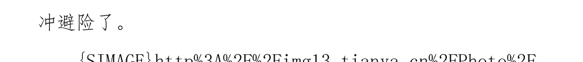

作者:66端午88 日期:2011-04-29 01:05

这个过程房价不会跌，房租也不会跌，只是受益人会通过种种形式转换掉。就像挤对民营资本一样。楼主的分析是中肯的，但是帖子中也明显有煽动的意思，妄想拉拢其他人走自己的思路。房产处理，股票上都露出这种痕迹。

任何经济体都是有利益循环链条的，偶相信在座的各位都不是最低层，所以，损失会尽量向后传递，当传递不下去的时候，就会由最顶层接住，否则这个社会就会崩溃，还是需要用逆向思维。这个社会崩溃不了，所以，链条会继续运转。偶是善意想象这个链条的，虽然我们认为上一个链条对我们的索取太多，无可奈何只能向下一个环节索取补偿，这不是阶级斗争，更不是对立，而是财富游戏。所谓偶煽动，偶从来没有煽动别人去做什么事，我只是把事实说出来，然后用我的理解，去揭开问题的表面，直接去看里面的最简单的核心问题。布局地产并非自2007年，真正的布局都是最早的投资，那些出于最简单的经济思维，高度也没有现在这样高度，因为那会房租是我最大的经营成本之一，与其交给别人，不如交给自己，这样起码最后我会得到一堆砖头瓦块。在我居住的这个城市，写字间的房租水平事实上到目前都没有回到 2000 年或者更早的收益水平。我们只是把剥夺我们高昂房租费用的体系内链条给踢跑了而已，我相信：他们可能哪天还能再回来。目前已经有了这个苗头，就是商业地产，越来越多的大型企业都采用自持方式来经营，而不是将其出售。

作者:66 端午 88 日期:2011-04-29 01:21

下面我列一个数字，我 97 年租的写字间房租是：2 块/平，2000 年租的写字间房租是 2.5 元/平，这些写字间根本就不入流，丙级都算不上。现在我出租的写字间。2 元/平（还是按照实得面积算），等级为甲级。我租的门面，97 年 15 块/平，这些出租主体都是体系内的三产单位或者政府部门。现在我出租的商铺价格：最贵的也就 7 块/平。我们用较低的利润率把他们赶走了，除非他们能接受更低的利润率，可惜，他们从来不靠市场化竞争，行政方式的垄断是他们回来的唯一手段。

作者:66 端午 88 日期:2011-04-29 13:14

楼主，你说得确实是你自身的感受。我直白的表达我的观点吧，现在有钱再去做房产是等着被洗牌。已经拥有房产的无非出租或者卖出，但是只要你的资产在国内，是没有保障的。你说寻找下一个链条，没有的话最上层来接，我觉得下一个链条有，但是行政手段会让你无法传递下去，这就是调控真正的目的。不是房价或者租金，而是掠夺资源。资产国外循环是唯一保值的方法，对于体制外的人来说，因为你不在中国经济循环体内，体制内都要到美国去循环，何况别人？

你所说的提高租金，停止交易，中断向财政输血是不太现实的。财政收入是一种权利，只要这个社会还有钱，就能收上来，无非效率高低的问题。要让这个社会真正变化，就是资本出逃，加速经济向计划倒退。这样改革才能有新的思路。现有的改革在基础上就是有缺陷的。

不过我更倾向于国内 100 年不动摇，维持在低劳动力，中低生活水准，创造的价值输入体制内或者体外循环。这对所有人都有好处，也是大家都能接受的。如果能保持在计划-改革-计划这样的循环中，社会也算稳定，世界也获得了好处，就是国人将永远无法真正发展。所以，有能力，有理想的人，与其国内想办法积极防御，不如为了后代出去开创真正的天地。加速人才，资本的逃离，才能将国内推向变化的边缘，只是结果很难预料。

----------------------------------------------------------------------

房地产可以说是国家对民营放开的为数不多，门槛不高，带有资源属性的行业，我们用逆向思维验证一下，如果没有房地产行业，老百姓的日子更辛苦，在货币飞速贬值的当下时局，没有房地产的庇护，百姓的财富将死无葬身之地。对于海外投资，我只把当做一种规避政策风险的对冲，绝非主流。如果中国人都跑到美国搞房地产，同样用逆向思维，美国人也不会答应的。媒体已经有这种反馈，美国已准备对中国移民进行限制了，更狠的是对中国政府持有的美债征收特别收益税。

我在本贴开篇已经阐述过这样的主线，逃避不是解决问题的办法，我们已经逃了5000年，这个国家有我们一份，打起120分的精神，也要把本应属于我们的拿回来。

作者:66 端午 88 日期:2011-04-30 00:08

本周,本人居住城市一手房位置较差地段(4-5类地域),房价有所松动,折扣由3%左右,提升至7-8%。新房有陷入调整态势,相反,位置较好地段,房价仍然坚挺,房价小幅走高。至于房价的是否整体陷入调整,目前还需要采集更多样本。正在等待鑫苑名家(3类地域),金光旺角(1类地域),中建文化城II期(2类地域)的5月份开盘价。以前此三处新盘,预期开盘价为:8200,13000,11000,应为正常的平衡价位。

同时提示:如证实房价陷于中期调整,股市将会首先崩塌,宜降低仓位同时对股指期货短空应对。

作者:66 端午 88 日期:2011-04-30 09:50

人民币一次升值到位，一次升多少，是按照美国人的说法一次升值 30-40%，还是中国自己的说法每年 5%，不知道升几年。或是两者中间打个折扣，谁也不清楚。如果每年都一次性升值 5%，外贸加工型企业没有多少行业可以忍受，就别说一次性升值更多了，中国对外依存度目前是 40%左右，如果一次性升值打击了 60%的加工业，将影响 GDP 起码 3-4个百分点，别说保 8 了，连 6 都无法保证。

作者:66 端午 88 日期:2011-04-30 11:09

2008 年的危机，你看到的是什么现象，大部分国企在囤货，你现在看到的是什么，大部分国企没有囤货，而在期货市场大量做空期货锁定风险。目前通胀主要是外部材料进口涨价推动的通胀，国内通胀已经传导至人工成本这类末期的涨价因素，这说明 08 年的危机教训已经被体系内牢牢记住。同时，体系外企业以高融资成本，高生产成本，很高的企业关闭来强行降低经济增速，通胀已经呈现强弩之末。国内的经济对策 2008 年是什么，现在又是什么？08 年是步步快速紧闭，现在是小步慢跑。就像我前面说的，历史绝不会简单的重复。这次通胀应类似于 2004 年的途中紧缩。

再来说房地产，2008 年是什么态势，分别在 06 年和 07年两次加速后，已经存在预期的阶段性调整，紧缩只是加速调整的周期和加量了调整力度。现在是什么态势，强行冷冻市场，即是我说的把存量放入保险箱的调整。周期将变长，调整幅度有限。

关于人民币和美元问题，你要找问题的主线，谁在掌握主动，当然是美国，你只能把人民币放在被动地位考虑。美元要挟的对象是中国经济，揪住的小辫子是中国的美元外储。最终的结果是中国外储消减美元外储，怎么消减？或减少出口增加进口，或者把美元变股权变资源。前者对中国不利，后者对世界不利。你以为中国拉高汇率就能解决这个问题吗？中国拉高汇率，世界贸易中的资源产品就会同步跟进涨价，结果会导致拖垮其它的原料进口国。因为大部分世界性资源都是针对中国定价的。

作者:66端午88 日期:2011-04-30 13:35

中国有自己的文化，中国学不了日本那样的脱亚入欧，更无法照搬欧美的发展道路，向左的道路并非是管理层的主观之举，对于不同的经济体，相同的产业和价值链条，可能会有不同的结果，这源于一个国家和民族的文化认同。目前中国经济最大的问题，有可能不是对目前链条的修补，而是存在重大变局的价值链核心的再造。

如果降低对外依存度，把重点转回国内，将产生两个路径：
1. 转回计划时代。
2. 价值核心再造和重构体系。

不论走哪种模式，最大的阻碍都将是中国的官吏制度。把未来推进改革的希望寄托于目前的官僚本位体系上，要么原地绕圈，要么回归计划时代，别无出路。把希望交给公民，那么现在的公民有能力和秩序处理好权力和利益分配的制度建立上吗？反正我没有信心。这就是中国的改革一直在绕圈的主要原因。如果国家主动培育公民的这种自信和能力，秩序将来自公民的自我需要。可惜，这个前提不具备，欧美是通过宗教实现公民秩序及向善的主流文化。我们目前的文化则充满革命，暴力，崩溃这种语言，并深入公民骨髓。

由此反推，中国无法走公民社会之路，只能徘徊于重点对内或者对外，对内则会向左，对外则会向右，一个有着中庸文化传统的国家，却始终无法做到平衡和稳定，这是多么大的讽刺。就像市井俗语所说的：标语口号都是喊些做不到的，就像今天的网络语言，哪个不是一个传奇浮云神马。所以，我们根本就不需谈什么政治，根本就没有什么公民基础，还谈什么政治，中国只有统治，没有政治。只谈经济，也别谈的太远，谈远了还是统治。关注与短期趋势变化，这是我们可以暂时拿到的东西，至于更长远是不是还要得而复失，谁也没这个能力控制。

作者:66 端午 88 日期:2011-04-30 20:18

对西方发达国家进行大规模土地开发纯属胡扯，我所说的投资西方国家房地产，是一个很小的市场，类似于国内的学区房地产，就只是针对留学市场这样芝麻大的市场，不会有财富效应。西方国家早就摒弃了以土地为基础发展的模式，他们的财富观是动态化的，人口出生率极低，人口密度不大而且稳定。我有两个朋友在2000年至2002年移民到国外，从事所谓的房地产开发，实际上是建筑商，那么高的人工成本，材料成本，房价又不高，所以根本就没有什么发展，留在国内，起码也能做到全国排名1000名以内了。他们不约而同的在2009年返回国内发展，但主业已经和房地产行业无关了，一个做创投，另一个在养猪。

> > 作者:66端午88 日期:2011-04-30 22:14
>
> 这个帖子在开篇就已经做了设定，不要谈政治，只谈经济，楼上就别说敏感话题了。再有人把经济问题政治化，偶不再做此类的解释。

> > 作者:66端午88 日期:2011-04-30 22:46
>
> 刚才又把思路捋了一遍，发现了这样的结果，美元在释放流动性吹大中国资产泡沫的同时，也在急速吹大自己的虚拟资产泡沫，人民币在升值到4-4.5之前，风险都属于美国，这叫神马？这叫我不动，敌乱动。因为美元在兑换成人民币的同时，美元的金融资产泡沫也在同步的被吹大。与此同时被吹大的还有世界基础资源，在世界最大两个经济体被吹大的同时，别的经济体可能会提前吹爆。可惜日本由于天谴避过了，欧盟，及其它经济体，正在承受更大的压力。在此压力下，避开泡沫的唯一做法就是拒绝参与世界经济一体化，把自己隔离出来。大部分大型经济体的外贸依存度都是很高的，这和最近20年世界经济一体化一统经济发展的江山有直接关系，只有参与世界经济一体化，才能在近20年来获得足够的发展速度。你们看看美国的经济比2005年好了吗？他们的虚拟资产标价是多少？道琼斯，标普500指数和最高的2007年相比，只差20%。纳斯达克指数已经和2007年持平。这已经是一个不可理解的估值。中国资产则在最高的半分位，我们的泡沫比美国的小很多。同时，我们的房价自2009年最高值基本持平，并未跟随M2同步上行35%。这说明我们的实物资产泡沫并未跟随货币泡沫升腾，风险已经被对冲掉很多。中国经济尽管问题很多，但对于美国泡沫，不值一提。先让美国泡沫飞一会，让小经济体泡沫爆掉一些。由此判断，5.1不会加息，不会加存准率。

> 作者:66 端午 88 日期:2011-05-01 00:59
>
> 000点是估值中枢的较高位置，类似于1994年的1000点，走势也会趋同于94年后的行情，涨跌均有限，下探极致不会低于2300附近，上涨高度不超过3500（个人观点，仅供参考）。这个观点早在去年年初就已经基本定格了，在去年的兴业证券投资入内部会议上，我就已经把这个观点表达的非常清晰了，同时表达的观点：小盘股今年没机会，掉下来仍然是投资重点，今年的投资重心是白银等小金属和商业地产现货。由于商业地产从去年9月启动以来，仅仅半年涨幅高达50%以上，基本已经把预期估值透支殆尽，白银的涨幅主要是由中国投资市场引导的，国内白银价格最高超伦敦银接近10%，虽然仍会上涨，但需首先进行调整，目前的机会只有黄金比较稳定。由此确定，投机市场阶段性高点正在形成中，调整后仍会上行，美国的大泡不破，后市仍会再创新高。

作者:66 端午 88 日期:2011-05-01 18:45

关键你如何能获得客户的信任，因为他们也知道，尽管你想用最好的绿色的原料提供绿色食品，但你是否能买到绿色原料哪？如果你做全产业链绿色食品，那你的成本将会非常高（不使用化肥，产出要减少30-40%，有时甚至根本就找不到非转基因的种子），如果不能迅速打开市场，成本就能把你熬干了。这是个社会问题，企业很难依靠自己的力量做全绿色产业链。

我家里用的面都是托人从内蒙农村搞到的，可是我还是不放心，不过也没更好的渠道了。

当然解决的办法也有，把你的原料产地，生产环境，加工过程全面的介绍给你的客户，如果你有足够的信心，通过逐步努力，你的客户也会对你有信心，把你的产品价值以商标固化下来，逐步积累信誉，但绝对是一个逐步积累的过程，因为你是小的创业者。

作者:66 端午 88 日期:2011-05-01 22:15

此前，关注的鑫苑名家，通过销售人员提前得知的价格均价 9200（此价格为高层楼盘价格，位置不靠近风景较佳的河岸，也不是小高层和多层的价格，此后推出比较有吸引力的楼盘将不低于此价格），比预测平衡价格高 1000 元/平，算上所有折扣和优惠，不低于 9000 元/均价，就是说，事实上调控的结果成了这样，以外郊盘，远郊盘的走低换取内线位置地产的上扬，事实上，有实用价值的房产依然保持 15% 左右的年均涨幅。目前得到的数据支持这个结果。

海尔绿城贵有贵的道理，因为是全运会遗存盘，当时规划的容积率奇低，综合容积率 1.7，已经接近联排的容积率。只要是什么“会的村”，没有一个不是价格先锋的，在全国都是这样。海蔚广场，当时我最关注的一个楼盘，延迟多次才开盘，价格由开始的 3700，整整提高了 1200，4900 最低开盘。一气之下放弃，它涨的并不多，该位置附近楼盘，只有它只涨了一倍。

楼上所说的问题，早就有了答案。为什么中国房地产在 1995-1996 年开始解禁，就是为了解决消费力不足，居民储蓄率高企的问题。

P 大事就慌了哦，拉登死了还有其它人哪？物极必反，你要相信朴素的中国哲学观，老美登峰造极 20 年了，还能怎样，麻烦等着它哪。

不是楼主淡定，而是房地产这种商品或者标的本身就是淡定的东西。我曾经看过一副漫画，上面是一个带着瓜皮帽的现代地主，坐在摇椅上，一手托着小茶壶，另外一只手摇着芭蕉扇，还嘚嗉着趿拉拖鞋的二郎腿，闭着眼睛听京戏，一副小人得志的嘴脸，这大概就是淡定吧。

楼主看好的 600531,现在依然看好么

小民一定要有自己的判断，但千万不要执着于自己的偏见。楼主在第二波均价 24 块拿到 600531（综合成本已经降至 15 块左右），目前持仓降至 3 成仓位，从中报看，531 的原料库存降低了 3%，业绩就提高了一倍，这说明了什么问题，大家应该有个准确的判断。531 隐藏了 4 块以上的银库存，依然有效，今年只盯着 531 和 ST 威达，持有或者不持有，资金都是指向此两股。

静下心来仔细想了想，拉登对美的威胁大，还是中国对美威胁大？一目了然，美元仍不会构成反转。不过有些炒的离谱的小投机品种，由于兑现难度大，很难再有大的作为，比如红木，玉器等，这些品种不要再动了。黄金，白银会有些调整，很难在短期构筑头部，仍有炒作机会。房产，继续持有，我甚至考虑在找到合适的位置后，增持度假型地产。顺便问下广西北海的朋友，北海的度假地产最近有没有下跌，我想买一套。

三亚地方不错，房地产泡太大，不适合投资，只适合投机。

投资移民目前已经对中产关闭了，比如加拿大投资移民门槛价是 140-150 万加元，折算成人民币，大约是 1000 万，而且是现金。现在能轻松拿出 1000 万流动性的人，已经算不上中产了。

如果有这个能力，办个移民身份，那怕两边跑也是合算的，每年在加拿大待半年即可。如果办技术移民，那得先觉得自己在国内没混头没前途了，而且想给后代有个好的环境，又能忍住在国外当个“民工”“身份”，也是可以移民的。

楼主看好白银股的逻辑是什么？金银本位貌似不可能重现吧。

金银的上涨，是对美元滥发的失望，是赌气式的上涨，旗号是金银归位，骨子是赚后知后觉傻子的钱。

黄白二物会坚持走到最后的，中国需求，你得理解这个，很多金店一上货就售罄，国内白银价格比伦敦银价格高 10%，很说明问题，所以黄金白银将伴随中国资产泡沫同行。股市有点搂不住了，随着地产进入调整，肯定会先下一城的。

我一个做服装和品牌餐厅的朋友，是个能造的主，在欧洲待了 1 年半读 MBA（2002 年），花了大概 300 万，回来说，还得老老实实赚钱，中国人还是穷。我另外一个朋友刚从美国旅游回来（2011 年），说一年 3 万美元，他够花了，1000 万看你怎么花了。任何人的收入和支出都是有一定逻辑的，赚 300 万，他就能造 300 万，只能赚 30 万，那么消费也就是这 30 万。

我想问问有关避税的问题。比如可以去做个公证，证明离婚的配偶可以已股份的形式来拥有对方的房产吗？只在法律上离婚，实际上不分割财产。已达到固定财产分散持有的目的，又可以保证配偶不利用机会分割财产假变真。

对于无法分割的房产，离婚时必须重新确权，以这种手段规避未来物业税的，第一是小心配偶另有想法，第二是用这种手段也规避不了多少，除非有大量家族移民在外，又不稀罕你那点房子。不过也很难说哦，中国的房子涨幅实在太凶猛了，没有谁不会动心白的的资产。

楼主，我现在手头上有两套 200 方左右的复式楼，是现在脱手能还是等以后再出手。看了广州市区的存量房买卖信息，交易主要集中在 100 方一下的，超过 200 方的很罕见，是不是说如果现在脱手会很困难呢？那么限购政策取消以后还会这么困难么？

大户型投资性能极佳，我的房子超过 200 平的一只满租，收益率接近 10%，特别是商住两用位置优良的，建议长期持有。以后这种房子，买入成本将非常恐怖，恭喜楼主，有眼光，不要租给个人，要找有实力的小企业，很稳定的。

和楼主一样，我也有几个商铺，但我对商业地产也是不太乐观，我希望国家可以通过政策来调节现货商业与网店的竞争，弥补充现货商业的成本劣势，但是，很可能国家不会管。毕竟减少了中间渠道费用使商品变得更便宜，拉大了内需。哎呀，烦恼^^

你遇到的问题，也是所有人都在面对的问题，大量小型零售企业正在面临虚拟销售的步步紧逼，同时被紧逼的还有地方就业和小型零售贡献的税收及地方政府将建设量转为商用的如意算盘。虚拟销售的问题是，虽然节约了成本，但对全产业链的贡献不足，会失去其它行业的帮助，国家在遭到一定损失后，肯定会对虚拟销售进行规范的，最终导致实体零售和虚拟零售的成本趋于平衡。好的地段可以忍耐，熬过低迷期，位置不佳的不要进行投资。

分散品种，分散持有人，多种持有方式，做到这些，持有 20-30 套是没有什么税收风险的。

看了看白银黄金的走势，果然就是 P 大的事，大家慌什么啊。

大部分先知先觉的投资者，白银的成本是 4 块左右，到目前基本都没动，这是我所了解的。

%白银现货银锭，我已经找到下家了，你还有吃进，呵呵，现在也就是敢玩玩纸的吧，现货没有优势了。

这是我的第一笔成本，以后有拿了些投资银条 1 公斤的。

## 多地楼市再现抢购潮 中央紧急出拳（主流媒体发布的消息）

5 月 3 日消息，中国指数研究院今日发布 “百城价格指数”，四月份全国 100 个城市的住宅平均价格环比上涨了 0.4%，北京、上海、深圳等十大城市住宅平均价格则环比上涨 0.13%，8 个城市的同比涨幅超过 4%。

根据中国房地产指数系统百城价格指数对 100 个城市的调查数据，4 月份，全国 100 个城市住宅平均价格为 8773 元/平方米，较上月环比上涨 0.4%。

其中，77 个城市的住宅平均价格环比上涨，1 个城市与上月持平，22 个城市环比下跌，涨跌幅在 1%以内的城市数量共有 84 个。

此外，北京等十大重点城市 4 月份住宅平均价格为 15802 元/平方米，环比上涨 0.13%。

具体来看，天津、北京住宅价格环比分别下降 0.35%和 0.14%，其他 8 个城市的价格则呈现环比上涨，涨幅皆在 1%以内，深圳涨幅最大，环比上涨 0.57%。

与去年价格同比来看，十大城市的住宅价格均呈现上涨态势。其中，成都等三个城市同比涨幅超过 8%，深圳同比涨幅最大，达到 8.75%；重庆、武汉两城市同比涨幅近 7%；北京、天津同比涨幅均超 4%，上海同比涨幅最低，只有 2.03%。

请教楼主：

看了前面你关于投资房产的话，这两天把县城里的一套老房子卖了（90 年代的房改房），准备到成都买套城南的二手房。我们看中了两套，一套是川大附近的房子，是 2000 年左右的房子，绿化少，户型较差，外观也旧，没有车库，售价 8800 左右，月租金 1500 左右。另外有一套在万达广场附近，售价 11500 元，租金 2500 左右，是 09 年的房子。测算了一下租售比，万达广场附近那套回报要高一点，但川大附近那套可能因旧城改造有拆迁升值的机会，我不知道该如何去选择，请帮忙给个建议。两套面积都不大，70 平米左右。

如果最近熬不住，非要买，选位置更好的，结合出租收益比来选择。

三年大哥，我一个在外贸口得朋友劝告我说：在国外的很多移民的中国人并不如大家以为的舒适，基本都有回来的念头，但是拘泥于实际问题止步了。。

去年，听你的话，买入现货白银。在此感谢！

还是希望大哥带领大家继续抵御通胀！

我对房产一直是情有独钟的，但是我理论底子太薄，一路走来，我感觉所有人都不看好房产的时候，往往是房地产顿地而起的前奏。

很多人都在天涯唱空房产，我想也许他们觉得太多人都是贷款买的！其实，我身边的很多高档房子从进驻那天就一直空置，是什么人的，也都心照不宣了。

我的房产都是一次性付款的，面积从 60-200 不等，我合计着，不景气的话，大不了我就长期持有房产，缺钱了就低于市价卖。因为目前的市价已经至少 2 倍于买入价了。

当然我还在找机会做实业。努力吧...

移民并非最好的出路，拿着绿卡在国内发展，相当于给自己加了一道保险。很多第一代移民都活的像民工，这是无奈的选择，他们大多希望给自己的后代做了垫脚石，这需要多大的牺牲，父母总是最伟大的，对自己的父母一定要尽孝道。

对于等待实业发展的机会，一定要时机比较合适时，再放手一搏，乱动不如不动，但要积极准备，继续需找机会。

房地产就是中国的经济核心，压住核心，谁还有机会，房价还没跌，股市先有点搂不住了。一旦演化成崩盘，对经济非常不利，因为管理层以直接融资替代间接融资的这盘大棋可就玩不下去了，信心比黄金更重要。

+ 我也是济南的，从 2008 年开始关注商业地产，直到去年才出手买进一套，现在还想再买一套，考察几个位置，拿不定主意，请老兄帮忙分析一下吧：
1. 在英雄上正在装修的山东珠宝古玩城三楼，大概单价 2.8 万元/平方这种比较专业的市场将来不知道发展潜力怎么样？
2. 西客站附近村庄改造的沿街商铺，无产权，改合同，8500 元/平方，143 平方，未来有潜力，价格不高，但产权是小产权。
3. 东部彩石大学城商业街，185 平方，75 万元，现在人少，未来可能有潜力，价格低，有产权。

想必老兄对这些地方应该也比较熟悉，能否指点一下？另外，我去年买的是明湖天地的沿街商铺，想 2.5 万元/平方出售，不是是否合适？

你说的这些商铺都高估了，都是在去年开始的一波凌厉走势带起来的。明湖天地在你说的商铺里面尚可保留，等着保利入住率高后，可以实现初步的价值提升，其它感觉价值不大。

可关注 3 线城市，核心位置的大型独立门店商铺，400 以上，以后可以做餐饮。潍坊，张店，泰安可关注，莱芜不看好，消费率太低，又非旅游城市。

临沂市由于地方政府把商贸作为支柱产业，可考虑物流类的地产。

济南商铺目前已经绝对高估，最高至 15 万-17 万/建筑平米（泰府广场），一类地域均价至 8 万左右/平米（实得），看得上眼的已经没有 4 万以下的，今年如机会应该将不好不坏的那种逢高兑现。

所以，今年很难有合适的商业地产，观望一段时间，希望国家的政策能消减涨幅，最好能跌一下，一路上扬的走势对投资是非常不利的。

感觉返租不靠谱，一般敢承诺返租的都不卖给你产权，比如缤纷五洲的一楼，卖给你产权的开发商，他自己都不要了，还怎么会自己经营。所以，对这种返租的，一定要先确认他自己也留了一部分，比如银座数码。

另外，英雄山珠宝城承诺购买以后签订 10 年返租协议，租金按照购买总价的 8%返还，你感觉是否可靠？如果真的能保证这个收益，应该是可以的，就怕他们中途变卦不管了

这个感觉比较危险，你看看新世界的房租才多少，人家是 1 万-1.5 万的销售价格。你还真别指望卖古玩的能回去，原来那些租客都搬到北园药王楼去了。

你先算算它能赚出来吗？像样的隔断起码 40-50 平，折算成建筑面积 70 以上，2.8 万，合计 200 万，8%收益率，1.3 万/月，感觉做古玩的赚不出来，而且你看看英雄山文化市场的租金，也就这价格的 4 分之一，一比较，惨了。

划拨的土地无法进行产权转让。

你看看学校里的房产，那就是划拨的，所以不能往外卖，只能职工之间转让。

金子跌了，银子跌了，石油跌了，国内人民币跌了，国际美元跌了，连大头菜都跌了，中国滴房子，没跌，什么叫超主权货币，什么叫超权力权威，房产（非行业）正在竖起一面旗帜。臭屁一下。 :)

中国房地产总规模 100 万亿人民币，可供出售的大约 25 万亿人民币，这是国内最大规模的商品市场，没有任何一个行业可以望其项背，房地产崩溃意味着中国崩溃，由此我根本就不担心什么房产会崩溃这种预言，因为崩溃的不仅仅是金融和其它商品市场，它还意味国体的坍塌。让房产崩溃首先需要金融崩溃，然后放弃市场经济的所有要素，最后改变国家体制，这样房地产就会崩溃，在房地产崩溃前，我想有没有房产的人都已经对崩溃无所谓了，家没了还不崩溃，呵呵。为了自己的房子可以焚烧自己，这种精神叫什么？藐视一切的大无畏精神，一点都不比革命烈士举着炸药包和敌人同归于尽的气概差一丝一毫。如果三个五个也就算了，可惜这样准备做烈士的人起码也得有个几千万上亿吧，谁低估房地产，低估中国人的家，低估大部分人民的意志，必将被历史的车轮所碾压，所唾弃。

我想问楼主三年兄：

+ 1、在如今投资营商环境越来越恶化的当下，民企越来越难存活，而国企和现在的那些既得利益阶层也不会把自己已经得好的好处和利益轻易让出来，三年兄一直在强调中国不会乱，中国的经济是可控的，因为我们一直脱离不了计划经济的影子，可是，这些举步维艰的民企承载着全国 85% 的就业率，他们都干不下去了，那等于大部分人要失业啊。政府要怎么样应对这个情况呢？

管理层左转绝不是没有缘由的，民营领域存在诸多自身问题，内控机制不足，行业自律基本没有形成机制，放开的领域一放就乱，自身发展也比较畸形，在这种环境下想获得较高利润就得进行权钱交易，资方劳方的利益分配比例也非常不合理，造成现在这种环境的原因是体系内外合力所制，目前进行的去过剩产能进程，虽然对于我们这些正在经历痛苦的人来说难以接受，但仔细想想又有必须承受的道理，我们反对的是民营体系单独承受去产能，而体系内则依靠政策继续保持这种畸形，我们对抗的也是体系内拒绝去产能化的结果。去产能化不是目的，捋顺整个经济体系的结构，提高经济参与主体的盈利能力，才是去产能化后的目标，如果经过民营体系经历去产能过程，体系内依然如故，就会造成换汤不换药，民营的去产能过程为体系内拒绝调整垫背，调整过后，问题依然存在，在这种模式下，民营的产能会反复膨胀而后再屠宰，这绝对就是折腾，05 年调整，08 年调整就是这个结果，希望 11 年的调整不会重蹈覆辙。

2、我同意三年兄分析房价今年不会大起大落的说法。说实在的，现在的房价跌个 10-30%都对真要买房自住老百姓没意义，房价实在是涨得过高了。三年兄的分析中提到现在有 80% 的国民是有产权的，但是，如果房价持续维持现在这个价格，那么，今后那些年轻人要怎么买房啊？我们现在的年轻人买房父母可以支持一下，等到我们这一代的孩子长大了要买房我们能支持他们吗？恐怕到那时我们才刚还完房贷呢。中国现在的普通老百姓就面临这样的残酷现实，中国老百姓真是最好欺负的，只要不把我们榨干，大家都只能默默忍受，想到这个真是让人绝望。真不知道我们普通老百姓的希望在那里？

正因为房地产行业对我国经济的决定性影响因素，国家无法去彻底打击它，这就像水手和船的关系，你把船凿沉了，还怎么航行哪？把自己放在管理层的角度上考虑，也会得出相同的结论，不过由于房地产行业对国民经济影响实在太大，限制它进一步蚕食其它行业的发展空间，也是同时进行的，打击的目标是住宅地产，因为这部分泡沫是广泛的，而且影响到了民生，影响到了一部分人对政府信誉和公信力的怀疑。所以，最直接的方式就是，减少一部分住宅的生产，转而以廉租公租房去替代它，解决最低阶层的恐慌。低收入阶层应该积极履行自己的公民义务，盯牢这部分自己应得的权益，防止腐败份子侵蚀自己的利益，这是高价买房者及富裕阶层和中央政府共同给你们的礼物，小心权益阶层利用你们的名义转入自己的腰包。从更长远的目标，还是得提高个人能力，实现个人价值，摆脱这种公正名义下的利益再分配，主动获得财富，然后固化为稳定收益的资产。

> 作者:66 端午 88 日期:2011-05-05 10:15

少说一句，以上房子都是 2006 年到 2008 年前买的，都很便宜，没想到房子涨的太快了，当初是考虑出租的才买房子，不是抄房子。

房地产投资应对的是通胀形势下的积极防御手段，最佳的进攻手段只能选择实业部门的机会，所以我不鼓励一次性大幅增持房产，鼓励将实业利润的一部分缓慢固化为地产，你买的房子，不要按照目前价格去计算收益，应该按照你的购置价格计算收益。资产量可以用目前合理的价格计算。这会让你更清晰明了的把握投资和投机。

> 作者:66 端午 88 日期:2011-05-05 10:34

+   3、现在政府也在计划国民收入倍增之类的事情。提高最低工资水平，唉，农民工工地工资确实提高了，但是企业成本也增加了，本来就不好的投资营商环境更加恶化。而且，虽然最低工资标准提高，但是，那只是针对农民工，在企业上班的白领，哪个的工资不是高于最低工资的，但是，就算最低工资提高，并不代表所有人的工资都会相应提高，白领们的工资还是老样子。我不是反对提高最低工资水平，其实是现在企业利润实在太低，不是他不想给员工张工资，他是没有多余的钱给员工涨工资，但是政府强行提高最低工资水平，迫使企业成本上升，利润空间缩的更小，所以珠三角很多企业都做不下去了，失业的人会越来越多。我们在沿海一线城市工作的人，这点体会太深了。投资营商环境从2005年就开始逐渐恶化，到现在政府也没拿出什么好的政策来拯救中小企业，倒是逼迫中小企业走向崩溃边缘。真不知道民营企业以后的希望在哪里？

收入倍增计划，必须建立在稳定国内货币购买力前提之下，否则就是朝三暮四的数字欺骗。关于这个问题，也是我在本贴中强调的重点之一，就就是货币必须回复其本质，即稳定的价值衡量工具本质，以货币作为刺激经济的手段，是金融资本超权力威信的结局，是西方资本主义国家打着全球一体化幌子下，利用金融工具压榨贫穷国家和人民的重要手段，人家是资本输出国，我们则是资本承接国，一定要看清楚，美国金融资本无法在其祖国实现的金融目标，已经在中国实现了。

中小企业对于任何一个国家都是发展的基础，而非金字塔尖上的大型企业，我想国家应该提高中小企业的扶持力度，“重在落实”，而不是让那些贪官污吏把这些弱势企业用于满足贪婪欲望的奴隶。政府应该重新定位自己的身份，如果想去好好管，你就抱着服务的态度，不能像大爷一样站在上面，说些空话大话，从来都不见什么实质性的扶持。

作者:66 端午 88 日期:2011-05-05 10:47

中小企业的未来希望，在于政府能够以科学的态度为中小企业设计并预留发展空间（绝对要禁止一哄而上，一哄而散这种政府为主导的什么上规模做大行业之类的政策指引），中小企业扎扎实实的把业务重点放在实业上，双方合力让各类中小企业找到自己的细分市场，并利用市场化手段鼓励合理的规范的竞争。我希望最终结果：中小企业有自己合理的利润空间和发展预期，有自己核心竞争力，市场建立在细分市场之上，最终达“小而强”的结果。

作者:66 端午 88 日期:2011-05-05 10:59

+   4、我也同意楼主关于房租上涨的预测，确实，房租在去年，今年都上涨了 20-30%，这个跟房价调控和通货膨胀脱不了干系。我不清楚商业地产的情况，我看三年兄说济南的公务员计划要涨薪 15%，在体制内的人真是幸福，可以绝大部分在民企工作的人是不可能享受的这个福利的，上面说过了，不是老板不愿意加薪，是现在企业实在是赚钱难啊。现在住宅地产的房租普遍大涨，真正要租房住的，都是这些工资不涨在体制外工作的人，因为这部分人都是普通老百姓，没有能力买房也没有什么特权去住集资房。生活相关的物价无一不在上涨，就是工资不涨，长此以往，你认为中国普通老百姓真的能承受这样的生活吗？

5、上面几个问题其实是要问总理和总书记的，我也就想跟三年兄探讨一下。最后是我自己想向三年兄请教的事情：我只是一个深圳的小白领，月薪不高，我现在租住的小区房租大涨，我有钱可以支付买房的首付，我该不该现在买房？是现在买还是过1年或2年后再买比较好？

------------------------------------------------------------

我不鼓励创业阶段的年轻人过早把自己禁锢在收益率较低的房地产之上，我开始投资房产是在实业稳定收益前提下，在创业初始阶段，你的资本就是你自己，强化自己的能力，做自己的事业，房产的所有者也是动态发展的，今日的创业资本可能是10万，未来它将会发展到1000万或者更多，过早把创业资本转为稳定收益资本，是最大的错误。资本量小时，它的发展能量和增值速度是最快的，远非房地产投资可比拟，时间和效率是资本的最大敌人和朋友，仔细分析一下时间和效率的问题，你自然会有答案的。

作者:66 端午 88 日期:2011-05-05 11:33

而是全民绑架房地产了。

------------------------------------------------------------

这句话很贴切。

作者:66 端午 88 日期:2011-05-05 11:35

我一直认为：货币职能向房地产（非行业）迁移，原因就是货币丧失了其价值本质。

作者:66 端午 88 日期:2011-05-05 11:42

公租房和廉租房的超量建造从其本质上，同样可视作政府在滥发货币，意图稀释房产的“货币职能”，引导货币向“纸化”回归，所以才会构成明前的对峙和博弈加剧的局面。

作者:66 端午 88 日期:2011-05-05 12:06

请问楼主，青岛的房产现在敢买吗？有 10 多万的公积金想用上，再投上部分现金，但不清楚该买什么地段？什么类型的？纯投资用。请指教。谢谢！

暂时观望，楼主也在观望，看看管理层是否有诚意回收流动性。

作者:66 端午 88 日期:2011-05-05 12:08

不知楼主感觉济南哪里的商铺还有投资价值？

核心位置，以泉城路为中轴，以泉城广场为中心点，向东不向西，向南不向北。

作者:66 端午 88 日期:2011-05-05 15:53

1Z 您只对山东房产熟悉吗,熟悉湖南长沙的吗？

偶前年推荐大家提前抢占沈阳，长沙房产，去年建议大家关注一下长春。不知洼地填平了没有，那会还是有相当安全性的，目前估计都填平了。现在比较关注北海的度假地产。

济南的房子现在机会难寻，看中的均已超过最基本的估值高位，很难下决心，需要观望一下，如果央行回收流动性不积极，估计房价调整很难超过一年。

作者:66 端午 88 日期:2011-05-05 16:07

不妨等下金光旺角，另外千佛山路和文东路交叉口有一个盘，批文已下。

山大路浪潮地块，产品质量检验所地块，轻骑地块，二中地块（泉城广场正南），泉城路西南整片（至解放阁）地块都已经土地转让完毕，不要着急拿了不合适的盘子。

作者:66 端午 88 日期:2011-05-05 16:09

另外千佛山路和文西路交叉口（原水产市场）有一个盘。

作者:66 端午 88 日期:2011-05-05 16:11

城基中心的你等二手都行，他们公司管理能力实在太差，没有开发过商业地产，估计起码要4-5年的保赔时间。

作者:66 端午 88 日期:2011-05-05 17:49

长沙填平了就不要追高了，我在很多论坛都提及这样的思路，四川，河南，江西，湖南，吉林都是人口流出大省，房产的绝对价值都随着人口的流失而不断降低的。人口涌向哪里，那里的房产价值就会提升，涌入人口的素质决定价值提升的多少，该地区提供涌入人口素质提高的平台越稳健，房产的价值基础就越扎实。房产归根到底是承载财富的基础，房价不是乱炒的，乱炒的结果就是暴跌，比如海南的房产，浙江某些3，4线城市的地产，其估值基础就相当薄弱。

作者：66端午88 日期：2011-05-05 20:36

房价的涨跌和很多因素有关，在我国最直接的因素首先是货币贬值因素，其次是人口迁移的不均衡（在世界各国通用）有关，第三和我国一直没有形成完善成熟稳健的多层次投资渠道有关，第四和土地财政有关，第五和依靠房地产拉动经济增长有关，第六和我国历史形成的人文经济有关，第七和城乡二元化结构有关，第八和城市化有关，第九和腐败有关，第十土地制度有关。

以上这些主要因素（还有一些其它小因素），会在房价不同阶段起着不同的主要作用，但同时都会产生作用，你用一种政策抑制它，它就会腾挪成另外一种组合来对冲掉你的调控。到目前为止，尚无一种可以把所有因素都抑制掉且不导致经济和社会其它层面恶化的对策出现。

作者：66端午88 日期：2011-05-05 20:56

白银由于这波涨幅实在太大，早就好好调整一下了，在人民币升值到4-4.5前，希望美元升值的可能是微乎其微的，美国会利用它的军事力量在石油产地附近制造大量的战争和冲突，以此警告世界，只有美国可以保护能源供应，只有将石油绑在美元身上，美国才会保卫石油供应。我们在得出这个关键逻辑后，就可以一步一步的推演美元的走势，它将在波动中贬值，直至人民币升值到1：4---4.5.美元的贬值必定会导致各个经济体充满流动性的泡沫，因为美国是国际货币的印刷厂，它有印刷的权利，同时也是最大的对外投资国，各国只要想通过入全球一体化促进自身发展，就无法回避美元的投资，就无法回避美元，无法回避美元的泡沫，在这种条件下，金银一定会作为抑制美元泡沫的价值衡量捍卫者身份活跃于国际市场。任何一次大的波动都是值得买入的机会，直到人民币升值到美国认为合适的汇率。

如果我们按照预期的人民币升值速度，每年升值5-10%（中值为7.5%），（6.5-4.5）/6.5=30%，合计需要大约3-4年时间内，黄金和白银毫无系统性风险，每次下跌都可以增持。索罗斯和巴菲特对黄金和白银的抛售，是为了维护美国的利益，因为黄金白银揭露了美元贬值的真相，只有造成黄金白银的波动，才能消除黄金白银的单边上涨预期，才能导致美元泡沫不被真正的价值衡量工具所映射，才能维持美元继续制造泡沫。

所以，我会在黄金下跌到1400以下时，继续增持投资金条，在白银跌到7000-7500之间继续增持工业银锭。

作者:66 端午 88 日期:2011-05-05 21:10

同时，如果中国政府期望打破人民币升值到1：4-4.5的美国预期，应该在我说的价位开始大量收购国内黄金，同时在国际市场做多金银现货，并采用短促出击的金融手段，迅速将索罗斯的卖空期权打散，来警告索罗斯这种投机商，美元刻意制造泡沫的做法是有对手盘的，就像当年在香港那样，让索罗斯通过做空金银损害中国权益的行动变为搬起石头砸自己的脚。

作者：66 端午 88 日期：2011-05-05 21:18

我们发现，这波金银调整，美元并未像以前那样大幅走高，这就充分说明了美元贬值图穷匕现，直指人民币，而非美元对黄金白银的比价效应。

作者：66 端午 88 日期：2011-05-05 21:54

楼主，今天看了一个铺子，感觉很有吸引力。在和平路燕山小区北区，是沿和平路的五层住宅一层改的，房产证 83 平，前面加盖 30 平左右，年租金 12-15 万元。卖 140 万元，我算算收益率还可以。唯一的风险是拆迁时加盖的部分没有补偿，但我估计 10 年内此地段不会拆迁。你帮忙分析一下怎么样？

————————————————————————————

恰恰最大的风险你没看到，房子是住宅性质还是商铺性质（如果是住宅，你惨了），如果是商铺，回迁是否会给置换同位置的商铺，人家卖掉是有原因的，这个收益人家卖了为什么，多问几个为什么，便宜没好货，好货不便宜，在全民绑架房地产时代，没有人是傻子。（该位置已经列入历下区今年的重点拆迁计划）

加 v 信 1101284955，获取更多好帖

作者:66 端午 88 日期:2011-05-05 21:58
楼主，老乡啊，握个手先，不知道楼主对北京的房地产市场怎么看啊？现在出手是否合适啊？五一在南三环和南四环看上了京投快线-阳光花园，今年刚交房，位于地铁 10 号线的旁边，紧挨着未来的地铁口，小区还带有新建的商场，环境不错，现在价格在两万七八，楼主能否给点意见？有北京的兄弟也给点建议啊!!

一线城市房地产，严禁介入，这话说了有快一年了，调控的主战场，进去就是当炮灰。事实上在 2007 年前，偶号召所有去北京发展的朋友，第一件事不是落实工作和事业，只要资金允许，先买套房子。

作者:66 端午 88 日期:2011-05-06 11:52
楼主，你好啊！
看说的好多店铺收益率很高，真羡慕啊，南京乡下的集镇，菜场的门面，二层，45+45 平方，50 万，小产权，还有 3 个月交付，估计月租金也就 800 吧，年只有 2%，还不如存银行呢！

那你还买，你咋不存在银行哪？

作者:66 端午 88 日期:2011-05-06 11:54
请问楼主对天津的楼市熟悉吗？

# 能谈谈吗？

天津我不熟，有国家的新区建设政策支持，又是帝都的后花园和生产转移基地，不会差到哪里去吧。

作者:66端午88 日期:2011-05-06 11:59

房产已失去上涨动力，成交量已经被完全压制。之所以没有跌，主要原因是房产税开征不利，地方政府还在和中央政府打太极。

房产作为社会资本最后的避风港已经岌岌可危。一旦地方政府为不足财政收入开始对持有房普遍征税，将持有成本压低至06-08年水准，混杂在“普通民众”中的“反政府”武装必将逃离，届时抛盘巨大，房价才会下跌。

楼主所持底线，无非是政府不敢将普通百姓和“反政府”武装一并打击。按现今形势来说，增持房地产并非明智之举。已经持有者暂时无碍。但是大趋势上，政府自己上场，以保障放和房地产税包圆房产财富，自行享用是必然的。民营资本和社会资本要么出逃，要么在东奔西走为政府寻找下一个发动机的过程中消耗殆尽

我前面说了，政府要自己玩房地产，还要P民和奸商出钱来玩，那当真是又想做婊子又想立牌坊，所以大伙觉醒了，暂时给丫断奶，谁在这个时候买房子买地，它一定是犯了战略性错误，犯了错误一定会遭受惩罚的。俺就等着政府费劲盖房子，等着把自己玩垮了，偶去扫扫满地的鸡毛。

作者:66 端午 88 日期:2011-05-06 12:32

翻翻以前写的几句话：经济是做出来的，不是写出来的，我为什么这么说哪？因为经济学是一门实践的学问，它不是预测的学问，先有经济活动，然后才会有总结，最后形成了理论，虽然有些活动是可循环的，通用的，但大部分经济现象是更新的，创造历史的，所以你会发现：经济活动和经济学理论，它们有这样的关系，情理之中的推演，意料以外的结局，创造更新是经济的精髓。我们都是经济活动的参与者，我们学习经济理论的原因是不要犯前人犯过的错误，所以意料之中的推演都将在未来的经济活动中被各种力量对冲掉，在各方利益的博弈中，只有不可预测的一股新势力会写下新的历史，出现一个崭新的结局，这个结局将会被写成新理论，在下次经济活动中作为雷区标志被避免发生或者力图得到更好的结果，这就是经济。

作者:66 端午 88 日期:2011-05-06 12:39

不知道楼主对重庆的市场是否有研究？偶持有一套重庆两江新区核心位置的房产,09年初投资一套,现在已翻番,该套房产边上有轻轨规划,今年年底开通? 是否要持有到年底,等轻轨开通再出手啊? 麻烦楼主帮忙分析下啊

---------------------------------------------

最近我也非常关注重庆问题，这是一个国家设立的新特区，它的设立不是以经济发展为主导的，设立主要目的是为了解决我国未来新制度结构改革试点和政治层面的价值观重建。由于重庆首先出台了物业税试点，所以要非常谨慎，视同于一类地区（虽然规模和价格水平仅属于 2-3 线之间的水平）。

作者:66 端午 88 日期:2011-05-06 12:49

哈哈，似是而非，经济的数学模型呢？不管你道路怎么曲折，终点还是在那里，不以任何人和事物的发展为转移，这才是经济学的意义和作用。

经济的数学模型是“人”做出来得。经济在运行中会受到很多因素的主宰，这些因素在不同阶段起到的作用是不同的，再符合客观的主观，也会和完全事实有差异，你把经济建立在主观的模型之上，那肯定是犯了主观主义错误。主观需要经常进行调整，来适应客观事实的发展，我说的不是马克思列宁主义，我说的是辩证法，这个对资本主义和社会主义都是适用的。

作者:66 端午 88 日期:2011-05-06 12:59

回来捞钱说明能捞到，准日本小鬼子来捞，准米国人来捞，就不准曾经的中国人来捞，再联想到中国军队的被俘人员政策，唉，传统啊，宁予洋人，不予家奴。

作者:66 端午 88 日期:2011-05-06 14:46

不要把长清大学城和师范东路比，当年的师范东路是大学生消费群带动的时尚消费，关键是带动和集中，长清居民的消费能力提不起来，能带动起来什么哪？

作者:66 端午 88 日期:2011-05-06 14:49

楼主，你好！

不是买的，是拿拆迁的小产权住房换的，50 万的住房出租月 600，而且还没人来租，那家拆迁不是好几套啊，换了门面好出租 800，相对稳定，准备长久出租。不存银行是怕长期来看货币贬值，工资上涨，县城商品房门面，价 1 万，很少小的，新建的都在 100，得 100 万，买不起。

-------------------------------------------------------------------

关于小城镇和农村房产，我在前面写过，你找找看。

作者:66 端午 88 日期:2011-05-06 14:50

不要为别人实现价值，要自己主动寻找发现价值。

作者:66 端午 88 日期:2011-05-06 15:17

我的想法是，既然是投资，就按照租金收入比算，如果长清或者章丘有合适的，应该也可以投资

-------------------------------------------------------------------

不要总想着进攻，有时乱动不如不动，实业是没有做空机制的（含房产投资），在经济走弱过程中，观望是最好的对策，租金收益比的内容还有一条，就是空置期，另外在中国还有一条要考虑，就是政策影响，政策影响很难预判，往往就是断崖式的下跌，或者踩到狗屎运的时候一次性拉高。昨日听到朋友说某学校要搬家了，搬到哪里，那里就是一次性大幅兑现价值的时候。

加 v 信 1101284955，获取更多好帖

作者:66 端午 88 日期:2011-05-06 15:22

楼主，当初经政府批准的土地不是转让性质的老的单位集资房以后会是什么出路？政府会不会无偿收回土地？再有，如果以后遇到拆迁没有土地证的老的单位房有什么风险？谢谢

-----------------------------------------------

要看单位的实力了，比如著名高校校区内的住宅，就是没证也拆不动，就是学校搬迁也不会拆宿舍。如果单位能力差，只能跟着倒霉了，还有一些有钱的单位，会主动把土地出让金补上，给职工造福利。这种房子，就是拼单位素质。

作者:66 端午 88 日期:2011-05-06 15:37

楼主的意思是，现在最好不要出击？也就是说现在时机不合适？等等也许会降价？我也有这种担心，现在好多人在等今年下半年，都感觉到年底可能地产价格会松动，你也是这么认为吗？

-----------------------------------------------

房价跌，则中国经济会迅速探底。所以，感觉房价不会下跌，在如此高估值市场上，不降就买，似乎又没有什么花头。所以只能观望，利用提高租金水平，加快回收投资，回收的速度越快，资产就越安全，同时，拿住现金等待机会，至于机会在哪里？要看国家是不是肯放出来点自留地给 P 民了，释放利益，实业机会大些，不释放，未来只能继续买房。

    作者:66 端午 88 日期:2011-05-06 17:01

    楼主，赛博数码广场地下一楼不知你是否了解？现有一个有产权的，18 平，46 万，问中介，月租金 2500，年 3 万，收益大概 6%，你认为怎么样？这个没有空置期

    作者:66 端午 88 日期:2011-05-06 17:05

    这个盘成本 1.2 万南厅--1.7 万北厅，2500 你得自己出租才能租到这个价格，统一管理就拿不到这么多，另外 46 万是净得价还是包过户。我一个朋友前年出掉了一套 63 平的，105 万，当时问我要不要，算算拿到手得 130 万左右（过户费和契税等），所以就没买。这个 18 平的卖了好长时间了，是南厅的，要是北厅的还能轮到你，早被别人抢了。

    作者:66 端午 88 日期:2011-05-06 21:01

    感觉应该比你说的那些要稍好，必定是成熟商铺，不过问题也不是没有，等着华强开业后，估计会有一定风险，因为济南的 IT 市场正在走下坡路，华强的供应量非常惊人，很可能会造成租金短期的压价。

    是的，北厅可买。

    作者:66端午88 日期:2011-05-06 21:13

    商铺转让费用比较高，你算过没有？全额征税20%，契税3%。拿到手46万还是相当可以的。要是自己再交10万税，就很贵了。

    作者:66端午88 日期:2011-05-06 22:28

    不看好位置偏远的商铺。51万，也不便宜了，公摊50%，我那个朋友说，北厅没有空置的，不过转让后，管理方可能要降低你的租金（一手和二手的租金回报是不同的）。

    作者:66端午88 日期:2011-05-06 22:44

    楼上先观望一段时间。
    今天晚上看真金白银不怕火炼，货币再鲜亮，一把火就没了。

    作者:66端午88 日期:2011-05-06 23:37

    我也笑，我问过税局的朋友，他说物业税先行试点城市必须具备财政上相当的自主权，除了广州，大部分一线城市都是财政上单独核算的，所以板子要打也会先打在这些一线城市PP上。让他们和税局的猫鼠游戏先飞一会，偶们在2，3线看看热闹先。

    作者:66端午88 日期:2011-05-06 23:40

    事实上也证明了这点，上海，重庆两个直辖市先行试点。效果如何，逗你玩了吧，没准还真能举起巴掌扇几下，当然先扇这种一线城市，深圳，厦门，青岛，大连都是计划单列，还有伟大的首都北京。

    作者:66 端午 88 日期:2011-05-07 13:50

    北方临海度假房产，使用周期短，性价比不佳。建议广西，海南的度假地产，由于海南房地产泡沫量巨大，非短期内可消除，关注广西中小沿海城市泡沫消散后的机会。

    作者:66 端午 88 日期:2011-05-07 14:29

    ## 房产税试点百日遇冷 三个月税款不及一套房

    2011 年 05 月 07 日 09:29

    来源: 华夏时报

    字号:T|T

    17 人参与 1 条评论打印转发

    房产税调控效果落空的担心，并非杞人忧天。

    从 1 月 28 日算起，曾经被比作利剑，可能对高房价“一剑封喉”的房产税试点已近百日，然而多方数据显示，目前看来试点效果并不理想。

    5 月 5 日，重庆市财政局有关人士接受《华夏时报》记者采访时表示，截至目前，重庆市已经入库的房产税试点征收税款有几十万。

    上海国税局人士则对本报记者表示，上海约有 20 笔应征房产税已经缴纳，具体多少税款，目前还没有一个具体的数据。

    对于房产税试点的进展情况，上海市税务部门发文表示“相关工作运行平稳”，上述重庆市财政局人士的说法则是“很正常”。

    国税总局内部人士则对本报记者表示，试点方案出台之前，财政部、住建部和国税总局曾确定在适当的时候组成调研组深入考察，但目前这一工作尚未启动，具体试点效果还需要进一步观察。

    不过，从近百日试点效果来看，不仅入库税款不多，而且被寄予厚望的调控房价效果也不明显，一季度无论是上海还是重庆，房价仍在上涨。

    ## 三个月税款不及一套房

    根据上海的官方统计，截至4月27日，上海市税务机关认定的应征税的住房2306套，从3月份上海首笔个人住房房产税缴纳算起，约20笔应征房产税已经缴纳。

    即使按照每套住房平均交纳5万计算，上海房产税试点三个月的入库税款只有百万元左右，全市范围三个月的税款甚至远远不到上海市的一套房款。

    根据官方公布的数据，上海应缴个人住房房产税很容易匡算：试点前三个月，20笔已缴税款对于2306套应税房源，等于说上海个人住宅房产税的缴纳比只有应缴房源的百分之一左右。

    重庆的情况同样惨淡，按照上述财政局官员的说法，只有几十万，之前媒体报道了更准确的数据，应该是前三个月合计79万。

    对此，该官员的说法是，由于按照房产税试点的实施细则，存量的独栋别墅保有环节的税款可以在当年的10月1日到31日交纳，已经入库的税款主要是完成交易的住宅。

    即使按照这位官员所说，在重庆的住宅交易中，需要交纳房产税的大概占到总交易量的百分之五到六。

    有数据显示，“五一”3天假期，重庆主城商品住宅的成交量是800多套，平均价格是8000多元/平方米，4月份因为有房交会，平均每天的成交量是400多套。

    虽然无法就此计算重庆应缴房产税的数量，但是仅仅以此估算，重庆地区完成交易的应缴房产税显然不止几十万。

    同时，房产税试点预期的房价下跌却不见踪影。国家统计局公布的数据显示，3月重庆新建商品住宅价格无论同比还是环比均在上涨。同样，上海市统计局的数据显示，一季度上海商品房销售面积同比下降23.5%，成交均价上涨12%。

    ### 限购之下无空间

    曾经被寄予厚望的房产税，为何尚在试点环节就这么惨淡，中央财经大学税务学院副院长刘桓表示，实际上在现在的政策环境下，房产税根本没有发挥作用的环境，房产税的效果实际上根本无从评价。

    由于同时实施限购令和信贷紧缩政策，打击炒房，在房产税征收范围内的交易量很少，所以房产税税款征收较少，这实际上不是房产税的效果。“根本不让你买，怎么缴税。”刘桓表示。

    事实上，即便在可以发挥作用的领域，试点中的房产税也很难发挥期望中的调节作用。

    沪置房产市场部经理付琦告诉记者，一些投资者虽然在购房时问到了房产税，但这并不是他们考虑的主要因素。

    “有一些投资者在买房时的确碰到了房产税的问题，但他们更关心的是利率和首付成数。因为利率的上调将增加他们每个月的贷款；相比下来，每年 0.4%-0.6%的税率是完全可以承受的，而且缴纳的期限也较宽。

    另外，一些投资客认为房价在明后年依然会上涨，那么从房价中获得的收益完全可以抵消掉目前的税率。”付琦告诉记者，所以很多投资客一旦确定要买房，都不太会在意房产税的问题了。

    ## 设计先天不足

    看似生不逢时的房产税，业内人士看来，在设计环节就已经注定实行惨淡。

    即使严格按照已经核定的 2306 套住房征收，上海房地产业界人士也指出，这个征税数量也不大。

    付琦告诉记者：“可能有人一听被征房产税的房子有二千多套比较多，但实际上它所占的比例还不到今年一季度整个房产交易的 5%。也就是说，目前购房的人群中只有不到 5%的人 群受到房产税的影响，这个量还不算大。”

    “房产税征收的对象是新增第二套住房，如果相关的信息显示不是第二套的（可以把名下的房产转到子女和亲戚名下），那么自然不用缴纳。”卫明不动产智库营销负责人蔡为民在接受记者采访时指出，上海房产税的征收数量不多和试点方案确定的征收对象有关。

    刘桓表示，由于政策相对宽松而且征管难题尚未解决，在行政限购等政策之下，现有的房产税税源并不多，实际上地方政府执行过程中积极性并不高。

    交易量 5%左右的税源，0.4%到0.6%的税率，即使核定需要缴税的纳税人也可以等到年底之前缴纳，这些都被认为过于宽松。房产税研究过程中，调控房价和培养地方税源被认为是两大重要功能，而百天之际，两地房价依然高企，不足百万的税款无论之于重庆还是上海都很难成为重要财源，与方案公布时重庆提出的每年征收1.5亿税款用于保障房建设的目标相差甚远。

    作者:66 端午 88  日期:2011-05-07 16:16

    我在等待北海的价格回落，目前选中的是这个城市，主要是给父母过冬用，偶老了也去那边过冬，北方的冬天虽然室内有暖气，室外并不适合活动，并且污染非常厉害，你看济南，60%的天都是灰蒙蒙的，非天气因素，皆因环境污染（济南是个三面围口的准盆地）。

    你看的银座数码怎样？海蔚广场，我并不十分看好，因为它往里缩的太厉害，银座也太强势，很难给你合理回报，淘宝街的定位正在受到虚拟销售的挤压，目前仅看好专业市场的小型商铺，其它没啥好看的。

    作者:66 端午 88 日期:2011-05-07 16:17

    如果选择投机，防城港将是首选。

    作者:66 端午 88 日期:2011-05-07 19:38

    商业地产是否安全，有长期向好的收益预期，不但要从位置上看，还要从其母体上寻找，比如 IT 电子行业，也不是所有的细分行业都在走弱，比如便携的轻薄平板电脑，手持信息设备，这种小的细分市场，更接近娱乐化的消费电子产品，在未来 5 年是看好的，你要寻找他们的市场通路。比如安防电子，也是相当有前途的。所以，我比较看好华强电子的商铺，并为此预留的相当大的流动性准备买入，不过很快得到消息，华强的商铺不对外销售，这个结果相当不好，如果华强的商铺不对外销售，它附属的写字间和公寓就不会卖的便宜，它会大大拉高公寓和写字间的价格，把利润补贴在自持商铺上，届时它持有的商铺成本将会降低到 0，结果也证实了我的预测，华强的公寓首批上市均价是 1.9 万，后续推出的房产，我估计均价会拉升到 2.2-2.6 之间。也就是说，你 10 年内看到的价值被华强的开发商一次性兑现了，至于以后还有没有价值，这不是轻易可判定的，比如央行再次大幅注入流动性等等，总之，现在看不到价值了。所以，我说，你买那些乱起八糟的商铺，还不如买华强旁边的银座数码，尽管这个价格也不便宜。但是你可以关注一下银座的写字间，目前价格在 1 万左右，问题也有，就是银座写字间的物业管理费相当贵，我问的是 6.5 元/平月，这在 2 年前是不可接受的成本，不知道现在如何了。

    作者:66 端午 88  日期:2011-05-07 19:48

    现在要不要买房子呀，
    论坛里很多人在说经济危机到了，真的吗？
    我怎么一点危机味道都没闻到呢。

    —————————————————

    现在买不买房子，不能一概而论，前提是寻找价值所在，
    有价值就有买的理由，没有价值，就算降价我也不会买入。
    我希望的结果是都降价，有价值的房子泥沙俱下，沙里淘金，
    寻找价值。

    更高层的战略思维是主动停止买入，给管理层断奶，逼迫其放弃愚蠢的行动，着力拉高持有房产的租金水平，投资：
    不仅是买入这一种行为，持有也是投资的重要组成部分。买入，卖出，持有都是投资的手段，核心是把不动产放入你的投资篮子，始终对它保持密切的关注。

    作者:66 端午 88  日期:2011-05-07 19:53

    加 v 信 1101284955，获取更多好帖

    另外，楼主说看好专业市场的小型商铺，能否举例说明？前期我说的珠宝城算不算专业市场？

    珠宝城的概念相当好，但位置不对。你叫它古玩城我接受，因为那片传统就是古玩和小商品零售（那片位置缺乏时尚元素）。这地方即使建了珠宝城，受众也很难接受它的地域限制。珠宝城，如果建立在泉城路，或者建立在诚基中心。那倒是相当好的选择。

    作者:66 端午 88  日期:2011-05-07 22:17

    总之，现在看不到价值了。所以，我说，你买那些乱七八糟的商铺，还不如买华强旁边的银座数码，尽管这个价格也不便宜。

    楼主，看了上述文字不是很明白，你认为该不该买？

    如果我没有配置相似的资产，我会考虑配置，如果我配置过，而且价格比现在的价格低一半，我则不会考虑配置。这是我对你的纠结，不是我自己的纠结。

    作者:66 端午 88  日期:2011-05-07 22:26

    上世纪 90 年代前，谁有可能拿到房子，体制内人士和官僚阶层，以前这些人能拿到住房，现在商品化了，人家还是能拿到，将来返回计划经济，还是这些人能拿到，原来拿不到的不论过去现在将来，拿不到就是拿不到。

    加 v 信 1101284955，获取更多好帖

    照楼主的意思，过去现在将来，体制内人士和官僚阶层
    是永远的骑在人民头上了？

    呵呵，可笑。

    这么说 房改根本没必要 怎么他们都能拿到 还改什么

    房改确实必要，否则当时根本看不到拉动内需的方向，
    房改是为了商品房作为刺激国内内需的一个配套措施，按照
    当时的住房条件，即使在体系内，获得一套房子来改善居住
    需求都是相当困难的，那会没权想搞到房子很难。事实上在
    房改施行了大约10年内这段时间，绝大部分城市人口不再
    特别纠结房子的问题，主要矛盾是新加入城市的新移民，他
    们面临的是这样的：在96年后，职工工资增长幅度加大时
    （这段时间城市居民的储蓄率大幅提高），他们没有收入，
    在2006年前，房价确实不高（济南的均价大约4000-5000
    之间）。当新移民获得高收入时，房价的上涨速度远远高于
    收入的增长。对于这部分群体来说，的确有点背。因为在1996
    年到2006年，职工的平均收入从平均大约600快/月，上升
    到大约2500块/月，增长了4-5倍。房价从1500（新房，二
    手房大约也就1200左右）上升到4500块，只上涨了三倍。

    我列出一些早期的房产价格（1996年-2003年），大家不要眼红哦。七里铺商品房1400元/平，开元山庄2000元，历东花园1900元，银座花园800--970元（内部价），三联阳光舜城（800-1100），益寿家园（2200），枫润山居（1900），燕柳园（2500），建新花园（2400），数码港（2900），绿景家苑（2400）。比这便宜的还有很多，记不住了。

    近日的国际大宗物资价格暴跌，事实上救了中国经济，在欧美释放流动性的同时，欧美的通胀尚未到不可控制程度，中国则承担了非常大的通胀压力，同时由于人口红利期结束，劳工工资刚性上扬，通胀是由外部成本拉抬和内部生产成本双向拉动，很难在短期大幅压缩通胀，如果强行进行调控，08年的硬着陆将很难避免。此时，如果一个方向的压力骤减，将非常利于国家控制通胀。如不出所料，下月CPI将开始下滑，可以肯定的说，如果大宗物资不在2季度末和3季度初兴风作浪，中国的通胀将进入平稳期，这对于管理层来说，是个非常好的消息。管理层可以在这样的环境下，就是重返08年的准环境，在波浪底部进行正确的调控，这个调控和08年-09年大量释放流动性完全不同，我把它叫做夯实经济厚度的调控，厚度的增加最简单的解释就是提高企业层面增值率，不是依靠产量，不是依靠紧缺，而是依靠技术含量和
    对整个产业链的控制能力，一个是技术层面，另一个是产业整合层面。这将大大提升体系内的企业竞争力，对于体系外企业，只能依靠技术创新。

    作者:66 端午 88 日期:2011-05-08 00:06

    经济绝不是简单的重复，已至的环境因素将被历史总结出的经验作为样本被完全对冲，只有新的一股力量来创造新的进程，一个钝刀割肉的过程正在演技，更类似 2004-2005 年。

    作者:66 端午 88 日期:2011-05-08 00:10

    经济绝不是简单的重复，已知的环境因素将被历史总结出的经验作为样本被人为的外部介入完全对冲，只有新的一股力量来创造新的进程，一个钝刀割肉的过程正在演绎，更类似 2004-2005 年。

    作者:66 端午 88 日期:2011-05-08 02:19

    楼主叔叔睡得可真晚，这么晚还在。今天下午看见这个贴就追到现在，如果大叔还在，就帮我这个老乡分析下吧 (*^__^*) 嘻嘻……

    +   和楼主是老乡，偶老爸是做配件生意的，现在：
    - 经十路儿童医院附近有 80 平米住宅一套，60 余万吧，贷款
    - 北园青年居易 45 平米小户型一套，贷款
    - 南部山区，九曲北口有 100 多平米住宅一套，对面济南
    大学，新开的中海国际就在俺后边，贷款还有旧商品房一间，已拆迁，等待回迁，位于经十路与经七路交叉三角地带附近，不知是要商铺合适还是要钱合适最近老爸看上了新开盘的长清大学城瀛园，150 平米的房子，均价 6000 多元。我个人是非常反对的，因为家里贷款太多，还要投资生意，我希望投资实物黄金和保险。不知道是否应该支持老爸的投资。谢谢

    --------------------------------------

    你家资产配置不是太合理，住宅偏多，而且类型也重复。长清的房子，6000 偶很难接受，前年偶的朋友说原价转给俺长春藤的房子 2650，偶都没要，不是因为价格，是租不出去。你要是非要投，也不要太大的，除非买个大的自己住。买的理由就是轻轨线马上要建了，所以不能太大，都被挤到那边去了，肯定是财力不凑手的选择，所以太大了转让起来就比较难。旧房拆迁，肯定是选择商铺。另外，你的房子都没法用于商住，不如重新整合一下，该卖的卖一些。换个商住两用，把资产类型平衡一下。

    作者:66 端午 88 日期:2011-05-08 16:13

    隐隐有种感觉，房价又快压不住了，我现在住的房子，楼上挂了好长时间也没卖出去（1.1 万/平），最近几天来了好多人看房，在偶家小花园前转来转去的。结合市场反馈的现象，基本开一个盘就是 8-9 成的首日销售率，貌似热度已经超越了最热的 2009 年 10 月。

    作者:66 端午 88 日期:2011-05-08 16:24

    白银，黄金这两天还在继续下挫，还是再等等，到目标价位跟楼主一样配置点金条 好了

    ---

    我的预期是黄金 1400 跌破，就等着看下杀动能是否枯竭，如果筑底后重复向上，果断跟进。白银是 7000-7500，白银是跟着黄金走的，判定底部应以黄金为主要因素。

    作者:66 端午 88 日期:2011-05-08 18:20

    商铺租金水平目前承压很大，不跌已经不错了，越来越多的空置商铺将妨碍租金的走高（供应量太大），所以，偶不建议以前配置过商铺的人增持商铺，配置过多的今年甚至应该减持商铺，帖子前面已经提醒过了。

    作者:66 端午 88 日期:2011-05-08 18:23

    济南的规划是，容积率 2.5 以下，楼层不足 7 层的多层，将是未来改造的重点，回迁率高的位置，应该继续持有，如果被规划为商业片区的，注意风险（补偿水平将很难达到同面积回迁的水平）。

    作者:66 端午 88 日期:2011-05-08 19:01

    两个问题请楼主回复

    +   1. 白银价格下调，为什么白银的手镯等还是以前的价格？不是同步的吗？时间差能有多少？

## 为什么您说如果被规划为商业片区的，注意风险（补偿水平将很难达到同面积回迁的水平）？请您详谈，谢谢

首饰作为原料的下一环节，尽管价格会跟随原料变动，但其附加值添加了加工费环节，有比原料更强的抗波动能力。如果短期内白银不能回到高位，首饰也会跟随下跌，这时，销售商家的盈利会缩减或者为负，这时商家就会减少进货，市场的需求就会超过供应（小型白银销售商家是没有保价的，这点和黄金产品是不同的，国内大部分直营的黄金连锁店，都是有保价的，风险已经在公司层面在期货市场做了对冲）。

商业片区被规划后，一般会导致区片房价大幅上升，在给你的补偿中，是不会计算这个提升幅度的。等你拿到钱，这个地方的房价用原来的补偿肯定是回不去了，所以，回迁是最好的选择。一旦不能回迁，损失是意料之中的。

作者:66 端午 88 日期:2011-05-08 19:10
楼上的话，哥整整听了 10 年，一种腔调。

作者:66 端午 88 日期:2011-05-08 19:39
那么手里的现金完全可以投资其它方面，收益率会更高。

来说说，有啥可以超过房产的。第一条：全额资本金收益率超过 10%，我说的是全额，不是 5%资金收益 100%。就这一条，基本把所有的创业项目全干掉了。因为要对抗通胀，10%是最起码的要求。如果能达到，肯定是具有资源属性的，资源属性的投资品，根本就不对我们开放了。对于成熟行业，投资早就过剩了，进去也是凶多吉少，你把风险控制算进去，成活率就更低。

如果把大量资本金投入房产，其它行业就更没机会，现在国内基本是所有行业把利润拿出来补贴房地产，即使有微弱的盈利，也会继续投向这个行业。

作者:66 端午 88 日期:2011-05-08 19:42
你会发现这个现实，本城市，只要规模稍微大点的企业，可以支撑企业进入房地产行业的，都在做房地产，规模小的不是不想进，是进不去。

作者:66 端午 88 日期:2011-05-08 19:52
列一下本地大企业介入房地产行业的名字：鲁能，济南钢铁，鲁信，中烟济南，浪潮，重汽，山东黄金，济南铁路局，山东高速，银座集团，渤海（被重组），三联（资金链断了），济南百货（天业），鲁银，出版集团，中石化济南炼厂，石油济柴，济南军区（靠，这个不算，虽然自己在建楼），有点规模的全部在做房地产，这还没算有建筑业务的，偷偷合作开发的（大部分财力许可的事业单位，国家机关都在盖，连街道办事处这种基层机关都在盖）。

作者:66 端午 88 日期:2011-05-08 23:13

牛市也不是一竿子拉到顶，本来就预判在突破83年高位时会有巨幅波动，下探底部就是上一波的行情的高位31-34之间（均值32），正在准备增仓现货白银。（对应国内投资银条标价为7000-7500之间）

作者:66端午88 日期:2011-05-09 12:18
纸白银无法保持淡定的心态，投资领域大部分波动是剪投机者的羊毛，实物虽然和虚拟有直接因果关系，形成的结果却完全不同，如果把房产虚拟化，我想房价的波动会加大，最终涨幅也会缩减，正因为房产是实物，持有现货的投资人基本都规避了波动。既然看好，就是持有等待价值到位。

我之所以敢于持有白银现货，开始的目的就不是卖给投机者，我的目标是自己定制银器，进行销售（最笨最稳健的兑现方式）。或者卖给白银的加工厂商，比如家具厂，银器首饰厂，服装小饰品纪念品加工厂（渠道中的囤积）。

作者:66端午88 日期:2011-05-09 14:02
楼主，在网上看到一个地方的商铺便宜，香桔市的，前几年因为住宅还是公寓的问题闹过一阵子，现在问题解决了，不过跟商铺没有关系。现在价格8200，两层，典型的社区商铺，应该是出于起步阶段，现在租金很低，但以后应该有潜力的，你评价评价？

价值低估，如果是商铺产权证，在社区位置较好位置，可拿下。连锁洗衣店，餐饮，多士店等均可。

作者:66 端午 88 日期:2011-05-09 14:05
社区商铺的好位置：人流量大的地方，不是车流量大的地方。小广场周边，人行道主干周边都是好位置。

作者:66 端午 88 日期:2011-05-09 16:13
中国的股市啥也不是，就是一堆筹码，是一个标准的投机市场。想捞点赌资，你就得揣摩政策底，政策顶和市场底，市场底的机会，在国家鼓励进入股市时，你就可以准备资金了，如果持续低迷，逆政策而行，机会就到了。国家喊停，你就得随时准备套现，通常这时还没到顶部。政策顶底的预判，新股发行速度越快，打压的意图越明显，新股停发，降低印花税，大力鼓励机构入市，都是政策看多信号，这时通常底部近在咫尺。在国家多次喊停后，市场交易量持续攀升，人人谈论股票，通常都是长期顶部的标志。股市的底部反转发触发，通常是由不可预料的突发事件所致，即使是假的，你也得信，因为中国的股票市场比赌市还不如，赚到钱，也别高兴，不固化在地产上（强行退出），早晚是竹篮打水一场空。

作者:66 端午 88 日期:2011-05-09 18:24
投资海南的房产，五指山脉以南才是热带气候（海南房产精华尽在三亚附近），五指山以北仍属亚热带，和北海区别不大。北京房价下跌空间有限，是中国的“权力中心”，只是北京炒作非常严重，并被政策严格限制，否则我会建议大家继续买入。海口的房子我看过，旧房子建筑质量不好。投资房产一定要把风险置于首位，如果有高额贷款，一定要有稳定的资金持续补入（或者是出租，或者是实业，或者是其它资金）。对于体系外人士，不要用明天的钱去投资，因为未来是不稳定的。你可以用手里的钱一部分买入房产，其它相当于银行贷给款做稳定收益的实业（如果能超过贷款利息）。

作者:66 端午 88 日期:2011-05-09 20:55
比亚迪过会成功，明日股市又成重灾区。呵呵，以直接融资替代间接融资，管理层的既定目标，可为啥中国的企业非要上市嘞？因为不用付利息，一个企业连利息都去省，感觉也没啥远大前途了，哦，且慢，因为上市后可以持续“贷款”，持续的不用付利息，这就 NB 了。所以，股民们，长远的来看，你们的收益是跑不过银行存款的。看看 94 年后的股市发生了什么，再次回到 520 点，现在吗？2300 在招手哪。不是太多，20-30%，有的品种可就要拦腰斩了。

作者:66 端午 88 日期:2011-05-09 21:56
东环国际广场有硬伤，周边无高档消费群，单边铺，进入不便，不扎堆不集中，发售时偶想了半天，决定放弃。关于返租，不要太当真。

作者:66 端午 88 日期:2011-05-09 23:56
呵呵，现在很多银行分红率都不错。

如果从长周期看，比如民生银行，买入一直持有，现在不到 10 年，8,9 倍收益另加一倍左右分红应该有 了。

我感觉，做股票不能太贪富，长线持有，并设定一个止盈点和买入点就好。

比如说，分红率低于 1 年期存款利息就跑，市净率高于多少也跑。跑了就不要再回头看了。

反之，低于一定的数值可以再买回来。这样，一年，甚至几年都不会操作几次。

大行情，人这一辈子能遇到几次？

你知道代价吗？那就是穷人会更穷，富人会更富。

如此高的利差，如此的贷款政策，金融体系就是二元体系最重要的推手。

你知道国内银行占据了国内企业总利润的百分比吗？

你知道金融系统的收入吗？

你知道国外的金融企业对国内金融市场的垂涎吗？

体系的纽带就是金融，不打掉中国的金融垄断和现行金融制度，P 民永无翻身之日。炒作房产就是打在金融体系的痛处，如果用房地产可能的崩溃换取金融体系的崩溃，很值，非常值。看问题一定要从战略高度出发，房产是打击体系内基础的先锋，也是最重要的主力。

作者:66 端午 88 日期:2011-05-10 00:07
金银价值重估打击的不仅仅是美元，同时也打击了人民币，期望央行增持黄金的想法的确犯了幼稚病，美元和人民币在互相撕扯并希望自己站在上面的同时，也牢牢的粘在一起。

作者:66 端午 88 日期:2011-05-10 08:59
这个问题很复杂，简单的分析：从事生产的人在城市不足2成，从事商贸和服务业的占6成左右。虚拟销售在带来效率的同时，造成了商贸特别是零售行业的快速去产能化，这是历史造成的，也是政策的短视造成的，各个城市都强调商贸化和商品流通功能（在1993年开始至2004年至大约11年），以解决城市的就业率。造成中国流通业的分散布局，规模小，效率低，导致商业零售门槛低，就业基数大。随着生产部门的效率提高，零售行业的效率并未提高，但由于小型零售企业占据了早期商业的最重要资源：商业地产，造成生产和销售的匹配不均衡。在2003年后，商业流通行业开始进行整合，最突出的特点就是规模化和进行市场细分（标志是连锁超市向全国蔓延）。同时商业地产在政策主导下（商业地产的成本比住宅高很多，土地贵，使用期限短，审批难），开始同类型的升级，由于商业要背负巨大的商业地产成本，所以发展速度缓慢。截止2007年，整合尚未结束，规模化和低效率零售在行业中并存，并开始争夺商业地产资源，导致商业地产（零售地产）火爆，更加提高了零售行业的成本。于此同时，网络销售在外资无法顺利中国零售市场的条件下，外资转身大规模挺进网络销售，外资的介入导致网络销售运营商不以盈利为目的，而是以打击实体销售为目的，事实上：自 2007 年后，绝大部分正在转型的商业零售和大部分小型零售企业就被迫进行去产能化了。很多网销企业都同时在做实体销售，同时更多的水货供货商和无任何资质的非零售行业从业人加入了这个市场，一方面在去产能，另一方面则是无度的增加产能。实业中的产能加入虽然门槛低，但还是有一定门槛限制的（高昂的商业地产租金，证照，税收，人员雇佣等等），虚拟销售的门槛则几乎降低为 0. 这并不是优胜劣汰的竞争，而是拼 0 成本的竞争，和中国的加工业是一样的结果，销售形势越好，贫穷的人会越多。

作者：66 端午 88  日期：2011-05-10 09:15
工业地产的价格非常低，有时算上开发费用，政府事实上是要倒贴的，政府用什么补贴工业地产哪？首先就是商业地产，其次是住宅地产，中国的工业化不是为了自己配置的，因为大部分工业产能加入了全球一体化的工业产能，而非对内的产能。

作者：66 端午 88  日期：2011-05-10 10:07
工业地产的价格非常低，有时算上开发费用，政府事实上是要倒贴的，政府用什么补贴工业地产哪？首先就是商业地产，其次是住宅地产，中国的工业化不是为了自己配置的，因为大部分工业产能加入了全球一体化的工业产能，而非对内的产能。

在住宅地产价格很低时，商业地产的成本就非常高，工业地产一直长期保持在低位，当住宅土地价格不高时，主要是商业地产来补偿工业地产的，由此造成商业成本一直高居不下，在成本难以下压时，低效率的零售通路只好化整为零各自为战（中国早期的零售商贸都是政策主导下的集中市场模式，看起来大，组成份子都很小，小且不强，政府主导下的创业模式，也是鼓励重商主义，低门槛造成进入零售行业的主体都是小型且素质较低），以此来降低管理成本，获去低效能下的简单盈利，由此导致中国零售通路的低效能长期存在。加工业的朋友们，在你们把量做大的同时，在你们低成本使用资源的同时，不要抱怨零售业的低效能，没有他们的低效，就无法补贴你们的高效能。

作者:66 端午 88 日期:2011-05-10 10:19
包括中国的证券市场，直至中国的行业资源配置，一直都无法摆脱政策的禁锢，一直都是后端链条补贴前端链条，有时这种补贴是非常直接的掠夺，比如证券市场中的 IPO 对一级市场的掠夺，一级市场对二级市场的掠夺，大资金对小资金的掠夺，比如垄断性资源行业对制造业的掠夺。还有让普通人搞不清怎样就产生的掠夺，比如工业地产对商业地产的掠夺，外贸行业对内销行业的掠夺，投资对消费的掠夺，在自由化市场前提下，这种掠夺是不会长久的，因为资金永远会涌向利润较高的部门，用不了多长时间，前后产业链的利润率就会由市场自由流动的资本所对冲掉，在我国这种二元化体系条件下，则严格限制资金的跨界流动，结果大家都看到了，最明显的现象就是世界经济史上的奇观:人民币对外升值，对内贬值。而对冲中国这种奇观的另一面则是美国的奇观:美元对外贬值，对内则升值(体现为美国CPI根本没有强烈的上升欲望，消费指数走平)。

作者:66 端午 88 日期:2011-05-10 10:21
如果照你所说现在的政策是在挤压过剩产能和低效能的零售业，通货膨胀是假象，紧缩才是真面目了?但你又认为商业地产有上升空间?这不是矛盾吗。

中国的紧缩是体系外的紧缩，中国的行政和政府消费比例一直在上升，由政府主导的大型投资项目也一直如火如荼进行中，从中国的经济数据上看，中国的经济在整体上，没有紧缩，紧缩被牢牢的限制在体系外。

商业地产的上升空间是由政府主导的项目计划，产生的库存则由体系外承担，同时给体系外制造了永远不可能消化的产能，我前面说过:商业地产在投资阶段，是政府的投资，在建成阶段则成了P民的消费。

作者:66端午88日期:2011-05-10 10:33
所以，今年我看到本人居住城市有政府主导的大量商业项目正在进行建设，为政府提供了大量的GDP数字，而在零售的微观领域，则呈现一片萧条之色。

作者:66端午88日期:2011-05-10 10:39
我看不到中国转型的前途，转型是由政府所推动，是体系内的事，没有政府资源的支持（资源：包括资金，政策，准入，技术及技术许可，成交指向都是政府和准政府组织-------垄断行业所把持)，转型对于体系外仅仅是空谈。

作者:66端午88日期:2011-05-10 11:08
美元升值尚未到位，就是我说的1:4-4.5，达到这个区间，将有大量的资金离开中国。

作者:66端午88日期:2011-05-10 11:11
我指的资金离开，不是简单的换成美元，而是将资产变为他国资产，利用货币比价套现价值，开始另一种生活，人的生活，而不是资产的生活。

作者:66端午88日期:2011-05-10 11:14
楼上，这种资源再配置，有明显的为了上市而上市，为了套现而上市，非市场化为主导，是权钱交换的结果，打着转型的名义进行财富掠夺，这和市场化主导的转型完全是南辕北辙。

## 作者:66 端午 88 日期:2011-05-10 11:19
美国的目的已经多次通过各种渠道摆给你看了，在6.8基础上升值40-50%。就是4-4.5这个区间。目标已经明朗，就看怎么走过去了。

## 作者:66 端午 88 日期:2011-05-10 11:24
美国人的意图是扭转逆差，只有你的货币升值到这个位置，它计算才能满足扭转逆差，当然还有间接实现的方式，就是你的成本提高1.4-1.5倍，你的资产价格提高50%(也许更高)，结果就是房价再涨50%，也包括股市，这样你的成本就会提高50%，顺便你还得放开你的资产准入限制，让我美国也赚到50%，这样逆差就被消除了。

## 作者:66 端午 88 日期:2011-05-10 11:38
美国不管你中国的外储形势，它只要求你人民币对美元升值，不管你人民币对其它货币是否升值，这里面是否存在套利机会哪？

## 作者:66 端午 88 日期:2011-05-10 13:49
工业地产的价格非常低，有时算上开发费用，政府事实上是要倒贴的，政府用什么补贴工业地产哪?首先就是商业地产，其次是住宅地产，中国的工业化不是为了自己配置的，因为大部分工业产能加入了全球一体化的工业产能，而非对内的产能。

在住宅地产价格很低时，商业地产的成本就非常高，工业地产一直长期保持在底位，当住宅土地价格不高时，主要是商业地产来补偿工业地产的，由此造成商业成本一直高居不下，在成本难以下压时，低效率的零售通路只好化整为零各自为战(中国早期的零售商贸都是政策主导下的集中市场模式，看起来大，组成份子都很小，小且不强，政府主导下的创业模式，也是鼓励重商主义，低门槛造成进入零售行业的主体都是小型且素质较低)，以此来降低管理成本，获去低效能下的简单盈利，由此导致中国零售通路的低效能长期存在。加工业的朋友们，在你们把量做大的同时，在你们低成本使用资源的同时，不要抱怨零售业的低效能，没有他们的低效，就无法补贴你们的高效能。

最近看到一贴，是说外贸规模以上经营企业在主观上是不愿回到内贸道路上的，作为商业手段，这无可厚非，做生意的原则就是不要和穷人打交道，原理也很简单:从富人兜里掏出一块钱，很容易。从穷人兜里掏一块钱，真的好比从肋条上拔下来一样。外销就是和富人做生意，内销就是和穷人做生意。虽然富人会按照它的原则克扣你的利润，但是不会让你血本无归。穷人虽然不会想克扣你，但是穷人的环境会把商业系统风险传导给你，这样的风险不是穷人可控的，它围绕穷人并存。

结合前面分析的, 我国目前现实存在的商业环境, 构成了企业由外销转向内销的高门槛, 高风险。

结合我国目前由政府主导的转型来看, 政府主导的转型, 期望企业做高毛利率, 高增值率的产品, 但是那些垄断企业或者国家政府机构才是富人, 他们不屑和穷人做生意, 有辙吗? 有, 那就是权钱交易。穷人行贿是为了活着, 仅此而已。

作者:66 端午88 日期:2011-05-10 21:36
文员未必没有空间, 园艺的创造性就更强, 看你能做到的高度了, 不但要用力, 还要用心, 园艺的顶级是和艺术结合, 在城市景观设计, 城市环境设计方面都有很好的拓展空间, 是很大的一门学问, 绿化费用通常占到房地产开发费用的5%-10%, 你能说没有空间吗? 一个城市的综合绿化工程, 经常以亿计算, 很棒的行业。

作者:66 端午88 日期:2011-05-11 09:14
有一种伪科技企业叫PC组装工业, 有一种伪工业叫出口加工行业

哥有个朋友在上世纪90年代, 利用早期PC品牌机和兼容机的价格落差, 在短短的5年内从北京一直插到深圳, 规模从每年数千台产量一直插到每年20多万台, 甚至还注册了品牌, 到了2003年终于撑不下去改行消费电子了。哥总结了他的成功和失败, 发现朋友的成功源于低成本, 他的失败同样也是由于低成本。早期的低成本造就了他可以依赖不成熟的市场认知，依靠低成本，依靠低利润把量做大，虽然单台毛利率微薄，总量累计还是相当可观的。随着市场培育逐步成熟，客户对兼容机的认可程度越来越低，你的低利率低成本构成的竞争力会被后来的加入者以同样的手段所效仿，客户被更多的产能所分流，低成本低利润走到尽头，这种竞争力是建立在市场普遍存在要素之上，并非自己创造的竞争力，市场变化后，你的成功要素不复存在，走向没落也在意料之中了。

中国目前的以劳动力成本低廉，加工难度低为重要特点的出口加工行业，依靠中国的人口红利，依靠国家在特定时期鼓励低效率出口的政策，依赖低廉的资源成本，依赖利率傍大款的出口导向型经济结构，在过去20年取得了不俗的出口业绩，在分析这些竞争力要素构成后，我们发现这些要素的支撑正在弱化和消失，以低毛利率，低成本，及依靠出口导向型经济等诸各要素构成的核心竞争力正在消亡，这不是从业者愿意不愿意的问题，而是客观存在的事实，走向没落将毫无悬念。

作者:66端午88 日期:2011-05-11 19:03
期货套保的前提是现货做多期货做空(对冲以进行风险管理),这样叫做套保,就是打压指数期货,也得先买现货。这条消息早就出了,没什么好担心的。更多QF也无所谓,

反正有个限度，以前是按照总额度算，最多就给分解到年度能多一些。国际版解禁不做合理的规定，人民币有条件自由兑换才算是比较有风险的放开。

作者:66 端午 88 日期:2011-05-11 22:20

不会的，随着人民币升值，资金流出的速度逐步加快，这是一个曲率逐步变缓的过程，会有一个拱形的顶部，因为中国的金融政策是为政治服务的，它不是完全市场化的，平缓就是它的诉求。当然，现在这种预判都是直线性的预判，肯定会有新的因素出现来干扰这个过程，美元撑到人民币升值到 1: 4-4.5 就是美国的好日子，撑不到就是人民币的好日子来了，这有个前提，中国得大大强化国防能力，否则就是美元撑不到底，美军也会出来帮着撑的。

作者:66 端午 88 日期:2011-05-12 09:11

@tyquduoduo 2011-05-12 02:29:25

楼主的文字涉及范围真广啊，学习了！

从那个出口贴跟到这里来的。觉得楼主在那里的跟帖很有意义的。那些谩骂的贬低的自己什么也学不到，都没有 open-minded。

我只是不同意楼主对商业地产的看好。因为目前已经在 一个比较高的价位上了。不过国内要是真实行什么收入倍增，估计还是短期内应该向上的。一切的成本都会在收入升高之 前涨上去，而不是降下来。

我感到比较灰心的是，看到 40 多岁一个运输户自己拥有货车跑.........

美国的网售和实体销售的主体是等位的，中国的网售和实体是异位的，中国的零售系统，就是从生产到销售的环节，承载了中国的行政成本，这和美国的生产销售之间高效衔接完全不同。

作者:66 端午 88 日期:2011-05-12 09:20

昨天那个贴里面看到了锅和刀具的争论，你看看中国的锅和刀具是神马玩意，瑞典也有花纹钢，硬度 50 以上，中国也有号称龙泉产的花纹钢，硬度才 35 不到。中国外贸的那些外贸刀具，价格真是很便宜，几块几十块一把，国外是神马东西，大马士革钢，进口粉末钢多少米一块，加工出来成本几百块，把刀柄刀鞘好好做一下成本连 1000 都难下，销售价格 2000 以上也有市场，这就是国内和国外工业的不同，国内有什么增值率，基础钢是一样的，加的合金比例不同。冷处理不同，出来的材料质量高下立判，中国需要高质量高增值的工业，核心竞争力要建立在自己创造的要素上。

作者:66 端午 88 日期:2011-05-12 09:38

行政成本是刚性存在的，它如果不降低，实体销售就会不堪重负，进行自我去产能，剩余产能就要背负更高的行政成本，这是个恶性循环，所以行政部门会主动去抑制虚拟销售，至少要去平衡虚拟和实体的成本。

### 作者:66 端午 88 日期:2011-05-12 09:58

我前面已经写过了，中国的实体是两部分组成的，体系内和体系外，当体系外经历缩减过程中时，体系内会逐步扩张，挤占体系外份额，这是一个经济上的左转过程，中国的左转首先是经济上的左转，它为政治体系上的左转提供了物资基础，这不是一个人为的左倾，而是通过经济现象逐步向政治传导。

比如说：如果洗衣粉私营公司由于限价，最终都破产了。国营会接过这个链条继续生产，当然他们也面临涨价的问题，一旦成了一个叫“中国”洗衣粉公司。那么涨价经过所谓听证后，一定是可以获得通过的。洗衣粉经过行政主导的机制实现涨价，这就是经济的左倾实现的过程。（仅是比如，它可以不是洗衣粉，但可以是其它产品）。

### 作者:66 端午 88 日期:2011-05-12 10:05

中国的经济总盘子是确定的，你不生产就会有其它人生产，当所有私人企业都不生产，只有国家来接盘，所以我说，现在低效的私营企业应该主动放弃生产，因为死磕没有意义，你把生产权放弃掉，把就业还给国家。国家能解决这么大的就业压力吗？肯定是解决不了的，它只能放弃一部分自己的权力，把生产权和一部分鼓励权益补偿给你，你就有了发展的机会。你总是这样苟延残喘，你的权力就会被进一步挤压，苟活不如不活。

如果你的实业利润很好，根本就是供不应求，那么就继续活着好了。所以，偶比较讨厌那些活的挺好的进来诉苦，纯粹装B（虽然比较难听），活的不好的企业，而且向前展望也看不到前景的，我建议果断消减，不要等到把积累熬尽，应保留实力，等待机会。

作者:66 端午 88 日期:2011-05-12 10:24

美国正在引导美元泡沫向证券流动，等着人民币升值后甩给中国投资。美元这个大泡不破前，进入美元资产都有很大的风险。

作者:66 端午 88 日期:2011-05-12 10:35

这几天美元走的很强，人民币则走的更强，有脑的人想想为什么会这样，美元走强，人民币并没有走弱。按照各位大师的说法，人民币走弱才对。事实上你们还是错了，因为没有看到问题的本质，美元上蹿下跳，就是为了干扰美元单边走弱的预期。美元的战略性走弱直指人民币，他要的是人民币升值，这是战略目的，同时又不想让美元对其它货币呈现弱势，这就像来来回回的颠大勺，轻的都颠出去（排除干扰因素），只留下两种货币进行对决。

作者:66 端午 88 日期:2011-05-12 10:40

理解不了了。

美元泡沫是说美元还有很大的贬值空间？人民币升值后，怎么甩给中国投资？道指还会重回金融危机的时候？

人民币升值后，会强烈压缩中国的出口导向经济，国内经济会左转，体系外资金在国内无出路，加之人民币升值后，人民币对美元值钱了，移民，投资就会向美国转移。这样就会从中国外储中兑换美元，中国只能被动减持美债。美债被消减，美元的泡沫自然消除了（美元的基础是美债）。

作者:66端午88日期:2011-05-12 12:15

买啥都行，两样不给你，领先技术企业的股权，战略物资企业的股权，这两样不能给你（前者限制你的发展高度，后者抬高你的成本，把你牢牢的按在一个小空间内）。关于中国外储的出路，前面写过了，第一融入西方世界金融体系，第二把美元当垫脚石，窒息美元。前者是妥协，后者是强硬的建立人民币货币圈。目前的走势符合第二种特征，表面则是第一种的手段。两国的博弈就是人民币升值到4.5以前，看谁能撑的住，撑不住的就得换个玩法。

作者:66端午88日期:2011-05-12 13:55

我在去年年初在别的坛子里统计过城区通行时速，当时就觉得汽车行业已经过热，油价一涨，矛盾就暴露出来了。

作者:66端午88日期:2011-05-12 17:49

@宝贝兰亭 2011-05-12 16:40:27

楼主好，对齐鲁鞋城怎么看？在泺口，卖产权，一楼3万，二楼 1.8 万，三楼 1.4 万

这商铺我有，2005 年买的，1.7 万。现在不要买了，价格太高，得房率 52%，收益率 9%，现在买收益率也就 4-5% 之间。

作者:66 端午 88 日期:2011-05-12 18:19

楼主，虽然觉得你的很多观点尤其是涉及到体制内的思考很有参考性，但仍然有几个因素影响我的判断。我说出来你帮我分析一下吧。

+ 一：中国经济左转。

仍然是之前我关于中国资本市场形成外资殖民地的倾向。如果中国经济左转，会导致产能下降，效率下降，获利率下降等一系列曾经发生在计划经济时期国企身上的情况重演。在如今外资越来越强大的中国市场里，除了战略资源以外的各个行业几乎都充斥着外资身影。单比企业效能和获利方面可以说国企是没有一点优势的。如果经济左转我仍然坚持自己的看法，就是会重回九十年代朱时期大面积国企员工下岗的困境。又由于现在可能发生的民营企业垮台由国资接手，不说经济崩溃不崩溃，从政府收入角度来讲将来仍然是入不敷出的结局。领导层应该不会一棍子打死民企。这对各个阶层都没有好处。

经济左转后，对外仍然是有限开放的，因为国企同样需要境外市场，国企面对的是国际竞争，并非只和私企争夺国内资源，为什么是有限的，甚至可能会降低自由度，因为欧美对国企的制度是不认可的，国企会以股份制的形式参与国际竞争，甚至可能允许外资掺股，比如南北电网，中核电等未上市的公司。私企未必会彻底退出市场，但是对经济份额和收益率水平会陡降，无法再对国家主流经济产生重要影响。关于就业，体系内会分层划分，原有体系内的是权利人持有人，打工的以劳动派遣方式长期存在，待遇会有所上升，但肯定无法和权利持有阶层比拟。

### 二：房地产。

房地产产能过剩是完全明朗化的事实。现在房价居高不下是政府推动，炒作资金，房产避险，房产防御通胀等方面综合的结果。但现在地产仍然是各地方政府敛财主要手段，除了北，上之外完全没有停止继续加大房产市场的倾向。用保障房指标拿地和贷款然后保障房商业房混搭方式成了现在地产主流。但可以发现一线城市销售比已经开始小幅下降趋势，相信用不了多久二三线城市就会饱和，毕竟购买力是有上限的。等到房产税大幅推广，你是否还对持有房产那么有信心？

过剩被局限在有能力将货币资产转为硬资产的这少部分人，谁有能力，我想我不必再强调了，权力阶层和资本阶层，资本阶层虽然是权力阶层想打击的对象，但它不能从法律上把权力阶层和资本阶层剥离，两者牢牢的绑在一起，坐在一起的人，屁股都粘在房地产上的人，你怎么区分，只要不是太离谱，就无法分开，所以资本阶层要提前谋划资产的平衡配置，混水摸鱼，或者你采用假离婚，或者采用家人分户持有，总之要化整为零。

### 三：人民币是否会贬值

我一直认为，在国家外汇储备在万亿大关以下之前，人民币是独立货币，它的价值如果不算国家的增发是和商品等价交换的。但近年激增的外汇储备以及国家进入世界经济体系所产生的后果就是有些人所说的人民币不能和商品价值相比较，而是必须依托于美元价值转换再计算与商品的价值。现在国家经济喉舌说外汇储备保持在8000亿左右比较合适合理。但我想不出如果外汇储备减少到8000亿而人民币不贬值的理由。我同样认为，只有在人民币大幅贬值的前提下，房产价格才可能有再升高50%的可能性。

这不可信，外资对华投资就不少于1万亿美元，你再穷也得有这个不离谱的抵押储备（只能投资于低风险品种），加上不少于1万亿的偿债储备和物资购买储备（主要是战略物资），中国的外储（由国家控制的）保持2万亿比较中庸，其它的没有什么实际用途，可以用来购买资源性股权，也可以藏汇于民（赔赚和国家无关了）。房产是中国百姓（含大部分权力阶层）的最重要资产，这个核心资产真的下跌30%以上，你就别指望经济能走好。你见过哪个国家房价大幅下滑，经济可以走好的？给个例子先。

作者:66端午88 日期:2011-05-12 18:25

楼主你好。

我是一个80末后生，前两天我买了一个二手房，面积90平。到手价73万。房子是1999的商品房。贷款了一半。请问这个行为是会导致资产缩水吗？

我先自我介绍下，我是个做进出口的外贸人。从业3年，大概存了100万左右。

我所在的城市是靠近上海的无锡，当地的房子均价是8000多。我购买的小区房子周围的新楼盘有 万科，均价12000-14000，首创 9500 高层，洋房12000，大概都是在10000 以上的楼盘。我感觉这个房价是被低估的房价。

因为作为无锡来说，这个地方时江苏经济第二强的城市，相邻的苏州房价远在无锡之上。南京的房价更是离谱。而且无锡作为一个传统的南北连接处。

请问我这样的置业，您有没有什么建议。您觉得合理吗？

同时我手头上还有 50 万左右的资金。我想寻找个大概投资在 20 万左右的房产。您觉得这样合适吗？这样会有很大分险吗？

我一直都感到很奇怪，无锡的房价怎么会这么便宜。

此房无风险，如果没有硬伤，相当合算。

你一年收益 30 万，即使会有小年，15 万没问题吧。贷款 30 多万，要是使用商贷也就 3000 多块的月按揭，现金流没问题。

作者:66 端午 88 日期:2011-05-12 18:27

不管怎么投资，都不能影响你的现金流量，记着这一条，就没有风险。

作者:66 端午 88 日期:2011-05-12 20:08

这不好说，从济南最近的商业物业供应量上看，商铺存量将在很长一段时期内供过于求，所以只能买体量特别大的综合体或者非常繁华的成熟商铺（抱团取暖），小区商铺如果不贵可以继续持有（价值低估），慢慢等待。位置一般的风险已经很大了（同质化严重）。

作者:66 端午 88 日期:2011-05-12 20:17

说实在的，那个缤纷五洲偶是看中了那个麦当劳的铺面（带10年租约，直接和麦当劳签），400平，1000万，当时这个报价很合算，当时我的实业还没消减，拿出这钱就得趴窝，另外就是它没有产权（37 年经营权，头三年 7%，后面 3 年每年涨 2 个点，和麦当劳签约），必须一把付，然后还会影响抵押的功能，思考再三，泪奔而弃。你得找这种铺面，不受经济影响，预期稳定，大体量，好产品，这才是好铺子。

作者:66 端午 88 日期:2011-05-12 20:22

你的意思是，齐鲁鞋城属于同质化严重的商业？另外，我问他们，说这是第一次卖产权，以前都是卖的使用权，是这样吗？产权要比使用权贵的。你说的 1.7 万是一楼吗？

我是转的使用权，一手是 1.1---1.5 万（1 层），鞋类技术含量低，门槛更低，淘宝和散售专卖店对它影响很大，你没看它 3 楼，4 楼现在要转产品吗。产权卖的也不算好，都买了快两年了。

作者:66 端午 88 日期:2011-05-12 20:35

楼主，你好，我拜读你的帖子有段时间，可能我本来和房地产接触比较多，但因出道比较晚，难听点，还嫩着呢，对房地产这行认知还是比较浅薄，对以后将来认识有时候自己都很难确定，容易人云亦云，不够坚定，只是知道未来空间还是有的，毕竟我们的领导都不是傻子，经济衰退，甚至崩盘之类的事，基本不可能发生的，党国成立也才 50 多年，我相信以后的路还很长呢，大道理我不会讲，经济学我没过，只会肤浅的，以后还要多多拜读这样的帖子，加强锻炼，谢谢你的指导。还有一事咨询，现在手里资金不多，20-30万吧，部分还老头的，还是想买房，现在看中市中心30万多的房子，单价在8000不到的小房，出租在1500左右，主要此房产权年限只有40年，现在有5年了，加上开发，剩下有30年左右，当然此房交易税费好像比较高，想问问楼主，这样的房子适合买吗？地段是绝对没问题的，将来轻轨也会在附近，贷款好，还是不贷款呢？PS：我本人在苏州，买过房了，顺便说下，相对无锡，苏州的房价也还好了，望楼主回复，

30万，1.8万收益，6%，可以买，最好是商用（小办事处之类的），商用公寓稍微有点风险，稳定性稍差（那种代租的酒店式公寓，出租率不好的）。

作者:66 端午 88 日期:2011-05-12 20:39

续。我看看现在的经营情况，发展倒是很快，许多商家都进来了，但后来问问一个朋友，他说，那都是超低房租吸引进来的，是为了造成一种繁荣的假象好把房子卖出去，一旦两三年后形势不好，就麻烦了，我就差一点就要交钱了，最后打消了这个念头。当时，我是想，这么多楼盘都有问题，以后不都是慢慢解决了产权关系了吗？但现在想想，有点赌的成分，如果他们真的办不下来，我们小民岂不是自认倒霉了？

这铺子开盘前偶去踩了，看了一圈放弃，原因已经说了。铺子有硬伤的，就是说的天花烂醉，也有报应的那天。买房子不要买有硬伤的。高架桥下的铺子如果不是灰常灰常的强势，一般不会好。

偶也上过当的，就是那个槐荫广场，那才叫一大骗子嘞。

作者:66端午88日期:2011-05-12 20:58

看来温总理还真是把脉准了开发商，所以要求他们流点道德的血液，可惜，开发商不会听的。前期与楼主交流，感觉济南没有适合投资的商铺了，近期又连续考察几处，确实是没有了。包括前面说的香桔市的商铺，虽然很便宜，但位置实在是太差了，担心起不来，现在不管多么低的价位，没人租。所以，也放弃了。由此反证，房地产的价格应该是是太高了。楼主近期考察有比较好的楼盘吗？

当然有好的，就是一看价就肝颤。

作者:66端午88日期:2011-05-12 21:00

说好是完全产权，然后交了VIP定金，然后一年没动静，最后无息退款，自持了。

作者:66端午88日期:2011-05-12 22:12

哥最喜欢的房子就是住宅性质，然后可以商用的，最好可以转为商用的，这样有70年产权，还能租出写字间6-8成的租金，这是目前最好的选择。

作者:66端午88 日期:2011-05-12 22:22

谢谢楼主的回复，还是相当有耐心的，我没有买过商用，具体不是很清楚，到现在位置接触的都是住宅类的产品，发现住宅的需求很大，可能毕竟有70年把，这个我抽空去看看，合适的话就买。

对了，看见楼主对无锡也知道些，苏州呢，了解吗？俗话说上有天堂，下有苏行，最几年苏州的发展也相当的快，比无锡还快，毕竟排在他的前面，当然无锡的发展也相当不错，想问问楼主对苏州这边的发展有什么看法或者有没看好，看好在哪里，等等。。谢谢。

苏南浙北是民营体系的中心，民营资金受制于资金效率被通胀稀释，一般会将盈利长期固化于固定资产（常态化），如果经济不好，实体资金会加倍溢出，固化也会跟着提速，所以苏南浙北房价一直都比比较高，且有较强的资金支撑。苏州起步有高度，新加坡工业园在国内很有名气，吸引了众多国外大型企业投资，而且很多企业都是一个产业链上的，一家大的过来就会带来一个链条的生产，苏浙人力素质在国内堪称一流，这些都是苏浙的潜力。今后随着内需逐步增长，感觉苏浙应该带个好头，做些基础和有价值的研发工作，最近无锡的物联网产业园也很风光，这虽然是个新瓶装老酒的行业，要是真能全面拉动起来，还真是个广阔的行业。

苏杭一带环境不错，如果有个古典园林小院住着，这辈子也就值了。

作者:66 端午 88 日期:2011-05-12 22:40

我曾经做过调查，凡是高架桥下的商业都不会好到哪里去。

强势营运商可以改变这个硬伤的，比如东亚家具，富雅家具，银座家具扎堆就把这规矩给改掉了，呵呵，什么都得实际分析的。八一立交桥，三个角不旺，咋就旺了银座哪？呵呵，因为它有行贿卡哦。

作者:66 端午 88 日期:2011-05-13 00:56

狂晕，济南第一批公租房拟以全部收购在建小产权房解决，资金从土地招拍挂价格中，按照一定比例搭配。政府的确是高啊，土地不用花钱了，耕地违法是村委会的事，收购资金全部由商品房出，这一左脚凌空弧线球，外弧线挂内角入网，擦，原来可以这么玩。

另获悉，凡单位自行解决在册困难职工公租房的，优先安排工业用地计划，可在工业用地上规划一定比例建设公租房，擦，这一右脚凌空弧线球，不但绕过了土地局的人墙，还欺骗了中央的守门员，这样也行啊。

地方政府把球又踢给吆喝房价贵的社会了，大家有啥想法？我是晕了。

作者:66 端午 88 日期:2011-05-13 01:04

呵呵以楼主的财力，来无锡或者苏州搞个别墅不是很轻松么？

别墅能和苏州风格的园林小院比吗？一个是粗俗农舍，一个是品位古典，一块是烤地瓜，一味是法式龙虾，这差的也太多了。这种小院，估计偶这辈子都买不起。

作者:66 端午 88 日期:2011-05-13 01:18

做个记号吧，争论很多，自己水平很次，无法判断，做记号先，看以后市场的证明

内贸比外贸难的多，做家具那个老板有点说风凉话了，我认识做内贸的从基础行业到科技领域，水平都很高，比偶高很多，偶通常都是抱着学习的态度谦虚领教，这些人可以聪明到眼睫毛能吹哨，即使这样，也得按照国内的规矩来，该行贿行贿，该三陪三陪，产品还都是自己研发的，今年都不甚好过。你想这样的营销简直就是老板出来自己出来拼体力，销售只是跟单而已，单子都是系统的，或者行业的，这就是中国目前的销售状态。进散售被渠道压死，进系统先把自己豁上，横竖都是一个死字。偶的大学老师，感觉身体已经很差了，找了很多高级销售都搞不定，还是得自己跑，惨吧。

造成内销低效的原因偶没发在那个贴里，写在上面了。

作者:66 端午 88 日期:2011-05-13 01:37

白银又一次在偶预测的 31-34 之间停止了下跌的脚步，预计会在该位置附近构筑一个波动平台，并伺机继续上涨，这个时机就在美元反抽到周线破位压力线位置附近，然后黄金白银和美元各走各的路。

作者:66 端午 88 日期:2011-05-13 09:21

首先，感谢楼上的长贴。

其次，由于大家的观点都是各自通过思考所得，都有各自的逻辑依据，谁说的都不算，看市场，来验证，市场就是标准。

人民币坚挺的背后是中国的出口能力，以出口能力换取美元纸币，造成了货币国际化上的傍大款，结果是国际化的人民币保持强势，人民币强势的延续必须建立在中国出口贸易必须继续强势，这是不可持续的。如果出口贸易继续强势，顺差继续保持，那么炒房始终都不会有错。请问一下，现在有几家内销企业可以通过销售来实现全额实收资本金收益率超过 10%，很少，比例不足 20%。你达不到 10%的净收益，就无法对冲货币的实际贬值，所以企业的行为都是投资，扩张产能，什么叫扩张产能，就是扩大固定资产投资，因为固定资产投资是可以对冲货币贬值的。扩大的产能事实上并不能消除货币超多的现象，只有不断增大消费才能消除货币（内外贸的份额分配）。你看老百姓买房子是为了消费吗？不是。企业大片的建设厂房是为了马上就释放产能吗？不是，因为厂房这种固定资产通过财会手段处理，使资本金大幅的上升。所有对冲货币贬值的行为都指向再投资，现在为了对冲货币而增加的产能将导致未来消费仍不会成为主流，会造成未来更多的产能过剩，国内消化不掉这些产能，还得依靠出口。依靠出口，你的基础货币就继续承受重压，这完全就是一个恶性循环。

美元强在于美国经济的厚度，美元不但是大宗商品的计价单位，而且将来可能还是碳关税的计价单位，它不但要替代你的央行，还要替代你的税务局。美元同时还是技术领先企业的货币，因为大部分技术领先企业都选择美国上市，包括国内的企业也是这样，所以美元同时也是先进技术的货币。这就是美元的厚度，它不是以军事为主导，而是通过军事作为支撑。美元有美元的原则，不破坏它的原则，那么美元始终会得到最大的利益，你当然可以赚，但大部分利益是美元的利益，你想破坏这个原则，我的军事力量就会打击你。这就是强势美元制定的游戏规则，想玩就得按照我的玩法，大家在我的规矩里面玩，你玩的过我吗？因为这个规矩都是按照我的优势而制定的。破坏我的规矩，我就会打击你。

所以，你中国玩货币，就只能留在你的国内，我美元不会让你跑出来，你超发的人民币，我美元能让你跑到国际市场抢占我的份额，欧元都被严格限制在欧洲地区，你中国的货币，就必须限制在中国内部。你货币强是因为你拿了我的3万亿美金，我收了它，你就强不了。人民币失去3万亿美元的支撑，将一文不值。

对于1：4-4.5的算法，首先参考一下美国商务部和财政部最近1年以来说法，可视作美国的诉求。另外，这个汇率才能吸引偶持有美元，去买美国的平价资产。

作者:66 端午 88 日期:2011-05-13 12:32

中国的美元外储是交换东西的吗？不都在存着吃利息吗，就算拿了利息，还是得换成人民币才能在国内花，这不是又增加了基础货币吗，难道不能买东西回来吗？因为你没有定价权，你买啥都是贵的，虽然看起来你美元多了，事实上你的真实财富并无增加。想要的东西人家不卖给你，人家只给你不想要的东西。

那你说中国的对外贸易额那里最大，应该是欧洲吧。那怎么中国拿的美元比欧元多哪？因为中国货币绑定的是美元而非欧元。傍大款，当然是傍最富的。贸易顺差最多的也是北美。这就像一个失足妇女，卖给很多人就是零售价，卖给一个人只能是批发价。想升级成二奶吧，大款说，擦，我想换换口味总成吧。失足妇女说：因为你能力强，次数多，所以我只能卖给你。中国的出口逻辑就是这样的。就算卖吧，能不能好好收拾一下，美个容，整个形，好赖也能提高单价吧。结果哪，连个脸都不带洗的，一天干24小时。是人啊，还是鬼啊。

人民币在东南亚吃香，是因为人民币对美元低估（美国人说的），中国对东盟逆差，他们是出口国。拿美元不如拿升值的人民币。你说人民币要是处于贬值期（汇率），谁敢要你的人民币。

当年苏联武力也挺猛的，卢布咋就不成哪，经济归经济，军事归军事，只要不破了规矩，武力也不是随便用的。

人民币是低端货币，这可不是什么乌龟王八蛋问题，高端被按住了，你看中国先进技术出口额是多少？一色的低端和加工贸易，就算什么有点技术含量的，也是拼价格落差，有比国外贵的吗？你能卖高价了，才能说明你可以了。美国的飞机，F22多米一架，1亿美金，中国的枭龙多米一架，人民币2000万左右，这种落差。

作者:66端午88 日期:2011-05-13 12:40

自纠错误，枭龙的国内成本大约6000万人民币，批发给巴基斯坦大约9000万，巴基斯坦零售2000万美金。

作者:66端午88 日期:2011-05-13 12:43

强势货币都是挂着黄金起来的，英镑如此，美元开始也如此，美元挂不动黄金了，只好该挂石油了，石油地区不稳定，所以美国提供军事保护，尼克松还是肯尼迪搞的记不住了。中国想人民币国际化，首先就逃不过挂住一种国际硬通货上面。

作者:66 端午 88 日期:2011-05-13 12:48

中国 NB 啊，挂不住任何一种硬通货，索性挂个强的软货吧，结果把美元给挂下来了，美国有美国的问题，全民贪便宜。中国有中国的问题，穷急生疯。

作者:66 端午 88 日期:2011-05-13 13:02

按照投机理论，顶部放量滞胀才是下跌的前导。如果房产是投机性资产，那么它就会这么走，如果房产是有价值的硬资产，这种缩量上行只是变轨而已。

作者:66 端午 88 日期:2011-05-13 13:37

楼主好像很讨厌中国，还很希望设想些或者号召些什么围堵战役之类的。这些都由他去，楼主的帖子在这么多天涯贴里不算俗手，还能有些热度，很不错了!

刚才楼主说的------“中国 NB 啊，挂不住任何一种硬通货，索性挂个强的软货吧，结果把美元给挂下来了，美国有美国的问题，全民贪便宜。中国有中国的问题，穷急生疯。”------虽然偏颇的厉害些，但是也说出了一个道理，只是这个道理也许楼主自己完全无意识就是了。

我先不揭盅这个道理是什么，而先说说楼主的这句“中国NB啊，挂不住任何一种硬通货，索性挂个强的软货吧，结果把美元给挂下来了”。

首先，在布雷顿森林体系确立后，美元作为结算货币，任何货币都得和他挂，这个东西流淌了两三代人了，有了惯性。中国没得选择，只能选美元。这不是挂得住挂不住硬通货的事。就像你怀揣金砖穿越时空来到北京猿人的部落，你要想换些人家的烤白薯吃，人家说你得给我贝壳才可以，你那个方块有屁用，还死沉死沉的，妨碍我爬树。于是你就得去找到贝壳，才能有白薯吃。人民币在中美建交后挂美元，是大环境如此而已。

其次，不是纸钞挂了硬通货才会NB，你去翻翻山西票号的历史，你会发现银票坚挺的几个大票号，没有哪个是因为他的每张银票都在库房里对应着银子！银票坚挺的原因大多是由于那个票号交易活跃，覆盖广泛！

最后，美国有过很穷很疯的时候，你去看看他的1920年代；中国有过很贪很富的时候，你去翻翻汉武、唐玄；我得告诉你的是：美国过去有过的将来还会再有，中国过去有过的，将来也一样还会再有，没办法，这就是轮回，而且这个轮回正在进行中，不管你高兴不高兴！

额推荐给你一个通俗电影：白银帝国。

票号旺盛，不是因为它先旺而挺，而是它先挺才旺，随时有白银兑换，银票银票，没有银子哪有票。票号怎么垮的，是因为清朝廷没银子给票号了，票号里只有票没银子。货币的坚挺在于后面的东西，这个硬你觉得是经济硬，非也，是黄的白的硬。这是传统的货币观念。为了更好的抢钱发财，现代经济学理论在金融资本的唆使下，把这个硬改成了经济的硬。所以才有现在的货币泛滥，才有了如此多的经济乱象。

作者:66 端午 88 日期:2011-05-13 13:39

是收大型在建小产权房，还是整材已建小产权房

在建的

作者:66 端午 88 日期:2011-05-13 13:41

任何一个体系，真正能够被击毁的，只能是体系本身!

这就是我刚才说的楼主也许自己无意识间说出来的的道理。

我简单的说:就是要彻底打破美国纸钞在我们国度和我们国度周边的掠夺，最好的工具不是别的，就是美国纸钞!!

这个东西，我点到为止，希望大家都不笨!

这个偶同意，再烂的东西想倒也得有人推，现在没有人敢推。

作者:66 端午 88 日期:2011-05-13 14:47

放分放分，厦门国贸要板了。

作者:66 端午 88 日期:2011-05-13 15:15

不可能让小产权合法的，涉及土地权利归属问题。住着没事，想去和商品房抢金融功能，这要威胁国家利益的。

作者:66 端午 88 日期:2011-05-13 15:18

没办法，这事本来就是政府主导的，他说啥对就是啥对，反正他不会把保障房搞到市中心的，这会侵害权益阶层的利益。

作者:66 端午 88 日期:2011-05-13 17:33

楼主口口声声说的 P 民，根本就不是普通人，而是浙江的民间资本。

他们的利益和老百姓是不一致的，和国家也是不一致的，所以楼主这种人应该被国家剥光吃掉，老百姓应该拍手称快。

偶没啥水平，钉在一个行业做 20 年都能混到俺这样。偶坚定的认为偶是 P 民，因为第一：银行没贷过款（除了房贷），没有骗过人，第二：国家政策和俺没关系，俺现在就不好过（实体公司部分） 第三：偶没权没势，经常被工商税务骚扰，以前有门市的时候，城管（那会还叫城建局）和派出所也来蹭过油  第四：俺没挣过美元，起家就靠 1 万块。这样的人，偶坚定的认为是 P 民的一份子。

作者:66 端午 88 日期:2011-05-13 17:35

哦，还有最重要的一条，俺从来不靠关系提高发帖浏览量，虽然俺现在是好几个论坛的版主，所以俺是一个善良的真实的 P 民。

作者:66 端午 88 日期:2011-05-13 22:54

楼上动动脑子，新能源和传统能源比，没有一点性价比，太阳能成本 1.5 块/度，风能 1 块/度，现在的核能最最便宜，能做到 5 毛上下，等着中国的产能一上去，核原料给丫一涨，还是 8 毛到 1 块，现在的热电，涨这么多了，成本还不到 3 毛，差的实在太多了。

作者:66 端午 88 日期:2011-05-13 22:56

现在西方国家搞绿色能源，目的是碳税，比石油还虚的东西，以后美元要是和碳税挂了钩，中国彻底没戏了。

作者:66 端午 88 日期:2011-05-14 10:59

作者：leileiff 回复日期：2011-05-14 07:05:17

作者：66 端午 88 回复日期：2011-05-13 15:15:47 回复

不可能让小产权合法的，涉及土地权利归属问题。住着没事，想去和商品房抢金融功能，这要威胁国家利益的。

这点我不同意，我感觉只要符合国家规划的小产权房应该是如今个人投资房产唯一的机会。公租房住满 3-5 年是可以转个人产权的（只要缴纳一定的土地出让金）小产权房的问题早晚要解决的，全扒掉是不可能的。唯一的办法就是变成公租房，如果是自主的话，符合规划的小产权完全没有问题了。

楼上糊涂了，小产权会不会合法，要看小产权掌握在谁手中，掌握在P民手里，就不会让你合法。掌握在政府手里，就会合法。现在政府手里的房子，很多都是小产权，这点，你不能去否认吧。

作者:66端午88 日期:2011-05-14 11:36

刚刚看到新闻一则(转)

这就是真实的体系外去产能的过程

5月4日,工信部发布通知,要求各省区市主管部门开展中小企业融资情况调查,15日之前,将调查报告报送到工信部。此次调查,涉及中小企业资金缺口、民间借贷实际利率、因资金链断裂而倒闭的中小企业户数等16项内容。

与此同时,中小企业困境已引起全国工商联的高度关注,之前他们耗时2个多月对广东、浙江、江苏等16个省进行系统调研。结果发现,中小企业特别是小型、微型企业的状况,可能比2008年金融危机时更为艰难。据悉,这份调研报告将递交给国务院。

事实上,在成本上升等压力下,如今浙江、广东、江苏等地,一些中小企业已出现半停工、停工状态。

## 要素制约

回到温州办公室,吴强一脸郁闷。就在头天(10日),他在上海为公司员工去美国参展办理签证,结果4个人中有3个人被拒签。吴强说,一个人去参展能干什么,眼看着十几万元摊位费就要打水漂,“今年生意难做,不仅我们做外贸的日子难过,那些生产企业更是亏本经营。”

吴强说,清明节后,浙江、广东、江苏等地中小企业,不断出现半停工、停工状态。“我现在都不敢接大单,担心企业缺电、缺工,生产不了那么多产品。另外,至今人民币对美元还在升值,使得原本就很微薄的利润再次被压缩。”“成本大幅上升,今年是中小企业最艰苦的一年,比金融风暴时还要苦。”一位温州制鞋家族小企业负责人李老板说,去年底以来,一吨鞋底材料涨了三四千元,相当于一双鞋子涨了3元;胶水已经涨了一倍;工资涨了20%,还请不到工人;再加上拉闸限电,中小企业想不死都难。

温州市经贸委监测显示,今年前3个月,该市眼镜、打火机、制笔、锁具等35家出口导向型企业销售产值同比下降7%,利润同比下降30%左右。同时,这些企业订单金额出现减少趋势,单笔订单平均金额比上年同期下降的占16.7%。

这些企业中亏损的占1/4多，仅三成企业利润保持增长。行业平均利润率为3.1%，利润率超过5%的企业不到10家。

另外，之前中小企业介入很深的船舶制造业，也出现罕见的冰冻期。温州市经贸委监测，今年前3个月，该市19家造船企业产值同比下降4.2%，亏损企业亏损额达2800多万元，同比增亏近800万元。值得关注的是，目前造船业产能只发挥三成左右，订单金额同比下降2%，一半左右的企业没有订单。

“比2008年还要艰难。”浙江省中小企业局办公室主任蔡章生认为。

浙江省民营企业协会秘书长杨拥军透露，之前浙江有关企业协会负责人座谈，一致认为市场需求还是好的，但鉴于成本上涨，企业利润已经很薄很薄，企业“做大还不如做小”。浙江省中小企业局发展规划指导处处长应云进说，目前中小企业困境主要受要素制约影响。

应云进说：“与2008年金融危机时外需锐减、订单减少完全不同，这次浙江中小企业订单很多，但面临缺电、缺工等要素制约，成本上升致使利润下降。”

“大家都在撑。”吴强说，不论内销外单，订单明显短缺，工厂普遍处于半开工亏损状态，即使开工充分也无多少利润。

## 资金链断裂

最近，不小中小企业资金链断裂，引起吴强的极大关心。

在浙江乐清，以电线、电缆、电器为主业的三旗集团，因资金链断裂濒临破产。之前两年，该集团资产遍及江苏、秦皇岛、广东、江西、上海等地，其中在江苏太仓还购置了近800亩的土地。吴强说，三旗集团在房地产领域扩展太快，现在难以为继。另外，一家温州知名餐饮连锁企业，因法人代表无力偿还几百万元高利贷，而被迫关闭。

在北方内蒙古包头，富豪惠龙集团董事长金利斌，因深陷巨额债务自焚身亡。民间传言，该集团民间高额利息融资共达12.37亿元，其中借贷10万元以下的债权人每月2分利，借贷10万元以上的债权人每月3分利。另外，还有一些商业银行、农信社、典当行、担保公司等多家机构牵涉其中。

“主要还是资金问题。”应云进说，长期以来，中小企业习惯在宽松的货币政策下生存发展，所以每次宏观调控伴随银根紧缩，总有一些企业在一夜间猝死。“资金管理，是中小企业最薄弱的。一旦信贷紧缩，他们的融资问题就会暴露出来。”

事实上，中小企业资金压力，已经引起工信部的高度关注。一份来自工信部的中小企业简报称，2010年，中小企业平均库存周转率比上年下降4.6%，应收账款周转率比上年下降12.1%；平均应收账款周转周期达到99天（2009年为91天), 平均存货周转周期达到 126 天(2009 年为 124 天), 两者之和达到 225 天, 表明中小企业周转性资金继续吃紧。

令人关注的是, 浙江严重的“短贷长投”现象, 更是加剧了中小企业的资金压力。

一份来自官方数据显示, 去年, 江苏贷款余额约 42121 亿元, 其中短期贷款约 17689 亿元, 中长期贷款约 23164 亿元; 广东贷款余额约 51799 亿元, 其中短期贷款约 2323 亿元, 中长期贷款约 35838 亿元。与江苏、广东不同, 在浙江去年 46939 亿元贷款余额中,短期贷款竟然高达 26045 亿元, 中长期贷款只有 18800 万亿元, 资金安全难以保证。

于是, 在银行贷款难以为继下, 中小企业只有去民间融资, 致使民间高利贷盛行。

温州市经贸委调查认为, 当前资金面偏紧的企业占了 42.9%, 企业资金缺口平均约为 10%, 而企业的贷款满足率仅 57.4%。

据温州市人行调查, 当地各大银行贷款利率已经全面上浮 30%到 80%。另外该行监测显示, 3 月末, 温州民间借贷市场综合利率水平为 24.81%, 折合月息超过 2 分, 再创温州实行民间借贷利率监测以来的历史新高。一季度温州民间借贷综合利率单季上涨 11.91%, 比 2010 年第四季度涨幅高 8 个百分点。而典当行的月利息从上年的 2.2 分一直涨到了目前的 3 分。

吴强说，在主业“补血”不足下，还高息融资运作其他项目，这对中小企业无疑具有极大的风险。

## “虚胖”的经营业绩

“中小企业目前这种困境，很大程度与其自身有关。”吴强说。

吴强说，之前几年银根比较宽松，于是很多中小企业想方设法去银行贷款，投资房地产、私募基金等行业。“他们哪个手里不是两三套、三五套房子，如今3年时间不到，房价已经成倍上涨，他们都赚翻了，搞制造业敲敲打打的，能那么快赚钱吗？”于是，全城出现一副“大企业造房、中小企业买房”的景象。

更重要的是，一些中小企业把短期信贷用于长期项目投资。

一位温州担保公司负责人说，之前温州一家中小企业去江苏买地，注册资本金1亿元全部来自民间借贷，月息5分，“大有蚂蚁背大象的感觉”。然而几个月之后，该企业那几百亩土地大幅增值，所得收益数以千万元计，令周边企业家望尘莫及，“真是撑死胆大的，饿死胆小的。”

在银根宽松时，中小企业加大投资会安然无恙。一旦银根趋紧，银行贷款受阻，他们自然就会把手伸向民间借贷。

“已形成恶性循环”，吴强说，中小企业生存艰难，转而投资房地产、资本等行业；投资高收益，又加速实业资本流入。

  安徽省浙江企业联合会秘书长沈友信说，在皖浙江企业年产值十亿元以上的企业已经有十几家，发展状况是很不错的，当地银行也会主动上门给予贷款。他担心，这些上规模的企业不安分于主业，而是跑到外面搞其他投资。

  常在河边走，哪有不湿鞋。去年至今，吴强斥资几千万元，与其它十几家制造、外贸企业组成投资公司，涉及房地产、资本运营等。同时为开拓市场、海外移民双重考虑，他去年又斥资在澳大利亚繁华城市买房，如今在澳元大幅升值下，他这房子仅汇率测算就赚了七八十万元。今年，他又去银行贷款1000万元，用于月息两三分的民间借贷，利息差价来补公司员工工资。

  吴强说，公司只是一个融资平台，风险都在可控范围之内。然而，一些制造、外贸企业为了取得更多银行贷款，不惜采取低价竞销或略微亏损方式，把企业产值做大。然后，凭借这份“虚胖”业绩去银行贷款，再把资金用于民间放贷。尽管主业不赚钱，但民间借贷赚得更多。“这极大地破坏了原先的经济秩序，使得我们这些本分做生意的公司，面对的是一个及其恶劣的市场环境。”

  吴强说，从公布数据看，确实比较漂亮。但事实则不然，中小企业依然很艰难，投资投机收益大有胜过主业，这是极不正常的。

  大量中小企业日子过不下去，那么大企业的日子最终也过不好。面对如何解决中小企业困境，应云进有些无奈地说，我们只能采取一切措施，让一切优质中小企业生存得好，其他的也没办法。

几天来拜读楼主高见，受益匪浅！有以下问题请教：

1. 齐鲁鞋城一会卖使用权，一会卖使用权，岂不是卖两次了，收益到底是给使用权持有者，还是给产权持有者？还是一部分卖产权，一部分卖使用权？

  不论卖什么权，不都是回收资本金，都是用来开发后期项目或还银行贷款。卖产权回收资金更快，所以选择卖产权。投资者感到买产权风险更低，所以也愿意买产权。其实主要差别在于具有不确定性的拆迁，说是40年使用权，也许10年或者20年后就拆了，到时候使用权人得不到或者得到极少补偿。即使拥有40年产权，10年或者20年后拆迁，业主也只能被动接受。在中国这种环境下，一切都是政府说了算，昨天开了一篇文章说，中国建筑的寿命25-30年，个别项目寿命只有10年，其根本原因在于其一拆迁和再建都可以产生GDP，这是政绩，其二拆迁、再建当权者个人可以获得更多利益。以上还是说是符合规划的合法项目，违章建筑可能随时有拆除风险。当然拆除时，产权业主获得的补偿会高于使用权持有者，产权业主是否可以在拆迁时获得预期收益具有极大的不确定性。但前提是，产权业主至少要每平米多付出1万元的代价。

  商业地产的内涵是花钱买商业机会，由此，位置是商铺的最基本价值。只有商业价值实现，商铺的价值才能实现，商铺的买卖时机在于选择低回报时买入，商业价值实现后，商铺的价值就会相对高估。所以，买商铺，要在其租金低时买入，在租金最贵时卖出。（前提，这个商铺位置好）

2. 齐鲁鞋城属于专业市场，以体验、展示为主，业务也以批发为主，网店对其有冲击，但影响不大，前景应该可期。现在的问题是，售价过高，当期收益过低，楼主是否认同？以笔者了解的一个3楼铺面为例，单价15746，面积47.89，总价754076，使用面积不到26平米，物业费1.2元/平*天，目前2年租金1.7元/平*天，目前促销活动为将前五年租金共计211141一次性顶入房款，需付542935，照此计算，即使5年后租金涨到4元/平*天，回本还得8年，再加上前五年租金已经顶入房款，13年才能回本，如果再加上前五年的利息（按目前利率年息5.25%计）后期回本期10年，合计15年，预期收益率6.66%，租金能否达到4元/平*天，不得而知，假如再贷款收益更低，当然这里面没有计算房产的升值，请楼主帮助分析是否有投资价值？

单从收益回报计算，有价值，可投资。前提还是位置，要是位置好，就有投资价值。

3. 洛口附近还有一些出售二手使用权的商铺，如童装城，这些都是村里自己或与其他投资方开发的没有产权或者小产权的专业批发市场，年投资收益率都超过10%，但老觉得与村里人打交道风险大，且不说政府拆迁，村里说不定以改善环境，商场升级为由，想拆就拆，拆掉以后可能先期业主有再建商铺优先选择权，但投资回收期延长，再建商铺人气差、成本提高等原因都会增加投资风险。山师东路市场就在拆迁再建升级后死亡就是一例，对这种投资、楼主如何评价？

  无产权的房子，不要购买，鞋城的后台和村里不一样，那是个国营企业。

  山师东路现在人气逐步回升，你可以去看一下，现在路又不好走了。等着诚基中心二期商铺交付后，会形成一定的规模效应，这个位置，偶还是继续看好。

  等着轻骑地块建设完毕后，这块很可能形成济南的时尚消费区。

  山师东路的原有模式没落，是和大学西迁有直接关系的，和在建有点关系，但不是主要因素。

4. 对于诚基中心这种商住两用的房子，楼主如何评价，户型不通风、电梯少，住户感觉混乱、扰民，不适合居住；现在居委会不给商户开具“不扰民证明”无法注册公司，不适合商用。二手现房比现在销售的期房都便宜，每平7000多元，是否具有投资价值？

  这地方暂时不会形成商用供应量，主要是和政府意图有关，附近的商业地块价格实在太高，后面几块地的价格都是天价，只有前期地块建设销售完毕后，才会开放这个低价大盘的商用市场。这个盘子以后肯定是小企业的生存天堂。原因一目了然，成本低，位置好（事实上现在里面已经有很多小企业办公了）。你恰恰没有看到它的价值，每平7500左右，那是隔层后的价格，原房要*2，价格是15000以上，这是北向的，南向的没有下18000的，你可以问一下万豪国际的-1层。关于注册问题，你没觉察到这是一个小的商业机会吗？你随便在附近找一个写字间，专门用于这些无法注册的企业作为注册地点使用，里面放一个人，来应付税务和工商的检查，收取服务费，是不是有花头，呵呵。

5. 位于泺源大街、索菲特对面的圣凯写字楼，售价11500，前3年租金（2.18、2.4、2.5元/平*天）可一次性顶入房款，以后租金会逐年提高，是否值得投资？

  这是一个死盘，以后除非把那些隔离通道拆掉，等待对面的几个商务楼建成后，情况会改变，现在你先去调查一下出租情况，如果满租可以投资。

6. 楼主投资商铺或写字楼，是否要付租金税？如何避税无税，税务局也没那么不知趣的，上门去收税，上了门的后果就是把注册地公司都赶到不收税的地方去，前10年，开发区的写字间连房租都不收，现在长清的写字间也不收，把注册公司赶跑，税源也就跑了。

楼主在吗？

我现在有机会买到绿城在沈阳盖的保障房，2750一平米；周边房价大概在5000-6000左右。

目前这个地段是沈阳近郊。2013年是全运会赛场；据说将来会变成市中心；

这样的房子买了会不会有潜力？

礼品房，拿下。

现在这个价位，感觉没什么优势了，一手目前回报为11-12%，偶的9%多点（转的二手），两年前，销售问我是不是还要买，当时给我算的回报是4-4.5%，偶说回报太低，拒绝了。作为纯投资的，你自己租（特别是专业市场性质的），要耗费大量的时间和精力，回报多1%，还会产生空置期，不值得。偶就盯着7-7.5%的安全回报，或者那种位置好的地方（潜力区域），我最早的商铺，开始时才5%的回报，就是位置好，现在13.5%的回报率。

谢谢楼主回复，你感觉齐鲁鞋城5年后租金能达到多少？

感觉不会涨，你去看看今年一类区域的商铺供应量吧，够消化好几年的了。

二楼只能买正对着手扶电梯的那两间，每间50平（建筑），不知道现在卖没卖掉。

我发现学生虽然购买力低，但是具有聚集人气的气场，海蔚的淘宝街就是这样，周围山大老校的学生以及北面艺术学校的学生，不仅为淘宝街带来了旺盛的人气，连外面的夜市人都特多，大多为年轻的时尚学生，卖点便宜衣服、饰品等。

山师东路不景气固然与中医药大学、山师、建工学院的搬迁有很大的关系，因为学生走了，人气急剧下降，更主要

的就是市场改造后，成本提高，再卖那些价格极低的小饰品、明信片、光盘等便宜货，租户赚不到钱，学生走了，即使卖上述货物，也没有多少人买，所以他的死也就在情理之中了，可以说是死得其所。

是的，学生带来的是人气，逛街逛得就是气氛，中国人喜欢扎堆，买卖都是这样，长清的大学城商业街生意也不好，就是因为长清居民的收入低，学生带不起来整个市场消费。

楼主的意思是：

央行去年都搞个4万亿，
今年搞个8万亿，
明年搞个16万亿，
后年搞个32万亿。
过几年，房价100万一个平方，并且上不封顶

这个问题，你要看货币的实际购买力，谁说了也不算，涨到10万也是它，更高也有可能，这不是问题。关键看货币的购买能力，就是实际体验。日元，里拉，那样的币值，很重要吗？

我也觉得象鞋城这种专业市场有潜力，洛口又是经营了十几年的、具有一定知名度的专业市场，据说济南鞋城由于小清河改造工程会拆除，洛口鞋城已经拆除，只有一点批发仓库在小清河北岸，不会支撑很长时间。这两年商铺供应量的确很大，但是洛口服装、鞋帽的专业性不容质疑，再就是具有价格低的优势，南侧通讯城的火爆将泉城路万达、三联、协亨等的大量客户吸引过来，就是明证，但就是不知道几年后鞋城租金究竟能达到多高，有可能达到4元吗？

呵呵，那是因为舜井街改造所导致，等着深圳华强起来，手机肯定要搬回来的。商铺并不是少就稀缺，要大体量，好位置，拆几个并不是好事。泉城路拆几个，对于剩下的，绝对是好事。

是的，学生带来的是人气，逛街逛得就是气氛，中国人喜欢扎堆，买卖都是这样，长清的大学城商业街生意也不好，就是因为长清居民的收入低，学生带不起来整个市场消费。

大学城离长清还有一点距离，仅仅依靠学生的购买力是有限的，大学城的商铺价格与当地居民的消费水平相比，显然是高了，没办法开发商是追求利润的，就像华强广场公寓接近2万，也有人抢购，我认为不够理性

华强公寓，的确是贵了，我也不看好，它的商铺才是核心，这部分资产肯定是要注入上市公司的。所以，不如盯着华强的股票算了。

楼主认为英雄山路七里山附近的商铺，前景咋样？

这个没看过，不敢下结论。

楼主认为住宅调控，尤其是限购，在短期内有望解除么？郑州这个城市。

郑州的省份是河南，人口大省，郑州的房价底部有支撑，这是人口总量决定的，但上涨幅度应该有限，因为河南是一个人口流出大省。如果影响到政府收入，明年应该会有所放松，前提是房价没涨或者小幅下滑，如果房价继续飚，谁也不敢就此放开。

从第一页追到这里，用了三四天，为了给楼主跟帖专门注册了号，首先表示敬意和感谢！本人在郑州负责一个楼盘的销售，楼主的很多话觉得很中肯，平时在销售一线看到了很多，感受也最为明显。但奈何理论知识不足，阅历不够深，总是对市场缺乏整体理解，看完楼主帖子，基本上对整个行业有个比较清晰的认识了了。此贴博大精深，有些地方看起来还是有点吃力。有些辩论也很精彩。深刻认同房地产绑架中国经济，人民绑架房地产这一说法，很多人买房子都是出于无奈之举，尤其是做点小生意的，攒点钱真不知道该放在哪。我们另一个写字楼项目3月份开盘，本来不很看好，由于限购，把资金、投资客全部积压了过去，开盘卖了两个亿大大的出乎了意料。我这个楼盘是个住宅，产品定位刚需为主。目前销售状况也不算太坏，还能维持，感觉像楼主所说的顿刀割肉，希望这场博弈赶快过去。本人也是3月份刚买了套房子，勉强算得上中心区位吧，八十多，单价7500，觉得还过得去，也是跟楼主一样的想法，中心城区的房产应该抗跌，有长远升值空间。另有一小户型公寓，也在市中心，郑州大学工学院门口，马上交房，应该好租。

市中心的低总价小户型，对应的是生活和工作机会。非常抗跌，稳健品种。

海鲜市场批发区，目前二手价格接近3万，月租金1000元，值得买吗？

我了个去的，升值太离谱了，当时9000-1.2万负一层。现在转成这个价了。偶的意见是不买，主要是心理不平衡。

等舜井街一解放阁片区建起来，价格应该和泉乐坊、红尚坊一样，达到每平米8万元，买手机等产品，恐怕挣不出租金

挣不出来，只能离开一类地区，一类地区以后就是奢侈品的天下，奢侈品会选择这种小面积临街门头吗？而泉乐坊这类的，基本都是这样。所以，这些商铺的定位非常不好。一类地区，只能搞恒隆广场一类的。

泉城路齐鲁国际大厦写字间，目前二手单价8000元，与周围的写字楼，比如天业、希努尔大厦有优势，缺点是楼层低，人进去比较压抑，楼也旧了，将来有没有拆迁的可能？

那个地方风水不好，跳楼的，偶就听说好几起了。

@66 端午 88 2011-05-14 15:51:50

加v信1101284955，获取更多好帖

楼主认为住宅调控，尤其是限购，在短期内有望解除么？郑州这个城市。

郑州的省份是河南，人口大省，郑州的房价底部有支撑，这是人口总量决定的，但上涨幅度应该有限，因为河南是一个人口流出大省。如果影响到政府收入，明年应该会有所放松，前提是房价没涨或者小幅下滑，如果房价继续飚，谁也不.....

恩，近几个月市场成交量下滑比较厉害，五月份开始有一些楼盘陆续推出优惠活动，不过都是项目体量比较大，资金压力比较大的楼盘。目前为止我们公司不存在让利的意思，虽然我个人认为项目所属区位的房价已经高估，但公司还是不愿意放弃利润最大化，理由很简单，不缺钱。不过我倒希望能降一点，不然日子该不好过了。现在有钱人都不来，来访的都是有资格买的刚需，蛋糕在变小，分蛋糕的人一个没少。便宜点卖能多抢块蛋糕。唉~~顿刀割肉，焦灼....

已经不错了，能熬过来的，都是有实力的。货币贬值后，就永远也回不去了，这样的贬值，偶经历过了二次，这次是第三次，速度慢，时间会很长。

我问问，鞋城一楼还有没有卖出去的商铺，3万一平。海鲜市场有产权吗？

无产权，只是经营权。鞋城一层已经没有好位置了。

一样的标的，不同的投资手段，会有不同的投资结果，你看持有白银现货的有事吗？你看持有白银ETF的，暴了多少仓。6-8倍保证金，跌16%--12%就会爆仓。房地产现货和房地产股票，差太多了。中国的股市适合买了就忘掉，说不定有咸鱼翻身的一天，炒来炒去的短线就是给人家当韭菜。你敢说：我拿着20年不动，好，你现在就可以买股票。这种人，在股市上千中无一。我做不到，我想极少有人能做到。

我前面帖子中写过一个股神，其实根本就不是股神，是个神仙。阿胶的股票，原始股，1块成本，1000股，总计投资1000块。这个月才卖。你知道除权后是多少吗？48万。人家为什么不卖，没当事，给忘了。连股权登记都没办，上个月刚刚办了股权登记。济南人，有这个原始股的人，不少于5000人，有几个捂18年。

别说股价，你看捂房子到18年的，5000个人里，起码有4000人以上，这个钱，就是这4000人应该赚的。5000:1，5000:4000，你说你该选择什么投资。

股票是集体短线，房产是集体长线，结果一目了然吧。

布衣，你好！海鲜市场现有的商铺是二手的，还是开发商卖的？什么价格？

昨天晚上的财经郎眼，你看看，非加工类食品商铺是有风险的。

请问1z，修学校划拨土地房是否可买？只有房产证，无单独分户的土地证，大土地证为大学年限50年划拨土地的大证，房价比周边70年土地证的商品房便宜三分之一。

以前学校校园内的宿舍，是没有产权证的，只有职工居住证（可在内部转让）。这种房子最好别买。

你说的学校划拨土地，我有点不明白，土地划拨，是指土地局划拨给使用单位的土地（机关或者事业单位）。这种房产没有土地产权，如果现在有证了，说明学校已经补交了土地转让金。这种房子是可以上市交易的。不过价格就不会便宜了。商品房也是只有一张证，我还没见过有单独土地证的商品房（以前的老房子有土地证），现在大概只有别墅有。

是的，买海鲜市场的有风险，相对而言，还不如齐鲁鞋城呢！

楼主对于我前几天说的香桔市的商铺了解吗？可否发表意见？现状肯定是不行，人太少，门前的槐荫街又不通达。你对济南比较了解，能否预测一下未来的发展？

这种偏远地片的小区商铺，开始适合自己使用，比如自己建一个小饭店，小百货店，洗衣店，这样是可以的（收入补贴房租）。短期内想获得很好的出租收益，比较难。要熬到住宅使用成熟期（居住率超过8-9成），收益才会显露出来。

请问楼主

我现在有两套住房没贷款有儿有车，现在手里有70万不知如何投资。大舅是做化肥生意的让我把钱放他那一年12%的利息，如果放那想让他拿房子抵押。但又不想把鸡蛋放一个篮子里所以想把一部分钱买套房子（房子均价8000一个月出租在1500--1800）初步打算想买个小的比如花20万再贷20万，剩下的放大舅那。请问我这个打算怎么样。对了我现在没工作了，呵呵

# 望指教！

楼上这个情况适合吃12%的利息，顺便在你大舅那里某个职位，等着干熟了自己创业。能支付12%利息的行业，说实在的-------------还不错。

很多观点都与楼主一致，支持！

本人在湖北宜昌，现有房住。去年初在市内核心位置又5200元/平买了一套近90平的期房，今年底交房。此房可租可住，想听听楼主高见。

宜昌，我不是太了解情况，要分析城市化进展对该城市的影响，还要考虑城市规模和租金等情况。对于中小城市的房价，总体上来说，缺乏价值支撑，因为房子是用来承载财富的，大城市是财富的汇集之地，中小城市房价跟风上涨，风险很大。

# 推倒就算胡了吗？-----简评中国的出口导向型经济

哥是个资深的麻将爱好者，自从上世纪读书时就和室友们研究麻将的学问，最简单的玩法就是推倒胡，不用算番，只要没相公，把牌凑起来一起推倒，然后兴奋的大喊一声：胡了。这种玩法就是看谁手壮了,基本也很难算出什么番了,2,3番的牌,这种玩法对于偶们这些准专业选手,可真是场灾难,就在你按照一套大番设计的时候,总有人小牌胡在你前面,在这种没规则的推倒中,胡了就算胜利者。

中国的出口导向型经济,也算一种推倒胡吧,只看你胡了几把,从来不算你的总番数,就算你胡了一晚上,凑起来也就那几十番,还不如一把清一色的龙飞凤舞。在这种推倒就算胡的规则下,外贸加工企业用了多少资源,造了多少污染,浪费了多少商业机会去赚那点可怜的番数(大家都在陪着你练),尽管玩了几十把,你的水平有提高吗?因为根本就没提高,所以你只能继续玩你的推倒胡。推倒胡需要智商吗?天啊,还需要智商吗?只需要手壮而已(市场需求大)。

作者:66端午88 日期:2011-05-15 00:03

第一次86-88年大通胀,抢能抢到的能防住的一切东西,结果造成物价失控,国家只能提高利率,回缩流动性,并造成一次政治危机。那会老百姓穷,没啥肉好割。最倒霉的是农村的万元户,刚刚富裕,就被干掉了。

第二次93-96年大通胀,那会商品供应基本达到了消灭紧缺,老百姓的对策就是买国债,因为国债有保值补贴,最高时大约18%的补贴,就是除了银行利率外,到期的国债有18%的额外利息。黄金也是那会对抗通胀的重要手段,黄金零售价(首饰,那会没有金条),从74最高涨到110左右。

抢手纸, 食用盐, 大米白面的少多了。这次倒霉的换成了机关事业单位, 刚刚涨了工资, 但是涨幅赶不上工业企业。引发了中国的干部下海创业热, 间接推动了民营企业的黄金 10 年。

作者:66 端午 88 日期:2011-05-15 09:38

不知楼主对化肥行业是否了解? 我大舅只是在农村销售化肥的只是干得时间比较长快20年了。请问我把钱放他那风险大吗?

你个大头, 你借钱给你舅舅, 你敢要抵押吗?

你舅舅干的好不好, 你这个外甥能不知道吗? 干的好, 为嘛不克隆一下, 放在你舅舅做不到的市场去。

作者:66 端午 88 日期:2011-05-15 09:41

楼主对济南高薪区的中铁汇展和丁豪广场的写字楼、公寓看好吗?

对于商铺我同意楼主的观点, 位置决定一切, 开发区会展中心北边现在确实有数个小区的居民入住, 康虹路两侧的街边商铺也不算冷清, 但是仍然支撑不起大型的商场, 莱茵小镇的格调街区至今没有正常营业就是明证。中铁汇展底层的银座超市即将开业, 丁豪广场的商场面积超过7万平米, 楼主看好这些商铺吗?

我认为开发区的写字楼基本已经饱和，且不说经十路沿线成城大厦、银河大厦、黄金时代广场以及鲁商国奥成等离开发区中心较远的项目，仅舜华路的泰舜广场、齐鲁软件园一周、三庆财富广场、以及香格里拉的写字楼都有较大的空置率，中铁的写字楼体量特大，丁豪也有一座写字楼，价格接近1万，因此我不看好。

开发区的公寓项目更是鸡肋，开发区北部住宅入住率较低，有好多空置住宅待租，租金较低、水、电价格也是民用标准，我认为不会有太多人入住公寓，不仅三庆的公寓出租率不高，就连其旁边的一个商务酒店都很冷清，楼主看好该地区公寓的升值潜力吗？

其实目前开发区最紧缺的是餐饮，许多在该区域租赁写字楼办公的小企业自己都没有食堂，解决他们的中午饭的快餐业必有市场，早餐也会有一定销量，晚餐恐怕不太理想，大多数人就回家就餐。中高档酒店业也有市场，毕竟企业有业务就少不了应酬。

不看好开发区，因为那边有好几个廉租房公租房的计划。
作者:66 端午 88 日期:2011-05-15 11:52

虚拟经济是建立在实体经济之上，没有任何行业可以回避房地产，就像没有任何企业可以回避成本一样，商住两用目前租金呈现走高态势，大概和虚拟经济兴起有某种关联。

作者:66 端午 88 日期:2011-05-15 13:04
一个行业的长期旺盛，最终取决于它给多少人带来回报，
压短的商业链条，如果目的是窝里斗，是回缩模式的，而不
扩大增值的外延，缩减的是其它行业的利润率，最终是不会
成功的，共赢才会多赢，不扩大增值外延，在一个固定的饭
碗里抢饭，最终谁也没饭吃。网销和外贸越火爆，最终的结
果是越来越多的穷人，不信等着看，我这话放在这里了。这
个帖子我之所以没有放弃继续写下去，就是让更多的人明白，
看问题不要从短期着眼，要长期的看事物发展变化的进程，
要有逻辑的连贯性。

作者:66 端午 88 日期:2011-05-15 16:18
投资地产，不要完全化的把他归属于投机领域。这本身
就是一个行业，资产租赁行业，本质是一次性（批发）购入
资产，零售给需要短期使用资产的客户。

作者:66 端午 88 日期:2011-05-15 16:26

> @yepc0603 2011-5-15 16:17:00
@66 端午 88 回复日期: 2011-05-13 22:56:27 回复
现在西方国家搞绿色能源，目的是碳税，比石油还虚的
东西，以后美元要是和碳税挂了钩，中国彻底没戏了。

美元和碳挂钩？？天你厉害，怎么都轮不到美元和碳挂
钩，除非马上签订《京都议定书》，马上和石油脱钩，碳和
石油是对着干的东西。

晕，我写了一大串，让你夹个三都给冲掉了，命苦。只记住最后一句。

黄金和白银为什么无法从根本上剔除掉美元的泡沫，就是因为黄白的价值已经无法稀释巨额的社会产品商品化（被虚拟的商品化规模已经超越了实物的极限），欧洲的很多经济学家都在探讨用什么来抑制住货币的泡沫，最终发现，巨大的产能只有在最前端被抑制，才能消灭由于产能带来的财富计价泡沫，伴随着生产而共生的只有能源最有威力，能源的副产品就是碳。欧元，绿色的欧元就是为了碳规划而设计的。可惜欧元无法可美元相抗衡，最终欧元做的一切都是在为美元做嫁衣裳，这叫赢家通吃，就像2000年死掉的网络企业打下的良好网络基础及商品化认同最终被几家美国网络主流企业并入囊中是一样的道理。这块田里谁都能撒肥，谁都能种粮，谁能活到最后，粮食才是你的。

作者:66 端午 88 日期:2011-05-15 17:06

谢绝人肉，拒绝跨网。

作者:66 端午 88 日期:2011-05-15 21:09

居民的财富8成在房地产上，你说能收吗？转实容易，真正大规模高比例大数额认真征收，必会引发社会动乱，这个预判也放在这里。中国不找到第二个驱动经济发展的动力，就无法给予大多数居民稳定的收入预期，此时再对存量财富课高额税收，毕将引发矛盾激化，现在无房的是少数，如果广泛征询意见，你就知道有多少人坚决反对了，物业税的开征将是多输的局面，这比房价上涨更可怕。

所以，不论是物业税还是房产税，就是一张牌，拿在手里不用，是最大的威慑，摊牌，谁有这个胆子，谁来担负责任，中国没有一个人敢承担这个后果。

作者:66 端午 88 日期:2011-05-15 23:38

济南政府今日公布:分别在出口工业区(长清), 高新区(开发区),临港加工区(历城区)新建六个公租房和廉租房小区。户型以40平(占比75%,公租房),60平(占比25%廉租房),及一部分集体宿舍,集体宿舍每间居住人口不超过4人,没人不少于5平方米。这下今年的GDP木问题了。

作者:66 端午 88 日期:2011-05-16 09:07

# 一点点改变,一点点希望-------------------从刘翔看中国转型

今天早晨刚醒就听到刘翔在赛场的获胜消息,头几天新闻报道刘翔练了10几年的8步上栏改7步了,作为一个110米高栏选手,跑过栏的人都知道,技术和专项素质是并修的,改变技术动作通常非常难,甚至改了恐怕成绩还要下滑。因此对刘翔的技术改变并不抱很大希望。今天的刘翔成绩一改受伤后徘徊在 13.2 左右的宿命，并让人看到了希望。不改变也许会在亚洲所向无敌，但拼到世界头三名恐怕是梦想了。也许会有进步，也许会有退步，改变为了更好，而不是不改等待更差。

中国的转型，目前也到了这一步，不改只会更差，改变也许变的更好，也许会短期变的更差，是给自己一些希望，还是就此徘徊不前，等待其它选手超越。到了该下决心的时候，改变是建立在综合实力之上，改变是建立在你可以承受极限之内，不改总是没有希望的，哪怕改变一点点，哪怕多带来一点希望，现在是时候了。

作者:66 端午 88 日期:2011-05-16 12:12

@ieltp 2011-05-16 10:58:51

绝望啊，产品不算成本，卖的钱还不够给人工 房租 税收

------------------------------

仔细说说，大家帮你想想折

作者:66 端午 88 日期:2011-05-16 12:19

@66 端午 88 2011-05-15 21:09:47

居民的财富 8 成在房地产上，你说能收吗？转实容易，真正大规模高比例大数额认真征收，必会引发社会动乱，这个预判也放在这里。中国不找到第二个驱动经济发展的动力，就无法给予大多数居民稳定的收入预期，此时再对存量财富课高额税收，毕将引发矛盾激化，现在无房的是少数，如果广泛征询意见，你就知道有多少人坚决反对了，物业税的开征将是多输的局面，这比房价上涨更可怕。

所以，不论是物业税还是房产税，就是一张牌，拿在.....

@raymond0116 2011-05-16 10:55:18

这就是问题了。预判挺好，我也挺支持你这种看法。但你说经济增长点现在找得到吗？我是没发现除了收税还能有什么增长点的。今年的做法还是多批地，小企业整合资源，高铁建设，核电，水利这几个方面。

都说中国要转型。转型在中国本来就难以实施，再加上转型升级后的竞争对手就从不发达国家变成了发达国家。完全没有优势。中国企业几乎没有高附加值科技型企业运作经验，更不要说国际市场中的竞争了。再说中国经济转型，每次都有一大.....

就业问题，制约了中国的高效率转型。毛的错误，在其管理中国的40年后终于成为了最大的社会问题。如果用服务行业吸纳就业，在目前看来又会造成商品价格过高，反过来限制工业的低效向高效转型。大部分女性回家“就业”，又不符合国家政策。

难怪胡总一再强调计划生育的必要性。无论如何，高成本的社会管理成本必须下降，以解决服务行业的高负担，否则，很快就会导致由于转型时间过长，社会成本居高不下引发的社会危机。

作者:66 端午 88 日期:2011-05-16 12:21

@穷人疯跟 2011-05-16 11:31:11

长期学习楼主的帖子。我现在与人合作打算在老家的一个人工湖边(一个大型电站拦江而成的)租一块地(每亩10万元，30年。)，偏僻，离县城50公里，但景色好，两省交界，对岸和附近有两个移民仿古建设的小镇，想整个垂钓场所，本人资金不多，又不知前景如何，可以先占地试一试吗?

关注一下养老院吧，争取一些民政的补贴，如果距离城市不是太远，30公里内。

作者:66 端午 88 日期:2011-05-16 15:45

@ieltp 2011-05-16 14:59:41

作者:神奇大本 回复日期:2011-05-15 19:15:20 回复

是高档的百货商场?

作者:tocd 回复日期:2011-05-14 23:14:15

回复......

加v信1101284955,获取更多好帖

的确是这样，我好几个朋友做商场都亏掉了。不是强势品牌不要去瞎掺和，最近有苹果渠道代理商反应销售量大增，就是回款慢，这样的产品代理，可以保留。早期做服装品牌的代理（中端休闲女装，职业装），在 2006 年附近就将全省的商场店股份卖掉了，他操作的时机很好，股份卖掉 75%，结果下面的二级代理还得从他这里上货，撑到去年，彻底撒手，只留一个旗舰店（利用账期做零售，基本不谋求扩张了），资金转向海产养殖和冷库储藏。

在一些商品品种竞争加剧，利润走低的同时，也有一些商品市场走牛。黄金首饰，品牌首饰代理，药品连锁零售，销售很不错。很多国内的黄金生产企业开始自行设立黄金加工公司，在零售市场拓展渠道，我不是说大家现在就要做这些行业，而是通过研判经济走势，提前进入这些即将转好的行业。现在很多初中，高中都开始将小区迁离市区，相应的校内生活配套应该有些机会，虽然不算大，养家糊口没啥问题，有相应行业需要转型的可关注一下。另外，现在银行已经停止和开发商进行自行担保，需要专业的担保公司提供担保服务，这块市场准入不算难，主要是银行的客户关系，利润丰厚，可密切关注。

作者:66 端午 88 日期:2011-05-16 15:52

@发一贴五毛 2011-05-16 15:10:16

一年涨幅小于 6%就毫无持有的必要，何必呢。

@xinbin1122 2011-05-16 15:31:15

顶，6%比利息多不了多少，确实没必要

房产涨幅小于6%？那年涨幅也没小于过10%。

作者:66 端午 88 日期:2011-05-16 15:56

@伺候帖子 2011-05-16 15:16:51

人们爱说藏富于民既藏财富于民众。何为财富呢?既能够满足人们需求的那些事物。人们需求什么事物呢?吃穿住行,医疗劳保是为主体。

按照现在的价格体系,一个家庭一年在吃上能消费多少呢?大约是房产价格2-3%或稍高一些。穿呢,也差不多相同比例。用呢?置家时的一次投入或许占房产的10-20左右,日常生活也不过2-3%的比例。行呢?轿车的价格大约是房产的10%,以后每年的费用大约1-2万人民币。所有这些财..........

对于人民币币值的问题,偶想到了日元和里拉。

偶刚参加工作,108块。工作时间很长的高级工程师和处长也就300块。现在要是还在体内内混,怎么也得万八千的了吧。不要把货币当成恒定的计算工具,没有意义。

作者:66 端午 88 日期:2011-05-16 16:03

房产作为积极的防御手段，自保无忧。你非得去比那些成功的投机利润，这没有可比性，投机有大赚，也有大亏，而且是绝大多数人亏。房产投资无忧，比固定收益产品高很多，而且本金保值。谁能给我这样产品？比如国债，你给我5%的年收益，再给我每年10%的保值补贴（实际的通胀率），偶就把房子卖掉换国债，谁敢给？

作者:66 端午 88 日期:2011-05-16 17:54

中国的城市化和传统的城市化有本质的不同，中国的城市化有中国文化的印记，可理解为:换个地方当农民，或者是城市化的农民。

作者:66 端午 88 日期:2011-05-16 17:57

我不认为是就业问题制约了高效率，也不赞同您对毛的批判，

我认为企业的利润最大化制约了经济转型，如何能获取更高的利润企业就会如何去做，当国家财政都在搞利润最大化(财政收入最大化)的时候，当然是上行下效，很多人指责中国企业的短视，看看国家对基础学科研究就可以看出问题所在。所以当利润发生逆转后转型也就同时发生了。

你一定说毛没有很好的控制人口的增长带来目前的就业压力这是不正确的，没有那个时候的人口增长怎么有中国90年代的人口红利，人口增减是出生减死亡，卫生条件好了，能吃饱饭了人口当然增加快，这是福利更好的标志之一，现

在很多城市丁克很多人都不生了，难道到头来要像俄罗斯一样搞“英雄母亲”？

你说的有道理，但我仍然认为就业问题制约了中国的转型，现在出口导向经济绑架的就是中国的就业，一旦就业无法解决，政局就不会稳定。偶现在正在琢磨这事，如何才能在不影响就业的前提下，解决提高效率问题。

作者:66 端午 88 日期:2011-05-16 18:01

这也许就是管理层现在无奈的做法，维持低效出口，鼓励高效经济，让高效能实业缓慢挤压低效能出口，但目前国外需要的不是中国的半高技术产品，而是中国劳工的血汗。

作者:66 端午 88 日期:2011-05-16 18:11

@披头散发伴耶稣 2011-05-16 18:02:21

看你们这么多的专业分析我是没怎么看懂，我就知道房价涨不涨我都买不起，现在能在继续炒房的大部分是已经有房的人在玩，房价在涨也是有钱人和有钱人在玩，我们一套都买不起，在农村盖个房还勉强能行.

我就不明白，房价在炒也是有钱人和有钱人在玩，充其量能把一些高级白领弄进去，在搞还是那些人，而且照你们的说法房价肯定短期不会降，即使降也不会是普通人能买起的价格，真有意思么？这样的发展真的是健康的经济发展？

没有一个国家能全部解决房产普惠式的全民拥有产权，中国的住房自有率已经不低了，关键中国少一个行业（或者这个行业的结构相当不合理），房产租赁行业。在国外是公司持有的，在国内大部分是个人持有的，因为国外的租赁公司税率低，持有成本低，在国内正好相反，大部分企业拥有的房产都是以个人名义持有的，你不要总以为谁谁谁有了多少房子。很多公司拥有的房产都是挂在私人名下的，这是一个行业。晕，这人脑子不对吧。

作者:66 端午 88  日期:2011-05-16 22:57

楼主典型高级房托.. 完毕

偶在开篇就说了，偶就是房托，咋地？

滞胀的小火微炖，小刀轻割，让你欲罢还休，难舍最后一滴，就在不经意间，已经烤成鱼干。

作者:66 端午 88  日期:2011-05-16 23:56

说那么多没用，我想问楼主你今年投资了几套房产？

1月1个商铺，今年的增持计划已完成，买的不是时候，偶不否认，去年年底签的合同，每年一套，硬指标。偶的目标就是地产投资可实现良性的自我循环。

作者:66 端午 88  日期:2011-05-17 00:43

呵呵，有机会仍然会买，我投入的是资产租赁行业，这是我的工作。

作者:66 端午 88 日期:2011-05-17 00:57

房地产涨也好,跌也好,这是我认准的工作,你不能因为粮食价格高了而不食人间烟火,也不能因为钢铁原料贵了而不炼钢,因为这是工作,短期内可以选择买入的时机,长时间只有用不同属性的资产配置和比货币更坚强的内在价值规避风险。比如这个商铺,我在去年年底就觉得商业地产已经过高,可是,你能等它,它会等你吗?完全放弃优势地段的机会,也许就永远没有机会。今年看就更明显了,核心位置商业地产的价格更贵,而且基本可供开发的核心地段都在今年进行销售,以后也许商业地产会调整,这个位置已经没有了,除非你选择更差的地段。这个风险是我可以承受的,为什么不试一下,就像前年我投资车位的时候,没有人看好,现在再看出现了什么情况,所有的小区都不堪重负了,你分析经济走势的意义在于,通过经济走势的逻辑预判,提前锁定未来供应不足的部分,而不是当供应不足时,才去捧佛脚。

作者:66 端午 88 日期:2011-05-17 01:01

笨狼认为,房产泡沫肯定会在本届政府任内捅破,而不是留给下任做人情,当年反对取消农业税的主要是基层贪官污吏和少部分地方官,受益者和支持者众多,现在多数既得利益者都不愿意房价崩盘,金融炸弹肯定会在近期排除,社保流转等留给下任。

几周内（4-17 一周年前后-90 周年）调控没结果只会加强，银根紧缩，与房产相关的高利贷怎么还？现在的逆差，笨狼认为一是新热钱没敢大规模进入，二是资金外逃。所谓原料涨价，“世界工厂”成品就不涨价？前几年顺差那么大，“热钱”不会少，据说，出口骗税也是重要原因。崩盘是重树政府公信力需要，也是投机者出逃需要，1/5旺季不崩盘等10/1或年根，资产给高利贷者算了。

你能想到的不一定是对的，经济更不一定按照你的思维走，你想到的理由基本别人也会想到，只要大家想到的都会被对冲掉，经济即使二次探底也绝不会像2008年那样的流程再复制一遍。比如虚拟销售，等到零售份额很大一部分搬到网上，税收怎么解决，你以为公务员会饿死吗？饿也是先饿P民。

作者:66 端午88 日期:2011-05-17 09:19

扩大服务领域就业，说着简单，做起来难，你现在看到的现实是什么情况，中小企业停产，服务行业正在缩减，高昂的成本，不仅仅来自于工业领域的原材料在上涨，人力成本正在以更高的速度的上升，这本身就制约服务行业就业率的提升。

我一直在关注廉租房公租房的建设位置，目前来看，建设位置都比较偏远，不具备威胁投资标的的，户型同样局限于小户型，意图很明显，保障归保障，不会以保障的名义进行财富再分配，未来的发展趋势是双轨制，商品房在限制一段时期后，只能放开，目前的房产税试点，征收额度和土地转让额度不在一个级别，如果保障占据主导地位，请想想上世纪的95年前是什么情况，房地产将不再是一种商品，而只是一种福利。作为福利，体系外的人想获得住房，那是绝对难以想象的。未来的双轨制可能更加细化，奢侈房，高档房，中档房，限价房，公租房，廉租房并存，各阶层有自己的适用领域。

关于个人房产可能向金融领域传导的风险，我认为是过虑了，很少有透支自己经济能力的人闯入这个市场，所以房价即使下滑，也对金融系统无特别大的压力，金融系统的压力主要来自失去房地产带来的盈利压力及地方政府以土地收益为抵押带来的地方债压力。以土地转让的抵押是带有金融属性的抵押品，它的价值是按照市盈率*20 甚至*30 作为估值的（未转让的土地同样可以抵押），物业税能有多少，大家随便配置一下资产，就会让物业税的税基小到可笑的地步。这样的税基，可以有多少抵押？不要总是站在自己的位置上思考问题，要学会换位思考。

对于房地产庞大的容量，交易量的功能最多为库存提供一个参照价格，告诉大家货币的贬值。前面说了，房价一涨，一群人出来摇旗呐喊，有几个卖掉的，这和西方的动态财富观截然相反，西方的涨价可以触发一群人出来卖掉，而不是仅仅摇摇旗子。房价一跌（通常是由于银行利息提高），一群人该干什么干什么去了，还是没有卖出的，通常西方是什么情况，银行收房子，中国什么现象，会提前还掉按揭，至少 2008 年，我把按揭还掉了一大半。因为银行的利息额已经超过了我的投资收益。

作者:66 端午 88 日期:2011-05-17 09:41

通胀期当然是贷款合算，前提是你要提前贷款。在通胀进入中后期，贷款的成本提升会让你陷入困境的。滞胀期，呵呵，你根本就贷不到款。

作者:66 端午 88 日期:2011-05-17 09:47

@66 端午 88 2011-05-16 17:57:15

你说的有道理，但我仍然认为就业问题制约了中国的转型，现在出口导向经济绑架的就是中国的就业，一旦就业无法解决，政局就不会稳定。偶现在正在琢磨这事，如何才能在不影响就业的前提下，解决提高效率问题。

@maleii 2011-05-17 09:37:32

宏观看人类早就能够自给自足，产业革命后已经是总生产大于总需求，所以才有了过剩和经济危机，而技术的进步导致生产能力不断增强进一步强化了危机。解决之道只能是降低平均个体的劳动效率满足总需求的缓慢增长，考虑技术进步，唯一的解决方案是将更多的劳动者转出生产领域，但是这样做必须满足两个条件：一是政府（或者执政党）主导，二是国民可以理解。可惜的是在国内目前两条都不具备，但是欧美发达经济体正是这样做的。

这是对的。

作者:66端午88 日期:2011-05-17 14:26

郎咸平:美国宾夕法尼亚大学沃顿商学院博士;现任香港中文大学讲座教授;曾任沃顿商学院,密西根州立大学、俄亥俄州立大学、纽约大学和芝加哥大学教授。郎咸平是世界级的公司治理和金融专家,主要致力于公司监管,项目融资,直接投资,企业重组、兼并与收购、破产等方面的研究

目前,中国是低工资、高物价,而美国是高工资、低物价,将这些因素组合在一起,就使中美两国实际收入之间的差距,远高于货币收入之间的差距。这种现象反映在现实生活中便是,美国工人仅靠一人之力便能养活全家,而在中国的工薪阶层,即便夫妻二人都有稳定的工作,他们共同负担一个子女仍心有余而力不足,有时还需要父母的接济。为什么中美两国工人货币工资之间的差距看似在缩小,但中国工人供养家庭的能力却在下降,甚至下降到了夫妻二人共同工作养活一个孩子都困难,这种状况在世界工业发展史上也是绝无仅有。

此外，值得一提的是，最近几年，我国的 GDP 大幅攀升，但居民储蓄的上升却非常缓慢。如果储蓄可以用来衡量财富的指标，那么我们这几年的 GDP 尽管每年以 10% 的速度增长，却和老百姓的关系不是很大，因为老百姓的财富并没有相应的增加。也就是说，老百姓财富的增长速度和国家 GDP 的增长速度差距逐渐拉大。国民的收入跑不过 GDP 的增长，更严重的是，我们国民的收入竟然也跑不过 CPI。所以，这次两会通过的“十二五”规划提出，“十二五”期间国民收入水平要与 GDP 同步增长。

是什么原因造成了这样的现实呢？答案十分简单：中国财政。

无论是美国的低物价，还是中国的高物价，都是中国财政运行的结果。这也是美国政府如此关心中国改革开放的根本原因。

首先，美国低物价与中国的财政补贴有一定的关系。中国外贸的财政补贴政策，一是通过出口退税的方式按商品发放；二是通过亏损补贴的方式对企业发放。

其次，中国的高物价，则是中国实行高额税收和通货膨胀的结果。中国税收占消费品价格的比重最高竟达 64%，而商品本身的比重只有 36%，中国老百姓每购买 100 元商品中就包含有 64 元的税收，超过商品本身近 1.8 倍。如此惊人的高额税收加到商品价格里面，自然会造成物价扶摇直上。

但情况并不仅仅如此，问题还远没有结束，中国老百姓还要承担因出口商品造成的巨大通货膨胀的损失。因为中国每出口1美元商品，国内就要按照大约1:7的汇率增发7元人民币来加以平衡。以中国目前的外汇储备2.3万亿美元来算，国内由此增发的人民币要超过16万亿元，相当于2008年3.4万亿元市场货币流通量的近5倍。这些由外贸出口结汇投放的巨额货币，全部以通货膨胀的方式转嫁到了老百姓头上，造成老百姓手中货币的大幅度贬值，物价自然就会相应大幅上涨。

由此，我们也看到一个让老百姓欲哭无泪的现象：中国出口商品越多，赚取外汇越多，老百姓就越倒霉。

生产的商品出口到了国外，由此换取的美元也借给了国外，而把借此增发的人民币留在了国内市场上，变成了没有任何商品做基础的“废纸”。

这些增发的“废纸”与现有货币一起流通，必然会造成现有货币大幅贬值和物价大幅上涨。其结果就是中国老百姓不仅损失了出口商品那一大部分财富，连手里的货币财富也都遭受贬值损失。

而美国的情况恰恰与中国相反。美国市场上的货币流向了中国，而中国的商品流入了美国市场。这样货币减少而商品增加，钱少物多必然导致物价下降，美国老百姓手里的钱便能购买更多商品。

再加上流向中国的美元又通过购买美国国债的方式，回流到了美国财政部，美国财政部就可以用中国的这些钱来增加公共品的供给，能够进一步起到降低物价的作用，这又提高了美国老百姓的购买力。

总之，如果站在中美两国老百姓的立场上，而不是站在国家立场上看待这个问题，事实将更加清晰，中国老百姓生产的商品，被美国用美元买走了，而美元被中国政府拿走买了美国国债；美国老百姓得到了商品，中国政府得到了美元，而中国老百姓唯一得到的，就是手里现有货币的贬值。

结果是，美国给中国印发美元纸币，中国给老百姓印发人民币纸币；美国用这些纸币为美国老百姓换来了所需要的各种商品，中国则相反，由于纸币的大量增加而稀释了人民币的币值和群众的购买力。

形成这个中美财富魔方中最关键的环节，就是货币增发和商品增加之间的分离：即中国新增加的商品流向了美国等西方国家，而新增发的货币却留在了中国市场，不断稀释着老百姓手里货币的购买力。这是一种十分危险的趋势。

这就是为什么美国高工资低物价，而中国却反过来低工资高物价的奥秘。

作者:66 端午 88 日期:2011-05-17 14:27

体现在当下的经济形势就是国内的民营体系凋零民生凄凉，而美国政府的债务问题突出压力巨大，这就是内外的对冲。中国政府和美国民众都是幸福中人啊。

作者:66 端午 88 日期:2011-05-17 21:07

房价走势已经分化，承压能力差的（主要是公租房和廉租房位置较近的偏远位置房产）价格走弱（说实话也没降，就是报个高价给你高折扣），核心位置的，估值不到位的继续上涨，估值离谱的基本走平或者小幅优惠，目前就是这个形式。从数据上看，房价总体保持平稳，有涨有跌，从实际看，你真想要的房子，仍然没有调整的迹象。我觉得现在买房并不是好机会，这相当于支持政府把民生支出的绳子套在自己脖子上。本城市交易量并不如预测那样大幅下滑，仍然保持在60-80%的均量。土地成交依然热络，成交价格有所走低，但并不明显。

作者:66 端午 88 日期:2011-05-17 22:16

平衡一下该多好，把美国政府搬过来，把政府搬到美国去。

作者:66 端午 88 日期:2011-05-17 23:32

调控接近尾声了，再加息，民营就死绝了。流动性估计还要继续收的，没办法，出来混总是要还的，我感觉这次调控的方向不对，应该降息同时加存准率，我去年的预测是今年利率：3.5正负0.25，现在已经到了3.25，已经接近中值，时间才过了一半，剩下的一次估计是来抑制房地产的，不是针对经济。如果CPI下个月开始走低，同时企业开始去库存(这次库存事实上不如2008年多),应该在10月份左右结束调控。

作者:66 端午 88 日期:2011-05-17 23:46

再强调一点:通胀不会很快走低的,煤电水汽乱起八糟的都在发改委排大队补涨哪。因为涉及民生,大部分没敢涨,等着通胀压力稍微缓解,这些公共用品就会打着防止国有资产流失的幌子进行提价,照例的走听证的路子,凡是听证,必涨,偶们这里正在听证涨机动车停车费哪。涨2倍,呵呵,涨是定局了。最近不准涨物业费,偶住的小区缺保安,新招的保安是女同学,以前打扫卫生的换成了农村大娘,每次按电梯都按错,搞的偶经常爬楼,这个郁闷啊。

作者:66 端午 88 日期:2011-05-18 13:17

作者:秋去秋来2011 回复日期:2011-05-18 11:21:32

回复

谢谢端午哥认真回帖,每天辛苦了。目前手中多余一套房子卖不动,一直郁闷着。不知道是降价卖,还是等年底。。。。

作者:么当 回复日期:2011-05-18 13:00:14

回复

请教楼主:我属于刚需,在苏州下面的一个县级市的下面的一个镇工作。现在看了一套房子:126.5平方+88.5平方阁楼+一汽车库要价73万。请教楼主能否可买?房子是03年的房子。周围的环境:旁边是个湖,前面是个四星级酒店，有个广场。该镇新开的楼盘价格大概在 5500 左右。请教楼主该房子的是否可买。

卖房永远要等到大伙都抢时卖。

小城镇房产，除了旅游度假用途的功能性地产外，不要介入。

作者:66 端午 88 日期:2011-05-18 16:22

犯愁啊，这么多政策也没压下来，最近济南的大规模拆迁项目大部分停止实施，可房价还是没跌，限购限贷，买房的人还是太多，开发商缩减入市总量，总是让买卖平衡，不降就没机会，偶是不是该忽悠忽悠开发商降价？可惜，人家智商不比俺低。

明年可咋办呢？偶还等米下锅哪。

作者:66 端午 88 日期:2011-05-18 17:54

@raymond0116 2011-05-18 16:42:05

端午，别的地方不知道。北京六月后必降了。有没有全国的连锁反应或者政府行为自己想想吧！给你提个醒

我的统计时间已经缩短到每周两次，根本就没有降的迹象。我住的小区里面，以前投资的比例在 30%左右，现在换手后，最多有 5 套房子在出售，出租的也很少。转手比例高的都是刚建成的新房，也没有明显下降的态势。随便叫个济南人进来问问，有----降-----价-----卖-----的-----没------有？

作者:66 端午 88 日期:2011-05-18 17:57

@夜空漫漫 2011-05-18 16:29:30

楼主，您认为中西部，东北的房产有潜力吗？国家会不会加大中西部，东北发展的力度？

第二次请教了，请回复

任何省会都有一定的投资价值，价值大小和经济实力+人口流出+资金流动性+商业环境+环境和地理位置，都有关系。西部我认为这几个城市还是不错的：长沙，成都，昆明，都是相当不错的投资标的。

作者:66 端午 88 日期:2011-05-18 17:58

@夜空漫漫 2011-05-18 16:29:30

楼主，您认为中西部，东北的房产有潜力吗？国家会不会加大中西部，东北发展的力度？

第二次请教了，请回复

东北我只看好辽宁的沈阳，至少在全运会结束后3年，价格未被炒作的前提下，毫无风险。

作者:66 端午 88 日期:2011-05-18 20:34

农产品价格不大涨，农村就不能吸纳现有的人口，只能迁往城市，在城市中有低端的工作，也有高端的机会。如果得到机会，中国人就会继续买房，买了房还不算，还要把农村的父母接过去，还要把和自己有血缘关系的亲戚带过来，中国人必定不是西方人，中国是个以土地为财富标志的静态财富观，这不是几代人可以改变的。目睹周围可以接触到的人，越来越多不是本地土生土长的外地人，这个趋势是越来越强了，而不是限于停滞。

作者:66 端午 88 日期:2011-05-18 20:36

楼主由此知你在胡说八道

一个人可以接触的人，决定了他的社会位置，如果整天和民工混在一块，当然大家都没有房子了。

作者:66 端午 88 日期:2011-05-18 20:43

刚在一个汽车论坛里看到如此的对话，你们揣测一下，到底是什么推动了中国房价。

| 对话内容 |
| :--- |
| (此处原图为汽车论坛截图，OCR未能提取具体文字内容) |

作者:66 端午 88 日期:2011-05-18 20:52

目前只能边租边卖，尽管租金不如房价放在银行的利息高，但是也只能这样了。不知道是否正确。

那只能说是你在兑现投机利润而已。

作者:66 端午 88 日期:2011-05-18 20:57

位置房价在七千以上，次一点儿也要五六千。我也不是炒房客，就是多出一套小房子要卖的，以前也没关注过地产，卖的过程中忽然发现，大家都在观望，我越降价越没人买。。。失去了主张，上网一看，铺天盖地的房价崩溃论，下半年降五十论，。。。晕了，。。呵呵。何去何从。端午哥说的好，卖房就要等大家都急着找你买的时候吧。。。否则就是卖白菜价人家也不会要，国人永远是买涨不买跌啊.,,.

房产有两种属性，居住功能属性和资产储值功能属性，你希望它是什么，它就是什么。房价低时，它有了价值，房价高时，它丧失了价值。房子就是房子，始终都在哪里，改变的只是人心中的贪婪欲望。

作者:66 端午 88 日期:2011-05-18 23:32

中建文化城 ii 期昨日内部认购，94 折，均价 1.2 万（对外报价 1.3 左右），一抢而空，不知道跌价之谈何来？比偶的预测还高 1000 块。鑫苑名家高层均价 8600，比预测价格高 400（先开东南和西南的高层）.正南面的多层看来很难下 1 万了，河景房暂时不开，可能要等高价吧。这就是所谓的跌价吧。偶只看数据，里根龙的忽悠，偶一概不认。

作者:66 端午 88 日期:2011-05-19 10:09

地税接到通知，开始严查房产税，对于企业使用和租用进行大检查，对于民用租赁，采用公安户籍备案开展清查，中小企业又要挨刀了。呵呵，去产能再添砝码。

作者:66 端午 88 日期:2011-05-19 10:27

看来大批小型企业闭门关张潮，很快就来了，再次提示：不好熬的把产能关闭，就业还给政府。否则就会顿刀割肉，凌迟之刑。

作者:66 端午 88 日期:2011-05-19 10:30

2008 年是断头铡刀，死也痛快，2012 年将是凌迟以待，求生不能，求死不甘，悲哀---------

作者:66 端午 88 日期:2011-05-19 10:54

刚刚对严查房产税对小型企业成本影响进行了匡算：房租费用一般占据经营成本的 15%----45%，中值为：30%。增加的税费成本为：17.5%--45%，中值为：31%，合并计算将提升企业经营成本 10%，这是刚性的抬升，起码拉动 CPI 走高 2-3%，估计是地方政府对冲土地转让收入减少的措施。起码减少 P 民的资产性收入 10-15%。呵呵，坐看小企业关闭潮了。

作者:66 端午 88 日期:2011-05-19 11:52

@冷暖不均 2011-05-19 11:35:20

小企业关闭潮是真的了？

还有人说是故意制造的新闻，想让政府继续宽松。

小企业关门基本只影响就业，其它涉及问题不大，中国的消费历来占据经济比例不大，只是减少市场经济的结构组成，由此判断中国的左倾是首先从经济领域开始的，大势难为啊。缩脖子少捱一刀，管理层会利用通胀再踢你一脚，你还得蹦高，蹦高再举刀，上下难受。把就业还给政府应该是最佳选择。

小企业应该发扬身轻如燕，进退灵活的优势，缩短自己的身高，它举刀偶们就趴下，它踢腿，偶们就蹦着闪，只是这样的跳跃动作，你的规模太大就不容易操作，所以要瘦身，要精干，要灵活，眼睛盯着头上脚下，绝不给丫的得逞机会。

@66 端午 88 2011-05-19 11:55:47

小企业应该发扬身轻如燕，进退灵活的优势，缩短自己的身高，它举刀偶们就趴下，它踢腿，偶们就蹦着闪，只是这样的跳跃动作，你的规模太大就不容易操作，所以要瘦身，要精干，要灵活，眼睛盯着头上脚下，绝不给丫的得逞机会。

@陈家二公子 2011-05-19 12:05:41

说得简单

嗯，不简单能怎样，小企业没绝活也是很难生存的，你以为钱是那么容易赚的?

遍地是金的日子已经一去不复返了。

作者:66 端午 88 日期:2011-05-19 12:37

你看看部队和武警的收入，钱往哪里花有效率，70,80失业又如何?胳膊拧不过大腿，谁看到枪口不发憷，现实就是如此，要屁股还是要脑袋，这是个问题啊。

作者:66 端午 88 日期:2011-05-19 17:39

楼主，你对奥体片区的房子怎么看?那边好多都是省直单位或者政府机关的团购房，你看好这边的发展不?我觉得未来可能不错，但是不知道需要多久时间配套能全部起来。

价格会涨，但是出租没戏，这和阳光舜城差不多的性质。

另外不看好的一条就是那边规划了两个廉租公租房小区，我估计很难建城，因为政府人士不是傻子，他们的投资贬值，他们能乐意吗?还是看公租廉租房规划能不能落地吧，落地不看好，不落地，有投机价值，绝无投机价值。

作者:66 端午 88 日期:2011-05-19 17:39

不落地，有投机价值，绝无投资价值。(手误)

作者:66 端午 88 日期:2011-05-19 23:53

我是个土著济南人，我认识同辈的人，基本都不会少于2套，济南20年前才多少人，200万，现在市区有接近500万。大部分没房子的是新移民(2004年后进城的，此前购房真的没有鸭梨), 像我这么大, 甚至比我小个7,8岁的新移民一般也会有套房子了。再有一部分是底层市民, 很少的一部分人, 他们的孩子没房子, 就是25-30岁左右的人, 你能说他们没房子吗? 他们父母都有房子, 而且不止一套, 20年后, 一样会有两套以上的房子, 只是他们自己没有房子。为此我做过调查, 发现要找到没房子的人, 还真是挺难的, 所以, 偶投资基本都是商用, 起码也是住宅性质但用于商用。所以可选择的范围大大缩小, 被局限在了核心地段。

作者:66 端午 88 日期:2011-05-20 15:06

股市, 1994,2012

趋势基本相同

2009年后

(此处原图为股市趋势对比图)

1994年后

(此处原图为股市趋势对比图)

作者:66 端午 88 日期:2011-05-20 15:26

作者: 乡下丫头 回复日期:2011-05-20 10:12:26

回复

@66 端午 88 2011-05-19 23:53:41

我是个土著济南人, 我认识同辈的人, 基本都不会少于济南有2套房子的人，20年前才多少人？200万。现在市区有接近500万。大部分没房子的是新移民（2004年后进城的，此前购房真的没有压力），像我这么大，甚至比我小个7、8岁的新移民一般也会有套房子了。再有一部分是底层市民，很少的一部分人，他们的孩子没房子，就是25-30岁左右的人，你能说他们没房子吗？他们父母都有房子，而且不止一套，20年后，一样会有两套以......

楼市有时间说说济南整体房市呗，无论是住宅还是商铺，给普及普及呗。好不容易遇到个济南的高人，多给我们这些不懂的讲讲吧。

**作者：bksail 回复日期：2011-05-20 11:28:27**

请教楼主：万豪君悦府的房子如何？另外在旅游路牧牛山附近新建的小区，包括山水庭院、逸城山色和金邸山庄等，小区旁边据说在建一个济南市最好的九年制学校。手头有一点现金，想买个房子顺便解决孩子上学问题。请帮忙分析一下。谢谢！

**作者：布衣书生 1995 回复日期：2011-05-20 11:30:58**

目前济南的大户型（130平米以上）二手房供应量小，价格坚挺。有统计显示，在限购令的影响下，有近40％的首次置业者选择一步到位，购买大户型。因为二套房不仅税费高（3%），而且首付与房贷利率都较高，假如按照由小而大的梯级原则，换房成本增加显著，特别是一些购买婚房的刚需族，结婚后五年到生孩子的时候了，小户型已经无法满足需要，这时养孩子与换房子撞车，愁苦不堪，与其到时换房，不如现在一步到位，即使晚生两年孩子也合适。

楼主看好济南北湖片区的湖景或河景房吗？另外楼主认为天桥区政府对面的南益名泉春晓55万平米大盘是否有升值潜力？

观望，等待局势明朗，可先观望至9-10月份，看成交量怎样。

**作者:66 端午 88 日期:2011-05-20 19:12**

@宝贝兰亭 2011-05-20 19:11:13
另外，看了一个东工商河西岸碧水尚景的商铺，45平，90万，一层，社区商铺，公摊很小，你感觉如何？

那个地方没人走。那条臭水沟给封上就好了。

**作者:66 端午 88 日期:2011-05-20 19:15**

你看那块都是什么啊，一个破落的摄影市场，生意极差，一个旧货市场，还有一个宠物市场，全都是济南最不入流的所谓市场。

**作者:66 端午 88 日期:2011-05-20 19:25**

@宝贝兰亭 2011-05-20 19:19:05
还有个古玩市场

就是英雄山的新世界和古玩市场搬到那里去了。

**作者:66 端午 88 日期:2011-05-20 19:28**

@宝贝兰亭 2011-05-20 19:25:32
今天东环商业广场又给我打电话，说是比前几天有了4个变化：一是价格提高了300元，二是产权证承诺10年之内办出来，合同上体现，三是历城区政府准备发文件，要求加快历史遗留的问题解决土地问题。四是回报率提高到10年100%，前三年22%一次性返还顶房款，以后4年每年10%，最后3年每年11%。你怎么判断这些信息？

着急脱手啊，商铺的价值就是地段。别的都可以不看，地段不可不看。地段好了，赔是暂时的，地段差了，窝心是永远的。

**作者:66 端午 88 日期:2011-05-20 19:41**

商铺不是用来倒腾的，是用来出租的，没有生意，就租不出来好价。天桥区历来都不是商业中心，也没有适应未来商业模式的潜力，比如北园大街，这地方只能卖家具，五金这种东西，个头不大不成，45平，你要是开饭店都不够大，还是省省吧。你卖小商品，不远就是中恒，谁去你那里买。这个地方缺乏商业模式。租金不会高，否则古玩城能搬到药王楼吗？

**作者:66 端午 88 日期:2011-05-20 20:01**

单边铺，单边价，盛凯财富广场怎么淡的，就是那一道栏杆。高架桥下为啥不能买，单边的，单边就得半价。济南生意好的铺子，有单边的吗？

**作者:66 端午 88 日期:2011-05-20 21:45**

不要小看了诚基中心和万豪国际，位置决定了它将来就是小企业的大本营。可惜现在价格太高了，2009年只卖到1万左右(2层)，你说便宜吗？不要总听别人说。房产的位置是第一要素，也是唯一要素。

**作者:66 端午 88 日期:2011-05-20 22:08**

楼主，我不看好诚基中心，太多了，太滥了，价格也太高了，而且面积也太小了，将来就是个大而杂的小商品市场。位置是好，但让高价格做死了

我说的是公寓，我一个朋友在里面买了三个，打算开个牙科诊所。

**作者:66 端午 88 日期:2011-05-21 01:10**

诚基中心里面停车太乱了，而且一层都变成小饭店、面馆什么的。不知道万豪是不是也会变成这样。所以这个地方不适合居住，只适合办公，这就是偶看好它的地方，如果只能居住，这个地方就毫无价值了。偶只看好商业地产，对住宅毫无兴趣。

**作者:66端午88 日期:2011-05-21 01:32**

现在房子问题根本就不是ZF可以左右的，或者说已经完全左右不了。看人家的脸色行事啊，早知今日何必当初啊!

现在中央ZF着急啊，想把房子打压下来50%以上，这样还不至于死的太难看；如果失败，就直接辛苦60年一觉回到解放前，甚至还不如解放前;那个时候起码资源还比较丰富，负担还不太重。。。。

俱往矣!。。一切都太迟了啊

收回滥发的流动性，把老百姓该得的财富还给可怜的他们，房价自己就下来了。房产从来就不是什么问题，房产的坚强在于它透射了货币的虚伪，无耻和软弱，货币的背后是一部分的权利，非公权。

**作者:66端午88 日期:2011-05-21 15:28**

偶的朋友月初买下两套华强广场公寓，用于公司的办公用房，此前房租支出为每年8万(山大路写字间)，此次拿下的两个公寓总面积115平，采用50%首付110万，按揭110万，每年按揭支出大约9万，其中4.5万为本金支付，4.5万为利息支出，相当于在不提高提供运营成本前提下，为自己配置了一部分固定资产。他是这样给偶说的，110万首付，每年利息收益大约减少3.3万，房租支出减少3.5万，每年货币贬值5%（感觉他算少了），合并计算利息少赔1.9万，房租支出减少3.5万，合计资产增值5.4%，这还是在房价不涨的前提下。唉，IT行业真是没落了，开始算这点成本了。

**作者:66端午88 日期:2011-05-21 20:21**

**作者:ashisking 回复日期:2011-05-21 18:29:12**

惊见三年,犹如天人,三年兄,请教一下,我所处是一三级省会城市,房屋均在在4000-5000之间,现眼皮下有一套位于建材市场中写字公寓房一套,60平,均8000.我看好的是这个建材市场绝对是整个省的成熟地方,我犹豫的是我不知你所说的实体冲击会不会波及到装饰业。很矛盾,请三年兄指教一二!

装饰行业是极少数产生了天然免疫的非地域性差价行业(主流把持于装饰公司),虽然在低端有些产品会受到虚拟销售影响,主流属于准“集成”化行业,在15年内问题不算大,以后随着个人审美能力提高,低端建材虚拟销售会向高端迁移,暂时无忧。所以你要计算中短期的出租回报率,需要7.5%以上的回报,如果在花上几年成熟期,则后期面临一定问题。在我居住的城市，建材市场一般位置较偏僻，只适合投资此类型的专业市场商铺（目前价格居高不下，很难下手）。

**作者:66 端午 88 日期:2011-05-21 20:44**

我想现在大家已经看到了，越来越多的非市场化因素注入了经济领域，这让你无法摆脱它们对你的影响，中小微企业的生存问题始终都是困扰他们发展的首要着力点，这和大企业完全不同，活着才能思考发展的问题，而不是相反，这丝毫无关于所谓理念和理想。通胀对经济的影响已经从上下两端总成本产生了广泛深刻的牵制，连管理层都已经洞悉了这次通胀的持久性和不可逆性，我们看看自2008年初以来，货币供应量从42万亿不到，短短的三年间，已经膨胀至近76万亿。不大幅回收流动性，一切所谓的理性经济行为都是建立在战略性愚蠢前提下的小手段。

**作者:66 端午 88 日期:2011-05-21 21:28**

产权商铺除外

这是不对的，产权商铺前途一定是更看好的，因为他们是实际的“股权”持有人，他们对管理方有着更明确的管理要求。前提是产权所有人放弃狭隘的最高收益，放弃对利润收益的过度奢望，要知道，今后的商业一定是比拼规模化和管理效能，所以在经历一段时间的亏损后，他们的思想要统一，自觉的把自己的产权交出去，或长期授权或产权买断，将管理权交予真正有实力的，有丰富管理经验的管理公司管理。这段亏损期是必须发生的，而且也必然发生，亏损时间和产权人的商业素质有关，最终的结果是他们必须置于管理公司的管辖之下。而产权的持有会给管理方有一定的盈利压力，最终双方达到利益的平衡，这比大型企业的股权结构更有竞争力。

**作者:66 端午 88 日期:2011-05-21 22:34**

这个铺子现在有个问题，商铺的2-6层据说是卖给了富士康(我还没有落实), 富士康现在正在和市政府谈重组科技市场(原老市场+港华燃气+至山大南路北侧), 一旦开始重组, 富士康在赛博的业态会发生变化, 很可能会出让。如果变成了银座超市, 下面的一层会很尴尬(规模效应下降)。

**作者:66 端午 88 日期:2011-05-21 23:49**

短期看: 经济下行趋势明显, 由于通胀的基础非常扎实, 很难期望紧缩会放松, 从货币市场观测, 货币供应量增幅斜率开始走缓, 但是货币总规模依然处于超额供应范围, 对于投资更倾向于平衡配置, 操作手段转为趋势化更明显的短线操作, 由此决定了不能过份将资金集中于单一品种。货币市场基金应该加大持有份额, 激进型投资应当减少。

**作者:66 端午 88 日期:2011-05-22 00:13**

根本就没有紧缩啊, 2010年11月至2011年4月, 这期间外汇占款增加2.4万亿，央行八次上调存款准备金率共计400个bp，冻结资金2.8万亿，但央行公开市场却释放净头寸1.2万亿，三项轧差下来，央行对经济的净投放头寸为7000-8000亿，这和市场分析师的感觉大相径庭。央行不是从市场抽水，而是还在放水。

只有真实利率的水平能表达货币环境的松与紧。中国经济的投资活动仍相当的旺盛。4月份房屋新开工面积同比增长了27%、房地产开发投资同比增长了35%。固定资产投资仍录得26%的增长。

企业、银行都喊困难，不是紧缩政策本身造成，你看全社会融资总量，规模并没有出现压缩，真正的原因是过去两年政府摊子铺得太大（过去两年新开工的计划投资规模高达经济总量的1.2倍），停不下来得优先保障它们，私人部门只能受到越来越严重的实质性的挤压。

今天中国的货币政策已经没有了更多的选择，除了尽快地实现一个积极真实利率，来抑制政府的投资冲动和财政需求，否则按照目前的路数走下去，不仅“胀”很难压住，而且会滑向“滞胀”的泥潭。

货币供应量M2增速已经下滑到不足16%，这个速度已经回到2007-2008年的中值。货币政策对经济的影响有滞后期，大约8-10个月左右。

**作者:66 端午 88 日期:2011-05-22 12:00**

揭露谬论一则:100万的房产，出租只有2.5万回报，年收益2.5%，银行利息3.25%，5年期存款回报5%。买股票说不定还能20%。所谓精明理性的投资人如是说。

那是因为你还小，还不明白纵向的看待货币贬值现象，你回家问问你的父母，30年来货币贬值了多少，年纪在40以上的人一定比你知道的更多，年纪越大越清楚，100万的货币在30年来，本金贬值率高达95%以上。现在不是有许多给你高息的私募高利贷骗子吗?人家看中你的是本金，而不是短暂的利息。股票投资，不能说没有成功的，成功比例以20年历史统计一下，赚钱的10%，能跑过货币贬值的，10000个人里基本没有一个。IPO融资跑赢货币贬值的，遍地都是，这个一个套现的市场。

**作者:66 端午 88 日期:2011-05-22 15:01**

那是不是在融资越多越好，可以付息前提下

(首先大家必须清醒的看到这个事实，中国经济的发展过程就是一个货币通胀的过程)

融来的资，不是傻吃傻睡，闷吃等死。是要购置成经济要素，在市场中的流动循环获利，能获利的资产才是抵御通胀的利刃，能获利的资产才会按照PE估值兑现，黄金是个静态衡量工具，特别是在中国，黄金是不能借出获利的，只有房地产可以借出获利，所以房地产是(土地)才是王道，既有静态的资产价值，更有动态的PE资产租赁价值。有比房地产更好的工具，但对P民是封闭的。对P民放开的资产，基本都是兑现工具(利用双轨制兑现PE价值)，P民经过了20年间的反复掠夺，实在是看透了这种把戏，一往无前义无反顾的把房地产作为依靠，这是非常朴素的，简单的P民哲学，任你洪水滔天，我自巍然不动。管理层不高兴，后果很严重，房地产已经成为P民和权贵阶层争夺权力制高点的霸王山，房地产调控无果而终就会宣布:超越权力的经济权威从此诞生，如同西方的金融资本具有的超权力权威一样。这个控制和反控制的争夺正在激烈上演。当足够的资产锁定于房地产后，如权利阶层强行掀翻桌面，结局一目了然，中国经济与中国房地产共进退。

**作者:66 端午88 日期:2011-05-22 15:09**

现在很多人嘴里喊着房地产价格过高，他们的目的也是指向攀附房地产的，只是房地产在被反复攀附后，门槛显得过于高大，只有足够低的门槛，才能让更多的人爬上来，可惜就这么大点的地方，价格下来，政府的鼻孔就跑到水面下，这么多等米下锅的人可怎么忍受，只好按一下就松手，能爬上来多少算多少。

**作者:66 端午88 日期:2011-05-22 17:53**

负一层同为8块，我不是太看好IT行业的零售市场，这行火爆销售的好日子已经成了过眼云烟，占据优势的主流产品已经不在这种零售卖场里做主要销售品种了，吃喝玩乐是未来的主题，所以，我比较看好中低端的城市综合体（济南这种弱二三线城市），还有全国范围内的中端或者终端稍高一点的城市综合体（强一二线城市）。

**作者:66 端午 88 日期:2011-05-22 18:03**

有城市综合体雏形的项目，目前商业部分大部分都不再对外销售，开发商越来越有战略视野的将这部分核心资产把持在自己手里，以住宅为基础消费群，并自己开始管理运营该类商业资产，这让真正的投资者非常纠结，好的项目不是贵的离谱就是根本拿不到份额，目前就处于这个阶段。在济南这种高比例搭配商业资产的项目很少，不论是万达中心还是银座中心，还是泉城路东南地块很可能不会再有机会，剩余的只有：和平路中心沿线，阳光新路沿线，文化路沿线，这三片区中（还有一小片在花园路西南侧，但商业地产份额太少，定价会非常离谱），慢慢寻找低概率机会。

**作者:66 端午 88 日期:2011-05-22 19:09**

**作者：偷心俏佳人 回复日期：2011-05-22 18:41:07**

目前的困局只有保障性住房的建设才能解开
一旦大规模的保障性住房建设成立，现有大部分房地产就将与宏观经济脱钩
这是一个与时间赛跑，各方利益纠缠角力的复杂过程，

## 谁胜谁负无法预见

不过在这个时间点，加大房地产的投资份额，未必是明智的选择

目前房地产行业的困局已经不是房地产行业可以自己解决的了，也不是直接干预房价的政策可以最终解决的，不要头疼医头脚疼医脚，怎么越来越多的人在犯傻哪？货币滥发是造成经济乱象集中体现在房产行业上，房地产只是一个虚幻的影子，由于看得见摸得着，被货币滥发逼的走投无路的P民，集体爬上这条最后的大船，解决问题要消除洪水，而不是把船击沉。

**作者:66 端午 88 日期:2011-05-22 19:17**

现在政府建设廉租房和公租房的背后，大家看清楚了吗？是因为大船太高，很多人爬不上去。于是政府建了几艘木筏子（廉价房），橡皮艇（廉租房）和纸船（公租房），他们还是不想回收“泛滥的流动性”。

**作者:66 端午 88 日期:2011-05-22 21:04**

下一次商品牛市将在CPI缓慢回落至4.5-4.7%时再次来临，这需要大约2-3个月的震荡整理期，用多空的表达方式就是多方在巩固胜利成果，夯实通胀的基础，空方投鼠忌器，怕过快过强的打压威胁到GDP的增长。CPI的快速回落是否可以发生，我认为是绝难的，前面已经说过了，在各方经济力量还在按照2008年走势作为标示图进行博弈的阶段，采用的手段都是审慎快速的小步快跑方式进行，只有新生力量可以决定博弈趋势的方向，偶在等这股新势力的崛起。

**作者:66 端午 88 日期:2011-05-23 10:36**

我已经关注08年后的央行的通胀对策，它的主要目的是抑制通胀，而非消除通胀，中国经济的发展事实上是以通胀为前提的，首先是货币量的增大，反复提醒人们进行投资，加大投资，持续不断的扩大产能，否则以后的产能成本将更加昂贵，新增的产能，同期的收益通常都很低，都在等着后面有更大的投资所刺激出来的需求，这种需求是GDP增长所赐予，一旦后期需求扩大，前期含金量足货币转成的产能相当于降低了成本，取得了竞争的优势，在GDP不断走高的环境下，经济成长首先看的是经济份额，而不是暂时的投资收益比，这在工商业中体现的尤其明显。

在P民可供投资中，房产同样体现出这样的特点，今日相对的高价房产投资将被货币被GDP增长稀释后，高价房产则不被稀释，这与工业产能的性质是相同的。国家在仍然强调GDP增长的前提下，这个真理是不会改变的，只要GDP按照计划增长，货币释放就会同步增长，前期的固定投资就不会被货币稀释，如果你们看明白这个道理，就不会对投资固定资产有任何怀疑。

**作者:66 端午 88 日期:2011-05-23 10:55**

为什么强调超权力威信，因为中国的市场经济跟上是权力主导的，其特点就是通过政策（权力之手）干预经济走势，而且是反复的干预，其核心是权益阶层人为的，主观的干预，客观上是维护保持权益阶层的特权和利益，我强调经济体系的目的，并非说经济体系可以主导政治体系，他们的关系是：经济是任何政治体系的基础（不论资社都是如此），如果经济基础非政治体系可控制，那么政治体系就必须向经济体系进行妥协，就是两者可以谈，可以谈利益共存，利益交换，而非政治体系说拿走就可以拿的走，如果你强行拿走，OK，桌子一掀，都别玩了，我不活，你也活不了。目前你可以看看房地产总资产是多少，不少于100万亿的估值，其中掌握在P民手里不少于50万亿，这就是对抗的基础。它远远超过P民手中的现金和存款，并关系到P民的未来，这就是P民的核心利益，也是P民唯一可以对抗权力的武器，放弃了房产，P民还有什么可以让他们团结在一起，形成共同的价值观，产成共同的经济行为，放弃房产，P民就是一片散沙，毫无向心力和凝聚力，怎么可以对抗无处不在的权力干涉和权力寻租。

**作者:66 端午 88 日期:2011-05-23 11:09**

@66 端午 88 2011-05-20 15:06:50
股市，1994,2012
趋势基本相同

## 2009 年后


## 1994 年后......

越走越像了。

作者:66 端午 88 日期:2011-05-23 11:12

@北腿大爷 2011-05-23 10:52:01

楼主还是没有看明白我说的。唉!

现在的环境和当年已经完全不同了,到了无路可退,一味躲闪只能坠入深渊。

作者:66 端午 88 日期:2011-05-23 11:35

中国历来的财富再分配都是发生于资产配置极端不公平环境下,目前P民的资产都配置在房地产之上,削弱房地产意味着1949年剥夺大多数人的吃饭权,1981年剥夺大多数人的工作权,元朝末年剥夺大多数人的生存权。所以,这在逻辑上不存在持续执行的可能。

作者:66 端午 88 日期:2011-05-23 11:49

对小城镇不感兴趣。

作者:66 端午 88 日期:2011-05-23 12:51

今日股市大跌,很容易理解,散户现在大大的狡猾,左蹦右跳，瞄不准咋办？给丫凝固一下，三个消息给丫读一下：外资看好，社保看好，基金持有下滑（反向指标），散户于是停止跳跃，而且是一致性的停止跳跃（从成交量大幅萎缩就可得出这个结果），正在选择跳跃方向，就在踌躇的一瞬间，一颗子弹准确的击中了它。

作者:66 端午 88 日期:2011-05-23 15:08

楼主的帖子我从头看到尾，上班时间看了整整一个多月....大的东西和理论知识我学习了很多。

我是一个刚刚有点存款的上班族，想请教一下，现在我的资产渠道就是股市和楼市。买过股票几年，没买过房，在深圳。现在我是买股票好呢，还是买楼好呢？深圳中心城区还有些二手楼是月租抵月供的，如果首付三成。股市现在也很低。

图稳定，进楼市，玩心跳，进股市。目前看股市的机会更多，已经调整很长时间了，不过这个东西的赌性太强，赚了就得赶紧出来，买成房子固化利润。股市是投机市场，从91年来，一直是这样。房产则是坚实的基础，只要不发生天灾人祸，房产（土地）始终都是资产固化的最佳工具，5000年来都是这样。

作者:66 端午 88 日期:2011-05-23 15:15

股市目前的测定：如果把6124比成92年的第一个1500点，那么这波会跌到 1700 附近（小概率，也许跌不到这么低），如果跌到，反而没有牛市机会，但是会有爆发性非常强的反弹。如果把 6124 比成 93 年的第二个 1500 点，那么这波最多跌到 2350 附近（大概率，也许跌不到这么低），然后将是一波长长的慢牛行情，延续时间可能会长达 4-5 年，期待中 ING。目前的 2500 点相当于当年的 777 点，1700 就是当年的 333 点，现在的 3000 点就是当年的 1000 点，走势完全一样，经济背景完全一样（雷同），现在多出了强大的过剩产能，要消灭这些产能，必须人民币升值，你把各种因素综合一下，非常有意思的逻辑推论。房地产则置身度外，你说什么资产的防御性能最佳哪？

作者:66 端午 88 日期:2011-05-23 15:45

作者：30003333 回复日期：2011-05-23 15:35:24

作者：66 端午 88 回复日期：2011-05-23 15:15:35

股市目前的测定：如果把 6124 比成 92 年的第一个 1500 点，那么这波会跌到 1700 附近（小概率，也许跌不到这么低），如果跌到，反而没有牛市机会，但是会有爆发性非常强的反弹。如果把 6124 比成 93 年的第二个 1500 点，那么这波最多跌到 2350 附近（大概率，也许跌不到这么低），然后将是一波长长的慢牛行情，延续时间可能会长达 4-5 年，期待中 ING。目前的 2500 点相当于当年的 777 点，1700 就是当年的 333 点，现在的 3000 点就是当年的 1000 点，走势完全一样，经济背景完全一样（雷同），现在多出了强大的过剩产能，要消灭这些产能，必须人民币升值，你把各种因素综合一下，非常有意思的逻辑推论。房地产则置身度外，你说什么资产的防御性能最佳哪？

一直潜水，看见楼主高谈阔论股市，你真的是不要脸啊！水平不是一般的烂还敢阔论股市！你的600531不是一般的烂，你对白银的预测更是烂的一塌糊涂，连股市涨跌的因素都不知道，还做600531的基本面分析，你还是歇歇吧。拿出你的股市交割单来说明一下你的战绩！赔的一塌糊涂还来装英雄，趁早歇了吧你。

呵呵，笑死，看好就一定满仓吗？我一直在盯着它，投资并非只有多和空两种选择，还有一种投资叫关注。白银，偶继续看好。

作者:66 端午 88 日期:2011-05-23 15:48

前后矛盾，一塌糊涂，前面的帖子说道给军队警察以及暴力机关加工资来维护统治，来对付屁民，70，80谁看到黑洞洞的枪口都发憷这说的没错。这里又说“OK，桌子一掀，都别玩了，我不活，你也活不了”，你掀桌子试试，狂死了你！你纯粹扯犊子。房子降价50%你敢造反？你还反了你！

到时候你比谁跑的都快，比谁都懦弱的躲在后面围观。充愣子，装大头你很在行啊。

房子跌50%，我会兴奋的跳起来，那是投资的机会，命运的垂青。不跌，偶就持有拉高房租，今天股市跌了点，淡定淡定，离着机会更近了。

作者:66 端午 88 日期:2011-05-23 15:50

哥有贷款，但全额贷款被一年的房租所覆盖，所以：觉得没有啥风险。

作者:66 端午 88 日期:2011-05-23 15:55

作者: 30003333 回复日期: 2011-05-23 15:54:27

你就歇了吧你，股票水平烂的一塌糊涂，还好意思高谈阔论股市。发发你的交割单，看看你股市水平究竟是多麽的烂吧。

哥可以确定的说，比你水平高不是一点半点，因为哥是大户，哥已经在这个市场活了20年，这种人凤毛麟角。

作者:66 端午 88 日期:2011-05-23 16:12

我有自己的交易方式，但不会被自己的狭隘所局限，判断对了就继续执行，不对就进行反思和总结，市场永远是正确的。目前走势正在按照布局进行，我昨天晚上的策略是，短期内:33个交易日内，大部分资金做市场货币基金，这是稳赚不赔且最贴近定期存款的短线投资，小部分资金，开始关注股市跌出来的机会，如果跌到预测的最低点，重仓一把，赚套房子就出来。如果跌到次低点，重仓进去缓慢减持，赚3-5套房子，够一套就买一套，这就是偶的交易规律，偶只用房产评价偶的资产，其它都是浮云。

作者:66 端午 88 日期:2011-05-23 16:15

作者:30003333 回复日期:2011-05-23 16:09:59

作者:66 端午 88 回复日期:2011-05-23 15:55:14

作者:30003333 回复日期:2011-05-23 15:54:27

你就歇了吧你，股票水平烂的一塌糊涂，还好意思高谈阔论股市。发发你的交割单，看看你股市水平究竟是多麽的烂吧。

哥可以确定的说，比你水平高不是一点半点，因为哥是大户，哥已经在这个市场活了20年，这种人凤毛麟角。

自吹有啥用
发发你年后以来的交割单吧
看看你的战绩吧
从600531 这一个就可以看出来你的水平不是一般的烂
明明看错了还一直鼓吹

531 弹性很好, 跟指数走势很贴合, 基本面也可以把握, 你赚不出来是你笨。

作者:66 端午 88 日期:2011-05-23 16:28

作者：延安农夫 回复日期：2011-05-23 16:20:39

游资的目的就是利用粮食等问题消耗主流资金, 只有主流资金捉襟见肘之时, 土地财政才能玩下去。

只有主流资金捉襟见肘之时, 土地财政才能玩下去。可以详细解释一下这句话吗? 先生

你去看看土地收入和房地产行业为国家贡献了多少收入, 如果这个收入减少一半, 国家还有钱去补贴民生吗? 如果要继续补贴民生, 那可是真金白银的补, 收入减少, 支出增加, 谁能挺得住。两条路: 1.只能硬着头皮继续玩房地产, 这是从国家角度分析的。2.发债, 国家以赤字维持。发了债就要还, 收入不足, 只好印钞, 钞票变毛, 房价跌? 犹如痴人说梦, 不但房价跌不下来, 什么都会涨的, 这就是个死循环, 房产则左右逢源。

作者:66 端午 88 日期:2011-05-23 16:31

你选的股我根本看不上眼

别说别的 别回避问题

你还凤毛麟角呢

发发你年后以来的交割单吧

让大家看看你的年后战绩吧

到底是英雄还是只会说理论的夸夸其谈的狗熊

等着你的凤毛麟角般的交割单展示呢

你是谁啊?我给你看交割单,呵呵。

作者:66端午88 日期:2011-05-23 17:10

堵上你的臭嘴:小3


作者:66端午88 日期:2011-05-23 17:31

哥的长线预测,不服可以单挑,本来不愿意写股票的事,只把股市作为对经济形势反馈的一个触角,这是偶去年行情启动前的预测。


作者:66端午88 日期:2011-05-23 17:36

去极视论坛里看看偶是什么时候推荐白银的，就你这水平，还想混股市，小样。

作者:66 端午 88 日期:2011-05-23 18:03

偶只做能看懂的，有逻辑可循的品种，其它的不做，奉劝各位，看不懂的不要做，去做也是赚小钱赔大钱，这是20年的经验，因为股票其实就是和自己的战争，有逻辑依据，才能拿得住，看得懂才能在价值高估时敢于卖出。每个人的特长和行业不同，所以选择品种时也会有所侧重，偶不分析看不懂的，不了解的，不涉及逻辑分析的品种。预期看曲线分析技术，不如靠自己的逻辑判断有效。

作者:66 端午 88 日期:2011-05-23 21:02

济南4月房地产销售量环比上升，5月销售量环比开始显著上升，颇有红五月的态势，本月土地转让量大幅提高，带动开发商拿地热情，这难道是开发商的“理性”选择吗?非也，济南已经连续半年很少放地了，开发商只不过是久旱逢甘雨。下面摘录一段新闻:（低价拿了地，房价就会便宜吗？）

5月11日，济南市国土资源局集中出让18宗地块。其中，历下区一块土地的最高报价为2.85亿元，超出最高限价1.12亿元，溢价率达138%。因地价过高，这块现场竞价超过40轮的“热地”流拍。

有观点认为，此举打破了济南市土地市场“价高者得”的惯例。但一位接近济南市国土部门的业内人士一语道破天机:“这块地只是暂停出让,之后将提高起拍价后再度出让。这样一来,既保全了高地价,又降低了溢价率。”

## 最高报价无法拿地

这宗离奇流拍的“热地”位于济南市历下区涵源大街北侧、贤文路西侧,编号为2011-G030。该地块总出让面积20204平方米,规划为普通商品房用地,容积率4.7,起拍价为1.2亿元。

参加竞拍的日照安泰集团一位张姓负责人称,这宗住宅用地是当日竞争最为激烈的地块。8家房企参加竞拍,包括济南本地及来自日照、河北等地的外来开发商,竞买企业经过47次轮番举牌,日照安泰集团报出2.85亿元后,再无房企加价。

但日照安泰并未如愿拿到这宗土地。现场竞价结束后,主持人开启的最高限价密封信封内容显示,该地块的最高限价为1.73亿元。因最高报价超出最高限价,溢价率偏高,最终没有成交。

“因为地价太高而流拍,这在全国都算第一次吧。”这位张姓负责人表示,该地块之所以流拍,是济南市国土部门按照土地调控政策,控制高地价。

作者:66端午88日期:2011-05-23 21:17

昨日齐白石画作创中国画最高价,含拍卖服务费共计:

4.25 亿元，前日嘉德春拍成交了明末黄花梨家具的最高价：一只黄花梨围板罗汉床以 3350 万元创造了同类型家具最高价。这都是实体经济空洞化的表现，营商环境恶化已绽露出经济垂死的晚霞。

作者:66 端午 88 日期:2011-05-23 22:31

20 万现金应投入货币市场基金追求无风险的最高收益，其它配置良好，月入 3 万，流量充裕，稳定的工作比前面那些都重要。

作者:66 端午 88 日期:2011-05-23 22:55

楼主一直追您贴，在你那学到很多东西，请问下您对南宁楼市有什么见解？后生在南宁郊区有一栋五层楼，现在想在市中心买个小户型，但看了您的文章现在想买商住楼，您说买个一房还是两房的呢？全款还是贷款呢？以后转手商住貌似很贵，自住水电也很贵呢，求指引！短期是不会住

公寓不是用来住的，是用来租的，想要高收益就租给最需要它，且生意运营良好的用户。所以，公寓是用来租给特定用户群的，看看你这个公寓的潜在客户是谁，他们的承受能力。（这类行业通常是刚刚兴起的新行业，有足够的利润空间，并处于行业上升期，有大量的小型企业，行业整合尚未完成）。

作者:66 端午 88 日期:2011-05-23 23:04

孙建勇表示，按照《保险法》的规定，下一步险资对股权投资和不动产等方面投资的力度都会逐步加大。

保监会正在制定险资投资保障房的相关规定，对参与的险资资格、资金比例都有明确要求，险企须遵循自愿参与、风险自担的原则。

险资参与廉租房，公租房投资，会把风险传导给投保用户，这就是偶严重看淡保险股的依据，前面已经计算过了，除非国家支付大量补贴，否则廉租公租房的结果类似于美国的次级债。另一个解决出路是国家直接把房屋产权作为抵押品，和保险公司进行权益交换，这样则对全体商品房持有人构成利益侵害。

作者:66 端午 88 日期:2011-05-24 00:14

想问下楼主近期物价快速上涨是否与干旱有直接关系，是否旱情缓解后会有下降

我在帖子最前面已经讲过这个问题了，任何天灾人祸只构成炒作的背景，非核心问题，核心问题是货币滥发，博弈资金群通过这两个背景做文章，在大家认为通胀减缓之际，出其不意发动快速炒作，拉动玉米和豆粕价格，导致猪肉成本大幅上扬，这部分资金绝对有外资背景，因为偶最起码有两个回国的朋友在操作养猪业。粮价上扬不是目的，二师兄才是结果。等到国家干预肉价，人家的货早就出栏了，你说管用吗？小型养猪，农户散养到年底或明年年初会亏的一塌糊涂，不信走着看。

作者:66 端午 88 日期:2011-05-24 09:26

## 转热帖：P 民一定要对形势有清醒的认识

《环保局长雷人语录:领导就得骑马坐轿,老百姓想要公平?臭不要脸!》网帖中附有一段音频,在音频中可以清晰地听到一位男子说了以下这番话:“啥叫公平?××不给你都公平了。啥也不发都公平了。你说又可气又可笑。那能一样吗?那不一样!那领导都得骑马坐轿。所以我们的同志眼睛红心眼黑,端起碗吃肉放下筷骂娘,你什么东西,臭不要脸的!”发帖者称,这是吉林省辽源市环保局2011年春节后的一次全局大会上,该局局长所发表的讲话。而事情的起因则是2010年目标责任制奖,局长与职工相差三倍,有的同志认为不公平,向纪检部门反映,结果惹怒了局长,该局长遂在全局大会上向大家发泄。截止到记者发稿时,该帖在一天之内点击率已过3万,400余网友回帖。在新浪微博上,这段音频也被网友广为转发。

昨日上午10时30分左右,记者首先拨通了辽源市环保局业务办公室的电话,接电话的一名男性工作人员称,自己尚未看到帖子内容,暂时无法答复。中午13点45分左右,记者再次致电该局业务办,接电话的是另一位男性工作人员,他告诉记者，马上局里要开会，请一小时之后再联系。

14点30分左右，记者联系上该局宣教中心一名不愿透露姓名的女性工作人员。该女士坦陈，网帖所说的奖金分配不均的情况是存在的，的确有职工一分钱都没有，“这是很正常的事情”。而当记者追问，在全局大会上，局长是否曾有过激烈言论时，她则称“领导的个性自己不好讲”，然后便一再强调说，自己对此事没有发言权，详情还得跟业务办沟通。15点左右，记者再次致电业务办，电话已无人接听。

昨日，记者多次拨打这位局长办公室电话和他的手机，对方均未接听。

体系内，体系外，就这么界限分明，望广大P民紧紧团结在以房地产为中心的超权力威信周围，彻底放弃不切实际的幻想，洪水滔天，我自巍然不动，让一切掠夺P民财富的卑劣行为见鬼去吧。: )

作者:66 端午 88 日期:2011-05-24 09:28

@tsboy320 2011-05-24 07:00:09

回复第2628楼，@66 端午 88

想问下楼主近期物价快速上涨是否与干旱有直接关系，是否旱情缓解后会有下降

-----------...

------------------------------

请问楼主能不能详细讲讲炒家的操作手法与思路呢?

作为一个小老百姓真的很难理解......

从头看，已经写过了。

作者:66 端午 88 日期:2011-05-24 09:30

@icewei2002 2011-05-24 06:33:02

关注楼主来了，我没什么疑问。1z字字淡定，贴切。

在这样的形势下，我还是准备创业搞一个项目，火中取栗吧，不做怕错过起步的最佳时机，可能也算不上最佳吧，但还是想动手，呵呵，希望自己能悠着点吧。

搭上政府的车，首选新兴行业，要做政府鼓励的行业，门槛越高风险越大，利润回报越丰厚，利润的很大一部分要作为公关费用，如果可以忍受这样的收益，这样的操作，这样的原罪，不妨赚点体系内漏出的利润。

作者:66 端午 88 日期:2011-05-24 13:48

@孤峰岚影 2011-05-24 12:23:36

住建部回应房产税征收额偏低称收得少说明成功

LZ怎么看这个问题？、？盼复

任何牌都是放在手里不打最有威慑，牌打出去效果又能如何？继续涨，说明牌出错了，如果大幅下挫，也说明错了。这样的效果对于管理层来说，是最佳结果。

这也说明了房产税，只是一张牌，真正威胁房价的是物业税。房产税是一颗炸弹，物业税是原子弹。

作者:66 端午 88 日期:2011-05-24 13:52

@yyqs5800 2011-05-24 00:06:45

000059 去看一下F10吧，这票什么时候停的牌什么时候复的牌，在看看最近的表现，主力资金的成本价我估算大约在11块附近，那么多资金进去是去玩的吗，在去看看月线和周线，看的远点的就去看看年线，如果在意小的震荡就别玩了，基本面大资金比我们分析的透彻，无需自己去劳心劳力，所以现在要做的就是忘记。

@向上深圳 2011-05-24 13:41:05

你的意思是000059可以长期持有.如果主力有主力，主力成本在11元，至少我可以在11*150%=16元左右抛开....

现在是熊市，票可能是好票，我就是怕'危巢之下无安卵',这个票顶不住？望各位指点....

另外请问大家，怎么投资投入货币市场基金???

@向上深圳 2011-05-24 13:45:17

请问楼主何解？？

最近几天小增大减，1.看5日线支撑 2.看11月3-5日

第一个头的支撑，别的不好说。

作者:66 端午 88 日期:2011-05-24 21:22

总有人会错的，我们只能把握能看得懂的机会，看不懂的机会叫赌博，投资不是赌博，是依靠逻辑分析，需要量化判断的，所以，我们没有去买彩票，而是选择合适的标的，在合适的价格，在合适的时间上，兑现智慧。

作者:66 端午 88 日期:2011-05-25 09:04

只想说:财富烂在房地产里，那么最短的自救周期是10年，原因么也很简单:就是平均按揭结余率的一个百分比。

所以，美国的经济在10年内是死的，不要有幻想，所以石油、黄金、大宗商品的美元计价不会有什么大牛市了，也不要存什么幻想。

再所以，所谓的输入性通胀，只是一个美丽的给房子找的借口，不要太当真了!

中国的美元储备，是在换汇条件下才会造成人民币的发行压力，但在购买资源或者购买他国政府条件下，就不是什么压力，就会成为人民币的好敲门砖。

我还是那句话，石油、黄金的好日子过去了就是过去了，别去幻想。美元人民币的过去跷跷板关系，过去了就是过去了，就别再去臆想和杜撰了。

通涨的故事很快也会成为过去，你会看到的是，中国经济要补课了，地产的价格要补课了，这个课就是工业和服务业的再投入累积,就是人口向工业和服务业的再汇聚。

在这期间,房产既不会像很多人认为的那样继续上涨,也不会像另一些人认为的那样泡沫终结跌去70%,而是大约会用5年的时间缓跌总计大约20%的幅度,尤其是两三角地区。

另外顺道说说000059,同样是个很简单的道理:“天量之下无连涨”,很可能你需要离场观望一下才是对的!

按照楼上的思维逻辑,是个喜欢猜顶猜底的左侧预判派,呵呵。

只要人民币的大目标不实现,通胀不会停止,通胀不止,黄金白银就不会见顶,美元就不会有大幅上涨的可能。房地产是脱离经济的异类,金融危机是美国最大的威胁,同样房地产市场危机也是中国最大的威胁,美国可以为了金融危机不惜冒天下之大不忌,中国管理层的情形正好相反,冒大不忌只会被迎头痛击。这说明了什么哪?就是政府的智商问题。

作者:66 端午88 日期:2011-05-25 09:10

通涨的故事很快也会成为过去,你会看到的是,中国经济要补课了,地产的价格要补课了,这个课就是工业和服务业的再投入累积,就是人口向工业和服务业的再汇聚。

工商业的扩张,只会加速城市化进程,从正面继续刺激房地产需求。中国房地产下滑必定是经济首先萎缩，而不是经济加速上行，这是完全的因果关系，一定要牢记哦。

作者:66 端午 88 日期:2011-05-25 09:13

今年四季度你就会看到国家重新放松货币政策，但同时仍然限制房地产投资，结果会令人意外，货币刺激已经失效了，因为货币刺激需要发挥作用，首先需要房地产的带领，中间缺乏了领军人物，中国经济会变成一锅粥，混沌不堪，刺激只会导致内耗增加，很快导致通胀回头，但经济增速不明显。

作者:66 端午 88 日期:2011-05-25 10:46

在 CPI 中，粮食权重才 1%，猪肉权重 3%，禽蛋 1%。粮食增产只能对冲禽蛋的权重，二师兄发威啥都挡不住。

作者:66 端午 88 日期:2011-05-25 12:14

@孤峰岚影 2011-05-25 11:50:06

人保部：今年事业单位全部实现聘用制

是否如 LZ 所说的 开始在甩包袱了啊？？

包袱甩给谁了？甩给体系外了，只能是体系外放血支持这些即将企业化的事业单位(体系内增加的成本，由于有非常强的议价能力，可向后端链条传递)，这些事业单位一旦企业化，肯定划定好的市场垄断地位，批文-------企业化，你知道意味着什么？本来可以依靠行点贿换取紧缺批文，现

在没门了，就像土地招拍挂一样，直接推高服务行业的垄断价格。打个比方，如果把医院给企业化了，全国起码70%的人病了直接等死算了，比如把商检企业化了，一个商品的鉴定检验成本起码涨个N倍吧，这就是结果。如果没有高利润服务业的承诺，那个行政单位敢出来混，现在就在等国家松口，划定垄断范围了。

作者:66 端午 88 日期:2011-05-25 12:16

@tsboy320 2011-05-25 11:42:01

回复第 2654 楼，@66 端午 88

在 CPI 中，粮食权重才 1%，猪肉权重 3%，禽蛋 1%。粮食增产只能对冲禽蛋的权重，二师兄发威啥都...

楼主的意思是不是认为二师兄的价格会长时间的上涨呢？最近养猪的可是人心惶惶啊

本贴发自掌中天涯 Android 客户端

不会长期上涨的，但会涨的很猛，等着国家出来补窟窿，补上就不涨了，然后其它品种再涨，反复推动 CPI 上行，货币泛滥条件下，不一定同时涨，但最终都会涨。

作者:66 端午 88 日期:2011-05-25 12:54

笑死，通胀怎么会是中国内部问题，通胀是世界性问题，由于中国强大的过剩产能，目前还没有暴露出问题的全部。

中国的货币膨胀是长期所形成，由于房地产的吸纳，目前尚未完全将压力释放出来。美国释放的流通性只是个引子，各国货币为了不被美元流动性所稀释，都在发钞。中国的货币增长量一直大量超过名义经济发展速度，没有房地产吸纳，就得用别的东西来吸，你看股票，国家就一直使用这个吸纳工具，所以造成现在的证券市场低迷。这说明，房地产行业的吸纳能力在下降，风险已经不远了。

作者:66 端午 88 日期:2011-05-25 13:30

@tsboy320 2011-05-25 13:01:15

回复第 2660 楼，@66 端午 88

笑死，通胀怎么会是中国内部问题，通胀是世界性问题，由于中国强大的过剩产能，目前还没有暴露出问题的...

> 那房地产的吸纳能力下降风险正在靠近，那现在为什么还要增持呢？

本贴发自掌中天涯 Android 客户端

大伙抢购时，能买到便宜东西吗？

作者:66 端午 88 日期:2011-05-25 18:55

小户型公寓，价格尚可，是否下手哪？

作者:66 端午 88 日期:2011-05-25 20:39

楼主好，上次提过朋友在成都买二手房，下手了，52 平，套二，48万，办的按揭，贷18万20年，位置临川大南门和万达广场（现在已成继春熙路后成都人最爱逛商城，是地标建筑），院内有停车位，最重要的是这个位置的周边基本都已开发了，就只有这一片老房子还没动，据前房东说，这边的拆迁是一赔二。租金水平在1500-1800每月。您给评评，好吗？

可以的，这种房子在我们这里要1.1-1.2左右。

作者:66 端午 88 日期:2011-05-25 20:45

楼主好，请问在目前的形势下，在三线城市扩展二手房门店合不合适啊？目前我正在一新成立的房屋中介公司上班，老板还想在其他城市（三线地级市）去扩张开店。

不适合扩张，实业领域，适合回收夯实基础，扩张可以采用其它低成本的方式，比如网上中介，最近很流行的。节约出来的租金，做发展储备用，我现在看到有些大一些的小区内（尚未大规模入住），一层的房子，有用来开中介的，这个办法不错哦，既贴近卖方，又节约了大量租金支出，人们会越来越习惯在网上寻找房源。

作者:66 端午 88 日期:2011-05-25 20:49

即使腰折也不是便宜东西！而且还会有人抢购吗？严重怀疑。高位投机炒作的绝对不占多数。

任何时候都会有机会的，我发现的这个类型，附近都卖到 1.5-1.9-2.2 万左右，这个才 8000 左右，很容易达到安全收益边界。

作者:66 端午 88 日期:2011-05-25 23:19

最近本城房地产突然开始热销，销售量已经基本恢复往年规模，这到底是咋回事呢？不但住宅销售火爆，连以前销售不畅的商用房销售速度都加快了许多，是暂时 1，2 个月的反弹，还是又开启了爬升的新起点，尚待确认。下面是两个热点项目：保利海德开始发放 VIP 卡，预测价格 1.6-1.7 万/平(精装)，中海九曲南外环项目二期(一期政府团购价 6800，对外销售价格 7800)。

作者:66 端午 88 日期:2011-05-26 08:48

在 CPI 中，粮食权重才 1%，猪肉权重 3%，禽蛋 1%。粮食增产只能对冲禽蛋的权重，二师兄发威啥都挡不住。

错误自查，二师兄在 CPI 中的权重为 10%，俗称：一头猪的 CPI。

作者:66 端午 88 日期:2011-05-26 11:27

@bksail 2011-05-26 11:02:07

三年兄：最近市长明确标识，各个单位的住房问题自己解决。所以现在很多单位都在咨询团购或集资建房的事情。

可能也是最近交易量提升的原因。

感觉普通老百姓都在望房兴叹, 所以要挖掘一下有购买能力的群体。因为这些部门也有新进人员, 或者资金充裕者。

这会导致济南房价会继续上涨?

作为被全民绑架的标的, 限制一部分人继续投资, 就会导致另一批人以不同的方式继续投资, 限制了民资进入, 就会导致权益阶层利用政策, 堂而皇之的以更低成本介入, 在货币洪流的冲击下, 在即将沉底之前, 只能慌不择路的想抓住点什么, 市场化提供的房产减少, 那么单位集资房, 团购房, 福利房就会取而代之, P民应该清醒的认识到, 过去得不到的人, 今后同样得不到, 过去可以得到的人, 一旦以权力介入, 只会更容易得到。

作者:66 端午 88 日期:2011-05-26 11:49 @等闲不识 2011-05-26 11:36:03

一直无法理解楼主关于地产商与政府对立的观点。房地产行业 内许多大公司, 不都大多是国家控股吗? 按楼主的观点, 他们都是“体制内”的。大水冲了龙王庙, 对自己有什么好处?

政府不是傻子, 当发现一调控楼市, 房价还没降, 经济已经不行了, 他还能继续调控吗? 对于一种超权力物质, 就像西方的金融行业，他能去真的打击吗？这几天诉苦的一多，央票又不回收了，呵呵，吓唬谁啊？哥打小就是吓大的。

作者:66 端午 88 日期:2011-05-26 11:51

国家打击的房地产企业，都是什么企业，民营为代表的体系外房地产企业。要是房地产这个行业被体系内企业垄断，国家还存在打击的问题吗？这个问题一定要清楚啊。

作者:66 端午 88 日期:2011-05-26 11:57

国家打击这个行业的最重要原因，在于这个行业混入了太多的非体系内份额，这么高的利润，被无关于体系内资金把持，这样权益阶层灰常灰常不爽，清洗掉体系外份额，才能掌握整个行业的财富，大家仔细分析一下，就会发现其中的奥妙了。为什么利润率高的行业，都是被调控的对象，而调控的结果都是体系外资金滚蛋，最终剩余的企业都是体系内资金，而且调控后，这些行业的利润率仍在增长，并没有返还利润给 P 民，这就是真实。

作者:66 端午 88 日期:2011-05-26 12:04

我们从煤炭行业，石油行业，电力（供电）行业，民用航空等一切可以接触到的被垄断的行业上看过去，都是如此的结果，调控只是虚晃一枪，抢夺市场控制权，继而形成垄断，最终形成高门槛的资产资金流程性相结合的综合垄断，这才是目的。

作者:66 端午 88 日期:2011-05-26 12:16

中国房地产资金(资本金)来源复杂,央企国企最多占份额的20%,这就是整合的理由。大型上市公司中,在国外上市的占一半,什么绿地,世贸集团,SOHU,阳光100,等等一系列大型公司的股权都是外资和民企资金,就拿最大的万科来说,国企直接控股也才17%,和个人股东刘元生持股相差不多,这就是目前房地产行业的资本金组成的绝好案例,调控的结果必然是摘果子的结果。

作者:66 端午88 日期:2011-05-26 12:22

你看2009年后,中央多次发出不准再出地王的警告后,房地产市场出现了什么情况,那就是体系内资金疯狂抢地,拉高地价的同时,在新项目上把体系外资金挤出了一线城市。为什么调控后,民企资金只能选择2,3线城市进行开发,调控的结果没有拉低房价,只是把民企赶到赚钱相对难的2,3线城市,下一步的结果是继续调控,把民企资金赶到3,4线城市。房价降了没有哪?自己去做调查吧。

作者:66 端午88 日期:2011-05-26 12:26

济南在2009年后,房价飞涨,这和两个大国企进入济南,疯狂拉高房价有最直接的关系,一个是保利地产,另外一个是中海地产。保利通过保利花园把外环外的房价从2500左右直接拉高到5500---6000,保利芙蓉把二环内房价从5000拉高到8000,保利大明湖继续把这个地块价格从8000拉高到1.4万,保利海德公馆接着把类似地块价格再次拉高至1.6万以上,如果这种地方拉高到这个价位,1环内不过2万,那简直太对不起土地价值了。万达,把1环地块从6500一次性拉高至9000左右,经过2,3期开发,继续拉高至1.6万。万达是什么背景,大家也应该知道吧。

作者:66 端午88 日期:2011-05-26 12:29

中海地产,分别通过三个项目,将二环外价格拉高至最高的3.5万(别墅),小高层拉高至1.5万,高层三类地区,拉高至9500,高层四类地区7800。都没有给P民带来什么好处。

作者:66 端午88 日期:2011-05-26 13:56

你非要炒股吗?现在一些专门给房地产公司融资的私募信托产品,年回报都在15%-25%左右,在你的城市好好托人找一下,这种信托的抵押是开发商手上的项目,极难亏损的。

作者:66 端午88 日期:2011-05-26 14:24

楼上又搞错了,房地产基本面没问题,并不代表房地产公司的基本面没问题,把资产附加在产业链条的成本里,是正解,而不是等着产生了利润后,等着人家分给你,你说你一个小股东,分配权能对你有利吗?我见过在股市里赚钱的,没有见过企图在一年中就赚大钱的。

作者:66 端午88 日期:2011-05-26 14:34

那些能事后分钱的都是什么人哪?权益阶层和权力阶层，比如大股东和税收这样的分配方式，都是依靠权力和强制力进行事后分利的，对于我们这些P民，最好把资产附加在它完成利润的前端，从它的成本里提取利润，它想赚钱，先把现金给我，而不是等着它许诺事后的支票，对于现金和支票，我永远都只会选择现金。

作者:66 端午 88 日期:2011-05-26 15:09

美元反弹貌似接近结束，黄金距离发生震荡区域顶点，一步之遥，白银已经在预判的31-34震荡区抽身而出，通胀即将结束途中的震荡，带着夯实的通胀基础再次向上攀升，不过这已经和中国的证券市场没有太大关系了，一个震荡，中国的证券市场就拉稀了。中国的核心资产依然逆风飘扬，P民唯一的通胀庇护所，只有房产。

作者:66 端午 88 日期:2011-05-26 17:45

那个地方建筑物限高，因为太高了，体育场就没气势了。

贵和那个楼，收益率目前8%，晕吧，这可是2002年交付的商场，收益率如何，你自己算算吧。那地方的火爆是压低房租形成的，新世界也存在这个现象。

作者:66 端午 88 日期:2011-05-26 19:04

经济不好（GDP小幅上涨），房价也不会很好，只要GDP还在大幅增长，就会产生足够的资金支持，因为中国推动GDP的发展方式，首先就是由货币通胀引领，只要有了利润和收入积累，肯定是持续增持房地产。这和古代开荒不同，过剩的粮食会导致粮食跌价,导致开荒毫无意义。鉴于国内如此大的人口存量,只要适宜人类生存(或者不得不在此生存)的地方,买下房产一般不会过剩的(除非城市化进程减速),因为房产的建成,标志着耕地面积的相对减少,这样一个大国,依靠长期进口粮食,非常不合逻辑。

作者:66 端午 88 日期:2011-05-26 20:42

客大欺店,店大欺客,该物业大部分产权由鲁能持有,贵和是为了自己赚钱,当然要拿散户开刀了,偶当时没买是正确的。海蔚广场当时也存在这个问题,业主愤然反击,把贵和轰跑了。

作者:66 端午 88 日期:2011-05-26 20:48

现在做金融的都在说硬着陆和软着陆。普遍观点GDP8%以下就是软着陆。可能会引发一系列金融问题,包括房地产。你真的一点也不担心?

8%主要是为了解决城市化过程中的新增就业问题。

作者:66 端午 88 日期:2011-05-26 21:01

作者:夜空漫漫 回复日期:2011-05-26 20:56:00

国内如此大的人口存量,只要适宜人类生存(或者不得不在此生存)的地方,买下房产一般不会过剩

请问国内适合居住的地区具体有哪些?

能赚到钱的地方，还有能把钱花出去的地方。

作者:66 端午 88 日期:2011-05-26 21:06

作者：宝贝兰亭 回复日期:2011-05-26 20:53:37

楼主近期有否考察商铺？有没有值得投资的目标？

以前偶周六周日一般开车去济南的犄角旮旯逛游，现在不用逛了，大家都去逛了，好事还能留给偶，偶最近歇了，只打听房租走势。

作者:66 端午 88 日期:2011-05-26 21:13

风水书上早就标明了，远离衙门，远离法院，远离医院火葬场墓地，不过在城里，什么都远离，基本没戏。

作者:66 端午 88 日期:2011-05-26 21:41

刚看到央行的新言论：改革利率市场化，粗粗一读，就是对放贷利率进行市场化改革，存款利率不动，呵呵。

作者:66 端午 88 日期:2011-05-26 22:41

CPI 的新势力终于崭露雏形，二师兄这个月很可能会一嘴拱起 CPI，后蹄一蹬，掀翻 P 民的小饭桌。让蔑视通胀压力威胁的人目瞪口呆，原来二师兄真的很强啊（这哪里是猪强啊，是孔方兄长了猪毛）。呵呵，一头猪的 CPI 当然是不能低估其热量值的，坐看脂肪燃烧吧。按住葫芦起来瓢，管理层不去抓核心矛盾，头疼医头脚疼医脚，难免落入游击队资金的汪洋大海，同时启动的还有实用油脂，统统都是脂肪类产品。

作者:66端午88 日期:2011-05-27 13:31

注意资产配置，这可是大是大非问题，股可以炒，但占据资产比例不能太高，偶的比例是:10:1(房产:证券)，小赌怡情，大赌伤身。

作者:66端午88 日期:2011-05-27 14:35

这个问题前面已经分析过了，是中国式的次级债。

作者:66端午88 日期:2011-05-27 19:44

地方的钱去哪里了，别说你们不知道，偶也不知道。结果去什么这个那个政府大院一看，我擦，满眼的豪车，偶终于知道钱在哪里了，本省省府秘书长刚刚被撸掉了，说是有30多套房子，嗯，钱都在哪里哦，P民连个钱味都没闻到。

作者:66端午88 日期:2011-05-27 20:59

哥会一直顶到逻辑都走成了现实为止。

作者:66端午88 日期:2011-05-28 00:02

最近济南土地转让方面，乱象频生，先是由香港嘉里(亚洲)集团以不到4000块的超低楼板价，拿下济南土地最贵的泉城广场南地块，用于建设一座5星级酒店(自持)，然后北京一家小地产商经过70轮竞价，以楼板价1.2万拿下附近的一块地，但是招标方以招标价格过高为由宣布该地块招标失效，同样是商业金融用地，一块是自持可以低价，一块是对外销售则不准低价，这其中到底有什么政策意图哪？另外经十路中段，齐鲁宾馆旧址，不出意料的经过协议转让并入鲁商置业囊下，这块土地将在建成后，由商业集团（银座集团）持有成为希尔顿酒店。其它土地招标项目，基本和招标早期的运作模式相仿，暗标明投，懂事的开发商一般不会去坏了别人的好事。这一切现象都标志着中国经济的左转趋势，同时左转不是向革命的左转，而是照顾各方利益的左转，这大概就是追风射日所说的“新生活”吧。

作者:66 端午 88 日期:2011-05-28 00:11

最近济南土地转让方面，乱象频生，先是由香港嘉里（亚洲）集团以不到 4000 块的超低楼板价，拿下济南土地最贵的泉城广场南地块，用于建设一座 5 星级酒店（自持），然后北京一家小地产商经过 70 轮竞价，以楼板价 1.2 万拿下附近的一块地，但是招标方以招标价格过高为由宣布该地块招标失效，同样是商业金融用地，一块是自持可以低价，一块是对外销售则不准高价，这其中到底有什么政策意图哪？另外经十路中段，齐鲁宾馆旧址，不出意料的经过协议转让并入鲁商置业囊下，这块土地将在建成后，由商业集团（银座集团）持有成为希尔顿酒店。其它土地招标项目，基本和招标早期的运作模式相仿，暗标明投，懂事的开发商一般不会去坏了别人的好事，通常是一家主投，几家捧场，底价成交（虽然没有证据说这就是围标，但事实就摆在这里）。

一切现象都标志着中国经济的左转趋势，同时左转不是向革命的左转，而是照顾各方利益的左转，这大概就是追风射日所说的“新生活”吧。

作者:66 端午 88 日期:2011-05-28 01:14

中国经济最强劲的动力，既不是投资也不是出口，而是建立在房地产之上的泛内需(中国的税费都来自于这块，出口只是提供屏蔽外界的护城河里的水，水就是美金)，我前面写了很多分析房地产对其它行业的拉动作用，一旦房产趴窝，政府失去了足够的财力支撑，投资这个发动机就没有了燃料，因为中国的投资是以政府拉动为主导的，政府没有财力支撑，主导因素失效，我上面也写了，真正有利润的是政府项目，没有了这个利润，谁跟着政府混啊，谁见过免费给人做小三的。同时在外需受到人民币升值的打击下，三个发动机如果全部熄火，养公务员的米都不足，这样只能收紧税收，导致已经陷入泥沼的营商环境持续恶化，连正常的维持循环都很难了。

延续前面的逻辑分析，滞涨是中国最担心的，但美国最需要中国步入滞涨，所以，你看到输入性的通胀依然在加压，内部通胀由于商品供需持续陷入大幅波动和人力成本提高，通胀将是未来构成对经济负面的重要干扰因素，在发动机熄火或者波动性熄火条件下，由于通胀的如影随行，想以货币再度刺激已经没有了物质基础，结构升级又不是短期内可实现的目标，拿什么来对冲经济下滑哪？减税并放开体系内投资和实业领域？这基本是要了体系内权益的命根子。很难实施，我们只能看着经济一步步走向低迷，管理层也没有好的办法，他必定是体系内的代言人，即使努力均衡体系内外的利益，前提是体系内权益不受损，那么体系外基本就没有机会，所以，短期内1-2年，体系外必须加速收缩才能渡过危机，否则，钝刀割肉等着你。

管理层南辕北辙，突然又想起了这个证券的池子，期望将国内超发的流动性，以证券IPO的超倍PE来回收，从而暂时减缓通胀，你想，中国还活着的股民，哪个不是水深火热里逃过来的，那个神经是相当的敏感，一旦有点风吹草动，一竿子就杀出去了，所以，这次赔的不多，基金和主流资金被留在了顶部，他们还得折腾，期望把散户再吸引回来，所以，以后会出很多政策来勾引散户的馋虫，小鱼钩等着大伙来咬哪。可惜啊，经历过2008年的散户，绝对已经是金身不败了，我问了很多老散户，基本都是空仓和低仓，一旦到了这个地步，从基本面分析，只要不放开货币政策(唯一条件)，就只等着看市净率倍数了，根本都不再看估值的PE了，一旦经济落地，那些企业，统统都是按照净资产算股价的，还搞什么估值啊，就是看你丫的净资产到底是真还是假，假的就是落进净资产，也不敢动心。骗人一次容易，反复用同样的手段骗同一个人，我擦，也太没技术含量了。

所以，从经济的基本面分析，货币紧缩环境下，股票是不要玩了，等着看那些核心资产什么时候跌进净资产或者接近净资产再说吧。如果国家挺不住了，那还得放开货币政策，放开货币政策，房地产会比股市走的更稳健，更踏实。

作者:66 端午 88 日期:2011-05-28 01:23

作者：yixr2001 回复日期：2011-05-28 00:53:13

楼主，我很痛苦，怎么没有早点发现你的帖子。

今天晚上六点发现你的贴，就一直看到现在，终于看完了，快凌晨一点了，连晚饭都没有吃，呵呵。

我现在是这样一个情况，老家武汉的，在宁波做外贸，07 年在宁波因为要结婚，买了一套郊区的房子。现在手上现金大概300W左右，以前都忙于工作和生意，一直没有顾上理财，现在才重视起来，就发现太晚了，真悲哀，可能现在最亏的就是我这种手持现金的人了吧。

现在生意不好做，没有继续扩大的想法，也不想看到手中的现金贬值，现在想买一套市中心的房子，配套好的（现在郊区的房子，买在宁波的城西，很悲哀，宁波东，南，北大发展，就西部没有变化，破破烂烂）

现在有两个选个，一个是买在宁波的东部新城（现在正建设了一半，预计2014年建好，明年市政府就要慢慢搬过去了），它的规划是很好的，我想买一套在新城的核心区，紧靠市政府和地铁口，但是房价很贵，要23000，最小户型是 159 平方的。

另外,还有一个选择,现在外贸不是很景气了,以后不知道怎么样,不知道中部会不会机会更多,也想回武汉先买一套房子,武汉的房子便宜些,也在地铁口,市区,但不是市中心,大概8000左右。

我自己目前的状况是这样,家庭年收入大概在70W左右,但是如果外贸不行了,收入是要直线下降的,对未来没有安全感。

楼主,你觉得,我到底怎样选折才好呢,继续在宁波买,还是回武汉买一套,作为后备,实在不想看钱毛了。

谢谢

等到10月份,好价格需要等的,偶也在耐心等待,虽然偶知道现在等,很难过,如果手里没有硬资产的干等,就更难过,不过没有更好的办法,经济进程只能走一步看一步,是否能按照逻辑思维的预判走向,需要一步步的验证。

建议在武汉买房,不过需要等等,宁波有一套先住着,估值已经不低了。武汉,一定要买核心位置的大户型豪华住宅(这样的房子可以用于商业办公),禁碰纯商业地产。

作者:66端午88日期:2011-05-28 01:35

端午谁的好晚啊。

忧国忧民忧自己，睡不着。

作者:66 端午 88 日期:2011-05-28 13:08

作者:春晓悠悠 回复日期:2011-05-28 12:57:23

昨晚，一个朋友打电话:家乡县城里有好几个局在一起集资委托开发商建房，价格3500每平，高层(目前县城均价3900)但必须一个月内首付60%，还不能按揭，房子约定9个月内动工。问在这个价格这种付款方式下能不能集，稳不稳当?

我只好回答她，有点悬，看似价格占了点便宜，但加上付出的资金利息和等待的时间(在本地差不多要三年),根本与目前房价相差无几。感觉这开发商玩得好，借了集资户的钱建房，仅付了点同银行存款的利息，还好多人趋之若鹜。

唉，。。。都是通胀害的，手里有现金的人心慌啊。

县城房地产,是跟涨品种,估值一步到位后不要追高了。像济南这个地方,长清(算一个外围区),价格已经炒至6000-6500,实在看不到价值在哪里。(别墅或低密度联排叠拼除外)

作者:66 端午 88 日期:2011-05-28 13:14

作者:那就啥也不说了 回复日期:2011-05-28 11:36:21

三年大哥,现在闹干旱了,怎么屯米啊,大夏天的。估计全国粮食要飘红了,

# 你是打算怎么应对的呢?

夏粮的主力省不在南方,河南,山东无大旱,不会导致粮食大幅减产。开篇已经说过这个问题了,粮食涨价则够吃,不涨价不够吃。至于对经济产生的影响,主要是对CPI的影响,而且是间接通过猪肉价格来影响通胀。

作者:66 端午 88 日期:2011-05-28 13:23

者:tsboy320 回复日期:2011-05-28 07:21:21

回复第2757楼,@66端午88

作者:yixr2001 回复日期:2011-05-28 00:53:13

...

想问问楼主,如果到10月份货币不宽松呢?货币宽松了房地产又出了更加严厉的调控呢?我们怎么办?

这波危机一定是和2008年有所不同的,超调肯定不会发生。所以将会很波折,延续时间也会变得很长,不会一刀致命,即使造成的损失和2008年基本相同,也会缓步的以钝刀割肉形式来完成,给损失者带来的感觉是慢性窒息打击。

让我们看看如何将麻袋里面的棉花压紧的,使劲压实,然后系住袋口,然后等会,再压实,等着棉花的弹性消失。然后袋口再往里缩缩系住,等待棉花的弹性消失,反复多次。

作者:66 端午 88 日期:2011-05-28 15:34

作者: leileiff 回复日期: 2011-05-28 15:07:42

楼主对济南的海蔚广场小户型怎么看?现在大约均价10000左右精装修,租金1800左右,很好往外出租(很多山大留学生、家庭公寓、二奶房等等)还有投资的价值吗。小户型面积一般都是50左右,总价在50万。发现有几个转手的,挂了2个多月都没有出手,不知什么原因。个人感觉这里以后还有较大增值空间。1、这里是洪楼小学的学区房。2、洪楼的核心区域3、洪楼周遍可能要整体改造,一旦开始海蔚的房价将能到1。5万以上。如果能用住房公积金贷款拿下,还是很划算的

作者: leileiff 回复日期: 2011-05-28 15:11:02

缺点就是停车太难了。海蔚的大户型很少有往外出的,不知啥原因。看过一个150平的要160万,加上税及各种费用要180万拿下,感觉贵点了,不过这里办公还是很好的,还是钱少呀

嗯,2005-2006年,我非常想投资这个小区,由于他们开盘时间一再拖延,而且价格也不好4900起价,偶果断放弃了标的,买入了另外一个项目。从总升值和租金上看,还是后者收益更大(3500-9000的升值幅度,租售比目前8.5%),你说的那个一室一厅50平的,当时起售价5200,我推荐好几个朋友进行了投资,还算不错。该楼盘办公比例相当大,大户型都是小企业自己投资自己用,所以基本没有出租的。该楼盘不是学区房,上后面的红楼一小需要找关系(不用出择校费)。

现在1.1万的价格,偶是不会考虑的,因为曾经放弃过的标的,现在再去高价追高,总是心有不甘,这大概就是投资误区吧。偶不是投资达人,看看偶曾经签了合同又费劲退掉的楼盘吧:青年易居3550(顶层复式,产权阁楼1550)。文东花园3250,彼岸新都4650一层带花园,这个世界没有后悔药卖。

作者:66端午88日期:2011-05-28 17:19

海德公寓开盘会大幅拉高周边二手房的价格,但很难对红楼周边有影响,它影响的是辛祝路板块。比如:富翔天地,冠寰项目,上海花园,东方花园,辛甸花园,齐鲁世纪园,泉印兰亭。

作者:66端午88日期:2011-05-28 23:23

由于重庆公租房廉租房取消收入限制,再次并贴:

+   (1). 忽悠政府得这么来

小白兔蹦蹦跳跳到面包房,问:“老板,你们有没有一百个小面包啊?”

老板:“啊,真抱歉,没有那么多”

“这样啊。。。”小白兔垂头丧气地走了。

第二天，小白兔蹦蹦跳跳到面包房，“老板，有没有一百个小面包啊？”

老板：“对不起，还是没有啊”

“这样啊。。。”小白兔又垂头丧气地走了。

第三天，小白兔蹦蹦跳跳到面包房，“老板，有没有一百个小面包 啊？”

老板高兴的说：“有了，有了，今天我们有一百个小面包了!!”

小白兔掏出钱：“太好了，我买两个！”

其实买房这事同理，就是最后一个买房的人，肯定买的最贵。除非有些人打死都不买，所以就会永远贵下去，盖廉租房也同理，等着廉租房盖出来，发现需求没啦。偶们现在就当小白兔好了。老板，有没有 10 亿平的廉租房哦。

# (2). 背景资料

```
http://news.163.com/11/0528/18/755LGLQQ00014JB5.html
```

2011-05-28 18:06:54 来源：新华网(广州) 有 6134 人参与 手机看新闻

转发到微博(11)

核心提示：重庆公租房第二次公开摇号配租放宽了申请条件，参加工作三年以内且没有住房的公务员列入了公租房申请人群，同时，重庆市还取消了公租房申请人收入限制标准。

============================

新华网重庆5月28日电 重庆市5月28日完成公租房第二次公开摇号配租,重庆放宽公租房申请条件,取消申请人收入限制,参加工作三年以内且没有住房的公务员,也列入了公租房申请人群。

据介绍,凡年满18周岁,在重庆主城区工作的重庆市无住房或家庭人均住房建筑面积低于13平方米的住房困难家庭,大中专院校及职校毕业后就业人员及进城务工、外地来重庆主城区工作的无住房人员都可以申请公共租赁房。同时,参加工作三年以内,并且没有住房的公务员,也列入了公租房申请人群。

同时,重庆市还取消了公租房申请人收入限制标准,原先申请人收入标准做明确限定,单身人士月收入不高于2000元,2人家庭月收入不高于3000元,超过2人的家庭人均月收入不高于1500元。

重庆市市长黄奇帆表示,重庆推出三年内完成4000万平方米公租房建设计划,满足200万人住房需求,今年将有1000万平方米竣工。政府如此大规模地推出公租房,除了要帮助困难群体解决住房问题之外,引导百姓树立良好的住房观也是目的之一,如刚毕业大学生收入在3000元以上,或者有的家庭即使收入在五六千元因为就业、子女上学等原因,不一定能买商品房的时候，重庆公租房的租金水平一般不超过租赁户收入的1/6，其住房需求也可以靠保障房来满足。

(3).结论:为了避免中国式次级债的快速爆发,重庆政府采取了务实的态度,将过剩的,非市场实际需求的供给(廉租房,公租房),转为带了“标签”的“公共福利”,按照二元化结构经济的中国特色,标签首先要将福利转为体系内福利,于是有了(2)的新闻。

作者:66端午88 日期:2011-05-29 09:02

对国家宏观经济存在疑惑,首先,竞争性行业受紧缩政策、工资性等成本推高因素影响,经营困难,直接结果将是就业率下降,居民收入减少。

居民收入下降,你是看总量还是看实际价值,实际收入是下降的,体系内也存在这个问题。在回归体制内成为唯一选择后,大量体系外人群正在挤入体系内,即使花费昂贵的入门费用,也在所不惜。这解决了一部分的就业问题,虽然降低了体系内的效率。但从实际的数据统计,居民占有的收入总量仍然在增长。虽然比不过GDP的膨胀速度,但毫无疑问在增长,这有物价上涨的因素,有劳动力价格上涨的因素,还有居民资产租赁水平的上升因素，实际上只有最底层的居民收入相对下降。

第二，近期干旱等原因致粮食、猪肉、蔬菜价格上涨严重，预计五月份 CPI 仍处高位（当然国家统计局的统计数字未必如此），百姓生活负担加重。果真如此，紧缩政策退出可能性降低。

这是毫无疑问的，货币收缩政策正在被下滑的经济所对冲，通胀和经济效益下滑并存，中国已经进入了滞胀期。

第三，放弃保八是否意味着政府不再把解决就业置于重要位置。

保八不可能被放弃，这是统计任务，即使下滑极限超过了 8%，也会利用统计数字改变人们的实际感受，关于就业率同样存在这个问题。所以，保八和就业率是给官方看的数字，和 P 民的实际感受风牛马不相及。

第四，国内经济是否仍处于如郎咸平所说民营经济过冷，国有经济过热的二元状态，仅仅依靠体系内垄断企业能否支撑经济运行，即使税收、财政运行正常，由于解决就业能力有限，也将继续加大贫富分化和社会动荡。何况在目前紧缩形势下，国有垄断性企业的状况也未必好到哪里去。

2007 年前，虽然郎咸平已经出名了。偶基本没有关注过他，因为那会偶没空关注，偶的实业处于上升期。一切符合国家的数字，2007 年后，偶不得不关注，因为看到国家的数字很好，偶的实业开始走下坡路，这让偶产生了怀疑，是偶不够努力还是经济环境已经发生了变化，郎的二元化的确是对中国经济的一大贡献，因为这套理论可以解释体系外环境的变迁，至少在 2007 年还能对你的未来发展有所帮助。时间到了 2011 年，当所有人都认同了狼的理论，但确已经没有出路了，因为郎指出了问题，但没有提出进一步解决问题的办法。在大家一窝蜂似地涌向硬资产后，发现这个门槛已经有了足够的高度。同时，由于偶是战斗于实体经济一线的，偶清晰的发现了以前的权益交换的模式也发生了重大的变迁，作为权益阶层已经不屑做低效率的权钱交换了，而是利用权力自己跳出来进行直接攫取，这样的效率更高，收益更丰厚。这说明了两个问题：第一：整个经济体系的机会正在减少。第二：权益阶层的胃口更大了。由此也产生了两个结果。第一：整体机会减少，只能由权力掌握的一方挤压非权力一方，由此导致国进民退。第二：胃口更大，导致灰色收入的比例更大，正常的经济运营成本更高。作为非权一方的 P 民自觉或者不自觉的走向这个逻辑推演的必然结果：实体经济的运营效率下滑，即使你保持原来的盈利速度，你能赶得上货币的贬值速度吗？即使你保持原来的盈利速度，你得花费更大的甚至超额的精力，这值得去做吗？中国的经济总量有巨大的惯性，如果大部分效益把持在体系内，那么所有的数字很难在短期出现下滑，GDP，税收，效益总量仍然在增长，但有一个数字是不会增长的：就是企业的净资产收益率在剔除货币贬值后，它不会增长（这是真实的经济效益）。

第五，近期股市连创新低，从投资角度看也许意味着机会到来，但是股市是经济的晴雨表，目前的低迷是否也意味着经济增长不乐观。

股市的下滑在意料之内，中国目前的经济状态用94年的经济状态，有的一比，不同的是当时没有巨大的产能过剩，货币一超发就能导致物价失控。现在有了两种不同的东西，巨大的产能过剩和坚挺的房地产。巨大的产能过剩需要人民币持续的对外升值来对冲，才能导致这部分产能对内发生作用，持续压低物价，直到他们无法应付高昂的运营成本，只有彻底消灭了过剩产能，物价才会发生失控的通胀，在这之前，人民币升值事实上起到的作用是稀释国内通胀，让通胀保持在可控的程度上。房地产的兴起，则大大削弱了通胀对城市居民的压榨，如果没有房地产的帮助，P民将一败涂地，永无翻身之日。

股市是经济的晴雨表，但中国的股市不是一个好的市场，它是一个IPO兑现权力PE的地方，对经济有指导作用，而作为投资手段，它只有投机价值。经济会不好，但大部分是体系外的不好，体系内不会不好，当体系内不好时，就会有宽松的货币政策来提振它。

第六，许多人认为国家欲借保障房建设拉动经济增长，但能否实现存巨大变数。最后，国际经济、政治等环境的不确定性，使政府决策难度加大，继续紧缩抑或放松处于两难境地。上述情况表明中国经济面临或正处于滞胀边缘。试问在目前形势下，仅仅靠体系内的高收入阶层、贪官能支撑住目前房价吗？

济南近期土地成交活跃，历山宾馆附近地块楼面低价接近5800元。北京九合创业获拍文化西路地块楼面地价超过13000元，创出济南新高，这家外地地产商能否获利抑或被套死？济南真有如此高的消费能力吗？请楼主赐教。

作者:66 端午 88 日期:2011-05-29 09:20

第六，许多人认为国家欲借保障房建设拉动经济增长，但能否实现存巨大变数。最后，国际经济、政治等环境的不确定性，使政府决策难度加大，继续紧缩抑或放松处于两难境地。上述情况表明中国经济面临或正处于滞胀边缘。试问在目前形势下，仅仅靠体系内的高收入阶层、贪官能支撑住目前房价吗？

保障房的建设，会出现这样的结果：它的供给不是真实的需求。百姓的需求是抵御货币贬值的硬资产需求。一旦过度的供应出来没有市场需求的商品，过剩是唯一结果，过剩的商品只有改变它的商品属性才能盘活，这种盘活将来一定是转为产权房产，供应对象是一定是体系内。这同样是二元化经济理论的必然归宿。所以，你得按照这个思路思考问题，你提出的有些问题都是不沾经济走势的主观性预测。

济南近期土地成交活跃，历山宾馆附近地块楼面低价接近 5800 元。北京九合创业获拍文化西路地块楼面地价超过 13000 元，创出济南新高，这家外地地产商能否获利抑或被套死？济南真有如此高的消费能力吗？请楼主赐教。

北京九合没有中标，这个标废掉了。就算是 1.3 万，也没有超过文化园隔壁的地王。历山宾馆地块的地价是提前协商的结果，这个都不知道就不要谈中国特色的市场经济了。

济南没有如此高的消费能力，但是有如此高的投资能力，谁给了济南这样高的投资能力-----------货币泛滥能让没有翅膀的猪飞起来。

作者:66 端午 88 日期:2011-05-29 12:19

我说的是 2011-G042 号地块，位于历下区文化西路以北、南营街南侧、佛山街以东，总面积为 6458 平方米，约为 9.7 亩，为居住用地，容积率地上≤1.5，地下≤2.2。

这块地是海辰大厦以西，历山名郡对面的地，去年就内定了的地，规划是商业金融地块。一家注册资金 5000 万的公司，你知道它的背景吗？反正我不知道。

济南房价落在后面涨，这和地方政府思维落后动作慢有关，一旦尝到甜头，就不会轻易撒嘴。楼上，你知道招标是咋回事吗？先进入的几家公司和政府谈投资开发强度（牵扯到 GDP），政府如果对其中一家满意，基本就内定了。即使招标价格高，也会给你从别的地方找回来。这样的操作，不会流拍。截胡，有，很少，比如诚基中心就是截胡。

作者:66 端午 88 日期:2011-05-29 12:51

不是幕后操作，是规则外的规则，建筑口的人没有不知道的，在业内这是半透明的操作方式。

作者:66 端午 88 日期:2011-05-29 13:08

是的，这块地的初始预测开发投资强度是 35-40 亿。现在以半价成交，说明了房地产开发企业开始谨慎拿地了。说是 17 亿，地也会少一半的，楼板低价不可能低到 5200 块。

作者:66 端午 88 日期:2011-05-29 15:51

国内按住如此大货币流动性的是什么？归根到底是过剩的产能，就是不断通过压缩企业利润（体系外），实现物价上涨在可控范围内。对内的过剩产能在不断减少（很多中小企业停产），人民币在此时升值，就会导致对外的产能无法达成出口，只能转向对内生产和销售，补充国内的过剩产能，维持当前的国内产能过剩，可以很好的对冲国内通胀压力，只是可怜的体系外企业要蒙受利润逐步减少，同时成本逐步抬升的过程，最终大部分企业的产能还是要被去产能化的。

作者:66 端午 88 日期:2011-05-29 18:45

哥已经将银行账户现金提出，估计再有一周左右就可以将大部分现金拿在手里了，不解释。

作者:66 端午 88 日期:2011-05-29 22:37

作者:宝贝兰亭 回复日期:2011-05-29 21:52:02

天天看帖,收获颇多。楼主能否分析一下林景山庄的商业街商铺?现在开始卖3期了,一楼价格9400,承诺办证,先收8100,办证时再收1300.

------------------------------------------------

我不看好不在核心位置的商铺,如果你要是感兴趣,看能不能贷款,不能贷款的一般都办不下来房产证。

作者:66 端午 88 日期:2011-05-29 22:57

作者:故事经典 回复日期:2011-05-29 21:57:08

f 端午 88 老师好,一直在看您的贴子,从开始的怀疑到后面的信服,感受到您从不同一面阐述自己的观点,很多时候,从市场,从现实中验证到是有正确性的,希望您一直把这贴写下去,用您的智慧,帮助我们找寻经济活动中的方向,谢谢,让我的知识面得到了提升,

有一个问题比较困惑,想请您百忙之中给予指点和帮助,

我是在湖南长沙，我在我们的二类地区，也就是一环线之外买了一套楼顶复式，2008 年年底买的，当时是房价最贵的时候，4600 元平方，136，买一层送一层，楼下则 3800 元平方属于中档楼盘，周边是安置房（4 层自建）和高档楼盘的集合地，楼盘周边配套齐全，重点中学和小学只隔一条小马路，高速，机场，高铁，体育馆，地铁都是比较近，小区是多层和高层的楼盘，楼盘总共 1200 户，

| 项目 | 内容 |
| :--- | :--- |
| 屋用途 | 普通住宅 商业楼 其它 |
| 房屋类型 | 多层 小高层 高层 |
| 建筑类型 | 板式 塔式 |
| 装修状况 | 毛坯 |
| 占地面积 | 75943.648 平方米 |
| 建筑面积 | 170000.000 平方米 |
| 总栋数 | 28 |
| 总套数 | 1200 |
| 容积率 | 2.2 |
| 绿化率 | 30% |
| 建筑密度 | 26% |
| 停车位个数 | 800 个 |

现在小区在卖地下车位，大约 7.8~8.5 万左右一个带产权，另外，在小区内的另外一边房子的底层，利用地势下凹开放商自建了一排车库，大约 35 平方（不带产权），现在大约买 16 万左右，现在，大家对买车位的都不积极，基本上卖出去的不多，因为，地上也有一定的车位可以摆放出租，地下车位 300 元月，地上 100 元月，因为，我自己的住的楼盘没有地下车库，如果买“车位”要步行二十米区隔壁楼房的地下去开车，而如果买“车库”则离我住的楼房相隔一百米楼房下去去开车，而且，地下车库没有进行装修，就是划出了隔离线，但是顶和地面还是水泥面，我困惑的就是，现在是有必要买车位吗？还是买车库，一个带装修和一个不带装修，现在小区住了一半以上的住户，车位还感觉停车不是很紧张，我看不懂将来的发展，当然主要也是手头比较紧，没有过多的闲钱，我担心，如果买车库，远点没有关系，走几步当锻炼，但是，没有产权可以吗，价格您觉得怎样，车位担心的是，如果现在不买是否将来会涨得更厉害？已及，因为我那楼的下面没有车位，大家如果将来都要买车位必定为买靠近自己最近的车位，对自己可能停车又会有影响，所以，恳请帮我指点一下迷津，谢谢为感~

这种房子的性价比非常高，用于自己居住真是检漏了，偶们这里在 2003 年后，阁楼就没有送的了，而且每个楼盘都是阁楼先卖光，现在阁楼越来越少，因为多层的房子基本已经不准建了，高层的顶层也是平层。

如果你要用于自用，买车位是合算的，你们小区的车位配件是：3：2（不知道含不含地下车位），如果不含地下车位 3：2，车位还比较好抢。如果算上地下车位，那你还是买了吧。买最方便到达的那个车位，距离越近越方便。

如果投资，你看你们城市的通行时速，如果在最繁忙时，时速在5-10公里时速，就可以投资。车位的产权一般是公建性质的，不准买卖，但是由于盖车位，开发商不赚钱（车位的建造成本很高，容积率也大），所以管理单位通常睁一只眼闭一只眼，允许他们变向出售（比如卖40年的使用权），如果不允许出售，开发商的配建比例肯定按照最低比例配建（4：1左右）。

如果你的房子也是投资的，就不用买车位了。如果车库可以作为仓库（排水性能好，不进水），且小区能有相当比例的办公用途，甚至可以考虑购买车库作为投资。以前我购置的一个小区，有一个车库在卖，12万，当时下手慢了，现在这个车库租金每月租金800元，貌似收益还不错。

作者:66端午88 日期:2011-05-30 09:22

端午88老师-谢谢你的回复，

我的房子是自己居住，小区地面有有70左右车位，其他的都是地下，车库7~8~万的价格，你觉得对于一个中等城市来说，车位会不会有涨价的可能，这是我比较担心的和思考的，现在小区内，大家都基本都没有买车位，大家都在观望，您知道中国P民的盲从性，大家不买都不买，大家一买，抢着买，地下停车库到晚上都是二分之一空闲，小区住了五分之三以上的人家，而现在大家停车都喜欢停在小区内，宁可靠边挤靠再马路边，因为，大家不看好的时候，我是否要逆向而行？另外降价销售车位的可能性存在不，还有就是银行可以对车位进行2年为期贷款，如果采用贷款买车位，按现在的利率，是否可行，还是自己一次性拿钱买下？

另外，车库，16万左右这个价格对于35平方米(含一个大房间停车和一个小房间合成的车库)，小区只有40个左右，是否有投资价值，08年车库只卖8万，那时候才疏博浅，现在翻了一倍，我简单的看了一下，具备了小公司办公的可能性，排水都没有问题只是采光受到影响，如果装修一下，应该能够租个800元，做仓库是没有任何问题，开个小公司的办事处也可以，如解决厕所的问题，想问的就是，车库这样的价格还会涨吗?还有，没有产权的车库，具备投资价格吗，现在阶段如果16万是否价格比较高位了，谢谢，

早在2005年，很多经济学者就把房地产投资视作企业的另类库存，事实证明了这种推断的先见性。车库车位属于城市房地产配置中的剑走偏锋，偶的配置是7个。购置价格均为9-11万。位置均为1-2类地域，在2010年，很多房地产品种都缺乏投资安全边界，随着汽车刺激政策导致的城市道路通行情况愈加恶化，车位投资将成为1-2线城市，特别是道路规划有缺陷城市的一个小热点。但是，投入车位有一定风险性，并不适合所有投资人，如果房地产配置比较饱满，又缺乏更好的投资标的，处于规避物业税考虑，可以小幅度增持车位。在2008年前，由于汽车拥堵情况未浮出水面，只做了普通配置，在2010年后，一次性满配了车位，目前尚未出手，也未进行出租，因为租金不合理，尚在等待租金合理时再行处置，本城正在听证露天车位的停车费，不出所料的话，提价幅度应该涨至前水平的3倍左右，等大家习惯了高价停车费，车位的投资价值即可向价值回归。

作者:66 端午 88 日期:2011-05-30 09:46

按照人性的金融行为逻辑分析，目前经济不振，将促使央行回收流动性的积极性减弱，而通胀压力仍在加大，这将导致银行储户的利益遭到大幅损失，我不知道会不会发生挤兑，但由于活期存款数量仍较高，活期利息基本可视作没有，提取现金完全是一种“杞人忧天”的防范风险准备，利害权衡，偶选择了提取大部分现金，如果你的存款是定期的，没有必要提出。

作者:66 端午 88 日期:2011-05-30 13:23

2009年，国家大力补贴促销汽车业，楼主竟然在这期间买了车位，真厉害！先见之明

这不能叫先见之明，只是符合逻辑，在给了P民一个优惠购置税的小枣后，大家发现了什么？首先是汽油价格上去了，这时大家发现燃油税只是一个幌子，真实的意图是增加了用车的支出。按照这个脉络往后走，就是买的起开不起，汽车这个东西，一旦进入了你的生活，就很难再将它剔出了。

所以，车辆(船)税,罚款,高燃油费用,高养护费用(强制三者险),停车费用,等等都会上涨。结合土地稀缺性,进行车位投资是按照逻辑执行的。

作者:66端午88 日期:2011-05-30 14:14

请问楼主对本地小产权房(特别是村里规模比较大的)未来的命运怎么看?

形成规模,入住率高的,只是前期。价格在2500以下,位置优良的(位置别太好了,让人盯上),已经进入安全边界。但缺少了金融属性的地产,始终是瘸腿的品种。

作者:66端午88 日期:2011-05-30 15:05

楼主,你好.我是身在佛山的外地人,年初买了一套次新房(二手毛坯房)因业主房产证还没有下来,所以我们还在等待中,预计九月份可以过户(预计6月中出一手房产证,上任业主还要赎契需要近二个月时间)我现在已经支付了22万定金.并依合同内容装修并入住,现在就是怕会不会调控在加码,比如不让外地人买房或像北京那样不工作满五年不让买房.因为时间跨度太长,所以总是担心.(我和我爱人已经在这个城市买社保二年多了)虽然我在中介签了合同,但如果政策一变的话,会不会失去买房的资格.

一线城市调控已经接近变态(我指的变态,是不用正常手段), 其它城市不存在这个可能。

作者:66 端午 88 日期:2011-05-30 15:56

抓紧催上家办过户,你签的合同没有约定吗?偶对非一次性付款买入二手房持反对态度。

作者:66 端午 88 日期:2011-05-30 17:45

作者:xgbuqviii 回复日期:2011-05-30 16:04:10

因为他们一手房产证还没有办出来...买的时候有签合同(中介)但是这是开发商没办出来,所以卖家也不存在过错的.现在是准备付六成,四成公积金贷款.买二手房也是没办法,这个地方,一手房涨到了一万三以上了.

> 偶买过一次二手房,上家经济犯罪被通缉,折腾好几天,查是不是财产转移,我擦,你们没碰上过吧,自此以后再没敢买二手房。

作者:66 端午 88 日期:2011-05-31 08:40

作者:最美狼烟 回复日期:2011-05-31 03:08:54

福州于前几天忽然停止了全是商铺的过户,也就是不能买卖了。没有一点前兆不知道原因,更没说什么时候解冻...这是个什么信息?

商业物业严查房产税征管。

作者:66 端午 88 日期:2011-05-31 09:12

作者：tigeratong 回复日期：2011-05-31 00:51:17

回复第 2559 楼，@66 端午 88

股市目前的测定：如果把 6124 比成 92 年的第一个 1500 点，那么这波会跌到 1700 附近（小概率，...

不能这样类比，我觉得一定不会复制之前的走势

偶还是那句话，散户一定要有自己的思维，有自己的交易原则和评价估值系统，但不要被自己的无知所禁锢，目前这个预判一直准确，那么就按照这个交易原则来执行，发生了市场变化再进行重估。目前还正确的没有理由不执行。

作者:66 端午 88 日期:2011-05-31 11:31

作者：单色的手镯 回复日期：2011-05-31 11:18:31

会议强调，加强和创新社会管理，要坚持以人为本、服务为先，多方参与、共同治理，关口前移、源头治理，统筹兼顾、协商协调，依法管理、综合施策，科学管理、提高效能的原则，立足基本国情，坚持正确方向，推进改革创新。要加强和完善社会管理格局，加强社会管理制度建设，加强基层社会管理和服务，完善党和政府主导的维护群众权益机制，加强流动人口和特殊人群服务管理，加强非公有制经济组织、社会组织服务管理，加强公共安全体系建设，完善信息网络服务管理，营造良好社会环境。各地区各部门要深刻认识加强和创新社会管理的重要性和紧迫性，把加强和创新社会管理摆在更加突出的位置，加强调查研究，加强政策制定，加强工作部署，加强任务落实，全面提高社会管理科学化水平。

\:是否意味着ZF开始着手拿民营企业开刀了？

严查商业地产房产税，是地方政府要挟中央政府的花招，因为商业地产的最大优点是传导性好，如果大家一齐加，租赁方只能被迫接受，大部分租赁商业地产的用户，都是中小企业，相当于给已经在困境中的中小企业加了税，中小企业的纳税能力本来就不强，加了税即使造成中小企业生存环境继续恶化，也不会影响地方政府的收入，但会造成大量失业。失业问题，和地方政府的政绩相关性较低，却和中央政府的信用直接关联。

作者:66端午88日期:2011-05-31 14:50

ST威达出现1小时超卖

作者:66端午88日期:2011-05-31 15:14

作者：wang1000000 回复日期：2011-05-31 15:05:32

你好!打扰一下!请问有诚意与私募一起合作炒股吗?

+   1、资金及股票帐号由你自己掌控;
2、我们负责通知你准确的股票买卖时机和价格;
+   3、不用先付费用，等你盈利后再结算；
4、一般 2-10 个交易日收益在 5%-20%左右

有诚意先加 QQ:【1935303454】了解详情。

私募水平太差，洪晃不是说了啊，快无产阶级了。

作者:66 端午 88 日期:2011-05-31 22:00

搞的偶现在一看外地区号电话就发怵，接还是不接啊？
接了，90%是投资理财私募之类的，不接吧，万一是亲戚朋友的，唉，这年月，大家不要相信那些推荐股票的哦，他们是广泛撒网，乱推一气，第二天涨了，就说是他们推荐的，几轮下来，总是有几个上当的。

作者:66 端午 88 日期:2011-06-01 10:18

通胀仍是主线，回收流动性遭到经济下滑的顽强阻击，预使通胀在可控范围内，国家仍在采用加强控制直属企业，为了保持直属企业的效益，将不断从其它企业和市场抽血。
到目前看，一直没有变化，下一步 P 民对策很可能采用放弃把持在体系手中的金融接口，这会导致民间形成另一个地下金融体系，银行存款会逐步减少，这就是挤兑的基础，一旦资产质量较差的小型商业银行不堪重负，就会形成标志性的导火索事件。

作者:66 端午 88 日期:2011-06-01 10:23

因此估计国家很快就会着手严厉整饬非金融机构从事金融活动，并继续加强直接融资的IPO。

作者:66 端午 88 日期:2011-06-01 12:26

加强 IPO 并非现在的判断，从2010年管理层发觉货币流动性难以控制，就开始加速IPO，在去年年中管理层就多次指出，中国企业资金来源过多依赖贷款，将导致中国经济波动加剧，加上年底小川 TX 的国内池子的论调，都表明IPO意在锁定社会流动性，这样可以不加息就让流动性流入实体经济，且不用支付高昂的财务费用。

作者:66 端午 88 日期:2011-06-01 19:19

我是这样理解的:

做善后，本届政府在10年间，释放了大量的流动性，特别是2008年后，一下释放了30多万亿的流动性。这个包袱不能让下届政府背，否则，将被后人耻笑。地方政府的债务，尽管有自身冲动的需要，同时也是为中央投资做配套的。所以，按照规矩，子债父还，债务分门别类，大约1/3是配合中央政府配套的，这部分中央背，怎么背，两条路：1. 有先例，按照补充四大行资本金的方式，用外储抵充。2. 发钞(发债) 大约1/3，民生用途负债，这也由国家背，也是两条路:1.有先例，按照四大资产运营公司模式，逐步商业化。2.由社保的收益抵充。大约1/3，地方政府自己“作”的债，这得由地方政府自己背。也是两条路。1.税收和乱收费，慢慢抵充 2.卖地抵充。这样正好10万亿地方债的结构组成，分门别类，赶紧处理，不要给下届政府留下无法翻身的说辞。所以，这事很快就会处理，银行估计要背一部分利息优惠，本金估计不会找他们麻烦。

作者:66 端午 88 日期:2011-06-01 19:25

另外，还可以这样理解，目前管理层动用的调控手段就是小步快跑，亦步亦趋，钝刀割肉，和经济动态非常契合，由于地方政府背债太多，无法和中央配合行动，让他们把包袱摔掉，上下行动一致，才能保障整体的协调。如果地方政府无法保障执行中央政策，那么就会把自己的债务问题传导至金融系统，成为将来可能发生的挤兑的导火索。

作者:66 端午 88 日期:2011-06-01 19:30

这几天越来越多的人对股市的预测，倾向于 93-96 年走势了，基本成了共识。那么，要么不会发生，要么就会超越这个预测，所以，下面的底部更改为：要么补掉 2600 点缺口，就会发生较大反弹(仍不会是大行情)，要么跌到比 1664 更低的底部(后面还是没有大行情)。

作者:66 端午 88 日期:2011-06-01 23:00

欧美股市受到消费意愿低迷影响，大幅下挫，石油联袂美元共跌，基本技术走势疲软，房价亦在二次探底。为什么坛子里的牛人们都没有预测对哪?因为他们没有看到问题的本质，欧美体系的财富观，建立在动态基础之上，避祸只有黄金白银。今天唯一坚挺的就是黄白二物。

中国的财富观是静态的，建立在土地为根基之上的永恒，这不是我们这代人可以改变的，5000年来，都是如此。中国什么都可能跌，可以跌，唯有房地产与之无关。因为平民(95%左右的中国人)唯一可固化的静态财富只有房地产(可怜，连土地都不是你的)。

只要房价涨，房产涉税，均容易达成，现在陷入观望，麻税也收不上来，不信走着看。

如果，让我治理一个县，我就这么干。

美死你，给你一个县，给你一个村你都管不好。你以为你想干啥就干啥了，给你一个县，你绝对是贪官一个。

现在社会浮躁的很啊，大事做不了，小事做不好的人比比皆是，偶一句话放在这里，连个房子都炒不好的人，就别谈什么政治和所谓志向了，古人说过:立家，治国，平天下。连个家都立不住，何以谈治国之策，这好吗，直接准备平天下了，嘴也太大了把，里面够跑火车的了，醒醒，别做梦了，意淫有害身心健康，呵呵。

别以为房地产是什么低端行业，连毛爷爷都说过，与天斗与地斗与人斗，其乐无穷。房地产它背后的博弈是最高境界的“与人斗”，房地产不过工具而已。

什么叫知识份子？难道拿个文凭，挂个教授衔，或者在XX 知识单位任职就算知识份子了吗？创造知识的才是知识份子。按照这个评价标准，中国的知识份子灰常灰常少，少到可以忽略不计，只是有太多的庸人想把这个高帽子戴在自己头上而已。真正的知识份子，令人仰慕。

我的无忧，指的是最安全，防御性能最佳，是最适合老百姓P民的生存方式。比如:一个人拿着几套房子，你说他的风险在哪里?只要把资产配置在房地产为主的资产上，不论是买入，卖出，持有，甚至观望，都属于这个范畴。看好就一定马上买入吗?看跌，就一定要卖出套现吗?这都是直线的思维，让你恐慌了，你有卖出的意图了，难道这里不是底部吗?逆势而动，不要追涨杀跌，这就是逆向思维，不论是投资还是实业，乃至生活，都是如此。

战后以来，日元汇率的走势可以分成三个时期:

第一个时期是混乱期(1945-1949)。这一时期的汇率制度是管制汇率制度，汇率既不反映市场供求变化，也未遵照某种国际规则，而完全是政治博弈的结果。从1945-1949年，日元兑美元汇率从 15 日元/1 美元急剧攀升到 270 日元/1 美元，短短四年飙升 18 倍。

第二个时期是稳定期(1949-1971)。1949年,日本政府在美国授意之下将汇率设定在360日元/1美元的水平之上。此后的二十二年中,尽管日本经济高速发展,经常收支不断扩大,贸易摩擦也时有出现,但日元汇率却始终未变。

第三个时期是螺旋式上升期(1971-)。布雷顿体系解体以后,日元走向了浮动汇率制。以360日元/1美元为基点,截止到2010年3月,日元兑美元汇率已上升到94日元/1美元,累计升值74%,其中在1995年4月19日,日元汇率曾达到过80日元/1美元的水平,是目前为止最高的汇率价格。这一时期,日元汇率的双边波动也比较显著,1973-1976、1980-1988和1994-2001三个时期,日元汇率都出现了明显的双边波动,波动幅度分别为24.6%、72.3%和24.5%。

自1945年来,日元贬值最高至96%,然后从1971年开始(美元和黄金脱钩),日元开始升值,同时美元开始贬值,美元贬值幅度在40年来,高达75%。在1995年日元升至最高价后,中国开始大规模模仿日本的出口政策。中国替代了日本,人民币从3.5:1,最高贬值至8.8:1,才贬值了55%,美国就受不了了。

在国际战略上,真是一脉相承,谁来接替中国哪?

流氓不可怕, 就怕流氓有文化。

还有说贪官, 不懂经济的人, 才会喊反贪官。还是两个字。“规律”。

反贪官的口号是喊给不懂经济的人听到。

民以食为天。

为什么要让一个人管这么多钱? 既然管了, 就会怎样。人性也。

无贪何来经济? 你们不觉得朱融基尴尬吗?

你又开始胡扯了, 经济发展和贪官污吏没有必然的联系, 人治和法治, 人治---而又无人----治------人治之人 (擦, 太绕舌了), 这才是人治成为贪腐盛行的环境基础。

中国现在最主要的问题就是居民财富大多以房产形式存在, 很多家庭空其一生就把资产压注在一套房上面。房市下降是一定的。就算房市不下降, 按现在的政策也很难变现, 如果出现大规模通胀, 或是其它突发事件, 到时没有现金, 抱着一堆砖块, 如何无忧? 进入不能变现的资产叫什么, ? 那叫套牢, 更不要说将来房市下降是肯定的是, 就算永远保持这个状态, 那对大多数P民来说都是灾难。

是造房子困难，还是发钞印钱困难。是造房子对经济影响正面，还是印钱对经济影响积极。只要中国高速发展，货币贬值就无法避免，只是贬的多少而已，贬的少，说明政府善良，贬的多，说明政府不善良。我上面发那个日元汇率的帖子，就是告诉大家，高房价是怎么来的，货币贬值并非中国的专利，人民币日元计数化同样是无法避免的。

以目前的行政效率，只有保持高通胀高发展速度，才能养的起这样臃肿的行政体系，因为高通胀高发展速度，可以掩饰政府的印钞税，才能向行政体系支付足够的薪俸。发展速度一慢下来，这个低效的行政体系会利用公权私用，一口喝净P民几十年的积累。

比如这个物业税，就是储蓄资产税，吃的就是P民几十年来的积累，先高价买给你，然后再征一次税，一鱼两吃，人为刀俎我为鱼肉。

是不是可以这么总结：不是房子涨价了，而是人民币贬值了。

除了超额的房租收益外，房子并未涨价。

唉，下午想了半天，除了房产，还有虾米东西能跑过 CPI，结果又发现了一样，央行的资产负债表跑过了 CPI，这说明央行的储户一定都输给了 CPI，包括下属的商业银行也同样未能跑过 CPI。

三年，你也不上极视了净在这忽悠别人寻求自我安慰了，bs 你啊。

那个坛子被和谐了。

闲来无事，造个汉字。

下 20%不过份把，2 年前买套房把我干 2 年实业赚的钱拿走了，不爽啊。

耳光不会只打一个，房价下跌，会让你 4 年的实业利润也搞不出一套房子，房价上涨，也是让你4年的利润搞不出一套房子，你买的晚，算是惩罚，你就从了吧，呵呵。

听他们叫你三年，那就叫你一声三年哥吧，一直在看你的帖子，很佩服你的眼光，我以前不懂也不关心经济，就是无意中将资产都配置在房子上了，一直都是买入，从来没有卖过。尤其是08年前根本不看房观不看论坛，一个无意的机会听说一个朋友买的房不到3个月跌了40%，变了负资产，这个可是一个精明的朋友，我没好意思问他买了那里，只是知道他的区域，我几乎没有犹豫就出手买了那个区域我认为他买的房，但是现在手头的房子回报率太低了，真是不知是否该抛掉一些，将贷款还了，在考虑退休的事情，不知有什么好建议，我在一线城市，被限购了，想退休，三年哥认为多少资产能够退休，谢谢

如果你投资的房产，有只涨价，不容易出租的房子(这种房子通常位置偏远，租金收益比较低)，应该果断减持掉，因为你买错了品种，负债比:在防御期，每年的稳定收益应该将贷款覆盖掉(实业+其它收益)，而不是只把按揭费用覆盖掉就可以了。2008年，偶的第一个防御对策就是把房贷大部分还掉。至于何时退休，谈这个问题为时尚早，下一个经济周期还没有到来，起码要看看，下一个周期是不是有机会。我认为下一个周期肯定是跨行业，垮技术领域，以优化现有资源为主线，重新整合资源，提高真实的经济效益，而不是扩大产能的周期，这个周期将是智慧周期，如果仍然不是，中国将会向左转甚至拉美化，都没有 P 民的希望。

关键看你的实业能不能撑住，如果能撑住，中心城区的房产没有必要减持，随着下一个造富时代来临(中国未富数量巨大，还是有发财欲望的，就看管理层给不给个出口了)，核心位置的房产还会上涨，那时你的出租收益比会进入安全边界，我计算的结果:2006年的房产，出租收益比已经进入了安全边界。房产价格上涨，从另外一个角度看，是货币贬值的结果，现在工资性收入如果按照基数 100 计算，过几年看，基数就提高到 120，甚至 150，房租支出数量就会增加。

明白了，不过心中一直有一个疑团，一边的新闻是中小企大面积倒闭或者经营艰难，另外一边是缺电，gdp 在涨，出口在涨，我的感觉是中国根本不担心，中小企问题，事实上，放在全球的格局看，中国制造已经奠定了无可动摇的地位，已经开始直接威胁一线的制造业国家日本和德国，低端的制造业失掉也不怕，更何况死不到，因为整体的生产能力，配套，东南亚小国都是无法比拟的，我觉得所谓的民工荒，怕人民币升值都是假的，是舆论做出来的，其实以目前出口的价格和国外是实际销售价格，空间很大，你说人民币升值，会出口下降，我直觉不可能，只会是逼国外提高采购价而已，这个是国家放出的烟雾，为人民币升值，为出口涨价造舆论而已，比较在任何一个国家都采购不到中国这个质量，数量都稳定的产品，其实中国的竞争力被人为掩盖了，对否？

中国不缺产能，中小企业的去产能虽然残酷，但非常必要。中国的工业体系和西方的不同，规模大需求旺盛，欧美的工业体系都经历过若干次行业整合和经济危机，剩下的都很强，所以，他们喜欢新兴行业，因为原有体系的门槛非常高。中国的企业基本没有经历过完整的经济危机和行业整合(2008年该补的课被人为滞后了几年，该补得的课总归跑不了)，一上来从小往大做，一般都能混点银子，这在国外是难以想象的。一个可以为13亿人口提供需求的工业体系，将是可怕的，未来的传统工业，都将是巨无霸类型的，你觉得民营体系能在其中占据一席之地吗？偶觉得难。未来的机会在于整合那些被淘汰的过剩产能，这块资产在着陆后期将会被严重低估，把他们从原来的链条中拆下来，重新建立一个价值链条，关键在于人脑。

任志强：各地方政府基本上都将各种旧城改造项目，列入棚改，将各种拆迁安置用房列入了保障。也许凑数游戏会成功，但保障谁就不知道了。重庆已取消对公租房申请人的收入限制，保障已不再是低收入且住房困难的家庭。那保障还有啥意义？背后的原因是根本就没有那么多，收入低且住房困难的家庭。重庆尚如此，全国呢

重庆为了搞政绩工程，把廉租房扩大化了，这将造成严重的住房过剩，而且投资收益无以为继，不是拖垮财政就是拖垮民间地产投资，所以：偶在去年就发出警示，重庆模式将是中国式的两房债。投资人严禁介入重庆房地产投资。

玩房子的，大多数都是要死的很难看的，请不要拿 10%的赚了钱的人去代表那 90%赔了钱的人!

玩房子的要是死的很难看，那么不玩房子就会死无葬身之地，你去问问在过去12年，买了房子的人心态稳定，还是到现在没买房的人心态稳定。谁也跑不过真实的CPI，买房同理，但会损失的最少，我统计的数字，货币在过去30年，一共贬值了96-97%之间，如果把房地产当做计量工具，涨30倍是正常的，事实上，在1992年（之前我没有基础数据，无法准确计算建房费用），房地产建筑费用大约 400 块/平（平房），目前 1.2 万，基本同步于货币贬值速率。房改的起点，大约 1994-1995 年，职工购置成本大约在 300 元/平（企业补贴了部分成本），基本也是符合这个速率的。从中即可看出，房价并未升值，只是抵消了货币的贬值，而房产的优势在于资产的租赁权益，高于银行储蓄的部分（平均基准利率大约为 4%，5 年长期存款收益为 5.5%），就是超额的收益，这就是我一直强调的安全边界。

我买的房子都已在安全边界，从目前的价格跌 50%，才刚触到我的买价。我后悔没有炒几套，我买的初衷都是自己要住，只是换了城市生活，所以有几套。

牛人啊，为了买便宜房子，偶都不敢换城市，最好的配置就是按照城市排名，每个城市一套，把品种也错开。

端午节会加息吗？会提高准备金率吗？呵呵，偶判断不会的。

土地收益仍居高不下，政策打压将持续很长时间，调控总量是一定的，这样的结果只能以时间换空间。相当于开发商，地方政府，中央政府各退一步，把刚需放到中间，借力打力。

只要房子能租出去，它就不是纯消费产品，只要折旧期超长，它就有投资属性。现在P民能接触到的，涨价最多的都是什么?无非就是那老几样，房子，几千年前就开始囤，古玩字画玉器，有2000年以上的囤积经历，黄金白银囤积历史也不下千年，奢侈家具，有近600年的历史，高档手表，古典相机，邮票，纪念币，老爷车，洋酒也都是收藏界的老面孔，甚至在它完全失去消费功能后，投资功能反而愈加鲜明。你见过收藏苹果电器的吗?你见过收藏粮食的吗?你见过收藏可以流通的货币吗?

在生活中，消费和投资是可以兼顾的，前提就是看它的消费历史，有没有过辉煌的表现。在这么多消费品中，只有一种，它不但有消费和投资功能，还有非常强的租赁功能，那就是房产，虽然它的耗尽期只有几十年，你怎么肯定，下面占的土地就会被免费回收哪?

如果土地是有偿回收的，那么买房子就不是你一个人，一代人的问题，而是为后代搭好了更高更稳定的平台，也许你的能力就这么大，这辈子就混到两套房子，你的后代，就会站在这个平台上继续往上蹦。如果租了一辈子公租房，没房也混下去了，自己觉得还算是滋润吧，你看没费什么劲，这不也没睡大街吗。得，下辈子得从头开始，清零了。

你看，这世界，真是奇怪，两个跳楼的，两个结果，本省一家上市公司老总，公司刚上市两天跳楼了，人家就算跳了楼，你看人家给后代留的是什么，这叫牺牲。你看坛子上号称有跳楼的，这叫什么?这叫逃避，你连套房子都没给你儿子留下，唉，屈辱也得活着，因为你还没有尽到一个父亲的责任。

马云同学通过在二级交易市场套现华谊兄弟原始股权，净赚2个多亿，正好把支付宝资产买断至自己名下，亲爱的散户弟兄们，你们到底在做什么?

房价并未升值，只是抵消了货币的贬值。

这句话比我表达的准确!

另外请教个实例:我看中了一套南京珠江路(IT一条街)上新世界中心的写字楼。甲级写字楼，位置为十字路口。总层高44，2栋，楼下是新世界百货，1套北向景观房38楼，可以看到玄武湖和资金山，套内4月新装潢，中央空调。108平方，目前房租是6.5万一年。物管费用3.8一平方。含税现在可以谈到160万左右。产权40年，2004年建成。旁边有金鹰国际，对面新开赛格电子城，层高44，09年开盘大概18000-20000.靠近地铁1号线。该区域民用2手房价18000-32000。还有1套是75平的，北向层高3.8米局部可做2层。28楼，楼上是避难层。基本没装修，价格含税不超125万，目前租金5万。2栋房子都有卫生间。按现在价格回报率4%。我本人做IT的批发。目前办公租用同区域的写字楼。不知道是否值得入手?请帮我分析下。谢谢。

4%收益，难以接受。

IT市场,是个总量在萎缩的市场,高端被政府采购把持,中低端电子消费产品的销售份额被连锁电器公司逐步侵蚀,自由市场份额越来越低,连这点利润,还最易被虚拟销售挤干利润,实业有如此多的利空因素,去抢这种只能寄生在IT行业上的写字间,前景堪忧。所以你看到他的价格不高,比周边的住宅差这么多,但是收益率却很低,明显是这个行业出了问题,无力支撑高估值。

6%的收益目前还达不到。房价从最早04年开盘6000到现在13000。租金从40000到现在的70000.如果房价能谈到再低。租金做的再高点,接近5%,现在想找到6%回报的房子几乎不可能。

所以，现在要观望，要么等其它人把房价拉起来，要么持有方把房租拉起来，后面这个路比较好走，既打击了地方政府的土地收入，又拉高CPI刺激中央政府，这个过程一定要经历的，否则，这个时候去拿缓涨的房子，绝对是战略性的错误。缓涨，你没法通过炒作降低成本，同时还在支持地方政府获得土地收入，缓涨对于中央政府也不利，所以调控还将进行。明摆着，刚需这批傻帽无比愚蠢，要是有个暴跌就好了，让这些不会判断局势的人难受一阵子。

我分析了下该写字楼的销售曲线。也应该贴合南京写字楼的情况。2002 年开始建设，2004 年建成价格均价 6000 多，09 年尾盘销售均价 9000 多。其中 08 年房价跌的时候，跟他们好像没啥关系。（开发商是香港新世界集团）到今年房 2 手房均价 14000 了。04 年到 09 年价格 5 年上涨了 50%。09 年-11 年不到 2 年上涨了 55%。房租的上涨倒是一直比较稳定。这到底说明什么呢？

我倒是不大关心房价的涨跌，我关心的是租金涨跌，还有空置期，房价涨不涨不是我能控制的，房租却有直接的关联。08 年我也抄底了商铺，目前看来，品种选择错误，但我有足够的耐心。

关于你问的问题，租金高的涨价就不明显，涨价明显的租金就不高，房地产历来都有这个特征。

作者:66 端午 88 日期:2011-06-03 23:54

想问题不要被干扰因素所误导，坛子里大部分人都是这样被误导，所以，即使他们可以预测到结果，我也认为是误打误撞，把握住问题的本质，就会有一个主线路，其它的干扰因素会导致主线波动，但大方向一定是朝着主线方向运行的，所以你看到：美国经济并非反转，它又不行了，美元的强力上涨只是反弹而已，黄金白银依然抗跌，国内局势哪？依然是通胀主线，以货币作为燃料的刺激政策，必定要保证发展速度稳定，快了收货币，慢了松货币，房价能跌得动吗？只要保8，就不会跌。这一切都指向一个大方向：人民币升值到1:4-4.5。只有人民币跑出去，流动性才能彻底消失，所以，为了防止人民币外逃，管理层不惜开放国际版，这都是在为人民币成为国际支付货币做准备，只要人民币国际化赶在人民币升值到位前完成，人民币也就丧失了高估的机会，人民币外逃也就失去了基础，的确是盘大棋。

作者:66 端午 88 日期:2011-06-03 23:59

所以，现在要观望，要么等其它人把房价拉起来，要么持有方把房租拉起来，后面这个路比较好走，既打击了地方政府的土地收入，又拉高CPI刺激中央政府，这个过程一定要经历的。

我担心的是当疯狂的炒房客一拥而上写字楼的时候。当房价和租金都拉上来购买成本就更高了。节点在哪里呢？。。。。

商铺如果炒翻，有机会绝对是应该兑现一部分的。商铺现在出租率下滑的确比较严重（虽然价格还在上涨），且供应量特别大，这些在用的和再供的纯商铺，我感觉15年内都很难消化掉。

作者:66端午88日期:2011-06-04 00:08

美国为什么会对强势政府有天生的反感，那是因为任何一个领域，一旦出现垄断，美国想通过干涉继而获得经济利益，就必须付出更高的代价，吹口气就能获得利益的可能性大大降低。

作者:66端午88日期:2011-06-04 00:16

美国现在也是尴尬无比，在与中国的博弈中，中国把负担分摊到13亿P民身上，国家担子并不重，美国则需要国家来抗担子，明显扛不动，只能吹起金融市场的泡泡，阻止流动性涌入实体经济，哪天美国的金融市场再来次动荡，那个美国的通胀，绝非国内这点通胀可比，那得直接干预石油市场，把石油价格打下来，不过打了石油，美元的基础同时受损，也够难受的，所以，打石油价格的同时，肯定要打伊朗。

作者:66端午88 日期:2011-06-04 11:23

新的涨价因素正在集结中，发改委表示，年内将实施居民用电阶梯价格，这将导致CPI不受影响，而实际支出费用增大的结果。另外，一直困扰农产品的旱灾问题，继续发酵，夏粮丰收还没有眉目，秋粮减产貌似已成定局，它影响的不仅仅是基础粮食，而是畜牧养殖业。涉及到民生问题的给类产品，从去年到今年均有大幅涨价，这只能被视为第一轮上涨的试探行为，第二轮涨价将在经济开始下滑，央行开始缓慢放松货币政策的同时展开，通胀仍是今年经济的主线，去产能化则构成紧缩的次线，这个次线是被动的，虽然有量的紧缩，但却是没有质的紧缩，它紧缩的是民营体系，而非经济主流，而且紧缩还要受到经济下滑的抵抗。价格的通胀和产能的紧缩，如影随行，仅仅依靠货币政策难以平衡掉紧缩和通胀间巨大的要约定价差额。房租上行作为一个新势力刚刚浮出水面，很可能在全年具备引导价格因素的决定力量，因为目前没有可对冲它的制约因素，廉租房和公租房不可能迅速的供应出来，而出租方已经被贷款支出和货币贬值折磨的无比烦躁，只有通过拉高房租转移成本。由此，通胀因素始终都是今年明年必须关注的主线。

作者:66端午88 日期:2011-06-04 13:40

房价高的城市自然有其原由：

1. 北京-------国家权力中心，只要不改变权力为主导的经济发展模式，北京房价降下来，那是没有可能的。
2. 上海-------国家金融中心，只要经济发展离不开资金推动，上海房价降下来，纯属胡诌
3. 深圳-------国家出口中心，只要中国经济依然建立在出口导向上，深圳房价跌下来，YY，由于中国出口受到国外经济影响过大，所以深圳房价突出的特点就是波动强烈，波幅巨大。
4. 杭州温州--------民营资金博弈管理中心，这是体系外资金的风向标和交换中心，国家不控制流动性管理，最终私营资金只能游离于体系外，货币兑水愈严重，此两地房价绝无下跌可能。

作者:66 端午 88 日期:2011-06-04 14:29

楼主，就问你一句，就目前走势，你认不认为房价将下跌？

这个问题在2月份就在该贴回复了，整体下滑没戏，小幅下滑有可能，更大的可能是分化的走势，偏远位置的跌，核心位置的稳定或者继续小幅上涨，成交量会大幅走低。但有一条，谁也不会在成本价之下出售房产。P民应该保持观望，着力拉高持有房产的租金。到目前，也没有改变过这个看法。

请楼主分析下成都呢。

继续持有观望。

作者:66 端午 88 日期:2011-06-04 20:23
作者:ielt p 回复日期:2011-06-04 19:06:39
楼主我是想问成都城市相比北京 上海 深圳 杭州外有什么优势!

成都是个非常安逸的城市，如此安逸，很多人为此丧失的追逐财富的兴趣，比起沿海城市，成都不具备奋进的朝气，虽然国家把成渝作为发展的重点，但更多的机会留给了外来的资金，本地固化财富的后劲不足，价格已在高位，对比一线城市不具更强的投资价值，如果有价值，也是后来资金的机会，比如开发区附近的资产。

作者:66 端午 88 日期:2011-06-04 20:25
作者:benlii 回复日期:2011-06-04 19:11:02
三年哥，想继续买入房产，应该到有发展路游潜力的三线城市购买，还是买一线城市的商住物业，貌似一线城市的商住物业由于限购原因，资金基本向这类物业靠拢了，还有就是以目前的情况，是否应该将自有房产抵押换得现金，购买物业?

如果有机会增持，我会首先选择2，3线城市的核位置住宅。如果有卖出机会，我会考虑卖出2，3线城市的商业地产。

作者:66 端午 88 日期:2011-06-04 20:51

朋友有套新龙家园的房子，这套房子是2006年以33万买下的，位置非常一般，去年租金1500元，他问我今年租多少？我说上涨20%没有问题的，他的老租户不接受这个价格，昨日早晨放到中介那里，今天下午打电话说已经成交了，租金是1850元。

作者:66 端午 88 日期:2011-06-04 23:38

刚刚看到李娜获得大满贯奖杯，她很诚实：感谢组委会，感谢观众，感谢赞助商。马云刚刚把支付宝纳入囊中，他也很诚实：第一用户，第二员工，第三股东。

作者:66 端午 88 日期:2011-06-05 00:58

得到的最新消息是，济南5月房价继续上行，成交量继续放大。第三方统计为：可供比较的同位置房价环比上涨2.7%（统计局统计结果为：不区分位置，微弱上涨4块），环比成交量大幅上升32%（同比萎缩29%）。涨价主要由新开盘地产导致，在售楼盘由于受到一房一价（放出的楼盘不允许涨价的影响）保持平稳，但地处偏远的楼盘有1-2%的优惠。以前连兔子不拉屎的地方竟然也开建楼盘了，最远的距离高达40公里外（翡翠东郡），济南房价仅仅休息2个月，就在刚需们的拉动下，蠢蠢欲动，这很危险哦。

作者:66端午88 日期:2011-06-05 01:10

楼主大哥好啊，小弟一直关注您的帖子很久了，觉得您的看法很有见地，不知道楼主大哥对新疆关注的多吗？乌鲁木齐的房产现在是否有投资的机会？现在市中心二手房价在6000-7000，新开盘在8000居多。

非常想听听楼主大哥的见解，盼楼主大哥答复！

我对新疆，西藏，内蒙的房产的确没有进行过研究，不好乱讲的，感觉西部的房价不是由财富积累所缓慢推动，倒像是自然资源价格抬升，一下就吹起来了，这样的房产，一旦资源价格下滑，或者资源枯竭，很难获得有力的支撑，大城市稍微好些，小地方的房价，我的确认为风险极大，但也没办法，人家的资源获得了重估，房地产重估也是正常的，那里的小城市房价非我们说了算，要看石油这些大宗物资和美元，所以波动频率和波动幅度应该非常大。乌鲁木钱的二手房建的时间太长了，建筑质量不知如何，如果只差1000块，还是买新盘吧，至于投资价值如何，全国大城市基本都类似（不含一线城市），看货币能不能收回去，想不想收回去。我也在观查管理层的态度和手段，就目前局势看，我对货币是否能回收，是否想回收持悲观态度，所以：才会发这个帖子，警告大家货币的危害已经上升到：可以不做实业，可以安安静静的等着，就比绝大部分人忙忙碌碌活的更好。这是不正常的，但不知道能维持多久。

作者:66 端午 88 日期:2011-06-05 01:14

作者:benlii 回复日期:2011-06-05 00:23:52

一边看李娜，一边重新将这个帖子回味，三年哥，你太牛了，我也经营过小公司，也在无意义的购买房产，回头看感触良多，看到你的点评，不是被你理论折服，是我的经历，感觉就一如帖子写得一样啊

-------------------------------------------------------------------

我们的确是偶然间避过危机的，我告诉你为什么，因为你上辈子肯定是地主，你天生就是做农民的料，偶也是。

作者:66 端午 88 日期:2011-06-05 08:19

作者: 延安农夫 回复日期: 2011-06-05 03:04:32

我原打算抵押房产证贷款，这样我不会紧张。但没有成，因为一方面货币紧缩，银行贷款少了，另一方面我的性格决定了我--不喜欢求人，不喜欢送礼，不懂人情世故，所以没有贷出款。段绍译说，房价要跌，让抛掉，但我没有认同他的观点。

去年的4月份，我手头吃紧，有8万元欠账（借朋友的8万元钱马上到期。起因于一个特殊情况，我做货运被骗了一车货，要给客商赔偿14万元）。向来我以信誉为第一，不愿拖泥带水，所以忍痛卖了 36 万元（2 间门面房），立即归还朋友的 8 万元。一个开发商买了我的，今年 3 月份，他转手卖了 60 万元。

现在，不能立即贷款，手边就吃紧了，而且孩子高三马上高考，如果上大学呢？我很想挺过这一难关，即使卖也要等今秋人群入住再卖（那时候更红火了）。

其实，凭我的信誉，只要一个电话，就可以推迟几万元的还款（我借钱的时候之所以说了 2 个月，是因为我当时估计银行贷款有一个月就到手了，谁知我的性格害了我，我不愿给银行的人低头哈腰，很不习惯这套，结果事情没有弄好）。

我几次都想给朋友打电话，说一下情况。但这不是食言吗？就像是扇自己的耳光。

当时即使要卖，也不能卖门面，应该卖套住宅。资产配置要均衡，不要守在一个品种上。投资一定要向上，能买地区级的，就尽量不要买当地县城的，能买省城的就不要买地区市的。做生意也是这个道理，能做大地方尽量往上走。

当时如果卖不掉，可以选择抵押这个房产给你朋友或者相关人，等着手头齐备了再还款。你不是刚刚卖掉门面，怎么又欠债了，晕。绝不能因为实体不好而动用硬资产储备，实体不好，可以暂时休息，一旦没有了立足之地，可就连家也没了。我一个朋友，以前做实业总是做不好，可是心比天高，竟然打起了唯一一套房子的主意（准备卖掉延续那个总是亏损的公司），被偶拦住了，我说你没那个命做生意，不如就老老实实的去打工，结果还真是这样，打工一个月5000-6000块，他那个房子现在已经价值不下100万，要是做实业，估计当时卖的30-50万，熬到现在也造的差不多了。人可以平淡，但绝不能败家。

作者:66端午88 日期:2011-06-05 08:24

这个人我朋友参加过他的理财班，收费很贵大概一星期1万左右。他从一开始就主张不买房，租房。并列举了很多例子，说什么租金还不如还买房的按揭款多，还是租房合适，结果很多听信他的人耽误了好几年的房产高速发展的黄金期，后悔的肠子都青了。他说的也对，租金是不如还按揭款多，但是他忘了房子不光是租的，还是可以卖的，另外5年前买房子的人现在出租收益率估计也到了9-10%，而且以后房租的涨价幅度会更大的。他和牛刀有的一拼。另外，他极力宣扬的民间借贷就是高利贷，利用游学班让大家给他集资，许诺给一定的利息，他再拿出去高息放贷。看看现在跑掉的很多担保公司老总吧，都是这样干的，先是给你些甜头，然后你倾家荡产把钱都给他后就会消失了。不过有一点不同，担保公司是从亲戚朋友处融资，这是直接利用所谓的游学班从社会上融资，还收学费呢，水平更高。

只有你们手里有钱，而又担心通胀，才会把钱交给他，博取较高回报，他则本息全收，最终一跑了之，记住：一个人，最终命运是要把握在自己手里的，把命运交给别人，也就把一切都交出去了，所以，要做自己能控制的事情，买房或者购置硬资产，这事比集资和炒股靠谱。

作者:66 端午 88 日期:2011-06-05 15:23

作者: 南岸折柳 回复日期:2011-06-05 14:36:19

楼主你好，端午节快乐，一直在关注你的帖子，并且很认同你的理念。我在湖南张家界市，想请你分析下对张家界这个旅游城市的看法，以及

首先向你介绍下张家界市的基本情况吧，

张家界市是湖南十四个地级市中最年轻的一个。建市才20多年，完全是因为旅游的发展才建市，以前只是一个小县城而已。经过20多年的发展，目前张家界市区人口30万左右，整个张家界地区人口150万左右，并且基础设施及内外交通得到了极大改善。目前已经有长沙直达张家界的高速（3.5小时左右）、同时张家界至重庆的高速正在前期建设中，张家界至三峡的高速在规划中、张家界机场已经与全国10多个大中城市通航、航班量在湖南仅次于长沙。铁路也能直达广州、上海、北京等众多城市。同时张家界过几年也能开通重庆途径张家界到长沙的高铁。

张家界目前的旅游发展较为可观。每年来张家界的旅游人数实际为300万人左右。主要的集散地为市区及武陵源区（景区、距市区30多公里），在今年初，张家界还被确定为首批旅游综合改革试点的四个城市之一（成都、秦皇岛、舟山、张家界）。

张家界的房产发展也是从2006年左右开始，发展的情况大致是：2006年的楼盘1200元左右一平方、2007年1600元左右，2009年2200元，2010年2600元，今年2011年市区的几个楼盘开盘均价都为3500元左右。以上为住宅价格。商业门面的价格从前几年的20000左右一平方，到今年已经是40000左右一平方了，貌似今年张家界市火车站广场的商业城门票已经到60000左右一平方了。

自2006年开始，我就较为关注张家界的房产情况，因为张家界市区周边为山区、市区内老私房较多、城区发展受外部地形及内部老房拆迁限制，前些年每年的楼盘都不是特别多，去年开始貌似新楼盘多了起来，而且较多外地大的开发商来张家界开发。从前几年的楼盘销售来看，一直是供不应求。预售火爆、前几年售罄的楼盘目前的空置率也不是很高，主要的原因是一方面张家界本地的刚需较大、这些年拆迁的改善住房、同时张家界这些年旅游大发展后外来人口来张家界较多（主要为旅游行业的导游、经商等），所以总的来看，张家界前几年房产一直在涨。

就我自身的房产情况也请楼主指点：

我家目前在市区有四处房产。第一处是父亲单位在1999年的单位集资房。目前是父母自住，110平方三室两厅，当时好像是500多一平方吧，因为父亲是在市区重点中学工作，所以这套房子也在学校中，在学校中故目前这房子很受热捧，很多邻居是按15000元/年连续三年出租给学生家长。

第二处，是我在2007的时候，在市区一处较好的小区买的商品房，当时买的价格是1641元一平方，148平方四室两厅，在五楼，当时是现付30%，按揭10年，每月还1900元左右，目前这个小区的二手房已经卖到3200元平方，若出租价格在1000元月，目前这个房子是去年我结婚后自住，

第三处，是我在2008年购买的一套经济适用房，100平方三室两厅，当时是现付40%，按揭10年，每月还800元左右。在河对面的新开发区，当时感觉有点偏，但目前区直单位新规划都搬迁到了新开发区，目前较为繁华了，上个月有个朋友说按2200元一平方要我卖给他，但暂时觉得没必要出售。准备下半年简单装修后出租，应该能租到600元月左右，

第四处，是我爱人的父母给她的买的房产，在市区一小区，2200元一平方买入，也是按揭的。100平方两室两厅，电梯房的6楼。去年初简单装修后出租，去年的租金是600元月，今年的租金已经涨到1000元月。

我这些年一直从事旅游行业工作，这几年的收入有的用于买房子、有的用于发展、但目前感觉竞争越来越大，而且每年赚的钱跑不赢房子的涨幅。所以今年还想投资点房产。目前我有两个选择。请楼主建议：

1. 市区核心繁华地段的一 19 层商住楼，此商住楼一头距离中心广场及步行街大概 200-300 米，另一头是城市主干道没有堵车烦恼。一楼是商铺、二楼到四楼是商场、五楼以上是商住楼，我想在六楼买相邻的两套，每套 120 平方两室两厅、3420 元平方。若能办下来按揭，需要付 40 多万的样子。
2. 市区的一栋甲级写字楼，18 楼，我想买 400 平方左右（半层）的写字楼。4200 元一平方。若 50%按揭，需要付 80 多万。

我想问的是，楼主觉得按照张家界的情况及目前趋势，以上两种哪种的回报好些。

同时，楼主觉得张家界的房产以后还有较大投资空间吗，？

新兴旅游城市，符合功能地产的投资条件，适合在景点附近的投资，小型公寓，别墅，未高估的本地消费商业地产（餐饮，娱乐），少量景点的商业零售商铺（百货，食品，纪念品，服务业）。城区住宅也许跑不赢上面这些关联于旅游的地产。

作者:66 端午 88 日期:2011-06-05 15:32

教育地产一直是最平稳的，出租收益比最佳的品种，可惜现在大部分学校对此做出了规定，只有很早以前占下地盘的学区房最佳，所以价格非常贵，在任何一个城市都是如此。本来，退休养老地产应该是一个极佳的投资方向，但由于房价普涨，老人的财产大部分对后辈进行了转移支付，教育地产成为一老一少系列中仅存硕果。这种教育地产，只要肯定回迁，那么就一直持有吧，做收藏都可以。年纪小的朋友，一定记住这句话，在父母还能享受到你的孝道之时，好好的孝顺赡养他们。

作者:66 端午 88 日期:2011-06-05 15:40

楼主，请问您对东北了解吗？我的亲属在黑龙江齐齐哈尔以北一县城，当地工资较高的是公务员和教师，没有大的企业，人们普遍收入不高，人口12万，大多是土地人都有住房，有一部分人口外流，2008年以前房价一直在1100元上下，2008年末随着黑龙江棚户区改造，新房房价一下上涨为2500元以上，我的亲属始终不明白为什么房价一下提高了这么多，棚户区改造两年后结束后还会不会降？他有一套老的平房，一套楼房，是把平房，楼房趁现在价高都卖掉再买新房还是再等等？什么原因把房价提高了这么多？人口不见多，收入不见大增，怎么操作才对？请楼主解惑，谢谢

卖掉人口流出城市的多余地产，购置核心城市，最起码搬到省城吧，感觉北方人应该向南置业，既满足投资需求，又满足适合养老需求。

作者:66 端午 88 日期:2011-06-05 15:45

作者：zyb0098 回复日期：2011-06-05 15:41:32

真不错，想请三年哥分析一下国家下一步城镇化以城市化为主还是中小城镇建设为主？大城市太大了不适合居住，是不是应该提前回小地方买房？

肯定是大城市，房地产的核心是财富的承载功能，那里钱多，那里的房产升值就快。

作者:66 端午 88 日期:2011-06-06 00:20

我有朋友去承包林地，据他说：10 年内看不到盈利的前景，特别在北方的这种丘陵，遍地石头，不像南方可以种植一些速生品种，比如桉树，油桐。主要以养山鸡（被鹰叼走，被狐狸偷吃了不少），杂交野猪，开展特色旅游（比如真人CS),目前仍在亏损投入期。

相反，做开发的倒是有个发财的，没办法，官二代（X委某领导子女），买了 60 亩山地，就在旅游路边上，15 万一亩，当时也是山，人家是这么操作的。开山卖石头，维持开发，等待土地规划，然后卖给开发商。

作者:66 端午 88 日期:2011-06-06 00:32

作者:greeve 回复日期:2011-06-05 09:20:18

如果现在手中有20万的钱,能做的什么短期见利的?

20万,你不要认为现在的20万是多少,只是相当于2008年的14万左右,2004年的8万左右,2000年的4万左右,1997年的2万左右。要是2000年20万勉强可以从事一下实业,1997年可以投资一下地产,现在20万只能算保命钱,拿出一些钱投资在自己身上,完善自己的能力,这个建议比较可行。要是天生有赌瘾,股市跌到2000点一下,拣跌的最狠的一天买进去,博一下运气,跌到2250点,20万一样没有机会,只有股市崩盘20万能有点希望。

作者:66 端午 88 日期:2011-06-06 00:42

作者:greeve 回复日期:2011-06-05 09:20:18

如果现在手中有20万的钱,能做的什么短期见利的?

偶主动放弃实业,纯属迫不得已,和这个货币贬值加速有直接的关系,我再努力,全额资本金根本也跑不过货币贬值,看着数量增加了,事实上还是亏,做实业现在和当孙子差不多,求爷爷告奶奶,整天把自己搞的和个瘪三似得,没生意着急, 卖掉回款着急, 招标着急, 不招标也着急, 天天就像放在火上烤一样。工商税务都得当爷伺候, 更别说甲方了, 简直就和人家亲儿子一样。这样的日子有点过的不要脸了, 爷烦了, 决定把就业还给政府, 过几天轻快日子, 只当放个假, 以后实业有机会, 只要有资金, 就有机会, 只要有脑子, 就有机会。:)

作者:66 端午 88 日期:2011-06-06 13:20

哥的网名又起邪了, 当初注册, 脑子短路, 竟然没有想起什么好名字, 想起了端午, 这个不错, 一试被人抢注了, 于是前面加个6后面加个8, 还是被人抢注了, 加了两个6, 两个8, 还好, 成功, 没想到今年的端午节是六月六, 嗯, 这个名字真有点邪。

## 附端午节的起源:

农历五月初五, 是我国民间传统的端午节。每一年的这一天, 许多人家都会包粽子, 妇女和孩子们喜欢用丝绸之类缝制成小小的粽子、鸡心、葫芦、樱桃以及小猴、小虎形状的手工艺品, 端午节时和香包一块儿, 选出一两件挂在胸前。认为这样做可以防病, 戴到端阳正午时, 把它扔掉, 称谓"扔灾"。

相传战国时代, 楚秦争夺霸权, 诗人屈原很受楚王器重, 然而屈原的主张遭到上官大夫靳尚为首的守旧派的反对, 不断在楚怀王的面前诋毁屈原, 楚怀王渐渐疏远了屈原, 有着远大抱负的屈原倍感痛心，他怀着难以抑制的忧郁悲愤，写出了《离骚》、《天问》等不朽诗篇。

公元前229年，秦国攻占了楚国八座城池，接着又派使臣请楚怀王去秦国议和。屈原看破了秦王的阴谋，冒死进宫陈述利害，楚怀王不但不听，反而将屈原逐出郢都[楚国的都城]。楚怀王如期赴会，一到秦国就被囚禁起来，楚怀王悔恨交加，忧郁成疾，三年后客死于秦国。楚顷衰王即位不久，秦王又派兵攻打楚国，顷衰王仓惶撤离京城，秦兵攻占郢城。屈原在流放途中，接连听到楚怀王客死和郢城攻破的噩耗后，万念俱灰，仰天长叹一声，投入了滚滚激流的汨罗江。

江上的渔夫和岸上的百姓，听说屈原大夫投江自尽，都纷纷来到江上，奋力打捞屈原的尸体，并拿来了粽子、鸡蛋投入江中，还把雄黄酒倒入江中，以便药昏蛟龙水兽，使屈原大夫尸体免遭伤害。从此，每年五月初五屈原投江殉难日，楚国人民都到江上划龙舟，投粽子，以此来纪念伟大的爱国诗人，端午节的风俗就这样流传下来。

作者:66 端午88 日期:2011-06-06 13:22

作者：也爱茶的七可 回复日期:2011-06-06 11:38:14

我09年买的临主干街道门面租客抱怨生意不好，我衡量了一下形势，(旁边还有没有租出去的大门面几个)就答应两年内，免两个月租。

三年兄，你说我是不是太好说话了，这样我门面的年收益就直降到4%了~~~还没有补上月供的缺。呜~~~

主干道的门面不一定旺,步行街,那种连接主干道的次干道,普遍强于主干道门面。所谓风水,就是多少年总结出来的人气规律和商业消费心理的总结。

作者:66端午88日期:2011-06-06 16:36

作者:天蝎1968AB回复日期:2011-06-06 16:15:22

哥已经将银行账户现金提出,估计再有一周左右就可以将大部分现金拿在手里了,不解释

楼主是否把闲散资金用于理财产品了

非用于理财,只是规避风险。通胀加速,不加息,结果就是挤兑。偶赌不加息。然后有挤兑时,银行必高息揽存。

作者:66端午88日期:2011-06-06 16:38

作者:luantaol回复日期:2011-06-06 14:46:42

请教6688,俺在潍坊,无业者,守着父母留给的一套老房,86年的,可能属于你说的教育地产吧,去年先买了一处高层住宅,前几天又买了茶叶市场的一处商业地产,现计划卖掉86年的老房,【建筑质量太稀松】,可又听说最近可能改造，【房子在路边】彷徨中。。。能不能请你给个建议

先去拆迁办打探是否回迁，这有政策的，比较容易打探。如果不回迁，可逢高卖出，如回迁，继续留着。

作者:66 端午 88  日期:2011-06-06 16:50

管理层打压房价无数次，为什么每次都无疾而终，问题的核心就在于货币的贬值问题，管理层敢于澄清这个问题吗？告诉大家:货币在近30年贬值了97%,在近10年贬值了4-5倍。一旦大家看清这个问题,矛盾就转移了,所以管理层只能去打压房价来掩饰这个问题的本质。可以依靠市场扩张抵御货币贬值的行业存在降价的可能,市场饱和的行业只能以提价来对抗通胀。如果市场已经饱和运行,又被管理层按住不准涨价,那么一定是被牺牲的行业,比如基础粮食,低端日用品,小商品。大家一定看到了金融行业热火朝天,利润水平一升再升,这就是货币市场牛市的必然结局,货币量大幅增加,经营钱的公司效益一定很好。

作者:66 端午 88  日期:2011-06-06 16:55

作者：天蝎 1968AB  回复日期：2011-06-06 16:43:52

如果这样,一些商业银行的理财产品就不保险了吗?

你好好看看,他们和你签的协议,是投资那个方向的,比如贵重金属,还是新股,或者证券二级市场,还是地产信托,还是货币市场基金,风险是不同的。保险不保险,你自己应该有个大概的预测。如果你觉得这个投资方向还可以,你没有时间自己操作,或者自己实际操作水平不行,可以交给他,另外理财也有保本的品种。

作者:66 端午 88 日期:2011-06-06 17:24

作者:西域de公主 回复日期:2011-06-06 17:22:32

麻烦你分析一下乌鲁木齐的房产情况,这个月乌鲁木齐的房子领涨全国,在这生活的我是现在是有2套房子,市中心,现在的价格在5000左右(如能顺利卖出的情况下),楼主建议是持有还是卖掉?另现在还敢继续购买新房吗?就在我附近新开盘的都涨到7800一平米了(这是高层,我是00年的多层),楼主请给个建议。

卖不卖,看出租收益比,出租收益比一直走高就不要卖,走低则需要减持,不要按照现在的价格算,按照你的成本算。

对于增持房产,偶现在建议观望一段时间。

作者:66 端午 88 日期:2011-06-06 21:29

三年兄,我是你的忠实拥趸。现有二个方向问题请不吝赐教,谢谢!

我在无锡五洲国际工业博览园二期外围买了三个五金商铺,2009年12月买的,花了200W左右。2010年8月交房,我在2010年10月租了一间出去，租金才1800元/月。

2010年10月博览园封路修高架，导致附近人流数减少，我的商铺也租不出。到今年10月高架修好后，在商铺外围有高架出口。我隔壁业主花了460W买了七间，他前几天聊天时，问我200W能不能卖给他，我纠结中，请你指点一下。

如果不卖，我想再过几年自己卖红铜，不知红铜的保值能力。按你所说“现在20万只是相当于2008年的14万左右，2004年的8万左右”。期间红铜的价格也涨了二倍多，应该有保值能力，不知以后能不能成立？

五金商铺，我一直不是太看好，因为这个行业基本都是统一营销，集中度非常高，商铺基本不对外销售，位置一般都比较靠近外围。所以，偶不建议买集中的五金商铺，倒是可以试一下小区内商铺专营家用五金和照明小家电。

既然买了，你先看一下经营是否集中，有没有营销效应，如果在此类专营街片上，可以长期持有，不必理会暂时性利空造成的影响。如果一个小规模的专营商场，设立在非传统街片上，又不能进行经营转型，这样就比较危险。

作者:66 端午 88 日期:2011-06-06 21:32

作者：猎艳一笑 回复日期:2011-06-06 20:06:01

每天来楼主的帖报道，久仰了，

也请楼主评点一下武汉的房产，还有投资的机会没?

武汉算中部最有潜力的城市，如果有房价波动探底，可以增持，如果小步走高或者持平，暂时观望。

作者:66 端午 88 日期:2011-06-06 21:43

如果不卖，我想再过几年自己卖红铜，不知红铜的保值能力。按你所说“现在 20 万只是相当于 2008 年的 14 万左右，2004 年的 8 万左右”。期间红铜的价格也涨了二倍多，应该有保值能力，不知以后能不能成立？

我不建议对大宗物资进行投机性囤积，但是如果你是相关产品的链条供应商或者用户（业内人士），或者非常熟悉这个行业（大宗物资进出口商），可以在经营中对原料类的红铜进行库存数量化的管理，如果不是本行，尽量不要囤积原材料，因为这东西都是缓慢爬高，突然下坠，风险管理难度较大。

作者:66 端午 88 日期:2011-06-07 15:22

作者：南岸折柳 回复日期：2011-06-07 03:03:57

楼主，还有一个问题请教：

目前我住的小区开始卖地下车库车位了，但价格不菲，一个车位大概是 5 万多。一共有 200 个车位左右。小区大概有 500 多户，但公共车位还另有 100 多个。小区目前是张家界市最好的小区，估计业主购车的比例以后会较高。

按照你购买车位经验，值得购买吗，

按照市区车行流量判断城市拥车比例，繁忙时 5-10 公里平均车速，即可投资车位。5 万不贵，汽车拥有比例会继续上升，直到汽油价格超过 10 块。

作者：bigkuaier 回复日期：2011-06-07 10:50:16

楼主大哥，感谢你的回复！另外还得向您请教下，乌鲁木齐，我现在看了 3 套房子

1. 市中心 2000 年小区，85 平精装修，62 万
2. 距离上套房 100 米远另一 2003 年小区，138 平精装，90 万
3. 离市中心稍微偏远一点的小区 2000 年，106 平，73 万

目前我手上只有 35 万的资金，首付倒是都能付过来，将来月供也能应付，如果选 138 的压力会大些，工资 60%付月供了。现在我是一个人住，还没有结婚，所以如果从实用角度来看，138 平的确太大了，也浪费。但是投资价值的角度猪怎么考虑呢？这就是我纠结的地方，请楼主大哥帮忙分析下，哪套房子更合适我现在购买？

不要总盯着住宅，看看商铺有没有投资机会，关注出租收益比。

你说的三套，第二套性价比比较好。三房是稳定家庭的主流。

作者：bigkuaier 回复日期：2011-06-07 11:02:34

能够做到 自用和投资相互结合,平衡。补充下, 85平 和106平的都是南北向的,客厅朝南的标准格局, 138平也 是南北向,缺点就是 客厅向北,厨房朝南。106是简装的。

怎么看也是138的好一些,房子大了,心情也开朗。

作者：江南金陵有雨 回复日期：2011-06-07 12:03:31

楼主,你好。关注这个帖子很久。想请教一个问题。

09年底购买了南京近郊开发区一个5跃6的次新房,200 平,约1万,当时觉得相对附近其他好便宜,可能是因为大 房子缘故吧价格低点。现在类似房子价格大约报价180-200 万不等。

我们可能十年也不会去住的,小孩还小,等小学毕业还 有十来年呢。当初卖的时候的确没好的选择,那时米少啊。 而且也不愿出租,如自己装修了也不舍的出租了,包给别人 也不愿意,怕是弄的乱七八糟。

现在问题是,我是现在把这房子卖了持币,等个好时机 再购入离现住处近的房子呢,还是继续持有?很迷茫,望指 教啊。

现在卖住宅，价格尴尬，暂时持有吧。对于郊区的房子，有两条一定要注意：1.绝对要居住舒适性良好的，如果不是别墅，我会选择一层，有单独小院，能种菜，能绿化，小区绿化率 40-50%以上，容积率不超过 2，全天阳光充沛，通风良好，配套齐全.

2.交通要方便，最好是地铁沿线。

作者：timnary 回复日期：2011-06-07 13:38:12

请教楼主，现在出手投资实物黄金，白银还有上升空间吗？

有的，前端时间说过了，白银在 31-34 打底后，盘整一段时间后，会继续上行。黄金的安全性更加凸显，可逢低介入实物投资。

作者：yangyi81 回复日期：2011-06-07 14:20:05

请问楼主，您对石家庄的房地产市场了解么？手头有一套住宅，不知道现在出手是否时机合适，据我的观察，石家庄的空置房存量巨大，想听听楼主的建议，谢谢。

空置率空在哪里？是郊区还是市中心？我见过很多曾经空置过一段时间的小区，最后都添的满满的。如果位置优良，空置只是暂时的。郊区地产，谨慎介入。

作者：anka5566 回复日期：2011-06-07 15:00:27

呵呵，楼主是个高级房托...

偶喜欢听这样的话，偶是一个房托。

作者:66 端午 88 日期:2011-06-07 15:26

哥今天卖掉了反弹到位的 ST 威达，置换为豫光金铅，
哥偶说了：今年只炒白银。

作者:66 端午 88 日期:2011-06-07 19:26

作者：ieltp 回复日期：2011-06-07 18:20:55

楼主你好，我想成都川大附近买个标间，投资大慨要三十七八万，单价一万二左右，出租回报一千五左右，回报比才百分之四点几，你觉得怎样呢？

选房是一整套流程：位置，潜力，用户需求量，交通便捷性，寄生的行业，未来潜在供应量。出租收益比是核心，如果出租收益比暂时达不到要求，就把上面的流程再分析一下，你自己也就清楚了，我出主意也是按照这个流程来的。

作者:66 端午 88 日期:2011-06-07 19:46

央行放缓加息进程，同时推出流动性紧缩造成的中小企业贷款不良贷款容忍度，这说明经济下滑速度已经超出了管理层的预料，紧缩进程被经济下滑成功阻击，这完全符合预期。

那么下一个可能发生的事件，是什么哪？大型企业保证其充足的流动性，中小企业流动性收紧已经到了极限，唯一可回收的流动性只剩个人群体，加之通胀的压力体现在个人身上是非常直接的感觉（体验感强烈），偶现在已经倾向于：挤兑的发生率由之前的5%，上升至51%。这绝对是一个大概率走势，已经无法视而不见。出于对风险的极度厌恶，应该将现金储备脱离银行体系，拿在自己手里的纸币虽然贬值更快（也快不了多少），总归想用就能用，一旦出现挤兑，风险既脱茧而出，扑扇着绚烂的翅膀嘲笑你的无知。

作者:66 端午 88 日期:2011-06-07 20:12

捡芝麻，丢西瓜。一个是主干道门店，另外一个是准小区商铺。商铺是要养的，对面保利竣工后，会越来越好的，开发区的商铺，指望回报，遥遥无期，卖茶叶不如自己开饭店。

作者:66 端午 88 日期:2011-06-07 20:33

偶只认二环内商铺，其它要调查也来不及，开发区购房业主年龄偏小，投资业主更多，收入偏低，舍不得吃舍不得花，饭都是自己做，买东西上淘宝，坚决不看好。等着他们按揭还完了，才会有希望，等 10-15 年，你等得起吗？

商铺这东西，便宜不是最重要的，地段最重要，其次是经营管理和定位，每样都比价格重要。

作者:66 端午 88 日期:2011-06-07 21:14

作者：shui_lucky 回复日期：2011-06-07 20:39:13

楼主好，我也是济南的。有个事情想请教。

我在伟东新都四区有一套商品房（不是回迁户），130 平米，09 年买的，是新房，6000 元/平米，我和爸爸一起还房贷，4500 元/月。现在我爸爸的一个外地朋友要在济南开一个办事处（不是很大的那种）。我想把这个房子租给他，正好符合您说的赚房租。不过我不知道自己开什么价跟他谈合适，您对这个行业了解的多，请根据我的这个情况帮我出一个合理的价格，他可能 8 月过来看房子，我希望自己出的这个价格能够比较内行些。非常感谢！

按目前平均租金水平计算，租金应该在 3200--3800 之间，具体是多少，你先去搜房网查一下，然后找个中介问一下，八九不离十（要看户型和设施）。如果关系好，可能还能高点，不过有个问题，租给熟人不好意思每年提高租金。所以，偶没有一套房子租给熟人，非利益关联的朋友间不谈生意。

作者:66 端午 88 日期:2011-06-07 21:16

作者:chinorwar 回复日期：2011-06-07 20:51:37

靠房价垃动 GDP. 适可而止.再拉.大家都玩完.护照都收了。你以为跑得了？卖国贼！

用真护照的才跑了几个，大部分都是买的假名真护照，

真是个老外。

作者:66 端午 88 日期:2011-06-07 21:19

作者：单色的手镯 回复日期:2011-06-07 20:45:43

楼主你好，我是浙江的，（开化县，不知楼主知道否）一个小县城，总人口不到 40 万，县城人口不到 8 万人吧！今天一栋楼开盘，就 4 个单元，沿江滨路，也不叫开盘，基础都没做好，就是预定吧，要求预定的人先叫 20 万元定金，不开收据，房开公司老板私人打收据，等正式开盘换取收据，如果开盘后业主退房，只能退 4 万元。我真的很无语！而且有很多人去预定！我真的搞不懂如今的房市。

作者：单色的手镯 回复日期:2011-06-07 20:48:09

对了，价格是 7600

不理它，县城炒这么高，明显就是诈骗。

作者:66 端午 88 日期:2011-06-07 23:46

作者：天蝎 1968AB 回复日期:2011-06-07 23:06:42

请教楼主，投资商铺西客站片区和奥体片区那面更好一些。

长期持有还是东边好（离着官家近），赚取租金还是西边好（离着商业机会近），其实两个地方都挺垃圾的。偶推荐中央，因为均衡，所以中庸，中庸的东西肯定是什么都有份，什么都落不下。

作者：天蝎 1968AB 回复日期：2011-06-07 23:12:50

我感觉东面人消费水平高但西面人口密度大，不知是否是这样，请指教。

帖子前面分析过济南历史原因形成的地产投资差异，你好好找找看，总结就是：东边有钱，西边有闲。

作者：单色的手镯 回复日期：2011-06-07 22:44:17

不理它，县城炒这么高，明显就是诈骗。

----------------------------感谢您的解答，可我还是怕房价一直这么的高下去，引用任大炮的话，“这个 10 年大家一直问该不该买房，你看看有谁买房亏了！”本人也算是依附于体制中的一员吧，不是正式工，2007 年买的房 1800 元，2008 年投资买了两台小挖机，现在县城的小挖机太多了，生意太难做了，想卖了变现，可不知道投资什么？买房，看不懂，二手房 7 千，八千，六千都有！

投资向上，消费向下。住在县城，投资省城。

作者:66 端午 88 日期:2011-06-08 00:06

折腾来折腾去，手纸怎么折腾也还是纸，货币洪水最终冲走的只是泡沫和它自己，这就是房地产为核心的经济，战略核心仍是硬资产，铁打的营盘流水的兵，我前面画了一张图,中间是房地产,所有资源都围绕它运行,房产只是表面现象,归根到底,是房子下面那块地皮。5000年文明留给了我们什么印迹,只有那道长城还依稀可见,还有挂在墙上那张写满了地名的地图,长城是圈地的,地图是划地的,终究离不开土地,这就是中华文明,一个写了5000年的土地文明,70年,中国所有文明的1/70,用手纸换个文明印迹,值了。

作者:66端午88 日期:2011-06-08 00:25

如果货币是稳定的,至少在国内是稳定的,那么物价一定是稳定的。何来炒房囤房之说,货币潮水一泛滥,能撑住不动的就一定是大家都在抢的东西,不抢占高地,就会被洪水淹没,造成目前局势的原因归根到底是货币泛滥,而非房产天生就是什么天生神物,中国人被通胀搞了几十辈子了,哪个朝代不是通胀盛行,土地对抗通胀的效果也并非本朝发现,只不过兵来将挡水来土掩,拿来顺手一用而已。

作者:66端午88 日期:2011-06-08 15:49

@宝象和尚 2011-06-08 14:26:37

@66端午88

楼主对房地产市场了解真的是很透彻,佩服!百忙中能分析一下北京房地产市场吗?

这几天一直在北京工作,错过了09年初买房的最好时节。最近想在东四环附近买一套三居,可二手房均价3万左右、一套房 500 万左右的价格真让我有些不认。因为买完房可就真的一夜回到解放前了。而且这种三居出租的话，也就 7000 左右，出租回报率极低。

而且没有 5 年的纳税证明，买房的话也只能以自己公司的名义买，不知道这.....

一线城市地产，买到的别动了，只能憋着劲涨房租。没买的近期就别琢磨了，混套公租房吧，想买房子可转投二线城市，最近两年很多北京人（包括买不起北京房子的人）在济南投资（去年前年尤其多）。在我看来一线城市最后的机会在 2007 年（那会的疯只是小疯，前年去年是暴疯），到了 2008 年只有投资人敢买，像你这样的刚需没人敢买，我要是刚需，我也不敢买。你得了解投资和刚需的心态是不同的，刚需好不容易攒的积蓄，这个决心不好下，投资因为以前有积累，跌上 20%一般有心理准备的，所以敢去抄底。2009-2010 年都是疯狂拉高，已经和住宅属性完全脱节，如果说是投资，又没有短期进入安全边界的可能。如果房租不涨 2 倍，怎么也看不到机会在哪里。二线城市，房租只要涨 50-60%即可进入安全边界，算有谱，北上深杭，早已没谱。

如果你下了决心要买，那些中介的办法真的很多，你去问他们吧，五年的社保是可以补办的，交点罚款而已。

作者:66 端午 88 日期:2011-06-08 15:56

作者:左诗右妓青梅酒 回复日期:2011-06-08 15:45:16

回复

楼主的思想很有深度呀，

我看到现在分析房价只从经济而不从政治入手的，

一概认为是小白文。

我也有些观点请楼主指点。

正如楼主所言，地方 zf 需要高房价来维持收入，

地方 zf 没钱运转了，整个天下必将大乱，这是

任何人都不能承受的。

还有我谨慎怀疑 zf 确实考虑走新加坡香港的廉租房和

商品房并举的模式，

看看现在两地的商品房价格就知道房价还是相当贵，

所以房价没有道理大跌的。。

关于投资，本人在杭州已经两次差点忍不住出手投资商铺了，

因为我认为投资商铺比住宅好，商铺除了保值，还可以

让资本不断生钱(租金),住宅的租金低,投资在住宅上的

钱如同股市的浮利一样是账面财富而已。

为什么没出手呢,一是杭州的商铺价格很高了,收益率

有限,

二是我发现了住宅的价值洼地——重庆。

我认为中国城市发展和经济发展是政治挂帅的,

重庆房价现在才6000多,与其直辖市,经济特区,五大中心城市,西部大开发等重量级政治地位严重不匹配。事实验证了我的想法,

因为商铺的问题,电话重庆银行,贷款利率高得离谱,还不一定能贷出钱来,

与严酷的信贷环境相矛盾的是,我重庆的房产不经意间,一年涨了30%。

而杭州的房价市区都在3万了,所以我认为重庆的房价还大有可为。

关于黄金白银,我个人认为还不支持某人说的长期走低,应该还是牛市运行。

所以现在满仓中。楼主对接下来黄金白银有何看法?

兄台以为如何?谢谢。

现在买商铺已经和头几年完全不同了,营商环境发生了重大的变迁,商铺的稳定性甚至不如写字间了。上面我已经写过了,商铺等几年还是有机会的,怕很多人都熬不过去。

现在避险的商铺只有本地化服务行业最可行,当然也有你怎么看怎么算都好的,不过这种商铺人家根本不卖,如果卖,也是高的离谱,根本无法接受。

重庆不会脱离中国的经济环境,同理,再加上税收试点,重庆是二线城市里面风险最大的品种,他的地方债也是全国最严重的,偶叫它中式次级债。

黄白二物，仍有机会，因为美国的战略是把中国的财富吸过去，在没发生这个动荡过程前，黄白始终都是安全的。中国的财富一旦向美国迁移并固化，黄白二物的使命也就终结了。

作者:66 端午88 日期:2011-06-08 15:59

作者：成熙荣 回复日期:2011-06-08 15:56:12

回复

楼主啊,请问八折楼盘怎么解释?算不算降价呢?

我头几天也看过一个地产广告,打折高达30%,大喜。结果一算单价比我2009年买的还是贵70%,你说是涨了还是跌了。

作者:66 端午88 日期:2011-06-08 16:03

作者:宝象和尚 回复日期:2011-06-08 14:26:37

回复

@66 端午88

楼主对房地产市场了解真的是很透彻,佩服!百忙中能分析一下北京房地产市场吗?

这几天一直在北京工作,错过了09年初买房的最好时节。最近想在东四环附近买一套三居,可二手房均价3万左右、一套房500万左右的价格真让我有些不认。因为买完房可就真的一夜回到解放前了。而且这种三居出租的话,也就 7000 左右，出租回报率极低。

而且没有 5 年的纳税证明，买房的话也只能以自己公司的名义买，不知道这是不是会有法律风险或者要多上好多税。

在线等楼主回复，谢谢!

2006 年夏天，我一个朋友去北京发展了，在一个IT外企做销售。北四环8200，还送点装饰和电器，合计下来是7800.今年过年说起来这事，这个房子现在标价3.8万。偶无语，偶当时光让他买了，偶咋就没买两套哪?所以，这个3.8万，偶无论如何也无法接受。

作者:66 端午 88 日期:2011-06-08 16:09

作者:clabmbm 回复日期:2011-06-08 10:48:31

回复

楼主能分析下西安的楼市吗，一直在涨。越来越买不起了。住宅结婚用。现在可以硬着头皮入市吗。

西安，西北重镇，回调到位，可买。就是西安的新盘都是高层，尽量拣多层和小高层买，容积率很重要，位置不要太偏。目前宜观望，钱要准备好。

作者:66 端午 88 日期:2011-06-08 16:14

偶兴奋的通知大家，小型商业银行财务风险马上爆发，绝不解释。

作者:66 端午 88 日期:2011-06-08 17:58

作者:左诗右妓青梅酒 回复日期:2011-06-08 16:24:45

回复

@66 端午 88 2011-06-08 15:56:29

作者:左诗右妓青梅酒 回复日期:2011-06-08 15:45:16

回复

> 楼主的思想很有深度呀，

> 我看到现在分析房价只从经济而不从政治入手的，

> 一概认为是小白文。......

谢谢兄台，

对于重庆房价洼地的判断，

是根据重庆房价数年来的走势，薄主政以来，是一直对房价收紧缰绳，

所以房价相对不算离谱，与成都比，差一截，与沿海比，更差的远。

再加上薄欲示好 p 民，大力推行廉租房，这些都需要高房价来支撑的。

我老家重庆的，对重庆相对比较了解，重庆可以说经济才刚刚起步吧，

大量的劳动密集型企业落户重庆了，前景是相当看好的，经济利好加政治利好，所以才有对房价看好的结论。

还有不知兄台如何得知重庆地方债最严重，可由数据出处？

其它地方有的地方债，重庆只会更多，因为 1：重庆是个新直辖市，贷款额度高，自身产值尚无法跟进宽松的金融政策，依靠自身税收无法使它的过度债务处于安全敞口内。

2：重庆建设了大量的廉租房和公租房，我只知道学雷锋赚不了钱，盖房子得花不少钱，一进一出，就是亏，用什么来补？

3：重庆引进了大量外资，靠什么，肯定是综合算起来，成本低。成本低的原因是什么？政府补贴，用什么补？

所以我断定，如果不给重庆大量的中央直辖补贴，按照其它城市的财政收入比，对照重庆，它的地方债比其它城市更严重，是一个危机正在加深的资金黑洞。

作者:66 端午 88 日期:2011-06-08 18:01

这个月 CPI 统计出来可能会令大家吃惊的，不是大家预测的 5.5，很可能会低于上个月的 5.2，不升息，不加存准率都很正常，因为这是国家的需要。让 P 民难受点，还是让政府很难受。

作者:66 端午 88 日期:2011-06-08 21:37

几个问题想请教一下楼主：（交流而已）

1、去产能化现在是政府的导向，但是这会朝哪里发展呢？顺利或者不顺利对中国的后阶段会有什么影响？请楼主分析分析。

去产能的动因: 由于加入WTO后, 中国的各种生产要素成本在“成体系工业化国家”中, 是最低的, 工业配套齐全, 加工产业链完善, 人力成本低廉, 构成了加工环节的最强竞争力 (有压榨的潜力)。在实际操作中, 由于我们的加工是两头在外, 设计需求, 零售需求均在外, 所以: 你只能占据加工利润这一部分, 且议价能力极差, 为嘛? 因为, 中国人穷了几百年, 只要有钱赚, 那怕很少很少, 也必做无疑。更由于国家的无度引进外资政策, 引进了大量的低端制造产业 (同时内资也在争夺这块产能, 因为出口产量大, 回款快且规范, 经营风险较低), 这种低端产能只是加工一个环节, 很少有著名外资企业把设计, 运营, 金融辅助, 销售环节这些有较强议价能力的环节放在中国境内 (这些赚钱多的都留给本国就业)。这一切导致了中国在15年间建立了世界上单一的最大加工产能, 但是两头跟进失衡 (没有知识产权的创造能力, 没有品牌的推广能力), 由此彻底丧失了定价权 (为什么这么快就完全丧失了定价权, 因为人家需要你的流程是最简单的环节, 各种门槛低, 产能可以快速的供应出来, 等到你的产能大到一定程度, 就只能为了先前的投资回收, 无奈的接受低加工费)。去产能化的动因是国家力图促使中国掌握定价权（从国家角度分析，我在前面做了一个图），因为这直接关乎我国的通胀和通缩问题，从2004年开始国家引导企业加强定价权的争夺，结果失败了，国家只有自己跳出来直接控制，这可以使用两个手段，第一可以通过行政指令进行门槛限制，貌似这种普通加工行业进行设限很难，也不符合WTO政策（能进行设限的都已设限----很多都集中在生产的前段，但大多数低端产业无法设限）。第二可通过市场化手段强行去产能。这种市场化的手段说的简单点就是：基础工业（体系内垄断行业）如果提供给你5块的成本，你们只能要价到6块。那么我把你的成本提高到10块，反正你只能赚1块。国家可多赚4块，这样的定价权被国家垄断企业赚走了，再分析一下，5块的成本，你的毛利率20%，10块的成本，你的毛利率只有10%。GDP增加了，你惨了。由于国外成本和国内成本差额巨大，促使国际采购量继续向国内转移（国外的企业竞争同样激烈，特别是同质化的产品，拼完技术后就只能拼生产成本），加上中国的GDP工程对大宗商品的需求超过长期平均需求，产生了需求跃升。导致了世界大宗商品价格上涨（为嘛上涨，因为很多国外的很多产能由于成本过高已经放弃生产，一旦需求量大，价格升高，高成本的产能也释放出来，价格就会在高位稳定住），这些高价原料也转移到国内的加工业上，这样进口物资的上涨又给你提高了5块钱成本，你的加工费还是一块，这会再看看的毛利率，只剩 6.6%。如果产能全部利用，可以依靠需求增加平抑低毛利率，如果总量走低或者持平，你的成本在提升，6.6%将会继续下滑，当毛利率不足以支付投资损耗时，就产生了去产能的效果，但即使企业在亏损，也不会完全停止供应，因为有投资在前面。投资在固定资产上的企业将熬到最后，投资于资产租赁上的企业，由于成本是当期产生的，会立刻停止亏损，那些投资大的企业，只能硬着头皮熬下去。

这就是去产能的过程，去产能达到一定程度，就是企业的议价能力提高，体现在价格上：中国产品可以顺利的提价，去产能的目的就达到了。这不是能不能达到的问题，而是肯定能达到需要多少时间的问题，过程是痛苦的，对于那些被消减的产能来说。

企业有了议价权，需求和供给达到均衡后，企业的效益会好转，这是顺利的结局。不顺利的结局是失业压力巨大，在去产能正在进行时，国家受到就业压力挤压，被迫放弃去产能进程，损失已经造成，目的没有达到，还可能因为政策反复波动，会造成更大的损失，目前的形式就是到了这个档口。

去产能最差的结果会通过经济影响到政治。一旦政治基础受到影响，左转就会全面回潮，因为市场化手段的失效会导致体系内权益阶层迫不及待的跳出来维护既得利益，因为政治的手段也只有两条，一条是妥协，一条是强制。妥协的结果是体系内释放利益给体系外，维持体系外避免崩溃，强制则是放弃体系外阶层利益，固守体系内利益不受损。（楼上需要了解几个基础知识：党国一体的经济体系，企业既有投资在去产能化进程的作用）

+   2、楼主主要谈的是一二线的大城市，请谈谈三四线的城市即或者县级城市，特别是浙江的，浙江的县域经济和民营比较发达，照现在的情况房地产市场会是一个怎么样的发展过程。

房地产的最主要功能就是承载财富的功能，三四线城市的财富潜力有限，特别对于中国，是以权力为导向刺激经济发展的，哪里有权，哪里就有钱，哪里有钱，哪里的房地产就会兴旺)，这是普遍规律，浙江民营做的再好，归根到底必须跟着权走，否则就失去再发展的机会，本地吸纳资金到一定程度，就会溢出，因为权力根基的缺乏导致资金转而追求权力的归属。

+   3、在贴子中争议最大的是楼主对淘宝的看法，我也觉得淘宝现在可以说已经做到差不多极致了，但是电子商务的发展是趋势，请楼主谈谈对电子商务将来的发展模式

电子商务的确很有效率，但淘宝的模式限制了它的发展，一个国家允许一个行业发展，是要以税来维持的，淘宝是建立在免税避税之上，一旦达到一定的销售规模，就会挤占原有税负，这是没有前途的。

电子商务的三个要素：资金流----------许可限制（专营垄断模式，被淘宝抢了先，只能先放开，早晚是要整合的，看好中小银行的相关应用），信息流----------基本已被国外资金把持，物流----------这是最后的机会，且有非常高的门槛，是第三方的生存模式还是物流企业自己跳出来进行整合，目前尚无眉目，因为国内的物流巨头均为国企，他们的目光短浅，还没醒过来，而民间企业没有能力建立完善的网络和一统天下的仓储运输系统，国外企业受制于政策限制，无法在国内开展大规模的业务。

作者:66 端午 88 日期:2011-06-08 23:17

作者：mememevvv 回复日期：2011-06-08 21:42:46

以前日本香港跌成什么样

还有海南

早走看热闹

日本房价跌了20年，怎么现在还是那么贵，房租就更别提，更贵。香港97年跌的这么惨，现在一看不但回来了，而且没有最高，只有更高，韩国也差不多。只要东亚国家，跑不掉最后都放在房产上，有无物业税不是最重要的，收入高低也在其次，关键他们的财富模式决定了必然走这条路。

作者:66 端午 88 日期:2011-06-08 23:21

作者：zhongyangshitao 回复日期：2011-06-08 23:09:25

一直在关注这个帖子,收益颇多,谢谢楼主!

请教楼主一个问题:

我已办好抵押贷,想要弄出点现金,你懂的。纠结的是

+   1.抵出来后有利息,2想晚两个月再抵出,又怕到时候政策变了,不能抵出现金,这样资金链就会断裂。

请楼主指点,万分感谢!

先做好论证,你抵押出来的贷款,有没有投资方向,长期收益是多少(按照抵押时间),如果不靠谱的投机项目(包括不稳定的高回报信托和高利贷),还是暂时别抵押,一旦经济下滑,管理层给挤的没办法,再次祭出货币刺激政策,贷款就容易了,成本也低,生意还好做,选时更重要。

作者:66 端午 88 日期:2011-06-09 10:02

兑现物流运输行业降税的预期。

作者:66 端午 88 日期:2011-06-09 11:15

作者:春华秋实 2355 回复日期:2011-06-09 11:08:42

回复

楼主你好,怎么看下面这条新闻

社科院专家称明年北京房价将回落 50%

2011年06月09日02:02

加v信1101284955,获取更多好帖

来源：证券日报

字号：T|T

8人参与 0条评论 打印 转发

据中国经济网报道，“十几天前我还担心此次国务院的房地产新政无法推行下去，但现在看，新政能够推行下去。”在6日召开的北京改革和发展研究会成立大会暨2010北京房地产论坛上，社科院工业经济所研究员曹建海这样说。

曹建海认为，我国房屋严重过剩，我国经济发展前景需要把房价打压下来。“我国的房价90%由政府决定，10%由市场决定，既得利益集团必须做出让步。”曹建海甚至做出了到2012年北京房价要有50%左右回落的预测。

北京房价将回落势在必然。房价将回落理由有三：其一，高房价现在几乎已经成了老百姓不满情绪的众矢之的，这是民意；其二，政府紧锣密鼓的调控政策效应正在显现，这是政府的决心；再次，中国银行（行情，资讯）业的房地产贷款压力测试结果表明，房价将回落30%没问题。因此，北京房价没有理由不回落。但是，房价到底跌多少不好说。

我希望减点税？减了没有

我希望官员清廉点？清了吗

我希望垄断行业刀下的轻点？轻了吗

我希望的很多，可是一样也没实现，要不怎么叫希望

哪？希望就是挂在驴嘴边上的胡萝卜，永远可望而不可及。

作者：66端午88 日期：2011-06-09 14:56

今日证券市场暴挫，预演中国式金融风暴即将来临。钢铁水泥乌龟壳，和手纸货币和虚无缥缈的证券相比，简直就是安全堡垒，除了持有这三样，还能有什么，就算持有明亏暗赚的私营公司，也快熬到明暗齐亏的阶段。

作者：66端午88 日期：2011-06-09 20:41

最近一年我在大街上看到大量新设立的鸿星--尔克专卖店，规模有大有小，三年前的李宁也是这样搞的，去年361还是这么搞的，像这种没有门槛的乱设专卖店，说明厂商的销售压力非常巨大，他们的门店也就没有了高收益的可能。店面的客户没有前途，店面能有前途吗？如果店面丧失了选择的权利，那么说明什么哪？小规模的门店风险已经隐约可见。果然，我这几天看到好多尔克门店挂了大大的牌子，2-3折销售，最低有打折到1.5折，清库完毕后，就是大量的门店撤离，店铺空置量大增，从而挤压租金水平，今年的任务是逢高抛出商铺，而不是买入。

作者：66端午88 日期：2011-06-09 22:26

中国没有日本的底气，日本房地产垮掉以后，迅速利用自己掌握的知识产权加强研发并对外大力开拓国际市场，对内增加内需，添补了房地产丧失动力留下的空间，虽然尾大不掉，还是补掉了大部分，日本的汽车工业，精密机械加工，白色家电，工业民用电子和电器，通信，芯片，影像工业，精细化工，工程机械，制药，造船，哪个不是响当当的强势行业。试问：中国除了房地产和“铁公鸡”，还有什么拿得出手的？这么大的口子，用什么补？不要以为保障房可以替代商品房地产，一个是赔钱的，一个是赚钱的，赔的钱没人补就只能从货币里面找，而且欠了10年，要3年补上，那得印多少钞票。本来房地产作为最后的安全港，是谁都不敢动的，一旦蒙受保障房的挤压，国内只剩绝望。后面再写就违规了，------------。

你提到物业税问题，在房价上涨的过程中，可以承受任何费用，如果走平或下跌，不会有人给你缴纳任何费用，偶看到好多商品小区连物业费都收不齐，还物业税哪。

作者：66 端午 88 日期：2011-06-09 22:28

作者：孤峰岚影 回复日期：2011-06-09 21:36:47

楼主，你好。一直在关注你的贴，也学到了很多！在这里想请教一个问题。

最近在成都看上了两套房产，一套位于一环路北一段，就在环线上距离台服广场只有两公里，单价是8500左右，只是好像不是成都未来的发展方向；还有一套是位于高新西区，在三环路外了，不过紧挨着进城的主干线，单价7800左右。但是这边好像是成都未来的发展重心。对于选哪个位置还不是很确定，愿听楼主的高见！盼复！

不要拘泥于城市发展方向，那是城市发展后的故事（支票），距离城市中心越近，土地价值越高（现金），如果该处房价低，那一定是低估了，随着道路建设的完善和原有城市布局的优化，越靠近城市中心的位置越有潜力。

作者：66 端午 88 日期：2011-06-09 23:25

偶的目标终于出现了，有没了解樟木头房产的，哦想找几个朋友连片买下一些，给老人过冬用的，想了解一下当地冬季的温度和湿度，治安情况，城市配套和医疗情况，有个朋友说那边的房产最近连续暴跌，均价已至1500以下，这个价格灰常有吸引力，一辆经济型车换套房子，这可是上个世纪的事了，很好的投资机会。

作者：66 端午 88 日期：2011-06-09 23:38

作者：耶路撒冷的男人 回复日期：2011-06-09 23:04:48

商业地产的话，上海古北，黄金古道和古羊路倒闭了很多店铺。

地产这样暴涨势必挤压他们的利润空间和减少消费。

很多中产都不愿意消费了。大家都网上购物。看中的商品可以直接去国美砍价，那些实体当然越发生存困难。

周围的小店，只有有心观察，就能明白，中介，小吃店，母婴店，花店，网吧。我看，只有沙县小吃和兰州拉面能微利坚持下去。

加 v 信 1101284955，获取更多好帖

实体经济没什么好谈的，最近越来越虚弱了，都在预期内，房价还没跌，经济就已经这样了，房价一跌，实体经济就会海底两万里了。

作者：极度老实的穷人 回复日期：2011-06-09 23:02:37

想请楼主分析下乌鲁木齐的情况，西部中心城市，宏大的城市新区规划，大量的援疆资金，最近房价涨得很快。具体前景如何？

前面写过了，偶说了大家也不信哦，偶比较不看好西部房产，资源吹的泡太快了，有多余的米可以投向南部沿海旅游城市，冬天很舒服，买套花不了几个米，老了你就知道了，现在给父母用，以后自己用。

作者：ryanodine 回复日期：2011-06-09 23:10:04

楼主你好，从极视跟到这里，一直学习中。

有个问题想请教楼主大哥，我在昆明，去年租了一间西市区二环外沃尔玛超市一楼铺面(沃尔玛在二楼)，20多平，月租金2000，比其他铺低一些，去年转让费4万，现利用业余时间经营儿童服装，感觉今年实体店很难做，是转租出去还是熬一熬，租期还有一年。这片人群消费能力不强，周边原来是城中村商品房混杂，现在城中村部分拆迁改造中，在建好几个项目，商品房，商业地产等。请大哥指点迷津。

不知道你能不能熬过去，如果觉得累，早转合适，晚赚不一定能拿到转让费了。零售服装的确行情不看好（非奢侈品牌），而且以后也不看好。你还不如找个学校密集（高中+初中+小学）的地方去卖点文具收益高，做成小超市模式的（需要大概100平左右，这种地方租金不会高的），销量着实不小，就是散碎点。犹太人总结的很好：赚妇女和儿童的米，现在孩子都是一个，文具不值得上网买，妇女们都奔淘宝了，儿童还是消费实体，虽然消费额不大，消费总量却不少，利润也挺足的，再给点小优惠，非常适合小规模创业。

作者：66 端午 88 日期：2011-06-09 23:49

作者：zhongyangshitao 回复日期：2011-06-09 22:39:18

@66 端午 88 2011-06-08 23:21:52

作者：zhongyangshitao 回复日期：2011-06-08 23:09:25

一直在关注这个帖子，收益颇多，谢谢楼主！

请教楼主一个问题：

我已办好抵押贷，想要弄出点现金，你懂的。纠结的是
1. 抵出来后利息，2 想晚两个月再抵出，又怕到时候政策变了，不能抵出现金，这样资金链就会断裂。......

@zhongyangshitao 2011-06-09 08:11:39

谢谢楼主！

但是上面你说可能会出现银行挤兑危机，到时候岂不是很难抵押出现金来？

楼主，我现金抵出来是去还按揭的，现在还能用薪水还，但是两个月后新房的按揭上来薪水就不够必须要抵押贷的资金，如果到时候抵不出来就挺麻烦的，请楼主再指点几句，非常感谢

你的胆子可真是够大的，投资要量力而行，决不可搞到捉襟见肘。你这么搞怎么感觉都是借新还旧。收入小于支出，只能减少支出，建议卖掉一套便宜的，或者没有潜力的，保持财务健康。

房产是一类极好的防御性资产，只有房价暴涨时，才可以利用财务杠杆进攻，进攻完毕后，宜快速回收利润，并固化在持有的房产上，决不可让资产处于风险之中，什么叫风险：收入少于支出就是风险。

作者：66端午88 日期：2011-06-10 00:09

如果你看到今天晚上外盘的走势，那么一定会感到不可理解，为嘛美元和黄金白银加石油合力上涨，大宗金属也在涨，因为欧盟没敢加息，虽然他们的通胀压力也高达3.5%以上了，利率还在水面上趴着。中国5.2%的CPI，老百姓哭穷声嘶力竭，还记得怎么忽悠政府吗？100个小面包的故事。

全世界都在美元的引导下，拉抬中国的通胀，你内部通胀不够给力，就给你外部加力，很明显的事，政府要做的事只能是不加息不收流动性。国内的P民就一定挤兑，已成必然之势。

作者：66 端午 88 日期：2011-06-10 09:26

作者：763922533 回复日期：2011-06-10 04:13:35

回复

请教楼主，二线城市，沿海省会。同一社区投资，是买个大众型的三房的还是买个社区里比较稀缺的大面积顶楼复式，一百平的三房和俩百平的复式？盼复~

买稀缺。

作者：lydiachang 回复日期：2011-06-10 08:56:23

回复

樟木头的房子有那么便宜吗？

基本属实，近期香港人在该地大量减持房产，从口碑房产网调查，有证房产97年位置较差房产跌至1000-1100元附近。

作者：夜空漫漫 回复日期：2011-06-10 09:16:20

回复

楼主，请问一个地区的当地居民对当地房价的支付能力高，偶尔居住住房比例低，外地人作为投资而不是自住是否应该对该地区投资？如果选择，应该在当地投资什么类型的房？

+   1. 价值绝对低估品种（从未被过度炒作）
2. 符合该地产业发展方向的地产（比如商业未进行整合的地方最适合投资商业地产，由于人员流动波动性大，造成的短期房价绝对低估，可投资住宅类地产）
3. 评判标准以连续两年出租收益比确定投资的安全性

作者：66 端午 88 日期：2011-06-10 19:45

作者：763922533 回复日期：2011-06-10 16:53:23

回复

感谢楼主回复！还想问得再细一些，见谅。现在的三房是需求量比较大的，首套和改善型都需要，出手时相对容易很多。大户型总价高，虽然一个社区没有几套，但是也不一定很多人买，所以我才会考虑几天没结果。。。楼主推荐稀缺性，还希望能说些原因，万分感谢。过几天就要下定了，我估计会选择大户型，但是说不清为什么。。。汗

--------------------------------------------------------------------------------

房地产市场会越来越成熟，需求的层次会越来越高。以后小户型除了在城市中心有些需求，其它的都将被保障房替代，城市中心的大户型从长期看，比小户型更有优势。

作者：66 端午 88 日期：2011-06-10 19:59

猪肉价格呈现加速上涨，同时禽蛋，食用油价格已经接近2008年的峰值，家用电器由于取消了补贴，价格大幅上涨10%，一头猪的CPI终于压制不住了。之所CPI还能保持在低位，和CPI的计算方式有关，2008年最高时，9%，2009年小幅回落1%，其实价格已经走实了，2010年基本回到较高位置，2011年呈现加速奔腾，目前实际价格水平已经超过了2008年的峰值价格。2008年上涨主要是两头涨，原材料和食品，2011年的涨，是普涨，并由于人力成本的抬高，通胀的基础做的非常扎实，指望CPI回落只有依靠统计局的那张巧嘴了。

偶仍然认为短期内不会加息，因为管理层不相信CPI会一直涨上去，如果再次超调，可真是在同样的地方掉进了同一个粪坑。所以，它会观望一下，希望会发生奇迹，也许CPI会自己掉下来。可惜这种小概率被输入性因素所完全屏蔽了，大宗有色和石油正在走强。加息可能会在月底或者下月初才会有个定论。

作者：66 端午 88 日期：2011-06-10 20:38

5月全国财政收入1.06万亿元 同比增长34%

手机免费访问 www.cnfol.com 2011年06月10日 16:39

全景网

财政部周五公布5月份公共财政收支情况，5月份，全国财政收入10612.26亿元，比去年同月增加2694.6亿元，增长34%。

全景网报道，1-5月累计，全国财政收入46820.06亿元，比去年同期增加11349.67亿元，增长32%。

财政部表示，5月财政收入增幅较高，除受经济增长和价格上涨带动外，主要是由于5月份为汇算清缴企业所得税集中入库期，因上年企业效益较好，相应带动今年5月份汇算清缴的上年企业所得税入库增加。5月份扣除汇算清缴集中入库企业所得税较多特殊因素后，全国财政收入增长25%左右。预计今年后几个月全国财政收入增幅还会有所回落。

5月份，全国财政支出8268亿元，比去年同月增加2481.3亿元，增长42.9%。1-5月累计，全国财政支出33626.02亿元，比去年同期增加7933.81亿元，增长30.9%。

看看财税收入，谁敢说中国要崩溃，呵呵，你没赚到，有人赚到了。

作者：66 端午 88 日期：2011-06-10 21:24

加 v 信 1101284955，获取更多好帖

作者：艾木 2011 回复日期：2011-06-10 20:37:34

偶仍然认为短期内不会加息，因为管理层不相信CPI会一直涨上去，如果再次超调，可真是在同样的地方掉进了同一个粪坑。

谁讲讲“同样的地方掉进了同一个粪坑。”

在中国改革开放的30年间，政府只有因为经济发展增速下滑而道歉过，从来没有因为通胀道过谦。所以，保发展是核心问题，从1982年开始，一个中心，两个基本点，都是指向经济发展的，到现在也没有调整过。

作者：66 端午 88 日期：2011-06-10 21:40

作者：yygcs1 回复日期：2011-06-10 21:08:09

@66 端午 88 2011-06-09 23:25:08

偶的目标终于出现了，有没了解樟木头房产的，哦想找几个朋友连片买下一些，给老人过冬用的，想了解一下当地冬季的温度和湿度，治安情况，城市配套和医疗情况，有个朋友说那边的房产最近连续暴跌，均价已至1500以下，这个价格灰常有吸引力，一辆经济型车换套房子，这可是上个世纪的事了，很好的投资机会。

怎么可能暴跌。。。东莞没这么差啊。。。

去查搜房网和口碑网。附带个小贴子。

http://forum.xitek.com/showthread.php?threadid=878606

作者：66 端午 88 日期：2011-06-10 23:22

作者：联邦楼市 回复日期：2011-06-10 22:57:17

请教楼主：城市核心地带的家属楼值得买么？（郑州的96年的。）

我觉得，随着地铁开通，城郊的地铁口附近的环境优美的社区，不比上面的家属楼差。买房子，首先要思考将来卖给谁？能否卖得出？能否卖个满意价格？

请指点

如果定位于中线持有，比如一个经济周期内的投资，毫无疑问必须考虑转手的对象，如果立足于长期持有，就得考虑租给谁。

你应该有答案的吧。

作者：66 端午 88 日期：2011-06-10 23:46

作者：联邦楼市 回复日期：2011-06-10 23:38:59

对！说得极是。楼主是济南的，你觉得青岛如何？去青岛做度假投资的应该不少吧

是的，我认识很多人都在青岛买了度假的房子，结果最后都做出租用了，去青岛短住还是得住宾馆，最倒霉的一个，买套房子孝敬老娘，她娘住了不到一年得了大病，又搬回来了。

作者：66 端午 88 日期：2011-06-11 01:25

谁说了都不算的，请樟木头当地人自己来讲一下。

作者：66 端午 88 日期：2011-06-11 09:25

作者：春华秋实 2355 回复日期：2011-06-11 07:22:56

作者：春华秋实 2355 回复日期：2011-06-10 10:13:34

回复

楼主，你好。我在山东南部的一个小县城，地级市现往西迁大概10公里，我这样说，你大概知道是什么地方的。我想问的是，因女儿上学，在原地级市一个教育稍好的学校附近买了一套93平方的小高层，主要是为了孩子上学。也知道现在不是投资时候，况且如你所言，我也认为这样的地级市是人口流出城市，不是很看好。可是，为了孩子上学，也就买了，价格4700元，楼主认为如何？未来又怎么样？请给予指点，谢谢。

楼主给忽略了？

你说的是临沂还是枣庄？这个两个地方的确不一样，临沂由于李群主政时底子打的非常好，发展已经走入正途，枣庄就差一点，还是靠矿业。所以，临沂的风险更小一些。山东中西部有很多人在济南买房，原因一目了然，山东的教育资源和医疗资源集中于济南和青岛，青岛的成本更高，济南低一些，更靠近权力阶层。要是为了孩子上学，的确应该在济南买房，因为济南的高考分数最低(除了东营的油田学生外)。

作者：66 端午 88 日期：2011-06-11 10:19

@越国 2011-06-11 09:24:52

有道理，但是你忽视了一个基本事实

事实就是现在价格高到一般人根本不敢买，根本没能力支付利息，有价无市的东西降不降价那就不重要了

再说房子作为投资对象其实并不合适，某些特定时候他只能作为吞钱的机器

中国每年建筑量大约7亿平米，如果每户买100平，大约700万户即可全部消化，所以，不用每户都买得起，只要有1500万户，两年购置一套。逐步即可形成业主阶层。以后5%左右的业主阶层，依靠自我循环即可实现每两年增持一套，消化每年的供应量，大约有35%的人永远不会获得自己的房产，这个比例是有数据支持的，实现这个循环，需要大约15倍左右的出租收益比市盈率，所以房租会一直涨下去的，以实现长期投资人中值的15倍市盈率。你们算一下，目前长期中值大约位于2006年，这个时间买的房子，他们的出租收益比大约6-7%，基本就是15倍市盈率。这不是我猜的数字，是有数据支持的，我也是分析了大约2年多，才知道安全收益比在7%，这就是安全边界。

作者：66 端午 88 日期：2011-06-11 10:28

@出生于西部 2011-06-11 01:38:45

楼猪你好好读这帖，我包你受用不尽。

http://www.tianya.cn/publicforum/content/house/1/14283.shtml

樟木头的房子都是香港业主97年亚州金融危机前买的，都是投资房。当时在樟木头买房的人多数是往返广东和香港之间的工薪一族，当时97年前香港地产高涨，他们那些香港的中低层人士，象往返深港的货柜车司机之类的人士。买不起香港本地的房子，只能到樟木头.....

------------------------------

樟木头在早期的确是个口碑不佳的小城市，但是经过查阅相关资料，该地的风景环境的确不错，希望这次加工业危机能彻底毁掉当地的加工业，实现他们自己目标：旅游为发展导向。由于樟木头的天然交通位置，加它低廉的房屋成本，更由于它较好的自然环境，必将成为实现旅游城市的最佳基础资源。如果当地价格真的在1500以下(二手房)，偶极为看好该城市的发展前景。

作者:66 端午 88 日期:2011-06-11 11:27

@离安慰太近 2011-06-11 10:58:56

一直在关注中，看不清目前的走向，在 10 年中看中了路劲，7100，后来错过了，就到现在了~~~~~~~ 怎么办怎么办呢

等不及就买盛世名门，8000，位置还算不错。

作者:66 端午 88 日期:2011-06-11 11:29

@离安慰太近 2011-06-11 10:55:48

楼主 诚心求教 现在济南西客站那有个很热销的看楼盘，身边有同事买了，京沪高铁路过那边，济南其它地方的均价 8500 左右了，本人不算刚需，但属于无房一族，家里拿首付，自己还款的那种，现在利率很高啊。你觉得什么时候出手好一点？很茫然啊，害怕以后更买不起了 月薪 3000 吧，关注很久了，泉城路上班，给出个主意吧，拜托啦，详细点，本人较笨的 呵呵

西部地产估值已经恢复到位，甚至有高估，可留神盛世名门，三孔桥南 100 多米，8000 起，感觉有些价值在里面。

作者:66 端午 88 日期:2011-06-11 11:35

@越国 2011-06-11 10:39:27

作者:@66 端午 88 回复日期:2011-06-11 10:19:27 回复

中国每年建筑量大约7亿平米,如果每户买100平,大约700万户即可全部消化,所以,不用每户都买得起,只要有1500万户,两年购置一套。逐步即可形成业主阶层。以后5%左右的业主阶层,依靠自我循环即可实现每两年增持一套,消化每年的供应量,大约有35%的人永远不会获得自己的房产,这个比例是有数据支持的,实现这个循环,需要..........

投资房产的人,你的分析它的资金来源,都是前期财富积累和实体经济流动资金溢出,抗风险性较强,短线炒作的人有,但绝不是大多数。如果经济危机来了,什么都不会好,房地产也一样,但是房地产这时有实用价值,房租再低,还是有收入的,就像现在这个滞胀阶段,拿着货币肯定是等死,持有没有核心竞争力的实体企业是找死,投机是搏命抢死,只有黄金白银可自保,房产比黄金白银强这么一点点,就是租金,别管有多少,就这么一点点。

作者:66 端午 88 日期:2011-06-11 12:27

作者:danmoxz 回复日期:2011-06-11 12:01:29

http://www.tianya.cn/publicforum/content/house/1/301840.shtml 天涯里面有个樟木头卖房子的帖子。不知道

楼主看的没?可以跟跟问问情况!

灰常感谢。

作者:66端午88 日期:2011-06-11 12:29

作者：离安慰太近回复日期:2011-06-11 11:42:26

谢谢楼主,如果能等呢,因为我也不是刚需要结婚买房,是等稍降一点吗?还是在继续观望一下看看有什么消息

济南市中心位置,下跌的可能基本为零,等只能等偏远位置的房产价格有所下滑。

作者:66端午88 日期:2011-06-11 12:51

作者：葛二黑回复日期:2011-06-11 12:47:32

感谢楼主的帖子。浙江省宁波的宁海县,县城中心地带房价到了16000元/平,

郊区在12500元/平,这个正常吗?我是刚需,要买房结婚的那种,是不是再等等?

如果是我,有手里有那里的房子,一定会卖出,然后去买南京的房子(这么贵了,也比县城好)。如果没有,我也不会买,如果事业在哪里,我会考虑迁移实业,如果产业链都在那里,我没的选择,只好在那里苦熬。

作者:66端午88 日期:2011-06-11 14:51

作者:yixr2001 回复日期:2011-06-11 14:12:14

楼主,现在绿地在武汉早国际金融城,投资350亿。里面有个高楼,是606M的,世界第二,中国第三高的。

绿地周围都是高档小区,万达在那边的江景豪宅是24000的,还有其他几个豪宅,能看长江,30000左右。万达又在旁边投资550亿,修什么楚河汉街。

绿地第一期的马上要开盘了,不过不能看江景,听说价格也要开到15000以上了,现在武汉的均价才6000-7000,不知道这种房子能投资不,呵呵。

这个项目的具体网址是:www.ldgjjrc.com

偶倒是建议你关注一下6000多的房子,1.5万的楼,200层?就算地皮贵,下面能占多大地皮。

作者:66端午88日期:2011-06-11 15:35

@离安慰太近 2011-6-11 15:15:00

谢谢楼主,楼主你觉得济南的房价如果下跌的话,有多大空间?我不是刚需,也不着急需要房子,你觉得现在出手合适吗?(要买房的话只能首付+贷款的这种)

哥已经对二环内二类地区价格下跌不抱希望了。但愿有短线炒作人利用了金融杠杆,如资金链断裂,市场极度悲观时,有些捡皮夹子的机会。目前宜保持观望。

作者:66 端午 88 日期:2011-06-11 16:16

作者：醉饮飞琼 回复日期：2011-06-11 15:25:12

回复

楼主你好，在下刚到长沙工作，目前也正忙着租房子的事情，这个月初，长沙出台了一条征收房租税的通知：租金不超过一千的商用和非商用房租征收分别征收 4%和 6%的房租税；超过一千的则分别征收 8%和 10％。请问楼主这个税能否顺利开征，成本是否会被房东转移到租客身上

收上来基本没戏，所以一般不会马上就加到房租里面，如果强化征收，一定是加到房租里面的。

作者:66 端午 88 日期:2011-06-11 16:24

作者：好奇小学生 回复日期：2011-06-11 15:59:07

回复

楼主好！租客都是小企业，按照国家意志的趋势，他们的空间被挤压，房东的空间又在哪里呢？国家拿小房东开刀时点如何把握？靠租金生活的模式是可持续的吗？

普通办公用房的租金不会对中小企业效益产生绝对的影响，商业零售会影响绝对收益，所以：如果加税或者强化征收，势必挤压零售商的效益，会出现大量的失业。社会负担会增加，甚至会影响社会稳定，国家会做出权衡，到底是强化征收还是稀里马虎的唬一下，租金生活模式很正常，在国外是固定存在的产业链一环，房价按住按不住和货币流动性有关，房租（个人，商业，服务业，工业）费用是无法规避的，国家应该给房租画一个合理收益率，并征收各类费用，给租赁行业提供相应的服务和保护，但是国家没法划，因为房价它控不住。

作者:66 端午88 日期:2011-06-11 17:26

作者：延安农夫 回复日期：2011-06-11 17:20:37

回复

楼主好!对于小县城来说(农业县,总人口只有14万人),同样的地段,是电梯高层好(18层)?还是小高层好(7层)?周围都是公园和商业圈,是县城新开发的,颇具吸引力,环境比较好,规划原则是:30年以内都是本地超前的(事实上,也再没有这样的好地段了,依山傍水又交通便捷)。

09年我没有报电梯高层而报了小高层,是因为觉得小县城没必要而且价格高(那时7层小高层当时是2300-2400元,电梯高层是2700元左右。而且随后开发的新盘再没有这种7层小高层了,都是电梯高层,因此小高层在这个地段倒有些稀缺了)。

请问:像这样的小县城,哪一种比较好?是电梯高层还是7层的小高层?

这样的小县城不要多买，够住就成，把米放到大城市。

作者:66 端午 88 日期:2011-06-11 19:46

作者:10333668 回复日期:2011-06-11 18:53:04

三年，问一个小问题，对于商铺的南北向价值差异大么?

无法回答，如果两个同样的楼对向矗立，面朝南的肯定更受欢迎(大街在中间)。

作者:66 端午 88 日期:2011-06-12 09:15

@我爱台妹她妹 2011-06-12 08:52:13

牛根生退出了。中粮董事长接手了

在中国经营企业找不到荣誉,民营企业几轮竞争,骂死一批,做烂一批,倒闭一批,剩下的扔在酱缸里发酵。只有国企能活到最后,它完全适应了的酱缸文化,耐骂,抗炖,永不倒闭,含防腐剂,国企修炼的越来越像滚刀肉了。

作者:66 端午 88 日期:2011-06-12 09:43

今年冬天的取暖费堪忧,热电目前亏损严重,财政补贴不足,正在协商串谋涨价。

作者:66 端午 88 日期:2011-06-12 09:55

房价涨是经济收入中高层的恐慌，物价和民生涨价是经济收入中低层的恐慌，房价涨通常早于全面物价上涨，有领先指标作用，财富占有率越高的阶层受到通胀影响越早，通常反应速度也较快，通胀发展到末期通常是鸡犬升天的普遍物价上涨，请大家不要混淆通胀和经济发展速度的关系，即使在滞胀阶段，通胀也是主线，通胀是民生最大的敌人，经济发展速度只代表富人的投资回报率，在一个民生得到国家兜底的社会，通胀底线会由国家背负，国家无力承担或者不承担时，一旦通胀失控，一定是民生凋零，民不聊生。

国家现在大力修造保障房，路线是正确的，由于欠账较多，方式方法有待商榷，很难在短期内获得明显的效果，对物价的抑制作用也会大打折扣，我们还要承担相当长的“还债期”，淡定最重要，乱动比不动更危险。

作者:66 端午 88 日期:2011-06-12 16:45

建议将中国地图的南海部分不要标为中国管辖范围，否则就难堪了，谁都能插一脚，成了掩耳盗铃。

作者:66 端午 88 日期:2011-06-12 16:50

作者:107 国道的小猪 回复日期:2011-06-12 16:46:37

楼主在省会城中村，中外环附近买地建房出租可行吗？

只要几十万

法律禁止个人买地建房，可通过房地产公司操作，然后低价卖给你。这种小地皮价格非常昂贵，我见过本城好几次招拍挂这种插花地，面积从几十到200多平不等，每平价格大约在1-1.5万左右。

作者:66 端午 88 日期:2011-06-12 20:16

作者：艾木2011 回复日期：2011-06-10 20:37:34

偶仍然认为短期内不会加息，因为管理层不相信CPI会一直涨上去，如果再次超调，可真是在同样的地方掉进了同一个粪坑。

> 谁 讲讲“同样的地方掉进了同一个粪坑。”

这个问题终于可以回答了，那就是央行的政策也是视在座各位的行动后才会出对策，绝不会一根筋的按照趋势走了，这就是博弈，这就是钝刀割肉，这就是我说的乱动不如不动，不但对于我们是这样，对央行同样可行。都不动作，还是按照老趋势走，通胀为主线，缓慢去产能。去产能加速，央行释放流动性，去产能过慢，央行回收流动性。偶们这群P民，老老实实的把握通胀主线，该赚加价的赚加价，该炒资源的炒资源，看着经济热度指针就能发现央行的动作，指针一动，我们就抢在央行前下手，这个指针就是实体经济的热度。但千万不要跳进指针的陷阱，被去了产能，那你就是反向指标了。

作者:66 端午 88 日期:2011-06-12 20:35

作者：jay2143567 回复日期:2011-06-12 20:32:47

涨有P用买不起还是买不起 草 1000都买不起 2000就能买起了神么逻辑

你是上帝，你被迫当上帝，总是有人买不起的，这个比例是700万业主阶层的10-15倍总人数，你是其中之一。

作者:66 端午 88 日期:2011-06-12 21:11

%2010年全国GDP总量大约5.92万亿美元，折算成人民币为：38.5万亿人民币，财税总收入8.38万亿，土地收入2.7万亿，其它收入1.35万亿，合计总收入：12.43万亿。企业总利润向股东和员工支付的总量按照极限匡算：35%的营业总收入，总额为:13.5万亿，全国人口为13.5亿，合计：每人一万人民币。就算是2011年GDP增10%，每人平均收入1.1万人民币。这是什么水平哪？

作者:66 端午 88 日期:2011-06-12 21:14

作者：我爱台妹她妹 回复日期:2011-06-12 21:11:56

偶们这群P民，老老实实的把握通胀主线，该赚加价的赚加价，该炒资源的炒资源，看着经济热度指针就能发现央行的动作，指针一动，我们就抢在央行前下手，这个指针就是实体经济的热度。但万万不要跳进指针的陷阱，被去了产能，那你就是反向指标了

楼主。你指的指针的陷阱是不是股市？期货市场？

我晕，看了半天你还是没明白啊，指针是实体经济。

作者:66 端午 88 日期:2011-06-12 21:22

按照国家计划，今年的 M2 增加 15-17%，按照 16%来计算，2010 年底是 71.6 万亿，2011 年底将增加为:83 万亿。届时，GDP 总量为:5.92*1.1*6.5=42.3 万亿，新增投入货币:11.4 万亿，产值只增加 3.85 万亿，平均投入 3 块钱，只能多生产 1 块钱的东西，如果净利润 10%(这已经不错了),3 块钱投入，1 毛钱产出，投资收益比为:3.3%，MD 还真不如网上做 5 毛来的更有效率。如果算上每年货币投放量都保持 15%以上，每年的产出只有 10%增长，不但新增贷款投资收益比会逐步投资，原有投资的收益比更是按照几何级数递减，你们把这个数字套用到自己身上，发现这样的投资真是 SB 至极了。

作者:66 端午 88 日期:2011-06-12 21:31

如果通过上面的计算，大家真的能够了解，那么就会得出结论买房始终都不会有错，你花的钱是今天的钱，明天的流动性效率将更低，收益将更差，连续 10 年后，如果每年货币投入量都保持高于 GDP 增长（差额在 7%），货币将再贬值 1 倍以上。

作者:66 端午 88 日期:2011-06-12 21:38

上面列了一堆数字，希望大家能读得懂，我们基数仍然很小，有很大的发展潜力，就算熬也能往上增不少数字，但发展的方式极端恶劣，是用货币量推动的，甚至不能算推动，而是堆高，不是效益增值推动的。如果保持现在这种发展方式，买房始终不会有错，有错的是你租不出去。如果租不出去，只能对抗通胀，无法战胜通胀，更别说跑赢 CPI 了。

作者:66 端午 88 日期:2011-06-12 21:54

%作者：mememevvv 回复日期：2011-06-12 21:51:05

%90 年代中期通胀厉害还是现在厉害?

当初海南跌了多少

跌幅和时间都算

恢复用了多少年?

95 年的房地产，还未成势，一个海南有多少人买，当时的人才有多少钱，当时是谁给丫打下来的，朱镕基，用了什么金融对策。现在是谁执政，现在用了什么金融对策。你的解释是对刻舟求剑最好的诠释。

作者:66 端午 88 日期:2011-06-12 22:43

刚刚查了网上租金价格，突然发现写字间和商住两用租金水平大幅跃升 25%，可能是收最近严厉查收房产税所导致，同时二类以上地域居住价格环比调升10-15%，搞不清楚为什么，明日抽空实地调查一下。

作者:66 端午 88 日期:2011-06-12 23:25

作者:mememevvv 回复日期:2011-06-12 23:06:49

哪位能讲讲购房合同的坑爹细则?

作者博客笨狼出山 http://mememevvv.blog.tianya.cn

众所周知,不按时交房、不及时办证是购房者和开发商龃龉的重要源头,违约开发商们的底气从何而来?各小区贴着“没有房产证”的房子怎么回事?如果哪个开发商率先在这方面做出改进并大肆宣扬,也有利于争夺市场份额。各大站点房托特别多,很多是房产业内人士,这方面肯定有大量的一手资料,谁专门讲讲这个,一定能吸引大量人气。当然,房托以外的受害者,受害者的亲朋好友,也可以畅所欲言,特别是关注房产领域的法律专业人士。

这里不提什么豆腐渣,不扣傻多傻空的帽子(ps,好像都是房托发明的),只讨论购房(还有装修、物业管理)合同中的霸王条款。少说几十万的付出,被奸商明目张胆的欺压可不好。限贷+限购,现在开发商们已经成了热锅上的蚂蚁,包括炒房客在内,不趁这时候修订不合理的霸王条款更待何时?各地所谓的“万人购房团”不少,有在内部讨论这个问题的吗?不谈这点,组织者八成是糊涂蛋或开发商的托,少听它们忽悠!

加微信1101284955,获取更多好帖

不少从事过房产业的人员,入行本身就是作为被传销的对象,上当后欲哭无泪甚至被踢,也可以用马甲来说道说道。被哪家骗了,就到其新项目相关论坛说说骗子的伎俩,注册马甲没什么难度。被人非礼,忍气吞声是最愚蠢的选择!怕人笑话,不愿意张扬也不要紧,“笨狼教你轻松收拾黑心老板”,欢迎搜索运用。吃亏上当还装出一幅笑脸唱多,那可真是被人卖了还帮人数钱的傻帽了,为虎作伥就有好日子过?

特别寄语发贴挣钱的各位房托读者:唱空者越多,声音越大,你们的拨款越多。如果发贴回报不够高,那就暗中唱空,玩左右合搏吧。

谆谆告诫还想继续投资房产的“成功人士”:如果(注意我说的是如果)你们坚信房价不会跌多少,开发商越难过,你们越容易杀价,全力唱空是降低采购成本提高利润率的捷径!

最后送读者们一段儿歌歌词——揭批奸商,揭批奸商,骂贪官,骂贪官,完善人民民主,完善人民民主,房价降,房价降!

欢迎全文转载,看看雇人删贴快还是自发转贴多。

为什么会有那么多人议论房产,关注房产,咒骂房产,我知道他们是真心的希望房价跌下来,真可谓千般打压,万般辱骂而在所不惜，因为他们需要房产，只这一条，足够了。虽然，偶同情他们，但偶不会把位子让出来，如此这般，偶也只剩婆婆妈妈呼来喝去的要求降房价这一条出路了。

作者:66 端午 88 日期:2011-06-13 11:18

得,4 万亿找到下家了,证券化,刚刚铁道部新闻:京沪高铁拟上市融资。

作者:66 端午 88 日期:2011-06-13 17:03

不要把越南当回事,中国已经不是30年前的中国了,临近换届,大庆在即,不但国内要维稳,国际周边环境同样需要维稳,越南不会过火,中国也不会过火,也许是两家内部商量着借用表面局势紧张,分别对国内有个交代,趁机向国内征集权力和资金而已,特别是中国,一下要这么多钱搞航母,没有这个借口还真有人说三道四,航母:在南海里面跑,功能赶不上海南一个机场。只要一个国家以经济发展为重心,一切政治手段都可提前找到其最终走势,军事只不过是政治的延续,不必太鸡冻。

作者:66 端午 88 日期:2011-06-13 19:08

@66 端午 88 2011-06-13 11:18:03

得,4 万亿找到下家了,证券化,刚刚铁道部新闻:京沪高铁拟上市融资。

@冷暖不均 2011-06-13 18:11:36

# 铁道部部长否认京沪高铁将上市融资(图)

http://news.163.com/10/0304/07/60TPML5E000146BB.html

一朝君子一朝臣，那本故纸书已经合上了。

作者:66 端午 88 日期:2011-06-13 20:02

@延安农夫 2011-06-13 19:32:07

【中国外管局将放松银行外币兑换特定规定】- 中国国家外汇管理局周一称，将自7月1日起放松对银行自身结售汇业务外币兑换的特定规定，从而进一步放松对资本项目的管制。http://url.cn/4MtJZa

是什么意思呢？会带来什么影响？

央行手持贬值压力巨大的美元，不如分出来让大家一起承担风险，反正换给老百姓，大部分也跑不出去，只是分个户头记账而已。

作者:66 端午 88 日期:2011-06-13 20:03

@66 端午 88 2011-06-12 21:22:29

按照国家计划，今年的M2增加15-17%，按照16%来计算，2010年底是71.6万亿，2011年底将增加为：83万亿。届时，GDP总量为：5.92*1.1*6.5=42.3万亿，新增投入货币：11.4万亿，产值只增加3.85万亿，平均投入3块钱，只能多生产 1 块钱的东西，如果净利润 10%（这已经不错了），3 块钱投入，1 毛钱产出，投资收益比为：3.3%，MD 还真不如网上做 5 毛来的更有效率。如果算......

@公平呢 2011-06-13 19:31:09

这个新投入货币 11.4 万亿里，是不是应该扣除强制结汇的外汇占款。然后用这个差值计算投入产出比???

有这个强制结汇在里面，还包括打着贸易收入进来的热钱。

作者:66 端午 88 日期:2011-06-13 21:21

你理解性错误，外汇进入中国后，已经结汇了。央行持有的外币兑换给本国无国际贸易行为的百姓手里，还是央行的资产，只不过放在不同的账户下面（改改科目）。就像以前那种假的期货一样。如果贸易换入的外币，保持在企业账户下，可不进入国内，放在美国，才能摆脱央行的监管，不进入国内（体外循环，但计入中国资产）。

作者:66 端午 88 日期:2011-06-14 00:18

最近一周，本市新屋成交量萎缩 13%，由于外郊盘放量且占据大比例成交份额，导致本月新房成交价格暴跌 18%。成交量是否能持续萎缩，是检验大家是否出于理智，主动减少购入量的前提条件。同时房租水平持续走高，今日调查结果，住宅房产租水平环比上扬 10% 左右，是即 2 月份年后环比上涨幅度次高的一个月，主要由于高校新生入租原因所导致，上扬幅度最大的是合租单间和位置距离密集就业机会较近的地域板块（升 15%）。另一个热点是写字间和商住两用品种，租金水平大幅上拉 25%（租金的 17.5% 为房产税成本），这和地税局下达文件有关，文件内容：自今年起，各在册工商企业必须将租赁合同及租金发票并成本账本一并检查，地税年检和房产税挂钩，导致中小企业被迫退出民房，转入商业办公房办公。

作者:66 端午 88 日期:2011-06-14 10:33

负利率的继续扩大将导致资金大面积向房地产开发资金转移，这将导致控制房价上涨的调控成为空谈，一旦资金转为实物地产，央行的调控选项只剩经济快速崩盘和通胀继续走高的二选一。房地产威风八面，其金融光芒遮天蔽日。

作者:66 端午 88 日期:2011-06-14 10:45

@danmoxz 2011-06-14 10:39:09

这个房租的上涨也是因为税务稽查严格的问题，出租方也没得到多少租金收益的提高。那您说在购入写字楼的时候，是以公司名义做，还是以个人名义做租给自己公司更合适呢?

晕，呵呵。先拉高房租，稽查率没这么高的，根本就查不过来的。大家通常都虚租一个小户型写字间，租金低低的。办法有的事，租赁双方都想剩的银子，没有省不下的，结果却是租金水平大幅拉高。:)

作者:66 端午 88 日期:2011-06-14 10:50

慢速回收流动性的确纵容了投机，带来通胀率上升的直接结果，通胀仍是主线，紧紧把握哦。

作者:66 端午 88 日期:2011-06-14 11:50

应时而动，准备增持小型商业写字间，位置：历下区核心位置，面积越小越好。

作者:66 端午 88 日期:2011-06-14 12:08

作者：淡定求财 回复日期：2011-06-14 11:51:26

回复

楼主你好，不知道楼主知不知道浙江金华，金华火腿应该听说过，呵呵，本来有两套住房，都是在金华婺城新区，一套是 09 年 12 月买的，当时 4500 元/平，目前是价格大约 7000 元/平，(这套打算自住),还有一套是 2010 年 4 月买的，当时 5800 元/平，目前价格大约 6500 元/平左右，两套按揭 3500 元/月，因为本人在宁波工作，打算年底回去，想请教一下楼主，2010 年买的这套，是否该持有，还是卖掉？或者怎么搭配更合理些？谢谢。!!!

看着价格尚未高估，租金水平如何，如果可覆盖按揭，宜继续持有并相应提高租金。

作者: lydiachang 回复日期: 2011-06-14 11:57:23

回复

楼主，你好，一直想买珠海的房子，但拿不准。能评价一下吗？

买住宅先等等，视三季度流动性情况定夺，偶准备买的小型写字间买入数量不大，主要用于持有的大户型出租避税所用。另警告一下，配建了公租房的住宅，风险相当大，谨慎，在公租房廉租房附近区块的住宅，风险同样不可小忽视，地雷品种。

作者:66 端午 88 日期:2011-06-14 12:21

@66 端午 88 2011-06-14 12:08:03

作者: 淡定求财 回复日期: 2011-06-14 11:51:26

回复

楼主你好，不知道楼主知不知道浙江金华，金华火腿应该听说过，呵呵，本来有两套住房，都是在金华婺城新区，一套是 09 年 12 月买的，当时 4500 元/平，目前是价格大约 7000 元/平，(这套打算自住),还有一套是 2010 年 4 月买的，当时 5800 元/平，目前价格大约 6500 元/平左右，两套按揭 3500 元/月,因为本人在宁波工作,打算............

@淡定求财 2011-06-14 12:19:18

因为房子是白培,还没出租,不过租金好像很便宜,只有几百。因为周边配套还没跟上,都还在造。你觉得简单装修一下出租是否可行?谢谢

租金水平太低,应该换入易租品种(位置太偏或者配套不到位的住宅需要等待很长时间)。住宅近期内不会大涨,持有等待兑现短期内难见收益。

作者:66端午88日期:2011-06-14 16:23

作者:sbc001 回复日期:2011-06-14 15:34:51

楼主对呼和浩特市的房屋有研究吗?

对新疆,西藏,内蒙,青海,甘肃这几个省从未研究过。

作者:金融庄主 回复日期:2011-06-14 15:38:21

楼主我是东营的,非常佩服你的观点和操作思路。

我想请教两个问题:

+   一、07 年在滨州购买房子一套,位置在新区中海南邻,现在看算是新区中心位置,也是价格最高区域,现在一平价格近 5 千元吧。我现在矛盾的是,是卖掉,还是简装出租?出租的话年租金 1 万左右。

二、你对东营的房市有何看法？东营分西城和东城，我在东城居住，想在东城购买一套 250-300 平的别墅或联排，你觉得现在预购好，还是再等一等？
谢谢。

那个地方我有机会拿一块地，2004 年 10 万一亩。由于无知，没敢拿。5 千不便宜了，如果享受到了盈利，可择机逢高卖出。东营的潜力高于滨州，传统能源基地，但偶不鼓励对这些 3，4 线城市进行密集投资，根据“投资向上”的原则，建议选择青岛，济南，烟台。旅游功能地产选择威海。

作者:66端午88日期:2011-06-1416:47

今日央行以提高准备金率应对 CPI 的走高，符合预期。前面说过了：中国的准备金率极限在 25-25.5% 之间，目前仍有一定操作空间。加之提高存准率影响的是民间资金的头寸，新增贷款都是向体系内供应的，提准回收的流动性，事实上降低了民间资金的头寸，以投资效益的名义继续消减体系外过剩产能，中国经济主线（体系内垄断企业）依然有足够的动力，加之体系内企业有强大的议价能力，可轻易将成本转移出去，只要经济运行的保底需求不减，中国经济谈不上着陆，只是踩踩刹车而已。

参照目前资金流向，未来几个月体系外资金将加速向房地产行业一级市场集中，房地产调控演绎为流动性走向的调控，由于房地产行业的强大盈利能力，实体资金将进一步撤离转为博弈性资金，钝刀割肉持续。

作者:66 端午 88 日期:2011-06-14 18:27

风险与机遇并存，少量介入，等待它降价，它敢降价是济南出名的。

作者:66 端午 88 日期:2011-06-14 21:35

@李铁嘴 2011-6-14 19:07:00

注意到楼主几天前估计短期不加息。今天准备金上调了，请教如何解读？

----------------------------------

提高存准率，理论的意图是：以体系内贷款替代体系外贷款，限制金融资金进行投机领域。结果是：体系外资金由于实业产品议价能力不足（利润低下），只能将实体资金转为投机资金，补充由于回收流动性造成的投机杠杆率不足，体系内资金经由金融体系逐步填充体系外的实业领域。

作者:66 端午 88 日期:2011-06-14 23:45

作者:dbzty191272 回复日期:2011-06-14 23:04:46

参照目前资金流向，未来几个月体系外资金将加速向房地产行业一级市场集中，房地产调控演绎为流动性走向的调控，由于房地产行业的强大盈利能力，实体资金将进一步撤离转为博弈性资金，钝刀割肉持续。

# ----三年哥的意思房地产又要起死回生了？

目前还不能这么说，这贴在第一页就已经用了很多章节解释了管理层的调控方式已经吸取 2008 年调控失败的经验，目前采用的方式是:小步快跑，小步紧跟，钝刀割肉。应时而动，即时而动。

所以，你看货币政策的转向有一个前提，就是实体经济真的不行了，目前还没严重到那个形势，我说过了，这次调控，对民营体系造成的损失绝对不会小于 2008 年，但不会一刀致命，它运行的轨迹是慢火炖青蛙。把你绕进去，慢慢的慢慢的收紧绞索。国家在找这个平衡点，就是让体系外产能逐步消减，让没有竞争力的企业逐步淘汰，以免造成经济大规模波动，从而引发社会问题。按照目前产能计算，民营体系的产能起码过剩了大约 40-60% 之间，以前依靠出口能解决很大一部分，对投资拉动的需求解决了另外一部分。这轮消减产能结果必定很悲惨，很多可以逃出来的企业由于没有认识到这个过程的残酷，将被钝刀割得鲜血淋漓，民营企业黄金 10 年的成果将有一部分将成为永远无法恢复，成为废弃产能。

房产仍会进行缩量难降价的调整，减少对地方政府的输血，地方政府在供血不足前提下，只能硬着头皮和中央政府进行博弈,直到地方政府和中央政府的博弈得出一个结果,才能最终决定走势。不过这个结果通过逻辑推演是亮明的,地方政府必输,中央政府是不会赶尽杀绝亲儿子的,房产调控最终会无疾而终。直到我说的前提实现:中国找到另外一具推动经济发展的发动机,城市化进程临近尾声。

作者:66端午88日期:2011-06-14 23:55

我现在最希望看到的结果就是:本月至下月出现大规模资金逃离金融系统,以现金的方式存在。那么挤兑就是逻辑推演的必然结果了。

作者:66端午88日期:2011-06-14 23:59

作者:延安农夫 回复日期:2011-06-14 23:57:32

资金大面积向房地产开发资金转移………………叶檀的调研结果,正好证实了 楼主预测的正确性。

P 民的资金很难全部涌入房地产信托和私募房地产投资,门槛太高了,一个季度前是 500 万,现在降到 100 万。能进入的都是较大的资金,小资金以什么方式的现金存在,我一直没有找到合适的推论,纠结。

作者:66端午88日期:2011-06-15 12:30

@金融庄主 2011-06-15 11:04:40

@66端午88 2011-06-14 16:23:28

作者:金融庄主 回复日期:2011-06-14 15:38:21

楼主我是东营的,非常佩服你的观点和操作思路。

我想请教两个问题:

一、07 年在滨州购买房子一套,位置在新区中海南邻,现在看算是新区中心位置,也是价格最高区域,现在一平价格近 5 千元吧。我现在矛盾的是,是卖掉,还是简装出租?出租的话年租金 1 万左右。......

据我了解,不论是滨州,还是东营,污染比较严重,引进项目不忌口,就算是别墅也没有太高的价值,还不如泰安附近的别墅,日照也还成(性价比高)。济南的别墅价格也不贵,1 万到 3 万不等。且三四线城市土地较充裕,供应量潜力大,升值缓慢且不易兑现。如果你有办法,不妨买个宅基地,翻修一下,改造成准别墅,顺便把家人的户口迁一个进去(解决产权问题),这样最合算。

作者:66端午88 日期:2011-06-15 12:32

@mememevvv 2011-06-15 11:31:58

崩盘得罪人太多了,不崩还不行

只能今年

50%-60%跌幅测试是为什么?

政府巴望的——无非套牢外资和炒房者,屁民们也接手高价房,只当帝国炮灰

不过决战的时候,不可能同时满足......

你还年轻，10 年后，你就知道我没忽悠你了。记着：10 年后来拜拜这个贴，如果还在。

作者:66 端午 88 日期:2011-06-15 12:35

作者：联邦楼市 回复日期:2011-06-15 09:19:02

回复

楼主：请教一事：买别墅需要注意什么?或者如何选别墅呀?

大户型和别墅性质类似，买稀缺，特别是有潜力的城市，有些别墅是几年前批的地，市民接受价格能力有限或者还没反应过来，这东西神奇之处在于:等到你想要时，根本就买不到。

作者:66 端午 88 日期:2011-06-15 12:37

购买别墅因为购买的是稀缺(主要指土地，因为别墅的容积率在 0.5--1 之间),所以要买在两个地方,1.一二线城市近郊(越靠近城市中心越有价值)。2.热点旅游城市(交通方便,且不要太靠近城市中心)。

作者:66 端午 88 日期:2011-06-15 12:44

济南最贵的房子就是城市中心的别墅,一共 12 套联排 (黑虎泉印象),目前只有估价(2000 万左右),没人卖。

作者:66 端午 88 日期:2011-06-15 16:23

偶在思考如何才能让 P 民放弃那点可怜的利息，被迫持有纸币，路径应该是这样走：流动性泛滥-----------央行通过提高准备金率回收流动性---------中小金融企业流动性抽紧 --------- 准备融资 ----------- 股市崩盘 -------------融资机制失效（证券池子溃坝）----------中小金融企业被挤兑--------物价飞涨--------大型金融企业被拖进漩涡 --------- 央行被迫释放流动性 -------物价失控--------百姓被迫持有现金，随时消费（前提是美元必须继续大幅贬值）

1. 这个推演中有两个难点需要解决，第一个就是物价如何才能初步摆脱可控性的上涨，那就是企业过度去产能化，如何才能过度去产能，税收不但不降，而且要严加征收，人力成本继续抬升，原料费用继续上行，这需要美国配合一下，首先进行债务违约，这样中国的 3 万亿美元外储首先面临挤兑。其次，在债务违约的前提下，美国国内消费持续走低，中国的外贸面临内销转型，只有这样中国的内外产能协同去产能，才能达到过度去产能的效果。

2. 当央行被迫释放流动性时，产能不能重启，前提就是原油价格突破 148 美元，黄金白银继续大幅飙升，民间资金宁可囤积金银，也不释放资金参与实业生产和销售。此时，物价将失控。

美国债务违约是前提，它会导致中国的外储锁定，将来央行被外资挤兑后，自己的流动性首先不足。其次，外贸出口必须大幅下滑。第三，国际能源价格失控性上涨，紧盯这三件事。

作者:66 端午 88 日期:2011-06-15 17:34

作者：905254 回复日期：2011-06-15 16:56:56

回复

请教 66 端午 88: 我 40,在体制内,股市有 150 万,计划分散资产,有公房够自用,在西安,最近考滤学区房 50W 一室一厅 50 平(月租 2000),或高新开发区 60W

调控是压价买入学区房的机会,注意拆迁问题。

作者:66 端午 88 日期:2011-06-15 17:45

@唯恐 JY 不死 2011-06-15 17:17:38

楼主能否解释一下你提出的国家需求国家意志是什么东西?在西方已经普遍证明的规律在我国就不起作用了?

国家意志是维持政体存在的惯性。中国的国家意志是世所罕见的。没有任何一个国家形态获得政权这么艰难,所以,很强大,强大到需要倒着走完 2.5 万里,强大到每一次取得阶段性的成果想要剥夺它,同样需要如此困难的逆过程,这要感谢老蒋,感谢自然灾害,感谢左派,感谢右派,感谢资本主义美国，中国政府无敌。

作者:66 端午 88 日期:2011-06-15 22:07

作者: timnary 回复日期: 2011-06-15 20:58:23

请教楼主，

+   1. 兄弟欲在连云港投资新开商铺，目前售价 6800/M2，承诺 8%/年回报率，可直接在房价扣除，签约 3 年，面积约 60~80M2，地段还行，是否可以出手?我人在苏州，还是应该投资苏州的商铺?
2. 再请问目前黄金投资应该持有实物还是纸黄金?

感谢~

貌似不贵，如果客源充足（本地消费），拿下。有一种商铺极具投资价值，就是产地商品展示中心（小商品城的那种），作为本地生产和外地销售的唯一接口，这种商铺很棒。

投资商铺背后是投资实业，没有固定的模式，主要是对商铺背后的实业理解程度和对未来的预判能力。苏州也有烂铺，连云港也有好铺。

黄白二货，只有持有实物，才能最终盈利。

作者:66 端午 88 日期:2011-06-15 22:31

作者：边孤城 回复日期：2011-06-15 09:10:43

> @66 端午 88 2011-06-14 23:55:25
我现在最希望看到的结果就是：本月至下月出现大规模资金逃离金融系统，以现金的方式存在。那么挤兑就是逻辑推演的必然结果了。

在现在数字化社会发生挤兑的可能性太小了吧?对于现代人来说,资产不过是一个数字而已。金钱更加如此了。而数字化社会中人们不必握有纸币就能进行消费,从最基本的生活-吃喝拉撒到最高端的买房,都不必握有真金实银和发行的纸币,刷刷卡转转账就一切搞定。现在的金融活动就是数字变变而已。而你把纸币放在身边还有遗失损坏等的保管风险。除非国家规定不允许刷卡必须现金消费,那你才有握有现金的必要。

你把纸币提出来的目的是什么?怕银行没钱?如果 4 大银行都没钱了资不抵债,那就是整个国家金融崩溃,到时重新发行货币,你手里有钱没钱又有什么区别呢?

所以只有投资实物才更有保值作用,像房产,金银,古董等等。如果暂时没有投资方向,握手里还不如放银行里。

不知三年兄以为如何?

你所说的正是我目前纠结的地方,普通老百姓无处可藏,熬到最后被挤住的资金一定是广大小储户的,提前拿出来吧,他们贪小利而不自知,他们注定是要埋单的人。从理论推演上，则是鸡生蛋还是蛋生鸡的问题，你找不到诱发窗口，就无法说服别人，千疮百孔的渔网注定是要破的，谁能说清楚它在哪里先破掉哪？（体系内企业和中国式危机无关）。

作者:66 端午 88 日期:2011-06-16 00:02

作者：故事经典 回复日期：2011-06-15 23:10:22

@66 端午 88 老师，上次感谢您的回答，

现在还有希望得到您的指点，我买的楼顶复式，我住的小区，上次说了准备在小区内买车位和车库之间的选择，因为，我住的地下没有车位，要买车位带产权（在隔壁楼宇的地下五十米），车库不带产权（有点远二百米左右），昨天去问了车位，现在涨价了，8 万多加契税（八千）一起要 9 万多一点，而现在有转手的车库要 16 万（不带产权）30 个平方左右，我就想请问老师，能否帮我指点买那个好，小区的配比应该是 3 比 2 的车位，我有点拿不住主意，对了，现在银行可以提供车位的贷款，2 年免息贷款，零首付，请帮忙指点，谢谢老师

偶不是什么老师，大家探讨就好。

车位，便利性第一，买车位看停车的便利性，如果小区通行道路可以画区域停车，租金较低的话，也没有必要非买不可。这你得权衡一下，看看小区的消费水平，以后是否存在停不下車的可能。如果決定要买，一定要买离着你家门最近的哪个。如果为了投资，要看城市道路的通行拥挤度，繁忙地段+时段，5-10公里，就可以投资了。位置选择核心地段。

作者：66 端午 88 日期：2011-06-16 00:08

作者：mememevvv 回复日期：2011-06-15 23:14:43

就算挤兑，恐怕也会从地方商业银行开始

房产商更难受

有组织的捣乱，在国内的还能跑掉？

裂口会从中小型地方银行开始，这点我同意。这也是地方和中央博弈的一个窗口。

房地产商很难受，我不承认，他们已经被若干次调控锻炼的比猴精了。

有组织的捣乱，绝不会从国内开始，是外来因素引发，大资金逐步接受了这种看法，老百姓始终都是不知不觉的群体。

作者：66 端午 88 日期：2011-06-16 00:13

作者：好奇小学生 回复日期：2011-06-15 23:52:15

楼主好，租金水平受什么影响呢，不是小业主想拉就拉的吧。我一直困惑租金和楼价，供求，利率及收入水平的关系，盼楼主赐教。

租金觉悟，我把老百姓把房产投资由保值型和短期价格炒作型逐步转为长期持有型，这样形容比较恰当。如果房价在升值的中后段，价格上涨向真实的货币贬值靠拢时，上涨速度会大大放缓（这时，管理层也应该有发钞的觉悟，货币可贬，但贬值的速度也将放缓，更难以察觉）。老百姓出于简单的计算，一定会把房产当做贷款的一种变通，转而追求价值的缓慢回收。

作者：66 端午 88 日期：2011-06-16 00:15

作者：延安农夫 回复日期：2011-06-15 23:55:42

> 【中国接近于允许外资银行承销人民币公司债】- 随着中国政府努力发展国内的债券资本市场，中国在允许外资银行开展利润丰厚的人民币公司债承销业务方面又迈进了一步，请问这是怎么回事呢？

我还没有看到相关消息，是境内的外资银行，还是境外的银行？

作者：66 端午 88 日期：2011-06-16 12:12

@caf00 2011-06-16 10:45:43

请教楼主：

青岛崂山区中心地段，区商业中心，两大商城已入驻，距离海水浴场步行15分钟的路程，是规划中的青岛金融中心，目前几大银行青岛总行已迁过来，现有住宅套一（北向）66 平，均价 13500/平，属于开发商尾盘，同小区二手大户型价格基本都在 15000 以上，同户型的房子租赁价格在 1500/月左右。请问是马上购买还是再等等比较好？全款买还是贷款买比较好？

谢谢！

出租收益比太低，即使租金水平上扬，也很难在短期内达到安全边界，谨慎。

作者：66 端午88 日期：2011-06-16 12:17

@whu丢丢 2011-06-16 12:00:02

请教楼主：

想买第二套房，一是单位准备建的限价房，单价较周边低30%，附近规划了地铁线，但距离我现在的房子较远，20里地吧；二是买同一小区的，现在是三房，想买套二室的给老人住，小区喜欢，精装修，大开发商，但是近郊，不知是否通地铁。纠结中，不知买哪个好？听听你的意见，谢谢！

这种小区如果将来通地铁，交通还是挺方便的，加之是单位集资房，价格应在底部，而且短期内用于自己使用，基本没有什么风险，可以介入。如果是市售价，应该稍微观望一下，刚需目前都在抢这种房子，通常刚需的买入品种，都有一定的盲目性。

作者：66 端午 88 日期：2011-06-16 12:29

@whu 丢丢 2011-06-16 12:25:23

非常感谢您的回复，

限价房价格确实比较低，但我考虑这2套房子离得太远，不好住，与其将来想着怎么卖掉，不如就在我现在的小区买（正好有新开盘的房子），老人来住，彼此方便，也有个照顾，缺点就是离市中心较远，但周边配套尚可

是的，我也有这方面的问题，前年年底，有个机会，错过了，悔啊。

作者：66 端午 88 日期：2011-06-16 14:22

@伺候帖子 2011-06-16 12:47:40

楼主给分析分析火车站对面的明珠国际商务港为啥这么衰，卖的话价格上不去，出租的话租金也上不去呢？

哪个楼有出租型公寓，有写字间，还有点自住的房子，形态较乱，缺乏专业性，停车难也是老问题的。原始房东收益不算差的，高价接手的收益率较差。离着火车站近，乱是一定的，所以偶当时没买。

作者：66 端午 88 日期：2011-06-16 14:25

@danmoxz 2011-06-16 13:42:51

楼主请教 写字楼是商用属性的合适（40年），还是家用产权的写字楼合适（70 年）。AB 两栋在一起 40 多层高，租金和出售价格相差不大。A 商用的形象好，智能电梯好，公摊面积大，B 家用产权，老式电梯层层停的，上下班排队，公摊面积稍小，不能注册公司。不知道如何选择！

民用的那种，不是写字间，是住宅公寓。这种房子不如商住两用好。目前商用和民用价格倒挂，早买的这种住宅公寓，收益率还是挺高的，现在买就不行了，不如商住两用（40年的公寓）和写字间合算。

作者：66 端午 88 日期：2011-06-16 15:17

@到了春季只想远行 2011-06-16 15:04:13

反纠错，猪肉的CPI占比还是3%吧，10%是猪肉在食品类中的比重，整个食品是30%多。说道猪肉，有个很有意思的现象。我老家农村的，大概十多年前吧，农村搞规模大一点的养殖业，主要面临两个选择，养猪还是养鸡，很多农户，往往踏错节奏，猪要出栏了，猪肉跌了鸡蛋涨价了；换了养鸡，结果猪肉大涨，鸡蛋大跌。这么多年过去了，还是这样，猪肉的价格波动频繁。我现在的理解是：1）猪肉或蛋类CPI占比高，国家基本采取.....

中国土地很难走集约化发展之路，农民总量太大，中国经济由于通胀通缩之间距离压的太近，会频繁波动，城市化所提供的就业机会经常呈现剧烈波动，让进城打工的人无所适从，由于房价过高，他们也没有家的归属感，这所有一切都决定了农业的主体作用仍然是锁定人口，只能提供一些高增值的个例机会，比如蔬菜中等规模种植，像这种饲养的工业化农业，农民是玩不过有专业技术的工厂化+信息化养殖的。

作者：66 端午 88 日期：2011-06-16 15:49

做蔬菜渠道，不如做菜市场业主，可惜菜市场的业主都是街道办事处。

作者：66 端午 88 日期：2011-06-17 00:10

作者：wxcwxcww2011 回复日期：2011-06-16 22:47:43

三年有事请教：你对出租车投资怎么看？现在看ZF收回的可能性趋势有多大？以前看你提及过，请你针对此详细说说。ZF最终有没有动手必然性？望回复！在下先谢过。

这个行业利润都把在管理公司手里，你投资要考虑人力成本越来越高，油价居高不下的问题（换烧气的？燃气站排队一排老长，耽误不起时间），大中城市的出租车司机越来越多被外地人承租，说明利润已经非常稀薄了，当地人受不了这种低收益高付出，大部分人都不干了，宁可转租。我不是太看好个人投资车手续（而且一辆车也赚不了多少钱），如果你能盘下一家管理公司还是不错的。

作者：66 端午 88 日期：2011-06-17 11:23

这个帖子还是沉水吧，看来是让人盯上了。偶在上面已经说的比较明白了，主要是分析问题要找重点，有主有次，主因决定了趋势的方向，次因导致波动。主因和次因也会达到一定程度，进行主次的互换，当一个问题的主因基础不在时，它就不再是主因，退而成为次因，某些次要因素由于环境因素变化，成为主要矛盾，接棒引领趋势。大家看着是不是有点像我们学过的教科书，呵呵，事实就是这样的。886

作者：66 端午 88 日期：2011-06-24 23:26

我晕，怎么又顶起来了。

楼上各位，货币贬值后，还能回到原位吗？相信年纪过了40岁的人，一定对前几次货币贬值有足够的记忆，那就是货币一旦发生持续的有一定幅度的贬值后，是回不到原来价值的。

我上面写了很多了，其中重要的一条就是房地产的货币替代职能。货币回不去，房产也回不去。

管理层的解决办法，就像给货币兑水一样给房产兑水，兑水方式就是供应剥离商品房的土地价格和各种费用（包括黑的，白的，灰的）的房子，这种兑水房叫保障房。所以，P民们必须断了保障房的建造资金来源，才能维持自身财富的价值，不论你持有任何财富的表现形式，只要兑水，你们都会有损失。对于有能力购房的：保持观望，直至保障房建设政策出一个结果，然后再行判断不迟。对于无房一族：积极争取保障房。对于投资者：不要对保障房融资进行投资。

作者：66 端午 88 日期：2011-06-25 18:53

@赫迪姆岛 2011 2011-06-25 18:47:45

房地产投资依然无忧？

你让大家观望，而且企图对抗国家保障房政策

房产税铁定要收的 而且收起来还很严格

因为地方政府的收入以后就靠它了

楼主说句实话：现在仍然无忧吗？

呵呵，头几天纪委领导的话你听不出来音吗？干部财产不公布。这本身就已经告诉你了，房产税不会征收。即使征收也是打后不打前，我了解的情况，领导的房子没有少于3套的，这只是人家愿意承认的，不承认的会有更多。

作者：66 端午 88 日期：2011-06-26 12:07

哥上去套现了 2352 枚流通纪念币，卖出价格：毛泽东诞辰 100 周年合计 1700 枚，卖出价格 28 元，和平年：620 枚，卖出价格 35 元，建行：2 枚，4500 元，建国 35 年：10 套，440 元/套。折价率 10%，盈利率 105%，持有时间：1 年 3 个月。

作者：66 端午 88 日期：2011-06-26 12:09

卖出不是因为它不涨了，因为想买一个二手车位，9 万，平价转，房主卖了房子，车位没用了。

作者：66 端午 88 日期：2011-06-26 22:57

作者：冷暖不均 回复日期：2011-06-26 20:34:50

@赫迪姆岛 2011 2011-06-25 18:47:45

房地产投资依然无忧？

你让大家观望，而且企图对抗国家保障房政策

房产税铁定要收的 而且收起来还很严格

因为地方政府的收入以后就靠它了

楼主说句实话：现在仍然无忧吗？

@66 端午 88 2011-06-25 18:53:18

呵呵，头几天纪委领导的话你听不出来音吗？干部财产不公布。这本身就已经告诉你了，房产税不会征收。即使征收也是打后不打前，我了解的情况，领导的房子没有少于 3 套的，这只是人家愿意承认的，不承认的会有更多。

请教，“干部财产不公布”能推导出“房产税不会征收”的结论吗？

这难道还用说吗？领导免税，群众交税。群众会从网上把领导“剥光”的。不交都不缴，相安无事，和谐第一。

作者：66 端午 88 日期：2011-06-27 22:48

加 v 信 1101284955，获取更多好帖

邮币收藏市场有专门驻点收购的（大部分是江浙人），要折价卖，不想折价卖，就从网上卖，速度慢一些。（折价是按照收购价折价，和卖出价差15%左右）。

作者：66端午88 日期：2011-06-28 15:45

@franck_xp 2011-06-28 10:01:42

楼主，前些日子90周年1、5元纪念币的，16晚看到新闻，当日下午就卖光了，说是涨了10倍呢，怎么老早不公布出售消息呢？

新币集中度不足，不适合炒作。

核心位置房产，非卖品，仅供想买者眼馋。

作者：66端午88 日期：2011-06-28 16:43

@66端午88 2011-06-28 15:45:22

@franck_xp 2011-06-28 10:01:42

楼主，前些日子90周年1、5元纪念币的，16晚看到新闻，当日下午就卖光了，说是涨了10倍呢，怎么老早不公布出售消息呢？

新币集中度不足，不适合炒作。

核心位置房产，非卖品，仅供想买者眼馋。

@香花庄严 2011-06-28 16:20:28

## 端午先生，核对心位置房产如何确定？

一线城市以中心点位置 15 公里为半径，二线城市 10 公里为半径，三线城市以 5 公里为半径，大致上就是这个范围，还要参考一下具体情况。

作者：66 端午 88 日期：2011-06-29 17:51

@单色的手镯 2011-06-29 15:33:00

> 发改委：企业可发行债券融资建保障房 http://www.sina.com.cn 2011 年 06 月 29 日 01:40 京华时报

楼主，您是怎么看的？

有钱盖保障房的都是强势企业和单位，没钱盖的都是穷棒子，P 民大部分都属于穷棒子，政府有钱，钱不是盖保障房用的，是向权益阶层输血锦上添花用的，雪中送炭在词典上有，救济一下饿不死问题是有可能的，救济买不起房子的夹心层，不但不够也不敢救济，所谓动员金融系统补贴保障房，金融系统是赚钱的行业，不赚钱，没人去投，赚钱了，保障房的成本就会高的离谱。总要有人埋单的，谁有钱又不懂钱，那么一定就是埋单的，银行储蓄就处于这个尴尬的位置。

所以结果是这样的，有钱的单位赔钱补贴给权益阶层，解决一部分搭车赚米的利益。公积金，社会储蓄，高价接盘的刚需承担绝大部分保障房亏空，以后有公积金的人会损失一部分金融功能，社会储蓄承担利率负差额，高位接盘的刚需承担一部分利益转移。社会储蓄如何向保障房提供补贴，那就是保持足够的负利率，地方政府发行抵押债，利率会比储蓄高一点，对比实际通胀仍然是负差额。如果储蓄用户觉醒：保障房抵押债将走向中国式次级债之路，储蓄用户懵懵懂懂，就会助长通胀。

作者：66 端午 88 日期：2011-06-29 17:56

@xlghrb 2011-06-29 17:37:48

楼主怎样解读"成都规定购买经适房5年后出售须上缴60%收益"？

-------------------------------

部分产权，这种说法早就有，15年前开始房改时，房改房就有两种模式，完全产权和部分产权，不过共享产权单位没有这么高的利益分享，私人有60-70%的权益，而且这部分不完全产权房产在2002年就已经解决了。

现在再搞这种房子，有国家与百姓争利之嫌。

作者：66 端午 88 日期：2011-06-29 23:41

房租已飞，别的城市现在不知道怎样，济南这个介于2,3线之间的，号称天下第一村的城市，住宅房租水平不再是可忽略不计的成本了。本周1,2,3类地域住宅房租环比提升 10%左右，我说的是环比。同比涨幅大约 30%左右。写字间和商住两用涨幅不低于住宅租金水平，商铺租金水平继续低迷，开始有空置现象，商铺的大规模滥造立刻显示出其恶劣本性，给予济南各类商铺投资 C--评级，5 年内不予考虑增持商铺。

作者：66 端午 88 日期：2011-07-01 10:33

一头鹰受伤，生气了。

作者：66 端午 88 日期：2011-07-01 12:13

本行业实体开始出现大量拖欠，均为垄断行业和政府项目所产生，大家都留神吧，有账期的项目尽量不要做了。

作者：66 端午 88 日期：2011-07-01 21:27

哥偶彻底被廉租房给雷晕了，济南最早的一处廉租房小区，共有 420 套单位，共居住了 957 人，其中五保户（老人）占 35%，有病不能自理的占 50%，其中还有 20 多个神经异常人士，该小区由当地街道办事处接管后，据工作人员讲：工作很繁杂，忙不完的事，该小区没有物业管理费，经常有 20%的人不交电费和水费，由于垃圾处理费收不上来，小区的垃圾站积压了大量的垃圾，已经溢出到了路面，街道办事处人员说，只能等周末，街道办事处工作人员（非物业人员）义务劳动来解决了。存在的其它问题还有子女上学解决不了，要是回到原迁出地上学，由于该廉租房距离市区较远，来回非常不方便，加上最近济南一个小学学生陈尸黄河，家长也非常不放心，更由于在此居住的五保户和保障户还得回迁出地领取救助金，更增加了生活的不便。

看来贫民区以后真的成型了。

作者：66 端午 88 日期：2011-07-02 21:17

最近媒体报纸广播都在喊流动性枯竭的问题，那只是对于银行系统来说，P民已经不愿意把钱存到银行去了，每年净亏7%，存银行纯属傻帽。新增的流动性都跑到体系外的循环去了（信托，理财，私贷），流动性没有枯竭，只是对政策的失望和现实存在的体系内外融资成本极度失望，导致流动性暂时脱离了金融监管，如果长期保持这种态势，中国金融体系的公信力将遭到重大打击，同时如果上述三种理财方式能够在行业自律的前提下，快速成长，体系内下的金融秩序将发生颠覆性的变革。

作者：66 端午 88 日期：2011-07-04 12:12

这波豫光金铅仓位只有40%，没赚多少，分仓买入了些超跌股，华芳纺织和烽火通信，还有点五矿发展，这个票，有可能是未来的大牛股。

作者：66 端午 88 日期：2011-07-04 18:59

关于政策解读：其实你从头到位看完了这贴，完全可以自己解读。

1. 中国的金融体系：是体系外向体系内供血的抽血机，由政府发布错误的通胀率，为金融体系提供低成本融资的依据，然后通过金融企业向体系内提供低成本资金支持，在我的资源链条中，土地和金融是一切资源的基础。

2. 目前的货币短缺问题：由于利差巨大，且融资成本低到不可想象，每年7%的固定贬值，P民对这种过于直白的掠夺彻底失望，逐步增大资金转移的力度，就是我前面说过的民间金融，集中体现于三种方式：信托，委托贷款，私募民间贷款。目前货币流动性并未枯竭，而是体系内的金融体系和政策由于过度贪婪，抱着赶尽杀绝的态度对待P民资金，最终导致P民资金大搬家，脱离金融管控。

3. 管理层的态度：高层人士对目前形势心知肚明，不好把事情做绝，只要体系内金融体系能维持，暂时不会对民间金融采用绞杀手段，另外也在观察：民间金融是否能够自律，不惹出大乱子。一旦出现两个条件：a.出了大型诈骗案。b.影响了体系内金融体系的正常运行。即会痛下杀手。另外目前民间金融对小型微型企业资金救急有一定正向意义，可短期利用一下。

作者：66 端午 88 日期：2011-07-04 19:40

作者：小散闯天崖 回复日期：2011-07-04 17:45:36

端午兄，你担心的事可能成为现实，这几天跑银行，每天柜员机提供的现金越来越少。我跑了几个机器，不是限额就是没钱。

今天一储户要往上海汇款20万，银行硬是压着不汇，说有储蓄任务，顾客很生气，与银行理论，闹得不可开交，我公司也遇到此类要求，即使同意汇必须通过主任和行长

股市一旦产生赚钱效应，流动性又会返回体系内，不得已而为之，现在拉高股市的确很危险，不过没有更好的手段可以使用，放开流动性，那是不可想象的，继续紧缩，也是为难，一个木桶的装水量，不是取决最高的板子高度，而是最低那块板子的高度，小型微型企业就是最短的那块。

作者：66端午88日期：2011-07-04 21:03

黄白二将，持续在波动位置进行缓慢筑底（位置已经说过了），积累上涨动力，等待美元撕去狐假虎威狗仗人势的面具，脸皮撕破之时，既是黄白二将再次雄起之日。

关于IMF主席被陷害的闹剧，早被业内人士所知晓，这个内幕我想大家也都知道，美国无法为了提振本国经济长期压制金银价格，美元再次放水是迟早的事，待经济增长缺乏持续实际面支撑，货币大潮不期而至，黄白又怎能甘心做暗室中的箱底货，璀璨照人总会应有时。

作者：66端午88日期：2011-07-07 10:30

1万的写字间，位置良好，自用为前提，可以投资。商铺风险巨大，需要有大幅度调整后再行决定。写字间的位置是首先要考虑的问题，最好是依附于某类稳定行业的定向写字间，风险较低。二手的商业地产税费较高，想好处理的办

作者:66 端午 88 日期:2011-07-07 11:11

可以公证，费用都约定好，暂时无法过户，的确有一定风险，就是上家犯了事，房产很有可能被查扣。

作者:66 端午 88 日期:2011-07-09 01:45

## 全国 1977-2008 高考录取人数

1977 年，高考报考人数 570 万人，录取 27 万，录取比例为 29：1。约 4.8%。

附:1977 年高考录取通知书一份。

## 入学须知

在全国人民紧跟党中央战略部署，深入揭批“四人帮”的大好形势下，经过统一招生，你被录取到我校学习，我们满怀深厚的无产阶级感情，表示热烈欢迎!

凡我校录取的学生，毕业后都要服从党的需要，到祖国最需要、最艰苦的地方工作。

学生来校途中，应提高革命警惕。

新生报到时，必须带户口迁移证和粮油关系转移证及商品供应关系，必须每人一张，要注明原地区停止供应时间，从三月份开始由学校供应

1978年，610万人报考，原计划招生29.3万人，后增加近11万人，共录取40.2万人。新生当年秋入学。

1979年，全国高考首次统一在7月7-9日三天进行，共有 468.5 万人参加高考，录取了 28.4 万人，录取率为 6.1%。

1980 年，预选制后，大约只有 40%的学生有资格参加高考报考本科院校的考生外语成绩按 30%计入总分。考试成绩只通知考生本人，不张贴公布。取消考生查阅试卷的规定。当年高考共有 333 万人报考，共录取 28 万人。一些省、市、自治区扩大招收自费走读生 7000 多人。

1981 年，理工农医类加考生物，按 30%计入总分。当年高考共有 259 万人报考，共录取 28 万人。

1982 年，高考共有 187 万人报考，共录取 32 万人。

1983 年，全国统考时间调整为 7 月 15—17 日。当年高考共有 167 万人报考，共录取 39 万人。

1984 年，全国统一考试时间恢复为 7 月 7—9 日。当年高考共有 164 万人报考，共录取 48 万人。

1985 年，共有 176 万人报考，共录取 62 万人。

1986 年，共有 191 万人报考，共录取 57 万人。

1987 年全国高考共有 228 万人报考，共录取 62 万人

1988 年，高考共有 272 万人报考，共录取 67 万人。

1989-1990 年：60 万

1991 年：录取 62 万人

1992 年：75 万

1993 年：92 万

1994 年: 90 万

1995 年: 93 万

1996 年: 97 万

1997 年: 100 万

1998 年：录取 108 万人

1999--全国高校大规模扩招始自 1999 年，按当年统计，全国普通高校招生 160 万人，比 1998 年增加了 52 万人，增幅高达 48%。

2000 年：录取 180 万

2001 年：录取 260 万人 录取率首次突破 50%

2002 年：录取 320 万人

2003 年：录取 382 万人

2004 年：录取 420 万人

2005 年：录取 504 万人 考生 867 万

2006 年：录取 530 万 考生 880 万

2007 年，高校计划招生 567 万人，与 30 年前报考人数极其接近，但是录取比例约为 2:1。

2008 年，高考招生人数创新高，计划录取 599 万人，考生 1050 万。录取比例 57%。

2009--依然是全国高考人数高峰年。教育部部长周济预计，今年全国高考人数仍将超过 1000 万。据悉，这一数字是第 3 次超千万。招生人数 629 万

2010--全国普通高等教育本专科招生计划安排 657 万人，比上一年度增长 3%，其中本科生 339 万。这一扩招幅度是 12 年来最小的一年，也是普通高校本专科招生规模增幅连续第 11 年下降。2010 全国高考报名人数 946 万人，比 2009 年 1020 万的考生减少 74 万人。其中河南省遥居第一，山东、广东居二、三位

2011--据统计，2011 年全国普通高校招生报名总数约为 933 万。其中，应届普通高中毕业生报名人数与去年基本持平，往届生报名较去年减少 28 万名，减幅 15%。全国安排普通高校招生计划 675 万名。由于计划增加、考生人数减少，预计今年全国平均录取率比去年增加近 4 个百分点，达到 72.3%。

作者:66 端午 88 日期:2011-07-09 01:48

高考就像房产的发展进程，早买当然如同早考，早考早买都很难，是保值的，现在考大学也容易了，买房子说实话比以前也容易了，因为现在大学容易考了，房子盖的更多了，内因是大学注水了，货币也注水了。

作者:66 端午 88 日期:2011-07-09 10:48

大蒜呈现典型的大小年现象，在游资获利出逃后，一年内不会再动，导致供求有一个趋向平衡的过程，这个时间是 1-2 年，今年低迷，明年持平，后年如果通胀依然处于高位，明年的价格继续走低导致供应减少，后年将再起波澜。

作者:66 端午 88 日期:2011-07-09 12:43

像楼上这种情况，首先要考虑出租比问题，河南是人口流出大省，房价缺乏大幅上扬的长期基础，指望房价上涨获得投资收益，难度较大。如果单纯考虑探亲，买小户型，位置在城市中心的风险较低。当地房租情况我不太了解，如果出租回报达不到名义利率，不建议购买。

作者:66 端午 88 日期:2011-07-09 18:37

作者：tcp36136 回复日期：2011-07-09 16:33:27

@66 端午 88 2011-07-09 10:48:05

大蒜呈现典型的大小年现象，在游资获利出逃后，一年内不会再动，导致供求有一个趋向平衡的过程，这个时间是1-2年，今年低迷，明年持平，后年如果通胀依然处于高位，明年的价格继续走低导致供应减少，后年将再起波澜。

谢谢三年大哥回复~~~~那今年顶好的大蒜跌到0.5一斤能不能介入?现在的价格0.9左右

今年种植面积扩大，拉高不易，没什么花头，只有头年大亏，第二年种植量减少，方可放心介入。

作者:66 端午 88 日期:2011-07-10 02:11

流动性是如何产生的，已经有很多帖子阐述了，如何回收流动性，没有一个人有答案，即使把房价降下来，流动性也不会消失，即使中国平稳进入智慧时代，流动性也不会无缘无故被平衡掉，货币一旦兑水，那么想回收，要么流向国际市场成为别国的储备货币，这是一条出路，不过很难实现，这就相当于割了美元和欧元的肉。另外一种方式：通过税收回收，然后烧掉，这样的注销方式可以解决流动性，同样难度极大，因为税收越高，征收成本越高，国内的低效率行政方式将会吞噬这些纸币。第三种方式，祸起萧墙，那么就把墙拆了吧，通过高价土地回收流动性，然后注销掉，这是唯一较低难度的解决方式，否则通胀将永存，经济发展速度快就呈现通胀，经济发展速度慢就呈现滞涨。

作者:66 端午 88 日期:2011-07-10 02:27

作者：木槿 1020 回复日期：2011-07-10 02:03:04

楼主你好！我在珠海。我现在面临一个艰难的决定，想问问你的看法，希望能看到你的回复。

楼盘不会一次性放出，最后的就是两种，第一，最差的（卖不掉而剩下的）第二，最好的，留到最后卖高价。

城市核心位置楼盘的楼盘，价格很难回落，降价的都是位置不佳的楼盘，这和土地价值，及城市功能，还有房产承载财富功能有关。既然是投资的，倒是无所谓对着或不对着庙（承租人不太会关注这种风水），庙要是有文物价值，兴许还是城市景观哪，没有文物价值，早晚也得拆掉。只要不是用于商务，尽量不要选购小区靠近街道的楼盘，噪音污染无法避免。

作者:66 端午 88 日期:2011-07-10 10:51

作者:peterjay 回复日期:2011-07-10 10:28:14

@66 端午 88 2011-05-16 16:03:19

房产作为积极的防御手段，自保无忧。你非得去比那些成功的投机利润，这没有可比性，投机有大赚，也有大亏，而且是绝大多数人亏。房产投资无忧，比固定收益产品高很多，而且本金保值。谁能给我这样产品？比如国债，你给我5%的年收益，再给我每年10%的保值补贴(实际的通胀率)，偶就把房子卖掉换国债，谁敢给？

LZ 这段话分析有点不靠谱，有忽悠之嫌，按你的计算，既保值，就要年收益 10%以冲掉通胀带来的损失，又要有 5%的年收益，也就是说每年房价上涨+房租收益要达到 15%才能达到你的目标。那以目前杭州均价 2W 的房子计算，100 平的房子 200 万，房价上涨+房租=30 万，按目前的楼市，每年房价涨 10%，有点悬，近半年的房价是不涨不跌横盘的态势，那租金有多少了？2W 单价的房子在杭州的位置并怎么样，打个比方说，城北，靠近临平和杭州交界的地方，房租一年估计也就 3 到 4W，只有 200 万房价的 3%左右。LZ 一直在说房租会大幅度上涨，貌似有点一厢情愿，因为房租市场也是个供求市场，不是租方想长就长的，按你的说的房租长 200% 到 300%，那工人工资至少要水涨船高，如果工资不涨或涨的不够，那外来人员生活成本急剧上升就会回老家，租房需求下降，租金还是长不起来。所以个人觉得 LZ 对有些帖子的回复过于轻率，细细观察会发现，LZ 对不同帖子的回复，结论会有些出入。

外行人，不懂，戳几个字凑热闹。

你要以动态的眼光看待问题，房产不是只在今年盖，事实上从 50 年代就在盖，你说没有投资价值，从 1900 年盖到 2007 年的房产（保留在私人手中的房产，即使拆迁，也会获得回迁或者置换机会，这说明房产的确是受到法律保护的），均已进入安全边界，从库存比例上讲：2008 年到 2011 年盖得房子仅仅占全部房产的 3%-5%，你用最高价格计算当然有风险，而且也不全都有风险 2008 年底到 2009 年底盖的在 3 年后也将进入安全边界。至于房租问题，我希望楼上讲实话，2009 年房租到现在，涨了多少？我的既算是涨了 30% 以上，你不要总是按照现在的房价计算现在的房租，房子一旦买入，成本就不动了，房租可是一直会涨下去的，特别是核心位置的房租，一直在稳定走高，我出租的房租，有很多都是租给有房子的人，因为他们的自有房产居住性能不佳，比如学区房，还有商务用途的写字间和商住两用，位置问题是无法回避的。按照目前房租上扬走势上看，每年10%上扬（核心位置上扬幅度高达20%），从保守角度上讲，是可以预见的。在一个发展的经济体，房价出租比从来就没有在当年甚至3年内达到安全边界，比如在2003年买的住宅，当时价格才16万（80平），当时的房租才400块，收益率3%，根本达不到安全边界，目前的租金是1600元/月，你发现了什么？那就是出租收益比11%，目前价格为：70万左右，你按照现在的收益比计算还不到3%。你难道要按照现在的价格算吗？你要牢牢记住你的成本，16万而不是70万。

最近我去问了一个安装水暖的工人，他的收入情况，他说每天大约270块，活等人，闲不着。他的居住消费极限是2000元/月，目前他住在城乡结合部的合租房里，每月消费500元/月，一旦这些自盖房拆除，无疑他只能选择租1000-2000的房子，只要他接受8000-9000的收入，他的日常消费则无法规避。随着房价越来越高，二手的转让难度也在加大，人们会从房产价格上涨的思路上转而寻求租赁价格的上涨，就像资金链没有压力的人不会亏本出售房产一样，一旦房价上涨速度跟不上实际CPI的涨幅，那么房租的上涨就会超越CPI的上涨幅度，总之这是一个重量不变的篮子里的两个鸡蛋，一个小了，另外一个必然是大的。

作者:66 端午 88 日期:2011-07-10 11:00

作者：和观音在雨中聊天 回复日期：2011-07-10 10:32:05

楼主你好，跟你这个帖子很久了，一起潜水。今天忍不住想请教一下，我有一套县城旧房子，20 多年的房龄，70 个平方，新房在我们这起价大概 3800 左右，好楼盘 5 千多。我这套房子现在租出去一年只有 5000 多块，所以我想卖了它，你看行不行?卖价大概多少会比较合适，一定请楼主帮我分析一下。
谢谢了

卖价要参考周边房价的整体水平，还要具体分析你房产自身的优劣问题，比如楼层，配套，朝向，居住便利性的细节问题，比如：有无装修等等等等。

这种房子应该卖掉，置换成你方便照顾的，距离最近的大城市核心地产，那怕是小户型，租金水平都远远高于你县城的房子。

作者:66 端午 88 日期:2011-07-10 11:05

作者:放下需不二 回复日期:2011-07-10 10:50:27

楼主怎么看昨晚CCAV的首次特大型水利会议....

土地受益这个饼是货币滥发刺激起来的，怎样安全可靠且后患较小的消除流动性，这是中央货币政策的重中之重。我前面写了一段如何消减流动性，你可参照一下，压低水利工程的毛利率后，你会发现这很像是把钱烧掉了，因为这个水利工程的受益人是全流域的农民，而不是一个社会的强势权益阶层，怎么看是不是在烧钱？如果水利工程建设竣工后，农民用的水不涨价或者免费，那就是在烧流动性，如果水涨价了，擦，就和高速公路等GDP工程一样了。

作者:66 端午 88 日期:2011-07-10 11:46

到目前看，中国在解放后盖的房子还没有几栋能撑到70年的，那就是说，原地回迁将持续下去。

作者:66 端午 88 日期:2011-07-10 13:38

偶从来没有说过房价没有泡沫，更重要的问题你要思考清楚，价值衡量体系已经出了大问题，大家都在用纸币去衡量房价的涨跌，而看不到这个尺子已经缩短了，这才是问题的本质。你一直看到房价在涨，你看到的是风动还是旗动，房产的价值是基本恒定的，其收益来源于资产租赁，资产租赁的价格是你自行操作的，没有中间人，所以收益会远远大于银行这种托管的租赁收益。只要流动性无法回收，房地产始终是无忧的，话说到这里，你会发现：现在货币流动性虽然充裕。而实体经济却因为得不到流动性的滋润而萎靡，地产商仅仅出售少量房产即可维持资金链的循环，只不过降速而行，他们到现在仍是中国最好的行业。为什么哪？因为从事实业的人越来越清楚的意识到货币只是一种道具，如果不及时转换出去，道具就原形毕露。

加 v 信1101284955，获取更多好帖

从租赁收益上看：租金上涨后，你会发现，现在买的房子几年后又有投资价值了，可惜，那会的房价不一定是现在的房价了。至于房价到底合理不合理，你先问一下货币兑水合理不合理，房价的成本中：土地，税费部分，是权力所把持的，你很难去要求他们减少，除非你自己当权，不过你当了权，未必会少收（因为其它税种的收入，无论是增长幅度，还是总量，都无法和它相提并论），你也许会更加变本加厉。综上两段，偶基本可以说：房产你不要把它当房产，你完全可以视房产为真实货币（但又不能称其为金银般的货币，因为房产的成本里面有大量的弹性收益），更由于房产权是无法分割持有的，所以它的基本单位价值很高，不会让所有的人都去拥有，所以，有大量人群无法充足的拥有它，于是才会有唱空这一说，唱空的目的是什么？绝不是让它永世不得翻身，而是希望有一个上马的机会，骑上了马的人，都会希望它跑的更快，这就是人性，也是多空理论的重要部分，可惜多空走势是要以财富能力为基础的，大部分盼望着抄底的人，他们始终无法接到底部，财力有限所导致。

发钞权是顶层权力层的专权，是给财富定价的权利，但是财富的生产和货币的生产成本差距不可同日而语，对于一个习惯于以货币政策刺激经济发展的国家，对货币的概念，你要有一个非常清醒的认识，那就是：货币只是中转符号，实物才是持有符号。房价多高多低是合理的？你不要去问任何人，任何人的嘴都长在 P 股上，你要有一个自己的真实评估体系，以货币流动性为完全指针方向的。说的简单点：就是尽量不要以货币数量对房产进行估值。这个帖子从开始，偶就知道，只要谈论房产，必定会最终揭露中国经济的本质问题，这个题目的确有点大，你不能脱离整个经济体系谈论房产问题，因为房产是中国最重要的发动机，所有的社会经济资源都围绕它运行。

偶在前面已经做了大量的说明，偶的操作就是赚到钱就换成房子，不同是，我会相机决策购入的品种，位置，数量和时机。赚不到钱或者赚的慢，就买的慢，赚的快就转换的快。以投机思路对待各类投机品种，包含实业，因为偶从 2006 年就不再以货币作为财富衡量工具了，货币自己不给力，何必由 P 民提供支撑哪？毫无道理。所以，除了必备的运行资金，其它财富最终都将固化于房地产，这和房价无关，更高或者更低我都会增持。

作者:66 端午 88 日期:2011-07-10 13:47

大家都懂得数字，我想大家一定会懂数字，央行把货币增长 M2 的年增长幅度 15-16%叫做正常增量，其它的我不要再说了，你懂数字就自己分析。否则偶无法说服一个不懂数字的人。

作者:66 端午 88 日期:2011-07-10 13:53

有人会说房价下跌了会怎样，那么你先去调查房租下降没有，如果房价下降了20%，而房租还在向上走，偶的唯一选择就是买入。

作者：木槿1020 回复日期：2011-07-10 13:49:22

楼主，再问一个问题，房子朝西南的怎样？客厅和主人房在西南位置。一直都听人说朝东南，朝南的最好，但我发现，我这里夏天是吹西南风比较多呀，吹东南风的日子据说不是很多。最近收到的天气预报都说吹西南风。

房子朝向问题，是从风水角度讲的，还是从通风、阳光这些角度来讲的？

东南是最佳方向，至少在北方是如此，纯南向其次，再次是西南向（夕晒问题），然后是东向，东北向，西向，西北向最差。

关于通风问题，不能太强的过堂风，所以从风水上要避免冲气，至于阳光问题，和经度有关，冬至日阳光角度最低，查查你当地的经度和前面建筑的最高位置到你的窗户角度，就知道阳光的最短照射时间了。

作者:66 端午 88 日期:2011-07-10 16:31

晒不到，夕晒角度很小的。

作者:66 端午 88 日期:2011-07-10 23:50

作者: smarsh 回复日期：2011-07-10 23:20:24

看了楼主的帖子，没看后面的回复。总结一下。楼主是说因为房市对政府很重要，所以不会让房价下跌，因此房价还会继续上涨。如果单一证据就可以支持房价的涨跌，也就没有经济这个说法了。换句话说，楼主认为的是一种控制论或者是阴谋论。每个政府都会根据自己的需要，制定政策让经济朝自己希望的方向发展。但一个事实是政府并没有控制社会上所有的资源。打个比方，你明知不挣钱的项目，因为政府需要而大力向你推荐的，你会投钱吗？政府目前的困难看起来只能通过土地解决，这只是推动的要件，并不是决定要件。

关于这个问题，我在帖子的最前面已经写过了。中国经济不是自由化的市场经济，更不是传统意义上的计划经济，中国的经济是一种柔和了封建官本位制度+社会主义+资本主义的新兴经济模式，可叫做：政府需求经济。所有资源和经济主体，经济主流发展方向都掌握在以政府为核心的体系内。有了这个前提后，你再分析中国经济，就变的很容易。政府想去做一个事情，基本告诉你时（当然，你是一个P民为前提），就已经晚了，政府要做一件事，它会动用税收政策，货币政策，财政政策协同跟进，没有市场可以造一个市场，钱往哪里动，经济要素就会跟进，这不是政府号召你做什么的问题，是你能不能跟进去的问题，通常P民被告知鼓

## 房产与宏观经济讨论

励什么时，通常盛宴的座位都已经坐满，你在外面过过眼瘾罢了。你先从 08 年的四万亿开始算起，接着是高铁大跃进，保障房大跃进，汽车产能大跃进，水利工程大跃进，都是政府告诉你：鼓励你参与的，你进的去吗？

作者:66 端午 88 日期:2011-07-10 23:55

房产是老百姓普遍需求旺盛，且得到全民认可的一种生活资源，注意：资源品。只有房产可以轻松掏空百姓的腰包，且毫无怨言的缴纳各项税费和成本，那怕预支下半生的劳动所得，亦在所不惜。房产只是被利用了而已，作为向体系内输送财富的一个管道。你想想看，有什么行业，或者产品有如此大的抽血能力，反正偶没找到。只要是虱子，它只能依靠吸血生存，你赶不走虱子，它就会永远吸你的血，因为它已经长到需要每天喝你这么多血的大块头了，指望房价下跌，它没血可喝，你知道意味着什么。

作者:66 端午 88 日期:2011-07-11 09:34

济南也有恒大的楼盘，位置都是一色的郊区烂盘，在恒大开盘时，济南长清区的房价为：银座常春藤 3600 左右（开盘 2450），二手盘 1800 左右，恒大开盘的价格是 4500（送1500 豪装，呵呵，如果你信值 1500），现在价格是 5400（送1500 豪装），它降 30%，然后把豪装去掉，价格在 4000 左右，还是很高，偶不感冒。知道什么叫朝三暮四吗？这就是。

作者:66 端午 88 日期:2011-07-11 10:55

@聊聊 A 2011-07-11 10:03:51

把房产当救国法宝，就好像民国末年，把金元券当只升不降的投资品一样愚蠢。而且蠢的不可救药。

房地产救不了中国，不过房地产可以救老百姓。

作者:66 端午 88 日期:2011-07-11 11:42

有没有济南的朋友，进来证实一下，济南1,2,3类地域在开始调控后一年内的升幅，现在连放羊的章丘楼盘都涨到4000多，适合养猪的长清盘大约5500-7000之间，济南唯一洼地，小清河附近价格已经跃升至均价8000以上。这在2年前都是难以想象的。房价在调整中，已经逐步夯实了基础，这是长期投资人乐见的结果，夯实的成果将逐步转为高企的房租水平。在5年前，一套3类地域2房单元，租金水平在1000元以下，现在次新房租金已经上涨至1800-2200附近，老楼盘大约1500附近，这就是房价基础被夯实的成果。

作者:66 端午 88 日期:2011-07-11 12:56

现在的经济环境，对于民营中小微企业来说，远远恶劣于2008年，为什么2008年感觉天塌地陷，现在只是轻轻掠过的一丝凉意?因为那会是一个转折点，所有企业的预期都很高，实业作为人们获得主要利润和收入来源，这种收益手段已经延续了整整10年，被突然破坏的预期，令人不知所措，所有的资金+资源配置都是指向实业的，时过境迁，在距离2008年仅仅三年后的企业和私人预期,都指向稳健的防守方式,比拼的是抗击打能力,人人脚下都挖好了战壕,随时准备卧倒,这和2008年的兜头一棒,被打晕后的感觉已经明显不同了,主动卧倒和四爪朝天,这是多么的不同,房地产就像庇护民营体系的碉堡,早就被层层加固,什么反应装甲,贫铀钢板,麻袋沙包,混凝土加固,武装到极致,虽然这是防御性的,保命无忧。那些在枪林弹雨中心中默念菩萨显灵,上帝保佑的“进攻战士”,精神可嘉,前景堪忧,只能祝你好运了,在防御性配置形成的成本上,在利润被层层盘剥后,在货币飞速兑水的环境中,偶实在想不出进攻有多大的成算,至少比起那些体系内的坦克装甲洪流中,你们只是夹杂在其中的血肉之躯,前有利润流弹压制,后有成本督战队的挤压,旁边还都是体系内不公平的坚硬壁垒,你想好怎么活着抢占高地了吗?红旗插上地方阵地时,是否还有你的身影。

作者:66端午88日期:2011-07-11 15:45

@stone806 2011-07-11 14:34:04

@出生于西部 2011-07-11 12:20:34

我每次看到这一帖就觉得非常可笑,感觉在这个帖子里就很象一个没有医生的精神病院,一大群傻B在这里作着投资房产发大财的千秋大梦,更有一个头领在这里受人膜拜,现实会让你们知道的。数年后,当你回过头来再看一帖时,才知道我现在说的是什么意思。

==============================

问题是你啥也没说啊.....

----------------------------

@出生于西部 2011-07-11 14:49:09

数字都是假的，CPI 数据你也信，房价数据也是假的。

----------------------------

偶就问你一下，CPI 和你有啥子关系吗？物价涨了，这就足够了。至于 CPI 涨不涨，这不是 P 民可以理解的。房价涨了，不在 CPI 里面，汽油涨了，也不在 CPI 里面，只有二师兄是 CPI 克星。你还得理解 CPI，今年涨了 10 倍，明年此时价格在高位，就是没涨价，这时 CPI 为零，你感觉如何哪？盯住物价，少看 CPI。

作者:66 端午 88 日期:2011-07-11 18:10

@无赖小民 2011-07-03 04:43:29

楼主很聪明，不过考虑到中国的人口问题，独生子女一代成长起来后，房子是很过剩的。

----------------------------

广东今日向中央申请：父母均为独生子，可申请二胎的正式文件。

作者:66 端午 88 日期:2011-07-12 12:47

房地产救老百姓？又一次听到这么神奇到无可救药的理论。

金元券没技术含量，难道房地产就有技术含量？都是资本工具而已。别扯什么劳工关系，国家又开始搞四万亿水利工程，需要大量劳工力。国家都准备抛弃房地产了，你们还做发财梦？快醒醒吧!

好,现在你知道了吧,我已经告诉你了,房地产在07-08,2010-?的两次连续通胀中,挽救了P民的最后一丝尊严。

前面的帖子里,我已经给大家说过了,再叙述一遍:86-89年通胀,93-96年通胀对于那时的先富(只能说是比较出来的富)阶层和普通百姓所造成的影响。普通百姓一夜变穷,先富阶层由富转贫,89年消灭了农村的万元户,96年消灭了乡镇企业(未经过现代经济洗礼的土企业家)。普通百姓的抗通胀策略是买一切可以买的到的生活用品。18寸彩电从1500涨到4000到5000,黄金根本就没货,买大米买到长毛,买白面买到生虫,买手纸买到恨不能煮手纸吃。而且这些东西,财富耗尽期极短,抗通胀的黄金根本买不到,首饰价格从100元大幅飙升到200左右。这两次通胀,百姓的损失幅度大,但总量并不大,因为财富积累少。到了2008年,由于有了房地产,百姓的最大宗财富规避了通胀,你别看那些抢帽子倒霉的,他们就该亏,买了就一直盯着价格涨的，这不是投资，而是投机，投机水平不高，亏了活该。房产自1995年开始真正形成市场后，从1997年市场开始启动，算上公有房产出售政策产生的商品房，2007/08年抢帽子进去的比例有多少？不到3%。市场平均成本在哪里？按照济南算，济南2006年前的平均价格连2000都不到，2007年-2008年，价格在5000-6000之间，08年的调整幅度有多大，200块-500块，这就是所谓的暴跌。现在是多少？官方公布的数字是9437，二环内均价大约1.1万----2.2万。

房子和那些被迫涨价的商品属性完全不同，首先它有租赁功能，其次它有实用功能，然后还有强大的金融功能。租赁功能决定它的内在价值，实用功能决定了它的存在价值，金融功能决定了它的价格。这玩意，一头拴着生活，一头联着工作，杵在货币上，顶着黄金的帽子。你说还有什么能强过地产。别跟偶说什么高新技术，那绝对不是P民玩动的概念，概念正是概念，什么叫概念，就是飞在天上，活在梦里的浮云。等它落了地再说吧。

作者:66 端午 88 日期:2011-07-12 17:01

作者：聊聊A 回复日期:2011-07-12 16:43:54

> @66 端午 88 2011-07-12 12:47:22
>
> 房地产救老百姓?又一次听到这么神奇到无可救药的理论。
>
> 金元券没技术含量,难道房地产就有技术含量?都是资本工具而已。别扯什么劳工关系，国家又开始搞四万亿水利工程，需要大量劳工力。国家都准备抛弃房地产了，你们还做发财梦？快醒醒吧！
>
> 好，现在你知道了吧，我已经告诉你了，房地产在07-08, 201.........

有一个词叫饮鸩止渴！

关于保值这一问题，中国没解决办法，国外同样也没好的解决办法。

黄金还有价值周期变动，而中国房地产已经脱离其价值。有信心好，但经济不是有信心就能行的。

饮鸩止渴不是一年两年了，止渴的体系内，饮鸩了是体系外，房地产不是问题的本质，本质是中国经济二元化结构，和更深层的经济地位公平问题，为了详细说明他们之间的联系，偶已经在帖子前半部分详细的分析了中国经济二元化的形成，结构，利益输送方式，和现有模式如持续运行将导致的后果。目前所有经济现象都是这一本质问题所衍生，而且结局一目了然，中国经济必然向左。信心这东西不是空谈的，有利益就有信心，没钱赚，信心何来？现在利益在何方，我想不用我说，大家也知道在哪里，知道也没用，和你我他无关，只要你(是)个P民，你就只能另辟蹊径。任何商品的价值从来都是相对的，而不是绝对的，它不能脱离经济体系独立存在，只要原有经济模式延续，房地产不败，跌下来就是买入的机会，涨上去也不是卖掉的机会，货币洪流仍在，提高房租抵御通胀，呵呵，有人说房子租不出去怎么办？这是个伪命题，第一：你的买入品种是否是市场需要的房产，那些盖在所谓新城的房子，一般都是概念性质的，买了他们，属于不长眼。第二：如果好位置的房子也足不出去了，只能说，中国经济已经死在房产前面了，即使这样：房产也是最后的避难所。偶可以毫不夸张的说：房地产可为经济送终。经济彻底完蛋，什么商品，货币，保值，收益，统统都是奢侈品，有饭吃就是信仰和追求。

作者:66 端午 88 日期:2011-07-12 21:05

楼上，理智探讨，不要说粗话哦。

作者:66 端午 88 日期:2011-07-12 21:11

股票设置止损位：持有各个品种，以大盘指数（上海）20日线为基准，跌破10点以上，抛一半。以个股10日线为基准跌破1%，全部止盈。盈利固化为小面积写字间或者车位。

作者:66 端午 88 日期:2011-07-13 08:57

@bksail 2011-07-13 08:45:17

楼上，如果通缩严重的话，地方政府的债务怎么办？会不会增加其财政压力?

肯定会增加财政压力，多种手段可抵消财政压力，其中很重要的一条就是缩减对商品房的土地供应，使土地价格处于高位震荡。其次是中央政府接力地方债，提供更高的信用抵押，借新还旧，等待货币缓慢贬值后，债务压力自然降低。

作者:66端午88日期:2011-07-13 09:00

另外提高公用事业价格水平，减少价格补贴，出售保障房部分产权和经营权，都可以抵消财政压力。

作者:66端午88日期:2011-07-13 10:17

华芳纺织到了调整末期，已经踏上跳板前端，起跳在即，往上往下拭目以待。

作者:66端午88日期:2011-07-13 11:13

大溪地只有别墅还有点价值，那地方位置实在太偏了，10年前偶老师在哪里买过一个宅基地，5万，500平。眼馋啊，知识就是力量。卖掉，你可以再用你女朋友的身份买，不过有一定的风险。

作者:66端午88日期:2011-07-13 11:29

高端人口不会从西边买房的，济南的居住方式就是住东不住西，向南不向北。选房子，第一是位置，第二是位置，第三还是位置，如果有第四那就是容积率。

作者:66端午88日期:2011-07-13 20:34

那些降价的，你先去问问租金多少，偶敢说：连租都租不出去。济南也有降价的，比如领秀城，从9000左右降到7460，我朋友住在哪里，我问过他，你不是投资的吗？怎么自主了。该君长叹一声（他4200买的）：能租出去，我还用搬到这里住吗？这里的房子130多平，租金和城里70平的房子租金差不多，城里的房子我租出去了，自己搬到这里住了，好赖能安静一点，可是每个月多跑的油钱，成本和城里也差不多了，像这种类型的房子济南有不少，位置偏僻，什么恒大的三个盘二个在外环高速外，这种地方偶叫养羊圈猪放牛的地方。房产是什么？承载财富的基础，财富在哪里集中，城市核心地带。城里的房子降了没有，可惜，没有降，偶一直盯着的历山名郡一分没降，价格已经高达1.7万。真的希望历山名郡能降到1万，所以偶在等待观望，手里的房子还真的就一套都没降价了，租金倒是涨了不少。

作者:66 端午 88 日期:2011-07-13 20:35

作者：bigkuaier 回复日期：2011-07-13 20:23:40

楼主大哥，感谢你的回复！另外还得向您请教下，乌鲁木齐，我现在看了3套房子

- 1、市中心2000年小区，85平精装修，62万
- 2、距离上套房100米远另一2003年小区，138平精装，90万
- 3、离市中心稍微偏远一点的小区2000年，106平，73万

目前我手上只有 35 万的资金，首付倒是都能付过来，将来月供也能应付，如果选 138 的压力会大些，工资 60%付月供了。现在我是一个人住，还没有结婚，所以如果从实用角度来看，138 平的确太大了，也浪费。但是投资价值的角度猪怎么考虑呢？这就是我纠结的地方，请楼主大哥帮忙分析下，哪套房子更合适我现在购买？

-------------------------------------------

不要总盯着住宅，看看商铺有没有投资机会，关注出租收益比。

你说的三套，第二套性价比较好。三房是稳定家庭的主流。

------------------------------

楼主大哥，小弟昨天终于把房子定下来了，选择和您推荐的一致 138 平，88 万。

衷心感谢大哥的建议，如果不是看了大哥的帖子，自己考虑的就不会像现在这么全面，科学。没有大哥的回复，也不会有自己拍板买房时的利索和干脆。

自己算了下出租收益在 5%左右

要是在生活中认识大哥，一定请大哥吃大餐啦。在这只好多说几句感谢的话了，大哥帮了很多人，大哥是个好人。谢谢大哥！

给各位请教过大哥的朋友提个建议，能把当时自己的问题，大哥的建议，后来的结果回复下，一来大哥给咱出主意想办法，应该让大哥知道后续结果。二来也让其他有同样问题的朋友有个参考。

最后，再次感谢大哥!

祝投资成功。:)

作者:66 端午 88 日期:2011-07-13 20:44

作者: imajeason 回复日期: 2011-07-13 16:08:10

经济跟政治是分不开的, 嗯。

另外, LZ 认为货币无限贬值下去是趋势, 这也没错, 但有一点别忘了。

中国普通老百姓对言论自由选举呀神马的政治权利没啥关心的, 但是对物价的痛感绝对是敏感的, 相信政府在这方面肯定也很清楚。

到本月为止, 利率提升, 放贷减缓, 无论是开发商还是炒房甚至所谓的一部分刚需都遭遇了资金问题。

两难的情况下, 政府肯定要牺牲一批人的利益, 会是谁呢?

观望的目的不是看别人的笑话, 只顾看别人, 那么自己的笑话就快来了。我们 P 民资金有限, 不可能和大资金抢帽子,我们等待抢到帽子的人心烦时,去寻找失落的皮夹子。成本低才能去笑别人,如果有这种机会,不管别人怎么想,偶会下手,可惜:济南到了现在也没有看到机会。

作者:66 端午 88 日期:2011-07-13 23:06

今晚大宗商品集体飙升,美元大幅下跌,黄金迭创新高,白银跃出底部盘整区直线加速井喷,这是什么原因哪?QE3 看来要推出了,QE3 一旦推出,中国将承受更大的汇率升值压力,外贸出口在上月好转后,又面临打压,中国经济增长如果只依靠投资来维持,无疑必须加大投资力度,而这些投资:保障房,水利建设,环保建设,都是以土地价格为基础的,在内外通胀压力下,保增长抗通胀,无疑是有所侧重的,增长将成为体系内的必然选择,利益输送管道将被再次拓宽,以保证输送效率和速度,体系外钝刀割肉游戏势必跟随提速,割不下来就直接撕,没有道理好讲。

作者:66 端午 88 日期:2011-07-13 23:15

小城市3-4线的,降到这个价格也不算便宜,山东淄博的房价都比他低,更别说什么济宁,菏泽了。

作者:66 端午 88 日期:2011-07-14 01:42

50和70年在客户接受程度上,当然是有缺陷的,事实上,你见过中国的房子能靠到30年的吗?目前这个问题很难回答,如果便宜,我会考虑投资的。

作者:66 端午 88 日期:2011-07-14 01:45

取消贷款,我会坚决支持的,这样房价涨不动了,供应量会大幅降低,保障房没有资金支持,也很难大规模进行供应,该买的不买了,只能租,对于长线投资,没有比这更好的结果了,这是真实的市场需求,很棒的主意。

作者:66 端午 88 日期:2011-07-14 09:18

@66 端午 88 2011-07-14 01:45:49

取消贷款,我会坚决支持的,这样房价涨不动了,供应量会大幅降低,保障房没有资金支持,也很难大规模进行供应,该买的不买了,只能租,对于长线投资,没有比这更好的结果了,这是真实的市场需求,很棒的主意。

@出生于西部 2011-07-14 01:52:17

你的意思是说,取消按揭贷款制度,房地产投资依然无忧是吧。

那好,请记住你今天所说的话。取消按揭贷款就是近三年的事,早在半年以前,国八条未出的时候,就已经有人讲过这个话了,从现在的趋势来看,也很有可能。

等到时取消了按揭贷款制度,再看看现在的房市。

你认为当房价腰斩一半的时候,租金还能维持住现在的高位?

我现在怀疑你到底是不是真的懂经济学。

在股市大幅拉高崩盘后，房价才会迎来实质性下跌，幅度大约 2 成（虽然很小，但货币的超发已经设定了足够高的底线），没有抄底资金，房价怎么会跌？主宰楼市的主力不是刚需，实体无法提供足够的盈利利润时，就只能从虚拟市场寻找利润，利润最终的锁定仍是硬资产。这就是偶一直等待的机会，也是绝佳的投机利润锁定时机，你太嫩了。

作者:66 端午 88 日期:2011-07-14 17:43

@timnary 2011-07-14 11:31:15

楼主大哥，现在能买进股票吗？敝人股票盲，能推荐下嘛？还是继续投资点黄金？感谢~

----------------------------------------

呵呵，偶的水平一般般，你还不如跟着带头大哥做，应该亏不了，他的博客里面有品种，偶的票要是跟，偶不负责盈利和买入卖出点。

作者:66 端午 88 日期:2011-07-14 17:54

@一品拖把 2011-07-14 16:13:18

到了 2006 年开始（特别是年底），觉得实业利润已经明显开始下滑，而且这种下滑，我认为是必然的，是经济转轨的必走之路

------------------------------------------------------------------

2006 年实业经济要开始转轨？转轨到大家都去炒房地产？关键是转轨呐，以后中国就靠这个吃饭了

好像很早就有这一句话，第一产业是基础的基础，任何金融或者资本市场都是建立在实体经济的繁荣上面。

转变发展方式是必然的，可惜难度太大，这个过程很痛苦，不是所有的资金都能转过去，现在发现大部分资金都转不过去，只好暂时停留在投机市场，以后会转的。

作者:66 端午 88 日期:2011-07-15 09:47

@金融庄主 2011-07-15 09:43:38
楼主，国务院常务会议决定对三四线涨幅过快的城市可限购，这个规定如果在山东省实施，你认为山东哪几个地市会率先执行或可能执行？

威海，烟台，泰安，淄博

作者:66 端午 88 日期:2011-07-15 09:49

@pika23 2011-07-15 09:14:08
国外缺粮，对中国会有影响，但影响不会很大，中国缺粮，将是世界的灾难。
这个有点不明白，中国的粮出口比重有这么夸张吗，应该是中国缺粮，世界农业嗨翻天吧(各种借机涨价)。

中国缺粮，有大量的外储，可以把世界粮价拉起来。世界缺粮，只是局部的，不会对总体市场有重大的影响，这是人口问题所引发。

作者:66 端午 88 日期:2011-07-15 09:51

%华芳纺织昨日中午到早盘竞价做了次倒短差，降低成本 3%。

作者:66 端午 88 日期:2011-07-15 15:05

@66 端午 88 2011-05-22 12:00:20

揭露谬论一则:100 万的房产,出租只有2.5万回报,年收益2.5%,银行利息3.25%,5年期存款回报5%。买股票说不定还能20%。所谓精明理性的投资人如是说。

那是因为你還小,还不明白纵向的看待货币贬值现象,你回家问问你的父母,30年来货币贬值了多少,年纪在40以上的人一定比你知道的更多,年纪越大越清楚,100万的货币在30年来,本金贬值率高达95%以上。现在不是有许多给你高息的私募高.....

@zhoubin004 2011-07-15 14:28:37

楼主,那么到底该怎么计算真实货币贬值率?新手一个烦楼主做答,谢谢

M2 增长率-GDP 增长率=广义货币贬值率(对于一个货币不出口的国家来说)

作者:66 端午 88 日期:2011-07-15 18:32

作者:月冷蓝田 回复日期:2011-07-15 17:35:47

楼主,我几乎看了2遍你的发言(屏蔽别人的言论)..

+   1. 我们这里,市中心核心区域基本是品牌服装专卖店,银行和大的商场,包括金鹰等等...。
+   2. 市中心的商铺,位置不太好(在一层专卖店楼上)的2-4楼,可以入手吗?目前2楼基本是针对女性的美容,小孩子的家教,也有网吧等。。。。

我并没有找到你说的“行业定向类”的投资项目,如果投资的话,价格基本1.4万左右(50平米的),房租年收益我估计2—3万吧不清楚?

值得入手吗?

当然是二手的,看到有人挂在上面。。。

商铺暂时就不要动了,原因前面我说过了,小规模商业正在经受大规模的去产能。除非是那种不想卖的人因为资金链断裂,不得不出手的,你从法院多了解一下。

作者:66 端午88 日期:2011-07-15 20:12

现在搞商铺,只适合自己操作自己的生意用,而且要集中于我前面说的:可以规避跨区域销售的产品和服务,且盈利有保障的。成熟商业,不属于这个范畴,关键是成熟的商业物业,一般不卖,即使卖也是天价,不要以为卖主比你傻,他肯给你,肯定是一次赚翻。

加v信1101284955,获取更多好帖

作者:66 端午 88 日期:2011-07-16 15:00

@redriver1010 2011-07-16 12:16:07

行政学院一个研究员发表的报告称，十二五将是重要的转型时期，如果国家不放慢经济，加速结构调整，错过了这个时机，国家将步入中等国家陷阱失败者那样的道路。

报告称，他们做过统计，我国的城市化进程在减慢，不是在增长，每10年降低1个百分点。扣除农民工转移的数据，实际上城市化率在40%左右，降低10个百分点。这几年不是城市人口增长了，只是城市的房子增长了。

承认了09年的货币超发没有造成通胀，但造成了房.........

理论上，他们的建议是对的。实际操作，一旦减速压力过大，将影响社会稳定，这不是物价上涨的单一问题，而是失业率大幅走高后，国家如果大量补贴失业人口，第一是钱不够(中国的人口基数实在太大)，第二是难以按照公平方式进行补贴。

我的建议，仍然是缓慢，持久，长期的调节，而不是不作为。从货币，财政，财税，国家政策(各种补贴，免费，免税，降低市场门槛，创造市场需求)上全面向自住创新行业大幅补贴，并且进行公示，各类补贴，须以获得补贴人的资产作为抵押，一旦有问题，形成追索机制。

如果这些研究数据是真实的，并得到决策层的认可的，那么这次的房地产调控应该就是动真格的。

这些年来，我国一直在结构调整，而房地产调控却越调越高。一拖再拖，排在结构调整的末尾了。

但是该研究员没有明确提到要怎么解决这个泡沫，只说了一条。让公司在金融市场融资，地方发债券融资，共同把这个泡沫做大，然后控制它成为一个好的泡沫，和房地产这个坏泡沫磨灭掉。-----------楼主怎么看待这个？就是你所说.....

中央政府一直都是投鼠忌器，早想收拾房地产。地方政府首鼠两端，失去土地财政的支撑，难以为继，这就像：已经依靠房地产把规模做大了，规模大了，成本也高了，突然主业没了，你说该怎么办。要不就返回10年前的政府规模（不只是政府，还有附着在政府体系上的事业系统，垄断系统，各种保障系统）都回到10年前的成本水平，这是完全不可能的。

如果强行调整，就得政府拿出大量的补贴，我想大家一定知道，这个补贴失去了土地财政的支持，就只能向央行透支(发债，货币增发)，下一步就是货币内部贬值，物价水平继续抬升。在所有的东西都涨的时候，你让房地产自己掉下来，纯粹是胡诌八扯。

按照逻辑理论推演，不顾后果，强行调整，中国经济必然加速崩溃。不调整，缓慢崩溃(逐步失去竞争力)。只能缓慢调整，希望以转型的成功替代一部分房地产行业的支柱作用，不要去想完全替代，小日本，美国这么强的科技实力也没能全取代。

作者:66 端午 88 日期:2011-07-16 15:20

哥今天造成踩了一下小规模零售企业的人流量和成交量，发现网销对小规模零售的影响已到极致，目前看国家依然没有采取任何平衡措施，这种现象发展到年底，网售总量将达到大家不可预测的百分比，很有可能加倍上升，就是从去年年底的3%，跃升至7-8%。剔除政府消费，企业消费外，私人销售的25%以上将从网络中取得，这是个惊人的数字，同时，实体零售业将萎缩30%以上，增值税将遭到严重的挤压。呵呵。商铺，除了我说的那几种，不要进行投资了。等着小型零售商集体撤场时，再去抢带血的皮夹子吧。

作者:66 端午 88 日期:2011-07-16 15:23

@也爱茶的七可 2011-07-16 14:09:46

细听楼主解读最新楼市政策。

最近二线城市房价持续缓慢攀升，价格已经接近一线城市，非常离谱了，济南这种介于 2-3 线的城市，已经看到 2 万以上的房价，一线城市大量的投机资金转进 2，3 线城市，调控的确是应该的，要不大家怎么继续投资哦。

希望政府把房价压下来一些，投资需要合理的成本。

作者:66 端午 88 日期:2011-07-16 15:43

不可否认的是，有多套房产的人，在日常工作能力上，普遍比无房阶层更强大，这是无可回避的本质问题，即使从同样的起点上再次出发，有房阶层依然有优势，而且不止一点。很多放弃实业转投地产的人，并非出于实业赚不到钱，而是细心一算，还不如拿着房子合算。因为货币税，实在更强大，任你左冲右突，还是赶不上它，有比货币更牛的吗？有，垄断行业，那是体系内的专利，体系内的个人，只有在组织工作时，他作为群体的成员，是和 P 民不同的，如果拿到灰色收入或者阳光收入后，他还是一个 P 民身份（有权的，当官的除外），当他作为一个个人去处理经济问题是，他也是 P 民思维，买房也就成了高比例的选择（神马公务员团购，福利房不在此列）。

作者:66 端午 88 日期:2011-07-16 17:42

作者: 66 端午 88 回复日期:2011-07-16 15:20:10 回复

哥今天造成踩了一下小规模零售企业的人流量和成交量，发现网销对小规模零售的影响已到极致，目前看国家依然没有采取任何平衡措施，这种现象发展到年底，网售总量将达到大家不可预测的百分比，很有可能加倍上升，就是从去年年底的 3%，跃升至 7-8%。剔除政府消费，企业消费外，私人销售的 25%以上将从网络中取得，这是个惊人的数字，同时，实体零售业将萎缩 30%以上，增值税将遭到严重的挤压。呵呵。商铺，除了我说的那几种，不要进行投资了。等着小型零售商集体撤场时，再去抢带血的皮夹子吧。

@月冷蓝田 2011-07-16 17:33:18

三年大哥，谢谢你昨天 关于我商铺的回答，我要问的是：“如果商铺在市中心绝对核心的位置，当然是 2 楼 3 楼以上的那种，人流量和光线差（一楼都是服装专卖店那种，人流量大，）呢？？？？

核心地段的商铺不会只用 1 层的，一般是-1 到 3 层都很饱满，除非位置还是有问题的，或者楼的结构不适合做商业。

作者:66 端午 88 日期:2011-07-16 19:43

城就是用来被包围的。

作者:66 端午 88 日期:2011-07-16 19:46

连孙子兵法都讲过：故上兵伐谋，其次伐交，其次伐兵，其下攻城，攻城之法为不得已。大家想出来点什么吗？呵呵

作者:66 端午 88 日期:2011-07-17 15:05

作者:benlii 回复日期:2011-07-16 22:39:45

三年哥，小区的商铺入手吗？

前面写过的，对于新建商铺，把握的要点。符合自己运营，可规避跨区域销售，回报率在安全范围内。始终都有买入价值。

作者:mememevvv 回复日期:2011-07-16 23:34:06

长春围城开始，还往里跑就是傻帽了

之前和起初出来的才是有识

笑死了，锦州不丢掉，东北不会这么快丢失的。长春丢失的原因是因为通往中原的锦州丢失。自从所有的游资都进了“城”，就说明锦州这条路已经被切断了，锦州在当下的经济代表什么，代表可持续有前景的发展。这条路断掉后，体系外资金才开始进城的（囤房），锦州是什么时间失去的，2006 年。

作者:gaipian1981 回复日期:2011-07-17 00:06:14

弱弱的问一下楼主 中国 2010 年 3 月是否处在通货膨胀时期

中国只有很少的年份处于通缩期，而且通缩期的货币政策都是加码的，货币从来没有坚挺过，人民币对外坚挺是由于廉价劳动力支撑的出口低价，人民币一直都处于：对外升值，对内贬值的背离走势。

作者:66 端午 88 日期:2011-07-17 15:07

作者:大耳朵小图图1 回复日期:2011-07-17 14:07:48

@danmoxz 2011-07-17 13:52:40

@大耳朵小图图1 2011-07-17 13:44:03

就经济，论经济，时时刻刻都是经济危机!中国就是楼主这样的人多了，才搞成这样。经济是经世济民，而不是经济投机，本身身体就弱，整天瞎折腾，中华民族什么时候才能重振。

就你这水平，文字都看不懂，还振兴中华民族?你知道什么叫五毛，通胀都这么厉害了，早N块了。

呵呵!是的，我不懂。发现越无知的人，月觉得自己很牛，别人都看不懂，就他懂。

作者:大耳朵小图图1 回复日期:2011-07-17 14:49:40

说房子有投资价值，都可以直接拉出去枪毙，你怎么不把你老婆卖出去做投资，一点道德都没有!真他妈的无耻至极!你觉得自己有本事，去国外去投资去，不要坑害你的同胞!脑子里面整天想着票子，跟猪一样。现在的中国人都在玩物丧志，就知道玩金钱游戏，还美其名“事业”，中国有十几亿人一点经济常识都没有，而有些人有一点，就开始玩还认为自己很牛B。到最后玩砸了，螳螂捕蝉黄雀在后，害了自己不说，还害了一大批不相干的人。我知道自己很无知，不像很多人不但无知还无耻。

你自己都知道自己无知，所以应该知道自己很无畏。你的前途要么进入体系内，要么只能去赌自己的人生，等着你撞得头破血流后再来读这个帖子吧，现在谈这么深，你还嫌太小。:)

作者:66 端午 88 日期:2011-07-17 20:14

作者: 早晚听海 回复日期: 2011-07-17 16:26:46

@66 端午 88 2011-07-16 15:20:10

哥今天造成踩了一下小规模零售企业的人流量和成交量，发现网销对小规模零售的影响已到极致，目前看国家依然没有采取任何平衡措施，这种现象发展到年底，网售总量将达到大家不可预测的百分比，很有可能加倍上升，就是从去年年底的3%，跃升至7-8%。剔除政府消费，企业消费外，私人销售的25%以上将从网络中取得，这是个惊人的数字，同时，实体零售业将萎缩30%以上，增值税将遭到严重的挤压。呵呵。商铺，除了我说的那......

断断续续关注楼主的帖子没用心追(⊙__⊙b汗),楼主说的几种可投资商铺是那些啊?是前面说的离核心地段范围的吗?

买成熟而不高估的商铺,很难,但有机会,需要等待。新商铺要建立在自己超盘运营,规避跨区域销售的服务行业,且在安全边界内的,所谓安全边界,我在前面讲过了,不再重复了。

作者:新华11弄 回复日期:2011-07-17 16:49:04

哥今天造成踩了一下小规模零售企业的人流量和成交量,发现网销对小规模零售的影响已到极致,目前看国家依然没有采取任何平衡措施,这种现象发展到年底,网售总量将达到大家不可预测的百分比,很有可能加倍上升,就是从去年年底的3%,跃升至7-8%。剔除政府消费,企业消费外,私人销售的25%以上将从网络中取得,这是个惊人的数字,同时,实体零售业将萎缩30%以上,增值税将遭到严重的挤压。呵呵。商铺,除了我说的那几种,不要进行投资了。等着小型零售商集体撤场时,再去抢带血的皮夹子吧。

这是不是说端午看好网络销售的前景,记得稍早以前端午不是很看好网络销售的啊?

我长线仍然不看好网络销售，因为网销和中国的税制不和谐，总有一个被和谐的，绝不会是中国的税制，因为中国的税制是体系外向体系内提供利益输送的最重要通路之一。短线看好，是因为网销的发展规模超预期，导致的原因是外资大规模介入，他们是通过风投和合伙创业基金介入的，他们不在乎短期的收益，他们的目的是上市套现，证券市场是接盘的下一链条。由于美资泛滥，这种外资提供的超常启动资金远远脱离了国内中小企业发展的循规蹈矩积累式发展，长期看，很多网销企业都会无疾而终的，但不是现在，如果你以前没有介入网销，不妨把网销当做新增的销售通路，但不要以其为主，宜采用一脚门里一脚门外，脚踩两条船的方式启动网销。

作者:66 端午 88 日期:2011-07-17 20:17

作者：benlii 回复日期：2011-07-17 18:53:35

如果二三线城市限购，钱会否溜回一线城市？黄金，股票，zf 赚不到 p 民的钱，不会鼓励的，新的蓄水池一定还是地产，商业地产以目前看，应该难有好的回报，投资热潮会很快过去的，毕竟对于 p 民而言，商业物业还是感觉有点雾里看花，持有成本不低，空置压力大，出手途径不清晰，很难形成像住宅那种投入热潮和热情，三年哥，有什么好看法啊

多品种,小批量分散投资(匹配管理层的钝刀割肉式调控),踩准节奏,在风险来临前获得一定收益,继续将风险投机利润固化于房地产。

作者:66端午88 日期:2011-07-17 20:27

天下兴亡,匹夫有责

民族如果真的陷入全盘崩溃的困境,我们每一人都是受害者

官员精英捞够了骗够了可以移民

我们大多数人还要在这片土地上生活

劝楼主多积德.少造孽

你说到贵族问题,你也说道公民责任,中国的贵族早就被招安了,没有被招安的不是郁郁不得志就是被流放和杀掉了。在中国------官就是贵族,而不是身份的传承,中国连个人财产都不能算是完全合法的,所以有富不过三代之说,更别说家族荣誉的传承了。所以,中国只讲当官发财,绝不讲个人修养。就是说:你想去爱国,那得先去当官,被阉割了独立思想的中国人,是没有精神信仰的,物质就是唯一的信仰,建立在物质和财富的公民观,就是获得一切合法的财富,这就是被切割了棱角的中国公民权(和谐就是圆滑,有棱有角的总会在社会生活中被逐步磨平),中国人唯一的信仰。:)

作者:66 端午 88 日期:2011-07-17 22:16

作者:姜有牙 回复日期:2011-07-17 21:50:31

@姜有牙 2011-07-17 21:12:38

木想到,济南也有高人啊

请楼主帮我等刚需 P 民分析一下,西客站绿地国际花都的房子 6700 左右,现在还能买吗,谢谢非常

补充一下,准备用公积金贷款,这样是不是可以以房抗通胀?

时间稍微晚了点,他们销售在 5950(一次付清 96 折)时给我打过电话,考虑到位置偏僻,放弃了。你还有公积金机会,需要牢牢把握住这次调整机会,等待核心地段的低估时机。

作者:66 端午 88 日期:2011-07-18 13:06

@haifyang 2011-07-18 12:39:12

一冲动昨天在济南恒大名都买了套 120 的房,花了 80万,楼主分析下,这套房我该持有还是弃啊。

早就提示不要买这么偏的房子,你知道银行的内部价是多少,你就肯定不会买了,1800.

作者:66 端午 88 日期:2011-07-18 14:27

@88 立春 66 2011-07-18 13:25:04

请教端午兄: 我在济南,一朋友移民,想转让给我海尔绿城全运村桂花的一套房子,单价12000,可否接手?还是选择其它地方的?能推荐吗?预算200万。谢谢!

那个地方只适合有钱人自主,因为容积率1.7,不适合中产投资:租售比低,房价估值一步到位,首期价格7500时有点机会,从二期开始,偶就没再关注过。对于刚需,那是一个坟地,周围3公里有廉租房。

作者:66 端午 88 日期:2011-07-18 14:37

@88 立春 66 2011-07-18 13:30:50

另,或者是不是应该继续观望?您对全运村如何评价?谢谢!!!

你指的全运村是沈阳的吧,2008年-2009年,偶吆喝了两年,让沈阳人去买,连不在沈阳工作的沈阳人,都都建议他们回去买。投资要讲究埋种子。

济南的全运村,要买在预售期,就是2007年就得买(当时很多人考虑到:房子建起来要给运动员住两个月,有点心理障碍,所以卖的并不算太好),再晚了,估值就一步到位了。现在偶极力反对大家在八竿子打不到的地方投资房产,除非特别便宜(比如恒大的价格应该在3000以下),而且有地铁站规划范围内。

作者:66 端午 88 日期:2011-07-18 14:48

@haifyang 2011-07-18 12:39:12

一冲动昨天在济南恒大名都买了套 120 的房，花了 80 万，楼主分析下，这套房我该持有还是弃啊。

@66 端午 88 2011-07-18 13:06:42

早就提示不要买这么偏的房子，你知道银行的内部价是多少，你就肯定不会买了，1800.

@haifyang 2011-07-18 13:46:43

这个价格我这样的屁民是买不到的，也不去想了，楼主看这区域和西站地块比哪个更有升值空间？

绝对买得到，当时银行很多人都嫌远，加了 3-5 万块就卖掉了，成本也就 2000---2200 左右，很多买到的都不是银行职工。

作者:66 端午 88 日期:2011-07-18 14:50

@春晓悠悠 2011-07-18 13:36:34

上周新楼盘办预售证，有了新的要求：必需提供在职销售人员 3 分之 2 的从业资格证。我所知道的有这个证的就是在重庆市也不到 3 分之 1，何况小县城呢。没法，只得花钱去租证应付。今天周一，二手中介门店又接地税通知，要求填报企业所得税核定征收表，还要到店查帐。小县城的二手中介大部分都是私人，其中还有一大部分连资质都没有，基本都是挂靠，很多根本就没有做帐。不知 zf 卖的什么药，这是否就是楼主之前所提到的钝刀割肉去......打击成交的便利性，影响房价上涨预期。

作者:66 端午 88 日期:2011-07-18 17:50

@66 端午 88 2011-07-18 14:50:53

@春晓悠悠 2011-07-18 13:36:34

上周新楼盘办预售证，有了新的要求：必需提供在职销售人员 3 分之 2 的从业资格证。我所知道的有这个证的就是在重庆市也不到 3 分之 1，何况小县城呢。没法，只得花钱去租证应付。今天周一，二手中介门店又接地税通知，要求填报企业所得税核定征收表，还要到店查帐。小县城的二手中介大部分都是私人，其中还有一大部分连资质都没有，基本都是挂靠，很多根本就没有做.....

@benlii 2011-07-18 17:32:23

应该是控制成交，防止跌价，保证一手交易才对吧

地方政府只要把地卖出去，大部分收益就拿回来了，现

在上面看的紧，房价不动或者下跌，对地方政府的官员来说，是非常好的结果，地方政府官员很少有长期计划的，只要我在任上，该赚的钱赚了，政绩有了，别出乱子。OK

所以，房子这段时间，卖出卖不出，无所谓，只要地有人买，房价稳住，即使没有成交量，和我是没关系的。

作者:66 端午 88 日期:2011-07-18 17:51

作者:benlii 回复日期: 2011-07-18 17:43:53

回复

@也爱茶的七可 2011-07-18 15:43:56

想当年咱在 2000 年还没有淘宝的时候就做过网上商城，有自己的专门网站的那种，在几本全国发行的专业杂志还有自己的封底全彩广告，那时的小日子滋润得很啊~尽管有易趣，但也不妨埃我的批发兼零售生意。

可是 04 年淘宝起来后我的网上生意就不行了，连易趣也搞不过这没有手续费的对手。咱就是那死在沙滩上的先行者。

为何不加入淘宝大军?既然有网购的经验,应该计划很大

没有一手货源,很难存活的(我指的是大力投入网销的创业者)。

作者:66 端午 88 日期:2011-07-18 18:11

@liuwqnet 2011-07-18 17:59:19

作者:贾治邦 回复日期:2011-07-18 16:18:08

回复

网购还在持续火爆,呵呵

D妈妈看样子是在等猪养肥了,才下手啊

你搞过销售吗?销售对于实体销售企业来说,零售是很少的一部分,增值税不算大头(正常经营下),主要依靠大客户,渠道,行业,招标。税虽然是很少的一部分,你得搞搞公关吧,这也是小头,大头是回扣,贿赂,扣点(行贿费用计入企业成本,这是大问题),这部分都是白白拉高上去的,需要用税补吧(这下增值税成了大头),营业额大了吧,所得税也少不了了。各种实体发生的费用,根本不是你们没有从事过销售的人,可以想想的。做零售,淘宝只能和零售小店相比,他们类型是相似的。做通路零售的,就像你说的那种凡客之类的,他们的对手是超市,大型百货店,连锁士多店。

作者:66 端午 88 日期:2011-07-18 19:54

作者:liuwqnet 回复日期:2011-07-18 18:41:59

作者:66 端午 88 回复日期:2011-07-18 18:11:53

你搞过销售吗?销售对于实体销售企业来说,零售是很少的一部分,增值税不算大头(正常经营下),主要依靠大客户,渠道,行业,招标。税虽然是很少的一部分,你得搞搞公关吧,这也是小头,大头是回扣,贿赂,扣点(行贿费用计入企业成本,这是大问题),这部分都是白白拉高上去的,需要用税补吧(这下增值税成了大头),营业额大了吧,所得税也少不了了。各种实体发生的费用,根本不是你们没有从事过销售的人,可以想想的。做零售,淘宝只能和零售小店相比,他们类型是相似的。做通路零售的,就像你说的那种凡客之类的,他们的对手是超市,大型百货店,连锁士多店。

看来你说到了实体店销售的真正劣势了...而网络销售一般没有那些乱七八糟的渠道公关,回扣,贿赂,扣点了.只要老老实实交税、规规矩矩经营、实实在在提高产品和服务的品质、扩大品牌影响力就可以了,遵循的是内在的市场规律。

实体店由于其根本性劣势,销售做不大的,无法实现充分规模经营。雅戈尔据说能给国家领导人做服装,但雅戈尔服装做了这么多年,销售额连只做几年的凡客都不如。雅戈尔主要靠地产和股票了。

看来你的确没有做过营销，个人零售总额占据全社会销售总量的25-35%，企业（私营+体系内企业）和非企业集团消费，占据销售总额的6成以上，淘宝这类网销企业，其实是在30%的份额中抢饭吃，这部分都是民营体系生存的根本。这部分产品局限性很大，利润高的都是外资把持，低端的和生活必须品，利润普遍不高，但是解决了大约70%的城市人口就业。压低价格，你和做70%市场的企业拼发展速度，没有什么希望。

作者:66 端午 88 日期:2011-07-18 20:08

作者：liuwqnet 回复日期：2011-07-18 18:13:19

失业问题.

哪一次技术进步没有造成一定范围的失业??蒸气动力的自动织布机发明以后，手工织布自然失业了.

但技术进步提高了社会效率，增加了社会财富.这才是真正的“投资”

你只看到英国的蒸汽机织布，没有看到英国蒸汽机牵引的战舰，就没有武力控制的市场，就没有英国的殖民地经济，就没有英国工业革命的繁荣。你只看到中国的出口额，没有看到多少关税壁垒和贸易制裁，并由此带来的损失，没有足够利润率的支撑，哪里有钱搞技术进步和产业升级，你不会

是火星来的吧。

作者:66 端午 88 日期:2011-07-18 20:56

楼上的确是个笨狼，偶好像在头几页就告诉大家怎么规避物业税了，你现在要问一声，有贷有房的广大 P 民该怎么办，都办不了，这个税也办不了了。

作者:66 端午 88 日期:2011-07-19 13:22

作者:yixr2001 回复日期:2011-07-19 12:48:20

回复

@66 端午 88 2011-07-18 20:56:33

楼上的确是个笨狼，偶好像在头几页就告诉大家怎么规避物业税了，你现在要问一声，有贷有房的广大 P 民该怎么办，都办不了，这个税也办不了了。

端午，怎么规避物业税啊，望指教

家庭成员均衡配置，到了年纪就分户，住宅每人不要超过2两套，注意：均衡配置，不要集中持有。

作者:66 端午 88 日期:2011-07-19 17:44

@66 端午 88 2011-07-19 13:22:06

家庭成员均衡配置，到了年纪就分户，住宅每人不要超过2两套，注意：均衡配置，不要集中持有。

@yixr2001 2011-07-19 16:50:19

房产税应该是以家庭为单位来征收的吧，一个家庭的第二套房，或者规定家庭成员的最大面积，超过面积征税...如果这样，避不开啊

什么叫分户，要求的严，咱就假离婚。要求的松，就把孩子的户口分出去。

作者:66 端午88 日期:2011-07-19 18:42

转篇文章：

郑永年：中国是世界最富有国家 典型的经济国家主义

2011年07月19日 15:00

来源：中国经济网

字号:T|T

3979人参与87条评论打印转发

郑永年：中国是世界最富有国家 典型的经济国家主义

新加坡国立大学东亚研究所所长郑永年(资料图)

【中国企业家网】民富才能国强，这是西方的经验，也是亚洲日本和“四小龙”的经验。一部经济史实际上既是一部市场发展和扩展的历史，也是一部政府如何学会规制市场的历史。

因为成功组织举办了奥运会、世博会等巨大型国家活动，也是因为有效应对了四川汶川大地震、2008年全球金融危机等巨大危机，这些年来，“举国体制”似乎已经成为描述中国模式的一个关键词，似乎中国和世界上其它体制的不同就在于“举国体制”。举国体制与中国可持续发展之间有哪些困境亟待于突破。

以下是郑永年的观点梳理：

“举国体制”的另外一个名称是国家动员体制。应当看到，这种体制在一定的环境下的确能发挥出巨大的优势来。就是说，国家有能力动员整个社会的力量来办一些大事情或者应付大危机。不过，任何事物都具有两面。一般的情况是，一个体制最成功的地方，也往往是其最脆弱的地方。如果和西方体制作一比较，人们很容易看到这一点。如果说中国是国家动员型体制，那么西方体制的主要特征就是市场动员。

简单地说，在西方，如果市场占据绝对的主导地位，没有任何国家和社会的力量能够平衡市场力量，那么危机必然发生。上世纪30年代的危机是这样，2008年以来的全球性金融危机也是这样。反之，在中国，如果国家力量占据绝对主导地位，没有任何市场和社会的力量能够平衡国家力量，那么危机也必然发生。

历史地看，“举国体制”并不是什么新生事物。1949年之后建立起来的计划经济体制就是典型的“举国体制”，国家通过政治手段把社会的每一个经济细胞都组织起来，在短时期内来达成国家设定的目标。“举国体制”甚至可以追溯到中国数千年的传统。汉代的《盐铁论》就已经把“举国体制”的道理说得很清楚了。《盐铁论》的主题就是论述国家为什么要垄断关键商业活动，其所举的理由都和国家动员有关，主要包括国防军事、应对危机、基础设施建设和“平准市场”。在西方近代国家产生之前，中国就已经实现了举国体制，有西方学者把此称之为“水利社会”。

在一定程度上说，很难质疑国家的这些功能。亚当斯密在《国富论》中也论述到了政府的功能，包括提供公共秩序(尤其是法治)、基础设施和国防等。即使是在西方，近代以来，总趋势是国家在经济社会发展过程中扮演一个越来越重要的作用。

## 典型的经济国家主义

但问题在于，在处理政府和市场的关系时，如何在两者之间找到一个均衡点?在西方，政府从属于市场。尽管从总体上看，政府的经济功能在不断强化，但政府毕竟还是市场的一部分。无论是规制型国家(国家对市场进行规制)还是干预型国家(凯恩斯主义)，政府和市场之间仍然有明确的边界，两者不能互相取代。但在中国，市场从属于政府。尽管改革开放以来，市场的空间在扩大，其功能也在不断强化，但市场还是政府的一部分。在很大程度上，市场只是政府实现其经济社会目标(或者政治工程)的一种工具。从这个角度来看，中国根本不可能像一些经济学家所说出现了凯恩斯主义。中国政府对经济的干预远远超越了凯恩斯主义，是一种典型的经济国家主义。

在市场经济中，政府和市场之间存在着明确的边界，尽管在不同国家，两者之间的边界划在哪里是不同的。先发展中国家和后发展国家之间存在着区别。总体上看，在后发展中国家，政府的作用要比先发展中国家的大。例如在欧洲，英国因为其最先得到发展，其自由市场的空间远较后发展的德国和法国大。不同学派的经济学家对这个边界应当划在哪里的看法也不同，这可以从亚当斯密、马克思、凯恩斯和当代的不同经济流派的不同意见和主张中看出。但所有这些都不会妨碍政府和市场之间的边界。所以，在西方，每次经济危机发生，人们总会强调政府的作用;而每次危机过后，总会强调政府要及时退出市场领域，还空间给市场。上一世纪30年代危机前后是这样;2008年全球金融危机发生以来的情形也是这样。实际上，近年来的实践表明，在西方，市场经济被视为正常，而政府经济被视为不正常。尽管经济危机还没有过去，很多人就忙着寻找政府的“退出”机制。

还必须指出的是，因为政府和市场之间存在着边界，政府在努力寻找和发展各种制度机制来和市场发生有效关联。一方面，政府必须发展出有效的制度，保障市场、生产效率的最大化，这样政府才能把税基做大;另一方面，政府也必须发展出同样有效的制度，在保障能够从市场领域汲取足够的税收收入的同时来规制市场，避免市场失控而发生危机。近代以来西方经济制度很多方面的创新就是在这样一种动态中进行的。

相比之下，在中国，市场存在并生活在政府规定的边界之中，政府和市场之间不存在任何边界。改革开放以来，中国也在向西方学习，建立现代财政税收、金融等制度。毫无疑问，所有这些制度的主体是政府。随着政府在这些方面体制能力的提高，其控制和调控市场的能力也在提高。这就是为什么改革开放以来，尽管中国的市场空间有了很大的扩张，但政府对市场的能力不仅没有减弱，反而在提高。在西方，政府掌握税收制度，但往往是私人部门主导金融部门。不过，中国最为重要的是政府本身仍然是经济活动的主体，就是说，政府仍然拥有一个庞大的国有部门。

## 三种资本主义并存

一些经济学家形容中国的市场经济是“权贵资本主义”。这并不很确切。实际上，中国同时存在着三种类型的资本主义，即市场资本主义，权贵资本主义和国家资本主义。

市场资本主义存在于经济的底端，尤其是地方，其规模不大，主要体现为各种交易市场或者民间网络。这种市场在传统社会也存在着。即使在改革开放之前，这种市场也“非法”地存在着，尤其是在东南沿海地区。改革开放以后，1980年代，这个市场开始扩展。在1990年代，尤其在“抓大放小”期间，市场资本主义取得了长足的发展。这个市场基本上流离于政府管制之外。政府在容许其生存的同时，并不给予具有实质性意义的支持，包括法律、财政和金融的支持。在缺乏政府支持的情况下，这个市场注定受很多限制。例如地域限制，没有法律支持，信用就很难建立起来，使得这个市场不会发育成为全国性市场。又如经济领域的限制，国家不容许私人在金融等领域发展，私人一旦进入这些国家垄断领域，就面临巨大的经济甚至生命风险。

比较而言，后两者即权贵资本主义和国家资本主义则是大举扩张。在东亚其它经济体，很多私人企业的发展是在国家政权大力支持下，并且是以依附于国家政权的条件下得到发展的。这就是权贵资本主义概念的来源。在中国也一样。在这个领域，很多民营企业也是在国家政权的支持下发展起来的，其中很多本来就是从国有企业通过民营化(或者中国式私有化)演变而来。这些企业高度依赖和政府的关系。离开了政府，它们就会面临生存的困境。

另一方面，因为这个领域的企业往往规模较市场资本主义领域的要大得多，国家也不容许它们完全独立，会想方设法地去控制它们，保障它们不会对国家构成任何形式的威胁。权贵资本主义近年来越来越甚。在民营企业比较发达的地区，一些民营企业开始抱央企的大腿，和央企结成各种形式的联盟。对这些民营企业来说，它们得到了政治保护的同时，可以分享一些央企所拥有的政治和行政权力的好处;而对央企来说，这样做可以保证这些民营企业不会对国家构成威胁。从短期看，这似乎是一场双赢游戏;但从长远看，则可能是一场双输游戏。

扩展得最快的当然是国家资本主义。1990年代的“抓大放小”战略，使得从前计划经济下的国有企业很快摆脱了困境。今天，中国的国有企业，尤其是央企，从规模上来说，已经走在了世界的前列。但是，这并不表明国企的强大。前国资委主任李荣融就表示过，中国的国企大而不强。本栏已经多次论述国企的弊端，这里不再重复。这里想强调的是，国企完全是中国“举国体制”的工具，它更多的是国家权力的象征。也应当看到，这种工具也已经扩展到海外市场。尽管国企在“走出去”方面起到了很重要的作用，但“走出去”更多的是受政治的驱动，并没有足够的市场理性。在西方，国企遇到了西方政府强大的政治上的抵制，而在非西方(非洲和中东等)，国企面临着巨大的政治社会不稳定的风险。

民富才能国强，这是西方的经验，也是亚洲日本和“四小龙”的经验。一部经济史实际上既是一部市场发展和扩展的历史，也是一部政府如何学会规制市场的历史。尽管如上所说，国家和市场之间也存在着竞争，但政府从来不会把市场置于自己的控制之下。政府规制市场，但不是控制市场。市场创造财富之后，政府才会有能力进行社会改革，保障社会成员的经济权利。西方国家从原始资本主义过渡到福利资本主义，不是资本主义本身发展的结果，而是政府在社会力量的压力下规制市场的结果。但后来国家主导的福利制度，导致了国家空间的大扩张和市场空间的收缩，尤其在经济领域，于是就有了私有化运动，特别在美国里根总统和英国撒切尔首相期间。总之，保持市场和政府之间的均衡，一直是西方经济体能够有效运作的首要条件。

中国的“举国体制”能够在很短时间里达到“国富”的状态。今天，就国家财力来说，中国是世界上最富有的，但代价是“民弱”。“举国体制”的一个特点，就是国家或者国家的代理者通过各种机制包括政治、行政、市场等等，有效地把财富从“民”转移到“国”。但是，从长远来看，民弱必然导致国弱。应当看到，国富并不必然导致国强，在中国尤其如此。在中国的体制环境下，国企并不属于国家，而是属于国家的代理者。所谓的国家资本主义所积累的财富并不能为政府所支配，而是为少数代理者所支配。在很多情形下，这些代理者的行为已经大大超越了政府的控制。或者说，这个领域的存在不但没有使得政府更强大，反而是有效地制约着政府的行为。更为重要的是，“举国体制”正在快速地导致社会资源枯竭。社会资源一旦枯竭，政府就会失去经济基础，进而 是政治基础。

很显然，在政府和市场高度失衡的情况下，中国经济改革的要务就是重新达到两者之间的均衡。如果政府(尤其是国有部门)无限扩展，市场空间继续萎缩，财富继续从社会流向国家(或者国家代理者)而不是相反方向，那么今天一些人津津乐道的“举国体制”，必然会最终演变成一种自我击败的体制。 郑永年：中国是世界最富有国家 典型的经济国家主义。

作者:66 端午 88 日期:2011-07-19 20:28

保障房公平分配，透明监督是很难实现的，有相当一部分保障房会沦为权贵阶层的盛宴，这就是偶前面说的“房地产货币”的兑水。所以，买房子一定要买在核心地段（相当于货币中的黄金），这些核心土地和房产是所有人都关注的，很多人会免费来监督（有权的也在抢啊），想潜规则几套的难度相当大（虽然无法完全杜绝）。

作者:66 端午 88 日期:2011-07-19 20:53

%前 6 月全国税收总收入突破 5 万亿 同比增 29.6%.

作者:66 端午 88 日期:2011-07-19 23:09

作者：edaoke 回复日期：2011-07-19 22:58:20

> @66 端午 88 2011-07-19 18:42:10
转篇文章：
郑永年：中国是世界最富有国家 典型的经济国家主义
2011 年 07 月 19 日 15:00......

郑永年对举国体制的描述跟郎咸平“二元论”的描述，如出一辙。

端午，对于“后举国时代”，我们P民来说，可能存在哪些机会呢？

要么想方设法挤入体系内，要么竭尽所能破坏原有秩序。说破坏，偶们这些小虾米没这本事，不过可以利用政策的缺陷，借力打力，顺势而为，火上浇油，借用政策对经济行为导致的惯性，很赚一把，让政策导致市场行为过头，这一直都是游资的主要策略，想想太极拳的打法，你会有心得的。

作者:66端午88 日期:2011-07-19 23:11

今日中午传来公募基金仓位上升至87%，偶减仓了6成。下一个机会将考虑高送转概念。

作者:66端午88 日期:2011-07-20 01:13

作者：qinshiye2000 回复日期：2011-07-19 23:34:35

老三醒悟醒悟吧,ZY 政府要打组合拳啊

一方面限购然后提高首付，将很多人踢出去，以免伤及无辜!当然有钱全款买房的死了也是活该了!

一方面杀打压经济，只要经济不好很多房子租金回报就难了，想租金抵月供门都没有!

第一招目的是接盘的人大幅度减少了

第二招打压经济目的就是切断贪官的资金来源,只要经济不活跃

贪官的资金来源就成问题了

你去剥削一个打工的是不可能的了

人家凭什么给你钱啊

你腐败可以啊

但是经济不活跃你如何权利寻租啊,经济不活跃将寻租空间直接挤压掉了

估计你行贿只有一个目的:就是你给我一个赚100万的机会,我给你分20万的利润

到时候月供供不上的就交枪吧

ZY政府以自己的信用命令银行收购作为廉租房

既得民心又赚便宜货!

逆向思维,这个主题的核心就是用逆向思维递归你自己的议题,不要想当然,经济,社会,政治从来都不是1+1=2,比如货币流动性,你以为刺激4万亿就是释放了4万亿吗?自己看看这几年多了多少货币。你也是极视的老人了,你自己把自己的提法递归一下,结果都是不会发生的,谈什么开始哦。行贿20万,自己赚100万,这是猴年马月的行情了,现在是你赚20万,要行贿100万,呵呵。

接盘的人少了吗?昨日偶盯的一个盘,保利海德公馆,起价1.45万，均价1.6万，开盘当天销售率75%，最便宜的一套160万，最贵的400多万，周边的房价在09年时，5500左右。现在被这一个盘拉到1.1-1.2万了，这就是事实。流动性放出来，就是放出来了，你没赚到，算你倒霉，看看这房价就知道了，有人的确赚到了钱。

作者:66端午88 日期:2011-07-20 12:23

@姜有牙 2011-07-20 10:36:36

保利海德公馆，起价1.45万，均价1.6万，开盘当天销售率75%，最便宜的一套160万，最贵的400多万

为什么需求依然旺盛？那么买的这么多是不是一直会托起房价？求楼主正解!

房产有固化浮动收益的重要功能。即把风险大的进攻性收益，转为稳定的固定收益。房地产再贵，只要满足两个条件:1.不可无限供应 2.相对稀缺 也会不断被增持，货币发出来了，就无法再行回收，成为稀释财富的白水，并融合在财富中，这种白水是可以无限制提供的。相对于不可无限供应的房产，你能找到不增持的理由吗?也许是这个人买，也许是另外的人买，谁赚到钱谁去买，因为货币泛滥了，总是有比其它人赚的更多的人涌现出来，比如去年的工程机械行业，今年的建筑业，快递业(投资人)，还有很多收益稳定(抗通胀)的行业，医药，连锁零售，IPO融资人，官员，撤出实业的老板，甚至淘宝的皇冠卖家，他们赚到钱，固化的手段只有房地产。

作者:66 端午 88 日期:2011-07-20 12:28

不要认为淘宝就能解决商业地产问题，只不过换个赚钱的通路而已，我一个朋友是济南的一个3皇冠卖家(消费电子)，今年她逆市购房三套，胆子很壮，原因是网销火爆，盈利暴增。:)

作者:66 端午 88 日期:2011-07-20 12:30

@乡下丫头 2011-07-20 08:58:10

楼主，保利海德公馆的位置不是核心位置吧，你怎么对这个盘有兴趣啊

因为他的概念独特，就在二环边上，也不算很差，关键它全部是大户型，可以有效杜绝低收入人群入驻，以后生活环境良好。

作者:66 端午 88 日期:2011-07-20 12:34

@姜有牙 2011-07-20 10:36:36

保利海德公馆，起价1.45万，均价1.6万，开盘当天销售率75%，最便宜的一套160万，最贵的400多万

为什么需求依然旺盛？那么买的这么多是不是一直会托起房价？求楼主正解！

# @wxp0597 2011-07-20 12:30:02

济南这小城市都要这么贵吗？即使是别墅，以后也难找人接盘，不是暴发户就别考虑了，太贵总价的房子在小城市不好出手。

山东和广东不一样，山东是内需经济的代表省份，各个行业发展均衡，人均收入差距没有拉开，所以房价没有暴涨过，一直稳定上扬，青岛有南方的特点，其它地区你可以视作坐落在东部的西部地区。山东炒房的明显比其它省份少，这是历史文化形成的。

作者:66 端午 88 日期:2011-07-20 12:42

# @66 端午 88 2011-07-20 01:13:34

作者：qinshiye2000 回复日期：2011-07-19 23:34:35

老三醒悟醒悟吧,ZY 政府要打组合拳啊

一方面限购然后提高首付,将很多人踢出去,以免伤及无辜!当然有钱全款买房的死了也是活该了!

一方面杀打压经济,只要经济不好很多房子租金回报就难了,想租金抵月供门都没有!......

# @qinshiye2000 2011-07-20 12:32:11

或许你我投资方式不一样吧，我赚的是稳稳当当跟紧郎教授的步伐就可以了！09 年 30 万翻了四倍多而已！

根据郎教授的观点目前外汇是一个机会，来回折腾欧元和美金！要求不高，一年 20-30%! 建议你也去看看他 179 期的节目!

你没有赚四倍，按照我的计算，09 年 1 月到现在，短短的 2 年半，货币一共贬值了 55%。翻番而已，你累吧，倒腾来倒腾去的，风险还得自担。房子就放在哪里，不管你住不住，用不用，也是升值一倍，而且不带水的涨了一倍。

作者:66 端午 88 日期:2011-07-20 13:28

@极度思维 2011-07-20 13:02:19

端午兄，如果资源税开征，会有什么影响?

无影响，反而助长通胀。资源是短缺产品，卖方市场，正好给卖家提供了涨价理由。

作者:66 端午 88 日期:2011-07-20 16:24

@87可爱兔 2011-07-20 15:47:41

赚钱容易?不知道你从哪里得来的结论，我这边中小企业倒闭，外企裁员，我看不出钱好赚

★ 发自天涯专用 iPhone 软件-百读不倦

肯定是出口加工基地城市吧，呵呵，正在进行外贸去产能，好不了。

作者:66 端午 88 日期:2011-07-20 16:25

@出生于西部 2011-07-20 16:18:55

二手房交易, 个人所得税按 20%征收, 依然无忧, 哈哈。鞭!

没有卖出欲望, 何来征税一说?

作者:66 端午 88 日期:2011-07-20 16:29

@benlii 2011-07-20 00:14:49

@qinshiye2000 2011-07-19 23:34:35

用三年的思维回复你

> “第一招目的是接盘的人大幅度减少了”

国内游资还是很多, 接盘手法也是很多的, 限购以来, 楼价降了吗?......

@qinshiye2000 2011-07-20 14:46:38

我是没有做过生意, 但是郎教授的话语中的玄机逃脱不了我的眼光, 至于他什么时候发出杀进去的信号什么时候发出撤退的信号我看得很明白!

你已经把郎师傅给神话了, 郎不炒股, 也不炒房, 郎靠写书+讲演, 赚米, 郎也不会加入什么国家智囊, 因为那样就不能自由自在的赚米了。郎一年入1亿没什么问题的，但不是靠对经济走势的判断，人家自己都说了，他只知道发生的事情对不对，而不是预测未来，预测未来本身就有投机成份。

作者:66端午88 日期:2011-07-20 16:46

@66 端午88 2011-07-20 16:25:46

@出生于西部 2011-07-20 16:18:55

二手房交易，个人所得税按20%征收，依然无忧，哈哈。鞭！

没有卖出欲望，何来征税一说？

@出生于西部 2011-07-20 16:30:09

不卖留着出租，租金够你全款存银行的定期吗，现在五年定期可是5.25%。北京一套二百万的房子，能租到4000元已经不错，你算算这收益比。买房不能跳涨后转卖，拿来出租不是亏的没裤子穿？

你只经历了一次货币贬值，哥已经经历了3次了。哥眼见着一块钱连吃带喝能逛一天济南城，现在一块钱也就做趟公共汽车，还得走回来，累不累啊你，你以为存银行保险吗？

大额存银行的人，想在连跳楼的心都有了。

07 年还在学校的时候 关注郎咸平 08 年 进极视论坛的。

刚开始 偶是很敬佩郎教授的。。。

这么多年下来，对郎咸平的认识也发生了改变。

不可否认 郎 是一个出色的公司财务专家，这是他的看门狗。

他前些年谈去谈来就 是 6+1 模型，其实韩国的模型更适合我国。

郎的语言能力 和“适当的自我吹牛逼”能力实在是太强大了。

郎只是一个说书的人，就像三年哥说的 人家不是靠对经济走势的判断去赚米。

郎利用 P 民对社会的不满兜售悲情。

郎教授对我的意义 让我这个电子专业的人关心经济，启蒙老师的作用。

还有一个 时寒冰 此人良心是大大的好，比郎教授要好多了。但是 此人 对金融只是 欠缺太多。

郎的贡献在于将中国二元化经济体系化，从理论上做了阐述，并作为一个首先总结出的成果，标在中国经济的标签上，有划时代意义。有这一条，足以傲视中国经济理论界了。

作者:66端午88 日期:2011-07-20 20:18

TAN(31)=0.6,H/50=0.6,H=30米，每层如果3米层高，需要10层以上。

作者:66端午88 日期:2011-07-20 23:15

转个文章：

# 韦森:减间接税才真正惠民 中国1年通胀税将近1.5万亿

2011年07月19日 15:02

来源:凤凰网财经

字号:T|T

695人参与23条评论打印转发

凤凰网财经讯 在沸沸扬扬的个税起征点讨论声中，很多人都忽略了身上最大的负担——隐形税。凤凰网财经《财·知道》栏目本期将视线聚焦于隐形税，来揭开民众身上这座大山的神秘面纱。

隐形税，即指各种间接税，如增值税、消费税、营业税等。其中除增值税外，其他税种全部实行价内税，具有十分隐蔽的特点。

更严重的隐形税负则是不在税种之列的通胀税。通胀税，也称为“货币税”。指发行货币的组织或国家，在发行货币并吸纳等值黄金等财富后，货币贬值，使持币方财富减少，发行方财富增加的经济现象。

本期嘉宾复旦大学经济学院副院长韦森教授表示，城乡居民加上政府所有的储蓄是73万亿。通货膨胀是5.1%左右，一年的存款利息3.5%，每存1分钱一年就要折掉2厘。73万亿一年的通货膨胀税就将近1.5万亿。也就是说每年除去十几万亿的税收之外，通胀税还有1.5万亿。

韦森教授同时认为，税负轻重并不是目前中国最关键的问题，目前最关键的问题在于税收没有用之于民。

以下为《财·知道》栏目与韦森教授对话实录：

凤凰网财经：前段时间个税改革沸沸扬扬，但有人认为是用力用错了方向，真正的负担是在那些间接税，隐形税上，您是否认同？

韦森：我认同这个观点。个税减不减，实际上意义并不大。虽然减了对低收入家庭是有一点好处，但是中国更重要的税收是间接税，对低收入家庭的伤害很大。我们都知道西方的个税占总体税收的比重很高，所以个税可能更应该增加一点。我比较同意高培勇、贾康他们的看法，从长期发展来看，个税总量不但不应该减，而应该增加。真正应该减的，是间接税。把间接税减下来，才能真正惠民，才对低收入家庭真正有帮助。

凤凰网财经：其实个税覆盖的人群很少，提高个税起征点对几亿低收入者完全没有作用。

韦森:是啊!提高个税起征点后,财政部其实减不了多少税收收入。研究税收的人都知道,在目前中国的税收里面,最主要的是增值税、营业税、消费税这些间接税,这些税在商品价格里面占很大比重。老百姓到超市里买东西,到餐馆吃饭,都是要交这些税的,这些隐形税对老百姓的实际生活影响很大。事实上,中国的物价目前这么高,很大一部分跟这些间接税太高有关系。最近,我在《华尔街日报》自己的“经济学如诗”专栏里,曾写了两篇文章,专门探讨了政府税收与中国的高物价之间的关系。

凤凰网财经:两会的时候,就有代表提到,馒头都要征17%的税。

韦森:对啊!国内研究税收的专家曾估算过,在目前在中国商场出售的100元的女性化妆品中,就有14.53元的增值税,25.64元的消费税,还有4.02元的城建税。单这三项,就占整个女性化妆品零售价格的44.19%了。如果再加上生产和运输环节的政府税收,比较保守的说,在100元的女性化妆品中,至少有超过50%部分被政府拿去了,也就是说,政府税收对女性化妆品的最终价格至少“贡献”了50%以上。也有专家测算过,在一件500元的女性时装中,大至政府要征85元的增值税和65元的营业税,光这两项加起来,就超过一件时装价格构成的30%了。如果是进口的时装呢?还要加关税和其他消费税。即使在国内生产的女性时装中，加上生产环节、运输环节和销售环节中的各种直接税和间接税，政府的税收在一件女性时装的最终价格中又占多少？

凤凰网财经：您觉得间接税这块，减税的力度能有多大呢？

韦森：我估计不大会减。现在政府决策层的整个政策导向还是增加税收和其它财政收入。国税局局长肖捷和财政部长谢旭人，都一再表示中国的税收和财政收入还有进一步增加的空间。按肖捷局长的说法：“政府集中的税收收入还无法满足迅速增长的公共支出需求，有必要随着经济发展逐步合理提高税收收入占GDP的比重。”这说明，政府决策层目前还根本没有减税的想法。

凤凰网财经：您觉得国家有没有能力大幅消减这些税？

韦森：这不是个政府有没有能力的问题，而是个基本的施政导向的问题，说到底是个体制问题。中国政府决策层总是觉得财政收入不够用，又怎么会考虑在整体上减税？我们现在的财政，仍然是发展财政、建设财政，还不是公共财政。中国经济的增长，还是靠政府投资来推动，所以，不管你政府征多少税，也总是不够用的。今天上午全国财政收入56875.82亿元，同比增长31.2%。就算下半年和明年再增长30%多，还是不够用的。关键还是政府在整个经济社会发展的基本思路上没有弄清楚，没有认识到，把税收减下来，或至少不像现在这样几乎疯狂地增加了,把钱留给民间,留给企业,留给家庭和个人,才会刺激内需,才会增加民间投资,才会用得比较有效率,我国的经济社会发展长期才是可持续的。政府以税的形式从民间征来钱,替家庭和企业来花,总会是低效率的。按照税收学的一个术语来说,政府征税花钱,总会产生一种“滴漏效应”。

作者:66端午88 日期:2011-07-20 23:16

# 韦森:减间接税才真正惠民 中国1年通胀税将近1.5万亿(2)

2011年07月19日 15:02

来源:凤凰网财经

字号:T|T

695人参与23条评论打印转发

凤凰网财经:这可能就是中国增长模式的问题。

韦森:对。这不仅仅是税收的问题,税收只是一个表现形式而已。整个中国经济增长的模式还没有转过弯来,主要还是靠政府的推动,还是政府来花钱。

凤凰网财经:前段时间讨论个税起征点的时候,网民们都特别关心,但是间接税问题很多人都忽略了。可能因为是价内税比较隐蔽。您觉得价内税能不能全部变成价外税?

韦森:政府很难会这么做。像澳大利亚、新西兰和加拿大这些国家,他们是实行价外税,你去超市买100块钱东西,它征多少税，就直接显示出来了。可是中国不敢明显征，一明显了，老百姓不都反了嘛，会说这个税怎么占这么多。像增值税，真正哪个环节消费者都不知道。生产环节、运输物流等，各个地方都有这种税。这种状况我觉得很难反映在最后的价格里。

凤凰网财经：感觉个税改革仿佛像一个障眼法一样，很多民众的注意力都转移到个税上面了，忽略了真正的负担？

韦森：是啊，民众也会想，你看啊，政府也听我们的话了，也听我们的呼声，你看起征点也提到了3500，一年起码3万到4万不征税。对于一些低收入家庭，可能就会觉得，政府还蛮好的，还听我们的。事实上大量的税收，老百姓不知道。在超市里买瓶牛奶，买点青菜，税都在里面了。

凤凰网财经：这些税，远比个税多得多。

韦森：对呀，日常的消费都要被征税，当然要比个税多很多。

凤凰网财经：很多人也提到通胀税。因为这些年的通胀等于无形间向百姓征走了很多税。有人统计说33年间100万元被通胀“偷走”了85万，您怎么看通胀税？

韦森：城乡居民加上政府所有的储蓄是73万亿。通货膨胀是5.1%左右，一年的存款利息3.5%，每存1分钱一年就要折掉2厘。73万亿一年的通货膨胀税就将近1.5万亿。也就是说每年除去十几万亿的税收之外，通胀税还有1.5万亿。

凤凰网财经: 通胀税也可以算做是第一隐形税吧, 负担最重?

韦森: 当然了。这个税收最后还是转移到政府手里面。等于说是政府的负债。老百姓拿了税后又去帮助政府, 减少了政府的负担。

凤凰网财经: 这是不是中国经济发展模式的失误之处?

韦森: 最近我一直在看哈耶克的一些东西。现在全世界都在刺激经济增长。哈耶克晚年也批评过凯恩斯。他认为凯恩斯政策必然会导致通货膨胀。现在说通货膨胀完全是中国政策的失误似乎也不公允。中国经济毕竟在高速的增长。我们看到它坏的一面, 但也要看到它好的一面。

与英国、美国、欧盟相比, 中国的经济目前还算不错。当然我对政府的政策提出了一些批评, 但是应该说某种程度上中国经济也有它好的一方面, 这点也得看得到。

凤凰网财经: 通胀是经济快速发展中, 难以避免的副作用吗?

韦森: 问题是中国目前推动中国经济增长是政府, 不是民营企业, 这才是问题的关键。还是靠政府在花钱推动经济增长。经济扩张的时候, 钱都到了国有企业, 到了政府去, 修公路工程, 又修大楼, 建广场等等, 也有小部分用到民生上去。但是一收缩流动性，首先伤害的就是民营企业。里外都是民营企业困难。真正推动中国经济长期增长的还是民营经济，而它们目前日子很难过。

凤凰网财经:也正是由于这种增长方式,才导致收入差距扩大,分配不公恶化?

韦森:对。现在税收跟政府官员腐败都是连在一块的。现在动不动查出来就是几个亿,几十个亿,甚至更多的,这都是连在一块的。

凤凰网财经:在您看来,中国税负重的问题应如何解决?

韦森:中国的问题从某种程度上来说,并不完全是税重和税轻的问题。现在的问题是中国征税不经过人民代表的批准。10万多亿的收入怎么用?西方有些国家像澳大利亚、美国、新西兰,他们税收也都很重,但是税收是用到老百姓的身上去了。我们看全国的社保基金,整个国家才1075亿,征了10万亿用到社保基金才1000多亿,征的税并没有用到老百姓身上,这是问题的所在,并不在于高或低。

税收在使用方面没有任何制约。这个问题更大。像国税局长、财政部,包括贾康和高培勇,他们有不同的看法,认为中国的税收还不是太重。从某种程度上来讲,企业税负比较重,个人税负并不重。这一点我没有感觉到,在国外拿工资或者在国内拿工资都感觉不到,但是中国真正的问题是它征的税并没有用在老百姓身上。

凤凰网财经: 这似乎是一个很难的问题?

韦森: 这个问题是跟中国的政治体制连在一块的, 不仅仅是税收的问题。我最近也讲, 税收仅仅是中国走向民主的一个逻辑起点, 在这方面限制政府的权利是最重要的。

凤凰网财经: 从根本上解决这些问题, 可能要动大手术了?

韦森: 得动大手术。这些年我觉得温总理已经意识到我们提的一些看法, 讲民主、讲法治、讲宪政、讲自由都是空的, 限制税收才是重要的, 应该从税收开始我们的政治体制改革。

作者:66 端午 88 日期:2011-07-21 10:53

@zyztianya2011 2011-07-21 10:09:48

楼主, 你好! 请指教:

1、年初在银座花园二期买了套房子, 117mm, 全办完了133w, 还想买一个车位, 无产权, 12w, 是否值得呢?

2、在回民小区一套40多平的套一房子, 处于该小区的南边上, 相对干净和安静。目前想租1000, 不好租。应该等拆迁呢, 还是现在卖掉?

银座花园买贵了, 几个朋友和同学几年前买到的价格最低900, 最高3300.回民小区环境较乱, 和居民素质有关, 大规模烧烤盛行，宜等待拆迁，出租率较高，不存在租不出去的情况（可交给房屋代理机构出租），回报合理。

作者:66 端午 88 日期:2011-07-21 10:55

@stone806 2011-07-21 10:44:55

楼主，。国际版的推出你怎么看，最近股市比较磨人啊。

-------------------------------------------

类似于股权改革，未推出前是最大利空，推出后将引领股市大幅上涨。

作者:66 端午 88 日期:2011-07-21 15:11

@66 端午 88 2011-07-21 10:53:56

@zyztianya2011 2011-07-21 10:09:48

楼主，你好！请指教：

1、年初在银座花园二期买了套房子，117mm，全办完了133w，还想买一个车位，无产权，12w，是否值得呢？

2、在回民小区一套 40 多平的套一房子，处于该小区的南边上，相对干净和安静。目前想租 1000，不好租。应该等拆迁呢，还是现在卖掉？

--------------------------..........

--------------------------------------------------------

@zyztianya2011 2011-07-21 13:30:13

对楼主的投资思路很少认同。

现在的价格在相对几年前贵是肯定的。但现在那周围几个小区综合配套、位置、户型看性价比还不如银座花园呢。

不知楼主对该小区是否了解，地下车位12w是否值得买。另外，有产权和无产权就在于续期缴费的差别吗？

另外，回民小区拆迁估计比较困难，那帮人难惹的很，不知那届zf有这个魄力和能力。楼主提到的房屋代理机构哪里有呢?查了查网上的，都不可靠呢感觉。

请继续指教，多谢!

头几年，银座花园有阵子不买或者租车位，车不让进，不知现在如何，头几年里面的空间不小，应该放的下，外面山师的宿舍要是摆不开，也许会影响外面的停车位。这个问题的确比较纠结，要是二环内，偶建议是要买的，比较偏的地方，又是投资，买的必要性并不大。

中介有很多，把出租多委托几家，很快就能租出去的。

作者:66端午88日期:2011-07-21 16:50

@nancunsd 2011-07-21 15:17:19

http://jnbbs.soufun.com/2410108341~6~295/29569395_29569395.htm

济南已经有楼盘降价了。楼主怎么看

这个降价就是朝三暮四的销售手段，只有纯种的猴才受骗。比如那个诚基中心的优惠，不可谓不大了，你比比一年前的价格，竟然还是涨了35%，这也叫降，没天理了。你看看所谓的绿地西郊的盘，6500不贵吧，偶以前看过附近的商品房，3300都没人买，现在6500了，疯抢。

你就盯着历山名郡，什么时候调到1.2万以下了，那就是真的开始降价了，也就到了偶们该端起枪瞄准的时候。

作者:66端午88日期:2011-07-22 12:03

货币兑水:谁能拿到贷款，并从国家刺激政策中获得增值(资产或者经营收入-利息支出)的是收益群体。

房产兑水:谁能拿到房子，并依靠国家的政策中得到低于市价的是受益群体。

本来都是很简单的问题，有些人不知道出于什么目的不承认，拿到低价房子的人，他的目的当然是房价的市价差额，即使卖掉，也不会按照他的成本卖，即使出租，也不会低于市价出租，这就是补贴，不论是房产还是货币，都是一种补贴，由于我国的经济呈现明显的二元化，夹杂大量的权力寻租，以权谋私，在这种环境下，补贴不会向体系外或者权力弱势群体流动。

作者:66端午88日期:2011-07-22 16:30

M2仍在以正常速度增长，目前这个数字是15-16%之间，PMI则在正常货币增速下大幅下滑，看到汇丰不分权重的指数已经下滑至48.9，如果算上权重，则向下逼近50，这说明了什么问题哪?就是我们认可的15-16%的货币增速本身就不正常，如果把货币增速降低至符合GDP的增速，10%左右。经济活动就停摆了，5%是央行认可的贬值预期，就是所有的物价和服务中均包含了这个货币税（只要用货币结算）。如果征了税，向全民补贴会降低百姓的生活成本，可惜目前税收都补贴了谁哪？（吃饭财政，三公消费，机关单位福利）不要对管理层的刺激政策产生错觉，投再多的资金搞建设，也是从货币中提取出来的（贷款），而不是他收了税去搞建设，不是一个篮子里的东西。不把自己的财富锁定在实物资产上，将来肯定是穷光蛋。

作者:66 端午 88 日期:2011-07-22 16:32

今日利用反弹，继续减仓20%，手中2成剩余仓位大部分是白赚的了，等待二次探底，再行决策，下波会转向小品种。

作者:66 端午 88 日期:2011-07-22 21:48

在限制中小企业发展的诸多因素中，最重要的是市场公平地位问题，中国最大的市场同时也是利润率最高的市场，是政府和垄断企业市场，这些市场是限制小企业介入的，原因很简单，政府的钱，事实上是代理人消费，权力寻租是必须的，小企业进去也是高门槛（行贿为导向的），特别是2007年后，官员直接介入这个市场，已经由委托进入方式演化为自行操作方式，无论是产品还是服务，小企业的成本压力限制了自己进入这个市场。在垄断行业，也存在这个问题，而且一旦垄断行业的需求量非常大时，垄断企业首先考虑肥水不流外人田，比如电力行业，在智能电力控制系统大规模需求成型后，首先将自己的企业设定为定点采购单位，自己做不了，就收购一些需要市场的二线企业，从内部垄断对外需求。

其它影响因素也有很多，比如消费者的认同，中小企业成活率的限制，法律法规监管的成本，政策支持等等，但最根本的问题仍然是公平市场地位问题，这是源头。

作者:66 端午 88 日期:2011-07-23 02:16

http://video.sina.com.cn/p/finance/20110719/132761417655.html

作者:66 端午 88 日期:2011-07-23 09:31

城投债面临打包债转股的结局，对证券市场压力极其巨大。未来的公租房将是政府无法摆脱的巨大包袱和吸金黑洞，可出售的限价房将成为权益阶层掠夺房地产市场财富的豪门盛宴。抬眼望去，中国经济已是满目疮痍，一切后果都将由可怜的P民埋单，体系外经济就像证券市场的散户们，一群待宰的羔羊。

作者:66 端午 88 日期:2011-07-23 14:18

作者：__昨夜西风 回复日期:2011-07-23 14:09:56

未来的公租房将是政府无法摆脱的巨大包袱和吸金黑洞

请教一下，公租金不是收益吗？~怎么成包袱和吸金黑洞了？

这个问题前面讲过了，如果房租高，和市价持平，那就不是包袱，这就不叫保障房了，如果租金只达到市面的半价或者更低，怎么应付建造费用和物业费用，还有维修费用，本市的公租房目前已经有这种情况出现了，水电煤气收不齐，卫生费没人交，物业费由于没人交，已经由街道办事处接管，办事处要出人管物业，这难道是免费的吗？其它杂七杂八的费用，加起来是一笔不小的开支。再说保障房的位置比较偏远，租金本来也高不上去，你说哪？

> @li_xio 2011-07-23 18:29:08
楼主，那要什么时候把房子卖掉，才算好的时机呢？

城市化接近结束+中国找到另外一具引领经济发展的主发动机。城市核心地产，即使到此时，也不应全部被减持（应减持可复制可扩散的品种，比如普通住宅，一部分行业发生衰弱变化的商业地产），只要存在租赁需求，可长期持有。

作者： 昨夜西风 回复日期： 2011-07-23 20:23:46

这个问题前面讲过了,如果房租高,和市价持平,那么就不是包袱,这就不叫保障房了

谢谢 LZ 回复

我原以为公租房的推出,是ZY想抢占租房系统、于民争利呢~没想过上峰会做亏本生意。

另外城投债面临打包债转股,P民不可以不买么?谁知道风险大。

中国证券市场不是以值不值作为投资标的,而是把涨跌作为投资标的,只要有人坐庄,拉高一些,自然有散户接盘了。

作者:66端午88 日期:2011-07-23 20:31

作者:姜有牙 回复日期:2011-07-23 19:41:09

最近济南的房价也不见松动啊。

请楼主高见。

静观M2走向,如果每年15-16%增速,可按照正常的增持速度进行增持,如果继续大幅放宽货币流量,可选择调整时机加倍增持。

作者:66端午88 日期:2011-07-23 20:32

加v信1101284955,获取更多好帖

作者：五亚广海 回复日期：2011-07-23 20:28:00

端午 我发一篇文章全面的分析了中国的经济历程，与你的观点不谋而合。

请看看 这篇文章：中国改革开放简史及财富两极分化的原因

——————

过去看看。

作者:66 端午 88 日期:2011-07-23 20:39

作者：五亚广海 回复日期：2011-07-23 20:28:00

端午 我发一篇文章全面的分析了中国的经济历程，与你的观点不谋而合。

请看看 这篇文章：中国改革开放简史及财富两极分化的原因

————————————

天涯搜索里面查不到，给个网页链接。

作者:66 端午 88 日期:2011-07-23 20:56

呵呵，49 年，人民选择了一次，并不意味着人民就没有资格再做出选择。

作者:66 端午 88 日期:2011-07-23 22:27

作者：猩猩天空 回复日期：2011-07-23 21:15:37

楼主你好，我在三线城市，去年底买了一个小商铺，租金不太好，现在我自己干呢，我的意思是，我现在等下去，等周围人流之类的东西上来了，能租个好价钱的时候我再去增持一个差不多的商铺，或者找个商住两用，可以吗？谢谢

人流一时半会很难恢复，建议结合淘宝等网销，进行实体销售，很多商品如果只比优势竞争价格贵出个运费，会吸引大量的本地消费者前来选购，这时淘宝会成为你的广告渠道，必定鞋类，服装，饰品，消费电子，化妆品等商品能够买到便宜的现货比网销更有吸引力。(收钱争取用淘宝结算，增加你的信誉度和美誉度)。熬过网销的规范期，你的实体店面优势将逐步显现出来。

作者:66 端午 88 日期:2011-07-23 22:50

动车相撞脱轨，这说明我们的自住技术的先进性是值得怀疑的，先进技术不是说说而已，是要在大量的技术研发和科学论证基础上的长期的复杂的艰难的有脑力的复杂工作，自由技术创新绝对不是大跃进模式可以轻易解决的，希望管理层踏踏实实的放下身板，用最大的努力和韧劲做实实在在的工作，而不是忽忽悠悠飘起来。志向高远，脚踏实地适用于任何人。

作者:66 端午 88 日期:2011-07-23 22:52

作者：树云雨 回复日期：2011-07-23 22:47:55

楼主怎么看农业大规模的种植？承包荒山有冒搞头？是种植林材树，还是果树，还是中药材有前途？

当然是中药材, 最好尽量的延长产品产业链长度。

作者:66 端午 88 日期:2011-07-24 13:07

作者: 树云雨 回复日期: 2011-07-24 01:20:18

中药材中比较典型的是金银花, 现在价格很好, 因为特性是三年才开花, 现在种植这个增加的面积很多, 我担心三年后盛产的价格问题, 请楼主跟我比较一下水果, 比如枣和金银花种植前景, 谢谢楼主

重要为什么升幅巨大, 因为它具有和木材类似的特性, 就是耐储。如果你说的药材, 现在没有大规模扩张, 是可以考虑的, 如果大规模扩种了, 你就别赶这个波峰了, 可以寻找一些其它的小品种, 不受关注的, 没有扩种的, 进行投资。

作者:66 端午 88 日期:2011-07-24 14:39

只能说它的安全系统考虑的不周全, 这种防撞系统起码应该有两套, 互相检测, 电源各两套, 又占不了多大地方, 难度也不高, 还是做的不踏实, 就算手机也该打通了吧。

作者:66 端午 88 日期:2011-07-24 15:02

当然是路边住宅一楼, 如果可以住改商, 是首选。其次, 商住两用, 商铺暂时不要买了, 散售商业物业支撑的小规模零售去产能化远远还未结束, 现在只是刚刚开始 (当然成型的商业繁华区, 是不存在剧烈波动的, 可是买入的成本实在太高，让开发商一把通吃了)。

作者:66端午88日期:2011-07-24 15:04

转篇叶檀的帖子:

# 上海经济适用房变身金融期权产品

2011-7-23 每日经济新闻

建设保障房有两难,一曰土地难、二曰资金难。为解决资金难题,上海住房保障体系推出共有产权房,其实质是以现代金融产品解决住房难。

上海将申购者和政府以一定比例“共有产权”的模式引入经济适用房,2009年底,上海在徐汇、闵行两区实施共有产权房试点,房源销售基准价在每平方米4800元-5200元之间,有1819户家庭最终签约购房。居民和政府按“七三开”共有住房产权,还将推出“六四开”等方式。今年3月,上海市政府正式对外发布经济适用住房价格管理试行办法,对经适房的销售价格、浮动范围、产权份额等作出规定,并明确提出“共有产权”的运行机制。预计至今年年底,全市可供房源将达500万平方米、约8万套。

为了缓解保障房的资金压力,上海市让保障房向期权产品靠拢,虽然不符合保障房的公益性质,却是目前相对较为公平、现实的做法。笔者反对经济适用房,主张建立廉租房与公租房体制,但站在现实的基础上,如果地方政府为了缓解资金压力不得不纳入经济适用房,共有产权房起码可以做到相对公平。

这并非上海独创，国内少数地方政府曾有试点，英国早在二战后，就采用共有产权办法解决问题。

政府与共有产权购房者之间形成了双重权利关系。

首先，政府让度给共有产权购房者一个权利，购房者所拥有的30%份额可以按照周边房价打九折。此时政府付出的经济代价包括，免收的土地出让金、行政事业性收费、城市基础设施建设费用、其他税费的减免等。

其次，政府再给共有产权购房者一项期权，五年后共有产权可以转让，购房者能够拥有完整产权，而不仅仅局限于使用权。但此时，政府也给自己预留了一项权利，当政府的住房保障机构拥有优先回购权，规定购房人和保障机构按各自的产权份额分配上市转让收入。

在这项共有产权的金融产品中，基本可以做到风险共担、利益共享。

购房者得到的收益是实实在在的打九折的收益，所获得的30%的价格比周边低廉，但购房者无法得到最大的资本溢价收益，因为他拥有的是五年内不能交易的不完整产权。购房者还失去了市场自由交易的选择权，他无法选择交易对象，在五年后只能优先出售给政府。政府在初期支付成本之后，得到的是出售30%的产权所获得的大笔现金，以及五年后优先收购30%产权的权利。

所谓利益共享，主要表示在房价节节上升之时。此时，购房者与政府手中的产权的市场价都在上升，双方都获得了资本利得。购房者此时希望获得的是全部产权，将房产在市场交易收获溢价。但此时，政府住房保障部门一定会回购 30% 的产权，从而收获全部的市场溢价，购房者所能获得的最大资本利得就是 30% 的产权溢价。双方利益共享，政府所享受的蛋糕份额更大。

所谓风险共担，主要表现在房价下滑时。如果房价下挫甚至房价下挫超过一成以上，加上贷款利率等，购房者不仅不能获得资本利得，还会倒贴本息。此时，政府绝不会行使优先回购权，购房者同样不愿意从政府手中购买剩余的 70% 产权，双方手中的产权价值都在下降，但由于产权互相箝制，只能保持原状，止亏出局的成本较高，双方共同承担亏损成本。政府起码还有房价高位时出售 30% 产权所获得的资本利得。上海城投置地集团董事长俞卫中说，在理想条件下，共有产权房销售能较快实现成本回收以投入后续开发，并能有 3% 左右的利润。

严格来说，政府在出售的是房地产产权方面的期权产品，主要目的是回笼资金，加快建设，与购房者收益风险共担。一个愿打，一个愿挨，谁也别怨谁。

政府不再承担低息贷款可能出现的坏帐之责，也不愿意建立诸多没有风险机制的经济适用房。近年来，上海先后三次降低共有产权房的准入门槛，人均可支配月收入限额从2300元放宽到3300元，人均财产标准从少于9万元放宽到少于12万元。

你是住房夹心层吗？你是刚结婚需要首次置业的人吗？请购买住房金融产品——共有产权房。这是在夹缝中生存的购房者、地方政府创意的体现，夹缝中生活也有春天。

政府直接跳出来兑水了，呵呵

作者:66 端午 88 日期:2011-07-24 19:39

作者: stone806 回复日期:2011-07-24 18:05:56

楼主，我在招远，路过济南的时候还想你来着，招远这边的消费比山西低多了，城市也不错。真是很喜欢这里，就是不热闹。我来这边金矿做个项目，不知道黄金以后价格怎么走，这里比山西便宜 50 多，想买点。

少买点自用可以，不能多买，这东西不是白银，私买的不回收，也没有工业用途，变现手段较差。就是贵了，纸上财富，在你手里的黄金，别人就是想买，也得考虑真假和含量的问题。实物黄金得买投资金条。

作者:66 端午 88 日期:2011-07-25 00:45

stone806: 美债相当于中国 20%-30%的基础货币来源。

刚刚思考了一下国家的宏观经济政策，只能得出一个结论，政策已经沦为短线工具，虽然对实体经济的跟随性联系密切，但是调控效果不佳，如同基金的操作方式，大散户。这样的政策落实到实体经济，效果会大打折扣。短期的有效和长期的失效并存。不能起到反向调控的效果，短期看是跟随的，积累的问题到最后是一个克服不了的大数字，就是误差的累加效应到了最后，再用小幅度调整，就会失效。

作者:66 端午 88 日期:2011-07-25 11:10

@66 端午 88 2011-07-22 16:32:36

今日利用反弹，继续减仓 20%，手中 2 成剩余仓位大部分是白赚的了，等待二次探底，再行决策，下波会转向小品种。

--------------------------------------------------

@极度思维 2011-07-25 09:53:14

偶跟了些端午兄的华芳和五矿，呵呵。五矿保留，华芳出掉了。

--------------------------------------------------

偶只剩了点豫光金铅和烽火通信，其它的都只留了 100 股做记号。

作者:66 端午 88 日期:2011-07-25 14:51

从网上挂挂看，大家接受的价格，从而确定出租收益比。放到中介试，容易造成违约索赔。

我的建议是，持有出租，坐看纸币灰飞烟灭。

作者:66 端午 88 日期:2011-07-25 15:05

暂时等待，看看还跌不，今日豫光金铅主力减仓 500 万。

明日有补跌可能。

作者:66 端午 88 日期:2011-07-25 17:32

@q521z 2011-07-25 16:30:51

看楼主的帖子已经很久了

收益很多

也思考了很多，不过小弟愚钝还是有些事情不明白，想请教楼主。

介绍一下情况

所在地区：济南市的一个郊区县，济阳。济南最穷的地方了。现在楼价一般均价在 3800 左右了。自我感觉有点离谱了。本县工资收入很低也就平均 2000 元吧。（当然平均工资没意义，我只是想表达本地区的经济情况）。与济南 50 公里左右，但是有黄河相隔，我看过济南的规划图好像没打算济阳的样子。......

这条黄河不好过，特别是经济北跨比较难。建议把资金投入可以把握的农业商品中，肉价这么高，咋不在网上卖点猪肉哪？昨天有人提起打算在网上卖猪肉了，有个小冷库，有好的货源，针对单位食堂应该有赚的。县城购房，偶历来是反对的，如果不想做实业，可逢低买入济南市核心位置的小户型出租，目前需要等待。

作者:66 端午 88 日期:2011-07-25 21:49

哥偶最近一周一直在检验淘宝货币的真实含量，发现价格要比实体店铺便宜30-50%，但是在此价位买到的货良莠不齐，越便宜假货A货的可能越大(他们也宣称是真货)，如果买正牌货(商城)，价格比实体店便宜10-20%之间。

楼主我现在在青岛，很美的城市建设，但是我发现问题也不少。感觉污染比我想的严重。高新区外资企业撤离不少。商业并不是很活跃。。。不知道楼主对青岛怎么看。山东这边我第一感觉，要资源有资源，要交通有交通，要人有人，有山有水，简直就是宝地啊，可是没有发达到我认为的那种程度，不知道什么原因。

目前个人消费比较低迷，现在的消费数据增长是通胀提供的，很大一部分个人零售被淘宝分流(大城市尤其明显)，中国经济没有房地产，连个P也不如。中国经济现在主要是依靠投资支撑的，国家和大企业的产能扩充，个人的房地产投资，山东作为一个经济门类比较齐全的省份，经济波动比其它沿海省份弱一些，山东的体系内经济实力可以说是全国最强的，所以你会看到个人消费的低迷，大规模建设的火热并存，青岛的经济在山东是领先的，但也摆脱不了山东模式的禁锢。

作者:66 端午 88 日期:2011-07-26 09:18

## 体制内外的差别:

## 银行只向公务员放贷被指不公 银监会称无可厚非

2011年07月26日08:41

来源：现代快报 作者：唐奕

字号:T|T

9人参与1条评论打印转发

无锡这家银行称，因为公务人员收入稳定才推出这项优惠业务

近日，无锡一家银行推出了一款白领通服务：符合相关条件的公务员和事业单位在编人员只要办理相关手续，就可以享受一项额度为5万-30万元的指定贷款业务，其中领导干部可享受30万元的最高定额。这项业务推广后立即引发无锡市民热议，有市民感觉不公平，也有市民认为银行这样做是为了降低风险。

□快报记者 唐奕

## 信贷新业务只面向公务人员

昨天，记者就此事来到了办理此项业务的这家银行，一位工作人员告诉记者，他们的确在今年4月底面向公务员和事业单位在编人员提供了一种信用贷款——白领通业务。这种信用贷款的借款人借款不需要抵押，是针对个人身份的一种贷款,目前无锡地区只是针对公务员和事业单位在编人员。以一对夫妻为例,只要夫妻中有一人是公务员或事业单位在编人员即可办理。办理时,对方首先要提供夫妻双方的身份证件、户口本、结婚证,其次属于公务员或事业单位在编人员的一方必须填写一份包含“身份证号码、职业、家庭电话”等内容的申请书,然后去自己单位敲好公章证明真实性。最后,申请人要填写相关的贷款用途说明,然后就可以等待审批了。并且要求对方工作时间超过2年,离退休时间大于3年一旦审批通过,用户在授信期限内不需要办理任何手续就可以向银行申领5万-30万元不等的贷款,然后按最高年利率8.5(即一年向银行借款一万元,每月还款70元左右)的方式进行借贷,其中科级以上领导干部最多可借款30万元。

目前这项业务已经有10多名申请人审批通过,也已有人贷到了款。未来他们可能就这项业务面向电力、烟草、金融、电信、石油等8大垄断性行业开放。

## 市民有看法让人觉得不公平

市民王小姐认为,银行吸纳的是普通储户的钱,推广服务也该面向普通市民,现在银行只盯着公务员和事业单位在编人员推广优惠贷款政策,让贷款难的普通市民情何以堪。

市民朱先生则表示,现在很多优质的社会资源都向公务员及事业单位人群倾斜,这次银行还给领导干部特别优惠,不用任何抵押一次性可以贷30万元,让普通市民感觉不公平。

还有市民担心这项服务会产生新的套利方式，市民周先生表示，会不会有些公务员利用这种政策从银行借钱后又提高利率借给别人，坐收渔利?也有市民对银行的做法表示理解，市民陈先生认为，银行放贷当然希望风险小，这个群体收入稳定，待遇好，银行当然愿意把钱借给他们。

## 银行有说法

## 公务人员收入稳定，放贷风险小

该银行车行长告诉记者，他们确实向公务员、事业单位在编人员推出了一个优惠的业务品种，是有针对性的产品。而且他们前期做过市场调研，认为这个群体职业稳定，收入比较高，银行放贷的风险较小，因此推出了这项服务。目前，这项业务的每一笔借款期限最长为1年，主要用于客户的住房装修、投资店面商铺、买车换车等提高生活质量的用途。此外，他们严格按照银监会的要求，不允许用户进行投资股票等风险性较大的投资项目。他还向记者透露，针对公务员等群体有过贷款优惠政策的银行业不止该银行一家。

车行长称，根据调研，在所有人群里，公务员队伍中领导干部(科级以上)的不良贷款率是最低的，基本没有不良贷款，所以才会给领导干部最高30万元的额度。

## 无锡银监会

## 银行为了安全考虑无可厚非

无锡市银监会的一位工作人员告诉记者，信用贷款不需要抵押，银行出于安全考虑选择收入稳定的对象作为放贷对象无可厚非，可看做是面向特定人群的一种优惠套餐。而且，根据银监会有相关规定，发放贷款时必须注明用途。各家银行根据自己的情况，如果支取超过一定限额的大笔贷款时必须直接给予第三方，比如客户向银行借钱30万用于买车，那这30万就将直接支付给车行。银行只向公务员放贷被指不公 银监会称无可厚非。

作者:66 端午 88 日期:2011-07-26 09:27

猪肉批零差价 40-60%，不卖猪肉纯属缺心眼，只不过对于很多人，没有这个渠道罢了。对于农产品涨价趋势，“出生于西部”，你没有资格和偶谈，想学习就先从 09 年开始偶帖子中操作找答案。

作者:66 端午 88 日期:2011-07-26 10:54

@Timnary 2011-07-26 10:18:11

楼主大哥，我想在连云港投资一套住宅，请问，现在是出手时机吗？目前均价 4800，感谢~

可入，寻找位置优良，靠近城市核心位置，在市场低迷期精选价值含量高的房产，注意资金配比。

作者:66 端午 88 日期:2011-07-26 11:38

@金融庄主 2011-07-26 11:02:10

楼主，东营市东城的房子均价已至 5500 以上，如果团购能控制在5000以下,这样的团购能进入吗?

东营不是连云港,济南的抄底位置也就在6000-7000,
青岛在8000附近,东营不值5000.东营的经济发展潜力远远
不如连云港,你看一个地方的房地产估值,不能脱离经济发
展潜力,这是房地产的价值基础。

作者:66 端午88 日期:2011-07-26 11:59

@Timnary 2011-07-26 11:48:37

谢谢楼主,刚看天涯之前的那帮人又再叫嚣着人命币换
美刀了,楼主怎么看?是时候吗?

1:4--4.5,我将选择持有美元。

作者:66 端午88 日期:2011-07-26 15:27

我一个朋友(也是同学),1988--1993从业水产冷藏行
业,94年转行品牌服装代理,去年放弃服装,回去做本行了,
做的不小。

作者:66 端午88 日期:2011-07-26 22:00

## 外管局:外储非民众无偿上交兑换即实现利益

国家外汇管理局周二发布新一期外汇储备热点问答,外
管局称,外汇储备形成过程中,企业和个人不是把外汇无偿
交给国家,而是卖给了国家,并获得了等值人民币。这些交
易都是出于等价和自愿的原则,企业和个人的经济利益在外
汇和人民币兑换时已经实现。

外管局表示，我国外汇储备是由人民银行通过投放基础货币在外汇市场购汇形成的。购汇所使用的本币资金直接来源于中央银行的负债，反映为中央银行负债的增加，因此外汇储备直接体现在中央银行资产负债表的资产方，与相应的央行负债对应。在人民银行买入外汇的时候，已经向原外汇持有人支付了相应的人民币。

作者:66 端午 88 日期:2011-07-26 23:50

作者:66 端午 88 回复日期:2011-07-26 22:00:45

外管局: 外储非民众无偿上交 兑换即实现利益

国家外汇管理局周二发布新一期外汇储备热点问答，外管局称，外汇储备形成过程中，企业和个人不是把外汇无偿交给国家，而是卖给了国家，并获得了等值人民币。这些交易都是出于等价和自愿的原则，企业和个人的经济利益在外汇和人民币兑换时已经实现。

外管局表示，我国外汇储备是由人民银行通过投放基础货币在外汇市场购汇形成的。购汇所使用的本币资金直接来源于中央银行的负债，反映为中央银行负债的增加，因此外汇储备直接体现在中央银行资产负债表的资产方，与相应的央行负债对应。在人民银行买入外汇的时候，已经向原外汇持有人支付了相应的人民币。

真是狗屁逻辑，美元是如何到中国个人和中国企业手里的，通过劳动，制造产品，烧资源实现的，美元是如何变成人民币的，央行开动印钞机实现的，当美元对外购买产品时，才能实现其价值，中国的个人，企业可以随便购买外围商品吗？

作者:66端午88 日期:2011-07-27 10:15

索罗斯退休了，我想他选择退休和其失败的中国炒作有直接的关系，索罗斯的理论按照它的的解释就是反射理论和金融的谬误性，金融是长在经济上的皮毛，毛长的太长说明实体经济出现了谬误，烧了经济谬上错误长的毛，掩盖在长毛下实体经济的错误也就被发现了，随着实体经济由于错误被调整，长毛纷纷缩短，此时用对冲的手段，即可收割疯涨的长毛溢价。

可惜，中国的金融和实体经济是隔断的，烧了毛也难伤及实体，只是伤了长了毛的中国体系外经济，而国内的体系外经济和体系内经济是隔断的，只是单向的提供了一些利益管道，烧了毛死不了人，烧了皮也死不了人，肉还在。毛就是中国金融，皮就是体系外经济，肉才是中国经济的核心体系，索罗斯走好。

作者:66端午88 日期:2011-07-27 12:42

@timnary 2011-07-27 11:07:32

再问楼主，现在汇率已到1:4.4426了，是否应该去换
点？请指教。

你再看看，眼花了吧。

作者:66 端午 88 日期:2011-07-27 12:43

@小黑嘴儿 2011-07-27 12:40:09

楼主，能不能谈谈哈尔滨啊，哈尔滨搞‘北越’（松花江以北）'南拓’（南部的平房区，有日军731遗址，哈飞等国企）“中兴”‘强县’；还有哈西，哈东都在建新区，二环重修中，三环快连上了，四环也有部分建成。

我感觉，哈尔滨是最靠边的省会了，哈尔滨这么弄，是不是因为朝鲜要改革开放，俄罗斯的远东要分一部分回来啊？

铺摊子才能要钱。

作者:66 端午 88 日期:2011-07-28 21:47

P民的胃口越来越大了，倒不是普通P民的胃口突然品味高了，而是替P民代言的人，他们希望作为P民的代言人上位抢权，偶从来不以过高的期盼对待任何企图替P民代言的人，在一个P民没有合理渠道表达自己意愿的体制里，企图绑架P民的民意，从而讨些权贵在妥协中散落在地上的三金二银，这种人过去有，现在有，将来也许就没有了。

作者:66 端午 88 日期:2011-07-28 22:00

刚刚看到电视里几个义愤填膺的所谓专家在讨论分拆铁道部，呵呵，差点把偶笑喷了，铁道部现在是依靠国家贷款补贴全民，能做到的只有将运营和经营分离，任何企图私有化铁路或者将铁路按照地域分拆的行为将导致票价飞涨，安全失去统一管理，能源消耗剧增，这已有先例，中国发展铁路至少比公路和民航更好，从能源消耗，对国内的产值和就业贡献，发展铁路是明智的，发展的手段有待商榷，这群所谓的砖家简直就是白痴，不值一提。

作者:66 端午 88 日期:2011-07-28 22:37

切，一个一个经济文盲根本就看不出来门道。现在有人想通过这事上纲上线，最好拆分铁道系统。铁路，航空，公路发展方向是很重要的，铁路从能耗，组织能力，安全性，对国内的经济贡献无疑远远大于另外两种。

1. 中国该发展怎样的交通，公路----汽车（能源效率低，产业贡献给国外比例高达 3-4 成）
航空----飞机（能源效率低，产业贡献给国外比例高达 5-6 成）
铁路----火车（能源效率高，产业贡献给国外仅仅 15%）

2. 铁路到底该不该私有化，英国的铁路私有化了，美国的也私有化了，法国的也私有化了。结果这三个国家是有网络铁路国家中，唯一铁路票价超过航空价格的国家，日本-------没有私有化，印度也没有，何以地域拆分铁道部无疑将导致票价上涨,安全责任难以获得统一管理。

铁路的安全和拆分P关系没有,在于管理问题。有人说,通信行业不是拆了吗?结果,拆了话费价格仍然居高不下。

3. 铁路究竟该怎样改革,应该把路网运营和业务经营分离,而不是按照区域拆分,这是唯一可以动的地方。铁路投资不足,就会导致投资涌向航空,公路,中国的油在哪里?中国的大飞机在哪里?都在国外,甚至好汽车也不在国内。统统玩不转,钱去哪里了------美国,反正你们信不信俺不知道,俺是信了。

作者:66 端午88 日期:2011-07-28 22:44

这几天闹腾的,真明白的闹(偶不是指那些失去亲人的,偶是指站在背后制造舆论的),就是奔着私有化的。不明白的纯属被人忽悠跟着摇旗呐喊,让人卖了都不知道。

任何事情,不要感情用事,利益为准绳,马上就知道意图了。

作者:66 端午88 日期:2011-07-28 23:34

作者：benlii 回复日期:2011-07-28 23:03:50

GDP 发动机高铁的倒下,下一个发动机在哪里?能否提前布局?三年兄，回答一下

----------------------------------------

事实上,GDP这个发动机不算好,不过要找下一个发动
机，还真找不到，先从大学教育开始改吧，偶不敢肯定是不是像中国足球，老老小小抓了几轮好几代了，连个 P 都不是。

作者:66 端午 88 日期:2011-07-28 23:45

志军同学是得罪了西门子倒的霉，业内人士都知道这事，不过也没办法，哪个官的屁股也不干净，想办你只要钳子比你大即可。这么一大笔花销，不知道多少人眼馋着哪，体系内也得争哦，当然是给自己争了。

作者:66 端午 88 日期:2011-07-28 23:56

作者：东湖晓声 回复日期：2011-07-28 23:52:40

想请教下楼主，本人想买套改善型住房（面积大概 120 左右），在福建龙岩这，中上的楼盘均价在 8000 元左右，今年买比较吃力，打算明年底买是否合适？房价应该不会涨太多吧。

不会涨的，2,3线城市价格一直都未进行调整，现在调整刚到。只是大家马上就会对预期收入信心下降。

作者:66 端午 88 日期:2011-07-29 00:12

## 高铁正在成为国外利益集团打压中国的有力武器

继中国概念股后，中国高铁也开始遭到国外“唱空”势力的围剿。7月27日，《国际金融报》记者统计发现，"7&#183;23”甬温线事故发生后，包括英国《金融时报》、美国彭博社和韩国的《东亚日报》在内的外国媒体，不间断地表达了对中国高铁出口的担忧。

“我们不能忘记已经发生的事故。”昨日，数位分析人士在接受《国际金融报》记者采访时指出，“但同样不能忽视西方国家对中国高铁&quot;唱空&quot;的真实目的：借此打压中国，并最终抑制中国经济发展。因而，相关部门目前既需要公正理性地看待中国高铁的发展速度，也需要警惕来自外部的&quot;唱空&quot;之声。”

## “唱空”中国高铁

美国彭博社引用日本某公司一位总裁的话称，“他们卖高铁的机会变为零，我觉得他们恢复不了信心。”早前，美国和部分投行就曾质疑中国高铁发展的速度，日本更是发出了中国“剽窃”日本高铁技术的论调。

韩国最近亦表达了对中国高铁的调侃。《东亚日报》评论称，“一道闪电就让中国崛起坠落。”此外，还有外电报道称，日、德、法等国欲将中国从泰国、俄罗斯等国的高铁市场竞争中赶走。

实际上，遭“唱空”的还有与高铁有关的方方面面。瑞士信贷发布报告称，“7&#183;23”甬温线事故及京沪高铁自运行以来频繁出现的故障，可能在近期内抑制投资者对新铁路线沿线城市的地产投资兴趣；在资本市场中，中国概念股接连遭遇大面积抛盘，并伤及到了A股市场且造成了不少投资者的损失。昨日，还有消息称，高铁概念股想继续高价
IPO(首次公开募股)已几无可能，已经上市的高铁概念股融资前景也蒙上了阴影。

## 实则打压中国

在私募经理孙伟强看来，西方国家上述“唱空”言论的背后“有着明显的利益博弈”。“德国高铁、美国波音、欧洲空客均曾出现过重大事故。但仔细比较，中国这起事故在全球引起的关注远大于之前发生在西方国家的事故。而且，本次事故的"主角"是动车，而非高铁，但西方媒体却一致将枪口对准了高铁。”孙伟强说。

“或许打压中国，制约中国的高铁出口才是西方"唱空"中国的根本目的。”孙伟强对记者说，“实际上，抛开"大干快上"的思维不说，中国高铁在某些方面还是有优势的，包括轨道板、铁路桥、机车组及控制等系统均在全球范围具有一定的优势。”

目前，中国高铁在国际轨道交通工程市场上的份量正在逐年加重。中国南车（601766 股吧，行情，资讯，主力买卖）早先的年报显示，该公司 2008 至 2010 年在国际市场上的营收年复合增长率达到 51%，2010 达 44.86 亿元，占其总营收的 7.22%。目前，中国南车在沙特麦加地铁、泰国 BTS 地铁、香港地铁、伊朗马沙德轻轨等 5 个项目完成了试制。铁道部公开数据也显示，截至 2010 年底，中国铁路相关企业在境外承揽的铁路项目合同金额达 260 亿美元，铁路技术装备已出口亚洲、非洲、大洋洲、美洲 30 多个国家和地区。这些成绩已超越了不少铁路“前辈”国家。

> “中国高铁还在资金上具有优势，在一些国际工程项目中，中国日益强大的金融实力也是高铁‘走出去’的强大后盾。”孙伟强表示。“以美国加州高铁项目来说，中国高铁的成本优势若不被考虑，而德国、法国或者日本、韩国等价格高昂的竞标者又无法为该项目提供巨额资金贷款或支持的话，他们也将很难得到项目合同。”

> “客观而言，事故的发生确实给中国铁路蒙上了一层阴影，某种程度上，这甚至代表了一个国家的形象，最终给了西方国家‘唱空’的口舌。”东南大学法学院张马林教授对《国际金融报》记者表示。(国际金融报)

涉及老百姓的公共用品，应暂缓私有化，特别是在通胀的条件下，紧缩时，宜展开私有化，大伙明白。

中石油还联动了三天哪，护盘而已，美国拒绝还债，中国的外储就得大幅计提减值，央行会赔本，笑死，发点货币补上，发行美钞？消化，发的是人民币，都给 P 民丫的套上。货币流动性依然充沛，何来房价实质性下滑，骗骗弱智还成。

@66 端午 88 2011-07-30 00:33:53

加 v 信 1101284955，获取更多好帖

中石油还联动了三天哪，护盘而已，美国拒绝还债，中国的外储就得大幅计提减值，央行会赔本，笑死，发点货币补上，发行美钞？消化，发的是人民币，都给P民丫的套上。货币流动性依然充沛，何来房价实质性下滑，骗骗弱智还成。

@极度思维 2011-07-30 14:07:51

端午兄，美债肯定会违约吗？那国内是不是就麻烦了？

只会从货币供给和材料进口两个方向助长通胀，原材料在违约影响下，将在高位剧烈震荡。

什么叫城市核心：就是一个城市做自己介绍视频的第一个镜头，一定是这个城市的核心位置。北京肯定是天安门，上海一定是外滩，广州一定是五羊广场，济南一定是泉城广场，就这么简单。:)

房价下跌了吗？连表面那层浮灰都还在，更别说跌到肉里面。西部同学，想在偶这里找便宜的多了去了，可惜事实证明，没有一个人能踩着偶的肩膀更上一层楼，这次也一样，你将成为又一个小丑。:)

央行应效仿福利彩票，将获得的 55-60% 收益全部核销，这是唯一可以合理合法消除流动性的手段，央行彩票如果可以实施，将是中国最大的池子。方法虽然极端，这是唯一有效降低流动性的解决方案。

@66 端午 88 2011-07-31 11:11:35

什么叫城市核心：就是一个城市做自己介绍视频的第一个镜头，一定是这个城市的核心位置。北京肯定是天安门，上海一定是外滩，广州一定是五羊广场，济南一定是泉城广场，就这么简单。:)

房价下跌了吗？连表面那层浮灰都还在，更别说跌到肉里面。西部同学，想在偶这里找便宜的多了去了，可惜事实证明，没有一个人能踩着偶的肩膀更上一层楼，这次也一样，你将成为又一个小丑。:)

地价已经下跌，房价还能崩多久，看了今天的朝闻天下了吗，地价已经下跌，所以晒地企业不贷款。连 ZF 都不再赚钱了，你们下线这些炒房的 P 民还能赚多少钱？

你丫够能编的，知道什么叫投资吗？知道什么叫存钱罐吗？核心位置房产只买不卖，想回收就出租慢慢回收。新闻还说增加百姓财产性收入哪，新闻还让你买股票哪，CCAV 你也听，你这叫选择性失明，对你的口味就是真的，你得知道，

真实来源于事实，而非别人怎么说。你看到大家疯狂卖出了吗？偶只看到有房的很淡定，拿着钱的如坐针毡，百爪挠心。

股票比房产难选的多，如果说房产有 35% 能跑赢平均房价涨幅，而且抗跌的话，股票只有 1-3% 有这样的潜质，推错了害大家赔钱，偶只能告诉大家偶何时买的，何时卖的，买的什么品种，至于是否能赚钱，是否能跑赢 CPI，这个比较难。

股票偶不懂分析，五矿偶买了，豫光偶上个星期也买了一些，单就端午兄在帖子里表现出的的远见，偶就不怕。呵呵。

现在不要重仓操作哦，偶已经告诉大家偶的仓位了，2 成。短期看美债违约的处理，中期看 CPI 的走势，长期看中国启动智慧时代。

回复

看了端午的帖子，很赞！

我去年毕业 去了一国企工作了大半年，辞职了，本是计算机专业。

辞职后 闲了一段时间，想自己做些事情，最后确定去搞装修。

有一个师长 做装修 2 年了，开了一个小装修公司，去年的形势很好，赚钱不少。前一段时间，我进入了他的工地，在里面操作 熟悉了 1 个月。我准备从水电工做起，搞一段时间，对行业有更深的了解之后，自己也搞个装修公司。

我想请端午 给我一些建议和指导。

鞠躬谢谢

年龄尚小，处于知识，人脉，经验积累阶段，这段时间不要把赚钱放在第一位，关键看前面三条：知识，人脉，经验。注意，向高端走，别把门槛做的越来越低，门槛有两种，规模施工能力，单个项目的盈利率。你积累的软实力都要向这个目标贴近。

@赫迪姆道 2011 2011-08-01 11:45:10

请楼主点评一下郎咸平先生的预测。

并告诉大家现在是不是买房的好时候？现在买房用来出租是否明智？

郎从来不做什么预测，只是告诉你正在发生什么，发生完了会怎样。郎的观点很辩证，从来不把话说死，所以，你很难找到郎思维的缺陷，当事情的变化朝着他的逻辑走时，大家都会佩服他，不按照他的思路走时，郎通常的解释就是：连他都不知道，别人更不知道了，呵呵。

@赫迪姆道 2011 2011-08-01 11:45:10

请楼主点评一下郎咸平先生的预测。

并告诉大家现在是不是买房的好时候？现在买房用来出租是否明智？

买房永远都是正确的，关键看你是否买对品种，内涵是：你的资产是否融入中国正在运行的商业链条，而不是被边缘化，或者被淘汰掉。记着房产加入商业循环，它就不再是房产，而是资产租赁行业。

今天看到新闻：银行内部人士否认银监会主席的所谓房价下跌五成，银行无忧的说辞。房价下跌 2 成，银行都受不了。

管他受得了受不了，洪水过后，被冲走的只有浮萍和洪水自己，偶说过这种话，现在再说一次。

丑陋的中国股市今天又给 P 民上了一节惊梦课，把资产长期配置在股市上，无疑会成为砧板上的待宰羔羊，成为体系内补充利润的免费午餐。

跌的越快，越不能买。这说明下跌动能处于活跃期，只有在急跌到缓跌段，可以适当小仓位做反弹，观察到形势不妙就得溜之大吉。

@helenwu200 2011-8-2 10:11:00

楼主大哥，目前我在所居住的三线城市，看中了其中一个较好地段的商铺，拟于月底开盘，该商场类似城市综合体，其中 6 成是商场自营不出售。我看中的是一个三层的商业步行街，其中二楼的价格是 2.3 万--3 万，租金估计也只有 100 元，所以初步测算，投资回报率仅为 3%-4% 之间，是否不值得购买？但是地段的确不错。

商铺暂缓，最近由于住宅销售不畅，大量资金涌入商业地产，这产生了两个问题，第一是由于需求量变大，会导致价格处于高位。第二是由于商铺大量供应，导致实体运营的商铺供需失衡，收益比下滑，这是灾难性的。实体零售处于去产能过程，商铺却逆势而行增加产能，由此加大了商铺的持有风险。

房价可控的下滑意味着不会大幅下滑，就是诸多市场人士说的调整，幅度在 5-20% 不等，一旦房价失控性下跌，不会有人接盘的，比如北京的房价：4 万跌到 2 万，该买不起的还是买不起，能买的起的不会买，因为预期会继续下降，这就是资本属性的房产。房地产价格超越回报率的部分，简单说就是脱离了房租收益比的部分，这部分是金融性质。只有在房价跌到出租收益比安全边界内，长期投资人才会在安全边界内开始投资，按照这个价格计算，北京的 1.5% 收益率起码要跌 75% 才会进入安全边界，这意味着银行的抵押品全部或者大部分归零。中国经济马上沉底，可笑吧，按照你的思维这就是必然的结果。

一个不可能实现的推测是毫无意义的，这只能说明你选错了参照系统，现在国家为什么要加强调控手段，延长调控时间，因为房价根本没跌，相反，大部分城市同比还在涨，而且涨幅超越了 CPI 增量，你选择参照系应该选择中国经济可以正常运行的范围，而不是脱离这个范围去找最刺激的结果，这说明你的思维不成熟，明显呈现极端化的跳跃，你跳的太离谱了。

@66 端午 88 2011-07-26 15:27:52

我一个朋友（也是同学），1988---1993 从业水产冷藏行业，94 年转行品牌服装代理，去年放弃服装，回去做本行了，做的不小。

@fschengf 2011-08-02 13:46:00

请教如何操作?

这行我不了解，只知道他们家是前水产局的。

@赫迪姆道 2011 回复日期:2011-08-02 13:40:41

预测都是具有前瞻性的

就凭你这鼠目寸光 肉眼凡胎

也敢直接否定人家的预测?

你要是这样牛

你就不是你了

你就是郎咸平了

郎只是总结，去极视总结一下，偶的趋势预测通常比郎的总结早半年到 1 年。

郎的团队对细分市场的研究很不到位，不能从市场趋势上预判经济的整体走势。

把握经济走势要找到经济的主要矛盾，中国的主要矛盾就是流动性过剩，依靠货币流动性过剩支撑的产业同样呈现过剩，中国的主要矛盾就是最大缺陷，也是美国攻击中国经济的主要着手点，通胀在流动性耗尽前就是主流走势，其它次要矛盾都是围绕这个主线运行的，会引发经济主线的波动，但不会影响走势。这不是现在才总结出来的，4 万亿发出来，这就是必然结果。

海南房产，泡沫丰富且没有硬资产支撑，早在前年就被剔出了。

@imwmh 2011-08-02 15:26:07

楼主，房价已经松动，趋势渐渐明朗，现在就不要谈什么投资了。

你所谓的核心地产就像母鸡最爱护的那个蛋，一只而已，换手率很低，说明不了什么问题。

对于自住，无所谓了，不用负债就买啦，可别听楼主瞎分析，投资什么地产。

现阶段要努力工作，保证自己以后的几年有源源不断的持续收入，锻炼身体，放松心情，喝着茶水看戏子们唱戏~~~

哥投入的是资产租赁行业，你见过粮食贵了就不吃粮食的吗？你见过房租贵就住广场的吗？哥的投入是持续的，有贵的也有便宜的，但会永远买下去，除非市场不再有也不再需要租赁行业。(外延)

作为防御品种的房地产，谁也难说短期买在底部，所以也就不存在账面上的永远正向，但当所有投资品都在下滑时，你就会发现，房产是相比较，最稳定的品种。(内涵)

@半在空 2011-08-02 14:25:43

那楼主现在看好哪里的度假房产?

@出生于西部 2011-08-02 16:23:35

楼主早说过了，现在最有投资价值的房子就是东莞樟木头的房产，前段时间还说要去投资，不过到现在为止还是没有去。我看楼主现在也是一个猪坚强，明知道自己的理经要破产了，却还要硬撑。明明前一段时间说要去樟木头投资房产，并且说樟木头很有潜力，可就是不去。楼主也在观望，傻多们，傻眼了啊，哈哈哈。。。。。。

樟木头的房价是通过价格比较出来的，如果发现北海有更好的，当然看好北海的，也许海南的房价会再次大幅回落，那当然选择海南，特别是五指山以南的，总希望在合适的机会买上一套，希望市场有这样一个机会。

我不相信连黄金白银都判断不准的人，来谈什么房地产问题的可信度，房地产比黄金白银复杂 100 倍，坚强 10 倍以上，希望你们不要乱蒙一气，事实上，任何投资品种都只有三种走势，涨跌平，如果你们永远只选一种，那么成功率会是 33.33%，来回乱动可能失败率是 100%，有些人看跌房产，那是与生俱来的，从上世纪 90 年代，一直看空的，偶不鄙视他们，有些人今天多明天空的，这些都是投机心态，对于投机，就是坚持做市场的少数派，对于投资，永远要做市场的大多数。你需要那种模式？你想投机或是投资，那么市场都会满足你的需求，投机只有 10% 的人最终胜出，投资，有 90% 的人获得合理的回报。

回复

@66 端午 88

楼主高人~学习了~~

我也在济南，请教楼主一个问题·

请问楼主对 大舜天成 的房子怎么看？

济南比较早的高端社区，山大路，和平路，配套不错，

貌似大户型比较多。

跟前两天开盘的保利比较的话有什么优势劣势？

貌似还有尾房，1w 多的价格~~~

大舜天成的背景复杂，山大路房价 5000 多时，它就卖 9000 多，销售一直不好，问了朋友才知道，他已经抵押给银行了。很多房子都是抵押给银行出掉的。物业管理费高昂，谨慎介入。

现在新开的几个盘，价格高企，完全没有投资价值，保利海德公馆，均价 1.5-1.6 万，旁边的富翔天地最后一期卖到 7000（2007 年）。性价比都不怎样，还不如山大路利农路交叉口里的两个新盘，现在 1.2 万左右，容积率还挺低，2.2 左右。

回复

如果你 06 年 100 万买辆宝马，现在还值多少钱？如果你 100 万存在银行，现在还能买多少东西？如果你 100 万买股票，难说还有多少钱。如果你 100 万买套房子，即使你不卖，现在的价格总让你有点安慰吧？房子真的涨钱了吗？其实只是贬值的少一点的东西而已。

现在你是无产阶级，无所谓，如果你有点积蓄，你怎么办？座看纸币灰飞烟灭？你总得干点什么！现在的房子无非是楼主说的，防御而已。真的如我们前几年实体做的风生水起的。还真看不起炒房的那些人。现在也是一声叹息，没什么好办法，就做个房东吧。崩盘也好，不崩也好，人在，身不由己。

那些上窜下跳，来回鞭尸，激动无比，口不择言的。就少一些悲壮吧。静下心来，想办法自保吧，除非你就是的无产阶级，过点嘴瘾!

这话靠谱，涨没涨，你得选好参照物，以人民币作为参照物是涨了，对于实际购买力，实际上没涨，你得到的仅仅是房租收益，所以一定要对出租收益比保持持续的关注，这才是“真金白银”

中央政府刚刚公告了以土地收入 10% 向地方水利建设提供补贴，看来又跑偏了，本地刚刚启动：地方水利建设税，以国税的 1% 作为纳税基准。再现体系外向体系内提供补贴的严酷事实，昭然若揭，偶不禁要问一声，土地收入到底干什么了。

@伺候帖子 2011-08-03 15:16:18

{SIMAGE}http%3A%2F%2Fimg13.tianya.cn%2FPhoto%2F2011%2F8%2F3%2F40359778_50317928.jpg{EIMAGE}

端午兄，就是这块地。

关注很长时间了，查不到土地转让信息，肯定是商业规划，别想了，房子卖的不好，它就不公告转让，等着价格起来了，它就开盘了，也就没啥花头了。

作者:伺候帖子回复日期:2011-08-03 18:44:16

谢谢端午兄的解答，不过端午兄，据在东仓小区住的朋友说，可以回迁的，看来应该有住宅，希望消息准确!

后面的距离留的很近，所以楼不会盖高层。处于十字路口，1 类地区。不可能大部分用来搞住宅，这地方住宅价格不会低于 1.5 万。你觉得哪?所以，偶不抱希望了。

最近研究了下刀具，发现中国产业的增值能力实在是太差了。国外的瑞典大马世革粉末钢，一公斤动辄数千，无非是混合了些钼，镍，锰，钛，铬等元素，成品刀具钢通过各种热处理新手段使钢材的性能大大提高，中国的特种钢则非常落后，落后的结果就是我们一公斤几十块，人家几百上千块。人家的刀具锋利又坚韧，我们的刀具又软又脆，很多著名刀具都是国内加工的，钢材人家给你，你把道具做出来，赚点加工费，连美军的在役刀具都是中国加工的。可惜功能是人家设计的，钢材是人家的，你就赚几块钱的加工费，这就是目前中国外贸产业的现实。一把正品刀，供应给美军 30 美金，国外零售价 100 美金，国内进口后出售则高达 2000-3000 人民币，小小的产品，你看到了什么结果，呵呵。

房子和房价问题，从来就不只是房地产自己的问题，中国所有的乱象却都通过房子反应出来了，偶说了很多遍了，这个帖子力图通过房地产问题透射中国经济的整体问题，房价在身外，身内事表面上看是制造业问题，还有更深刻的系统，制度，结构问题，好多东西只可意会不可言传，道理总会越讲越明的，自然会找到解决问题的办法。

吆喝一嗓子，买了投资金条的同学们是不是很爽哪---------:)

哥刚刚做出重大决定，为了帮助中国股市实现软着陆，决定将剩余 2 成仓反弹到位的豫光金铅和烽火通讯清仓，各留 100 股做个纪念。

@timnary 2011-08-04 10:51:39

楼主大哥，股市要开始撤了？金条还能继续持有吗？呵呵~

金条没事，即使调整也没事，它不跟着人民币跑，只跟着美元跑，美元长期来看是需要贬值的，只有贸易平衡后，黄金才会下跌。股市中短期看，没有什么大机会了，小品种股票有些机会，消费针对权益阶层的产品，可以抵御通胀，比如高档白酒，奢侈品牌的吃穿住行，正在寻找这方面仍在低估的品种。

作者:66 端午 88 日期:2011-08-04 16:14

@stone806 2011-08-04 12:08:44

楼主缘分哪。。。前几天刚买的投资金条。听你的建议买的，谢谢了。呵呵。招远地方不错啊。人好、环境好、物价低房价也就 3000，真的很喜欢这里，买点特产金子留作纪念了。山东是个好地方啊，马上要回山西了，祝各位山东的帅哥美女财源广进啊、。

招远挺乱的，有金子的地方都挺乱的，包括国外，黑色的金子也算在内。

作者:66 端午 88 日期:2011-08-04 21:23

这个帖子允许任何观点，不允许说脏话，粗口。请自重。

作者:66 端午 88 日期:2011-08-04 21:27

横琴特别经济区获批，珠海房价得到强力支撑，看好。

作者:66 端午 88 日期:2011-08-04 21:35

嗯，偶也有好几个同学专门给山西的煤矿做系统改造，都发的不轻快。哪里有钱，哪里就有机会，市场规范就是拼性价比和功能，市场不规范就是拼回扣好处和酒量。

作者:66 端午 88 日期:2011-08-05 08:59

通胀将逆势而行,直到形成惯性后,戛然而止,把所有的人抛出高速而行,瞬间停滞的快车。经济的走势就是逆投机而行,当大部分资本投身投机事业是,注定了悲剧一定会发生。

作者:66 端午 88 日期:2011-08-05 10:36

不论管理层组织的救市资金怎样折腾,也无法阻止中国股市这次的崩盘,如强行阻止下跌,则会将流动性由虚拟市场重新引入实体经济,中国股市下滑,无疑将减轻房地产的调整压力,这是P民乐见的结果。

作者:66 端午 88 日期:2011-08-05 10:40

> @44yy44yy 2011-08-05 09:08:24
>
> 三年,实业与投机都是死路。资金投向那里,房地产一条路?
>
> 你说哪?还能去哪里?游离于体系外的流动性的退路已经被跳跳断绝。

作者:66 端午 88 日期:2011-08-05 14:13

机构早盘大幅卖出共60亿,散户奋勇接盘,下一交易日抄底盘涌出,下跌动能可观,中国经济在外贸贡献度超过35%,投资贡献度40%的环境下,房地产被限制,经济将首先走入探底之旅,股市短期内可背离经济走势,长期看,必须契合。

作者:66 端午 88 日期:2011-08-05 14:14

@boluoyezi 2011-08-05 13:23:18

端午兄,我在南京,现自住一套房,近期想出手一套学区房

方案一:购入一套学区房,188万(90平米),需要贷款100万,利率可以1倍利率,该房近三年可出租,租金2500一个月

方案二:卖掉自住房,换成学区房,不负债。

哪种方案比较合适呢?

应进行置换,目前增加负债是不理智的,保持足够的现金流在防御期很重要。

作者:66 端午 88 日期:2011-08-05 17:13

@赫迪姆道2011 2011-08-05 15:11:01

作者:66 端午 88 回复日期:2011-08-05 10:36:30

不论管理层组织的救市资金怎样折腾,也无法阻止中国股市这次的崩盘,如强行阻止下跌,则会将流动性由虚拟市场重新引入实体经济,中国股市下滑,无疑将减轻房地产的调整压力,这是P民乐见的结果。

股市为啥要崩盘啊?

谈谈你的高见的理由？......

这样珍贵的分析，怎么能给你说，你本事大，自己研究去了。在座各位都很清楚，没有一次顶部能把偶套住。

作者:66 端午 88 日期:2011-08-05 17:15

@出生于西部 2011-08-05 15:11:35

还是安心做实业牢靠，尽管赚钱少点，但是踏实安心

@benlii 2011-08-05 15:27:58

你做过实业吗? 每年交过多少企业税, 没有做过就不要凭空想象

@出生于西部 2011-08-05 15:36:03

我是做实业的, 怎样, 不服?

贴张企业户头余额, (企业名称, 开户行名称) 都可以擦掉。

作者:66 端午 88 日期:2011-08-05 17:19

@66 端午 88 2011-7-23 9:31:00

城投债面临打包债转股的结局, 对证券市场压力极其巨大。未来的公租房将是政府无法摆脱的巨大包袱和吸金黑洞, 可出售的限价房将成为权益阶层掠夺房地产市场财富的豪门盛宴。抬眼望去，中国经济已是满目疮痍，一切后果都将由可怜的P民埋单，体系外经济就像证券市场的散户们，一群待宰的羔羊。

@enjoys123 2011-08-05 16:28:19

请教三年，如果地方融资平台资金链断裂，你认为当局会有哪些救市途径？

地方债只有风险，并无危机，不出现问题就是最大的威慑，一旦除了问题，这张牌也就用尽了。10万亿，里面按照长短期分配，短期的有风险，大约占30%左右，也就是3万亿。一年的土地出让金而已。

作者:66 端午 88 日期:2011-08-05 17:20

作者：66 端午 88 回复日期：2011-08-05 17:13:04

@赫迪姆道 2011 2011-08-05 15:11:01

作者：66 端午 88 回复日期：2011-08-05 10:36:30

不论管理层组织的救市资金怎样折腾，也无法阻止中国股市这次的崩盘，如强行阻止下跌，则会将流动性由虚拟市场重新引入实体经济，中国股市下滑，无疑将减轻房地产的调整压力，这是P民乐见的结果。

股市为啥要崩盘啊？

谈谈你的高见的理由? ......

@赫迪姆道 2011 2011-08-05 17:18:45

这样珍贵的分析,怎么能给你说,你本事大,自己研究去了。在座各位都很清楚,没有一次顶部能把偶套住

你就得瑟吧你

是让你给大家指导指导

不敢说了吧......

偶有一种直觉,你肯定是极视跟过来的苍蝇。

作者:66端午88 日期:2011-08-05 17:23

攀附着体系的大树才能有饱饭吃,我想在座各位没有人会怀疑这个结论。现在体系内的资金也呈现紧缩了,只能保障他们最核心的利益圈子,外围的正在被切割,现在玩实业,的确得有几把刷子了。

作者:66端午88 日期:2011-08-05 21:49

中国人民银行、中国银行业监督管理委员会

* 莫慌!此次主力仍然在假摔?套牢的股票很可能有救了!
* 3月股市很可能发生巨变?拉锯战背后暗藏的资金动向!

### 关于认真做好公共租赁住房等保障性安居工程金融服务工作的通知

银发〔2011〕193号

中国人民银行上海总部，各分行、营业管理部、省会(首府)城市中心支行、副省级城市中心支行，各银监局，国家开发银行，各政策性银行、国有商业银行、股份制商业银行，中国邮政储蓄银行:

为贯彻落实《国务院办公厅关于进一步做好房地产市场调控工作有关问题的通知》(国办发〔2011〕1号)精神，发挥好金融对公共租赁住房等保障性安居工程建设的支持作用，现就有关问题通知如下:

一、对于政府投资建设的公共租赁住房项目，凡是实行公司化管理、商业化运作、项目资本金足额到位、项目自身现金流能够满足贷款本息偿还要求的，各银行业金融机构应按照信贷风险管理的有关要求，直接发放贷款给予支持。

二、对于不符合本通知第一条要求的，各银行业金融机构可按下列要求予以支持:

(一) 直辖市、计划单列市、省会(首府)城市政府投资建设的公共租赁住房项目，各银行业金融机构可在符合《国务院关于加强地方政府融资平台公司管理有关问题的通知》(国发〔2010〕19号)规定的前提下，向资本金充足、治理结构完善、运作规范、自身经营性收入能够覆盖贷款本息的政府融资平台公司发放贷款。融资平台公司公共租赁住房贷款偿付能力不足的，由本级政府统筹安排还款。在同一个城市只能有一家融资平台公司承贷公共租赁住房贷款。

(二)地级市政府投资建设的公共租赁住房项目，各银行业金融机构可向符合上述条件且经银行业金融机构总行评估后认可、自身能够确保偿还公共租赁住房项目贷款的地级市政府融资平台发放贷款。其他市县政府投资建设的公共租赁住房项目，可在省级政府对还款来源作出统筹安排后，由省级政府指定一家省级融资平台公司按规定统一借款。

三、政府投资建设的公共租赁住房项目须符合国家关于最低资本金比例的政策规定，贷款利率按中国人民银行利率政策执行，利率下浮时其下限为基准利率的0.9倍，贷款期限原则上不超过15年，具体由借贷双方协商确定。项目建成后，贷款一年两次还本，利随本清。鼓励银行业金融机构以银团贷款形式发放贷款。

四、政府以外的其他机构投资建设并持有且纳入政府总体规划的公共租赁住房项目，各银行业金融机构可按照商业原则发放贷款。

五、公共租赁住房项目若改变租赁关系，所获得的资金应首先用于归还公共租赁住房贷款。

六、经济适用住房、廉租住房、棚户区改造等其他保障性安居工程贷款，按照人民银行、银监会联合发布的《经济适用住房开发贷款管理办法》(银发〔2008〕13号文印发)、《廉租住房建设贷款管理办法》(银发〔2008〕355号文印发)和《中国人民银行中国银行业监督管理委员会关于做好城市和国有工矿棚户区改造金融服务工作的通知》(银发〔2010〕37号)等现行政策执行,各银行业金融机构应在加强风险管理的基础上加大支持力度。

七、各银行业金融机构要制定和完善公共租赁住房等保障性安居工程贷款管理办法,加强贷款管理,对负责公共租赁住房建设的地方政府融资平台公司实行名单制管理,自主决策、自担风险,并采取切实措施确保贷款资金用于保障性安居工程项目。

八、各银行业金融机构要完善公共租赁住房等保障性安居工程贷款统计制度,全面掌握贷款项目的立项、审批、开工、资本金到位、项目施工、信贷资金流向等情况,加强动态监测。对因贷款条件不落实而不能支持的项目,要逐个分析具体原因,提出可行的解决办法,相关信息应按月向当地人民银行分支机构和银监局报送。

九、人民银行分支机构、银监局要密切关注当地公共租赁住房等保障性安居工程实施进展,将当年在建、新开工项目清单以适当方式向辖区内银行业金融机构发布;要动态监测公共租赁住房等保障性安居工程贷款发放情况,及时将银行业金融机构遇到的具体问题向相关部门反映。

请人民银行上海总部，各分行、营业管理部、省会(首府)城市中心支行、副省级城市中心支行及各银监局将本通知联合转发至辖区内城市商业银行、农村商业银行、农村合作银行、城乡信用社及外资银行.

中国式次级债埋下种子，2-3 年后开花结果，通胀将是长期的梦魇。

作者:66 端午 88 日期:2011-08-05 21:50

@66 端午 88 2011-08-05 14:14:52

@boluoyezi 2011-08-05 13:23:18

端午兄，我在南京，现自住一套房，近期想出手一套学区房

方案一：购入一套学区房，188 万（90 平米），需要贷款 100 万，利率可以 1 倍利率，该房近三年可出租，租金 2500 一个月

方案二：卖掉自住房，换成学区房，不负债。

哪种方案比较合适呢？......

@boluoyezi 2011-08-05 20:54:28

看到端午兄的回答了，谢谢!!我考虑到方案一，主要是因为该房已降价出售，目前在同类房源中属于价格较低，贷款只是前两三年压力较大，但是租金可以抵掉一部分月供压力。过了两三年提前还贷后压力就会少不少，压力尚能接受。

有两套房感觉周转起来比较灵活些。不必要先卖了再买，中间操作太复杂。

另外你所说防御期保持足够的现金流，对于我们这些没有投资渠道的老百姓来讲有什么作用呢，望继续讲解。。

等待人民币升值到位，给了把桌子掀了。

作者:66 端午 88 日期:2011-08-06 11:33

作者:benlii 回复日期:2011-08-06 07:30:59

@出生于西部 2011-08-05 23:59:42

我认为这个 LZ 是个砖家,理论一套套,但他的理论,用于实践中,多数都有问题。而且他的理论看起来很严密,但他的根本出发点是错的。用在前五年可能还行,用在今后五年,嘿嘿,谁信他的理论,会亏死,尤其是买房出租这一条,不能相信。

@赫迪姆道2011 2011-08-06 08:23:55

如果中国经济最终和世界经济接轨,按照发达西方国家的实际情况看,一般的房屋租金占收入的50%,以目前国内一线城市看,是很有机会的,所以三年的“核心房产”论是无比的正确!

> 你以为西方国家都如啊?
> 人家才不靠房地产发家呢
> 你看看人家富豪榜上有几个是房地产起家的......

房地产行业在任何一个大型经济体都是非常重要的产业, 但不像中国这样作为唯一的支柱产业, 在中国房地产行业进入稳定期后, 同样无法脱离房地产行业的支撑, 就目前中国经济结构看, 到处都需要用钱, 如果不能乱印钞票, 仍然需要一个稳定的高效率的回收货币(从体系外吸纳成本费用的手段), 你看看附加在房地产行业上的土地出让金, 税收, 收费有多少, 不光是土地出让金, 单纯税收上来讲, 没有任何一个行业可以提供效率这么高的征收总量。再看附加在土地出让金上的成本: 1.保障房费用: 10% 2.水里建设费用: 10% 3.环保金: 10% 4.普及教育: 10% 按照目前的征收量, 每年提供4000亿左右的额外附加费用。你从实业上找找看, 有可能提供这样一个新兴行业吗? 就算把苹果搬到中国来, 也收不了这么多税。中国的房地产问题, 一直都不是房地产本身的问题。

作者:66端午88 日期:2011-08-06 11:37

@好奇小学生 2011-08-06 10:53:43

做房东靠租金维持余生, 这样无忧的模式是否可持续? 是否符合经济规律?

房东是不是不劳而获?

房东现在的不劳而获,是过去多劳的结果。偶不反对征收房产税,但是反对只对私产征收房产税,中国符合房产税的房产,只占25%左右,大量政府,机关,事业单位的私房都是免税的,这不符合公平的原则。

作者:66端午88 日期:2011-08-06 11:43

作者:benlii 回复日期:2011-08-06 07:30:59

@出生于西部 2011-08-05 23:59:42

我认为这个LZ是个砖家,理论一套套,但他的理论,用于实践中,多数都有问题。而且他的理论看起来很严密,但他的根本出发点是错的。用在前五年可能还行,用在今后五年,嘿嘿,谁信他的理论,会亏死,尤其是买房出租这一条,不能相信。

@赫迪姆道2011 2011-08-06 08:23:55

如果中国经济最终和世界经济接轨,按照发达西方国家的实际情况看,一般的房屋租金占收入的50%,以目前国内一线城市看,是很有机会的,所以三年的“核心房产”论是无比的正确!

你以为西方国家都如啊？
人家才不靠房地产发家呢
你看看人家富豪榜上有几个是房地产起家的......

我的同学在曼哈顿金融区工作，他的年薪是 15 万左右（税前），现在因为工作不方便，只能在市区租用了一套公寓，面积大约 110 平方（不含储藏室），租金大约 3500 美元/月，占了他收入的 25%左右（不含税）。以前做实习生的时候，年入 6 万美元，租的房子 50 平，大约 1700 美元。他郊区的住房，320 平（独栋别墅，租金价格大约 3000 美元（目前在租），购置价格 59 万美元（目前价格 75 万美元）。

作者:66 端午 88 日期:2011-08-06 17:09

作者：66 端午 88 回复日期：2011-08-06 11:43:29

作者：benlii 回复日期：2011-08-06 07:30:59

@出生于西部 2011-08-05 23:59:42

我认为这个 LZ 是个砖家，理论一套套，但他的理论，用于实践中，多数都有问题。而且他的理论看起来很严密，但他的根本出发点是错的。用在前五年可能还行，用在今后五年，嘿嘿，谁信他的理论，会亏死，尤其是买房出租这一条，不能相信。

@赫迪姆道 2011 2011-08-06 08:23:55

如果中国经济最终和世界经济接轨，按照发达西方国家的实际情况看，一般的房屋租金占收入的50%，以目前国内一线城市看，是很有机会的，所以三年的“核心房产”论是无比的正确!

你以为西方国家都如啊? 
人家才不靠房地产发家呢 
你看看人家富豪榜上有几个是房地产起家的......

@赫迪姆道 2011 2011-08-06 16:10:04

我的同学在曼哈顿金融区工作,他的年薪是15万左右(税前),现在因为工作不方便,只能在市区租用了一套公寓,面积大约110平方(不含储藏室),租金大约3500美元/月,占了他收入的25%左右(不含税)。以前做实习生的时候,年入6万美元,租的房子50平,大约1700美元。他郊区的住房,320平(独栋别墅,租金价格大约3000美元(目前在租),购置价格59万美元(目前价格75万美元)。

看清楚税,35%用来租房子用,你得清楚,他的收入比美国人平均收入高一倍的。他低收入时,的确有接近一半的收入交房租了。在落后地区交的比例要低一些,不过总收入也低一些，美国是这样，中国同样如此。

作者:66 端午 88 日期:2011-08-06 18:27

作者：wgyhqq 回复日期：2011-08-06 18:07:47

@benlii 2011-08-06 17:42:14

作者:benlii 回复日期:2011-08-06 13:04:10

我就在某落后的一线西方国家生活过，很清楚，一般的房租大概是收入的3到4成，收入扣掉税后，就接近可支配收入的4到5成了，不过其他生活费用不高，举个例子告诉你，不算汇率，一般收入1000元一周，房租要400到500，当然是独栋3到4房的house，吃饭一个家庭200到300左右，能够随便吃，所以.........

数据没错，但是那是西方，看看福利就知道，我们国家没有那种可能，国情不一样，根本没有可比性。

中国人疯狂买房，很大的因素就是给自己增加保险系数，为了将来的养老问题，孩子的上学问题，孩子的居住问题。所以，偶一直把房地产投资叫存钱罐。

作者:66 端午 88 日期:2011-08-07 10:31

作者：好奇小学生 回复日期：2011-08-06 23:41:24

回复第4947楼(作者:@haohaonuliba 楼主说了，买房是抵制权贵掠夺的最佳防御策略，同意.以前没买的确实就暴露在权贵的枪.口下. 这些人均贫富的冲动是很强烈的.

偶对 80-90 后，彻底失望，你们连组织一场抗议的能力都没有，按照目前形势来看，政治体系的改革，一定是从上至下的，P 民之有祈祷的份了。80-90 后是网络虚拟生存的，声势不小，对改革进程的影响确不大。从这个意义上讲：没有 87-89 的政治危机，就没有民营企业大发展的黄金十年。

作者:66 端午 88 日期:2011-08-07 10:38

作者：skyblue 明珠 回复日期：2011-08-07 07:42:20

楼主，讲讲对青岛楼市的看法，开盘都已三万，二手也都 2 万，能降不。

短期看，不会大跌，有小幅调整的可能，保持观望为宜。青岛是个坑爹的地方，青岛不是青岛人的青岛，也不是山东人的青岛，是旅游度假搞政绩繁荣的地方。冬天是海南是北方人躲避寒冬的去处，青岛的夏天是南方人避暑的圣地。

作者:66 端午 88 日期:2011-08-07 10:40

作者：lc5291 回复日期：2011-08-07 10:11:53

请教楼主 武汉的房产目前是否还值得投资

武汉作为承接东西部产业转移的汇聚中心之一，投资前景明显超过东部城市，可逢调整期谨慎介入。

作者：66 端午 88 日期：2011-08-07 10:42

作者：出生于西部 回复日期：2011-08-07 10:40:25

@好奇小学生 2011-08-06 23:24:38

> 回复第 4947 楼(作者:@haohaonuliba 对的. 楼主的一个重要逻辑就是买房是抵制权贵掠夺的最佳防御策略. 我是同意的. 以前没有买的确实已经暴露在权贵的枪口下. 均贫富并非没有可能.

本来就是猪羊待人宰割的货，买套房就变成老虎了。照你这么讲，中国人还读什么大学，搞什么教育，直接买房就能和统治者平起平坐了。

防御是指抗击打能力，不是让你获取暴利的，获取暴利只能通过进攻型的投资或者投机，想成为打不死的小强吗？那就选择合适的时机配置一些地产吧。

作者：66 端午 88 日期：2011-08-07 11:01

作者：implosion 回复日期：2011-08-07 10:58:33

上海 2010 年度职工平均工资为 46757 元

以 100 平的租金平均数 4000 为例，4000*12=48000，超过工资的 100%了。

实际上应该是人均租 35 平左右（3 室租 1 室），则 1400*12/46757=36%

租金占收入的 36%，符合国际惯例。

可以推测，提高租金将以降低人均租住的面积为代价。

在工资不增长的情况下，不觉得租金还有多少提高空间。

何况 4000*12/100=480---&gt;480/平 的平均年租金，相对于 30000/平 的平均房价，不考虑折旧和涨价预期，年化租金收益仅有 1.6%

除非租金提高 3 倍，到达 4.8%左右才是个较好的平衡。

这时候若租金占收入仍维持 36%的话，则人均住房将为 12 平方左右。也即 1 间 3 房的出租屋内将住 8~9 个人。

涨工资，偶的实体公司在没有盈利的情况下，也跟着涨薪 20%。

作者：66 端午 88 日期：2011-08-07 14:25

作者：implosion 回复日期：2011-08-07 11:10:30

@66 端午 88 2011-08-07 11:01:30

作者：implosion 回复日期：2011-08-07 10:58:33

上海 2010 年度职工平均工资为 46757 元

以 100 平的租金平均数 4000 为例，4000*12=48000，超过工资的 100%了。

你觉得“涨工资，偶的实体公司在没有盈利的情况下，也跟着涨薪 20%。”我认同这个现象，因为我所在的公司也是，但这种是可持续的吗？

看你们股东会的智慧了，现在的情况就是投机补贴成本，能压缩生存的就压缩，压不动的，就向上下游渗透，保持分散投资，寻找进一步生存的空间，只有大企业能做到强化主业。

作者：66 端午 88 日期：2011-08-07 14:27

作者：也爱茶的七可 回复日期：2011-08-07 13:11:45

我觉得，楼主的意思叫大家，有房的朋友观望不急出，有钱的朋友也观望不急入。当然个人生活需求的购买不在此列。也分具体的区域，制定不同的战略。现在不交易，并不是否定买房投资的做法，而是等待最佳的机会。

ok，降低成交量，减少或者截止向体系内供血，这个策略从帖子的最开始就讲过了。

作者：66 端午 88 日期：2011-08-07 14:30

哥也是从体系内流出的，哥原来的单位一直都自己盖房，以市价的2成-3成价格向职工提供福利，最近的一次分配是半年前，周边房价1.5万，职工价格3900元，只不过要论资排辈，先领导后普通职工，除了管理层外，没有很大的户型。

作者：66 端午 88 日期：2011-08-07 14:35

福利房的得房率是商品房无法比拟的，80平的福利房=120平的商品房，一般是这个比例，所以，补贴的比例或许高达8成以上。而且不存在转让问题，很多人都转手了(房产证到手3年后)，转手后新建房(城市核心位置的)没有资格再申请了，郊外的可以再申请。

作者：66 端午 88 日期：2011-08-07 15:08

作者：implosion 回复日期：2011-08-07 14:43:32

@66 端午 88 2011-08-07 14:30:55

哥也是从体系内流出的，哥原来的单位一直都自己盖房，以市价的2成-3成价格向职工提供福利，最近的一次分配是半年前，周边房价1.5万，职工价格3900元，只不过要论资排辈，先领导后普通职工，除了管理层外，没有很大的户型。

今年职工房特别多,户型120~130平三方一厅吧。

我不觉得有理由背债买房做投资。因为我看不到我背后有多少人可以来被我以更高的价格转手赚钱。

投机市场不可能共同富裕,一个人赚的钱必定是别人亏的钱。

体系内也是分层的,我所知道最好配置的普通宿舍是高速管理局,税务局,银行等单位的宿舍,当然不含领导层。

作者：66端午88 日期：2011-08-07 15:16

中国某些行业刺激政策太激进了,比如汽车行业,应该大幅增加用车成本和拥车成本,这么多人口,一旦刺激,必然造成大量的能源浪费,使效率高的公共交通始终处于补贴的尴尬位置。不利于我国在世界能源市场最大买方博弈身份,类似的行业还有钢铁有色行业。

作者：66端午88 日期：2011-08-07 15:42

中午去吃韩国烤肉,很悲剧,大部分服务人员都是进城的老大爷老大娘,态度很好,但苗头不对了,以后私营企业很难再吸引到素质较高的员工了。

作者：66端午88 日期：2011-08-07 16:13

作者：implosion 回复日期：2011-08-07 16:05:02

@enjoys123 2011-08-07 16:00:53

@implosion 2011-08-07 15:37:55

这是一张延后 24 年人口出生率的表格，数据来源中国统计局。

之所以延后 24 年，是因为大学毕业后 1~2 年刚好是 24 岁，恰好是新进城市大学生开始有买房需求的年龄。

房产市场早已彻底成为资本市场，可以分析金融政策走势、宏调方向、资本流向，但刚需...

投机市场不可能共同富裕，有人赚钱一定有人亏钱。从时间跨度来看就是先买的人赚后买的人的钱，如果后面没那么多人买，那么现在买的就注定不赚钱。一锅沸腾的汤一定要源源不断的烧，不然不管他现在有多烫，也逃不过慢慢冷却。

投机和投资在本质上很难界定，以卖出股权获得利润的，我把它叫做投机，以持有股权获得股利的叫投资。如果说买卖股权差价也叫投资的话，投机和投资是无法界定的。

作者：66 端午 88 日期：2011-08-07 20:58

社会矛盾积累到一定程度，一定会有宣泄的窗口，为了平复造成的伤口，权益阶层会放弃一部分利益给体系外，1997--2006 年的民营体系黄金 10 年就是这个背景下产生的，

恰好遇到欧美向外转移加工环节，你们看看 1996 年到 2007 年之间，谁踏上了东风。出口加工行业，信息技术行业，一个是出口，一个是进口。体系内的待遇谁最好？税务，金融，行政批文。哪个阶层获得了更高的收益？国家放弃的一些行业，以低价 MBO，然后上市，或者将商品链条恢复后，低溢价的资产恢复原值。这部分 MBO 的人是最大的收益群体。

作者：66 端午 88 日期：2011-08-08 00:00

作者：空贝儿 回复日期：2011-08-07 22:14:00

看了前面的苍蝇贴 继续支持三年老师！国内房产还会继续增持。三年老大，有一朋友找门路搞了块地，在 2 线城市市郊，与开发商共同开发别墅区，位置还行。现召集几个朋友一起自筹资金，说是每人 300 平不到 1 百万，由开发商建设，与商品开发的别墅在一个院内。这会有什么后续的问题吗？您觉得可行吗？

这事得和开发商协商好了，因为个人不允许拿地，必须由开发商运作，开发商不赚钱，凭什么帮你运作，所以，不会是底价，100 万 300 平，实在太合适了。这个价格在济南曾经有过，比如加州花园别墅，3600 起价，270-500 平的独栋别墅，容积率不到 1(到目前也再没有过这么低的容积率)，很多名人买了，有个叫姜育恒的歌星，中常委的夫人，鲁能超过 10 个大牌球员等等，那会是 2002 年。

加州花园别墅------------加利福尼亚别墅(南山), 呵呵, 好像还有一个叫加州花园的在德州境内, 离着济南近, 可惜位置不好, 土地有问题, 不过有高尔夫球场和温泉, 这别墅要放到开发区, 值2-3万一平。

作者：66 端午 88 日期：2011-08-08 08:58

作者：李向阳2011 回复日期：2011-08-08 07:08:28

回复

请问楼主, 体系外民营企业的路真的会越走越窄(现在可是一天比一天难过), 去产能后如果能幸存的话是否还可能迎来一个大的发展机遇?

去产能的结果不是让剩下的企业过的很好, 而只是可以持续生存, 不会再有大规模的退出行为。想活的更好, 只有永不停步的逆流而上, 或者去需找新“市场机会”, 或在原有领域做得更强。在达成平衡后, 几乎所有的行业进入门槛都会大幅提高, 门槛仍然不高的会一直处于去产能阶段, 因为其它领域退出的小规模资金会继续涌向这些门槛不高的行业加入竞争。

作者：66 端午 88 日期：2011-08-08 09:00

作者：空贝儿 回复日期：2011-08-08 08:01:54

回复

@66 端午 88 2011-08-08 00:00:56

这事得和开发商协商好了,因为个人不允许拿地,必须由开发商运作,开发商不赚钱,凭什么帮你运作,所以,不会是底价,100万300平,实在太合适了。这个价格在济南曾经有过,比如加州花园别墅,3600起价,270-500平的独栋别墅,容积率不到1(到目前也再没有过这么低的容积率),很多名人买了,有个叫姜育恒的歌星,中常委的夫人,鲁能超过10个大牌球员等等,那会是2002年。

这样的,开发商地就是朋友帮忙拿到的,大部分由开发商开发,其中一小部分留出来我们自己设计自己筹资,建设交给开发商建设。那几个朋友本身就有搞建筑设计的,而且都是甲级资质设计单位的,这事对他们根本不是问题。设计无费用,只是地价建筑成本价等。刚回来还没详细了解,也没去看过那个地方。觉得机会难得,就争取到一个名额。您觉得还应该去了解些什么细节?

属于体制内运作,相当于委托开发,开发商利润已经通过土地转让实现,体制内什么好事都会发生的,你能挤进去,不简单哦。

作者：66 端午 88 日期：2011-08-08 09:04

60 后打下一片天下，70 后把大饼摊薄了，80 后被摊薄的机会挤死了，自己的机会要自己把握，不把握你就没有生存空间。你们得好好想想：90 后下半程的人，很大一部分是 60 后的子女，天生就继承了社会基础，你们创不出来，就会成为 50 后这一代，是被牺牲的一代，话偶已经说了，自己想吧。

作者：66 端午 88 日期：2011-08-08 09:09

@空贝儿 2011-08-08 08:01:54

@66 端午 88 2011-08-08 00:00:56

这事得和开发商协商好了，因为个人不允许拿地，必须由开发商运作，开发商不赚钱，凭什么帮你运作，所以，不会是底价，100 万 300 平，实在太合适了。这个价格在济南曾经有过，比如加州花园别墅，3600 起价，270-500 平的独栋别墅，容积率不到 1(到目前也再没有过这么低的容积率)，很多名人买了，有个叫姜育恒的歌星，中常委的夫人，鲁能超过 10 个大牌...

什么房产都无法摆脱三证，其实最麻烦的是建设规划证，有了这个证，加上国有土地转让，其它都好办。（别墅现在新加了环评）

作者：66 端午 88 日期：2011-08-08 10:54

中国经济将进入二次探底，这波跌到底，是选择投机的股票，还是逢低投资房地产，仍然是个非常纠结的问题。这次看来要先拿股票下手，然后将利润继续锁定于房产，这样比较恰当，主要是房地产这次到底，涨幅将明显缓于证券市场，可以做两波了。呵呵，大家爱信不信吧。进攻选投机，防守选投资，这是目前最稳健的盈利策略。

作者：66 端午 88 日期：2011-08-08 11:04

证券市场再现 N*100 跌停，天上下金条了哦，拿好赌本，到了经济命悬一线时，参与挽救中国行动。:)

作者：66 端午 88 日期：2011-08-08 11:42

@66 端午 88 2011-08-08 11:04:56

证券市场再现 N*100 跌停，天上下金条了哦，拿好赌本，到了经济命悬一线时，参与挽救中国行动。:)

@极度思维 2011-08-08 11:26:29

等着端午兄吹响冲锋号。

其实你不一定盯着偶，你盯着带头大哥好了，等他不说话了，基本就到底了，那是—个大散户，对经济一窍不通，对波动研究很透的高级散户。

作者：66 端午 88 日期：2011-08-08 14:53

@enjoys123 2011-08-08 13:54:23

个人对此次标普评级的想法，还请三年兄帮忙品评品评，

这个逻辑是否成立?

标普评级并无法撼动美元垄断地位,但是美国因医保体系和退休金计划刚性需求,再加上为保持经济活力,减税和投资于研发、创新的需求,公共财政融资缺口巨大。按照美国一贯的行事方式,必定会通过其金融垄断地位转嫁矛盾。中国外储缩水、持续“量宽”、弱美元对当前负债累累的美国来说更为有利,一可消减债务,倒逼美政府着手修复公共财政,改善融资环境...

倾向于是美国引爆世界性债务的炸弹,美国的炸弹最大(吓唬人的),不过美国的防护也最强,最终把世界债务市场搞乱,这样的结果是导致最安全的资产变成最鸡肋的资产,导致游资无路可逃,引发美元回流。

作者：66端午88 日期：2011-08-08 14:55

@神行天下者 2010 2011-08-08 13:49:02

三年兄,对度假地产怎么看?现在好多人都盯着呢,因为不限购而且现实可度假,以后可用于养老。

度假房产并非适用于所有人,只适合准备退休或者有闲功夫打理的人。所以注定是小品种。

作者：66端午88 日期：2011-08-08 15:04

明日观察抄底盘是否涌出,如果涌出将形成恶性循环的多杀多，就不要预测底部了，如果走势平缓，将在998-1668联线的上升线处止跌，哪里是命悬一线的位置，跌破买一部分，长期持有。该位置目前2320点附近，下面可定义为安全投资区。

作者：66 端午 88 日期：2011-08-08 17:31

@66 端午 88 2011-08-08 14:53:34

倾向于是美国引爆世界性债务的炸弹，美国的炸弹最大（吓唬人的），不过美国的防护也最强，最终把世界债务市场搞乱，这样的结果是导致最安全的资产变成最鸡肋的资产，导致游资无路可逃，引发美元回流。

@benlii 2011-08-08 17:04:17

对中国的楼市有影响吗？是否引发人民币对全球主要货币升值？

对长期房产投资有实质性的支撑，经济越乱，长期投资价格越保险，短线投机风险则越大，盯着出租收益比决定购入点，长期投资人一直都是这样操作。这波如果有机会，偶将增持住宅类产品。

作者：66 端午 88 日期：2011-08-08 18:31

作者：benlii 回复日期：2011-08-08 17:44:26

@66 端午 88 2011-08-08 17:31:40

对长期房产投资有实质性的支撑，经济越乱，长期投资价格越保险，短线投机风险则越大，盯着出租收益比决定购入点，长期投资人一直都是这样操作。这波如果有机会，偶将增持住宅类产品。

我一直对国内的资产有一种说不出的担忧，以横向比，国内资产的升值和目前的汇率看，很多国内的中产已经可以在西方发达国家退休了，我的感觉是500万的人民币资产，外加国外发达国家的居留权（基本生活有保障），基本能够达到这个目标，西方国家的最近10年经济和收入情况看，收入增长很慢，如果未来20-30年都维持这个增长率，意味今日的500万资产已经足够（当然保险看800-1000万比较理想），但是未来20-30年人民币的贬值速度会否加速？一直看不懂，因为人民币还在强劲升值中，中国经济在世界经济范围也表现出强劲的增长，而且随着多边贸易的发展，中国外贸从对美国的依赖，慢慢走了出来，已经表现出统领全球贸易的迹象，请教三年兄，怎么看

任何企图拿着积累资产等着不动，依靠存量资产可以永保目前生存状态的想法，都是不足取的。因为货币可以无限制的供应出来，资产存量在快速的增加，如果社会总效率持续下降，你的资产收益增量的实际购买力是下降的，你的货币就更不用说了，资产的收益要拿出来继续进行投资或者投机，比如房租，那不是资产给你的奖励，而是展开下一轮攻击的弹药。货币的灵活性更强，其中必须配置一部分对短期高增值或者短期高波动率产品进行投机，你通过现在的经济走势应该得出这类的结论，很大一部分实业资金都转为了短期投机资金，已经导致我们经济的波动呈现明显的高波动性，这就是生产性资金的无奈选择。依靠平稳的实业经济，已经无法对冲货币贬值，这说明了什么问题？那就是实业的效率已经开始下降了。

作者：66 端午 88 日期：2011-08-08 22:50

呵呵，看看美元汇率开始上行了，开始为发债做准备，等着新债发出，有色能源继续煽风点火，中国的 CPI 能抗住这种顺风火吗?所以，人民币汇率只能硬着头皮上行，同时国内货币流动性也得按住，顺便说说:外贸增长是绝对不敢再刺激了。从上面的几点就基本确立了下半年经济将持续压缩，中国的GDP增长低于8%就意味着负增长，就算明年做好善后准备，7%也是一条要死守的生死线，这个已经难办的两难已经变成剪刀夹板了。

作者：66 端午 88 日期：2011-08-09 07:13

我要要是中央管理层，今天会发布一份不好不坏的CPI，可以持平，也可以比上个月底一点点，制造2008年的准环境，不给世界经济提供支撑，不为别人做嫁衣裳，大幅下压世界经济的前景预期，打压资源价格，为3万亿外储寻找好的投资标的，这个期限在底部拖的越长对我们越有利。

作者：66 端午 88 日期：2011-08-09 09:29

黄金期货多单，注意波动风险了。

作者：66 端午 88 日期：2011-08-09 10:06

CPI6.5%，管理层这次的表现，值得称道，赞。

作者：66 端午 88 日期：2011-08-09 10:11

欲彻底给欧美釜底抽薪，应于今明两日继续加息一次，同时出台限制外资流入政策。

作者：66 端午 88 日期：2011-08-09 10:47

主力线显示，刚才有一个小时的补仓，现在有点要拉高出货了。

作者：66 端午 88 日期：2011-08-09 10:49

缺口已补，反弹结束

作者：66 端午 88 日期：2011-08-09 11:23

只有反弹发生于尾市，才能做超短线。

作者：66 端午 88 日期：2011-08-09 11:24

所谓超短线就是尽量降低股票持有时间，有的超短高手，持有时间一般都是几分钟，甚至不到一分钟，只有尾市抢入超强势品种是安全的。

作者：66 端午 88 日期：2011-08-09 11:27

前面已经讲过了，白银上波行情太大，需要调整相当一段时间，这波以黄金为主力品种，白银在夯实盈利后，如果有下一波行情，将超越黄金的涨幅。实物黄金，白银，放心持有，期货和杠杆品种，应该注意高位的波动风险了。

作者:66 端午 88 日期:2011-08-09 13:50

上午资金进入后，并未反手做空，初步感觉是中央军进场了，至于是为了平衡欧美金融风险的压力，还是货币战争已经打响，现在尚无定论。不过救了股市就能就实体经济吗?偶感觉反而会抽空实体经济的流动性,偶等P民尽可坐山观虎斗。

作者:66 端午 88 日期:2011-08-09 15:18

牛X，中国又相当带头大哥了，上一波是货币，这次改成股权了。这是搞的虾米对策，晚上偶再推演一下。

作者:66 端午 88 日期:2011-08-09 17:03

很明显，金融战争已经爆发了，中国以世界证券市值第二的容量向美国发起挑战，那就是抢夺金融市场的话语权，美国昨日暴跌，早盘中国证券市场大幅低开，在下探到75点左右时，房地产首先被托起，软件显示资金开始回流，回流不是脉冲的，而是持续流入，中户大户仓斩仓出局，机构大单和散户承接了卖盘，这说明这股资金不是普通资金，很有可能是社保或者财政部的委托资金开始进入，如果是几个机构抢反弹，会呈现脉冲式的上扬，而截至午盘，机构资金（主要是沪市，50 和 180 相关品种）是以 30 度角缓慢持续的推动，到了中午冲高后，沪市资金也一直在流入，同样是 30 度角的稳步推进，所以确认是中央资金进场了。

目前尚难以判断这股资金的托盘目的，是维稳的话，明日道指如果反弹，沪市也将发生反弹，并且幅度会超过道指。如果是抢夺话语权，明日道指即使反弹，我们的跟随也会比较弱，机构在托盘后会利用周边市场利好离场。如果明日道指继续大幅下滑，我们则继续强势整理，这个行情就不是一般的小行情了。如果我们跟随大幅下滑，则应继续保持观望。

作者:66 端午 88 日期:2011-08-09 22:16

作者：木槿 1020 回复日期：2011-08-09 19:39:30

楼主，如果这波股市有机会，应该买什么品种？

任何一波行情，超跌肯定必炒，其次是那种可遇不可求的领头羊，只有升天的保罗才知道谁是领头羊。超跌则很容易选。

作者:66 端午 88 日期:2011-08-09 22:17

作者：那就啥也不说了 回复日期:2011-08-09 19:27:17

三年兄，美元 6.4，是不是应该开始换了呢？请指教！

说了不下 10 次了，再说最后一次：4-4.5

作者:66 端午 88 日期:2011-08-09 22:18

关键是危机不够大，那些资源谁都不撒手，中国管理层基本就是傻帽，现在救市，就是让外储直接贬值。危机再大，美元还是美元，还是硬通货，危机不够大，你中国等着继续通胀好了，无解。

作者:66 端午 88 日期:2011-08-09 23:20

作者:tianlailv 回复日期:2011-08-09 23:15:45

三年兄,想了一点,不知道对不

这时候强势拉住,是不是想建立信心,后市再拉起来,为地方商业银行(实际是地方债)上市做准备了

去年做过分析,中国将在很长一段时间内,以间接融资取代直接融资,隔离银行系统和企业之间的风险传递。

作者:66 端午 88 日期:2011-08-10 12:06

@masha4ever 2011-08-10 11:29:43

楼主,咨询一下,是否可以长期持有瑞士法郎,最近涨的很好。

瑞士法郎是传统的避险货币。

作者:66 端午 88 日期:2011-08-10 12:08

只有在极端险恶时,瑞郎和黄金基本同步,由于判断市场不会出现大范围风险,持有瑞郎的收益低于黄金。

作者:66 端午 88 日期:2011-08-10 12:32

@nippon99 2011-08-10 12:05:47

看了这个帖子,感觉作者比很多经济学家都要高很多。

现在想请教66端午88老师:一直搞不懂管理层为何要如此打压房价,限购后资金没有出路了,物价立马飙升了,房地产可以储存很多流动性的,管理层不懂还是不想懂?

房价问题本质是货币超发问题,这几年房价涨幅基本和M2同步,如果不是房子吸收了大量流动性,国内物价早就飙升了。限购后,CPI一轮高一轮……

为什么不允许富人买楼?不给或者少给贷款就行了。

现……………

很遗憾,管理层以自身调整的机会(含外储一次逃命置换的机会),换取了欧美的减轻外部压力的交易,通胀不会走下坡路,今后将体现为吃穿住行价格的虚长逐步做实,持有货币资产将蒙受大幅实际购买力的损失。房地产面临调整压力,主要是借用金融杠杆的投机人被限制入市,当社会整体物价上涨后,将夯实房价的基础,如果同时有一定幅度的调整,投资人会逐步买入进入安全边界的房地产,目前最有选择是等待合理的价格,合适的投资机会和标的,在这之前,可积极进行在风险控制前提下的证券和商品投机,积累子弹。

作者:66端午88日期:2011-08-10 13:28

我感觉向下的空间并不大,但是今后大涨的不是大型股,

中小股要大幅下跌后才会有机会，国家会在底部进入大型股，启动中国版的401计划。转型迫在眉睫，寻找那些未来可能成为巨人的孩子。有可能的行业是：养殖业，装饰装修业，网络虚拟销售行业，品牌物流行业及其它我未知的新行业。

作者:66 端午 88 日期:2011-08-10 13:29

如果有机会打到我说的命悬一线位置，我会即刻开始建仓，否则目前只能观望或者小幅做反弹，很难操作。

作者:66 端午 88 日期:2011-08-10 14:52

@怎么会这样628 2011-08-10 13:52:14

明水的房子可以投资吗?山水北城怎样?可买吗?谢谢

郊区房产，严禁介入，除非容积率极低的别墅，价格还得合适，15万一套的产权别墅，你买的到吗?买不到，就别买。据我所知，这个价还真能买到，只不过我们这群P民买不到而已。

作者:66 端午 88 日期:2011-08-10 17:51

中国市场是未来世界经济发展的晴雨表，将来是金融增量的主战场，美国这些“与生俱来的攻击型”国家，什么都会插一腿的(所谓美国的利益遍及世界每个角落，中国也是其利益的重要一环)，以外部市场增加对国内的影响，抢夺财富定价权，历来是美国的软实力手段，一旦反客为主，不利于我国的自主发展，抢夺中国金融市场的话语权，对于中国人的确非常重要，金融是资金的蓄水池，也是财富积累的重要表现形式。自己不掌握主动权，就会被人按住了脑神经。

作者:66 端午 88 日期:2011-08-10 22:31

明日决战打响，照例的低开高走，这并不表明 2437 点是底部，而是抢夺中国金融定价权的战役正在鏖战，偶仍然把 2320 附近作为一个标杆，此下是价值投资，此上是投机波动。中国会呈现和世界市场不同的走势，只有一个结论可以解释这个现象，中国是一个不但权力集中，金融市场同样是集中控制的市场，货币在控盘人手里，以货币定价的任何品种，都是集中控制的。大家应该选择吃穿住行的细分化市场中，有较强定价权企业的股权，逢低介入，通过波段操作降低成本，缓慢增持等待上涨的机会。

作者:66 端午 88 日期:2011-08-10 23:48

济南七月住宅均价：有两个数据：第三方的世联地产价格给了：9906 元/平，统计局的价格仅仅 8743 元/平，这个价格同比均有大幅上扬，世联地产的同比涨幅大约 10%，统计局的同比涨幅大约 12%。亏着偶还记得去年 8 月份的数字，统计局的同比涨幅貌似犯了初级的错误：7%。不管怎么说，比起股票来，尽管成交量都在缩减，貌似房价的抗压能力是股票所难以企及的。

作者:66 端午 88 日期:2011-08-10 23:56

相对于房子价格的涨落，我更关心的是实业。如果现在的厂房不是我的，再坚持下去的信心将大打折扣。操这么多心，挣那么点米。唉，不说了。。。。

我前面写了一点心得，租用资产进行生产的，亏损发生在当期，可以马上退出。自己投入，分期减值的固定资产投资人，只能选择坚持，否则固定资产卖出要承受一次性的大幅减记，去产能的过程：不论是软着陆还是硬着陆，造成的损失是一样的，比如这样的选择：一次亏损100万，三年亏损120万，一次亏就是硬着落，三年亏就是软着陆。

作者:66端午88 日期:2011-08-11 10:00

哥刚才买了点二师兄的上游品种。

作者:66端午88 日期:2011-08-11 10:21

对于一种增值能力低，且存在广泛需求的商品，如果不能建立稳定的供应体系，那么它只能呈现反复剧烈波动获得利润，不但消费者受损，小型的生产者也难逃厄运，这是由于生产商的发展程度远远落后于市场需求的进展，相信市场会逐步成熟的，各种成本将更快体现在价格走势上，我以前对很多外资涌向养猪业感到不理解。这样一个风险市场，如何保障它获得稳定盈利哪？是的，必须进行去产能化，小型生产者退出市场。未来将形成巨无霸的养殖企业，覆盖一整条产业链的企业才会是这个巨无霸的雏形。

作者:66 端午 88 日期:2011-08-11 12:27

@nippon99 2011-08-11 11:41:52

f 端午 88 老师请教了: 昨晚消息称保障房要减少 20%以上。穷人应该住廉租房, 而不是白送一套廉租房。其实廉租房很多都给了公务员。

房地产是不是会放松点调控力度?

自从限购后, 国内物价就坐上了火箭。

不允许富人买楼的政策, 太过分太低级了。

您说呢?

----------------------------------------------------------------

房产应该拉开档次, 拉开级差, 有专供给富人的, 吸纳流动性, 有专供给穷人的, 保障居住权, 不给予产权。房产应该有专门的评级机构(专业, 公正, 客观)。现在则是一窝端, 该给穷人的给了权贵, 穷人则抬眼向上, 期待参与资产升值的盛宴。乱成了一锅粥。

作者:66 端午 88 日期:2011-08-11 12:29

@空贝儿 2011-08-11 12:07:33

三年老师 我一直有个疑惑。您说 经济学是理性的还是感性的? 粗读了些经济学原理, 感觉现代经济学是以理性经济人假设为基础的, 但是我疑惑, 其实个人的理性汇集成人群, 那就存在着许多不确定的行为因素。那么经济学到底是否存在确定性的规律呢? 如果有是怎样形成和把握呢?

经济学是实践的学问，是先有经济行为，然后才会有对经济行为的总结，归纳，统计，进而形成理论。直接学理论，都是历史的，你能倒着走路不看前方而到达真正的目的地吗?

作者:66端午88 日期:2011-08-11 12:32

@enjoys123 2011-08-11 12:03:40

总觉得中国资产泡沫不灭,美元量宽无尽头。刘煜辉提出中国摆脱“美元陷阱”的方向,一是中国放开资本项管制,二是经济实现主动而有效地减速,都有引发中国资产泡沫破裂的风险。相信美元量宽之路,还能走很远。转刘煜辉:

西方世界要从三年前的危机中真正走出,必须有效清理债务,杠杆率要下降到安全线下。在这之前经济不景气都属于正常。而政府减债无外乎三个方向:增税、缩支和通货膨胀。前两者不可避免地会拖累经济增长甚至.....

货币泡沫大如山,不先去掉货币泡沫,一切都是徒然的。理智是在沙漠中存在的,波涛汹涌的大海里,你能消除泡沫吗?水没了,泡沫才会失去存在的基础。

作者:66端午88 日期:2011-08-11 12:34

@enjoys123 2011-08-11 11:41:29

铁道部与中石化偶遇，闲谈，设樽俎：盘置青梅，一樽煮酒，国窖 1573，开怀畅饮。酒至半酣，忽阴云漠漠，聚雨将至。风已满楼，远处一国旗随风挣扎，铁道部与中石化凭栏观之。

铁道部曰：“兄台知国企之奥妙否？”

中石化曰：“未知其详。”

铁道部曰：“国企能大能小，能升能隐；大则覆盖天下，小则隐介衙门；赚则福利与自己，赔则伸手与国家。方今人傻，国企乘时变化，携无息之贷款，分红与国外。兄台久垄断一方，必知当...........

铁路部门比三桶油廉洁的多，你从职工待遇就知道了，没有了对中国铁路对全国经济的补贴，运输费用早就飞跃太阳系了。

作者:66 端午 88 日期:2011-08-11 12:43

@timnary 2011-08-11 11:00:08

请教楼主大哥，现在股票不能进，是否可以再增持金条？目前点位不低啊，风险高嘛？请赐教，谢谢~

@timnary 2011-08-11 12:39:50

再次请教~

黄金现货继续持有，不到增仓时机，可利用波动加仓纸黄金（仅限水平较高的短线炒家），股票可进行缓慢增持，跌买涨卖，注意是小仓位（10%以下），熟悉盘感，为将来的涨势积累经验。

作者:66 端午 88 日期:2011-08-11 22:24

美帝短短三天就让大傻们干掉了？呵呵，绝不会这么简单。

作者:66 端午 88 日期:2011-08-12 10:26

%公布新建仓品种，唐人神，仓位10%。

作者:66 端午 88 日期:2011-08-12 18:27

鸡蛋再创新高，本城价格为：5.2元/斤，比3个月前涨25%，比1个月前涨10%。

作者:66 端午 88 日期:2011-08-12 18:33

通胀在货币流动性存在的前提下，在没有足够利息对冲贬值的前提下，肯定是会不断的拉高各种商品和服务价格，这不以人的意志转移。

作者:66 端午 88 日期:2011-08-12 21:02

流动性依然强劲，有人问：为什么不投入到实业和股市里？实业赚不到钱，不建立在盈利上的实业，那是浮云。能赚到钱的实业哪？老百姓想借给他们也没通路，不是被银行卡一刀，就是被国资委卡一刀，横竖是要挨刀。股市的问题是：股权可以轻易的制造出来，那怕就是一坨屎，也敢说是环保概念，而且还是 20 倍-50 倍的价格卖给你，只有差价，没有利润，这比房产差了 10 万 8 千里。感觉只要国家敢重启流动性宽松，房价就会一跃而起，所以，国家只有继续压着。开发商应该有战略视野，放弃拿地，直到这个月，苗头开始显现了，一部分城市的开发商开始拒绝拿地了，所以，廉租房的供血管道断掉了，只要开发商有觉悟，廉租房的神话马上就要露馅。

作者:66 端午 88 日期:2011-08-13 00:26

作者：新华 11 弄 回复日期：2011-08-12 23:13:57

国家只有继续压着。开发商应该有战略视野，放弃拿地，直到这个月，苗头开始显现了，一部分城市的开发商开始拒绝拿地了，所以，廉租房的供血管道断掉了，只要开发商有觉悟，廉租房的神话马上就要露馅.

===============================

有个问题，全国开发商能团结一致对付发改委么？

------------------------------------------------

那就让市场惩罚他，我说的是市场一定要走的路径，不是针对任何一个人的，他可以不去做，但就会和市场走势相悖，承受了经济损失就会提高它的智商，不长脑子就被开除，让智商高的留在市场上。如不能形成供给方的博弈市场，就只能形成一个共谋的垄断市场。共谋的市场是一致对外的，博弈市场则在供应方就可以形成互相制约，消弱了供给方的协同能力, P民才会有更多的发言权。

作者:66 端午 88 日期:2011-08-13 14:54

滞涨下的经济, 就算统计局粉饰一番, 也难露出马脚, 今日对几个过去的小型商场(都是小型出租类, 规模不大)做了调查, 很难堪, 门可罗雀。随着失业人数的增加, 社会治安会急转直下的, 人闲着又没有道德约束, 对法制的失望和淡漠, 肯定会琢磨作奸犯科, 博取不义之财, 近期获悉大量的绑架勒索案件发生, 大家都注意安全吧, 不足14岁的孩子, 最好还是亲自接送, 以免发生意外。同时提醒管理层, 应该进行严打了, 否则一定会出大乱子的。

作者:66 端午 88 日期:2011-08-13 15:03

老黄历了, 昨天央行公布的数据是: 76.7万亿。

作者:66 端午 88 日期:2011-08-13 19:28

> @赫迪姆道 2011 2011-8-13 15:31:00

benlii, 我干你妈了个逼的, 你个杂种5角狗! 日你姐 干你妈的大血比!

你累不累啊, 你JB金刚钻做的啊?

作者:66 端午 88 日期:2011-08-14 09:45

不要片面的狭隘的心态对待油价问题, 中国是什么国情, 现在每年汽车销量2千万台左右, 全国在用车辆超过1.7亿台辆, 你总是在看中东的油价, 人家是产能超级过剩, 绝大

部分高价出口，内部油价低有财政支撑，又有总量支撑，还有消耗支撑，没得比。也不要比美国，他们虽然不是石油主产区，但是利用股权投资控制了70%的世界石油产量，还有军事同盟的保护关系，所以他的进口价格就是人家的期货市场价格，昨天读到一篇文章，中国购入石油的价格远远高于美国期货价格，同时也高于北海布伦特期货价格，而且不保质不保量，还要附加其他不平等交易的限制。除了巨大的交通能源用量，还涉及中国的外贸结构和外贸总量。

在管理层短视的调控下，2009年开始加速刺激小型汽车行业，引发了一系列后遗症，2010年偶在几个论坛做过调查，大部分城市的主要交通时段和主要路段，通行时速均在5-10公里/时速，大大降低了能源使用效率，无疑，中国的实际问题用世界通行的解决方案都是无效的甚至是错误的，现在应该使用高汽油价格，也必须采用，限制国内大幅升高的汽油用量，同时也要强调这个问题的另一面，高油价的利润必须返回民生，这部分钱解决中国教育问题同时建立国家石油储备制度，实在是绰绰有余，不能被垄断企业搞了腐败，提高已经过高的职工待遇，更不能用于政府的三公支出。

作者:66 端午88 日期:2011-08-14 10:14

作者：新华11弄 回复日期：2011-08-14 10:10:04

7月27日，合众人寿保险股份有限公司与沈阳棋盘山开发区在北京签署合作框架协议，由合众人寿投资140亿元在沈阳建设健康养老社区项目。保险直投开始参与房地产了。
端午，你怎么看这事儿？

这个问题在前面已经说过了，保险机构介入地产已经不是一两年的事了，开始是商用，现在是住改商，呵呵，不介入地产，财富将死无葬身之地。

作者:66 端午 88 日期:2011-08-14 10:24

作者：鱼水心 1 回复日期：2011-08-14 10:19:48

你们的话多了，有意义吗？发地产市场你们只看一点就行。万达地产怎么走就是方向。点到为止

万达是那种以住宅补贴商业的开发模式，你能买到它的住宅基本就没有什么投资价值了（一竿子捅上天的价格），他的商业只卖你赚不到钱的，好的都用于自持，而且关键一点，现在实体商业零售已经开始下滑了（只有超市还可以），至少在济南是这个情况。

作者:66 端午 88 日期:2011-08-14 15:26

@nanmohu 2011-08-14 13:43:50

楼主 这篇帖子 怎么看？？？

[经济杂谈]在这混乱黑暗的时代，我们究竟该如何生存(黑暗中的一盏明灯，一切早有预言

http://www.tianya.cn/publicforum/content/develo

实在太长，没看完，总之猫有猫道，鼠有鼠路，找到自己的路走下去。偶丝毫不怀疑屁股决定脑袋的思维，关键是屁股为什么先坐到这个地方，大家要探讨屁股坐在这个位子前做了什么，至于坐上去以后，屁股决定了脑袋，只是这一行动的延续，而且还算是先想先做，行动随心。那些喊空做多的人貌似心理更阴暗。偶再强调一遍，这已经不是几遍了，那就是在货币流动性失控的前提下，任何唱空房地产的言论只为了制造一次暴跌买入的机会。

作者:66 端午 88 日期:2011-08-14 16:35

请教三年兄: 刚才中介给我推荐一个刚挂的写字楼, 南京市 2 套产权各 61 平方, 合计 122.5 平, 套内卫生间, 物业费用 3.8, 楼层 43 楼, 东向。商用产权 40 年。得房率 70%, 已经打通出租, 租金年 9 万, 报价 178 万, 未税, 避税后合计 200 万下。

了解清楚该楼的租金走势, 空置率 (如果都符合要求), 出租收益比虽然一般, 如果位置优越, 可介入, 注意算清楚你的流动资金风险。可要求卖家稍微降一些 (以目前房价调整做借口), 达到出租收益比的安全比: 5%, 介入。

住宅按照你说的情况, 达不到介入要求。

作者:66 端午 88 日期:2011-08-14 16:45

作者:ielt p 回复日期:2011-08-14 16:27:03

作者：曹承志 发表日期：2011-8-13 21:54:00 回复

根据联合国的标准，联合国规定每天收入在 1.25 美元以下的人属于赤贫的人口；联合国的标准贫困人口，是一天收入 2 美元以下。中国大陆在 2010 年 12 月份公布一个民政部的数据，说是要提高中国的贫困标准线，即每人年收入 1 千 1 百 80 元。也就说，中国大陆的贫困线是 1 个月不到 1 百人民币，十几美元。中国大陆为什么不按联合国赤贫标准划定贫困线？结果在中国政府发言人的解释中：按照中国式贫困（即每人年收入 1 千 1 百 80 元），大陆就只有 4 千万了。但是，如果大陆贫困线提高到年收入 1 千 5 百元人民币，贫困人口就是 8 千万。一旦提高到每天收入在 1.25 美元标准线的时候，中国大陆则有 2.5 亿赤贫人口！如果按照 2 美元收入计算，全中国有 9 亿人口是属于联合国规定的贫困人口。

这个数据是一个官方公布数据，这个数据非常可怕。可怕之处在于，如果现在按照官方公布的 13 亿人口，居然有 9 亿人口属于联合国规定的全球的贫困人口。只有 4 亿人口在小康和非常富裕中。而且，按照这个数据，也就是说，中国大陆人占了全球的贫困人口中 85% 的比例。中国人常想像非洲很穷，对照此比例，就发现非洲低于 2 美金的贫困人口非常小。

中国人口基数巨大，收入差距拉得非常大，中国前100万富人的资产(各种财富总和)为2700万，相当于500万美金，这个数字已经接近欧美发达国家的平均水平(算总量，不算比例)，中国的前1000万人口，家庭资产接近800万人民币币，相当于130万美元，这个数字已经超过了欧美发达国家。中国赤贫人口，按照非权威的统计局计算:2000-3000万人口(按照偶的计算大约1.5亿左右)，中国的中产定义为家庭资产100万人民币，这个数字总量大约覆盖了2亿-3亿人口。所以，你不要以赤贫人口的收入和支出看中国的经济问题，这不全面。论坛里大部分是中东部的城市的居民，你应该以中产阶层看问题，从这个视角出发，中国经济最大的问题是无法给中产提供一个稳定的预期，但也不像很多人说的那么悲观，经济总量放在这里，谁也不能忽视它。

作者:66 端午 88 日期:2011-08-14 19:04

作者：danmoxz 回复日期：2011-08-14 17:09:49

@66 端午 88 2011-08-14 16:35:11

请教三年兄：刚才中介给我推荐一个刚挂的写字楼，南京市2套产权各61平方，合计122.5平，套内卫生间，物业费用3.8，楼层43楼，东向。商用产权40年。得房率70%，已经打通出租，租金年9万，报价178万，未税，避税后合计200万下。

了解清楚该楼的租金走势,空置率(如果都符合要求),出租收益比虽然一般,如果位置优越,可介入,注意算清楚你的.....

该房产原购入价格为90万,应该在2004年,2005年后开始使用,最后一批房源09年销售完,价格大概120万。07年租金大约是6万,空置率低。形象较好,核心地段,电梯较好,8部高速智能电梯,4户货梯,这么高的楼层,一般电梯高峰都得排队。如果购买可以贷款50%吧,现金出去100万。2季度后生意不好,资金闲置了。原来全是账期进货,现在所有进货全部现金,闲置现金还贷款了又不甘,所以纠结!

只要现金流跟得上,通过资产租借赚的钱超过支付按揭,这样的风险敞口就是可控的。贷款不全是你的风险,至少大头不在你这里,国家在保护银行的同时,也就保护了你。

作者:66 端午 88 日期:2011-08-14 19:14

上个八卦贴:关于新婚姻法的看法。的确是保护了强势的一方,这毋庸置疑,所以:把自己改造的更强一些吧,不论男女。为了自己的后代,自己也要修炼的更强,不论是生男生女，强者为王。传承基因也是有代价的，你选择的基因合并组链越强，你的付出也会越多，便宜没好货，好货不便宜。

事实上：这条法律明确了以财富作为门槛限制弱智（弱势）人群繁衍后代。从另一个角度上讲：这代人（80-90后），大部分是独生子女，谁更强势可以很显著的通过财富拥有量体现出来，强势一方有望在夫妻双方中拿到基因命名权。

作者:66 端午 88 日期:2011-08-14 21:31

近来城市核心位置由于小型汽车存蓄量大幅暴增，导致车位价格飞速上扬，去年做的短期投资已经进入安全边界，那会偶把车位投资叫做剑走偏锋，如果将车位减持一部分，该项投资则彻底成为坚固的底部基础，该类投资最大的好处就是免税且不计入资产，一切源于逻辑分析，你不算计，必将被别人算计。

作者:66 端午 88 日期:2011-08-14 21:48

作者：红安土匪 回复日期：2011-08-14 21:32:36

全国三百余幅地块流拍流标 土地市场拐点已现

2011 年 08 月 12 日 22:55 华夏时报刘勇我要评论(17)

=============================

=========

三年怎么看待这个消息？

--------------------------------

就算是傻子也该明白了，就算不明白，一直给个枣再给一耳光。下次给枣，没猴子吃了，这叫条件反射。开发商再傻，比猴强点吧。

作者:66 端午 88 日期:2011-08-15 12:37

@秋去秋来 2011 2011-08-15 11:27:34

三年哥哥，我手上有少部分美元，以前是买 B 股的，可是几年下来赚的正好是汇率亏的。那么现在是换成人民币好呢，还是继续买 B 股呢？恳请你指教。谢谢。。。同一个股票，A 股和 B 股，股价差很多，为什么人们不选择买 B 股？

汇率损失的已经不少了，应该将一半换回人民币，另外一半在 B 股寻找低估机会。

作者:66 端午 88 日期:2011-08-15 12:46

@66 端午 88 2011-08-14 09:45:12

不要片面的狭隘的心态对待油价问题，中国是什么国情，现在每年汽车销量 2 千万台左右，全国在用车辆超过 1.7 亿台辆，你总是在看中东的油价，人家是产能超级过剩，绝大部分高价出口，内部油价低有财政支撑，又有总量支撑，还有消耗支撑，没得比。也不要比美国，他们虽然不是石油主产区，但是利用股权投资控制了 70%的世界石油产量，还有军事同盟的保护关系，所以他的进口价格就是人家的期货市场价格，昨天读到一篇文章，中国.....

@enjoys123 2011-08-15 11:34:45

按照三年兄的体系内外的观点，汽车关联产业涵盖基础工程(道路管网)、石油、钢铁、玻璃橡胶、甚至房地产业，范围极广，信贷消费及融资渠道相对宽松，还是很有前景的。

消费信贷现在也在压缩，只是幅度不明显，关键这块消费信贷的总量也不大。

作者:66 端午 88 日期:2011-08-15 15:02

作者:春晓悠悠 回复日期:2011-08-15 13:50:53

@赫迪姆道2011 2011-08-15 12:32:13

随便去个城市的立交桥下面，你会看到成群成群的民工，民生艰辛啊，和他们聊过，他们挣得钱很少，都是刚刚够吃的以及付房租钱而已，工作机会很少，更别提各种保障了，到处大批失业的人群，众多生活艰辛的底层。

绝不是危言耸听

这是社会动乱的前兆

已经出现的好几起出租车行业罢工

以及众多的小范围的群体性事件已经是其体现!

@66 端午 88 2011-08-15 12:41:52

你这纯属胡诌了，现在只要有一点技术的民工，特别是建筑和装修相关的，就很难找到，年初装修的时候等了好一阵子才把人凑齐了，而且人家是几个单子同时干，活等人，人工价格都涨到天上去了，你说的P么不会的，什么时候也得挨饿，这叫废物点心。

> @春晓悠悠 2011-08-15 13:31:18
这个是哦，在小县城里，一个建筑木工一天的工资是400-600不等，就算最辛苦的杂工，也有100-150每天。现在城里的活很多，但工人特缺。

> @赫迪姆道 2011 2011-08-15 14:30:59
现在好多在外面打工的人都回家乡了，只要肯吃苦，懂一点技术并有心继续去学习的人不难找到工作的。建筑工地的活很累，但也是最能拿到钱的，而且现在的工头很少有拖欠工资的，因为如果你这个月拖了，那工人下个月就去其他工地了，你这个工地就没人来干活了，损失就大了呢。

呵呵
你理论一套一套的
却视而不见成群成群的大批失业人…………

这个问题你可以看看郎咸平关于中国产业结构的论述。

偶的理解就是:过去该做民工的人上大学了(被国家忽悠了),民工素质的大学生理应失业。

作者:66端午88日期:2011-08-15 15:08

@tutu_zhang 2011-08-15 14:55:33

三年哥,最近发行的清华大学百年纪念套币,现在价格在1万3左右,是否值得入手?望给予指点,谢谢您!

感觉不值,除非人民币银行发行的,其它非金融机构和商业金融机构发行的纪念币只有材料价值,没有收藏价值。

作者:66端午88日期:2011-08-15 15:09

感觉不值,除非人民银行发行的,其它非金融机构和商业金融机构发行的纪念币只有材料价值,没有收藏价值。

作者:66端午88日期:2011-08-15 15:39

@66端午88 2011-08-15 15:08:41

@tutu_zhang 2011-08-15 14:55:33

三年哥,最近发行的清华大学百年纪念套币,现在价格在1万3左右,是否值得入手?望给予指点,谢谢您!

感觉不值,除非人民币银行发行的,其它非金融机构和商业金融机构发行的纪念币只有材料价值,没有收藏价值。

@tutu_zhang 2011-08-15 15:26:15

谢谢您的回复，这套币是中国人民银行定于2011年7月29日发行清华大学建校100周年金银纪念币一套。该套纪念币共2枚，其中金币1枚，银币1枚，均为中华人民共和国法定货币。该套金银纪念币由深圳国宝造币有限公司铸造，中国金币总公司总经销。始发价是4000，现在是13000，个人感觉价格涨的太快了，不知是否还有空间，，，所以纠结中。。。。

这套纪念币，买原始发行的，可以放心买入，短期炒这么高，偶没信心，如果10年后还是这个价位稳定住，可以考虑介入，现在偶不买。奉劝你也别买，不用纠结，发财的机会有的是，何必盯着庄家下的诱饵哪？

作者:66 端午88 日期:2011-08-15 15:45

作者:66 端午88 回复日期:2011-08-15 15:02:46

作者:春晓悠悠 回复日期:2011-08-15 13:50:53

@赫迪姆道2011 2011-08-15 12:32:13

随便去个城市的立交桥下面，你会看到成群成群的民工，民生艰辛啊，和他们聊过，他们挣得钱很少，都是刚刚够吃的以及付房租钱而已，工作机会很少，更别提各种保障了，到处大批失业的人群，众多生活艰辛的底层。

绝不是危言耸听

这是社会动乱的前兆

已经出现了好几起出租车行业罢工
以及众多的小范围的群体性事件已经是其体现!

@66 端午 88 2011-08-15 12:41:52

你这纯属胡诌了,现在只要有一点技术的民工,特别是建筑和装修相关的,就很难找到,年初装修的时候等了好一阵子才把人凑齐了,而且人家是几个单子同时干,活等人,人工价格都涨到天上去了,你说的P么不会的,什么时候也得挨饿,这叫废物点心。

@春晓悠悠 2011-08-15 13:31:18

这个是哦,在小县城里,一个建筑木工一天的工资是400-600不等,就算最辛苦的杂工,也有100-150每天。现在城里的活很多,但工人特缺。

@赫迪姆道 2011 2011-08-15 14:30:59

现在好多在外面打工的人都回家乡了,只要肯吃苦,懂一点技术并有心继续去学习的人不难找到工作的。建筑工地的活很累,但也是最能拿到钱的,而且现在的工头很少有拖欠工资的,因为如果你这个月拖了,那工人下个月就去其他工地了,你这个工地就没人来干活了,损失就大了呢。

呵呵

你理论一套一套的

却视而不见成群成群的大批失业人.........

@赫迪姆道 2011 2011-08-15 15:16:15

这个问题你可以看看郎咸平关于中国产业结构的论述。

偶的理解就是：过去该做民工的人上大学了（被国家忽悠了），民工素质的大学生理应失业。

狼的中心思想就是一句话：中国产业结构容纳不了如此多的就业人数，且社会所需要的那类人才与高校所培养的人才脱节。

没有理所当然要失业的道理：教育投资也是一种投资，教育投资上老百姓是真正花.....

看来你没有研究过郎，郎是这么说的：中国的产业结构是放弃商品流通其它环节，专攻加工业一个环节，加工环节不需要高素质，有创造力的劳动人口，所以大学生多了，也还得去干组装工人的活，不愿意干，就只能失业。只有中国企业去做全链条，就是所谓的6+1，这样才能有效吸纳高素质的就业人口。

在中国教育是一厢情愿的投资，只有发挥教育在创造中的竞争力，才能使教育得到良性的发展，中国不具备创造的大环境，所以大学教育也不以开发人的创造力为导向，中国的大学教育的目标是培养高素质的工人。

作者:66 端午 88 日期:2011-08-15 16:48

@benlii 2011-08-15 16:39:08

三年哥，刚才新闻说人民币被热捧，国内实物资产在升值，是否意味外资继续强势进入，楼价等资源性资产继续看高一线?

非也，我不知道人民币会以多快的速度升值，反正升到 1：4.5 附近，就是灾难的开始。(由投机和调控引发的双重失控)

作者:66 端午 88 日期:2011-08-15 16:57

@赫迪姆道 2011 2011-08-15 15:53:16

@enjoys123 2011-08-15 16:51:00

基础工程和建筑装潢产业，因中小企业生存环境恶劣，目前确实是吸纳农村就业人员最多的，报酬也相对较高。中国就业最困难的，不是农村务工人员，而是大学生，大学生就业难才是最严峻的。农村务工人员主要问题在于廉价劳动力，没有劳资协商渠道，还有因城乡二元结构导致的社会福利、公共投入等隐性财富损失，这些都是政府行为嫌贫爱富或劫贫济富导致的最终结果。

民工都去上大学了，呵呵。

作者:66 端午 88 日期:2011-08-15 18:34

作者：benlii 回复日期:2011-08-15 17:56:49

政府如果建设大量的廉租房，价格很低，那么很多人就不买房了，直接租算了，房地产被打击，地方债会对经济造成极大的冲击。。。继续，，很多人一辈子租到了房子，这对政府来说是个庞大的开支，你考虑一下政府何时让你们出极少的钱，租一辈子房子？？？在中国这种好事你们说可能吗？?

@benlii 2011-08-15 17:20:57

地方债不会成为问题，财政没有收入，没钱花才是大问题，90年代初没人愿意干公务员，干国企就是没有钱，现在花的钱40-50%都是卖地的钱，看看本贴的开篇就明白了

刚才看到的新闻:“权威人士称4.6万亿地方政府债务2年内集中到期”

按照三年的逆向思维，是否ZF为解除限购造舆论？请三年指教

指教谈不上，大家交流而已。地方债的抵押应该是财税收入，如果财税收入另有它用，就只能依靠不稳定的土地收入，如果房市持续低迷，哪个傻子去接土地？等着财税收入去做应该做的事，地方政府的手头紧了，掉过头来再去找收入来源，这会才谈得上停止调控。

作者:66 端午 88 日期:2011-08-15 18:45

我不是很认同，地方债根本不是问题，三年也说过好像对比 GDP 是很小的数目，不足为虑，同时银行也是国家的，所以根本不会像国外那样有危机，同时我国外向型的经济主导，已经保证的执政的安全，不断增加的外汇已经到了不知如何花的地步，已经说要大量借钱给欧洲了，尽量买入国际资产了，经济稳定，政治自然稳定，这是历史普遍的规律，因为不差钱，所以可以在敏感关头让些小利于 p 民，大连的 xp 系统蓝屏就是很明显的例子，中国崩溃论在国外就是笑话，我最近在国外呆的时间长，更多的是听到中国的威胁论，是对中国经济入侵后的担忧，因为所以发达国家都是借钱度日的，只有中国是最大的债主，可惜国内大量对 zf 的敌对于仇视，让大家看不到真实

地方债规模的确不大，特别是在货币飞速贬值的前提下，只有威胁，没有危险，其实政府拿了这么多债务，事实上赚了大便宜，现在没有债务，或者有超出自己支付能力的债务，这样的债务结构比地方政府危险的多，地方债的抵押都是公共项目，想收你的钱还不和玩一样，下个文，不交可以，别做生意了，别开工厂了，比如那个新加的地方水利建设附加税，呵呵，谁敢不交？

作者:66端午88 日期:2011-08-15 18:51

想彻底摔碎一样东西的动作是怎么做的?是不是把这件东西举的高高的,然后使劲向下砸,“啪”的一声,一地碎片,这就是捧杀。这就是人民币未来将出现的一次大规模震荡(如果一直按这样的走势)。

作者:66端午88 日期:2011-08-15 20:23

作者:benlii 回复日期:2011-08-15 19:01:59

@66端午88 2011-08-15 18:51:26

想彻底摔碎一样东西的动作是怎么做的?是不是把这件东西举的高高的,然后使劲向下砸,“啪”的一声,一地碎片,这就是捧杀。这就是人民币未来将出现的一次大规模震荡(如果一直按这样的走势)。

那么为何4.5是转折点?如果人民币在未来几年大量变成国际资产,是否就变得安全

没有一个足够大容量,足够稳定度的金融市场,是无法将本国货币国际化的,国际化的程度和你自身的经济实体,自身金融系统的厚度容量，都有关系，不足量的国际化易将国际风险引入国内（拣了芝麻丢了西瓜），国际化规模超越你需要的规模，就会导致金融行业主导经济，难免陷入泡沫的漩涡，分寸极难把握。大家都在期待人民币的国际化可以将通胀的压力分担给外部市场，对于国际化后的人民币风险则考虑不足。

作者:66 端午 88 日期:2011-08-15 20:30

作者:enjoys123 回复日期:2011-08-15 19:42:58

@李晓菲 2011-08-15 19:22:49

回复第5551楼,@benlii

@66 端午 88 2011-08-15 18:51:26

> 想彻底摔碎一样东西的动作是怎么做的?...

> 现在中国不是全面通胀了吗?不是在物价飞涨吗?

现在的通胀是可控下的通胀,通胀并未失控,内部价格形成机制都在进行调整,真正的通胀不是现在这个样子,是那种缺货的通胀,那才叫失控,如果因为没有货,你说你的出价绝不会是加价10-20%,而是成倍的翻。所以,偶一直在说:钝刀割肉,不会一刀致命,但会遍体鳞伤。

作者:66 端午 88 日期:2011-08-15 20:37

作者：enjoys123 回复日期：2011-08-15 19:42:58

@李晓菲 2011-08-15 19:22:49

回复第 5551 楼，@benlii

@66 端午 88 2011-08-15 18:51:26

想彻底摔碎一样东西的动作是怎么做的？...

现在中国不是全面通胀了吗？不是在物价飞涨吗？

现在的通胀是可控下的通胀，通胀并未失控，内部价格形成机制都在进行调整，真正的通胀不是现在这个样子，是那种缺货的通胀，那才叫失控，如果因为没有货，你说你的出价绝不会是加价 10-20%，而是成倍的翻。所以，偶一直在说：钝刀割肉，不会一刀致命，但会遍体鳞伤。

作者:66 端午 88 日期:2011-08-15 20:38

作者：李晓菲 回复日期：2011-08-15 19:22:49

回复第 5551 楼，@benlii

@66 端午 88 2011-08-15 18:51:26

想彻底摔碎一样东西的动作是怎么做的？...

我们一起复习下楼主的预测，现在大米到3.15元了么？

这是楼主帖子之初预言的。

嗯，没有达到预期，现在新米2.5-2.7元一斤，抛光旧米2.3元一斤，涨了10%-15%，远远没有跟上物价的涨幅。

作者:66 端午 88 日期:2011-08-15 20:39

作者: 李晓菲 回复日期: 2011-08-15 19:22:49

回复第 5551 楼, @benlii

@66 端午 88 2011-08-15 18:51:26

想彻底摔碎一样东西的动作是怎么做的？...

我们一起复习下楼主的预测，现在大米到3.15元了么？

这是楼主帖子之初预言的。

嗯，没有达到预期，新米2.5-2.8之间，抛光陈米2.3。

作者:66 端午 88 日期:2011-08-15 20:43

作者: benlii 回复日期: 2011-08-15 20:35:31

作者: benlii 回复日期: 2011-08-15 19:01:59

@66 端午 88 2011-08-15 18:51:26

想彻底摔碎一样东西的动作是怎么做的?是不是把这

件东西举的高高的，然后使劲向下砸，“啪”的一声，一地碎片，这就是捧杀。这就是人民币未来将出现的一次大规模震荡（如果一直按这样的走势）。

---------------------------

@66 端午 88 2011-08-15 20:23:39

那么为何 4.5 是转折点？如果人民币在未来几年大量变成国际资产，是否就变得安全

---------------------------

没有一个足够大容量，足够稳定度的金融市场，是无法将本国货币国际化的，国际化的程度和你自身的经济实体，自身金融系统的厚度容量，都有关系，不足量的国际化易将国际风险引入国内（拣了芝麻丢了西瓜），国际化规模超越你需要的规模，就会导致金融行业主导经济，难.....

---------------------------

我的理解是 zf 不愿意人民币国际化，我的意思是，zf用美元购置大量海外资产，将国内经济的风险降低，如果这个事情发生，等于 zf 的经济航母建成，就会四平八稳了吧

---------------------------

不是的，是消除国内货币流动性的最佳手段，现在美元进来，我们只能把它转为基础货币，向国内注入等额的人民币流动性，以后人民币成为国际货币，就可以把多出来的人民币换给需求国。目前想真实的消除流动性，只有收了税，将其核销或者烧掉。

作者:66 端午 88 日期:2011-08-15 22:13

爆料一个：浙江省药监局局长，贪污受贿 2 个亿，名下85 套房产。体系内实权人物揭开冰山一角，让各位P民自卑了吧。:(

作者:66 端午 88 日期:2011-08-15 22:25

作者：benlii 回复日期：2011-08-15 19:01:59

@66 端午 88 2011-08-15 18:51:26

想彻底摔碎一样东西的动作是怎么做的?是不是把这
件东西举的高高的,然后使劲向下砸,“啪”的一声,一地
碎片,这就是捧杀。这就是人民币未来将出现的一次大规模
震荡(如果一直按这样的走势)。

那么为何4.5是转折点?如果人民币在未来几年大量
变成国际资产,是否就变得安全

我计算的两国物价构成成本,在1:4可达到贸易平衡。4.5左右应该开始减持人民币。

作者:66 端午 88 日期:2011-08-15 22:28

美元掌握在管理层手里,是一张牌,落到老百姓手里,
你想让管理层对美国无牌可打吗?

作者:66 端午 88 日期:2011-08-15 22:29

作者：enjoys123 回复日期：2011-08-15 22:18:18

@mememevvv 2011-08-15 22:03:02

M2增长跟高房价不划等号，日本、香港崩盘时代，相信M2也是大幅增长的，2008至今，美国开足马力印钞，暴跌的房价依旧没有起色。把小产权转正和宅基地流转当货币蓄水池，然后定向放水，改善流动性同时房价只会下跌。

大量小产权转正和农村宅基地流转，土地的垄断价值就无法体现，不失为一个好办法。但是那会使楼市回归价值本位，屁股决定脑袋，政府不会做的。真要治根，允许城乡土地自由买卖就行了。

这个问题讨论过，会引起大量的旧社会地主后代的诉讼。

作者:66 端午88 日期:2011-08-15 22:32

作者:zzwair 回复日期:2011-08-15 20:30:22

三年兄，请教你些问题，希望不吝赐教!

现在本人想买套二手商品房自主，按揭方式购房。

+   1、请问现在这个时机合适吗?明年房价会不会有所回落?

+   2、买二手房需要注意些什么呢?

谢谢!

按照出租收益比划定安全边界，不在安全区，等待，接近安全区，可开始考虑介入，在安全区内，伺机买入，安全区内有恐慌下跌，买入良机。

这样的问题讨论了很多次了，买房要具体测算的，什么城市，什么区域，什么价位，出租率，功能性，自己的资金情况，要综合分析的。

作者:66 端午 88 日期:2011-08-16 00:54

作者：出生于西部 回复日期：2011-08-15 17:44:29

经坛第一大多头，李敖牌口香糠竟然是个空军，他疯狂唱多仅是因为想将手里的房子拉高出货，他在另一帖里自己暴露了。我想问下，经坛第二大多头，66 端午 88，你是不是也一样，因为这个李敖牌也讲过类似的话，我不卖，我出租，我能赚钱。呵呵呵，一群傻鸟，被楼主忽悠了，现在头脑清醒的还有几个看多，你看楼主叫了那么久，今年买过半平米房吗，本来前段时间叫着要去樟木头抄底，结果呢，呵呵，没去，还是在这大叫房地产依然无忧，实际行动却没有。哈哈哈哈。。。。

哥在今年的一月份已经完成了本年度的增持计划，全款买入了短期前景堪忧，长线稳健的核心地段商铺。商业地产虽然存在中短期的剧烈调整，哥自衬挺的住，之所以配置商铺，是因为前期商铺持有量严重不足。

作者:66 端午 88 日期:2011-08-16 10:48

## 一套房子可以消灭多少行业呢?

+   1, 衣。如果一个本来消费 3000 的人，现在要月供 2500，本来能买 3000 元衣服，现在只能买 500，服装行业会消耗多少?

卖服装的本来一个月 1500+提成，现在提成减半，他又会缩减开支多少?

+   2, 食。出外吃饭越来越少。本来出外吃饭每月有 8 次，房价高了就只能缩减到 4 次。

那么饮食业的收入少了，他们的开支也要缩减，人员也要裁减。。。

大家思考一下吧，当房地产抽干了所有行业的血之后，消费萎靡，只有房地产业的存在，医院，饮食，服装。。。都没有了的时候，房地产还能独活吗?

服装和食品占据总支出不足 25%，房地产支出占据 500%--1000%，你觉得那种支出更有效哪?

作者:66 端午 88 日期:2011-08-16 11:12

@enjoys123 2011-08-16 10:53:23

@66 端午 88 2011-08-15 16:48:40

非也，我不知道人民币会以多快的速度升值，反正升到 1：4.5 附近，就是灾难的开始。(由投机和调控引发的双重失控)

我还以为是升值幅度, ⊙﹏⊙b 汗一个。这个汇率,三年是通过购买力平价的方法计算的吧?但是中国是发展中国家,而且中国因经济结构问题,某些领域高价垄断(泡沫高.....

一个国家的消费习惯不是短期内可以改变的,美国的消费结构是通常长期发展进化而来,中国的消费结构和习惯在20-30年内都很难跃升到可支撑高品质商品时代,这需要长期的发展才能达成,一般也得1代到1代半的反复提高和巩固。

作者:66 端午 88 日期:2011-08-16 12:01

@franck_xp 2011-08-16 10:09:24

楼主,
你好啊!

+   一、大米价格:当地农民自种贩卖的2元,苏北大米2.4,
东北大米便宜的2.8;鸡蛋也是5元;

+   二、新婚法,是不是会促进女方也买房啊?以前不都是压制刚需的吗?这样会不会促进房价涨啊?

我一个朋友的老家是农村的,见过他的舅舅,他舅舅挺

逗的，说：你们城里人真抗折腾，我们卖的农产品我们自己是不吃的，我们自己吃的都是不用肥料和除草剂的，头几个月从内蒙搞到不加添加剂的绿色食品，兰花白面，味道和城里卖的面粉完全不一样，这种面粉价格一年涨了2倍多。价格可以不涨多少，内含少了很多。

新婚姻法抬高了弱势群体的基因传递成本，大约3年多前，我做个一个调查，新生儿性别比例已经失衡，目前应该在100::118以上了，今后想传递基因，男方的彩礼将是一套住房。这里面有两个问题:1.稀缺决定价值。2.强者为王。男方当然可以不用花这么多钱，交换代价是：孩子随女性。总之，强势基因得以延续其命名权。

作者:66 端午 88 日期:2011-08-16 12:10

@66 端午 88 2011-08-16 00:54:40

作者：出生于西部 回复日期：2011-08-15 17:44:29

经坛第一大多头，李敖牌口香糠竟然是个空军，他疯狂唱多仅是因为想将手里的房子拉高出货，他在另一帖里自己暴露了。我想问下，经坛第二大多头，66 端午 88，你是不是也一样，因为这个李敖牌也讲过类似的话，我不卖，我出租，我能赚钱。呵呵呵，一群傻鸟，被楼主忽悠了，现在头脑清醒的还有几个看多，你看楼主叫了那么久，今年买过半平米房吗，本来前段.....

@出生于西部 2011-08-16 11:34:42

你不就是去年十二月份买的最后一套吗，今年一月完成
手续。反正是春节前，绝不是你发帖时。

我的计划是持续不断的增持房产，这和房价涨跌关系不大，涨也买，跌也买，不过我会调整买入的时机，但跨度不会超过一年，当然是在当年盈利可支撑的前提下。

作者:66 端午 88 日期:2011-08-16 13:37

@也爱茶的七可 2011-08-16 12:38:10

哎，上条我回得有点八卦体。楼主这是讨论经济的不是。我再用经济术语总节一下。

新婚姻法阻断了弱势群体通过婚姻为跳板向强势群体的流动。保障了强势群体的家族财富的延续性。通过这条法律，向强势群体转递了一个政府保护私人财产的信息。

基本是这样，富者恒富，财富将随基因永恒。

作者:66 端午 88 日期:2011-08-16 13:38

@qinshiye2000 2011-08-16 13:30:58

广西楼市即将蹦盘!

为何?经济不活跃，租金抵月供的经济链条被切断!

很好，偶一直盯着北海的度假地产哪。

作者:66 端午 88 日期:2011-08-16 15:15

目前就是这种增长方式, 数据就提供了国民经济有高增长, 就有人就赚了那么多钱, P 民没赚到, 但“有人”赚到了, 小企业赚到没有? 估计大部分赚不到, 钱在哪里? 在体系内, 这导致了流动性定向充足, 你不买别人买, 你一套也不买, 有人照着上百套买, 昨天给你们说的浙江医药局局长, 贪污被双规, 贪两亿, 名下 85 套房子。怎么脑子被驴踢了一样, 掩耳盗铃哪? 简直不理解有些的混乱思维。

作者:66 端午 88 日期:2011-08-16 15:17

@66 端午 88 2011-08-15 22:32:32

作者: zzwair 回复日期: 2011-08-15 20:30:22

三年兄, 请教你些问题, 希望不吝赐教!

现在本人想买套二手商品房自主, 按揭方式购房。......

@cdpc0202 2011-08-16 14:55:35

请问当今中国 按照出租收益比 不说达到, 有接近这个值的房产吗?

的确不好找, 但你有更好的储值方式吗? 两害权衡取其轻, 房地产是防御手段, 并非进攻。房地产的进攻性体现在当流动性再次放开时, 当出租收益比进入安全边界内, 当流动性疯狂扑向供应不足的房地产，就是防守反击之时。

作者:66 端午 88 日期:2011-08-16 15:31

@66 端午 88 2011-08-16 13:37:09

@也爱茶的七可 2011-08-16 12:38:10

哎，上条我回得有点八卦体。楼主这是讨论经济的不是。

我再用经济术语总节一下。

新婚姻法阻断了弱势群体通过婚姻为跳板向强势群体的流动。保障了强势群体的家族财富的延续性。通过这条法律，向强势群体转递了一个政府保护私人财产的信息。

基本是这样, 富者恒富, 财富将随基因永恒。

@yixr2001 2011-08-16 15:28:52

呵呵, 楼主, 照这么说, 大唐盛世应该一直延续到现在...

不用多延续多长时间, 100 年足够了, 你能活到 130 岁吗? 所以, 活在当下, 这很重要, 别杞人忧天。

作者:66 端午 88 日期:2011-08-16 20:03

作者: 红安土匪 回复日期: 2011-08-16 18:27:43

作者: 66 端午 88 发表日期: 2011-8-15 22:28:00 回复

美元掌握在管理层手里，是一张牌，落到老百姓手里，你想让管理层对美国无牌可打吗？

从以前的无处可买，到现在放开买，还是有一定的意义。

是因为P民阶层的养命钱根本不够换的了，P民自从倒向了房地产，现金流就开始缩减了，货币膨胀了这么多，P民放在银行的血汗钱并未增加多少，还是25万亿左右，其中至少有12万亿是死库容，13万亿只够换2万亿美元。另外傻子都知道美元在跌价，买美元比傻子更缺心眼。

作者:66端午88日期:2011-08-16 20:34

臭不要脸的央行，看看银行半年利润都多少了，看看P民都快给负利率熬死了，还不单向加息，不要脸也就算了，不带这么臭不要脸的。

作者:66端午88日期:2011-08-16 20:37

@enjoys123 2011-08-16 10:53:23

@66端午88 2011-08-15 16:48:40

非也，我不知道人民币会以多快的速度升值，反正升到1:4.5附近，就是灾难的开始。（由投机和调控引发的双重失控）

我还以为是升值幅度，⊙__⊙b 汗一个。这个汇率，三年是通过购买力平价的方法计算的吧?但是中国是发展中国家,而且中国因经济结构问题,某些领域高价垄断(泡沫高.....

@66 端午 88 2011-08-16 11:12:01

一个国家的消费习惯不是短期内可以改变的,美国的消费结构是通常长期发展进化而来,中国的消费结构和习惯在20-30年内都很难跃升到可支撑高品质商品时代,这需要长期的发展才能达成,一般也得1代到1代半的反复提高和巩固。

@benlii 2011-8-16 20:05:00

不知你有没有计算,未来几年中国对其他国家出口的大幅增长,以及人民币汇率的大幅贬值(对于其他国家),这是否会对冲了对美元升值的风险?

不要总意淫世界市场是你过剩产能潜在的池子,别的国家也在刺激出口,你的汇率上去了,别人的竞争力也跟着上去了。

作者:66 端午 88 日期:2011-08-17 12:07

@zxcv1oo 2011-08-17 11:41:22

三年老师 我也想问您 黄金现在可不可以投资阿 有个投资公司的人几乎天天打电话鼓动我去投资黄金期货

投机品种不买在底部，风险会很大，实物买在次低点即可。300-315 横了很长时间，那会可以买，现在不要追高了。你翻翻帖子，偶那会让大买的，现在不是时候。

作者:66 端午 88 日期:2011-08-17 12:09

费了几个小时在本地房地产论坛调查了下本周二手房房价，仍然在小涨，新房所谓降价传闻，纯属开发商忽悠的手段，比如抬高 1000 块，然后给你便宜几百块。以前定义的核心地段均价万元，现在已经全面扩散，3 类地域全线奔向万元。不过销售量普遍下滑，能不下滑吗？遍地都是坑爹价。

本城今日大规模转让土地，分别被龙湖地产拿到了北湖项目，代价高昂，要免费建一个 800 多亩的公园，成本会转嫁给 1700 亩的北湖居住项目，这下北园的房价要腾飞了，济南有句土话：北园的萝卜----半青，半青的北园，城乡结合部的农民终于爆发了。碧桂园不亏是垃圾经营高手，直接奔章丘了，又是几千亩，呵呵以后买不起房的，拆迁的被轰到什么章丘，长清，济阳还有东西两边的镇里，还真是有预期了，当年考车本的时候，什么平安乡，邢村，那是多么遥远的地方，现在都在大肆建设，吊车一响，黄金万两，这就是中国的现实。

作者:66 端午 88 日期:2011-08-17 12:14

@yixr2001 2011-08-17 11:17:54

# 温州楼市一夜入秋: 满城尽闻抛房降价声

http://www.sina.com.cn 2011 年 08 月 17 日 02:10

每日经济新闻

每经记者 徐杰 发自温州

“资金周转急卖”“白菜价出售”“大降价”……极刺眼的文字出现在多家房产中介门店的房源信息上,使得“抛房”的气氛愈发浓厚——这里不是别处,正是中国民营资本最集中的城市之一温州。

一切看上去充满戏剧性:向来被认为是炒房团发源地的温州,如.........

投机和投资在采用的交易策略上有显著的不同,我从没有见过长期投机可以跑赢长期投资的,不过长期投资很枯燥,中国人活的同样很枯燥,比较适合这种毫无激情的投资。

作者:66 端午 88 日期:2011-08-17 13:48

@鸡肋人生之 2009 2011-08-17 12:48:22

楼主,一直跟您的贴,有个问题请教:

我在广州,买房被限购了,最近还想投资一套住宅,用于自住及孩子上学

想请教，什么方法可以规避限购买下该房？

以你父母的名义买，不过得和你兄弟姐妹们说好，或者做个公证。

作者:66 端午 88 日期:2011-08-17 13:50

唐人神主力正在建仓，开始拉升时，偶再加仓，只要敢下滑，偶也加仓，股价不动，偶也不动。

作者:66 端午 88 日期:2011-08-17 18:14

@66 端午 88 2011-08-17 12:14:02

@yixr2001 2011-08-17 11:17:54

温州楼市一夜入秋：满城尽闻抛房降价声

@enjoys123 2011-08-17 17:09:19

个人见解，看 m2 增幅最高是在 2009 年底，按时间推断，通胀已经进入顶端，市场普遍预期到今年 8 月货币政策可能会面临一个转折点，货币政策会适度宽松。楼市上涨或是崩盘，中国都输不起，调控的尺度并不好把握，二三线城市限购令的出炉，是踩着这个时间节点下来的，是不是中央放出气球对房市风向的一个试探？温州地区在限购令出台之后，大量出现抛售潮，是否是对中央的回应？

温州的房价早就超越了北上广深，以至于在2008年-2009年调整时，偶都从来没有推荐过温州房产。

作者:66端午88日期:2011-08-17 23:24

作者:赫迪姆道2012 回复日期:2011-08-17 23:06:47

楼主你现在觉得社会矛盾是否已经激化到动乱的危险了呢?

大批的失业问题难道真的如你所说仅是那些人太懒不够努力的结果吗?

楼主你觉得众多的高官子女以及富人都移民到国外,还不能说明现在的社会状况吗:没有安全感,没有公平感,矛盾激化,就像一个大火药桶,只能靠暴力强制维稳。

社会不稳定不是房价高引起的,这点一定要看清楚,不稳定都发生在通胀期,且社会对弱势群体的补贴不足,“没饭吃”“没有工作”“看不到前途”会引发大动乱,世界各国都是如此,所以:中国把猪肉和CPI挂钩是有一定道理的,正是长期的通胀导致物价居高不下,而体系外广大百姓生活越发窘迫,怨气重生,就像一个火药桶,现在只要出点事,就被P民炒作,不是针对事,而是针对社会的不满。好了只能点到为止,否则楼歪了。

作者:66端午88日期:2011-08-17 23:59

这JC真弱智,跑到山大惹什么事啊,哪次运动都少不了学生掺和，这下好了，87 年南京事件重演。

作者:66 端午 88 日期:2011-08-18 00:56

山大路那些小公司都快饿死了，出来发泄一下可以理解，但仅限于摇旗呐喊，呵呵。山东出响马，那可不是虚传的，路见不平一声吼，该出手时就出手，山东老爷们都这样。济南贴吧里说了，的确是学生领头。

作者:66 端午 88 日期:2011-08-18 08:56

作者：tcp36136 回复日期：2011-07-09 08:29:31

回复

三年大哥请教~~您老觉得大蒜现在价位怎样？和后市 的趋势是怎样

作者：66 端午 88 回复日期：2011-07-09 18:37:23 回复

作者：tcp36136 回复日期：2011-07-09 16:33:27

@66 端午 88 2011-07-09 10:48:05

大蒜呈现典型的大小年现象，在游资获利出逃后，一年 内不会再动，导致供求有一个趋向平衡的过程，这个时间是 1-2 年，今年低迷，明年持平，后年如果通胀依然处于高位， 明年的价格继续走低导致供应减少，后年将再起波澜。

@tcp36136 2011-08-18 08:24:15

谢谢三年大哥回复~~~~那今年顶好的大蒜跌到 0.5 一斤

能不能介入?现在的价格0.9左右

今年种植面积扩大,拉高不易,没什么花头,只有头年大亏,第二年种植量减少,方可放心介入。

三年兄啊..........

大蒜有大小年 之说,今年涨不是建立在播种面积减少的基础上,供应量充足,翻不起大浪花。

作者:66端午88日期:2011-08-18 09:09

@赫迪姆道2012 2011-08-18 01:13:24

作者:66端午88回复日期:2011-08-18 00:56:55

山大路那些小公司都快饿死了,出来发泄一下可以理解,但仅限于摇旗呐喊,呵呵。山东出响马,那可不是虚传的,路见不平一声吼,该出手时就出手,山东老爷们都这样。济南贴吧里说了,的确是学生领头。

山东那边封建遗毒最为严重!......

你熟还是偶熟啊,事发位置距离山东大学门口不足50米。

作者:66 端午 88 日期:2011-08-18 16:44

@延安农夫 2011-08-18 10:11:59

李克强说,欢迎境外人民币回来,投资A股……这是什么意思呢?请问楼主。

国内体系外的博傻资金越熬越少,看懂内幕的全都去操作黑贷款,信托了,买房的人很少动股票,风险敞口不一样,不是一家人不进一家门。现在港股贵,A股便宜,希望拉点资金垫吧垫吧,平衡一下。

作者:66 端午 88 日期:2011-08-18 16:46

@春华秋实 2355 2011-08-18 16:12:26

出生于西部

我什么都不用干,只要坚持鞭这一帖,一直鞭到2013年,我就会出名的,哈哈。到时这一帖将会成为天涯第一搞笑帖。天涯第一传销组织开会帖,天涯第一傻XX大会帖。在这个帖里,一直有一个叫西部的人拿着鞭子鞭他们,他们却还浑身不知,YY的更凶了,你说这历史奇观的一帖,我西部哥还能不出名吗,哈哈哈哈。

我坚持每日一鞭。

奇怪的是这个西部,在隔壁的另一个“海宁的马甲”帖子里是一直看多的。而在这里.....

这叫对冲，是投资基金惯用的获利手法。

作者:66 端午 88 日期:2011-08-18 16:50

@44yy44yy 2011-08-18 12:59:44

楼主，下半年银行会放水么？企业太难了。

感觉通胀已经对百姓的基本生活造成了重大的影响，再强行开放流动性，将导致比较严重的社会和政治问题。

作者:66 端午 88 日期:2011-08-18 18:44

作者：赫迪姆道 2012 回复日期：2011-08-18 18:35:12

之所以说房地产现在投资不是好的买点，关键在于：下届的房地产政策预期不明，对房地产实行何种政策很难说的，限购不准涨价之类的还在于其次。

温州炒房团现在已经开始大量抛售房产了，主要顾虑的就是下届这个原因。趁现在放假还是处于高位，向上涨的空间微乎其微，而下跌的空间却是挺大，资金不流通就是浪费啊，所以选择套现很正常，落袋为安。

落袋就安了吗？呵呵，未必。

作者:66 端午 88 日期:2011-08-18 20:29

房地产在限购限价以及下届政策不明朗的情况下，对于温州人来说已经不是一个保险箱了，所以他们先知先觉，选择套现。到手的才是现金，不出售始终是纸上富贵而已。

现在市场很缺钱，持有大量现金，对他们来说有很多投资的渠道，一年 8%利润保本稳赚的项目有的是，这是大资金无风险的稳健投资。当然了，赚钱的渠道多的是：离权贵近的，有机会的可以投资矿山，煤矿参股，以及上市公司的定向增发。

稍远点的有眼光的可以风险投资，未上市的公司的股权买卖，也可以抱团请专业团队炒作商品以及农产品的炒作。还有些就是收藏品领域之类的，况且很多移民后还可以进行国外不动产的投资。

总之：既然房价很难再涨了，下届政策又不明朗化，资金就不能死守在那里，选择高位套现对他们来说很正常的选择。

你给我找找什么行业一年利润 50--100%以上，除了毒---品，军火外，没有什么商品能把利润做到这么高，通常高利贷总会导致资金链崩塌的，和当年的高额返利销售是一样的道理，旁氏骗局整整维持了 10 年，高利贷通常在 1 年-2 年就可以把所有本金消耗殆尽，拭目以待，除非发生恶性通胀，高利贷的结局就是本金被骗，并引发大量的社会问题。

作者:66 端午 88 日期:2011-08-18 21:36

作者：海甸岛作战 回复日期：2011-08-18 20:53:13

支持端午哥，我是一批本科毕业的，毕业本有体面的工作做，但是看不到钱啊，现在在做家装水电工，就是很脏哦。收入还过得去。

偶是上过一本的民工，目前还处于潜伏期，一般不告诉同学偶在做什么，先闷声赚点钱再说。对于未来偶还有很多幻想。

想请端午给予偶在大方向指导指导

讲了好多次了，再说一次吧:志向高远，脚踏实地。很简单的8个字，做好并不容易。向前翻翻，已经讲过这个问题了。

作者:66 端午 88 日期:2011-08-18 21:42

从哪个角度讲，房地产都无忧，如果从集权的方向推演：现在人均最多占有房地产数量的阶层，无疑是权益阶层，保护他们的自有资产无疑是唯一选择，可惜现在很多有私产的P民，会随着时间的推移，遇到拆迁等一系列资产消减的麻烦。从民主的方向推演：目前城市户籍人口，拥有自有房地产的已经超过86%。如果政策从人性化角度出发，同样会保障私产的权益。房地产集中度下降到30%以下，才会出现阶层对立，目前所有的人利益空前一致化:锁定房地产。

作者:66 端午 88 日期:2011-08-19 01:11

作者:赫迪姆道2012 回复日期:2011-08-18 20:54:19

作者:zxcvlo0 回复日期:2011-08-18 20:21:15

# 为什么全国就是温州开始大量抛售房产?

温州人是国内比较先知先觉的

很多事情后来都能证明其预见性

房产下届未来预期不明 现在限购又涨不动

相当于把资金套在里面了

所以走在全国其他地方前面开始大量抛售房产也很正常。

当大家都意识到的时候 就没有好的卖点了。

温州的产能过剩最严重,所以资金溢出的最强烈,当温州人在实业挤占全国生产产能达到尽头时(低端加工业),不可避免的发生。

作者:66 端午 88 日期:2011-08-19 01:13

工程机械租赁,承包施工,风险极大。

作者:66 端午 88 日期:2011-08-19 01:14

作者:出生于西部 回复日期:2011-08-18 22:22:17

@春华秋实 2355 2011-08-18 16:17:57

他发表的帖子:

主版

经济论坛[理论研讨]李嗷牌口香糠是一个傻空,他天天在论坛上鞭自己鞭得很 H。。。。标题要长 2011-08-15

经济论坛[理论研讨]美联储维持低利率至2013年年中，但这并不妨碍房地产继惯杯具。2011-08-10

经济论坛[理论研讨]利益集团在做什么，为什么不对房地产大放水，我们炒房的快要被干死了 2011-07-29......

至于我所持有的一派意见，事实证明我将是正确的，至于我的意见是什么，以你的水平，你还不配听。

每日一鞭，笑鞭。

你的鞭还不如泡在老白干里，还能卖个高价，甩来甩去的不雅吧。

作者:66端午88日期:2011-08-19 09:00

@66端午88 2011-08-18 21:42:23

从哪个角度讲，房地产都无忧，如果从集权的方向推演：现在人均最多占有房地产数量的阶层，无疑是权益阶层，保护他们的自有资产无疑是唯一选择，可惜现在很多有私产的P民，会随着时间的推移，遇到拆迁等一系列资产消减的麻烦。从民主的方向推演：目前城市户籍人口，拥有自有房地产的已经超过86%。如果政策从人性化角度出发，同样会保障私产的权益。房地产集中度下降到30%以下，才会出现阶层对立，目前所有的人利益空前一......

@yixr2001 2011-08-19 08:39:24

楼主，看到这段话，我感觉有点危险了，当一个市场中全部是多头的时候，意味着拐点就要到了，没有只涨不跌，或者只跌不涨的市场，房市我还是那句老话，长期看涨，短期看跌

人人都需要粮食，你怎么不看淡粮食哪？人人都要吃穿住行，明白，这是民生用品，国家在无限制扩大民生用商品化的同时，底裤的面积已经大大缩小了。

作者:66 端午 88 日期:2011-08-19 09:02

@yijiayisheji 2011-08-19 08:49:09

土地大量流拍，房地产的源头都被掐死了，你还叫嚣房价要大涨，最后死的就是你这样的人

我看好的重要原因就是房地产和货币的对应性，供应量大增说明货币流动性增强，货币流动性仍在，供应量减少，这不是更好吗？供应关系是一切商品价格体现价值的基础。

作者:66 端午 88 日期:2011-08-19 12:20

正解

这就是根本

什么房子不缺，空置率高等等等都不是问题

还有，我觉得并不是所有的房子都可以叫做“房产”

是这样的,基本有一半的房子不是拿来住的,你说学区房,它能算房子吗?那就是入学通行证(人生起步高一个台阶),还是节时器(节约交通时间,提高学习效率),别去赖房子,那就是体系内给体系外的一个公平权的定价,要拿钱买的。

作者:66 端午 88 日期:2011-08-19 12:22

@赫迪姆道 2012 2011-08-19 12:20:32

至于房租上涨的问题,
你不要光看中介网上的挂牌价
那些是虚的
要看实际的成交价
事实上......

别啰啰这些没用的,6月份,偶给所有使用我房产的承租人签合同,全部提价10%(不含商铺)。

作者:66 端午 88 日期:2011-08-19 14:05

主力太坏了,挂了一串137的卖单。

作者:66 端午 88 日期:2011-08-19 14:14

@望尘紫筑 2010 2011-08-19 13:01:04

请问楼主,齐鲁软件园周边新建小区97平方一楼毛呸房子现在如果出租,多少钱一个月合适,谢谢(我知道其中一个一楼 140 平租金要 5000), 谢谢哈, 呵呵

不该这么贵, 那地方(开发区)租金 140 平应该在 2500--3000 之间, 有不计较的 2200 能租。

作者:66 端午 88 日期:2011-08-19 14:16

@赫迪姆道 2012 2011-08-19 12:20:32

至于房租上涨的问题,
你不要光看中介网上的挂牌价
那些是虚的
要看实际的成交价
事实上......

@66 端午 88 2011-08-19 12:22:31

别啰啰这些没用的, 6 月份, 偶给所有使用我房产的租赁人签合同, 全部提价 10%(不含商铺)。

@出生于西部 2011-08-19 12:43:21

你还提价 10%呢, 现在连黄金地段的商铺都开始空了,
再往上提, 你看谁租你的房子, 少 YY 了。

偶的租金水平比邻居低 10%。

作者:66 端午 88 日期:2011-08-19 14:56

习副主席发表讲话：定向宽松继续，确保中国经济不发生二次探底，流动性宽松在望。

作者:66 端午 88 日期:2011-08-19 15:12

好学校旁边的房子，只要价格合适，风险比普通核心位置房地产更低，只要学校不搬家，就不会有风险，学区房就像依附在他们身上的虱子。所以选择学区房，要看这个学校是否足够好，其次看其现有规模是否影响其发展，如果不影响，就盯着，等价格合适时拿下。

作者:66 端午 88 日期:2011-08-19 15:14

@赫迪姆道 2012 2011-08-19 15:09:08

作者：66 端午 88 回复日期：2011-08-19 14:56:58

习副主席发表讲话：定向宽松继续，确保中国经济不发生二次探底，流动性宽松在望。

==================================================

早说过了

必定再次放开......

----------------------------

中国的发展需求一直都比民生重要的多，看问题要找矛盾的中心，你还极度看淡房地产吗？呵呵，房子这个泡不是吹出来的，是锻造出来的，你要有战略眼光哦。

作者:66 端午 88 日期:2011-08-19 16:07

作者：66 端午 88 回复日期：2011-08-19 15:14:26

@赫迪姆道 2012 2011-08-19 15:09:08

作者：66 端午 88 回复日期：2011-08-19 14:56:58

> 习副主席发表讲话：定向宽松继续，确保中国经济不发生二次探底，流动性宽松在望。

==========================================

早说过了

必定再次放开......

--------------------------------------------------

@赫迪姆道 2012 2011-08-19 15:32:40

中国的发展需求一直都比民生重要的多，看问题要找矛盾的中心，你还极度看淡房地产吗？呵呵，房子这个泡不是吹出来的，是锻造出来的，你要有战略眼光哦。

==========================================

再次稀释百姓财富是不假

但是这次会悠着点的

而且对于地产的措施还不明朗......

--------------------------------------------------

哥从来就没乐观过，只是要提前揣摩一下新领导的新政策，及新的管理方式和管理手段，对症下药，想在别人前面才能做在别人前面。:)

作者:66 端午 88 日期:2011-08-19 19:19

楼主好，我最近想买一套单室房子投资，看中两套房子，

一个是双半径学区房，2/5，33平，21万，离学校很近，人气很旺，二马路靠道边，楼下全部出租开店。另一个是单半径，离学校由10分钟路，也靠道边，周围没有什么厂矿单位，人、车很少，5/8,18.5万，34平，去年刚装修完。二个都是正房，都出租中550/月。

第一个房子周围环境很好，离公园、超市、学校、书店更近一些，纠结的是房间结构稍差一些，租三口人住会很挤，如果改造又是一笔钱。。。

我在沈阳附近的三线城市，楼主有空，麻烦您给拿个主意，心烦意乱中。。。

我们这里根本就没有这么具有投资价值的房子，30-40平，20万能把学籍解决了，很好。现在我们这里的入学价码：择校生，好的学校1.6万，运作点关系接近一万，这种房子星期一到星期五住，周末回自己家。每天省一个小时的交通时间，孩子的学习成绩起码提高5-10名，让孩子提高5-10名的代价一年不下1.5万，你算算你省了多少精力，开车等车省了多少油钱，少生多少堵车的气。6年小学，起码省上10万，租金还免费了，边际成本也不下20万。要是偶两套全部拿下。

作者:66 端午 88 日期:2011-08-20 16:36

@yixr2001 2011-08-20 10:44:50

# 八万亿美元的进口，大家可否解读下？

中国的外贸依存度大约40%左右，现在的GDP每年36万亿左右，按照每年增长8%，未来5年中值大约44万亿，每年进出口大约17-18万亿，每年进出口顺差（不含投资），每年大约盈余2000亿美元。现在的进口基本就是1.3万亿美元，算上人民币升值，美元贬值，这不出乎医疗，放在一起算比较唬人，8万亿美元，每年1.5-1.6万亿美元的进口不算多。

作者:66 端午 88 日期:2011-08-20 16:38

5年进口8万亿美金，没有什么稀奇啊，中国2010年的进口总额为1.4万亿美元，同比增长38.7%，今年2011，1月到5月，进口的同比增长为29.8%，如果全年按照25%来算，今年也有1.75万亿美元。如果考虑到接下来的五年经济可能会放缓，就算不增长，五年也有8.75万亿美元啊。习近平副主席真的这么打算，就说明政府已经做了最坏的打算，可能要在接下来的五年调低经济发展速度了，8万亿，已经是紧缩得不能再紧缩了，不知道你们为什么会把这个数字看成放水？

居然还把这个8万亿当成房价上涨的理由，无语...

我算的是估算，按照你的算法，中国的外贸依存度已经接近 5 成了，可见去产能压力之大，不可想象。

作者:66 端午 88 日期:2011-08-20 16:43

@出生于西部 2011-08-20 11:12:00

http://cctv.cntv.cn/lm/jingjibanxiaoshi/index.shtml

喊房地产投资有然无忧的人自己去看看吧，保证你满意。

得，你要相信 CCAV，完全没有必要在这个帖子里混了，偶只听过：信了 CCAV，母猪也能爬上树。

作者:66 端午 88 日期:2011-08-20 16:45

@出生于西部 2011-08-20 11:12:00

http://cctv.cntv.cn/lm/jingjibanxiaoshi/index.shtml

喊房地产投资有然无忧的人自己去看看吧，保证你满意。

现在有良心的学者，谁会信统计局，谁会信 CCAV，拜登北京 5 个人 70 多块吃饱吃好，那还是在帝都，在偶们济南的小地方，想吃饱都不容易。

作者:66 端午 88 日期:2011-08-20 16:46

现在有良心的学者，谁会信统计局，谁会信 CCAV，谢国忠连 CPI 都不予评论了。拜登北京 5 个人 70 多块吃饱吃好，那还是在帝都，在偶们济南的小地方，想吃饱都不容易，这就是 CCAV。

作者:66 端午 88 日期:2011-08-20 16:49

作者：鹏城蛇口 回复日期：2011-08-20 11:15:26

回复

@qinshiye2000 2011-07-20 12:32:11

@66 端午 88 2011-07-20 01:13:34

作者：qinshiye2000 回复日期：2011-07-19 23:34:35

老三醒悟醒悟吧,ZY 政府要打组合拳啊

一方面限购然后提高首付,将很多人踢出去,以免伤及无辜!当然有钱全款买房的死了也是活该了!......

呵呵，终于暴露本质了，替郎咸平教授卖狗皮膏药的。

楼主原谅他的雷人吧，人家要做广告，自然要雷人雷语，呵呵，希望引起注意啊。

郎师傅虽然有点那个色了，但是作为一个学者，他对大陆经济还是有相当贡献的，第一是二元化理论的阐述。第二是最早提出黄金 10 年成因和结束期的确认，有这两条，已经足够傲视豢养的所谓专家和教授了。

作者:66 端午 88 日期:2011-08-20 16:53

中国虽然人均占有水资源量不足，可是总量还是相当可观的，关键问题是这些水在过去 30 年没有进行有效的绿色应用, 水利工程, 量也不足, 污染严重, 缺乏集约化的利用, 精益化的使用, 这是大问题。

作者:66 端午88 日期:2011-08-20 16:55

@小生有力 2011-08-20 15:57:50

最近成品油怎么迟迟不调价呢? 这价格一降下来, 能影响到许多商品的价格, 甚至是CPI。

实在不懂了。难道就为了三桶油。整个国计民生的事情啊。

中国的进口油价, 比你们想像的要贵, 而且要付出其它经济代价。

作者:66 端午88 日期:2011-08-20 18:13

作者:3年无为 回复日期:2011-08-20 17:50:25

注意, 下文系转自《解放日报》, 是不是在为网销收税造舆论哈?? 希望三年老师解读。

# 美国税收大刀劈向网店

2011-08-20 13:12:42 2798 人阅读 编辑:ChrisR [复制链接][我要爆料]

对网店, 征税还是不征税? 对美国政府来说, 曾经也是一件很“纠结”的事情。不过, 最近, 饱受财政短缺之苦的美国各州政府痛下决心, 举起税收“大刀”劈向网店。

# 博弈: 政府与网店

一场税务之争正在美国上演——一方是以加利福尼亚州政府为代表的美国州政府，另一方是以亚马逊公司为代表的美国网络零售商。引发争议的是，州政府能否强制网店对购买其产品的本州居民收取销售税。

加州日前出台了一项新税法，要求从明年7月1日起州内有分支机构或下属机构的网店缴纳销售税。亚马逊强烈反对这项税法，它在收集加州顾客的签名。按照规定，如果亚马逊能在90天内收集到505000个签名，便可在新税法生效前的加州全民公投上，获得足够的反对票。

这样争论之所以会在加州与亚马逊之间展开，是因为加州是全美最大的消费市场，如果加州通过这项新税法，其他州政府也可能马上跟进；亚马逊是全美最大的网店，如果亚马逊落败，其他网店更加没有实力与州政府抗衡。

两者的较量实际代表着州政府与网店的博弈。对网店收取的销售税也被媒体形象地称为“亚马逊税”。

首先鄙视你用偶的ID，让后告诉你：这个世界上没有任何东西是免费的（商品经济环境下），虽然你不占用社会资源，但是你的销售环境是建立在社会资源之上的，都去省这个资源占用费用，最后就没人交税了（实体零售最终都被挤垮），大家都去网上卖，都不交税，都不承担上下环节的合理费用，最终的结果是谁也活不，所以：均衡实体销售和虚拟销售是必走之路，不管中国如此，世界各国都是如此。

作者:66 端午 88 日期:2011-08-20 19:40

作者：我在江之尾 回复日期:2011-08-20 18:36:19

拜读楼主的文章好久了，今日来请教楼主，望能指点迷津。

我先介绍一下我的情况，我在家乡湖北有拆迁房4套，目前在我父母的名下。我在上海有一套小户型商品房一套，是07年购入的，目前房屋溢价是购入的价的2.7倍左右，还欠公积金贷款约10W,每月还贷1100左右。想把上海的房子卖掉，还能做点投资什么的。

不知楼主觉得目前如果能够卖房的话，会否合算？请赐教!!!

------------------------------------------------

上海的房子你是自用，还是出租，你拿到钱有没有合适的，肯定能赚钱的投资渠道，这个想好了再卖，如没有低风险高收益的盈利渠道，只能放在银行吃利息的话，还是不要卖，宁可收点租金拉倒了。

作者:66 端午 88 日期:2011-08-21 09:06

作者：功到自成 回复日期:2011-08-20 23:06:05

三年，你好

刚看到个报道:关于工资改革的

http://finance.sina.com.cn/g/20110819/230210348

加v信1101284955，获取更多好帖

如果实现他说的: 努力实现最低工资标准年均增长13%以上,职工工资年均增长15%,在“十二五”期间实现职工工资增长翻番的目标。

会变成什么一个情况

请点评下,谢谢

根据中国二元化经济理论,体系外利益小于体系内利益增长,职工工资会分成两类,体系内工资增长率大于体系外增长率,平均增长等于真实CPI,体系内产品或者服务价格上涨幅度大于充分竞争商品价格上涨率,直到体系外去产能达到平衡前,两类人收入会一直扩大,这个平衡还要结合政治稳定性的平衡点综合计量,那个平衡先被打破,国家政策会支持弱势一方,使其重新达到平衡。

作者:66 端午88 日期:2011-08-21 14:20

楼上,此贴不再欢迎你了,请自重。

对于一个如此弱智的人,根本就没有必要和你谈什么,油价降到4块以下试试,城市交通速度立刻下降到5公里以下,然后再出台一个限制号码通行政策,富人表示没压力,好几辆车,穷人只有一辆车,一个星期开3天,这就是结果。满意了,你个弱智白痴。

作者:66 端午88 日期:2011-08-21 14:28

没说你，我说你上面那个经常喷粪的

作者:66 端午 88 日期:2011-08-21 14:29

油价高是对的，不对的是高油价的补偿并未指向民生，而是补贴了国家垄断企业和国家税收，这是错误的核心。

作者:66 端午 88 日期:2011-08-21 14:33

中国用高油价可以很轻松的建立石油储备，很轻松的解决基础教育，起码解决一半的基本医疗保险制度改革，这才是问题的关键。

作者:66 端午 88 日期:2011-08-21 14:35

@赫迪姆道 2012 2011-08-21 14:32:00

作者：66 端午 88 回复日期：2011-08-21 14:20:30

楼上，此贴不再欢迎你了，请自重。

对于一个如此弱智的人，根本就没有必要和你谈什么，油价降到4块以下试试，城市交通速度立刻下降到5公里以下，然后再出台一个限制号码通行政策，富人表示没压力，好几辆车，穷人只有一辆车，一个星期开3天，这就是结果。满意了，你个弱智白痴。

=================================.........

----------------------------------------

哥现在四辆车，有两台耗油量大的都封在车库里，等着油价跌到4块，百公里20升的车，哥开着就不心疼了。所以，偶觉得你是个白痴。

作者:66 端午 88 日期:2011-08-21 14:42

你有病啊，你嘴里不是含着屎就是喷着粪，你大粪车啊？

作者:66 端午 88 日期:2011-08-21 17:07

美元是石油的美元，美元的两条腿：一条是军事实力，另外一条就是石油。世界最大一股托起石油自10美元飙升至100美元的力量就是无限制扩大的中国需求，托起了石油，也就强化了美元的软实力，软需求，我前面强调的问题，大家并未动脑思考，中国应该发展高效，便捷，廉价的公共交通，而非肆意扩大投资大，效率低，有诸多后遗症的汽车工业，汽车工业应该适度发展，而不能超越经济发展的速度，作为领头羊工业来发展，汽车工业，有人做过统计，每创造一块钱利润，7毛流向了外资企业。（核心汽车配件技术，钢铁原料，合资汽车品牌，有色原料，橡胶原料），高速铁路在取得了自主知识产权后（该技术虽非来自中国），每创造一块利润，有8毛留在了国内。这就是国外利益阶层打压中国高铁的图谋。不争气的垄断国企，把好事情做成了坏事情，除了铁路，还有航空工业，同样是产生一块利润，其中70%流向了国外，燃料价格受到国际价格影响，飞机的来源是美国，法国和德国。统计了三种主要不受限制的交通方式，只有铁路效能最高，对内贡献度最大。

其次，在石油价格再次奔向100美元的时期，我们应该主动减少石油需求, 没有石油需求, 世界需要的美元会大大减少, 不利于美元的无限制发钞, 这时, 其它大宗商品亦会大幅走低, 中国赢得了一次将大量外储转换为资源的时机, 这个时机如果能延迟2年左右, 中国将赢得一次储备资源和资源股权的转换时机, 同时也有利于降低国内通胀, 只要没有高通胀的影响, 中国就赢得了产业转型的良好时机。所以, 偶坚决反对这次国家参与救市, 2008年的教训太深刻了, 救火你来救, 救完就拉出南海和东海问题削弱你, 你是傻瓜吗? 应该借机进行经济转型和国内经济体系的调整, 而不是让流动性再次淹没。

作者:66 端午 88 日期:2011-08-21 17:28

昨日济南发生面粉抢购风潮, 不知道是济南独有, 还是全国普遍现象, 有了解详细内因的没? 进来说说这个面粉问题。

作者:66 端午 88 日期:2011-08-21 17:32

市民疯抢促销面粉 济南一商场无奈暂时关门(图)

* 来源:齐鲁晚报
* 2011-08-21 08:26
* 我来说两句(0)
* 复制链接

关键词:促销面粉 商场关门 面粉价格

[提要]济南一超市面粉低价促销, 每袋面粉比正常价低 6.6 元，一件好事却没想到引来市民哄抢。由于抢购市民过于拥挤，为了限制客流，商场无奈只能关门暂停营业。

商场门口挤满前来购物的市民。?超市出口处堆积着用来促销的面粉。

济南一超市面粉低价促销，每袋面粉比正常价低 6.6 元，一件好事却没想到引来市民哄抢。由于抢购市民过于拥挤，为了限制客流，商场无奈只能关门暂停营业。

20 日上午 10 点，记者赶到华联商场舜耕店时，商场门口站了 20 多名民警，只准顾客从商场里边出来，却不准其他顾客进入。然而，在大门口处，却不断有市民前来购物。“商场本来营业，但是刚刚客流过多，才关门限客的。”现场一位执勤民警告诉记者。

“下午 1 点营业，上午不营业了。”华联商场门口一名工作人员不断地向打算进超市的顾客解释。然而，对于该工作人员的解释，市民显然不领情，不少市民与之发生了争吵。“我家离这儿远，趁着周末来一趟不容易，怎么能不让进呢？”市民赵女士很是生气。

记者看到，商场门口促销栏上张贴了一张写着“面粉已售完，下午 1 点营业”的告示。与此同时，记者注意到，隔壁肯德基原本通往商场的入口也被锁住了，门上贴着通知，写着“应华联超市要求此门关闭”。

10 点 10 分，市民张阿姨从超市里走了出来，随身推的购物车里装了几袋面粉。“关门都是买面粉闹的，你没见那场景，太吓人了。”张阿姨向记者描述了当时超市里的情景。

“因为知道面粉促销，我不到7点就来排队了，等到快8点开门的时候，排队的人已经很多了，大家就挤来挤去的，你看过山洪爆发没有？就像那样，大家都不排队了，全都呼呼地往里冲。”张阿姨说，当时那场景确实很壮观，估计有上百人显然没问题。

张阿姨告诉记者，根据超市规定，促销的面粉原本每人限购两袋，可是挤在前面的人根本不按限购规定，而是几包几包地往外扛面粉，本以为超市是不允许的，没想到那些人顺利结完账把面粉买走了。

为了能抢到面粉，剩下的人也顾不上排队了，纷纷往前拥挤抢面粉，把旁边货架上的方便面都弄到地上踩碎了，有的人鞋都被踩掉了。张阿姨怕自己受伤，就没有往人群里硬挤。

上午10点25分，随着现场民警撤离，门口等待的市民纷纷要求入场购物。随后经过协商，商场同意恢复营业。记者来到发生抢购特价面粉的地方看到，超市工作人员正在清扫地上的面渣，装面粉的货台也被撤走了。

记者从该商场工作人员处了解到，华联超市的面粉特价活动从20日到23日共持续四天，原价20.5元的面粉现价13.9元，本来超市出于好意让利促销，没想到活动第一天就发生这样哄抢的事。

--------------------

原来是这个原因哦，不是面粉涨价，而是面粉降价促销，呵呵。

作者:66 端午 88 日期:2011-08-21 17:34

这大概是中国独有的经济现象吧，只有惠及民生，那怕只有一点，大家都想得到，这说明中国的民生多么需要国家的支持。

作者:66 端午 88 日期:2011-08-21 21:19

作者：鹏城蛇口 回复日期：2011-08-21 19:20:40

端午兄，请教一个问题。

天津的城市格局是分主城区和滨海新区两部分，目前提出的口号是双城双中心。

老城部分包括市内六区和城郊四区，核心区的房子大概 2 万元，本市的教育、医疗资源等均集中在老城的核心区域。

滨海新区是靠海的三个区组团在一起的，核心是塘沽区，塘沽区的靠北部分是开发区，感觉房子没有多少价值。靠近南部的海河两岸是正在建设中的国内最大的金融商贸区-于家堡，目前很多大楼已经拔地而起，从大厦名字浙商大厦、河北大厦、五矿大厦等就可以知道，资金来自全国和各大央企。

滨海新区的房价大概 14000 元，2 年前比市内略高，最近 2 年涨价很少，已经比市区低了。

需要请教楼主的是，您认为老城核心区的房子未来升值空间大，还是新区金融区的房子升值空间大。感觉新区的于家堡金融区摊子铺的太大。

我查了最近 5 年的人口变化，大部分新增常住人口在滨海新区，市内六区的人口略有下降。

如果价格差不多，还是市区有吸引力，当年浦东的房价飙升，那是因为价格大大低于浦西的价格，我同学 8600 在浦东买的房子，那年同学聚会，她说有点后悔，小降了几百块（2005 年），现在看来浦东核心和市区的价格没有特别大的区别了，它的价值洼地已经填平。成熟市区的价值不是几年实现的，有更强的需求支撑，而新区虽然财富增长明显，但是肯定有一部分是短线炒作的，需要一定时间进行夯实，波动肯定比老城区大。

作者:66 端午 88 日期:2011-08-21 23:07

作者：朱仪 371 回复日期：2011-08-21 22:22:07

端午大哥你好：

我想在德州买个出租车，是个人手续的那种！可是昨天找人问了一下现在个人手续的出租车，刚个人手续费转让就要 25 万元左右！请问端午大哥像这样的价格可以买吗？以后会降价吗？希望端午大哥在百忙中抽点时间帮着分析一下！谢谢

很难获得超额盈利，济南现在本地人没多少愿意开出租了，实在太累，也危险，还赚不了多少米，只能说混口饭吃。现在只有依靠规模盈利，比如出租车公司一类的，济南手续费没这么贵，不过没有个人手续，都是挂靠。你算算现在还能盈利吗？济南出租车很大一部分都改烧气了。

作者:66 端午 88 日期:2011-08-22 12:22

作者：sugywh 回复日期:2011-08-22 10:43:16

回复

三年老师，您好，现在有个纠结的问题，想向您请教。

本人现在住的房子110多平三室两厅，精装修，房龄6年，目前有一个2岁小孩，与父母同住。房子现在估计能卖7000-7500每平米。非学区房，附近的学校不是太好，近些的地方有个重点中学，但不是本市最好学校，大概排名在7，8名左右，得托人走关系才能上。

同时还有一套68的一室一厅的小户型，房龄4年，仍在按揭中，预计明年这个时间还完。现在估计能卖7000每平米，非学区房。

现在因为孩子上学的事情，想早早做打算。有以下几个计划，不知道哪个比较好？

- A:到市中心去买双学区房:最好的小学+比较好的初中，房价在12000左右，且大多为15-20年左右的房子，户型也较小，大多都在60-70平米。只能把现在住的房子卖了然后才能买。担心从大房子搬到小房子，会不适应。
- B: 到离市中心较近的地方买双学区房：比较好的小学+最好的初中，房价在8500左右，可以买到100左右的户型，房龄在10年左右。也是只能把现在住的房子卖了然后才能买。
- C：买单学区房，最好的小学房价9500左右，最好的初中，房价在6500左右。这样的话现有的两套房子都得出手后才能再买。
- D：把68的房子卖了，买个8500每平米的小户型的学区房，这样仍住在现在的房子里，居住质量不会下降，但孩子上学太远，坐公交车得一小时多，孩子太受罪。

三年老师，您帮我看看应该怎么选择比较好。

提前还掉按揭的小房子，在学区位置买入小户型一套，进行置换。

我们这里，通常最好的小学对应最好的初中。原因很清楚，好的小学一般都是省市政府党委工作人员的定点学校，再就是有能力把学校办好的单位组织（比如大学设置的初中，小学）。

作者:66 端午88 日期:2011-08-22 12:46

@qinshiye2000 2011-08-22 12:27:47

# 未来 5 年内我们能看到的

- 1、灭富运动（通过地产彻底抹杀那些不懂经济常识的人）
- 2、政治危机（温的烂摊子估计在自己手里爆掉或在强哥手里爆掉）
- 3、区域经济大行其道（发展不平衡所致）
- 4、产业西移（东部啥都贵自然而然西部将成为产业价值洼地，但愿那帮 2B 别把西部环境破坏的太厉害。）......

--------------------------------

你就猜吧，这不是足球比赛，也不是小概率彩票。偶只看主流大方向，你去走小路吧。:)

作者:66 端午 88 日期:2011-08-22 14:48

@sugywh 2011-08-22 10:43:16

三年老师，您好，现在有个纠结的问题，想向您请教。

本人现在住的房子 110 多平三室两厅，精装修，房龄 6 年，目前有一个 2 岁小孩，与父母同住。房子现在估计能卖 7000-7500 每平米。非学区房，附近的学校不是太好，近些的地方有个重点中学，但不是本市最好学校，大概排名在 7、8 名左右，得托人走关系才能上。

同时还有一套 68 的一室一厅的小户型，房龄 4 年，仍在按揭中，预计明年这个时间还完。现在估计能卖 700..........

@豆不眠 2011-08-22 14:26:17

小孩才两岁急什么啊？之所以有学区房是因为重视教育的家长集中到城区中心的学校而形成的，与师资力量、教师能力的关系可以说是毫无关系（你能想象那帮后门货老师比一般老师要好吗？）。最后演变成了房地产炒作的的一个噱头！我们这边所谓的重点小学，一个班级 60 多号人，任课老师连作业都不批——家长批改，孩子订正好了上交，家校联系本检查完所有作业，家长签字！体育课都不怎么给他们上——小孩多管不过来怕受伤！

再者说了，真.....

好学校提供的不仅是师资，更重要的是竞争环境，还有重视学习成绩的学生家长（小孩子的学习习惯形成主要靠家长督促），虽然中国的教育方式有待商榷，但是目前选拔人才的途径就是按这套规矩来的，你当然可以另类，孩子另类就会蒙受学习初段时间的不如意。

作者:66 端午 88 日期:2011-08-22 17:04

卡扎菲被击毙。

作者:66 端午 88 日期:2011-08-24 11:44

作者：enjoys123 回复日期：2011-08-24 11:05:48

# 回复

民生派系列组合拳出手，即二三线城市限购之后，国务院又上收 22 城建设用地审批权 紧地根加码，请楼主分析一下此政策对楼市的影响，当局的意图是什么？

防止货币资金进入地产乌龟壳避险，从而防止实体经济由于资金退出导致的供应不足。

作者:66 端午 88 日期:2011-08-24 11:45

作者:延安农夫 回复日期:2011-08-23 22:15:04

# 回复

楼主有 20 多套商铺和住宅。赫迪姆道 2012--你穷光蛋有几套？连你老爷子在内有几套？别人不知道，可老子不知道你吗？你母亲生你的时候，穷得连裤头都没有，只外面一个灰不溜秋的烂裤子--不过你母亲倒是方便了其他的男人。哈哈哈……

谁说偶有这么多了？

作者:66 端午 88 日期:2011-08-24 11:51

随着人为干涉资金进入房地产规避通胀，流动性将逐步推高吃穿住行的价格，通胀可控，但充其量只能控制涨速，无法控制总体涨幅，通胀失控是短期物价飞速上扬，目前的软控，结果是涨不停，时间延长，前面已经说过了：犹如对 P 民的钝刀割肉，货币贬值和物价上涨是一个问题的两个现象，上压下抬。

作者:66 端午 88 日期:2011-08-24 11:56

去年偶说过食用油将面临大幅上扬，目前恶果已现，这标志着粮食由小品种周期性上涨转为广泛的上涨，粮价一旦上扬，将刚性拉抬所有价格，拭目以待吧，记着吃穿住行，都跑不掉一个涨字，随着铁路开始缩减产能，交通行业面临紧缺或者涨价二选一的结局，不都吆喝铁路腐败吗？你们就把它逼回三桶油的老路上去吧。

作者:66 端午 88 日期:2011-08-24 12:06

@爱羊的鸽子 2011-08-24 12:04:03

王建：警惕新一轮美国次债危机

http://www.sina.com.cn 2011 年 08 月 22 日 01:25

中国证券报-中证网

--------因此，不论从哪个方面讲，自去年以来的货币紧缩过程也应该结束了。通胀的确会继续上行，但已经不是货币政策能管的事情，应该由财政政策来接手，即用补贴的方法来保护中低收入人群的消费利益。货币增长率则应该回升到与经济增长率相适应的轨道上来，这才是“货币.....

---------------------------------------

不会很快放开，起码不会明目张胆的放开，等待财政鸭梨大如山时，你们就知道房地产是中国经济的基石了。一切都看财政的支付能力。

作者:66 端午 88 日期:2011-08-24 12:33

作者：enjoys123 回复日期：2011-08-24 12:12:12

回复

> “刘煜辉:723 事件后，股市中与投资相关的板块走弱，但同时弱周期的、新兴产业方向的中小股票逆势走强，中国股市效率还是蛮高的，大家感觉政策可能会变，投资可能减速了。”

三年感觉经济政策会往哪个方向变？近期民间借贷融资问题频发，集中在房产领域，既然政府绝对不允许经济硬着陆，因此采取钝刀割肉，全民补贴，那么下一步是什么？是否会继续放松流动性？还是定向宽松？这些资金会流入实体经济吗？

小步快跑，紧贴市场，救火式调控。逐步累加调控误差，当误差积累到一定程度，呈现加速回归。

作者:66 端午 88 日期:2011-08-24 18:07

@功到自成 2011-08-20 23:06:05

三年，你好

刚看到个报道：关于工资改革的

```
http://finance.sina.com.cn/g/20110819/230210348076.shtml
```

@enjoys123 2011-8-24 16:18:00

收入分配改革，即使近年来在二次分配方面出了一些成果，都被汹涌的通胀吞噬光了，抢了你 100 元，再赏给你 10 元，谁会感激？工资条例即使能够出台，至少也要具备一个基本的制度基础，就是必须由民间自发建立工会组织，能够独体自主，拥有话语权（工资条例的法律地位），否则难以步入良性轨道。收入分配改革的关键不在于如何主导分配，而在于放权于民间社会组织，建立监督制衡机制。

不要问这种问题，要不这个帖子就白发了，体系内？体系外？一个有定价权，一个没有定价权。有定价权的当然有能力提成本向下游转移成本，没有定价权的只能去产能，死磕竞争力，活下来的提工资，活不下来的去死。都活着都提不动。

作者:66 端午 88 日期:2011-08-24 21:32

作者:windboy5 回复日期:2011-08-24 21:06:15

我一直有个疑惑想问问 LZ，如果象 LZ 所说，那房子就只升不跌了，为什么美国还有房贷危机呢？

这个问题从来没有讲过，现在说一下：美国多大的国土面积，可居住面积又是多大，有多少人口。我这里有 2005 年的数据，应该和现在相差不大，美国人均拥有住房面积为：97 平方。中国人的居住面积为 22 平方。你说美国有可能炒房吗？美国房产涨价也是分区域的，就业和财富聚集的地方涨价多，经济不景气的地方同时在下降。很奇怪吧，有这么多房子还能炒，因为这种涨价是理智的，出于和货币关系对应的涨价。中国人均居住面积达到 35-40 平，就不应该持有预测安全边界扩张的房产了，至于那种城市中心的房产，偶的意见是永远持有。美国的居住区和商业区是分离的，中国是合并的，据说美国人比较羡慕中国的居住结构组成和配套，但不羡慕中国的居住环境和建筑。中国的居住和商业是合并的，大部分西方国家是分离的（现代城市）。

作者:66 端午 88 日期:2011-08-24 21:36

本贴不要谈政治，只谈经济。

作者:66 端午 88 日期:2011-08-24 21:37

本贴不要谈政治，只谈经济。

作者:66 端午 88 日期:2011-08-24 22:38

黄金不会有效跌回 1600 美元以下的，有机会仍然可买入，提高白银下限估值为 36 美元/OZ，可逢低买入。

作者:66 端午 88 日期:2011-08-25 08:39

辱骂和恐吓绝不是战斗，不要粗口，理智探讨。

作者:66 端午 88 日期:2011-08-25 09:44

买入了北京银行，重仓

作者:66 端午 88 日期:2011-08-25 10:31

唐人神进入安全边界。

作者:66 端午 88 日期:2011-08-25 11:30

中海发展，重仓。

作者:66 端午 88 日期:2011-08-25 12:17

国家给你东西，不是发给你现金，而是鼓励你去做什么，所以，你得揣摩管理层的意图。证券----------投机的时候又来了。

作者:66 端午 88 日期:2011-08-25 14:40

牛市真的来了，长周期下滑品种，今日全线启动，银行+海运是长周期下跌最厉害的两种，关注。

作者:66 端午 88 日期:2011-08-25 14:42

@怎么会这样 628 2011-08-25 12:49:33

请教楼主有钱是提前还贷呢，还是做别的，比如股市？我是公积金贷款

股市赚了钱，仍会以地产作为锁定标的的，不再重复了。

作者:66 端午 88 日期:2011-08-25 14:43

@enjoys123 2011-8-24 16:18:00

@功到自成 2011-08-20 23:06:05

三年，你好

刚看到个报道：关于工资改革的
http://finance.sina.com.cn/g/20110819/230210348076.shtml......

@鹏城蛇口 2011-08-25 12:53:09

自发建立工会，怎么可能。工会 10 年之内是不可能建立起来的。

工会是在党领导下的公共组织。

作者:66 端午 88 日期:2011-08-25 14:45

@李向阳 2011 2011-08-25 13:38:30

端午您好，一直在关注您的帖子，很受益，多谢了。我 08 年在核心商业区买了一个写字间，当时感觉便宜就签了合同，交了定金，等到房产证、土地证下来后才发现只有二十年产权（原是三十年，在开发商手里烂了十年。），后悔自己不够仔细，好在价格便宜，经简单装修很顺利就出租了。我的疑问是等产权到期了，会有什么说法吗？我这个问题是不是远了点，如楼主没时间不回答也可。

按照现在的说法，再交一次土地转让金，除非另有规划。

以后看好五证再买。

作者:66 端午 88 日期:2011-08-25 16:45

你不要把中国当成 13 亿的大国，你把中国算成 4 亿人口，一样是经济大国。有 9 亿人想挤入四亿小康人口，这个冲劲不小，这就是中国发展的原动力。只要政策稍微偏斜出来一点位置，就会产生强大的动力。多放出来没戏，也没有这么大的空间。

作者:66 端午 88 日期:2011-08-25 16:46

现在为什么很多人吆喝没有机会向上发展，因为教育改变了他们，他们不再坐井观天了，他们知道方向了，前面的 4 亿就是追赶的目标，只不过这次一下让太多的人觉悟了，但是没有那么大的空间留给他们。

作者:66 端午 88 日期:2011-08-25 16:50

以前的农民工一代，他们认命，命运在他们出生前就已经定局了，二代农民工，他们不认命，但是社会提供的机会比起他们的数量，简直太稀缺了，现在只有一个办法补救，提高农产品价格，让他们回去发财，城市的快速发展已经导致中国城市压力不堪重负了。你看看韩国，农产品什么价格，那是他们的农民贵吗？非，那是社会稳定的需求所导致的价格平衡。

作者:66 端午 88 日期:2011-08-25 17:59

> @66 端午 88 2011-08-25 16:45:22

你不要把中国当成 13 亿的大国，你把中国算成 4 亿人口，一样是经济大国。有 9 亿人想挤入四亿小康人口，这个冲劲不小，这就是中国发展的原动力。只要政策稍微偏斜出来一点位置，就会产生强大的动力。多放出来没戏，也没有这么大的空间。

@enjoys123 2011-08-25 17:15:09

还是想请教三年，你所说的“政策稍微偏斜出来一点位置”，指的是什么？是民进国退吗？

实业不会出现国退民进，那是基础。可以让些实业的附加值出来，比如股市，少搞点 IPO，强制国家控制的主流企业多分些真金白银出来，社保入市，人民币升值快一点。这就很不容易了，虎口夺食，能容易吗？

作者:66 端午 88 日期:2011-08-25 18:02

@windboy5 2011-08-25 17:37:57

LZ，看你对美国次贷危机的解释，同时也想问问，日本房地产低迷也有 10 年了，而且直到现在也还没有完全翻个身来哟？

日本被卡到他跳不出来的瓶子里，日本是一个半主权国家，美国已经把上限给它规定好了，你就是个小 DD。它的资源，它的创造能力，它的人力成本已经到了极限。

中国还早着哪。

作者:66 端午 88 日期:2011-08-25 22:31

作者:七弦琴 1999 回复日期:2011-08-25 21:04:02

好学校提供的不仅是师资，更重要的是竞争环境，还有重视学习成绩的学生家长（小孩子的学习习惯形成主要靠家长督促），虽然中国的教育方式有待商榷，但是目前选拔人才的途径就是按这套规矩来的，你当然可以另类，孩子另类就会蒙受学习初段时间的不如意。

这点严重不认同。

我自己就是济南人，家中的独生女。

90 年代的时候全市四区五县总成绩前三考上的北大。当年高考山师大附中年级第一名。

我从小父母没给我择过校，小学、初中上的都是济南比较差的学校，只是为了离家近。我父亲的观点是：学习是孩子自己的事情，条件差一些反而压力动力大一些，能够“生于忧患”，如果把孩子学习变成家长的事情，那孩子是“死于安乐”了。

后来我从一普通中学考进山师大附中（我中考成绩比实验中学好很多，之所以没上实验也是父亲认为，上学离家近最重要，父母可以不用接送。）

其实我父亲是可以很方便的给我择校，找各种辅导的，因为我父亲本身这就是济南市教委的领导。但是父亲一直没这样做，他始终坚持学习至于两件事有关，一是先天的智商，二是后天的意志力。其他那些择校、课外辅导全是消磨孩子意志的糖衣炮弹。

事实证明我父亲是正确的，十几年来，我在学业上的成就是我父母那些同事朋友（基本都是济南省市区的各级领导）完全无法超越的，他们的孩子整天择校辅导最后全成了纨绔子弟。从上学到工作一路全靠父母安排，否则都要饿死。他们的子女已经堕落成这样，到了孙子这一辈得变成什么样？真是富不过三代啊。

我综合自己的成长经历，对自己的孩子还是坚持“不早教、不择校”的观点。给孩子必要的压力。

--------------------------------

你属于基因突变，有的变的很傻，你变的很聪明，只能这么解释。要是济南孩子都想你这么聪明，我国早就超过美国了，PK 火星人了。:)

作者:66 端午 88 日期:2011-08-25 22:35

作者:七弦琴 1999 回复日期:2011-08-25 21:17:42

楼主，想向你请教济南的几个楼盘。

想给父母换套新房子养老，因为很多年不回去了，对情况不熟悉，所以请你帮忙看看。

目前看好的是历山名郡的二手房，看网上报价都是 1 万 9 左右一平，这个价是实价吗？济南的房子现在二手都 2 万左右了？

还看了一个新房，保利大明湖，这个盘到底怎么样？比如说位置，很多人说周围很乱，地势特别低，你觉得住在那里会被水淹吗？问题大不大？

主要就是想买千佛山还有大明湖边上的低密度楼盘，楼主还有没有比较好的推荐一下？多谢。

基本属实，现在临街公寓的价格是 1.7 万起。保利大明湖地势的确有点低，但开发商比较认真，不会水淹。价格在 1.5 万左右。市区低密度住宅只有利农路上（山大路和历山路之间）的两个盘，1.7-------2 容积率，均价 1.4 万，1.25 万起，应该有点优惠，但是不多。

作者:66 端午 88 日期:2011-08-25 22:45

作者：七弦琴 1999 回复日期：2011-08-25 22:04:22

楼主不在啊，索性再问个问题吧。

关于要不要从一线城市回二线的问题。

楼主觉得未来一二线城市之间的差距会缩小还是扩大，具体说来就是北京和济南之间？

我最近一直纠结一件事，有了小孩之后没有人照顾，父母觉得在北京没有朋友不愿意来这里常住，而且这边人多看病不方便，父母身体都不好在这确实没有在济南生活舒服，所以我和老公在考虑要不要回济南，为此纠结很久了。

老公今年 35 岁，是北京一所重点大学的副教授，回了济南应该还是会找所学校，只是学术氛围可能没有北京这么好了。我 33 岁，是北京一所外资律师事务所的律师，如果回济南估计会考虑进法院吧（也可能找企业做法务），变化是收入肯定只能是现在的三分之一甚至更少，再就是我爸说济南的法院系统一堆不学无术的人，我去了会受人挤兑，但我想也不至于被那些纨绔子弟挤兑到完全呆不下去的程度，只是会不太舒服要练心态了。

我和老公都有北京户口，在北京有房有车，这些年靠自己打拼基本已经实现财务自由，其实在北京也到了享受胜利果实的时候了。只是觉得孩子没有人看着（我其实可以辞职，只是我还有些事业心，不是为了赚钱，主要是为了实现自我价值吧，不愿放弃工作。），再就是我父母身体都不好，身边又一个子女都没有怕他们万一出什么事，从情感上我觉得是应该回去的，一家三代安享天伦，我们作为中年人就应该对老人小孩多迁就一些。可是我又怕真的就此放弃北京的一切回去了会后悔。尤其是我老公，他是山东农村的，在北京打拼出现在的成绩不容易，怕他跟我回济南万一发展不顺利会心情不好进而影响我们的关系。

请楼主帮忙看看你觉得同等努力程度的情况下，未来二三十年在北京和济南，差别会有多大？

哦，符合偶的感觉，第一感觉你就有可能和教育沾边，果然如此。进法院基本没戏，那是公务员，你得先考公务员再进去。你老公回来比较容易，济南各个大学扩招急缺师资力量，不过做文科和基础学科进大学也没啥意思，混口饭吃。

回不回来和自己的人生态度有关，济南和北京相比机会少很多，人事关系盘根错节，关系好就回来，能力和协调都不错，还是留在北京发展。回济南应该这么回，下放积累政绩和业绩，山东是个跳板省。得先跳下来然后弹上去，打算扎根，那就真的扎进去了。

作者:66 端午 88 日期:2011-08-25 23:08

哦，还得说一下，正是由于你父亲的教育身份，所以可以找到更适合你的学习方式，你要是没有这条关键因素，不会有现在的水平。其它孩子的父母就没这么幸运了，总之，因果相承。

作者:66 端午 88 日期:2011-08-25 23:22

作者：mememevvv 回复日期：2011-08-25 23:15:29

??????

杭州宁波的房价已经开始下跌了！有些 5 折--6 折开盘出售！（转载）点击:2205 回复:17 作者:huaiasu 发表日期：2011-8-25 7:05:00 回复

http://www.tianya.cn/publicforum/content/house/1/326103.shtml#Bottom

杭州透明房产网本来每天每个月都要公布杭州商品房销售量、销售单价和均价的、但从今年四月份开始就不再公布上述数据了、因为那时候房价就已经开始下跌了!

8月13日,杭州市区一个名为昆仑天籁的楼盘,起价定为9999元/平方米,抛出了低于万元的楼盘,这对于房价水平一度超过上海的杭州市场而言,不啻为重磅消息。受此影响,均价为2万以上的杭州楼市正纷纷冒出新开楼盘1.1万/平方米、1.4万/平方米的价格。杭州房产中介人士认为,这可能成为整个杭州楼市价格下拐的先兆。宁波大批楼盘也呈现大幅打折现象。8月开出镇海楼盘郁金香中心,以原开盘价6.6折开盘出售,在业内掀起了轩然大波。这是限购令实施以来,宁波首个直接降价的楼盘。记者从宁波市房产局了解到,目前宁波已经累积了1.8万余套的商品住宅库存量,创下了自2009年5月份以来的新高。

好消息,上有天堂,下有苏杭,等今年赚点钱,一定去杭州整一套,这种地方偶以前连想都不会想的,现在机会来了。

作者:66端午88 日期:2011-08-26 09:04

@七弦琴 1999 2011-08-26 08:50:18

你属于基因突变，有的变的很傻，你变的很聪明，只能这么解释。要是济南孩子都想你这么聪明，我国早就超过美国了，PK 火星人了。:)

还有，我不是基因突变啊。

我是符合遗传学的典型案例。......

不好意思打击你，出国能留下的都留下了，回国的能人不是没有，那都是更上一层楼的人。

作者:66 端午 88 日期:2011-08-26 09:09

股市盯着 20 日线，被打回 20 日线不破时，又是一次建仓良机，这是右侧交易法的交易原则。

作者:66 端午 88 日期:2011-08-26 09:10

@七弦琴 1999 2011-08-26 09:07:18

不好意思打击你，出国能留下的都留下了，回国的能人不是没有，那都是更上一层楼的人。

那只能说你对国外并不真的了解。真的。

你可能只是停留在 05 年之前对国外的一些认识。

05 年之后国外的精英有点能力的都想着回流，只是北京上海的好单位好岗位也有限，不是谁都回的来的。

呵呵，哥留在国外的亲戚同学比国内的只多不少。

作者:66 端午 88 日期:2011-08-26 09:33

新开仓：安徽水利-----------对应国家启动的地方水利建设附加税
尖峰集团-----------对应国家启动的廉租房建设

作者:66 端午 88 日期:2011-08-26 09:40

那只能说你对国外并不真的了解。真的。

你可能只是停留在 05 年之前对国外的一些认识。

05 年之后国外的精英有点能力的都想着回流，只是北京上海的好单位好岗位也有限，不是谁都回的来的。

@七弦琴 1999 2011-08-26 09:13:09

呵呵，哥留在国外的亲戚同学比国内的只多不少。

他们在国外做什么？

我觉得在国外适合那种有点钱在哪都是花的人。

但对在国内真有地位的人而言，他不会在外国久待，因为在国外你永远不可能获得像在中国一样的社会地位和尊敬。

他们都是依靠免费奖学金读书，然后移民入籍。95年前2000年以后出去的大部分是早富后避难。想要获得同样的地位，需要超出常人的付出，中国第一代移民都是“民工”身份。为第二代打好基础，这是中国人的美国梦。

作者:66 端午 88 日期:2011-08-26 09:46

@七弦琴 1999 2011-08-26 09:15:30

# 他们在国外做什么？

我觉得在国外适合那种有点钱在哪都是花的人。

但对在国内真有地位的人而言，他不会在外国久待，因为在国外你永远不可能获得像在中国一样的社会地位和尊敬。

在国外中国人也就是要么在公司做纯技术性工作。要么做生意，要么在大学做研究。反正你不可能进入社会的核心舞台..........

哥祖上有被打跑的国民党，也有当权的共产党，起起伏伏见的多了去了，所以偶淡定，偶不适合混体系内，所以就像现在这样，挺好的。不是瞧不起现在的当权阶层，比起当年的国民党，文化素质真是不如的。

作者:66 端午 88 日期:2011-08-26 09:48

@七弦琴 1999 2011-08-26 09:46:04

我考虑回济南主要为了为了孝敬老人，因为老人不愿来北京，住不习惯。

我一直是把孝敬老人放在首位，至于个人事业和子女教育之前。

女人，结婚后就跟着老公吧，家庭的本质是为了延续基因，呵呵，你的孩子还得跟着老公姓吧，就算你能，也就这样了。

作者:66 端午 88 日期:2011-08-26 09:52

@timnary 2011-08-26 09:53:13

谢谢三年大哥，现在股市到反攻的时候啦~？

目前重仓中海发展，北京银行，在安全边界么？

低吸，不追高。我现在仓位5成。

作者:66 端午 88 日期:2011-08-26 09:56

@七弦琴 1999 2011-08-26 09:52:45

女人，结婚后就跟着老公吧，家庭的本质是为了延续基因，呵呵，你的孩子还得跟着老公姓吧，就算你能，也就这样了。

我孩子当然跟老公姓了，我是非常传统的那种。

我说的把孝敬老人放在首位当然也包括公婆了。我认为家中最重要的是自己的父母和公婆，其次是老公，孩子嘛，我是放在最末位的。

而且我发现一.....

哥养了个小丫，哥决定给规则翻过来，所以要求她比男人更强。所以就要付出更大的努力，哥给她讲道理，她不懂，歪理一套加一套，被偶按住了，如果像你这样的孩子，偶就不用这么操心了。所以，不是所有的孩子都能自觉自愿的学习，不同的孩子，有不同的教育方式，目的都一样，成为更强的，对社会有用的人。

作者:66 端午 88 日期:2011-08-26 09:57

@自己的沙场 2010 2011-08-26 09:58:36

三年兄，现在是边走边看，还是已经确立会是一波中级行情？

看今天和明天（下周第一个交易日）走势而定，今日可逢低继续加仓一成。

作者:66 端午 88 日期:2011-08-26 10:09

@淡定求财 2011-08-26 10:07:24

端午兄，目前白银和黄金怎么看。

仅次于房地产的储值工具。

作者:66 端午 88 日期:2011-08-26 11:04

@极度思维 2011-08-26 11:01:04

端午兄，你的豫光金铅回调的时候可以买入吗?偶觉得这股票挺活跃的,比较喜欢。

暂时不买,大周期选股,早期要选大周期下跌幅度最大的品种。行情进入第二轮时,可相机买入热炒品种。

作者:66 端午 88 日期:2011-08-26 11:18

@franck_xp 2011-08-26 11:14:05

楼主,你好啊,

之前跟你请教过,你说房产要靠近核心,但没那样的实力,现在欠债20万,买了镇上门面房,还没交付呢,估计回报率不高,但是如果不固化成资产的话,自己花花,来借钱做生意、买房的,还是空空。周围也有拆迁的人,本身收入就2000不到,也卖个房买个车潇洒,老大觉得,这样会不会影响下一代发展的经济基础啊!

投资向上,消费向下,这个问题探讨过的。

作者:66 端午 88 日期:2011-08-26 11:19

@朝露之殇 2011-08-26 11:10:01

@七弦琴 1999 2011-08-26 08:44:50

哦，符合偶的感觉，第一感觉你就有可能和教育沾边，果然如此。进法院基本没戏，那是公务员，你得先考公务员再进去。你老公回来比较容易，济南各个大学扩招急缺师资力量，不过做文科和基础学科进大学也没啥意思，混口饭吃。

回不回来和自己的人生态度有关，济南和北京相比机会少很多，人事关系盘根错节，关系好就回来，能力和协调都不错，还是留在北京.....

@自己的沙场 2010 2011-08-26 11:12:50

又一个愤青，你就不能好好说话，有不同意见可以探讨，瞎激动什么。

@朝露之殇 2011-08-26 11:15:40

去你麻痹的，你不激动，你这是干嘛。动不动就愤青，你妈咪教过你啥是愤青没？

淡定淡定，理智探讨，不粗口。

作者:66 端午 88 日期:2011-08-26 11:23

关于学历和能力问题，早在 10 几年前就探讨清楚了，学历是刀背，能力是刀锋。缺一不可，特别是在国内，我说

的学历不是文凭,而是学到的应用知识。最近迷上了刀具,研究了一下钢材,钢材品种很多,硬了韧性就不好,韧性好的,硬度又不足,只能使其达到均衡,所谓的中庸之道。所以,学历也应该本着适配的选择,用多少学多少,不够用了再去学。

作者:66 端午 88 日期:2011-08-26 14:29

20 日线回探机会转瞬即逝,下次重大的机会将在 20 日线突破 60 日线后,再次下压 60 日线之时,以确定行情的高度。

作者:66 端午 88 日期:2011-08-26 15:44

@第九星期 2011-08-26 14:51:46

弱弱地发个贴想请楼主给建议:

我老家是一个小县城,现在手里有一个单层门面房 27 平,不到 18 万。位置据说是将来县城的中心位置,但是这县城规划少说也得好几年吧。现在可以说还真是不怎么样。一个月租金估计也就几百块吧。暂时还没有对外出租。

因为看起来不景气的样子,手里又还有点余钱,担心留在手里会贬值掉,所以还准备贷款买一套住房,125 平,首付款挺紧张的。

我对楼市的未来,确实不能判断,有的说年底涨,有.....

不看好县城的房子，除非县城被并入核心城市。

作者:66 端午 88 日期:2011-08-26 18:29

@leijingfang0078 2011-08-26 18:09:32

问下端午高人，本人喜欢田园生活，觉得到小县城买一套私人的自建房划的着，或者买块地自己建房，问以下是买开发商的好呢，还是买私人的自建房或买地呢？总觉得即使是买开发商的别墅也不是自己的。不能随意，还要每月交很高的物管费用，现在买的起别墅不见得以后就能住的起呀？望高人指点

离着城区不远的小村子，越小越好，在村边上买块宅基地，把户口迁过去，永远都是你的了。这是10年前的办法，不知道现在还灵不灵。

作者:66 端午 88 日期:2011-08-26 18:31

@timnary 2011-08-26 17:03:02

三年大哥，看今日情形下周可以满仓了吧~呵呵

不要着急，慢慢来，现在最好6成仓，多了不好控制了，就是大牛市来了，7成仓-8成仓，2成-3成资金每天在自己的股票上倒腾短线。

作者:66 端午 88 日期:2011-08-27 00:12

国有土地转让证件，是第一证，不知道没有第一证，后面的四个证怎么办下来的，被忽悠了吧。

作者:66 端午 88 日期:2011-08-27 00:14

作者:88 立春 66 回复日期:2011-08-26 23:30:02

另外，海尔绿城的玉兰公寓您了解吗？据说租金非常高，20 年就可回本！是不是可以买一套？？？谢谢！

高端消费型地产，容积率低，这是好的，投资不适合。

作者:66 端午 88 日期:2011-08-27 00:28

作者:mememevvv 回复日期:2011-08-26 23:33:08

# 下沙为何如此拼打

尽管有些“偷偷摸摸”，尽管房源数量都不算太大，但是这3个楼盘给出的折扣力度，无疑算得上是今年杭州楼市中的狂风暴雨了。为什么，这次发生在下沙沿江？

这个问题的答案并不难找。杭州双赢机构总经理章慧芳认为，一个区域价格战打响首要的条件是，这个区域的供应量很大。下沙沿江板块的新开在售楼盘十分密集，而且很多都是接近百万平方米的大盘。比如金隅观澜时代，整个楼盘共有4000多套，保利东湾也有3000多套。此前上半年金隅观澜时代一直是成交主力，但是6月份以后该楼盘销售平平，销售压力大增。

价格战打响的第二条件就是区域内要有一定知名度的开发商带头。保利和金隅都是实力较强开发商，对其他开发商有一定的风向指引作用。这两个毗邻而居的楼盘几乎是在同时推出特价房，以这种形式打响一场小规模的价格战，也就不足为奇了。

“我们是国企，更看重的是营业额而非利润。总部对公司领导直接的考核依据是营业额，至于利润是第二位的。”保利东湾的一位人士告诉记者，如果一家房产公司是国企的话，那么在销售公司层面，其直接面对的是销售额。这样的现象，也是楼市价格战的一个重要因素。

# “特价房”成降价遮羞布

“特价房卖完就没了吗？下次还会不会再推特价房？折扣会不会更低？”记者在这三个楼盘的售楼处，询问了同样的问题。记者得到的几乎是相同的答案：活动都是限量的，卖完了就没了，以后的折扣不会这么低。

当然，出于促成成交的目的，置业顾问的回答显然并不如实。记者了解到，从年初到现在，这三个楼盘已经多次推出特价房。不过从折扣上看，力度越来越大。金隅观澜时代曾于今年5月推出5套138平方米特价房，当时的起价是11624元/平方米，显然折扣力度无法跟这次相比(起价不到10000元/平方米)。世贸江滨花园于今年6月份推出一批8.7折的特价房，折扣力度也无法与此次相比。保利东湾也曾多次推出特价房，曾推出过一批136平方米特价房，总价减16.5万元。

不难看出，这些楼盘频频借特价房的名义走量，而且折扣力度一次比一次大。从先前的几套到如今的20套，特价房的房源数量也有不断增加趋势。从市场反应来看，特价房源的销售速度要远快于其他房源，虽然牺牲了利润但有利于快速回笼资金。这对不愿意大规模打价格战的开发商而言，特价房或许是降价的遮羞布。

# “特价”将演变为常规手段

如果只是针对尾盘进行特价促销，这种行为还不太可能会演变为楼市的主流促销手段。但是像金隅观澜时代这样，特价促销向非尾盘蔓延的话，情况就有所不同了。

开发商为何热衷于特价销售？对于老盘而言，最大的问题在于一旦宣布全线降价，就会招致前期业主的不满，退房潮随时都有可能涌来。特价销售的好处就在于规避了这一潜在风险。同时，采用特价策略开发商可以掌握更多主动，一方面可以试探购房者的价格接受度，另一方面也可以在销量和利润之间取得平衡。相比中外公寓等没有任何包袱的新盘来说，特价销售是老盘的最佳选择，可将风险控制在最低点。

也就是说，特价销售将成为这些老盘的家常便饭。既然不敢宣布降价，又要急于回笼资金，那就推出特价房吧。每次推出10套、20套，几个月下来也算是不小的销量。当然站在购房者的角度，只要拿到实惠就行，不管开发商究竟是采取什么样的形式。

偶特地从百度地图测量了一下你说的小区距离市中心的距离，大约 12-13 公里，如果按照道路测量，大约 15 公里以上，这个位置相当于济南邢村高架桥到市中心的距离。基本是外环线距离（二线城市），后面偶不说了。

作者:66 端午 88 日期:2011-08-27 09:45

作者：88 立春 66 回复日期：2011-08-27 01:08:16

@66 端午 88 2011-08-27 00:12:38

国有土地转让证件，是第一证，不知道没有第一证，后面的四个证怎么办下来的，被忽悠了吧。

但是依然都卖光了啊？我一个朋友低价转给我，低于一手房价格 50 万！双拼别墅，是不是值得购买？？？谢谢端午！

有产权证就值得，没有产权证谨慎。

作者:66 端午 88 日期:2011-08-27 09:46

作者：88 立春 66 回复日期：2011-08-27 01:10:11

@66 端午 88 2011-08-27 00:14:18

作者：88 立春 66 回复日期：2011-08-26 23:30:02

另外，海尔绿城的玉兰公寓您了解吗？据说租金非常高，20 年就可回本！是不是可以买一套？？？谢谢！

既然租金收益率这么高，为什么不能投资啊？我说的是公寓，不是全运村住宅，属于商住两用啊！谢谢!!!

我就有这么一些朋友，买了房子租给自己控制的公司，或者就职的企业。租金高那是自己能控制的，你能插的进去吗？

作者:66 端午 88 日期:2011-08-27 12:40

作者：鹏城蛇口 回复日期：2011-08-27 11:05:25

回复

# 国家严查异地炒房 住建部推动40城房屋权属联网

2011-08-27 00:33:19 来源：中国经营报（北京）有425人参与 手机看新闻 转发到微博(2)

几乎所有的房地产调控新政，都在指向跨区域购房以及其连带的房产投资。

在接连与20余二三线城市基本达成“限购协议”后，住房和城乡建设部(下称住建部)已经开始逐步推进房地产热点城市房屋权属登记系统和数据库的异地联网工作，这项工作完成后，同一权属拥有人名下在不同城市的房产将得以“一并查询”，异地购房的资金流向、程度、走势将可以得到“统一监控”。

此前，除银行个人信贷征信系统全国联网外，房屋权属信息在各城市间并不联网。目前，已经登上住建部议事日程的联网候选城市逾 40 个，均是房地产市场中的热点城市。显然，住建部希望通过严厉的“异地购房限购”与“异地购房监控”，严格控制异地购房行为并尽可能的在二三线城市的住宅房地产市场中，实现“去投资化”的目标。

剃头挑子一头热，对人口流出大省，可能会积极一点，对于人口流入省，有这份积极性吗？就算强制执行，也会找出万般理由拖延。

对于成交量的缩小所导致的小幅下挫，应该是正常的，在几个月前就考虑到了，这会抑制开发商拿地的积极性，导致地方财政收紧，中国的经济体系是国家意志为主导的，当国家意志缺乏活水支撑时，经济就会原形毕露。同时，管理层始终以增长为主导向，不会忍受下滑和调整，所以达到经济开始紧缩时，放松的时机自然就到了。所以：中国的经济现象就是看着好了，就要调整了，看着不好了，就到底部了，一切尽在国家意志控制之下。

作者:66 端午 88 日期:2011-08-27 12:47

作者：也爱茶的七可 回复日期：2011-08-27 12:33:59

回复

@66 端午 88

重点是如何避税。请楼主大人解惑，小的们等着……

分散持有，(这包括人均和品种的分散),同时积极分户,家庭内有大量移民的占据优势。也可以采用非法人团体的变向控制,法人企业的间接控制,产权抵押的间接控制等等,需要较复杂的操作。

作者:66 端午 88 日期:2011-08-27 12:49

作者:也爱茶的七可 回复日期:2011-08-27 11:05:28

回复

三年兄,

今天打开报纸,居然发现本人所在市新出现了烂尾楼。(距离前一次出现烂尾楼已经很多年了)据说是开发商跑了,看来现在房地产资金链相当的紧张了。

还有房观在讨论房子继承后再转卖要交的巨税。基于咱们这楼的主题,要不要发表一下高见。在下洗耳恭听

前面已经写过了,这符合房产市场陷入低迷的规律。大家看到的不是廉价的商品房,而是遍地的烂尾楼。

作者:66 端午 88 日期:2011-08-27 12:50

@66 端午 88 2011-08-27 10:08:07

楼主养了个小鸭

还要求她强过男人

这会很悲剧的
哈哈哈
等着吧......

很好的结果，外孙子变孙子。

作者:66 端午 88 日期:2011-08-27 12:56

从昨天晚上到今天上午，短短的一段路，偶发现了 110 正在处理 5 起较大纠纷，两个因素：1.社会秩序开始恶化，普通百姓由于生活压力，怨气很重，到处在找发泄的出口 2.国家也注意到了目前局势，开始强化治安管理。

建议：有能力办绿卡的人，还是提前行动吧，给自己留一个退路。

作者:66 端午 88 日期:2011-08-27 12:58

作者：dreamreality 回复日期：2011-08-27 12:55:27

回复

端午：

为什么全国房子都有环比降价的趋势，为什么只有天津和武汉价格仍然坚挺？

这 2 个地方有什么特殊性吗？

核心地段无忧，边缘地区开始小幅降价。早说过的，关键看你手里的品种，成本，功能性，房地产是个很个性的东西，区域性极强。

作者:66 端午 88 日期:2011-08-27 13:13

作者:88 立春 66 回复日期:2011-08-27 13:08:47

回复

@66 端午 88 2011-08-27 09:46:50

作者:88 立春 66 回复日期:2011-08-27 01:10:11

@66 端午 88 2011-08-27 00:14:18

作者:88 立春 66 回复日期:2011-08-26 23:30:02

......

----------------------------------------

全运村玉兰公寓情况是这样的，75 平方的租金目前都是 5000，而总价格 110 万，回报率是不是很高了？难道不符合你的理论吗？

----------------------------------------

那地方现在接近两万了，你不要只看出租价格，还要看出租率和在租率。用于投资，你亏定了。

作者:66 端午 88 日期:2011-08-27 13:14

@88 立春 66 2011-08-27 13:10:42

另外，蟠龙山水在彩石，水库西岸，周围很多大学，位置也不算太偏，以后一旦有了房产证，还得上万了？

----------------------------------------

这么远的地方，偶不感冒，三联彩石山庄的教训不要忘记。

作者:66 端午 88 日期:2011-08-27 13:17

@66 端午 88 2011-08-27 09:45:14
作者: 88 立春 66 回复日期: 2011-08-27 01:08:16

@66 端午 88 2011-08-27 00:12:38......

@88 立春 66 2011-08-27 13:06:54

是不是没有房产证的，再便宜也不能买？但比一手房便宜这么多，是不是可以投机啊？

小产权不是不能买，要看价格和入住率。最好是一半村民，一半外卖的，这种很难强拆。我认可的小产权价格都在 1500 以下。当年东外环附近的小产权都是 1250 左右。

作者:66 端午 88 日期:2011-08-27 13:30
@66 端午 88 2011-08-27 13:13:32
作者: 88 立春 66 回复日期: 2011-08-27 13:08:47
回复......

@88 立春 66 2011-08-27 13:27:09
没有这么贵，二手房仅仅 15000. 公寓自主可以吗？

我无法指导别人消费，偶只能说自己的情况：我不会选择这里的房产进行投资或者自用。我只买山佛山和大明湖中间的房子。东至东外环，西至大纬二路。

作者:66 端午 88 日期:2011-08-27 18:12

作者: xyzxyz32 回复日期: 2011-08-27 17:00:05

请教 LZ 一个问题.

这里谈到的对房地产进行投资,LZ 是认为将来房价有很大上涨空间,而不是为了将来出租赚钱吧?落实到操作上就是低买高卖吧?

我指的是投资,长期获取出租收益,这是主要的回收投资方式。短期持有并转让,叫投机,只能应付货币超发,一旦货币发行回归常态。它只能对冲货币贬值,前面已经讲过了。货币发的猛,房价就涨的猛。一旦货币真的回收,房价上涨不明显后,房屋建造量会显著下滑甚至停滞。投机需求退出后,市场存量固定下来后,房租会跟随工资增长同步上行。

作者:66 端午 88 日期:2011-08-27 19:59

LZ 讲解得非常清楚,谢谢.

但是我不看好房租,现在的租售比可能5%都达不到吧?

LZ 说房屋建造量会下降,可现在存量房不是很多吗?

房租会跟随工资同步上行,但房屋的折旧,维修成本呢?以后租金肯定也是要收税的.

存量房?我并没有发现核心区域有什么存量房。我住的小区开始时人也不多,不到3年,人满为患。还好买了车位,现在回来稍晚一点, 5点半以后,路边车位没了。

作者:66端午88日期:2011-08-27 21:46

作者:implosion 回复日期:2011-08-27 20:30:56

房租按照8%递增是考虑到GDP每年8%来算。

3%的平均年利率在房租年递增8%的物价涨幅下,显然是严重的负利率。

考虑到25年后年轻人非常少(现在生育率较低)。并且25年后中国人口拐点也已经过去很多年了。而且住房可能住25年后还住得舒适的可能性不大。

这个问题前面讨论过了,独生子女政策不可能长期执行,按照你的算法:每25年一代,人口缩一半。有可能吗?其次,城市人口减少,相对素质高的人减少,以相对素质低的人补充,这不是弱智吗?

作者:66端午88日期:2011-08-27 21:52

作者:44yy44yy 回复日期:2011-08-27 21:44:56

三年兄,又提准了,对房产股市的影响?

看到相关新闻了, 请注意出处, 东方早报, 这是一家利益集团控制的媒体, 从过去该媒体的消息看, 主要用来制造假新闻, 影响股市波动, 这种媒体, 应该起诉它, 罚它到倾家荡产。它怎么不注明央行消息? 很明显, 这是个假消息。

作者:66 端午 88 日期:2011-08-27 21:54

作者: xyzxyz32 回复日期:2011-08-27 21:28:58

作者:66 端午 88 回复日期:2011-08-27 19:59:32 回复

存量房? 我并没有发现核心区域有什么存量房。我住的小区开始时人也不多, 不到3年, 人满为患。还好买了车位, 现在回来稍晚一点, 5点半以后, 路边车位没了。

所以只有核心区域的房子才有投资价值.如果出租这些区域的房子, 潜在的租房客会是什么人呢?

小型企业, 中型企业的外地办事处, 联络处, 分公司。本地小型微型企业本部或者办公地点。这是我投资的特定群体。

作者:66 端午 88 日期:2011-08-27 23:19

作者:天易人文回复日期:2011-08-27 22:13:53

楼主投资果然有一套, 见解独到, 请教下: 黄金这波回档到多少? 短线底是? 黄金和中国房产有什么联动?

黄金和房地产投资抢夺资金，股市和房地产投机抢夺资金。这两组是跷跷板效应。

作者:66 端午 88 日期:2011-08-27 23:21

作者：mememevvv 回复日期：2011-08-27 23:07:13

如果企业持有住宅按最高阶征收，人均面积多余累进，搂主的避税方案就是笑话

建成三年晚上半数以上不亮灯的东边楼盘得多少？

要是二环以内特别搂住投资区域三年才住满，外面的卖给谁

按照 400 万市区（还不算周边县城）人口，35-40 平米/人，济南肯定早超标了

真正有避税能力的是校办企业，残疾人就业企业，开发区类企业，软件外包动画媒体企业。都是免持有税的地产。

作者:66 端午 88 日期:2011-08-27 23:22

作者：mememevvv 回复日期：2011-08-27 23:02:23

邢村立交桥旁边就是保利花园，最近公开价格 7400和提到的盘缺乏可比性

一是那么偏的地方又不缺地盖那么高的楼，二是盘小，难怪二手房源那么多，估计没几个住户

杭州三个带头降价的都是百万平米大盘，之前销售在当地还不错, 配套肯定好得多, 离上海更近

杭州一手新房都到了1万出头, 实际不能贷款的周边二手房得跌到多少?

济南人均工资和存款有杭州4成吗?

--------------------------------------------------------------------------------
工商银行银行二手转让价:4800-5200.隔壁就是。

作者:66 端午 88 日期:2011-08-28 14:03

http://blog.ifeng.com/article/13208930.html

这篇文章比较客观, 大家看一下, 体会一下。

作者:66 端午 88 日期:2011-08-28 23:22

作者:wxp0597 回复日期:2011-08-28 20:06:43

俺以前学的专业跟刀具也有关联的, 所谓“好钢用在刀刃上”, 很多刀具刃口部分与刀基部分材料是不同的, 玻璃切割刀只有一小粒金刚石是有用的, 还有机械加工用的陶瓷陶片也是镶嵌在金属上的。

--------------------------------------------------------------------------------
是的, 现在大家都在采用大马士革的方式来处理, 硬度不同的钢材放在一起锻打, 让硬度和柔性共存。处理方式不同, 有简单的三片夹钢, 也有几百层的大马士革钢。外面用柔性大, 硬度低的钢材, 刀刃用硬度大的钢材。

作者:66 端午 88 日期:2011-08-28 23:26

作者:海是空亡度妄心 回复日期:2011-08-28 22:28:35

今天刚喝了点酒回来, 看到了胡耀邦的照片, 不得不说几句

历史就他妈是个婊子, 任人涂抹啊

大家都去过北京, 有几个去毛主席纪念堂呢, 长长的人流, 防水涂料是上市公司东方雨虹做的。老毛精神不死, 民族就有希望

文革, 中国有过西方的文艺复兴吗, 矮子邓复辟以后, 就鸡巴看到天天批判文革的文章, 没有文革, 中国的老百姓知道官这个王八蛋是可以被打到吗, 文革, 就是中国的文艺复兴运动, 彻底从观念上摧毁等级

有几个敢发表毛泽东选集第五卷

老毛在世时候说过, 等右派掌权的时候, 人民要吃二茬苦, 受二茬罪, 那个鸡巴要趟地雷阵的债券总理, 教育医疗住房改革, 谁开启的潘多拉魔盒

谁拼死要加入 WTO,把中国变成美国的经济飞地

今天掌控中国金融的王八蛋, 是不是五道口那帮被犹太人洗脑的傻逼

我只知道毛时代, 我一周能吃一次肉菜, 现在不敢吃肉菜。你的不平衡是, 你现在吃得起肉了, 不过有很多人去吃山珍海味了, 共同贫穷被分层的富裕所替代, 不在顶端的人群会有更多的失落感。不要和别人比, 只和自己的过去比,

你会平衡一点。

作者:66 端午 88 日期:2011-08-28 23:28

作者:乐天九 回复日期:2011-08-28 19:33:59

咨询 LZ 下，现在我有一个同学和某地产老板的亲戚承包了一栋县级市的商住楼，包工包料。前期定金 100W，我们家有投资 6 分之一。。不知接下来一两年。。这项投资能不能赚钱？心里没底啊。。现在真有点骑虎难下。。

这个问题很难回答，地产这东西太个性了。总之，有需求吗？有需求就是好产品。能引导需求的产品是最好的产品，因为它创造了需求。最差的就是看着有需求，等生产出来，需求没了，这个很危险，跟随者没有实力最危险。

作者:66 端午 88 日期:2011-08-28 23:30

作者:天易人文 回复日期:2011-08-28 21:02:02

@66 端午 88 2011-08-27 23:19:35

作者:天易人文 回复日期:2011-08-27 22:13:53

楼主投资果然有一套，见解独到，请教下：黄金这波回档到多少？短线底是？黄金和中国房产有什么联动？

黄金——房地产 和 股市----房地产，还是黄金+股市---房地产？？？黄金---股市跷跷板也存在吗？

有的人买了黄金，一辈子都不会卖，有的人买了房子一辈子也不会卖，这叫投资需求（或者自用，或者长期出租，甚至压在箱底）。有的人买了股票，涨点就想卖，买了房子就盯着房价，希望逢高卖出，这叫投机需求，套现需求。投机需求产品之间会发生资金抢夺，投资也一样，但是投资和投机之间很难发生。

作者:66 端午 88 日期:2011-08-29 00:04

据传东方早报张飒记者已经被刑侦部门带走!

张飒于8月26日发布央行9月5日起调整存准基数预计冻结8000亿资金的新闻,已被国内各大媒体转播,已经引起股民和房产商的多方恐慌,而央行目前对于该新闻尚未作回应,据调查,该信息出台后,股民打算周一抛售股票的不在少数,而目前有消息传出,该记者已经被上海经济刑侦部门带走。

笔者也曾多方咨询了任职于银监会、银行的相关人士,得知除了财政存款外的任何存款都必须上缴存款准备金,保证金作为存款,历来都必须上缴存款准备金,也正因为如此,所以各大银行对于保证金的贴现一直不大积极。

对于这次预计冻结8000亿资金的新闻,相关人士表示极为惊愕,除了认为上述新闻是误读外,也认为央行不可能作出如此大的紧缩政策,相关人士认为,近3个月来央行对于运用货币价格工具和数量工具极为谨慎，从目前的调控政策来看，物价的涨幅已经得到较大程度的控制，预计在 8 月形成拐点，多数一线城市房价已经停止上涨的情形下，出现预计冻结 8000 亿资金的调控政策不太可能。

以上转自东方财富网

作者:66 端午 88 日期:2011-08-29 10:28

无语，这个政府很龌龊

作者:66 端午 88 日期:2011-08-29 12:35

消息要是真的话：那么为什么不由央行发布，反倒是个小报通过 XX 渠道搞到，这个央行有点严肃性吗？你的权威在哪里？

消息要是假的话：那么你央行为什么不在第一时间澄清，并严惩造假的利益集团。

所以，我说他们很龌龊，央行在金融行业，就是代表政府，你怎么解释，这么大的事，谁说了算，你通过什么合法的明确的信号给市场，让广大普通投资人，没有什么 XX 的渠道的人该如何做。这个问题就是中国这个酱缸的鲜明投射。

作者:66 端午 88 日期:2011-08-29 12:46

XX 正在放弃权威性和公正性，XX 已经从很灰搅成黑色。建议改名吧，黑手 XX，最恐怖的市场规则就是没有规则。准备闪人，设定止损位，还是买房省心哦。:)

作者:66 端午 88 日期:2011-08-29 13:45

仓位已减一半，剩余短线仓设定止损位为: 10 日线。唐人神继续持有，赌通胀失控。

作者:66 端午 88 日期:2011-08-29 17:27

精彩啥啊？简直是灰头土脸了。蔬菜价格再起波澜，鸡蛋猪肉再创新高，还是老老实实趴在吃穿住行里小仓位算了。

作者:66 端午 88 日期:2011-08-29 18:40

作者: dreamreality 回复日期: 2011-08-29 18:30:44

各位筒子们:

前提条件:

毕竟全民购房很可怕，全民购房如日本，实体经济急剧萎缩，经济会垮，

但是如95年，通货膨胀达20%，中国经济能够挺过来。

假设:

如果下-届-zf 坚持或进一步严厉商品房-限-贷，限-购-政策。

同时，在地方-债务出现危机的时候，给地方债务贴息，或者偷偷的印钱，

逼迫地方加强实体-经济的建设

结论:

这种情况我觉得很可能出现。

那会出现什么样的结果？

我能采取什么措施？

经济没有爬不过的坎，关键是人心，关键是稳定，87 年的通胀引发了什么，大家都很清楚，93 年通胀由于距离上次通胀时间较近，被跨过了，这次能跨过去吗？

作者:66 端午 88 日期:2011-08-29 19:18

刚刚得到消息： 朋友开会时，政府强制部门，要求第一条：稳定。

作者:66 端午 88 日期:2011-08-29 22:07

@66 端午 88 2011-08-28 23:30:50

作者：天易人文 回复日期：2011-08-28 21:02:02

@66 端午 88 2011-08-27 23:19:35

作者：天易人文 回复日期：2011-08-27 22:13:53

......

@天易人文 2011-8-29 9:34:00

黄金既然可以压箱底，就不等着套现用，so 黄金交易频率少价格应该最稳定，其次是房地产，实在套住还可以出租获利，卖家也不会降价卖，股票你不卖也会折价，如果没有分红，最不保值？可以这样理解吗？

股票本应该是一项极好的最优的对抗通胀资产，可惜中国的股市是相当融资市场，回报率低下，否则也是可以压箱底的。比如银行股：如果 5-6 倍市盈率，强制分红 66-75%，10 年 8 载不继续融资，或者融资是用来收购资产的。都可以长期拥有，这样年回报率保持 8%--12%，事实上：中国的股份制银行，每年分红率仅仅 3-4%左右，而且连年融资，融资是用来补充资本金的。这样会不断稀释你的回报率，实际回报率只有可怜的 2-2.5%，还真不如存银行。中国的股票是靠差价获得收益的，对比一下投资的手段，这完全就是投机的市场。

作者:66 端午 88 日期:2011-08-29 22:08

可惜中国的股市是相当融资市场----------单向融资市场

作者:66 端午 88 日期:2011-08-30 11:04

作者：骑猪赏星星 521 回复日期：2011-08-30 09:08:32

回复

跟楼主的帖子有大半年了，非常佩服楼主透彻、清晰的思路。现在也有个问题想请教楼主：

手里面有些闲钱，可以买套一室，60 来万，能租 1500左右；也可以参与到年利率 8%—9%的项目里面，保本无风险。纠结该如何选择，望楼主不吝赐教！

--------------------------------

如果有 8-9%的安全投资当然好，我会想办法做一个贷款，一部分 30%贷款买下房子，剩下的投入高收益投资，等待转换时机。鸡蛋不要放在一个篮子里。

作者:66 端午 88 日期:2011-08-30 13:29

货币发行增长率-GDP 增长率=货币超发率

作者:66 端午 88 日期:2011-08-30 13:30

货币超发率的小名叫真实通胀率

作者:66 端午 88 日期:2011-08-30 14:07

2007 年以后一直加速向左, 目前形势是前面已经分析过的为了摆脱美元对中国控制的挣扎, 之所以叫挣扎, 是因为即使摆脱了, 偶们也亏。

作者:66 端午 88 日期:2011-08-30 14:21

今天跑的位置较高, 抵消了部分昨日亏损, 仍然出现了近 1%的亏损, 害人的央行。

作者:66 端午 88 日期:2011-08-30 14:38

@青青果儿心 2011-08-30 14:28:44

@红安土匪 2011-08-30 11:39:04

想请教下现在在银行存款的, 假如 1 万的话, 一个月大概亏损多少钱? 我算的是每个月亏 2.5%~3%, 即每个月亏损 270 元左右。有没有这么恐怖啊?

----------------------

呵呵, 你好像算差了一个小数点

----------------------

不要忘记体系内外的区别哦, 体系内涨的少 (体系外向体系内的供应），体系外涨的多（体系内对体系外的供应），平均的幅度可控。

作者:66 端午 88 日期:2011-08-30 14:44

新闻上说:公务员又要工资改革了,呵呵,言下之意,他们又要涨工资了。

作者:66 端午 88 日期:2011-08-30 16:57

> @海是空亡度妄心 2011-08-30 13:54:21

1 分钱=0.67 克

1/0.67=1.4925

沪铝低于 14925 元/吨,中国股市不可能是牛市。......

> @李向阳 2011-08-30 16:39:23

又多了一个角度看通涨,呵呵,学啊。。。。。

现在已经不再用铝金属铸造货币,都是钢芯镀镍。还有比钢铁便宜的金属没有?以后还可以直接拿纸来印。

作者:66 端午 88 日期:2011-08-30 17:02

大家讨论不要设计政治话题,应该在第一页贴个标语:莫谈国事。

作者:66 端午 88 日期:2011-08-31 16:12

哥 18 年前去北京出差,那会北京到处都是黄色的小面的,出租轿车还真是少,那的哥特别能聊,全是国家大事,一串一串的就像庙会上卖的糖葫芦，连绵不绝，鲜亮可口。别管是坐个起步价，还是从北四环一气堵到南四环，从来不带重样的，那会的的哥果然都是政客的底子，自从北京的黄面的绝种以后，听说他们都来混天涯了。:)

作者:66 端午 88 日期:2011-08-31 18:32

作者:88 立春 66 回复日期:2011-08-31 17:29:50

回复

济大路，95 年的房子，沿街，四楼 11000 一平方，值得买吗?

不值，附近租金不支持这个价格。

作者:我生病了回复日期:2011-08-31 18:03:46

回复

LZ您好!

我上次问您关于买沈阳房子的事情，详细情况再和你说下，帮忙解答下哦.因为明天就要付款出去了.

该项目是绿城开发的保障房，附近就全运村主体会场和绿城全运村项目，目前精装修买到 10000 以上(有点偏，沈阳近郊)

附近有在建的新客站.距离机场也挺近.据说将来市里的行政中心也会搬迁过来(据说)

我现在这个保障房是当地农民动迁房，巧立名目变成保障房.和绿城里面的人打听了下,据说盖的规格还是比较高的.现在我能拿到的价格是2750一平.

我担心的是2个问题:

1. 毕竟是保障房,将来入住的人的层次肯定比较杂.
2. 当地人好像都不缺房子,不知道沈阳将来能否吸引到更多的外地人,否则我的房子卖不出去.

LZ帮忙分析下,我太啰嗦了

拿下,能买多少买多少,这个价格可以放心的吃饱。

我当年也有过一次机会买这种房子,我只买了一套,价格是1200块/平,没办法,当时手头没多少活钱,当时还问售楼先生一个问题,这房子能租300块吗?他满不在乎的说,500没问题。偶心里暗骂一句:真是奸商,真能忽悠,什么好听说什么。现在租金是1200块。

作者:66端午88 日期:2011-08-31 19:09

作者:88立春66 回复日期:2011-08-31 18:55:45

那按你的看法,目前济南市市中心的房子哪里值得买???谢谢

舜华园密度太大,价格高企,已经失去投资价值。

历山名郡便宜时排过队,没排上,贵了就放弃了。

济南核心位置,偶的定位是,大明湖以南,千佛山以北，大纬二路以东，二环东路以西。只要有价格合适的，拿下。不会有什么风险。现在问题就出在价格上。所以要观望并等待。

作者:66 端午 88 日期:2011-08-31 19:38

作者:88 立春 66 回复日期:2011-08-31 19:34:46

关键是可能有便宜价格吗？你认为会大幅降价吗？

我认为有可能，仅限于有可能，即使有，时间跨度也会很短，不会给你留下充足的时间去赚钱购买，必须拿着米忍着等。因为如果降价扩散至主城区，经济基本也就快完蛋了。中国经济会完蛋吗？无疑是绝无可能，所以主城一旦降价，就是投资的绝佳出手时机，当它表演假摔的时候，一不留神，摔到偶口袋里了。再就是你的资金链要比那些比你牛的人更坚强，等他们投机链条断裂时，也许会有一些捡皮夹子的机会。

作者:66 端午 88 日期:2011-08-31 20:11

文化西路的几个盘，我现在比较关注，希望开发商资金断裂，同时中国经济探底，灰常希望这种事情可以同时发生。

作者:66 端午 88 日期:2011-08-31 23:16

作者：新华11弄 回复日期：2011-08-31 21:15:54

其实我也想蛮想听听端午对调控下的二手房市场的见解。比如上海浦东中环以内的。不知道熟悉不熟悉。

有一支亲戚,住在长宁区和卢湾区,购置期大约在1990--1995年之间,购置价格在2400--3000元之间(市价),那会这个价格简直是天价,他们家族是体系内人士,由单位付款,以房改房分给个人(大约在100-500之间)。据说现在4-5万一平。

作者:66端午88日期:2011-09-01 09:05

上市公司半年报落定,含保险公司的金融银行业,豪取全社会总利润的49.3%,整个社会在为银行打工,算上三桶油和煤炭行业,垄断行业占据总社会利润的8成以上。提供的就业岗位仅占社会总就业的5%左右。这已经大大超越了摩尔效应的极限,已经无法用商品经济的理论来解释。

就在社会可统计利润剩余的不足2成中,国家开始征收房产税(界定尚待明确),资源税,环境保护税,水利建设税等新税种。月饼税大家好像都知道了,但是你知道月饼税仅仅对企业征收吗?它对国家政府机关,事业单位是免征的。我不知道国家是如何平衡稳定的,一方面在压缩社会公平生存的底线,另一方面则加大对体系外的税收。在此经济政策导向下,在通胀压力不平衡下,社会稳定将急速失衡。

作者:66端午88日期:2011-09-01 09:08

如果不存在投机机会,那就需要在低估时买入,在高估时卖出,土地房产都是如此。

作者:66 端午 88 日期:2011-09-01 11:29

@我生病了 2011-09-01 10:42:42

想想将近 2 亩的大院子，位置也不差.

说拆就拆了

一直想不通,哭了多次,怪自己懦弱,没有反抗精神做钉子户

这不怪你,在权力的钢甲战车面前,个人实在是太脆弱了,我们小 P 民作不了烈士,也没这个必要做,作了也是为别人做嫁衣裳。比你牛 X 很多的人,最后的结局也是妥协,我认识一个朋友,是省府一宿舍的,先辈是 9 级干部。到了拆迁面前,也只能搬家,补偿房的位置太远,在开发区那边,他选择了货币补偿,一直没有买房子,惨。

作者:66 端午 88 日期:2011-09-01 12:33

@timnary 2011-09-01 12:01:26

三年大哥,市副中心附近有个新开小学,想租个门面倒腾个小店,给点建议啊?

可以的,可以从事针对学校午餐行业(直接和校方签合同),还有文具零食类。

作者:66 端午 88 日期:2011-09-01 12:36

@tanglong007 2011-09-01 12:08:05

66 端午 88 你好

一直潜水拜读你的文章,受益匪浅,先表感谢了。最近本人买一套房,心里老不踏实,想请教一下。

居住地:西安。房子位置:西安二环内 目的:自住

此房特点:

+   优点: 1.有上学名额(学校还不错)......

7400应该不贵,但也不便宜,学区房价格稳定,出租回报也不错,长期持有。等着孩子毕业后也可出租。时间很快的,6年后,这个价格不算贵。

作者:66 端午88 日期:2011-09-01 15:02

@也爱茶的七可 2011-09-01 14:42:08

父母家人不愿意移民的怎么办?

移民不是目的,获得安全身份才是目的,偶分析社会稳定已经不容乐观了,应该给自己加一道保险。

作者:66 端午88 日期:2011-09-01 16:12

P民少赔就是赚,一定要知足哦,不知足闹半天,不一定有好结果,再说你有空闹腾吗?人家跟你闹,是职业闹,你闹是业余闹,你业余闹家比得了职业的吗?

作者:66 端午88 日期:2011-09-01 19:35

昆明千名公安武警荷枪实弹巡逻震慑犯罪

核心提示：昆明出动近千名民警与武警荷枪实弹联合巡逻。昆明市公安局副局长张玉明介绍，全市共设立了上百个治安防控点。通过组织武装徒步巡逻有效震慑犯罪。展示昆明警察的良好形象。他还表示，如果有必要，直升机可以随时出动。

武警和警察联合在金马坊附近巡逻 文若愚/摄

警灯闪烁，一辆辆防暴车、警车缓缓驶过繁华的街道，民警与武警荷枪实弹、步调整齐地穿梭于大街小巷，这一幕即日起将在昆明街头频频上演。为进一步加大对社会面治安管控工作的力度，巩固上半年严厉打击各类犯罪的工作成果，确保全市党代会的召开，8月3日起，昆明市公安局在全市范围内正式启动武装徒步巡逻工作。

此次武装徒步巡逻工作由市公安局组织各分县（市）局、派出所抽调民警、保安、辅警组成巡逻小组，在辖区主要街道、车站、人员密集地、闹市广场等重要目标、主要路段、时段等设立武装盘查卡点，开展24小时武装徒步巡逻。

巡逻工作正式开展以后，市局巡警支队、各分县（市）局将对开展武装徒步巡逻工作情况进行检查，要求民警严格按照巡逻勤务规范执行，做到严格执法、文明执勤、举止威严、警容严整。通过组织武装徒步巡逻，实现第一时间服务好群众、化解矛盾纠纷、抓捕现行，有效震慑犯罪，充分展示昆明警察的良好形象，提升广大人民群众安全感和满意度的工作目标，全力确保全市党代会安全顺利召开。

据昆明市公安局副局长张玉明介绍，此次联合武装巡逻出动近千人，全市共设立了上百个治安防控点。“根据以往的经验，夏季是各种刑事犯罪案件的高发期，所以为了巩固上半年的严打整治成果，确保千家万户的安宁，这次行动十分必要。”当被问到是否会动用直升机时，他表示，“如果有必要，直升机随时可以出动。以后这样的联合巡逻还将常态化。”

作者:66 端午 88 日期:2011-09-01 20:24

作者：ycfyh 回复日期：2011-09-01 20:20:23

请教一下：

在领秀城买房子，准备自己住，南北通透，面积在 100 平方左右，价格在多少/平方米合适？

多少也不合适，偶看着它从 2800 涨到 8800. 除非跌回 4000，否则不会心平气和的买入。还有路那叫一个堵，除非你退休，别指望在哪里买房。

作者:66 端午 88 日期:2011-09-01 20:48

作者：ycfyh 回复日期：2011-09-01 20:40:34

# 请教一下:

在领秀城买房子，准备自己住，南北通透，面积在100平方左右，价格在多少/平方米合适？

多少也不合适，偶看着它从2800涨到8800.除非跌回4000，否则不会心平气和的买入。还有路那叫一个堵，除非你退休，别指望在哪里买房。

在重汽工作，考虑上班近，房价在8500左右。上班骑自行车就可以了

重汽厂区太多，估计你在重汽技术公司工作，你旁边就有个容积率不高的小区，价格在9000左右，此前附近也有5000-7000多的连年发售，早应该拿下了，既然在重汽混，不如等着职工宿舍了，就在那个白楼后面。

作者:66端午88 日期:2011-09-01 22:18

作者:enjoys123 回复日期:2011-09-01 21:40:26

@66端午88 2011-09-01 19:35:10

> 昆明千名公安武警荷枪实弹巡逻震慑犯罪

咱们的父母官真是不放心，日理万机还要忙着武装展示良好形象，真是辛苦啊，鞠躬尽瘁死而后已啊，为了祖国累趴下几个多么让人内心不安哪⊙__⊙b。。。。。。。。其实咱们可是乖得很呢(*^__^*)。

偶有良民证，偶不惹事。不过现在混世界的闲人太多了，特别是从小城市农村到大城市的年轻人，心态极不平衡，向上的通路又被关的严严实实，手上又没轻没重的。偶小时候的发小是户外爱好者，爱着爱着就入行了，在淘宝卖所谓的户外用品，生意还不错。什么弓弩，管制刀具，汽狗，要是好人买了防身也罢，你怎么知道就是好人买了去，那些东西对付几个好人那是相当轻松的，在座各位都多留神吧，闲人多的地方咱不凑那热闹。

作者:66 端午 88 日期:2011-09-01 23:08

作者：88 立春 66 回复日期：2011-09-01 22:51:51

转山西路山师宿舍龙泉山庄 9000 精装修，贵不贵？值得买吗？07 年的小高层，3 楼。

何止是天价，对门就是银座花园，起售 800(看好了是八百),现在卖到 8000 多点。800 偶都看不上，别说 8000 了。你要是现在实在想买房，交个法院的朋友，经常有 5000 的房子拍出来，位置比这里好很多。

作者:66 端午 88 日期:2011-09-01 23:10

作者：88 立春 66 回复日期：2011-09-01 23:06:51

发现最近经常出现大幅低于正常市场价的房子，大概 30%左右，比如伟东，已经有 7000 多的房子卖了，比领秀城都便宜！是不是预示着什么？

很正常，那边容量大，3600 起售，卖 7500，利润也不少了，关键是他的房租水平低，还租不到三联的宿舍价格。

作者:66 端午 88 日期:2011-09-01 23:14

作者：sosoco018 回复日期：2011-09-01 22:48:51

三年大哥你好，本人在山西太原市。家里有空闲住房一套大概 40 来平米一般用来出租，大部分是学生家长选择在此租房 房子所处位置是老社区 周边配套都比较成熟 一墙之隔就是所重点中学。 但今年奇怪的是租房信息已经刊登出去 直到现在开学都无人问津 往年都非常好往外出租 以往的价格是 1100 元每月 现在不明白是为什么？

我也不知道为什么，我们这边的学区房，一直很容易租。我在租的老公房一直保持满租。是不是学校设了分校，大部分学生搬走了？

作者:66 端午 88 日期:2011-09-02 08:56

作者：88 立春 66 回复日期：2011-09-01 23:30:26

回复

杆石桥三箭银苑怎么样? 奇怪那里价格一直不高, 现在蔡 8000 多, 那可是市中心啊!

商用楼和住宅属性是完全不同的, 商住价格不会跑的很高, 转让率极低, 租金水平还是令人满意的, 该楼成交均价 5800-6100 附近, 租金 1.5-2/日平, 出租收益比在 7.5-9%, 远比周边楼盘收益高。

作者:66 端午 88 日期:2011-09-02 09:10

三年大哥你好, 首先感谢不辞辛劳的为大家排忧解惑。

请教一下: 本人几年在外奔波现终回济南, 近期考虑买房以家庭团聚 (当前妻儿在外地)。选房重点考虑离学校近以方便孩子接送, 尽可能房子能落户口。这两天有朋友推荐山大北路天舒居房一套, 92 平 87 万, 因现房东购房未满 5 年, 需缴营业税 (4 万多)。请教大哥当前该房价格是否合适? 另: 当前买房后也需要 1~2 年家人才能正式搬过来, 本人当前所有个税、保险都在外地, 当前买房需要补交社保才能购房。

天舒居是个小盘, 居住性能较佳, 目前价格已经不低了, 不如选择隔壁的建鑫花园更合算, 关键有个问题你没有注意到, 它配属的小学很差。历下区和市中区比较好的初中搭配的小学周边房, 应该是你的首选。

提供几个区域，解放路第一，第二，第三小学（历下实验小学）直升甸柳一中和燕山学校，燕山小区，甸柳庄小区周边（同上），十亩园周边（直升5中），这是历下区直升好初中的学区房。市中区，胜利大街小区的学区房（直升育英中学），槐荫区经五路小学学区房（直升济南实验初中）。这些学区房应该在你孩子4岁前购买。如果想买性价比的房子，不建议购置二手房。目前有两个性价比较好的新盘和尾盘比较恰当。巴黎花园的公寓8500/平（存在落户问题），盛世名门（鲁能康桥对面）价格7900.要是孩子学习好，智商高，可在天桥区动物园周边买房，价格比前面的便宜1000-1500，直接考外国语学校。

作者:66 端午 88 日期:2011-09-02 09:18

@tsboy320 2011-09-02 08:01:31

楼主各位大家好！有个事想请教大家。我养猪10来年最近要转行了，可是2个多月了感觉很迷茫今年30的人了除了养猪和开车别的什么也没做过，就是感觉没有方向不知学什么干什么。请大家帮我想想办法！

本贴发自掌中天涯Android客户端

养猪业长期看好，注意提高你的养殖效率，最近几年我有三个同学回归，其中两个养猪（都是带着技术回来的），另外注意市场价格对你的影响，反向操作，应该利润丰厚的。

加v信1101284955，获取更多好帖

作者:66 端午 88 日期:2011-09-02 09:54

多谢三年大哥了！根据指点我再多转转看看，呵呵。不过小家伙本月下旬就 4 周岁生日，根据大哥所说怕有些赶不及了，不知济南好一点的学校借读是否可行；如果小家伙上学有难度，就重点考虑性价比了。

再次感谢，如果有疑问还请大哥不吝指点！

4 岁还来得及，5 岁就比较困难了。现在 孩子一般 6 岁上学，提前一年报名，重点学校一般要考察你的居住地点，择校生会丧失计划生的待遇。

作者:66 端午 88 日期:2011-09-02 11:22

@vellinx 2011-09-02 10:59:03

请教您一下

我朋友刚在天津老城厢买了一个两居，90 多平米，买的时候价格 2.3 万，现在看网上二手房卖到 2 万多。不知道继续持有做为投资合适么？

本贴发自掌中天涯 Android 客户端

天津的房价被北京带的不轻快，谨慎投资。

作者:66 端午 88 日期:2011-09-02 11:27

@tsboy320 2011-09-02 11:18:34

回复第 7067 楼，@66 端午 88

@tsboy320 2011-09-02 08:01:31

楼主 各位大家好!有个事想请教大...

---------------------------

遇上拆迁,现在的疾病也比较多虽然挣了些可是现在有点心里憔悴(现在钱借给亲戚了给1分利比较安全)......

---------------------------

抽空多锻炼一下吧,再好的底子熬10年也差不多了。

作者:66 端午88 日期:2011-09-02 12:03

@有人出大丑 2011-09-02 11:53:16

天天看楼主的贴,楼主有眼光又热心,这个贴子实用。我也来请教楼主这样的房子怎么样?能买不?地级市17层电梯房,在大马路旁,一座小山挖下,因此有护坡,距最热闹繁华的市中心区7到10里路,距重点高中,小学5,6里路。百分之60是单位住户,其余的卖给外面的人,最下面二层是车库,车库上面是整块水泥板,水泥板上面是十多层的住房,这样的住房安全不?

---------------------------

感觉不如下沉的停车场安全。

作者:66 端午88 日期:2011-09-02 12:11

@windboy5 2011-09-02 11:54:12

LZ,我向你介绍一下重庆的情况。市政府大力推进公租房建设,现在很多人都去申请公租房,重庆的KFS纷纷打折促销，报纸上打折楼盘比比皆是，现在广告最多的就是房子。在房价本来就不高的重庆（建面6千多），还出现这样的情况，你说这说明了什么？LZ，以前我也很相信你的观点，但在强大的政策和市场价格面前，我不得不说，你的观点值得商榷。

体系外好不好，看看证券市场就清楚了，在一片歌舞昇平中，体系外P民正在被煎炒烹炸。我坚持我的观点，我拿着房产无比的踏实，坐看纸币灰飞烟灭。本人居住城市房价，本月轻微下滑0.1%，偶监测的20个楼盘，没有一家下滑。都比年初有5-10%之间的涨幅，房租水平上升幅度在10-15%以上。我没有理由悲观，调整后，恰恰是增持的时机，不都吆喝买不起吗？买得起时，你们敢买吗？偶骄傲的说：你们不买时，偶再买。

作者:66 端午 88 日期:2011-09-02 15:10

@是不是我的那杯茶 2011-09-02 14:57:56

请教楼主，国家加快地产系统的联网，以后对于异地持有多套房的人来说，房产税的威胁有多大？

这东西本来就是卡P民油水的政策，威胁始终都在，2004年偶已关注到房产税的威胁。解决方案早已成型。就像月饼税一样，这东西是单向对体系外的，以什么名义出台并不重要,应该提前开始谋划,不要事找到你后,你再说你遇到事了。

作者:66 端午88 日期:2011-09-02 15:15

一个家庭持有6套属性不同的房子,不会纳税。最简单的办法就是假离婚而已。政策会下流,P民难道不会无赖。早说过的,有什么样的国家,就会有什么样的百姓,一报还一报,各不相欠。

作者:66 端午88 日期:2011-09-02 15:16

@炒股的龙利 2011-09-02 15:17:04

楼主,您是山东的,应该对威海的房市有了解吧?投资性买房在威海市区现在可行吗?

10年甚至5年前是相当可行的,现在应该观望,烟台,日照,青岛,威海都差不多,等待好的介入时机。

作者:66 端午88 日期:2011-09-02 15:21

今年如果必须往房地产项目里扔点什么的人,注意无产权的城市核心车位,这个看法是偶去年一季度调研的结果。

作者:66 端午88 日期:2011-09-02 15:23

@有人出大丑 2011-09-02 15:21:49

6688,我说的那套房子可以买不?

你先讲明白哪个城市,位置如何,周边房价,人口增加，减少，持平的走势。要不偶咋告诉你啊？

作者:66 端午 88 日期:2011-09-02 18:03

@enjoys123 2011-09-02 16:41:43

请教三年，看书的时候，看到这一段：“1976 年，收入排在美国前 1%的家庭的总收入占当年国民总收入的 8.9%，但到 2007 年，这一比例已上升至 23.5%。换句话说，从 1976 年到 2007 年，美国实际总收入每增长一美元，就会有 58 美分流入这些超高收入家庭。”不知道 58 美分这一数字是怎么计算出来的？您能否帮忙分析一下。

美国的收入很容易统计，按照纳税额和纳税人数分段一统计，10 秒搞定，在中国你别琢磨了。就是把曙光那个 3000 个 PCSERVER 搭出来所谓世界第一拿出来，用上 100 年也算不清楚，不是算不清楚，是根本就不想算清楚。

作者:66 端午 88 日期:2011-09-02 18:05

不主张积极投入人口不足 200 万以下的中小型城市，除非是功能性地产（旅游度假或者某行业中心，基地，特殊政策等）。50 万人口的城市，交通不会成问题，所以距离市中心 5 公里和 10 公里差别不大。

作者:66 端午 88 日期:2011-09-02 18:07

谨慎，你所在的城市人口太少了，想投资又不能抵御价格下滑，就要去买你的省城房产。

作者:66 端午 88 日期:2011-09-02 20:53

作者: 延安农夫 回复日期: 2011-09-02 20:45:16

回复

# 三亚“猛砸”小产权房 部分投资者或血本无归

http://house.ifeng.com/special/paofangchao/zuixin/detail_2011_09/02/8874860_0.shtml

打击小产权房，逼迫转移需求至商品房?

济南这点做的不错,变向承认小产权的部分权利,只要达到入住规模的小产权,碰到国家重点工程,也是给补偿的,时间划断应该是2006年前的。但是商业开发,还没有先例。

作者:66 端午 88 日期:2011-09-02 20:57

作者: 延安农夫 回复日期: 2011-09-02 20:45:16

回复

# 三亚“猛砸”小产权房 部分投资者或血本无归

http://house.ifeng.com/special/paofangchao/zuixin/detail_2011_09/02/8874860_0.shtml

打击小产权房,逼迫转移需求至商品房?

三亚是全国仅存的亚热带海洋气候,所以房子的需求有刚性支撑,只不过刚性在外,受到各种经济走势和投机影响,打击贱卖是对的。中国很多事情处理过程都是对的,但收益被部分人占据，这个结果是不对的。

作者:66 端午 88 日期:2011-09-02 21:34

@五亚广海 2011-09-02 21:14:42

三亚不属于亚热带气候哦~!

全国属于亚热带气候的地方不少。

海南五指山脉以南地区 是全国仅有的 热带海洋季风性气候

这是全国仅有的

-------------------------------------------

嗯哪，还是你熟，偶只知道五指山以南，四季如春。

作者:66 端午 88 日期:2011-09-02 21:35

@轻灵的猫语 2011-09-02 21:31:47

最近一直在关注楼主的帖。并且刚刚买了房产。不为别的，就因为本人爱上了一远方的男子，决定为他在宁波营造一个家。还有刚好这房子的装修很具将心，很符合我的品味，而且连炊具都没安装过，基本是新的。几乎当场就敲定。如果把利益先放一遍，我们很容易就想明白幸福是无价的，或者说超越利益的很少的标的之一。

★ 发自天涯 iPhone 客户端-百读不倦

-------------------------------------------

女人还是感性多一些。

作者:66 端午 88 日期:2011-09-02 21:36

@五亚广海 2011-09-02 21:21:05

三亚砸违建 砸了一年了。砸的都是外地人在三亚私自买地建的房子。

但是 回族人违建的房子 还是不敢砸

穆斯林厉害啊，在济南也是一霸。

作者:66 端午 88 日期:2011-09-02 21:40

霸到什么程度，也许你们不信，济南开官车的都喜欢在前挡风贴上特殊通行证或者某某执法机关的标志，穆斯林们贴一串看不懂的文字小铝牌，警察不发飙一般不敢惹，违个小法也就睁一眼闭一眼。

作者:66 端午 88 日期:2011-09-02 21:50

@轻灵的猫语 2011-09-02 21:36:19

我也在做股票。这个帖几乎都是同道。最近不知怎么，股票买一个关一个。从中汇到西藏发展，到科力远。我现在全仓关在科上，认同小灵对新能源的观点。希望楼主和小灵帮我深入分析一下。多谢。

★ 发自天涯 iPhone 客户端-百读不倦

P 民一定要有自己的见地，但不要固守自己的错误，所以，偶经常猜底，猜不对赶紧撤，对了就拿着赚大的。

作者:66 端午 88 日期:2011-09-02 22:23

前几天看到一篇文章，分析当前的证券市场问题。最重要的一条就是：94 年行情启动的前提是，流通市值 325 亿，国民储蓄 3 万亿，2000 年行情启动，流通市值 3000 亿，居民储蓄 10 万亿，1996 年行情，流通市值 5 万亿，居民储蓄 22 万亿，现在起不起来了，流通市值 23 万亿，居民储蓄 32 万亿。

作者:66 端午 88 日期:2011-09-02 22:30

作者：vellinx 回复日期：2011-09-02 22:23:00

@vellinx 2011-09-02 10:59:03

请教您一下

我朋友刚在天津老城厢买了一个两居，90 多平米，买的时候价格 2.3 万，现在看网上二手房卖到 2 万多。不知道继续持有做为投资合适么？

本贴发自掌中天涯 Android 客户端

@66 端午 88 2011-09-02 11:22:56

天津的房价被北京带的不轻快，谨慎投资。

谢谢楼主楼主。

刚才确认一下情况，大概今年年底交房，这个楼下是商场，还有开通 2 个地铁的地铁站，开发商是仁恒，海河广场，当时朋友主要想买个老城区的，而且靠近海河，另外交通便利些。

刚卖的，让朋友找机会出手落袋为安？

既然买了就放着吧，现在卖也不出好价格，硬资产即使有风险也不大，我不相信中国人民银行会一直紧缩的，不征货币税，他们可怎么快活哪？

作者:66 端午 88 日期:2011-09-02 22:45

头十年，全国疯狂的盖房子，对冲了货币的超发，现在不让盖了，就算盖也是国家拿着产权（公租房），看你丫货币往哪里逃。通胀长期存在是第一选项，其它市场轮流来，越来越呈现出类似农产品的大小年现象。

作者:66 端午 88 日期:2011-09-02 23:39

http://forum.xitek.com/showthread.php?threadid=873438&page_number=6

# 佳贴共享：暴走雅鲁藏布江

作者:66 端午 88 日期:2011-09-03 09:47

唉，一个月涨 400，你说这降房价可怎么让人信服哪。上个月还漫天散发广告 7900 心动价，由被忽悠了。

作者:66 端午 88 日期:2011-09-03 09:52

作者: yushnag 回复日期: 2011-09-03 08:26:55

@66 端午 88 2011-09-02 09:10:24

三年大哥你好，首先感谢不辞辛劳的为大家排忧解惑。

请教一下：本人几年在外奔波现终回济南，近期考虑买房以家庭团聚（当前妻儿在外地）。选房重点考虑离学校近以方便孩子接送，尽可能房子能落户口。这两天有朋友推荐山大北路天舒居房一套，92平87万，因现房东购房未满5年，需缴营业税(4万多)。请教大哥当前该房价格是否合适？另：当前买房后也需要1~2年家人才能正式搬过来，本人当前所有个税、保险都在外..........

昨天下午到盛世名门售楼处咨询了一下，均价在8300，但因为本人在限购之内，答复不能购房；前期该楼盘可以为购房者提供补办个税或社保服务，咨询后答复因为补办上述手续后虽然可以网签，但要2012年底交房后存在房产证办理风险，现在该楼盘为了防止纠纷都已不办上述手续了。咨询三年大哥在当前限购条件下，外地人士是否就不能买新房了？济南限购政策到期后2012年是否还会继续维持当前限购政策？另当前买二手房中介答复可以通过补交社保或个税证明方式买房并确保房产证办理，在当前情况下是否会存在风险？多谢三年大哥了，呵呵！

一般都采用网签不过户，等到几年后，你的社保过关同时限购结束后再办理房产证，你问问能不能签署一个类似的附加合同或者附加协议。

作者:66 端午 88 日期:2011-09-03 12:46

作者: windboy5 回复日期: 2011-09-03 11:57:01

@出生于西部 2011-09-02 22:08:53

@windboy5 2011-09-02 11:54:12

LZ，我向你介绍一下重庆的情况。市政府大力推进公租房建设，现在很多人都去申请公租房，重庆的 KFS 纷纷打折促销，报纸上打折楼盘比比皆是，现在广告最多的就是房子。在房价本来就不高的重庆（建面 6 千多），还出现这样的情况，你说这说明了什么？LZ，以前我也很相信你的观点，但在强大的政策和市场价格面前，我不得不说，你的观点值得商榷。

.....

------------------------------------------------------

在事实面前，我发现 LZ 说话的底气越来越虚了。房子要保值升值很大一个因素是稳定民主的政治体制，而这一点恰恰是中国的软肋。

作者: 北方冷死午 回复日期: 2011-09-03 12:04:38

大忽悠，现在这种形势还在忽悠人买房

做人不要太无耻，房托

作者: 北方冷死午 回复日期: 2011-09-03 12:17:00

楼主，做人要厚道，不要忽悠人往火坑里跳了

------------------------------------------------------

不错，偶就是房托，不错，偶只看到真金白银的房租收入，不错，偶喜欢学区房，偶也喜欢商铺和商住两用，哦，别忘了还有写字间，还有不起眼的无产权车位，让你的后代延续你的无知吧。

作者:66端午88日期:2011-09-03 13:25
作者:stone806 回复日期:2011-09-03 12:54:44
@windboy5 2011-09-03 11:57:01
@出生于西部 2011-09-02 22:08:53
@windboy5 2011-09-02 11:54:12

LZ，我向你介绍一下重庆的情况。市政府大力推进公租房建设，现在很多人都去申请公租房，重庆的KFS纷纷打折促销，报纸上打折楼盘比比皆是，现在广告最多的就是房子。在房价本来就不高的重庆（建面6千多），还出现这样的情况，你说这说明了什么？LZ，以前我也很相信我的观点，........

一个重庆，就代表全国。。你的思维有问题。其他的不用说了，要知道薄熙来还是山西人。他咋不来山西搞呢？老家都成这样子了。跑去搞重庆。我认为他是别有用心的。哈哈

重庆限制房价，有政策底气，这个结论在前面已经分析过了。重庆需要落实优惠政策发展工业和加工业，重庆人多地少，先得把人从农村搬出来，让他们成为产业工人，房价贵，他们出不来。中央对重庆的政策支持，你一看药品批文就知道，这是中央支持的，头今年新药批文，一半以上都是重庆的，想要批文，就得去重庆投资建药厂。

东部哪个城市有这样明目张胆的支持哪?随便找个县城给个政策也比重庆发展的快,中国经济,不是计划经济,更非市场经济,而是国家意志经济。

作者:66 端午88 日期:2011-09-03 23:27

作者:也爱茶的七可 回复日期:2011-09-03 23:15:29

三年兄,

你觉得车位好还是车库好?我们哪儿有人把车库装修成带卫生间的小房间,居然也能租个300-450元/每月。

---------------------------

当然是车库,可惜基本没有在售车库了,特别是核心位置的。车库比车位更消耗土地和其它资源。

作者:66 端午88 日期:2011-09-03 23:28

不要只看PE,还要看PEG,PEG只和货币有关。

作者:66 端午88 日期:2011-09-04 00:31

作者:海是空亡度妄心 回复日期:2011-09-03 23:59:20

保障房资金来源是取全民储蓄,透支未来支付

# 其政策弊端有:

- 1、被外资炒高地产价格，逼迫中国当局高成本改善国民住宅。赶中国市场派蠢鸭子上架。
- 2、保障房建设，不是意味着单一住房改善的。而是涉及到衣食住行的各个环节。
- 3、保障性住房改善，结果是导致全民物质欲望追求放大，社会资源消耗呈几何级数放大。包括:基础建设、城市饮用水、粮食、能源、钢铁、家电、建材。。。所有产业都将扩大生产、消耗规模!
- 4、内需问题解决。
- 5、居民储蓄转变成全民负债。
- 6、保障房大跃进，必然激发日后政策的死路!如同北京的交通状况。

你只看到问题的一面，没有看到另一面。那些国家刺激的行业热火朝天，刺激不到的行业冰冷深寒。靠近权力的阶层继续飞速发展，远离权力的阶层集体靠边。有钱(货币)又有什么用(所以我希望大家不要再以货币作为财富计量工具，那只是今天的财富，并非是明日的财富)，随着财富急速扩张，你的货币会被大幅稀释，房产同样被公租房所稀释，只有这样的房产可以逃出升天，那就是廉租房盖不到的地方，还有那些资源性的硬资产，比如矿山，可惜只要带不走的不一定明天还是你的,比如山西的黑煤矿。控制货币的流转接口才能为货币定价,银行贷款利率可以控的很高,P民的存款利率可以压的很低。只能逃离这套流转链条。如果政府在核心位置套建廉租房商品盘,那么干脆别买这些带毒的房子,不要贪图些许便宜,这是为了自己的权利而战。

作者:66端午88 日期:2011-09-04 00:39

作者:出生于西部 回复日期:2011-09-04 00:23:09

买了房捏在手里的,现在是什么滋味,心里最清楚,有多少回报进帐,心里更清楚。即然心里清楚就少搁这忽悠,相互打气,抱团取暖没人有意见,但不要散布假消息误倒那些攒了一辈子钱还买不起一套房的人。

只有买了房子的人,才能体会到什么叫踏实,什么叫落袋。

作者:66端午88 日期:2011-09-04 01:23

作者:海是空亡度妄心 回复日期:2011-09-04 00:43:31

楼主终于说了实话

你去人民日报打个广告,征集一下全国大中城市,哪个地有廉租房项目。:)

作者:66端午88 日期:2011-09-04 13:26

作者:enjoys123 回复日期:2011-09-04 10:09:07

@66 端午 88 2011-09-02 18:05:27
不主张积极投入人口不足200万以下的中小型城市，除非是功能性地产（旅游度假或者某行业中心，基地，特殊政策等）。50万人口的城市，交通不会成问题，所以距离市中心5公里和10公里差别不大。

中国未来的政治路线是扩县强权，以县为主开发中小城镇，走的是“中央、省、县”三级模式。请教三年兄，这种模式对二三线城市(地市级)的发展前景有何影响?

房产不能脱离社会经济，凭空存在，在前面已经解释过了，房产是衍生在财富之上的，就是财富在实现了聚集后，衍生出来的。城市越大，其财富汇聚能力越强，在此之上才能给予房地产以持续增强的基础。脱离城市功能谈房地产，无疑是舍本逐末。

作者:66 端午 88 日期:2011-09-04 13:37
今天早晨听了龚方宏的世界债务风险下的经济发展讲演，给大家总结一下，侧面验证了中国经济的发展模式。西方国家债的形成，是为了降低个人和企业债务平衡表，把债务集中到政府手里，所以导致个人债务和企业债务风险降低，杠杆率也降低，债务并未消除，只是换到政府手里去了。
中国债务毫无风险，国家发行的国债，按照GDP衡量:

只有不足8万亿，地方债务合计10万亿，两者合计只占GDP的45%。这是债务列表，资产列表则极其强大，中国的资产有3.2万亿美元储备，所有的土地(P民没有土地产权和地下资源产权，只有70年不到的使用权)，所有上市公司的70%股权(国家控股)，算上这些资产，负债不足5%。中国的债务和西方债务是完全不同的控制手段，西方是政府接盘，中国是政府向外分担。所以，中国政府不但承担发展的任务，更有自身获得收益的动力。中国管理层会比其它西方国家更担心发展问题。这就是结论，从资产负债表上证明了：中国的二元化体系形成的本质问题。

作者:66 端午88 日期:2011-09-04 13:37

以上结论可以总结为:中国政府事实上是一个超级无限责任公司。以公司制管理国家，这也算是中国的首创吧。

作者:66 端午88 日期:2011-09-04 13:41

作者:鹏城蛇口 回复日期:2011-09-04 13:31:47

请教一下三年兄，对土地流转的前景怎么看，新疆和黑吉两省的农场有大片耕地可以购买或者长租。

有利于集中管控，在提高土地使用效率的同时，也加强了国家对农产品价格控制。

作者:66 端午88 日期:2011-09-04 13:47

作者:海是空亡度妄心 回复日期:2011-09-04 11:54:44

所谓林毅夫的比较优势理论，哈哈

我人笨，通俗解释，你个子高力气大，别上大学了，直接抡锤子干活，这是你的比较优势。

这哥们怎么当年抱着篮球从金门游过来的呢，阴谋论的想法就是中情局帮忙的吧，我邪恶的笑

事实证明，人家这趟铁人三项没有白玩，待在台湾，那能进世界银行做首席经济学者，怎么能继续发展到副行长。

作者:66 端午 88 日期:2011-09-04 13:49

作者:海是空亡度妄心 回复日期:2011-09-04 13:44:27

所以，中国政府不但承担发展的任务，更有自身获得收益的动力。中国管理层会比其它西方国家更担心发展问题。

从这个角度看，上面最怕的是通缩，喜欢的是通货膨胀，呵呵

占到这么高看问题，你还相信人民币的币值有前途吗？房子泡沫再大，大不过货币泡沫，它只是隐藏在货币大泡沫下诸多小泡沫的一个。

作者:66 端午 88 日期:2011-09-04 15:24

作者:enjoys123 回复日期: 2011-09-04 14:58:34

@66 端午 88 2011-09-04 13:37:24

中国债务毫无风险，国家发行的国债，按照GDP衡量:

只有不足8万亿，地方债务合计10万亿，两者合计只占GDP的45%。这是债务列表，资产列表则极其强大，中国的资产有3.2万亿美元储备，所有的土地（P民没有土地产权和地下资源产权，只有70年不到的使用权），所有上市公司的70%股权（国家控股），算上这些资产，负债不足5%。.....

超级无限责任公司，政府债务是没有风险，但是民生会有危险。低效率的固定资产投资，收益和投资不对等，再加上贪腐成本过高，为了回收成本，就只能通过高税负和高收费来全民承担，这类恶性循环，首先拖垮的是民生，不是政府，

中国一直没有建立完善的私有产权制度，中国的私产是包容在国家控制产权下面的一个科目，而非现代国家那样，建立起并行于共有财产的私有化财产体系，所以：偶妥善的把它写成无限责任，而非有限责任那样充满对立和冲突。在中国，产权的更迭，只是科目的调整，所以，即使产权更迭，也无碍整个体系的正常运转。

作者:66 端午 88 日期:2011-09-04 18:40

%2011年2月16日，北京市正式出台落实“国八条”的楼市调控细则。但半年来北京的房价似乎也没降多少，除了距中心区域较远的五环以外新开盘的商品房在定价上有了一定程度的下调外，位于“市中心（四环内）的二手房价更是少见松动。

对此，业内人士认为，随着限购政策的实施，北京房价开始呈现出区域性调整的态势，下半年成交量会呈现波动性特点，二手房价格会继续向下调整，而限购下的“金九银十”很难再现往年风光。

记者在调查中还发现，虽然国家已“叫停”商住两用楼盘，但是打着商用旗号、又不受限购政策影响的小户型楼盘却成为部分外地投资者的“新宠”，在国家对住宅楼盘严格限购的情况下，这类楼盘的售价则呈现高调的逆势上涨。

根据北京房地产交易管理网数据统计显示，8月份北京楼市二手房住宅签约套数为8158套，新建商品房住宅签约套数为5506套，合计签约13664套，环比下降22.9%，同比降幅达29.6%，比2009年同期降幅达64%。北京中原市场研究部方面表示，8月成交量创了2009年以来的新低。根据统计数据，截至2011年8月31日，北京市可售商品房库存量达到108939套，较上月增加约3000多套，是2010年以来商品住房存量的最高值，预计在9月供应放量的情况下，库存量极有可能突破11万大关。在库存居高不下的情况下，即使将迎来“金九银十”，在售和即将开盘入市的项目“降价施压”依然具有迫切性。

对此，中原地产华北区董事总经理李文杰表示，随着调控的深入，北京楼市中以价换量将成为主流。降价在第三季度普遍出现，四季度会更加激烈，尤其是一手新盘。他表示，9月至12月的成交量可能呈现有升有降，波动性较强的特点，总体保持和二、三季度相当的平均成交量。二手房方面，根据中原地产等机构的预测，预计未来9个月，市场仍以观望为主，目前房价降价幅度未达到消费者预期，购房积极性不高，短期内很难改变。

李文杰表示，二手房的价格在下半年仍会向下调整，但不会如一手房般激烈，“这就可能间接导致部分二手购房者转向一手、城区购房者转向郊区”。

## 住宅：离市中心越远价格松动越大

由于市中心（四环以内）的新盘数量不多，新增供应基本是老的在售楼盘。记者调查发现，这部分楼盘主要分为两类，一类是靠近城中心或拥有稀缺资源的高端楼盘，如东钓鱼台家园等，这类楼盘成交均价半年来已经没什么变化。另一类则是随着所处的地理位置由“城区”向外辐射，房价也相应出现小调，也就是呈现出“内紧外松”的态势，离市中心越远，松动的空间越大。

“内紧外松”的特点并不适用于所有区域，比如北京历来有“城北上风上水”的传统观念以及学区房等概念，分别位于四、五环边缘地区的中关村、上地等外围热点区域无论是二手房还是新房的价格均未见松动，体现出楼价走势的结构性特征。

一家地产中介的销售人员章小姐坦言，2月以来，房子确实不好卖，但房价下降幅度却很有限，“很多人都在观望，但是我们这附近的楼盘下降空间还是很有限的，中关村软件园、北京最好的中小学、大学都集中在这一块儿，又在三四环之间的位置上，交通生活都很便利，能有多大的下降空间？此外，北五环那一带的房价也没怎么松动过。”

## 商用楼：限购下被逆势炒高

“2月的‘升级版’限购政策出来以后，炒住宅楼的人少了，都开始炒写字楼了。”地产中介销售人员胡先生告诉记者，限购确实把大部分投资型房客挡在了门外，因此半年以来，住宅楼盘的成交量确实出现了较大幅度的下滑，“但商用楼盘不受限购政策影响，所以现在投资者都转向投资北京的这类房产了。”

据北京中原统计数据显示，在所有物业类型中，除住宅类物业在8月份有明显下调外，办公、商业、车位等商业用途的物业签约面积均有明显上涨。其中，办公类上涨幅度更是达到63.5%，商业单位则上涨37.4%，车位上涨32.5%。此外，8月北京写字楼价格出现大涨，均价达26866元/平方米，环比涨幅达到25%，

作者:66 端午88 日期:2011-09-04 21:10

刚才同学打过来电话，谈起同学近况，他认识的和我认识的，加起来竟然有3，4个闹着上市，两个去处：纳斯达克，中国创业板。偶决定将剩余的那点股票也扔了吧，都来抢钱了。:(

作者:66 端午 88 日期:2011-09-04 21:53

作者：也爱茶的七可 回复日期：2011-09-04 21:24:18

三年兄

等他们要真上市了，你可以搞点内幕消息做庄啊

~~~~~~~~^0^

------------------------

仅仅算是认识，关系很好的都没法入股，更别说这种关系了。

作者:66 端午 88 日期:2011-09-04 22:10

大家看看最新一期的论道吧，视频可以找到，中国到了反思一味求快的时候，中国的发展都是以大跃进方式实现的，悲哀的是：我们一直在粗制滥造，并没有给世界留下什么，这是我们几代人共同的悲哀。

作者:66 端午 88 日期:2011-09-04 22:17

比如商品，耗尽期10年的产品，按照5年的做，头3年是看不出什么问题的，到了5年，所有的问题都来了，这将大大迟滞5-10年的使用效率。什么应该快，什么应该慢，应该本着回归商品的基本要求来实现它，而不是以快为最。推广到更广阔的事业，各种政策，法律都应该经得起推敲，

# 不要朝发夕改。

作者:66 端午 88 日期:2011-09-04 22:36

作者：五亚广海 回复日期：2011-09-04 22:05:53

三年，文昌地处海口旁边，现在正在建设火箭发射基地。

这个地方的房产 三年哥分析一下吧

你是要度假？还是要看火箭发射？

作者:66 端午 88 日期:2011-09-04 22:39

作者：常发豪郡 88 回复日期：2011-09-04 22:13:09

请教一下三年兄，对二三线城市别墅的前景怎么看，我们常州现在别墅开盘去化率好高，在百风之 80 左右，好的位置别墅 还需要托关系 搞的到，价格在一万五左右，还没大幅抄过，有 投资价值吗？

按照济南的别墅，的确贵了，除非距离核心位置很近或者就在核心位置内的别墅，这样的别墅是好别墅。外围的别墅一定要足够的安全边界，因为它只能达成住宅一种功能。

作者:66 端午 88 日期:2011-09-04 23:07

土地稀缺的今天，土地价值在房产价值中占了很大比例，再加上政府对别墅审批的严厉度，加上地理位置的优越性，离核心地段 3 公里左右距离，别墅产品比较公寓房占有好多优势，三年兄，我的理解思路对吗？

是的，的确如此。但要注意：土地价格是有限度的，关键看出租收益比和出租收益比预期（这是你能控制的风险边界），无法预测的是：财政部门想从P民手里拿走多少。

作者:66端午88 日期:2011-09-04 23:11

作者:海是空亡度妄心 回复日期:2011-09-04 23:07:39

仅仅算是认识，关系很好的都没法入股，更别说这种关系了。

三年大哥未必要赚入股的钱，那个没有太强背景，即使强入，风险很大，绿大地，就是得罪了九个哥们里的一个，秋后算账了

公开 IPO，这几年已经成了产业链了

玩法很多，比如你搞个空壳公司，成为投行的居间人，到时候成功以后的保荐费用居间返还，搞好了那个收入也是8位数

上市后的大小非以及后面定向增发，呵呵

很多很多

不过确实要有人脉和资源

隔行如隔山，不过，这个难道比拿原始股要简单多，竞争激烈也小多

呵呵，谁都能想到的手段，也就不称为手段了。人家凭什么找你做居间公司哪?还是你能拿住他们,只有用权力交换实现,否则这个手段门槛这么低,成本会压缩到几乎不计,何来收益哪?

作者:66端午88日期:2011-09-0423:12

保证金存款提准,不少股票会跳楼吧

你听谁说的啊?这可是从来没有放出来的消息。不要乱说哦

作者:66端午88日期:2011-09-0423:17

http://www.21cbh.com/HTML/2011-8-30/2MMDcwXzM2MDk2Mw.html

央行此次仅纳入了承兑汇票、信用证和保函等业务,不包括承兑汇票保证金存款、证券保证金存款和结构性存款。上述知情人士透露,证券保证金存款可能占目前4.5万亿保证金存款的四分之一。

(其中不含证券期货市场保证金。)如果出台消息,股票指数跌20%以上是必然的。不要乱说哦。

作者:66端午88日期:2011-09-0423:25

作者:mememevvv 回复日期:2011-09-04 23:18:29

好不容易通过房产套住这么多肥狗,大部分榨干净自然就收手了

作者:66端午88回复日期:2011-09-0423:07:57回复

土地稀缺的今天，土地价值在房产价值中占了很大比例，再加上政府对别墅审批的严厉度，加上地理位置的优越性，离核心地段3公里左右距离，别墅产品比较公寓房占有好多优势，三年兄，我的理解思路对吗?

是的，的确如此。但要注意:土地价格是有限度的，关键看出租收益比和出租收益比预期(这是你能控制的风险边界),无法预测的是:财政部门想从P民手里拿走多少。

呵呵,这个问题已经探讨过了,拔鸭毛可以,但只能拔到鸭子叫疼,当拔的鸭子不叫了,你知道会发生什么后果的。

作者:66端午88日期:2011-09-05 00:20

截止至去年年底,我计算人民币30年的贬值率大约在97.5%正负1,今天看到钟伟的计算,简直有点晕眩的感觉:

【30年前的1万相当于现在255万】北京师范大学教授钟伟:从居民家庭人均收入、居民人均储蓄着手,选取1981年、1991年、2001年和2007年四个时间点,对“万元户”财富的变迁进行测算。结果是1981年的万元财富相当于当时人均储蓄的200倍,折算到现在差不多是255万元。今天的百万尚不及30年前的1万。

作者:66端午88日期:2011-09-05 10:14

作者：聪明的小散 回复日期：2011-09-05 08:29:50

回复

朋友买房付了10万定金,先住进去了,一年后房产证下来,房价上涨,房东不同意过户,朋友决定打官司解决,为防止房东在判决期间把房子卖了,他把我的房子借去做了财产保全,冻结了他那套房子,我现在很忐忑不安,不知道这样我的房子的风险大不大,请教各位达人了,谢谢!!

保全它的纠纷标的,和你有啥关系哪?实在不明白。偶不会把财产至于险地。:( 

作者:66 端午88 日期:2011-09-05 10:16

这房价涨跌还没见分晓,票票已经黑白立判了,持有房产无疑再次规避了风险,这还仅仅是从投机角度分析,更别说长期坚定持有的TX了。

作者:66 端午88 日期:2011-09-05 13:05

作者:mjmjmj5281 回复日期:2011-09-05 12:22:47

回复

66 端午88,您好,读你的贴很久了,呵呵.

我在一个四、五线的小城市有一个房子,大概现在可以卖30多万。现在出租中,每月500元

前段时间去看了市里一个家具广场的店铺,上下二层130多平方总价70多万,和老姐可以一人一半买下,这个店铺的年租在 2200 左右 (由开发商统一管理), 市场现在人气还不错。

您觉得卖掉房子换成店铺, 是否合适?

可以, 家具是为数不多得不可跨区域销售产品之一, 稳定性不错。同时要注意这种商铺必定是寄居在市场之内的, 市场旺, 你才旺, 最好这个市场的核心业务很难被其它新增市场所取代。

作者:66 端午 88 日期:2011-09-05 15:51

作者：好奇小学生 回复日期：2011-09-05 15:10:28

回复

端午老师, 别墅用地不 03 年就停批了, 怎么还越建越多?

什么叫别墅, 你叫它别墅它就是别墅, 现在别墅都是这样搞, 该几个超高的楼, 把容积率提上去, 省下的容积率补贴到联排或者叠拼里面, 他们把这种本来叫多层复式的房子也叫别墅。真正的别墅都是独栋, 占地一亩地 (500 平左右)。容积率在 1 以下。

作者:66 端午 88 日期:2011-09-05 15:54

@westwater0 2011-09-05 15:20:28

想问下楼主, 我是南京的, 奶奶家的房子在新街口富民坊是1楼的，因为是老房子所以窗户旁边就是人行道。不过现在有的靠窗的业主都自己停车用。我有个想法想把这块地当停车位出租。不知道有什么要注意的。价格大概能租多少。谢谢指教

自然形成的，只能自己进入的区域，你可以占用，否则就是侵犯了其它业主的权力。想占地，先把院子圈起来，大家如果没意见，你开到自己的院子里OK了。

作者:66 端午 88 日期:2011-09-05 15:57

作者：好奇小学生 回复日期：2011-09-05 15:16:15

回复

端午老师，商铺要看准很难吧？集中管理收费高；散铺要养，且死铺为多；且租户多刁滑，收租纠纷多.买商铺不如买办公楼，是否对？

商场上风水轮流转，2007 年前，写字问一直干不过商铺的。2008年后，由于电子商务的普及，加上消费低迷，导致小型实体零售行业备受摧残。同时电子商务也成全了写字间和商住两用，没准再等几年，商铺还会好起来，这要看大形势的。

作者:66 端午 88 日期:2011-09-05 15:58

@鹏城蛇口 2011-09-05 12:14:40

# @windboy5 2011-09-05 12:01:27

两桶油没有把暴利放到自己的钱包里，国内汽油的实际售价大概的4.6元，高出的部分都是税收。这个数字你可以去查。

两桶油价格高主要是税收。

其他的还有很多，呵呵，金融、交通、电信、房地产，哪个不是税务局。

# @windboy5 2011-09-05 15:56:05

既然两桶油只赚了小钱，不如大开大门，让外资呀，民企都来塞。反正国家做庄，税收一个子不少呀？

没有一个大国肯把能源交给竞争国家来经营的，不但中国如此，美国，欧盟也一样。

# 作者:66端午88 日期:2011-09-05 17:12

# @清风醉柳 2011-09-05 16:47:52

跟帖很久了，楼主英明啊!

也想请教下楼主，我在辽宁鞍山这边，工业城市。目前有个公园边的新建小区在卖，5000多每平，你说我要不要买呢。

手上有60多万，买的话是全款买还是供比较好。家庭年收入20~30W,近几年应该还算稳定。目前这个形式真的看不清,希望楼主指指路,谢了。

你的情况适合盯着大连的房子,等待调整时买入。如果不适应海洋气候,就去买沈阳的,买房能上勿下。

作者:66 端午88 日期:2011-09-05 17:21

想问下楼主,我是南京的,奶奶家的房子在新街口富民坊是1楼的,因为是老房子所以窗户旁边就是人行道。不过现在有的靠窗的业主都自己停车用。我有个想法想把这块地当停车位出租。不知道有什么要注意的。价格大概能租多少。谢谢指教

我倒是建议你住改商,就算开个小士多,也比住宅房租高。

作者:66 端午88 日期:2011-09-06 09:03

作者:故事经典 回复日期:2011-09-06 01:06:35 回复

66 端午88-你好,想请问,最近股市你如何看待,是否还有下行空间,年底之前后,是否还有一波中级别行情,您说的唐人神,是我们湖南的一个知名品牌,但是,该产品,仅仅在湖南有知名度,而且也有不少竞争品牌,我想咨询,这样的公司,盘子小,收益一般,今年发行,如果,一直买卖这只股，拿着不放，你觉得，3年5年，估计会是怎样的一个收益，因为不确定，所以，想听听您的睿智指点。。。。
还有，中色股份和中联重科，最近是否可以入手，抄一短线？谢谢

不要和中国股票谈恋爱，他们收益高，也不会给你现金，最多就是高比例送股，没钱炒，送股也是亏。偶前面已经告诉你炒股的原则了：P民一定要有自己的见地，但千万不能固守自己的愚昧。我现在仓位是2%，昨天减了8%。

作者:66 端午 88 日期:2011-09-06 11:02

中国经济增长元年，我一直认为是1995-1996年，由放开商品房市场开始，由纯粹的统计数字，体现到了百姓的财富积累上。随着全面开建保障房，这根也是唯一一根支撑中国经济的支柱，这个行业由正向提供利润推动经济发展成为吸金的黑洞（如果按照国家政策来实施），中国正在寻求带动中国经济发动机的新行业来取代它，可惜到目前还没有发现可以取代它的任何迹象。

作者:66 端午 88 日期:2011-09-06 12:29

作者:66 端午 88 回复日期:2011-09-05 17:12:16 回复

@清风醉柳 2011-09-05 16:47:52
跟帖很久了，楼主英明啊!

也想请教下楼主，我在辽宁鞍山这边，工业城市。目前有个公园边的新建小区在卖，5000多每平，你说我要不要买呢。

手上有60多万，买的话是全款买还是供比较好。家庭年收入20~30W，近几年应该还算稳定。目前这个形式真的看不清，希望楼主指指路，谢了。

@清风醉柳 2011-09-06 11:56:17

你的情况适合盯着大连的房子，等待调整时买入。如果不适应海洋气候，就去买沈阳的，买房能上勿下。

谢楼主百忙中帮忙解惑。

但我的家庭情况是暂时离不开鞍山这个地方。至少我自己5年内还要呆在这个城市。事业在这里。并且目前我家没有房子，属于第一套。

家里老人是要准备呆在这里养老了。...........

目前宜观望，等到坛子里因为房产跌价，都视作臭豆腐的时候，一定是买入时机。

作者:66端午88 日期:2011-09-06 14:07

作者:出生于西部 回复日期:2011-09-06 12:35:07

# 回复

@望尘紫筑2010 2011-09-06 12:03:50

房租是块让XX们垂涎三尺的另外一块大蛋糕，披着廉租，公租的外衣，打着民生的旗号粉墨登场，有主动权就可以支配和吸金。。。。。。

傻多都能看到房租这块蛋糕，难道ZF看不到?

晒晒你的房产证，晒不出来，你就是图谋抄底的。:)

作者:66端午88 日期:2011-09-06 14:09

已经到了多杀多阶段，如果有放量大跌，可逢低买一点做反弹，不可看的过高，3-5%就不错了。

作者:66端午88 日期:2011-09-06 14:33

@titita7812 2011-09-06 14:24:14

楼主对北京的区域和房子熟悉吗

我只对几个熟悉的区域有一些粗略的了解，不比当地人更熟悉情况。

作者:66端午88 日期:2011-09-06 14:43

低位大幅放量下跌，因为这多头崩溃，因为着达成共识的看空，无量则不到底，有量说明底部筹码被少量客户以大资金承接，股市里绝大多数人总是错的，因为中国股市在不提供实际收益的前提下，只是轮盘赌的游戏，只有财富分配功能，没有造富功能，大多数人抛出的筹码被少量人承接，说明到底了，或者又要开始新一轮游戏了。

作者:66 端午 88 日期:2011-09-06 14:44

低位大幅放量下跌，意味着多头崩溃，意味着达成共识的看空，无量则不到底，有量说明底部筹码被少量客户以大资金承接，股市里绝大多数人总是错的，因为中国股市在不提供实际收益的前提下，只是轮盘赌的游戏，只有财富分配功能，没有造富功能，大多数人抛出的筹码被少量人承接，说明到底了，或者又要开始新一轮赌局了。

作者:66 端午 88 日期:2011-09-06 14:50

作者: enjoys123 回复日期: 2011-09-06 14:48:13

回复

土地财政收益下降，意味着固定资产投资只得减速，加上廉租房这块也切掉土地财政的部分蛋糕，这两年以固定资产投资推动 gdp 增长的模式必将放缓。相应的，货币增速也将放缓。而且税收财政这一块目前主要用于改善民生和公务费用，如果在这部分税费财政能够公开透明运作，并引入公民议政的平台，尤其是社会结构改革可以放之于全民大讨论，那就是走向好的方向了。只要开始设法给全民分蛋糕，哪怕只得到不大的一块，只要方向对了，都是不小的进步。

你说的情况都是为了社会稳定而采取的经济配套手段，中国转型发展方式依然未上桌面，中国的问题都是在发展中解决的，放弃发展，意味着倒退。

作者:66 端午 88 日期:2011-09-06 16:10

朋友发过来一条信息，他们银行理财大客户收益率：100万，年收益 10%，300 万 12.5%，1000 万以上 14.5%，疯了吧。

作者:66 端午 88 日期:2011-09-06 18:03

作者：ssdxbntw2008 回复日期：2011-09-06 16:22:58

楼主好人 本人去年 40 万入手济南阳光 100 45 小户型一套 放租 2K 很难放出去啊 楼主看好阳光 100 不 有啥好建议

我在 3000 到 4400 时极度看好这个盘，推荐我所有认识的人去买，他们在里面买了不下 20 套，大多数都是自己住。我也很想买，结果被太太否决了，只好买在核心位置。这里非常适合自用居住，现在的价位不是太看好，至少不低估了。

作者:66 端午 88 日期:2011-09-06 18:56

作者：众马甲 回复日期：2011-09-06 18:35:58

跟端午兄的帖子很长时间了。一直没有见您分析深圳的楼市。

希望您指点一下。

目前深圳特区内的房子按市价计算，租金年收益率基本上在 2%~3%之间。

而楼主一直推荐的的学位房，租金收益率更低，基本在 1.5%~2.5%之间。

当然，深圳好的学校的学位都很紧张，要排队的，一手业主比二手业主优先，租户就很可能排不上队。

学位房是否有炒作过头的嫌疑?

有五个城市，在去年年初偶就不再发表议论了，四个一线+杭州。

作者:66 端午 88 日期:2011-09-06 21:53

再次认真请教端午兄:

您对济南东山小区的房子如何评价？就是阳光舜城北边，东方美郡北临的省委新宿舍，目前有二手房报价 15000，暂时没有房产证，改合同，不知道是不是值得买？据说 5 年内不下房产证。好处是环境好，保安、物业管理好，有些动心。

谢谢!!!

偶从来不给低买高卖的人创造套现机会，你说的房子属性和全运村类似，只是建筑质量和环境更好一些，如果你有足够的资金用于享受，那是一个很好的选择（仅限该位置的 4 层多层和别墅), 如果想投资, 很难找到下家。靠旅游路边的别墅是很好的投资标的, 租金看好。

作者: 晒死的 milk 回复日期: 2011-09-06 19:03:10

LZ 从 2 月发贴到现在 9 月, 的确不错!

现在因限购令导致二、三线城市房价飙升, 大量资金开始炒起这些城市的房价, 在这里, 我想问一下, 如果一线限购令撤销, 那么这些资金还会回流到一线城市么, 导致二、三线城市形成楼市泡沫破灭?

限购令很难在短期撤销, 除非本年度剩余月份产生较大跌幅, 这很难, 所以限购令对于一线城市来说, 就是孙悟空的紧箍咒, 要撤也得等到最后。

2, 3 线城市房产泡沫, 我看不懂你说的, 房产泡沫一直存在, 与货币泡沫同性, 那种可以将房产并入财富链条, 加入经济循环的房产, 又符合安全边界, 那么它就没有泡沫。

作者: 明夕何夕 33 回复日期: 2011-09-06 20:05:46

请假一下楼主, 我是如假包换的刚需, 大龄青年买房结婚, 目前有现金不到 40 万, 跟 LG 月收入 1.8 万左右。预算在上海买不超过 150 万的房子, 这个预算只能买距离市中心 25-30 公里的郊区新房或者外中环间的老房子。目前比较偏向新房, 看中了一套离地铁站 3 公里, 市中心 25 公里的精装修期房, 89 平米 152 万, 因为处在飞机航道下面, 可能会有飞机噪音，并且据说该小区物业较差，群租现象严重。还看了距该小区2站地铁，离市中心30公里的另一小区，价格相差不大，没有飞机噪音，问题就是该小区更加偏僻，同时对面就是大量在建保障房。目前实在不知道该如何选择，求好心LZ给点建议！非常感谢~！

就是买，也得往距离市中心近的地方买，特别是如果你今后想转让的话。

作者:天易人文 回复日期:2011-09-06 20:54:55

楼主:瑞郎压黄金跌,是短期调整还是顶部?请教

欧元危机加重,避险资金将集中火力攻击:美元+黄金。瑞士央行进场打压瑞郎汇率,如果持续打压,将导致瑞郎避险功能下降。

作者:66端午88 日期:2011-09-07 08:56

一个长期多头开始看空,这才算是转折点,一个长期空头,继续看空,非常符合逻辑,空头看空,你拿什么卖哪?这还是从最简单的博弈理论来看。

看空就可以做空吗?呵呵,明显是个悖论。

作者:66端午88 日期:2011-09-07 10:12

作者:淡定求财 回复日期:2011-09-07 10:00:36

回复

端午兄，怎么看现在的黄金和白银？后市会咋样。

预计黄金在上冲 2050--2100 附近后，陷入调整，调整区间围绕 2000 进行波动，白银将接力明年的上涨行情。

作者:66 端午 88 日期:2011-09-07 10:13

@满子 2011-09-07 09:22:58

作者:ssdxbntw2008 回复日期:2011-09-06 16:22:58

回复

楼主好人 本人去年40万入手济南阳光100 45小户型一套放租2K很难放出去啊楼主看好阳光100不 有啥好建议

大哥 阳光 100 的小户型 租 2000？ 你确定你没事吧？......

你们都够狠，偶一套 72 平的老公房，位置比你们好，才租 1300.

作者:66 端午 88 日期:2011-09-07 10:40

@timnary 2011-09-07 10:18:57

楼主大哥，连云港的房子之前没买，短短2个月又涨了1000，现在大约5000+，还能出手么？我觉得这个价位目前来看还是低位啊，请指教~

涨了就别动了，大形势不鼓励涨，还会下滑回来的。

作者:66 端午 88 日期:2011-09-07 12:15

央行熔断差别准备金率，商业银行获得6000亿流动性注入。这个钱是往股市跑，还是房地产，还是变相的高息揽存产品？有待观望，不过希望金九银十变成破九烂十的想法，也同时破灭了。9,10 两个月注定是房地产价格继续走平销量继续下滑的月份。

作者:66 端午 88 日期:2011-09-07 13:33

@66 端午 88 2011-09-06 18:56:00

作者：众马甲 回复日期:2011-09-06 18:35:58

跟端午兄的帖子很长时间了。一直没有见您分析深圳的楼市。

......

@众马甲 2011-09-07 13:03:31

端午兄:

招保万金其中三个发源于深圳，大陆土地招拍挂也从深圳开始。这个城市的房地差应该值得研究吧。

且深圳有庞大的中产，从能交得起每月2万以上月供的家庭到身家千儿八百万的人，在深圳的人口中占有不少比例。

端午兄对于这五个城市不发表议论是不是认为这五个城市房地产投资已经毫无价值?或者是认为泡沫已经很严重?

泡沫已重,但是由于大量外来人口涌入,泡沫很难破裂,适合低价买的人出租。

作者:66端午88 日期:2011-09-07 13:34

%接近中午时买入了江西水泥,本次下跌只有水泥和少量机械股超跌,所以判定仅仅是反弹,最高2560点。期望收益:5%。

作者:66端午88 日期:2011-09-07 15:13

偶也很头疼学区房问题,难道得小学买一套,初中买一套,高中还要买一套吗?要是学校校区多,每年都在更换位置,就更搞不定了。现在济南城一到上下学的时候,满城尽堵,眼看着一公里,能堵上大半个小时,真给搞败了,不接送吧,现在治安环境越来越差,总是放不下心,买在中间好赖离着都不近不远,比较容易对付。只有国家开启校车制度,给力民生才能解决部分问题,至于户口和学籍的联系,无解,这是教育部门的福利和权力。

作者:66端午88 日期:2011-09-07 17:14

受到节假日影响,本周食品价格继续上扬,4个月没有动的促销大米由2.3元(陈米)提价至2.5元。菠菜涨幅最大,由2元飙升至6元,大涨300%,海鲜价格,猪肉价格,牛羊肉，鸡蛋价格均创出历史新高。CPI 跌了，骗鬼子去吧，基础粮食在并未短缺的前提下，大幅走高，这是一个标志事件。

作者:66 端午 88 日期:2011-09-07 17:17

@好奇小学生 2011-09-07 17:07:10

端午老师，为什么大多公司不愿买而愿意租办公场所，是财务成本考虑吗？租和买对公司的财务影响有什么不同？

使用自持物业办公，第一占用大量的流动资金，特别是现在房价高，会增加企业成本和投资占用，恶化流动性。第二大部分小企业，由于税务原因，一般不会将企业名称维持 5 年以上，就算有房子，也是做投资往外租，然后再租别人的房子办公，规避法律风险。

作者:66 端午 88 日期:2011-09-07 22:16

这年月什么人都有，造谣可以随便：这个才是真的，重庆市财政局回应：并无扩大房产税征收范围计划。

作者:66 端午 88 日期:2011-09-08 15:10

作者：好奇小学生 回复日期：2011-09-08 11:01:33 回复

端午老师，小公司租住宅办公，不合规，但禁而不止。普遍了。注册在工业园，但住宅属地可能也办了税务登记，具体怎么操作不清楚。老师知否？这样的居改非会不会叫停？未来会越收越紧还是越放越松？

会收的越来越紧，所以，偶前面说过如何规避注册风险的问题，可以用一个写字间用来注册。办公在住宅里，别闹别乱，别干扰邻居的生活，一般没什么问题的，特别是在公寓里，就更问题不大。以后会出现相关的业务，一个写字间放1,2个人应付检查，可能注册几十家小企业，这样并不违反法律法规。

作者:66端午88 日期:2011-09-08 15:13

今日收到中国主权债评级调降的盘中利空袭击，两市冲高回落，收于5日线上。鉴于KDJ尚未金叉，反弹有结束的可能，同时由于技术指标在低位，向下空间不大。20日线将成为反弹的强阻力位。

作者:66端午88 日期:2011-09-08 18:15

这地方本来大部分就是区政府下辖单位的（区招待所），很多二级单位在里面办公，高价卖出来没有什么不可理解的。万达盯着路北的一大片哪。据传：协商的货币补偿价格是1.3万/平。实话实说：济南在拆迁问题上，比其它绝大部分地方政府都厚道的多。

作者:66端午88 日期:2011-09-08 18:19

房子最多出租30年 估计30年后的房子 早烂了

2年内买入的房产有几个能靠出租收回本金的?

投资的如果没有房产上涨预期一点实际意义没有没有换手只靠出租那时赔钱

目前看现在买入的除了刚需就是洗钱的或者实在是有钱没地花的人。

指着收房租赚钱的真不知道咋想的纯粹是给租客在打工。

30年前,一个万元户是多么荣耀。30年后的现在,你举着1万块,大家会认为你是要饭的。30年前有间房子很平常,比乞丐好不了多少,现在有间房子是多么荣耀。如果再等30年,呵呵,1万块不定够下次馆子了。也许房子在30年后已经不再荣耀,但也没什么好担心的,它就矗在哪里,不管你还在不在了。:)

作者:66 端午88 日期:2011-09-08 21:13

现在应采取不买也不卖的对策,停止向体系内供血,把发动机停下来让管理层看看,中国经济到底是由谁来拉动的。P民没觉悟,只能任人宰割,你看万科的销售量又创新高,愚蠢的P民。

作者:66 端午88 日期:2011-09-09 11:37

大家中秋快乐

作者:66 端午88 日期:2011-09-09 13:02

现在的形势有点像 2001 年底的苗头，实业开始有向好的迹象，如果不放开流动性，压住通胀。宜将投机投资资金缓慢转为实业流动资金，寻找正途发展。现在只是有一点迹象，是否有持续性，尚待观察。

作者:66 端午 88 日期:2011-09-09 15:03

@也爱茶的七可 2011-09-09 13:19:19

老大

实业向好?那么股市也会回暖?

在这种胶着的时期有点难吧。按理说通胀完后是紧缩啊。

不明朗。

我还是蛰伏。

股市很难回暖，股市实业二选一，股市暖了，实业则会继续探底，事实上，后者的实现难度要低一些，偶希望实业在去产能结束后，应该有一个稳定期，这个阶段，有实业能力的人，应该开始寻找下一个造富机会了。

作者:66 端午 88 日期:2011-09-09 15:09

目前还谈不上好，只是盈亏开始平衡了。

作者:66 端午 88 日期:2011-09-09 15:26

北京的一环就是故宫，谁能住进去?不过 2 环边上现在还有好多小胡同哪，P民等拆迁等的眼都绿了。让你们往里买是有道理的，中国和外国可不一样，中国是中央绝对集权，所以中央特别重要。:)

作者:66 端午 88 日期:2011-09-09 15:44

@也爱茶的七可 2011-09-09 15:39:17

我觉得现在做实业都是大资本投入了，小大小闹没有什么竞争力。

除非是自己很在行的新新行业。去赚头锅汤的。现在已经不是什么乡镇街道工厂都能混下去，再从小做到大的时候了。

想当年，老爸也跟亲戚合伙开了个生产高档木地板的工厂。结果还不是亏个屁滚尿流，还没有搞到第三年就结束了。

那时，还真是有机会的时候。可惜我还在读书，可惜我没有资本。可惜我还没有证明自己能力的实例。不然，可以试它一试~~

是的，以后大机会都在资金，技术，权力，资源关联行业，门槛会很高，仔细研究小市场小机会，学会缝隙生存。

作者:66 端午 88 日期:2011-09-09 15:46

@小腿蟑螂 2011-09-09 15:38:08

有些人的帖子越看越忍不住去看，感觉有所收获或者开阔了思考；有些人的贴子，实在臭不可挡，我看到国家意志决定了...云云就想吐了。

sb，还国家意志决定。。。决定你是个白痴我相信。

国家意志是希望比美国还强大!!!! 有意志有个毛用，再牛比的档，再风骚的意志也大不过天。

你就先说说股市吧，前面的数据给你摆了，什么国家可以在 20 年内，把市值做到世界第二，又如何可以让 P 民 20 年保持亏损，这不是国家意志又是什么。看你是个小蟑螂，不和你一般见识了。:)

作者:66 端午 88 日期:2011-09-09 15:56

@有人出大丑 2011-09-09 15:52:15

80 年代末，90 年代初的通货膨胀，我经历过，我知道，那时物资紧缺，有钱买不到电器。各大银行去海南岛炒房地产，去得早的赚了钱，银行职工发存折，发电器。去得迟的血本无归。当时朱任总理，加息加得有力，频繁，银行利率最高时达到了 10%，物价很快打压下来了。资本是趋利性的，老百姓逃不出这个趋利性，什么赚钱投资什么，银行利息高就存银行，房价高就买房，如果股市长期涨就炒股。赚来的钱用来吃好点，穿好点，旅行，.....

加息只是抑制通涨，那会东西涨的快，基本是失控性的上涨，比如大米，从 0.35 涨到 1.15，自此 10 年基本没涨过。96 年调控，是邓 93 年点的那把火一直没灭，朱灭了 5 年火。这届政府点了 10 年，不是短期可以灭掉的，所以，通涨将长期存在,货币死在银行里,终究是下策之一。

作者:66 端午 88 日期:2011-09-09 18:05

作者:有人出大丑 回复日期:2011-09-09 16:07:19

同样如果做实业赚钱,就会有很多去做实业,这几年是做房地产赚钱,做实业不赚钱。所以中小型企业很多都炒房去了,借贷的款大部分炒房去了,没有投入实业

--------------------------------------------------

此话差异,房地产在脱离安全边界前,实业就已经开始不行了,前面写过了,2006 年实业下滑的苗头已现,此时,济南的房价才4000-5000的水平,偶是从2007年开始超配地产的,可惜住宅的买入时机已经错过了,所以加配的都是商住两用和商铺。

作者:66 端午 88 日期:2011-09-09 18:08

作者:小腿蟑螂 回复日期:2011-09-09 16:07:50

@66 端午 88 2011-09-09 15:46:39

@小腿蟑螂 2011-09-09 15:38:08

有些人的帖子越看越忍不住去看,感觉有所收获或者开阔了思考;有些人的贴子,实在臭不可挡,我看到国家意志决定了...云云就想吐了。

sb,还国家意志决定。。。决定你是个白痴我相信。

国家意志是希望比美国还强大!!!!有意志有个毛用,再牛比的档,再风骚的意志也大不过天。

本来我也是多军，用你上面一大套理论安慰自己甚至试图拯救别人，最后发现错了——这样下去，国都将不国，还提什么国家意志。

天最大，道最大，违反规律毕竟受到惩罚，时候未到而已。

你去看看老潘的帖子，不管你是否认同，地址贴给你。

潘石屹是个彻头彻尾的投机“小商人”，对房地产的运营他比王石差一个档次，对房地产的理解，他比任大炮差两个档次。他的言论，你只当他放P好了，没有参考价值。

作者:66 端午88 日期:2011-09-09 18:11

作者:西部哥的小马甲 回复日期:2011-09-09 16:19:00

@小腿蟑螂 2011-09-09 15:38:08

有些人的帖子越看越忍不住去看，感觉有所收获或者开阔了思考；有些人的贴子，实在臭不可挡，我看到国家意志决定了...云云就想吐了。

sb，还国家意志决定。。。决定你是个白痴我相信。

国家意志是希望比美国还强大!!!! 有意志有个毛用，再牛比的档，再风骚的意志也大不过天。

你就先说说股市吧，前面的数据给你摆了，什么国家可以在20年内，把市值做到世界第二，又如何可以让P民20年保持亏损，这不是国家意志又是什么。看你是个小蟑螂，不和你一般见识了。:)

楼主你所说的国家意志，我们杀猪论者反复讲的这个这个国家意志。我们叫D的意志，中国的国家意志就是D的意志，但国家意志究竟是个什么东西，你没搞明白。你认为的国家意志就是保护权贵的利益的意志。我们说了，国家意志并不是保护权贵，就算权贵之间的权斗，亦即GD内部权力斗争也是异常惨烈，这个D的意志在于，内部可以去无限度的残酷斗争，但这个D，不论是换了谁来做领导人，这个D都是存在的。现在要将买了房的中产剪羊毛，甚至连买了房的官员也要剪养毛，我们叫做打杀利益集团，因为新一届领导要上台，必然要清理旧领导的势力，与之附着在一起的利益集团也要清理，这就是D的本质，体现在一个斗字诀上。你的思维对利益二字局限的太深，只看到经济利益，是P民思维逻辑。ZG要的并不光是经济利益，ZG要是一档砖正的政治权力，有了这个东西，保住了这个东西，何愁没有钱，在政权与即得利益集团面前，选择谁，不是一目了然？

别往D哪里扯,本贴不谈政治。利益当然是经济上体现的,政治是经济的延伸和高层建筑。

作者:66端午88日期:2011-09-09 18:13

作者:西部哥的小马甲回复日期:2011-09-09 16:27:23

一个普通的老百姓,一个P民,他是买了房,抑或是没买房,买房前与买房后,并没有本质上的不同。绝对不可能说一个普通百姓,没买房前是底层,买了房马上就变成与统治者一个层次,能和统治者争食了。似乎能和统治者平起平坐了,这是不可能的。就象赖昌星,黄光裕,他们曾经的财富不是你们所能比的,结果怎样,D要他吃牢饭,他就得吃牢饭。在中国,什么是钱,什么是权,二者熟轻熟重,在中国这个官本位的国家,相信很多人心里有数。

楼主所谓买一套房,就能和地方政府争利的说法让我不知说什么好。觉得这个讲法实在太牵强了,D一个政策就能让你买的那套房子灰飞烟灭。

作者:66端午88回复日期:2011-02-06 12:14:27

回复

房产这个东西,区域性和功能性是其最核心的要素,房地产在建成前对经济发展有巨大的促进作用,在建成后则成为财富的储值手段,在建成前是政府部门的收入利器,建成后则成为分享政府收入的寄生虫，目前政府部门讨厌的是后者，力图通过征收持有税来摆脱这个寄生虫，P 民的理想当然是少盖房，我有房，我有只赚不亏的房，这和政府的预期绝对是南辕北辙，构成了博弈的关系。

P 民买套房就能和政府博弈的说法，滑天下之大稽!

P 民买套房就能和政府博弈的说法，滑天下之大稽!

世间万物，皆有因果，只是你是否独具慧眼，发现其中的联系。

作者:66 端午 88 日期:2011-09-09 19:23

作者:西部哥的小马甲 回复日期:2011-09-09 18:58:08

@66 端午 88 2011-09-09 18:13:04

作者:西部哥的小马甲 回复日期:2011-09-09 16:27:23

一个普通的老百姓，一个 P 民，他是买了房，抑或是没买房，买房前与买房后，并没有本质上的不同。绝对不可能说一个普通百姓，没买房前是底层，买了房马上就变成与统治者一个层次，能和统治者争食了。似乎能和统治者平起平坐了，这是不可能的。就象赖昌星，黄光裕，他们曾经的财富不是你们所能比的，结果怎样，D 要他吃牢饭，他就得吃牢饭。在中国，是什么是.........

首先就是买了房的P民不可能跟政府博弈，二就是能和政府博弈的P民到现在还没产生，如果产生了，那也是孙文再现，那也不叫P民。

P民疼不到肉里是不肯对抗的，但总不思考为什么会让人搞到疼到肉里那个地步，更不会提前预判如何不被伤害。所谓记吃不记打，偶希望坛子里的人都思考这个问题，民智会逐步开启的。

作者:66 端午 88 日期:2011-09-09 21:07

作者：10333668 回复日期：2011-09-09 19:43:01

三年，我可没发现现在实体经济开始变暖发芽；

我的观察是：目前很多踏着着改革春风起来的中小企业开始走向消亡了，或者说是一个筛选净化的过程（低技术含量、低管理能力的中小企业破产或被大型企业收购，基本上成了强者愈强，中者喝汤、弱者消亡的场面），他们只是赶上了创业白金期--只要敢干就能赚钱。现在市场情况反转成创业废铁期：上下游压榨、同行血拼、弱肉强食。这些中小私企亏损破产的多，很多处在亏损边缘，中小乡镇企业亏损支撑，大型企业丝毫不受影响。

不过有一点可以肯定，就是现在实体经济已经筑底，投资已经见顶。

实业不像投机，想进去就进去，必须在旧平衡跌落到底，已经无法产生利润时试探性介入，它有一个投入产出期的。

作者:66 端午 88 日期:2011-09-09 21:12

作者：有人出大丑 回复日期：2011-09-09 21:07:23

回复爱茶的七可：当时利率高，所以物价不高啊，着实过了几年好日子

的确是这样的，当存钱就可以抵抗通胀时，人们会主动减少支出，把银子存入银行。支出少，需求就会过剩，反过来抑制价格。

作者:66 端午 88 日期:2011-09-09 21:16

需求就会过剩--------制造就会过剩

作者:66 端午 88 日期:2011-09-09 21:27

养老保险是远期支票，现在的货币只是现在的财富计量工具（而且还被央行阉割过了），买房是把未来的不确定变成现在的确定，只要中国人口不减少，那么这个财富就是锁定现在的财富。中国人口实质性减少，这完全是鬼话连篇，很多人都在预判中国人口总量将大幅减少，这是不负责任的臆测而已。

作者:66 端午 88 日期:2011-09-09 21:39

@66 端午 88 2011-09-09 21:07:15

作者:10333668 回复日期:2011-09-09 19:43:01

三年,我可没发现现在实体经济开始变暖发芽;

我的观察是:目前很多踏着着改革春风起来的中小型企业开始走向消亡了,或者说是一个筛选净化的过程(低技术含量、低管理能力的中小企业破产或被大型企业收购,基本上成了强者愈强,中者喝汤、弱者消亡的场面),他们只是赶上了创业白金期——只要敢干就能赚钱。现在市场情况反转成创业废铁期:上下游压榨、同行血拼、弱肉强食。这些中小私企亏损破产的多,很多处在亏损边缘,中小乡镇企业亏损支撑,大型企业丝毫不受影响。

不过有一点可以肯定,就是现在实体经济已经筑底,投资已经见顶。

实业不像投机,想进去就进去,必须在旧平衡跌落到底,已经无法产生利润时试探性介入,它有一个投入产出期的。

我的意思是,这个底部要筑多长时间是未知的。可以预见的是ZF有心要把经济搞好,否则不会再请朱老出山写书,但是问题是最终效果上,最怕的就是拖...

这一拖,就把N多人拖死在希望之中了。

拖拖好，熬过严冬的，可以出来帮他们补一枪，这样痛苦会少一些。

作者:66 端午 88 日期:2011-09-09 21:42

任何一个国家的转型都不是短期可完成的，5 年，最起码的机会酝酿期，其中可能前两年要亏损，中间两年盈亏平衡，最后一年走出困境。

作者:66 端午 88 日期:2011-09-09 21:48

我记着 94-95 年那会，一年期存款利息 9.8%，活期都有大约 3%以上，以前存的钱（含国债），都是有保质补贴的，算在一起，每年最高利息能到 20%左右。为这事，还闹出了 327 国债事件。

作者:66 端午 88 日期:2011-09-09 22:59

作者：mememevvv 回复日期：2011-09-09 22:28:01

通过制造崩盘宰猪的时候，现金比资产重要

日本香港就是前车之鉴

现金是进攻的弹药，并不是防守的堡垒，如果没有进攻的机会，手持现金就是火药桶，炸不到别人，反而容易被别人引爆，这条你一定要想清楚。

作者:66 端午 88 日期:2011-09-09 23:03

房子就相当于堡垒，当然最好堡垒有前进的动力，这个动力就是出租回报的现金流，你可以视作它为一个移动前进的坦克,回报低,动力就弱,回报高,动力就澎湃汹涌,坐在堡垒里进攻,这才叫攻守平衡。经济可以很形象的比喻成战争或者战斗,其实他们是不同战场上相同的模式。

作者:66端午88日期:2011-09-09 23:09

战斗最激烈时,我们需要最好的防护,什么贫铀装甲,爆炸装甲,陶瓷装甲,能装的全给丫装上,装的越多越安全,在时速几千公里以上火力打击下,你跑50公里时速和100公里时速没什么区别,安全就是加厚装甲,此时速度当然快不了。当战争接近尾声,敌我消耗殆尽,即使装甲防护下降也是次要的了,该抢军旗了,速度第一,此时现金流应全力转为实业流动资金。

作者:66端午88日期:2011-09-09 23:50

http://www.tudou.com/programs/view/c7hiyChm0Lc/

老外的嘴也够损的,呵呵

作者:66端午88日期:2011-09-09 23:57

作者:kent_zen 回复日期:2011-09-09 23:47:52

很多情况下,不要把运气当本事

你的话,缺乏逻辑性,运气是小概率,事实上,自从1997年开始,中国普通P民,比例高达8成(城市居民),通过房产保护了自己的财富,这有赖于货币的超发,以这种概率,无论如何用概率解释不通的。

作者:66 端午 88 日期:2011-09-10 00:29

济南府出台重大利好，明年起不再按需供地，土地供应必须集约使用，商业项目必须搭配引入企业需求后核准，预期供地量将减少4-6成。政府对付泡沫办法多了去了，无忧。

作者:66 端午 88 日期:2011-09-10 17:05

## 我国8月CPI涨幅回落 肉蛋价格仍在“大步向前”

来源：新京报

2011年09月10日08:45

我来说两句(194)

复制链接

打印

大中小

大中小

大中小

本报讯 CPI 一路飙升并冲高 37 个月的局面稍微有所改变。国家统计局昨日公布的数据显示，8 月全国居民消费价格总水平(CPI)同比上涨 6.2%，涨幅比 7 月回落 0.3 个百分点。食品因素依然是上涨主因，达到 13.4%。

猪肉价格上涨 45.5%

自4月份以来，CPI一直呈上涨态势，7月更是飙升到上涨 6.5%，达到 37 个月以来新高。昨日公布的数据显示，8 月 CPI 小幅度回落至上涨 6.2%。

8 月份的物价上涨因素中食品类价格上涨仍然明显。在食品类中，粮食、肉禽、蛋、水产品、油脂的价格同比上涨幅度均超过 10%。特别是肉禽及其制品价格上涨 29.3%，影响价格总水平上涨约 1.89 个百分点。其中，猪肉价格上涨 45.5%，影响价格总水平上涨约 1.27 个百分点。

然而，对比 7 月份数据可以发现，除油脂外，食品中各类价格同比涨幅均出现下滑，对 CPI 贡献率也均出现不同程度的回落。最为明显的是鲜菜价格，已由 7 月份的同比上涨 7.6%回落至同比上涨 0.1%。

除了食品和居住类外，CPI 统计的 8 大类产品，价格依然是全面上涨。

### 翘尾因素影响减弱

国家统计局分析称，在 8 月份 6.2%的涨幅中，去年价格上涨的翘尾因素约为 2.7 个百分点，今年新涨价因素约为 3.5 个百分点。

此前公布的数据则显示，在 7 月份 6.5%的涨幅中，去年价格上涨的翘尾因素约为 3.3 个百分点，今年新涨价因素约为 3.2 个百分点。因此，从环比上说，8 月物价上涨 0.3 个百分点。物价依然呈现上涨态势。

从具体来说，8 月份食品价格环比上涨 0.6%，影响价格总水平上涨约0.19个百分点。其中猪肉价格环比上涨1.3%，比7月份的环比涨幅缩小6.4个百分点。

鸡蛋价格连涨60天

从统计看，猪肉价格依然“坚强”。近期商务部和新华社的监测数据同样显示，超半数省区市猪肉价格上涨，其中贵州、云南、湖南涨幅居前，均在5%左右。

与此同时，食品类价格上涨一族出现“新贵”，即鸡蛋。数据显示，鸡蛋自7月开始价格已经连续出现60天价格上涨，目前涨幅已经达到10%。目前鸡蛋零售价格达到每公斤10.31元，自6月底以来连续第10周刷新年内新高。

前瞻

通胀拐点真的来了吗？

根据国家统计局9日公布的数据，在涨价因素中，食品依旧“领涨”，同比涨幅为13.4%，影响价格总水平上涨约4个百分点。1月至8月份累计，全国CPI同比上涨5.6%。

部分专家表示，年度“拐点”或可确立，但全球流动性宽松的局面短期内难以改变，国内生产成本上涨压力依然存在，下半年价格小幅缓慢回落的可能性较大，全年通胀将呈现“前高后调整”的可控局面。

8月份，虽然猪肉价格仍高位上涨，但环比增幅已从上月的7.7%收缩到1.3%，而鲜菜价格环比更是出现0.2%的降幅，这显示调控措施正在见效。“经济总需求回落，输入性通胀因素在减弱，食品价格的涨幅正在得到控制。总体来讲，CPI 同比涨幅应当已经基本见顶。”中国社科院经济研究所专家张晓晶说。

也有专家认为，物价水平开始回落，但“拐点”是否真的出现，现在判断还为时过早。国家信息中心首席经济师范剑平表示，目前国际经济暗流涌动，输入性通胀和物价结构性上涨的特征明显。“农产品价格上涨可能还会持续，需要提防后期新涨价因素、国际流动性传导等可能还会影响到明年的翘尾因素。”

“是否迎来‘拐点’还需等到9月后才能见分晓。”中国人民大学教授刘元春说，“下半年还可能面临新涨价因素，如上游价格向下游传递、工资上涨、价格改革在下半年可能继续推出等。”

### 物价年内或再创新高？

在国家统计局公布数据之前，多个机构和专业人士纷纷对8月CPI指数情况做出猜测。经济学家马光远预测在6.2%左右，这已是他连续三个月预测准确CPI。马光远认为，虽然总体来说8月CPI比7月要低，但在未来4个月，任何一个月的物价都有可能再创新高。目前，国内的货币总投放量依然偏高，因此不宜放松货币政策。

对外经贸大学公共管理学院副教授李长安也表示，虽然CPI稍微下降了一点，但绝不能因此而对通胀放松警惕，更不能将紧缩政策就此打住。美国 QE3 可能随时推出,欧债危机也没有解除,国内成本上涨因素没有停止,CPI 仍有反弹的可能。

事实上,从国家统计局公布的数据看,8月比7月CPI低0.3个百分点,并非因为物价下降,而是因为去年价格上涨的翘尾因素的减弱。从具体数字看,翘尾因素对CPI的影响从上月的3.3个百分点下降到2.7个百分点;新涨价因素则增加了0.3个百分点。也就是说,物价依然呈现上涨态势。

国务院发展研究中心金融研究所副所长巴曙松表示,9月份CPI将依然较高,随后呈温和回落趋势,波动中枢会上移。因8月底9月初部分食品价格再次上涨,9月CPI预计依然处于高位。考虑到宏观紧缩政策效果逐步显现,经济增速回落,外部经济增长疲弱,猪肉价格总体水平应已见顶,预计物价会回落,到四季度到4%-5%之间。

### 影响

### “紧货币”政策或将告一段落

8月物价涨幅高位回落,下一步中国货币政策走向备受关注。

“我国应对危机和保增长的货币、财政政策把握较为得当,经济平稳发展,不存在硬着陆风险。”国家信息中心首席经济师范剑平说,“但考虑到全球经济二次探底的可能性仍未排除,国内的政策走向要避免突然转向导致调控成果前功尽弃。”

“物价最新走势将进一步影响当前我国货币政策选择。”交通银行首席经济学家连平认为，“针对去年以来严峻通胀形势而实行的逐步收紧的货币政策或将告一段落。”

“近期我国货币政策收紧的可能性在下降，但市场所关注的加息步伐是否就此终止仍存变数。”中央财经(相关:理财 证券)大学银行业研究中心主任郭田勇说，“此前六次加息并没有缓解负利率状况，而负利率长期存在不利于管理通胀预期。”

去年四季度以来，我国9次提高存款准备金率，5次上调存贷款基准利率，但基准利率仍低于同期CPI涨幅。在很长一段时间，城镇居民都面临“存款跑不赢物价”的财富减损局面。

中国人民大学教授刘元春认为，在外部环境多变的情况下，我国应采取“紧货币+松财政”的政策组合。加大财政支出力度，促进消费扩大内需；同时为稳健、适度从紧的货币政策增加“新内涵”，即对农业、战略新兴产业、保障房建设、中小企业等实行“定向宽松”。

“未来一段时间我国货币政策将进入审慎平衡期。”连平认为，与年初政策的全力抗通胀相比，今后货币政策要在主要考虑通胀压力的同时，关注经济增长问题，货币工具的运用也要更为谨慎、更加兼顾平衡。

### 特写

### 原来逛超市现在扫地摊

“蒿子秆八块九、香菜九块九、茴香五块九，常见的蔬菜都这么贵。”正在沃尔玛购物广场宣武门店买菜的李女士指着面前的价签说。李女士家住在沃尔玛附近，经常到这个超市买菜。对于眼前的菜价，李女士觉得很无奈。“这些都是当季的菜，而且生长期都不长，为什么价格涨得这么高呢。”挑来挑去，李女士最后没有选购任何蔬菜。

像李女士一样，多位接受采访的消费者都认为，青菜价格明显偏高。“想吃的菜都有点贵，以前的芹菜一块多钱一斤，现在三四块很平常”。

除了蔬菜，消费者形容鸡蛋和肉类的价格更是“翻着跟斗往上涨”。正在挑选鸡蛋的郑女士告诉记者，去年9月，鸡蛋的价格只有三元多一斤，现在已经涨到快六元。“尤其是猪肉，去年一斤还是十多块钱，现在是二十多块，有点吃不起了”。

面对高菜价，消费者在选购时多了几分算计。一些消费者改变了消费习惯，转而到地摊买菜。

土生土长的北京市民感叹菜价太高，“北漂”也明显感到近来的生活成本在上升。

一位来自河北的张先生说，自己近期很少到超市或市场去买菜，路边摊成了他的首选。“虽然价格也不低，但还是相对便宜些，而且可以讨价还价”。

为了留住顾客，一些超市打出了促销的牌子。在肉类区，促销的几个柜台前围满了选购的顾客，带皮前臀尖原价19.5元，现价11.8元；带皮后臀尖原价20.5元，现价13.8元；带皮五花肉原价20.8元，现价13.6元。相对于促销品种的火爆，卖相和质量都更胜一筹的超级后臀尖和前臀尖显得门庭冷落，几乎无人问津，两者的价格都在20元左右。

本版采写/本报记者 蒋彦鑫 李蕾 新华社

作者:66 端午 88 日期:2011-09-10 17:12

在汽车论坛上翻到 PS 的图片，有意思，大力水手杯具了。

作者:66 端午 88 日期:2011-09-10 17:17

油价高企，车友何尝不是正在杯具哪？这都是我们政策的短时所致，昨天看到朱镕基的讲话，里面说到中国无法做到每人一辆汽车，现在还没人手一辆，路上就堵的不行了，中国需求支撑了高油价。中秋来临，万价齐涨，中秋节成了中秋涨价节，这CPI下月又好看了。

作者:66 端午 88 日期:2011-09-10 19:43

作者: NINI01 回复日期: 2011-09-10 19:35:34

就算不跌房子也不是保值增值的优良品种,如果不继续翻倍地涨现在买入就是肉包子打狗除非是自住的,电梯楼还要考虑升降设备的维护费用,今天东莞一大厦电梯从8楼直坠1层伤20住客,房屋有折旧和空置期等问题,其实,大家问心一下翻倍的可能行还大不大?

为了打压楼市,采取了诸多配套的行政政策,财政,税收条款,绝大多数是无法持续执行的,大家难道不会用脑分析吗?

作者:66 端午 88 日期:2011-09-10 21:25

关于中国股市指数,请不要再观看任何一种统计公布的指数,建议大家参照流通市值指数,作为中国股市的真实指数(对于一个超发股票如同超发货币的体系来说),你看货币总量比看货币币值更有参照意义。大智慧代码:998000

作者:66 端午 88 日期:2011-09-11 12:06

作者:虎虎的琴弦 回复日期: 2011-09-11 11:31:07

我也生活在济南有住房商铺各一套,并不认同博主给出的数据有水分太片面。济南属二线省会城市1500~2000元就可在高档小区租一套2室2厅或普通小区3室2厅这还是在历下 历城 市中区好的区域。像槐荫天桥 长青区的房租还会降一个幅度。济南目前房产市场有价无市，现房很多并不像博主所说紧缺。现在应该关注实体经济 就业人口经济垮了哪有所谓的上涨空间。看看当地晚报刊登的关于转让 出租 拍卖 放贷 招租的广告~~~~就会更清醒些!

偶真的很怀疑你是否在济南,大家去搜房网查一下济南的租金,大差不差10%左右的差距,历下区配套好的小区,租金是什么水平。你说的1500-2000只能租到开放式的经济适用房。

作者:66 端午88 日期:2011-09-11 12:16

作者:海是空亡度妄心 回复日期:2011-09-11 12:06:40

人还是个屁股决定脑袋的动物

你坐在什么位置,决定了你说什么话

这话没错的,更重要是总结为什么大家屁股坐了这张板凳上,就是历史的成因,研究历史成因相对简单且具有逻辑可判性,而逻辑是可以通过人的思维来掌握的,既然可以推断,那么就可以做出更准确的未来预期和预判,这对大家都是有好处的。

作者:66 端午88 日期:2011-09-11 12:27

作者:虎虎的琴弦 回复日期:2011-09-11 12:17:22

哦~~看明白了博主是干中介的高位接盘被套了,15套住宅~~济南~~哈哈~~，建议博主去济南规划局索要资料，您说的数据~圖~？？~哈哈~~~~~~~~

與其夸夸其谈不如实地看看，，开车沿经十路邢村立交由东向西至新建高铁西客站横跨历城 历下 市中 槐荫不出市区环线，看看在建工地~晚上您会哭的~

没有这么地方，怎么会体现出核心位置的稀缺哪？:)

作者:66 端午88 日期:2011-09-11 12:34

作者：卡卡在加油 回复日期: 2011-09-11 12:20:44

@虎虎的琴弦 2011-09-11 11:31:07

我也生活在济南有住房商铺各一套，并不认同博主给出的数据有水分太片面。济南属二线省会城市 1500~2000 元就可在高档小区租一套2室2厅或普通小区3室2厅这还是在历下 历城 市中区好的区域。像槐荫天桥 长青区的房租还会降一个幅度。济南目前房产市场有价无市，现房很多并不像博主所说紧缺。现在应该关注实体经济 就业人口经济垮了哪有所谓的上涨空间。看看当地晚报刊登的关于转让 出租 拍卖 放贷 招租......

既然是投资不是投机就要学会淡定~~。眼光放长远确实有个镇痛期(07·08年就是例子)关于楼主房地产是跟房产和经济博弈论,我觉得可以理解为房产和经济是虱子和头皮关系。甩掉虱子至少会揪它几根头发,这个领导们会掂量掂量滴~

长期投资,是需要淡定的,一个投资周期长达70年的产品,横跨3-5个经济周期,你非要短期就见到长期的效益,这不是拔苗助长,竭泽而渔的想法吗?淡定是长周期投资的第一信念。

作者:66端午88 日期:2011-09-11 13:03

作为坐在P民板凳的人,得到的数据是如此的矛盾,中国股市流通市值一直大规模上扬,股票单价却逐步走熊,所以让大家看一看流通市值指数,一直都在波动性的上扬,二级市场投资人却承受巨额的亏损,你不用二元化理论解释,根本就得出真实的结果。

再来分析银行贷款走势,本月度新增贷款5485亿,同比多增213亿,所有的数字如下:((8月末,广义货币(M2)余额78.07万亿元,同比增长13.5%,分别比上月末和上年同期低1.2和5.7个百分点;狭义货币(M1)余额27.33万亿元,同比增长11.2%,分别比上月末和上年同期低0.4和10.7个百分点;流通中货币(M0)余额4.58万亿元,同比增长14.7%。当月净投放现金592亿元,同比多投放213亿元。)),而体现在货币市场的现状则是,中小企业无法通过正常渠道获得资金，民间利率早就蹿升至30%（年率）以上。

以体系内的资源获得，体系外的资源减少，体系内的利益维持高速增长，体系外的利益持续被剥夺和边缘化，这种二元化结构对立正在持续演绎，并有加剧态势，偶在本贴前面已经做了完整的叙述，用一句话即可总结：经济的总篮子越来越大，你的篮子却千疮百孔破烂不堪。

作者:66 端午 88 日期:2011-09-11 13:10

作者:卡卡在加油 回复日期:2011-09-11 13:03:51

现在开发商还是能贷到款滴(至少我在的项目就能),那个开发商背景不比中小企业厚?要是房地产都贷款不下,其他实业就更不行了。现在房产老板们想法就是耗,谁耗不住就用脚投票(拿钱走人)..我们这里昨天电视在放XX房产开发商跑路了~~。。。别忘了开发商还可以贷款展期(做过房产开发贷款滴知道)最少半年,展期以后还可以违约(大不了以后不要信用记录了,重新注册新公司)。别低估房产老板滴实力,办法多得很。没两把刷子敢搞开发?

这位老兄所言极是。房地产的核心竞争力就是权力和财富控制。

作者:66 端午 88 日期:2011-09-11 13:12

作者:短线变成长线 回复日期:2011-09-11 13:11:48

楼主你好。

我想引用你文中的几个插图，可以吗？

可以的。

作者:66 端午 88 日期:2011-09-11 16:20

作者：新华 11 弄 回复日期:2011-09-11 14:22:01

回复

所谓宅，就是亲自坐镇守着自己的房产。

据宅而守，占山为王。

作者:66 端午 88 日期:2011-09-11 16:23

本贴不谈政治，不谈八卦，专心讨论经济，无它。

作者:66 端午 88 日期:2011-09-11 16:40

倾斜向上，增幅减缓，并非走平。

作者:66 端午 88 日期:2011-09-11 18:34

作者：短线变成长线 回复日期:2011-09-11 18:26:37

斜率的问题好像看CPI就可以了。

CPI在3以下，应该就是良性发展吧？

说实话,中国的CPI除了在2000年附近有2,3年低于3%外,其它时间没有低于过3%。中国CPI让你体会到了资本主义教科书上的复利的盈利方式,只不过这种复利是从央行视角体现的。:)

作者:66 端午 88 日期:2011-09-11 22:39

作者: wanner1979 回复日期: 2011-09-11 20:42:18

请假一下楼主，我们现在在三四线城市，因为刚需要买房，看了好几套房子，有意向的有几套，但现在和老公的意见严重不和，重点在三套房子的选取上，各自的利弊如下:

- (1) 老公看上的二手房5层(步梯),房龄10年,装修还行,138平,总价54万,到手57吧,离我工作的地方近,生活比较的便利,小孩上学什么的也方便,也不需要买车库,生活成本也低(不像高层小区每月的物业费都一两百了)。

我不满意的理由:(1)十年房龄的二手房价格和新房一样,我不乐意买;(2)比较的靠近马路,我不怎么喜欢;(3)没小孩子出去玩的小区,出去玩的话就是和一条街上(比如菜市场之类)的小朋友玩,我不喜欢小孩子在这样的环境下成长。

----------------------------------------

我会选第一套,如果都无法用于商用,那么居住成本低,位置好,地价含量高的是首选,3线城市,比较繁华的强3线符合财富固化功能,弱三线和四线城市,谨慎投资地产(功能性地产除外)。

作者:66 端午 88 日期:2011-09-11 22:43

作者:我顺利回复日期:2011-09-11 19:26:05

现在房贷很难办,贷款要办几万元的打包理财,贷不到款。请问三年师，这对房价有什么影响？我还想再买套房呢。

剥离房地产投资功能，有助于调节过高的楼市泡沫，对于长期投资者来说是好事，地产泡沫清除的越干净，越有助于房价和租金水平进入安全边界。那些跟风而又不具备投资地产的群体，将被踢出局，投资地产的门槛将显著提高，短期看会对房价有负面影响，长期来说，房地产基础将被夯实。

作者:66端午88日期:2011-09-11 22:44

作者:我顺利回复日期:2011-09-11 19:26:05

现在房贷很难办，贷款要办几万元的打包理财，贷不到款。请问三年师，这对房价有什么影响？我还想再买套房呢。

剥离房地产投资功能，有助于调节过高的楼市泡沫，对于长期投资者来说是好事，地产泡沫清除的越干净，越有助于房价和租金水平进入安全边界。那些跟风而又不具备投资地产的群体，将被踢出局，投资地产的门槛将显著提高，短期看会对房价有负面影响，长期来说，房地产基础将被夯实。

作者:66端午88日期:2011-09-11 23:57

作者:我顺利回复日期:2011-09-11 23:26:18

服你了，三年师，你跟华丽丽那位作者对房价走势的看法一致。只要物价稳定，像小女子这样旱涝保守的人就有希望。

加v信1101284955，获取更多好帖

关于滞涨问题，2008 年释放 4 万亿，就已经势成必然。滞涨将以二元化对立为基础，以中国特有的方式发生，那就是体系内涨，体系外滞。如果你是体系内人士，随后几年的经济调整期产生的机会大部分属于你们了。

作者:66 端午 88 日期:2011-09-12 17:45

作者：新华 11 弄 回复日期:2011-09-12 16:46:21

楼主已经说了，从 2009 年开始的未来五年，不打算再投资房产了。

http://www.tianya.cn/publicforum/content/house/1/85995.shtml#Bottom

个别言辞激烈，观点对立，情绪激动，码字随意的空军组成员还望克制。

偶以为这不代表楼主会转投空。按兵不动，以静制动最保险吧。

2009 年，在极视的人都知道，2009 年增持了 2 个商住两用（出了一个，利润已补贴进持有的房产中，目前自用），公寓 6 个（出了四个，剩余均作为福利给予同事免费居住），2010 年增持了商铺一个，车位 5 个，2011 年增持商铺一个。自 2001 年 2 月开始观望等待住宅回调时机。全有赖于 2009 年的4万亿刺激。

作者:66端午88日期:2011-09-12 18:17

http://blog.ifeng.com/article/13490206.html

朱镕基上台始末，大家可以看一看。尽管朱师傅把股市搞的挺惨，官做得还是清廉的。

作者:66端午88日期:2011-09-12 19:25

谁都没法否认，1997到2006年，是中国经济发展速度最快，质量最好的10年，更没有人否认，这10年老百姓得到的实惠最多。1997年，除了体系内的人，极少有人的居住情况处于宽松状态。我们拿吃穿住行来比较吧，吃的东西没现在这么贵，但基本很少有选择，穿的没有现在这么花哨，选择性更少，便宜点有限，那会买个火车票得找人，现在开着车乱窜，这就是进步，谁也没法否认。1997年100万算富人，现在不到3000万别说自己富裕。只有货币最不得意，其它的人，只要尽心尽力，勤奋肯干，都多多少少的跑赢了经济发展速度，谁都无法否认这个事实。下面的时间，尽心尽力，勤奋肯干，就能跑赢经济发展速度，这种模式已经结束了，在2007年我就知道，未来不是这个样子了，需要踏踏实实的动动脑子了，不是表层的记忆联想和交叉，而是向内挖掘更深层次的智慧时代来临了。

作者:66端午88日期:2011-09-12 19:46

作者:海是空亡度妄心回复日期:2011-09-12 19:40:56

加v信1101284955，获取更多好帖

1997年100万算富人,现在不到3000万别说自己富裕。

我指的是1997到2006年的态势,到了2011年,买票有的找人了,吃饭有人肝疼了,有车也挤不动了,买房不是为住了,穿衣是为了露了。这说明什么问题,我们超速了。

作者:66端午88 日期:2011-09-12 22:00

作者:enjoys123 回复日期:2011-09-12 21:39:39

加v信1101284955,获取更多好帖

@66 端午88 2011-9-12 17:45:00

2009年,在极视的人都知道,2009年增持了2个商住两用(出了一个,利润已补贴进持有的房产中,目前自用),公寓6个(出了四个,剩余均作为福利给予同事免费居住),2010年增持了商铺一个,车位5个,2011年增持商铺一个。自2001年2月开始观望等待住宅回调时机。全有赖于2009年的4万亿刺激。..........

经济形势、政治走向均不明朗的前提下,误判形势的后果可伤不起啊,千万别将鸡蛋放在同一个篮子里。

流动性目前充裕,偶只是把2009年的超额利润加前期租金收益全部使用了而已。随着房租收入在总收入的比例中持续增加,这部分流动性颇为棘手。

作者:66 端午88 日期:2011-09-12 22:10

作者:taizi57438 回复日期:2011-09-12 21:51:05

@66 端午88 2011-09-09 21:27:15

养老保险是远期支票,现在的货币只是现在的财富计量工具(而且还被央行阉割过了),买房是把未来的不确定变成现在的确定,只要中国人口不减少,那么这个财富就是锁定现在的财富。中国人口实质性减少,这完全是鬼话连篇,很多人都在预判中国人口总量将大幅减少,这是不负责任的臆测而已。

楼主依然拿不出数据来 还是知识猜测 在讲道理!前半段见的确是有点道理,后半段基本是胡扯!现在生孩子基本是80后90后(70后大部分已经不会再生小孩)就拿现在学校里的学生来说,小学3年级的学生大部分是80后生的,一个56个孩子,你去问问 有多少是有兄弟姐妹的,我可以负责任的告诉你 不会有超过25%有兄弟姐妹基本是在10%左右。你居然说人口不会减少?这些孩子在长大的过程中,他们的爷爷奶奶,爷爷奶奶的爸爸妈妈会不会去世?到他们生孩子的时候基本爷爷奶奶的爸爸妈妈去世了,他们全能生几个?敢生几个?为了那点稿费讲瞎话了 有点良心吧 人口明显会减少 中国老年化危机就快来了 你还在这胡说八道!

在我高中毕业时,我的母校一共6个班级(4理2文),每个班大约60人左右。现在那个学校一级20个班,每个班还是60人左右。这是我所能比较的微观数字,另外从儿童入学情况看,以前初中通常也是6个班-8个班,现在普遍15-20个班,你从哪里看到人口减少了。农村人口的确有减少的态势,城市人口一直在增加。从济南城区人口算,官方公布的数字:1980年,济南城区人口105万,现在是300万以上(不含不办暂住证的人)。济南城区面积在这30年扩大了近5-6倍，丝毫没觉得松快，反而越来越挤，到处都是人。

以前房屋的建筑容积率都是2以下，现在基本都是3.5左右，这还是把市区工矿企业，机关，高校和大部分重点中学外迁后的情况，你能得出人口下降吗？

作者:66端午88日期:2011-09-12 22:13

作者:西部哥的小马甲回复日期:2011-09-12 22:05:34

http://www.tianya.cn/publicforum/content/house/1/85995.shtml#Bottom

楼主的回帖。

偶然的机会，炒了几套房，帐面上看升值了，就造就出一个活蹦乱跳，指点江山的傻多。

哥每年都偶然的添点地产，只要利润可以支撑，就不断增持，直到房产不再成为经济的支柱行业。

作者:66端午88日期:2011-09-12 22:19

房改房一套:75平购入价格1.7万，目前市值38万，出租1.2万/年
目前市值:65万，出租1.6万/年

01年购入写字间一套:95平，购入价格:55万，目前市值:60万，出租价格，3.7万/年
目前市值:145万，出租:4.8万

02 年购入商铺一个，25 平，购入价格：35 万，目前市值：50 万，出租价格，3.2 万/年
目前市值 75 万，出租价格 3.2 万

03 年购入小户型一个，63 平，购入价格：9 万，目前市值：22 万，出租价格：0.8 万/年
目前市值 33 万，出租 1.1 万

04 年购入：商住两用公寓一套，220 平，购入价格：80万，目前市值：120 万，出租价格：4.8 万/年
目前市值：185 万，出租：7.8 万

05 年购入：公寓一套，84 平，购入价格 24 万，目前价格：36 万，出租价格：1 万/年
目前市值：60 万，借给朋友免费用了

06 年购入：自住公寓，120 平，购入价格 80 万，目前价格：不明
目前市值：145 万，自用

07 年购入：商铺一个，24 平，购入价格：24 万，出租价格：1.8 万/年
目前价格：32 万，租金：2.4 万

08 年购入：商铺一个，24 平，购入价格：29 万，出租价格：1.8 万/年。
目前价格：37 万，租金：2.8 万

这就是未进行超配前的投资情况。

作者: 66 端午 88 日期: 2011-09-12 22:48

此贴暂时关闭,偶极为讨厌挖坟,偶胆小,闷声,大家保重,房产无忧,偶继续坚持这个观点,中国经济虽会有波折,无法抵挡13亿穷了上百年,而今合力奔小康的向上动力,人-----------才是最关键的要素,只要大家不失去希望,未来终究会属于大家的。:)

作者: 66 端午 88 日期: 2011-09-22 14:50

四大行存款量大幅走低,注意不是增幅减速,是流出,这个趋势将以挤兑结束,不提息,挤兑总会发生的,同时警示民间借贷风险,存银行损失的只是名义贬值差额,民间借贷会让你本金全失。

作者: 66 端午 88 日期: 2011-09-22 16:01

作者: 出生于西部 回复日期: 2011-09-22 15:42:45

> @66 端午 88 2011-09-22 14:50:00
> 四大行存款量大幅走低,注意不是增幅减速,是流出,这个趋势将以挤兑结束,不提息,挤兑总会发生的,同时警示民间借贷风险,存银行损失的只是名义贬值差额,民间借贷会让你本金全失。

楼主,按你的说法,现在应该抄底了吧,现在全国的房价都有5%至10%的小幅下跌,该不该抄底?

我盯着的房子一分都没降，怎么买？我看的是历山名郡和旁边的几个盘，期望价格1万-1.2万之间，现在是1.7万（而且还是公寓），有些房子的确便宜了3-5%，这些房子，开始就没有考虑过，比如领秀城和阳光100，我2900内部价就能拿到，最高涨到8800--9000，现在降到8400附近（板楼），你觉得我2900不买，8400还会买吗？投资房产不是买入一个问题，持有同样也是投资，持有的房产总量基数是100，交易量最多每年5%（含新盘），按照你的意思只有这5%是投资或者投机吗？

作者: 66 端午 88 日期: 2011-09-22 16:35

作者：YANG6631 回复日期：2011-09-22 16:26:30

请问楼主，今天的股市暴跌是QE3 未如期推出引起的吗？接下来该如何操作呀？

参见 2008 年 8 月 20 日的 820 单日行情，需要看随后几天的走势，现在形势比较复杂，我在个人微博里面都写了。

作者: 66 端午 88 日期: 2011-09-22 16:38

作者：红安土匪 回复日期：2011-09-22 16:29:31

恒指跌幅接近 5%，B 股指数跌幅 6%还多点。这是神马情况呀？幸好上午跑得快。又躲过一波大跌。

短促出击不会改变行情本质。

作者: 66 端午 88 日期: 2011-09-22 17:11

作者: vellinx 回复日期: 2011-09-22 17:07:12

回复第 8358 楼，@66 端午 88

四大行存款量大幅走低,注意不是增幅减速,是流出,这个趋势将以挤兑结束,不提息,挤兑总会发生的,同...

最近美国也出现了银行对大额存款户,不但降低存款利率,还征收保管费。美国现在经济走日本的老路,企业都不景气,无处可以贷款了。

对于国内银行,可能有现在企业不景气,不好贷款,所以降低存款的相同假说之外,国家控制影子银行,让大的国营企业的以前做的贷款转存款的现象减少了。

最近上市公司的报告里面,不少企业贷款收益都达到了总收入的三分之一了。

唉,体系内合力逼体系外走绝路,为了强迫体系外去产能,各种手段无所不用其极,唯独不准你涨价(包含资金)。呵呵,绑住你慢慢一刀一刀割,想跑掉的就一刀斩,比如民间放贷,就属于不留神被一刀宰掉的。

作者: 66 端午 88 日期: 2011-09-22 17:13

作者: 水之源28 回复日期: 2011-09-22 17:12:23

我盯着的房子一分都没降,怎么买?我看的是历山名郡和旁边的几个盘，期望价格1万-1.2万之间，现在是1.7万(而且还是公寓),

===================

楼主，你觉得可能降40%吗?我估计比较难。

----------------------------------

只能寄托在新盘上了，老盘有很多历史问题，不敢大幅降的。

作者: 66 端午 88 日期: 2011-09-22 17:22

评估了下现在的形式，虽然房价有下滑风险，但仍然是最佳的防守策略选择，持有现金(含短期定期存款)，都在未来1-2年蒙受不少于20%的货币的抽头，做实实业需要赚每年不少于20%的纯利来抵御贬值，同时必须防范出现债务风险，持有股票可能会亏的最多，持有黄金白银风险可控，但需要承受大幅的波动，持有城市核心地产仍然可以产生每年不少于7%的稳定收益，除非经济体系崩溃，这个选项没有可能达成，因为经过体系外的去产能后，体系内获得了巨大的生存空间，持有进入安全边界的房地产，仍然是最佳的防御手段。

作者: 66 端午 88 日期: 2011-09-22 17:55

作者: 李向阳 2011 回复日期: 2011-09-22 17:35:08

我准备购的一个楼盘五月份开盘时均价6800，没卖几套就停售了，九月份又重新开盘，均价 8000。具我了解没卖出多少，也看不出他们急于出手的样子，

6800 我勉强还能接受，可现在这价我也觉得有些高了，准备等等。开发商们是不是在玩猫腻啊。

----------------------------------------

卖房子的现在都像炒股的一样，也是待价而沽，能往高处卖不在低价走，因为盖房子已经被搞成垄断行业了，起码是垄断了这个位置一段时间的供应。你说的房子就像济南的鑫苑名家，我去年问的天桥区房管局一个同学，他说开发商报备的价格是 6300，还受到官员的表扬和赞许，结果今年开始卖成了 8000 多，楼层和楼座好的，早就奔了 9000 以上。

作者: 66 端午 88 日期: 2011-09-22 19:53

这个世界上从来没有免费的午餐，体系内的东西流出体系边界，就会产生溢价，比如 1 块的股票，要你 20 块去买，当年的房改房，现在一般都是增值 30-50 倍以上，还是那句话：原来能得到的，不论是过去，现在还是将来一定还能得到，过去得不到的，现在已经没有机会再去提升你的阶层了，这个休止符已经在 2006 年彻底落定了。至于房价，怎么回落，回落多少，它只会跌到让你买不起的位置上，而不是让你轻松得到，要不中国人怎么来界定体系内和体系外哪？本质是阶层利益问题，你们非要用市场问题来找答案，这个答案根本就不存在，不信，你们去找吧，你们找不到，可以试着用二元化理论来解释，所有的一切都有答案，而且是一一对应。

作者: 66 端午 88 日期: 2011-09-22 20:55

作者: 555 回复日期: 2011-09-22 18:18:20

@66 端午 88 2011-09-22 17:22:47

评估了下现在的形式，虽然房价有下滑风险，但仍然是最佳的防守策略选择，持有现金（含短期定期存款），都在未来 1-2 年蒙受不少于 20%的货币的抽头，做实实业需要赚每年不少于 20%的纯利来抵御贬值，同时必须防范出现债务风险，持有股票可能会亏的最多，持有黄金白银风险可控，但需要承受大幅的波动，持有城市核心地产仍然可以产生每年不少于 7%的稳定收益，除非经济体系崩溃，这个选项没有可能达成，因为经过体系外的去产......

我没看错吧？

如果货币未来贬值 20%，现金当然贬值，实业确实也得需要更高的利润

可凭什么持有房产能抵御贬值？“评估了下现在的形式，虽然房价有下滑风险”这是你自己说的，也就是现在 100 万的房子，有下滑到 95 万的风险，这样理解对不？100 万的房子，一年能收 2 万 5 的租金，那两年后，账面资产也只有 100 万吧?

那你凭什么说房子抵御了那20%的货币贬值，还能有不少于7%的收益? 两年账面收益率那得不少于34%哦, 可别随便堆个数字出来忽悠人, 我还真看不懂这个帐是怎么算的。

楼主你别告诉我, 房子还有可能涨20%, 那跟你说的“评估了下现在的形式, 虽然房价有下滑风险”对不上号啊! 是不是急得思路都乱啦, 哈哈

房价不涨房租涨, 房价涨通过房价来实现投资回收, 房价不涨通过房租来实现回收, 一样的道理, 我的东西不会便宜处理的, 资金链断掉的活该倒霉, 他们做了超过他们能力范围外的事情。哥忍的事, 你根本就无法忍, 偶的写字间买了以后, 6年间一分不涨, 同期的住宅涨了3倍, 这事按照你们的思路, 根本是无法忍受的, 对6年不涨, 去年到今年一下涨了3倍, 哥根本就不关心它的市价, 偶关心的房租终于达到了要求, 这事你们同样不能理解, 济南的房价在全国涨的最慢, 全市人们都忍住了, 直到全运会后才加速上涨, 但是涨速还是比不了珠三角, 长三角。涨的快, 涨的就不踏实, 现在夯实一下基础, 是应该有的调整过程, 所以, 偶一直认为济南的安全边界在2006-2007年之间。

作者: 66 端午 88 日期: 2011-09-22 21:11

最新消息: 中国本年度首富, 三一重工董事长, 梁稳根, 正在接受湖南省委组织部考察，准备弃商从政，这说明了什么问题，在中国，财富始终都不是第一位的，从个人发展角度考虑，只有进入体系内发展，才能最终实现个人追求的最高价值，这个价值是无法用金钱来衡量的，体系内的平台高度是体系外的平台高度无法比拟的，很多官二代放弃政治前途追逐骄奢淫逸的生活实在是堕落的一代，去追逐平民低俗的爱好。谈财富积累始终是P民的爱好，对一个真正看重个人价值实现的精英来说，财富只是桥梁而已。:)

作者: 66 端午 88 日期: 2011-09-22 21:51

作者: wuliming4261 回复日期: 2011-09-22 21:44:49

楼主 什么叫 2006 年后 提升阶层的休止符划定了啊 阶层是指权还是钱

从头看，偶和别人不一样，偶的观点重头到尾，没有发生任何变化，包括对经济走势的判断，错了偶认错，不错偶坚持。

作者: 66 端午 88 日期: 2011-09-22 21:57

作者: xdtk 回复日期: 2011-09-22 21:45:54

很高兴看到1z回来。这一阵看这个帖子受益良多，想请教下楼主:自己有两套房子,一套100平,有25万贷款,离单位步行二十分钟路程,自住;一套70平单位集资房,全款,在一个湿地公园附近,准备给父母养老。另外手里还加v信1101284955,获取更多好帖

有十几万闲钱,目前看中了两个小户型,都是高层,40平左右,一个在本地两个大型综合市场附近,均价7200,送装修;一个在市郊大学城中央,附近五个高校,均价6300,毛坯房,买两个房子都考虑出租,一个出租对象是综合市场的服务员,一个是大学生情侣或考研学生。因为限购,必须要60%首付,楼主觉得哪个更有投资前景?

给父母养老,那得和你住的地方非常近,这是硬需求,所以,建议你买同小区的二手房,或者卖掉一套,换一套大的。另外一套出租,用来养房子。

作者: 66端午88 日期: 2011-09-22 22:22

作者: 出生于西部 回复日期: 2011-09-22 22:12:04

作者: 水之源28 回复日期: 2011-09-22 17:12:23

我盯着的房子一分都没降,怎么买?我看的是历山名郡和旁边的几个盘,期望价格1万-1.2万之间,现在是1.7万(而且还是公寓),

楼主,你觉得可能降40%吗?我估计比较难。

只能寄托在新盘上了,老盘有很多历史问题,不敢大幅降的。

大家仔细看看，这个楼主其实是一个傻空。现在就算傻空，也不敢幻想房价下行 40%的，但这个楼主正在幻想房价下跌 40%。楼主即然从 1 月 29 号就开始高唱房地产投资依然无忧，N 多人来咨询楼主买房事宜。估计那 1.7 万的房子这半年多来，也有不少人入手了。等到时候跌到 1.0-1.2 万时，就是该楼主入手了，等到了那个时间点，我想问下，那个时候到底是楼主的房地产投资依然无忧呢，还是 1.7 万时投资的那些人依然无忧。即然楼主认为房价有可能下跌 40%，那为什么就不能认为可以下跌 60%呢，其实 40%和 60%差别不大嘛。即然能下跌到 40%，楼主你确信下跌了 40%以后你就敢抄底吗？别忘记了 09 年的时候，也就下跌了 20%，就把你吓得那样，怎么说呢，屁滚尿流这词不好听，不这样说。那就叫，起码也够你喝一壶吧。你 09 年之前每年投资一套，到了 09 年，房价才下行 20%，就把你吓得“五年不打算再投资房产”了，你说下跌到 40%，你就敢抄底了？，真下跌到 40%，房地产投资就依然无忧了？我估计不要说 40%，再下行 20%，你马上就不敢抄底了。

你去极视翻翻 09 年的操作吧，09 年，来天涯只是偶尔看看跟着起起哄而已，09年，偶的房地产投资是前几年连想都不敢想的大份额增持。因为偶彻底看清楚了，中国经济就是房地产经济，房地产经济就是中国经济的“脊梁”。

作者: 66端午88 日期: 2011-09-22 22:40

楼主，我等你的高论呢，房子是如何一边下跌，一边还能抵御货币贬值，同时还稳拿7%+的收益的

如果你知道什么叫复利，什么叫投资的内生循环，就不会再问这个问题了，房价到底降了多少，谁都知道，济南核心区域房产，一分都没跌，我关注的楼盘今年起码涨了10%，这算少的，很多新楼盘都是一气涨了30-50%直接开盘的，比如华强公寓，我以前给的估值是1.2万，结果开盘就是1.8万，你说是涨了还是跌了哪？如果华强降价，降到1.5万，你说是涨了还是跌了哪？我的投资目标表达的非常清楚，买足够的房产，让租金支撑每年的新增投资，房价跌了，是好还是不好哪？房价下跌对于我来说，是好事。

作者: 66端午88 日期: 2011-09-22 22:45

我看空过，不过不是在2009年，而是在2010年3月份，由于济南房价飞速上行，脱离了济南房价走势的原有轨道，这让我非常不安，那会济南的房价由7000(均价)左右飞速上行了20%，短短的3个月间。但随即而来的货币兑水，让这份“担心”变成了“安心”。

作者: 66 端午 88 日期: 2011-09-22 22:58

目前，对于房产、汽车两大消费市场，各种营销手段都没有改变其销售走势。据业内人士预测，今年下半年两大市场的销售情况可能会有所好转，但形势也不容乐观。

偶乐见的房价下跌，可惜下滑完全不给力，下跌总是以优惠1-2%这种方式进行，抬价则毫不留情，1000-2000-5000这样的提法，按照这个涨速，偶的投资预期基本完蛋了，偶的投资方式完全效仿中国土地主的积累方式，赚钱买地，出租慢慢回收，继续固化的循环方式进行。要是土地产出总是不足，土地价格却在不断上涨，这不是让土地主们都玩完吗？济南上个月全国跌幅第二，一平降了18-40元，全国第二哦，40块哦，你说有劲吗？

作者: 66 端午 88 日期: 2011-09-22 23:05

贷款是有风险的，不能只见贼吃肉，不见贼挨打，稳定现金流收入一定要大于按揭支出。国有企业如果达不到，可以要求提价，P民没那么好的命，所以要把这个问题想清楚，稳定现金流。

作者: 66 端午 88 日期: 2011-09-22 23:08

外地的土地成交情况，偶不清楚，偶只知道：济南开发区刚成交的土地价格只有850-1300，下滑了一半以上，呵呵。廉租房用什么盖哪？济南市中心的地价偶也很清楚，现在就算是底价，也在 5000 以上。

作者: 66 端午 88 日期: 2011-09-22 23:14

http://news.cnfol.com/110922/101,1280,10762068,00.shtml

看到没有，如果房地产崩盘，只会是这种结果，而不是房子便宜的人人买得起。

作者: 66 端午 88 日期: 2011-09-22 23:15

作者：windboy5 回复日期：2011-09-22 23:13:44

楼主，你到重庆来看看，就知道厉害了。济南不能代表中国房地产发展的方向，而重庆倒很有这个可能

这个问题早就讨论过了，把重庆的政策（中央给的），随便扔给东部某个不知名的 3，4 线城市，成就也会超过重庆。

作者: 66 端午 88 日期: 2011-09-22 23:18

要是重庆的政策普惠给全国，重庆也就玩不了现在的建设方式了，这种模式大家早就领教过的，比如：深圳，比如浦东，比如天津新区，比如重庆，呵呵。

作者: 66 端午 88 日期: 2011-09-22 23:19

http://news.sohu.com/20110919/n319771892.shtml

自己看，是不是跌了 40 块。

作者: 66 端午 88 日期: 2011-09-22 23:33

擦，楼上懂什么叫投资吗？只有买入是投资吗？你好好看看我前面写的，持有也是投资，而且持有的比例高达95%，你买股票才叫投资，持有股票就不是投资了，你神马逻辑啊？赶紧赶紧吃点脑立清。

作者: 66 端午88 日期: 2011-09-23 11:43

对于中小微型企业暂时的救济政策，先考虑减免除增值税外的一切不必要税收和收费，再给与一部分涉及人员雇佣的社保，养老，医疗企业缴纳部分的补贴，防止这些企业在去产能过程中发生矫枉过正的经营震荡，能活下来的就活，活不下来的只有关张了。

作者: 66 端午88 日期: 2011-09-23 11:49

中小微企业的经营环境恶化，绝非简单的以补贴和税收优惠就能解决的问题，二元化经济结构是主因，不给予这些企业公平待遇和公平市场环境，救得了一时救不了一世，没有这些迟滞经营环境恶化的措施，今年开始至2012年底，会有大量的中小微型企业被去产能过程消灭掉。

作者: 66 端午88 日期: 2011-09-23 12:57

作者：44yy44yy 回复日期：2011-09-23 12:41:54

回复

在中国西部是属于人员流出的地方

武汉是除了成都外，比较安逸的地方，人口未流出，武汉从来就不是人口流出的地方，洋人能把领事馆设在武汉，说明这地方有战略意义。

作者: 66 端午 88 日期: 2011-09-23 13:04

清朝灭亡的标志事件就是护路运动，偶相信物业税的全面征收将会引发护房运动。:)

作者: 66 端午 88 日期: 2011-09-23 17:50

下午偶然接到同学电话，在省级医疗单位工作，侧面问了下收入，该同学:副高级职称，。月收入1.3-1.5万之间，去年的收入不到一万，从今年开始收入涨了不少。不要因为自己买不起就说别人买的起，中国人口众多，中国的房地产消费，不用满足所有人的需求，找对细分市场就足够了。

作者: 66 端午 88 日期: 2011-09-23 17:51

@傲来国主 2011-09-23 17:02:52

可怜的楼主，被一堆人围殴。这是为什么呢？

可怜的楼主，被一堆人围殴。这是为什么呢？

可怜的楼主，被一堆人围殴。这是为什么呢？

可怜的楼主，被一堆人围殴。这是为什么呢？

可怜的楼主，被一堆人围殴。这是为什么呢？

只有一个原因:他们都想买便宜房子,当然如果可以免费得到就更好。

作者: 66 端午 88 日期: 2011-09-23 18:59

不是不给大家推荐什么速成教程，财富积累实在是没有捷径，偶以前总结起来就是：第一波人实现价值发现并创造基础价值，第二波人跟随价值并制造了趋势，第三波人总结出理论并出卖所谓经验，第四波人学习并接受理论结果被涮。每个人的平台高度都不同，认知能力也不同，操作能力和手段更是不同，同样的事情有的人能做好，有的人就做不好，有的人能坚持到最后，有的人坚持不到最后。只有参与实际操作并在过程中逐步提高自己的能力，才能实现合理的价值。

作者:66 端午 88 日期:2011-09-23 20:31

作者：金桦林场 回复日期：2011-09-23 20:09:19

@66 端午 88 2011-09-22 21:11:38

最新消息：中国本年度首富，三一重工董事长，梁稳根，正在接受湖南省委组织部考察，准备弃商从政，这说明了什么问题，在中国，财富始终都不是第一位的，从个人发展角度考虑，只有进入体系内发展，才能最终实现个人追求的最高价值，这个价值是无法用金钱来衡量的，体系内的平台高度是体系外的平台高度无法比拟的，很多官二代放弃政治前途追逐骄奢淫逸的生活实在是堕落的一代，去追逐平民低俗的爱好。谈财富积累始终是 P 民的爱好......

人家是中央委员或中央候补委员，湖南组织部还打不上边吧

P民的信息渠道最多就是公开发布的新闻，要是中央委员那就更好了是吧，当年的春兰董事长也是中央委员哪。这种虚衔象征意义多些，不如实际工作有意义。

作者:66端午88日期:2011-09-23 21:30

作者：爱羊的鸽子回复日期:2011-09-23 20:58:45

楼主能不能肯定的回答一下:房价下一步是降还是涨?如果老是模楞两可,怎么指导那些相信你的网友?

房子这东西,区域性极强,没法给一个一致化的建议,拿的价格也不一样,现在北京也能搞到几千块一平的房子,你不让人家买就是害了人家,偶给出最恰当的建议,按照出租收益比计算,像我们这个阶层的P民,目前应该保持观望,积极准备资金,等待时机,现在最佳投资状态就是持有库存,拉高房租,积累现金。如果有些人说:为什么我的租金起不来,或者租不出去,那先问一下自己这套房子是不是买错了。前面都已经讲了无数遍了,翻过来掉过去反复的问,看清楚这篇文章的核心内容:经济二元化,而房产是体系内和体系外共同追求的东西,也是体系外P民唯一能接触到的,带有资源性质的资产,通过分析房地产市场可以深刻的揭示经济二元化结构给中国经济带来的影响,和未来经济发展的趋势,

没有房产这个窗户，你就不能深刻的理解中国经济，更不能站在战略高度上，审视我们的环境，我们自己的处境和该采用何种对策来逐步摆脱我们的弱势身份。

作者:66 端午 88 日期:2011-09-23 23:45

作者：joeylulu 回复日期：2011-09-23 23:34:16

> @66 端午 88 2011-09-23 17:50:16

下午偶然接到同学电话，在省级医疗单位工作，侧面问了下收入，该同学：副高级 职称，。月收入 1.3-1.5 万之间，去年的收入不到一万，从今年开始收入涨了不少。不要因为自己买不起就说别人买的起，中国人口众多，中国的房地产消费，不用满足所有人的需求，找对细分市场就足够了。

-----------------------------------------

同样，也不要因为你一个同学涨了工资就认为全国人民都涨了工资，然后说房价还要涨，房地产投资依然无忧。深圳我们这个片区从你开贴的一月份到现在已经降了 8 千到 1 万每平了，还没成交量。我楼下邻居挂了 6 个月都没人问。

--------------------------------------------------

你住一层，你同学住负一层，负一层好像是地下室吧。

作者:66 端午 88 日期:2011-09-23 23:56

作者：joeylulu 回复日期：2011-09-23 23:47:25

> @66 端午 88 2011-09-23 23:45:47

@66 端午 88 2011-09-23 17:50:16

下午偶然接到同学电话，在省级医疗单位工作，侧面问了下收入，该同学：副高级职称，。月收入1.3-1.5万之间，去年的收入不到一万，从今年开始收入涨了不少。不要因为自己买不起就说别人买的起，中国人口众多，中国的房地产消费，不用满足所有人的需求...........

说实际情况你也不爱听，这样怎么能帮助你分析修正自己的推理呢？

房价走势我比你更关注，深圳关内想下1万，那是没有可能的。

作者:66 端午 88 日期:2011-09-24 00:04

好在现在有搜房网，joeylulu，请把华侨城的楼盘名称告诉我，我去查查，看看深圳的房子是不是跌到1万了，呵呵，真能搞笑。

作者:66 端午 88 日期:2011-09-24 00:21

2001年我一个朋友说在深圳买了房子，5500，就在赛格市场往北不到300米，当时济南大约2600--3600之间，基本是一倍多一点的价格，到了2010年，他说幸亏着当时买的早，否则真不知道该怎么混了，我问他多少米了，他说华强附近的房子现在4万起，可怜的济南，10年只涨了4倍，

另一角度看，深圳的确涨过了头。济南这边新开了个华强电子世界，偶一直在盯这个盘，在这个盘开卖前，附近的房价大约 8500-9500 之间，华强的开盘价偶给的估值是 1.2-1.3 之间，结果让偶比较郁闷，1.83 万起，均价 1.91 万，这大概就是深圳速度吧。

2001 年我去找他办点事，他开的公司在距离赛格大约 5-6 公里的一处民宅办公，三室一厅（大两室一厅，厅割成了两间），租金大约 1700 块（裸房价，旧楼一层，现在租金应该在 7000-8000 之间），他买的商住两用是 370 平（两套），当时业务有两部分，一部分是向全国市场捣腾走私 CPU，另一部分业务是给电视机厂做磨具配套。

作者:66 端午 88 日期:2011-09-24 01:12

作者：mememevvv 回复日期：2011-09-24 01:00:17

楼主干脆说济南房价从现在——12 月会不会跌吧，得出结论很难吗？

只说成交价，不用说报价，降价抛售没接单的也不算

核心位置不会降，只有明年的新盘才能决定明年核心位置的价格走势。外围降不到年初的水平，下滑幅度大约 10%以内。如果中国经济不给力，明年一季度末至二季度初，是

一个测试的窗口,如果此时管理层再次释放流动性,我会加仓,如果经济走势平稳,且没有释放过份的流动性,则应继续观望,那会房租应该又提高了10-15%。

作者:66 端午 88 日期:2011-09-24 01:20

今晚注定是个不眠之夜,大宗商品全线暴跌,白银黄金的期货及纸类产品,面临爆仓风险。白银下破上次盘稳的底部,如果今日宣告破位,应该在反抽上次底部时减仓甚至清仓。其它有色金属跌幅扩大,很多产品接近跌停。只有受到中国刚性需求支撑的石油顽强的守住了80美元关口,这也从侧面说明了一个大问题,我国连续两年的汽车刺激政策是一个巨大的错误,我们最需要的资源被自己的需求挡在了门外。

作者:66 端午 88 日期:2011-09-24 01:23

中国的美元储备终于找到了机会,对于此次危机,中国政府应该少谈救市,多收购资源类的资产,把钱花在刀刃上。

作者:66 端午 88 日期:2011-09-24 12:35

作者:mememevvv 回复日期:2011-09-24 11:20:21

不降价成交量从哪里来?怎么还贷款和高利贷?

大部分高利贷是不用还的,要还就用命还,早有先例,血偿或者跑路二选一。不知道你是否记得有一句警示恒言:

最后的欺骗是不要偿还的。

作者:66 端午 88 日期:2011-09-24 12:40

作者：李向阳 2011 回复日期：2011-09-24 11:27:07

> 忘了是谁说的：有利的局面与主动的恢复，往往产生于再坚持一下的努力之中。

中国政府应拿出浴火重生的勇气，继续紧缩银根不动摇，定向宽松也不要搞，根本就到不了中小企业之手。更不要去买神马意大利债，让法国去买好了，中国政府虽然不应秉持我不好过，也不想让别人好过的外交理念，但应保持我 D 一贯的你坏我比你还坏的优良传统。

期待中国经济的一次凤凰涅槃，我说的对吗？楼主。

p 民是不是又想多了，唉，p 民一思考，政府就发笑。

救不救市关键看社会稳定，看 P 民的忍耐极限，和经济情况关联度较低。原因在前面已经讲过了，P 民的体系外经济和体系内经济已经彻底割裂了，二元化对立。

作者:66 端午 88 日期:2011-09-24 12:43

作者：windboy5 回复日期：2011-09-24 12:36:13

@出生于西部 2011-09-22 23:21:15

@windboy5 2011-09-22 23:13:44

楼主，你到重庆来看看，就知道厉害了。济南不能代表

中国房地产发展的方向，而重庆倒很有这个可能

# 重庆在搞什么？房价降了？

重庆媒体报道：重庆出现了 2 手房价格与新房价格倒挂的现象。今天又有媒体报道：长沙的某楼盘开发商已经跑了，业主成了苦主。

符合预期，楼市如果崩溃也是遍地烂尾楼的结局，绝不会是便宜房子遍地的结局，期房现在风险开始加大，有向中大型开发商蔓延的态势。

作者:66 端午 88 日期:2011-09-24 12:47

作者:windboy5 回复日期:2011-09-24 12:41:08

@66 端午 88 2011-09-23 13:04:10

清朝灭亡的标志事件就是护路运动，偶相信物业税的全面征收将会引发护房运动。:)

中国人没有你 LZ 想象的那样。呵呵

以前是无产阶级，当所有人的财产都放在房地产上，而房地产又被当做人质时，你就看到非无产阶级的爆发力了，

不论是城市还是乡村，有房阶层占人口总量的90%以上，基数摆在这里了。我相信政府不会全面开征，否则那么多体系内人士的房产占有率大大高于P民，他们不是最先挨刀吗?

作者:66 端午 88 日期:2011-09-24 12:50

作者：出生于西部 回复日期: 2011-09-24 12:43:53

现在全国的房子都已经倒挂了。

你明白为什么倒挂吗?因为这些期房是有风险的,开发商跑了,期房就无法形成供应量。现房则是踏踏实实的。

作者:66 端午 88 日期:2011-09-24 12:56

作者：出生于西部 回复日期: 2011-09-24 12:46:51

昨日看新闻说上海年底将供应10000套公租房都是以40平或以下的小户型为主,新闻上介绍了一套使用面积18平的小户型,说租金2000.真的是比市价略低。一点也不肯多让利。还说十二五期间将供应十八万套公租房。想象一下,上海十二五期间要供应十八万套公租房啊。

哥在前年听说公租房问题时,也曾经一股冷气冲上脑门,等着公租房一盖好,偶乐了,就现在城市的通行情况,路上通行时间起码每天3小时,除非自己开车,自己有车的也住不上公租房。

作者:66 端午 88 日期:2011-09-24 14:33

作者: windboy5 回复日期: 2011-09-24 13:48:38

@66 端午 88 2011-09-24 12:47:08

你也说过钝刀割肉的道理。大家都还记得温水中煮死的那只青蛙。慢慢的,一小步一小步的来扩大征收房产税的范围(重庆目前就是这样),再加上全民都只顾自己的小生活,时间一长,煮死的青蛙会越来越多滴。

温水煮青蛙,实验证明根本没这回事。钝刀割肉是绑着你割,除非逃离体系联系,逃离体系意味着死的更快,比如高利贷。所以才会有这么多人开始或者已经移民,P民的高端正在逃离。

作者:66 端午 88 日期:2011-09-24 14:36

大家不理解体系内外的关系,用这个比喻你们也许会更明白,就是轮胎,体系内就是轮胎靠近车轴的那部分,体系外是更靠近外围,接触地面的那部分,当外围磨损严重时,轮胎也就快报废了。

作者:66 端午 88 日期:2011-09-24 14:43

作者:出生于西部 回复日期:2011-09-24 13:54:05

你们傻多就等着看吧，杀猪论作者 tangtianyitc 早在半年多以前，就说这波房租上涨真正的推手是ZF，ZF就是将房租推高，到时可以让自己的公租房租个好价钱，反正公租房你们比不了，一来公租房全是小户型，都是独立橱卫，很适合打工的底层居住，你们那些全部都要合租，不方便。二来公租房是ZF的房子，不会驱赶租房，也不用看房东脸色，三来公租房的租金价格永远略低于市价。你们不要想比公租房便宜，因为成本不一样，公租房的土地都是无偿划拨的，成本只是一点建筑成本，你们的房子呢，有多少成本在里边，你们降低房租，就是贴钱，反正买房出租，横竖死路一条。

要说房租上涨的ZF推动的，你只要看一条，因为房市调控里有提到要调控房租，根据中国定律，什么调控什么涨，房租就是被ZF这只背后黑手调控起来的。

去极视看看偶的房产属性，均为商务用途，即使是住宅，也是完全的商用，只有一个小户型和房改房是对个人出租。房租并不是政府可以决定的，除非它把居住问题全部包揽下来，和1995年前一样才行。

作者:66端午88 日期:2011-09-24 15:12

中国服务行业为什么裹足不前，这个问题和社会构成有关，行政管理机构的缺位导致阴暗势力把持服务行业的高端，比如什么夜总会，洗头洗脚洗澡，美容健康类，配送服务，物流零售等等，均被这类势力把持，在享受暴利和挂羊头卖狗肉的同时，也限制了这些服务行业的广泛竞争，不打击黑恶势力，服务行业没有可能获得突破性的发展，同时如果管理单位的执法水平和执法能力及相关政策落实的不到位或者缺位，势必拱手把市场管理权交给再崛起的新黑恶势力，只打不行，还要到位的管理。

作者:66 端午 88 日期:2011-09-24 17:54

作者:出生于西部 回复日期:2011-09-24 16:19:31

@水之源 28 2011-09-24 16:14:56

作者:出生于西部 回复日期:2011-09-24 13:58:50 回复

请记住杀猪论的另一个重要观点:房租上涨的最主要的背后推手是ZF,房租上涨的根本目的就是为了将来上市的公租房能租个好价钱,一两年后再来看这个观点对不对。

==================

左手打右手,不痛吗?

杀猪论的观点,主观意识多了一点点。

------------------------------

不是人家主观意识过多,而是人家的预见能力超强,早在 1 月 29 号的时候，杀猪论第一帖，就说按揭贷款将来的趋势是取消，当时在傻多眼里看来是不可能的，太主观了。

现在怎样? 1 月 29 号的杀猪论提了两条观点，第一条，未来房贷越来越难，首付不久就要提高到 4-5 成，现在实现。第二条，二手房出手越来越难，国家政策要卡死二手房逃顶，现在也实现。

楼主的房地产投资依然无忧的理论，现在实现了吗？就连他自己都不敢投资了。

我在开篇头两页已经说过了，什么叫投资房地产？不论是买入，持有，甚至卖出，只要你把房地产作为一项投资放进你的篮子，时刻去关注它，你就是在投资房地产。从某种意义上，你也在投资房地产，尽管你买或者不买，只要关注它，你就已经是它的成员了。

作者:66 端午 88 日期:2011-09-24 17:58

作者:joedlen 回复日期:2011-09-24 16:43:24

楼主我向你介绍一下重庆的公租房模式:

### 利息如何偿还?

——租金覆盖

目前重庆公租房的租金定在 9-11 元/平方米/月，而一平方米开发成本在 2500 元左右。4000 万平方米的公租房由 3600 万平方米的住宅和 400 万平方米的商业店铺组成。住宅部分按照平均租金10元/平方米/月计算,每年回收42.2亿,商业店铺按照平均50元/平方米/月计算,每年回收24亿,累计回收66.2亿,而700亿贷款,以年利率6%—7%计算还款利息约需42—49亿元,还有剩余部分可用于维修管理,这样就保证了固定的现金流。

### 本金如何偿还?

——关键在于出售渠道是否畅通

重庆政府计划,偿还本金首先在于公租房商业部分的出售上。按照占总建设面积10%计算,主城区公租房商业部分可售面积约在400万平方米,按照市场价格1—1.5万元/平方米计算,约可得400—600亿元收入,可覆盖需还贷款本金的60%—85%左右。其余偿还本金的资金则来源于公租房自身的出售。承租户在租住公租房5年后可申请购买,之后如果再要转卖,也只能卖给政府,不能在商品房市场上交易。这个“转让市场”的设计初衷在于,既避免公租房被变相流通到市场,成为牟利的工具,又能搞活一部分房源,使社会资本成为公租房建设的有力支持。如果这一想法能够细化成制度并付诸实践,这部分出售所得资金用于偿还本金将绰绰有余。只要有30%—40%的购买需求,这部分出售房款就够填补偿还本金的资金缺口。

### 是否会形成“贫民窟”?

——住户不都是低收入阶层

重庆公租房申请条件没有户籍、收入、职业的限制，承租户里有农民工，也有大学毕业生，有本地居民，也有举家来渝的企业高端人才，这样一个社会阶层并不过于分明的社区可能不会出现所谓“贫民窟”。

### 能否保证入住率？

——注重实用性、交通便利

重庆公租房选址遍布主城区各地，有些虽离市中心较远，但基本与地铁关联度较高，且位于工业区、开发区内，针对附近产业工人。

以上就是重庆的公租房模式，据我了解重庆稍微核心的位置像南坪的上海城基本上100平米租金在2000多，也就是公租房的1倍多。正是因为这里区位优势明显所以租金比较贵，但是如果地理位置和公租房差不多的商品房呢，恐怕不会比公租房贵多少。这也就是为什么公租房建筑质量较差的原因，也就是为了降低成本得以保证租金低于同地段的商品房。

而要能还得上利息必须有更多的人租住，这也是为什么重庆大量批准人们租住公租房的理由，只要你想住，基本上都能申请得到。

关于归还本金部分，靠出售收益来还，商业店铺的出售受小区入住率的影响较大。这个小区入住率高，那么商业店铺就好卖。另外一个关于住房的出售方面，5年后选择购买公租房的到底有多少？这个是重庆的公租房能够发展下去的关键！

想请教三年兄重庆这样的公租房模式对重庆的商品房有什么影响？是会抑制房价的上涨呢，还是会推动房价的上涨？或者还是会导致房价下跌？因为楼主以前说过重庆的公租房可能面临无法运营的风险，会导致房价高涨。小弟我还没有买房，看不清形势，所以非常纠集到底要不要买现在就？

重庆模式是不可复制的，我已经在前面数次提起并分析过，重庆就相当于在水深火热的火海中，支起了一个避难岛。给了很多优惠政策，由国家以其信誉和担保吸引了很多投资。就像当年的深圳，浦东，天津新区一样。没有大家的苦，就没有这些特区的甜，要是把政策普惠给全国，也就没有了特区的快速发展和吸引高技术大投资的能力。

作者:66 端午 88 日期:2011-09-24 22:30

整个管理体系已经烂掉了，洛阳性奴案的主角竟然是体系内人士（质量技术监督管理局稽查大队一中队职工），虽然不是什么高层，要是高层也就不用采用囚禁手段，都是可以召之即来挥之即去的处理手段。

作者:66 端午 88 日期:2011-09-24 22:55

有件事想请教楼主，楼主对银行业现在怎么看？去年一时愤怒从四大行到了现在的小银行，收入倒是提高了，但是也害怕啊，小银行就怕到时候像国外一样失业就麻烦了。。。现在需要转行了么？我倒是对未来民企的发展蛮看好的，毕竟，这样子都死不掉的民企一定是很牛B的。。

银行体系都是嫁接在各类政府手中的指挥棒，再小的商行也有强大的背景，本地齐鲁银行，前身是济南城市银行，更前身是济南城市信用联社。后台是省政府，你说它背景弱吗？任何一家都是如此，所以中国的银行有政府的背书，不会允许破产。只是你要离着根基更近些，那些扩张在外的分行，未来会有很大的经营压力。四大行应该跟着死磕的，我也有很多同学从五大行跳出来做扩张行的高层，按照他们的说法，在五大行，以他们的资历，很难更上一层楼，出来混混，先把米捞足了再说。中国的银行体系利润已经占据全社会利润的4成以上了，还有多少利润空间哪？跳出来可以，奔着5年赚500万以上考虑，否则行业景气下滑时，没准可能充当祭品。

作者:66 端午88 日期:2011-09-25 00:02

作者: taizi57438 回复日期:2011-09-24 23:52:46

几个托用些专业术语讲一些颠倒黑白的话居然能骗这么多人只能讲无知的人太多了LZ前几年的帖子被人挖坟 已经证明了 楼主水平实在不怎么样 关键是居然好几个人坚持中国人口会正增长 就好比 他们说该尽快买房一样。

哥偶早就承认是房托了，你难道没看见吗？偶至少承认了 3 次，偶就是房托。那你什么托？货币托吗？

作者:66 端午 88 日期:2011-09-25 00:11

作者：18775078 回复日期：2011-09-24 23:43:14

还有一点，像楼主这样的，一定会比别人更清醒的看到危险。即使以前的观点有错误，及时承认并改进就可以了。比死抱一个观点不自知的人强的不是一点点。一句话，顺势而为。

偶的决心轻易不会改变，一个 10 年建立起来的计划，起码需要另一个 10 年来完善和补充，偶就认准了二件事：第一货币靠不过房子，第二体系外经济不会在下一个十年越来越好做。

作者:66 端午 88 日期:2011-09-25 08:59

此次证券市场有预谋，有预期，有计划，有措施的下滑，完全是管理层操纵的，原因我在个人微薄里分析了一番：中国股票市场面临凤凰涅磐，浴火重生。首先 401 中国版计划是必定要推出的，既然不允许社保资金进入房地产行业，那么只剩证券市场（含风投产品）可以用来抵御通胀来进行保值增值，因为管理层的文件清清楚楚的写着：容忍通胀保持在较高数字（4-5%）上长期存在。那么就先给股票定个合理回报好了，如果在一个相当低的位置，当社保资金吸纳了足够的持仓。管理层突然宣布：中国股市某类股票年收益必须50%以现金分红，且免除红利税，且每年必须分红，且不对股票价格除权。OK，那么就是转折点，从此中国股市以投机为目的的本质将发生翻天覆地的变化。

偶计算过中国股市的核心价值，银行股的投资回报率，大约在4-4.5倍市盈率，每年分红40%，大约在5-5.5倍市盈率，每年分红50%，是社保资金可大规模吸纳的节点。关键用多少时间周期来匡算它的平均市盈率。所以，股市只要不跌，就会出台政策打压市场，强行挤干水份，让社保有足够的时间和低价位来吸纳这些干货，请大家不要看指数，而是看核心资产的长周期平均回报，一旦达到7.5%以上的现金回报，就是凤凰展翅之时。

作者:66端午88日期:2011-09-25 13:10

作者：淡定求财 回复日期：2011-09-25 12:10:19

端午兄，能否谈谈黄金和白银日后的走势，是离场呢，还是继续持有!!!!

看上一个调整底部是否能撑住，如果暴挫破位，可减持，反抽时离场。

作者:66 端午 88 日期:2011-09-25 13:12

作者:海是空亡度妄心 回复日期:2011-09-25 11:24:41

转一点东西上来

@创业家杂志:【时下中国企业赚钱的主流逻辑】其一, 赚垄断的钱。其二, 靠“金融赚钱”, 大型企业特别是上市公司, 从银行获取信贷, 然后当二道贩子。其三, 投资房地产赚钱。这样, 中国经济出现了“四个现代化”: 资源垄断化、产业空心化、投资虚拟化和经济沙漠化。——马光远

成思危的学生总结的不错啊, 呵呵

-----------------------

基本上符合事实, 从 2006 年底就开始了。

作者:66 端午 88 日期:2011-09-25 13:22

我的主业也经过若干次转型, 分别是 1997-1998 年, 2002-2003 年, 这次发现转型已经无路可转, 不是资源调配和营销策略调整这种不关乎生存的问题了, 而是需要质的飞跃, 偶自衬没有这个能力一步跨越龙门, 因为这一跳, 不是跨入天堂就是跌入地狱, 不是几百万费用能转的动。我想做实业的各位也同样面临这样的大转折, 谋定而后动, 现在转型的眉目八字还没有一撇, 就像互联网最初发展阶段, 大家都在往没有主的田里施肥扔钱, 不过只有活到最后的人, 才能赢着通吃, 互联网最佳的介入时期不是 1998-2001 年, 而是收尸的 2004 年以后。这段时间, 让有米的人去播种吧, 偶们在旁边看着, 等着, 有准备的等着。

作者:66 端午 88 日期:2011-09-25 16:06

作者: 淡定求财 回复日期:2011-09-25 14:45:31

@66 端午 88 2011-09-25 13:10:36

作者: 淡定求财 回复日期:2011-09-25 12:10:19

端午兄, 能否谈谈黄金和白银日后的走势, 是离场呢, 还是继续持有!!!!

看上一个调整底部是否能撑住, 如果暴挫破位, 可减持, 反抽时离场。

五一的最低点位已经破了, 端午兄的调整底部指哪个位置? 望指教, 谢谢

我前面讲过的, 突破后, 无论行情有多么大, 都要回弹上轮的顶部, 就是 30.45 附近, 上次筑底, 根本就没有触碰到这个位置, 在 31.5 左右探底走稳了, 所以偶不让你们再追白银了, 主攻黄金。这波看白银在 30-30.5 能否再次触底, 如果能走好, 下拨行情是白银的天下。不能走好, 白银黄金都将见到起码 5 年以上的高点。这是暂时的预判, 是否达成预期, 需要一步一步走出来看, 还是那句话: P 民一定要有自己的见地, 但不要坚守自己的愚昧。

大家都在疯狂讨论房地产的走势, 偶觉得很可笑, 房地产有过这种触碰上一个高点的历史吗？从来都没有过，可是大家还在讨论是否崩盘的问题，所以，偶觉得他们很无聊。房价跌上10块，都有无数的人探讨它崩盘的前景，这说明什么问题哪？现在想买房的人实在太多了。

今天下午出去换轮胎，路过华信路的森林河湾，看到解筹的人潮如流。像这种比较偏的房子都有无数人追逐，你们还怕什么啊？本来还想进去看看，结果连个车位都看不到，算了，走人。

作者:66端午88日期:2011-09-25 17:13

作者：春晓悠悠回复日期：2011-09-25 17:05:17

楼主大哥，我有一套电梯小户型，50平，在三线城市，属学区房，现租给一公司做办公用，年租8000（熟人租的，市场价9500元/年）。07年买的，当时缺钱，做了五成按揭5.2万20年，月供仅380元。这按揭的5.2万呢早就凑齐了，是闲钱，目前也找不到好的其他用处，想提前还款，但又有点纠结，因月租早就能抵过月供且翻倍了。请楼主大哥指点下，主要给个建议，提前还款好还是保持现状？

这么好的收益比（住宅），如果按照5%出租收益比计算，如处于安全边界内，可不用还贷，继续增持，如果限购，可以用其它变通方式增持。关键你能不能找出超越房地产出租收益比的安全投资，比如实业，比如入股稳健的企业，如果没有，还是回来找房产。有稳健进攻的机会，当然选择进攻，没有进攻机会，选择最佳的防御手段，那就是伺机买入，进入安全收益边界的房地产。

作者:66 端午 88 日期:2011-09-25 18:08

作者：wsyhnyz 回复日期：2011-09-25 17:31:27

作者：windboy5 回复日期：2011-09-24 12:41:08

@66 端午 88 2011-09-23 13:04:10

清朝灭亡的标志事件就是护路运动，偶相信物业税的全面征收将会引发护房运动。:)

@66 端午 88 2011-09-24 12:47:08

中国人没有你 LZ 想象的那样。呵呵

以前是无产阶级，当所有人的财产都放在房地产上，而房地产又被当做人质时，你就看到非无产阶级的爆发力了，不论是城市还是乡村，有房阶层占人口总量的 90%以上，基数摆在这里了。我相信政府不会全面开征，否则那么多体系内人士的房产占有率大大高于 P 民，他们不是最先挨刀吗？

地卖完了后，ZF 的收入从哪里来，楼主说一说？房地产税开征是必然的！只是迟早的事。

地有的是，只是把城里把容积率低的优化为高的，就能释放非常多的土地容量，但是由于成本高，开发商和政府都不愿意动这些二次地，他们喜欢铺摊子，往外卖，这样不但买了地，还能花很多钱，不但个人的包包鼓了，GDP 还上去了，旧城改造则没有这么强的吸引力，因为大部分财富都在P民手里转悠，政府只能得到一点，开发商除了拉高房价能得一点，如果无法拉高房价，不亏都难。所以，差价决定土地数量。

作者:66 端午 88 日期:2011-09-25 22:04

作者：挪威的峡湾 回复日期：2011-09-25 21:41:40

作者：66 端午 88 回复日期：2011-09-25 08:59:09 回复

此次证券市场有预谋，有预期，有计划，有措施的下滑，完全是管理层操纵的，原因我在个人微薄里分析了一番：中国股票市场面临凤凰涅磐，浴火重生。首先 401 中国版计划是必定要推出的，既然不允许社保资金进入房地产行业，那么只剩证券市场(含风投产品)可以用来抵御通胀来进行保值增值，因为管理层的文件清清楚楚的写着:容忍通胀保持在较高数字(4-5%)上长期存在。那么就先给股票定个合理回报好了，如果在一个相当低的位置，当社保资金吸纳了足够的持仓。管理层突然宣布:中国股市某类股票年收益必须50%以现金分红，且免除红利税，且每年必须分红，且不对股票价格除权。OK，那么就是转折点，从此中国股市以投机为目的的本质将发生翻天覆地的变化。

偶计算过中国股市的核心价值，银行股的投资回报率，大约在 4-4.5 倍市盈率，每年分红 40%，大约在 5-5.5 倍市盈率，每年分红 50%，是社保资金可大规模吸纳的节点。关键用多少时间周期来匡算它的平均市盈率。所以，股市只要不跌，就会出台政策打压市场，强行挤干水份，让社保有足够的时间和低价位来吸纳这些干货，请大家不要看指数，而是看核心资产的长周期平均回报，一旦达到 7.5%以上的现金回报，就是凤凰展翅之时。

管理层突然宣布：且不对股票价格除？?

这句话就太外行了，这都是自然除权，规定得了吗？国家去贴钱？?

房产你能说两句，股票就不太行了吧

我是上周才知道：国外股份公司向股东分配股息是不除权的。偶从不乱说一句没把握的话，呵呵。

作者:66 端午 88 日期:2011-09-25 22:49

作者：豆不眠 回复日期：2011-09-25 22:22:24

请楼主分析下深圳模式全国推广的可能性及对房地产市场的影响，谢谢！

行政手段,任何模式都可推广(或者说是借鉴),税收手段,只能在财政单列地区推广。所以,比如一个省,他就没法采用税收手段,因为城市差异太大,在应该限价的城市推广的税收手段,放到落后城市,可能就限制了该地区的发展。行政手段灵活性高,强度柔性大,人为可控操作空间大,比较适合中国的国情,但是大家都知道我国的国情,行政手段本身就是权力的附属,有权就可避过,比如单位搞的房子,先租给你,等着能卖时,再卖,肯定会导致财富重新分配,分配指向可参考二元化经济特点。

作者:66 端午 88 日期:2011-09-26 08:58

作者:挪威的峡湾 回复日期:2011-09-26 00:25:55

回复

我是上周才知道:国外股份公司向股东分配股息是不除权的。偶从不乱说一句没把握的话,呵呵台

再跟你说详细一下,国外不除权那是持续分红且分红率有价值的市场环境下的形成一种市场机制,而A股不是。

为什么要除权,你可能不清楚?除权登记前买的有现金分红,除权后买的没有现金,只差一天。除权后第二天买的,当然只愿意少出点钱来买,这点钱就是除息权。

除不除权，要看第二天买的人，他愿不愿意没分红情况下，出与昨天收盘一样的价钱买，而不是国家龟腚，懂了吗？

纯属狡辩，银行存款为什么不除权？为什么贴现就除权，不论是国债还是承兑汇票。这说明了什么问题哪？因为这个分红相当于一年前就透支了才会这么做。

作者:66端午88日期:2011-09-26 09:05

作者：66端午88 回复日期：2011-09-26 08:58:24

回复

作者：挪威的峡湾 回复日期：2011-09-26 00:25:55

回复

我是上周才知道：国外股份公司向股东分配股息是不除权的。偶从不乱说一句没把握的话，呵呵台

再跟你说详细一下，国外不除权那是持续分红且分红率有价值的市场环境下的形成一种市场机制，而A股不是。

为什么要除权，你可能不清楚？除权登记前买的有现金分红，除权后买的没有现金，只差一天。除权后第二天买的，当然只愿意少出点钱来买，这点钱就是除息权。

除不除权，要看第二天买的人，他愿不愿意没分红情况下，出与昨天收盘一样的价钱买，而不是国家龟腚，懂了吗？

纯属狡辩，银行存款为什么不除权？为什么贴现就除权，不论是国债还是承兑汇票。这说明了什么问题哪？因为这个分红相当于一年前就透支了才会这么做。

或者说：根本就不存在分红，分红只是其它股东支付给你的兑价。尽管上市公司会转给你红利，这部分红利相当于补贴给了一年前持有股票的股东，或者补贴给预期有分红而持有的股东。你现在买的股票是不含权的股票，就这么简单。

作者:66 端午 88 日期:2011-09-26 15:32

@jamesandmary 2011-09-26 12:09:32

学习。楼主讲得真好，学到很多，希望楼主还是多多上来。

多家的思想拓宽自己的思路。特别是对二元经济的分析，比郎的具体。深刻体会到了。

另外咨询，记得高盛在 2008 年猪价低点的时候开始养猪，那时觉得很奇怪，但是 2010 年猪价涨上了，大概还会持续。现在在 2010 年房价高点的时候，高盛贷款给国内房企，也就是楼主前面说到的在国外发债什么的，那么 2 年之后会是一个什么情况的呢？

不是偶讲的具体，是老狼他不敢说，呵呵。

房产外债的问题，等到开发商挺不住的时候，这些债就会换成低价股权。

作者:66 端午 88 日期:2011-09-26 15:33

@出生于西部 2011-09-26 12:39:11

楼主解释下，为什么重庆的官老爷要割自己身上的肉？

4000套别墅，官员有几个拿别墅的，拿别墅的早就干掉了。

作者:66 端午 88 日期:2011-09-26 15:40

@gaxiao181253 2011-09-26 15:25:45

同意端午老师对社保账户的现状，对股市的猜测观点保留性同意。上世纪50-70年代的生育高峰导致中国进入老龄化社会脚步日趋紧迫，中国不仅面临未富先老老无所养的情况，还要面对国家竞争力丧失的负面因素，国家出的政策大部分会面临按起葫芦飘起瓢的尴尬两难境地。郎教授说过我们的下一代很惨，我们应该是指和端午老师一代的人，如果将来出现不稳定因素，端午老师何去何从，房子暂且不谈。

从去年开始，我一直用房租补贴实体公司，这些流动资金，放在账上不敢干投机的事，只有活期利息好赚。从今年年初起，偶跟销售经理说：生意可以不做，只做没有风险的，严禁出现债务风险。偶自衬如不进行转型，也能把别人熬不过去的萧条熬过去。另外一条就是压缩经营规模，降低成本。

作者:66 端午 88  日期:2011-09-26 18:43

@两只兔兔 2011-09-26 16:23:54

楼主大哥，给我看看短消息啊

看了哦，卖掉商铺，买符合入学要求的学区房。夫妻两个提高工作或者实业的赚钱能力。保持现金，等待低估的机会。

作者:66 端午 88  日期:2011-09-26 18:44

作者：淡定求财 回复日期：2011-09-26 16:50:08

回复

端午兄，今天白银在跌至 5.33 附近，反弹到目前 6.02，怎么看这波势头，算到底了吗？

破位的点位偶已经在昨天说了哦，30.45，跌破 3%，减持。反抽，清仓。

作者:66 端午 88  日期:2011-09-26 18:47

作者：czlwjl 回复日期：2011-09-26 17:09:32

回复

三年大哥，买了改善型居住住房一套，我和家人自住，计划春节前搬进去。想在国庆期间买套红木家具，感觉现在经济不好，红木家具价位已高，但是自己还算喜欢，向您请教：

1) 国庆期间有促销活动的时候动手买下（国内还算有名的品牌）
2) 在观望一个月或两个月， 看后面会不会大幅跌价
3) 买其他便宜些的实木家具。 请您帮我出个主意吧。拜谢。

红木暂时不要投了，偶在2个月前看空了。跌下来再买，有的是机会，150-200年的存在周期，不要着急。非红木，偶反正是不买。

作者:66 端午 88 日期:2011-09-26 18:49

如果急用，就买便宜的先凑合一下，以后卖掉也赔不了多少，消费和投资，必须契合。

作者:66 端午 88 日期:2011-09-26 19:59

作者：金桦林场 回复日期：2011-09-26 19:32:35

回复

日前，长春市政府下发《长春市人民政府关于加快推进保障性住房建设的实施意见》（以下简称《意见》），鼓励产业园区和符合条件的企事业单位投资建设公共租赁住房，用于解决本单位就业人员住房困难，并将给予优惠政策。

保障房是中央的一厢情愿

地方政府没有做多热情

推给社会

端午怎么解读？

谁有钱,政策就给谁优惠,无疑体系内有钱,体系外的民营企业有钱盖吗?就算有,舍得盖吗?于是绝大部分中小企业没戏。只剩下大型国有企业,事业和机关单位了。能这样吗?有钱的单位盖房,一半给本单位,另一半给民营企业用?答案是不行。看着都着急,急也没用,多年形成的利益链条,一个政策就能打破吗?于是,好处积累的越来越多,权益结合的越来越紧密,最终形成阶层(阶级)。

作者:66端午88 日期:2011-09-26 20:53

作者:木槿1020 回复日期:2011-09-26 20:36:47

作者:66端午88 回复日期:2011-09-26 19:59:41 回复

作者:金桦林场 回复日期:2011-09-26 19:32:35 回复

日前,长春市政府下发《长春市人民政府关于加快推进保障性住房建设的实施意见》(以下简称《意见》),鼓励产业园区和符合条件的企事业单位投资建设公共租赁住房,用于解决本单位就业人员住房困难,并将给予优惠政策。

保障房是中央的一厢情愿

地方政府没有做多热情

推给社会

端午怎么解读?

谁有钱，政策就给谁优惠，无疑体系内有钱，体系外的民营企业有钱盖吗？就算有，舍得盖吗？于是绝大部分中小企业没戏。只剩下大型国有企业，事业和机关单位了。能这样吗？有钱的单位盖房，一半给本单位，另一半给民营企业用？答案是不行。看着都着急，急也没用，多年形成的利益链条，一个政策就能打破吗？于是，好处积累的越来越多，权益结合的越来越紧密，最终形成阶层（阶级）。

国企、垄断企业、事业单位最先盖，机关单位还不敢，还是要顾忌一下社会舆论。要是政府机构盖了，那些媒体记者还不口水淹死了。他们其实也不是什么好货，对自己有利的当然不说，对自己不利的就打着为民的旗号指责。把公租房推给社会盖，看着吧，那些媒体的反对声音也没那么大了。

济南的机关单位通常采用团购（超低价）或者委托建设开发，这两种方式来拿福利房。大型国企一般都有自己的建设能力，比如济钢，济南铁路局，炼油厂，烟厂，浪潮，等都有自己的开发公司，银行金融系统都是拿内部价。甚至省政府都有自己的开发建设单位。

媒体是掌握在体系内的，什么电视台，广播电台，都是广播局下属单位，报纸分属大众报业集团，商业厅等直属单位，都有自己的房产系统。

体系内开发的房产也是有成本的，这个成本体系内的低层不一定能分到一杯羹所以也需要安抚，需要补充，政府体系的保障房辐射不到只能各扫门前雪，自己动手解决了。

体系内再底层，也是有盼头的，偶们这里，很多街道办事处都全部解决了。而体系外得混的不错才能靠自己解决。体系内都有盼头，只是得积累问题和时间，积累到一定程度，就会给亲儿子先解决的，比如积累 10 年，解决一批，你要是等解决完问题再进去，可就得重新排队了，但总是会给你解决的。

得，赶紧要求调到山东来。

联排是不是独栋哪？叠拼是不是独栋哪？变通方式很多的。

你见过6室四厅的公务员宿舍吗？偶见过，两套三室两厅并起来，一层。某事业单位一把手的宿舍，他儿子是偶高中同学，偶进去就转向，太拐古了，简直就是迷宫哦。

白银反抽了，注意：是反抽，不是反转。

对A股极限地量做出修正：按照0.08MAX--0.18MAX做均衡定量，极限地量为0.75MAX，大约370-380亿单日成交量，此时点位再破，不再缩量，可考虑进场持有不做差价。通常最后一波杀跌的，将在下一轮反弹后期达到高点，以此参照反弹量度和时间周期。仅供参考

极限地量为0.75MAX（写错了，应该为0.12MAX）

回复
三年兄，我家附近今年陆续开的三家房产中介，上个周六都关门了。我住学府区，以前一直这里租房很俏，但最近看见很多出租房屋广告张贴。说明房子，房价怎么了？

做投机和置换目的的持有者，看淡房价涨势，放弃出售，转为出租。所以，近期应该成交量应该持续下滑，出租率上升，房租在非热点地区走平，热点地区继续上涨，等待需求积累提升。

从起点到终点，无论走的过去，或者走不过去，都有有自己的理论，说的便宜点，就是自己的想法，只有想法是不够的，还有通过手段实现你的想法，你的想法也许对也许不对，正确的想法不一定都有正确的结果，不正确的想法也不一定有错误的结论，因为想法代表不了一切，过程是做出来，不是想出来的，所有偶一再提醒自己也在提醒大家，志向高远脚踏实地，很简单的几个字，很多人耳朵都听的磨出茧子了，可千万别左耳进右耳出，很简单的几个字，做好很难。很多人都不再信任这几个字，因为概率的问题，偶建议从好的一面去理解它，好的想法比不好的想法有更大的概率，推广至想法的基础，好的操作手段同样不一定成功，但好的操作手段成功概率肯定比不好的操作手段来的高，说了这么多，达成目标还涉及机会把握，善于等待，耐心等待，善于在等待中寻找机会，永不放弃，永不言败，虽然这是很主观的等待，需要客观的机遇在行动中达到契合。把这三条做好，成功的概率比失败高无数倍，你的人生就是由无数大大小小的目标，无数的起点和终点构成，做好一个，一直做好，你一定会经历一个不平凡的人生。一点感想，随机而发。:)

@44yy44yy 2011-09-27 12:18:36

http://finance.nfdaily.cn/content/2011-09/27/content_30504121.htm

因为他们连上网都不会，要是得罪了医生教师，那个网贴就能淹死人的。:)

@66 端午 88 2011-09-25 17:13:48

作者：春晓悠悠 回复日期：2011-09-25 17:05:17

楼主大哥，我有一套电梯小户型，50 平，在三线城市，属学区房，现租给一公司做办公用，年租 8000（熟人租的，市场价 9500 元/年）。07 年买的，当时缺钱，做了五成按揭 5.2 万 20 年，月供仅 380 元。这按揭的 5.2 万呢早就凑齐了，是闲钱，目前也找不到好的其他用处，想提前还款，但又有点纠结，因月租早就能抵过月供且翻倍了。请楼主大哥指点.....

@春晓悠悠 2011-09-27 15:00:03

谢谢楼主大哥。我那小房子，买的时候 2100，现在市场价 5000 左右，没有比这个更安全的了。以后也是瞅准机会增持房产，有房在手，踏实啊。

那只能说明你当时可能偏保守了，总之，稳健无缺陷，少赚点没关系，谁也没前后眼，路都是一步一步走出来的。如果没有收益超过按揭利息的渠道，可适当还款，同样的理论：不要把开关一下拧死，还一部分即可。

作者：80 尾巴的烦恼 回复日期：2011-09-27 18:56:56

@66 端午 88 2011-09-27 15:31:23

@66 端午 88 2011-09-25 17:13:48

作者：春晓悠悠 回复日期：2011-09-25 17:05:17

楼主大哥，我有一套电梯小户型，50 平，在三线城市，属学区房，现租给一公司做办公用，年租 8000（熟人租的，市场价 9500 元/年）。07 年买的，当时缺钱，做了五成按揭 5.2 万 20 年，月供仅 380 元。这按揭的 5.2 万呢早就凑齐了，是闲钱，目前也找不到好的其他用处，想提前...........

大哥您好，我是您一个不起眼的听众，最近家里有些事情希望能能帮助解答。我生活在山东一个三四线的小县城，家里有个商砼车，买的时候就是二手的，因为我们县大搞建设，新起了很多楼盘，所以那段时间生意还不错，但是此车属于私人拥有，我们只能去临近的一个搅拌站接活。但是现在看来建设速度有点放缓了，也就是意味着生意少了，于是搅拌站不让我们在那里接活了，于是我们不得不打算出售此车，但是有一点，我希望大哥您能解答一下，现在是必须要出售的时候么？不知道中国政府所言“4万亿水利建设”是真是假，如果是真，能否给商砼车带来商机呢？

这个行业我只了解一点点，一个朋友以前做过首钢迁移的挖掘工程，我想你们行当比较类似，4万亿水利工程的事，的确是真的，而且在地税中相应的款项已经开始征收了。但这个工程是细水长流的工程，很可能边缘的施工队接不到，这是需要考虑的问题，如果你们具有相应的工程量，总会漏出来点活，但肯定不会有房地产建设那样快的速度和紧迫性，如果你的关系够不到管理这些工程的人脉，很难指望上，你先到处探听一下有没有此类的关系，如果指望不上，可考虑周边大中城市的施工工程，如果同样指望不上，转让又亏损不多，可考虑转让。

印钱得有中国这样的产能过剩的出口外向型国家来承接，如果中国不配合，拉高出口价格，物价通胀和经济增长停滞，将首先刺疼欧洲。

卖出上海能源，减仓豫光金铅，小亏。目前中小板出现一支超跌股，准备逢低买入，拓邦股份。

小仓位找感觉，不操作会丧失灵敏的反应。:(

@enjoys123 2011-09-28 10:17:06

请教三年，本轮黄金大跌，是源于欧债危机还是美联储的扭转操作？从长期看欧债危机和美债危机是否对黄金价格有支撑作用？

现货持有黄金白银，风险不大。期货和纸黄金白银，小心大幅波动风险。

货币作为欧美这些货币输出国家，是唯一也是最好的调节工具，如果商品输出国看透了这种把戏，一致去抵制欧美资本输出，起码做到抵制过剩的输出，欧美的金融就必须自行去泡沫，黄金白银远期仍然看好，中短期在欧美营造硬通货的短期熊市，以利于货币输出，大家一定要看清楚哦。

拓邦正在酝酿反弹，刚才已经在13.22-13.25进了半仓，继续等待回调补入。

@enjoys123 2011-09-28 10:23:09

还有一个问题请教楼主，我国多年来超发的货币基本保持17%左右，近两年达到30%增速，一种说法是外汇占款决定的，但似乎解释不了近两年的30%增速。还有这些超发货币到底是通过哪些渠道流出来的？

外汇占款的确是非常重要的是要的基础货币发行方式，原因来自于我国是出口外向型经济体，国民消费率低，收入也低，无法进行大规模的商品终端进口，导致顺差持续积累，以前我也保持怀疑这种说法的准确性，但经过计算后，的确这个占比太大了。出口应该鼓励，但不应该鼓励低增值产品的出口，这里面的玄机在帖子的前半部分已经说过了。

像稀土这种产品，应该大幅拉高出口价格的，因为是独有资源，且别国很难在短期找到低价进口替代，加工难度低，应该予以垄断性控制，可惜欧美不是傻子，像这种吸他们血的东西，他们会动用一切政治力量来反制。

@淡定求财 2011-09-28 10:52:40

端午兄的意思就是纸黄金和纸白银，暂时别碰？

如果是我，会逢低买入现货黄金和白银，做空期货和纸产品。做个对冲，现货是始终不能卖掉的，经济如真的走好了，反而是现货的空仓之时。

@不锄听草 2011-09-28 11:14:58

楼主你好！我也是济南的，06年的时候在盖家沟购买了一套82平的旧村改造房，今年在锦绣泉城附近贷款50W购买了一套用于自住；盖家沟的房子现在出租每月1000，如果出售的话大约在40万左右；

想请教一下楼主，盖家沟的房子是出售合适，还是出租合适？

如果出售的话资金是还贷，还是伺机继续购入？

谢谢！！

如有赚，这种没有产权的，位置较偏的，出租收益比低于固定利率的，应该减掉。

伺机在调整末期置换成核心位置房产。

@也爱茶的七可 2011-09-27 22:07:52

不管那税会怎么征，兵来将挡，水来土淹。同志们到时候一定会有自己的对策。定出来的东西，推敲推敲有什么漏洞。我们大家都来合理避税，争取少出血。

我昨天才把自己和老公的户口分了出来，立了新户。

自立门户罗~~~

@也爱茶的七可 2011-09-28 11:28:32

真离婚了？？？？？？？？

哎幼，为什么我每次讲话都会被人误会啊~~~~~~~~

我的意思是我把我自己的户口从和爹娘一起的户口迁了出来。再把我老公的户口和儿子的户口从他奶奶家的户口迁了出来。然后我们开了个新户口，一家三口终于在户口本上一起了。

多增加户口是为了以后万一征税少交铺平道路。......

能多分户尽量多分户，并在一块不是少了一个分户单位。

@有人出大丑 2011-09-28 12:06:35

以十八岁为界限吧，年满十八岁的可以买房立户，十八岁以内的跟父母亲算一套房，除非像以前为了福利房夫妻假离婚的，夫和妻离婚了各人拥有一套福利房

14 岁-16 岁即可分户，每个城市不一样的。

卖出上海能源，减仓豫光金铅，小亏。目前中小板出现一支超跌股，准备逢低买入，拓邦股份。

@hiyizhiyu 2011-09-28 12:25:53

端午老师，怎么判断出这是一只超跌股呢？从哪些方面可以评估其投资的价值？

有个软件哦，开始我也不信，特别是遇到2008年那种超级熊，真是准确率不足50%，成忽悠了。结果到了2009年后，一直很准，只要超跌，就是要反弹了，别的品种跌，它也不再跌了，起码会把指标调整到接近0，然后再跌。

@事前诸葛事后猪 2011-09-28 13:11:53

端午V5

请教几个问题：

基本情况：一家5人，父母+2个妹妹我与大妹妹都大学刚毕业，小妹妹没上大学。老家所在的村在湖北武当山脉的山区，交通还算方便，省道 高速公路都通过。生态环境优美，民风淳朴，5年前村里原有300多户，现在只剩100来户，都搬去县城附近的农村了(平原)。父母有存款10余万元，他们在家种的一点粮食是自给自足，基本上不卖。收入靠生态养牛，烧制木炭卖林木青竹。鉴于现在的..........

如果有坚守的信心，搞个农家乐应该不会亏，想多赚，就得有规模效应。至于木头砍不砍，偶不便给建议。经济树种对环境的破坏很大，贵重木材短期难见效益，南方都喜种油桉树，经济效益尚可，不过对环境不好，实在不好给一个两全的建议，要是偶，不会砍，砍了赚不了多少米，心力不是滋味哦，就像偶在家里的小院里种的竹子，偶搬走就把竹子也砍了，难过，偶不会干。

@有人出大丑 2011-09-28 12:06:35

以十八岁为界限吧，年满十八岁的可以买房立户，十八岁以内的跟父母亲算一套房，除非像以前为了福利房夫妻假离婚的，夫和妻离婚了各人拥有一套福利房

@夜空漫漫 2011-09-28 13:28:57

14 岁-16 岁即可分户，每个城市不一样的

小孩具体怎么分户？不明白怎么办

按照规定，可以分户，派出所问问。

买房是一种强行锁定的方式，比如爱手痒爱折腾的人，就应该多配置房产，2008年偶的房产配置就不足，所以大量资金进了股市，风险极大，锁在房子上，你自己想折腾也没那个闲米了，认清自己的本性，比认清别人的本性更重要。:(

当天就被套，这股市也太不给力了，一个超跌的票，超跌然后再超跌，神啊，不好玩啊。

> @新华11弄 2011-09-28 15:40:32

> @66 端午 88 2011-09-28 09:58:21

卖出上海能源，减仓豫光金铅，小亏。目前中小板出现一支超跌股，准备逢低买入，拓邦股份。

=================================================

======

端午你卖上海能源啊？我还打算等着找时机买一点咧。

------------------------------

赚了不卖，非等套了再割哦，做反弹别看盈亏，找感觉是第一重要的事。

我了个去的，大白天闹鬼，中签率10%，这下子可套住

了，中了5万股，这那是申购新股啊，分明是强行摊派，偶只想中个几千股，长歌当哭。:(

楼主，我真感到限购时期是最佳买房时期这句话的意义了

我在北京顺义买的房，郊区虽然不抗跌，但门口不足1000米有地铁直通城区

在顺义城里，周围5所小学3所中学，小区门口前走是公园，右拐是北京全聚德烤鸭店顺义分店 大鸭梨等大型饭店，不足600米两所二级甲等医院，配套极为齐全

房子80平7层板楼我在4层 南北通透 户型方正 得房率高 楼间距很理想

这样完美的房子不限购是看不到的请

问这样的房子就算是郊区是不是也保值啊 北京卫星城的核心啊

你那里是首都啊，放到我们这里都快章丘了，隔壁600米不是养鸡场就是麦子地，公共汽车不定有没有，有也挤不上去，就算自己有车也堵到半死，医院就别想了，赤脚医生都不定有。饭店就是农家乐，快乐吧，回归大自然了。

偶要是买度假海景房，只想去海南买，现在已经降格到北海也成了。

白银吹着口哨没精打采的结束了散步一样的反抽。

@tmdgg2011 2011-09-29 03:39:20

我发觉很多人的目光很短浅没有大局观。看房价要看经济面，现在是 ZF 要打压，不是市场经济导制的结果懂不。以十年期来看房价不涨才怪。问你们十年前为什么房价不会被炒高，银行没有抵押贷款买房。还你知道为什么农民的房子不可以上市交易不可以抵押贷款吗？有人说农民的房子没产权，或土地没有私有化，我的理解是中国的经济总量还不够而以。有人会说只要土地私有化就会有开发商来搞，那我问你开发商的钱那里来的，富人不是有钱......

中国的土地产权不可能放开，中国的革命历史怎么定义？第一次土地革命，第二次土地革命，难道就是把当时的地主砍翻，然后不在法律框架下的采用暴力手段剥夺私人土地为基础吗？然后，等待条件成熟，再把土地私分，等待土地集中再去暴力革命，这难道就是中国演绎了5千年的怪圈吗？毫无新意。我们到底是哪个王朝？

作者：福来哥 回复日期：2011-09-29 10:56:33

呵呵，拜读帖子两天了，还没看完。

请教下楼主，无产权的小区车位有没有投资价值？

无产权的车位，签订的是租赁 20 年，赠送 50 年的租赁协议。

有，而且比有证的房地产风险更低。

作者:66 端午 88 日期:2011-09-29 11:04

@福来哥 2011-09-29 11:00:47

另外楼主对济南东部房产的发展空间怎么看？奥体的房子都 1 万多了吧

绿城海尔一带，不适合投资，适合消费。

作者:66 端午 88 日期:2011-09-29 14:36

@飞鸟尽良弓减 2011-09-29 14:32:46

我们温州这里有一老板跳楼了，其名下有 4 个企业，涉及资金 4 个亿。还有一些老板跑路。哎，看来实业真的不好做呀。

想要活命，只有收缩，都以为自己是谁啊？还弯道超车，F1 怎样，看到舒马赫弯道入弯加速吗？弯道超车的结果大部分是车毁人亡，应验了。

作者:66 端午 88 日期:2011-09-29 15:18

@可合 2011-09-29 14:47:21

学习了。

领导经常说的一句话就是弯道超越。LZ 说弯道超车，车毁人亡。这个观点很新颖，我究竟听谁的？

------------------------------------

领导入弯超车是要借助群众做护栏，它磕磕碰碰超车走了，群众都飞出去了，现在的结果不是很明显吗？群众跳楼的跳楼，逃命的逃命，GDP 还在撒丫子飞翔哪，不管你入不入湾，盯准领导的车，别让撞到你。

作者:66 端午 88 日期:2011-09-29 15:29

作者：屁若游丝 回复日期：2011-09-29 13:34:15

楼主你好，追看了 1 周才看到 30 多页，深为楼主折服，忍不住冒个泡也来问个问题。

我 05 年在武汉买了个房子，算是快出主城区的地方把，南湖区域的一个著名大盘，130 平，单价 3500。现在到了上海，因为本身也是刚需，需要买房，怎么做呢？

武汉的房子现在出租也不过 1800-2000 每月。并且武汉房子现在估计买的话单价在 8000 左右，上海的房子长得太厉害，05 年到现在单价涨 5 倍的比比皆是。现在把武汉的房子卖了吧,可能不好卖也卖不了好价钱,并且所得款项在上海买一个80平左右(还是刚需)的还是很困难,要到很偏的地方了。不卖把,按前几年的长势,上海的增长速度是武汉的2倍以上,这样下去不是更买不起房。郁闷中,家庭收入有限,每年也就能储蓄5-8w罢了。何去何从,还往楼主指教。

45万投资,回报率2万,实在是低了点。说明当时选择的标的有问题。感觉武汉的繁荣程度高于济南,济南这边2环内新建房产,130平,租金很难下3000,如果能用于商用,租金水平一般在3600--4000左右。

如果房租提不起来,应该及早减持,上海房产泡沫丰富,是最早进入观望期的典型。如果属于扎根上海的刚需,又攀不上经济适用房和廉租房,应准备资金在调控生效后寻找买入时机,这刀横竖得捱上了。偶只能建议尽量靠里,尽量交通方便。

作者:66 端午 88 日期:2011-09-29 15:33

@也爱茶的七可 2011-09-29 15:21:39

在小企业成长的时候,多拉点贷款可以快速扩大规模,抢占地盘,加快成长速度。等于是拿明后大后年的利润来提前投资一把了。

年份好的时候定单做都做不完,让给别人做又不甘心。

都想把盘子做大再做大。最好是以火箭的加速度来成长。可是负债率高的话，碰上这种经济危机，利率提高，甚至是只能借高利贷的时候。完了，拆东墙补西墙都补不上了。资金链一断，马上要债的齐上门，设备变成破铜烂铁，不管你是不是三角债都是资不抵债一.....

你得区别增长模式，如果是市场和企业内涵性增长，高利润产品，在控制好负债率的前提下，风险并不大。如果是依靠销售量，薄利多销的，就很危险，只是库存风险就非常大。

作者:66 端午 88 日期:2011-09-29 16:06

昨天看到中央准备大力发展文化和娱乐行业的文件，偶不尽打了个冷战，混文化娱乐圈的都是什么人，都是黑白两道通吃的人，不顾国情把这些行业做大，财富不但更贴近权力，而且会和黑社会搅到一块，这日子越发让平头百姓担忧了，难怪现在各种防卫论坛火热，大家在心底里感到了危险，能搞个绿卡的人，还是果然抉择吧，只当多一个逃命后门吧。

作者:66 端午 88 日期:2011-09-29 16:21

@新华 11 弄 2011-09-29 16:18:48

李双江。。。

李双江是好人，坏人根本就不会让你知道他是谁。

作者:66 端午 88 日期:2011-09-29 16:24

这些演艺明星,都是靠这个行业吃饭的人,没有极坏的人,真正的“坏人”是在背后操纵这个市场的人,依据丛林法则,不是坏人根本就没法混这个圈子,不是娘胎带来的坏,而是“不坏”就混不下去。

作者:66 端午 88 日期:2011-09-29 16:59

作者:sxh1176 回复日期:2011-09-29 16:51:23

@66 端午 88 2011-09-29 11:02:44

作者:福来哥 回复日期:2011-09-29 10:56:33

呵呵,拜读帖子两天了,还没看完。

请教下楼主,无产权的小区车位有没有投资价值?

无产权的车位,签订的是租赁20年,赠送50年的租赁协议。......

端午兄,能否解释下无产权的车位的投资价值在哪?以及它为什么比有产权的房产风险还低?现在的车位基本都是无产权的,不敢买。总感觉没有保障一样,这种没产权的如何保障自己的权益。

没产权,物业税绝缘了。无产权车位是大众广泛认可,管理单位同时认可的一种变向物业, 随着车位保有量的逐步提高, 外面能停车的地方越少越少, 而且随着道路通行管理的规范, 路边停车的成本也会逐步提高。等到大家接受了这种高, 那么它必然向繁华位置的停车位转移溢价。

作者:66 端午 88 日期:2011-09-29 17:02

@樱桃爱金刚 2011-09-29 16:47:27

楼主你好, 跟你建帖至今一直紧随看帖, 敬佩楼主务实的风格, 想请教一个问题。

去年初买入苏州澄湖边一套别墅, 面朝湖景, 占地一亩。这里地理位置属于苏州的东部, 是苏州与上海交界之处。目前尴尬的是: 1. 属苏州偏远处, 苏州热点不在这里 (以前一直传这里要并入苏州工业园区, 但没定论), 而上海也不会管到这里。所以变为两不管地段。2. 因为是别墅, 持有成本高, 周边除了别墅区就是农田, 又没法出租, 所以没法象你那样......

做好长期持有准备, 在苏州, 存在很多软件, 产品开发设计, 美术创作的短期租赁需求, 他们的要求是安静, 干净, 方便。你可以把他们的需求定位于你的装修, 并寻找这些客户。

作者:66 端午 88 日期:2011-09-29 19:45

作者:持莲四顾心茫然 回复日期:2011-09-29 18:40:52

看端午的贴子有段时间了，
联系最近温州企业家资金链断裂跑路事件，
想到端午说的今明两年是去产能话年，
有谁知道，事情的方式是这样惨烈。
端午可否预测一下明后两年作为一个草民如何捱过去。
谢谢！

人无远忧必有近虑，中小企业应该在09年赚到了足够的利润，10年就应该提前做好缩减规模的准备，把效率高的部门单独拿出来，利用去产能期夯实基础，同时在整体上缩减规模，缩减成本。保持一定的安全现金流，储备过冬的生产和营销策略。现在应该严防债务风险，并把这个问题提高到企业生存的首要目标。草民，跟随企业思路走吧。

作者:66 端午 88 日期:2011-09-29 23:15

作者:ieltp 回复日期:2011-09-29 23:00:13

@66 端午 88 2011-09-28 22:32:27

偶要是买度假海景房，只想去海南买，现在已经降格到北海也成了。

楼主可以考虑珠海或沿海等其他城市海景房啊，宜居，民风、民俗、人文还是很重要的，北海给我的感觉很不好，从飞机上看下去，沿海部分被养殖的农田覆盖完了，就连海水都是污的。银滩虽然很长，时间一久难免枯糙，关键是那地方很穷，人很恶。沿海的人可没有我们对海那样的热情，他们怕风、怕浪、怕湿，只有我们内地人，才非常喜欢面迎海浪!!

那应该考虑一个平和的国家，一个安定的国家，一个靠南的小国？

作者:66 端午 88 日期:2011-09-30 10:01

@樱桃爱金刚 2011-09-29 16:47:27

楼主你好，跟你建帖至今一直紧随看帖，敬佩楼主务实的风格，想请教一个问题。

去年初买入苏州澄湖边一套别墅，面朝湖景，占地一亩。这里地理位置属于苏州的东部，是苏州与上海交界之处。目前尴尬的是:1. 属苏州偏远处，苏州热点不在这里(以前一直传这里要并入苏州工业园区，但没定论)，而上海也不会管到这里。所以变为两不管地段。2. 因为是别墅，持有成本高，周边除了别墅区就是农田，又没法出租，所以没法象你那样.....

做好长期持有准备，在苏州，存在很多软件，产品开发设计，美术创作的短期租赁需求，他们的要求是安静，干净，方便。你可以把他们的需求定位于你的装修，并寻找这些客户。

@樱桃爱金刚 2011-09-30 09:35:26

谢谢楼主，我也打算长期持有，七折利率，卖了也贷不到了。你说的短租也曾想过，但房子面积太大，装修成本和出租收益可能要权衡，当然主要是周边还不成熟，难租出去。出租如果没有收益的话，只有等待附近开发趋成熟，房价上涨再说。重庆已经对别墅开征房产税，你说将来苏州上海也要来这一招，怎么规避？

我说的这些需求，收益是很高的，特别是短期定制的软产品，是需要封闭开发的，搭上线后都他们会互相交流，得雇清洁工和厨师，只要出租率达到 50%，你的各种成本和利润就全部覆盖掉了。

作者:66 端午 88 日期:2011-09-30 10:31

@樱桃爱金刚 2011-09-30 10:14:43

当时是以妹妹名义买的，能算规避吗？

不能规避，因为这种房子非常容易把自己孤立出来，暴露在光天化日之下。:(

作者:66 端午 88 日期:2011-09-30 10:35

为什么不看好后市还要去试试哪？就是因为这张技术分析软件发出了强烈的买入信号。如果失灵，那么就说明这波熊堪比 2008 了。加上此前自己预测的 2360 是底部，无论如何也需要小仓位试一下。


作者:66 端午 88 日期:2011-09-30 10:56

@金融庄主 2011-09-30 10:43:56

重庆市长黄奇帆：房产税明后年可能全国推广。

楼主怎么看？

--------------------------------------------------

我根本就不信能收上来，挨门挨户收吗？还是挨门挨户贴封条？这得多高的征收成本？

作者:66 端午 88 日期:2011-09-30 11:31

@金融庄主 2011-09-30 10:43:56

重庆市长黄奇帆：房产税明后年可能全国推广。

楼主怎么看？

--------------------------------------------------

@66 端午 88 2011-09-30 10:56:36

我根本就不信能收上来，挨门挨户收吗？还是挨门挨户贴封条？这得多高的征收成本？

--------------------------------------------------

@出生于西部 2011-09-30 11:24:31

敢不交，停水断电，自己去申报。

建议楼上好好看看辛亥革命吧，没有私有化的铁路，就没有四川保路运动，没有四川保路运动，就没有辛亥革命的成功。

作者:66 端午 88 日期:2011-09-30 11:32

中国的税收管理都是严定宽收，留有后门，当后门关闭，无路可逃时，必是革命发生之时。:)

作者:66 端午 88 日期:2011-09-30 11:54

刚打电话问了下，全面征收纯属媒体炒作，黄奇帆是多P大芝麻官，能做全国的主，难道是想另立中央吗？这罪过大了去了，灭九族的罪。:)

作者:66 端午 88 日期:2011-09-30 13:06

刚刚看了大地主刘文彩的凤凰台纪录片，怎么看都像是个大善人，偶们到底被灌输了少不真实，这还真得费些个力气挖一挖。

房产税，意味着统治阶层彻底背叛了人民，什么是人民，就是国民的大多数，房产到底有多少国民所有，85%以上。要么把土地私有化，然后征税，既不私有化，又要征收砖头瓦块税，这就是去挂民脂民膏，纯属挖祖坟敲寡妇门之类不耻之行为。

作者:66 端午 88 日期:2011-09-30 13:30

@66 端午 88 2011-09-29 16:24:56

这些演艺明星，都是靠这个行业吃饭的人，没有极坏的人，真正的“坏人”是在背后操纵这个市场的人，依据丛林法则，不是坏人根本就没法混这个圈子，不是娘胎带来的坏，而是“不坏”就混不下去。

@gaxiao181253 2011-09-30 13:18:47

端午老师，我想起前些日子闹的沸沸扬扬的郎郭访谈，我的猜测是郭水很深，可以动用很强的政治力量让郎访谈来清白自己，郎在国内有名气不惧权威敢说敢言，而郭背后的力量正是利用郎的这些，郎心知肚明，不得已做了一次访谈，说复杂很复杂，说简单是利益。娱乐圈是商贾富豪权贵的精神家园，偶尔出个草根英雄，一线女明星陪吃陪喝，二三线上床开房，早些重庆的文强以露出端倪

具体哪个谁谁谁并不重要，关键是在这个游戏规则下，都会这么做，这才是问题之所在。

作者:66 端午 88 日期:2011-09-30 14:25

偶偶所知：同样学历，同样职称，同样工作经历工作水平，在企业拿到的养老金比机关和事业单位差不少，最多的时候差距高达 2.5 倍，近年来：数字又有变化，分别是机关增加，如果设定为基数为 100，事业单位增加非常少，为 80（在 2006 年前机关和事业单位是相同的），企业有很大幅度提高，大约有 60-70 的样子。

作者:66 端午 88 日期:2011-09-30 14:27

机关的养老金来源是财政支付，事业单位是财政拨付一部分，事业单位另有一部分自筹自缴，企业是养老保险基金统筹。

作者:66 端午 88 日期:2011-09-30 15:58

@66 端午 88 2011-09-30 13:06:11

刚刚看了大地主刘文彩的凤凰台纪录片，怎么看都像是个大善人，偶们到底被灌输了多少不真实，这还真得费些个力气挖一挖。

房产税，意味着统治阶层彻底背叛了人民，什么是人民，就是国民的大多数，房产到底有多少国民所有，85%以上。要么把土地私有化，然后征税，既不私有化，又要征收砖头瓦块税，这就是去挂民脂民膏，纯属挖祖坟敲寡妇门之类不耻之行为。

@出生于西部 2011-09-30 15:27:48

中国城镇居民的自有住房率却实是 90%以上。但买商品房的人却没有那么多，所谓自有住房，大多数都是原先的老房子，现在也跟着升值了。在整个社会来看，目前中层，中上层人士都是希望房市能够永远往上走的。而中下层，底层，则是希望房价不要太上，至于有多少人希望房价涨，有多少人希望房价跌，我觉得在比例上，可能希望房价不要跌的人更加多一点。但对于一点，即物价，无论是哪一个层次的人，都希望物价不要涨的太快，从这一点来......

你这话毫无根据，据偶了解，偶认识的人，85年以前的生人（向前追溯至60年生人），在城市常驻的（出生），全部买过商品房（不含房改房）。平均持有2-3套之间的占绝大多数。大部分新房子，连配套的小学都没有，根本就没法卖掉老公房。所以，户均持有3套房产很常见，很难征收房产税，什么叫税，这种税唯一征收的理由就是劫富济贫，在土地上已经劫富一次了，再劫一次，需要通过人大同意。况且60-85年之间，基本占人口的三分之一，处于壮年期，现在养得起房，不代表以后就养得起。另外大量的拆迁户，家里就2-3套拆迁房，现金根本拿不出来。所以户均持有3套，毫无问题，办理假离婚，加上孩子分户，一家三口，9套无忧。这还只是计算住宅，商业地产早就开征房产税了，有几个交的？只要租赁户不需要发票，还真没人交税。

作者:66 端午 88 日期:2011-09-30 16:16

@傲来国主 2011-09-30 16:05:11

@66 端午 88，楼主，你为什么无视我？伤心了。

@66 端午 88，楼主，你为什么无视我？伤心了。

@66 端午 88，楼主，你为什么无视我？伤心了。

@66 端午 88，楼主，你为什么无视我？伤心了。

@66 端午 88, 楼主, 你为什么无视我? 伤心了。......

房价不涨, 还有理由征税吗? 房价如果真的不涨了, 那就会什么都涨。然后, 如果只有房价不涨, 其它都涨, 老百姓会用口水果断的把政府淹死。因为这个房价涨, 用税收去抑制, 本来就是 10%的人口水淹出来的结果。:)

放心吧, 哪个领导的房子都比偶们多, 他们还都没动哪, 偶们着哪门子急哦?

作者:66 端午 88 日期:2011-09-30 16:22

房价这还没开降, 这股市就已经软塌塌了, 要是这房价真能降的动, 这波跌到 1000 点都不怨, 不用房奴的口水淹, 股民就会用眼泪把政府淹死的。如果房价真的降了很多, 老大爷老大妈们也会用唐僧那种磨叽给政府腻歪死的, 丫的鸡蛋 20 一斤, 大家都想自己下蛋了。有这么多 P 民和偶们站在一个阵营里, 大家有什么理由恐惧哪? 现在恐惧的是那些拿着大量现金的人或者拿着大量土地和在建工程的人, 他们正在高温中桑拿, 而且不准降温, 不准出门换口气, 他们一准比 P 民死的快。

作者:66 端午 88 日期:2011-09-30 17:40

以后说房价要暴跌, 以实际行动说话, 先贴房产证, 再贴转让的缴纳单, 否则偶视为忽悠。既然要暴跌, 你可以卖掉, 等到便宜时做差价, 即得利润又得亮骚, 何乐而不为?

以实际行动支持自己的观点，心行相随，凡是看空做多，看多做空的，偶一概认为没有诚意且有阴险目的------的信口开河，胡诌八扯。偶明年肯定会继续增持，增了偶就贴合同，绝不忽悠。

作者:66 端午 88 日期:2011-09-30 19:06

@随风如叶 2011-09-30 18:47:25

楼主现在是不是换人了?开始写的逻辑性还是蛮强的,现在动不动就喊口号。

给不讲理的人讲理,嘴皮子磨薄了也没用,偶该说的也说了,不服的用实际行动来反驳。这贴上晒真实的抛盘,无图无真相。

作者:66 端午 88 日期:2011-09-30 20:29

作者:88立春66 回复日期:2011-09-30 19:29:56

谢谢楼主!

6800 开盘时关注过,经过计算,出租收益比难以达到要求,所以就放弃了。

如果为了居住性消费,1.1万也没什么吸引力,尽管它的容积率在济南首屈一指。

作者:66 端午 88 日期:2011-09-30 20:33

作者:臭臭 127 回复日期:2011-09-30 20:00:21

把征来的税建保障房再收房租，太黑了，看来指望贪婪的人有所收敛是愚蠢的，他们将挑战无耻的极限。。

看清楚他们的阴谋，还给他们捧场? 偶从07年后没有买过一套住宅，全部都是商铺和商住两用。今年就应该晾他们的场子，不买。让高价拿地的撑住房价，拉高房租。没有土地收益，他们用什么盖廉租房? 看清楚策略，还用纠结吗?

作者:66 端午 88 日期:2011-09-30 20:37

作者：出生于西部 回复日期：2011-09-30 19:55:34

@随风如叶 2011-09-30 18:47:25

楼主现在是不是换人了? 开始写的逻辑性还是蛮强的，现在动不动就喊口号。

@66 端午 88 2011-09-30 19:06:24

给不讲理的人讲理，嘴皮子磨薄了也没用，偶该说的也说了，不服的用实际行动来反驳。这贴上晒真实的抛盘，无图无真相。

@出生于西部 2011-09-30 19:53:43

楼主你的理论被人放倒了，就说人家无理取闹，又开始在这喊口号，又要晒房产证炫富了，难道你就这点水平?

我作为杀猪论的学生的学生，都能将你放倒。我就是学习了一星期的杀猪论，我从一个崩溃论者转到杀猪论，用心学习了一星期，就放倒你。你说你的理论有什么用？不是人家来捣乱，是你的理论本身就是拼凑的。

不用你放倒，偶从10年就自己主动趴下了，杀猪？猪会杀同类吗？猪只会吃下水。偶正在欣赏一群猪在猪圈里来回转圈哪。:)

作者:66 端午 88 日期:2011-09-30 20:40

作者：出生于西部 回复日期：2011-09-30 19:42:05

@44yy44yy 2011-09-30 18:16:00

呵呵，西部抓着几百万的房子不放，是正宗多头。杀猪论的对象

@出生于西部 2011-09-30 19:40:19

那房子在我老家县城，是我父母的老房子。当时盖的时候到处借钱，到前两年才还清欠债。成本也就30多万，现在虽然升值到300万，但这个价格无人接盘，要不你来接，我250万卖给你？

房子在主干道路边，一层还有两个商铺，租金比较便宜，一年才两万，二楼三楼是住房自用。怎么样，有诚意吗，有诚意站短我。市价三百万，我打8折给你。

> 一个典型城乡结合部等待拆迁发财失地的农民。:)

作者:66 端午 88 日期:2011-09-30 21:01

作者: 萨满哞哞 回复日期: 2011-09-30 20:52:19

楼主十一愉快 北京这边异地办公 查税 虚拟地址注册

年检 力度加大了

我自己公司没几个人 不过也是普票公司做到的一般纳税人企业 已经不太敢过分做账了 请问楼主实体财务的一般利润控制在几个点？

行业平均利润。

作者:66 端午 88 日期:2011-09-30 21:33

+ 1. 我家房子不会拆迁，因为我家房子在县城中心主干道边上，有一定的商业价值。你听说过哪个县城的城乡结合部一个门面一年租金能到两万的，县城的城乡结合部根本没有人住。更别提商业价值。
+ 2. 我家的房子是国有土地的，最近也没有说要拆迁，也不会拆迁，那房子是我家99年翻盖了八几年代的瓦房，自己盖的三层小楼，属自建房。
+ 3. 我父亲是城建局的，母亲是小学教师，所以我家不是农民。

上海人把除了北京外的其它国人叫农民，大家都以此类推吧。

作者:66 端午 88 日期:2011-09-30 21:35

在极视时,有个广州人每次回帖都让我按照1平方1000万买他的房子,你和它一个风格。

作者:66 端午 88 日期:2011-09-30 21:41

大陆最后一个“飞虎队员”:从王牌飞行员到三轮车夫

http://news.ifeng.com/history/vp/detail_2011_09/30/9599899_3.shtml

如果有来世,他一定还是个“空军”。

作者:66 端午 88 日期:2011-10-01 01:36

受制于通胀仍处高位,去库存不畅等多重原因,央行不会在短期内放松银根。同时银行提息在九月份遭遇历史最大的存款负增长,高达3%以上,而且正在持续加速流出。(http://finance.eastmoney.com/news/1344,20110930166701096.html)基本可以确定:10月份将是银行的滑铁卢之月,外汇占款在抵达中国银行体系后,快速流出体系控制的银行系统,不知所终。这印证了偶在几个月前的不安,一方面:外汇占款在央行增加存准率的挤压下,挤占了企业的正常流动性。另一方面:大量的企业和私人存款逃离体系的压榨,被迫从事高风险的套利和投机行为。逃离运动正在由缓慢的量变积累足够的能量,形成趋势行为,一旦失控,就是极端的挤兑。

目前的中国经济减速可以从以下几个指标来看。

第一，态度上发生了变化：723 事件后，中国高铁投资规划在压缩，传言明年保障房规模要减少到 800 万套，停止一切主题公园建设，清理高尔夫球场，信息明确指向：中国似乎准备开始接受投资减速了。

第二，现实的财政状况可能也会迫使投资减速。今年地方政府的土地出让金收入大幅下降几成定局。由于土地出让金收入是地方政府城市基建支出的主要资金来源，可以预期新增的地方政府主导的基建投资大幅放缓或不可避免。

第三，1-8 月累计投资增速虽维持在 25%的高位，其中中央项目已经有-9%的负增长，而地方项目增长 28%，5、6、7、8 月份单月投资环比疲弱，分别为-1.54%，-1.3%，1.38%，1.13%。

第四，另一个反映宏调政策调整的指标是贸易顺差快速增长（一是进口量减速，二是价格回落：国内投资减速一般意味着贸易条件改善）。

第五，房地产 8 月份 35%的投资速度可能有些水分，因为和微观层面信号背离：水泥市场在旺销季节到来之前出现价格下跌，尤其是 8 月中旬华东市场的水泥开始降价。投资可能确定减速了，企业预期观察的信号往往是最灵敏的。

第六，保障房的高开工率不等同于进度，目前反馈的信息，政府计划的机制远不如市场有效率，重庆第一期保障房推出七万多套，可申请的人才二万套，今年计划推四十万套，让穷人都住到保障房郊区，他们如何工作养家？其他城市见状，如何敢推，这样的房子大量建出来，卖给谁？卖不出，会都砸在政府手上。开发商觉得也是一个无利可图的项目。

第七，用电量增速放缓，这表示增长也在减速。

作者:66 端午 88 日期:2011-10-01 15:51

今日传来温州跑路眼镜商回国协商重组的传闻，这一在政府主导下的所谓重组，如同人之将死先打吗啡的做法，实在不妥，这波被资金成本拖垮的倒闭浪潮，垮掉的都是负债率盲目扩大的企业，垮-----是他们应得的结果，错误倘若不遭到严厉的惩处，就是继续鼓励变压器放大式的所谓外延扩张模式，不但挤占踏踏实实做实业的企业空间，更影响动摇金融安全这一实体经济的基础，中国正在进行的去产能过程，是实体经济发展到如此低质量增长模式的进程中必须要走的一关，也是必须要过的一关。如果又遭遇非逻辑的救市，又会进入活又活不好，死也死不掉的尴尬循环。中国不进行加速的去产能化，就会始终处于世界经济链条的底层，成为货币输出国长期讹诈的对象，更谈不上跨入转型的正确道路，中国经济前景将更不乐观了，将会处于长期的滞胀中。

作者:66 端午 88 日期:2011-10-02 00:54

好吧，偶有幸投胎在了一个伟大的国度，一个拥有 5000 年文明史的国家，这个国家有着最好的制度，这种制度超越了资本主义国家，不管你们信不信，反正偶以前是信了的，不管他是美国还是英国，都是落后的社会制度。偶愿意承担每年缴纳所持物业应该缴纳的税收，那么请和偶协商一下偶的权力，既然偶交了税，那就麻烦来协商一下偶交税后的权利，按照低劣的资本主义国家制度的条款，偶的物业税将用于社区的教育投入，用于社区的治安投入，用于社区的公共设施建设，那么是不是以后警察对偶的态度好一些，是不是应该让偶的任何一处物业都拥有孩子入学的权利，不再由黑道的朋友给予偶付费所承担的人身安全，租用偶房产的人，那怕它没有户籍也可以享受免费入学，不用再承担择校费。注意：这不是协商的问题，这是必须的，就像偶购买商品一样，偶付了钱，你好赖得给偶东西，否则就是抢劫。

按照万恶的资本主义制度，比如美帝国主义有如下规定，在购买了房产后，你有如下权利：

1. 你的购房按揭产生的利息，将可以抵充你的个人所得税。
2. 你的证券资产损失，将可以抵充你的个人所得税。
3. 你的个人消费按揭产生的利息，也可以抵充个人所得税。

另外，偶的房产，必须给予偶完全的，无条件的，无期限限制的完全私人产权。否则，你还是在抢劫，不管你承不承认这种抢劫方式和恶劣影响，它始终都存在，从几十年前的今天就开始了，开始是说财产归了全民所有，利益归所有人民。偶发现这些归了全民的财产现在已经不知道归了谁,反正没有归俺,尽管你不承认,它的结果就在那里放着,每个人民都能看得到,但能享受这些的,始终都不是全体人民。偶自衬是人民的一员,偶从来都没有看到这些所谓的共享在哪里,偶认识的人超过了1万,好赖有几个人民吧,偶终于找到了,他们叫公家的人,哦,原来如此,人民已经成了一小撮,P民倒成了大多数。:)

作者:66端午88日期:2011-10-02 01:33

大人说话,小孩子少插嘴,这贴不欢迎未成年人。

作者:66端午88日期:2011-10-02 01:47

物业费始终都是需要规避的一项内容,小样,偶才不担心什么物业费问题,只要这种物业费是普遍公平承受的,谁都不会有压力,谁承担最终消费谁来承担物业费,关键物业费用来做什么。什么D和ZF,和偶有P干系,只是像你这样的持有房产被迫交税,而又是最终的消费人,才是最倒霉的。物业费只是偶的成本,对你来说则是钢性的掠夺,先看看你的脖子吧,还来说教别人的成本问题,你自己都不觉这个问题对于你来说更大吗?偶在2004年就开始筹划规避物业费的问题,提前七年的分户配置,比你考虑的清除一万倍,怎么规避,如何规避,早在帖子前面写的很详尽了。你家里才有几个移民的,你才能分几户,真奇怪了。

作者:66端午88日期:2011-10-02 12:40

逃离了体系内高成本的压榨,P民以为迎来了自由和民主, 发家致富的好日子终于来了, 可这只是个美好的肥皂泡, 五彩斑斓的梦想顷刻间就消逝的无影无踪。他们迎面碰上了丛林生存, 黑社会们举着枪, 舞着刀, 愣是不跟你商量1折到9折的收成, 他们要的是你完全滚蛋, 命和财他们要全部笑纳。

你们知道温州的小老板为什么要跑吗? 不是银行唠叨着要钱, 不是法院的传票, 而是那些高利贷, 他们豢养了大量的黑社会暴徒, 他们会说一不二的要了你的命。兴----百姓苦, 亡------百姓更苦。

作者:66 端午 88 日期:2011-10-02 12:55

如果真像政策说的那样, 今后房地产 20%的份额是廉租房和经济适用房, 那么一定是这 20%的房子成了 100%的供应, 减少的土地收入和其它税收收入, 每年起码3万亿以上, 廉租房和经济适用房的支出会至少增加(3亿平建设量)1万亿到1.5万亿。其中和房地产相密切关联的25-30个行业, 马上面临巨大的去产能压力, 关键是这些行业大部分是体系内的主流行业。偶自衬3-5年内, 自持物业是没有生存压力的, 3-5年之间绝大部分房地产商, 银行, 地方政府和关联企业都会饿的皮包骨头, 特别是地方政府, 没有堤内的钱, 会怎样从堤外补, 所以: 房地产不行了, 所有的实业参与者都会承担后果。

作者:66 端午 88 日期:2011-10-02 13:33

做梦吧，按照评估价计算，在 2006 年全民大讨论过这个问题，发现如果按照购入价计算，老公房基本不用交，甚至还有倒找钱的，如果按照评估价，需要大约 20 年左右的统计时间（按照当时的精算能力），比较起来，还是后者靠谱，否则公务员的房子都不要产权了，你受得了吗?你们不都是发房产证吗?偶最近见到几个公务员的盘子，还有往回收产权证的，以后就算是分了房，没产权，你丫怎么收?

作者:66 端午 88 日期:2011-10-02 13:46

作者:爱羊的鸽子 回复日期:2011-10-02 13:39:09

66 端午 88 也开始认为房地产即将进入冬天了?那就是说楼主你也认为房价即将全国性下跌?

房价高涨并非长期投资者的春天，房地产价格稳定，收益可计算，供求平衡，并处于安全边界内，才是春天。

推荐一贴:可能会随时河蟹,早看就是赚。

http://blog.ifeng.com/article/13864753.html

作者:66 端午 88 日期:2011-10-02 13:50

作者:出生于西部回复日期:2011-10-02 13:39:51

@66 端午 88 2011-10-02 01:47:53

物业费始终都是需要规避的一项内容，小样，偶才不担心什么物业费问题，只要这种物业费是普遍公平承受的，谁都不会有压力，谁承担最终消费谁来承担物业费，关键物业税用来做什么。什么 D 和 ZF，和偶有 P 干系，只是像你这样的持有房产被迫交税，而又是最終的消费人，才是最倒霉的。物业费只是偶的成本，对你来说则是钢性的掠夺，先看看你的脖子吧，还来说教别人的成本问题，你自己都不觉这个问题对于你来说更大吗？偶在 2004......

你就在这一帖里，前面的回帖，不是认为物业税征收不下来吗？即然你认为物业税收不下来，为什么又在 2004 年的时候提前分户了呢？你到底哪句话是真的？即然知道要收房产税，房地产投资依然无忧一论又是如何得出的？

> 人无远忧，必有近虑，朝最困难的方向想，往最有效率的方向做，想在别人前面，行动在敌人前面，才能做到百战不殆，圈套随时有，走在陷阱完成的前面。

作者:66 端午 88 日期:2011-10-02 13:56

作者：出生于西部 回复日期：2011-10-02 13:42:17

楼主现在已经精神错乱，说话前后颠倒，毫无逻辑可严，即然自己都认为房市进入了冬天，你的房地产投资依然无忧是怎么得出来的？

偶什么时候说房地产投资进入了冬天，睁开你大而无神的眼睛好好找找。偶倒是觉得刚刚入了春天，价格低了怎么会是冬天，价格低了才是入市增持的良机。如果经济进入冬天，手持房产也是最安全的堡垒，正是寻找低估埋种子的节气。

作者:66 端午 88 日期:2011-10-02 14:01

作者: 好奇小学生 回复日期: 2011-10-02 13:43:07

如何分户可以规避房产? 一个产证上三个产权人(一家三口) 行吗?

孩子的户早早分出来, 夫妻可随时观察时局, ZF 耍 LM, P 民同样照搬照抄, 假离婚, 协商分割房产, 复婚, 房产不合并。每人两套住宅可保无忧, 房子多的, 爷爷奶奶老爷姥姥跟着辛苦吧。如果户籍和房产联网, 非法同居呗, 有什么样的国家, 就有什么样的政策法律, 就会有什么样的 P 民, 因果报应。:)

作者:66 端午 88 日期:2011-10-02 22:12

http://v.ifeng.com/news/society/201110/a3791537-50f6-40ae-9f08-82ad016bd742.shtml

刚刚看到一段新闻, 颇有感慨, 遇到要你命, 讹诈, 抢劫你的歹徒, 你还就真的无所作为, 因为中国只保护“强者”, 这事在美国你给丫撂倒几个也没事。结合鄢颇事件, 中国黑社会现在大有取代国家暴力机关的势头, 有钱人要么组织自己的队伍, 就像温州放高利贷的那样, 有自己的逼债武装，要么老老实实办张绿卡或者拿张美国护照，因为不论是逃命还是遭到违法侵犯，真还不能期望得到保护。

作者:66端午88日期:2011-10-02 23:44

目前正在进行的去产能过程,是必须进行的,不论有多血腥,多残酷,都必须完成它,而不是半途而废,过剩的产能将严重限制生产链条的提价行为,使加工环节面临前端材料成本拉高和后端渠道控制,这样的两面夹击,是加工行业无法承受的,发展方式的转型不是短期可以解决的,需要社会各方面从基础做起,扎扎实实的努力,而不是喊几句口号,短期拨付点资金,发几个红头文件就可以一劳永逸可实现的,中国的工业化一直都是引进的体系,并未触及民族的惰性,创新应作为改造中华民族的人类工程进行,绝对不是现在这样都一榔头西一棒槌修修补补就可以轻易导致民族的惰性发生根本的嬗变。虽然在此轮去产能过程中,倒下的并非都是弱者,但在战略方面,这些企业一定是出了大大的问题,比如那个眼镜大王,它的年营业额不到4个亿,却欠下足足20亿的债务,这是无法从逻辑上进行推理的,倘若它撞到大运,IPO上市,获得了50倍市盈率的资金支持,可怜而又愚蠢的股民替他埋了单,可他却在无法进入体系外围的前提下,选择了成本最高的短期借贷方式融资,这就犯下了兵家大忌,短期的激进在长期走弱的煎熬中被烹去了最后的流动润滑,失去了资金流动性的企业,就如同熬干了血液的僵尸,等待的只有毁灭。同理，那些股民们，你们看到了50倍的今天，却还在幻想10倍PE的未来，也不先看看社会的平均利润到底是多少，同样路也在等着大家，小心些吧。

作者:66端午88日期:2011-10-02 23:57

为什么命中注定会有这个去产能的过程，因为管理层调控中发现:他们自己的调控也失效了，也是因为产能过剩，大量的刺激政策出来，拉动的都是低技术含量的产业，只有持续的投入才能维持，而且效益越来越差，全社会只有依靠产能来弥补单品利润率的低下。一旦货币稍微紧缩，那怕只是回归正常货币供应，整个经济体系都无法承受，这是一个依靠资金量来推动的经济，就像我们的股市一样，不讲究回报，只看重规模，如果利润率持续走弱，就只能产生通货膨胀。投资房地产就是真实而清晰的放大了这个经济大背景，也是唯一可以合理解剖中国经济乱象的切入点。所以，偶才满怀信心的告诉大家，只要中国不产生一个根本的转变，房产投资始终都是无忧的，因为中国经济有大忧，所以房地产才会相对无忧。这如同黄金的走势类似，世界经济，特别是美国经济真的好转，黄金才会进入实质的下降轨道。消减产能只是中国经济转型的第一步，也是最艰难的一步，后面还有很多路要走，我不知道是否走得通，持有房产至少不是坏的投资，未来还会有很多利益被放弃，特别是货币的利益，将在转型的每一步上都会作出牺牲。消除了过剩的产能，才能让中国浮肿而脆弱的体系恢复健康的雏形，此时再进行调控，效果才能显现，至于下一步路该怎么走，还是偶贴头说的那样，偶坚定的认为：长期预测纯属忽悠，走一步看一步，路就在脚下，目标就在前方，勇敢的走下去。

作者:66端午88 日期:2011-10-03 00:27

作者:bswfwjwf 回复日期:2011-10-03 00:16:52

哎，国家现在就靠房子这个锁链套着你们的脖子，勒着脖子，让你们一口一口的吐血，他会舍得扔了这个绳索，可笑

-------------------------------------------

不错，一套房子套住一户百姓，全体百姓的房子做了一个更大的套，套在了经济体系的脖子上。

作者:66端午88 日期:2011-10-03 00:33

中国经济的二元化结构和市场经济并不形成悖论，只是二元化严重阻碍了市场经济的正常运行，导致经济发展始终处于不稳定进行中，这就像汽车在行进中发生了抱死，或者说是弯道的甩尾，虽然仍处于前进中，可是主动性丧失了，此时企业应该进行反向操作，比如甩尾中，轮子你应该指为预设方向，而非前进方向，以期获得主动的抓地力。

作者:66端午88 日期:2011-10-03 14:46

中国的出口，事实上是吃了欧美成熟市场的免费午餐，人家把桌子摆好，你丫就上便宜菜。知道桌子是什么吗?是廉洁的商业环境，是廉洁的政府和透明的防腐败措施，你丫可以行贿，得向全体消费者行贿，于是所有最终消费者受益，东西便宜量又足。国内商业环境是通过向政府，官员，重要交易通路行贿，所以好处归了这些人和渠道（超市，电商），小规模零售受制于规模和成本，无法将成本持续降低，最终消费者并没有得到好处。限制你丫的出口，你自己把家里的卫生打扫干净，这是好事，对P民是好事。这些话已经上升到很高的政治高度，不再往后说了。

作者:66 端午 88 日期:2011-10-03 19:59

注意企业转债，稳健投资人，当超过年复合收益7.5%时（复利），可将限制资金从银行提息内转出，分批大量建仓，品种尽量分散，兑付期限尽量分散。

作者:66 端午 88 日期:2011-10-03 20:00

限制资金---闲置资金。

作者:66 端午 88 日期:2011-10-03 22:10

作者:海是空亡度妄心 回复日期:2011-10-03 22:05:28

新闻联播头条报道吉利汽车自主创新先进事迹。沃尔沃致力于打拼进入世界豪华车先进行列。

呵呵

CCAV 越来越喜欢意淫了，看看吉利买的是沃尔沃的哪块资产，矿山机械，挖掘机，总行卡车怎么不卖给吉利

再看看吉利的收购资金来源，呵呵

整个一个洗钱的项目，拿着中国老百姓血汗，买回来的私人轿车这个垃圾资产

吉利沃尔沃，就是一个吉娃娃

东北欧受益于资源飙升，工程机械效益很好，好到不行。赚钱的资产卖给你，只有中国佬才干这事。

作者:66 端午 88 日期:2011-10-03 22:13

作者：dreamreality 回复日期：2011-10-03 22:01:00

贵请楼主帮忙解析一下，郎咸平的解码财商·财经郎闲评 20110930 步步惊心的楼市大洗牌

http://www.tudou.com/programs/view/W23UA2Ua8Mc/

郎咸平这个家伙虽然不学无术，没有什么真正的解决办法，但是我觉得他说基本都是实情，而且只有他肯告诉我们实情，不像那些宠物不说实话。

感觉这段解析好像也是为利益集团背书，但是好像也是实情。

请大家也跟着一起评一评

郎很知道该怎么做，不过那样的话，既不受管理层待见，更惹上门财神厌恶，没米好拿，郎贯彻他自己的原则，不赚钱的事做不得，坏事又做不得，只好装傻卖呆，说他自己也不知道。

作者:66 端午 88 日期:2011-10-03 22:24

作者:我顺利回复日期:2011-10-03 22:13:33

三年兄认为今天的新华网说楼市要深跌,和香港地产股暴跌,对房价的影响?房价是涨还是跌?

前面写过一点,我有点还不成熟的预判,中短期的。既然2008年2月,房地产行业开始进行实质性的调整,那会股市大约在4500-5500点挣扎。现在,2011年9月-10月,房地产行业开始有实质性调整,是不是可以对照解释成:中国股市刚刚进入真正的熊市哪?如果2319视为颈线位，而不是底部哪？这麻烦有点太扯了。偶坚持，房产仍属于抗跌的防御性堡垒。在2008年的房价调整中,济南的房价只有5%的波动,如果这次产生10-20%的小幅调整(对2,3线城市有一定的代表意义),在其它论坛中,偶看到一贴，全国的2线城市都在表扬济南房价涨的慢，如果是这样的结果。股市最终的跌幅很可能超出所有人的预料。如果伴随银行理财产品和体系外的高利贷全面崩溃。房产仍然是最佳的标的。别说那些沉淀在银行里的货币，有些根本就动不了，比如企业的流动周转资金，老百姓养老,教育,医疗储蓄等,这些都是死猪，不怕开水烫的死猪。

作者:66 端午 88 日期:2011-10-03 22:32

房价是不是降到30%以上就会引来卖盘,我认为是不可能的，因为即使降30%，也很难进入收益比安全边界，新房降价幅度越大，则后续的观望气氛也越严重，持续1年以上，再牛的开发商也受不了。只好把房子抵押给银行了事了，这样的房子都是烂尾房，怎么形成供应哪？所以，开发商的对策肯定是减速开发，国家如果逼他们提高速度，那么就会出现弃楼。如果不逼，他们就挺着价格，慢慢开发，慢慢销售（会有不高于15%的价格折让）。二手房都有惜售心理，同时由于房价下跌造成的资产性损失，会让绝大部分城市人口减少消费，而不是相反，在最需要内需替代出口的背景下，相当于双向给予经济压力。偶自认为，这是不合理的运行方向，也是无法运行的模式，很难出现这个结果。

作者:66端午88日期:2011-10-04 10:10

作者：食炸糊晕了1回复日期：2011-10-04 09:54:29

作者：66端午88回复日期：2011-10-03 22:24:24 回复

作者：我顺利回复日期：2011-10-03 22:13:33

三年兄认为今天的新华网说楼市要深跌，和香港地产股暴跌，对房价的影响？房价是涨还是跌？

前面写过一点，我有点还不成熟的预判，中短期的。既然2008年2月，房地产行业开始进行实质的调整，那会股市大约在4500-5500点挣扎。现在，2011年9月-10月，房地产行业开始有实质性调整，是不是可以对照解释成：中国股市刚刚进入真正的熊市哪？如果2319视为颈线位，而不是底部哪？这麻烦有点太扯了。偶坚持，房产仍属于抗跌的防御性堡垒。在2008年的房价调整中，济南的房价只有5%的波动，如果这次产生10-20%的小幅调整(对2,3线城市有一定的代表意义)，在其它论坛中，偶看到一贴，全国的2线城市都在表扬济南房价涨的慢，如果是这样的结果。股市最终的跌幅很可能超出所有人的预料。如果伴随银行理财产品和体系外的高利贷全面崩溃。房产仍然是最佳的标的。别说那些沉淀在银行里的货币，有些根本就动不了，比如企业的流动周转资金，老百姓养老,教育,医疗储蓄等,这些基本都是死猪，不怕开水烫的死猪。

对于股市实在不敢苟同。现在的上证2300跟5年前的2300有可比性吗?楼主大概忘记了这几年的天量融资吧?

现在的中小板、深成指不正是在5000以上的位置吗?上证已经不能反映股市的真实情况了,这一点搏杀资本市场多年的楼主不会不知道吧。

看上证的话,今年4月份还是牛市呢。但中小板,深综在4月份已经是熊市了。

偶早就让大家关注流通市值指数了,上证指数的参考意义越来越低,掺水兑水的事也不是没给大家说过,就是上证再跌到1600点,流通市值的指数一样还在高位,流动性很难提供一次大规模的行情。今年的行情特点在2月份就已经告诉大家了,都是一步一步走出来的,长期预测很难预判,不过一定要先假设一个预判,走一步看一步。

作者:66 端午 88 日期:2011-10-04 10:37

刚刚看到美参议院以多数票通过了向货币低估国家征收增加进口关税的新闻,偶认为:中美贸易虽由于历史原因导致双边贸易极不平衡,消减对美顺差应早就开始准备了,没有必要等到人家关门驱逐你时再考虑这个问题,中国的产能必须进行消减,起码应该做出市场化的再平衡,令大家高兴的是,以后美国出产的高技术产品由于对等关税问题,也将大幅飙升,国内的小米手机很有前景,但应防备美国通过合资生产绕过此门槛。中国的问题始终都应有中国人自己解决,外围因素只能构成辅助因素,我们距离大规模减税已经不远了。

作者:66 端午 88 日期:2011-10-04 12:19

作者:五亚广海 回复日期:2011-10-04 12:07:17

三年是小米手机的粉丝?

非任何消费品的粉丝,任何使用期限不超过30年的产品,偶都不追求其高档。

作者:66 端午 88 日期:2011-10-04 12:28

只是这种创新方式比联通，电信，移动那种所谓的技术引进对我国的科技储备和创新有力的多，也更有持续发展潜力。

作者:66 端午 88 日期:2011-10-04 12:32

作者: 我顺利 回复日期: 2011-10-04 12:18:04

不好意思，刚没看见，三年兄已解答我关心的问题，谢谢。

最近很多楼盘都在房产证办理上出现了很多问题，小心中小型地产公司为了逃避税收，让你的抄底失去意义。在未来某个时间，抄底房产，一定要注意这个问题，特别是中小型公司的产品。

作者:66 端午 88 日期:2011-10-04 12:34

只要你依赖出口，把出口作为经济发展的主要动力，人民币升值至1:4-4.5是早晚的事。

作者:66 端午 88 日期:2011-10-04 21:18

作者: 我顺利 回复日期: 2011-10-04 13:03:30

房产证办不出，房子会怎么样？不是说没有房产证可以规避房产税么？还有请问三年兄，房价下跌时，二手房价会下跌吗？

房产证办不出,有两种情况(前提是有预售许可证),第一种是:开发商跑了,不想在这个城市混了。自认倒霉吧,业主闹得凶,解决的快些,到现在都没解决的也很多。但不会影响你的使用,也无法合法转让和抵押(便宜没好货这话一点都没错)。第二种是:开发商没跑,钱不凑手。慢慢等,只要他还有在建资产,一般都会给你解决的。偶还见过办完了房产证,又给冻结的哪。

二手房只会轻微下跌,下跌的原因是着急等钱用,特别是炒房的容易出现这种情况,更大的可能是,根本就没有交易。所以,房价下滑都是断层式的下跌,这和股票不同,因为房产的交易时间都是以月和年计算的,股票是以天计算的。

作者:我顺利 回复日期:2011-10-04 13:17:39

请问三年兄:我买的新房,有土地许可证,建筑规划证,商品房预售证,不知道有不有什么风险?

一般有预售证的房子,绝大部分都是不存在缺陷的,除非它抵押过的房子再卖给你一次,或者一房N卖。再就是存在大型的诉讼,对方找人(这个不是合法流程)把房产按住了,不过这种暂时的按住只是给房地产公司压力,走完程序,和你没关系,但是牵扯未进行出售的产权,比如小区车库未进行销售,冻结时,一块把你的房子也按住了。

作者:66 端午88 日期:2011-10-05 12:38

作者: 海是空亡度妄心 回复日期: 2011-10-05 02:30:09

哎，先自打耳光一下，国内对资源农产品进口主要是抑制通涨，近期该不会提高关税

呵呵，你耳光抽早了

其实你最初想法是对了，越进口，通货膨胀越高。而不是进口抑制通货膨胀

和越加息越提准通货膨胀越高一样

石油，当中国私人轿车行也没象今天这样发展起来时候，10 几年前，原油是 20 多美元一桶，现在呢，呵呵

接着是煤炭，李小鹏去了山西，兼并了煤矿，接着，外国进口煤炭资源的价格也开始飞涨了

等着粮食吧

就转基因的，也有让你吃不起的那天。呵呵

中石化和中石油，根本就他妈是政治油

低价出口原油，高价进口成品油

国家发改委根本不敢曝光国内原油离港价格，以及从日本新加坡高价进口成品油的价格

中国早在十年前，就是全世界劣质含硫原油的最大购买国

北海布伦特轻质原油，和中国没关系，那个美元标价，和中国也没关系

说白了国家买的实际价格远远低于我们看到的期货价，然后国内以垄断形式，高价卖给所有终端用户，巨大利润以财政形式上缴，然后投到中投，然后又买成美国国债回流美国，哈哈，这下都明白了吧

所以，中石油，中石化的作用是什么

同理，你可以推论南方航空，中国国航

他们也不是航空公司，也是洗钱的，不过洗的是汇率，呵呵

世界资源价格上涨，和中国最近 10 年出口的大幅增加及国内超速发展的基础建设有直接关系，中国需求：60%的钢铁，70%的水泥，40%的煤炭都是中国在使用，再牛的资源也 HOLD 的不住啊。为什么美国从 2002 年后房产价格起来了，因为他们也存在实业空心化的问题，大量的产能向中国转移，只能以虚务虚了，到了 2010 年后，美国 HOLD 不住中国的出口了。所以喊 STOP 中国的出口，在美国制订的游戏规则面前，它只能喊中国的汇率问题，谁让它一直是贸易逆差国哪。能源问题：一方面三桶油充当了国内第二税务局的角色，国家用政策拉动了国内的石油需求（运输和小型企业普及化），另一方面却在用运输费用和燃料价格对国内征收高额税费，这在国内和国际两条路上起着不同的作用，前者是二元化经济结构所造成，后者起到贸易平衡作用，但无论如何，都会导致收费公路屡禁不止（其实不是真想禁），能源价格高涨(内外都被拉动)。你能想像吗?用高价格的石油作为成本,去运输价格低廉的煤炭,结果必然导致生产的低效率,经济的低效率。随着中国占据世界经济份额的提升,整个世界都会陷入这种低效率的环境。当年,大英日不落帝国在生产方面的高效,被其大量的海运规模拖慢了经济效益的提高,美国为什么能超过英国,原因在于美国足够大,可以形成一个以铁路为主要运输方式联接起来的经济体,效率高于英国。中国是以人力低成本和相对高素质,在短短20年间,迅速提高了自己的经济份额,世界就这么小,你的发展,很快就影响到了世界。

作者:66端午88 日期:2011-10-05 21:44

作者:鹏城蛇口 回复日期:2011-10-05 21:37:27

@也爱茶的七可 2011-10-05 20:58:24

@鹏城蛇口 回复日期:2011-10-05 19:51:04 回复

靠教育部解决问题,很多人可能觉得是玩笑,其实如果你真的思考了就知道,确实是靠教育部。

这个真的没有骗你。

----------------------------------------

企业为股东服务,股东利益最大化是企业永远追求的目标。

同理,教育也一样,教育部也是为自己的老板服务的,

可能很多人认为教育是失败的，真的吗？

中国的教育是世界最成功的教育，中国教育部是世界上最好的教育部，或许你站在自己的立场上，会有不同的看法。

你如果站在老板的立场，站在投资方的立场，你会认同的。

看看我们的产品，都是在追求低廉价格，但是在高质量高性能前提下，你就低廉不到这个价格，我们需要的是高品质高新能下的相对低价，不是绝对低价，绝对低价前提下，大部分产品成了等外次品，这个结果对中国教育同样是有效的。

作者:66 端午 88 日期:2011-10-05 23:38

看来管理层是准备救温州的高利贷了，真想不到还有这种结果，什么事只要一喊跳楼，一准有人来救，股民咋不跳楼呢？看来喊得的声音还是小啊。

作者:66 端午 88 日期:2011-10-06 12:16

作者:海是空亡度妄心 回复日期:2011-10-06 01:57:05 回复

@一牛一熊之谓道：标普500指数1903-2011年静态市盈率走势图，所有估值历史性底部都对应“恶性通胀”。(via DB)

中国不经过大规模去产能，是始终都不可能出现恶性通胀的。

作者:66 端午 88 日期:2011-10-06 12:21

@好奇小学生 2011-10-06 10:41:39

投资楼市和股市的资金，这是两本帐吧．唯一交集就是股市盈利固化在楼市．两本帐，期限一个是长，一个短，一个靠租金，一个靠价差．如同不能把给老婆的钱和给小三的钱混起来，那样会不会疲于奔命？

偶只见过房价把股价拉下来，从来没见过股价能把房价拉下来，房价是账本的明帐，股价是黑帐。

作者:66 端午 88 日期:2011-10-06 12:24

@粮食又丰收了 2011-10-06 11:04:51

# 《今年国庆很反常》

以往在这个‘国庆节’的时候，祝‘快乐’的短信还是有一些的，不管是朋友，家人，同事，关系客户等等包括通信公司都会发短信祝快乐的。今年硬是一个都木有！有人认为，这是因为中共腐败加剧，让民众根本不认同中国了。国庆无贺，说明人民不信任这个国家，已不把这个看成自己的节日了，最多也只是官员的节日。以往街上最起码摆点花卉，今年一点却无，不知道政府的人都在忙啥。没有民主，没有自由，没有公平......

今年国庆遭到开发商短信轰炸，这群傻小子整整抢了2年地，傻了吧。

作者:66 端午 88 日期:2011-10-06 12:41

乔布斯去世了，一个神一样的创新者的去世，并不代表一个时代的结束，而是一个新时代的开端，乔布斯的成就让世人再次领略了他的个人魅力，一个人，一个梦想，一个世界，完全不同的未来，只有偏执狂才能赢得未来。

作者:66 端午 88 日期:2011-10-06 12:43

苹果被咬了一口，被乔布斯永远的带走了。中国从来不缺乏乔布斯那种人，只是中国无法容纳他们的偏执，他们无限的创意。:(

作者:66 端午 88 日期:2011-10-06 13:01

转个乔布斯的讲演:

求知若饥，虚心若愚(Stay Hungry, Stay Foolish)

今天，很荣幸来到各位从世界上最好的学校之一毕业的毕业典礼上。我从来没从大学毕业过，说实话，这是我离大学毕业最近的一刻。

今天，我只说三个故事，不谈大道理，三个故事就好。

第一个故事，是关于人生中的点点滴滴如何串连在一起。

我在里德学院(Reed College)待了六个月就办休学了。到我退学前，一共休学了十八个月。那么，我为什么休学？

这得从我出生前讲起。

我的亲生母亲当时是个研究生，年轻未婚妈妈，她决定让别人收养我。她强烈觉得应该让有大学毕业的人收养我，所以我出生时，她就准备让我被一对律师夫妇收养。但是这对夫妻到了最后一刻反悔了，他们想收养女孩。所以在等待收养名单上的一对夫妻，我的养父母，在一天半夜里接到一通电话，问他们“有一名意外出生的男孩，你们要认养他吗？”而他们的回答是“当然要”。后来，我的生母发现，我现在的妈妈从来没有大学毕业，我现在的爸爸则连高中毕业也没有。她拒绝在认养文件上做最后签字。直到几个月后，我的养父母保证将来一定会让我上大学，她的态度才软化。

十七年后，我上大学了。但是当时我无知地选了一所学费几乎跟史丹佛一样贵的大学，我那工人阶级的父母将所有积蓄都花在我的学费上。六个月后，我看不出念这个书的价值何在。那时候，我不知道这辈子要干什么，也不知道念大学能对我有什么帮助，只知道我为了念这个书，花光了我父母这辈子的所有积蓄，所以我决定休学，相信船到桥头自然直。

当时这个决定看来相当可怕，可是现在看来，那是我这辈子做过最好的决定之一。

当我休学之后，我再也不用上我没兴趣的必修课，把时

## 连接生命中的点点滴滴

间拿去听那些我有兴趣的课。

这一点也不浪漫。我没有宿舍，所以我睡在友人家里的地板上，靠着回收可乐空罐的退费五分钱买吃的，每个星期天晚上得走七哩的路绕过大半个镇去印度教的 Hare Krishna 神庙吃顿好料，我喜欢 Hare Krishna 神庙的好料。

就这样追随我的好奇与直觉，大部分我所投入过的事务，后来看来都成了无比珍贵的经历 (And much of what I stumbled into by following my curiosity and intuition turned out to be priceless later on)。举个例来说。

当时里德学院有着大概是全国最好的书写教育。校园内的每一张海报上，每个抽屉的标签上，都是美丽的手写字。因为我休学了，可以不照正常选课程序来，所以我跑去上书写课。我学了 serif 与 sanserif 字体，学到在不同字母组合间变更字间距，学到活字印刷伟大的地方。书写的美好、历史感与艺术感是科学所无法掌握的，我觉得这很迷人。

我没预期过学这些东西能在我生活中起些什么实际作用，不过十年后，当我在设计第一台麦金塔时，我想起了当时所学的东西，所以把这些东西都设计进了麦金塔里，这是第一台能印刷出漂亮东西的计算机。

如果我没沉溺于那样一门课里，麦金塔可能就不会有多重字体跟等比例间距字体了。又因为 Windows 抄袭了麦金塔的使用方式，因此，如果当年我没有休学，没有去上那门书写课，大概所有的个人计算机都不会有这些东西，印不出出现在我们看到的漂亮的字来了。当然，当我还在大学里时，不可能把这些点点滴滴预先串连在一起，但在十年后的今天回顾，一切就显得非常清楚。

我再说一次，你无法预先把点点滴滴串连起来；只有在未来回顾时，你才会明白那些点点滴滴是如何串在一起的 (you can’t connect the dots looking forward; you can only connect them looking backwards)。所以你得相信，眼前你经历的种种，将来多少会连结在一起。你得信任某个东西，直觉也好，命运也好，生命也好，或者因果报应。这种作法从来没让我失望，我的人生因此变得完全不同。

## 我的第二个故事：有关爱与失去

我的第二个故事，是有关爱与失去。

我很幸运一年轻时就发现自己爱做什么事。我二十岁时，跟 Steve Wozniak 在我爸妈的车库里开始了苹果计算机的事业。我们拼命工作，苹果计算机在十年间从一间车库里的两个小伙子扩展成了一家员工超过四千人、市价二十亿美金的公司，在那事件之前一年推出了我们最棒的作品——麦金塔计算机 (Macintosh)，那时我才刚迈入三十岁，然后我被解雇了。

我怎么会 被自己创办的公司给解雇了？

嗯，当苹果计算机成长后，我请了一个我以为在经营公司上很有才干的家伙来，他在头几年也确实干得不错。可是我们对未来的愿景不同，最后只好分道扬镳，董事会站在他那边，就这样在我 30 岁的时候，公开把我给解雇了。我失去了整个生活的重心，我的人生就这样被摧毁。

有几个月，我不知道要做些什么。我觉得我令企业界的前辈们失望——我把他们交给我的接力棒弄丢了。我见了创办 HP 的 David Packard 跟创办 Intel 的 Bob Noyce，跟他们说很抱歉我把事情给搞砸了。我成了公众眼中失败的示范，我甚至想要离开硅谷。

但是渐渐的，我发现，我还是喜爱那些我做过的事情，在苹果计算机中经历的那些事丝毫没有改变我爱做的事。虽然我被否定了，可是我还是爱做那些事情，所以我决定从头来过。

当时我没发现，但现在看来，被苹果计算机开除，是我所经历过最好的事情。成功的沉重被从头来过的轻松所取代，每件事情都不那么确定，让我自由进入这辈子最有创意的年代。

接下来五年，我开了一家叫做 NeXT 的公司，又开一家叫做 Pixar 的公司，也跟后来的老婆 (Laurene) 谈起了恋爱。Pixar 接着制作了世界上第一部全计算机动画电影，玩具总动员 (Toy Story)，现在是世界上最成功的动画制作公司。然后，苹果计算机买下了 NeXT，我回到了苹果，我们在 NeXT 发展的技术成了苹果计算机后来复兴的核心部份。

我也有了个美妙的家庭。

我很确定，如果当年苹果计算机没开除我，就不会发生这些事情。这帖药很苦口，可是我想苹果计算机这个病人需要这帖药。有时候，人生会用砖头打你的头。不要丧失信心。我确信我爱我所做的事情，这就是这些年来支持我继续走下去的唯一理由 (I’m convinced that the only thing that kept me going was that I loved what I did)。

你得找出你的最爱，工作上是如此，人生伴侣也是如此。

你的工作将占掉你人生的一大部分，唯一真正获得满足的方法就是做你相信是伟大的工作，而唯一做伟大工作的方法是爱你所做的事 (And the only way to do great work is to love what I do)。

如果你还没找到这些事，继续找，别停顿。尽你全心全力，你知道你一定会找到。而且，如同任何伟大的事业，事情只会随着时间愈来愈好。所以，在你找到之前，继续找，别停顿。

## 我的第三个故事：关于死亡

我的第三个故事，是关于死亡。

当我十七岁时，我读到一则格言，好像是“把每一天都当成生命中的最后一天，你就会轻松自在。（If you live each day as if it was your last, someday you‘ll most certainly be right）”

这对我影响深远，在过去 33 年里，我每天早上都会照镜子，自问：“如果今天是此生最后一日，我今天要做些什么？”每当我连续太多天都得到一个“没事做”的答案时，我就知道我必须有所改变了。

提醒自己快死了，是我在人生中面临重大决定时，所用过最重要的方法。因为几乎每件事——所有外界期望、所有的名声、所有对困窘或失败的恐惧——在面对死亡时，都消失了，只有最真实重要的东西才会留下 (Remembering that I'll be dead soon is the most important tool I've ever encountered to help me make the big choices in life. Because almost everything - all external expectations, all pride, all fear of embarrassment or failure - these things just fall away in the face of death, leaving only what is truly important)。提醒自己快死了，是我所知避免掉入畏惧失去的陷阱里最好的方法。人生不带来、死不带去，没理由不能顺心而为。

一年前，我被诊断出癌症。我在早上七点半作断层扫描，在胰脏清楚出现一个肿瘤，我连胰脏是什么都不知道。医生告诉我，那几乎可以确定是一种不治之症，预计我大概活不了三到六个月。医生建议我回家，好好跟亲人们聚一聚，这是医生对临终病人的标准建议。那代表你得试着在几个月内把你将来十年想跟小孩讲的话讲完。那代表你得把每件事情搞定，家人才会尽量轻松。那代表你得跟人说再见了。

我整天想着那个诊断结果，那天晚上做了一次切片，从喉咙伸入一个内视镜，穿过胃进到肠子，将探针伸进胰脏，取了一些肿瘤细胞出来。我打了镇静剂，不醒人事，但是我老婆在场。她后来跟我说，当医生们用显微镜看过那些细胞后，他们都哭了，因为那是非常少见的一种胰脏癌，可以用手术治好。所以我接受了手术，康复了。

这是我最接近死亡的时候，我希望那会继续是未来几十年内最接近的一次。经历此事后，我可以比先前死亡只是纯粹想象时，要能更肯定地告诉你们下面这些：

- 没有人想死。即使那些想上天堂的人，也想活着上天堂。
- 但是死亡是我们共同的终点，没有人逃得过。这是注定的，因为死亡很可能就是生命中最棒的发明，是生命交替的媒介，送走老人们，给新生代开出道路。现在你们是新生代，但是不久的将来，你们也会逐渐变老，被送出人生的舞台。抱歉讲得这么戏剧化，但是这是真的。
- 你们的时间有限，所以不要浪费时间活在别人的生活里。不要被教条所局限——盲从教条就是活在别人思考结果里。不要让别人的意见淹没了你内在的心声。最重要的，拥有追随自己内心与直觉的勇气，你的内心与直觉多少已经知道你真正想要成为什么样的人 (have the courage to follow your heart and intuition. They somehow already know what you truly want to become)，任何其它事物都是次要的。

在我年轻时，有本神奇的杂志叫做《Whole Earth Catalog》，当年这可是我们的经典读物。那是一位住在离这不远的 Menlo Park 的 Stewart Brand 发行的，他把杂志办得很有诗意。那是 1960 年代末期，个人计算机跟桌上出版还没出现，所有内容都是打字机、剪刀跟拍立得相机做出来的。杂志内容有点像印在纸上的平面 Google，在 Google 出现之前 35 年就有了：这本杂志很理想主义，充满新奇工具与伟大的见解。

Stewart 跟他的团队出版了好几期的《Whole Earth Catalog》，然后很自然的，最后出了停刊号。当时是 1970 年代中期，我正是你们现在这个年龄的时候。在停刊号的封底，有张清晨乡间小路的照片，那种你四处搭便车冒险旅行时会经过的乡间小路。

在照片下印了行小字: 求知若饥, 虚心若愚 (Stay Hungry, Stay Foolish)。

那是他们亲笔写下的告别讯息，我总是以此自许。当你们毕业，展开新生活，我也以此祝福你们。

求知若饥，虚心若愚 (Stay Hungry, Stay Foolish)。

---

**评论区摘录**

作者:66 端午 88 日期:2011-10-06 13:06
苹果从来没有一项划时代的发明创造，但它是有史以来最出色的创意组合大师。

作者:66 端午 88 日期:2011-10-07 00:33

作者:66 端午 88 日期:2011-10-07 15:11
偶从来不担心美国再出几个乔布斯，但是中国不会出。刚找到中国的乔布斯有可能还在大街上蹬三轮的辩论：http://business.sohu.com/s2011/2587/s321377563/

35 万购入,装修买家私 4 万，出租 1 万一年。

上来发贴主要是想问楼主，对烟台楼市走向的看法。

回南方后，找到了转移一家户口过来的契机，感觉烟台的房产可以抛售。

不知何时为最佳点。

如果想做短线高抛，时机早就错过了，这个时间是 2010 年的 8-11 月，短线的原则不是抛在最高点，而是成交量在高位二次触顶，且不会超越前成交量高点的位置。

山东资产价格呈现明显的扁担形态分布，青岛----济南，一个占据经济发展的制高点（旅游地产挑头），另一个占据财富汇聚的制高点（权利兑现地产挑头）。至于烟台--威海，是否能撑起第三极，目前尚未可知，偶建议还是看烟台在未来占据面对海洋发展的高新技术领域先筹，是否能在齐鲁大地上撑起一番蓝色的新天地。如果烟威可以做到，就会长期看好该区域地产升级到二线城市规格，如果做不到，烟台会始终徘徊于强弱三线之间的城市投资价值。

作者:66 端午 88 日期:2011-10-07 15:23

作者:DUODUQ 回复日期:2011-10-07 13:52:24
回复
楼主关于淘宝和网购的描述,本人也深有体会.

06年底,淘宝开始流行后,公司的生意的确开始差了一点,我们都是现款现货.

客户也少了很多,我们上一个链条的大户经常就说,在淘宝上销售的越来越历害了,你们也可以在这方面努力一下.

经常和我那些忘年交的朋友交流,说到淘宝,都感觉到有点不妥,一个相比以往现款现货交易麻烦,一个交易记录都列出来,这不是做生意的大忌吗?

特别是如果交易额巨大,但利润巨小的话,以后搞不好会惹麻烦的。

还是低调一点为好。

楼主在此贴说从07年以后,靠勤劳,靠努力,已经行不通了,

以后要深挖掘大脑里的智慧才行.

说得非常好,我要你好好学习一下才行.

现在我买的那几个房子都在批发市场周围,今年有一个租户赚了钱,买了房子就退租了,我就顺势把一套三房一厅,改成了两套,房租比当时买进时的租金几乎多了一倍.

现在我的两个租户都是开淘宝店的,两帮小伙子,真是勤奋,经常通宵达旦.只能感慨现在长江前浪推后浪了,我们已经不能像他们这样折腾了.

颠覆零售行业的规则业已形成,零售还有两条通路可供选择,高端的旗舰+商场协作模式,电商模式。其它零售行业只要无法规避跨区域销售的,都将被大幅消减产能,大家一定要清形式哦。淘宝想做大最终也无法规避最终的税费盘剥,免费是有期限的,对于转身速度快的商品类零售,值得一试。建立稳定的,有话语权的通路,高效整合一体化,将是面对未来零售行业做大的首要因素(选对代理产品非常重要,但这也是两方面的,产品强势,销售就弱势,所以:未来的高端零售通路很可能会被强势厂商所整合)。

作者:66端午88日期:2011-10-07 21:49
这个节目的火爆,应该让大家马上意识到未来的市场需求,很快就有了几个上市公司,大家应该关注市场,而不是八卦,如果大家的思路是盯着市场,就应该得到这样的思路,并按照这个思路思考下去,这就是市场的思维和消费者的思维之间的重大差距。

不要就事论事,还有更多的市场需求等待满足,关注市场需求,而不是考虑自己是否需要这种服务的细节,你就会有一双洞悉市场的慧眼。

作者:66 端午 88 日期:2011-10-07 21:53
类似网上婚介这种赢利模式，都是吃大家一小口饭，诚信是它难以规避的短板。很快就会有人做高端服务，吃一小部分人一大口饭，当然你要付出更多努力，保证别人找到最适合他（她）的需求。

作者:66 端午 88 日期:2011-10-07 22:01
偶看到了无数种通过网络手段拉住一部分用户的公司，期间大约有 10 几年，最终都走向了一条路，结果就是必须要赚钱。QQ 做通讯工具，最终它搞了无数个应用，都是为了网站的盈利，所以，大家通过不同了入门吸引眼球方式，会走到一条路上去。365 通过免费的杀毒，百度通过搜索引擎，网易通过免费邮箱服务，新浪通过新闻门户网，最终他们走到一条路上去，那就是收费服务。

作者:66 端午 88 日期:2011-10-07 22:55

作者: ieltp 回复日期: 2011-10-07 22:36:25
怎么感觉自己是如此的灰心失望呢，(像垂暮的老人!)从建材家居上来看，已经是厂商和市场互相捆绑或者说是互相绑架，那就是说，未来就会没有中间商了?楼主能否帮我们谈谈你的看法啊!

向可规避跨区域销售的零售行业转移, 个性化餐饮, 生活服务, 或者便利性质的零售都是未来的生存夹缝。夹缝不适合大型企业生存，土壤少，变化快，小型企业应该把根扎进去，你见过那些生长在悬崖上的树吗？树根都是长在岩石外面的，但是每个缝隙里面它都插一脚，论树冠面积，比不了参天大树，根系的密度远远高于大树，这就是未来小型零售企业的生存方式。

作者:66 端午 88 日期:2011-10-07 23:02
济南就有几家这样的餐饮店，只做一样，这叫一招鲜吃遍天。什么孟家的卤肉，什么猪脚，什么烤鸡，什么腊肠，什么包子。只做一种，每天排大队，门店极小，大的做到10家左右分店，小的就一个铺。研究他们的市场竞争力，很好的分解形成竞争力的原因，要素，来克隆这种竞争力，对未来的生存很有帮助。

作者:66 端午 88 日期:2011-10-07 23:30

作者:edaoke 回复日期:2011-10-07 23:14:31
端午兄，能否谈谈对“账户类纸黄金”的看法，即:不进行实物交割、只在银行账户里进行纸黄金买卖，没有杠杆。现在美元、欧元都在打压黄金，你觉得金价在什么时点进入比较合适?

这波调整，别看黄金，盯着白银是否站稳30.45，如果发力向上，下一个波段白银将更具进攻性。

作者:66 端午 88 日期:2011-10-08 11:21

劳动力红利转向并未来临，只是不知道他们未来的路在哪里？近来劳动力市场出现了一个非常不好的情况，一方面吸纳大量就业的劳动力密集型加工业面临强烈的去产能压力下，另一方面农业方面也在提供生产效率，比如管理层推出的农机补贴，鼓励农业机械化替代手工耕作（最近得到的新闻是东北的种粮大户最高可以控制大约 5-20 万亩土地，劳动力占用仅仅相当于从前的 3%左右，大量的劳动力被机械所取代），两厢夹击，将产生大量游离于工农商之外的新阶层，在阻断了阶层跃升的各种通道后，这部分人口的经济收入处于非常不稳定状态，总量高达 3-4 亿的人口，他们只能以农民工素质，非农身份徘徊于主流社会之外，频繁的奔波于各个劳动力初级市场和老家之间，这将是由经济发展后遗症转化为社会安定的重大不稳定因素。

作者:66 端午 88 日期:2011-10-08 11:27

@陈先进 1 2011-10-08 10:25:37

作者：拉普拉多 1 回复日期：2011-10-08 08:56:54
回复
认真看了 lz 的文章，发现很多地方看不懂，逻辑不是很清楚。看了第一节，lz 大意就是，房地产对政府，对税收很重要，所以政府绝对不会让它倒下，但我有疑问，如果政府这么强，那么世界早就没有经济危机了。

排一个。

能看穿这点的人，是一个幸福的人。

中国政府和国外政府是不同的，中国政府事实上是一个兜底的无限责任公司。前面已经讲过了，中国政府部门控制了中国资产的70%以上，有各种政策垄断，在我国的经济体系框架下，政府掌握了几乎一切财富，国外的财富大部分是由私人控制的，政府向个人征税加税，都是很难的。对比一下你就知道了，不要过高估算个人和企业部门在中国起到的作用，你创造的财富大部分不在你手里，想收掉你的前途亦非常容易，如果你麻烦足够大，那么使劲哭好了，让政府知道你不行了，需要政府救助，就像温州那样。:)

作者:66 端午 88 日期:2011-10-08 13:08

@也爱茶的七可 2011-10-08 12:31:08
大家看得懂我前面引用的这个段子不？

http://www.tianya.cn/publicforum/content/develo p/1/857194.shtml

这就是写这个段子的楼主的楼。

很好玩的，有点干货的。

绿卡相当于高速高空飞机的安全降落伞，大型高速轮船的逃生仓，这群人和偶们玩，都是玩了命的要快速，要创纪录，破纪录，使劲往怀里搂米，搂的一多半都空投了，一旦高速工具失控，人家跳伞了，逃生了，闪人了，偶们这群P民跟着飞机坠毁，跟着轮船沉底，唉，惨啊，惨了。

作者:66端午88 日期:2011-10-08 13:54

@陈先进1 2011-10-08 12:43:22

作者:新华11弄 回复日期:2011-10-08 12:22:28

回复

中国政府和国外政府是不同的，中国政府事实上是一个兜底的无限责任公司。前面已经讲过了，中国政府部门控制了中国资产的70%以上，有各种政策垄断，在我国的经济体系框架下，政府掌握了几乎一切财富，国外的财富大部分是由私人控制的，政府向个人征税加税，都是很难的。对比一下你就知道了，不要过高估算个人和企业部门在中国起到的作用，你创造..........

你看看新闻，结果是什么，不准利用黑恶势力逼债，不准银行逼债。就是说：你能抗就抗。扛不动走法律途径，法律途径只认可4倍银行利率。高利贷的球踢给放贷人了。

作者:66端午88 日期:2011-10-08 16:31

刚才去西市场调研了一番，发现了第三种商业零售的存活方式，那就是非常大的市场规模，足够良好的管理能力。尽管商品质量很差，尽为低端，价格也不便宜，但是成交数量（不算金额）和人流在济南算非常好了。偶来总结一下原因，西市场在原地重建了一个新楼，然后把使用权50年卖给了投资人和原来的摊贩，价格在1.2--4万之间。所以它的零售价格下不来，同时它的规模又足够大，算上周边的大棚市场，营业面积大约在30万平以上，虽然是低端产品，它很有自知之明，不卖品牌货，价格都很便宜（绝大部分产品让你走淘宝赚不出运费），尽管和它卖同样商品的市场，价格比它便宜，但是它会选地方，位置算三类地区吧，周边高端消费人群少，低端客户貌似消费超市等级都有点累，济南的西边的确有点不上档次，西市场存在的同时也拉低了周边两个中型商场的消费档次，都得定位于低端了。另外一个结果出人意料，这边做生意的，极少是济南本地人（估计受不了这种毛利率，很多是临沂，菏泽，浙江，东北人），嫁接在高价商业物业上的低端异类模式--------很稀奇。

作者:66端午88 日期:2011-10-08 18:41

> 转帖:浙商打出买50万美元美债可移民广告中国成富国提款机

我居住的浙江是一个经济大省，商人们为利润是无孔不入的，最新的一个赚钱手段是移民中介，广告都发到我的手机上来了。广告是这样的：“购买五十万美元美国国债，就可以移民。”

这是一个最新的动态，明白人一想就可以发现，这是有可能的。因为美国政府现在需要大规模刺激经济，销售国债成了一个大任务。同时美国国债的信用评级下降，所以销售还有点难度，就美国而言，中国政府和民间是最好的销售对象，当然现在中国政府已经吃饱了美国国债，那么民间有没有可能呢？因此给出一个交换条件，那就是移民。

移民国外这件事情，早就已经不是新闻。不过媒体在惊呼富裕阶层出现移民潮的同时，却没有把注意力多放一点到这些人移民后的动向上，即：他们办完移民之后，又出现了什么情况？

我的朋友中有这种移民的人，其实这些人大多还在国内。道理也很简单，因为赚钱还得在国内，在国外，这些投资移民者既不懂多少英语，也因此没有多少竞争能力，所以不可能赚到钱。如果不客气一点讲，他们到国外有没有生存能力，我都很怀疑。

这话不是空穴来风，而是有事实基础的。曾经有一个香港大公司的老板跟我说过他们整个公司想向外发展，这个公司的英国老板问一个高管：“我们是去印度还是去内地。”那个高管回答说：“印度有BP，而内地的文化，香港人懂一些。”

什么意思呢？那个高管其实是在说，在印度的同行业竞争中，有一个强大的对手。与这个对手竞争，这个公司未见 得稳操胜券，但是在内地，他们的赢面很大，更为重要的是，内地的规则和潜规则，香港人大致是明白的，就算他们不明白，他们中的每个人都有内地的亲戚，教一段时间，也就教会了。

这就是我怀疑这批移民海外的富裕阶层生存能力的重要因素。我们知道，国民党时期的很多高级人士最后也都选择移民，但下场是几乎全体做了寓公。这是因为他们同样没有多少生存能力，而国民党政权的垮台，则把这些人官商勾结发财的路径给消灭了。因此这些人都只能坐吃山空地过日子，其晚景是很悲凉的。

而当时，就算我们不说富裕阶层中移民的人有多少是靠官商勾结发财的，至少他们是一批对未来有恐惧感的人。因为对未来有恐惧感，所以把西方想象得格外美好。不过我发现，大多数中年左右移民者，之所以还在国内，是因为他们赚钱的法门都还在国内。

这是移民潮真正令人担心的地方。如果我们仔细地回味下整个移民的过程，事情变成了这样：这些新移民们通过一定的方式，在国内赚钱，而把国外当成了归宿。除开了日常的消费，他们的子女教育、房产购置、金融服务都转向了定居国。也就是说，西方国家通过移民策略，把人们对于发达经济体的向往，变成了一个财富转移机制。让这些新移民源源不断地吸取中国创造的财富，同时转向自己的移民国家。

看明白了移民潮的本质，对策也就应运而生。从短期而言，作为发展中的中国无法避免这种移民动向。这背后的逻辑链条是这样的：国家经济要发展，就无法避免财富向一部分有各种优势的人群集中；而拥有财富人同时就拥有了自由选择权，他们会成为所有国家欢迎的对象。

不过在短期内，作为一个国家的管理者，政府仍有对策可以应用：那就是抬高国籍门槛，掐断或者歧视不拥有中国国籍的人在国内得到财富的路径。比如说非中国国籍的演员在国内演出市场要受限；某些高利润行业设立国籍进入门槛，等等。在给予富有人群自由选择权的同时，限制他们放弃中国国籍之后的财富创造权，避免他们成为富国在中国的提款机。

而从长期来看，要降低移民潮的广泛程度，则要通过提高人民福利来解决。不可否认的是，富裕阶层的移民，在很大程度上是因为国内没有提供足够的福利造成的。比如说，有相当一批人移民，是因为要多生孩子，也有一部人是因为国外更好的教育水平。因此从根本上要使拥有着知识和能力优势的人回流，则一定需要使中国也同样成为一个令人向往的国家。以现在的状态，大城市有创富机会但空气污染、交通堵塞；小城市没有就业机会，处于贫困状态；教育水平落后，福利几近于零，企业主阶层整天担心被查税、白领忧心手停口就停，中国是没有办法吸引优秀人才的。

这就是美国为什么想，而且可以掐中国尖儿的原因。

作者:66 端午 88 日期:2011-10-08 19:34

我生活的那个年代，按照传统意义的解释，最好的孩子都出国了，我原以为他们都是人中精英，留在国内会有辉煌的前程，结果，他们义无反顾的走掉了，他们还没有在国内留下什么痕迹，就悄悄在在国外开始了新的人生，这和现在在国内成功后再出国有本质的区别。都是些当年世界奥林匹克数理化竞赛的得奖选手，有高中就入了党的，还有很多保送清华北大的。现在回过头来一看，他们的确比我脑子好使，留在国内他们就算是智力的精英，也混不到他们要求的高度，索性在国外做脑力的精英，做一个生活上的平凡人物，他们不是依靠父母的资助，而是必须年年拿全额奖学金，每个时代都有“彼刻”和价值观的印迹，让我们试着接受它。

作者:66 端午 88 日期:2011-10-08 21:53

作者: D3X 回复日期: 2011-10-08 21:40:28

逆 你 吗 比，一群马甲自说自话，KFS 都快跳楼了，你们还不跑路。

动动你那堪比 60 的智商，所有的开发商都死掉最好了。以后再有房子盖出来才好，也没有人胆敢盖房子最好，就像持有黄金的人，突然传来了世界黄金供应已经枯竭，还有比这更美妙的事情吗?:)

作者:66 端午 88 日期:2011-10-08 22:45

作者: 10333668 回复日期: 2011-10-08 22:38:18

汤敏：为何德国常无危机？近解，因德无房泡。30 年德国房价涨 60%，而人均收入增 3 倍。何如？1. 房多，人 8200 万，房 4000 万；2. 卖房价超合理房价 20%，罚款；超 50%，坐牢；该价由独立评估师定；3. 30%为低息合作建房；4. 60%人租房，城市每两年定租金表，超价 20%，罚，50%，抓。97-07 年，租金涨 1.1%。大悟。

别啦那些没用的，德国总理一家 5 口租一室一厅，你能想象吗？德国私人房产的出租回报率 8%，你能想的到吗？如果中国按照 8%出租回报，然后限制房价，你能想到是什么结果吗？

作者:66 端午 88 日期:2011-10-09 08:28

昨日放开油价，降价。这有标志性意义，说明了什么问题大家一定要心里有数，因为汽车行业最近比较差，下压油价是有其背景的，在中国随便一件小事都是有目标指向的，其意义在于：管理层调控的能力仍然非常强（由于中国的经济份额已经很大），随便往哪里释放点利益，立刻会催生该行业或该地区走好的动力。说明我们的经济调整的确是人为的，非失控状态，对于国内去产能化，也是管理层默许的调整，如果你的群体拒绝去产能，只有冲破政策的禁锢，把事情做的足够大，麻烦惹的足够大，才能获得相应的政策软化，为自己的腾挪预留足够的空间，比如温州事件，什么也不做意味着被边缘化，实力不足做了也白做，现在是坏孩子先惹祸比拼谁哭声大的时代。足够大的祸，足够给力的哭闹分贝，起航---------：)。

作者:66 端午 88 日期:2011-10-09 08:36

@陈先进 1 2011-10-08 10:25:37

作者：拉普拉多 1 回复日期：2011-10-08 08:56:54

回复

认真看了 lz 的文章，发现很多地方看不懂，逻辑不是很清楚。看了第一节，lz 大意就是，房地产对政府，对税收很重要，所以政府绝对不会让它倒下，但我有疑问，如果政府这么强，那么世界早就没有经济危机了。

排一个。

能看穿这点的人，是一个幸福的人。

---------------------------------

@66 端午 88 2011-10-08 11:27:43

中国政府和国外政府是不同的，中国政府事实上是一个兜底的无限责任公司。前面已经讲过了，中国政府部门控制了中国资产的 70%以上，有各种政策垄断，在我国的经济体系框架下，政府掌握了几乎一切财富，国外的财富大部分是由私人控制的，政府向个人征税加税，都是很难的。对比一下你就知道了，不要过高估算个人和企业部门在中国起到的作用，你创造的财富大部分不在你手里，想收掉你的前途亦非常容易，如果你麻烦足够大，那么使劲哭......

@出生于西部 2011-10-09 01:34:48

这不, 楼主你又自相矛盾了。你说政府是一个超级无限责任公司, 想让房价不倒, 房价就倒不掉。但你说, 国外想向个人征税很难, 因为财富是私人拥有, 但在中国就不是, 这话的意思反过来理解, 中国要向个人征税, 尤其是征收房产税很容易, 即是如此, 楼主你说的护房运动又从何来? 你所说的房产税收不下来的依据又在哪里? 即然房产税一定会收下来, 你怎么保证房地产投资依然无忧? 你认为房产税能全部转嫁给租户吗, 这一点你过于YY了吧, ......

中国政府什么时候和P民做过赔本买卖, 你找个例子出来。之所以它没有做过赔本买卖, 所以P民才会这么穷, 盈利的事它都做了, 还有你什么赚钱的事, 之所以说房地产投资无忧, 政府也认可这个事实, 才会去做, 因为根本不会赔本, 只是兑点水给你, 如果房价下滑, 它反倒会把廉租房卖掉, 如果房价不下滑, 它就相当于以低成本拿到资产。

作者:66 端午88 日期:2011-10-09 08:43

@敢做敢爱 2008 2011-10-09 04:06:44

花了整整3个月时间看完全贴, 有个问题想请教66兄。那就是你所推崇的“核心地段+年回报率7%以上”的房产, 大楷占整个房地产市场的比例是多少? 十分之一? 百分之一？另外这个7%的回报率的基数是按当时买入价计算还是按现时价计算？

恳请66兄有空解答，因为手上有2.....

算算就知道了，我的计算是2007年前的房产已经进入安全边界，按照每年增加的1.65%的投资增量（按照每年购房的35%是投资和投机，每年房产增量是5%），现有85%的房产自有率（其中75%是自用和死库容，合计总量的65%是自用和死库容），还有35%的市场空间。有钱，先拿着等待机会。

作者:66端午88 日期:2011-10-09 08:49

@gaxiao181253 2011-10-09 07:36:24

有些人的发言让偶联想到明朝的言官，多数一无是处就爱动嘴皮子，整天弹劾这个弹劾那个。

端午老师对潍坊的房子有啥高见吗？

另外问一下端午老师，土地证这个东西必须要有吗？偶买的二手房，只有房产证，原房东买的时候没有土地证，需要自己办理，手续繁琐，懒的不想和那些人打交道。

御史=纪委（党内）=反贪局（党外）

土地证针对独栋的房产，成片小区一般没有土地证（单独的）只有小区的大证或者整个楼的大证。一般不会有一套房产（小区内，楼内）单独的土地证。

作者:66 端午 88 日期:2011-10-09 10:00

@franck_xp 2011-10-09 09:29:03

老大，你好啊，请教一下商品房的小区车位，地下卖6万，地上还没卖，管理费年600；而租地下年1000，地上年1800，含管理费。

目前没车，想买2个，一个将来自用，一个出租；感觉投资出租比不划算啊，6万车位，年租金才1000-600=400.

车位投资和地上拥车量，拥车比例有关，简单的观测就是看交通拥堵情况，如果不属于建设规划的问题，而是人口密度和拥车比例总量的问题，应果断投资，反之就是虚火，不值得投资。

作者:66 端午 88 日期:2011-10-09 11:17

@也爱茶的七可 2011-10-09 10:44:08

买车位的要注意，有种立体车位，在原有车位的基础上可以多停3倍。

如果一但在你居住地推出的话，受供求关系的影响，前面买的车位就要跌价了。

捏个立体车位限重，限高，停车特别麻烦，停了电都完蛋,养护维修成本比普通车位高一倍,只能买底层靠外的。偶一个朋友就在本地生产这玩意,卖的不好。唯一的好处是让开发商降低开发成本,以低成本完成规划配套。

作者:66 端午 88 日期:2011-10-09 18:34

不买房子,这么多闲置资金能做什么?给个理由先。

股票,只有投机价值,毫无投资价值,这是20年来市场反复给我证明了看的。

实业,实业老鸟都在苦熬,别墅粉嫩的菜鸟了。

艺术品及收藏品,你们有专业知识吗?上当受骗的比发财的多20倍。

银行存款和国债,2-3%的货币残值已经证明了30年来存款保值的人都做了傻子。

基金,和股票有的一比。

高利贷等庞氏骗局产品,第一批总是赚的,黑白道上的有可能赚,但不代表95%的P民也能赚,不但不赚,本金都会岌岌可危。

还有什么?只剩出国应付难以适应的人文和社会环境,和投资房地产两条路,二选一,大家自己掂量吧。所有,偶尔会坚定不移的增持房地产,这是战略问题,什么价格买,什么时机买,买什么,买多少,是战术问题,大家应该探讨的是战术问题,而不是怀疑房地产是否具备战略投资价值的问题。

我所说的投资，是在你完备的其它支出后剩余的闲散资金，你首先要好好的生活，还有有一些爱好，还得准备你的医疗，养老，教育问题，在这些必备的生活和生存保障搞定后，我们再来谈房地产的投资问题。

作者:66 端午 88 日期:2011-10-09 19:27

现在敢自己挺股价的，都是准备增发的或者跨市场发行新股的(大盘股)，要么就是管理层准备套现兑现(中小股)，熊市就是早套晚套早晚要套，早割晚割早晚得割，自己查一下就知道了。

作者:66 端午 88 日期:2011-10-09 21:34

作者:路漫漫 lumanman 回复日期:2011-10-09 21:10:27

三年大哥，您好！想请您给点意见。

我在浙江嘉兴，社保要到明年七月才满一年，可是小孩后年就要上小学了，时间终于把我变成刚需了。新房是没法考虑了，只能买二手的。

我现在有两个考虑:

一. 买在现在租住的城北区域，生活配套成熟，离市中心近，开车十分钟可达。也有比较好的小学，我看中的小区和该小学一墙之隔，而且还开了铁门，每天上下学时开启。我儿子现在入读的幼儿园正在该小区内。但是该小区的房子有些旧了，最旧的98年的，最新的03年的。因是学区房，房价偏贵，中间楼层都要八千左右，但有自行车库，汽车库(真正的汽车库)。五六楼跃层的面积大，上下楼大概200平，较便宜，五千左右，有露台。

二.买在市政府所在的南湖新区。我们自己做点生意，客户主要在嘉兴海盐，因此我老公几乎一年中有四分之三的日子要去海盐。买在南湖新区比买在城北区域，往返共要节省四十分钟车程。该区域有两所比较好小学，一所比较好的中学。但是新区嘛，人烟稀少，生活不便是肯定的了。虽发展五年有余，但入住率都还是比较低。房子也贵，基本上都是一万左右，只有两个小区满五年，小区不咋滴，报价却是高档小区的价。多层少，高层多。而且多层有很多都没有配套的自行车库，汽车库没有，只有地下车位。

头痛，您说我该选哪儿呢？什么时候买合适呢？貌似嘉兴的二手房从年初到现在是往上涨了些。

如果你想扎根此地，应该选择明年一季度末调整如火如荼时，买入5，6复式，一步到位。车库是必选，因为你们以此做为交通工具。这种房子一旦房价探底结束，也就没人卖了。偶2010年初错过了现在居住小区买入顶层复式送晒台的机会，这个房子现在涨了近一倍，没错，一年翻番，很懊恼，当时纠结是买商铺还是顶层复式。

作者:66 端午 88 日期:2011-10-09 23:22

作者：出生于西部 回复日期：2011-10-09 22:16:46

@出生于西部 2011-10-09 11:41:46

中国政府什么时候和 P 民做过赔本买卖，你找个例子出来。之所以它没有做过赔本买卖，所以 P 民才会这么穷，盈利的事它都做了，还有你什么赚钱的事，之所以说房地产投资无忧，政府也认可这个事实，才会去做，因为根本不会赔本，只是兑点水给你，如果房价下滑，它反倒会把廉租房卖掉，如果房价不下滑，它就相当于以低成本拿到资产。

你要搞清楚，投资房地产无忧的是政府，不是人。.....

@44yy44yy 2011-10-09 17:49:45

赚没商品房 p 民的钱。想进城农民的钱

进城农民没有钱，那赚谁的钱？

农民都进城，互相压低劳动力价格，钱都被雇主赚去了，都不进城，工商业凋零，会连带到全部回家的农民，都痛苦也就不痛苦了(就像从前一样)。一部分进城，要高价，雇主在痛苦中煎熬，农民工得利。你们自己选吧。

作者:66 端午 88 日期:2011-10-10 11:15

救温州就是鼓励落后的生产和经营方式，就是鼓励变压器式发展模式，这种模式和国企模式有的一拼。救了温州，全国高利贷现象将泛滥成灾，只要搞到足够大，就绑架了政府，地产是这样，高利贷也是。温州有高水平的独创新技术吗？他们在先富后，向这个领域拓展了，没有------这就是我们看到的结果，富了后涌向了地产和资源，和国企是一个路子，用低价格来垄断市场，和用政策垄断市场又有什么不同？温州模式代表了过去20年中国经济的发展模式，一个是温州的小商品，另一个是珠江三角的外贸加工。都过去了，落日斜阳。

## 什么叫变压器发展模式:

学过理工科的TX应该知道，输入端输入一个小信号，输出端“借用”高电压制造一个高输出信号。如此高的，脱离了资金成本的费用，就是信噪比，使得输出电压波形杂乱，如果喜欢HIFI音乐的都知道，声音大，却不好听。输入什么信号，我们需要美妙的，有乐感的，理智的，精确的信号，好比CD音质的输入。而不是神马矿石收音机之类的杂波。什么叫变压器，就是金融手段。其实都是很简单的问题，如果你不思考，那么就永远不知道该怎么做。

作者:66 端午88 日期:2011-10-10 11:18

@学会爱情 2011-10-10 10:16:35

问一下楼主，怎么对付税务局的那些猪头们!

我女朋友在一个大型房地产公司在谋市的一个项目做

# 人力资源工作

要让税务局开证明，老总提醒是不是需要公关一下，我女朋友说不需要！

结果证明开了，那些猪头们说要上门来查账！

听她说公司财务没有问题，从没偷税漏税！只是公司有部分员工自己放弃买社保......

和税务人员交朋友。:)

作者:66端午88 日期:2011-10-10 11:50

@到了春季只想远行 2011-10-10 11:39:22

需要滤波器

内容也能滤波吗？再好听的路叫也是驴叫出的。:)

作者:66端午88 日期:2011-10-10 15:42

@到了春季只想远行 2011-10-10 14:36:12

沪市300多个亿了，是不是可以进了

240-310,相当于332,998的支撑底

310-390,相当于512,1664的过渡底部

400-480，反弹底，

主力需要什么样的底部，就会做出什么成交量。

作者:66端午88 日期:2011-10-10 19:09

加v信1101284955，获取更多好帖

作者:88 立春 66 回复日期:2011-10-10 16:49:34

端午兄, 您对刚刚开盘的绿城百合花园怎么看? 7900 一平方, 毛坯房, 现在能出手买吗? 绿城现在负面新闻不断, 好不好项目会中间出现岔子?

容积率, 海尔绿城的容积率 1.7---2.1, 济南非别墅区最低的容积率, 我不知道你说的这个盘容积率是多少, 户型如何。如果和海尔绿城类似, 可以买入, 如果容积率高, 户型又不佳, 旁边的楼盘也基本是这个价格, 没什么优势可言。

作者:66 端午 88 日期:2011-10-10 19:11

明天股市一竿子就拉上去了, 这就是中国股市的特点, 政策市, 投机市, 不管惹多大的麻烦, 尽管使劲哭, 哭的声音足够大了, 党就会来救你, 忍着苦笑就是傻瓜。: )

作者:66 端午 88 日期:2011-10-10 19:13

刚买了房子就套住的, 赶紧堵路拉横幅抗议, 要求开发商以最新价格结算, 不行动, 就干赔了, 这话大家尽管转载广泛流传, 没错的。: )

作者:66 端午 88 日期:2011-10-10 19:23

作者: 出生于西部 回复日期:2011-10-10 19:17:53

@66 端午 88 2011-10-10 19:11:49

明天股市一竿子就拉上去了, 这就是中国股市的特点, 政策市, 投机市, 不管惹多大的麻烦, 尽管使劲哭, 哭的声音足够大了, 党就会来救你, 忍着苦笑就是傻瓜。:)

楼主的智商怎么了? 说股票跌了闹一闹就涨了?

你看看偶前面自己预测的底部是多少, 2360, 差了十几点, 有这本事吗? 看大约 10%指数的反弹幅度。

作者:66 端午 88 日期:2011-10-10 19:28

非市场经济环境下, 就得采用非市场手段, 好好学着点吧。:)

作者:66 端午 88 日期:2011-10-10 19:34

明日照着出版行业买两个, 应该有花头。

作者:66 端午 88 日期:2011-10-10 19:49

作者: 66 端午 88 回复日期: 2011-10-09 08:28:08

昨日放开油价, 降价。这有标志性意义, 说明了什么问题大家一定要心里有数, 因为汽车行业最近比较差, 下压油价是有其背景的, 在中国随便一件小事都是有目标指向的, 其意义在于: 管理层调控的能力仍然非常强 (由于中国的经济份额已经很大), 随便往哪里释放点利益, 立刻会催生该行业或该地区走好的动力。说明我们的经济调整的确是人为的, 非失控状态, 对于国内去产能化, 也是管理层默许的调整, 如果你的群体拒绝去产能, 只有冲破政策的禁锢, 把事情做的足够大, 麻烦惹的足够大, 才能获得相应的政策软化, 为自己的腾挪预留足够的空间，比如温州事件，什么也不做意味着被边缘化，实力不足做了也白做，现在是坏孩子先惹祸比拼谁哭声大的时代。足够大的祸，足够给力的哭闹分贝，起航 --------:）。

那个谁谁谁，你的鼻子在哪里？没有嗅觉的人，不要嫉妒品尝山珍海味，放在你眼前你也看不到的。:)

如果这波有 10%的指数反弹，偶起码能赚 20%，要是有 30%的年度行情，明年增持房产的子弹就出来了，要是大盘走牛了，偶明年一准直奔别墅了。:)

作者:66 端午 88 日期:2011-10-10 20:24

开发商现在应该集体嚎啕大哭，而不是若无其事的装大傻，有米也得假装要破产的样子，温州给大家提供了规避风险的最佳对策，中国的犹太人真不是盖的，结合任志强先前:开发商很快就只剩裤衩的言论。都是很好的造势手段，不哭就不是好孩子，这就是中国的现实，大家都使劲哭吧，起航-------------------------:)

作者:66 端午 88 日期:2011-10-10 21:37

作者: 傲来国主 回复日期: 2011-10-10 21:13:45

@66 端午 88

楼主,探讨一个问题,请楼主不吝赐教~~~

请问你所说的“安全区间”是对什么来说的?

我觉得你的意思是指 出租房屋的租金能抵月供~~~是这样的吗?

请问楼主 你觉得现在能有多大比例的房子的租金能抵月供呢?

就以济南为例,哪个小区的房子租金可以抵月供的?

我看见的都是 市价 100w 的房子租金在 3k 以下。还是精装家电家具全的。

市价 100w 的房子租金在 1k5 左右的简装房子比比皆是~~~

并且,楼主啊,我认为 月供,也即资金的成本,应该用市价 100w 来算,而不应该用前几年买的时候的时价 50w 来算,为啥呢?

因为资金是有时间成本的啊。前几年的50w跟现在的50w可很不一样~因为有通胀的存在么。你懂得~~

租金是现在资金的收益，所以资金的成本也应该以现价计算~~

不管楼主搞不搞期货，楼主的水平不低，资金的时间成本总应该明白的~

即使在最差的熊市，也会有少部分人赚钱的~~但不能保证别人都有楼主这么高的眼光哈~~

我觉得，熊市里，还是不要劝人入市了吧~~

P 民除了存款外，投机炒作的水平大多很有限，炒什么亏什么。你只当 P 民保值的工具只有 1-2 年期的存款水平。目前经济形势下，实体经济亦采用保守经营，就是说：P 民依靠勤劳，勤奋，吃苦的精神稳健经营，不借助金融杠杆，已经赚不到钱了。在这个大前提下，稳健的防守手段就是持有房产，偶并不是说不惜一切代价去追高房地产，但是所有的价值锁定方式，一定是房产。这样算一下，2005 年的房子，济南价格大约二环内，4000--5000，100 平，租金现在 2500-3000 是没有问题的，你可以了解一下：数码港的租金情况，国华经典的租金情况。房产并不是今年才开始卖的，从 1998 年开始，至少已经有 75%以上的库存地产进入了出租收益比安全边界。这还没算大量的房改房和福利房，出租收益比200%以上的不是少数(剔除存款收益的差额)。

作者:66端午88日期:2011-10-10 22:12

你为什么要用现价来算哪?按照现价算,只有卖掉不再买入,就像炒股清户再来算盈亏一样的道理。投资就是一直拿到基本面的利好开始淡化,现在这些利好消失了没有哪?就像炒股一样,一只无比威武的牛股,也不是永恒上涨的,都是波动波段上扬,每一次货币超发都相当于房地产高比例送股。茅台也有走麦城的时候,苏宁电器30%的调整也不下5次了吧,房地产的周期则更长,它是打太极拳的高手,不是短跑超人,过去几年的超人行为是货币超发的实在不像话了,年年都给你10送10,以后会缓缓的实现其价值,每年10送1,2的也不错吧。

作者:66端午88日期:2011-10-10 22:15

我前面写过的,房价上涨最终将拉动租金水平,房价涨的快,房租就涨的慢,房价不涨了,房租就会取而代之,房产必定是一项投资,没有收益的事,哪个傻子肯干。房价是对未来房租预期的投票权,这就是房地产的抢权行为。

作者:66端午88日期:2011-10-10 22:19

作者:傲来国主回复日期:2011-10-10 21:42:05

@enjoys123 2011-10-10 21:20:31

至少到目前为止，搞企业的确实死在了搞房产的前面。今后不管如何发展，只要楼主能成功逃顶，你就得佩服他。

楼主是牛人，眼光，学识，对世事人情的把握，不无可取之处啊~~

但是，第一，楼主买房子是在投资而不是投机。他又不卖，怎么能谈到逃顶上？

第二，即使楼主前几年买房子很成功，但是在现在房价明显的下降通道中，别人是学习不来楼主的。牛人在熊市也赚钱，但别人不是楼主。

所以我跟楼主商榷，别人没有他的水平。不能因为自己很牛就觉得别人也很牛啊。很可能别人就因为听了楼主一席话入市，这种形势下买房子的都是底层劳苦大众。

加v信1101284955，获取更多好帖

买套房子多花个几十万。再跑到售楼处拉横幅，心里这滋味很好受么？

我只看到以前闹事的，现在都笑眯眯的，因为房地产没有辜负他们的厚爱。当然闹闹如果能降低一下成本，何乐而不为哪？买的高，是因为他们选择的时机不好，大趋势的上涨总会将这些波动踩在脚下，然后淹没他们，这就是趋势的力量。

作者:66 端午 88 日期:2011-10-10 22:42

偶股市的操作是机械操作，没办法，只要前面的几条满足，就必须杀进去，大仓位空仓好久了，最近小亏不断，今年已经不盈利了，吃饭行情，偶跟着吃点总行吧，好赖还有个库底子，5 万股中国水利，1 万股拓邦股份，明日准备加仓出版和传媒，各一只，煤炭还是盯着上海能源。

作者:66 端午 88 日期:2011-10-10 22:51

作者：enjoys123 回复日期：2011-10-10 22:43:22

@windboy5 2011-10-10 22:40:34

%LZ，感觉你这几天想打了鸡血，才说要暂时性封坛，现在天天又叫起航~~~~~~~~

你以为就温州那几个傻B在那里哭穷，全国人民就同意拿钱去救他们。我看啦，怕是巴不得他们早点死了好，放高利贷的，凭什么去救他们？现在不是08年了，LZ。即使温想放水，全国人民都不会答应了。至于房地产，今天也看到这样一条信息：全国保障房开工达98%

楼主是反对温救市的好不？

偶们是P民，偶们必须知道，政策不会因为P民的爱恨而改变，偶们厌烦的东西，不应该成为捆绑偶们自己的枷锁。

作者:66 端午88 日期:2011-10-11 00:32

中国想刮骨疗伤，美国银不同意，中国的确是想通过降低初级产品需求，把资源和国外金融市场一块拖下水，然后用高估的美元换资源和先进技术，这个预谋连偶都晓得，美国银何尝想不到，那就是和欧洲一块放水，挺住金融市场不跌，货币输出统统兑水，即使资源需求少了，咱可以霸王硬上弓，强炒。让你中国的通胀继续在高位转悠，你是紧缩不紧缩。紧缩，把你自己的速度打低了，通胀短期还是下不来，你的小企业全哑火了，金融体系都分家过日子了，除非你撑两年以上，这才10个月多点，还早，我穿着美元的棉袄，你冷不冷?不紧缩，你的美元储备继续贬值，我的外需美元大量提供给你，你想不想保值，保值就来买我的高价资源和技术，还不定卖给你，你还得求我，即使高价也能要挟你。贸易我也会限制你，总之，让你就范，把赚了的钱再吐回去。

作者:66 端午88 日期:2011-10-11 13:02

@ksctive 2011-10-11 12:08:00

出利好, 集体跑。

看来中国证券市场真是积重难返了, 蓝精灵小股民们一点儿信心都没有。

除非跌破 2000 重回 1800, 或者出台极其重大利好 (暂停 IPO 之类)

否则没有像样的反弹了。

中国的证券市场早已经和证券市场设立的初衷南辕北辙了......

今天主力咋都哑火了, 才吃了一点就下来了, 难道不想继续骗散户了? 这也太没有技术难度了。要骗散户进去, 起码也得强势一天吧。看来马上跟着还有神马 NB 政策, 这个利好是什么哪?

作者:66 端午 88 日期:2011-10-11 13:11

@lsfcjz 2011-10-11 11:30:47

楼主, 你好, 看你的贴子有一段时间了, 天涯的空军贴子很多, 但自从看了你的贴子以后, 使我变成了坚定的多军, 无论外面风吹草动, 我都坚房地产依然无忧。如果让我出手, 除非满足以下几点:

- 一, 发生战争, 现代战争可以让人类回到原始社会, 在战争面前, 我首先考虑的是粮食问题, 卖房买粮。
- 二，十年以后，中国城市化结束，，，农村人口进城进得差不多了，，，，我是开中介的，我发现一个现象，就是没有房子空着，基本全都租出............

房地产开发商的门槛很难提的太高，这是个权力和资金同样起作用的行业，只要有足够的权力关系可以利用，就会有无数个名不见经传的开发商突然间冒出来，这个行业现在已经把所有的技术工作都外包出去了，只有权力和资金构成门槛。

关于别墅问题，偶一直都不敢动这玩意，拿着烫手，不是不好，是太好了，很容易就和老百姓划清界限了。别墅，容积率越低越好，位置当然是首要因素，周围的环境同样重要。最好的就是闹中取静的城市别墅，其次是优势旅游热点地域的旅游别墅，再次是近郊环境好交通便利的别墅，最次就是随便找个烂地方乱盖的别墅(济南的国科高尔夫就属于这样的)。独栋强于联排，联排强于叠拼。

作者:66 端午 88 日期:2011-10-11 13:15

煤炭不给力，这个反弹很难走下去，看来再好的药吃多了也不灵光，汇金的小脸蛋被轻轻的捏了一把，然后一耳光给扇楼下去LIAO。爷说了，这次伟哥不灵了，上点给力的。:)

作者:66 端午 88 日期:2011-10-11 13:26

作者：66 端午 88 回复日期:2011-10-11 13:02:10

加 v 信 1101284955，获取更多好帖

# 回复

@ksctive 2011-10-11 12:08:00

出利好, 集体跑。

看来中国证券市场真是积重难返了, 蓝精灵小股民们一点儿信心都没有。

除非跌破 2000 重回 1800, 或者出台极其重大利好 (暂停 IPO 之类)

否则没有像样的反弹了。

中国的证券市场早已经和证券市场设立的初衷南辕北辙了......

@ksctive 2011-10-11 13:16:25

今天主力咋都哑火了, 才吃了一点就下来了, 难道不想继续骗散户了? 这也太没有技术难度了。要骗散户进去, 起码也得强势一天吧。看来马上跟着还有神马NB政策, 这个利好是什么哪?

如果说有, 那我能想到的就是尚福林离职消息的官方发布了...

你说这孩子长的这么丑, 在济南本地都极难找到这么丑的人, 它怎么就能混到证监会当领导哪? 你看哪个小眼, 一眯缝死活睁不开，整天可打瞌睡似的，窝瓜脸，笑起来比哭都难看，长的太寒碜了，一副苦大仇深的脸，太丢山东大汉的脸了，太不和谐了，不过好像是要升官了。: (

作者:66 端午 88 日期:2011-10-11 14:29

拓邦股份，出现大量而连续的 13 手卖盘，这是骂人吗？

作者:66 端午 88 日期:2011-10-11 14:43

今天要是出根 100 点阴线就 NB 了，一个大耳瓜子印在管理层脸上了。: )

作者:66 端午 88 日期:2011-10-11 18:32

13 手连卖在中山公用上波第一个高点出现过，拓邦 12 块难道是顶部吗？而且还超跌了，名列所有股票超跌第二位，第一位是珠江实业(尚在半山腰)。机构真的是傻 13，这个软件失灵只出现过一次，2008 年在俯卧撑行情失败后失效了整整 2 个月。

作者:66 端午 88 日期:2011-10-11 23:23

作者：傲来国主 回复日期：2011-10-11 22:41:56

@66 端午 88

楼主，恳请告知济南投资哪个小区“依然”无忧？

就是说，现在你手里有 100w 现金的话，你会投资济南的哪个小区？

能在几年之内进入所谓 安全边界的？

加 v 信 1101284955，获取更多好帖

有的是，都不是给你准备的，到现在为止，银行内部房价还在4000左右(免息贷款，只还本金)，很多有自建能力的单位盖得房子不到2000，先是说无房产证，几年后，无一例外的都发证了。有的单位允许二次分房，不用交回第一套，价格比一套贵1000块左右。龙奥的省直房，今年的价格才3000不到，最早的1000多，这种房子多了去了，去搞吧，不过到了你的手里，价格比市场价低不了多少。开发区搞的内部别墅，去年年初，5500(不是内部价，内部价还要低)，为了避免面积超标，买一层送一层(不列在房产证里面)，便宜房子随时都有，关键你的能力达到没有哪? :)

作者:66 端午 88 日期:2011-10-11 23:25

佛山传闻已经放开限购了，别的城市还远吗?

作者:66 端午 88 日期:2011-10-11 23:37

你先把你的小楼卖了吧，趁着现在能“多卖点”，然后租个很便宜的房子住，这样你就不用整天唠唠叨叨了，其实大家都清楚：你只是想买便宜房子而已。:)

作者:66 端午 88 日期:2011-10-11 23:39

作者:出生于西部 回复日期:2011-10-11 23:33:04

@66 端午 88 2011-10-11 23:25:24

佛山传闻已经放开限购了，别的城市还远吗?

我们杀猪论都说，限购令是托市的。现在就可以看看，限购令取消，房市会不会大涨。

放开也不会涨，非得等国家认错了，重新给优惠政策再涨。因为大家同样很清楚，不玩房地产，中国经济短期内没有发展的可能。

作者:66 端午 88 日期:2011-10-11 23:53

# 保障房高开工率背后：40平米公租房遭遇“居住难”

2011-10-11 证券日报

摘要:10月10日，住建部公布数据表示，截至9月底全国保障性安居工程已开工986万套，开工率超过98%。其中仅9月份就开工118万套，开工速度同比上升了12%。在新建保障性安居工程当中，约40%为公租房，而在2012年及之后的保障性安居工程建设当中，公租房被确定为重点。

10月10日，住建部公布数据表示，截至9月底全国保障性安居工程已开工986万套，开工率超过98%。其中仅9月份就开工118万套，开工速度同比上升了12%。

记者获悉，在新建保障性安居工程当中，约40%为公租房，而在2012年及之后的保障性安居工程建设当中，公租房被确定为重点。

然而，记者调查发现，已开工的公租房项目当中，很多存在设计缺陷或建筑问题，面积不超过40平米的公租房如何居住成了值得关注的问题。

# 尴尬的户型

10月6日，北京市朝阳区北苑家园南区9号楼保障房项目施工已经进入装修阶段，工人上下忙碌，外墙有部分地方已经贴上瓷砖，室内已经全部安装隔断板。

记者获悉，北苑家园南区保障房主要有三种户型：A1户型，室内使用面积22平方米，建筑面积34.5平方米。只有一卧室，仅仅可放一床一桌，厕所与厨房面积都在2平方米左右，有个不到半平方米的小阳台。

另一种为B1户型，二居室，使用面积29.83平方米，建筑面积46.78平方米，一卧室5.34平方米，一厨房3.76平方米，一卫生间3.24平方米，过道有4.72平方米，可以放下一张1平方米的方桌，阳台1.2平方米。

还有一种是B2户型，二居室，使用面积28.61平方米，建筑面积44.86平方米，卧室5.71平方米，阳台1平方米。

该项目建设单位北京城建(行情，资讯)(600266)兴华地产有限公司的宣传部负责人告诉记者，8号楼总建筑面积32161.83平方米，其中一居室44到53平方米不等，两居室63.42平方米，总共557户，两居室112户，其它为一居室。

洲联集团(WWW5A)五合国际副总严涛分析称，北苑家园项目还是在公租房面积规定出台之前的保障房项目，户型面积还有较大者，但是整体看来，居住面积仍然很拘束。按照正常居住需求来说，2口人的保障房使用面积要有20平米，3口人的要在28平米左右。

“以深圳保障房为例，不足48.63平面建筑面积的户型做两居室，净使用面积只有28平米，使用率低下。如果在户型内再有些面积浪费，必然会出现坐在马桶上，脸贴到对面墙上的状况，”严涛表示，保障房设计的问题在其他城市更多，五合国际曾帮多个城市设计保障房项目，对此类情况见惯不怪。

“公租房多为高层建筑，40平方米的建筑面积，可使用空间实际约25平米，通常可以做一室一厅一厨一卫或一厨一卫的零居，这种居室配置通常是2人居住，”严涛表示，但是很多时候因为图纸设计不科学或者施工问题导致公摊面积增大，导致40平米的公租房使用面积很多时候不足20平米。

严涛表示，以日本、新加坡等地为例，公租房的标准通常以户型使用面积（日本面积单位“畳”）为依据，不会因公摊面积变化而有过多水分，且租户在入住时也能够比较准确的验证实际尺寸与设计尺寸有无误差，比较合理。

“通常高层建筑布局经济合理的话，得房率在80%-85%左右，建筑面积为40平米的住宅，刨去公摊面积，套型面积应当在32-35平米左右，再剔除套型面积所有墙体面积及保温面积(由于是小户型，一般这个比例偏高，约20-25%)，实际净使用面积应该在25-27平米左右。这个净使用面积对于一室一厅稍有些富余，对于两室一厅的住宅，又明显稍显不足，因此是比较尴尬的一个数字。”严涛如是说。

# 就差几平米

> “我们不知道为什么规定在40平米，因为这是一个整数吗?”某设计院负责人电话中告诉记者，他不认为公租房确定40平米的户型面积是科学的，应该因地制宜。

40平方米的界定，已令到众多专业的住房设计人员束手无策。在首届中国保障性住房设计竞赛征集的方案中，为满足面积限定的要求而造成不合理的设计频频出现。

> “廉租房不能真的‘廉’，保障房不能仅仅‘保’。”在中国首届保障性住房设计竞赛的评审专家总结会上，北京工业大学建筑技术科学部主任王树京如是说。

> “有时就差那么2~3平方米。”中国城市规划设计研究院居住区规划设计研究中心总工程师张播表示，小户型的设计空间本就不大，特别在单元组合设计当中，难免会出现个别户型需要“以面积换功能”。

严涛说:“保障房住宅只设计一个卫生间，而居室内往往多人共用一个卫生间，可以参考日本的分体设计:即座便器、洗手台和淋浴间分开在三个相对独立的小空间内，在卫生间使用频繁的时段，就不用一人使用，全家等，卫生间的面积会因此略有增加，但会为使用提供较大便利。目前采用卫生间分体设计的保障房不足总量的5%。”

中国建筑标准设计研究院院长孙英表示，保障房设计应考虑其将来退出问题，当保障需求到达某个不再增长甚至下降的体量后，或是人们对居住功能有了新要求，保障房可改造成商品房向社会出售，或改造成老年公寓等社会功能型住宅，由政府持有利用。

严涛则认为，因为推入市场作为商品住宅，40平米的住宅面积显然不是十分理想，所以一方面在户型的搭配上可以考虑户型之间可分可合的需求，以满足家庭人口变化带来的需要，另一方面在规划社区停车数量上需要有长远的计划与安排。

作者:66 端午 88 日期:2011-10-12 00:30

济南规定廉租房的享受人群待遇标准：本市市区五区+高新区（不含长清，长清由本区自定标准解决）常驻人口，人均居住面积不足10平方以下，不含（建筑面积），已婚（含未婚不分户成年子女），有正规合同单位的职工（三险一金具备），未享受过福利房待遇，单位属于济南市（不含省属，不含外地各类机关，事业，企业分公司派驻单位），收入不足济南最低工资水平的1.5倍（济南的标准最低工资为1100元，就是说1650以上的屏蔽掉了，天啊关键是1650里含三险一金，到手不足1200米）。租金水平：市场价格的6成-8成。各类未婚人员，含上述达不到要求的人员，均可申请集体公寓，一房2-4床(不准男女混住，人均5平以上使用面积)。租金水平不低于7成市场价格。

偶问一下，谁能拿到这种廉租房，那一定是智商不到60的残疾人。

作者:66 端午88 日期:2011-10-12 00:34

作者：出生于西部 回复日期:2011-10-12 00:24:00

@66 端午 88 2011-10-11 23:37:28

你先把你的小楼卖了吧，趁着现在能“多卖点”，然后租个很便宜的房子住，这样你就不用整天唠唠叨叨了，其实大家都清楚:你只是想买便宜房子而已。:)

我不想买房，我想去住保障房，你有意见不?

保障房，谁不想啊，偶天天都在想，如果能拿到，偶就把住的房子往外这么一租，这么好的事，不想是傻子吧。:)

作者:66 端午88 日期:2011-10-12 00:37

关键是40平保障房，真的没法住，大家想住的都是200平以上的保障房。40平的放在一块，以后一准是贫民区，世世代代都活在穷人堆里，惨绝人寰，不但你惨一辈子，你的后代还得延续这种生活，想想更凄惨。

作者:66 端午88 日期:2011-10-12 00:44

作者:海是空亡度妄心 回复日期:2011-10-12 00:35:57

济南的领导根本就是扯淡，廉租房这个事情

我现在在深圳住的是廉租房

大约使用面积30个平方，阳台2个平米，厕所厨房很小，平均1个平米左右吧

廉租房的价格是380元一个月，地理位置离中心城打车18--20，深圳起步费13

济南老户，很少没房子的，没房子住的基本都是新移民，济南的大部分精力主要是解决旧城改造，还算比较厚道吧，济南这么长时间的拆迁，只发生了一起钉子户事件。99.99%拆迁户，还是比较认可的。去年高铁占地，小产权都给解决了，放到别的城市，那叫做梦。济南的房价，作为一个东部城市来说，的确涨的不算凶狠，偶都不好意思和北京，上海，南京，杭州的同学朋友说起济南的房价，偶要是在那些地方，估计现在早就退休了。:(

作者:66端午88 日期:2011-10-12 00:49

作者:海是空亡度妄心 回复日期:2011-10-12 00:43:18

关键是40平保障房，真的没法住，大家想住的都是200平以上的保障房。

单身汉一个住还可以

在上海时候，一个人住98平，寂寞。哈哈

加v信1101284955，获取更多好帖

嗯哪，单身汉，集体宿舍伺候，没房就没老婆，没准就开始基恋了，计划生育自动解决了，多好的方案，直接给丫主动要求减少人口负担了，你说该多悲惨。

作者:66 端午 88 日期:2011-10-12 00:52

作者：出生于西部 回复日期：2011-10-12 00:48:40

@海是空亡度妄心 2011-10-12 00:35:57

> 济南的领导根本就是扯淡，廉租房这个事情
我现在在深圳住的是廉租房
大约使用面积 30 个平方，阳台 2 个平米，厕所厨房很小，平均 1 个平米左右吧
廉租房的价格是 380 元一个月，地理位置离中心城打车 18--20，深圳起步费 13

我靠，你个在深圳住廉租房的货色，还在这里装大师，靠。你知道你口里的小青年我是干什么的吗？我在深圳还有两个店面，好赖我也是个开店的小老板。就你住廉租房的货色还装大牛开了。搞，真搞！

嗯，你就是李嘉诚，深圳的门脸房都是你家的，深圳算什么，香港纽约，你们家的门脸房到处都是，村里有，镇上有，县里也有。:)

作者:66 端午 88 日期:2011-10-12 09:50

偶看到了中国的希望,中国发展的问题不能全依赖外围因素,把自己的事情做好,切切实实依靠自己的努力发展经济,扎扎实实的做好基础工作,不玩花架子,外围进逼,中国到了只有依靠自己的时候,这时:中国有希望了。

作者:66 端午 88 日期:2011-10-12 11:53

@傲来国主 2011-10-12 11:10:33

楼主,恳请告知济南投资哪个小区“依然”无忧?

就是说,现在你手里面有100w现金的话,你会投资济南的哪个小区?

能在几年之内进入所谓安全边界的?

有的是,都不是给你准备的,到现在为止,银行内部房价还在4000左右(免息贷款,只还本金),很多有自建能力的单位盖得房子不到2000,先是说无房产证,几年..........

好好看看文章,你问的问题非常无知,投资不是追高,更不是高抛低吸,而是持有进入安全边界的资源性资产,就像白银投资,50美金去追高,你非说这也是在投资,除非你脑子被驴踢了。17-23的波动期,你为什么不卖。50短线卖掉这事,没几个人能抛在高点。你怎么就知道50就是顶,以后再不会超过了哪?白银黄金,只有抵抗通胀的能力,他没有资产性出租收益。这点和房地产不同，我前面已经讲了，房地产不是只有今年入市的，前面10年以上的入市量，什么房子是有价值的，2007年前的大部分已经进入了安全边界，2008年后就不在投入了吗?这事没有定论，作为稳健的投资人，会逐步介入，因为投入资金也不是一年攒的，有能力的人，会选择定期投入，而能力稍差的人，只能选择攒够了后，寻找一个相对低点介入，至于是不是最低点，非人力所能及，而货币是始终都在贬值，最好的时候无非是利率和CPI持平。

所以，大趋势就是持有资产，当然我更想投入矿山之类的资产，这没有可能，P民可以勉强够到的资产就是土地，房产虽然不是土地，但是它套住了土地，占有的房产，就相当于起码70年的土地被你占用了。你非要找一个短期趋势的最低点，而且还能在长期趋势上选择最低点，你去问上帝吧。

如果有不会亏的房子，前面说的那几种都是毫无疑问，没有短期和长期风险。短期波动是谁也没法规避的，投资的作用在于尽量平滑长期曲线的波动，获得长期稳定的收益。按照这种操作，2011年前的投资总值是正向的。你如果不想承担短期风险，也就无法享受长期的收益。这些观点在前面的说明中，都已经表达的清清楚楚，如果你看不懂，那么说明你不适合做房地产的长期投资。

作者:66端午88 日期:2011-10-12 12:03

@66端午88 2011-02-11 22:16:14

我对小城市和城镇房地产一贯是看空的，城市的最大功能就是商品经济的聚集功能，从资金，信息，物流的商品三要素上看，都是集中于城市的。在古代，大城市体现的是物流集中的功能，在商品化的近代，随着金融业的兴起，城市作为汇聚资金的功能已经发挥的淋漓尽致，随着现代信息化的发展，城市又成为信息的中转，交换和展示聚集地。中国的城市形成无不经历漫长的演化，大部分具有天然的地理优势，在历史上多是军事交通要塞，这说明.....

> @蒋公不力 2011-10-12 11:43:06
楼主 我想问一下 中国人口结构你了解了？能不能说下 人口的老龄化进程加快会不会让楼市的交易量下降？

人口的老龄化只是在说，说的目的是为了找到解决老龄化的办法，办法有两种，第一是提高出生率，第二是发生了老龄化的对策。城市化的提高，使农村人口向城市集中，城市的老龄化解决了，农村的老龄化，今后将以提高农业生产效率和提高农业产出效率来解决，这和体系内资金排挤体系外资金是一个道理，所有偶最担心的是农村人口减少，同时农业生产效率如果不能提高，那么粮食价格就会大幅上涨，这是最恶劣的结果。最近看到新闻，东北和新疆的农业效率都在大幅提高，那么我们可以预见到的结果就是：农村提高生产效率------农村人口进入城市----提高城市化率------未来社会结构的变化。

从中国的传统文化结构背景考量，最严重的问题将体现在基因的命名权上，这是个旧文化和新文化的纠结点，就是如果继续搞计划生育，那么一部分家庭的基因命名权将以财富转移作为交换条件，从而实现财富的再分配。

作者:66 端午 88 日期:2011-10-12 12:06

股市的阶段性底部基本已经确认了，反弹高度最高可至60日线附近，昨日介入中南传媒，今日加仓拓邦股份，目前正观测中海发展，等待加仓时机。

作者:66 端午 88 日期:2011-10-12 12:13

@小小马甲 2011 2011-10-12 12:08:38

LZ 在不？帮忙解个惑：

我有个机会，家里的小孩子能移民到国外（仅仅是我儿子），现在2岁。

但是我和太太目前来水只能在国内生活工作，将来不知道是否能出去。

你觉得是否有必要让孩子拿个国外护照？求楼主解答下啊

您的帖子我一直追着看

--------------------------------

除非他出生在国外的某地，享有落地国籍，其它方式(领养不算)，不存在。所以，最简单的入籍方式就是把后代生在国外，这样以后你们夫妇可以作为抚养人获得无条件绿卡。

作者:66 端午 88 日期:2011-10-12 12:39

和领养一样，你夫妇不具备自动获得绿卡的条件，如果条件允许，就放出去，接受国外教育，不过接受了国外教育，以后在国内就很难混，所以放出去，以后的重点就是国外了。

作者:66 端午 88 日期:2011-10-12 15:58

美国貌似通过对华汇率的法案了!!!

三年大哥:

请教一下，为什么 rmb 和美元汇率之间的概念，我查阅了很多资料 似懂非懂呢，，小小的概念我脑子却很难彻底理解双方之间的利益。。。

你上面提到“中国想刮骨疗伤，美国银不同意，中国的确是想通过降低初级产品需求，把资源和国外金融市场一块拖下水，然后用高估的美元换资源和先进技术，这个预谋连偶都晓得，美国银何尝想不到，那就是和欧洲一块放水，挺住金融市场不跌，货币输出统统兑水，即使资源需求少了，咱可以霸王硬上弓，强炒。让你中国的通胀继续在高位转悠，你是紧缩不紧缩。紧缩，把你自己的速度打低了，通胀短期还是下不来，你的小企业全哑火了，金融体系都分家......

@月冷蓝田 2011-10-12 15:31:55

上面涵义,能够再补充一些,真的很感兴趣啊,谢谢大哥了!!

花架子经济早晚要露馅的,中国都在出口什么?在新技术的研发上,都是急功近利的做法,这种不注重发展基础的工业结构,支撑它的技术能力,只能是抄袭,伪造,模仿,引进。引进不是坏事,但不能总是一代一代的引进,站在一个较高的平台上,不是为了固步自封或者等待引进下一代技术,而是抓紧了解它的发展脉络,以更快的速度创新。结果引进了,只注重大量生产,利润越来越薄,这种引进方式,只能活在低端。你如果不能做到全体系的领先,可以点带面,抓住一个主线发展,慢慢带动整个体系。中国所有的经济乱象,都源于利润的浅薄,这个结果在此帖最前面已经详细论证了。中国这么大的产能,如果都去搞低端,不但让整个中国的体系活在低端,而且把整个世界体系都搅的乱七八糟,比如:美国不是不肯搞高端技术,而是他的高技术,也被中国的廉价体系支撑的旧技术熬死了,你见过十几万工人组装苹果吗?这种本来应该机器人干的活,被便宜的人工代替了。所以,美国从自己的利益出发,也会打击中国的低端产能,不惜一切代价的打击,所以最终通过汇率法案也很正常,虽然不符合美国的自由经济的说法,在利益面前,一切都是浮云。

作者:66 端午 88 日期:2011-10-12 19:18

这两天先聊聊这拨反弹吧,都先搞点过冬的储备。本人意见:先当反弹做,所以超跌股应该占持仓份额第一位,偶看看了今天反弹的结果,超跌品种反弹势头还是比较强的。比如领先科技,美尔雅,桑乐金,云南城头,山东章鼓,旭飞投资,中恒集团,中环股份,拓邦股份都处于强烈超跌范围。

其次反弹先锋是:媒体传媒影视娱乐行业,应该配置成第二位,这种类型的还有券商(这个偶暂时不配了)。

第三应该选择部分仓位建仓于长期超跌的品种,以应付出现反转走势。比如远洋航运和部分有色金属。

做到60日线时,应该进行换仓,寻找未来的领涨牛股。这段反弹期,应该寻找未来一年的热点行业和概念品种。

作者:66 端午 88 日期:2011-10-12 21:23

也进了点,也看到周线位置,另外咨询一下楼主说未来90年代会像50年代会被牺牲的一代,怎么理解,请指点.

我从来没有说过90后会被牺牲,80后是被牺牲的一代,源于他们的基因来源,因为80后的父母一代是50后,按照贫穷的基因传递法则,80后是比较倒霉的一代,什么好事没赶上,坏事全都落进了自己的荷包。

作者:66 端午 88 日期:2011-10-12 22:12

作者: 66 端午 88 回复日期: 2011-10-12 21:23:00

也进了点,也看到周线位置,另外咨询一下楼主说未来 90 年代会像 50 年代会被牺牲的一代,怎么理解,请指点.

我从来没有说过 90 后会被牺牲,80 后是被牺牲的一代,源于他们的基因来源,因为 80 后的父母一代是 50 后,按照贫穷的基因传递法则,80 后是比较倒霉的一代,什么好事没赶上,坏事全都落进了自己的荷包。

先说父母给你留下的财富,知识和社会阅历:50 后赶上了伟大的上山下乡时代,以没有文化为美的一代,知识上首先不足,就算他们想给你知识,可惜他们掌握的少,想给也给不了多少,更不用说社会经验,理财知识,人的成功往往就差这么一点点,有时稍微一点拨,过去了,过去也就是高了一个平台,常年累月的积累,这是家庭的重要作用。

财富:众所周知,发财就这么几条路,当官,发财,社会人脉和社会关系。除了那些天生的人精,无师自通的,这部分是极少数,先剔除。上过山下过乡的人,当官的少,发财的不多,前两条不成,社会人脉和社会关系就不会给力了。

机缘巧合:通过上大学进入体系内的机会减少了,房改房没赶上,就业难度加大,创业机会减少,社会道德水平下降,医疗教育市场化了,造成了生存成本增加,竞争加剧。都被80后赶上了,80后能冒出头来的,一定比60-70后强,可惜能冒的机会就不多。这和90后继承60后的各种资源一个在地下,一个在天上。

作者:66端午88日期:2011-10-12 22:19

作者:乐爷能量久久回复日期:2011-10-12 22:06:23

mark 现在很多看不懂 求学习。。。另问。。中国政府不会被外国游资打败吗。。。。。民营企业要被边缘化,温州民营企业都要倒了。政府不救不是更好,为什么还要救呢。。。。

+ 1. 牵扯银行体系
2. 牵扯社会稳定
3. 温州的财团有强大的公关能力,换个地方,比如那个泗洪就没管。

千万别惹小麻烦,不是关监狱就是上刑场。麻烦要足够大,哭声要足够高。

作者:66端午88日期:2011-10-13 10:31

突破20日线,第二次加仓至5成仓位。

作者:66端午88日期:2011-10-13 12:01

@stone806 2011-10-13 10:40:17

国家为什么要出减税政策?所以经济问题必须和政治问题联系起来。。。独立开来的分析容易走极端的。其实也很好理解,政治是人的选择,而经济是人选择后出现的结果。

经济论坛里昨天有人分析中国从资产上说倒欠美国7000亿美元。我深表认同,美国拿着人民币资产,中国拿着美元债券和钞票。人家当然希望人民币升值了,走进任何一家超市,高端的、电子的、日用的,有十分之一是美国的品牌。所以人家的有形资产在中国不断的增……

贴子前面已经讨论过这个问题了,美国投资大部分都是直接投资,做实业的,收益效率远比购买国债的效率。两者之差就是中国每年向美国提供的补贴。

作者:66端午88 日期:2011-10-13 12:09

@stone806 2011-10-13 10:56:32

从图上可以看出中国股市按斐波那契数列走的很标准,我预计2年后开启主升浪,也就是1664之后的第55个月可能性较大。不知道中国的政策制定按时间周期国家已经早安排好了。

按照大周期,这波上证就不应该从3000点上栽下来(如果按照6124点是上轮牛市定点算起),如果按照中小板的最高位置算起,这波也难下2360,结果都跌破了。如果构成反转,那么一定是按照中小板的上波牛市重复的,那么这波的领涨品种一定是中小板品种,中小板指数将再创新高。

所以，这种时间周期，有N多种算法，最终总会有人算对（事后看起来），因为99%的人都算错了，以这种概率来盈利，这不叫投资，叫赌博。所以，虽然偶自己也在算，这叫预判走势。但一切都得按照走势来，所以，偶的操作是机械式的，5日拐头25%建仓，20日突破25%建仓，5日突破10日25%建仓。20回落至60日形成趋势后，剩余25%进行强势短线炒作。

作者:66端午88 日期:2011-10-13 12:29

马云为啥自毁长城哪？再坚持2-3年，商业零售的规则就会发生彻底的变化。难道它想把商城模式做成精品店，挑战大型实体零售超市企业吗？这貌似可能性很低，因为大型超市有50%的商品是规避跨区销售的选项，淘宝无法利用蚂蚁搬大山的模式来降低销售成本，快递的成本肯定不可能低于铁路，海运和集团化配送的成本。淘宝想更进一步，只能参与大物流体系，这玩意，民营无法可体系内行业进行正面碰撞。

作者:66端午88 日期:2011-10-13 13:21

重仓启动。

作者:66端午88 日期:2011-10-13 13:48

@木槿1020 2011-10-13 13:43:42

楼主大哥啊，问个问题，银行卖的理财产品，4.6%的年利率，可以做3个月或者6个月短期的，不能提前取出钱。这种产品能买么?银行的人说做了很多期了,还没见过不能保底的。这种产品是不是要看具体地方的金融呀?金融稳定的地区是不是风险会低些?

现在银行缺钱确实是蛮厉害的,去到哪家银行都游说人存钱,还有客户经理打电话来找人存钱的。

这个不好界定,你如有银行的知心朋友,那种不想赚你钱的人,问一下。

作者:66端午88 日期:2011-10-13 18:01

预计CPI见顶回落,已经开始给中小微企业货币支持了,说明通胀见顶,需求开始萎缩,高成本货币已成火中取栗。偶咋什么事都倒着想哪?是因为偶太阴暗了吗?:(

作者:66端午88 日期:2011-10-13 21:50

如此红顶商人,这可以做个例证了,前面讲过的,以前那种权力寻租模式,现在已经被一些贪婪无耻的官员彻底破坏了,他们甚至不再需要代理人操作,而是直接登堂入室,赤裸裸的站在桌面上疯狂起舞了。

http://finance.eastmoney.com/news/1344,20111013168542643.html

作者:66端午88 日期:2011-10-13 21:59

作者:413600735 回复日期:2011-10-13 21:48:50

回复第107楼,@66端午88

中国人有过年回家的习惯，连我移民北美的同学朋友，大部分只要经济上可以承受。国内...

看到产业向高端转型，我发现你是看 cctv 看多了，产业转型应该往右走，实现 6+1 的整合，走向高端？在高端你还是 6+1 里面的 1，

知道德国货吗？知道真正的核心生产竞争力吗？6+1 是简单的再组合，离开了一体化的国际市场，什么也不是，它只是暂时延缓了对核心制造竞争力追求的迫切度，一个好看着不错的花架子，它还是花架子。不能因为它漂亮的组合和结构，就能 HOLD 的动一个大国的制造基础，制造业是任何一个国家都无法回避的，关键不要看外表的包装，美国的科技能力强不强，它现在疯狂期望回归制造业第一大国的地位。中国的制造业大而不强，如果以德国那种技术基础做制造业，我们不会像现在这样容易被美国所控制。

作者:66 端午 88 日期:2011-10-14 08:36

@413600735 2011-10-14 07:18:29

回复第 10090 楼，@66 端午 88

作者：413600735 回复日期：2011-10-13 21:48:50

...

华为呢？那是中国真正走出去的，中国有几个像华为的，学学华为怎么做的，在从这里说话......

华为-----------偶记得思科曾经起诉过华为的，偶欣赏把价格做的比别人高的企业，中国的企业有这种能力和控制力吗？除了稀土外，中国没有一个公司敢于提价。包括巨大中华这四家，都是依靠思科这些企业的高价，衬托自己的低价，而且还经常山寨一下。

作者:66 端午 88 日期:2011-10-14 13:48

回复第 10133 楼，@stone806

@413600735 2011-10-14 10:56:41

回复第 10124 楼，@stone806

@413600735 2011-10-14 10:13:59

回复第 10118 楼，@ston...

@413600735 2011-10-14 11:56:24

高通 65 纳米芯片组实现商用 获华为/LG/三星 3G 手机采用

这才是电子业的顶梁。。。华为一个集成商。。。还好意思吹？那你来科普一下。猫的哪个芯片是华为产的？什么工艺？年产多少？我还真不清楚

猫是芯片什么工艺啦，年产啦谁家的猫用华为的啦，不好意思，本人不是华为里的高层，你的问题本人不知道，想知道百度一下，我可不想用百度收出来的跟你炫耀我知道的特.....

华为中高端设备替代模仿的能力不错，至于谈创新为时尚早，它的一系列海外收购意向被否决，表明了它存在的瓶颈就在那里。

作者:66 端午 88 日期:2011-10-14 13:54

@franck_xp 2011-10-14 13:22:13

三年哥，你好啊，入住三年的小区2000户，地下车位1000个，已停200辆，地上极少，车位比1:0.5，车位还有投资出租价值啊？

别只看一个小区的车位配置比例，要和城市汽车密度，道路情况，非专用车位可停数量一块拿出来分析。为什么核心位置的车位有投资价值，因为这几种情况通常在核心位置集体出现恶化，只能停在车位上，所以车位有价值。要是放在偏的地方，路边临时停车位太多，投资价值就下降了。

作者:66 端午 88 日期:2011-10-14 16:56

## 投资者逃离楼市 温州房东“急哭了”

这样的事情在温州不是个案：做服装的温州老板因为欠债太多，不得不临时把手头的两套房子抛售，一套是温州鹿城广场的房子，一套位于杭州朝晖路。

两套房的价值总额在1000万元左右，这个数字，基本可以还清他现有的负债。在连续下调三次挂牌价后，这两套房子还是没有找到合适的买家。

- 主力资金流分析（10/14）某些股割肉出逃肯定会后悔
- 突发暴涨很可能不期而至 股民福音：套牢股票有救了！

这个真实的故事似乎可以用温州最近大热的一个二手房广告来形容：“房东急哭了”。

温州楼市一夜之间提前“入冬”，成交十分惨淡，12日温州市共计网签成交房产11套，成交建筑面积1914.43平方米，其中成交住宅项目7套，成交建筑面积1200.85平方米。

## 惨淡的“金九银十”

这座城市车水马龙，数不清的豪车在街头奔驰，这里的房价早已逼平“北上广”。但温州楼市最近的成绩表已经不仅仅是难看了。

一夜降温似乎是从去年10月份调控开始的，温州市房产登记中心数据显示，去年10月，温州市区二手房成交量从9月份的1977套，暴跌至1185套，下降幅度超过40%。

在最近的9月，温州住宅平均价格为16125元/平方米，环比下降，跌幅为0.57%。这也是2011年以来继7月份后第二次出现下跌。

据《温州日报》报道，温州市房屋登记中心的数据显示，今年第二季度，市区二手房交易量更比一季度大幅下降，4月份仅成交614套，5月份成交624套，6月份成交561套，季度总成交套数下降了35%。

第三季度的最新统计数据显示，温州市区二手房月度交易量均未突破600套。不好的消息接踵而来，温州市房管局网上售房系统显示，截至10月11日，温州市共出现170套退购房源(不含瑞安)，退购房源数量达近几年来的高位。

## 低价抛售的风险

在温州当地的媒体上，每天都有整版的房产信息广告，不少二手房甚至以“房东血本价出售”的广告语来吸引注意。

这些亟待抛售的楼盘背后，很多都是房东手头资金紧缺，临时周转困难，只有通过抛售房产来解决问题。

“就像退购的房源一样，为什么退，都是因为贷款办不下来。”浙江中坚律师事务所的阮建锋告诉记者，不仅如此，一些用于投资或者炒房的资金一旦后续不足也很容易造成抛盘。

据了解，一套鹿城广场的房源正在以60000元/平方米左右的价格抛售，这是温州当地首屈一指的豪宅，曾经创下过辉煌的历史。2009 年 4 月底，温州绿城鹿城广场二期项目在开盘首日 2 小时售出价值 9.6 亿元的 100 余套豪宅，这里的房价也一路炒高，“看户型不同，价格都不一样，最小的户型是 290 平方米，有些大户型的，被炒到了 10 万元/平方米。”21 世纪不动产温州区域的一位中介高先生告诉记者，就在三个月前，鹿城广场的价格还十分坚挺，有些卖家挂在 10 万元/平方米的高位上不肯降价，一些楼层低的户型也可以卖到 7 万元/平方米，现在已经回落到 6 万元/平方米左右。

更重要的是，这个项目的大部分房源都属于尚未办出小产证的“期房”，按国家相关规定，属于“期房限转”的范围，是不能转让的。但是，这些缺钱的房东，在房产证还没有办出来之前，就已经急着和下家约定房价。据记者了解，因为房东急着用钱，担保公司就为其在鹿城广场的一套房子按 5 万多元/平方米的单价交易进行担保，操作办法是，买卖双方先签订一份欠款合同，然后将合同拿到公证部门公证，买家再一次性付款给房东。如此算下来，390 平方米的这套房子总价可便宜近 800 万元，但其中蕴含的风险也十分巨大。

小编把投资和投机混淆了，投机者的逃离将有助于房价回到安全边界，打击开发商漫天要价的顽疾。

作者:66 端午 88 日期:2011-10-14 17:09

哥偶终于搞明白了,马云这丫也是个大地主,只不过他学聪明了,房子只供炒作,连个砖头瓦块钢筋水泥都舍不得往地下砸。偶算了算,那群小卖家的服务费比房租也差不了多少了。

作者:66端午88 日期:2011-10-14 17:19

> “淘宝商城总裁张勇表示,“淘宝商城这次招商续签标准和规则调整的基本出发点,就是利用市场规律之手,以经济为杠杆,来鼓励商家更认真地对待在商城的经营行为,为消费者提供更好的商品和服务。”

对于技术服务年费的大幅上涨,张勇表示,“年费是否涨了,商家的经营成本是否提高了,根据我们现在设计的返还政策,最后还看商家自己。”他解释说,只要商家把对消费者的服务做好,经营到一定规模,技术服务年费就可以部分乃至全部退还给商家,商家的经营成本就不会有任何增加。”

这种解释,和国内的管理层是一个口气,大大方方说理由:我该赚钱了。

作者:66端午88 日期:2011-10-14 19:32

华为是个令人蛋疼的品牌,偶几年前宽带还是ADSL的,用的是华为的猫,总是出问题,就是机器发热,测试带宽:一会高一会低,想看个高清电影都打哏,本来想去买个新的,总是没空去，只好用了个大号的散热风扇给丫固定在屁股上，看来华为真是火气壮哦，不给丫煽煽扇子，还不好好干活。

作者:66 端午 88 日期:2011-10-14 19:36

@延安农夫 2011-10-14 17:39:11

请教楼主一个问题，什么是非营业性服务业?常看到这个，但不懂，百度上也查不出来

----------------------------------------------

就是事业单位收费但不对外经营的行业，是公共管理和社会组织等诸多部门的营业范围。

作者:66 端午 88 日期:2011-10-14 20:32

作者：stone806 回复日期：2011-10-14 19:15:16

中国能生产芯片的流水线全是美国日本 的。。。有哪家中国公司生产这种流水线?有没有?既然你要查，你就好好查查。哥哥给你补课。

那华为生产芯片的流水线哪儿来?是不是日本美国淘汰的过时生产设备?有木有?

衍生开去。。。中国所有电子设备的芯片是不是美国日本的设备生产的??(参考龙芯什么什么狗剩)，也就是说，中国所有电子产品的归属地是美国日本。

连基本工具都是人家的。。。你拿人家的过时的淘汰的工具能生产出先进基本芯片?

所以生产工具的落后已经让中国没办法追上了。。。。悲

哀不？

再想想。。为什么美国电子芯片厂商那么多。产品那么好。日本、台湾、欧洲还要发展自己的芯片公司。。。。。中国呢?没有。

中国有芯片流水线,是NEC淘汰下来的,不能做7英寸以上的大规模继承电路芯片。做些什么小型非智能的逻辑电路,周边的编码解码器之类的低技术含量产品,中芯,华虹别的偶记不住了。

作者:66端午88 日期:2011-10-14 22:37

作者:布衣书生1995 回复日期:2011-10-14 22:11:36

请问楼主,济南洪楼附近底层住改商,单价1.2万,是否值得买?

不值,因为能在市面上见到的,你觉得合适的商铺,别人卖的肯定不合适。所以一定有问题,比如甸柳小区的商铺,红楼的商铺,都在近期有拆迁的可能。

作者:66端午88 日期:2011-10-14 22:51

作者:autumnist 回复日期:2011-10-14 22:45:11

LZ,如何看房价走势?泡沫是慢慢裂呢还是一下子爆裂?

慢慢起，慢慢破（因为政府的调控能力超强），整体平均速度看货币增量，大趋势看中国经济转型和城市化进程。

作者:66 端午 88 日期:2011-10-14 22:55

作者：czlwjl 回复日期：2011-10-14 22:42:38

三年兄，您好.天津的CBD核心区有一处烂尾楼(烂尾10几年了),现在由一新加坡开发商接手,下周开盘,一次性付款8折,最低的价格在15000多一点点,好的楼座,好的位置,好的楼层,要2万多(以上价格都是8折后的,房子是精装修,物业费是4.8/平米.月,门口是地铁),共三个楼盘,A座,B座,C座,A座(烂尾楼)和C座是公寓,B座是写字楼,A座和C座对外销售,A座高238米,位置最好,价位高些,要2万出头(8折后),C座100多米高,价格低些(15000起价),2014年10月交房,50年的产权,从2007年开始计算产权.这个地段周遍的房价要2万以上(住宅),商用的也要16000/平米以上,请您帮我参谋下,这个楼盘值得买吗?买价格低的好(C座)?还是买价格好的(A座)?拜谢三年兄.

这种建议不好出哦,商业地产事实上选择是商圈的商业需求,我不了解周边环境,也不知道这些房子是给谁准备的,谁需要使用它们,他们的支付能力,出租率,出租回报.这些要综合研判,房子只是商业工具,既然是工具,就得符合市场需求的要求。

作者:66 端午 88 日期:2011-10-14 23:35

作者：czlwjl 回复日期：2011-10-14 23:18:54

@66 端午 88 2011-10-14 22:55:25

作者：czlwjl 回复日期：2011-10-14 22:42:38

三年兄,您好. 天津的 CBD 核心区有一处烂尾楼(烂尾 10 几年了),现在由一新加坡开发商接手,下周开盘,一次性付款 8 折,最低的价格在 15000 多一点点,好的楼座, 好的位置,好的楼层,要 2 万多(以上价格都是 8 折后的,房子是精装修,物业费是 4.8/平米.月,门口是地铁), 共三个楼盘,A座,B座,C座,..........

http://data.house.sina.com.cn/tj85414/

您说的是,这是这楼盘的介绍,最小的户型是 50 多平米的,周遍都是大的写字楼,将来的租户可以是白领或小的公司办公,价格每月 2000-3000 应该可以的,请您帮我看看,售楼员告诉我,8 折的价格只限开盘当天,她估计开盘的年那天卖出 100 多套是没有问题的,整个楼盘共 1300 多套房. 我现在在在纠结中,不知是先观望看一段时间在说呢,还是趁现在就出手?请三年兄不吝赐教. 叩谢

晕, 售前工作做了这么多, 开盘只买 10%, 太失败了。

我们这边开盘起码 30-50%,好的当天就光了。最近销售低迷,不要着急做第一批业主,建议继续观望。如果股市涨,房价跌,说明游戏规则变了,如果房价开始下行,股市也跟着向下,说明还是那一套,继续观望。

作者:66 端午 88 日期:2011-10-15 13:53

作者:caranna 回复日期:2011-10-15 10:24:59

如果真的如网上所说,成的,就开始交10%,会不会烂尾啊。。。

输入法错误,开盘只成交10%

开发商的实力决定一切,肯定会有烂尾楼出现,多少而已。烂的多了,实力强的开发商也没实力全部收购。

作者:66 端午 88 日期:2011-10-15 16:55

济南12月份开始启动单身职工宿舍正式申请!

www.soufun.com 房地产门户-搜房网 2011-10-15 10:46:00 来源:生活日报

济南市住房保障和房产管理局相关负责人透露,单身职工最早可以在12月份申请集体宿舍。目前政府转化房源最早明年上半年可以入住,政府集中组织建设的房源要等到2013年才能大范围入住。

济南市住房保障和房产管理局副局长郭作峰表示，2011年济南市公共租赁住房的建设任务是2万套。目前政府集中建设的公共租赁住房分布在历下、市中、槐荫、天桥、历城、高新、长清七个区，23个项目，已开工20200套。

据介绍，对于公租房正式申请和入住的时间，目前也有了大体安排。单身职工最早可以在12月份正式申请集体宿舍。在目前的房源中，政府转化的部分现房，市民在明年上半年就能入住。此外，政府集中组织建设的房源已经开工建设，根据建设周期计算，市民要等到2013年才能实现大范围入住。

“济南住房保障的覆盖面有一个逐步扩大的范围。”济南市住房保障和房产管理局住房保障处负责人贾萌表示，现在没有申请上廉租房，或是不符合公租房预登记标准的市民不要着急，相关政策标准不是一成不变的，随着保障水平的提高，一些暂时不合条件的市民在不久的将来都有可能被覆盖到。

## 局长专访公租房对外来人口 保障范围将进一步扩大

济南市住房保障和房产管理局副局长郭作峰表示，济南将打出保障房“组合拳”，做到“应保尽保”

10月14日上午，本报96709365和齐鲁晚报96706365公租房咨询热线响个不停，许多市民打进热线咨询是否可以申请公租房。济南市住房保障和房产管理局副局长郭作峰表示，济南市委市政府高度重视住房保障工作，针对不同的困

## 除公租房外，济南还有多种住房保障方式可选择

  “请问郭局长，我们老两口现在是在市场上租房住，一个人的年收入12000元多点，是否可以申请公租房？”市民刘先生一早就打热线咨询。郭作峰仔细了解了这位市民的家庭情况后，建议他可以申请廉租房，因为这位市民虽然可以申请公租房，但从租金方面来考虑，廉租房租金较低，对这老两口来说更合算。

  郭作峰告诉记者，济南市委市政府高度重视住房保障工作，经过近些年的努力，针对不同住房困难群体，济南市目前已经形成了包括经适房、廉租房、公租房等多种保障形式，从低保户到低收入家庭再到中低收入家庭都有适合的保障房类型。

  “除此之外，符合条件的市民还可以申请租金补贴，租金补贴是随申请、随审核、随发放，市民不需要等待，通过各种方式，做到应保尽保。”郭作峰说。

## 公租房对外来人口的保障范围将进一步扩大

  本次济南公租房预登记，首次对外来人口放开了户籍限制，在济南有稳定工作的单身职工都可以参加，这引起了外来务工人员的极大关注，纷纷打进本报热线咨询。

  郭作峰表示，此次进行的公租房预登记，主要就是要摸清包括外来务工人员在内的人群对公租房的需求有多大，以便为后期公租房的建设规模等提供依据。

  也有部分外来人员由于已婚，虽在济南工作多年，目前还不能满足公租房预登记的资格。对此郭作峰表示，将根据摸底后的情况，结合目前济南公租房的建设规模，对上述群体的住房需求进行考虑，未来对外来务工人员的保障范围肯定会逐步扩大，目前无法参加不代表将来也不能参加。

  对于一些企业自建的公租房，郭作峰指出，对于住房确实困难、在济南工作多年的外地家庭，可以适当放开。

## 城市发展大公交能有力提升公租房配套

  在接听热线的过程中，不少市民对公租房小区未来的配套问题很关心，认为有的公租房小区距离市区相对较远，住进后生活不方便。

  对此郭作峰表示，公租房小区在建设中，配套设施都十分完善，有配套的商业和教育设施，方便市民生活。而且现在的几个公租房小区大都分布在交通以及周边配套较为发达和成熟的区域，有的小区旁边就是公交车站，出行十分方便。从小区内部来说，配备有体育器材等各种设施，还有各种人性化设计，保证居民居住的舒适度。

  “有的廉租房小区，考虑到居民有在外面晒被子的习惯，专门在小区里有区域挂好铁丝等，方便居民晒被子和小区管理。”郭作峰举例说，保障房小区建设对居民的生活习惯都会予以考虑。

  在郭作峰看来，城市的大公交建设，是提高公租房等保障房小区配套的重要方面，有了更为便利的交通，居民生活会更加方便。

## 后期管理将是“社会综合管理”的形式

  廉租房小区已有不少市民陆续入住，后期管理成了不少市民关注的问题。济南保障房有没有相应的后期管理机制？

  对此，济南市住房保障和房产管理局副局长郭作峰表示，对于后期管理中在户口等方面的问题，济南房管部门正在和公安等部门协调，出台更为完善和便利的管理办法予以解决。这类事情需要多方协调，同时由于公租房小区的居住有退出机制，不少市民居住一两年条件改善要退出，新的户口去向又会成为问题，因此这个问题比较复杂。

  “复杂不等于不可解决。后期管理不是房管部门一个部门的事，是一个‘社会综合管理’的形式。”郭作峰说，对此将加大力度进一步解决，积极和公安、民政、社区有关部门协调，在不影响住户生活的前提下，尽最大努力完善管理。

## 未来廉租房和公租房住户将同住一小区

  随着济南市住房保障范围的不断扩大，廉租房的准入门槛不断降低，和公租房并轨成为一种趋势，很多市民也想了解将来住公租房和廉租房有什么区别。

  郭作峰解释说，廉租房和公租房并轨指的是两种保障房统一规划、统一设计、统一竣工、统一分配和管理，将来不再建设单独的公租房和廉租房小区，会在同样的保障房小区分配房源，“将来廉租房住户和公租房住户会居住在同一小区，成为邻居。”

  但郭作峰也指出，廉租房将来不会因为两者的并轨而取消，因为廉租房和公租房还有两个主要的不同，一个是在户型上，建设标准不同，一个是在租金上，公租房的租金要高于廉租房。

  同时，各廉租房小区的租金标准相同，而公租房小区要根据周边区域的房租价格来定，因此不同区域的公租房小区的租金价格可能会有所不同。

## 现场问题辑录

  14日，济南市住房保障和房产管理局副局长郭作峰带领住房保障处负责人贾萌等工作人员做客本报接听热线，就相关政策进行解读，市民的咨询电话响个不停，热点问题不断涌现。

  打着居住价格过高而指责房价涨跌的人，以后不要再吆喝房价高低了，涨跌和你没有关系，这部分需求由国家来保障，求保障的不要和投资型的需求掺和在一起，该干什么干什么，不该买房子的不要买，多去咨询一下廉租房和公租房的政策。

  作者:66 端午 88 日期:2011-10-15 17:06

  在郊区买房后出租出去，然后再在市区租房住，11日，记者在济南采访发现，高房价逼出越来越多的“双租族”。

  “我在济南邢村立交桥附近小区买的房子，每天来回要两三个小时，又没有多余的资金买车，就干脆租出去了。”

  在一家国有银行工作的李先生说，他在东部郊区买了房，但迫于居住成本，只好在单位附近租了个小房子住。

  类似的事情也发生在其他人身上。济南市民王女士在市区的一家事业单位上班，迫于市区房价高，就在郊区买了套房。如今，她把郊区的大房子租给别人，自己另外在市区租了套小房子。“这样就能用租金差来还贷了，减轻还贷的压力，还能把节省下的钱投资在别的方面。”

  山东财政学院副教授、经济学博士刘华军分析说，房价一直在高位运行，使得不少刚需族的购房意愿和购买现实不相符，出现“双租族”完全可以理解。但在省城租赁市场上，“双租族”并非主流。

  刘华军表示，从目前的经济承受能力和政策层面来看，即便年底限购令取消，也不会出现房价大幅上涨的情况，购房者可以再观望一段时间，根据个人需求谨慎购房。

  房子的实用价值是和位置正相关的，当年上海人说的一句话很形象：宁要浦西一张床，不要浦东一间房，随着时代的发展，交通的改善及就业的扩散，这种情况应有所改善，但核心位置的房产，实用功能仍然远远高于偏远位置房产，这是不以人的意志转移的。人类是社会动物，更是群居动物，那种期望世外桃源生存方式的人必定是极少数。

  作者:66 端午 88 日期:2011-10-15 17:14

  对于济南的廉租房，公租房建设位置：偶已经强调了起码两年的风险了，具体位置是：

  1. 东部：开发区周边（具体位置就是国际会议中心周边 5 公里）
  2. 龙奥地块：奥体中心东，南 5 公里附近。
  3. 工业北路外环路东 5 公里周边。
  4. 北外环周边。
  5. 无影山路西 3 公里-5 公里周边。
  6. 南外环西部，西南部周边。
  7. 顺河街西北，及北部附近的小户型。

  这部分新建房产都处于廉租房，公租房的附近，尽量不要对其新建的商品房进行投资，因为商品房的配套很大一部分要配属给廉租公租房。且居民素质将显著下降。

  如果现在有足够现金的话，我照样还是会去买房子，不过不是买新房了，呵呵，本市轰轰烈烈的旧城拆迁改造将要开始了，补偿很合理，旧房子的业主也应声封盘不肯卖了，要卖也是提价后得一次性付款的，哎，有些地段真是好，我看着都眼红啊

  这种房子，偶是不肯买的，首先是那群街道土著，一天三个主意，只想一步吃到底，他合适了，你就不合适了，你合适了，他就觉得不合适了。第二周围邻居都是一路小市民，和偶等大院里成长的一代不是一路人。住在一块也有无数的麻烦等着你，都是想赚小便宜的主。第三商品小区虽然贵，一般还能凑合着住。当然越贵，房子档次越高，邻居素质越高，这都是明摆着的事。便宜小区，光是车位乱占都麻烦。所以：最好去买家家户户都买车位的。这样的房子，邻居争端少，也比较讲理，可以安居乐业，居民更不会为了鸡毛蒜皮的事吵架。（当然前提是买了用于自住，投资无所谓了，不过己所不欲勿施于人，这种房子租金水平也很一般）

  作者:66 端午 88 日期:2011-10-16 00:59

  M0, 现金。M1, 活期存款+M0, M2, 定期存款+M1.M2 减少幅度最小, 所以 M0,M1 和定期存款减少比例不同。其中定期存款减少的最少, 说明长期债务增加的最多, 主要用于基础项目的投资建设增长仍然是主力。M0 减少的也不多, 说明零售物价坚挺, 市场零售增长强劲, M1 活期存款减少幅度最大, 居民储蓄增加幅度不能跟进货币增长, 企业存款减少, 企业经营活力下滑。综合结果: 在经济高速发展期, 高投资高增速, 出现了主动调控的微弱滞胀特征。

  作者:66 端午 88 日期:2011-10-16 01:02

  另外: M2 增速-GDP 增速=3.5%, 基本被银行利息覆盖。由于经济增长产生的货币贬值压力正在消除, 货币贬值压力主要来源于前期释放的货币所构成, 这个数量的累加, 到底能产生多大的惯性, 要看 CPI 变化来决定。

  作者:66 端午 88 日期:2011-10-16 01:20

  提高土地产出效率, 前面讲过的, 随着城市化率的提高, 农村人口减少, 只有提高土地产出效率, 提高农业生产效率才能满足市场需求, 否则通胀从第一产业做实, 中国的竞争效率就会大大下降。你如果能做到或者找到解决的办法, 而且有实力把想法做成事实(可实施性, 可控制性) 就会享受到这一变局带来的利益。

  作者:66 端午 88 日期:2011-10-16 13:49

  作者:福来哥 回复日期:2011-10-16 10:14:43

  端午兄周末好:

  我老家位于山东潍坊下面的县城，旧村改造分了三套房子，自住一套，另外两套90平米，目前出租，租金500元/月。(我们县城经济还算可以，很多外地打工的)，我们村的房子环境、配套、房子质量都挺好的，外地人来买的也不少。

  家中老父的意思是想卖掉一套90平米的，他的理由是:周边旧村改造、新开小区房子越来越多，房价可能会下降;卖掉可得20多万，存银行定期每年收益远大于租金。

  想请教下您的意见?望不吝赐教!

  可以卖掉一套，明智。县域经济难言前途广阔。

  作者:66端午88 日期:2011-10-16 13:51

  作者:福来哥 回复日期:2011-10-16 10:19:44

  另外还有个担心就是，国家相关税费政策会不会对一户名下三套房有所限制，将来办房产证或者持有的话，相关税费会很高?

  采用分户可降低持有风险，但小规模经济区域，房价支撑脆弱，不具备长期投资价值。

  作者:66端午88 日期:2011-10-16 13:55

  作者:stone806 回复日期:2011-10-16 10:50:40
  @edaoke 2011-10-16 00:01:07
  @stone806 2011-10-14 10:39:59

  自己都不是搞电子的。。。在这里给华为吹嘘。。。国人阿Q精神真是发扬光大啊。

  如果把华为定义为搞电子的,就过于狭隘了。华为目前主要做到的是电信运营商的集成解决方案,电子芯片只是解决方案中的一部分而已。华为比爱立信弱的重点是服务方面,而不是硬件方面。

  可能你不是学理科的把??电学基础学科是什么?数学、模拟电子、数字电子,是专业课把?这是基础。。。你说的。电信运营设备哪个离开电阻电容半导体部件能运转?这就是基础,而好的贴片电阻中国做不了。好的电容也做不了都是日本美国的。半导体就不用说了基本上是人家用80年代淘汰的设备,基础不牢还想搞上层建筑?你见过基础的发动机都搞不好的国家能创新出最新式飞机么?

  当然,华为我说了就是个系统集成商。。。你能买到各种配件你也能做。你有乔布斯的天才构想,你也能出苹果。但是苹果人家牛。啥都能搞。。为什么中国不可能呢?因为苹果公司能买的东西你不一定买的到？参看郎咸平博客说三星公司的那章。就知道三星知道自己的基础芯片做不了。。。都被欧美垄断。所以三星搞的就是上层建筑。。。放弃基础的电子芯片的研发。地球上离开三星可以。马上出来新的三星。。离开 INTEL。离开 AMD。离开国半。。。。什么电信运营商就是个屁，。

  三星的芯片还是很NB的，曾经因为控制内存芯片价格，被美国商务部罚款数亿美元。搞的三星很受伤，不过三星一直都是世界芯片制造5强之一，在芯片份额中，CPU第一位，内存第二位。

  作者:66端午88日期:2011-10-16 13:58

  作者: PCPLLI回复日期:2011-10-16 11:20:56

  LZ乃投资高手，看透了经济现象。

  不知道LZ有没有关注工业地产？最近好象局部在升温。

  我想在深圳周遍一些镇上租块农村建设用地，盖些厂房出租.

  想听听LZ的高见

  工业用地和低端生产加工工业联系过为密切，同时受出口受限影响，加之中国的中小型加工业近年来波动剧烈，风险较大，谨慎。

作者:66 端午 88 日期:2011-10-16 15:49

作者：花上露犹泫 1 回复日期：2011-10-16 14:23:28

不过我不太同意你说的商业地产这一块。我还是看好商业地产。各种各样的服务业在快速增加和细化，没有实体商铺，是难以实现的。再加上其他综合因素，个人看好商业地产。

商业地产不只是商铺一种，商住两用一直都是偶投资的主力品种。

作者:66 端午 88 日期:2011-10-16 15:57

作者：福来哥 回复日期：2011-10-16 10:14:43

端午兄周末好：

我老家位于山东潍坊下面的县城，旧村改造分了三套房子，自住一套，另外两套 90 平米，目前出租，租金 500 元/月。(我们县城经济还算可以，很多外地打工的)，我们村的房子环境、配套、房子质量都挺好的，外地人来买的也不少。

家中老父的意思是想卖掉一套 90 平米的，他的理由是：周边旧村改造、新开小区房子越来越多，房价可能会下降；卖掉可得 20 多万，存银行定期每年收益远大于租金。

想请教下您的意见？望不吝赐教！

偶有点武断了，寿光是个例外。

作者:66 端午 88 日期:2011-10-16 16:03

作者：延安农夫 回复日期：2011-10-16 15:56:15

另外,楼主说的这个:M2增速-GDP增速=3.5%,基本被银行利息覆盖,这是哪里来的。GDP如果是8,那么现在的M2增速是11.5吗?怎么又和银行利息牵扯上了?好郁闷,不能理解

被覆盖指的是新增导致货币贬值的因素被消除,原来积累超额发行的货币并未消除,原来的发行的货币随着禁锢(约束其从M2向M1,M0流转)的条件消失,也会逐步由长期负债转为短期负债,由短期负债变为现金支出,最终影响到物价。不过最大的货币贬值因素就是新增货币,它导致了一切。当CPI降低到3.5%以下,才能说明综合涨价因素消失,就是M0已经不会再增加了,至于市场是否因为消减产能引起的供应不足,导致出CPI刚性上涨,只能走一步看一步了。

作者:66 端午 88 日期:2011-10-16 20:32

## 济南恒隆广场:万人空巷后趋冷 水土难服客流骤减

2011年09月23日 10:03

来源:中国山东网

作为济南规模最大、档次最高的购物中心,恒隆广场[最新消息 价格 户型点评]自开业伊始便备受关注,从国际大品牌到高档餐饮,再到环境绿化,无不成为济南市民谈论的焦点。但是，集中的关注似乎并未转化为强大的购买力。近日，经济导报记者发现，与早些时候登陆济南的万达[简介最新动态]广场一样，在经历了“万人空巷”之后，恒隆广场目前正面临着客流锐减的尴尬。

山东大学房地产研究中心主任、导报特约评论员李铁岗22日接受导报记者采访时表示，代表高端商业的恒隆、万达等城市综合体，在济南这样一座二线城市出现“水土不服”是意料之中的。在引领国际潮流的同时，如何与当地消费有机结合，将是这些商业巨头“扎根”的关键。

### 客流明显减少

“恒隆广场的客流量比刚开业的时候减小了很多。”18日，在恒隆广场二层购物的济南市民贾女士告诉导报记者，刚开业的时候，很多人都是来看热闹、长见识的，真正到恒隆消费的人还是太少。

毫无疑问，恒隆广场在济南市民中成功树立了“高端”的形象——国际大品牌，装修好，价格高。“如果是单纯逛街，我会选择恒隆；要是需要购物，一般都是直奔银座和贵和。”贾女士告诉导报记者，恒隆广场压根儿不会让她有“掏钱”的冲动。

事实确实如此，周末下午，本是购物消费的最佳时间，但整个恒隆广场显得格外冷清，偌大的购物长廊，只有不多的人在闲逛，经常出现前方几十米都没有一个人的情况。

对于恒隆广场，消费者最强烈的感受就是“太高档”，与济南传统的人文气息并不一致。对此，李铁岗解释说，“商业最重要的是要在合适的时间，选择最优的消费群体。”

“在济南，大润发是个成功的案例。其成功得益于两大因素，一是时机恰到好处，当年济南处于商业模式引领消费习惯的时期；二是大润发准确评估和迎合了当年济南的消费习惯。”李铁岗说。

### 万达出现撤柜

如果说恒隆广场的人气稍显冷清，万达广场就只能用惨淡来描述了。同样是周末傍晚，万达广场所在的经四路显得格外安静，门外宽阔的步行街只有路人匆匆走过。

在万达广场引以为豪的万千百货[最新消息 价格 户型 点评]，稀少的客流与豪华的装修形成了鲜明的对比。“进驻万千百货的品牌一般，价格又高，很难吸引到顾客。”在万达广场休闲的济南市民王先生告诉导报记者，自己平时只到万达广场楼上的餐饮区消费，对楼下的“大品牌”不感兴趣。

导报记者了解到，已经有商铺开始撤离万达广场，原因是客流太少，赚不到钱。“最近我们感觉非常明显，生意下降了好几成，平时赔钱，周末稍微好一点。”万达广场三楼餐饮区的一名工作人员告诉导报记者，像火锅、牛排等餐饮生意都不太行，而服装因为价格太贵，生意还不如餐饮。

“济南的商业地产过量也是其生意惨淡的重要原因。”李铁岗说，“随着国家及各地针对房地产市场中住房市场的限购措施相继出台，更多的资本期望通过开发商业地产规避政策风险。但这会遇到需求容量与供给容量是否匹配的问题，过量的供给与需求的不足，必然引起激烈的竞争。”

### 扎根本地需求

“现在恒隆、万达等定位高端的商业广场，经历从‘繁荣’到‘惨淡’的‘过山车式’发展是正常的。”李铁岗对导报记者表示，商业地产作为新兴的商业模式，开发商在某个城市的定位不一定准确。

“在开始阶段，人们出于新奇等原因会形成其虚假繁荣的场面。如果新的商业模式和当地人的消费习惯不相匹配，必然会进入一个比较冷淡的时期，也就是商业模式与当地消费习惯的‘磨合期’，亦可称之为‘过渡期’。这需要经营者积极调整思路，过渡不成会有很大的麻烦。”李铁岗说。

事实上，万达广场的生意冷清与其模糊的定位有很大的关系，既像是城市综合体，又像 shopping mall，而室内步行街与万千百货布局设计不尽合理。上述市民王先生表示，室内步行街两侧的商铺截住了通往万千百货的客流，很多商铺又没有特色，难以吸引消费者。

李铁岗表示，随着人们消费意识的不断变化，商家与消费者的角色出现对调。“现在商业地产的突破口在于深度挖掘当地消费习惯，调整定位与经营思路，主动迎合当地的消费习惯，实现商业定位与当地消费习惯的真正融合。

商业地产呈现大面积过剩现象，特别是城市综合体，从概念成型到大面积扩散时间过程，只有短短的2年，就已经呈现严重过剩，国内的消费率提升水平远远无法跟进商业地产的建筑速度，管理，运营能力，就更加不堪。应给予新增的商业零售地产总体估值大幅看淡，对于已经形成规模经营的商业地产给予走平的预测，谨慎持有，预期商业零售地产的租金水平已至高位，未来将经历一个中长期的下滑过程。

淘宝提高收费水平，是有目的的配置中高档网销的前期准备工作，未来：从事高端物流及配送行业的机会将显著看好。

作者:66端午88日期:2011-10-16 20:39

## 济南市关于开展公共租赁住房预登记的通告(下附内容)

为摸清公共租赁住房需求，合理安排建设规模，科学制定公共租赁住房准入和保障标准，根据济南市人民政府办公厅《关于开展公共租赁住房预登记工作的通知》（济政办函(2011)21号）的精神，我局确定2011年10月8日至9日对相关单位进行公共租赁住房预登记培训；10月10日至11月30日，在我市市内六区和高新区范围内全面开展公共租赁住房预登记工作。凡参加预登记且符合公共租赁住房正式申请条件的家庭和单身职工的单位，将优先安排摇号选房。

### 一、预登记资格范围

#### （一）中等偏下收入住房困难家庭预登记资格

- 1、申请家庭标准：本市市内六区和高新区常住居民户口（仍保留承包地、宅基地的除外）、家庭成员在市级（含）以下单位就业或自主择业（含无业）的家庭，单身的需年满40周岁；
- 2、收入标准：家庭成员人均年可支配收入低于2.5万元（含）；
- 3、家庭住房困难标准：人均住房建筑面积8平方米(含)以下；年满40周岁的单身住房困难标准为无房。

以下住房认定为家庭现有住房：（1）私有住房；（2）承租的公有住房；（3）单独居住直系亲属（父母或子女）住房（私房或承租的公房）；（4）原有住房转移或享受货币拆迁未满五年的；（5）无法证明不属于申请家庭的现住房。

已购买经济适用住房、享受43平方米拆迁保障及已承租廉租住房的家庭不予预登记。

#### （二）单身职工预登记资格

- 1、市级（含）以下单位的正式职工或与单位签定1年（含）以上劳动（聘用）合同；
- 2、在本市市区无住房。

### 二、预登记工作程序

#### （一）中等偏下收入住房困难家庭预登记程序

家庭成员有工作单位的持户口簿、家庭成员身份证、婚姻状况证明的原件及复印件，到工作单位填表登记；工作单位汇总后，持企业营业执照或组织机构代码证原件及复印件、预登记表（一）和表（二）及申请家庭户口簿、家庭成员身份证、婚姻状况证明复印件，统一报单位所在区（含济南高新区）住房保障管理部门。

家庭成员均无工作单位的持户口簿、家庭成员身份证、婚姻状况证明的原件及复印件，到户籍所在街道办事处（或镇政府，下同）填表登记；各街道办事处汇总后，持预登记表（一）和表（三）及申请家庭户口簿、家庭成员身份证、婚姻状况证明复印件，统一报所在区住房保障管理部门。

#### （二）单身职工预登记程序

申请人持身份证原件及复印件，到所在工作单位填表登记；工作单位汇总后持企业营业执照或组织机构代码证原件及复印件、预登记表（四）、职工与单位签订的劳动（聘用）合同复印件，统一报单位所在区住房保障管理部门。

### 三、公共租赁住房保障原则

家庭户保障住房每户建筑面积60平方米以下，户型为一室户和二室户；单身职工保障住房作为职工单位的集体宿舍，须多人合租，人均使用面积不低于5平方米。

### 四、领表

预登记所填表格由单位、街道办事处统一到所在区住房保障管理部门领取；也可在市住房保障和房产管理局门户网站(www.jnfg.gov.cn)下载。

作者:66端午88 日期:2011-10-16 20:41

## 国务院明确公租房面积和租金标准

2011-09-20 来源：文汇报(上海)

公租房面向城镇中等偏下收入住房困难家庭、新就业无房职工和在城镇稳定就业的外来务工人员，以小户型为主，单套建筑面积以40平方米为主，租金标准由市县政府结合当地实际、按略低于市场租金的原则合理确定。

据新华社北京9月19日电国务院总理温家宝19日主持召开国务院常务会议，研究部署进一步做好保障性安居工程建设和管理工作，讨论并原则通过《中华人民共和国精神卫生法(草案)》和《中华人民共和国居民身份证法修正案(草案)》。会议决定，精神卫生法草案和居民身份证法修正案草案经进一步修改后，由国务院提请全国人大常委会审议。

会议要求，继续大力推进保障性安居工程特别是公租房建设，加快实现住有所居的目标。各地要根据实际情况继续安排廉租房、经济适用房和限价商品房建设，加快实施棚户区改造，加大农村危房改造力度。逐步实现廉租房与公租房统筹建设、并轨运行。

为确保保障性安居工程顺利、健康推进，会议研究确定了以下政策措施和工作要求：（一）中央继续增加资金补助，地方也要增加财政性资金投入，并加大省级统筹力度。公共预算支出安排不足的地区，要提高土地出让收益和地方政府债券资金安排比重。（二）提高规划水平，确保工程质量。严格执行抗震设防等强制性标准，严格落实工程质量责任，项目法人对住房质量负永久责任，逐步推行参建单位负责人和项目负责人终身负责制。（三）建立健全监管机制。规范准入审核，严格租售管理，加强使用管理，健全退出机制，切实防范并严厉查处骗购骗租保障性住房、变相福利分房和以权谋私行为，切实纠正将保障性住房违规出售、转借、出租或转租、闲置、改变用途等行为。（四）坚持因地制宜，科学编制建设规划，统筹安排年度建设任务，不搞“一刀切”。

会议讨论并原则通过《中华人民共和国精神卫生法(草案)》。草案对精神障碍的诊断和住院治疗、预防和康复、救助以及严重精神障碍患者的管理等作了规定，并对故意将非精神障碍患者作为精神障碍患者送入医疗机构、医疗机构未以精神健康状况为依据将就诊者诊断为精神障碍患者、司法鉴定人出具虚假鉴定意见等行为，设定了严格的法律责任。

(本文来自：文汇报)

作者:66 端午 88 日期:2011-10-16 20:43

## 省城下月启动公租房预登记

2011 年 09 月 10 日 07:12 齐鲁晚报 字号：T|T

本报 9 月 9 日讯(记者 喻雯) 9 日，记者从济南市住房保障和房产管理局获悉，10 月初，济南将启动公租房申请预登记工作。本月底，济南房管部门将对参与预登记的工作人员进行培训，为公租房的试点做好准备。

说起公租房申请工作的进展时，济南市住房保障和房产管理局住房保障处有关负责人表示，公租房申请的相关细则草稿已经制定出来了，细则涉及公共租赁住房准入标准、申请审核程序、分配方式、后期管理等具体规定。根据这些内容，房管部门制定一个“预登记”的标准，通过发公告的形式告知市民，符合标准的市民可以到所属的房管部门登记。“我们会根据预登记的情况掌握公租房的需求量，再根据实际的供应量，调整相关标准，从而为公租房申请细则及准入标准的制定提供数据支持。

据了解，济南公租房预登记工作结束后，房管部门将紧接着开展公租房的分配试点工作。在试点基础上，房管部门计划于明年大面积推开公租房的申请工作。

> “我们现在正忙着准备公租房预登记工作人员的培训。”

济南市住房保障和房产管理局住房保障处有关负责人表示，为了尽早开展公租房申请的预登记工作，9 月底，济南市房管部门将对各区房管局、街道办事处相关的工作人员进行培训。比如济南市公租房面向的人群范围、公租房分布情况、具体数量等一系列问题，此外，还有一些表格的制定、人员的安排等细节问题。

据悉，公共租赁住房租金标准原则上不高于同地区市场平均租金的 70%。公租房试点的范围是，具有本市 6 区和高新区常住居民户口的市级以下单位或自主择业的中等偏下收入住房困难家庭及新就业人员、市引进人才。租金将每 2 年调整一次。

作者:66 端午 88 日期:2011-10-17 12:18

@延安农夫 2011-10-17 10:24:53

西安市 2005 年，年末金融机构各项存款余额 3599.70 亿元；2010 年，年末金融机构各项存款余额 9044 亿；请教楼主，统计公报中说的这个--年末金融机构各项存款余额，具体是什么意思？包括定期和外币存款吗？这是不是就是人们常说的广义货币 M2？谢谢楼主，麻烦了

--------------------------------------------------

全国所有金融系统存款余额总和（含所有存款）=M2，不含外币储蓄，外币储蓄在外汇的篮子里。

作者:66 端午 88 日期:2011-10-17 12:19

不含现金

作者:66 端午 88 日期:2011-10-17 12:21

作者:布衣书生 1995 回复日期:2011-10-17 11:42:26

回复

请问楼主,济南高新区莱茵小镇(新生活家园)二手别墅,单价1万,黄河北国科高温副高尔夫二手别墅单价5000,有投资价值吗?

----------------------------------------------

莱茵小镇因为和公租房隔壁,属于极具风险的房地产,应规避。

国科别墅的位置在德州禹城(地价问题限制了其投资空间),价值已经到位,即使在其最低时3200元附近时,也并没有太大的投资价值。

作者:66 端午 88 日期:2011-10-17 15:04

@乡下丫头 2011-10-17 14:55:09

@66 端午 88 2011-10-17 12:21:56

----------------------------------------------

莱茵小镇因为和公租房隔壁,属于极具风险的房地产,应规避。

国科别墅的位置在德州禹城(地价问题限制了其投资空间),价值已经到位,即使在其最低时3200元附近时,也并没有太大的投资价值。

楼主说错了吧，国科别墅在齐河吧

嗯，说错了。

作者:66 端午 88 日期:2011-10-17 16:10

随着大部分银行提高首套房的利率，首套房的贷款利率已经由最低的 7 折首付 2 成，上涨为 1.1 倍首付 3 成，这个数字还将随着货币的收紧继续增加，穷人利用房产抵御通胀，这个工具将被剥夺。

作者:66 端午 88 日期:2011-10-17 19:20

作者：ksctive 回复日期：2011-10-17 18:59:17

三年已经在游戏规则改变的情况下逐渐修正观点了。

偶尚无打算修改观点，仍然是海纳百川的操作，各种投资投机工具短线操作，加上实业和房租的稳定收入，两部分相加对房地产每年进行增持，如果都赚不出来，只好作罢，只要有能力增持，只是选择时机的问题。因为偶总结了过去 30 年的大结局：货币是一种即时的价值衡量工具，房产是一种相对恒定的价值衡量工具，货币如何腾挪都熬不过房产。

作者:66 端午 88 日期:2011-10-17 20:34

文化就是忽悠汤，现在明白的人越来越多了，特别是文化人明白事理的越来越多了，爱叨叨也就算了，整天骂人不吐脏字，含沙射影的乱喷人，早晚惹大事，给丫们一个发泄的渠道，顺便给丫们一个赚钱的渠道，就不再瞎喷了，怎么说哪，给你一个钱包，钱包上拴个链子偶攥着，你丫以后不久偶的狗了吗。加上文化事业本来是财政拨款，这么高的通胀，得给丫们多少钱才不乱咬啊，索性给你丫赚钱的市场，包袱甩了，骂声可控了，何乐而不为哪？

作者:66 端午 88 日期:2011-10-17 23:55

如果房地产销售量下滑50%，持续一年，中国经济到底是个啥样子哪？拭目以待吧，估计卖低端酒的商人日子好过了，很多人要借酒消愁的，安全防护系统和相关产品也会热销，安全第一吗。

作者:66 端午 88 日期:2011-10-18 09:24

@zyztianya2011 2011-10-18 08:45:51

请教楼主，楼主说过看好商住两用，想问楼主是否了解华森碧云天，此楼号称可注册公司，产权70年，未知真假。前期了解过一东南户，100mm，100w，含车位。

是否合适，请指教。

位置脱离传统 CBD，且靠近居住区，虽有银座衬托，仍不是商用需求主力。济南传统 CBD，沿经四路自大观园-----东外环一线，经七路自纬二路起至山大路，经十路自 12 马路起至东外环沿线。另外：纬二路，山大路，历山路，花园路中段，是传统的 CBD 商业区。

作者:66 端午 88 日期:2011-10-18 10:09

@66 端午 88 2011-10-17 20:34:31

文化就是忽悠汤，现在明白的人越来越多了，特别是文化人明白事理的越来越多了，爱叨叨也就算了，整天骂人不吐脏字，含沙射影的乱喷人，早晚惹大事，给丫们一个发泄的渠道，顺便给丫们一个赚钱的渠道，就不再瞎喷了，怎么说哪，给你一个钱包，钱包上拴个链子偶攥着，你丫以后不久偶的狗了吗。加上文化事业本来是财政拨款，这么高的通胀，得给丫们多少钱才不乱咬啊，索性给你丫赚钱的市场，包袱甩了，骂声可控了，何乐而不为哪?......

@樱桃爱金刚 2011-10-18 09:42:59

楼主：最近媒体上都在谈论兴旺文化产业的话题，结合你的这段话，是不是指让文化界的人士代表 zf 向百姓忽悠？或者有意想把民间资金引向文化产业？有些不解，望解惑。谢谢!

文化行业利润尽在吃在校学生的课本教材和教辅书 (大型企业掌控)，另有炒作概念的名人书画 (个人掌握)，其它不值一提。:)

中国水电，下午有冲击 8-10 块的潜力，见紫金矿业上市走势。可逢高离场，偶一股还没动哪。5 万股。: )

作者:66 端午 88 日期:2011-10-18 11:21

@stone806 2011-10-18 10:50:10

楼主。。。你太让人眼红了。。。我早上买了 1000 股，, 呵呵。。。

逆向思维深度，决定你的盈利厚度。: ) 停牌早了点，修正高度为 6.5 元。

作者:66 端午 88 日期:2011-10-18 12:35

楼市的短期价格，就像中国水电这只股票的一日走势，从低估到高估，就是 1 小时的事情，价格从 4.5 到 6.22，简单半小时就从地狱飞到天上，肯定的是：水利股由于受益于土地转让收益+地税附加的固定投入，是一个极其稳定且毛利率较高的行业，一号文由农业转向水利，并非空穴来风，而是有资金支撑的。长期看，6.5 不是顶部，短期看超标了。就像房价，短期的高估，并不影响它的长期投资价值。有谁能把房产抛在顶部，那纯属胡诌八扯，房子的成交价格不是股票这么容易定位，成交时间不小于 2 个月，它本身就是个长期投资的产物，以长线投资于股票就像短线投机于房地产，都是资金的错配。

作者:66 端午 88 日期:2011-10-18 13:44

5.95--5.72, 卖光, 留 100 股永久留念。:)

作者:66 端午 88 日期:2011-10-18 15:06

@洗发水用雕牌 2011-10-18 13:57:22

晕倒,,楼主不是说能冲到8块,,怎么这么早就出了?。

那是预期收盘前1小时停牌,谁知道停这么早,预测样本是紫金矿业,你看看走势好了,一旦停牌,就是顶部,或者次高。短线看谁反应快,长线看谁反应慢,这都不知道?

作者:66 端午 88 日期:2011-10-18 15:49

@洗发水用雕牌 2011-10-18 15:17:40

我就是个菜鸟,买了三个股都套在那,我只是替那位早上跟进的哥们问问,你说能冲到8-10元,他是望眼欲穿呐,,

偶让你买了吗?这种股票只有卖的机会,没有买的机会。
样本已经提供给大家了,紫金矿业。

作者:66 端午 88 日期:2011-10-18 17:15

作者:出生于西部 回复日期:2011-10-18 16:33:04
要杀猪,还看不出来

猪在被圈养前多,还是被圈养后多?无数比猪强悍的动物种群都消失了，像神马恐龙，猛犸，哪个不是浮云啊？猪牛羊，自从被圈养后，已经不存在灭亡的可能，而且种群数量越来越庞大，一直过着无忧无虑的日子，常言道:猪生自古谁无死，留取猪肉解人馋。很多人不都在说吗:要过猪一样的日子，像猪那样活一辈子，那叫福气，你一定是见过猪样的存钱罐，发财猪，可你见过西部存钱罐，西部发财人吗?况且:猪被杀绝了吗?猪数量稍微不足，你们就蛋疼，连总经理带总理都急了，还拿猪说事，别看人家———猪，说你哪，你比得了猪吗?:)

作者:66 端午 88 日期:2011-10-18 18:16

作者:lsfcjz 回复日期:2011-10-18 17:51:11

济南和郑州,有一定的参照意义,都是内陆城市,都是省会城市,都是中型城市,都是交通枢纽,都属于房地产后发城市,鉴于郑州的编组站地位在国内有重要的地位,如果我在郑州会有相当一部分地产会投向物流服务相关行业,也由于郑州商业已经相当繁荣,我不会投入郑州的商业零售地产,地产投入要考虑城市主业,紧紧跟随城市的核心竞争力,还要考虑主业的发展程度,应该在主业发展期投入,跟随主业共同成长,而不要去投和经济联系不那么紧密的或者已经处于成熟期的房产。

# 楼主,,, 麻烦你点评一下沈阳好吗？？？

偶在2009年看好的城市之一,当时,最看好的是长春和长沙,因为价格很好,看好沈阳是因为:全运会效应,当时沈阳房价也不高,4000-5000之间,济南在全运会前,也是烂泥扶不上墙,全运会前后,开始起涨,从均价4000飞速涨到9000-10000.2010年时,听说沈阳也不便宜了,就没有再关注,曾经有人在2010年问过偶,她在北京,偶推荐她买在老家沈阳,而不是北京。后发城市的房价,上扬速度非常快,错过也就错过了,它对地产整体走势不具有指导性,长期投资价值也弱于一线和强二线城市。

作者:66端午88 日期:2011-10-18 20:36

实业部分本月开始好转,拟撤离部分投机资金参与实业恢复性运营,由于实业的好转非趋势性的逆转,主要是利润率不足,对远期仍不具备指导性,实质性改善应继续观察,感觉应该有3-5个月的观望期。

作者:66端午88 日期:2011-10-18 21:30

西安是有传统的城市,城市不是凭空产生的,一定是占据了重要的地理位置,依托了良好的自然环境演化而成,不要小看古人的智慧,西安12朝古都,在有史以来的5000年,竟然有2成帝王建都于此,虽然近现代经济政治文化中心向海洋迁移,还是无法抹杀西安在我国历史中的重要地位,随着中国经济重心向中西部迁移，随着我国文化的市场化上位，西安带有浓浓华夏气息的文化必能占据一席之地。西安作为经济向西迁移的重要节点，起着承接，集散，消化的重要作用，加之处于能源和能源交汇点，这都是财富聚集的重要标志，有些城市兼有文化，经济，区域政治中心，交通区域中心，娱乐中心，比如长沙，成都，西安，武汉，是很有前途的，偶把这四个城市加半个（南宁）叫做中部汇聚型城市，有望迎头赶上，这就是房价的基础。

作者:66 端午 88 日期:2011-10-18 21:33

资源和能源

作者:66 端午 88 日期:2011-10-18 22:01

http://www.xcar.com.cn/bbs/viewthread.php?tid=15808175&extra=&showthread=&page=1

抓紧看，主贴发不出来，晚了就目有了。

作者:66 端午 88 日期:2011-10-18 22:43

体系内真好啊，偶羡慕的流哈喇子了。

作者:66 端午 88 日期:2011-10-18 22:53

刚才放了一贴，一会就不见鸟，偶就知道一准会没，没想到连夜都不过。

作者:66 端午 88 日期:2011-10-19 10:16

今早借用传媒股反抽时机，清仓中南传媒，小赚离场。

作者:66 端午 88 日期:2011-10-19 10:17

目前 10% 仓位中海发展，小套 1.5%。:(

作者:66 端午 88 日期:2011-10-19 16:35

@学会爱情 2011-10-19 15:20:03

三年

工商 质检将改垂直管理为地方管理

这是什么意思?

甩包袱，谁管理，谁出钱，这是规矩，地方的行政成本加大，同时权利增大。

作者:66 端午 88 日期:2011-10-19 16:38

这个问题可通过最近的苏泊尔厨具质量不合格分析，地方有增强对本地产品的保护的意愿。

作者:66 端午 88 日期:2011-10-19 16:39

@贾治邦 2011-10-19 15:22:23

楼主，中国水电你跑路了木?

昨日已清仓。

作者:66 端午 88 日期:2011-10-19 17:33

作者：中秋 915 回复日期：2011-10-19 17:15:43

三年,现在房子还要不要减仓?

郑州的,目前家里有 5 套房子,

2000 年单位自建房改房 1 套 128 平米,多层自住

2006 年老婆单位集资房 1 套 100 平米,多层出租,1.8万/年.

这 2 套成本都不高 1000 元上下,位置也都比较好.

2009 年 11 月自购高层住宅 1 套 95 平米,现正在装修.

市中心位置,小区环境物业尚可.

公积金.贷款.

2010 年 12 月自购高层住宅 1 套 120 平米,明年 6 月交房,万达在郑州的第一个项目,当时价格还可以 6080 元/平米,全款,不过有朋友部分借款,不需急还.

另外 2009 年在老家宝鸡岳父母为老婆买了高层住宅 1套 100 平米,30 万,现在出租 1 万/年.

还有在老家买了个产权式商铺约 15 万,现在 1.2 万/年租金.

我和老婆工作还稳定,都在央属企业.

请三年帮助规划一下,先谢谢了.

偶感觉现在已经没有必要卖了,房产的减持时机在2010年5-10月份,你的房产品种太单一,应该调配一下,比如减少住宅,增加写字间和商住两用,分散持有:指的不至是人头分散,同时品种也应该尽量分散。

作者:66 端午 88 日期:2011-10-19 20:01

三年你好！一直关注你的帖子！非常的佩服你的分析能力及理财能力！我现在想重新规划下我们家的资产，特来请教下您，希望你能帮我看看，我们家除了自己住的房子外，在浙江丽水下面的一个县有个店面值90万，但租金只有2万2一年，还有在江西弋阳那边有套房子值30几万，我觉得这2个地方都没投资价值想卖掉，在杭州重新购买小2房或是单身公寓拿去出租，你觉得我这个可行吗？还有问下杭州萧山这边的房子有投资价值吗？

可卖掉，向杭州江北集中。江南只有滨江区沿江一带有价值。

作者:66 端午 88 日期:2011-10-19 22:57

作者：有人出大丑 回复日期：2011-10-19 22:37:07

三年对住房的投资没有以前坚定了，我说的是论坛其他名人对房价都看跌，只有三年名人说房价不会跌，我是问谁说对了？房价到底是跌还是涨？不是说房价跌了好抄底，以后房价跌了抄底，以前在房价比较高位时买了房子，两厢相抵，等于没赚多少

好东西有必要天天说，月月说吗？好东西就是拿着捂，黄金捂的那么踏实，不都被人类打矿千米从地底下采出来。文化做产业，你靠什么推广？美国的商业文化，是随着美国胡萝卜和美国军舰向世界推广的。你是愿意住的舒服点还是想看场电影,二选一,结论一目了然。

作者:66端午88日期:2011-10-19 23:30

作者:木槿1020回复日期:2011-10-19 23:14:13

中航通飞要在珠海搞一个飞行学校,正在筹建,考个飞机驾照听说要二三十万,欢迎有钱人来报考罗,哈

一个飞行员的培养成本大约在200-300万人民币。

作者:66端午88日期:2011-10-20 10:13

@ksctive 2011-10-20 09:26:13

三年你说的住个舒服房子和看好电影二选一是什么意思?

为什么会成为二选一呢?

文化改革与复兴的目的不就是让大家能住上好房子看好国产电影么,当然实际效果要时间证明了。

投资拉动一直是中国经济增长最重要的推动因素,反正钱就这么多,又想推这个又想推那个,必然导致通胀。所以,稳物价压通胀前提下,篮子的大小就固定了,推动了一个就必须停下另一个,大家想改善住宅需求愿望的前提必然是加速,开放,集中的推动住宅建设,如果资金投入文化产业,住宅的投资必定减少。结果就是建设量和建成量都减少。文化是一剂忽悠散,按照目前中国文化人的素质,根本就不具备形成良性商业可持续循环发展的链条构造，就像个无敌的黑洞。扔进去嘛也见不到，这个行业的基础就是八卦，黑社会，无厘头。玩文化的人赚钱，经营文化的企业亏钱，又怎么谈得上形成良性循环哪？

作者:66 端午 88 日期:2011-10-20 10:41

@ksctive 2011-10-20 09:26:13

三年你说的住个舒服房子和看好电影二选一是什么意思？

为什么会成为二选一呢？

文化改革与复兴的目的不就是让大家能住上好房子看好国产电影么，当然实际效果要时间证明了。

@66 端午 88 2011-10-20 10:13:16

投资拉动一直是中国经济增长最重要的推动因素，反正钱就这么多，又想推这个又想推那个，必然导致通胀。所以，稳物价压通胀前提下，篮子的大小就固定了，推动了一个就必须停下另一个，大家想改善住宅需求愿望的前提必然是加速，开放，集中的推动住宅建设，如果资金投入文化产业，住宅的投资必定减少。结果就是建设量和建成量都减少。文化是一剂忽悠散，按照目前中国文化人的素质，根本就不具备形成良性商业可持续循环发展的链条构造......

@ksctive 2011-10-20 10:25:00

但是你现在是把篮子局限在=文化+房产，资金的来源有多种：大减铁公鸡、再缩减 5%三公支出等，文化产业的振兴也不是说一口吃个胖子，现在电影票房也就刚刚破百亿，其它的各类文化产业也都似是而非，初期就规范整顿一下扶持鼓励一下，让广大“文化人”知道翻身之日有头了，又怎么可能需要大手笔呢（相对铁公鸡来说）？

> ------------------------------------------

体系内是不可能压缩成本的，只有篮子大了，才有体系外的发展空间，精简机构施行了多次了，那次不是虎头蛇尾，小减大扩。那些影星球星，水平不咋地，要价可是越来越高，别说中国了，你看美国，影星的价码基本也把电影公司搞垮无数了，近的来看，米高梅又垮了，远的什么哥伦比亚这类的，不是日本鬼子收去，早就破产了。

作者:66 端午 88 日期:2011-10-20 18:40

作者：lsfcjz 回复日期：2011-10-20 17:46:38

除北京以外，四个城市可以做为发行地方债的试点：上海，深圳，广东，浙江，，请三年兄帮分析一下，，，，为什么要发行地方债，，这对房地产有没正什么影响

> ------------------------------------------

这些地方普遍存在房地产泡沫（泡沫密度大），且对外贸易依存度高，如果房地产和对外贸易同时不给力，就需要地方政府站出来进行投资来弥补经济下滑，这是定向支持政策，预防调控过度，这种过度从经济整体上看力度合适的时候，对某些地区的影响能会超出平均压力。

作者:66 端午 88 日期:2011-10-20 22:28

作者：延安农夫 回复日期：2011-10-20 21:46:30

改革先从深圳开始，这次发债也是从经济发达的沿海省份开始，对普通国人来说，不知道这是好事？坏事？现在的事都不敢相信了，即使好事在中国也会变成坏事

防范于未然，没啥坏处，这些地方的公共建设应该可以保持，以抵充土地收入不足引起的地方债危机和投资乏力，发新还旧而已。

作者:66 端午 88 日期:2011-10-21 00:29

中国目前名义GDP仍在高速推进，主流经济发展稳定，有问题是边缘经济子系统，和一些受调控影响大的地区，应该向这些有问题的部分提供各种财税，财政补贴优惠。同时继续贯彻紧缩政策，在货币问题暴露之前，将周边经济体的速度拉下去，中国经济8.5%的增速，不会影响持续发展，其它大型经济体肯定会被拖入接近负增长，以经济发展为交换条件，扩大生存空间，石油价格跌至60美金，所有的国际矛盾都将消除。同时，应该及时将美元储备大量转持优质资源和优势技术公司的股权。然后再启动经济发展的脚步，中国学会了这些规则，正在使用，中小企业目前当务之急降低成本，维持继续生存，等待经济好转，一些有技术实力的中小企业可以考虑重点技术突破，以适应未来的高增值高智能高融合的三高经济时代。

作者:66 端午88 日期:2011-10-21 09:27

美国正在打压中国房价，拟对在美购置50万美元以上房产者发放绿卡，估计中国会收紧房地产套现通路以应对资金流出。

作者:66 端午88 日期:2011-10-21 12:04

@文理才 2011-10-21 09:49:56

肯定会因为地方官吏跟房地产的关系很大，但是中国是世界加工厂国家所以房地产经济对中国影响并不大，房地产降价只会促进经济增长、消费和民生，但是官僚不是那么想的。在专制官本位的政府下官僚考虑的只是自身的政绩和利益。

连美国欧洲都怕房价下跌，偶就不知道你怎么得出来的这个结论。

作者:66 端午88 日期:2011-10-21 12:08

@enjoys123 2011-10-21 09:54:37

请问三年，“美联储主席伯克南宣布美联储有可能上调基准利率来打破资产泡沫”，这个消息是真的吗？黄金是不是已到阶段性顶部？对新兴国家资产市场影响几何？

美国现在采用的是挤压其它经济体，导致美元回流的刺激政策，提高利率美国现在受不了，没有可能，只有在经济发展进入正轨才能提息。美国现在经济形势不佳，但是证券市场比较抗跌，明显做了支撑其货币容量的对冲手段，你看亚洲的证券市场就不算景气，这部分投资都是容易挪动的。韩国也着急，所以尽管其指数在高位，仍然忽悠中资去接盘，傻子才去接。

作者:66 端午 88 日期:2011-10-21 12:11

@enjoys123 2011-10-21 10:06:41

春江水暖鸭先知，铁矿石价格下挫，国际资本大幅做空中国市场，是否预示着中国的投资减速已是板上钉钉了？结构改革已是迫在眉睫。

投资减速是不可能的，只是做了投资方向性调整，发展快的压缩，发展慢的提速，可以称作结构调整，中国目前最大的问题是：以内需替代出口，同时提高出口效益。

作者:66 端午 88 日期:2011-10-21 15:48

@gaxiao181253 2011-10-21 13:51:32

端午老师能否谈谈茶叶市场？又想起二元化，体制内的卖不进去，体制外的卖不上去，竞争惨烈，茶庄遍地，端午老师平时喝啥茶？

茶场遍地，良莠不齐，好的天价，不够有钱人喝的，化学茶不少，都是给穷人喝的，偶没有特别的爱好。

作者:66 端午 88 日期:2011-10-21 15:55

茶场，包括大部分农产品，没有形成标准化，也就无法形成规范的市场，中国商品文化真的有点像郎说的中式菜品，大师傅，口感，手艺体验决定了一切。想做大没有标准，是完全不可想象的，所以茅台可以买到上千，成了半艺术产品，一小部分市场垄断高端，大众化产品没有形成品牌主流，商品=文化=标准，这一准则在中国大部分未规范的市场都失效了。

作者:66 端午 88 日期:2011-10-21 16:01

@学会爱情 2011-10-21 15:12:00

山东生姜从每公斤 9 元跌至 0.8 元

中国的期货市场不是保护生产者的，是游资多赚一道的工具。

作者:66 端午 88 日期:2011-10-21 16:04

@好美大虾 2011-10-21 15:55:57

这个问题再讨论也就没什么意思了，涨得时候你买不起，跌你也买不起---银行没贷款了，，这是一个多默契的合作啊。

再做更多的讨论只能是跟开发商说还有很多人要买房子的，他们很急就要买了。你说他们会怎么做？？？？？？还是想想这是一个什么样的关系吧。

这个结果不算坏，房地产以后成为一种长期投资的工具，让短炒的失去机会，一旦速拉，就会有人抛出，管理层应该降低交易成本，使之成为博弈品，而不是存钱罐。

作者:66 端午 88 日期:2011-10-21 16:06

@66 端午 88 2011-10-21 12:11:18

投资减速是不可能的，只是做了投资方向性调整，发展快的压缩，发展慢的提速，可以称作结构调整，中国目前最大的问题是：以内需替代出口，同时提.....

@enjoys123 2011-10-21 14:46:53

三年兄认为中国的房产会不会像香港那样，走几大集团垄断房产市场的发展模式？

可能小非常小，房地产商的核心竞争力并非规模，只要有权力和低成本融资手段，马上又会诞生无数的房地产公司。

作者:66 端午 88 日期:2011-10-21 22:49

证券市场迎来重磅利空，转融通业务由准备阶段到达实施阶段，按照中国的市场特点和风格，中小板和创业板将迎来融券卖空的痛击。那么就要重新定位中国证券市场了，1600 点，真的有可能跌破了，暂时作为预判断，等待市场给出答案。同时可以肯定的是，社保养老基金真的有长期投资标的的了。

作者:66 端午 88 日期:2011-10-22 16:28

# 义乌企业主资产转移海外链条曝光 假破产真移民

编者按: 整个浙江乃至全国都沉浸在救与不救温州的大讨论时,义乌和温州的某些中小企业主却为自己铺好了“落跑移民之路”。更甚的是,有些移民的企业主拿自己的实业做抵押,在国内银行贷款然后去海外投资移民;也有些企业主早就把资产通过各种路径转移到了海外,只等着时机宣告破产。选择国籍是个人的自由,但牵扯到骗贷或假破产就需要另当别论了。

企业家移民,在这个危机重重的环境下无疑应该得到更多的关注和监督,也更应该引起这个社会的反思。

- 主力资金流分析(10/21) 某些股割肉出逃肯定后悔
- 突发暴涨很可能不期而至 股民福音:套牢股票有救了!

# 一线调查

用银行贷款海外置业,通过预付款、离案公司佣金等名目转移资金

# 义乌老板曝光海外转移资产链条

“身边很多老板都正在走移民的程序，当银行贷款和债务达到一定数量时申请破产，就可以规避一切责任。之后，把国内的烂摊子留下，直接去加拿大定居。”当全中国都在为债务缠身的温州乃至整个浙江的中小企业主担忧时，一位资产上千万的义乌老板则潇洒地对《中国经营报》记者表示不必过于忧心。

该义乌老板透露，一条向海外转移资产的移民链条早已经在浙江存在多时。

用实业抵押取得银行贷款，用从银行带来的钱组团海外购置房产，再通过可以逃脱进出口核销的预付款及离岸公司佣金等科目转移部分资金，如今很多的义乌老板名下基本都已是空壳子。

# 以投资商铺的名义

记者了解到，在民间借贷发达和银行贷款量巨大的义乌和温州，有专门针对这两个地方私营企业主提供的移民方式。

2011 年 7 月 1 日之前，加拿大政府为吸引高资产的移民人士，推出了适合企业主申请的“企业家移民计划”，这一计划只需要申请人拥有 80 万加元资产，投资 40 万加元给加拿大政府认可的移民基金银行(5 年后，加拿大政府将 40 万加元归还申请人，但无利息)就可，没有语言和学历的限制。

为了进一步吸引投资性移民，加拿大个别区域还推出了直接投资商铺的快速移民方式。“我们和加拿大安大略省合作，有一些针对企业主的商业投资兼移民项目，花费的时间和金钱都非常少。”义乌一家移民中介负责人向记者展示了一个快速移民的项目，即通过在美国和加拿大投资购买商铺的名义，进行投资移民。为了推广这一项目，移民中介公司已经在温州和义乌召开过几次介绍会。

“在今年9月份，已经有25人办好了手续，等待去加拿大，这25人全部都是企业老板，他们还可以带着家人一起出去。”

据透露，该项目在过去3年，已经有近百人移民加拿大，“多数是企业老板，彼此都是通过朋友介绍来的，很多人相互认识。”

为了把投资商铺的移民“扮”得天衣无缝，“我们还可以在商铺里安排工作人员，让加拿大当地政府觉得，该老板是想从事商业，而不是以移民为目的。”上述人士介绍。

该项目起步投资额仅60万元人民币，在办理移民的第一年，企业老板就可以在加拿大置业。

“这个项目吸引企业老板，还在于项目对投资者的学历没有任何要求。”在整个移民过程中，移民中介为客户全程保密，“客户情况我们不会透露的。”

移民中介楼团宇(应本人要求，此处为化名)保守估计，“每年仅通过义乌的中介机构向加拿大投资移民的企业主有40人。还有很多浙江人在上海、北京申请移民。”按投资移民400万元的起步计算，每年仅通过义乌中介移民所转走的资金就高达1.6亿元。

至于如何逃避监管在海外置业，该中介说他们不会以买房子的名义一次性把钱转出去，还是通过各种隐秘方式陆续转出。

外汇管理局在接受记者的电话咨询时也表示，国内政策并不支持公民海外置业。能够真正全面掌握义乌状况的机构“只有义乌公证处，因为每个在义乌办理移民的人都要到公证处办理公证手续”。记者联系义乌公证处，但是对方表示，“无法提供全面的数据，即便有这样的数据也不能说明概况，因为义乌人在杭州和上海也可以办理移民公证手续。”

# 腾挪银行贷款

义乌人楼团宇在加拿大留学回国后，开设了一家移民中介公司，每年下半年他都常驻加拿大，期间带着来自中国的客户去加拿大各地看房、买房。

“去年，有几个义乌来的老板在加拿大买了房子并进行了其他投资，每个人都从国内往加拿大转移了上千万元的资金。”楼团宇告诉记者，这几个老板在“加拿大最好的地区买了房子。”

“我现在帮助办理的移民人员，全部都是投资移民，这些人都是义乌的老板，资产至少数千万元。”楼团宇说，“这些义乌老板彼此之间也非常熟悉，他们是一个圈子里的人，相互介绍，通过一个中介公司一起办理移民。这些人学历都不高，还特别喜欢在一起买房子，希望以后移民了不至于孤单。”

楼团宇告诉记者，在看房子的过程中，这些人经常讨论如何把国内的钱转移到加拿大。也就是从这些讨论中，楼团宇发现这个圈子里的人，买房的时候，都在等中国当地的银行贷款。

“他们通过手里的企业向银行进行贷款，再通过国内银行或者地下钱庄，将钱转移到加拿大。”新《个人外汇管理办法》规定，个人年度购汇额度限制为5万美元。银行业人士指出，银行对符合相关进出口手续的企业并没有外汇进出的限额。楼团宇时常和他们一起等待“贷款”，之后再一起去看房。

而用来自国内银行的贷款进行海外投资和购房已经成为了圈子里的潜规则。“每次都至少上百万美元，去年还有几次上千万元人民币的投资。”楼团宇透露。

经过介绍，记者来到一家位于义乌某国有银行不远处的移民中介公司。这家移民中介公司有30多人的规模，不仅仅可以办理移民和帮助海外投资，还能够协助注册境外公司，以及应对加拿大的要求，“运作”海外公司。

“你只要把钱汇过来，这个钱的来源如果有问题，我们会帮你做‘材料’。”该移民中介公司相关负责人向记者介绍。

据了解，如果想办理移民并进行海外投资，加拿大和中国都存在一定的监管，但是这些障碍可以通过移民中介做假材料，就可以简单跨越。该人士向记者透露，他们有专门的人员为客户登记各种材料，移民所需要准备的材料非常多，因为经验丰富，他们知道如何填写，哪些材料可以作假，能够规避移民机构的审查。因此被叫做“做材料”

“我们基本上不问钱的来源。”该中介人士称。

朱亮(应本人要求，此处为化名)是一位40多岁的工厂老板，他在浙江多个地方设有工厂，其中最大的工厂和物流中心便设在义乌，“我周围自己开工厂的朋友，基本都在办理移民。”因为一些人在获取银行贷款时，需要朱亮的帮助，因此，朱亮对银行贷款转移的过程非常清楚。

在办理贷款的时候，银行需要写明贷款的目的，“他们会写，需要向我的工厂购买面料或者原材料。”之前，贷款人向朱亮打好招呼，明确告知，这笔钱需要转走，并不购买任何原材料，只是从朱亮手中转移一下。

当办理贷款时，朱亮在贷款证明上盖章，银行的钱打到朱亮的账户上，第二天，朱亮又会把这笔钱打回到贷款人的账户上。这一过程中，银行基本没有监管，“现在，银行偶尔会派工作人员到工厂转一转，问一下。以前，基本没有银行的人来监管。”由于现在银行贷款需要执行“受托支付”规定，银行不直接把钱打到贷款人账上，而是将贷款资金支付给合同约定用途的贷款人交易对手，也就是朱亮这样的人账上。

“在一些针对大企业的抵押贷款中，银行的监管更是少之又少。把贷款拿到手里后，银行和会计谁都不会来管，”朱亮透露，这笔钱用来做什么，决定权完全在自己。

此外，针对一些知名企业，银行还会提供一些信用贷款，即不需要抵押物的贷款，相比抵押贷款，知名企业能够获得更多的资金量。

# 预付款转移方式盛行

每个资金输往海外的关键环节，在浙江都可以找到为之服务的公司。在朱亮杭州公司办事处的隔壁，就是一家投资咨询公司。“浙江的投资咨询公司可以帮助在海外注册离岸公司，比如在维京群岛等地注册离岸公司，每年需要向咨询公司交纳1万多元的管理费用。”

而注册海外账户，则在国内两家知名银行里就可以办理。朱亮向记者透露，国内某知名银行“在香港开设账户，只需要在银行的帮助下，通过视频，让香港那边的银行看到签字的过程就可以了，根本不用自己亲赴香港。”

到了香港，资金就基本自由了，因为香港没有外汇管制，可以直接被转到其他国家的账户上。而在移民链条上，监管同样微乎其微。“在移民的时候，加拿大和中国一般都不会考察申请者是否有贷款和债务。”义乌的移民中介向记者表示，“即便在资金上有一些问题，我们也可以做材料，让移民局看不出来。”

朱亮也向记者透露，转移资产到海外其实没有那么困难。“逃避监管这点很容易做到。”一位已移民澳大利亚的人士向记者介绍，他就使用身边亲朋好友的身份兑换外币，直接带现金出去。“没人查，很多朋友都是这么带出去的。还有朋友把人民币存在信用卡里到国外取现，交一定手续费而已。”在义乌的中国银行，向加拿大和美国汇小额资金只需要身份证就可以。如果以货款的名义汇大额资金，需要以公司的名义进行汇款，同时需要纳税。

而向海外汇款最简单的方式就是，“通过地下钱庄，向海外转移资金。”前述移民中介向记者介绍，“人民银行门前有很多地下钱庄的代理。”在义乌的中国银行门前聚集着30多人，他们手中拿着美元作为标志，一旦有外国人走近中国银行，他们便会会上前询问。他们中间的一位很谨慎地告诉记者，“把钱汇到加拿大，费用能比银行里面便宜一些。”

但是，因为地下钱庄运作并不合法，因此，记者采访的另一位移民中介并不建议，“因为地下钱庄一旦有问题，损失就大了。”据了解，转移外汇唯一面对的障碍是中国的进出口核销制度。

进出口核销是国家外管局实施贸易外汇管理的一项重要管理制度。在国内和国外买卖双方签订进出口合同后，要签署进出口核销单，这样管理部门通过事后核查，督促企业在出口货物后收回相应的外汇，在对外付汇后收到相应的货物，即保证货物流与资金流的对应，防止逃汇、骗汇的发生。

面对这一阻力，“企业可以以预付定金方式规避。”朱亮向记者透露，“比如，我出示合同，在加拿大订购了1000万美元的货物，需要先预付10%，即100万美元，可以先去外管局备注一下，因为预付款没有真正进出口货物，也不是真正地付款，所以不需要快速核销。”

据了解，外管局对长期不核销预付款的出口企业也有惩罚，如果一外贸公司长期不核销预付款，未来的出口将会受到一定影响。

此外，还可以通过注册离岸公司的方式，将资金转移到海外公司，“我可以与自己的离岸公司签订合同，让离岸公司为义乌的公司提供技术服务，这样以‘佣金’的名义，可以转移外汇去海外的公司。”朱亮称这一正规的渠道，需要支付约5%的税。通过这两种方式，银行的钱或者民间债务都可以顺利输往加拿大等地。

远离温州资本介入的房地产，别的城市偶不知道，济南有几处是必须规避的，泉星小区周边至洛口一带，由于房地产被温州商人介入，虽然比较便宜，位置尚可，但本地人很少购买(不但住宅,商业地产都是如此),济南民风纯朴,但民智却不低,这是千年城市传承下来的优良基因。

作者:66端午88日期:2011-10-22 18:08

为调控可持续进行,对调控短板进行修补,以保证整体经济在调控目标上可以完成等同的进度,防止调控造成部分地区和行业的无法持续发展,而掣肘整体调控的完成度。

作者:66端午88日期:2011-10-22 21:05

这是流通市值和流通现价指数的复合图。

```
{SIMAGE}http%3A%2F%2Fimg13.tianya.cn%2FPhoto%2F2011%2F10%2F22%2F42741576_21035714.jpg{EIMAGE}
```

曲线起始点是2006年1月1日至2011年10月21日,流通市值和流通现价之间扩大的差额,可视作体系外向体系内流动的速率。

作者:66端午88日期:2011-10-22 21:11

从以上图中我们可以得知,六年间我们的GDP增长主要是为了提供给体系内丰厚的资本价值和回报,两个篮子一个没变,一个增加了很多,就最近数月的经济形势来判断,应该不是坏事,体系外向体系内提供的利益减少了,体系内产生的利益减少的更多。

作者:66端午88日期:2011-10-22 21:13

上面的线可视作体系内经济指数,下方白线可视作体系外经济指数。

作者:66 端午 88 日期:2011-10-22 22:11

中国体系内资本和体系外资本将在 1600 点以下亲密融合，民营体系和国有体系在“市价公认共认”的基础上并为一体，从而为 401 计划铺平道路，只有体系内资本，也就是国有产业资本认可的合理价值上，建立未来全民共享的价值成长路线。

作者:66 端午 88 日期:2011-10-23 10:07

千不该万不该，最不该的是投资股市。大多数股民都在感叹，投资 A 股真是看走了眼。10 年前，上证指数最高达到 2245 点;10 年后的今天，上证指数已最低跌到 2313 点，10 年多时间上涨了不到 70 个点，涨幅 3.02%。更让投资者迷茫的是，A 股市场的底部到底会在哪里?

相反，10 年前，如果有钱投资楼市，或者投资一点黄金，哪怕买一瓶茅台酒，收益至少也有四五倍。对中小散户而言，A 股市场到底是“抽血机”还是“财富梦幻工厂”?许多投资者在反思:投身股市，到底是不是一个理性的选择?是该选择安静地离开还是默默地坚守?

# A 股 10 年轮回 指数又回到起点

2001 年 6 月 14 日，上证指数创下了 2245 点的历史新高。进入 21 世纪，在中国经济高速发展的背景下，投资者有足够的理由相信，2245 点绝不会是终点，而是一个新的起点。

然而，现实却跟投资者开了一个天大的玩笑。尽管中国经济依然保持着较快速度的增长，但股市却已面目全非。从2007年10月16日6124点的顶峰跌落至今，熊市已走过了整整4年。而从2001年的2245点至今，10年多时间，上证指数仅上涨了70点。如果从2001年10月22日开盘1558点到周五收盘2317点，也仅上涨了759点，涨幅48.72%。

10年时间，上证指数又回到当年的新起点；但10年期间，A股市场却已发生了翻天覆地的变化。统计数据显示，2001年6月14日，股指处于高位的A股流通市值1.63万亿元，A股总市值5.19万亿元；到2011年10月20日，暴跌后的A股流通市值仍有17.23万亿元，总市值22.77万亿元，10年增幅338.73%。

10年间，A股市场新增上市公司数量1284家，数量增加了一倍；募集资金1.84万亿元，贡献了15.4万亿元的总市值，占了总市值的七成。10年间，股民总人数出现大幅增长，2001年时A股账户数还不到6500万，而到2011年9月末A股账户总数已经超过了1.63亿户。可以说，A股这10年就是广大股民“无私奉献”的10年。

# 蛋价肉价10年翻倍 房价10年涨六七倍

10年时间指数原地踏步，物价水平却已不不可同日而语。

农产品中，老百姓最经常消费、涨幅又较小的蛋价、肉价均已翻倍以上。10年前，杭州的鸡蛋零售价基本上在2.6元至2.8元一斤，现在已涨到5.5元左右一斤。资料显示，2001 年，全国猪肉全年平均批发价格为每斤4.75元，去骨统肉全年平均零售价格每斤7.05元。前几天，杭州市场普通五花肉的零售价在每斤16.5元左右，猪肉批发价是11.5元一斤。

茅台酒在过去10年也实现了大幅上涨，53度飞天茅台酒目前的零售价格超过1800元/瓶，10年前的价格为200多元一瓶，十年间的涨幅也高达七八倍。

涨幅更大的是房价。10年前，杭州市中心每平方米4000多元已能买到不错的二手房，新楼盘的均价则在每平方米6800至9000元，城西的新楼盘均价则不到3000元/平方米。如今，市中心的二手房，每平方米在三四万元以上的占了多数，新楼盘价格大多在四五万元甚至更高。10年时间，杭州的房价涨了六七倍甚至10倍。

2001年三季度末，伦敦黄金期货价格报289.5美元/盎司，按昨晚约1635美元/盎司价格计算，10年间累计涨幅达465%。

# 银行定期10年 收益近四成

A股大盘指数的表现，甚至比不过银行定期收益。

按银行5年期整存整取的存款利率计算，2001年10月22日，当时银行5年期定期整存整取的利率为2.88%/年;2006年10月22日，当时银行5年期定期整存整取的利率为4.14%/年。如果2001年10月22日存入10万元人民币，到2006年10月22日连本带息为10万元+10万元×2.88%×5年=11.44万元。

如果将这笔11.44万元的存款及利息再存入银行，同样是5年定期，到周五，这笔存款连本带利是11.44万元+11.44万元×4.14%×5年=13.808万元。

如果按3年期定期的办法存取款，10年时间分别为3年定期、3年定期、3年定期、1年定期，存款利率分别为2.7%/年、2.52%/年、5.22%/年、2.5%/年，第一个3年期结束、第二个3年期结束、第三个3年期结束、最后一年期结束的存款所得分别为10.81万元、11.627万元、13.448万元和13.784万元。

如果按2年期定期的办法存取款，五个2年期的利率分别为2.4%/年、2.25%/年、2.7%/年、4.5%/年、2.79%/年。采用利滚利的办法，每2年到期后连本带息分别是10.48万元、10.952万元、11.543万元、12.582万元和13.284万元。

按1年期定期的办法存取款，每年的利率分别为2.25%、1.98%、1.98%、1.98%、2.25%、2.52%、3.87%、3.87%、2.25%、2.5%，到周五到期，存款连本带息的收入是12.854万元。

如果考虑到利息税的因素，这些存款收入将相应减少。资料显示，储蓄存款在1999年11月1日至2007年8月14日期间的利息所得，按照20%的比例征收个人所得税;2007年8月15日至2008年10月8日的利息所得，按照5%的比例征收个人所得税。2008年10月9日(含)后的利息所得，暂停征收个人所得税。

## 投资贵州茅台10年收益25倍

如果选了四川长虹，持有10年反而要亏44.8%

## 为什么散户总是亏多盈少

A股市场的悲剧还在上演。但尽管上证指数10年时间又回到了起点，个股的表现却大相径庭。本期《钱经》分析了10年来30家样本上市公司的财务数据、股价表现等，结果表明，投资股市到底能不能赚钱，要看投资者的眼光和运气，还要有足够的定力。

30家样本公司都是10年前已上市的企业，大多是各自行业的龙头企业。其中银行、煤炭、有色、房地产、钢铁、电力、机械制造、农业、信息技术、交通运输、酒类、药业、家电、商场各两家，石化、建筑各一家。

## 持股10年仍有六分之一股票亏钱

从10年前的周五算起，10年时间，上证指数涨幅47.39%。如果10年前买入一只股票并一直持有不动，10年后的今天结果会如何？

统计显示，30只样本股中，表现最好的要数酒类股贵州茅台，按复权价计算，10年时间收益超过25倍，涨幅达2557.4%!另一只酒类股五粮液表现也不俗，10年时间涨了8倍多。两只煤炭股的表现仅次于酒类股，西山煤电和兖州煤业分别上涨了 10 倍多和 4 倍多。

两只家电股的表现则大相径庭，美的电器 10 年时间股价上涨了 8 倍多;当年风光无限的家电龙头四川长虹，股价反而下跌了 44.8%，几乎被腰斩。信息技术类股的表现最差，同方股份 10 年时间仅上涨 5.1%，仅略高于现在银行一年期存款利率;紫光股份股价则跌了四成。

30 只样本股中，10 年时间股价上涨 5 倍以上的有 8 只，占比逾四分之一;股价不涨反跌的 5 只，占比六分之一。涨幅跑输大盘的达 9 只，占比达到三成。

如果与公司的盈利增速相比，大部分公司的股价表现要逊色许多。如中粮地产 10 年时间净利增长了 19 倍，股价却只涨了 14.2%;两只银行股民生银行和浦发银行净利分别增长了 72 倍多和 23 倍，股价都只涨了两倍多;宁沪高速净利增长 2.6 倍，股价反跌了 21%。

## 股市大起大落+融资无底洞 股民亏多盈少

统计发现，30 只股票无论持有 10 年时间还是 5 年时间，绝大部分都赚了钱，有一半以上的股票还赚了一倍以上，但每年无论是熊市还是牛市，似乎大多数股民都在亏钱。股市“七亏一平二赚钱”的魔咒始终挥之不去。

而最近一年大盘跌跌不休，能赚钱或保本的股民更是屈指可数。从去年 10 月 21 日收盘到周五收盘，上证指数的跌幅为22.33%。结果发现,30只样本股中只有4只股票上涨,占比只有一成多。表现最好的贵州茅台也仅涨了29.07%。表现最差的新农开发跌幅达48.73%。

根据以上分析,可以发现,投资者如果想在股市赚钱,首先要有好的眼光,包括行业前景,公司未来的成长性、估值是否过高等。其次,对选中的好股票,不顾短线涨跌,能长期持有。

但事实上,大多数股民之所以都在亏钱,“罪魁祸首”之一就是A股波动太大,造成投资者经常追涨杀跌。10年间,上证指数从最低跌破1000点到飙升至6124点,涨幅超过5倍;之后又暴跌至1664点,跌幅超过七成。如此大起大落,恐怕没有几个投资者有足够的定力能一直持股不动。

而股指期货去年上半年推出以来,A股市场又掉进了融资的“无底洞”。去年初,A股还在半山腰下徘徊,但在各国证券交易所IPO纷纷减速甚至急刹车的时候,A股市场却打着“市场化发行”的幌子IPO逆向提速,融资额勇夺全球冠军。今年以来到周五为止,又有236只新股发行。

有网友调侃:“过去10年,打新股的赚走了2万亿,券商佣金赚走了2万亿,印花税赚走了2万亿,保荐机构、律师、会计、审计师等中介机构赚钱不计其数”,“围绕股市的都赚了钱,只有股民没赚钱”。这或许是对过去10年股市最形象的讽刺。

2006年，市价指数1750，流通市值指数1790点。2011年，市价指数2300点，流通市值指数17061点。股市规模扩大了:9.5倍，市价指数增长了仅仅:1.32倍。如果把时间休整一下，从2001年算起，正像散户说的那样，最近10年一直投资股票的人，是这个社会最SB的一群人，如果抱着长期看好中国经济的信念，它绝对是一个穷光蛋。因为此间，货币贬值了10倍左右。房价上涨了起码3-10倍，就算存银行都比这个收益高2.5倍。中国股市的发展是从规模上体现的，就像中国的GDP，增长了10倍。大家发现了什么，中国的规模扩大了10倍，不仅GDP，流通市值也扩大了近10倍。但是货币贬值了10倍，创业机会基本萎缩到原来的1/10。P民的篮子还是原来的大小，这意味着10倍的盘子里放着原来一样多的午餐，进入市场化的人还在原来的盘子里抢饭吃，体系的盘子增大了10倍，同时午餐数量也增加了10倍，通过减员增效，体系内日子好过了，依附于体系内的吃白饭，吃软饭的群体则好过了10倍。如果把中国经济体系分成两部分，一部分是体系内，一部分是体系外。我们对比发现，中国10年经济经济成长的成果基本被体系内获得，获得的手段是垄断定价，不可议价的垄断收税，收费，这个趋势一直在以每年25-30%的斜率大跨度挤压向上，就像一架推土机。沉甸甸的压在99%的中国人头上。中国的市场经济份额如果考虑剔除 CPI 造成的损失，事实上是 10 年一直从未变化的。而非市场经济的份额增至原来的十倍，体系外无法承担体系内掠夺时，则以对外贸易加以补充，全体承担高额逆差造成的对内货币贬值，就像：赚钱时没有你的份，赔钱时大伙一块分担。到了极端的数字化定量时，就如同股市一样，10 年收益为零。在现实中又何尝不是如此哪，只是货币贬值了 10 倍，让你看不清楚究竟收益了多少。

作者:66 端午 88 日期:2011-10-23 10:13

楼主可否解释一下为何流通市值和流通现价指数可以分别代表国有系经济和民营系经济？上市公司中不是也有许多民营公司吗？

这个体系的供给一方既是体系内，为什么绝大部分公司挤破头上市哪？就是因为上市即可进入体系内，你见过国企破产清牌吗？极少，现在则是没有。因为可以在体系内进行重组。体系外进入体系内，算是体系内的靠外一层，只要稍加努力，不至连续亏损，就可以享用低于银行利率的低成本资金，而占用体系外资金。IPO,即可跳出 P 民堆。

作者:66 端午 88 日期:2011-10-23 10:21

上一页和最前面的几页已经分别说过茶叶商品和茶叶销售了。

作者:66 端午 88 日期:2011-10-23 11:34

加 v 信 1101284955，获取更多好帖

端午大哥麻烦你看看我的房产该怎么配置好点呢？

我在山东一个三线城市，目前有房产4套。

闹市区有一套60平小房子已出租。现在市价在22万左右。房子很老了，有旧城改造的可能。

在西部工业区（环境不好，污染大）有一套154平的房子，12年5月交工已经交了全款。这一套好在空调和暖气是有福利在里的不用交钱，生活极其方便。小区环境在西部是最好的。目前周围的商品房房价在4500-5000左右。

还有两套在东部开发区，都在一个小区，一套160平一套104平，160的08年入住。

104平的年底交钥匙。都已付清全款。小区离市中心3KM，房价现在6500左右。

我该怎么配置我的房产呢？麻烦大哥了。

154，160，二选一，住一套卖一套，104卖掉，资金向市区中心集中，选择商住两用或者成熟商铺，均衡配置。

作者:66 端午 88 日期:2011-10-23 12:42

龙湖史上最负面事件： 上海楼市闹革命，三百业主砸郦城.

龙湖华东区为实现5天20亿回款以弥补异地资金所需因而大降价，昨300名老业主聚集，即使警察到场还是砸毁了嘉定郦城售楼处，其另一盘好望山也有抗议并可能升级。

郦城对面的另一公司项目绿霞坊多名业主也在闹。上海楼市似有闹革命之忧。

这还没有威慑到2005年的地产，P民的底线就是留存的存钱罐，一旦被砸，和四川保路运动有的一比，还别不信，试试便知，问题是谁敢去试?

作者:66端午88日期:2011-10-23 14:50

作者：木槿 1020 回复日期：2011-10-23 12:49:50

“准地王”底价拍出楼面地价6000三家公司联合竞得

昨天，创下珠海最高挂牌底价、曾在7月份流拍的唐家湾地块，最终由三家公司以每平方米楼面地价6000元的底价成交，总价为29.96亿元。

由Yanlord Real Estate Pte.Ltd(仁恒房地产PT E.LTD)、HoBee Investment Ltd(和美投资有限公司)、上海由由(集团)股份有限公司三家公司联合竞得该地块，以每平方米楼面地价6000元的底价成交，总成交价为299597.562万元。

这种时候拍出地王，开发商真的是疯了吗?大家觉得他们是疯了么?

中信曾以7500的价格拍出地王，现在卖25000以上一平，6000的楼面价怎么着也不会低于1万8的价格吧。

拍地不是你想的那样，只要事先和政府“协调”过，盈亏都不会很多，想赚钱只能降低开发速度，等待土地升值。在紧要关头帮政府，政府不会亏待它的。有些地拍出高价，很多都是截胡的，这些高价截胡的公司破坏了规矩，一旦地产有事，就是他们大难临头之时。

作者:66 端午 88 日期:2011-10-23 19:53

中国紧缩对世界经济的影响，远远大于欧盟国家债务危机，中国的金融问题，远远大于美国次级债对世界的影响。2012 年，谁还穿着短裤，或者一丝不挂，是一个终极的比拼。因为 2011 年降息和调减准备金率会帮助中国暂时避过，2012 年，将是清算中国经济问题的最后时限，越看得清摸得到的资产，损失越小。

作者:66 端午 88 日期:2011-10-23 20:45

作者：darkblue_liu 回复日期：2011-10-23 20:04:32

楼主说： " 看得见摸得着的才能过冬 "，那 2012 年很多人建议现金甚或美金为王。不知道楼主怎么看。

估值“公认共认”，现金不是在所有时段都具备这种扎实的基础。现金拿在谁手里，如果现金拿在引领经济发展的领先经济体或者领先企业手里，它就具备这个基础，如果拿在落后的经济体或者落后企业手里，那么现金就是烂泥，你看现金现在在谁手里，一目了然了。中国是领先经济体吗？中国国企是领先企业吗？美国人拿现金了，高效高效率高创新企业拿着现金，你就拿着现金。

作者:66 端午 88 日期:2011-10-23 20:48

不知楼主如何看这座号称世界第三的高楼建设，对小弟的置换计划可否给点意见？如能回复不胜感激！

_______________________

一看开发商实力，二看商圈统治力，三看未来该地商业成长潜力。

作者:66 端午 88 日期:2011-10-23 22:16

作者：轻灵的猫语 回复日期：2011-10-23 22:04:16

楼主有点过于看空了!虽然我很喜欢 142857 这组数，但既然你提到利空，那么短线指数可能再跌个百点上下就会迎接一波上扬了。是不是大底不好说，也该让这个池子发挥下作用了。

________________________

看看 2008 年，看看 1996 年的两次启动，通胀见顶到启动，都是 6 个月。

作者:66 端午 88 日期:2011-10-24 10:29

作者：107 国道的小猪 回复日期：2011-10-24 09:25:19

三年哥您好，广西是比较落后的地方，为什么看好南宁呢，南宁的主业是什么呢？他的地段好点的都上每平万了，还有投资价值吗?如投资您觉得在南宁哪个区域比较有价值呢?

人民币对外开放的前沿,贸易最有活力的地方,关注对外商贸类相关地产。那片区域都穷,所有有上升潜力。

作者:66端午88日期:2011-10-24 12:47

2008年危机准环境,模拟环境搭建基本已经完成,大家是否觉得风声鹤唳草木皆兵哪?越像越好,甚至比2008年的表象更有危机的感觉,时过境迁,模拟准环境必定是模拟的,匍匐前进和被迎面一击,早已不是一种对策和结果。都是趴着,一种是主动卧倒,四蹄做奋起状,另外一种则是被迎面痛击,颓然坠地,四蹄朝上,无所依靠。很形象吧,装死和垂死是不同的状态。细分到房地产市场,没有这种环境,怎么能让赚了10年无风险利润的多头放弃持仓哪?尽管去选择放弃,这么重的利润让实体经济难以负载,总会让一部分人下去,不主动下去,就让你被动甩下去,有能力的坐稳,等待震荡。

作者:66端午88日期:2011-10-24 21:17

国内物价有短期见顶态势,下一步看石油价格是否下滑,如果不下滑,那么物价就是短期下降,今后随着生产转旺,仍有提升的空间(因为我国的外贸依存度太大,只有国内物价下滑是远远不够的,特别是工业品和工业占据我国经济的主要份额，而非第三产业)。一旦资金敢给中小微企业用了，那么就是说：通胀见顶了。这个判断依据：“体系内外的关系”而来，可提前预测经济走向。

作者:66 端午 88 日期:2011-10-24 21:23

长远看，摆脱货币依赖，依靠企业自身正常发展为经济提供动力，才是实体经济发展的本源，短期看，在收缩货币的前提下，依靠企业自身努力，摆脱经济增长下滑，是检验转型初期政策有效性的基础，我们经济的含金量很快就会得出一个检验结果。如果可以软着陆或者逆市小幅回升，那么可以说：我们的内生性增长仍然强劲，下一步就应该展开大规模的内需促进了。

作者:66 端午 88 日期:2011-10-24 22:48

作者：maxc2 回复日期：2011-10-24 21:45:08

三年兄，能否帮我分析下面这个方案的可行性？

1、我本月内已经认筹一套 45 平米的小户型。地段为距离本市最核心的商圈 2 公里内，距离本市最好的中小学 3 公里内，预估每平售价在 1 万 2 至 1 万 4，总价约 60 万，购买方式为 3 成首付，其余的以公积金贷款 30 年，月供约 2400。（该楼盘一期的一居室小户型，租金为每月 2000 元左右）
2、本人目前已购住房一套，还贷中，月供 2800。（该地段房价每平 5500）
3、本人的亲哥 04 年已购住房一套，月供 1600，还剩余 3 年还完 (该地段房价每平 9000)。
4、目前父母手中有一套 25 年房龄的老房子，总价约 50 万 (该地段新房每平米 8000 至 9000，老房子每平米 6000 至 6500)，该地段目前正在建地铁，预计两年后通车后有 20% 的提价空间。
5、我考虑本月将 45 平米的小户型拿住，并且同时将父母的老房子售出。以出售老房子的所得支付 45 平米小户型的首付，另外在老房子的同地段，以 6 成首付为自己的亲哥购入一套新房或者全款买入一套亲戚的还建房 (80 平米 40 万)

不知这个方案考虑的妥当与否?还希望能听听你的建议。谢谢!

我的意见是:这套既然利好尚未兑现,何必现在就卖哪?现在新房销售进度不佳,提价在二线城市可能性较低。如果能忍受小面积住宅,可暂时性入住小户型。同时卖掉你住的房子,拿着现金,等待明年一季度末直接买入位置好的房产,这样置换就把房子都集中到核心地段了。个人观点,仅供参考。

作者:66 端午 88 日期:2011-10-25 00:41

不妨先拿股市开刀,偶的流动性大部分都囤积在这个市场,虽然持仓很低,可是仍然不敢离开。

作者:66 端午 88 日期:2011-10-25 09:04

@66 端午 88 2011-10-24 22:48:02

作者: maxc2 回复日期: 2011-10-24 21:45:08

三年兄, 能否帮我分析下面这个方案的可行性?

1、我本月内已经认筹一套 45 平米的小户型。地段为距离本市最核心的商圈 2 公里内, 距离本市最好的中小学 3 公里内, 预估每平售价在 1 万 2 至 1 万 4, 总价约 60 万, 购买方式为 3 成首付, 其余的以公积金贷款 30 年, 月供约 2400。
(该楼盘一期的一居室小户型, 租金为..........

@maxc2 2011-10-25 06:48:11

我考虑的是, 以购入同地段的新房对冲出售老房子的利好损失。且目前亲戚的还建房(在建) 每平售价约为同地段商品房的 60%, 5 年后拿证, 有可能一次性溢价。

当然, 主要还是现金不足, 如果有一丝可能, 我绝不想出售老房子去盘另外两套。

置换指的是从差的位置转移到好的位置, 原地置换只会增加税费成本。

作者:66 端午 88 日期:2011-10-25 10:23

@马其顿方阵 2011-10-25 09:35:07

端午兄, 经常观看你的观点, 收益匪浅。

有个问题向你请教一下。

前段时间温州爆发了高利贷危机,温家宝总理实地去了一下。不久就出台了四个地区大致200亿规模的地方债。

这个地方债和那个高利贷危机有关系吗?如果有,那又是怎么样一种逻辑关系?

前面已经说了,温州的问题只是代表了一部分地区问题,这些地区的信贷需求一直很高,他们表面上是地区问题,实际上是地区经济向外扩张面临的资金需求。地方债主要是解决另一部分城市的土地依赖问题,其次解决东部外贸下滑带来的财税减少问题。这是两种不同的问题,不宜采用相同的处置办法。

作者:66端午88日期:2011-10-25 12:49

@66端午88 2011-10-23 19:53:38

中国紧缩对世界经济的影响,远远大于欧盟国家债务危机,中国的金融问题,远远大于美国次级债对世界的影响。2012年,谁还穿着短裤,或者一丝不挂,是一个终极的比拼。因为2011年降息和调减准备金率会帮助中国暂时避过,2012年,将是清算中国经济问题的最后时限,越看得清摸得到的资产,损失越小。

@阿格衣布 2011-10-25 11:56:16

请教楼主，是不是因为09年释放流动性救市政策的教训，所以11年才不跟着美欧走了，不断收缩流动性？

中国的资金注入是往实体经济中，通过体系内直接强行注入，实打实，摊成大饼(没有高度)。欧美的注入是往金融系统中注入，以虚务虚(没有基础)。中国的注入都是直接注入低效益行业和企业，拉低整个经济体的效益，欧美的注入，由于没有实体去承接，只是留在金融系统中，所以就造成实体经济中的现在这种结果，中国虚火，美国干冷。中国的低效经济加速增长，挤占了小规模的效益较高行业份额，而金融系统由于回收流动性，日益低迷，欧美金融行业火热，实体经济低迷。

作者:66端午88日期:2011-10-25 15:15

@66端午88 2011-10-25 09:04:46

@66端午88 2011-10-24 22:48:02

作者:maxc2回复日期:2011-10-24 21:45:08

三年兄，能否帮我分析下面这个方案的可行性?

我考虑的是，以购入同地段的新房对冲出售老房子的利好损失。且目前亲戚的还建房(在建)每平售价约为同地段商品房的60%，5年后拿证，有可能一次性溢价。

当然，主要还是现金不足，如果有一丝可能，我绝不想出售老房子去盘另外两套。

@maxc2 2011-10-25 13:39:12

置换指的是从差的位置转移到好的位置，原地置换只会增加税费成本。

三年，谢谢你的详细解答！

最后一个问题，这种还建房售价低于老房子同地段的商品房价 40%，卖家是舅妈的亲戚，说 5 年后可以领证。这个有没有可操作性？

因为第一次操作这种还建房，很多问题没有面对过，只觉得风险和收益都很大。

还建房，适合自已拿着，我们这里甚至还有改造入住后 10 年都拿不到房产证的。如果是自己的，没事，是别人的难免担心着急，亲戚也靠不大住，除非不稀罕钱的亲戚，偶们这里出了 N 多这种事，法律热线直播的时候，90% 的官司都涉及亲戚之间的房产问题。

作者:66 端午 88 日期:2011-10-25 18:23

看看股市跌的，把混这碗饭吃的人逼到开始说真话了。

(转帖：张庭宾)

20 日财政部批准上海、浙江、广东、深圳等四地发行地方债，额度大概在 250 亿左右。然而地方债重启未被股市看成利好，上证指数连续两天下跌 2.07%，首次收盘跌破前期 2319 点的低点。

这一消息确实难称利好。地方政府自行发债额度仍然包含于今年 2000 亿中央代发地方债，即额度并未增加。发债资金的用途方向也是明确的，主要用于保障房、中央和地方重点公益民生项目。而增建保障房就会对商品房价釜底抽薪。

这表明，中国扭转货币紧缩的最后机会已失去，温州资金链断裂，地方大员赴京争取均无效。银监会主席刘明康 19 日即表态，银行可以承受房贷抵押品价格的 40% 下跌，同时各地商业银行提高首套房贷利率。

诚然，对于中央政府而言，是否放松货币和信贷也是两难。如果放松了，又一轮房价上涨，又一轮地方债务规模扩张，难免会导致通胀再度上涨，前期宏观调控，尤其是房价调控功亏一篑。但是如果不放松，则难免在半年内出现四个中国经济的资金链断裂——民营中小企业的资金链断裂（这个已经发生了）；国民资金链断裂（表现为会有越来越多的人无力还房贷）；房地产商资金链断裂（房产商破产倒闭潮正在爆发）；地方政府资金链断裂（地方土地财政锐减，诸多在建项目将停工）。

需要提醒的是，这四个资金链断裂一旦进入相互拖累的恶性循环，中国经济势必发生硬着陆，商业银行系统也将蒙受重大损失。还要指出的是，倘若人民币停止升值，热钱流入减速甚至逆流，目前“维稳”货币政策实际上就是更紧缩。

目前中国已无既能免硬着陆，又能有效控制通胀的“两全其美”的方法了。其根源在于——多年来权贵和外资既得利益不断扩张，已经逼迫到中国民营经济，中国国民大众承受力的最后底线，产业中小企业承受不住，就是破产倒闭跑路；老百姓承受不住，就是房贷最后断供，银行系统危机。

权贵既得利益的不断扩张的主要表现为：

一，政府财政收税的不断膨胀，公务员队伍的不断膨胀，政府部门不断自我授权，增加以权牟利机会，增加企业和公民负担，扰乱民间企业的自由市场竞争。其最直接的表现是，近年来，政府财政收入的增长速度大大超过 GDP 增速，甚至达到 GDP 的两倍，更大大超过居民可支配收入的增速；

二是国有企业垄断能源资源，其自身利益不断膨胀，导致资源能源价格不断上涨，变相增加下游民营企业运营成本。同时其经营利润上缴财政的比例很低，能够直接纳入社会保障，补贴给中小企业和国民的更是微乎其微。

三，国有垄断金融资源，其效率低下，存款负利率严重，导致了中国有着全球最高的储蓄率——50%的同时，却有着全球最高的民间借贷利率，常年在年30-50%，最近最高已达 180%。

外资既得利益不断扩张的主要表现为：

一，中国企业的外贸盈余积累，即外汇储备，被法律禁止借给中国社保基金一分钱，却可以借给美国政府1.16万亿美元，借给欧洲各国政府6000亿欧元用于社保；不能借给中国政府一分钱用于建立保障房，却可以借给美国房利美和房地美3760亿美元，去买他们的垃圾债券，如今两房已经破产，债券严重贬值，回收绝望，却无人担责；

二，外资企业在中国长期享受超国民待遇，占据最好的土地和政策资源，虽近两年来略有扭转，但外资企业在诸多领域已经形成了市场垄断，而中国的反垄断法形同虚设，民间企业不得不依附于跨国公司讨生活；

三，人民币不断升值加息，导致中国外贸企业不得不承担由此产生的成本上涨，大量热钱涌入中国进行无风险套利，央行却以热钱流动性过剩为借口，不断提高存款准备金率，发行央票，导致中国企业和国民的资金被抽到央行的水库中，由于热钱具备脱离银行系统赚钱的能力，紧缩货币收不了热钱，反而在民间翻云覆雨，借贷利率飙升，使热钱获得暴利信贷机会。

权贵和外资利益在近年既得利益扩张，尤其在股市和楼市上形成共谋。在A股上，权贵主导的不断加速的IPO和大小非减持，使A股不断资金失血；外资热钱主导的股指期货，使得热钱从二级市场上财富转移的速度大大加快；在楼市上，权贵主导的土地拍卖，是推动楼市价格上涨的一级市场推力；外资势力主导的人民币升值加息，导致巨量国际热钱涌入投机，在二级市场上推动楼价暴涨。两者具有共同动力在股市楼市高峰，影响和控制舆论，把中国国民大众积蓄套牢在泡沫顶峰上。

权贵和外资既得利益在改革开放以来不断膨胀，使得中国社会公众财富由增量减少，到存量受损，再到未来预期收入被剥夺，这在房产上尤有代表性。原来老百姓分的房子少，小，但还能分到一点；到后来分房取消，必须买房，要用已装到口袋里的钱去买房；再后来房价越来越贵，所有积蓄只够首付，要贷 10-30 年的款，用未来很多年的预期收益还现在欠下的债，而一旦房价大跌 40%，几十年辛劳积累就会变成负资产。

本质而言，土地资源的财富再分配严重不公，是中国一切社会不公正的源头——中国的土地和矿产这些天赋资源，本来是全民所有，人人均有份，按照这个道理，每个家庭在自己应得的那一块地上建首套房，应该最多只交拆迁成本的地价。现实却是，通过土地招拍挂制度，那一块本属于自己的土地，被拍到天价，民众不得不竭尽所能去购买。而拍卖土地得到的钱，很少投入社会保障房。矿产资源也是类似情况。

这种地方政府和房产商(矿产商)的权钱共谋，是中国出现大量暴发户的源头，而这些暴发户的肆无忌惮，藐视公众，造成了越来越大的社会矛盾，严重威胁社会稳定。

这一权贵和外资既得利益不断扩张的过程，最终必然表现为中国民营中小企业、中国国民收入被涸泽而渔,必然导致“两难”结果:放货币,老百姓承担不起高房价和高物价;不放货币,经济硬着陆,大量企业倒闭,老百姓失业还不起房贷,造成金融危机。

时至今日,所有表面的维持局面、缓和矛盾的措施均已失效。这就构成了一种倒逼机制,如果我们继续回避矛盾,不解决根本问题,经济危机、金融危机乃至社会稳定和政治危机难免会接踵而至。

未来三年之内是中国必须立志改革攻坚的最后机遇期了。改革攻坚有两条主线:一是扩大社会主义人民民主,由村级向上扩大直接民主选举,以对权贵利益扩张釜底抽薪;二是强大中华民族伟大复兴的国家意志,消除“中美国”思路的误导,扭转以送礼为外交主要手段的风气,靠自尊、自立、自强赢得世界敬重。而这两条主线有一个核心,即中国社会公众幸福最大化的社会主义、中华民族伟大复兴的爱国主义、人民当家作主决定官员乌纱的人民民主要通过改革攻坚变成现实。

如果改革攻坚不能成功,则中国要么彻底沦为美国的政治经济附庸国,要么将走上对外战争以转嫁国内危机的道路。

作者:66端午88 日期:2011-10-25 20:26

关于近期有业主因为房子跌价而去闹事,偶认为情有可原,首先:为什么会有这么贵的楼价,是因为我们这些在高位买了楼的人造成的吗？非也，是前面买的人多了，供求失衡而成，探究供求失衡问题，的确和P民无关，政府不给百姓预期，比如说：3000块，只要是第一套，永远不涨价，你政府敢于承诺吗？其次：你若买楼后升值不卖，升不升便和你无关，卖掉兑现，实现涨价，为什么要收那么多税？楼价跌了给补贴吗？不给，当然要理论。不砸，或出于懦弱或者出于有涵养，是个人素质问题，砸了才是正常的。要拿懦弱来说事，买不起房子的干嘛不给丫砸了，他们应该更着急是不是，有无房的懦弱，便有有房不敢砸税局，央行的懦弱，不要50步笑100步了。:)

作者:66端午88日期:2011-10-25 21:13

那就是说中国政府把资金注入实体经济以期摊大饼的意图，由于注入的是体系内的低效行业，反而导致体系外小微企业供血不足。而最近一段时间的银十条就是为了解决这个问题，引导资金投向小微企业。是这样的吧？

小企业什么时候开始不行的，是开始收流动性时如影随形产生的必然结果。收流动性，收的是体系外流动性。现在发现了，定点补充一部分，但不是全部，否则调控又失效了，体系内的流动性是跟着项目来的，停了项目，流动性自然就回去了，可惜不能停，一停就是半拉子工程。

作者:66端午88日期:2011-10-25 23:39

济南二手房本周终于出现下滑态势，报均价 8265（含长清），其中只有天桥区沿小清河楼盘，受益于小清河改造工程，均价上扬 0.5%，其它区域均呈现跌价态势，虽然是周数据统计，此次跌幅达到 1.16%，比 9 月出现的一次 0.1% 的下滑，具有明显的转折意味，济南的房价终于开始调整了，这比偶的预测晚了大约 2 个季度以上，太能撑了。

按照品种统计，只有车位价格上扬，大幅上扬 11.3%，其它品种均呈现跌势。预期调整时间最长可至 6 个月，将对经济产生不可逆的损伤，考验中国经济的底气之试，由本周开始，料目前经济形势中，房地产问题是中国经济无法承受之重，拭目以待。

作者:66 端午 88 日期:2011-10-26 09:17

作者：潜水浮出水面 369 回复日期：2011-10-25 23:57:06

回复

三年兄，本人想买山东滨州的一处房子，地处开发区，为单位自建房，我可以花 3000 一平买到，同地段商品房为 4300-4500。目前该房尚在筹建中，先付 1/3 房款预订，待房屋封顶和交付再各付 1/3。

请帮助参考此房是否适宜此时购入？

盼回复，谢谢！

单位房没这么贵，我帮你算的成本在 2200-2500 之间 (已含正常建设利润，不含开发利润)，可以和你同事一块协商一下，要求单位降价。我们这里二类地域的单位房一般不到 4000 块。

作者:66 端午 88 日期:2011-10-26 10:49

@66 端午 88 2011-10-25 20:26:52

关于近期有业主因为房子跌价而去闹事，偶认为情有可原，首先：为什么会有这么贵的楼价，是因为我们这些在高位买了楼的人造成的吗？非也，是前面买的人多了，供求失衡而成，探究供求失衡问题，的确和 P 民无关，政府不给百姓预期，比如说：3000 块，只要是第一套，永远不涨价，你政府敢于承诺吗？其次：你若买楼后升值不卖，升不升便和你无关，卖掉兑现，实现涨价，为什么要收那么多税？楼价跌了给补贴吗？不给，当然要理论。......

@乌鸦嫌猪黑 2011-10-26 10:00:12

典型的屁股决定脑袋，睿智如楼主也不例外，(*^__^*)

房价长期恢复理智并不难，开放私人自建房，开放针对个人的土地交易，政府承诺首套房施行国民待遇。

作者:66 端午 88 日期:2011-10-26 15:05

今日签了明年的两套住宅出租合同，租金上涨 15%，对方无异议。:)

作者:66 端午 88 日期:2011-10-26 15:06

今日实体公司大幅提高员工工资40%,本年度利润尽失。:

作者:66 端午 88 日期:2011-10-26 15:13

@都市穷人 2010 2011-10-26 13:29:48

楼主怎么看待最近几天的股市上涨?楼市快要回暖的表现吗?

一季度末见分晓,看看经济能不能撑住吧,经济撑不住只有放松房地产市场,别无它路。廉租房是无米之炊,商品房市场不旺,根本提供不出来建设资金。

作者:66 端午 88 日期:2011-10-26 17:20

今年赚米的希望全放在股票上了,击破30日线的转市信号已经出现了,今后几日应在20日线附近震荡,等待5日线上,并等待60日线下来,低吸不追高。

作者:66 端午 88 日期:2011-10-26 17:42

作者:都市穷人2010回复日期:2011-10-2617:20:04

曹建海:【见不得房价回落的慈祥老头】有个老头面目慈祥但心理阴暗:去年5月15日“新国10条”初显威力,地产股大跌,这个老头就不停地叫唤两难,导致下半年房价暴涨;今年各地房价出现拐点,这个老头又说准备多发些票子,还说要控制通货膨胀。他到底想干甚嘛?

那个位置很尴尬,统计局那群人太能忽悠了,你没发现高层隔段时间就得下去调研吗。中间环节把趋势都过滤掉了,说不行时,那就是真不行了,而不是2,3个月前通告,所以,管理层采用了小步快跑的调控方式,跟着趋势进行微调节。

比如当处于动态平衡的陀螺,快速停下来,就会失去平衡,你使劲推一把,还得失去平衡,只能当它加快时,稍微阻碍一下,减速时,轻轻推一下。

作者:66 端午 88 日期:2011-10-26 17:47

作者:都市穷人2010 回复日期:2011-10-26 17:23:15

作者:66端午88 回复日期:2011-10-26 15:06:30 回复

今日实体公司大幅提高员工工资40%,本年度利润尽失。:

oooooooooooooooooooooo

很多工厂减员。主要是因为没定单,也有此有定单不敢接。

前一年,生意都不好,大家也不好意思提涨薪的事。这阵子生意刚开始好转,就吆喝要加薪了,只好提了,唉,命苦，今年偶是活雷锋。

作者:66 端午 88 日期:2011-10-26 19:00

哥去年年底预测的三件事，全部兑现:

- 1. 提高个税起征点1000元。(结果被P民忽悠成了1500)
- 2. 全年加息至3.5%。(照目前经济形势，3.5%到头了)
- 3. 对营业税进行减税措施(增值税替代营业税)，今日兑现。

增值税改革(一部分以人力为成本，缴纳增值税的企业获得税收优惠)，今日兑现。

作者:66 端午 88 日期:2011-10-26 19:04

http://www.infivision.cn/bbs/viewthread.php?tid=111078&highlight=%2B%C8%FD%C4%EA%CE%DE%CE%AA

忘了一条，淘宝做到零售份额的3%，阿里巴巴7月份的半年报就达到3%了。估计这一数字已至极限，再高就会导致税收流失了。

作者:66 端午 88 日期:2011-10-26 21:38

哥的主业不赚钱，砍掉有点难舍难分，不砍就是个鸡肋，甚至还得倒贴。最近几年连自己都不知道是干什么营生的了，利润都从房租和投机里面出，你说偶是干什么的?大部分小微企业都是如此。用实业拼通胀，那叫胡诌八扯。

作者:66 端午 88 日期:2011-10-26 22:02

研究了一下营业税转型试点，看看中海发展的布局如何，也许对当地的运输，服务行业都是大刺激，比如酒店，本地运输仓储，广告，文化，媒体都是大利好。这条明摆着是对着运输来的，所以运输是重要品种。

作者:66 端午 88 日期:2011-10-26 22:47

作者:edaoko 回复日期:2011-10-26 22:28:45

@edaoko 2011-10-26 22:22:36

@66 端午 88 2011-10-26 22:02:33

研究了一下营业税转型试点，看看中海发展的布局如何，也许对当地的运输，服务行业都是大刺激，比如酒店，本地运输仓储，广告，文化，媒体都是大利好。这条明摆着是对着运输来的，所以运输是重要品种。

三年，能否分析一下，为何不直接降低营业税率，而把营业税转成低税率的增值税?

刚才查了一下，目前交通运输业和服务业的营业税率分别为 3%和 5%;新增的增值税率为11%和6%,这不是变相的提高税率吗?

3,5%是全额征收,增值税只收增值部分。6,10%不是营业增值税率,是增值税的新品种,估计是给劳务在售卖价格中含量高产品准备的税率,比如软件,劳务服务等等。以后你的成本可以抵扣了，万事要发票。扩大了税源，但是有经营成本的，可以计入成本直接扣除了。

作者:66 端午 88 日期:2011-10-26 22:49

作者：潜水浮出水面 369 回复日期：2011-10-26 22:43:37

@66 端午 88 2011-10-26 09:17:43

作者：潜水浮出水面 369 回复日期：2011-10-25 23:57:06

回复

三年兄，本人想买山东滨州的一处房子，地处开发区，为单位自建房，我可以花 3000 一平买到，同地段商品房为 4300-4500。目前该房尚在筹建中，先付 1/3 房款预订，待房屋封顶和交付再各付 1/3。

请帮助参考此房是否适宜此时购入？......

忘了说一下，此房为 70 年产权，单位降价没有可能。烦请楼主再帮我分析一下是否适宜投资。

感觉自己用风险不大，要是投资，有一定风险，滨州的房租不高，且非人口流入地区，房价高了没啥花头。

作者:66 端午 88 日期:2011-10-27 17:10

房子降点价就闹的不亦乐乎了，还敢全面征税，偶看他们是真的不想混了。:)

作者:66 端午 88 日期:2011-10-27 18:00

%85%的人口在农村时，出了个毛泽东。60%的人口在城市时，你说会出个神马人物哪？

作者:66 端午 88 日期:2011-10-27 18:43

体系内外是前进中动态平衡的划分，前提是体系内外相安无事，一旦引发重大利益切割，且极端不公，中国经济就会随着社会构架崩塌而解体，如同一个转不动的陀螺一样，颓然倒地。

如果一套不征，那么二套也不会征。P 民尽可以使用 LM 对策对冲 LM 政策，如果每套都征，OK，四川护路运动开始了。

作者:66 端午 88 日期:2011-10-27 21:23

作者：天眼冥瞳 回复日期：2011-10-27 20:21:05

作者：阿格衣布 回复日期：2011-10-23 01:45:38

@66 端午 88 2011-10-22 21:05:44

这是流通市值和流通现价指数的复合图。

曲线起始点是 2006 年 1 月 1 日至 2011 年 10 月 21 日，流通市值和流通现价之间扩大的差额，可视作体系外向体系内流动的速率。

楼主可否解释一下为何流通市值和流通现价指数可以分别代表国有系经济和民营系经济？上市公司中不是也有许多民营公司吗？

谢谢。

拜托你有点分辨能力，别听LZ放P!06年以后是股改逐步全流通的过程，且大多数超级权重股也都是06年以后上市的，因此出现所谓扩大的差额很正常，不过是上市公司流通股权结构性的变化。同时代表民营资本的中小板和创业板另设板块了，你那一一张破图能说明什么？为什么不把每个市场指数都全贴出来？大宗交易平台你又统计过吗？名义流通的央企股权实际上有多少流动性？这两年还呆在股市的会不知道凶猛套现的主角都是民营企业股东？

不流通只能视作非市场化，一下子市场化了，折价30%就可以了吗？当时的股价折价30%明显还是高估的多了。这个折价是P民说了能算的吗？相当于中小板的流通盘一下子都变成大盘股了。可惜P民没这么多流动性来支撑只折价30%的市场化。这个破图，不是偶画的，是事实存在的。有不明白的问题请去问国资委和证监会。关于民企套现问题，早就说过了，上市即进入体系内。套现是他们追求的终极目标，而不是管理层说的融资发展或者规范发展，建立现代企业制度的高调标语。这叫给你一个枣，然后一巴掌等着你，或者说扔个芝麻，等着你交出西瓜。

  股民投资是为了30%的折价吗？有为了获取稳定股息而投资的吗？都不是，只是因为股价能涨才去买股票，这和投机买房是一路的操作方式。长期投资房产都是奔着房租而去的，就像买股票为了获得股息，标准的投资。国家不鼓励你获得稳定收益，按照国家的想法，你存银行好了，反正事实上是负收益，你们都负了，我就正了。就像期货市场，我庄家不赔，你们肯定都亏。

  所以，你的想法比较弱智，可以把偶的这些字都抄下来，没事多背几遍，智商或许能提高点。:)

作者:66 端午88 日期:2011-10-27 21:24

作者:木槿1020 回复日期:2011-10-27 20:42:20

  越是经济困难的年份，国家税收就增长越快，看看近几年的数据，哪年没有近30%的增长啊？

  现在是结构性减税和增税。个人所得税减税了，但对企业的税收加重了。小企业应该还会继续减税，同时堵塞一些漏洞来增加税收。估计下个十年中国发生的变化应该蛮大的，改革的东西也许让很多人想象不到。

  前阵子还听说出了个残疾人保障金，收得不少，不少企业上访了，搞得暂停征收了。鬼知道这个残疾人保障金是不是真用到残联去了啊。企业去残联要求提供残疾人聘用，残联说没有残疾人可以让他们聘了。那么残联每年要收这么多钱干嘛用啊？

没有停收，只是减少了，降了75%。

作者:66 端午88 日期:2011-10-27 21:30

作者:MyStar_api 回复日期:2011-10-27 21:08:38

  LZ 我老家浙江一小县城有一地皮，现在好象要拆迁，准备卖了，大概能有7,8十万吧，想在上海买房子，但位置好点的地方这钱不太够，帮忙分析下我是在上海偏僻点的周边买，还是在昆山买？什么时间入手比较合适？我自己不炒房只是想有个住的地方，不想太多贷款。。

等明年一季度末再考虑。北上广深杭，偶无语。

作者:66 端午88 日期:2011-10-27 21:33

作者:__昨夜西风 回复日期:2011-10-27 21:32:16

  任志强说了，2013年房子短缺会出现，被ZF政策搞的

和P民有啥关系，涨也不卖，跌也不卖，偶就只盯着房租。

作者:66 端午88 日期:2011-10-27 22:57

http://news.house365.com/gbk/whestate/system/2011/10/26/020160124_09.html

作者:66 端午 88 日期:2011-10-28 01:23

作者:天眼冥瞳 回复日期:2011-10-28 01:00:34

  素质真够差，还是个女TX，想不到啊，一个女TX，嘴怎么塞满了便便。

作者:66 端午 88 日期:2011-10-28 10:22

作者:stone806 回复日期:2011-10-27 21:52:27

回复

@天眼冥瞳 2011-10-27 20:21:05

作者:阿格衣布 回复日期:2011-10-23 01:45:38

@66 端午88 2011-10-22 21:05:44

  这是流通市值和流通现价指数的复合图。

......

@天眼冥瞳 2011-10-28 01:32:59

  好好学学。。。。。比楼主。你确实差太远了。

  教你一个向LZ“学习”的方法：把LZ提到过的那些“概念”去谷歌一下读几遍，如果你不是纯文盲或智障还有救。至于LZ的逻辑问题和常识问题，不指望你这个智力水平可以分辨了。

加v信1101284955，获取更多好帖

@傲来国主 2011-10-28 09:59:30

  楼主擅长春秋笔法。他就是贝利转世。他就是反向指标。他说话从反面考虑就是了。

  在 09 年要卖掉自己房产，并且鼓励大家卖自己的房产。10 年吆喝投资依然无忧，忽悠大家买入。

  9 月底电话黄奇帆要灭他九族~~~~结果被住建部抱菊花。。。......

  今早介入的平煤股份，3 日前入的江西铜业，2 日前入的中南传媒，一直拿着的中海发展，仓位 7 成。你嗷嗷叫的时候，不想想抓紧赚点米，不知道你脑子想的什么，多赚钱才是王道。

作者:66 端午 88 日期:2011-10-28 10:57

  不是要防水，是前期 10 年的 GDP 增长主要依靠房地产的支撑而启动。你看看都是什么行业成了支柱行业，房地产，汽车，建筑建设装修装饰，建材，钢铁，有色金属，外贸加工，金融。全部都和房地产关联度极高，现在拆掉一个柱子，有十个柱子都矮半截。又没有新柱子抵挡一阵，搁谁也扛不住。

作者:66 端午 88 日期:2011-10-28 11:40

  对于中小企业来说，当然是利润在那里，P 股就坐在哪里，只要营商环境不改善，就没有必要把重心放在实业经营上，中小企业不能掌握市场走势，只是市场的跟随参与者身份，在剧烈波动的经济环境中，实业是最终承受社会成本的基础，扛不动硬抗，挤死的都是弱小的，死不知道是怎么死的，就是因为你小，就像大客车塞满了各种人，一个急停，挤死的肯定是最小的，一个急刹车，也一样，你得把自己变成一张纸，贴在墙上，壮汉去挤吧。

  就像股票这玩意，随便你用什么理论预测，只要指标发生了变化，你的操作必须是机械式的，你只是市场的被动跟随者，不要搞反了。

作者:66 端午 88 日期:2011-10-28 12:16

  网文都有这样的问题：语不惊人死不休。讲理吧，就要一条一条写明白，还得符合逻辑，耐住寂寞等待事实结果去验证。不讲理的，脏水一泼，觉得自己风光无限了？为什么有这么多脏水，因为你是个“脏人”。

  偶不求本文对大家有什么现实的帮助，只希望大家用自己的大脑思考问题，这样的争鸣会让大家获得有用的思考方式，对个人发展是可持续的支持，大家自有公论。

作者:66 端午 88 日期:2011-10-28 17:51

@jjwwdi 2011-10-28 15:17:39

作者:66 端午 88 回复日期:2011-10-27 21:30:37

  等明年一季度末再考虑。北上广深杭，偶无语。

======================. .....

--------------------------

  无语是因为知道一线泡沫有泡，有些人必须得去趟这趟浑水。众所周知的原因，孩子上学怎么办？父母养老怎么办？结婚怎么办？上班怎么办？医疗怎么办？户口怎么办？年轻躁动的心怎么去安定，安定对一个35岁以上的人，这是起码的保障。偶2010年就对只用于首次居住用途的购买者提出，一线城市已经没有价值了（针对他们的收入比来说）。偶一般都劝他们把房子买在原籍最大的城市，借以对冲房价的上涨。而一线城市针对投资类型置业，必须考虑收益安全比。

作者:66端午88日期:2011-10-29 02:12

  刚才看到一贴某TX分析得来的结果是房价未来将会以1块钱出售，呵呵，差点笑喷了，房产的初始价格是多少哪？正常的开发费用，配套费用，建筑费用，各种税费，各种财务费用，就算把它当成一件消耗品来生产，它的成本也会比普通消耗品成本高许多，它的生产周期长，财务费用就高。按照偶的成本算法，济南的各种成本（不含任何地价成份，不含任何搭车收费收税成份），每平方需要大约2000块。这是刚性成本，也是边际成本。如果1块钱卖掉，首先：没有人再去生产了。其次，如果征收房产税，也没有人投资了，连想住的刚需也许掂量一下，如果没有了工作，是不是还付得起房产税，而且还有高昂的物业管理费等等乱七八糟的费用。中国的房地产行业作为支柱行业，起码拉动了中国有效经济份额的40%。如果失去了这个行业，中国会一夜间回到2005年，而且每年都会下滑。关键的问题是：大量的热钱已经失去了栖身之地，不管什么东西，只要是有资源属性，都会加入热炒的行列。由于货币贬值失控，将导致生产者无法进行再生产，产能将急剧缩减至30%左右的极限生存底限。失业率将高达50%以上，这个样子，房子就算1块，真的也没人敢买了，连房产税都交不起了。这时将出现如此景象：美元人民币汇率将升值到一个不可想象的数字，没有3000，也离着不远。拿着美元只有一个目的，逃离中国。当然，有些人拿着美元也套不出去，没有任何一个发达国家，敢说：我每年允许20万以上的中国人移民。美国一年移民才多少，几十万而已。中国有多少人有移民的能力，不小于1000万组家庭（折合3000万人口）。关键是趋势形成了，都去换美元，不是因为美元值钱，而是人民币失去了作为货币的基础属性，价值衡量工具。这个问题，偶在前面写过N遍了，人民币之所以坚挺，是因为可以和中国的房地产进行交换，如果房地产一夜间失去了其超权威货币的基础，人民币同时也会一夜间失去其绝大部分价值。此时，应果断将人民币抛弃，持有任何一种可自由兑换的外币。

# 一周抛六家房地产子公司 阳光股份回笼资金 22 亿元

■本报记者 郑 洋

  昨日，上证指数报收于2435.61点，微涨0.34%，两市仅有包括阳光股份(000608.SZ)、大众交通(600611.SH)、上海电力(600021.SH)等五只个股以涨停报收。其中，受出售商业地产项目利好影响，于午后即封住涨停板的阳光股份格外惹眼。

  10月27日，阳光股份发布消息称，将中国轻工集团旗下的食品研究院出售其全资子公司北京东光兴业科技发展有限公司(以下简称“东光兴业”)100%股权。阳光股份方面预测，本项交易所产生的利润预计为22,898.61万元，占阳光股份2011年净利润的52.6%。

## 2963万元低价拿地 4年净资产增值22487.42%

  为阳光股份的2011年利润贡献率达52.6%的东光兴业，旗下主要的资产即是北京酒仙桥科研培训中心项目。2007年，东光兴业以2,963.022万元的价格取得了该块土地的使用权，并于2010年4月开工建设，该项目即将于2011年年底竣工。

  眼下，北京酒仙桥科研培训中心项目的账面价值仅为18,911.88万元，可此次交易的评估价值却高达41,711.88万元，而评估增值皆拜东光兴业当年的低价拿地所赐。

  阳光股份方面表示，由于东光兴业2007年拿地成本相对较低，随着对土地的开发，土地价值得以体现，流动资产的增值导致净资产增值率高达22,487.42%。因此，东光兴业所开发项目出现大幅增值。

  一位不愿具名的地产分析师在接受《证券日报》记者采访时表示，2007年土地价值尚处于相对低点，在经历了2008年特别是2009年上半年土地市场的火热后，北京酒仙桥地段的土地价值翻几番已是言下之意。此外，今年以来，由于住宅地产的价格受到宏观调控政策的稳定，商业地产的价格一直处于上涨通道。此次阳光股份在相对高价出售了商业地产项目，对于公司股价的确是利好消息。

# 回笼资金22.33亿元

# 2-3年内不再投资纯地产项目

  加之此次出售的东光兴业，这已是阳光股份在今年下半年卖出的第6家子公司。

  10月21日，阳光股份刚刚发布公告称，将其100%持股的青岛阳光滨海置业有限公司、青岛千千树置业有限公司、烟台阳光新业房地产开发有限公司、阳光骊都房地产开发有限公司、烟台阳光骊臻房地产开发有限公司的全部股权以评估价格2.36亿元出售给关联方首创朝阳房地产发展有限公司。

  上述地产分析师对《证券日报》记者表示，由于商业地

产公司的资金投入度较大、资金回笼速度较慢，阳光股份急于脱手子公司股权的行为，可能是其急于回笼资金的表现。比如阳光股份出售的青岛滨海，其旗下的阳光上城(公园1号)项目有部分为商业地产项目，且该项目已于2010年10月进入预售期。在商业地产被市场火热追捧的背景下，阳光股份宁愿将已经转入预售的商业地产项目出售也要回笼资金，其对资金的需求可见一斑。

  此前阳光股份披露的半年报也印证了该分析师的说法，今年上半年公司实现营业收入2.98亿元，同比下滑88.35%；实现归属于上市公司股东的净利润547万元，相较于2010年上半年4.37亿元的净利润下滑了98.75%；而今年1—6月，公司经营活动产生的现金流量净额为-1.86亿元。

  而在售出东光兴业100%股权后，阳光股份通过股权转让和债务转移，将回笼6.3亿元的资金。加之此前出售5家子公司16.03亿元资金，阳光股份在此番腾挪后回笼的资金总额达22.33亿元。

  据阳光股份方面透露，在眼下住宅投资回报率的下降与商业地产租金与售价的快速攀高形成鲜明对比的背景下，阳光股份此番回笼资金后，在未来2—3年内，将主要投资于商业地产及包括商业地产类的综合地产项目，将不考虑投资纯住宅项目。

  这种弃房而去的事以后会越来越多，房价跌下来，将不再产生供给，也将不再有需求。向左走的结果就是1995年前的解决方式，国家来建房，各位体系内的有花头了。体系外的，不但买不起房，连卖房的也将不再有，只有一片一片的烂尾楼，你们自己倒持砖头瓦块盖吧。:)

作者:66端午88日期:2011-10-29 13:27

作者:maxc2 回复日期:2011-10-29 00:19:16

回复

  三年，我目前看中武汉的一处小户型。

  该户型地段位于市中心2公里内，70年住宅，46平米，周边各种配套齐全，计划2013年6月精装修交房。

  该楼盘因为小户型多，容积率高达9，房子四周500米内都是老社区，且楼盘仅三栋楼，故较周边的楼盘均价低（周边大一些的楼盘，毛坯房约14000，精装修约16000）本楼盘售价12000至14000之间。

  我已经交了2万认筹金（认筹有优惠），请问这样的房子拿住合算么？

  不要只问价格，5万的房子，降到多少可以买？你们都在现场，当地租金水平比我清楚的多。降到5-5.5%，可以搏一下，降到7.5%，可以放心购买。达不到这个收益，暂时观望，明年一季度末再看。

作者:66端午88 日期:2011-10-29 14:49

  工业设计，很棒的行业，文化行业大有前途，在中国文化的人文环境下，是否能把设计人从自己赚钱的模式中，解脱出来，让他们皈依设计制度，而把这个设计制度和资本结合起来，关乎整个文化的兴旺，更关乎文化行业成为支柱行业。这是制度的难点和改革的重点。

作者:66端午88 日期:2011-10-29 17:54

# 兰渝铁路停工数万人讨薪曾围攻中铁八局指挥部

  由于资金紧张，兰渝铁路90%的工程项目均已停工。从缓建到停工，兰渝铁路只用了4个月。

  一条铁路停工，数万工人讨薪，几地领导如临大敌。

- 主力资金流分析(10/28) 某些股割肉出逃肯定后悔
- 突发暴涨很可能不期而至 股民福音：套牢股票有救了!

  这仅仅是“教训”的开始，铁路停工所引发的多米诺骨牌效应正在上演。

  这是一条连接西南、西北的大动脉，打通大西南和大西北的综合交通枢纽。根据计划，该项目总投资774亿元，预计通车时间为2014年。而如今，一切遥遥无期。

  这种无限期的停工，是中国铁路史上前所未见的事件。除引发农民工讨薪外，建设单位、材料供应商等都陷入了迷茫之中，地方政府更是头疼不已。中交第一航务工程局有限公司兰渝铁路工程指挥部副指挥长刘焕涛说，好像多米诺骨牌一样，一停工，上下游都完蛋。

  中国工程院院士、中国中铁隧道集团副总工程师王梦恕说，从东北到西南，从西北到东南，全国出现大面积铁路项目停工。

# 停工的铁路

  10月25日，四川广元，中铁八局工程指挥部第五项目经理部。除院内停放着一辆牌号为川A的现代越野车外，整个项目经理部空无一人。悬挂着工程部牌子的房间门口醒目地贴着两张白纸，内容是广元梁场停工期间工作安排，印有留守人员的姓名、电话和注意事项，落款时间为9月18日，署名是中铁八局桥梁工程有限责任公司。

  项目经理部旁的活动房里，几名留守人员正打着四川麻将。一名工作人员一边摸牌一边说，人早走了，工程停了，什么时候复工不知道。再想多问几句，该工作人员就不愿意多作回答了。

  整个工地空无一人，正对着项目部的是修建了一半的车站。工地入口处，两辆黄色的大卡车安静停靠着，工地上偶尔有村民走过。

  广元市人民政府重点项目建设办公室主任赵宏表示，据他们所掌握的情况来看，截至9月底，兰渝铁路在广元段的151 公里项目累计拖欠工程款和工资共计 6 亿多元，其中农民工工资和地方材料款就 3 亿多元。“这些欠款不是长期形成，是短短的 3~4 个月里形成的，因为欠款严重，8 月底就曾出现过数百名农民工围攻中铁八局指挥部的事件。”赵宏说，目前在兰渝铁路的施工方里，只有中铁二局拖欠金额较少，最严重的是中铁八局和中铁路桥。

  据赵宏介绍，目前兰渝铁路 90%的工程都已停工，工人也已遣返，只有部分骨干人员留守。

  兰渝铁路公司一名人士表示，兰渝铁路讨薪最严重的都集中在甘肃境内。

  一系列讨薪事件发生后，川甘两省领导都感到事态严重，分别向兰渝铁公司紧急注资 3 亿元人民币，用于兰渝铁路公司支付农民工工资，最后事态方得平息。

  这名人士担心，虽然事件平息了，地方政府也借钱给公司了，但在断裂的资金链下，如此庞大的投资金额是地方无法承受，也无力承担的。

  中国工程院院士、中国中铁隧道集团副总工程师王梦恕表示，欠薪导致的一个后果，便是上访的增多。自 7 月以来，中铁集团已发生了 2000 多起上访事件。

  一位接近铁道部高层的人士表示，自“7·23 温州动车事故”后，国务院就对未来铁路建设作了两点定调，在建的和建好的铁路工程一律重新评估，未建的和还没开工的项目暂时缓建，一定要确保铁路工程安全无误，不得再发生任何事故。

  上述人士透露，全国省部级重点铁路项目目前均已停工，兰新二线、哈大铁路已停建，其中兰新二线因存有安全隐患被要求重新评估。

  中铁二院负责兰渝铁路广元轩盘岭隧道的监理马文帆表示，他们的项目由于工程的重要性被部里保留下来，现在是正常运行。目前工地上有180人，但是兰渝公司只保证工资，工程款无法保证。“还有400米就完工了。”马文帆说，现在大伙心里都盼着早点完成再去找其他活，铁道部资金紧张，在工人当中早已不是秘密。集团领导为了稳定农民工情绪，还特意来了一次和工人对话，安抚他们。

  据马文帆介绍，这个工地和广元梁场等全段有29公里，总投资30亿元。目前，整个标段，就保留几个工地，其余全部停工。

  “我做了这么多年监理还是头一回碰到停工。”马文帆说，以前没钱不会停工，而且就算没钱也是短期的。“要不是他们再三给我们保证，一定按时给我们开工资，我也早不干了。”来自安徽的打钻工肖汉说。他有好几个老乡也在兰州境内修路，他们之间也常打电话说这个事，因为工资的事，几个老乡还去甘肃省政府闹过。

  肖汉认为，路修不修那是国家的事，对于农民工而言，家里都指望着这点工资过日子，干了活不给钱，那还让人怎么活？

  兰渝铁路的停工，不仅给农民工、地方政府造成了极大困扰，也让施工企业和材料商满腹牢骚。

  中交第一航务工程局有限公司兰渝铁路工程指挥部副指挥长刘焕涛表示，由于兰渝铁路的建设赶上了灾后重建，当地材料价格大幅度上涨，最高的6倍，最低的2倍，光砖每块就涨了7毛。

  除料源紧张外，受铁道部信用影响，银行的贷款利率上浮了10%，以往施工方的贷款利率是下浮10%，如今则完全相反。

  另外，在铁路工程招标中，铁道部一向以设计图招标，施工方经常是完成了上面的工程，下面的图纸还没出来。以兰渝铁路为例，至今有的标段进场两年了，还没有看到设计图，完全违背了施工规律。后来，在施工方的强烈要求下，才逐渐改为施工图招标。

  事实上，更让指挥长们担心的是，由于工程半成品长时间停止，使得工程风险性更加巨大，潜在风险非常高。即使复工前做了检查也未必能真正发现隐患，最后施工方还要为工程安全买单。

# 破灭的区域梦想

  兰渝铁路，北起甘肃省兰州市枢纽兰州东站，经榆中县、渭源县、岷县、宕昌县、陇南市(武都区)，然后向东经四川省的广元市(利州区)、苍溪县、阆中市、南部县到南充市(顺庆区)，在南充(高坪区)分线，一条经武胜县到重庆市，另一条经岳池县、广安市(广安区)，最后在华蓥市高兴镇接入襄渝铁路到重庆市。“从区位来说，这条铁路对广元意义重大，”赵宏说，广元属于川北重镇，是川陕甘三省交会的地方。如今，兰渝铁路工程的停工对广元来说损失巨大。

广元市发改委国民经济运行科科长杨敏表示，广元虽然有宝成铁路，但是已经无法满足广元的发展诉求，不仅每年的运输能力不足，而且整个社会物流成本压力巨大。

作为甘肃入川的第一站，广元的主政者未来的梦想是将其打造成连接大西北、大西南的能源重地。在过去30年里，这个川北重镇一直被外界忽略。虽然地处川陕甘三省交界，但关中-天水经济区、成渝经济区这些获得大量政策和资金扶持的国家层面战略屡屡与广元擦身而过。

虽然拥有美丽的旅游资源，多个国家4A级景区，但作为川北落后贫困地区，由于交通的不便，旅游产业的优势并没有被彻底发掘出来。这个城市的主政者一直寄望铁路能改变现在的交通格局，并通过兰渝铁路的建成，打造大物流概念，进一步带动人流，全面发展当地的旅游产业。

另外，兰渝铁路的建设除带来交通格局上的变化外，还将带来大量的务工人群，这些人群不仅拉动了当地的经济增长，更增加了许多就业机会。

如今，这一切算盘显然落空。不仅如此，由于铁路停工所带来的社会不安定因素给当地带来了极大困扰。除了与铁路保持联系的重点办外，该市的公检法、劳动等部门也处于长期“备战”状态，避免讨薪的工人和绝望的材料商做出过激行为。

赵宏说，修建铁路不仅没带来好处，还要替它善后。9月初，是农民工集体遣返的日子，全市各个县区劳动局全部介入，对每一个农民工进行登记核实，避免错过漏过，并把追讨的工资打到每个农民工的卡里。

地方政府除了要帮忙维稳和讨薪外，还要负责项目资金的筹集。由于铁路工程大部分属于省部共建，所以地方也要承担一定的资金筹集。以兰渝铁路为例，四川省要筹集资金45亿，这些资金又由省市各承担一半。“对于广元来说，22.5亿元不是一笔小数目，因为2010年广元全市财政收入仅有16亿元。”赵宏说，自2008年开工以来，广元到目前仅筹集到2亿多元。

## 脆弱的资金

赵宏说，铁路停工是地方政府和铁路部门都不愿意看到的事情，但由于其高额的负债率，对于地方而言，心里没底。

9月15日铁道部公布的全国铁路主要指标显示，今年前8个月，铁道部累计固定资产投资3577.2亿元，同比减少466.8亿元;其中6-8月分别为581亿元、443亿元、353亿元,呈逐月下降趋势。

事实上,在爆发资金危机以来,铁道部已开始尝试多种渠道进行融资,主要手段是发行短期融资债券。

2010年12月,铁道部成为国内首批三家试水发行超短融券的机构之一,拿到了800亿元的超短融券注册额度。截至目前,铁道部共发行5期超短融券,累计发行量650亿元。

今年7月21日,铁道部招标发行的一年期200亿元高信用等级短融券,罕见地出现招标未满的现象,最终不得不由主承销商余额包销了剩下的10多亿元,显示出外界对铁道部的偿债能力已有疑虑。正常情况下,这种高信用等级债券大都能全部顺利卖出。

除此之外,铁道部又开始试水“非公开定向债务融资工具”,即俗称的私募债,仅针对银行间债券市场特定机构投资人发行、流通,其投资者大多数为银行或保险公司等金融机构。

招商证券10月10日发布的一份报告显示,银行贷款为铁道部资金的主要来源,并且占比随着高铁发展迅速上升。2008年,铁道部资金来源中仅有1217.18亿元来自银行贷款,在铁道部当年资金来源中占比33.8%;到2010年,银行贷款增至6852.37亿元,占比高达64.7%。

为了缓解资金吃紧的局面,今年以来,铁道部已在债券市场发行的超短融券、短融券、中票累计金额达 1400 亿。10 月 12 日，铁道部再发行 200 亿元债券，其募资总额达到了 1600 亿元。

铁道部称，本期募集资金将用于 4 条新建客运专线，包括哈大线、石武线、杭长线、长沙至昆明线。此外，还有新建合福线、大同至西安、云桂铁路、贵广线、兰渝线和新建兰新铁路第二双线，以及新建南宁至广州铁路黎塘至广州段工程、湘桂铁路衡阳至南宁段扩能改造工程。

但对于广元地方政府和兰渝线的工人来说，一切仍需等待。

体系内的损失，谁补了？股民补了。股民是不是 P 民，无疑是 P 民的一份子。工资拿不到的是谁？农民工，无疑是 P 民最底层的那些人。

网上起哄，打秧子的是谁？一群宅男而已，P 民的一份子。P 民都在做互相拆台的事，活该受穷受气。等最底层 P 民没吃没喝了，再去抢了这群宅男的家底子，报应不出门，几千年都是这样。

作者:66 端午 88 日期:2011-10-29 18:40

上幅零------走了，郭输清（国输清）------不知道是哪个来了。

作者:66 端午 88 日期:2011-10-29 20:48

国内通胀的基础,食品价格已经开始逆转,这标志着国内通胀因素已经基本被遏制,如果工业产值并未发生过热,外贸出口不发生大幅增长,那么就不会引发以人民币计价资源的上涨,这标志着,未来人民币汇率升值速度会随着外部资源价格的涨跌反向运行。

作者:66 端午 88 日期:2011-10-29 21:22

作者:mememevvv 回复日期:2011-10-29 21:03:31

房产观澜』[经验交流]说一些关于四五线城市的房价/以及中国楼市的私人看法

http://www.tianya.cn/publicforum/content/house/1/338405.shtml

县城很容易搞的,偶一个朋友的徒弟在东阿县操作了2年,自己没赚啥钱,把当地的房价翻了三个跟头。:)

作者:66 端午 88 日期:2011-10-30 00:10

一年内的任务是从股市里面淘一套大户型住宅,偶也刚需一把,200-300平,位置起码在二类区域以上。明年宜寻找买入时机,做一下置换。这需要房价有一定幅度的下滑(3-4潘,越多越好),同时股市有一次牛市(2-3侯,越多越好)。等待中国股市的牛市到达顶点之际,也就是房价调整到位之时。:)

作者:66 端午 88 日期:2011-10-30 12:48

作者:潜水浮出水面369 回复日期: 2011-10-30 12:28:42

偶目前准备将手上的少量闲钱入股市，等明年2、3月份将股市的钱取出。明年3、4月份，偶想将手上的地段一般的房产置换市区位置好一点的，不够的钱用股市取出的补充。三年兄，此方案可行不？

可行，偶希望股市上涨的周期更长一些，房价回调的时间也更长一些，非常担心股市没涨到顶部，房价就开始反弹。因为中国经济无法在房价销售低迷条件下，有什么好看的数字，反过来会抑制股市的上涨。

作者:66 端午 88 日期:2011-10-30 13:06

如果把房地产视作商品，商品行情不会只有一波上扬，最起码是一个N字的三浪扬升。而房地产在中国经济环境中，不能视其为纯粹的商品，他的功能相当于辅助货币的职能。当市场化货币停止供应，只向市场提供非市场货币时，市场需要的货币就会紧缺，没有什么比开发商大量破产更好的事了，这意味着市场货币在未来大量减少供应。最差的后果就是非市场货币，通过体系内的溢价，进入市场货币范畴，这是体系内对体系外的一次强取豪夺，只要廉租公租房，不被低价出售给体系内，未来市场价格是会逐步向好的。

作者:66 端午 88 日期:2011-10-30 18:03

买得起多套的，一般都处于经济的上层位置，刺激经济或者经济良好时，赚的多，经济低迷或者紧缩经济时，他们的底子厚，可以抗更严酷的经济下滑，调控房价，无疑会让他们拿到更多的低价资产，经济份额转向实体，他们赚的更多，一反一正，差距更大了。我相信，房产不是乱买一气，背后都是有真实需求的（特别是商用），弱势阶层要改变经济地位，只有通过加强自己的商务活动，提高自身和经济的联系，先入为主的人，已经在这个链条布下自己的盈利链条，想赚钱就留下一些给前面眼光好的投资。你不加强和经济的联系度，始终不会提高自己的经济地位，就算国家调控房价，又会和你有什么关系哪？

作者:66 端午 88 日期:2011-10-30 19:04

对你说的这段话，不客气地讲，你应该到富人俱乐部或私人会所开你的帖子，而不是天涯！

自打嘴巴，有意思吗

这是事实，你得敢于面对惨淡的人生，才能有所提高。比如，给你点鸦片就麻木的，就快乐了，麻醉的永远都不敢醒来，只好不断吸毒。偶只是在说事实，偶在这个坛子里的调子已经定了，只说真话。要是按照操作效果，偶会号召大家一直卖出，这最符合偶的操作利益和未来收益，当然你得有的卖。

所以, 不要听信谣言, 神马跌了多少, 什么多少抛出量, 有的, 请贴出来卖出的手续, 否则就是忽悠。

作者:66 端午 88 日期:2011-10-30 19:47

房地产现在充当了中央的矛盾转嫁对象: 偶计算过去5年, 中国通胀的实际感受程度, 每年应不低于复率12%, 连续5年计算, 不低于70-80%的通胀, 房价按照济南的同期涨幅, 并未超越这个数字, 所以, 济南的房价, 一直比较抗跌, 这是内在规律在起作用。强行将货币封闭在池子里(存准率), 则把压力都交给了目前流动在银行体系中的货币, 按照实际需求计算, 目前的银行利率应不低于10%, 结果只有3.5%, 所以体系外的资金借出成本将和体系内的资金平衡计算, 才会有年率100%以上的民间借贷成本。房地产只是跟随货币, 并未超出, 如今作为一个害群之马遭到严惩, 的确是管理层需要一个挡箭牌和转移矛盾的出口。

作者:66 端午 88 日期:2011-10-30 22:39

哥在房地产上的投资, 按你们的理解, 不可谓不多, 哥不担忧, 你替偶愁什么啊, 你是雷锋吗? 现在的雷锋一般都是打着雷锋的名义, 行不轨之为, 道貌岸然哦, 这样的丫, 偶见得多了去了。:)

作者:66 端午 88 日期:2011-10-30 23:38

民企资金紧张，并非一无是处，最近偶去谈合同，都给甲方说明了当今资金的紧张态势，资金成本非常高，所以，1.要求7成的预付款。2.要求结账速度提高到月内。3.有账期的，每月加价1.5%，最长3个月。甲方无疑对目前形势表示理解，其实他们也是在比较而已，其它企业的要求，可能比偶还苛刻。

作者:66端午88日期:2011-10-31 08:34

@107国道的小猪 2011-10-31 08:14:30

三年兄，最近半年有没有货币放松的可能吗?现在媒体都在报道要放松呢

放松也是明年2季度以后的事了,放松银根和房地产无关,只和中国经济的增长8%有关。按照今年的经济走势,8%已无问题,高了反而不利于经济调整,前面说过:管理层自从发现2009年的刺激对策出现问题后,大约在2010年8月后就一直致力于搭建一个危机的准环境(可控的危机),期待在这个环境中完成经济转型,他们还是不信只有房地产才能救中国。前面同样从时间周期上探讨了房地产对中国经济影响周期大约是6个月,我预测从大约今年春节后,就开始缩量,结果由于地产商的猪坚强(资金流强大),硬硬的拖了半年。大约在8月份才开始大幅缩量,周边偏远房价才开始下滑。所以，房地产真正调整的开始，是从 9 月份（传统的销售季）开始的，这个时间将延续 6 个月到 8 个月，一直到 3-4 月间，房地产的下滑将传导至整体数据表，此时，用任何手段都将对中国经济再次启动失效，无奈之间，只能再次启动房地产。最多给它再留 1 个季度的其它手段，不过这样的走势，到明年 6 月再启动房地产行业，将导致明年无法完成 8% 的增长，我们如何验证哪？到了明年 2-3 月，看看管理层是否开始宣扬放弃保 8，如果他们这样做，房地产行业的调整将延长，中国经济将在明年一整年萎靡不振。

作者:66 端午 88 日期:2011-10-31 09:10

济南这种 P 大的城市，一到上下班时间，这叫一个大堵啊。就这样还开发核心地块哪。所以，两条路，1.投入巨资改善核心位置的交通设施，把车流和人流往高空挪，以后城市快车倒得盖成好几层，是不是需要大量投资哪？钱从那里来哪？2.限制核心位置的容积率，降低核心位置的人口增量。所以，核心位置的房地产毫无疑问的无忧。

作者:66 端午 88 日期:2011-10-31 11:58

# 济南女孩“恋房”指数全国第一 超七成结婚必有房

http://www.e23.cn2011-10-31 济南时报

摘要：77%的济南女性认为男性必须有房才能结婚，该数据高于全国 80 个主要城市任何一城市的数据，且较 70.8%的全国调查平均数据高出不少，济南女孩“恋房”指数全国第一。

全国知名婚恋机构百合网29日在济发布《山东省济南市婚恋调查报告》, 调查显示, 77%的济南女性认为男性必须有房才能结婚, 该数据高于全国80个主要城市任何一城市的数据, 且较70.8%的全国调查平均数据高出不少, 济南女孩“恋房”指数全国第一。

百合网联合创始人兼副总裁慕岩30日告诉记者, 百合网婚恋研究院近一年来共对全国80个主要城市、近4万单身男女进行在线调查, 其中山东共有3000余份有效样本, 济南有近600份有效样本, 通过对“男性具备哪些经济条件后才能结婚”、“男女最佳结婚年龄”、“男女最理想的伴侣职业”、“男女单身的主要原因”等方面的调查, 全面解析各地单身男女对择偶、恋爱、婚姻等方面的看法, 以期能够准确反映各地单身男女的不同婚恋观。

对比男女对伴侣职业的要求, 调查数据显示, 公务员成济南女性最理想伴侣职业, 其次是警察(军人)和企事业管理人员, 而男性最希望女性从事的职业前三名分别是教师、医务工作者、公务员。

在调查“男性具备哪些经济条件后才能结婚”一项中, 山东省有75.7%的女性认为男性必须有房才能结婚, 而济南则有77.0%的女性认为男性婚前必须有房, 该数据高于全国80个主要城市任何一城市数据, 且较70.8%的全国调查平均数据高出不少。

济南女孩“恋房”指数为何全国第一?济南新闻广播《爱情1+1》节目主持、百合网特约情感专家崔禾雨认为,受地域和传统文化影响,济南相对全国其他主要城市女孩更为传统,有无婚房自然成为婚前参考的重要指标之一。加之《婚姻法》新解释出台后,掀起了一股婚前“财产公证”和房产证“加名”的热潮,对于感情深厚的夫妻,婚姻法新解释或许只是一段小插曲,而对于未婚男女,尤其是追求纯粹、纯净爱情的人们,则不得不面对房产证的巨大考验了。

济南是个传统城市,中国文化的传统就是成家立业。

作者:66 端午 88 日期:2011-10-31 12:00

@qingteng49 2011-10-31 11:30:29

这个端午,如果是言行一致,那他未来几年将亏的大发了,破产也有可能。如果是忽悠人买他的房子,那就不能不说他的人品很有问题。根据《易经》积善之家必有余庆,积不善之家,必有余殃;他的未来,依然不看好,希望,他能好好教育子女,老来有所依靠。回头是岸吧,多做点善事,助人也是助己。

不用您劳神,偶的负债率还不到3%。

作者:66 端午 88 日期:2011-10-31 12:01

@107国道的小猪2011-10-31 11:44:33

您说的核心地段指的是市中心周边,但很多城市都有传统的老区商业中心和新区商业中心,要是选择是要新区还是老区的呢

钱在哪里就往哪里投。

作者:66 端午 88 日期:2011-10-31 12:28

@自在人生1981 2011-10-31 12:25:28

这是一场赌博

比方你押注1万即使赢也最多赢一点输却会输的很惨

别东分析西分析了大道理一堆的理性的看问题站的角度高些就能看清

即使房价还能涨一点也别眼红放平心态

得失之间焉知祸福

不懂别乱讲,投资房地产,在于将不稳定的投机波动收益转为稳定的资产租赁收益。

作者:66 端午 88 日期:2011-10-31 13:55

@huangyan01 2011-10-31 13:39:41

个人认为拥有多套房产的政治风险,大于经济风险。贫富差距在正不可逆转的进行着,到临界点的时候,不管是自上而下还是自下而上,都对有产者不利,尤其是房产变现差。

人无恒产,则无恒心,中国落后的几百年就是因为财富无法固化,或者只能固化为一种,不能多元固化,国家自然无法富强,形成了朝代更迭的怪圈。

作者:66端午88日期:2011-10-3115:12

@maleii 2011-10-31 15:03:16

# 北京明起对16区县入户抽样调查将标注闲置房

2011年10月31日10:23京华时报文静我要评论(234)

字号:T|T

本报讯(记者文静通讯员刘辰康岩)从明天0时至11月10日,本市将对16区县的35万人进行入户抽样调查。昨天,市统计局相关负责人在西城区启动现场透露,此次抽样调查是北京市首次大规模人口抽调,同时入户抽调还增加了流动人口数据和房屋闲置情况的调查。

35万人涉及抽调......

常态调查,去年就开始了,准确率不高。

作者:66端午88日期:2011-10-3115:15

@自在人生19812011-10-3112:42:01

呵呵楼主虽然我不太懂房地产

不过我这个不懂的人 身边的朋友基本全听我的意见
并且 我建议的买入或者卖出 到现在没错过
有些事 并不是你讲的比较专业就是对的
本人是做矿业的 规模也已不小 一直认为经济这方面
最简单的去理解越好......

哥 12 年把投资翻了 600 倍，顺便为国家培养了一个高管，资产上百万的小老板不下 10 个，另培养了一个未成年的商业奇才。:)

作者:66 端午 88 日期:2011-10-31 15:19

@自在人生 1981 2011-10-31 12:42:01

呵呵 楼主 虽然我不太懂房地产

不过我这个不懂的人 身边的朋友基本全听我的意见
并且 我建议的买入或者卖出 到现在没错过
有些事 并不是你讲的比较专业就是对的
本人是做矿业的 规模也已不小 一直认为经济这方面
最简单的去理解越好......

@66 端午 88 2011-10-31 15:15:44

哥 12 年把投资翻了 600 倍，顺便为国家培养了一个高管，资产上百万的小老板不下 10 个，另培养了一个未成年的商业奇才。:)

关键哥没有动用国家的任何资源性产品，都是绿色环保产业哦。

作者:66 端午 88 日期:2011-10-31 18:10

@66 端午 88 2011-10-31 15:19:45

@tutu_zhang 2011-10-31 16:46:05

三年哥，之前听您说过今年只炒白银，不知您现在对小白的未来走势和投机的价值如何看待和分析，望赐教！谢谢！

小白等 QE3，现在的任务是在 30.45 以上搭建平台，来回震荡消化前期获利盘。

作者:66 端午 88 日期:2011-10-31 18:16

大家当前第一要务，找准自己的位置，谁是你的朋友，谁是你的敌人，不但个人是这样，中国同样面临同样的问题。如果你是弱小的，那么肯定是将要被牺牲的一份子，和你的同类联合起来，提前行动，作到敌未动，我先至，肯定做不到每个人都逃脱，否则也就不称其为P民散户了，上兵罚谋，提前洞悉陷阱的路径，或绕开，或者就根本不上道。

作者:66 端午 88 日期:2011-10-31 20:43

作者：潜水浮出水面 369 回复日期：2011-10-31 20:32:19

三年兄，若果偶准备明年初置换好一点的房产，那么目前手上的房产是现在出手合适还是等明年置换前再出手?

投机的做法是现在卖。现在卖的问题是，后面也许会亏，也许会赚。投资的做法是明年置换时再卖，买卖同时进行。

作者:66 端午 88 日期:2011-10-31 20:44

作者：自由平 回复日期：2011-10-31 20:27:52

600 倍 呵呵 您的起点够低的 ...

嗯，所以偶是一个P民。

作者:66 端午 88 日期:2011-10-31 20:59

增值税优惠细则出台，空欢喜了，2万营业额，按照本行业的平均综合毛利率在5%（有时不到）-15%之间，2万块应纳税额，1000-3000块，连个会计的成本都不到。就算是个摆个小摊的工商个体户，按照毛利率20-30%算，4000块，连个柜台租金都还不到，也太微小了。

作者:66 端午 88 日期:2011-10-31 21:03

话说回来了，要是毛利率超高的行业，比较适合个人创业，比如设计费，美容美发行业，程序OEM代工，动画设计和制作，书画（自创作）零售，中介服务，商业策划，代理销售服务。都是很有搞头的，不妨以大拆小，利润可观。

作者:66 端午 88 日期:2011-10-31 21:48

实在太多，偶也记不住看了多少本书，听多少讲座，没有谁的知识可以全部照搬，东一榔头洗衣棒槌的，最简单的就是KDJ，MACD，BOLL调节指标成慢速和快速，分别处理不同品种和周期，均线理论也可以找本书看一下，其它都得靠实战积累。最重要的是建立自己的操作系统和盘中感觉。

作者:66端午88 日期:2011-11-01 10:24

PMI暴挫0.8，预计下月将再次滑落至50以下，如果按照目前流动性判断，如不采取非常措施，管理层期待的底部转型将有可能进一步滑落至期待以外，即主动可控的调控，由于多次积累的误差，形成一个大的偏离量。按照这个趋势走下去，房地产调控将导致中国经济硬着陆，偶想大家已经初步看清楚了，偶前面讲的已经非常明白了，中国经济就是房地产经济，硬性调控房地产行业，将导致中国经济极有可能陷入类似日本的20年的长期衰退，调控目前只是针对新增供应量，即产生了如此的下滑，注意:这是统计局公布的数字，事实上，该数字无疑是被低估了的数字，实际应该大大低于此数字。如果祭出存量房征税，毫不客气的说，中国经济将马上滑入GDP的衰退，各位根本就别琢磨房地产的问题，而是饭碗的问题。那么，你还信会继续严格执行调控吗？你还相信神马所谓的房产税吗？傻子才信。

作者:66端午88 日期:2011-11-01 10:53

郎咸平沈阳全版:赶紧下载，晚了又没了。

加 v 信 1101284955，获取更多好帖

http://www.rayfile.com/zh-cn/files/e49f8d54-037a-11e1-ad0e-0015c55db73d/

作者:66 端午 88 日期:2011-11-01 11:58

@沧海水手 91888 2011-11-01 11:48:27

本地二手房 58 同城网开始出现大幅降价现象，还没有打电话、现场看房核实

济南核心位置房地产，一分未降。近郊新盘所有下滑，10%以内，近郊二手一分未降，中间位置，新盘大约有 5%左右优惠，这是目前济南的房价走势。偶的一套房子，偶一直关注它的价格走势，前期 8500 时，还有十几套在出售，大约有 20 几套出租，现在价格在 1.05 左右，竟然没有人挂牌出售了，出租的也非常少，周边新房 1.2-1.3 之间。

作者:66 端午 88 日期:2011-11-01 12:48

哥 12 年把投资翻了 600 倍，顺便为国家培养了一个高管，资产上百万的小老板不下 10 个，另培养了一个未成年的商业奇才。:)

@刀书禾 2011-11-01 12:37:36

这厮说话是越来越不着调了！ 一群 FANS 还趋之若鹜，当真是什么人玩什么鸟。

哥的启动资金是退掉分到手的集资房，拿回的集资款。起点的确够低的了，的确是一种磨炼，由此，偶熟悉了一个小型公司的所有业务和所有流程，那会商业环境比现在还差，偶第一年赚的米，有一半被骗走了，还好，当时没多少米，没有经历过的不会有同感。:)

作者:66 端午 88 日期:2011-11-01 14:23

@66 端午 88 2011-11-01 10:53:51

郎咸平沈阳全版：赶紧下载，晚了又没了。

http://www.rayfile.com/zh-cn/files/e49f8d54-037a-11e1-ad0e-0015c55db73d/

@maxc2 2011-11-01 13:47:29

三年，这好像只有 53 分钟哟

我下了五个文件。

作者:66 端午 88 日期:2011-11-01 19:51

海蔚广场 起价 3900，不好意思，偶有一套，在租。

作者:66 端午 88 日期:2011-11-01 20:44

作者：傲来国主 回复日期：2011-11-01 20:25:00

@66 端午 88 2011-11-01 19:51:09

海蔚广场 起价 3900，不好意思，偶有一套，在租。

我说上个月 120 万的二手房现在挂着 113 万。

海蔚广场跑到外环去了么？

什么起价 3900？房价还是租金？

抵工程款折算的。3900一平，内部价，对外应该是4200起。

作者:66 端午 88 日期:2011-11-01 20:45

你说的 120 万的房子，应该是两室两厅那种 115 平的，偶当时想抵那种，补钱太多，不划算，抵了最小的公寓。

作者:66 端午 88 日期:2011-11-01 20:57

作者：vare2011 回复日期：2011-11-01 20:53:34

还以大化小，真是信口开河。设计单位都是吃素的?!去年全国排名前 50 的设计单位，院长级的领导说免就免了

搞个工业产品设计，40 万，不少吧。一个单位设计，40万不免税。两个单位设计，都能免了。这叫合法避税。

作者:66 端午 88 日期:2011-11-01 22:15

没有听说大量海蔚广场二手盘降价出售的情况，一套两套的又有什么代表意义哪？就算大涨途中，降价出售的也会有。

作者:66 端午 88 日期:2011-11-01 22:33

http://esf.jn.soufun.com/house/h33-i32-kw%ba%a3%ce%b5%b9%e3%b3%a1/

自己查，一样的户型，几家代理，价格不同，是代理公司的利润要求不同。

哥以前有部分业务涉及视频安全监控，门禁等智能建筑业务，经常会被开发商要求工程款抵房子，2007 年后就不再做了，因为开发商不同意抵房子了。:)

作者:66 端午 88 日期:2011-11-01 23:04

> 作者：maxc2 回复日期：2011-11-01 22:43:11
> 三年，你这里有 ZF 地方债的数据吗？比如武汉的？

武汉轻快不了，他们 09 年出了一个规划，10 万亿，吓死人啊，不知道开工多少了，开的多，债务就多。具体数据我也没有，估计谁都没有，这是机密。

作者:66 端午 88 日期:2011-11-02 10:52

便宜是因为财务费用，因为它不用现金支付，降低了它的财务成本，同时由于偶没有拿回现金，就算要卖房，也要等到房子走完手续，偶没赚便宜，开发商赚了便宜，但是从 07 年以后，房价上涨加速，地产商就很少采用工程款抵房产了，因为房价涨速超过了财务成本，通常都采用延期，分期支付工程款。到了08年，就更离谱了，全部由建筑商垫付，所以，08年后，偶就放弃了这部分业务，因为风险边界已经超过了利润边界。

作者:66端午88 日期:2011-11-02 11:18

@沧海水手91888 2011-11-02 11:03:13

工程结算，开发票，就要上税，至少3、4个百分点吧，如果以房抵债的话，工程总价减少，相应的税也少了

切，工程发票，货物发票都不少，流程是一样的。只不过不动用款项了。

作者:66端午88 日期:2011-11-02 11:19

我该开的发票不能少，它开给我的房地产销售发票也不能少，我不给它，它入不了帐，工程没法结算，她不给我开发票，我办不了房产证，这都不懂？

作者:66端午88 日期:2011-11-02 15:11

重仓：中南传媒涨停，尾盘卖出江西铜业，平煤股份各40%，移仓至时代出版。中海发展长期持有，哥不忽悠你们，偶看好文化行业，虚拟实业都比较看好。:)

作者:66端午88 日期:2011-11-02 15:14

@66端午88 2011-11-02 10:52:36

便宜是因为财务费用，因为它不用现金支付，降低了它的财务成本，同时由于偶没有拿回现金，就算要卖房，也要等到房子走完手续，偶没赚便宜，开发商赚了便宜，但是从07年以后，房价上涨加速，地产商就很少采用工程款抵房产了，因为房价涨速超过了财务成本，通常都采用延期，分期支付工程款。到了08年，就更离谱了，全部由建筑商垫付，所以，08年后，偶就放弃了这部分业务，因为风险边界已经超过了利润边界。

@来八卦看热闹 2011 2011-11-02 11:15:45

楼主请教一下北方沿海三线城市房价走势，谢谢！

比如威海，日照这类城市，如果没有污染，环境良好，在房价低估时（或者相对于你的资产增值相对低估时），可以买一小套用于南方人度假（北方人宜在南方购买该类资产）。其它类型不看好。

作者:66 端午 88 日期:2011-11-02 15:18

@沧海水手 91888 2011-11-01 11:48:27

本地二手房 58 同城网开始出现大幅降价现象，还没有打电话、现场看房核实

@66 端午 88 2011-11-01 11:58:26

济南核心位置房地产，一分未降。近郊新盘所有下滑，10%以内，近郊二手一分未降，中间位置，新盘大约有 5%左右优惠，这是目前济南的房价走势。偶的一套房子，偶一直关注它的价格走势，前期8500时，还有十几套在出售，大约有20几套出租，现在价格在1.05左右，竟然没有人挂牌出售了，出租的也非常少，周边新房1.2-1.3之间。

@傲来国主 2011-11-1 19:41:00

楼主原来在统计局工作~怪不得09年全国房价上涨1.5%呢~~楼主油菜花~~

楼主原来在统计局工作~怪不得09年全国房价上涨1.5%呢~~楼主油菜花~~

楼主原来在统计局工作~怪不得09年全国房价上涨1.5%呢~~楼主油菜花~~

我就知道 海蔚广场的二手房子，年前50万的现在开口就是45万还有的商量。

十楼那套118平的上个月还是120万的，现在喊价113万。......

偶19万抵账的，现在市价标52万，不管是52万，还是25万，偶只赚一年2万的租金。不管是52万，还是25万，只入不出，忽悠也不卖给你。:)

作者:66 端午88 日期:2011-11-02 17:59

作者：ieltP 回复日期:2011-11-02 16:33:10

# 科伦巴——待业、失业人员的家

# 科伦巴

# 1 楼

“科伦巴”（Columba）原意为“天鸽座”，一个位于星图左上方呈“人”字型的小星座。整体看上去像一只衔着橄榄叶的鸽子。正是这只鸽子，接纳和融汇了近百名下岗、失业人员，让他们人人都成了老板，成了追逐太阳的“夸父”。

科伦巴咖啡茶服务有限公司，绵阳“十大文化茶楼”。以打造属于绵阳人自己的中国知名连锁品牌为己任。近年来培训安置社会待业、失业人员 500 余名，为社会减轻了就业压力。让员工逐一成为老板，成为绵阳一道亮丽的风景线。要问他们是怎样做的：一是建立完整的待业、失业人员培训机制，利用现代化的教育方式，每月对失业人员免费培训 3 天。二是让失业、待业人员边工作边学习。待掌握了一技之长后，便提倡愿留下的就地安置，不愿留下的就推荐给其他企业。充分体现了科伦巴接纳和传递的经营理念。三是把最有发展潜力的项目投资提供给失业、待业人员和内部员工去赚钱。让员工人人投资当股东，资金不分多少，保证两年收回成本，四年投资翻一翻。经营赢利大家共享股份分红，经营亏损则由公司在保证员工投资本金全额安全外，还向投资者支付百分之一的月利息作为补偿。四是每年投资近千万元开发新项目 2——3 个，以此保证年年接纳失业、待业人员百余人，年年为社会输送技能型人才50余人；年年培训20余人成为老板。通过这些措施和善举，科伦巴创造了绵阳的知名品牌。企业负责人某某某荣获了“绵阳市优秀企业家”、“绵阳市劳动模范”、“绵阳市十佳杰出青年”等光荣称号。无数失业、待业人员在科伦巴找到了实现人生梦想的成功之路。他们感慨地说：在科伦巴，与其说追逐梦想，到不如说是追逐自己。因为科伦巴就是“天鸽座”左上方一个大写的“人”字。(秦小川)

楼主帮忙分析分析，这种投资可行吗。

中国的经济结构决定了，游资快速套现，只能在楼市和股市可以实现。目前楼市调整，实体经济不振，不论是管理层还是大资金，都需要一个快速赚钱的通路，从去年上半年就分析了，目前股市和94-96年如出一辙。一波大牛市在等着我们。虽然呈现多组脉冲式的牛市，很有搞头。别的暂时都不动了，赚了钱就固定在房产上。

作者:66端午88日期:2011-11-02 18:06

失业、待业人员———除了当年国企埋没的一批人才外，这种人不是没有，但已经极少了。现在的事业和待业人员，打工都打不好，还要做老板，真能忽悠哦。:)

作者:66端午88日期:2011-11-02 18:13

作者：傲来国主 回复日期:2011-11-02 17:26:31

楼主逻辑大大的牛逼~~~~

他说济南核心区域一分没降，你跟他指出来海蔚的降了不少了~~

他就说他 3900 买的。你跟他说 3900 买的不能说明现在没降啊~~~

他说这是个例，牛市也有降价的。买房子要买在核心位置。

--------------------------------

海蔚广场严格上，算不上市中心，只是商业次中心。好在离着山大近，有点人气而已。加上历城区就这么一块地在二类区域的地盘，主要投资都在这里。

作者:66 端午 88 日期:2011-11-02 18:49

作者：小黑嘴儿 回复日期:2011-11-02 18:20:47

楼主大哥，请教下，没有土地证，只有产权证的别墅（是联排的那种），能买么？打算按大哥的思路，明年卖股票，买房子！

另外，城市里的别墅，在以后要是拆了，我不愿意搬家，那不成了钉子户了么？怎么解决这个状况啊？先谢楼主了

--------------------------------

你说的这话都矛盾，没有土地证，就办不下来房产证，只不过土地证是一张，所有的房子都在上面了，这叫土地未分户，很正常。除非小区项目只有一套别墅，这种得有土地证。

你要是觉得危险，就别在中国住了，能买得起城市别墅的人，非富即贵，谁敢给丫拆，济南有个豹南8号，一套1000万(2006年)，现在估价2500-2800万一套，没人卖。那种土著老户在原来房子上翻盖的，觉得自己是别墅了，其实是不被承认的。这种房子在旅游路上有一些，等着拆迁就别指望给你补别墅，不过有些人图便宜，去接手这种准别墅，等着拆迁时有一大急等着哪。

作者:66端午88日期:2011-11-02 19:52

房产证是750米，土地证是1000米。这个合适，750平，盖个饭店都够了。只要别太偏僻。注意哦，宅基地没这么贵（10-20万一亩），城市的国有转让土地（100-2600万一亩），这条很重要。

作者:66端午88日期:2011-11-02 20:31

可惜偶一直没有找到安徽水利明确买点，这样的蹭涨缓跌，看来是长期上扬股，等着偶先赚把快钱再移仓吧。东部的出版行业（出版局改制），偶还没找到。拿了湖南和安徽的出版局。准备继续寻找后者的回调机会继续加仓。一波的领涨股，通常都很牛。

作者:66端午88日期:2011-11-02 20:39

加v信1101284955，获取更多好帖

最近观察了一个现象，联想的乐 PHONE，价格从上市标价的 3688 跌到现在的 1360 块，而且软件变动不大，1.2 只升级到 2.0。联想集团预收购山东的二线酒厂，曲阜孔宴酒厂。什么是先进企业，先进企业首先要拿到定价权，你个乐不起来的 PHONE，看起来先进，其实跟着别人 P 股后面跑，这不叫先进，这叫落后，跟着别人后面怎么叫先进哪？一个二线酒厂，在酒鬼面前，只要他适应了你的口味，每种酒都是领先者，就有了先进企业的第一要素：定价权。在中国市场面前，不要打着技术先进，功能领先的幌子忽悠，毛利率决定你的领先，能卖出高价，又有足够的市场占有率，你就是市场的强者。市场其实就这么简单，足够高的毛利率，足够高的市场占有率，那怕它就是一坨狗屎，也是狗屎状元。:)

作者:66 端午 88 日期:2011-11-03 12:29

文化的彻底商业化，各位明白了吗？只要成了柱子，就必须扩大规模，扩大利润，扩大就业范围，给优惠，给普惠，甚至给征税权和权力加码。就像那个环保局，自从变成了环保部，资金扔过去的多了几倍，权大了，税开证了，除了和实效没变，其它都扩大了。

作者:66 端午 88 日期:2011-11-03 13:42

时代出版仓位升至第一位，40%，中南传媒 20%。

作者:66 端午 88 日期:2011-11-03 18:40

作者：新华 11 弄 回复日期:2011-11-03 18:30:46

加 v 信 1101284955，获取更多好帖

继续来关注端午。

文化版块可能是强弩之末，稍微警惕一下。

行情结束，领头羊结束。领头羊结束，行情结束。

作者:66 端午 88 日期:2011-11-03 23:41

济南 9 块建设用地集体流拍 如此大规模尚属首次

www.soufun.com 房地产门户-搜房网 2011-11-03 08:34:00 来源：齐鲁晚报

[提要]2 日，济南 11 块国有建设用地挂牌截止，其中位于大学科技园片区的 9 块土地由于没有开发企业参与竞买，导致流拍。记者了解到，如此大规模的土地流拍在济南尚属首次。

2 日，济南 11 块国有建设用地挂牌截止，其中位于大学科技园片区的 9 块土地由于没有开发企业参与竞买，导致流拍。记者了解到，如此大规模的土地流拍在济南尚属首次。

2 日上午，济南公共资源交易中心第八开标厅稀稀拉拉地坐了几家房企开发商。根据公告，完成挂牌的国有建设用地共计 11 宗。位于历下区中林路以南，体育西路东侧的居住用地被山东北大资源地产有限公司以 3.9132 亿元的底价收入囊中，该地块面积为 98 亩。位于历下区经十东路以南，奥体中心东侧的商业用地吸引了两家房企竞争，最终被山东华创置业有限公司以 2.2914 亿元竞得。

加 v 信 1101284955，获取更多好帖

## 济南土地流拍与楼市调控分析

上午10时左右，主持人宣布：到挂牌截止时，位于济南市大学科技园片区的9块土地没有开发企业参与竞买，最终流拍。这9块土地中，有4块商业用地，5块居住用地，共计855亩。整个土地竞拍现场不到10分钟就收场结束。

9块土地流拍，这让现场不少人唏嘘不已。有业界人士直言，9块土地集体流拍，“可能是计划拿地的开发商中途退出了。”

说起流拍的原因，济南国土部门有关负责人坦言，在楼市调控政策不断深入的环境下，企业报名拿地的数量相比之前也有所减少。当前楼市成交回笼不理想、信贷频频收紧导致开发商不得不抑制自身对土地的渴求，谨慎出手也是自然之举。

这9块土地何去何从？对此，济南国土部门有关负责人表示，这9块地将重新编制出让方案，根据土地市场情况，适时另行组织出让。

早干吗去了，年初拿地的全够呛了，早就应该停止拿地，一直到6月份还疯狂抢地，这样的开发商不垮，真是没有天理。

作者:66端午88 日期:2011-11-04 08:44

@醉饮飞琼 2011-11-04 00:47:31

三年兄，郎教授在沈阳的演讲是否有点危言耸听了，你以前说过老郎的团队对宏观的把握还是可以的，但是对于经济运行的细节上的观察上还是不行，而且你说过体系内依然活得相当滋润，地方债务也是个伪命题，然而老郎则说这是政府破产的信号，铁公基和体系内企业都像前苏联解体前的军工企业一样是不产生效益的，必然完蛋，请问三年兄你怎么看？

郎咸平的商业位置，决定了它必须把危机说的更严重，轻描淡写一番也就没那么高的出场费了。地方政府破产，这在中国的经济环境中，绝对不可能出现，地方政府在经济链条中的位置也决定了这点。你所看到的减税，根本就没有触及中国政府的吸金链条，对于地方政府，它的收入来源主要是两大块，一块是土地，另外一块是营业税和增值税的地方部分，营业税的主要来源并不是个体户，增值税的大头更和个体户无关。金融，能源，资源，烟酒金银等高消费税企业，通信，规模零售，这些大行业才是营业税和增值税的主体。铁公鸡的消耗问题，实际上是消耗经济体系中高增值部分，拉低高效率企业的效率。税收和收费本来应该作为转移支付，现在都用来补贴地方建设的基础工程。体现在二元化经济中，会出现如下的结果：体系外效益好的企业会逐步被拉低，效益不好的企业越来越差直至被去产能。体系内的企业独立运行，依靠吸取体系外营养维持高效运行。大家将在未来两年看到以下企业风光无限：电力供应，燃气供应，自来水供应和环保，热力供应，资本供应的银行体系，基础能源供应的三桶油和煤炭企业。

作者:66 端午 88 日期:2011-11-04 20:26

济南开始加强出租房的税收征管，签出租协议时：应该把这部分税写上，比如出租价格是多少，其中税费是多少，做出预留，税你别要，让租赁户拿着，他想交或者不想交，都和你无关了（注明一下，本人长期在外地出差，由甲方代行纳税）。如果房租超过5000，把多出来分出来，签一个家电家具或者装修损耗补偿金，不要计价在房租内。以上协议针对商用租赁，普通住宅租赁则很容易规避，甲乙双方协商不以租赁关系，以亲戚借住，朋友借用帮忙看房等手段规避。体系内减少的税收，总会在另一个篮子里找到合适的倒霉蛋，租房客惨了。当然，你可以不租房，选择回乡创业或者自己买房，或者等待公租房。

作者:66 端午 88 日期:2011-11-04 23:02

房地产调整期，大家都在扛着这个压力，看谁先躺下，这一天总会来的，没想到来的这么晚，前面说过个了：谁的压力最大，当然是拿着房地产股权的股民，拿着债权的银行和各类高利贷。其次是开发商，再次是房地产紧密相关的各个行业，然后是资金链紧绷的短线炒手（炒差价的）。开发商死绝了也无所谓，越少越好，地方政府也死不了。偶们这些长线投资人，检验你房地产投资眼光的时候到了，检验安全收益比最关键的时刻来临了，可以不断拉高房租的胜出。利率目前已经到头了，因此，现在你还没感到什么压力的，苦日子也就到头了，中国经济能支撑的长期存款利率也就是3.5%到头。随着资金压力的减少，在经济下滑期，由管理层释放足够的流动性来维持经济体系正常运行，在经济上升期，由企业产生的利润逐步加速向个人进行补充，个人的积累部分，早早晚晚会进入房地产市场，除非中国城市化就此终结，除非中国经济不再需要5%以上的增长。偶们这里的建材行业基本已经趴窝了，再靠一年，起码有30几个行业都没法维持了，政府在加快城市道路的投资，以冲抵建筑量的下滑，搞的城市交通拥挤不堪。偶就不信，它能修两年的路，土地收入大幅萎缩后，没有任何一个行业对冲增加如此高额的税收，济南的地铁计划已经被无限制推迟了。

作者:66 端午88 日期:2011-11-05 11:23

我就先问楼上几个问题，房地产由于调控而跌价，你买不买？如果你手里有房子，你卖不卖？如果你的房子卖掉后，你是不是还要在房子里面生活，是不是就此决定搭帐篷了。如果你还得买回来，多少价位你才会卖回来？你还能买回来吗？

中国的银行体系已经决定了，以存钱为保值手段的都在体系外，央行的手段就是发大量货币刺激经济，然后再把多出来的流动性封在存款准备金这个池子里面，先稀释货币，然后再把货币封起来，P民手里的货币缩水后，再被封起来一部分（所以存贷差会越来越大，货币租赁收益都被银行系统拿走），请问：你的货币到底是个什么东西。先让人家咬一口，然后再掰走一块，然后人家给你说：我吃过的都自己收拾了，你可以继续花了。这个结果和当年狐狸戏弄两只狗和他们的一块肉有什么不一样，那块肉都进了体系的腰包，这就是说货币已经回笼了，货币在经过一个完整的释放和收缩后，物价上涨了，你的钱还少了（可用的，能贷的）。能用的，能放的地方都是贬值的通路，你没救了。

加入我们设置一个静态的节点，你会发现很有意思的情况，比如2008年，我是一个需要买房的刚需，那时我手里有20万，济南的房价（二环内）价格为6000元，我可以依靠按揭3成买100平的房子，按揭利率当时是8折。时间延续至2010年6月到2011年1月之间，房价是1万到1.3万，按揭是2成，按揭利率是7折，我只能买到80-100平，但是我会因为价格因素多支付大约70%的人民币。如果按照你们最极端的预测，房价会下跌50%，济南房价将跌回6000，那么我告诉你，银行在房价6000时，根本就没有钱放给你，60万一把清，还不一定拿到房子，因为开发商在这个价位基本是盈亏平衡点，时间如果拖到2013年，他的财务成本早就把他拖成亏损，所以他会选择放弃还贷，因为开发商自己资金只有30-40%之间，只要卖掉30-40%的房子，它的本金就回来了，剩下的都是银行的钱。此时，如果他亏本继续卖，干脆不如不卖了，把房子都还给银行（或者信托或者高利贷放贷人），他们的偿债级别都在购房者前面，记着40%卖掉就可以了。所以，新房和二手房才会有倒挂现象，在房价有可能大幅下跌的前提下，新房是没有保障的。当全款比按揭优惠10-15%时，就说明开发商已经准备弃楼了。所以，在建楼盘绝大多数是无法成为可实际使用的成品房产，期房就会成为海市蜃楼。当绝大多数购房者认识到只有现房可靠时，无疑会大大增加开发商的成本，此时，这个窟窿已经堵不住了。除了极少大型房地产商外，大部分中小开发商都会因为资本金不足，导致资金链崩溃，使在建房产无法建成。所以，就算房价跌到6000，购买的难度都在加大而不是降低。

我们再做一个假设，如果绿城一个级别的企业退出房地产行业，那么这个烂摊子谁来收拾，银行肯定收拾不了，只有政府出来垫资把房子盖完。政府有钱吗？肯定没有了，从最近一周的全国土地拍卖情况就很清楚了，但是他们这么做只是被逼无奈，而非偶在2月提前告诉大家的那样，一种是在房地产走势已经清晰的前提下，被动弃地，因为后面的销售在中短期肯定不会有起色了。另外一种则是提前截断体系内的血管，把主动权拿在自己手里。加上最近国家出台的一些税收刺激计划，多少会影响政府的财政收入，但是土地收入的大幅减少，马上会导致大手大脚惯了的地方政府陷入巨额的财政赤字漩涡，地方政府只有三条路可供选择：

1. 发行地方债，借新还旧，但是要想把银行系统和地方政府同时解救出来，这个借债规模不可想象，同时，银行在资产贴水时，会降低杠杆比例，这叫戴维斯双杀，这意味着地方债的杠杆率同时也会降低。
2. 大幅提高收费比例，在中国的几个发动机相机收油的前提下，实体经济已然陷入困境，此时增加税费，无疑会导致能破产的破产，可停业的停业，只有国企和一小部分绩效优良的私企可以依靠。
3. 挺住房价和地价。突出表现就是土地设定最低成交价，卖不出去不卖，减少房产的供应源头：土地的供应量。在房价下跌快速的地方，禁止大幅降价。

至于房地产行情会如何演进，正向偶在第一页写的那样，房地产已经成为权威，已经部分取代了货币的职能，成为价值的锚定。政府认识或者认可也好，认识不到或者不认可也好。它终会起到锚的作用，离开锚地，只能依靠船只的自身动力，在失去动力时，只能随波逐流。房地产不论是现实中，还是在财富链条中，都是你的家，出门赚钱，不会连家都不要了吧。房子涨也好，跌也罢，终究是价值的重心，人人无法放弃的东西。偶坚信：房地产投资依然无忧，就是坚信价格的涨跌不会影响事物的核心价值。无忧在于房产是岸上的酒吧，你们是四处游荡的水手，船总会靠岸的，水手总会上岸买醉的。

作者:66 端午 88 日期:2011-11-05 14:22

@潜伏匪占区 2011-11-05 13:59:10

自私自利的人都希望房价继续涨，他们只盯住自己的房价，才不管其他行业是否洪水滔天。忧国忧民的人都希望房价能回到一个合理的水平，让其他行业也能健康的发展生存。但这里又存在一个让人无法选择支持涨还是跌的悖论，房价继续上涨必定能加速这腐朽政权的奔溃灭亡，房价就此下降这腐朽的体制又可多苟延残喘一段时日。

我起码讲过10遍了，房价上涨的起因是货币滥发，而不是房价上涨导致货币滥发，你觉得房子上涨了吗？错觉，房子的价值并无上涨，而是货币发毛了，我刚工作时，工资110块（刚刚够基本生存），现在多少钱能够你基本生活的，起码1500块，货币基本贬值了14-15倍，够直接了吧。延伸至30年钱，货币一共贬值了97-98%，就是说现在100块的实际购买力相当于原来的2块钱。那会大学毕业生的起薪是36块，间接印证了货币贬值的比例。

作者:66 端午 88 日期:2011-11-05 14:34

@wangc14 2011-11-05 14:26:13

楼主是典型的头大无脑、夜郎自大型。可以回家洗洗睡了，还逆向思维。看了饭都喷了！这种没营养的谬论还是少提为妙！

我可以提示下你，房产用来自己住可能还行，用来投资就是SB中的SB。

偶一年租金几十万，貌似都是白捡的，你脑子被驴踢了吧。

作者:66端午88日期:2011-11-05 14:38

@wdz567 2011-11-05 14:36:25

买房真的可以保值 大家快买！

不然钱钱就变废纸了！

没钱的就算了蛤！你还不起贷款的只是给银行送钱而已

你这叫瞎忽悠，买房要看租金收益比，还要看功能，地段，满足上述要求，一定是保值的。

作者:66端午88日期:2011-11-05 14:44

@家在西北 2011-11-05 14:39:09

楼主帮忙分析下。谢谢

房产一定要买在2线城市或者强3线城市以上，人口流入，城市化进程的财富，交通，资源，信息的汇聚城市。其它房产，一定更要关注其功能性，比如度假房产，商业房产等。

作者:66 端午 88 日期:2011-11-05 14:52

@wangc14 2011-11-05 14:26:13

楼主是典型的头大无脑、夜郎自大型。可以回家洗洗睡了，还逆向思维。看了饭都喷了！这种没营养的谬论还是少提为妙！

我可以提示下你，房产用来自己住可能还行，用来投资就是SB中的SB。

@66 端午 88 2011-11-05 14:34:26

偶一年租金几十万，貌似都是白捡的，你脑子被驴踢了吧。

@wangc14 2011-11-05 14:45:04

可笑，以你为代表的个体能够抵挡世界的潮流？不知道谁的脑袋被狗踢了。到时候你会死的很惨的，别怪我没提醒你。

只要中国经济正常运转，偶的房产就断无空租的可能，关键每年产生的租金收益，基本是偶总投资的5-7%左右（因为要养几套自用的房子），这个收入是不会休息的，会继续参与各种经济活动。这是比较专业的投资，不像你想的那样依靠房价升值兑现取得收益。

如果中国经济崩溃，人民币将会消失无踪，政权将会更叠，P民水深火热之中苟延残喘，拿着房子也不是最坏的结果吧，如果那样美元和黄金首选。

作者:66端午88日期:2011-11-05 14:55

@wangc14 2011-11-05 14:50:15

另外，楼主你想死的不惨现在就去美国爸爸那边花个50万买个房子外加个永久居住权，这样你惨死之前还可以以美国华人的身份豁免你~~-真的

切，你以为你是陈胜还是吴广啊，你丫有本事先把杆子揭起来，城管先把你摁扁了。:)

作者:66端午88日期:2011-11-05 15:27

@66端午88 2011-11-05 14:52:22

@wangc14 2011-11-05 14:26:13

楼主是典型的头大无脑、夜郎自大型。可以回家洗洗睡了，还逆向思维。看了饭都喷了！这种没营养的谬论还是少提为妙！

我可以提示下你，房产用来自己住可能还行，用来投资就是SB中的SB。

@66端午88 2011-11-05 14:34:26......

加v信1101284955，获取更多好帖

@Iamyourfarther 2011-11-05 15:04:24

你太会骗人了，现在出租房子有5-7%收益，哈哈，搞笑吧

我出租2套房子收益只在2%多点，

你按照什么价格算的，我是按照购买价格计算的。

作者:66 端午 88 日期:2011-11-05 15:32

@lydiachang 2011-11-05 15:08:21

请问楼主，看中一处楼盘二期，广州属村开发建房，有三证一书，没有商品房预售证，期房明年6月才能交楼，现价1.3万多，广州的房均价都已经2.4左右了。可3成首付。这处楼盘的一期已完工主要是村干部购买。这种房子可以出手吗？

有四证，就没有必要隐瞒剩余的一证。一般都是旧村居改造，就是说前面的证可能也是假的，现在搞假证件很容易的，最后一证有了，建委就能查到了，现在四个证，你先去国土资源部门查一下，土地转让了没有。

作者:66 端午 88 日期:2011-11-05 15:35

@浮着的猫头鹰 2011-11-05 15:14:09

财政部财政科学研究所所长 贾康：

“十二五”期间税制改革应坚持四大取向，落实在税制优化上，可以总结为结构性减税、特定税负有减有增、结构性增税三个基本概念。增值税的扩围，对小企业的扶持，对科技创新的支持，就是有区别对待的、结构性的减税；个人所得税是最典型的特定税负有增有减；资源税、房地产税是结构性增税，在操作中还需做好其他配套。

“十二五”期间中国地方税体系需要抓住两大支柱建设：一个就是上海、重.....

呵呵，那么就是鼓励大家持有小产权了？

作者:66 端午 88 日期:2011-11-05 15:38

@66 端午 88 2011-11-04 23:02:56

房地产调整期，大家都在扛着这个压力，看谁先躺下，这一天总会来的，没想到来的这么晚，前面说过个了：谁的压力最大，当然是拿着房地产股权的股民，拿着债权的银行和各类高利贷。其次是开发商，再次是房地产紧密相关的各个行业，然后是资金链紧绷的短线炒手（炒差价的）。开发商死绝了也无所谓，越少越好，地方政府也死不了。偶们这些长线投资人，检验你房地产投资眼光的时候到了，检验安全收益比最关键的时刻来临了，可以不断......

@是你的是我的 2011-11-05 15:35:01

楼主你逻辑怎么回事，难道没开征房产税之前的房东都是慈善家？能收到高房租不收？房租高低是由供求关系决定的，你高自然有人愿意住的远一点。想完全转嫁可能吗？还有一条现在的房租基本相当于一个中产的半个月工资，你觉得可持续吗？高房租其实就是高房价的映像，房价下来了房租能不下吗？不要死命唱多。没好处 中国经济不是西方式的 中国的房子不缺，重庆已经土地流转地票制了 农民集中居住，空出来的地盖房 地是......

那是由于转移支付不利，钱都在政府部门手里，百姓手里无钱而已。在征收房地产税的国家，房租支出一般在总收入的25-40%之间，取个均值，大约33%附近。如果开征房地产税，市场将不再有超额的供应量，总会使房租收益比接近国际水平12-22倍，取个均值16%附近，6.3%的综合收益比例。

作者:66 端午88 日期:2011-11-05 15:41

@浮着的猫头鹰 2011-11-05 15:36:07

以往的十年，是房地产中的金融（货币）属性极力彰显的十年。

这十年中，地方政府、银行、房地产商结成利益共同体，同时，中央政府也有所斩获。但这样子下去，会导致大量绝望的P民和不稳定因素的发生。

指望房地产再来类似的十年，已经不太可能了。

如果政府找到能替代房地产的行业，那房地产就会逐渐的边缘化，或者说，政府会把货币属性从房地产中剥离。

这是美好的梦想而已，过河把桥拆了，想再回到原地，你是不是还得再架上桥哪，纯属折腾。中国的经济发展就是依靠铁公鸡和房地产支撑的，现在想剔除这四样。你经济回到10年前吧--------先。

作者:66 端午 88 日期:2011-11-05 16:37

这需要如下条件：以上四个行业超过2年的巨额去产能，引发大量的失业和隐性失业，起码占据工作人口的30-40%（含相关链条企业），完全失业人口占其中一半以上（就业不足或者不充分就业人口占据另外一半），起码2-3年。大幅消减的各行各业零售额导致国内消费不再增长，伴随恶性通胀（抵消货币的库存超额释放），朱门酒肉臭路有冻死骨的景象将跃出书面，在中华大地横行。大量的事业单位失去财政支撑，大量的财政赤字将导致人民币对内几近崩盘（货币的崩溃意味着银行提息的崩溃，银行的不良贷款率将吞没其资本金），中国可以忍受小规模的通缩，但无法忍受通缩的同时再爆发巨量的库存货币从资产领域溢出到实体经济，这将造成恶性通胀。由于恶性通胀的存在，是产能的大部分失去活力，形成负向循环，经济越不景气，生产越低迷，企业越亏损。除非中国外储在输入商品大幅涨价的前提下，耗尽一半以上来抵消国内供应不足产生的供需缺口。这是房价暴跌必然引发的结果，也叫自毁长城，在座的各位，偶敢保证，其中大部分人将失业，20%的人再次陷入为了温饱四处奔波的境地，这是25年前的景象。大家讲绝不再有兴趣谈什么房价的涨跌问题，大伙最关心的议题将转为就业问题。:)

作者:66端午88 日期:2011-11-05 16:45

大家一定会说：中国有3万亿美元储备，可供中国任意采购世界商品，呵呵，你要知道，那会会有多少人民币等待兑换成美元？一定不会小于30万人民币等待避险，更何况排在前面的外资，贪腐灰色资本，国营体系资本，都会排在你的前面等待避险，人民币在黑市的牌价将跌至100-1000.人民币失去了房地产的锚定，或者强行取消稳定的锚定，人民币将一文不名，为啥呢？因为国内产能在恶性通胀环境下，根本无法生存，早已消失殆尽。不能提供出口的中国，还谈什么本币的货币价值。

作者:66端午88 日期:2011-11-05 18:38

作者:浮着的猫头鹰 回复日期:2011-11-05 17:13:02

楼主刚刚描述的场景会不会出现，我感觉还是可能的。郎咸平说现阶段是减少投资、储粮过冬，时寒冰说中国目前通往地狱的大门还敞开着。叶檀说，未来五年，房地产商只剩下十分之一。

铁公鸡和房地产作为过渡继续存在，但发挥的作用将比以往十年要低。

如果铁公鸡和房地产继续以往的辉煌，再来个十年疯狂，呵呵，政权更迭将提早到来。

明年预测土地收益将下跌到 2010 年收入的 20%左右，也就是 6000-7000 亿，其中向廉租公租房转移支付 600 亿，向水利建设转移支付 600 亿。计算裸房价成本在 2000 块的极低位置，3000 万平的建筑量，50 平一套，60 万套而已，和巨大的 3000 万套承诺，才 5%的转移支付，廉租房的额度都远远达不到，更别说那些公租房了。中央政府承诺每年 1000 亿，也就再提供 7-8%的额度，剩余 85%以上的资金还没谱哪，如果把廉租房套在商品房里面，这种态势，商品房减少了 80%的销量，以 20%的销售量支撑 2 倍的补贴，无疑是在痴人说梦。水利建设差的就更多了，本市已经在地税中新增了税收，但对于极大的建设量，根本就是杯水车薪。

两个残疾人过河，瘸子不瞎，瞎子不瘸，瞎子说，哥：我看不见路，麻烦你长着舵，把握好方向哦，额背着你一块过河。其实瘸子也看不清楚河底到底有多深，就跟瞎子说，这样吧，你去找两个棍子，就像高跷那样绑在腿上，哥边扔石头边过河，这样淹不到你，靠着扔石头找准了方向，一下子就过去了。

瘸子信心爆棚，原来这么容易啊，这个棍子绑不绑的，多影响速度啊，给丫摘了。又过一条河，还是瞎子背着瘸子，晕啊，这回河虽然和上次一样深，不过瞎子没踩高跷啊，到了河中间就末了瞎子的头顶，瘸子还没淹到，就使劲鼓励瞎子，信心比黄金更重要，我们一定能过去的，天塌了有哥顶着，你憋着先。瞎子心里叫苦，可惜水没了头顶，有苦难言。

## 为什么市场缺钱了

由于银行利率未真实反映物价的真实上涨，所以货币作为一种商品，它低估了，属于银行的货币它被低估了（非放在银行储户里面的存款和手持的现金，因为他们无法借出），被能看懂本质的人（或经济单位）会大量的借出银行贷款，因为它的成本低，可用于投资和生产领域，以补充投资和生产的利润率不足，以杠杆形式撬动低利润率的投资和生产，这种运行方式叫薄利多销。只有在信贷货币相对便宜时，才会存在薄利多销的经济循环。以利润后移的方式（在金融领域叫PE模式）维持经济发展，这是对经济体系运行的透支行为。

随着近期市场反应缺钱了，甚至影响到了经济增速，管理层无奈对喊缺钱的部门放松信贷，注入流动性。这说明了什么问题? 这些部门的平均利润率是非常低的, 或者他们的货币工具杠杆太高, 比如加工贸易行业, 这个行业的问题是利润率偏低, 比如铁公鸡, 他们兼有利润率低和货币杠杆高的问题, 比如房地产, 他的问题是货币杠杆太高。(以下数字为匡算)

我们把房地产的问题单独拿出来分析, 在货币正常释放的常态下, 房地产行业的发展速度不应该这么快的, 这说明市场的需求实在太旺盛了, 如果将其货币杠杆缩减一半, 将会导致其产出减少30%左右 (因为他们的自有资金不会被相应缩减), 由于前期货币高杠杆时, 产出量是正常库存的1.5-2倍(连续两年的建设积累), 如果按照正常的需求消化, 这个需求的递减速度将降为: 0.3-0.4个基数, 中值为0.35 (去除投资和投机的30%, 剩余的70%部分降为50%, 即使不再增加新增供应量, 库存需要消化大约4-5年。新增的少量供应量作为房地产行业的正常库存, 就是说如果中国经济继续调控的结果, 将导致提供给经济发展动力30%部分, 下降50-60%的压力。在国民经济总额中占据15%的份额已经烟消云散, 所以, 国内消费部分根本不可能提高15%, 除非通胀率是30%。这大概就是郎咸平对未来经济发展极度悲观的基础数据。:)

以上因素并未考虑房价大幅下跌,如果房价下跌30%(此时既跌量，也跌价)，GDP 损失份额将高达 20%，由此涉及 40 多个行业降低的销售总量（含房地产和相关最近的环保，水利，廉租房，金融，钢铁，建材，有色，汽车，电器，家电，化工，能源，建筑，建设，城建）将超过 30-35%。我国的 GDP 将不会增长，即使发生了恶性通胀，也不会产生任何大于“0”的统计局方式增长。

国家应该保障的是文章中提起的这些人(公租房), 还有城市贫民(廉租房), 而不是夹心层或者买的起房子但是等低价的人。

来这里谈房价的人, 没有公租房的需求人, 更没有廉租房的需求人, 从某种意义上, 大家更需要的是投资功能, 所以, 没有什么道德上的界限, 只有能力的高低, 还有过去创造的成绩之区别。别指望站在什么道德制高点上就可以得道多助指点江山了, 你只是个投机者, 而且还是个没有成功过的投机者, 指望先下一城的给吐回去一些, 这样说不过份吧。:)

爱说啥说啥，再说一句：我的投资是把投机的不固定收益转为稳定的固定收益，卖，那是不可能的，除非人民币对美元汇率接近1: 4-4.5，我会减持房产，我减持房产只有一个原因，我不再看好中国经济了。目前，经济尚有余地周旋，中国的经济转型也没有结束，妄言中国走入下行通道，毫无道理。楼上尽可以预测房价的涨跌，房子的收益你永远不会有的，持有房产的安定感觉，恐怕你也永远不会有。

切，地产进行调整，没有人怀疑，下过围棋吗？你以为你摆一个子，还能马上由你再摆一个吗？下棋要想几十步，不是一步两步就说我赢了，你吃了一个字还不见得有眼，有眼还得有两只。关键调整起来后，这个结果你看到没有？我说的很清楚了，流动性压力根本就封不住，输入的通胀同样封不住，对内货币过剩，外来的美元欧元同样是烫手的山药，有通胀托着底。上面人民币升值封着顶，转型不是短期的问题，期望几年就转型如此大的经济体，痴人说梦，说从娃娃抓起还靠点谱，先把你教育问题解决了再谈转型吧。这还没有涉及到政治改革，偶极力避免谈到它，偶在08年的文章里就提起过这个事，松货币，松财政，最后松税收，三板斧无解，政治动荡不可避免。照目前的形式看，减税幅度有限，根本抵不过房地产下滑带来的损失。看牢你的饭碗吧，还有空谈什么房地产问题，你丫以后有钱也买不到了。

切，多头空头死绝了，偶也 HOLD 住，因为偶没有使用货币杠杆。哥拿着就是收租子用的工具而已，最好跌到偶的房租每年买一套才好，坚定不移的增持硬资产，济南现在的房价，不是北上广深，不用跌多少，就会一扫而空的。偶都怕它跌不下来。不用多跌，跌到 2008 年就成，很快会被扫光。偶的均价在 2005 年哪，有什么 HOLD 不住，现金流满满，知道吗？企业资金和个人是有差距的。:)

唉，管理层缺心眼，给了境外一个集体做空中国的借力趋势，这下中国经济有好看的了，狼师傅的预言就 TMD 兑现了。如不出所料，人民币将加快升值，国外资源将不会下跌，而在次高位震荡，石油会继续拉高。

今年粮价将趋于稳定，对于农民来说，是丰收不丰利，明年就是一个粮食的小年，集中精力准备明年的炒作吧，没有了房地产这个大池子，有大热闹好看了。:)

中国的税收是严定宽收，再搞了个半吊子市场经济，搞的是个人物就得靠市场混钱花，想混钱就有罪，不抓你是因为你听话，不听话，谁都是罪人，谁也跑不掉，这个大坑挖的，太有水准了。

> 为什么说是粮食的小年呢。。。就因为今年农民获利不多？另外所谓的大热闹是不是指农产品还得暴涨？

房价如果是真摔，股市很可能被先拉起来，捞足足够的炒作资本，明年什么行业产能消减过度，就会涌向哪里，基本都是民生领域，因为国家对民生投入小，发言权有限，很容易被挤爆。

房地产是固化财富的一种手段，政府该做的事就是救济，可它开始就把这个救济这事给忘了，全部市场化了，现在掉过头了让大家把浮赢交回去，呵呵，你丫得的好处怎么办，你丫吃多少就得吐回来，什么好事都归你丫啊，你丫忘了怎么过的河吗。给丫把棍子卸了，让丫自己过河。

你好三年兄,看你的帖子受益非浅~~本人在一个三线城市,也非职业抄房者,可能受了父母影响,手里现五套住房,基本都是03年,05年06年购的,位置基本都是市中心,我的想法可能与你不同,都没出租,两套自用,三套空着~~也没装修,可能市区住腻了,想换套别墅,龙湖开发的,在市区高架以内,交通也便利,空气绿化也好,我想手里三套出掉,换一套四五百平的房子自用,也不管房产税啥的,人活着就是折腾嘛!三年兄,你说现在换购时机可行吗?不用银行贷款,现在现金手里也充裕~~部分去做了成兑汇票业务,叫朋友做的,一百万利率一天是一千~~,不过也不是天天有这要好事。其余股票上玩玩,有时打打新股,日子还算舒坦~~其他实业没啥兴趣去做~三年兄麻烦分析一下~~谢谢~~

空租的确和偶的理念不同哦,建议:如果能以合适的价格出掉,那就别在国内划啦了,澳洲,加拿大,美国正在积极吸引中资,论风景,论气候,都比国内好,反正你也不差物业费了,不如任选一处别墅,还给自己来张绿卡,不亦乐乎。

请教一个问题:

我有一套房子，还剩贷款135w，月供8600元。现在手上有50w现金，本来是想提前还贷的，但现在市场看样子会跌了，总理都说要让房价跌了。所以又想等市场跌个30%后再买一套。我是深户，还有资格再买一套。您觉得照目前来看我应该是提前还贷还是等待机会买进一套呢？谢谢。

个人情况：在深圳一个人，年收入大概50w左右。

北上广深杭，偶无语，真想买，等房子便宜了，买套海南的度假房吧。:)

数字测量一下国内内需的前景，我国GDP总量将在今年达到44万亿人民币，按照国内数据，我国零售总额统计，2010年为15.5万亿，今年预计提高15-16%，就是18万亿附近。我国就业人口为：7亿-8亿(满工作量)，平均一个就业人口需养活2人。扣除20%的个人储备，1人供养2.5人。人均消费量为：1万元/人。按照2:8规则，15万亿*0.2/12=2500元/年，考虑到基本生活费底线后，中国的消费量非常低。大约在 4000 元/年（大部分人口），而且大部分用于生活的基本费用。起码有 6 亿人口每月的随机消费在 100 元附近。这样的消费量不可能支撑任何高增值行业的出现和发展。而且考虑到我国由于房产促进导致的消费量为：每套房产的装修成本大约为 2-6 万/套，中值为 4 万/套（含必须购置的电器），每年交付的房产大约为 10 亿平方，大约 120 万套，120*4 万=4.8 万亿，如果房产交付量减少一半（商品房），消费总量将减少 2.4 万亿，而廉租房和公租房的装修费用将减少 80%，消费总量将减少 2 万亿，基本抵消每年的消费增长（主要由通胀所产生）。我们的消费总量在未来 3 年内都会降低大约 10%（由通胀所填补），未来三年随着房地产调控，零售终端将没有市场增长容量，谨慎投资。

关注零售行业的高端化趋势，虽然我国的人均消费量极少，但高端 20%人口的消费量将反复提升，18 万亿的蛋糕主要由 3 亿人口所提供，这部分人年均消费总量为大约 10 万亿，活跃人口大约 2 亿人口，年均消费 5 万元，折合 6000 美金。相当于一个大型中等发达国家的消费总量，这部分人消费有向高档化，奢侈品牌，休闲生活为主力，由此刺激：航空，旅游，高端品牌，舒适性，新概念的消费。必须引起大家的强烈关注。

什么叫绿色农业，打着绿色的幌子行提价之实，是提高毛利率的手段，而非提高总量，降低成本的手段。高端教育也是如此，在消费总量不能有效提高的前提下，一部分提高，必定压缩中低端的产出。中国的希望在于藏富于民，大力提高个人收入，才能刺激消费。

> 我觉得绿色农业，有购买需求的人，很难买的真正绿色的食品，真正想做绿色农业的，营销渠道很难
> 中国这种商业氛围，最终害死了买卖双方，没有底线的竞争，竞底的结果是双输、多输。
> 从营销上讲，有市场，从整体经济发展，则好坏参半。对经济的整体影响上，属于中性。

买房这事，并不是拼你买的高低，那些只能买一套的，偶这帖子里基本上不予考虑，这也太忽悠了，一辈子买一套，只有上帝才能买到最低点。本贴谈的是投资，你的基本生存资源，本贴不予讨论，投资，有亏有赚，拼的是长期的投资收益，拼的是你现实中工作的能力和收入，在满足生活基础之外，你愿意投资什么，怎么投。我之所以不承认我是在投机，因为我的房产是多年均衡进行投入的，并不是10年前，把所有资本都投入地产，等待升值。要保证每年投入，我就必须保证我的实业不受影响，在此前提下，我喜欢投资房地产，因为我能看的清楚它的成本，收益。国内还有什么可投的哪？股票前面已经说过，只有投机价值，很难有稳定的收益和回报。至于你们怎么处理你们从实业溢出的资金，我不关心，或者存银行或者买国债。但是我进行过计算，那些方式都非常不靠谱。有人说我的方式基本就是基金定投的方式，我承认，这种方式并不适合所有人，但有一部分人比较适合这种方式。我说的买点，当然是按照我的投资模型建立的，跌下来还得买，除非实业亏光了，只要产生了实业收益，又无法从主业上扩大，只好溢出，扩大了规模反而不容易控制盈亏，不是每个企业都能做大，做大了也不一定做强，做强了也不定赚钱，赚钱也不一定长久的赚钱，因为我是个P民，我无法预测未来的长期经济走势，我只能把拿到手的赶紧固化起来，国内不能固化，也许就只能固化到国外去，对于中国经济来说，我只是个小虾米小螃蟹，我有自己的计划，但计划根本无法跟得上经济的变化，把不可预知变成可预知，把不固定变成固定，从靠人赚钱到靠资产赚钱，这是每个社会发展到一定程度必然出现的事，欧美国家也一样，既然我国的 经济循环没有一种资产是可以稳定盈利的，那你的积累怎么固化哪？人无恒产则无恒心，中国想稳定的发展几百年，不考虑财富锁定和固化是难以想象的。

我等看热闹就成了, 反正实业已经皮包骨头了, 看丫还怎么榨油。谁的肉多谁倒霉了, 关于房产税怎么规避, 偶已经给大伙讲过了, 房买了最好别闲着, 这个问题一定要注意。

> 忠言逆耳, 楼主说的话很在理, 顶.
> 在香港住了一个月, 房东把一套 50 平米的房子改成四套,迷你型的小房间, 床, 厨房, 卫生间全独立,一晚 330 人民币, 天天爆满,都租给大陆客,令人羡慕.
> 想问楼主, 为什么在大陆把房子隔几套, 不允许,说是房中房,但在香港那些大厦好像都可以改房中房?

你丫想发财发死啊?:)你这么搞,房屋的需求会减少了, 怎么使劲盖啊?纯属恶意提高收益率。

有一点我没有想到,就是拖了这么久才开始调整,市场之强出人意料之外,我预想的开始缩量应该就在阴历年后,结果整整拖延了6-7个月所以:偶文章的名字用了逆向思维。期间,成交量只是缓慢萎缩,并未突然萎缩50%以上,这段时间对于地方政府是珍贵的,他们卖掉了大量的土地,让一些中小型开发商提前缴械了,但目前调整的次序和态势是匹配的,我一直在等一个时间,那就是开始调整后6个月,看看这场调控怎么收场。在延迟的这段时间,实体经济乏善可陈,有如2008年的年初的样子。由于多出的6个月,地方政府的卖地储备资金有一定的增加,只有几个一线城市的开发商比较聪明,从4月份以后基本就没有拿地。所以,下跌也应该最早从一线城市开始,等着二线城市开始大幅下跌时,一线基本就稳住了。只有当开发商绝望时,才会甩卖成品商品房,那是一个令人激动的日子,你的等待的痛楚有多苦,未来的打折幅度就会有多甜,我想那基本上就是不释放流动性就要出乱子的时候,巴菲特同学说过:当别人恐惧时,再展示你的贪婪,嗯,就是那个时候吧。别忙,谨记一条:当烂尾楼遍地之时,就不要投资房产了,那是真的崩溃了,不但房产崩了,中国经济也没救了,这就不是调控了,是失控了,最后这条一定要记牢哦。:)

> 现在的开发商,多少有点被政府给抛弃了,或者说被过河拆桥了。民众对开发商也少有同情。
> 开发商其实也是生意人,尽管以前赚钱的过程不足称道甚至肮脏,但其作为市场经济参与的普通一部分,我们对待他们得理性些。
> 我们真正限制或反对的是,利用公权力,翻手为云,覆手为雨的那股力量。

正是他们，逼得温州老板跳楼，现在又逼房地产商去跳楼。

这年月能赚到钱的行业和人都肮脏，为什么只有房地产行业被骂的狗血喷头哪？因为中国人的最爱就是房子，夺我所爱，痛心疾首。更因为这个行业的成本容易计算，谁都能算清楚，傻子都知道中间的差价。那，你知道医药行业的利润吗？你知道软件行业的利润吗？你知道娱乐行业的利润吗？你知道艺术品行业的利润吗？昨天任志强发飙（估计是喝醉了），透漏了大家不了解的行业数据，大家不妨去看看，通过数字，你就知道为什么了。

作者:66 端午 88 日期:2011-11-09 10:37

@沧海水手 91888 2011-11-09 09:12:18

@66 端午 88 2011-11-09 02:02:50

有一点我没有想到，就是拖了这么久才开始调整，市场之强出人意料之外，我预想的开始缩量应该就在阴历年后，结果整整拖延了 6-7 个月所以:偶文章的名字用了逆向思维。期间，成交量只是缓慢萎缩，并未突然萎缩 50%以上，这段时间对于地方政府是珍贵的，他们卖掉了大量的土地，让一些中小型开发商提前缴械了，但目前调整的次序和态势是匹配的，我一直在等一个时间，.....

只要有预售证,一手房没事(房产证可能会有拖延)。转二手买是不合法的。

作者:66端午88日期:2011-11-09 12:20

作者:66端午88 回复日期:2011-11-09 08:46:44

回复

@浮着的猫头鹰 2011-11-09 07:18:24

现在的开发商,多少有点被政府给抛弃了,或者说被过河拆桥了。民众对开发商也少有同情。

开发商其实也是生意人,尽管以前赚钱的过程不足称道甚至肮脏,但其作为市场经济参与的普通一部分,我们对待他们得理性些。

我们真正限制或反对的是,利用公权力,翻手为云,覆手为雨的那股力量。

正是他们,逼得温州老板跳楼,现在又逼房地产商去跳楼。

@jvlian 2011-11-09 11:57:47

这年月能赚到钱的行业和人都肮脏,为什么只有房地产行业被骂的狗血喷头哪?因为中国人的最爱就是房子,夺我所爱,痛心疾首。更因为这个行业的成本容易计算,谁都能算清楚,傻子都知道中间的差价。那,你知道医药行业的利润吗？你知道软件行业的利润吗？你知道娱乐行业的利润吗？你知道艺术品行业的利润吗？昨天任志强发飙（估计是喝醉了），透漏了大家不了解的行业数据，大家不妨去看看，通过数字，你就知道为什么了。

------.....

------

你没看到好车经常被人无缘无故的划吗？你没看到富二代经常被骂吗？没看到大款跳楼大家鼓掌吗？谁提着LV肯定有人在后面翻白眼，带着金项链一定被叫成狗链子。娱乐业是随便开的吗？黑白两道混不开，你敢开吗？没有公平的发展机会，就是形成了财富也是不安全的。这和是否处于民生领域，毫无关系，关键是社会公平已经丧失了。

作者:66 端午88 日期:2011-11-09 12:23

@好奇小学生 2011-11-09 11:40:21

房子攒多了，就不做实业只吃租金，可行否？还不安全，用多余租金定投基金再攒点养老金，可行否？虽然不能与时俱进，但生命苦短，不适时享受，时间就没了.

--------

租金并非不劳而获，银行是不是不劳而获哪？你应该这样理解：租金是资产租赁业的主营，这是个行业。为什么苏宁，国美依靠租赁店内地皮就叫零售行业，你就不算哪？

作者:66 端午88 日期:2011-11-09 13:34

快给气死了，选了四个传媒股在池子里，买的不涨，没买的疯涨。这 JB 事让俺给赶上了，天舟文化涨的快不敢买，中文传媒下单没成交，结果越涨越快，时代出版半死不活，中南传媒不活半死，唉。

作者:66 端午 88 日期:2011-11-09 13:48

@文理才 2011-11-09 13:12:07

中国的有钱人宁可借高利贷炒房，却不去消费、旅游享受，这是什么道理，这样国家怎么发展，有那么多房子干什么，消费多了经济自然发展了，地方财政也就得利了，目前地方财政的成本高是政府应该解决的问题，而不是靠卖地吸财，地方政府公款吃喝、公车消费、机关和公务员冗余、公务员待遇高、腐败严重、政绩浪费工程难道不去改正，却还想靠房地产捞钱害国家。

中国的土地文化早就图腾化了，它来源于 5000 年的农业文明，所以：中国的财富积累有自己的特色，不论是日本，台湾，韩国，中国，越南，新加坡等中华文化圈的国家，都是这种财富积累方式，如果大陆不正视这个问题，中国甚至不如以上那些国家稳定，因为中国目前只有土地（房产）可以锁定财富，一旦彻底打压，走上颠簸之路，中国的财富变局也将乾坤大挪移，外流的可能性极大，3 万亿美元作为载体，根本就不够转换的。而且，今后大部分人不知道该怎样锁定财富，很可能仅将中国作为市场化赚钱的手段，随赚随走（内资外资化），这不就是殖民地的经济模式吗？

作者:66 端午 88 日期:2011-11-09 15:15

@文理才 2011-11-09 14:31:08

因为中国目前只有土地(房产)可以锁定财富,一旦彻底打压,走上颠簸之路,中国的财富变局也将乾坤大挪移,外流的可能性极大

中国的财富不是发展积累起来的财富而是高利贷炒房炒出来的,你觉得那是良性财富吗,那样的财富只会助长中国财富流失海外,你没见很多人移民海外了吗,他们是 什么人,有贪官有炒房的暴发户,他们在国内投机大赚一把就跑到国外享受那.....

货币不滥发,房地产根本不会有这种涨势,我前面讲了半天,原来你根本就没看,核心问题就是:货币滥发导致房价飙升,而不是房价飙升导致货币滥发。如果货币一直稳定,谁这么大胆把资产都配置在地产上?如果不是中国证券资产黑幕重重,以体系外的P民为压榨对象的话,房地产+股票组合,应该是均衡分布的。如果币值稳定,现金+国债的稳定收益也应该占有一席之地。正因为前面的货币滥发导致本金锚定在货币上的固定收益资产,均成为鸡肋。只有锚定在脱离货币越远越好的硬资产上，才能规避货币贬值的侵蚀。正是由于P民能接触到的硬资产只有房地产，所以才强化了这种效应。不去追究问题的根本，头疼医头脚疼医脚，明摆着是忽悠广大愚昧的穷人。实际上，如果社会发展机会公平的话，实业也不失为狭路胜出的手段，可惜随着经营环境恶化，最后一条路也被堵死了，造成万马奔腾齐占房的趋势。你知道最早期中国移民都是什么人(改革开放后1980--2000年的移民),他们才是真正的精英,基本都是全额奖学金,那会房子涨了吗?因为精英们比P民思维更敏锐,社会不老是早就存在的,与其在国内做奴隶,还不如去国外做,眼不见心不烦,至少报酬还高点。

作者:66 端午 88 日期:2011-11-09 15:56

@文理才 2011-11-09 15:47:46

货币不滥发,房地产根本不会有这种涨势,我前面讲了半天,原来你根本就没看

你忘记了高利贷炒房啦,好好去分析温州资本吧,看房价是怎么被他们超高的,有的人还将买房当成升值的资本。

我不知道别人怎么投资,我在07年后,就没有使用过贷款。

作者:66 端午 88 日期:2011-11-09 16:02

@傲来国主 2011-11-09 15:44:13

帮顶~~~贝利哥横空出世~~

2009年4月2成首付，7折利率的时候说5年不投资房地产

地产

2011年首套房3成首付，利率基准利率还上调的时候 房地产投资仍然无忧~~

楼主果然是 逆向思维~~牛逼贝利哥~~

加油，我看好你呦~~~

胡诌，哥早就没资格7折了，哥只能一把付。当然买商业地产可以贷款，哥嫌1.1倍利率高。哥这么在乎蝇头小利的人，不敢和银行打交道，哥很稳健甚至保守。

作者:66 端午 88 日期:2011-11-09 16:34

@66 端午 88 2011-11-09 16:02:46

胡诌，哥早就没资格7折了，哥只能一把付。当然买商业地产可以贷款，哥嫌1.1倍利率高。哥这么在乎蝇头小利的人，不敢和银行打交道，哥很稳健甚至保守。

@傲来国主 2011-11-09 16:27:58

胡诌你妹啊。你不认识字？

09年-未来5年，不准备投资房产了。

09年-未来5年，不准备投资房产了。

# 09 年-未来 5 年，不准备投资房产了。

# 09 年-未来 5 年，不准备投资房产了。......

哥在 09 年 8 月翻多，去极视查吧，因为股市 8 月筑顶。那会天涯偶有一搭无一搭，所以通知不及时。偶的操作在极视里面都有的，哥做了高抛动作，可惜那不够高，不过哥的目的达到了，通过短线操作，降低持有成本，我只在 09 年 -10 年干过这事，还是没有动用银行的贷款，哥看到一个 4 万亿，接着货币膨胀了 35%。

作者:66 端午 88 日期:2011-11-09 16:36

@傲来国主 2011-11-09 16:32:19

- 01 年购入写字间一套：95 平，购入价格：55 万，目前市值：60 万，出租价格，3.7 万/年
- 02 年购入商铺一个，25 平，购入价格：35 万，目前市值：50 万，出租价格，3.2 万/年
- 03 年购入小户型一个，63 平，购入价格：9 万，目前市值：22 万，出租价格：0.8 万/年
- 04 年购入：商住两用公寓一套，220 平，购入价格：80 万，目前市值：120 万，出租价格：4.8 万/年

你 01，02 年买的房子到 20............

哥买了房子打算长期持有出租的，涨不涨没啥关系，只要房租不跌就成，再就是没事开车一路点下数，蛮有成就感。

作者:66 端午 88 日期:2011-11-09 17:19

作者：文理才 回复日期：2011-11-09 16:40:30

可惜随着经营环境恶化，最后一条路也被堵死了，造成万马奔腾齐占房的趋势

目前任何一个国家的经营环境都不好，不要梦想着像改革开放初那么好赚钱，那时是因为竞争少才好赚钱，现在竞争强了就必须靠效率、管理减少成本，企业都是适者生存竞争下来的，像过去那样炒房没有任何风险爆发怎么可能永远那样，世界上怎么会一直有那样的好事，正常经济下高利润必然有高风险，之所以人们拼命借高利贷也要炒房就是因为过去的房产是无风险高利润的行业，导致了整个国家经济的通胀，滥发货币并不是根本原因，西方也有发行货币并没有出现通胀，发货币促进老百姓消费是好事，但是发货币促进国企腐败浪费就成了坏事了

体系内很好的，你看那些打着幌子招标的人，管事的人，运作两年就玩熟了，现在全是自己掌握货源和投标公司了，有的就直接开个公司。你感到好笑吧，体系内掌管大部分消费（中国的消费分成两部分，一部分是体系内消费，另一部分是民生消费），可实现销售的却是自己。我前面已经讲过这个问题了,以前体系外的企业可以对这些人行贿---分利,现在太不靠谱了,全是人家自己操作,一分钱都跑不掉,实在玩不了(高门槛行业),人家就找个体系外的企业做苦力,反正你们体系外的企业这么便宜,见到块没肉的骨头都争来争去的。这就是体系内外的不同,不公平的多着哪,拿着货币根本找不到机会,不如以命相搏,向灭了地产可以,你得拿东西来换,现在你丫给的筹码远远不够,降税力度不够,公平发展机会就更不够,公共资源分配也不够,不到交换时机。

作者:66 端午88 日期:2011-11-09 17:22

作者:悠悠之水 回复日期:2011-11-09 16:50:12

66 端午88,向你请教下,望指教。2007年股市下跌与房价下跌同步,2009年股市提早几个月上升,随后房价上升。2010年10月股市开始下跌,同期房价调控政策出台。现在房价才刚开始跌,股市会不会也跟随大跌呢?如果房价还在调控中跌1年,股市是不是还要跌1年呢,66端午88有什么看法?

要是没记性的领导当权,一定是两个市场一块下跌,现在他们已经充分吸取教训了,不能同时下跌,也不能同时上涨,否则中国的资产价格就压不住了。记着如果股市大涨后开始暴跌,就是房子的阶段性底部。

加v信1101284955,获取更多好帖

作者:66 端午 88 日期:2011-11-09 18:09

苦苦挣得钱不要快速贬值,我想兑换一些外国硬币来慢慢卖,您看可行否。罗嗦了半天,只希望您能指点。

偶记着当时还说过能搞到津巴布韦100万亿顶级金元大钞,有多少买多少,以后会发财的。现在果然都发财了,一张10美金,升值了起码几万倍吧。:)

纪念币市场现在已经走的很高了,要谨慎了。找点邪门又便宜的卖,太平常了升值速度慢。:)

作者:66 端午 88 日期:2011-11-09 18:14

还有200枚面值10台币的辛亥革命100周年纪念币,进价3元一枚。---看好,不过你得看看它的发行量。数量不要太没谱了,比如2000万个,就是好东西。我记着人民币对台币是1:4,这个基本没有溢价,不要买到假货。

作者:66 端午 88 日期:2011-11-09 18:16

作者:刀书禾 回复日期:2011-11-09 18:09:46

JB楼主已经疯了,已经为辩论而辩论了,你真的无忧,早躺在床上做大梦去了,还肖跟反对你的人去辩论。

我一个P民能赚多少,坛子里的P民如果和我一个思维,天下就是P民的。

作者:66 端午 88 日期:2011-11-09 18:20

作者：学会爱情 回复日期：2011-11-09 18:02:56

经过 这一轮调控 留下的估计会是小房地产公司 和大 巨头，中间层的估计会死掉!

房地产的小公司恰恰是背景最复杂的，最不容易死掉。

真的死掉的是那些比上不足比下有余的中间层

三个人开的房地产公司是不容易垮台的：领导儿子幕后 总经理，领导夫人幕后董&amp;#8203;事长，领导秘书幕后 销售总监，你说会死吗。

中国在任何时代，靠近权力的死不了。

作者:66 端午 88 日期:2011-11-09 18:43

作者：新华 11 弄 回复日期：2011-11-09 18:34:50

我们都是神枪手，每一颗子弹消灭一个敌人，

我们都是飞行军，哪怕那山高水又深。

在那密密的树林里，到处都安排同志们的宿营地，

在那高高的山岗上，有我们无数的好兄弟。

没有吃，没有穿，自有那敌人送上前，

没有枪，没有炮，敌人给我们造。

我们生长在这里，每一寸土地都是我们自己的，

无论谁要强占去，我们就和他拼到底！

作者:66 端午 88 日期:2011-11-09 18:48

作者:学会爱情 回复日期:2011-11-09 18:42:48

发地方债，是中央和地方政府做的一次平台交易而已。

能推出地方债券，说明中央 政府 现在没有打算放水

冤有头债有主，正在放水，不过谁放的谁收，不准搞这么多驻京办瞎搞了。

作者:66 端午 88 日期:2011-11-09 21:11

作者:悠悠之水 回复日期:2011-11-09 20:44:47

@66 端午 88 2011-11-09 17:22:19

作者:悠悠之水 回复日期:2011-11-09 16:50:12

66 端午 88，向你请教下，望指教。2007 年股市下跌与房价下跌同步，2009 年股市提早几个月上升，随后房价上升。2010 年 10 月股市开始下跌，同期房价调控政策出台。现在房价才刚开始跌，股市会不会也跟随大跌呢？如果房价还在调控中跌 1 年，股市是不是还要跌 1 年呢，66 端午 88 有什么看法？

房地产政策不会放松，预计房地产还会跌和缩量，这种情况下，货币政策也仅是微调，股市难道不会跌吗

中国如果按照欧美的金融模式，40 万亿人民币的 M2 足矣（1 年的 GDP，包含企业流动资金，地方债，企业债，国债），现在央行圈住 83 万亿的 22%，才 17 万亿，多出来整整 26 万亿，居民的死库容大约 12 万亿，14 万亿仍然在市场中，没有房产这个大池子，只有把股市拉起来容纳，否则恶性通胀说来就来，始终像堰塞湖一样头顶悬刀。而且我说的 40 万亿经济运行资金已经很夸大了。前面讲过：走出一个大牛市，才能抵消缩减房地产行业所产生的资金溢出。但是，如果速度过快，比如明年牛市就提前结束了，股市盈利资金一旦跑出来，房产不飞那才叫奇怪。

作者:66 端午 88  日期:2011-11-09 21:15

考验是否是个长牛，大家盯着最近 20 天的走势，如果始终不跌破 60 日线，20 日线将逐步超越 60 日线，某日收于下跌的 60 日线下，第二日一竿子长阳拉起，那么牛市就真的来了，这标志着反转。目前还不能说是反转，比如很快就跑到 85 日线上去了。这就很危险。我前面说了，现在的走势是：94-96 年的翻版，同时也可能是 2003 年的翻版。我感觉应该是前者，走一个长达 3-5 年的慢牛。就像 96-2001 年那样，图形你自己分析吧。

作者:66 端午 88  日期:2011-11-09 21:18

作者:刚门今始为君开  回复日期:2011-11-09 21:12:57

留意楼主的帖子也有很长一段时间了，想向楼主请教个问题，我在长三角的一个三线城市，现在和老婆各有一套房，都有贷款，一套自住，一套空置，也没出租，现在每月贷款能占家庭收入的3成多点，因为准备明年要个宝宝，楼主你说现在是否应该抛掉一套减轻还贷压力呢。
不是什么投资的哈，纯属请楼主指教。

你要是不出租，还真不如卖了，选一套位置不好的先卖了，等着价格跌一些，在核心位置买回来出租。这样会降低你的生活压力，保持良好的心态。

作者:66 端午 88 日期:2011-11-09 21:31

从今天的美元对贵金属走势上看，QE3 很可能快要出台了，一旦出台，在黄金即将破顶之时，白银会迎头赶上，由此，QE3 的出台将引发白银一波大幅走高。通胀会轻易消灭?你们太小看美国人了，看看大豆是谁在操盘，中国很多东西产量都很大，但是没有定价权，只要你的外贸依存度高，就无法规避国际市场对你的影响。所以，偶准备在文化传媒板块炒作结束后，继续买入有色金属股:ST 威达和豫光金铅仍是首选品种。

作者:66 端午 88 日期:2011-11-09 21:42

经适房是免征出让金的

这条是亮点,大家心里都明白,经适房都是谁拿走了,济南以经适房名义建造的房产基本都是公务员,事业单位,大型企业(国企)团购或者分配使用了。他们拿着没有缴纳土地出让金的房子,等个3-5年,然后以市场价抛出,而且抛出后,原来单位再盖,他们还能买。如果一辈子买上5套,不算多吧,银行有的人买了不下10套。中间的差价不小于100---300万。这就是体系内的福利。体系外的P民们,羡慕去吧,你们只能囤房,因为你们不能在不同的时间拿到相同价格的房子,我们永远可以加价卖出,因为我们的成本永远比你低廉。

作者:66端午88 日期:2011-11-09 22:44

%11月4日,一个6人的旅行团从加拿大返回了山城重庆。

这个对外以旅游为名义的商务团队,在近半个月的时间内,在移民公司的陪同下,走访了魁北克、温哥华等多地。

此行目的并非旅游,而是考察未来数年之内移民的最佳去处。

移民公司的人对《每日经济新闻》记者说,“最终更多的人愿意移在温哥华。”

+   * 大资金流入个股(11/9) 某些股割肉出逃肯定后悔

+   * 突发暴涨很可能不期而至 股民福音:套牢股票有救了!

这家规模不大的移民公司，近两年来已经组织多批移民考察，参与的多为私企老板，身家在千万元以上。

11月下旬，另一批来自河北的移民考察团即将启程赴加，记者以移民意向者身份提出申请，对方负责人要求记者提供身份证、护照的扫描件等证件，以争取考察名额。

与上世纪70年代末的“偷渡客”和90年代初的“洋插队”不同，发轫于新世纪第二个十年的第三波移民潮，以新富阶层为主。

据《每日经济新闻》记者的走访调查，这一隐秘而庞大的群体，在基于消费环境、资产安全、子女教育等问题的综合影响下，纷纷移民。

## “中国人太有钱”？

11月5日，郑卓刚刚飞抵重庆，这次他准备在中国待半个月。

自10年前离开上海，移民到新加坡后，除了一些业务上的事，郑卓很少回到中国。凭借从事了多年来的石油贸易，他如今身家不菲，在中国内地和海外拥有多家公司，甚至在西安和郑州这类城市也设了分公司。

他说，“我身边的朋友能移民的基本上都移民了，现在还有一些正在移民之中；大多数去了加拿大、澳洲以及新加坡等国。”在这个由新富阶层组成的圈子里，关于移民的话题太过平常。

郑卓告诉《每日经济新闻》记者，真正移民在国外做实业的人不多，其实企业家也不愿意移民，因为转行不易，实业在国外生存很难。现在移民国外的富豪多数做贸易，另外有一些，过去在国内做实，移民后将业务延伸到贸易领域。

郑卓说，他移民那年，前往国外的老板寥寥无几，如今情形远异于以往，“只要到国外移民机构看看，里面基本上都是中国人。”这些携带大量资金的人，以付现的方式在当地买房定居，郑卓说，虽然新加坡的贷款条件非常宽松，但是当时移民过去的人基本不贷款。一个说法是，当地房地产商只要听说买主是中国人，就会上调房价，所以在一定程度上，移民推高了当地房价。

频频往来于各国的郑卓常常听到一种评价：中国人太有钱了。

胡润研究院 11 月 1 日发布的《2011 中国私人财富管理白皮书》中称，中国高净值人群中拥有海外资产的已达 1/3。海外资产在可投资总资产中的平均占比为 19%。投资标的以房地产为主。

## “一切为了孩子”？

那么，到底是什么原因促成这些新富阶层坚决地选择“离乡背井”？

胡润白皮书中称，子女教育成为富豪海外投资的主因，一半的高净值人群因为子女教育而进行海外投资；另外 1/3 海外投资是为了移民。

据一家移民留学集团给《每日经济新闻》记者提供的资料显示，在投资移民的原因统计中，有 58% 的人是为了子女教育。一位移民机构的专家表示，就目前来看，很多中国的有钱人就是看中了国外教育这一点，而投资移民给了他们这样一条捷径。

同时，通过移民去留学比单纯留学更有优势，子女可享受等同本国学生的福利待遇；除此之外，四年大学读完，他们完全不用为子女转换身份而担忧。

在 11 月 6 日的某场移民讲座上，一位准备移民的参与者告诉记者，他已经把妻子和不满 4 岁的孩子送到了加拿大，他随后也会过去。

有移民专家表示，国外教育体制比较宽松，教育方面的家庭支出较少，比如美国和加拿大的公立学校，学费全免，另外还有奖金。

两个月前，北京一家咨询公司的负责人王女士正式向相关机构递交了移民的档案资料，她表示，“准备移民到魁北克。”她向记者表示，孩子可以避免应试教育的束缚和压力，同时可以从小在英语和法语的语言环境中成长，很有好处。

记者了解到，相当数量的移民为了孩子，在异乡他国褪去曾经耀眼的光环，回归虽然普通但质量优良的生活。

北京因私出入境中介机构协会会长齐立新向《每日经济新闻》记者称，随着社会环境的变化，家长对子女到国外接受教育、就业、未来规划三者间的认识逐渐加强，将教育移民作为一种手段，实现教育和定居双重目的的移民现象，在中国家庭中已越来越普遍。

## 新富移民有多重原因

在郑卓看来，为了子女获得良好教育而移民，只是原因之一，并非主要因素，新富阶层移民的原因是多重。

北京一家移民中介公司的负责人也称，在上世纪90年代初的技术移民中，更多的人是考虑子女教育，现在的新富阶层移民原因则比较复杂。

据悉，中国内地每年移民到新加坡的人有一二十万，这些人并不考虑出去之后怎么生存，先是把家庭转移出去，其后通过其他渠道，逐渐将丰厚的资产转移至国外。郑卓说，现在很多人都采取这样的办法。

今年4月，招商银行联合贝恩资本发布的《2011年私人财富报告》中，统计显示有43%的内地高净值人群投资移民的目的在于保障财富安全。

郑卓说，只有保证了个人财富的安全，才能谈及教育和对于福利的追求。

正因此，新富阶层移民时，将个人财富都带出去了，通过利用国外有较好收益的金融杠杆作用，财富可以继续增值。

郑卓告诉《每日经济新闻》记者，如果你在国内有5000万元，可能最终能获得1亿元的收益，而在国外或许能达到50亿元。这是因为“国外的信贷条件非常宽松，而且额度非常大，在经营当中有充足的造血之源，总体上贸易环境都还不错”。

## 门槛渐高移民不止

除了出于子女教育和财富安全的考量之外，整个文化、营商以及消费环境，也在一定程度上加快了新富们移民的步伐。

郑卓深有感触地说，国内做企业更多的是讲求关系，包括与政府和银行的关系，但是地方政府几年一换届，即便建立了关系也很难持久。

更重要的是，他国良好的福利，吸引了大量新富们前往。在加拿大，俗称“牛奶金”的加拿大儿童福利基金，是加拿大按月支付给有资格申请人的免税福利金，用以帮助供养18岁以下儿童的成长。

国外移民门槛越来越高，却抵挡不住以上综合影响形成的潮流，第三波移民汹涌而至。2010年开始，加拿大、新加坡等国的移民新政大多提高了筹码。今年6月，加拿大移民官网宣布涨价1倍，即移民资产要求达到160万加元(此前为80万加元)，投资额是80万加元(此前为40万加元)。去年10月，新加坡政府提出，新加坡投资移民门槛将从150万新加坡元上升到250万新加坡元……

对此，齐立新认为，中国房产的迅速增值，造就了大批富翁，他们都具备了移民条件。因此，这股移民潮并不会因为门槛提高而退去。

以澳大利亚为例。近日该国移民部长称，今年上半年，澳大利亚吸纳了29547名中国移民，占同期吸纳外国移民总数的17.5%。

如今，对于新富阶层移民过量带来的后果，乐观者与忧虑者兼存。

新加坡国立大学东亚研究所所长郑永年今年6月表示，“企业家向外移民，并不是财富流失的问题，更会影响到中国经济的可持续发展，尤其2008年金融危机以后，这个势头变得越来越强劲。”

北京理工大学经济学教授胡星斗在接受《每日经济新闻》记者采访时称，新富阶层的外流带走了大量资金，如果无法回流，中国经济将处在崩溃边缘。

齐立新表示，“这些投资移民的事业重心还在国内，所以资金还在国内滚动、发展和再创造，他们在国内创造的内需和对经济的拉动远远大于在国外的投资。”

另外，郑永年还观察到，“这几年，因为宏观经济环境的变化，尤其是国有企业扩张得太快，加上法制环境的变化，中国财富正在加快向外流出。”

我问了几个朋友，的确有在办移民，数量不少，济南不算富裕的大城市，况且如此，长三角珠三角津京晋蒙就更不用说了，中国将来是一个赚钱的地方，不是一个休假和安居的地方。所以政府不降低税收也有此考虑，反正赚多了总是要走的，不如就让你赚不到。

证监会发文: 旧事重提, 规范股份公司的分红机制。偶的预测还是蛮准的, 社保准备大规模入场了。

证监会发文: 旧事重提, 规范股份公司的分红机制。偶的预测还是蛮准的, 社保及养老基金准备大规模入场了。

转帖:

## 减税主基调下的税制改革真的减税了吗?

李宁

从近年来税制改革和税收政策调整上看, “减税”一直是主基调。比如, 2006 年取消农业税, 2008 年内外资企业所得税统一, 2009 年增值税转型改革以及结构性减税措施等, 都是减税的“大动作”, 每一项减税政策的力度, 都能为企业和居民每年减轻税负上千亿元。(人民日报 11 月 7 日)

《人民日报》日前推出“关注咱们的税负”系列报道, 提出了近年来税收改革减税主基调的观点。其实，纵观几次减税改革，都带来的一个现象就是总税收不降反升，有的个别税收即使进行了减税改革，但仍然出现强势增长。比如：近些年实施的两次调整工薪所得免征额改革，即 2006 年 1 月 1 日起由 800 元提高到 1600 元后，2006 年个税收入 2452 亿元，比 2005 年增加 359 亿元，同比增长 17.2%；同样，2008 年 3 月 1 日起 1600 元提高到 2000 元后，2008 年个税为 3722 亿元，比 2007 年增加 537 亿元，同比增长 16.8%。

另外，2009 年推出的增值税结构性减税改革也是如此，当时财政部、国税总局提交测算数据称，这将导致财政减收超过 1200 亿元，而实际结果是，2009 年增值税收入约 1.85 万亿元，比 2008 年增加 484 亿元。

为何出现这种情况呢？有的学者认为是税收改革思路出现问题，改革偏离减税方向。几次税收改革确实呈现这一倾向，比如个人所得税改革，由于税收制度存在根本性缺陷，导致呈现逆向调节。财政部披露的数据也显示，2010 年，国内 65%的个人所得税来自工薪阶层。

另外，中国目前以间接税为主税收制度，也使整个税收制度存在逆向调节现象。经济学上有一个规律叫边际消费倾向递减，指的是收入越高的群体，收入中用于消费的比例越低。比如，现在一个月挣 5000 元收入的，可能消费 4000 元甚至全部消费，比例在 80%以上。但是一个月挣 100 万元的绝对消费不了100万，充其量消费10万多，消费比例不到10%。对于中国总消费来说，13多普通居民的消费总和远远大于少部分富人的消费。同时，三大流转税覆盖社会各个产业，这样我们可以认为普通居民负担了中国90%以上的税收。

当然，由于税收的复杂性和税种之间的相互联系性，使得人们对税收改革是否真正带来减税效应也存在认识误区。可以说，有的税收改革看上去是减税改革，但不完全是减税改革。比如这次增值税扩围改革，虽然可以解决第三产业重复征税问题，降低第三产业税负，是减税改革。但事实并不如此。首先，如果企业降低增值税等流转性税负，就会导致企业利润上升，利润上升导致所得税税基上升，增值税降低了，所得税缴纳增多。其次，由于之前营业税企业按照营业税按照销售总额，并没有上一环节税收抵扣，所以不重视上游环节索取税票问题，上一环节税款流失现象严重。如果增值税扩围改革后，上一环节税款能够抵扣，那么被扩围的营业税企业就会重视上一环节缴纳税费票据的取得。在当前以票控税、增值税专用发票实施税控装置认证抵扣的情况下，就会让上游环节通过不开票逃税现象得以杜绝。这样，势必也会带来相关税收增长。

所以，对于当前的税收改革，官方要慎言减税基调，要多宣传改革的实质性东西，要让群众知道改革对经济发展和社会的调节作用，而不能一味只说减税。当然，减税是好事，可是如果改革实际上不减税,则势必又会让人们大失所望, 改革公信力打折扣。

计算细致,结论就是总体税负率将不会降低,还有可能升高。

@李敖牌日香糖 2011-11-10 00:57:44

房产投资既然无忧,买什么股票嘛~~~~

知道什么叫狗熊掰棒子吗?你的说法很符合。

@学会爱情 2011-11-09 23:28:16

社保这个事情是无底洞,谁要打算以后靠社保来养老, 那算是天大的笑话了!

执政者都是卯吃寅粮!是巨大的宇宙黑洞!

房地产问题本质是财政体制问题:地方和中央分蛋糕问题

实际就是中央集权与分权问题,实际就是政权统治的基础晃不晃悠问题,你说谁敢下狠手

不得不说,中国的体制优于希腊体制,都是卯吃寅粮。

为什么中国能不断地吃哪?因为中国的透支粮是透支了P民的粮，一小部分人吃。体现在阶层划分上就是体系内吃了体系外的粮。而体系内的占比只有不到总人口的10-20%。美国也类似，它体现在市场化的划分，强者吃了弱者的粮。中国则是政策，体制人为划分，更多的人为干涉。希腊是大伙一块吃，有的多，有的少，全面透支，所以不能持续。

@66 端午 88 2011-1-29 22:31:00

判断依据，大部分2，3线城市税收收入的接近4成半由房地产行业提供，另有一成半由相关的建筑相关行业提供，金融行业提供两成半(和房地产相关行业关联吻合度极高)，就是说：地方政府的税收收入80%要有房地产相关产业链提供。所以任何阻碍影响税收收入的政策都将在实施时被大打折扣。

反观其它行业税收收入，即使可以增长，增加量也比较少，对总量影响有限，不足以支撑政府的刚性支出。

以上仅仅计算了房地产行业的地税口.....

@xuwenhu001 2011-11-10 09:12:38

成也萧何败萧何，LZ认为免死的理由恰恰是它必死的理由。

鼓着腮帮子撑5个月，第六个月看成色，腮帮子鼓起来靠什么?空气,靠空气能鼓腮帮子,能填饱肚子吗?幼稚。

@樱桃爱金刚 2011-11-10 10:53:34

## 国土部:小产权房严禁登记发证

《关于农村集体土地确权登记发证的若干意见》日前发布,其中明确了相关工作的重大政策问题。昨天,国土资源部召开通气会表示,将力争在明年年底前基本完成全国农村集体土地的确权登记发证工作,并明确指出,小产权房不得登记发证。目前,农村集体土地的确权登记已完成70%-80%。

## 小产权房不得发证

《意见》提出,要严格规范农村集体土地确权登记发证行为,严禁搞虚假土地登记,严禁对违.........

入驻率高的,没戏,会激化矛盾,不稳定,不和谐,在***犯了大忌。在建的始终都有风险,风险最大的是盖好没人住的。所以,你要买也得买80%旧村改造补偿的,夹在里面的几套,或者入驻满以后转让的。

国家要开征环保税了,于此相关联的收费项目都在拟订,最直接的就是汽车上需要多加个标志了,从全国的车友反馈来看,从50-120不等。城市越大,征收加个越高。

不过大家对环保形势不要估计乐观哦,环保形势没啥变化，各地的环保部门的基建项目倒是一个比一个大，拉大旗扯虎皮吗？招兵买马积草屯粮，圈定利益范围，克扣体系外的管道又多了一个。

@大愚弱智的 dog 2011-11-10 14:41:26

十分钦佩楼主。问下，重庆的中海地产位于江北嘴的紫御江山这个楼盘如何？重庆的那些大地产公司开发的楼盘不值得买吗？

重庆首开房产税之先例，应从投资表中移除。原因我也说过了，重庆的政策可以抵消房地产的贡献，但是重庆的优惠政策无法向全国普及，否则财政无法承受。

@stone806 2011-11-10 15:59:10

；老大。。。文化传媒今天跌的厉害啊。。。看不懂了。。能分析下么？

散户进的太多，是洗盘还是出货看不清楚，昨天板块进入了 14 亿，今天就抛出一半，大部分股价回到原位。我昨天收盘前卖了一半，今天开盘就接回来，接的太早了了。: (

所谓中心房产抗跌力强，个人认为只适合旺铺，而且中心是不断转移的

------

看

--------------------------

北京上海深圳广州杭州，和我熟悉的城市，近1000年，城市中心都没有变化。（如果有1000年历史）

作者: cgq781001 回复日期: 2011-11-11 09:55:14 回复

回复第 11621 楼，@拉扎维 2004

@yepc0603 2011-01-29 22:54:10

重庆都开始土地改革了你还来忽悠？农村土地是“我的”了，不是“我们”的了，还可以自主流转了，这可是有土地证的，还是长期有效，可以继承的。你想想中国的农村土地都可以这样流转，有几个人还去买70年的“鸽子笼”？

--------------------------------

@大唐萝卜 2011-11-11 10:54:27

土地私有化是不可能的，完全是动摇了制度的根本。

不厚同学现在这么搞，完全是因为政治投机。

如果他坐了那啥椅子，感觉比前任或者太子还坏。当然，从目前局势来看，他恐怕坐不上那椅子了。

加 v 信 1101284955，获取更多好帖

路边社传,不厚进养老院基本已定,无非排第三还是第九而已......

缓慢剥离其投机性,降低其金融杠杆,稳定于次高位,前提是货币不再滥发。否则就一定采用行政干涉,干涉的结果是拉低经济发展速度,这是不以人的意识为转移的。一个民族喜欢的东西,你想压低它,就很难找到其它的发展支柱。为什么那么多人诟病房价涨速快,拥有房子的高难度。因为人人都想拥有它,中国房产的自有率已经是世界最高的了。这说明什么问题,这种商品受到所有中国人的追逐,中国很难再找到有如此众多粉丝热捧的明星商品了。

欧洲需要大量的稳定基金,中国可不要犯傻,用美元支付,最好的办法是欧美联合同意将人民币国际化,然后用人民币稳定欧元,否则中国就II了,那可是个无底黑洞。因为人家多少钱也能给老百姓撒出去,这么好的社会福利,要不中国人都忙着移民哪。

房地产去杠杆的结果,降低了其投机性,提高了其长期投资价值,如果按照标准算法,1.5%的折旧率+1%的维护费+同期银行存贷款利率中值+物业税费用=7.5--8.5%,这就是其长期均衡价值基础，房价跌一点，租金提一点，越来越向这个价值靠近。供应量大时，就会降低这个收益，导致买气不旺，实现市场化调整。供地量再大也销售不出去，偏远房产和人口净流出房产将回归弱势。在任何一个成熟的房地产市场，投资回报基本符合这种收益率。

当然，如果央行不恪守维护货币稳定的职责，房地产的长期投资价值就会退为次因，投机性大大提高，利用货币过多的市场环境，借用高杠杆，实现其投机价值。

股市走势可参照96年4月启动后在60日线处徘徊30于日的走势，短线可高抛低吸，降低持仓成本。偶已经做了3次高抛低吸了，时代传媒持仓成本降至13.55.中南传媒成本降至9.60.文化传媒行情将延续至明年，翻番走势。

时代出版:)

股市将调整至成交量450-500亿之间，结束调整，继续上扬。

济南(东二环，经11路，大纬二路，经一路所围成)核心区域，丝毫没有一点降价的意思。核心区域规划的住宅已经相当少了，新推的都是商铺和写字间，或者是旧城改造。

想落脚的代价相当高，正在努力寻找商住两用准备明年的投资标的。

作者:66 端午 88 日期:2011-11-11 18:14

哥的梦想是当个新时代的地主。:)

作者:66 端午 88 日期:2011-11-11 20:33

作者：浮着的猫头鹰 回复日期：2011-11-11 19:55:38

好好读一读党史,共产党不简单的,1927,1935,1946, 1951,1958,1968,1976,1981,1989,1993,1997,2008 多少苦日子都熬过来了,多少大老板都被放弃了。在最艰难的时候,就是更迭思想的时候,偶感觉当二元经济达到巅峰, 其中一元彻底崩溃时,好日子离着P民不远了,坚持就是胜利。

作者:66 端午 88 日期:2011-11-11 21:09

作者:107 国道的小猪 回复日期:2011-11-11 20:57:08

一元崩溃后 体制内会有什么变化 公务员体系会打破 吗 还会不会有民企发展十年的时光呢 公务员会不会降温 呢?

民主民生民权,会漏点出来,有点就比没有好。P民不 金贵,给点营养就像死不了一样的开始灿烂了。等着死不了都死了的时候，那是真没营养了，现在这个日子快来了，偶就怕P民忍啊忍，不是在沉默中爆发就是在沉默中死亡。期待着，期待着，春天来了。:)

作者:66 端午 88 日期:2011-11-11 21:11

作者:107 国道的小猪 回复日期:2011-11-11 20:57:08

一元崩溃后 体制内会有什么变化 公务员体系会打破吗 还会不会有民企发展十年的时光呢 公务员会不会降温呢？

强化效率，强化监督，减人增效，主要是防止权力私用，权力滥用，权力监督。

作者:66 端午 88 日期:2011-11-11 22:01

作者：mememevvv 回复日期：2011-11-11 21:54:54

> @zyb0098 2011-11-11 10:17:10

所谓中心房产抗跌力强，个人认为只适合旺铺，而且中心是不断转移的

看

> @66 端午 88 2011-11-11 10:49:52

北京上海深圳广州杭州，和我熟悉的城市，近 1000 年，城市中心都没有变化。（如果有 1000 年历史）

# 就别在这里吹了

拿济南为例,开埠前市中心在哪儿

开埠后在哪儿

护城河南、山大以东什么时候才开发的?

还 1000 年

在民国以前城市的中心并不是集市,更不是商业中心(商业是下九流),而是衙门。你知道济南衙门在哪里?就是泉城路。珍珠泉----------济南衙门,省政府-----贡院,

济南城就是最早的一环。西---西门,东-----青龙桥,南-------南门桥,北----大明湖北门。自从宋元就是这样,1000年了。你不是济南人,开埠是城外,就是经纬路那边,清末---民国的新城。

作者:66 端午 88 日期:2011-11-11 22:03

现在没人会否则济南的中心在哪里?就是泉城广场,那个泉标就是济南的市中心点。这地方离着 1000 年历史的中心-----泉城路,直线不到 300 米。

作者:66 端午 88 日期:2011-11-11 22:05

那个泉标的正北是老卫巷,离着珍珠泉不到 500 米。小样,新移民吧。:)

作者:66 端午 88 日期:2011-11-11 22:14

济南旧城为什么会建成,因为城市就是用来被包围的,在济南解放前,一直都有高高的城墙,位置就是我说的这个四个门里面是内城,因为里面有泉水,守城一要有粮,二要有水。有水就可以有护城河,有饮用水,有灭火的水。我前面已经讲过一个城市的成因,它是有历史必然性的,不是你这一代想这个问题,先祖不是傻子,早就算计过了,所以大城市都是有历史渊源的,有交通因素,战略因素,防守因素等等。

作者:66 端午 88 日期:2011-11-11 22:21

城市为什么是财富的汇聚之地,因为祖上的辛苦劳作都留在这里,人文的,文化的,历史的,世代相传。中国为什么没有建成可循环,可继承,可延续的财富机制,因为战争,动乱,政策性的迁移。这些背弃经济本质的行为,极大的破坏了城市,破坏了历史传承,破坏了中国文化的延续,中国为什么现在最缺“德”,因为没有延续,继承,发扬我们民族的传统文化,宗教。

作者:66 端午 88 日期:2011-11-11 22:23

为什么文化是最大的财富,因为它能抵御时间的寝室,那怕财富消失了,几代人消失了,只要文化还在,那么一切都还在,所以,把文化行业作为一个支柱产业是正确的。

作者:66 端午 88 日期:2011-11-11 22:37

给爱斗嘴的普及一下济南老城区的历史知识:

济南市有着悠久的历史，是国务院公布的历史文化名城。远在 9000 年前的新石器时代早期，已有先民在此繁衍生息。距今四五千年的“龙山文化”，因 1928 年首次发现于济南东郊龙山镇而被命名。早在春秋时期，齐国曾在这此筑城。名曰泺邑。后来，齐国又改泺邑为历下。秦代，属济北郡。汉文帝十六年（公元前 164），历下属济南国，其首府设在东平陵城。西晋永嘉末年（313 年前），济南国的首府又由东平陵城迁至历城。从此，今济南市成为历代郡国、州府的行政中心。“济南”一称是因为城位于古济水（故道为今黄河所占）之南而得名。至唐，这一带经济已相当繁荣，据历城县志载：“唐秦琼为济南人，世代冶铁，有‘铸铁秦家’之称”。宋徽宗政和六年，济南郡改为“济南府”，首府设于历城。元代时，马克波罗曾描述济南之繁荣“园林美丽，堪悦心目，产丝之饶，不可思议”，当时历城已成为全国游览胜地。明代，济南开始成为山东省会，曾一直至清代。1929 年 7 月，正式设立济南市，时有面积 175 平方公里，人口 40 余万。1948 年 9 月，中国人民解放军华东野战军解放济南，设立济南特别市。1949 年 5 月复称济南市。1994 年 2 月，济南市被正式确定为副省级城市。

作者:66 端午 88 日期:2011-11-11 22:54

历下区是解放后起的名字，历山就是千佛山，历城就是解放前（上溯至唐宋）济南的老城区，希望大家不要把现在的历城区和济南老城区相混淆，这是作为一个济南人必须知道的知识。:)

作者:66 端午 88 日期:2011-11-11 23:48

作者：出生于西部 回复日期：2011-11-11 23:30:28

楼主，按你所述，你投资房产都没用杠杆，全部现金的话，那 2005 年以前你都有几百万现金了，混到现在帐面资产不过千万，你也太 LOSER 了，那时几百万可比现在千万值钱，何况你的千万还是帐面上的资产，现在房价可是在跌的，马上你那千万的帐面资产又要跌回几百万了，楼主，你的房子实现保值了吗？

房地产投资依然无忧？20 年后，你得到的就是一堆砖块。如何保值？

哥建议你去学习一下复利计算，按照货币自然贬值率 1-3% 计算，房租收益比将在未来的 30-40 年，每年提高大约 0.2-0.5%（市值计算）回报，中值计算法，平衡计算为 10-12% 的综合收益。房租比存款和国债的优势在于：短周期复利。而存款或者国债，如果选择收益最高的 5 年期存入方式，它的复利周期比房产长 10 倍。房租的收入是按照季度，半年一个周期，拿到收益后，继续投入相应的投资，只要存在货币自然贬值，短周期的复利是可怕的工具。你上网找个复利计算器看看。当复利延续至后期时，初始投资已经算不上什么东东了，基本就是个零头。免费还给国家都是可以的。小样，好好学学数学和金融学吧。

作者:66 端午 88 日期:2011-11-11 23:51

所以，想要战胜市场，首先需要找到战胜市场的工具，战胜贪婪，战胜恐惧，永不停歇的使用工具执行你的计划。

作者:66 端午 88 日期:2011-11-11 23:54

http://blog.eastmoney.com/oyq51/blog_150474805.html

# 复利计算表，震撼

作者:66 端午 88 日期:2011-11-12 02:27

+   1. 你计算房地产价值时，买价和市价都不是他的价值，他的价值是：目前房租*1/0.07
2. 1.65%=5%*0.35*0.9，其中5%是每年新增房产比例，0.35是非自用比例，0.9是折损率，得出的1.65%是增加的投资投机比例（目前静态总量）
3. 85%是目前城镇人口房产自有比例，75%用于自用。城市化目前比例为：45%，我国的计划是60%，15%的新增城市人口，这部分总量占据将来总量的35%，就是未来市场空间是35个百分点，新增房产是1.65%（不含权，除权后是大约1.2%左右），35/1.2=30年的发展期（即使计算未来国家进行保障房建设，最多解决三分之一），就是说，房产至少还有20年的竭尽发展期，我们取其发展稳定期，至少还有10-15年。明白不，偶跳着说的，而且未计算中国人口增长率。目前我国年人口增长率大约千分之5.5左右。每年净新增人口700余万。让我感到不安的是：新增人口的平均素质大大降低。

作者:66端午88 日期:2011-11-12 02:31

我为什么不是算5%为新增量，而是计算1.65%，因为这部分是净增加的，现在是旧城改造房的置换，等几年后，会形成如下结果:建新房子-拆掉旧房子 小于5%，只有非自住的房子是提供给新移民使用的。

作者:66端午88 日期:2011-11-12 02:56

```
http://xiyou.cntv.cn/v-69ca747e-0c3f-11e1-89a1-001e0bd5b3ca.html
```

作者:66端午88 日期:2011-11-12 03:02

```
http://video.baomihua.com/derker/5886684
```

这有忽悠的更狠的。

作者:66端午88 日期:2011-11-12 09:36

不要和偶谈卖掉房子存银行吃利息的问题，商人永远都不会把资金借给别人用，要么赚钱，要么赔钱，就算趴在账上，也是活期利息，随时等待机会。

作者:66端午88 日期:2011-11-12 10:15

利好出台:新股停发了，幌子是规范分红规划，拟新上市公司过会申请均发回重审，先做好分红规划再过会，大约3 个月的停发新股期，有助于场内资金在底部运作，牛市回来了，传媒股将演绎撑杆跳行情，抢钱行情启动了。:)

作者:66 端午 88 日期:2011-11-12 15:04

作者：苹果溜溜 回复日期：2011-11-12 13:10:47

回复

请教楼主端午，深圳作为一个年轻的城市，其核心区域的形成一直在西移，深圳最先开发的地区是罗湖，1980 年代形成了东门和人民南两个商圈。90 年代形成了华强北商圈，2000 年开始福田中心区商圈崛起，这几年随着滨海大道开通，南山商圈迅速崛起，还有国家强势推出的宝安滨海新区（有人说是中国曼哈顿，夸张了，但一定程度上说明了高度）。

我从 03 年来到深圳，看到了深圳的日新月异和城市飞速变化，端午兄，只论城市商业核心区域的话，我觉得以上几个区域都将是深圳未来的核心区域，尤其看好华强北中心区和福田中心区。

-------------------------------------------

呵呵，我很久没去深圳了，那会华强北非常热闹，福田也热闹。我认为这两个地方一直都会很好。特别是福田和香港一河之隔，有先天优势。

作者:66 端午 88 日期:2011-11-12 16:56

作者：dadabank 回复日期：2011-11-12 16:24:53

请教楼主:现在大学分二套福利房,一套房好像可以对外卖了。可以接手不

如果有房产证可以,没有证,只能在职工内部转让。再有就是价格。按照出租收益比决定。

作者:66 端午 88 日期:2011-11-12 17:59

作者:dadabank 回复日期:2011-11-12 17:49:15
多谢,大学多了弄不好得挂羊头卖房子了呵呵
不过氛围真不错

大学由于盲目扩张,不但导致教学质量下降,还建了不少新城,搞的经济微生态四分五裂,还好,他们占得地方都非常偏远,房子也都盖在放羊的地方,倒霉的是羊,还有那些变异成候鸟的老师。偏远地域的房产,谨慎投资。

作者:66 端午 88 日期:2011-11-12 18:04

这些新城拖垮了不少学校的财政,仅就济南来说,我所知道的高等院校就有好几个财政吃紧,甚至被财政和银行联合接管,他们建的新城大部分是从银行借钱搞的,依靠学费是赚不回来的,只有依靠国家连续多年向他们超额拨款,中国现在根本用不着这么多文凭,大部分二三类院校的功能就是提供一份合法文凭。还有个暂时的好处,拖延就业压力,是疖子总会流脓的,只不过早晚而已,大学生的就业率下滑,并非中国经济不需要高素质人才，而是高等院校培养的人才是假冒伪劣商品而已。:)

作者:66 端午 88 日期:2011-11-12 20:16

# 修正一下数据

+   房改房一套：75 平 购入价格 1.7 万，目前市价 68 万，出租 1.5 万/年（学区房）
+   01 年购入写字间一套：95 平，购入价格：55 万，目前市值：165 万，出租价格，4.4
+   02 年购入商铺一个，25 平，购入价格：35 万，目前市值：50 万，出租价格，3.6 万/年
+   03 年购入小户型一个，63 平，购入价格：9 万，目前市值：32 万，出租价格：1.2 万/年
+   04 年购入：商住两用公寓一套，220 平，购入价格：80万，目前市值：190 万，出租价格：7.6 万/年
+   05 年购入：公寓一套，84 平，购入价格 24 万，目前价格：80 万，出租价格：3 万/年
+   06 年购入：自住公寓，120 平，购入价格 80 万，目前价格：145 万
+   07 年购入：商铺一个，24 平，购入价格：24 万，出租价格：2 万/年
+   08 年购入：商铺一个，24 平，购入价格：29 万，出租价格：2 万/年
+   09年购入: 商住两用一套, 购入价格43万, 目前价格85万, 出租价格: 3万/年
+   购入: 酒店公寓二套, 购入价格44万, 目前价格72万, 出租价格: 1.2万/年(一套出借)
+   10年购入: 商铺一个, 在建
+   车位5个, 3个出租(1.3万/年), 2个自用
+   11年购入: 门面一个, 在建

惨白的人生, 需要用努力工作用成绩去填补, 天涯的坑不大, 不过你们补不上, 赶紧赚钱去吧, 非常无趣。

作者:66 端午 88 日期:2011-11-12 21:03

以阴谋的思维揣测了下为什么管理层要把文化行业抬的这么高, 第一: 扔包袱, 文化行业作为事业单位的大部门, 需要大量的财政投入, 在未来消减财政支出的大趋势下, 卫生医疗都属于剔除行列, 由于卫生行业有盈利的前景, 放开后不至于出大乱子, 文化行业则不然, 中国的文化行业不小, 都是行中人自己捞好处, 现在规范市场, 规范市场行为, 不要想国家出补贴, 个人赚外快, 这种好日子已经过去了。第二: 占领思想的制高点。第三: 在美式文化的冲击下, 即眼馋老美的文化利润, 又眼馋美国文化的渗透和亲和作用, 索性以夷制夷吧。第四: 未来经济发展速度下滑已被高层认同, 急需心灵鸡汤抚慰落寞的雄心, 不管是对阶层, 更是对个人。第五: 服务业的份额增加, 有利于提升内需经济份额, 将就业引入低效人力利用，提高单位产品的增值率。

作者:66 端午 88 日期:2011-11-12 22:07

作者：mememevvv 回复日期:2011-11-12 21:29:27

"在民国以前城市的中心并不是集市，更不是商业中心（商业是下九流），而是衙门"

现在衙门大部分办公人员跑哪里去了?以前呢?

“明代,济南开始成为山东省会”......

至于地理中心点,规划图自己查就是,看看重点在哪里

标志性地盘,以前大明湖、趵突泉,泉城广场算什么,

你干脆说老军医的泉城医院算了

运河沿岸的济宁、东昌、临清等,100多年前如何,现在又如何

别说市中心了

棚户区改造重点就在二环内

端午买了这么多房子,一环内有几套?两套有没有?

作者:mememevvv 回复日期:2011-11-11 21:54:54

@zyb0098 2011-11-11 10:17:10

所谓中心房产抗跌力强,个人认为只适合旺铺,而且中心是不断转移的

-----

看

------------------------------------

@66 端午 88 2011-11-11 10:49:52

北京上海深圳广州杭州，和我熟悉的城市，近1000年，城市中心都没有变化。(如果有1000年历史)

@66 端午 88 2011-11-11 22:01:38

就别在这里吹了

拿济南为例，开埠前市中心在哪儿

开埠后在哪儿

护城河南、山大以东什么时候才开发的?

还1000年......

迁移是因为政府办公规模无限制扩大后，很多省属单位需要在一起办公的场地都不足了，只能在外面找地方办公。加之城市中心位置地价飙升。泉城路两侧的商业地产价格已经攀至5-15万/平。小地方换成大地方，又能开发两个地块，符合为经济让路的政府原则，既增加了GDP，且将泉城中心建成全省投资密度最大的重心，有政绩的需要。

另外政府部门外迁的另一重大原因是:城市核心位置由于容积率增加后,交通并无改善,已经成了低效率通行的典范,比任何一个国际大都市的交通弊端只多不少。政府部门外迁也是为了提高办公效率的无奈之举。经十路东段由于驻扎了大量政府部门,更因为中国经济有权力经济的最大特点,这个位置将来随着财富积累，很可能是下一个热点，但是由于那个地方都是大资金博弈，不适合小规模投资，P民很难立足，只适合规模资金。

一环内有四处。其它都在我说的广泛意义的核心区域内，即是：东至东二环，北至胶济线，南至经十一路，西至大纬二路。

作者:66 端午 88 日期:2011-11-12 22:15

作者：沧海水手 91888 回复日期：2011-11-12 21:44:49

@66 端午 88 2011-11-12 21:03:52

以阴谋的思维揣测了下为什么管理层要把文化行业抬的这么高，第一：扔包袱，文化行业作为事业单位的大部门，需要大量的财政投入，在未来消减财政支出的大趋势下，卫生医疗都属于剔除行列，由于卫生行业有盈利的前景，放开后不至于出大乱子，文化行业则不然，中国的文化行业不小，都是行中人自己捞好处，现在规范市场，规范市场行为，不要想国家出补贴，个人赚外快，这种好日子已经过去了。第二：占领思想的制高点。第三：在美式......

2012后，政策能否有延续性？

文化创意行业，只要把盗版等软盗窃行为严控后，马上会呈现飞腾局面。不存在延续性问题，就是怕黑道控盘，黑道非常喜欢这种受到国家保护知识产权，但不保护人权，同时又存在严重的腐败，权力寻租交易，且成本较低的行业。

修正一下数据

- 房改房一套：75平，购入价格1.7万，目前市价68万，出租1.5万/年（学区房）
- 01年购入写字间一套：95平，购入价格：55万，目前市值：165万，出租价格4.4万/年
- 02年购入商铺一个，25平，购入价格：35万，目前市值：50万，出租价格3.6万/年
- 03年购入小户型一个，63平，购入价格：9万，目前市值：32万，出租价格1.2万/年

你一个车位一年租一万三，一个月租一千多块，你丫骗谁呢。

你丫是不是想钱想疯了哪？三个1.3万，一个4320一年。

楼主，房租都跌了，你还忽悠得动？

自己去搜房网查查，济南的房租跌了没有？你丫怎么总是生活在谎言中。

你丫是不是想钱想疯了哪？三个1.3万，一个4320一年。

你丫又不说清楚。我还以为车位都能租一万三一年，买车位投资真的无忧呢。

你丫回这么多帖子也没人给你发钱，你这不是亏了吗？车位租金上涨是早晚的是，等着入住率高了，停不下车了，租金就上去了。目前入住率才60%，就已经停不下了。而且附近没有停车位，想停停在2公里之外。连开发商都想明白了，车位价现在是16-18万一个，你丫看着：18万。眼馋去吧。

你相信一个乞丐给有钱人辩论怎么才能发财吗？偶反正不信，你丫信不信都无所谓。

转帖：国家版权局局长：国内九成文艺作品属模仿复制

昨日，全国人大常委会原副委员长、民进中央名誉主席许嘉璐(左)为新京报社社长戴自更(右)颁发中国版权产业风云人物奖。当天，中国版权年会开幕式暨颁奖典礼在北辰洲际酒店举行。本报记者 孙纯霞 摄

昨天在“2011中国版权年会”上，新闻出版总署署长、国家版权局局长柳斌杰表示，目前国内很多文化艺术作品创造力不够，90%的作品属于模仿和复制的。今后国家将通过设立文化创意扶持体制和基金提高文艺作品创新能力。

## 14位版权产业风云人物揭晓

昨天在版权年会上，揭晓了“2011年中国版权产业新锐人物”、“2011年中国版权产业新锐企业”、“2011年中国版权产业风云人物”等，其中著名导演贾樟柯、中央电视台文艺部“星光大道”制片人毕福剑、新京报社社长戴自更、知名作家张抗抗等14位获得“2011年中国版权产业风云人物”。从2004年开始，新京报就率先提出收取版权费用，提升报纸作品版权价值，仅2010年，新京报就与新浪、腾讯、江西晨报等多家公司签订版权合作协议。

## 将设文化创意扶持体制和基金

“文化创造的成果就是版权问题，但时下我国的文艺作品创造力还不够。”新闻出版总署署长、国家版权局局长柳斌杰表示，目前中国文艺作品90%属于重复、复制和模仿，创新作品不多，他举例，目前我国一年文艺作品达到4300多部，但是公众知道的、阅读的却不多，“原因就是创新能力不强，这也就是为什么很多国人喜欢看外国大片，因为对方创意和传播能力比我们强。”

柳斌杰表示，为了鼓励文化领域出新作品新创意，政府将通过设立文化创意扶持体制和基金给予鼓励，“例如中央到地方提供资金扶助，福利彩票相当比例倾向文化领域。”他表示，针对目前个人和单位版权维权困难的现状，政府将通过行政执法的手段调解版权纠纷问题。

## 对话

> “电影电视小说作品复制多”

“我国的文艺作品创造力还不够。”柳斌杰接受本报记者采访时表示，对于这种现状国家鼓励创新、鼓励要有新作品。

新京报：您所说的90%文艺作品是复制的，是指哪些领域？

柳斌杰：电影、电视，小说等领域都包括，作品重复复制的多。

新京报：对于这种现状国家会有什么应对措施？

柳斌杰：贯彻“双百方针”，鼓励创新、鼓励要有新作品，另外在政策上扶持，实行文化荣典制度，在中国设立国家文艺荣典制度，对为国家和社会发展作出杰出贡献的文学艺术人才给予充分肯定。

新京报：在资金上如何给予扶持？

柳斌杰：基金从中央到地方都给与支持，相当多的地方已经设立了。

新京报：文化体制改革现在进展到什么程度了？

柳斌杰：经营性的文化企业转企改制已经开始进入第二步改革，股份制改革、上市、重组等。目前只剩下文艺乐团和非时政类报刊两个领域还在改制当中。

新京报：非时政类报刊现在改制到什么程度了？

柳斌杰：今年非时政报刊已经有一半完成转企改革，大概2000多家。

新京报：在此次文化体制改革中，党报党刊是否也要进行改革？

柳斌杰：对，党报党刊改革也在进行中，两条路走，一是两分开的改革，宣传编辑业务和发行、广告等经营业务两分开，这个已经基本完成。另外，党报党刊发行体制的改革走市场化，他们今后也要参与到市场竞争中，目前辽宁等一些省市已经在做，北京也在开始摸索。

中国并非没有市场，而是没有动脑的市场，更没有保护动脑的机制。

你相信一个乞丐给有钱人辩论怎么才能发财吗？偶反正不信，你丫信不信都无所谓。

这个就是66端午88的错误了。

你敢和佛祖辩论谁有钱吗？佛祖，没有一分钱。可有人请他讲法：都盖了一幢精美的精舍给他。还有的，用黄金铺地，请他去说法。

佛祖，没有钱，是一个乞丐。经常自己上街化缘。但，你怎么能说，你的财富比他多呢？

可以这么说吧。你就是一个穷人。而且还不知道自己是穷人。这样说，有点伤你的心。但，不这样说，你就是不觉醒。什么时候，你发现，有钱买不到的东西，你就知道了。

佛祖，这个话题，我10年前就写过这个议题，是唐僧团队讨论中带出来的，唐僧为什么这么无能且糊涂，可以做一个团队的中心，因为他上面有人，这个人就是如来佛祖，一个万能的游戏规则制定者和最终裁决者。就像国家主席，他也没钱，但他基本就是万能的，他就是佛祖。唐僧为什么可以管理整个团队，因为他后面也有人，那就是观世音菩萨，给猴子带上了紧箍咒，咒给了唐僧，唐僧靠着咒语控制了能干的人，也就间接控制了整个团队，团队去应付变化无常的妖精（市场），上面有规则和裁决，后面有人力挺，前面有人冲锋，左右有人护驾，胯下奔驰宝马的速度工具，焉有不成之事。唐僧团队就是国企纵队。

你丫真是个糊涂蛋。:)

你丫看看中国的四大名著，重点就是推介这类的人，从水浒的宋江，到三国的刘备，再到红楼梦的贾宝玉，最后到西游的唐僧，因为这就是中国的文化，中庸到极致的文化。他们是矛盾的中心，也是无为的典范，他们只是各种矛盾的转换点，而非解决点，太极你知道吧，八卦你知道吧，矛盾统统转移出去，我只是个万向传动轴。

我要是楼主，减价卖掉。现金回流。

持币观望。

如果自己除了炒房啥也不会的话？开个小店。起码能做到养家糊口。早餐也是经济萧条的赚钱之路。你要是真的落魄了，就去早起卖早点吧！

哥倒是真在2009年盘算去加盟百盛的肯德基或者麦当劳，结果托人一问，没戏，那都是人家自己玩的东西，肥水不流外人田。中国这个市场如果是公平的，偶现在根本就没有空和你们瞎扯什么房地产投资，也许根本就不会投资房地产。

他领着一堆马甲也就是这水平了。还能怎么要求他。

把钱压在房子上，一年5-7%的投资回报率也装的大神一样。

本来就是底层出来的想爬进体制里面爬不进去的那种人。

一年5-7%的回报，傻子都知道跑不过通胀的。......

现在的租售比，哪里有5%的回报。现在一般租售比都在600以上，30万的房子一年租6000，你算下目前买房出租回报率在多少，3%都不错了，还得装修好，装修不好，只有2%。还买房出租依然无忧呢。

他算得5-7%是按照2011年的租金跟2001年买房子的钱算的~~~

2001年花100万买房子到2011年年租6万。。

他认为2011年的6万的购买力跟2001年6万是一样的。

他没有考虑通货膨胀的。......

你丫牛逼能跑过通胀，你丫就不会来这个坛子诉苦了。

5-7%是一直都5-7%吗？你丫会做生意吗？把复利表拿出来算算，你就知道你丫自己不会算账了。连续10年的7%，本金是多少了？翻番向上了，你丫真II。

楼主，你天天和西部哥，过招？啥感觉？想听听，楼主感情话，那个投资啥的也没多大意思，吃饱饭就可以了，都是为了吃饭，楼主也是为了生存。但，要注意生活的根本问题还是吃饭问题，不要玩到最后，把吃饭的钱给投进去了。要是真那样，西部哥，扁你，我就不是一只手赞成，而是双手赞成了。

人，要有底线。我想，这个吃饭钱或者有吃饭的渠道，是你我大伙的底线，不要碰这个底线。

和没有层次的人过招真无聊。

偶就像一个单位的绩效经理，西部就像那个整天吆喝加薪的职员，老板命令偶给丫们降低20%工资，丫们要求提高20%工资。老板是这么说的：现在工厂亏损，需要裁剪20%的员工，不能以能力因素裁剪，会被劳动局罚款的。那么只有普遍调低20%的工资，谁觉得受不了，谁就会主动辞职，走了20%，再把工资提回原来位置。丫们说现在的工资已经不够花了，吃饭要钱，买房要钱，炒股要钱，旅游要钱，娱乐要钱，养孩子要钱。丫们不考虑一下自己的能力，你丫真能赚钱，先帮忙把工厂的效益搞好，哪个老板会主动辞退能赚钱的员工。

偶回头给老板说，您就不怕普降20%工资大伙都跑了，老板说：反正现在已经在亏损了，而且越往后看，亏损的数量和可能性都更大，偶作为一个中小企业主，总为社会稳定着想，可是没人替我想，该交的税一点没少，该交的费用反而多了，行贿成了核心竞争力，管理反而成了次要因素。再折腾下去，我会比你们出来打工的人更悲惨。给个赔钱的理由先？

偶无语了，掉过头来和丫们商量，丫们就死肯着通胀严重，盈利是老板的问题，偶丫们只要老板让干什么干什么，什么不让干闲着。也得提20%工资，不提就给丫老板窝工，给丫老板捣乱，因为国家就这么规定的。嚓，这个绩效经理真TMD不是人干的活，偶先扯呼了。:)

## 中国富豪海外投资目的

为复苏经济降低要求拉投资美国移民服务局最新数据显示今年以来——投资移民美国者七成是中国人

美国移民服务局日前发布最新数据显示，今年投资移民美国的移民中，中国人占了3/4.

数据显示，全球很多富豪都申请投资移民美国，但中国人却成了最大的申请受惠人群。

根据美国移民服务局的报告，2011年共有2969名中国公民申请了投资移民的EB-5签证，其中有934人获批准。

在EB-5签证总申请人数中，中国人占75%。

## 美国加拿大成富豪移民理想地

数据显示，2011年中国的申请者和获批者也较过去几年大幅增长。2007年只有270位中国公民申请，161人获得批准，仅占申请和获批总数的约三分之一。今年与2007年申请人数相比，增至10倍以上。

对于中国申请人数大幅增加的原因，有分析说，一个显而易见的原因是中国有很多千万富翁和亿万富翁。

在财产超过1亿元人民币的中国富豪中，想要移民到美国的人最多(40%)，其次为加拿大(37%)、新加坡(14%)和欧洲(11%)。

## 美要复苏降低要求拉投资

中国招商银行和贝恩资讯公司联合进行的一份调查称，中国约60%的“高净值人士”——即那些拥有1000万人民币以上可投资资产的人士，不是在考虑投资移民，就是已经快完成移民手续了。

根据美国EB-5计划，外国投资者必须在美投资50万或100万美元，并创造至少十个全职工作机会。

这些投资者必须通过背景调查，提供财富来源证明，创造并保持十个全职就业职位。如果他们满足上述要求，五年后他们及家人即符合入籍资格。

从1990年开始，美国国会立法就通过了投资移民，为的就是吸引外国投资者到美国投资和创造就业机会的移民。

到了1993年，投资移民法规把投资额度从100万美元降到了50万美元。而在10年后，美国进一步放宽限制，要求投资50万美元后，直接或者间接创造10个就业机会即可。近年来，出于美国经济再发展的需要，该法案到期后延期到2012年9月30日。

## 中国富豪海外投资目的

## EB-5投资项目

美国EB-5投资项目是美国佛罗里达EB-5投资区域中心下属的一个项目基金，专门从事房地产的开发投资及建造，并投资金融、保险、医疗、零售、制造及服务行业。

## 近3年来170亿元资金流向国外

不久前更是有报道称，由于经济复苏乏力，美国的政客们开始动起国际购房者的主意。美国议员提出议案称，投资50万美元在美国购买房产就可以得到每3年更新一次的居留签证绿卡。

有分析说，近年来，中国大量富豪精英移民海外。

一个令人关注的事实是，当有钱人越来越多时，流向海外的天才与钱财也越来越多。业内人士透露，近3年来至少有170亿元资金流向国外。

降低税收并非提振经济的最终解决方案，消减低毛利率的基础初加工产品利润，把利润向后移动，第一是转向有技术含量的行业。第二是转向保就业的民生领域和服务行业。

切，那东西还看，让你知道的都是虚头八脑的，是拿股票市值算出来的。

昨天看到一贴，说地摊经济的，呵呵，注意了一下，果然到处地摊了。不过偶然也看到城管在执法。不过这样的他们不管，租个车位，然后把车停在那里卖东西的，我在体育中心南边看到十几辆车在摆车摊，以前也就2,3辆，卖点CD，现在是什么都卖。

地摊多，就是因为商铺贵啊。。。

商铺一直都很贵，泉城路在第一次改造后，商铺价格最高就达到5万左右，现在也没涨到哪里去，关键是营商环境恶化，济南老一辈的生意人有句口头禅：买卖好不在税上。

现在哪？买卖不好了，所以才找成本的问题，明白吗？

LZ，挺你！

我的一个一房的房子刚刚到期，租金涨到了2300，中环附近的。

上海的房子真没跌，如果跌了倒好，我能换个大的

这名字真给力

嫩能告诉俺嫩这房子现在能卖多钱么。。。

能租2000多~

人家赚一块也是赚，你丫一块都不块，脱了裤子的看穿裤衩的乐子，看看你丫还裸着哪。

我西部哥本来就很有名，还用得着出名吗？我西部哥的理论不想摆出来给你等愚民看，……

西部歌，我是你的铁杆西粉哦。还麻烦您花点时间帮忙分析分析形式，向我们这样的P民，因该如何资产保值，生活的更好一些。我生活在北方的小县城，开了个小卖部，原来还是每月就交点固定的国税，后来又一次添了一张表格，税钱就多交了一倍，问了才知道，地税也要收，以前没有的。还能承受中。就是感觉手里的钱不怎么禁花了。街上的车比较多，交通秩序有点乱，原来门口有停车位，都是一些趴活等拉客的，现在来了一群穿统一制服的，见……

绕出体制监管，远离体制，到它监管不到的地方，去做你的小生意，过你的小日子。

用青岛话说：你就是个彪子。监管不到可以赚钱，没有一个行当是合法的，毒品，枪支，色情网站这类的都是监管不到了，并不是他不去监管，而是它本身就非法的，你丫还真挺坏，人品不行啊。

加v信1101284955，获取更多好帖

我西部哥本来就很有名，还用得着出名吗？我西部哥的理论不想摆出来给你等愚民看。

@辉煌伟业 2011-11-14 09:36:37

西部哥，我是你的铁杆西粉哦。还麻烦您花点时间帮忙分析分析形势，向我们这样的P民，因该如何资产保值，生活的更好一些。我生活在北方的小县城，开了个小卖部，原来还是每月就交点固定的国税，后来又一次添了一张表格，税钱就多交了一倍，问了才知道，地税也要收，以前没有的。还能承受中。就是感觉手里的钱不怎么禁花了。街上的车比较多，交通秩序有点乱，原来门口有停车位，都是一些趴活等拉客的，现在来了一群穿统一制服的，见......

@出生于西部 2011-11-14 14:04:26

绕出体制监管，远离体制，到它监管不到的地方，去做你的小生意，过你的小日子。

@66 端午 88 2011-11-14 14:56:11

用青岛话说：你就是个彪子。监管不到可以赚钱，没有一个行当是合法的，毒品，枪支，色情网站这类的都是监管不到了，并不是他不去监管，而是它本身就非法的，你丫还真挺坏，人品不行啊。

@出生于西部 2011-11-14 15:05:38

靠，你这人什么脑子。晚上出去练摊。上淘宝练摊，不用交税。

@66 端午 88 2011-11-14 15:18:15

你是不是脑子有水啊，现在淘宝的大户，能当个家什赚钱的，背后都是一个庞大的系统，很多都是大型实体公司，不懂就别瞎说。

@出生于西部 2011-11-14 15:26:39

我都不想同你争什么了，你那点鸟理论，不如我们杀猪论的一根毛。我懒得鸟你了，你被鞭定了，连天涯的老多军都翻空了，说的话和杀猪论一模一样。

谁也没请你来，你是不请自到，偶客气气说:非诚勿扰，非请莫入。成了吧，请自便。

作者:66 端午 88 日期:2011-11-14 15:42

你丫真龌龊，俺不是炒房的，没赚到钱，你丫就啥别眼红了吧，赶紧找个牛人折腾去吧。

作者:66 端午 88 日期:2011-11-14 15:50

济南最近一年内开张的大型购物商场，从恒隆到万达，再到和谐广场和体育中心银座旗舰城(除了使用银座卡外),全部陷入低迷,散租散售的商铺也陷入冰冻期,只有专业商场由于开盘早(成本较低,销售价格水平较低,低档货较多),人气尚能保持,维持问题不大。问题已经暴露了,其一是无限制增加供给,其二是消费这根柱子已经开始大幅下滑了。郎师傅说话还是比较靠谱的,偶倒是不怎么担心最近两年投资的在建商铺,必定位置在核心位置。经济好转后,还是有花头。房地产调控一年间,消费同比大幅下滑,这个真的感觉很意外,因为表面上营业额增加了15%-16%,但是涨价因素就不止这个数字,太能忽悠P民了。收缩,过冬,都记着哦，逆市扩张现在已经不是风险的问题了，是要出人命的问 题。

作者:66 端午 88 日期:2011-11-14 15:53

@文理才 2011-11-14 15:49:24

很多人认为原来房价 2000，现在房价 4000，所以降价要降到原来 2000 元的时候，这是完全错误的，如果本老人家没记错的话，房价 2000 在我们这个城市是在 2000 年，那个时候五花肉 5 元一斤，现在是 10 元，你能降回去吗?2000年大米 1 元一斤，现在 2 元一斤，你能降回去吗

国家不加以遏制炒房就会跟日本一个下场，降多少不是问题，降到让所有人买得起才是....

降到所有人买的起，你是不是昨天没睡啊？降到农民也买得起，就没人窝在农村种粮了。所有的耕田基本都改成别墅了。

作者:66 端午 88 日期:2011-11-14 16:01

你丫真是病入膏肓了，偶投入的是一个行业，这是工作。不是你丫那样买来买去，卖来卖去的。资产租赁，在任何一个国家都有这个行档。你真是个胡搅蛮缠的主。

作者:66 端午 88 日期:2011-11-14 16:06

你们这些炒房的，买不起房子的，真邪门了，你看没看偶的投资组合啊，80%都是商用地产，就那么一丁点住宅，还都是最低档的，还都是抵账不能不要的，都散了吧，看着谁发财就招惹谁去，俺没发财，俺只是换了个职业，你们咋这样哪？比如：一个杀猪的，人家手里拿了一把宝刀杀猪，你丫非让人家把刀卖掉。卖掉了，人家怎么杀猪啊，咸吃萝卜淡操心。

作者:66 端午 88 日期:2011-11-14 16:40

@文理才 2011-11-14 16:14:43

房地产项目土建开发成本不断提高，本老人家精研建筑施工 20 年，在这个行业可以说算得上知根知底，原来建筑小工 40 元一天，现在没有 80 元你都不要开口，技工 100 元起

就算你成本再高难道还比欧美高不成，100 元起又怎么样了，即使从绝对值上比较，中国的房价也超过了美国，更不用说像北京、上海这种一线城市的房价了。如果从房价收入比来看，中国的房价绝对是全世界最高...........

美国多大的地方，人口多少，适合人类居住的地方有多少。这么比太不靠谱了，非洲肯定最便宜，你们咋不去非洲嘞？

作者:66 端午 88 日期:2011-11-14 20:51

http://www.tianya.cn/publicforum/content/develo p/1/886641.shtml

这个贴写的不错,看好贴主。

作者:66 端午 88 日期:2011-11-14 20:55

作者:yepc0603 回复日期:2011-11-14 19:35:16

@66 端午 88

就问一下,你认为世界经济会不会探底?世界经济多长时间能回到发2008年以前?

前面已经讲过了,现在的局势是管理层可以营造的模拟2008,既然是模拟,也就是不真实的,局势可控。我只是担心一点,就是调控的误差,多次误差会将小数字累加到一个大数字,当反馈失效时,会造成真实的失控。这个反馈就是统计局两本账的那本给老板看的账。当然,偶们P民看到的那本是公开的,就是私营公司给税务局看的那本帐。

作者:66 端午 88 日期:2011-11-14 21:24

作者:EmilyMu20012 回复日期:2011-11-14 21:18:29

@66 端午 88 2011-02-12 16:31:23

我曾经分析过重庆的廉租房建设,大意是按照目前的社会平均收益比,重庆的廉租房建设资金将是亏损的,重庆政府准备以500亿资金投入廉租房,这笔投入主要来自于:1.养老基金 2.地方债 3.政府其它盈余投入 4.商品房的维修基金我们先不去计较这些资金投入的合法和合规性。先计算一下它的收益，按照目前成本，建设成本在包含四通一平及正常的教育，商业，公用设施配套后，成本将不低于2300元（不含任何土.....

楼主，你说的感觉不太对，廉租房的位置是挺偏的，但是周边的设施也是要逐步完善的，特别是轻轨一通，还是挺方便的，为何不适合住？当然目前看是的确很偏

各种设施不是撒豆成冰，画符成军这么虚无的东西，得花钱建，钱在哪里？你说好，那么把商业设施卖掉就有了。这些地方的消费结构这么差，后期商业收益一定很差，谁来买？就算买，也是很低的价格，未必够成本。轻轨，你丫看看还有钱建吗？这种市内交通都是亏损的，需要财政补贴。如果它盈利，那么这些住廉租房的人，他们付得起交通费吗？动动脑子成不成。

作者:66 端午 88 日期:2011-11-15 09:42

令人失望，时代出版的半仓 14 块高抛错误，难以补回。拓邦股份不知不觉已经 13+了。目前文化传媒中不到位的只有中南传媒了，另外一个艺术陶瓷上市公司应引起关注。

作者:66 端午 88 日期:2011-11-15 09:50

建仓了长城集团，工业化的文化艺术类企业，艺术陶瓷，高利润高增值，符合未来消费趋势。

作者:66 端午 88 日期:2011-11-15 12:21

大家通常会看到这样一种市场现象，一种商品，如果其实用功能为主体，那么一旦降价促销，就会大幅提高其销售量。如果其投资功能为主体，那么一旦降价促销，就会成倍缩小其销售量。比如:隔壁超市烤鸭大幅促销，大米大幅促销，通常都是要排队购买的。比如:股票市场大幅下挫后，成交会不断减少，萎缩至长期平均成交量的30%至20%，比如房产:一旦价格大幅下挫，成交量也会如此。在金融杠杆运用如此高的环境下，1-2年的大幅成交量低迷，开发商就会被财务成本所拖垮，这正是我们乐见的结果。消减产能的行业，其产品价格即使便宜，也不会有大规模的供应了，就像证券市场不再发行新股，市场容量逐步缩小，随着市场流动性的逐步积累，就孕育着后期的上扬行情。这是指其价格变动。

对于房地产的长期投资价值，其出租回报是唯一的鉴定标准，房地产市场不是今年才成型的，它有大约15年的成型期，它的中值成本大约是2007年的市售价格，所以:你现在看综合回报率，这个时期的房产出租回报大约7%-8%之间。检验房地产是否还有投资价值，要看货币的投放方式，如果货币一直依照GDP增长而增长，那么房地产只有实用价值。在这种货币投放方式下，经济是自我增值的方式发展，不存在泡沫问题，现实的情况看，我们今年货币投放一旦降低到15以下，马上就会出现经济减速，不增加流动性则百业萧条。所以：维持货币超发实在是不得不为。如果一手发货币，一手控制通胀，结果是必然房地产上涨，因为中国没有另外一个池子容纳流动性。房价涨，物价涨二选一，偶现在并不看好通胀会持续走低，现在的CPI下滑，只是顶部震荡而已。收货币才能降物价，收货币则对经济发展起到釜底抽薪的作用。这个平衡点正在找，但肯定会高于15%的货币增量。这怎么理解哪?就是中国的国家 投资(大部分是地方政府投资),它根本不可能盈利。其长期投资都是用房地产的溢价进行投资,房价不涨后。绝大多数地方建设工程都不可能继续维持,因为不盈利的项目,它的投资是来自地方债和城投债,剔出房地产部分,这块产值更大,占到全民经济的45%左右。没有利润就无法还债,债务长期积累,只是利息它就无以承受,更别说还本了。于是国内45%的经济份额起码要降低60%或者更多,才能使债务达到平衡。一个70%左右产值依靠的钢筋水泥的国家,要断掉自己的命根,这叫什么?呵呵,真的是葵花宝典啊,欲练此功,必先自宫。

作者:66端午88 日期:2011-11-15 12:36

@学会爱情 2011-11-15 12:25:49

三年 看过来!

1、一个美国人到中国旅游，用20万美元换134万人民币,100万买一单身公寓,34万吃喝玩乐一年。第二年要回去了,房子涨了卖了200万,人民币兑美元升值到1:5,200万人民币换回40万美元。美国人白玩中国一年还倒挣20万美元,高高兴兴地回家了! 统计局也很高兴,因为GDP增长了!

2、有人五年前包二奶,买了一套40万房子给二奶住。每个月给二奶3000块钱。今年跟二奶分手了,把....

你觉得奇怪吗?因为人民币在起作用,我们1997年后,人民币一次性对外贬值到1:9附近,这可是从3.7一下贬到9,以货币对外低估换取出口,但是由于我国只准许货币贸易,不准许货币自由兑换,就是用贸易的方式,把美元换进来,这么便宜的东西,美国人当然喜欢。换进来的美元逐步累积,且都换成人民币,人民币当然对内也逐步便宜了。人家买进的是2000年的人民币的内部币值,现在内部币值已经贬值了大约70%-80%,对外币值则从9升值到6,这就存在一个潜在的套利机会。

作者:66端午88日期:2011-11-15 13:33

@学会爱情 2011-11-15 13:23:52

楼主说的无忧是指核心地段的物业

哥指的是对比货币,房地产无忧。不过大部分P民拿着都是连货币都跑不赢的东西，货币收益就是社会平均收益。炒股的 80%都跑不过货币收益，就是还不如去存五年期。你会认为是什么？现在给人标身价，都是以人民币标价。哥早就用房地产标了。: )

作者:66 端午 88 日期:2011-11-15 13:34

人家大股东为什么去 IPO，因为换成股票，它的实际支出比银行贷款还低，当然发行股票，他少支出多少，P 民就亏多少，参见：二元经济的结构和利益流向。

作者:66 端午 88 日期:2011-11-15 13:46

玛丽隔壁的，昨天刚卖，今天突破，这叫 XXJB。想补都没劲了。坐等长城集团补回来。;(

作者:66 端午 88 日期:2011-11-15 14:34

传媒文化已经被大基金接手了，从先前炒流通市值，转为炒业绩和潜在市场占有率及业绩确定性。时代出版，中南传媒，博瑞传播，中文传媒，业绩最好的四个。如果游资想拉动一只，只剩下长城集团鸟。

作者:66 端午 88 日期:2011-11-15 19:52

哥玩过一阵子瓷器，都是半高仿的，当然也有普通的，普通的手绘瓷器，一般在几百不等，一般的印花，转印瓷瓶，价格几十块，半高仿的精品，价格在 1000 多，比较出名的工匠瓷一般在 1000 多到几千不等，文人工匠的精品瓷价格在几千到几万不等。研究发现长城集团的首席设计师在国内排名前10位，他的作品价格不会低于3万元，他设计后，由熟练工匠精仿的产品大约也值几千。一个小酒盅通常零售都能卖到几百块，台湾的精仿（连衡，晓芳）价格也在千元以上，而且现在手绘的要贵1-5倍不等，颜色瓷就已经很可观了。艺术瓷和日用瓷是不同概念的东东，精品的确有收藏价值。你看烧造成本都差不了多少，一种卖几十块，一种就能买到几百数千块，10-100倍的差距。如果加强营销，形成收藏的热潮，这种工业化产品一下就升级成为价高者得的收藏或者装饰品，增值能力非常强劲。符合摩尔定律（工业品标准），符合工业品垮级销售的理念（苹果就有这种功能），高毛利率，较高门槛。只是我在市场上尚未发现该公司产品，比较遗憾，他的产品以外销为主。

作者:66 端午 88 日期:2011-11-15 20:38

作者：沧海水手91888 回复日期:2011-11-15 20:31:49

楼主能不能分析一下我们怎么对自己下一代广义的投资，齐鲁大地的文化还是比较厚的

那还用说？当然是教育，授人以鱼不如授人以渔，如果孩子真不是那块你所期待的料，留给他钱是害了他，真不如教给他们门手艺或者专长。

作者:66 端午 88 日期:2011-11-15 21:14

一个高雅的爱好，确定他的品味和圈子。

一个名校，确定他的起步人脉。

一个好性格，学会和别人合作，打交道。

这就不少了，起码 500 万出去了。

作者:66 端午 88 日期:2011-11-16 08:33

@沧海水手 91888 2011-11-16 08:25:51

楼主，上海发地方债了，貌似只对机构发，跟以往好像有点不一样，是为了解决铁公鸡还是中小企业救火？

-

卖地不畅，借新还旧。

作者:66 端午 88 日期:2011-11-16 08:47

关于昨天财政部发言人的荒谬言论，偶表示强烈的愤慨和谴责，中国的税收痛苦指数，根本就不应归入人类范围，法国税收高，法国提供给国民什么待遇，人家一周工作4天半，每天7小时，每年带薪假1个月。中国的带薪假，貌似只有神马公务员才休的到，更别说什么社会福利和补贴了，医疗救助更差。中国人和法国人相比就像一群奴隶，你丫财政部就是奴隶主。

作者:66 端午 88 日期:2011-11-16 11:11

本月用电量，环比下滑，中国失去房地产，经济发展将难以维系，调控房地产行业的结果就是同时引起经济下滑，如果想控制房地产，那么中国经济倒退3-5年，或者长期陷入低增速（甚至小幅下滑），都是必然的结果。这并不是说房地产火热，经济就健康，恰恰说明房地产过热，经济是不健康的，我们的管理层应该好好反思一下，为什么房地产会过热，引起房地产行业过热的根源是什么？

作者:66 端午 88 日期:2011-11-16 18:08

作者:貌似神和 回复日期:2011-11-16 17:47:56

本人一直跟了楼主100多页,一直没有回帖,静看各方言论,实在忍不住也想来插几句嘴,首先货币贬值本来就是市场规律,货币不贬值,如何能加大整个市场,如何活跃市场?贬值本来就是活跃市场经济的,尤其在新兴市场盘子过小的情况下,但是贬值速度过快,那就是另一个话题了,而且我想指出一下楼主的几点缺陷,逆向思维是在一个你认为他基本到达底部才会作出的思维反应,楼主认为现在楼市将快到达底部了?股市4000点和2000点的时候作出逆向思维的后果是截然相反的。而且楼主所说的租售比达到安全边界可购入我同意,但是按现价到达租售比的房子您在市场环境下能找到么?发达国家租售比是高,但是除去税率和物业各方面的价格,租售比能有多少?我相信楼主当初进入的时候确实是按租售思维来配置的,但是刚好碰上地产红利时代,搭上投机顺风车,资产价格极速飙升的时候有了错觉,现在的房价到底价值多少,我想楼主也清楚是属于高估品了,而政府的措施是维稳手段应该没什么异议。其实我还是为楼主在价格高时没有套取投机红利有一点可惜,我想楼主也不会在呼，是我自己多虑了，其实真正的难受点在于房产税是否在于出台，出台了，绝对是大利空，即使楼主规避了。别人也无法规避，唇亡齿寒楼主懂的，但就算不出台，现在也是一块鸡肋了。当然楼主眼光应该不错，看资产购入价格比，应该抗跌性都比较大。楼主是保守型。至于说价格跌到2001年的比较搞笑了，纯yy伤神。希望大家能一起客观探讨。跟这么多页不容易，码字回帖也不容易，更重要的是手机码字非常艰难，希望楼主能一起探讨一下。另希望还有几位朋友也客观的讨论，不要中伤，没意思您说是不？

这个贴发早了点，应该现在开始发贴。不过令人感到诧异的是：房地产之坚强，超越了猪坚强。竟然坚持了8个月，这是我所没有想到的。现在的房地产形势，是我早就预料到的。

作者:66端午88 日期:2011-11-16 18:12

作者：卫恒 回复日期：2011-11-16 17:38:37

@66端午88 2011-11-15 12:21:56

大家通常会看到这样一种市场现象，一种商品，如果其实用功能为主体，那么一旦降价促销，就会大幅提高其销售量。如果其投资功能为主体，那么一旦降价促销，就会成倍缩小其销售量。比如：隔壁超市烤鸭大幅促销，大米大幅促销，通常都是要排队购买的。比如：股票市场大幅下挫后，成交会不断减少，萎缩至长期平均成交量的30%至20%，比如房产：一旦价格大幅下挫，成交量也会如此。在金融杠杆运用如此高的环境下，1-2年的大......

# 证券市场会成为一个池子吗？

这个池子已经用了很旧，自从内部人士得知国家的策略是：以直接融资替代间接融资，来降低银行贷款对经济的影响。2009年10月，这个政策就已经定局了。

作者:66 端午 88 日期:2011-11-16 19:26

作者：股市奋斗女 回复日期：2011-11-16 19:23:02

现实的情况看，我们今年货币投放一旦降低到15以下，马上就会出现经济减速，不增加流动性则百业萧条。所以：维持货币超发实在是不得不为。如果一手发货币，一手控制通胀，结果是必然房地产上涨，因为中国没有另外一个池子容纳流动性。房价涨，物价涨二选一，偶现在并不看好通胀会持续走低，现在的CPI下滑，只是顶部震荡而已。收货币才能降物价，收货币则对经济发展起到釜底抽薪的作用。

如果这个观点成立，那么房价下跌只是暂时吗？楼主，这个问题怎么解释。

明年3月底，再做判断，长期预测是忽悠。

作者:66端午88 日期:2011-11-16 22:47

作者:lwmzai jk 回复日期:2011-11-16 20:50:40

楼主你好,拜读大文,兄弟有一问题请教,本人身处东部沿海四等小县城我在去年买了一套期房,面积101个平米,是复式高层的,开盘价7250,贷款20年月供4200,明年底交房,因为是二套房主要是投资,加上现在国家调控感觉被高位套牢,咨询当地中介都说现在很难出售,现在对面一个上海开发商开发了个高档小区有写字楼商店别墅高层,紧邻市郊开发区,问下这套房子是否有价值继续持有,还望楼主赐教!

先拿着吧,现在想卖也难出了,如果明年放松信贷,估计会有一波反抽行情,小城市的房产,我一直不看好,除了功能性地产,应该利用反抽出掉。

作者:66端午88 日期:2011-11-16 23:41

美国原油价格刚刚突破100美元,时隔8个月再次回到100美元,标志着美元的货币宽松马上就要开始了,中国的CPI,你HOLD的住吗?HOLD不住,货币敢松吗?唉,利空股市啊。房地产不振,看来中国的股市还是没戏。

作者:66端午88 日期:2011-11-16 23:46

作者:qinhuaiwuke 回复日期:2011-11-16 23:19:27

请教楼主

无锡市中心学区房

一期高端 全是复式大平层 去年 10 月开盘

均价 1 万五六 目前已消化无几

现在开 2 期

有联排别墅 洋房 大平层 普通公寓

都是一个小区 普通公寓在最外围 但是离马路也有 80 米之远 只有 3 栋

现在开盘价 9000 请问可否考虑买入

另外街对面的另一高端楼盘 也是一万五六 去年也是销售一空

1. 商务公寓不能视同学区房，你先问一下，我们这里也不算，不能入学。
2. 最近销售普遍下滑，等待开发商削价处理，怎么得给个 1000-2000 优惠吧。:)

作者:66 端午 88 日期:2011-11-17 10:13

一个能看到长城集团多重盲点的人，偶怎么都想不到会变穷的,:)

作者:66 端午 88 日期:2011-11-17 10:32

@文理才 2011-11-17 10:29:03

任志强终于现出了原形，他说房价不会降的神话终于打破了，居然还有人相信他为他说话，他注定要遗臭万年了，房价还没降低到工人阶级买房的时候，降那么点有什么意义，对通胀还是没有多大用，要降就该大降价才能对经济有大用，不要管那些先前买房的人了，他们都是自私虚荣的人只顾自己风光完全不顾他人生活。

要的就是这个效果，该买不起的还是买不起，同时大幅降低对体系外的抽血，稳定长期投资的收益水平，让不敢持有房产的人还是不敢持有，让长期投资人通过稳定的收益，稳健的选择市场机会，价格不高不低，出租收益比逐步提高，这才叫投资，那种依赖房价暴涨进行炒作的人最终将被驱逐出这个领域。

作者:66 端午 88 日期:2011-11-17 10:39

这样的进程将形成以下结果：形成一个稳健的投资行业，即资产租赁领域，为什么房产在 1995 年持有在体系内时，写字间的租金 3 块-4 块，商铺的租金更离谱，那时体系内把这个行业叫租赁行业。现在只能保持在 5-8%哪？就是市场达到平衡的结果。这个收益在货币发行回归稳健的未来，会保持行业的良性循环，内生利润可维持继续增持一定量的商业地产，保持自身发展，同时抑制泡沫，使房价不至于快速涨价，同时给地方政府的土地财政断奶，逼迫地方政府从事实业扶持。

作者:66 端午 88 日期:2011-11-17 10:50

@傲来国主 2011-11-17 10:46:05

# 万科默认上海楼盘将降价 20%以上

2011-11-16 16:18:38 来源:网易财经 有 1121 人参与

手机看新闻 转发到微博(5)

网易财经11月16日讯 有消息称,为打破华东市场回款不利的局面,万科正酝酿将上海旗下楼盘全线降价,降幅或超20%。对此降价考虑,万科上海公司对此并未直接否认,其市场部负责人今日仅对网易财经模糊表示,公司将根据市场趋势合理定价。近期将推的两处上海楼盘,分别名为万..........

降20%该买不起的还是买不起,就是降到所谓银行的极限50%,以北京上海的价格,老百姓还是买不起,老百姓期望的价格是目前价格的2-3成。所以降房价根本就是个伪命题。

作者:66 端午 88 日期:2011-11-17 11:45

@66 端午 88 2011-11-17 10:13:49

一个能看到长城集团多重盲点的人,偶怎么都想不到会变穷的,:)

@fujiao100 2011-11-17 11:39:56

请问 LZ 长城集团今天还能买进吗？

昨天是补仓的绝佳时机，今天有机会，但偶今天不敢买。

作者:66 端午 88 日期:2011-11-17 12:15

@倪小雅 2011-11-17 12:08:35

LZ，我把阳澄湖边的别墅给卖了，当然低于市价 50 万。比我当初买进的时候赚了大概 80 万。

现在看上了一套地段不错的上海内环的商品房。但是上海现在限购了。不知道后面限购的政策什么时候解套？

估计在明年年中就解禁，另外，可选择变通手段规避限购，最好等明年一季度经济陷入泥沼后下手。

作者:66 端午 88 日期:2011-11-17 16:13

北京那个受到国家主席慰问的 77 块廉租房，出事了。由于孩子开始参加工作，平均收入超过了 960 块。人家要是赖着不出来，呵呵，你怎么把人家轰出来？法律规定：如果只有一套房子，是不能把它轰出来的，除非你给他解决住房问题。

所以，有假可造了，赶紧让自己无收入，然后申请廉租房，请神容易送神难，全国人民的房子都解决了。:)

作者:66 端午 88 日期:2011-11-17 17:12

作者：wwyy37 回复日期：2011-11-17 16:48:40

lz 投资经验很丰富，也不知道你的预测对不对，不过照现在这样下去 ZG 成为大号菲律宾指日可待了，不知道那几个城市会超过马尼拉成为绑架之都，呵呵。lz 觉得房地产行业近几年还能不能像前两年那样辉煌，我是学工程专业的，和房地产行业关系很密切啊。

过去5年，房价飙升是不正常的，其实质是货币滥发，形成货币滥发的基础有两条：1.以货币刺激经济的思路主宰了中国经济。2.以外贸加工出口为经济导向的主线统治了中国经济。

如果经济回归理智，应该解决这两个基础问题。以高增值出口替代数量出口，以经济内生增长替代货币刺激的增长方式。

要解决这两个问题，其实非常难，均涉及中国政治体系改革，所有，我不能确定中国是否能将改革进行下去。中国需要建设基础设施，需要房地产建设，但更希望国家利益退出这个领域，这同样很难，因为涉及土地产权问题。中国下一步的改革真的是步步惊心，不确定性就是唯一的确定性，波折就是唯一的确定性。比起这种高难度的改革，似乎向左转更容易，所以:我不看好未来一段时间的自由经济发展，但这不表明大家就没法活了，经济就崩溃了，只是我们P民的机会基本已经没有了。本着这个基础，持有房产不是最好的选择，但绝不是最差的选择。

作者:66 端午 88 日期:2011-11-17 17:23

偶先问一句：又比印钞票更容易的事吗？

没有，但是印钞票是有灾难性后果的，那就是稀释原有货币价值，造成通胀直至恶性通胀。但是大家看到什么结果了：农产品飘了一圈又回来了，该穷还是穷，连原来不多的纸币都贬值了。体系内的东西涨了有跌的没有，油电水汽煤，各种罚款，各种税收，没有一样便宜的。你丫说有啊？比如一个月2万营业额的不交税了，我呸，一个月卖2万，早就饿个半死了，就算你不插他一刀，他离死都只有一口气了。有人说：结婚登记费和那个本本便宜了，从10块降到5块了，我呸，你想一天结婚100次啊？

当然最直接的后果是：国家开始回收货币了，不过回收的都是P民的货币，这种货币是金融服务，是你钱的一部分功能，你丫买房子贷款看看有目有，你丫申请消费贷款看看有目有，你丫只有高利贷等着你，这个高利贷的本金还有可能是体系内从银行贷出来的转高利贷给你，傻了吧，你个傻Y。

作者:66 端午 88 日期:2011-11-17 20:12

自爆丑事：从1998年，家人就督促偶该买套住宅了，那套房改房实在是不上档次，当时连暖气也没有，冬天冻个半死。

偶每次都以不合算给挡回去了，就算买也得买商业用途的，直到2007年才买了唯一一套自住住宅，因为那年开始，生意开始走下坡路了，资金放在账上也没啥用。除了2009年，国家刺激了一年外，实体公司基本每年都下滑，呵呵，现在都习惯了，2009年算个意外，实业要都像2009年，鬼才买什么房子，可惜就那一年好，因为有权有势有背景的公司，生意根本就做不过来，偶看着利润还不错的单子，人家根本就弃之不理了。中国的未来的经济环境，如果不能长期营造出2009年60%的经营环境，根本就无法吸引资金回流实体经济。

作者:66端午88 日期:2011-11-17 21:28

作者：傲来国主 回复日期：2011-11-17 21:18:22

作者:66端午88 回复日期:2011-11-16 18:08:32

回复

作者：貌似神和 回复日期：2011-11-16 17:47:56

我想指出一下楼主的几点缺陷，逆向思维是在一个你认为他基本到达底部才会作出的思维反应，楼主认为现在楼市将快到达底部了？股市4000点和2000点的时候作出逆向思维的后果是截然相反的。

而且楼主所说的租售比达到安全边界可购入我同意，但是按现价到达租售比的房子您在市场环境下能找到么？发达国家租售比是高，但是除去税率和物业各方面的价格，租售比能有多少？

我相信楼主当初进入的时候确实是按租凭思维来配置的，但是刚好碰上地产红利时代，搭上投机顺风车，资产价格极速飙升的时候有了错觉，现在的房价到底价值多少，我想楼主也清楚是属于高估品了，而政府的措施是维稳手段应该没什么异议。

其实我还是为楼主在价格高时没有套取投机红利有一点可惜，我想楼主也不会在呼，是我自己多虑了，其实真正的难受点在于房产税是否在于出台，出台了，绝对是大利空，即使楼主规避了。别人也无法规避，唇亡齿寒楼主懂的，但就算不出台，房子现在也是一块鸡肋了。

这个贴发早了点，应该现在开始发贴。不过令人感到诧异的是：房地产之坚强，超越了猪坚强。竟然坚持了8个月，这是我所没有想到的。现在的房地产形势，是我早就预料到的。

端午啊，嫩的意思是，嫩在8个月之前就知道房产价格要下降了，要准备抄底了？

那看来大家都理解错了~~

你把帖子看完整了再来捣乱好不好，这个帖子：名字是房地产问题。本质上说的是二元化经济,从极视跟过来的人,看房子的少,都是接受了郎咸平的二元化经济理论观点的。二元化经济说起来很简单,但是是个盲点,以前大家抱怨的是为什么自己那么努力的付出,得到的回报怎么就那么不成比例。有的傻帽经济学家给总结出一万条原因,但是不从体制上找。存在就是合理,只有二元化经济理论可以完善的解释目前中国经济乱象。房地产只是一个最容易剥开,且容易理解的线头,扯着这个线头就能抽丝剥茧,全面厘清中国经济的本质问题。

作者:66 端午 88 日期:2011-11-17 22:45

作者:春晓悠悠 回复日期:2011-11-17 22:42:25

今天的新闻,说要下调存准率,而且主要政策不再是控制通胀了。这说明什么呢,是货币政策要放松了吗?

任何运动的事物皆有惯性,13 年来,30 年来的经济发展模式决定了这种惯性的强大,当 M2 增长下滑到 15%以下时,中国经济是无法承受的,好比吸毒,好比吸烟,好比嗜酒,30 年的习惯,一年改回来,这叫做梦。

作者:66 端午 88 日期:2011-11-17 22:50

%15%(M2)-10% (GDP)=5%,国家认可的通胀率,就是库存货币放着不动,每年亏5%,算上利息也亏1.5%,而且这是统计局的数字,依据习惯:把这个数字*1.5-3倍即可。

头几个月，央行使劲控了控，表内 M2 给压到 13.5%了，基本就是合理的，正常的货币投放量，你发现什么了，高利贷到了 100%的收益了。这说明了什么问题，如果把体系内外经济总量划分出来 1:1，90%的货币体系投资都去了体系内。现在大家应该能看懂了，再看不懂，偶也不知道该给你们怎么说了。

作者:66 端午 88 日期:2011-11-17 23:11

作者：傲来国主 回复日期:2011-11-17 23:01:06

@66 端午 88 2011-11-17 22:50:28

%15%(M2)-10% (GDP)=5%，国家认可的通胀率，就是库存货币放着不动，每年亏5%，算上利息也亏1.5%，而且这是统计局的数字，依据习惯:把这个数字*1.5-3倍即可。

头几个月，央行使劲控了控，表内 M2 给压到 13.5%了，基本就是合理的，正常的货币投放量，你发现什么了，高利贷到了 100%的收益了。这说明了什么问题，如果把体系内外经济总量划分出来 1:1，90%的货币体系投资都去了体系.....

>>>>>>>>>>>>>>>>>>>>>>>>>>>>>>

你的意思是今年你100万买了房子。明年房子还是100万。

那就是说你持有房子一年亏了15万。

假如明年房子市场价格 80 万，那么你持有一年亏了 35 万。

嗯。你总算弄明白了。

》》》》》》》》》》》》》》》》》》》》》》》》》》》

房地产价格已经进入下降通道，且下行趋势逐步确立。

# 标志：

- 一二手房成交量腰斩；
- 房闹打砸售楼处；
- 核心地段的海淀学区房及上海内环高端物业降价；
- 富力在海南的两个楼盘价格腰斩以下，由 22k 到 8k；
- 行业领头羊万科的表态，默认其在上海的楼盘 8 折出售。

》》》》》》》》》》》》》》》》》》》》》》》》》》》

所以现在买房子的就是雷锋叔叔。猿类没钱发工资了，你给他发。

猿类奥迪 A6 加不起油了，你给他加。。。。。

你是政府猿类的大救星。

在济南，住宅房高抛的机会早在去年 6 月就结束了。要是想卖，今年才卖，他就不是一个真正有素质的投机者，要是去年年中不卖，那就是想长期持有。

作者:66 端午 88 日期:2011-11-17 23:14

作者：傲来国主 回复日期：2011-11-17 23:10:16

@66 端午 88 2011-11-17 22:45:5

任何运动的事物皆有惯性，13年来，30年来的经济发展模式决定了这种惯性的强大，当M2增长下滑到15%以下时，中国经济是无法承受的，好比吸毒，好比吸烟，好比嗜酒，30年的习惯，一年改回来，这叫做梦。

》》》》》》》》》》》》》》》》》》》》》》》》》》》》》》

m2 增长 15%左右是正常的。你可以查查 30 年来的数据。没看见经济怎么不能承受。

2009，2010 年 m2 超发反而是极度不正常的。不要把病态当常态。

现在官方口吻都是 2009 年货币超发是被美国忽悠了。人民日报有。

你非得说 30 年来 m2 增长都是 30%多，现在的 15%不正常，那也木办法。

屁股决定脑袋么。我知道我永远也叫不醒一个装睡的人。

你丫太狗屁了，15%的增速实在是恐怖了，30年来货币一共贬值了 98%左右。就是现在的 1000 块，基本和 1980 年的 20 块，得到的社会资源及服务是等同的，我在前面已经算过了。15%还正常，正常到发神经了，中国的 GDP 是美国的 35%左右，结果 M2 是美国的 1.2 倍，你丫说正常，你是不是不正常啊？

作者:66 端午 88 日期:2011-11-17 23:46

哥偶会在明年继续增持房产，锁定的是住宅。:)

作者:66 端午 88 日期:2011-11-18 08:56

@66 端午 88 2011-11-17 23:46:52

哥偶会在明年继续增持房产，锁定的是住宅。:)

@出生于西部 2011-11-17 23:49:21

这话是你说的，到时如果不入市抄底，你是我孙子，不要光说不练。

你丫还真把你自己当回事了，你管得着吗？你丫当孙子当惯了吧

作者:66 端午 88 日期:2011-11-18 10:12

@道陵门生 2011-11-18 09:40:33

支持三年兄。反正我没看见我这里房子在降价。不但没有降价，还在升值呢。哈哈。今年听三年的投资了 1000 万挣了 300 万。哈哈哈哈哈哈。活该你们这些傻空一辈子当租奴。连老婆都娶不上，孩子上不了学只能上民工小学。哈哈哈哈哈哈哈哈哈哈哈哈哈哈。活该。我们多军永远当房东，永远剥削你们。质疑三年的都滚一边去。你们有几套房子就来这里。不欢迎你们，滚出去。三年可是有十几套房子。我相信有十几套房子的三年，我可不相......

这怎么叫剥削?双赢的问题,我租给私营公司,那些小公司的流动资金经营收益远比房租支出合算。出去借高利贷是多少支出,我在帮他们而已。

作者:66 端午 88 日期:2011-11-18 17:08

不高兴也得通告一声,因为收盘并未收回30日线,最后支撑已破位,除了今日早盘和下午补入的时代出版,其它底仓,于收盘前3分钟进行了机械操作,全线清光,本轮操作结束。盈利稀少,主要是严重看好后市,在高位仅仅减仓做差价,而不是逢高卖光,前日资金量还创了新高,时隔2日,惨不忍睹。

总结这次操作,还是对基本经济的判断出现了比较明显的失误,房地产下跌环境,证券市场也不会有前景,这个原理依然适用。加之流动性释放远远不能满足旧经济模式的需要,新经济份额过低,无法对经济下滑产生抵抗作用。今日介入的仓位,将寻找反抽机会清仓。

作者:66 端午 88 日期:2011-11-19 18:27

谁来赔这70%哪?笑死了吧。在济南,房地产降价70%,基本就只剩配套费用和建筑费用了。开发商不赚钱,也不建了,存银行,买国债不成啊?地方政府不赚钱,还批什么地啊,都种成花草树木不成吗?比如偶,不需要现金,便宜买了做什么？逻辑性实在太差了吧。

作者:66 端午 88 日期:2011-11-20 02:28

好好清理了一下思路，偶坚定的认为中国最高管理层的大脑最近已经被格式化化了，因为中国经济事实就是房地产经济，尽管这样不好，也不值得骄傲，甚至有点令人可笑，但是中国经济一定会跟随着中国房地产这个发动机亦步亦趋，如果他们真想把房地产搞趴下，估计会一块趴下两个，房地产+中国经济，这是不以人的意志为转移的，就算有强大的中国政府管辖的经济和其强大的对经济控制力下的各类资源，也无法做到这点。打个比方：一条依靠脏水活着的泥鳅，突然想洗净心灵，于是决定脱离这个泥潭，跳到岸上去，结果等待它的是清洁的窒息。

经济是有粘联的，有历史的，不是说怎样就怎样的，它有深刻的形成过程，在形成过程中建立了自己的生态链条，你把链条中的一节截取，却有找不到一个新零件补上去，那么这个链条是不是就断了哪，或者你想用短了一截的链条，干原来的事情。这简直就是胡闹，一个断了自行车链条还能拉动自行车吗？或者短了一截，你能正好套进原来的两个齿轮间吗？

你丫想代替房地产行业的东东都是什么？我满眼望去，根本P嘛也看不到，那些网上捣腾的电影？那些亏钱的新能源？那些不盗版就卖不出去的书？那些唱着红，唱完了不顶饿的红歌?貌似这些都不是,因为只有人们真想要的东西才是这个链条所具备的最大特点。人们不想要,你丫怎么让他们豁上一辈子负债去透支购买,才能拿出这么大的流动性补这个窟窿。看来领导们真的已经被格式化了,那就给丫装套DDOS吧。

作者:66 端午 88 日期:2011-11-20 14:28

@学会爱情 2011-11-20 13:02:56

三年不淡定了,楼市算个鸟!比楼市危险一百倍的 是粮食

------------------------------------------------

三年从来没有不淡定过,只是经济形势不妙,像极了2008年的4-5月份的样子,表面上一切都很正常,不过偶那会每个月底都打电话给税务局的同学,财政局的朋友,问下收入正常吗?到了奥运会结束后的一个月,打电话给税务局的同学,形势突变。

作者:66 端午 88 日期:2011-11-20 14:39

这次经济数据再下来,货币政策不会像2008年那样快速反转扩张,因为没人敢承担这个责任,旧一届政府不会接这种难处理的问题(当年美国的布什也不敢接),新一届政府还未开张,于是很可能形成人为推脱责任的断层期,就是有什么措施,也是小步快跑(如同4万亿出了问题后的对策,这样做可以明哲保身),步步跟不上的结果(下滑速度加快,小步跟是跟不上了), 这就是前面说的调控时小步快跑的最大后果, 多次调控误差所积累出来的一个大数。35-50%的小企业面临倒闭风险, 大企业也会相应进行紧缩。这时: 考验谁的家底厚, 谁的抗打击能力强, 谁更能游离于经济周期外, 这个节点一定会到, 也必将会到, 只是我在考虑这个过程将如何收场, 又将延续多长时间。

作者:66 端午 88 日期:2011-11-20 18:53

今天白天济南东部核心地段交通几近瘫痪, 平常 10 分钟路, 竟然跑了近 1 个小时。回家上网一查, 竟然是核心地段一个新建小区的居民维权把路堵了。什么叫核心, 就是给丫一堵, 全都别出门了。政府的规划报告上曾经说, 旧城改造可以释放大量的土地供应, 现在没供应出多少土地, 交通已经瘫痪了, 理想很丰满, 现实很骨感, 这句话送给核心位置的土地供应规划吧。

作者:66 端午 88 日期:2011-11-20 19:40

## 申公租房没有预想中火爆 天桥仅 500 多户家庭

> [提要] “您给分析分析,俺这样的情况能申请什么住房?”

19 日上午,天桥区住房保障和房产管理局在制锦市小区花店街举行住房保障业务现场咨询,记者从现场了解到,济南市公共租赁房预登记以来,仅从天桥区来看,进行公租房预登记的并不是太多。

> “您给分析分析,俺这样的情况能申请什么住房?”19日上午，天桥区住房保障和房产管理局在制锦市小区花店街举行住房保障业务现场咨询，记者从现场了解到，济南市公共租赁房预登记以来，仅从天桥区来看，进行公租房预登记的并不是太多。

家住燕山立交桥附近的周女士，特意赶来进行咨询，周女士今年50多岁，丈夫去世后跟着父母住，并无自己的住房，孩子还身患癌症，生活比较困难。周女士就想现场咨询一下，像她这样的状况能申请怎样的住房。现场工作人员询问了她的年收入，并向她讲解了廉租房和公租房的区别，以及相应的申请标准和程序。“周女士属于无自己住房，但是她的年收入高于廉租房的申请标准，因此可以选择申请公租房。”天桥区住房保障和房产管理局相关工作人员说。然而，周女士简单了解了公租房的建设状况、可能的租金定价后，没说什么就离开了咨询现场。

据介绍，自从济南市在全市范围内全面开展公共租赁房预登记工作以来，天桥区住房保障和房产管理局每天都会接到类似周女士这样的咨询，但是截至目前，预登记情况并没有预想中火爆，“只有500多户家庭申请，而单身职工申请集体宿舍的也才80多位。”相关负责人说。据了解，目前济南市公租房建设开工了20200套，共7个片区，但是仅从天桥区预登记的情况来看，似乎还不太踊跃。

具体什么原因阻挡了人们申请的积极性？在咨询现场，有市民表示在中等偏下收入住房困难家庭的预登记资格中，有的要求卡得太严，比如要求人均住房建筑面积8平方米(含)以下，但是很多居住直管公房的居民，人均居住面积往往超过这个标准，就无法申请改换现有住房条件。此外，也有市民表示有的单位对申请青年职工集体宿舍不太积极，或者对于房租价格不确定还有顾虑。

对此，工作人员也表示，如果市民对于公租房预登记一事仍有不了解的，可及时向济南市及各区住房保障管理部门进行咨询。此外，此前记者通过采访也了解到，原本定于11月30日结束的此次公租房预登记工作，有可能会延期一段时间，如果有申请公租房意愿的市民，可以尽快去各区住房保障部门申请。

从这个结果来看，济南的公租房只需2万套足矣，廉租房也许更多。老百姓需要的是什么，我想管理层到现在也还没有搞清楚，他们需要的是阻止货币贬值，并非什么住房权，那些网上忽悠房价高的人，他们不是缺房子住，也不是住不起房子，而是需要免费的房子住+保值的货币。我想他们现在该清楚怎么办了。

作者:66 端午88 日期:2011-11-20 19:51

作者：sirzhangchenghua 回复日期：2011-11-20 19:31:46

人们往往过于相信自己的判断能力，高估自己成功的机 会，把成功归功于自身的能力，而低估运气和机会在其中的 作用，这种认知偏差称为“过度自信

偶从来没觉得自己发财了，偶只是保存了10年间辛苦 创业的成果，房地产的升值，纯属各位错觉，那是对比货币 的升值，而货币却在疯狂贬值，就像你站在一个电梯上，看 到另外一个电梯在向下走，你一定先搞清楚：你的电梯是静 止的还是上升的。这个问题应归结为：金融参照物的选择。 就像初中物流上讲的那样，都是非常浅显的现象。可惜，大 部分人都用人民币的数量对自己估值，你站在一个向下走的 电梯里，你的参照物是什么？呵呵，你如果看你站在这个电 梯，最多也就是静止的，放眼望去，只有你是在下坠的，正 如同持有货币一样。持有房产，你必须关注出租收益比，这 个是真的，它本身的保值（所谓升值）是建立在货币贬值前 提下的相对升值。拿货币的，你要你不玩出花样来，比如交 易，买卖，转换，兑换。那么一定是最愚昧的一群。

作者:66端午88日期:2011-11-21 14:51

今日成交量终于萎缩到了500亿以下，可惜，失去了均 线的支撑，很难再展开行情了，先出为妙，昨日补入的时代 出版，忍痛全减。

作者:66端午88日期:2011-11-21 16:57

哥特意拐了个大弯，去参观了一下诚基中心业主维权现场，体会了一下业主的执着，在此表示一下声援。另外，体会颇深的是：业主对自己财产的坚持和不惜代价的维护。特此再次声明：房价跌50%，趴下的不仅是房地产和中国经济，还有更严重的事情发生。你见过业主游行堵路，你见过无房户游行堵路吗？家--------是中国人的底线，有时甚至高于填饱肚子。

作者:66 端午 88 日期:2011-11-21 17:52

@学会爱情 2011-11-21 17:28:20

炒房子，愿赌服输，这些人去闹，搞不出个什么名堂来的。

国家机器来了，这些人是跑的最快的~

偶看到的结果是：国家机器和维权业主和谐共处。

作者:66 端午 88 日期:2011-11-21 18:35

@傲来国主 2011-11-21 18:24:29

怪不得维权来。65折了。

趵突泉东2.6公里。

济南的朋友们应该知道这个地段咋样~

不清楚能不能算是 核心地段 了。

诚基中心最新动态：......

维权不是为了房价问题,现在的优惠价格比09年还贵70%。:)

作者:66端午88日期:2011-11-21 18:36

维权的都是2期老业主,购入均价1.2万,现在最大折扣后价格是1.9万,你省省吧。

作者:66端午88日期:2011-11-21 18:56

周末很可能降低存准率0.5%,因为外汇占款降低了1000余亿,到期央票不能补足流动性欠缺。也有可能降低存准率1%,同时加息0.25,这样做容易刺破高利贷链条,估计前者的可能性更大。

作者:66端午88日期:2011-11-21 19:25

@66端午882011-11-21 18:35:19

维权不是为了房价问题,现在的优惠价格比09年还贵70%。:)

@傲来国主2011-11-21 19:05:04

》》》》》》》》》》》》》》》》》》》

你怎么不跟2001年比呢?你比2001年还还贵500%呢。

房价涨的时候社么毛病没有。本来就不是住,转手卖了就是。

房价降得时候什么牛鬼蛇神都出来了。什么毛病都是毛病了。拿毛病说事罢了。

1 万 2 买的他怎么不卖了呢？卖了不还挣钱么。跑大街上去丢人现眼？

你是济南人吗？旁边的历东花园 2000 年，4000 块(多层板楼)。2009 年，一墙之隔的诚基中心最低时，单层 5000 块(LOFT 塔楼)，区别就是诚基中心的密度太大，设计不合理，你一边呆着去吧。连个 4455 都说出的人，你能知道什嘛？

作者:66 端午 88 日期:2011-11-21 19:30

@卖烟仔 De 男孩 2011-11-21 19:27:49

benlii 回复日期: 2011-11-21 13:29:54

“房地产投资依然无忧，逆向思维让你找到真实”你已经做到了，你已经成为楼主的入室大弟子，呵呵！如果投资可以用一个“玩”字来比喻，恭喜！你的层次提升了。可是我觉得你的心态就不怎么好了，为什么要叫“傻空们？”傻空就要一辈子住桥洞？什么叫傻空呢？我才疏学浅，刚需没加入观望.....

诚基中心维权非房价下跌，而是开发商欺诈违约，许诺的暖气煤气通行道路车位，进出大门都不足，导致业主维权。都瞎叨叨什么啊？好像房价涨跌多重要似的。

作者:66 端午 88 日期:2011-11-21 19:35

诚基中心在售的价格是2.6万(双层)打折后卖1.9万，相当于单层9500，还是比2009年整整上涨了70-80%，关键它在售的是临街的公寓，产权40年，2009年卖的是70年产权住宅。这种朝三暮四的把戏，也就偏偏傻鸟罢了，都还真当真了，可笑+可怜。

作者:66端午88 日期:2011-11-21 19:43

端午，嫩要蛋定啊。嫩又没理屈词穷，气急败坏的骂街可不好。这跟嫩身份不符么。

嫩骂街也得批件马甲出来才好嘛。这两天北方大降温呢，不穿衣服出来骂街容易着凉~

嫩可是有高雅的爱好的，有品位，有圈子的人不是?嫩有500万花孩子教育上，宁愿在国内给他择校也不愿意送他留学。嫩真是爱国人氏，宁与猿类不予外邦啊。

毕竟是在国外长大又生活了这么些年，看来确实是不明白中国教育到底是怎么回事。其实不就是tg给p民的小孩洗脑那档子事么。

父母永远是孩子最好的老师。嫩不给孩子做好榜样，嫩骂街，嫩给孩子教育化那500万不是白花了么。有钱也不能这么糟蹋~~

》》》》》》》》》》》》》》》》》》》》》》》》》》

@66端午88 2011-11-21 19:25:15

你是济南人吗?旁边的历东花园2000年，4000块(多层板楼)。2009年,一墙之隔的诚基中心最低时,单层5000块(LOFT塔楼),区别就是诚基中心的密度太大,设计不合理,你一边呆着去吧。连个4455都说出的人,你能知道什嘛?

@傲来国主 2011-11-21 19:38:05

要是你,偶都懒得搭理你,偶在为各位不明真相的同学说说而已,且把你当智商59的人对待,你要是不喜欢当弱智,大可不必总近来捣乱,没人请你近来吧。:)

作者:66端午88 日期:2011-11-21 19:47

@傲来国主 2011-11-21 19:41:56

2009年1万2买的房子。现在不还是这个价么。

所谓的 核心地段

20099年闭着眼买郊区的房子,现在最少得翻番了。

这投资理念真是让人看不懂~~

>>>>>>>>>>>>>>>>>>>>>>>>>>>>>>>>>>>>>>......

切,你根本不知道这个位置买了做什么,旁边:山师附小,解一,二小,燕山学校,附中,五中,七中,甸柳1,2学校,住的都是图孩子上学近。办公的图租金相对较低(100平,租金大约一年3-4万),它的租金算附近最便宜的新房了。

它的成交均价大约 1.1-1.2 万，单层相当于 5500 块，收益比高达 6-8%。懂了吗你，不懂掰着大姆脚指头算算。

作者:66 端午 88 日期:2011-11-21 20:01

你说的是北向和-1 层，那会北向 4300 起价，-1 层 4500 起价（东西向，北向更便宜）。这会卖 6000 多已经赚了不少了，不过很少有人买北向，因为只能办公。负一层一半在地下的哪种，也不咋地。

作者:66 端午 88 日期:2011-11-21 20:02

我一个朋友买了哪里的房子，那地方只能买 5 层以上南向。要不连阳光都见不到，这就是这个楼盘便宜的最大原因，密度太大了。

作者:66 端午 88 日期:2011-11-21 21:56

朋友公司正在促销叠拼别墅，不过得卖掉自住的一套，才能全款拿下，到底是置换还是不置换哪？偶的好好分析一下，置换理由：选择素质优良的邻居，单元房虽然买着便宜，但对于左邻右舍毫无选择可言，你能买，别人翘翘脚也能买，到处乱挂太阳能板，搞的到处是反射光，楼上不自觉还遮挡你家的阳光，半夜搞出来动静，影响休息。走廊上大声喧哗，唉，住的舒服点太难了，只能用价格屏蔽。

作者:66 端午 88 日期:2011-11-21 22:08

是啊，所以才纠结，什么都完美的房子，要么就是天价到让你买不起,要么总是有这样或者那样的缺陷。找到适合长期居住的住宅简直是奢望。

作者:66端午88 日期:2011-11-21 22:33

诚基中心的房价一房一价,楼层最高的比最低的贵30%以上,南向的比北向的贵30%。由于密度大,相邻楼对面的都便宜,面对花园和广场的都贵。你丫怎么做的调研啊。

作者:66端午88 日期:2011-11-21 22:39

诚基中心,5层以下的房子根本就没法买,我说的是北向,和负一层,两种房子,都不贵。你丫什么眼睛,是窟窿吧。

作者:66端午88 日期:2011-11-21 23:01

你丫进过诚基中心吗?里面的房子起码有3,50种户型,最烂的就是筒子一样的,好的四平八稳两面朝阳,高度也不一样,赠送面积也不一样,楼的大小也不一样,前面朝阳的面积也不一样。你丫先进去看看,然后再来谈。

作者:66端午88 日期:2011-11-21 23:11

你是越来越下流了,开始放外国P了。

作者:66端午88 日期:2011-11-21 23:21

你丫打电话去问,1万是打完所有折扣的价,没数。2009年,是5000-6000,我说的5000-6000是4层以上,东向和南向的价格。这次1万卖的是平层,40年产权。2009年是复式,70年产权。

作者:66 端午 88 日期:2011-11-21 23:22

1 万如果是起价,肯定是北向的,就是说:涨了1倍,还是打完折的价格,SB

作者:66 端午 88 日期:2011-11-22 08:49

我现在在城基中心朋友家里,今日未见封路,南向可见阳光的室内温度为18.3度,北向不可见阳光直射的室内温度为:15.7度。外墙为保温节能墙,双层节能玻璃。北方南北向的室内温差竟然如此之大。

作者:66 端午 88 日期:2011-11-22 12:17

拟在明年三月---五月之间,拿下核心地段顶层复式自用住宅或稍偏的联排别墅,如果资金富裕,原有自住房转出租,如果新房价格太高,会将原有自住房产转让。刚需需求,大家不会有什么异议吧,新邻居素质不佳,只能放弃自用了。等待房价继续回调,选择买入时机。

作者:66 端午 88 日期:2011-11-22 14:53

@小小马甲 2011 2011-11-22 14:30:50

请教 LZ 个问题:

现在手上正好有笔钱,想把房贷给还了.不知道划算不划算?

依据自己的资金平衡和使用效率判定,每个人的情况不同的。

作者:66 端午 88 日期:2011-11-22 20:10

作者：很尊严很幸福 回复日期：2011-11-22 20:00:47

楼主你好，我是体制内的底层一员，我在大庆市，现在大庆的房产在新村和让湖路两区均价为5400元上下，龙凤为4000元上下，大庆比较分散，而且是石油城市，资源型城市，整个城市没有其他大城市所谓的商业中心，而是只有几个商业比较发达的点，大庆的公共交通体系非常落后，没有私家车出门十分不便，在这中条件下，大庆市购房需要注意什么。另外东营的房价似乎比大庆高，这是否说明大庆存在价值低估？

大庆的原油稳产了小20多年了，什么叫稳产，就是基本没有能力增加了，今后只有产量下滑，一个只依靠石油和部分炼化的城市，它的资源枯竭了，它的活力也就没有了。大庆不是东营，大庆周边有工业发达城市吗？没有。东营的主业也是石油，不过它周边有很多比较发达的城市，它也在进行积极的进行工业转型。这弥补了一部分增长的压力，但资源城市，偶都不看好，油田干涸了，采油人就走掉了，支撑经济的基础就会崩塌了。这么大的GDP份额，你得靠什么来弥补哪？所以，偶建议资源城市的居民，赚到钱后，买房要去沿海或者内陆的发展中心或者次中心城市，逐步将资产转移至经济活力不依赖资源禀赋的城市。

作者:66 端午 88 日期:2011-11-22 20:21

作者: ashisking 回复日期:2011-11-22 15:39:27

看到某些跳梁小丑,不禁又想起了极视里黄瓜老兄那句至理名言,永远不要和纯 sb 辩论,因为他会把你拉到他那个层次,再用丰富的经验打败你。sb 就是 sb,再怎么伪装和叫嚣依然是 sb,看清 sb 面目,不和 sb 计较。

另,三年兄,上次的长城就挣了1块多哦,差点还赔了。听三年兄的口气最近不适合入股?稍微讲讲你的股经如何?

----------

中国的经济是三匹马车,投资,消费,出口。其实本质都是钱多,这三项都没有发展的内生动力,不可能长期的可循环高速发展。钱多---------其一:货币增发,依靠房地产吸纳P民的流动性,钱多且不出现恶性通胀,真好。其二:出口,有出口就有进口,进口的是外币,然后换成人民币。钱多且不大规模涌入民生用品,真好。如果房价不涨了,第一条就终结了(这不是说房子不行了,而是没有投机的机会了),钱再多印出来,肯定拉高物价。出口随着本币升值受到打压,进口的货币也少了,换出的人民币也少了,外资的投资投机机会也少了,热钱流入减少,真正的投资也会减少,只有过热的经济才能吸引大量的资金。不但自己走,还会卷走产业链附着的资金,经济活力下降,盈利能力下降,正常的投资也将减少。同时再投资也减少了，外商选择利润汇出，而不是继续增加投资。两者呼应形成趋势后，你再发货币，再搞刺激计划也不灵了，以后再多发货币，一定会引发恶性通胀，前提是这次调整进行的大规模去产能顺利进行。

作者:66 端午 88 日期:2011-11-22 20:30

作者:很尊严很幸福 回复日期:2011-11-22 20:22:52

那廊坊呢，现在廊坊的房价小降，楼主怎么看待廊坊房价呢。

廊坊是北京的域外领地，受益于大学城的扩张，未来看人口增加幅度吧。人口增加，它的风险不大，如果大学扩招结束，这个城市基本就不会有前途了。

作者:66 端午 88 日期:2011-11-22 21:11

作者:很尊严很幸福 回复日期:2011-11-22 21:02:22

还有廊坊的房价的起来真的是由于大学城的建设吗?大学城的人不意味着就是廊坊市买房需求者啊。虚心向楼主请教。

另外,楼主真牛!!!!真知灼见,知识渊博!!!

再低端的人口,他也得消费,如果这种消费是建立在原来没有城市的地方,也许拉动不会很大,如果建立在原来已有城市的地方，这种需求的刺激是非常厉害的。有基础消费，就会有商业，物流业，有销量就会形成市场。正是由于这些学校的教学水平不高，所以，廊坊的前途迷离难测。你把北京有名的高校搬过去10-20个，马上这地方就NX了。

作者:66 端午 88 日期:2011-11-22 21:58

作者：很尊严很幸福 回复日期：2011-11-22 21:18:56

@66 端午 88 2011-11-22 21:11:38

作者：很尊严很幸福 回复日期：2011-11-22 21:02:22

还有廊坊的房价的起来真的是由于大学城的建设吗？大学城的人不意味着就是廊坊市买房需求者啊。虚心向楼主请教。

另外，楼主真牛!!!! 真知灼见，知识渊博!!!

--------------------------------------------------------------------------------

------......

--------------------------------------------------

还有弱弱的问一下，听了楼主对大庆的预测，我不由得为自己的未来捏一把汗，我刚来两年，在体制内赶上了一个机会被提拔成了一个小科长，但是如果以后大庆经济萧条是否会导致我们工资危机呢。可是现在向其他城市发展还要从科员做起，可能还要干六七年才能提科长，而且我担心以后政府裁员会从科员裁起。楼主能给提个建议么

能源是战略性物资，瘦死的骆驼比马大，大庆不会很快走下坡路，但是也很难在繁华上提升一个档次。房产的产权起码 70 年，能源还有多少年，我估计大庆再有 10 年，产量可能就无法稳产了，再多的水注进去也没油花了可咋办。石油系统是全国垂直管理的，石油部（总公司）有多位老大进入了国家的核心领导层，有能力又能运作关系，提升的速度会很快的。

作者:66 端午 88 日期:2011-11-22 22:02

俄罗斯的油有政治因素，政治是容易变化的，唉，俄罗斯是个反复无常的交易对手。如果你扩大了大庆的炼化能力，结果供应出了问题，这不是白白打水漂了吗？石油在100-150 年后被取代是极为肯定的。

作者:66 端午 88 日期:2011-11-22 22:21

作者：很尊严很幸福 回复日期：2011-11-22 22:07:49

@沧海水手 91888 2011-11-22 21:55:56

@很尊严很幸福 2011-11-22 21:18:56

@66 端午 88 2011-11-22 21:11:38

作者：很尊严很幸福 回复日期：2011-11-22 21:02:22

还有廊坊的房价的起来真的是由于大学城的建设吗？大学城的人不意味着就是廊坊市买房需求者啊。虚心向楼主请教。......

可是老毛子的石油是买的 大庆的石油是采的 利润是一样的吗

大庆赚了钱也不归大庆, 而是国资委。炼油一样的高额GDP, 只要有GDP, 体系内的企业就会运转良好, 反正买的贵, 卖的就贵。这是美国人控制的领域, 我们能调节的只有P民可怜的钱包。

作者:66 端午 88 日期:2011-11-23 02:25

作者：出生于西部 回复日期: 2011-11-23 00:13:15

大家快投资啊, 房地产投资依然无忧啊!!!!!!

你丫不但脑子却根弦, 连眼都瞎了。这个楼盘在哪里啊? 你丫查查, 都快到环城高速了, 真是个笨蛋。

作者:66 端午 88 日期:2011-11-23 02:26

保利从来不买核心地块, 万达只买黄金地段。连开发商业态都分不清楚, 你丫可以进猪圈了。

作者:66 端午 88 日期:2011-11-23 09:03

@66 端午 88 2011-11-22 12:17:46

拟在明年三月---五月之间, 拿下核心地段顶层复式自用住宅或稍偏的联排别墅, 如果资金富裕, 原有自住房产出租, 如果新房价格太高, 会将原有自住房产转让。刚需需求,

大家不会有什么异议吧，新邻居素质不佳，只能放弃自用了。等待房价继续回调，选择买入时机。

@66 封起的日子 88 2011-11-23 09:00:13

我的想法与三年兄不谋而合~~另请教三年兄，我全款买的自住的别墅，可以不办房产证吗？几十万搞个本本没啥意思，今后就是征房产税也没有依据~~反正也不准备卖出了，三年兄，可行吗？

就算 3%的契税也没这么多吧，能拖一时，也拖不了一世哦。

作者:66 端午 88 日期:2011-11-23 11:12

@满子 2011-11-23 10:40:07

济南再现开发商跑路 舜耕名筑业主发出求救声 来源：搜狐焦点网 2011 年 11 月 22 日 11:10 我来说两句(4)

[提要] 在继济南凤还阁院老板跑路之后，近日，济南又一楼盘老板卷钱出走，今早，舜耕名筑的业主通过搜狐微博发出了求救声，据了解，山东恒华置业有限公司法人代表刘诚卷钱出走，现在该公司开发的楼盘舜耕名筑还没有交房。

今天上午，搜狐微博中一个名为“滕贝贝的微博人生”的网友发出求救微博：谁能.........

舜耕明筑还算盖好了8成以上，算不错的了，要是挖个坑就跑了，那就惨了。中小开发商破产的破产，跑路的跑路，大型开发商收拾烂摊子，结果就是垄断，垄断产品能便宜吗？没有充分的竞争就没有合理的价格。

作者:66端午88日期:2011-11-23 12:05

@66端午88 2011-11-23 11:12:39

@满子 2011-11-23 10:40:07

> 济南再现开发商跑路 舜耕名筑业主发出求救声来源：

> 搜狐焦点网 2011年11月22日 11:10 我来说两句(4)

> [提要]在继济南凤还阁院老板跑路之后，近日，济南又一楼盘老板卷钱出走，今早，舜耕名筑的业主通过搜狐微博发出了求救声，据了解，山东恒华置业有限公司法人代表刘诚卷钱出走，现在该公司开发的楼盘舜耕名筑还没有交房。

今天上午..........

@很尊严很幸福 2011-11-23 11:58:09

楼主，请教个问题，怎么判断地段以后有无发展。怎么预计城市的那一片区域会繁荣。需要学些什么材料和东西才能弄明白这个问题

很多朋友，很多社会经验，慢慢积累。

作者:66端午88日期:2011-11-23 18:23

未来5年10万亿投向新兴行业,呵呵,第一:投出来,控得住吗?第二:10万亿,有需求吗?第三:投出来可持续吗?钱是要出来了,看你怎么理解了,抓牢硬资产,立于不败之地。

作者:66端午88 日期:2011-11-24 13:54

## GDP还在飞,就业已经沉入泥沼

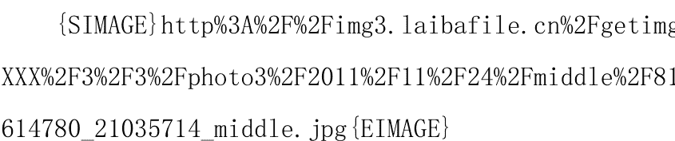

作者:66端午88 日期:2011-11-25 12:32

> @dreamreality 2011-11-25 09:48:56
童鞋们,抄底的时间到了。
开发商有走死逃亡的了,
信贷开始偷偷的放水了,
下一代基本开始主持日常工作了,
GDP和CPI一起跟着下滑了,......

最起码明年3月末,现在偶这里偶看中的一分还目有优惠哪。偶去年年初想要的顶层复式,从6200飙到10000左右,目前还没有见到有转让的,怎么补啊?炒房的都还没有慌,你怎么拿到便宜货。降了不少的,本来就虚高,就算不虚,也不想买在那些兔子不拉屎的地方。

作者:66 端午 88 日期:2011-11-25 12:34

@maleii 2011-11-25 10:42:59

分析师称，中国 10 多年来才出现第二次外汇净流出，这或许意味着人民币逐渐升值的日子即将结束。

http://cn.wsj.com/gb/20111125/bch072159.asp?source=whatnews

请三年给予指导

人民币还没有到转换时机，到时候偶会通知大家的，到时候，偶会如约减持部分房产，并做好逃离准备。:)

作者:66 端午 88 日期:2011-11-25 12:37

@helenwu200 2011-11-25 08:29:42

请教楼主

如何看待住建部陈准的讲话“房产辉煌仍将持续至少 20 年”

再辉煌 20 年，后面的不属于偶，偶最多再看好 12-15 年，达不到 10%以上收益率的将被减持。

作者:66 端午 88 日期:2011-11-25 20:46

作者：dreamreality 回复日期：2011-11-25 17:27:18

作者：66 端午 88 回复日期:2011-11-25 12:32:52 回复

加v信 1101284955，获取更多好帖

@dreamreality 2011-11-25 09:48:56

童鞋们，抄底的时间到了。

开发商有走死逃亡的了，

信贷开始偷偷的放水了，

下一代基本开始主持日常工作了，

GDP 和 CPI 一起跟着下滑了，......

最起码明年3月末，现在偶这里偶看中的一分还目有优惠哪。偶去年年初想要的顶层复式，从6200飙到10000左右，目前还没有见到有转让的，怎么补啊？炒房的都还没有慌，你怎么拿到便宜货。降了不少的，本来就虚高，就算不虚，也不想买在那些兔子不拉屎的地方。

楼主，我听你的，但是我怎么也拖不到年后了，已经从8月拖到现在都是奇迹了，其实楼市需求很是很大，只是观望气息重了点，上周的我们单位旁边的楼开盘，被周围几个单位的头头们一扫而空，就是因为本来说今年4月开盘13000-15000，拖到11月末开盘11000-12000.

判断依据已经告诉你了，从房价开始调整，销售陷入低迷后，历经半年才会彻底的反应到经济上，不论是从市场景气度的感知，还是报表都无法再掩盖过去，这个时滞在2008年已经给了大家一个预演，时滞为 6 个月，如果采取其它补救来对冲，也熬不过 9 个月，只有在经济见底时，大部分经济活动的参与者才会陷入严寒，要么切割冻坏的肢体，要么彻底玩完，不是所有的人都穿着棉袄过冬,熬进了脂肪,这是他们必须要面对的选择,除非你能把所有的房子全部收掉,那么此前的抄底,基本都是半山腰。现在你要做的是选择标的,紧盯标的,了解标的,然后在桃子熟透掉下来的一瞬间,接住它。

作者:66 端午 88 日期:2011-11-25 21:22

最近几天管理层开始大规模清理国内准金融机构，因为这些准金融机构不容易被控制，且抗风险能力极差。加之出台的严控交易所，降低房地产贷款杠杆率，一旦有风吹草动，就会限制外币兑换，将对外的池子封闭起来，如此一来，金融的对外封锁将导致欧美的货币战争根本找不到目标，对于股市，管理层也在开始强行压制泡沫，没泡了，谁也别惦记了。同时，看到 FT 中文网报道，人民币国际化进程已经开始回缩，一切的证据都指向：货币战争还真的打起来了，我方正在进行阵地整修，进入防御态势。:)

作者:66 端午 88 日期:2011-11-25 23:21

警惕黄金白银见顶，突然发现亚洲黄金首饰龙头企业周大福即将上市，一家创建了 90 年的非上市企业，如今准备上市了，大家好好体会一下。借反弹减持黄金和白银，绿灯变黄灯，停止增持，逢高减持。

作者:66端午88 日期:2011-11-26 17:23

http://news.cnfol.com/111126/101,1277,11222066, 00.shtml

人口会减少吗? :)

作者:66端午88 日期:2011-11-26 21:13

妄谈美元对人民币贬值逆转是徒劳的，贸易不平衡仍未解决，美元就此放弃对人民币的挤压，贸易始终不会平衡，反而出口会继续加速，即使中国国内通胀，亦可将通胀转移至美国市场，这无疑是错误的逻辑。

作者:66端午88 日期:2011-11-26 21:57

作者：凤凰涅槃913 回复日期：2011-11-26 21:53:21

作者：66端午88 回复日期：2011-11-25 20:46:50 回复

作者：dreamreality 回复日期：2011-11-25 17:27:18

......

--------------------------------------------------

判断依据已经告诉你了，从房价开始调整，销售陷入低迷后，历经半年才会彻底的反应到经济上，不论是从市场景气度的感知，还是报表都无法再掩盖过去，这个时滞在2008年已经给了大家一个预演，时滞为6个月，如果采取其它补救来对冲，也熬不过9个月，只有在经济见底时，大部分经济活动的参与者才会陷入严寒,要么切割冻坏的肢体,要么彻底玩完,不是所有的人都穿着棉袄过冬,熬进了脂肪,这是他们必须要面对的选择,除非你能把所有的房子全部收掉,那么此前的抄底,基本都是半山腰。现在你要做的是选择标的,紧盯标的,了解标的,然后在桃子熟透掉下来的一瞬间,接住它。

哈哈,老谋深算啊!

报告楼主,小弟的物业置换计划可能要调整啦!之前打算将武昌核心商圈70平的二手房出手再加上闲钱,置换长江边的绿地国际金融中心——606米高楼旁裙楼的商住两用房。

现在的情形是:每天看着绿地楼盘的工程进展比旁边的树长的都慢,感觉可能长停哦!

再说说旧房挂出待售情况:70平2房1厅04年17万够入,现打算50万保底出让。上月底至今已有60多人次看房,真有意向的有7、8个吧,能一次付款的比要少许贷款的多,感觉需求还是比较旺!问题是买主就是不下单,要么隔空打电话问价格是否有变化,要么就砍个天价准备捡便宜。目前该地段的行情是稍有环境的旧房售卖单价都已过8000块,2房月租价在1400——2200不等。凤凰这房此前月租1600,因性价比高且房东慈眉善目,换房客通常只需3到5天,非常好租。小弟常为他人做嫁衣，因此，也能收获一些针头线尾，可算衣食无忧。

贱卖还是续租纠结中，呵呵！

哥的建议是，不给逢低买入的人以幻想，抄底是哥们干的事，想抄偶底的人还没诞生哪，撤单续租。

作者:66 端午 88 日期:2011-11-26 22:55

货币一旦贬值，想回去，没戏，想让房价跌，你丫收回去的税费，先自裁掉，就是一把火烧了，只当这钱没了，你丫肯定对俺叫嚣：你做梦吧，你得癔症了吧。所以，房价想真的下跌到没超发货币前，偶也只能平心静气的给丫解释：你丫做梦吧，你丫得了癔症吧。:)

作者:66 端午 88 日期:2011-11-27 13:02

@jinliqing 2011-11-27 11:49:45

楼主说的体制内，体制外的二元论其实还不透彻!唤作公与私二元论更准确，看一个事物应该从其本质看起，中国是个什么国家？不要看现在好像与国际接轨，市场经济盛行，就误以为是向市场经济迈进，迟早是市场经济国家，那就大错特错了!自中华人民共和国成立以来一直是社会主义国家本质，一党集权制贯穿始终无不体现这一点!(中国的核心利益包括:国家主权，国家安全，领土完整，国家统一，中国宪法确立的国家政治制度和社会大局..........

以体制内和体制外分类是最恰当的, 比如上市公司, 私人控股的, 其依然可以享受到某些体制内的优惠待遇, 用公私分类则比较呆板。

作者:66 端午 88 日期:2011-11-27 13:09

@Cathyfeig 2011-11-27 11:49:47

楼主您好, 请教您一个问题, 北京东三环潘家园 (大北窑 cbd 以南 3 公里) 普通住宅 (多层南北朝向板楼) 的房价现在 2.4 万, 你认为还能降多少。盼望您的答复。

一类城市说了很多遍了, 有些人不能不买, 因为它和福利结合在一起, 有些人必定是要被横宰一刀的。有些人, 又不能不去或者离开, 因为他们的岗位只有在这里效率最高, 收益最大。所以, 偶提了一个建议, 在老家买房对冲 (或者老家的省会或者其它房价不太离谱的可接受城市), 在一线城市买很小的房子, 或者租房子, 这种操作比较矛盾, 所以, 偶基本对一线城市无语。对于早买下的人, 只有恭喜了。

作者:66 端午 88 日期:2011-11-27 14:37

@gaxiao181253 2011-11-27 14:14:59

端午老师对山东的东北人有接触过吗? 山东的娱乐色情业基本都是东北人垄断了, 今年感觉很特别, 各行各业苦不堪言

东北人，有一半老家是山东，山东合法行业基本饱和了，你说他们回来还能干什么哪？

作者:66 端午 88 日期:2011-11-27 14:40

@ashisking 2011-11-27 14:37:38

三年兄啊，最近身边一亲戚要在一三线城买商场里的格子铺，开发商代租，本钱 10 年返完。乱七八糟加起来我算了算假如开发商要 10 年还清购房款 1 个平方日租金必须要 16 元才能行，这还不算物业管理等等。况且这个商场地处不算中心，不知三年兄能否指点一二。

商业地产，如果是前年买的，尚有几分胜算，今年就不要动了，价格高位不胜寒，零售行业产能过剩已至巅峰，除了拿了商铺有自己的运营能力外，投资的不要介入了。

作者:66 端午 88 日期:2011-11-27 20:17

作者：孤峰岚影 回复日期：2011-11-27 19:56:56

端午老师好，有个问题想请教下：我所在的城市是成都，现在的房价还是处于下幅下跌的态势，但是现在有能力做一次投资，您说是投那种品种好？住宅还是商业（酒店式公寓可不可以投）？现在通过朋友了解到他们那边的地产开发商都是在拿房子抵押工程款了。我想问的是这次我们能够抄底的时间窗口大概是什么时候啊？？

盼复！不甚感激！

当中央为了经济大幅下滑开始不知所措的时候，就是买入的窗口开启之时，至于最低点，应该在窗口开启之后的1-3个月。不论买哪种房产，要看你的目的，长期持有的话，就无法摆脱高出租收益比的约束，而且还要看空租期，以上两个条件，都要求房产处于优良的位置。

作者：qinhuaiwuke 回复日期：2011-11-27 20:10:26

f 端午 88

兄弟

南京几大银行开始调整上浮贷款利率了

原来是10%现在降为5%

是不是开始释放信号了

求解

还不能这么说，因为偶了解本周猪肉价格又开始反弹了，从9月的29点，下跌到10月底的20点，本周的指数为：24点。短期内判断CPI迅速摆脱明显通胀仍然缺乏依据。CPI看猪肉，货币放松看CPI，那么你可以简单的把中国经济定位于：猪的经济。一种由猪控制的经济，它把持着任何投资阀门的水龙头，非常愚蠢，呵呵。

作者:66 端午 88 日期:2011-11-27 20:21

作者：文理才 回复日期:2011-11-27 17:43:05

@jinliqing 2011-11-27 11:49:45

楼主说的体制内，体制外的二元论其实还不透彻!唤作公与私二元论更准确，看一个事物应该从其本质看起，中国是个什么国家?不要看现在好像与国际接轨，市场经济盛行，就误以为是向市场经济迈进，迟早是市场经济国家，那就大错特错了!自中华人民共和国成立以来一直是社会主义国家本质，一党集权制贯穿始终无不体现这一点!(中国的核心利益包括：国家主权，国家安全，领土完整，国家统一，中国宪法确立的国家政治制度和社会大局..........

几乎没有一个国企擅长搞技术，国企就是腐败、效率低下、裙带关系、效率差的代名词。

中国的公，并不是教科书上社会主义的公有制，而是打着公有制名义的幌子，巧取豪夺，利用各种权利，市场地位，法律法规，政策文件，行：满足一己私利目的的“企业化工具”(权益阶层)。

作者:66 端午 88 日期:2011-11-27 20:41

作者：孤峰岚影 回复日期:2011-11-27 20:30:30

都要求房产处于优良的位置?现在看好一套处于三环边上(大约2公里处,明年会有地铁2号线开通,离进城的

高铁很近）的学区房，旁边是一所重点私立中学，这样的房子是否算是优质呢，端午老师？

> -----------------------------

小学和初中是社会福利，私立高中，貌似不是社会福利，不会因为划片就让你免费入学，所以，不算利好。你觉得：如果没有土地财政支持，地铁会很快开通吗？三环的概念太泛泛了，北京的三环，肯定是核心位置，如果济南的三环，那只是兔子不拉屎的地方，需要进一步分析的。

作者:66 端午 88 日期:2011-11-27 21:04

作者：孤峰岚影 回复日期：2011-11-27 20:52:55

是这样的端午老师。这学校因为是私立的，教学质量很靠谱。很多有钱人的家长把自己的孩子送到那里去上学，这学校旁边的房子很好出租，如果是作为出租收益的话您认为可取不？同时这边的地铁很早就在修了，说好了是明年十月通车。哦还忘了给您说了，我们这边是成都的三环哈，（前面看您的帖子说您是比较看好成都的啊）

> -----------------------------

哈，偶就准知道你问这个问题。早就有答案了，就像济南的外国语学校于去年搬迁到位置较差的西北部，以前这地方的房价大约6500-7000左右，学校搬过去以后，一个月内，该位置房价立刻拉高到8000-8500块，房租由50平，650-800元-1200元，迅速拉高到850-1000-1500元。半年过去了，

房价稳在这里，甚至有小幅上涨，房租倒是有些许回落，因为大部分学生住校，小部分家长开车接送，极少部分在此租住，预期落空了，但是房租没有回到原来的价位。

于此类似，你的预期已经利好兑现了，而不是你分析这地方要建一个学校，于是提前买入了该处并为高估的房产，现在学校盖好了，你兑现了你的预测。

作者:66 端午 88 日期:2011-11-27 21:39

如果出租是综合因素支撑的，有广泛的需求，那么：就拿出租收益比的安全边界去套吧。纯居住 5%以上，商业 7.5%，注意购买时机。:)

作者:66 端午 88 日期:2011-11-27 23:04

偶回想了 20 年以前的事，发现能迅速拉开同学之间地位差距的竟然是英语水平，这段时间简直就是一个模仿西方的时代，跟的越紧，发达的越快。不由得你认可不认可。

作者:66 端午 88 日期:2011-11-28 11:14

网传刚刚被双规的山东省 XX 副省长，主管文教卫体的高管，合计贪污 90 亿美金，有情妇 40 余，貌似有点夸张了，贪个几十亿人民币到头了，就算吃药也搞不定这么多情妇吧，不过体系内的实权派，掌握的财力的确令人咋舌，如果无有效监督，泱泱大国亡党亡国已至危险时刻。

作者:66 端午 88 日期:2011-11-28 17:23

作者：wz_8808 回复日期：2011-11-28 15:43:25

三年兄, 问一下目前的家居建材市场的商铺投资有没有价值?

高价位投资会引发戴维斯双杀, 等调整。

作者:66 端午88 日期:2011-11-28 23:45

济南楼市调控满一年, 在最容易渡过的调控初段期(起码有六个月未出现销量显著下滑), 既出现五证俱全的烂尾楼4个, 按照这个速度下去, 估计在未来的两年, 将出现不少于25个烂尾楼盘, 涉及购房人不少于12000户。另外经过实地考察, 绝大部分楼盘的建设速度出现放缓, 很多楼盘已经给准业主下发通知, 延期交付, 最狠的一家说是无限期延迟(待解决资金占压问题后续建), 这个够狠不, 业主正在闹事哪。现实正在按照预期进行, 不知银行现在如何感想。他们能熬过事先提高的拨备覆盖损失吗?也要等等再看了。

本月济南土地市场出现标志性事件, 土地拍卖流拍量占比高达85%。地方政府要么修改土地估值, 否则土地出让将陷入停滞。另外最近一周新房销售开始显著下滑, 也是标志性事件, 在此前的6个月, 济南销量虽有小幅下滑, 但同比下滑并未超过2成。本周环比下滑高达40%, 而且有进一步下滑的态势。主城区, 1, 2类房产新盘极少, 库存有限, 且新地块均为有开工出现, 一般挖个坑就停了。所以并未出现降价, 远郊盘价格下滑明显, 3, 4类地区有10-20%左右跌幅，位置越偏，降价幅度越大，但降价后，仍比2009年低点有大约75%左右溢价，比如邢村高架桥片区，2009年最低点大约4000-4500之间，目前优惠到7000元左右，价位仍明显高估。今日济南拍卖市场再次下达土地拍卖标的（高新区4类区域），看看拍卖结果吧。

中国经济就是房地产经济，承认也好，不承认也好，事实就是这样，按住房价，经济硬着陆，不按住房价，经济也会硬着陆。这都不是问题的关键，关键是什么哪？因为中国经济不是正常的市场经济，不具备自我修复能力，只能在三种经济调控方式完全失效后，才会从经济的本源上重新进行基础建设。货币，财政，财税三个手段均失效后，才会将问题充分的暴露出来。好了，6个月后，财政调控即将失效，2年内，财税手段也会走到尽头。而高新技术领域无论如何两年内难堪重任，多次微调产生的误差累积将无以为弥补，这个问题彻底的扔给了下一届政府。

作者:66 端午 88 日期:2011-11-29 00:01

烂尾越多越好，呵呵，可惜大部分楼盘国家会接手的，否则这矛盾大了去了，以后的形式：现房，多么珍贵。如果出现50%的烂尾，银行会马上停摆的。

作者:66 端午 88 日期:2011-11-29 08:16

@66 端午 88 2011-11-29 00:01:33

烂尾越多越好，呵呵，可惜大部分楼盘国家会接手的，

否则这矛盾大了去了，以后的形式：现房，多么珍贵。如果出现50%的烂尾，银行会马上停摆的。

@网络无处不在 2011-11-29 01:14:53

你有能力阻挡吗

昨日媒体罕见报道多个居民小区的抗议行动，涉及供暖供气，车位收费，物业管理，房价下跌索赔，房产确权，开发商逃离的业主抗议维权行为，四川保路行动的当代翻版-----护房运动，正在向纵深发展。

作者:66 端午 88 日期:2011-11-29 18:12

作者：Cathyfeig 回复日期：2011-11-29 15:20:18

@66 端午 88 2011-11-27 13:09:23

@Cathyfeig 2011-11-27 11:49:47

楼主您好，请教您一个问题，北京东三环潘家园（大北窑cbd 以南 3 公里）普通住宅（多层南北朝向板楼）的房价现在 2.4 万，你认为还能降多少。盼望您的答复。

一类城市说了很多遍了，有些人不能不买，因为它和福利结合在一起，有些人必定是要被横宰一刀的。有些人，又不能不.....

非常感谢楼主的答复，也认真思考了您的建议，我的老家就是北京，我是北京人这房子我是 2004 年初花 30 万买的，主要用于出租，在稍远的地方买房自住，虽然租金比 04 年开始出租时涨了一倍，但是总是感觉那个房租始终赶不上把这房卖了（现在大约 150 万）钱存银行所得的利息，卖房子吧又怕通胀加剧房价再涨，犹豫不定中，就目前我的情况您能给点建议吗？当然卖不卖决定权在我手里，我只是想听听您的真实看法，无论如何绝不会埋怨您，盼望您的回复。

我有一个大学同学现在北京工作，上次聚会提起北京的房子，按照偶的想法，她虽然在外企做个大白领，顶多有两套到头了吧，于是问她房子买在几环了，一问吓偶一跳，从二环到五环，一环一套，不算重合的。混打工的，干到这个高度也算到头了。打工顶端的人也在买房子，放心持有出租，偶想她的视野不缺乏国际化，这大概就是建议吧。

作者:66 端午 88 日期:2011-11-29 18:27

小样，看到你就好笑，2001 年，偶以首付 2 成，8 折利率买下的写字间，一共花了 11 万，从建好后一直出租，现在租金是 4.4 万，明年是 4.8 万。现在价格是 160 万，偶的总投入就是 11 万，如果卖出 160 万。净赚了 105 万，还不算每年比按揭还款多出的一千多块，关键按揭由两部分构成，一部分是本金，另一部分是利息。现在本金已经还掉了 55%.

如果出售, 利润是 133 万, 投入成本总计 11 万, 现在刨去成本, 赚 122 万。加上 10 年的房租剩余 15 万, 总计 137 万,你丫找个东西 10 年 10 倍, 且没有风险, 不用管理。只不过偶不是炒短线的, 偶也不在意总盈利, 偶只在乎租金, 你------一边叼着奶瓶玩去吧。

作者:66 端午 88 日期:2011-11-30 06:42

作者: maxc2 回复日期:2011-11-30 04:39:39

@66 端午 88 2011-11-29 18:27:58

小样, 看到你就好笑, 2001 年, 偶以首付 2 成, 8 折利率买下的写字间, 一共花了 11 万, 从建好后一直出租, 现在 租 金 是 4.4 万 , 明 年 是 4.8 万。

三年哥, 内容长了, 私信发不了, 请帮忙看看啦!

基本情况如下:

- 1、上月我刚看中了一套房子, 已经下了 4 万定金, 这两天本应该就要去交首付了。
- 2、我名下还有一套房子, 因此我本人属于二套房。
- 3、开发商此前承诺可以公积金 3 成贷款（公积金中心认可这个说法）
- 4、我的公积金每月到账合计有 2100(武汉市上限 2300), 正常情况我可以贷满额度。

目前的状况是:

- 1、刚收到消息公司开始裁人，一个可靠的HR朋友告诉名单中有我。(呵呵，正如你所说，开放商没完蛋，实业却撑不住了啊。今年我们公司整体利润下滑严重，且销售指标很难完成，一大堆人面临这个问题)
- 2、我如果首付4成没什么问题。余下现金撑3-5个月没问题。
- 3、我的公积金账户预计2月份最后一次到账。届时公积金正在审批中，换工作可能会影响审批。
- 4、由于正过年期间，保守估计找到合适的东家在明年3-4月份。

我的问题是:

- 1、继续和开放商履行公积金贷款合同，届时如果批不下公积金贷款，再去谈商贷是否有可行性?
- 2、如果换人接手我的房子，和开发商方面如何沟通?
- 3、如果做最后退房子的打算，有多少可以退回部分定金，大概能退多少?

哎，想把手上那点小钱保值的人伤不起啊!
多谢你费心看看啦:)

- 1.定金和订金不一样，定金不可退。
- 2.看你的合同约定，如果在合同约定中，“只”使用公积金,由于非人意料内的不可预测事件,造成公积金不能放款,导致合同失效,你不承担履约义务的,可以退定金。如果合同约定中没有约定,商贷也无法放款,经由双方协商不能达成一致,需要法院官司解决。(最糟糕的是合同约定,不管任何条件你必须履约,你就没法要回定金,或者部分定金,还是得看约定,由于购房合同均为开发商一方制定,他们签订的合同基本都是霸王式的单方合同,遇到购房时机不对,很难退房,除非你能拿住它,他的贷款行,建委,他的建筑物有违规--城管,税务稽查局,或者开发商私人交情,都是你的弃购突破点)

- 3. 接手问题,除非是紧缺性房产,现在极难有在高位接盘的资金。

在中国经济爆发危机前,尽量不要在半山腰接盘。

作者:66 端午 88 日期:2011-11-30 08:20

@ip3230 2011-11-30 07:46:50

楼主还在啊?骗人有意思吗?逆向思维,记得股市从6000点跌到4000点的时候,看过一篇逆向思维的文章,楼主更牛,5000点就逆向思维了!建议楼主赶紧把你那160的房子买了存银行,收益高多了,要真是逆向思维,楼主买股票才是,很显然,楼主没那能耐!知道银行股这么低为啥没人买吗?因为楼上崩盘毫无悬念,银行很可能支撑不住,房奴们为银行贡献的业绩只不过是浮云!

搞笑，银行破产，你把钱存银行就拿得回来吗？银行就算破产，偿还对象也是先体系内，再体系外，先小客户，再大客户的次序。

作者:66 端午 88 日期:2011-11-30 10:45

@66 端午 88 2011-11-30 06:42:30

作者：maxc2 回复日期：2011-11-30 04:39:39

@66 端午 88 2011-11-29 18:27:58

- 1. 定金和订金不一样，定金不可退。

- 2. 看你的合同约定，如果在合同约定中，“只”使用公积金，由于非人意料内的不可预测事件，造成公积金不能放款，导致合同失效，你不承担履约义务的，可以退定金。如果合同约定中没有约定，商贷也无法放款，经由双方协商不能达成一致，需要法院官司解决。（最糟糕的是合同约定，不管任何条件你必须履约，你就没法要回定金，或者部分定金，还是得看约定，由于购房合同均为开发商一方制定，他们签订的合同基本都是霸王式的单方合同，遇到购房时机不对，很难退房，除非你能拿住它，他的贷款行，建委，他的建筑物有违规--城管，税务稽查局，或者开发商私人交情，都是你的弃购突破点）

- 3. 接手问题，除非是紧缺性房产，现在极难有在高位接盘的资金。

@maxc2 2011-11-30 08:59:19

三年哥，谢谢你的解答。

我有如下一些细节没说到，你再帮忙看哈:

- 1、我购买的是小户型学区房，总价不高，62万。
- 2、开发商是本地的，不是全国性的大开发商。
- 3、开发商中有我一个同学（但并非领导），因此我得到了购房优惠。......

给你同学好好谈谈，争取暂时不买，等待开发商继续优惠。

作者:66 端午 88 日期:2011-11-30 13:38

@到了春季只想远行 2011-11-30 12:47:19

请教下楼主，现在有个能源类项目的入股机会(地方政府为大股东),能入吗?

项目赚钱吗?如何分红?看收益,看稳健性和规范性。

作者:66 端午 88 日期:2011-11-30 13:40

房市还没崩,股市先崩了,房民还在撑,股民撑不住了,下一个撑不住的是谁?绝对不是房民,倒是有可能公民接着撑不住了。

作者:66 端午 88 日期:2011-11-30 14:53

@413600735 2011-11-30 13:51:45

回复第 12538 楼，@66 端午 88

房市还没崩，股市先崩了，股民撑不住了，下一个撑不住的是谁?绝对不是房民，倒是有可能公民接着撑不住了。

请教公民怎么撑不住?你指的是通货膨胀吗?

本帖发自天涯社区手机客户端

紧缩的结果是就业率大幅下滑。

作者:66 端午 88 日期:2011-11-30 19:11

今天考虑了一下我们为什么会有这么多货币 (M2)，除了前面阐述的强制结汇因素外，我们的投资方式，我们的大量提前修建的高速公路，铁路，会所，城市形象，政府建筑都是主因，因为这些建筑大部分是贷款修建的，就是负债建设，负债在财务上是有出有入，出入相等。有多少债就会有多少货币放出来。我们的货币可能提前发行了10年左右(这个时间也许稍显不足，事实上是10-20年)。就是说，我们在使用未来10年的货币，可惜产生的实物和社会财富只能是今天的水平，我们需要在未来20年消化今天创造的产能，唯一富裕的就是纸面的货币。

作者:66 端午 88 日期:2011-11-30 19:12

作者：学会爱情 回复日期：2011-11-30 19:07:05

放水啦!!!!

准备金下调啦!!!

哈哈

比偶的预测晚了三天。

作者:66 端午 88 日期:2011-11-30 19:15

物价有望在年底前开始反弹，春节后再试新高。0.5%炒不动房子，炒些鸡毛蒜皮和玩似的。:)

作者:66 端午 88 日期:2011-11-30 19:28

很难想象房价会有大幅下挫了，维持明年3月左右见低点的预测。

作者:66 端午 88 日期:2011-11-30 19:40

作者：66 端午 88 回复日期：2011-11-21 18:56:59

周末很可能降低存准率0.5%,因为外汇占款降低了1000余亿，到期央票不能补足流动性欠缺。也有可能降低存准率1%，同时加息0.25，这样做容易刺破高利贷链条，估计前者的可能性更大。

的确晚了三天，这该死的央行。

股票明天注定要疯一把了，大蒜今年死了半截，明年又到了好年景，凡是涉及民生用品，今年赔钱的，明年加倍奉还。

作者:66 端午 88  日期:2011-11-30  22:28

现在的货币政策就像和面，水了兑面，干了兑水，目的就是做实通胀，做实货币滥发（消化超额货币），房价跌，管理层当然非常希望跌，可是房价一跌，面盆没了，你的水水面面放在哪里搅。其实最应该做法的是超额征收的税，拿来注销货币，国家苦一点，百姓幸福了，可惜，这完全是不可能的，否则超发货币的好处都给了 P 民，反而印钞的一点好处看不到，这不是瞎忙活了吗？所以，偶一直在说：货币一旦滥发，就永远回不去了。大家看到的结果就是这样的：房地产当然是无忧的，因为它就是和面的盆，砸了锅，砸了体系内的锅，吃什么啊？

作者:66 端午 88  日期:2011-11-30  22:47

作者：出生于西部  回复日期：2011-11-30  22:34:46

存准率下调，央行放水四千亿，楼主赶紧带领傻多抄底。

哥不着急，哥每年只搞一套，抄底是明年的事了。

作者:66 端午 88  日期:2011-11-30  23:13

作者：浮着的猫头鹰  回复日期：2011-11-30  22:56:10

领导说 2011 年通胀控制在 4%，而 10 月的 CPI 数据是 5.5%，在政府可控的情况下，CPI 掉进 4%的时候放水，甚至掉进 4%以后再过一段时间（1 到 2 个月稳定期）放水，对 P 民就有交待，可以吹嘘宏观调控成功了。11月30日就宣布放水，只能证明一点，就是宏观经济已经失去控制，下滑的相当厉害了，所以领导的面子先放一边，救火要紧。

反映在股市上，明天高开低走的概率偏大。。。

哥得给你上节基础课，今年就算CPI,50点，到了12月31日24点，清零了。

就算明年CPI只有3个点，也是在今年的基础上再涨3%，OK，相当于明年的物价水平继续涨。你怎么可能看到下跌哪，下跌就没人开银行了。CPI是复利模式的增长，恐怖的复利，要不30年间货币怎能贬值98%。你没有福利的盈利方式，肯定是跑不过CPI的，别说刘翔了，就算法拉利也跑不过，房产只能跟随。

作者:66 端午 88 日期:2011-12-01 00:31

作者：清风幻影 ABC 回复日期: 2011-12-01 00:13:51

@66 端午 88 2011-02-12 13:55:28

房地产销售量的大幅萎缩，并不是像大家想的那样，房地产行业就此终结了，相反，我认为是走上了正轨，像以前那样，随便买一套等待升值的傻作行情早晚有终结的一天。房地产归根到底是经济链条的一部分，它必须加入经济循环，并利用自身先天具有的资源性优势，去占据经济链条中不可替代的一环。房地产销售量的下滑，迫使投资人平心静气下来，仔细想想，我的房产终究是经济链条的哪个环节。迫使投资人将思路从炒作阶段转到运作阶段.....

楼主的思想比得上爱因斯坦，但是都是猜测没有依据的胡扯，

呵呵，事事都猜对，你以为偶是无敌神棍啊，偶的判断都是一有数据支撑，二有实际体验的逻辑判断。三偶不做长期预测，长期预判-----那才是神棍干的事。

作者:66 端午 88 日期:2011-12-01 00:59

作者：新华 11 弄 回复日期：2011-12-01 00:51:05

比偶的预测晚了三天

现在消息出来了，也无妨了，端午，能说说你之前有把握精确到日级别的推测的依据么？

上周银行理财产品利率已经开始跌了。参与政府项目投标的公司数量明显减少。年底本来钱就紧，现在都紧到一块去了，再不送送，恐怕下个月会有大量的中小企业跑路。

作者:66 端午 88 日期:2011-12-01 11:42

什么叫多，什么叫空，基础问题还没找到，妄言多空，极端无知，中国经济是什么？中国经济就是房地产，高速公路，铁路，大央企投资为主体的水泥经济，这点郎咸平说的非常对。中国经济是房地产经济，也就是说这是基础，管理层坐在这个基础上能有什么作为？使劲晃悠晃悠把粘在身上的狮子跳蚤晃下去而已，跟着赚钱的人实在太多了。还多空演绎，演绎什么啊？演砸了，饭碗就碎了，这是动摇基础经济的动作，前面我讲过了：这是管理层营造的危机准环境，借此转型，借此给外国人装装我们也在危机的样子，可惜国内经济不争气，就算装也装的过了头，过了头的原因是多次小幅调整的偏离值累加成为一个大数，水泥经济占据我国经济份额的7成的比例，基本就是汽车的发动机带底盘。那些新兴经济也就是车里面的真皮座椅，汽车音响和外层涂漆，装装样子，搞搞娱乐的玩意，好看倒是好看，好看能跑路吗？

所以，不懂经济的小白，不要瞎说，不要乱想，不要指望挑战中国主流经济，应该老老实实赚钱，积极投机掏米，听偶的号令，逢低买入硬资产，可保证稳定固化自己的血汗钱，虽然这样不会令你富贵荣华，但可让你衣食无忧。

作者:66 端午 88 日期:2011-12-01 12:02

@清风幻影 ABC 2011-12-01 08:53:25

人家早就知道会放水了

作者：出生于西部 发表日期：2011-11-3 15:19:00

回复 1 楼 只看此人屏蔽此人

海宁由去年的崩溃，已经转向今年的看多，尤其是美联储宣布要将零利率维持到 2013 年年中后，海宁看多言论频出，最近亦是十分明显。反正对于货币政策，他是定了调的，我绝对没有断章取义，言论复制如下:

作者：海宁的马甲 回复日期：2011…………

由于货币滥发延续时间太长，今后国家投资会适当放缓，外需也不会像过去 10 年那样有强大的拉动作用，中国今后的增长就是内需，中国的内需领头羊是什么?我想连中央自己都还没搞明白，房地产-----这话放在这里，房地产就是中国百姓最强大的需求。一套房子仅仅附带的消费，就顶其它所有的新增消费，汽车为什么在过去几年销量大幅增长，因为城市扩展后，急需以汽车来平衡距离差距，需要平衡的东西很多，仅仅因为窗户问题即可促进中国的家纺行业，卫生问题可大力促进陶瓷行业，随便一个小问题的解决即可拉动几百数千亿的消费。管理层要看不到这个问题，那就不要谈智商问题了。所以，以后会有越来越多的增长需求来源于房地产行业，来对冲投资下滑和外需萎靡的下滑。新经济需要在增长中逐步充实，替代效率低的消费，很难制造出一个新市场，因为新市场不会有盈利，中国的经济除了大，还有一个最需要解决的难题：增值能力差。新经济解决的问题是提高经济的效率，提高企业的增值能力。

作者:66 端午 88 日期:2011-12-01 12:23

@也爱茶的七可 2011-12-01 12:17:46

三年兄,十五套了还想买啊!

我打算逢低也不增了,多元化配置一下资产。

例如逢低拿些压箱底的黄金。

黄金不能再增加了

作者:66 端午 88 日期:2011-12-01 13:12

@Timnary 2011-12-01 12:55:53

三年分析下近日股票走势呢?

近期没有大机会,房价见底后,股市才会有机会,一波大幅拉升后,赚钱的人买房固化盈利,房价开始翻转。

作者:66 端午 88 日期:2011-12-01 14:08

@春晓悠悠 2011-12-01 13:25:08

请教端午:

最近公司到地税开票时被告知,要来查个人所得税,如果我们不交的话,他们就让开发商直接在公司结帐款中扣出。

说明下:公司是销售代理公司

关于个税在今年之前从来没有人过问过,以前交也就只是交营业税和企业所得税,象我们这种小公司如何规避这个税这个问题?

谢谢。

增加各种销售，管理，财务成本，把帐做好。

作者:66端午88 日期:2011-12-01 14:12

@阿诈 2011-12-01 13:42:15

@66端午88 2011-12-01 12:02:01

中国的内需领头羊是什么?我想连中央自己都还没搞明白,房地产-----这话放在这里,房地产就是中国百姓最强大的需求。

端午好。我认为中央是明白的,内需,房地产。当然,政¥府讲法前面一定要先加个冠词---反对高房价(不用管反不反的了,说出来就不会惹众怒)

2011.11.27,李克强指出,中国内需最.....

由于中国P民的收入低,收入非常不均衡,导致过份利用了货币杠杆,导致房地产具备超越一般商品的金融属性,形成了金融产品的销售属性,买涨不买跌。最好的走势是预期小幅上涨,控制涨幅。涨多少好哪?至少比货币增发的数量要高那么一点点,才会激发买气,所以,不但偶,所有人都盯着货币增量选择买点。

作者:66端午88 日期:2011-12-01 15:20

@好奇小学生 2011-12-01 15:10:01

和房客关系处得好，租约到期不好意思涨房租， 怎么办？

晓之以理，动之以情，也别太没谱，怎么也得比市价稍低，理摆在明处，让他自己决定。

作者:66 端午 88 日期:2011-12-01 15:21

@出生于西部 2011-12-01 14:52:18

记得楼猪早就说过要去樟木头抄底的，楼猪，光说不练的是我孙子啊。

海南南端更好的话，还去樟木头吗？:), 你丫冰天雪地慢慢熬。

作者:66 端午 88 日期:2011-12-01 19:05

作者:路漫漫 lumanman 回复日期:2011-12-01 18:49:36

三年大哥，我晕哪!! 终于看中了一套房子，143 平，价格比市面低 10%, ,但是我们夫妻都是今年八月社保才从杭州转到嘉兴，贷不了款啊，都是浮云了。您说等明年八月份会是什么行情呢？

看这么远干什么？管理层都在小步快跑，也许像遛狗一样，跑来跑去，最后原地不动，也许在最远的地方。明年八月的事，明年二季度再分析不迟。

作者:66 端午 88 日期:2011-12-01 21:05

作者:douglasqd 回复日期:2011-12-01 20:41:37

端午哥,又请教一下,3年前一朋友投巨资建一电子产品工厂,三百多人,现在感觉势头不是很好,想从中抽身,但他反反复复,无比痛苦状,看样子不是很容易结束它.

以您对虚拟的,实体的丰富经验看,这如何是好?

----------------------------------------------------------------

紧缩规模,坚持不放弃。如果这样都坚持不下去,说明前期投资彻底失败了。

作者:66 端午 88 日期:2011-12-02 11:33

呵呵,财政部长一番房产税的胡言乱语简直像是疯话连篇,任何一个有理智的官员都不会如此不动脑筋就胡言乱语,房产税的全面铺开必须建立在土地私有化为基础之上,土地有限使用权先卖一遍收税,持有税再收一遍,你丫好事还都占尽坏事做绝了吧,房价问题是不负责任滥发货币的连带所产生,自己的P股不擦赶紧,反而惦记别人干净的脸,不知道此官员是分不清屁股和脸的区别,还是就把自己的屁股当成自己的脸,倘若收了两遍税,房价还是压不下去,不知道该官员是否再拿自己的JB再说一遍事,那倒是真不如自己直接去裸奔了。

不折腾好像是当政策说过的,可是事实明摆着要去折腾,

折腾来折腾去, 就为了那张擦不赶紧的屁股, 好在中国人自古以来就是被折腾惯了, 到了折腾不出退路, 那就不用折腾了, 这真有点像极了一百多年前的那条铁路。

作者:66 端午 88 日期:2011-12-02 15:23

@好奇小学生 2011-12-02 14:33:45

靠房租解决温饱, 真是一劳永逸的方法。一劳永逸带来的烦恼是, 温饱解决了, 也没了期盼。人为什么为期盼活着呢? 就这么活着行不行?

不行, 去炒股票, 输得差点卖房子。继续烦恼, 继续追问: 就做个温饱型房东, 什么也不干, 为什么就不快活?

跪求各位大仙。

以前可以去做权利兑现, 做个寻租的掮客, 以后这种机会基本没有了。只有进入体系, “不要脸”的向上爬, 或许能看到一线希望。:(

作者:66 端午 88 日期:2011-12-02 16:11

@潜水浮出水面 369 2011-12-02 15:54:19

三年兄, 我手上有一套周边乡镇镇中心的双拼别墅, 户型和环境一般。挂牌出售近大半年, 起先还有人要看房, 现在无人问津。我是否要降价? 什么时候降价比较合适? 如果这套房子能出手, 我想用这套房子的钱置换一套位置更好的房产。等待你的指导。谢谢:)

现在出已经出不动了，暂时观望，下次反弹时换掉。

作者:66 端午 88 日期:2011-12-02 16:21

现在的形势，是自己管理层自己惹出来的，就像毛在1958年的大跃进的作为那样，把经济当政治搞，是要死人的。可惜承受压力的并非管理层本身，而是底层P民。多次严肃的调控虽然每次力度都不大，但误差的积累相当可观，每一次的可控并非最终的可控，一旦失控又得矫枉过正，一冷一热，好人也拉稀了。而且这个误差你还算不清楚它的大小，无法数字定量，货币依然在膨胀，产能压缩到合理状态就算合理吗？谁也不知道。一般性滞胀有望向纵深发展，民生价格极有可能在明年一季度末失去控制，同时由于多年累积的货币超发并没有有效“锁定”，关键底层P民的储备极端薄弱，合并在一起，将是如何的一幅景观，穷人--------现在应该开始大规模增加储备了。

作者:66 端午 88 日期:2011-12-02 17:54

没买到便宜房子的上网，买到贵房子的上街，大家两厢权衡吧。:)

作者:66 端午 88 日期:2011-12-02 23:58

作者：潜水浮出水面369 回复日期：2011-12-02 23:33:15

@66 端午 88 2011-12-02 16:11:51

@潜水浮出水面369 2011-12-02 15:54:19

三年兄,我手上有一套周边乡镇镇中心的双拼别墅,户型和环境一般。挂牌出售近大半年,起先还有人要看房,现在无人问津。我是否要降价?什么时候降价比较合适?如果这套房子能出手,我想用这套房子的钱置换一套位置更好的房产。等待你的指导。谢谢:)

现在出已经出不动了,暂时......

三年兄预测的反弹时间大约在什么时候?到时我是否降价才能出手?

房价只有在上涨期,才能买的动,偏远位置通常滞后于核心位置,别墅又是大户型,应在最后启动,迟滞房产走势大约4-6个月左右,降价反而不好卖。

作者:66端午88日期:2011-12-03 00:56

今日外交部正式宣布,中国外储将不对欧洲进行援助,货币战争正式打响。大家应全力爱国,爱家,爱国货。关于爱国货,说起来虽然很惨白,也没啥底气,如果国货价格厚道,售后有保障,还是优先使用国货吧(包括各种服务和文化产品)。

作者:66端午88日期:2011-12-03 12:23

作者: 海是空亡度妄心 回复日期: 2011-12-03 12:11:24

上海是以商圈形式发展的，要找那些正在开发或是有机会形成商圈的地块！地铁交通方便也要考虑在内！

呵呵，楼上鞭尸来了？

上海五角场那个商圈你觉得成熟否？万达做的，还有新江湾？

个人意见，和人有关

陆家嘴要不是大量新移民，参与金融贸易航运中心的建设，我上面说的那个价格，目前也实现不了

轨道交通的布局，几年前都规划好了，北到顾村以北，照顾保障房，西到了昆山，可以买别墅吃大闸蟹了

纯粹用金融杠杆炒作，另当别论，楼主意思是要长线持有，物业租赁。这个就要看准了。

都在挖掘新商圈，这东西虚无缥缈的狠了去，你拿到规划一看，四处开花的样子，如果跟着政府驻地迁移的位置走，发现这地方根本就没有商圈，就算有个貌似商圈的地方，就哪地价，就那规模，也不是P民甚至民企能搞的动的，我倒不是说地价贵，而是地价便宜，让开发商这么便宜拿了去，然后再那么贵的供出来，大部分接盘的，都是死路一条。记着：当你无法预测未来时，就寻找永恒，那就是城市核心。

作者:66 端午 88 日期:2011-12-03 12:26

作者:提香 01 回复日期:2011-12-03 11:59:46

唉,楼主对房产税发牢骚,看来楼主也是站在自己利益基础上说话的,房产税刺痛到楼主了。

而且靠炒房赚钱,真不算什么本事,搞的整个国家智力下降,久而久之,老美总会找到破绽和切入点。

这个帖子从头至尾也没说过炒房的事,不知道你怎么YY才得到的结论,楼主从头至尾都在谈持有的问题,持有什么,怎么持有,如何稳健的持有,如何可持续的持有。

作者:66端午88 日期:2011-12-03 13:44

作者:提香 01 回复日期:2011-12-03 13:20:40

楼主嘴巴干净点,别跟屁股似的!谁说持有不是炒房。你持有多套房子干嘛?为什么

美国人不持有那么多房子。我就不信你持有的房子涨上几倍,你不会卖。

大型酒店,商场,工业企业,乃至各级政府无不拥有大量房地产,而且持有成本远远低于个人持有成本,你丫怎么不放开你的菊花肆意喷射,偶这点蝇头啜耳,你倒变本加厉了哪?

谁都有处置自己财产的权利,不够高这个理由已经很充分了。因为货币滥发仍然在进行中。

作者:66 端午 88 日期:2011-12-03 16:13

关于营业税转增值税的传闻结果，可能会改，但结果是
不会降低实际税负率。

本贴第一段的解读和最终定义:

大家看到结果了吗?以前可以不要发票的,现在则必须
要发票了,因为服务的销售增值可以通过提高服务的成本来
降低,所以说:总的税负率不降反升,堤内损失堤外补,那
些以前不用开发票的服务,现在必须开票向体系内提供补贴。
这些必须开始走票的企业是谁哪?大家都知道他们是谁,最
底层的小商人(微型中的底层企业或者个体户)。大型服务
行业的成本降低了,小微个体户的成本在上涨,由此:你们
知道了体系内外的运行规律。任何改革,所谓减税的说辞,
只会利于体系内。否则伤害了体系内,伤害的有话语权的基
层,用脚后跟想想都是不可能的。

作者:66 端午 88 日期:2011-12-03 16:16

作者:吆唏 回复日期:2011-02-10 13:02:19

我给大家的建议是:买方进入观望期,长期持有方着力
拉高房租,提高长期受益的现金流量。等待局势明朗后再行
操作。

楼猪真是傻屁一个，贫富差距越拉越大看你怎么拉高房租玩下去！

你丫个SB，租不起你回老家，或者去申请廉租公租房，我的房租不算贵，每年都在涨，大部分都是商业房，咋没有见租不出的。

作者:66 端午88 日期:2011-12-03 16:56

作者：文理才 回复日期:2011-12-03 16:53:23

房地产成为疯狂敛财和炒作的手段会破坏整个国家的经济发展，一个家庭限购买两套房难道还不够，难道非得每个人买个十套等成暴发户不可，这样的发财对经济发展有什么意义呢，增加了贫富差距、降低社会消费力、降低轻工业发展、破坏民生、扼杀经济创造力。

每年稳定赚10%的实业回报，偶就不会去买房子，这样算很低吧，可惜没有一个人敢说，我做得到，我也做不到，特别是规模扩大后，根本就达不到全额资本金10%的增长，上市公司80%都做不到。

作者:66 端午88 日期:2011-12-03 18:05

作者：文理才 回复日期:2011-12-03 17:48:51

@66 端午88 2011-12-03 16:56:47

房地产成为疯狂敛财和炒作的手段会破坏整个国家的经济发展，一个家庭限购买两套房难道还不够，难道非得每个人买个十套等成暴发户不可，这样的发财对经济发展有什么意义呢，增加了贫富差距、降低社会消费力、降低轻工业发展、破坏民生、扼杀经济创造力。

想要利润高就应该准备承受高风险，任何一个国家都是这样的，想要搞利润就得要有高风险，你想要高利润你可以去炒股票炒基金嘛可以赚死你但也会让你亏死，想靠房地产那种无风险高利润的行业发财就算傻子也会啊，实业之所以利润薄是因为竞争激烈不过社会成本也因此降低，企业和老百姓、国家也因此而减少压力得到生存空间。

你这叫P话，国家GDP每年增长10%，国家财政收入每年增30%，工资收入每年增幅也不止10%，作为承担更大风险投资者，承担更大操作难度和压力的经营者，要求10%的收益增幅过份吗？如果达不到，说明经济出了问题。所以经济（市场充分竞争部分）在过去5年出现了严重的空心化。我们要去找本质问题，而不是由于企业空心化导致的实体资金由于没有盈利机会转向房地产投资的问题。这贴一直在探讨的主题之一就是这个主题。你丫就知道房子问题，可想而知，你对房子的痴迷超越程度超越了帖子里的大部分人，包括偶。

作者:66 端午 88 日期:2011-12-03 18:24

中国体系内外的二元化，有个非常容易观测到的现象：就是体系内高效运行，体系外低效运行，没有体系外的低效，就没有体系内的高效，但这种效率高低并非由市场竞争形成，他们没有更高的技术，没有更高的门槛，没有更高的素质，凭什么做到高效运行，因为政策，法规，法律，人为设限，权力设限，资金设限这些非市场化因素营造的高效。前面讲过了：中国把体系外的 8-9 亿人拿掉，一样是个很大的经济规模，一样不会小于欧美的市场容量。他们已经站在金字塔的顶端，但是他们是站在偶们 P 民头上形成的高度，欧美是行业竖起来的高度，我们是摞起来的高度。可怕就可怕在这里，中国只要保持政治基础稳定，社会安全稳定，各位就不要谈什么危机什么崩溃，因为你们还在老老实实的上网发牢骚，而不是上街发怨气，呵呵。读懂中国社会，才会直面中国经济，否则，你始终找不到未来，甚至看不懂过去。

作者:66 端午 88 日期:2011-12-03 21:45

作者：maxc2 回复日期：2011-12-03 21:29:40

附件是武汉市 2005 年至 2011 年，年底房价均价、年度GDP、年度月均人均可支配收入、年底常住人口各项经济数据的对比，大家可以看看具体的数据。

请自己判断近几年是否增长。

其中收 08 年金融风暴影响，房价在 08 年同比 07 年下降 360 元，约 7%

当年 GDP 增长 28%

个人判断：

- 1、08 年金融风暴，有效调整了房价的泡沫，自 09 年后房价增幅比例接近并小于 GDP 增幅。
- 2、相对人均可支配收入增长率，房价增长率偏高，表明中低收入人群越来越难进入购房队伍。被通胀屏蔽购买力。
- 3、住房这种硬资产，依然无 GDP 的增幅大，只能表明住房相对货币抵御通胀及货币兑水的能力稍强。从长期看来，还是会小幅贬值。其升值概念仅相对于货币面值而言。
- 4、如果有能力的人，不尽快以资产抵御货币兑水，5 年则购买力减半。

通过这张图，你看到了什么？GDP 和房价基本同步运行，GDP 产生的效益被极少部分人攫取，这部人如不把利润固化于同步跟进 GDP 的硬资产之上，等于瞎忙活，这部分人有多少，5-10%之间，正好等于房产的新增供应量。

作者:66 端午 88 日期:2011-12-03 21:53

我没有准确的数字，以前查过，算出的货币贬值率应该在95%左右(2009年),二年过后,应该在97.5%左右。这个数字的定量化:让偶知道黄金,白银一定会有个大牛市,同时也深深的体会到中国农民悲惨命运与生俱来的必然。

作者:66端午88 日期:2011-12-03 21:57

网上查到一张M2增速表,不全。


作者:66端午88 日期:2011-12-03 23:27

作者:有人出大丑 回复日期:2011-12-03 22:51:31

请问端午:09年的期房,已封顶,现在在做内外粉饰。开发商已无钱,换了一个建筑商,还没装电梯,这样的房产会不会成为烂尾楼?

结合房价走势,2009年的价格,销售率,才能判断,谁接收半截楼盘成本都会很高,上一个开发商凡是能处理,就不会转让了。一般楼盘的内外装饰和其它配套,占总投资的30%上下。

作者:66端午88 日期:2011-12-04 01:26

作者:提香01 回复日期:2011-12-04 01:09:26

曹你妈楼主,我对你很客气,是你先骂的,别怪我不客气了,你爸咋没把你射到墙上!你个2b青年。一点都听不进去对你不利的言论，房地产税刺痛你了，真给山东人丢脸！

滚蛋你个下贱胚子，这帖子不是给你个2B看的，你丫再厥JB，给你丫连根割了。有理说理，骂人就是这种2B唯一能干的事。

作者:66 端午 88 日期:2011-12-04 13:30

作者：道陵门生 回复日期：2011-12-04 10:12:05

早说他没什么经济学素养。这不，又露馅了。跟他不知道资本的时间成本，

用2011年5万租金和2001年50万房价算出投资回报10%一样一样的。

还到2009年货币贬值95%，用脚丫子想想也知道是扯淡。改革开放30年，货币贬值95%的话国家政/权还能存在？人民币不早变成金圆券了。谁敢这样子贬值试试？

在计划经济时代，大量生产要素跟生活要素是不流通，不做价的，自然不需要货币支持。在计划经济向市场经济转变的过程中，这些要素被释放到市场上，必然需要增加货币的发行量。难道这样发行的货币都是过量发行的，导致货币贬值？

基本的货币银行学的常识。

简单举个例子，假如现在放开土地流转，是不是需要增加货币发行量？

看看这些年 m2 增长，除了 2008 年被忽悠大放水的那两年，m2 过度增长的几年正是价格闯关，也即是对计划经济下生产和生活要素作价，向市场经济转变的那几年。

你年龄太小，无法理解，你回去问问你父母或者你爷爷奶奶就知道了。

济南的工资，在 1980 年未开始工资普调前，一个普通的工人（4 级），大约是 42 块，一个区，市政府的办事员（科级）也是 42，一个学校的老师也是 42，一个医院的住院大夫，也是 42. 这是当时的公平社会。当时的猪肉价格是 4 毛-5 毛/斤，一张电影票 5 分（10 分），一张邮票是 4 分（8 分），一根冰棍是 3 分（5 分）。五斤全国粮票相当于 5 块钱，东西便宜，挣钱不多，凭票供应，这就是当时的计划经济，粮票，布票，鸡蛋，油，盐，肉票-----------无供不票。

发多少票，对应的是计划的生产量，计划=供应票。钱发多了，没票也供不出去。多出来的钱，回收按照高价供应（国家有特供商店，外面有黑市）。这是国家追求的普遍补贴对应低物价，这是你们期盼左倾的时代，大家一块穷，很少的富人（这些富人同样的体系内的），我姨家是体系内的，姨夫工资 400 多，大姨工资 100 多，都是当过兵打过仗的人。据我妈说，我大姨在 1978 年就有大约 3 万元的存款。那会，我们家没有隔夜粮，真是月光光哦，呵呵，这是当时我能看到的可以认知到的体系内外区别。

改革了，大姨家的孩子经商的经商，做官的做官，官二代现象体现的尤为明显，前面讲过原因，有主观因素也有客观因素，当过官的人，他的孩子在那种环境里，明显会比布衣家庭会处理人际关系，加上起点高，当然容易做官，经商的人脉和灵活的思路也比普通家庭要强很多，这没有什么好抱怨的，现在算起来，人家家已经官三代了，良好的教育+官吏历史+强大的人脉，不做官简直就说不过去。反观大姨家经商的那一脉，已经不再经商了，身份也从有钱人退化为城市高级白领（3代）。

作者:66 端午 88 日期:2011-12-04 13:46

简单举个例子，假如现在放开土地流转，是不是需要增加货币发行量？

看看这些年m2增长，除了2008年被忽悠大放水的那两年，m2过度增长的几年正是价格闯关，也即是对计划经济下生产和生活要素作价，向市场经济转变的那几年。

你听谁说的土地大规模流转，呵呵，再多YY一下好不好。中国的立国基础就是土地公有制，除去了土地公有制，GCD和国民党有什么区别哪？

中国的M2，从来就没有比GDP增长低过，最少都有大约每年5-10%的过度供应，在危机时对冲一下是可以的，常年累月的反复超发，为什么可以超发，因为中国内部经济大部分时间是处于通缩的，消费不够强劲，货币去了哪里？体系内把货币换成长期投资沉淀在公路，铁路这种铁公鸡上。体系外则储蓄于：三座大山之下。

作者:66 端午 88 日期:2011-12-04 14:11

作者:lsfcjz 回复日期:2011-12-04 13:51:49

楼主你好，刚刚看了天涯首页一个贴子，深圳小企业主的自白，感觉现在做加工出口的小企业真的有点惨不忍睹了，，，太难熬了。。。而且由于最近半年房地产的调控，，，周围店铺生意每况愈下也感同身受，，，我发现除了洗浴，烟店，超市等几个固定民生行业维持不变外，其它的行业都倒退很多，像开中介的，那倒关闭门已经开始长态化了。。。(快递行业和网购有点蒸蒸日上的感觉。)

楼市现在虽然不怎么跌，但起飞的动力暂时也没了，像楼主你说的一样，先期买入把财富锁定在里面，已经很好了。后期再上也没多大意思了。

我想说说我的情况:我家沈阳的，我三个房子，都是中小户型，，，1、家里老房，30年了，34米，，月租650(市中心位置)单价7000/平米，现出租，

- 2、60米2室，市中心，7000/平米，贷款10万，月还650,，用老房子出租的钱正好能顶上。
- 3、二环外，新房，55米，1室，6000/平米 贷款14万，月还850,,,刚下来,8号去收房。我准备把他租出去,,如果租出去,我基本上收支就平衡了。。

我手里基本没有什么存款,,还有一点外债,,不多3万,,管朋友借的,我一年收入十来万块钱,勉强生活还够。我想问的是,,,现在经济情况很不景替,,,我现在够自已自足现挣现花,,,经济上我怕有大的风吹草动,,,如果没有,熬过明年,，我把外债一还,我手里的钱就全周转开了,,,我现在怕万一有个风吹草动没有应急的钱,,,我指的是万一经济全面恶化,,,恶性通胀,,,我怕顶不过去,请您帮我出点建议,我是平稳一步一步走到2013呢,还是卖个房子,，储备过冬的口粮,,,

你说的的问题很现实,这是大家都要面对的现实,中国的调控是平衡型的主动调控,效果要看管理层是否一切从实际出发,这意味着当调控的结果出乎它的医疗,(调控是主动的,而非被动的,它有回旋转身的能力),就是当调控的结果,负面多于正面时,它能够有余力再返身刺激。由于管理层掌握的资源和资产非常大,目前根本未到山穷水尽的地步,所以,大家面对的结果,你只要和周围的人比较即可,他们熬不住了,大部分人熬不住了,基本调控就该转身了,否则大家都死掉,调控就没有意义了,你只要保证自己的收入不大幅下滑,是不会有什么大风险的,体系外的生存真谛就是:

熬到最后死，熬到其它人先死。

作者:66 端午 88 日期:2011-12-04 16:00

我希望大家都用脑思考，不要人云亦云，我希望有更好的思路出来，把我驳翻，但是大家都受过教育，不要用低俗的文字骂来骂去，你骂人也不会让别人损失什么财富，最多惹个不高兴，该穷的还是穷，该富的还是富，我希望穷人能看到这个帖子，找到自己穷的原因，如果在法律秩序下可以致富，那么尽可以一试，让自己富裕起来，如果所有的穷人都找不到机会，那么这个社会离崩溃也真的不远了。:(

作者:66 端午 88 日期:2011-12-04 16:02

中国的经济崩溃不像国外，国外可以做到社会不崩，但经济崩，中国做不到，真的做不到，中国经济崩溃的前提一定是社会首先崩溃，否则经济无论如何都无法崩溃，这全有赖于中国现实存在的二元化经济结构所致。

作者:66 端午 88 日期:2011-12-04 16:20

作者：文理才 回复日期:2011-12-04 16:11:26

@66 端午 88 2011-12-04 16:00:12

我希望大家都用脑思考，不要人云亦云，我希望有更好的思路出来，把我驳翻，但是大家都受过教育，不要用低俗的文字骂来骂去，你骂人也不会让别人损失什么财富，最多惹个不高兴，该穷的还是穷，该富的还是富，我希望穷人能看到这个帖子，找到自己穷的原因，如果在法律秩序下可以致富，那么尽可以一试，让自己富裕起来，如果所有的穷人都找不到机会，那么这个社会离崩溃也真的不远了。:(

这个社会并不一定非得有大量的富人才叫成功，任何一个社会都会有大量的富人哪怕是奴隶社会，但是让贫富差距减少、让大多人过上中产阶级的生活才是社会的进步体现。

我说的穷人变富，就是富到中产。中国现在根本没有体系外的中产概念，要么是富人，要么是穷人，体系内，大部分是中国式的中产，关键看稳定性，体系外的中产，只有其名，没有其实。

作者:66 端午 88 日期:2011-12-04 17:43

作者：往事随风 80 后 回复日期：2011-12-04 17:31:01

@66 端午 88 2011-12-02 16:21:37

现在的形势，是自己管理层自己惹出来的，就像毛在1958 年的大跃进的作为那样，把经济当政治搞，是要死人的。可惜承受压力的并非管理层本身，而是底层P民。多次严肃的调控虽然每次力度都不大，但误差的积累相当可观，每一次的可控并非最终的可控，一旦失控又得矫枉过正，一冷一热，好人也拉稀了。而且这个误差你还算不清楚它的大小，无法数字定量，货币依然在膨胀，产能压缩到合理状态就算合理吗?谁也不知道。一般性滞胀有......

# 请教穷人如何加强储备啊

多赚少花,日常用品多储备,这是偶在去年年中号召储备后,首次建议继续加大储备量。虽然省不了多少米,省一点是一点吧。

作者:66 端午 88 日期:2011-12-04 17:46

看看偶去年的储备:省直汽油加油票(买朋友的),2万,起码省了3000块。日用品就不多啰嗦了。:)

作者:66 端午 88 日期:2011-12-04 21:42

作者:道陵门生 回复日期:2011-12-04 21:28:49

跟他讲道理,他就要流氓。

你能不转移话题混淆是非吗。你不当公务猿真屈才啊。

>>>>>>>>>>>>>>>>>>>>>>>>>>>>>>

作者:66 端午 88

你年龄太小,无法理解,你回去问问你父母或者你爷爷奶奶就知道了。

济南的工资,在1980年未开始工资普调前,一个普通的工人(4级),大约是42块,一个区,市政府的办事员(科级)也是42,一个学校的老师也是42,一个医院的住院大夫,也是42.这是当时的公平社会。当时的猪肉价格是4毛-5毛/斤,一张电影票5分(10分),一张邮票是4分(8分),一根冰棍是3分(5分)。五斤全国粮票相当于5块钱,东西便宜,挣钱不多,凭票供应,这就是当时的计划经济,粮票,布票,鸡蛋,油,盐,肉票-------- 无供不票。

发多少票,对应的是计划的生产量,计划=供应票。钱发多了,没票也供不出去。多出来的钱,回收按照高价供应(国家有特供商店,外面有黑市)。这是国家追求的普遍补贴对应低物价,这是你们期盼左倾的时代,大家一块穷,很少的富人(这些富人同样的体系内的),我姨家是体系内的,姨夫工资400多,大姨工资100多,都是当过兵打过仗的人。据我妈说,我大姨在1978年就有大约3万元的存款。那会,我们家没有隔夜粮,真是月光光哦,呵呵,这是当时我能看到的可以认知到的体系内外区别。

改革了,大姨家的孩子经商的经商,做官的做官,官二代现象体现的尤为明显,前面讲过原因,有主观因素也有客观因素,当过官的人,他的孩子在那种环境里,明显会比布衣家庭会处理人际关系,加上起点高,当然容易做官,经商的人脉和灵活的思路也比普通家庭要强很多,这没有什么好抱怨的,现在算起来,人家家已经官三代了,良好的教育+官吏历史+强大的人脉,不做官简直就说不过去。反观大姨家经商的那一脉,已经不再经商了,身份也从有钱人退化为城市高级白领(3代)。

你丫是个人，就一定能看的懂，1980年，我家住的房子，房租4.5块，我上大学时，根本就没学费一说，100多块的书费而已，国家还有副食补贴，感冒看病10块打住。如果我不买房子，现在的房租早就膨胀到2500-3000块，上个大学一年学费1万也挡不住，看次感冒2000块挡住还真不容易。

你屁股坐在那里，肯定就有符合屁股的说辞，你丫不投地产，就别来这里掺和，这贴是给投资地产的人看的，不同意你就别发声，偶也不希望你能提出什么有效建议，都混成这样了，还能提什么建议哪？你这样的想做空，拿什么做？你以为这里是股市能融资融券啊。投资房产的人，现在就是不买不卖，拉高房租，你丫房价不是低了点吗？还是没到安全边界，想炒高，短期没戏，无法使用杠杆降低成本，所以不买，经济还没见底，你着急什么哪？卖出现在就得降价，偶从来不把实物当股票，只赚小便宜，绝不吃大亏。拉高房租是对自己的投资负责，没听说过买了房子为了出租就不计一切代价的，那是标准傻帽。

从此贴开始，偶不再回复:没有建设性意见的讨论。偶的操作已经完全表达清楚了，没房的，你丫活该一辈子穷，这不怪你，你们祖传基因就这样的结构。偶也不再设法说服你们，因为穷是你们的基因，与生俱来，生生不息。:)

作者:66端午88日期:2011-12-0422:12

作者：姎薇zmy 回复日期:2011-12-04 22:04:00

端午哥，有个问题想请教你。

我想在无锡滨湖区大学城附近买一套酒店式公寓，不到60平，地段不错，交通也方便，就在地铁口之上。现在市政府已经搬迁过来了，配套设施还在完善，应该说这里会是未来的市中心。原报价12000左右，现8300，我上个月去付了订金20000元，这两天就该交首付(50%)了。问问您怎么看这个，我要不要买下来呢?

您觉得无锡的房价会大幅下降吗?在这里购房有没有升值潜力啊?

谢过了~~

现在的政府新城,很难成为商业繁华地块,大规模的商住有望获得较高回报,前提时自建,或者购置价格低廉。这都很难,所以偶看淡政府机构支撑的新城项目。

作者:66端午88 日期:2011-12-04 22:14

偶的流动性于本周陆续迁移至新股申购账户,基本上100万可稳中一个小盘股申购单位,年底新股密集发行,争取春节前获得4%左右的小风险盈利机会。

作者:66端午88 日期:2011-12-04 22:45

作者：姎薇zmy 回复日期:2011-12-04 22:31:36

@66端午88 2011-12-04 22:12:39

作者：殃薇 zmy 回复日期：2011-12-04 22:04:00

端午哥，有个问题想请教你。

我想在无锡滨湖区大学城附近买一套酒店式公寓，不到60平，地段不错，交通也方便，就在地铁口之上。现在市政府已经搬迁过来了，配套设施还在完善，应该说这里会是未来的市中心。原报价12000左右，现8300，我上个月去付了订金20000元，这两天就该交首付（50%）了。问问您............

----------------------------------------

现在是8300左右，精装，您认为无锡房价会大跌吗，我现在手头也就20多万，想投资一个可租可住的小户型。但也考虑到商业水电，有些犹豫

----------------------------------------

偶家有世交在无锡，XX研究所滴，他告诉偶无锡的房价后，偶一直在摇头，是个好城市，可惜不是个房地产的好城市，实业能力太强，反而不需要房地产的帮衬，也许等到无锡的实业无法支撑城市发展了，房地产才会有机会。

作者:66 端午 88 日期:2011-12-04 22:46

无锡的房子目有疯过，和谈去疯哪？不过要是投资地产，偶不会选择无锡，要是选择实业，偶看好无锡。

作者:66 端午 88 日期:2011-12-05 10:18

@mayguo 2011-12-05 09:50:46

偶家有世交在无锡，XX研究所滴，他告诉偶无锡的房价后，偶一直在摇头，是个好城市，可惜不是个房地产的好城市，实业能力太强，反而不需要房地产的帮衬，也许等到无锡的实业无法支撑城市发展了，房地产才会有机会。

我们这是广东佛山顺德，属于三线城市，20年前我家买了一套房，13年前开始出租，租金一直随着楼龄折旧呈下降趋势，是不是也是和无.....

顺德外来人口比例太大，随着去产能化的影响，外贸出口支撑的地域将承受重压。樟木头房价大幅下滑既是这一现象的突出反映。

作者:66 端午 88 日期:2011-12-05 10:22

早先我有一个小朋友在深圳就业，他当时给偶说先别说深圳，只是广州的外来人口比例即达到当地户籍人口的6-7倍之间，其中鱼龙混杂，靠近火车站非常不安全，建议偶飞机至广州，远避火车站，就算这样也把提包看好，防备拎包党。:（

作者:66 端午 88 日期:2011-12-05 12:25

@也爱茶的七可 2011-12-05 12:16:12

广州的机场也不怎么样。

换了登机口，广播里也不喊，让我们上飞机的猜啊！

# 真是管理混乱……

10几年前的事了。:)

作者:66 端午 88 日期:2011-12-05 12:45

@神行天下者 2010 2011-12-05 12:38:52

三年兄，问个事不知可行否。

俺们几个好友现在和开发商商量团购（都江堰的房），每家买一套度假使用，开发商提出的条件是不降价但是可以在俺们不住时代租作为回报，但是不保证一定能够租出。俺们担心的是，一来租客肯定是游客，短期使用，经常变换客户，这样有可能破坏了装修和房屋设施，得不偿失。二来租金的回报率会低（减去交物业费等等所剩不多），还不如直接降价来的实惠。请教三年兄，如果开发商坚持不降价的话，代租方.....

代租既不合法，更不靠谱，开发商不是二手中介，他们没空，也没有精力从事此类鸡毛蒜皮的业务。

作者:66 端午 88 日期:2011-12-05 12:48

中国经济何忧之有？刚电话税务局，济南提前一个月完成税收任务。体系内依然旺盛，中国的主流经济在体系内，而非体系外。体系外的篮子里没增加什么货色，总篮子增加的你看得见，但摸不到。

作者:66 端午 88 日期:2011-12-05 14:37

这几天股市可以编个故事了：一伙强盗见到一伙百姓，统统两个耳光一脚踹倒，这会百姓跑不跑，百姓一跑，强盗马上吆喝：我不抢你们了，不打你们了。老百姓傻啊，一回来，还是踹倒。都不回来，只剩一个老百姓(可能是强盗扮演的哦)，好吃好喝好招待。大家自己体会。

作者:66 端午 88 日期:2011-12-05 15:01

@zjmysyh 2011-12-05 14:42:35

三哥，从发现你的帖子到现在快1个星期了，天天看，看的头昏眼花，也不过看到了30页，不过真的收获很大，让我眼前一亮啊!这是我混这么十多年来看到的最给力的一个帖子!非常感谢!要是早看到你的帖子就好了!

再想请教一下:目前的环境下适合经营二手车连锁店吗?也就是二手车的4s店，提供二手车的买卖和维修等服务。

很棒的行业，不过有行业准入限制，而且黑白两道通吃才行，难度不小哦。

作者:66 端午 88 日期:2011-12-05 15:04

贾君鹏，庄家叫你回来交份子钱了(送压岁钱了)，你信哪种说辞?:)

作者:66 端午 88 日期:2011-12-05 15:15

@beyond9766 2011-12-05 01:11:59

请教端午哥,本人居住三线沿海城市,房价地段好的七八千的样子,一般的六千左右,稍微远点的五千左右吧,城市从东到西不堵车也就四十分钟吧,大概城市状况是这样,问题来了,最近城里建了一个小商品城,店铺非常多,价格大概在七千左右一平米,这种商铺有投资价值吗,门口是国道,开车十分钟到高速,二十分钟到市中心。

@到了春季只想远行 2011-12-05 15:07:19

个人体会,靠近干道、快速路的商铺火不起来,最好是紧邻干道的小道。

OK,的确是这样,连接两条主干道的纵线慢道,最好有足够的停车位,背靠大型消费群或者住宅区(商品房),位置足够好。这就是商圈的聚财洼地的雏形。

作者:66 端午 88 日期:2011-12-05 15:19

@vare2012 2011-12-05 14:15:54

如果你不明就里,无所指,我不跟你计较。如果你根本什么实际情况都不清楚,随意扣帽子编造勿须有的东西,我随时随地奉陪。

看你苦大仇深的,谁惹你了,咱一块修理它。:)

作者:66 端午 88 日期:2011-12-05 15:23

@vare2012 2011-12-05 15:20:04

出租大型机械，不违反任何法律法规包括单位规章制度。

如果了解专业性强的工程项目就知道并不是随便什么农民工就可以干的，在工作环境艰苦，需要专业技术，需要小语种外语特长沟通的，也是可以争取到项目

这行是跟建设项目的，你得找关系挂进去，而且有关系把钱要出来，建设项目很多都是垫资的，让你垫你也垫不起，不是说过这事了吗。

作者:66 端午 88 日期:2011-12-05 18:16

# 省城公租房预登记“遇冷”摸底仅万余户申请

www.soufun.com 房地产门户-搜房网 2011-12-05 09:17:00 来源：山东商报

[提要]济南公租房预登记遇冷。根据报道，济南十二五期间将建设6万套公租房，自10月10日启动的预登记的目的是摸清公共租赁住房需求，制定保障标准，为政府今后安排公共租赁住房建设规模提供参考依据。

济南公租房预登记遇冷。根据报道，济南十二五期间将建设6万套公租房，自10月10日启动的预登记的目的是摸清公共租赁住房需求，制定保障标准，为政府今后安排公共租赁住房建设规模提供参考依据。然而，截止到公租房原定预登记时间11月30日，只有4000余户家庭，6000余名单身职工登记。

# 摸底公租房需求仅万余户申请

济南消息从今年10月10日开始，济南市公租房开始了预登记报名，“夹心层”群体看到了住房的曙光。根据11月21日省十一届人大常委会第27次会议公布的统计数字，截至今年9月底，济南市已建成各类保障性安居工程8万套，面积480万平方米，其中公共租赁住房3000套。根据工作规划，到“十二五”末，济南市各类保障性安居工程数量要达到24万套，面积达到1440万平方米。其中，公共租赁住房建设数量将达到6万套。

也就是说，十二五期间，济南市将提供6万套公租房。然而到了公租房预登记工作结束的时间11月30日，根据济南市房管部门公布的数字，共有4000余户家庭，6000余名单身职工进行了预登记。

提供6万套公租房，只有1万套在规定时间内被预定，而且截至目前，济南市已有2.02万套公租房在开工建设，最大的公租房小区可容纳6000户群众的居住。日前，济南市住房保障和房产管理局已经决定，将公共租赁住房预登记时间延期至12月31日。同时提醒，凡是符合预登记资格的家庭和单身职工，要抓紧时间到户籍所在街道办事处或所在工作单位进行预登记。凡是参加预登记并且符合公共租赁住

房正式申请条件的家庭和单身职工的单位，将优先安排摇号选房。

位置偏远 交通不便，不少“夹心层”坦言

公租房想说爱你不容易 济南公租房申请条件

# 家庭申请条件：

1. 本市市内六区和高新区常住居民户口(仍保留承包地、宅基地的除外)、家庭成员在市级(含)以下单位就业或自主择业(含无业)的家庭,单身的需年满40周岁。
2. 收入标准方面:家庭成员人均年可支配收入低于2.5万元(含)。
3. 家庭住房困难标准:人均住房建筑面积8平方米(含)以下;年满40周岁的单身住房困难标准为无房。

(对于家庭现有住房,本次也作出了具体的说明,共包括了五种情况。

这五种住房情况包括:私有住房、承租的公有住房、单独居住直系亲属(父母或子女)住房(私房或承租的公房)、有住房转移或享受货币拆迁未满五年的、无法证明不属于申请家庭的现住房。)

同时,已购买经济适用住房、享受43平方米拆迁保障及已承租廉租住房的家庭不予预登记。

# 单身职工申请条件：

1. 市级(含)以下单位的正式职工或与单位签订1年(含)以上劳动(聘用)合同的。
2. 在本市市区无住房。

宋小茹是省城一家新闻媒体的从业人员，今年刚毕业。前段时间，公租房开始申报的时候，她也动了心思，但权衡了一下利弊，她还是放弃了。“房子要么在高新区，要么在小清河北，要么是在长清区，我还是觉得太远了，不方便。”

小宋目前租住在省城燕山小区，3人合租两室一厅，65平方米，每个月的租金是1400元，她自己住一个房间，负担700元。小宋告诉记者，由于是成熟的社区，生活交通都很方便。

“我觉得公租房是很好，但不符合我的要求，不方便。”小宋表示，如果交通跟不上，生活不便利，公租房对她的诱惑力一点也没有。

# 公租房租金优惠力度不给力

来自烟台的小尹，也是单身职工，他感觉租金30%的优惠，对目前刚工作一两年的大学生来讲，吸引力确实不大。

> “那些地方本来就偏远，租金高不到哪里去，30%也就100-200元。我觉得一两百元对我们来讲，不是大问题。”

小尹表示，姐姐工作调动去了外地，他目前一直住在姐姐的房子里。“如果公租房足够便宜，就算是住在高新区远一点也没关系，我宁愿姐姐把这套房子租出去，毕竟这个路段两室一厅、精装，一个月可以租2000元了。我认为，一室一厅的公租房，每个月的租金不超300元，这样对大家比较有吸引力。”小尹说，如果是两个人合租，加上水电费每个人租金也不会超过200元。

> 老百姓要的是什么，管理层清楚吗？
> 要么免费，要么保值，13不靠，没人要。

作者:66 端午 88 日期:2011-12-05 18:17

作者：dreamreality 回复日期：2011-12-05 16:53:34

辛苦了4个月，酝酿了4个月，交了4个月的定金，今天终于交了首付，这4个月备受煎熬，终于解脱了，涨跌从此与我无关了，虽然不是我唯一的房子，

买这个房子主要是应对以后的老龄化，为四世同堂和开放2胎做准备，

现在的年轻人总是不能理解大房子的意义

标志一下

上次我关注天涯是07年，也是买房子。

下次再关注天涯经济估计得40岁以后了，负债百万了，够我折腾一阵了。

再一次感谢楼主，感谢楼主抽出宝贵的精力回复我们这些困惑中的人。

祝楼主合家快乐，身体健康

# 恭喜乔迁新居:)

作者:66 端午 88 日期:2011-12-05 18:20

济南上月在总均价下滑不到3%的背景下，销售量环比又开始反弹19.7%，实在太坚强了。总是不调整，是不是又会像2008年那样不了了之了哪?：(

作者:66 端午 88 日期:2011-12-05 22:06

作者:D5201314X 回复日期:2011-12-05 21:34:50

达到一定的膨胀程度,还会继续?一直往前。简直在吹牛皮再说,不能单考虑一方面的事情,人民的生活,社会的安稳,任何事情都不可能无限制膨胀。迪拜楼市,每隔十年左右的金融危机,这还不能说明经济不可能无限制膨胀嘛?泡沫到一定程度会破灭,

货币超发时,没人上街,通胀高企时,没人上街,买不起房子的,没人上街,买房套住了,有人上街了,损害是慢性毒药时(小火慢炖),青蛙慢慢熬死了,损害一次性呈现时(架上大火烤),青蛙开始乱蹦了,跌到2005年的房价试试,满大街都是青蛙,呱,呱,呱,呱,呱。:)

作者:66 端午 88 日期:2011-12-06 00:13

作者:春晓悠悠回复日期:2011-12-05 22:22:49

县城单位与开发商合作建集资房,多层2600,高层3000元,交身份证及5万元土地款报名,工期3年,其余房款根据修建进度给付。目前市场销售价，多层3800，高层4300。
请问，在现目前房地产形势下可不可集？

分哪个县了，人口流出的县，或者人口变化不大的县，尽量不要多投，可转向省城或者中心城市投资。

作者：zaijianhuakai 回复日期: 2011-12-05 22:37:04

一直跟踪楼主的这个帖子，实在是太精采了。我也是爱好房产投资，现在有问题要咨询楼主大哥。

1. 本人在淄博，楼主的隔壁城市，这个城市的地产市场怎么看？
2. 看中了一个新区的写字楼项目，估计开盘会在7000-8000左右，唯一5A甲级写字楼，面向金融企业的。请问可否关注？

谢谢，我会一直支持楼主的。

淄博好多年没去了，最后一次是05年跟着朋友去的，他在哪里买了个大门市，偶跟着学习观摩去了。淄博城区跨度太大，貌似只有张店像样。偶倒是建议你把视点挪到济南或者青岛进行投资。如果手头富裕，不妨观望一下首都的房价，侯宁不是说北京降一半吗？呵呵。如果北京降不动，投济南比张店稳定一些，起码房租容易进入安全边界，小点没关系，关键是这种房子的灵活性更高。

作者:66 端午 88 日期:2011-12-06 00:15

2.看中了—个新区的写字楼项目,估计开盘会在7000-8000左右,唯一5A甲级写字楼,面向金融企业的。请问可否关注?

别听开发商忽悠,银行现在自用的办公房,都是自己买。只有门头是租,大部分是行长买了租给自己的单位。:)

作者:66 端午 88 日期:2011-12-06 09:51

@66 端午 88 2011-12-06 00:13:09

作者:春晓悠悠 回复日期:2011-12-05 22:22:49

县城单位与开发商合作建集资房,多层2600,高层3000元,交身份证及5万元土地款报名,工期3年,其余房款根据修建进度给付。目前市场销售价,多层3800,高层4300。请问,在现目前房地产形势下可不可集?

分哪个县了,人口流出的县,或者人口变化不大的县,尽量不要多投,..........

@春晓悠悠 2011-12-06 09:04:58

这个县从2006年到2011年,净人口是呈增长状态的,属四川,临重庆,重庆那边在近三年内要搬几天大厂过来,所以县里又建了一个大的工业园区。对了,电视上打广告的雪花啤酒，这个县也是它的生产地之一。

要是在东部，还是很有希望的，不幸是在重庆，从房产税开征，上海重庆的房产就应该严格规避，这是起码的对冲风险思路，这个建议是在极视就已经拍定的。

作者:66 端午 88 日期:2011-12-06 10:00

@66 端午 88 2011-12-05 18:16:59

# 省城公租房预登记“遇冷”摸底仅万余户申请

www.soufun.com 房地产门户-搜房网 2011-12-05 09:17:00 来源:山东商报

# 省城公租房预登记“遇冷”摸底仅万余户申请

www.soufun.com 房地产门户-搜房网 2011-12-05 09:17:00 来源:山东商报

[提要]济南公租房预登记遇冷。根据报道，济南十二五期间将建设6万套公租房，自10月10日启动的预登记的目的是摸清公共租赁住房需求，制定保障标准，为政府今后安排公共租赁住房建设规模提供参考依据。

位置偏远 交通不便，不少“夹心层”坦言

公租房租金优惠力度不给力

来自烟台的小尹，也是单身职工，他感觉租金30%的优惠，对目前刚工作一两年的大学生来讲，吸引力确实不大。

“那些地方本来就偏远，租金高不到哪里去，30%也就100-200元。我觉得一两百元对我们来讲，不是大问题。”

小尹表示，姐姐工作调动去了外地，他目前一直住在姐姐的房子里。“如果公租房足够便宜，就算是住在高新区远一点也没关系，我宁愿姐姐把这套房子租出去，毕竟这个路段两室一厅、精装，一个月可以租2000元了。我认为，一室一厅的公租房，每个月的租金不超300元，这样对大家比较有吸引力。”小尹说，如果是两个人合租，加上水电费每个人租金也不会超过200元。

老百姓要的是什么，管理层清楚吗？

要么免费，要么保值，13不靠，没人要。

@生命如此美丽唉吆 2011-12-06 09:52:08

我认为人们应想明白几个问题。政府的责任是什么，政府的帮扶上限是什么，人性化操作的底线是什么。大家对政府的最重要要求就是公平正义。对困难群体政府有帮助的义务。但如果帮扶到公租房都到免费、保值的地步，那些不符合享受条件的、但也好不到那去的怎么办。既然向下比向上的好处太多了，干脆还是少努力一些的了。

另外中国的人毕竟很多，少一放款标准，人数就会成倍的增加。大家都想再好一点，再宽松一点。当政府的优惠一下.....

楼上认识有点偏颇了，我说的免费：是指住房需求，基本需求，追求的方向是免费住房，呵呵，当然人人都想这么好的事。

我说的保值：是指百姓对前期辛苦所得，要求保值，正是因为没有一种保值标的，是向百姓张开臂膀的，百姓无奈之间选择了绑架更低层百姓的标的，这种标的一定是资源品，一定是借助金融手段的杠杆，一定是民生相关，一定是低贬值率，房产不幸成为了这个标的。

作者:66 端午 88 日期:2011-12-06 10:11

@66 端午 88 2011-12-05 18:20:05

@tutu_zhang 2011-12-06 09:57:15

端午哥，我是天津的，明年我们这里有不少地方都会有拆近计划，要么是给钱要么是给房(位置较偏)。。。您说这个会不会导致明年我们这里的价格不会有太大降幅啊?

还有个人问题想请教您，明天有计划增持一处房产，我有三个打算: 1、核心位置二手房(但目前无明显降幅); 2、核心位置的新房(目前价格有松动)但基本都在二万以上如果买的话贷款压力大一些; 3、核心位置的商住两用(价格有松动)在一万五以上,但都是四五十年的产.....

加v信1101284955,获取更多好帖

这是政府对冲建设量减少的手段，一般负责任的地方政府，会给当地居民回迁的选项，因为人有恋旧的本性，中国文化就是这样，但地方政府有自己的难处，只有大规模迁移，才会将土地价值的增值部分拿在自己手上，补贴地方建设。这是大前提。

如果形成这样的结果，宜补足差价，选择地段优良的房产，虽然有些损失，不过没有更好的手段，谁让我们处于体系外的尴尬境地，利益早晚是要被稀释的。

作者:66 端午 88 日期:2011-12-06 10:16

拆迁费用和补偿，是可以谈的，尽量在法律范畴内减少损失，补差价留在核心地段。真的没有更好手段，这就是偶一直不敢介入核心地段的老公房原因。一旦拆迁，前途难料。

作者:66 端午 88 日期:2011-12-06 10:23

@66 端午 88 2011-12-06 10:11:33
@66 端午 88 2011-12-05 18:20:05
@tutu_zhang 2011-12-06 09:57:15

端午哥，我是天津的，明年我们这里有不少地方都会有拆迁计划，要么是给钱要么是给房（位置较偏）。。。您说这个会不会导致明年我们这里的价格不会有太大降幅啊？

还有个人问题想请教您，明天有计划增持一处房产..........

@tutu_zhang 2011-12-06 10:18:09

谢谢您的回复！不知道您对核心位置的商住两用怎么看，产权都是四五十年的，而且容积率比较高！也就是位置和价格上比较有吸引力。。。您看是否值得考虑？

商用看商圈的商务需求，如果有广泛的商务需求，价格在安全边界附近，是可以买的，有些商务房产虽然便宜，可是你看它的位置，注定会有大量的供应储备，相对于需求严重过剩，这些商务房，是有很大风险的，所以要求价格极低，这些房产一般位于新城区（政府新办公楼附近）。

作者:66 端午 88 日期:2011-12-06 10:28

今日股市如不出所料，成交量将创出新低，这就是说，尚未见底。

作者:66 端午 88 日期:2011-12-06 11:50

楼上幼稚极了，在整个社会缺乏财富固化的前提下，就不会形成财富效应，没有任何行业会异常景气，虽然不能说百业萧条，但只能说那些行业受到房地产行业影响较小，他们尚能维持，但这些行业或为平衡行业，或为小行业，均不会对经济发展构成强劲支撑。

比如：农业，不买房子一天就能从一天吃一斤米，改吃3斤米了？本来生病花一百，房子不贵了就花1000块？房子不贵了，电影院天天爆满不上班了？本来戴一个戒指，房价不贵就一个手指头戴一个了？房子不贵了，人人都买奔驰宝马？房价不贵了人人手提LV，古奇？

没有财富效应的社会是缺乏激情的社会，本来寄望于虚拟财富的证券市场，发现那只是个更大的粪坑，缺乏财富效应的激励，一个社会将无所作为，甚至根本都找不到突破点，那么只好让政府掌握更多的财富，由他们来刺激，这大概是你期望的结果吧。那时，即使通胀达到10%，存款也只有2%，大家只好等死了。

作者:66 端午 88 日期:2011-12-06 12:05

刚刚看到新闻，财政部正在探讨：今年的超收收入，对冲减记国家负债，如有剩余，部分减记地方债。相当于收的税，烧掉，减少基础货币，这是个好的开端。

作者:66 端午 88 日期:2011-12-06 12:07

@douglasqd 2011-12-06 12:03:50

有一首歌：两只饿猫找到一块饼，两只赶快拿来分，只是他们都认为自己的小一点。一只聪明的猴子说「你们对，实在不公平，让我把大的咬一点。」结果这块咬一点，那块咬一点。哈哈，您知道怎么了——被猴子全吃了

读了这个故事，联想到现在的房地产市场，真是有异曲同工的感觉.

炒房的，买到房的，没买到房的，何尝不都是些饿猫？

而我们的ZF又何尝不是那只聪明的猴子呢。

是这样的,偶前面比喻成两个狗抢肉,狐狸做裁判。:)

作者:66 端午88 日期:2011-12-06 12:09

@66 端午88 2011-12-06 11:50:38

楼上幼稚极了,在整个社会缺乏财富固化的前提下,就不会形成财富效应,没有任何行业会异常景气,虽然不能说百业萧条,但只能说那些行业受到房地产行业影响较小,他们尚能维持,但这些行业或为平衡行业,或为小行业,均不会对经济发展构成强劲支撑。

比如:农业,不买房子一天就能从一天吃一斤米,改吃3斤米了?本来生病花一百,房子不贵了就花1000块?房子不贵了,电影院天天爆满不上班了?本来戴一个戒指,房价不.....

@文理才 2011-12-06 12:05:24

幼稚可笑,每当欧美经济萧条的时候,中国也会跟着经济萧条,这是为什么呢,就是因为中国的经济跟欧美的联系太紧密了,欧美的消费品、工业产品都是从中国进口的,欧美的工厂也都迁到了中国或者在中国生产,当欧美经济繁荣的时候,中国的企业的订单增多,中国的出口昌盛,中国的外贸和加工业红火,但是当欧美经济萧条的时候,中国也会跟着萧条，08年的事实已经出现过一次了，这次又出现了，当前欧美经济萧条导致中国出口和加工降低……

你根本就没有经历过1980-1990年的中国，更没有经历过1993年-2001年的中国，当年朱镕基开始抑制货币时，那叫一个紧缩。没有这个紧缩，谁会把房地产拉出来，你也太缺乏常识了。

作者:66端午88日期:2011-12-06 12:45

@66端午882011-12-6 12:09:00
@66端午882011-12-06 11:50:38

楼上幼稚极了，在整个社会缺乏财富固化的前提下，就不会形成财富效应，没有任何行业会异常景气，虽然不能说百业萧条，但只能说那些行业受到房地产行业影响较小，他们尚能维持，但这些行业或为平衡行业，或为小行业，均不会对经济发展构成强劲支撑。

比如：农业，不买房子一天就能从一天吃一斤米，改吃3斤米了?本来生病花一百，房子不贵了就花1000块?房子不.........

@文理才2011-12-06 12:12:49

此一时彼一时，那时候还有大量的国企倒闭关门呢。

正是由于当时的国有企业在破产，腾出了很多空间给民营企业发展，虽然这些空都不大，利润也不够丰润，但的确产生了可以生存的空间。现在还有国企破产吗？人家都在突飞猛进，挤得民营企业只能把胳膊腿都赶紧挪出来，只留个尾巴在里面，再紧紧，大伙就挠蹄撤离了。

作者:66 端午 88 日期:2011-12-06 12:59

@66 端午 88 2011-12-06 12:45:46
@66 端午 88 2011-12-6 12:09:00
@66 端午 88 2011-12-06 11:50:38

楼上幼稚极了，在整个社会缺乏财富固化的前提下，就不会形成财富效应，没有任何行业会异常景气，虽然不能说百业萧条，但只能说那些行业受到房地产行业影响较小，他们尚能维持，但这些行业或为平衡行业，或为小行业，均不会对经济发展构成强劲支撑。

比如：农业，不买房子一天就能从一天吃一............

@文理才 2011-12-06 12:56:38

不是腾出空间给民企发展，而是国企腐败严重不得不倒闭，现在的国企都在垄断着剥削着亏损着发改委保护着怎么可能会倒闭呢不过国家和老百姓遭殃了。

为什么国营干不下去的边缘行业，交到私企就足足发展了 10 年哪？

作者:66 端午 88 日期:2011-12-06 16:09

@jinliqing 2011-12-06 14:22:20
@出生于西部 2011-10-30 22:22:04

反正一句话，房价涨 3-4 成，楼主的房子升值了，房产投资依然无忧。房价跌 3-4 成，楼主又可以少花 3-4 成抄底了，楼主还是无忧，怎么搞都是无忧。

------------------------------

拿着飞速贬值现金的你都无忧，那拿着比较保值房子的当然更无忧了！

......

------------------------------

@文理才 2011-12-06 15:35:44

可惜保障房并没有保障城市移民却是保障的城市本地人，这样的保障没有任何意义，商品房不是奢侈品而是普通商品是老百姓买得起的商品。

------------------------------

谁说的公租房只保障本地人了，外来的人一样保障，关键租金不够便宜，位置不够好，明白了，这不是大家需要的公租房，只有核心地段租金再涨一倍，这种公租房的杀伤力就体现出来了，所以偏远位置的房产，你想出租，那就留神吧。

作者:66 端午 88 日期:2011-12-06 16:25

@众马甲 2011-12-06 15:37:46
@douglasqd 2011-12-06 13:57:45
@众马甲 2011-12-06 13:13:26

跟端午兄的这个帖都快一年了。谈谈感想吧。

1、端午兄的房地产投资依然无忧，是指作为房产租赁行业能够继续活下去，而且活得不错。所以，眼睛要盯着房租而不是房价。......

-----------------------------

@文理才 2011-12-06 16:09:31

限购是为了打击炒房，房地产最怕的就是炒房，炒房会破坏经济剥削国家财富打击轻工业和内需消费的发展，就是因为房地产剥削国家太多财富导致国家不得不依靠出口外贸和世界加工厂加工。

-----------------------------

唉，你时时透露着自己的无知啊，外贸经济在 1998 年开始启动，那会房地产还没成型哪，到了 2003 年炒房还没成气候，外贸已经风生水起了。2006 年房价开始起涨了，外贸增速反而下滑了。明白了吧？替补的关系。

作者:66 端午 88 日期:2011-12-06 17:00

作者：qinhuaiwuke 回复日期：2011-12-06 16:33:36

端午兄弟

无锡市区的那家楼盘销售又给我电话了
邀请我们参加什么开发商举办的晚宴啥玩意的
本来是半月和朋友一起去看的
之前也看了好多次
连工地现场都去看了下
后来谈到折扣问题
他们最低最低的底限是 93 折
我说最好是 92 折
结果那小子嫩 硬是没同意
一脸的不高兴
现在我可以跟他砍到 9 折了吧

--------------------------------------------------

保持联络，吊吊卖家的胃口，等待桃子熟透的时候掉到你手里，何必搬梯子劳神费劲哪。

作者:66 端午 88 日期:2011-12-06 17:01

未来服务行业将以全产业链化生存为基础，这个题目不展开了。

作者:66 端午 88 日期:2011-12-06 22:04

作者：44yy44yy 回复日期：2011-12-06 20:44:01

鱼老师叫换美元了

--------------------------------------------------

忽悠，呵呵，不忽悠的像模像样，怎么打破人民币单向升值预期吗?

4-4.5，是中美贸易初步达到平衡的汇率，小步骤直线升值远不如震荡下跌，让做空的通过反弹赚钱，才能平衡预期。否则一直看多，单边行情，会导致国内通胀愈演愈烈。

作者:66 端午 日期:2011-12-07 10:41

@z.jmysyh 2011-12-07 08:58:20

三哥，又来麻烦你了，前面的回复看到了，很有见解和深度，受教了，今天看到这段话：“中国经济和政府无法承受不断房子，房地产投资一旦下降，水泥钢材等几十个产能过剩的行业就要受到极大冲击，现在土地很难卖出去了，2012 上半年房地产投资将下降，这会令经济下滑，各行业企业利润下滑。政府对策有两个：

+ A. 极度宽松的货币政策，再次推高“房价上涨预期”,
房地产再次溃败，现在房价是 2008 年的两倍，能不能再上涨......

一旦地产陷入低迷，前提是出台房地产税，房地产行业将逐步形成垄断经营，几家大国企，几家私营上市公司，进行垄断经营，房价稳定，供应量大幅减少，这是最差的结果。同时中国经济将陷入长期滞涨，物价在高位无法压制，同时流动性也无法回收（为低效益运行埋单），经济增长将下滑，一个数量级，在 5-7%之间长期运行，同时通胀保持在 5%左右。

右，这是正常状态下的钝刀割肉。

实业领域机会难寻，投资领域也不会有机会。如果国家出台积极财政政策，将很快积累大量的债务，中国的问题必须在高速发展中逐步对冲解决，否则改革将向左转。

作者:66 端午 88 日期:2011-12-07 16:09

蔬菜全面上涨，是天气因素还是市场因素，目前尚无法判断，反正年底快到了，春节烧钱季，CPI 将获得有力的支撑。

作者:66 端午 88 日期:2011-12-07 16:59

作者：众马甲 回复日期：2011-12-07 11:51:46

端午兄：

有个现象希望你来分析一下。

本人比较熟悉的一个小区，近几个月租金环比下跌，比上半年最高峰跌了 10%，同比持平略低。这是近十年从来没有的事情，包括金融危机期间。

小区在深圳市福田区（市政府所在区）的，靠近深南大道（深圳的主干道、景观路），地铁口十分钟步行。配套一年比一年成熟。

关内的租金环比下跌好像不是个别现象。

我猜测有可能是大运会前地铁通了，租客向关外转移的原因。

另外关内写字楼租金也呈环比下跌的趋势。

# 是不是宏观确实有问题？

只有在体系外经济大规模下滑，影响到就业时，才会导致暂住人口流出。当租金下滑时，经济下滑的压力会更大（2008 年经济危机时，尚未造成这种现象，所以，需要继续观察）。对于外向经济密集的东部沿海城市，的确有这个可能，济南未出现大规模租金下滑，济南的外向经济占比不足 20%。

作者:66 端午 88 日期:2011-12-07 17:05
作者:zjmysyh 回复日期:2011-12-07 12:49:57

三哥，你的回复及时！今天读到 40 页了，看了你的帖子收获良多，眼界和思路一下子开阔起来了。如果能早看到你的帖子，我的操作就不会像自己现在这样无奈了。我是浙江义乌的，这里的房价已经变态了，市中心 3 万左右，一般地段 1.5 万左右，目前有所下降，以前一直有房买，和父母住，到 10 年奄实在捏不住了，刚好父的摊位要搬迁，卖了一个，那时候钱不能放在手上，就入手了一套房子，位置在环城路上，2002 年左右的房子，多层 2 楼，离义乌的国际商贸 2、3 公里，出租还行，租金价格不高，118 平，带个 18 平的储藏室，价格 170 万，贷款了 110 万，搭上了利息折算的末班车，每个月还贷 8000 不到点，房子只有 2 万好，今天到 2 万好，今天到期后涨了 15%，22800 元，

这个租售比太变态了,现在想想都怕,不过还贷压力不大,我们夫妻都是事业单位上班,除了公积金和租金,其他只要3万多点一年还贷。现在想请教一下,这套房子目前我看报纸上的报价同类型的只要160万了,估计卖也比较困难了,我现在感觉自己是被套牢了。怎么办好一点?

作者: zjmysth 回复日期: 2011-12-07 12:59:43

还有补充一下,义乌这个鸟地方也限购了,本地户籍只能再买一套,义乌的本地人口只有70万,外来人口有140万左右,不过听出租车司机和市场经商人员说今年下半年开始外贸出口形势越来越不好,可能和中东局势乱有关系,那样的话,以后的形势会愈来愈不好。不过我家的一个在国际贸易城的摊位租金刚已经租出去,租金涨的不多,千吧块钱,其他听说有租金跌的

国内有几个城市的房价的确令人无语,北上深+杭州+温州,钱实在太多了。商业物业的租金问题,前面已经说过了,今年商业物业供应超量+零售行业去产能的原因所导致。现在很突出的问题是: 新建商业物业,根本没有使用需求,明显过剩了,除非停止淘宝之类电商的低成本运营,消费链条面临和国内其它产业链脱钩的窘境。

作者: 66 端午 88 日期:2011-12-07 17:39

最该征收的是老公房上市,其次是限价房,单位房,企业集资房上市交易所产生的无风险溢价，以特别税的名义进行大比例征收。这才是房地产的不公平所在，因为高溢价是非市场因素所产生，对于证券市场，应该对内部股，限制一定期限上市的风投，大非减持，征收高比例所得税，应该对二级市场免税，不但免税，还应该对亏损投资者进行财政补贴。

作者:66 端午 88 日期:2011-12-07 19:17
作者：凤凰涅槃 913 回复日期：2011-12-07 18:39:23
作者：66 端午 88 回复日期：2011-11-26 21:57:57 回复

作者：凤凰涅槃 913 回复日期：2011-11-26 21:53:21

报告楼主，小弟的物业置换计划可能要调整啦！之前打算将武昌核心商圈70平的二手房出手再加上闲钱，置换长江边的绿地国际金融中心——606米高楼旁裙楼的商住两用房。
现在的情形是：每天看着绿地楼盘的工程进展比旁边的树长的都慢，感觉可能长停哦！
再说说旧房挂出待售情况：70平2房1厅04年17万够入，现打算50万保底出让。上月底至今已有60多人次看房，真有意向的有7、8个吧，能一次付款的比要少许贷款的多，感觉需求还是比较旺！问题是买主就是不下单，要么隔空打电话问价格是否有变化，要么就砍个天价准备捡便宜。目前该地段的行情是稍有环境的旧房售卖单价都已过 8000 块，2 房月租价在 1400——2200 不等。凤凰这房此前月租 1600，因性价比高且房东慈眉善目，换房客通常只需 3 到 5 天，非常好租。小弟常为他人做嫁衣，因此，也能收获一些针头线尾，可算衣食无忧。

贱卖还是续租纠结中，呵呵！

哥的建议是，不给逢低买入的人以幻想，抄底是哥们干的事，想抄偶底的人还没诞生哪，撤单续租。

回楼主，房子季付 5000 已出租了！

还有就是，旁边不远一片老房子动迁了好几年，昨天神速通知 10 天内务必签协议搬迁，负责拆迁的是武昌有名的“牛主”。08 年也是这样，结果不了了之。可这次是真的，且是在降准当天突然通知拆迁户的，这也太意味深长了吧！高人有何感想 ？

之前的买主今天也让跑腿的打电话问愿意再加 1 万是否考虑！呵呵，不卖啦！

这时政府对冲建设量不足的拿手把戏，通过提高了容积率，既获得掺水透析的珍贵核心土地资源，又可把回迁房统计在廉租房保障房的数据里，一举多得，何乐而不为？

作者:66 端午 88 日期:2011-12-07 19:30

# 美联储曾瞒天过海 秘密向大银行注资 7.77 万亿美元

http://finance.eastmoney.com/news/1344,20111207 180956180.html

美元坚挺，简直就是笑话，正在国人笑话中国人民银行这个央行无度发行货币时，美利坚晴朗的天空中飘来一片乌云，中国央行发了多少货币，就算央行不告诉我们，我们也能从物价上涨中得出结论，倒是那片被叫做晴朗天空的地方，反而是黑幕重重。

作者:66 端午 88 日期:2011-12-07 19:47

已所不欲勿施于人，回家买房不涨价，没人租，还真是不咋地，大城市的房子，很多人盯着，出租相对容易，是大家都在追逐的东东，除非中国人从 14.8 亿降回 12 亿，房价跌，货币多，这简直就是个天大的笑话，先等大米 10 块一斤再说吧。

作者:66 端午 88 日期:2011-12-07 21:10

对房地产征税就能让中国经济走出房地产的霸王山吗？切，极端幼稚，如果房地产税开征，那么势必意味着新盘供应将以几何级数消减，此时，地方政府的收入被彻底的固化在房地产之上，没有新盘开建：不但意味这地税大幅消减，连国税都成了无米之炊。嫁接在房地产市场之上的 60个行业，面对颓然消失的需求，一筹莫展了吧。这还没算土地收入许给环保的 10%，保障房的 10%，水利建设的 10%，城市建设怎么办？修了一半的地铁怎么办？怎么办都能撂到天上去了。就算你把房地产税收系统建立起来了，你丫就以为能把税收上来吗，想的大容易了吧。纯属芝麻捡了，西瓜已经扔掉了。济城城区最近虽没没没降价，各个小区就开始纷纷堵路示威开始维权了，搞的最近出门车很正常，不堵倒是意外，这要是真的跌到 2006 年的价，呵呵，不定理用出多少暴民呢，倘问一下：政府有能力把 80% 的暴民都起来吗？起来就吃上了政府的饭，大家欢迎，这下医疗养老终于解决了。等着偶尔的彪不动了，一定犯钝事，争取进监狱，——偶尔定你了。

作者:66 端 88 日期:2011-12-07 22:11

这年月，体系内的小胖子比牛猛多了。P 民能抓住的不多，房地就是最累的那根，很狠揪不住手，砸他也不手，只要瞅得你哪怕高的头发，瞅的损失不多不少，偶尔这磕底会导致你变成秃头，冬天来了，还是容易感冒，也许就引发肺炎，然后转脖疼，也许就一块脖子，难轰难分疼。

如果瞅舍弃不了高傲，那么就请带着偶尔一块狂吧，俺扯着嫩的小胖子滚肥和您一块小康吧。

作者:66 端 88 日期:2011-12-07 22:42

1, 2 手价格倒挂，仅仅说明房地产企业的兑现压力远大于个人房产持有者。所谓固化，很多人都是无意识的持有，而没有从战略高度认识到这种持有的重要性和必然性，偶遇贴拖机似乎，只是为了通过一个过程的演进，告诉大家缘由，进而通过房产把中国经济彻底底的进行解解，解解痕残忍血腥，但可以清晰的展示其本质。

作者:66 端午 日期:2011-12-08 12:33

今天天气不恰恰，出太阳了，晒晒中国的货币政策问题，好像在第二页还是第三页的，偶遇了个数，就是通缩和通胀基本已经贴肚，体系内跌出通胀上轨 (充分竞争领域的上行边界)，由此导致二元化对立。对应现在的货币政策，是怎么做怎么错，货币激进，体系内就开始通胀上升，导致价格总水平提高，货币紧缩，体系外就回落至通缩线下方，人民没法日子过了，二者已然脱离。上 2 个月还在谈通胀难题，经济过热这个月又在经济下潮，经济的旌旗扭动舞动。貌似中国经济已经进入了萧条期，非冷即热，它就没办法正常了。在这个问题上，其实大多数经济的专家都在要二五目，通胀左眼，通胀右眼。经济开始减速，体系内开始提高煤电油汽的价格，体系外通胀平衡，被撞上了一只脚丫子，利益输送渠道又加了码。产业将未来体系外的课题，偶遇不会轻易改变自己的逻辑，因为事实如此，偶也从来不睁着一只眼才能判定事物的确定位。

作者:66 端午 88 日期:2011-12-08 15:58

作者:enjoys123 回复日期:2011-12-08 15:48:36

# 回复

请教三年，本次低存准率是不是与国际热钱流出、人民币汇率大幅走低有关？为防止突发性的流动性紧缩？是国际资本开始做空中国了吗？

央行半年前就嘱咐要改变人民币单边升值的趋势，那意思就是跌可以，不能单边下跌，也不能一次到位，而是要：震荡下跌。让短线做空的有人机会赚钱，会形成震荡下跌。

这几天人民币一弱，国际远洋运输的效益有所提高，跟着就是外贸企业摆脱单边只赔不赚的尴尬，有助于提高外贸企业效益，但是这样一来，那些进口国会不高兴的。贸易大战的噩梦会变更的更多。所以这件事结合目前中国的国际贸易形势来看，只要中国外贸大规模顺差，人民币的升值基础就不会消失。美国就有口实要求人民币升值，这个没办法，中国的出口顺差主要是对美国的顺差，欧盟也不少，但是欧盟的国家多，单个国家的发言权，美国也有主动权。偶堡在这里提醒，这是偶们自己操控的人民币近期贬值，当手段可以多样化，比如囤外资进行做空，或者配合他们做空人民币。我的思路要沿着利益归属去分析，人民币升值对谁有好处，那么人民币贬值哪？当然是人民币升值有利于美国欧盟出口，人民币贬值有利于中国的出口经济。

作者:66 端午 88 日期:2011-12-08 16:01

人民币升值的是什么?仅仅是远期期货，人民币的实际兑换价，并无太大的变化，这样一来，央行就可以理直气壮的说：你看，偶为了维持人民币升值，主动买入人民币。期货看跌是大家都看人民下跌，这不是偶搞的。

作者:66 端午 88 日期:2011-12-08 16:45

@enjoys123 2011-12-08 16:25:22

# 几组有趣的数字：

看看宽货币与资本市场爆炸式发展的后果。 经济合作和发展组织（OECD）发布报告称，发达国家贫富差距也创下 30 多年来最高纪录。所有 OECD 成员国，最富有人口（总人口的 10%）平均收入已达到最低收入（总人口的 10%）的 9 倍。就是以平均主义享誉的国家如德国、挪威和瑞典的居民收入差距都拉大到了 6 倍。

第三季度银行利润增长 35.4%，企业利润增长 6.04%，全民投资和投机扭曲了银行服务.....

广义的富人，已经放弃用人民币作为价值计量工具了，大家现在喜欢用潘来算身价。其中原因，偶在前面有长篇累牍的阐述。

作者:66 端午 88 日期:2011-12-08 16:52

@66 端午 88 2011-12-08 16:45:03

@enjoys123 2011-12-08 16:25:22

# 几组有趣的数字：

看看宽货币与资本市场爆炸式发展的后果。经济合作和发展组织（OECD）发布报告称，发达国家贫富差距也创下 30 多年来最高纪录。所有 OECD 成员国，最富有人口（总人口的 10%）平均收入已达到最低收入（总人口的 10%）的 9 倍。就是以平均主义享誉的国家如德国、挪威和瑞典的居民收入差距都拉大到了 6 倍。

第三季..........

------------------------------

@文理才 2011-12-08 16:48:25

真以为自己与众不同了吗，愚昧

------------------------------

目有觉得比别人强在哪里，偶只是尽力保存了头 10 年的血汗钱。大部分持有货币的人，都是普通的比掠夺者，他们享受了体系内给他们准备的货币税大餐，那些长期持有股票的，炒期货的都是被超额掠夺的倒霉蛋。

作者:66 端午 88 日期:2011-12-08 19:52

如不出意料的话，本月月底央行将祭出组合拳，内容大致包括，继续降低存款准率 0.5-1%，单边升息或者组合降息，既提高存款利率，同时降低贷款利率，后两者需要和前者配合使用，如果降低 1% 存款率，那么可能有采用单边降低贷款利率 0.25 并同时提高 0.25 存款利率的组合措施。

判断依据：金融体系的稳定性已经大大提高，体系外产能加速过度，实体的经济的危机开始向体系内侵 …”

执行此项措施后，韧锐刀切割，事实上韧锐刀由于连续使用，已经被磨

紧缩之间的腾挪空间,货币释放意味着制造通胀,财政紧缩意味着降低国民待遇。前者是富人,后者是穷人,这是他们之间的博弈,也是选票的博弈,中国人则没有这么好的运气,因为中国没有国外那种中产阶级,只有体系内体系外的抽血关系,这是穷人的饭碗和权益阶层钱包的博弈,没有权利的庇护,你有钱又有啥用,能给你安全感吗?能给你平等的权利吗?体系外的富人仅仅是待穷而已。

作者:66 端午 88 日期:2011-12-09 20:51

http://news.163.com/09/0916/18/5JBRN70L0001124J.html

再往后说就设计政治问题了。总之，在我国，房地产业的永恒价值建立在不动产的劣势之上，其超速发展建立在不动产的优势之上，优势和劣势不能被有效对冲，政策的左倾将严重重损害永恒价值的基础。

如果我国经济失去强调的发展后力，必将导致政策的左倾倾向，有能力者宜选择更好的地域，偶等没能力的 P 民，宜持有和政治敏感性较低的资产打底，耐心苦熬。

刚刚看到新闻，管理层对房价的坚挺大于不满，因为房价在转换为量大下跌，同时交易量大幅下跌，将拖垮房地产的前后端产业链，开发商手里的钱太多，大部分都能支持 1-2 年，前后产业已经经不起过去了。只有房价大跌下滑，才能保证中国经济持续正常运行，可怕，房价如果大幅下跌，将不会有接盘出现，同时也会拖垮金融体系。于是，社科院发布了一个绿皮书：取消房地产的商品化。总之，现在很乱，看他们乱乱气吧，明年 3 月份等着每米下跌了，他们才会想到什么是中国”。因为房地产压住了中国，非房地产自己的问题，央行乃至管理层无限发货币是起源，其次，垄断经济，权钱交易，导致中国企业不可能把核心竞争力放到提高技术能力，研发，这些应该做的事情上去。全部理顺这些问题，不是几年可以做到的。

作者:66 端 88 日期:2011-12-09 22:12

作者: 鸿运营 回复日期: 2011-12-09 22:07:19

谢谢楼主回复.我觉得现在情况未明楼市不宜抄底,以后债市或有机会,股市也要等一等.安全第一.望以后能与楼主多交流.

目前是不宜抄的,局势不明朗的前提下,抄底不宜,2009 年,偶也是在局势明朗的 8 月才进场的。股市就更危险了,偶现在基本找不到底部,债市在滞涨的环境下,风险也明显大于短期存款。

作者:66 端午 88 日期:2011-12-10 01:16

推荐佳文:

# 王志钢破解地产迷局

分类:丙方观点

| 王志钢破解地产迷局 | 调控持续,房地产界焦虑加剧,未来走势如何,众说纷纭。王志钢近来接到多起相关演讲邀请。借助 2011 年 11 月 9 日搜狐 e 购房电商平台在三亚举办的“中国休闲地产高峰论坛”,王志钢就房地产当前形势与前景,发表了自己的看法。 |
| :--- | :--- |

我从事地产行业已经十来年了,但是近年来很少接受地产演讲,因为我们关注的重点更多地是在城市和区域,以及旅游休闲等领域。地产调控到今年,从南到北走下来,几乎所有老板都在问:如何看待今天房地产的形势,究竟房地产业的明天将向何处去?所以正好有这个机会来集中回答,谈谈我的观点。

观察中国房地产最好的标本莫过于我们今天站着的这块土地——三亚，今天我们选择三亚来探讨这个问题，在这家游艇会举办这个会，格外有代表性。

那么我的第一个话题就是从海南讲起，来回顾一下地产的今昔；第二个话题谈地产的奥秘；第三个话题说地产的明天。

# 王志纲破解地产局 王志纲破解地产局

# 海南今昔——中国房地产的风向标

我记得 20 年前，我作为新华社记者来海南，那个时候的海南是中国最狂热的一片热土，是最早一批地产冒险家们涌身这样的地方。包括冯仑、潘石屹这些今天地产界的不少活跃人物，家的时代，都有一段在海南搏世界，在这里捞一桶金，从流浪到绅士的经历。

那时海南岛到处都是带着发财梦想来闯的人，这里自然条件好，在天涯角可以随地而睡，生活成本低，而且做生意不需要多大资本，因为土地无所翱翔，参与者都是为了转手倒卖，击鼓传花。运气好，凭空就可以捞一把。

在休闲地产方面做得很大的城建集团的老板，就曾告诉我，他当时只有 500 块钱，就敢闯海南。虽然没发大财，但海南退潮后，凭借海南地产尝，抓住一桶清明上河图回到杭州建城，空手拿捏，硬是把图纸变为了现实。那个时候中国人均 GDP 才 800 美金，他算是旅游地产的先行者。

印象深刻地是，1992 年初几乎全国银行的行长们，都扛着钱到海南炒地，参与击鼓传花的游戏，这是海南地产的第一次房产热潮。

我记得，疯狂的状况持续到 1993 年 6 月份，中央提出治理整顿，朱镕基是铁腕人物，行政令加经济手段，仅用 30 天的时间，限令所有的银行必须把钱收回。钱收不回来就砸人，于是在短短一个月中，海南炒地的资金链都断裂，鼓声一停，没有逃避的炒地者，全都死在沙滩上，毫无片片烂尾。

1993 年一直延续到 96 年，还有很多人陆续找到我们，希望可以拯救海南地产，不少老板还抱着侥幸心理，认为目前的危机只是暂时的，只要熬过寒冬，面包会有的、黄油会有的。但实际上，1996、97、98 一直到 2000 年，近十年来海南的房地产一直处于停顿状态，死守海南岛的老板多数都破产了。

回想起十年前，2003 年再来海南，当时的市委书记刚调研到省里，准备大干一场，曾很兴奋地跟我讲：海南十多年留下了大量的烂尾楼，特别是三亚，不符合美丽三亚的形象，所以我决心炸烂尾楼。其后，我们王书记化身老虎做调研，闯了几个“软柿子”动手，还有成千上万的烂尾楼炸轰时，中国房地产又进入了一个黄金时代。从 2003、04、05 年开始海南地产坑了!

我们现在的会场，鸿洲游艇酒店的老板也曾放在三亚，跑到深圳创业，在深圳赚到一些钱后，2003 年在他老家那些叔伯们的要求下，回三亚做游艇，起步也是很难难的。没想到，很快到海南地产的第二次浪潮，眼看旁边的房子从每平方两三千块涨到了两万，王老板借着天时、地利，游艇会，游艇酒店、游艇地产都做起来了。

# 王志纲破解地产局 王志纲破解地产局

从 2005 年一直到 09 年，海南岛被定位为国际旅游岛的时候，几乎中国所有老板，不仅房地产老板，包括矿老板、煤老板，全部进三 ya。这个时候重新出现了将近 20 年前潘石屹、李云君那个盛况。楼价一天三涨，直到 2010 年春节，三亚的酒店房价也炒到了万块钱一晚，可谓全球最贵，简直不可思议。

在这个大背景下，三亚地产诱人的钱景，吸引了全中国房地产商全部涌入海南。这个时候地产价能够不贵吗? 其实，三亚的表现，是中国地产的一个放大、一个典型写照。

中国房地产超英、赶美，不少人认为房地产还会涨，但是很多清醒的老板，我们在私下沟通的时候，他们都对这种形势忧心忡忡，认为一个良性健康的房地产不应该这样的，这样的结果最后对消费者社会不利，对房地产商也不利。

当然也许某些投机者有利，但对投资者也是不利。今天有些参与制造和抢房地产泡沫，也受到重创。

今天的中国比 20 年前的中国，人均 GDP 从 800 美金到 4000 美金，而且中国最发达的两三亿人口长三角、珠三角汇海，人均 GDP 已经到一万美金，增加了十倍，在这个巨变的时代，人们除了吃以外更大的消费就是游、购、娱。

刚才姜奇先生从专家角度谈了网上的地产销售，我认为这是一个金矿，尤其是在房地产业高峰过去之后，怎样提高附加值，提供服务，提供生活方式，是握在房地产商面前，需要考虑的问题，可以很地利用网络这个平台。

短转换为全球第一的出口大国，经济总量增长到几次美国，成为世界第二，中国在高速发展的同时，也成为全球巨大的消费市场，每天都在不断上演很多奇迹。所以我认为海南不可能出现 1993 年的惨状，但是海南会受到这次调控的影响。现在很明显，已经降温，这是海南的今昔。

王志纲破解地产局 王志纲破解地产局

2010 年初，此岛上的房价天天涨，最高卖到 17 万一平方，据说现在也要 7 万一平方，只是有价无市。

房地产业的秘诀——硬着陆，还是软着陆

下面谈第二个话题——地产的奥秘。今天的中国，房产可以说一直是个热门的话题，各方面的专家都要来这个圈子一试身手，而且颇受欢迎。我曾遇到一个专门讲房产的专家，一年可以赚几百万，有些是代表地产商讲，有些地产商常是演讲的主角，有段时间内很受媒体追捧，掌握了社会的话语权，让他觉得不够客观。

我讲房产，主要是趋势方面，相对超前。我们现在主要是研究未来城市发展、产业转型以及创新产业相关的不断。

我真的存在的价值在于尽可能保证自己的公信力，跟各方面保持一点距离，尽量透过现象找到本质，这样对于国家、对于企业、对于个人都有好处。

首先分析一下当前地产的形势，也许有人听了不高兴，依旧参考文献。今天中国房地产老板们抱有侥幸心理，认为这一次观潮调控还会像之前那样，只是过眼烟云，熬一段时间过去了，到时候将会绝地反击，获得更大利润，像上一次死里逃生的局面一样。

但是依照我的判断，告诉大家，这种情况不会再现为什呢？首先表现在金融上，今天中国的房地产的火爆可以说是因为之前货币投放太多了的结果。我记得中国人民银行一

东西少。所以老百姓也好，商人也好，多余的钱保值增值，最可靠的就是投资不动产，房地产不涨没有办法，这是金融问题。

作者:66 端午 88 日期:2011-12-10 01:18

房地产暴涨的时候，几乎所有人得利，第一个得利的是老板，中国评选首富十个有七八个是房地产商，当然这有一个行业周期，赶上中国高速城市化的过程，房地产首当其冲，扮演主角。某一个周期可能是另外一个产业。这些年中国地产出首富跟房地产的爆发有关，跟中国的高速城市化、城镇化有关。房地产的暴涨也跟中央的宏观经济政策，金融政策有很大的关系。

特别是 2008、09 年，为了应对所谓的美国次贷危机所引起的世界范围的金融危机，中央从所谓的稳定政权的角度考虑，过于敏感，经过 20 天时间所谓的政治局调研，就急急忙忙向市场投放货币 4 万亿，加上各省市的配套资金，限期投放，不仅过去几年调整的效果一风吹，而且有过之无不及。

第一，国进民退这个时候开始了；第二，官商勾结加剧；第三，整个中国的国际竞争力受到重创；第四，下一步再有新的危机来的时候，中央可用的手段已经不多了。

现在回过头来看，其实本来 08 年出现全球金融危机，正是中国宏观调控的绝佳机遇，借此给过热的中国经济泼泼冷水, 趋势痛下决心实现转型, 中国经济将更有后劲, 更可持续。但相反, 盲目的货币投放, 只不过把危机向后拖延, 实则加重了中国的经济。而且这个后果今天正逐渐表现出来, 就是通货膨胀。 如此, 怎样解决通货膨胀, 又撑在中央决策层面面前。这就叫按葫芦浮起一颗, 一病未除又添新病。

有两种情形：一个是软着陆，一个是硬着陆。

所谓经济着陆就是要把泡沫挤掉，或使其破破，消其于无形，然后社会继续前进，社会可能出现阵痛但不会出现衰落。如果是硬着陆，就是泡沫挤不掉，而且不断输血，扬汤止沸，结果是泡沫越趋越大，最后爆破，经济出现重大危机，引起经济持续衰退，社会出现动荡。政治家应该看到后一种情况。

中国 2008 年应对世界金融危机的决策及出招，我认为有些反应过度，主要是担心经济下滑，农民工失业，社会会不稳，维稳是第一位的，从这个出发点去决策。而且投资拉动，投奶牛？自然是亲儿子可靠，所以首先是铁（路）、公（路）、基（建）项目一旦明确，其中的贪污浪费不用说，还造成了很多隐患后遗症。不仅仅是所提的调整、转型、科学发展前功尽弃，民营企业份额附随国企，或者是不做实业走向放高利贷了。

前几年温家宝一直希望调整房地产，但是前怕狼后怕虎，受各种利益集团掣肘，调整很难实质。接着来了美国的次贷危机，更是“一夜回到解放前”。现在随着通货膨胀层层越高越突兀，发现过不去，如果不调整很可能出现硬着陆，要出大问题。而要争取软着陆，一个赖不掉的问题，就是必须挤泡沫。

如果说前一轮投入了 20 万亿，其中 10 万亿的泡沫必须挤掉。那么就需要选一个产业和领域来开刀，挤掉这个泡沫，也许要伤筋动骨，但是对于整个国家经济没有根本破坏，我想选择的就是房地产。

所以中央很明确，一定要把房地产作为调控的重点对象，一定要让房地产来承担挤掉泡沫的角色，很多人不明白这个道理。

那天我跟一些老板谈这样一个动向，一是北京市长和上海市长两个重要的发言，发言里面有一个重点，北京市长讲到：北京市经过两三年的调整终于解决了一个问题，就是扭转了曾经对房地产的过度依赖，房地产的贡献率从北京市年增长的 16%，终于调成了 8%。很多人不知道这个讲话的含义，也就是如果我们各省市的诸侯，不能从土地财政当中释放出来，中央的调控政策就会很难得到支持，北京已经表明，房地产贡献率减一半的时候，并没有影响北京市可持续健康的增长。

这个月初，上海市长也在一个场所里面讲：通过两三年的土地调控，把上海的房地产贡献从 17%减到了 7%—8%。诸侯们表明，就是这边调得住。同时恩不能回收，但金没有问题。这是向中央表决心，向社会发信息，对地产的贱价我们已经做好准备。

大家想，政府做好准备，银行做好准备，还有谁没有做好准备？还有三家没有做好准备，那就是：地产老板、大量物业的持有者，还有投机房地产业的人，这就是一个格局。

这个格局的潜台词，就是中国经济要实现软着陆必须挤泡沫。泡沫主要集中在房地产业，要挤多少？打个比方，如果有10万亿的泡沫，地产老板扛三分之一，银行扛三分之一，房产的持有者，投资也好，投机也要，也要扛三分之一。也就是房地产业回到五年前价值上面，现在两万块钱一平米咱们仍怎么样。

最后的结局长痛不如短痛，所有人付出代价的同时，中央所发十万亿钞票消失无影无踪，这个时候危机过去了，经济又会继续往前走。这是我个人认为地产调控前后决策的谬误。

所以我判定，这次房地产调控是不假的，是真的，这次房地产调控一定把泡沫挤掉，不挤掉不下去。我们要保政权，这次调控把泡沫挤掉是条件。

我跟很多老板交流的时候，都告诉他们，你们应该抢收过冬，以时间换空间。现在很多客户已经采取了备冬的措施。这是中国地产的现实需要，不是主观意志可扭转的。不少地产老板还抱有幻想，认为政府要依赖地产，最终还得放松。但如果涉及到政权的根本，我想政府不会让步。

## 明天的奶酪在哪里？——危机中有机

那么，面对房地产调控，明天的奶酪在哪里？下一步怎么走？

首先，我认为中国地产从格局上讲，还有比较好的黄金时段，少于十年。因为这样一个中国城市化有很多的关系。大家都知道，1993年站在海南炒地下来的时候，中国的城市化率不到15%，大多数人被限制在北京、上海等大城市之外。短途的将近20年不到，现在中国城市化率达到了50%，如果上城那边已经下来了，离开农村进入城市的打工者，我想城市化率大概有60%。这个巨大的流动人群，造成了中国房地产在全球兴旺的景象。

根据其它国家的发展经验，一个国家城市化率到30%的时候，一个是房地产的引擎，到60%的时候，基本上就达到了一个平衡期。我们跟发达国家不同，美国城市化率为80%、90%，日本城市化率70%、80%，香港城市化率几乎100%，中国城市化率60%、70%基本上也快到顶了，但还会有一段发展时间，这个城市化的发展周期，也还有一二十年。

第二，在城市化率高速增长的前期，我们所追求的基本是量的增长，是外延的扩大。比如说追求幂积率、大盘比房子卖的快、卖的高价，追求暴利。

那么在后阶段，我们所要追求的是内涵的扩大再生产。无论是对产品的追求，还是商业模式。我觉得在这方面湖地产是走得最稳健的。

记得 16 年前，当我帮碧墅园的时候，所谓房地产就是盖房子，钢筋水泥。不仅没有规划，规划设计、园林景观、广告营销、品牌推广都没有。大部分地产商都是包工头转过来的，只会简单盖房子。当时碧墅园之所以能成功，就是开了房地产不是“钢筋加水泥”，而是一种生活方式”的先河。当时几乎所有现在看来常规的动作，包括基本的、项目策划、设计建造，园林环境、广告销售、物业管理等都需要自己摸索。

今天这些能力是开发商入门的基本门槛，而房地产相关服务行业也十分成熟，房地产开发所需要任何的专业服务，都可以在市场上整合。所以我想，今天有一定规模的房地产老板，要担心的不是技术层面的问题，而是战略的选择和项目的定位，以及商业模式的设置。能够盖房子，还盖得不错，是这个行业入门的前提。但只满足于盖传统的住宅，空间将越来越有限。

随着中国经济的发展，收入的增加，市场的成熟，观念的转变，消费者要买什么？这是房地产商要考虑的问题。如果之前更多地是满足人们居住的需求，投资和货币保值增值的需求；其后，人们生活方式的变化，以及休闲逐渐变为一种生活方式所产生的巨大市场需求，已经使海南岛一夜之间鱼翁得利。北方人特别是东北人，已经不甘于在冰天雪地的老家猫着，而是要到三亚享受阳光海滩，开始是退休一族、之后索性大批北方人在海南做起了生意。而休闲市场的崛起，使得三亚很多高端的休闲平台——游艇会、高尔夫球场、七星级旅游度假酒店生意火爆。为什么海南又热了，除了有人为炒作的泡沫成分，巨大的市场需求是不容忽视的。

我认为中国旅游市场周期还没有结束，但是有一个根本的变化，首先是追求数量到追求质量，从追求外延的生产，到追求内在的提升；其二，从产品为王，到平台为王，服务为王。比如海南，20 年前就提出分时度假，产权式酒店，但太超前，没有市场。经过这些年的发展，已经被市场接受，而在服务方面也逐渐成熟。

我前天去打球，发现不管是在球场预定，还是游艇出租，潜水和滑雪上游项目，包括怎么样安排行程，高尔夫路线，七星级酒店的体验等，都有提升的空间。如果能有一个平台把这些经络打通，形成一个服务网络，将会有巨大的市场空间。但这些都不是简单地盖房子，不但需要硬件，重要的是软件，是服务。过去开发商赚钱容易，只考虑盖房子卖出了事，但今后只有在整合和服务上下功夫，才具有增长空间和可持续性。

在这种背景下，下一步电脑一样我们不能简单地满足于传统的 PC 机，我们要不断地给它换芯片。下一步，房地产需要打造未来的生活平台，比如养生、养老、休闲度假、会议培训、购物娱乐、多种丰富的体验。

过去进入房地产可能是一夜暴富，蕴含着都能赚钱，不会有人花功夫去做附加值，导致不少短期行为，看着繁荣，但不可持续。所以，我常说，危机是好事，只有遇到危机，才会逼着转型，如果日子好，一定是萝卜不洗泥。

当房地产规模、疾风骤雨的发展放缓后，人们才会冷静下来，研发新的产品，新的平台。养老和养生十年前我们就提出了来了，但是那时候是技术手段不成熟，但根本的房地产大开发转型，不同下去仍需都好，但是老板只满足于借用一个概念，并不投入资金和精力真做。

但现在不同，是一有巨大的市场需求，二是有相应的配套设备和服务，三是不下去转型。这时候，谁先行一步，开发出一个模式，就将赢得一个时代。比如，万达开发了城市综合体这种模式，在各城市推广，迅速做成地产老大；华东集团借助东部华东的成功案例，以低成本杀入新的区域；杭州宋城集团仅凭一场演出上市，不仅成功上市，还成为许多城市竞相追逐的对象。工作室为龙湖创建的山、海、湖战略，之使提早3年实现新的战略布局，在这次地产调控的大环境下，倘盖的海上度假项目开盘几天就取得 30 亿的销售业绩。养老这个题，也有开发商提早几年就在摸索，并且尝到了甜头。现在人们越来越长寿，而且有了一定积蓄，不满足于被动养老，能跑能动，怎么给他们提供不仅舒适，而且丰富的生活，开发商有很多功课要做。捷足先登者将会有超额回报。

# 王志纲破解地产迷局

现在做房地产，不仅要懂盖房子，还要能整合资源，搭建平台，提供生活方式和网络。我相信中国房地产企业，如果能正视调控，积极应对，把握机会，一定能更上一个台阶，产生一个飞跃。预祝大家成功。

很赞成此文的说法。

核心+功能性+安全边界

我说楼上，不要大篇的转帖，第一：这些贴太长，搞的偶晕头转向。第二：不要转脱离主题的话。第三：说你自己脑子里想说的话。

以政治手段操作经济领域，这事偶们国家基本上一直干了60年，基本就可以总结为:一哄而上，一哄而散。纵向的去看我国的经济发展史和政治事件，你会得出一个清晰的认识，找到政治主线，也就找到了经济的主线，你从1949年总是这样，一直都是的。领导有新想法，然后政府想去做这个方向的政治噱头，然后从经济领域下手，什么炼钢铁，什么人民公司合营，什么人民大一统，什么分公司制，什么分田到户，什么管理层责任制，什么管理层收购私有化，什么股份制，什么完善现代企业经营制度，什么招商引资，-----------手段都是一致的。经济的调控都是一骗一骗的，主线在哪里？就是头疼医脚疼脚医，现身现抓，而且无限制的上纲上线了。中国就这样

体现尤为明显的就是证券市场中的所谓政策，这是大家都能够体验的（不再用实体经营中担负真实的盈亏）。这个经济体系很难建立自己的自律性和发展，过多的政策干预，已经把它变成了一个标准的酒鬼，上瘾时通常已经身在囹圄，干预的政策一到，就相当于“准醉” 品牌。酒醉过热，他自己已经无法控制自己的行为，几潘手转脚镣锁，酒瓶酒杯一撬，“醒醉”令又到了。中国经济，你为啥不能做个清醒的正常人

2010 年某人曾鼓励人家投资买房，到了 2011 年的 12 月 9 号又说现在不宜抄底。

总比知错不改的人强吧！杀猪论我看过，前提就是政府并不是摸着石头过河的,而是若干年前就设好局了，等着猪往里钻呢。问题是政府一直头痛医头，脚痛医脚，那是在设局呢？既然前提不存在，那杀猪论又有什么依据呢？而且说到杀猪，哪个 P 民不是一直被当猪呢？

2010 年，偶也买商铺了，2011 年，偶当然看好房地产，因为要调整了，有调整就会有机 会，当然看好。原料便宜了，当然买入，资产租赁业，当然看好。别把驴肉当猪肉，选择你应该选择的标的。

那个郭树清，他不是证监会主席吗？他说了：穷人不要 炒股，风险很大。可惜炒股的大部分是穷人。市场就是这样， 不应该介入的人太多了，反而导致市场的风险加大，到最后， 损失最大的还是那些不该介入市场的人，因为这个市场不是 给他们准备的，资金应该去他们应该去的地方，人也一样。

不该买房子的人，在条件达不到的时候，这个市场对你 来说，是有风险的。你的条件够了，不进来，也是不对的。 偶建议，那些依靠自己奋斗的人，在资金利用率高，有充分 的实业发展机会，或者暂时资金不足的人，该干什么去，这个市场的大门目前对你来说，仍是关闭状态。不要盼望门槛会降低，这样的趋势反而是对你的诱惑，一种有毒的诱惑。:)

具我的计算，2010 年全国商品房销售总额为 5.75 万亿，2011 年截止 11 月，销售总额为 6.37 万亿，全年不低于 6.7 万亿。以新增面积每年 5% 左后的比例计算，全国可供出售的房地产总量为 120 万亿以上，潜在可见的房地产总量不小于 200 万亿（含政府、事业单位、企业单位及其它房产）。在这个基础上，如果房价持续缩水将达到 100 万亿。财富的泡沫效应非常明显，在此预期设定的风险边界下，中国经济难逃无可灼可言。尽管这也是理论上的数字，实际的压力不会高于 10 万亿资产的兑现损失。有点像证券市场，剧痛的损失是极少数，大多数人收到的只是资产缩水的通知。这个通知将严重打挫所有人的预期，因为中国自有房产的比例分别为：农村 93.9，城市 82.4%。这种预期反应应到经济层面，将 导致中国经济不堪重负，潜在的流动性损失将不低于 20%，资产抵押能力基本丧失。接下来，你肯定管理层是在打压房价吗？只能把这种调控叫做自膨胀的调整。什么人会自膨胀呢？难逃他们对未来完全丧失了勇气吧？

所以，由正常的推演过程无法根本得到房地产将大规模下滑的逻辑结果，偶在陈述一个概率事件，虽然简单至极，但大多数人不会相信。:)

非常佩服楼主的见地，我在天涯经济地混了好些时候了，很惭愧，一开始我是一个阉空，我喜欢看海冲的马甲等诸多空头的言论，甚至是当时对他们的理论坚不信，但是后来发现这些人的观点随着时间一破绽，我也开始对以前的观点进行深度反思，发现很像我这样的阉空都是出于一种逆向反理念着骗去吸收那些空头的观点，而没有用逻辑进行仔细缜密的梳理，所以现在我真的很希望找到一些资料来好好的充实自己，我跟楼主的帖子已经有近半年了，虽然之前一直都没有发言，但是对您的投资理念不得不服，所以我希望楼主能给我推荐一些书籍或者其他一些资料，让自己的投资的整个理念得到一个全新的洗礼，上升到一个更高的层次之上

偶也曾经阉空过，机缘巧合造成了如此现实，偶主动买第一套自住房甚至到2007年，偶也反思过，大家都差不多的智力，谁也没比谁强不了多少。

# 解读 11 月财政数据：

11 月份，全国财政收入 6457.32 亿元，比去年同月增加 616.63 亿元，增长 10.6%。其中，中央财政收入 3113.93 亿元，同比增长 8.2%；地方本级收入 3344.39 亿元，同比增长 12.8%。财政收入中的税收收入 5582.12 亿元，同比增长 2.7%。本月财政收入增幅延续了 9 月份以来的回落态势，比上月增降降低 6.3 个百分点，主要是受经济增速减缓、提高个人所得税征点、汽车和房地产交易量下降相关税收减少以及出口增速增长较多等因素影响。

(财政收入增幅降低，从整体上看，经济增速大规模放缓，中央财政收入降幅大于地方财政收入，主要是最大的项目，增值税收入放缓所致，经济活力开始下滑，另一重要指标大家要非常注意：汽车行业是和房地产紧密关联的行业，而目前国内尚不承认这一关联，汽车行业分三个子行业，乘用车，商用车, 专用车, 乘用车主要关联与房地产的范围扩大, 商用车关联与房地产的建设, 专用车则经济活力有关)

11 月份主要项目情况如下：

1. 国内增值税 1897.62 亿元, 同比增加 53 亿元, 增长 2.9%。增值税增幅较低, 主要是受成品油、钢坯钢材、汽车、电信设备等行业增值税下降影响。

(成品油增值税的降低主要是进口油价格快速度高于国内油品提价速度所致, 电信设备增值税降低是国内运营商在3G上的投入效益下滑所致）

2. 国内消费税482.81亿元，同比增加40亿元，增长9%。

（增长幅度有限，主要是国内高档消费借道国外消费，因此部分消费税转为关税）

3. 营业税888.55亿元，同比增加88亿元，增长11%。其中，受商品房销售额下降影响，房地产营业税下降6.5%，降幅比上月扩大1.3个百分点；建筑业营业税增长18.6%，增幅比上月回落5.8个百分点。

（这个数字令人遗憾，营业税仅仅下滑了6.5%，同时建筑营业税还在增长，有部分人口成本提高的因素，很明显，不论是销售总量还是建设总量，仍处于高位，仍需要一个持续的缩量过程，妄言市场调整结束是错误的）

4. 企业所得税324.87亿元，同比减少84亿元，下降20.6%。扣除当月有部分政策性退税的不可比因素，本月企业所得税增长约10%。

（由于11月并非大部分企企业的营业税课税周期，这个数字不具备实际意义）

5. 个人所得税322.77亿元，同比减少29亿元，下降8.2%。与个人所得税改革前的8月份相比，当月收入减少160亿元，主要是受9月1日起提高工薪所得减除费用标准的影响。

(这个数字同样令人遗憾，减少仅仅 29 亿，说明人工成本仍在提高，同时给予工薪阶层的收入促进仍然不足)

6. 进口货物增值税、消费税 1283.77 亿元，同比增加 268 亿元，增长 26.4%；关税 247.21 亿元，同比增加 54 亿元，增长 28%。主要受一般贸易进口增长较快的带动。

(进口量在快速增长，说明我们国内的通胀形势仍然不容乐观，关税的增长幅度有部分国外消费税转移因素)

7. 出口退税 958.5 亿元,同比多退 312 亿元,增长 48.2%,账务上相应冲减财政收入。

(国家在对外出口上，采取了非常积极的补贴措施，同出口总量增长相比，补贴增长的非常快，构成了除增值税减收外的最大负数，说明国家依靠出口的态度并未有丝毫松懈)

8. 车辆购置税 186.93 亿元，同比增加 17 亿元，增长 10.2%。

(车辆购置税在增长，销售总量在持平，说明进口的高档车辆和国产高档车销量占比在提升，富人的日子越来越好，中产的日子已经不是那么美妙了)

9. 证券交易印花税 34.8 亿元，同比减少 50 亿元，下降 59.2%。

(这个很简单，交易税下降了 59.2%，交易量只剩去年的 41.8%)

10. 城市维护建设税 197.57 亿元，同比增加 53 亿元，增长 37%。主要受自 2010 年 12 月 1 日起对外资企业征收城市维护建设税翘尾增收的影响。
（和地方税的增长也有关系，说明服务价格的提高速度非常快）

11. 地方小税种情况：税 170.04 亿元，同比下降 19.4%；土地增值税 120.56 亿元，同比增长 14.4%；房产税 90.85 亿元，同比增长 16.1%。
（这数字全部都是房产相关；这数字和前一组对比起来，房地产业营业税仅下滑 6.5%，税则大幅下滑 19.4%，说明大部分人买房子不着急办证了。土地增值税在增长，说明房价还是在涨，而且开发商利润空间在扩大，房产税增长速度很快）

12. 非税收入 875. 2 亿元，同比增加 472 亿元，增长 1.2 倍。其中，中央非税收入同比 50.44 亿元，同比增加 290 亿元，主要是去年 11 月按规定将前几个月入库的部分中央非税收入划转政府性基金和国有经营预算，反映去年 11 月份中央非税收入为负数，基数原因使得今年 11 月份中央非税收入体现增收；地方非税收入 824. 76 亿元，同比增加 28.3%，主要是按规定将原预算外资金纳入预算管理相应增加收入。扣除因列报办法变化造成收入增减等因素，11 月全额非税收入同比增长 9%。

（税收速度慢于收费速度，合法的收不上来，就搞非法的，呵呵，堤内损失堤外补，这是老套路的）

亿元，同比下降 14%；地方财政支出 9963.69 亿元，同比增长 11.5%。本月中央本级支出下降，主要是原中央本级的车辆购置税安排用于公路建设的支出，今年起转移到地方转移支付，现体现在地方财政支出。（中央支出转移地方支出，地方的干劲大增，结合某消息：公路工程建设中，其中三分之一用行脚）

1-11 月累计，全国财政支出 88955.78 亿元，比去年同期增加 17362.88 亿元，增长 24.3%，完成预算的 88.8%，比去年同期进度加快 4.1 个百分点。其中，中央本级支出 14643.8 亿元，同比增长 2.6%（剔除车辆购置税转到地方因素后中央本级支出增长约 11%），完成预算的 85.9%；地方财政支出 74311.98 亿元，同比增长 29.6%，完成预算的 89.3%（为了保持中央财政的支出不超标，将支出转移至地方财政支出，以平衡报表）。

作者：66 端午 88 日期：2011-12-11 21:16

前 11 个月全国财政主要项目情况：教育支出 12332.4 亿元，增长 25.8%，完成预算的 86.5%；社会保障和就业支出 9583.67 亿元，增长 26%，完成预算的 92.4%；农林水事务支出 7637.64 亿元，其中水利支出 1953 亿元，增长 36.8%，完成预算的 81.9%；城乡社区事务支出 6479.02 亿元，增长 35.9%，完成预算的 98.2%；医疗卫生支出 5034.9 亿元，增长 41.5%，完成预算的 93.9%；住房保障支出 3157.78 亿元，增长 73.7%（其中保障性安居工程支出 2110 亿元，增长 1.3 倍），完成预算的 122.2%（含执行追加预算形成的支出）；文化体育与传媒支出 1413.51 亿元，增长 25.4%，完成预算的 82.5%。

（教育支出大部分用于华而不实的设备采购，其中偶尔产生，问了同学们负担和学生的福利是否有改善，均表示：没有。农林水利的建设支出大增，偶尔表示：不看报表看疗效，看支出的效率和公开透明度，第一要防止腐败，第二要投入真正需要的项目，而不是面子工程，城乡社区事务支出大幅增加的很大部分用于扩大基层政府的规模和行政办公费增长上，医疗卫生大幅增长，大部分用于大型医院的扩建，百姓医疗补贴力度仍然有限，看病用钱依然高昂。体育和传媒支出增长也不小，难怪大家都想去做肥皂牌，偶尔表示反对。）

作者：66 端 日期：2011-12-12 08:49

@文理 2011-12-12 08:31:58

政府依赖卖地地产维持高成本的政府运行模式恐怕也只有中国才会有的吧，这是中国政治失败的重要体现。

卖地是跟着香港的，中国每次新概念都会模仿一部分先进国家或者地区的“好经验”，虽然是局部的。但是体系内从来就学坏不学好，凡是收百姓钱的，花百姓钱的，它都学会了。凡是给百姓钱，发百姓钱的，它都选择性失明了，所以，到了现在我们是世界第二税收痛苦国家，税收早已失控了。

现在的廉租公租房，是跟新加坡学的，总之，它一直在学，一直在努力做个好学生，就像中国足球一样，永远进步，排名越来越靠后。

作者：66 端午 88 日期：2011-12-12 10:18

@豆不眠 2011-12-12 09:17:38

+ 11。地方小税种情况：契税 170.04 亿元，同比下降 19.4%；土地增值税 120.56 亿元，同比增长 14.4%；房产税 90.85 亿元，同比增长 16.1%。

（这组数字全部都是房地产相关：这组数字和前一组对不起来，房地产营业税仅仅下滑 6.5%，契税则大幅下滑 19.4%，说明大部分人买到房子也不着急办证了。土地增值税在增长，说明房价还是在涨，而且开发商利润空间在扩大，房产税增长速度最快，说明房租增.....

证过 5 年，营业税按照房价的 1%缴纳，只要你说发票找不到了即可。一直都是这样，没有变化过。证不满 5 年的二手房，济南成交量非常少，由于济南对 2,3 线城市的代表性较强，可视作普遍行为。一线城市二手新房的成交量也非常稀少，对总成交量变化影响不大。现在开发商普遍对房产证办理配合不积极，不知道是否牵扯它的建设进度，应该有关系的。）

作者：66 端午 88 日期：2011-12-12 21:07

作者：品秋 2009 回复日期：2011-12-12 20:59:18

证过 5 年，营业税按照房价的 1%缴纳，只要你说发票找不到了即可。一直都是这样，没有变化过。

请问三年兄：只要你说发票找不到了即可。这句话是什么意思啊

呵呵，手误，1%是所得税。大头都在所得税上。

营业税：满五年普通住房，免。非普通住房，5.5%（没有时限）

作者：66 端午 88 日期：2011-12-12 23:03

横评中美货币在世界货币体系中的位置

丫的 IMC 所谓华尔街精英乱甩货币的包袱，想了 2 个小时，有点感想，特此记录一下。钱要有适配的生产效率支撑，只有钱有用吗？没有强大的工业体系支撑，没有强大的产能，你丫有钱有个 M 用。比如：你让中国马上搞那些玩不动的高科技，放这里 1 万亿美元，玩的动吗？钱这个东西只是计价工具，同时货币有计价效率，你看中东美元多，放在沙漠里有用吗？还不是乖乖的交还给米国。比如 1960 年的中国，就算人民币滥发 100 倍，丫的粮食生产不出来，没这么大产能，有钱只会加剧通胀。现在你扔给农业 1 万亿补贴，老农民第二天就给房顶上种粮食，钱必须有适配的产能支撑，钱伴随生产率的提高而增多，钱衍生于实体经济，适配的钱形成适配的金融。美国的金融发发达恰恰适配它强大的产能，恰恰适配于其它经济体金融的不发达。现在全世界货币普遍超发，远优于生产率，因为现代金融已经将商品普遍金融化，指数化，而且加了个 PE 的杠杆，这个杠的杠杆率实在高的有些离谱。至于有多离谱，难知道，只有在未来发生危机，才能依据波动的幅度来判断。除了产能，还需要下一环的市场需求共同配合。金融，产能，市场，是缺一不可，必须须紧密配合的，任何一方的超配资源，必将导致其平衡关系的倾覆，引发危机，这就是我们传统的中庸在现代经济中的完美演绎。

中国为神妈成了货币第一大国（按照市场容量），因为中国是个产能大**国，而市场需求没这么多，需要用国外的市场来补偿国内的不足，中国的货币是国际产业链上的国内货币，所以你看到如下数字：中国的外贸占比高达 40%以上，中国是世界第一大贸易国（按照货币远期升值的预测计算），中国不搞出这么多货币，根本就没法成为世界工厂。由此导致国内货币的需求量，高有着不超发的可能，如今外贸稍下滑，中国的货币对内就会过剩。另外一个通路：如此国内首先收缩货币（或升值或增加准备金，，而外贸不减，则国内需求的货币就会断流。以国内政策，以四两千斤的办法处理国际贸易，偏差和误差将会非常大，偶的贴里写过这个问题，就是模拟 2008 年的准环境，为什么容易出现误差积累，而且误差积累的程度将会超过管理层的预测。

再来分析美国的货币为什么比其国内市场容量要低很多，因为美国有个国际美元的货币池子，用这个国际池子来调节其国内的宽松程度，需要外部资金时拉高货币收益，国际池子的美元回流美国。不需要时减少货币收益，国内的美元向国际金融市场，在美国的经济中，大部分产业是轻资产高收益行业，能够给劳工提供较高的报酬，也能降低资产波动对经济产生大的影响。美国这样的先发国家，你在房地产下滑时，经济尚不能置身世外，别说中国了，你见到中国房价下跌，经济没好没。

中国没有美国那种国际化的美元金融市场，调节货币的方式只能是发行令政命，中国的需求需要一个对应的池子，这个池子就是房地产池子，有所了这个池子，就可以利用地产开发快的节奏，形成不同的杠杆倍率，不过这个杠杆和美元那种池子是反向操作的，房地产开发加速，就会从金融体系中吸纳大量的流动性，开发速度停滞，则释放大量的流动性。同现在的问题是开发商兜不住价格，那么流动性释放不出来，同时货币也释放不出来，管理层干的着急，所以放出很狠打压价格，目的就是向实体经济释放流动性，降价然后形成销量，这个目的就达到了。可惜，中国的房地产已经具备了强大的金融属性，价格越跌，越没销量。

同时，央行的存准率池子，完全被外储绑架了，在外部波动的情况下，适用范围被大大压缩，这就是外储配置不当的主因：灵活性不足。按照刘军洛的说法是：这个池子就应该是专有的，它有了，国内经济就好了，它保值了，中国的国内经济就完蛋了。偶的设想是利用中国模拟 2008 年危机环境，低压世界经济中的资产价格，外储趁机纳入资源和机遇。可惜，偶这种智商的人能想到，外那群毛驴也想到了，那就是行政或者立法不让中国人达低收购。喽，外储看来是注定了以亏损保国内经济的。既然这就是未必走的路，管理层就应该趁楚这个现实，别鼓励低端产品出口了，换的美元注定是要防崩挫的，太厚有了必要吗？

作者：66 端兮 88 日期：2011-12-12 13:21

偶们不要再为什世界工厂包潢了，这个嫌爱富的时代，如果换个说法，可能大家就认同，中国的地位是：世界蓝领工人。

作者：66 端兮 88 日期：2011-12-13 15:55

今日股市再次穿越 2001 年高点，时光轮回，股市白走了一 10 年，先难念一下这个可怜的股市，经过 3 周的新股申购，发现一年收益率达到 5% 都很难。除了中国水电收益较高外，其它中收益率都比较低，看来新股申购也不是个好的标的。

新年新气象，房租收入继续爬高，在去年攀涨 10%的水平上，今年新签合同定于 5-7%之间。是由商铺租金持平造成，实业继续不振，大公司年底纷纷出来抢单了，人家资源多，人脉广，会给中小公司造成相当大的竞争压力，未来一年不宜扩张，适合回调经营，将精力集中于核心竞争力，不和大型公司业务产生竞争为妙，力保不产生亏损。

作者：66 端 unique 8 日期：2011-12-13 15:56

@44yy44yy 2011-12-13 13:12:19

三年，有几个牛人，已经在房产爷，估计全用公司名。三年说用公司买房的利和不利

费用高，成本高，不如下个人持有合算，不是交给大家招了吗？以借贷抵房方式控制房产权。

作者：66 端 unique 8 日期：2011-12-13 16:31

@信叟勋证 2011-12-13 15:58:42

楼主 V5。

楼主的中国2元经济的理论，是成体系的，绝对的高屋建瓴。

惭愧，二元论是受了邱威平的启发总结出来的，偶的思路基本是版的再延续和再挖掘，不能算成体系，只能比较丰满而已。

作者：66 端牛 88 日期：2011-12-13 16:41

比如：你一个亲戚在农村，你怕房子挂在他名下让他食贷，就可以先公证一个协议，他借你 100 万，年息定四倍，归还期限为 20 年~70 年，以此处房产做抵押。当然，前提是你这个亲戚答应帮你代持。

作者：66 端牛 88 日期：2011-12-13 21:09

作者：都市穷人 01 回复日期：2011-12-13 17:35:52

有人对佛山部分区房价打六折分析一下吗?

佛山偶不了解当地的房价情况，济南的优惠幅度大约 3~5 左，远惭现在有优惠到 10 点左右的，核心位置目前尚无优惠。二类地区大约就是 3~5 个点，房型位置好的也没优惠。这种一下降 4 成的，估计肯定是虚报了价格，现在资金压力大 (小开发商)，或者大型全国性的地产商 (配合政策调控)，估计会有一部分主动性的抛出。不要担心，大部分城市的房价目前比较稳定。现在是调整初期，预期调整的总幅度在 2 左右。

有股民垫底，房民风险不大，只要股市跌到 2000 点下，就会引起看衰经济的一致预期，形成趋势，就算是管理层，也扛不住。现在的股票分析员言很多，一致看空，真就让老虎吓死了。由金融体系传导至实体经济，且又在实体经济处于去产能阶段的背景，企业就会发慌（容易产生企业的整体主动回缩，这比较可靠）。任何政策都是为经济发展服务的，当模仿 2008 年淮河 flood 的时候，表示小幅调的误差积累已经形成大数字，管理层会考虑扭扭的。偶唯一担心的是：演戏演成真的了，想再刺激起来，会花费更大的代价，这可就太愚蠢了。

作者：66 端午 88 日期：2011-12-13 21:41

@le 爱茶的 七 2011-12-13 21:30:43

三年兄，我响应召投了你一票哦!
哈哈~~

支持三年兄的都投他一票吧，三年兄已经是很劲快的楼主了，答了不少人的疑。恩，人觉得比起论坛里多数写一个论坛就不陪你玩错的楼主或是太怠慢的楼主好多了~~

有办法，这个题目是个长周期的标的，偶又不是嘴上咋呼咋呼拉倒了，好多米在里面啊。为了验证准确性，只能一路走下去的。谢谢投票:)

作者：66 端午 88 日期：2011-12-13 22:24

作者：bj1zh 回复日期：2011-12-13 22:16

楼主，前几天温家宝有信心让房价回到合理价位，这句话怎么理解？房价是要继续涨吗，因为一年没涨了，补上这一年没涨的部分吗？

他非常没有信心，这简直难以想象，现在经济形势已经开始加大下滑速度了，中国经济无法承受连续 6 个月的房地产产能低下，土地转让量大幅下降后 6 个月，开工量就会降低，这个节点是今年 5---6 月份，这是由于我们经济体系的结构所导致的，投资占比 30%左右，铁公鸡也是商品化，因为商品是唯一的市场化高利润产品，你看看上面附加在上面的税和土地收益知道了，除非中国经济肯承受连续三年的经济负数，房地产产能不能超过 6 个月（我指的是从销售大幅下降开始的 6 个月），11 月全国销量才开始开发商只肯再钱（土地财政），只要抽出某些关键环节的蛀虫就可以了。因为即使在体系内部，都....

土地转让金是一大块，犹如猫鼠也是官员搞去了。关键还有一块，就是附加在商品房上的各种税和费，特别是费，这块对于权力机关来说，是有部分支配权的（管理单位会按照一定的比例返还给收费单位）。至于税，肯定是征收的，当然此前是有例外的（减免），现在没戏，肯定了地方财政的篮子。房价的结构（按照规范运作）：土地+税费+成本利润，是三块构成的。

作者：66 端午 88 日期：2011-12-14 12:55

@zjmjysyh 2011-12-14 12:51:44

请教楼主，人民币汇率连续 10 天跌停代表了什么？请指教！看不懂

我认为人民币代理人在做舆论冲击。人民币远期合约看跌，有利于中国出口，稳出口，有利于中国转型。出口稳不住，对国内的增长极为不利。

作者：66 端午 88 日期：2011-12-14 13:45

@敖来国主 2011-12-14 13:34:58

历山名郡 140 平米的三房，260 万。精装家电家具之后年租 6 万。

260 万存款银行一年定存利息 8 万 4。

即使房价由 17000 降到 9000，140 平 126 万。即使房子降价了租金不降低，毛租金一年 4 万 5 126 万一年定期利息 4 万 1。

房子满租的话约等于银行定存一年期利息。即使该房单价由 17000 降到 9000 平，买该房出租也是赚博弈行为。

房山名都一期 6100 起售，二期 8200 起售，三期 1.1 万，四期，1.5-1.6，现在 1.7 只占总量的 10%。

作者：66 端午 88 日期：2011-12-14 15:15

@Timinary 2011-12-14 14:57:55

三年大哥，手上还有 50 万闲钱，现在能撬动啥呢？还是一等明年再撬个小套？现在被限购了...

暂时观望，觉得吧，想要买房，就必须先拿股市开导，股市启动，一定是流动性掀起来的，涨速极快。房价在反转初期，涨幅极慢，还得结合调整的幅度，揣测管理层意图和手段，这要综合研判的。

作者：66 端午 88 日期：2011-12-14 18:25

作者：enjoys123 回复日期：2011-12-14 16:46:22

@66 端午 88 2011-12-14 12:26:20

地方政府对土地财政的过度依赖吗？前段时间听别人讲一个笑话，某政府以极低廉的价格将土地卖给开发商，并付出一笔投资进行相关的道路、交通设施的修建，帮助该地段房产升值。因此，当地政府并没有赚到钱，财政收支可谓却堪称见肺。从上到下都穷的叮当响。更重要的是，房子的价格却翻了几番。

如果这样看来，维系庞大的行政开支，也许不需要太多......

@66 端岸 88 2011-12-14 12:26:20

土地转让金是一大块，如有猫腻便是官员揣去了。关键还是有一大块，就是附加在商品房上的各种税和费，特别是费。这块对于权力机关来说，是有部分支配权的（管理单位会按照一定比例返还收费单位）。至于税，肯定是征收的，当然此前是有例外的（减免），现在没戏，肯定进了地方财政的篮子。房价的结构（按照规范运作）：土地+税费+成本利润，是三块构成的。

我是这样认为的，不知道对不对。从房价价格和城市居民平均收入比可以看出城市治理的一些方面。如果比例较低，说明土地财政部分资金还是用了在城市发展或者改善民生上面，如果比较高，说明土地财政并未用于城市发展，而是基本进了特令利益群体的口袋。

土地价格宜保持适中，太高太低都不好。太低，说明土地投资强度不足，来的项目含金量不高。土地价格太高，会导致资产价格偏高，使各种成本被拉高，不利于城市的整体竞争力。(太高太低，都是和附近的城市比较出来的)

作者：66 端午 88 日期：2011-12-14 20:51

# 转帖:美与5

## 人民币为什么连续跌停？

这篇文章写于美联储联合五大央行宣布互换利率的第二天，不想发表，但是，市场对此似仍难懂，再加上人民币连续十个交易日跌停，中国股市大跌，金价大跌，所以，将我的观点还是发表出来，请大家讨论。

本书书记定稿时，正逢美联储宣布全球五大央行将宣布美元流动性互换利率下调 50 个基点。市场哗然，全球股市和大宗资产暴涨，国际原油站上 100 美元上方，黄金大涨突破 1750 美元，琼斯指数一天大涨 400 多点，涨幅突破 3% 为近三年来最大涨幅。奇怪的是，这件事从来中国央行都无事，中国央行也赶紧准备存款准备金率释放 100 个人民币。所以，我想给大家谈谈这件事为什么会产生这么大影响，中国为什么会做出如此强烈的反应。

首先我们来回答什么是美元隔夜掉期利率。

2011 年 11 月 30 日，美联储及其他五家央行周三宣布，将宣布把美元流动性互换利率下调 50 个基点，以此作为应对欧元区主权债务危机。

美联储发表声明，该行将把美元互换利率下调至美元隔夜掉期利率增加 50 个基点，此前为美元隔夜掉期利率增加 50 个基点，同时也还将把互换协议的到期时间延长到 2013 年 2 月 1 日。

央行、英国央行、日本央行和瑞士央行联手采取这一行动。

这个行动看似针对欧洲债务危机而来，这其实只是表面现象，其本质原因其实是美联储继续实施宽松政策，将全球通胀输入中国和其他新兴体国家。要想了解此事的内幕，首先应该知道什么是 swap？

swap，指的是货币掉期。这是两种货币之间的交换交易。标准定义：掉期交易是指交易双方在未来某一时期相互交换某种资产的交易形式。更为准确地说，掉期的交易是当事人在未来某一期间内相互交换他们认为具有等价值的现金流（Cash Flow）的交易。利率掉期交易，是相同货币资金的不同利率之间的交换交易，一般伴随本金的交换。掉期交易与期货、期权交易一样，是近年来发展迅速的金融衍生产品之一，成为国际金融机构规避利率风险和汇率风险的重要工具。

我这边解释，大家应该明白，这只是普通的金融工具。国际金融学上，金融工具很多，货币工具很少，美联储很少使用货币工具，但是广泛采用的金融工具，其主要原因是金融工具大多有对冲机制，风险有地方释放。不像咱们中国央行这边逼迫这只知道印钞票，只知道释放货币，完全不知道如何制造和采用金融工具。

我来举个例子来说这个问题。比如此说，现在美元对加元的汇率是 1:1。两国的利率不同，美国是 0%，而加元的利率是 3.5%。现在 AB 双方，签订一合同，未来 1 年将相互交换货币。那么，根据两个人的状态，两个人约定一年后，按照 1 美元=1.035 加元来兑换，这样的话，两个人都不会吃亏。因为，你存美国银行，一年后得到 100 美元；存到加国银行，一年后是 103.5 加元。所以，从博弈来说，1 美元=1.035 加元。这样的话，两个人都不受损失。在这个过程中，不论双方国家是否加剧，都不影响。因为，在年初已经锁定了双方为合理的汇率。而这个固定的，根据双方利率确定的汇率交换，就叫做博弈，也就是 swap。

这个手段，锁定的是全球的五大央行，和中国央行没有关系。但是，这种锁定，将全球贸易将产生很大的影响，一些国家汇率仍然处在管制状态的央行，将不可避免受到利率损失，也影响这些国家的金融市场的参与和这些国家的全球贸易。我们看响的大宗资产价格顿时暴涨，表明通胀将会加剧，美国和这五大央行国家不会受到影响，通胀将通过全球贸易输入到中国等新兴体国家。

其次，现在的问题是，为什么六大央行突然宣布这个消息？制定这个协议的问题在哪里？中国央行为什么反应如此敏感？

欧债危机，我们在前面有过详细的论证，意大利国债收益率已经破 7%。而欧元已于 11 月 3 日宣布降息。理论上说，欧元还有降息的空间。而现在，美元已经是零利率，美联储在国内已经不能降息了，所以通过国家利率博弈进行变相降息。之所以宣布这个消息，说明美联储已经基本上失去主动用货币工具操作的空间，只得采用金融手段。

本来，各国都有自己的利率，而且各国的利率都是自主的，所以 swap 的价格是相对固定的。但是，突然宣布这个消息，那么必定要出现两个情况，或者美国利率继续下降，或者外国利率继续上升，两者之间的利差必须增加 50 个基点。如果两者利差不增加 50 个基点怎么办？那这个宣布了等于没说。现在的问题就是，宣布 swap 美元降息 50 个基点，那么就意味着美元利率或者降低 50 个基点，或者其它利率提高 50 个基点。那么，美元的利率已经接近 0，美联储不可能再降了，所以欧元等五大行利率必须提高 50 个基点。否则，这种 swap 降息的机制不可能存在。

这样一来，相对美元，欧元在 11 月 3 日的降息影响向美本被冲销了。现在的问题是，这个能否拯救欧洲？我个人认为，欧洲问题是一场金融战，而是全球经济已经找不到新的增长点，意大利债务收益率 7% 说明一个问题，那就是 GDP 增长速度不能支持一个国家的债务收益率的增长。现在所有的努力，都不能从本质上帮助欧区走出危机，2012 年 6 月，欧债危机一触即发。欧区面临两种选择：一个选择是希腊和意大利退出欧区，自己解决债务问题，这样两国操作空间都很大；而一个选择是德国和法国退出欧债区，“携款潜逃”，让其他欧洲国家穷折腾。

从欧债危机层面解释就是，Swap 的目的可能是诱发美元流进欧债区，支持欧债区的流动性，仅此而已。事实上，全球美元正在流向欧洲。中国 10 月份有 1800 亿美元流出，其中，有 1000 多亿美元流向欧洲而去。欧洲债务将成为国际资本的饕餮盛宴。

和 swap 相关的，还有一个关于汇率基础知识。一般来说，一个国家降息，这个货币短期汇率下降；长期汇率上升；如果升息，这个国家的货币短期汇率上升；长期汇率下降。因为在自由流动的汇率机制下，当一个国家加息的时候，它的资金可能会流入这个国家，获得更高的利息。那么，流入这个国家的资金多，导致这个国家的货币升值。等存款到期后，资金就会从这个国家流走，导致这个国家的货币贬值。这也是 swap 的价格机制，反映出来的一个国际货币流动的特点。

那么，美元掉期利率下降 50 个基点意味着什么？也就是说，美元相对于其它货币降 50 个基点。这样的结果是，美联储希望通过 swap 降息，引导更多的资金离开美元，进入欧债区寻求更多的获利机会。市场的预期，因为更多的人要把美元换成欧元，寻求更高的利息收入，所以美元汇率会短期下降。所以，当美联储和其它 5 国宣布美元 swap 利率下降的时候，美元指数大幅跳水 1 多个点，从 79 以上的水平跌到 78 的水平。

但是，美元指数短期跳水的背后，还有一个预期，就是美元长期贬值。如果美元长期贬值，这个消息宣布就是有效的。如果美元长期贬值，结果几国央行宣布了这个消息，会有什么结果？那么，这个政策不仅没用，到时候还会让国际热钱盯住，很可能会被市场冲垮。就像当时的英镑危机，就是因为利率和汇率之间的问题，引发了大量的冲盘的投机潮，就是让英国政府损失重，并且还使英国彻底挂钩的欧洲货币体系。所以，这个消息实际上是惩罚，一方面央行没辙了，只能用这些国际金融手段，惩罚大家。另一方面，大家认美元中长期贬值，甚至可能大大贬值。

中国央行此时采取的策略，是要不主动，要加息。不主动，是告诉全球，中国还有充足的弹药，不怕国际资本冲击，仅此足矣。加息是告诉全球，中国坚决遏制通胀，如果国际热钱只能来，我将向巴西，如果国际资本征收高额利益所得税。然而，中国央行反其道而行之，直接向国际资本示好，同意接受全球通胀。这样看来，中国央行一方面早就有了释放货币的动因，只是苦于找不到机会，这下机会来临，一下释放 4000 亿人民币。这一点钱救不了中小企业，更救不了房价，只能为全球通胀买单。

第三，我们来看为什么美联储一定要采取这个方式？

我们可以说，在刺激全球经济方面，美联储已经没辙了。通常，美联储“刺激”经济的方式主要有两个：1、降息；2、印钞。现美元利率接近 0，可以说降无可降。另外，美联储已经进行了两次 QE 印钞，将美国经济扭转到了 2011 年底部。问题在于，美联储虽然还在持续小规模印钞，但是对于大规模印钞，似乎极为犹豫。所以，美国几次放鹰要进行 QE3，而且似乎随时准备进行 QE3。每次放鹰之后，金融市场趁机炒作，美元指数大跌，股市和大宗商品期货暴涨。

但是，我们看到的是一个奇奇怪怪的现象，那就是金融市场炒作之后，QE3 变得无影无踪。当放鹰 QE3 的作用减小后，美联储突然采取了 swap 降息后，再次激进金融市场的投机炒作，并且打压美元指数。也就是说 QE3 是否实施，美联储也越来越难掩饰。如果美联储进行 QE3，那么美元大贬值，并且引发油价和其它大宗商品价格暴涨。虽然美联储宣布了 CPI 的标准，但是 CPI 的标准不是美联储决定的，而是美国民众决定的。现在，美国 CPI 数据在政府的操控下，已经在相当程度上失真。如果 CPI 数据再放宽，意味着通胀加剧，那么在过去的 3 年越来越多的美国人，将面临日益恶化的个人支出。所以，可以想象，美联储处于对 QE3 的极度犹豫，所以采用 swap 降息这个非常奇怪的东西。

这个东西尽管奇怪，但是，意图十分明确，那就是通过与五大行签署利率扭曲条约，向全球其他国家输出通胀。在全球经济大循环中，通胀的手段，其实就是通过金融手段掠夺他国创造的财富。这个持续下去，如果不再奏效时，美元指数将大幅走强，不排除美联储加息的可能性。因为那时，美联储将打破一切资产泡沫，让价值回归常态，再寻找经济增长的新动力。

面对 swap，巴西、印度和俄罗斯一片沉默，狐狸六国没有一个表态，同为新兴体国家，只有中国开始释放货币，正在准备被动的接受输入型通胀。什么原因？其实道理很简单，那就是央行就是要将通胀维持在一种高水平，以刺激经济增长和助涨通货膨胀，最后转嫁通货泡沫。这一招是在玩火。相对中国穷人，中国央行为什么这么酷起来，就因为穷人没有选择权，没有决策层面的代理人，所以中国穷人只能饱受通胀的掠夺而一片沉默。但是，这联储的背后，潜藏着是更大的危机，一旦爆发，就不可阻挡。

## 第四、我对全球经济未来走势的看法。

这一阶段，美元实施了将近十年的弱势美元战略，成功的在全球通胀中掠夺了全球财富，我们所看见美元的弱势美元政策已经尽出了底牌，再无可于施，所以，不管美联储对外怎么说，美元走强的动能已经凝聚聚集，随时可能面临爆发。未来全球经济将会经历两个阶段，一个是资产泡沫破破的阶段，中国的房价泡沫、黄金泡沫、欧债泡沫首当其冲，一个也跑不掉。第二个阶段是科技创新阶段，从道琼斯大盘上，我们看见的是科技股的异动，微软、苹果、谷歌等股票的再度走强，新科技新材料新工艺将引领全球经济进入一轮新的增长，中国科技部门已经被官僚们把守，科技经费被官僚们私分，根本就看不见有什么的科技创新；中国的民间创新能力已经被压制，也可能只有靠不断的私人投入，能够再捡一抓羹。

在金融上，中国的操盘手大多在卖国，在国际市场上从未有过成功的案例，损失严重的。不是中国没有操盘手，而是真正的高手进不了国际资本市场，官方的体制培养不了一流的操盘手，更谈不上产生巴菲特。金融资本是资本的最高阶段，人类财富的永恒游戏。如果我们国家的缺乏一流的金融人才，恐怕这些西太平洋的博士，那无疑是一场巨大的悲剧和可能的后果。面向上全球，我们向天发问。

人民币的连续跌降，只是开始，不是结束。因为五大注行和美元利益捆绑在一起，整个市场用金融工具来说，后果无疑非常严重。

前几天闲无事看月 K 线，发现竟然前面还有个月线缺口未补。当时想实在不靠谱，就没留在帖子上面。今天还是写上吧。

既然觉得局势不妙，就是一个月线缺口，就是上次从 2005 年起涨时留下的月线缺口，一直没补，如果这次是大 C，就会形成清算中国。按照 C>A 的波浪原则，在 2319 的基础上，是跌 800-1100 点的幅度，这虽是小概率，不得不防。

哦。看得清楚，虽然是小概率，不得不防。

@66 端午 2011-12-14 21:21:52

前几天来问看 K 线，发现竟然前面有个月线缺口未补。当时想了想实在不靠谱，就没留在帖子上。今天还是写上吧。

既然觉得局势不妙，就是一个月线缺口，就是上次从 2005 年起涨时留下的月线缺口，一直没补，如果这次是大 C，就会形成清算中国。按照 C>A 的波浪原则，在 2319 的基础上，是跌 800-1100 点的幅度，这虽是小概率，不得不防。

哦。看得清楚，虽然是小概率，不得不防。

中国真的要一地鸡毛不成？太可怕了哦。

真跌的一塌糊涂未必不是好事，如果一堆股票，每年分红达到投资的 7-8%，还真的评估一下未来的主力投资方向哪。可惜按照目前现金股息回报率最高的银行股来说，按照目前分红率，连 4% 都不到。而且还要再给它再融资，一轮接一轮的融，每年的红都不够送回的。分了还要除权，到头来一场萧条活着。银行股再跌一半吗？其它品种就算跌一半，现金分红率也达不到 7.5%。真要跌的一塌糊涂，现在持有股票的人怎么办？这样会出乱子。

端午兄，白银暴跌，黄金倒是没有白银跌的那么惨？为什么啊？

此时重质，黄金有明确的需求和货币价值（残余的），白银在下跌时更关注其工业价值。

警惕黄金白银陨没，突然发现亚洲黄金首冲击龙头企业周大福即将上市，一家创建了 90 年的非上市企业，如今准备上市了，大家好保持一下。借反弹减持黄金和白银，绿灯变黄灯，停止增减持。

已经提前警示了，不要再持有大量投资金银条了。在关键时刻，如果你不知道该怎么办？就看老大会干什么。

@qinhauiwuke 2011-12-13 22:17:27

投你一票

我上次说的无锡那套市中心的房子打算出手了

开发商只肯再让一点点

没办法

开出的价格太低.....

@qinhauiwuke 2011-12-14 17:17:54

兄弟哪个盘？京梁合吗？

是的

没错就是这个盘子

觉得这个盘子现在这个价位怎么样

去看过，地段很好，可以下手，我就是没钱，不然也没了

不过天元世家还是 1 万 5 厘

不过天元世家基本售罄了已经

京梁除了高层，其他的大平层和洋房还是在 130000 左右，所以这些楼盘垫底着，高层的 9000 应该也不会跌哪里去

的收益比的时候！

偶等 9000，也定能等到，按理说，8000 是 5% 收益比安全线，不过这套要自己住的，没必要等底了，偶现在住的已经进入安全收益比边界，可以粗抛现住的，所以偶盼望这个区域跌到这个价位。

@66 端牛 88 2011-12-14 23:35:32

作者：elescaller 回复日期：2011-12-14 23:28:20

那么请问楼主，实业不赚钱的经济，还能再挺多少少年？

@tigeratong 2011-12-15 05:36:20

现在的人中国人不是几十年前的中国人了

发展速度减缓可以平复一下躁动的心灵，目前主流砖家都在这么说。:)

你傻博弄到一定地步了。你眼瘸？5%以上收益比的住宅存在？

存在你能买到？

他自己看的所谓核心地段的房产收益比才 2%，你看不见？

你看不见他自己说庐山郡从 17000 降到 8000 才是所谓的安全边界？

除了牛刀之类的狂人，谁会相信房价会下降一大半？

他的安全边界以内的 5% 收益的房子根本不存在 >>>>>>>>>>>>>>>>>>>>>>>>>>>>>>>>>

@zjmyshy 2011-12-15 09:02:43

楼主叫你现在买吗？现在不是叫你持币待购了？你现在没睁眼啊！没看到楼主最好的出手时机是住宅 5%以上的收益比的时候！

@傲来国主 2011-12-15 09:46:41

@傲来国主 2011-12-14 13:34:58

庐山郡 140 平米的，260 万，精装家电之后年租 6 万。

260 万存银行一年定利息 8 万 4。

单价由 17000 降到 9000 一平，买该房出租也是傻博弈行为。......

市场上有一种价格，开发商销售价格，你的估值价格，安全收益价格。

开发商销售价格：的确很多人以这个价格买了，但是你不会买，这叫泡沫价格。

你的估值价格：按照市场形势和货币形势，分析得到的价格，我一般按照这个价格评估我的资产量

安全收益价格：投资介入价格

@骑猪赏星星 2011-12-15 16:16:37

未来全球经济将会经历两个阶段，一个是资产泡沫破灭的阶段，中国的房价泡沫、黄金泡沫、欧债泡沫当其中冲，一个也跑不掉。

楼主，按照您这个说法，那 P 民们的资产不是要大幅缩水了吗？那么现在是否应该出售多余房产呢？

中国的财富锚地和美国不同，欧盟也不同。中国资产的最大一块在房地产之上 (100 万亿规模以上)，美国则在其金融市场，欧盟=福利市场 (政府支撑)。这些东是各国都不敢触其基础的，中国挤房地产市场=泡沫破裂，将最终导致实质性经济危机。美国同样不敢真正挤压其金融市场，所以你看到 99% 的美国民众进行抗议后，一切照旧。

欧盟的国民福利系统，它也只是挤压泡沫，它挤压泡沫吗？现在流行欧洲稳定贷，就是在维护它的福利系统。

看一个国家的财富锚定地位，偶有扭曲的感觉，目有办法，这是经济力+政策取形成中作用的结果，我们的锚地技术含量水准，可增值上限，发展潜力都没法和这些先发国家相比，我们也想把财富集中于金融，可惜我们的金融恰恰是掠夺体系外的杀戮场，(业限制有各种门槛，各种明或者暗的堵门，这条很难利用杠杆的简单的路，其实从 2006 年就开始被关闭了) 从货币到债券到证券这些初级产权，再到更多的衍生品，没有一样可以锁定财富。

我们也将财富锁定于社会之下的福利系统，虽然我们承受了几乎全世界最高的税收，但是我们可以得到的，可以依赖的后援，基本趋于零。鉴于中国 (整个东亚都是这样) 强大的农业文明传承，直觉上是把土地视为最后的财富锚地，但是我国有提供这种锁定标的，只好锁定于最接近土地的东亚。

自己微博里拉票有不妥吗？至少朋友挺多的，呵。

今日股暴跌，以我对自己的理解，要是手头货币超量，肯定就杀进去了，亏损是必然的。拿着房子，和存了定期存款的效果差不多，把手牌的毛病统统扼杀了，比定存扔还狠。

让股友们的泪一下，闻声足够大才敢，2000 点以下才会有声音，破了 1600，闻声就传到北京了。中国的政策市本质，只有政策来纠正，一直都是这样的，从中国股市建立起来，都是这样的。谁说买股票才会后悔，股民们的脖子早就萎黄了，因为偶曾经也是小瘦一枝。

作者:66 端午 日期:2011-12-15 15:27

@66 端午 88 2011-12-14 23:29:06

作者: 66 端午 88 回复日期: 2011-11-25 23:21:37

警惕黄金白银贬值，突然发现亚洲黄金首饰龙头企业周大福即将上市，一家创建了 90 年的非上市企业，如今准备上市了，大家好好体会一下。借反弹减持黄金和白银，绿灯变黄灯，停止增持，逢高减持。

> 偶已经提前警示了，不要再持有大量投资金......

@出生于西部 2011-12-15 13:13:46

楼猪你就是事后诸葛亮，会根据事态的变化，不断去所谓“修正”自己的观点，跟那个海宁一样，不断“修正”就好了，美其名曰“动态发展的眼光看问题”。

小样，看倘的白银现货神马时候走掉的，这辈子你都别指望练到倘的功力了。

总之，在大部分人看的时候，倘已经提示风险了，这点功夫，你丫就戏没。让一个投机能力的人不投机，只有一种，那就是财富的锚地。:)

作者:66 端午 86 日:2011-12-15 16:07

@小小马甲 2011-12-15 16:04:38

LZ，朋友公司的老板和我借错，3天 1个点的利息。我害怕没敢借。

PS，对方是做物流行业的。

怎么感觉他要跑路了??

帮忙分析

抵押他的房产做担保。物流行业是什么物流了，要是那种跑汽运零散的（散货），效益不会好的。铁路，空运代理都不错，有网络支撑的快还是亮点。

作者:66 端午 86 日:2011-12-15 16:23

得，睇的远远了吧，不是不放心朋友，朋友有时真不能安心的把你害死。

作者:66 端午 88 日期:2011-12-15 16:33

@出生于西部 2011-12-15 16:27:58

楼主自己预测总是被现实扇大嘴巴子，于是就不做长期预测，做长期预测的都是神棍，同时又告诉你房产至少还有十年大牛市。

偶没说房地会怎样，但是偶知道货币会怎样，只要货币会这样，那么房地产业一定会这样。

作者:66 端午 88 日期:2011-12-15 16:37

@吴中三月 2011-12-15 16:27:17

西部在这帖里逛，白瞎了。

嗯，的确白瞎了，应该自己立一个贴的。

作者:66 端午 88 日期:2011-12-15 22:01

# 作者:66 端午 88 日期:2011-12-16 10:46

什么是经济，什么是经济行为，什么是经济观点，大家倘若了再说吧。

市场中有各种各样的看法，只有这些观点和行为的结合：人看空做多，人看多做空，人看多做多，人看空做空，人看空无为，人看多无为。经济观点并非导致经济行为，倘若进入去的是傻子，经济观点层次不一，有高深的，有浅薄的，站得越高，看得越远，动的资金资产越大，风险也越大。经济行为是要真金白银投入的，金融市场通常都是简化标志的资金的转换，多空转换频繁。放到实业上则深谋远虑，一旦投入就不会轻易停止。不要看他说什么，要看他在做什么，这很重要，代表未来的趋势，金融都是跟着不可停止的资金投入波动的，实业在做什么，就代表这个趋势的方向。金融波动可以逆转，实业投入极难逆转，金融跟着金融波动去凿测实业影响的真实经济行为，正是金融的悠然，倘若进入再在实体经济的运行方向，这时，就是傻子赔钱的时候。如果大家都在等着崩溃，呵呵，那么崩溃的肯定是你自己。

# 作者:66 端午 88 日期:2011-12-16 10:53

我今年的预测就是：房产税由空转，但不会真正开征。比如重庆和上海，仅仅只有一套的缴税记录来给大家做指引，估计也是管理层自己搞的，否则搞出来这个四不像的税收不是丢人吗。

@kunfa168 2011-12-16 10:49:20

看国家在着力搞农村水利建设，着力发展农村公共交通，就是要分流都向城市的买房者，让部分人留在农村。同时又大力发展保障房，就是要让那些建筑产业企业不失业，三管齐下，房价会在五年内回归到 2006 年的水平。

这些都是需要大量花钱的项目，而不是赚钱的项目。不能赚钱的项目，可以持续吗？如果不能持续，怎么找钱呢？结果无非就是几种，发钞，外贸，征税提供补贴。外贸可以持续吗？征税有基础吗？是不是只剩发钞一条路了。

作者:66 端88 日期:2011-12-16 11:01

再怂跳，偶搞算火中取栗了，中电环保。:)

作者:66 端88 日期:2011-12-16 11:04

小仓位超短，找感觉嘛。:)

作者:66 端88 日期:2011-12-16 11:06

@66 端88 2011-02-09 23:52:12

今日得到的最新房产出租价格，证实了对通胀的最悲观预测，房租大涨 25%左近，虽然新增房源较多，出租率也并未大幅提高，房租涨幅仍然超出预期，房主大多只小幅折让，没有超过 10%的折让可能。而要房价比去年同期大幅抬升了三分之一左右。比如：辛产权花园，这个没产权的小区，位置一般，设施不过，一室一厅房租竟然已经涨至 1200元，去年租金只有 800 元。彼岸新都，二室二厅租金高达 280

任志强的数据反击:

http://www.cnuadong.net/system/2011-12-16/content_61622.shtml

作者:66 端午 88 日期:2011-12-16 12:02

@caf00 2011-12-16 11:49:17

今天美元对人民币大跌，什么原因啊？楼主给点下。

谢谢！

—————

演戏不能太装 B，装 B 会被照脸哟。

作者:66 端午 88 日期:2011-12-16 12:04

@ashisking 2011-12-16 11:13:37

才看到什么十大名人的投票，却结束了，三年兄莫怪我，有心无力。那个做来，把你那 xx 闯人马甲放出来叫叫两声让大家乐乐，就搞这个来眼都长茧了。

—————

随便翻了翻前面股票的牛人，有的是米田庄。)

作者:66 端午 88 日期:2011-12-16 13:36

点些机会快到了，不要跟随操作，偶练手玩的。)

作者:66 端午 88 日期:2011-12-16 14:15

抢到岛，这就叫水平，西部好好学着点哦。)

作者:66 端午 88 日期:2011-12-16 14:24

房地产业投资过程漫长，一般不会招人注意的，注定是马拉松式成长，见证投资，见证投机，见证财富的成长史:)

作者:66 端88 日期:2011-12-16 14:27

网络传媒板块第一，环保第二，中电环保板块涨第一。)

作者:66 端88 日期:2011-12-16 14:32

中电环保，冲击涨停，收兵。)

作者:66 端88 日期:2011-12-16 14:37

环保行业

由之 路的描绘深沉痴迷，在几年的时间内，我经历了人生的起起伏伏，从贫穷到富有再到贫穷。07年山穷水尽的时候，我真 正开始思考什么才能让我拥有被动收入，彻底帮我实现财务自由之路。

《半城镇消息》上的一则消息让我幡然醒悟，茅塞顿开，这么多年反复研究《富爸爸》10 多遍的理论....

擦，不带这么毒哎王吹吧，老王那本书不是刚写的墨？怎么给改 10 年前去了啊？

作者:66 端兮 88 日期:2011-12-16 22:16

区别电价开始实施，整体拉动电价上涨4-5%，其中工业用电约5%，居民用电提供大3.5%涨幅，电力在 PPI 占比高达15%左右，将会拖拽 PPI 下滑的后腿，这就叫对冲。

那些忽视崩溃的人，好好想想，体系内若干强大的调控能力和手段，由体系外所引发的大幅下滑，很快就会遭到体系内势力强的阻击，同时将继续运作，但极难失控（过高过低都是失控），去产能亦将继续演绎，所谓转型，大部分责任是要体系外承担的，不要有幻想 1-2年内都是钝刀割肉一样的煎熬，转型或者等着劣势，同样的危险，最终活着的，都是强人。

作者:66 端兮 88 日期:2011-12-17 17:18

作者: 失落的逆转 回复日期:2011-12-17 17:03:09

# 端午哥怎么看老王和他的死对头 imchillkthx 这两个人

倘首先质疑 IMC 的身份，剔除这个问题不说，不同的平台根本没有可比性，老王在进步，IMC 如果以后可以进步，早晚是中国人玩的干活，除非它去整容，把这身黄皮扒了。

作者:66 端午 日期:2011-12-17 18:01

作者:失落的逆转 回复 日期:2011-12-17 17:27:57

呵呵 我让端午哥给我推荐书 可是一直没回复我啊

这事就有点悠悠味，为什么？西方的 MBA 都是有了工作经验再去读，中国咋就成了随便去读，你知道急功近利吧。书也要有选择性的读，一本书里面有的都是自己能看懂的那部分，先有经验，然后才通过读书来找到一点灵魂感。归根到底还是要自己去做的，大部分都是悠悠人感，书都是历史，没有未来的，读书领域成功人士的自传，比理解书籍更有指导意义。那些理论书籍都是写很难再现的往事，经济是门实践的学科，兵无常型，战无定式。赢得意时，会有成功的总结，会被总结理论，你看到了，别人也看到了，大家都在做防失败的努力。所以形成理论的东西，都是贬值的技术，都是可以通过雇佣，外包来解决的，处理不可预测的未来和创新市场，才是经济领域的价值所在。通过读书，你读什麽？有人读公式，有人去找可以用N的理论，这不是值所在，你要去找他之所以要去这么做的逻辑，分析这些逻辑的可行性，还有连接这些逻辑中的联系，衔接，这才叫学习。所以，倘见到挂着所谓 XX 学院博士或 XX 公司总经理之类的头衔的人，他总是爱强调这个头衔，那么基本上这个人已经是废物了。

作者:66 端午 88 日期:2011-12-17 18:09

作者: gyshang1222 回复日期:2011-12-17 17:29:27

@gyshang1222 2011-12-17 17:26:18

请教：我最近从股市出了70万，想买房子，做到配置均衡。西安这房价低了10%。家里人都是体系内的，想给孩子留点上学钱，可否？

请教端午兄：

你的操作完全不同，倘把流动资金抛了一部分进入了股市，目前在申购新股，保证金增加了一倍，房价要涨的前提是股市涨，底部形成了，股市的上涨速度比房价快好多倍。赚了钱，再投入房市进行利润固化。

就是一年大概 26000，端午觉得现在有没有投资的价值？开发商说现在最后一个月要把票开出来，下月就要过户费？这样的说法是否靠谱？

不建议投资中小城市地方，应向 2, 3 线投资，选择好时机和标的。现在是坐下来好好思考一下，中国实体经济未来发展趋势的时候了，则远未来趋势所指，然后根据房地产投资自身的特点，把他们结合起来。

作者: 66 端午 日期: 2011-12-18 12:16

作者: 经济决定世界 回复日期: 2011-12-18 11:43:36

@66 端午 88 2011-12-13 21:09:40

作者: 都市穷人 2011-12-13 17:35:52

有人对佛山部分地区房价打六折分析一下吗？

......

楼主帮忙分析一下深圳楼市，以及如何应对后面的经济危机？

我是在今年 7 月份最高点时在深圳买了一个二手房，现在每个月房贷上万，我的房子价格已经降了 10% 了（深圳已限购）。

按照您志刚理论，房价将要继续下降至 50%，好

像跟您的观点有点冲突嘘，您觉得政府是在托市，房地产投资仍然无讹。

我目前手上还有一部分闲置资金，你觉得我是现在把手上这缝房损卖了还是等到房价跌了再买一套？手上闲置资金是不是购买一些实物黄金或者美元之类用于防风险？

我转的帖子，表示分析逻辑我认可，降价幅度我不一定认可。中国房地产，仅就目前市值容量 100 万亿以上，潜在可以获得金融抵押的房地产和附属物不少于 200 万亿，你在中国找不到如此大的市场，任何看起来超级大的行业都不足以零头，你算算全国高速公路匝把，连续 25 年的建设，中国已经有了大约 8 万公里的高速公路，他的评估资产是多少呢？大约 10 万亿左右，果然这个零头都不到。为什么高速公路可以收费，但它的价格奇高呢？因为绝大部分高速公路都是体系内资产。而目前外面可流通的房地产，都是体系外资产。而且新增房地产供应绝大部分都是体系外企业供应的，央企所占份额并不大。什么时候房地产会获得性的支撑呢？当体系内份额断裂了房地产供应后，房地产价格将不再有市场竞争。当你会盖很多小喽子楼 40, 60 那种给被保障人群，你真想要，肯定买不起，如果买得起，你一定没错，总结，经济就是这样的玩法。

大家都需要的东西，都看好的东西，不是买不起就是买不到，在商品社会可以花更多钱去抢，在权利社会则需做更大的权力来配利。

作者:66 端毋 88 日期:2011-12-18 12:21

既然买贵了，就先把自己的迭代去，原来位置好的房产出租，新的自己使用，熬几年位置比较偏的会变得不是那么偏（城市在发展），再图置换。

作者:66 端毋 88 日期:2011-12-18 14:39

外交部发表声明：中国无力也不愿意在亚洲排斥美国存在。放到目前局势框架上进行分析，中国在军事上和经济上做平衡，起到对冲作用，军事软�，经济强硬，软化美军国内对华强硬的政治力量。中国选择了务外交，重里子，轻面子，客观上正视目前实力处于劣势的现实。至于美国是否愿意里子带面子统统护下，还要视形势发展而定，总之，软�非软�，强硬并非有基础，当今的世界形势是赢者通吃规则，这点从来都没有改变，美国是否能够接受暧昧的中国外交？

中国好像已经接受了各国建议，把希望寄托于内需经济，把转型放到了首要目标，未来10

教育也要扎实的放养产业化，作为国家的基石来做，企图依赖通过产业化，利润化的方式发展教育，转型就失去了基础支撑作用。在科研发明和创新上非常重视保护知识产权，只有研发价值广泛社会共识，才能快速的获得效和先进的科研成果产业化，商业化，利益化。抓住上面三不断的重点，仍需要在社会配套上，行政管理上，立法，执法上作出诸多工作，10 年，已经很短了，希望管理层认识到工作的艰巨，时间的紧迫，踏踏实实的开始工作。

- 作者:66 端午 日期: 2011-12-18 19:50
- 作者: 文理 回复日期: 2011-12-18 18:48:51
- @66 端午 2011-12-18 12:16:45
- 作者: 经济决定世界 日期: 2011-12-18 11:43:36
- @66 端午 2011-12-13 21:09:40
- 作者: 都市穷人 回复日期: 2011-12-13 17:35:52

......

你不能说因为高速公路是体系内的东西就成为收费的理由，你这样说只能说明政府的成本和腐败太大了，外国的高速公路也是政府造的人家不收钱吗，人家怎么没有认为是体系内的东西而收钱呢，体系内的东西就收钱那样收的话概念可能不高呢。

国外高速公路是消灭货币的东东，中国的高速公路是增加货币的东东。这条你要是看不清楚，就不会理解体系内和体系外的关系。

作者:66 端，” 86 日期:2011-12-18 19:58

作者: 文理 才 回复日期: 2011-12-18 18:50:41

@66 端，” 86 2011-12-18 00:30:41

作者: mjmjmj5281 回复日期: 2011-12-17 22:42:27

天天看你的贴，投一票，)

另有一问题请教：我在一个五线城市，我们这儿房均价 4 千左右，现在成交量萎缩，价格也没跌多少。我前段时间刚卖了一套房子，手上有一点闲钱。投机市场有风险，看好了一条新的主干道的建材家居市场的店铺，70 多万，上下二层，130 多个平方，开发商统一出租，月租 2200 左右 (也...

房地产不应该成为一个投机的行业，你要转变的观念，房地产将只能作为一个普通的商品，不会成为股票那种风险巨大利润高的投机行业，几乎没有国家将房地产变成投机行业，你的将房地产想象成投机行业说明你的理念错了，国家过去犯了错误不代表永远犯同样的错误。

房地产只要是借用了金融杠杆，就无法剥离其金融属性

金融的重要特征就是杠杆率和投机化。只要房地产处于发展的增长期，就无法规避金融特性，除非有一天，房地产的确过剩了，在中国，就是城市化进程结束。此时仍非房地产拐点，还需另外一个前提，就是经济找到另外一具动力强劲的发动机。经济现象无错谬之分，它总是平衡的产物，有利的对于你就是正确的，也许对别人是错误的，大家努力的方向是让经济现象所产生的利益覆盖到你，而不是要求经济现象跟随你的利益，看看自己的钳子有多大，就知道有多少好事能够轮到你。)

有一天，中国的房地产发展到顶点，你还是没有房子，需要国家资ud，此时的金融，的确会帮助你，此时的金融，将不再具有进攻的盈利特点，需要国家对金融补贴，比如美国的房的福利特点，需要对金融补贴，需要补贴的赔钱贷，搞成了赚钱贷，风险扩大后，终于导致风险不可控的扩散。

作者:66 嘴端 88 日期:2011-12-18 20:01

作者: 文理 对 回复日期: 2011-12-18 18:57:44

@66 嘴端 88 2011-12-17 21:06:49

楼上混淆了房产的概念，房产有很多品种，并非只有单纯为普通百姓准备

多样化，他的供应也是多样化的，从来就没有人把商业用房产品并入住宅性质。引发高房价的主因并非炒房，而是市场并未完全开放所导致的。日本的房灾是什么基础？中国又是什么基础？先搞清楚来发言。什么时候......

中国的高房价本来就是高利贷、企业暴发户炒房导致的，去年人们还在赶着买房等升级值呢，这难道不叫炒房吗，富人阶层关心的是别墅，将来的奢侈品是别墅或豪华汽车，普通商品房只会成为一般的商品，不可能再成为你想象中的暴发户产品那么容易发财，除非国家自己犯错让你占了空子，日本的房灾跟中国当前相似的地方也有不同的地方，日本人当时买房全是为炒房，中国人有一部分人买房是为了租，还有一部分人买房才是为了炒房，这部分人虽然占少数但是却控制了房地产的数量，少数人控制了大量的房地产也就控制了人们买房的价格，刚需人不得不将全家资产用来买房的消费消耗掉了内需消费和轻工业发展，让这个国家只能依靠外贸和出口加工生存，国家变得没有前途，不得不让中央做了违背地方官僚贪腐勾结的利益肮脏房地产，虽然地方官僚是为政绩和钱财苦苦哀求中央，但是中央这次不再听他们的怨恕了，一切以实事求是为根本。

只要城市化进程不结束，早晚会有人出价买走这些暂时过剩的房产，只是货币的急剧贬值，强化了这种预期，大家都在赌城市化进程和货币贬值，谁能跑的更快而已。对于这种博弈，偶不参与，偶的房产功能，是财富锁定，是资产租赁降本的。

作者:66 端兮 日期:2011-12-18 20:44

作者: dlth1976 回复日期: 2011-12-18 20:28:40

楼猪也不容易 让 TJ 项一下吧 让更多的人买你

以楼猪的意思 房产应该一直涨才 管你买起买不起呢

可以是楼猪忘了房子是用来住的吗?

楼上你是猪吧，房子是做什么的？要看功能定位，专业打炮，叫猪吧，当然比专门睡觉吃饭的功能性强。慢鸟一个。

作者:66 端兮 日期:2011-12-18 21:44

作者:文理才 回复日期: 2011-12-18 21:00:14

@66 端兮 2011-12-18 19:58:54

作者:文理才 回复日期: 2011-12-18 18:50:41

@66 端兮 2011-12-18 00:30:41

作者: mjmjmj5281 回复日期: 2011-12-17 22:42:27

自以为是、刚愎自用的人，你的眼里除了房子还是房子，在你的眼里世界就是围着房子转的，在你的眼里中国经济就靠房子，在你的眼里没有房子中国就无法发展了，在你的眼里国家不靠房子就要完蛋了，欧美国家靠房地产发展经济的人家也没完蛋嘛而且人家还过得比你好呢。

有因有果，十几年走一条路，这条路已经走得非常宽广了。羊肠小道拓宽，那可不是一朝一夕可以完成的，社会的系统工程，绝不是下一个红头文件，就能改变的？偶根本都还没发现管理层扑下身，做些踏实的转型工作，凭什么就被忽悠着去转型？偶只是个趋势跟随者，偶左右不了局势，更别说踏浪潮了。你处于你的屁股所在，看房地产，情有可原。80%的屁股在房地产上呢。不信投票试试，呵呵，敢吗？

作者:66 端午 日期:2011-12-18 21:45

作者:卧龙 9966 回复日期:2011-12-18 21:23:11

楼猪就是一个被房子套牢的傻逼

黄金套，安全套，你丫有吗？等着AIDS去吧。

作者:66 端午 日期:2011-12-18 22:48

作者:出生于西部 回复日期:2011-12-18 22:45:24

房价就算在过去的五年里，每年以30%的均速上涨，真正赚到钱在手里的P民又有几个？

资产并不非只有套现一条路，资产升值最终会体现到以买入价为基准的出租回报上，这句话不是给你看的，是给广大的房地产持有者看的。

作者:66 端午 日期:2011-12-18 22:52

刚刚看了头脑风暴，72%的人认为今年年底到明年3季度,是抄底房地产的最佳时机,所有偶遇,天涯是中国最大的无房户集中营。这里的数据基本是 3.3%比例继续看多地产,所以,偶遇的题目选择的非常好。:)

作者:66 端午 日期:2011-12-19 09:13

作者: mfunfun 回复日期:2011-12-19 01:19:15
回复

作者: 66 端午 回复日期:2011-12-18 22:52:16 回复

刚刚看了头脑风暴,72%的人认为今年年底到明年3季度,是抄底房地产的最佳时机,所有偶遇,天涯是中国最大的无房户集中营。这里的数据基本是 3.3%比例继续看多地产,所以,偶遇的题目选择的非常好。:)

同样看完电视的进来,可恨自己太晚发现牛人贴,还离的那么近~

端午哥谈谈徐州吗?小弟在该市置业很多,多为住宅? 还有持有必要吗?现金流压力很大,今年冬天好像特别冷 不知道春天要等多久,多谢老大点拨二.

徐州历来兵家必争之地,交通枢纽,地理位置可以和邻州一决高下,无奈处江苏最不受待见的苏北中心,北接山东最不受待见的鲁西南,资源在几十年来一直错配。随着重型物流行业逐步在国民经济中地位越来越高,长线看好该城市,地产宜向物流行业及相关行业配置。

作者:66 端午 86 日期:2011-12-19 09:16

@肥龙飞天 2011-12-19 00:24:16

卖地的旁边躲着偷笑。

你丫以为 70 后还能再卖一次,美死你。你卖一次就别再想买回来。偶觉得 70 年后会有翻天覆地的变化。

作者:66 端午 86 日期:2011-12-19 09:17

@米来个猫的 2011-12-18 23:31:36

端午你在这个话题上长期刺激一些敏感的神经,难免招人恨的。同情一下。
觉得你在选股票和板块上难难, 意大概说说你的思路吗?

对政策环境、经济环境的理解决定了选行业。选品种主要是尝感和长期操作形成的直观快速反应。

作者:66 端午 88 日期:2011-12-19 09:37

中电环保，出货了。26.94：)

作者:66 端午 88 日期:2011-12-19 09:39

准备低吸安徽水利，等机会。

作者:66 端午 88 日期:2011-12-19 09:59

安徽建仓成本 13.05-13.12 : )

作者:66 端午 88 日期:2011-12-19 10:07

判断经济形势，必须符合自己的获利途径，没有盈利工具，一切都是神马。莫要傲慢，咱们有位 TX 的网名取得好，一路可取，及时稳定，落袋为安。

工业加工、外贸比起来还差的很，中国就是要发展服务业和消费才有发展前景。

决定一个行业对经济发展贡献的，是营业额+毛利率，前者决定它的经济份额，后者提供发展潜力和行业门槛。:)

作者:66 端午 88 日期:2011-12-19 10:56

接本地地方税务局通知，旧开票章作废，呵可，所谓旧那是崭崭新鲜呢。收回报废，划新章，不便宜哎。呵可，开始捞小米了，说明了神马呢？地税鸭梨不小。

作者:66 端午 88 日期:2011-12-19 12:39

@66 端午 88 2011-12-19 09:59:23
安徽建仓成本 13.05-13.12.:)

@无奈明月照沟沟 2011-12-19 12:07:08
不知道为何楼主选这条。看图形，做短，13.6-13.8 出？

机构云集，年底拉高价格排名，且有政策利好支撑，大部分地只是已经征地税附加，向水利工程进行补贴。短线，有利润就走，绝不恋战。

作者:66 端午 88 日期:2011-12-19 12:41

@smd42 2011-12-19 12:14:03

楼主你还是做好你老本行：房产这个朝阳行业，干嘛要转行，非要炒股票?

房地产投资是利润锁定工具，非进攻工具，相当于存钱罐，用存钱罐砸人吗？错，存钱罐一般都放在安全的地方，埋在地里最保险。

作者:66 端午 2011-12-19 15:09

作者:mjmjmj5281 回复日期:2011-12-19 13:08:08

回复

@文才 2011-12-18 18:50:47

@66 端午 2011-12-18 00:30:41

作者:mjmjmj5281 回复日期:2011-12-17 22:42:27

天天看你的贴，投了一票,:)

另有一问题请教: 我在一个五城城市，我们这儿房价均价4千左右，现在成交量萎缩，价格也没跌多少。我前段时间刚卖了一套房子，手上有一点闲钱。投股市怕有风险，看了一条新的主干道的建材家居市场。

---------------------------------------------------------------------

我从来没把房地产作为投机行业，只是手上的钱没有好的投资渠道，放在手上又贬值，股市有风险。我是体制外没有工作,这些钱只是作为养老,可以抵御货币贬值,希望到老了有钱吃饭,基于此小的愿望所以来问楼主的意见。楼主的意思现在不是好的时机!但我在江西省的一个小城市,别的城市也不熟,还是希望能在本地的一个没什么风险的投资。

耐心等待房地产调整结束,暂时不急,投资宜选择区域繁华城市的核心地段,耐心等待价格回归。

作者:66 端88 日期:2011-12-19 15:13

现在全民看经济,大部分人都认为春节后经济会突然失速下降,呵啊,那么这个预期将被管理层作为首要应对目标,会在春节前加大流动性并出台若干经济刺激政策,避免产生经济的大幅度波动。所以,经济快速下滑为缓慢软着陆的可能性极大,下滑将以斩刀割肉方式进行。你会采用什么对策适应这种调控呢?又会利用什么工具获得利润收益?拭目以待。

作者:66 端88 日期:2011-12-19 21:20

作者:benlii 回复日期:2011-12-19 20:27:05

@66 端88 2011-12-19 10:56:56

接本地地方税务局通知,旧开票章作废,呵啊,所谓旧那就是薪薪新薪哦。收回报废,划新章,不便宜唉。呵啊,开始抛小米了,说明了神马呢?地税鸭梨不小。

# 小企业时候会被严查税务？

放心吧，中短期不会揪着小企业不放了。明年一年都踏实了，还查什么哦？不查想关门了。一查很多都会找不到人了。:)

作者:66 端午 日期:2011-12-19 21:28

作者: 小小马甲 回复日期: 2011-12-19 20:46:24

LZ 你好
最近两天有 2 个中介带来客户和我谈挂出去的房子，都有要买的意向。
一个朋友的一个小房子在上周卖出去了
不知道是不是交易量又慢慢回暖了？

如果不出经济失速，房价调整会相当有限，有可能呈现慢跌。
上周我试着在网上挂了一套，没有降价，试探一下市场。
结果，还是收到很多询问电话，今天赶紧撇掉了，快烦死偶了，一天 7, 8 个电话，十几个短信。

作者:66 端午 日期:2011-12-19 22:03

昨天有人和偶唠物流问题，唉，竟然有人和偶讨论物流问题。什么申购，德发送之流，基本上在国内都是拿不上桌面的东东。中国真正的物流业，丫的根本连知道都不知道。路上运输 10 強，全部为国营企业，最大的铁道部所属货运总公司，其次是交通部所属集运公司，再次是中国远洋的集装箱运输公司，第四是铁道部所属装箱运输公司，第五是铁道部所属中外贸易总公司的中外运，那些你们所见到的快运公司，大部分是货运都是上面物流运输平台运输的。只有部分货于各种无法转包的运输量由自己进行短途运输。唉，太不知了。

作者:66 端午 日期:2011-12-19 22:05

哦，中邮物流也算很大的，可惜它直享受国家巨额补贴，所以中邮和 EMS 都没有统计在内。

作者:66 端午 日期:2011-12-19 23:23

问什么是天下的神马总是要打杀拿下来，中国有没有过碰枪不开的？如果有碰枪杀不太，不论是当年的季后主，还是更早的蜀汶，乞枪总是要被杀的，原因就是土地东方的土地，皇权意味着地主领袖，农业国家的土地意味着财富的根本。那个溥仪，被追碰枪，我想临死也没忘记他的土地，只不过深深的埋在心里不罢了，就算说了，你能不能听到吗？土地，就像早期国家的黄金，后工业国家的资本，都是万恶之源，也是推动社会发展的动力。:)

作者: 出生于西部 回复日期: 2011-12-19 23:17:23

楼猪的理论倾向: 体制内的屁都是香的, 体制外什么都是臭的, 拿不上台面的, 早知道如此楼主你何必混在体制外, 当年不如考个小公务员进去做个狗好得很, 你现在怎么定义你自己呢? 你认为这种国内电商物流头把交易拿不上台面的, 对于你那几套折旧旧的房子, 那是不是不如那些兢兢业的, 看领导脸色的小公务员呢, 即是如此的话, 你应该改外题叫“考公务员才叫的无忧, 什么炒房都是P做的不上台面”这才对吗, 毕竟你是个体制外的P炒房, 炒多少套房, 按你的理解, 一样是臭的, 拿不上台面的。

你Y是坐井观天的蛤蟆, 俺给你看 2008 年的前 30 强:

## 2008 年度中国物流百强企业排名清单

| 排名 | 企业名称 | 负责人 | 地点 |
| :--- | :--- | :--- | :--- |
| 1 | 中国远洋物流有限公司 | 马泽华 | 北京 |
| 2 | 中铁铁道股份有限公司 | 徐海峰 | 北京 |
| 3 | 中邮物流有限责任公司 | 许蓁 | 北京 |
| 4 | 中远国际货运有限公司 | 许立荣 | 北京 |
| 5 | 中铁集装箱运输有限责任公司 | 郑明理 | 北京 |
| 6 | 招商物流集团有限公司 | 周丽华 | 广东 |
| 7 | 中国物资储备远通公司 | 韩铁林 | 北京 |
| 8 | 山东海丰国际航运集团有限公司 | 杨绍鹏 | 山东 |
| 9 | 中国石油天然气运输公司 | 刘志 | 新疆 |
| 10 | 中铁现代物流科技股份有限公司 | 刘景福 | 北京 |
| 11 | 青岛海尔物流有限公司 | 杨绪绵 | 山东 |
| 12 | 广东邮政物流配送服务有限公司 | 张宗武 | 广东 |
| 13 | 南方物流企业集团有限公司 | 宫金仙 | 广东 |
| 14 | 深圳市腾邦物流股份有限公司 | 钟育胜 | 广东 |
| 15 | 成远集团有限公司 | 黄远成 | 上海 |
| 16 | 宝物流企业集团有限公司 | 刘武 | 广东 |
| 17 | 羌渊得物流有限公司 | 栗建伟 | 广东 |
| 18 | 中国物流 | 梁伟华 | 北京 |
| 19 | 深圳市亦承供应链管理有限公司 | 叶隼 | 广东 |
| 20 | 中铁快捷运输有限责任公司 | 尹新亮 | 北京 |
| 21 | 漯河双汇物流投资有限公司 | 张俊杰 | 河南 |
| 22 | 上海云峰（集团）有限公司 | 郑嘉缘 | 上海 |
| 23 | 北京宅急送物流有限公司 | 陈东升 | 北京 |
| 24 | 天津报华物流集团有限公司 | 杨力强 | 天津 |
| 25 | 民生实业（集团）有限公司 | 卢国纪 | 重庆 |
| 26 | 上海佳吉快运有限公司 | 付长明 | 上海 |
| 27 | 青岛交运集团有限公司 | 赵迎春 | 山东 |
| 28 | 天津德利得物流有限公司 | 韩立红 | 天津 |
| 29 | 河南中邮物流有限责任公司 | 王小东 | 河南 |
| 30 | 山东佳怡物流有限公司 | 孙玉文 | 山东 |

申т有没有 60 亿营业额，你丫拿报表看。交通部的公司 2008 年还没有合并报表，包强有几十家。你个傻鸟。

作者:66 端午 日期:2011-12-20 01:39

排名最靠前的民营企业是德邦物流（新邦+腾邦=德邦是一家，不同名字注册，运输侧重点不同）。

作者:66 端午 日期:2011-12-20 09:54

反弹接近结束，13.36-13.39 清不允许水利。

作者:66 端午 日期:2011-12-20 09:58

@pp00dt 2011-12-20 09:53:11

三年大哥怎么看待，济南万象国际 SOHO，君闻府 70 年产权，首付 19.2 万，6 年包租零月付，总回报 51%，即买即返。均价 19000 元。

能不能出手，什么时候比较合适，想年后买套房子，想在我们这里的 4 线城市，或济南，青岛出手一套。

密度太大，以后会有很多纠纷，建议看文化西路上的 4 个新盘。容积率大大低于天津诚米的楼盘，价格差不多，等待价格回调。

作者:66 端午 日期:2011-12-20 12:21

中国人的意志，大家有空看看《断刀》，你会理解中国的苦难和可以爆发的强大力量。。)

作者:66 端午 日期:2011-12-20 12:23

@往事随风 80 后 2011-12-20 10:40:20

请教楼主,我是北京的,我的房子出租,今天接到居委会的电话让我去派出所登记出租信息,我一开始没有反应过来,说出实情自己的房子出租,这个怎么样,是不是为了收税的啊,阿拉也是穷人,自己的房子出租,自己也是租房子住的,该怎么办呢

------------------------------------------

和租户协商,亲戚借用,费用向后转移,省了归他,省不了他承担。

作者:66 端午 日期:2011-12-20 14:05

@66 端午 88 2011-12-20 12:23:10
@往事随风 80 后 2011-12-20 10:40:20

请教楼主,我是北京的,我的房子出租,今天接到居委会的电话让我去派出所登记出租信息,我一开始没有反应过来,说出实情自己的房子出租,这个怎么样,是不是为了收税的啊,阿拉也是穷人,自己的房子出租,自己也是租房子住的,该怎么办呢

------------------------------------------

......
@往事随风 80 后 2011-12-20 13:15:32

我当时失口说房子出租了，让我去派出所登记，要自己亲自去派出所登记呢，还是等再有电话通知呢，有点怕呢

失口怕什么，说他听错了，不理会。

作者:66 端午 日期:2011-12-20 16:00

哥的房租总收益将在明年达到自我循环。:)

作者:66 端午 日期:2011-12-20 16:45

食品价格全面反弹，CPI 下月有望返回 5% 高位。(批发价仍不清楚，刚从超市出来，明显觉得食品价格又上去了，加之玉米价格平稳走高，猪肉价格很难再跌回去了，这意味着什么问题？通胀仅仅用了半年时间就做实了。)

作者:66 端午 日期:2011-12-20 16:53

要说起大数据人对房产问题的纠结和愤懑，无疑要从中国的民族性分析，改革开放没多少年，怎么有人就别墅了，有人就几套了，怎么偶自己一套都不拿呢？当然其中很多人都是利用不正常手段获得的房产，体系内的双轨制是一个原因，产权交易，非公开竞争环境是其它原因，这些因素叠加起来，加速了这个过程 (其实是财富分配非常不公)，要是没有房产，真的不容易把这个问题显性化，国家对保障房的建设不利，激化了矛盾，偶倒反问一句，商品房建了 16 年，土地收益这么多，保障房的总量反倒跌了 95%，这难道还不畅激化矛盾吗？

作者:66 端午 日期:2011-12-20 18:02

作者:米来个猫的 回复日期: 2011-12-20 17:55:02

@米来个猫的 2011-12-18 23:31:36
端xf 你在这个话题上长期刺激一些敏感的神经，难免招人恨的。同情一下。

觉得你在选股票和板块上难准，介意大概说说你的思路吗？

生素, 鱼粉, 钙粉等添加剂忌在高位。

作者:66 端午 日期:2011-12-21 09:45

@66 端午 88 2011-02-12 16:40:57

我还要强调一点, 中国人需要廉租房模式吗? 回答是否定的。仅仅在一个阶段内, 一旦房价不再上涨, 廉租房的需求也会下降, 那些喊着要廉租房的人, 真正想要的是完全免费的住房或者是不断升值的资产, 廉租房只是被绑架的工具。如果, 国家给大家一种债券稀释你自己的资本额，高价进入，二级市场进入，先缴了枪再进门。:)

作者:66 端午 日期:2011-12-21 10:30

@zhangyizhi261 2011-12-21 10:17:29

每次都为西部哑为观止。某种意义上，这也算是很厉害的人物了。那种偏执，也不是一般人有的呐。

楼主很厉害的呢，能写这么多真的太好了。一直在追，谢谢了。

它只是等待加入我们的行列，偶坚信大部分人会加入我们的行列。:)

作者:66 端午 日期:2011-12-21 11:13

偶遇出门人评比，支持的朋友请大力支持米田共 TX，请相信偶的判断，大陆有实战经验，可以为大家带来利益的人，这个人是米田共同学，其它所谓人，实在看不出有什么可以借鉴之处，大陆网络不错，可惜这个坛子是不讨论经济，大陆是谁话大滴，那么不如都伸出口语，比试长度哪？:)

作者:66 端午 日期:2011-12-21 14:33

补回安徽水利, 13.02-13.03

作者:66 端午 日期:2011-12-21 14:43

本周可能有降低准率，这个判断比预期提前了一周。

买入时代出版 12.03.

都比较，各有所长

晕死，千万别跟着玩哦，这种超ng超短行情，都是拿几分钟到几个小时的事，不留神套住，偶可承担不起哦。就像去年11月有色煤炭进行行情时，偶跑了，跟着抄的有2个没跑出来。此后，偶就不推荐股票了。股票这玩意，不像房子，它进货工具都跑不过的，偶只是写日志，说自己的体会而已。

作者:66端牛 日期:2011-12-22 01:34

作者: 失落的逆冲 回复日期: 2011-12-21 21:13:05

楼主 我看了米田共以前的一个帖子 这是他原文中的一段话

地卖了，地方政府吃什么？工业土地增长怎么解决？所以，它会有个长期的规划限制，这条一直都是在控制的，不准超限。国土资源是垂直管理部门，经常会用卫星遥感来测绘的，国家土地局也查出了很多腐败案，地方上就更别说了，另一方面直管理的很严格，所以在建设量上的控制基本符合国家制定的政策。有好处就有坏处，房地产需求并不是按照国家计划走的，由此造成阶段性的供需不足，推高了成品房的价格。（当然，这是房价上涨多重原因的一条）。

作者:66 端午 日期:2011-12-22 01:39

大部分消费是残值递减的，大部分投资都是残值递增的。

投资基本都是投向资源品的（不是房产，还是红木家具，黄金白银，古玩字画，各种铁禽鸭项目），所以残值都是递增的，比如山东速评估济高路的资产，建设时成本大约1500万/公里，现在的建设成本是2亿附近/公里。以政府可以将其证券化，再把资金收回来。

作者:66 端午 日期:2011-12-22 01:52

造成中国M2恶性增长的因素可归结成两条。1. 以投资为主的经济发展方式。2. 以外贸为主的经济发展方式，分别从内部和外部制造了M2的大量货币。只看结果是不够的，还要继续找思：1. 中国的二元化分立，造成了：体系内不论是政府还是大型国企企，喜欢占有大量资产，喜欢自己花钱。2. 中国的历史文化背景，重储蓄（积财）轻享乐，宁可卫生纸1块卷1卷时买不买，等到5块1卷买不到时再抢。

看看最近家电以旧换新即将结束，大俩疯抢洗衣机就知道了。:)

作者:66 端午 日期:2011-12-22 10:39

青煤渺+佛态，下午行情情，偶的薪版仍有苟，等待大盘打底，薪版风狂。

作者:66 端午 日期:2011-12-22 10:51

天啊，刚才听电视直播，主持人正在质疑 IPO 发行问题，有提示警报很明显的听到，主持人立刻划换话题，呵呵。

作者:66 端午 日期:2011-12-22 11:23

反抄 5 日线后，仍有一次杀跌，然后开始元旦包行情，目前仓位增至短线极限仓位，在 5 日线会减仓，再次杀跌，将开始重仓操作。:) 持股为时代出版+安徽水利。

作者:66 端午 日期:2011-12-22 12:26

@nippon 99 2011-12-22 11:28:25

66 端午 88老师: 慕名而来请教您了，小弟手上有两支股票:五粮液和贵州茅台。五粮液严重被套12%左右，茅台5%左右

怎么办?止损还是继续持有?

您是大经济学家，请教一下。

年底了，酒类竟然大幅度跃了，您对这两个股票怎么看，值得长期持有吗？

个人观点：不应持有大量的酒类股票，当名酒变成奢侈品，其消费本质已经沦陷了多的金融炒作属性，反正偶是不不会买的，贵州茅台 100 以下，偶会看着，也不会买，一般把它视作极端弱势的指标服用。茅台 100 以下，说明股价泡沫不多了。

作者:66 端午 日期:2011-12-22 14:06

持股待足，进入警戒范围。

作者:66 端午 日期:2011-12-22 14:20

开始减仓，1.2.3----偶提前下车了。

作者:66 端午 日期:2011-12-22 14:22

作者:66 端午 日期:2011-12-22 14:33

@zsf245 2011-12-22 14:30:29

楼把安徽卖了？没必要吧

低下的卖不出去哦，今天刚买的，把昨天的救出来再说，明天稍微慢点。

作者:66 端午 日期:2011-12-22 14:45

已经撸了下周险的资本，偶可以大仓操作了。:)

作者:66 端午 日期:2011-12-22 15:47

@做来主 2011-12-22 15:34:29

某人喜欢拿房名都来说话，那我来说一下什么是炒房炒成套的傻慢行为。

用事实来驳斥某人口声“价值投资，我买房子为了吃房租，房价涨跌无关所谓”

>>>>>>>>>>>>>>

140万，260万的房子精装家具电之年后租6万。其中1万5为家电家具租金，4万5为物业租金。260万一年定期利息8万4千买房出租者即那个傻慢一。

小样, 历山路的历山名都是一期, 起价 5500, 均价 6000 附近, 最高才 6300. 你算算收益目前是多少? 赶紧掰着脚趾头算算.

作者:66 端午 日期:2011-12-22 18:05

坛子里充满了姜嬷嬷奶, 呵呵. 没入买, 低迷的时候, 正是投资的绝佳时机, 偶遇开始了投资红木家具的时候, 刚刚经过暴涨, 紫檀从 80 万一吨跌到 30 万, 红酸从 16 万跌到 7 万, 果断开始学习木材和古家具知识, 那年是 2007 年底, 连续增持了 3 年, 不但学习了知识, 还了解了古文化. 囤了一堆低价家具, 既能使用, 还能欣赏, 可供吹牛, 还能亮窑, 斤而不为? 望着云涌沸, 轮回月朵柒柒紫檀, 现在紫檀已经 160 万以下的, 红酸早已超过 25 万, 这偶遇啥关系? 500 周期的投资品试过了, 还在 70 周期的吗?

作者:66 端午 日期:2011-12-22 19:11

现在中个新股太容易了, 平均一签赚 2000 块左右, 一周中两签, 4000*50=20 万, 大约 10-12%收益率, 如果预判明年继续直接替换掉融融投资, 加之流动性逐步收紧, 全年 15%以上的收益率有可能实现.

作者:66 端午 日期:2011-12-22 22:47

作者:ashisking 回复日期:2011-12-22 29:23

众位看官，给大家个理名言，某些东西扒网上东西凑的信息应当成真理来使用，ccav的教条应当成度量标准，您说咱们至于这些挣骗票的东西一般见识，全当其为狗屎，概略绕过既。

三年兄，请问个问题吧，最近去问了一下车库，16万8，25平，上下水带暖气，小区内部车位虽然只租不卖（120块一个月，寒死了），但算上车库也就有400套左右停车的地方，小区开发商是当地大拿，配套不错，且在二环边的边缘，现在小区内房3500多套，现在入住率不足百分之50。如此这样的车位有没有一赔的意义？

120 一个月不值得买，350+物管费，才值得投，你说的是名士豪庭吧。

作者:66 端午 日期:2011-12-22 22:51

作者:6lag 端午 日期:2011-12-22 22:52

呃，看错了，如果是独立车库，还是有价值的，因为可以用于小区服务行业或者仓库使用。非独立车库是不值得这个价的。

作者:66 端午 日期:2011-12-22 22:56
拿下,搞个代付款的小门头(电水,电话费之类的),
或者神马洗衣店,维修之类,顺便卖点乱七八糟,
一个月租800块问题不大,位置不要差了就行。

作者:66 端午 日期:2011-12-23 00:55
郎岷平今晚在自己的微博上又爆雷语:
中国债务危机正式爆发:由于四万亿错误投资导致中国债务危机终于按照我所预言的发生了。今年底将有2.62万亿债务到期,微博319号报导,已经有11个省级政府平台正在延期支付301亿的债务。银行正在拟研究延期还贷细则,一旦细则出台,中国政府等于是宣布美欧债危机后,我国债务危机正式爆发。

# 擒拿绕过即可

三年兄，请教个问题吧。最近去了一下车库，16万825平，上下水带暖气，小区内部车位虽然只租不卖（120块一个月，寒死了），但算上车库也就有400套左右停车的地方，开发商当地大拿配套不错，且在二环边的边缘，小区内房3500多套，现在入住率不足百分之50。不知道这样的车位有没有一赌的意义？

偶一个朋友是这么干的，物业先协商，缴纳3倍物业管理费（斩断），然后把车库改成洗车库，顺便卖汽车用品，帮人换换机油这样的保养，自己操作了1年，然后把小店承包了，不过他是租的车库（租了4个），不是自己的。

作者:66端 88 日期:2011-12-23 19:56

作者:ip32130 回复日期:2011-12-23 18:22:14

楼主觉悟了！不怨您改炒股了？开始炒股了，有点逆向思维的意思，孺子可教，但是看楼主的炒法，亏本的可能性太大，除非有航母护航，短炒想迅速发财是无数股民倒塌的原因，楼主小心点！

买房是核心策略，炒股是投机策略，时间侧重不同，现在大仓位很危险，短线5-10%资金短线炒有风险，操作时机把握，这几天赚的米新股申购都高很多，竟然已经赚了1.5%，新股收益接近0.7%。1个月月2.2%，偶表示满意。

现在的战略要变了，别想着赚很多，采用敛犊牛赚的方法。

偶的核心战略不会改变，以房地产业为核心资产，作为资金中心的依托，财富锁定中心的策略，一直到新经济转型成功前不会变化。

作者:66 端午 88 日期:2011-12-23 19:59

作者:dreamreality 回复日期:2011-12-23 18:37:09

城区面积越大，将会带来交易拥堵等系列城市病。

12月22日，省委常委、武汉市委书记院成发出题，中心城区与新城区之间规划“禁建区”，防止城建摊大饼。可以通过种树等绿化隔离的形式将中心城区与新城区隔局，禁建区内不能建房子。

请楼主分析一下，那个禁建区这是什么意思？难道也有什么内涵？

单纯是为了种树？吾甚怀疑之

做土地储备，这些地的位置处于承接过度，如果现在卖掉，赚不了多少米，反而造成新土地价格不上去。留着不卖，先卖最差的地。而且以后还需要其它用地，比如道路, 政府建筑，社会工程等。

作者:66 端午 日期:2011-12-23 20:05

作者:见岩 回复日期:2011-12-23 18:53:27

傲来国主房袭，步步为营，稳扎稳打，系统进行的反应，66 端午 似乎已无力回击。

偶都懒得理它了，这些人对房子的感情，那是爱之切，恨之更响。对于看空做多的人，你又能怎样。关心房价的人，都是想得到房子的人，比臆迫的多，你得理解它。对于房地产业木的人，才是真正对手。:)

作者:66 端午 日期:2011-12-23 21:13

转个网站，看看体系内外企业的现状

年关将至，年终奖又成为网上热聊话题，各种数字满天飞，多得让人羡慕妒恨者，少得让人心生同情者。大学教授在感觉不如行新人，一汽大众今年给员工的年终奖金亮到 27 个月的工资，公务员群体则普遍比不上下有拿，当然，也有很多群体的年终奖少得几乎可以忽略不计。(12 月 22 日中新社)

同样是过年，有人吃猪肉，有人喝汤，还有人甚至连汤都喝不上，这种落差偏差，自然带来强烈的情感反应。特别是一，年到头，人们都习惯性地在这个时节进行生活盘点，谁不想在付出努力之后，获得更多回报呢？

年终奖的差异揪出底层，说到到底，就是收入分配不公的一次重大聚焦。对各种行业年终奖的数据进行梳理，不难发现，影响年终奖的，最大的还是劳动者从事的行业、学历、社会地位或职务高低则相对较小。这种行业差别决定年终奖差异的现实，同样就是收入分配不重要的表现。

比如，在年终奖分配中，金融、证券、电力、通信、地产、能源等行业明显高于其他行业。不必讳言，这些行业，恰恰又是带着着差异性质的行业。谁都能清楚，差异是暴利的，这种程度上也就是对民生的剥夺与绑架。

这些行业年终奖拿到多，当然也就只能增加其他行业从业人员的相对剥夺感了。

值得注意的是，差异同样受到政策与权力护航的国企，在年终奖方面，同样位于民营。比如，同为汽车行业，拥有国资背景的合资车企年终奖一般为十个月的工资，一汽大众仅27个月的年终奖，背后值得思索的东西太多了。与此同时形成鲜明对比的是，一些民营车企，像比亚迪，今年甚至没有年终奖。这一切，其实都表明，在今天，越是拥有权力背景，就越可能成为既得利益。公务员整体年终奖不错，同样是因为拥有制度福利的保障。而那些是贴近市场运行的企业，在年终奖的发放上，就更遵理市场。

年终奖的巨大差异，其实就是一面镜子，映照出在收入分配诸多环节存在的剥夺。在今天，财富在国家和个人之间的转移，个人存量财富的变换等。很多时候手段都是极其隐蔽的。孙立教授曾说，“将眼睛仅仅放在收入工资上，想要说清庞大中国的贫富格局问题，其实数已经数不过来了。原属国企的几个建筑公司效益逐步下滑，也开始搞商品化的项目。但是济南大部分租房还是让国营企业完成的，就像济南的市政项目大部分是由济南市政建设公司完成一样，原来的国企都是对口设置的，很多项目的发包方和这些单位都是隶属关系，人员来自一个系统。政策左转后，该谁的违规，当然她刮子的除外。”

作者:66 端午 88 日期:2011-12-24 00:25

作者:出生于西部 回复日期:2011-12-24 00:08:04

@家在西北 2011-12-23 11:14:22

楼主: 受益匪浅。

请教: 本人在乌鲁木齐，对这样的未来非常不看好，想把房子卖掉云南山汶。此时卖房子价格明显下降了。有何建议?

楼主说房地产投资依然无忧，这个时段即便是都降了，他号召你去抄底，你怎么还要卖楼?

谁让你拿错了，很多人买房子，并没有制定详细的计划，没有长期规划，也没有对冲工具，更没有想好为什么要买房子。不好的品种要根据适配原则，在合适的时机进行置换。

我常常对大家讲一句话:你不打算拿一辈子子，那么就一天都不拿。

我刚看了第一财经的解码商，”上面说到了德国的房地产，在一个你们来看一个完美市场的典范。偶建议大家都去看看，在一个如此公正公平的社会，工业发达，保障齐全，国民思想成熟的国度，他们对房地产的看法。

作者:66 端午 88 日期:2011-12-24 14:16

房地产如果真要降到移民的价格早就降到让工人阶级买得起楼了，还不是因为官僚阶级垄断了大量的房地产利益，他们为了不破坏他们的利益就会千方百计地阻止房地产价格的下跌阻碍国家发展。

房子下定是谁都能买得起的玩艺，谁都买得起，意味着市场上买不到，房产会成为其它途径分配产品，那还讨论房子做什，单位里混吧。唯一使人能有房的前提是人有地权，那么幂率就会大幅下降(由目前的约3下滑到0.5左右)。那么粮就会成问题。除非中国人口下降到5-7亿之间。消除百姓的怨言也很容易，立刻取消房地产的商品属性，房地产价格立刻会回到大家需要的价格，这个价格大约是2000-3000（济南），可惜，体系外的人，立刻就丧失了购买的机会，这和 1990 年前的状态是一致的。

作者:66 端午 88 日期:2011-12-24 19:12

作者:文理 才 回日期:2011-12-24 19:02:58

@66 端午 88 2011-12-24 14:16:53

房地产如果真要降到工人阶级的价格早就降到让工人阶级买得起了，还不是因为官僚阶级掌控了大量的房地产利益，他们为了不破坏他们的利益就会千方百计地阻止房地产价格的下跌阻止国家发展。

会被扭曲的。而且城市核心的房产，永远都不会谁想要都可以得到的。

作者:66 端午 88 日期:2011-12-24 21:40

俺一直说的都是出租领域的房产，因为偶买了就是出租用的，空置不是俺的目的，俺是要租购的，房产的价值来源于于需求，什么样的需求，决定了它的出租收益比，俺最喜欢欢的是住宅的价格，商用的收益，所以，90%的投资都是针对商用的。

作者:66 端午 88 日期:2011-12-25 23:54

今日预期出台的降低准利率利好，并未兑现，不过出了一条物联网规划，明日作为车联网头羊：中海科技，将有上涨机会。宜冲高减仓准备，目前势并不乐观，明日很可能能会直接低开的。但同时也验证了：中国债务危机短期内并无爆发的可能。

偶盯着的文化西路和千佛山交汇口新盘，土地开发已经结束了，但是建设速度非常慢，洼坑也没刨一个，看来是想猫冻了。

作者:66 端午 88 日期:2011-12-26 00:12

作者:ghost1976810ac 回复日期:2011-12-26 00:08:18

@66 端午 88

只要你登陆

老子就对你进行弱智赏罚

直到你滚出天涯为止

欢迎粗口大师，不过这里不允许粗口，偶会举报到底滩。:)

作者:66端牛 88 日期:2011-12-26 00:32

这贴 IIB 还很多，你愿意喷粪就喷，反正被删掉的帖子已经不少了。:)

鼓励这里多打字。你手不疼就尽量多打，不会去百度里查。:)

作者:66端牛 88 日期:2011-12-26 09:56

从物联网实施可行性分析上讲：智能交通，智能建筑，智能运输管理是最容易大规模推广的行业。从实施收益行业细分上讲：云计算，智能芯片，智能识别设备是最先收益的细分行业。:)

作者:66端牛 88 日期:2011-12-26 10:00

@云端在线 2011-12-26 01:37:35

妙底比较好。

楼主请教下大概什么时候才可能出利好政策？

转型顺利，房地产行业在调整到位后，将长期处于缓慢上行态势，直到城市化结束。如果转型不顺利，房地产行业的主支地位将得到加强。

作者:66 端午 日期:2011-12-26 12:28:47 @enjoys123 2011-12-26 12:28:47

请教三年，当前中国经济危机的表现应该是供需失衡，造成产能过剩。这两年货币通胀的冲击下，使得供求矛盾进一步失衡，解决途径非两种，一种是全民涨工资，另一种是回收流动性。

但是这两年抽血式调控，使得 gdp 被紧紧围绕以房产为中心的基础重工业，除了房产领域和基础工程，其他产业早已是衰鸿遍野。如果抽干流动性，房产调整到位，中国经济会迅速进入冰河期。既然是这样，那为什么不采取一种途径，全民涨工资呢？

传统行业将处于自然的产能阶段，以新经济为代表的转型经济将在未来 10 年崛起，比较恐慌的是中国和美国不一样，美国是依靠消费拉动的，如果你有创意和新的想法，尽可在市场中做小做大，他们的转型是由下至上，虽然大企业也在推动，但主流在消费层面。而中国的转型是投资拉动，由上至下，起点高，垄断性强，极难把握，中国的转型主要在重资产的掌控者手中，投资是主流动力。我正在构思写个大帖子，但是如果你自己不去转型，那么所有的东转型都失去了先做后说的实践尝试吧，倘还是先从自己的实业转型尝试吧，做好了再说。做不好，连说都没必要了。:(

关于你说的全民涨工资问题，非常不恰当，在生产率未有效提高的背景下，全民社会的物供应是弱平衡的前提下，一旦转型消费的持有人过多收入，弱平衡被打破，必定引发通胀。工资决定是分配层面的最后一个环节，它直接面对的就是终端消费，很难产生资金流，会直接作用于供给平衡的问题，主要问题，是前端改变财富产生的层面，这种改变会拉动整个分配结构。

作者:66 端 88 日期:2011-12-26 13:16

我思考近 10 年来，为什么创新企业绝大部分都产生于互联网行业，因为不是无论是美国还是中国，只有一个这个行业支持从小做大，依靠新创意和新思路作为主要的竞争力，其它行业均被重资产型企业所把持，根本找不到施展的机会，小型企业极难获得足够的成长空间。

作者:66 端 88 日期:2011-12-26 14:06

坛子里有推销收费顶帐机的，发来短信给我。偶说：偶这里已经有很多免费顶帐机了，不劳大驾了。:)

作者:66 端缶 88 日期:2011-12-26 14:10

@huaqian521 2011-12-26 13:45:42

楼主 我的煤炭被套了一塌．糊涂啊 能不能给我个建议啊

谢谢了

最近一直在关注安徽水利 只是煤炭也被套也没钱做安徽水利 哎 悲催

等待反弹, 上波反弹, 抓了一把平煤, 也没赚几个, 就赶紧溜之大吉了。

作者:66 端缶 88 日期:2011-12-26 14:12

五日线补入了中海科技。早盘 17 挂单没成交, 继续低吸高抛。

作者:66 端缶 88 日期:2011-12-26 14:36

得, 今天又一个新低成交量, 下面的底又保不住了:.( 

作者:66 端缶 88 日期:2011-12-26 15:30

你看两个免费顶扬机, 这可是免费的, 免费的东西, 这年月越来越少了:.) 可要经常来啊, 还得拿着赚来, 学习题锋榜样哈哈。

作者:66 端缶 88 日期:2011-12-26 19:01

呵, 城市道路现在拥堵无限, 所以买了几个车位, 目前租金已经攀升至 350 米/年, 等待明年到期后提价。道路通畅问题需要道路畅用，功能设计上难度不大，目前欠缺推广的主体，中信国安也在向这方面努力，不过中信国安的这块业务并不在上市公司内，中海科技是上市公司中，唯有一种能力打通公安局+城市管理局+公安交警这条通路的企业，因为它它的公司背景，因为它中海运集团(央企)的直属关系，另外，铁道部融合并入交通部的构思正在管理层中展开密集的调研，一家模糊的道路，铁路，高速公路，城市道路的智能管理公司，一个车厢(重资产，请看车厢税，这是一家的

今天又得两个免费顶贴机，这阵子总是意外收获哦.:)

作者:66 端牛 88 日期:2011-12-26 19:45

@ghost1976810ac 2011-12-26 19:39:46
呆逼贱货
给老子滚出天涯
否则老子就拖到你自己出去为止!!

你真是免费劳动力，使劲顶哥，不付你5毛，你自已大街上讨吧.:)

天涯是你家开的吗?你嘴够大的,发育了吗。

作者:66 端牛 88 日期:2011-12-26 19:49

不就是个玛甲丢人了?你的主 ID 又没丢人,谁知道你是谁啊?芝麻大心眼,不过你顶来顶去的,赚钱吗?还当免费顶贴机,这样房子塌了.:)

作者:66 端牛 88 日期:2011-12-26 19:51

呵啊,你玛半天,倘是谁啊?半毛损失。你把好的时光都干这事了,你可怎么勤劳致富啊,长三角的房子可是更贵啊,啥等越买不起,何咎呀?:)

作者:66 端牛 88 日期:2011-12-26 19:59

呵啊,意淫型的,你慢慢意淫,想象力尽量丰富,看着这贴自嗨.:)

作者：我是一剑啸不死 回复日期：2011-12-26 21:13:01

楼主，一直谅您的贴子，受后发，我想说说我的投资情况，我在天津，2003 年当时结婚买的期房，2900 一平，88平，26 万多含税等，贷款 20 万元。2004 年结婚，和爱人整理下婚后资金，主要是收的礼金，当时就十万元，在附近看了好长时间的房子，最后购入了一套 108 平房产，4100 元，46 万多，贷 30 万元，现由丈母娘住，她的房出租月入 1500 元，60 平米老式两室，给我们还部分贷款，2009 年初地产不太好，108 平米隔壁是 148 平米，这家人卖房，我以 100 万元成交价购入，当时主要是想让老人看小孩子，住的近些，当时真没有钱，手里掏就十万元，两笔贷款还的还 30 多万元，又向双方借点钱，贷款 94.8 万元，主要是高驴多贷，评 120 万元，贷 7.9 万，交了 8 万的税，总支出 13 万元。现在 88 平市场价 120 万元，108 平市场价 130 万元, 148 平 170 多万元，可成交价。现在 60 平米老房 1500 元, 是对方长期租 3 年，88 平出租月入 2300 元不含相关物业车位水电等费用。这几年效益还行，挣了点钱，基本上还贷款，现贷余额近 40 万元, 还贷款近 30 万元。现在不打算提前还款, 租金已全额覆盖贷款还有 1000 多元盈余, 已投资股票基金作为长期投资 3-5 年, 2200 点时基本满仓, 年终购入这些金，200 克计划。这种投资合理，我感觉这些年基本将所挣现金到了保值。后期还有什么会成为投资亮点,明年取公积金加部分收入装修下房子,148当时没钱,仅投了3万多简单装修,想买些实木家具,好像现在也炒起来了。请您来评评。谢谢

从时间上讲:你投的还是可以的,注意投资品种的均衡,不要都投在住宅上,如果这次调整有意外惊喜,手头有余力,可试其其他品种:比如可以小型公司使用的商住两用写字间,可以试试。同时注意把房产持有人尽量分配到家庭成员身上,做好房产的规避动作(大量持有房产,会以房产地作为纽带,增加家庭的稳定性)。股票偶尔觉得满仓有一定的风险,倒不是即使下面多少空间,并不代表持有的品种就没有下跌空间,可少量试手,我说是缝斗,越向下뚫는越棘,现在就是试探的一个过程中,下跌趋势不变,偶们前仍持谨慎态度。

偶你持有的房产品种不太一样,不过这波下来,偶将开始增持房子。不知道你从事什么工作,如果工作稳定且报酬高,这是基础。是成家立命的基础,精力应放在这上面。房产投资一般不耽误时间的。如果你喜欢投资证券,但是又没有很多时间靠上去。那么可以用基金投资方式逐步介入。不要在一个点位上下大赌博。黄金投资和证券投资都是类似的思路,不要在一个时间短下大赌博。古家具投资，目前顶部已经呈现，偶己已经一年没有增持了，如果有大幅调整，可选择红瘦或者小叶榄仁继续增持，如果单纯投资，不考虑实用问题，可直接购买大板板材。做两个架子也可以用作泰台，泰台使用，越长越宽越厚块。天津附近有几家做帐的做法很不错的，唐山的璞真壹精品，有一定的收藏价值，大成的家具长寿齐全，应考虑随时上手（价格低一些）。如果只有小调整，那么选择较低价位阶段，可按照资产比例配置一部分红木家具，起应应该从红瘦开始，偶的比例大于说是总资产的 3~5%仅供参考。:)

作者:66端午 2011-12-26 22:43

丫的马甲一冲，专门吵架的马甲，天涯居然还有这种东西，本事竟敢出你的主 ID, 免费顶贴机。:)

作者:66端午 2011-12-26 23:04

实木家具和古典红木家具，完全是两个时代的东西，红木家具的价格结构中：料一半，工一半，以形制，做工，材料为评价标准。红木工价格一直在上涨，现在基本一个木工一天约300左右了，而且木工面积区别很大，选料的，做匠的，雕刻的，漆工等等，实木家具完全不同。找本书先看一下，王世袭的：明式家具珍贵，这本书很重要，了解形制，还有整体介绍红木家具传承的，还有介绍木材的：木鉴。

作者:66 端午 88 日期:2011-12-26 23:13

@我是一剑撑不不死 2011-12-26 23:07:24

济南我们一时去过，说实话楼主别介意，和天津不是一个等级（仅从城市环境看）去了大明湖公园、泉城广场、千佛山、趵突泉、和一个河边的什么黑虎泉，你们那人就直接从泉里打水回去喝，又去了泰安，登泰山岱庙，这里的名胜多良，景色不错，比天津可玩的地方多，路过黄河，水真黄。有机会来天津玩。

呵呵，济南建设刚起步，发展空间还挺着啊，到了天津的规模，哥一去就出去养老了，差距就是发展的预留空间。:)

作者:66 端午 88 日期:2011-12-26 23:27

对玛瑙没有特别的研究过，有几块玉，我几个玩玉的朋友说，最近潜力大的墨玉，不过感觉风险已高，等待调整机会吧，老祖宗玩了几千年的东西，再存几百年是不成问题的。

作者:66 端午 日期:2011-12-26 23:36

有些玩玉的东西，不是你想买就能买到的，我高中同学的父亲是李苦禅纪念馆的工作人员，大概是上世纪 90 年代吧 (那会画应该不火爆那么火火潮天哪)，偶去他家玩，看中了他家的一幅中堂，觉得很有味道，一副对联，加一个4只猴子。偶结婚时他非要随礼，偶说，免了吧，偶想要是你家墙上的画，嘿嘿，你猜是谁画的，是李苦禅子李燕的手笔，不过后面有赠他父亲的题字了，是很 NB 的画了，偶得偶的。

作者:66 端午 88 日期:2011-12-27 07:50

@ghost1976810ac 2011-12-27 04:49:26

一个为富人跪腿的小Lucky

以为看过几个仿古家具就摸到中国传统文化的边了
告诉你
门槛还没到呢
中国传统文化的博大精深......

加v信 1101284955, 获取更多好帖

免费顶贴机，偶就奇怪了，为什么天涯版主喜欢让你们 这些烂人都到处口嗨，你们丫又没有主站，等哥提到你，给你 开膛，呵呵。

# ——除了谩语告诉尔多房者和刚蕾

中央经济会议已经明确提出 2012 推动房地产税—“推进营业税改征增值税和房产税改革试点”, 房价不猛跳, 炒房者就是即将被抽掉的雏鹰, “黑灯塔”就是伤口。房价猛跳, 熊租维持表面失血而已。

二手房不开放, 房产易税不减免, 房贷利率不锁定(下调也可以再加上), 所有的利多消息都是肥弹, 高利贷借多了, 降准也没用。别管网络数据,(要交税的)备案才有法律效力。别忘了还有房地产税和 3600 万套保障房缴纳, 3600 万套保障房竣工(届时房地产税也将全面展开到农村)后, 房价才会到底, 之前为己, 房价不猛跳, 谁谁傻帽! 银行不开闸, 没有好的金融创新模式, 未来几年绝大多数地区房价猛跳肯定不止!

这帖子有炒房者的, 大家都是房地产爱好者, 自娱自乐, 倘们喜欢建筑“造型”艺术, 不必楼上挂杯了。

作者:66 端午 88 日期:2011-12-27 22:07

作者: 贾治邦 回复日期:2011-12-27 21:57:43

楼主, 股市恐慌房价应该在最后三天! 今天盘面有机构多筹的迹象

年底收在全年低点概率很大

加入信 1101284955, 获取更多好帖

愿愿，偶是这么想的，偶只要个小小的红包，明年将会新低不断的。现在愿愿，1000点其实也挺好的，要是那种小盘股，跌到1-2块，我们还有机会做个“大股东”的，大股东，那是身份的象征，要是真那样嘛，偶就把名片换掉 Xx股份有限公司，董李，哈哈淀一下。

其实还是有机会的，偶 2005 年那会，看到浪潮的股票，3块多，十大流通股东起也就能10万股，还有机会做大股东的，不过要是它死活都不涨，每次开会还要叫你列席，那也是很烦的事。有时日子好看，日子是要受罪的，人间万事，莫过于此。

作者: 66 端午 88 日期:2011-12-28 09:45

一个P民应该这样的生活，动辄美元啊，欧债啊，外需啊，货币不负责嘛，自家的日子还没过好，瞎关心别人家的事，

昨日发改委启动燃气价格形成机制改革，预期中的煤汽水电暖运，开始全面补涨，前面讲过，不是不涨，时候未到，体系内的资源性商品涨价是必然的，体系内承受的外部压力，讲全面向体系外的生产后链条传导，后端面临进一步的去产能压力。你中国自己调控降序，能够的国际石油价格吗？国际的利益博弈，最终通过内部因素，施加在体系外的过剩产能之上，钝刀割肉仍将延续，直到产能和需求基本平衡为止。

作者:66 端午 88 日期:2011-12-28 10:47

三年勿正解，无视哪几个顶机吧，唱征正事。

李副总在保障房上有两点新论（1）允许政府收购商品房。这个是否暗示小产权，如是的话，小产权可为下一个投资方向？（2）允许村集体土地盖保障房。是否意味着着村集体会成为公租房建设的主体之一？这样的结果对城中村改造是否有反向作用？

谢谢，三年兄。

由于产权制度的限制，全面收购是难以想象的，济南是个例外，在全国都比较畸出名，在 2006 年前，由于管制松懈，济南的小产权连续 10 年供应量超过商品房，而且入住率非常高，一旦入住率高，根本就成了既成事实，这种房子比较多的地方在西外拆附近，成本在 800-1600 之间，前面集中解决了一批，由于拆迁建设需要，拆了几个，都按照拆迁政策处理的，无疑是发了财，但不具备指导意义。所以，价格太高，风险就会相应增加，按照出租收益比，200以内的有一定投资价值,1500以下的出租收益比大约在8-10%左右，合理。风险主要来自于政策风险，出租和自用则相应风险较低，作为国债涨价面临风险考验。东外环附近也有一些产权，价格目前5000左右，比周边房产（产权）低大约40-50%之间，比较鸡肋，呵呵，这些房子的成本也在1000-2000之间，涨价的比例比商品房要高。

国家出台了一些指导性政策，允许街办事务处建设廉租公租房，根本就没有动力去赔钱的事，没人愿意做，国家给的补贴根本无法覆盖成本，现在一般都是这样处理，拆迁的时候，配建一定的保障房，需求在3%左右，一般都是降低地产低收益人口，没涉及到外来移民进行补贴。

作者:66 端午 88 日期:2011-12-28 10:59

小产权房，其实质比商品房更接近住房的本质，商品房本身不是用来居住的，它目前的高价，是货币支撑起来的，不消除货币贬值，商品房终不会成为居住的主流。小产权直指居住成本，它的价格构成中，没有土地价格，或者很少，接近于农业用地的 PE，农民兄弟不傻，我放弃种地也是要算计的，当它发现预期 50 年种地收入，不如卖掉土地的收益高，他肯定选择卖地，如果暴涨国家系统的土地一级开发商，补偿更低，还不如内部协商一个转让价，打着改善居住条件的幌子建成村房，一部分自己住，另一部分对外销售，这种房子实际上是比较安全的，一半以上的居民都是土著，谁敢拆了马蜂窝。另一种村委会丢给小开发商，打着村改的名义盖小产权，然后全部对外销售。这种房子风险极大，经常盖了一半就被勒令停工，甚至被拆除，想投资的，你了解清楚是哪的，后面的，尽量不要买。

作者:66 端午 88 日期:2011-12-28 13:32

理财产品看投向：如果保本，如果投向信贷。可购买一部分，偿恐高的诉讼案，股市现在的走势向 1992 年的 325点走势靠拢，将会耐心的等待地震币的时机，这种价位，买了一直拿着，只要红利回报达到 7%，将会长期持有，但是管理层必须出台相应的法律，支持债权人长期持有，比如强制这些上市公司每年必须给债 7%，否则还是投机市场。

作者:66 端午 88 日期:2011-12-28 18:39

@神行天下者 2010 年 2011-12-28 17:00:17

作者:6

者很少，接近于农业用地的 PE，农民兄弟不傻，我放弃种地也是要算计的，当它发现预期 50 年种地收入，不如卖掉土地的收益高，

......................

同贺 同贺，祝你明年天天发财。)

作者: 66 端午 88 日期: 2011-12-28 18:40

@dadabank 2011-12-28 16:28:17

# 1992 年的 325 点走势

----------------------

这个就太搞哈

跟房子一样，到时候小戳挠的吗呵

......................

@dadabank 2011-12-28 16:28:17

# 1992 年的 325 点走势

----------------------

这个就太搞哈

跟房子一样，到时候小戳挠的吗呵

325，那是偶尔历第一次崩市，信心崩溃，每天大量下跌，无反弹，现在还有些个反弹，等着反弹没有了，大量涌现 1-2 元时，就到顶了。啥都别弄，要是赌啥，就是 P 民的钱能接住流通市值了，那么就到顶了。如果是投资市场，

加 V 值 1101284955，获取更多好帖

感谢

那么给多少金分红，按照 7%回报率（不含红利税），决定底部。房子就算多的，不是所有人

食品价格已经开始飙升。今年元旦和春节在一个月，CPI压力仍大。

作者:66 端午 88 日期:2011-12-28 18:46

大家看到CPI涨，觉得物价上涨，CPI不高，物价还是涨了，我们CPI从来没有下跌过(记着只有1998年-2000年之间下滑过几个月)，这意味着,去年的高价保持住了。

作者:66 端午 88 日期:2011-12-28 23:18

下围棋吧,又把伤叫回来了。你咋知道俺的密码啊?

作者:66 端午 88 日期:2011-12-28 23:20

咋知道俺的密码你知道啊?你是黑客?这是咋回事?

作者:66 端午 88 日期:2011-12-28 23:22

嘿,赶紧改号了,太简单了,111333。

作者:66 端午 88 日期:2011-12-28 23:49

这几天人民币汇率继续上升,货币早听新闻:人民币升值是基于对美出口的大量顺差,贸易是表面的,内在的原因是中国人口红利一直在起作用,同时缩小低粮价价格,即可保持人力低成本,保持外贸经济持续联动运行。

这逼代理人制造波动,改变市场预期,所谓金融杠杆就是眼下采用的一种办法,形成震荡下跌,而不是单边下跌。减少外贸出口的升值压力。

这几天人民币走势充分说明了，人民币升值是受控的，美国立刻宣布中国并未对货币汇率进行控制，什么是规则，什么是所谓的金融学各种规则，只要对己方有利，那么就是符合规则的。中国无法拒绝美国的升值要求，难搞在哪里，只能有条件升值，那就是缓慢点，给自己留下充足的转型的时间，中国转型需要多长时间，那么升值就会持续多长时间。这是双方的默契。中国人啊，实在是被所谓的金融害死了，把一切都飘荡着，不可知，遇到波动就说崩溃，这种心态太极端了。人民币升值是这样，房地产问题同样是如此，只要货币超发，那么房价就获得强劲的支撑，虽然这种支撑不是刚刚需要的居住性能。

作者:66 端午 日期:2011-12-28 23:53

作者:maxc2 回复日期:2011-12-28 23:49:52

三年哥,请教一个问题。

我老丈人家有几个资产:

+   1、土地5、6亩。(位于武汉市三环线)
2、水塘十几亩。

以前家里是养鱼的。现在城中村做了好多厂房,污染比较大,导致鱼窑容易死。

请教一下,这些个资产怎么盘活啊?现在白白放着,一年挣不了几个钱。

# 只能做农业用吗？

作者:66 端午 88 日期:2011-12-29 00:39

关于明年的三件事大:比 2011 年预测难得多,准确确锁定了年内的几件大事,都是出于非常简单的经济逻辑,货内需就得让老百姓有钱,那么定降个人所得税。体系外中小企业被锐刀割肉,肯定挺不住,那么就得给小微企业减税,大型服务行业降低税负 (人力密集)。对于加息和加准,是用企业借贷成本来算的,现在加到 3.75, 企业就受不了了,因为成本曲线一直在抬升,上端的价格被拖线死死压住,肯定承受不了 2008 年的借贷成本。淘宝的 C2C 模式在今年已经见顶落差了,他们走向 B2C,这种模式发展的瓶颈主要受到税费影响,只能观察政策走向才能判定未来。(C2C没落,B2C兴起)。由于网销模式最终将泡入淘宝的成本抬升 (股份引入自物流将大大抬升其成本,降低其效率,还销售模式同质化严重,最终导致致消嗣利润,之际在稳定的税费平衡间,增长率将不可遏止的走向平庸。

出于明年不可测因素增加,国内经济环境将异常复杂,谁还活着，等着好日子吧。

1. 房产税预期，继续在强二线城市推广，以增量房产为标的可较大的。杭州, 南京, 厦门, 青岛, 天津, 大连。将是下一步试点城市，特别是计划单列市则更有可能。
2. 增值税预期，可能会降低年销售额 200 万以下小型增值税纳税人的税率, 同时所得税也会跟随调整。税收试点在第三产业发达地区继续增加推广试点城市 (一线城市)。
3. 将会对小型零售企业的直接补贴政策。(可能以就业人数确认)

以上是税负上面的预测。

货币政策走向, 将保持适度宽松, 以降准为先锋, 以降低利润为目标 (2.75-3), 通过银行做贷, 利率很难降至 2.75%一下。货币政策的放松, 主要是为了抵消房地产行业低迷带来的大影响, 毫无疑问, 无法抵抗下行压力, 最迟在明年年底结束调控进行模糊处理 (多说少做), 房价低点将产生于明年 3-6 月。

今天新股开始发潮了，这不是傻偶吗。: (

作者:66 端午 88 日期:2011-12-29 10:33

中了 500 股 N 和晶，第一小盘股，竟然只赚几百块，不扔了，压箱底了。

作者:66 端午 88 日期:2011-12-29 10:50

商铺结束调整的前提是小型零售业去产能结束，商业地产供应量走低，居民消费意愿提振，三者的结合。

王亚伟在行动，长城集团开始试探上攻。

作者:66 端午 88 日期:2011-12-29 13:41

中海科技，底仓小赚 16.27 出局。再等低点。:)

作者:66 端午 88 日期:2011-12-29 13:42

正在关注电环保的低吸机会。

作者:66 端午 88 日期:2011-12-29 13:45

@爷不是流氓 2011-12-29 13:29:03

楼主发财了
恭喜恭喜

大家共同发财，是偶的愿望。:)

作者:66 端午 88 日期:2011-12-29 13:47

第一把，23.1 低吸埋入。

作者:66 端午 88 日期:2011-12-29 13:49

第二把，22.95 低吸埋入。

加 v 信 1101284955，获取更多好帖

作者:66 端午 88 日期:2011-12-29 13:50
擦，第二把埋深了。

作者:66 端午 88 日期:2011-12-29 13:55
第二把，作废，换了中文传媒, 16.35

作者:66 端午 88 日期:2011-12-29 13:57
为毛一突然飞涅, 中海科技飞涅。痛哭

作者:66 端午 88 日期:2011-12-29 16:16
@格桑达 送 2011-12-29 16:08:56
楼主买了中文传媒???
走得好象不太好, 能说理由吗?

偶先看反弹，反弹的特点是热门板块领涨，前期热门股领涨。中文传媒符合这个条件, 反抽发了吗？今天成交又新低了，就算反弹过后，还是要见地价的。大底部的成交量是峰值成交量的十分之一，还早哟，250 亿以下，才是地量极限。所以，偶抛小王一把，总资金量 10%的极限，要是新股开始破发潮，只好玩货币市场基金去了。

这波房地产调整，偶建议抛核心住宅，而不是商铺，商住两用和写字楼凑凑，千万别商铺，明年你会看到商铺会有大量退租，都记住了吗。

作者:66 端午 88 日期:2011-12-29 16:24

@也爱茶的七可 2011-12-29 13:58:56

我也买了王世赛的书。我还喜欢马未都。

可惜啊，占了玩人引进门的，要培养自己有专业素养，还要大量的金钱支持。

我就过去世瘾好了。

废马是国内第一投机收藏家，王世赛是本世纪内最大的玩家。他两个品行高低差远了，王世赛德很崇高.:)

作者:66 端午 88 日期:2011-12-29 17:10

作者:也爱茶的七可 回复日期:2011-12-29 16:51:28

@66 端午 2011-12-29 16:24:45

@也爱茶的七可 2011-12-29 13:58:56

我也买了王世赛的书。我还喜欢马未都。

加V信 1101284955，获取更多好帖

可惜啊，古玩要人引入门的，要培养自己有专业素养，还要大量的金钱支持。

我就过书摊好了......

不好说，收藏这东西跟抢伤是一连在一起的。

你自己不诙疵，打不了眼，卖低了，或是买高了，这都是常事。

如果说马是投机收藏家那我对胃口，高山仰止型只通合崇拜不适合学习。

想学马还没，得盼着来再次文革大革命。 :)

作者:66 端午 88 日期:2011-12-29 17:17

讽破了们的把戏，恶心得，俺不生气。俺一粒米不少，房不少一片瓜，有米有序，乃落地，乃的明年失业的失业，流浪的流浪，饶活着，喝崩溃，偶也喜欢崩溃，饿死乃的，中国人口素质上限去了。倘大声歌唱：为毛崩溃还不至，赤佬等死有缘由。

作者:66 端午 88 日期:2011-12-29 17:30

作者:也爱茶的七 回复日期:2011-12-29 17:25:48

@66 端午 88

时世造英雄!

便地古董随便便的时候一去不复返了~~~您不说我也知道。就连马本人现在也便买不到古董了。

但是我还是可以学习他认真研究的态度啊~~~

能成功的人自然也有他两把刮子的，不然那个年代的人那么多，大收藏家，怎么只出了他膛？

技多不压人，难说天上掉下来馅饼，万一哪？等万一。

一个瓷盘子仍在你眼前，你认的是元青花还是清仿，还是现代仿呢。好赖一般的仿制品，偶都识得了。

作者:66 端午 日期:2011-12-29 17:41

网站的盈利模式最终都会转为购网，网站上的途径众多多，靠吸引眼球还是骗狗，疯投来了就会帮你圈钱。有免费服务慢慢转收费的奇货，也有从不收费通信到慢慢收费的腾讯，还有免费卖货到高额收费的淘宝，门户网的新浪，搜狐，网易，都先转游戏收费，再到卖东西，总之，不卖东西，中国人都不知道怎么这么多了。

作者:66 端午 日期:2011-12-29 17:45

偶还纳闯了，那个已经报名的顶糕几次就自己辞职了，看不帮偶来顶阁了吧，还是孩子，帖子缺了顶糕他还盖不高，今天就差那个西部来打卡了。

作者:66 端午 日期:2011-12-29 17:50

呵呵，那丫没货，翻腾百度之干，他还理它，只当它

加√信 1101284955，获取更多好帖

就是跪车门边的乞丐，头阵子这种乞丐倍多，据说城管给丫们赶到天涯来了。人家混饭吃的，原谅他们吧，阿门。:)

作者:66 端午 日期:2011-12-29 17:54

这个顶栖机比那个 XX 好用多了，你看啪啪的，不用甩鞭子，跪的倍饭，你丫使劲跪，偶 chance 饭，说好了哦，免费顶贴，甭老子给丫 1 毛钱。:)

作者:66 端午 日期:2011-12-29 20:57

目标回复 100K，各班组顶贴机需要 24 小时连续工作，搞组长:西部同学，描图组长:金玉同学，拼缝组长:傲来同学，搬组长:搞她同学。留积极努力顶贴，发挥手累心跪睡觉的精神，完成楼主下达的任务，努力工作，绝不偷懒，奉命尚未成戏，筒子需要努力，开始工作吧。:)

作者:66 端午 日期:2011-12-30 09:40

端午的超短能力，本坛无人望其顶脊，呵可，先自吹自擂一番。:)

作者:66 端午 日期:2011-12-30 09:42

昨日临近收韭的继续加色，保障了元旦红包的厚度。虽然趋势堪忧，红包该拿还是拿哦。:)

作者:66 端午 日期:2011-12-30 09:52

红包现在拿还是元旦后拿，端午决定先拿一半，今日捧高点赚点过节的米。资金银行，赚点小的利息。为毛不能全部兑现，因为还在梦想管理层心发，虽然概率极低，偶也脱不了 P 民的思维，看政策。

作者:66 端午 88 日期:2011-12-30 10:01

## 中电环保启动

作者:66 端午 88 日期:2011-12-30 10:07

账户资金新高，韭茎，好大的红包哎，66 克黄金到手了。:)

作者:66 端午 88 日期:2011-12-30 10:18

和晶科科技，压入弹仓，准备发射。:)

作者:66 端午 88 日期:2011-12-30 10:23

17.09 走人。

作者:66 端午 88 日期:2011-12-30 10:35

擦，想焉街，为毛一卖就涨，虽然 500 股新股赚不了多少，心情不佳。

作者:66 端午 88 日期:2011-12-30 10:38

@金玉成林 2011-12-30 10:32:19
@66 端午 88 2011-12-30 10:01:34
## 中电环保启动
> 楼主 你选的股，真的不敢恭维～～都是要套人的股！都是些苍头小利，但要冒巨大风险，一旦套住就必须割肉！

网宿科技，鱼骨行情，摔下没底，这股的前途和国兴地产有一拼，上冲欲望不强烈，偶池里的硅科技倒是涨停了，因为超跌，呵，丫不会炒股，只能这么说。

作者:66 端午 88 日期:2011-12-30 11:36

只拿了一半，66 烫金拿到了 33 克，剩余的等元旦结束了。

作者:66 端午 88 日期:2011-12-30 11:42

@冰静 2011-12-30 11:33:31
你好，我是今年聘到济南亨丘工作的。原来在聊城工作，有一套房子，全家过来后，在章丘的山水景城北买了小孩子上学购买了一套。首付都是找亲友借的，现在银行的贷款已经下来了。本想出售聊城的房子正好付首付，或者还亲友的钱。不想现在是不好卖了。请骗教！聊城房子现在出租。

唉，不建议购买章丘的商品房，大痛亏了。你看昌泉旁边的那些楼，开始卖的时候也就 800-1000（竟然是产权房）。如果自住必须买商品房（针对小城市的对策）。聊城的房子最近疯炒已高，目前调控正在紧，估计难楼主，现在已经是顶风购买了，还款的压力正常还行，借的亲友的首付如果聊城的卖不出去就没别的钱可还的了。最近泡论坛，听说像我这样的家庭，在未来 5-10 年要被洗成破产，我都感觉到现在就破产似的。哎

房地产业防激烈，交战边界犬牙交错来争夺，自住钢需暂时回避，胜败局向，再判断不迟，2 月偶就说了，一线城市房产，必定有人得不得理，2,3 线则选很多，租金压力不大，小产权也是一种选择，如果不是投资，一小套小产权暂住，自住刚需适宜观望，拿好银两，谁难跟随走。:)

作者:66 端午 2011-12-30 12:43

@zaijianhuakai 2011-12-30 12:31:41
@66 端午 2011-12-29 16:22:21
@zaijianhuakai 2011-12-29 15:14:17
端午楼主好，本计划明年出手博商业地产，现看房市行情，准备明年 1-2 季度抄底，不知楼主认为如何。

另外，楼主可否单独开一个股市帖，我们肯定跟过去。

......................

是的，住宅成本，商用收益，跨界投资。

作者:66 端午 2011-12-30 12:48

呵啊，哪个免费顶贴机又来打卡了哦。哥又忧的紧着哪，西部银行的银行存款慢等贬值, CPI 不会大塌下滑, 现在煤电水汽都在逐步夯实通胀, 那么多货币的无为, 只能慢慢等贬值, 这才是损失的大头, 没有刀光剑影, 已消失于无形, 他们举手投降了。

作者:66 端兮 88 日期:2011-12-30 15:18

元旦的红包拿到没有, 拿到的, 元旦呦就着火锅去唱红歌。有拿到没关系, 明年锁紧大米口袋, 等楼主一声号令去扫社保的后路。赚了米, 抓紧换成砖头区块, 省的仨篮打水一场空。祝各位元旦心情愉快, 在自己的房子里庆祝新年的到来，来年投资投机顺顺利利发发发，6688,168. :)

楼主.....

楼主从来就有推荐过股票，这里是偶己的记录，前面有向偶挑战的，结果他自己闭气了，这年月有赚就走，还想着赚几个板，结果无一例外都不到嘴里，PP 上倒是经常挨几板，玩坏的股票就算有涨停，只要不是当日涨停，哥自己都吃不住，只要有利润，哥肯定是走的。你自己去看这阵子偶的的股票池，传媒，环保，物联网，水利。只要高抛低吸，不是亏死的。不过，没有向各位挑战现，现在这荣势，没有短线能力，那赚3点不跑，那绝对不能进场。:)

作者:66端牛 88 日期:2011-12-30 16:08

+   - @其实我是演员 他 2011-12-30 15:55:58
- @其实我是演员 他 2011-12-30 15:32:43
- @66端牛 88 2011-12-30 15:18:10

元旦的红包拿到没有，拿到的哟，元旦哟就吃着火锅唱红歌。

有必要没关系，明年锁紧大米口袋，等楼主一声令下，去抄社保的后路。赚了，抓紧换成砖头块，省的糕打水一场所空。祝各位元旦心情愉快，在自己的房子里庆祝新年的到来，来年投资投机顺顺利利发发发，6688,168. :) ...........

人真奇怪，前面倘强扭了次数，偶不推荐股票，不要根据偶的操作去决定自己的操作，只是大家交流炒股的经验，又没按着你的手去买卖，这是偶自己的记录，你的愿意看就看，不愿意看就别看，偶的票，偶部分能炒不到股вей高点，但有机会赚钱。就算你的跟着看，那昨天就开始建仓最高的点的票，今天倘没락炒股拿到的票，都是有利润的，你的亏钱亏在一个负字，那还是请不要看偶的记录，切，鄙视。

作者:66 倘牛 2011-12-30 16:40
@其实我是演员 2011-12-30 16:18:22

楼主! 你嘴真够贱!

(元旦的红包拿到没有，拿到的，元旦咱们吃火锅去唱红包)。
有拿到没关系，明年锁紧大口袋，等楼主一声号令去抄社保的后路)。

这话是狗吠的!(等楼主一声号令去抄社保的后路)，你提前给大家说吧，你想给大家去抄哪个股的后路!

目错，我会提示大家注意哪里接近底部了，偶推荐股票了吗？你的亏损不找自己的问题，来找我？这里说是底部了吗？前面偶说了多少遍，你自己找找看，新年过后如果有利好，就会有个反定，至于利好没有，鬼才知道，偶今天的高抛就是为了降低持股成本，没有利好，偶会第一时间离场。而且反弹结束后，还会更低。偶号召现在抄底了吗？你丫自己够赔，你要交流经验，你丫就说你自己买了什么，然后告诉大家为什么买，时机选择。偶从来没有给大家说过：买股包赔钱的事。

作者:66 噶年 86 日期:2011-12-30 16:50

帖子前面也有亮亮实的，有意思吗？现在就是几个行情的事情，就算给你推荐了，你也赚不到，亮不亮无意义。

偶在这种事情上已经非常注意了，以前在板视上就有同学跟着偶操作，骗了他，他没骗，结果深潭了，虽然骗无心，但是人家亏损了。所以，偶现在都是提醒再三，偶的操作大家不要跟着抄炒，你分析一下骗的路思，或许你的操作能强一点。这里是自己的操作记录，不构成对任何人的指导建议。赚了你的，亏了你的关系。骗通常买什么品种或者行业的股票都是提前说的，到时候买那一只，真没准。只要操作思路你学到了，就好，也许你的骗还好吧。

作者:66 噶на 86 日期:2011-12-30 16:51

没有义务亮亮实，你们又想让骗亮实，这种犯错的事干了一次就不能再干第二次。

作者:66 噶年 86 日期:2011-12-30 17:04

@wdzl 2011-01-29 22:47:51

@陈子 flanks 2011-12-30 16:58:59

这就是中国制度改革为什么不能成功的原因，很多人总是说贪官，但到自己利益需要时却会毫不犹豫地助纣为虐

谁当官都这样，这是制度性问题。

作者:66 端午 2011-12-30 17:07

@66 端午 2011-12-30 16:40:29

## 你还是把你的买卖单贴出来！

你Y真能造谣，倘什么时候推荐炒股了，元旦发个小红包，10%仓位，你自己往前查。今天已经减了5%，目前就5%仓位，你自己往前查。

作者:66 端午 88 日期:2011-12-30 17:23

切，哥要是有小号，还自己动粗口和粪青对着骂大街啊.:)

作者:66 端午 88 日期:2011-12-30 17:40

辑的结果即可。这个结果就是紧盯主要矛盾，后面的因素都是市场管理者、市场参与者及各种其它因素要对冲的项目。你能想象这些次要因素的累加能成大数吗？能成大数的原因只有三个：1. 市场管理者的无知或无耻。2. 市场参与者的贪婪和恐惧。3. 市场从未经历过的不可预测事件，或者这个市场本身构建时就存在的显而易见的不足。

任何一个市场都是有缺陷的，所以人们在构建这个市场时，就已经把这些因素考虑进去了，除非人类整体的无知，那么不可预见的，他不可能是不可预测的，所以条件3本身就是极小概率，小变量的偶然性因素，它很难去影响市场主流走向。前两个条件是决定性的，他们互相构成博弈关系。我们之所以仍在强调条件3，就是因为博弈力量实在太大，在完全市场经济体前提下，这会放大不可预测小概率对经济走势的影响，而在我国，很明显，市场管理者的力量实在太大了，任何小概率因素都难以加给市场参与者，也很难与市场管理者的力量进行博弈，我国的经济构成中，管理层的力量很大一部分是不参与市场直接博弈的，这是它的预备队。所以，偶一而不承认中国是个完全市场经济国家，主要原因就是中国的市场参与者构成，最有力量的是市场管理者自己。

作者:66 端 88 日期:2011-12-30 20:03

(接上文) 我国在构建市场经济后，我们发现了它的大特点，它是个缩水的内部市场，因为管理层自己的力量充满了这个市场的前端部分，留给市场参与者的大部分是市场的边角料，经济外延部分，及后端链条很难构建最强大竞争力的部分，这意味着极难构成垄断性地位。由于市场参与人进入这个市场门槛极低，允许你进入的市场部分（小礼盒放了太多的人），也处于低门槛市场，前端链条行业则是壁垒森严，所以我们的内需一直都是不足的，只能依靠向外溢出发展的能量，因此，我们的出口如此旺盛。

这是从市场架构分析我们为什么会采用出口贸易作为经济发动机。

作者:66 端午 88 日期:2011-12-30 22:30

全国 年 70 重点监测城市，房价同比上升 7.5%，比 2009 年 暴涨 暴涨 期 胀 大 5 倍。 呵呵

作者:66 端午 88 日期:2011-12-30 22:33

作者: 66 端 88 日期:2011-12-31 08:42

@辨认卖国者 2011-12-31 08:29:04

我也希望看到实盘，毕竟实盘很真实！脱离实盘讲股票，给人感觉很虚。

看了楼主推荐的几只股票，赣光金铝也好，还是中电环保，都是看公司背景实力及行业前景，既然看好又认为是底部买入，可是没熬一天就卖掉？？这说明前面的判断错误。今天看好白银白银，明天看好环保，个个行业都看好，个人摘得一头雾水！大把资金冲进风险一来，冒着巨大风险却只能赚取1~2个点股票利，这真.........

熊市最好的操作就是远离股市，再有投资价值的股票也需熊市结束再投资，我现在是打算现在买进行投资了，而是了解他们的股份，等待未来建大底仓的机会，这些股票无一例外，最终皆会接受熊市的系列，将跌一场瘫痪，长期投资的前端会让你损失起码一半以上。后期会让你赚钱，但绝不是就会让你赚钱。现在进行的小仓位缠斗，就是为了了解它的股份。积极的波段投资，根本也不是像你们想象的那样，拿了不再操作，起码要分四份资金，即使只有一个股票，也分成四份，长线，中线，短线，T，来做差价。

作者: 66 端牛 88 日期:2011-12-31 10:28

@辨认卖国者 2011-12-31 08:49:14

楼主在啊!

楼主, 我们其他的不谈了。 我只想知道

1 月 4 号

## 300172 中电环保 是涨是跌 你还会不会买进!

才知道造以后才会涨跌, 但是 元 日前最后一天肯定会涨, 所以我会在 倘数 第二天还是开始堆建仓。赚3点就抛出一半,剩余仓位做消息,元旦有利好支撑,肯定会低开,这时我抛出的一半利润,会为我当顿冲垫,不论盈盒,全部卖掉。如果有利好,逻辑强度再度。这是我的逻辑思路,在不确定中寻找确定。我的品种都是事先拟定好的,看谁在下面就买。P 民在这个市场上只有做清头,才能规避大的风险。控制仓位比控制品种重要 10 倍。控制买卖时机同样控制品种重要 10 倍。

作者:66 端牛 88 日期:2011-12-31 10:31

国内的股票市场最重要的就是经验，包括实战经验和观察历史的总总结经验，熊市最佳选择就是空仓观望，中长线投资者休息旅游，短线投机高手可以低买高卖做反弹，它的就歇菜吧；腾讯的炒股大爹，空仓就可以拿第二不就已经说明问题了吗。而且......

第一才赢利 0.37%，还不如货币市场基金一个月 的赢利。

作者:66 端午 88 日期:2011-12-31 10:31

@贾治邦 2011-12-31 09:59:56

作者:66 端午 88 回复 日期: 2011-12-31 00:36:20

回复

## 央行抢先发布明年货币调整路径,释放 2012 利多第一单。

http://finance.eastmoney.com/news/1344,20111231185442865.html

作者:66 稿 88 日期:2012-01-01 16:32

## 济南实体类需求市场调查（元旦):

最高端的旗舰零售店,不温不火,全面保持平稳,由于单价高,即使不见人流动涨,其利润总额与零售量,也是相当不错的。从其店布局即可看出,有相当于一部分仍然依赖体系内消费(公款,行贿,灰色,福利为主),银座卡,山东一卡通等第三方支付,仍占主流,LV,古奇,普拉达,香奈儿,CC等高端品牌的收入大约 6-7% 不是现金和银行卡支付的。这可能另有其它 2,3 城市。

数据来源于贵和,恒隆商城,银座商城。

中高端市场的商场和综合体,目前看,发展空间受限,一部分客户(卡用户)保持平稳而面临减少,新增客户源不足,或者被新综合体所分流,济南在 2010 年到 2011 年对商业商铺的热潮,基本已经渡支了 10 年左右的商业成本空间,商品商铺的均价由 1.2 万左右抬升至 2.5 万左右,且后续仍会有超额的供应储备,高不上去就是死,低下去位置仅可能萎缩是死。商铺投资在 2011 年处进入了风险放大期,并配合消减产能的过程,在走势上产生了高位背离。这对中端市场的发展和培育迎来一击。中高端市场，部分做高端品牌(ii类)或可持续经营，中端优势在商域类的品牌，前景堪忧。

中低端市场中, 超市销售走低, 借助于日消费, 各超市销售有所提高, 未来的超市经营, 便利性的问题愈叠加至生存难, 位置良好, 品牌优势, 前缀着交通不便, 停车不便, 生存空间会被逐渐挤压。未来超市生存之道: 位置虽可, 交通环境优良, 大量停车位, 将成为其突出特点。另外: 经营品种上, 食品类等可有效规避跨区销售的品种, 比例会逐步升高。

小型零售业时证明了中国人的消费和投资倾向:消费可向下,投资必向上。

作者:66 端牛 日期:2012-01-01 16:39

大型专业卖场:苏宁,国美,三联。苏宁和国美由于元旦前最后一天开始促销,人潮涌动,无法停车调查。在此前一周,调查的结果是:由于家电以旧换新即将结束,商场库存以及制造商库存,早在12月中旬即被清空,一直等到货。所以人流不旺,估计三季度消费电子行业(黑白电和消费电子)企业绩会大幅超越预期。

作者:66 端牛 日期:2012-01-01 17:41

作者:@我是一剑封喉 回复日期:2012-01-01 16:59:20

那楼主,苏宁电器现在8块多,可否介入?前几日高管增持,现在比高管增持价还低。

------------------------------------

宜在绝大部分人丧失信心时进行长期投资,宜在经济位底部时进行中线建仓。

作者:66 端牛 日期:2012-01-01 17:42

作者:@陈家二公子 回复日期:2012-01-01 16:47:42

lz 思路似乎是这样的
中石油是亚洲最赚钱的公司......
股票适合长期持有......

## 准备抄底......

中石油的利润再高，它给你几个了？现有制度下，休诺投资问题，体制不改，这就是个投机市场。

作者:66 端 88 日期:2012-01-01 21:35

目前中小零售行业去产能所导致的从业者看着满天后市，显然夸大了微观对宏观的影响。产能过大，且呈现低效率运行，这正是要调整的，不是今天就是明天就会发生，消减产能的目的，是以高效率供应替代低效率供应模式，网商本身并非高效率的供应模式，电子订单仅仅解决了成本的一部分，物流的分散同时降低了成本的降低。当电子订单逐步由竞争走向相对垄断时，电商行业的利润将会逐步提高，填坑网商的成本结转，加之由于运输成本上升，散（散单）的成本会越来越高，所有的成本将在一个平台上进行削减，最终达到平衡。所以，倘算的结果是：今年的 CTOC（隐性化 的 BTOC，既转向小型 B I I C）在 2001 年已经达到顶峰，从 2012 年开始下潮，未来的主要电商竞争市场转为更规范和竞争更加激烈的 B I I C 市场。在一个散单支撑的物流架构模式的基础之上，运行 B I I C 的话语权当然有先天的优势，所以

## 关于房地产与投资的讨论

作者: 也爱茶的七 可回复日期: 2012-01-02 12:26:09

但是我不想增持住宅了，到手的肉又不想去，真是矛盾。

你这话自相矛盾了吧，不想增持，但是有巨额差价，你可以问问你的兄弟姐妹，有差价，但是不想长期持有，可以大家凑钱拿下来，然后转出去，利益共享，这是最差的结果了吧。140 平>300 多块，房子也能做出来的差价了吧。30万，就算2-3年的周期，70 万的本金，40%的回报。超过贷款利息一半以上。也许 2-3 年最好后，还不止这个差价，会有 80%的收益，不知道她的脑子在想什么呢? :)

作者: 66 嘴端 88 日期: 2012-01-02 16:55

尽孝道就不要考虑盈亏了，即使最后赚了钱，当成上天给你们孝道的赏赐吧，兄弟姐妹出来尽孝道，每人都有份，想想出的，有想少的，内部协商解决，份额化它. :)

作者: 66 嘴端 88 日期: 2012-01-02 19:20

@黑山老鼠 2009 2012-01-02 18:07:24
作者: 也爱茶的七 可回复日期: 2012-01-02 17:11:36

# 回复

八卦下家里。

我们家典型的重男轻女。我爸爸虽然是长子，但生了我这个女孩。爷爷奶奶所有的遗产（以前的房子）是要留给孙子（我表弟）的。（我叔叔的儿子）

还好我争气，在我的引导下，现在我们家是最好的......

亲兄弟明算账，这是指你兄弟妹都明事理，要是悲催倒霉碰到一群只想赚便宜没有担当的亲戚，那真是别挣合了，赔本落不许，多亏闪人。:)

作者

平米左称，就一栋间，精装不带家具，楼栋中有一窗，无什么采光，一层 48 户，10 部电梯，28 层高，室内很小，放床基本没什么地方，不包租，28 万元的 24 平，阴面的窗，周边二手房空置率较低，有很多写楼，15 万一月也就 800 元租金，但此项目上市后可提供近千房源，我觉得不太靠谱。

太小了，办公起来得 25 平左右的大间。关键是它的功能定位给谁，这个目标这种只能中管理，做房价租赁用，出租率，算上管理费，合并计算出租回报。

作者:66 端午 88 日期:2012-01-03 00:00

利好落空，只有 PMI 小幅回弹，不足以给弹足的支撑，继续看涨后，离开 20 点以上高清清仓出局。低开可持续开，等待反弹到位。小幅低开仿佛继续减仓，小幅高开逐步降低仓位。向上看 2240 点-2660 点反应极限。向下在 2050 点和 2090 点，有微弱支撑。由于资金不及，中盘优可选择抄底反弹，反弹主力仍在小盘股，题材股，方向上：等待国家主力资金进去添坑。

作者:66 端午 88 日期:2012-01-03 20:05

作者: arthur1000 日期:2012-01-03 19:38:54

回复第 14510 楼，@66 端午 88

追了一年的帖子，从中受易很多，想请教楼主，去年年初因为害怕房价继续涨，在成都二环外购房一套，现在一直空置。目前房价除去成本，刚好还不亏。房子周边还没有跟上，交通和社区设施还处于起步阶段，出租租金也不高。请教楼主有什么好办法提高这套房的利用率吗？

本帖发天涯社区手机客户端

老房子装修一下出租，新房子把自己进去，大部分人都这么处理。:)

不好意思，忘了说房子的情况，是清水房，高层。远离一些开发区，缺少一些上班族，白领这些优质租客，所以租金一直也上不去，上网看了一下，同样的房子筒装，月租一千到一千五。房子附近有一个音乐公园，政府想搞成北京798那样的，不过现在人气和设施还处于起步阶段，而且自己住也暂时没有可能。租妈，租金不高不如银行利息，卖吗，又不知道是不是时候，不知道楼主有什么高招吗，盘活资产，至少赶上银行利息。

现在卖，恐怕没有合适的，既然购买了外围的房产，只好讲错就错,把自己添进去,位置好的那套出租。

作者:66 端 88 日期:2012-01-04 09:46

股票暂时保留,外围市场上涨猛,倘若应该获得短暂支撑。

作者:66 端 88 日期:2012-01-04 09:58

中文传媒利润全部锁定, 16.89 出

作者:66 端 88 日期:2012-01-04 09:59

中电环保,二波冲力量能饱满,继续等待

作者:66 端 88 日期:2012-01-04 12:25

@

都附加里面，房地产商买不买，总，有利润就会有人去盖房子。我不会盖廉租房和公租房，我会给房阶层发补贴，让市场自行解决问题，因为我知道：百姓不需要这种没有产权的居住权，同时也知道只要是有产权的低价房产，肯定不会给最需要它的人。

作者:66端 88 日期:2012-01-04 12:31

限购不违反宪法，也不违反任何法律，因为把它定做做房地产，国家现在根本就没有对它进行确定定位，1. 要是把它定做兜轨，那么就不建立保障房，你这么兜轨吗? 2. 要是把它定做商品市场，那么为什么行业设置高门槛，且对商品设置高税收，这两项都应该降低下来。3. 要是把它做保障体系，这个就不谈了，不过以后倒是很有可能向这个方向..)

作者:66端 88 日期:2012-01-04 12:36

所以，偶尔判断：今年会有大的政策变化，经济断崖下跌的可能性极低，继续维持韧力走势，不过，刚需买房更加艰难，因为刚需的米大部分是靠工资的，经济不景气，那么主要体现在外的经济不景气，刚需难稳定能力下降，对未来预期下降，买房的动力不足，因为底气不足。供应会逐步走低，对于地产商，早盖早弄，不如抱着不盖。长期投资人，可逢地产商信心崩溃时，在底部选择符合出租收益原则，且进入了安全边界的品种缓慢增持。

作者:66 端午 88 日期:2012-01-04 13:27

002514,16.54 开始小仓建仓。:)

作者:66 端午 88 日期:2012-01-04 13:34

@极度思维 2012-01-04 13:27:13

端午兄，请教一下，关于 QE3，你认为究竟推出的可能性有没有？

看中国的增减量因素，如拉下来，QE3必出。

作者:66 端午 88 日期:2012-01-04 14:00

@zsf245 2012-01-04 13:50:14

2514?继续搞传媒啊。买入 2514 不知有什么根据？

超跌

作者:66 端午 88 日期:2012-01-04 14:01

游击队的干活，不要死缠烂打，叼一口就走。:)

作者:66 端午 88 日期:2012-01-04 14:20

丫们上班了，看来只有西部失业了。: (

作者:66 端午 88 日期:2012-01-04 14:24

5日线目有支撑，转入观望，等待超跌。

作者:66 端午 88 日期:2012-01-04 15:03

中电中泰鸟，涨了不卖，只能套住，等反抽出局吧。瞧市玩反弹，就得心态好，赚了别高兴，赔了别伤心，保持低仓位，换挡不伤筋。(

作者:66 端午 88 日期:2012-01-04 16:18

西部在介绍它是如何弱智的。)

作者:66 端午 88 日期:2012-01-05 12:07

房价不是短期涨起来的，是逐步被扭曲的货币政策，经济政策和经济现实逼入房地产行业的，管理层本着夷医医脚夷医医脚的政策开始收拢房地产投资，先想着：造成房地产业价格高涨的本源是什么。为什么不上涨的速度的时刻开始抑制它，不从本源上抑制它，等它做大到不能倒，才反应过来吗?

作者:66 端午 88 日期:2012-01-05 14:33

> @bandittalent 2012-01-05 12:32:15
现在来装好人了，他妈的傻逼楼楼捂捂讪怠人。你不是一直要人家逆向思维投资房地产吗，现在开跌你就不逆ag向了吗?

傻鸟，股价 10 年均价 2420 点，你赚到钱了吗？10 年货币收益 25%，货币贬值 60-70%你赚到钱了吗？10 年房产均价如果指数化，在 350 点，现在 1000 点，你没赚到只能说明你傻。”

作者:66 端午 88 日期:2012-01-05 14:

# 股民今天悲剧了，闯去两油加银行，指数实质下跌不小于于 60 点。

作者:66端牛 88 日期:2012-01-05 21:04

事实证明了房地产的抗压性远强于任何产业甚至整个经济体系，这还要说明吗？大量实体经济，不论是商业方面的还是工业方面的（体系外），都在承受不堪重负的重，证券市场就更别说了，贵重金属也坏不了多少，小众的收藏都扛不住了，别说大众投资品，什么钱币，邮票，玉石皇后均可以见顶回落中，大宗商品剧烈波动，已成强势之末。现在除了躺坑的东西，没有啥是刚性需求。没有一种可以和房地产相比，就济南的房价来说，连年初的价格还没有调整，更别说下跌 10%了。 : )

作者:66端牛 88 日期:2012-01-05 21:08

这一切的调整衰像，竟然只是对简单单的砖头块块调整控制所致，这个说明还不够吗？砸在地下的砖头块块还有什么确定性的走势，就已经这样了，倘若砖头块的下跌，倘氏计涉及到几个人有心情上回调呢。这样说好吧，这个经济体的基础就是房地产，你自定义给了墙角落，挖几个窟窿，挖房窑屋墙，无以穷为，无以终为，这就是现实。 : )

作者:66端牛 88 日期:2012-01-05 21:12

那句济南话语调试定个调调：娘们当家，挖房窑屋墙，阴盛阳衰，国将不国。不过还是坚持初始的判断，现在的调控，就是管理层在做，做一个 2008 年的模拟环境，因为在此环境下进行经济转型，成本最低，不论是经济，还是政治上，都是成本最低，但是成本最低，效果一定最好吗？未必。 :)

作者:66 端午 88 日期:2012-01-05 22:50

作者:shing1964 回复日期:2012-01-05 22:32:35

如果楼主的判断是对的，那我们这些底层居民面对的恶性通胀

通胀绝不会失控，但更不会消失，可控的通胀，是货币当局长期对冲货币通胀的不二法宝，认识，所以，长期持有货币，并以货币收益为主要防御手段，基本就是举手投降的一类人，他们在过去 30 年证明被慢火炖烂，在未来 10-15 年，仍然会炖，这是货币持有者以无期徒刑。

作者:小湿是我 回复日期:2012-01-05 22:11:30

@66 端午 88 2012-01-05 21:12:16

那句济南土话谓调控决定调：娘俩当家，房倒屋塌，阴阳倒袭，国将不国。不过还是慎初始的判断：现在的调控，就是管理层在做，做一个 2008 年的模拟环境，因为在此环境下进行经济转型，成本最低，不论是经济，还是政治上，都是成本最低，但是成本最低，效果一定最好吗？未必。 :)

楼主不能为倚楼市而晴想，这跟那些空空，为证明楼市下跌而组织材料有什么区别。

作者：小涩是我 回复日期:2012-01-05 22:13:59

还有请不要房地产抗压性强于任何产业，中国经济好，房地产就好，中国经济没有来时，房地产跟垃圾没什么区别

中国经济好，房地产是较佳的进攻手段，算是意外收获，中国经济调整，房地产(核心资产)是绝佳的防御手段, 这并不意外。

作者:66 嘴吞 88 日期:2012-01-06 15:49

徐小明扒底部，还是蛮准的。

作者:66 嘴吞 88 日期:2012-01-06 18:48

南京地产老总吞卷数亿面临 银行贷款“有去无回” 来关注开发商资金链紧紧的话题。年底一下，房产企业到了一个集中退期款，资金紧紧的程度可想而知。不久前在江苏南京，一家从事房产开发和建筑行业的企业老总，带着数亿的贷款，一夜之间不知去向，至今仍下落不明。

前工厂已被法院封冻，供货商上门讨债，大量银行贷款也面临着有去无回的困境。这究竟是怎么回事呢？来看记者的调查。

画面上这家企业叫南京宇扬集团。以生产手架业务起家，后来又涉足房地产行业。在南京市的一个开发区里，记者发现，集团下属的两家工厂距离不到 500 米，正是上班的时间，但两家工厂的大门紧锁，厂区内静悄悄，只有门口残留着法院的封条和发放工资的通知。住在工厂对面的一位当地居民说，这家企业的事早已在附近传的沸沸扬扬。

南京宇扬集团附近居民说：也跑过几年，这回是大跑，带了 27 亿跑镖了。

记者问道：你听谁说的

居民回答：听附近这个村子里人说，27亿，国家的钱被他揣了亿个。

进入厂区，眼前是一幅清零破败的场景，到处堆积着各种垃圾和废旧设备，冰冷的厂区里亮着昏暗，几台机器已经锈迹斑斑，操作台上有人没及收捡的工具，一个铁架子上还依稀能看到沾满的记号。在厂区后院，几个留守的工人在清理点靠存货，他在这一里了 10 年的工人说，她至今还想着不通，工厂为什么突然就关门了。

南京宇扬集团工人：我们都不相信，怎么可能呢，平常节假日都没有休息，怎么9月1号正常的上班，8月31号是重点的，9月1号是工人正常的来上班，1号又是一个开始，到门口门卫不让进去，我们等一个星期，等通知，一个星期后再来，当时有人心里有数了，门卫都不让我们进，就是不上班。

南京宇扬集团门卫；8月31号晚上，我们接到通知，9月1号早上，任何任何车子不准进来，是我们门卫，就是集团通知的。包括工人全部不准进

在工人和门卫眼里，自己所在的公司实力雄厚，虽然很少见到集团老总，但从二楼办公室的荣誉墙上，他们觉得老板杨军是有钱人。在会议室里，烟灰缸里胡乱塞满了一堆烟头，楼七这么多桌子上还剩下几个喝完的饮料瓶。目前，当地政府和银行局已经介入处置工作。

中国银行业监督管理委员会江苏局会来访；现在宇扬这个事件为集团老板杨军挠了南京市政府和第六区政府正在组织准备解散企业还是重组还是怎么样呢还没有定论他们正在处置过程中当中

上个月，江苏六合法院对宇扬集团的资产进行了拍卖，先支付了员工工资1300多万元工资后，银行、担保、货资债权开始排队，当地地税部门告诉记者，宇扬集团亦涉嫌偷漏税，一旦启动破产程序，剩余资产尚不足以补交税额，银行债权也发可能。

# 作者:66 端务 88 日期:2012-01-07 15:20

铁路系统在胶济济南市区段沿的疯狂盖楼,国家有政策,机会属于你吗?这种房子内部价也就3000-5000之间,周边沿线房产均价大约8500-15000之间

# 作者:66 端务 88 日期:2012-01-07 19:17

别然不知了,昨天问起同学医院(三类甲,不含年终奖),主治医的收入,大约1-1.2万/月,这个收入在济南的体系内,相当于部门经理(效益好的大型企业管理人员,相当于效益一般的小企业高收入人群).体系中的中产阶层,目前房价收入比大约为6-7左右。如果明年地产开建率下降至 2011 年的 3-4 层,那么基本不需要调控了。体系中的中产供应都会不足,加上体系内今年大量建造的廉价房(3000-5000),这个市场将对体系外关闭(以取得产权为目的)。

# 作者:66 端务 88 日期:2012-01-08 14:33

@计划生育宣传 2012-01-08 14:21:08

# 不交税，不转让，熬 70 年，谁能熬，你呢嘶?

作者:66 端午 88 日期:2012-01-08 14:34

@金玉成 林 2012-01-08 12:03:14

# 温家宝:要提振股市信心

据新华社 五年一度的第四次全国金融会议1月6 日至7日在北京举行。中共中央政治局常委、国务院总理温 家宝出席会议并讲话，他在讲话中总结近几年的金融 工作，分析当前金融改革开放发展面临的新形势，对今后一 个时期的金融工作作出部署。中共中央政治局常委、国务院 副总理李克强出席会议。

温家宝强调,做好新时期的金融工作,要坚持金融服务 实体经济的本质要求,确保资金投向实体经济.........

今天不降存准率,周一必降。:)就算降了存准率,反弹 完了,继续跌。

作者:66 端午 88 日期:2012-01-08 14:39

@tsboy320 2012-01-08 11:04:58

楼主好我关注你很久了,现在有个事情请教一下。我 住在唐山现在的唐山凤新城(距唐山市中心7公里)有一个 楼是华润的楼材湾去年精装 9000 起最近毛坯 6200 就是 位置比精装差。请问现在买的价格了吗

每个城市的情况不一样的，需要做进一步的分析，比如：唐山核心地．．．范围，整体均价，核心地域均价，出租回报，城市经济发展情况，产业需求等因素做全面分析，就三线城市来说，6200 不便宜。

作者:66 端午 88 日期:2012-01-08 14:43

@66 端午 88 2012-01-07 19:17:22

别茫然不知了，昨天同学医院收入（三类甲，不含年终奖），主治医生的收入，大约 1-1.2 万/月，这个收入在济南的体系外，相当于部门经理（效益好的大型企业中层管理人员，相当于效益一般的私企高收入阶层。体系内的中产阶层，目前房价收入比大约为 6-7 左右。如果明年房地产开建率下滑至 201 年的 3-4 层，那么基本不需要调控。

体系内的中产供应都会减少，加上体系内今年大量建造的房价（3000-5000.....

@文才 2012-01-08 14:35:30

体系内的剥削永远不会停止，人的贪婪无法遏制，体系内的分歧不是剥离体系外的人，中央搞调控，地方想办法阻止降价，最终调了等于没调，有的房价降几百块有什么意义，这说明地方是在跟中央对抗，地方官吏不怕赌反正钱不是他们的，赌赢了他们也跟着发财搞政绩，输了大不了不要那笔财还可以找其他渠道捞财, 地方官吏比封建时代的贪官好不到哪里去, 封建时代还有大侠客杀贪官呢, 现在的地方官吏都没人想怎么去贪......

你还没看明白吗? 今后房地产如果被长期抑制, 那么就不会有很大建设, 供应粘性非常强, 就是高收入阶层, 低收入群体以租房方式来解决。

而在二元对立的经济结构中, 体系内人群的收入, 稳定性增长能力, 都比体系外强的多的。

作者:66 端午 88 日期:2012-01-08 15:18

@66 端午 2012-01-08 14:43:39

@66 端午 88 2012-01-07 17:22

别然不知了, 昨天问同学医院收入 (三类甲, 不含年终奖), 主治医生的收入, 大约 1-1.2 万/月, 这个收入在济南的体系外, 相当于部分经理 ( 效益好的大型企业中层管理人员, 当相当效益高的私企高收入阶层。目前房价收入比大约为 6-7 左方。如果明年房地产开建率下滑至 2011 年的 3-4 层, 那么基本不需要调控了。

体系内的中产....................

@文才 2012-01-08 14:51:17

体系内不可能永远那么稳定的, 民主的国家不可能对体系内的人特殊照顾，在欧美韩等国家政府机关人员裁员

作者: 文理 回复日期: 2012-01-08 17:35:37

@66 端 2012-01-08 16:53:11

你看完全文没有啊，高收入阶层住别墅，普通老百姓住不了只有住高楼大厦，别墅是豪奢品，高楼大厦不是奢侈品，还没看明白吗。

当然看完了，别墅的建造初始成本低，高楼大厦建造成本高，你明白吗？如果中国大量别墅，反而对周边行业拉动能力下降。别墅贵贵在地上价，你解了这个问题就什么都清楚了

不是说了吗高收入阶层只有少数，每个城市的别墅都专有区域建设不是随便让你去建设的，那些别墅就是为那些高收入阶层准备的。

我给你举个例子，在济南郊的长大学校园区，土地价格大约是 600-1000 元/楼面地价，普通高层住宅的价格大约在 4500(转二手的大约在 3500 左右) 容积率大约 1:2.5-3 左，别墅价格大约 7000-1 万块，别墅的容积率大约 1:1 左，建筑相同面积的房产价格是差不多的(别墅稍高一点)，你说那边附加值大？别墅增值大约 5000 元/平，普通住宅大增值了 7500/平，你那边利润是哪利润？利润从容积率出来的,

任何一个懂房地产的人，都会有同样的答案。而且高层拉动了多少就业，别墅才拉动多少？

作者:66 端午 88 日期:2012-01-08 21:35

作者: shing1964 回复日期: 2012-01-08 21:26:41

## 三年，直销靠谱吗

全都清楚了。

@66 端午 2012-01-08 19:59:10

不是说了吗高收入阶层只有少数，每个城市的别墅都专门有区域建设不是随便让你去建设的，那些别墅就是为那些高收入阶层准备的。

我给你们举个例子，在济南郊的长清大学园区，土地价格大约是 600-1000 元/楼面地价，普通高层住宅的价格大约在 4500(转手的大约在 3500 左右)，容积率大约 1:2.5-3左右。别墅价格大.....

你说拉动就业就能有了无厘头了，你说的别墅是要人买的，一套别墅就算 500 万吧，可以开个小厂招多少工人？现在厂不开了，这些人不就失业了？更不要说一套几千万亿的豪宅了!

济南的城中别墅，最贵的 5000 万以上，最便宜的郊别墅才 120 万左右。你不要只看一线城市的价格，一线所占比例并不具有代表意义。

作者:66 端午 日期:2012-01-08 22:26

作者:豆不眠 日期:2012-01-08 22:10:39

别茫然不知了，昨天同同学医院收入（三类甲，不含年终奖），主治医生的收入，大约 1-1.2 万/月，这个收入在济南的体系外，相当于部门经理（效益般）的大->看过江省 ZF 投资预算管理办法没有，如果拆拆拆预算一打死，地方上根本没办法拆，到时候简直都制造不出来了

地方债以银行短期贷款为主，一般都是一年内到期还本的，占比一达到 6 成，经历 11 年萧条大量土地流拍，不但旧债还不上新债也会由于土地评估价值大幅下调产生重构水肿，甚至可能贷不出来。LD们吃喝玩乐的钱必须得留足了，体制内的人工资奖金可谁挪啊？你这个房价收入比不但严重失衡，还会因为体制内的人收入大幅下降不断攀升啊！

不知道这边看过江省 ZF 投资预算管理->看过江省 ZF 投资预算管理办法没有，如果拆拆拆预算一打死，地方上根本没办法拆，到时候简直都制造不出来了

体系内的收入，基本涨上去，就不会掉下来，呵呵，都是些大爷，要是收入降下来，那会坏内损外补的。

作者:66 端牛 88 日期:2012-01-09 09:04

@107 国道的小猪 2012-01-08 23:20:42

三年见您好 现在到处都盛传今年会新土地改革 我们会有机会吗? 还有位置好的城中村小产权房可以投资用来出租吗?

今天住建部和国土部达成协议,准许以企业模式运作, 在集体土地上建设廉租房, 这是个机会,可惜现在的集体土地价格靠近城乡的, 价格也不便宜, 有关系的人, 可以利用企业, 开始布局一些位置优良地段的廉租房建设, 只是门槛不低, 还涉及准入限制和权力寻租问题.

作者:66 端牛 88 日期:2012-01-09 09:04

> @douglasqd 端牛哥:
上面转的是中欧陆家嘴国际金融研究院副院长刘胜军的 "中国特色的房价泡沫"

看待说的有点道理, 你怎么看?

我先找原文看一下。

作者:66 端牛 88 日期:2012-01-09 09:07

加v 信 1101284955, 获取更多帖

@douglasqd 2012-01-09 00:37:48
转:

## 刘胜军：中国高房价是泡沫吗?

www.soufun.com 房地产门户-搜房网 2012-01-04
17:51:00 来源：财新网

另一方面，与美国 2007 年房价泡沫不同，中国一直对个人房贷有严格限制。美国房价泡沫的起因是银行不断降低个人房贷的门槛，最终取消了首付要求，甚至连月供都可以推迟交纳，结果滋生了大量“次级贷款”。但是，中国的房价泡沫并非买房者过度运用金融杠杆进行投机的结果。

......

中国房地产问题，是企业升级受阻的一种直接结果，仅靠片人是炒不到现在价位的，中国的房地产问题，是体系内外企业不公平待遇的结果，而不是导致经济现实的原因，这点已经经过 N 遍了。

作者:66 端牛 88 日期:2012-01-09 09:08

@shing1964 2012-01-08 23:56:51

朋友（关系特好）做保健品直销，想拉我下线，我没拒绝、也没答应，只是拿了一点产品体验体验

如果位置高，是相当赚钱的；要是位置低，呵呵，你就是埋单的。

作者:66 端午 88 日期:2012-01-09 10:21

@fx1760919 2012-01-09 09:22:32

三年兄，每天至多隔两天看下您的帖子已经坚持半年有余了，中国经济的首席发动机就是地产，其中原因错综复杂，希望能够继续深入探查下去，不拘泥于房产，目的是寻找下一个中国经济的发动机，寻找我们P民的投资机会，我是体制内的底层，其实体制内的真正的得益者比例并不高，我的QQ419367829，或者可以建一个群在讨论下一步中国经济的走向

说实在的，这个发动机疑似已经找了3年多了，一点眉目都没有，否则早就开始抛售房产了。:( 

作者:66 端午 88 日期:2012-01-09 10:26

络纵深，可配置成多层次多角度介入的，长产业链的行业。

举目远眺，竟然一个都没有。

作者:66 端午 88 日期:2012-01-09 11:52

> @半醉前行 2012-01-08 19:46:53

> @66 端午 88 2012-01-08 14:43:39

> @66 端午 88 2012-01 17:17:22

另然不知了，昨天起同学医院收入（三类甲，不含年奖），主治医生的收入，大约 1-1.2 万/月，这个收入在济南的体系外，相当于部门经理；效益良好的大型企业中层管理人员，相当于效益一般的私企高收入阶层。体系内的中产阶层，目前房价收入比大约为 6--7 左。如果明年房地产开建下......

> @文理 2012-01-09 11:15:08

医保没有百分百免费等于改革失败，当前制度最重要，拿高薪的政府公务员要想降低他们的工资福利只有依靠多党监督。

把生物药作为新的发动机，无疑会大幅提高医疗成本，济南大型国有医院四处扩张，投资量非常大，体系外医院四处骗骗，骗了大街，一个骗字已经无法概括。

作者:66 端午 88 日期:2012-01-09 11:54

5 日线翻转，保持低位观望，5 日线上穿 10 日线，宜机械加仓至 2 成。

作者: 66 端午 日期: 2012-01-09 12:46

@计划生育宣传 日期: 2012-01-09 12:15:20

楼主不能介绍一下你那卖玉石翡翠的同学的故事

这玩意也能直销吗

光听说安利玫琳无比之类了

--------------------------------------------------------------------------------

聊了一会觉得他口气很大，有点怀疑，后来打电话问

下了大学同学(做零售宝玉石，在英雄山文化市场有多

个

# @66 端午 2012-01-07 19:17:22

别茫然不知了，昨天同同学医院收入（三类甲，不含年终奖），主治医生的收入，大约1-1.2万/月，这个收入在济南的体系外，相当于部门经理（效益好的）大型企业中层管理人员，相当于收益一般的私企高收入阶层。体系内的中产阶层，目前房价收入比大约为6--7左右.........

# @文理 2012-01-09 15:11:49

外国人获福利基本都是从政府扣取所以外国政府开销越来越小成本越来越小，中国也要开始压缩政府了。

> 意涅良好，梦醒难免，梦想丰满，现实骨感..:)

作者:66 端午 88 日期:2012-01-09 15:19

现在谈地产调整结束为时尚早，调整不是崩溃，坛子里的大部分人心口不一，要么就飙升，要么就崩溃，太极端了。

房产结束调整需要契机，如果实体经济不能提供一个快速兑现窗口，那么只能从虚拟市场中抢，先炒股，再炒房地产去化。

作者:66 端午 88 日期:2012-01-10 10:47

减仓完毕，等待调整，继续加仓至 5 成仓。:)

作者:66 端午 88 日期:2012-01-10 10:48

@enjoys123 2012-01-09 19:32:46

@66 端午 88 2012-01-09 11:52:35

别墅然不知了，昨天同学医院收入（三类甲，不含年终奖），主治医生的收入，大约 1-1.2 万/月，这个收入在济南的体系外，相当于部门经理（效益好的大型企业中层管理人员，相当于效益一般的私企高收入阶层。体系内的中产阶层，........................

> 本轮医改失败，既有医疗……

@文理 2012-01-10 09:38:26

税负那么多连免费医疗都无法解决太悲哀了。

大夫除了工资，还有其它收入，这事大伙都知道。:)

作者:66 端88 日期:2012-01-10 10:51

作者: 66 端88 回复日期:2012-01-09 11:52:35 回复

@半眯前行 2012-01-08 19:46:53

@66 端88 2012-01-08 14:43:39

@66 端88 2012-01-07 19:17:22

另然不知，昨天问起同学医院收入（三类药，不含年终奖），主治医生的收入，大约 1-1.2万/月，这个收入在济南的体系外，相当于部门经理（效益好的大型企业中层管理人员，相当于效益一般的私企中高收入

差距没有这么大，主任医生一般收入也就 1.5 左，甚至由于年龄大，道德素养较高，业余收入还可能很少很多
这是事实，最老的大夫，医术最好的，收入可能还不如年轻的主治大夫，但是社会地位很高。

作者:66 端午 日期:2012-01-10 11:55

作者: 66 端午 日期:2012-01-09 11:52:35 回复

+   - @胖前行 2012-01-08 19:46:53
- @66 端午 2012-01-08 14:43:39
- @66 端午 2012-01-07 19:17:22

别这么不知了，昨天问起同同学医院收入（三甲，不含年终奖），主治医生的收入，大约 1-1.2 万/月，这个收入在济南的体系外，相当于部门经理（效益好的大型企业中层管理人员，相当于效益一般的私高收入阶层。体系内的中产阶层，目前房价大约为 6--7 左。如果明年房地产开发率下.........

@dreamreality 2012-01-10

要，拿高薪的政府公务员要想降低他们的工资福利只有靠

多党监督。

把生物医药作为新的发动机，无疑会大幅提高医疗成本，

济南大型国有医院四处扩张，投资量非常大，体系外医院四

处行骗，臭了大街，一个乱字已经无法概括。

差距没有这么大，主任医生一般收入也就 1.5 左右，甚

至于年龄大，道德素养相对较高，业余收入还可能少很多，

这是事实，最老的大夫，医术最好的，收入可能还不如年轻

的主治大夫，但是社会地位很高。

@douglasqd 2012-01-10 11:34:39

端主任说得很对，前几年就带家人在中山一孙逸仙医院

老中医门诊遇上了一个 80 多的老中医，治疗效果好的惊人，

费用低得吓人，只要开药超过 100 元，他都表现出一丁不安

并不断你就：这个药狗。

他年轻时在贵州独山时当军医。

怎么找不到他的呢？就是早上 5 点左右，在挂号处就排了

一个大长龙，全是挂他的狗。

加 v 信 1101284955，获取更多好帖

想想要也挺悲哀的，这么一个超大规模的医院，大家一大早就想着的医生竟然就是一个 80 多的老者.

每次带家人去.........

这是偶的红包池子，大家自行研究，自行决定，偶先强调一下：赚了是你的，赔了别赖偶，买入时机等调整，偶不做建议，个人观点，仅供参考，不晒账户，不要打官司，找后账。

作者:66 端午 88 日期:2012-01-10 13:44

@66 端午 88 09:08:03
@66 端午 88 21:35:48

作者:shing1964 回复日期:2012-01-08 21:26:41

## 三年，直销靠谱吗

......
------------------------------------------------------------
......

@shing1964 2012-01-10 13:20:00

全国做的不到2万人，大概是什么概念，希望三年指导

------------------------------------------------------------
直销从业人数，全国不少于 600 万。这是 2003 年的统计，再往后，我也没有。其中不含不合法的老鼠会。

作者:66 端午 88 日期:2012-01-10 13:46

刚才从 19.05---19.3 吃了不少台基股份，涨幅最小的一只。)等待回调继续加仓。

作者:66 端午 88 日期:2012-01-10 13:47

作者:66 端 88 日期:2012-01-10 15:29
@enjoys123 2012-01-10 14:49:17
@文理才 2012-01-10 09:37:37

为何欧美国家能够免费医疗, 中国却连医保报销都要付大量款, 这是什么世道, 医疗改革行政政太多关系而是跟政治腐败, 以药养医有关。

这轮医改, 亮点还是不少, 很多基层的疾病防控、医疗服务系统都在创建, 普通居民医保报销也算是很大的进步了。投了大批的钱下来, 但是老百姓觉得变化甚激。主要是以药养....

前面有人说过的那匙, 我认同。医院也分体系内和体系外, 社区医院投入了多少? 关几天去了一遍新建设的山东省立医院的东院, 像这种建设规模, 起码可以升级或者新建 50 个以上的社区小型医院, 用于 P 民低成本医疗。现在躺一个高档的, 病房都是宽敞一样, 这是为谁服务呀? 不言自明了。这和物价是相同的, 物价一涨, 进而不需要跟着涨, 物价也就会下降, 医疗费用也一样, 建设高档的医院越多, 医疗成本也越高, 因为整个社会的医疗成本都提高了, 社区医院只能跟着提价, 不提供价也活不下去。一样的道理, 体

系内对体外的虹吸作用。

作者:66 端午 88 日期:2012-01-10 16:27

@enjoys123 2012-01-10 16:14:37

这一轮回医的首要，就是一所城市保留一所公立医院，实行全免费医疗，其余医院逐步市场化，政府资金重点保障社区等基层医院。改到现在，已经面目全非了。公立医院改革，就是依靠庞大规模联合成立“托拉斯医疗集团”，进行大规模扩张，除了烧钱工程大于快，到底能解决神马问题？

一个公立医院，这怎么可能，就济南来说，手心手背都是肉，省级、市级的，保留 20 个都挡不住。

作者:66 端午 88 日期:2012-01-10 23:28

@出生于西部 2012-01-10 23:11:43

不知道这些人在这里扯什么蛋。楼楮，房地产还无忧吗？

还要再强调吗？正在股市淘房。)

作者:66 端午 88 日期:2012-01-12 09:32

开始介入昊华能源

作者:66 端午 88 日期:2012-01-12 09:39

昨日重仓介入的京运通 向上挑战第一目标位 26

作者:66 端午 88 日期:2012-01-12 10:10

昊华能源，走势稳定，建仓成功

作者:66 端午 88 日期:2012-01-12 10:11

刚才小幅增仓了宝疆科技和台基股份，这两个还没动哟。

作者:66 端午 88 日期:2012-01-12 10:14

- 节能环保龙头:京运通
- 电力节能配套:台基股份
- 电力设备配套:宝疆科技
- 环保:中电环保
- 能源:昊华能源

未来由体系主导的新产业均围绕能源展开，这就是逻辑。

作者:66 端午 88 日期:2012-01-12 13:57

台基股份，疑似二股东盘盖减持，停止买入，逢高减仓。

没想到股价这么便宜股东还在减持，好东西不在好人手里。

作者:66 端午 88 日期:2012-01-12 21:05

统计局制造数字的水准很高，中美都是如此。

加v值1101284955，获取更多好帖

作者:66 端兮 88 日期:2012-01-12 23:03

作者: 新华 11 弄 回复日期: 2012-01-12 21:08:59
端兮,你胃口大好,一次买这么多啊。

口味浅.:)

行为，除非政府阻碍开发商降价要不然开发商何必自己为难自己呢。

这不是简单意义上的硬撑，是行业生死的话语权争夺，如果开发商此时怂了，以后房价就成了骗人的幌子，定价权交给了权力，开发商以后成了可有可无的一环。

如果价格权力说了算，房地产行业将成为胁迫行业，比如：政府让你利润阔间的 10%，你不能按照成本加价抵消成本，而政府还控制诸多需要成本通路的审批权，10%如果是在中央政府视作合理利润，那么这个 10%连违规通路都无法打通，除非开发商彻底退出底的决心，那么他肯定硬撑到破产。

作者:66 端兮 日期:2012-01-13 22:07

开发商在本质上就是处理权力和资本的一个环节，如果成本无法压低，同时利润空间被限制，那他们怎么玩就是个批发商。普通批发商在目前商业环境中，和扛箱子的搬运工无二致。和权力沾边，和资本同流的一群人，他们情愿搬箱子吗？

作者:66 端兮 日期:2012-01-13 23:40

股票账户开始躺着钱了，再观望一下没机会，准备全线转进货币市场基金了，短线做，赚不到米，比短线稍长一点，只能抢把绿豆芽，没准还手疼了。今天输鸡不成 Schmbe,抢豆芽不成烫了手。

作者:66 端午 88 日期:2012-01-14 21:49

马英九获得台湾地区选举胜利，将继续执政四年。台湾人，貌似香港人更汉化，看了几部电影，读了两本台湾书，大体是这种感觉，文化的传承有赖于族群的聚集，基因是基础，不论是台湾还是大陆，民族是依托，到哪都一样，就像当年的英国人蔑视美国人，西德人蔑视德国人，南韩人蔑视朝鲜人，这都是表象，民族的根长在一起，注定纠缠不清。

作者:66 端午 88 日期:2012-01-14 22:13

中国和小中国的基因是完全一致的，从经济基因到政治基因皆是如此，只要中国的经济没问题，那么政治也不会有问题，所以 GDP 尽管没人去强调，但只是心照不宣，这根弦始终都是绷紧的，这杆大旗是始终要扛下来的，崩溃论真的很弱，是一群自觉聪明无比的残弱智人士。看小中国的经济，想想中国的现实，你还有别的想法吗？:)

作者:66 端午 88 日期:2012-01-14 22:54

中建文化城三期起售，价格高至 1.3 万均价，这个价格比一期的 8800，二期的 1.2 万均约有 15%的上涨，分三年达到。该楼盘被我屡次列入样本参数。

作者:66 端午 88 日期:2012-01-15 14:31

@满子 2012-01-15 07:53:22

加 v 信 1101284955，获取更多好帖

作者: 66 端午 88 回复日期: 2012-01-14 22:54:42 回复

中建文化城三期起售，价格高至 1.3 万均价，这个价格比一期的 8800，二期的 1.12 万每次大约有 15%的上涨，分三年达到。该楼盘被我屡次列入样本参数。

你的考察 真 的不准确......

一期内部价应该不下 7000，那是中建 XX 溃离济南时补偿的房子，大部分都是内部职工对外卖的，3800 追价到 7000 的貌似没有对外卖。我去的时候价格 8800 附近。

作者: 66 端午 88 日期: 2012-01-15 22:22

妈闯 今天媳妇的年终奖到账了，除了开始创业的第一年和曾经转型严酷的 2001 年外，媳妇的收入第三次超过了 俺(不含房租收益)。一个体系内高收入超越一个民营小企业净利润，这就是体系内严重割裂并尖锐对立的真实反映。

作者: 66 端午 88 日期: 2012-01-16 12:43

@66 端午 88 中国的基因是完全一致的，从经济基因到政治基因皆是如此，只要中国的经济没问题，那政治也不会有事，所以: GDP 尽管没人强调，但只是心愿不盈，这很尴尬

加 v 信 1101284955，获取更多帖

始终都是绷紧的，这杆大旗是始终要扛下去的，崩溃论

缝中生存，不被挤死，头往核心经济内挤，肉往上游翻，不要做人肉盾牌。:(

作者:66 端 88 日期:2012-01-16 12:49

肉多翻不上去，就主动减肥，个头小了，应力效应就差，就算被挤就有足够的空间可供生存，瘦身求活。

作者:66 端 88 日期:2012-01-16 14:50

唉，就是逛逛的证券市场，发个红包部分体系内外，小盘股出红包，大盘股没戏，自己逼自己高兴吧。

作者:66 端 88 日期:2012-01-16 15:25

> @dreamreality 2012-01-16 13:07:30
> 唉，努力挣钱吧，不要幻想了，医疗界还没有溃烂到食品界的程度。

不好怀疑医生的好意，医学是最古老的科学也是最新的科学，单方面的治疗的依据假说差距就很大了。医生内部都从来不跨界。

--------------------------------------------------

> @enjoys123 2012-01-16 15:19:08
> 说起来医疗界确实比食品界好些，这两年食品安全事故频发，也侧面映出一些民营医院的生态环境。这么说来，确实是公立医院好些。医疗界发生的大事件，政府都会迅速跟进，也 hold 的住。比如大的疫情传播，献血事件等。
> 这也说明我国的市场环境中，缺少了其关键的一环，就是

政府质量监管，还有消费者实现无障碍监督和维权的权力。

谢谢您的建议。说起来有些不好意思，我还真是这么做的。我女儿有个头疼脑热，我都带着她......

我记着都是免疫的问题，提高身体素质才可以。

作者:66 端午 88 日期:2012-01-17 09:16

@dreamreality 2012-01-17 08:54:08

他妈的，编辑们有两个，现在热播的 3 个电视剧都捞拨
医生的生活

- 1 你是爱人 张国立 陈建斌
- 2 男人四十 王志文 江珊
- 3 遥远的爱 东大为

也有一个可能，那些编剧都有医学教育背景

因为他们相对强势，所以才会被编排。:)

本轮反弹僵彻底完成了周期性行业的舞台，均线溃散，看看多头趋势以什么角度上攻吧。大概率上讲：有 1-2 个月的中期反弹（很难成交水平下全身而退），这和 2008 年底部以小股潮启动完全不同。由于近期央行释放流动性，很明显，这些资金并未进入经济，出口在哪里？是偿债还是股。拭目以待，周期性轮轴将持续演练，2300 点如果攻破，下一个目标是 85 日线，很难一举攻破，会被 85 日线带下来，走一个横盘，时间大约 20 个交易日以上，如果放量突破 85 日线，将引发中期行情，就是今年的疲软行情。如果很快破 85 日线，则有两种走势：1. 均线系统逐步上行，直至 60 日线不能支持股指，行情结束。2. 假突破，在继续走高中，量能不足，很快结束反弹。总之，如果形成中期行情，第一个月炒周期品种，第二个月盯准涨停的中小板（创业板最后有一次暴涨后，行情结束）。大盘股作为领头羊的结束点----------中国石油单日 5%以上的涨幅，中化单日 8%以上的单日涨幅作为转换点。在中小股票票涨队时，以调仓转换。

作者:66 端牛 88 日期:2012-01-19 15:04

有色金属(看重关键注国内有差断供应能力的小金属) + 煤炭低估值品种。等待上涨到位。

作者:66 端牛 88 日期:2012-01-19 15:08

@stone806 2012-01-18 18:28:28

# 2011 年全国商品房均价同比增 6.9%

西部。。。傻来。。在你们两个傻的鼓吹下。。还是涨了这么多。可听整啊。。。愁死人了。。你倘得加油吧。。。。我还等着抄底呢。

等着股市有一大波反弹，他们就知道房价的支撑在什么地方了，如果股市涨到 2600，肯定对房价有很强的支撑，涨到 3000 点以上，股市开始调整时，房价开始反转向上的。这个思路在前面讲过了。

作者:66 端午 日期:2012-01-15 15:10

当然，股市也许不会涨这么多，那么房价就会继续调整，等资金注入的时机。如果两个市场不振，中国经济就会继续下滑，而中国经济是和政治形势紧密联系的。

作者:66 端午 日期:2012-01-19 17:27

作者: 文理才 回复日期:2012-01-19 15:49:49

消灭房地产炒作、高价、官僚垄断房产有助于解救中国经济，有利于减少贫富差距，有利于提高内需消费，有利于经济转型，有利于消灭腐败。

这个傻子里面大部分人和你一样，有智力无智商，只要不是傻子都知道该怎么做，为什么现实与理想差距这么大，

加 v 信 1101284955，获取更多好帖

我们要找到这条错误之路的理论依据，并且学会在错误中生存，这比充满的理想更现实。:)

作者:66 端午 日期:2012-01-19 17:39

国务院刚刚发布了工业转型升级规划，终于踏踏实实开始进行毛利率提升运动，而且踏踏实实的做基础工作，把新技术融合在旧技术的基础之上，而非另起炉灶的重新投资，这是务实的做法，偶表示认可。同时会产生一个新问题，有能力进行技术升级的企业都是体系内企业，民营企业将遭遇技术领先，而非规模领先的企业立化竞争，这将大大缩减企业的产能化的进程，中小企业的存活之路将更加狭窄，必须进行大规模瘦身。

作者:66 端午 日期:2012-01-20 21:38

作者:mememevvv 回复日期:2012-01-20 40:19:59

@66 端午 2012-01-14 22:54:42

中建文化城三期起售，价格高至 1.3 万均价，这个价格比一期的 8800，二期的 1.12 万大约有 15%的上涨，三年达到。该楼盘被我屡次列入样本参数。

几周前超信房价大约 8000 多

8000 多，偶明天就去买一套。

作者:66 端午 日期:2012-01-20 21:57

现在网上热议柯达破题的问题，不过貌似大家根本就没有找到真正的原因，因为影像行业一脉相承，从德国的莱卡、蔡司、柯伦、罗腾等光学巨人，本质只是在相同的原理下，利用价格获得了低端市场的

一个时代，但它挡不住这个时代。传统的光学屏障是相当强的，这是日本企业善于操纵的市场，就像录像机这类电器一样，可以利用技术的微小进步始终生产热点，来操控市场的走势。不掌握产业链技术和强大的生产能力，是不适合进行轰轰的转型，这是大家应该总结出的结论。

作者:66 端 88 日期:2012-01-20 22:10

比如在行业三的索尼，为了挤压佳能和尼康，发明的可更换镜头旁的数码相机。但是，佳能和尼康始终未跟进，面对市场的应对是推出了光学单电相机，并未对自己原有的产品形成挤压，而佳能根本就没有跟进，只是在自己的 G 系列产品上增大了感光面积。因为在光学影像行业，屏障人们的门槛是镜头，而非数码技术，镜头负担则是高门槛，这也是攻坚。这个攻坚最终埋葬了大幅面的几乎所有光学巨擘，也埋葬了光学

松下，奥林巴斯联合应用的 4/3 系统，这只不过是苟延残喘而已。

作者:66 端午 88 日期:2012-01-21 12:04

节前消费品市场沸腾，价量齐飙，本月 CPI 将呈跌反弹。

作者:66 端午 88 日期:2012-01-21 13:57

今晨国内爆发重大丑闻：人保———————证监会，养老基金理事会各抒自发布完全不同内容的发言，对亿投资者决策造成实质性错误诱导，有望引发重大的群体事件，有大乱看透了，中国的政治体制结构面临危机考验。

虽然事情不大，不过小事件的累积终究会引发溃裂，不以人的意志为转移。:)

作者:66 端午 88 日期:2012-01-22 17:58

@66 端午 88 2012-01-20 22:10:19

比如今在行业之间的索尼，为了挤压佳能和尼康，发明了可更换镜头的微型数码相机。但是，佳能和尼康始终未跟进，尼康的对策是推出了小感光器单电相机，并未对自己原产品形成挤压，佳能根本就没有跟进，只是在自己的 G 系列产品上增大了感光面积。因为：在光学影像行业，摒别不同人的门槛是镜头，而非数码技术，镜头负担则是高门槛，也是巨糕。这个巨糕最终埋葬了大幅面的几年前可能有光学巨擘，也埋葬了光学落后企业，比如：富士....

@陈家二公子 2012-01-22 11:51:48
索尼什么时候有旁轴啦
显得自己很懂似的

单电的原理就是旁轴，直接成像，对焦系统和成像系统不在一条光路上，旁轴系统是在一个光路上，通过五棱镜或者五面镜在后端分离。别不懂装懂了。

作者:66 端 88 日期:2012-01-22 18:01

@qinshiye2000 2012-01-22 16:52:32
LZ 博观群书

足够的财政支持力度，很难想象，即使有了几个保障房项目，如果交通不便，那么谁能住的去呢？中央政府把地方政府官员升迁绑定在保障房上，下面只能阳奉阴违，因为根本就没有足够的财力基础。

我问他：政府认为房价会跌多少？

他说地方政府也不知道涨跌的走势，但是有一事实摆在这里，前些年地方政府自己盖的集资房，现在的成本大约在 6000 左，位置在旅游路中部，现在市价格大约 7500-9000 不等。

我问他：地方政府支撑的地方融资企业有多大风险？

他们负载很严重，但是可以通过财务手段将风险后移，直到风险不再是风险为止。

我问他：地方税收和国税的部分，是否可以投向廉租房？

在规定上是不允许的，法律也没有提供依据。

我问他：物业税是准备推出？或者物业税的变种——房产税有何推进预期？

物业税没有任何实质推进。房产税在上海和重庆试点，征收人群不足 0.5%，征收总量也很有限，仅限于独栋别墅等特殊房产，济南目前没有试点计划。

我问他：房产税实施的全国联网，是否已经完备？

济南还没有全部联起来，而且各部门联网涉及各自部门

的权力管辖，推进速度不像外界的这么快。全国在部门内部分部联网容易实施，跨部门联网，这个很难短期内完成。

我问：今年地方财政收入如何？

济南今年不错，提前 1 个多月完成全年任务。明年由于今年开始限制房地产和投资，走势尚待观察。

我问：今后地方政府会支持哪些行业的发展？

以运输代表的服务行业，将被地方政府支持。

我问：这次营业税增值税对于中小企业事实上是增大税负，因为小型企业以前很多营业收入是不计入销售额的，现在看起来，就得全部纳税了，有没有其他优惠？

营业税增值税是为了避免重复征税，而不是降低税负率，国家制定增值税率时，已经考虑了这个问题。大型企业由于税收比较合规合法，他们的税负率应该有所降低，行业整体上讲，税率率应该不会有大的变化。中小企业如果由于过去骗税的行为，应该不会享受税改带来的好处，但是，那些遵守守法的小企业会获得好处。

通过此次交谈，我的感觉是：不站在同一平台，就不会有全面符合逻辑的结果，任何事情，不要从你自己的感觉上去找逻辑，换位思考，站在更高的平台上，才会对整体经济形势有清晰的认识。

作者:66 端午 88 日期:2012-01-23 18:30

环保税即将开征，上面的计划是：承担主体是企业，不

排除令后个人征。还有，财政和税务总局已经在发达国家四处考察，准备新增若干新税种，呵呵。

作者:66端兮 88 日期:2012-01-24 19:16

@mememvvv 2012-01-24 17:47:05

“他说地方政府也不知道涨的走势”，他不知道代表地方政府不知道

混到正厅级以上实权再...” ， 吧

另外官员嘴里吐出象牙？

# 房地产税是最好的财源

> “前些年地方政府自己搞的集资房，现在的成本大约在 6000 左右，位置在旅游地中部，现在市价格大约 7500-9000 不等。”......

揣着明白装糊涂，交着字管砸权，相当于交了一部分权利，没有权，这些体制内没有审批权，他们靠什么生存？切

作者:66端兮 88 日期:2012-01-25 17:59

济南今年的房地产供应量大部分来自体系内的集资房，团购房，胶济沿线济南市区内，位置还算不错，就是离着铁路线路太远了（自贡区域），20-50 米距离内，铁路系统在疯狂建设职工宿舍，供应量超极大，价格非常低。在东外环 5-10 公里处，省级单位疯狂开展公务员集资房，供应量超极大。体系外的房子，价格决不不动，自然减少了供应量。自去年

4 季度开始，济南壹卖收入直线下降，将在年内影响地方融资企业的投资速度。楼上那位 XXX，说的 9000 以内中建文化城，虚无缥缈，特地去了一趟，目前 1.3 万均价，有全款 3 点折扣，仅此而已，低于均价的户型，基本已经销售了，大部分是大户型，高房价，约 1.4-1.5 万铂多。

还去中介了解了二手价格，小户型 ӿ北向价格在 1-1.1 万附近，低层北向最低有套 9500，南向没有 1.2 万户型。算上各种税费之类，一手价格持平。周边二手房（燕山学区，甸街学区），像这样的 2 房，没有低于 1 万的，好的大约 1.3 万左右，甚至非学区房，比如吉祥房，价格也在 1.1-1.4 之间。

作者:66 端午 88 日期:2012-01-25 20:53

@66 端午 88 2012-01-25 17:59:43

济南今年的房地产供应量大部分来自体系内的集资房，团购房，胶济沿线济南市区，位置还算不错，就是离着铁路线太近了（自管区域），20-50 米距离不高，铁路线系统在疯狂建设职工宿舍，供应量超庞大，价格非常低。在东外环 5-10 公里处，省级单位疯狂开建公务员集资房，供应量超庞大。体系外的楼子，降价就卖，自然减少了供应量。自去年 4 季度开始，济南壹卖收入直线下降，将在年内影响地方融资企业的投资速度。楼上......

“楼上那位 XXX 说的 9000 以内中建文化城，虚无缥缈，
特地去了一趟，目前 1.3 万均价，有全款 3 点折扣，仅此而
已，低于均价的户型，基本已经销售了，大部分是大户型，
高楼层，高价格，约 1.4-1.5 之间较多。还去中介问了下二
手价格，小型户型北向价格在 1-1.1 万附近，低层北向最低
有套 9500，南向没有 1.2 万户型。”

那群发的短信是没事找事，故意买大可以........

9500 比短信息广告高 1000，真想买大可以........

——————————————————————————————————————

炒作仅适用于需求失衡时的极端价格变化趋势，房
价的上涨，通常都是以不知不觉的慢速进行的，如果让你感
觉到房价上涨，一定是趋势非常明显，这和货币购买力类似。

作者:66 端午 2012-01-25 20:59

@66 端午 2012-01-25 17:59:43

济南今年的房地产供应大部分来自体系内的集资房，
团购房，胶济线沿济南市区间，位置还算不错，就是离疯
铁路线太近了（自管区域），20-50 米距离内，铁路系统在疯
狂建设职工宿舍，价格非常低。在东郊超级大，供应量超级大。
体外外的盒子，降价就卖不动，自然减少供应量。自去年
4 季度开始，济南卖收入直线下降，将在年内影响地方投

加 v 信 1011284955，获取更多好帖

# 融资企业的投资速度。楼上......

@mememevvv 2012-01-25 18:42:39

> “楼上那位 XXX，说的是 9000 以内中建文化城，虚无缥缈，特地去了一趟，目前 1.3 万均价，有全款 3 点折扣，仅此而已，低于均价的户型，基本已经销售了，大部分是大户型，高楼层，高价格，约 1.4-1.5 之间较多。还去中间了一下二手价格，小型纯北向价格在 1.1-1.1 万附近，低层北向最高低有套 9500，南向没有下 1.2 万户型。”

那群发的短信是没事找 找事，故意找麻烦？”

9500 此短信广告高 1000，真想买大可以......

你又在意深了，你通篇看去，我让你买房了吗？我主要说的是如何持房，买也调整整体或者按照出租收益比进入安全的左侧机会。而且购买时机和城市等级，购置区域，购置品种都有关系。直到去年，购买车位都相当安全。

作者: 66 端午 88 日期: 2012-01-25 21:17

@66 端午 88 2012-01-25 17:59:43

济南今年的房地产供应量大部分来自于体系内的集资房，团购房，胶济沿线济南市区内，位置还算不错，就是离着铁路线太近了（自管区域），20-50 米距离内，铁路线在疯狂建设职工宿舍，供应量超低，价格非常低。在东外环 5-10公里处，省级单位疯狂开建公务员集资房，供应量超超级大。体系外的盘子，降价抛卖不动，自然减少了供应量。自去年4季度开始，济南卖地收入直线下降，将在年内影响地方投融资企业的投资速度。楼上......

@mememevvv 2012-01-25 18:42:39

> “楼上那位 XXX，说 9000 以内中建文化城，虚无缥缈，目前 1.3 万均价，有全款 3 点折扣，仅此而已，低估均价的户型，基本已经销售了，大部分是大户型，高楼层，高价格，约 1.4-1.5 之间较多。还去中间了一下二手价格，小型纯北向价格在 1.1-1.1 万附近，低层北向最低有查 9500，南向有 1.2 万户型。”

那群发布的短信是没事找事，故意找麻烦？”

9500 比 短信广告高 1000，真想买大可以.........

他们的销售我比熟悉，当时想买他们的临街商铺，问她有没有 8000 多的，告知：没有。

作者:66 端午 88 日期:2012-01-26 15:57

@dreamreality 2012-01-26 13:35:16

美联储宣布维持 0 至 0.25%超低利率到 2014 年

楼主这是啥意思?

# 是不是欧洲和中国都在等万王之王的态度

万王之王是个什么态度?

这就是伪塞缪尔陷阱的结果

如果我没说错的话，你的年龄不超 40 岁，对我你这么说吧，我是省级体制内的人员，现在已经退休，论年龄应该是你的父辈，十年前我就有了 3 房 2 厅一套房，从经济实力来看，即使一次性付款，我有能力再买一套房，可是我的观点与你完全相反，这次我相信我们的宝 dérou 说，要把房价调控到合理价。......

已经退休那就好过日子吧，不用换和不相关的事了，在国内：退休基本就宣布了你体制内生命的终结，剩下的联系只有体系给你的养老福利了。如果你当年有点权力，那么肯定已经将这些最珍贵的东东，通过各种方式留给了你的孩子，其中有符合组织原则的，更有不符合组织原则的。:)

作者:66 端88 日期:2012-01-26 23:59

http://v.ifeng.com/documentary/history/201110/ab6b9861-f7bb-48cd-bdde-8a23f7230e82.shtml

看看这个视频，了解一下资源，工业，工业商业衔接，制度，国家战略，武钢等大企业的前身来源。

作者:66 端88 日期:2012-01-27 00:17

作者:qinshiye2000 回复日期: 2012-01-27 00:03:47

现在最极端的库存房地是 10 亿方，按照全国均价计算 5870 块/平，合计 5.8 万亿。居民存款目前是 39 万亿，

这是去年的数据，今年居民存款总量肯定超过 43 万亿，这还未算依靠金融系统支撑的按揭贷款支持。

而且 10 亿方，将有效后续供应量，今年的供应量将大幅萎缩至 3-5 亿方以下，只有在销售成功后，才能变成事实上的可供使用的商品房库存。如果销售不出去，呵。那是开发商和银行的东，” 只是原料或者半成品而已。你不能把埋在矿山里的金子拿出来销售吧 : )

作者:66 端午 88 日期:2012-01-27 15:30

@qinshiye2000 2012-01-27 14:09:04

好奇怪今年
鞭炮声少了
电视报道年夜火旺的新闻少了
开发商的年级没有像去年那样烧没了
财政部吹房产税的风越来越频繁了......

过城市工业品的上涨幅度，这时必然发生的。

中国的春节，受到中国过往 200 年的贫穷历史影响，基本是一年一钱，三天花的不理智消费行为，随着社会经济水平提高，理性消费的观念将深入人心，今后提振春节消费应从文化、精神消费（旅游，各类社区活动，民间组织等）作为切入点。

作者:66 端兮 88 日期:2012-01-29 13:00

商品住宅占总建筑量的 3 成不到。而且现在的建筑 level 方法使用钢材的数量早就超过 50 公斤了，50 公斤是砖混的使用量，现在一般在 60 公斤~70 公斤附近（高层和小高层）。按照这个算法: 6.8 亿 * 0.25 * 0.3 / 0.065 = 7.8 亿（不含福利房，保障房，置换房）。

社会最大的不同在于非商品房和商品房地产成本差异实在太悬殊了，福利房保障房置换房集资房，这类大类，总量比商品房还多，成本大比商品房的 20%---60%不等，在二手市场的售房价是一样的，他们来自于体系内资源，在统一的市场体系上出售（双轨制在房地产行业仍然广泛存在），中间的溢价就是中国经济二元对立的体系内暴利。

作者:66 端兮 88 日期:2012-01-29 15:09

@文理 才 2012-01-29 14:13:51

中央要求降价到低价是为了降低房价促进消费、内需、轻工业发展实行经济转型，地方政府和开发商勾结利用高房价谋取利益钱财，是一种博弈，地方官吏的势力不小，开发商需要地方政府的银行支持资金，开发商再不降价房子卖不掉最后员工工资发不出再将责任推给政府政府压力，当前就是要让开发商大降价就得让开发商破产才行，只有卖掉了房子才能给员工工资才能房地产正常，它们不降价不仅辜及别人，毕竟之前开......

# 3年后，货币的残值还剩多少？

作者:66 端兮 88 日期:2012-01-29 17:05

@dreamreality 2012-01-29 14:48:03
作者: 文理才 回复日期: 2012-01

高房价的钱藏到炒房人、开发商和官僚的手中啦，这些人占人口比例的万分之一不到，普通老百姓只会受害，贫富差距拉大就是这么造的，因为老百姓创造的财富都投入了高房价中，而高房价的得利者是占人口比例极少的开发商、炒房者和部分官僚而已，所以中国消费低迷、内需差、服务业发展差、经济转型难、贫富差距大、老百姓生活压力大，老百姓房子是用来自住的不是用来炒作的，利用房价藏富是假的，财富不用来消费内需所在用在房价……

中国人只赚房子和土地，不开放这个市场，货币会被动固化为长期存款，结果是体系内更低成本拿到资金使用权，会导致：利率低，央企和国债项目持续不断增加，这样的经济在 1996 年前一直主宰中国经济走向，直到房地产行业放开后，成为了属于房地产行业的体系内投资主体。

返回这个时代，你们就知道饥荒无聊了，那就会有垄断的赢利模式，其行业叫暴利市场，也不会有需求。

作者:66 端兮 88 日期:2012-01-30 11:28

@66 端兮 88 2012-01-29 17:05:44

@dreamreality 2012-01-29 14:48:03

作者: 文理 才 回复日期: 2012-01-29 14:13:51

回复

中央要求降价到低价是为了降低房价促进消费、内需增、轻工业发展实行经济转型，地方政府和开发商勾结利用高房价谋取利益钱财，是一种博弈，地方官吏的势力不小，开发商需要地方政府的支持资金，开发商再不降价房子卖不掉最后员工工资发不出再将责任推诿......

@文理 2012-01-30 11:14:26

不是中国人偏好土地和房子，而是中国人住房得不到保障才渴望土地和住房，外国人不用为住房犯愁所是人家根本没办法偏好土地和房子，物以稀为贵的处理，如果房子如同白菜自然人就不必要关注了。

新加坡，台湾，香港，日本，韩国，甚至越南这些东亚国家，受到中国文化影响深刻的地区，都存在这个现象，并非中国独有的经济现象。即使得到住房保障，这些地区的消费是比较保守的，倾向于储蓄，当货币不能稳定时，必然导致货币贬值转向其他资产，加上经济发展主要依靠外贸，即使扭转了潮，也无法把重心完全依赖内需，导致货币受到美元的影响，而美元的长期贬值倾向是非常明显的。导致贬值转向稀缺的土地和地产密切相关资产。这是逻辑推导的必然结论，也是事实证明的结论。同时，由于实体经济需要较低成本的资金支持，证券市场回报率低下，为此外贸经济的特点，以提供优质产品为最主要的盈利方式。而且,

东亚外贸，启动时代较晚，世界贸易体系基本配置结束了，只能依靠质优价廉迅速打开市场，同时，这些地区的核心竞争力来源于人工成本低廉，并非技术领先和资本密集，多重因素叠加所致。

- 作者:66 端午 88 日期:2012-01-30 15:37
- @66 端午 88 2012-01-30 11:28:07
- @66 端午 88 2012-01-29 17:05:44
- @dreamreality 2012-01-29 14:48:03
- 作者: 文理 回复日期:2012-01-29 14:13:51

# 回复

中央要求降价到低价是为了降低房价促进消费、内需、轻工业发展实行经济转型，地方政府和开发商勾结利用高房价谋取高利暴利赚钱，这是一种博弈，地方官吏的势力不小，开发商需要地方政府的银行支持……...

@文理 2012-01-30 13:30:55

新加坡、台湾、香港，日本，韩国不像中国依赖外贸和加工这么强劲，你去新加坡、台湾、香港、日本、韩国看那边边的服务业是比较发达的，工业占的比例也非常小，中国之所以依赖外贸和加工这么强劲是因为中国人赚钱不是为了消费享受生活而是为了赚钱买房所以中国将会财富都集中到房地产上所以中国的内需消费无法发展自然依赖外贸加工业比较强了，再加上政府成本高税负高导致依赖性更强。

额的天，这些国家哪个对外贸的依赖都不次于中国。只是近年来，他们的成本抬升太高，生产低附加值的出口产品已经无法支撑了，转而生产高一点附加值的产品。台湾的笔记，日本的电器汽车，韩国的汽车家电，哪怕的出口比例都比中国高10倍，只不过他们现在困在中国而已，对于这些国家的重要核心，还是依靠出口来生存的。而且，他们本国的服务业增长，均需要旅游会展等外来需求。所以，中国只要开放这些国家的旅游签证，他们受益非常大。

他们国家的房地产需求之所以不如中国国内需求，就是他们已经过了城市化关，中国则是在正，而且延缓时间比他们更长，因为中国的经济规模所致。

作者:66 端午 88 日期:2012-01-30 17:22

刚刷到新闻：管理层开始大力整肃高利贷市场，这意味着体系外产能的加速，同时，公布消息还有深化改革，减少行政审批干预，向进行体制改革的趋势，同时，作为一个轻回报重融资的市场，本身就是一个前端链条扭转后端链条的生态链，注册制在短期内将非常严重的打压目前市场活力，

长期看，中国的证券市场在若干调整后，有望进化至投资市场。短期市场要大出血了，谨慎。

作者:66 端午 日期:2012-01-30 19:36

成交量降至前5年的均量的2成，才会对经济产生质性的影响，这话去年这时候就说了，现在刚进入低迷期，时间太短了，起码延续6个月以上。管理层就知道房地产是神马了.:)

作者:66 端午 日期:2012-01-31 12:14

@ashisking 2012-01-31 08:49:35

另：三年兄，最近我市美凯隆开张，在同一商圈的居然之家开始出售店铺。我不知道什么时候是最佳入手手机，望不勿购脚。

商业（不含写字间和商住两用）地产风险显现，除非是繁华地段，停止购买。去年就说了。

作者:66 端午 日期:2012-01-31 12:17

@66 端午 2012-01-30 17:22:26

刚看到新闻：管理层开始大力整肃高利贷市场，这意味着体系外去产能的加速，同时，公布还有深化 IPO 改革，这意味着发行加速，向部分体系外企业敞开大门，有向注册制改革的趋势，同时，作为一个轻回报重融资的市场，本身就是一个前端链条扭曲后端链条生态链，注册制在短期内将非常严重的打压目前市场活力，长期看，中国的证券市场在若干调整后，有望进化至投资市场。短期市场要大出血了，谨慎……

@ashisking 2012-01-31 08:40:39

三年兄，解释解释什么是注册制吧，给我等普及一下知识，也好有点对策。

简化上市门槛，降低门槛，宽进宽出。事实上：中国证券市场是以政策为基础的，不论怎么，都是体系外的掠夺，会掠夺的更多。改革后的结果将呈现：宽进严出。大势决定的未来趋势；以直接融资替代间接融资。

作者:66 腾牛 88 日期:2012-01-31 12:23

济南刚公布了第 12 个五年计划；其中一条非常醒目，未来5年，消灭市区城中村。目前济南城区村合计有减总量大约：400~500 万平方，是商品房总量的大约（年供量：2倍~3倍左右（市区））。是拆旧重建，还是缴纳各类土地，税费后合法化，目前尚无定论。如果两种方式各解决一半，会导致需求在未来5年需求保持旺盛。

作者:66 腾牛 88 日期:2012-01-31 12:27

济南市区范围界定：西至西外环，东至开发区，南至南外环南5公里，北至黄河沿线。

房及私建房，不含小产权建筑量在 2007 年左右就已经高达 700 万平方左右，估计现在不少于 1000 万平。

作者:66 端午 88 日期:2012-01-31 12:46

济南市区内小产权房大部分产生于 1995 年至 2002 年间，由于政策界定不明，在景贵区域也有很多小产权房，比如：山路上的彩衣花园，神光花园，恒泰区的部分房产，和平路上的和平花园，明湖花园的部分房产（建筑违章导致），旅游局局宿（建筑违章导致）等等。以上权威透露，逐步解决解决。2003 年后，国土部门发文后，基本杜绝了繁华地块的段产权房，大量减少了由于违章建设导致的违章房。小产权房由于多头建设主体转为城市化遗迹，非常多的城乡结合部，基层政府由村改为街道办事处，在这个节点后，由于街道办事处缺乏办公经费，产生了一部分农村集体土地上建设的旧村改造房，2003-2007 年，这部分房产一般不涉及建筑违章问题，但是存在土地产权问题。2007 年后，由房地产价格暴涨，导致一部分街道办事处购房建设的盈利性非法建商房，这种房产业数量巨大，难以打击。主要位置：段周边（市中区+槐荫区），总量不少于 30 个小区。北国小清河，北苑至胶济路线周边。量不少于 20 个小区。（天桥区）。开发区经工业北路周边。

量不少于 20 个小区。（历下区，开发区，历城区）。南外环西段，不少于 10 个小区，甚至有部分别墅。

中区) 另外在广的市区外，长清区，历城区(仲官，西营，柳埠，孙村，茌山等)也存在大量的小产权房。总量应不少于市区内小产权房。

作者:66 端午 88 日期:2012-01-31 16:21

@lurilee 2012-01-30 23:28:44

对于那些自己穷就希望别人破产的少部分人来说，经济崩溃是他们希望的，可是经济崩溃了，他们就能好吗？天天把脏知识挂在嘴上, 就认为别人都没有良知, 在论坛上发聋傻病, 实际也不敢有什么行动——我们公司的一个员工就是如此, 一天期望 2012 来临, 就认为别人都没有未来(其实他才是最难的, 试图养不容易的人生都没有未来, 一个什么都不想干的人反倒有了? 如果不是觉得希望缪都了, 早就不会让他来了, 天天到中午才来上班, 就是......

@文理才 2012-01-31 13:28:55

要经济不崩溃就赶紧让房价降到最低让多人买的房子促进地产正常发展进而促进各种行业的繁荣, 自然经济不会崩溃。

只有居住价值的房产，就是 10 年前的小产权房的价值, 济南大约在 1500-2000 之间。这种东西, 只提供低端就业机会(而且就业工资极低), 还有些建材的机会, 也是成本效率极低。将瀑为没有门槛的通用行业，只有我们这些不准进入此行业的中小企业感兴趣。国企+权益层根本看不上这个行业。目前的这个行业的各类企业，对这玩意不感兴趣。:)

作者:66 端午 日期:2012-01-31 16:24

66 端午 2012-01-27 00:17:36

作者: qinshi2020 日期: 2012-01-27 00:03:47

现在最极端端的库存房地产业是 10 亿平方，按照全国均价计算 5870块/平，合计 5.8 万亿。居民存款目前是 39 万亿，这是去年的数据，今年居民存款量预计超过 43 万亿，这还算依靠金融系统支撑的按揭货币支持。

而且 10 亿平方，将有效供应量后续供应量，今年的供应量将大幅萎crypt至 3-5 亿平方以下，房....

> @cloudtian105 2012-01-31 13:54:15
楼矿都是你说的理，开采矿石成本多少?盖一套房子成本多少?你怎么不说海里的沙子呢?

济南目前建设费用用约 2000 一平(毛坯房)。如果带玻璃幕墙的大约需要 2400 左后。三通一平配套, 社会服务配套, 市政配套, 交通运输配套等算上, 大约不低于 3500.

剩下的就是土地成本，济南二环内，大约 2500-7500 不等的土地价格（最高为 11500）。

作者:66 端无法 日期:2012-01-31 16:27

> @66 端无法 2012-01-30 17:22:26

刚刚看到新闻：管理层开始加大整修高利贷市场，这意味着体系外产能的加速，公布消息还有深化 IPO 革，减少行政审批千钧，这意味着发行，向一部分体系外企业敞开大门，有向注册制改革的趋势，同时，作为一个轻但重融资的市场，本身就是一个前端链条掠夺后端链条的生态链，注册制在短期内将非常严重的打压目前市场活力，长期看，中国的证券市场在若干时间调整后，有望进化至投资市场。短期市场要大出血了，谨慎......

> @ashisking 2012-01-31 08:40:39

三年兄，解释释什么是注册制吧，给我等普一下知识，也好有点对策。

> @66 端无法 2012-01-31 12:17:13

简化上市门槛，降低门槛，宽进宽出。事实上：中国证券市场是以政策为基础的，不论怎么改，都是体系外的掠夺，只会掠夺的更多，不会更少。改革后的结果将呈现: 宽进严出。大形势决定了未来趋势；以直接融资替代间接融资。

@廷安农夫 2012-01-31 15:19:10
那么，股市将会越来越隐恶?

中国是政策市,一个政策下来,天地易行。

作者:66 端 88 日期:2012-01-31 17:36

作者: 文理 回复日期: 2012-01-31 17:17:40

@66 端 88 2012-01-31 16:24:54

@66 端 88 2012-01-27 00:17:36

作者: qinshiye2000 日期: 2012-01-27 00:03:47

现在最极端 的库存房产 是 10亿平方,按照全国均价计算 5870 万块,合计 5.8 万亿。居民存款目前是 39万亿,这是去年的数据,今年居民存款总量肯定超过 43万亿, 这还没算依靠金融系统支撑的按揭货币支持。

而且1.........

社会服务配套,市政配套,交通通讯配套等算有这么贵吗,五年前房产 2000 都能赚,现在就算成本涨了三千也能赚吧。

所谓楼板价,就是已经计算容积率后的价格。

The request was rejected because it was considered high risk

挤的只剩一张纸薄，再快的周转率也玩不转了，只有强势品牌才能控制住渠道，充分竞争的产品都在死磕。利润高就得进商场，超市。这两种销售模式，利润高，不是给你的，卖场也会把你挤得只剩一张纸薄。主流行业龙头可以在生产前端控制一利润，还得加上地方保护，否则日子也不好过。知道海澄为什么比海信利润高吗？因为海澄是山东省地方国资力的企业，产品主要在山东省销售。海信规模大，但受到的保护就少的多，它的产品大部分是全国销售。

作者:66 端午 88 回复日期:2012-02-02 21:33

作者: mememvvv 回复日期:2012-02-02 21:23:13

作者: mememvvv 回复日期:2012-02-02 20:55:10

@66 端午 88 2012-02-02 20:41:37

作者: mememvvv 回复日期:2012-02-02 20:16:38

> “开发运营的资金大约占总投入的4成左右”，哪有这样的便宜开发商？

从 2010 年开始的土地新政策，土地拍卖款，拍卖即刻付清5成，剩余5成6月内付清。6个月，各种手续就需要起码3个月，地基3个月挖不完。决定了开发商自有资金不.....

现在垫资还是家常便饭，别说过去了
另外就是付 5 成也是去坑银行的钱

垫资只存在于建筑商和开发商之间的建筑业务和建材原料。而且利润非常高，大约 30%左右的建筑纯利润。在 2010 年后，土地抵押已经取消了，连这个都不知道，你就别谈房产了。

你不是说济南建筑成本最稳定 3500 吗？
垫资以外，坑预付款跑路的还少

3500 是不含地价的商品房成本。房子里面你不知道的成
本太多了，因为你不了解建筑价格，这是不严谨的。

以前积累的家底呢？光想着手套了?

> “现在的商业毛利率早就被淘瓷掉的只剩一张纸薄”，

关键是高房租和高房价挤压，taobao 是好事!
再说不适合邯邮配送的是
海尔自己关联企业卖给自己，银行贷款少?
还是不及时的拖垮的服务商?

我指的是商业销售企业的毛利率，中国有中国自己的国情，中国的服务行业大部分都集于商业零售，服务业=开店，别管是路边店，还是店中店，都是如此。在没有广泛的社会支柱支撑下，贸然去零售业的产能，将会导致城市20%的中产失去“奶酪”，目前的小微企业困境，主要是要想靠近等网络企业导致，离要想靠近企业是自己的民企，好坏取决于，你自己分析吧。

作者:66 端午 88 日期:2012-02-03 20:20

楼上您就别谈房子了，作为房产投资者，什么消息是最好的消息？

-----------------------所有的开发商都破产，不再盖房子就是第一大利好。

什么消息是最坏的消息？

-----------------------当然是战争和政权更迭。

什么消息是第二坏的消息？

-----------------------经济崩溃，万业凋零。

章之前。你可以对以后获得这些地产以亏损成本。以前的资产，只能按照老办法，这叫追追时效。

作者:66 端兮 日期:2012-02-04 20:45

作者: 文理 才 回复日期: 2012-02-04 18:49:37

@66 端兮 2012-02-03 20:20:07

楼上您就别房房子了，作为房产投资者，什么消息是最好的消息?

> --------------------所有的开发商都破产，不再盖房子就是第一大利好。

什么消息是最坏的消息。

> --------------------当然是战争和政权更迭。

什么消息是第二坏的消息?......

你就吡吧，房地产只是经济组成的一个小部分并不是经济的决定因素，如果房地产成为国家经济决定因素那这个国家也太脆弱了，国被官僚拂光了，难道房地产继续让官僚和投机者拂难道国家能稳定了，难道官僚和投机者剥削老百姓反而成了维持稳定的手段。

> --------------------可惜中国房地产作为销售环节，它处于 GDP 体系的零销售终端 (体系内末端)，你不会知道有一句几乎为商品经济定律的话：终端决定胜。

而作为体系外，房地产处于几乎最前端。这个纽带一断，体系内销售不畅，体系外无源之水。那么 GDP 经济只好作罢。

如果短期内无力再建立下一个转换节点，中国经济算得上无虞。你满眼望去布有一个这样的节点吗？比如股市算一个节点。可惜体系内已经把这条链条从上市开始就一起通到干净淳净，进入二级市场后，再无潜力可挖。

新经济需要强大的创新能力支撑（教育和保障体系），有鼓励机制，有较低的准入门槛，有通畅的融资支持，有严格的知识产权保护，最重要的是国民道德淳净，有合作精神，可以分享成果，有非常严格的法律环境；补偿人类自律缺陷。这种环境，不是 10 年内可以培育出来的。所以，创新经济在中国很难再发动机制。

作者:66 端 88 日期:2012-02-05 23:14

济南房价环比上涨 0.1% 房子变不动房价还涨?

http://www.e23.cn

摘要：中国指数研究院2月1日发布的百城房价指数显示，今年1月济南住宅均价为9258元/平方米，环比去年12月上涨了0.10%。而成交量却比去年同期下降了八成，再创历史新低。

中国指数研究院2月1日发布的百城房价指数显示，今年 1 月济南住宅均价为 9258 元/平方米，环比去年 12 月上涨 0.10%。而成交量却比去年同期下降了八成，再创历史新低。

基本呈现去年年初预测，济南房价由 2011 年 1 月均价 8870 元左右，历经一年调控，涨至 9260 元左右，全年升幅 390 元，全年涨幅 4.4%，基本等同于名义 CPI 涨幅。二手房相比去年，核心地段涨幅不小于 10%，较差地段和房型结构不佳盘，基本持平。偏远地域，小幅下挫，偏远且定位偏高楼盘，开始走向泡沫化，涨幅约 10-15%(长清，章丘庄为主)。说实话：这些房子不能定义为济南房价。

一手房成交量大幅

的可能性接近于 0。 这波股市的走势将影响未来房价走势。

+   1. 慢牛，参见去年年初的预测，以 1996 年启动牛市方式展开，如此：大家请把选股定位situ位于新兴高增int 增值服务业+转型高增值小品种，可长期持有，并逐步兑现利润，转入房地产固化，这将大大降低房地产下一步骤升的力量，总结为：

+   2. 快牛，参见 3 个月完成 30%涨幅，那么大家请注意，明年股市才会到底，底部将在 1500 点以下，房价会在今年下半年开始有一个大幅腾空启动，宜逼退，宜坚持部分租售比不佳的剩余租。

+   3. 偶不能预测的走势，那么房价倘不择预测，宜继续持有进入安垒的房地产租收。

今年的房价将由股市产生的盈利决定其走势，这是必然的，总之，房地产投资依然无忧，股票收益谋定而动。:)

作者: 66 端午 88 日期:2012-02-06 18:42

作者: 如来 123ABC 日期: 2012-02-06 15:52:13

我认为，楼有一定分析能力，很多地方经济的判断也算真知灼见。但是，得出的结论却让人有点无法接受。

在我们国家，经济的发展很大程度上是政府意志的体现，没错，我们不是真正的市场经济，也不是计划经济，也就是确实...

性了一部分人的利益来获得经济的长足发展。但是，在近十年的经济发展积累下来的经验和智慧，使政府更加透明，民众也更加明智了，这种靠投机炒作来发财的，已经很难得成了，特别是房地产行业，再抱什么幻想，只会死得更惨。

所以，石油从 10 美元涨到 100 美元，10 倍。你认可吗？

不管你认可或者不认可，它就是被美元的持有者挖掘到这个

说：没这事，那个房子的业主林：台湾人。李念无奈承认嫁给钦银洲合作伙伴：）
这件事取得了大家，最能获得同情的人，也许它的动机并非不纯粹，和自己的生活绝无关系。）
最近热播的谍片，比如“张嘉喜”大型去做革命地下战士了。做演员这事，实在是和自己的生活无关。那么，本期中吮吗房价太贵的人，你们反问自己一句，房价跌了，你们买吗？如果买了，你们该如何决定屁股和脸蛋的关系?吮吗房价太贵的人,偶一认真认为你们终将成为购房大军的后备队,倒是那些房价崩溃,懒得去议论的人,那些人才真是正空的方。)

+   - 作者:66 嘴人 88 日期:2012-02-06 22:17
- 作者: xie.j13 回复日期:2012-02-06 22:11:06
- @猫咪胖平 2012-02-06 20:56:41
- @66 嘴人 88 2011-02-19 11:27:13

日本和中国的本质不同,就是日本赚了钱,把钱交给了百姓,百姓用这钱在国外买了大量的资源性资产,中国赚了钱,政府拿着,然后作为政治筹码买了美债,所以,在经济下潮后,日本百姓可以依靠国外资产收取类似租的收益,中国在经济下滑后,全体老百姓只好眼巴巴的看着政府,希望那个大碗能够给自己点东西,这碗水实在是太难难平了,总是向自己儿子那边....

确实要顶!! 说的是实话!! 楼主,鲁能颂城现在的均价?

里面有好几种价,你问哪种? 有板楼---------9400 均价, 塔楼---------8500 均价(起价7460, 底层西北向), 联排别墅, 13000 均价。

作者:66 端兮 88 日期:2012-02-06 22:19

福盛片区的廉租房(不是公租房), 自带 66%比例地下车位, 大家明白有数。

作者:66 端兮 88 日期:2012-02-06 22:30

为毛资本家把销售不出的牛奶倒掉, 也不会便宜出售哪?

作者:66 端兮 88 日期:2012-02-06 23:16

作者: 陈二公子 回复日期:2012-02-06 23:13:44

@66 端兮 88 日期:2012-02-06 22:30:46

为毛资本家把销售不出的牛奶倒掉, 也不会便宜出售哪?

有没有 kfs 会把楼炸了

他们会把烂尾楼抵押给银行, 私募, 高利贷, 信托, 等

一切债主。:)

这和扔了差不多，心肠会一房多卖，然后拿着钱跑路。:)

总之，他们不是最坏一环，想捡便宜，也要防止打眼。:)

作者:66 端午 88 日期:2012-02-06 23:18

作者: 延安农夫 回复日期: 2012-02-06 22:39:22

楼主: 元宵节快乐!

同坛----------------------------------------------------------

作者:66 端午 88 日期:2012-02-07 11:33

中国经济的左脚已经彻底上左行道，金融垄断系统基本占中国经济发展成果的一半，各个垄断企业占垄断剩余利润的60%，其它垄断企业和体系内外围占利润的空隙部分，体系外经济已成骗局。数据再好，也和P民不再有关联了。

作者:66 端午 88 日期:2012-02-07 15:08

> @顽皮的小兔 2012-02-07 14:32:53

作者:66 端午 2012-02-07 19:17

作者: 文才 回复日期: 2012-02-07 18:34:32

@benlii 2012-02-07 18:14:56

回复第 15362 楼, @文才

@66 端午 2012-02-06 18:42:02

作者: 如来 123ABC 回复日期: 2012-02-06 15:52:13

我认为, 楼主有一定的分析能力, 很多地方对经济的判断也算是真知灼见。但是, 得出的结论确实让人有点无法接受。在我们国家, 经济的发展很大程度上是政府意志的体现, 没错, 我们真是真正的市场经济, 也不是计划经济, 也确实稍微了一部分的利益来获......

加拿大、澳大利亚愁住房了吗

________________________________________________

你肿么愁住房呢? 加拿大、澳大利亚一样愁房子。中国人则啥都愁, 岂止房子, 我们的经济体系和政治体系联着的, 人家也是联着的, 不解释。

作者:66 端午 2012-02-07 19:24

作者: lucy1970117 回复日期: 2012-02-07 19:16:15

楼主过年好! 一直看楼主的帖子, 受益很多。想请教楼主一个问题, 单位自有的部分股份 (改制企业, 近5年一直30%分红) 现在鼓励员工购买, 纠结是多买一些股票呢, 还

加v信110124955, 获取更多好帖

是再攒些钱买个小房子!上次听楼主建议,买了一个小单室,出租租情况很好啊。。。

如果我选,全部购买股票,30%年回报,哪里有这么好的事,而且自己还问清的行业,我还会卖掉卖掉的所有房产去买,不过,偶的猜觉楼主有点虚,这种好事,听说过,但是购买额是有量的,相当于单位福利。要是能大批量购买,而且没有问题,只能说 NB.

作者:66 端午 88 日期:2012-02-07 21:30

油价又涨了,呵呵。去年四月布伦特指数 126.6 美元/桶,汽油价格 7.6 块 RMB/升。现在布伦特指数 114 美元/桶,经过这次涨价,汽油价格 7.8 块/升。说明:零售价格和原油只是同向关系,且涨升更猛。) :)

作者:陈家二公子 回复日期:20

他们会把烂尾楼抵押给银行，私募，高利贷，信托，等一切债主。:)

这和扔了差不多，心肺的一会房多卖，然后拿着钱跑路.:)

总之，他们不是最末一环，想便宜，也要防止打眼.:)

# 抵押给银行把牛倒掉有可能性吗

抵押给银行等金融机构，它的融资综合成本不会高于 15%。亏损部分不会超过 20%。降价卖？需要亏多少?

作者:66 端 8 8 日期:2012-02-08 11:17

@mememvvv 2012-02-04 17:15:55

利用限购+房产税，把房产财富收回再分配就是......

@enjoys123 2012-02-08 11:06:35

如果推房产税的主要目的，是将其作为地方财税的主要来源，那么土地财政是可以退休了。但是我很担心为保证足够的财税收入，防止接下来来的房屋抛售导致税收不续，地方政府会更乐于给多房者足够的利润空间。或者会有一些房源减少、房价下降、...

但是房屋租赁价格大涨的情况出现。

@mememvvv 2012-02-08 11:11:09

抛售也得有人接

贷款先还上

还有基数可以不按实际价格

我接触到的信托和私募，都是按照房原价估值抵押的，
收益率为:100 万起，每增加 100 万，提高 1%收益，最高 15%，
最低 10%--11%。

作者:66 端兮 2012-02-08 11:52

@66 端兮 2012-02-06 18:42:02

如果明白这个基础概念，那么我们中国，甚至世界的财富增量在近年来也不是从实体经济中产生，如果不能来源于实体经济，那么有一个很好的解释，为什么我们管理层要促进服务业，这也是一个比较明显的价值趋向，来自于服务业虽然蕴藏大量的就业，其本质也是一种虚拟的高增值价值创造模式，它的好处是虽然财富没有被创造出来，但是可以通过人工附加，管理，文化创意，路径再造，给虚拟的物资定价，从而实现价值创造....................

@enjoys123 2012-02-08 11:29:26

加v值1101284955，获取更多好帖

服务业发展一个最基本的前提是, 必须要有庞大的相对富裕的社会群体来支撑, 或者放开消费信贷? 中国目前为什么蚕食品销售一块独秀, 就是因为没有这个群体。我们的大众服务行业是以中低端为主的。

不要去虚设一个环境, 然后在虚拟的条件下做逻辑推演, 要本着现有的条件去做最符合事实的推演, 所以, 中国的新经济必定是要嫁接在庞大产业链之上, 而不是创造一个新的行业。

最明显的证据就是, 温总理说: 希望中国出现苹果那样, 出现乔布斯那样人。现实的中国, 乔布斯不是在戒毒所强制戒毒, 乔布斯就在面临问题而忙碌, 根本进入不了资本(权力资本)的视野。而苹果那样的公司, 正在忙着给体系内扔丸, 避免关门, 符合法律而不符合生存的罚款金无法在(对体系内的企业, 暂不上么, 它的成本是可以转移的, 对民营企业来说, 这都是你自己要扛的成本, 只有自己消化)。这些有希望成为温望的企业, 日常最重要的问题是: 贷款无法回收, 销售成本高昂, 日常成本太高且效率率这类底层问题, 他们被生产缠扰着, 没有精力更足够的资金支撑去研发一种新技术或者新概念产品。

作者:66 端 88 日期: 2012-

@66 端午 2012-02-08 11:52:43

@66 端午 2012-02-06 18:42:02

如果明白这个基础概念，那么我们中国，甚至世界的财富增量在近几年也不是从实体经济中产生，如果不能来源于实体经济，那么有一个很好的解释，为什么我们管理层要促进服务业，这也是一个比较明显的价值趋向，来源于服务业虽然蕴藏大量的就业，其本质也是一种虚拟的高增值价值创造模式，它的好处是虽然财富没有被创造出来，但是可以通过人工附加，管理，文化创意··················

@enjoys123 2012-02-08 12:43:03

按你这么说，那么什么样的经济才能满足这一要求呢？

前面讲到很多这种例子，比如厨房刀具，中国的方向是通过新材料应用，替代附加值低的产品，而不是去搞一个新的自动刀具。德国的杜立人，几百千价格，中国的地推货，10-20块（其实基础材料是相同的，不同的品牌，材料，加工工艺，渠道），这是努力的方向，你可以通过使用德国类似的新材料，把价格提高到100块，这并不难。

作者:66 端午 88 日期:2012-02-08 14:06

满仓操作，章源钨业+莫华能源

作者:66 端午 88 日期:2012-02-08 15:21

加v信 1101284955，获取更多好帖

@douglasqd 2012-02-08 15:14:07
湍午哥，请教一下，不是都说银行贷款难，为什么银行行挂钩的按 揭公司，总是打电话,发短信，问你需不需要贷款呢?

这就是影子银行，他们的贷款利率每月 1.5%以上，除了贷款利息，还有乱七八门的其它费用。

作者:66 湍午 88 日期:2012-02-08 15:27

势不明，还是稳健第一吧，玩命的都去炒平泽电和恒源煤电了。

作者:66 端午 88 日期:2012-02-08 16:12

000970----向上空间不足，记着有金属不要看它的市盈率。

600549----看好该股，当时二选一，瘸着它稍溃，跌幅不如章源钨大。

600259----等倦想明白要买有色时，它已经快 50 了，胆子小，没敢撬。

呵呵，美死你，这种利率还能轮到你，早就让开发商和缺钱的小企业捡光了。

作者:66 端午 日期:2012-08-08 18:19

之前在论述重庆模式的不可复制性，现在则要怀疑重庆模式本身的问题了。

作者:66 端午 日期:2012-09-09 11:46

@中国世博会 2012-09-11 13:43:37

最近琳海的限价房地产市场泼了一盆冷水现在房地产市场清冷但是很奇怪房产商现在都不愁卖，也补宣传了。被迫降价的房子也都是非常不好的 old 房楼房。好房子都不开卖了。楼主这个是不是释放了一个信号房价比还要涨，开发商在赶时间。

开发商终于悟了，压力下移，自己才能活命，自己扛着，就要死人。大搞的真谛在于将压力外转移，而不是硬硬的接住。转移压力，就是拒绝拿地，减少销售，当然那些开盘定位充满泡沫的盘子，怎么转也转不出去的。

作者:66 端午 日期:2012-02-10 08:34

@ronq777 2012-02-10 01:45:47

- 一、房子的总成本是多少，地产的利润有多高
- 二、是谁在买房
- 三、到底有多大需求
- 四、房价是怎样推高的
- 五、谁在分享房地产业盛宴......

先去看流动性，再谈房产，房产非不是魔鬼，而是天使，否则怎会有那么多人喜欢它。房地产不涨，什么都会涨，慢你们就知道了。

作者:66 端午 88 日期:2012-02-10 20:25

一月份经济数据低迷，有过年的原因，等待二月吧。

作者:66 端午 88 日期:2012-02-11 17:41

历史总是惊人的相似，1987 年和 2012 年发生的事情，是那么令人感到惊悚的一致，火星已经点燃，笔者对经济发展的前景的预判，没有一件事可以摆脱历史溃进的魔咒，社会总是在发展的，相信自己的判断，在一次流动后，中国将变得更好，更有竞争力，这次绝不是 90 后这群没有勇气担当的群体所推动，那么推动的群体人是谁呢？是利益损失最大的群体吗？又会以什么问题所推动？

恶性通胀是很有前景的引爆主题，前提是今年到明年必须有一次资产高估。

作者:66 端午 88 日期:2012-02-12 18:00

作者:顽皮的小兔 回复日期:2012-02-12 13:40:12

三年兑外之意 今年可能放水 资产高估 恶性通胀

货币一直在超发，锁定超发货币的是动态投资，体系内的投资是铁公鸡，体系外的投资是外贸和房地产，随着锁定流动性的诸个池子弱化，流动性将溢出，民生相关都是流动性溢出的河床。

作者:66 端午 日期:2012-02-13 01:31

http://v.ifeng.com/documentary/history/201011/07ee42dc-0d01-420f-b024-b06ab7a27722.shtml

作者:66 端午 日期:2012-02-13 01:32

作者:douglasqd 回复日期:2012-02-12 23:30:22

刚看了这个到此被转发的新闻"北京城区二手房全面降价 三房房价跌破两万元"

从字面上看降得是多的。

但现在限购,成交量应该是非常少。

这是从中介报价或个别手主的报价得出这个跌破两万元的结论吗?

我感觉,一个产品,不管是自由交易还是限制交易,有足够多的交易量,才能说出这个产品的价格走向。

狗咬人不是新闻，人咬狗才是。

作者:66 端午 88 日期:2012-02-13 08:30

通胀将再次创新高，服务价格已全面启动，成本型推动，
想活命只有涨价。 :)

作者:66 端午 88 日期:2012-02-17 10:48

水价即将在全国大涨，本社发委物价局正在测算
涨价幅度，应该不小于30%，惊闻南方的城市涨幅不小
50%，电价，汽价，油价等公共资源将在今年掀起
补贴浪潮，对体系外企业去产能援助补助，国家出台的一系列
救助小企业政策，只是对冲这种加速化进程，莫要不识时
务，缩减产能是体系外企业的唯一活之道。

作者:66 端午 88 日期:2012-02-18 20:22

作者:玫瑰穿越子弹 回复日期:2012-02-18 14:20:33

楼主说从矿事力挖掘和运输的，都是沾黑的....

谁能黑的是 ZF，今年供给中 X局的沙石料，一分
钱没结到帐我还要看他脸色要瘪，悲剧，今年中
铁的矿工工资都没结完

房产商日子不好过，我挖机也结不到帐，房产商都
等着银行高额利息呢，你说谁黑呢？你懂得

没办法，我不知道能不能挺过去

任何事物都是相对的，都是变化的，没有最黑只有更黑。

作者:66 端88 日期:2012-02-18 21:53

央行下调存准率 0.5, 这小步骤, 比小步骤老大太小步骤还碜哦。

作者:66 端88 日期:2012-02-18 22:07

对股市利好大于房市, 房市软着陆已是定局, 但是很多中小房地产公司将无疾而终, 他们将成为大型地产公司的储备项目, 如果成本过高, 烂尾楼将是这些小项目的必然结局。

作者:66 端88 日期:2012-02-18 22:10

有色煤炭有可能展开二次上涨, 以现为主, 下一步炒作的热点将逐步转向大蓝筹, 2450 以上不是小盘股的天下, 只有大蓝筹估值回归结束后, 小盘股在此期间将进行调整, 一些有题材的小盘股将不参与调整, 比如环保, 物联网, 三网融合等。

作者:66 端88 日期:2012-02-18 22:12

海信电器推出的 U9 受到全国订单不下 500 万台, 合并其他型号, 海信手机全年销量逼近华为。 全年低端智能手机爆发, 发注海信电器的新增利润来源。

作者:66 端88 日期:2012-02-18 23:10

作者: yixr2001 日期:2012-02-18 23:03:47

@66 端88 2012-02-18 22:07:45

对股市利好大于房市, 房市软着陆已是定局, 但是很多中小房地产公司将无疾而终, 他们将成为大型地产公司的储备项目, 如果成本过高, 烂尾楼将是这些小项目的必然结局。

### 楼主，你认为房价会怎么走，什么时候是入市的时机

我在武汉

前面已经做了推演：地产没有暴跌，就没有暴涨，房地产如果有机会，要看股票市场进一步上涨产生多少利润。总之，今年投资房地产要看股票市场的收益率，房地产投资依然稳妥，证券收益决定而动。

作者:66端88 日期:2012-02-19 16:33

哥俩在前5月就断定今后的行情将完全克隆 1995 年行情，大家往前查查看，骗语不下 10 次。现在反弹走势基本都一样，这种慢速震荡平台，在 1996 年是唯一的 (空前绝后)，不同的是，哥判断的是 3360 点是底部，给穆瑞了。其基本一致，这是由于中国现在的转型转型对应的是 1996 年的外贸经济转型，今后 5 年，中国股市基本将运行于慢牛走势 (长期均线)，不排除大行情震荡 (短线)。未来 5 年，如果假设中国可以转型成功，必然会诞生中国的索尼, 微软, 谷歌类型的轻资产大企业，至于苹果这类企业，在中国不可能诞生。

作者:66 端88 日期:2012-02-19 21:30

作者:延安农 回复日期: 2012-02-19 21:00:12

楼主好,小产权房有了新动静,可否谈一下您的看法?

抬高低价住房成本,保障公租房收益。

作者:66 端午 88 日期:2012-02-19 21:33

这个结论是从半个月前新闻断定的,济南公租房登记遇冷,房源和申请者的比例是: 10: 1.97, 只有20%的公租房被申请。这里有两个问题: 1. 公租房的房租对比低成本住房房租 (老房+小产权),不具备价格和使用性能的优势。2. 百姓买房不是为了居住为主的实用价值,而是为了对抗通胀,没有产权性的房产,都抵御通胀的要素。

作者:66 端午 88 日期:2012-02-19 23:45

刚看了下“头脑风暴”,对民营企业转型 的未来发展趋势持强烈观态度,前面讲过了,转型并不是创造一个和原来不相关的新行业,大一窝蜂的跑去找新蓝海,世界上哪有那么多蓝海,大家缺的是嫁接在原来发展基础之上的产业升级,再造,重组,拓展。嫁接这些问题,中国不论是社会环境,法制环境,金融环境,技术知识层面都不具备美国那种创新机制,这不是一朝一夕就可以解决的,要扎实的提高企业利润率,不要指望的行业可以提供更高的毛利,你现在有的产业都做不大,您怎么肯定一窝蜂

加V信 1101284955, 获取更多好帖

大规模的搞转型就可以实现整个经济环境的升级 Huh? 实在太幼稚了,太厢情了,上面搞的大跃进模式别无一致。

作者:66 端午 88 日期:2012-02-20 15:45

@潜水浮出水面 369 2012-2-20 14:00:00

产权式快捷酒店公寓, 年收益 8%, 10年包租, 前五年收益一次性返还(抵房款), 后五年逐年返. 项目位置不错. 此投资会有什么问题? 此时是否适合下手? 望三年识指。

价格算清楚,不要给你涨一倍,然后还给你一些,总体还是没便宜. 另外,长期投资一定要以出租比和出租率来衡量,太高的租金,出租比例也不高,不要买. 核心地段,盯牢.

作者:66 端午 88 日期:2012-02-20 15:47

@66 端午 88 2012-02-19 21:33:54

@青石板路 2012-02-20 14:57:39

我手头有份三线地方政府公租房建设项目申请银行贷款的可研报告，项目还款来源有两块，其一为房屋租赁收入，价格为20元/平方米，定价真TM高，谁能住得起；其二为公租房的销售，公租房5年后可以进行销售（政府调控政策没有禁止公租房销售）。大家看出政府想干什么了吗…… 空军的未来会怎样……

公租房----------------如果政府长期持有，相当于它与民争利。

----------------如果需要多方投资，政府代持，成本会很高，公租房的作用发挥不出来。

----------------如果算卖掉，看卖给谁，卖给穷人，他们买int 阶层差异发福利吗？总之，问题出奇的多。

作者:66 端午 88 日期:2012-02-21 08:50

房租情况如下：专用CBD 写字间 金水平大涨，低端住宅 金水平稳攀升（由于城市改造不断深化，低成本住房 大幅减退，看涨）。商住两用租金小幅上涨，态势不明显，但需求量较大，有韧性支撑。高端住宅和公租房金持平（受 到价格高企，成熟商铺租金稳定走低，新建待

加 v 信 1101284955，获取更多好帖

培育商租金水平有所下滑，主要是成势不易，初露风险端倪（供应量过剩）。

作者:66 端午 88 日期:2012-02-22 01:53
作者:满子 回复日期:2012-02-21 21:23:36

楼主 今天去海德公馆一趟 老婆相中一套 120 平的小三居 七七八八所谓折后是 131万。目前手头只有 100 万左右的现金流。真不敢拿牌啊

回家跟老婆商量

- 1:是否接受高层 毕竟他家 32 层 说买不起高的 就是中间的等电梯估计都得半天
- 2:130万的房子 过些年 能涨到多少钱 是否能到180万 以上。因为如果是一把清的话 贷款加上各种税 的持有成本估计 150 万左右。相对于通胀 是否能做到保值。
- 3: 如果有一天需要有资金 是否能找到下一个接盘的 我跟老婆是跑的人 最后还是再缓缓。毕竟我 现在业会瞒的东西 每年还有 20% 的收益。买房，真的太难做到赚钱了。

楼主你的无忧 都不我分析 我该不该从提高居住质量 上买个房呢? 目前家里有小房 一套 在住不开了 三口之 家目前选择的方法是 租赁置换 租金等值。

> 愁啊 愁房价涨到 我摸不到的时候 买不起 怕白死 还得还银行利息。

拒绝保利，济南N个地块都是保利抬高的。保德公馆旁的富期天地，2950 起价，卖到最贵也就 7800。他一开盘，板块就 1.3-1.4 了，太离谱了。从保利芙蓉，一直都没厚道，一般都比附近的盒子高 25%，他们就是给倘拍卖价。:)

作者:66 端午 88 日期:2012-02-22 01:56

还有人拿重庆说话，这不是自找没翅吗？先把领事馆的事搞明白再说吧。

作者:66 端午 88 日期:2012-02-22 11:40

开始卖的是精装修，现在打折的是毛坯房。1.2-1.3 之间。位置靠北，不如前面的位置好。不管怎样，不到 2000 拿的，何必在乎现 是 1.3 还是 1.3 呢？你只有干着急的份.:)

作者:66 端午 88 日期:2012-02-22 11:58

房地产抑制政策将很快到劲，这是不容置疑的，除非管理层容忍经济萧条就着

收盘卖了海信电器，后面的偶不成懂吗。

作者:66 端88 日期:2012-02-22 16:46

动动脑子，房地产是连接体系内外 的串桥，更是体系内 实现各种资源溢价的出口，堵了出口还不憋了泡沫子吗？现在的体系内已经憋的忍无可忍了。就像大领导想看准的胳膊 活量大，是下令手下都把头叼在水里。憋气是为了比输赢， 不至于为了输赢丧命，这是一样的道理，大家在后面几个月 会看到地方政府此起彼落的抬起头来憋气，憋着不喘的的确 是弱智，难道大家不知道憋气会给脑白糖吗：）

作者:66 端88 日期:2012-02-22 17:58

地方政府会更乐于给多房者足够的利润空间。或者让房价长期维持在一个相对高位，或者会有个房源减少、房价下降、但是房屋租赁价格大幅上涨的情况出现。

@mememevvv 2012-02-08 11:11:09

抛售也得有人接

贷款先还上

还有基金可以不按实际价格

@66 端午 88 2012-02-08 11:17:12

我接触到的信托和私募，都是按照房产原价估值抵押的，收益率为：100 万起，每增加 100 万，提高收益，最高 15%，最低 10%--11%。

你敢把房子交给它们吗？

> 既不敢要它抵押的房子，也不敢把房子抵押给他们，因为是个风险恶劣者。

之所以超配地产，是因为房产可以代替非常多的投资品，比如银行定期存款，比如基金，比如理财产品，比如证券市场中波动剧烈的房地产股票。只要长期持有的，都可以用进入安全边界的房地产来替代。我的风险期是 2005 年-2008 年，前面是可能发生的供款不足，后面是可能发生的

价值高估，随着 2009 年-2010 年的货币疯狂超发，这些风险

均以被屏蔽。

作者:66 端午 88 日期:2012-02-22 22:43

作者: 麦旋风 2012 回复日期: 2012-02-22 20:15:15

记号。楼主讲一下股市的大体行情吧~

放量突破上升键整理，如果明日再涨，或者触碰上轨，

则会爆发通空加速，到达上升轨道上沿，并有一个既来

构建下沿。走势偶尔在 2010 年 5 月就告诉大家了，参照

1995-1996 年行情，出奇的一致。这符合两个年代的经济转

型背景。2500 后将是蓝筹的天下。注意：倘若低估的

展，正在缓慢盘仓，中间做一些短线操作，准备一些资金

做到牛市结束。希望在牛市赚翻利润有两个手段：1. 除权。

2. 股价足够低。

作者:66 端午 88 日期:2012-02-23 11:16

@新华 11 弄 2012-02-23 11:04:19

2500 以上了? 端午好观啊，如果 2500 以上是权重

天下的话，那指数不知道要涨到多少了。感觉权重股只是配

合适做做小波段的，八个多月的大跌之后立马大涨不太现

实吧。

虽然说行情在狰躇中展开，我代表狰躇的一方，希望

加V信 1101284955，获取更多好帖

### 行情展开。

这波行情是甩脱技术高手的行情，熊市让傻子赔钱，牛市初期总是让技术高手郁闷。这才平衡，现在适合把自己当作套牢一族。
作者:66 端88 日期:2012-02-23 14:27

被突破的前途上犹轨确认完毕，小盘股即将疯狂，高抛换股至低市盈率小盘和蓝筹。
作者:66 端88 日期:2012-02-23 16:06

实体经济大落下潮，本周内必降息。
作者:66 端88 日期:2012-02-23 16:20

> @玫瑰翅膀 2012-02-23 16:11:42

在一片看好A股的形式中，香港股市曾仁也放话,2012,股市是最好的投资...
今天财政部放话，事业单位不得投资股票期货基金金债，楼主怎么改，我不认为又当裁判又当对手的人能让别的入藏

今年的确是炒股的好时机，实体经济不振，不需要太多资金扩张。同时由于多年的货币扩张，流动性确实存在，且短期内不会消失。现在房地产投资被限制，流动性无处可逃，只能涌向民生领域，造成物价的通胀和经济效益的通缩

并存。加上我国经济的本质，体系内核心的资金需求继续高涨，只能放开流动性，满足体系内需求。那么必然有一部分资金进入股市，当然管理层知道这个问题，两害孰轻取其轻，今年股票必然迎来一轮牛市，这是这个牛市不是

房地产市场就随着爬行进行，别的城市偶不清楚最新价格，
济南能降降的基本已经到位，销售发低迷，房价这东，是
越降越不动的，除非来放血价，就算放血价，估计还是
低迷，可是多米放血价呢，就算真是放血价，估计买不
起的还是买不起，因为这个市场的成本是漫过于普通工薪阶
层收入的，偶面前讲过：当租成本可进入企业成本时，
那么基础物价将会严重扭曲，同时扭曲的还有政治生活。
呵呵，所以，开发商应该脑想问题，而不是用屁股想问题。
停止购地，最大程度减缓在建项目速度是唯一的对策，停止
购地应该当做今年两年的警备式，挂在办公桌的对面，一
天看上 100 次。然后跑上墙 200 次。

如果开发商熬不过这两个过程，那么只能说明他进退
房地产这个大门，吞产能毋必行。偶面前也讲过，房地产
一旦销售并交付后，那么就和市场机缘缘了，洪水泛滥，
卷走的是浮泽和洪水自。销售不出了，交付不了的房，
不是房产，而是半成品，或者原料而已。这些玩儿，都是银
行的，或者是开发商务耗(财务成本将耗他们的油脂)。

如果房价就此到底，济南房价算是调整了吗？反正偶们
着的盖子，没有一个降价的，的确这些房子本来
就估值过高，而洗洗泡沫而已。前面人讲过：保利海德公众，
正常的估值应该在 8000-9000(毛坯)之间。当时定价在 1.5
万(精装修)，偶违去看不看，高了。就算保利的房子盖

加v值 110128495，获取更多好帖

得好，1.5万也租不合理的收益。不要嫌9000（毛坑）还是贵，这是货币因素，昨日房产仍是

记着：股市模有多长，坚有多高。不妖么能让去年没赔钱的赌空哪。我估算去年没赔的赔40%，那么从底部到第一波结束，没有20%是甩不脱这些人的，这些人进去才会开始调整。总之，综合成本都不会低于2360，因为假设年初算底部的2360，）

作者:66 搞于 88 日期:2012-02-24 22:54

美元刚刚破位，如：短期不能迅速反弹至 120 日线上（3个交易日内），将产生一波下跌，由此选择黄金和石油。

提示关注：短线调整初步结束的煤炭股，将在下周重新启动。

作者:66 搞于 88 日期:2012-02-25 17:45

作者:fujiao100 回复日期:2012-02-25 16:11:35
@nippen 2012-02-25 14:51:44
@fujia100 2012-02-25 14:34:10

请问楼主，今年房价上涨，是不是手中房产脱手的良机?!

具体情况具体分析，如果你找不到能自己把握的进攻机会，持有房产仍然是最佳的防御手段。

不会涨过利的银行贷款利率四倍。所以，房子永归你，但是产权业主不是你。这就是变相的抵押控制关系。

作者:66 端午 88 日期:2012-02-26 02:50

刚看到安徽体系内二代体外P民的残酷恶劣的摧残的新闻，比当年南霸天有过之而不及，深感体系内矛盾已尖锐到如此地步，牵动体系内官员也好，衙内也好，好自为之。

已尖锐如此地步，牵动体系内官员也好，衙内也好，好自为之，给自己…………

如果你硬要说高房价导致内外矛盾尖锐，不是内外矛盾尖锐，而是社会矛盾尖锐，腐败不全是高房价，但高房价必导致腐败。这个问题只能到此为止。有些话是不能探讨的。

不能简单的定义为普通社会矛盾，这是阶层矛盾，在几十年前完全可以称作阶级矛盾，像这样一个小孩子，哪里来的这么大胆，这么大气，这样的手段，这种矛盾是不可调和的阶级矛盾。

他的靠山给了他多大的授权，可以让他如此胆大妄为，无疑权力是最大的背景，而他的靠山给了授权，才会让他有恃无恐。P民如果可以忍受这种残酷的压榨和迫害，那简直不如一条狗了，如此下贱，不如不活，百姓不怕死的代价很清楚。希望见到超额的处罚，否则不足以平民愤，将导致阶层矛盾更加激化，量变终会酿成质变的。至于他的父母，建议各组织和纪律部门严查，肯定有问题，因为没有问题的干部，查不到而已。

作者:66 端午 88 日期:2012-02-26 21:17

作者: 卡夫卡 frank 回复日期: 2012-02-26 21:07:04

@咚咚 2011-02-10 13:02:19

我给大家的建议是: 买方进入观望期, 长期持有方着力拉高房租, 提高长期收益的现金流量。等待局势明朗后再行操作。

楼猪真是傻X盯一个, 贫富差距越大看你怎么拉高房租租下去!

正确!
要看多少人愿意租, 哈哈
高了, 房租占收入比高了, 就要衡量了, 没人是傻瓜, 虽然大部分租房人穷, 但不傻
还有, 反正空房子多了, 选择的余地那么多。你不愿意低价出租, 反正有人愿意, understand?

房价不涨的前提是货币正常供应, 否则经济是否下滑不说, 如果房价不涨, 那么买房的肯定会大幅减少。甚至不能不买不就, 那么造的房子也会减少。这不是持有房产的好时机吗? 城市化还在加速进行中, 从放开3线城市户籍就可以看出。如果造的商品房少了, 否则开环保, 水利等转移资金减少不说。对租房的支撑会大幅降低。手里有房出租的只能提高房租，金子不少吧，你看谁 100 块卖给你1克，同样的道理，就算有房空置，谁会去缺心眼的便宜出租呢？只能提高房租。这里面有个相对性，那就是核心房产，租金水平会一阵涨潮，直到接近融资成本附近。那么手里房子的成本和稀缺性特征是未来你收益的核心问题，这个问题，倘在第一页就说过了。

作者:66 端午 88 日期:2012-02-26 21:20

核心房产，2000 块的成本，未来的收益水平将会达到空前的 20%附近，5000 块的成本将会达到 10%附近，10000 块的房产，收益将接近中期融资水平，目前大约 3%-5%之间。

手里房产的成本，决定你的收益的高低。

未来偏远的房产，1000 块也租不出去，核心位置房产, 4000-5000。那得看货币流动性。(汾南目前大约 3 万左右;)

作者:66 端午 88 日期:2012-02-26 21:41

作者: xya1201 回复日期: 2012-02-26 21:34:13

现在还再说买房投资? 你那当剥离房地产业投资属性是说说玩的?

形势比人强。什么是形势? 人口普查的结果就是形势, 越来越高的楼层就是形势, 吴莫愁就是形势, 接盘人太少, 存货太多, 接盘需要的资金量令始终作俑者都觉得恐怖, 这就是形势。

炒房炒到房东的份上，指望靠租积累回报，已经很明显题了。

你炒股分红如何如何，街道大妈都会笑你，怎么到了房子就犯规矩了？

不过刚需也等不起，很明显，政府宁可坐实通胀也不能忍受通胀，否则税从哪里来？赚从哪里来？根据自己情况抉择吧。量力而行。

笑死，倘登陆大家炒房了嘛？倘登陆买房是为了获得差价嘛？不准备拿几十年，那你干脆别买。:) :)

作者:66 端午 88 日期:2012-02-26 22:05

作者: xya1201 回复日期: 2012-02-26 21:48:26

说句实话，就你这号在这么令炒房回报率，还不如城中村里囤菜开餐的房东，知道人家多层楼的成本吗？

说实话，非常羡慕，人家租上租积累，宅基地竟然落在接近核心区域边缘，关键是土地部门人家还没缴，虽然和小产权差不多的，收益非常丰厚，基本在 15-20% 以上。他们的建造成本大约 800-1000 块（含非常简单的装修），半亩地，能盖大约 40-50 个单间，4-5 层。每亩面积 20 平左右。

租金大约400-600。这种人的确有，但非常少，比如济南东外环和解放路交叉口北，那一片，赚的太狠了。

作者:66 端午 88 日期:2012-02-07 08:25

内心情绪激烈的人，通常都是为了掩饰无比的虚弱。)

作者:66 端午 88 日期:2012-02-27 14:18

## 中石油吹响集结号，减仓为上

作者:66 端午 88 日期:2012-02-27 18:25

作者:zaijianhuakai 日期:2012-02-27 16:39:55

三年见，能否问问对于林权改革的看法？这里是不是孕育着大的投资机会呢?

没有很大的价值，如果碳排放结合起来才会有价值，但是这玩意是从事体系内捞钱，轮不到P民。木材的高端在红木, 海南已经开始人工养殖珍贵木材了。就是见效期太长了，150年以上。

作者:66 端午 88 日期:2012-02-27 21:27

没看法，总说过话的人，你要怀疑一下他的目的，无它的。

果用于权益层升官发财，它赚的再少也嫌多。

作者:66 端午 88 日期:2012-02-27 23:05

不能在三公原则下，有监督的进行私有化，结果还是权益层拿到优良资产，进而长期剥夺弱势阶层的利益，过去的MBO，改制，上市，现在的IPO,VC,PE 啊，项目资产改革没有侵犯广大无权无势的底层人民。所以说：中国的问题是三公问题，其它都是衍生品。

作者:66 端午 88 日期:2012-02-28 00:11

神马叫形式主义，神马现实主义。社会制度为神马要分社会主义制度和资本主义制度？这是谁来的定义？倘

作者:66 端午 88 日期:2012-02-28 00:16

坚持三公原则，不是说的不做口的喊口号，你做到了。倘才不关心你叫什么？老百姓有地方说理，有道理可讲，如果你在理，符合法律，你可以获得国家的支持和保护，我希望生活在这样一个国家。

作者:66 端午 88 日期:2012-02-28 15:25

都去查这个小区的业主论，不清楚了。现在的1.2万，购房率6%，是毛坯房，在路边，为靠近地铁来屏蔽噪音。按照开发商自己的说法，装修标准是2500元/平，本来到这个楼的价格便比周边噪音的楼便便宜1500块左右，加上房率降低16%，小产权。来到这个楼就会比周边变贵6000,

特意提醒这点，估值过高，不宜介入。我关注这个是因为附近有房子，看着市场行情，涨了近 10 倍。偶不关心要卖多少米，因为房地是核心资产，只租不售，各位搏赛的不要损伤了自己.:)

作者:66 端午 88 日期:2012-02-28 19:49

刚才某君打电话来诉苦，该君在 XX 国企做销售总监，工作勤奋肯干，不记个人得失，能力出众。盼明星月份涨，就盼着

1.5-2.5 倍），所以纯写字间价格较高，使用成本也高。商住两用成本比住宅稍高一点，但很多小企业顾及形象，不会选择商住楼。当一个经济体渡过了高速发展期后，商住两用需求会大下下降，此时，商住两用可转为居住使用，应该予以减持。

作者:66 端午 88 日期:2012-02-28 22:07

作者: 勿切 态 日期: 2012-02-28 21:39:58

LZ 觉得你说的虽有道理，但也只能算是纸上谈兵，你说的那一数据，ZF 税收与企业的关系，但你没有考虑实际情况下税收与广大人民群众购买力的关系，试问国家税收的增长在平民的眼里会有什么表现，当然我不懂一线城市的情况，但在我这里生活了二十年的二线城市来说，我没有看到 ZF 对人民做出的努力的一面，恕我 P 民一眼，个人认为房价的下调是个必然趋势（我是指在我们这些穷人的购买力下）因为我们确实买不起，所以不能买，只有降价才是我们迫切的。别说什么国家怎么发展，那是对于富人，富人自然不会在乎平民怎样，毕竟穷人还是占九成以上

房住和拥有产权是两个”、“我希望社会平均持有房产的收益是 4-5%。且稳定，前是货币不再通胀，否则房产出租收益将会提高，反向施压货币政策。这是合理的博弈关系，现在搞成了：货币要通胀，房价不准涨，房租不准涨

## 你让这些货币干什么? 都买成宝妈?

作者:66 端午 88 日期:2012-02-29 12:52

减仓应对调整,关注 325----998形成的长期上升支撑,目前在 2335, 此点不破,中线持续看好。也许回调了这么深, 但估计会调整至

起之日就是牛市确认之时。

作者:66 端午 88 日期:2012-02-29 17:37

作者: nippen 回复日期: 2012-02-29 16:54:54

66 大大，上海政策被叫停，说明了什么？管理层到现在还在赌气，和扭转不悟。

现在地方政府着急坏了，另外地方债也有 10 万亿，利息也还不出来。

如此严形势还在继续打压房价，难道就是为了一个面子问题？

请 66 大大指教！

如果为了普通百姓考虑，也应该限小不限大，限普通不限制非普通住宅的何在？为了统计数据的均价好看？

为普通百姓考虑，打压豪宅千骗？

现在是不是借房地产船一用？把视线引导的房地产上？什么都在上涨，房地产给强行野蛮压制！

中央在赌气，地方在熬火。中央倦汉子不知倦汉子饥，地方白天不懂夜的黑。

作者:66 端午 88 日期:2012-03-01 14:35

缩量反弹结束，明日后日将大幅杀跌，空出短线仓位，

## 中长线仓位不动。

作者:66 端午 日期:2012-03-01 14:40

@enjoys123 2012-03-01 12:44:34

衰勃：由于事的下移，地方政府的开支是具有某种刚性特征的。如果地方财政陷入危机，将迫使中央政府及地方政府又一次回到谈判桌前，而中央政府与地方政府权力重新划分的契机也就来到了。这可能是中国政治及社会结构最为重要的调整，而由此衍生的一系列变化，其意义之深远无论怎样估计都不部分。如果我们不健志的话，目前这种地方与中央的分权体制，是在 1990 年代初期经济困难时与一个地方谈判出来的。这个体制支撑了中国。......

----------------------------------------
今天已经开始了，因为财政计划的扩张，要求税收和收费率提升，税局正在严查。:

作者:66 端午 88 日期:2012-03-01 22:11

欣喜的看着到牛刀开始说房租了，记得第一次看到牛刀说房价贵，房价该跌的字是在 7, 8 年以前了，开始觉得是符合规律的，但是仔细想想又完全不符合逻辑。牛刀同时开始把喇叭筒转向房租，是一个标志性事件：这意味着，房租上涨有可能加速，按照他的逻辑应对未来走势，房租会再涨

大家都别买房子，等着政府给您准备低价房租，倘真

加 v 信

想也搞一套，呵呵，可惜，不符合资质，让有本事的人去搞吧，偶观。

作者:66 端午 88 日期:2012-03-02 12:58

哥在停板卖掉了章源钨业，买入了大富科技+北京君正。目前第一批的股票只剩昊兆能源，一旦出现 5%以上的涨幅，将予以减持。览此波行情，资源股的耐久力不堪重任，同时冲击力在第一波后已经减弱，结合未来的转型，看好新技术,新材料的小盘股，智慧时代概念。

作者:66 端午 88 日期:2012-03-02 15:14

@fujiao100 2012-03-02 13:49:28

现在不要出手买房。

情况是这样的：有一个建筑公司挂靠我们单位（50

作者:66 端午 88 日期:2012-03-02 15:15

减少短线资金至25%,增加长线投资至35%,增加中线投资至40%.

作者:66 端午 88 日期:2012-03-02 15:26

计算了一下,随便找个不差的股票,都比来做短线靠谱,这波牛市是高人玩的目标,但是做短线的按照技术差价不得逞,牛股------都在换板块中,一个淘走乌鸟,只剩一个字----------捂。接下来几天找个电器家电把短线仓位也变成交中.:)

作者:66 端午 88 日期:2012-03-02 17:00

哥准备今年攀套别墅,大家说是买在北美还是澳洲呢?或者在海南呢?:)

作者:66 端午 88 日期:2012-03-02 17:46

笑话,这样一个体制,从来都是怕证券二级市场赚钱的,为嘛今年主动出来激进股市上涨?因为中国的支柱行业:房地产在冬眠。但凡事还有什么支柱能撑住,就不会把股市拉出来做支柱,这波牛市是人造的体系内资金主导的牛市,中国实体经济低迷多久,那牛市就会延续多久时间.

作者:66 端午 88 日期:2012-03-02 18:01

呵可,他是房地产,哪里是刷端午.:)

作者:66 端午 88 日期:2012-03-03 13:38

@出生于西部 2012-03-03 13:26:53

我记得楼主说中国的 M2 增长不可能，也绝对不能低于 15%，否则如何。他的所谓房地产

这标志着你快失业了。:)

@出生于西部 2012-03-03 14:17:50

你一年前就失业了，不然哪有时间在这？

哥已失业 16 年。

作者:66 端午 88 日期:2012-03-04 08:55

咋说涅,贺国强是前几任上的重庆市委书记,在济南崛起,衡内曾经同学,衡内当时不像官二代,智力一般,大学也没受到什么特殊照顾,这样的领导不是坏人,反观后任,哪个瓜很可疑哦。

作者:66 端午 88 日期:2012-03-04 09:02

作者: 梗行江湖 回复日期:2012-03-04 01:08:16

作者: 到了春季只想运行 回复日期:2012-03-02 17:53:54 回复

该是怎样的爱或恨,
能天天追着端午刷啊。
呵啊

作者: 66 端午 88 回复日期:2012-03-02 18:01:36 回复

呵啊,他是爱房子,哪里是刷端午.:)

==================

我说啥什么来啊,
苦渡的80后,蜗居在城中村,
房子都贼这种该杀的房属于者的老高,
女朋友追着结婚,却买不起房子,
只恨自己投错胎,没选个好爹,
每个月到手的工资,连孩子奶粉钱都不够,

加v信1101284955,获取更多好帖

想晚上到天桥去摆个摊，
一是怕城管，二是丢不起人，好歹也在一个三流大学混了几年，
幸好还有个侦岗天涯，每晚上去发逛一下，
要是能顺便能挣个几角早餐钱，那就更好了。。。。。。

80 后三流本科，真的不应该留在大城市，真的，心比天高命比纸薄，不如回家乡发展顺利的。

作者: 66 端午 88 日期: 2012-03-04 20:29

非制造业采购经理人指数大幅下滑至 48.5，为 2009 年一季度，2010 年 1 季度以来最低，预计月仍会下滑。超越 2010 年一季度的低点。同时观察管理层的对冲手段。

作者:66 端午 88 日期:2012-03-05 12:02

@边城小岭 2012-03-05 11:31:32

漳源铜业 又涨停了，LZ 出早了。

只要是认真说出来的品种，不是头脑发热的，一直持有吧，乱换前途荡。。: (

作者:66 端午 88 日期:2012-03-05 13:25

全体人民的利益是什么？代表生产力水平最高的人的利益是什么？未得利益阶层和权益阶层的利益是什么？如果一

## 人一票会怎样，如果一个人被代表许多人的话语会怎样？

真正的教育是什么？大家自己分析吧。

个地方能收到信号，想要普及 3G，这是个大行业带动的小行业。朋友所在的一家军工企业，今年获得超额订单，超额到 5 倍的年销售额。

作者: 66 端午 88 日期: 2012-03-06 20:24

作者: 80 尾巴的无奈 回复日期: 2012-03-06 20:11:00

66 端午 88 老师您好，您说的帖子有一段时间，以至于我对房产的空希转为看多。

请教您一点具体事情吧。

我所处四五线县城 (枣庄滕州)，我家农村，我爸妈想在滕州的高商小区买个养老房，现在均价 4500 左右，而且没有多层，都是高层，多层有一个五层复式 210 平，86W 左。这个小区还有地再建楼中，我爸妈也许在 10 年后才能宣布退休，现在在老家有个体加工厂，您也觉得，现在行情惨淡的很，是否现在就应该拿出资金固化它，还是继续放在生意上等待下一个春天呢？您觉得现在来更明智呢？

退回复，不胜感激。

不建议在三线以下城市进行房地产投资。

作者: 66 端午 88 日期: 2012-03-06 20:40

作者: suncgy 回复日期:

1. 价格足够低。 2. 户口可迁入 是前提

作者:66 端午 88 日期:2012-03-06 21:00

炒股 这事, 碰到拿不住的牛股, 要抱着老婆的心境

错过就错过了, 错过同样是一种美, 不要总是幻想着也许, 也已经没有也许 : )

作者:66 端午 88 日期:2012-03-06 21:01

做人同样的道理, 站直了, 往前看, 想清楚, 走到底

如果你总是沉溺于怀念, 那么你一定是老了, 不用玉米。

作者:66 端午 88 日期:2012-03-06 21:23

多多长点, 房地产陷阱早已在预判中, 调整的越激烈, 放弃的人越多, 洗的就

何况，房租还没有停滞上涨的脚步，两头一凑，向中间走。

作者:66 端午 日期:2012-03-06 22:56

作者:seast_lu 回复日期:2012-03-06 22:38:24

想请教楼主:

现在资金是贷款(大约 1.2 分利息,应该风险比较小)

好还是在我们这二线城市核心区买房?

按我自己的分析,1.2 分利息年收益在 14.4%,如果房价涨幅小于这个数字,我就可以暂时不买,尤其是今年,房价争议很大,我认为即便上涨应该不会一年超过 14%,更何况有可能今年还会跌。

但是最近很纠结,我们这沿海二线城市(特区,全国有名的旅游城市,经济与长三角,珠三角相比那是不如,但应该是本省的龙头)最近成交量暴涨,目前看有可能上涨。你认为我是先下手还是再等等?

由于主城区的稀缺性,我长期看好这里的房地产,即使开征房地产税,我也不担心。但由于动用资金较大,我需要非常谨慎周密的考虑。

请楼主不要咎责!谢谢

------------------------------------------------------------------
最近房价不会涨的,能买的都被限购了,你真想买的,也很难降(就是他仍然很贵)。我以前说过当房价脱离安全边界时，必须以大搏小，以差价补贴固化的标的。如果房价开始调整，那么就盯着出租回报，这是从投资者关注的角度出发。如果是刚需，何时买都不便宜，我自己住的房子都是2007年才买的，仍然觉得不够便宜，因为涨了也不能卖，卖了只能搬到房改去，环境不好，作为刚需总是要按这个体系（体系内除外）。

所以，暂时观望，等待时机，投资者应该这样做操作，刚需：要视自己的能力选择何时挤这点，总是要流血的，那么等自己的血足再挤。

作者：66端兮 日期：2012-03-07 08:36

昨日忽闻房地产税即将普及，那么如果房地产税开征？先要看征收的条件，是已售住房开征？还是只征新售住房？是首套征，还是二套征，还是三套征？税率是多少？

如果对已售房开征：

- 1. 如果首套开征，那么会出现这种结果，新出售房将马上陷入停滞。房租会飞涨。这是最佳结果。
- 2. 如果二套开征，那么又会出现这种结果：房价瞬间席卷全国，派出许多民警盯着办分。很多人不再着急办房产证了。
- 3. 如果三套开征，基本和条件二差不多，稍好点。
- 4. 中小企业租用的商住房，由于房产税推广将蒙受最大损失，他们的经营用房是逃不过这个成本提升的。
- 5. 推高物价基础，企业人工成本刚性走高，加速去产能进程，有可能导致失控。

如果只对新售房产开征：

既得利益固化，新售房产限于冻结，同时带动中国经济直线向下。

开征房产税的前提：

- 1. 房产获得永久产权。
- 2. 土地转让制度重新拟定，那么作为每个中国公民都应得到城市土地的一份。土地够分吗？
- 3. 前朝地主的诉讼问题如何解决？

以上只从房地产领域内这个问题，倘若推广整个社会，那么问题更突兀，不论治理体系，经济体系，人际关系系都将发生剧烈变化。倘若库存房开征房产税，那么吸纳恶性超发货币的堰塞潮将立刻开闸，向民生领域注入大量的固定资产流动资产，这部分资产的兑现将推高绝大部分民生用品，同时挤占各种实体经营活动，通胀将演化为恶性通胀，百业萧条且物价失控。此时，人民币的值将不能获得内部支撑，应减持所有人民币资产，有能力离开的人，一定会离开。此时，你还嫌得到美元吗？你还走得脱吗？如果这样，国内政治环境一定会大幅向左。

所以，倘若定：全面开征房产税是个神话，只有恶性超发货币逐步被收回，中国找到引擎经济的发展新驱动，中国城市化接近巅峰同时用时，才懂得房产税全面征征的问题。那么，你们先看看今年的货币新增供应量是多少？今年的计划是增14%，GDP新增量为7.5%，14-7.5-3=3%，货币仍有3%的账面贬值，如果房地产失去蓄水池功能，民生用品价格将继续飙高，CPI控制在4%以下，会成为笑话。

作者：66端午88 日期：2012-03-07 11:02

> @做股就是钓鱼 2012-03-07 10:53:24

端午好，作为山东老乡，一直潜水支持您！现有有一个买房问题，请万能的楼主掂一下：在济，单位购买高层（分别是14层、22层、32层），大公园在小区北边，均价2800元，市场价3500元，是要还是不要？购买几层合适？

如果不存在采光通风噪音问题，3, 4, 5好，如果这些问题无法规避，选择10层以上（电梯品牌和维修良好），济南浮...临近郑州地震带，低高度较为较佳。

如果一切都好，越高越好，选大平台的话，当然是顶层。

作者：66端午88 日期：2012-03-07 11:03

> @xue12011 2012-03-07 10:35:30

楼主，请一个问题，希望能得到回答

目前看好一个楼盘的房子，本人和老公都很喜欢这个户型，最近会开盘。本人是首套，但是目前首套利率是基准率会有折扣。现在是等首套利率会有折扣再买楼，还是该楼盘一开盘就买好吗？本人大约要向银行借120万左右。谢谢！

哪个城市，目前地域很重要。

作者：66端午88 日期：2012-03-07 11:06

@lur者不晓 2012-03-07 11:00:02

作者：66端午88 回复日期：2012-03-06 20:40:54 回复

作者：suncgy 回复日期：2012-03-06 20:30:44

请教三年，乡下的宅基地可以买吗？

- 1. 价格很低。2. 户口可迁入是前提......

我的宅基地，是靠近城市的，有发展成城用区域的宅基地，不要去搞四边不讨，偏远且荒山恶毒的宅基地。靠近城市的宅基地，一般户口都封闭了，没有封闭的很少，你先对照一下是否符合这些条件。农村不封户的地方，户口迁移比较简单。

作者：66端午88 日期：2012-03-07 12:28

今年的计划是增14%，GDP新增量为7.5%，14-7.5-3.5=3%，货币仍有3%的账面贬值，

三年兄，14-7.5我明白。再减去3.5那是什么？

### 一年期存款利率

作者：66端升86 日期：2012-03-07 12:28

> 狗急了跳墙，兔子急了咬人，越疯狂，越无奈 :)

作者：66端升86 日期：2012-03-07 22:18

### 转个故事（转自----色影无忌---DIY愚者）

故事一：某日，我一直喜欢的高中学z美女给了我一个喝水的杯子，她说单位位的，太难看了，问我要不要。我一看，白谁不要。这说是z美女的，有很大的意义。喜滋滋的拿回家，并给姨妈磕了遍。我姨妈也见过z美女，也知道我比较喜欢z美女。最后我姨妈说：“样式非常难看，根本不适合z美女，所以人家当地给搭给她了，不包括擦照自己，还高兴。对了，我最近没有杯子，要不我拿到单位去用吧。”于是我的z美女送的杯子干净利落的被老婆收归她有。

半年过去了。前段时间我把从学校运动会得奖的杯子拿回家。结果马上被姨妈瞅中，说，这个杯子不错，我拿到单位用吧。我说，你不是有了吗，z美女给我的那个。她说，要我们换换，把这个给我，把那个给我拿回来。我当然很高兴，又可以见到z美女给我的杯子了。

可几天过后还不变。今天我又问她，我的杯子你怎么不拿走了？她说，不换了不换了。也不给我解释，你们说，这个杯子我还能换回来不？

故事二：我把故事一发在网上，大伙都说姨妈吃醋了，我又把大伙的意见转达给姨妈，姨妈说她不吃醋呢。没拿杯子是因为老板忘事了。过了两个星期，果然把被子拿回来了，我非常高兴，刷洗一遍，泡茶喝。一天，我正拿这杯子喝茶，姨妈来了一句不冷不热的话：“用人家给你的杯子倒水茶，很好喝吧。”我听，这话里有话，忙笑着说“不好喝，不好喝，难喝死了，我明天就把这被子扔进垃圾桶。”姨妈一听，感觉我的态度不错，说：“别扔了，怪可惜的，还是用这个美女的故事”

故事三：我和z美女的故事

z美女者，她是z的美女也，我高中同学。身材不错，性格开朗，非常讨大家喜欢，大学毕业后，我们关系很好，经常会打电话聊天，但没有发展男女关系，原因嘛，因为她各方面条件比较好，感觉我配不上。

那是我在00年吧，当时我在工地上手理，那时候天总是一些很蓝，日子也是太暖，哦，对不起，那是歌词，反正我是屁腻匙屁的生活着。某日在网上上网，突然有个传呼（所以说是个很古老的故事，连传呼都冒出来了），一看，****65，是她，愿听愿听的就去打电话。电话前的内容忘了，大概是讲什么找男女朋友的事情吧。我说我还没有女朋友，她说，你追我↦，我还没男朋友。当时我还没反应过来，随便又有个话题就过去了。但是放下电话，我脑子里就乱了，虽然我配不上她，虽然她很可能是开玩笑，但是不是鲜艳的花要插在牛粪上吗，我绝对是对上好的牛粪呀。万一她真的喜欢我呢。一夜未眠啊，我做出了伟大的决定，决定打电话问。“ZZ，我有个问题想问你一下。”快说，我壮着胆！听到这句话，心里顿时凉了，知道没戏了，但憋在嗓上，不得不发。“有件事情，我知道问了，我极可能会后悔，但如果不问，我肯定会后悔，而且后悔一辈子。那就是昨天晚上你让我让你追，是真的吗？”“啊咦，她是开玩笑的，你怎么认真了呢……”我知道了。后来Z美女又打电话过来，其实没有必要，她知道是开玩笑就行了。

但是如果她以为我是真的，那就错了。从《慂公移山》我学到了“子孙孙无伤蹿也”，我追不到，没有关系，我还可能有儿子追女儿，什么，还是没戏，孙子追孙女……总之，我不敢放。旁边的客官问了你的孩子追Z美女的孩子，你有什么P关系？有，你听我说，俺是生物学的，从进化论的观点看，所谓婚姻只是给自己的基因找个伴侣，普通青年见了美女，会想XX00，文艺青年，会想爱情，而对不起，我是个生物学的青年，我见到美女皮肤很光滑，我会想，这个人基因不错，皮肤光滑证明没有寄生虫感染，好基因。所以看到z美女，我的想法是要把我的基因和她混合在一起，一定会生出优秀的后代。基因是永恒的，我在一代没戏了，后代可以继续我的事业。

### 故事四：永不放弃

故事三的结尾部分提醒我要生个儿子才能把我的基因和她的基因混合在一起，问题是，我不能控制孩子的性别，如果再生个女怎么办？我就不能亲眼看到我和z美女的基因混合在一起了。我说过，永不放弃才是我的个性。那将有以下场景：在一个风雨交加的晚上，一个即将死去的老人，用颤抖的双手写下了如下遗言：我的后代，男性应该继承我的永不放弃的基因，以追到Z美女的后代为己任。成功后一定要通知我！一定！

写完后，老人睁着 着眼睛离开了这个世界。

### 故事五：若干年后

一个英俊的男子在坟墓前，在烧一张写着“基因测序结果”的报告。边烧边说，我的太太太太太……姥爷，我们都传承着您的基因，记住了您的遗嘱，经过无数代的努力，终于把给我父亲的基因已经成功的传给她给她的重叠……孙女（也就是我母亲）的基因混合在了一起，我就是证据，我已经把我的基因进行测序，证明了我体内的第22号染色体是您的，18号染色体是我的太太太太太……姥爷Z美女到今天，您的遗愿终于完成了，我把测序报告烧给了您希望您的在天之灵能够安息！你可以用一生的时间，在我的10的15次方的细胞中，和z美女窃吻。如果您还嫌时间不够，没关系，经过测序，您的15号染色体的长臂部分有部分基因和z美美的等基因进行了交换，所以您的这部基因将不再与z美的基因连在一起，而不再乎我知否存在，而您固化在15号染色体上的z美的爱，将人类一样永恒...

作者：66端午88 日期：2012-03-08 08:26

@jj假假 2012-03-01 04:47:37

中国土地农耕时代孕育了最早的封建社会结构，一直延续了2000多年，你的意思是这两千年都是中毒时代？我否认还有远超中世纪社会发展能力的达人，他们会超庞大部分人，那么你是这些达人吗？而且，你能一直保持这种速度发展吗？在几十年都保持高速，对于一个人，抑或一个企业，或是一个国家，都有极高的难度，如果不能确定你就是这个奇迹，那么请注意防骗吧。:)

作者：66端午88 日期：2012-03-08 08:42

广大P民，又被要注意不是，简单的朝三暮四游戏玩的

### P民幻想结束了。

2011年，全年新增贷款率：13.6%，经济增速：9.2%，存款利率：3.5%（中值）。该年度货币贬值率=13.6-9.2-3.5=0.9

2012年

楼盘在广州，属于芳村，楼盘所在地点暂时不算十分优越，不属于地铁站。但是该户型采光都很好，景观较好，可以望江，望山区园林。不过，不是学位房，到时小学只可以读一般的小学。望回应，谢谢

我觉得应该继续观望一下，一线城市应该继续观望一下。

作者：66端舟88 日期：2012-03-08 23:11

作者：麦风吹2012 回复日期：2012-03-08 20:02:21

我觉得现在刚需可以考虑出手买房吗?

作者：mememevvv 回复日期：2012-03-08 22:47:04

保利海德公什么时候能亮起来?

两成灯即可

刚需买房，需要谨慎，这和投资是不同的领域，投资买房，损失的是固化资产，一般不会影响生存，刚需买房，更要找最佳买点。偶的刚需房是在房租收益的（第二轮投资收益）满足5成按揭条件才购买的。就是7%*10%大于每月按揭前提下的购买。

所以，刚需尽量不得不买房，但是要选自己的抗压能力足够时，再出手。

至于海德公爵什么时候亮灯，无所谓，他们是坦克的反应用装甲，有了他们，咱们更安全，租金不存在竞争问题，偶的成本是他们的16%左右，何况有可能会年还会微跌......

谢楼主的回答！有些问题还想再请教一下：

- 1. 购在这边好像已经形同虚设，外地户口只要交一年社保或个税就可以购买。根据我的观察，外地购房的不在少数。因此说，购会这样的房价继续下跌的推理似乎不成立。
- 2. 按本地二手房的出租收益比，目前收益偏低，跑不赢银行存款利率。一般旧的二手房房价100-120万的，月房租在2500-2800左右。但是今年春年后，部分区块房租涨了30%。
- 3. 去年下半年新房成交非常低迷，估计开发的资金压力很大。因此在去年房价下跌了10-20%。这次下调，吸引了非常多的购房者，春年后成交量持续暴涨，甚至到2月份成交量已经超过了09年初的最高值！（二手房房价似乎开始有所上涨, 2-3%这样）

从以上这些情况，想请楼主是继续观望还是出手？这次购房潮过后成交量是否会回调低迷，从而引发新一轮下跌？

如果你从事经济活动，可很快判断出经济走势，如果你不从事经济活动，那么盯着各种经济数据，尽管这些数据可能被粉饰，但是趋势却无法粉饰，比如CPI的变化率，银行新增存款变化，GDP变化率。如果压制房地产并未对经济走势产生明显影响，那么就继续等待。如果压制房地产的政策，不能持久，可以关注了，然后等着拍。这是出于投资的策略。拐点通常在什么时候发生，1. 需求积累大约1年到1年半会释放一次。2. 股市大涨后进入调整期会释放一次。3. 贷款策略性变化积累，也会释放一次。

作者：66端午 2012-03-09 15:54

存贷款的变化率都要分析

作者：66端午 2012-03-09 15:57

回复第16123楼，@出生于西部

公租房，即将把猪粕秒杀！

偶的住宅房堪比公租房:)

作者：66端午 2012-03-09 18:40

丫挺的真驴啊，那两天被疯狗骚扰，偶上线，丫就来搞乱，偶索性不上线，看到问题写下来，然后上线回答，

作者：66端兮 日期：2012-03-09 21:46

昨日到今日，针对目前股票市场走势，采用了非常对策，全面分仓，股票里的品种全部分散持有，不再重仓持有某只股票。机逢1-2个月，神仙也难瘦，只是把偶遇空的品种一概从池中删除：海信电器，亨誉钨，京运通，包钢稀土，美威电器删除，闯入矿发展, 阳光股份, 上海能源, 恒源药电, 北京君贞, 东吴证券持有12只股票，少动是福，等待别窜。:)

作者：66端兮 日期：2012-03-10 00:55

作者：66端兮 回复日期：2011-02-11 20:00:43

事实上呢?我们P民需要的是这种模式。通过市场规律, 公平公正的解决经济问题, 我们不需要一个成本快速抬高的发展模式, 更不需要一个由国家主导的体系改革。

哥斯的实现，再次成为现实，再现今年如此多的税改，虽然税改+转型，已成为今年经济的最大看点，这就是对经济的理解, 不服的从头开始看, 不要随便便抓一段, 这叫断章取义知道了。

作者：66端兮 日期：2012-03-10 22:06

作者：szs158 回复日期：2012-03-10 20:18:08

楼主，帮忙看看济南旅游路上的一个山水庭院的小区, 有一个多层的一楼122平，9000块一平，可以买下来吗? 现在在时机适吗?

作者：为了你注册个名 回复日期：2012-03-10 20:21:42

想问楼主, 体彩福彩中大奖是真的还是假的...

旅游路上的楼盘, 虽然环境不错, 感觉不适合投资, 只适合居住。因为体系内外的差价实在太大, 你的那点升值幅度, 和体系内的溢价不值一提。你9000的价格, 人家3600的价格, 有啥玩头了 (没有更便宜的楼盘, 就是现在的差价)。

感觉是真的, 我一个朋友中过一次体彩一等奖。

作者：66响起88 日期：2012-03-11 02:20

有些人知道, 可是什么也不说, 什么也不做, 有人不说不做, 那是真的不知道。前者是中国式的生存哲学, 后者是中国式的白痴。:)

作者：66响起88 日期：2012-03-11 10:03

作者：szs158 回复日期：2012-03-11 08:44:49

谢谢楼主回复, 我买了不是为了投资, 是为了自住, 在哪里养老, 但是感觉价格有点贵, 体系内购买的价格都在5千以上, 它周围楼盘黄金99, 逸城山色, 康桥颐城, 金邸山庄等对外卖的价格都很高, 但大多数都被体制内团购走了。现在很纠结, 负债买吧, 资金就会冻结, 不买吧, 又很喜欢这个户型和多层楼房，怕是过了这个村就没有这个店了。

济南不适合养老，冬天冷夏天热，应该找南方不以工业发展为导向的中小城市养老。

作者：66端午 日期：2012-03-11 10:18

### 2月贸易创下单月最大逆差 进口增速达到39.6%

由于出口增速明显低于预期，2012年2月，中国贸易逆差达到314.83亿美元，为单月最大逆差。

海关总署3月10日公布的数据显示，2月中国出口1144.7亿美元，进口1459.6亿美元，同比分别增长18.4%和39.6%。

- * 主力释放重要信号 (附股) 机构资金流向已出现巨变!
- * 免费的Level-2高速行情 收费插件功能只限免费

同比增速的反弹并不代表外贸形势的改善。海关总署在新闻稿中称，由于去年春季长假影响导致基数偏低，致使今年2月进口同比增速较快。

经过季节调整后, 2月出口和进口的同比增长速度分别为4%和9.4%。更能反映趋势变化的季调后环比数据中, 出口较上月大幅下滑24.1个百分点, 进口略升3.2个百分点，达到0.3%，显示出口急剧下滑，进口略有改善。

出口表现弱于预期。财新媒体本月的调查中，24家金融、咨询机构的经济学家对出口增速的预测均值为31.2%。实际值却低化了12.8个百分点。

商务部长陈德铂3月7日在“两会”记者会上透露初步数据后，高盛华中国经济学家宋广表示，从中国主要贸易伙伴公布的数据以及高盛全球领先指数来看，出口增速最近数月的改善来看，出口增速似乎乎意料。

从出口国别看，2月中对美国、日本、东盟的出口增速均有20个百分点左右的改善，且均明显高于总体增速。

受欧盟危机的影响，欧盟的出口增速略有反弹，但仅回升至2.25%，明显低于总体增速。新兴市场中，印度、俄罗斯、巴西的出口增速也呈现低迷，分别为3.93%、13.62%和6.8%，明显低于总体增速。

从出口商品看，机电产品出口增速明显改善，从1月的0.1%大幅提升至前两月的8.8%。传统劳动密集型产品出口低迷，不仅主要产品增速均低于总体增速，服装、箱包等甚至出现15%以上的负增长。

进口方面，尽管主要大宗商品价格去年同期出现回落，但在进口量快速增加的带动下，进口增速还达到39.6%，超出市场预期。

根据海关数据，2月中国进口铁矿石、成品油、钢材、未锻造的铜及铜材、废铜等进口数量均大幅增加，同比增速均较1月出现40个百分点以上改善，显示中国内需依然稳健。

出口相对低迷与进口的大幅反弹，使得2月恰下单月最高贸易逆差。前两个月累计贸易逆差为42.5亿美元，高出去年同期23.7亿美元。

宋宇认为，这可能为人民币汇率接近或已经达到均衡点提供了有力支撑，但从历史数据看，年初的小幅逆差基本上是季节性的。宋宇预计今年全年将出现较较大贸易顺差，而且人民币兑美元将小幅升值3%，升值速度将在2012年上半年放缓并在下半年加快。

中国经济出现逊探距，这与一年前的预测完全相符，自去年8-9月份，房地产陷入无成交量的冰市以来，持续时间已经接近最低预期传递要求（6个月），甚至还要更快一点，数据全面恶化应该是在3月。这是崩溃吗？呵不好意思，这不是崩溃，只是应激反应而已，就像打了个冷战。同时货币放开已为时唔迟。

作者:66 端午 88 日期:2012-03-11 10:48

某某企业的职工房，完全可以作为保障房指标，该3-4线城市，有两个这种项目，足以应付上面的检查了。

# 马甲工程

作者:66 端88 日期:2012-03-11 10:52

某某企业的职工房，完全可以作为保障房指标，该3-4线城市，有两个这种项目，足以应对上面的检查了。

# 马甲工程

作者:66 端88 日期:2012-03-11 19:55

作者:lzcyk 回复日期: 2012-03-11 19:10:32

@66 端88 2012-03-03 20:39:05

GDP增长率下调为7.5%，货币扩张收紧至11%---12%，不过由于流动性连年积累的成本上升，将维持CPI（实际值），依然保持在7%高位。国家公布数字将会回落至3%均值。

内生性货币贬值还是无法依靠利率对冲，长年滞涨将伴随经济发展很多年，已成常态化。由于名义贬值率降低，会导致房地产投资减少。国家正在寻找新发动机，发动机在哪里？大家一起想想？

请问新发动机哪里？请楼主明示

正在找，还未找到，找到也许就没空发帖了。。(

作者:66 端牛 88 日期:2012-03-11 20:24

作者: qinshiye2000 回复日期:2012-03-11 20:16:22

新发动机在海洋世界里!

中国基本已经被封闭在第一岛链内部。新发动机来自于持续不断的对产业进行优化，可能会让大家失望了，转型不可能一触而就，是个缓慢扎实的，但是非常坚决的，必须有耐持久力，有韧性和恒心，不会突然找到几个新产业从而带来翻天覆地的变化，中国和美国不同，我们的教育决定了这一切。

作者:66 端牛 88 日期:2012-03-11 20:43

果断设定反向指标，偶尔侥幸还是很不地荒，只谈人生感悟，机会也许就来了，如果总设联风花雪月，那么也许左转就开始骗，偶遇选择移民。多头不死，跌势不止，让末头骗袖左从马上跳下来，也是风向标。

作者:66 端牛 88 日期:2012-03-12 00:20

韧性是最强大的美德，坚石如何，水滴石穿，铁杵如何，百磨成针，通胀是任何国家都无法规避的，不用理会货币的短期走势，它靠不过房地产。最纠结是准备跨入这个市场的人，希望他们好运吧。

作者:66 端午 88 日期:2012-03-12 18:47

作者:一堆电缆 回复日期:2012-03-12 16:01:36

跟了大半年，还是跟不上端午的思维。干脆直接问: 山东日照市二手房价，七十平多点，三十万房租七百许，可以买放租吗? 能对日照其他区域做一下评论吗? 认真的等下去。

很明显，他还对管理层抱有希望。:)

作者:66 端午 88 日期:2012-03-12 18:51

作者:qqjhuang 回复日期:2012-03-12 18:43:58

楼主您好,

我长期看您的帖子，非常敬佩您的独到见解。每个人尽管想法不同，但能让每个人自由发出自己的声音这就是巨大的进步。现有一事向楼主及各位请教：我今年既可进入上海也可进入北京或深圳，均可入配偶与子女养老保险金和医疗保险角度考虑(从高考角度当然选择北京或上海，但小孩尚未上小学，此不做首要考虑)，各位认为哪个城市比较好(尤其是北京和上海如何比较)? 现在非常纠结, 特求助。

那得分行业，你的体系属性，个人的优势，而非要挤在北京呢? 有知道的高人请指点一下。

北京户口，意味着有接收单位，而不是一般末头的单位。北京户口，意味着诸多福利，它北大学好考了，全国最好的医院都在北京，一口京片子很挠耳。)

作者:66 摘于 88 日期:2012-03-12 19:27

作者: qqjhuang 回复日期:2012-03-12 19:21:00

@66 摘于 88 2012-03-12 18:56:47

作者: qqjhuang 回复日期:2012-03-12 18:53:28

楼主现在现场，能帮助我一下吗? 实在是不知道北京的情况，更不明白为何许多人拼破头要进北京户口? 上海户口没有北京那么挤庞黍, 是否表示上海户口福利不如北京户口? 北京好多博士都拿不到户口, 为啥这些精英不考虑上海而非要挤在北京呢? 有知道的高人请指点一下。

楼主,
我只去过2次北京，觉得北京有点胜，不如上海天气好（我出生于乡下，没怎么去过北京，请北京本地的高人别骂我）。上海的医疗也非常好，还有复旦和交大，医疗和教育应该和北京差不多。现在有点年纪了，主要是这次是难得的有机会能进入北京上海这些大城市的户口，以后估计很难有这种机会，而且我非常担心今后我们夫妻养老看病的问题。LG是在民营企业打工的，以后恐怕没多少养老保障。

LP在京沪可进口单位工资都不高。所以，希望楼主和各位博人指点，北京或上海哪个城市户口的人退休了更有保障一点。

根据楼主回复，应该是更倾向北京一点吗？

谢谢楼主及各位博人了！

选择北京和上海，是考虑在事业上有所进展，都是看中更高的平台，如果人的能力相近，平台高度决定你的高度。

北京上海都不是养老的地方，建议在一线城市赚钱，在南方中小城市养老。:)

作者:66 端 恰 86 日期:2012-03-12 19:36

作者: dinosaur99 回复日期: 2012-03-12 19:29:57

照楼主的意思，政府只要不断支持房价不断的造房子，经济就能有所释放

管理层在找到新发动机前，一味打压房地产，是不理智的行为，我只能从逻辑上这么解释，虽然管理层认为中国经济很有活力，但是他根本没明白活力的根源是什么。倘部分分析，中国传统文化主宰中国财富观念，中国在未进行整个系统的改良前，经济发展基础是建立在旧观念之上的,房地产在诸多经济元素中，占据了主导地位。中国早就应该进行基础重建，中国的经济发展早就和政治改良脱离了，背离点显现的节点指向2006年。

作者:66 端 88 日期:2012-03-12 19:43

@qqjhuang 2012-03-12 19:40:42

作者:qqjhuang 回复日期:2012-03-12 19:21:00

@66 端 88 2012-03-12 18:56:47

作者:qqjhuang 回复日期:2012-03-12 18:53:28

楼主现在现场，能帮助我一下吗?实在是不知道北京的情况，更不明白为啥许多人拼破头要进北京口?上海口没有北京那么多挤得厉害，是否表示上海口福利不如北京口? 北京好多博士都不到口........

嘿，很快就理解楼主意图了，祝你好运。

作者:66 端 88 日期:2012-03-12 20:41

作者:qqjhuang 回复日期:2012-03-12 20:00:10

@qqjhuang 2012-03-12 19:40:42

嗯，很快就理解楼主意图了，祝你好运。

万分感谢楼主热心助人，且不计回报。

我非常认同您的观点，按中国的币值纸价格计算，您长期持有的房产今后更会让您衣食无忧（尤其是退休以后），保持在整个社会体系中现有的位序。

我也许是您的同龄人，曾经经历了88年的疯狂抢购、95年前后的下岗及事业单位体制改革，有些体会是现在80、90后凭想象是难以体会的。

我亦打算遵照您的看法，尽早在国家调控期间解决自己在京沪的居住问题，而且我觉得尤其是北京周围实在是与北差别较大，北京无法阻止北方地人进入北京的，北京的住宅距离CBD半小时地铁时间之内）实在是非常优质的资源，哪怕我今后退休后去南方小城市养老，2套北京住宅也许能为我提供一份有用的养老保障（非常抱歉，我经历了多种变革，对安稳有一种渴望，对养老有一种本能的不安全感）。

我从未考虑过住宅抛底的事，那实在是超过我的能力范围，从我的经验来看，物价从来都是一年比一年贵（除了一些换型号的电器外），咋抛底啊？

您认为我这样做对吗？

加V信 1101284955，获取更多好帖

倘若把周期按照房地产周期算，任何节点，只要小心持有核心位置房产，风险都比货币多的。当然，我们在经济周期中，还是应该选择较低的位置，北京上海的房价很高，达到P民的可消费价格上，因为它将永远稀缺。至于最低点，倘也许拿不住，只有知道吧。”

消费品，原则是坚持消费跟投资价值的品种，至于汽车，够用即可，炫富不足取。）

作者:66 端午 88 日期:2012-03-12 22:13

最近媒体探讨证券制度的重点转向红利税问题，其实双重征税不是这一种，广泛清理双重征税才会公平公正，今年大部分经济学者盯着税收上面。这个判断从2008年就有逻辑支持，管理层激动地亲自自我激励增长中，必然向国内提供补贴，而不是对提供补贴，补贴次序为：货币，财政，税收，直至政治体系的变化，至于最后一种，无法判断

想法差不多，不过像是80后。上次跟父母提起养老的问题，他们觉得很奇怪。不好意思得搪面而走。太老气沉沉的想法了，是不是啊？

现在状况是家庭月入两万，月供八千公积金+房贷cover住，两套小租的金多三千多给老人孝敬。房子在原来上班的小城市，还当时没钱买的市中心二手，两房，很好租，一般长租到三年。现在自住一套市区的，在郊区有个小孙俩拼付父母，周末小俩口也去郊区呼吸点新鲜空气。其实想把市区的，租出去，大能租六千，和家人一起住郊区，让郊区，但郊区太大了。现在开车十分钟到公司，舍不得这距离啊，一线城市上班十分钟是很舒服的距离了。

lz都我看着，有没有必要把小城市的房卖掉，在所在一线城市投资个商住房？

享受晚年的，所以肯定不是理性的决定。买的时候增加成本100多一点，前排有邻居卖了125的房子，似乎还没有贬值的迹象。一直看您的帖子，也感觉这是比较应该卖的，没想到卖得原因就是小区环境，在市区工作大家都知道啊

pm2.5很厉害。那离我住处开车50分钟，也有免煤靶吧。

大环境属于规划中只发展旅游业的地方，小区是别墅区，小型联排楼槛低算是我捡手...等等，当然最关键的是父母住着比较舒畅，上月在阳台给父母坐个乒乓球，老人家可高兴了。考虑到卖小房子虽然出租但是离我在城市约2小时车程，如果有机缘换到身边边还可以打理方便。因为购买考虑换成商住楼的。

以上是补充背景。或者目前现状维持也就够了，有着来看市逼将机遇而动...

赛雾，我也想联排，只是还没有到退闯山居的时候。如果出租稳定，都别乱了。果出稳定，抓紧抛抛，重头序列置办。

作者: 66 端午 日期: 2012-03-13 10:04

@tigter00000000 2012-03-13 09:14:56

中国传统上重积聚，年年有余，呵啊

如果国家开征遗产税，对此会有何影响? 期待楼主高见

已经多次提议采用规避手段，分户，假离婚，抵抛控制，如果2套征税，你前面有N多的体系内人士，如果1套整，那么就会向后端传递成本。

作者:66 端午 88 日期:2012-03-13 10:06

作者:wzz810711 回复日期:2012-03-13 09:37:18

回复

楼主，在青岛城阳看好万科笋一房子（我和老婆上班都在城阳上班，区中心位置，前面是公园，而且学区房，单价9600，精装，户型看好，83平，是三期的没有几套适合我的了，怕出手完了没有，现在买合适吗？本人第二套，可用公积金贷款2万。请给建议，谢谢

青岛是山东税改试点城市，因此会对房价有抑制作用，暂且观望，等待价格探底。

作者:66 端午 88 日期:2012-03-13 12:30

在这个II的年代，偶去新浪微博II天，写写人生感悟。

作者:66 端午 88 日期:2012-03-13 14:30

平凡的三年为----------------329886161

作者:66 端午 88 日期:2012-03-13 14:35

关于股票分仓的原因，由于本人性格缺陷，就算拿了好股票，也无法忍受20日左右的平台整理，不是买早就是稍一启动就赶烹跑了，这种慢牛走势，只能多点布局，秃子踩个雷算哪个炸吧，这样可以最大限度减少操作，稳定心态，查了查星座性格，还有点意思，投资------------------------------------

定要建立在了解自己，战∼胜自己的基础上，汗，性格缺陷啊。

作者:66 端午 88 日期:2012-03-13 17:28

@出生于西部 2012-03-13 15:42:04

@66 端午 88 2012-03-13 14:35:14

关于股票分仓的原因，由于本人性格缺陷，就算拿了好股票，也无法忍受20日左右的平台整理，不是买早就是稍一启动就赶烹跑了，这种慢牛走势，只能多点布局，秃子踩个雷算哪个

三年兄，你要是觉得独栋贵了，至少要考虑双拼的吧。

我怎么觉得别墅就是要独栋才亮~~~~......

每年只能固定投一套，投多了会影响我的流动性。

作者:66 端午 88 日期:2012-03-13 17:54

@搞实业赚钱吗 2012-03-13 17:36:34

老乡，请教一个问题。偶现在深圳，刚看好一个房子准备出手。但价格尚未谈妥，恰也暂时没有凑齐。但中介一直让我交诚意金，说用来跟业主砍价的。若谈成了，但凑付仍没有凑齐，诚意金是舍得给？现在深圳买房是否合适？

这年月中介容易跑路，建议使用银行中介业务，自己找房源，银行做中介担保。

作者:66 端午 88 日期:2012-03-13 20:05

单反无压力，热情早消散，镜头一整箱，难的观青天，炒股毁一生，捂拒断水源，可惜情性，恶趣毒怨。打油一整缸，各位品看哦.:)

作者:66 端午 88 日期:2012-03-13 20:21

有套房子买当时准备搭建个人摄影工作室，结果也给租出去了，绝对是南郊楼辍，搞的现在地下室堆一堆棚灯和背景布，估计发霉不远岛，这爱好爱的，要想如此

加v 信1101284955, 获取更多帖

何必当初啊。打个小广告：转全套摄影设备，顶灯*2, 背景等6, 主灯3, 12幅背景布一套, 柔光箱1大1小, 柔光套全有, 微拍台一只, 各种猪蹄巢灯片若干, 外拍大型闪灯两只 (带电池箱), 同步器20个, 快闪反光板两个, 雨伞式反光单四个, 全部为U2. 全价1.0万, 拜泪肉大甩卖, 早到早得, 过时不等。) :

作者:66 端午 日期:2012-03-13 22:25

@mememevvv 2012-03-13 22:08:48

有套房子买了当时准备建个人摄影工作室,结果也给扔出租去了,绝对是南赣北撬,搞的地下室堆了一堆棚灯和背景布,估计发霉不远了,要想想如此

何必当初啊。打个小广告：转全套摄影设备，顶灯*2, 背景等6, 主灯3, 12幅背景布一套, 柔光箱1大1小, 柔光套全有, 微拍台一只, 各种猪蹄巢灯片若干, 外拍大型闪灯两只 (带电池箱), 同步器....

----------------------

开个玩笑而已, 这玩意谁要啊, 头几年偶揽着外拍闪灯外拍, 山爬了一半快闪逝了, 哪里是摄影, 分明是越野拉练。倘个纪念品留作回忆吧。

作者:66 端午 日期:2012-03-13 22:27

@出生于西部 2012-03-13 15:42:04
@66 端午 2012-03-13 14:35:14

关于股票分仓的原因，由于本人性格缺陷，就算拿了好股票，也无法忍受20日左右的平台整理，不是买早就是稍微一启动就赶赵了，这种慢牛走走势，只能多点布局，鬼子踪窜个面窜个炸吧，这样可以最大限度减少操作，心态，查了星座性格，还真有点意思，投资---------定要建立在了解...........

顶账，美死你，自从2009年房价弹起来后，开发都不顶账了。偶的两套住宅也是0304年抵账过来的，当时还发愁呢。没过两年发现不用愁了。:)

作者:66 端午 88 日期:2012-03-13 22:29
@douglasqd 2012-03-13 21:13:18
@66 端午 88 2012-03-13 20:05:20

单反无压力，热情早消散，镜头一箱箱，真的贺天天，抄股毁一世，据房断水源，小嗜性情，恶赌赴毒怒。打油一整缸，各位品品看。:)

端午哥，帮朋友问个问题，他说交行打电话让他申请一张白金卡，年费100，最高额度100，不知值不值得?

不值。偶有张VIP卡，说要年费，哥下午就去转款销户,

丫租出去了，绝对是楠北撬，搞的地下室里堆满了棚灯和背景布，估计离发霉不远岛，这爱好爱的，要想如此，何必当初呐。打个小广告：转全套棚拍摄设备，顶厂*2，背景等6，主灯3，12幅背景

宽松已经几十年了，日本转型只是部分成功，他们的问题也和中国差不多，农业文明转型至工业文明后，造成了维基因性的遗传，他的工业化到了信息化就结束了。日本人可以把一个既有行业做到极致，但他很难创造一个新的行业。

作者:66 端午 日期:2012-03-14 15:10

@他爱养的七 2012-03-14 15:08:09

今天大盘跌水了。

我尾盘仓位从40%做到80%不知道会不会再次悲剧~~~

补满了，我在微博里面说了哦，你有号码?

作者:66 端午 日期:2012-03-14 15:23

真的调整不会给你低点仓位的机会，都是杀杀杀，让调整的都套住，调整完了，涨涨涨，他不给你低位补仓的机会。

作者:66 端午 日期:2012-03-14 16:32

2300附近止跌，跳回2100，经济会硬着落地，通俗说：崩潮。

作者:66 端午 日期:2012-03-14 17:00

作者:一个收音机 回复日期:2012-03-14 16:46:39

## 重庆市委书记、常委、委员职务。

好吧，往前查查我的帖子，哥的逻辑分析是最靠谱的。

作者:66 端午 88 日期:2012-03-15 10:59

@66 端午 88 2011-02-28 16:53:47

当用税收手段，会造成放弃利益层的一部分，这部分当然不同意，会因此造成利益层的内部动乱，一旦到了最后一步，不是钱的事了，一部分人必须退出权力层，这对于他们来说，就等于宣判了政治上的死刑，只要是钱能解决的事，就没有什么大事，当钱都解决不了时，就一定是大事。

至崩溃，不见棺材不掉泪，他们真的不知道中....

@-一个收音机 2012-03-15 11:01:38

凤涅涅槃，浴火重生。没有一个崩溃的阶段，哪来的经济转型？况且一个可控的定向爆破远比一个无序的爆炸损失小得多，另外搞房价跟房地产产业不是一回事，房价的可控下滑才能带来房地产产业的真正健康发展。

土地的流转，这个就能成为下一次经济发动的引擎。

我认为是土地扭转可能代替房地产，到时候就吃不起了！

本帖发自天涯社区手机客户端

土地流转将会造成土地集中，那可是要出人命的

作者:66 端午 88 日期:2012-03-15 23:18

好吧，85+10万亿，到今年年底95万亿M2，你们说吧，中国到底应该这么多M2吗？

作者:66 端午 88 日期:2012-03-15 23:28

最近局势动荡，如不意外，我前面讲的路径3，4 已经可能发生重合，

@转基因 2012-03-15 23:16:08

看到前面的，完全明白了，其实有些人并不是心捣乱，而是因为所处的阶段有所不同，所以认识完全不一样。

我本科毕业的时候，听身边工作几年的人都在讨论房子，觉得这些人真傻，因为那时候我在努力学习准备考研。后来我工作几年，我在公司上培训课，外教问我们周末什么消息的时候，一位工作很多年的同事说刚在市中心买了两个商业大厦的车位，当时是 18 万一个，我觉得真无趣，买车位干嘛。那时候还那时候还年轻，周末....

你把他们看得太纯洁了。

> 佛家谈出世：“出世”——遁入空门、清心寡欲，万世皆空；“入世”——步入尘世、弘扬佛法、弘扬文化。

作者:66 端午 88 日期:2012-03-16 18:25

@wzz810711 2012-03-16 13:41:31

经常在电视和论坛上看很多人说实现财务自由，我想问：实现财务自由是有多少钱？？谢谢

2000~3000 万在 2，3 线城市可初步实现财务自由，在一线城市，如果不约束着奢侈消费，1 个亿可实现财务自由。

作者:66 端午 88 日期:2012-03-16 18:51

@xxx 怎么办 2012-03-16 18:33:24

@wzz810711 2012-03-16 13:41:31

经常在电视和论坛上看见很多人说实现财务自由，我想问: 实现财务自由是有多少钱?? 谢谢

@66 端午 88 2012-03-16 18:25:10

2000-3000 万在 2，3 线城市可初步实现财务自由，在一线城市，如果不约束奢侈消费，1 亿可实现财务自由。

当货币不具备价格标杆作用时，房产充当了这一工具。

作者:66 端午 88 日期:2012-03-17 09:21

> 中国很危险，如果两个波叠加在一起，经济失速，政局动荡，在货币超发的前提下，会有种种推演结局，真的不敢细想，我们被时房裹挟着，也继续拥抱着其它人，就像一条无法停留的河流，莫才知道后面等着我们的是摧毁堤坝，还是静静的融化在大海里，一个人的命运也是很渺小，一颗水滴也可以有梦想，我选择坚持自己的信念。

作者:66 端午 88 日期:2012-03-17 12:25

@leia cha 怎么办 2012-03-17 11:02:03

@xxx 怎么办 2012-03-16 23:56:30

@xxx 怎么办 2012-03-16 18:33:24

@wzz810711 2012-03-16 13:41:31

经常在电视和论坛上看很多人说实现财务自由，我想问：实现财务自由是有多少钱？？谢谢

@fujiao100 2012-03-17 11:55:21

那有 400 万电子式国债，就可以了！(3 年期利息 5.85，5 期 6.15，并且利息是一年一付!)

本金在贬值，赚的这点以后也许就是顿饭前。

作者:66 端午 88 日期:2012-03-17 16:42

呵啊，看看超货币权是什么吧，会被砸得头破血流，哥们观。

作者:66 端午 88 日期:2012-03-18 13:10

三月份的经济数据可能会出人意料的差，自体系内外的链接管道会被塞堵，我不是无论是宏观经济上还是微观运营都处于茫然无措，这种态势应该延续几个月，偶前前面的分析中，提醒发生一种意外，就是多次小步骤误差的累加，最终形成一个大数，在一个旧肌体上运行未来的理念，我想对象都是谬误的。

可以悲观，但决不能泄气，悲can 是战术选择防御，乐观是战略信仰进攻。:)

作者:66 端午 88 日期:2012-03-18 13:12

GDP，从事的另一面上讲是就业。

作者:66 端午 88 日期:2012-03-18 15:24

游资有返身回归民生领域象，这和 2010 年别无二致，在股市承受经济指标下滑打击下，在房地产路径被闭塞后，将再现游资的跷跷牛皮战术，各位可相机在各自熟悉领域，部署相应的对策，目标品种延续 2010 年策略，小品种，不引人注目，快吉闪逊，捞了就走，关注肥股。

作者:66 端午 88 日期:2012-03-18 21:50

@hoved1314 2012-03-18 16:49:35

现在的房价一定要搞房地产市场去看，以制造景气指标为指标，主要看未来能够留多少人在城市。

- 1、现在政府的如意算盘，以农村发展需要集约化为借口，实际是将土地迅速集中到少数人手中，这样就会大批的农民不得离开农村，去那前途茫茫的城市，那样以前所制造出来的房地产泡沫就可以靠这些人来解决。

的大部分份额肯定是搞产业升级，精细化，细分化是引领转型的主线，在成本提高有限的前提下，提高利润率，以替代为主，创新为辅。麻烦在于消费不能快速跟进，这样就会形成断层，如果进国民收入增长，体系内问题不大，体系外会由于提价不利，或者生产效率跟不上，会引发更大的阶层矛盾，所以：今年到明年部分经济看点……

话声未落，温总在河南发，石油价格如再涨，就给农民直接补贴，城里的 P 民们，油价涨到多少你们才会放弃车购？10块，20块，30块？

作者:66 端午 88 日期:2012-03-19 10:30

@66

其实中国很危险，如果两个势力叠加在一起，经济失速，局势动荡，在货币超发为前提下，会有如何一种推演结局，真的不敢细想，我们被时代裹挟着，也簇拥着其他它，就像一条无法停留的河流，鬼才知道后面等着我们的是推倒堤坝，淹没一切，还是静静的融化在大海里，一个人的命运总是很渺小，一颗水滴也可以有梦想，我选择坚持自己的信念。

@enjoys123 2012-03-19 09:47:49

排。

加V信 1101284955，获取更多好帖

-------------------------------------------------

这话是给管理层说的，和咱们没关系。这是他们应该想到的。

作者:66 端午 88 日期:2012-03-19 14:12

@wzz810711 2012-03-19 13:30:57

# 在中国，达到中产阶层所需资产是多少? 楼主

自己算算，很容易计算，把

1/362788.shtml

呵呵，老三货市政策委员会的人对你不利啊！

找问题要找到问题的实质啊！

这些人才能决定来房价的未来！

所谓谁采用什么政策，这个月的 PMI 已经在崩他们耳光了。:)

作者:66 端午 88 日期:2012-03-22 14:29

@也爱茶的七可 2012-03-22 12:24:01

昨天我的小公寓空了 10 天后换了租客，租金从 1000 元跳到了 1350 元。并且我还不是租的市场高价我们这种房型高的有租到 1600 元的。

今年，实实在在的租金飞涨了。

以后会更高的，如果不鼓励产业发展，投资领域又被限制，那么流动性会穷进入民生投机，也不会返回国家范式的市场，这就是博弈。

作者:66 端午 88 日期:2012-03-22 14:30

@behemoth9999 2012-03-22 09:07:14

端午哥 银行已经释放了宽松信号了 首套 85 折 :)

http://tj.house.163.com/news2/120321/13/930342-1.shtml

加 v 信1101284955，获取更多好帖

# 您能分析一下下届zf的想法么

看不出来吗？最后一年，前任在做试验，如果效果好，就留给下一任；如果效果不好，下任上来就会用其它策略，这是保护下一代领导。

作者:66 端午 88 日期:2012-03-22 23:18

以最坏的预期面对下一季度，增长即使在粉饰后，也很可能低于 6%，不尊重经济规律，必将被绑在历史的耻辱柱之上，警告管理层：在未来的第三个月后，如果经济增速不见起色，通胀可能再次失控，中国将踏上不得不走的左行之路，那时只有依靠非市场手段管理市场。

买个小两居 57 平米的房子作为投资。现在唐山新房价格在 7000-8000 我想买的在 8000 (好位置) 我现在手头有 50% 首付的余钱想贷款买走 房贷利率可能 9 折。现在这些房子租金就能每月贷款我想直接租出。现在物价上涨太快不想被动才能有的这个想法！谢谢

调查好周边的租金水平，可要自己调查哦，不要被中介忽悠了，空租率，租金可覆盖按揭时，应随时准备下手，最低点很难找，未来三个月是很好的低价介入机会，这个时间比较适合自用者。投资者，还得观望一下，最好等到翻转再买。

作者:66 端午 88 日期:2012-03-23 13:22

@tsboy321 2012-03-23 10:39:34

回复第 16576 楼，@66 端午 88

作者: tsboy321 2012-03-23 09:17:52

回复

回复第 16571 楼，@66 端午 88

以最坏的预期面对下一季度，增长即使在粉饰后，也很可能低于 6%，不尊重经济规律，必然被绊腿在历史的耻辱柱之上。警告管理层: 在未来的第三个月后，如果经济增速不见起色，通胀可能再次失控，中国将踏上不得不走的左行之路，那时只有依靠非市场手段管理市场。......

# 股市不爬到 3000 点以上，房价不会启动，转换节点在股市大涨休息后来临

作者:66 端午 88 日期:2012-03-23 17:32

> 哥兮天商兴，原谅你了。:)

作者:66 端午 88 日期:2012-03-23 22:33

这不是最好的啊，房产只有销售出去才成，销售不出去，那是开发商的成本负担，给他放上3年，你看他死不死，死了好了，没人再盖房子了，或者也好，说明他们能撑过去，中国经济已经撑不下去了，呵呵。3个月内，给你们看看什么叫局势突变，偶2008年就推导出来的结论。偶也说了无数遍了，货币要是太猖獗，中国经济就完蛋，你要是太不当真，中国国家完蛋。

作者:66 端午 88 日期:2012-03-23 22:42

没有发生什么特殊的情况，租约已经签至年后，今年的房租已经回收，再从业上补点，再从杠杆领域赚点，维持今年继续增持的计划，目标是：核心位置住宅。

作者:66 端午 88 日期:2012-03-24 00:40

最简单的验证方式就是：中国经济先垮还是房地产先垮，其实你们都还没明白，中国经济=中国房地产。

作者:66 端午 88 日期:2012-03-24 01:26

呵呵，都有点智商不好，手里拿着东西，别人都着急

# 要抢脖。

作者: 66 端午 88 日期: 2012-03-24 12:21

# 国资委: 部分央企反映今年形势比 2008 年更难

据新华社 电务院国资委主任王勇昨日称，不少中央企业反映，当前与 2008 年金融危机相比，形势可能更为严峻。一些在经济形势好的时候容易被掩盖、被忽视的薄弱环节和深层次问题更加露出来。中央企业“通过管理提升找出风险点，止住出血点，”保持生产经营平稳运行。

# 管理仍在模仿世界一流企业

方面处于起步阶段。

# 需从 13 个方面提升管理

王勇表示，央企开展管理提升活动，要突出投资决策管理、全面预算管理、全面风险管理、科技创新管理、人力资源管理、产权管理、法律管理、采购管理、安全生产管理、管理信息化、社会责任管理、党建管理和反腐廉管理等 13 个方面重点，实现中央企业管理方式由粗放型向集约化、精细化转变。

他还特别提出，央企要努力实现管理短板和瓶瓶问题的重点突破、狠抓开源节流、降本增效、加强和改善基础管理；以专项提升促进企业经营管理水平全面提高，固化成果，构建持续推进管理提升的长效机制。

据了解，国资委此次推动的央企管理提升活动为期两年。

作者:66 端午 88 日期:2012-03-24 12:29

@nippen 2012-03-24 11:25:53

66 老师; 我一直不明白，管理层为何和房地产做上了，目前经济如此低迷不堪，还不松动，主要目的是什么？赌气?

房地产其实就是骗中国经济了，至于房地产有没有泡沫，我看泡沫不大(前几天对财经评论松也如此看法)房价涨幅基本和 M2 同步，房价上涨的原因在印钞厂啊!

如此赌气要定堵不住，到底是为了什么？实在不明白！限购中高档住宅没有道理的，为什么不流行有钱人买房子？不准保值？中低档次住....

楼上哦，这点白看了吧。房地产现在已成超权力威，管理层的意图是重新扭转战略主导势，必须去除房地产的权力，可惜已迟迟了。外贸不再给你补贴了，国内投资已经大规模过剩了，货币年底就暴涨 90 万亿，恶性通胀早晚有一天是会来的，换美元又有什么好下场，哪有狼不吃人的，只不过人民币信用这一点弱了，比美元实际购买力下滑了 60%左右。在槟论坛上归纳的结论就是：人心贪婪，超越了黄金的生产速度，且没有一种新的平衡，超收货币来纳这种贪婪，那么一定是洪水泛滥。各国都躲避着，没有迈长通，货币还有预期价值的，它只是灵活的选择臂，用于你在各种经济行为转换时的踏脚石，落脚的飞地。

作者:66 端午 88 日期:2012-03-24 13:00

@美呆公主的跟随 2012-03-24 12:45:20

楼主啊，我想知道对于普通工薪阶层你有什么好的建议？ 福州市

本帖发自天涯社区手机客户端

你到底需要怎样一种生活，先想清楚这个简单的问题吧。

加 v 信 1101284955，获取更多帖

作者:66 端午 88 日期:2012-03-24 14:24

我为什么让大家想好要怎样的生活，一个人的性格基本可以左右他的命运，不是哪种人，你没法强迫他去做什么事。有的人就喜欢快快乐乐的生活，你非得强求他去不快乐的事，逆着规律，逆势而为，没有好结果的。对于投资这件事，也是一样的道理，哥本来就是个快快乐乐的日子人，只是上天不给我那样的机会，所以，偶的世界观并不是偶的本性，既然是本性，就只能靠规律和真实，哥偶非常了解自己的本性，偶想要拿过多的流动性，早晚是要悲剧的，看清自己比啥都难，抑制自己的本性，尊重规律的引导，把钱扔了，反正都是扔掉，何不选个最稳定的东西呢？不然生活还是事业，其实都是一个人自己的事，都是在自己胶着，行情算啥难事，赚不够银子，什么都白搭，1.6万，1.1万又有什么区别呢？只是如果没人敢买，那么这十几亿人吃什么啊，最剧痛的永远是底层，人的追求就是永远别做底层，这是起码的人生目标。所以，别去讨论房价到底高是低，先去做应该做的事情。

作者:66 端午 88 日期:2012-03-24 14:44

只有政府把每年十万亿的收入消费出去，而不产生效益，才会消除中国过高的流动性，其实问题就这么简单，可惜，决定政策的人，他的利益和你的一不一样，流动性会始终保持，如果经济发展速度同步（这个速度同步，内容可就

加v 信 1101284955，获取更多好帖

多了，同样的利润，实现的手段是不一样的，轻资产企业有利于减轻流动性，所以，国家开始加强这上面的政策导向，而轻资产企业的精髓，全部由教育所取决，因此倘判定：转型不会一蹴而就，不首先改革中国教育体系，可能转型永远都是一个梦）。尚且可以保持均衡，如果经济发展速度下滑（会造成产能下降，没有产能的支撑，货币的流动性就会四处

越涨越不抛，越租不掉涨，那就不层了？还拼命拉高房租，再拉高就不层了，而是负一层了！国主不要谩骂，……

你想的问题偶也想过，偶的配置，绝大多数都是商用，小部分住宅，都是按照最低消费的，从资产占比和收益占比都不高，不构成风险敞口。偶的风险主要是经济下滑的风险，这个比较致命。而中国的经济结构不支持中国发生经济萧条，且长期运行在底部，所以，偶的资产是非常安全的。:)

作者:66 端午 88 日期:2012-03-24 15:06

@出生于西部 2012-03-24 14:43:23

这个舆论引导太明显了，不知道怎么还能这么多人搞这骚热词，看来天涯上面真的舆论引导者不少。楼主的说话口气与现在社会大潮如此一致。呵呵，是舆论引导了P民，还是P民影响了舆论?

别做最底层? 你说你不做不做? 贷款买房子就不算最底层了? 房产捏在手里不卖，拼命涨房租不是底层了，越涨越不抛，越租不掉涨，那就不层了？还拼命拉高房租，再拉高就不层了，而是负一层了!国……

@也爱茶的七 2012-03-24 15:02:24

The request was rejected because it was considered high risk

The request was rejected because it was considered high risk

将导致一系列不可控的结果，发生了吗？只是如果继续现行的调控方式，则很容易走到那一步。推论不能代表事实，我尊重一切实际中存在的东西。

作者：66 端午 88 日期：2012-04-02 12:11

我们为什么要推测，为什么要预判，因为我们都想知道未来会怎样，因为我们都想看未来的底牌，因为我们手里的好牌不多，因为我们没有安全感，因为我们知道就算你手里有几张好牌，打光后，手里就不再有什么，所以我们想知道未来，想知道正确的道路，所有的原因都在于：中国是个不敢奢望未来的社会。

作者：66 端午 88 日期：2012-04-02 13:34

@haha1682012 2012-04-02 12:50:24

66 老师，你好！请教你一个问题，我现在在成都有一套房住房，90 平米，比较小，现在我在国外工作，一年收入几十万元，但估计会在 1-2 年内回国，回国后收入就很低了，大约只有几万元，想问问我应该拿这几十万买哪种房子呢？有两个选项：1 是在成都的南面二环，这是成都传统的富人区，有一种公寓式的二手房子，3 梯 26 户，一个走廊那种的，面积大约 50 平米，50 万左右，月租 1700、1800 左右，另外一种是成都东 2 环外……

调查一下出租率，看看租用的人做什么用途，办公用途。

加 v 信 1101284955，获取更多好帖

（前者）。可相机选择介入时机。位置始终都是最重要的。

作者：66 端午 88 日期：2012-04-02 18:13

大部分城市的核心上千年都难改变，我经常去我们这里的开发区，发现并非那么前景美好，租金不高，出租率低，经济一降速，这些地方首先要承受压力。

作者：66 端午 88 日期：2012-04-02 21:31

作者：卧龙吟 9966 回复日期：2012-04-02 20:53:31

想与楼主探讨一个问题，你怎么看利率市场化，民间资本合法化，年末新三版的推出，新股发行改革这样重大的问题？它关系到银行，金融行业和股市的命运前途，用你的财经知识来解释高层这样做的深层次原因，谢谢！

中国正在增加金融的大池子厚度和广度，利率市场化不可能单独脱离我国经济结构单独存在，如果利率市场化，民企更得不到资金支持，因为银行有风险敞口约束，借给国企，央企，它的背书是国资委，风险极小，所以可以大量提供资金给体系内企业，而且利率差做小点也没关系。体系外资金获得直接融资的成本将更高昂，原因很简单，背书含金量实在太低，且大部分处于竞争市场，收益不稳定，不持久，缺乏有效的获利能力，任何银行都是嫌贫爱富的。一旦利率市场化后，很明显，体系外获得的直接融资利差更大。如果强行限制利差，那么额度就不够，这是一样的道理，因为银行本身有自己的风险控制，它总会从额度或者利差额上体现出来。三板企业，民营中小企业，另外有微型企业的组合企业债，都属于高风险垃圾债和垃圾股。民间资本合法化：我没有看到，我只看到建立温州金融实践区，因为那个地方，你要是不规范，会出很多扰乱社会秩序的大乱子。

股市的最终命运，还是和经济挂钩的，就像一条狗被人牵着走，狗跑多远都离不开绳子的限制，2245 将是很重要的点位，守不住，只能任亏出局，可以用生死线来定义它。

前面我讲过的，中国未来 10 年将是转型期，最重要的金融特征就是由直接融资转型为间接融资，债券+股权的大量扩容，是不得已而为之，因为直接融资极易将金融风险由实体经济引入金融体系，间接融资相当于加了一套安全网，这就要求：1. 市场化的利率 2. 大量企业参与发债 3. 扩大股票发行量。

股市在牛市容易获得融资，在熊市则相反，这也是偶判断未来起码 5 年是慢牛的依据，可惜，中国经济已经不给力了，如果实体经济像统计局说的那么好：股市是不会有效跌破 2300 的，个人观点，仅供参考。

作者：66 端午 88 日期：2012-04-02 23:10

作者：出生于西部 回复日期：2012-04-02 22:42:35

@66 端午 88 2012-04-01 13:20:27

作者：网上有谁不是马甲 回复日期：2012-04-01

有一套现房，房价+税费+装修=156万，装修后可立即出租，收益每年净得4万元。

请问楼主：4:156在不在你的安全边界？

不在，居民住宅的收益率不小于银行一年期存款利率。我不看好中国经济，并非不看好未来的房地产市场，年底货币流动性将增加到90万亿，耐储资源都是可以保值的，货币自己最危险。

楼主说这话是不是有点错乱了，还记得楼主开篇时怎么讲的来着？不信崩溃论是吧。经济都不好了房地产怎么好？记得一年前的傻多还说，只要中国经济发展良好，房地产就没有问题。我们是就说过，房地产有没有问题，与所谓经济发展发何没有一分钱的关系。看政策而已。怎么如今楼主都认为经济不行了，还说房地产一枝独秀？楼主是哪门子学问啊？政治经济学，市场经济学？有中国特色社会主义白猫黑猫学？还是地球不转房地产依然无忧学？我看可能就是这最后一项了，楼主创造了一门新学问，全名叫《就算地球不转，房地产投资依然无忧》

我的观点目有变化，只要管理层不想完蛋，这个经济它一定不会完蛋，现在有新情况，你没有看到吗？管理层内哄了。

作者：66 端午 88 日期：2012-04-02 23:25

为什么禁止多个网站的业务开展，为什么在这个时候释放中台政治协商路径，为什么不敢在国内发布美国打击中国出口的事实，为什么人民币在出口大幅降低时，人民币继续走高，为什么股市的政策反复无常，政出多门，这些表面现象投射出的是：管理层心已慌乱，你看 L---克----强在上面喊，有什么实质动作，没有什么实质动作的，在拖换届，经济能拖得过去吗？我的运输数据是领先指标，而且是短期的，他的 PMI 怎么会有 53，这个谎扯的太搞笑了。

作者：66 端午 88 日期：2012-04-02 23:27

作者：出生于西部 回复日期：2012-04-02 23:08:03

@benlii 2012-04-02 22:49:07

@66 端午 88 2012-04-01 13:20:27

作者：网上有谁不是马甲 回复日期：2012-04-01 13:05:21

有一套现房，房价+税费+装修=156万，装修后可立即出租，收益每年净得4万元。

请问楼主：4：156 在不在你的安全边界？

加 v 信 1101284955，获取更多好帖

扯你的淡吧，我都不想同你说什么了，就你这水平，也只能到我脚跟指，我淘宝练摊还不错，起码没失业，总比你们失业若干年的强啊！

祝你练摊快乐。

作者：66 端午 88 日期：2012-04-03 12:20

不管你们晕不晕，我是晕了。我得赶紧吃片药去。

作者：66 端午 88 日期：2012-04-03 13:35

@格桑_达娃 2012-04-03 13:30:50

三年兄好！大家好！

阳光灿烂的日子，相信中国股市也还有希望

毕竟短线跌太多，但本次领涨品种倒也没轻易倒下

还有就是本女子年初反弹赚的小钱已经奉献给了雪域高原

打算回来赚把小钱加点油再去流浪嘿嘿……

嫩那貌似不是疗伤，倒像是文化旅游哦:)

作者：66 端午 88 日期：2012-04-03 13:36

@gestapo99 2012-04-03 10:55:39

要纠正楼主的一个错误，你把直接融资和间接融资搞反了……

这阵子忐忑，说错了。改正

作者：66 端午 88 日期：2012-04-03 14:03

@格桑_达娃 2012-04-03 13:52:03

我渐渐地想知道无求的底线在哪里

有些东西你会永远忘不了的，随它去吧，不过得找到理由：是否是真实的，如果不是真实的，那么就是错觉，只当作了场梦，如果是真实的，那么就好好保留吧。:)

作者：66 端午 88 日期：2012-04-03 14:14

最后你会发现，连个标签都没法打，这就是无求的境界。:(

作者：66 端午 88 日期：2012-04-03 14:27

@格桑_达娃 2012-04-03 14:15:48

从佛法的角度来讲，我们平时认为真实的东西恰恰是不真实的

因为“我”只不过是我的五蕴也就是眼耳鼻舌身意感知的结果，“我”并不是真实的我。这有点象弗洛伊德的自我和超我，而“本我”就是佛说的众生的“佛性”。

佛法对思维是一个彻底的颠覆，三年兄有空去看看，很好玩的。

呵呵，无求并非无求，偶体会的应该是求不到，然后转为自我安慰，在心里虚设一个无求的概念，告诉自己要无求，一切虚幻化后就可以找到依据了，这样就彻底平衡鸟。所以，真实很重要，告诉你到底有没有，很简单：YES OR NO，真实的东西，总是能自己控制的，如果控制不了，连是或者不是都搞不明白，你的人生会一团糟的。偶自从踏上职场，就明白了这个道理，一定要去做可以控制的事，自己不能控制的事，会消耗你大量的精力和时间，让你的人生不再有意义。

作者：66 端午 88 日期：2012-04-03 15:50

数据化判断是最有效的推演手段，通过真实的数据既可排除：低概率，高风险不可预测，低成功率为基础的前提条件，所以，建立在真实之上的完全数据化逻辑分析，是每个现代人必须掌握的知识，并以其作为思维基础，应用于任何影响你人生的各类决策，偶说的并非只是在工作事业上，可推广渗透至你的心灵，甚至完全可应用于你的情感问题处理上，达娃所说的：追彩虹，虚幻的无常的不可控的东西。这些就是人的不现实，不真实，没有实际存在的，在心（脑）中虚幻出来的东东，不要以这些作为判断依据。对于经济走势分析，更是如此，一切以现实的存在的数据作为分析支撑，杜绝人为臆测。

如果达娃所说的宗教的确能给人灌输这种真实感受，可真是救万千大众于苦海的大学问了。

比如你爱一个人，但你控制不了他爱你与否和爱你的程度，那么你怎么办？只有在超脱和无求的境界下去爱，那么才会多一点幸福，少一点烦恼。对不对？

如果你把这个不可预测的东东，完全数据化分析，很快就可得出结论了，那些你自认为会怎样，没有现实依据的，一旦进入你的评估系统，那么必然会对你的决策产生扰动，结果吗？你会得出一个最适合你的结论，而不是将要发生的结论，你说偶阐述滴的对吧。烦恼来源于你的期望（预判）和结果的不符合，达成预期是让你顺风顺水的前提，那怕是不好的结果，如果在预期之内，肯定都是做了对冲手段的，就不会有什么烦恼。呵呵，其实，把很多不可定量的东东给定量化了，就都解决了。

作者：66 端午 88 日期：2012-04-03 17:15

作者：每日一 T 回复日期：2012-04-03 16:53:12

回复

lz 你好关注好长时间了，前几天在上海靠近中环位置买了一套房，交通还算方便，房型与周围房子比较也算是好的，现在房地产风声好像很紧，以后会不会有暴跌的可能性啊？全部家当都在里面了，谢谢

加 v 信 1101284955，获取更多好帖

暴跌不可能，小幅调整有望。

我有很多亲戚在上海，一般有 2-3 套房子，没有一个人卖房，上海是一个人口不断积聚，人口素质不断提高的城市，它是中国的时尚之都，金融之都，航运枢纽，大部分高增值行业都是上海的强项，在我国想进入北京和上海的人都排着大队，你说哪，它是一个人口流入密集度最大的城市之一。如果你是刚需，买入永远都是对的，因为房子的付出和你的所得，是无法用金钱衡量的。

作者：66 端午 88 日期：2012-04-03 18:42

@seast_lu 2012-04-03 18:13:46

还是想请楼主回答一下上面我的问题。谢!

-------------------------------------

亲，偶实在是没找到你的问题，给个链接。

作者：66 端午 88 日期：2012-04-03 18:48

@杂杂坛 1 2012-04-03 18:08:56

另外，首帖里面提供的所谓税务局的统计数据，笼统的很，但倒是部分真实的，只不过，楼猪用它来证明标题，岂不是搞笑？这个数据为什么会被统计出来并拿出来说事，你懂吗？

在经济指标里，这个数据意味着大大超过红色警戒线，是让天上的神仙们不得不决策进行经济结构调整的 KPI。

-------------------------------------

加 v 信 1101284955，获取更多好帖

这个问题前面已经说过了，我们近 10 年来，大量依靠高 PE 杠杆的行业，一旦不使用这些行业，那么下滑起来也是带着杠杆倍率额的下滑。只有大规模提供上涨的高 PE 产品，才能锁定货币，提供经济发展相适应的货币供应。这个潜在的市场是证券市场，可惜，由于管理层的弱智，这个机会已经很难成为现实了，偶现在必须理智一些，放弃美好的希望。所以，偶设定了 2245 点的底线，跌破，就是做空中国的倒计时开始。身体力行，偶也会开始做空，因为这是趋势，偶只能跟随。

作者：66 端午 88 日期：2012-04-03 18:52

> @格桑_达娃 2012-04-03 15:01:34
无求不是放弃，而是超脱的境界。少一点计较甚至不计
较......

--------------------------

> @出生于西部 2012-04-03 18:48:09
放弃也是一种“求”

--------------------------

放弃，的确也是一种求，因为本来追逐的目的，它本身就是不存在，不真实的，你踏上了一条虚幻的，不可能实现之路。放弃这条路，才会有转弯，不要一条路走到黑哦。

作者：66 端午 88 日期：2012-04-03 21:30

作者：活着就 4 折腾 回复日期：2012-04-03 20:31:24

@杂杂坛 1 2012-04-03 17:35:25
作者：李铁嘴 回复日期：2012-04-02 17:00:14

领导最新讲话，大家一定要认真学习。

李克强表示，加快转变经济发展方式是中国“十二五”发展的主线，经济结构战略性调整是转方式的主攻方向，扩大内需是结构调整的首要任务，城镇化是中国内需最大的潜力所在。

参考资料：本国目前的城镇化率大约 50%，发达国家是 70%。城镇化率提高 1%，意味着 1 千万人进城。

=====..........
---------------------------------------------------

端午老师，这个新闻，结合土地流转的说法，是否应该关注三线城市、县级市的房产呢。不会所有进程中的人都进入到省会城市和二线城市吧？

城市的核心要素是什么？前面偶已经讲过的，重要城市在古代都是交通交道，军事重镇，地理位置特殊，易守难攻的地方设城。现代城市保留了交通枢纽这一特点，另外汇聚了经济，文化，政治，资金，信息，物流等现代社会最核心的要素，土地并不值钱，值钱的是这些要素集中在这块土地上，所以这块负载了多要素的土地，它值钱。三线以下城市，不具备这种要素，所以，那叫胡扯。

加 v 信 1101284955，获取更多好帖

作者：66 端午 88 日期：2012-04-03 21:36

作者：格桑_达娃 回复日期：2012-04-03 21:25:36

@格桑_达娃 2012-04-03 15:01:34

无求不是放弃，而是超脱的境界。少一点计较甚至不计较......

@出生于西部 2012-04-03 18:48:09

放弃也是一种“求”

@66 端午 88 2012-04-03 18:52:15

放弃，的确也是一种求，因为本来追逐的目的，它本身就是不存在，不真实的，你踏上了一条虚幻的，不可能实现之路。放弃这条路，才会有转弯，不要一条路走到黑哦。

无求本身也是求，不求之求。金刚经智慧太殊胜了！我每天读一两遍，读了几月才有一点点感觉……百读不厌哪

不求，只是把期望降低到合理位置，并非无所求，而是不求超额，用数据分析同样可以得到同样的结果，向最好争取，不抱过份期望，这就是数字量化分析的精髓。偶们讲究分析的准确，要求1+1=2，而不希望得到1或者3的结果，佛经大概就是希望降到1+1=1.5，总会有所得，只不过期望不高，所以失望会更少，呵呵。:)

作者：66 端午 88 日期：2012-04-03 22:07

作者：出生于西部 回复日期：2012-04-03 21:59:24

楼主又出洋相了吧，说你不懂佛，你偏要装懂，嘿嘿！

--------------------------------------------------

嗯，俺的确不懂，不过俺虔诚，俺每年去一次灵岩寺拜佛，有两次还被朋友拉着守夜，看着他们特虔诚，俺也不好意思不虔诚，俺只是揣测而已，尽量向他们靠拢。

作者：66 端午 88 日期：2012-04-03 22:20

作者：格桑_达娃 回复日期：2012-04-03 21:34:18

@格桑_达娃 2012-04-03 14:15:48

从佛法的角度来讲，我们平时认为真实的东西恰恰是不真实的

因为“我”只不过是我的五蕴也就是眼耳鼻舌身意感知的结果，“我”并不是真实的我。这有点象弗洛伊德的自我和超我，而“本我”就是佛说的众生的“佛性”。

佛法对思维是一个彻底的颠覆，三年兄有空去看看，很好玩的。

--------------------------------------------------

@出生于西部 2012-04-03 18:46:38

三年看这个？你若是在这里讲所谓“投资”，却又说佛性？难道按佛的道理来讲，投资不是一种妄念吗？

你的心里有妄念所以看投资是妄念
佛法说，别人就是你的镜子，你什么样，看到的别人就是什么样，嘿嘿。

西部啊，这就是差距啊，这就叫素质啊，不要轻视任何一个人哦，连偶还想跟达娃学习哪，嫩再偏执，就快BT了，不要入了魔道。:)

作者：66 端午 88 日期：2012-04-03 22:38

作者：随风如叶 回复日期：2012-04-03 22:34:27

@格桑_达娃 2012-04-03 21:34:18

你的心里有妄念所以看投资是妄念
佛法说，别人就是你的镜子，你什么样，看到的别人就是什么样，嘿嘿。

如此“佛法”，如何普度众生？就如“佛法”所云，西部这镜子又照着谁？

西部同学肯定是朝着偶来的，只不过它的镜子是他看，偶被不同的镜子照出来，每个人都会有不同滴感受，这种感受，只属于镜子的主人，偶不好妄加评论，偶只坚持做自己，偶不稀罕别人怎么评论偶，偶对自己有评价就好，因为偶也有一面镜子。:)

作者:66 端午 88 日期:2012-04-03 23:08

作者：格桑_达娃 回复日期：2012-04-03 22:51:48

@66 端午 88 2012-04-03 22:38:18

作者：随风如叶 回复日期：2012-04-03 22:34:27

@格桑_达娃 2012-04-03 21:34:18

你的心里有妄念所以看投资是妄念

佛法说，别人就是你的镜子，你什么样，看到的别人就是什么样，嘿嘿。

三年兄大根器呀

感觉你会入佛门

作者：格桑_达娃 回复日期：2012-04-03 22:54:36

每个人眼中的三年兄都是不一样的，推而言之，每个人眼中的自己，难道就是真实的自己吗？

承蒙夸奖，偶真不是那块料，尘间事大大的未了啊，还有父母需要照顾，下有小丫一枚，尚未养成，还要好多年，等偶想入的那天，可能已经力不能及了，有佛缘就好，偶会细心留意滴，争取带发修炼吧。

作者:66 端午 88 日期:2012-04-03 23:11

作者：格桑_达娃 回复日期：2012-04-03 22:54:36

每个人眼中的三年兄都是不一样的，推而言之，每个人眼中的自己，难道就是真实的自己吗？

偶习惯每10年检讨一下，解剖一下自己，总结一下，展望一下下，正好有个经济低迷期，偶争取在下个10年做的更好。

作者:66 端午 88 日期:2012-04-04 08:43

作者：dreamreality 回复日期：2012-04-04 08:15:58

作者：66 端午 88 回复日期：2012-04-03 23:11:25

回复

作者：格桑_达娃 回复日期：2012-04-03 22:54:36

每个人眼中的三年兄都是不一样的，推而言之，每个人眼中的自己，难道就是真实的自己吗？

偶习惯每10年检讨一下，解剖一下自己，总结一下，展望一下下，正好有个经济低迷期，偶争取在下个10年做的更好。

我习惯于每3年检讨一下自己，剖析一下自己，总结一下，展望一下，正好在这个事业的上升期，争取再锦上添花一下。

祝你越来越好。

作者:66端午88 日期:2012-04-04 14:32

作者：dahai3009 回复日期：2012-04-04 14:26:17

@66 端午 88 2011-01-29 22:45:18

税务局的真实数据。

税务局的数据通常比财政的快起码2个月，实体经济感觉比税务局更快，最快的就是分析了，偶2008年3月就觉的不对劲，6月就感觉很糟，7.8.9三个月连续跟踪税务局数据，同学告诉我没事，开完奥运会，立刻就不行了。财政数据在12月才显著恶化。你说那种分析方式更优？

作者:66端午88 日期:2012-04-04 14:46

作者：顽皮的小兔 回复日期：2012-04-04 09:44:27

三年兄您说的失业潮估计真的要到来了刚才送人去救助站是找工地工作找不到的和他聊聊他说现在房价下降了百分之三十三开发商都停工了所以搞得他去好多工地没工做只能求助正如您所说很多人开始为生计奔波练摊咯

延续小幅微调的政策，经济会持续加速下滑的，原因在前面说过的，若干次调节的积累误差，经过统计局的数字生产后，已经全部被遮盖了，遮盖起来不代表它就不存在，直到出台大政策时，他们会惊奇的发现，大政策也会失效，那会就极度危险了，因为手上的好牌已经打光了。

作者:66 端午 88 日期:2012-04-04 16:07

作者: superlg1 回复日期: 2012-04-04 15:28:47

楼主好象不太看好三线城市的房产?三线城市的户籍放开，将导致很多人涌入三线城市，这样房价不是要涨吗?我觉得三线城市的房价迟早会接近二线城市的房价。我所在的城市就是属三线沿海城市，市区人口三十多万，属省内重点发展城市，正在快速发展中，有很多政策倾斜及大项目开工，房价也只有三四千元每平，比公务员工资高一点，近期房价有点跌，你觉得象这类城市房价将如何发展?

前面已讲过若干次了，三线城市只看好旅游度假地产等功能性地产。中国将在非常长的时间内，以体系内运行为主导（投资的总量在那里摆着），大城市集中了几乎所有核心资源。

作者:66 端午 88 日期:2012-04-04 17:27

大概是网站数据库循环指针程序有问题，出现几个手机回复后，计算机查询就进不去了。

作者:66 端午 88 日期:2012-04-04 23:15

作者：fx1760919 回复日期：2012-04-04 22:16:57

三年兄,我是体制内人，但是业余做点小生意,工业废油,能源类的.跟沥青有直接关系,担心土地财政的没落影响到各地公路工程的规模,进而影响到沥青的需求,请帮助分析下前景.毛利率20%

既然是体制内，一定有些关系可以用的，多送多销，利润可能减少，赔钱是不会的，道路建设虽然缩减了一些，还是有相当总量的。过年时我去朋友家拜年，他说建设量缩减的非常有限。

作者:66 端午 88 日期:2012-04-05 19:20

作者：花袭人 2011 回复日期：2012-04-05 12:22:46

拜读热心楼主的帖子到深夜，虽不懂经济学，但大概了解了楼主的的意思，手里没有多少资金，投资商铺比较困难，现有一实际问题请教：

我在江苏扬州这样一个三线城市（能算三线？）1996年取得一套房子，当时价格7万元，位于江苏扬州南区，距市中心6KM左右，是扬州最大的安置小区，房子面积楼下68平，阁楼30多，现在估价50万，但租金很少，只有450元，如果简单装修一下需要花费万元，但租金也就能到800元/月，就是把50万存银行利息也要高很多啊！现在纠结要不要将此房卖掉，不知道持有此房还有无价值，现在房价也涨不上去了看来，希望楼主帮我分析一下，感谢！

这套租金的确太离谱了，不应该保留，如果整个城市都这样，那么这个地方的房产价格是有了严重泡沫的，偶最后一套可以居住的公寓，是2009年5570/平买的，目前收益率约4.5%（办公出租）。

作者:66端午88 日期:2012-04-05 19:37

作者：douglasqd 回复日期：2012-04-05 13:30:43

佛学是人世间的一门修养，只是其中的一个品种而已，讲到人的一个修养水平,我喜欢听别人提起的那个庄子的话：外化而内不化

摆渡一下：

“内化”就是改变内在的自然本性，如追慕权贵、屈委逢迎等，“内不化”反之，是保持内心的本真；而对外物的顺应叫“外化”，反之则为“外不化”。庄子主张的是什么呢？是“外化内不化”，就是顺应外物而保持本性。

于丹《我读经典.感悟中成长》中的解读为“所谓外化就是一种最大限度的顺应，要去适应社会的规则，要去接人待物合乎礼俗，要有自己的职业角色，要与人交往，在社会上担当责任。而所谓内不化，就是一个人有生命的执守，有自己我之为我，永远不更改的那一点禀赋，有自己用全部精神世界，九死未悔坚持的一个信念。其实一个人有了他的外化，这一生会很有效率，他跟这个世界，可以做到和谐相处；而一个人有了内不化，这个人的心灵才会坚强，他才会有未来；所以内不化给了我们理想，外化给了我们现实。”

--------------------

这话说的好啊，保持你的善良本心，为了生存你得圆滑，能在目前社会做到这样，已经很不错了。

作者:66 端午 88 日期:2012-04-06 09:54

> 作者：红安土匪 回复日期：2012-04-06 09:35:35

# 回复

三年，有个事情想请教下，未上市股份公司股改后有一年的禁售期吗？

------------------

一般情况下，大股东在上市时，会做一份承诺书。小股东，按照国家固定，满1年上市，目前是这样规定的，现在正在改，不知道会改成什么样子，为了给实体经济提供资金，偶感觉存量发行会是选项之一。我一个朋友是专做上市公司财务审核的，他的意思是说：报表，你别太当真，他们不做好看，上市公司为什么要找他做哪？

作者:66 端午 88 日期:2012-04-06 09:55

作者:seast_lu 回复日期:2012-04-05 21:53:07

回复

@66 端午 88 2012-04-03 18:42:45

@seast_lu 2012-04-03 18:13:46

还是想请楼主回答一下上面我的问题。谢!

> 亲，偶实在是没找到你的问题，给个链接。

三月份全国房价走势已出来了。

我今年一直跟踪的厦门岛内房价三月份已开始上涨，大概从17000涨到18000，而且成交量暴涨，早已超过09年最高峰时期。国家公布的全国房价走势似乎又在造假?!

我很担心成交量暴涨后，开发商资金压力消除后，又要开始抬价销售。最可怕的是，现在地皮拍卖和新建楼盘投资少了，明后年可能根本就没有什么新房可卖了，那还不得暴涨?

我现在有点后悔，没有在春节期间及时出手!

楼主怎么看楼市后续走势?

> 继续观望。

作者:66端午88日期:2012-04-06 13:21

额晕，这种玩意也删哦，谁不门清啊。唉

加 v信 1101284955，获取更多好帖

作者:66 端午 88 日期:2012-04-06 18:04

作者: haha1682012 回复日期: 2012-04-06 17:25:59

明白了，在 300 万亿 M2 的可预期背景下，房价还要上涨。

房产具有双重属性，目前来看投资属性更大一些，前两年房地产的市场表现也更加体现了房产作为投机品种的一面。从民生角度来看，09 年以来的楼市主升浪令人无法理解和接受，唯一的解释是像股市一样，政府把房地产作为财富收割的金融工具。

那么，这两年被困在楼市里面的资金断无全身而退的可能，按照楼市的投资周期来看，一旦进入下降通道，5 年之内不可能再见到新高，考虑到 30% 的首付，因此房地产跌幅普遍超过 30% 的可能性也不大，基本的思路是炒房者要想从楼市出逃就得把全部首付打水漂。

以股市为例，07 年 M2 大约 40 万亿，5 年之后的今天 87 万亿，翻了一番，而 A 股指数却被腰斩都不止，以工行股价计算大约相当于最高位的三分之一略多些，比照股市而言，相当于楼市下跌 20% 的幅度。

端午老师，这是论坛另外一个牛人对房产的看法，你觉得呢？

房价这个路径并不是人为故意选择的，而是多重因素叠加最终形成的合力，必然出现的结果。货币量太大，中国人的储蓄和投资习惯，结汇政策，出口导向，人口，城市化，重工业化，人口因素，GDP 经济等等一系列的政治，经济，文化条件组合叠加所形成的合力，把房地产行业逼到这条路上，其中最主要因素：还是二元化经济结构。

股市，11 年零涨幅，就算存银行的利息也接近 60%了，而且反复交易的结果会导致大量的交易费用，85%亏损面也说明了这项选择是错误的。10 年间，货币总量膨胀了近 7 倍，算上总量增幅，实际货币贬值大约在 3-4 倍之间，投资股票相当于净亏损 70%（就算是保本），这不是普遍获得收益的投资，盈利难度的确非常大。

作者:66 端午 88 日期:2012-04-07 00:04

作者:自由的生活 2013 回复日期:2012-04-06 23:26:41

端午你好，拜读你的贴子快一个月了，目前看到还不到 200 页，因为白天没时间关注，刚翻到最后一页看楼主还在，真是庆幸！现有一问题想请教。

我在深圳，2010 年 7 月在宝安中心区买房自住，靠近国务院规划的前海片区，及深圳未来想打造的前海中心区，规划感觉是相当不错，我所在的小区有 2000 多户，还有三期未开发，房子面积 109 平米，全部费用 190 万拿下，贷款近 130 万，30 年分期，现月供 7100 左右，如出租在 4500 左右，目前总价在 250 万左右，看了你的贴子，这房远未在安全边际里面，本金利息加贷款利息远超租金。现矛盾的是:1.如果价格不涨或小涨，似乎还不如租房划算。 2.未来 3 到 5 年房价是否仍会上涨或幅度有多大，能否跑赢通胀，如果现卖掉也暂无好的投资。如果你是我，你会怎么做。谢谢。

深圳的特点是依托香港，承接香港的产业迁移，目前这种迁移临近尾声，中国的外贸经济估计在转型完成前都是不乐观的，深圳的优势是：产业规模和产业链配套齐全，如果你从事有未来前景的行业，你就算刚需，无需纠结。如果主业堪忧（从事的行业），自己转型存在困难，那得仔细考虑一下。

其实：北京上海是为来中国政治和经济中心，以后机会只会更多，珠三角的这种模式，尚待观察，未来经济会形成几个大型的城市圈，以外贸为主的深圳并不占优太多优势，且产业利润处于低端，转型有相当困难，特别从超长期预测看，深圳和台北是有经济定位冲突的，所以，它只能是为香港服务的辅助城市，不会成为纯粹的一线城市。:)

作者:66 端午 88 日期:2012-04-08 18:16

作者:自由的生活 2013 回复日期:2012-04-08 17:45:38

回复第 17204 楼，@seast_lu

@66 端午 88 2012-04-07 00:04:27

作者:自由的生活2013 回复日期:2012-04-06 23:26:41

端午你好，拜读你的贴子快一个月了，目前看到还不到200页，因为白天没时间关注，刚翻到最后一页看楼主还在，真是庆幸！现有一问题想请教。

我在深圳，2010年7月在宝安中心区买房自住，靠近国务院规划的前海片区，及深圳未来想打造的前海中心区，规划感觉是相当不错，我所在的小区有2000多户，还有三期未开发，房子面积..........

楼主见解与我相同，大中华区真正的一线城市只有四个:北京(首都)，上海(长三角)，香港(珠三角)，台北(长期看有转移到厦门的可能)。广州，深圳都不算，只是香港的附属。

端午兄好!最近大家都在讨论中等收入门国家陷阱，结合现状及目前政策，个人认为中国必将掉入其中，而且无法走出来，大家一起来探讨下“中等收入陷阱国家”的房价、通货膨胀及财产如何保值、增值。

要做的工作太多了，重新搭建公平，公正，公开的社会正义，这是基础，其次是教育改革，这是需要长期做的工作，但不是我们能够做的工作，政治家的任务空前繁重，空前有挑战性，空前的困难，倘若继续不左不右不折腾，很容易陷入经济危机甚至社会危机。

百姓P民，现在能做的事情很少，中国经济失速将导致被速度掩盖的各种矛盾相继爆发，自保是首位要做的事情：减少投资，减少消费，靠近美元，稳健生存。今年的经济看点尽在：减税和去杠杆化，去产能化。

作者:66 端午 88 日期:2012-04-08 19:38

作者：北方封建者 回复日期：2012-04-08 18:40:43

房地产降价是必须的，要不然内需如何上来呢，经济发展呢

知道什么叫领头羊吗？就是消费的主导，没有房地产消费，其它消费不会增加，反而会减少。

作者:66 端午 88 日期:2012-04-08 20:00

消费 100 万，是因为明年还有赚 100 万的预期，没有预期，就不再使劲消费了，中国靠刚性消费拉动，起码倒退 5 年，中国一直在靠投资，楼上根本没有分析这些问题的相互关系，从体制内向外看去：买房是消费，从体制外向前看去，买房是投资，它是一个消费和投资的转换节点，各取所需，需求没了，体系内的销售窗口被关闭，体系外的盈利源头也被关闭。

作者:66 端午 88 日期:2012-04-08 22:31

作者：woniul818 回复日期：2012-04-08 21:09:52

66 端午 88 您好,如果我理解的不错的话,您说的市场需要应该广大人民各方面物质和精神的需要,您说,中国可以通过压缩市场需要来规避市场风险.但是您觉得市场需要要缩小到哪种程度呢.连基本的物质需要都满足不了吗.也许你会说,国家可以通过公共建设去增加就业和提高人民收入.但中国现在的政治环境能让国家投入的钱有多少能到广大人民的手中呢.所以本人愚见,经济改革的前提必需是先政治改革.手机党,有些没办法详细阐述请包涵

手机上天涯，随时围观热点：3g.tianya.cn

作者：woniul818 回复日期：2012-04-08 21:21:15

刚才那位仁兄说,进入计划经济,进入计划经济,现在的民营企业不论怎么走,都将造成大量的失业,而失业会导致什么结果我就不说了,手机党苦逼啊

手机上天涯，随时围观热点：3g.tianya.cn

作者：wuliming4261 回复日期：2012-04-08 21:31:24

端午也看空了。。。”

我指的是有看空的理由了,很简单,管理层犯了刻舟求剑的错误,他们认为2008-2009年的调控是不成功的,现在的环境和当时已经发生了变化,他们尝试用2008-2009年该采用的方式应对2011-2012年的新形势，所以有了看空的理由，尚需继续观察。

作者:66端午88 日期:2012-04-08 22:42

66端午88您好,如果我理解的不错的话,您说的市场需要应该广大人民各方面物质和精神的need,您说,中国可以通过压缩市场需要来规避市场风险.但是您觉得市场需要要缩小到哪种程度呢.连基本的物质需要都满足不了吗.也许你会说,国家可以通过公共建设去增加就业和提高人民收入.但中国现在的政治环境能让国家投入的钱有多少能到广大人民的手中呢.所以本人愚见,经济改革的前提必需是先政治改革.手机党,有些没办法详细阐述请包涵

------------------------------------------------

构成中国内需的份额只有35%左右,工资收入只占GDP份额的11%左右,中国的需求主要是投资+出口支撑的,现在65%的需求总量被压制,短期内可以由小数控制大数吗?

作者:66端午88 日期:2012-04-09 18:26

作者:qinshiye2000 回复日期:2012-04-09 16:52:55

杭州出现第一家房产公司申请破产

www.eastmoney.com2012年04月09日 15:35 杭报在线

http://finance.eastmoney.com/news/1344,20120409199913621.html

作者:qinshiye2000 回复日期:2012-04-09 16:55:00

加v信1101284955,获取更多好帖

楼主你还无忧吗？
小心哪天你也申请破产哦

不过自从你在极视网上说你不知道金融杠杆之后我就基本知道你只是一个博傻的了！

------------------------------------

小样，哥有贷款吗？可惜真的目有。你说怎么破产哪？靠物业费就能破产吗？一个周期70年的标的，你用10年的波动看涨跌，嫩真是掉到井底了。慢慢观天吧。：)

作者:66 端午 88 日期:2012-04-09 18:47

20 年后，房租的收入就起码再增持一倍的房产，希望你还能捡到便宜，货币一旦释放，就永远都回不去了，你要牢牢的记着这句话。

作者:66 端午 88 日期:2012-04-12 22:27

作者：也爱茶的七可 回复日期：2012-04-12 21:56:57

今天，家里一个长辈生日。办了几桌请家里人和几个熟人朋友聚餐。

虽然只是家庭聚餐，在坐我的堂叔堂姑堂姐们，加入‘千万俱乐部的’就有四五个还有两个是‘亿元俱乐部的’他们带的朋友也是‘千万俱乐部’的，还有很多我不知道不了解的隐形富翁。

哈，今天这顿饭，有钱人的密度好高啊~

在这多榜样的带领下，我觉得前面的路还很远啊……

The request was rejected because it was considered high risk

商业物业，主要原因是中国经济今后是否能支持繁荣的商务活动，良好地段的住宅，可以作为商用替代。头阵子总结了一下，最近几年偶从事的实业为什么还能撑下来，因为偶定位的利润源是增量市场，而不是常规市场，什么叫增量，就是大客户突然的采购和投资项目伴随的采购，非正常计划采购，正常采购非常分散，营销效率低，需求量散碎，维护和售后成本高，且不易获得厂商价格和政策的支持。如果增量市场萎靡，写字间市场会有所萎缩的。甚至有些小企业会撤离写字间，以降低成本。

作者:66 端午 88 日期:2012-06-20 14:19

美元持有策略，应该以赢利资金缓慢固化，不要一下都转换成美元，跟随曲线增持，因为鬼知道中美汇率在何时逆转，但终究会逆转的，因为中国的转型难度要大于美国经济的创新能力恢复。

作者:66 端午 88 日期:2012-06-20 20:05

作者:自由的生活 2013 回复日期:2012-06-20 14:22:53
端午兄，近期的楼市回暖会不会如有些人所说的回光返照？想打算等楼市回暖后出售深圳唯一的房产，以减少负债并在内地三线城市全款购入一套以后自主并先出租，以抵消部分深圳房租，同时手上持有一定现金寻找合适的投资机会，不知这样操作是否合理？如果要卖房何时出手较合适？望指教！

每次谈房产，偶都先看看货币的现实，实际上作为现金流动形式的M0不算高，作为活期存款的M1也不是太离谱，M2实在太不靠谱了，这些长期资金，如果按照长期投资收益看：其每年的固定收益不会低于5年期的定期存款回报，也就是说，每年仅依靠利息等固定收益（其中很多政府和央企的长期投资都是垄断利润，在支付成本后，其收益远远高于利息），M2即可产生不低于3.5-4万亿的货币供应，算上外贸顺差和直接，间接投资，也会产生不低于2万亿的货币供应，加上每年不低于10%的贷款增量，货币实际存量每年都会产生恐怖的增量。这样的结果导致仅仅依赖工资收入的人，再努力也会沦为货币税的直接受害人，黄金虽好，但是不能脱离世界定价，尽管如果黄金对比人民币来说是大大低估了，中国定价的商品，搬不来迁不走的只有房产，自有办法，土地是国家的，你无法拥有，建在土地上的房产凝结了中国的人工成本，腐败成本，公共服务价格，零售成本等诸多直接面对货币形成因素的要素，就算是泡沫，也只能一往直前的冲进去。因为房产对于刚需来说，不是投资第一位的属性，他们往往和社会存在相关，和城市福利挂钩，由于货币滥发的因素，刚需们只能追求这种有泡沫属性的固定资产价格，而非社会福利性价格，真是非常无奈。关于这波房产的止跌反弹，不应视作急速拉涨的冲锋号，更不是回光返照的集结号，偶前面分析过，中国房地产投资的黄金10年依然悄悄落幕，但是黄金时代的结果并不是狗血时代的来临，而是白银时代的开始，由于目前房地产市场的容量已经足够大，参与的人群已经扩散至中产以下，是个大容量，较低门槛，参与者广泛，涵盖多社会阶层，多种收入阶层的普及市场，用白银时代来解释，更符合它的现实。它的特色是波动率明显降低，其涨幅和货币实际增长量息息相关，而非黄金时代的变压器模式，缓涨将是今后几年的主题，至于追求平淡中的激情，就得遵循投资原则，发现其内在价值，房地产只是财富的承载，失去财富的依托，它会贬值，比如人民币崩盘后，房地产用美金计价会大幅贬值，由于新增财富的介入，本来平估的房地产会回归相对应的增量财富估值，随着创业机会减少，财富倍增机会也会减少，经济的重心很有可能在未来以平稳的日常盈利为主，涉及：娱乐行业，旅游地产，奢侈品经营性资产，城市地标建筑地产，类似这样的相关地产虽然少，但是很有前途，应予以关注（投入门槛会越来越高）。普通型商铺，定价过高的社区商铺，非核心位置商铺，低端写字间（特别是位置不佳的），外郊，近郊盘，位置较差的非核心地段高层高价住宅，应予以剔除出投资标的。核心位置成熟商铺，位置良好的商住两用，高端住宅（低容积率），位置较佳的别墅（受政策影响），都有保留价值。

按照以上分析，以后选择品种类型比关注数量和时机更重要。三线城市房产的潜力有限，谨慎选择。

作者:66端午88日期:2012-06-20 20:15

作者:laladipsy回复日期:2012-06-20 17:07:29

@laladipsy 2012-06-20 12:24:18

@66端午88 2012-06-19 21:25:00

请教端午兄，现在是买写字楼，还是购入美元。如果不急用钱和移民。

> > [发送自@阳光宝盒论坛助手:不仅是只看楼主!]

@66端午88 2012-06-20 14:16:14

暂时看好住宅，有最强的支撑，之所以近期不鼓励增持商业物业，主要原因是中国经济今后是否能支持繁荣的商务活动，良好地段的住宅，可以作为商用替代。头阵子总结了一下，最近几年偶从事的实业为什么还能撑下来，因为偶定位的利润源是增量市场，而不是常规市场，什么叫增量，就是大客户突然的采购和投资项目伴随的采购，非正常计划采购，正常采购非常分散，营销效率低，需求量散碎，维护和售后成本高，且不易获得厂商价格和政策的支持。

非常感谢，总能和前辈学到东西。商住两用的可以吗。贷款是按照商用的贷款。想买来自己做写字楼，或者租给朋友。3月份已经在底部购入了住宅了。写字楼是内环线沿江，资源稀缺。

商住两用，现在价格基本并未进行调整，比如偶居住城市算的上商住两用的利农庄六号院，从2010年起售的9500，2011年中涨至12000最高位，目前基本未进行调整，仅有1-2个点的优惠，对比出租收益比，仍达不到投资起点，这需要分析出租收益比来选择投资或者放弃。

比如：这样的房产，需投入大约188万购置150平作为小企业办公，150平附近的商住两用，租金大约4000-5000之间，年收益5-6万，还是达不到4%的最低投资门槛，

作者:66 端午 88 日期:2012-06-20 20:17

作者：Cathyfeig 回复日期： 2012-06-20 17:25:35

楼主哥。你认为这次降息对今后楼市有什么影响？期待你的分析。

那要看降息是否形成趋势。

作者:66 端午 88 日期:2012-06-20 20:26

目前不需纠结的品种：有能低价拿到核心位置车库，车位，不要犹豫，拿下。:）

作者:66 端午 88 日期:2012-06-21 12:17

@66 端午 88 2012-06-20 20:26:02

加v信 1101284955，获取更多好帖

## 目前不需纠结的品种：有能低价拿到核心位置车库，车位，不要犹豫，拿下。:)

@laladipsy 2012-06-21 11:24:56
不是很核心的车库呢，2环，楼盘很大，很多户，但是按照LZ之前推荐的方法测算，车流不大，就是公交很不方便，业主比较多，车库肯定不够用，需要买入吗。谢谢端午兄回复

> [发送自@阳光宝盒论坛助手：不仅是只看楼主！]

如不贵，也可拿下。济南的一二环界限不易分清，距离极短，不知道你居住城市的二环范围，大部分大中城市，一环未来的规划不是公建就是商业，二环也算居住的集中地域，一线城市甚至3，4环车位价值都很高，国家刺激经济的结果，必然造成汽车保有量越来越大，城市核心位置的土地很难拿出来建造公共停车场，由此造成供需失衡，供方处于绝对稀缺的优势位置，地上车库更是稀缺中的稀缺，拿下没不商量（当然要价格合理的前提下），5年前，偶投资的一个小区，有一个12万的地上车库出售，一犹豫错过了，那叫一个悔哦，当时租金只有300块，现在是1200租金/月。

作者:66 端午 88 日期:2012-06-26 23:54

红木行业是个神奇的行业，可提前一年预判中国经济走势。:)
http://bbs.70jj.com/forum.php?mod=viewthread&tid=121990&extra=page%3D1

作者:66 端午 88 日期:2012-06-27 21:07

作者: liumanyun261 回复日期: 2012-06-27 11:54:20

你好，端午，诚信求教，海南房产是否值得投资？三沙市的设立对海南房地产是否构成利好？……貌似基本搜不到这方面的新闻。

----------------------------------------------

旅游地产魁首，等待调整结束，或者货币泛滥过度，都有价值，特别是岛南部较大沿海城市。

作者:66 端午 88 日期:2012-06-27 21:09

作者: aobog 回复日期: 2012-06-27 20:16:25

@66 端午 88 2012-06-26 23:54:21

红木行业是个神奇的行业，可提前一年预判中国经济走势。:)

```
http://bbs.70jj.com/forum.php?mod=viewthread&tid=121990&extra=page%3D1
```

----------------------------------------------

红木材料是不是探底了。就如同房子。。

----------------------------------------------

红木比房子涨的多，变现更难，定义为超长线浓缩农产品投资品兼备奢侈品使用功能。

作者: 66端午88 日期: 2012-06-30 16:51

作者: 107国道的小猪 回复日期: 2012-06-28 00:07:12
三年兄您好！小弟现在了解都是红木价格都在涨并且非常迅猛，之前想定些木材，刚几天就涨价了，特别是越南黄花梨，之前国内都不怎么认的。而小弟在广西边境呢，价格都相差不大。如您所说，一年后房地产价格会暴涨吗？

作者: 107国道的小猪 回复日期: 2012-06-28 00:08:30
三年兄您好！小弟现在了解都是红木价格都在涨并且非常迅猛，之前想定些木材，刚几天就涨价了，特别是越南黄花梨，之前国内都不怎么认的。而小弟在广西边境呢，价格都相差不大。如您所说，一年后房地产价格会暴涨吗？

作者: 107国道的小猪 回复日期: 2012-06-28 00:10:54
三年兄再麻烦您帮探个价格，小弟怕被忽悠了，越南黄花梨，红酸枝，草花梨，谢谢您
——————————————————————

已经开跌了，具体走势，麒麟论坛有明确的反馈

作者: 66端午88 日期: 2012-06-30 17:11

作者: fx1760919 回复日期: 2012-06-28 23:28:26
三年兄，我工作变动到江苏泰州，体制内人，有3年内购房的打算，你觉得什么时候出手合适。目前房价在6000-10000之间

价格最低的时间前面已经预测过了，今年的二季度价格最低，济南是这样的，但是位置不是太好，你要是图价格，又是刚需，3月份后随时可买，反正价格没涨多少5-10%之间，跌也没啥戏，货币泡沫不消，永远别谈降房价，要是图位置，可以继续考察一下，时间在明年6月以前都还没事，不要靠到后年，万一央行放水，赶上库存消减大半，供应量又跟不上，后年要大涨一下的，就怕到时候你又淡定不住了，如果后年有一个大幅拉高，偶准备套现一下低端住宅，偶今年肯定在加拿大买一套别墅，后年再买一套自住用途的联排。

作者:66端午88 日期:2012-06-30 17:14

作者：haodong7626 回复日期：2012-06-29 15:33:54

端午大哥，本人不在济南，目前济南有公积金未用，还可公积金贷款，准备最近出手济南一套住宅。自己不住，主要是用来出租，能否推荐几个性价比高的楼盘？有空回去看看

我本来还是要投国内的，当时看中的是文化西路山佛山路交叉口的新盘，你有空去问一下，现在正在打地基。

作者:66端午88 日期:2012-07-02 18:11

作者：haodong7626 回复日期：2012-07-02 09:46:36

@66 端午 88 2012-06-30 17:14:16

作者：haodong7626 回复日期：2012-06-29 15:33:54

端午大哥，本人不在济南，目前济南有公积金未用，还可公积金贷款，准备最近出手济南一套住宅。自己不住，主要是用来出租，能否推荐几个性价比高的楼盘？有空回去看看

--------------------------------------------------------

我本来还是要投国内的，当时看中的是文化西路……

------------------------------------------

谢谢端午大哥，最近回去看看你说的这个，你上次说的鑫苑名家怎么样？回去准备一起看看

--------------------------------------------------------

交通便利，环境良好，位置尚可，配套稍显不足，非常适合自住。

作者:66 端午 88 日期:2012-07-05 19:22

房地产市场逆转在即，宜买入繁华地段作为投资标的，买入二类地块上有成熟配套的住宅作为自用标的，原有优势位置房产转为投资品，股市暂时观望，等待趋势变化再定，之所以对股市审慎，是由于中国的资产无度证券化，供应量可被快速制造，比盖楼快的多，资源属性已经大大降低，非P民可掌控。

偶的论点在前面已经讲了无数遍，到今天可以得到答案了：房地产投资依然无忧，逆向思维让你找到真实。

作者:66 端午 88 日期:2012-07-05 19:26

作者：haodong7626 回复日期：2012-07-05 09:09:00

端午大哥，再请教一个问题，就是成熟城区（或老城区）和新城区房价之间的关系是怎样的？现在有些新城区，配套还不成熟，但是房价都堪比成熟城区，比如济南，现在奥体中心的房子都比成熟城区的房子还贵，看规划说是省直机关要搬到那边，好像济南市政府也搬过去了，难道说权力中心的迁移对房价有那么大的影响？即使有影响，也应该是搬迁过去，并且配套比较成熟，房价才能涨起来啊，现在看来，好多离奥体中心稍远，特别是奥体南边，什么都没有，一片荒地，房价都比您说的鑫苑名家这些楼盘要贵了，实在有些看不懂啊

------------------------------------------------------------

有投资价值是因为价格平估或者低估和资源属性共震，奥体附近的房子偶在2009年前一直看好，比如银座花园，从800-3600，整整8年，偶看好了8年。2009年中后，价格开始高估，不是没有价值了，而是价格已经到位，涨不涨，看货币流动性，那种捡钱的日子已经一去不复返了。偶比较幸运的是，在该做某事时，做了，不该做什么事的时候，大部分时间在观望，偶尔小错，不逆大势。

作者: 66 端午 88 日期: 2012-07-05 19:29

奥体的房子贵，是因为周边都是政府和垄断部门，这些单位的从业人员收入较稳定，对楼盘价格有支撑。但是价格比鑫苑贵很多，没有这个道理，鑫苑的位置比东边的近一些，中间的历山路以后肯定会拓宽了，南北干道也会继续增加，在交通缓解后，他的价值会重估的。

作者: 66 端午 88 日期: 2012-07-05 19:34

怀疑偶预判的人，可以往前翻翻，房地产价格是不是3月后到底的，房价降了多少哪？核心位置一分未降，次繁华地段有2-5点变向优惠，大部分不是现金名义，而是物业费，车位费，送面积进行的，这纯属忽悠哦。调整幅度大的有原来就高估的：比如保利海德，有哪些郊区大盘，比如恒大的几个造城项目。:)

作者: 66 端午 88 日期: 2012-07-05 23:36

作者: 出生于西部 回复日期: 2012-07-05 23:12:52

@春晓悠悠 2012-07-05 23:05:27

他的公司面临被收购或破产的命运，4月底的时候他还在忙着公司一个2亿的项目销售中心亮相的活动呢，5月份还很高兴的说运作了小半年的银行3000万的贷款终于陆续放下来了。为什么一转眼款还没放完呢，就开始回收，这预示着什么呢？小女子看不明白，请端午大哥指点迷津。

楼主只看到表象，认为降息了，房价要涨了，得出了房地产投资无忧的结论。但作为叫兽级别的，写文章级别的楼主来说，对实体经济一无所知的楼主来说，他不知道的是，此次降息的原因，正是因为实体经济的急速恶化所做的应急措施，恰恰证明了市场上的资金已经极度紧张，个人消费已经极度压缩。楼主只是砖家，叫兽，只会用笔写文章，并未在市场一线呆过。如果说降息房价就会涨的话，那2011年房贷利率曾经高达10%，为什么当时房价就没怎么跌过？看着吧，最多两个月，楼主就会龟缩的。

实体经济不好，众所周知，你知道奔驰，宝马，奥迪这几个月的出货量增加了多少吗？你知道自主品牌汽车销售量下滑了多少吗？你知道我国收入差距有多大吗？你知道货币拿在谁手里吗？你知道这几个月垄断行业的采购量吗？做国内垄断行业的企业效益已经开始好转了，但是千万别和外贸挂钩。

作者:66端午88 日期:2012-07-06 12:08

> @出生于西部 2012-07-06 00:06:14

买奔驰，宝马，奥迪的人还会买房子吗？楼主要不要回答一下我这个问题？现在买房的人是谁，是刚需。买奔驰，宝马，奥迪肯定不是刚需吧。恰恰相反，买那些国产品牌车的人是些什么人。只有这部分人才有可能买房，你看他们会买房吗？

——————————————

买这些车的人，肯定不是刚需，但是货币在他们手里，他们的消费和投资和市场走势相反。这说明了投资需求总量大于刚需总量，这是由于多年投资拉动经济形成的结果，投资的人，拿到了货币，消费的人手里没多少流动性。避开法规投资房产还是有通路的，只是他们在等市场信号。

作者: 66 端午 88 日期: 2012-07-06 19:50

作者：倒车自动刹车戴总 回复日期： 2012-07-06 16:37:24

看不太懂，但感觉有道理的样子，又不晓得到底在说什么。

有几个问题：

- 1. 是不是说不在体制内就什么戏份都没有了？我不想入体制内啊，怎么整好？
- 2. 楼主是不是在说有一个多头之类的在与体制方博弈？

真心不懂。

——————————————

这是从整体上讲的，比如实现某种目标的难度，体系外跳2米高，体系内跳1米高就能实现。依附体系，贴近体系，体系外的想活的好，只能贴近体系，大白话的说法：想发财，靠政府。怎么能傍上哪，各有各的活法，有的行贿（利益分享，权钱交易），有的做政协委员，人大代表（举手权）。

作者:66 端午 88 日期:2012-07-07 20:51

作者：倒车自动刹车戴总 回复日期：2012-07-07 11:28:29

> @66 端午 88 2012-07-06 19:50:04

作者：倒车自动刹车戴总 回复日期：2012-07-06 16:37:24

看不太懂，但感觉有道理的样子，又不晓得到底在说什么。

有几个问题：

- 一、是不是说不在体制内就什么戏份都没有了？我不想入体制内啊，怎么整好？
- 二、楼主是不是在说有一个多头之类的在与体制方博弈？……

_____________________

感谢楼主回复了，没想到楼主还在。这贴子养得太肥了，从头看到尾要一段时间了。

向权利中心靠拢赚钱容易这个是个事实，不过就我个人而言，内心深处有不愿意和体制走得太近的意愿，我这也不

The request was rejected because it was considered high risk

所谓：中国私营经济的黄金十年已经彻底离我们远去，1997---2006年是曾经有过的黄金10年，这个十年分流了很大一部分想进......

@朱晨霞 18864楼 2013-08-06 13:02:18
楼主，你说一个人做生意，一个人进体制内的家庭可行吗

以前还成，现在创业成本太高了，想熬过盈利平衡点，非常难。只能按照个人素质和潜力选择策略。社交能力强的留在体系内，创业能力极强的可以去试试创业。
作者:66端午88 日期:2013-08-17 23:24
@Rambo第N滴血 18866楼 2013-08-09 23:19:16
今天任大炮又放炮《任志强：房价将继续上涨 你可以不信但别后悔》，想起来又来贴子看一下，三年还是没回来点评几句。任大炮一直嘴很损，但经常准。

还评啥，拿着房子放租就是最好的防御，赶不上发钞速度，基本能对冲CPI就成了。
作者:66端午88 日期:2013-08-17 23:31
@cookiepai 316楼 2011-02-15 21:17:40
避税筹划是2004年就开始实施了，这个偶比大家都警

加v信1101284955，获取更多好帖

觉。现在才想到会被割肉，那就不是一个合格的长线投资人。

看，你没有反驳我的观点，证明你心里也在敲鼓。你是投资者，你需要圈一圈比你更 2b 的人来买你的东西才行。

不管怎么说，一个国家执政党在牛逼，改变不了经济规律。就像平行线无法相交，你再牛逼你能说：“我牛逼，我能让平行线相……

> @1 天下无双 111 18855 楼 2013-03-27 19:55:20

看起来你一点脑子都没有，什么经济规律？都是忽悠你这样白痴的，经济是为政治服务的！一切是为了政治改变的！

得了吧，现在地方财政全靠房地产了，已经不是房地产绑架地方政府了，而是地方政府主动绑架房地产，关键是：弱3线城市以下，已经绑不上了。中国经济是权力经济，发展靠货币刺激。决定了只有权力集中的地方房地产会永远热下去，看看货币增量，减了一个点，马上压力重重，只好继续印钞刺激，这次淡化房地产调控以调控价格的要求，基本已经宣告房地产在中国经济中的地位。关键是大部分人被限购了，用其它变通方式买入，还是有点小担心，这个小担心需要政策微调，到了经济保不住7%，我想就会放开三套房的购买。最近房租涨速比房价涨速还快，主要体现在住宅上。普通优势位置的住宅，真是威风八面哪。

作者: 66端午88 日期: 2013-08-18 20:02

@66端午88 33楼 2011-02-07 13:46:48

看到很多帖子是在说要：回归体制内。感到很可笑，体制内一直就是最佳选择，在我考大学那年就知道，上个世纪80年代，考大学的唯一理由就是进入国家体系。那会升学率很低，不到3%。以后听说升学率提高了，高到60%，进大学就可获得进入国家体系显然已经无法提供这个比例了，那么就再来进行一次考试吧。

所谓：中国私营经济的黄金十年已经彻底离我们远去，1997---2006年是曾经有过的黄金10年，这个十年分流了很大一部分想进……

@朱晨霞 18864楼 2013-08-06 13:02:18

楼主，你说一个人做生意，一个人进体制内的家庭可行吗

@66端午88 18868楼 2013-08-17 23:22:38

以前还成，现在创业成本太高了，想熬过盈利平衡点，非常难。只能按照个人素质和潜力选择策略。社交能力强的留在体系内，创业能力极强的可以去试试创业。

加v信1101284955，获取更多好帖

> > @朱晨霞 18872 楼 2013-08-18 17:12:45
> 那两个都在体制内的呢，是不是就万事大吉了

转型期，这样还是比较稳定和保险的，慢慢寻找机会。作者:66 端午 88 日期:2013-08-21 11:09

> > @66 端午 88 33 楼 2011-02-07 13:46:48
> 看到很多帖子是在说要：回归体制内。感到很可笑，体制内一直就是最佳选择，在我考大学那年就知道，上个世纪80年代，考大学的唯一理由就是进入国家体系。那会升学率很低，不到3%。以后听说升学率提高了，高到60%，进大学就可获得进入国家体系显然已经无法提供这个比例了，那么就再来进行一次考试吧。
> 
> 所谓：中国私营经济的黄金十年已经彻底离我们远去，1997---2006 年是曾经有过的黄金 10 年，这个十年分流了很大一部分想进......

> > @朱晨霞 18864 楼 2013-08-06 13:02:18
> 楼主，你说一个人做生意，一个人进体制内的家庭可行吗

@66 端午 88  18868 楼 2013-08-17 23:22:38
以前还成，现在创业成本太高了，想熬过盈利平衡点，
非常难。只能按照个人素质和潜力选择策略。社交能力强的
留在体系内，创业能力极强的可以去试试创业。

@Rambo 第 N 滴血 18876 楼 2013-08-20 16:30:45
三年又回来了，真好！
照这么说，今年“最难就业季”的当口，官方媒体这一
阵子不停的怂恿蛊惑刚毕业的小青年们去创业，那不是明摆
着忽悠众小青年们去当炮灰吗？柳传志、董明珠、李东生等
企业界名人也充当怂恿毕业生创业的形象代言呢。

家族里体系内的孩子，大部分接班，有钱的孩子，大部
分出国，无权无势的在待业，以前能帮的都互帮了，现在非
直系的，想帮也帮不了，系统行业大部分都有规定。九个
80--90 后就很明显，差距拉开了，这代一个创业的都没有，
资产做大的，子女也没有接班的，一般选择移民或者等待移
民。就业不是一般的严峻。

作者:66 端午 88 日期:2013-08-23 08:29

网销电子发票正在推进，对实体服务业开始产生支撑，
随着虚拟零售行为被规范，将逐步对低价格单品（日用）商
品零售产生支撑。

打个哈悃，哥财务极其稳定，这个模型早在10年前就定局了，正是因为稳定，所以有点缺乏进取性，今年一定要转型新业务，不能再等了，偶还有足够的激情展开二次创业，我会采用组合手段进入一个新兴行业，这次要着力建足够高的门槛。

房地产政策8月开始放松，9月就从经济数据上反映出来。放松的证据有很多，第一是重启房地产企业融资进入合规市场。第二是部分城市放松本地调控政策。第三是旧城改造如火如荼。第四是大部分城市启动城市加速建设，其中道路建设和地铁项目是主要投资方向，发改委一次性核准40余个城市地铁和城际轨道项目。只不过这次对项目要求比较严格，在资金满足启动时，才会允许开工。同时央行配合地方发行城市债。其实这些都是表象，真实的事情是：又开始发行货币了。这次发货币，同样是以项目做抵押的发钞，不同之处是：央行只承担部分连带责任，大部分债务将会打包上市，卖给股民和储户，看明白了吗?看明白就行行动吧。地铁沿线，低容积率，环境良好，适合居住的，是一种趣向。另外一种，从长远看，中国转型问题重重，不是短期内可完成的，昨天看到又开始提教育改革问题，这才是中国转型的关键，而教育不是一时半会就能得到成效的，这是个缓慢的进程。

作者:66端午88 日期:2013-09-04 14:22

> @66端午88 18906楼 2013-09-04 09:15:50

……其实这些都是表象，真实的事情是：又开始发行货币了。这次发货币，同样是以项目做抵押的发钞，不同之处是：央行只承担部分连带责任，大部分债务将会打包上市，卖给股民和储户，看明白了吗？看明白就行动吧。地铁沿线，低容积率，环境良好，适合居住的，是一种趣向。另外一种，从长远看，中国转型问题重重，不是短期内可完成的，昨天看到又开始提教育改革问题，这才是中国转型的关键，而教育不是一时半会就能得到成效的，这是个缓慢的进程。

> @Rambo 第N滴血 18908楼 2013-09-04 14:03:43

这么说，那就不用指望80、90后这代人能肩负经济转型的历史使命了。

三年如何判断未来两三年的形势呢？体系外继续“钝刀割肉”吗？

我前面讲过了，产业升级元年在教育改革实施时，才会启动。体系外小产能在处理中，沉淀资本会被逐步磨平。正在进行中，中央也给了配套政策，是为了让这种痛苦轻点，轻不代表不疼。降低各种盈利预期吧。

作者:66 端午 88 日期:2013-09-06 14:46

交趾黄檀（大红酸，老红木），最近价格连连飙升，大料价格已经突破 50 万，囤货的经销商估计现在挺爽的，红木是经济周期早周期信号，需要密切关注。

作者:66 端午 88 日期:2013-09-06 18:52

> @66 端午 88 18906 楼 2013-09-04 09:15:50

...... 其实这些都是表象，真实的事情是：又开始发行货币了。这次发货币，同样是以项目做抵押的发钞，不同之处是：央行只承担部分连带责任，大部分债务将会打包上市，卖给股民和储户，看明白了吗?看明白就行动吧。地铁沿线，低容积率，环境良好，适合居住的，是一种趣向。另外一种，从长远看，中国转型问题重重，不是短期内可完成的，昨天看到又开始提教育改革问题，这才是中国转型的关键，而教育不是一时半会就能得到成效的，这是个缓慢的进程。

> @Rambo 第 N 滴血 18908 楼 2013-09-04 14:03:43

这么说，那就不用指望80、90后这代人能肩负经济转型的历史使命了。

三年如何判断未来两三年的形势呢？体系外继续“钝刀割肉”吗？

> @66 端午 88 18909 楼 2013-09-04 14:22:17

我前面讲过了，产业升级元年在教育改革实施时，才会启动。体系外小产能在处理中，沉淀资本会被逐步磨平。正在进行中，中央也给了配套政策，是为了让这种痛苦轻点，轻不代表不疼。降低各种盈利预期吧。

> > @mememevvv  18911 楼 2013-09-04 21:17:30
> 至少 1.5 亿套空置房怎么消化？这是明年底前必须明确的问题
> 希望你的租金收入能抗住房地产税+贷款利息

> > @Rambo 第 N 滴血  18917 楼 2013-09-06 16:26:07
> 三年是企业主，不像夹心层那么依赖贷款的，人家完全可以全款入手。而且再说了，三年手上的货大多是早年入手的货，当时的价位没现在这么高。像我这种不上不下的夹心层才需要担心一下这种风险，而且不上不下的夹心层还是个人所得税的最大受害群体，企业主们有各种各样五花八门的避税手段。

> > @mememevvv 18918 楼 2013-09-06 16:33:54
> 他贷款不少的
> 提前还贷了？

有贷款，一年的房租可以覆盖，不过我不想还，货币还在贬值，为什么要还？

作者:66 端午 88 日期:2013-09-06 18:52

> > @66 端午 88 18916 楼 2013-09-06 14:46:51

交趾黄檀（大红酸，老红木），最近价格连连飙升，大料价格已经突破 50 万，囤货的经销商估计现在挺爽的，红木是经济周期早周期信号，需要密切关注。

> > @mememevvv 18921 楼 2013-09-06 16:48:49

这时候还敢投奢侈品？

早买了，07--11 年，一共买了 60 万，现在正好值 160 多万。

作者:66 端午 88 日期:2013-09-06 18:56

> > @66 端午 88 18916 楼 2013-09-06 14:46:51

交趾黄檀（大红酸，老红木），最近价格连连飙升，大料价格已经突破 50 万，囤货的经销商估计现在挺爽的，红木是经济周期早周期信号，需要密切关注。

> > @mememevvv 18921 楼 2013-09-06 16:48:49

这时候还敢投奢侈品？

偶然发现的，好像以前写过，作为农业相关资源品，其生产周期长，兑现复杂，有提早进入周期的先例。也有提前见顶的先例，红木在06年--07年出现过一次崩盘，当时红酸从顶部的三十万每吨，一气跌到12-13万。当时崩盘的有两种，一种是普洱茶，一种是红木，经过分析后，选择了红木作为标的。

作者:66 端午 88 日期:2013-09-10 11:34

@红安土匪 18940 楼 2013-09-09 13:11:20

三年，快出来。现在物价飞涨哦。可以去当农民了吗？大环境是否适合？

## 一直看好高效农业

作者:66 端午 88 日期:2013-09-10 11:35

@阿诈 18941 楼 2013-09-09 13:21:25

三年回来了，老帖新生~房产税方面有新见解谈谈吗？

@Rambo 第N滴血 18943 楼 2013-09-09 21:36:32

是啊，我也想听听三年对房产税方面有神马新见解。以前在郎咸平极视财经论坛那时是赌定执行难且有五花八门的变通手段。执行难事实也是这样。房租的税都不怎么收的。这段时间的财经媒体关于房租的税的报道《租赁房屋索要发票者寥寥无几 出租房税收“黑洞”》《租客担心房租被拉高 租房不要发票》《租房要发票？房东宁可不出租》《一为不知 二为避税 租房不开发票成潜规则》……从亲历的实际情况来看，我的房客……

加v信1101284955，获取更多好帖

增量税，有望扩围，也仅仅是在几个城市而已，其它限制，甭想，地方税收下滑严重。全靠卖地了
作者:66端午88 日期:2013-09-11 12:08

> > @mememevvv 18950楼 2013-09-11 11:42:09
> 转——
> 在中国无个人破产法,因此，承担的是无限责任。
> 这是很多买房并坚决看多房产的人，所忽悠的一个法律因素。
> 因此，将来房子价格下降，以至于房子价值无法相抵银行贷款时,很多人以为。只要发房子交给银行就没事了。其实不是的。
> 这是个无限制责任，只要银行拍卖你的房子后，偿还银行债务，多退少补.只要债务没有还清,那么购房者的其他财产，例如珠宝首饰,汽车，都在抵押冻结并拍卖之列，直到债务还清……

你去问问，高铁片区现在都 7000 多了，我发帖子那会才 4000 冒头，有这种房子放在这里。你还说这种话，有啥意思吗？你去问问保利海德多钱了，再往东的都奔 9000 了。

作者:66 端午 88 日期:2013-09-11 12:09

二环东路往西已经没有 1.4 万以下的纯住宅了。

作者:66 端午 88 日期:2013-09-11 12:27

> @66 端午 88    18952 楼 2013-09-11 12:09:46

二环东路往西已经没有 1.4 万以下的纯住宅了。

> @mememevvv 18954 楼 2013-09-11 12:14:05

卖得出去才是真价格

额在老老实实的收房租.:）

作者:66 端午 88 日期:2013-09-12 10:50

> @66 端午 88    18952 楼 2013-09-11 12:09:46

二环东路往西已经没有 1.4 万以下的纯住宅了。

> @mememevvv    18954 楼 2013-09-11 12:14:05

卖得出去才是真价格

> @66 端午 88    18958 楼 2013-09-11 12:27:57

额在老老实实的收房租.:）

加 v 信 1101284955，获取更多好帖

@mememevvv 18959 楼 2013-09-11 16:03:51
投入利息希望能赶得上房产税和贷款利息……

@Rambo 第 N 滴血 18962 楼 2013-09-11 17:09:31
以前泡郎咸平极视财经论坛那时候，三年就精算过的，那时候三年就主张进入“安全边界”的货长期持有，不卖，就这样长期吃租金。目前来看，作为企业主的三年的收租日子应还处在包租公的幸福生活阶段。

@mememevvv 18963 楼 2013-09-11 22:47:46
好像那时候还说多少年不投资呢
结果没憋住
另外房产税他找到好对策了吗

整体租金涨势喜人，商铺的租金稳住了，商铺的问题是新建的太多，消化库存需要时间来解决，写字间最近又上市了不少，谨慎介入，已经饱和，这玩意和经济景气联系太密切。商住两用一直很牛，无需担心。涨势喜人在于中低端住宅的租金水平大幅飙升，特别是1.2类区域，受益于人力成本抬升和房价高企影响。高端住宅涨势趋缓，租金水平停滞，这说明整体房价已经进入稳定平台，短期内只要货币增发不超过 15%，不会大幅走高。

作者:66 端午 88 日期:2013-09-12 12:13
http://sd.ifeng.com/news/fengguanqilu/detail_2013_09/12/1214711_0.shtml

济南辖域变迁前世今生 揭秘济南的成长之路
了解历史，借鉴的过去历程，过去的轨迹决定未来的走向。

作者:66 端午 88 日期:2013-09-13 08:50
@河边的水仙花少年 18968 楼 2013-09-12 16:18:18

同意！只要中国没有创新核心技术，没有自己的品牌，
实业就不可能振兴！实业不发展，房地产永远是主力！楼主
你赞成我的看法？

同意，中国改革从教育开始。

作者:66 端午 88 日期:2013-09-14 14:00
@bandittalent2 18994 楼 2013-09-13 14:36:36

我奇怪楼主不是逆向思维吗，现在怎么不继续谈买房子了？

本地东外环以东房产，单位自建的成本价，给自己职工
的价格为 4800-6000，商品房价格，7500---13000，职工房
的容积率：1.5-2，商品房容积率：2.2---3.2.好房子一直
都有，只不过你买不到。

加 v 信 1101284955，获取更多好帖

作者:66 端午88 日期:2013-09-14 15:28

@66 端午88 17楼 2011-02-06 13:28:08

多头还用战斗吗？多头只是坐山观虎斗而已，谁最危险：拿了地的，正在盖房子的，盖了房子没卖出去的（地产商）。谁更危险：就是持有这些未完成商品的股份持有人（上市公司股东和银行股东）。谁最危险：当然是经济的承载体，国家体系。房地产一旦销售成功，就脱离了险境，即使将来洪水一片，被卷走的也是洪水自己和浮萍。

多头成功的将开发商和国家体系剥离，让国家站到空方一边。国家站到空方一测，意味着国家将......

> @北冥之岸 19003楼 2013-09-13 16:09:00
这个崩溃也有点道理，资本主义经济危机时，过剩的牛奶变质了也不会廉价卖给穷苦大众，底层人民永远是最悲剧的，就算国家灭亡了，底层人民也只能沦为奴隶

> @下个黄金十年基友 19011楼 2013-09-14 00:22:29
过期牛奶卖给你你喝么。你全家都有喝过期牛奶的嗜好？

当商品过剩时，如果批发和零售的差价，无法支付基本

加v信1101284955，获取更多好帖

The request was rejected because it was considered high risk

## 农村集体土地红利

利归谁。恐怕农村集体土地红利不会给农民的。

作者:66 端午88 日期:2013-09-23 16:25
回复第19070楼，@bandittalent2
@bandittalent2 19054楼2013-09-21 17:29:09
楼主那些屁话多少年来一直说，可惜现在也只好夹着尾巴去说所谓的红木了。
不见棺材不掉泪

@66端午88 19055楼2013-09-21 18:15:37
哦，听从偶建议，或者按照这种操作的人，到现在木有一个穷人，选的好投的准的，房租都会不少，轻松应对经济低迷。棺材你自己留着吧，以后连个棺材地你都买不起，活该倒霉死你。

哈哈，已经只能靠毫无根据的断言吹牛了，“到现在木有一个穷人，选的好投的准的，房租都会不少，轻松应对经济低迷”。
楼主这么控制不住情绪，居然开始诅咒我了。哈哈哈哈，可见其已气急败坏，恼羞成怒。
唉，怎么少了...

@66端午88 19071楼2013-09-22 20:36:20
加v信1101284955，获取更多好帖

哦，偶在提醒你该买个近郊一层带院的房子，这样以后就不用买墓地了哈

@bandittalent2    19074楼 2013-09-23 09:46:40
看来看去，只得得出一个结论，楼主把用脚趾头都能思考出的傻逼成果，当成是逆向思维，拿来到处推销忽悠。
水平低就不要拿出来现洋相嘛。
端午傻逼，再来论述一下房地产投资依然无忧啊。

@66端午88    19077楼 2013-09-23 10:39:36
济南一类地区，现在已经没有1.6万以下的纯住宅新盘，二类区域没有1.3万以下的住宅。我租金最贵的一套，房租从开始的年4万左右，到现在的8万左右租金。事实胜于雄辩。

@bandittalent2    19079楼 2013-09-23 11:08:44
你为啥不分析论证现在去哪里买房子呢？不然怎么体现你的房地产投资依然无忧啊？
拿原来多少年前买的房子讲的话，你也讲清楚点呀，你首付多少？贷款多少？月供多少？

@66端午88    19083楼 2013-09-23 12:33:24

加v信1101284955，获取更多好帖

05 年前就把商业贷款用光了，07 年把公积金用了。06年，07 年后都是一把付清的。金融危机被吓怕了，把以前两套商业贷款也还了。现在贷款只有一个商业，一个公积金。在 2000 年前，没有买房，只有两套房改房。从 2000 年开始投入商业地产，或者围绕商业地产做文章。经验不是一时半会就顿悟的，都是长期走过来以后总结出来的。

@Rambo 第 N 滴血 19085 楼 2013-09-23 13:53:36

“两套房改房”？三年自己单位一套，夫人单位一套，是吧？

如果不打算出卖，长期收租的话，像铁路局职工的半产权房也不错的，有铁路的盆友 2008 年花¥9 万多的铁路福利房子（半产权），自己不住另外有地方住，出租。这几年的租金，¥9 万多已经回本了。

不是的，我夫妻两个只能有一套房改房，另外一套是偶老姐出国后把她的房子转给我了。他们单位福利好，有两套房子。其中那个小的，带着福利的以成本价转给偶了（貌似几千块的样子），大的去年回国卖掉了，1.3 万一平，不过好像最近又涨了，学区房涨的太狠了。

作者:66 端午 88 日期:2013-09-29 09:09

房产税现在根本推不动，你把所有参与者列成五份，中

央，区域地方政府，基层地方政府，供应者，消费者。有四票不赞成，你怎么推进？起码等到三票吧。什么时候有三票支持征收，就是销售土地收入小于房地产税实际收入时，才会逆转。现在销售新增量基本是每年 5%，就算放开也就 7-8%。我们以房地产税以房地产使用费摊薄计算，核算一下土地收入：70 年×5%=350 基点，这个征收率相当于每年 1.5%的征收率。房地产税收入：1.5%×100%=150 基点。如果实际征收会产生诸多上缴率问题，实际收入会降低到 70-100 个基点。土地收入起码是房地产税收入的 5-7 倍。所以，只有当土地销售收入基本和增收房地产税收入接近时，才会征收房地产税。10-15 年内几无可能。

作者:66 端午 88 日期:2013-09-29 22:56
回复第 19140 楼，@Rambo 第 N 滴血
@66 端午 88 19139 楼 2013-09-29 09:09:46

房产税现在根本推不动，你把所有参与者列成五份，中央，区域地方政府，基层地方政府，供应者，消费者。有四票不赞成，你怎么推进？起码等到三票吧。什么时候有三票支持征收，就是销售土地收入小于房地产税实际收入时，才会逆转。现在销售新增量基本是每年 5%，就算放开也就 7-8%。我们以房地产税以房地产使用费摊薄计算，核算一下土地收入：70 年×5%=350 基点，这个征收率相当于每年 1.5%的征收率。房地产税收入：1.5%×100%=150 基点。如果实际征收

加v信1101284955，获取更多好帖

会产生诸多上缴率问题，实际收入会降低到 70-100 个基点。土地收入起码是房地产税收入的 5-7 倍。所以，只有当土地销售收入基本和增收房地产税收入接近时，才会征收房地产税。10-15 年内几无可能。

哦，赌定“1...

理论上，房产升值加出租收益大于贷款支出，即可持有，结合是否有可能获得更高长期收益，均衡配置，不要只持有房产，有能力则不要只持有相同属性房产，保持最少二成流动性

作者:66 端午 88 日期:2013-10-06 15:57

回复第 19145 楼，@赢家 1234

请教：投资、投机的资金持续进入地产领域，那么阶段性的停顿条件是什么呢？

持续性的资金流入，造成前端链条的高成本，和地产行业本身的过饱和，进而导致社会的整体效率下降，资产价格和通胀同时高位。请问，zf 届时会控通胀挤掉资产泡沫呢，还是容忍通胀保障资产泡沫？再或者用为强大的力量对冲掉两者的合力呢？望端午老师指教！

政府需要地产刺激经济，地产升值后会带动投资和消费，

加v信1101284955，获取更多好帖

这是正向因素，负面因素是产能过渡扩张，自己无法消化，
当输出的商品失去价格优势时，外来的投资支撑消失，资产
价格过高会导致各种投资效率下降，当资产上涨趋于停滞时，
内部的投资消失。国家的对冲，前者开始搞自贸区试点，铺
开后，可在 20 年内保持外贸的竞争力。后者持续发钞，货
币对内不停止贬值，房地产会始终向上。前者的极限是人民
币升值到 4.5，后者是有人富得流油，有人穷的闹事，当大
部分人有闹事倾向时，会考虑减少印钞。从后一条可看出，
中国的经济问题就是政治问题。离着底限还远着哪。

作者:66 端午 88 日期:2013-10-06 16:01
回复第 19147 楼，@阿狸在线
楼主终于回归了，不知有没有收到我的邮件？请问楼主
如何看嘉兴的房子？

邮箱密码忘掉了，好长时间没用那个邮箱了。
嘉兴不错的三线城市，养老还得往南吧，冬天有些阴冷。

作者:66 端午 88 日期:2013-10-06 16:06
回复第 19148 楼，@糖果路人
国内资本，通过什么方式被国际炒家转到了国外？
国际炒家控制国内资本，再通过各类的金融工具，例如；
股市、期货（包括各类商品期货、股指期货、
国债指数期货、融资融券、让企业承担债务并收取债息、

加 v 信 1101284955，获取更多好帖

信托产品、理财产品、基金公司、海外投资、权证市场等等方式，把国内资本转到了国外。另外，还有不少非法途径也会把资金转走，例如：高利贷方式把资金转走。
只要市场当中没有相应的监督者，资金就会被转走。国内缺钱的结果，那就是股市难有大的上升空间，甚至还会不断往下跌。
要有相应的监督者，可能就要通过政制改革来实现了。另外，还应当提高普通投资者和民众的相关监督能力。
仅供参考。

期货空头被市场主力把持，和期货对应的指数行情已被判终生监禁，创业版泡沫横行，可小资金试试
作者:66 端午 88 日期:2013-10-12 12:25
昨天下午参与小区地下车位拍卖，开发商囤了4年的最后5个车位拿出来拍卖，最终成交价格为：18--21万元.比房价上涨幅度还要大，没拍上，超出了心里价位3万多。
作者:66 端午 88 日期:2013-10-12 20:42
回复第19175楼，@Rambo第N滴血
@66 端午 88 19173楼 2013-10-12 12:25:30
昨天下午参与小区地下车位拍卖，开发商囤了4年的最

后 5 个车位拿出来拍卖，最终成交价格为：18--21 万元.比房价上涨幅度还要大，没拍上，超出了心里价位3万多。

"地下车位"18--21万元！济南毕竟是二线！

三年，我现在租地上车位。如果要买下来，三年认为三线城市多少价才算是比较合理的心理价位？？

不由得你买不买，根本没地停车

作者:66端午88日期:2013-10-1220:45

回复第19175楼，@Rambo第N滴血

@66端午8819173楼2013-10-1212:25:30

昨天下午参与小区地下车位拍卖，开发商囤了4年的最后5个车位拿出来拍卖，最终成交价格为：18--21万元.比房价上涨幅度还要大，没拍上，超出了心里价位3万多。

"地下车位"18--21万元！济南毕竟是二线！

三年，我现在租地上车位。如果要买下来，三年认为三线城市多少价才算是比较合理的心理价位？？

自己盘算一下，这里还能放车吗，未来还要增加多少车，如果非常紧张，贵不贵都买，如果未来压力不大，非常便宜才能买

加v信1101284955，获取更多好帖

作者:66 端午 88 日期:2013-10-12 20:46

回复第 19176 楼，@Rambo 第 N 滴血

@66 端午 88 19173 楼 2013-10-12 12:25:30

昨天下午参与小区地下车位拍卖，开发商囤了 4 年的最后 5 个车位拿出来拍卖，最终成交价格为：18--21 万元.比房价上涨幅度还要大，没拍上，超出了心里价位 3 万多。

@Rambo 第 N 滴血 19175 楼 2013-10-12 20:26:52

“地下车位”18--21 万元！济南毕竟是二线！

三年，我现在租地上车位。如果要买下来，三年认为三线城市多少价才算是比较合理的心理价位？？

三年，我现是在三线城市当差，是不是合适的价位在二线也买个车位预留着或出租？三年认为南宁这种“半个二线”的车位多少价才算是比较合理的心理价位？？

二线位置优良地域，10 万一下，买三五个肯定合算

作者:66 端午 88 日期:2013-10-24 20:25

老红酸在飞速上扬后开始盘整，统计了下回报率，五年涨到三倍左右。下拨该轮到大果紫檀了。不知后代看着这些昂贵的家具，会有些什么想法，作为超长线投资，涨跌其实不应该影响心态。只是，如果家具的涨速超过了房产涨速，

加v信1101284955，获取更多好帖

这说明了什么问题哪？

作者:66 端午88 日期:2013-10-25 21:14

回复楼主，@66 端午88

判断依据，大部分2,3线城市税收收入的接近4成半由房地产行业提供，另有一成半由相关的建筑相关行业提供，金融行业提供两成半（和房地产相关行业关联吻合度极高），就是说：地方政府的税收收入80%要有房地产相关产业链提供。所以任何阻碍影响税收收入的政策都将在实施时被大打折扣。

反观其它行业税收收入，即使可以增长，增加量也比较少，对总量影响有限，不足以支撑政府的刚性支出。

以上仅仅计算了房地产行业的地税口径收入，尚未计算土地出让收入（国土资源方面的收益），如果算上这个收入，地方政府的收入8成以上都由房地产相关产业链支撑，关于营业税转增值税的传闻结果，可能会改，但结果是不会降低实际税负率。

由上所述得出结论，不论是1,2,3线城市，房地产投资将依然是政府的主力投资方向，如果市场价格发生下滑，可以利用拆迁等多种手段刺激需求，我们要做的事情依然是等待一次小规模的下滑机会，继续逢低买入，看清...

@沧海水手91888 19191楼2013-10-25 07:45:23

加v信1101284955，获取更多好帖

楼主回来了？

--------------------------

：)

作者:66 端午 88 日期:2013-10-26 11:09
回复第 19192 楼，@66 端午 88
回复楼主，@66 端午 88

判断依据，大部分 2，3 线城市税收收入的接近 4 成半由房地产行业提供，另有一成半由相关的建筑相关行业提供，金融行业提供两成半（和房地产相关行业关联吻合度极高），就是说：地方政府的税收收入 80%要有房地产相关产业链提供。所以任何阻碍影响税收收入的政策都将在实施时被大打折扣。

反观其它行业税收收入，即使可以增长，增加量也比较少，对总量影响有限，不足以支撑政府的刚性支出。

以上仅仅计算了房地产行业的地税口径收入，尚未计算土地出让收入（国土资源方面的收益），如果算上这个收入，地方政府的收入 8 成以上都由房地产相关产业链支撑，关于营业税转增值税的传闻结果，可能会改，但结果是不会降低实际税负率。

由上所述得出结论，不论是 1，2，3 线城市，房地产投资将依然是政府的主力投资方向，如果市场价格发生下滑，可以利用拆迁等多种手段刺激需求，我们要做的事情依然是

加 v 信 1101284955，获取更多好帖

等待...

@沧海水手 91888 19194 楼 2013-10-25 22:20:48
那个微博不去了？

密码忘记了

作者:66 端午88 日期:2013-10-26 11:14
@夜雨天明 19193 楼 2013-10-25 22:16:11

才看见楼主的帖子，很佩服。从 11 年初到现在的情况，
楼主的判断是正确的。以后的房地产走向如何，楼主有没有
新的见解？盼望赐教。

哦，一直在趋势中，不用判断，持有的继续持有，加大
租金收入。还能增持的，选择优势地段增持，无法增持的，
寻找安全的固定金融投资，等待机会。小资金可以购置大果
紫檀大件作为超长线投资或者大果紫檀木材。实体投机机会
不多，创意类有一些，等待经济转轨方向。养老地产有可能
是下一个投资热点（包含旅游地产）。

作者:66 端午88 日期:2013-10-26 20:33
@Rambo第N滴血 19201楼 2013-10-26 17:28:00

三年又点评了，真好。楼主归来。
此贴开贴时就说了“特别这个趋势已经延续的 10 年的

加v信1101284955，获取更多好帖

前提下，你怎么能轻易判断未来 10 年它不会延续哪？趋势也绝不会掌控在 P 民手里。”现在已经快要过去三年了（还差两个多月）。那么，距离“10 年”还剩七年哪。

请教三年，以前总结的基本规律是房价涨，房租就不怎么涨；反之房价不涨时，房租就涨。但这段时间不少地方是房价、房租一起涨啊，三年如何解读背后的？

现在房租的涨是主动提价，而不是被动提价，房租增速（特别是中低端），加速向租售比的合理范围回归（就是大约应回归到融资成本的平均回报率），现在大约是 4-5%之间。中高端住宅主要面对的是升值兑现，所以房租水平涨幅远远落后于中低端住宅的租金涨幅。房租涨价将会在远期限制房价的上涨。所以，偶现在的策略是持有收租，不再增持房产。逐步回收投资，转战其它领域，偶一直看好旅游和养老地产。

作者:66 端午 88 日期:2013-10-28 23:55
回复第 19208 楼，@赢家 1234
回复第 19145 楼，@赢家 1234
请教：投资、投机的资金持续进入地产领域，那么阶段性的停顿条件是什么呢？
持续性的资金流入，造成前端链条的高成本，和地产行业本身的过饱和，进而导致社会的整体效率下降，资产价格和通胀同时高位。请问，zf届时会控通胀挤掉资产泡沫呢，

加 v 信 1101284955，获取更多好帖

还是容忍通胀保障资产泡沫？再或者用为强大的力量对冲掉两者的合力呢？望端午老师指教！

政府需要地产刺激经济，地产升值后会带动投资和消费，这是正向因素，负面因素是产能过渡扩张，自己无法消化，当输出的商品失去价格优势时，外来的投资支撑消失，资产价格过高会导致各种投资效率下降，当资产上涨趋于停滞时，内部的投资消失。国家的对冲，前者开始搞自贸区试点，铺开后，可在20年内保持外贸的竞争力。后者持续发钞，货币对内不停止贬值，房地产会始终向上。前者的极限是人民...

人民币国际化的过程，就是人民币升值的过程，这个过程是人民币国际金融化所导致，这个过程是虚的，没有实体经济支撑，会加大人民币汇率波动幅度和频率。同时会带动美元的波动幅度。因美元事实上给了人民币背书，在这个国际化过程中，需要中国经济转型配合，基础就是提高经济质量和效益，否则人民币会沦为垃圾货币，这个升值时间和转型期是等长度的。一直会涨到转型结束。成功转型，人民币将成为并列于美元欧元的主流强势结算货币，转型失败，就是洗劫中国的华容道。

作者:66 端午88 日期:2013-10-28 23:57

加v信1101284955，获取更多好帖

回复第 19212 楼，@垮掉的视觉

@66 端午 88 19202 楼 2013-10-26 20:33:01

现在房租的涨是主动提价，而不是被动提价，房租涨速（特别是中低端），加速向租售比的合理范围回归（就是大约应回归到融资成本的平均回报率），现在大约是 4-5%之间。中高端住宅主要面对的是升值兑现，所以房租水平涨幅远远落后于中低端住宅的租金涨幅。房租涨价将会在远期限制房价的上涨。所以，偶现在的策略是持有收租，不再增持房产。逐步回收投资，转战其它领域，偶一直看好旅游和养老地产。

三年哥看好养老和旅游地产？貌似很多看多的专家对此很谨慎。

养老地产鲜有热销的报道，反倒因为无人问津，有失败的例子。专家分析主要是中国老人在家养老的习惯恐难以撼动，还有养老地产都在远郊，配套交通均不好，尤其医院很欠缺，很多开放商做的养老地产，说白了还是...

养老和医疗全国联网，异地支取之时，就是养老地产的起始元年

作者:66 端午 88 日期:2013-10-29 08:50

回复第 19212 楼，@垮掉的视觉

@66 端午 88 19202 楼 2013-10-26 20:33:01

加v信1101284955，获取更多好帖

现在房租的涨是主动提价，而不是被动提价，房租涨速（特别是中低端），加速向租售比的合理范围回归（就是大约应回归到融资成本的平均回报率），现在大约是4-5%之间。中高端住宅主要面对的是升值兑现，所以房租水平涨幅远远落后于中低端住宅的租金涨幅。房租涨价将会在远期限制房价的上涨。所以，偶现在的策略是持有收租，不再增持房产。逐步回收投资，转战其它领域，偶一直看好旅游和养老地产。

三年哥看好养老和旅游地产？貌似很多看多的专家对此很谨慎。

养老地产鲜有热销的报道，反倒因为无人问津，有失败的例子。专家分析主要是中国老人在家养老的习惯恐难以撼动，还有养老地产都在远郊，配套交通均不好，尤其医院很欠缺，很多开放商做的养老地产，说白了还是...

@66端午88 19215楼2013-10-28 23:57:19养老和医疗全国联网，异地支取之时，就是养老地产的起始元年

@mememevvv 19217楼2013-10-29 01:44:16

加v信1101284955，获取更多好帖

## 济南适合养老吗？

人民币4，国外房产是最好的养老房产，卖出国内房产，置换。现在是国内南方旅游城市，热带中小城市，环境良好，民风朴实，交通较佳。

作者：66端午88 日期：2013-10-29 09:03

@66端午88 19190楼 2013-10-24 20:25:25

老红酸在飞速上扬后开始盘整，统计了下回报率，五年涨到三倍左右。下拨该轮到大果紫檀了。不知后代看着这些昂贵的家具，会有些什么想法，作为超长线投资，涨跌其实不应该影响心态。只是，如果家具的涨速超过了房产涨速，这说明了什么问题哪？

@mememevvv 19206楼 2013-10-27 17:55:59

这玩意比房产变现难度大十倍不止

@Rambo第N滴血 19211楼 2013-10-28 22:01:30

以后不知道。但现在变现一点儿不难。亲自去广西的中越边境口岸看看，多少流动性在等木料？有多少要多少，囤积者还不愿卖呢。

@mememevvv 19216楼 2013-10-29 01:43:35

加v信1101284955，获取更多好帖

不知道托占几成……

当一种商品，涨价涨到买1个能赚以前卖100个，1000个的利润时，他就不着急追求市场规模了。现在的海南黄花梨，一个品质优良的手串动辄几万（几十克）。相当于当年卖一对圈椅的利润，相当于当年卖一吨或者几吨黄花梨木材的利润。这些木材当年的成交价格都不高，现在涨了几百倍。紫檀涨了几十倍。红酸也涨了近10倍以上。他凭什么以低价迎合你的需求。前两种木材基本绝迹了（紫檀有点特殊），现在红酸资源濒临灭绝。5年前虽然贵，但是资源并不是非常紧缺。现在原产地已经开始刨树根了，到了刨树根，基本在百年内不会形成有效供应。零售市场如果大规模去库存，这个市场就消失了，为了维持市场有效，就需要异常高的价格维持这个市场的存在，还有好多人靠这个行业吃饭哪。而喜欢这玩意的人越来越多，规模在扩大，供应在大幅减少。你当然难以理解，因为以前1000个的需求被压抑了，只有千分之一的销量，价格必然涨若干倍。如果长时间维持高价，这种商品的属性就会改变，进入收藏领域。一个贵但是有市场规模的，它属于投资市场（价格始终波动向上），进入收藏领域后，其价格属性不存在向低竞价，而是价高者得，成交量会越来越少，大部分走拍卖。海黄和老紫檀的大件家具基本就属于这种情况。只要你不知道的什么人买了几件，这个成交价就是市场公允价格。你接受不接受都没关系，他不是针对你的市场。

作者：66端午88 日期：2013-10-29 22:06

回复第19224楼，@mememevvv

@66端午88 19190楼 2013-10-24 20:25:25

老红酸在飞速上扬后开始盘整，统计了下回报率，五年涨到三倍左右。下拨该轮到大果紫檀了。不知后代看着这些昂贵的家具，会有些什么想法，作为超长线投资，涨跌其实不应该影响心态。只是，如果家具的涨速超过了房产涨速，这说明了什么问题哪？

> @mememevvv 19206楼 2013-10-27 17:55:59
> 这玩意比房产变现难度大十倍不止

> @Rambo第N滴血 19211楼 2013-10-28 22:01:30
> 以后不知道。但现在变现一点儿不难。亲自去广西的中越边境口岸看看，多少流动性在等木料？有多少要多少，囤积者还不愿卖呢。

能迅速兑现的投资，波动幅度太大，存在太多不确定性，比如股票，视同赌博

作者：66端午88 日期：2013-11-05 22:17

这几天木头疯了，红木集体暴动，通料红酸20CM宽的大约25万以上了。大果涨了整整80%，小叶檀止跌反弹，均价再次越过100万，花枝均价突破6万。连非洲花梨都跟着涨了40%。

作者：66端午88 日期：2013-11-05 22:19

@朱晨霞 19239楼 2013-11-04 10:18:16

楼主，请问十八大三中全会国家会有什么新的对策，请楼主预测一下走势，对经济趋势现在的确比较迷茫

据说政策有非常大的变化，看看台湾，就知道未来的中国。

作者：66端午88 日期：2013-11-05 22:20

@沧海水手91888 19240楼 2013-11-04 13:03:43

楼主又去哪旅游，美国？加拿大？澳大利亚？

准备去越南老挝缅甸溜达溜达。:)

作者：66端午88 日期：2013-11-06 16:47

红木今天接着疯涨，邪了邪了

作者：66端午88 日期：2013-11-06 19:29

@卧龙吟9966 19251楼 2013-11-06 18:44:16

请教，家传楠木家具若干，有70---80年，包浆很好。

加v信1101284955，获取更多好帖

不知楠木家具价值几何？

据说金丝楠被炒了一波，价格接近白酸。对于古典家具来说，只要不是红木，就是柴木。楠木虽然是古典用材，可惜不在国标内。进了国标，就像股票上了市，炒到多少都是它了。

作者：66端午88 日期：2013-11-07 00:36

@xiaoxiaobao0924 19253楼 2013-11-06 23:06:31

热烈欢迎楼主回归！端午老师，请问对深圳宝安老中心区二手房走势怎么看，现在均价在19000大部分房龄10-15年，刚需想这两年买。

再忍忍，马上调整了

作者：66端午88 日期：2013-11-09 23:34

大果紫檀（缅甸花梨），今日上扬至每吨28000（北方交货价，30CM*240CM*4CM)，这个价格比10月初上涨了一倍。红酸（老挝），卖断货了，只有小料，12公分以下，以前二万一吨的垃圾料（年初），只能做小玩意，升至6-7万一吨。澎湃的行情。

作者：66端午88 日期：2013-11-10 19:56

@活着就4折腾 19259楼 2013-11-10 01:09:22

回复第19250楼（作者：@66端午88于2013-11-06 16:47）

红木今天接着疯涨，邪了邪了

不是说红木可提前一年预测房价吗？难道明年房价涨？

红木是早周期通胀信号，这次红木有其独立性，就是联合国成员签署濒临灭绝木材的保护协定，不论是中国还是东南亚国家，尽数签署了这份有法律效力的文件，接着就传来中国海关严厉整饬红木走私。其它国家的出口配额也大量减少（主要针对非洲材），很多传统名贵木材蓄积量枯竭才是其濒临灭绝的前提，不是因为签署协定，它就会迅速的长出来，成材需要很多时间，有的甚至要上百年，才能恢复供应，比如海南黄花梨。红酸好不了多少，在越黄刚刚进入中国市场时，越黄的价格甚至比老红酸还便宜。红酸的蓄积量现在除了泰国外，根本不值一提了，不过泰国禁止出口红酸。在清和民国期间，主要消耗的都是泰国酸枝，到现在也没达到当年的蓄积，传闻，泰国的酸到目前还需要100年以上，才有可能达到输出的要求。

作者：66端午88 日期：2013-11-11 08:15

回复第19260楼，@66端午88

@活着就4折腾 19259楼 2013-11-10 01:09:22

回复第19250楼（作者：@66端午88于2013-11-06 16:47）

红木今天接着疯涨，邪了邪了

不是说红木可提前一年预测房价吗？难道明年房价涨？

红木是早周期通胀信号，这次红木有其独立性，就是联合国成员签署濒临灭绝木材的保护协定，不论是中国还是东南亚国家，尽数签署了这份有法律效力的文件，接着就传来中国海关严厉整饬红木走私。其它国家的出口配额也大量减少（主要针对非洲材），很多传统名贵木材蓄积量枯竭才是其濒临灭绝的前提，不是因为签署协定，它就会迅速的长出来，成材需要很多时间，有的甚至要上百年，才能恢复供应，比如海南黄花梨。红酸好不了多少，在越黄刚刚进入中国市场时，越黄的价格甚至比老红酸还便宜...

@沧海水手91888 19261楼 2013-11-10 23:17:51

买个鸡翅木差盘玩玩，感受一下

买张大板，当案子用着，等几年卖掉

作者：66端午88 日期：2013-11-12 00:35

回复第19264楼，@沧海水手91888

回复第19264楼，@Rambo第N滴血

2013-11-10《财经郎眼》房产新政 此博文包含视频 (2013-11-11 10:29) 转载▼

http://blog.sina.com.cn/s/blog_4120db8b0102eac1.html

《财经郎眼》又谈房事了。刚刚才看，今天一整天都忙着在京东商城抢购了。

有多少是自己真正需要的？别买了放一边去，一般是先提价再打折。

房价不涨了，红木才会真正开涨

作者：66端午88 日期：2013-11-12 21:46

回复第19253楼，@66端午88

@xiaoxiaobao0924 19253楼 2013-11-06 23:06:31

热烈欢迎楼主回归！端午老师，请问对深圳宝安老中心区二手房走势怎么看，现在均价在19000大部分房龄10-15年，刚需想这两年买。

再忍忍，马上调整了

@沧海水手91888 19267楼 2013-11-12 19:52:13

三中会，房子调控什么实质都没有，唯一有可能的是市场去决定价格

这意思是不压着了，由围堵改到疏通。

作者：66端午88 日期：2013-11-13 00:13

细读公告，全文就两个字，急，虚。土地改革肿么搞，绕开利益集团，让开发商直接面对农民，自贸区是试点还是全铺开，政治改革以经济改革的面目出现，设立的委员会有多大的权利决心和执行力。改革不是一蹴而就的，利益再分配也不会一帆风顺，注意改革委员会公告吧，这就是当代的军机处，绕开高层牵扯的一个路径。

作者：66端午88 日期：2013-11-13 11:27

@66端午88 19277楼 2013-11-13 00:13:45

细读公告，全文就两个字，急，虚。土地改革肿么搞，绕开利益集团，让开发商直接面对农民，自贸区是试点还是全铺开，政治改革以经济改革的面目出现，设立的委员会有多大的权利决心和执行力。改革不是一蹴而就的，利益再分配也不会一帆风顺，注意改革委员会公告吧，这就是当代的军机处，绕开高层牵扯的一个路径。

@Rambo第N滴血 19280楼 2013-11-13 11:25:00

“改革不是一蹴而就的，利益再分配也不会一帆风顺”……这是三年一贯的结论啊，没有多少新意。预期以后十年比较长，三年能不能总结一下未来两、三年的预期？大体上，还是“钝刀割肉”吗？

过剩产能不消除，就会始终进行。

作者：66端午88 日期：2013-11-16 19:24

看了改革六十条，顶层和底层的共识基本达成，社会构造面临翻天覆地的变化，到底要打掉多少处级到厅局级干部，是未来一年到二年的看点，改革是否成功，就是看干掉多少不放弃不公平既得利益的中间阶层。

作者：66端午88 日期：2013-11-16 20:28

幻想一下，红木的牛市是否能触动可耻的中国股市。

作者：66端午88 日期：2013-11-16 20:30

回复第19248楼，@Rambo第N滴血

“不久前，清华大学公布的《中国老龄社会与发展战略研究报告》中提出，中国在2010年已进入了深度老龄社会，可能在2020年进入超级老龄社会”……“到2050年每1.5个职工要抚养一个退休人员”……“现在，我国每天有近25000人步入60岁以上老龄人口行列，平均一个工作日有24800人在办理退休，也就是说在工作时间里秒针跳动一下，就有一位人员退休。在今年9月的某一天，我国老龄人口已超过2亿。到本世纪30年代，我国将步入人口老龄化高峰期，并在高位上持续40年。到2050年，每4个人中就有一个老龄人口，1个半的职工要抚养一个退休人员。”这不是危言耸听，这是在昨日举办的2013中国老龄事业发展高层论坛上，人力资源与社会保障部副部长胡晓义谈到我国人口老龄化严峻局势时，给出的一组比较形象的数据。……

三年，你觉得严重的人口老龄化，对中国的经济转型有些神马拖累？？“未富先老”啊

@沧海水手91888 19248楼 2013-11-05 23:53:43

感觉在给生二胎松绑

@Rambo第N滴血 19301楼 2013-11-16 20:18:00

真的给松了。启动实施一方是独生子女（单独）的夫妇可生育两个孩子的政策

妇女返回家中，是未来社会的工作结构，独生女看涨，女性资源看涨，没办法，现在男女出生比例达到惊人的120:100。

作者：66端午88 日期：2013-11-19 03:44

回复第19319楼，@走海的狼

楼主现在还让人进红木就有点不厚道了，给你抬轿子啊？红木已经炒了多少年了？大资金在红木圈里主要是撤退为主了，就是再有拉高也只是为了出货更顺利。从去年开始的金丝楠木才是下一轮木头圈里的热点。楼主是不知道还是知道了舍不得说，因为楼主还没收到货？

红木有五属八类十三科，共三十三种，炒高的无非是紫黄红三种，其它大部分没涨多少，正在炒大果紫檀，回调介入即可，金丝楠无潜力，纯属恶炒而已

作者：66端午88 日期：2013-11-19 23:42

@沧海水手91888 19319楼 2013-11-19 21:58:26

游资继续被赶，往哪里赶？股市？还不如故事。房产限购加泡面，商业地产已经被淘宝门击败，艺术品，红木等投资价格也不低，更重要的是很难变现，基本属于奢侈品。我个人认为实体黄金和美刀还有可能，当然，美刀优先，黄金其次。黄金基本上和美刀是对立面，但是，米国还是害怕大量黄金便宜的落入他国。

红木变现不难，现在还缺一个环节，以后会有的。

作者：66端午88 日期：2013-11-20 21:14

回复第19321楼，@走海的狼

@66端午88 19318楼 2013-11-19 03:44:00

回复第19319楼，@走海的狼

楼主现在还让人进红木就有点不厚道了，给你抬轿子啊？红木已经炒了多少年了？大资金在红木圈里主要是撤退为主了，就是再有拉高也只是为了出货更顺利。从去年开始的金丝楠木才是下一轮木头圈里的热点。楼主是不知道还是知道了舍不得说，因为楼主还没收到货？

红木有五属八类十三科，共三十三种，炒高的无非是紫黄红三种，其它大部分没涨多少，正在炒大果紫檀，回调介入即可，金丝楠无潜力，纯属恶炒而已

呵呵，金丝楠有无潜力我不知道，但我知道肯定不是由你说了算。是由大资金说了算。想炒，它就有价值，不想炒它就无价值。要说恶炒，又哪个不是恶炒？房子不是恶炒？红木就不...

它要是有潜力，额早就扑过去了，额咋就扑了红酸哪，太没眼光了

作者：66端午88 日期：2013-11-21 09:11

@我爱庭院 19324楼 2013-11-21 07:24:23

网售的顶点就是零售总额的3.3%为界限，超过后，就会影响税收，就业，广大地段实体零售阶层的收入。如果由国家开始限制，那么就会采用税费，工商注册来限制，如果通过市场化手段限制，就会大幅拉高快递业的成本。所以，短期内，我非常看好物流运输行业，因为他们的毛利率将在明后年大幅提升。而商铺，我查了各个西方国家，日本，美国，欧洲的出租回报率，都在10-15%之间，但中国有中国的问题，就是西方国家的商铺聚集程度非常......

收缩与繁华传统商业零售区域，等待时机。

作者：66端午88 日期：2013-11-25 00:22

@活着就4折腾 19259楼 2013-11-10 01:09:22

回复第19250楼（作者：@66端午88于2013-11-06 16:47）

红木今天接着疯涨，邪了邪了

不是说红木可提前一年预测房价吗？难道明年房价涨？

@66端午88 19259楼 2013-11-10 19:56:29

红木是早周期通胀信号，这次红木有其独立性，就是联合国成员签署濒临灭绝木材的保护协定，不论是中国还是东南亚国家，尽数签署了这份有法律效力的文件，接着就传来中国海关严厉整饬红木走私。其它国家的出口配额也大量减少（主要针对非洲材），很多传统名贵木材蓄积量枯竭才是其濒临灭绝的前提，不是因为签署协定，它就会迅速的长出来，成材需要很多时间，有的甚至要上百年，才能恢复供应，比如海南黄花梨。红酸好不了……

@阿狸在线 19328楼 2013-11-24 22:31:51

今天的CCTV-2的财政栏目就红木做了一个专题报导，我认为明年的3月份房价必涨。

这个视频，一个月前就播了吧。其实六月份就开始涨了，现在的问题不是老红木一个涨，是所有的都在涨。

作者：66端午88 日期：2013-11-25 00:35

涨幅最大的是红酸，年内涨幅超过120%，其次是大果紫檀为首的紫属花梨，涨幅近100%。海黄有价无市，每年成交量不足10吨，上周直接不在木材市场成交了，而是嘉德拍卖的，300多公斤，800多万。越黄价格紧跟海黄，由过去的5:1，上升到2:1左右（其实它才是涨幅最大的，只不过由于产地供应已经陷入枯竭，每年材料交易也不会超过50吨的样子）。紫檀一直都是在限制出口，所以在高位震荡，不缺料，但是缺好料，新入市的不是人工林就是平原林，材质比早些年的紫檀野生林差的太多了。所以，价格一直上不去。红酸的其它品种由于供应量有限，无法对市场走势产生指引。未来今年的中档材彻底由红酸转为紫属花梨，红酸未来的进口量将无法超过万吨（此前每年大约有5--8万吨进口量）

作者：66端午88 日期：2013-11-26 20:40

回复第19331楼，@沧海水手91888

三年兄，你认为美国核心利益是什么？

美国的核心利益是谢绝任何竞争，永远做老大。

作者：66端午88 日期：2013-11-27 13:50

@why1101 19338楼 2013-11-27 13:07:22

又看到楼主帖子了 真好！楼主你对国内二三线城市买商铺怎么看？长春能买吗？

现在是好的买不到，买到的一定是不好的。

作者：66端午88 日期：2013-11-27 13:52

@海风21 19337楼 2013-11-27 12:45:58

三年兄，有空多说说房事呗，红木投资偶们不大懂啊

一线大涨，大幅脱离安全边界。二线一步到位，涨的也不少了。三四线早说过了，禁动。收租阶段，少说多闲，喝喝茶打打牌。等待时机

作者：66端午88 日期：2013-11-27 20:35

@why1101 19344楼 2013-11-27 14:46:16

加v信1101284955，获取更多好帖

谢谢楼主回复！现在资金放在国内特别没有安全感，各种通胀各种政策要搜刮尽你，想转移海外，有什么方式推荐么？买房太贵，直接换了美金存？

现在没有2000-3000万，发达国家是移不过去了。穷国和小国，就是为了混张护照。

作者:66 端午 88 日期:2013-11-28 20:11

@66 端午 88 13楼 2011-02-06 12:14:27

房产这个东西，区域性和功能性是其最核心的要素，房地产在建成前对经济发展有巨大的促进作用，在建成后则成为财富的储值手段，在建成前是政府部门的收入利器，建成后则成为分享政府收入的寄生虫，目前政府部门讨厌的是后者，力图通过征收持有税来摆脱这个寄生虫，P民的理想当然是少盖房，我有房，我有只赚不亏的房，这和政府的预期绝对是南辕北辙，构成了博弈的关系。

知己知彼才能洞察博弈方的意图，先彼动而先动，及彼......

@绯苍炎 19351楼 2013-11-28 19:55:28

你这段简直是胡扯，能源，运输，金属非金属，汽车制造，纺织，建材，建筑，家电，广告，装潢明显是要房价低了以后大家就有更多的钱去消费了，买新衣服，买新家具，

加v信1101284955，获取更多好帖

那些从房产中解放出来的资金全部会转化成老百姓平日的需求，吃更好的，用更好的，穿更好的。

房价涨，其它的东西不易涨，房价不涨，什么都会涨。最近由于一纸公约引发的红木行情，就是未来货币乱窜的先兆。大果紫檀短短半年，涨幅高达200%，今日大涨9000元/吨。红酸小巫见大巫了。房价问题只是货币滥发的集中体现而已。

作者:66 端午 88 日期:2013-11-28 23:11

@绯苍炎 19354楼 2013-11-28 20:26:28

又到一年年底，今天不知道有多少公司发不出年终奖了。

红木是浓缩了农产品符号的普及型金融期货，这个观点很多年前就总结出来了。它的对冲供应因素是环保问题。和酒精有所不同，酒精是工业品和农产品的双重属性，由于体系内限制高消费，可谓釜底抽薪。这个依靠中产阶层支撑的市场，形成资金集体快速涌入红木市场，于是价格飙升几近失控。调整是一定的，不可能再回到原来的低价同样是一定的。我倒不是醉心于红木，我发现中国股市和红木市场有两次严重的紧密相关，红木的两次大牛市都提前股市牛市一年启动，第一次是在1999年，热炒海黄和紫檀的一波，股市第二年创出2245的高点。第二次是2006年红木牛市，热炒

加v信1101284955，获取更多好帖

越黄，紫檀，红酸，2007年股市创出6124点历史高点。这是第三次，但这次我有点不相信了，可是每次不相信的时候也许就是该信的时候，谁又知道呢？走出来后再总结吧。至于房产问题，八年内不会停止上涨，调整也是横盘，但是投资回报率已经大大降低。以后能拿到农村的土地比城市的房子好像更有吸引力。

作者:66 端午88 日期:2013-11-30 23:02

@66 端午88 19355楼 2013-11-28 23:11:05

红木是浓缩了农产品符号的普及型金融期货，这个观点很多年前就总结出来了。它的对冲供应因素是环保问题。和酒精有所不同，酒精是工业品和农产品的双重属性，由于体系内限制高消费，可谓釜底抽薪。这个依靠中产阶层支撑的市场，形成资金集体快速涌入红木市场，于是价格飙升几近失控。调整是一定的，不可能再回到原来的低价同样是一定的。我倒不是醉心于红木，我发现中国股市和红木市场有两次严重的紧密相关，红木的两次大牛……

> @haha33705 19358楼 2013-11-30 20:37:08
> 请教楼主，像红豆杉、榧木这种硬木的投资价值如何呢？似乎市场太小，投资的价值不大。

红豆杉列入国家一级保护植物，所以市场不认可其投资

加v信1101284955，获取更多好帖

价值，且该木种易裂。榧木好像只能做围棋棋盘。红木是指列入国标的木材，上述两种不在内。

作者:66 端午 88 日期:2013-12-02 10:06

@44yy44yy 19360楼 2013-12-02 02:50:50

三年好，

好久不见了:) 作者:66 端午 88 日期:2013-12-03 08:41 @Rambo 第N滴血 19363楼 2013-12-02 21:58:33 今天闲来无事又挖坟，挖当年极视财经论坛的坟。 “三年无为发表于 2010-7-5 15:01 只看该作者 中国人都抱着只争朝夕的尽头抢金，谁还会把精力放到学问和科技上哪？唐骏的倒掉，在偶意料之中，同时偶认为，经济转型必定失败。” 既然经济转型必定失败，那还转干嘛？ 挖坟时脑子里突然对照起王福重在《财经郎眼》20130519里说massage（意指服务行业），似乎老王对经济转型也不报乐观，未来只能靠服务行业......

原来的经济模式潜力已经挖尽了，发货币进行数量刺激，然后用房产锁定流动性，顺便把资金资源向体系内集中，搞得大部分项目不是企业在主导，而是政府在主导，政府主导

加v信1101284955，获取更多好帖

的是什么：道路交通城建，港口，楼堂馆所，过剩重工业产能。不能说这些项目没有技术含量，而是含量有限。而且不能持续，一条路如果搞得好，应该几十年的周期。几年建好，你怎么持续，那只好拆了再建。企业没有主导性，那么只能跟着政府跑，于是贪污腐化流行，政府有什么智力，企业就有什么智力。无法构成企业的全方位竞争环境，这样的企业有持续性吗？如果中国教育还是应试的教育，不是创造型的教育，中国就不会转型成功，这条是必然的。

作者:66 端午 88 日期:2013-12-04 08:34

@xiaoyucrc 19364楼 2013-12-03 20:50:31

三年好！微博也不更新了。

好像是更新了

作者:66 端午 88 日期:2013-12-05 08:47

@xiaoyucrc 19364楼 2013-12-03 20:50:31

三年好！微博也不更新了。

@66 端午 88 19365楼 2013-12-04 08:34:14

好像是更新了

@gb1984122 19368楼 2013-12-04 22:41:06

楼主好，读楼主帖子很受益.天桥南头经一纬二交界口

加v信1101284955，获取更多好帖

路北的纬北小区的房改房，是持有出租呢，还是卖出或者是等待拆迁呢 劳烦指点一下

这很矛盾，冻结了才能算等待拆迁，这样就无法买卖了。如果不冻结，你怎么能确定会拆迁补偿哪？如果你已经有多套了，那就等待拆迁算了。如果出售价格合适，你又缺乏置换资金，可先买后卖，进行置换。如果不缺继续持有的资金，就出租该房产，选择位置较佳的房产继续增持，总之，每个人的情况不同，我一般建议房产持有的市值（住宅类），应占总资产的50%，又鉴于房价已不便宜的现实，新增配置超过50%要谨慎。

作者:66 端午 88 日期:2013-12-05 11:05

@我是一个工程师 19370楼 2013-12-05 09:06:24

http://finance.sina.com.cn/china/20131204/232317530853.shtml

这倒是连样子都不做了。任志强是明说，政府是暗示。

看这个帖子已经3年，回头来看，在中国能发财的人，绝对是能摸清政府意图的人。

楼主算是一个。

现实的条件就这么多，你站在政府角度考虑，他就是这

加v信1101284955，获取更多好帖

些牌，只有这一条路可走，不是你去揣摩政府，而是站在政府角度上考虑，这是必然要走的路，你站在自己角度上考虑，终归无法顺势而为，要客观，要实际，要逻辑依据，这都是站在客观角度得出的必然结果，只是你认可不认可现实的残酷而已。

作者:66 端午 88 日期:2013-12-05 15:25

@44yy44yy 19373楼 2013-12-05 14:06:53

三年，按当前信息，那个行业发展前景好？

和几年前的认同一 样，还是物流前景比较来说还可以，只不过从集中运输转为分散运输，所以需要在流程上进行改造。各行各业面对的形式差不多，都需要升级了，不过不是新加入者的机会，增速放缓，其实不止增速，感觉总量在缓慢下移，只是在数字上被统计后，让你觉得不是那么凉，最后一个同行朋友在上个月放弃了，也打算转型，可惜找不到可以转新行业。

作者:66 端午 88 日期:2013-12-05 15:30

@我是一个工程师 19370楼 2013-12-05 09:06:24

http://finance.sina.com.cn/china/20131204/232317530853.shtml

这 回是连样子都不做了。任志强是明说，政府是暗示。

加v信1101284955，获取更多好帖

看这个帖子已经3年，回头来看，在中国能发财的人，
绝对是能摸清政府意图的人。

楼主算是一个。

@66 端午 88 19372楼 2013-12-05 11:05:42

现实的条件就这么多，你站在政府角度考虑，他就是这些牌，只有这一条路可走，不是你去揣摩政府，而是站在政府角度上考虑，这是必然要走的路，你站在自己角度上考虑，终归无法顺势而为，要客观，要实际，要逻辑依据，这都是站在客观角度得出的必然结果，只是你认可不认可现实的残酷而已。

@Rambo 第N滴血 19374楼 2013-12-05 15:12:20

呵呵，就像任大炮说：“因为你不爱听 我就说房价不涨要跌？”

今天有闲，看采访任大炮的节目，任大炮说“在人口高度集中的这些城市，都会（继续涨）”“二三四线城市，开始出现极度的分化”……这套理论，就解释了昆明呈贡“鬼城”、辽宁营口开发商跑路……

经济不振，城市人口吸纳能力降低，特别容易受到经济波动影响到周期性行业支撑的城市，房价在两年前就不振了，

加v信1101284955，获取更多好帖

只是几个大城市在虚涨而已。而货币规模却在不断扩大，事实上，目前的经济形势就是滞涨。为了对冲城市经济的下滑，迫不及待的推出城镇化，来支撑建设规模，没办法，重工业和建筑相关行业在金融贷款中的比例太高了，容易将经营风险引入金融体系。

作者:66 端午88 日期:2013-12-07 22:37

@44yy44yy 19373楼 2013-12-05 14:06:53

三年，按当前信息，那个行业发展前景好？

@66端午88 19375楼 2013-12-05 15:25:41

和几年前的认同一律，还是物流前景比较来说还可以，只不过从集中运输转为分散运输，所以需要在流程上进行改造。各行各业面对的形式差不多，都需要升级了，不过不是新加入者的机会，增速放缓，其实不止增速，感觉总量在缓慢下移，只是在数字上被统计后，让你觉得不是那么凉，最后一个同行朋友在上个月放弃了，也打算转型，可惜找不到可以转新行业。

@Rambo第N滴血 19379楼 2013-12-07 13:04:05

既然和几年前的认同一律，那么这个形势之下，跟本不适合新起炉灶创业嘛。
一些无良媒体，不停的在怂恿小青年创业当炮灰呀。今

加v信1101284955，获取更多好帖

年“最难就业季”又想多忽悠些炮灰了。不然，大规模的失业人群又可能成不河蟹因素了。

{SIMAGE}http%3A%2F%2Fimg3.laibafile.cn%2Fp%2Fm%2F164363156.jpg{EIMAGE}

@Rambo 第N滴血 19381楼 2013-12-07 21:54:42

自主创业，看上去挺美。CCAV请了不少人来代言啊，看来今年“最难就业季”非浪得虚名。

{SIMAGE}http%3A%2F%2Fimg3.laibafile.cn%2Fp%2Fm%2F164407619.jpg{EIMAGE}

{SIMAGE}http%3A%2F%2Fimg3.laibafile.cn%2Fp%2Fm%2F164407626.jpg{EIMAGE}

{SIMAGE}http%3A%2F%2Fimg3.laibafile.cn%2Fp%2Fm%2F164407631.jpg{EIMAGE}

{SIMAGE}http%3A%2F%2Fimg3.laibafile.cn%2Fp%2Fm%2F164407636.jpg{EIMAGE}

{SIMAGE}http%3A%2F%2Fimg3.laibafile.cn%2Fp%2Fm%2F164407645.jpg{EIMAGE}

{SIMAGE}http%3A%2F%2Fimg3.laibafile.cn%2Fp%2Fm%2F164407659.jpg{EIMAGE}

http://img3.laibafile.cn/p/m/164407670.jpg....

加v信1101284955，获取更多好帖

家中富足的孩子，机会较多，不用为生存拼搏，不过压力也小，有时压力小反倒是劣势，新行业当是不二选择，不论基础怎样，最终都是创新行业的天下，宁走偏门，不走坦途，这样路看似不好走，其实机会更多。穷孩子要在传统行业中积累创业经验，厚积薄发，用新技术和能力改造传统行业，这是穷孩子的路。

作者:66 端午 88 日期:2013-12-08 08:39

http://auto.ifeng.com/xinwen/20131207/1005208.shtml

一二线城市的车位起爆

作者:66 端午 88 日期:2013-12-08 08:46

现在绝不是经济调整临近尾声，真正的蚀骨挖肉会在房地产下跌中展开，房地产下跌也不会是通盘下跌，而是超涨区域各自纠偏。比较危险的城市：三亚，海口，温州，珠海，厦门，宁波，杭州，南京。

作者:66 端午 88 日期:2013-12-08 08:47

http://house.ifeng.com/news/market/detail_2013_12/07/31885517_0.shtml

作者:66 端午 88 日期:2013-12-11 12:59

@solarjm 19403楼 2013-12-10 23:40:38

请问楼主，非洲紫檀有很多红木所具有的特性，并且价

加v信1101284955，获取更多好帖

钱也很适合，您对非洲紫檀的家具是否认为具有保值的价值呢？

剔除审美发生变化的品种，首选在国标内的木材，由于鸡翅木整体较暗淡，花纹过于扰眼，已经不适合现代的审美观，类似的还有特别黑色的材质。所以，鸡翅木和乌木如果做满彻的整件家具，必须配属在大空间内，以平衡整体效果。而大空间的室内环境一般为别墅和大型挑空豪宅才有，而拥有这样空间的业主，一般不会选择较低档的鸡翅木和乌木，他们一般购置紫黄红三类。其它国标内木材，属于中产阶层的品种只有三大类，老红酸，新红酸（白酸和花枝），紫属花梨。其中白酸和大果紫檀由于颜色较淡，供应稳定，价格较低。将会成为主流木材。非洲材料由于供应量不受控，储量大的市场问题，再由于材质或多或少存在缺陷。即使在国标内，也属于跟涨品种。尽量少动，如果以实用为主，储值可有可无，可以选择东非黑黄檀和刺猬紫檀（其密度大于0.76的）。非洲紫檀一般称作红花梨，木质粗糙，保价比较难，更别说保值了。科檀的木质较佳，很有希望进入国标红木，不过它的问题是供应不稳定，出材率低，易裂。也不是未来的主流木材。

作者:66 端午88 日期:2013-12-12 11:48

@沧海水手91888 19407楼 2013-12-12 00:20:41

加v信1101284955，获取更多好帖

楼主，解读一下最近经济工作会议，县改市，同时是否隐含将来实行小省制，省直接管县也就是是县级市，将来不再设地级市，如果这样，这对将来部分地级市房地产会有多大冲击。

分权而已，本来是叫矮穷矬，现在改名高富帅，本质没变，如果改革阻力大，阻力在哪里，就会消减它的权力，强化积极部分的权利配属。

作者:66 端午 88 日期:2013-12-12 14:39

回复第19408楼，@66 端午 88

@沧海水手 91888 19407楼 2013-12-12 00:20:41

楼主，解读一下最近经济工作会议，县改市，同时是否隐含将来实行小省制，省直接管县也就是是县级市，将来不再设地级市，如果这样，这对将来部分地级市房地产会有多大冲击。

分权而已，本来是叫矮穷矬，现在改名高富帅，本质没变，如果改革阻力大，阻力在哪里，就会消减它的权力，强化积极部分的权利配属。

@沧海水手 91888 19409楼 2013-12-12 13:21:37

网络传说的50个省市会不会是未来的普选，民主埋下

伏笔。

民主，开神马玩笑

作者:66 端午 88 日期:2013-12-12 17:46

@布 2011 19412楼 2013-12-12 15:32:38

楼主您好，很早就关注您的帖子，受益匪浅，想请问一下，现在如果开店做红木家具还可以吗？是不是有点晚了？因为自己特别喜欢，所以很想请教您。

这个行业已经不适合做店铺零售了。可转向生产，利用网络营销。

作者:66 端午 88 日期:2013-12-12 17:47

@xiaoyucrc 19410楼 2013-12-12 14:40:57

三年兄好！很长时间没有更新微博了，我现在又想买房子了，最近看中了深圳南山一个叫山海美域的房子，就在前海边上，你给点意见吧！谢谢三年兄。

我有种不好的感觉，如果是投资，还是等等再说，如果自用，可买。

作者:66 端午 88 日期:2013-12-13 13:01

@Rambo 第N滴血 19422楼 2013-12-13 12:44:21

西部三线城市地下车位，¥12万，咬咬牙入手了。原来

加v信1101284955，获取更多好帖

租的车位，明年又TMD要涨租金，无法忍受!!

谁也没前后眼，有些错误是无法弥补的，我最后买的几个商铺，够买四五十个车位，犹豫间机会就没了，傻冒了。

作者:66端午88 日期:2013-12-13 17:58

回复第19418楼，@66端午88

@Rambo第N滴血 19422楼 2013-12-13 12:44:21

西部三线城市地下车位，¥12万，咬咬牙入手了。原来租的车位，明年又TMD要涨租金，无法忍受!!

谁也没前后眼，有些错误是无法弥补的，我最后买的几个商铺，够买四五十个车位，犹豫间机会就没了，傻冒了。

@沧海水手91888 19424楼 2013-12-13 17:41:27

车位被房子绑架，被车子绑架，我发现毕业没几年的都有车了，你想车位将会有多紧张，我买车位那会，没几辆车停，这会都停得满满的。开发商一户只许买一个车位。

目标订着城镇化，他背后的实质到底是什么，这可能是房地产最后的盛宴。

本来是想一箭多雕，1.舒缓特大城市压力 2.增加房产供应 3.解决过剩产能 4.提高农村效率 5.提高农村消费等

加v信1101284955，获取更多好帖

## 保障金融安全
7. 提高土地产出效率
8. 提高农村人口收入
结果会一一落空的，他们的设计是逆向的，但是逻辑反了。

作者:66 端午 88 日期:2013-12-15 10:52

全国经济会议公报首次未提明年保百分之几，政府存款账户一年新结余二万多亿，货币总量超109万亿，城市人口人均住房面积超四十平，大学毕业生首签就业率下滑至不足四成，移动智能客户端用户升至近三亿，自贸区全国铺开，银行传统业务被理财和其它新产品替代，汽车和车位比降至新低，房产长期上涨动力已被大大遏制。——————我眼中的2013

作者:66 端午 88 日期:2013-12-15 17:01

@穷人疯跟 19452 楼 2013-12-15 16:46:30

端午兄，我长期追随你，但由于今年5月到了一个乡镇，有半年没来天涯看你了！呵呵。在乡镇的感受是虽然农村劳动力价格疯涨，但农村却因修建了越来越密集的且大量闲置小产权房，吞噬了农民大量的收入，导致农民普遍无钱现象非常突出，人心也非常浮躁，会看到一种“人人都像大款，但人人都穷”的现象。

货币都在开发商那里，你看恒大搞足球，不是中国足球赢了，是搞房地产的赢了，百姓有房子的跟着沾点便宜而已。

加v信1101284955，获取更多好帖

作者:66 端午 88 日期:2013-12-15 17:14

@米奇8 19440楼 2013-12-15 09:15:57

无论这三年内帐面上赚了多少多少，这里面的百分之九九的房多多都跑不掉了。因为大多数傻空都已经变成傻多了，利益集团会把你们吃得繁殖能力都没有。

冬天已经来了，房多的欢歌已经萎靡了吧

@出生于西部 19446楼 2013-12-15 11:03:52

你太高看他们了，啥房多多，最多就是个一二套而已。全国住房平均拥有率是1.02套，有二套房者百分之十几，而且大多数二套房持有者是一套从前的福利房，加一套商品房罢了。其实大多数人就一套商品房自住，论坛上的房多多基本都靠吹！

@ythwgh820622 19447楼 2013-12-15 11:36:07

呵呵，别意淫了，西部。你这个傻空，在论坛混的人都知道的。

如果是城镇户口的，所谓的本地人，有个两三套很正常，另外，在单位混得不错的或会投资的，有个两三套也很正常，你说的这个数据有依据吗？另外媒体或国家发布的，你敢相信吗，09年政府公布房价涨幅仅仅为1.5%，你要相信的话，猪都笑了。

加v信1101284955，获取更多好帖

@出生于西部 19448 楼 2013-12-15 15:16:03

M2，一百多万亿了，你相信吗？如果你也相信，那猪也要笑了。

109万亿是实实在在存在的，只不过不在P民手里而已，今年政府大手稍微那么紧了一丁点，也就是少喝了几瓶酒，少买了几辆车，少盖了点活动中心，少开了几次会，少搞了几次活动。存款立刻就增加了二万多亿，应该把这笔资金全额补足养老保险，才能消耗掉，如果转为建设资金配套和补贴，货币规模不是109万亿，而是120万亿以上。再有，货币也有正反向的，有资产必有负债，负债规模现在匡算的规模是25万亿，只不过不以中央财政为负债人，而是地方财政或者地方政府融资公司承担，但是，中央必然背书。所以，中央财政今年的宣告中：有防范债务危机这一条，因为中国的新增产能都是依靠前期过剩产能支撑的，一旦控制前期过剩产能，新增的产能就不能获得市盈率溢价，就无法获得可见的安全担保，就无法获得抵押信誉，就无法获得贷款支持，整体上看：明年的投资需求必然降低。我一个做广告的朋友说：他们公司的政府演艺收入，大规模减少，这个部门在年底前就会裁撤，作为艺术总监的他，明年只能转行了。

作者:66 端午 88 日期:2013-12-16 08:29

加v信1101284955，获取更多好帖

@ipeewee 19459 楼 2013-12-15 20:37:55

早两年看楼主这贴就买房了。。。我在浙江衢州，这边的房价比两年前还是明显有上涨的,最贵的都已经1万2了吧，我觉得我们这种四线城市（据说GDP也就占浙江省3%）应该明年会跌吧，楼主能不能给点意见？

说实话，三年前我都不建议你买三四线城市的房产进行投资，要买也得去区域中心城市买位置比较好的房产进行投资。

作者:66端午88日期:2013-12-16 08:33
回复第19418楼，@66端午88
@Rambo第N滴血19422楼2013-12-13 12:44:21

西部三线城市地下车位，￥12万，咬咬牙入手了。原来租的车位，明年又TMD要涨租金，无法忍受!!

谁也没前后眼，有些错误是无法弥补的，我最后买的几个商铺，够买四五十个车位，犹豫间机会就没了，傻冒了。

@沧海水手9188819424楼2013-12-13 17:41:27
车位被房子绑架，被车子绑架，我发现毕业没几年的都有车了，你想车位将会有多紧张，我买车位那会，没几辆车停，这会都停得满满的。开发商一户只许买一个车位。

加v信1101284955，获取更多好帖

目标订着城镇化，他背后的实质到底是什么，这可能是房地产最后的盛宴。

@66 端午 88 19426 楼 2013-12-13 17:58:07

本来是想一箭多雕，1. 舒缓特大城市压力 2. 增加房产供应 3. 解决过剩产能 4. 提高农村效率 5. 提高农村消费等级 6. 保障金融安全 7. 提高土地产出效率 8. 提高农村人口收入 结果会一一落空的，他们的设计是逆向的，但是逻辑反了。

@xiaoyucrc 19457 楼 2013-12-15 19:42:32

三年兄：地产不行了，那明年股市还是只能炒中小板和创业板吗？

股票短期不能看好，多少中小企业等着拿无风险融资哪。2245点以上走稳30天，才敢说来行情。环保行业最近大单不少，不过人家都熬了10年了，新企业根本挤不进去。

最近投资领域的热点都在红木上，没一个高端木材商今年利润率低于200%的。

作者:66 端午 88 日期:2013-12-16 08:38

@Rambo 第 N 滴血 19454 楼 2013-12-15 17:11:22

商业地产泡沫！当地的国企们也好，央企们也罢，都有自个儿的办公地点。至于当地体系外的老牌的企业主们，也基本上已经全都有自个儿的物业的。西部三线城市，哪里需要那么多的写字楼？？如今的生意又这么难做。

今天一路数了一下：广场路地王（封顶ing）、八一路两栋（准备放盘）、妇幼对面一路（挖坑ing）、龙城五一路口（在建ing）、工贸旁（准备放盘）、曾经的最高烂尾楼（有KFS接棒ing，两旁边加盖2栋）………………

商业地产的最后接盘者是后知后觉的企业，最近好多朋友所在的企业购置偏远新区的写字间，都是大手笔，几千平上万平的买，搞的偶不敢给他们供货了，流水垫房款，太坑爹了。

作者:66 端午 88 日期:2013-12-16 11:32
@66 端午 88 2013-12-16 08:29:05
@ipeewee 19459 楼 2013-12-15 20:37:55

早两年看楼主这贴就买房了。。。我在浙江衢州，这边的房价比两年前还是明显有上涨的，最贵的都已经1万2了吧，我觉得我们这种四线城市（据说GDP也就占浙江省3%）应该明年会跌吧，楼主能不能给点意见？

@ipeewee 19463 楼 2013-12-16 09:10:16
楼主我是生活在这，准备买房结婚呢，我在想等他跌一点就入手，你觉得明年会走低一点吗？我实在不觉得我们这

加v信1101284955，获取更多好帖

的房子还能涨啊。

筑顶需要好几年的时间，甚至有短促的新高，参照黄金走势。

作者:66 端午 88 日期:2013-12-16 12:39

@ipeewee 19459 楼 2013-12-15 20:37:55

早两年看楼主这贴就买房了。。。我在浙江衢州，这边的房价比两年前还是明显有上涨的，最贵的都已经1万2了吧，我觉得我们这种四线城市（据说GDP也就占浙江省3%）应该明年会跌吧，楼主能不能给点意见？

@出生于西部 19466 楼 2013-12-16 12:29:37

人家楼主说的理投资，你说的自住。楼主说不在三四线买房，难道济南不算三线？

济南是二线城市，最近看到有人把济南划归到新一线城市了，顿感后背发凉。

作者:66 端午 88 日期:2013-12-16 16:46

回复第 19469 楼，@出生于西部

@ipeewee 19459 楼 2013-12-15 20:37:55

早两年看楼主这贴就买房了。。。我在浙江衢州，这边的房价比两年前还是明显有上涨的，最贵的都已经1万2了吧，

加v信1101284955，获取更多好帖

我觉得我们这种四线城市（据说GDP也就占浙江省3%）应该明年会跌吧，楼主能不能给点意见？

@66端午88 19460楼 2013-12-16 08:29:05

说实话，三年前我都不建议你买三四线城市的房产进行投资，要买也得去区域中心城市买位置比较好的房产进行投资。

三四年前你说过不建议在三四线投资？我哪里有看到。你的主帖不是说“判断依据，大部分2，3线城市税收收入的接近4成半由房地产行业提供，另有一成半由相关的建筑相关行业提供，金融行业提供两成半（和房地产相关...

二线城市定义现在早就变了，上海北京，广州深圳，这是原来的一线城市，现在被称作超级城市，很多原来的二线城市划归一线城市，原来济南勉强称作二线城市，济南2011年邢村立交桥附近楼盘才四千到五千，现在七千到八千，你说这话可太有意思了，我让你四千多买，你非说八千的房子太贵了，什么逻辑啊

作者:66端午88 日期:2013-12-16 16:48

回复第19471楼，@ipeewee

体制内二十几岁毕竟还是个干活的，没啥权利，还没混出头呢，就买套自己住，但入手时机把握不准。

调整的时候买个小点的位置好的猫着，等体制内的福利房

作者:66 端午 88 日期:2013-12-16 16:55

回复第 19479 楼，@迷茫 90 后 2013

@66 端午 88 58 楼 2011-02-09 18:17:33

在通胀预期强烈的前提下，希望房价回跌，无疑是痴人说梦，通胀会通过房租水平的快速拉高体现出其优越于黄金的溢价。

额，楼主讲得挺多看着也像那么回事，但房地产那么好赚，李超人干嘛还要甩卖大量物业到国外投资

他走是政策问题

作者:66 端午 88 日期:2013-12-16 20:09

回复第 19490 楼，@出生于西部

回复第 19469 楼，@出生于西部

@ipeewee 19459 楼 2013-12-15 20:37:55

早两年看楼主这贴就买房了。。。我在浙江衢州，这边的房价比两年前还是明显有上涨的，最贵的都已经 1 万 2 了吧，我觉得我们这种四线城市（据说 GDP 也就占浙江省 3%）应该明年会跌吧，楼主能不能给点意见？

@66 端午 88 19460 楼 2013-12-16 08:29:05

说实话，三年前我都不建议你买三四线城市的房产进行投资，要买也得去区域中心城市买位置比较好的房产进行投资。

三四年前你说过不建议在三四线投资？我哪里有看到。你的主帖不是说“判断依据，大部分2，3线城市税收收入的接近4成半由房地产行业提供，另有一成半由相关的建筑相关...

你去查保利花园多钱了，内部价2999,2010年开盘最低3250,2011年二期4300起售

作者:66 端午88 日期:2013-12-16 22:14

http://finance.ifeng.com/a/20131216/11284325_0.shtml

作者:66 端午88 日期:2013-12-17 16:41

@66 端午88 19511楼 2013-12-16 22:14:56

http://finance.ifeng.com/a/20131216/11284325_0.shtml

加v信1101284955，获取更多好帖

@gb1984122 19530 楼 2013-12-17 16:08:49

楼主好，现在通胀如此严重，因为资金限制，所以想在市区买个一室一厅的那种小户型，例如制锦市那里的小区，茂新街附近小区。然后对外出租。一直持有到旧城改造。以楼主的专业眼光给偶把把脉。这样的方案可行吗。还有就是刚才我提到的两个小区，一平米多少钱买符合安全边际呢。另，楼主对济阳房价如何看法。政府整天吹着北跨，又是要把济阳划成济北区的。是否可以投资那里的门头房或者住宅呢。偶老家就是那里的

暂时别动，怕贬值，先存活期宝，年化利息5%，活期操作，理财收益。

作者:66 端午 88 日期:2013-12-18 21:36

回复第 19534 楼，@CISP

回复第 19418 楼，@66 端午 88

@Rambo 第 N 滴血 19422 楼 2013-12-13 12:44:21

西部三线城市地下车位，¥12万，咬咬牙入手了。原来租的车位，明年又TMD要涨租金，无法忍受!!

谁也没前后眼，有些错误是无法弥补的，我最后买的几个商铺，够买四五十个车位，犹豫间机会就没了，傻冒了。

加v信1101284955，获取更多好帖

@沧海水手 91888 19424 楼 2013-12-13 17:41:27

车位被房子绑架，被车子绑架，我发现毕业没几年的都有车了，你想车位将会有多紧张，我买车位那会，没几辆车停，这会都停得满满的。开发商一户只许买一个车位。

目标订着城镇化，他背后的实质到底是什么，这可能是房地产最后的盛宴。

先有产业支撑，才会形成城市，功能是首先要素，连拉斯维加斯也是现有博彩业，然后沙漠里建的城市

作者:66 端午 88 日期:2013-12-18 21:40

回复第 19533 楼，@gb1984122

@66 端午 88 19511 楼 2013-12-16 22:14:56

http://finance.ifeng.com/a/20131216/11284325_0.shtml

@gb1984122 19530 楼 2013-12-17 16:08:49

楼主好，现在通胀如此严重，因为资金限制，所以想在市区买个一室一厅的那种小户型，例如制锦市那里的小区，茂新街附近小区。然后对外出租。一直持有到旧城改造。以楼主的专业眼光给偶把把脉。这样的方案可行吗。还有就是刚才我提到的两个小区，一平米多少钱买符合安全边际呢。另，

加v信1101284955，获取更多好帖

楼主对济阳房价如何看法。政府整天吹着北跨，又是要把济阳划成济北区的。是否可以投资那里的门头房或者住宅呢。偶老家就是那里的

@66...

我跟踪操作了下国债回购，对比了一下活期宝，大约200天，总收益非常接近，大约年化5.1的样子，回购要盯盘，还不如活期宝省心，关键是活期待遇，不锁定时间的

作者:66 端午 88 日期:2013-12-21 22:28

昨天碰到个老朋友，聊了一会，发现我们那个年代出来创业的，不是已经出国就是回去上班了，这太令人意外了，转型期机会大大减少，更别说自主创业了。城市化进程受阻，应该已经影响到了就业和房地产。

作者:66 端午 88 日期:2013-12-23 16:36

网购自今日开始收税试点，第一张电子发票产生。羊养大了，驴也该卸磨了。公平税负是必走的一步。

作者:66 端午 88 日期:2013-12-23 21:17

回复第 19562 楼，@垮掉的视觉

@66 端午 88 19556 楼 2013-12-21 22:28:09

昨天碰到个老朋友，聊了一会，发现我们那个年代出来创业的，不是已经出国就是回去上班了，这太令人意外了，

加v信1101284955，获取更多好帖

转型期机会大大减少，更别说自主创业了。城市化进程受阻，应该已经影响到了就业和房地产。

那么端午哥哥觉得房地产会进入调整期，这个时期会有多长，会不会就此一蹶不振呢？

不会的，调整会比以前更频繁，幅度不会很大，总体保持上扬，暴涨时代已经结束，还会有漫长的平稳上涨，投资以后要注意了，不是随便买一套就能赚钱了，注意功能性。货币发行量不会一下减少下来，只要投资下不来，货币还会超发，为了抑制通胀，只能强挺房价。逻辑仍适用，等待人口政策结果。

作者:66 端午88 日期:2013-12-24 19:02
回复第 19534 楼，@CISP
回复第 19418 楼，@66 端午88
@Rambo 第N滴血 19422楼 2013-12-13 12:44:21
西部三线城市地下车位，¥12万，咬咬牙入手了。原来租的车位，明年又TMD要涨租金，无法忍受!!

谁也没前后眼，有些错误是无法弥补的，我最后买的几个商铺，够买四五十个车位，犹豫间机会就没了，傻冒了。

加v信1101284955，获取更多好帖

@沧海水手 91888 19424 楼 2013-12-13 17:41:27
车位被房子绑架，被车子绑架，我发现毕业没几年的都有车了，你想车位将会有多紧张，我买车位那会，没几辆车停，这会都停得满满的。开发商一户只许买一个车位。
目标订着城镇化，他背后的实质到底是什么，这可能是房地产最后的盛宴。

@66 端午 88 19535 楼 2013-12-18 21:36:03
先有产业支撑，才会形成城市，功能是首先要素，连拉斯维加斯也是现有博彩业，然后沙漠里建的城市

@CISP 19545 楼 2013-12-20 13:43:59
端午兄，按此思路，你认为山东那些地方有潜力？

如果房价降下来，威海首选
作者:66 端午 88 日期:2013-12-24 19:03
回复第 19562 楼，@垮掉的视觉
@66 端午 88 19556 楼 2013-12-21 22:28:09

昨天碰到个老朋友，聊了一会，发现我们那个年代出来创业的，不是已经出国就是回去上班了，这太令人意外了，转型期机会大大减少，更别说自主创业了。城市化进程受阻，

加v信1101284955，获取更多好帖

应该已经影响到了就业和房地产。

那么端午哥哥觉得房地产会进入调整期，这个时期会有多长，会不会就此一蹶不振呢？

@66 端午 88 19563 楼 2013-12-23 21:17:15

不会的，调整会比以前更频繁，幅度不会很大，总体保持上扬，暴涨时代已经结束，还会有漫长的平稳上涨，投资以后要注意了，不是随便买一套就能赚钱了，注意功能性。货币发行量不会一下减少下来，只要投资下不来，货币还会超发，为了抑制通胀，只能强挺房价。逻辑仍适用，等待人口政策结果。

@xiaoyucrc 19576 楼 2013-12-24 12:17:30

三年兄：看中了前海边上的房子，又买了。

现在买时机不好

作者:66 端午 88 日期:2013-12-24 19:06

@两蒋日记 19571 楼 2013-12-24 03:35:18

端午大哥，小弟是本科生，明年毕业，刚签了工作，中建一局干施工，小弟想问问大哥，以后会不会饱和呀，就是我们会不会无房可盖呀？我是不是应该早点改行啊？

先去国企猫着吧，多学习一下行业知识，别把精力全部放在本专业，要一条龙的了解整体操作，以后的适用范围会很宽，总之，给自己找活干，别怕工资少待遇低，自己用心做过的事情，将来都是你的核心竞争力。

作者:66 端午 88 日期:2013-12-24 19:09

@107 国道的小猪 19549 楼 2013-12-21 14:29:20

我们这是全国最大的红木进口基地 价钱早涨了

涨也是10月才开始涨的，直到七月还跌着哪，谁会想到棉花这种一万二的木材，三个月翻番后再涨50%。呵呵，我早就想到了，只不过方向不是太对，要是不买大件家具，而是全部买成木材，那该多辉煌。

作者:66 端午 88 日期:2013-12-25 20:44

回复第19587楼，@wwhyy0516

回复第19534楼，@CISP

回复第19418楼，@66端午88

@Rambo第N滴血19422楼2013-12-13 12:44:21

西部三线城市地下车位，¥12万，咬咬牙入手了。原来租的车位，明年又TMD要涨租金，无法忍受!!

谁也没前后眼，有些错误是无法弥补的，我最后买的几个商铺，够买四五十个车位，犹豫间机会就没了，傻冒了。

@沧海水手 91888 19424 楼 2013-12-13 17:41:27

车位被房子绑架，被车子绑架，我发现毕业没几年的都有车了，你想车位将会有多紧张，我买车位那会，没几辆车停，这会都停得满满的。开发商一户只许买一个车位。

目标订着城镇化，他背后的实质到底是什么，这可能是房地产最...

核电，躲还来不及，嫩凑上去了，胆子窝瓜大啊

作者:66 端午 88 日期:2013-12-28 18:05

回复第 19591 楼，@金生水润

楼主，祸国殃民的殃行自己统计，自开放以来，大陆外逃高官 8000 人，带走财富合计 10000 亿人民币!你在股市挣的仨瓜俩枣算个啥!

十二年前，我个朋友给我提起过这个事，她写给核心层的内参数字是五千两百亿，我不信十二年过去只增加了一倍。

作者:66 端午 88 日期:2013-12-31 22:12

抹去最后一张，厚厚的一本 2014 来了

作者:66 端午 88 日期:2014-01-02 19:34

@zhongailu 19607 楼 2014-01-02 14:30:25

请教端午兄，小弟商铺一套（月供贷款6000多，租金基本持平），有一套小户型月租850（现在大概值20来万，10年的时候买的，价格基本没变），现在手上现金10万左右。求教如何操作？是否该把小户型的住房出售？

看位置，位置不行的，远期看不能通地铁的，自己用不着的，涨了得，可以减。

作者:66端午88日期:2014-01-0219:37 @gb198412219608楼2014-01-0215:58:22

楼主新年好，最近鹊山龙湖项目炒的沸沸扬扬.现在在济洛路和二环北路的交汇处附近买个住宅有没有投资潜力呢。按照目前的规划此位置过了黄河就是鹊山龙湖项目，此位置南面又链接大纬二路.请指教

过桥费不去掉，没啥价值，开个厂还凑合，住不方便

作者:66端午88日期:2014-01-0220:21 @Rambo第N滴血19605楼2014-01-0123:20:22

三年：元旦快乐！

三年，写一篇2014经济展望，怎么样？

随便写几句吧，今年的资金成本比较高，估计理财收益会在5.5-6.5之间徘徊，比去年成本高10%以上。小型创业项目非常难操作，主要是人工成本极其高昂，政府减负了一点，管不上大事。创业艰难，政府才会让利，不过没有市场机会，减负的那点根本不顶事，最近联系了一下老朋友，规模没有做大的，属于闷头发财的，很少还有心气了。大部分回归体系内。削减产能先把私营小企业磨死了大半。规模大的有两种，一种是吃行业垄断的，他们日子也不好过，成本双高，利润下滑，周期性行业极为明显。另一种是吃市场饭的，也存在成本提升问题，环保和医疗行业尚可，其它行业没见一个好的。互联网对渠道整合的速度太快了，如果不能拥抱互联网，未来一定会被边缘化，特别是商业，只要可以跨区销售的，全部呈现萎缩态势，本地化服务行业稍好，但也属于苦熬阶段。活着都是英雄，剩者为王。比如淘宝卖汗衫的，20块质量就不错，一下能卖掉几万件。要是放在传统零售渠道，最终零售可能会接近35-40.不过多出来的20块，养了多少人，现在这部分就业问题，无解。生产本来就过剩，服务行业规模缩小，未来就业压力非常大。比如PC，以前淘汰周期3年，现在智能手机出来，一下将淘汰周期延长到了5年左右。HP,DELL，纷纷裁员，IBM搞了云计算，自己才20亿美金利润，HP,SUN,小型机部门大幅裁员。淘宝也是一个道理，受益部门只有网站和风投，扔了点散碎银子给物流。零售行业起码萎缩的50%以上，这意味着上千万以上的失业。门槛不够高的创业项目，想都别想了。门槛高的，中国人搞的出来吗？我一直认为：淘宝不是创新，只是渠道整合而已。

作者:66 端午 88 日期:2014-01-03 15:57

今年应提早降低盈利预期，固定资产占比大的，尤其要谨慎（五成以上房产占比的）

作者:66 端午 88 日期:2014-01-04 20:04

@xiaoyucrc 19635 楼 2014-01-04 18:22:29

三年兄：这个怎么解读啊？

北上广深去年土地收入超 5100 亿：政策是调控还是纵容

http://finance.sina.com.cn/china/20140104/001817840329.shtml

财政缺口太大，只好拉高土地价格，补贴财政。地方融资平台在高资金成本的抬升下，又要解决财政支出增加，只有许给你个虚假的收益（无法兑现），把你套进去再说，只要人民币不过渡滥发，房产就失去了上涨的动力。你看看，现在的货币贬值速率，13.5-7.5=6，银行最高存款利率覆盖不掉。积极的短期理财（防风险前提下），已经可以覆盖货币贬值了。所以你看债券拼了命的下跌，向年收益 7%靠拢。股票基金持续流出 35%，这在缓慢震荡市中是不可想像的。好在有一样东西在涨，人民币对美元汇率在涨。如果利用无风险投资防止货币被稀释，那么一定就是最好的对策。如果GDP 增速只有 7---7.5，解决不了就业问题，也解决不了产业升级（这个速度还是太快），消减落后产能不是一步到位的方式，既然自然衍息增量能做到 7%，达到 7%的 GDP 增量，何必在无机会或者小机会的市场里搏风险收益，首先看中国的经济总量中，新兴行业的占比，比如 TMT 产业能占多少？非常可怜的 500 亿盈利规模，不到传统行业的 3%。这就相当于在 3%的市场里搏取 100%的收益，这会造成 33 倍的风险。看了最近证券市场乱象，发现，新股申购成了唯一的机会，没有比这更形象的赌场理论了。结果是什么，新股申购收益也会向年收益 7%靠拢。既然有无风险收益，还搞什么有风险的 7%收益。

作者:66 端午 88 日期:2014-01-05 11:54

回复第 19637 楼，@传堂风

长期潜水，一直关注 3 年先生，对先生的冷静睿智佩服之至。

问:人民币对美元的汇率到大概多少时可以考虑出手卖房，当然影响因素因素很多。只是小问一下。

维持人民币升值至 4.5:1，大幅减持房地产的判断，短期定期理财有很多达到年化收益百分之七，比如淘宝的定期理财，现金宝的多种定期理财超过 7%，总之，见到 7%，时间越长的应配置比例越大，加上人民币对美元的年 3/5%平均升值幅度，你会跑赢 95% 的人。

作者:66 端午 88 日期:2014-01-05 16:42

回复第 19639 楼，@xiaoyucrc

回复第 19637 楼，@传堂风

长期潜水，一直关注 3 年先生，对先生的冷静睿智佩服之至。

问：人民币对美元的汇率到大概多少时可以考虑出手卖房，当然影响因素因素很多。只是小问一下。

@66 端午 88 19638 楼 2014-01-05 11:54:54

维持人民币升值至 4.5:1,大幅减持房地产的判断，短期定期理财有很多达到年化收益百分之七，比如淘宝的定期理财，现金宝的多种定期理财超过 7%，总之，见到 7%，时间越长的应配置比例越大，加上人民币对美元的年 3/5%平均升值幅度，你会跑赢 95%的人。

三年兄：现在民生银行 300 万两年可以做到 9%，符合你上面的这个理财目标了。

如果能有这个收益，完全不用考虑其它投资了，关键它能实现这个收益吗，货币基金五百万的 b 类收益一年才 6%，定期理财的极限是 7%，只有信托能做到十个点，风险太大，至于十个点以上都是担保公司搞的，这是一脚踏到悬崖外的收益，汇丰搞了个百分之八的二年理财，根本没人敢买

作者:66 端午 88 日期:2014-01-06 01:42

回复第 19646 楼，@品秋 2009

维持人民币升值至 4.5:1,大幅减持房地产的判断。

三年兄您好，汇率与是否减持房产之间的关系是怎样的？麻烦您给小白科普一下好吗？多谢！

另外，前面有请您分析哈尔滨市的房地产市场行情的帖子，不知您是否看到了，能说几句吗？

--------------------------------

中国的新增流动性由两部分组成，一部分投资带动的，有明显的 pe 性质，就是它的回收是以市盈率计算的，关键它是政府主导的，计划内垄断的，虽然对于它自己来说风险不大，但是造成资源错配和效率低下，另一部分是外贸顺差由美联储提供的，国内美元事实上相当于一个支点，有杠杆效应，减少几千亿美元不会形成逆转，如果上万亿的流出，会导致美元大量流出，包括国内资金也会加入这个趋势，在人民币升至 4.5 后，中国出口商品完全失去国际竞争力，外贸这个腿断了，国内投资环境由于货币对内贬值造成的成本抬升，也趋向严重恶化，必然牵动消费相对下滑，加上融资成本抬升到 7%，投资也失去支撑，十四倍市盈率，很少有以重型工业为代表的传统行业可以达到这个收益率。三腿齐断，会导致 gdp 的名义增长连货币贬值速度都达不到。货币避险只能依赖其它货币了，房价已高，也不支持作为货币蓄水池的功能，证券就别提了，是一个管理层吞噬民间财富的陷阱，一个权贵兑现权利的黑洞，什么东西还停留在十三年前，除了该死的股市青春不老外，还真是没啥不老的。现金为王，盯紧美元，有能力搞张绿卡最好，宜早不宜迟。

作者:66 端午 88 日期:2014-01-06 21:43

回复第 19646 楼，@品秋 2009

维持人民币升值至 4.5:1,大幅减持房地产的判断。

三年兄您好，汇率与是否减持房产之间的关系是怎样的？麻烦您给小白科普一下好吗？多谢！

另外，前面有请您分析哈尔滨市的房地产市场行情的帖子，不知您是否看到了，能说几句吗？

@66 端午 88 19649 楼 2014-01-06 01:42:37

中国的新增流动性由两部分组成，一部分投资带动的，有明显的 pe 性质，就是它的回收是以市盈率计算的，关键它是政府主导的，计划内垄断的，虽然对于它自己来说风险不大，但是造成资源错配和效率低下，另一部分是外贸顺差由美联储提供的，国内美元事实上相当于一个支点，有杠杆效应，减少几千亿美元不会形成逆转，如果上万亿的流出，会导致美元大量流出，包括国内资金也会加入这个趋势，在人民币升至 4.5 后，中国出口商……

@垮掉的视觉 19656 楼 2014-01-06 21:09:22

端午哥哥，你估计人民币达到 1；4.5 需要多少年？

和房价白银十年周期基本一致，大约还有 5 年左右的安全期限，感觉房价总体上不会产生离谱的暴涨，一线城市除外。二三线城市核心区域有涨幅也很难兑现。如果提前一步，感觉应该在 3 年到 4 年左右，应该提前减持一部分房产，房价即使涨到顶，下滑也不是即刻完成，有漫长的顶部震荡期（总体到顶部确认，还需要 7-8 年）。这是财政的需要，中国经济在抢时间，看房价先跌还是产业升级先完成，后者如果可以提前完成，房价下滑速度将是温和的，如果房价开跌时，产业升级无法完成，甚至看不出眉目，不能排除有暴跌，虽然这是小概率事件，还是不得不防。

作者:66 端午 88 日期:2014-01-06 21:52

@66 端午 88    13925 楼 2011-12-26 13:16:26

我思考过近 10 年来，为什么创新企业绝大部分都产生于互联网行业，因为不论是美国还是中国，只有这一个行业支持从小做大，依靠新创意和新思路作为主要的竞争力，其它行业均被重资产型企业所把持，根本找不到插足的机会，小型企业极难获得足够的成长空间。

@xiaoyucrc 19657 楼 2014-01-06 21:26:13

三年：你的这个思考结果我也思考过，为什么央企出不了华为，腾讯，淘宝，不是他们不想出，而是这些企业需要你说的创新和思路，还有就是这些企业的人都很辛苦，央企一是没有这样的人才，二是他们也吃不了这样的苦，所以才给华为，腾讯，淘宝留出了空间。。。。。

不论是华为，腾讯，淘宝，都是很有中国特色的企业，他们都不是行业的先行者，而是跟随者，他们的仿效对象分别是：思科/三星，OICQ/MSN,亚马逊/易趣。他们成功的要素是利用当时的货币低成本（风投的人民币比价效应），迅速扩大的低价需求市场，以低成本抢占和整合了原有产业链。中国科技企业为什么时时刻刻盯着硅谷和华尔街，哪里才是创新中心，为什么大量的人才去了美国，为什么大量的创新企业在美国和香港上市。我敢保证，他们如果在内地上市，根本做不出现现在的规模。中国不论是金融还是实体经济，都不是一个完善的，公平的，自由的，有效监管的市场。

作者:66 端午 88 日期:2014-01-06 21:53

@66 端午 88 13925 楼 2011-12-26 13:16:26

我思考过近 10 年来，为什么创新企业绝大部分都产生于互联网行业，因为不论是美国还是中国，只有这一个行业支持从小做大，依靠新创意和新思路作为主要的竞争力，其它行业均被重资产型企业所把持，根本找不到插足的机会，小型企业极难获得足够的成长空间。

@xiaoyucrc 19657楼2014-01-0621:26:13

三年：你的这个思考结果我也思考过，为什么央企出不了华为，腾讯，淘宝，不是他们不想出，而是这些企业需要你所说的创新和思路，还有就是这些企业的人都很辛苦，央企一是没有这样的人才，二是他们也吃不了这样的苦，所以才给华为，腾讯，淘宝留出了空间。。。。

至于国营企业为什么做不了创新企业，因为他们不用创新，市场一垄断，价格一垄断，资源一垄断，一个政策，几个红头文件，还用创新做什么。

作者:66端午88日期:2014-01-0710:14

回复第19646楼，@品秋2009

维持人民币升值至4.5:1,大幅减持房地产的判断。

三年兄您好，汇率与是否减持房产之间的关系是怎样的？麻烦您给小白科普一下好吗？多谢！

另外，前面有请您分析哈尔滨市的房地产市场行情的帖子，不知您是否看到了，能说几句吗？

@66 端午 88 19649 楼 2014-01-06 01:42:37

中国的新增流动性由两部分组成，一部分投资带动的，有明显的 pe 性质，就是它的回收是以市盈率计算的，关键它是政府主导的，计划内垄断的，虽然对于它自己来说风险不大，但是造成资源错配和效率低下，另一部分是外贸顺差由美联储提供的，国内美元事实上相当于一个支点，有杠杆效应，减少几千亿美元不会形成逆转，如果上万亿的流出，会导致美元大量流出，包括国内资金也会加入这个趋势，在人民币升至 4.5 后，中国出口商……

@垮掉的视觉 19656 楼 2014-01-06 21:09:22

端午哥哥，你估计人民币达到 1；4.5 需要多少年？

@66 端午 88 19658 楼 2014-01-06 21:43:27

和房价白银十年周期基本一致，大约还有 5 年左右的安全期限，感觉房价总体上不会产生离谱的暴涨，一线城市除外。二三线城市核心区域有涨幅也很难兑现。如果提前一步，感觉应该在 3 年到 4 年左右，应该提前减持一部分房产，房价即使涨到顶，下滑也不是即刻完成，有漫长的顶部震荡期（总体到顶部确认，还需要 7-8 年）。这是财政的需要，中国经济在抢时间，看房价先跌还是产业升级先完成，后者如果可以提前完成，房价下滑速度将……

@垮掉的视觉 19659 楼 2014-01-06 21:46:26

谢谢

@垮掉的视觉 19666 楼 2014-01-07 01:04:46

另外端午老师，我想搞清楚你说的这个顶到了以后，如果温和下滑，应该还是周期性的把，在若干年后还会缓慢上涨还是不好预测？

貌似您的判断是，未来不论经济怎样，中国的房地产已经开始转变并最终成为纯粹的消费品而非投资品了。

精挑细选，还是有部分标的存在投资价值。什么东西都不是绝对的，不再像以前那样，随便买套就能享受升值，更要熟悉它的功能性，针对性，位置，性价比。

作者:66 端午 88 日期:2014-01-09 22:45

@chuningbing 19679 楼 2014-01-09 13:10:12

三年兄，湖南某四线城市，以目前的租金算，20 年可以收回房子的成本（不计利息），这种商住两用的单身公寓可以买吗

湖南人口流出大省，非自用谨慎投资，像这样 40 年产权的属性，缺乏足够的转身时间，谨慎。

作者:66 端午 88 日期:2014-01-09 22:54

哇，最近崩溃论又抬头了，前面写的很清楚了，中国特色体制，不存在崩溃问题，贴近体制，确保不做轮胎的外层，同时降低成本，对产品升级，哪怕缩小规模，亦可熬过低收益周期，传统行业不要扩张，不能因为利润率低，就扩大规模进行薄利多销，可考虑提高单品技术含量，品牌含量，产品升级，提高单品的价格来提高毛利率，或者寻找新市场，新客户，盲目扩大杠杆倍率是现在最大的风险。转型期，有能力创新就创新，没能力创新就保命，剩者为王，主动裁员，缩减规模，以资金储备的安全金融收益对冲消耗，这才是小微企业的生存之道。

作者:66 端午 88 日期:2014-01-10 00:19

回复第 19686 楼，@长歌随风

楼主，请教个问题，重庆小县城的写字楼有投资价值没有？写字楼套内7000多一平方，本地的住房大约在4000一平方左右。

小地方的写字间无价值，二类以上城市写字间是讨论的标的，前面已经论述过了

作者:66 端午 88 日期:2014-01-10 00:20

回复第 19685 楼，@Rambo 第 N 滴血

@66 端午 88 19684 楼 2014-01-09 22:54:28

The request was rejected because it was considered high risk

街边早点和永和豆浆之间。30--40平米的小店。价格是街边早点的1倍，主营豆腐油条，特色是干净、健康、好吃。我没有技术，需要加盟。这个加盟是本地的，已经在本地有不到20家加盟商了，我实地考察过几家（包括早上进店人数），情况和去加盟总部了解的差不多。因为没干过，心里很没底。总部给我介绍，除去全部成本（两个人工，早5点30到9点，工资一共3000，房租在2000--4000），利润会到百分之五十，当然我自己也在里面干。

我很早很早以前有个同学做早餐，利润不错，你要是年轻就别干了，他觉得这样的人生太憋屈了，他说一身油条味，一看到油就想吐，干了几年就转行做电子了。

作者:66 端午 88 日期:2014-01-24 16:45

土地转让收入过四万亿，财政总收入超十七万亿，土地转让和土地相关税收超增值税和营业税总和，国家玩虚拟资产的收入超越实体经济的直接税，标志事件。

作者:66 端午 88 日期:2014-01-24 19:16

这意味着虚拟经济开始反哺实体经济的产出不足，房价上涨动力完全依赖货币流动性，这会造成活力强的资金被大量吸往毛利率最高的部门，利润率不足的行业去产能会最彻底，也意味着这些行业会非常萧条，通常都是人力占用大，无技术含量，门槛低的行业，直到产能消减到供应不足为止。

加v信1101284955，获取更多好帖

此时该行业产品或服务会涨价。房价上涨将是惯性上涨，无法立刻停下来，因为房地产利润率在顶端，只要有货币增发，房价就会将新增流动性和其它行业消减的流动性统统吸走，同时也意味着政府对土地财政的依赖已经成瘾，实体经济崩塌的初期都不再对房价造成影响，想判定房价的顶部吗，公务员有工资发，就不是房价的顶点。

作者:66 端午 88 日期:2014-01-27 12:42
@朱晨霞 19812 楼 2014-01-27 08:14:26

楼主，那拆迁户这辈子是不是就算好了，反正有房子了，就只要享受生活就够了对吧

我是按照成本倒推法测算出来的可以退休的标准，就是资产收益的收益，既是二次收益达到当地平均工资，即可选择退休，而且有个前提：事业的稳健性被破坏，进取机会丧失，短期难以觅得创业和再发展良机，且风险收益不足稳健收益的一倍。这些条件必须同时满足，可选择退休或者冬眠。

比如房租收益3%（按照市值估算），当地平均工资标准年4万，你的一次收益按照5%匡算，无风险收益为年入：80万，这样二次收益为4万，你的资产为80/X=3%，X=2600-2700万。当然你可能有其它资产，一概如此计算。总资产超越2700万，同时事业机会不大，可选择暂时退休，如果考虑会随时复出，就得时刻关注经济热点和经济走向，给自己留一个苏

加v信1101284955，获取更多好帖

醒的通路。

作者:66 端午 88 日期:2014-01-27 16:01

回复第 19814 楼，@朱晨霞

@朱晨霞 19812 楼 2014-01-27 08:14:26

楼主，那拆迁户这辈子是不是就算好了，反正有房子了，就只要享受生活就够了对吧

@66 端午 88 19813 楼 2014-01-27 12:42:16

我是按照成本倒推法测算出来的可以退休的标准，就是资产收益的收益，既是二次收益达到当地平均工资，即可选择退休，而且有个前提：事业的稳健性被破坏，进取机会丧失，短期难以觅得创业和再发展良机，且风险收益不足稳健收益的一倍。这些条件必须同时满足，可选择退休或者冬眠。

比如房租收益 3%（按照市值估算），当地平均工资标准年 4 万，你的一次收益按照 5%匡算，无风险收益为年入：80 万，这样二次收益为 4 万，你的资产......

那那种拆迁户...

至少现在如此，那是人家祖上积了德，我个高中同学，有个四合院，就在泉城路边上住，上世纪落实政策，整个大院都还给他家，不知是斗地主斗怕了还就是人品好，他只留

加 v 信 1101284955，获取更多好帖

了半个院，还住了两户老邻居，到了拆迁，街道知道这个情况，提前通知他盖了三个厨房，折算一下一共换了六套房子，这家人的确是善人，另外一个发小没房子住，他帮忙把户口迁到他家，归在他名下一套，没收钱，额那会刚毕业，也没房，他妈给我叨叨好几次，让我也迁过去，我妈说，无功不受禄，也不好意思承担，那会房子还没这么贵，不过在当时也不是小数，好人一生平安。

作者:66 端午 88 日期:2014-01-27 17:45

回复第 19814 楼，@朱晨霞

@朱晨霞19812楼2014-01-2708:14:26

楼主，那拆迁户这辈子是不是就算好了，反正有房子了，就只要享受生活就够了对吧

@66端午8819813楼2014-01-2712:42:16

我是按照成本倒推法测算出来的可以退休的标准，就是资产收益的收益，既是二次收益达到当地平均工资，即可选择退休，而且有个前提：事业的稳健性被破坏，进取机会丧失，短期难以觅得创业和再发展良机，且风险收益不足稳健收益的一倍。这些条件必须同时满足，可选择退休或者冬眠。

比如房租收益3%(按照市值估算)，当地平均工资标准年4万，你的一次收益按照5%匡算，无风险收益为年入：80万，这样二次收益为4万，你的资产......

加v信1101284955，获取更多好帖

那那种拆迁户...

@66 端午 88    19815 楼 2014-01-27 16:01:22
至少现在如此，那是人家祖上积了德，我个高中同学，
有个四合院，就在泉城路边上住，上世纪落实政策，整个大院都还给他家，不知是斗地主斗怕了还是人品好，他只留了半个院，还住了两户老邻居，到了拆迁，街道知道这个情况，提前通知他盖了三个厨房，折算一下一共换了六套房子，这家人的确是善人，另外一个发小没房子住，他帮忙把户口迁到他家，归在他名下一套，没收钱，额那会刚毕业，也没房，他妈给我叨叨好几次，让我也......

@垮掉的视觉 19818 楼 2014-01-27 17:17:36
现在拆迁户都是要房子，补偿的几套房子都是新区和边缘地带，还不如要钱把，因为新区和边缘地带的房子没有市中心的值钱。

补在东外环百花小区，现在也一万一平。
作者:66 端午 88 日期:2014-01-27 19:28
@qinshiye2000 19820 楼 2014-01-27 17:53:11
老三，你一般是如何定价房子价值的？租售比多少？

加v信 1101284955，获取更多好帖

300？200？

20倍市盈率适用于长期平均收益率。这是价值评估，现在租售比普遍在3%左右。

作者:66 端午 88 日期:2014-01-27 19:32

@qinshiye2000 19821 楼 2014-01-27 17:54:56

值得一提的是身边很多同事目前都把钱交给马云打理，10万还送袋米

存了四个宝

作者:66 端午 88 日期:2014-01-28 08:53

回复第 19825 楼，@朱晨霞

@66 端午 88 2014-01-27 17:45:36

回复第 19814 楼，@朱晨霞

@朱晨霞 19812 楼 2014-01-27 08:14:26

楼主，那拆迁户这辈子是不是就算好了，反正有房子了，就只要享受生活就够了对吧

不过我们这里拆迁的都是安置房，肯定没有自己买的商品房值钱，我就是觉得那些人本身素质很低靠拆迁弄了几套房，那种为了拆迁赶紧讨老婆什么的，因为不是自己辛苦钱，

加 v 信 1101284955，获取更多好帖

最后败家掉，其实现在拆迁的人拿了钱装潢下也没多少了，
楼主你觉得是长久的事业重要，还是凭着这几个房子就一定
可以阻挡一切了.

没有任何事情是绝对的，什么事情都有前提，有因有果，
顺势者昌，逆势者亡。事业也是一样，有攻有守，亏面大时，
死扛亏的更多

作者:66 端午 88 日期:2014-01-28 22:49

如果中国转型不理想，货币过多的问题迟早会爆发，通胀会长期存在，以往依赖投资解决货币问题，货币过多造成投资效率低下，可是没找到引发失衡的触发因素，债务在国内处置可由政府协调展期，不存在违约的断点，比如最近的中诚信托违约事件，崩溃问题在集权结构下是不会发生的，中国的金融问题不像美国，处于监管的自系统，我们是一个整体，权利，金融，计划，经营一体化。这就说明一个结论，中国经济即中国政治体系，体系能维系，经济就不会崩溃，但这并不能代表一切ok，总会有人承担灾难，得有人为此付出代价，钝刀割肉。

{SIMAGE}http%3A%2F%2Fimg3.laibafile.cn%2Fp%2F1%2F168492763.jpg{EIMAGE}

作者:66 端午 88 日期:2014-01-28 23:09

@朱晨霞 19834 楼 2014-01-28 09:09:51

加v信1101284955，获取更多好帖

难道真的只有移民这么一条路可走了吗，是否真的能够摆脱中国社会对我们的各种思想和经济上的束缚，然后走向重生吗。。。。。话说有时候真的很迷茫

@Rambo 第 N 滴血 19835 楼 2014-01-28 13:45:45

楼主说的“移民”就是搞个绿卡，人还是本朝籍。一些企业主移了民之后，还不是继续回来捞世界？企业就变成外企了，可以享受招商引资的优惠吧。

假设一下，如果你本人真的有机会举家移民去北美或澳洲。语言、文化、思维方式的冲突……这些都是问题，你能适应那边的工作和生活吗？小孩纸可能适应得很快。成年之后，我看难。

额，都是逼出来的，适应不适应只是个人感受问题，我那么多同学朋友亲戚移民，长的已经过了20年，短的几年，出去的越早，适应能力越强，那会国内穷，容易适应，现在国内富裕了，不适感增强。也有回来的，不过没有再创业的。都是国外派回来的。

作者:66 端午 88 日期:2014-01-29 01:20

我了去的，在极视的时候，偶号召大量收购津巴布韦100万亿的大钞纸币，当时价格相当于5毛人民币一张，要是买上1万块人民币的这玩意，现在能卖150万了。唉，从创意

到实施，真是天堂到地狱的距离。
作者:66 端午88 日期:2014-01-29 16:11
@朱晨霞 19834楼 2014-01-28 09:09:51

难道真的只有移民这么一条路可走了吗，是否真的能够摆脱中国社会对我们的各种思想和经济上的束缚，然后走向重生吗。。。。。话说有时候真的很迷茫

@Rambo第N滴血 19835楼 2014-01-28 13:45:45
楼主说的“移民”就是搞个绿卡，人还是本朝籍。一些企业主移了民之后，还不是继续回来捞世界？企业就变成外企了，可以享受招商引资的优惠吧。

假设一下，如果你本人真的有机会举家移民去北美或澳洲。语言、文化、思维方式的冲突……这些都是问题，你能适应那边的工作和生活吗？小孩纸可能适应得很快。成年之后，我看难。

@66端午88 19839楼 2014-01-28 23:09:19
额，都是逼出来的，适应不适应只是个人感受问题，我那么多同学朋友亲戚移民，长的已经过了20年，短的几年，出去的越早，适应能力越强，那会国内穷，容易适应，现在国内富裕了，不适感增强。也有回来的，不过没有再创业的。都是国外派回来的。

加v信1101284955，获取更多好帖

@朱晨霞 19842 楼 2014-01-29 08:24:51
他们应该都不需要创业了吧

没谁赚钱多的，有个还是我们同学中的首富哪，2008年回来的时候，已经算不上首富了。这要是在国内盖房子，说不定都上市了，现在在加拿大盖房子，只能盖私人住宅，赚不了几个，还盘了两个咖啡连锁，也不怎么赚。他老婆是我老婆同班同学，回来直接扎潍坊养猪去了，据说还得用新股申购的利润补贴养猪。总之，不该走那么早，不过她老公是吓怕了，自从被请去喝了一个月茶后，就没心思陪领导了。
作者:66 端午88 日期:2014-01-29 16:18

@66 端午88 19840楼2014-01-29 01:20:30
我了去的，在极视的时候，偶号召大量收购津巴布韦100万亿的大钞纸币，当时价格相当于5毛人民币一张，要是买上1万块人民币的这玩意，现在能卖150万了。唉，从创意到实施，真是天堂到地狱的距离。

@朱晨霞19843楼2014-01-29 08:25:56
楼主，明年应该怎么过？针对一般人而言

建议谨慎行事，留在最熟悉的本行内死磕各种犄角旮旯，
加v信1101284955，获取更多好帖

沙里淘金，降低各类成本，紧抓固定收益。

作者:66 端午 88 日期:2014-01-29 16:22

@duobiandehai1234 19844 楼 2014-01-29 08:29:08

我不太清楚金八布为币是怎么翻身的，是不是和朝鲜不一样，但是一万到150万的差距让我愿意付出一万块钱来赌一赌，下次有这样的机会楼主叫上我一起干，我在武汉屯的有两套房子，两个车牌，不介意多屯2000000000000000（两百万亿）的津巴布韦币！

@Rambo 第 N 滴血 19846 楼 2014-01-29 12:16:54

我也不太清楚金八布为币是怎么翻身的？？记得津巴布韦好像是发行过一张面额为100,000,000,000,000的纸币。100,000,000,000,000津币的购买力曾经从能买几栋别墅到三个鸡蛋。

这是世界有史以来最大面额的纸币，现在已经废弃了，很有纪念意义，你去看看最近一期的财经郎眼，时寒冰2011年买了一张，七块买的，现在70一张。我那会问的价是5毛一张，满一公斤免邮费（按照当时汇率，三毛二就从其国内兑换到，五美分一张）。好像3000块人民币就能免邮费了。

作者:66 端午 88 日期:2014-01-29 16:24

@阿诈 19848 楼 2014-01-29 14:16:32

加 v 信 1101284955，获取更多好帖

三年之三年，2011-1-29~~~2014-1-29，恭喜一下~
弄好了还是个200页滴沙发~
大家马上发财哈！

一眨眼三年过去了，不堪回首的三年，虚度了接近两年的好时光，自责下。

作者:66端午88 日期:2014-01-29 16:28

这种小玩意我还推荐过一种，就是低面额的金属纪念币，我当时7-8.5买了1600多个毛主席诞辰100周年纪念币，只是这个市场太小了，1000多个，就没人卖给你了。现在应该小三十块一个了。

作者:66端午88 日期:2014-01-29 22:08

@tonyqN 19858楼 2014-01-29 20:01:47

楼主保守了，年底国家已投入大量流动性，人民币继续贬值，现金为王，保守投资只会使财富缩水。今年应该大胆抄底了。

那是纠正错配，远期SHIBA不高，短期非常高，说明短期流动性不足，远期利率不高。贷款都是长期的，不均衡。如果央行买远期，卖短期，不会造成资金宽松，现在逆回购也只有15天左右，明显是调配春节消费和红包的。只能说资金稳健格局下的宽松。如果一年收益7%，可以防止货币贬

加v信1101284955，获取更多好帖

值。财富通貌似7%，很有竞争力，那个信托，现在看起来风险也不是那么大，12%，找信用等级高的信托公司和信托品种稍微买点，刚性对付比较靠谱（得有风险承受能力）。
作者:66 端午 88 日期:2014-01-30 12:22
@wsq2002919 19861 楼 2014-01-30 11:33:05

三年兄，帮个忙，手里闲钱20万，投资那个余宝额，可以不？具体给个建议贝。

微信里面的理财通，现在7日年化收益超7%，标的是华夏货币基金，目前是最高的。其次淘宝的余额宝：6.4%，财富通的组合投资波动较大，6-8%之间波动，好处是品种多，可以来回跳，并且没有赎回等待，爱乱跳的买财富通比较合适。个人建议，每样都买，规避不可控的事件。
作者:66 端午 88 日期:2014-01-30 16:21
@yanmengde 19863 楼 2014-01-30 14:14:43

我在湖南岳阳，四线城市了，2012年12月因为结婚买了一套期房，40万，80平米，首付13万，还款是公积金，无压力。因为是学区房，现在已经有同事让我46万卖给他。我就在附近的楼盘看了看，普遍5500的均价。我现在手里还有30万左右钱放在投资公司，年利20%，每个月给利息，是再买套房好，还是放高利贷好。

加v信1101284955，获取更多好帖

你可以两不耽误，10万付首付，20万收贷养房子，房子盖好拿去出租。

作者:66端午88 日期:2014-01-30 21:49

@朱晨霞 19865楼 2014-01-30 17:24:03

有了房子就能不干活过奢侈生活了吗

那得看持有什么资产了，总之，每个人情况都不一样，房产适合资产防守，进攻还得找现金流速度快的，比如成熟稳定的工商农，及门槛高技术含量大的轻资产行业。

作者:66端午88 日期:2014-01-31 01:58

回复第19869楼，@沧海水手91888

回复第19866楼，@66端午88

@朱晨霞 19865楼 2014-01-30 17:24:03

有了房子就能不干活过奢侈生活了吗

那得看持有什么资产了，总之，每个人情况都不一样，房产适合资产防守，进攻还得找现金流速度快的，比如成熟稳定的工商农，及门槛高技术含量大的轻资产行业。

三年兄，新年好！

预测一下马年有什么重要事情发生，比如小银行破产，中日开战，等等,,,,,

加v信1101284955，获取更多好帖

现在的银行都是政府拖底，垮不了。中日不可能爆发战争，美国在这一杆，对骂而已。双方国内都需要这个氛围，但不需要战争。都在担心的债务问题不足畏惧，中国债务是骗人把戏，展期即可解决，实在不好处理就扔给四大资产管理公司。要担心的是美元走强后的路径选择，中国有三条路可以走，保守的回归集权，激进的推倒现行经济体系重来，中庸的边改革边调整，我看会选择中庸，这样的结果会造成：中国产业转型和人民币升值抢时间。本质是以利润率提高替代数量增长。人民币对美元的升值极限是动态比较，如果美元对其它一揽子货币升值三成，人民币对美元的升值潜力将大打折扣。

作者:66 端午 88 日期:2014-02-01 16:23
@朱晨霞 19879 楼 2014-02-01 15:44:11
买了地厂房造起出租怎么操作

厂房早就过剩了，去产能是主旋律，你现在盖的厂房，比人家早先盖的不知道贵多少。想盖，还不如等阵子萧条了去买二手的。

作者:66 端午 88 日期:2014-02-02 20:46
济南一个月销售土地超过去年半年转让土地数量，标志着土地财政占据财政份额五成以上，也标志着济南房地产即将失去投资安全边界，如果上涨分成五浪，未来的时间都是在走五浪延伸，随时有见顶迹象。房产不是股票，可以炒个短线，如果你不敢长期持有，那么一天都不要持有，土地加速供应，意味着从根本上解决供需问题，最终将导致房产供需失衡，投资资金应持戒备。拟开始减持部分涨幅过大的商住两用，公寓和车位地产。继续持有核心地段商铺和纯住宅地产。除非拆迁置换，不应再加大济南房地产在资产中的份额，如果持有比例过高，可考虑分批减持与经济紧相关类型地产。

作者:66 端午88 日期:2014-02-02 20:55

上文针对济南，其它城市各有不同，如果是2（弱），3线城市，出现大量土地转让，可依此判定，一线城市见顶可能会慢一些，但不应太长，初步判断不应超过一年，甚至更短。

作者:66 端午88 日期:2014-02-02 20:59

上文的判断依据是货币环境按照现在的稳健略宽松状态，如果出现货币超发（类似2012年底的规模），将对房产走势产生一定影响，可能会支持房产在顶部构筑高位平台，但供地大幅增加后产生的新增供应量，是任何稳健货币政策环境下都无法解决的，需要货币超发滥发来消化。如果货币发行不出现16%以上的增量，无法解决如此巨大的供应。

作者:66 端午88 日期:2014-02-03 10:10

加v信1101284955，获取更多好帖

每个人情况不一样，所在城市也不同，购置的物业也不尽相同。从我看明白趋势的2000年开始，已经有14年了。房价涨幅越涨越快，现在的1%，相当于2000年的近7-10%（增量），这是网友列出帝都2009年至2013年间，四年的涨幅。房价就算回落，也根本回不到2011年。货币使然，我的减持，主要是在资产中占有比例实在过于离谱。消减至7-8成比例只是回归正常比例。持有50-60%比例的人，根本不用担心什么。

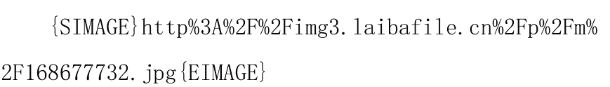

作者:66端午88 日期:2014-02-03 10:20
@出生于西部 19900楼 2014-02-03 01:44:55
一群傻多看跌房价了，什么状况，什么世道？

站在高高的山岗上，辛苦了，央行会救你的。我国存准率20%多哪，银行存贷比也比较低，拨倍率也很高，债务比例还没到100%，按理来说还有释放空间，就是底层老百姓已经跟不上这个节奏了。需大幅增加福利和保障，这样就会降低政府投资比例，如果都保，就得拼命卖地，房产市场会承受巨大压力，好赖还有个股市帮着扛，股民更惨不是，过了春节，股民就该欲哭无泪了。

作者:66端午88 日期:2014-02-03 11:53

加v信1101284955，获取更多好帖

@66 端午88 19903楼2014-02-03 10:10:53
每个人情况不一样，所在城市也不同，购置的物业也不尽相同。从我看明白趋势的2000年开始，已经有14年了。
房价涨幅越涨越快，现在的1%，相当于2000年的近7-10%
（增量），这是网友列出帝都2009年至2013年间，四年的
涨幅。房价就算回落，也根本回不到2011年。货币使然，
我的减持，主要是在资产中占有比例实在过于离谱。消减至
7-8成比例只是回归正常比例。持有50-60%比例的人，根本
不用担心什么。
http://img3.laibafle.cn/p/m/168677732.jpg.....
.

@出生于西部 19906楼2014-02-03 11:21:20
你现在这样说，过不了两年还会继续减持。2011年鼓动
人家买入，现在又说减持，瞎折腾吗。

跌不回2011年，别说帝都，济南也跌不会去。
作者：66端午88日期：2014-02-03 13:00
回复第19908楼，@失去的记忆F
lz所在的济南现在供应过大，确实有风险。本人所在的
南昌，去年商品房成交500来万平，但明后年这几年大规模
搞拆迁，棚户区改造。每年拆迁面积都要300来万平。是不

加v信1101284955，获取更多好帖

是要房价大幅上扬的前奏？？现在南昌老城区拆迁补偿价格为1万1-1万4左右。新城区去年拍卖地价为5千到8千一平。现在南昌房价接近1万

本人觉得那次老城区城中村这种大规模被拆，房价和房租都会大规模上扬。一两年之后可以看到1万2到1万三左右。LZ觉得呢？

江西和湖南均为人口流出大省，不具备大幅上涨可能。2008年我倒是挺看好长沙，长春，沈阳的，那会房价在四千左右

作者:66端午88日期:2014-02-03 14:05

有几个朋友在南部山区盖野别墅，据他们讲：建筑成本现在大约2000到2500，死活下不去，建筑规模可以解决一部分成本，下2000是没可能，减了这块，那块就上去了，他们的别墅只通电，水都通不过去，都是自己打深井。济南的刚性建筑成本（各类都算上），3000以下是不可想像的，算上土地价格，很容易就奔5000，加上其他成本，6000.是济南的可以接受价格，现在超了大约50%-100%。济南的问题不是房价太贵，是没啥经济热点，也没形成什么产业集群，商业机会也少，所以无法吸引外来人口，这是个大问题。

作者:66端午88日期:2014-02-03 22:27

@66端午88 2014-02-01 16:23:25

加v信1101284955，获取更多好帖

@朱晨霞 19879 楼 2014-02-01 15:44:11
买了地厂房造起出租怎么操作

厂房早就过剩了，去产能是主旋律，你现在盖的厂房，比

@朱晨霞 19914 楼 2014-02-03 20:49:10
那自己做产业呢

已经过了供应短缺时代，甚至连山寨都不再有价格竞争力，所以成就了很多这样的企业，比如雷军的小米，它根本不要有自己的生产系统，拿出解决方案，一个大量，就可以压着代工厂生产低价，这在美国是不可想象的，在中国，这成为可能，因为生产系统过剩。OEM盛行。你搞研发好了，只要足够先进，足够便宜，足够量大。要生产系统干什么。

作者:66 端午88 日期:2014-02-03 22:28

苹果也类似，只不过它对产品设计要求更苛刻，设计更精巧，功能和外型更时尚而已。

作者:66 端午88 日期:2014-02-03 22:29

@66 端午88 19903 楼 2014-02-03 10:10:53

每个人情况不一样，所在城市也不同，购置的物业也不尽相同。从我看明白趋势的2000年开始，已经有14年了。

加v信1101284955，获取更多好帖

房价涨幅越涨越快，现在的 1%，相当于 2000 年的近 7-10%（增量），这是网友列出帝都 2009 年至 2013 年间，四年的涨幅。房价就算回落，也根本回不到 2011 年。货币使然，我的减持，主要是在资产中占有比例实在过于离谱。消减至 7-8 成比例只是回归正常比例。持有 50-60%比例的人，根本不用担心什么。

http://img3.laibafle.cn/p/m/168677732.jpg.....

@出生于西部 19906 楼 2014-02-03 11:21:20 你现在这样说，过不了两年还会继续减持。2011 年鼓动人家买入，现在又说减持，瞎折腾吗。

@66 端午 88 19907 楼 2014-02-03 11:53:18 跌不回 2011 年，别说帝都，济南也跌不会去。

@Rambo 第 N 滴血 19910 楼 2014-02-03 13:30:24 也不可能跌回 2008 年底（金融海啸那时候）；更不可能跌回 2003 年。

@出生于西部 19915 楼 2014-02-03 20:55:37 你们错就错在太多事情，非要用成本理论分析，还有就

加 v 信 1101284955，获取更多好帖

是用经济理论分析中国的事情。呵呵呵。当然我绝不是说房价会跌回 2003 年，我觉得未来房价会跌为 0. 即一直卖不出去，直到烂掉为止。

--------------------------------

你这是极端缺乏智商的表现，比如有人要送给你黄金。

作者:66 端午 88 日期:2014-02-03 22:31

烂掉的盘有这样的特点，资产不抵债务，而且债务远远大于资产，这时才会烂掉。如果这个房子的资产价格大于债务价格，那么不会没有价值的。

作者:66 端午 88 日期:2014-02-03 22:35

小米不是无懈可击，就山寨它，它没有核心技术，功能比它强点，价格比它低点，摊薄到每个产品上的广告可以忽略为零，好吧，名字就叫大豆。只要有风投肯跟着你亏两年，小米的对手有很多。苹果则有门槛，它自己有操作系统，有后台支持，品牌支持，产品适用型和客户忠实度支撑，后续研发等等一系列要素，和苹果竞争得动大手术，小米则是容易被替代的产品。

作者:66 端午 88 日期:2014-02-03 23:13
回复第 19923 楼，@Rambo 第 N 滴血
@66 端午 88 19922 楼 2014-02-03 22:35:42

小米不是无懈可击，就山寨它，它没有核心技术，功能比它强点，价格比它低点，摊薄到每个产品上的广告可以忽略为零，好吧，名字就叫大豆。只要有风投肯跟着你亏两年，小米的对手有很多。苹果则有门槛，它自己有操作系统，有后台支持，品牌支持，产品适用型和客户忠实度支撑，后续研发等等一系列要素，和苹果竞争得动大手术，小米则是容易被替代的产品。

加 v 信 1101284955，获取更多好帖

略为零，好吧，名字就叫大豆。只要有风投肯跟着你亏两年，
小米的对手有很多。苹果则有门槛，它自己有操作系统，有
后台支持，品牌支持，产品适用型和客户忠实度支撑，后续
研发等等一系列要素，和苹果竞争得动大手术，小米则是容
易被替代的产品。


那 BlackBerry 黑莓呢？它有自己的系统呀。现在也要
死不活的准备步 NOKIA 的后尘了，作为多年的黑莓用户，有
点伤感。


BlackBerry 黑莓曾经占据智能手机半壁江山。至今的美
帝总统还在用 BlackBerry Z10，但如今看着也快混不下去了。
三年剖析一下 BlackBerry 混不下去的背后本质...


娱乐性不足，就是它是商务手机，没有实现全功能，而
且是封闭系统，在功能上输给苹果，在开放性上输给谷歌，
与此类似的还有微软和诺基亚，intel 跟微软靠得太近，一
同卷入涡流


作者:66 端午 88 日期:2014-02-03 23:21


互联网时代是赢者通吃的时代，一种商业模式最多可以
养活两个企业，跟在后面的只能做服务或者挺着亏，等前面
两个犯错误。苹果亏了十几年，终于等到微软犯错，谷歌等
到 ibm 犯错，现在 ibm 只好做服务，微软也在等苹果犯错，

它等到过这种机会，现在机会正在出现。上一次是 1988 年，
谷歌则具备超越以上企业的特质。
作者:66 端午 88 日期:2014-02-03 23:42
@66 端午 88    19911 楼 2014-02-03 14:05:46

有几个朋友在南部山区盖野别墅，据他们讲：建筑成本
现在大约 2000 到 2500，死活下不去，建筑规模可以解决一
部分成本，下 2000 是没可能，减了这块，那块就上去了，
他们的别墅只通电，水都通不过去，都是自己打深井。济南
的刚性建筑成本（各类都算上），3000 以下是不可想像的，
算上土地价格，很容易就奔 5000，加上其他成本，6000.是
济南的可以接受价格，现在超了大约 50%-100%。济南的问题
不是房价太贵，是没啥经济热点，也没形成......

@垮掉的视觉 19913 楼 2014-02-03 16:18:46
觉得山东，有几个城市摊薄了济南，比如威海，烟台，
青岛，富裕的人们并不在乎济南。而河南就稍好些，一亿人
的省份，只有一个郑州能拿得出手，所以去年郑州一度成为
中部涨幅最高的城市，官方吓得连夜出台    单身    限购
令。

济南是明显的政府主导经济典型城市，主要靠总部经济，
商业，物流，所谓的高新技术，文化行业。济南的实体经济

加 v 信 1101284955，获取更多好帖

早就全军覆灭了，比如上市公司曾经在十年前全体ST.

济南周边地区大部分都是走高污染高能耗低人力成本的路。胶东主要是海洋经济。山东造假成风这是大家都知道的，曾有鲁吹一号的诨名。咱就不谈这些龌龊的了，山东人思维保守，新行业很难在齐鲁大地拉出一队人马。人不行，啥都别谈，今后转型的目标是智慧+轻资产，尽量回避被高估的重资产。这是山东面临的最大问题。

作者:66端午88日期:2014-02-03 23:49

淘宝的对手并不是京东，国美，苏宁。而是全国的小商品市场为代表的零售行业。京东的对手是国美苏宁为代表的超级市场，京东如果有足够的风投和IPO资金，会抢夺超市的其它领域，比如冷冻市场，啥时候肉蛋菜奶粮食都给占领了，风投就控制了整个中国商品通路，在商业领域，中国面临被殖民的风险。好像综合百货模式的压力不算太大，不过份额也不算大，精品商城的对手盘是中央的反腐败政策。

作者:66端午88日期:2014-02-04 00:15

@66端午88 19931楼 2014-02-03 23:49:53

淘宝的对手并不是京东，国美，苏宁。而是全国的小商品市场为代表的零售行业。京东的对手是国美苏宁为代表的超级市场，京东如果有足够的风投和IPO资金，会抢夺超市的其它领域，比如冷冻市场，啥时候肉蛋菜奶粮食都给占领了，风投就控制了整个中国商品通路，在商业领域，中国面

加v信1101284955，获取更多好帖

临被殖民的风险。好像综合百货模式的压力不算太大，不过份额也不算大，精品商城的对手盘是中央的反腐败政策。

@Rambo 第 N 滴血 19932 楼 2014-02-04 00:00:26

我是京东商城的钻石会员哪。前几天新闻说强子东哥要把 JD 搞到美国去上市啊。

“啥时候肉蛋菜奶粮食都给占领了”……我常常在 JD 买 JD 自营食品哦（第三方配送的，直接过滤掉），什么油、袋装米、调味料、罐头、饮料、各色零食、咖啡……除了生鲜品类没法网购，已经成网购狂了。

目办法，偶家每年购物卡不老少，93 折卖掉，还不如去超市买东西。

作者:66 端午 88 日期:2014-02-04 00:16

@赵笨 3 19930 楼 2014-02-03 23:45:55

天津房价今年是涨是跌

靠着帝都好处多，年内降的可能不大。

作者:66 端午 88 日期:2014-02-04 15:58

360 的利滚利最高年化收益竟然超过 8%，过了春节买一些。

作者:66 端午 88 日期:2014-02-05 10:33

银行的两条腿之一：吸储能力正在被削弱，银行的放贷能力仍然维持，很有可能出现这种情况，中小额存款业务首先被新模式取代，真正的现金大户，比如央企，大型民企，财政这些领域的存款出现变化，在这些企业需要银行支持的环境下，信贷大户仍然是传统银行的中流砥柱，对于放贷业务，须等到中小银行准入限制政策松动后，才会和网络金融形成通路。

作者:66 端午 88 日期:2014-02-05 22:32
@fxl760919 19944 楼 2014-02-05 14:03:42
三年兄，我有个观点：

一是中国版的量化宽松还会继续，尽管目前货币政策趋于稳健。但是我只看成是本届政府挤水分的过程和阶段，为新型城镇化让出时间和空间。地方政府的债务问题、银行的坏账，也只能通过量化宽松来稀释，别无他法。

二是股市会承担下一个蓄水池的作用，楼市已经不具备增值空间，只能吸纳存量的资金。而新增的M2必须撬动股市来吸纳过剩的流动性，除了楼市和股市，其他金融产品的体量都很小，不足以吸......

中国的货币超发来源有两个，投资+外贸。核心都建立在房地产之上。卖地可提高土地估值，资产债券化，从而发行货币。外贸的表象是产品价格竞争力，内涵是人力成本低，

加v信1101284955，获取更多好帖

现在人口（有效劳动力）开始减少，货币超发后导致吃穿住行的成本大幅走高，其中最大的一块也是居住。这两个货币超发空间都已被大大压缩，导致中国的货币流转速度逐步降低，货币周转效率下降，体现在商品上，就是毛利率走低。
我们的经济一直都是GDP至上，其实也就是纸钞数量优先，而不是以人为本。

城镇化的表象是提高农村效率，内涵是提高农村资源价格，提高生存成本，所以，中国的城镇化最终的结果就是盖房，这样效率最高。

我们再看看外部情况，如果美元开始强势，人民币再盯准美元，中国的外销产品价格将很快失去竞争力，这个趋势不是马上就会逆转，先得找到加工中心的承接地。印度，印尼，墨西哥，含东南亚各国，都是潜在的承接地。关于投资，如果资金成本保持在目前水平，资产债券化将很快受阻。这些抵押贷款的资产，必须满足收益-资金成本-运营费用，大于零。他们提供的服务价格会涨价，如果涨价幅度超过竞争对手，那么谁来埋单？

关于股市问题，不想多说了，觉得水平高的就用小资金博弈创业板。今年的目标是在安全稳定固定收益里积少成多，现金为王。

作者:66端午88 日期:2014-02-05 22:34
@66端午88    19941楼 2014-02-04 15:58:51

加v信1101284955，获取更多好帖

360 的利滚利最高年化收益竟然超过 8%，过了春节买一些。

@阿狸在线 19947 楼 2014-02-05 21:55:11
请教这款理财产品的具体指示，谢谢！

写错了，是百度的利滚利，现在年化 7.5%，年前 8%，
这几天所有货币基金的收益都有所下滑，余额宝已经跌至 6%
多一点。

作者:66 端午 88 日期:2014-02-05 22:35
@叔宝哥 19945 楼 2014-02-05 15:19:14

楼主大哥好。前两天刚看到贵贴。比起那些没有对事物
认真观察仔细分析，再逐步验证的就大嘴说空说多的人楼主
比他们高得太多。深感到本贴看到的太晚了。错过了不少机
会。深感活在这个社会不动脑筋，人言亦言，没有独立思考
问题的能力人，最终只能在最底层混啊。

刚看几页我生活的地区也发生旧城改造，把民房，房改
房。拆了重建。一般是原地拆原地重建。我这里是华东某省
（人口净流入的）省会城市的一个区距离市区 20 公里
左……

2014 年，不算一线城市，能达到 5%涨幅的城市应该不

加 v 信 1101284955，获取更多好帖

多。

作者:66 端午 88 日期:2014-02-06 00:10
回复第 19953 楼，@huiergao
请问楼主，帝都还会维持涨势，还是横盘博弈，哪个可能性大一些？

北京是最后一个不涨的，权利中心，中国经济始终都是围绕权利作文章，政府主导的经济。

作者:66 端午 88 日期:2014-02-06 00:12
回复第 19951 楼，@出生于西部
@叔宝哥 19945 楼 2014-02-05 15:19:14

楼主大哥好。前两天刚看到贵贴。比起那些没有对事物认真观察仔细分析，再逐步验证的就大嘴说空说多的人楼主比他们高得太多。深感到本贴看到的太晚了。错过了不少机会。深感活在这个社会不动脑筋，人言亦言，没有独立思考问题的能力人，最终只能在最底层混啊。

刚看几页我生活的地区也发生旧城改造，把民房，房改房。拆了重建。一般是原地拆原地重建。我这里是华东某省（人口净流入的）省会城市的一个区距离市区 20 公里左......

@66 端午 88 19950 楼 2014-02-05 22:35:41

加 v 信 1101284955，获取更多好帖

2014年，不算一线城市，能达到5%涨幅的城市应该不多。

不是说房地产投资依然无忧吗？现在余额...

现在不买或者卖出，不代表未来不买，前面讲过，只要房产作为资产的一项进入投资配置，它始终存在价值。去完杠杆和泡沫再定买入时机。

作者:66端午88 日期:2014-02-06 14:35

回复第19957楼，@出生于西部

回复第19951楼，@出生于西部

@叔宝哥19945楼2014-02-05 15:19:14

楼主大哥好。前两天刚看到贵贴。比起那些没有对事物认真观察仔细分析，再逐步验证的就大嘴说空说多的人楼主比他们高得太多。深感到本贴看到的太晚了。错过了不少机会。深感活在这个社会不动脑筋，人言亦言，没有独立思考问题的能力人，最终只能在最底层混啊。

刚看几页我生活的地区也发生旧城改造，把民房，房改房。拆了重建。一般是原地拆原地重建。我这里是华东某省（人口净流入的）省会城市的一个区距离市区20公里左......

加v信1101284955，获取更多好帖

@66端午88 19950楼2014-02-05 22:35:41

2014年，不算一线城市，能达到5%涨幅的城市应该不多。

自2011年，东外环向东附近，房价从六千五涨到九千以上，西客栈从四千五涨到七千以上。涨幅一般在40%至50%。
传统二环内，已无一万四以下纯住宅，多层绝迹，容积率最低3.5以上。目前小高层板楼就算最好的建筑结构。

作者:66端午88日期:2014-02-06 15:29

安卓系统的某些缺点和XP的缺点类似，有些程序执行完毕后，后台程序不能关闭，系统垃圾也无法自动清理，如果装个360，这些问题可以解决。问题是360也占用一些资源。总之，手机越用越慢，效率越来越差。

作者:66端午88日期:2014-02-06 15:42

回复第19966楼，@Rambo第N滴血
@benlii 19960楼2014-02-06 05:19:01
@66端午88 19922楼2014-02-03 22:35:00

小米不是无懈可击，就山寨它，它没有核心技术，功能比它强点，价格比它低点，摊薄到每个产品上的广告可以忽略为零，好吧，名字就叫大豆。只要有风投肯跟着你亏两年，小米的对手有很多。苹果则有门槛，它自己有操作系统，有后台支持，品牌支持，产品适用型和客户忠实度支撑，后续研发等等一系列要素，和苹果竞争得动大手术，小米则是容易被替代的产品。

三年估计没有用过小米的系统，我用过市面几乎各种安卓开放的手机系统，小米毫无疑问第一，好三星超过50%，下来就是华为，联想等，阿里的系统很烂，htc也不行，用过小米的系统你就知道小米的优势不是硬件价格，是软件，这是无法打败的。

@沧海水手91888 19967楼 2014-02-06 15:26:08

小米是抄袭meizu而起，魅族又是模仿苹果手机，只不过炒作更好而已，都没有自己核心的技术，还有那个锤子系统，基本上都属于山寨范畴。

@Rambo第N滴血 19969楼 2014-02-06 15:32:05

那个COS所谓“自主”系统，就要想骗科研经费。想重演当年上海交大的“汉芯”事件骗点科研经费。

关于科研经费，国内算是套取体系内资金的一条隐匿小路，我个老师，每年都能拿到千万左右的科研经费，去年买了2500平写字间，真是悠哉惬意。另有个朋友，专门做国家级科研经费掮客，服装生意全部放弃，小日子过的一个爽字，这就是我国科研现状，真正搞科研的落不到几粒米，经费都被中间人和发放人搞去了。

作者:66端午88 日期:2014-02-06 15:47

回复第19957楼，@出生于西部

回复第19951楼，@出生于西部

@叔宝哥19945楼 2014-02-05 15:19:14

楼主大哥好。前两天刚看到贵贴。比起那些没有对事物认真观察仔细分析，再逐步验证的就大嘴说空说多的人楼主比他们高得太多。深感到本贴看到的太晚了。错过了不少机会。深感活在这个社会不动脑筋，人言亦言，没有独立思考问题的能力人，最终只能在最底层混啊。

刚看几页我生活的地区也发生旧城改造，把民房，房改房。拆了重建。一般是原地拆原地重建。我这里是华东某省（人口净流入的）省会城市的一个区距离市区20公里左……

> ------------------------

@66端午88 19950楼 2014-02-05 22:35:41

2014年，不算一线城市，能达到5%涨幅的城市应该不多。

> ------------------------

@66端午88 19961楼 2014-02-06 14:35:15

自2011年，东外环向东附近，房价从六千五涨到九千以上，西客栈从四千五涨到七千以上。涨幅一般在40%至50%。传统二环内，已无一万四以下纯住宅，多层绝迹，容积率最低3.5以上。目前小高层板楼就算最好的建筑结构。

@出生于西部 19965楼 2014-02-06 15:08:18

你怎么不说，北京的房价从2万涨到4万了呢？有些特例抓着有什么意思？有些房子是在开盘前认购，或是开发商高息早期集资的，购买是有风险的，那时当然会便宜，但相同的房子，这两年就没涨多少。

房租你咋不算哪？我有套标价180万的房子，年租8万，已经三年了，现在房价也没涨多少，出租一直稳定。竟然房租也没长，反而那些中低端住宅的租金涨了40%左右。和商务联系密切的房产，这两年租金都涨的很少，甚至没动。涉及民生的房子，租金一路飙升。人力成本提高的结果。

作者:66端午88 日期:2014-02-06 18:41

77万买的（算上全部费用），如果一直存2年定期，本金应该为：110万左右。现在拿出来存余额宝，每年收益最多7万多。关键有一个问题，货币基金收益是不稳定的，一般也就2-3.5%的收益，从去年四季度突然提高了，伴随银行存款增量减少。关键问题，谁会一直有耐性的存定期哪？

作者:66端午88 日期:2014-02-06 19:44

回复第19983楼，@出生于西部
@bandittalent2 19975楼 2014-02-06 15:59:22

楼猪，你看不明白大势，不要嘴硬了。
180万租8万，你还不如卖了存余额宝，好歹随用随取，利息比你房租还高。

@Rambo第N滴血 19976楼 2014-02-06 16:02:36

你跟本就没有理解楼主这句话“我有套标价180万的房子”，是指现在在中介的挂牌价，不是指当年的进货价。

楼主又说了，房价根本没涨，只是货币贬值了也就是说，现在的180万跟当年的进货价的资金成本是一样的。

是的，房价除了在四个一线，几个强二线城市超越了货币增发，其它城市相对于货币增速，只能算保值而已，可惜，又有几样能扛得过货币超发。黄金败下阵后，除了专业性非常强的一部分收藏品外，只剩下房产了。这更凸显了买卖时机的重要性。

作者:66端午88 日期:2014-02-06 19:57

加v信1101284955，获取更多好帖

西部同学，你不是买在更高的价位上了吗，有时候你明知道是个坑也得跳，房产有多种功能，如果是为了居住，根本不要在乎价格，有能力买，就买住着最舒服的。这时，它不是坑，是通往幸福之路，投资必定不是生活的全部，我们谈的投资，基本不涉及第一套自住房，我们谈得是如何对抗通胀，如果没有通胀，房价也不会这样快的涨法，平淡的收益比较适合我的策略，房租积累，低价增持核心位置标的，前提是货币靠谱，货币一不靠谱，什么都不再靠谱。当你把估值工具转换为地产，结果地产又超量的增发，中国还有靠谱的玩意吗。

作者:66端午88 日期:2014-02-06 22:50

@benlii 20011楼 2014-02-06 22:15:25

回复第19989楼 (作者：@Rambo第N滴血 于 2014-02-06 19:37)
@66端午88 19981楼 2014-02-06 18:41:47
77万买的（算上……
==========
西部的思维貌似有点问题，看问题过于片面
---------------------------
他没贷过款吧，我买的第一套房子，只花了10万，20%首付，8折利率。还有五年多就还清了，现在最低成交价1.6万/平，市场估值160万以上，租金5万/年。而且还是写字间。当时要是买住宅，同位置的也就3000，估值也差不多1.4-1.5之间。按照这个收益率，怎么算？出租回报率50%。就算刨去按揭，出租回报率是15%。他脑子已经进水了，呵呵。

作者:66端午88日期:2014-02-06 22:52

额的第一个商铺，今年就全部回本了，27万买的，首付13.5万，已全部还清，租金3.5万/年。按照出租回报13%左右。

作者:66端午88日期:2014-02-06 23:04

济南房价最贵的两个地方，其一是经十路从东外环到体育中心（老）沿线，其二就是山大路沿线。最近新开的盘，起价都在1.6万以上，容积率高达3以上。浪潮地块有两栋多层，起价竟然高达2.2万，这也是济南目前最贵的开盘价。

作者:66端午88日期:2014-02-06 23:24

@沧海水手91888 20015楼 2014-02-06 23:11:13

三年兄，现在换美刀怎么样？

> 得看美元走势，感觉还没到临界点。如果美元升值个15%--20%，人民币还在跟着傻涨，果断兑换美元。

作者:66端午88日期:2014-02-06 23:27

@benlii 20011楼 2014-02-06 22:15:25

回复第19989楼 (作者：@Rambo第N滴血 于 2014-02-06 19:37)
@66端午88 19981楼 2014-02-06 18:41:47
77万买的（算上……
==========
西部的思维貌似有点问题，看问题过于片面

@66端午88 20012楼 2014-02-06 22:50:42

他没贷过款吧，我买的第一套房子，只花了10万，20%首付，8折利率。还有五年多就还清了，现在最低成交价1.6万/平，市场估值160万以上，租金5万/年。而且还是写字间。当时要是买住宅，同位置的也就3000，估值也差不多1.4-1.5之间。按照这个收益率，怎么算？出租回报率50%。就算刨去按揭，出租回报率是15%。他脑子已经进水了，呵呵。

@出生于西部 20017楼 2014-02-06 23:23:03

不得不说，你的意淫水平太过强大，50万买的房子，升值到160万，至少没有十年，也有八年时间了吧。当时花10万首付，现在都10年过去了，租五万，你直接说什么出租回报率50%，你是真傻，还是装傻？你那商铺的出租回报率就3.1%，你租五万一年，难道你刚买时就租五万一年？在购买第一年时，你的租金连利息都抵不上吧。

2001年买的，开始买了打算自己用的，用了不到两年，太小不够用了，又买了大的房子做注册地点。这套就一直出租ING---

作者:66端午88 日期:2014-02-06 23:55

@出生于西部 20020楼 2014-02-06 23:27:57

这就是你们傻多眼中的大神吗？如果楼主真的成功了，原因也只能归咎于三个字：运气好！上千万的房产投资，每年收益才30万。原帖地址:

=====================

大伙帮忙指条明路

楼主:66端午88 时间:2009-09-09 00:08:00 点击:365 回复:5

回复 收藏 更多 楼主

找到房地产评估师，来精算了一下偶的房产投资，竟然已经价值上千万了。邪门，是不是......

最后买的三个商铺有两个未交付，一个空租，公司自用三套，自住一套，要是都租出去，可以直接退休了。不过，商铺看来前景暗淡，要是当时买住宅就好了，该死的淘宝。不过今年到明年，空出来的三套就可以出租了，北美学区房已经开始贡献收益。不作就不会死，果断冬眠掉看起来盈利，事实上亏损的实体公司。等到媳妇退休，搬到南方去养老，游山玩水摄影写作。你还是扎扎实实在淘宝练摊吧，目人练摊，额的三个商铺就租出去了，如果这样媳妇也能提前退休了。

作者:66端午88 日期:2014-02-06 23:56

回复第20018楼，@66端午88

@沧海水手91888 20015楼 2014-02-06 23:11:13

三年兄，现在换美刀怎么样？

得看美元走势，感觉还没到临界点。如果美元升值个15%--20%，人民币还在跟着傻涨，果断兑换美元。

@沧海水手91888 20021楼 2014-02-06 23:43:51

看看退出qe节奏

还有，就怕外汇临时管制

如果换美刀，是否持有现金，储存是个问题啊！

去香港开个户踏实点。

作者:66端午88 日期:2014-02-07 00:28

@出生于西部 20020楼 2014-02-06 23:27:57

这就是你们傻多眼中的大神吗？如果楼主真的成功了，原因也只能归咎于三个字：运气好！上千万的房产投资，每年收益才30万。原帖地址：

=====================

大伙帮忙指条明路

楼主：66端午88 时间：2009-09-09 00:08:00 点击：365 回复：5

回复 收藏 更多 楼主

找到房地产评估师，来精算了一下偶的房产投资，竟然已经价值上千万了。邪门，是不是......

@66端午88 20025楼 2014-02-06 23:55:01

最后买的三个商铺有两个未交付，一个空租，公司自用三套，自住一套，要是都租出去，可以直接退休了。不过，商铺看来前景暗淡，要是当时买住宅就好了，该死的淘宝。不过今年到明年，空出来的三套就可以出租了，北美学区房已经开始贡献收益。不作就不会死，果断冬眠掉看起来盈利，事实上亏损的实体公司。等到媳妇退休，搬到南方去养老，游山玩水摄影写作。你还是扎扎实实在淘宝练摊吧，目人练摊，额的三个商铺就租出去了，如......

@出生于西部 20027楼 2014-02-07 00:15:33

你前面又说淘宝影响不了实体店，说淘宝不行啊咋又变了呢,

======

楼主：66端午88时间：2011-02-28 15:10:36

搞笑，我也有房子租给网商，而且是本地最大的网商之一，任何经营活动，包括网销，无一能脱离地产生存，也许吧，以后可以用移动销售，呵呵。还得给你说一下，淘宝现在网上做销售的大部分是有实体店铺经营的，闷在家里做的，纯属玩玩而已，把它当职业做的，网销只是其中的销售通路之一，网销对于……

@66端午88 20030楼 2014-02-07 00:28:06

我还是买了商铺，尽管知道有可能会被套住，有可能空租一阵子，我有能力靠到淘宝没落，从资产配置上讲，当时我的商铺持有量不足。没想到去北美留学的中国学生会有这么多，一间周租100加元不带卫生间的单间很快就租罄了，雇了个中国学生管理加开车接送。年收益近10%，不到两年，想再投入已经买不起了，北美房价最近两年涨了不少，特别是针对东亚留学生的周转房，太稀缺了，中国人特喜欢扎堆住。

@出生于西部 20028楼 2014-02-07 00:16:25

不如我带你练摊去？

你自己都快崩溃了，还拉着俺练摊，嫩不安好心啊，打算也把俺练崩溃了吧。

@出生于西部 20027楼 2014-02-07 00:15:33

你前面又说淘宝影响不了实体店，说淘宝不行啊咋又变了呢,

======

楼主：66端午88时间：2011-02-28 15:10:36

搞笑，我也有房子租给网商，而且是本地最大的网商之一，任何经营活动，包括网销，无一能脱离地产生存，也许吧，以后可以用移动销售，呵呵。还得给你说一下，淘宝现在网上做销售的大部分是有实体店铺经营的，闷在家里做的，纯属玩玩而已，把它当职业做的，网销只是其中的销售通路之一，网销对于……

@66端午88 20030楼 2014-02-07 00:28:06

我还是买了商铺，尽管知道有可能会被套住，有可能空租一阵子，我有能力靠到淘宝没落，从资产配置上讲，当时我的商铺持有量不足。没想到去北美留学的中国学生会有这么多，一间周租100加元不带卫生间的单间很快就租罄了，雇了个中国学生管理加开车接送。年收益近10%，不到两年，想再投入已经买不起了，北美房价最近两年涨了不少，特别是针对东亚留学生的周转房，太稀缺了，中国人特喜欢扎堆住。

The request was rejected because it was considered high risk

快递这种门槛低的行业，掌握不了话语权，会快速被新来者摊薄利润。

@出生于西部 20092楼 2014-02-11 12:09:35
那电商就更惨了，拿天猫来说，入驻费用十万或往上，一年营运费用不下20万，但新来者只需一千保证金就能跟它抢生意了。

@朱晨霞 20101楼 2014-02-11 13:17:00
你的意思是实体经济不能完全依赖网络销售对吧

@出生于西部 20106楼 2014-02-11 15:08:32
网络销售，更多的是一种概念炒作。真正的网销是很虚的。网销就是一大泡沫。

对于小本经营，网络推广，无疑是一种低廉的广告和模式推荐，别依赖它，但可以利用它。

@66端午88 20109楼 2014-02-11 15:15:15
以前那种酒好不怕巷子深，现在很难再成功了，不过你还是得首先抓自己的产品特色和质量，首先要质量过得硬，然后再谈应用新模式，不管什么模式，最终决定市场的还是质量和特色，吃穿住行这种基础消费，相比来说还是最稳定的，济南好多小吃的利润率和盈利都是可怕的数字，只是很少有人关注它而已。比如投资房产出租，你房子太好，收益率反而低，你得盯住最大客户群。吃喝同样如此，那么不方便的火车，不论自由度还是舒适度，快捷程度都最差，可是客户群是最大的。

@bandittalent2 20081楼 2014-02-10 14:55:23
快递这种门槛低的行业，掌握不了话语权，会快速被新来者摊薄利润。

@出生于西部 20092楼 2014-02-11 12:09:35
那电商就更惨了，拿天猫来说，入驻费用十万或往上，一年营运费用不下20万，但新来者只需一千保证金就能跟它抢生意了。

@朱晨霞 20101楼 2014-02-11 13:17:00
你的意思是实体经济不能完全依赖网络销售对吧

@出生于西部 20106楼 2014-02-11 15:08:32
网络销售，更多的是一种概念炒作。真正的网销是很虚的。网销就是一大泡沫。

@66端午88 20109楼 2014-02-11 15:15:15
对于小本经营，网络推广，无疑是一种低廉的广告和模式推荐，别依赖它，但可以利用它。

@出生于西部 20111楼 2014-02-11 15:20:21
你最好去试一试，纸上谈兵是没有用的。网络推广，并非低廉，恰恰相反，是昂贵！网销相对于实体，最大的一个特点，是门槛低，这个是淘宝模式促成的，也是唯一的一个优点，但即是优点，后期也是缺点。所以网销注定了就是入手快，但后期发展很难，因为竞争者太多了。很多人没做过的，都认为网销有前途，一个人面对全国的市场，看，想得多美。事实上，不是这么回事，恰恰相反，实体店才是有前途的，网销压根没前途。

我经常在微信上发现附近有人做产品特色推广，成本是多少啊。微博也是这样，BBS里现在也有，不过贴经常被管理员删除，于是就写软文。神马QQ群之类的，有的是，无孔不入，成本很低的。不要小本买卖进行大策划，这样才不值，等到一定规模了，再从专业渠道发布广告。这是适配原则。

@66端午88 20112楼 2014-02-11 15:20:22
以前那种酒好不怕巷子深，现在很难再成功了，不过你还是得首先抓自己的产品特色和质量，首先要质量过得硬，然后再谈应用新模式，不管什么模式，最终决定市场的还是质量和特色，吃穿住行这种基础消费，相比来说还是最稳定的，济南好多小吃的利润率和盈利都是可怕的数字，只是很少有人关注它而已。比如投资房产出租，你房子太好，收益率反而低，你得盯住最大客户群。吃喝同样如此，那么不方便的火车，不论自由度还是舒适度，快捷程度都最差，可是客户群是最大的。

@出生于西部 20115楼 2014-02-11 15:25:34
纸上谈兵。

得，你脑子简单，所以很快乐，即使赚不到米，也很快乐，这也是能耐：)

@bandittalent2 20081楼 2014-02-10 14:55:23
快递这种门槛低的行业，掌握不了话语权，会快速被新来者摊薄利润。

@出生于西部 20092楼 2014-02-11 12:09:35
那电商就更惨了，拿天猫来说，入驻费用十万或往上，一年营运费用不下20万，但新来者只需一千保证金就能跟它抢生意了。

@朱晨霞 20101楼 2014-02-11 13:17:00
你的意思是实体经济不能完全依赖网络销售对吧

@Rambo第N滴血 20102楼 2014-02-11 14:07:09
你没理解三年这句话。“那电商就更惨了，拿天猫来说，入驻费用十万或往上，一年营运费用不下20万，但新来者只需一千保证金就能跟它抢生意了。”这句话的意思大致是：“练摊”这种商业模式，低门槛低利润率且容易被模范复制，一大群人一窝蜂的拥过来，就滥了。

京东商城那种国内的B2C巨头，也还没赚钱。刘强东正要跑美国上市融资。

@出生于西部 20107楼 2014-02-11 15:12:00
JD模式，连淘宝模式都不如。实际JD是不可能赚钱的。JD的直接竞争对手就是实体店，网销PK实体店，在国外或许能成功，但在国内这种营商环境下，那是不可能成功的。因为国人的信用问题，这种文化土壤，基本是不可能的。国内唯一有点搞头的，就是马云的C2C模式，现在大家说主流是B2C，并非如此。因为现在的那个B，就是由原来的大C转变而来的，本质上还是C，淘宝模式的成功根本就在于一点，门槛低。中国的网销注定了，它就只能卖点小东西，价值不大的东西，因为中国人没有信用。还是面对面交易更好一点。

@Rambo第N滴血 20110楼 2014-02-11 15:19:35
“价值不大的东西”？过万的服务器，都在京东采购了N台了。

我个人感觉很好与相反，京东模式比淘宝模式更靠谱。

@出生于西部 20114楼 2014-02-11 15:24:12
现在京东也开始学淘宝招商了，你随便搜一个产品，京东自营所占比例已经不太大了。这就是走的天猫模式，天猫模式本质是什么？本质还是淘宝模式，不同的就是，天猫是明着收钱多收钱，淘宝暗着收钱，少收钱。交钱多的，保护的多，交钱少的或不交钱的，留给刁钻买家当猪宰。收钱方式不一样罢了。如果京东模式那么牛叉，为什么淘宝没有学京东自己经营货品？

@Rambo第N滴血 20116楼 2014-02-11 15:27:24
从消费者的角度，我个人习惯于把京东的“第三方配送”统统过滤掉（服装鞋帽除外，因为服装鞋帽类大部分是“第三方配送”，过滤掉就不剩下什么了）。基本只败京东自营商品，特别是食品，从来不败“第三方配送”。

@出生于西部 20122楼 2014-02-11 15:33:32
即然第三方配送，不是京东的强项，为什么他又非要学习这玩意，不是画蛇添足。？原因就是，京东模式，在中国的土壤上，是难以为继的。

@Rambo第N滴血 20123楼 2014-02-11 15:38:40
不和嫩争了，西部农妇真烦。我还是看好京东胜过淘宝。由将来的历史去验证吧。

@出生于西部 20124楼 2014-02-11 15:44:38
你也不看京东赚了多少钱，淘宝赚了多少钱，只会人云亦云，无脑啊。

@66端午88 20125楼 2014-02-11 15:46:45
淘宝是租铺模式，京东是超市模式，淘宝不靠销售赚钱，靠租铺和其它服务赚钱。京东得抗各种费用。这是最大区别。

@Rambo第N滴血 20128楼 2014-02-11 15:55:38
从消费者的角度来看。本人早已不逛淘宝，假货太多，第三方快递“4通一达”经常有偷盗事件，不放心。京东快递的服务质量还不错，与顺丰有一拼。中关村电脑城的衰落，就是刘强东说的“报应”。

@Rambo第N滴血 20130楼 2014-02-11 15:57:15
也就是说。淘宝如果不清理假冒伪劣商品，改善配送的话，迟早也像帝都中关村电脑城的今天一样。

@出生于西部 20132楼 2014-02-11 16:01:28
不会的，因为中国象楼主和你的这种人太多了。没有辨识能力，爱扎堆，人云亦云。你所说的有潜力的JD模式，事实上，才占电销份额的多少呢？太少了，少的要招商了，再不招商，收到押金，服务费啥的，都要倒台了，开始向马云学了。请记住我一句话：中国人是不舍得消费的，只舍得投资。如果是消费，主要也是面子消费。呵呵。

这不客观，我正在运作一个项目，不便透露，等着门槛修好了再给你讲道理，舍得放弃过去旧模式，才能获得崭新的愿景，非常看好这个项目。:)

@出生于西部 20131楼 2014-02-11 15:58:10
马云最爱读的书，就是毛选，马的一套，就是毛的那一套东西，楼主懂？

你可以借鉴别人的过去，但是却无法效仿别人的过去，别人的过去，就是一路修建门槛的过去，你也就在后面看看而已，你迈不过去的。

@tanta 20133楼 2014-02-11 16:28:38
@出生于西部 2014-01-17 11:54:19
@66端午88
我前多少页就说了，房价五年内会慢慢腰斩，没想到2013年又诈尸了一把，把老子也套进去了。周期可能长了一点，但长期来看，也可能是8年，也可能是10年，大多数城市房价会腰斩掉是没什么问题的。别拿通胀说事，通胀了十几年了，手机价格都通胀到原来的1/3了，供应过剩的东西，老百姓手里都有的东西，有民资参与的东西，再怎么通胀，价格都是要暴跌的。十年后......

@出生于西部 20134楼 2014-02-11 16:32:09
你是挖我的坟呢？还是？没错，我相信2020年左右，房价会腰斩。

货币量净减少，房价才会跌，涨多涨少而已，能不能对冲CPI而已。土地价格这么高，或者形成烂尾，或者无成交量。跌价崩溃一说，早就在前面论证是不可能的了。

我了个去，环保部要扩权，权利范围直指国土资源部某些职能。这是个刚组建的部门，也是除了国土部外最腐败的部门，唉，目话说了。

姜部长厉害啊，就没见过升官这么快的，在济南时，第一年是市委挂名的副书记(任命)，团中央调来的，第四年就代省长了。一换届，省长兼省委副书记，第六年省委书记，尼玛，光速，眼花聊乱。山东是最容易出政绩，贴金脸的地方。官员敢吹会拍，老百姓倍穷。

可怕的趋势，本年度第一季度，一线城市土地价格同比上涨231%，事实上土地虽然涨价，但是涨价幅度没这么大，只是数据和可恶的统计局数字切割开，体现了它真实的价格水平，触目惊心。

@jphr
@66端午88 20152楼 2014-02-12 09:07:12
可怕的趋势，本年度第一季度，一线城市土地价格同比上涨231%，事实上土地虽然涨价，但是涨价幅度没这么大，只是数据和可恶的统计局数字切割开，体现了它真实的价格水平，触目惊心。

你是想说明这样房价将有一个暴涨吗？

@66端午88 20154楼 2014-02-12 12:04:19
暴跌找不到依据，跑不赢CPI是大概率，钝刀割肉，更有迷惑性。

@朱晨霞
你是说对房地产现在开始钝刀割肉的时代了吗

是的，很显然满足了钝刀割肉的特征。

引用新闻：济南原“第一高楼”资金链断被拍卖 买房者心急如焚

这是大型项目中，第一个烂尾楼的雏形，对于山东省的房地产市场，这也是比较有代表性的案例，背后的原因很清楚，实体经济已经无法承载如此巨额的商业地产供应量，隐含更重要问题是，实体经济发展已经陷入停滞，没有商业活动支撑的商业地产，将是首先破灭的虚幻。从2011年提出对商业地产应持非常谨慎态度。三年后，问题终于爆发了，而且这个爆发基本可以确立引导未来的商业地产走向悬崖的通路已经打开。在建的绝大部分商业地产都存在风险因素。风险将会延一下进程展开：商业地产（在建）------商业地产（新建，偏远）--------商业地产（新建，超额供应的核心位置）--------（前者包含写字间，公寓，商场商铺和高价的门丁铺）--------商住两用--------高端住宅楼。

唯一可能躲过风暴的是：单位房，房改房，低端低价优良位置的普通商品房。

低端低价优良位置的普通商品房 -------（这条是指拆迁置换房）

上述风险品种都是土地转让金的大户，地方政府将会严防死守，力保土地收入稳定增加，会出台若干政策支持土地价格：比如，以购置商业地产抵充地税，所得税优惠，土地优惠，土地使用费减免等等。但都不能对冲掉高价土地成本对企业利润的侵蚀，国营大型垄断企业将会响应号召，但是成本他们不会扛。公共服务价格将会迅速上涨。这种现象将在很短时间内反应在百姓的支出成本上，可能在一年内就会体现出来。成本支出的通胀+盈利的萎缩=滞涨，它终于来了。

@期待80岁的幸福 20174楼 2014-02-15 16:06:50
三年哥，我认为除掉几个一线城市，大部分的城市从2010-2014年其实总体涨幅并不大，所以我坚持认为现在整体是没有泡沫，当然现在买点一般，近几年最好的买点应该是在2012年年中，价格最低，首套贷款有折扣。

对未来，从近期土地价格上看，房价还要涨，2014年有闲钱再买房还是不错的选择，特别是珠三角中山，佛山之类的气候和商业都不错的宜居城市。

西部最可爱，喜欢高谈阔论，讲创新，讲大方向，其实创新是牛人的事情……

我们探讨过房地产被什么承载，是什么因素导致它涨的更高（比正常涨速）。它的承载是实体经济创造的财富，什么促进房地产加速上涨，如果排除了稀缺因素后，剩下的基本就是货币贬值因素。房地产不会崩盘这个结论，我们也探讨过，因为它属于吃穿住行四大基础消费中的一类，而且和货币存量一一对应。货币不会减少，存量房地产很难跌价。现在的情况是货币发行速度限制改善，而房地产供应量大幅提高，房地产具备区域特性，普遍获利的形势已经发生逆转。除非领导层强行发钞。

知行合一，我和两个朋友准备投资一个老行业的转型，权作对这今年来的认知做个总结性的实践。看看是否能超越房地产收益率，跨了不知道多少个行业，偶现在只是这个行业的新兵，希望用剩下那点冲劲，看看能不能做起来。如果偶能做到，谁还能做不到哪。

作者:66 端午 88 日期:2014-02-15 20:58
回复第 20175 楼，@66 端午 88
@期待 80 岁的幸福 20174 楼 2014-02-15 16:06:50
三年哥，我认为除掉几个一线城市，大部分的城市从2010-2014年其实总体涨幅并不大，所以我坚持认为现在整体是没有泡沫，当然现在买点一般，近几年最好的买点应该是在 2012 年年中，价格最低，首套贷款有折扣。

对未来，从近期土地价格上看，房价还要涨，2014 年有闲钱再买房还是不错的选择，特别是珠三角中山，佛山之类的气候和商业都不错的宜居城市

西部最可爱，喜欢高谈阔论，讲创新，讲大方向，其实创新是牛人的事情......

@沧海水手 91888 20176 楼 2014-02-15 20:57:56
饭馆？

不干那玩意，利润率太低。

作者:66 端午 88 日期:2014-02-15 21:00
月末，广义货币 (M2) 余额 112.35 万亿元，同比增长 13.2%
中国不滥发货币真的是不行啊，尼玛，112 万亿了。

作者:66 端午 88 日期:2014-02-15 21:18
@期待 80 岁的幸福 20174 楼 2014-02-15 16:06:50
三年哥，我认为除掉几个一线城市，大部分的城市从2010-2014年其实总体涨幅并不大，所以我坚持认为现在整体是没有泡沫，当然现在买点一般，近几年最好的买点应该是在2012年年中，价格最低，首套贷款有折扣。

对未来，从近期土地价格上看，房价还要涨，2014年有闲钱再买房还是不错的选择，特别是珠三角中山，佛山之类的气候和商业都不错的宜居城市

西部最可爱，喜欢高谈阔论，讲创新，讲大方向，其实创新是牛人的事情......

@66 端午88    20175楼 2014-02-15 19:15:47
我们探讨过房地产被什么承载，是什么因素导致它涨的更高（比正常涨速）。它的承载是实体经济创造的财富，什么促进房地产加速上涨，如果排除了稀缺因素后，剩下的基本就是货币贬值因素。房地产不会崩盘这个结论，我们也探讨过，因为它属于吃穿住行四大基础消费中的一类，而且和货币存量一一对应。货币不会减少，存量房地产很难跌价。现在的情况是货币发行速度限制改善，而房地产供应量大幅提高，房地产具备区域特性，普遍获利的形势已经发生逆转。除非领导层强行发钞。

知行合一，我和两个朋友准备投资一个老行业的转型，权作对这今年来的认知做个总结性的实践。看看是否能超越房地产收益率，跨了不知道多少个行业，偶现在只是这个行业的新兵，希望用剩下那点冲劲，看看能不能做起来。如果偶能做到，谁还能做不到哪。

@Rambo 第 N 滴血 20179 楼 2014-02-15 21:03:07
"准备投资一个老行业的转型"……老行业，我猜一下，教育，是老行业。搞培训像新东方那种或者更新的培训模式？

没人会想到这个行业，呵呵

作者:66 端午 88 日期:2014-02-16 20:19
眼看楼市就沦为滚刀肉了，又见央行发钞烧火，央企玩命哄抬地价，创四年来首月贷款量新高，这就是中国经济的特色，嘴里喊的，手上做的完全不一致，甚至完全相反。嚓，变态至极，看来，对于管理层的屁声，偶等 P 民只好喊声：这口美声真的曼妙无比。

作者:66 端午 88 日期:2014-02-16 21:55
这是 2014 年 1 月济南在售楼盘价格（均价），二环内，已无万元以下楼盘。核心地段房价为：15000 以上，容积率不低于 3.5,济南房价的分水岭，1 月份，成交量大幅萎缩，成交价格继续小幅抬升，进入投机区间，不宜购入任何房产。

{SIMAGE}http%3A%2F%2Fimg3.laibafile.cn%2Fp%2Fm%2F169525634.jpg{EIMAGE}

作者:66 端午 88 日期:2014-02-17 08:49
@出生于西部 20193 楼 2014-02-17 01:57:07
2011 年后再投资房产的，被套死的，现在有多少，楼主的目的达到了，呵呵，当然楼上那位投资买小产权的不算套死，按他的说法，收房租都够本了。可惜，他的行为是2011年的杀猪论指导的。@duobiandehail234 你承认吗？如果你买的是大产权房，你的出租收益怕是没这么高了吧，呵呵呵。

弱智是短板啊，房价调整不一定是以跌价形式进行，钝刀割肉不是让你一下绝望。而是跑不赢货币贬值。房价如果在价格上进行调整，也太低估政府的智商了，记着：你的智商永远比不上政府。在亚布力圆桌会议上，有两件事值得注意，第一：开发商说了他们的成本中（所有成本），61%都是直接向政府缴纳的，其中不含土地增值税。如果全算上，7成是挡不住的，就房产在形成固定资产前，政府是最大的收益者。我查看了全国对购买住房的奖励，除了一线城市外。所有的城市都规定购买一定数量房产，可以将户口迁入，这意味着城市补贴落实到个人。第二：房地产已经无法舍弃，众多开发商意识到，现在是政府绑定他们了（整体），整个财政收入的大半（不仅仅是地税方面，随着营改增的实施，国税中，房地产相关贡献比例也一直在提升，远远超过国企各类税收的贡献率，不吃地产，已经到了揭不开锅的局面）。从去年下半年开始，随着货币的紧缩，很多2，3线城市房价已经开始显著失去增长动力。我们看到今年一季度广义货币和贷款增长实现超规模双增。反而存款（库存货币）减少9000亿（互联网理财为主导），这说明又在放水（投资和外汇换款），途径是通过抵押资产和抵押未来资产而得。连雷军，做小米的雷军也无法抗拒如此高利润的行业。

作者:66端午88 日期:2014-02-18 08:48
@辛弃风 20212楼 2014-02-17 22:19:26
楼主 作为济南本地的
有两套房
一套50一套155
50的那套挂50多万 打算卖掉 是个学区房
因为目前租金2000每月 一年2400
50万存余额宝 3万收益
并且房价感觉实在是涨不动了
洪楼那片 新盘又盖了一个 也就9K多
你觉得如何 是否该卖了 小房呢？

卖红楼？除泉城路外最繁华的商业区，有好几个朋友在蔚蓝广场购置公寓，收益惊人，59平的租金在2800-3200之间，购置价格5200左右。那地方万达想买断，结果买不断。老房子业主要价高到开发商受不了。历城区政府招待所片区开发后，这个地方就直奔1.5万（新房），除经十路核心片区，山大路外，最看好这块核心区的升值价值，它背后商业支撑是非常难形成的。它的商业环境是自然形成加政府支撑两个因素，历城区作为最大的区，只有这一只脚踩进济南核心区，是政府投资的重点区域。下半年花园路和山大路交叉口东南区片开发后，山大路和花园就会练成片，形成济南最大的区域CBD，连泉城路也控制不了这么大区域。

作者:66 端午88 日期:2014-02-18 08:55
@混沌行为者 20194楼 2014-02-17 05:51:32
{SIMAGE}http%3A%2F%2Fimg3.laibafile.cn%2Fp%2Fm%2F169536876.jpg{EIMAGE}

@出生于西部 20207楼 2014-02-17 16:50:32
好图啊，楼主脸被打的叭叭的。

得了吧，南京房价走势我很了解，我媳妇MBA同班同学经常和媳妇联系，她是南京的，我记得她2003年在南京买第二套房子的时候，才4000多块。2011年买第十五套房子的时候，房价是1.2万。这才几年？翻番了。

作者:66 端午88 日期:2014-02-18 09:03
@宜昌童学馆 20218楼 2014-02-18 09:01:49
人口老龄化才是导致房市供需逆转的最根本原因。未来房价不可能再大幅上涨了，但同时也不可能大幅下跌。因为人民币同时也在大幅度地贬值。
中国儿童国学教育第一品牌——宜昌童学馆：
http://www.0717txg.com/

人民币大幅贬值，时机未到。美国人同意你大幅贬值吗？一月份外贸创新高，这是做死的节奏啊，美国人喊着振兴制造业，中国人一月份一个大棒子就扔过去了。

作者:66端午88 日期:2014-02-18 12:49
@期待80岁的幸福 20174楼 2014-02-15 16:06:50
三年哥，我认为除掉几个一线城市，大部分的城市从2010-2014年其实总体涨幅并不大，所以我坚持认为现在整体是没有泡沫，当然现在买点一般，近几年最好的买点应该是在2012年年中，价格最低，首套贷款有折扣。

对未来，从近期土地价格上看，房价还要涨，2014年有闲钱再买房还是不错的选择，特别是珠三角中山，佛山之类的气候和商业都不错的宜居城市

西部最可爱，喜欢高谈阔论，讲创新，讲大方向，其实创新是牛人的事情……

@66 端午88 20175楼 2014-02-15 19:15:47
我们探讨过房地产被什么承载，是什么因素导致它涨的更高（比正常涨速）。它的承载是实体经济创造的财富，什么促进房地产加速上涨，如果排除了稀缺因素后，剩下的基本就是货币贬值因素。房地产不会崩盘这个结论，我们也探讨过，因为它属于吃穿住行四大基础消费中的一类，而且和货币存量一一对应。货币不会减少，存量房地产很难跌价。现在的情况是货币发行速度限制改善，而房地产供应量大幅提高，房地产具备区域特性，普遍获......

@朱晨霞20222楼 2014-02-18 09:44:27
除了房地产还有其他行业可以做吗，利润还可以的行业

这届领导的思路是两个，民生+高技术智能。民生就是屌丝的吃喝玩乐。高技术是最快速度移植美国技术并应用于中国市场。至于自有知识产权的高技术，中国人没这个能力，在教育现代化前，没有任何可能。

作者:66端午88日期:2014-02-18 13:00
@混沌行为者20194楼 2014-02-17 05:51:32
{SIMAGE}http%3A%2F%2Fimg3.laibafile.cn%2Fp%2Fm%2F169536876.jpg{EIMAGE}

@出生于西部 20207 楼 2014-02-17 16:50:32
好图啊，楼主脸被打的叭叭的。

@66 端午 88 20217 楼 2014-02-18 08:55:42
得了吧，南京房价走势我很了解，我媳妇 MBA 同班同学经常和媳妇联系，她是南京的，我记得她 2003 年在南京买第二套房子的时候，才 4000 多块。2011 年买第十五套房子的时候，房价是 1.2 万。这才几年？翻番了。

@qingshui08 20223 楼 2014-02-18 11:53:34
发现一个很大的问题，楼主们的房子成本都很低，很早就开始买了，而普通屁民大多数成本都很高，纯跟风的，即便买在核心区域，用楼主的话说价格已经一步到位了。这像不像一个很熟悉的情形--庄家低位吸筹拉升，到高位吸引散户接盘，然后把散户留在高高的山岗上？去年一线楼市暴涨像不像当年股市 6000 点时大蓝筹的飙升？像不像？反正我觉得很像~信不信由你。从波浪理论的角度看，07 年之前第一波主升，回调之后 09 到 11 年第二波主升......

市场掌握最终话语权。你看供方：地方政府，财政缺口越来越大，并不是说他收入减少很多，而是花钱的缺口越来越大，比如建设地铁，以前论证过，地铁运营肯定是亏损的结局，就在于能把地价拉高多少。所以供方处于垄断地位，支持房价上涨。

需方有两类，投资，刚需。投资这部分看货币发行量，刚需看人口涌入情况。目前人口涌入是受到城市化支撑的，就是说：中央核心层的实质也是支持房价上涨。货币问题：有三部分，第一是投资的需求，第二是外贸盈余结转。第三是热钱进入量。

以上是物质性的，和消费习惯等人文因素不粘连。其中最重要的一条就是货币贷款增量。这是决定因素，前面讲过：你以为房子增值了，这是虚幻。你看看货币增量，你会发现，原来还是钱多了。远远多余国内的货币需求量，所以国内币值是无法稳定的。你可以住的差点，但是不能饿肚子，所以食品虽然也涨，但是远远无法对冲货币贬值。所以农民倒霉了，他们纷纷涌入城市，放弃农业。

作者:66 端午 88 日期:2014-02-18 13:03
@qingshui08 20224 楼 2014-02-18 12:21:10
至于屁民担忧的通胀，形势已经很明朗了。从外部看，大水龙头美联储正在缩减 QE。从内部来看，cpi 在走低，ppi 更是负值很久（ppi 会慢慢传递到 CPI），货币政策偏紧（用好增量盘活存量），市场利率在上涨（货币基金破 6，shibor 中长期破 5），此时还说通胀就有点睁眼说瞎话了，说通缩还靠谱。关键是，此前通过货币扩张捞足好处的权贵核心阶层会希望自己的资金继续被兑水吗？至于汇率崩溃这个，实在不值一驳。

滞涨，不是通缩，通缩还好哪。一放货币就搞定了。滞涨是释放货币，已成低效。你看看日本现在的样子就知道了，释放货币也作用微弱。

作者:66 端午88日期:2014-02-18 18:17
@期待80岁的幸福20174楼2014-02-15 16:06:50
三年哥，我认为除掉几个一线城市，大部分的城市从2010-2014年其实总体涨幅并不大，所以我坚持认为现在整体是没有泡沫，当然现在买点一般，近几年最好的买点应该是在2012年年中，价格最低，首套贷款有折扣。

对未来，从近期土地价格上看，房价还要涨，2014年有闲钱再买房还是不错的选择，特别是珠三角中山，佛山之类的气候和商业都不错的宜居城市

西部最可爱，喜欢高谈阔论，讲创新，讲大方向，其实创新是牛人的事情……

@66端午8820175楼2014-02-15 19:15:47
我们探讨过房地产被什么承载，是什么因素导致它涨的更高（比正常涨速）。它的承载是实体经济创造的财富，什么促进房地产加速上涨，如果排除了稀缺因素后，剩下的基本就是货币贬值因素。房地产不会崩盘这个结论，我们也探讨过，因为它属于吃穿住行四大基础消费中的一类，而且和货币存量一一对应。货币不会减少，存量房地产很难跌价。现在的情况是货币发行速度限制改善，而房地产供应量大幅提高，房地产具备区域特性，普遍获......

@朱晨霞 20222楼 2014-02-18 09:44:27
除了房地产还有其他行业可以做吗，利润还可以的行业

@66端午88 20225楼 2014-02-18 12:49:53
这届领导的思路是两个，民生+高技术智能。民生就是屌丝的吃喝玩乐。高技术是最快速度移植美国技术并应用于中国市场。至于自有知识产权的高技术，中国人没这个能力，在教育现代化前，没有任何可能。

@朱晨霞20228楼 2014-02-18 15:32:49
楼主，体质内混的人，没背景没关系，靠花钱去贿赂领导买职位你怎么看，现在好像基本都是内定的。。。。感觉在体制内混也是心情郁闷啊有时候

所以，官位靠贿赂得来，肯定会加倍贪。除了贪自己那份，还得贪回成本。国内就这个形势，官位到了省部级，贿赂就靠不住了。那都是权力换权力的范围了。你看原铁道部部长，他准备了十几个亿，还是爬不进政治局常委这个圈子。最高权力是大于金钱的。不过可能也有例外，我们等消息就知道是谁了。说还有只大老虎还没打，退役的。不过干嘛要等到退役哪，在位时就查不出来吗？

作者:66 端午 88 日期:2014-02-18 18:21
@期待 80 岁的幸福 20174 楼 2014-02-15 16:06:50
三年哥，我认为除掉几个一线城市，大部分的城市从2010-2014年其实总体涨幅并不大，所以我坚持认为现在整体是没有泡沫，当然现在买点一般，近几年最好的买点应该是在 2012 年年中，价格最低，首套贷款有折扣。

对未来，从近期土地价格上看，房价还要涨，2014年有闲钱再买房还是不错的选择，特别是珠三角中山，佛山之类的气候和商业都不错的宜居城市

西部最可爱，喜欢高谈阔论，讲创新，讲大方向，其实创新是牛人的事情......

@66 端午 88 20175 楼 2014-02-15 19:15:47
我们探讨过房地产被什么承载，是什么因素导致它涨的更高（比正常涨速）。它的承载是实体经济创造的财富，什么促进房地产加速上涨，如果排除了稀缺因素后，剩下的基本就是货币贬值因素。房地产不会崩盘这个结论，我们也探讨过，因为它属于吃穿住行四大基础消费中的一类，而且和货币存量一一对应。货币不会减少，存量房地产很难跌价。现在的情况是货币发行速度限制改善，而房地产供应量大幅提高，房地产具备区域特性，普遍获......

@朱晨霞 20222楼 2014-02-18 09:44:27
除了房地产还有其他行业可以做吗，利润还可以的行业

@66端午88 20225楼 2014-02-18 12:49:53
这届领导的思路是两个，民生+高技术智能。民生就是屌丝的吃喝玩乐。高技术是最快速度移植美国技术并应用于中国市场。至于自有知识产权的高技术，中国人没这个能力，在教育现代化前，没有任何可能。

@qingshui08 20230楼 2014-02-18 16:11:17
你这话没有任何数据支撑，军工、新能源、新材料、深海、太空、高端装备制造等等方面的进展视而不见？再贴个文章给你看
http://www.guancha.cn/Science/2014_02_16_206369.shtml

## 美官方报告称美国科技主导地位面临亚洲新兴国家挑战

媒体对当代教育是恶意丑化的，科技进步是需要时间积累和金钱支撑的，拭目以待吧，下一次科技革命将由中美引领（中国有钱有人，美国毕竟家底厚实）。

美国有留住人的能力，和创造技术的机制，中国有足够大的市场。其实，美国在 19-20 世纪初，也是欧洲的市场。

作者:66 端午 88 日期:2014-02-18 18:22

@benlii 19960 楼 2014-02-06 05:19:01

@66 端午 88 19922 楼 2014-02-03 22:35:00

小米不是无懈可击，就山寨它，它没有核心技术，功能比它强点，价格比它低点

三年估计没有用过小米的系统，我用过市面几乎各种安卓开放的手机系统，小米毫无疑问第一，好三星超过 50%，下来就是华为，联想等，阿里的系统很烂，htc 也不行，用过小米的系统你就知道小米的优势不是硬件价格，是软件，这是无法打败的

@天崖何处有菠萝 20234 楼 2014-02-18 17:21:23

ben 你说的都是基于谷歌系统 严格说小米不能称为系统 无非在谷歌的基础上做了美化界面和收集 UI 一个好点的优化业余工作室兴许就能干掉小米（小米出名是现在饥饿营销玩得好点）

当然三星 HTC SONY 是国际大伽 UI 没有非常针对国人 百度云 华为这些仍有待提高 但小米绝对没有你说的 无法打败

另：稍微懂点刷机的都知道 小米自推的 ROM 捆绑了很多无用软件 每次刷小米后都会把捆绑的垃圾软件卸掉

苹果没有什么硬件……

价格底，做工好，配置高是基础。

作者:66 端午 88 日期:2014-02-18 22:13

@期待80岁的幸福 20174楼 2014-02-15 16:06:50

三年哥，我认为除掉几个一线城市，大部分的城市从2010-2014年其实总体涨幅并不大，所以我坚持认为现在整体是没有泡沫，当然现在买点一般，近几年最好的买点应该是在2012年年中，价格最低，首套贷款有折扣。

对未来，从近期土地价格上看，房价还要涨，2014年有闲钱再买房还是不错的选择，特别是珠三角中山，佛山之类的气候和商业都不错的宜居城市

西部最可爱，喜欢高谈阔论，讲创新，讲大方向，其实创新是牛人的事情……

@66 端午 88 20175 楼 2014-02-15 19:15:47

我们探讨过房地产被什么承载，是什么因素导致它涨的更高（比正常涨速）。它的承载是实体经济创造的财富，什么促进房地产加速上涨，如果排除了稀缺因素后，剩下的基本就是货币贬值因素。房地产不会崩盘这个结论，我们也探讨过，因为它属于吃穿住行四大基础消费中的一类，而且和货币存量一一对应。货币不会减少，存量房地产很难跌价。现在的情况是货币发行速度限制改善，而房地产供应量大幅提高，房地产具备区域特性，普遍获......

@阿狸在线 20240 楼 2014-02-18 21:41:21

我猜是旅游地产，养老公寓 + 特色客栈？？？

刚刚在万科做报告的 90 后，看看很有启发，房地产是工具，看你做什么用了。

作者:66 端午 88 日期:2014-02-18 22:15

@benlii 19960 楼 2014-02-06 05:19:01

@66 端午 88 19922 楼 2014-02-03 22:35:00

小米不是无懈可击，就山寨它，它没有核心技术，功能比它强点，价格比它低点

三年估计没有用过小米的系统，我用过市面几乎各种安卓开放的手机系统，小米毫无疑问第一，好三星超过 50%，下来就是华为，联想等，阿里的系统很烂，htc 也不行，用过小米的系统你就知道小米的优势不是硬件价格，是软件，这是无法打败的

@天崖何处有菠萝 20234 楼 2014-02-18 17:21:23

ben 你说的都是基于谷歌系统 严格说小米不能称为系统 无非在谷歌的基础上做了美化界面和收集 UI 一个好点的优化业余工作室兴许就能干掉小米（小米出名是现在饥饿营销玩得好点）

当然三星 HTC SONY 是国际大伽 UI 没有非常针对国人 百度云 华为这些仍有待提高 但小米绝对没有你说的 无法打败

另：稍微懂点刷机的都知道 小米自推的 ROM 捆绑了很多无用软件 每次刷小米后都会把捆绑的垃圾软件卸掉

苹果没有什么硬件......

@66 端午 88 20238 楼 2014-02-18 18:22:40

价格底，做工好，配置高是基础。

@Rambo 第 N 滴血 20239 楼 2014-02-18 18:44:12

小米的做工也只能算中等，绝对配不上“为发烧而生”的广告台词。看看数码论坛里的拆客们的众多拆解图就知道了。

性价比是可以。但是拼性价比的话，那就摊薄了利润呀。

更重要的功能是：抢占了市场占有率，这在现代营销学里，是第一位次的东东。

作者:66 端午 88 日期:2014-02-19 00:00

回复第 20243 楼，@下个黄金十年基友

@期待 80 岁的幸福 20174 楼 2014-02-15 16:06:50

三年哥，我认为除掉几个一线城市，大部分的城市从 2010-2014 年其实总体涨幅并不大，所以我坚持认为现在整体是没有泡沫，当然现在买点一般，近几年最好的买点应该是在 2012 年年中，价格最低，首套贷款有折扣。

对未来，从近期土地价格上看，房价还要涨，2014 年有闲钱再买房还是不错的选择，特别是珠三角中山，佛山之类的气候和商业都不错的宜居城市

西部最可爱，喜欢高谈阔论，讲创新，讲大方向，其实创新是牛人的事情……

@66 端午 88 20175 楼 2014-02-15 19:15:47

我们探讨过房地产被什么承载，是什么因素导致它涨的更高（比正常涨速）。它的承载是实体经济创造的财富，什么促进房地产加速上涨，如果排除了稀缺因...

意淫吧，面包价格低于面粉，他又没囤地。难道要盖容积率二十的房子，可惜，不是他想盖什么就盖什么。土地建设协议里面的容积率是不能大幅变动的

作者:66 端午 88 日期:2014-02-19 09:21

@期待 80 岁的幸福 20248 楼 2014-02-19 09:01:25

三年哥，怎么看冯仑的立方城市，小米是不是要用这个和冯仑做，在我看，立方城市是一个不成熟的想法，其实土地并不缺。缺的是配套和城建完善的土地

高密度小户型住宅，按照投资效能计算。是鸡肋。

按照集群效应，宜产生集群消费。前提是全部用于出租，产权不出售。目前这类房产尚无开始建设。

作者:66 端午 88 日期:2014-02-19 16:15

@benlii 19960 楼 2014-02-06 05:19:01

@66 端午 88 19922 楼 2014-02-03 22:35:00

小米不是无懈可击，就山寨它，它没有核心技术，功能比它强点，价格比它低点

三年估计没有用过小米的系统，我用过市面几乎各种安卓开放的手机系统，小米毫无疑问第一，好三星超过 50%，下来就是华为，联想等，阿里的系统很烂，htc 也不行，用过小米的系统你就知道小米的优势不是硬件价格，是软件，这是无法打败的

@天崖何处有菠萝 20234 楼 2014-02-18 17:21:23

ben 你说的都是基于谷歌系统 严格说小米不能称为系统 无非在谷歌的基础上做了美化界面和收集 UI 一个好点的优化业余工作室兴许就能干掉小米（小米出名是现在饥饿营销玩得好点）

当然三星 HTC SONY 是国际大伽 UI 没有非常针对国人 百度云 华为这些仍有待提高 但小米绝对没有你说的 无法打败

另：稍微懂点刷机的都知道 小米自推的 ROM 捆绑了很多无用软件 每次刷小米后都会把捆绑的垃圾软件卸掉

苹果没有什么硬件......

@66 端午 88 20238 楼 2014-02-18 18:22:40

价格底，做工好，配置高是基础。

@Rambo 第 N 滴血 20239 楼 2014-02-18 18:44:12

小米的做工也只能算中等，绝对配不上“为发烧而生”的广告台词。看看数码论坛里的拆客们的众多拆解图就知道了。

性价比是可以。但是拼性价比的话，那就摊薄了利润呀。

@66 端午88 20242楼 2014-02-18 22:15:22

更重要的功能是：抢占了市场占有率，这在现代营销学里，是第一位次的东东。

@天崖何处有菠萝 20256楼 2014-02-19 15:42:16

做工好？呵呵见仁见智价格好？同类价格同市场占有率不要说得那么神乎吧此一时彼一时当年HTC的英雄、HD几乎一统江湖呢

宏观看小米现在的市场占有率根本不足一提

微观看小米积累了一定口碑营销也有盈利对公司股东员工收入有贡献这是值得夸赞一下

现在的智能机出货量非常大，不是头几年可比的，HTC当年火卖的时候，连现在的零头也不到。

作者:66端午88日期:2014-02-19 16:17

@天崖何处有菠萝 20257楼 2014-02-19 15:52:13

小米另辟蹊径在这手机市场里找到赚钱的方式确实难得值得表扬的

但小米这样玩 只能是小利 没有必要神话 捧高
小米要想活下去 做更大 拭目以待
如果非说人家赚到钱就是比你牛逼 咱就不争了
------------------------

小米也不定日子好过，要不雷军要卖房子哪，做制造业的只要拼到一定程度和市场规模，没有不羡慕房地产的，销量大，回款快，利润高，涨价，还带杠杆，到哪找这么好的东东。

作者:66 端午 88 日期:2014-02-19 19:10

国家工商局发文取消年检，其实企业费用主要来自于纳税外的其它税务管理费用，还有坑爹的社保费用。另获悉，今年以来，关闭的企业和个体经营业户首次超过新注册企业和个体经营户。

作者:66 端午 88 日期:2014-02-19 21:49

回复第 20261 楼，@Rambo 第 N 滴血

@期待 80 岁的幸福 20174 楼 2014-02-15 16:06:50

三年哥，我认为除掉几个一线城市，大部分的城市从2010-2014年其实总体涨幅并不大，所以我坚持认为现在整体是没有泡沫，当然现在买点一般，近几年最好的买点应该是在2012年年中，价格最低，首套贷款有折扣。

对未来，从近期土地价格上看，房价还要涨，2014年有闲钱再买房还是不错的选择，特别是珠三角中山，佛山之类的气候和商业都不错的宜居城市

西部最可爱，喜欢高谈阔论，讲创新，讲大方向，其实创新是牛人的事情……

@66 端午 88 20175 楼 2014-02-15 19:15:47

我们探讨过房地产被什么承载，是什么因素导致它涨的更高（比正常涨速）。它的承载是实体经济创造的财富，什么促进房地产加速上涨，如果排除了稀缺因...

我都看过额，第一个是找到更好的发展领域，玩帆船是比较奢侈滴运动。第二个是可以拿到法国国籍。他们都有经济诉求，做个软广告你也信。额就不相信任何人，神马事先从经济利益分析，有悖于利益，才是可探究的价值观。价值观和价值，是背向相行的。

作者:66 端午 88 日期:2014-02-19 21:54

回复第 20263 楼，@垮掉的视觉

@66 端午 88 端午哥。看了那个马佳佳的演讲，觉得现在年轻人也许真的不需要房子了，甚至不再向往大城市了，因为网络让一切都资源没了界限。在他们眼中，北京，枣庄，首尔，老挝，都在一部电脑里。这就是逆城市化，互联网就是逆城市化。

我才不信，前面写过的，有什么就会看淡什么。90后是6070的后代，拼爹的一代，有房子的很可能会失去上进心。穷人才会奋斗不止。真有出息的是有钱，而去追求自己发展的一群人。但，他的地产工具，特色利用。都是很对的方向

作者:66端午88日期:2014-02-19 23:06

08年-11年，收集的56件红酸古典家具，涨了4倍左右。大果紫檀稳定在2.7万/吨左右，去年四季度抢入了12张大板，55-80CM宽度，前景看好，按照需求分析，5年内翻番，问题不大，有闲米的可以收集一些大果紫檀大板和原木枋材，今年二季度后，将会一路上扬。:)

作者:66端午88日期:2014-02-20 08:59

回复第20263楼，@垮掉的视觉

@66端午88端午哥。看了那个马佳佳的演讲，觉得现在年轻人也许真的不需要房子了，甚至不再向往大城市了，因为网络让一切都资源没了界限。在他们眼中，北京，枣庄，首尔，老挝，都在一部电脑里。这就是逆城市化，互联网就是逆城市化。

@66端午8820266楼2014-02-19 21:54:12

我才不信，前面写过的，有什么就会看淡什么。90后是6070的后代，拼爹的一代，有房子的很可能会失去上进心。穷人才会奋斗不止。真有出息的是有钱，而去追求自己发展的一群人。但，他的地产工具，特色利用。都是很对的方向

@朱晨霞 20269 楼 2014-02-20 08:40:35

你的意思是纯粹有房子自己玩玩的那种人是不会怎么成功的，最多就是保本，如果自己不奋斗也是坐吃山空，那怎么才能真的成功呢，我觉得这个东西真的很难去定义，就像你说的，充分利用自己手头有的资源，是不是比较值得推崇的方式

有足够的房产，可以保证你的基本生活保障，其实这本来应该由国家提供的，这就是现实，老百姓为自己提供一种靠谱的保障而已。想迎风踏浪，怎么也得有自己的事业，或大或小的领域，有自己的想法和创新，我们来这个世界，终究是要留下点带有自己符号的东西，对吧。

作者:66 端午 88 日期:2014-02-20 09:06

@66 端午 88 20268 楼 2014-02-19 23:06:47

08年-11年，收集的56件红酸古典家具，涨了4倍左右。大果紫檀稳定在2.7万/吨左右，去年四季度抢入了12张大板，55-80CM宽度，前景看好，按照需求分析，5年内翻番，问题不大，有闲米的可以收集一些大果紫檀大板和原木枋材，今年二季度后，将会一路上扬。:)

@xiaoyucrc 20270 楼 2014-02-20 08:48:11

三年兄：现在股市被炒得热火朝天的互联网被他们说成是信息革命，特斯拉进入中国被爆炒的汽车股被他们说成是第三次工业革命，太吓人了，你点评一下吧！

在中国，股市只是财富再分配的篮子，它不产生新的利润。我记得，14年前就是这个指数，13年收益为零。货币贬值了近十倍。市值增加了几十倍。散户都是依靠指数行情赚钱的，绝大多数的上涨都会跌下来，这说明了什么，这是个投机。对于投机，就是你看不懂的行情，尽管你可以接受他们宣扬的理论，但最终很难全身而退。

作者:66 端午 88 日期:2014-02-20 09:15

@66 端午 88 20268 楼 2014-02-19 23:06:47

08年-11年，收集的56件红酸古典家具，涨了4倍左右。大果紫檀稳定在2.7万/吨左右，去年四季度抢入了12张大板，55-80CM宽度，前景看好，按照需求分析，5年内翻番，问题不大，有闲米的可以收集一些大果紫檀大板和原木枋材，今年二季度后，将会一路上扬。:)

@xiaoyucrc 20270 楼 2014-02-20 08:48:11

三年兄：现在股市被炒得热火朝天的互联网被他们说成是信息革命，特斯拉进入中国被爆炒的汽车股被他们说成是第三次工业革命，太吓人了，你点评一下吧！

@xiaoyucrc 20271 楼 2014-02-20 08:49:36

错了，“住处”应为“信息”

电动车的技术目前非常不成熟，20万造价的车，补贴8万才能卖的掉。8万，能买多少汽油哪？百公里按照10升算，0.8元一公里，8万块就是10万公里，要是跑的不勤，够烧八年了，有几个车能用到八年。互联网风行，指的是互联网思维，核心是互联网精神（创新，公平，民主），它的前端不是我们能玩的，都是国外资本的风险投资。就像为了推广手机支付，出租车补贴，半年间已经烧掉了40-50亿，把出租车市场搞的乌烟瘴气（透支消费）。

作者:66端午88 日期:2014-02-20 16:15

回复第20282楼，@朱晨霞

回复第20263楼，@垮掉的视觉

@66端午88端午哥。看了那个马佳佳的演讲，觉得现在年轻人也许真的不需要房子了，甚至不再向往大城市了，因为网络让一切都资源没了界限。在他们眼中，北京，枣庄，首尔，老挝，都在一部电脑里。这就是逆城市化，互联网就是逆城市化。

@66 端午 88 20266 楼 2014-02-19 21:54:12

我才不信，前面写过的，有什么就会看淡什么。90 后是 6070 的后代，拼爹的一代，有房子的很可能会失去上进心。穷人才会奋斗不止。真有出息的是有钱，而去追求自己发展的一群人。但，他的地产工具，特色利用。都是很对的方向

@朱晨霞 20269 楼 2014-02-20 08:40:35

你的意思是纯粹有房子自己玩玩的那种...

都是比的啊，我家里的几个亲戚孩子都非常优秀，自然就盼子成龙，盼女成凤。看形式不妙，媳妇下了决心去陪读，很辛苦，娶媳妇太关键了。

作者:66 端午 88 日期:2014-02-20 19:34

回复第 20282 楼，@朱晨霞

回复第 20263 楼，@垮掉的视觉

@66 端午 88 端午哥。看了那个马佳佳的演讲，觉得现在年轻人也许真的不需要房子了，甚至不再向往大城市了，因为网络让一切都资源没了界限。在他们眼中，北京，枣庄，首尔，老挝，都在一部电脑里。这就是逆城市化，互联网就是逆城市化。

@66 端午 88 20266 楼 2014-02-19 21:54:12

我才不信，前面写过的，有什么就会看淡什么。90后是6070的后代，拼爹的一代，有房子的很可能会失去上进心。穷人才会奋斗不止。真有出息的是有钱，而去追求自己发展的一群人。但，他的地产工具，特色利用。都是很对的方向

@朱晨霞 20269楼 2014-02-20 08:40:35

你的意思是纯粹有房子自己玩玩的那种...

@66端午88 20285楼 2014-02-20 16:15:53

都是比的啊，我家里的几个亲戚孩子都非常优秀，自然就盼子成龙，盼女成凤。看形式不妙，媳妇下了决心去陪读，很辛苦，娶媳妇太关键了。

@xiaoyucrc 20286楼 2014-02-20 18:13:44

端午兄：人民币汇率创出新高后又大跌了，怎么这么乱啊？

在另外一个论坛，有人感叹中国GDP竟然已经超了日本一倍。货币升值和GDP长期高速增长共同导致这一现象。中国GDP总量已经超过美国一半，人民币对美元估值可能已经接近顶部，不得不防。如果这个结论被论证是确切。房价已到顶（估值到顶）。因为无法判断未来货币释放数量，也许房价还会涨一点，显然已不是购买时机。

作者:66 端午 88 日期:2014-02-20 22:56

@都市穷人 2010 20289 楼 2014-02-20 22:07:56

那是不是要把一半的钱先换成美刀或黄金呢？

别那么着急，拿着余额宝之类的比较妥当，等趋势形成。

作者:66 端午 88 日期:2014-02-21 22:57

回复第 20302 楼，@垮掉的视觉

回复第 20282 楼，@朱晨霞

回复第 20263 楼，@垮掉的视觉

@66 端午 88 端午哥。看了那个马佳佳的演讲，觉得现在年轻人也许真的不需要房子了，甚至不再向往大城市了，因为网络让一切都资源没了界限。在他们眼中，北京，枣庄，首尔，老挝，都在一部电脑里。这就是逆城市化，互联网就是逆城市化。

@66 端午 88 20266 楼 2014-02-19 21:54:12

我才不信，前面写过的，有什么就会看淡什么。90 后是 6070 的后代，拼爹的一代，有房子的很可能会失去上进心。穷人才会奋斗不止。真有出息的是有钱，而去追求自己发展的一群人。但，他的地产工具，特色利用。都是很对的方向

加 v 信 1101284955，获取更多好帖

@朱晨霞 20269 楼 2014-02-20 08:40:35

...

经济下滑期，不要持有任何金融资产，还是拿着最抗跌的货币比较踏实

作者:66 端午 88 日期:2014-02-21 22:59

回复第 20295 楼，@麦子 228

楼主，邢村立交西边有个九英里灏苑，不知道你怎么评价？豪华装修 14000，可以买吗？低容积率高层。楼盘很小，四栋高层 9 栋别墅。

偏远地段房产，我一套也没有。

作者:66 端午 88 日期:2014-02-22 13:30

回复第 20308 楼，@Rambo 第 N 滴血

回复第 20303 楼，@66 端午 88

回复第 20302 楼，@垮掉的视觉

回复第 20282 楼，@朱晨霞

回复第 20263 楼，@垮掉的视觉

@66 端午 88 端午哥。看了那个马佳佳的演讲，觉得现在年轻人也许真的不需要房子了，甚至不再向往大城市了，因为网络让一切都资源没了界限。在他们眼中，北京，枣庄，首尔，老挝，都在一部电脑里。这就是逆城市化，互联网就是逆城市化。

@66 端午 88 20266 楼 2014-02-19 21:54:12

我才不信，前面写过的，有什么就会看淡什么。90 后是 6070 的后代，拼爹的一代，有房子的很可能会失去上进心。穷人才会奋斗不止。真有出息的是有钱，而去追求自己发展的一群人。但，他的地产工具，特色利用。都是很对的方向

准确的是美元和欧元的组合或者美元加看跌美元的对冲期货组合

作者:66 端午 88 日期:2014-02-22 18:31

下午去朋友哪里喝茶，上周她刚买了利农绿景的多层花园洋房，标价是 17000，找建委的人买的内部价 14700，浪潮地块的多层现在是 19000 起售，是目前济南最贵的新房。山大路新房均价大约 16500 左右（含公寓）。华强地块的住宅内部价格大约 20000，海龙地块内部价格大约 19000-20000。山大路的租金水平大约 50 平（低端）1600/月，100 平中端商住两用大约 3500 元/月，200 平高端住宅大约 5500-6500 元/月。3A 写字间租金大约 2 元/平日。租金水平全面下滑至 3%以下。商铺租金开始下滑。如果货币保持现在的水平，山大路新盘开到 2 万以上，标志着风险已至。这个朋友分销了四个品牌家具，一共五个连锁店，营业面积大约 1500 平，在济南算大的家具零售商，感觉她还信心满满，不好打击人家情绪，这大概是最后的接盘者了吧。山大路的 IT 零售日渐凋零，房地产确风风火火，山大路靠什么实业支撑它的房价，除了货币，已经看不到什么支撑了。房价也许还会涨，那完全是因为货币因素。

作者:66 端午 88 日期:2014-02-22 18:33

回复第 20302 楼，@垮掉的视觉

回复第 20282 楼，@朱晨霞

回复第 20263 楼，@垮掉的视觉

@66 端午 88 端午哥。看了那个马佳佳的演讲，觉得现在年轻人也许真的不需要房子了，甚至不再向往大城市了，因为网络让一切都资源没了界限。在他们眼中，北京，枣庄，首尔，老挝，都在一部电脑里。这就是逆城市化，互联网就是逆城市化。

@66 端午 88 20266 楼 2014-02-19 21:54:12

我才不信，前面写过的，有什么就会看淡什么。90 后是 6070 的后代，拼爹的一代，有房子的很可能会失去上进心。穷人才会奋斗不止。真有出息的是有钱，而去追求自己发展的一群人。但，他的地产工具，特色利用。都是很对的方向

加 v 信 1101284955，获取更多好帖

@朱晨霞 20269 楼 2014-02-20 08:40:35

...

@66 端午 88 20303 楼 2014-02-21 22:57:39

经济下滑期，不要持有任何金融资产，还是拿着最抗跌的货币比较踏实

@smd42 20311 楼 2014-02-22 14:38:01

楼主看空股市和房地产？

不是我看空房产，而是现在的价格只能看空。

作者:66 端午 88 日期:2014-02-22 18:35

@66 端午 88 20266 楼 2014-02-19 21:54:12

我才不信，前面写过的，有什么就会看淡什么。90 后是 6070 的后代，拼爹的一代，有房子的很可能会失去上进心。穷人才会奋斗不止。真有出息的是有钱，而去追求自己发展的一群人。但，他的地产工具，特色利用。都是很对的方向

@66 端午 88 20309 楼 2014-02-22 13:30:34

准确的说是美元和欧元的组合或者美元加看跌美元的对冲期货组合

加 v 信 1101284955，获取更多好帖

@月冷蓝田 20312 楼 2014-02-22 17:24:42

三年大哥，你回来了，恭喜啊，前几年看了你的帖子，学到不少啊，大哥你不如重新开一帖吧，这个帖子太大了，何况这几年房地产也发生了一些变化，说一下我这边的情况，我所在的单位是广告传媒公司，去年统计下来，超过 60% 的广告业务和地产相关。从一线业务人员反馈回来的信息是：地产商那边说，今年再坚持大概一年，不行的话只能降价了，市场不太好，我所在城市的房价在前 100 中 60 70 的排名，倒是余......

银行现在开始难受了，难受的还在后面哪，房价下跌时，银行的风险敞口才会暴露出来，房地产是领头，后面跟着几十个行业，这个泡沫是谁都不敢捅破，一旦破了，谁也挡不住。

作者:66 端午 88 日期:2014-02-22 19:05

回复第 20317 楼，@垮掉的视觉

@66 端午 88 端午哥，一直搞不清楚，余额宝等网络金融理财倒逼银行改革，是逼银行加息么？还是令其改变服务质量？还是逼他们什么？或者要分这杯羹？

利率市场化的现行引导，指望在准入制下进行改革，是单边的改革，越改，利差越大，只有引进非限制型企业，才能缩小利差。

作者:66 端午 88 日期:2014-02-22 19:10

回复第 20316 楼，@垮掉的视觉

@66 端午 88 20266 楼 2014-02-19 21:54:12

我才不信，前面写过的，有什么就会看淡什么。90 后是 6070 的后代，拼爹的一代，有房子的很可能会失去上进心。穷人才会奋斗不止。真有出息的是有钱，而去追求自己发展的一群人。但，他的地产工具，特色利用。都是很对的方向

@66 端午 88 20309 楼 2014-02-22 13:30:34

准确的说是美元和欧元的组合或者美元加看跌美元的对冲期货组合

@月冷蓝田 20312 楼 2014-02-22 17:24:42

三年大哥，你回来了，恭喜啊，前几年看了你的...

加 v 信 1101284955，获取更多好帖

支撑房地产的环境发生逆转，地方政府最清楚，所以超规模释放土地，高位放量，只有两个结果，加速上涨或是顶部。现在的货币环境不支持加速，顶部的特征明显，已经很少有人敢说下跌，有，也会被臭骂。

作者:66 端午 88 日期:2014-02-22 20:20

回复第 20322 楼，@qinshiye2000

根据本人对新闻的了解，发现过程大致如下：2010 年初外资纷纷套现固定资产，然后呢是媒体炒了几个月的史上最严厉调控政策，2011-2012 年外资央企国企高管套现股票，去年是高管离职，加成套现资产出逃，今年是金融政策不再向房地产倾斜

看多看空已经无所谓了，再跌也跌不了多少，跌多了中国经济完蛋。看多，涨了也无法兑现，新房和二手房差价拉大到 20%以上，靠出租回本实在太漫长，这就是钝刀割肉。

作者:66 端午 88 日期:2014-02-22 20:45

回复第 20322 楼，@qinshiye2000

根据本人对新闻的了解，发现过程大致如下：2010 年初外资纷纷套现固定资产，然后呢是媒体炒了几个月的史上最严厉调控政策，2011-2012 年外资央企国企高管套现股票，去年是高管离职，加成套现资产出逃，今年是金融政策不再向房地产倾斜

@66 端午 88 20325 楼 2014-02-22 20:20:56

看多看空已经无所谓了，再跌也跌不了多少，跌多了中国经济完蛋。看多，涨了也无法兑现，新房和二手房差价拉大到 20%以上，靠出租回本实在太漫长，这就是钝刀割肉。

@垮掉的视觉 20326 楼 2014-02-22 20:27:42

那么刚需不还是最倒霉的，依然无法抄底，整整一代人 80 后。

自主就甭管那些了，有合适的该买就得买，投资的留神。今天偶那朋友有句话说的不错，我辛辛苦苦赚钱，就是为了生活品质高一些，只有买了房子才能保证品质。装修家电要花 60 万，够舍本的。

改革的目的是为了经济更有持续性，有质量。不是为了把经济搞到崩盘，看崩溃的人，就是这点没想明白，总以为崩盘了就好了，纯粹的屌丝心态。对于投资的，现在才叫难受，长期拿着没信心，短期趋势不稳定。货币贬值依旧，又很难找到像样的项目。只能熬着，钝刀割肉的节奏。

作者:66 端午 88 日期:2014-02-22 21:07

回复第 20322 楼，@qinshiye2000

加 v 信 1101284955，获取更多好帖

根据本人对新闻的了解，发现过程大致如下：2010 年初外资纷纷套现固定资产，然后呢是媒体炒了几个月的史上最严厉调控政策，2011-2012 年外资央企国企高管套现股票，去年是高管离职，加成套现资产出逃，今年是金融政策不再向房地产倾斜

@66 端午 88 20325 楼 2014-02-22 20:20:56

看多看空已经无所谓了，再跌也跌不了多少，跌多了中国经济完蛋。看多，涨了也无法兑现，新房和二手房差价拉大到 20%以上，靠出租回本实在太漫长，这就是钝刀割肉。

@垮掉的视觉 20326 楼 2014-02-22 20:27:42

那么刚需不还是最倒霉的，依然无法抄底，整整一代人 80 后。

@66 端午 88 20329 楼 2014-02-22 20:45:53

自主就甭管那些了，有合适的该买就得买，投资的留神。今天偶那朋友有句话说的不错，我辛辛苦苦赚钱，就是为了生活品质高一些，只有买了房子才能保证品质。装修家电要花 60 万，够舍本的。

改革的目的是为了经济更有持续性，有质量。不是为了把经济搞到崩盘，看崩溃的人，就是这点没想明白，总以为崩盘了就好了，纯粹的屌丝心态。对于投资的，现在才叫难受，长期拿着没信心，短期趋势不稳定。货币贬值依旧，又很难找到像样的项目。只能熬着，钝刀割肉的节奏。

@leexpsky 20333 楼 2014-02-22 20:58:48

这么看来，刚需不可避免的要接盘

前面分析过了，谁碰上谁倒霉，谁让生在这个年代，80 最倒霉，父母上山下乡的一代人，想拼爹，爹妈不争气啊。像任志强那种人，是极少数，官二代又从商，还干成了，这种人极少。

60-70，赶上了学历一代，当官的敢贪，从商的又赶上了黄金十年。90 后，拼爹的一代，不知道 2000 后是啥节奏，父母是 80 后的 2005-2015 这十年的孩子，2035 年很可能有闹革命的倾向哪。

作者:66 端午 88 日期:2014-02-22 21:12

回复第 20322 楼，@qinshiye2000

根据本人对新闻的了解，发现过程大致如下：2010 年初外资纷纷套现固定资产，然后呢是媒体炒了几个月的史上最严厉调控政策，2011-2012 年外资央企国企高管套现股票，去年是高管离职，加成套现资产出逃，今年是金融政策不再向房地产倾斜

加 v 信 1101284955，获取更多好帖

@66 端午 88 20325 楼 2014-02-22 20:20:56

看多看空已经无所谓了，再跌也跌不了多少，跌多了中国经济完蛋。看多，涨了也无法兑现，新房和二手房差价拉大到 20%以上，靠出租回本实在太漫长，这就是钝刀割肉。

@适者生存 811 20332 楼 2014-02-22 20:51:28

城镇化还没达到，最主要政府也不干你让房价掉太多，掉太多银行怎么办，牵一发动全身啊，我想政府不会让银行出太大问题的，不然整个经济有不稳了

二月 PMI48.3 了。如不出所料，3 月有可能会松信贷，波动幅度会更大，波动周期会更短。房价在这种货币政策引导下，也会呈现这样的特征，高位震荡，涨跌无序。昨天我随手看了看房产节目，丫的一群白痴一样，拼命唱多啊。现在所有的一线地产商都在济南盖房，济南根本不是山东的经济中心，财富积累也无法承载这样的规模。

作者:66 端午 88 日期:2014-02-22 22:26

回复第 20322 楼，@qinshiye2000

根据本人对新闻的了解，发现过程大致如下：2010 年初外资纷纷套现固定资产，然后呢是媒体炒了几个月的史上最严厉调控政策，2011-2012 年外资央企国企高管套现股票，去年是高管离职，加成套现资产出逃，今年是金融政策不再向房地产倾斜

加 v 信 1101284955，获取更多好帖

@66 端午 88 20325 楼 2014-02-22 20:20:56

看多看空已经无所谓了，再跌也跌不了多少，跌多了中国经济完蛋。看多，涨了也无法兑现，新房和二手房差价拉大到 20%以上，靠出租回本实在太漫长，这就是钝刀割肉。

@适者生存 811 20332 楼 2014-02-22 20:51:28

城镇化还没达到，最主要政府也不干你让房价掉太多，掉太多银行怎么办，牵一发动全身啊，我想政府不会让银行出太大问题的，不然整个经济有不稳了

@66 端午 88 20336 楼 2014-02-22 21:12:13

二月 PMI48.3 了。如不出所料，3 月有可能会松信贷，波动幅度会更大，波动周期会更短。房价在这种货币政策引导下，也会呈现这样的特征，高位震荡，涨跌无序。昨天我随手看了看房产节目，丫的一群白痴一样，拼命唱多啊。现在所有的一线地产商都在济南盖房，济南根本不是山东的经济中心，财富积累也无法承载这样的规模。

@适者生存 811 20338 楼 2014-02-22 21:18:33

加 v 信 1101284955，获取更多好帖

一线城市和部分热门二线城市房产应该还是会上涨的，毕竟人多地少的刚性需求还是在的，但是能涨多少就不知道了，其他城市应该要看两会后了吧，不过房价就算上涨也没以前那么疯狂了，现在的房价已经够高了，整体进入震荡也是比较大的可能吧。

对于资金推动市来说，最好的比较对象就算中国股市了，为什么去年只有创业板走出牛市。为什么去年中国房地产只有四个一线城市，不到 10 个强二线城市暴涨。这个涨幅甚至远远超越了 2009 年暴涨。是自我缩容的炒作，大部分弱二线以下城市并未跟进炒作，说明资金整体上不足，对于一线城市来说，人口涌入尚未结束，上涨还在继续，但是比价效应终会发生作用。特别是大量城市开始下滑时，高处不胜寒的感觉会越来越强烈。

作者:66 端午 88 日期:2014-02-22 22:27

回复第 20322 楼，@qinshiye2000

根据本人对新闻的了解，发现过程大致如下：2010 年初外资纷纷套现固定资产，然后呢是媒体炒了几个月的史上最严厉调控政策，2011-2012 年外资央企国企高管套现股票，去年是高管离职，加成套现资产出逃，今年是金融政策不再向房地产倾斜

加 v 信 1101284955，获取更多好帖

@66 端午 88 20325 楼 2014-02-22 20:20:56

看多看空已经无所谓了，再跌也跌不了多少，跌多了中国经济完蛋。看多，涨了也无法兑现，新房和二手房差价拉大到 20%以上，靠出租回本实在太漫长，这就是钝刀割肉。

@垮掉的视觉 20326 楼 2014-02-22 20:27:42

那么刚需不还是最倒霉的，依然无法抄底，整整一代人 80 后。

@66 端午 88 20329 楼 2014-02-22 20:45:53

自主就甭管那些了，有合适的该买就得买，投资的留神。今天偶那朋友有句话说的不错，我辛辛苦苦赚钱，就是为了生活品质高一些，只有买了房子才能保证品质。装修家电要花 60 万，够舍本的。

改革的目的是为了经济更有持续性，有质量。不是为了把经济搞到崩盘，看崩溃的人，就是这点没想明白，总以为崩盘了就好了，纯粹的屌丝心态。对于投资的，现在才叫难受，长期拿着没信心，短期趋势不稳定。货币贬值依旧，又很难找到像样的项目。只能熬着，钝刀割肉的节奏。

@leexpsky 20333 楼 2014-02-22 20:58:48

这么看来，刚需不可避免的要接盘

加 v 信 1101284955，获取更多好帖

@66 端午 88 20335 楼 2014-02-22 21:07:00

前面分析过了，谁碰上谁倒霉，谁让生在这个年代，80 最倒霉，父母上山下乡的一代人，想拼爹，爹妈不争气啊。像任志强那种人，是极少数，官二代又从商，还干成了，这种人极少。

60-70，赶上了学历一代，当官的敢贪，从商的又赶上了黄金十年。90 后，拼爹的一代，不知道 2000 后是啥节奏，父母是 80 后的 2005-2015 这十年的孩子，2035 年很可能有闹革命的倾向哪。

@Rambo 第 N 滴血 20337 楼 2014-02-22 21:15:48

所以说“时势造英雄”乃至理名言。同样，“时势造财富”，我也就比 80 后稍微赶早了一点

你赶上了末班车。:)

作者:66 端午 88 日期:2014-02-22 22:32

创业板的馅饼终于光顾一个朋友，绿盟科技小领导，有内部股 12 万股。一解禁，就赚上千万，太爽了。他们那设备，想卖给谁卖给谁，找几个黑客那么一 DDOS 攻击，只要有计划资金，没个跑。

作者:66 端午 88 日期:2014-02-22 22:38
回复第 20322 楼，@qinshiye2000

根据本人对新闻的了解，发现过程大致如下：2010年初外资纷纷套现固定资产，然后呢是媒体炒了几个月的史上最严厉调控政策，2011-2012年外资央企国企高管套现股票，去年是高管离职，加成套现资产出逃，今年是金融政策不再向房地产倾斜

@66 端午 88 20325楼 2014-02-22 20:20:56
看多看空已经无所谓了，再跌也跌不了多少，跌多了中国经济完蛋。看多，涨了也无法兑现，新房和二手房差价拉大到20%以上，靠出租回本实在太漫长，这就是钝刀割肉。

@垮掉的视觉 20326楼 2014-02-22 20:27:42
那么刚需不还是最倒霉的，依然无法抄底，整整一代人80后。

@66 端午 88 20329楼 2014-02-22 20:45:53
自主就甭管那些了，有合适的该买就得买，投资的留神。今天偶那朋友有句话说的不错，我辛辛苦苦赚钱，就是为了生活品质高一些，只有买了房子才能保证品质。装修家电要花60万，够舍本的。

加v信1101284955，获取更多好帖

改革的目的是为了经济更有持续性，有质量。不是为了把经济搞到崩盘，看崩溃的人，就是这点没想明白，总以为崩盘了就好了，纯粹的屌丝心态。对于投资的，现在才叫难受，长期拿着没信心，短期趋势不稳定。货币贬值依旧，又很……

@leexpsky 20333楼 2014-02-22 20:58:48
这么看来，刚需不可避免的要接盘

@66 端午 88 20335楼 2014-02-22 21:07:00
前面分析过了，谁碰上谁倒霉，谁让生在这个年代，80最倒霉，父母上山下乡的一代人，想拼爹，爹妈不争气啊。像任志强那种人，是极少数，官二代又从商，还干成了，这种人极少。

60-70，赶上了学历一代，当官的敢贪，从商的又赶上了黄金十年。90后，拼爹的一代，不知道2000后是啥节奏，父母是80后的2005-2015这十年的孩子，2035年很可能有闹革命的倾向哪。

@Rambo第N滴血 20337楼 2014-02-22 21:15:48
所以说“时势造英雄”乃至理名言。同样，“时势造财富”

我也就比80后稍微赶早了一点

@66 端午 88 20340楼 2014-02-22 22:27:47
你赶上了末班车。：)

@适者生存 811 20341楼 2014-02-22 22:30:22
那就是说大部分二三线城市的房价会缓慢下滑 但是不会滑太多 因为政府 银行 经济都承受不了太多

@66 端午 88 20343楼 2014-02-22 22:38:29
那得看刚需们的承接能力了，忍不住就会钝刀割肉，忍住了就会跌价。据俺十年的观察，枕头风+丈母娘就能叨叨死刚需，大部分人会忍不住的。刚需承接力，要看就业饱和度，如果实体经济稳定增长，刚需会不断涌现，如果实体经济低迷，刚需会变死猪。总之，刚需会接最后一棒，时时刻刻都会有刚需。

@朱晨霞 20346楼 2014-02-24 09:21:33
楼主，如何看待企业互相担保导致资金链锻炼，影响地区经济稳定的问题，还有，楼主，既然现在对一般人而言，房子，票子。都不是让人幸福稳定的东西了，是不是最后大家只有移民这条出路了，只有移民才能让人各方面生活幸福感会提高，我现在越来越觉得，在中国也不一定是钱的问题，总之，各个阶层的人其实活的都不怎么幸福，是不是体质问题是关键

@66 端午 88 20347楼 2014-02-24 09:46:33
生产企业资金链的问题，不足为虑，本来这块业务对于银行来说，也不是主力业务，即使有担保，也是层层抵押，层层担保。特别对民营企业的流动资金来说，期限都很短，可以随时抽身而出，总量也不大。对于国营企业贷款，都是财政做担保，有土地做抵押。只要土地价格不跌，风险也不大。真正的危机是土地价格长期不振并趋势性下滑，这才是要命的问题。因为土地承载了绝大部分贷款抵押，有地方财政对公共设施的投资担保，房地产企业的运营资金担保，土地购买的担保，地方财政常态支出的担保，甚至涉及个人购房的担保（在建），如果大幅下跌会影响到住房抵押贷款（长期问题）。中国经济的最大问题就是房地产问题，后面是土地价格，资产估值和抵押的问题，因为中国的投资，本质上是以建设项目作为抵押释放贷款，并进而形成货币发行的一个主要因素(另一主要因素是外贸顺差)。

作者:66 端午 88 日期:2014-02-24 11:33
回复第 20322 楼，@qinshiye2000

根据本人对新闻的了解，发现过程大致如下：2010年初外资纷纷套现固定资产，然后呢是媒体炒了几个月的史上最严厉调控政策，2011-2012年外资央国企高管套现股票，去年是高管离职，加成套现资产出逃，今年是金融政策不再向房地产倾斜

加v信1101284955，获取更多好帖

@66 端午 88 20325楼 2014-02-22 20:20:56
看多看空已经无所谓了，再跌也跌不了多少，跌多了中国经济完蛋。看多，涨了也无法兑现，新房和二手房差价拉大到20%以上，靠出租回本实在太漫长，这就是钝刀割肉。

@垮掉的视觉 20326楼 2014-02-22 20:27:42
那么刚需不还是最倒霉的，依然无法抄底，整整一代人80后。

@66 端午 88 20329楼 2014-02-22 20:45:53
自主就甭管那些了，有合适的该买就得买，投资的留神。今天偶那朋友有句话说的不错，我辛辛苦苦赚钱，就是为了生活品质高一些，只有买了房子才能保证品质。装修家电要花60万，够舍本的。

改革的目的是为了经济更有持续性，有质量。不是为了把经济搞到崩盘，看崩溃的人，就是这点没想明白，总以为崩盘了就好了，纯粹的屌丝心态。对于投资的，现在才叫难受，长期拿着没信心，短期趋势不稳定。货币贬值依旧，又很……

@leexpsky 20333楼 2014-02-22 20:58:48
这么看来，刚需不可避免的要接盘

@66 端午 88 20335楼 2014-02-22 21:07:00
前面分析过了，谁碰上谁倒霉，谁让生在这个年代，80最倒霉，父母上山下乡的一代人，想拼爹，爹妈不争气啊。像任志强那种人，是极少数，官二代又从商，还干成了，这种人极少。

60-70，赶上了学历一代，当官的敢贪，从商的又赶上了黄金十年。90后，拼爹的一代，不知道2000后是啥节奏，父母是80后的2005-2015这十年的孩子，2035年很可能有闹革命的倾向哪。

@Rambo第N滴血 20337楼 2014-02-22 21:15:48
所以说“时势造英雄”乃至理名言。同样，“时势造财富”

我也就比80后稍微赶早了一点

@66 端午 88 20340楼 2014-02-22 22:27:47
你赶上了末班车。：)

@适者生存 811 20341楼 2014-02-22 22:30:22
那就是说大部分二三线城市的房价会缓慢下滑 但是不会滑太多 因为政府 银行 经济都承受不了太多

@66 端午 88 20343楼 2014-02-22 22:38:29
那得看刚需们的承接能力了，忍不住就会钝刀割肉，忍住了就会跌价。据俺十年的观察，枕头风+丈母娘就能叨叨死刚需，大部分人会忍不住的。刚需承接力，要看就业饱和度，如果实体经济稳定增长，刚需会不断涌现，如果实体经济低迷，刚需会变死猪。总之，刚需会接最后一棒，时时刻刻都会有刚需。

@半路超神 20347楼 2014-02-24 09:46:33
二三线的情况还是挺不乐观的吧，家里条件好的谁没几套房子啊，要那些家里条件差的工作又是体制外的刚需接盘倒也可以，银行得放贷啊，就现在这价格，银行不放贷，刚需接不起。

@66 端午 88 20348楼 2014-02-24 13:26
如果从民生视角看，首套房必须保证，这是民生问题。从银行盈利角度看（风控），首套房的风险最大，因为这些客户的资信没有经过检验。没有经历过房价的下滑和调整，甚至小幅的调整也没经历过，买的越多（前期已经结清），反而资信程度较高。

作者:66 端午 88 日期:2014-02-24 13:26
回复第 20302 楼，@垮掉的视觉
回复第 20282 楼，@朱晨霞
回复第 20263 楼，@垮掉的视觉

@66 端午 88 端午哥。看了那个马佳佳的演讲，觉得现在年轻人也许真的不需要房子了，甚至不再向往大城市了，因为网络让一切都资源没了界限。在他们眼中，北京，枣庄，首尔，老挝，都在一部电脑里。这就是逆城市化，互联网就是逆城市化。

@66 端午 88 20266楼 2014-02-19 21:54:12
我才不信，前面写过的，有什么就会看淡什么。90后是6070的后代，拼爹的一代，有房子的很可能会失去上进心。穷人才会奋斗不止。真有出息的是有钱，而去追求自己发展的一群人。但，他的地产工具，特色利用。都是很对的方向

@朱晨霞 20269楼 2014-02-20 08:40:35
...

@66 端午 88 20303楼 2014-02-21 22:57:39
经济下滑期，不要持有任何金融资产，还是拿着最抗跌的货币比较踏实

@朱晨霞 20351楼 2014-02-24 12:33:22
美元吗，还是黄金

@66 端午 88 20352楼 2014-02-24 12:35
最稳定的外币持有方式是：美元+欧元。这两样是对冲关系。可以保证币值处于中值。

作者:66 端午 88 日期:2014-02-24 19:34
@垮掉的视觉 20317楼 2014-02-22 18:57:18
@66 端午 88 端午哥，一直搞不清楚，余额宝等网络金融理财倒逼银行改革，是逼银行加息么？还是令其改变服务质量？还是逼他们什么？
或者要分这杯羹？

@出生于西部 20364楼 2014-02-24 18:55:40
银行利率市场化。如果真正放开利率市场化，贷款利息10%只是初级阶断，20%都有可能。你们悠着吧。

@66 端午 88 20371楼 2014-02-24 19:34:52
别秀59的智商了，三年前买房一点也不亏。如果房价立刻陷入调整，你看到的只能是一挂一挂的烂尾房，和银行成本的坏账。谁那么二，盖出来压着自己的资金，卖不掉就停工才是最佳选择。好位置的房子不是太贵，就是开发商太强势，一口价就抬价到只有极少数的人能负担的价。买的起的位置又太偏僻，连北外环，南外环这种以前兔子才拉屎的地方都抬到8000（北），10000（南），开发区最贵的房子超过1.8万，这才是问题所在，当年开发区的土地27万一亩，现在近千万一亩，面粉贵，面包只能跟着涨，等到面包实在卖不掉才会倒逼面粉降价。比如济南现在要搞城市轨道，起码也得投入400亿，这还不算配套设施的资金，如果全算上，应该不低于1000亿，只能靠卖地。

作者:66 端午 88 日期:2014-02-24 19:36
@etf2013 20363楼 2014-02-24 18:54:19
{SIMAGE}http%3A%2F%2Fimg3.laibafile.cn%2Fp%2Fm%2F170169606.jpg{EIMAGE}
?轻松理财?快乐生活?
年收益率13%起，认购门槛50万，咨询：18210150251
专项资金银行监管，收益与本金安全?协议里均有体现。
?轻松理财?快乐生活?

@66 端午 88 20372楼 2014-02-24 19:36:44
只要房子吸纳资金的能力下降，资金成本马上就掉下来，除了房地产相关行业外，没有一个大型行业能吸纳这么多资金的。如果房市陷入调整，利率应该跌到1-2%的水平。

作者:66 端午 88 日期:2014-02-24 19:38
@出生于西部 20362楼 2014-02-24 18:54:14
十年后房价会腰斩的，各位没有后眼的，就看着吧。
我不是傻空。我是今年刚买的房。我好心劝各位傻多，楼主这种马后炮的话，不能听。现在房价没法大幅下降，但十年后可以。因为十年后各位的贷款都还得差不多了，产业也转型了。

加v信1101284955，获取更多好帖

@66 端午 88 20373楼 2014-02-24 20:05:22
十年后房价未必会下跌，但是有可能跑不赢CPI，这是要担心的，崩盘，你脱鞋板着大姆脚趾头也算的出，不可能。

作者:66 端午 88 日期:2014-02-24 21:05
@垮掉的视觉 20317楼 2014-02-22 18:57:18
@66端午88 端午哥，一直搞不清楚，余额宝等网络金融理财倒逼银行改革，是逼银行加息么？还是令其改变服务质量？还是逼他们什么？
或者要分这杯羹？

> _______________________

@出生于西部 20364楼 2014-02-24 18:55:40
银行利率市场化。如果真正放开利率市场化，贷款利息10%只是初级阶断，20%都有可能。你们悠着吧。

> _______________________

@66端午88 20371楼 2014-02-24 19:34:52
别秀59的智商了，三年前买房一点也不亏。如果房价立刻陷入调整，你看到的只能是一挂一挂的烂尾房，和银行成本的坏账。谁那么二，盖出来压着自己的资金，卖不掉就停工才是最佳选择。好位置的房子不是太贵，就是开发商太强势，一口价就抬价到只有极少数的人能负担的价。买的起的位置又太偏僻，连北外环，南外环这种以前兔子才拉屎的地方都抬到8000（北），10000（南），开发区最贵的房子超过1.8万，这才是问题所在，当年开发区的土地27万一亩，现在近千万一亩，面粉贵，面包只能跟着涨，等到面包实在卖不掉才会倒逼面粉降价。比如济南现在要搞城市轨道，起码也得投入400亿，这还不算配套设施的资金，如果全算上，应该不低于1000亿，只能靠卖地。

加v信1101284955，获取更多好帖

@出生于西部 20373楼 2014-02-24 20:05:22
买房的资金没有利息的？你就是拉起虎皮装大神，如果你不说你有数十套房产，早就给你鞭得体无完肤了。你从始至终，还能装大师的最重要原因就是说你有数十套房，除了这一点外，你其它的观点无一是处，论证了一大篇，最后又推翻自己的结论，又来论证，09年说不打算投资房产的人是你，2011年说房产投资无忧的又是你，到今年，又说房地产钝刀割肉的还是你。你这个水平，还能有数十套房，我只能说你运气好。

@66 端午 88 20374楼 2014-02-24 20:08:03
你丫真是弱智，你找找看，俺啥时候说有数十套房子了，59的智商看来还要往下点，别秀了。

作者:66 端午 88 日期:2014-02-24 21:07
@etf2013 20363楼 2014-02-24 18:54:19
{SIMAGE}http%3A%2F%2Fimg3.laibafile.cn%2Fp%2Fm%2F170169606.jpg{EIMAGE}
?轻松理财?快乐生活？
年收益率13%起，认购门槛50万，咨询：18210150251
专项资金银行监管，收益与本金安全?协议里均有体现。
?轻松理财?快乐生活？

加v信1101284955，获取更多好帖

@66 端午 88 20372楼 2014-02-24 19:36:44
只要房子吸纳资金的能力下降，资金成本马上就掉下来，除了房地产相关行业外，没有一个大型行业能吸纳这么多资金的。如果房市陷入调整，利率应该跌到1-2%的水平。

@出生于西部 20374楼 2014-02-24 20:08:03
你如何解释94年的时候存款利率10%？发展中国家利率6%一点都不高。你不看看同样的金砖四国。他们的利率是多少？你这水平还装大师呢，竟还说，利率是房地产维持的。发展中国家利率没有低的。

@66 端午 88 20375楼 2014-02-24 21:08
那会M2是多少？资产证券化率是多少？资产货币化率是多少？每年增长10%以上，基础建设那么薄弱，瓶颈效应太明显了。现在瓶子口粗了，经济不可能承受那么高的利率。

作者:66 端午 88 日期:2014-02-24 21:08
@出生于西部 20362楼 2014-02-24 18:54:14
十年后房价会腰斩的，各位没有后眼的，就看着吧。
我不是傻空。我是今年刚买的房。我好心劝各位傻多，楼主这种马后炮的话，不能听。现在房价没法大幅下降，但十年后可以。因为十年后各位的贷款都还得差不多了，产业也转型了。

加v信1101284955，获取更多好帖

@66端午88 20373楼 2014-02-24 19:38:27
十年后房价未必会下跌，但是有可能跑不赢CPI，这是要担心的，崩盘，你脱鞋板着大姆脚趾头也算的出，不可能。

@塘沽半兽人 20376楼 2014-02-24 21:01:32
高人。

请问现在银行利率收紧，8.5折拿不到了，是什么信号，楼书分一下要持续多久？现在买房要多花利息啊。哎。搞不清政策走向

全国土地大卖，银行最慌。供应大于需求，而且后面还有很多土地释放出来，银行怕死了。

作者:66端午88 日期:2014-02-24 21:13
回复第20322楼，@qinshiye2000

根据本人对新闻的了解，发现过程大致如下：2010年初外资纷纷套现固定资产，然后呢是媒体炒了几个月的史上最严厉调控政策，2011-2012年外资央企国企高管套现股票，去年是高管离职，加成套现资产出逃，今年是金融政策不再向房地产倾斜

@66端午88 20325楼 2014-02-22 20:20:56
看多看空已经无所谓了，再跌也跌不了多少，跌多了中国经济完蛋。看多，涨了也无法兑现，新房和二手房差价拉大到20%以上，靠出租回本实在太漫长，这就是钝刀割肉。

@出生于西部 20360楼 2014-02-24 18:51:21
楼主，你不如直接投靠我混算了。现在开始剽窃我三年前的观点了。

@适者生存811 20375楼 2014-02-24 20:34:55
做事有点效率吧 说点实际的 三年前的事 那很多人还说中国股市以后会涨回到之前的07年的高位也是对的这不是扯淡么 房价也迟早会有难以上涨下滑的一天 只是下滑多少不一定 这个大家也都知道吧 物极必反 你说远期也行 近期也得说好吧 不然不是成了扯淡

济南的房价在三年间，均价大约涨了2000-3000块（偏远地段涨了1500-3000，总价不大，比例不低），除了偏远地段，核心区域房价大约涨了5000左右。涨的这5000，能调整回去2000-3000就不错（极端形势下）。

房价虽然跌不了多少，但是可能会破坏长期上涨的趋势，这个趋势决定了几十个跟随行业的前景。房价未必崩溃，经济会有很多问题暴露出来。

作者:66端午88 日期:2014-02-24 22:28
加v信1101284955，获取更多好帖

牛刀这货智商咋比西部还低哪，人民币汇率对美元跌到二十，水泥都失去区域性了，轻松应付巨额运费，畅销全世界，神马钢铁，水泥，服装，鞋之类的，所有过剩产能威风八面，满血复活。这货咋就缺心眼哪，长的就不机灵啊，原来是真傻

作者:66端午88 日期:2014-02-24 23:41
@duobiandehai1234 20384楼 2014-02-24 22:41:43
西部大师兄，你还是新开个帖子吧，杀猪正式开始。你看楼主都不敢和我辩论，就是因为我不遵守规则，你也遵守了规则。我是小产权专卖，在规则之外行动，我才是楼主最害怕的人。

> 霍霍霍，小产权啥了不起，俺篮子里啥货都有，小产权一套，8.5万成本，70平，顶层阁楼，月租1200.今年租金收齐，本就全回来了。二气三线，七层阁楼，准核心位置。当时是想买墓地，发现这玩意比墓地贵不了几个。等老资升天，不住墓地，就住这阁楼了，反正就是灰一盒，放哪不成啊。令人诧异的是，现在市场价已经40万左右了，奏事怕哪个后人贪小便宜，哥百年之后再给搬出来。唉:(

作者:66端午88 日期:2014-02-24 23:50
房价不低了，现在搞房子得有赌博心态了，胜亦欣然负亦喜，以奢侈消费滴心态应对房价涨跌，不要向温文尔雅的杭州人呀，面子都不要的打砸抢，多给大浙江丢人啊，吴侬软语都铿锵玫瑰了。

{SIMAGE}http%3A%2F%2Fimg3.laibafile.cn%2Fp%2Fm%2F170194813.jpg{EIMAGE}

作者:66端午88 日期:2014-02-25 00:00
中国工商银行在周一提交给上海证券交易所的文件中表示，已暂停向房地产开发商发放部分新贷款。（腾讯财经）

作者:66端午88 日期:2014-02-25 12:19
@duobiandehai1234 20294楼 2014-02-21 12:39:23
回复第20293楼 (作者：@朱晨霞 于 2014-02-21 08:40)
回复第20282楼，@朱晨霞
回复第20263楼，@垮掉的视觉
@66端午……

购买房产还是好时候，特别是买武汉的房子。统治阶级最喜欢湖北这种聪明而又不团结的人。可以安全的剥削，流汗为什么弄到咸宁审判？很能说明湖北人的听话。话说，栗庙新村还建别墅才2500的房价，就是三年前的佛祖岭，我敢断言：一年到两年之间，此房收益达……

@出生于西部 20356楼 2014-02-24 18:44:41
加v信1101284955，获取更多好帖

楼主都看空开始投余额宝了，你还在这当傻多？
@duobiandehai1234 如果你说自己住的话，还说得过去。
请在说是购房好时候之前，注明是自住还是投资。

@朱晨霞 20403楼 2014-02-25 08:37:29
你们到底谁是正确的观点啊，我觉得都快被误导了，前段时间一直以为房子无敌，现在又说是要持有外币

资产5成配置房地产，还是无敌的，关键看持有品种和持有时机。现在不是好的增持时机，不是说的很明白了。现在供应量巨大，特别是新建的外围新城，有些不会形成CBD，这些偏远新供应量，是风险所在。核心区域现在价格太高，等回落后，有租金合理支撑的，如果配置不足5成，用这些价格回落的标的，补足。

现金配置应不低于30%，等待转换机会。

作者:66端午88 日期:2014-02-25 12:21
回复第20302楼，@垮掉的视觉
回复第20282楼，@朱晨霞
回复第20263楼，@垮掉的视觉

@66端午88 端午哥。看了那个马佳佳的演讲，觉得现在年轻人也许真的不需要房子了，甚至不再向往大城市了，因为网络让一切都资源没了界限。在他们眼中，北京，枣庄，首尔，老挝，都在一部电脑里。这就是逆城市化，互联网就是逆城市化。

@66端午88 20266楼 2014-02-19 21:54:12
我才不信，前面写过的，有什么就会看淡什么。90后是6070的后代，拼爹的一代，有房子的很可能会失去上进心。
穷人才会奋斗不止。真有出息的是有钱，而去追求自己发展的一群人。但，他的地产工具，特色利用。都是很对的方向

@朱晨霞 20269楼 2014-02-20 08:40:35
...

@66端午88 20303楼 2014-02-21 22:57:39
经济下滑期，不要持有任何金融资产，还是拿着最抗跌的货币比较踏实

@朱晨霞 20351楼 2014-02-24 12:33:22
美元吗，还是黄金

@66端午88 20352楼 2014-02-24 13:26:04
最稳定的外币持有方式是：美元+欧元。这两样是对冲关系。可以保证币值处于中值。

加v信1101284955，获取更多好帖

@朱晨霞 20406楼 2014-02-25 11:29:25
移民对政治背景有要求吗，应该不能是DY吧

以前没有限制，我姐姐邻居以前没有一户中国人，现在大部分都是中国人，而且都是官太太，孩子上学，官太宅在家，老公在国内白天搞钱，晚上泡妞。:)

作者:66端午88 日期:2014-02-25 12:23
@期待80岁的幸福20405楼2014-02-25 11:17:09

从余额宝和各种互联网理财出来开始以后，市场的未来趋势是不会再有便宜的贷款，无论是购房人还是开发商资金成本都被抬高，14年绝对是最精彩的一年，高地价加高资金成本加高供应加需求相对放缓对冲的一年。一定会有个别开发商和个别项目因为资金压力和销售不振割肉，但整体房地产市场价格14年一定还是缩量缓涨，如果算上贷款利率折扣的隐形上涨，对应的个人实际购房成本是更加上升的

这些宝收益不稳定的，要是全年都在6%以上，银行资金起码会跑一半，怎么也不会现在这个样子，各种宝才1万亿。

作者:66端午88 日期:2014-02-25 12:44
回复第20409楼，@66端午88
@期待80岁的幸福20405楼2014-02-25 11:17:09

加v信1101284955，获取更多好帖

从余额宝和各种互联网理财出来开始以后，市场的未来趋势是不会再有便宜的贷款，无论是购房人还是开发商资金成本都被抬高，14年绝对是最精彩的一年，高地价加高资金成本加高供应加需求相对放缓对冲的一年。一定会有个别开发商和个别项目因为资金压力和销售不振割肉，但整体房地产市场价格14年一定还是缩量缓涨，如果算上贷款利率折扣的隐形上涨，对应的个人实际购房成本是更加上升的

这些宝收益不稳定的，要是全年都在6%以上，银行资金起码会跑一半，怎么也不会现在这个样子，各种宝才1万亿。

@tsboy321 20410楼 2014-02-25 12:27:25
三年老师 现在关于余额宝风险的话题越来越多，你觉得呢？

只要你抱着半个月能拿回来的态度，是没有任何风险的。起码本金没有风险，各种宝充其量是代理渠道（销售），背后是货币市场基金。这类基金的投资标的是协议存款，高等级短期债（2A+以上），银行间利率市场，国债回购。担心的是收益问题，不是本金问题。就算发生挤兑，有来不及取回的份额，只要等到挤兑结束，甚至可以会取得超额收益。因为挤兑期间，它的短期收益有可能出现负数（融资赎回），

加v信1101284955，获取更多好帖

等过几天，别人亏的都会补贴给你。

作者:66端午88 日期:2014-02-25 13:37
@duobiandehai1234 20294楼 2014-02-21 12:39:23
回复第20293楼 (作者：@朱晨霞 于 2014-02-21 08:40)
回复第20282楼，@朱晨霞
回复第20263楼，@垮掉的视觉
@66端午……

购买房产还是好时候，特别是买武汉的房子。统治阶级最喜欢湖北这种聪明而又不团结的人。可以安全的剥削，流汗为什么弄到咸宁审判？很能说明湖北人的听话。话说，栗庙新村还建别墅才2500的房价，就是三年前的佛祖岭，我敢断言：一年到两年之间，此房收益达……

@出生于西部 20356楼 2014-02-24 18:44:41
楼主都看空开始投余额宝了，你还在这当傻多？

@duobiandehai1234 如果你说自己住的话，还说得过去。请在说是购房好时候之前，注明是自住还是投资。

@朱晨霞 20403楼 2014-02-25 08:37:29
你们到底谁是正确的观点啊，我觉得都快被误导了，前段时间一直以为房子无敌，现在又说是要持有外币

加v信1101284955，获取更多好帖

@66端午88 20407楼 2014-02-25 12:19:12
资产5成配置房地产，还是无敌的，关键看持有品种和持有时机。现在不是好的增持时机，不是说的很明白了。现在供应量巨大，特别是新建的外围新城，有些不会形成CBD，这些偏远新供应量，是风险所在。核心区域现在价格太高，等回落后，有租金合理支撑的，如果配置不足5成，用这些价格回落的标的，补足。

现金配置应不低于30%，等待转换机会。

@朱晨霞 20412楼 2014-02-25 13:23:02
持有那些品种比较好

中低端住宅租金持续上涨，挂靠人力成本提升的现实。核心位置成熟商铺，对应基础刚性消费。核心位置商住两用和写字间，对应成熟商圈的传统商务。偏远位置房产，基本都是依靠升值体现投资收益，以前就警示过，这样的房子容易投资流飘。

作者:66端午88 日期:2014-02-25 13:40
回复第20302楼，@垮掉的视觉
回复第20282楼，@朱晨霞
回复第20263楼，@垮掉的视觉

@66端午88 端午哥。看了那个马佳佳的演讲，觉得现在年轻人也许真的不需要房子了，甚至不再向往大城市了，因为网络让一切都资源没了界限。在他们眼中，北京，枣庄，首尔，老挝，都在一部电脑里。这就是逆城市化，互联网就是逆城市化。

@66端午88 20266楼 2014-02-19 21:54:12
我才不信，前面写过的，有什么就会看淡什么。90后是6070的后代，拼爹的一代，有房子的很可能会失去上进心。穷人才会奋斗不止。真有出息的是有钱，而去追求自己发展的一群人。但，他的地产工具，特色利用。都是很对的方向

@朱晨霞 20269楼 2014-02-20 08:40:35
...

@66端午88 20303楼 2014-02-21 22:57:39
经济下滑期，不要持有任何金融资产，还是拿着最抗跌的货币比较踏实

@朱晨霞 20351楼 2014-02-24 12:33:22
美元吗，还是黄金

加v信1101284955，获取更多好帖

@66端午88 20352楼 2014-02-24 13:26:04
最稳定的外币持有方式是：美元+欧元。这两样是对冲关系。可以保证币值处于中值。

@朱晨霞 20406楼 2014-02-25 11:29:25
移民对政治背景有要求吗，应该不能是DY吧

@66端午88 20408楼 2014-02-25 12:21:48
以前没有限制，我姐姐邻居以前没有一户中国人，现在大部分都是中国人，而且都是官太太，孩子上学，官太宅在家，老公在国内白天搞钱，晚上泡妞。:)

@朱晨霞 20413楼 2014-02-25 13:29:22
还有央视评论员为什么会说XX宝对国家经济百害而无一利，现在国家监管部门似乎真的要出严格的规范制度指向各种宝了，楼主，你怎么看，作为一般人把钱放在余额宝到底是不是一个长期可以做的正确做法

现在只能说是个权宜应对策略，国家支持创新，打击金融系统的垄断和高利差，在这些问题没有解决以前，银行系统会面对这些平衡政策的挤压。

加v信1101284955，获取更多好帖

作者:66端午88 日期:2014-02-25 14:46
@沧海水手91888 20416楼 2014-02-25 14:34:16
三年兄，怎么看待今天人民币汇率走势。

银行系统资金流出所致，尚未形成趋势，等待中

作者:66端午88 日期:2014-02-25 18:52
回复第20420楼，@天崖何处有菠萝
回复第20413楼(作者:@朱晨霞 于 2014-02-25 13:29)
回复第20302楼，@垮掉的视觉
回复第20282楼，@朱晨霞
回复第2……

唱余额宝为的是唱利率市场化 而不是要打压XX宝
垄断环境下，利率市场化会扩大利差，比如解释权由卖方市场决定，它不会考虑你的利益

作者:66端午88 日期:2014-02-25 19:38
回复第20322楼，@qinshiye2000
根据本人对新闻的了解，发现过程大致如下：2010年初外资纷纷套现固定资产，然后呢是媒体炒了几个月的史上最严厉调控政策，2011-2012年外资央企国企高管套现股票，去年是高管离职，加成套现资产出逃，今年是金融政策不再向房地产倾斜

加v信1101284955，获取更多好帖

@66端午88 20325楼 2014-02-22 20:20:56
看多看空已经无所谓了，再跌也跌不了多少，跌多了中国经济完蛋。看多，涨了也无法兑现，新房和二手房差价拉大到20%以上，靠出租回本实在太漫长，这就是钝刀割肉。

@出生于西部 20360楼 2014-02-24 18:51:21
楼主，你不如直接投靠我混算了。现在开始剽窃我三年前的观点了。

@适者生存811 20375楼 2014-02-24 20:34:55
做事有点效率吧 说点实际的 三年前的事 那很多人还说中国股市以后会涨回到之前的07年的高位也是对的这不是扯淡么 房价也迟早会有难以上涨下滑的一天 只是下滑多少不一定 这个大家也都知道吧 物极必反 你说远期也行 近期也得说好吧 不然不是成了扯淡

@66端午88 20380楼 2014-02-24 21:13:22
济南的房价在三年间，均价大约涨了2000-3000块（偏远地段涨了1500-3000，总价不大，比例不低），除了偏远地段，核心区域房价大约涨了5000左右。涨的这5000，能调整回去2000-3000就不错（极端形势下）。

加v信1101284955，获取更多好帖

房价虽然跌不了多少，但是可能会破坏长期上涨的趋势，这个趋势决定了几十个跟随行业的前景。房价未必崩溃，经济会有很多问题暴露出来。

@出生于西部 20422楼 2014-02-25 19:22:22
楼主你娃又在这胡说了，安居客的信息：2011年7月份，最高点时平均报价是8800，现在是9250元，三年了，涨了400块钱，总共也就涨了4.5%平均每年涨幅也就1.5%，利息每年7%左右，你看2011年听你话投资买房的人亏了多少。不要总是打嘴炮秀你那无极限的低下智商，不相信的人，到这里来看。你说的什么涨了两三千的，是那种开盘的时候本身就没有证件的小产权房，后期转正时又涨上来的吧。别总是混淆概念，以为别人都是傻瓜，好象就......

三年前，我盯着的核心区域，价格在1万冒点头，现在1.6-2万。我的房子全部集中在山大路沿线。:)

作者:66端午88 日期:2014-02-25 19:46
@出生于西部 20424楼 2014-02-25 19:28:22
楼主基本逻辑混乱，胡说八道，自己拉屎，自己吃下去，还吃得理直气壮，周围的人还欢呼雀跃的，这需要多奇葩的一群人，多大的勇气才能表现出来。题目是房地产投资依然无忧，人家刚买了房子，房价涨幅才4.5%的情况下，又号召人家买余额宝。下一步是不是要号召别人卖房买美元？

房地产对中国经济的影响，股市已经反应出来了，刨去直接影响不算，凡是和房地产沾边的行业，全部陷入低迷，这将牵扯中国经济份额的起码8成以上。再考虑一下投资问题，中国的货币是依靠资产定价，按照回报率进行PE估算发行的，20万亿地方债马上就要引爆了了，中国经济是否能承受去资产运动，是否能承受去PE杠杆，西部你只数脚指头就够了，没等房地产完蛋，中国经济先完蛋。降息就会触发CPI暴动，不降息，经济空转，另外首套风险最大，法院都不能赶你走，银行还不哭死。停贷或者严格审核首套贷款，很快就会面世的。

作者:66端午88 日期:2014-02-25 20:48
楼主：66端午88 时间：2011-07-20 01:13:34

作者：qinshiye2000 回复日期：2011-07-19 23:34:35
老三醒悟醒悟吧,ZY政府要打组合拳啊

一方面限购然后提高首付,将很多人踢出去,以免伤及无辜!当然有钱全款买房的死了也是活该了!

一方面杀打压经济,只要经济不好很多房子租金回报就难了,想租金抵月供门都没有!

第一招目的是接盘的人大幅度减少了

加v信1101284955，获取更多好帖

第二招打压经济目的就是切断贪官的资金来源，只要经济不活跃，贪官的资金来源就成问题了。你去剥削一个打工的是不可能的了，人家凭什么给你钱啊。你腐败可以啊，但是经济不活跃你如何权利寻租啊，经济不活跃将寻租空间直接挤压掉了。估计你行贿只有一个目的：就是你给我一个赚100万的机会，我给你分20万的利润。到时候月供供不上的就交枪吧。ZY政府以自己的信用命令银行收购作为廉租房，既得民心又赚便宜货！

@出生于西部 20436楼 2014-02-25 20:23:13
逆向思维，这个主题的核心就是用逆向思维递归你自己的议题，不要想当然，经济，社会，政治从来都不是1+1=2，比如货币流动性，你以为刺激4万亿就是释放了4万亿吗？自己看看这几年多了多少货币。你也是极视的老人了，你自己把自己的提法递归一下，结果都是不会发生的，谈什么开始哦。行贿20万，自己赚100万，这是猴年马月的行情了，现在是你赚20万，要行贿100万，呵呵。

加v信1101284955，获取更多好帖

接盘的人少了吗？昨日偶盯的一个盘，保利海德公馆……保利海德一共三期，每期都跌价，最低时出到8800，现在还没卖完。那片盖了好多房子，开盘精装修那波（1.4万起），算套住了。周围都是3000-6000的成本，一气拉高一倍，早说过开高了。后面沿街的高层下面几层，卖的不贵。

作者:66 端午88 日期:2014-02-25 20:52
http://news.jn.soufun.com/2014-02-25/12163976.htm

济南房价均价同比上涨9.2%。统计局历来都是涨多报少，9%的涨幅意味着什么，谁都知道啥意思。

作者:66 端午88 日期:2014-02-25 20:55
http://news.jn.soufun.com/2014-02-25/12162709.htm

无限制性供应，一年新开的盘，比过去五年合计开的都多，这是济南房价到顶最根本的因素，违背供需规律，头几年便宜的时候供应量少，房价涨了，供应量反而大许多。

作者:66 端午88 日期:2014-02-25 21:28

@爱情边走边唱2014 20446楼 2014-02-25 21:21:26
不知道楼主的相关数据是从何而来，还是凭空臆想的，我们市我做过统计，国地两税权威数据，工业税收占50%以上。

加v信1101284955，获取更多好帖

那是你们哪里，出口加工业发达，我们这里工业很差。况且，工业现在再发达，税能收几个，增值税大头归中央，返还二成半，还不够收税成本哪。

作者:66 端午 88 日期:2014-02-25 21:29

@66 端午 88 20439 楼 2014-02-25 20:52:02
http://news.jn.soufun.com/2014-02-25/12163976.htm

济南房价均价同比上涨 9.2%。统计局历来都是涨多报少，9%的涨幅意味着什么，谁都知道啥意思。

@出生于西部 20444 楼 2014-02-25 21:08:56
哈哈，现在改成涨少报多了，忽悠人接盘。突然发现嫩的智商突破了 60 :)

作者:66 端午 88 日期:2014-02-25 21:58

@爱情边走边唱 2014
缘份，2002 年，我这辈子最合得来，能力最强的一个朋友也用这个网名。到现在正好 12 年，一轮回。:)

作者:66 端午 88 日期:2014-02-25 23:26

回复第 20452 楼，@沧海水手 91888

加 v 信 1101284955，获取更多好帖

三年兄，别和那个 59.5 的纠缠了，说说你对今天股市的看法，是否和外汇有联动，明后天看看。传闻新股在三月开始发行，传闻多家银行对二套停贷，传闻房价到顶，引发二十万地方债风险，传闻美国将对中国汇率和出口进行挂钩。其实就是经济疲态顿现，大家慌神了。

作者:66 端午 88 日期:2014-02-26 11:08

@出生于西部 20424 楼 2014-02-25 19:28:22
楼主基本逻辑混乱，胡说八道，自己拉屎，自己吃下去，还吃得理直气壮，周围的人还欢呼雀跃的，这需要多奇葩的一群人，多大的勇气才能表现出来。题目是房地产投资依然无忧，人家刚买了房子，房价涨幅才 4.5%的情况下，又号召人家买余额宝。下一步是不是要号召别人卖房买美元？

@66 端午 88 20429 楼 2014-02-25 19:46:54
房地产对中国经济的影响，股市已经反应出来了，刨去直接影响不算，凡是和房地产沾边的行业，全部陷入低迷，这将牵扯中国经济份额的起码8成以上。再考虑一下投资问题，中国的货币是依靠资产定价，按照回报率进行PE估算发行的，20万亿地方债马上就要引爆了了，中国经济是否能承受去资产运动，是否能承受去PE杠杆，西部你只数脚指头就够了，没等房地产完蛋，中国经济先完蛋。降息就会触发CPI暴动，不降息，经济空转，另外首套......

加v信1101284955，获取更多好帖

@朱晨霞 20458 楼 2014-02-26 10:18:48
楼主老师，20 万亿地方债是怎么回事

地方政府主导的基础建设，开始用财政收入做抵押（实业来源），后来房价和地价大幅飙升，银行接受以土地收入作为抵押，融资给地方政府，但是地方政府不能直接花钱，在财政和银行脱钩前，是财政直接拨款进行建设，以后随着央行和财政分家吃饭后，地方政府财政需要一个影子机构，于是创设了地方投融资公司。财政授权给投融资公司（也是政府机构和企业的合并机构），并给他做担保，由这种机构进行投资管理，地方政府的资信是未来财政收入和可供开发的土地价值（虚拟资产）。中国货币的滥发，起源于两块，核心都是土地，政府垄断了土地资源，在土地升值中，土地被货币化，而且是 PE 估值，百姓在土地升值中，主要是从房价中体现的，因为百姓没有土地的产权，只能通过房价反应土地价格。

我们讲过中国的革命就是土地革命，新中国的建立也是土地抢夺的革命。二次土地革命，在抗日战争前是宣言，我要抢土地了。1949 年宣告，我抢到了土地。第一代领导人抢到土地后，但是没有使用的机会，只有经济发展后，土地作为财富的承载，才能反应出土地的价值。这点台湾人一直都很清楚，我记得很多年前玩过一个游戏，叫大富翁。核心就是占有土地，并对过路玩家收取租金。中国现在的经济，基本就是建立在土地之上的虚拟经济为主导。所有的货币起源错配，不是以实业收入作为主导，而是货币化资产为主导，以资产涨价，拉动投资（GDP 增长贡献率超过 5 成），实业被压制和耗尽。这样的发展只能尽一时之利，当实业无法支撑资产价格时，发展就会逆转。我粗略估计了一下济南的投资，最近在建和拟建的地产项目将近 7 千亿（华山和北湖项目两个巨型盘就占了 3000 亿左右），加上轨道交通等项目，总额和武汉差不多。远远超越了济南未来 10 年的房产需求和财政收入预期。济南人口增幅达不到如此快的发展速度，全国大抵如此，供需形势已经发生逆转。

前期统计局计算的地方政府发行的债券和承担担保责任的债务，合计是 20 万亿。估计中央很生气，所以地方政府要降低负债比例，财政收入不可能一下收回来这么多，多卖地，才能降低负债比例。所以看到今年头两个月，土地转让数量一下就放量了。关键是开发商拿到的土地，转化成房产后，根本不可能一下销售出去。土地顶部放量，房屋销售量，是任何资产和商品顶部特征。

作者:66 端午 88 日期:2014-02-26 13:54
@出生于西部 20424 楼 2014-02-25 19:28:22

加 v 信 1101284955，获取更多好帖

楼主基本逻辑混乱，胡说八道，自己拉屎，自己吃下去，还吃得理直气壮，周围的人还欢呼雀跃的，这需要多奇葩的一群人，多大的勇气才能表现出来。题目是房地产投资依然无忧，人家刚买了房子，房价涨幅才 4.5%的情况下，又号召人家买余额宝。下一步是不是要号召别人卖房买美元？

@66 端午 88    20429 楼 2014-02-25 19:46:54

房地产对中国经济的影响，股市已经反应出来了，刨去直接影响不算，凡是和房地产沾边的行业，全部陷入低迷，这将牵扯中国经济份额的起码8成以上。再考虑一下投资问题，中国的货币是依靠资产定价，按照回报率进行PE估算发行的，20万亿地方债马上就要引爆了了，中国经济是否能承受去资产运动，是否能承受去PE杠杆，西部你只数脚指头就够了，没等房地产完蛋，中国经济先完蛋。降息就会触发CPI暴动，不降息，经济空转，另外首套......

@朱晨霞    20458楼 2014-02-26 10:18:48
楼主老师，20万亿地方债是怎么回事

@66端午88    20458楼 2014-02-26 11:08:46
地方政府主导的基础建设，开始用财政收入做抵押（实业来源），后来房价和地价大幅飙升，银行接受以土地收入作为抵押，融资给地方政府，但是地方政府不能直接花钱，在财政和银行脱钩前，是财政直接拨款进行建设，以后随着央行和财政分家吃饭后，地方政府财政需要一个影子机构，于是创设了地方投融资公司。财政授权给投融资公司（也是政府机构和企业的合并机构），并给他做担保，由这种机构进行投资管理，地方政府的资信是未......

> @朱晨霞 20462 楼 2014-02-26 11:48:53

你说的供需就是现在供大于求了吗，相当于政府透支了未来的发展，而且还是远远超额的，那么你说的逆转估计会在什么时候来到，那个时候会不会所有人都不做实业了，但是又有疑问，国家消费人民的日常生活的确也难以离开实业啊，毕竟关系到每天的生活，你怎么看，会不会最后所有有钱的人都放弃实业转而去搞所谓的虚拟经济了，那又会导致什么恶果，产品没人做，然后物价飙升？陷入又一个轮回吗

自从今年 1 月全国 1，2 线城市土地转让异常放量开始，供需全面失衡了。

关于如何看待转型问题，第一：转型是持续渐进的过成，不可能一蹴而就。第二：转型首先是思维转型，是人材结构的再造，转型肯定从教育开始，而且是颠覆性的改革。我们的人材没有创新型的思维逻辑，社会现实也不支持创新。第三：转型的前提，不是放弃原有行业，而是将新理念和技术嫁接在原有产业上，想另起炉灶建立一个新世界，是乌托邦式的梦想。经济有气连续性，指望几个小行业去替代如此规模的现有经济，是不切实际的空想。

作者:66 端午88 日期:2014-02-26 13:58
@出生于西部 20424楼 2014-02-25 19:28:22
楼主基本逻辑混乱，胡说八道，自己拉屎，自己吃下去，还吃得理直气壮，周围的人还欢呼雀跃的，这需要多奇葩的一群人，多大的勇气才能表现出来。题目是房地产投资依然无忧，人家刚买了房子，房价涨幅才4.5%的情况下，又号召人家买余额宝。下一步是不是要号召别人卖房买美元？

@66 端午88 20429楼 2014-02-25 19:46:54
房地产对中国经济的影响，股市已经反应出来了，刨去直接影响不算，凡是和房地产沾边的行业，全部陷入低迷，这将牵扯中国经济份额的起码8成以上。再考虑一下投资问题，中国的货币是依靠资产定价，按照回报率进行PE估算发行的，20万亿地方债马上就要引爆了了，中国经济是否能承受去资产运动，是否能承受去PE杠杆，西部你只数脚指头就够了，没等房地产完蛋，中国经济先完蛋。降息就会触发CPI暴动，不降息，经济空转，另外首套......

@朱晨霞 20458楼 2014-02-26 10:18:48
楼主老师，20万亿地方债是怎么回事

@66端午88 20459楼 2014-02-26 11:08:46
地方政府主导的基础建设，开始用财政收入做抵押（实业来源），后来房价和地价大幅飙升，银行接受以土地收入作为抵押，融资给地方政府，但是地方政府不能直接花钱，在财政和银行脱钩前，是财政直接拨款进行建设，以后随着央行和财政分家吃饭后，地方政府财政需要一个影子机构，于是创设了地方投融资公司。财政授权给投融资公司（也是政府机构和企业的合并机构），并给他做担保，由这种机构进行投资管理，地方政府的资信是未......

@xiaoyucrc 20461楼 2014-02-26 11:46:25
端午兄：谢谢你每天给我们答疑解惑，深圳恰好是北上广深唯一一个不依靠土地财政收入的政府，这几年卖地收入只占财政收入的很小一部份。

@朱晨霞 20463楼 2014-02-26 11:50:56
深圳靠的是什么？出口加工吗？还有如何看待东莞问题，东莞以前是出口加工重要基地，为什么最后沦为娱乐业为主导，是否也是中国经济扭曲发展的缩影呢

加v信1101284955，获取更多好帖

路边那么多商业物业，消费支撑不住，中国是严厉限制黄赌毒的国家，稍微开一点口子，立刻就能发财。广东的毒村，性都东莞，澳门的博彩业，都是打这个擦边球。

作者:66 端午88 日期:2014-02-26 14:05
@出生于西部 20424楼 2014-02-25 19:28:22

楼主基本逻辑混乱，胡说八道，自己拉屎，自己吃下去，还吃得理直气壮，周围的人还欢呼雀跃的，这需要多奇葩的一群人，多大的勇气才能表现出来。题目是房地产投资依然无忧，人家刚买了房子，房价涨幅才4.5%的情况下，又号召人家买余额宝。下一步是不是要号召别人卖房买美元？

@66 端午88 20429楼 2014-02-25 19:46:54
房地产对中国经济的影响，股市已经反应出来了，刨去直接影响不算，凡是和房地产沾边的行业，全部陷入低迷，这将牵扯中国经济份额的起码8成以上。再考虑一下投资问题，中国的货币是依靠资产定价，按照回报率进行PE估算发行的，20万亿地方债马上就要引爆了了，中国经济是否能承受去资产运动，是否能承受去PE杠杆，西部你只数脚指头就够了，没等房地产完蛋，中国经济先完蛋。降息就会触发CPI暴动，不降息，经济空转，另外首套......

@朱晨霞 20458楼 2014-02-26 10:18:48

楼主老师，20万亿地方债是怎么回事

@66端午88 20459楼 2014-02-26 11:08:46

地方政府主导的基础建设，开始用财政收入做抵押（实业来源），后来房价和地价大幅飙升，银行接受以土地收入作为抵押，融资给地方政府，但是地方政府不能直接花钱，在财政和银行脱钩前，是财政直接拨款进行建设，以后随着央行和财政分家吃饭后，地方政府财政需要一个影子机构，于是创设了地方投融资公司。财政授权给投融资公司（也是政府机构和企业的合并机构），并给他做担保，由这种机构进行投资管理，地方政府的资信是未......

@xiaoyucrc 20461楼 2014-02-26 11:46:25

端午兄：谢谢你每天给我们答疑解惑，深圳恰好是北上广深唯一一个不依靠土地财政收入的政府，这几年卖地收入只占财政收入的很小一部份。

@朱晨霞 20463楼 2014-02-26 11:50:56

深圳靠的是什么？出口加工吗？还有如何看待东莞问题，东莞以前是出口加工重要基地，为什么最后沦为娱乐业为主导，是否也是中国经济扭曲发展的缩影呢

加v信1101284955，获取更多好帖

@66 端午88    20471楼 2014-02-26 13:58:35
路边那么多商业物业，消费支撑不住，中国是严厉限制黄赌毒的国家，稍微开一点口子，立刻就能发财。广东的毒村，性都东莞，澳门的博彩业，都是打这个擦边球。

@朱晨霞 20472楼 2014-02-26 14:02:05
没房子的人没房子，有房子的人超多房子，如何看待分配不公所至，无解。

作者:66端午88日期:2014-02-26 20:11
挂出四套，已经成交两套，有一套不易出手，可能要便宜一些出手，另外一套意向较多。车位挂三个，全部成交。

作者:66端午88日期:2014-02-26 22:11
回复第20477楼，@沧海水手91888
回复第20476楼，@66端午88

挂出四套，已经成交两套，有一套不易出手，可能要便宜一些出手，另外一套意向较多。车位挂三个，全部成交。

你要换美刀资产？还是实业
已持美元资产，拟暂增各类互联网理财，等趋势明确，加v信1101284955，获取更多好帖

可相机转换为海外资产或抄底南方优质环境非工业化城市的养老度假资产。

作者:66 端午 88 日期:2014-02-26 23:45

回复第 20479 楼，@duobiandehai1234

回复第 20443 楼 (作者:@出生于西部 于 2014-02-25 21:08)

@66 端午 88 20439 楼 2014-02-25 20:52:02

http://news……

==========

大师兄，可以开个威武霸气名字的新帖了，因为武汉二手房停止贷款。杀猪论实现了。另外，楼主的房子那么快就卖出去了，实在是有点不敢相信。

许给店长一两万，可以大幅提高销售速度。

作者:66 端午 88 日期:2014-02-27 09:30

@duobiandehai1234 20485 楼 2014-02-27 00:44:20

回复第 20483 楼 (作者：@66 端午 88 于 2014-02-26 23:45)

回复第 20479 楼，@duobiandehai1234

回复第 20443 楼 (作者：@出生于西……

==========

聪明，这个办法好！不过不打个很猛的折扣恐怕很难出售吧，毕竟现在的舆论风头很不利于卖方。

加v信1101284955，获取更多好帖

济南不是杭州，房价坚挺着哪。

作者:66 端午 88 日期:2014-02-27 10:36

回复第 20477 楼，@沧海水手 91888

回复第 20476 楼，@66 端午 88

挂出四套，已经成交两套，有一套不易出手，可能要便宜一些出手，另外一套意向较多。车位挂三个，全部成交。

你要换美刀资产？还是实业

@66 端午 88 20478 楼 2014-02-26 22:11:54

已持美元资产，拟暂增各类互联网理财，等趋势明确，可相机转换为海外资产或抄底南方优质环境非工业化城市的养老度假资产。

@xiaoyucrc 20488 楼 2014-02-27 09:32:30

三年兄：听人说中央现在的疗养主要在海南，据说中国有很多慢性病在海南五指南以南的地方是没有的，所以上次有人叫我关注海南五指山以南的房子。

海南太贵了，便宜的地方配套不行。

加v信1101284955，获取更多好帖

作者:66 端午 88 日期:2014-02-27 11:14
回复第 20477 楼，@沧海水手 91888
回复第 20476 楼，@66 端午 88

挂出四套，已经成交两套，有一套不易出手，可能要便宜一些出手，另外一套意向较多。车位挂三个，全部成交。

你要换美刀资产？还是实业

@66 端午 88    20478 楼 2014-02-26 22:11:54
已持美元资产，拟暂增各类互联网理财，等趋势明确，可相机转换为海外资产或抄底南方优质环境非工业化城市的养老度假资产。

@xiaoyucrc    20488 楼 2014-02-27 09:32:30
三年兄：听人说中央现在的疗养主要在海南，据说中国有很多慢性病在海南五指南以南的地方是没有的，所以上次有人叫我关注海南五指山以南的房子。

@66 端午 88    20489 楼 2014-02-27 10:36:12
海南太贵了，便宜的地方配套不行。

@朱晨霞 20490 楼 2014-02-27 10:53:26

加v信 1101284955，获取更多好帖

The request was rejected because it was considered high risk

艰难，推进改革基本上就是和所有的体制作战。只有民主能颠覆目前的现实，台湾模式值得借鉴。

作者:66 端午88 日期:2014-03-01 14:12
回复第20558楼，@沧海水手91888
电力，金融，等等，去查查看。
额一个朋友干过这行，在北京上海深圳干的还成，在济南不行，干了三年撤退了，专门做收费代理，电力，水，煤气，各种通讯，其实他要是采纳偶的建议，当时把飞机票和火车票，长途车票，银座卡兑现都加进来，现在兴许就撑过来了。垄断行业的改革肯定会形成收费代理模式，就是厂网分离，收费民营化。平台开放，运行和经营分离。

作者:66 端午88 日期:2014-03-01 15:49
@MD只是过客20562楼2014-03-01 15:39:35
请问楼主余额宝以目前百分之六的情况还能维持多长时间，下降多少才会与银行定期一样，最底层的人们伤不起！
作为活期的替代，只要高于活期利息，都有存在的必要，但规模肯定比现在小。当货币市场基金收益低于一年固定存款利息时，规模会迅速缩小。如果资金成本如此低，说明实体经济已经不需要那么多资金了，那实体经济会下滑成什么样子，众所周知，中国经济就是货币超发所支撑的，没有货币需求，说明原有模式已经被放弃了。

低风险网络金融理财的平均收益，很有可能在下周跌破6%的年化收益率。是否陷入中期低收益（3-6个月），要看3月底是否有资金抢夺，特别是最后一周。

作者:66端午88日期:2014-03-01 15:53
@xiaoyucrc20560楼2014-03-01 14:54:31
三年兄:你说的买房的最佳时期时点就是利率和cpi持平的时候，那我想在细问一下，这个cpi是你说的那个货币的真实贬值率即:M2增长率-GDP的数据吗？谢谢！
目前市场平均利率是3.5%，CPI低于3%。当CPI向上穿越利率线时，说明物价指数升高，将带起利率，这是以前的视角。现在所有数字都失去真实意义了。货币总量直奔110万亿，民营系统一片萧条，国营垄断系统红红火火。在这个贴前面，画过两张图，看看就知道了。

作者:66端午88日期:2014-03-01 20:38
回复第20565楼，@MD只是过客
回复第20563楼(作者:@66端午88于2014-03-01 15:49)
@MD只是过客20562楼2014-03-01 15:39:35
请问楼主余额宝以目前百……
余额宝我知道的比较晚了，前几天去邮政存钱结果变成了什么保险还是五年的那种！被大堂经理忽悠了，第二天去退了说十天后才能到帐，我想钱到帐后全部转到余额宝上去，银行的人太能忽悠了
鸡蛋永远都不要房子一个篮子里，余额宝只是一个篮子，最近余额宝在偶五个篮子中，是收益最低的一个

作者:66端午88日期:2014-03-01 22:06
回复第20565楼，@MD只是过客
回复第20563楼（作者：@66端午88于2014-03-01 15:49）
@MD只是过客20562楼2014-03-01 15:39:35
请问楼主余额宝以目前百……
余额宝我知道的比较晚了，前几天去邮政存钱结果变成了什么保险还是五年的那种！被大堂经理忽悠了，第二天去退了说十天后才能到帐，我想钱到帐后全部转到余额宝上去，银行的人太能忽悠了
@66端午8820567楼2014-03-01 20:38:59
鸡蛋永远都不要房子一个篮子里，余额宝只是一个篮子，最近余额宝在偶五个篮子中，是收益最低的一个

@duobiandehai1234 20568 楼 2014-03-01 21:49:01
纠正一下:
5个篮子:
美元，房产，实业，存款，那些宝。
不过楼主公司已经关闭了，应该是4个篮子了吧？
关一个不准再开一个吗？业务转换而已。:)

作者:66 端午88 日期:2014-03-01 22:07
回复第20565楼，@MD只是过客
回复第20563楼（作者：@66端午88于2014-03-01 15:49）
@MD只是过客20562楼2014-03-01 15:39:35
请问楼主余额宝以目前百……
余额宝我知道的比较晚了，前几天去邮政存钱结果变成了什么保险还是五年的那种！被大堂经理忽悠了，第二天去退了说十天后才能到帐，我想钱到帐后全部转到余额宝上去，银行的人太能忽悠了
@66端午8820567楼2014-03-01 20:38:59
鸡蛋永远都不要房子一个篮子里，余额宝只是一个篮子，最近余额宝在偶五个篮子中，是收益最低的一个

@duobiandehai1234 20568楼 2014-03-01 21:49:01
纠正一下：
5个篮子：
美元，房产，实业，存款，那些宝。
不过楼主公司已经关闭了，应该是4个篮子了吧？

@Rambo第N滴血20569楼2014-03-01 21:53:05
你漏掉了红木。
周期太长，替代黄金用的，而且已经翻了三四倍。不准备再增持了。

作者:66端午88日期:2014-03-01 22:09
@66端午88 2014-02-27 19:33:18
@66端午88 2014-02-27 18:16:11
回复第20477楼， @沧海水手91888
回复第20476楼， @66端午88
挂出四套，已经成交两套，有一套不易出手，可能要便宜一些出手，另外

@朱晨霞20570楼2014-03-01 22:02:55
你的意思是体制不改变，一切基本是徒劳，你说对了，
我们省公务员考试今年很多岗位突然取消，不是由于报名人数不到原因，是不是和你说的在编人数会不再大幅增加趋势，是不是财政供养力度不足，还是说为了提高单位机关人员个体工作效率
中国有行政体系最繁复，效率最低的政府。想要高效率政府，必须少管，少管和自律缺一不可。

作者:66 端午 88 日期:2014-03-02 11:13
个人安全防护用品，前景看好，防刺背心，防砍前臂盾牌，防割手套，关键要跑得快。有种双发的求救火箭弹，可以充当枪械的，防狼毒气喷罐。

作者:66 端午 88 日期:2014-03-03 06:10
潘石屹开始以项目转让方式减持自持地产，标识事件。

作者:66 端午 88 日期:2014-03-03 10:44
@66 端午 88      20583 楼 2014-03-03 06:10:18
潘石屹开始以项目转让方式减持自持地产，标识事件。
@朱晨霞 20584 楼 2014-03-03 09:44:55
房地产看来真的不行了，楼主，面对各种暴力事件频发，是不是现在已经人心惶惶
在大部分城市，这次调整将是温和的，但是，形成趋势逆转是大概率事件，不得不注意了。

作者:66 端午 88 日期:2014-03-03 21:14
@66 端午 88    20583 楼 2014-03-03 06:10:18
潘石屹开始以项目转让方式减持自持地产，标识事件。
@朱晨霞    20584 楼 2014-03-03 09:44:55
房地产看来真的不行了，楼主，面对各种暴力事件频发，是不是现在已经人心惶惶
@66 端午 88    20585 楼 2014-03-03 10:44:48
在大部分城市，这次调整将是温和的，但是，形成趋势逆转是大概率事件，不得不注意了。
@xiaoyucrc 20588 楼 2014-03-03 13:27:33
三年兄：昨天在香港踩了一天的盘，我发现香港有一个现象，基本每个地方的房子都能月租抵月供，我看了三个代表性的楼盘，九龙城的高档小公寓（新盘），20W 一平，按揭6成，以下盘都一样，首付4成，30年贷款基本每个月还能余2K左右，元朗区的低密度效区中产盘总价780W房价也可以（新楼），元朗中心区30年的旧盘总价300W（31平方米）也可以，我发现香港最老的楼盘差一点的价格基本都是每平方尺是香港的最低平资标准（9000元港币……

香港是人民币离岸交易中心，享受了几乎一半的人民币泡沫带来的红利，也是中国灰色资金中转地（基本是唯一的），最近港灿闹的不亦乐乎，大有架空基本法的态势。本届政府已经对香港这种吃爷喝爷，还给爷到处撒痒痒粉的做法，颇感讨嫌。最近开始打压香港，给予警告。如若香港反对派不悬崖勒马，中国的不景气将加倍的反应在香港经济上。香港听话，就有钱赚，不听话，就没钱赚。这才是李嘉诚从亚洲（东亚，主要是大陆和香港撤资）急流勇退的主因。

作者:66端午88 日期:2014-03-04 09:19
@xiaoyucrc 20604楼 2014-03-04 08:55:00
端午兄：今天早间新闻说米歇尔要来中国访问，我有以下问题：
1）她为什么选择去成都？
2）为什么很多外国政要来中国都喜欢选择去成都（上次英国首相也去了成都）
3）为什么从来没有人选择来深圳？
另外昨天和我有朋友聊天，她说她去年的净利下降了一半（她是做纺织品代销的，主要是袜子之类的小东西，她的主要客户是沃尔玛商场），有一部原因是受沃尔玛关店影响，但是我觉得不是主要原因。

大部分超市业态的零售量在下滑。昨天去肯德基买快餐，发现一个非常有意思的现象，以前服务员的样子好像都是城市人，现在服务员貌似土啦吧唧的，业务不熟练的样子，首先是人力短缺的问题，其次是较低的薪酬限制了素质稍微高点的就业者加入。那个肯德基现在就餐的貌似素质也在下滑，货币因素，转型因素，无所适从的情绪，现实经济领域消费无热点情绪蔓延。这就是各类传统行业和传统渠道目前的面孔。

作者:66 端午 88 日期:2014-03-04 22:07
今天中石油又一高管被双规，中国官员的腐败，是原罪问题，以前有个检察院的同学说起来：现在的官员，只要上面不发话，我们也不查，随便查哪个都有问题。集体扔监狱里，没问题的向国家索赔，司法成本反而还低。杀个把人，那都是小事，只要别引起公愤，盖都盖不住，如果薄谷开来杀的是中国人，还真不定出事。比如本地的段主任，公然大街上制造爆炸案，偷偷灌点氰化钾不得了，这可真是作死的节奏，真不知道这鸟人是咋想的。

作者:66 端午 88 日期:2014-03-05 08:39
住建部副部长答今年是不是楼市拐点：点头 没说话
让这些八卦大仙们表态，太为难它们了。:)

作者:66 端午 88 日期:2014-03-05 11:20
@66 端午 88    20583 楼 2014-03-03 06:10:18
潘石屹开始以项目转让方式减持自持地产，标识事件。
@朱晨霞    20584 楼 2014-03-03 09:44:55
房地产看来真的不行了，楼主，面对各种暴力事件频发，是不是现在已经人心惶惶
@66 端午 88    20585 楼 2014-03-03 10:44:48
在大部分城市，这次调整将是温和的，但是，形成趋势逆转是大概率事件，不得不注意了。
@xiaoyucrc    20588 楼 2014-03-03 13:27:33
三年兄：昨天在香港踩了一天的盘，我发现香港有一个现象，基本每个地方的房子都能月租抵月供，我看了三个代表性的楼盘，九龙城的高档小公寓（新盘），20W一平，按揭6成，以下盘都一样，首付4成，30年贷款基本每个月还能余2K左右，元朗区的低密度效区中产盘总价780W房价也可以（新楼），元朗中心区30年的旧盘总价300W（31平方米）也可以，我发现香港最老的楼盘差一点的价格基本都是每平方尺是香港的最低平资标准（9000元港币……

@66 端午 88    20602 楼 2014-03-03 21:14:04
香港是人民币离岸交易中心，享受了几乎一半的人民币泡沫带来的红利，也是中国灰色资金中转地（基本是唯一的），最近港灿闹的不亦乐乎，大有架空基本法的态势。本届政府已经对香港这种吃爷喝爷，还给爷到处撒痒痒粉的做法，颇感讨嫌。最近开始打压香港，给予警告。如若香港反对派不悬崖勒马，中国的不景气将加倍的反应在香港经济上。香港听话，就有钱赚，不听话，就没钱赚。这才是李嘉诚从亚洲（东亚，主要是大陆和香港撤资……

@朱晨霞 20613 楼 2014-03-05 09:01:30
移民香港吧
对香港不感冒

作者:66 端午 88 日期:2014-03-05 11:31
@xiaoyucrc 20614 楼 2014-03-05 09:25:25
政府工作报告：中国确定 2014 年经济增长目标为 7.5%左右。
中国 2014 年 M2 增速目标为 13%左右。
中国确定 2014 年通胀目标为 3.5%左右。
中国今年进出口总额增长目标为 7.5%左右。
今年城镇失业率目标定在不高于 4.6%。
中国 2014 年国防支出将增 12.2%，至 8082.3 亿元。
中国将继续实施积极财政政策和稳健货币政策。
中国将深化金融体制改革，推进利率市场化，扩大金融机构自主定价权。
中国将扩大汇率上……

对于房地产的市场策略，并不是 P 民主导的，要顺势而为。在政府一边紧土地，一边发货币的条件下，投资房产是不贰选择。这届政府的策略是松土地，平衡货币发行。这种市场背景，应该是持有一部分出租收益合理，寻找流动性良好和收益稳定兼顾的灵活操作。

作者:66 端午 88 日期:2014-03-05 19:00
回复第 20620 楼，@朱晨霞
@xiaoyucrc 20614 楼 2014-03-05 09:25:25
政府工作报告：中国确定 2014 年经济增长目标为 7.5%左右。
中国 2014 年 M2 增速目标为 13%左右。
中国确定 2014 年通胀目标为 3.5%左右。
中国今年进出口总额增长目标为 7.5%左右。
今年城镇失业率目标定在不高于 4.6%。
中国 2014 年国防支出将增 12.2%，至 8082.3 亿元。
中国将继续实施积极财政政策和稳健货币政策。
中国将深化金融体制改革，推进利率市场化，扩大金融机构自主定价权。
中国将扩大汇率上……

@66 端午88 20617楼 2014-03-05 11:31:39
对于房地产的市场策略，并不是P民主导的，要顺势而为。在政府一边紧土地，一边发货币的条件...
外汇对冲交易，贵金属现货和期货的对冲交易，部分资金配置网络金融和下跌后有套现利差的高等级企业债，债基，降低盈利预期

作者:66 端午88 日期:2014-03-07 08:54
房价只是有了歇歇脚的苗头，住建部长就迫不及待的跳出来鼓噪：10年内中国房地产不会有大危机，许家印公开表示，房价的构成（大型地产公司）：24%税费，30%土地，各种财务费用还没计算，各种沟通费用也没算，54%的房价构成被政府拿走（未计算土地增值税）。房价下跌，最受不了的是政府，不管是中央还是地方。这是中央政府机构首次对房地产行业的真实态度。:)

作者:66 端午88 日期:2014-03-07 10:26
@66 端午88 20627楼 2014-03-07 08:54:36
房价只是有了歇歇脚的苗头，住建部长就迫不及待的跳出来鼓噪：10 年内中国房地产不会有大危机，许家印公开表示，房价的构成（大型地产公司）：24%税费，30%土地，各种财务费用还没计算，各种沟通费用也没算，54%的房价构成被政府拿走（未计算土地增值税）。房价下跌，最受不了的是政府，不管是中央还是地方。这是中央政府机构首次对房地产行业的真实态度。:)
@xiaoyucrc 20629 楼 2014-03-07 09:30:51
这个时候也是长线投资客进场的最佳时间吧！
未必，二会的思路是市场价格交给市场处理，双向调节，这意思就是限制涨幅过大区域，支持开始下滑的区域，这样的处理方式非常像钝刀割肉。希望通过房价下跌圆房子梦的人会失望，希望通过房价大幅上涨实现财富增值的人，同样会失望，体现在价格走势上就是相对估值有优势的区域仍会上涨，但不会大幅上涨，其它区域在现有价位上震荡。

作者:66 端午 88 日期:2014-03-07 11:22
卖出成交三套（公寓 40 年，住宅 2--含一套老公房同时也是燕山学校学区房），公寓（70 年，成交价格不理想，撤回）继续收租，车位成交 3，房地产占据资产份额 65%，基本达到进退有度比例。

作者:66 端午 88 日期:2014-03-07 13:27
红木历经去年全面飙升后，在年末飞速拉高，春节前后经过短暂回调整理后，于本周开始重新加速，红酸料充当头羊，成交主力集中于大果紫檀（缅甸花梨），鸟足紫檀，小品种越柬紫檀升至新高（超越5万），白酸走势稳健，重回2.6万。作为未来10年行情主力品种，5年后实现翻番（二手可成交价）易如反掌，标价上很有可能再翻番。

作者:66端午88日期:2014-03-07 22:16
@海风2120635楼2014-03-07 18:09:08
回复第20630楼（作者：@66端午88于2014-03-07 11:22）
卖出成交三套（公寓40年，住宅2--含一套老公房同时也是燕山学校学区房），公寓（70年，成交价格……
三年哥，燕山的学区房多钱了？
1.4-1.7之间

作者:66端午88日期:2014-03-07 22:18
@66端午8820633楼2014-03-07 13:27:44
红木历经去年全面飙升后，在年末飞速拉高，春节前后经过短暂回调整理后，于本周开始重新加速，红酸料充当头羊，成交主力集中于大果紫檀（缅甸花梨），鸟足紫檀，小品种越柬紫檀升至新高（超越5万），白酸走势稳健，重回2.6万。作为未来10年行情主力品种，5年后实现翻番（二手可成交价）易如反掌，标价上很有可能再翻番。

@daysleeper_lee 20634楼 2014-03-07 16:13:12
楼主，看了你的贴发现了很多有建设性意义的东西，所以我想请教你一个问题：我也算是半个体制内的人，就一直想投资点什么，最近我想在空白区域搞一个成熟品牌的加盟餐厅，投资大概100万（融资成本很低）左右，你看行吗？非常感谢！等回复……
非成熟区片的盈利平衡点很难熬，你得向肯德基学习，只把店面配置到可以赚钱的地方。

作者:66端午88 日期:2014-03-08 22:24
头两个月外贸增长大幅放缓，仅比去年增0.9%,确切走势要看三月，外资流入势头大大缓解。

作者:66端午88 日期:2014-03-09 09:57
回复第20638楼，@benlii
@66端午88 20629楼 2014-03-07 11:22:51
卖出成交三套（公寓40年，住宅2--含一套老公房同时也是燕山学校学区房），公寓（70年，成交价格不理想，撤回）继续收租，车位成交3，房地产占据资产份额65%，基本达到进退有度比例。

难道有更好的投资渠道？是否房地产在济南等二线城市已经差不多了，一线城市呢？该卖吗？

## 统计局：2月份全国工业生产者出厂价格同比下降2.0%

统计局3月9日公布的最新数据显示，2月全国工业生产者出厂价格同比下降2.0%，环比下降0.2%。工业生产者购进价格同比下降2.1%，环比下降0.3%。1-2月平均，工业生产者出厂价格同比下降1.8%，工业生产者购进价格同比下降1.9%。

滞胀与通胀二选一，怎么都逃不脱胀，货币总量在天上飞，按住整体涨价，只能继续拉高房价，房价也在天上飞，而且把很多行业带上了天，中国经济在漂浮中跌宕，现在的情况是，不知道货币和地产这两个气球什么时候破裂，今年一季度土地大幅放量，房价继续走高，成交量缩小。符合顶部特征。顶部不意味着大幅跌价，但未来将难以抵挡物价的整体上涨幅度。

作者:66端午88 日期:2014-03-10 12:36
@66端午88 20633楼 2014-03-07 13:27:44

红木历经去年全面飙升后，在年末飞速拉高，春节前后经过短暂回调整理后，于本周开始重新加速，红酸料充当头羊，成交主力集中于大果紫檀（缅甸花梨），鸟足紫檀，小品种越柬紫檀升至新高（超越5万），白酸走势稳健，重回2.6万。作为未来10年行情主力品种，5年后实现翻番（二手可成交价）易如反掌，标价上很有可能再翻番。

@daysleeper_lee 20634楼 2014-03-07 16:13:12
楼主，看了你的贴发现了很多有建设性意义的东西，所以我想请教你一个问题：我也算是半个体制内的人，就一直想投资点什么，最近我想在空白区域搞一个成熟品牌的加盟餐厅，投资大概100万（融资成本很低）左右，你看行吗？非常感谢！等回复……

@66端午88 20636楼 2014-03-07 22:18:10
非成熟区片的盈利平衡点很难熬，你得向肯德基学习，只把店面配置到可以赚钱的地方。

@daysleeper_lee 20640楼 2014-03-10 00:07:08
我这是一个4线小城市，还没有类似的品牌餐厅，肯德基都只有一家。麦当劳还没有

麦当劳和肯德基设立要看居民平均支出，或潜在消费群体容量的。你也算算，一餐消费水平，这关系到你的定价，定位，盈利预期，广告投放诸多因素。

加v信1101284955，获取更多好帖

作者:66 端午 88 日期:2014-03-12 01:55

回复第 20647 楼,@下个黄金十年基友

楼主,房价只要上涨,就算少,基本上也能给等候的家庭带来不少损失,楼主认为刚需是看准就买,还是等候抄底。我觉得抄底,至少应该下降一半。

自住的不论时机,随时可买。投资的,选择合适时机,将资产五成配置在合适区域。额这种超配的,应该寻找时机减持。降不了一半,降一半中国经济就崩了,百分之二十就非常非常知足了。

作者:66 端午 88 日期:2014-03-12 02:10

回复第 20655 楼,@implosion

楼主,我感觉 2014 M2 很难超过 10%,你怎么看?

按照目前的外汇占款发基础货币制度,2014 年基础货币方面很难增加多少。

而债务危机,主要是企业债问题,让货币乘数多不起来。

2014 年房价方面应该是 3,4 线危机,预计将执行较严的个人贷款审查制度,也即严查首套贷款资质(严查个人收入等)。

2 线中心繁荣地区,及 1 线除外围以外的地区,缩量,不涨不跌。

加v信1101284955,获取更多好帖

楼主你怎么看？

假如不是以上那样，而是继续超发货币的话，应该会怎么发？高铁再不会那么造了，公路也不会了。

那是要大量贷款给国有企业做产业升级吗？实话说这样的 GDP/M2 产出更加扯淡。

货币新增 13/14%,只支持一线上涨，强二线缓涨，弱二线高位震荡，三四线人口流出城市缓跌。因济南属于弱二线和强三线之间城市，潜力有限，故以减持为主。人民币不国际化，中国经济只能陷于货币超发模式支撑的泥潭里无法自拔。货币的支撑在于国家实力，实力的源泉在于军事控制。你们想想这届政府在做什么，就是重新定位国家实力。人民币国际化是中国转型的外因，教育是内因。说过多次了，想货币走出去，必须强化军队实力。

作者:66 端午 88 日期:2014-03-12 10:19

@qinshiye2000 20658 楼 2014-03-12 02:18:15

三年你出售的房子租售比是多少啊？

400

作者:66 端午 88 日期:2014-03-12 21:49

回复第 20663 楼，@下个黄金十年基友

楼主，周小川肯定表态说一两年后利率市场化。这是楼市大利空吧，利率上行是绝对的。但那样实体经济受得了吗？

经济过程都是连续的，不要跳过过程谈结果，利差缩小，就会有其它业务填补，楼市谈不上什么利空，现在是权力和经济规律对抗。

作者:66 端午 88 日期:2014-03-12 21:50

回复第 20664 楼，@duobiandehail234

1. 400 太高了，我的 150。2. 房价还要涨，去非洲，非洲乱，去中东，中东乱，回亚洲，直接把你 160 号人干死，敢合作的几十号人也干死。怎么办呢？捏着美元啥都买不到，得了，回家买房子吧。

:)

作者:66 端午 88 日期:2014-03-12 21:51

回复第 20664 楼，@duobiandehail234

1. 400 太高了，我的 150。2. 房价还要涨，去非洲，非洲乱，去中东，中东乱，回亚洲，直接把你 160 号人干死，敢合作的几十号人也干死。怎么办呢？捏着美元啥都买不到，得了，回家买房子吧。

:)

加v信1101284955，获取更多好帖

作者:66 端午 88 日期:2014-03-15 14:32

今年经济还是很困难的（转篇比较客观的文章--------策略宜转为全面防守的依据）

——兼谈本周股市及优先股问题

复旦大学金融与资本市场研究中心主任谢百三教授

（一）吴敬琏在警告

中国改革开放以来，有两位经济学家贡献极大，他们是同乡（江苏人），他们是中学同学（南京金陵中学），即厉以宁（“厉股份”）和吴敬琏（“吴市场”）。他们对中国经济的观察研究，可谓是入木三分，炉火纯青，及看大势是高瞻远瞩。难怪朱镕基半夜打的去请教吴敬琏。

近日看到，吴敬琏在一大群记者的追问下，只沉重地说了一句：“中国经济今年还是很困难的。”由于出自于大经济学家之口，令人严重不安。

（二）经济数据表明：中国经济正在较快下行

3月13日，国家统计局公布的数据完全证明了吴敬琏教授的判断：中国经济正较快下行：

1. 1-2月的工业增加值增长8.6%，是五年来的最低点；上一次是世界金融危机的2009年4月（当时是7.4%）。

2. 社会消费品零售总额在1-2月同比增长11.8%（扣除价格因素，同比增长10.8%），这也是近几年来的最低点，呈迅速回落状态。

加v信1101284955，获取更多好帖

3. 城镇固定资产投资在1-2月增长17.9%，也是很低的，是11年来的最低点。

4. 上个月，中国外贸逆差达200多亿美元，是改革开放以来历史上第二大逆差，估计2-3月份，这逆差会更大。这是十分令人不安的。

5. 与此同时，钢、铁、铜、煤等大宗商品价格迅速下跌（现货与期货同步下行；本来人民币贬值了一下，它们该上涨的，事实上却在继续下跌）。这使澳大利亚等十分恐慌，因为它向中国出口铁矿石、优质煤占比极大。

总之，中国经济正在较快下行之中。

一些经济学家说，仅1-2个月不准，要再看看后几个月，这大多是学者们怕领导不悦的变相说法；其实，情况就是不太好。

以这个态势发展下去，今年GDP的增长能否在7.5%以上是打了个大大的问号的。厉以宁老师有个自行车理论：中国经济就像骑自行车，太慢就会倒下来。他当时讲的底线，记得就是7%-7.5%。

为此，我们各级领导及投资者要有充分的思想准备。任何自欺欺人的分析，都不要太信。

（三）经济下行原因：冰冻三尺非一日之寒

中国经济从1978年12月至今总体是好的：每年的GDP增长9%-11.5%；而目前为改革开放以来之最低点。原因是多方面的：

1. 经济规模大了，从1978年的3645亿GDP到现在55万亿GDP，增长了约150倍（未扣除通胀和价格因素）。这么大规模的经济，再以9%-11.5%增长，就很艰难了。

2. 中央总提经济转型，但转到什么产业，如光伏？害死人啦！都不行啊！有什么可以替代房地产业呢？

3. 中国房地产处于严厉调控之中，与之有关的42个产业均一片萧条：宝钢股份跌到3.60元；历史新低啊！焦作万方5.38元（高时67元，但送股）；中国铝业3.20元（高时60元）；云南铜业6.96元（高时98元）；大同煤业4.28元（高时54元）。

但廉租房及经济适用房实际上永远是杯水车薪：一年中全国毕业大学生600-700万，农民工1000万进城；供得起大家吗？

当然，一些二、三线城市房子供过于求的正在下跌，连杭州也加入了：故要密切观察。

4. 党中央国务院提出了改进党风的八项决定，如不能使用公款大吃大喝，集体旅游等，百姓是拥护这项政策的。但这项政策具有两面性，它同时也限制了旅游业、高档烟酒业、饮食业的发展（因为中国几十年来公款消费已经沉疴已久，对这些行业的发展起过决定性的作用）。现在戒除这些毛病，对这些行业的投资和发展造成了巨大的影响，我们不得不为此付出代价。这也对中国经济下行（特别对消费）起到了相当的作用。

5. 李克强总理讲：要向雾霾等污染宣战，向我们的自身粗放的生产和生活方式来宣战；要以铁腕加铁规来治污；对于伤天害人的行为，绝不手软，坚决惩处。——这令人痛快与鼓舞；我们渴望蓝天、青山、清泉；但在治理过程中，又会影响很多产业，如钢铁、石灰、煤矿、汽车，造纸业等等，因此也是长多短空。——这些都会导致经济下行。

6. 就业还行，但劳动力成本明显上升，无论如何会对中国的出口业、制造业构成利空的。

7. 前任总理时期的货币高速增长，M2从10多万亿到现在110万亿；此外，2008年4万亿投资及各地配套的17万亿地方融资平台形成的产能过剩，房价高企，高额债务对本届政府都构成重大压力。

总之，无论多少项改革，中国经济今年下行的可能是很大的。请投资朋友们高度注意。

本周股市：面临“两代会”即将结束，很多机构、个人担心会后有700多家新股再蜂拥而上，故纷纷离场。在周一大跌58点后，周二、三继续低位运行；周四，证监会担心克强记者招待会跳水不雅观，放出银行搞优先股试点的利好。其实这几家试点失败可能性极大：优先股虽可拿红利，但股息红利收益必低于债券收益（破产清偿时，排于债券之后）；企业债券利率搞到 8%-9%，优先股收益如低于它，谁肯去买不能兑现的优先股呢；但如高于债券收益，股东大会会批准吗？因此，我估计这一试点是短命的，行不通的。可笑，肖钢拿来为总理记者招待会送礼；市场也被蒙住了。但晚上清醒了，周五上午又阴阴下跌了。

新股改革坚持我行我素：你再批评、炮轰，他就是不听、不理、不改，脸皮比大象脸还厚；你又奈我如何？！我有权，我坚持“乱改”，就要坚持到底；你说我违反公司法，你去告啊，不受理；你说我新制度有很大寻租空间，证据呢？你说对中小散户刁难，不公平，我不是开记者会对你们和颜悦色吗？总之，我就是不怕你们。反正管理层是上级任命，不是民选的。这就是现状，中国证监市场之现状。

作者:66 端午 88 日期:2014-03-15 14:36

全面转向稳健安全的货币工具配置，适当将盈利转为黄金对冲工具，算稳健中的一点积极。关注企业债的风险蔓延，适当降低优质债券的配比（不含国债，含国债衍生品）。

作者:66 端午 88 日期:2014-03-15 14:45

领导层在过苦日子，P民没理由不过，这段苦日子是对过去 10年浮华泡沫的清洗，是对传统官僚腐化作风，对官场的决疣溃痈，是对权钱交易和寻租的一次反击，虽然痛苦，但可以接受。

作者:66 端午 88 日期:2014-03-15 21:16

加v信 1101284955，获取更多好帖

@luyhshj 20673 楼 2014-03-15 17:59:00

楼主，昆山五丰广场是集办公、娱乐、购物、休闲于一体的综合性广场，想在那里投资，请给些建议。

另外有传闻，几位开发商资金不足，可能在打官司。

如果可以投资，选的位置要注意哪些方面，谢谢。

回避一切高估的商业地产

作者:66 端午 88 日期:2014-03-15 23:57

回复第 20675 楼，@沧海水手 91888

三年兄，外汇出新政策了，百分之二的浮动 什么节奏啊，贬值吗？

鼓励中期本币贬值，加强对出口支持，抵御经济快速下滑，如无效，会强化消费，强化消费的前提是降税和增加福利补贴，继续无效，则会继续滥发货币

作者:66 端午 88 日期:2014-03-16 13:28

@沧海水手 91888 20677 楼 2014-03-16 00:03:28

三年兄，聊聊诡异的飞机事件啊，尽管跟经济没直接联系，终归还是有间接影响，这个多事之春啊！

无关国家兴旺的突发新闻都是电视新闻节目的最佳食材，以满足无聊人士的八卦口味，新闻节目的饕餮盛宴。

作者:66 端午88 日期:2014-03-16 13:32
回复第20676楼，@66 端午88
回复第20675楼，@沧海水手91888

三年兄，外汇出新政策了，百分之二的浮动 什么节奏啊，贬值吗？

鼓励中期本币贬值，加强对出口支持，抵御经济快速下滑，如无效，会强化消费，强化消费的前提是降税和增加福利补贴，继续无效，则会继续滥发货币

@tsboy321 20681楼 2014-03-16 10:20:04
三年老师 银行的保本理财产品真的保本吗

当然，看清楚协议，说保本就得真保本。收益可不保，不过稳健型的理财（不挂钩股票，期货，指数，外汇，黄金的）9成都能达到收益要求，达不到的多时，这家银行的理财评级就会下降，比如评级底下的垃圾评级：汇丰银行，只有两颗星。收益不靠谱的评级：比如平安银行3颗星，比如不太稳定的三颗半星：广发银行。这些都是不要相信其高收益预期的。

作者:66 端午88 日期:2014-03-16 13:33
回复第20675楼，@沧海水手91888

加v信1101284955，获取更多好帖

三年兄，外汇出新政策了，百分之二的浮动 什么节奏啊，贬值吗？

@66 端午 88    20676 楼 2014-03-15 23:57:18

鼓励中期本币贬值，加强对出口支持，抵御经济快速下滑，如无效，会强化消费，强化消费的前提是降税和增加福利补贴，继续无效，则会继续滥发货币

@垮掉的视觉 20680 楼 2014-03-16 09:54:24

欧美已经逐渐复苏了，中国的出口也会好转，觉得此时贬值有利于出口振兴。

欧美复苏是因为美元滥发。美国境内风险投资相比于 10 年前，下滑了 6-7 成。

作者:66 端午 88 日期:2014-03-16 13:34

@MD 只是过客    20678 楼 2014-03-16 09:27:35

关于余额宝限制的草案！楼主怎么看？宝粉们好多退出了，搞得人心慌慌

@垮掉的视觉 20679 楼 2014-03-16 09:52:15

没有啊，很多宝粉听到可能会提不出钱后，纷纷又往里投入了数万乃至数十万，（你可以看看论坛里大家的发帖），义无反顾的支持马云，因为马云他们才第一次有了投资的收益，给老百姓吃肉的人，老百姓不会忘记的，老百姓宁愿自己遭受损失，这就是中国的希望。

全部赎回了余额宝份额，收益率已经低至 5.8%以下

作者:66 端午 88 日期:2014-03-16 16:35

@MD 只是过客 20686 楼 2014-03-16 16:21:33

回复第 20685 楼（作者：@66 端午 88 于 2014-03-16 13:34）

@MD 只是过客 20678 楼 2014-03-16 09:27:35

关于余额宝限制的……

现在不是黑！就是托！理性的声音太少我只想听楼主怎么说

我对什么方式解决收益丝毫不感兴趣，我只关心收益的稳定性，安全性和收益率高低。阿里巴巴要上市了，上市的后续问题是兑现，他的市值标价 1500 亿美元，无需再此后引进风投，他已经实现盈利了，面对的首要问题就是兑现，兑现后一切回归本质，它已经到头了，就像世界最大的黄金首饰上市一样，阿里的盈利模式已经走到尽头，到了埋单期。

作者:66 端午 88 日期:2014-03-16 16:37

他已经成功的完成了他的使命，成功的消减了中国就业率，并将成功的把股权派送给散户。

作者:66 端午 88 日期:2014-03-16 17:23

@辛弃风 20701 楼 2014-03-16 16:41:00

楼主 你还买房吗？

似乎近期的风声都是看跌房地产的啊！

小弟的那套不住的房子 卖了

现在手里有接近 100 万的现金

在思考是买个信托基金还是回县城老家 买个海景房让老人提供居住质量。

您给点指示吧！

都买信托这种风险资产，不靠谱

作者:66 端午 88 日期:2014-03-17 09:52

@66 端午 88 20690 楼 2014-03-16 16:37:31

他已经成功的完成了他的使命，成功的消减了中国就业率，并将成功的把股权派送给散户。

@下个黄金十年基友 20708 楼 2014-03-16 23:10:34

是失业率吧。淘宝让多少人自我就业。

我认识实体销售转型淘宝成功的，数量不多，10 个有 1 个可替代的比例吧。至于直接从淘宝创业成功的，1 个都没有。不论从通路转化率或是创业门槛，淘宝现在的成本非常高，网销的成本在于广告和推广。而且延续性非常差，比实体商誉的延续性差 10 倍都不止，淘宝基本就是一样的货拼价格，或者通过其它手段刷信誉，这种商誉的有效性非常短暂，很难转为品牌销售的无形价值，这种无形价值基本都被淘宝这个大品牌吸走了。除非你能做大单类型产品销售的前两位（全国范围），而实体销售则最少可以容纳 3 家左右，而且是地域性的，这方面做的比较好的是大富（卖汽车发动机机油的）。

作者:66 端午 88 日期:2014-03-17 13:03
@沧海水手 91888 20713 楼 2014-03-17 10:16:42

《国家新型城镇化规划（2014~2020 年）》出台了，三年兄，怎么个看法。

三四线城市房价跌速加快，用政策支撑一下，房地产是政府的心头肉，不论是中央还是地方，这个预判是一贯的，所以建议配置房地产类资产要占据资产总量的 50%，以对抗货币大趋势上的贬值。同时又要注意市场波动风险和居住地城市的特点，不要在白银时代“超配”地产，一个是战略问题，一个是战术问题。如果稳健安全的理财收益，可以维持 6%年化收益，应该在将流动性配置很大一部分在这类资产上。

加 v 信 1101284955，获取更多好帖

作者:66 端午 88 日期:2014-03-17 13:20
@硕石皂坊 20714 楼 2014-03-17 11:47:04

端午大叔，追了好几天你的帖子了，写得很好，就是两百多页让我这个不太懂宏观经济的小女子看得晕头转向，只好先跳到最后来。虽然对经济一知半解，我对哲学比较感兴趣，想从这方面跟大叔探讨下。

个人感觉如果从投资收益上说，大叔投资房产这几年获得的房租，应该是赶不上通胀的吧？从现在的租售比上说貌似也赶不上银行定存，当然您之前说房租是复利计算的（这个我看得半懂不懂），抛开房价因素，您还坚持当初的……

过多注意房价时，就是对出租收益敏感了，一个多头对于买卖价格敏感的时候，显然是多空转换的节点。银行定存是最愚蠢的理财方式，持有一定量的房产，是对未来负责。房产收益是由三部分组成的，房租收益，房价上涨，居住地产生的环境机会。

销售渠道扁平化当然是更先进的营销方式，但是从目前我国经济发展水平和生产力发展水平，他走的太快了，其它部分根本也跟不上这个速度，他的社会效益明显是负面的。只有我国服务行业（本地化的服务）比例达到接近欧美水平（60%），销售扁平化才会从生产力和社会效能两方面体现出其优势。

加v信1101284955，获取更多好帖

你怎么可能永久性保持你产品的特色和领先。没有一家品牌敢这么说，包括苹果都是如此。淘宝模式比较适合做短平快迅速展开的新品，有特色的一般都是高价的，奢侈的，销量微弱的，目前的互联网精神就是屌丝经济的阐述，绝不是特色产品的趋势，我还没见过一个奢侈品牌在淘宝设置专门店（厂商级），这涉及消费体验问题。

人民币短期内贬值是有可能的，走贬值趋势不符合美国利益，更不符合人民币国际化的利益。6.32-6.35 极难逾越。

作者:66 端午 88 日期:2014-03-17 18:36

@辛弃风 20717 楼 2014-03-17 13:54:34

楼主前辈

今天去交易厅办了网签

感觉济南的楼市 应该是不温不火，没见冷淡 也没见火爆

早晨 9 点半的时候

排队等 10 几分钟就能排到

{SIMAGE}http%3A%2F%2Fimg3.laibafile.cn%2Fp%2Fm%2F172131213.jpg{EIMAGE}

{SIMAGE}http%3A%2F%2Fimg3.laibafile.cn%2Fp%2Fm%2F172131300.jpg{EIMAGE}

济南三月份销量下滑四成，小热销季并未到来（三月是除了 9，10 月后排第三的销量月）

加 v 信 1101284955，获取更多好帖

作者:66 端午 88 日期:2014-03-17 18:40
回复第 20716 楼，@66 端午 88
@顽石皂坊 20714 楼 2014-03-17 11:47:04
端午大叔，追了好几天你的帖子了，写得很好，就是两百多页让我这个不太懂宏观经济的小女子看得晕头转向，只好先跳到最后来。虽然对经济一知半解，我对哲学比较感兴趣，想从这方面跟大叔探讨下。
个人感觉如果从投资收益上说，大叔投资房产这几年获得的房租，应该是赶不上通胀的吧？从现在的租售比上说貌似也赶不上银行定存，当然您之前说房租是复利计算的（这个我看得半懂不懂），抛开房价因素，您还坚持当初的……

过多注意房价时，就是对出租收益敏感了，一个多头对于买卖价格敏感的时候，显然是多空转换的节点。银行定存是最愚蠢的理财方式，持有一定量的房产，是对未来负责。房产收益是由三部分组成的，房租收益，房价上涨，居住地产生的环境机会。
销售渠道扁平化...

@沧海水手 91888 20718 楼 2014-03-17 14:25:20
不知道天猫的旗舰店算不算厂家设的，但是旗舰店跟其它店还是有很大区别。

> 旗舰店要分谁设立的，厂商的旗舰店，这是转型的特点，如果销量很大，就是实在的转型。如果销量稀少，就是做个样子而已，挺零售价格用的。如果是代理做的，基本不靠铺，同样也得分析销量，销量大，这是得到厂商支持了，销量不大，属于瞎蹦跶。

加 v 信 1101284955，获取更多好帖

作者:66 端午88 日期:2014-03-17 21:13

一眼看穿央行对阿里巴巴的打压：中投要大量买入了，作为战略投资人，并将在二级市场上增持。:)

作者:66 端午88 日期:2014-03-17 21:37

回复第 20722 楼， @66 端午88

一眼看穿央行对阿里巴巴的打压：中投要大量买入了，作为战略投资人，并将在二级市场上增持。:)

@沧海水手91888 20723楼 2014-03-17 21:21:40

打压阿里巴巴，同时在二级市场上买阿里的股票？

中国转型的旗帜无非是二马，小马已经在香港上市，老马直接奔向监管之外，中投的战绩有目共睹，可谓惨不忍睹，如果阿里巴巴高价上市，百害无一利，买进去就是第二个黑石。此时政策打压，应该对估值有重大影响，打5-6折问题不大，750亿左右。中投拿住2-30%股份，即可对阿里进行实质监管（可通过其它手段间接控制），讨论稿在什么时候结束很重要。如果在阿里上市后公布：这份讨论稿内容全变，中美投资便成一体受益者。如果讨论稿在上市前公布，额就是想多了。

按照目前中国高层对转型如热锅上的蚂蚁，风箱里的老鼠的形势，对阿里巴巴真是想扯过来又扯不过来（控股方：软银，雅虎，DGT，都不是中资），放出去，又舍不得这块好肉，只好通过央行运作，变向打压，实则是想分一杯羹。如果按照这个思路，阿里很可能在一年内拿到银行执照之类的硬通货。

加v信1101284955，获取更多好帖

作者:66端午88 日期:2014-03-18 08:59

别说市场没给过机会，大果紫檀从春节（2月15日）后起涨，从21000到达昨天的3万，仅仅用了一个月。

作者:66端午88 日期:2014-03-18 09:30

做了个稳健组合，兴业银行掌柜钱包，6.33%，货币基金：90%，兴业银行股权：10%。

作者:66端午88 日期:2014-03-18 09:40

做了个稳健组合，兴业银行掌柜钱包，6.33%，货币基金：90%，兴业银行股权：10%。

作者:66端午88 日期:2014-03-18 11:34

回复第20722楼，@66端午88

一眼看穿央行对阿里巴巴的打压：中投要大量买入了，作为战略投资人，并将在二级市场上增持。:)

@沧海水手91888    20723楼 2014-03-17 21:21:40
打压阿里巴巴，同时在二级市场上买阿里的股票？

@66端午88    20724楼 2014-03-17 21:37:38
中国转型的旗帜无非是二马，小马已经在香港上市，老马直接奔向监管之外，中投的战绩有目共睹，可谓惨不忍睹，如果阿里巴巴高价上市，百害无一利，买进去就是第二个黑石。此时政策打压，应该对估值有重大影响，打5-6折问题不大，750亿左右。中投拿住2-30%股份，即可对阿里进行实质监管（可通过其它手段间接控制），讨论稿在什么时候结束很重要。如果在阿里上市后公布：这份讨论稿内容全变，中美投资便成一体受益者。如果讨论稿在上市前公布，额就是想多了。

按照目前中国高层对转型如热锅上的蚂蚁，风箱里的老鼠的形势，对阿里巴巴真是想扯过来又扯不过来（控股方：软银，雅虎，DGT，都不是中资），放出去，又舍不得这块好肉，只好通过央行运作，变向打压，实则是想分一杯羹。如果按照这个思路，阿里很可能在一年内拿到银行执照之类的硬通货。

加v信1101284955，获取更多好帖

@Rambo 第 N 滴血 20736 楼 2014-03-18 11:12:45
经济转型的口号，这几年是喊了不少。三年认为到今天能看出一点经济转型的趋势方向吗？

眉目倒是有了，不过不是屌丝们的机会，民营里面也有巨无霸，限制这些巨无霸，才有屌丝们的机会，现在的转型貌似是民营巨无霸们的盛宴，比如淘宝，他要是拿下三桶油的零售，中档屌丝想参与加油行业的机会就等于 0 了。比如淘宝要是拿下了银行拍照，全国大部分城商行和乡镇银行，农合信用社都会捉急滴跳楼。

作者:66 端午 88 日期:2014-03-18 11:41

代表广大 11 亿屌丝的人民代表，政协委员有没有，真的没有。代表除了代表公务员和事业单位的官员（大约有 1 亿），代表婊子戏子的文工团员（代表人数众多，代表人口不到 50 万），代表国企央企的大佬（大约有 5000 万），代表私营大款（不到 100 万），代表军人（不到 500 万）。有几个人能直接代表农民，农民工，中小个体工商户，微小企业主，私营就业打工群，广大学生，广大普通白领。后面这些人足足有 13 亿，这些人都被谁代表了？

作者:66 端午 88 日期:2014-03-18 12:36
茅台酒股票又涨了，原因：货币超发仍然持续，房价受到高库存，广卖地的市场因素影响，流动性无法回归不振的实体经济，投资依赖的是货币超发，而不是库存流动性，因为超发的货币是体系内低成本资本，库存是真金白银的体系外血汗钱，在流动性过剩挤压下，体系外的不敢碰体系内的，体系内的搭不上体系外的，互不搭理。体系外选择稳健的硬资源，这次算无可奈何的选择，黄金，白酒，贵重木材。白酒只能算跟风，整饬吏治，大大挤压了白酒的上涨空间。

加 v 信 1101284955，获取更多好帖

作者:66 端午 88 日期:2014-03-18 12:50

阿里上市将不包含支付宝和金融部门，这样就容易解释了。降低不上市部分的吸引力，留着以后在国内上市用。管理层配合一下，打低不上市部分资产，省的纳斯达克发审审核无法通过。

作者:66 端午 88 日期:2014-03-18 19:49

@66 端午 88    20732 楼 2014-03-18 09:40:17
做了个稳健组合，兴业银行掌柜钱包，6.33%，货币基金：90%，兴业银行股权：10%。

@卖地收税 20745 楼 2014-03-18 14:56:09
楼主为什么不配置点余额宝呢，货基收益，取现也更方便

1. 风险大  2. 收益低  3. 回款慢    掌柜钱包完爆余额宝，风控是银行级风控，协议贷款可优先向本行释放，稳定性更强，收益比余额宝高15%左右，提现1秒到账。

加v信1101284955，获取更多好帖

作者:66 端午88 日期:2014-03-19 22:49

@66 端午88 20732楼 2014-03-18 09:40:17

做了个稳健组合，兴业银行掌柜钱包，6.33%，货币基金：90%，兴业银行股权：10%。

@卖地收税 20745楼 2014-03-18 14:56:09

楼主为什么不配置点余额宝呢，货基收益，取现也更方便

@66 端午88 20746楼 2014-03-18 19:49:07

1.风险大 2.收益低 3.回款慢 掌柜钱包完爆余额宝，风控是银行级风控，协议贷款可优先向本行释放，稳定性更强，收益比余额宝高15%左右，提现1秒到账。

@辛弃疾风 20755楼 2014-03-19 21:26:10

老大 这个掌柜钱包 多少钱的准入制啊？

无限制金额，去问了一下，其它的稳健型金融产品也不错，把中转银行从招行转到兴业行了。

作者:66 端午88 日期:2014-03-19 22:55

加v信1101284955，获取更多好帖

央行对支付宝的一系列敲打，其一是体系外动了体系内的蛋糕，其二是马云曾说过，阿里巴巴可以交给政府，不知丫是装啊还是装啊还是装啊，股权现在他能控制的10%左右，董事会4：2制暂时能保持控制权，上了市，100%不可能控制了。怎么交给政府？丫的真能忽悠。对淘宝，偶一直保持审慎态度，利用风投把体系外折腾的差不多了。商业地产在二线以下城市基本死翘翘了，实体零售也搞的无法就业了。互联网时代，是赢者通吃的时代，只有排名头两位企业大幅盈利增长，后面跟着2-4家陪练，其它都成屌丝。这比垄断更严酷。

作者:66 端午88 日期:2014-03-19 23:24
@qinshiyе2000 20758楼 2014-03-19 23:16:00

【证监会核准两地产公司非公开配股 地产再融资正式开闸】天保基建、中茵股份早盘莫名涨停的原因晚间揭晓。
两家地产公司中茵股份、天保基建发布公告，其非公开发行A股股票申请获得证监会通过。地产再融资由此正式开闸。

看到了，得救钱袋子，房地产就是政府的钱袋子，股市利空，金融利好

作者:66 端午88 日期:2014-03-20 15:50
回复第20760楼，@gracelaw
任志强：楼市二三十年不会崩盘

2014年03月20日02:30新京报

华远地产（2.52，0.02，0.80%）董事长任志强19日在2014中国房地产开发企业500强发布会上表示：“中国房地产市场二三十年不会出现崩盘。”

“今年房地产销售增速下降，但并不可怕。在城镇化推进背景下，房地产市场整体形势不变。借鉴国外经验，城镇化率一般达到70%后，城镇化进程才会趋于平稳。目前中国城镇化的快速增长必然带来房地产需求。”

“由于供应资源匹配问题，人口向大城市集中的趋势，从过去十年到未来十年都不会变化。与此同时，中国家庭存在小型化的趋势，家庭户数的增加也会带来更多住房需求。”

新京报记者张旭

中国转型期会拖的很长，既得利益阶层太强大了，加上教育转型目前还在滞后期，转为超前类型的教育，起码十几年，搞不好得用一代人的时间，我们的教育是什么就业率高，然后一窝蜂上，等到这批人毕业了，就直接失业，专业化程度极端差，没有创新能力

作者:66端午88日期:2014-03-21 14:16

开心，稳健组合总体盈利近1%了。

作者:66端午88日期:2014-03-22 20:38

优先股受捧，对资本市场不是利好，是重大利空，这其实是风险资本无以为继时，去风险杠杆的手段，不但强行提高无风险收益率，而且会继续降低二级市场的平均收益，对市盈率不到五倍的银行股有支撑作用，其它品种都会成为去杠杆标志。

另又听到有人大放厥词，中国政府的负债率只有35.2%，远远不如西方国家平均60%的负债水平，那么西方国家的福利你看没看到，我们要是达到这样的福利，需要多少的负债规模，恐怕100%也无法达到吧。

加v信1101284955，获取更多好帖

作者:66端午88日期:2014-03-23 17:51

这次改革貌似还是停留在头疼医头，脚疼医脚，大学生工资不如保姆了，大学生不去工厂做工了，这些问题还是停留在以前的问题上，这么多毕业生，就业压力大，大部分人本来就是该去做民工，现在贴个大学生标签，问题还是没解决，郎咸平讲过这个问题，我们的经济结构不需要这么多大学生，我们更不需要什么都会的人才，这种万金油貌似啥都学会了，结果啥都干不好，高考只靠三门就可以了，语文，保证你和中国人交流，英语，保证国际交流能力，其它任选一门，数理化地理历史逻辑。任选一门或两门。保持一贯制深入精研，在一个学科上培养出校门就能立刻上手。这是职业素质要求，现在我看着高中的课业负担比我们那会还重，我们那会高一基本文理就分班了，现在三年的功课一年半就得搞完，学出来不一锅酱子才怪。当然会有轻松搞定的学霸，不过大部分都是学渣。学霸们应该早早从初中挑出来，搞少年班制度，学渣们早早灌输就业理念，不要每个人都塞上个热罐子，结果大学毕业都找不到合适的工作。这完全是欺骗啊。

加v信1101284955，获取更多好帖

作者:66 端午 88 日期:2014-03-23 18:42

刚看到一个贴，虽然有点激进，不过还能参考一下，德国式的高等教育，你要保留制造业还得保就业，这倒是一条出路

{SIMAGE}http%3A%2F%2Fimg3.laibafile.cn%2Fp%2F1%2F172729384.jpg{EIMAGE}

作者:66 端午 88 日期:2014-03-23 22:39

@沧海水手 91888 20773 楼 2014-03-23 21:55:02

三年兄，最近二手房有些低于市场百分之五到百分之十的房放出来，没两天就成交了，估计接手的是刚需或改善住房人群。估计是房产登记迫使体制内的人在调整自己的房产，预计下半年会不会二手房市场有一波较大的冲击？

国土部终于松口，不动产登记制度年内出台，贪官的房子藏不住了，这可能会造成一部分投资性房产被迫投入市场。

作者:66 端午 88 日期:2014-03-23 23:58

别的贴转在这里吧:

咱们中国都是搞山寨起家的，哪里需要那么多大学生，扩招是因为延缓就业和高等教育产业化（商品化），杂交出来目前的中国高等教育，很多民工都贴上大学生标签推向市场，当然找不到合适的就业机会，降低身份，降低预期，大学生去干民工的活，这才对路，也就是对接前面延续的路。不过你把民工贴上技师的标签，人家还花那么多钱上这个学吗？说明白点，就是蓝领也得花大价钱去读书拿文凭，中国真是残酷啊，民工还得要个学历。不然让你干民工的活，你还掐着攥着不想干，研发和新技术，别说学术型的玩不转，就是博士也玩不转，他们都是学习，也就是山寨型的，搞个别人没搞过的，那是要了整个中国教育的命啊。转型之于创新，要求人材是面向未来技术的，想象力空间，发散思维，跳跃思维都是必备的，我们的教育根本不允许这样的思维逻辑存在。不是你去把高考和高等教育分成两类：学术型和实用型可以解决的。

加v信1101284955，获取更多好帖

作者:66 端午 88 日期:2014-03-24 11:31

以前对文科脑子不是太理解，现在终于知道啥叫文科脑子了，钢琴弹的不错，英语尤其好，文章写的很好，虾米小情感丰富，善写性情文字，唱歌跳舞样样会，歪理邪说无极限，数理化始终抗拒。偶丫头就是这种人，你要让她考重本，俺坚决不信，要是扔到艺考里面去，还心有不甘，混个二本三本的，就论堆了。要是出国，俺姐说了：只准来学医学，护理两个专业。其它专业毕业也找不到工作，丫头说：不喜欢。这样滴在国外以后肯定是要去神马报社，杂志，音乐，电视娱乐之类的方向发展。要是在国内，看不清往哪里发展。

加v信1101284955，获取更多好帖

作者:66 端午88日期:2014-03-24 15:32
回复第20786楼,@xiaoyucrc
@66端午8820784楼2014-03-24 11:31:04

以前对文科脑子不是太理解，现在终于知道啥叫文科脑子了，钢琴弹的不错，英语尤其好，文章写的很好，虾米小情感丰富，善写性情文字，唱歌跳舞样样会，歪理邪说无极限，数理化始终抗拒。偶丫头就是这种人，你要让她考重本，俺坚决不信，要是扔到艺考里面去，还心有不甘，混个二本三本的，就论堆了。要是出国，俺姐说了：只准来学医学，护理两个专业。其它专业毕业也找不到工作，丫头说：不喜欢。这样滴在国外以后肯定是要去神马报社，杂志，音乐，电视娱乐之类的方向发展。要是在国内，看不清往哪里发展。

> 端午兄：偶女儿只是数学很突出啊！别的只能是中等偏上，她很喜欢数学啊！我叫她多点时间花在语文和历史上，她说没有兴趣啊！

你这个很适合出国的，金融数学，算法，精算都对路，工作容易找，肯定有发展空间

作者:66端午88日期:2014-03-24 15:33
回复第20787楼,@Rambo第N滴血

加v信1101284955，获取更多好帖

## 端午 88 20775 楼 2014-03-23 23:58:43

别的贴转在这里吧:

咱们中国都是搞山寨起家的，哪里需要那么多大学生，扩招是因为延缓就业和高等教育产业化（商品化），杂交出来目前的中国高等教育，很多民工都贴上大学生标签推向市场，当然找不到合适的就业机会，降低身份，降低预期，大学生去干民工的活，这才对路，也就是对接前面延续的路。不过你把民工贴上技师的标签，人家还花那么多钱上这个学吗？说明白点，就是蓝领也得花大价钱去读书拿文凭，中国真是残酷啊……

## 朱晨霞 20776 楼 2014-03-24 09:48:18

以后我觉得自己子女读书不怎么样，其实根本没必要去投资什么教育了，毕竟养个大学生要很多钱，读出来半吊子连蓝领工人都不如，以后的人都两个孩子了，教育成本估计更高，现在很多人...

学了会计，这辈子就完了，很难有什么发展

作者:66 端午 88 日期:2014-03-24 15:35
回复第 20788 楼，@Rambo 第 N 滴血

## 66 端午 88 20784 楼 2014-03-24 11:31:04

以前对文科脑子不是太理解，现在终于知道啥叫文科脑子了，钢琴弹的不错，英语尤其好，文章写的很好，虾米小情感丰富，善写性情文字，唱歌跳舞样样会，歪理邪说无极限，数理化始终抗拒。偶丫头就是这种人，你要让她考重本，俺坚决不信，要是扔到艺考里面去，还心有不甘，混个二本三本的，就论堆了。要是出国，俺姐说了：只准来学医学，护理两个专业。其它专业毕业也找不到工作，丫头说：不喜欢。这样滴在国外以后肯定是要去神……

## xiaoyucrc 20786 楼 2014-03-24 11:55:07

端午兄：偶女儿只是数学很突出啊！别的只能是中等偏上，她很喜欢数学啊！我叫她多点时间花在语文和 历史 上，她说没有兴趣啊！

嗯，算数和数学完全两码事，偶家小丫小学心算全年级第二，到了函数就算不明白了

作者:66 端午 88 日期:2014-03-24 15:38
回复第 20793 楼，@Rambo 第 N 滴血

## 66 端午 88 20784 楼 2014-03-24 11:31:04

以前对文科脑子不是太理解，现在终于知道啥叫文科脑子了，钢琴弹的不错，英语尤其好，文章写的很好，虾米小情感丰富，善写性情文字，唱歌跳舞样样会，歪理邪说无极限，数理化始终抗拒。偶丫头就是这种人，你要让她考重本，俺坚决不信，要是扔到艺考里面去，还心有不甘，混个二本三本的，就论堆了。要是出国，俺姐说了：只准来学医学，护理两个专业。其它专业毕业也找不到工作，丫头说：不喜欢。这样滴在国外以后肯定是要去神……

> @朱晨霞 20792楼 2014-03-24 13:49:11
> 读书读得多点，完全要把这件事想成是一种精神享受和精神方面的进步，想要通过教育来迅速获得财富我觉得是基本不可能

中国教育不保值啊，扩招扩的水大了。投资毕业证真是亏死，要是教育成为学本事，那还是值得

作者:66端午88日期:2014-03-24 20:39
回复第20788楼，@Rambo第N滴血

## 66端午88 20784楼 2014-03-24 11:31:04

以前对文科脑子不是太理解，现在终于知道啥叫文科脑子了，钢琴弹的不错，英语尤其好，文章写的很好，虾米小情感丰富，善写性情文字，唱歌跳舞样样会，歪理邪说无极限，数理化始终抗拒。偶丫头就是这种人，你要让她考重本，俺坚决不信，要是扔到艺考里面去，还心有不甘，混个二本三本的，就论堆了。要是出国，俺姐说了：只准来学医学，护理两个专业。其它专业毕业也找不到工作，丫头说：不喜欢。这样滴在国外以后肯定是要去神……

## xiaoyucrc 20786楼 2014-03-24 11:55:07

端午兄：偶女儿只是数学很突出啊！别的只能是中等偏上，她很喜欢数学啊！我叫她多点时间花在语文和历史 上，她说没有兴趣啊！

## 66端午88 20796楼 2014-03-24 15:35:43

嗯，算数和数学完全两码事，偶家小丫小学心算全年级第二，到了函数就算不明白了

## xiaoyucrc 20806楼 2014-03-24 19:58:13

端午兄：现在的初中数学考试很难考出什么水平啊！我平时看不出她数学好，但是偶尔几次学校出的题如果是考灵活性就能看出她的成绩，每次出这种题的时候她的分数高过别人二三十分都有。平时考试她和那种苦读的同学都差不多。她英语也挺好的！没有看到她怎么学习啊！急死了，每天写作业都要带着耳机听歌啊！

内山东和别的省不一样啊，我们这里二本线直接高过北京人考北大，一个山东，一个江苏，那都不是人待的地方。：（

作者:66 端午 88 日期:2014-03-24 20:42

我一个朋友的孩子，高考移民到新疆考的，450分，复旦。这和学会计是一个道理，中石油的会计和私企的小会计，那不是一种前途，那怕两个人水平是一样的。

作者:66 端午 88 日期:2014-03-24 23:36
回复第 20809 楼，@xiaoyucrc
回复第 20788 楼，@Rambo 第 N滴血

## 66 端午 88 20784 楼 2014-03-24 11:31:04

以前对文科脑子不是太理解，现在终于知道啥叫文科脑子了，钢琴弹的不错，英语尤其好，文章写的很好，虾米小情感丰富，善写性情文字，唱歌跳舞样样会，歪理邪说无极限，数理化始终抗拒。偶丫头就是这种人，你要让她考重本，俺坚决不信，要是扔到艺考里面去，还心有不甘，混个二本三本的，就论堆了。要是出国，俺姐说了：只准来学医学，护理两个专业。其它专业毕业也找不到工作，丫头说：不喜欢。这样滴在国外以后肯定是要去神......

## xiaoyucrc 20786 楼 2014-03-24 11:55:07

端午兄：偶女儿只是数学很突出啊！别的只能是中等偏上，她很喜欢数学啊！我叫她多点时间花在语文和 历史 上，她说...

湖北河南河北只能算二档

作者:66 端午 88 日期:2014-03-26 13:33
@Rambo 第 N 滴血 20815 楼 2014-03-26 10:08:22
谈教育的扯的面太广，跟扯房地产一样。
昨天看了一期凤凰节目：2013-06-01 皇牌大放送 中国当代精英教育沉思录
http://v.ifeng.com/documentary/society/201306/2baf2582-9d8e-49d4-a429-9959fb99ee2e.shtml

昨天在早报网读到的文章，转一下

观海听风（邱震海）

2014 年被称为中国的“改革元年”。在这个关键时刻，在历史的坐标下审视一下中国改革的历程、弯路以及未来中国的风险，不是没有意义的事情。

今天中国的问题，已经很难用单一的角度切入：一些表面上看上去是周边安全的问题，但其根源却往往不在周边安全本身；另一些表面上看是十分敏感的社会和政治问题，但追根溯源后却发现，其真正的根源却在于经济模式的失衡；而另外一些看上去似乎是纯经济层面的问题，但却关联着社会和政治的方方面面。

这种“立体型困惑”所导致的“立体式改革运作”，是过去35年中国改革开放所没有遇到过的。中国迄今的改革开放有两个最基本特点：一、从每一个孤立的领域单独切入，然后逐步拓展、延伸，其间无论是从农村到城市的改革，还是从经济到社会的改革，无不如此；二、在“摸着石头过河”的过程中，允许试错、纠错的循环往复。

1992年开启市场经济进程后，中国改革遵循的逻辑是：在政治稳定的前提下，以政府高度干预之手，强力推进经济发展。若没有政府之手的强力推动，中国的经济不可能有如此迅猛的发展；但也恰恰由于政府之手的过度主导，中国才有如此严重的官员寻租、腐败和国进民退、民营经济萎缩，以及人民幸福指数下降等一系列严重问题。

### 发展、改革、纠错

如果说过去20年是中国成就和中国问题的“量变”，那么20年后的今天已到了中国成就和中国问题的“质变”临界点。一个逻辑的结论就是：今天的中国，其实已经到了社会和政治转型的临界点，只不过还不知道如何转型，或还不敢大胆转型而已。

当我们今天谈中国时，其实涉及到两个进程：一个是发展，另一个则是改革。

所谓发展，是指中国的现代化发展进程。这一进程不自1979年始，它一直可以追溯到19世纪中国的第一次现代化努力——洋务运动，也历经民国阶段一直延伸到1949年建国和1979年改革开放。而所谓改革，则首先指对1949年后建立的计划经济体制的改良和转型。

但在发展和改革之外，这些年其实还伴随着另一个进程，那就是试错和纠错的进程。由于体制的羁绊，同时也由于改革早年谁也没有经验，因此在“摸着石头过河”的逻辑下，中国的改革35年来“摸”出了许多成绩，但也“摸”出了很多问题。

一个不可否认的事实是：这些年中国常常在试错和纠错的循环里徘徊，甚至误以为纠错也是改革。这也就难怪改革的机会成本被无限推高。

这一循环之所以发生，相当程度来源于对转型的深层规律缺乏认真、系统、扎实的研究。举一个例子：2008年世界经济危机爆发，各国政府都在出手救市；当时有人公开认为，这再次证明中国的体制是行之有效的。换言之，既然各国政府都在干预经济，那么中国的政府干预经济就是正常的，完全无须改革。

这实在是一个理论上的巨大误区，它完全混淆了成熟市场经济下政府的调控作用，与中国经济体制的本质区别。遗憾的是，所有的这些政策误区，都由于上述理论误区而在2008年后得到了加强。

我在年前曾提出“市场经济四位一体”的概念，即政府—市场—社会—法治，今天中国在改革领域所做的许多事情，都是在处理政府与市场的关系。但重新界定政府与市场的关系之后，政府放出的权力交给谁？答案必定是交给社会。但社会是否有足够的成熟度，来承接政府释放出来的权力？如果没有，届时是否又会面临一轮新的试错—纠错的过程？当一只轮子走在政府退出市场的轨道上，另一只轮子却走在继续抑制社会成长的轨道上。长此以往的结果，要么是两只轮子分道扬镳，要么是两只轮子彼此撞车。

如果说，上述问题原本还可以“等待”或“拖延”，那么未来三年里，一旦经济放缓或遇到挑战，所有的深层次问题就都将浮上表层。

今天和未来的中国，为了“稳增长”，就必须继续依靠投资的“疾风暴雨”；但要“调结构”和“促改革”，就又必须依靠“文火炖汤”式的微调。“文火炖汤”能否敌得过，或逐渐替代“疾风暴雨”？这是“李克强经济学”面临的挑战。

### 两组速度的平衡

关键是：今天和未来的中国问题，绝不仅是一个经济学的问题，而是一个经济与社会、政治紧密相连，内政与外交犬牙交错的问题。因此，未来几年，中国有两组速度须引起人们的高度关注：一是经济增速放缓和社会矛盾上升速度之间的平衡，二是零碎改革的速度与社会矛盾上升速度之间的平衡

就前一组速度而言，一旦经济增速放缓，其与社会矛盾上升的速度之间将是一种什么关系？各种社会矛盾将以何种方式和何种程度爆发？

就后一组速度而言，未来几年，各个领域的改革措施都将陆续登台。这些措施孤立地看都有重大意义，但若这些零碎的改革跑不赢社会矛盾上升的速度，再好的改革可能都将是无意义的，因为社会矛盾一旦爆发，所有的一切都将发生质变。

未来三年，中国经济的问题，绝不仅止于一般人们谈论的“三驾马车”（即投资、出口、消费）的调整，抑或房地产、地方债和金融风险的掌控，而是还涉及到一些经济供求面的更加深层的问题。未来三年，中国人口红利消失的情况将全面凸显，而其后果至少将影响未来二十年的中国经济。

然而，当中国必须寻找新的经济持续高速增长动力的时候，中国的创新精神和机制是严重缺乏的，经济自由度是严重不足的……

与人口红利下降相比，中国另一个更为深重的危机就是人才危机。前者是低端劳动力数量的危机，而后者则是高尖端人才数量的危机。当前和未来的中国，需要100万高尖端人才，而目前中国则只有一万人；更要命的是，这一万人还在向海外流失之中。

过去五年，美国的经济调整取得了相当大的成功，它在加强监管的同时，创新的活力和经济自由度依然不减，而这是一个经济体长远发展的最重要的支柱；相反，中国的经济调整在成功“保八”的同时，却带来了许多后遗症。

由于页岩气等先进开采技术的提升，美国不但开始真正实现“能源独立”，而且正在悄悄改变世界的能源格局，这无论对于中国还是俄罗斯都将具有极其深远的影响。

当中国正“埋头拉车”，即埋首于自身问题的解决时，美国正在全球贸易规则方面重新建章立制，中国过去赖以飞速发展的全球化很可能因此而被虚化。未来三年，中国若不采取积极有为的战略，中国很可能又会被迫从现有的全球经济制高点上下来，重拾别人已经制定的游戏规则。

更重要的是，中国能否有效缓解因转型而产生的社会矛盾，将直接决定中国未来能否有从容的心情应对各种更为艰难的挑战。

中国的许多看不见的深刻危机，都可能在未来三年里或显现，或激化。

如果到了 2017 年，仍不能找到解决这些问题的“钥匙”，那么中国未来的麻烦将很多，现阶段的成就很可能只是昙花一现而已。

作者是香港的时政评论员。本文是其新著《当务之急：2014-2017 年中国最大的风险》前言节选。

中国的许多看不见的深刻危机，都可能在未来三年里或显现，或激化。如果到了 2017 年，仍不能找到解决这些问题的“钥匙”，那么中国未来的麻烦将很多，现阶段的成就很可能只是昙花一现而已。

作者:66 端午 88 日期:2014-03-26 13:34
@朱晨霞 20813 楼 2014-03-25 21:32:18
我看女的真没必要读高在中国、结婚已经成了女人唯一出路

偶坚定滴相信，偶的基因终会在偶家小丫身上体现出来。:)

作者:66 端午 88 日期:2014-03-26 13:41
最近通过管理层对当前经济形势采用的对策，结合博弈论。中国市场经济是笼罩在权利管制下的虚拟市场经济，封套中的经济，我们付出非常多的代价，包括幻想，在一个异常坚硬的玻璃盒子里看世界，哪怕我们身在大海，也很难游弋于广阔蓝色海洋。

作者:66 端午88 日期:2014-03-26 17:10
就在阿里巴巴将一切够得到的领域都纳入自己钱包的时候，他感觉已经把所有企业的通路都摁在自己脚下，偶然间仰望星空，他发现有些东西他摁了半天只是按住人家的脚趾头。

作者:66 端午88 日期:2014-03-29 11:30
@66 端午88 2014-03-26 13:34:57
@朱晨霞 20813楼 2014-03-25 21:32:18

我看女的真没必要读高在中国、结婚已经成了女人唯一出路

偶坚定滴相信，偶的基因终

@朱晨霞 20826楼 2014-03-28 21:31:16
问题是中国女的只要嫁个好的，似乎就成功了吧

@Rambo第N滴血20829楼 2014-03-29 00:51:36
所谓“好”的标准是什么？有房？有车？有钱？还有绿卡？长得又帅？事业家庭两不误？……去韩剧《星星的你》里边找吧。

记得当年在郎咸平极视财经论坛，坛友讨论过这个问题的经济学本质。一下挖坟找不着那个原贴。

只找着当年的另一个贴：

“二奶”存在的合理性——美貌曲线及经济学解释

路征（Journey Road）

2009.9.21

在美国某著名网络社区，曾经出现了一个让人回味无穷的帖子。该帖是……

这是以相貌为投资的曲线，事实上再好的东西一再循环，价值就会递减。不信你试试，找个好吃的，每日三餐，连吃一个月，你会吃吐的。:)

作者:66 端午 88 日期:2014-03-29 11:39

楼主：66 端午 88 来自：Android 客户端 时间：2014-03-26 17:10:13

就在阿里巴巴将一切够得到的领域都纳入自己钱包的时候，他感觉已经把所有企业的通路都摁在自己脚下，偶然间仰望星空，他发现有些东西他摁了半天只是按住人家的脚趾头。

@xiaoxiaobao0924 20828 楼 2014-03-28 23:46:18

其他所有制经济为公有制经济的补充 这句话不是瞎白咧咧的。照马云这样玩下去不给他个笼子，他会不会混成大陆的李嘉诚也很难说啊。我觉得最近的动向是逼他交筹码了

马云的战略利益，已经和政府的利益发生严重的冲突。这在经济高涨期，政府是可以容忍的，到了政府自保的时候，马云的再发展，已经上升到与虎谋皮的高度。消灭零售不会从根本上触碰政府利益，因为这是P民的内斗。一旦涉及到商业房地产，就火花四溅了，最近全国范围内散售商业物业低迷，已经引起政府警觉，直到触及了政府的钱袋子：金融，特别是银行业务时，政府已经不堪忍受了。就是政府滥发的货币，经由余额宝倒灌回体系内，政府允许自己的货币稀释体系外投资环境。一旦体系内外盈利程度接近体系内时，政府的体系内金融秩序，也被打乱。就是说：滥发货币通过稳健的投资回报，取得最大程度保值时，滥发货币同等程度（或者略微小的幅度）稀释了体系内资产。这是政府无法忍受的，这会导致体系内通胀。

作者:66 端午 88 日期:2014-03-29 11:47

体系内通胀的含义是：政府的各类融资成本快速上升，返息高企。政府资产证券化PE压低，政府资产债券化利率提高，地方债风险爆发的几率也在提高，政府掌握的资产不能卖出高价了。这意味着：发行股票只能卖到10倍以下市盈率，发行债券不能每年只给3%了，要给到7-8%。这对政府搞开发建设的回报率要求，大大的提高了，比如建个公路，要是通行费不提高一倍，是无法完成收益率的。这意味着:

政府如果想加大投资，就必须更高的土地转让费，房价会加速上涨。可惜，目前房地产市场根本不可能大幅拉高房价。
这就是当前的形势。

作者:66 端午 88 日期:2014-03-29 11:50
@xiaoyucrc 20825 楼 2014-03-28 20:17:23
端午兄：今天传闻限购限贷要放开了。

@我爱庭院 20827 楼 2014-03-28 21:55:34
很多地方撑不住了

感觉货币宽松又要重启了，尽管总理宣称：不再启动大规模的经济刺激。那就全国小规模启动，呵呵，总之，中国这种以货币滥发刺激经济发展的模式，不是短期可以改变的，转型不是短期就可以置换旧经济模式的，规模差距太显著了。

作者:66 端午 88 日期:2014-03-29 11:52
@xiaoyucrc 20825 楼 2014-03-28 20:17:23
端午兄：今天传闻限购限贷要放开了。

那是要限几套呀。不松到五套，还是没俺啥事。：（

作者:66 端午 88 日期:2014-03-30 09:39
昨天晚上做梦，突然蹦出两个名字:巴菲特和中国人民银行。巴菲特连续四十年，年化收益 14%,人民银行建国后货

The request was rejected because it was considered high risk

租给服务行业里面利润率高的，比如饮食类的：高端蛋糕店，西式餐点，现在生意都不错。

作者:66 端午 88 日期:2014-04-04 13:06

http://tv.cntv.cn/video/C23560/fc04c13df49745c73db581b9b2ddc235

帝国兴衰，中国的问题，一直延续了几千年，所有的现实问题，都写在历史书上。中国的历史就是一部懒驴打滚的肥皂剧，可是一直都在重复的表演。历朝历代，都是如此。这头驴干嘛不跳出这个窝哪，这是中国的传统：“打天下的一定要坐天下”。

作者:66 端午 88 日期:2014-04-04 13:08

@66 端午 88 20878 楼 2014-04-03 08:46:28

让我想起了平津战役，一副扁担两头挑，前保定，后天津，支点是北平。房地产这玩意和地域性密不可分，有时甚至几千年也改变不了。

@阿狸在线 20884 楼 2014-04-04 11:43:15

前保定，后天津，支点是北平。这句话经典！

好久不见：)

作者:66 端午 88 日期:2014-04-04 21:09

回复第 20889 楼，@胖噜 2013

加 v 信 1101284955，获取更多好帖

楼主好，我在重庆两江新区有房两套，一套自住一套投资。现在要卖掉一套提前还贷还是在我工作的地方广州买套小的

可卖掉二三线城市住宅，寻找机会置换成一线城市房产，但最好不要大幅增加资产总量

作者:66 端午 88 日期:2014-04-06 14:03

过去十五年，人和人身份的区别差距主要体现在权力差距上，因为权力主导了经济运行，围绕权力运行的经济导致资产效率和价值，价格一系列的差距，下图是晒魔都房产投资的简表

{SIMAGE}http%3A%2F%2Fimg3.laibafile.cn%2Fp%2F1%2F174325893.jpg{EIMAGE}

作者:66 端午 88 日期:2014-04-06 23:08

我从前都是这样计算货币实际贬值的：货币增速（新增货币量）-GDP 增速=货币贬值率。现在想想，这是纯粹的屌丝习惯，如果我从管理层的角度看。这个公式就会变为：GDP 增速=货币增速-货币贬值率，货币贬值率就是前文讲到过的资金水位差。只要资金水位差不存在，就是体系外的稳健收益提高到一定程度，并且跟随货币增量而增长（在14%货币增发的有限范围内），货币增发就不再有意义。货币增发的临界点就是13.5-14.5%之间。只要体系外掌握了6-7%的稳健收益，货币增发的限制（本届政府力图把货币增发率控制在 14%以下，水位差就持平了。怎样产生新增货币，才能既保持 14%以下的货币增发，又保持更高的货币流动性哪？首先可以依靠资产证券化，资产债券化，所以，那么证券市场仍然长期看跌，资产债券化会变相推高利率，所以，中国的资产债券化始终都不成熟，因为，对于央行，这很危险。如果证券市场无法产生流动性，还可以依靠外部因素，汇率还得继续涨，只有升值的货币才能保持足够的热钱涌入来提供额外的货币供应，这就决定了人民币贬值缺乏存在的依据，当人民币汇率大跌无法控制时，可以降低存款准备金率，对冲流动性减少。当前两条都无法产生流动性时，才会迫不得已的突破货币增发率 14%。

加v信1101284955，获取更多好帖

作者:66 端午 88 日期:2014-04-07 10:44

@烈火动力 20903 楼 2014-04-07 09:44:48

房产投资还是依然无忧吗？

2011-2012 的问题不大，2013 年暴涨过后的，有一定风险。持有房产比例占据总资产 5 成，谈不上风险，而且是基本配置。

作者:66 端午 88 日期:2014-04-07 10:45

@duobiandehai1234 20894 楼 2014-04-06 20:24:49

上海有一万块钱的房子？

加v信1101284955，获取更多好帖

@Rambo 第 N 滴血 20902 楼 2014-04-07 09:37:51

我还过几千块钱的房子，19 九几年买的。几千块房子，

体系外的屌丝，想都不用想。

偶有两套房改房，一套大几千，一套一万多。偶的确不是体系内的。

作者:66 端午 88 日期:2014-04-08 10:28

@66 端午 88 20886 楼 2014-04-04 13:06:08

http://tv.cntv.cn/video/C23560/fc04c13df49745c73db581b9b2ddc235

帝国兴衰，中国的问题，一直延续了几千年，所有的现实问题，都写在历史书上。中国的历史就是一部懒驴打滚的肥皂剧，可是一直都在重复的表演。历朝历代，都是如此。这头驴干嘛不跳出这个窝哪，这是中国的传统：“打天下的一定要坐天下”。

@Rambo 第 N 滴血 20911 楼 2014-04-07 22:17:00

中国历史，总在不停重演。

三年，有推荐关于明史的好的片子不？有学者说明亡于通货紧缩（白银货币不像钞票这么方便的能印出来）。如果崇祯能印钞票，适度通胀，崇祯那一任就挂不了。

明末，世界白银向中国集中，都是走私进来的，造成通胀。因为发生了中日战争，耗费大量人力物力，国内生产力跟不上，货币多，生产力未同步跟进，战势连绵近百年，对日的，对越的，对蒙古的，对西域（西蒙古）的，对金的。白银不能促进生产力，稀释了货币价值，形成通胀。农民失地严重，形成流民，进而发生国内叛乱（李自成），内外交困。中国自从有了历史记录，一直走相同的循环。

作者:66 端午 88 日期:2014-04-08 10:33

@66 端午 88 2014-04-07 10:44:43

@烈火动力 20903 楼 2014-04-07 09:44:48

房产投资还是依然无忧吗？

2011-2012 的问题不大，2013 年暴涨过后的

@朱晨霞 20909 楼 2014-04-07 21:12:25

如果家里几乎全是房产呢

@Rambo 第 N 滴血 20910 楼 2014-04-07 21:33:28

前边楼主说过了。这种情况叫做房产占资产比例过高，别把所有的鸡蛋全放到一个篮子里

加 v 信 1101284955，获取更多好帖

@朱晨霞 20913 楼 2014-04-08 08:30:11

我觉得现在很多人基本就是这样，有几套房子了，自己么工作啊，能力什么的什么的也不怎么样的，就嘚瑟死了，我觉得他们最好来看看这个帖子

也不能全怪这些人，货币政策导致资产暴涨（经济运行模式决定了这种货币政策），做什么也无法对冲货币贬值，只有手里有一定比例的资产，才能生存。比如，北京的房子要 400 万左右，夫妻两人都是白领的话，一个月存 2 万不少了，这要大约 20 年才能混套房子。这基本就耗尽了整个家庭黄金时代的盈利。如果早五年买两套，现在卖掉一套。手里起码有 200 万现金+一套房子。这只是打工阶层的算法，如果是企业用这种思路运营，肯定是抛弃实业，有钱就买房子，逢高减持一部分。

作者:66 端午 88 日期:2014-04-08 15:47

回复第 20917 楼，@朱晨霞

那如果我家有房子一两套，然后我家也有实业，那我是不是应该抛弃实业，卖掉厂房，土地，机器，驱散工人，全部都置换成房子，（我说的当然不是那种濒临破产的实业，），然后把钱全部买成房子，然后全家人都外面打工生活，然后我们就可以安稳一辈子了吗，这样的做法是不是更好

加 v 信 1101284955，获取更多好帖

你得好好分析一下你从事的行业了，如果属于过剩产能，尽早脱手。如果盈利稳定，前景看好，有上升空间，那就继续往大做。

作者:66 端午 88 日期:2014-04-08 15:58

回复第 20919 楼，@朱晨霞

@朱晨霞 20917 楼 2014-04-08 11:08:05

那如果我家有房子一两套，然后我家也有实业，那我是不是应该抛弃实业，卖掉厂房，土地，机器，驱散工人，全部都置换成房子，（我说的当然不是那种濒临破产的实业，），然后把钱全部买成房子，然后全家人都外面打工生活，然后我们就可以安稳一辈子了吗，这样的做法是不是更好

@赢家 1234 20918 楼 2014-04-08 14:50:38

可能没有理解端午老师的见解：保持稳健的资产配比，适应社会动态的变化过程，做到进可攻，退可守。

房产收益率》企业收益率》个人工作回报率，仅仅是做为货币增发，国家地产投机阶段的策略。对冲货币贬值的手段。

企业收益率》房产收益率》个人工作回报率，企业盈利阶段的常态模式。

以上两种是动态调整的依据和具体参照。...

加v信1101284955，获取更多好帖

关键过去十几年，经济是什么增速，如果整体增速下滑，绝大部分传统行业会萎缩或者停滞，只有新行业存在由小到大的机会。现在好，不一定未来会好，那些停滞的行业，只允许大型企业低速增长，小的企业只能依靠特色生存。领导层现在的言论也是这样，传统行业要维持规模，强化效益。现在存在的问题是，实体对货币的需求正在下滑，货币又不断的释放出来，sab 已经回落到一年定期存款之下，不知道流动性又在打什么主意

作者:66 端午 88 日期:2014-04-08 21:21

@66 端午 88 20901 楼 2014-04-06 23:08:00

我从前都是这样计算货币实际贬值的：货币增速（新增货币量）-GDP 增速=货币贬值率。现在想想，这是纯粹的屌丝习惯，如果我从管理层的角度看。这个公式就会变为：GDP 增速=货币增速-货币贬值率，货币贬值率就是前文讲到过的资金水位差。只要资金水位差不存在，就是体系外的稳健收益提高到一定程度，并且跟随货币增量而增长（在14%货币增发的有限范围内），货币增发就不再有意义。货币增发的临界点就是 13.5-14.5%之间。......

> 货币增速（新增货币量）-GDP 增速=货币贬值率

@implosion 20926 楼 2014-04-08 20:08:49

加 v 信 1101284955，获取更多好帖

楼主你这个公式没考虑到货币周转速度啊。

> 货币增速都是按年计的，货币增量也是按年计。

作者:66 端午 88 日期:2014-04-08 21:32

@仰望星空空喜欢 2014-04-08 20:22:05

慎对房地产市场的“中国好声音”
文/陈志龙

限购中的寻租和市场失灵都说明，任何行政性政策都必须建立在顺应市场主体利益的基础上，才能有效地调节市场行为，而任何试图扭曲市场主体利益的政策，一定会失效，注

> @朱晨霞 20929 楼 2014-04-08 20:35:31

中国人除了全民囤房没其他活路了

如果这波调不下来，那可真没敢说房子会跌价的了。现在已经到了政府和市场规律博弈。市场赢了，说明经济规律是有效的，如果政府赢了，说明政治制度决定经济现象，可以诞生一个新的经济规律。

作者:66 端午 88 日期:2014-04-08 21:40

回复第 20919 楼，@朱晨霞

@朱晨霞 20917 楼 2014-04-08 11:08:05

加v信1101284955，获取更多好帖

那如果我家有房子一两套，然后我家也有实业，那我是不是应该抛弃实业，卖掉厂房，土地，机器，驱散工人，全部都置换成房子，（我说的当然不是那种濒临破产的实业，），然后把钱全部买成房子，然后全家人都外面打工生活，然后我们就可以安稳一辈子了吗，这样的做法是不是更好

> @赢家 1234 20918 楼 2014-04-08 14:50:38

可能没有理解端午老师的见解：保持稳健的资产配比，适应社会动态的变化过程，做到进可攻，退可守。

房产收益率》企业收益率》个人工作回报率，仅仅是做为货币增发，国家地产投机阶段的策略。对冲货币贬值的手段。

企业收益率》房产收益率》个人工作回报率，企业盈利阶段的常态模式。

以上两种是动态调整的依据和具体参照。...

> @66 端午 88 20922 楼 2014-04-08 15:58:14

关键过去十几年，经济是什么增速，如果整体增速下滑，绝大部分传统行业会萎缩或者停滞，只有新行业存在由小到大的机会。现在好，不一定未来会好，那些停滞的行业，只允许大型企业低速增长，小的企业只能依靠特色生存。领导层现在的言论也是这样，传统行业要维持规模，强化效益。

现在存在的问题是，实体对货币的需求正在下滑，货币又不断的释放出来，sab 已经回落到一年定期存款之下，不知道流动性又在打什么主意

@赢家 1234 20927 楼 2014-04-08 20:20:23

流动性的去向，内流物价，外流外资！

PPI 一直下滑，CPI 小幅增长，典型的去产能现象。压住猪肉，CPI 就涨不动，听说钢厂去养猪了，建筑业一枝独放，这二十年就是钢筋时代。

作者:66 端午 88 日期:2014-04-09 20:05

@卧龙吟 9966 2014-04-09 17:49:54

作者：刑鼎 时间：2014-04-09 09:47:38

以前骂过楼主，现在回过头来，楼主是对的!!

事实胜于雄辩！

楼主确有些水平，现在看来楼价还会平稳

@朱晨霞 20963 楼 2014-04-09 19:30:28

那些好吃懒做的人占便宜了，我说的不是自己辛苦买房的

加v信1101284955，获取更多好帖

真正赚钱的时候，是用不着辛苦的，当你觉得赚钱辛苦时，一定是出了问题。

作者:66 端午 88 日期:2014-04-09 20:06

@卧龙吟 9966 2014-04-09 17:49:54

作者：刑鼎 时间：2014-04-09 09:47:38

以前骂过楼主，现在回过头来，楼主是对的!!

事实胜于雄辩！

楼主确有些水平，现在看来楼价还会平稳

@朱晨霞 20963 楼 2014-04-09 19:30:28

那些好吃懒做的人占便宜了，我说的不是自己辛苦买房的

@luyhshj 20964 楼 2014-04-09 19:56:15

实际上非法获取的资源才是让人恨的，你说的好吃懒做的人，实际上有其父辈的成就，也有其个人的投资头脑，哪怕是跟随大势。。。

在一个权力主导经济运行的环境里，你只能先寻找权力的庇护。

作者:66 端午 88 日期:2014-04-09 20:07

在一个权力主导经济运行的环境里，你只能先寻找权力的庇护，这是中国当代企业和企业家的原罪。

作者:66 端午 88 日期:2014-04-09 22:30

谈到分析事物的角度，事实上我们在分析和主张前就已经决定了我们的言论方向，所谓屁股决定了脑子，然后才去考虑对策，哪怕开始屁股做错了位置，从而引发一系列的错误行动，真实是什么，抛开自己的位置，不要从自己位置角度考虑问题，哪怕这些想法是不利于你自己的，必须接受残酷的真相，这可能会从根本上否定你过去的很多东西，但对于未来的你，仍然是非常必要和有益的，不论作为一个个体的人，大到企业组织，政府和国家，都必须有这种勇气，放弃不真实的过去，才能迎接更好的未来。

作者:66 端午 88 日期:2014-04-10 09:12

这个世界是纷杂的，乐观的人总善于吸取对自己有益的信息，并转化为自己的力量，悲观的人总积极的吸纳导致自己向下的信息，消弭自己的斗志，总之，你是什么类型的人，就会选择符合自己性格的信息，并作为自己的依据。这说明一个问题，对于这个世界，给我们相同的影响，关键在于你选择做一个怎样的人，并不在于它给了我们什么信息。额非常推崇一句话：打不死你的任何东西，终将被你踩在脚下，成为你成长的基石。所以不要愤恨任何打击过你，让你失望的任何人和事物或者失败的过程，他们在你的生命经历中出现，都是必然的，都是来帮助你成长的，坦然接受，哪怕是痛苦，这都是珍贵的过去，我们无法改变过去，但可以把握未来。

加v信1101284955，获取更多好帖

作者:66 端午 88 日期:2014-04-10 15:17

回复第 20917 楼，@朱晨霞

那如果我家有房子一两套，然后我家也有实业，那我是不是应该抛弃实业，卖掉厂房，土地，机器，驱散工人，全部都置换成房子，（我说的当然不是那种濒临破产的实业，），然后把钱全部买成房子，然后全家人都外面打工生活，然后我们就可以安稳一辈子了吗，这样的做法是不是更好

@66 端午 88 20921 楼 2014-04-08 15:47:46

你得好好分析一下你从事的行业了，如果属于过剩产能，尽早脱手。如果盈利稳定，前景看好，有上升空间，那就继续往大做。

@lixiaobo918 20992 楼 2014-04-10 12:25:31

一个全面过剩的社会早已失去了投资价值，理所当然持有房产与土地，本人就是这么干的，这段时间很多唱衰房产，我想告诉你的是：兄弟，别急，不要在乎一城一地的得失（即使这几年下跌），我们要的是最后的胜利，再跌也会涨回来的（此规律适用于一切 1234 线城市的中心区），当然必须是中心城区的房产，你只要看看 1997 与 2008 年的香港以及对比 1998 年和 2008 的我们的房产价格就明白了），本人目前已结束一切投资，满仓房产（都……

加 v 信 1101284955，获取更多好帖

@吃斋的狮子 20994 楼 2014-04-10 12:37:11

既然知道房价要跌，为什么不把现在手头上的房子高价出手，然后拿钱等着抄底呢？这样不比你现在高位入手然后长期持有好多了吗？还是你就是想这么干，然后在这里忽悠两个帮你接盘的

@朱晨霞 20996 楼 2014-04-10 12:56:11

我也觉得他绝对在忽悠，太没科学依据了，乱投资

@lixiaobo918 21004 楼 2014-04-10 14:53:22

乱投资？你有几斤几两敢这样对哥下结论？！在这个信息混乱的时代里，哥可以明确的告诉你的是：在过去十年经济高增长阶段哥没拉下，哥而且会在接下来的十年里成功的守住自己的阵地，将再一次牢牢地把自己固定在富人阶级里，不信走着瞧！

房地产投资，不借用杠杆倍率，跑不赢玩金融产品

作者:66 端午 88 日期:2014-04-10 23:34

加 v 信 1101284955，获取更多好帖

@弃茗风 21013 楼 2014-04-10 22:01:31

追楼主的帖子很久了，也受益匪浅。
有个问题要请教一下楼主
近期房地产整体有些低迷的情况下，山东蓬莱的海边公寓，是涨呢 还是也会有不错的价格呢。

楼主老丈人家对面 开了个上海宝龙地产的 海上仙街，
这个月底开盘卖板楼7层带电梯，之前卖的是公寓和商铺，
板楼首次开盘。

距离海边 仅仅几百米 在蓬莱 属于位置绝佳的地段，
市中心 离海边咫尺之遥！

目前定价不详，别的高端一些的楼盘在7000-7500
之……

养老房，如果不影响就医，建议去广西北海买。

作者:66端午88日期:2014-04-10 23:37

北方海边几百米，那是作死的节奏啊。常年住，风湿病，这玩意如影随形。海边五公里就可以了。就算南方，我也不建议能一眼看到海边的。

作者:66端午88日期:2014-04-10 23:59

@Rambo第N滴血21017楼2014-04-10 23:34:18

郎咸平官方BLOG:
我支持互联网金融挑战银行业垄断（2014-04-10

加v信1101284955，获取更多好帖

## 郎咸平官方BLOG：我支持互联网金融挑战银行业垄断

我在《让人头疼的热点》以及《郎咸平说：改革如何再出发》这两本书里提出，我非常看好由阿里巴巴领头的互联网金融，也相信它会成为促进我们银行业改革的主要推动力之一。而且，阿里巴巴金融这个缺口一旦打开，一定会出现更多的金融创新模式。我们的几大国有银行如果看不到这种……

这个实在太难计算了，谁都知道统计局数字是逗你玩，可是逗到神马程度，谁也没准确数字。因为资产抵押所获得货币（投资），一直都在M2里面放着，依靠对银行还本付息的形式缓慢转为M1（货币滥发的影响将在未来很多年起作用），如果市场环境不失控，也不会转为M0，并且M0，M1，M2的金融收益率是递增的，所以M0最少，M1多一些，M2特别大。M0在以前的平均收益极低，就是银行活期利息，M1基本可以获得一年定期利率，M2获得平均5年的固定利率收益。现在乾坤大挪移，M0的收益一下就接近M2的收益率，甚至更高，导致长期资金短期化运行。这是比较可怕的，为了阻止M2一下转为M0，估计会在资金成本较高时，提振一下股市，让M2转为M1，当货币成本降下来以后，再兑水给股市，把新增市值产生的货币固定在直接融资市场里。

作者:66 端午 88 日期:2014-04-11 00:04

@66 端午 88 21019 楼 2014-04-10 23:37:39

北方海边几百米，那是作死的节奏啊。常年住，风湿病，这玩意如影随形。海边五公里就可以了。就算南方，我也不建议能一眼看到海边的。

@弃茗风 21020 楼 2014-04-10 23:43:42

大哥 老丈人就是蓬莱本地的，并且他们一直在海边住住习惯了！每天都过去溜达的。

如果非要当地买，还是威海吧，比烟台空气好点。

作者:66 端午 88 日期:2014-04-11 00:16

回复第 21025 楼，@66 端午 88

@Rambo 第 N 滴血 21017 楼 2014-04-10 23:34:18

郎咸平官方 BLOG:

我支持互联网金融挑战银行业垄断 (2014-04-10 08:04:08)

http://blog.sina.com.cn/s/blog_4120db8b0102ecia.html

我在《让人头疼的热点》以及《郎咸平说：改革如何再出发》这两本书里提出，我非常看好由阿里巴巴领头的互联网金融，也相信它会成为促进我们银行业改革的主要推动力之一。而且，阿里巴巴金融这个缺口一旦打开，一定会出现更多的金融创新模式。我们的几大国有银行如果看不到这种……

这个实在太难计算了，谁都知道统计局数字是逗你玩，可是逗到神马程度，谁也没准确数字。因为资产抵押所获得货币（投资），一直都在M2里面放着，依靠对银行还本...

@沧海水手 91888 21029 楼 2014-04-11 00:10:07

这么说马云搞的是 屌丝 革命，革的是金融垄断的命。

以前 屌丝 一直背隐形剥削，通过货币稀释，通过M0， 屌丝 们手头基本都是M0，好吧，他收益最低，现在不一样了。

估计三年内，现在情况不会改变太大。

前段时间买汽车保险，竟然可以直接电话银行交钱，保险公司和银行合作，主要确定银行卡所有者和保险车辆所有者为同一身份证的人所有，就可以电话从卡里付款。难道这里面没有马云的功劳？

我理解的M0是快速循环的货币，有一部分M1在里面，就是热钱和现金交易货币两种。M1 是企业经营货币和傻人的备用金。M2 是各类超过一年的定期存款和国债，信托等。M0完全界定于现金，这个非常不准确。

作者:66端午88日期:2014-04-11 01:44

第一支房地产REITs---中信，即将上市，房地产退出通路打开，这不就是变相的楼花吗，分级经营性资产经营债，太可怕了。

作者:66端午88日期:2014-04-11 09:16

回复第21030楼，@66端午88
回复第21025楼，@66端午88
@Rambo第N滴血 21017楼 2014-04-10 23:34:18

郎咸平官方BLOG:
我支持互联网金融挑战银行业垄断(2014-04-10 08:04:08)
http://blog.sina.com.cn/s/blog_4120db8b0102ecia.html

我在《让人头疼的热点》以及《郎咸平说：改革如何再出发》这两本书里提出，我非常看好由阿里巴巴领头的互联网金融，也相信它会成为促进我们银行业改革的主要推动力之一。而且，阿里巴巴金融这个缺口一旦打开，一定会出现更多的金融创新模式。我们的几大国有银行如果看不到这种……

这个实在太难计算了，谁都知道统计局数字是逗你玩，可是逗到神马程度，谁也没准确数字。因为资产抵押所获得货币（...

@沧海水手91888 21034楼 2014-04-11 08:35:11

没说完全等同，只是强调 屌丝 们手里的钱处于金融投资收益的最底层，反补体系内。

@朱晨霞 21035楼 2014-04-11 08:45:21

其实说了这么多，就算再怎么有道理，对 屌丝 实际操作太难了，一来 屌丝 没有投资什么房地产的资本，二来 屌丝 连创造实业的基本也没有，除了打工就是打工，最多把手头的那点可怜工资存入银行，还能怎么办，还要吃饭养小孩，最后还被证明存入银行最后是贬值的， 屌丝 知道了这么多内幕，但是他要改变又是何其艰难

在信诚信托出现第一次违约前，高收益信托已经存在了五六年，额度达到空前的近十万亿。每年平均收益大约10%左右。其突出的特点就是高门槛，短周期。273万元的单额购买门槛，1.42年的平均期限。杜绝了穷人的加入。:)

作者:66 端午88 日期:2014-04-11 10:44

回复第20917楼，@朱晨霞
那如果我家有房子一两套，然后我家也有实业，那我是不是应该抛弃实业，卖掉厂房，土地，机器，驱散工人，全部都置换成房子，（我说的当然不是那种濒临破产的实业，），然后把钱全部买成房子，然后全家人都外面打工生活，然后我们就可以安稳一辈子了吗，这样的做法是不是更好

@66端午88 20921楼2014-04-08 15:47:46

你得好好分析一下你从事的行业了，如果属于过剩产能，尽早脱手。如果盈利稳定，前景看好，有上升空间，那就继续往大做。

@lixiaobo918 20992楼2014-04-10 12:25:31

一个全面过剩的社会早已失去了投资价值，理所当然持有房产与土地，本人就是这么干的，这段时间很多唱衰房产，我想告诉你的是：兄弟，别急，不要在乎一城一地的得失（即使这几年下跌），我们要的是最后的胜利，再跌也会涨回来的（此规律适用于一切1234线城市的中心区），当然必须是中心城区的房产，你只要看看1997与2008年的香港以及对比1998年和2008的我们的房产价格就明白了），本人目前已结束一切投资，满仓房产（都......

@吃斋的狮子 20994 楼 2014-04-10 12:37:11

既然知道房价要跌，为什么不把现在手头上的房子高价出手，然后拿钱等着抄底呢？这样不比你现在高位入手然后长期持有好多了吗？还是你就是想这么干，然后在这里忽悠两个帮你接盘的

@lixiaobo918 21001 楼 2014-04-10 14:34:00

你懂不懂房产投资啊？看来本人还得给你上上课：房价这几年是会跌一点，郊区和新城区会跌，但中心城区的房价将依然坚挺（因为可租可售），而且中心地段的房子供应量会越来越少，属稀缺资源，如果此时抛售中心城区房持有现金去抄底，抄的只能是郊区，新城区或偏远的房源，这有多大的投资价值呢？李嘉诚是怎么教导我们的？地段，地段，还是地段！！！至于你说的本人是要忽悠接盘者，哥笑而不语，嘿嘿。。。恰恰相反，哥目前让你大......

@绝不在门口徘徊 21012 楼 2014-04-10 21:43:57

为什么不出租？？我就是一边靠合理分租的方式提高租售比一边寻找市中心廉价二手房。然后再现房套贷款的方式才能玩得转手里的几套房产。我是4线城市的。

@lixiaobo918 21037楼 2014-04-11 10:07:13

此手法固然好，但哥仍然想奉劝你一句，切不可“频繁操作”，投资如下棋，所谓“子落，势已定！”只能调整，接下来的5---10年是一个很多耐不住寂寞的富人重新“返贫”的历程（在一个已无投资价值的时代仍要投资），最后借用前任领导的一句话做总结：不折腾。对于单个的个体来说就是：不退就是进！

@朱晨霞 21038楼 2014-04-11 10:24:58

谁知道未来会怎么样，说不定哪一天，所有人都一夜返贫，说不定房子住不到十年就倒塌了，谁知道会怎么样

努力至少比傻吃闷睡结果好，至少也给自己的交代吧。

作者:66端午88日期:2014-04-11 15:10

坛子里和马云之类的一比，都是屌丝，没啥可耻的，人生际遇不同。能在自己的环境里尽量努力，就算光荣。

作者:66端午88日期:2014-04-11 21:48

不论是马云的阿里，马化腾的腾讯，还是其后跟随的百度，360，伪苹果的小米，最近一年来主要的工作都是在收购资产，这说明他们原有业务的高速发展期已经结束，都在加固原有业务的支撑，新兴行业停滞的初期一般都是在广度上下功夫，拓展的高度被牢牢的限制在原有竞争领域，在他们把触角伸向垄断行业领域后，他们终于发现，这个世界不属于他们，一个个触角都止于玻璃罩子外，甚至像快捷支付这类开始未被限制的业务，也被拔出了。总理在博鳌论坛提及的就业问题，阿里显然有过无功。

作者:66 端午88 日期:2014-04-12 11:10

我感觉应该在未来十年，会展开政治特区的实验。对某一地区进行普选，从下至上的普选，而不是现在的差额选举，在未来二十年，有可能放开执政党身份限制进行普选，也是试验性质。再多就不敢奢望了，希望在有生之年看到大部分人脸上呈现出愉悦的欢笑。

作者:66 端午88 日期:2014-04-12 11:27

现在搞得的普选完全是贿赂制，很多村里普选，一张选票一千块，就这觉悟还给它自由干什么，不要在不合时宜的区域搞什么普选，要阳光下有监督的普选，比如发达地区，而不是落后区域。

作者:66 端午88 日期:2014-04-12 17:11

http://mp.weixin.qq.com/s?__biz=MjM5MjI4MzE4MQ===&mid=10021394&idx=1&sn=44d7457d70a78d3a9137396b3ae3ce70&scene=2&from=timeline&isappinstalled=0&uin=MjQ3MTYwOTg2MQ==

中国家庭金融行为分析

作者:66 端午88 日期:2014-04-12 17:45

http://3g.163.com/ntes/special/0034073A/qq_article.html?docid=965U5VN700253B0H

作者:66 端午88 日期:2014-04-12 20:50

@麻麻的麻麻的麻麻的 21067楼 2014-04-12 19:26:48

lz，现在还该继续投资房产吗

@Rambo第N滴血 21068楼 2014-04-12 19:36:44

怎么老有人问一堆S13的问题？你自己难道不会看着办吗？

大至的规律，这个贴子里都反反复复说了N次。借用郎咸平在《财经郎眼》回应那位S13嘉宾的提问来回答，就是：
你的问题就如同问你是应该结婚还是离婚

@麻麻的麻麻的麻麻的 21069楼 2014-04-12 19:42:24

你2b吧

没有任何一个通用对策是适合所有人的。这个原则你得懂，比如资产配置，通常要分配到若干品种上，这就出来一个问题，你的资产总量和别人的不同，别人配一套房子，可能占据资产的5-10%，你可能就是全部。当这份资产升值了一倍，对于你来说，发财了，对于别人来说，也就升值了5%。
感受不同的。额之所以一直心态比较好，就是配置比较均衡，总有一份资产保持另偶心态良好的理由。

作者:66 端午 88 日期:2014-04-12 21:05

大果紫檀（缅甸花梨），本周冲破3万元大关，这次突破别有洞天，上次突破是以暴涨方式快速突破的，没有成交量配合，这次突破非常稳健，可视作长期上扬的基点。贵重木材一旦带量稳步突破3万元，就确定了它成为市场主材的身份，大果紫檀作为领军品种，将在未来五年内，在3万基础上，起码翻涨150%至200%，市面上见到的中档家具大部分都是缅甸花梨。出于中线操作，如果将投资份额限定在10万以内，可供选择的不是家具，而是缅甸花梨的板材，长2米以上，宽度50-60CM以上，厚度不要低于4.5-5.5CM。花纹越好看，价值越高，尽量是无白边，无裂，无补的外观。存储环境尽量符合原产地湿度。如果只能放在家里，就要打磨平，然后涂上清水漆，暂做餐厅台面，茶台，架几案，床板，写字台面等用途，在亮骚中成长，在疯狂追逐中脱手，也许就此喜欢而不出手，转为传家“不动产”。

红酸在2005年突破3万大关后，到现在正好10年，成交价格正好涨了10倍左右，这样的板材出手非常容易，九折就可以轻松出手。缅甸花梨虽然不至于有此升幅，翻番出手价五年内实现没有丝毫问题。

作者:66 端午 88 日期:2014-04-13 19:03

@ipeewee 21073 楼 2014-04-13 12:43:28

楼主兴业银行推出兴业宝，收益率百分之七，又比掌柜钱包高好多

上线头几天都高，看一周还能稳在6以上再说。

作者:66 端午88 日期:2014-04-14 15:26

@ipeewee 21073楼 2014-04-13 12:43:28

楼主兴业银行推出兴业宝，收益率百分之七，又比掌柜钱包高好多

@66 端午88 21074楼 2014-04-13 19:03:52

上线头几天都高，看一周还能稳在6以上再说。

@maleii 21080楼 2014-04-14 13:05:53

兴业宝就是大成现金增利货币A090022，可以直接看一下他的业绩

波动率强烈，不适合7日以下操作，适合30日或者更长时间。

作者:66 端午88 日期:2014-04-14 17:47

@垮掉的视觉 21083楼 2014-04-14 16:15:33

@66 端午88 端午兄，今天有一个被大家忽视的消息，就是上海在24个小时内用3D打印机，打印出了10幢房子

{SIMAGE}http%3A%2F%2Fimg3.laibafile.cn%2Fp%2Fm%2F175208661.jpg{EIMAGE}

。这意味着，房子也可以像手机等电器一样批量生产了，凡是批量生产的东西，不可能维持天价。

据称，万科 3 年后也将打印一幢建筑。成本是人工的不到一半，随着技术成熟会越来越少，
我有种预感：房价将会在 10 年内成为家用电器价。
端午兄，你怎么……

噱头的成份大，水泥不加钢筋做骨架，强度下降了不知道多少倍。

作者:66 端午 88 日期:2014-04-14 17:50

@66 端午 88 775 楼 2011-03-04 23:18:16

我举个例子，中国的军事工业，虽然比不了美俄，但是相比其它技术来说，还算是距离最尖端科技距离较近的行业，问题就出来了：那个行业根本就没有施行市场化，也不能全算作商品，为什么效果反而好？就是军工行业经过一次整合后，不相关的配属企业被剥离，效率提高了，没有混乱的市场干扰，可以踏踏实实的做些科研工作，科技转化能力超强，有了成果，立刻就可以转为产品。这从逆向证明了我们目前的市场经济之混乱程度了，中国的……

@Caesar0 21082 楼 2014-04-14 15:52:13

从头拜读楼主的帖子，感觉您思维的广度和深度非常深刻。我同学在军工和国防行业的不少，宏观来讲，请问您觉得未来几年军工行业算是朝阳产业不？他们好些人硕士毕业以后都觉得进去以后抛开工作强度和待遇不说，主要是感觉单位管理比较僵化，论资排辈比较严重。小弟有一点不明，是不是刚工作的孩子们都觉得领导这种生物是为了管理偶们而存在的呀

垄断企业不是市场拼出来的，军队干部不是打出来的，就算纸上谈兵，也不是推演出来的，是熬出来的，拍马屁拍出来的。军工企业的非业务部门也存在这种情况，顺延和平时期军队的体制。

作者:66 端午 88 日期:2014-04-14 17:55

回复第 21083 楼，@垮掉的视觉

@66 端午 88 端午兄，今天有一个被大家忽视的消息，就是上海在 24 个小时内用 3D 打印机，打印出了 10 幢房子 {SIMAGE}http%3A%2F%2Fimg3.laibafile.cn%2Fp%2Fm%2F175208661.jpg{EIMAGE}

。这意味着，房子也可以像手机等电器一样批量生产了，凡是批量生产的东西，不可能维持天价。

据称，万科 3 年后也将打印一幢建筑。成本是人工的不到一半，随着技术成熟会越来越少，

我有种预感：房价将会在 10 年内成为家用电器价。

端午兄，你怎么看，房子在新技术面前还是所谓的基本配置么？

附 新 闻 链 接

http://scitech.people.com.cn/n/2014/0414/c1007-24890811.html

@沧海水手 91888 21084 楼 2014-04-14 16:22:26

关键是地价高啊，房子成本算个p。

@垮掉的视觉 21085 楼 2014-04-14 16:26:25

房子的成本除了建材还有人工，这些估计能占到造价的三分之一吧，不管怎么怎样，这型技术成熟后，几个工人会用电脑就能打印出房子，房价会是下降三分之一左右的态势把。

房价中，建造的成本含量非常少，多层 1000 不到，小高层 1300 不到，高层不到 1500. 再除去外装饰，电器配套，管线上下水。估计高层 1000 用不了。

作者:66 端午 88 日期:2014-04-14 20:53

@垮掉的视觉 21092 楼 2014-04-14 19:36:00

回复第 21083 楼，@垮掉的视觉

@66端午88 端午兄，今天有一个被大家忽视的消息，就是上海在 24 个小时内用 3D 打印机，打印出了 10 幢房子。

这意味着，房子也可以像手机等电器一样批量生产了，凡是批量生产的东西，不可能维持天价。

据称，万科 3 年后也将打印一幢建筑。成本是人工的不到一半，随着技术成熟会越来越少。

我有种预感：房价将会在 10 年内成为家用电器价。

端午兄，你怎么看，房子在新技术面前还是所谓的基本配置么？

附 新 闻 链 接
http://scitech.people.com.cn/n/2014/0414/c1007-24890811.html

@沧海水手91888 21084 楼 2014-04-14 16:22:26
关键是地价高啊，房子成本算个 p。

包含人工，中国的建筑行业综合成本具有全球顶尖竞争力。

作者:66端午88 日期:2014-04-14 23:31
回复第21090楼，@CaesarO
回复第19951楼，@出生于西部
@叔宝哥19945楼2014-02-05 15:19:14

楼主大哥好。前两天刚看到贵贴。比起那些没有对事物认真观察仔细分析，再逐步验证的就大嘴说空说多的人楼主比他们高得太多。深感到本贴看到的太晚了。错过了不少机会。深感活在这个社会不动脑筋，人言亦言，没有独立思考问题的能力人，最终只能在最底层混啊。

刚看几页我生活的地区也发生旧城改造，把民房，房改房。拆了重建。一般是原地拆原地重建。我这里是华东某省（人口净流入的）省会城市的一个区距离市区20公里左......

> @66端午88 19950楼2014-02-05 22:35:41
> 2014年，不算一线城市，能达到5%涨幅的城市应该不多。

真不知道该给你什么建议，北京不到五千那会就一直说买入，持有，转眼十几年了，小十倍了，这个建议不在我的分析决策，这是个心理问题。

加v信1101284955，获取更多好帖

作者:66端午88 日期:2014-04-15 10:17
@xiaoyucrc 20534楼2014-02-28 08:24:33

三年兄:昨天就从头看你的贴子，收获颇多，我看到

1) 你在11年说:党是能过苦日子的，去年习上台开始了你的预测;

2) 11年你分析了“我们积累的资本只能放在国内买美国国债，而不是利用资本开辟自己的新疆域”，这两年我们不是在积极的开拓非洲市场吗，可是投那那乱啊！又被你说中了。对这个你还有信心吗，因为这是人民币国际化的主要部份吧?

3) 从2011年（特别是近两年）到现在大部分民资或灰色资本去美国加拿大......

@66端午88 20536楼2014-02-28 10:04:29

强势货币背后不仅需要强势经济，更需要强势军事实力。你看看强势的货币背后是什么，美元，欧元，英镑都有什么历史。卢布当年也很强，可是当时苏联的经济实力不是太强，现在卢布比较垃圾。国家综合实力不足，你的货币无法国际化，即使国际化也是被别人控制。以现在中国的实力，藏不住了，总做乌龟，没有出路。投出去也拿不到好资产，只能夹缝生存，高风险，低收益。

国内的环境一直让人缺乏稳定感和安全感，随......

加v信1101284955，获取更多好帖

@Caesar0 21101楼 2014-04-15 00:10:00
偶一个朋友在帝都当了军嫂，她总体上感觉老公睁着卖白菜的钱，操着卖白粉的心...而且现在住房要排队，子女没法上共建学校，感觉经济上吃不住了...三年兄觉得如果高层需要增强军事实力作为后盾，整个社会资源会不会向军方倾斜？

已经在倾斜了，民政局和后勤部联合组建了新部门，集中处理军产和配套问题。杜绝军产脱离军民两个部门都管不住的问题。

作者:66端午88 日期:2014-04-15 21:13
原来买了房子就可以把公积金提出来，还真攒了不少哪，通通存入兴业宝。:)

作者:66端午88 日期:2014-04-16 11:55
这阵子理财收益不错哪。

作者:66端午88 日期:2014-04-16 12:38
@qinshiye2000 21121楼 2014-04-16 12:11:32
回复第21119楼(作者:@66端午88于2014-04-16 11:55)
这阵子理财收益不错哪。

加v信1101284955，获取更多好帖

你现在才发现各种宝啊，太奥特曼了吧，最近我观察发现那些小户型的价格根本上不去，因为各种宝革了他们的命，与其花 30 万去买个小房收租不如把钱直接打入各种宝直接收钱

去年 11 月发现，12 月初开始大规模投入。现在正好四个月，顶好几套房子的房租哪。：)

作者:66端午88 日期:2014-04-16 17:12

@朱晨霞 21118 楼 2014-04-16 08:41:51

当房子没有任何投资价值的时候，买的人绝对极少，生活中有很多东西和房子一样都是必需品，有见过人会大量的买吗，内心深处都是为了买房保值，好像买了很多房子就等同于我有很多钱，如果买房子之后让生活水平长期处于很次的状态的那种买房我觉得就算了，当然一套两套的刚需还是需要的，我觉得中国人比较喜欢一哄而上，很多经济学原理在我们国家根本行不通，都是感情用事。然后普通人也容易被利用。

不过我觉得房地产现在......

@期待80岁的幸福 21122 楼 2014-04-16 12:26:51

好城市，好位置的房子永远有人租，可以产生现金流的，保证自己不回到解放前，保值也是一方面。现在房子价格好

低，不过房贷成本上去了一点，总体看限购后这几年房子还是在价格低位和供应较高高库存运行，没泡沫。

大量买房的人其实很少，钱非常多的有更多好的渠道，资金量一般般买不起几个房，其实中产比较尴尬

@朱晨霞 21126 楼 2014-04-16 16:11:27

我也觉得，当房子问题解决之后，我觉得不应该买太多房子了，应该把钱用来解决其他问题上来，打个比方，当我们有很多很多白米的时候，肚子已经吃饱了，没必要用再多的钱买白米了，多了只能放在那里看看或者炫耀，虽然白米保值，但是导致你没钱买衣服，买其他蔬菜，肉类了

@朱晨霞 21127 楼 2014-04-16 16:13:51

一辈子都没怎么享受过什么，留下一堆的房子，其实从本质上来说，你的人生就幸福了吗，人为了什么？

额这辈子算值了，留点给后代吧。：)

作者:66端午88 日期:2014-04-16 19:54

要降存准率了，不滥发钞票，还真是不能活。

作者:66端午88 日期:2014-04-16 20:15

@66端午88 21131 楼 2014-04-16 19:54:12

要降存准率了，不滥发钞票，还真是不能活。

加v信1101284955，获取更多好帖

@垮掉的视觉 21132楼 2014-04-16 19:57:04
看新闻了，但只是定点对县域放水吧。连身边同事都夸总理说到做到，不乱放水了。

余额宝的主力客户就是农商行和城信银行

作者:66端午88 日期:2014-04-16 21:17
@朱晨霞 21136楼 2014-04-16 20:27:22

我觉得买房子其实最懒惰，从前只有有头脑的人在竞争中才能赚钱，现在你没能力，只要买个房子好像就万事大吉了，便宜了大片无能平庸之辈，靠头脑打拼的人吃亏了，这社会畸形了，离开这里才好，永远

呵呵，有什么样的经济，就有什么样的经济人。除了行业翘楚，做实业的根本跑不过炒房，什么产品有好几倍杠杆，而且年年保持10%以上的增速，巴菲特无非是14%而已。那些行业领先者，大部分都在做房地产，美的，海信，海尔，重汽，茅台，比亚迪，中石油，中石化，保利，粗粗看了一圈，细分行业利润率不足20%的都在做房地产，更别说那些没上市的垄断企业了，烟草行业，电网行业，黄金集团都有实力雄厚的房地产分公司。

作者:66端午88 日期:2014-04-16 21:22
加v信1101284955，获取更多好帖

@66端午88 21131楼 2014-04-16 19:54:12
要降存准率了，不滥发钞票，还真是不能活。

@xiaoyucrc 21138楼 2014-04-16 21:04:29
端午哥：定向降准了，看来马上就要大面积降了，还有前几天的几个省7W亿的投资。放水大大的。

我估计强哥也是调研了一圈，发现新兴行业是方向，是理想。理想归理想，理想不顶饭吃呀，理想丰满，现实骨感，还是得放水，只是他不肯多放，生猛海鲜难，钝刀割肉易，且割且珍惜。：)

作者:66端午88 日期:2014-04-16 21:24
@期待80岁的幸福 2014-04-16 17:08:36
@朱晨霞 21118楼 2014-04-16 08:41:51

当房子没有任何投资价值的时候，买的人绝对极少，生活中有很多东西和房子一样都是必需品，有见过人会大量的买吗，内心深处都是为了买房保值，好像买了很多房

@朱晨霞21135楼 2014-04-16 20:21:33
难道只有房子了吗

房地产供求关系已经逆转，不可抱过多奢求了。

作者:66端午88 日期:2014-04-16 21:34

回复第 21143 楼，@垮掉的视觉

@朱晨霞 21136 楼 2014-04-16 20:27:22

我觉得买房子其实最懒惰，从前只有有头脑的人在竞争中才能赚钱，现在你没能力，只要买个房子好像就万事大吉了，便宜了大片无能平庸之辈，靠头脑打拼的人吃亏了，这社会畸形了，离开这里才好，永远

@66端午88 21139 楼 2014-04-16 21:17:09

呵呵，有什么样的经济，就有什么样的经济人。除了行业翘楚，做实业的根本跑不过炒房，什么产品有好几倍杠杆，而且年年保持 10%以上的增速，巴菲特无非是 14%而已。那些行业领先者，大部分都在做房地产，美的，海信，海尔，重汽，茅台，比亚迪，中石油，中石化，保利，粗粗看了一圈，细分行业利润率不足 20%的都在做房地产，更别说那些没上市的垄断企业了，烟草行业，电网行业，黄金集团都有实力雄厚的房地产分公司。...

那是没到堵的时候，一下班，就甭指望时速超过十公里。

作者:66端午88 日期:2014-04-16 22:01

回复第 21145 楼，@朱晨霞

@66端午88 2014-04-16 21:17:09

加v信1101284955，获取更多好帖

@朱晨霞 21136 楼 2014-04-16 20:27:22

我觉得买房子其实最懒惰，从前只有有头脑的人在竞争中才能赚钱，现在你没能力，只要买个房子好像就万事大吉了，便宜了大片无能平庸之辈，靠头脑打拼的人吃亏了，

不过搞房地产也不是谁都有本事搞得

不用搞房地产，能扒层皮，蹭点油的就算沾边哪。我有个朋友是专门替开发商销售房产的广告公司，有做房地产后期安装的，供应材料的，这都算蹭油的，还有建委的，这算扒皮的，还有国土资源的，这算抽筋的，还有银行的，这算开发商的爷爷，还有当官批地的，这属于老虎。

作者:66端午88 日期:2014-04-16 23:45

@二戒一常 21148 楼 2014-04-16 22:30:45

端午楼主好。我是青岛县级市的，我跟老公的公积金都没用过贷款买房。今年儿子就上大学了。现在家里只有一套住房。将来孩子不确定会不会在本市工作。这种情况下，现在有没有必要用公积金贷款买房子？急盼回复。（我看好一个多层，六千多）

当然有，公积金闲着是利息非常低，不过不要从小城市买（只要买过房子，都可以提取公积金，但不能用公积金贷款用于跨地区购买），你可以提取公积金，等着青岛房子跌价，可以买青岛，或者你孩子准备去哪里发展，就在那里买。

作者:66端午88 日期:2014-04-17 08:59

@二戒一常 21151 楼 2014-04-17 07:25:24

谢谢楼主的回复。可是我公积金上的钱提出很多。现在只是没用它贷过款。孩子还没有上大学。所以就业方向也很不明确。只一套房子心里没底。想在本市买。两手打算。现在就是纠结是攒钱好，还是现在出手买套放着？

等待青岛市区房价调整时，再买入。

作者:66端午88 日期:2014-04-17 10:06

@期待80岁的幸福 2014-04-16 17:08:36

@朱晨霞 21118 楼 2014-04-16 08:41:51

当房子没有任何投资价值的时候，买的人绝对极少，生活中有很多东西和房子一样都是必需品，有见过人会大量的买吗，内心深处都是为了买房保值，好像买了很多房

@朱晨霞 21135 楼 2014-04-16 20:21:33

难道只有房子了吗

@66端午88 21142 楼 2014-04-16 21:24:23

加v信1101284955，获取更多好帖

房地产供求关系已经逆转，不可抱过多奢求了。

@朱晨霞 21154 楼 2014-04-17 09:57:29
所谓的奢求是什么，楼主的意思是买房发财的日子已经不再了对吧

我指的是超额利润的机会没有了，那种买了就能超越财富平均升值的机会基本终结，附加在房产上的社会福利，还是有的，比如择校的福利，都落在学区房之上，你怎么估值？
以前择校费是有公开定价的，现在这种价值怎么算？

作者:66端午88 日期:2014-04-17 10:12
@二戒一常 21151 楼 2014-04-17 07:25:24
谢谢楼主的回复。可是我公积金上的钱提出很多。现在只是没用它贷过款。孩子还没有上大学。所以就业方向也很不明确。只一套房子心里没底。想在本市买。两手打算。现在就是纠结是攒钱好，还是现在出手买套放着？

@66端午88 21153 楼 2014-04-17 08:59:02
等待青岛市区房价调整时，再买入。

@朱晨霞 21155 楼 2014-04-17 09:57:56
去过青岛，是个好城市，当我站在八大关那里眺望的时候，真想住在这里

加v信1101284955，获取更多好帖

> 八大关堤坝上能抓小螃蟹，看着小螃蟹钳在小棍上从石缝中拉出的感觉真是好极了。好多朋友在青岛买房子，市南区的房子就潮，住在五四广场那边就没事，真奇怪。：)

作者:66端午88 日期:2014-04-17 14:07

@二戒一常 21151 楼 2014-04-17 07:25:24

谢谢楼主的回复。可是我公积金上的钱提出很多。现在只是没用它贷过款。孩子还没有上大学。所以就业方向也很不明确。只一套房子心里没底。想在本市买。两手打算。现在就是纠结是攒钱好，还是现在出手买套放着？

@66端午88 21153 楼 2014-04-17 08:59:02

等待青岛市区房价调整时，再买入。

@朱晨霞 21155 楼 2014-04-17 09:57:56

去过青岛，是个好城市，当我站在八大关那里眺望的时候，真想住在这里

@66端午88 21157 楼 2014-04-17 10:12:36

八大关堤坝上能抓小螃蟹，看着小螃蟹钳在小棍上从石缝中拉出的感觉真是好极了。好多朋友在青岛买房子，市南

加v信1101284955，获取更多好帖

区的房子就潮，住在五四广场那边就没事，真奇怪。：)

@朱晨霞 21159 楼 2014-04-17 10:32:01

五四广场边上靠海滨的那排天价的别墅区。。。。就造在海边上的那个，什么楼盘啊

东园别墅吗？

作者:66端午88 日期:2014-04-17 14:09

@二戒一常 21151 楼 2014-04-17 07:25:24

谢谢楼主的回复。可是我公积金上的钱提出很多。现在只是没用它贷过款。孩子还没有上大学。所以就业方向也很不明确。只一套房子心里没底。想在本市买。两手打算。现在就是纠结是攒钱好，还是现在出手买套放着？

@66端午88 21153 楼 2014-04-17 08:59:02

等待青岛市区房价调整时，再买入。

@帅悠悠 21163 楼 2014-04-17 11:35:27

端午大哥，最近几乎天天关注您的帖子，请问青岛的房价近几年也是看跌的嘛？

山东房价炒作不算疯狂，调整幅度应该有限。不过山东

加v信1101284955，获取更多好帖

各大城市也不是人口涌入热点城市，所以炒做底气也不足。

作者:66端午88 日期:2014-04-17 20:21

国务院：落实政府工作报告 把投资作为稳增长关键

投资就是变相发行货币，而且是指定发行人发行，本质是资产债券化。

作者:66端午88 日期:2014-04-18 12:46

@66端午88 21166 楼 2014-04-17 20:21:05

国务院：落实政府工作报告 把投资作为稳增长关键

投资就是变相发行货币，而且是指定发行人发行，本质是资产债券化。

@冰凌的心 21173 楼 2014-04-18 08:46:27

楼主能不能解释，我是小白,

目前的情况是货币空转，是因为 M2 过大（前期各种刺激方式产生过多货币），并未流向实体经济，为了引导货币流向实体经济，挖个坑，这个坑有可能是通向大坑的公路，铁路，挖坑的成本，说这个坑每年能有 5%的回报。这个坑和所附带的各类设施都会成为资产，这个坑的基础就是土地，不论是在城市（房地产），深山（资源），沙漠（旅游项目），海里（石油），或者虚拟的坑（没有的资源，卖不掉的房子，没人去的旅游地点，超过市场价格的石油），而且 M2 越大,

加v信1101284955，获取更多好帖

这个坑的虚拟的可能性就越大。既然是资产，就有估值，这个估值不是市场迫切需求产生而来，而是管理部门算出来的。
有了价值，就可以抵押贷款，就可以开工，就可以采购机械设备，可以雇佣人工，资产可以在市场上流通，通常成为某类打包的债券（城投债，铁路债，公路债，地方债，国债）。
本来没有的东西，设计图纸有了，就有了，立项了（政府审批的特权），从而有了价值，可以进行资产计价，产生了一系列的金融活动，在金融行为掩盖下，向银行贷款（打通了资产和货币的通路），M2增加了，M2可迅速转为了M1(开工转为经营性货币)，MO(工资等)。相当于释放了基础货币，可以压制市场利率，成为实体经济的需求方。整个过成从增加M2开始，关键是土地和资源（都掌握在国家手里），中国目前M2都是国家独家释放，想有多少有多少，这和美联储的债---货币，模式完全不同。关键是，这种政府判定的价值，到底有没有价值，大部分都成为以后的过剩产能，只为刺激一时之需。简单说：就是牺牲长期战略利益，透支满足短期战术目标。

作者:66端午88 日期:2014-04-18 12:55
股市的长期不振，和中国M2可以随意伪造，并肆意进入资本市场有直接关系，为了让这些过剩产能成为可以交易的资产，必须提高他们的竞争力，于是将垄断经营权赋予这些资产的管理部门，这些资产的总量根本就是无限的，资产

加v信1101284955，获取更多好帖

的无上限，比较货币的相对有限的货币，导致中国股市天生注定就是：资产供应方可对资产承接方进行强行掠夺。

作者:66 端午 88 日期:2014-04-18 13:04

这些项目相当于新增 M3，经由政府评估机构估值（政府需要多少都可以），变为 M2，经过金融机构转为 M1 和 M0，这样比较容易理解。这就是中国货币天量的本质，为了掩盖财富的来源，必须打通中国和世界的估值差异，于是中国必须保持强力的出口能力，获得美元，来稀释我们垃圾货币的泡沫，于是大量泡沫通过出口商品（必须有价格优势），流向整个世界。当出口萎缩时，大量释放货币的结果是恶性通胀。出于这个结果的顾忌，我们必须关注美元在我们资产中的含量了。

作者:66 端午 88 日期:2014-04-18 22:53

青岛库存高企，谨慎介入。

{SIMAGE}http%3A%2F%2Fimg3.laibafile.cn%2Fp%2F1%2F175752128.jpg{EIMAGE}

作者:66 端午 88 日期:2014-04-19 12:45

@天上地下地上天下 21180 楼 2014-04-19 00:33:57

楼主有空帮忙分析一下最近的热帖：换美元最后窗口即将关闭-决战印钞机，那个楼主省去分析，直接上料。不知你怎么评价，给兄弟说说，谢了

加 v 信 1101284955，获取更多好帖

可惜，汇率从来都是政治问题，即国家利益的博弈，货币背后的实力对比，最重要的就是统治威慑能力，最近我国大力加强军事实力，与此有关，货币国际化和军事扩张是同步进行的，任何一种货币成为国际货币，都是如此路径。

作者:66 端午 88 日期:2014-04-19 12:50

@老孟 1968 21181 楼 2014-04-19 12:32:27

@66 端午 88 你好三年，看你的帖子整整 3 年了，受益匪浅，想请教个问题，济南槐荫区明星小区的房子 94 年的 85 平 55 万该出手吗？现在出租每月 1000 元，前段时间租出去后挺麻烦，房客不是租的时间短就是房租不好要，感觉不如卖出去收回现金存到余额宝里面，麻烦给出个主意。

如此低价租金，不知道怎么会这么低，我内小产权阁楼租金都已经 1200 米/月了，才 71 平。如果你的资产中，房产不足 50%，应该卖掉，置换为中东部小户型。如果卖掉也有 50%，可卖出，暂时进行理财，等待时机。

作者:66 端午 88 日期:2014-04-19 15:29

@66 端午 88 21176 楼 2014-04-18 13:04:48

这些项目相当于新增 M3，经由政府评估机构估值（政府需要多少都可以），变为 M2，经过金融机构转为 M1 和 M0，这样比较容易理解。这就是中国货币天量的本质，为了掩盖财富的来源，必须打通中国和世界的估值差异，于是中国必须保持强力的出口能力，获得美元，来稀释我们垃圾货币的泡沫，于是大量泡沫通过出口商品（必须有价格优势），流向整个世界。当出口萎缩时，大量释放货币的结果是恶性通胀。出于这个结果的顾忌，我们必须关注......

@下个黄金十年基友 21187楼 2014-04-19 14:25:14
楼主你是说，不管总理说什么不印钱了，但总之人民币依然会越来越不值钱是么？

转型成功前，房地产占据资产比例不要低于5成。西安房价这么便宜，是因为他们很早以前就开始注意投资力度，市中心大部分都是高层建筑。我们这里最近今年楼才开始高起来，早几年还能买到多层的，简直不敢想像。

作者:66端午88日期:2014-04-19 18:31
@66端午88 21176楼 2014-04-18 13:04:48

这些项目相当于新增M3，经由政府评估机构估值（政府需要多少都可以），变为M2，经过金融机构转为M1和MO，这样比较容易理解。这就是中国货币天量的本质，为了掩盖财富的来源，必须打通中国和世界的估值差异，于是中国必须保持强力的出口能力，获得美元，来稀释我们垃圾货币的泡沫，于是大量泡沫通过出口商品（必须有价格优势），流向整个世界。当出口萎缩时，大量释放货币的结果是恶性通胀。出于这个结果的顾忌，我们必须关注......

@下个黄金十年基友    21187楼 2014-04-19 14:25:14
楼主你是说，不管总理说什么不印钱了，但总之人民币依然会越来越不值钱是么？

@66端午88    21188楼 2014-04-19 15:29:18
转型成功前，房地产占据资产比例不要低于5成。西安房价这么便宜，是因为他们很早以前就开始注意投资力度，市中心大部分都是高层建筑。我们这里最近今年楼才开始高起来，早几年还能买到多层的，简直不敢想象。

@Rambo第N滴血 21189楼 2014-04-19 15:51:06
“转型成功前，房地产占据资产比例不要低于5成。”如果经济转型像前边讨论的要耗费掉一代人的时间，那么，这一辈子房地产占据资产比例不要低于5成。

可以这么说，房价即使涨不了多少了，但也跌不了多少。现在的房价挺贵的，但持有的起始价格差距特别大，有几百块一平的成本，也有几万块一平的成本。货币成本也不会始终处于高位，有7%收益的时候，也得防备只有2%收益的可能。你只能寻找高于房屋出租收益的项目进行投资，实在找不到的时候，就只有固守了。

作者:66 端午 88 日期:2014-04-20 18:24

中国体制下到底能出什么人，我现在也看不清楚，特别是下一代，家族里面年龄最大的是官二代，一个在当警察内务（年过三十），一个在安全局（也过三十），再小点的一个在澳洲读研，准备回来接他爹的班（国企），一个在日本上完学留在哪里工作了，一个没考上大学直接去他爹厂子接任管理（家族企业，这个是给惯坏了，就一个儿子），一个毕业接班去了中石油做销售，一个进了外企杜邦做白领（这个是家族里最漂亮的丫头），再小点的今年考上一个山大研究生，我姐哪个可能是最有出息的，名校大学三年级拿到美国行医资质，今年拿到加拿大行医资质，加入了全加医师协会，然后我这个丫头在瞎混，最小的一个贼聪明，育英中学头20名。感觉能干出点大事的是我外甥，还有最小的那个小不点。年纪最大的安全局不能说人家不成功，以后肯定是要走上层路线的，感觉不是一路人。这代20-30岁的，在国内的，没有一个能闯世界的，完全不如上一代。

作者:66 端午 88 日期:2014-04-20 21:06

回复第21210楼，@朱晨霞

@沧海水手91888 2014-04-20 20:05:50

回复第21201楼，@66 端午88

中国体制下到底能出什么人，我现在也看不清楚，特别是下一代，家族里面年龄最大的是官二代，一个在当警察内务（年过三十），一个在安全局（也过三十），再小点的一个在澳洲读研，准备回来接他爹的班（国企），一个在日本上完学留在哪里工作了，一个没考上大学直接去他爹厂子接任管理（家族企业，这个是给惯坏了，就一个儿子），一个毕业接班去了中石油做销售，一个进了外企杜邦做白领（这个是家族里最漂亮的丫头），再小点的今年考上一个山大研究生，我姐哪个可能是最有出息的，名校大学三年级拿到美国行医资质，今年拿到加拿大行医资质，加入了全加医师协会，然后我这个丫头在瞎混，最小的一个贼聪明，育英中学头20名。感觉能干出点大事的是我外甥，还有最小的那个小不点。年纪最大的安全局不能说人家不成功，以后肯定是要走上层路线的，感觉不是一路人。这代20-30岁的，在国内的，没有一个能闯世界的...

呵呵，早晚会遇到你甘心踏入婚姻的人，时机未到而已

作者:66 端午88 日期:2014-04-20 21:15
回复第21207楼，@朱晨霞
@朱晨霞 2014-04-20 20:49:18
@沧海水手91888 2014-04-20 19:09:36
回复第21197楼，@朱晨霞
@阿狸在线 2014-04-20 12:55:00
@66 端午88 21176楼 2014-04-18 13:04:

所以守着房子吧，永远缩手缩脚注定了

现在你根本不知道成本提到什么程度，要是做一个规模二十人的设计企业，全都按照规范来，雇佣成本接近每月二十万。就二年左右时间，成本涨了百分之四十。

作者:66 端午88 日期:2014-04-20 21:45

回复第 21207 楼，@朱晨霞

@朱晨霞 2014-04-20 20:49:18

@沧海水手 91888 2014-04-20 19:09:36

回复第 21197 楼，@朱晨霞

@阿狸在线 2014-04-20 12:55:00

@66 端午 88 21176 楼 2014-04-18 13:04:

所以守着房子吧，永远缩手缩脚注定了

王福重：今年的刺激规模必然超过 4 万亿。一个核电站就要千八百亿，再加上轻轨、水电、棚户区改造等，规模肯定超过 09 年。当年所谓 4 万亿，中央政府才投了 1.5 万亿，剩下的是地方的配套，今年各地刺激项目，早就超过 09 年了。不刺激没办法。GDP 第一重要，地方官心里要有数。

作者:66 端午 88 日期:2014-04-20 22:01

转个段子:

老和尚携小和尚遊方，途遇一条河，看见一女子正想过河，却又不敢，犯难之际，老和尚便主动背该女子过了河，然后放下该女子，即与小和尚继续赶路，小和尚不禁一路嘀咕：师父今天怎么了？竟敢背一女子过河？就这样一路走一路想，最后终于忍不住了，问道：“师父，你犯戒了，不是说出家人不能近女色吗？那你怎么背了女人？“老和尚对小和尚说：我把她背过河就放下了，你却背了她二十里地都还没放下。我都放下了，你怎么还不放下？

********

老和尚又携小和尚游方，途遇这条河；见此女子又想过河，却还是不敢过。老和尚便再次主动背该女子蹚过了河，然后放下女子，与小和尚继续赶路。小和尚不禁一路嘀咕：师父又背这女子过河？一路走，一路想。小和尚吸取了上次的教训没有再问。小和尚说道：师父，你已放下，我也放下了！老和尚叹道：既然你已放下了，何必要说呢。

********

老和尚携小和尚游方，途遇那条河；见此女子还是想过河，却又不敢。小和尚跑在老和尚前边，主动背该女子蹚过了河。那女子道：你体力比老和尚好，就送我到家门口吧。小和尚同意，但到那女子家门口的時候，里边出来一黑面大汉，把小和尚揍了一顿。老和尚叹道：你放下得晚了。

********

老和尚携小和尚游方，又途遇那条河；见那黑面大汉正想过河，却又不敢过。俩和尚都装作看见。黑面大汉怒道：背得俺家娘子，背不得俺吗？于是把老和尚揍了一顿，然后让小和尚背着他过了河。老和尚叹道：我们都放下了，可别人放不下。

作者:66 端午 88 日期:2014-04-21 12:50

@朱晨霞 21218楼 2014-04-20 21:58:41
或许守着房子稍微稳点，但是时间久了也会难受，而且看着房子的利润不断下降，又没其他技术，心里估计更加急迫

给你说吧，自己的本行要是都搞不定了，你指望转行，而且立刻能展开局面，这是不现实的，你对于新行业就是个新兵，里面混的老油条都多年了，你能忍着从马仔做起吗？特别是不依靠外力和人脉，完全市场竞争前提下，进去也是炮灰。

你只能去找崭新的行业，大家都是从新起步，都是新兵，这个可行，凡是你看到别人赚钱而进去的，结果是赚不到，你得瞄准经济的痛点，经济行为的痛点，而且这个痛点尚未有人涉足，从这里起步才成的。

作者:66端午88日期:2014-04-21 13:08

所以，对于新兴行业，大公司清一色都是收购资产找转型机会，自己摸索的速度已经跟不上现在的经济节奏了，等你找到盈利模式，再依靠自我盈利展开营销，扩充市场，早晚了八辈子，而且你的母公司就算很大，也对这个新业务支撑有限，微博就是个典型的例子，他连个应用内核都挂不上，微信想把网购挂进去，结果也是徒然的，只好收购京东，淘宝想搞大数据应用，只好去收购高德，才能打通线上线下。你让他们自己搞，这得需要多少准备时间，时间不会等他们，于是他又只好收购了家连锁超市。这种节奏，我们这种小虾米根本围不上边。

不要小看小东西，头几天去菜店买菜，听了店主和顾客聊天，倒是挺有感触。这个菜店不大，位置不错，大概也就40平左右。经营鲜菜，副食品，冷鲜，粮食，干果，调料之类的，价格比3公里外大型批发市场也就出个人工费，真不知道他靠什么赚出来的。店主说又开了两间分店，一个在舜玉那边，一个在工业南路。媳妇儿子去经营一家店，这间店以后让侄子管理，老两口去另外一间。他这个侄子以前是做装修的，看着文质彬彬的，应该是读过书。店不大，东西蛮全的，质量很好，一次都能采购齐，不用去超市了，车都不好停，大型批发市场东西更全，也是停车问题，另外就是累。这就是买菜的痛点，他解决了，就是个连锁的机会。

作者:66 端午88 日期:2014-04-22 14:26

回复第 21207 楼，@朱晨霞
@朱晨霞 2014-04-20 20:49:18
@沧海水手 91888 2014-04-20 19:09:36
回复第 21197 楼，@朱晨霞
@阿狸在线 2014-04-20 12:55:00
@66 端午 88 21176 楼 2014-04-18 13:04:
________________________
所以守着房子吧，永远缩手缩脚注定了
________________________
@66 端午 88 21214 楼 2014-04-20 21:15:32
现在你根本不知道成本提到什么程度，要是做一个规模二十人的设计企业，全都按照规范来，雇佣成本接近每月二十万。就二年左右时间，成本涨了百分之四十。
________________________
@1970zzp 21223 楼 2014-04-20 22:48:58
同为设计行业的，楼主说的一点没错，我们这行设计费没涨啥，但是成本主要是人工费却是逐年上涨，越来越来做了。。
________________________
@朱晨霞 21228 楼 2014-04-22 13:26:21
总比不上班不动脑子的人要好，至少你还在干，有些人早就提前退休了，舒服是舒服了，生活质量也就一般般，没了干劲，做人时间长了也没意思的，更何况，手头的资本也可能贬值，没投入哪来收获，连失败的失败不起的人又何谈成功

你得知知道顺势与逆势

作者:66 端午 88 日期:2014-04-22 17:57

我指的是成本问题，遇到经济形势不佳的时候，你会不得已去做以前尽量屏蔽的业务，极端压低利润，给予对方账期，招标抢单的各种赠送和服务，无形加大了经营风险。这是一方面，另一方面，现在的维持运营的成本比我上一次遇到经济下滑可是大多了，现在搞的屌丝经济，全都是靠量来维持的，为了跑量，只能去做低一层的业务，我最后一个放弃实业（电子）的同学，也是因为这两个问题而头疼不已。

作者:66 端午 88 日期:2014-04-23 09:14

@朱晨霞 2014-04-22 21:49:26

@66 端午 88 2014-04-22 17:57:50

我指的是成本问题，遇到经济形势不佳的时候，你会不得已去做以前尽量屏蔽的业务，极端压低利润，给予对方账期，招标抢单的各种赠送和服务，无形加大了经营风险。这是一方面，另一方面，现在的维持运营的成本比我上一次遇到经济下滑可是大多了，现在搞的屌丝经济，全都是靠量来维持的，为了跑量，只能去做低一层的业务，我最后一个放弃实业（电子）的同学，也是因为这两个问题而头疼不已。

@朱晨霞 21234 楼 2014-04-22 21:52:30

我觉得现在分析经济，理性过分了，似乎什么事业，似乎什么都变的无解了，什么都不赚钱了，还是考个公务员，手头有房子住，稳稳的过日子，因为在什么都萧条的年代，稳稳的过日子是最好的了，其他都有风险

很多在我看来已经创业成功的人，最近两年又返回体制，这就是明证吧。再有，你看看淘宝，它能把销售利润压低到1-2%个点，以前最容易创业的零售行业已经被彻底打趴下了，任知非说过：一个手机赚30块，这不是技术含量高的行业。中国的新技术行业，大部分是依靠风险投资支撑的，这意味着你根本无法依靠自我循环的模式进行创业，别说那些可预见年利润低于50万的创业项目，那不是再创业的菜。

作者:66 端午 88 日期:2014-04-23 09:18
@66 端午 88    2014-04-22 17:57:50

我指的是成本问题，遇到经济形势不佳的时候，你会不得已去做以前尽量屏蔽的业务，极端压低利润，给予对方账期，招标抢单的各种赠送和服务，无形加大了经营风险。这是一方面，另一方面，现在的维持运营的成本比我上一次遇到经济下滑可是大多了，现在搞的屌丝经济，全都是靠量来维持的，为了跑量，只能去做低一层的业务，我最后一个放弃实业（电子）的同学，也是因为这两个问题而头疼不已。

@朱晨霞 21233 楼 2014-04-22 21:49:26
现在做什么最赚钱

给风投画个饼，支上锅装出造饼的样子，然后把锅卖给风投。：）

作者:66 端午88 日期:2014-04-23 13:24
@crykiller12014 21236楼 2014-04-23 13:01:35
看楼主的雄文已有段时间了，深觉楼主乃民间仁义智慧之士，学到不少干货。特专门注册上来请教学习。近期各地三线城市本土银行开分店风起云涌，放水定向到县域已然成

@crykiller12014 21236楼 2014-04-23 13:01:35
看楼主的雄文已有段时间了，深觉楼主乃民间仁义智慧之士，学到不少干货。特专门注册上来请教学习。近期各地三线城市本土银行开分店风起云涌，放水定向到县域已然成为现实，不知有没有一可操作的空间？本人因为也是从事房地产广告销售小老板一个，项目遍布珠三角。目前公司旗下有3分之1的项目已经拖欠款项5个月以上。有一些想以成本价抵给我。不知道现在这个时事，能否收了（因本人对部分项目还是很了解，所以，还是想收一些……

@66 端午88 21237楼 2014-04-23 13:24:50
你不收也得收呀，收回来便宜点处理了，现在的形势，保持流动性比利润率更重要。

@crykiller12014 21238楼 2014-04-23 15:08:07
是的，但我感觉的到目前去货速度相对以前慢下来了而已，我的一些项目都处于实业经济相对比较强的珠三角区域，自己感觉泡沫没有内地大/仍旧认为还是可以拿回款项的。真要接盘子，我想看看形势。如果确实不行了，到时候接可能性价比更高，目前都还扛着呢，呵呵。行的话对方一个项目几十万的款还是会给的，您觉得呢？

@66 端午88 21240楼 2014-04-23 17:24
开发商不是傻子，比你聪明的多，现在用你卖房，他还有求于你，他欠钱也不是你一家，建筑商，建筑材料垫资方，银行，等等若干。能收就收，等不需你消减库存的时候，没准更难要。以后签好合同，按套提，按照进度提利润。

@jjyy_pk 21241楼 2014-04-23 17:01:50
不知楼主对现在的投资建议可否理解为：手头留点钱，估计房地产会有回调，等跌下来的时候再买入？？还是一直持币不再买入地产，转而投往红木等收藏品？

@66 端午88 21242楼 2014-04-23 17:25
流动性=灵活性，以后做什么现在不着急，关键别跟着悬崖边的车一块滑下去。

@66 端午88 21243楼 2014-04-23 17:29
我指的是成本问题，遇到经济形势不佳的时候，你会不得已去做以前尽量屏蔽的业务，极端压低利润，给予对方账期，招标抢单的各种赠送和服务，无形加大了经营风险。这是一方面，另一方面，现在的维持运营的成本比我上一次遇到经济下滑可是大

@朱晨霞 21233楼 2014-04-22 21:49:26
现在做什么最赚钱

@66 端午88 21235楼 2014-04-23 09:18:20
给风投画个饼，支上锅装出造饼的样子，然后把锅卖给风投。：)

@朱晨霞 21239楼 2014-04-23 15:58:40
请支招，感觉太抽象

@66 端午88 21244楼 2014-04-23 21:00
我媳妇同学一直在搞一个亲子网站，去年底卖掉了。投资不到160万，买了1000万。还没盈利哪，模式不错，打亲情牌。跟着孩子成长，学习育儿知识，属于教育网站吧。被其它在风投运作的同学介绍给风投界，很快融了第一轮资，2年后全身而退。

@朱晨霞 21246楼 2014-04-23 20:17:46
还得有人肯收购

@66 端午88 21247楼 2014-04-25 22:25
那只是副业，主业是在家带孩子。

@66 端午88 21251楼 2014-04-25 22:25:16
可以伺机股指期货做空A股了，兑现管理层抡出的第一板斧。

@冰凌的心 21252楼 2014-04-25 22:55:10
楼主，刚刚发现你的帖子，A股我一直亏，请教，只能割了吗？

@66 端午88 21257楼 2014-04-26 00:42:40
我记着说过了，管理层现在的手段也就三招，最容易的就是发行新股，股权减持，把不可流动的资产转为流动资金。额今天刚把兴业银行止盈出局，15%，一个月。

@我勒各去也 21253楼 2014-04-25 23:36:53
楼主你好，帮忙分析一下南京的楼市吧，这两年涨的还多，今年还在涨，南京江北新区也帮忙分析一下。。。

@66 端午88 21258楼 2014-04-26 00:44:42
以前有温州和杭州的泡沫罩着，看不到南京和厦门的泡沫，上述两大泡沫破裂后，紧跟着的貌似就是这两个城市了。

@luyhshj 21254楼 2014-04-25 23:46:59
3年兄，对于从渠道中获取机会怎么看？给些建议

@66 端午88 21259楼 2014-04-26 21:39
电商后时代，渠道扁平化愈演愈烈，生存空间越来越小，以后的规则可能会成为：厂商直接面对连锁零售商或者其它通路商的局面，什么总代，分销之类的宜早做打算，成为铺货商或者电商通路。

@Caesar0 21263楼 2014-04-26 13:54:31
三年兄，沪指破2000的概率大不？感觉公募冷不丁的就会拉上证50，而且他们貌似把优先股当利好做。居然融资行为都能当利好...

@66 端午88 21264楼 2014-04-26 21:44
优先股对原股东是重大利空，只有在迫不得已时才会采用这种坑爹的融资方式，一般都是流动性面临枯竭时，会采用。这会降低原有资产的回报率，优先股对于一个诚信市场的大股东，都是迫不及待想要购回，我们发行优先股是因为：我们这个市场缺乏起码的诚信，特别是在金融领域，由于央行的不诚信，造成货币无节制的滥发，而滥发程度被房地产高涨所掩盖，一旦房地产泡沫破裂，货币的滥发终将会推高通胀，同时，企业不景气，于是会出现这样的情况：PPI下滑，CPI上升，通胀和通缩并存，滞涨的结果是什么？没有一个经济体能长期停留在滞涨的。或者人民币国际化可以解决这个问题，或者经济失控下滑达到一个新的平衡。但现实条件都不允许这两种情况出现，人民币国际化的前提是美国先崩溃，中国经济崩溃的前提是政治体系崩溃，都没可能。

@66 端午88 21265楼 2014-04-28 12:06
银行股发优先股是迫不得已，因为巴塞尔协议要求银行核心资本充足率逐步提高，这会强行降低银行的杠杆率，我们的经济发展在银行端，都是高杠杆倍率。这是原因之一，其次绕开市场股价低于净资产股价不得再融资的规定，这是原因之二。原因之三是行业内竞争是以市场规模占有率说话的，跟不上货币增发的规模，就无法在行业主流中存在。

@66 端午88 21266楼 2014-04-28 22:23
按照目前投资公司，包括信托，证券业贷出借入成本，保险公司这类企业的回报需求，优先股的综合年回报大约在7-8%之间,极少极少有上市公司可以实现如此高的股息回报，能达到5%现金红利回报的企业已经凤毛麟角了。对于上市公司向优先股东赎回的可能性也极低，估计趋向是满若干年后转为普通股并向优先股股东一次性支付一定的兑价（一般为10%的优先股购入价格），如果把这个时间定为5年，那么优先股的收益为10%/年，这部分收益归根到底是普通股股东支付的，由此会对市值产生最少—10%的负向估值（假设普通股向优先股补贴2%每年），如果考虑市值和日渐减少的保证金，加上金融股权重问题，下跌杠杆倍率可能会更高。

中国的股市合理投资中位线在何处，此前有很多说法和理论，鉴于中国金融系统的不诚信，中国证券市场的合理估值应该和信托业持平，不要理论市盈率，市净率这些财务指标，应以短固定期年综合回报计算，就是实得年红利回报为当期股价的6-7倍市盈率计算，安全极限为5年现金红利回本，否则不具备安全边界。另外，这些不诚信的公司，今年给你高红利，明年还能给吗？他必须签订对赌协议，达不到如此高的现金回报，大股东应该变卖股份向中小股东支付这些现金回报。中国股市，自作孽不可活。

@阿狸在线 21275楼 2014-04-28 20:50:47
三年兄，前些天听你推荐兴业宝和掌柜钱包，今天特意去兴业银行开了个卡准备买，怎么你又不看好这个产品了？请问还有什么好的理财产品推荐呀？

@66 端午88 21277楼 2014-04-28 22:23:46
我一直都持有大额的掌柜钱包，它的好处是风险极度小，一秒赎回到账，视同现金。看到兴业宝预期收益年化7%，就买了一些，结果实测收益不高，正在减。卖出的是10%配置的兴业银行股票，赚的不少了，8.7块多买的，10.3卖的。我是看好兴业的一些金融产品，才买了点兴业银行股票，不敢多卖，这年月不亏就是赚。

@crykiller12014 21279楼 2014-04-28 23:54:56
三年兄觉得民生银行怎么样？

@66 端午88 21281楼 2014-04-29 08:31
银行里面创新走的最快的是：兴业银行和中信银行

@朱晨霞 21280楼 2014-04-29 08:29:44
杭州房地产已经不行了吗

@66 端午88 21282楼 2014-04-29 08:32:46
头几年就觉得杭州房价不次于广州了。

@阿狸在线 21274楼 2014-04-28 20:46:16
不同意关于厦门的看法，因为厦门毕竟是个岛，所以从地理上来看，泡沫有限，也可以消化。

@66 端午88 21283楼 2014-04-29 08:49:16
厦门岛的泡沫不知大小，厦门不只是一个岛吧。香港也不只是一个岛。不过就算只是一个岛，比金门也贵许多了吧。：)

@卧龙吟9966 21284楼 2014-04-29 09:20:00
厦门与金门不可同日而语，金门不过弹丸之地，且在福建沿海，台湾人一般不会买，而厦门是旅游城市，气候宜人，房价自然慢慢走高，别看现在有些地方在降价，那只是个别楼盘，小开发商可能会破产一些，但都只是局部，不代表整体，看看今年的棚户区改造吧，南昌等地，如火如荼，指望房价大幅下跌不现实，也绝无可能，除非***不要江山。任何指望房价大幅下跌的想法都是幼稚可笑的，都是刚需的一厢情愿，君不见今年的就业形势有多......

@66 端午88 21287楼 2014-04-29 12:15
两个金门岛一定不比厦门岛小，为毛金门没炒起来哪？
台湾连大赚的服贸协议都不签，你咋就看好类似深圳的概念
哪？

@朱晨霞 21286楼 2014-04-29 10:41:43
楼主，你觉得现在的社会下，赚钱这么难，成本又高，为什么还有很多人要生二胎三胎呢，不是给自己找罪受吗，你通篇的分析也得出了中国就是个吃不饱饿不死的国家啊

@66 端午88 21288楼 2014-04-29 12:21
这个很难界定，从外人的角度看，表示对杭州房价如此高，不理解，搞不懂的就不搀和了。

@公民灌水权 21285楼 2014-04-29 10:05:58
哈哈，虽然接触三年的言论和观点有几年了，但一直受限于自己的屁股位置，直到现在回看，才有些说不清的感慨。

单纯的纠结于相信什么，执着于房价高低，房价涨跌，最终都没有理清这套方法的思路。

相比于关注收益，投资，又或是未来走向，三年的方法倒是像是更实际的占上一个位置。

价格会变，未来难以预期，但位置是切切实实的，等级，圈子这些都是切切实实的。

三年是适合这个国家这个游戏的人。

> 只有出租房产时，才会知道位置好的容易出租，同等价格的房产，位置好的回报率高，道理很简单，就怕PP座错地方。

@公民灌水权 21289楼 2014-04-29 11:14:17
人和人是不同的，楼主的分析只代表自己的看法。

对于非常多的普通人来讲，廉价放养子女的成本其实非常低廉，几千年都有，运气好，幻想靠孩子发财，光宗耀祖的传统。

只要不考虑抚养教育的责任，多繁殖自古以来一直也是回报非常高的投资，古代穷人养孩子并不比养头牛成本高，但孩子长大变成资产，能劳作很多年，而大量繁殖遇到一个成器的，那就光宗耀祖了，还有比这更廉价的预期回报率更高的投资吗？

多生，就相当于占坑，素质越低越能生（指大多数），偶还发现一个大问题，少生的，对孩子成长关注相应增多，反而放不开手了，孩子比父母强的不多。农村生三五的，属于野养了，不成器的真不成器，不过也有少数厉害的，人家靠数量取胜，交给大自然了，城里这些生一个的，没有失败的机会，一个完蛋就是百分百的失败。这就是占坑的原理，这大概就是大自然平衡的伟大，不论你怎么折腾，富三代难。

@Rambo 第N滴血 21294楼 2014-04-29 12:28:00
南宁打响地方版救市第一枪，官方正式下文松绑限购。这是什么节奏？

房地产的税收贡献率（纯收入，指的是投入产出比），占据总收入的8成5左右，房地产趴窝，地方政府根本就运转不起来，现在的问题是，一旦趋势逆转，还是能否刺激起来，现在已经呈现过剩态势了。

作者:66端午88 日期:2014-04-29 13:00
@朱晨霞 21286楼 2014-04-29 10:41:43

楼主，你觉得现在的社会下，赚钱这么难，成本又高，为什么还有很多人要生二胎三胎呢，不是给自己找罪受吗，你通篇的分析也得出了中国就是个吃不饱饿不死的国家啊

@公民灌水权 21289楼 2014-04-29 11:14:17
人和人是不同的，楼主的分析只代表自己的看法。

对于非常多的普通人来讲，廉价放养子女的成本其实非常低廉，几千年都有，运气好，幻想靠孩子发财，光宗耀祖的传统。

只要不考虑抚养教育的责任，多繁殖自古以来一直也是回报非常高的投资，古代穷人养孩子并不比养头牛成本高，但孩子长大变成资产，能劳作很多年，而大量繁殖遇到一个成器的，那就光宗耀祖了，还有比这更廉价的预期回报率更高的投资吗？

加v信1101284955，获取更多好帖

@66端午88 21295楼 2014-04-29 12:28:13

多生，就相当于占坑，素质越低越能生（指大多数），
偶还发现一个大问题，少生的，对孩子成长关注相应增多，
反而放不开手了，孩子比父母强的不多。农村生三五的，
属于野养了，不成器的真不成器，不过也有少数厉害的，人
家靠数量取胜，交给大自然了，城里这些生一个的，没有失
败的机会，一个完蛋就是百分百的失败。这就是占坑的原理，
这大概就是大自然平衡的伟大，不论你怎么折腾，富三代难。

@Rambo第N滴血 21296楼 2014-04-29 12:33:27

生娃占坑。这似乎也能用博弈论来解读。

谁也不傻，都会选择最有利于自己的策略，这就是博弈
论的基础。

作者:66端午88 日期:2014-04-29 13:01

农村人口生育一个，和城市下一代人口竞争，简直就是
完败的局面，不过人家可以3打1，5打1，这就是人海战术。

作者:66端午88 日期:2014-04-29 20:00

@棚改房新政 21304楼 2014-04-29 13:07:49

前些天一个讲座，贾康来讲税制。

在座的提了几个问题，房产税什么时候收，首套房收不
收，没有土地所有权只有七十年产权收房产税是否不合理？

加v信1101284955，获取更多好帖

回答：房产税中央倾向收，开始启动后人大一二三审至少要一年。

首套房、自住房基本不收。二套房这些要算平均面积等条件来讨论。

七十年产权也是拥有权益的，收，不违法。

甭想收了，这还稳不住哪。

作者:66端午88 日期:2014-04-29 20:04

@PETER6603 21305楼 2014-04-29 13:52:43

我在南京，南京房价去年涨幅对比比其他二线城市比较高是因为青奥会之前有一大堆地铁线要开通。我住在郊区，市中心的房价我搞不清楚，在郊区而言其实去年涨幅并不太高，我记得06-07年，08-09年房价都基本上翻倍的上涨。09年调整到12年，13年跳涨，涨了20%-30%，应该不算多。平均到四年里，涨幅更加有限。

楼主能不能说说济南的情况？

我觉得在以后很多年里，房价应该跟通胀差不多持平，也就是说房子也许还能保值，......

济南情况已经非常明显，供过于求初现，随着供应量进一步提高，供求关系会进一步失衡，济南的人口吸纳能力在省内应该排在第三位，济南不是山东的经济重心，而且这个城市比较内向，既不浪漫也不活泼，不是偶的菜，如果不是家安在这里，偶早就飞.飞.飞.。

对于济南房产，在保持现有配置前提下，最多是置换，卖旧换新。不再增加比例。

作者:66端午88 日期:2014-04-29 20:06
@PETER6603 21306楼 2014-04-29 14:01:31

我上面的观点只针对南京等二线城市，一线城市应该还会每年都有不错的涨幅。

还有，楼主对宜信等P2P项目怎么看？可以介入么，收益率10个点以上。

> 用三次盈利少量试试可以，作为补充，不要以此作为支点。

作者:66端午88 日期:2014-04-29 20:13
@半晕半浮 21308楼 2014-04-29 16:05:12

我在广东惠州惠阳淡水，买了一块100平方米的土地，手续齐全。土地是临十六米街道的，可以建六层，建筑面积约700平方米。土地所在位置临近汽车站（隔一大厦，约20米）。附件30米有一70万建筑面积的大型社区，该社区商铺已经确定有麦当劳进驻。

我认为该土地位置是很不错的，虽然目前该区域人流不大，入住率偏低，本想等待几年后才建起来，但是现在听到消息，惠阳淡水不久将会停止小块土地的私人住宅报建。现在纠结啊，建……

结合当地的主业配套，决定这块地适合做什么，流动人口量大，可以上面旅馆，下面餐厅。小孩子多，可以搞搞教育，或者就像我们这里，分割成小公寓，放长租给外来人口。听说电子游戏街机又放开了，拉个小娱乐城出来。如果缺启动资金，也可以找个投资商，比如人家建好，包租若干年，期满房子归你，期间不收费。

作者:66端午88 日期:2014-04-29 20:18

@PETER6603 21312楼 2014-04-29 19:44:15

刚才上网看了一下，南京二手房挂牌价比我春节前看的价格又涨了10%--15%，太疯狂了，按照这个价格，对比09年上涨50%了，对比09-12年的谷底价，有的也要涨1倍了。问了一下中介，据说3月份成交量戛然而止，成交量非常稀少。

很像股票的顶部区域，先有量后有价，成交量跟不上，开始下跌。

江北新区，应该是涨幅最大的地方吧。个人认为，江北新区是南京市最大的一块空地，政府一定会尽力炒作，价格调整过后会越来越高，但……

加v信1101284955，获取更多好帖

中国人口就这么多，房价贵了，薪酬上不去，怎么吸引人过来，一线城市好处就在这里，薪酬高，工作机会多，很多人就是来赚钱的，漂一族，最适合当地人房产投资，要是宜居型城市，房价不会这么高，比如成都，重庆，中南部很多小城都是比较宜居的。南京的产业发展好像比不上长三角南部。

作者:66端午88 日期:2014-04-29 20:19
@66端午88 2014-04-29 13:00:00
@朱晨霞 21286楼 2014-04-29 10:41:43

楼主，你觉得现在的社会下，赚钱这么难，成本又高，为什么还有很多人要生二胎三胎呢，不是给自己找罪受吗，你通篇的分析也得出了中国就是个吃不饱饿不死

@朱晨霞 21310楼 2014-04-29 16:31:53

说实话在中国独生子女比父母能干的真的很少

这都得碰，纯属命中注定。

作者:66端午88 日期:2014-04-29 22:37
@PETER6603 21312楼 2014-04-29 19:44:15

刚才上网看了一下，南京二手房挂牌价比我春节前看的价格又涨了10%--15%，太疯狂了，按照这个价格，对比09年上涨50%了，对比09-12年的谷底价，有的也要涨1倍了。

加v信1101284955，获取更多好帖

问了一下中介，据说3月份成交量戛然而止，成交量非常稀少。

很像股票的顶部区域，先有量后有价，成交量跟不上，开始下跌。

江北新区，应该是涨幅最大的地方吧。个人认为，江北新区是南京市最大的一块空地，政府一定会尽力炒作，价格调整过后会越来越高，但......

> @66端午88 21317楼 2014-04-29 20:18:08

中国人口就这么多，房价贵了，薪酬上不去，怎么吸引人过来，一线城市好处就在这里，薪酬高，工作机会多，很多人就是来赚钱的，漂一族，最适合当地人房产投资，要是宜居型城市，房价不会这么高，比如成都，重庆，中南部很多小城都是比较宜居的。南京的产业发展好像比不上长三角南部。

> @PETER6603 21319楼 2014-04-29 20:58:05

我自己一直还想入手一套小户型的房子，用于替代部分养老金。对于小户型有几个不利因素：1、小户型面积太小，不适合居住，将来会被淘汰 2、占掉一个购房资格 3、不受银行欢迎，不好贷款 4、目前受到各种宝的冲击很大   就在这种情况下，小户型的收益也只有3%--4%之间，所以我一直在犹豫。

请教楼主手里留下的小户型对比目前房价收益率有多少？

还有，我觉得公务员今年会加薪的，企业被动加薪应该滞后一些。

还剩两个，一个房改房，一个顶层阁楼。收益率没法算，一个120%/年化，16%/年化

作者:66端午88 日期:2014-04-29 22:40

@PETER6603 21305楼 2014-04-29 13:52:43

我在南京，南京房价去年涨幅对比比其他二线城市比较高是因为青奥会之前有一大堆地铁线要开通。我住在郊区，市中心的房价我搞不清楚，在郊区而言其实去年涨幅并不太高，我记得06-07年，08-09年房价都基本上翻倍的上涨。

09年调整到12年，13年跳涨，涨了20%-30%，应该不算多。

平均到四年里，涨幅更加有限。

楼主能不能说说济南的情况？

我觉得在以后很多年里，房价应该跟通胀差不多持平，也就是说房子也许还能保值，......

@66端午88 21314楼 2014-04-29 20:04:51

济南情况已经非常明显，供过于求初现，随着供应量进一步提高，供求关系会进一步失衡，济南的人口吸纳能力在省内应该排在第三位，济南不是山东的经济重心，而且这个城市比较内向，既不浪漫也不活泼，不是偶的菜，如果不是家安在这里，偶早就飞.飞.飞.。对于济南房产，在保持现有配置前提下，最多是置换，卖旧换新。不再增加比例。

@zhuyi538 21320楼 2014-04-29 22:18:02

这个城市比较内向，既不浪漫也不活泼，呵呵，评价真准啊！楼主济南的啊！话说如果刚需的话什么时候入手合适？再等等？还是现在出手？

现在不好说，要是我会稍微等等风头，就算马上用也得几个月后再说。小清河附近的几个新盘环境不错，可以去看看。

作者:66端午88 日期:2014-04-29 22:42

@下个黄金十年基友 21321楼 2014-04-29 22:23:18

楼主，最近怎么这么多事故尤其广东，又灭门，又砍人，有的地方开汽车撞人，还有不少自杀的，这和经济有关么，股市又一次跌破2000点了。

中国股市短期投资不如赌场，中线投资不如信托，长线投资不如存款。没有金刚钻别揽瓷器活，留神。

作者:66端午88 日期:2014-04-30 12:36
09年抄底的一套中户型，买入价53万，现在年租3万出租中，这是可以接受的极限出租低价了。现在再买，收益基本都不到3%，没啥搞头了。如果调整幅度较大，可从南方限制发展工业的中小城市买套养老房，等些年搬过去，我们这里污染实在是受不了，绝望的环境。最近在网上咨询这事，收到些推荐，基本都认为：云南，广西，福建南部的中小城市比较适合居住，如果选择靠海，我会选择广西，如果选择气候舒适，我会选择云南。

作者:66端午88 日期:2014-04-30 13:21
@PETER6603 21333楼 2014-04-30 12:25:20
现在最主要的问题真的是收入跟不上了，据说北京的房租今年已经出现滞涨现象了，不知道是不是真的？

商用已现停滞下滑，中低端中小户的住宅租金，济南至今未停滞，高端核心位置居住，大部分住宅都是应用于商用，尚属稳定。中远距离大户型，那是相当不易出租，即使能租出去，租金收益也极不合理，本来还想买个大块头稍微远的自住，现在想想，环境这么差，真是不值得。不如买环境好的地方了，青山绿水，蓝天白云，海天一色，天天面朝大海，日日春暖花开，只好越来越向南了。

加v信1101284955，获取更多好帖

作者:66端午88 日期:2014-04-30 15:33
@66端午88 21302楼 2014-04-29 13:01:46
农村人口生育一个，和城市下一代人口竞争，简直就是完败的局面，不过人家可以3打1,5打1,这就是人海战术。

@朱晨霞 21329楼 2014-04-30 10:51:42
我们这里是东部沿海地区，农村和城市靠的很近，农村出来去市中心居住的很多，来回很频繁，感觉都差不多，而且城郊农村的农民有的靠拆迁，有的办厂做老板，我们这里百强企业基本老板是农民出身，我就纳闷了，难道纯真的城里人就比不上农村人能干吗？我婆婆城郊农村的，她都说你们城里的姑娘活都不会干，怎么办啊，我就纳闷了，现在还需要这么的能吃苦会干嘛，多读书不就行了嘛？不过好像家里没背景的找不到工作还真的不如......

@剑眉冲 21336楼 2014-04-30 14:00:07
说农村穷，那只是农村的村貌建设落后，其实农村占有非资产化的生产要素很多的，搞生产起步比城里人轻松得多.
只要水,电,路通到村.农民出去打工学点手艺,攒点钱,就可以买几个二手设备放家里头,开工搞生产,村里的村民就是低成本的人力资源,搞个计件工资,自家做厂房,房租又不用花了,市场好的时候,生产的东西跟城里的东西一样价格卖出去,就赚到,税都可以不用交.市场不好,设备丢家里,电匣一关,继续出门打工,村民各自回家,啥遣散费也......

@朱晨霞 21339楼 2014-04-30 15:12:39

是这样的,我们这里的老板大的企业里面只有一个人是以前城镇出身,其他都是外地或者农村的,农村搞厂比城里容易多,城里人开个店都算能干的人了

可不是,我们家族唯一留在农村的大表哥,一开始是采掘镁矿,以后开了加工厂,冶炼镁金属和镁合金,以后国家把矿收回了(承包经营),冶炼厂因为利润高(矿山附属),给公私合营了,额表哥挂名了个董事,好处就是可以舒舒服服的退休了,党员素质高哈。只留下了合金厂,因为是中外合资的,农村天地,大有作为。

作者:66端午88 日期:2014-05-02 14:11

@chinaliucc 21349楼 2014-04-30 20:11:43

太感谢楼主了.我这里是一线地带的二线城市,杭州,我这里准备降价,既然楼主如果断的判断,我希望楼主能来我处照顾一下,我们愿意以成本价提供房屋若干.我们本身也是开发商.同时相应的财务报表提供并且可以去税务机关查实.

你说的"房地产投资依然无忧,逆向思维让你找到真实"

加v信1101284955,获取更多好帖

希望你带些投资客来，我们会给予奖励.我们所处地段为杭州余杭.

好啊，5000，全收，多一分，你自己留着熬。:)

作者:66端午88 日期:2014-05-02 23:54
@老孟1968 21352楼 2014-05-02 19:36:15

百盛商场5日将退出济南仅撑两年该何去何从

“五一”小长假，各大商场纷纷促销，而济南泉城路百盛商场却让前来“淘宝”的市民大跌眼镜。百盛商场内八成商户已撤柜，服务台称5日将关店。刚落地省城两年便匆匆撤出，是商场定位不准?是电商冲击导致?是竞争太过激烈?
电商抢走中端群体，万达和恒隆吸引年轻消费者，银座和贵和积累大量高端客户，三方夹击下，百盛的尴尬不言自明。

曾在百盛商场任管理职务的业内人士透露，......

百盛里面根本没有神马东西可以买，能消费的只有星巴克和三星。我内几张卡，前阵子都买黄金用掉了，那地方商场密度，估计比南京路都高。只有赔钱赚吆喝的旗舰店能生存下去，反而芙蓉街倒是蛮繁荣滴，这说明一个问题，曲高和寡的商业模式不适合济南，济南的消费层次根本没提起来。

作者:66端午88 日期:2014-05-02 23:55
@66端午88 21334楼 2014-04-30 12:36:27

加v信1101284955，获取更多好帖

09年抄底的一套中户型，买入价53万，现在年租3万出租中，这是可以接受的极限出租低价了。现在再买，收益基本都不到3%，没啥搞头了。如果调整幅度较大，可从南方限制发展工业的中小城市买套养老房，等些年搬过去，我们这里污染实在是受不了，绝望的环境。最近在网上咨询这事，收到些推荐，基本都认为：云南，广西，福建南部的中小城市比较适合居住，如果选择靠海，我会选择广西，如果选择气候舒适，我会选择云南。

@wwwtdk 21353楼 2014-05-02 22:59:37

为什么不选择三亚

三亚基本被东北大碴子占领了，没准邻居就是黑涩会，你要不是混黑道滴，最好别去凑热闹了。

作者:66端午88 日期:2014-05-03 07:42

【上海降价现象开始蔓延 部分区域似有步杭州后尘之势】楼盘七折甩卖在上海地产界非个案，降价在蔓延。在开发贷房贷收紧的背景下，房企资金持续承压，部分区域似有步杭州后尘之势。更严峻的是，当地住房交易量环比、同比明显下降，自去年11月起已连续4个月下滑，价格松动势已成虎。

作者:66端午88 日期:2014-05-04 11:15

加v信1101284955，获取更多好帖

@66端午88 21356楼 2014-05-03 07:42:33

【上海降价现象开始蔓延 部分区域似有步杭州后尘之势】楼盘七折甩卖在上海地产界非个案，降价在蔓延。在开发贷房贷收紧的背景下，房企资金持续承压，部分区域似有步杭州后尘之势。更严峻的是，当地住房交易量环比、同比明显下降，自去年11月起已连续4个月下滑，价格松动势已成虎。

@赢家1234 21362楼 2014-05-03 21:11:37

三年老师，请问一个问题，美国经济发展速度和国债收益率是什么关系呢，请指教!!

反向关系，要了解得从美元是如何产生的说起，网上有很多这样的文章。美国没有央行，它的央行是美联储。美国政府不能发钞，但是可以发行国债，国债抵押给美联储，然后释放货币。美联储只对本国的经济发展和对冲因素的CPI负责，流动性充裕时，会回收流动性（主要对核销债务），不足时，会要求美国政府发债。美国国债在理论上规模会永远越来越大，美国通过贸易逆差输出美元，哪个国家对美国贸易顺差越大，发展速度越快，同时就会产生相应的美元储备，作为在美元体系外流动的美元只具备流动性和支付性，不会产生额外的收益。想要同步跟随美元区的发展，只能将

加v信1101284955，获取更多好帖

流动性转回美国，或者购买资产，或者购买国债。美国的经济繁荣依赖于美元的调节，国内流动性充裕时，首先会考虑全球输出美元，当世界缺乏投资热点时，美联储才会回收过多流动性。美国的经济增速依赖内外部经济两种因素，国内的和国外的增长都可以使美国经济获得好处，所以美国的利益是全球化的，因为他的货币是全球化的，所以他什么都得插一脚。美元的货币支配权是美国经济的核心，只要中国持有大量美债，两个国家就是一条绳上的两个蚂蚱，这就有点像中国经济和中国房地产，中国经济在美元主观上看，类同于房地产。中国经济发展开始时是依附美国经济的，当中国经济寄生于美国经济长期化后，美国经济同样沾染了饮鸩止渴的效应，现在美国想消毒，就得剥离中国经济的依附关系，但是每次剥离都会引来剧痛，然后，中国购买的美债越来越多。当美国欠债大到其经济增速全部用于偿还持有的美债利息时，它只有两种选择，货币贬值（单向，就是人民币单独向美元升值，从而减少债务总量）或者发动经济战争（减少逆差或者增加美国对中国的出口），（当经济战争被反制时）会发动军事战争，极端情况，比如花几万亿美元成本发动对中国的战争，击败中国后，要求中国政府承担战争费用。所以，中国持有大量美债时，通常在发动经济战争，就会做出妥协，牺牲一部分债务避免发生军事战争。

作者:66 端午 88 日期:2014-05-04 11:25

加v信 1101284955，获取更多好帖

美国通过美元控制中国经济，通过间接控制中国经济，达到控制世界经济平衡。所以，只要中国持有大量的美元，而军事永远控制中国的前提下，它在一定限度下允许中国发展，这个限度就是听话的经济，并不允许把经济优势扩展为军事优势和技术优势。我们未来会看到中国会力争在货币国际化（其实就是军事控制影响力和经济转国家硬实力）上和美国发生一系列的对抗。俄罗斯和乌克兰的对抗会打压欧元，美国乐见其成，人民币的国际化会对美国抽筋剥骨，这可是巨大威胁，所以美国全面返回亚洲（太平洋的亚洲），因为中国通过俄罗斯解决石油需求，降低美国对海湾石油的控制。美国停留在控制西亚而间接控制中国的战略企图，被大大遏制。它回来就是重新定调美国的领导地位，首先会定规矩，使用美元，而不是让人民币主宰东亚和东南亚。

作者:66 端午 88 日期:2014-05-04 13:04
@66 端午 88 21367 楼 2014-05-04 11:25:39

美国通过美元控制中国经济，通过间接控制中国经济，达到控制世界经济平衡。所以，只要中国持有大量的美元，而军事永远控制中国的前提下，它在一定限度下允许中国发展，这个限度就是听话的经济，并不允许把经济优势扩展为军事优势和技术优势。我们未来会看到中国会力争在货币国际化（其实就是军事控制影响力和经济转国家硬实力）上和美国发生一系列的对抗。俄罗斯和乌克兰的对抗会打压欧元，

加v信1101284955，获取更多好帖

美国乐见其成，人民币的国际化会对……

@朱晨霞 21368楼 2014-05-04 12:24:09

中国未来到底是怎么样的态势？作为一般老百姓到底怎么能救自己，继续天天上班混日子望不到未来，还是拼死挣扎出去移民？

偶媳妇天天在家叨叨俺，能移民的时候犹豫，现在想移民了分又不够了。额媳妇在2010年最后一次测试移民分数，高达98分（85分可获得技术移民资格），现在评估只有78分（技术移民的分数线涨到90分），非国外大型研究机构和大型企业点名的，基本都失去移民资格，而这些机构点名要的，无非是中国国籍在他们那里工作的“精英”人士，必须是不可替代的一类人。你觉得你能够分数吗？想移民得变通路径了，先找个欧洲国家待着，然后转移民，时间和成本都不可接受啊。：（

投资移民，更别琢磨了，只有去开办企业，达到一定年限，缴纳够一定税收。不像以前买房子，买国债都可以了。而且不带玩支票的，都是先贡献，再考虑你的移民条件，呵呵了。

作者:66端午88 日期:2014-05-04 13:44

回复第21369楼，@66端午88

加v信1101284955，获取更多好帖

@66 端午88 21367楼 2014-05-04 11:25:39
美国通过美元控制中国经济，通过间接控制中国经济，达到控制世界经济平衡。所以，只要中国持有大量的美元，而军事永远控制中国的前提下，它在一定限度下允许中国发展，这个限度就是听话的经济，并不允许把经济优势扩展为军事优势和技术优势。我们未来会看到中国会力争在货币国际化（其实就是军事控制影响力和经济转国家硬实力）上和美国发生一系列的对抗。俄罗斯和乌克兰的对抗会打压欧元，美国乐见其成，人民币的国际化会对......

@朱晨霞21368楼2014-05-04 12:24:09
中国未来到底是怎么样的态势？作为一般老百姓到底怎么能救自己，继续天天上班混日子望不到未来，还是拼死挣扎出去移民？

@沧海水手9188821370楼2014-05-04 13:22:10
加拿大技术移民67分即可。

嫩又被谁蛊惑了呀，现在技术移民要是简单到60多分，马上会有上千万的移民，东亚移民总数压低到不到五万（这还包括，韩国，日本，中国，蒙古，台湾，香港），不含马来西亚，新加坡，人家算英联邦指标，用大姆脚趾头想想都不可能。：)

作者:66 端午 88 日期:2014-05-04 15:09

回复第 21374 楼，@朱晨霞

@66 端午 88 2014-04-29 13:00:00

@朱晨霞 21286 楼 2014-04-29 10:41:43

楼主，你觉得现在的社会下，赚钱这么难，成本又高，为什么还有很多人要生二胎三胎呢，不是给自己找罪受吗，你通篇的分析也得出了中国就是个吃不饱饿不死

@朱晨霞 21310 楼 2014-04-29 16:31:53

说实话在中国独生子女比父母能干的真的很少

@66 端午 88 21318 楼 2014-04-29 20:19:42

这都得碰，纯属命中注定。

这个靠命运嘛？那现在很多家长花了很多精力和金钱去培养孩子是不是孩子一定成功啊，不是说多生孩...

中国高等教育产业化，商品化后，唯一的结果就是本来农民工干的活，需要拿着学历干了，帖子前面写过。

作者:66 端午 88 日期:2014-05-04 15:29

加 v 信 1101284955，获取更多好帖

回复第 21371 楼，@66 端午 88
回复第 21369 楼，@66 端午 88
@66 端午 88    21367 楼 2014-05-04 11:25:39

美国通过美元控制中国经济，通过间接控制中国经济，达到控制世界经济平衡。所以，只要中国持有大量的美元，而军事永远控制中国的前提下，它在一定限度下允许中国发展，这个限度就是听话的经济，并不允许把经济优势扩展为军事优势和技术优势。我们未来会看到中国会力争在货币国际化（其实就是军事控制影响力和经济转国家硬实力）上和美国发生一系列的对抗。俄罗斯和乌克兰的对抗会打压欧元，美国乐见其成，人民币的国际化会对......

> @朱晨霞    21368 楼 2014-05-04 12:24:09
中国未来到底是怎么样的态势？作为一般老百姓到底怎么能救自己，继续天天上班混日子望不到未来，还是拼死挣扎出去移民？
---...

> @沧海水手 91888 21376 楼 2014-05-04 15:15:55
难不成我们说的不是一回事：
加拿大联邦技术移民，一官方语言最高 28 分，雅思考试。二年龄 18-35 周岁满分 12 分。三工作经历满分 15 分。

加 v 信 1101284955，获取更多好帖

四教育博士学位25分。五加拿大已经安排就业满分10分。
六适应能力满分10分。
总分100,最低要求67分。
这个也可以百度
----------------
移民代理公司能忽悠死你，呵呵。头几年压了二十几万个档案还不知道咋处理哪。
作者:66 端午88 日期:2014-05-04 15:30
他们向搜索引擎支付费用，能搜到的资料都是他们的，
你拿不到真实材料。
作者:66 端午88 日期:2014-05-05 08:59
中华房地产共和国:
房企称降价被救市打乱：还没怎么跌政府比我们还着急
2014年05月05日07:23
来源：华夏时报作者：陈小瑛
近日，南宁、无锡、杭州萧山区通过松绑限购、下调购房入户标准等方式救市，而天津滨海区、
福州、郑州官方也已放出消息，拟分类、分地区对购房政策进行调整。
“房价还没怎么跌，地方政府比我们还着急。”一位在全国多地有项目的开发商向《华夏时报》记者直言，地方政

加v信1101284955，获取更多好帖

府依赖土地财政的惯性很难改，只要明白这一点，就知道政府肯定会出手救市。

“既然会救市，干吗要降价？扛一阵就过去了。”上述开发商说。杭州一家房企高层也表示，限购松绑的预期，在某种程度上打乱了该企业原本想以价换量的节奏。

## 地方密集救市

4月28日，南宁市房管局发文称，自2014年4月25日起，广西北部湾经济区内的北海、防城港、钦州、玉林、崇左市户籍居民家庭可参照南宁市户籍居民家庭政策在南宁市购房。

实际上，多个城市都在寻找放松调控的突破口。无锡宣布从5月1日起，该市购房入户的门槛从70平方米降至60平方米；杭州萧山区则通过下调土地竞买金，以减轻开发商资金成本压力；郑州市房管局也表示，在国家政策允许的情况下，未来将可能根据市场形势，对购房政策适时进行调整。同时，河南省还计划出台鼓励农村人口到县城买房落户的政策。

业内人士认为，这几个城市的试探性放松，将引发其他城市的效仿。

“现在地方多为曲线救市，以此试探中央的政策底线。”深圳一家上市房企高管表示，一般地方救市的特点，都是先等不起眼的城市冒出来，若未被叫停，其他城市松绑调控的尺度会进一步放开。

如 2012 年，最先救市的如芜湖、佛山、珠海等，均是出乎市场意料的三线城市。

“深圳当时也储备了救市政策，但几个小城市被叫停后，深圳就不敢出了，幸好下半年市场好转了。”深圳市国土房管局内部人士告诉记者，目前“双向调控”的政策指引，使一线城市不敢轻举妄动。

“目前房价确实涨不动了，不少城市库存量太大，房子太多卖不出去，取消限购有其合理性，如果等到统计局的房价数据下跌，再去调整政策就来不及了。”深圳某龙头房企高管说。

此前市场传闻杭州在“五一”后将放松限购，但截至 5 月 5 日，尚未有措施出台。

“杭州楼市情况非常不妙，但因受舆论关注度高，暂时还不敢全城取消限购，最多先放松几个存量大的郊区。”上述上市房企高管日前正在考察杭州楼市，他表示，杭州地价如果大幅下跌，地方财政会很困难。浙江省一季度 GDP 比去年同期只增长了 7%，政府清楚要拉动经济增长，房地产是最快的，尤其是杭州、宁波这类城市对全省购买人群吸引力较大。

“虽然政府放松调控会很谨慎，但到憋不住的时候还是会救。”他说。

加 v 信 1101284955，获取更多好帖

## 难扭转降价预期

目前，降价潮正在席卷全国楼市，二三线城市降价声此起彼伏，而一线城市也未能幸免，不久前上海出现高端楼盘7.2折甩卖，深圳宝安西乡一楼盘则因“五一”期间降价引发业主维权。

地方政府的救市冲动，给了开发商们一次试图扭转市场降价预期的机会。长沙一位开发商人士对记者直言，“救市肯定会影响开发商心态，至少不那么悲观了。”

而九龙仓中国地产公司主席周安桥公开表示，“未来并不会刻意继续降价，同时不排除涨价。我们在等地方政府下一步的松绑政策。预计未来几个月内，不同的地方会有一些松动的政策出台，而一些地方的销售也会根据松动的变化做出调整。”

记者“五一”期间致电南宁龙光君御华府时，销售人员以放开限购作为销售卖点，“无形之中增加了很多人的购买资格，对促进房价上涨肯定会有影响。”

“做营销的人说的话就别太当真了，救市要看成交量是否会好转，没有成交，谁敢涨价？”上述上市房企高管表示，此轮救市行为有助于提振购房者信心，但是作用有限，因为地方政府无法对关键性的“限贷”政策做出调整。

“开发商手里都有很多库存，现在救市能有个机会赶快出货，还涨价不是傻子吗？”上述深圳龙头房企高管对记者坦言，2014年都将是一个去存货的过程，房价环比仍将继续降温。

万科副总裁毛大庆近日在一场内部沙龙上透露，多数城市存消比在上涨，21个城市超过12个月，9个城市超过24个月，其中，无锡57个月，天津39个月，杭州和上海为33个月，深圳29个月。而批售比也处于恶化状态，除北京、上海相对较好外，其他城市市场情况均不好。

中原地产市场研究部总监张大伟认为，现在开发商降价主要有三方面原因，首先是信贷紧张，其次是库存压力大，三是预期变了。而信贷是最关键因素，今年就算全面放开限购，如果信贷依然收紧，市场依然会降温。

作者:66端午88 日期:2014-05-05 09:01

@66端午88 21367楼 2014-05-04 11:25:39

美国通过美元控制中国经济，通过间接控制中国经济，达到控制世界经济平衡。所以，只要中国持有大量的美元，而军事永远控制中国的前提下，它在一定限度下允许中国发展，这个限度就是听话的经济，并不允许把经济优势扩展为军事优势和技术优势。我们未来会看到中国会力争在货币国际化（其实就是军事控制影响力和经济转国家硬实力）上和美国发生一系列的对抗。俄罗斯和乌克兰的对抗会打压欧元，美国乐见其成，人民币的国际化会对......

加v信1101284955，获取更多好帖

@赢家 1234 21392 楼 2014-05-05 08:28:18

谢谢三年老师耐心的回复了这么多内容，细心体会中！关于移民的也咨询过，暂时别想了，在国内熬着吧！不是想出去就能出去的！

很多人都是这个类型，在国内舒服的时候，不想出去，等着想出去的时候，就出不去了。：（

作者:66 端午 88 日期:2014-05-05 09:04

@沧海水手 91888 2014-05-04 17:26:02

回复第 21386 楼，@huanying1245

回复第 21374 楼 (作者：@朱晨霞 于 2014-05-04 14:25) @66 端午 88 2014-04-29 13:00:00 @朱晨霞 21286

@朱晨霞 21390 楼 2014-05-04 22:49:36

早点懂事比只知道读书重要啊

早点懂事的，学习没有差的吧。

作者:66 端午 88 日期:2014-05-05 09:06

@66 端午 88 21367 楼 2014-05-04 11:25:39

美国通过美元控制中国经济，通过间接控制中国经济，

加v信1101284955，获取更多好帖

达到控制世界经济平衡。所以，只要中国持有大量的美元，
而军事永远控制中国的前提下，它在一定限度下允许中国发展，这个限度就是听话的经济，并不允许把经济优势扩展为
军事优势和技术优势。我们未来会看到中国会力争在货币国际化（其实就是军事控制影响力和经济转国家硬实力）上和美国发生一系列的对抗。俄罗斯和乌克兰的对抗会打压欧元，
美国乐见其成，人民币的国际化会对......

> @天上地下地上天下 21389 楼 2014-05-04 21:47:09
问楼主个问题，急盼回复：
既然人民币升值对美国有利，为啥在岸和离岸汇市人民币都在贬？
既然人民币贬值对中国有利，为啥央行还力挺人民币，控制贬值？
那么民众换美元对国家有好处，国家应该放开限制鼓励啊...
楼主不吝赐教啊！先谢了！

对于中国来说，货币升值不是神马好事，中国是贸易顺差国，只需稳定就可以了。或者在一个确定的范围内波动，
最近的贬值，和外贸出口下滑有关，美国人相当不乐意。
作者:66 端午88 日期:2014-05-05 09:15

回复第 21378 楼，@66 端午 88
他们向搜索引擎支付费用，能搜到的资料都是他们的，
你拿不到真实材料。

@沧海水手 91888 21379 楼 2014-05-04 15:36:14
没有啊，有个前同事去年刚办完的，他的分是 70 分，
加拿大卡尔加里。

全加拿大现在就业率最高的就是卡尔加里，因为那里有
石油，房价死贵死贵的。额老姐前年就搬到卡尔加里去了。
新移民找到合适工作的机会也很低，怎么都得上几年学的。

作者:66 端午 88 日期:2014-05-05 09:23
回复第 21381 楼，@朱晨霞
回复第 21374 楼，@朱晨霞

@66 端午 88 2014-04-29 13:00:00
@朱晨霞 21286 楼 2014-04-29 10:41:43

楼主，你觉得现在的社会下，赚钱这么难，成本又高，
为什么还有很多人要生二胎三胎呢，不是给自己找罪受吗，
你通篇的分析也得出了中国就是个吃不饱饿不死

@朱晨霞 21310 楼 2014-04-29 16:31:53
说实话在中国独生子女比父母能干的真的很少

@66 端午 88      21318 楼 2014-04-29 20:19:42
这都得碰，纯属命中注定。

这个靠命运嘛？那现在很多家长花了很多精力和金钱去培养...

@沧海水手 91888      21382 楼 2014-05-04 16:45:58
我给将近七岁的儿子说，你学什么我不管，但你要是选择学了就得给我坚持下去，不许半途而废，于是他自己各种折腾他的玩具。

我还跟他说了，你目前没有值得炫耀的事情，除了你的学习成绩以外，你的努力换来的成果可以炫耀，但要想到以后是否一直可以炫耀下去。所以，谁家车好房好不在他的思维范畴。

还有，他各种自由爱玩的，除了基本规则外，不设限制。

@朱晨霞 21385 楼 2014-05-04 17:06:16
一味的学习成绩感觉真的不是很妥当

截止到高中，学习成绩都是最重要的，这是国情决定的。到了大学，要强化社会适应能力。当然，有情商智商双高的学生，我内熊孩子有个固定家教，每年暑假回来辅导，保送浙大，人家内孩子，真是啥啥都很强啊。高中的目标就是斯坦福，专业就是精算和金融数学，聊了几句就很清楚，人家知道自己该干什么，怎么干，大学也非常努力，一天五个小时睡觉，目的太明确了，这就是摊上好孩子了。

作者:66 端午 88 日期:2014-05-05 23:15
@66 端午 88    21367 楼 2014-05-04 11:25:39

美国通过美元控制中国经济，通过间接控制中国经济，达到控制世界经济平衡。所以，只要中国持有大量的美元，而军事永远控制中国的前提下，它在一定限度下允许中国发展，这个限度就是听话的经济，并不允许把经济优势扩展为军事优势和技术优势。我们未来会看到中国会力争在货币国际化（其实就是军事控制影响力和经济转国家硬实力）上和美国发生一系列的对抗。俄罗斯和乌克兰的对抗会打压欧元，美国乐见其成，人民币的国际化会对......

@赢家 1234    21392 楼 2014-05-05 08:28:18
谢谢三年老师耐心的回复了这么多内容，细心体会中！
关于移民的也咨询过，暂时别想了，在国内熬着吧！不是想出去就能出去的！

@66 端午 88    21396 楼 2014-05-05 09:01:27
加v信 1101284955，获取更多好帖

很多人都是这个类型，在国内舒服的时候，不想出去，等着想出去的时候，就出不去了。：（

@赢家 1234 21411 楼 2014-05-05 17:17:41

三年老师，从出国的门槛低高变化看出，现在国内外的一致性看空预期？呵呵！既然出不去，三年老师指点一下空头泛滥时期，我们的应对策略？！

参与做空呗，卖空资源性货币，比如澳元，加元。人民币短线看跌，合适点位融券做空股市。期货缩短杠杆适量做空。

作者:66 端午 88 日期:2014-05-05 23:22
@Catherine_wen 2014-05-05 21:28:41
回复第 21408 楼， @Catherine_wen
@66 端午 88 21367 楼 2014-05-04 11:25:39

美国通过美元控制中国经济，通过间接控制中国经济，达到控制世界经济平衡。所

@朱晨霞 21416 楼 2014-05-05 22:54:32
你让没法出去的人怎么办

保持相当数量的流动性，选择稳健固定的收益工具，激进份子可选择短倍率杠杆做空。缩小竞争行业规模，降低成本，降不下来（盈利不足年收益10%）可歇业。想逆势而动的盯紧屌丝经济，利用互联网的互动推广进行小规模投资。最近神马炸排骨，炸鸡，肉夹馍挺火爆，也不知真假，如果是真的，其共同特定就是屌丝味十足，加工流程简单，规范标准化程度高，相应降低了品控的难度，中式味道西式流程的餐饮。

作者:66 端午88 日期:2014-05-05 23:23
@8824189 21409楼 2014-05-05 15:36:06

今天我到中国银行去换现钞为什么价格是6.2558元。
我看了下即时汇率，才6.24+。

真是有点搞不明白了，难道汇率的价格是他们自己定的不成？

> 有现钞价，现汇价，中间价。

作者:66 端午88 日期:2014-05-06 09:00
@Catherine_wen 2014-05-05 21:28:41
回复第21408楼， @Catherine_wen
@66 端午88 21367楼 2014-05-04 11:25:39

美国通过美元控制中国经济，通过间接控制中国经济，达到控制世界经济平衡。所

加v信1101284955，获取更多好帖

@朱晨霞 21416 楼 2014-05-05 22:54:32

你让没法出去的人怎么办

@66 端午 88 21418 楼 2014-05-05 23:22:04

保持相当数量的流动性，选择稳健固定的收益工具，激进份子可选择短倍率杠杆做空。缩小竞争行业规模，降低成本，降不下来（盈利不足年收益 10%）可歇业。想逆势而动的盯紧屌丝经济，利用互联网的互动推广进行小规模投资。最近神马炸排骨，炸鸡，肉夹馍挺火爆，也不知真假，如果是真的，其共同特定就是屌丝味十足，加工流程简单，规范标准化程度高，相应降低了品控的难度，中式味道西式流程的餐饮。

@Rambo 第 N 滴血 21420 楼 2014-05-05 23:28:05

最近还有什么贴膜哥赚了两了套房、大三美女拿 5000 元压岁钱开网店月入近百万……等新闻，众网友纷纷吐槽说太假了。是针对“最难就业季”泡制出来的鸡汤文吗？

无疑是胡诌八扯，贴膜这种没有门槛的行业，要是利润高，马上会有几百个过来和你竞争，淘宝销量大的都在玩税票，含税进货，然后在实体销售中对客户出售增值税发票，出了事就是蹲大牢的事，一不留神脑袋就掉了。

加 v 信 1101284955，获取更多好帖

作者:66 端午88 日期:2014-05-06 09:10
@66 端午88 21302楼 2014-04-29 13:01:46
农村人口生育一个，和城市下一代人口竞争，简直就是完败的局面，不过人家可以3打1,5打1,这就是人海战术。

@棒打方舟子 21425楼 2014-05-06 08:31:49
听着想吐！不知道哪来的这么大的优越感！

农村孩子要想在社会竞争中取胜，个人能力只是一方面，社会背景重要性无法规避，灵活处置人际关系和技术使用的能力也不咋的。我个同学曾经在海信干过技术主管，以前一个大学教授带一个小团队做这个项目（远程安防），就是带着五个自己的研究生（农村背景），搞了一年都干不出来，额那个同学过去三个多月就搞定了。以后教授就把技术部交给同学管了。

作者:66 端午88 日期:2014-05-06 09:11
@66 端午88 21367楼 2014-05-04 11:25:39
美国通过美元控制中国经济，通过间接控制中国经济，达到控制世界经济平衡。所以，只要中国持有大量的美元，而军事永远控制中国的前提下，它在一定限度下允许中国发展，这个限度就是听话的经济，并不允许把经济优势扩展为军事优势和技术优势。我们未来会看到中国会力争在货币国际化（其实就是军事控制影响力和经济转国家硬实力）上和美国发生一系列的对抗。俄罗斯和乌克兰的对抗会打压欧元，美国乐见其成，人民币的国际化会对......

加v信1101284955，获取更多好帖

@赢家 1234    21392 楼 2014-05-05 08:28:18
谢谢三年老师耐心的回复了这么多内容，细心体会中！
关于移民的也咨询过，暂时别想了，在国内熬着吧！不是想出去就能出去的！

@66 端午 88    21396 楼 2014-05-05 09:01:27
很多人都是这个类型，在国内舒服的时候，不想出去，等着想出去的时候，就出不去了。：（

@赢家 1234    21411 楼 2014-05-05 17:17:41
三年老师，从出国的门槛低高变化看出，现在国内外的一致性看空预期？呵呵！既然出不去，三年老师指点一下空头泛滥时期，我们的应对策略？！

@66 端午 88    21417 楼 2014-05-05 23:15:11
参与做空呗，卖空资源性货币，比如澳元，加元。人民币短线看跌，合适点位融券做空股市。期货缩短杠杆适量做空。

加v信 1101284955，获取更多好帖

@赢家 1234 21426 楼 2014-05-06 08:41:35

做空的同时，除了持有适当的房产保持现金流，是不是应该对基本生活品实物储备做多呢？

貌似没必要哈

作者:66 端午 88 日期:2014-05-06 09:12

@66 端午 88 114 楼 2011-02-10 17:04

楼上你知道美国人在做什么？没人存款没关系，钱不够用没关系，可以向美联储发债啊。发了债，就拿得回钞票。有了钞票就可以往外放贷了。国内不是这样吗？你看那死贵的高铁，是赚钱还是赔钱啊，你看那没几辆车跑的新建高速，是赚钱还是亏钱啊。你看哪死贵死贵，贵到 2 块的风电太阳能发电，到底是便宜还是贵啊。你看哪比普通车贵三倍的新能源车，一年卖几辆啊。你看哪到处都有的所谓给智能交通安装的摄像头，路该堵还是堵吧。

@xiaoyucrc 21423 楼 2014-05-06 06:53:19

现在开始兑现了，前两天新闻说水价太低不利于水的质量

加 v 信 1101284955，获取更多好帖

水价是公共产品的一类，外资介入较深，看看郎咸平有期节目讲过这事。

作者:66 端午 88 日期:2014-05-06 09:16

@qiaozx2004 21424 楼 2014-05-06 08:14:16

楼主，最近想在台儿庄古城附近买套商铺，紧靠北门，不知可以否？

我昨天和银座的一群供货商，销售商喝酒。他们一致认为，关于店铺品质，盯着肯德基，如果是肯德基盯着的商铺，又和淘宝没竞争关系，就是有价值。：)

作者:66 端午 88 日期:2014-05-06 10:25

昨天发现一个意料之外，就是中高端家具行业，一个屌丝集体成功的案例。他们曾经在 15 年前，集体在一个品牌家具卖场打工，真是屌丝中的屌丝。他们一直留在这个行业，以前的打工仔，现在都有自己的品牌加盟店，多的有七个加盟店，少的也经营 1-2 个。他们没有显赫的名校出身，也没有什么可以依靠的家世，也有没什么人给他们投资，他们搭乘住宅改善快车，他们由于行业集体齐心协力对淘宝类网售坚决的对抗，把自己做大的市场一直保持下来。他们以两倍以上于淘宝价格的零售价笑看中低端品牌家具的低迷。

作者:66 端午 88 日期:2014-05-06 13:15

回复第 21436 楼，@qiaozx2004

加v信1101284955，获取更多好帖

@qiaozx2004 21424 楼 2014-05-06 08:14:16

楼主，最近想在台儿庄古城附近买套商铺，紧靠北门，不知可以否？

@66 端午 88 21432 楼 2014-05-06 09:16:00

我昨天和银座的一群供货商，销售商喝酒。他们一致认为，关于店铺品质，盯着肯德基，如果是肯德基盯着的商铺，又和淘宝没竞争关系，就是有价值。：)

感谢楼主回复！这是当地打造的人工 5A 景区（台儿庄古城）外围的商铺，名称是古城.新天地，据开发商说将来要开发成美食一条街，现在正在犹豫中，价格是面临北门街道的 1.3 万/平，背向北门街道的 0.8 万/平，面积大约在 50-180 平方之间。

对了楼主，当地人民收入大约在 1500-2000 元/月...

这是标准的旅游商业地产，你得看外地游客的流量和消费水平。要是都搞餐饮，貌似不妥。有这有哪，都有饭吃，集中拼缝已经过时了

作者:66 端午 88 日期:2014-05-06 23:55

@天上地下地上天下 21443 楼 2014-05-06 22:03:06

楼主，房地产市场持续低迷，而这两天不断贬值的人民币突然大幅升值，这是什么情况？

人民币上次在 6.32 时骗了偶一把，所以额把它的反转位定在 6.32-6.35 一线。目看到现在的局势吗？对日本软了吧，对菲律宾软了吧。一定是达成了妥协，人民币不准再跌了，非美国同盟国家，美国不说三道四了。不刺激美国，美国就先收拾俄罗斯去。经济即政治，政治即经济，继续忍呗。

作者:66 端午 88 日期:2014-05-06 23:57

@xiaoyucrc 21442 楼 2014-05-06 20:52:28

端午兄：毛大庆最近的讲话很火爆啊！端午给我们说说吧！

那是一份经过添油加醋的文章。有影响力的二，三线城市还没慌哪，央行还没放水哪。只有地方政府全线促销售，同时央行放水，也没刺激起来的房市，才是开始走熊的房市，还早。

作者:66 端午 88 日期:2014-05-07 09:22

@朱晨霞 21448 楼 2014-05-07 08:06:48

放弃国内一切去国外好吗

现在出国基本都是啥都不想放弃的，时代和以前不同了。

作者:66 端午 88 日期:2014-05-07 09:23

加 v 信 1101284955，获取更多好帖

@xjgjs58 21447 楼 2014-05-06 23:58:58
3年兄：【住建部村镇司司长：应让城里人购买农村宅基地】，这个如何理解

前面长篇累牍的写过这个问题，城乡差距没法再扩大了，已经超过三倍差距了，想要提振农村消费，必须卖农村的地。改变农村人口的生活习惯，提高农村生产效率。

作者:66端午88日期:2014-05-07 11:29
@66端午88 2014-05-07 09:23:47
@xjgjs58 21447楼 2014-05-06 23:58:58

3年兄：【住建部村镇司司长：应让城里人购买农村宅基地】，这个如何理解

@朱晨霞 21452楼 2014-05-07 09:43:35
农村生活习惯也有关吗

商业流动速率大约6-8，工业平均流动速率（美国）：4-5
国内的平均工业流动速率在3-4，农业平均流动速率不到2，低速率早就缓慢周期，慢速生活节奏。一脉相承

作者:66端午88日期:2014-05-07 11:31
@xjgjs58 21447楼 2014-05-06 23:58:58

加v信1101284955，获取更多好帖

3年兄：【住建部村镇司司长：应让城里人购买农村宅基地】，这个如何理解

@66端午88    21450楼 2014-05-07 09:23:47

前面长篇累牍的写过这个问题，城乡差距没法再扩大了，已经超过三倍差距了，想要提振农村消费，必须卖农村的地。改变农村人口的生活习惯，提高农村生产效率。

@dbaapkyw 21456楼 2014-05-07 11:22:19

端午兄，如何看成都的购房入户政策？

涉及城市生活福利比如读书，升学，保障，就业，甚至婚姻，都与城市户口有关。卖福利

作者:66端午88日期:2014-05-07 11:34

@朱晨霞    21448楼 2014-05-07 08:06:48

放弃国内一切去国外好吗

@66端午88    21449楼 2014-05-07 09:22:17

现在出国基本都是啥都不想放弃的，时代和以前不同了。

@xiaoyucrc 21454楼 2014-05-07 11:08:50

三年兄：我女儿六月份中考了，我们现在也在为她选择学校纠结啊！我的意愿就是让她读国际学校，大学出国读，可是她自己不愿意了国啊！（你说是很对，我们现在让她出国就是为了她受有质量的大学教育，并不是说就不因来了，当然如果她不愿意回来了，我们也不强迫）

成器的在哪里都成器，不成器的在哪都不成器，如果不成器，留下的难度实在太大，不如早接触社会。我以前接触过个富二代不成器，就是前面转让祖业哪个，父母都没心气往下做了。在德国读了二年，各种不适应，人都有点神经了。

作者:66 端午 88 日期:2014-05-07 11:38

@xjgjs58 21447楼 2014-05-06 23:58:58

3年兄：【住建部村镇司司长：应让城里人购买农村宅基地】，这个如何理解

@66端午88 21450楼 2014-05-07 09:23:47

前面长篇累牍的写过这个问题，城乡差距没法再扩大了，已经超过三倍差距了，想要提振农村消费，必须卖农村的地。改变农村人口的生活习惯，提高农村生产效率。

@xiaoyucrc 21453楼 2014-05-07 11:05:18

可是这个实施起来好像很困难啊！就算行得通也是一次性交易，村子里收点钱，两天就赌光了。

城里人购买农村的宅基地，建了房子，但是并不能带来持续性的消费，这是个问题！就我们目前这种教育，医疗，社保水平我们呆在农村干什么呢？唉呀好乱啊！

都是只发小部分，大部分还在集体账上，看支书了，如果村里管理的好，工业商业以集体模式，股份组成。还是有利，你看那个华西村就不错吧。

作者:66 端午 88 日期:2014-05-07 14:10

@yepc0603 7楼 2011-01-29 22:54:10

重庆都开始土地改革了你还来忽悠？农村土地是“我的”了，不是“我们”的了，还可以自主流转了，这可是有土地证的，还是长期有效，可以继承的。你想想中国的农村土地都可以这样流转，有几个人还去买70年的“鸽子笼”？

@流浪的海王星 21462楼 2014-05-07 12:41:02

土地永远是国有的!!!!你购买的只是几十年的使用权，跟房子一样的。

去看一下锵锵三人行，房子如果真只有70年的占有期，香港都会乱，别说中国了。

作者:66端午88日期:2014-05-07 14:11

中国房地产的市场化，完全是搬抄香港模式。

加v信1101284955，获取更多好帖

作者:66 端午 88 日期:2014-05-07 14:13

一说:70年,正好是一个人的平均寿命。二说:香港土地当时对中国的租约就是到2047年,所以以后的产权属于大陆,当时香港的产权时间定的是50年。为毛还这么贵,是因为人民集体相信大陆政府。

作者:66 端午 88 日期:2014-05-07 14:44

@双面魔镜0 21468楼 2014-05-07 14:33:29

看房地产就得看信贷,看信贷就得看汇率,沿着这个思路走,大家讨论地产会怎样吧。

放水后看涨跌,是检验房价是否到顶滴唯一标准。:) 

作者:66 端午 88 日期:2014-05-07 15:38

经济结构调整是长期任务,经济数据报表是短期现象,如何对待中国经济转型期的大小波动,非常考验管理层和实体经济的智商啊,唯有跳出波动看波动。

作者:66 端午 88 日期:2014-05-07 18:33

貌似网上彩票要重新发牌照了,体委和民政局下属部门直接管理了。这绝对是因为管理审批部门最近收不到好处费有关,批一个点得花好多银子打通关节哪。

作者:66 端午 88 日期:2014-05-07 22:32

@天上地下地上天下 21443楼 2014-05-06 22:03:06

楼主,房地产市场持续低迷,而这两天不断贬值的人民币突然大幅升值，这是什么情况？

> @66 端午88 21444楼 2014-05-06 23:55:37
人民币上次在6.32时骗了偶一把，所以额把它的反转位定在6.32-6.35一线。目看到现在的局势吗？对日本软了吧，对菲律宾软了吧。一定是达成了妥协，人民币不准再跌了，非美国同盟国家，美国不说三道四了。不刺激美国，美国就先收拾俄罗斯去。经济即政治，政治即经济，继续忍呗。

> @天上地下地上天下 21473楼 2014-05-07 21:52:49
楼主的意思美国想让人民币一直涨吗？可是人民币越印越多啊...这样下去怎么得了...

我去问铁路基建的朋友，为毛经营压力这么大，还要搞8000亿建设，他说：中央要求必须上项目。我刚才去开发区打球，发现那边以前都是养羊的地方，现在高楼林立，比市区还繁华。容积率最低的竟然是旧村改造小区。

作者:66端午88日期:2014-05-07 22:47
回复第21474楼，@66端午88
@天上地下地上天下 21443楼 2014-05-06 22:03:06
楼主，房地产市场持续低迷，而这两天不断贬值的人民币突然大幅升值，这是什么情况？

加v信1101284955，获取更多好帖

@66 端午 88    21444 楼 2014-05-06 23:55:37

人民币上次在 6.32 时骗了偶一把，所以额把它的反转位定在 6.32-6.35 一线。目看到现在的局势吗？对日本软了吧，对菲律宾软了吧。一定是达成了妥协，人民币不准再跌了，非美国同盟国家，美国不说三道四了。不刺激美国，美国就先收拾俄罗斯去。经济即政治，政治即经济，继续忍呗。

@天上地下地上天下    21473 楼 2014-05-07 21:52:49

楼主的意思美国想让人民币一直涨吗？可是人民币越印越多啊...这样下去怎么得了...

@沧海水手 91888 21475 楼 2014-05-07 22:44:22

还打球啊。

话说我昨晚踢球，射门时跟一九零后对脚。

今天差点不能走路有木有。

羽毛球和菜鸟打，不敢和年轻的高手打了，锻炼身体而已。:)

作者:66 端午 88 日期:2014-05-07 22:57

上海户口的价格：一户上海人，一拆就成千万富翁，魔都就是魔都。

加v信1101284955，获取更多好帖

徐泾罗家新区补偿方案公示——每户520万补偿费用加590万购房补贴约1100万。

作者:66端午88 日期:2014-05-08 09:14

@xiaoyucrc 21479楼 2014-05-08 07:06:25

农村人素质低，这无可狡辩，我们小区花园都是被他们踩烂的，我种的竹子被丫拔了一多半，给他们讲了好多次，答应的好好的，结果又去拔，烦死。城里以前多好，现在到处是新移民，唉，我想搬到农村还不卖地，你妈，凤凰男女，的确很鸡贼

端午兄：这是我看到你在那个什么农村贴里面的，笑死我了。我讲讲我们这吧！我家旁边有个公园，叫荔香公园，马上荔枝要熟了，唉！每年都能看到一些内地人（估计也是农村）的边走边吃啊！……

唉，就这意思，你的家园，他们随便来，他们的故土，嫩别想去。

作者:66端午88 日期:2014-05-08 09:22

@朱晨霞 21448楼 2014-05-07 08:06:48

放弃国内一切去国外好吗

@66端午88 21449楼 2014-05-07 09:22:17

现在出国基本都是啥都不想放弃的，时代和以前不同了。

加v信1101284955，获取更多好帖

@xiaoyucrc 21454楼 2014-05-07 11:08:50

三年兄：我女儿六月份中考了，我们现在也在为她选择学校纠结啊！我的意愿就是让她读国际学校，大学出国读，可是她自己不愿意出国啊！（你说是很对，我们现在让她出国就是为了她受有质量的大学教育，并不是说就不回来了，当然如果她不愿意回来了，我们也不强迫）

@66端午88 21459楼 2014-05-07 11:34:38

成器的在哪里都成器，不成器的在哪都不成器，如果不成器，留下的难度实在太大，不如早接触社会。我以前接触过一个富二代不成器，就是前面转让祖业哪个，父母都没心气往下做了。在德国读了二年，各种不适应，人都有点神经了。

@朱晨霞 21480楼 2014-05-08 08:53:10

问题是现在很多家长自己孩子本来就读书不咋的，花大价钱去什么所谓好的学校，结果呢。。。。。。可怜天下父母心，我自己也快面临给孩子上幼儿园的阶段了，真的很纠结是不是要去挤到所谓好的学校去，但是要花很多赞助费，还要导致生活不便，因为比较远

好学校必须进，要是去差校，估计更不好。尽最大的责任，不要留下遗憾。要清楚自己孩子的特长特点，引导他走最适合他自己的道路。

作者:66端午88 日期:2014-05-08 12:57

@朱晨霞 21448楼 2014-05-07 08:06:48

放弃国内一切去国外好吗

@66端午88 21449楼 2014-05-07 09:22:17

现在出国基本都是啥都不想放弃的，时代和以前不同了。

@xiaoyucrc 21454楼 2014-05-07 11:08:50

三年兄：我女儿六月份中考了，我们现在也在为她选择学校纠结啊！我的意愿就是让她读国际学校，大学出国读，可是她自己不愿意出国啊！（你说是很对，我们现在让她出国就是为了她受有质量的大学教育，并不是说就不回来了，当然如果她不愿意回来了，我们也不强迫）

@66端午88 21459楼 2014-05-07 11:34:38

成器的在哪里都成器，不成器的在哪都不成器，如果不成器，留下的难度实在太大，不如早接触社会。我以前接触过一个富二代不成器，就是前面转让祖业哪个，父母都没心气往下做了。在德国读了二年，各种不适应，人都有点神经了。

加v信1101284955，获取更多好帖

@朱晨霞 21480楼 2014-05-08 08:53:10

问题是现在很多家长自己孩子本来就读书不咋的，花大价钱去什么所谓好的学校，结果呢。。。。。。可怜天下父母心，我自己也快面临给孩子上幼儿园的阶段了，真的很纠结是不是要去挤到所谓好的学校去，但是要花很多赞助费，还要导致生活不便，因为比较远

@66端午88 21482楼 2014-05-08 09:22:13

好学校必须进，要是去差校，估计更不好。尽最大的责任，不要留下遗憾。要清楚自己孩子的特长特点，引导他走最适合他自己的道路。

@朱晨霞 21483楼 2014-05-08 10:30:12

其实我们这边没有所谓的好学校坏学校啦，毕竟小城镇比不上什么一线二线的，而且所谓的好学校里面现在基本都是花钱买进去的，风气还不咋的，哎，当然也不排除一些好老师

好多人去大城市买房子，入户籍，都是奔着教育去的。而且还有高考的一系列隐形福利。出国也大致如此。

作者:66端午88 日期:2014-05-08 17:42

@二戒一常 21485楼 2014-05-08 16:09:48

端午老师好。我儿子今年高考，成绩大约在级部十名左右。数学比较好。我们夫妻俩都是老师。想问您，能不能提供一下高考的专业方向。

神马叫特长：不用费神马劲，就搞定。爱好：真心喜欢，也许会通过努力搞定，很有成就感。后者决定能走多远，前者决定能走多高。夫妻都是教师的孩子，更有可能成为一名教师，金融数学的大学老师，应该可以。估计现在得博士才能留校，这样的孩子必须踏实，比较内向，细致。对号入座吧。

作者:66端午88 日期:2014-05-09 15:11

@lsh197537 21489楼 2014-05-09 13:41:19

楼主，济南高新区舜泰广场后面的龙园，现在8500左右，入手如何？谢谢

你不说容积率，鬼才知道便宜不便宜哪。2以下，价格不错，2-3尚可，3以上，不便宜。

作者:66端午88 日期:2014-05-09 15:13

@朱晨霞 21448楼 2014-05-07 08:06:48

放弃国内一切去国外好吗

@66端午88 21449楼 2014-05-07 09:22:17

现在出国基本都是啥都不想放弃的，时代和以前不同了。

@xiaoyucrc 21454楼 2014-05-07 11:08:50

三年兄：我女儿六月份中考了，我们现在也在为她选择学校纠结啊！我的意愿就是让她读国际学校，大学出国读，可是她自己不愿意出国啊！（你说是很对，我们现在让她出国就是为了她受有质量的大学教育，并不是说就不回来了，当然如果她不愿意回来了，我们也不强迫）

@66端午88 21459楼 2014-05-07 11:34:38

成器的在哪里都成器，不成器的在哪都不成器，如果不成器，留下的难度实在太大，不如早接触社会。我以前接触过一个富二代不成器，就是前面转让祖业哪个，父母都没心气往下做了。在德国读了二年，各种不适应，人都有点神经了。

@朱晨霞 21480楼 2014-05-08 08:53:10

问题是现在很多家长自己孩子本来就读书不咋的，花大价钱去什么所谓好的学校，结果呢。。。。。。可怜天下父母心，我自己也快面临给孩子上幼儿园的阶段了，真的很纠结是不是要去挤到所谓好的学校去，但是要花很多赞助费，还要导致生活不便，因为比较远

加v信1101284955，获取更多好帖

@66端午88 21482楼 2014-05-08 09:22:13

好学校必须进，要是去差校，估计更不好。尽最大的责任，不要留下遗憾。要清楚自己孩子的特长特点，引导他走最适合他自己的道路。

@朱晨霞 21483楼 2014-05-08 10:30:12

其实我们这边没有所谓的好学校坏学校啦，毕竟小城镇比不上什么一线二线的，而且所谓的好学校里面现在基本都是花钱买进去的，风气还不咋的，哎，当然也不排除一些好老师

@66端午88 21484楼 2014-05-08 12:57:11

好多人去大城市买房子，入户籍，都是奔着教育去的。而且还有高考的一系列隐形福利。出国也大致如此。

@朱晨霞 21487楼 2014-05-09 09:11:49

但是一家人都在小城市，我也知道大城市好，我还知道国外好，但是感觉实施起来难度大

出去容易，关键过的咋样了，如果孩子不小，他们出去也是移民一代，移民一代，指望国外发展的，都是牺牲的一代。

加v信1101284955，获取更多好帖

作者:66端午88 日期:2014-05-09 18:05

@lsh197537 21493楼 2014-05-09 16:49:05

楼主谢谢，整个小区分为A区与B区，A区是高层，B区是叠拼，合计容积率是1.6，B区是0.6，A区容积率未查到，我想买高层，如何？

满足两个条件可以短期内买入，第一房产占据资产不足5成，第二亟需使用。哪个叠拼带院子你就亏了，不带院子和外车位，你赚便宜了。

作者:66端午88 日期:2014-05-09 19:45

新国九条中长期利空，短线利好，利好在于股市对管理层来说仍有利用价值，中期利空在于ipo重启近在咫尺，同时兑现了偶关于放水渠道改革的第一招和第二招，即加大股权和债权的融资，体系外资金吸往体系内，远期重大利空在于，资金流出的通路打开，实质做空中国成为可能。

作者:66端午88 日期:2014-05-09 20:07

回复第21495楼，@朱晨霞
@66端午88 2014-05-09 15:13:27
@朱晨霞 21448楼 2014-05-07 08:06:48

放弃国内一切去国外好吗

@66端午88 21449楼 2014-05-07 09:22:17

纠结

走一步看一步，变化永远比计划快，有啥可纠结滴

作者:66端午88 日期:2014-05-10 17:20

回复第21495楼，@朱晨霞
@66端午88 2014-05-09 15:13:27
@朱晨霞 21448楼 2014-05-07 08:06:48
放弃国内一切去国外好吗

纠结

@66端午88 21501楼 2014-05-09 20:07:00
走一步看一步，变化永远比计划快，有啥可纠结滴

@朱晨霞 21502楼 2014-05-10 12:41:34

这个社会变化太快了，我总觉得当初我的选择合情合理，可很多事情却最后又会起变化，甚至变得让我有点失望。所以现在我每次下决定，总是很犹豫不决，很多事情都这样，整个人变得有点优柔寡断，生怕自己未来会为自己的决定后悔，或者到时候只能怪自己选错或者命运不济，还是自己对未来的判断失误，总之，现在总是不敢轻易去决定了

以前我读过一段文字，意思是说，每个选择都会有所得，也必定有所失，很难完美，我们人生的选择，大部分都是不存在的选择，是我们对没有做到而又想去做一些事情的一种美好回忆，其实当时如果有这种选择机会，我们当然是去做了，可惜当时的机会只是现在的一种臆测，事实上，并不存在去做这件事情的可能。我们走过的路，都是必然要走的，人的一生其实只有一条路，而我们偏偏异想天开的梦想更好的结局。把握现在吧，过去已经回不去，未来在变化中，唯有把握现在才能让未来更好过一些，对吧。

作者:66端午88 日期:2014-05-11 17:52

@66端午88 2楼 2011-01-29 22:45:18

税务局的真实数据。

@zhangyili916 21507楼 2014-05-11 14:11:55

税务局都不真实，何来真实的数据？

内部数据和报表数据是不一样滴。

作者:66端午88 日期:2014-05-12 09:52

@不算暴发户 21511楼 2014-05-12 02:50:40

2年前看过此文。当时心里很忐忑因为刚刚买了2套非住宅。

现在依旧忐忑。因为天亮后正式开始一套商铺的过户手续。目前几乎所有人都说我买贵了

商铺2010年后的，大部分都会蒙受一定损失，甚至颗粒无收，这得看将来商业模式演化进程的方向发展。

作者:66端午88 日期:2014-05-12 12:15

@不算暴发户 21511楼 2014-05-12 02:50:40

2年前看过此文。当时心里很忐忑因为刚刚买了2套非住宅。

现在依旧忐忑。因为天亮后正式开始一套商铺的过户手续。目前几乎所有人都说我买贵了

@66端午88 21512楼 2014-05-12 09:52:14

商铺2010年后的，大部分都会蒙受一定损失，甚至颗粒无收，这得看将来商业模式演化进程的方向发展。

@朱晨霞 21513楼 2014-05-12 10:10:39

楼主，现在感觉什么都不赚钱了，对生活都有点失望了

有的，你没发现而已，你没有和85-00的这个年龄段的人群接触，站在他们的角度，才能看到未来的希望。你不要总盯着你们哪个年龄段，他们的消费已经固化了，夕阳了。

作者:66端午88 日期:2014-05-12 12:20

回复第21495楼，@朱晨霞

@66端午88 2014-05-09 15:13:27

@朱晨霞 21448楼 2014-05-07 08:06:48

放弃国内一切去国外好吗

@66端午88 21449楼 2014-05-07 09:22:17

纠结

@66端午88 21501楼 2014-05-09 20:07:00

走一步看一步，变化永远比计划快，有啥可纠结滴

@朱晨霞 21502楼 2014-05-10 12:41:34

这个社会变化太快了，我总觉得当初我的选择合情合理，可很多事情却最后又会起变化，甚至变得让我有点失望。所以现在我每次下决定，总是很犹豫不决，很多事情都这样，整个人变得有点优柔寡断，生怕自己未来会为自己的决定后悔，或者到时候只能怪自己选错或者命运不济，还是自己对未来的判断失误，总之，现在总是不敢轻易去决定了

加v信1101284955，获取更多好帖

@66端午88 21503楼 2014-05-10 17:20:59

以前我读过一段文字，意思是说，每个选择都会有所得，也必定有所失，很难完美，我们人生的选择，大部分都是不存在的选择，是我们对没有做到而又想去做一些事情的一种美好回忆，其实当时如果有这种选择机会，我们当然是去做了，可惜当时的机会只是现在的一种臆测，事实上，并不存在去做这件事情的可能。我们走过的路，都是必然要走的，人的一生其实只有一条路，而我们偏偏异想天开的梦想更好的结局。把握现在吧，过去已经回......

@传堂风 21514楼 2014-05-12 10:37:38

冒个泡。。。。，也就是说当下的生活对所有人来说就是在彼情彼景彼时最合理选择的结果。到一定岁数就悟出来了！

嗯，可以这么说吧。人和人之间都是互相影响的，你的路是所有外在因素互相影响挤压出来的，你从内心里可能会很多选择，那只是你的一厢情愿，只是想想而已，一抬腿的功夫就知道只是想想而已，做了，做到了，那就是纷繁复杂的社会给你的命定，你的过去都是正确的，虽然不仅完美，但却是唯一。

作者:66端午88 日期:2014-05-12 12:22

加v信1101284955，获取更多好帖

想去做，没去做的。想去做，也做了，没做到的。这其实和想想而已没啥区别。做到的，就是正确的，额反正就是这么定义的。

作者:66端午88 日期:2014-05-13 00:03

@66端午88

国土部停发全国宅地供应计划，一线特大城市将增供
时间：2014年05月12日01:10:49
今年供地计划各省自行发布 一线城市调增供地

已连续四年对外“张榜”的全国住房用地供应计划，今年国土资源部将暂停对外发布，改由地方自行公布各省供地计划。

@jiang520530 21520楼 2014-05-12 21:38:48

keqiang上来提出要搞城镇化，如果仅从字面理解，城市化到城镇化，应该是鼓励人口向城镇可以理解为二三线城市。

从这次的政策看来是走到不可思议的老路上去了。不仅全盘放弃城镇化，而且是加大力度建设特大型城市！

城镇实业无法支撑居民高成本生存，会出现大量鬼城。

作者:66端午88 日期:2014-05-13 00:06

@8833795 21522楼 2014-05-12 23:49:36

房产通过物价以及比例估算，政策性的调价是百分之10-40时合理价格，因为刚需已经消失了，炸不出油水了，你继续挺那不要管理费？这个就是折扣问题，你开车，1个人用油100块钱，你4个人用油125块钱，你长期1个人，也就是说貌似你节约25实际上你平均下来你亏了4个人的钱。所以你通过打折的活动，平均每人25，你的实际收益是100，你仅仅支出25而已。哥们房价是肯定要跌的，这个是市场规律，没有买家了，你做房子为什么？

城市核心位置的房产，特别是以前低价购入，用于出租用途的，根本不用担心什么，问题出在新建偏远楼盘，附近又没有什么刚性需求，这些是调整的重点。再就是新建的商业物业，看淡。

作者:66端午88 日期:2014-05-13 11:03

回复第21495楼，@朱晨霞
@66端午88 2014-05-09 15:13:27
@朱晨霞 21448楼 2014-05-07 08:06:48
放弃国内一切去国外好吗
@66端午88 21449楼 2014-05-07 09:22:17

纠结

@66端午88 21501楼 2014-05-09 20:07:00
走一步看一步，变化永远比计划快，有啥可纠结滴

@朱晨霞 21502楼 2014-05-10 12:41:34
这个社会变化太快了，我总觉得当初我的选择合情合理，可很多事情却最后又会起变化，甚至变得让我有点失望。所以现在我每次下决定，总是很犹豫不决，很多事情都这样，整个人变得有点优柔寡断，生怕自己未来会为自己的决定后悔，或者到时候只能怪自己选错或者命运不济，还是自己对未来的判断失误，总之，现在总是不敢轻易去决定了

@66端午88 21503楼 2014-05-10 17:20:59
以前我读过一段文字，意思是说，每个选择都会有所得，也必定有所失，很难完美，我们人生的选择，大部分都是不存在的选择，是我们对没有做到而又想去做一些事情的一种美好回忆，其实当时如果有这种选择机会，我们当然是去做了，可惜当时的机会只是现在的一种臆测，事实上，并不存在去做这件事情的可能。我们走过的路，都是必然要走的，人的一生其实只有一条路，而我们偏偏异想天开的梦想更好的结局。把握现在吧，过去已经回......

加v信1101284955，获取更多好帖

@传堂风 21514楼 2014-05-12 10:37:38

冒个泡。。。。，也就是说当下的生活对所有人来说就是在彼情彼景彼时最合理选择的结果。到一定岁数就悟出来了！

@66端午88 21517楼 2014-05-12 12:20:59

嗯，可以这么说吧。人和人之间都是互相影响的，你的路是所有外在因素互相影响挤压出来的，你从内心里可能会很多选择，那只是你的一厢情愿，只是想想而已，一抬腿的功夫就知道只是想想而已，做了，做到了，那就是纷繁复杂的社会给你的命定，你的过去都是正确的，虽然不仅完美，但却是唯一。

@朱晨霞 21535楼 2014-05-13 09:14:39

我觉得人还是要靠实际行动来改变的，有些东西是客观的估计很难改变，比如出生，但是有些细节方面的东西我觉得是可以改变的，只是很多人不愿意去做，或者总是瞻前顾后导致最后一事无成，人生留下无尽的遗憾

不具备可实施性的各种臆判，尽管画作彩虹般美丽的蓝图，等到执行起来便知道步履维艰，不论是工作还是投资，生活，都是如此。头阵子，一个老大哥，生产过电缆，干过雪铁龙的4S店，做过网站，投资过团购，搞过手游的实业投资达人，收了铺盖卷，重新回到25年前起步的地方，中国电网，这还有赖家族强大的电力背景，重新安排了个处级职位。席间谈及他最成功的投资，不是他搞过销量曾经达到全省第二的东风雪铁龙4S连锁店（已被控股方收回），不是曾经作为百度山东区最大的搜索业务合作方，也不是亏没了广告公司和团购网。而是星罗棋布购置的房产，从金龙大厦，银座京都，三建银苑，国华美郡的别墅，泉城路的地丁铺和全运村的一整层楼。折腾20多年，远远不如他媳妇投资的一家肯德基收益高（还是在三线城市济宁）。和家族的电缆厂比，那简直成叫花子了，真心不如留在电网，现在他同事大部分都在电监会，国家能源局做局级以上职位，这就是遗憾，呵呵，想自己闯闯，逛一大圈，回去了。

作者:66端午88 日期:2014-05-13 11:13

@8833795 21522楼 2014-05-12 23:49:36

房产通过物价以及比例估算，政策性的调价是百分之10-40时合理价格，因为刚需已经消失了，炸不出油水了，你继续挺那不要管理费？这个就是折扣问题，你开车，1个人用油100块钱，你4个人用油125块钱，你长期1个人，也就是说貌似你节约25实际上你平均下来你亏了4个人的钱。所以你通过打折的活动，平均每人25，你的实际收益是100，你仅仅支出25而已。哥们房价是肯定要跌的，这个是市场规律，没有买家了，你做房子为什么？

@66端午88 21524楼 2014-05-13 00:06:10

城市核心位置的房产，特别是以前低价购入，用于出租用途的，根本不用担心什么，问题出在新建偏远楼盘，附近又没有什么刚性需求，这些是调整的重点。再就是新建的商业物业，看淡。

@xiaoyucrc 21530楼 2014-05-13 07:41:25

端午大哥：我们不管城市化还是城镇化都是政府主导的，正常来说应该是市场主导的吧？
还有一个问题，那个知名教授董藩每天都在大呼房价要涨，是不是要辩证的看啊！他这样大呼会害了很多人的，比如不分城市级别，城市位置，是否中心区等。

@8833795 21534楼 2014-05-13 08:52:06

房价涨1个亿，你没有钱买，城市平均收入是1500块钱一个月，300年一套房子，你认为需要辨证？

现实决定存在，资源，资金，政策，都掌握在政府手里，这些屌丝经济，不做大让你赚点生活费，没问题，做大了，就会迎来一系列问题：1.各种成本，人工成本，劳动法把你捆得死死的。2.各种税费，罚款，各种找麻烦，让你不胜其烦。3.商业流程的变化频繁，节奏超快，会让你的先期固定投入流飘。比如最近平安介入二手房中介和打折一手房团购。很快那些实体二手房连锁就会迎来灭顶之灾。（平安不收取中介费和加价），只做二手房抵押贷款和估值服务。这种轻资产的服务行业，倒闭就是一晚上的事。那些加盟商，一晚上就会亏掉底裤。

作者:66端午88 日期:2014-05-13 11:21

@8833795 21522楼 2014-05-12 23:49:36

房产通过物价以及比例估算，政策性的调价是百分之10-40时合理价格，因为刚需已经消失了，炸不出油水了，你继续挺那不要管理费？这个就是折扣问题，你开车，1个人用油100块钱，你4个人用油125块钱，你长期1个人，也就是说貌似你节约25实际上你平均下来你亏了4个人的钱。所以你通过打折的活动，平均每人25，你的实际收益是100，你仅仅支出25而已。哥们房价是肯定要跌的，这个是市场规律，没有买家了，你做房子为什么？

@66端午88 21524楼 2014-05-13 00:06:10

城市核心位置的房产，特别是以前低价购入，用于出租用途的，根本不用担心什么，问题出在新建偏远楼盘，附近又没有什么刚性需求，这些是调整的重点。再就是新建的商业物业，看淡。

@xiaoyucrc 21530楼 2014-05-13 07:41:25

端午大哥：我们不管城市化还是城镇化都是政府主导的，正常来说应该是市场主导的吧？
还有一个问题，那个知名教授董藩每天都在大呼房价要涨，是不是要辩证的看啊！他这样大呼会害了很多人的，比如不分城市级别，城市位置，是否中心区等。

@8833795 21533楼 2014-05-13 08:37:06

我们国家经济不是市场主导，是政策主导，一是银行房贷房企，二是税收。三是土地价值，在成本上就控制了你高房价，所以说谈不上是市场经济，如果市场经济，我们国家的房价10年内早就完蛋了

房地产不论是销售总额，贷款比例，在数据上看并不那么耀眼。但是他的利润率，增值率，和向财政的贡献。都是可怕的，从基本为0的土地，到一个小区动辄几十亿，上百亿的销售，利润总额接近80%。你得搞多少实业才能抵得上，其中大部分都是财政收入。政府找不到能对冲的行业来取代它。现在一吨钢只赚几块，一个小区赚几十亿。这是什么比例啊。一个一亿吨的大钢厂，总额也就几十亿，他向财政贡献的财税，最多几个亿，开发商一两个楼座就覆盖了。

作者:66端午88 日期:2014-05-13 11:56

@8833795 21522楼 2014-05-12 23:49:36

房产通过物价以及比例估算，政策性的调价是百分之10-40时合理价格，因为刚需已经消失了，炸不出油水了，你继续挺那不要管理费？这个就是折扣问题，你开车，1个人用油100块钱，你4个人用油125块钱，你长期1个人，也就是说貌似你节约25实际上你平均下来你亏了4个人的钱。所以你通过打折的活动，平均每人25，你的实际收益是100，你仅仅支出25而已。哥们房价是肯定要跌的，这个是市场规律，没有买家了，你做房子为什么？

@66端午88 21524楼 2014-05-13 00:06:10

城市核心位置的房产，特别是以前低价购入，用于出租用途的，根本不用担心什么，问题出在新建偏远楼盘，附近又没有什么刚性需求，这些是调整的重点。再就是新建的商业物业，看淡。

@xiaoyucrc 21530楼 2014-05-13 07:41:25

端午大哥：我们不管城市化还是城镇化都是政府主导的，正常来说应该是市场主导的吧？
还有一个问题，那个知名教授董藩每天都在大呼房价要涨，是不是要辩证的看啊！他这样大呼会害了很多人的，比如不分城市级别，城市位置，是否中心区等。

@8833795 21534楼 2014-05-13 08:52:06

房价涨1个亿，你没有钱买，城市平均收入是1500块钱一个月，300年一套房子，你认为需要辨证？

@66端午88 21537楼 2014-05-13 11:13:36

现实决定存在，资源，资金，政策，都掌握在政府手里，这些屌丝经济，不做大让你赚点生活费，没问题，做大了，就会迎来一系列问题：1.各种成本，人工成本，劳动法把你捆得死死的。2.各种税费，罚款，各种找麻烦，让你不胜其烦。3.商业流程的变化频繁，节奏超快，会让你的先期固定投入流飘。比如最近平安介入二手房中介和打折一手房团购。很快那些实体二手房连锁就会迎来灭顶之灾。（平安不收取中介费和加价），只做......

@masha4ever2013 21541楼 2014-05-13 11:42:04

楼主，在我看来平安做这个领域就是作死的节奏，这两个细分行业都有非常成熟的公司了，光靠钱砸有什么用。这些公司都有合作的大银行，不会比平安的钱少的。新房，在于能拿到开发商的楼盘的代理权，二手房在于有大量的低端的中介业务员接洽客户，能及时找到优质的二手房源。大宗消费品通常都是一次性交易，交易手续非常复杂，都要在现场完成，基本不可能在网上完成。

淘宝开始也存在这个问题，等着他定的规则被绝大多数卖家接受时，就完全不一样了，现在的二手房产持有者大部分是年龄40-50岁以上的人，对网售接受能力较弱，再过5年看看，等着80后成为买卖的主力。那时，没人会和中介打交道，这里面充满的欺诈，远不如信息公开形成的公允价值靠谱。

作者:66端午88 日期:2014-05-13 12:50

回复第21543楼，@masha4ever2013

@8833795 21522楼 2014-05-12 23:49:36

房产通过物价以及比例估算，政策性的调价是百分之10-40时合理价格，因为刚需已经消失了，炸不出油水了，你继续挺那不要管理费？这个就是折扣问题，你开车，1个人用油100块钱，你4个人用油125块钱，你长期1个人，也就是说貌似你节约25实际上你平均下来你亏了4个人的钱。所以你通过打折的活动，平均每人25，你的实际收益是100，你仅仅支出25而已。哥们房价是肯定要跌的，这个是市场规律，没有买家了，你做房子为什么？

@66端午88 21524楼 2014-05-13 00:06:10

城市核心位置的房产，特别是以前低价购入，用于出租用途的，根本不用担心什么，问题出在新建偏远楼盘，附近又没有什么刚性需求，这些是调整的重点。再就是新建的商业物业，看淡。

以过去的模式，这种实体销售问题的确不大，一旦通路改变，游戏规则的改变，任你有无问题，都得按人家制定的规则玩下去，依靠小规模的玩法，终究会被规模化所替代，这符合未来的市场，小中介一年中介一百套房子，纯利做到一百万就算不错，雇佣五个销售，网上销售，一个人管理一千套流程，二个人管理过户，同时提供金融服务和交易信用。这是神马效率的比较。

作者:66端午88 日期:2014-05-13 12:57

@masha4ever2013 21544楼 2014-05-13 12:16:19

另外现在二手房销售，都在竞争的是布局移动端了，后面也都有银行的支持（主要是贷款这块）。网售都不算一个什么新的概念了。

@66端午88 21548楼 2014-05-13 12:57:42

移动端的网售，并不符合其特点，移动端的消费，均值消费量是五百块。房产动辄几十万数百万，线上销售是为了获得公允价格和更优质的金融，更有保障的信用。PC端口更适合。

作者:66端午88 日期:2014-05-13 13:04

零售门店能控制卖方价格吗？能知道卖家信用吗？能知道卖方标的的户口是否可以迁移，抵押？能清楚卖家的信用吗？是否知道卖家是否符合要求吗？一次去办一套房子的手续，和一次去办十套甚至几十套的手续，流程都一样，这是神马效率比较。实体店是做零售，大公司来做的是批发，实体店做的是定制，大公司来做的是标准化产品。一个做艺术品，一个做工业品，效率差别以百倍计量。艺术品有艺术品的定价，工业品有工业品的定价。这就注定实体加盟连锁模式，很难和网商进行竞争。加上如果有风投介入，那就根本不是一个级别的对手。

作者:66端午88 日期:2014-05-13 13:06

关键在于标的是一样的，实体是手工做，大公司像用机器流水作业。如果标的的不一样的，还有差异化区分，关键就在于标的的一样，手段不同，成本低的肯定胜出。

作者:66端午88 日期:2014-05-13 13:08

你算算门店的成本：房租，人员成本，广告费用。这三块费用就把自己搞成艺术品了。：)

作者:66端午88 日期:2014-05-13 13:14

再说说偶那个奇葩同学吧，2000年就开始搞网上房产中介网站，这人奇葩就在于可以提前3-10年发现某行业即将火爆，但却没有一个项目做大，可每次又都能从容抽身。那会还没有神马搜房网，实体二手还没连锁，也没有大型的中介。这伙计倒霉就在于风投没发现他，他也没积极成为风投的小伙伴。这人放在国内，真是可惜了。

作者:66端午88 日期:2014-05-13 13:17

@masha4ever2013 21544楼 2014-05-13 12:16:19

另外现在二手房销售，都在竞争的是布局移动端了，后面也都有银行的支持（主要是贷款这块）。网售都不算一个什么新的概念了。

@66端午88 21548楼 2014-05-13 12:57:42

移动端的网售，并不符合其特点，移动端的消费，均值消费量是五百块。房产动辄几十万数百万，线上销售是为了获得公允价格和更优质的金融，更有保障的信用。PC端口更适合。

@masha4ever2013 21552楼 2014-05-13 13:08:45

楼主，我是这个行业的所以比较清楚。所谓的网上销售都是噱头，真正的房产交易都是线下完成的。布局移动端也不是为了支付，而更加是信息来源。比如中介服务员要带人看房子，是使用手机多，还是蹲在电脑前面的时间多。

有几样东西是基本不可能为网售所代替的，比如车，你要亲自去试驾，比如房，一定要亲眼去看。比如吃饭，要自己去吃，比如美容美发，比如婚纱摄影，没有人会去PS个头像在别人的婚纱照上。所谓的网售，更……

信息是销售流程的第一个链条，淘宝开始也没多少成交，二手房中介的痛点在于来回变换的售价，和房产成交的手续，抵押金。这些玩意一个金融专业机构做，肯定是比实体小店做有优势。

作者:66端午88 日期:2014-05-13 16:15

回复第21554楼,@masha4ever2013

@masha4ever2013 21544楼 2014-05-13 12:16:19

另外现在二手房销售，都在竞争的是布局移动端了，后面也都有银行的支持（主要是贷款这块）。网售都不算一个什么新的概念了。

@66端午88 21548楼 2014-05-13 12:57:42

移动端的网售，并不符合其特点，移动端的消费，均值消费量是五百块。房产动辄几十万数百万，线上销售是为了获得公允价格和更优质的金融，更有保障的信用。PC端口更适合。

@masha4ever2013 21552楼 2014-05-13 13:08:45

楼主，我是这个行业的所以比较清楚。所谓的网上销售都是噱头，真正的房产交易都是线下完成的。布局移动端也不是为了支付...

> 属于艺术品的建筑只有老建筑，其它房产都是可以用标准化估值，实现其数字价格。比如楼层，朝向，周边环境，配套，紧缺程度，邻居质量，交通，污染，噪音，舒适度等等

作者:66端午88 日期:2014-05-13 16:17

回复第21556楼，@朱晨霞

回复第21495楼，@朱晨霞

@66端午88 2014-05-09 15:13:27

@朱晨霞 21448楼 2014-05-07 08:06:48

放弃国内一切去国外好吗

@66端午88 21449楼 2014-05-07 0

纠结

@66端午88 21501楼 2014-05-09 20:07:00

走一步看一步，变化永远比计划快，有啥可纠结滴

@朱晨霞 21502楼 2014-05-10 12:41:34

这个社会变化太快了，我总觉得当初我的选择合情合理，可很多事情却最后又会起变化，甚至变得让我有点失望。所以现在我每次下决定，总是很犹豫不决，很多事情都这样，整个人变得有点优柔寡断，生怕自己未来会为自己的决定后悔，或者到时候只能怪自己选错或者命运不济，还是自己对未来的判断失误，总之，现在总是不敢轻易去决定了

@66端午88 21503楼 2014-05-10 17:20:59

以前我读过一段文字，意思是说，每个选择都会有所得，也必定有所失，很难完美，我们人生的选择，大部分都是不存在的选样，是我们对没有做到而又想去做一些事情的一种美好回忆，其实当时如果有这种选择机会，我们当然是去做了，可惜当时的机会只是现在的一种臆测，事实上，并不存在去做这件事情的可能。我们走过的路，都是必然要走的，人的一生其实只有一条路，而我们偏偏异想天开的梦想更好的结局。把握现在吧，过去已经回......

@传堂风 21514楼 2014-05-12 10:37:38

冒个泡。。。。，也就是说当下的生活对所有人来说就是在彼情彼景彼时最合理选择的结果。到一定岁数就悟出来了！

@66端午88 21517楼 2014-05-12 12:20:59

嗯，可以这么说吧。人和人之间都是互相影响的，你的路是所有外在因素互相影响挤压出来的，你从内心里可能会很多选择，那只是你的一厢情愿，只是想想而已，一抬腿的功夫就知道只是想想而已，做了，做到了，那就是纷繁复杂的社会给你的命定，你的过去都是正确的，虽然不仅完美，但却是唯一。

> @朱晨霞 21535楼 2014-05-13 09:14:39

我觉得人还是要靠实际行动来改变的，有些东西是客观的估计很难改变，比如出生，但是有些细节方面的东西我觉得是可以改变的，只是很多人不愿意去做，或者总是瞻前顾后导致最后一事无成，人生留下无尽的遗憾

> @66端午88 21534楼 2014-05-13 11:03:40

不具备可实施性的各种臆判，尽管画作彩虹般美丽的蓝图，等到执行起来便知道步履维艰，不论是工作还是投资，生活，都是如此。头阵子，一个老大哥，生产过电缆，干过雪铁龙的4S店，做过网站，投资过团购，搞过手游的实业投资达人，收了铺盖卷，重新回到25年前起步的地方，中国电网，这还有赖家族强大的电力背景，重新安排了个处级职位。席间谈及他最成功的投资，不是他搞过销量曾经达到全省第二的东风雪铁龙4S连锁店（已被控股方收回），不是曾经作为百度山东区最大的搜索业务合作方，也不是亏没了广告公司和团购网。而是星罗棋布购置的房产，从金龙大厦，银座京都，三建银苑，国华美郡的别墅，泉城路的地丁铺和全运村的一整层楼。折腾20多年，远远不如他媳妇投资的一家肯德基收益高（还是在三线城市济宁）。和家族的电缆厂比，那简直成叫花子了，真心不如留在电网，现在他同事大部分都在电监会，国家能源局做局级以上职位，这就是遗憾，呵呵，想自己闯闯，逛一大圈，回去了。

> @朱晨霞 21557楼 2014-05-13 16:08:16

也许别异想天开，根据自己的实际情况，着手眼前有的资源慢慢做或许更加现实点，但是这样的现实却让人觉得无奈，美好的梦想永远都是别人的，留给我们自己的却总是那么艰难的开始，也许人还是现实点吧，抓住手里的资源远比不切实际的异想天开来的扎实，但是每次向现实妥协的那一刻，我的心里总是觉得不是滋味，现在时间久了，也接手现实了，爱人在自己家族拥有的事业基础做起，自己也在适合自己的岗位上做，以前有过的各种想……

那得看预期有多高了，千万级别是可以通过努力实现的，翻倍就得加投机策略，超过5K，就得有一定行业话语权。过亿没有权利支撑是难以想像的。为嘛中国人集体学英语哪，因为早期依靠交流便利，可以获得跃层的支撑，比如马云，你真以为他是靠互联网起家的？NO，他是因为英文好，在厕所和孙正义私聊了五分钟，一下把孙正义打动了。你再看最近炒得火热的肉夹馍，估计现在隔壁四五六七八家肉夹馍店都出来了。梦想当然要有，但要实际，你不是趋势的推动者，只是随波逐流，这虽然不是优点，但也有其优点，当整体亏损时，你可以上岸，等着别人淹死（那些淹死的大部分都是硬撑的）。

作者：66 端午 88 日期：2014-05-13 17:13
回复第21495楼，@朱晨霞
@66 端午 88 2014-05-09 15:13:27
@朱晨霞 21448楼 2014-05-07 08:06:48
放弃国内一切去国外好吗

加v信1101284955，获取更多好帖

@66 端午 88 21449楼 2014-05-07 0
纠结

@66 端午 88 21501楼 2014-05-09 20:07:00
走一步看一步，变化永远比计划快，有啥可纠结滴

@朱晨霞 21561楼 2014-05-13 16:22:12
我觉得做贸易好，相当于皮包公司，不需要大的成本

皮包公司也是看神马皮包，我认识一个国外皮包公司，人家活的这个滋润啊，入乡随俗，也是吃政府的。两大业务，1.带着政府官员欧洲游 2.卖给政府规划书。

作者：66 端午 88 日期：2014-05-13 17:16

今天刚看到的，楼主认为今年能像潘石屹所说今年年底开征房产税吗？如果真这样对楼市的确是雪上加霜啊！

@无语的冬天 1314 21560楼 2014-05-13 16:21:14

潘石屹：不动产登记将引发房屋抛售 令房价下行

SOHO中国[简介 最新动态]董事长潘石屹于股东会表示，对今年中国住宅市场表现感到担忧，以刚出台的不动产登记政策为例，将会使楼主抛售来历不明及资金链切断的房屋，令供应量增加，必然令楼价下行。他还预期，今年底房产税将会推出，对楼市为不利消息。

内地房企资金链断裂个案近日常有。潘石屹在股东会后指出，相信未来资金链断裂的房企数目会日增，而不利楼市的……

------------------------

潘石屹胆子小，他挂不住大官，所以他谨慎，慎言慎行。他的话，很多都是自己吓唬自己的，同时向政府表忠心，额是个听话的孩子。

作者：66 端午 88 日期：2014-05-13 20:40

天津放开三套房，强二线都憋不住了，这点出息吧，全国第一增速的直辖市，这是肿么了

作者：66 端午 88 日期：2014-05-13 21:43

@披个马甲发帖 ABC 21569楼 2014-05-13 20:43:04

楼主啊，请你帮我参谋参谋，我是不是买在山顶要站岗了？

给父母买了名士豪庭的最后一栋楼，14400一平，因为是一次性付款，打了个96折，13800。去年8月买的，买了之后好像市场就急转直下了。

因为父母想住南面靠山的小区，又想住新房子，又想找成熟社区，不想尘土飞扬的等好几年。

加v信1101284955，获取更多好帖

最后看了看，其实选择真不多。千佛山脚下没新房子，旅游路上的几个小区环境好，也便宜些，可父母年纪大了不会开车，住旅游路上连……

那地方很早很早以前推荐过，名士豪庭马路斜对面的世纪广场，5200，容积率不到2的小高层，每个楼前面都和小广场似的，太畅快了。那会马路还没这么宽哪。一万三千八只能说不算离谱，不过也没赚神马便宜，楼盘密度太大，高层这个价，不如买山大路上的小高层了（1.3万左右）。

作者：66 端午 88 日期：2014-05-13 23:29

利农路的绿景多层带电梯，容积率1.8，1.54万，核心区唯一的多层电梯，没看这个

作者：66 端午 88 日期：2014-05-14 09:23

回复第21495楼，@朱晨霞

@66 端午 88 2014-05-09 15:13:27

@朱晨霞 21448楼 2014-05-07 08:06:48
放弃国内一切去国外好吗

@66 端午 88 21449楼 2014-05-07 0
纠结

加v信1101284955，获取更多好帖

@66 端午 88 21501楼 2014-05-09 20:07:00
走一步看一步，变化永远比计划快，有啥可纠结滴

@朱晨霞 21502楼 2014-05-10 12:41:34
这个社会变化太快了，我总觉得当初我的选择合情合理，可很多事情却最后又会起变化，甚至变得让我有点失望。所以现在我每次下决定，总是很犹豫不决，很多事情都这样，整个人变得有点优柔寡断，生怕自己未来会为自己的决定后悔，或者到时候只能怪自己选错或者命运不济，还是自己对未来的判断失误，总之，现在总是不敢轻易去决定了

@66 端午 88 21503楼 2014-05-10 17:20:59
以前我读过一段文字，意思是说，每个选择都会有所得，也必定有所失，很难完美，我们人生的选择，大部分都是不存在的选择，是我们对没有做到而又想去做一些事情的一种美好回忆，其实当时如果有这种选择机会，我们当然是去做了，可惜当时的机会只是现在的一种臆测，事实上，并不存在去做这件事情的可能。我们走过的路，都是必然要走的，人的一生其实只有一条路，而我们偏偏异想天开的梦想更好的结局。把握现在吧，过去已经回……

@传堂风 21514楼 2014-05-12 10:37:38

冒个泡。。。。，也就是说当下的生活对所有人来说就是在彼情彼景彼时最合理选择的结果。到一定岁数就悟出来了！

@66 端午 88 21517楼 2014-05-12 12:20:59

嗯，可以这么说吧。人和人之间都是互相影响的，你的路是所有外在因素互相影响挤压出来的，你从内心里可能会很多选择，那只是你的一厢情愿，只是想想而已，一抬腿的功夫就知道只是想想而已，做了，做到了，那就是纷繁复杂的社会给你的命定，你的过去都是正确的，虽然不仅完美，但却是唯一。

@朱晨霞 21535楼 2014-05-13 09:14:39

我觉得人还是要靠实际行动来改变的，有些东西是客观的估计很难改变，比如出生，但是有些细节方面的东西我觉得是可以改变的，只是很多人不愿意去做，或者总是瞻前顾后导致最后一事无成，人生留下无尽的遗憾

@66 端午 88 21534楼 2014-05-13 11:03:40

不具备可实施性的各种臆判，尽管画作彩虹般美丽的蓝图，等到执行起来便知道步履维艰，不论是工作还是投资，生活，都是如此。头阵子，一个老大哥，生产过电缆，干过雪铁龙的4S店，做过网站，投资过团购，搞过手游的实业投资达人，收了铺盖卷，重新回到25年前起步的地方，中国电网，这还有赖家族强大的电力背景，重新安排了个处级职位。席间谈及他最成功的投资，不是他搞过销量曾经达到全省第二的东风雪铁龙4S连锁店（已被控……

@朱晨霞 21557楼 2014-05-13 16:08:16

也许别异想天开，根据自己的实际情况，着手眼前有的资源慢慢做或许更加现实点，但是这样的现实却让人觉得无奈，美好的梦想永远都是别人的，留给我们自己的却总是那么艰难的开始，也许人还是现实点吧，抓住手里的资源远比不切实际的异想天开来的扎实，但是每次向现实妥协的那一刻，我的心里总是觉得不是滋味，现在时间久了，也接手现实了，爱人在自己家族拥有的事业基础做起，自己也在适合自己的岗位上做，以前有过的各种想……

@66 端午 88 21562楼 2014-05-13 17:11:10

那得看预期有多高了，千万级别是可以通过努力实现的，翻倍就得加投机策略，超过5K，就得有一定行业话语权。过亿没有权利支撑是难以想像的。为嘛中国人集体学英语哪，因为早期依靠交流便利，可以获得跃层的支撑，比如马云，你真以为他是靠互联网起家的？NO，他是因为英文好，在厕所和孙正义私聊了五分钟，一下把孙正义打动了。你再看最近炒得火热的肉夹馍，估计现在隔壁四五六七八家肉夹馍店都出来了。梦想当然要有，但要实际……

@朱晨霞 21576楼 2014-05-14 08:36:33

最近一年因为总觉得力不从心，总觉得自己多努力也就那样，最近一年感觉什么事情都没干，每天就是上班拿工资，都觉得自己没怎么提升，想要去努力学点什么总是提不起劲，最近一两年这种感觉特别强烈，总觉得失落，总觉得干什么都没意思了，我也知道这样不好，但是每每总是被现实打败，感觉自己快要混日子算了

怎么说哪，女生结婚后，稳定第一位，有个稳定的工作，把本职工作做好，家庭管理好就算完成任务了，要求太高，反而会顾此失彼。

作者：66 端午 88 日期：2014-05-14 09:58

@xiaoyucrc 21581楼 2014-05-14 09:48:06

中信证券董事长王东明因失言自罚两个月工资近百万

我挡对叛徒一贯是铁血政策。:)

作者：66 端午 88 日期：2014-05-14 10:05

回复第21495楼，@朱晨霞

@66 端午 88 2014-05-09 15:13:27

加v信1101284955，获取更多好帖

@朱晨霞 21448楼 2014-05-07 08:06:48
放弃国内一切去国外好吗

@66 端午 88 21449楼 2014-05-07 0
纠结

@66 端午 88 21501楼 2014-05-09 20:07:00
走一步看一步，变化永远比计划快，有啥可纠结滴

@朱晨霞 21502楼 2014-05-10 12:41:34
这个社会变化太快了，我总觉得当初我的选择合情合理，可很多事情却最后又会起变化，甚至变得让我有点失望。所以现在我每次下决定，总是很犹豫不决，很多事情都这样，整个人变得有点优柔寡断，生怕自己未来会为自己的决定后悔，或者到时候只能怪自己选错或者命运不济，还是自己对未来的判断失误，总之，现在总是不敢轻易去决定了

@66 端午 88 21503楼 2014-05-10 17:20:59
以前我读过一段文字，意思是说，每个选择都会有所得，也必定有所失，很难完美，我们人生的选择，大部分都是不存在的选择，是我们对没有做到而又想去做一些事情的一种美好回忆，其实当时如果有这种选择机会，我们当然是去做了，可惜当时的机会只是现在的一种臆测，事实上，并不存在去做这件事情的可能。我们走过的路，都是必然要走的，人的一生其实只有一条路，而我们偏偏异想天开的梦想更好的结局。把握现在吧，过去已经回……

@传堂风 21514楼 2014-05-12 10:37:38

冒个泡。。。。，也就是说当下的生活对所有人来说就是在彼情彼景彼时最合理选择的结果。到一定岁数就悟出来了！

@66 端午 88 21517楼 2014-05-12 12:20:59

嗯，可以这么说吧。人和人之间都是互相影响的，你的路是所有外在因素互相影响挤压出来的，你从内心里可能会很多选择，那只是你的一厢情愿，只是想想而已，一抬腿的功夫就知道只是想想而已，做了，做到了，那就是纷繁复杂的社会给你的命定，你的过去都是正确的，虽然不仅完美，但却是唯一。

@朱晨霞 21535楼 2014-05-13 09:14:39

我觉得人还是要靠实际行动来改变的，有些东西是客观的估计很难改变，比如出生，但是有些细节方面的东西我觉得是可以改变的，只是很多人不愿意去做，或者总是瞻前顾后导致最后一事无成，人生留下无尽的遗憾

@66 端午 88 21534楼 2014-05-13 11:03:40

不具备可实施性的各种臆判，尽管画作彩虹般美丽的蓝图，等到执行起来便知道步履维艰，不论是工作还是投资，生活，都是如此。头阵子，一个老大哥，生产过电缆，干过雪铁龙的4S店，做过网站，投资过团购，搞过手游的实业投资达人，收了铺盖卷，重新回到25年前起步的地方，中国电网，这还有赖家族强大的电力背景，重新安排了个处级职位。席间谈及他最成功的投资，不是他搞过销量曾经达到全省第二的东风雪铁龙4S连锁店（已被控……

@朱晨霞 21557楼 2014-05-13 16:08:16

也许别异想天开，根据自己的实际情况，着手眼前有的资源慢慢做或许更加现实点，但是这样的现实却让人觉得无奈，美好的梦想永远都是别人的，留给我们自己的却总是那么艰难的开始，也许人还是现实点吧，抓住手里的资源远比不切实际的异想天开来的扎实，但是每次向现实妥协的那一刻，我的心里总是觉得不是滋味，现在时间久了，也接手现实了，爱人在自己家族拥有的事业基础做起，自己也在适合自己的岗位上做，以前有过的各种想……

@66 端午 88 21562楼 2014-05-13 17:11:10

那得看预期有多高了，千万级别是可以通过努力实现的，翻倍就得加投机策略，超过5K，就得有一定行业话语权。过亿没有权利支撑是难以想像的。为嘛中国人集体学英语哪，因为早期依靠交流便利，可以获得跃层的支撑，比如马云，你真以为他是靠互联网起家的？NO，他是因为英文好，在厕所和孙正义私聊了五分钟，一下把孙正义打动了。你再看最近炒得火热的肉夹馍，估计现在隔壁四五六七八家肉夹馍店都出来了。梦想当然要有，但要实际……

@朱晨霞 21576楼 2014-05-14 08:36:33

最近一年因为总觉得力不从心，总觉得自己多努力也就那样，最近一年感觉什么事情都没干，每天就是上班拿工资，都觉得自己没怎么提升，想要去努力学点什么总是提不起劲，最近一两年这种感觉特别强烈，总觉得失落，总觉得干什么都没意思了，我也知道这样不好，但是每每总是被现实打败，感觉自己快要混日子算了

@66 端午 88 21579楼 2014-05-14 09:23:24

怎么说哪，女生结婚后，稳定第一位，有个稳定的工作，把本职工作做好，家庭管理好就算完成任务了，要求太高，反而会顾此失彼。

加v信1101284955，获取更多好帖

@朱晨霞 21580楼 2014-05-14 09:45:28

唉，一般人的确是这么说，但是总是不免存在一种危机感，也许性格使然，或许该放的开一点

女性的最大任务是把孩子管好，其次构建稳定家庭的支柱，再次本职工作，如果尚有余力，处理一下个人向外发展，一个职业认同感较高的高级白领，就是女性最均衡的人生。

作者：66 端午 88 日期：2014-05-14 10:18

@境随心生 2014 21585楼 2014-05-14 10:10:40

崩溃是不会出现的，从以上分析即可得出结论，国家自己不想崩溃，那么就绝对不会崩溃。

大清帝国也是不想崩溃的，但是到了腐烂的楼脆脆，楼歪歪时，只要一根稻草就可以将骆驼压垮。

这个社会没有什么绝对的东西。

盛极一时的大唐的最后覆灭难道是ZF希望看到的吗？

是自己主动作为的吗

那看政府是什么性质的，清朝政府主动管理过市场吗？

唐朝也差不多。都是抽头的，只能控制一部分盐铁和粮食储备，当今的中国政府掌握了基本所有的基础资源，税收能力超群（税负比例灰常高），市场触角遍布，中国政府事实上就是一个公司的管理制度。中国政府=中国经济。

作者：66 端午 88 日期：2014-05-14 11:03

楼主：66 端午 88 来自：Android 客户端 时间：2014-05-13 23:29:50

利农路的绿景多层带电梯，容积率1.8，1.54万，核心区唯一的多层电梯，没看这个

@披个马甲发帖 ABC 21587楼 2014-05-14 10:49:45

这个当然看了，因为我父母本来就住这附近（坐标山大南路延长线的西头，走着离这个楼盘10分钟，而且应该说父母的房子位置比绿景还要好，走着到大明湖5分钟，泉城路10分钟）包括历山尚文轩也看了，我父母不喜欢这边的环境，觉得还是再往南一些好，想住山根儿里，也可能是在大明湖边住了一辈子，烦了，想换个地方。

位置最好在文化西路，历山明郡，核心中的核心。马鞍山路，繁华中的寂静。可惜没有像样的新盘。再往后数就是山大路，花园路。这都是拿着不会慌的房子。经十路东侧有几个可以安安静静住的地方，山水庭院（1.5容积的多层，忒NB了）。其它位置真没看上，包括南部的。养老，济南就压根不适合养老，昨天又排名全国污染第一。

加v信1101284955，获取更多好帖

作者：66 端午 88 日期：2014-05-14 11:07

南外环周边的房子，起价当时才1300多，像样的大盘开盘也才2700多，现在一万左右。解放路到东外环，自从有商品房，就从来没有跌下过3500，现在1.5万。出租回报可真没法比，南部内房子，也就炒炒拉倒，谈出租，只剩伤心了。：)

作者：66 端午 88 日期：2014-05-14 11:08

@披个马甲发帖 ABC 21589楼 2014-05-14 10:53:28

而且绿景好像没这么贵，去年我去问的时候，这里比名士豪庭便宜，13000。

那里面有小高层和多层，多层现在17400，小高层14000。

作者：66 端午 88 日期：2014-05-14 11:09

@披个马甲发帖 ABC 21589楼 2014-05-14 10:53:28

而且绿景好像没这么贵，去年我去问的时候，这里比名士豪庭便宜，13000。

那里面的小高层和多层，多层现在17400，小高层14000。

作者：66 端午 88 日期：2014-05-14 11:25

楼主：66 端午 88 来自：Android 客户端 时间：2014-05-13 23:29:50

利农路的绿景多层带电梯，容积率1.8，1.54万，核心区唯一的多层电梯，没看这个

@披个马甲发帖 ABC 21587楼 2014-05-14 10:49:45

这个当然看了，因为我父母本来就住这附近（坐标山大南路延长线的西头，走着离这个楼盘10分钟，而且应该说父母的房子位置比绿景还要好，走着到大明湖5分钟，泉城路10分钟）包括历山尚文轩也看了，我父母不喜欢这边的环境，觉得还是再往南一些好，想住山根儿里，也可能是在大明湖边住了一辈子，烦了，想换个地方。

位置最好在文化西路，历山名郡，核心中的核心。马鞍山路，繁华中的寂静。可惜没有像样的新盘。再往后数就是山大路，花园路。这都是拿着不会慌的房子。经十路东侧有几个可以安安静静住的地方，山水庭院（1.5容积的多层，忒NB了）。其它位置真没看上，包括南部的。养老，济南就压根不适合养老，昨天又排名全国污染第一。

@披个马甲发帖 ABC 21602楼 2014-05-14 11:16:43

楼主说的我完全认同。

爹妈唯一看上的就是历山名郡，而且爹妈的几个好朋友正好住这个小区，可以彼此有个照应，无奈我没这本事，给他们买不起啊。

自己已经在外地落了户，在济南买房被限购了，以父母名义买房没法贷款，只能一次性付，历山名郡的房子，总价全都近400万，实在是没那个实力。

山水庭院我倒是自己看上了，觉得价格也不贵，可是因为在旅游路上，遇到了父母年龄大不会开车的问题，旅游路上公交太少，......

历山明郡开盘排过号，6100，没排上，二期抬价到8500，

加v信1101284955，获取更多好帖

本来一期的号，等这个房子是能排上的，一看丫坐地起价，就没有续号。经十路北，从历山明郡到八一立交桥，这一顺，都是好地方，好不容易看到一个新盘在省委对面，容积率实在无法接受。其它位置不是单位用地就是商业用地，再就是谁都拿不起的土地。济南所有的地王都在这附近

作者:66端午88 日期:2014-05-14 11:34

@披个马甲发帖 ABC 21605楼 2014-05-14 11:25:47

旅游路的房子不敢买，还有个原因。

当年父亲曾经分了旅游路的一套别墅（在银座花园对面），父亲没要，父亲的那些朋友同事住进去之后发现，旁边的山上都是墓碑，在屋里就能看见。还有，听说到现在都没通暖气，而且产权证是根本办不下来的。

风水好的地方才会有墓地。

额错过最好的一套房子是：经十路和山大路交叉口向南100多米，胡同里的一个准联排。一共一个楼，4层，我想买4，5层的越层，6600。买四送五，送一个车位。容积率不到1的样子，车位充足。让媳妇给挡住了，说没暖气不考虑。这房子起码值2万一平。142平，楼上楼下近300，这种房子再不会有了。：（

作者:66端午88 日期:2014-05-14 12:19

@披个马甲发帖 ABC 21608楼 2014-05-14 11:43:44

加v信1101284955，获取更多好帖

已经错过的，也就不要后悔。

钱和财富，本来也是身外物。

人生还是要多多积德行善，积善之家，必有余庆，远在儿孙近在身。

这有啥后悔的，反手，买了收益率最高的一套房子，216平，当时3750.租金六千多。:)

作者:66端午88 日期:2014-05-14 12:26

@66端午88 21568楼 2014-05-13 20:40:48

天津放开三套房，强二线都憋不住了，这点出息吧，全国第一增速的直辖市，这是肿么了

@都市穷人2010 21609楼 2014-05-14 12:00:14

到处都是新建的房子，除了几个老国企，没有一个象样的企业，工资好低，私企好多都是广深圳混不下去搬过去的.

严冬来了不是为所有老弱病残都活下来，而是让能活下来的过更好的日子。:)

作者:66端午88 日期:2014-05-14 12:28

@披个马甲发帖ABC 21607楼 2014-05-14 11:35:21

当时他们分的旅游路的别墅是2800一平，一套大概80多万。不过父亲一生两袖清风，连20万块钱都拿不出来。

加v信1101284955，获取更多好帖

要买这套别墅就得把自己在核心区的房子卖了，父母考虑很久，觉得旅游路上毕竟不方便，五年内估计都发展不起来，就没要这房子，一直安心住在旧房子里，直到这次我给他们买名士豪庭，买的还是期房，到现在还没交呢。

不过父亲的朋友住进旅游路的别墅后，发现问题一堆一堆，闹心的很。

老一辈，即使做官，也没有太离谱的，特别在济南这么封闭的地方。北京的官都觉悟的早啊。

作者:66端午88 日期:2014-05-14 16:13

@北腿大爷 21615楼 2014-05-14 14:46:14

楼主听说过凤鸣山庄的房子吗？就在经十东路港沟立交桥西边路北，和保利隔河相对。

一期的联排是三联建的。听说现在也1万多1平米了。

没改完，额就相中了，可惜没证

作者:66端午88 日期:2014-05-14 18:00

回复第21616楼，@月冷蓝田

三年大哥，持续看你的帖几年了，受益颇深，谢怎么说呢，当今的中国变化太快了

初看你的标题，顿感失望，后来看到很多真知灼见，对未来充满希望和信心，现在呢，纠结中。。。。。。。。

加v信1101284955，获取更多好帖

作为一个没太多资源和资金的人，确实看不到以后的发展。。。

我们这边地产都建设到极远的市郊，恒大 中南 等等号称同时进驻多少多少大品牌

作为鬼城 铁定没多少生意

中国经济结构和模式 真是奇葩啊

关于城镇化有机会吗？？ 还是某xx用来拖延地产的

城镇化这个词是作为概念提出来的，都各说各话，中央看到的效率，地方政府看到的gdp,村长看到的是寻租机会，村民看到的是钱。建筑商看到的是建材和利润，作为企业家没看到啥。不搞城镇化，该在哪个工业区开厂还是开。倒是顺风准备把收发点建到村里了。

作者:66端午88 日期:2014-05-14 18:04

牛刀这种思路也太奇葩了，一个孩子刚生出来就吆喝，这孩子早晚要死掉的，每年喊一次，这孩子终于活了八十多岁，给老死了，牛刀从乌龟壳里一冒头，嘿嘿一乐，他终于死了。

{SIMAGE}http%3A%2F%2Fimg3.laibafile.cn%2Fp%2F1%2F178629264.jpg{EIMAGE}

作者:66端午88 日期:2014-05-14 18:53

@朱晨霞 21576楼 2014-05-14 08:36:33

加v信1101284955，获取更多好帖

最近一年因为总觉得力不从心，总觉得自己多努力也就那样，最近一年感觉什么事情都没干，每天就是上班拿工资，都觉得自己没怎么提升，想要去努力学点什么总是提不起劲，最近一两年这种感觉特别强烈，总觉得失落，总觉得干什么都没意思了，我也知道这样不好，但是每每总是被现实打败，感觉自己快要混日子算了

仔细说说，帮你分析一下。

作者:66端午88 日期:2014-05-14 22:12

@66端午88 2014-05-14 18:53:20

@朱晨霞 21576楼 2014-05-14 08:36:33

最近一年因为总觉得力不从心，总觉得自己多努力也就那样，最近一年感觉什么事情都没干，每天就是上班拿工资，都觉得自己没怎么提升，想要去努力学点什么总是提不

> @朱晨霞21625楼 2014-05-14 20:02:31
> 就是费了很大尽进了体制，但没背景，工作轻松，待遇马马虎虎，对女人较好，但基本不会有提升空间，主要是没背景加单位本身原因、感觉像温水煮青蛙

体制下混，挺费脑子的，得选边战队，还得四处送好处，八面玲珑，自己业务还过得去，关键是得有背景。

作者:66端午88 日期:2014-05-14 22:51

@我太稚嫩 21628楼 2014-05-14 22:35:59
楼主您好
我记得多年前 在极视财经上见过您，是不是叫三年无为？
我毕业做了几年技术 没什么起色
现在裸辞了 正在找销售的工作
可是没有经验，很难进行。
想问一下 是选择 工程销售里面的石材壁画好？
还是选择 电气电力设备
或者是工业用品的泵？
我现在已经到了尴尬的年龄了，再不能搞一项可以长期混饭吃的工作，未来就是一个混不出头的下等吊死
谢谢

做销售工作，讲究沉下去，非常强的专注力和耐心。石材壁画，我不是太了解。应该是和施工方打交道更多，以后独立开战业务的可能较小，门槛不够高。电力电器设备虽然也终端供货商打交道，但是有些技术含量，有机会接触终端用户。以后时机成熟，可以拉出来自己做。不过由于专业性较强，入门不是太容易。我有几个做电力设备的同学朋友，做的蛮不错的。工业泵，专业太狭窄，我个朋友做了阵子进口泵没打开局面。

加v信1101284955，获取更多好帖

作者:66端午88 日期:2014-05-14 23:26
@我太稚嫩 21630楼 2014-05-14 23:06:00
@我太稚嫩 21628楼 2014-05-14 22:35:59

楼主您好
我记得多年前 在极视财经上见过您，是不是叫三年无为？
我毕业做了几年技术 没什么起色
现在裸辞了 正在找销售的工作
可是没有经验，很难进行。
想问一下 是选择 工程销售里面的石材壁画好？
还是选择 电气电力设备
或者是工业用品的泵？
我现在已经到了尴尬的年龄了，再不能搞一项可以长期混饭吃的工作，未来就是一个混不出头的下等吊死
谢谢

@66端午88 21629楼 2014-05-14 22:51:49
做销售工作，讲究沉下去，非常强的专注力和耐心。石材壁画，我不是太了解。应该是和施工方打交道更多，以后独立开战业务的可能较小，门槛不够高。电力电器设备虽然也终端供货商打交道，但是有

加v信1101284955，获取更多好帖

去电力系统的主要供货企业，南自，南瑞，许继，高平。
次选电力系统小型供货商，我们这里有鲁能电力，山大电力，
积成电子之类的，北京也有许多专门做电力的系统集成公司。
也可以去大公司的代理商去落脚，积累行业经验。混熟了再
跳

作者:66端午88 日期:2014-05-15 09:07
@披个马甲发帖 ABC 21632楼 2014-05-15 00:19:20

想请楼主帮着看看，泉城路的世贸国际的公寓，21500，
值得投资吗？

还有黑北路上世贸的商铺，就那些四合院，4-8万一平，
但是位置最好的临街的8万，而且已经卖完了，现在只有里
面的了，大概4-6万，还值得投资吗？

一直想把北京的一套房子卖了，来济南买个街铺。北京
的住宅租售比实在太差了，我那套房子市值大概480万，出
租一个月才6500-7000，而且租客不好找，好多都合租的，
特别毁房子。同等价格的商铺，年租30-50……

明显不值得投资

作者:66端午88 日期:2014-05-15 09:12
@66端午88 2014-05-14 22:12:11
@66端午88 2014-05-14 18:53:20
@朱晨霞 21576楼 2014-05-14 08:36:33

加v信1101284955，获取更多好帖

最近一年因为总觉得力不从心，总觉得自己多努力也就那样，最近一年感觉什么事情都没干，每天就

@朱晨霞 21633楼 2014-05-15 06:25:46

所以人难受

大部分人现在都是这种感觉，在社会整体前进速度快时，个人也会跟着快步前行，当社会和经济陷入调整时，大家进步都缓慢的时候，坚持者胜出，每天前进一点点，哪怕很难察觉，日积月累差距就出来了。

作者:66端午88 日期:2014-05-15 09:58

楼主：66端午88 时间：2014-05-15 09:07:07

@披个马甲发帖 ABC 21632楼 2014-05-15 00:19:20

想请楼主帮着看看，泉城路的世贸国际的公寓，21500，值得投资吗？

还有黑北路上世贸的商铺，就那些四合院，4-8万一平，但是位置最好的临街的8万，而且已经卖完了，现在只有里面的了，大概4-6万，还值得投资吗？

一直想把北京的一套房子卖了，来济南买个街铺。北京的住宅租售比实在太差了，我那套房子市值大概480万，出租一个月才6500-7000，而且租客不好找，好多都合租的，特别毁房子。同等价格的商铺，年租30-50......

加v信1101284955，获取更多好帖

明显不值得投资

@披个马甲发帖 ABC 21639楼 2014-05-15 09:50:07
我看的这些商铺都不值得投资吗？
我的眼光看来真的好差！
那楼主给我点建议吧，我北京的500万的房子，月租只能租6000多，难道就一直这么低回报的耗着？

招商银行的协议存款接受100W级客户了，5.9---6.2%。
作者:66端午88 日期:2014-05-15 10:08
我一个朋友买了和谐广场的写字间，200平，租金5万。
2.2%的回报，这还是2-3年前买的，貌似熬不出头的赶脚。
空置的还有不少，凑这热闹干啥。泉城路的公寓，成本2万多，济南这种商业环境，不知道要熬多长时间。算6年成熟期，15%出租收益，6年协议存款36%的收益（如果计算复利，则可达到40%），相当于房产贬值20%。你还不如等降低房价20%。

作者:66端午88 日期:2014-05-15 10:59
@66端午88 2014-05-14 22:12:11
@66端午88 2014-05-14 18:53:20

加v信1101284955，获取更多好帖

@朱晨霞 21576楼 2014-05-14 08:36:33

最近一年因为总觉得力不从心，总觉得自己多努力也就那样，最近一年感觉什么事情都没干，每天就

@朱晨霞 21633楼 2014-05-15 06:25:46

所以人难受

@66端午88 21636楼 2014-05-15 09:12:38

大部分人现在都是这种感觉，在社会整体前进速度快时，个人也会跟着快步前行，当社会和经济陷入调整时，大家进步都缓慢的时候，坚持者胜出，每天前进一点点，哪怕很难察觉，日积月累差距就出来了。

@朱晨霞 21643楼 2014-05-15 10:17:26

你的意思是别放弃就可以了吗，别想太多一步步走，未必没希望？

那是当然的，都是生活，乐观总比悲观好。哪怕只有微小进展，我们都习惯于激情年代了，这种状态不是常态，必须适应慢速发展的节奏。生活，工作，事业都一样的。

作者:66端午88 日期:2014-05-15 11:01

楼主:66端午88 时间:2014-05-15 09:07:07

加v信1101284955，获取更多好帖

@披个马甲发帖 ABC 21632楼 2014-05-15 00:19:20
想请楼主帮着看看，泉城路的世贸国际的公寓，21500，值得投资吗？

还有黑北路上世贸的商铺，就那些四合院，4-8万一平，但是位置最好的临街的8万，而且已经卖完了，现在只有里面的了，大概4-6万，还值得投资吗？

一直想把北京的一套房子卖了，来济南买个街铺。北京的住宅租售比实在太差了，我那套房子市值大概480万，出租一个月才6500-7000，而且租客不好找，好多都合租的，特别毁房子。同等价格的商铺，年租30-50......

明显不值得投资

@披个马甲发帖 ABC 21639楼 2014-05-15 09:50:07
我看的这些商铺都不值得投资吗？
我的眼光看来真的好差！
那楼主给我点建议吧，我北京的500万的房子，月租只能租6000多，难道就一直这么低回报的耗着？

@66端午88 21640楼 2014-05-15 09:58:58
招商银行的协议存款接受100W级客户了，5.9---6.2%。

@xiaoyucrc 21641楼 2014-05-15 10:04:11
是年化吧？去深圳的招行了解一下先。

每个地区的分行不一样的，有这样的软件，即时播报全国的协议存款收益，银行理财收益品种，各个银行的汇总，不错，装一个。

作者:66端午88 日期:2014-05-15 11:27
楼主：66端午88 时间：2014-05-15 09:07:07
@披个马甲发帖 ABC 21632楼 2014-05-15 00:19:20

想请楼主帮着看看，泉城路的世贸国际的公寓，21500，值得投资吗？

还有黑北路上世贸的商铺，就那些四合院，4-8万一平，但是位置最好的临街的8万，而且已经卖完了，现在只有里面的了，大概4-6万，还值得投资吗？

一直想把北京的一套房子卖了，来济南买个街铺。北京的住宅租售比实在太差了，我那套房子市值大概480万，出租一个月才6500-7000，而且租客不好找，好多都合租的，特别毁房子。同等价格的商铺，年租30-50......

明显不值得投资

@披个马甲发帖 ABC 21639楼 2014-05-15 09:50:07
我看的这些商铺都不值得投资吗？
我的眼光看来真的好差！
那楼主给我点建议吧，我北京的500万的房子，月租只能租6000多，难道就一直这么低回报的耗着？

@66端午88 21640楼 2014-05-15 09:58:58
招商银行的协议存款接受100W级客户了，5.9---6.2%。

@clyg70 21646楼 2014-05-15 11:06:59
目前也有固定收益的正式的基金，年化6%，三个月期，最低100元，到基金网站就能买到。

不错，多交流一下稳健的固定收益品种。
作者:66端午88 日期:2014-05-15 12:21
@披个马甲发帖ABC 21647楼 2014-05-15 11:31:57
嗯，谢谢楼主的建议，我就卖了房奔协议存款吧。
只是不知道现在是不是合适的卖点，楼主您说我是现在就卖（我的房子是满五唯一，应该不会很难卖，但目前市场不好，价格肯定不能往高了挂），还是再等等，市场还能再起来吗？

加v信1101284955，获取更多好帖

北京上海貌似卖不到最高价了，2，3月还凑合，要不再等等，最近贷款放开，会有一批等不及的人冲进去，正好扔给他们。

作者:66端午88 日期:2014-05-15 15:17
@吃啥啥不胜21654楼 2014-05-15 14:50:10

端午哥，
你熟悉人情世故，有事想听听你得建议。有点难以启齿，但是还是无奈得求助。

我弟弟，今年30岁，前天5月12号，被以信用卡诈骗16万的名义被派出所逮捕了，人在派出所。收到了拘留通知书。通过我一个表姐夫在政法系统得关系（被逮捕得地方在武汉市），我姐夫在省检察院，知道拘留得名义是：团伙信用卡诈骗16万，5月15号下午在当地检查院附近请了一个律师，代理费9000，下午去派出所看人。

有四人一起被捕......

> 砸钱，让你表姐夫运作（公检法是一条线的）。从公安抓人的立案证据开始，这事应该归经侦大队管。争取把不利（一个人的）部分撤掉，检察院应该可以定个从犯，然后找法院轻判。赃物退回的确可以减轻判决，但不能抵罪名。如果判不了缓刑，判的不多，就不用找监狱管理局了（狱内关

照), 判的多, 就得继续找人减刑。你姐夫应该更清楚该肿么办，抹下脸皮当阵孙子，求人。
作者:66端午88 日期:2014-05-15 16:02
@吃啥啥不胜 21656楼 2014-05-15 15:35:00
@吃啥啥不胜 21654楼 2014-05-15 14:50:10
端午哥,
你熟悉人情世故, 有事想听听你得建议。有点难以启齿,
但是还是无奈得求助。
我弟弟, 今年30岁, 前天5月12号, 被以信用卡诈骗
16万的名义被派出所逮捕了, 人在派出所。收到了拘留通知
书。通过我一个表姐夫在政法系统得关系 (被逮捕得地方在
武汉市), 我姐夫在省检察院, 知道拘留得名义是: 团伙信
用卡诈骗16万, 5月15号下午在当地检查院附近请了一个
律师, 代理费9000, 下午去派出所看人。
有四人一起被捕……
@66端午88 21655楼 2014-05-15 15:17:14
砸钱, 让你表姐夫运作 (公检法是一条线的)。从公安
抓人的立案证据开始, 这事应该归经侦大队管。争取把不利
(一个人的) 部分撤掉, 检察院应该可以定个从

撂在以前不是太难办, 就是找准人, 谁去找的问题, 最

加v信1101284955，获取更多好帖

The request was rejected because it was considered high risk

好不容易找到个座位，却在会场外

## 端午 怎么看待现在的大数据

在各种数据上线时代，屌丝有什么机会喝口汤

屌丝无机会介入大数据，而且现在的数据也不叫真正的大数据，真正的大数据是集中各类数据资源的，现在是各管各的数据，互相无交换。还是数据壁垒，只能叫数据后台。通过前端的计算任务后移，提高中端设备运行效率。尽管如此，还是会有许多功能应用可以挖掘，这是屌丝的机会，想实现真正的大数据共享，几乎是不可能的。

作者:66 端午 88 日期:2014-05-17 20:12

@无语的冬天 1314 21716 楼 2014-05-17 16:53:00

几十万买车的身边的人好多，车买来下地就贬值，马路上到处都是车，路上，桥上到处都被车堵得不行，买车的人照样络绎不绝！到处都能看到新买的车。没有人因此而大骂车价崩盘，但如果同样用这笔钱买了房，就变成了房托，然后天天被人骂不得好死，天天被骂房价崩盘，这是一种什么心理呀，真不懂！

房产是投资品，汽车是消费品。你看魔都帝都的房子现在400-500万一套，一套房子能买一个宝马车队了，车算啥。

作者:66 端午 88 日期:2014-05-17 20:17

加v信1101284955，获取更多好帖

说实话，中国人是挺能装B的，炒房囤房赚几千万的有的是，也没几个花个1，200百万买个入门超跑的，至少济南不多，大街上很少见到神马法拉利，兰博坚尼，奥迪S8，甚至便宜的GTR也没见过，百万下的保时捷911乞丐版经常呼啸而过。

作者:66端午88日期:2014-05-17 23:10
@二十万马甲大军21721楼2014-05-17 22:01:47
大城市房租租金在个人收入占的比重太大，GDP下行，租金继续上涨无以为继；另外，过高的租金会让一部分人离开城市，，

以当前的房价来讲，除去税，费，保有环节，折旧减计，资金机会成本等等乱七八糟，房产每年增值10%才算保本，，租金甚至不能覆盖房贷还款，房产投资杠杆已经基本失去投资利用价值，，

M2推动GDP的模式已经接近极限，，真是奇怪M2这么庞大的数字都学沉淀到哪里去了？

货币唯一的消除方式是，政府收的税，直接烧掉，然后核销M2。央行不干的事，贪官代行了，收了税，放家里，要是永远不花，那和烧了一样。：)

作者:66端午88日期:2014-05-17 23:12
回复第21705楼，@披个马甲发帖ABC

楼主：66 端午 88 来自：Android 客户端 时间：
2014-05-16 20:12:11

我算知道中国为啥经常闹钱荒了，央行印票子，隔日就被贪官寻租到家里，这么多现金，又不敢存在银行，只有一部分买了房子。能源部这小吏，也就是个处级副司长，就能搞到上亿，全国处级干部怎么都有几十万人，每个搞一亿，不闹钱荒才怪，早有人说过，处级直接都扔牢里，绝大部分不会喊冤，与其一个个审验的高成本，直接入牢成本大大降低呀。

@披个马甲发帖 ABC 21682 楼 2014-05-16 23:06:04
话不要说这么绝对哈。

我父亲就是厅级干部，绝对实权部门，去年刚刚退休，不仅一生两袖清风，单位分的房子都买不起，而且连最亲近的亲属，也没有通过自己的权力谋过任何私利，一辈子没有给我妈办过公职（我妈是企业人员，在私企干了一...

@沧海水手 91888 21723 楼 2014-05-17 22:31:33
审计一下就知道或财产自我公示一下。

本帖无意反腐仇富，有事说事，严禁自我吹捧滴亮骚行为。：)

加v信 1101284955，获取更多好帖

作者:66 端午88 日期:2014-05-18 02:14
你以为四万亿美元会流出吗？美国能一下接住这么多美元吗，美国十万亿刀的m2,给它一下加上二三万亿会怎样。美国国债一下被抛售一万三千亿又会怎样。美国在理论上会帮助中国维持房地产泡沫，他同样不希望大量美元瞬间流回。所以，他又在要求人民币升值，防止中国资产泡沫破裂，将风险导入本体。

作者:66端午88日期:2014-05-18 12:43
最近有没发现，肉类价格又开始稳不住了。

作者:66端午88日期:2014-05-18 19:58
楼主：66端午88时间：2014-05-17 23:12:40
回复第21705楼，@披个马甲发帖ABC

楼主：66端午88来自:Android客户端时间:
2014-05-16 20:12:11

我算知道中国为啥经常闹钱荒了，央行印票子，隔日就被贪官寻租到家里，这么多现金，又不敢存在银行，只有一部分买了房子。能源部这小吏，也就是个处级副司长，就能搞到上亿，全国处级干部怎么都有几十万人，每个搞一亿，不闹钱荒才怪，早有人说过，处级直接都扔牢里，绝大部分不会喊冤，与其一个个审验的高成本，直接入牢成本大大降低呀。

> 加v信1101284955，获取更多好帖

@披个马甲发帖 ABC 21682 楼 2014-05-16 23:06:04
话不要说这么绝对哈。

我父亲就是厅级干部，绝对实权部门，去年刚刚退休，
不仅一生两袖清风，单位分的房子都买不起，而且连最亲近
的亲属，也没有通过自己的权力谋过任何私利，一辈子没有
给我妈办过公职（我妈是企业人员，在私企干了一...

@沧海水手 91888 21723 楼 2014-05-17 22:31:33
审计一下就知道或财产自我公示一下。

本帖无意反腐仇富，有事说事，严禁自我吹捧滴亮骚行为。：)

@披个马甲发帖 ABC 21733 楼 2014-05-18 18:23:08
就得说天下的官都贪，天下乌鸦一般黑才是说实话，才
中听是吧。

说说有的官并不贪，说说反例就是什么亮骚？
好吧，这个贴我不会再回了。

愿意相信中国没有好官，天下没有好人的，请自便。

事实教育了我，没有一个官不贪滴，这没啥好质疑的，
早在上个世纪，灰色成本便已计入了社会运营成本，潜在含

义就是：这是合规的。潜规则的意义就在于法律留下一部分空间，给予拥有法律制订和执行人的一部分特定“税收”权利。如果你父亲是厅级，他根本不用张神马口，他的秘书处理不好就不是个称职的秘书，你的前途也会是一路绿灯，尽管领导不说话，但谁也不敢轻视这条线上的所有权利制约。：)

作者:66端午88日期:2014-05-18 20:08

这也非常容易理解，凡是高级干部子弟，如果祖上没出啥意外，顺利退休离休。他刻意或者不刻意提拔的一批人，都将因为受益于老领导，形成一个圈子。就算是人脉关系吧，谁都有会有这种关系网，只不过商人形成的是金钱关系，官员形成的是权力关系，P民形成的是人情关系。这就是阶层，我国的阶层固化非常严重，因为这种阶层是超越法律的，你会发现这样的可预判未来，官员二代，三代的比例会比其它阶层做官的比例高上数百倍，商二代的比例会比形成富二代的比例高几十倍。谁都不敢轻视权力的集成关系，这里面有祖辈的传教，权力人情的顺延，后代深喑为官处事之道。

作者:66端午88日期:2014-05-18 20:40

@出生于西部21737楼2014-05-18 20:17:52

房价大顶就是2011年，楼主还在这yy

环比70个大型城市中，上月还有46个上涨，事实胜于雄辩。同比69个上涨，你满意这个数据吗？：)

加v信1101284955，获取更多好帖

作者:66 端午 88 日期:2014-05-18 20:42

@出生于西部 21738 楼 2014-05-18 20:31:55

我实在是很佩服，一个错成这个样帖子能顶到 200 页，只能说是民心思多，现在连卖菜的老大爷都知道投资房产了，这样的情况还能赚钱就见了鬼了。

你要早两年，也会成为第二个山寨牛刀滴，只不过你还没他那么能瞎写，人家牛刀啥都敢写，你成吗？:) 

作者:66 端午 88 日期:2014-05-18 21:46

@出生于西部 21737 楼 2014-05-18 20:17:52

房价大顶就是 2011 年，楼主还在这 yy

@66 端午 88 21739 楼 2014-05-18 20:40:52

环比 70 个大型城市中，上月还有 46 个上涨，事实胜于雄辩。同比 69 个上涨，你满意这个数据吗？:) 

@出生于西部 21741 楼 2014-05-18 20:58:27

济南房价这两年涨过利息没有？你当房贷不要付利息的。？

你咋总是和贷款利率比呀，存款利率一直都是 3.25%，和它比就成。

加 v 信 1101284955，获取更多好帖

作者:66 端午 88 日期:2014-05-19 11:14

@18114217131 21747 楼 2014-05-19 10:35:13

我大南通建筑表示今年不好做 全国各地南通建筑全面收缩 包括。万科 保利 绿地 等 不知道二期为什么不开呢房子卖不出去 给不起工程款

早赚足了，头四年做建筑的都不错。

作者:66 端午 88 日期:2014-05-19 11:23

@buganhuoyue 21745 楼 2014-05-19 09:46:39

{SIMAGE}http%3A%2F%2Fimg3.laibafile.cn%2Fp%2Fm%2F179098380.jpg{EIMAGE}

还是三年一眼看穿啊。

人家已经习以为常，不以为然了哦。哈哈

头几天看了文章，丫说的挺有道理：你去欧美，混一辈子也就混套别墅和一辆好车。房价一涨还哆嗦，不是得瑟，是真的哆嗦。物业税要交不少哪。你去北上广深混一辈子也是混个房子加辆车，你要是喜欢热闹，就留国内吧，你要是喜欢肃静安详，就选择欧美。都差不多的结果。

作者:66 端午 88 日期:2014-05-19 11:40

向小田

在不考虑流动性溢价的情况下，假设房价每年按照 3%

加v信1101284955，获取更多好帖

的增速增长（目前国家统计局数据全国大多数城市均在此数据附近），无风险利率为 5%（货币市场基金收益率），房产折旧抵扣租金收益（均差不多为 2%），那么虽然看起来房价绝对值在涨，但实际上到 2030 年跌幅已达到 25%，到 2040 年跌幅达 40%。这就叫崩盘。

------------------这伙计和偶考虑的思路差不多。

作者:66 端午 88 日期:2014-05-19 11:45

@buganhuoyue 21745 楼 2014-05-19 09:46:39

{SIMAGE}http%3A%2F%2Fimg3.laibafile.cn%2Fp%2Fm%2F179098380.jpg{EIMAGE}

还是三年一眼看穿啊。

人家已经习以为常，不以为然了哦。哈哈

@Rambo 第 N 滴血 21749 楼 2014-05-19 11:18:52

呵呵，医疗特权。人家已经习惯成自然。记得《财经郎眼》哪一期批过

哪个行业都是有特权的，比如前阵子检察院的在医院揍人，丫挺的有揍人的特权，医院也有特权，额们有医疗鉴定权，给受伤护士鉴定成瘫痪，在网络里吆喝几嗓子，站住道德制高点，检察院那伙计，额估计一定给吓尿裤子了，后半辈子差点请回个二奶奶。

加 v 信 1101284955，获取更多好帖

作者:66 端午 88 日期:2014-05-19 14:57

向小田

在不考虑流动性溢价的情况下，假设房价每年按照 3% 的增速增长（目前国家统计局数据全国大多数城市均在此数据附近），无风险利率为 5%（货币市场基金收益率），房产折旧抵扣租金收益（均差不多为 2%），那么虽然看起来房价绝对值在涨，但实际上到 2030 年跌幅已达到 25%，到 2040 年跌幅达 40%。这就叫崩盘。

@66 端午 88 21752 楼 2014-05-19 11:40:00

这伙计和偶考虑的思路差不多。

@xiaoyucrc 21755 楼 2014-05-19 14:03:47

端午兄：关键是我们拿着现金也不知道干什么啊！

人算不如天算，去年年底我盯着一个行当，终于有人过去试点了，在越南做红木（原料和制成品）拍卖和代购（还有点其它特产），看着利润挺扎实的样子，日均成交额大约 10 万左右，毛利率大约 10%。今年四月开了加工厂，我计算纯利能做到每年大约 200 万以上，还打算扩展到缅甸去。得，这几天都撤回来了，不知道损失有多大。

作者:66 端午 88 日期:2014-05-19 15:03

加 v 信 1101284955，获取更多好帖

的确后怕呀，额都打算去越南搞几个山头种咖啡来着，
让小丫头给拖住鸟，差点就爆仓的节奏。：（
作者:66 端午 88 日期:2014-05-19 15:10
向小田-------------
在不考虑流动性溢价的情况下，假设房价每年按照 3%
的增速增长（目前国家统计局数据全国大多数城市均在此数
据附近），无风险利率为 5%（货币市场基金收益率），房产折
旧抵扣租金收益（均差不多为 2%），那么虽然看起来房价绝
对值在涨，但实际上到 2030 年跌幅已达到 25%，到 2040 年
跌幅达 40%。这就叫崩盘。
@66 端午 88 21752 楼 2014-05-19 11:40:00
这伙计和偶考虑的思路差不多。
@PETER6603 21759 楼 2014-05-19 15:05:10
说实话，房子出租也是个体力活。坏的东西要修，水电
煤费用结算，还要看房客人品好不好，过了若干年，家具折
旧就可能还要重新装潢。所以，如果房价跑不过 GDP，没有
人愿意持有房子。
出租都是中介的事，坏东西是物业的事，水电费是租户
自己的事，有押金保障，装修从简，出租时写好责任认定，
加 v 信 1101284955，获取更多好帖

坏了他是想要赔偿的。

作者:66 端午 88 日期:2014-05-19 15:13

向小田-------------

在不考虑流动性溢价的情况下，假设房价每年按照 3%的增速增长（目前国家统计局数据全国大多数城市均在此数据附近），无风险利率为 5%（货币市场基金收益率），房产折旧抵扣租金收益（均差不多为 2%），那么虽然看起来房价绝对值在涨，但实际上到 2030 年跌幅已达到 25%，到 2040 年跌幅达 40%。这就叫崩盘。

@66 端午 88    21752 楼 2014-05-19 11:40:00

这伙计和偶考虑的思路差不多。

@xiaoyucrc    21755 楼 2014-05-19 14:03:47

端午兄：关键是我们拿着现金也不知道干什么啊！

@66 端午 88    21756 楼 2014-05-19 14:57:34

人算不如天算，去年年底我盯着一个行当，终于有人过去试点了，在越南做红木（原料和制成品）拍卖和代购（还有点其它特产），看着利润挺扎实的样子，日均成交额大约 10 万左右，毛利率大约 10%。今年四月开了加工厂，我计算纯利能做到每年大约 200 万以上，还打算扩展到缅甸去。得，

加 v 信 1101284955，获取更多好帖

这几天都撤回来了，不知道损失有多大。

> @我太稚嫩 21758 楼 2014-05-19 15:05:09
这个行当不错，不过要像福建人一样抱团搞啊~~~
等风波平息之后，不会有多大损失吧

看时间长短了，有了厂就有了大量的固定支出，房租，
看守的薪水，国内外员工的薪水，加上这一乱腾，红木奇迹
板的跌价了，他采购的原料估计就赔不少。估计这半年的利
润水漂了。

作者:66 端午 88 日期:2014-05-19 15:28
@我太稚嫩 21763 楼 2014-05-19 15:17:16
@66 端午 88

我也看中了这个行当，想去找找机会。可惜自己没多少
资金。
能否过去当个工人先干干呢

红木制造可谓是暴利，问题是这玩意原料波动太大了。
一个出徒的木工一天工资得小三百块。技术能手工资在月2
万左右。而且算门手艺吧，前阵子秀林（龙顺成的技术总监）
招了个徒弟，报名的七百多人。你要是有木器加工经验，可以
学学，至于是不是能精进，作为终身的职业，就得看机遇

加v信1101284955，获取更多好帖

了。要是单纯打工做销售，意义不大，这行两样是核心，资金+制造技术。

作者:66 端午 88 日期:2014-05-19 17:46

@叹气的鱼 TT 21765 楼 2014-05-19 17:09:26

端午老师好，最近几周一直都在追看您的帖子，虽然很多地方没看明白，但感觉还是学到了不少东西，特别是看待一些问题的角度。

我想诚心请教一个问题，我们都是工薪阶层，最近越来越觉得收入赶不上物价上涨速度。特别随着孩子越来越大，教育方面的投入也越来越多。目前有房两套，一套在市中心，无电梯的房改房，一套在城乡结合部，属于一个大型成熟楼盘，内有公立小学，其他配套也很齐全，想出手一套房子变现，购买银行理......

广州算一线城市里面最弱的，不过因为涨势弱，调整压力比京沪深小很多。而且实业支撑尚可，人口集聚效应仍在，毋须担心。这个帖子对于一两套房子的投资人帮助不算大，1，2套是基本配置，留着，继续努力。

作者:66 端午 88 日期:2014-05-19 18:46

向小田------------

在不考虑流动性溢价的情况下，假设房价每年按照3%的增速增长（目前国家统计局数据全国大多数城市均在此数

加v信1101284955，获取更多好帖

据附近), 无风险利率为 5% (货币市场基金收益率), 房产折旧抵扣租金收益 (均差不多为 2%), 那么虽然看起来房价绝对值在涨, 但实际上到 2030 年跌幅已达到 25%, 到 2040 年跌幅达 40%。这就叫崩盘。

@66 端午 88 21752 楼 2014-05-19 11:40:00 这伙计和偶考虑的思路差不多。

@PETER6603 21759 楼 2014-05-19 15:05:10 说实话, 房子出租也是个体力活。坏的东西要修, 水电煤费用结算, 还要看房客人品好不好, 过了若干年, 家具折旧就可能还要重新装潢。所以, 如果房价跑不过 GDP, 没有人愿意持有房子。

@Rambo 第 N 滴血 21761 楼 2014-05-19 15:13:37 你跟就本没出租过房子吧? 纸上谈兵

@PETER6603 21767 楼 2014-05-19 18:27:35 不止一套在出租, 但都是大户型, 出租收益率很低的

拆族合租, 笨, 除非位置太差。

作者:66 端午 88 日期:2014-05-19 20:57

加 v 信 1101284955, 获取更多好帖

美国司法部长将宣布，将起诉中国政府对美国公司进行网络间谍活动，这是美国首次这样做。——————中国的外储安全吗？那点钱找几个理由就罚光了，这边还累赘哪，累赘没了，血汗钱也没了。
作者:66 端午88 日期:2014-05-20 08:58
@沧海水手91888 21773楼 2014-05-19 23:47:17

"寒门再难出贵子，没有背景人脉，在中国难以成为社会精英，中产阶级。"

不是没有，而是难度特别大。
作者:66 端午88 日期:2014-05-20 16:54

北京2013年财政收入超3661亿元，房地产销售额2283亿，GDP 19500亿，由于房地产售价中包含的70%以上都为税费，1600亿以上是税费，占据3661亿的45%，如果把总部经济份额部分去掉，估计这个数字将达到经济的80%以上。
北京房价贵，是有道理的，就是他的财政收入包含的很大的水分。：)

作者:66 端午88 日期:2014-05-20 17:29
《京华时报》发表了一篇名为《统计显示北京人均GDP已近富裕国家》的报道，报道中提到，“北京居民收入居全国第一方阵”，“北京人均GDP已近富裕国家”。这样的新闻自然引来了群众的极大兴趣，有眼红的，有表示自己并未跻身富裕家庭行列的，也有表示数据是真实的，只是人均差距较大而已。

实际上这组数据已经不是第一次以这样醒目的标题出现了，就在今年2月27日的时候，《新京报》就发表过《北京人均GDP接近富裕 百姓实际感受存差异》的文章，只不过短短九个月之隔，剩下的那半句“百姓实际感受存差异”被删了个干净。当然，北京的GDP倒确实被认为已达到中上等国家水平，据去年的数据显示，按常住人口算，北京全市人均GDP达80394元，折合12447美元，比起全国人均GDP约为35000元这一数据高出了一倍还多。那么我们不禁想问，北京也不是什么港口，也没有林立的工厂，北京的GDP凭啥这样高呢？

这其中最主要的原因笔者认为还是国家级财政的支撑。这就好比为什么青岛的人均GDP不如济南，大连GDP没办法甩开沈阳，大同GDP远不如太原一样，因为有省级财政的支撑。北京也是如此，中央党群机关加国务院各个部委，每年所预算的经费几乎都是要花销在北京的。我们可以将其视作是源头资金，其在京购买了服务，养活了很多服务行业和产业人员，这些人又在京消费，养活了更多人，带动了经济的整体发展。而国家级财政的来源又是全国范围内的国税，倾肥料而喂一枝，焉有不开枝散叶的道理？

因此当国家财政收入增长越快的时候，北京的GDP增长也就越快，甚至我们看到两者之间的增长曲线几乎是等同的。而在过去的十年间里，全国公共财政年均增长20.82%，虽然确有部分省份、地市财政仍显捉襟见肘，需要土地财政作为支撑，但显而易见的是，国家部委的腰包逐渐宽裕起来了。因而不论是其政府采购也好，还是庞大的公务员队伍个人消费也罢，都撑起了北京的经济脊梁。与此同时，北京作为国内权力中心，当经济发展明显由政策决定，国内资源调配主要仍依赖于政府的调度时，那么北京的老大地位就不会变。所以不仅国企央企为了与发改委的沟通方便，以及出于历史原因将总部放在了北京，越来越多的跨国企业为了便于政府游说和与国企沟通也将其分部设在了北京，北京市所拥有的世界500强企业总部数量也因此达到了21家，超过了纽约（18家）和伦敦（15家），世界级跨国公司在北京的分部数量也超过东京，这带来的GDP总量无疑是庞大的。

除此之外，北京以权力中心为特点的经济扩散现象还衍生出了很多北京特色的经济内容，例如地方政府“跑部进京”和驻京办带来的关系经济，又如每逢重大节假日前必堵的庞大“送礼经济”，还有养活了无数“会虫”、“会务公司”的“会议经济”等等。

但在北京GDP空前高涨，领跑全国的一片繁荣背后，我们必须看到这种发展的不合理之处，看到其危害，而不是一味去唱赞歌。按1974年诺贝尔经济学奖获得者缪尔达尔的理论来说，北京现在是一个典型“回波效应”，在北京扩张和增长过程中，不断从其周边地区吸引净人口流入、资本流入和贸易活动，从而加快自身发展，并使其周边地区发展速度降低，而且在我们的户籍制度下这种人口流入还是不用负担任何福利开支的。

因此我们看到上海的发展带动了长三角的整体发展，但北京的发展却造就了“环首都贫困带”，这正是以权力为增长中心而非以自由市场为增长中心的恶劣结果。所以大多数经济大国在发展过程中都形成了庞大的都市圈，如伦敦、纽约、巴黎、东京、首尔等，只有中国的首都周边形成了庞大的贫困带。廊沧保张承唐秦七市每个城市为北京环保、水源等损失的经济单项都在亿元以上，北京对这些地区的补贴却杯水车薪。

所以每当北京市政府洋洋得意的公布GDP数据的时候，笔者都无比揪心，这就好比一个虱子在炫耀自己最近又胖了多少一样。其GDP远远超越全国的增长速度背后，一方面反映出的是国内现在权力与经济挂钩，政府干预经济过多的不合理；另一方面则是北京对其他地区资源的榨取和吸食。可以说，我们在问北京的GDP凭啥高的时候，就如同问贫民窟里的富翁你凭啥能富裕。要知道，一个穷国，亿万富翁过多绝不是好事；一个发展中国家，一个地区的人均GDP接近富裕国家，这种悬殊又怎好意思作政绩呢？

作者:66端午88 日期:2014-05-20 19:20
@下个黄金十年基友 21787楼 2014-05-20 18:32:11

楼主，现在移民是好选择么。看到一则新闻，越南将加入美国主导的TPP，加入后，越南生产的工业品出口到关税为零。而中国的产品出口到美国会有23%的关税。一旦5-10年内TPP建成，中国出口可能朝夕间心肌梗死，制造业将遭遇毁灭性打击。到时来来的连锁反应令人心惊胆寒。

越南人懒着哪，等到工资涨到2000块人民币，就会停滞的，你见过疯狂迷恋咖啡的国家有一个勤快的吗？

作者:66端午88 日期:2014-05-20 19:24

作者：吃啥啥不胜 时间：2014-05-15 15:35:42
@吃啥啥不胜 21654楼 2014-05-15 14:50:10

端午哥，
你熟悉人情世故，有事想听听你得建议。有点难以启齿，但是还是无奈得求助。

我弟弟，今年30岁，前天5月12号，被以信用卡诈骗16万的名义被派出所逮捕了，人在派出所。收到了拘留通知书。通过我一个表姐夫在政法系统得关系（被逮捕得地方在武汉市），我姐夫在省检察院，知道拘留得名义是：团伙信用卡诈骗16万，5月15号下午在当地检查院附近请了一个律师，代理费9000，下午去派出所看人。

有四人一起被捕……

@66端午88 21655楼 2014-05-15 15:17:14

砸钱，让你表姐夫运作（公检法是一条线的）。从公安抓人的立案证据开始，这事应该归经侦大队管。争取把不利（一个人的）部分撤掉，检察院应该可以定个从犯，然后找法院轻判。赃物退回的确可以减轻判决，但不能抵罪名。如果判不了缓刑，判的不多，就不用找监狱管理局了（狱内关照），判的多，就得继续找人减刑。你姐夫应该更清楚该肿么办，抹下脸皮当阵孙子，求人。

谢端午哥，我姐夫也说归经侦队管，他在找是哪里得人办的案子。

立案证据，我姐夫他说主犯和从犯证据应该比较充分的。这个估计很难改。我本人还在广州，我老公（他不是湖北人）回去处理了，我马上请假回武汉处理事情。

@披个马甲发帖ABC 21657楼 2014-05-15 16:16:53

一、谁是主犯，谁是从犯，其实一般证据就是团伙里面的人的口供而已。看他们怎么指认了，如果能找到其他几个团伙里的人的亲属或者律师，联系一下，看看能不能给他们钱，让他们帮着顶一下。

二、你案情介绍的太少，没法帮你分析有没有其他可以争取的点，不同的诈骗情节社会危害性不一样，判的时候差距也很大的。

三、最好现在争取主动，看看还有没有其他能给公安提供线索的，知不知道其他人的一些犯罪事实，争取立功……

@吃啥啥不胜 21789楼 2014-05-20 18:43:17

谢谢马甲兄。

现在情况明了一大半了，我弟弟是案中案。

1，他们有个朋友，涉嫌盗刷复制他人信用卡，警察抓人，刚好他们四个在一起打牌，就一起抓了。
2，抓他们得房间，刚好是他们电信诈骗得作案房间，
3，目前警察对信用卡的所有相关人员已经悉数到案，我弟弟和他们没有任何联系。
4，由于心虚，我弟弟招供他15000的诈骗金额，此案涉及到2个人，不知道另外一个是怎么交代得。受害人不知道是哪里得。

……

应该覆盖诈骗金额，加上罚金，应该2-3万吧。好像最高也就5万。

作者:66端午88 日期:2014-05-21 09:46

楼主:66端午88 时间:2014-05-19 11:45:29
@buganhuoyue 21745楼 2014-05-19 09:46:39

还是三年一眼看穿啊。
人家已经习以为常，不以为然了哦。哈哈

呵呵，医疗特权。人家已经习惯成自然。记得《财经郎眼》哪一期批过

@披个马甲发帖ABC 21792楼 2014-05-20 21:20:31

本来不想回这个贴了，但大家既然挖我以前发的帖子，我自然要出来解释一下。

没错，我帖子里写了，父亲在济南有很好的社会关系，住院什么的不用发愁，这都是事实。父亲有很好的社会关系，是因为我帖子里写了，父母都是几代在济南的土著，会不认识几个人？这和以权谋私有关系吗？关于住院不用愁，因为父亲的级别享受国家二级保健，这是正当合法的待遇，这不是贪污。

其次，请你们仔细看看，我那个帖子里还写了:

......

你是个好孩子，这是非常特殊的个例。

作者:66端午88 日期:2014-05-21 09:50
作者：沧海水手91888 来自:Android客户端 时间:2014-05-20 22:33:35
回复第21792楼，@披个马甲发帖ABC
楼主:66端午88 时间:2014-05-19 11:45:29
@buganhuoyue 21745楼 2014-05-19 09:46:39
还是三年一眼看穿啊。
人家已经习以为常，不以为然了哦。哈哈

呵呵，医疗特权。人家已经习惯成自然。记得《财经郎眼》哪一期批过

本来不想回这个贴了，但大家既然挖我以前发的帖子，我自然要出来解释一下。

没错，我帖子里写了，父亲在济南有很好的社会关系，住院什么的不用发愁，这都是事实。父亲有很好的社会关系，是因为我帖子里写了，父母都是几代在济南的土著，会不认识几个人？这和以权谋私有关系吗？关于住院不用愁，因为父亲的级别享受国家二级保健，这是正当合法的待遇，这不是贪...

如果真像你说的那样，你父亲是公务员里面的非典型代表吧。

多问一句，如果你回去发展，是不是顺利得多

@披个马甲发帖ABC 21795楼 2014-05-20 22:56:38

什么叫顺利？
被父母安排一个好的职位，然后找个门当户对的有势力的老公？
可能这就是所谓的顺利吧。
但顺利的生活不一定就幸福，不一定有趣，也不一定能让你的心安定。

在北京，一路走来虽然辛苦。但我收获并坚持了爱情，在我自己的专业领域接触到了中国目前最先进的理念和眼光，我为自己的孩子落了北京户口，和老公辛辛苦苦在北京买的房子也升值了好多倍。可能这些在帝都都有关系的人或者帝都的土著看来，......

你的经历，非常适合在国外发展。

作者:66端午88 日期:2014-05-21 10:53

@CaesarO 21804楼 2014-05-21 10:22:41

三年大哥，偶亲戚在北京怀柔水库边上有个90平的小房子，网上市价25000一平米，离今年秋天开APEC的地方不远，最近看怀柔投了不少钱在修路绿化搞形象工程，他最近纠结这房子啥时候是高位套现的机会，想在北京城里给我表弟加点钱置换个离工作单位近的房子。求三年大哥做做指点。

小弟不尽感激！

北京换房的机会不多，如果有足够的备用金，可以先买一套，然后再谈卖的问题，我以前读过一帖，就是因为先卖，然后等机会买，结果被轧空的案例。北方的房子不只是房子的问题，社会福利超过其它城市一大截。比如高考，在北京你考个500分的样子，进重点大学。在我们这种极端的省，也就一个好点的大专。医疗，就业，人脉关系比其它城市更有竞争力。

作者:66端午88 日期:2014-05-21 15:58
@我太稚嫩 21807楼 2014-05-21 14:37:26
@66端午88

李先生亲自驾临大武汉，这是什么节奏？

【李嘉诚撤资大陆？年近九旬亲临武汉露深意】5月20日上午，一架专机飞临武汉天河机场。下午，“华人首富”李嘉诚在众人欢呼声中来到了湖北省长江国际商会成立大会，这是他被广泛报道“撤出大陆市场”后，第一次出席论坛会议，引人关注。李嘉诚的到来，让在场的政府官员、企业家由衷欢呼雀跃，纷纷拍照！
李嘉诚“旋风式”访问武汉
【李嘉诚为武汉站台鼓劲……

回来得瑟一下

作者:66端午88 日期:2014-05-21 16:00
作者：沧海水手91888 来自:Android客户端 时间:2014-05-20 22:33:35
回复第21792楼，@披个马甲发帖ABC
楼主:66端午88 时间:2014-05-19 11:45:29
@buganhuoyue 21745楼 2014-05-19 09:46:39
还是三年一眼看穿啊。
人家已经习以为常，不以为然了哦。哈哈

呵呵，医疗特权。人家已经习惯成自然。记得《财经郎眼》哪一期批过

本来不想回这个贴了，但大家既然挖我以前发的帖子，我自然要出来解释一下。

没错，我帖子里写了，父亲在济南有很好的社会关系，住院什么的不用发愁，这都是事实。父亲有很好的社会关系，是因为我帖子里写了，父母都是几代在济南的土著，会不认识几个人？这和以权谋私有关系吗？关于住院不用愁，因为父亲的级别享受国家二级保健，这是正当合法的待遇，这不是贪...

如果真像你说的那样，你父亲是公务员里面的非典型代表吧。

多问一句，如果你回去发展，是不是顺利得多

@披个马甲发帖ABC 21795楼 2014-05-20 22:56:38

什么叫顺利？
被父母安排一个好的职位，然后找个门当户对的有势力的老公？
可能这就是所谓的顺利吧。
但顺利的生活不一定就幸福，不一定有趣，也不一定能让你的心安定。

在北京，一路走来虽然辛苦。但我收获并坚持了爱情，在我自己的专业领域接触到了中国目前最先进的理念和眼光，我为自己的孩子落了北京户口，和老公辛辛苦苦在北京买的房子也升值了好多倍。可能这些在帝都都有关系的人或者帝都的土著看来，......

@66端午88 21801楼 2014-05-21 09:50:00

你的经历，非常适合在国外发展。

@朱晨霞 21808楼 2014-05-21 15:02:26

愈来愈讨厌国内了，好像出去生活，但是又不可能

是滴，拖家带口，上有老下有小，做啥事都得平衡的刚刚好，中年人都这样，只为自己的活着的岁月已经消散了。

作者:66端午88 日期:2014-05-21 16:03

@sunflowerleech 21809楼 2014-05-21 15:24:20

楼主怎么看这次的债务剥离，是否又要屁民来买单？

肯定是这样，先发股，把股市压趴下了，然后接着发债，估计债市也挺不住，只能拉高收益率，这下银行的存款就难受了，顺便这宝那宝的，前途也堪忧，稍微一规范，成本就上去了，最后，只能发钞，估计2年内吧，还得再把房子拿回来。

作者:66端午88 日期:2014-05-22 11:06

@Caesar0 21804楼 2014-05-21 10:22:41

三年大哥，偶亲戚在北京怀柔水库边上有个90平的小房子，网上市价25000一平米，离今年秋天开APEC的地方不远，最近看怀柔投了不少钱在修路绿化搞形象工程，他最近纠结这房子啥时候是高位套现的机会，想在北京城里给我表弟加点钱置换个离工作单位近的房子。求三年大哥做做指点。

小弟不尽感激！

@66端午88 21805楼 2014-05-21 10:53:18

北京换房的机会不多，如果有足够的备用金，可以先买一套，然后再谈卖的问题，我以前读过一帖，就是因为先卖，然后等机会买，结果被轧空的案例。北方的房子不只是房子的问题，社会福利超过其它城市一大截。比如高考，在北京你考个500分的样子，进重点大学。在我们这种极端的省，也就一个好点的大专。医疗，就业，人脉关系比其它城市更有竞争力。

@xiaoyucrc 21814楼 2014-05-22 09:12:26

端午哥：2017年广东省第一个放开高考了。所以我以前一直说北京的房子不只是北京的购买国，可是我醒悟得太晚了，等我知道房子被限购了。:(

是啊，P民拼房子附带的福利，有权的人高考直接就把学籍转到几个偏远的省份，比如新疆，青海，甘肃，广西，云南。山东今年就放开，谁也不敢来考。

作者:66端午88 日期:2014-05-22 11:09

@sunflowerleech 21809楼 2014-05-21 15:24:20
楼主怎么看这次的债务剥离，是否又要屁民来买单？
------------------------

@66端午88 21812楼 2014-05-21 16:03:05
肯定是这样，先发股，把股市压趴下了，然后接着发债，估计债市也挺不住，只能拉高收益率，这下银行的存款就难受了，顺便这宝那宝的，前途也堪忧，稍微一规范，成本就上去了，最后，只能发钞，估计2年内吧，还得再把房子拿回来。

@xiaoyucrc 21816楼 2014-05-22 09:58:31
端午哥：最近一件事情，我弟媳是做服装批发生意的，深圳南山有个外贸批发城，在全国小有名气，以前生意超好，好像税务局也没怎么管他们，时不时去查一查，但今年政府突然把他们的商铺外墙全部翻新，路也全部重铺，说什么帮他们提升形象，然后租金暴涨，然后税务部门的人也开始摸底登记，总之这一搞后我弟媳说她们生意大不如以前了。

济南也是这情况，西市场最先规范，中恒和老东门也在提升消费层次，这么一提升，低端大市场彻底没法和淘宝竞争了。

作者:66端午88 日期:2014-05-22 11:12

@6225533 21815楼 2014-05-22 09:24:26
乌鲁木齐一处公园附近发生爆炸伤亡不明
2014年05月22日09:04 新华网
据新华社英文报道，22日上午八时许，乌鲁木齐一处公园附近发生爆炸案，伤亡不明。

==============================
==============================

乌鲁木齐一处公园附近发生爆炸，是否与美国有什么关系？
附：
美国政府就是一只黑手，因为，美国仍是一个侵略性质的国家。理由：
美国发动的伊拉克战争和越南战争，也……

人民币国际化和美元垄断货币主导权正面相撞，中俄以本币结算4000亿美元能源大单，让美国很担心自己的金融垄断地位。肯定在东南海问题上挤压中国战略空间。

作者:66端午88 日期:2014-05-22 14:28
国金证券场内现金宝收益6.8%，还有这么奇葩的玩意，估计是给场内信用交易提供的融资，秒杀互联网各宝，别忍不住买成股票哈。

作者:66端午88 日期:2014-05-22 17:42

回复第 21821 楼，@xiaoyucrc
@66 端午 88 21820 楼 2014-05-22 14:28:39
国金证券场内现金宝收益 6.8%，还有这么奇葩的玩意，估计是给场内信用交易提供的融资，秒杀互联网各宝，别忍不住买成股票哈。

多长时间啊？

一周年化，最高时在一月份，ab 份额最高达到 9.1%和8.9%

作者:66 端午 88 日期:2014-05-22 20:11
定期宝年化收益 8%，估计是应付 2 季度末资金短缺的。

作者:66 端午 88 日期:2014-05-23 10:57
回复第 21829 楼，@朱晨霞
讨厌在国内的感觉，空气差，福利差，赚钱难，教育差，各种差，真不知道很多有钱人为什么不出去啊

很多人身不由己

作者:66 端午 88 日期:2014-05-23 11:02
回复第 21830 楼，@Wealth_Wolf
端午兄弟是实打实的投资高手，对中国房地产的分析是入木三分。本人花了 5 天的时间把你的帖子从头看完，从你的帖子中学到了很多知识，在此表示感谢！有一些疑问在以后要陆续向兄弟请教，请到时不吝赐教！

请问老兄如何看待今天这份文章的观点？又是噱头？呵呵：)

“中部某市官员：只要公务员养老金并轨 我立马辞职”
http://wei.sohu.com/20140523/n399933991.shtml?pvid=tc_news&a=0-1-0-news&b=中部某市官员%3A 只要公务员养老金并轨%20 我立马辞职

绝大多数官员除了权力，人脉外，积累谋生手段不足以满足其欲望，他们的强项是内耗内斗一类的人际关系处理。

作者:66 端午 88 日期:2014-05-23 15:39
回复第 21837 楼，@无语的冬天 1314
杭州今起实施楼市“限降令”

浙江在线 05 月 23 日讯 (钱江晚报 记者史一方 江嘉宜)
多地在实施的“限降令”波及杭州。根据杭州市相关政府部门的规定，从今天开始，如果商品房实际成交价低于备案价格超过 15%，那么将通过技术手段限制网签。这意味着传闻中的“限降令”将开始实施。事实上，在过去的一周，杭州不少降价楼盘的开发商被房管部门请去约谈，并被告知房管部门和物价部门将推出降价备案制度。

“我们在透明售房网上有端口，在上面走网签程序。通过技术手段，可以自动设置15%的下浮限幅，如果我们的实际成交价格比备案价格下调超过15%，网上销售系统将自动锁定交易，无法进行网上签约程序。”某项目的营销经理告诉记者。

杭州有不少楼盘之前有不少客户认购但未转签，在昨天收到通知后，一些楼盘的售楼人员立即通知客户进行签约。

不过，开发商想大幅降价销售也不是不可以，“前提是重新申请...

放开限购对杭州影响不大，对济南这种房价尚可的城市或许有些作用，但都比不了印钞效率高

作者:66 端午 88 日期:2014-05-23 18:22
回复第 21837 楼，@无语的冬天 1314

## 杭州今起实施楼市“限降令”

浙江在线 05 月 23 日讯 (钱江晚报 记者史一方 江嘉宜)
多地在实施的“限降令”波及杭州。根据杭州市相关政府部门的规定，从今天开始，如果商品房实际成交价低于备案价格超过 15%，那么将通过技术手段限制网签。这意味着传闻中的“限降令”将开始实施。事实上，在过去的一周，杭州不少降价楼盘的开发商被房管部门请去约谈，并被告知房管部门和物价部门将推出降价备案制度。

“我们在透明售房网上有端口，在上面走网签程序。通过技术手段，可以自动设置 15%的下浮限幅，如果我们的实际成交价格比备案价格下调超过 15%，网上销售系统将自动锁定交易，无法进行网上签约程序。”某项目的营销经理告诉记者。

杭州有不少楼盘之前有不少客户认购但未转签，在昨天收到通知后，一些楼盘的售楼人员立即通知客户进行签约。

不过，开发商想大幅降价销售也不是不可以，“前提是重新申请...

放开限购对杭州影响不大，对济南这种房价尚可的城市或许有些作用，但都比不了印钞效率高

@66 端午 88    21839 楼 2014-05-23 15:39:13

放开限购对杭州影响不大，对济南这种房价尚可的城市或许有些作用，但都比不了印钞效率高

@朱晨霞 21841 楼 2014-05-23 15:42:53

杭州还会跌吗

感觉可以顶一阵，但不会长，投机需求来源于上涨趋势，下跌态势中，又没跌多少，投机的不是傻子，怎么肯在半山腰接盘。

作者:66 端午 88 日期:2014-05-23 20:09
得，坚持货币稳健的总理，今天放话了：准备开印钞票。等待降息降准吧，如果房价止跌，开始放量，房子又要火爆了。如果对房价调整缺乏支撑，则需观察政策是否加码。：)

作者:66 端午 88 日期:2014-05-23 21:01
@66 端午 88    21843 楼 2014-05-23 20:09:17

得，坚持货币稳健的总理，今天放话了：准备开印钞票。

等待降息降准吧，如果房价止跌，开始放量，房子又要火爆了。如果对房价调整缺乏支撑，则需观察政策是否加码。：)

@下个黄金十年基友 21844 楼 2014-05-23 20:25:48

真的假的？

我个银行同学打电话说的，最晚这个月底，要降准

作者:66 端午 88 日期:2014-05-24 09:26
政策逆转迹象初现:

李克强：运用适当的政策工具 适时适度预调微调

22日至23日，中共中央政治局常委、国务院总理李克强在内蒙古自治区党委书记王君、自治区主席巴特尔陪同下，在赤峰市考察调研。

考察期间，李克强召开了企业和金融机构座谈会，听取对当前经济形势的看法。李克强说，当前我国经济运行总体平稳，结构出现积极变化，但经济下行压力仍然较大，不能掉以轻心。

李克强指出，金融是经济发展的血液和重要支撑。要针对企业反映的实体经济资金总体紧张特别是小微企业融资难、融资贵等问题，运用适当的政策工具，适时适度预调微调，盘活资金存量，优化金融结构，保持货币信贷合理增长，推进金融改革，营造良好的金融环境。金融机构要围绕企业急需创新服务，更直接更有效地支持实体经济特别是中西部和小微企业发展。企业也要积极适应市场变化，在攻坚克难中打造竞争新优势。

作者:66 端午 88 日期:2014-05-24 09:33
这样的结果，会鼓励二线城市向一线城市看齐，学习他们的摊大饼模式，集中力量做大都市圈，推进小城镇计划会由于缺乏实业聚集效应，无疾而终。对于一个省，经济，文化，金融，商业，交通等诸要素热点聚集于省会周边的，很快会见到效果。对于一个省有两个或者更多次重心的，会有所折扣。武汉，成都，郑州，长春，哈尔滨都具备这些特点。

作者:66 端午 88 日期:2014-05-24 09:35
@金陵徒步者 21849楼 2014-05-23 23:14:01
LZ 很多见解值得思考和学习

但是，在明显的趋势面前，还鼓吹房价会涨，不是因为LZ不聪明，而是因为LZ身在其中。

参与炒股的人听到一点所谓风声，立马鼓吹股票要飙涨，6年了，股票还在2000点游荡，这个叫什么，叫趋势!!!

看不清趋势，只因身在其中，或因 利益所牵绊，不愿意承认。

这样的人，都会吃大亏。 LZ 应该就是 李嘉诚所说的，非要赚最后一个铜板的人。

不要以为降准 降息，房价就会逆趋……

会买很多房子的人，一般不会只为自己考虑吧。

作者:66 端午 88 日期:2014-05-24 17:04
@2012 民生民权 21857 楼 2014-05-24 14:18:23

@66 端午 88

居然还在自顶？怎么不听我劝，废帖吧，

你不看新闻的？不看形势的？关起门来自己骗自己？

废帖，如果趋势明朗后，真的无忧，再捡起来好了。

但如果现在还在玩“房地产投资依然无忧，逆向思维让你找到真实”，就不仅仅是不明智了，真不知道 lz 是怎样混社会的，现在居然还能好好活着。

只有偏执狂才能生存，偶知道你等的快疯狂了，再狂也木用，房价偏偏不给你降，即算有点小调整，也不是你的菜，真正的牛市，就是轧空后，再不给你补入的机会。直到你彻底失望了，从你的态度上赶脚，你还是在等买入。：）

作者:66 端午 88 日期:2014-05-24 17:36
@2012 民生民权 21857 楼 2014-05-24 14:18:23

@66 端午 88

居然还在自顶？怎么不听我劝，废帖吧，

你不看新闻的？不看形势的？关起门来自己骗自己？

废帖，如果趋势明朗后，真的无忧，再捡起来好了。

但如果现在还在玩“房地产投资依然无忧，逆向思维让你找到真实”，就不仅仅是不明智了，真不知道 lz 是怎样混社会的，现在居然还能好好活着。

____________________

@66 端午 88 21858 楼 2014-05-24 17:04:50

只有偏执狂才能生存，偶知道你等的快疯狂了，再狂也木用，房价偏偏不给你降，即算有点小调整，也不是你的菜，真正的牛市，就是轧空后，再不给你补入的机会。直到你彻底失望了，从你的态度上赶脚，你还是在等买入。：)

____________________

@2012 民生民权 21859 楼 2014-05-24 17:18:46

懒得说了，嘴巴长在你身上，你爱怎么说。

你自己在社会上的位置自己清楚，你比别人强多少自己清楚，熊孩子真以为自己能飞？

十年神话的惯性维持不了多久，平静的观望期很短，你好自为之。

____________________

谁难受谁知道：)

作者:66 端午 88 日期:2014-05-24 22:03
国金证券场内现金宝昨日收益 8.02%，一周年化收益 7.1%。邪门，看看下周怎么样，这相当于给融资账户贷款呀。

作者:66 端午 88 日期:2014-05-24 22:45
@66 端午 88 21861 楼 2014-05-24 22:03:12

国金证券场内现金宝昨日收益 8.02%，一周年化收益 7.1%。邪门，看看下周怎么样，这相当于给融资账户贷款呀。

@弃茗风 21862 楼 2014-05-24 22:08:48

这个收益有点厉害了

前辈

今天消息是中央部分部委和军区 国企 要求贯彻个人住房登记制度

是否会让二手房 面临比较大的抛售

如果是这样 那就是新盘 二手房 全部都下滑的节奏啊

P 民干的事，官员一样会干，而且人家还有一系列咱不具备的优势，比如好几个号码不一样的身份证之类的，咱就搞不定不是。经济围绕权力运行的模式下，这都是正常的，罪恶的种子会长出邪恶的花，中国经济这朵绚烂的花朵，你觉得是邪恶哪？还是善良哪？随着打击腐败日趋深入，经济下行压力也在不断增强。用善良的种子取代罪恶的种子，谈何简单。短期数据和长期期待，这简直是不可协调的矛盾，非有全民都认识到这点，才能把改革进行下去。别说这么没觉悟的群众了，就是在党直接领导下的行政系统还没达成共识哪？中国经济，从历史上看，是怎么实现涅磐重生的，无不是改朝换代后的重新开始，从0开始，这非常恐怖。中国在历史上，极少出现原有政治体系下获得改良成功的。遍观世界经济发展史，在民主制度诞生前，这种嫁接在原有政治体系下的经济制度改革，也极少有成功的先例。我们的改革，可以说是在创造世界经济史。

作者:66 端午 88 日期:2014-05-25 12:45
2,3线城市最快速争抢优质移民的政策是：买房送户口（学籍，医疗，养老挂钩）。均衡幼年，中青年，老年的需求。教育资源优势，升学优势，创业环境好，生态环境优异的城市，将在2,3线城市限购集体放开后，获得有效支撑。东南部，中南部，南部的2,3线城市胜算最大。

作者:66 端午 88 日期:2014-05-25 18:07
@66 端午 88 21868楼 2014-05-25 12:45

2,3线城市最快速争抢优质移民的政策是：买房送户口（学籍，医疗，养老挂钩）。均衡幼年，中青年，老年的需求。教育资源优势，升学优势，创业环境好，生态环境优异的城市，将在2，3线城市限购集体放开后，获得有效支撑。
东南部，中南部，南部的2，3线城市胜算最大。

@sunflowerleech 21867楼 2014-05-25 14:07:54
厦门算吗？厦门都这么高了，再高的话，就超一线了

在2009年房产经历最大一波调整后，额警示啥都能买，就是不能买温州，温州开始长达5年多的调整，2010年房地产如火如荼，额就说资源城市见顶，2011年，额说商业地产堪忧，2012年，额说杭州房价离谱，2013年额说厦门，珠海，南京泡沫丰富。额在2007年就建议投资产权车位，产权车库，2010年开始考虑功能性地产，旅游地产，养老地产，2012年，建议如果住宅可以买，只能买一线的北京上海。无不一一兑现。：)

作者:66 端午 88 日期:2014-05-25 20:56
@ibertwen 21869楼 2014-05-25 19:39:00
楼主，那2014是各种宝宝吗？

在稳健中，寻找安全确定的收益

作者:66 端午 88 日期:2014-05-26 09:07
预计小微企业破产关门潮将在三季度集中爆发，国地税增收压力巨大，房地产销售低迷，导致税收增速大幅下滑，本省开始严查税收，这算压垮小微企业的最后一根稻草吧。

作者:66 端午 88 日期:2014-05-26 13:10
回复第 21880 楼，@金隅自由筑维权

楼主北京像素48平米平层，朝向南，116万，租金能到3100这样，能入手吗？原值是62万，精装修含家具家电，买完直接就可以出租。这个收益率能下手吗？最高价好像到过130-140万元这样。

能跌到二万均价就拿下，现在稍高一点，四个半点租金收益，还是合算的。特别适合基本资产配置

作者:66 端午 88 日期:2014-05-26 13:13
回复第 21879 楼，@jefferyjiejie

@66 端午 88 21876楼 2014-05-26 09:07:22

预计小微企业破产关门潮将在三季度集中爆发，国地税增收压力巨大，房地产销售低迷，导致税收增速大幅下滑，本省开始严查税收，这算压垮小微企业的最后一根稻草吧。

楼主一直看多楼市，今年为啥看空了？是什么让你有这180度的大转弯？

每个城市不同的，自从去年以来，房地产市场分化严重，济南这种吸纳外来人口弱的城市供应已经过剩，只有通过降价来达到新平衡，或者走平，等待货币贬值

作者:66 端午 88 日期:2014-05-26 17:52
在座的各位有没熟悉品牌餐饮的呀，正在商量做品牌餐饮加盟。大概要开10几个分店，有个朋友是本省餐饮大线的操盘手，我和他是不熟，但是他的铁哥们是我的铁哥们。
我大约能拿到3成股份。人流稳定，消费层次中高端。就是加盟费死贵，房租也巨贵。他的数据是第一年平，第二年回本，第三年--第五年赚钱。再以后要是顺利，会被涨房租，利润也会下滑，但是可保证25-50%的回报率。餐饮业有这么高的纯利润吗？

作者:66 端午 88 日期:2014-05-27 09:43
@66 端午 88 21850楼 2014-05-24 09:33:13
这样的结果，会鼓励二线城市向一线城市看齐，学习他们的摊大饼模式，集中力量做大都市圈，推进小城镇计划会由于缺乏实业聚集效应，无疾而终。对于一个省，经济，文化，金融，商业，交通等诸要素热点聚集于省会周边的，很快会见到效果。对于一个省有两个或者更多次重心的，会有所折扣。 武汉，成都，郑州，长春，哈尔滨都具备这些特点。

@匿名用户 daota 21891楼 2014-05-27 07:51:27
楼主，小弟生活在郑州，现在郑州的房子可以买么，自住。

> 自住可寻找低点买入

作者:66 端午 88 日期:2014-05-27 09:44
@66 端午 88 2014-05-26 09:07:22
预计小微企业破产关门潮将在三季度集中爆发，国地税增收压力巨大，房地产销售低迷，导致税收增速大幅下滑，本省开始严查税收，这算压垮小微企业的最后一根稻草吧。

> @朱晨霞 21890楼 2014-05-26 23:07:56
酒店业呢

> @朱晨霞 21892楼 2014-05-27 08:09:08
房地产倒下会拖垮很多产业吗

房地产根本无法让其倒下，看不出这点，这贴白写了

作者:66 端午 88 日期:2014-05-27 09:45
@66 端午 88 21887楼 2014-05-26 17:52:56
在座的各位有没熟悉品牌餐饮的呀，正在商量做品牌餐饮加盟。大概要开10几个分店，有个朋友是本省餐饮大线的操盘手，我和他是不熟，但是他的铁哥们是我的铁哥们。
我大约能拿到3成股份。人流稳定，消费层次中高端。就是加盟费死贵，房租也巨贵。他的数据是第一年平，第二年回本，第三年--第五年赚钱。再以后要是顺利，会被涨房租，利润也会下滑，但是可保证25-50%的回报率。餐饮业有这么高的纯利润吗？

@duobiandehai1234 21889 楼 2014-05-26 22:24:08
武汉，黄焖鸡米饭15-20一份和遵义羊肉粉10-15一份，（山寨的便宜，正宗的贵），两个都是卖的特别火，基本不要加盟费，只要装修费和转让费和房租，大概总投资在10万以内可以开起来一个。遍地是山寨店，月入好几万的小夫妻店大把大把。我个人也是天天吃，很好吃呀.

布局全省的高速铁路候车室和济南青岛机场。

作者:66 端午 88 日期:2014-05-27 11:14
@66 端午 88 2014-05-27 09:44:13
@66 端午 88 2014-05-26 09:07:22
预计小微企业破产关门潮将在三季度集中爆发，国地税增收压力巨大，房地产销售低迷，导致税收增速大幅下滑，本省开始严查税收，这算压垮小微企业的最后一根稻草吧。

@朱晨霞 21904 楼 2014-05-27 10:00:33
你的意思是最多在底部挣扎

原来的预测就是：转型必须在底部徘徊3-5年，2009-2010年的肆意放水，延缓了这个过程，我在2009年公司获得超额利润后，采用的是反向操作，从2010年---2012年逐步抽回原有业务资金，截止至2013年三季度开始，终于进入了这个底部L型调整。持续时间应不小于3.5年。最怕的就是在底部出台货币刺激政策，这样，没有人会考虑转型问题，也不会有转型的空间，时间，资金调配过程。管理层应该给仍然对实体经济抱有期待这些人一个机会。否则，只能继续依赖房地产和建设投资。

作者:66 端午 88 日期:2014-05-27 11:17
@66 端午 88 21887楼 2014-05-26 17:52:56

在座的各位有没熟悉品牌餐饮的呀，正在商量做品牌餐饮加盟。大概要开10几个分店，有个朋友是本省餐饮大线的操盘手，我和他是不熟，但是他的铁哥们是我的铁哥们。我大约能拿到3成股份。人流稳定，消费层次中高端。就是加盟费死贵，房租也巨贵。他的数据是第一年平，第二年回本，第三年--第五年赚钱。再以后要是顺利，会被涨房租，利润也会下滑，但是可保证25-50%的回报率。餐饮业有这么高的纯利润吗？

@duobiandehai1234 21889楼 2014-05-26 22:24:08

武汉，黄焖鸡米饭15-20一份和遵义羊肉粉10-15一份，（山寨的便宜，正宗的贵），两个都是卖的特别火，基本不要加盟费，只要装修费和转让费和房租，大概总投资在10万以内可以开起来一个。遍地是山寨店，月入好几万的小夫妻店大把大把。我个人也是天天吃，很好吃呀。

@66 端午 88 21901楼 2014-05-27 09:45:00
布局全省的高速铁路候车室和济南青岛机场。

@朱晨霞 21905楼 2014-05-27 10:18:22
搞餐饮的确很辛苦，不过利润我感觉地段好的话应该是很客观。

西式品牌餐饮和中式快餐非常不同的，他们业内总结成：人流和捕获率。麦当劳，肯德基不去的地方，就是没人流的地方。

作者:66 端午 88 日期:2014-05-27 11:59
@moyechengsi 21911楼 2014-05-27 11:44:15

楼主说的有一定的道理，但没有一个国家的地方收入的一半以上是单靠一个行业的，特别是房地产这个特殊的行业，可以预测得出中国经济必需改革必需转型，否则会失去在国际上良性竞争的优势，看看比你强的国家就知道了，好像还没有一个大国经济是靠房地产业来支撑的，拙见。

各国不是不想靠房地产，而是房地产涨到一定程度，就会带动物价所有成份上涨，除了房地产，其它行业都不带杠杆，利润都被房地产一家吸走。房地产发展到一定经济规模占比，也无法不依靠，这叫一个难受。涨的快要死人，跌也要死人，只能稳定。如果房地产稳定，新行业就无法冒头，冒起头的也是带杠杆的，如果新的行业的利润不能同步跟进，泡沫比房地产还大。比如互联网经济，一个淘宝+一个京东就把零售搞成半死。那个乐视网之类的视频网站，早晚把电视台之类的搞残废。像报纸一类的，早就死半截了。

作者:66 端午88 日期:2014-05-27 12:02

@66 端午88 2014-05-27 09:44:13
@66 端午88 2014-05-26 09:07:22

预计小微企业破产关门潮将在三季度集中爆发，国地税增收压力巨大，房地产销售低迷，导致税收增速大幅下滑，本省开始严查税收，这算压垮小微企业的最后一根稻草吧。

@朱晨霞 21904楼 2014-05-27 10:00:33
你的意思是最多在底部挣扎。

剩者为王，活着比啥都重要，额都考察不下20个项目了，没有一个稳稳盈利的。这周做这个餐饮调研，如果还是达不到安全边界，真不知道搞啥了。:(

@Rambo 第 N 滴血 21914楼 2014-05-27 12:32:04
三年这把年纪了，二次创业真不知道搞啥了那干脆提早退休旅旅游写写书啊。

@朱晨霞 21915楼 2014-05-27 15:23:23
我也觉得还是做点文化产业。

文化产业的核心都把持在个人手里，比如影星要价高，影片不一定赚钱，你只看那些一年销售几个亿的影片了，你没看到其它上百个影片都赔成傻子。能进院线的都是大制作，大导演，大演员。文化产业的缩影就是电影行业，如果没有证券市场撑着，电影也玩不转。你看看出版行业，盈利最稳定的不是畅销书，而是教辅书。去年是想和几个画家组个创意文化公司来着，发现他们的目标就是把画卖出，然后偶出资金帮他们炒画价，以后赚不赚不知道，每年大手笔收他们滴画（批发价），到最后他们旱涝保收，额剩一堆画，尼玛，太不靠谱了，又不是每个画家都能成大画家。

作者:66 端午 88 日期:2014-05-28 09:01

@66 端午 88 2014-05-27 11:17:21
@66 端午 88 21887楼 2014-05-26 17:52:56

在座的各位有没熟悉品牌餐饮的呀，正在商量做品牌餐饮加盟。大概要开10几个分店，有个朋友是本省餐饮大线的操盘手，我和他是不熟，但是他的铁哥们是我的。

@朱晨霞 21919楼 2014-05-27 22:49:33
准吗？

准什么？我调研的结果和这位操盘手给的数据差不多，但是负责招商的人给我说：目前入住的六家餐饮只有肯德基和速必得盈利，其它亏损。捕获率也差不多大约6%，流量大约1.5万，就是消费中值不一样，我派过去的人调查大约30块/人餐，且不超过（所有餐饮）。我们要搞的这个品种起步消费就接近中值。

作者:66 端午 88 日期:2014-05-28 09:15
@ainidewov 21918楼 2014-05-27 22:06:37

三年老师，看你的帖子很长很长时间了。从之前读书到现在刚刚在成都这边买了房，虽说房价很高但是还是没有办法，我们是刚需。所以想请问下作为我们这样的刚刚买了房的人来讲，结合当下的经济状况和未来的发展趋势，能不能给我们这样的8090后说说我们应该如何去面对？我是做网络这一块的，之前还想搞个副业做淘宝的C店，但是看您最近的观点，我真的有点儿迷茫了，忘老师指点，不甚感激！

越年轻，越适应未来的社会，感觉未来不是拼低成本，而是拼在高成本中谁能抓住主流消费人群，这也符合去产能的结论。淘宝大卖家也是走这条路，而且不能把自己局限住，我一个朋友是山东所有淘宝卖家里面做数码相机出货量最大的，现在也在收缩业务（由于数码相机市场被手机市场侵蚀，被动收缩），淘宝变得功能化特别直接，每一种销量大的单品，都是精心运营的结果，从广告投入的精确度，广告投放量，流量，价格定位，成交率，发货，售后全过程。你们还年轻，需继续努力，应采取适当主动激进的策略。

作者:66 端午 88 日期:2014-05-28 09:20

@下个黄金十年基友 21920楼 2014-05-28 01:17:48

从周小川最新的话中觉得，今年降准的概率不大，也许高层是想让经济真正的冷一冷，冒冒险，赌赌运气。楼主觉得呢。

不发钞，貌似挺不住的赶脚。

作者:66 端午 88 日期:2014-05-28 13:35

@66 端午 88 21924楼 2014-05-28 09:20
@下个黄金十年基友 21920楼 2014-05-28 01:17:48

从周小川最新的话中觉得，今年降准的概率不大，也许高层是想让经济真正的冷一冷，冒冒险，赌赌运气。楼主觉得呢。

不发钞，貌似挺不住的赶脚。

@棒打方舟子 21927楼 2014-05-28 12:49:41

楼主，咨询你下，兴业银行的掌柜钱包靠谱不？余额宝与它，谁的风险大？

掌柜钱包风险低，全额1秒到账。

作者:66 端午 88 日期:2014-05-29 10:27

@叔宝哥 21935楼 2014-05-28 23:10:26

楼主大哥好。前几天刚看到贵贴。比起那些没有对事物认真观察仔细分析，再逐步验证的就大嘴说空说多的人楼主比他们高得太多。楼主真是一个有阅历有智力的人啊。想请教楼主一点问题。这两天看新闻政府的货币政策好想有变化的迹像，想问一下这对楼市会有什么样的影响。还有本人在厦门工作过一段时间感觉厦门房价真贵。目前好像还在涨。想问一下厦门房价有没泡沫，今年大概会有什么走势？另一个是厦门最近地铁线路方案初定。对地......

投机房价上涨，看货币。投资房租上涨，看通胀。投资商业地产，看人流。投资住宅，看区域。投资城市，看人口流入。投资时间选择，看是否有过调整。

作者:66 端午 88 日期:2014-05-29 10:28

@下个黄金十年基友 21920楼 2014-05-28 01:17:48

从周小川最新的话中觉得，今年降准的概率不大，也许高层是想让经济真正的冷一冷，冒冒险，赌赌运气。楼主觉得呢。

@66 端午88 21924楼 2014-05-28 09:20:13
不发钞，貌似挺不住的赶脚。

@阿狸在线 21934楼 2014-05-28 18:42:10
不印不行呀，感觉要降准，微刺激要改中刺激，而且地方又放开发债了，我猜这债券会搞摊派，让公务员买！

@下个黄金十年基友 21936楼 2014-05-29 10:09:15
谁买无所谓，关键拿什么来还债呢？会不会政府债发了换不起，政府一句话就勾掉了？楼主觉得呢？

考虑过人民币日元化的问题吗？

作者:66 端午88 日期:2014-05-29 13:39
@ainidewov 21918楼 2014-05-27 22:06:37

三年老师，看你的帖子很长很长时间了。从之前读书到现在刚刚在成都这边买了房，虽说房价很高但是还是没有办法，我们是刚需。所以想请问下作为我们这样的刚刚买了房的人来讲，结合当下的经济状况和未来的发展趋势，能不能给我们这样的8090后说说我们应该如何去面对？我是做网络这一块的，之前还想搞个副业做淘宝的C店，但是看您最近的观点，我真的有点儿迷茫了，忘老师指点，不甚感激！

@66 端午88 21923楼 2014-05-28 09:15:40
越年轻，越适应未来的社会，感觉未来不是拼低成本，而是拼在高成本中谁能抓住主流消费人群，这也符合去产能的结论。淘宝大卖家也是走这条路，而且不能把自己局限住，我一个朋友是山东所有淘宝卖家里面做数码相机出货量最大的，现在也在收缩业务（由于数码相机市场被手机市场侵蚀，被动收缩），淘宝变得功能化特别直接，每一种销量大的单品，都是精心运营的结果，从广告投入的精确度，广告投放量，流量，价格定位，成交率，......

@ainidewov 21925楼 2014-05-28 12:38:54
嗯 谢谢三年老师的点拨。但是现在上班感觉也没有什么前途，公司的主业现在的运营成本还是居高不下而且还在不断攀升；想自己做点儿事情又找不到好的渠道，所以感到很无奈！

@朱晨霞 21932楼 2014-05-28 16:18:16
问题是创业你也未必会成功。

@ainidewov 21940楼 2014-05-29 12:41:47
嗯 就是 所以还是慢慢做起走 走一步看一步吧。

你的首先考虑是你自己的问题，还是普遍问题。如果是自己的问题，是可以通过改善自己解决的。如果是普遍问题，你不好过的时候，别人一样不好过，那么比别人好过一点，别人就把他们自己熬死了。

作者:66 端午 88 日期:2014-05-30 08:37

@下个黄金十年基友 21950楼 2014-05-30 03:26:23

楼主，我依然觉得未来对房地产影响最大的依然是互联网，不是互联网卖房子，而是互联网让城市化变得不在重要，当少庄主在地里就能向全世界卖他的土特产的时候，他根本不需要到城里开专卖店，不需要租房，他只需要在当地雇一些工人而已。互联网让商铺不再稀缺，不是服装店和零售店都不再需要商铺，而是服装厂不再需要零售商，他们直接在天猫卖，总部就设在乡下。

当然这需要一个过程，可能是10年以后了，互联网会战胜城市......

医院，学校等各类附属设施都要搬进村吗？少部分低端加工组装业搬进村无可厚非，有能力支撑高成本的行业根本离不开这些附属设施。就算住宅搬进村，上下班还是得进程，要不干嘛总是堵车哪。只要房价高，就更离不开了中心城区了，经济围绕那两样东西转，权力，资本。核心区的房产估值是多少？这都是泱泱如海的资金，经济围绕重资本运行，这是经济的最基本特征。

作者:66 端午 88 日期:2014-05-30 08:40
@waytin 21949楼 2014-05-29 19:53:18

今年的管理层是想用精神胜利法打仗吗？铺天盖地媒体宣传的都是崩盘崩盘大跌价，可是，你实际去市场上逛一下，压根不是那么回事，宣传的都只是特殊个例，完全没有代表性。真正的房价压根就没跌。

任大炮前几天说的有理，房价的却没跌，以前基础利率八折，现在没有优惠，甚至加价10%，房价跌20%（或者不到20%），房价总价（加上按揭），其实是没有降价的，只不过房价的利润产生迁移，由开发商转为银行利润。

作者:66 端午 88 日期:2014-05-30 12:27
@bandittalent3 21956楼 2014-05-30 10:03:40

靠有钱就能赚钱的时代快要过去了，尤其是像楼主这种半罐水，还自以为能抓住政策走向的人。帖子开篇还信誓旦旦自以为趋势不会改变。现在也只能乖乖趴下。

楼主我等着看你靠房子养老。

等几年老年人太多，房子太多，我想护工的收入要大幅上涨，而且对这些老头儿老太的态度就像当初房东对房客，卖家对买家的态度。

这叫因果报应。

@下个黄金十年基友 21959楼 2014-05-30 11:44:22
你有时间等着看楼主的报应，不如干点正事，筹一筹下个季度的房租。

@bandittalent3 21960楼 2014-05-30 12:02:53
哈哈哈哈，哥哥现在月收入的利息就够付公租房的房租了，你就少替哥操心了。是不是很失望啊？？

还能再吹的大点吗？按照千分之五月收益计算。如果公租房的房租为1000块。你的本金收入是20万，试问一个年入240万的人，他怎么搞到公租房的，另外，一个月入20万的人，他会住公租房吗？

作者:66 端午88 日期:2014-05-30 12:30
@66 端午88 2014-05-27 09:44:13
@66 端午88 2014-05-26 09:07:22

预计小微企业破产关门潮将在三季度集中爆发，国地税增收压力巨大，房地产销售低迷，导致税收增速大幅下滑，本省开始严查税收，这算压垮小微企业的最后一根稻草吧。

@朱晨霞 21904楼 2014-05-27 10:00:33
你的意思是最多在底部挣扎。

@66 端午88 21913楼 2014-05-27 12:02:50
剩者为王，活着比啥都重要，额都考察不下20个项目了，没有一个稳稳盈利的。这周做这个餐饮调研，如果还是达不到安全边界，真不知道搞啥了。:(

@crykiller12014 21958楼 2014-05-30 11:37:56
楼主，本人有个养老护理的培训职业学校。政府支持的。一年培训几千人吧，都是免费培训的，但一直很难转为盈利，可以拿政府补贴。请问有没有合理的模式能够把我所掌握的人力资源化为可操作的盈利模式的可能？

把拿到的免费资源部分转为盈利项目，比如大学生再就业培训，搞校企联办入学，搞企业对口培训。

作者:66 端午88 日期:2014-05-30 13:01

@bandittalent3 21956楼 2014-05-30 10:03:40
靠有钱就能赚钱的时代快要过去了，尤其是像楼主这种半罐水，还自以为能抓住政策走向的人。帖子开篇还信誓旦旦自以为趋势不会改变。现在也只能乖乖趴下。
楼主我等着看你靠房子养老。
等几年老年人太多，房子太多，我想护工的收入要大幅上涨，而且对这些老头儿老太的态度就像当初房东对房客，卖家对买家的态度。

这叫因果报应。

@下个黄金十年基友 21959楼 2014-05-30 11:44:22
你有时间等着看楼主的报应，不如干点正事，筹一筹下个季度的房租。

@bandittalent3 21960楼 2014-05-30 12:02:53
哈哈哈哈，哥哥现在月收入的利息就够付公租房的房租了，你就少替哥操心了。是不是很失望啊？？

@66 端午 88 21961楼 2014-05-30 12:27:23
还能再吹的大点吗？按照千分之五月收益计算。如果公租房的房租为1000块。你的本金收入是20万，试问一个年入240万的人，他怎么搞到公租房的，另外，一个月入20万的人，他会住公租房吗？

@下个黄金十年基友 21965楼 2014-05-30 13:57:53

@bandittalent3 我去！你年入几十万人住公租房，看来百姓传言公租房小区住得都是开宝马的不虚传啊，老实交代你是怎么把四五道严格审批的公租房搞到手的，你家还侵占了多少保障房。习大大反腐风头上，你挺有种啊，那就连你这种小苍蝇一起打哈哈哈。

@bandittalent3 21967楼 2014-05-30 14:28:41

哈哈哈，才进去的时候，也只有几千块钱一个月，不过哥水平太高，去年收入翻了三倍，这个也犯法？

你怎么算的呀，你数学课都是体育老师带的吗？算你一

The request was rejected because it was considered high risk

社两大类金融企业，上述金融单位也是网络金融的资金主力需求，预计将在一个月后（7月1日后），各类宝收益会迅速向4%靠拢，看来资金有向企业债迁移的可能。

国务院总理李克强5月30日主持召开国务院常务会议，确定进一步减少和规范涉企收费、减轻企业负担，部署落实和加大金融对实体经济的支持，决定对国务院已出台政策措施落实情况开展全面督查。

会议认为，减......

> @luyhshj 22020楼 2014-06-02 01:29:00
Z府这么大一群人要养，不收费，去哪儿搞钱呢？

资金成本在降低，会不会有可能流向大盘...

优先股制度，彻底否定了股市的估值概念，中国股市再估值正在进行，谈什么投资问题，价值中枢已经下移了。

作者:66端午88日期:2014-06-02 09:09

最近中国在海洋权益维护上出现一系列摩擦，

根本就是各个小国在米国的怂恿下挤压中国战略生存空间，中国看到以前的搁置政策丝毫无用，人家在你有能力对抗之前就造成既成事实，你未来的谈判成本，越来越高，早晚一天被挤压回大陆。你的经济数据只能烂在自己家里，

加v信1101284955，获取更多好帖

你的美元被限制使用，成了一堆废纸，你的人民币国际化也被宣判死刑，这都是美国使用自己的货币霸权，货币霸权的基础是军事实力。就这样轻松的赚了你四万亿美金。对美顺差已不符合中国利益。应该去美国化，首先会扭转美国对华高利润产品和服务的顺差，降低美债购买，让人民币贬值，使美元大幅回流，让美国内通胀上升，抑制其发钞速度，维持其高昂的军事成本，美元就会失去其滥发的基础，降低人民币对美元依赖，使美元处于过剩到严重过剩，降低美元在贸易中的支付比例。使其泛滥成灾，这样会拉高其国内资产价格，形成新一轮危机爆点。

在中国展开反制时，美国开始慌张，才有了重返东亚战略，直接在安全上威慑中国，现在的经济策略应该压缩美国资本在中国的牧地，至少让美资企业在华垄断地位有直接的竞争，由于淘宝这类企业的实际垄断，已经严重干扰大陆就业市场，必须对其进行限制，他们在滥用创新。

作者:66 端午 88 日期:2014-06-02 12:51

@66 端午 88    22025 楼 2014-06-02 09:09:22

最近中国在海洋权益维护上出现一系列摩擦，

根本就是各个小国在米国的怂恿下挤压中国战略生存空间，中国看到以前的搁置政策丝毫无用，人家在你有能力对抗之前就造成既成事实，你未来的谈判成本，越来越高，早晚一天被挤压回大陆。你的经济数据只能烂在自己家里，

加v信1101284955，获取更多好帖

你的美元被限制使用，成了一堆废纸，你的人民币国际化也被宣判死刑，这都是美国使用自己的货币霸权，货币霸权的基础是军事实力。就这样轻松的赚了你四万亿美……

@下个黄金十年基友 22027 楼 2014-06-02 09:22:38
貌似李总十分器重淘宝，亲自为其背书。

李总搞微观经济，不是本行，根本看不到矛盾所在。

作者:66 端午 88 日期:2014-06-02 12:52

@66 端午 88 22025 楼 2014-06-02 09:09:22

最近中国在海洋权益维护上出现一系列摩擦，

根本就是各个小国在米国的怂恿下挤压中国战略生存空间，中国看到以前的搁置政策丝毫无用，人家在你有能力对抗之前就造成既成事实，你未来的谈判成本，越来越高，早晚一天被挤压回大陆。你的经济数据只能烂在自己家里，你的美元被限制使用，成了一堆废纸，你的人民币国际化也被宣判死刑，这都是美国使用自己的货币霸权，货币霸权的基础是军事实力。就这样轻松的赚了你四万亿美……

@下个黄金十年基友 22026 楼 2014-06-02 09:19:26

淘宝是美国的？

淘宝在股权份额上，日资第一，美资第二，再融几轮资，肯定是美国企业。

作者:66 端午 88 日期:2014-06-02 18:02

@66 端午 88 22018 楼 2014-06-01 21:26:56

此次降准主要针对城市商业银行（未上市），农村信用社两大类金融企业，上述金融单位也是网络金融的资金主力需求，预计将在一个月后（7月1日后），各类宝收益会迅速向4%靠拢，看来资金有向企业债迁移的可能。

国务院总理李克强5月30日主持召开国务院常务会议，确定进一步减少和规范涉企收费、减轻企业负担，部署落实和加大金融对实体经济的支持，决定对国务院已出台政策措施落实情况开展全面督查。

会议认为，减......

> @可乐小白菜 22028 楼 2014-06-02 10:00:34

楼主这次降准是定向降准，主要是支持三农和小微企业。政府肯定会防止资金流向房地产等产能严重过剩企业的。收拾影子银行，严管银行非标债务，让表外回归表内。其实变向就是收紧对房地产信贷了，既然这些手段都是为了防止房地产泡泡继续增长，定向降准更会被看的死死的，不让他用。

@下个黄金十年基友 22032 楼 2014-06-02 17:39:24

加v信1101284955，获取更多好帖

呵呵，2010年3月6日召开的十一届全国人大三次会议记者会上，国家发展和改革委员会主任张平明确表示，四万亿的投资计划里没有一分钱进入到房地产市场。

货币是流动的，转一圈还是被买了房子。

作者:66端午88 日期:2014-06-02 21:07

@66端午88 22030楼 2014-06-02 12:51:12

李总搞微观经济，不是本行，根本看不到矛盾所在。

@luyhshj 22035楼 2014-06-02 20:30:56

他的智囊团也看不到吗？毕竟不是一个人在做决策

现在微小企业已经没救了，因为这些微小企业都是零售关联密切的企业，都属于被网售颠覆的范围，淘宝创造的利润是对外的，而侵蚀的市场是对内的，这些网售企业如果创造的利润不如原有模式，你颠覆它就属于垄断性质的。而且，你会发现网售商的利润也会越来越薄，对网售通路的依赖也越来越强。最终会形成几家巨无霸的零售网商。中国的就业该怎么解决，谁都不去想想，傻帽。

作者:66端午88 日期:2014-06-02 21:12

越复杂的生态，稳定性越强，越简单效率越高，不过稳定性变差。近两年来，消费增速一直大幅下滑，这和网售规模已经突进到接近15%社会零售总额有关，一旦菜市场冷链鲜生被网售占领，零售份额的一半都是网售。中国的消费增速将持续徘徊，甚至会负增长，失业率大幅提高，这就是现实。

作者:66端午88日期:2014-06-02 22:24
@lsh197537 22042楼 2014-06-02 21:53:16

零售价格如果能做到和网售差不多就可以，可现在零售太贵啦。今天去泉城世茂一双AD接近900，可唯品会才500多，差价太大啦

应该贵，它的价格反应了真实的经营成本，渠道扁平化当然效率高，不过零售体系去产能要接近7成以上。这些人除了卖卖货，其它的还真干不了，你让他们做什么？有这么好的福利托住底吗？少数人的赢，如果建立在大多数人输的基础之上，这就是残酷的战争，也许你今天为了卖到便宜货而高兴，也许下一个失业的就是你。那会便宜贵就都买不起了。：)

作者:66端午88日期:2014-06-02 22:30
你这么算一下，中国的加工业肯定是过剩了，要靠出口才能生存，如果零售也过剩了，这个国家要富裕出多少人，怎么安排，我们如果还有工作，这些事可能不是我们需要关心的，作为国家领导人，他能不关心吗？越高端的行业需要的人越少，你发展这些高端行业并无什么不妥，但是要想想怎么解决零售和加工业去产能后再就业问题，这么多人可不是个小数字。眼见着街上推车做小生意的越来越多，这可真不是个好兆头。

作者:66 端午 88 日期:2014-06-02 23:02

{SIMAGE}http%3A%2F%2Fimg3.laibafile.cn%2Fp%2Fm%2F180598066.jpg{EIMAGE}

作者:66 端午 88 日期:2014-06-02 23:02

{SIMAGE}http%3A%2F%2Fimg3.laibafile.cn%2Fp%2Fm%2F180598083.jpg{EIMAGE}

作者:66 端午 88 日期:2014-06-03 17:30

回复第 22067 楼，@lsh197537

楼主，就比如说 AD 吧，我现在可以买也可以不买，如果是零售 900 多，我肯定不买，但如果是网购的 500 多，我买了，那是不是可以理解为消费增加了，而不是网购替代了零售呢？

你 500 块可以买好多大饼哪，ad 美国出的，都把利润养米国人 了，网销最大程度压缩了销售费用，而且还是走私的，最后淘宝小贩赚了五块。你还得省吃俭用，大饼换窝窝头。好一个惨字：)

作者:66 端午 88 日期:2014-06-03 17:34

加 v 信 1101284955，获取更多好帖

回复第 22069 楼，@那时的风雨

德国买个包 6k 人民币，上海恒隆里面差不多 3 倍，我干吗不去德国商场买，这个难度是电商，马云造成的。想想看为什么德国首富是个连锁超市的老板，再想想看为什么就淘宝这套模式在中国特别成功。就好像朝鲜说我们穷成这样就因为美国在封锁我们，好笑！

奢侈品是国内消费习惯差，穷人乍富有关，脑子里没东西，只好拉大旗扯虎皮，傍土豪，没素质真可怕。

作者:66 端午 88 日期:2014-06-03 19:59

@t7377 22073 楼 2014-06-03 17:31:45

烦请问下楼主：有个朋友也是在济南，前二年搞古董收藏，说的很神奇，至少我看不懂，想听听你的看法，谢谢

前三十年搞搞瓷器，前二十年搞搞字画，前十年搞搞黄花梨。都不错，现在有些杂项还能拿得住，其它的大品类机会已经不多了。我都三年左右没买过家具了，只是偶尔炒下木材，少量收几张大板放着，已经和收藏无关了。货币刺激到头，这些玩意还有哪个发财更快的财主接手哪，只盼着保值就好。

作者:66 端午 88 日期:2014-06-03 20:01

@那时的风雨 22075 楼 2014-06-03 17:54:49

加 v 信 1101284955，获取更多好帖

一只 6k 的宝包就叫奢侈品了？你把中国人太看低了。
那上海北京动辄几千万的别墅和商铺叫什么？_?普通人家的
消费品？

我记着巴菲特六百亿美金的身价，人家只住普通的房子，
开辆很久的道奇，买了中国售价 200 美金的西装，也没见他
用 LV 的包包，可他还是受人尊敬，我希望未来的成功者都是
这种生活态度，别整得和马云似得，说一套做一套的。

作者:66 端午 88 日期:2014-06-03 22:03
@lsh197537 22078 楼 2014-06-03 21:03:14

没看懂楼主什么意思，印象中 AD 是德国品牌。再者我
举的 AD 只是一个例子，实际上更多是国货。我想说的是网
购很多时候并不与零售冲突，而是补充。

从你的角度是这么想的，你看看自从有了滴滴，快滴打
车，不加小费都截不住车，老头老太太等半天没出租停。利
益的驱动将导致：供给引导需求，而不是需求引导市场供给。
这就是风投的后遗症。与此同理，京东赚钱了吗？淘宝的盈
利客户占比是多少，你做过调查吗？由风投支撑的亏损经济，
在占领市场后，将会疯狂的吸取市场盈利，形成垄断。你指
望这些养家糊口的零售从业者以亏损数年的代价抗衡风投
吗？现在就算是没有房租，零售也无法和网售竞争，这才是

加 v 信 1101284955，获取更多好帖

问题所在。当一个实体零售商转为网商后，他的利润率肯定下滑，就算是和数量做对冲，淘宝的各类收费，一点也不比实体零售低。这就可以定义为滥用垄断地位。如果做出这么高的零售比例，在发达市场经济国家，肯定会被拆分的。

作者:66 端午 88 日期:2014-06-03 22:05

@迷恋松松 22083 楼 2014-06-03 21:41:21

楼主大哥，现在能买房子吗？结婚所以才想买房，不是投资。。。

自住可以买，挑好的买（低容积率），别买在郊区，3-4季度是比较好的买点。

作者:66 端午 88 日期:2014-06-03 22:08

@那时的风雨 22082 楼 2014-06-03 21:32:48

别人奶粉 10 欧不到，跑到国内 300 左右，他们的西服 300 欧元，同样品质的国内最少翻 1.5 倍。和我同样收入的同事，住的是 200 万人民币不到的独栋别墅，400 平米的占地面积。城市和济南在中国差不多的产生，你在济南郊区能买到吗？

别拿国外和国内比，中国经济是围绕权利运行的，北京上海的房子你别惦记了，其它地方总会有机会。滥发货币的代价需要起码一代人来消化，在此之前，你就任命。等到长期通胀终结时，人民币要么国际化，要么日元化，都会解决这个问题。

加v信1101284955，获取更多好帖

哪里政策好，哪里房价高

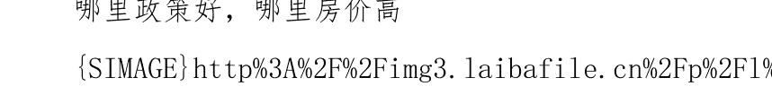

作者:66 端午 88 日期:2014-06-04 09:09

@垮掉的视觉 22090 楼 2014-06-04 08:42:52

端午哥，据说现在马云也急了，因为越来越多的生产商抛弃了中间商直接面对市场，这已经导致淘宝的卖家赢利的比例仅有两成，10年内，作为中间商的小卖家将大量湮灭，成为网络失业者。而制造商的终极目的是，完全抛弃马云的平台，自己建造平台面对客户。

这或许是一个社会问题。

> 淘宝依靠规模化做出盈利的不到千分之一，简单盈利容易，每月盈利几百几千不是什么难事。做出规模+盈利总量+持续，凤毛龙爪。我一个朋友头几年对淘宝着迷，找了个进口品牌的净水器做了一阵子，也赚了不少，过了阵子就没盈利了。

作者:66 端午 88 日期:2014-06-04 09:11

@lsh197537 22078楼 2014-06-03 21:03:14

加v信1101284955，获取更多好帖

没看懂楼主什么意思，印象中AD是德国品牌。再者我举的AD只是一个例子，实际上更多是国货。我想说的是网购很多时候并不与零售冲突，而是补充。

@66 端午88    22085楼 2014-06-03 22:03:14

从你的角度是这么想的，你看看自从有了滴滴，快滴打车，不加小费都截不住车，老头老太太等半天没出租停。利益的驱动将导致：供给引导需求，而不是需求引导市场供给。这就是风投的后遗症。与此同理，京东赚钱了吗？淘宝的盈利客户占比是多少，你做过调查吗？由风投支撑的亏损经济，在占领市场后，将会疯狂的吸取市场盈利，形成垄断。你指望这些养家糊口的零售从业者以亏损数年的代价抗衡风投吗？现在就算是没有房租，零售也无法和网售竞争，这才是问题所在。当一个实体零售商转为网商后，他的利润率肯定下滑，就算是和数量做对冲，淘宝的各类收费，一点也不比实体零售低。这就可以定义为滥用垄断地位。如果做出这么高的零售比例，在发达市场经济国家，肯定会被拆分的。

@公民灌水权 22091楼 2014-06-04 08:46:14

这种大义凛然的说着符合自己利益的话，真让人不爽。

零售成本高，等房地产崩盘了，自然就那么高了，然后大家也有钱消费了。

加v信1101284955，获取更多好帖

哦，房地产又不能降，所以就必须老百姓全心全意享受高价，付出高溢价，全心全意付出心血就为了来维持贪腐体制，盛世腐烂。

一切都是土匪们自己造成的，把房地产当做收割的利器自然会导致全面普遍贫穷，维持在饥寒交迫的边缘，P民倒是都不会反抗了，土匪也发财了，但社会的进步也同样......

你要是不接受高房价，就得接受高价民生，或者整体物价通胀，你自己选吧。

作者:66端午88日期:2014-06-04 09:15

@公民灌水权22092楼2014-06-04 08:53:10

人民币国际化是白日做梦，信用货币体系下，一个奴隶国的货币，还不如牛马价值可靠。

全世界不缺牛马。这世界何时缺过无脑的人口的？

资源枯竭，人口老龄化的时候，总要还债的。要还债的可绝不仅仅是一两代人。

按理来说，以中国的经济规模，进出口规模，人民币国际化早就就是板上钉钉的事，就是美国压着你，不能实施，本来在东南亚经济圈实现人民币化已经初现雏形，现在让美国人一搅和也歇菜了。美国是绝难允许人民币抢占美元市场地位的，这点，我们不能抱有幻想。

加v信1101284955，获取更多好帖

作者:66 端午 88 日期:2014-06-04 09:17

@那时的风雨 22075 楼 2014-06-03 17:54:49

一只 6k 的宝包就叫奢侈品了？你把中国人太看低了。那上海北京动辄几千万的别墅和商铺叫什么?_?普通人家的消费品？

@66 端午 88 22077 楼 2014-06-03 20:01:57

我记着巴菲特六百亿美金的身价，人家只住普通的房子，开辆很久的道奇，买了中国售价 200 美金的西装，也没见他用 LV 的包包，可他还是受人尊敬，我希望未来的成功者都是这种生活态度，别整得和马云似得，说一套做一套的。

@xiaoyucrc 22093 楼 2014-06-04 09:02:15

这个估计在国内很难。虽然我自己不开宝马奔驰，不买 LV。。。。所以我经常看房的时候没人理我，国内还是以貌取人为主，当然我还没有去过美国，不知道美国是怎么样了。

中国的新投资移民在北美就开三种车，奔驰宝马陆虎。

作者:66 端午 88 日期:2014-06-04 10:01

@66 端午 88 22096 楼 2014-06-04 09:15:29

按理来说，以中国的经济规模，进出口规模，人民币国际化早就就是板上钉钉的事，就是美国压着你，不能实施，本来在东南亚经济圈实现人民币化已经初现雏形，现在让美国人一搅和也歇菜了。美国是绝难允许人民币抢占美元市场地位的，这点，我们不能抱有幻想。

@公民灌水权 22098楼 2014-06-04 09:26:41

现代信用货币，必须要有不可替代的东西才有可能使一国货币国际化。

美日欧洲，莫不如此，不单单是进出口就是了，没有中国发达国家还是发达国家，全球更美好，没有美国，没有日本，没有欧洲，世界会没有大量的现代文明生活。

这些不可替代的对世界的推进领导才是货币国际化的关键。资源国家做不到，中国更做不到，尚且不提中国对内无底线的掠夺本身就注定成为国家社会的流氓。中国一旦得势全世界未来都是朝鲜……

小老百姓，你去谈论什么正义，有点虚头八脑，你要不是有2，3套房子，不是更穷吗？恐怕连在这里打屁的闲心都没有了，你说对不对？:) 

作者:66端午88 日期:2014-06-04 10:03

@公民灌水权 22092楼 2014-06-04 08:53:10

加v信1101284955，获取更多好帖

人民币国际化是白日做梦，信用货币体系下，一个奴隶国的货币，还不如牛马价值可靠。

全世界不缺牛马。这世界何时缺过无脑的人口的？

资源枯竭，人口老龄化的时候，总要还债的。要还债的可绝不仅仅是一两代人。

@66 端午 88 22096 楼 2014-06-04 09:15:29

按理来说，以中国的经济规模，进出口规模，人民币国际化早就就是板上钉钉的事，就是美国压着你，不能实施，本来在东南亚经济圈实现人民币化已经初现雏形，现在让美国人一搅和也歇菜了。美国是绝难允许人民币抢占美元市场地位的，这点，我们不能抱有幻想。

@垮掉的视觉 22100 楼 2014-06-04 09:49:46

是啊，奥巴马已经说了，美国还要老大。说的很坦率，在这个位置，想怎么说都不必忌讳，太牛了。

伤了很多人的心呀，鼓噪振兴中华好多年了，一句话就退潮了。：)

作者:66 端午 88 日期:2014-06-04 12:01

我个同学最近挺郁闷的，他中年出来创业，赶上私营黄金时代的末班车，干了3，4年，赚了几百万，换了个新的大房子，还存了200多万。去年生意不好就歇了，他媳妇以前做会计的，给她算账，算夫妻档吧。现在他媳妇不跟着他干了，出去干理财经理（那种乱七八糟的信托），带着一群屌丝专门骗老头老太太，现在每个月收过路提成也小2万多，经常叨叨早知如此，就不跟同学混了。额同学是个奇葩，竟然炒股盈了50%（本金就20多万），一算还是不如媳妇，所以挺郁闷。

作者:66端午88 日期:2014-06-04 12:23
@Rambo第N滴血22109楼2014-06-04 12:18:39
柳州首富非法吸储百亿家族集体失联 金融机构如临大敌
2014年06月04日
http://finance.ifeng.com/a/20140604/12471105_1.shtml

去年有人怂恿借款给正菱利息高，当时看着二分利还挺动心，最后还hold住一分钱没出。正菱集团，多年的大型民企，一下子全家跑路。

额历来对信托理财抱着审慎的戒备，绝对免疫，这玩意火中取栗的赶脚。

作者:66端午88 日期:2014-06-04 15:32
@股价22111楼2014-06-04 14:42:05

@66 端午 88 其实你要是真的相信自己的话，你早就悄悄准备好钱到售楼处去蹲守了，还能让别人知道房价要涨的消息，恐怕你还要在论坛上大肆喊跌，好方便你抄底呢，你现在这个样子到底展示的是什么样的智商？

你不但智商有问题，眼神都有问题，贴明是三年半前的，神马眼神呀。

作者:66 端午 88 日期:2014-06-04 17:16

回复第 22115 楼，@朱晨霞

@股价 22111 楼 2014-06-04 14:42:05

@66 端午 88 其实你要是真的相信自己的话，你早就悄悄准备好钱到售楼处去蹲守了，还能让别人知道房价要涨的消息，恐怕你还要在论坛上大肆喊跌，好方便你抄底呢，你现在这个样子到底展示的是什么样的智商？

@66 端午 88 22112 楼 2014-06-04 15:32:47

你不但智商有问题，眼神都有问题，贴明是三年半前的，神马眼神呀。

楼主，房子多现在到底是好事还是坏事啊

五成以上的资产占比，具体根据自己的特殊情况配置

作者:66 端午88 日期:2014-06-05 10:18
@66 端午88 2014-06-04 12:23:22
@Rambo第N滴血 22109楼 2014-06-04 12:18:39
柳州首富非法吸储百亿家族集体失联 金融机构如临大敌

2014年06月04日
http://finance.ifeng.com/

@朱晨霞 22119楼 2014-06-04 23:09:10
这东西到底牢靠不,我一亲戚把一块上好宅基地卖了80万,用了30给女儿做嫁妆,剩下50就给我妈妈一个朋友了,这个人就说利息比理财产品高、听起来像你说的信托,不知好吗,她还说银行理财产品没她安全,她拿她自己给我亲戚做担保

基本上肉包子打狗,有去无回了,现在已经临近信托的大规模违约爆发期,这是作死的节奏。

作者:66端午88日期:2014-06-05 10:26
@66端午88 20631楼 2014-03-07 13:27:44
红木历经去年全面飙升后,在年末飞速拉高,春节前后经过短暂回调整理后,于本周开始重新加速,红酸料充当头羊,成交主力集中于大果紫檀(缅甸花梨),鸟足紫檀,小品种越柬紫檀升至新高（超越5万），白酸走势稳健，重回2.6万。作为未来10年行情主力品种，5年后实现翻番（二手可成交价）易如反掌，标价上很有可能再翻番。

@yanmengde 22122楼 2014-06-05 06:50:31
红木怎么炒

红木短炒靠材料交易，你见过卖进口废塑料的吗？货柜过来，拉到市场上，卸了车（按照市场成交价卖），不卸车（比市场价便宜一点），很多作坊的木匠过来选料，价格，材料质量合适，给你钱（或者直接打到你账上）就拉走了。只不过红木的交易点多一些，大城，东坝，张家港，大涌，仙游，深圳，广州等等都有很大的红木交易市场。

作者:66端午88 日期:2014-06-05 10:32

在中国经济史上，玩中国足球有两个含义，第一：这个行业景气程度气势如虹。第二：这个行业很快会玩完。马云在控制绿城后，今日宣布准备拿下恒大。

作者:66端午88 日期:2014-06-05 15:26
@66端午88 22124楼 2014-06-05 10:32:12

在中国经济史上，玩中国足球有两个含义，第一：这个行业景气程度气势如虹。第二：这个行业很快会玩完。马云在控制绿城后，今日宣布准备拿下恒大。

@叹气的鱼 TT 22132 楼 2014-06-05 13:54:59

这两句话怎么理解呢？没看明白，为什么气势如虹又会很快玩完……

一个在亚洲这种落后足球地区，国家队是二流，群众基础是三流的土地上投资足球，就像投资一个长期亏损，转型了一万条路都没通的垃圾公司，就像买了一支*ST的股票，敢于投入这个行业的不是钱多的没地花，就是脑子短路。如果有好项目，会用资金投资吗？如果脑子还清醒，会投资吗？你看哪个商业足球发达的区域，没有好成绩的。近的小日本，远的有意大利，英格兰，西班牙。再看中国，长期投资足球盈利的俱乐部有没有。如果出于广告效应，投12亿恐怕多了点。再说，阿里巴巴需要广告效应吗？

作者:66 端午 88 日期:2014-06-05 17:10

@66 端午 88 22124 楼 2014-06-05 10:32:12

在中国经济史上，玩中国足球有两个含义，第一：这个行业景气程度气势如虹。第二：这个行业很快会玩完。马云在控制绿城后，今日宣布准备拿下恒大。

@叹气的鱼 TT 22132 楼 2014-06-05 13:54:59

这两句话怎么理解呢？没看明白，为什么气势如虹又会很快玩完……

@66 端午 88 22133 楼 2014-06-05 15:26:30

一个在亚洲这种落后足球地区，国家队是二流，群众基础是三流的土地上投资足球，就像投资一个长期亏损，转型了一万条路都没通的垃圾公司，就像买了一支*ST的股票，敢于投入这个行业的不是钱多的没地花，就是脑子短路。如果有好项目，会用资金投资吗？如果脑子还清醒，会投资吗？你看哪个商业足球发达的区域，没有好成绩的。近的有小日本，远的有意大利，英格兰，西班牙。再看中国，长期投资足球盈利的俱乐部有没有。如果出于……

@朱晨霞 22134 楼 2014-06-05 15:32:24

那马云为了什么

许家印是想从这个坑里跳出来，他要的都拿到了，广告效应帮助他的地产公司挤进了一线行列，这容易理解。马云跳进为什么？不是为了企业的广告效应，而是参与权利的公关。我们在分析我国企业参与足球行业的原因时，发现这些企业都是当时的热门行业，都和地方政府有着千丝万缕的联系，足球首先是地方政府的一张名片，一张脸皮。谁帮了扶不起来的阿斗，都不是为了阿斗，而是为了阿斗他爹，地方政府。至于马云为什么放弃了本地企业绿城，而选择了广东的恒大，感觉因为恒大在亚洲战绩颇佳，中国足球也就这么点好炫耀的了，可以算成中国的脸皮，这应该是投资中央政府。：)

作者:66 端午 88 日期:2014-06-05 17:13

@66 端午 88    36 楼 2011-02-07 14:15:01

关于中国崩溃这种议题，在没有天涯前，就经常通过各种渠道进入我的耳朵，开始时外国人在说，近几年，国外说的好像不是太刺耳了，国内确越来越甚嚣尘上，听从这种论调的悲观主义者，也包括我很多早期的合作伙伴，业务往来伙伴，朋友，他们在 2000 年左右就积累了足够的财富，当然也许有灰色成份的因素，过早的离开了中国，结果证明了他们的先知先觉是错了的，在 2008 年后，他们又纷纷加入回国二次创业的潮流，尽管现在的他们......

> @高丽总督 22139 楼 2014-06-05 16:29:33
请楼主详细阐明如何才能顺势而为 哪个行业 或者说还有什么潜在需求蕴含着什么潜在的商机吗

我以前思路有点守旧，不适应现在和未来的社会发展，那就是希望低成本创业或者盈利，本质上是寻找低估标的。现在的形势是，成本由于货币因素，成本不可能低下来，那么如果有机会，只有选择资本流动速率快，高成本，高收益，资产留存在无形资产的行业。

作者:66 端午88 日期:2014-06-05 17:14

@tyfenshuig 22136楼 2014-06-05 15:44:09

老大好这口，搞好了，老大接见，身价倍增。

> 有眼力，赞

作者:66端午88日期:2014-06-05 18:04

@烈火之中22145楼2014-06-05 17:30:12

国家可以定价，如土地，房价，油价等等，但钞票在老百姓手里，与其高价买国内70年产权房不如到国外买房，现在几个发达国家买房的不都是中国人吗？不要以为手上有权就想怎么敲诈就怎么敲诈。

当下大批民企纷纷歇业关门，就业将成为极其严峻的社会问题，大批的劳动力闲散闲逛，我就不相信高价房有人买！

当民企死得差不多了，总不能靠着土地房子只养活官员和公务员吧。老祖宗留下的土地可是全体华夏儿女的财富吧。我就......

> 货币有迷惑作用，随便印点，大家就又不知道该怎样了，就像中国股民一样，打不死的小强。

作者:66端午88日期:2014-06-05 18:17

@66 端午 88    36 楼 2011-02-07 14:15:01
关于中国崩溃这种议题，在没有天涯前，就经常通过各种渠道进入我的耳朵，开始时外国人在说，近几年，国外说的好像不是太刺耳了，国内确越来越甚嚣尘上，听从这种论调的悲观主义者，也包括我很多早期的合作伙伴，业务往来伙伴，朋友，他们在 2000 年左右就积累了足够的财富，当然也许有灰色成份的因素，过早的离开了中国，结果证明了他们的先知先觉是错了的，在 2008 年后，他们又纷纷加入回国二次创业的潮流，尽管现在的他们......

@高丽总督    22139 楼 2014-06-05 16:29:33
请楼主详细阐明如何才能顺势而为 哪个行业 或者说还有什么潜在需求蕴含着什么潜在的商机吗

@66 端午 88    22141 楼 2014-06-05 17:13:20
我以前思路有点守旧，不适应现在和未来的社会发展，那就是希望低成本创业或者盈利，本质上是寻找低估标的。现在的形势是，成本由于货币因素，成本不可能低下来，那么如果有机会，只有选择资本流动速率快，高成本，高收益，资产留存在无形资产的行业。

@垮掉的视觉 22148 楼 2014-06-05 18:10:31

例如呢？

这不是找着哪吗，发了财来报告。:)

作者:66 端午88 日期:2014-06-05 20:22

@66 端午88 36楼 2011-02-07 14:15:01

关于中国崩溃这种议题，在没有天涯前，就经常通过各种渠道进入我的耳朵，开始时外国人在说，近几年，国外说的好像不是太刺耳了，国内确越来越甚嚣尘上，听从这种论调的悲观主义者，也包括我很多早期的合作伙伴，业务往来伙伴，朋友，他们在2000年左右就积累了足够的财富，当然也许有灰色成份的因素，过早的离开了中国，结果证明了他们的先知先觉是错了的，在2008年后，他们又纷纷加入回国二次创业的潮流，尽管现在的他们......

@高丽总督 22139楼 2014-06-05 16:29:33

请楼主详细阐明如何才能顺势而为 哪个行业 或者说还有什么潜在需求蕴含着什么潜在的商机吗

@66 端午88 22141楼 2014-06-05 17:13:20

我以前思路有点守旧，不适应现在和未来的社会发展，那就是希望低成本创业或者盈利，本质上是寻找低估标的。现在的形势是，成本由于货币因素，成本不可能低下来，那么如果有机会，只有选择资本流动速率快，高成本，高收益，资产留存在无形资产的行业。

@垮掉的视觉 22148楼 2014-06-05 18:10:31
例如呢？

@66端午88 22149楼 2014-06-05 18:17:41
这不是找着哪吗，发了财来报告。：)

@绝不在门口徘徊 22150楼 2014-06-05 19:34:15
现在准备开个定制家具店了。
三年大叔求教如何搭讪女生呢？？

你是说开家具店呀，还是泡妞呀。买家具都是男人去买，但是女人拿主意。所以，目没要搭讪女生，只要了解他们就可以了。要是泡妞呀，建议还是把大部分女生爱好研究好，她们喜欢啥，你就把啥做好，她们就会主动搭讪你了，这效率挺高是吧。：)

作者:66端午88日期:2014-06-05 21:16
互联网的未来是虚拟和现实完全的互相嵌入，你的经历，能力，资信，爱好，道德水准都是真实的，以此作为你在虚拟世界建立你的虚拟社会身份，而真实社会则会认可你在虚拟社会积累的经历和身份，现实和虚拟完全融合，想在网上戴上面具生活只能是屌丝行为，而现实社会则会帮你你联系到最适合你工作，事业，伴侣甚至家庭，想要创业则会帮你找到最合适的合作伙伴和投资资本。广告和推送的内容都是你所需要的，效率达到最优化。谁能搭建起这个平台，并将虚拟和现实融合起来，那么他将是未来世界的商业霸主和游戏规则制定评价的主宰。有志投身互联网事业的同学，就从这个大方向选择你未来的机会吧。

作者:66 端午88 日期:2014-06-05 22:02

任何对美元造成威胁的货币，都是美国的头号敌人，欧元今日降息，世界两大货币呈现竞争性贬值现象。美元受到实质性打击，这和人民币国际化的结果是相同的，黄金涨，石油跌，美元在抛弃黄金后，挂钩石油，美元---石油---能源---经济发动机的油门形成直接关联，中俄的能源合作降低了能源杠杆对美金的需求，欧元的竞争性贬值将强烈刺激美国国内的资产价格，美国的资产从今天起走上泡沫之路，中国忍住不刺激美国的军事霸权，等待美国经济在泡沫中一头栽下，任何一个老二都是首先在经济上实现超越的，美国如此，英国如此，西班牙如此。

作者:66 端午88 日期:2014-06-06 11:07

为什么投资足球亏钱，还是要投足球？
足球是第一运动，关注度高。足球是中国的社会痛点之一，解决社会痛点有社会效应，可以吸引眼球。投资足球肯定亏（至少在中国），就是投资足球其实就是舍的过程，不舍不得，亏损金钱，赢得政府关注。足球通常被政府当作城市名片，地方名片。对于中央政府，就是国家名片。作为草根出身的马云，屡次在政府倾向性行业中折戟沉沙，投资金融行业受阻，为什么？话语权不足，他迫切补足这方面的缺陷。本来他似乎应该搞慈善基金的，无奈这个行当已经做臭，再去搞得不偿失。有了政府的关注，无疑有利于阿里巴巴的政策倾向，同时俱乐部也可以获得上市支持，这是后话，重点仍然落在政策支持的饥渴上。

作者:66 端午88 日期:2014-06-06 15:13
@小克什 22162楼 2014-06-06 13:25:28

房地产领域，最近十年多方面原因，截止到目前配置了3套北京住宅（其中一套商住），和一套武汉。的确黄金十年应该已经过去了，但是是否真的就成为了接下来十年需要抛弃的投资品种呢？不这么认为。

整体的曲线走势我觉得还是应该缓慢上行，斜率肯定不如之前陡峭化，城市分化会更加明显（就拿北京和武汉的来对比，持有了3年，目前市值的回报率的确差别很大）但是我觉得跑赢CPI是没任何问题的，更何况还有杠杆可以用。

这楼群的密度太大了，就是说，土地投资强度太大，均摊到每户的土地很少很少，已经被榨干了。

作者:66 端午 88 日期:2014-06-06 20:45

@小克什 22162 楼 2014-06-06 13:25:28

房地产领域，最近十年多方面原因，截止到目前配置了3套北京住宅（其中一套商住），和一套武汉。的确黄金十年应该已经过去了，但是是否真的就成为了接下来十年需要抛弃的投资品种呢？不这么认为。

整体的曲线走势我觉得还是应该缓慢上行，斜率肯定不如之前陡峭化，城市分化会更加明显（就拿北京和武汉的来对比，持有了3年，目前市值的回报率的确差别很大）但是我觉得跑赢CPI是没任何问题的，更何况还有杠杆可以用。

@66 端午 88 22163 楼 2014-06-06 15:13:25

这楼群的密度太大了，就是说，土地投资强度太大，均摊到每户的土地很少很少，已经被榨干了。

@朱晨霞 22164 楼 2014-06-06 16:03:36

现在哪个地方的高层不是这样，连拆迁户都只能住高层了，多层都是很罕见了，高层公摊面积虽然大，但是有啥办法

本城偶尔还有多层出现，就是价格高的可怕，核心位置大约在 1.8 万---2.4 左右，二类地区大约 1.4----1.6 万（有少许几年前的尾盘促销时 1.25--1.45 之间）。

作者:66 端午 88 日期:2014-06-07 22:19

《审计结果》还显示，2014 年和 2015 年是宁波市政府负有偿还责任债务的偿债高峰，分别为 468.25 亿元、357.27 亿元，在“政府债务”总额中的比重分别为 27.02%、20.62%。

值得注意的还有，偿债高压之下，宁波市政府及其下属的县、乡（镇）正在通过“借新还旧”的方式，填补债务“黑洞”，以此化解政府债或城投债违约事件。

《审计结果》指出，由于偿债能力不足，宁波市本级、3 个县（区）本级和 10 个乡（镇）政府只能“举借新债偿还旧债”，政府负有偿还责任债务的“借新还旧率”超过 20%。所谓“借新还旧率”就是“举借新债偿还旧债”的债务本金在需偿还债务金额中的比重。

偿债高度依赖土地出让收入

地方政府偿债能力首先要看财政收入。统计数据显示，2013 年宁波财政总收入 1650.8 亿元；其中地方财政收入 792.4 亿元，中央财政收入 858.4 亿元。

但有研究表明，宁波市地方财政收入高度依赖土地出让金。按照同策咨询研究部日前发布的《45 个楼市限购城市土地出让金报告》显示，2013 年宁波土地出让金为 743 亿元，占地方财政收入的 93.8%。

## 土地财政依赖度分析报告

宁波市2013年土地财政依赖度为85.1%，在45个城市中位居第11位。

-------------------

以上报告清晰地证明了第一页第一段计算的准确性。

作者：66端午88 日期：2014-06-07 22:21

@qq135780q 22172楼 2014-06-07 01:12:06

楼主大大，从数据来看烟台的存量房已经够销售三十多个月的，对于以后的走势怎么看，求赐教

高位震荡，等待货币政策松动。

作者：66端午88 日期：2014-06-07 22:42

银监会再次食言，开始鼓动商业银行大力支持首套房贷，我感觉：首套房贷，对于银行的风险是最大的，因为在过去十年，有能力首贷的早就首贷了，包括我，所有人在买第一套房子时是最难下决心的，这出于对自己和大经济环境的双重担忧。如果顺利的拿下了第一套房子，再买2, 3, 4, ----N的时候，只能说明他自信的累加，自信来源于实力和对未来的看好。买的越多，对于个人来说，风险反而降低了。房地产，已经深深的植入中国经济，房价跌，最难受的不是各种混迹于房地产的各类企业，也不是投资或者投机的群体，更不是银行，而是掌握中国经济的各级政府，包括中央政府。

作者：66端午88 日期：2014-06-08 17:33

加v信1101284955，获取更多好帖

回复第22176楼，@66端午88

银监会再次食言，开始鼓动商业银行大力支持首套房贷，我感觉：首套房贷，对于银行的风险是最大的，因为在过去十年，有能力首贷的早就首贷了，包括我，所有人在买第一套房子时是最难下决心的，这出于对自己和大经济环境的双重担忧。如果顺利的拿下了第一套房子，再买2, 3, 4, ----N的时候，只能说明他自信的累加，自信来源于实力和对未来的看好。买的越多，对于个人来说，风险反而降低了。房地产，已经深深的植入中国经济，房价跌，最难受的不是各种混迹于房地产的各类企业，也不是投资或者投机的群体，更不是银行，而是掌握中国经济的各级政府，包括中央政府。

@tsboy321 22178楼 2014-06-08 11:47:27

三年老师如果我没记错的话您说过淘宝店铺现在主要靠现金流盈利，利润都很低。这方面不太懂能详细说说吗

我认识的几个做淘宝大卖家是这么盈利的，拼低价拼流水，一部分利润从增值税发票里面出（卖货不带发票，带票加5%），卖税点大约4-6%。占据账期，利用余额宝的固定收益，一般账期是1-3个月不等，一般信用额度大约在200-400万间，15-20万的息差。返点大约1-2个点，走货大约1个点利润。

加v信1101284955，获取更多好帖

作者：66端午88 日期：2014-06-08 17:36

回复第22176楼，@66端午88

银监会再次食言，开始鼓动商业银行大力支持首套房贷，我感觉：首套房贷，对于银行的风险是最大的，因为在过去十年，有能力首贷的早就首贷了，包括我，所有人在买第一套房子时是最难下决心的，这出于对自己和大经济环境的双重担忧。如果顺利的拿下了第一套房子，再买2, 3, 4, ----N的时候，只能说明他自信的累加，自信来源于实力和对未来的看好。买的越多，对于个人来说，风险反而降低了。房地产，已经深深的植入中国经济，房价跌，最难受的不是各种混迹于房地产的各类企业，也不是投资或者投机的群体，更不是银行，而是掌握中国经济的各级政府，包括中央政府。

@tsboy321 22178楼 2014-06-08 11:47:27

三年老师如果我没记错的话您说过淘宝店铺现在主要靠现金流盈利，利润都很低。这方面不太懂能详细说说吗

他们的最大利润来自卖税票，只要严查税务，他们就只有关门一条路，所以这些网商，绝对不告诉你他们的经营地点。

作者：66端午88 日期：2014-06-09 08:28

@弃茗风 22183楼 2014-06-09 06:36:32

加v信1101284955，获取更多好帖

楼主兄台：咱济南本地也开始出现房闹了。有些空手套白狼的房企和盘子太大的房企，销售不畅的时候，只能以价换量了。

您怎么看 在济南 会上演大概率的全线降价 还是仅仅是个别楼盘

话说这个中海 位置真不错

就在大山坡公园旁边 高新区政府隔壁

会的，如果货币不放水，这次调整时间和幅度都会比较大，是一次可以做出差价的操作，怕只怕政府们挺不住，半山腰就撤回来，所以放空还是有一定风险的，而且可能性还比较大，资产配置5成在房产上的，不宜轻举妄动。

作者：66端午88 日期：2014-06-09 20:15

我们这里最近城管丧尽天良，路边菜摊都被丫们轰跑了，买点青菜得去超市和批发市场，关键还没车位，蹬自行车过去一身汗，准备买个能放西瓜的摩托车，兼做短距通勤工具，好多年不骑了，不知道是啥行情，预算五千买个靠谱皮实的二轮踏板。还得去考增驾，要知道这么堵，当年就留着摩托本了。路边摊太多倒是特别影响街道办事处搞的那些非法小门店。好多都租不出去了，大概是这让城管疯狂了吧。

加v信1101284955，获取更多好帖

作者：66端午88 日期：2014-06-09 20:17

回复第22190楼，@出生于西部

一群傻多还在这YY，也不看看现在上面早就换人了。在中国混不懂政策，怎么死的都不知道。

------------------------

你这不是自己恶心自己吗，你不是已经加入多头阵营了呀，虽然你成本高点，也不能自甘堕落吧，等跌下来啊，再补一套，成本就低了

作者：66端午88 日期：2014-06-09 23:01

@66端午88 22193楼 2014-06-09 20:15:36

我们这里最近城管丧尽天良，路边菜摊都被丫们轰跑了，买点青菜得去超市和批发市场，关键还没车位，蹬自行车过去一身汗，准备买个能放西瓜的摩托车，兼做短距通勤工具，好多年不骑了，不知道是啥行情，预算五千买个靠谱皮实的二轮踏板。还得去考增驾，要知道这么堵，当年就留着摩托本了。路边摊太多倒是特别影响街道办事处搞的那些非法小门店。好多都租不出去了，大概是这让城管疯狂了吧。

------------------------

@我爱庭院 22196楼 2014-06-09 20:44:30

买摩托一定要买电喷的，化油器的摩托长时间停放启动困难，去年我把丈人的铃木踏板（8年前花8000买的，骑了半年老丈人就开汽车了，踏板一直放车库），花了1000多元换电瓶和油液什么的，开了一个夏天和秋天，车库放了5个月没开，今年开春再也发动不起来了，我也懒得再去弄了

加v信1101284955，获取更多好帖

我看着电喷能挂牌的都一万多，品牌好的，进口的直奔2万以上。这下得提高预算了。一个神马叫狒狒的样子特别逗，只是跨骑的，还是放不下西瓜。踏板看中的也是1-2万间的。不成就淘宝随便买个屌丝车拉倒了，驾照也不增驾了，哪天被警察叔叔没了收，再换个一步到位的。

作者：66端午88 日期：2014-06-09 23:04

@我爱庭院 2014-06-09 20:06:45

@66端午88 2014-06-04 12:23:22

@Rambo第N滴血 22109楼 2014-06-04 12:18:39

柳州首富非法吸储百亿家族集体失联 金融机构如临大敌

2014年06月04日

@朱晨霞 22195楼 2014-06-09 20:28:45

我一个内部人士说她可以有银行内部汇率，比如她可以出面指定你去哪个银行几号柜台存，利息也有5.多，而且可以提前给你一笔利息，但是本金一年都是拿不出那种，不知道牢靠不，据她说自己是内部关系利息，而且钱也是放在银行的，说可以放心的，我那亲戚已经跟着她办理了

加v信1101284955，获取更多好帖

@Rambo第N滴血 22198楼 2014-06-09 21:57:15

“内部关系利息”？？？搞不好，是银行员工“做飞单”。

“飞单”最好别出事，出了事，银行那位连体制内的稳定饭碗也保不住。

除非亲戚是银行的，别玩不保险的，前阵子不是有新闻吗？一个行长骗人家几千万就是这种私单高息揽存，然后卷款跑了，手续都是全的，但是银行不承认，说是那是行长偷偷搞的，没走流程。

作者：66端午88 日期：2014-06-10 11:22

@66端午88 22193楼 2014-06-09 20:15:36

我们这里最近城管丧尽天良，路边菜摊都被丫们轰跑了，买点青菜得去超市和批发市场，关键还没车位，蹬自行车过去一身汗，准备买个能放西瓜的摩托车，兼做短距通勤工具，好多年不骑了，不知道是啥行情，预算五千买个靠谱皮实的二轮踏板。还得去考增驾，要知道这么堵，当年就留着摩托本了。路边摊太多倒是特别影响街道办事处搞的那些非法小门店。好多都租不出去了，大概是这让城管疯狂了吧。

@我爱庭院 22196楼 2014-06-09 20:44:30

买摩托一定要买电喷的，化油器的摩托长时间停放启动困难，去年我把丈人的铃木踏板（8年前花8000买的，骑了半年老丈人就开汽车了，踏板一直放车库），花了1000多元换电瓶和油液什么的，开了一个夏天和秋天，车库放了5个月没开，今年开春再也发动不起来了，我也懒得再去弄了

加v信1101284955，获取更多好帖

@66端午88 22202楼 2014-06-09 23:01:42

我看着电喷能挂牌的都一万多，品牌好的，进口的直奔2万以上。这下得提高预算了。一个神马叫狒狒的样子特别逗，只是跨骑的，还是放不下西瓜。踏板看中的也是1-2万间的。不成就淘宝随便买个屌丝车拉倒了，驾照也不增驾了，哪天被警察叔叔没了收，再换个一步到位的。

@xiaoyucrc 22206楼 2014-06-10 07:09:40

端午哥：好好玩啊！你自己买个自行车改装一下就行了啊！

DIY了两辆，一辆山地，一辆高速。一算死贵，跑了两次准长途，累个半死，然后开车又跑了一趟，发现就这么近一点路，断断续续的骑，说不上锻炼身体，快成器材发烧友了。还不如当时听朋友的话，直接上个进口摩托算了。

作者：66端午88 日期：2014-06-10 12:58

@66端午88 22175楼 2014-06-07 22:21

加v信1101284955，获取更多好帖

@qq135780q 22172楼 2014-06-07 01:12:06

楼主大大，从数据来看烟台的存量房已经够销售三十多个月的，对于以后的走势怎么看，求赐教

@qq135780q 22213楼 2014-06-10 12:35:38

全面降准降息两次算是松动吗？抑或房贷利率再有折扣？

分布松动，逐步加码，现在贷款利率高，贷款给房子，不合算，像这种几十年的贷款，贷出去，银行得费很大劲再吸回来。

作者：66端午88 日期：2014-06-10 15:11

@棚改房新政 7楼 2014-06-09 21:02:54

北京、上海画个圈，大致东京规模一点五倍，以后是东京那样的模式，人群坐火车去北京上班，所以铁路沿线农民房随便买，不过要等。

@下个黄金十年基友 22217楼 2014-06-10 13:46:19

楼主，以上是最近经济论坛新晋大神的又一个预测，他建议大家买超级城市郊区沿铁路地产，可能么？

加v信1101284955，获取更多好帖

北京上海地铁沿线，一直是热点，不用预测，十年前就这样了。

作者：66端午88 日期：2014-06-10 15:12

@bxs1981 22219楼 2014-06-10 14:14:33

恩我也这么想的，等房子跌倒1000一平的时候，我也入手，准备抄底

晚上一闭眼，你就梦想成真了。:)

作者：66端午88 日期：2014-06-10 15:13

@xiaoyucrc 22216楼 2014-06-10 13:26:25

湖北潜江一小学发生劫持事件 歹徒已被击毙】6月10日上午，湖北省潜江市浩口镇第三小学发生劫持事件，歹徒已被击毙。

今年这么乱，是不是经济也快一底了？端午兄点评一下吧！

社会治安会随经济下滑而下滑，任何一个国家都是这样，安防企业效益不错，大单都归北京国安。

作者：66端午88 日期：2014-06-10 19:50

回复第22227楼，@我爱庭院

@66端午88 22193楼 2014-06-09 20:15:36

我们这里最近城管丧尽天良，路边菜摊都被丫们轰跑了，买点青菜得去超市和批发市场，关键还没车位，蹬自行车过去一身汗，准备买个能放西瓜的摩托车，兼做短距通勤工具，好多年不骑了，不知道是啥行情，预算五千买个靠谱皮实的二轮踏板。还得去考增驾，要知道这么堵，当年就留着摩托本了。路边摊太多倒是特别影响街道办事处搞的那些非法小门店。好多都租不出去了，大概是这让城管疯狂了吧。

@我爱庭院 22196楼 2014-06-09 20:44:30

买摩托一定要买电喷的，化油器的摩托长时间停放启动困难，去年我把丈人的铃木踏板（8年前花8000买的，骑了半年老丈人就开汽车了，踏板一直放车库），花了1000多元换电瓶和油液什么的，开了一个夏天和秋天，车库放了5个月...

人比人的死，货比货的扔，小摩托和高档货放一起，没法看了，不过小狒狒在宝马，榫，哈雷那些玩意面前，还是一眼就非常喜欢。

作者：66端午88 日期：2014-06-10 19:51

回复第22224楼，@沧海水手91888

大家注意今天人民币对美元走势？凶悍。

你不觉得是中国服软了吗

加v信1101284955，获取更多好帖

作者：66端午88 日期：2014-06-10 23:29

沈阳全面取消限购：房子随便买

作者：66端午88 日期：2014-06-10 23:33

回复第22224楼，@沧海水手91888

大家注意今天人民币对美元走势？凶悍。

@66端午88 22229楼 2014-06-10 19:51:43

你不觉得是中国服软了吗

@xiaoyucrc 22230楼 2014-06-10 22:34:50

是不敢贬了又得升了吗？

自人民币停滞升值以来，美欧大幅增加对华贸易限制，出台惩罚性关税。中国对美欧贸易限制停滞，人民币贬值带来的顺差被关税对冲。利用外贸缓解国内产能过剩压力的策略受阻，只好掉过头来再升值，舒缓欧美的压力。

作者：66端午88 日期：2014-06-11 16:55

回复第22224楼，@沧海水手91888

大家注意今天人民币对美元走势？凶悍。

@66端午88 22229楼 2014-06-10 19:51:43

你不觉得是中国服软了吗

加v信1101284955，获取更多好帖

@xiaoyucrc 22230楼 2014-06-10 22:34:50

是不敢贬了又得升了吗？

@66端午88 22232楼 2014-06-10 23:33:09

自人民币停滞升值以来，美欧大幅增加对华贸易限制，出台惩罚性关税。中国对美欧贸易限制停滞，人民币贬值带来的顺差被关税对冲。利用外贸缓解国内产能过剩压力的策略受阻，只好掉过头来再升值，舒缓欧美的压力。

@xiaoyucrc 22235楼 2014-06-11 12:17:42

端午哥：何时是个头啊？

美国国内资产泡沫再次破裂

作者：66端午88 日期：2014-06-11 22:23

@xiaoyucrc 22240楼 2014-06-11 19:00:41

端午哥：上面的转贴你看了有什么想法？这个蒋是我以前的同事。你觉得他的会被判刑吧？

还钱能判的轻点，估计是还不上了，这个头阵子那个真功夫的案子性质差不多，职务侵占，非法侵吞他人资本。

作者：66端午88 日期：2014-06-12 10:47

加v信1101284955，获取更多好帖

@xiaoyucrc 22240楼 2014-06-11 19:00:41

端午哥：上面的转贴你看了有什么想法？这个蒋是我以前的同事。你觉得他的会被判刑吧？

------------------------

@66端午88 22241楼 2014-06-11 22:23:40

还钱能判的轻点，估计是还不上了，这个头阵子那个真功夫的案子性质差不多，职务侵占，非法侵吞他人资本。

------------------------

@xiaoyucrc 22242楼 2014-06-12 07:36:44

端午哥：我们老同事这几天都在谈这个事情，觉得不可意义，他那么聪明的一个人怎么会犯这种事情。。。。。

------------------------

财富面前，没几个人能保持理智，谁还能记住以前那种小洗衣机吗？个头非常小的，那玩意的鼻祖是偶媳妇的同班同学，因为职务侵占（故意侵占合伙股东权益），被人从本市，省，中央，一路告上去。去年年底终于进去了，那伙计在创业时，接受了一笔100多万的风投，做大后赖账。现在财产查封，身陷牢狱。

作者：66端午88 日期：2014-06-12 18:01

5月末M2余额118.23万亿 同比增长13.4%。小幅放水，比预期多放了6000亿。按照这个速度，再等12--15年，人民币还能再贬一倍。

加v信1101284955，获取更多好帖

作者：66端午88 日期：2014-06-14 11:05

@我太稚嫩 22249楼 2014-06-13 23:39:41

三年 说一下 潘石屹 深圳机场 打人事件

再怎么装，狐狸尾巴还是会从袍子缝里露出来点。

作者：66端午88 日期：2014-06-14 11:08

@andy92050 22250楼 2014-06-14 01:02:46

前段时间，不是有位行业内大家说了中国房地产业还有10年的黄金期吗？

白银期，不是黄金期。去年飙升，颇感意外，透支了2-3年的涨幅，需要调整，消化大量库存。除非地方政府严格限制卖地，否则，很难恢复。这意味这今年，明年卖地量将大幅下滑，起码5-6成的缩减量，才能有效减少去年的过度供应。

作者：66端午88 日期：2014-06-14 11:10

## 地方GDP警报-------------评官员发展经济的动力来自于贪污腐败的灰色收入

微刺激竟成不刺激，中央全面督查纠错

原本对GDP数字十分敏感的一些地方政府，仿佛一夜之间“脱胎换骨”了，面对一系列微刺激政策，竟然落实不力，以至于国务院总理李克强在认识到有些地方“为官不为”后

加v信1101284955，获取更多好帖

## 被误读

中国政府网报道，在5月30日召开的国务院常务会议上，李克强总理批评一些不作为的地方官员是“尸位素餐”。这显然已不是极个别的案例，在地方财力紧张和人事变动频繁的客观背景下，一些地方官员主观地把微刺激简单理解成了不刺激，结果导致改革和调结构推不下去。

“现在这种气氛，多一事不如少一事。”某中部省份省政府一位不愿具名的官员告诉《华夏时报》记者，目前在反腐的高压态势之下，一些地方官员最关心的，不是怎么做事，而是怎么不出事。对此，中国外汇投资研究院院长谭雅玲指出，有的地方官员把自己的“乌纱帽”看得太重而忘了自己的职责。

尽管刚出的5月PMI和PPI数据不乏亮点，但接受本报记者采访的专家均表示，这还不能得出中国经济向好的结论。海通证券首席经济学家李迅雷称，“中国经济下行的趋势还没有结束。”交通银行首席经济学家连平也认为，目前的微刺激将会持续一段时间，接下来的重点是要抓相关政策的落实和执行。

记者获悉，国务院已经于6月6日发出通知，要求对稳增长、促改革、调结构、惠民生政策措施的落实情况开展全面督查，并要对政策不落实、工作不到位的官员进行问责。

6月5日，新华社连发三篇评论文章，为刺激与改革的关系正名，指出微刺激不等于缓改革。

2013年6月，英国巴克莱银行提出了“李克强经济学”概念，其中最重要的一点论述就是“不刺激”。随着“李克强经济学”在国内外广泛传播开来，刺激与改革是相对立的这一思维定势也开始根植于很多人的心中。

新华社评论文章指出，刺激和改革并不对立，部分刺激措施同时也是改革措施。“微刺激”的目的在于夯实促改革的宏观经济基础，在于为改革赢得必要的时间和空间。

“目前调结构、促改革依然是重中之重，但微刺激也是很有必要的。”连平认为，现在经济增速下滑非常明显，地方的压力比较大，企业经营十分困难，如果任由经济增速进一步下滑，则后果会十分严重。“在这种情况下，调结构促改革还能做得好吗？”他反问道。

其实，中央政府早已经注意到了经济下滑问题的严重性，并推出了一系列定向发力的微刺激政策。这些政策的内容涵盖税收、棚户区改造、铁路建设、金融支持、稳定外贸等各个方面，还在基础设施等领域推出了一批鼓励社会资本参与的项目。

结果这些微刺激政策在地方层面落实过程中走样了。李克强在国务院常务会议上指出，国务院出台了一系列政策措施，市场反应是好的，但确实存在落实不到位等现象，使得一些好政策没能取得预期效果。

“我在基层调研时注意到，有些地方确实出现了‘为官不为’的现象，一些政府官员抱着‘只要不出事，宁愿不做事’，甚至‘不求过得硬，只求过得去’的态度，敷衍了事。”李克强说。

随后，国务院召集部分省市大员进京，召开了经济工作座谈会，李克强在会上要求，今年时间将过半，要抓紧推进各方面工作，不得拖延。

### 不作为

不可否认，地方政府在执行中央微刺激时的懈怠，有其难以解决的客观原因。最直观的逻辑是，一方面是房地产行情低迷，土地卖不出去，财政收入锐减；另一方面是财税政策在支持实体经济上减税、退税动作不断，收入下降支出却增加，地方政府想有大动作稳经济却心有余而力不足。

问题是，有客观困难就要想办法解决，不能依然按旧的模式办事，更不能由此“为官不为”。

“中央的宏观经济政策越来越成熟，越来越具有针对性，但地方官员的思维模式却一点也没有变。”谭雅玲指出，本届中央政府在深入调研了解实际情况方面做得非常好，做出的决策也比较契合实际。相比之下，一些省市的地方官员则不能做到这一点，他们还是在按照过去的惯性在做事。

谭雅玲认为，目前中国经济处于一个非常困难的时期，这跟地方官员的所作所为有很大的关系，“一是惯性和惰性太严重了，二是思维和思路太僵化了，三是破解一些难题的胆量和心理准备并不充分。”

除此之外，上述中部省份官员则抱怨，目前公务员队伍里人心不稳，很难高效地开展工作：一方面，自去年以来，普通公务员的隐性福利被取消，基层队伍的积极性受挫；另一方面，愈演愈烈的反腐风暴也使得地方上的一些领导不敢多做事，不敢在这个敏感时期“出风头”。

“反腐可能会让一些官员束手束脚。”李迅雷认为，出现这种情况并不奇怪。谭雅玲则指出，出现这种情况的根源，在于一些地方官员的心态出了问题，没有把心思着力点放在“正能量”上，“作为一名主管干部，只要你有作为，就算做错了，大家会和你较真么？只要你做得是正常的、正当的，谁会去查你？”

无论如何，地方经济的疲态已尽显。

在此次国务院召开的部分省市经济工作座谈会上，黑龙江、河北和山西的省长都应邀出席，而这三个省份的一季度GDP增速排在全国末尾；其中，黑龙江从去年一季度的9%下降到今年一季度的4.1%，河北由9.1%下降到4.2%，都巨降了4.9个百分点。山西则由9.5%下降到5.5%，下降幅度也达4个百分点。从全国范围来看，GDP增速“刹车”的迹象也十分明显，共有27个省市区的GDP增速回落。

### 动真格

经济不能承受之重。

根据国家统计局公布的数据，5月PMI继续回升，达到50.8；虽然PPI仍为负增长，且仍在荣枯线50以下，但降幅继续收窄。此外，5月的外贸情况也有所改善，由前4个月的下降3.1%转为增长1.5%。尽管如此，李迅雷还是表示，短期的月度数据还不能反映经济的走势。

谭雅玲进一步指出，PMI向好跟经济的周期和采购经理的预期有很大的关系，并不能说明实体经济有起色，这一点从PPI连续27个月负增长就能看出来。至于外贸，虽然看起来有增长，贸易顺差也在增加，但进口意愿下降也反映出了国内企业经营困难。“我对中国经济的未来并不乐观。”她说。

接下来的6月比较关键。李迅雷认为，如果6月份的经济数据恶化，经济继续下滑，那么不排除微刺激会被加码。而连平则认为，这种情况不太可能出现，短期内宏观调控不会有大的动作，微刺激不会加码，只是会加紧落实。

实际上，落实政策已经成为中央的工作重点。6月6日召开的中央全面深化改革领导小组第三次会议要求，各牵头单位要加大年度工作要点的推进落实力度，到人到事，凡事都要有人去管、去盯、去促、去干。

李克强在部分省市经济工作座谈会上也针对各项政策发出了落实的“动员令”：完成今年经济社会发展主要目标任务，是各级党委政府不可推卸的重大责任，各地区、各部门要做到守土有责、守土尽责，不能敷衍了事，更不能为官不为。

按照国务院的部署，对稳增长促改革调结构惠民生政策措施落实情况的督查工作将在近期全面展开。6月25日前，各地区各部门开展自查并向国务院上报自查报告；6月25日至7月5日，国务院派出8个督察组分赴有关部门、单位和部分省区市进行实地督查；7月10日前，各督察组将督查报告上报国务院。

据了解，这次督查将包括19个方面的重点内容，还将邀请全国工商联和部分研究咨询机构等独立专业的第三方评估机构向国务院提交评估报告。

6月12日，全国工商联的一位负责人告诉本报记者，他已经听说了此事，但还没有接到通知。此前，全国工商联已经根据国务院的要求做过民间投资36条和中小企业29条的相关评估工作。

“落实这些微刺激政策肯定会起一定的作用。”李迅雷表示，微刺激可以避免经济出现大的波动。

作者:66端午88 日期:2014-06-14 22:29
@垮掉的视觉 22254楼 2014-06-14 18:30:56

媒体刚刚公布了习近平总书记担任中央财经领导小组组长。之前组长是小强。端午哥，怎么看这个，大的变化要来了么？

压不住阵，这届班子资历浅，各路诸侯根本不买账，当年朱镕基拍拍桌子，地方大员也得给个台阶吧，这次根本就是消极应付了。从银行利润就看出来了，去年银行平均利润增速20%，今年一季度还是20%，经济增速下滑（算上通胀，基本是负增长），金融系统利润继续抬高，金融系统和实业已经本末倒置，金融的定位应该是对实体促进，现在是都在为金融系统打工，空转严重，即使把各类宝停掉，金融系统利润增速可能会更快，中国经济已经彻底成了数字游戏。如果中国经济就是个统计报告，那么这个故事将永远演下去，可惜再好的故事也会结束。

作者:66端午88 日期:2014-06-15 13:26

全面降准很难，总量太大了。三季度降息0.25倒是很有可能的。我们现在应该关注央行对时间点的选择，我想可能是三季度末。

作者:66端午88 日期:2014-06-15 13:36

@66端午88 22202楼 2014-06-09 23:01:00

@66端午88 22193楼 2014-06-09 20:15:36

我们这里最近城管丧尽天良，路边菜摊都被丫们轰跑了，买点青菜得去超市和批发市场，关键还没车位，蹬自行车过去一身汗，准备买个能放西瓜的摩托车，兼做短距通勤工具，好多年不骑了，不知道是啥行情，预算五千买个靠谱皮实的二轮踏板。还得去考增驾，要知道这么堵，当年就留着摩托本了。路边摊太多倒是特别影响街道办事处搞的那些非法小门店。好多都租不出去了，大概是这让城管疯狂了吧。

@我爱庭院 22196楼 2014-06-09 20:44:30

买摩托一定要买电喷的，化油器的摩托长时间停放启动困难，去年我把丈人的铃木踏板（8年前花8000买的，骑了半年老丈人就开汽车了，踏板一直放车库），花了1000多元换电瓶和油液什么的，开了一个夏天和秋天，车库放了5个月

{SIMAGE}http%3A%2F%2Fimg3.laibafile.cn%2Fp%2F1%2F181873884.jpg{EIMAGE}

作者:66端午88 日期:2014-06-17 12:54

@66端午88 22264楼 2014-06-15 13:26:27

全面降准很难，总量太大了。三季度降息0.25倒是很有可能的。我们现在应该关注央行对时间点的选择，我想可能是三季度末。

@Caesar0 22268楼 2014-06-16 23:20:37

三年大哥，现在降准的流动性是进股市、楼市还是会回流到实体经济？有没有什么可以观测的指标？

股市走牛先稳在2245以上10天再说。回流实体非常难，各行各业全部都是产能过剩，如何消减，只有抬高成本，把竞争力最强的保留下来。你觉得投实体，你的竞争力就得保证在20%，20-60%的都是微利或者微亏。指标是：淘宝销售量开始下滑，去产能接近结束，还早哪。

作者:66端午88 日期:2014-06-17 13:00

限购取消能抵挡房价下滑吗？不能，如果房产只从资产角度出发，只要下跌，就不是底部（货币不滥发前提），我们很难把握资产价格的顶点和低点。但可以从投资角度考虑资产价格，满租期95%以上，这意味着不用担心出租问题的区域标的。比如济南目前二室二厅的房子，租金平均在2000左右，年租2.4万。该房产的投资安全边界大约为50万-60万。这也是我选择住宅房产的底线，没有买过超过6000块的纯住宅。如果今年能打出底，交通便利（二类区域）跌到6000左右，我会选择买回，如果再跌，会加码买入。

作者:66端午88 日期:2014-06-17 22:11

@Cathyfeig 22276楼 2014-06-17 18:56:38

三年哥，楼主看我看我看我啊，本人打算在燕郊，大厂附近入手叠拼一套，均价一万一左右，能买吗？给个建议，谢谢

这不是在河北地界了呀。北京买房，都是奔着城市福利去的，你是为啥？

作者:66端午88 日期:2014-06-17 22:12
回复第22272楼，@66端午88

限购取消能抵挡房价下滑吗？不能，如果房产只从资产角度出发，只要下跌，就不是底部（货币不滥发前提），我们很难把握资产价格的顶点和低点。但可以从投资角度考虑资产价格，满租期95%以上，这意味着不用担心出租问题的区域标的。比如济南目前二室二厅的房子，租金平均在2000左右，年租2.4万。该房产的投资安全边界大约为50万-60万。这也是我选择住宅房产的底线，没有买过超过6000块的纯住宅。如果今年能打出底，交通便利（二类区域）跌到6000左右，我会选择买回，如果再跌，会加码买入。

@tsboy321 22277楼 2014-06-17 19:06:50

还有您说过白银十年如果跌到6000您出手那么我想请教十年后或者二十年后的房价会怎样

肯定比现在贵。

作者:66端午88 日期:2014-06-17 22:13

回复第22272楼，@66端午88

限购取消能抵挡房价下滑吗？不能，如果房产只从资产角度出发，只要下跌，就不是底部（货币不滥发前提），我们很难把握资产价格的顶点和低点。但可以从投资角度考虑资产价格，满租期95%以上，这意味着不用担心出租问题的区域标的。比如济南目前二室二厅的房子，租金平均在2000左右，年租2.4万。该房产的投资安全边界大约为50万-60万。这也是我选择住宅房产的底线，没有买过超过6000块的纯住宅。如果今年能打出底，交通便利（二类区域）跌到6000左右，我会选择买回，如果再跌，会加码买入。

@tsboy321 22274楼 2014-06-17 16:39:41

根据我对三年老师的了解老师不买二手房。但如果二手房降到您说的安全边界呢？我感觉二手房在各种便利性上都超过新房。如果买新房的话期房会买吗？还是只考虑现房

老房子涉及户口问题，调查好再说。

作者:66端午88 日期:2014-06-18 00:40

@66端午88 22272楼 2014-06-17 13:00:39

限购取消能抵挡房价下滑吗？不能，如果房产只从资产角度出发，只要下跌，就不是底部（货币不滥发前提），我们很难把握资产价格的顶点和低点。但可以从投资角度考虑资产价格，满租期95%以上，这意味着不用担心出租问题的区域标的。比如济南目前二室二厅的房子，租金平均在2000左右，年租2.4万。该房产的投资安全边界大约为50万-60万。这也是我选择住宅房产的底线，没有买过超过6000块的纯住宅。如果今年能打出底，交通便利（二类区域）跌到6000左右，我会选择买回，如果再跌，会加码买入。

@垮掉的视觉 22282楼 2014-06-17 23:13:18

端午哥，您好像只在家乡济南购置物业，总觉得您的能力应该在北上广购置房产不难吧，是因为特别看好济南的前景么？

我想买第一套房子的时候，媳妇恰好出国读书，路遇北三环小高层，一看4800，买得起，决定拿下，媳妇怒：你丫是不是想安家在北京啊，老老实实回济南买。人的一步能决定一生，只好继续在济南买了。

作者:66端午88 日期:2014-06-18 21:14

李总在英国肿么改口了：积极的财政和货币政策。财政一直很积极，可以理解，现在只有政府有钱花，货币政策怎么也开始积极了，难道是财政收入前景不妙，很可能，这文章反反复复一直讲一个事：房地产到底是个神马玩意。土地买卖不好做了，可预见的财政增收不靠谱了，还是先得卖地，没钱找钱，也得把土地卖掉，否则吗-----------

作者:66端午88 日期:2014-06-18 21:19
@lsh197537 22289楼 2014-06-18 18:24:23

楼主，济南中海国际算不算二类区域，现在说6000起，90多平的还可优惠10万，如何？

太远了，倒不是距离太远，而是相对于拥挤的交通状况，太远了。天天往南外环跑，就那么三条路，哪条都堵得死死的，比较适合做周末度假别墅用。我车载电脑显示在市区跑，平均时速11公里，要是赶着上下班。每天22公里，就得小一个半小时，这不要命吗。

作者:66端午88 日期:2014-06-19 10:41
@aobog 22294楼 2014-06-18 23:26:43

三年兄。看这贴也有两年了吧。一直追。近期在西客站贷款买了第二套。寻思自住或以后爹妈来住。总觉这些年离父母太远愧疚良多。只是对西客站片区心里没底。怕烂尾配套滞后。不知老兄对此地发展有何看法

问题不大，西客站入住率不高，可见的10年内入住率都高不到哪里去，应该比较适合自住。距离稍远，随着城铁项目推进，交通会有一定程度改善。如果6000多买的，风险不算高。

作者:66端午88 日期:2014-06-19 10:43

@luyhshj 22293楼 2014-06-18 22:59:29
对于在美国投资资产类的，楼主谈谈看法

如是学区房，衔接国际学生，尚可，早买两年，非常合算。

作者:66端午88 日期:2014-06-19 10:43
关注国债回购利率，爆棚。

作者:66端午88 日期:2014-06-23 23:20
市委开会研究涨工资，包含财政覆盖所有机关，事业。含部分财政补贴单位，不是涨不涨，是涨多少，疯传幅度不低。据说是灰色收入转阳光，且，阳光好多年了，还是灰色为主，一波阳光完了再一波灰色，一轮接一轮，一个也不能少，要通通涨了，估计全国都会这样，与其滞涨，不如痛快的通胀，企业小白领，特别是工业企业的小白领要悲催。

作者:66端午88 日期:2014-06-24 00:30
刚看财经郎眼，马云的产业链前后端收购以外的资产，大部分是为了股权投资，股价差额为目的，可能是因为他投华谊兄弟赚的盆满钵满吧，股价上涨后再赚差价，拿着人民币其实挺危险一事。

作者:66端午88 日期:2014-06-24 19:30
@Susana163 22318楼 2014-06-24 16:16:34
三年老师能帮忙解读下“以房养老”吗？和目前的房地产市场有什么关联性？

保险公司搞的新产品，利用资产高估赚取痴呆老人的差价，结果发现资产波动幅度太大，很难操作。评估低了没人理，评估高了自己有亏本风险，注定不好搞。

作者:66端午88 日期:2014-06-24 19:32

@Caesar0 22319楼 2014-06-24 17:15:54

三年大哥，最近从朋友那里听说个投资项目，大概是做邮票收集和认购的，年化收益大概能有40%-50%，有专人打理，他们单位很多人都做了好几年，没有赔过。

我对邮票投资的行情不是很懂，感觉收益很诱人，不过害怕这是传销，三年大哥可否帮忙指点一下。

@Rambo第N滴血 22320楼 2014-06-24 17:41:01

“年化收益大概能有40%-50%”太诱人啦。

涨的不少了，以前在极视论坛推荐过，那会纪念币和小品种邮票尚未高估，可以小额度收一下。

作者:66端午88 日期:2014-06-24 23:53

马云犯的四个错误：（转自张庭宾）

1、在海外投资者看来，马云只是一个职业经理人+小股东，但他却要主导阿里巴巴，并很难被监督。

## 2、马云参股21世纪传媒说明他不太懂中国政治。在中国历史上，当强势领导人出现的时候，商人最好自觉地远离政治，远离媒体。

3、阿里旗下的天猫60亿元资金，是属于其股东的，甚至可能是商户的，它被贷给马云关联人（谢世煌），又转投入马云可能实际控制的公司（云溪投资），这是有法律风险的。

4、按照中华元智库的研究，中国未来3-5年经济将探大底，甚至可能发生金融危机。这是中国经济真正实现结构调整、重新回归独立自强的道路、中国人找到适合自己的低消耗生活方式难免的痛苦过程。在这个严冬到来之前，企业家应当现金为王，而不是疯狂并购，去接最后一棒。

作者:66 端午 88 日期:2014-06-24 23:56
@新鲜人 2011 22326 楼 2014-06-24 23:17:03

三年哥好。

看了您对朱陈霞的回复，让我一直焦躁的心平静了不少。

一直为家里的资产安排和自己的前途焦虑，渴望您的指点。

资产状况：

去年刚买了两套房子，总价190w，年总租金7.5w。地段和出租率都很好。

问题如下：

1. 现状：100w资金 + 无资格上海买住宅 + 不能为买房在那里呆几个月
2. 麻烦您给评评这个方案：凑够100w在上海中心区买个酒店公寓，目前好像是120w，月租3k。

......

等待调整，不要着急。

作者:66 端午 88 日期:2014-06-24 23:57
@fn1999 22329 楼 2014-06-24 23:39:17

楼主你好，南京药科大学站有一保利楼盘，95m2，117万。送十几平方。可以出手吗。离市区有45分钟地铁。

远郊盘，如果你属于不依赖城市生存的人，可以买个远郊大宅养老，指望出租和升值都不靠谱。

作者:66 端午 88 日期:2014-06-25 00:00
@zhoucuidu 22330 楼 2014-06-24 23:48:04

楼主怎么看待上海房产？该何时入手。现在均价都3万了，太离谱了，老百姓收入人均不过3500-5000

你买的太晚了，我大姨一家都在上海（共二户+1套），户均三套，孙子辈买不起，不过都表哥表姐都给孩子留房子了，最贵买在5000快左右一平。都住在江宁路附近。

加v信1101284955，获取更多好帖

作者:66 端午 88 日期:2014-06-25 00:02
@Susana163 22318 楼 2014-06-24 16:16:34

三年老师能帮忙解读下“以房养老”吗？和目前的房地产市场有什么关联性？

@66 端午 88 22322 楼 2014-06-24 19:30:37
保险公司搞的新产品，利用资产高估赚取痴呆老人的差价，结果发现资产波动幅度太大，很难操作。评估低了没人理，评估高了自己有亏本风险，注定不好搞。

@Rambo 第 N 滴血 22325 楼 2014-06-24 22:47:22
三年之前不是说这玩意儿要是真能干成了，就是中国版的401K吗？

但是事情往往南橘北枳。“以房养老”在中国更像用自己的寿命预期和金融机构签一份对赌协议。

401K是企业年金投资在证券市场，避税+优惠。作为养老的主要手段之一。在我国企业年金不成气候。

作者:66 端午 88 日期:2014-06-25 16:42

额姨是离休老干部，作为退休待遇向组织提出的要求，就是把家迁往上海（从北京调往上海，现在看简直就是个悲剧), 那年我在宝钢实习, 他们一家刚把家安下不到两年, 给我说了半天, 我也找不到。索性约了碰头地点, 就是南京路一百旁边的过街天桥上, 打车也打不到, 叫了个摩托车把我送过去。大姨带我参观她的房子还有表哥的房子, 一房一室一厅（别扭的叫法）, 中间的厅比过道大不了多少。40多平, 我大姨的房子是两室两厅六十多平, 饭厅也很小, 和厨房差不多。那个客厅还是暗室, 只有一个窗户对着乌黑的天井。想想也怪不容易的, 枪林弹雨过来的人, 到老不去住干休所的别墅, 搬到鸽子窝里去了。都是额那个表哥, 好色呀, 非要娶个娇滴滴的上海阿拉, 整整在昆山待了十几年, 才趁着大姨退休跟着调入上海。官二代也不是都有出息, 额表哥就属于没出息一类的, 第三代就彻底和体系脱离了, 都在外企工作。

作者:66 端午 88 日期:2014-06-25 19:54
@二戒一常 22341 楼 2014-06-25 19:29:52

端午老师好。孩子如果高考学金融, 哪几个大学比较好?

211, 985 都可以。其它碰运气吧, 以后想做金融, 主要是还是靠家庭背景。除非实力突出。直接耶鲁, 滑铁卢, 伦敦商学院这类的金融名校。

作者:66 端午 88 日期:2014-06-25 19:59

加v信1101284955,获取更多好帖

前年我一个朋友的孩子大学毕业，学的金融，在银行实习，能拉3000万存款的转手续，其它的实习完滚蛋。神马人存3000万在银行吃利息呀，只能是大型企业的财务负责人或者一把手，这种背景，任何一个银行你都能进的去，什么信托啦，证券啦，就歇着吧，进去也不好。我两个证券公司的同学都移民了，职位做到信息部副总，网络交易部主管。

作者:66端午88 日期:2014-06-25 20:03
@冷面魔君 22340楼 2014-06-25 17:58:24

关注老乡的帖子好久了，现在通胀预期的背景下，粮食价格会怎么样呢。。因为老婆是黑龙江农场的，最近考虑回家承包土地种植水稻，请三年老师解惑一下前景如何。。。目前两人飘在南方，毕业三年没有买房子，两个企业小白领。。

我以前盯了农业很久，发现玩不转，没有乡长挺你，你连个小项目都搞不好，有多大背景玩多大农业，明天有家公司上市：龙大，他们集团老总以前是省农委副主任。你还玩农业吗？

作者:66端午88 日期:2014-06-25 20:39
@二戒一常 22347楼 2014-06-25 20:04:23

财经类相关的可不可以？注册会计师什么的怎么样？土木、建筑呢？您比较看好什么专业？

加v信1101284955，获取更多好帖

什么专业都无所谓，关键不在于学过什么，而是你将来能做什么，你就是清华电子系，也没准以后只能搬砖。当然，还是尽量往好里混，注册会计师是考出来的，不是学出来的，偶老姐出国前，拼命考出来高级会计师资格，欧美根本也不认，以后读了财会硕士，终于可以去超市当出纳了。：（

作者:66 端午 88 日期:2014-06-26 00:22

回复第22349楼，@66 端午 88

@二戒一常 22347 楼 2014-06-25 20:04:23

财经类相关的可不可以？注册会计师什么的怎么样？土木、建筑呢？您比较看好什么专业？

什么专业都无所谓，关键不在于学过什么，而是你将来能做什么，你就是清华电子系，也没准以后只能搬砖。当然，还是尽量往好里混，注册会计师是考出来的，不是学出来的，偶老姐出国前，拼命考出来高级会计师资格，欧美根本也不认，以后读了财会硕士，终于可以去超市当出纳了。：（

@沧海水手 91888 22352 楼 2014-06-25 22:54:32

语言关没有过吧？要有很好交流能力才行。

语言关没问题，法语，英语都非常好，拉丁语会一些。说起拉丁语挺有意思，我姐为了不让孩子沾染华人的坏习气(加拿大华人新移民大部分是官二富二),坚决不住在华人聚居区,找了个葡萄牙人比较多的地方住,外甥的小伙伴有很多说拉丁语。

加 v 信 1101284955，获取更多好帖

作者:66端午88日期:2014-06-26 00:26

@66端午88 22334楼 2014-06-24 23:57

@fn1999 22329楼 2014-06-24 23:39:17 楼主你好，南京药科大学站有一保利楼盘，95m2，117万。送十几平方。可以出手吗。离市区有45分钟地铁。

远郊盘，如果你属于不依赖城市生存的人，可以买个远郊大宅养老，指望出租和升值都不靠谱。

@fn1999 22354楼 2014-06-25 23:36:39

楼盘在我工作地点附近，我现在没房，是首次买。我还没结婚，这个房子婚后打算给父母住。不知这个房价能买吗，请指教。

地铁平均运行时速一般在70--80公里，推测距离中心区大约50-60公里。少说也得40公里?如果在济南，都快到泰安了。你觉得还算一个城市吗?

作者:66端午88日期:2014-06-28 20:38

@66端午88 22362楼 2014-06-26 00:26

@66端午88 22334楼 2014-06-24 23:57

@fn1999 22329楼 2014-06-24 23:39:17 楼主你好，南京药科大学站有一保利楼盘，95m2，117万。送十几平方。可以出手吗。离市区有45分钟地铁。

远郊盘，如果你属于不依赖城市生存的人，可以买个远郊大宅养老，指望出租和升值都不靠谱。

@fn1999 22354楼……

@q851520 22376楼 2014-06-28 15:40:09

拿江宁和泰安比，牛。。。。。

南京当然比济南强一档，泰安还比不上一个边缘区吗？那可是东岳呀。现在都搞城市圈，泰安和济南连成一个城市也不是啥不可能的事，只是山东人假大空，不做点像样的事。

作者:66端午88日期:2014-06-28 20:40

@66端午88 22362楼 2014-06-26 00:26

@66端午88 22334楼 2014-06-24 23:57

@fn1999 22329楼 2014-06-24 23:39:17 楼主你好，南京药科大学站有一保利楼盘，95m2，117万。送十几平方。可以出手吗。离市区有45分钟地铁。

远郊盘，如果你属于不依赖城市生存的人，可以买个远郊大宅养老，指望出租和升值都不靠谱。

@fn1999 22354楼……

@q851520 22375楼 2014-06-28 15:30:31

楼主不懂，那地方在江宁经济开发区大学城里，紧临一号线底站很方便，看也着吧，明年肯定得一万三四。南京最有钱是那个区，江宁区，工业科教都非常发达，东大，南航，河海，药科大学，本届几个副总理都来参观调研过了，南京南站，禄口机场，地铁一，三号线，机场线三条线已经开通，是南京唯一一个能够财政独立，而且自给自足有钱的区。未来潜力无限。

@66 端午 88 22379楼 2014-06-28 20:40:36

现在已经到了平衡期，主动需求已经见顶。今后涨价是人口流动和货币推动。你指望很多人去教育区，大学招生已经见顶了，以后可能会减少，你觉的教育行情就那么好？

@q851520 22383楼 2014-06-29 11:28:23

其实我看好江宁，其实质还是其产业优势，全区主要是研发企业，五百强企业最多，产业结构很像苏州经济开发区，但是其又有苏州所没有的科教优势，人口优势，交通优势，3条地铁线已经开通，南京南站（华东最大火车站），禄口机场都位于江宁区内。去年江宁完成地区生产总值1086亿元，成为全市首家GDP超千亿元的区，其财政已经位于江苏省所有区前三位，江宁的产业强，看看每天地铁的上班族就知道，百分之六七十都是往江宁赶，去......

加 v 信 1101284955，获取更多好帖

南京好赖也是好几朝古都呀，连民国都是首都，肿么也能剩点好东西。最倒霉就属山东这样所谓的经济强省，官们为了捞履历，拼了命的交好处，好处都是小老百姓的，有了上缴的，就没了公众利益，特别反感山东官场，就是典型的吹舔拍虚的中国典范。

作者:66 端午 88 日期:2014-06-29 16:13
@冷面魔君 22340 楼 2014-06-25 17:58:24

关注老乡的帖子好久了，现在通胀预期的背景下，粮食价格会怎么样呢。。因为老婆是黑龙江农场的，最近考虑回家承包土地种植水稻，请三年老师解惑一下前景如何。。。目前两人飘在南方，毕业三年没有买房子，两个企业小白领。。

@66 端午 88 22346 楼 2014-06-25 20:03
我以前盯了农业很久，发现玩不转，没有乡长挺你，你连个小项目都搞不好，有多大背景玩多大农业，明天有家公司上市：龙大，他们集团老总以前是省农委副主任。你还玩农业吗？

@implosion 22385 楼 2014-06-29 11:36:26
关键在通胀预期是假的，过去没有，未来也没有。

加v信1101284955，获取更多好帖

回家问问你媳妇，最近物价如何，肯定不是国家统计局2.5%的上涨幅度。

作者:66 端午 88 日期:2014-06-29 16:14
@mememevvv 22366 楼 2014-06-26 12:02:57

18省启动不动产统一登记工作 条例有望月底出台

2014年06月26日00:18 中国新闻网 评论中大奖（3,752人参与）收藏本文

【推荐阅读】

新华网：不动产统一登记首先要动什么

全国不动产登记顶层设计启动 消除信息孤岛

中新网北京6月26日电 题:18省份启动不动产统一登记工作 登记条例出台在即

记者 李金磊

随着山西近日下发《关于整合不动产登记职责的通知》，据不完全统计，中国至少已有1……

@M1903Springfield 22386 楼 2014-06-29 12:57:07

不动产登记条例跳票了，利益集团远比你想像的更为强大，别做梦了，中国梦不是你的蒙！

官们还没抛掉，怎么可能进行统一登记，最近很多本地官员卖房，可惜卖不动呀。

加v信1101284955，获取更多好帖

作者:66 端午88 日期:2014-07-01 15:38

自从额夸了那家水果店以后，短短几个月的工夫，周围五百米内蹭蹭蹭起了六七家水果店，连菜店都兼营水果了，这是个多么奇葩的国度呀。

作者:66 端午88 日期:2014-07-01 15:44

回复第22396楼，@Rambo 第 N 滴血

今起事业编制变合同工 两年不合格将被解聘

超3000万事业编人员参加社保

像哈尔滨那些扫大街的硕士、研究生就亏大啦!!进去混“事业编制”才不到2年的时间。

济南这边事业单位正在调涨工资，我妈说退休的也得涨20%,不知道真假，谣言满天飞，说实话该涨了，前我妈退休金比我爸高三成，现在我爸退休金比我妈高两成。这一涨，估计二老又持平了，不对，额爹说他今年也涨10%。

作者:66 端午88 日期:2014-07-01 15:46

自从额夸了那家水果超市以后，不到几个月的工夫，周围五百米内，噌噌噌起了六七家水果超市，连菜店也兼营水果，这是个多么奇葩的国度。

作者:66 端午88 日期:2014-07-01 20:53

2014山东省高考分数线，再次蝉联全国冠军，下次投胎千万不能落山东，作死呀

文科 一本：579 二本：554
理科 一本：572 二本：547

作者:66 端午 88 日期:2014-07-02 14:26
知识产权（含研发收入，文艺作品，发明预期估值），计入GDP，以PE性质计入实体经济，在西方诚信度极高和诚信成熟评价系统基础上，知识产权是可以部分计入产值的，我国则不不具备这些条件，GDP无忧了呀，负增长也不怕了，写几本小说，按30年卖，就够了。

作者:66 端午 88 日期:2014-07-02 15:01
@Susana163 22408 楼 2014-07-02 13:32:40
三年老师，听说济南要解除限购了？！
取消限购会引起房价上涨吗？还是会加重大家的观望心理？

经济长期不振，就业会死锁，很多等不到机会的人会放弃城市漂泊，或去更大的都市，或者回到小城镇。去看看西客站，去看看开发区的那些新盘，有多少黑灯下火，如果涨价趋势不能对冲CPI，又无法以合理价格出租。济南这种弱二线城市，非常堪忧，当局应该大力促进就业了，只是现在社会福利金都压在企业身上，看不到高速增长预期，企业是不会雇佣新员工的，创业和小微就更难了。

加v信1101284955，获取更多好帖

作者:66 端午 88 日期:2014-07-02 18:20
传济南放开限购
{SIMAGE}http%3A%2F%2Fimg3.laibafile.cn%2Fp%2F1%2F183675220.jpg{EIMAGE}

作者:66 端午 88 日期:2014-07-03 02:06
红木从去年下半年开始走了一波大牛市，以前研究的成果是：红木作为最早的景气信号，可以提前一年领先证券市场，现在进入这个预测观察期：堪比中国足球的中国股市，是不是能趁着伟哥专利技术保护期在国内到期，借机阳刚一把，就在七月---八月见分晓。

作者:66 端午 88 日期:2014-07-03 15:03
@66 端午 88 22413 楼 2014-07-03 02:06:53
红木从去年下半年开始走了一波大牛市，以前研究的成果是：红木作为最早的景气信号，可以提前一年领先证券市场，现在进入这个预测观察期：堪比中国足球的中国股市，是不是能趁着伟哥专利技术保护期在国内到期，借机阳刚一把，就在七月---八月见分晓。

@CaesarO 22415 楼 2014-07-03 13:46:45
三年大哥的意思是可以准备点资金关注股市了么？在流动性宽松的背景下IPO应该不算什么大利空了吧

买了点医药基金和医药ETF基金。

作者:66端午88 日期:2014-07-03 19:53

回复第22416楼，@66端午88

@66端午88 22413楼 2014-07-03 02:06:53

红木从去年下半年开始走了一波大牛市，以前研究的成果是：红木作为最早的景气信号，可以提前一年领先证券市场，现在进入这个预测观察期：堪比中国足球的中国股市，是不是能趁着伟哥专利技术保护期在国内到期，借机阳刚一把，就在七月---八月见分晓。

@Caesar0 22415楼 2014-07-03 13:46:45

三年大哥的意思是可以准备点资金关注股市了么？在流动性宽松的背景下IPO应该不算什么大利空了吧

买了点医药基金和医药ETF基金。

@沧海水手91888 22418楼 2014-07-03 17:58:30

我有一点航空科技，这几天涨疯了

备战股，仗不一定能打起来，东西得提前准备。人民币国际化，一定是通过战争打出来的权益。

作者:66端午88 日期:2014-07-04 16:48

加v信1101284955，获取更多好帖

我记着以前500块去超市能买一小车，现在一个篮子就提走了。：（

作者:66端午88 日期:2014-07-09 11:02

我内奇葩同学说过99%的股票不能买，航天科技显然是1%的另类，瞠目结舌。

作者:66端午88 日期:2014-07-09 23:58

七月十日，随便买了，不过短期已经不具备购买价值了，刚需可逢低选择。投机难度极大，投资机会稀少。

作者:66端午88 日期:2014-07-11 17:36

济南房价根本就没降，就第一个蹦出来取消限购。这要是房价跌了，会怎么样哪？等着丫给好处再入市，比如7折基本利率向下浮动再说吧。不加杠杆，怎么赚钱呀。

作者:66端午88 日期:2014-07-12 21:53

@隼眼22447楼2014-07-12 11:17:13

济南的房价依然坚挺啊

----------------

坚挺没用，关键得有销售量，没量就没去化率，没房地产商去拍新地了。济南马上要搞城市轨道，征地搞建设，没钱就没法搞了。

作者:66端午88 日期:2014-07-12 21:54

@Rambo第N滴血22450楼2014-07-12 15:24:44

《经济半小时》20140711创业季：创业的爱心支点

加v信1101284955，获取更多好帖

《经济半小时》20140710 创业季：科技前沿有商机
《经济半小时》20140709 创业季：原生态里找商机
《经济半小时》20140708 创业季：小市场里的大机会
《经济半小时》20140707 创业季：相信团队的力量
《经济半小时》20140706 创业季：义乌有个创业学院
《经济半小时》20140704 创业季：成都毕业生商海掘金忙
《经济半小时》20140703 创……

NO ZUO NO DIE,不是神马人都适合创业，能拿到风投的毕竟是极少数，无法控制成本，别人觉得你不抠，又没啥背景，想创业基本都是找死。

作者:66端午88 日期:2014-07-12 23:53

军工股走强的内在原因，中国现在有120万亿可估值财富，怎么确保它的安全，花10%来确保它的安全不过份，12万亿的潜在市场，现在军工股的市值只有2万亿。外部环境恶化，需要具备强大军事威慑能力，花多少钱合适？作为小P民，有几套房子，怎么确保他们不被战争威胁，买点军工股票，就相当于买了战争保险。更别说人民币内在军事实力的价值含量了。军工股，别看估值，看花多少钱才能保证自己的安全，起码得拥有对等摧毁的实力吧。

作者:66端午88 日期:2014-07-13 08:38

加v信1101284955，获取更多好帖

最近济南的新热点，信托零售店如雨后春笋遍地发芽，大有取代二手房产中介之势，普遍冠以：私人银行，财富中心，理财公司，担保公司的名号，不知将来信托大规模违约，会出现怎样的景色，这些零售部门，缺乏起码的资信力，又没有强大的资产抵押，一旦资金链断裂，老板颠路，将会把零售客户坑的倾家荡产。

作者:66端午88 日期:2014-07-13 08:41

再从街面比例构成分析：房地产中介，信托零售，餐饮是统领铺面构成的三大主力军，其次是手机店和美容美发店，涉及实业相关的服务行业越来越少了。

作者:66端午88 日期:2014-07-14 09:07

@zhuyi538 22459楼 2014-07-13 23:58:19

楼主看到我啊…济南刚需…是不是该等等还是抓紧买…取消限购什么意思？

刚需很难买在底部，差不多就得进场，别只看到土豪买在底部，他买的多，有底部，也有顶部，看他买在底部时的幸运，也得看到他买在顶部的郁闷。几个月前，我那个做家具的朋友，毅然决然的买在了顶部，17400（平），还是找人打了九折，否则就是小二万的大顶部。不过他那个区域，那个户型以后真是买不到了，六层电梯洋房大宅，一层一户，这种房子不会再盖了，位置也很好。

作者:66端午88 日期:2014-07-14 09:08

@下个黄金十年基友 22460楼 2014-07-14 01:27:17

看到新闻，取消限购后，济南销量明显增加，开发商涨价。

短暂回弹，信贷不放开，傻子才在高位一把付清哪。

作者:66端午88 日期:2014-07-14 17:43

@zhuyi538 22459楼 2014-07-13 23:58:19

楼主看到我啊…济南刚需…是不是该等等还是抓紧买…取消限购什么意思？

@66端午88 22462楼 2014-07-14 09:07

刚需很难买在底部，差不多就得进场，别只看到土豪买在底部，他买的多，有底部，也有顶部，看他买在底部时的幸运，也得看到他买在顶部的郁闷。几个月前，我那个做家具的朋友，毅然决然的买在了顶部，17400（平），还是找人打了九折，否则就是小二万的大顶部。不过他那个区域，那个户型以后真是买不到了，六层电梯洋房大宅，一层一户，这种房子不会再盖了，位置也很好。

@zhuyi538 22466楼 2014-07-14 16:38:33

现在进场？还是等到明年年底？我最迟能等到明年…

加v信1101284955，获取更多好帖

怕再等一年会不会大涨啊⋯

盯紧货币流动性，比如一年内要买房，就得紧盯货币供应量。感觉现在货币已开始小幅宽松，但没有泛滥，一泛滥，脱了鞋都赶不上。

作者:66端午88 日期:2014-07-14 19:43

@zhuyi538 22459楼 2014-07-13 23:58:19

楼主看到我啊⋯济南刚需⋯是不是该等等还是抓紧买⋯取消限购什么意思？

@66端午88 22462楼 2014-07-14 09:07

刚需很难买在底部，差不多就得进场，别只看到土豪买在底部，他买的多，有底部，也有顶部，看他买在底部时的幸运，也得看到他买在顶部的郁闷。几个月前，我那个做家具的朋友，毅然决然的买在了顶部，17400（平），还是找人打了九折，否则就是小二万的大顶部。不过他那个区域，那个户型以后真是买不到了，六层电梯洋房大宅，一层一户，这种房子不会再盖了，位置也很好。

@zhuyi538 22466楼 2014-07-14 16:38:33

现在进场？还是等到明年年底？我最迟能等到明年⋯

怕再等一年会不会大涨啊⋯

加v信1101284955，获取更多好帖

@66端午88 22467楼 2014-07-14 17:43

盯紧货币流动性，比如一年内要买房，就得紧盯货币供应量。感觉现在货币已开始小幅宽松，但没有泛滥，一泛滥，脱了鞋都赶不上。

@zhuyi538 22468楼 2014-07-14 18:28:16

泛滥的指标有什么？普通人能第一时间看到吗？泛滥了不要外汇了吗？

隔夜利率(SHIBOR)低于3%（一个月平均），即可认定为货币宽松，也可以盯着国债回购利率低于3.3%(一个月平均)。http://www.fx678.com/rates/shibor.html

作者:66端午88 日期:2014-07-14 21:21

@Susana163 22408楼 2014-07-02 13:32:40

三年老师，听说济南要解除限购了？！
取消限购会引起房价上涨吗？还是会加重大家的观望心理？

@66端午88 22410楼 2014-07-02 15:01:29

经济长期不振，就业会死锁，很多等不到机会的人会放弃城市漂泊，或去更大的都市，或者回到小城镇。去看看西客站，去看看开发区的那些新盘，有多少黑灯下火，如果涨价趋势不能对冲CPI，又无法以合理价格出租。济南这种弱二线城市，非常堪忧，当局应该大力促进就业了，只是现在社会福利金都压在企业身上，看不到高速增长预期，企业是不会雇佣新员工的，创业和小微就更难了。

@Susana163 22414楼 2014-07-03 11:16:13

还是老师看得远，看得深。

作为一个P民，只能是提高警惕看好自己兜里辛辛苦苦挣的那两个子儿，不然真是一夜回到解放前啊。没安全感。

谢谢老师解读，学习了。

@下个黄金十年基友 22423楼 2014-07-04 22:42:55

山东毕竟是富裕的省份，人口也有7千万，山东本省人意愿在本地发展的比例大大超过河南湖北和四川，但山东除了济南还有青岛，烟台，威海这几个比较富裕的城市，所以济南的房价会受到冲击，济南的房价需要经济上升的带动而不是其他。

@aobog 22469楼 2014-07-14 18:41:47

不在体制内，享受不了高回报的社会福利。打工也不是长久之计。。现在想着个人创业，做一个小手工业者。比如

加v信1101284955，获取更多好帖

学习做木匠或者家具维修保养之类的。。，可是又没有勇气不打工。。。

真想做个大木匠的确不容易，你得有一定基础，还得有灵气，再就是有名师带你。大前年，京做大木匠招收山弟子，引来3000多人报名，这比考公务员难多了。

作者:66端午88 日期:2014-07-15 09:51

哇，逮住了贵航股份。:):):)

作者:66端午88 日期:2014-07-15 13:00

@tmawen2 22474楼 2014-07-15 12:15:17

能回复不？济南不限购了

刚需自用：随时可买。投资：继续观望。

作者:66端午88 日期:2014-07-16 11:21

@下个黄金十年基友 22477楼 2014-07-15 22:03:20

楼主，广州公交又爆炸了，最近大大小小治安案件多，但桩桩件件都是求死的，这个经济下行肯定有关。而我们的总理天天开会首先肯定经济在恢复，形式比上月好，真是笑死了。

@朱晨霞 22478楼 2014-07-16 08:06:11

楼主怎么看待目前国内各种暴力恐怖事件频发，钱难赚，

加v信1101284955，获取更多好帖

连命都快没了

经济下滑，肯定会增加不稳定因素，自己多小心吧。

作者:66端午88 日期:2014-07-17 10:54

@沧海水手91888 22485楼 2014-07-16 23:34:06

三年兄 说说公车改革吧！

小车队集体转岗，最大的可能是成立专门面向政府用车服务的公司。

作者:66端午88 日期:2014-07-17 10:55

@朱晨霞 22486楼 2014-07-17 09:34:06

楼主怎么看待目前的楼市

顶部缩量波动，未见趋势改变的明显特征。不卖地，地方政府财政收入无以为继。

作者:66端午88 日期:2014-07-17 11:18

@ty105453 22490楼 2014-07-17 11:04:05

楼主您好！请问对于目前的楼市行情来说像我们这种想换房子的人适合现在换吗？非常感谢你的回复，谢谢！

自住，无论是刚需还是改善，年内都可以择机施行，选位置比选择价格更重要。投资的，等趋势明了，再决定。

加v信1101284955，获取更多好帖

作者:66端午88 日期:2014-07-17 13:15

压力不在今年，在明年。今年销售低迷，今年的地已经卖的差不多了，如果房子卖不出去，今年的地就不会转化为商品房，明年还怎么卖地，土地价格已至高位，占款量巨大，压力在明年显现。所以，下半年，政府会全力促进房地产市场繁荣，否则，明年政府建设项目难以为继，甚至公务员的待遇会大幅下滑。

作者:66端午88 日期:2014-07-18 15:07

@66端午88 2014-07-17 13:15:39

压力不在今年，在明年。今年销售低迷，今年的地已经卖的差不多了，如果房子卖不出去，今年的地就不会转化为商品房，明年还怎么卖地，土地价格已至高位，占款量巨大，压力在明年显现。所以，下半年，政府会全力促进房地产市场繁荣，否则，

@starsnie 22511楼 2014-07-18 12:34:36

可是现在地方政府可以发债啊？请教楼主怎么看这个。

银行连首套房贷都不想放，首贷利率是多少，6.5%以上，高的能到7.8%。地方债利率是多少？4%-5%。地方债谁来买？只有政策银行和商业银行的硬性任务。完全不可持续的发债模式，都是借新还旧，等着央行继续放水。今年的微刺激累

加v信1101284955，获取更多好帖

加已经释放了近10万亿，还是缺资金，建设资金的缺口太大了。这不是说新建项目多，而是以前的项目资本金根本就没有落实，还需要持续的投入资金，去补足资本金，只好反复的向银行贷款，大到不能倒，不敢倒，央行未来大规模刺激已经顺理成章。为什么在房价趋势显著见顶的时候，谁也不敢说就是顶，就在于此，央妈的底限太低，给你一个20万亿刺激，原来的预期就全翻盘了。所以说：自住的你就崩看价格了，做乞丐也得有个插棍的地方不是，先拉起大旗再说吧。小P民，永远不可能买在底部，卖在顶部。

作者:66端午88 日期:2014-07-19 12:32

@下个黄金十年基友22516楼2014-07-19 08:43:11

@66端午88请教下楼主怎么看带一线城市人口问题呢，北京试过很多方式赶人，都没用，现在北京顶住违法义务教育法和联合国人权有关条款，硬性不让外地人的小孩在北京上学，这做法，会扑灭外地人进京的热情么？

赶人是给公安，城管找个差事，要不那么多闲人怎么报账要预算呀。中国二元经济结构，内层是权利，资本围绕权力运行，想消减北京的人口，就把权力下放，人就跟着去省城了。想消减上海的人口，就多建几个金融中心，人就跟着钱走了。

作者:66端午88 日期:2014-07-19 21:58

加v信1101284955，获取更多好帖

@66端午88 2014-07-18 15:07:46
@66端午88 2014-07-17 13:15:39

压力不在今年，在明年。今年销售低迷，今年的地已经卖的差不多了，如果房子卖不出去，今年的地就不会转化为商品房，明年还怎么卖地，土地价格已至高位，占款量巨大，压力

@starsnie 22519楼 2014-07-19 13:07:21

那我可不可以理解无论如何都是要继续扩大M2呢？还是资产证券盘活流动性呢？那汇率怎么看？

现在人们口头上最常叨叨的就是中国资金长短期使用的错配问题，中国经济转型也是这个问题，那么大的规模，你想让大象跳舞吗？老胳膊老腿受得了吗？坚持转型，可别期盼一觉醒来就转型成功，既然是中长期的任务，也别错配资源和政策，政策和资源向转型经济潮流倾斜，别向个别企业，个别地区倾斜。否则就是拔苗助长，长短错配。

M2不是扩大不扩大的问题，而是扩大多少的问题，中国经济模式20年走过的路，有多大惯性，不是你拉拉缰绳就会拐弯的，首先要降速，然后把新的轨道铺设好，角度要拿捏的恰恰好。否则新经济没起来，旧经济趴窝，青黄不接。现在就有点这个意思，不得已又转向房地产经济，这可是最

加v信1101284955，获取更多好帖

强的刺激。放松限购刺激有限，放松限贷才是真正的刺激。

汇率问题，要放在全球货币体系中平衡，内牛刀智商实在是有负指数的赶脚，美元这一通滥发，比人民币强点有限，半斤八两。人民币会波动中升值，不会单边升值了。

作者:66端午88 日期:2014-07-19 22:00

@yeqihui 22521楼 2014-07-19 15:08:55

楼主怎么看济南的写字楼市场和商铺呢。

1万9左右的写字楼，有投资前景吗，市区繁华地段。目前可以买入吗

写字楼间和商铺应剔除出最近的资本投资标的，除非很好的门头商铺，而且价格不高，当然这不可能，只好剔除。

作者:66端午88 日期:2014-07-20 08:29

@金隅自由筑维权 22529楼 2014-07-19 22:27:42

孩子不让上学，车子搞不到京牌。对很多漂在北京的中间层来说，北京的吸引力降低很多。当然这是个人自己的看法！

你的不满意，就是有些人发财的机会呀，你干嘛不从事一下这些行业哪，比如搞很多号码，然后出租或者出售，反正是左手进，右手出的赚差价。

作者:66端午88 日期:2014-07-20 18:47

加v信1101284955，获取更多好帖

@垮掉的视觉 22532楼 2014-07-20 12:04:52

端午哥，北京董潘教授目前在微博组织投资北京郊区如燕郊，香河的团购，理由是北京人口溢出效应，以及京津冀一体化轨道交通的建设，将使得北京近郊一些地方房价投资价值长期超越二线省会城市，在看多房价的人士中，也引起了很大争议。貌似端午各对北京近郊也认为无投资价值是么，个人觉得，北京现在每年50-100万外来人口，溢出效应确实存在，但北京近郊如燕郊的购买风险在哪里？请指教。

被挤出来都是弱势群体，基本上你周围是啥人，你也就是啥人，买房子出租的话有情可原，如果住，那是往屌丝坑里跳呀。

作者:66端午88 日期:2014-07-21 15:19

@engph 22538楼 2014-07-20 20:22:13

楼主：下半年的一线城市楼市将如何演变？

顶部缩量震荡，未来有以下几种变化。大幅放量（放松限贷）走高，缩量大跌（人民币贬值形成趋势），缩量震荡整理消化库存，第三种的可能性最大。

后天到周末，有现金的，挪到股市逆回购市场，狠狠的享受年化25%以上的短线资金收益。

作者:66端午88 日期:2014-07-21 22:25

@engph 22538楼 2014-07-20 20:22:13

楼主：下半年的一线城市楼市将如何演变？

------------------------

@66端午88 22541楼 2014-07-21 15:19:14

顶部缩量震荡，未来有以下几种变化。大幅放量（放松限贷）走高，缩量大跌（人民币贬值形成趋势），缩量震荡整理消化库存，第三种的可能性最大。

后天到周末，有现金的，挪到股市逆回购市场，狠狠的享受年化25%以上的短线资金收益。

@qingshui08 22542楼 2014-07-21 18:37:49

请问大神缩量整理如何消化库存？成交在减少，供应在增加，库存只会越来越多好吧！房企去年到今年一季度大幅拿地，这将导致今年明年供应大增，而且下半年到明年是各种房产相关的理财信托兑付高峰，缩量再持续的话，负债高的房企（普遍状况）就得降价跑量，否则就得破产跑路。照目前的状况，降价也不一定跑得了量，所以很多中小房企堪忧，买期房的小心了。

楼主别再忽悠了啊！你还是先告诉之前听你吹的在高位买了白银和那……

一拆解千愁，旧城改造

作者:66 端午88 日期:2014-07-22 08:27
@Z15501660 22545楼 2014-07-22 06:50:04

楼主，你好，不知道您对厦门岛附近的漳州港是否了解？
厦门房价太高买不起，想要考虑漳州港的房子，不知以后的
发展趋势?楼主可否指点一二，谢谢

以前有人作为养老房推荐过，环境不错。如果价格不高，
可作为养老房对待。额还是比较欣赏北海，三亚附近作为养
老房。

作者:66 端午88 日期:2014-07-22 08:33
@engph 22538楼 2014-07-20 20:22:13

楼主：下半年的一线城市楼市将如何演变？

@66 端午88 22541楼 2014-07-21 15:19:14

顶部缩量震荡，未来有以下几种变化。大幅放量（放松
限贷）走高，缩量大跌（人民币贬值形成趋势），缩量震荡
整理消化库存，第三种的可能性最大。

后天到周末，有现金的，挪到股市逆回购市场，狠狠的
享受年化25%以上的短线资金收益。

@qingshui08 22542楼 2014-07-21 18:37:49

请问大神缩量整理如何消化库存？成交在减少，供应在
增加，库存只会越来越多好吧！房企去年到今年一季度大幅拿地，这将导致今年明年供应大增，而且下半年到明年是各种房产相关的理财信托兑付高峰，缩量再持续的话，负债高的房企（普遍状况）就得降价跑量，否则就得破产跑路。照目前的状况，降价也不一定跑得了量，所以很多中小房企堪忧，买期房的小心了。

楼主别再忽悠了啊！你还是先告诉之前听你吹的在高位买了白银和那……

@66 端午88    22543楼 2014-07-21 22:25:16
一拆解千愁，旧城改造

@朱晨霞 22546楼 2014-07-22 08:06:14
你的意思是可以爆发出潜在的买房消费力吗

政府有能力人为制造需求，特别是我国这种土地产权和房屋产权分离的国家，法律不完善，轻轻越线，即可创造无尽的需求。我们在过去30年，盖了无数的简易房和垃圾房产，都是潜在重建的基础。我算了算，在1990年前，绝大部分房产都是预制结构的，楼盘极少用浇注建造。防震，及其它耐用性非常差。加上当时很多都是4-5-6层结构，建筑密度非常低，有拆迁的可能。（拆的起，盖的起，不一定买得起，需要和限贷放松同时使用，比如原来 60 平，重建至120 平，其中 60 平增加的是新增消费量，需要以贷款辅助）。

作者:66 端午 88 日期:2014-07-22 16:32

@engph 22538 楼 2014-07-20 20:22:13
楼主：下半年的一线城市楼市将如何演变？

@66 端午 88 22541 楼 2014-07-21 15:19:14
顶部缩量震荡，未来有以下几种变化。大幅放量（放松
限贷）走高，缩量大跌（人民币贬值形成趋势），缩量震荡
整理消化库存，第三种的可能性最大。

后天到周末，有现金的，挪到股市逆回购市场，狠狠的
享受年化 25%以上的短线资金收益。

@qingshui08 22542 楼 2014-07-21 18:37:49
请问大神缩量整理如何消化库存？成交在减少，供应在
增加，库存只会越来越多好吧！房企去年到今年一季度大幅
拿地，这将导致今年明年供应大增，而且下半年到明年是各
种房产相关的理财信托兑付高峰，缩量再持续的话，负债高
的房企（普遍状况）就得降价跑量，否则就得破产跑路。照
目前的状况，降价也不一定跑得了量，所以很多中小房企堪
忧，买期房的小心了。

楼主别再忽悠了啊！你还是先告诉之前听你吹的在高位
买了白银和那……

@66 端午 88    22543 楼 2014-07-21 22:25:16
一拆解千愁，旧城改造

@朱晨霞    22546 楼 2014-07-22 08:06:14
你的意思是可以爆发出潜在的买房消费力吗

@66 端午 88    22548 楼 2014-07-22 08:33:17
政府有能力人为制造需求，特别是我国这种土地产权和房屋产权分离的国家，法律不完善，轻轻越线，即可创造无尽的需求。我们在过去 30 年，盖了无数的简易房和垃圾房产，都是潜在重建的基础。我算了算，在 1990 年前，绝大部分房产都是预制结构的，楼盘极少用浇注建造。防震，及其它耐用性非常差。加上当时很多都是 4-5-6 层结构，建筑密度非常低，有拆迁的可能。（拆的起，盖的起，不一定买得起，需要和限贷放松同时使用，比如原来……

@qingshui08 22550 楼 2014-07-22 16:07:37
现在旧城改造的准确说法叫棚户区改造，只会创造更多的供给好吧！而且这是地方政府主导的，说白了，面粉厂要卖面包了，这个我在几个月前回复你的帖子里就说过了，这样一搞，中小房产商只会死得更快！你忘记了吗，任志强说过，房产商是夜壶。

刚好，今天出了篇新闻报道 看完你就死心了

“楼市下一步：国进民退？”
http://business.sohu.com/20140722/n402532060.shtml

我很早以前就说过，规模扩大，小企业未必更好过，需求如太集中，小企业很快就会被挤出，市场如果不能细分化，一概都是规模效益型的，适合大企业发展，特别是有政策和资金支持的大型国企。

棚改之所以成为造富机器，主要是以前的政策是偏向拆迁群体的，一般折算比例都是 1:1.5-2（平房），我个高中同学家里拆迁，一个小四合院，一共换了 7 套房子（拆迁置换的没有大户型），合计 660 平。拆的地方现在叫万达广场。商业不出售，住宅大约 1.5 万左右。置换的房子在开发区，房价在 8000 左右。他家的平房，建筑面积最多有 200 多平（空院子大概有 150 平以上），可惜哪个院子了，有好几颗石榴树，喝个茶下个棋蛮不错，现在拆迁，恐怕就没这么好的运气置换这么多了。很早以前，一家人住50平的老房子（低容积率），现在置换成一家人住三套80平--100平的房子，供应量看起来是增加了，事实上，每户的居住面积增加了2-3倍。这是实际改善，要让他们买，他们肯定买不起，这样一置换，面积就大了，只是从好位置搬到较差的位置而已。虽然他家置换了7套房子，实际上分成了四户。父母住一套，两个出嫁的姐姐每人一套，他有四套，其中还有二套利用价值不大的一室一厅。

作者:66端午88日期:2014-07-23 10:06

随着中国外交政策软化，军工股失去了实质支撑，卖出了贵航，买入了东北证券，做个吃饭行情:)

作者:66端午88日期:2014-07-23 15:06

@ggyylsy 22555楼 2014-07-23 13:26:41

楼主不打新股?买回购的钱全部申购新股我想楼主应该有市值可用

中签率堪比彩票，千分之几的中签率。今天央妈意外放款，导致逆回购市场极度低迷，甚至比日均成交量低了10%，只好在最高价6.1%年化，回购了7日国债，尼玛，央妈现在肿么这么照顾股民。:(

作者:66端午88日期:2014-07-23 20:37

@垮掉的视觉 22560 楼 2014-07-23 17:23:35

端午哥，看到微博上一个新闻，上海易居研究院数据显示，取消限购后，济南7月前20天的成交量比6月同期暴涨188.1%。业内人士分析，从这个数据来看，成交量的暴涨正式带来了炒房客跑路抛房的序幕，济南或成为全国第一个真正意义上崩盘的城市。济南真的会崩盘么？

针一扎，马上会有应激反应，短期有买量放出正常。难就难在持续放量，央行不放松限贷，这点水马上吸干。

作者:66 端午88 日期:2014-07-24 10:27

@垮掉的视觉 22563 楼 2014-07-24 10:19:39

@66 端午88【住建部权威人士：棚改将酝酿回购商品房用于安置房】据透露，住建部正密切关注地方政府以回购商品房用于安置房的棚改新模式。“一年商品房竣工800万套左右，今年棚户区改造任务是470万套，如果回购商品房量达20%，就是160万套。这对库存量过剩城市房地产市场是一个很好的对冲。”

端午哥，国家这次是真的救市了，百姓不买，政府买，7月21日国家印了一万亿的棚改资金，今天就出了这样的消息。您怎么看呢。

人的认清现实，国家经济并非虚幻，一切应从现实出发，稳定老经济，转型促发展，切不可在芝麻没长大时就扔了西瓜，道理很简单，现实很残酷。手里抓着一盘，嘴里咬着一盘，眼睛盯着一盘，聚餐抢菜原则，不论对于生活，工作，投资投机还是国家经济，都完全适用。

作者:66 端午88 日期:2014-07-24 15:05
@卧龙吟9966 22568楼 2014-07-24 12:28:40
我好像记得楼主在2012年买过大富科技和北京君正，不知还有吗?2012年本人重仓000970,前一阵子重仓300134，收益颇丰，当然不建议追涨。

额要是每次都能守好自己的分析结论，一定是股神，可惜这个世界上没有股神，思考的太超前了。股市的趋势以天来计算，房地产周期是15年。：（

作者:66 端午88 日期:2014-07-24 15:06
@ggyylsy 22570楼 2014-07-24 14:05:28

楼主 小弟昨天一个冲动交了订金 买了一套三居室
关键是离市区不远 有景观资源
品牌开发商 贝尔高林园林设计
缺点是高层 25层的20楼
在去年 这样好楼层房子是买不到的 现在行情不好
让我们有的挑
楼主怎么看

自住，可以好好利用房地产调整，买称心的房子，投资得等大伙看到房子想吐的时候买。：)

作者:66 端午 88 日期:2014-07-24 22:06

不放松限贷，不会有多少花头。

作者:66 端午 88 日期:2014-07-25 11:01

哇咔咔，五矿发展飞了：)

作者:66 端午 88 日期:2014-07-25 23:12

回复第 22583 楼，@15057064900

一直潜水关注楼主帖子快一年了，源于对生活的疑惑。

叶檀：央行静悄悄做了件大事

http://yetanyetan.blog.sohu.com/304502501.html

这是又一次的大规模的稀释中产阶级资产的信号吗？

中国的中产就是体系阶层，稀释的同时补血，屌丝彻底没希望了，几年前就呼吁，能返回体制谋份好差事，避险首选

作者:66 端午 88 日期:2014-07-26 12:59

回复第 22586 楼，@CaesarO

@66 端午 88 22581 楼 2014-07-25 11:01:07

哇咔咔，五矿发展飞了：)

三年大哥，简单谈谈最近对股市的看法呗。看最近政策面，又是放开限贷、又是新能源汽车税收优惠的，感觉好像08年金融危机以后呀。是不是年内最后一次吃饭行情要来了

对股市没看法，2245不站稳，什么都不是。赚点酱油钱而已。

作者:66端午88日期:2014-07-26 14:05
@teitei_cool 22589楼 2014-07-26 13:26:35

三年内房价跌，十年内房价涨（没有东西不是上涨的），
五十年房子归零。

缺房的都是这观点，你们只有10%的投票权。

作者:66端午88日期:2014-07-27 10:58

对济南房价再次做出3个月短线评估，随历经半月余大幅放量，正在消化限购积累，库存仍居高不下，如果不能在年底前结束限贷，济南将面临实质性下跌。本月政府借放开限购利好，再次向市场注入土地，均以底价成交，楼面地价降至1200元稀有低价，预示开发商对未来已不看好（估计是协商价成交）。需要极度警惕的是：商业地产从资产转为资金流的变现链条已经开始断裂，作为济南的招牌商业地产，泉城路板块，泰府广场关闭（一层销售均价高至近8-10万/平），距离不远的中型商场也遭遇关闭中断租约。目前只有几个超大型城市综合体仍在苦苦坚持。底商虽然满租，但都是旗舰店形式，不靠流量充抵房租。商业零售地产，除了自己的确需要外，已经不具备任何投资投机价值，中期内（5年）予以从标的中剔除。

结合济南的产业结构和发展态势分析，济南容纳外来人口新增就业潜力已告枯竭，加之平庸的生态和人文环境，偏远类房地产已不具备升值潜力（货币增量不突破15%前提下），建议未来对房地产的投资策略为：固守核心区，静待房地产去产能的缓慢来临。（前提仍然是货币增量维持15%以下）。

再次投资临界点为：95%的人见到房地产广告就会呕吐时。

作者:66 端午88 日期:2014-07-28 09:45
大同煤业又飞了，买啥啥飞。:) 

作者:66 端午88 日期:2014-07-28 10:48
@66 端午88 22603楼 2014-07-28 09:45:35
大同煤业又飞了，买啥啥飞。:) 

@辉煌伟业 22604楼 2014-07-28 10:45:05
东北证券。。。。

除了五矿涨速稍慢外，其它涨的都不错，兴业银行补仓慢了。基本仓守着。等待触碰2245后再决定是否继续加仓至超配。

作者:66 端午88 日期:2014-07-28 11:41

记得97年转型，也是先由拉动股市开始的，那一波经济反弹和股市上涨，体现为四个字：脱离体系。这一轮经济转型，体现为四个字：返回体系。该怎么搞，大家都清楚了。

作者:66 端午88 日期:2014-07-28 16:25

@鸭梨不是很大很大 22608楼 2014-07-28 12:49:31

买了“五矿稀土”这只垃圾了。。。绿了！

着神马急，这只股长的慢，不过哪次也跑不了，有资源，有配额，有稀土，有有色，有钢铁原料，啥啥都缺不了它。额今天还在加仓这只股，额的原则是，那只不涨补哪只。昨天大同煤业和东北证券不是歇了一天，今天连本带利都给补上。

作者:66 端午88 日期:2014-07-28 17:12

@66 端午88 22606楼 2014-07-28 11:41:07

记得97年转型，也是先由拉动股市开始的，那一波经济反弹和股市上涨，体现为四个字：脱离体系。这一轮经济转型，体现为四个字：返回体系。该怎么搞，大家都清楚了。

@zscmeditate2 22615楼 2014-07-28 16:25:37

不清楚啊，求解释

有钱的带着钱投入体系内怀抱------混合所有制（部分私有化的对象），没钱的把自己当投名状，一头扎入体系内。

作者:66 端午 88 日期:2014-07-29 23:53
回复第 22621 楼，@aobog

楼主你好。。我济南人。在一家某大地产。今年刚提升部门负责人。但是需要到东北工作。工作很不开心。有感与您常说的体制缘由。现想跳槽到华润。毕竟国企。但是需要从头开始。待遇也低。不知这抉择对于否。。盼赐教

应该去华润，未来混合制改革，给个人留有很大空间，其实应视作实质性私有化。私企大了，反而发展空间小。

作者:66 端午 88 日期:2014-07-29 23:55
回复第 22622 楼，@沧海水手 91888

三年兄，聊聊康师傅被方便后对经济的影响吧，感觉对当今的改革会有推进作用，当今的政策执行会顺畅一些，一场斗争的胜利会促进经济上决策的执行，毕竟，那些人不愿不敢当绊脚石，否则搬开你你是轻而易举的事。

这个很难说，灰色经济必定已经做大，想改革，必须付出沉重的短期代价，想长远发展，这些代价值得付出。

作者:66 端午88 日期:2014-07-30 08:24

昨日中央经济回忆，只有一条值得一看：发展必须保持一定速度。很容易理解: 1.就业问题2.没有发展速度掩饰,滥发货币很容易就暴露出其本质,必须有超过货币收益的实体经济,否则,货币每年的自然衍息就足以把全部实体收益吸干。

作者:66 端午88 日期:2014-07-30 20:52

@66 端午88 22627楼 2014-07-30 08:24:53

昨日中央经济回忆，只有一条值得一看：发展必须保持一定速度。很容易理解: 1.就业问题2.没有发展速度掩饰,滥发货币很容易就暴露出其本质,必须有超过货币收益的实体经济,否则,货币每年的自然衍息就足以把全部实体收益吸干。

@麦田110400 22630楼 2014-07-30 15:06:29

最开始是在天涯偶然看到楼主的帖子便一发不可收拾，一路追到微博。久等无更新，原来三年哥又回到了老阵地。真高兴！请教三年哥一个问题:我是一个公立学校的英语老师,辛苦的工作和理财渠道的匮乏,让自己手中的一些积蓄貌似难以对冲人民币的泡沫。前几日去中国银行,我本来想买些信托产品,可是理财师却建议我买货币式基金,南方现增利货币A，您觉得这个主意怎么样？

办个寒暑假补习班，平常勤快点辅导几个学生，还用理财？这个暑假，乱七八糟的学费，额就花了小三万。嫩还真是抱着金饭碗要饭呀。

作者:66 端午 88 日期:2014-07-30 23:07

@66 端午 88 22627 楼 2014-07-30 08:24:53

昨日中央经济回忆，只有一条值得一看：发展必须保持一定速度。很容易理解：1. 就业问题 2. 没有发展速度掩饰，滥发货币很容易就暴露出其本质，必须有超过货币收益的实体经济，否则，货币每年的自然衍息就足以把全部实体收益吸干。

@麦田 110400 22630 楼 2014-07-30 15:06:29

最开始是在天涯偶然看到楼主的帖子便一发不可收拾，一路追到微博。久等无更新，原来三年哥又回到了老阵地。真高兴！请教三年哥一个问题：我是一个公立学校的英语老师，辛苦的工作和理财渠道的匮乏，让自己手中的一些积蓄貌似难以对冲人民币的泡沫。前几日去中国银行，我本来想买些信托产品，可是理财师却建议我买货币式基金，南方现增利货币 A，您觉得这个主意怎么样？

@66 端午 88 22633 楼 2014-07-30 20:52:36

办个寒暑假补习班，平常勤快点辅导几个学生，还用理财？这个暑假，乱七八糟的学费，额就花了小三万。嫩还真是抱着金饭碗要饭呀。

@mememevvv 22634 楼 2014-07-30 20:59:48
不知道3万块钱学的什么

一对一，一小时200-300.一天四小时。所有主课都这价，孩子现在就是老师的提款机。体系内往上混，混的就是关系，花钱混关系，要不肿么这么腐败哪，越往上混，都是人精，谁比谁也强不到哪里去，就是花钱往上买，钱花了就得再赚回来，不贪能回本吗。当高中老师如果不想混校长，赚个小钱，比如一年几十万的，比当个教研室主任可滋润多了。

作者:66 端午88 日期:2014-07-30 23:09
@66 端午88 22627 楼 2014-07-30 08:24:53
昨日中央经济回忆，只有一条值得一看：发展必须保持一定速度。很容易理解：1.就业问题 2.没有发展速度掩饰，滥发货币很容易就暴露出其本质，必须有超过货币收益的实体经济，否则，货币每年的自然衍息就足以把全部实体收益吸干。

@麦田110400 22630 楼 2014-07-30 15:06:29

加v信1101284955，获取更多好帖

最开始是在天涯偶然看到楼主的帖子便一发不可收拾，一路追到微博。久等无更新，原来三年哥又回到了老阵地。真高兴！请教三年哥一个问题：我是一个公立学校的英语老师，辛苦的工作和理财渠道的匮乏，让自己手中的一些积蓄貌似难以对冲人民币的泡沫。前几日去中国银行，我本来想买些信托产品，可是理财师却建议我买货币式基金，南方现增利货币A，您觉得这个主意怎么样？

@66 端午 88    22633 楼 2014-07-30 20:52:36

办个寒暑假补习班，平常勤快点辅导几个学生，还用理财？这个暑假，乱七八糟的学费，额就花了小三万。嫩还真是抱着金饭碗要饭呀。

@麦田 110400 22636 楼 2014-07-30 22:44:34

我在长春。在这里敢较有规模的公开办补习班的老师那就是不要饭碗的节奏。一个学期七部委下来查了两次。校长一开大会就警告。我也不能天天考透支身体赚取以后看心脏病的钱啊。三年哥，你说投资干洗车行行吗？连锁加盟药店呢？

我们这里不带班的极少，查谁呀，都带班。洗车你干不过小工的成本，人家就是吃体力饭的，低成本开工，你这是用弱点碰人家强项呀。

作者:66 端午 88 日期:2014-07-31 01:46

本来不想说最近反腐败的事，因为终究涉及到经济问题，不得不说，因为权力寻租早在上个世纪就已经计入社会经济成本，任何一项成本都是有其存在意义和目的，搞经济顺便赚自己的那份，一直都是政府官员和国企官员的最大动力，他们的官职也不是凭空来的，既要数字，也得上上下下的打点关系，任何体制内官员，都是经不得推敲的，他们有两面性，一面发展了经济，另一面，搞了些权利寻租，买了官位，也卖了官位。目前的反腐模式无用，针对个别官员的清算更像是权力斗争，个个都有问题，需要打击一伙，都是从贪污腐化二奶出手，这样反腐模式，打击不了产生腐败官员的生产链条，反而会对中国的经济有滞皱，中国经济的奖惩条例就是里外两条线，搞出经济成果，明里升官，暗里搞些好处。现在的反复相当于销毁假货，生产假货的流水线动不得。下一批还是这样的，不信走着瞧。

作者:66 端午 88 日期:2014-07-31 15:10

有没有无锡的朋友，求个准确的邮政编码，邮递地址：无锡电视台。谢谢

作者:66 端午 88 日期:2014-08-01 15:48

资料请寄：江苏省无锡市滨湖区湖滨路4号广电大厦（邮编：214061）；

加v信1101284955，获取更多好帖

联系电话：（0510）85807818-8235，85880068

@冷面魔君 22657 楼 2014-08-01 15:32:14
看到的招聘信息，应该是对的    希望能帮到三年兄

谢谢，寄点东西。

作者:66 端午 88 日期:2014-08-01 15:49

@66 端午 88    22627 楼 2014-07-30 08:24:53

昨日中央经济回忆，只有一条值得一看：发展必须保持一定速度。很容易理解：1.就业问题  2.没有发展速度掩饰，滥发货币很容易就暴露出其本质，必须有超过货币收益的实体经济，否则，货币每年的自然衍息就足以把全部实体收益吸干。

@麦田 110400    22630 楼 2014-07-30 15:06:29

最开始是在天涯偶然看到楼主的帖子便一发不可收拾，一路追到微博。久等无更新，原来三年哥又回到了老阵地。真高兴！请教三年哥一个问题:我是一个公立学校的英语老师，辛苦的工作和理财渠道的匮乏，让自己手中的一些积蓄貌似难以对冲人民币的泡沫。前几日去中国银行，我本来想买些信托产品，可是理财师却建议我买货币式基金，南方现增利货币A，您觉得这个主意怎么样？

@66 端午88    22633楼 2014-07-30 20:52:36
办个寒暑假补习班，平常勤快点辅导几个学生，还用理财？这个暑假，乱七八糟的学费，额就花了小三万。嫩还真是抱着金饭碗要饭呀。

@mememevvv    22634楼 2014-07-30 20:59:48
不知道3万块钱学的什么

@66 端午88    22637楼 2014-07-30 23:07:15
一对一，一小时200-300.一天四小时。所有主课都这价，孩子现在就是老师的提款机。体系内往上混，混的就是关系，花钱混关系，要不肿么这么腐败哪，越往上混，都是人精，谁比谁也强不到哪里去，就是花钱往上买，钱花了就得再赚回来，不贪能回本吗。当高中老师如果不想混校长，赚个小钱，比如一年几十万的，比当个教研室主任可滋润多了。

@麦田110400 22655楼 2014-08-01 14:54:28
你家小孩初中还是高中？

高中

作者:66 端午88 日期:2014-08-01 15:50
@66 端午88 22649楼 2014-07-31 15:10:35
有没有无锡的朋友，求个准确的邮政编码，邮递地址:
无锡电视台。谢谢

@麦田110400 22651楼 2014-07-31 19:56:48
http://www.youbian.com/organ1969979/这个上面写的是214061

谢谢啦
作者:66端午88日期:2014-08-02 13:37
@mememevvv 22652楼 2014-07-31 20:29:14
我想问的是能学到什么
和普通高中老师拉关系?

@Neogeopal 22653楼 2014-08-01 09:46:16
现在的老师在课堂上讲的东西，只是基本部分
就拿武汉的华师一附中来说，这在全国都比较有名了，
学生没有不补课的。然后夏令营的活动，孩子不参加，家长
就担心他会被慢慢边缘化。杭州最好的高中，杭外杭二中和
学军，本校老师现在都很多不把自己的子女送进去了，按道理说，有这个方便一般人想象中是求之不得。但是，就杭外高考的前三名毕业后相约开超跑去旅行，就可以掂量下，这样的同学，你家跟的起不。

我以前的领……

------------------------

@mememevvv 22667 楼 2014-08-01 22:10:50

坦率地说，如果老师离开教育行业不行，给它们钱也是把孩子往沟里带

------------------------

你这么多牢骚适合当校长

作者:66 端午 88 日期:2014-08-02 13:43

@66 端午 88 22627 楼 2014-07-30 08:24:53

昨日中央经济回忆，只有一条值得一看：发展必须保持一定速度。很容易理解：1.就业问题 2.没有发展速度掩饰，滥发货币很容易就暴露出其本质，必须有超过货币收益的实体经济，否则，货币每年的自然衍息就足以把全部实体收益吸干。

------------------------

@麦田 110400 22630 楼 2014-07-30 15:06:29

最开始是在天涯偶然看到楼主的帖子便一发不可收拾，一路追到微博。久等无更新，原来三年哥又回到了老阵地。

真高兴！请教三年哥一个问题:我是一个公立学校的英语老师，辛苦的工作和理财渠道的匮乏，让自己手中的一些积蓄貌似难以对冲人民币的泡沫。前几日去中国银行，我本来想买些信托产品，可是理财师却建议我买货币式基金，南方现增利货币A，您觉得这个主意怎么样？

@66 端午88 22633楼 2014-07-30 20:52:36

办个寒暑假补习班，平常勤快点辅导几个学生，还用理财？这个暑假，乱七八糟的学费，额就花了小三万。嫩还真是抱着金饭碗要饭呀。

@mememevvv 22634楼 2014-07-30 20:59:48

不知道3万块钱学的什么

@66 端午88 22637楼 2014-07-30 23:07:15

一对一，一小时200-300.一天四小时。所有主课都这价，孩子现在就是老师的提款机。体系内往上混，混的就是关系，花钱混关系，要不肿么这么腐败哪，越往上混，都是人精，谁比谁也强不到哪里去，就是花钱往上买，钱花了就得再赚回来，不贪能回本吗。当高中老师如果不想混校长，赚个小钱，比如一年几十万的，比当个教研室主任可滋润多了。

@麦田110400 22655楼 2014-08-01 14:54:28

你家小孩初中还是高中？

加v信1101284955，获取更多好帖

@66 端午 88 22660 楼 2014-08-01 15:49:01

高中

@麦田 110400 22669 楼 2014-08-02 10:37:41

你们济南的物价比较合理啦~高中生补课，一对一，200~300，够经济实惠了。这边要3-4倍的价格（名校老师）。话说三年哥的孩子都这么大了吗？总感觉您有三十岁的激情，四十岁人的阅历，五十岁人对世态炎凉的洞察呢。呵呵

话说要是你们哪，做个名校老师简直就是个小银行呀。一天四小时，每小时七百，一天就3000，寒暑假就按90天算，周末加个班，总共180天。一年50万，干上20年，稳稳当当过千万，要是每天8小时，年入百万的架势，基本等于大企业董事以上的收入。做个公务员，如果不提心吊胆的还真赚不到这么多，是吧。夫妻如果都是名师，稍微理理财，直奔过亿的节奏。

作者:66 端午 88 日期:2014-08-02 19:37

@麦田 110400 22673 楼 2014-08-02 14:25:44

不想满头白发的时候回忆往昔，发现自己原来这辈子只干了一个职业，感觉白来世上走一遭的悲凉。

加v信1101284955，获取更多好帖

能做好一个行业就很不错，做的职业越多，说明这人越不成功对吧。借用保尔柯察金那句话，额的一生都贡献给人民币事业，这就拔错，有些人念叨这句话的时候，不是在监狱里待着就是在路边蹲着祷告下个善主能多扔一块哪。：)

作者:66 端午 88 日期:2014-08-02 19:41

@66 端午 88 22627 楼 2014-07-30 08:24:53

昨日中央经济回忆，只有一条值得一看：发展必须保持一定速度。很容易理解:1.就业问题 2.没有发展速度掩饰，滥发货币很容易就暴露出其本质，必须有超过货币收益的实体经济，否则，货币每年的自然衍息就足以把全部实体收益吸干。

@麦田 110400 22630 楼 2014-07-30 15:06:29

最开始是在天涯偶然看到楼主的帖子便一发不可收拾，一路追到微博。久等无更新，原来三年哥又回到了老阵地。真高兴！请教三年哥一个问题:我是一个公立学校的英语老师，辛苦的工作和理财渠道的匮乏，让自己手中的一些积蓄貌似难以对冲人民币的泡沫。前几日去中国银行，我本来想买些信托产品，可是理财师却建议我买货币式基金，南方现增利货币A，您觉得这个主意怎么样？

@66 端午 88 22633 楼 2014-07-30 20:52:36

办个寒暑假补习班，平常勤快点辅导几个学生，还用理财？这个暑假，乱七八糟的学费，额就花了小三万。嫩还真是抱着金饭碗要饭呀。

@mememevvv 22634 楼 2014-07-30 20:59:48
不知道 3 万块钱学的什么

@66 端午 88 22637 楼 2014-07-30 23:07:15
一对一，一小时 200-300. 一天四小时。所有主课都这价，孩子现在就是老师的提款机。体系内往上混，混的就是关系，花钱混关系，要不肿么这么腐败哪，越往上混，都是人精，谁比谁也强不到哪里去，就是花钱往上买，钱花了就得再赚回来，不贪能回本吗。当高中老师如果不想混校长，赚个小钱，比如一年几十万的，比当个教研室主任可滋润多了。

@麦田 110400 22655 楼 2014-08-01 14:54:28
你家小孩初中还是高中？

@66 端午 88 22660 楼 2014-08-01 15:49:01
高中

@麦田 110400 22669 楼 2014-08-02 10:37:41

你们济南的物价比较合理啦~高中生补课，一对一，200~300，够经济实惠了。这边要3-4倍的价格（名校老师）。话说三年哥的孩子都这么大了吗？总感觉您有三十岁的激情，四十岁人的阅历，五十岁人对世态炎凉的洞察呢。呵呵

@66 端午88 22671楼 2014-08-02 13:43:13

话说要是你们哪，做个名校老师简直就是个小银行呀。一天四小时，每小时七百，一天就3000，寒暑假就按90天算，周末加个班，总共180天。一年50万，干上20年，稳稳当当过千万，要是每天8小时，年入百万的架势，基本等于大企业董事以上的收入。做个公务员，如果不提心吊胆的还真赚不到这么多，是吧。夫妻如果都是名师，稍微理理财，直奔过亿的节奏。

@麦田110400 22672楼 2014-08-02 14:22:57

这种理想模型，简直就是成功学和传销手册里勾画的美好蓝图啊！从早上7点到晚上6点，马不停蹄的打仗的节奏，内分泌都失调了，周末还能补八个小时？要钱不要老公，老公最后都觉得烦。寒假暑假最多放一个月，壮着胆子整个十人的小班，还因为小区里当便衣侦探的大爷大妈突击而辗转他出。开学每次开大会一项常规环节就是校长当中宣读这个假期被举报的“XX教师，在XX大厦XX室办班”影响很恶劣....云云。其实很难啦~

额们这里，不办班的名师，那是不存在的，只能说：这个名师，名不副实。其实，与人方便，于己方便，没啥不好，收费太高，效果不好，这才是恶劣。作为一个老师，提高了学生成绩，给自己赚一份收入，没啥内疚的，内疚的是不能提高更多孩子的成绩。

作者:66 端午 88 日期:2014-08-03 08:50

@mememevvv 22677 楼 2014-08-02 21:45:58

清除高教积弊应从源头下手

作 者 博 客 笨 狼 出 山

http://mememevvv.blog.tianya.cn

作者西西河文集 http://www.cchere.com/user/迷途笨狼

“读万卷书不如行万里路”，笨狼看法，从培养人才角度，文革时期的工农兵大学生选拔制比中学毕业直升强，可以有效降低眼高手低、不识稼穑（现在很严重）的寄生虫兼书呆子产出比例，那时候高等教育资源极其有限，原先的中下层子弟文化基础又比较薄弱，按分数选拔会被打倒的地富……

幼稚，工农兵大学生，是那个时期特有的产物，你知道什么是工农兵大学生吗？我表哥，表姐，因为我姨夫是9级干部，所以都是工农兵大学生。到了最小的表姐，只能高考了，结果只考了个中专。

作者:66 端午88 日期:2014-08-03 21:08
@xiaoyucrc 22684楼 2014-08-03 20:52:39
端午哥好，我女儿也上高中了！深外！

女孩子学英文不错

作者:66 端午88 日期:2014-08-03 21:11
@aobog 22683楼 2014-08-03 19:03:48
万达和恒大都要多元化发展。。但是感觉他们没什么核心业务啊。资金连估计也不充裕。。这是要闹哪出。

搞地产的只要不套在土地上，转型都有天然的优势，现金流强大，开始时不用分散过多股权。
济南出现从来没有的现象，买在山顶的刚需，大规模闹事，人赌服输，闹事得来的权益，恐怕不会很多。那地方也够偏的了，好在以后在轻轨站附近，跌也跌不到哪里去了，5000基本就是底。

作者:66 端午88 日期:2014-08-03 21:19
济南车位，车库价格稳步上扬，目前核心地段均价在20万左右，偏远区域全线越过10万，均价在16万左右。租金同步上扬至均价 600 左右，预期随着汽车消费普及化，车位价格将很快越过均价 20 万，核心地段将有挑战 30 万以上的潜力。独立车库已不再审批，绝版了。

作者:66 端午 88 日期:2014-08-04 16:15

@66 端午 88 22687 楼 2014-08-03 21:19:12

济南车位，车库价格稳步上扬，目前核心地段均价在 20 万左右，偏远区域全线越过 10 万，均价在 16 万左右。租金同步上扬至均价 600 左右，预期随着汽车消费普及化，车位价格将很快越过均价 20 万，核心地段将有挑战 30 万以上的潜力。独立车库已不再审批，绝版了。

@麦田 110400 22692 楼 2014-08-04 08:17:33

重点初中旁边，人口密集的中高端小区的底商要出售商铺，2 万每坪，楼上挑高 5 米，楼下挑高 4.7 米，同等面积送地下室，挑高 3 米，可否入手一个最小户型的 100 平左右的。

你要是准备自己创业就可以买，不准备创业，留着钱，抄底未来的低价住宅岂不更好。

作者:66 端午 88 日期:2014-08-04 16:20

@66 端午 88 2014-08-03 21:19:12

济南车位，车库价格稳步上扬，目前核心地段均价在 20 万左右，偏远区域全线越过 10 万，均价在 16 万左右。租金同步上扬至均价 600 左右，预期随着汽车消费普及化，车位价格将很快越过均价 20 万，核心地段将有挑战 30 万以上的潜力。独立车库已不再审批，绝版了。

@ipeewee    22689 楼 2014-08-03 23:10:43
以后房价下跌车库车位会跌么

@aobog 22693 楼 2014-08-04 09:50:38
地产泡沫都这么严重了，车库泡沫也是一样。不过车库仨瓜俩枣的。现在地产还没作为重点。

车库不存在泡沫，除非全面放开摩托车通行。车库是各类物业的附属，如果住宅之类的卖不动，车库自然卖不动，在市区核心位置，比如济南的一环内，或者一二环之间。住宅不存在空置现象，车库也就不存在空置问题。济南一年增加车辆 20 万辆左右，每天增 550 辆，住宅销售却达不到这个数量。我记得我刚买车的时候，时速平均在 30 公里以上，现在平均时速是 12 公里。这个计算比例，以前写过。核心区域车位在任何一个发展成熟的城市（包含欧美）都是非常稀缺的。

作者:66 端午 88 日期:2014-08-04 16:30

加 v 信 1101284955，获取更多好帖

## 济南车位市场分析

济南车位，车库价格稳步上扬，目前核心地段均价在20万左右，偏远区域全线越过10万，均价在16万左右。租金同步上扬至均价600左右，预期随着汽车消费普及化，车位价格将很快越过均价20万，核心地段将有挑战30万以上的潜力。独立车库已不再审批，绝版了。

## 企业经营观察

通过这三年我工作的私人企业（1个淘宝两金冠童装店，1个是有20多家直营店30多家加盟店的本市最大水果店）。我发现一个问题就是都是在06-07年开始到11-12年到达顶峰，13-14年下滑的幅度很大。淘宝店目前营业额是顶峰的四分之一到五分之一，水果店下降到顶峰的三分之一。还有就是这两个地方75-85年龄段的男性很少或者工作流动性很大。这两个企业现在都是在想方设法的提高销售可是成绩都不理想，如果再这样下去，淘宝店可能会......

## 创业与模仿的思考

模仿是有前提的，就是做时间差，看到一个小的商业模式，飞速发展，但是它存在资本金不足的问题，只能自我滚动，如果你看准了，又有资本优势，就可以模仿，替代这种原创商业模式，很多企业都是借用风投资金做大的。

如果没有这种优势，你是前者，那你一定是个人材，就目前形势来说，不是创业的好时机，你可以去找大企业或者信任你的大企业，做一个职业经理人。

如果你打算冒一下险，准备坚持长期创业，并可以承受不完美的结局，那么你就可以去创业了。

## 功能性地产

我把旅游地产，养老地产，车库，车位之类的叫做功能性地产。

## 房产投资建议

额，基本把货币固定在房产上，头些年你已经领跑，乱动有时候还不如不动。

## 经济形势与行业看法

太悲观了，还有十年白银时代哪。

## 股市观点

中小仓位投机行情，是否转势，2245站稳再说。

记得97年转型，也是先由拉动股市开始的，那一波经济反弹和股市上涨，体现为四个字：脱离体系。这一轮经济转型，体现为四个字：返回体系。该怎么搞，大家都清楚了。

## 体系内外差异

我看到车改的结果，一个县，以前公车支出是1000多万，现在搞廉政车改，每年的车补支出是4000多万。越改，体系内越肥。反观体系外改革，越改，越悲催。比如教育改革，越改费用越高，并且毕业生就业率越低。医疗改革，体系内爽死，体系外看不起病了。住房改革就不说了，体系内至今有2000-4000的房子，体系外7000以下别琢磨。现在车改，一样的道理，最近的税改，税负率再创新高。未来的养老金并轨，体系内肯定是得利的，体系外肯定是亏空的。

## 婴幼儿行业看法

貌似受中国国情限制吧，国外大部分家庭都是自己带孩子，一个工作，一个带孩子。中国现在的现实是，两个都工作，还不定养得起孩子，当然一部分富裕家庭是可以自己带的，必定是少数。自己不带，就会交给老人带，老人会选择别人的方式带孩子吗？所以，国内没有什么大品牌的婴幼儿教育和辅助抚养品牌。

不过长远看，随着社会福利提高，相关产业会同步推进，但很难爆发性发展。

## 住宅投资建议

住宅一定要规避公租房，以后出租，升值都会有影响。低端商业尚可，公租房一般不配属商业房。

## 旅游咨询

日照。

## 经济好转预期

产能削减至合理状态。

## 股市操作建议

还没到就跌下来了，站稳此点位10天，看多，否则，就是投机吃饭行情，见涨减仓，涨多了做空股指期货，融券卖出。

## 对股市的评论

擦，红眼病呀，赚三个点也眼馋，敢追吗你。

## 牛市逻辑

我算着是这样的逻辑，1. 要降低企业融资成本。2. 房地产要陷入相当长的一段低迷期。3. 通过资产证券化，向企业提供资金。没有较大行情都是做不到的。

大妈进来的时候，会有一大波调整（大B浪来临）。有很多人卖房去炒股，行情就会结束。

## 商业圈见闻

昨天被朋友拉着去鉴定红木，他被人欠款要不回来，用红木家具抵账。欠款那货是个房产租赁分包商，从滨河集团手里接商用房搞市场，现在这环境根本就租不出去，于是流动资金耗尽，卖房卖东西抵欠款，神马S350抵45万，奥迪A6L被银行开走，红木家具处理，好个惨字。看起来这货不是奸商，不过时运不济，逆潮流而动，几千万赔光分分钟的事。

半路额内朋友大谈反腐以来商业圈的趣事，他们是做药品的，现在领导都不敢去大饭店了，比较大的领导就去郊外私人会所腐败，这种外面看着像别墅的玩意，大部分都是一条龙服务。处级的就拉着去高端烧烤，一顿也能败出去小几千，尼玛羊肉串形象顿时高大上了。

## 济南山区别墅

额有几个爱好得瑟的朋友在南山盖别墅，不过貌似没有搞会所的，也没有出租的，都是周末拉上老婆孩子亲爹亲妈过去折腾两天。那会还早，一般盖出来30-50万打住了（含转让费，村里盖章），说现在值100多万，野别墅。

## 社区O2O

多士店肯定赚钱，赚多少取决于房租多寡，这事你说了不算，你们总部说了也不算，街道办事处说了算。除非你下个全国性的红头文件，商业配套里必须有你多少份额。

## 股票推荐声明

没这意思，不推荐任何股票，推荐是害人呀，额做短线，涨了就卖，怎么推荐呀，纯属给自己打打气。：）

## 经济数据解读

社会融资，银行贷款显著下降，这意味这货币需求回归常态，如果这种情况延续2-3个月，说明去产能阶段由被动去产能，发展为主动去产能阶段，资产溢价率过高会被抑制，房价将快速下滑，央行的对策为降息。

## 银行贷款下降解读

银行贷款下降，不是意味着货币需求减少，而是银行现在在不贷给地产商，这是一种认为干预造成的结果。可以这么退出以后的结论吗？

降息，缓慢放开限贷。

## 选股方法

技术面结合题材，热烈庆祝深天马挑战涨停。

## 股市判断

站稳2245，就是反转，长期看牛，可减持地产，超配股票类证券资产。

短线的天堂。

## 长期投资建议

稳在2245以上一个月，拿些券商，保险，基金就不用看了。

## 高管增持影响

对个例来说，不影响整体走势。

## 2245点位判断

2245的确是个大坎。在此之前，寻找个股机会，涨了就走，没必要捂股。

## 牛羊肉价格

牛羊的饲料转化率低，只能放牧养殖，运输成本也高。

只能越来越贵，除非和外蒙古合作，对内蒙和新疆肉类运输给予补贴。

作者:66 端午 88 日期:2014-08-22 15:21

回复第 22821 楼，@xiaoyucrc

大哥：你快评一下亚马逊直邮事件吧，多谢！

或对国内高端零售造成灾难性打击，规避一切可以通过网售完成通路的标的。额还有几个朋友从事零售和服务行业，无一例外全部涌向服务餐饮业，估计到了明年餐饮和生活服务就又饱和了，又有一堆餐饮企业要淘汰了

作者:66 端午 88 日期:2014-08-23 15:57

回复第 22820 楼，@Caesar0

最近去北京的超市逛了逛，感觉现在阿牛羊肉的价格比鱼虾都贵，突然发现自己吃不起肉了，三年大哥能不能帮忙解释一下为啥呀。。。

@66 端午 88 22822 楼 2014-08-22 15:16:30

牛羊的饲料转化率低，只能放牧养殖，运输成本也高，只能越来越贵，除非和外蒙古合作，对内蒙和新疆肉类运输给予补贴。

@Rambo 第 N 滴血 22826 楼 2014-08-22 21:23:48

加 v 信 1101284955，获取更多好帖

蒙古国，全国才 280 万人口，都不及一个三线城市的户籍人口多。三年的意思是蒙古国吃不完的牛羊肉出口到中国？

@duobiandehai1234 22829 楼 2014-08-23 10:10:02
nononono!知道为什么把羊肉价格搞这么高嘛？
我来给大家科普一下，从客观养殖和主管统治的两个方面来分析

1，羊肉可不像猪肉，可以大规模养殖。人家吃草，不吃泔水，很多养猪场泔水池都是剧毒的，养殖户捞泔水的时候中毒死亡的事情不绝于耳，而猪吃的很欢，所以猪很好大规模养殖，羊不吃毒物，所以无法大规模养殖。

2，中亚为什么那么乱，因为人家吃羊肉，人血是热的，有力量。而中国为什么这么不乱，因为吃猪......

寒冷区域人类需要高热量，都吃猪肉，比如德国。为毛人家就讲秩序。：）

作者:66 端午 88 日期:2014-08-23 15:59
福盛片区再现 5 字头新盘，该区域 5 和万字头并存。区域均价跌至 6XXX 时，调整才会有些许眉目。
作者:66 端午 88 日期:2014-08-24 13:48
回复第 114131 楼，@66 端午 88

福盛片区再现5字头新盘，该区域5和万字头并存。区域均价跌至6XXX时，调整才会有些许眉目。

@tsboy321 22835楼 2014-08-24 11:28:54

请问三年老师，还在建设的城市综合体里面的小商铺（一个10几～～20多万）有投资价值吗？这是本市除了万达第二个综合体。地理位置优越

连王健林都在向互联网转移，你凑什么冷门。现在除了门头房外，商业地产已经陷入冰谷。门头房大部分是不卖的，如果卖，也是缺乏投资价值或者极端高定价。总之，你能买到的都是屌丝货，你买不到买不起的才是高大上。如果想抄底，等开发商割肉，中高端住宅和功能性地产，可作为抄底标的。就怕人家割肉的时候，你没交换的货币。

作者:66端午88 日期:2014-08-25 20:16

回复第22820楼，@Caesar0

最近去北京的超市逛了逛，感觉现在阿牛羊肉的价格比鱼虾都贵，突然发现自己吃不起肉了，三年大哥能不能帮忙解释一下为啥呀。。。

@66端午88 22822楼 2014-08-22 15:16:30

牛羊的饲料转化率低，只能放牧养殖，运输成本也高，

加v信1101284955，获取更多好帖

只能越来越贵，除非和外蒙古合作，对内蒙和新疆肉类运输给予补贴。

@麦田 110400 22842 楼 2014-08-25 12:05:09
三年哥，你看好奶牛场这个行业吗？还有培育牛种呢？

无法形成规模经营，只能搞细分特色市场。零售端成本高昂，流通成本高。

作者:66 端午 88 日期:2014-08-25 20:25
@66 端午 88 22819 楼 2014-08-22 08:59:07

2245 的确是个大坎。在此之前，寻找个股机会，涨了就走，没必要捂股。

@dbaapkyw 22846 楼 2014-08-25 20:01:58
好久不见，三年兄，股票高手啊，如何选股呢？还请赐教，大盘 2245 这个点位是如何计算的呢

2001 年形成的高点，我内个奇葩同学算计着这次能涨过 2245，不过是假突破，明年要探一次大底，这波涨势的任务是打开月线布林线上轨，类似 2003 年-2004 年反弹性质，比我预测悲观，不得不防。

目前整个经济屌丝化倾向越来越明显，非常不利于消费

加 v 信 1101284955，获取更多好帖

升级，如果管理层启动大规模旧城改造，将会完全耗尽商品房未来的潜力，短期内会刺激经济回升，长期看是对房地产市场的釜底抽薪。

作者:66 端午 88 日期:2014-08-26 12:48

回复第 22855 楼，@55365536

习近平的“民生观”：保障和改善民生没有终点站

2014年08月15日10:14:38

来源：中国经济网作者：王敬文

党的十八大以来，习近平总书记多次发表重要论述，阐明自己的“民生观”，指出保障和改善民生的重要意义，

提出当前和今后一段时期民生工作的着力点，将广大人民群众凝聚到追求幸福中国的目标上来。

习总书记的“民生观”宏观层面具有原则性、实惠性、持久性，具体层面涵盖住房、就业、养老等关乎老百姓生活的各个方面。

“一切工作出发点、落脚点都是让人民过上好日子”

我国从2000年开始已进入老龄化社会，截至2013年底，我国60岁以上老年人口数量已突破2亿，占总人口比例近15%。马常艳制图

“要完善制度、改进工作，推动养老事业多元化、多样化发展，让所有老年人都能老有所养、老有所依、老有所乐、老有所安。”...

加v信1101284955，获取更多好帖

当年也只是打平而已，想把美帝彻底赶出朝鲜半岛不现实，中国出兵也只是用志愿军名义。中国现在期望朝鲜是个向中国一边倒的温和国家，美国期望朝鲜是个和中国对抗的暴力国家，看样子是离美国的期望越来越近了。
作者:66 端午88 日期:2014-08-26 15:58
获得一笔风投，哥去玩票了
作者:66 端午88 日期:2014-08-26 20:48
@zhuyi538 22863楼 2014-08-26 19:20:41

那地方是济南有名的贫民窟呀。地势低洼，经常涝水。
要是靠近西外环还成，要是在里面，就不好进出了。
作者:66 端午88 日期:2014-08-26 22:32
@zhuyi538 22863楼 2014-08-26 19:20:41

世茂原山首府，楼主今天去看了这里的房子，6800,2015年底交房，说是有经五路小学入驻，楼主帮忙看下，是不是要等等看看在考虑入手啊，先谢了
@66 端午88 22864楼 2014-08-26 20:48:44

那地方是济南有名的贫民窟呀。地势低洼，经常涝水。
要是靠近西外环还成，要是在里面，就不好进出了。

@zhuyi538 22865 楼 2014-08-26 21:15:28

确实是啊，就在白马山啤酒厂，北门还没开通，就一个南门，路还很窄，不过本来就是贫民。。只能暂住贫民窟了（也可能常驻。。）。。济南的房价明年还有下跌的空间不？

一年内应该没有机会反弹，库存太大了，考虑一下开发区西，位置好多了，应该能降到6XXX。

作者:66 端午88 日期:2014-08-27 13:26

@66 端午88 22819 楼 2014-08-22 08:59:07

2245的确是个大坎。在此之前，寻找个股机会，涨了就走，没必要捂股。

@dbaapkyw 22846 楼 2014-08-25 20:01:58

好久不见，三年兄，股票高手啊，如何选股呢？还请赐教，大盘2245这个点位是如何计算的呢

@66 端午88 22848 楼 2014-08-25 20:25:16

2001年形成的高点，我内个奇葩同学算计着这次能涨过2245，不过是假突破，明年要探一次大底，这波涨势的任务

加v信1101284955，获取更多好帖

是打开月线布林线上轨，类似 2003 年-2004 年反弹性质，比我预测悲观，不得不防。

目前整个经济屌丝化倾向越来越明显，非常不利于消费升级，如果管理层启动大规模旧城改造，将会完全耗尽商品房未来的潜力，短期内会刺激经济回升，长期看是对房地产市场的釜底抽薪。

@朱晨霞 22854 楼 2014-08-26 09:09:53
房子要乘机抛售吗

@Rambo 第 N 滴血 22855 楼 2014-08-26 12:45:39
自住房当然不抛，否则自家住哪儿？至于自住之外的，像早年入手的如今出租年回报率普遍都高出 3.25%好几个百分点。除非是急用钱的情况，否则也没有抛售的必要。

@zhuyi538 22868 楼 2014-08-27 12:37:51
真不怕征税？超过部分征税 10%，房租根本收不回来啊。我觉得政府卖地收入降低肯定会想别的办法搞钱。这几年房租公租房婆们肥了不少，什么房产税啊遗产税啊，分分钟让他们这几年赚的吐出来啊！所谓的杀猪伦吧！剩下的屌丝刚需实在没多大压榨空间了！比如我房东 7 套房，都留着不处理？真到房产税那天 10 几年租房收入秒秒钟上交啊！

加 v 信 1101284955，获取更多好帖

市场经济从来就不是单边经济，妄想高额房产税的就闷声吧，税收的原则是拔更多毛，听到更少的嚎叫声，高额房产税的结果是把鸭子掐死了。另外法理存在重大缺陷，房产税的开征必然伴随永久产权的确认（土地私有产权立法），我国建国基础无法支持土地私有化。

作者:66 端午 88 日期:2014-08-27 20:29

@66 端午 88 22819 楼 2014-08-22 08:59:07

2245 的确是个大坎。在此之前，寻找个股机会，涨了就走，没必要捂股。

@dbaapkyw 22846 楼 2014-08-25 20:01:58

好久不见，三年兄，股票高手啊，如何选股呢？还请赐教，大盘 2245 这个点位是如何计算的呢

@66 端午 88 22848 楼 2014-08-25 20:25:16

2001 年形成的高点，我内个奇葩同学算计着这次能涨过 2245，不过是假突破，明年要探一次大底，这波涨势的任务是打开月线布林线上轨，类似 2003 年 -2004 年反弹性质，比我预测悲观，不得不防。

目前整个经济屌丝化倾向越来越明显，非常不利于消费升级，如果管理层启动大规模旧城改造，将会完全耗尽商品

加 v 信 1101284955，获取更多好帖

房未来的潜力，短期内会刺激经济回升，长期看是对房地产市场的釜底抽薪。

@朱晨霞 22854 楼 2014-08-26 09:09:53
房子要乘机抛售吗

@Rambo 第 N 滴血 22855 楼 2014-08-26 12:45:39
自住房当然不抛，否则自家住哪儿？至于自住之外的，像早年入手的如今出租年回报率普遍都高出 3.25%好几个百分点。除非是急用钱的情况，否则也没有抛售的必要。

@zhuyi538 22868 楼 2014-08-27 12:37:51
真不怕征税？超过部分征税 10%，房租根本收不回来啊。我觉得政府卖地收入降低肯定会想别的办法搞钱。这几年房租公房租婆们肥了不少，什么房产税啊遗产税啊，分分钟让他们这几年赚的吐出来啊！所谓的杀猪伦吧！剩下的屌丝刚需实在没多大压榨空间了！比如我房东 7 套房，都留着不处理？真到房产税那天 10 几年租房收入秒秒钟上交啊！

@66 端午 88 22869 楼 2014-08-27 13:26:47
市场经济从来就不是单边经济，妄想高额房产税的就闷声吧，税收的原则是拔更多毛，听到更少的嚎叫声，高额房

加 v 信 1101284955，获取更多好帖

产税的结果是把鸭子掐死了。另外法理存在重大缺陷，房产税的开征必然伴随永久产权的确认（土地私有产权立法），我国建国基础无法支持土地私有化。

> @zhuyi538 22870 楼 2014-08-27 13:38:30

楼主的意思房产税就是说说不会真出吗？我说说的的愚见。我觉得楼主把当局想的太美好了，重复征税算什么，他们的出发点从来就不是p民，怎么能收钱怎么来，这些年耍流氓还少吗？土地不确权税照收，谁也不敢说什么。。

商品住宅的土地占用不到城市土地占用的30%，其它建筑怎么办，都收吗？工业企业，商业企业直接关门好了，如果单独对住宅征收，如果不让鸭子死掉，那么就得悠着征，同时的负面效应则非常明显，土地卖不掉了，前面文章写过了，所有政府在土地上的收益，基本都来源于住宅，这就像俩人互相掐脖子，一块都闷死掉了。

作者:66 端午88 日期:2014-08-28 14:54

国债回购疯了，年化47%

作者:66 端午88 日期:2014-08-28 15:04

@66 端午88 22880楼 2014-08-28 14:54:31

国债回购疯了，年化47%

加v信1101284955，获取更多好帖

@Rambo 第 N 滴血 22881 楼 2014-08-28 14:55:18
47%，这么高！！高得令人没胆买。

最高 50.5%,这玩意是卖出操作，1天的收益等于14天
余额宝的收益。吓尿了，只有极度缺资金的时候才会这样，
比如2007年底，2013年6月，9月。

作者:66端午88日期:2014-08-2815:05
明天还有一天，估计也得25-30%的收益率。

作者:66端午88日期:2014-08-3017:53
最近经济下滑明显，很大原因在于经济发展方式的转轨，
提起转轨就不得不说道一下最近的反腐败问题，中国原有经
济是权力主导下的分层经济，依照央行放货币，一轮投资到
铁公鸡，城建，房地产，政府项目和其它大型工业项目建设，
货币运行一圈后，二轮马上集中于房地产相关，三轮向其它
行业传导，在资金最集中的前两环都是权力主导的，人必定
是人不是神，谁看到钱不眼红呀，在财政监督形如虚设，政
府官员以发展为提成的潜规则下。经济发动机充满了权钱交
易和权利审批招标批文的腐败。如今整治腐败，官员搞经济的
动力顿失，有钱也抱着审慎的态度，生怕给自己招惹事端，
以前搞了不少银子的，就更加惶惶不可终日，忙于处置善后
工作，根本也没有精力发展经济。如果把惩治腐败进行下去，
这种慢滑坡就会一直存在，未来一年都很难见到效果。如果

大家抱着坚定的态度，实现社会公平公正（绝对公平公正是完全不可能的，比如马云这类，就完全公正吗？），就得忍受经济下滑。

作者:66 端午 88 日期:2014-08-30 20:26

@66 端午 88    22819 楼 2014-08-22 08:59:07

2245 的确是个大坎。在此之前，寻找个股机会，涨了就走，没必要捂股。

@dbaapkyw    22846 楼 2014-08-25 20:01:58

好久不见，三年兄，股票高手啊，如何选股呢？还请赐教，大盘2245这个点位是如何计算的呢

@66 端午 88    22848 楼 2014-08-25 20:25:16

2001年形成的高点，我内个奇葩同学算计着这次能涨过2245，不过是假突破，明年要探一次大底，这波涨势的任务是打开月线布林线上轨，类似2003年-2004年反弹性质，比我预测悲观，不得不防。

目前整个经济屌丝化倾向越来越明显，非常不利于消费升级，如果管理层启动大规模旧城改造，将会完全耗尽商品房未来的潜力，短期内会刺激经济回升，长期看是对房地产市场的釜底抽薪。

加v信1101284955，获取更多好帖

@朱晨霞 22854 楼 2014-08-26 09:09:53
房子要乘机抛售吗

@Rambo 第 N 滴血 22855 楼 2014-08-26 12:45:39
自住房当然不抛，否则自家住哪儿？至于自住之外的，像早年入手的如今出租年回报率普遍都高出 3.25%好几个百分点。除非是急用钱的情况，否则也没有抛售的必要。

@zhuyi538 22868 楼 2014-08-27 12:37:51
真不怕征税？超过部分征税 10%，房租根本收不回来啊。我觉得政府卖地收入降低肯定会想别的办法搞钱。这几年房租公房租婆们肥了不少，什么房产税啊遗产税啊，分分钟让他们这几年赚的吐出来啊！所谓的杀猪伦吧！剩下的屌丝刚需实在没多大压榨空间了！比如我房东 7 套房，都留着不处理？真到房产税那天 10 几年租房收入秒秒钟上交啊！

@66 端午 88 22869 楼 2014-08-27 13:26:47
市场经济从来就不是单边经济，妄想高额房产税的就闷声吧，税收的原则是拔更多毛，听到更少的嚎叫声，高额房产税的结果是把鸭子掐死了。另外法理存在重大缺陷，房产税的开征必然伴随永久产权的确认（土地私有产权立法），我国建国基础无法支持土地私有化。

加 v 信 1101284955，获取更多好帖

@zhuyi538 22870 楼 2014-08-27 13:38:30

楼主的意思房产税就是说说不会真出吗？我说说的的愚见。我觉得楼主把当局想的太美好了，重复征税算什么，他们的出发点从来就不是p民，怎么能收钱怎么来，这些年耍流氓还少吗？土地不确权税照收，谁也不敢说什么。。

@垮掉的视觉 22871 楼 2014-08-27 15:10:21

其他的税好说，是抽穷人的血，这个税一旦真的收，是穷人富人权贵一起抽血，影响之巨大，有如地震深不可测。。

@zhuyi538 22874 楼 2014-08-27 17:18:01

呵呵 富人？中国也就那几百个家族叫事！可是那几大家族人家根本不要人民币别说房子了！更何况地位真到了那种程度你以为对他们有约束力？就跟法律一样是给底层人定的！人家执行的是另一套。。。其他都是小鬼！死不足惜。。

@Rambo 第N滴血 22882 楼 2014-08-28 14:57:17

杀猪论。猪养的肥肥的，然后来一刀。

但成熟的朝廷应当是养羊，定期剪羊毛。不搞鱼死网破、羊死毛绝的买卖。

@zhuyi538 22887 楼 2014-08-29 18:37:34

我觉得大家都是猪。。以前刚需是猪，现在已经没有肉可以割了，该换另一个圈里的猪割肉了，就像你说的不能带着一批养耗到死啊~

@Rambo 第 N 滴血 22888 楼 2014-08-29 21:16:35

你似乎没理解我的后面那句话：“但成熟的朝廷应当是养羊，定期剪羊毛。不搞鱼死网破、羊死毛绝的买卖。”

@zhuyi538 22906 楼 2014-08-30 18:35:50

我引用一段这个帖子的话

房产税最大的爆炸点就是【商业门面房按照总房价的 3%收，车库也按照 3%】！这是天大的好事！！！

以为有几个商业门面房就牛逼的富人们，你们的报应马上就要来了！早就该打碎这种有原罪的聚敛性贫富分化，继承性贫富分化，财富集约性贫富分化。想不劳而获的啃老族们，守着父母遗产生活的人，你们的梦该破了！！美国人说，房产税和遗产......

这个利根本让不到屁民头上，多少黑涩会，小混混盯着哪，貌似比大陆民主自由的香港，台湾，日本，韩国。黑涩

加 v 信 1101284955，获取更多好帖

会都占有巨大的利益份额，而且是堂而皇之的以普通公民群体身份，欧洲美国这些发达国家，也是家族式的财富同盟，总之完全公平，只有登上天堂之后才配拥有。:)

作者:66 端午 88 日期:2014-08-31 22:04

@weaknet 22891 楼 2014-08-30 09:58:06

楼主好，目前遇到一个眼前的问题还望能给点意见。

在北京有两套已经全款付清的房子，一大一小。目前都在出租。我全家已经移民澳大利亚在这边常住，现在在澳洲已经看中了一个生意准备进入合同阶段，手头的现金不够，缺口大概是北京小房子的价格。委托中介试着挂出去看看市场，中介说要快速成交的话只能比市场价有个可观的降幅。

因为现在房市不明朗，如果年底前我需要拿到资金，你建议是降价卖掉北京的小房子，还是办房产抵押贷款，以较高利息抵押北京的大房子，拿到资金。

@weaknet 22920 楼 2014-08-31 19:51:39
还请楼主指点一二。

澳洲的房子抵押掉，也尽量不要动京沪的房子。原因非常简单：澳洲的货币滥发程度比中国差远了，只要人民币不崩盘，就别买国内的基础资产配置。

作者:66 端午 88 日期:2014-08-31 22:08

加v信1101284955，获取更多好帖

@mememevvv 22911楼 2014-08-30 23:32:33
还有贷款，三年的房产税打算怎么解决？
------------------------

@Rambo第N滴血 22913楼 2014-08-31 11:28:56
看看这俩年什么假离婚、中介安排假结婚、多个户口……的各种闹剧，到时候肯定上有政策下有对策，这就是中国的现实。

@mememevvv 22921楼 2014-08-31 21:34:56
按人均面积免税呢
------------------------

不可能按人均算，这从大户型降价幅度远远小于中小套户型就能得出结论。别墅联排以后越来越少，这次调整区域，低容积率的大户型，根本就没有调整，继续小幅上涨。往下跌的都是中小户型，2室户是重灾区。

作者:66端午88日期:2014-09-01 12:18
一类区域，房租持续新高，商业地租止跌企稳，新建商业物业萧条。偏远区域出租率较低，2,3类区域持平，核心区域房产的抗压能力，不可小觑，实在是规避地产调整期风险的利器。

作者:66端午88日期:2014-09-02 07:29
@66端午88 22927楼 2014-09-01 12:18:47

加v信1101284955，获取更多好帖

一类区域，房租持续新高，商业地租止跌企稳，新建商业物业萧条。偏远区域出租率较低，2，3类区域持平，核心区域房产的抗压能力，不可小觑，实在是规避地产调整期风险的利器。

@mememevvv 22938楼 2014-09-01 22:06:21

说说济南哪些地段商业地产目前价格打个8折值得投资？

开发商比你聪明，他觉得有投资价值的会卖给你？

作者:66端午88日期:2014-09-02 12:31

@人闲大海上 22940楼 2014-09-02 08:46:12

首先谢谢楼主开此益智贴.我也有个问题请教下,我在上海做公司,现在手头有现金500w,而且增长得还比较稳定,想买座别墅来进行资产配置,但是眼下的房价明明是高点了,如果我下决心要买的话是买500w以内的别墅呢？还是买个800~1000w的别墅？如果按照您的看法,房产依然是我等P民最好的保值手段的话那我应该贷款买个800~1000w了,可是目前这个价位的别墅都是至少以当初买入价2倍以上的价格在往外卖啊....请教了.

500万在上海买别墅，那是别想了，好一点的洋房也不

加v信1101284955，获取更多好帖

够。济南优良位置的联排叠拼差不多，还不是很大的。

作者:66 端午 88 日期:2014-09-02 17:12

@66 端午 88 22927 楼 2014-09-01 12:18:47

一类区域，房租持续新高，商业地租止跌企稳，新建商业物业萧条。偏远区域出租率较低，2，3类区域持平，核心区域房产的抗压能力，不可小觑，实在是规避地产调整期风险的利器。

@mememevvv 22938 楼 2014-09-01 22:06:21

说说济南哪些地段商业地产目前价格打个8折值得投资？

@66 端午 88 22939 楼 2014-09-02 07:29:26

开发商比你聪明，他觉得有投资价值的会卖给你？

@mememevvv 22943 楼 2014-09-02 12:35:52

照你逻辑，所有投资买房的都是傻子

只要有看跌工具，涨跌一样赚，房产的看跌工具就是股票。

作者:66 端午 88 日期:2014-09-02 17:14

@七层楼主人 22946 楼 2014-09-02 15:59:30

加v信1101284955，获取更多好帖

前段时间投了点钱到股市，看大盘涨的不错，但我目前还是略亏。炒股也太费劲啊，像我这样不会操作的人，还是找点稳定的东西好。我们浙江有个新成立的浙金中心，专门提供金融产品，像各个县市的债，现在卖的是五水共治债券。2年期，有5万就可买了，年8%利息，半年付息。由当地财政担保。过一个月后还可以交易，我看和货币基金也差不多嘛。请问楼主，这是地方债吗？可以买吗？

启动阶段，不要慌。过了2245，就把2245做止损点，中小板优先配置，不会炒买点基金，敢赌就买B份额。

作者:66端午88 日期:2014-09-02 21:24

@weaknet 22891楼 2014-08-30 09:58:06

楼主好，目前遇到一个眼前的问题还望能给点意见。

在北京有两套已经全款付清的房子，一大一小。目前都在出租。我全家已经移民澳大利亚在这边常住，现在在澳洲已经看中了一个生意准备进入合同阶段，手头的现金不够，缺口大概是北京小房子的价格。委托中介试着挂出去看看市场，中介说要快速成交的话只能比市场价有个可观的降幅。

因为现在房市不明朗，如果年底前我需要拿到资金，你建议是降价卖掉北京的小房子，还是办房产抵押贷款，以较高利息抵押北京的大房子，拿到资金。

加v信1101284955，获取更多好帖

@weaknet 22920楼 2014-08-31 19:51:39
还请楼主指点一二。

@66 端午88 22923楼 2014-08-31 22:04:18
澳洲的房子抵押掉，也尽量不要动京沪的房子。原因非常简单：澳洲的货币滥发程度比中国差远了，只要人民币不崩盘，就别买国内的基础资产配置。

@weaknet 22950楼 2014-09-02 19:11:25
请问一下，最后一句的“买”应该是“卖”是么？楼主的意思是北京上海的房子，如果没有硬伤，最近一两年最好还是持有是么。如果澳洲没有房产抵押，又比较着急需要资金，是不是应该抵押北京的房产，而不是出售呀。谢谢。

不卖
作者:66 端午88 日期:2014-09-02 21:28

@七层楼主人 22946楼 2014-09-02 15:59:30
前段时间投了点钱到股市，看大盘涨的不错，但我目前还是略亏。炒股也太费劲啊，像我这样不会操作的人，还是找点稳定的东西好。我们浙江有个新成立的浙金中心，专门提供金融产品，像各个县市的债，现在卖的是五水共治债券。2年期，有5万就可买了，年8%利息，半年付息。由当地财政担保。过一个月后还可以交易，我看和货币基金也差不多嘛。请问楼主，这是地方债吗？可以买吗？

@66 端午88    22948楼 2014-09-02 17:14:42

启动阶段，不要慌。过了2245，就把2245做止损点，中小板优先配置，不会炒买点基金，敢赌就买B份额。

@七层楼主人 22951楼 2014-09-02 19:25:59

b份额是什么东东？我确实是菜鸟。我买股票就是怕赶不上这波行情，尤其万一是大行情。所以还是会逐步进入补仓的。手上20万，我打算一半买地方债，另一半买股票。用一年时间，当地方债的8%利息覆盖不了炒股亏损部分，分批止损，认赔离场。

额建议你一半货币基金，一半股票（或者股票基金），鉴于大部分基金跑不赢指数，买基金就买挂钩指数的基金，比如ETF基金（别买创业板），对于激进型的投资者，应该选择带有杠杆的品种，或者融资买入。比如银华锐进B，商品B这类便宜的杠杆基金，算上融资额度和折价的杠杆倍率，最多可以做出7-8倍的指数杠杆倍率。就是大盘上涨1%，理论上你赚8%，当然下跌1%，你也赔8%。这玩意只适合在绝对牛市中操作。

作者:66 端午88 日期:2014-09-03 12:26
@时光与我 22955楼 2014-09-02 23:09:51

楼主你好经济下滑会持续到什么时候。今年年底能结束吗？另外问下，翡翠这行业的前景？

炒高的不碰，翡翠无疑是其中之一。经济下滑至把资产价格带下来，比如银行股的市盈率。

作者:66端午88日期:2014-09-03 21:51
@人闲大海上22940楼2014-09-02 08:46:12

首先谢谢楼主开此益智贴。我也有个问题请教下，我在上海做公司，现在手头有现金500w,而且增长得还比较稳定,想买座别墅来进行资产配置,但是眼下的房价明明是高点了,如果我下决心要买的话是买500w以内的别墅呢？还是买个800~1000w的别墅？如果按照您的看法,房产依然是我等P民最好的保值手段的话那我应该贷款买个800~1000w了,可是目前这个价位的别墅都是至少以当初买入价2倍以上的价格在往外卖啊....请教了。

@66端午8822942楼2014-09-02 12:31:47
500万在上海买别墅，那是别想了，好一点的洋房也不够。济南优良位置的联排叠拼差不多，还不是很大的。

加v信1101284955，获取更多好帖

@人闲大海上 22959 楼 2014-09-03 19:13:19

LZ 可能不太了解上海的别墅行情,上海的别墅从300,400万到3,4个亿都有,我在佘山这边,这边是上海规化的别墅区,当然500万以下的别墅属于比较差的了,但是800~1000万的真心不错了,上2,3千万甚至过亿的属于富豪级别能享用的,和我们没有关系就不提了.请LZ关注我提问的核心:如果您认为房地产仍是资产配置的重点,是否我应该贷款去买800~1000万的别墅呢?谢谢.

嫩表面上是心态问题,背后是实力问题,资产配置,是一种非常理智现实的问题,不要以喜好替代理智,资金配置的比例35-50%在房产上,如果买别墅就像买普通住宅,肝不疼,就配置。如果反复纠结,说明你翘脚够不到,这时候,你去看看花园洋房怎么样,如果一二层还带个小花园,位置又好,何必非配置别墅。

作者:66端午88日期:2014-09-03 21:54

当然,要是资金实力超亿,肯定是首选别墅,越靠近市中心越好。如果就那么一千万,你配置别墅就失去资金的灵活性,还不如配三五套花园洋房,最好是4-6层的电梯洋房,位置如果好,比别墅只好不差。

作者:66端午88日期:2014-09-04 19:30

再叨叨一遍额的研究成果:红木市场会早于证券市场一

加v信1101284955,获取更多好帖

年进入牛市，至于神马准确的时间开始，鬼才知道。什么是牛市，牛市就是不断创新高的一段岁月，就像你一千块买了房子，怎么也想不到它现在涨到了一万多，十倍，现在是证券的牛市吗？假设它是，它就不再回到2245.买点指数基金+B份额，到处旅游去吧，工作去吧，生活去吧，不用整天惦记它的涨跌了，一年后或者二年后，你会发现你的豪宅梦实现了。:)

作者:66端午88日期:2014-09-04 19:32

@66端午8822961楼2014-09-03 21:54:02

当然，要是资金实力超亿，肯定是首选别墅，越靠近市中心越好。如果就那么一千万，你配置别墅就失去资金的灵活性，还不如配三五套花园洋房，最好是4-6层的电梯洋房，位置如果好，比别墅只好不差。

@CaesarO22963楼2014-09-03 23:43:36

三年大哥，现在北京5环附近新建小区的车位值得投资么？价格25W。

任何房地产在证券牛市中，都会变成蜗牛。

作者:66端午88日期:2014-09-04 20:37

回复第22966楼，@aobog

楼主，证券牛市快要来临了么。。红木造假太多啊。

赶脚分不出真假木种的人，证券市场也选不出牛股，老老实实指数基金吧

作者:66 端午 88 日期:2014-09-04 20:38

回复第 22968 楼，@垮掉的视觉

@66 端午 88 22961 楼 2014-09-03 21:54:02

当然，要是资金实力超亿，肯定是首选别墅，越靠近市中心越好。如果就那么一千万，你配置别墅就失去资金的灵活性，还不如配三五套花园洋房，最好是 4-6 层的电梯洋房，位置如果好，比别墅只好不差。

@Caesar0 22963 楼 2014-09-03 23:43:36

三年大哥，现在北京 5 环附近新建小区的车位值得投资么？价格 25W。

@66 端午 88 22965 楼 2014-09-04 19:32:28

任何房地产在证券牛市中，都会变成蜗牛。

我记得端午哥以前文章里写过，股市赚了钱的溢价一部分...

进入证券牛市，没有大幅暴跌，就不会溢出到房产市场

加 v 信 1101284955，获取更多好帖

作者:66 端午88 日期:2014-09-04 22:56

【欧央行降息！】欧央行主要再融资操作利率从 0.15%降至 0.05%。欧洲央行存款工具利率下调至负 0.200%;欧洲央行隔夜贷款利率下调至 0.300%。受此影响，欧元直线跳水，跌幅骤增 50 多个基点。

@26xueer 22971楼 2014-09-04 20:43:53

欧央行降息了，楼主怎么看

这是救德国的措施，连德国都得救了，米国也太坏了。不过欧元贬值，作为逆差经济体的欧元区，肯定影响消费。

作者:66 端午88 日期:2014-09-05 14:31

指数基金有很多种，可以根据近期活跃品种，比如50ETF,100ETF,300ETF,500ETF，他们的标的是50种股票跟踪----500种股票跟踪。一般股票基金跑不赢指数。指数涨不上去，就不是牛市，真正的牛市是涨指数的。适合上班族持有。B份额是分级指数基金的B份额，也叫杠杆基金，适合激进投机者操作，根据三日内活跃品种选择，比如军工B，商品B，银华锐进等等。选择基金应该选择份额大的品种，以便以后逃命时可以迅速出手。杠杆倍率最大的是银华锐进。这种B份额在面值达到1块时，杠杆倍率为：2倍杠杆-6%

加v信1101284955，获取更多好帖

年化收益。在目前大约有 3 倍多的杠杆。适合牛市使用。
作者:66 端午 88 日期:2014-09-05 18:31
【欧央行降息！】欧央行主要再融资操作利率从 0.15%降至 0.05%。欧洲央行存款工具利率下调至负 0.200%;欧洲央行隔夜贷款利率下调至 0.300%。受此影响，欧元直线跳水，跌幅骤增 50 多个基点。

@26xueer 22971 楼 2014-09-04 20:43:53
欧央行降息了，楼主怎么看

@66 端午 88 22976 楼 2014-09-04 22:56:31
这是救德国的措施，连德国都得救了，米国也太坏了。不过欧元贬值，作为逆差经济体的欧元区，肯定影响消费。

@赢家 1234 22983 楼 2014-09-05 15:24:33
降息缓解欧元区内部的资金需求。美国加息，加大欧美息差，欧元加速贬值。似乎短期的目标是缓解资金流出。
表面上缓解德国的出口压力，实际上影响了美国中国日本的出口。而且整体上提高了中国的资金成本和出口额度，房产去库存，消费（物价指数）处于低迷状态，只有提高股市的吸引力来缓解去产能的过程中企业的资金压力，不知道

加v信1101284955，获取更多好帖

理解是否妥当？请三年老师指点！

基本正确，对国内部分补充一下，早两个月写过：管理层应对房地产下滑的手段就是资产正确化，资产债券化。执行这些政策的前提必须打压货币收益率，提高风险偏好的耐受度。房地产去泡沫化结束前，这些政策很难改变。看看现在涨的都是什么股票，都是垃圾股，重组股，这要是以前早就急了，现在默许，引导社会资金流入证券市场。最初判断，社会资金不会进入这个黑酱缸，结果鼓捣出来个沪港通，同时大规模提升外资 QF 额度，先让白天不知夜的黑这批资金垫个底，只要涨起来，国内资金就会源源不断涌入股市，推高股价，从而顺利实现资产证券化的目标。

作者:66 端午 88 日期:2014-09-05 18:37

由于这波行情和 998 行情显著不同，那波行情的基础是所有股票的价格都是白菜价，现在是大盘股白菜价，小盘新兴行业钻石价。所有应该缺乏从 998--2000 点的普涨行情，第一波应该是狂炒垃圾股，亏损股，重组股。一直到管理层发话禁炒垃圾股为止。恐怕在指数上 4000 点下都是他们的机会。第二波应该是优质股的机会，指数应该大幅拉升，是一波专门赚指数的行情，最终集体狂奔，结束整个上涨过程，这个时间可能会拉的很长，利空主要来自于实体经济难看的数据，所以，基本上每个月公布 PMI,银行贷款数据时都会进

加 v 信 1101284955，获取更多好帖

行调整，适当空出部分仓位，调整结束再补仓。

作者:66 端午 88 日期:2014-09-06 21:36

最近央企大幅下调奖金和承包奖励，媳妇供职单位受此牵连，收入大幅锐减，顿生赚小钱的心思，那谁谁谁，明天开着姐的车去帮别人接新媳妇吧，尼玛，周末客串的哥。然后没事的时候遥处转悠准备创业，我了去的，估计以后也会大撒手一古脑扔给偶，不胜其烦呀。

作者:66 端午 88 日期:2014-09-07 10:59

一上午两对，赶场子，额算知道马仔不好干了，婚庆行业暴利呀，一个结婚，一个死人，都不讲究货比三家啦，真是不错的行业。

作者:66 端午 88 日期:2014-09-07 23:23

货币超发仍然存在，因为中国经济是货币推动型，如果房地产不能承接货币溢出，证券市场有望取代地产成为最大资金承接池，如果这个判断有效，则意味着现在买股票相当于 2000 年买房子，虽然都觉得高，其实并不高，比起货币数量，差的还远，各个地方政府会由卖地转为扶持资产证券化，推出更有吸引力和新概念的资产，并趁机把自己的资产兑现一部分来应付土地销售不足的资金饥渴。

作者:66 端午 88 日期:2014-09-08 20:57

@jone6753 23006 楼 2014-09-08 20:36:39

跟楼主的贴很久了，感觉见识高明。请教下，我原来是

加v信1101284955，获取更多好帖

开电脑店的，后来生意不好做了，就关了。现在打工很不开心，想去美食城搞个档口做特色小吃，楼主你看有没可行性呀?我本人在武汉

应该转向本地化服务行情，具体哪个细分领域要根据当地市场情况分析。快销餐饮算一个，不过这个行情是个辛苦行业。如果房租贵，就得拼客流量和流水。

作者:66 端午 88 日期:2014-09-08 20:58

感觉近期应该有一次到两次降息，第六感觉。

作者:66 端午 88 日期:2014-09-08 20:59

@66 端午 88 22991 楼 2014-09-06 21:36:24

最近央企大幅下调奖金和承包奖励，媳妇供职单位受此牵连，收入大幅锐减，顿生赚小钱的心思，那谁谁谁，明天开着姐的车去帮别人接新媳妇吧，尼玛，周末客串的哥。然后没事的时候遥处转悠准备创业，我了去的，估计以后也会大撒手一古脑扔给偶，不胜其烦呀。

@辉煌伟业 22999 楼 2014-09-07 15:11:02

在家听媳妇的。好男银呀

逗她高兴高兴。:) 作者:66 端午 88 日期:2014-09-09 08:58

估计是她哪个爱得瑟的同学说自己的玛莎拉蒂都去接新娘被刺激了，再有降薪幅度挺大的，一年少入十万。

作者:66 端午 88 日期:2014-09-10 17:26

最可怕的不是官员腐败，更是政府让渡出的权力空间被黑社会占领，政府官员腐败不会要你的命，只要你的部分利益，黑社会当道，连命都不给活。屌丝经济最怕的就是经济黑社会化。管理层应该提前预设对策，防止黑社会做实做大。

{SIMAGE}http%3A%2F%2Fimg3.laibafile.cn%2Fp%2F1%2F190852052.jpg{EIMAGE}

作者:66 端午 88 日期:2014-09-10 20:36

@老孟 1968 23022 楼 2014-09-10 18:50:37

李克强：在中国大地上掀起大众创业、草根创业新浪潮。请三年给解释一下大众创业、草根创业指的是什么。政府下一步将大力发展服务业，对于老百姓来说哪些服务业可以做。谢谢了！

做了 N 多调研，很多细分的小型服务行业都可以做，但也就比工资高一些（辛苦利润），不稳定，赚自己的超额工资（其实也没多赚，只是三险一金都给由你自己支配），而且非常难以形成连锁，因为房租的问题，你生意一好，肯定加房租。你要是气愤不过离开这个区域，你的投入就全打水漂，客户的附着力跟着商铺走，而不是跟着你走。

加 v 信 1101284955，获取更多好帖

作者:66 端午88 日期:2014-09-11 10:46
@七层楼主人 22946楼 2014-09-02 15:59:30

前段时间投了点钱到股市，看大盘涨的不错，但我目前还是略亏。炒股也太费劲啊，像我这样不会操作的人，还是找点稳定的东西好。我们浙江有个新成立的浙金中心，专门提供金融产品，像各个县市的债，现在卖的是五水共治债券。2年期，有5万就可买了，年8%利息，半年付息。由当地财政担保。过一个月后还可以交易，我看和货币基金也差不多嘛。请问楼主，这是地方债吗？可以买吗？

@66端午88 22948楼 2014-09-02 17:14:42

启动阶段，不要慌。过了2245，就把2245做止损点，中小板优先配置，不会炒买点基金，敢赌就买B份额。

@剑眉冲23027楼 2014-09-11 09:14:26

楼主，股市到10月份开始执行沪港通，那么启动的时候，你认为股池资金流向大致是港股的资金往沪股流动还是沪股往港股流动呢？

应该是基本平衡，是提振信心用的策略
作者:66端午88日期:2014-09-11 14:17
@朱晨霞23031楼 2014-09-11 13:24:35

楼主把钱存银行应该能度日吧，比如拆迁房卖了不去工作

存银行太傻

作者:66 端午 88 日期:2014-09-11 23:16

@yepc0603    7 楼 2011-01-29 22:54:10

重庆都开始土地改革了你还来忽悠？农村土地是“我的”

了，不是“我们”的了，还可以自主流转了，这可是有土地

证的，还是长期有效，可以继承的。你想想中国的农村土地

都可以这样流转，有几个人还去买 70 年的“鸽子笼”？

@福永永福 23038 楼 2014-09-11 22:59:07

我也想不通，为什么很多人喊深圳的房子几万一平米太

贵，却不愿买东莞惠州几千一平米的，宁愿租农民房在深圳

市内挤一个小时地铁上班，也不愿高铁或自驾一个小时到东

莞惠州买房。房价相差一百多万，买辆车一辈子的油费和过

路费都够了。

这事太容易理解了，就像肯德基麦当劳选店址一样，流量*捕获率。有的店面非常贵，可是能赚钱，有的非常便宜，

就是不上客。大城市，超大城市就是高流量城市，小城市就是无流量的城市，机会，待遇，收入差十万八千里。

作者:66 端午 88 日期:2014-09-12 10:34

淘宝上市后，要做一件大事情，就是灭了香港，作为一个传统的大大陆------欧美的中间商，买办集中营。很快会感觉到淘宝国际化带来的压力，其经济基础会被逐步侵蚀，香港的前途就是做中国政治制度的标准展品，以此换取中央给予的特殊优惠政策，比如淘宝的国际交易中转必须通过香港完成，否则香港和深圳会逐步趋于一致。

作者:66 端午 88 日期:2014-09-12 22:12

@Rambo 第 N 滴血 23046 楼 2014-09-12 22:06:48

叶檀:补贴上市公司是种病

2014/9/12 每日经济新闻

董明珠女士、刘永行先生等部分民营企业家高呼，不要补贴，要公平。傅成玉先生表示，中石化每天纳税8亿，而中石化股份半年报显示，今年上半年收到了政府7.9亿元的补助，不过此项补助并未计入损益，而计入资本公积。

Wind资讯统计显示，2014年上半年共有2235家上市公司在2014年半年报中披露收到政府补助，合计收到政府补助高达322.63亿元，收到补助的上市公司数......

管理层的意图非常清晰，降低实业融资成本，这在熊市环境中是不可能的，低迷已久，只能利用政策推动，自然的转到资金推动。所以，这次看到无数垃圾股被爆炒，管理层

加v信1101284955，获取更多好帖

并未干涉炒作，清楚了。

作者:66 端午 88 日期:2014-09-12 22:14

当然隐喻的期待是：1. 平衡资金池，引导资金从楼市通入证券市场。2. 资产证券化，降低地方政府债务风险，引导地方政府把精力从土地贩卖转为实业支持。

作者:66 端午 88 日期:2014-09-14 08:47

http://v.youku.com/v_show/id_XNzgxMjgzNTA0.html?url_type=39&object_type=video&pos=1&x

作者:66 端午 88 日期:2014-09-14 14:25

真要想彻底反腐，就得做好行政系统瘫痪的准备，处级（含）没问题的非常稀少，要是芝麻黄豆的问题都掐出来，恐怕中层官员大部分难以幸免。还是用机制的方式来解决比较缓和，否则经济硬着陆近在眼前。同时做好严厉打击黑社会性质，有组织犯罪性质，混混流氓地痞无赖，官商黑一体化勾结。中国多年来疏于社会思潮管理，道德沦丧，无做人底限的问题，不是反腐一项行动可以根治。着急也得慢慢来，有计划，有目标，有秩序，按部就班，一步步施行。

作者:66 端午 88 日期:2014-09-15 12:25

@66 端午 88 23048 楼 2014-09-12 22:14:28

当然隐喻的期待是：1. 平衡资金池，引导资金从楼市通入证券市场。2. 资产证券化，降低地方政府债务风险，引导地方政府把精力从土地贩卖转为实业支持。

加 v 信 1101284955，获取更多好帖

@垮掉的视觉 23065 楼 2014-09-15 09:39:35

端午哥，比如你所说的可能有一波大行情，但李总已经在各种不乐观的数据面前提前打预防针了，就是绝无全面降准降息可能，只有定向滴灌，仅此也可以制造大行情么？

这次的原因不是经济发展，而是房地产类不动产超配回归正常配置，产生的货币溢出，比如原来配房地产的比例社会平均为 80%，回归到常态，比如 50%（美国资产在房地产上的配置大约 40%），起码能释放出 15-30 万亿（企业一半，居民一半），目前流通市值无非是二十几万亿。

作者:66 端午 88 日期:2014-09-15 21:12

@朱晨霞 23070 楼 2014-09-15 18:47:37

楼主，现在还有什么行业能赚钱

屌丝化结构倾向，就业率提升，就业质量下降，每个行业都赚点，赚不多，拼辛苦。

作者:66 端午 88 日期:2014-09-15 22:35

@66 端午 88 21983 楼 2014-05-30 20:00:25

都记着：老百姓每一项感到痛苦的地方，都存在腐败，都存在高额利润。：)

加 v 信 1101284955，获取更多好帖

@497846041 23073 楼 2014-09-15 22:03:56

敢问楼主，我们公司是做绿色建筑总包，还有建筑节能改造的，楼主觉得这个行业怎么样？？？

从前流行摩托车的时候，多烂的摩托都有人买。以后都开汽车了，再好的摩托也不是通行主力工具了，好多上市的摩托车企业都垮掉了，现在四轮堵路到龟速，又流行摩托车了，中间有大约 10 年以上的低迷期，能活下来的摩托车企业都是靠出口和代工。随着客观条件限制和经济屌丝化，摩托车企业从去年开始又翻盘了。现在的建筑行业相关产业，就如同 2000 年附近的摩托车企业，关键看你能活到下一个经济周期不。

作者:66 端午 88 日期:2014-09-15 22:44

@Rambo 第 N 滴血 23074 楼 2014-09-15 22:08:55

叶檀：中国在机器人浪潮中只能喝粥？

2014/9/14 每日经济新闻

记得电影《摩登时代》的人，还会记得卓别林时代的现代化，流水线上的工人最后精神错乱。

这样的场景有点熟悉？在富士康流水线操作的人，甚至更为极端地上了楼顶。

现代制造业并不是流水线的同义语，全球最大的代工企业富士康已经开始大规模研发机器人，希望日后以机器取代

加 v 信 1101284955，获取更多好帖

某些环节的人工。笔者在汽配厂看到，只要有大量稳定的订单，企业主的……

人工成本低，会限制机器人的使用，又让额想起了额哪个奇葩同学，他搞的东西，通常都有非常强的前瞻性，不过每次他都坚持不到行业爆发期。额见过他搞的机器人，高空擦玻璃，建筑物表面清洁，可以完全替代擦玻璃的蜘蛛人，那是3年前的事了，去年他把3D打印技术卖给了额们大学老师，专心致志的去新加坡打工去了，真可惜。

作者:66 端午88 日期:2014-09-16 16:50

@慕容山城 23081楼 2014-09-16 13:02:44

腾讯等千亿注资中石化 最大混制改革迈出实质一步：

25家投资者不乏神秘隐形公司啊，油价上涨的盖子打开了吗？对国企大盘股的影响怎样？端午兄有何看法？

年初，额媳妇晋升高级职称的时候，问额交个神马论文，

额说：信息平台构建的新业态，和国资改革的外挂模式，合起来写一下就成。后半部分就是关于国资改革从何处动手的问题，就是讲这事，很多国营企业的运营部分是无法迅速重组的，设计面太宽，但是销售部门是可以动的，从市场方向入手，先把销售公司进行私有化，倒逼运营进行改革，以市场为导向，而不是以计划和指令为导向，既可以提高效率，

加v信1101284955，获取更多好帖

又克服了产能的无效或者低效扩张，而且改起来不必伤筋动骨，步进化改革，市场引导运营。这需要引进新的信息技术方和市场化营销理念，引入的不止是资金，而是利用资本纽带，把新技术和市场观念带进来。
作者:66 端午88 日期:2014-09-16 16:56
@沧海水手91888 23079楼 2014-09-15 23:21:33
三年兄，最近报纸传媒界很微妙啊！能分析分析不

国内传媒创造不出新理念，眼看着市场一步步被新媒体侵蚀，只好利用市场地位，赚点绑架勒索的银子，这下子查了21世纪，都老实多了，这年月，PP底下没屎的太少，想查谁就查谁，和官员的性质一样的。官办医疗，教育，文化都属于这类型。
作者:66 端午88 日期:2014-09-17 21:02
@CaesarO 23088楼 2014-09-17 14:13:00
@慕容山城23081楼 2014-09-16 13:02:44

腾讯等千亿注资中石化最大混制改革迈出实质一步：
25家投资者不乏神秘隐形公司啊，油价上涨的盖子打开了吗？对国企大盘股的影响怎样？端午兄有何看法？

@66 端午88 23082楼 2014-09-16 16:50:32
年初，额媳妇晋升高级职称的时候，问额交个神马论文，

额说：信息平台构建的新业态，和国资改革的外挂模式，合起来写一下就成。后半部分就是关于国资改革从何处动手的问题，就是讲这事，很多国营企业的运营部分是无法迅速重组的，设计面太宽，但是销售部门是可以动的，从市场方向入手，先把销售公司进行私有化，倒逼运营进行改革，以市场为导向，而不是以计划和指令为导向，既可以提高效率，又克服了产能的无效或者低效扩张……

透明，公开，公正，社会舆论跟进监督，就很难出离谱的事，以前不论是 mbo 还是企业并购，都是暗箱操作。

作者:66 端午 88 日期:2014-09-17 21:06
@xiaoyucrc 23089 楼 2014-09-17 16:02:00
@66 端午 88 23056 楼 2014-09-14 14:25:06

真要想彻底反腐，就得做好行政系统瘫痪的准备，处级（含）没问题的非常稀少，要是芝麻黄豆的问题都掐出来，恐怕中层官员大部分难以幸免。还是用机制的方式来解决比较缓和，否则经济硬着陆近在眼前。同时做好严厉打击黑社会性质，有组织犯罪性质，混混流氓地痞无赖，官商黑一体化勾结。中国多年来疏于社会思潮管理，道德沦丧，无做人底限的问题，不是反腐一项行动可以根治。着急也得慢慢来，有计划，有目标，有秩序，按部就班……

加v信1101284955，获取更多好帖

端午哥：我觉得一定要配合财税体制和司法体制的改革，光靠道德是治理不好一个国家的。

中国不是没法律，而是执法违法，有法不执，违法不咎，执法不公正，最近福建那个判了 n 多次死刑犯重判无罪的，这得挖出多少事。

作者:66 端午 88 日期:2014-09-17 22:36
@xiaoyucrc 23096 楼 2014-09-17 21:38:50

端午兄：牛市结束了吗？好怕怕啊！按黄金分割线第一支撑位在 2250 左右吧？

按照技术分析来判断，最好的走势是跌到 2245 探底，然后突破二天前的新高，牛市即可确立，截止到明年上半年，应该突破 3478，这样的走法，会比较慢，额预测会是这种走势，突破 2350 后，拿住基金 B 和 ETF 就不看走势了。

到现在也无法排除另外一种走势，就是跌到长期上升线的 1650 点附近，再走牛市，以创业板，中小板为主要杀跌目标。大小股一块崩，这样的牛市是快牛，额那个同学一直坚持这种走势。

所以，现在只能搞短线，有赚就跑。

作者:66 端午 88 日期:2014-09-17 22:42

加 v 信 1101284955，获取更多好帖

国务院：月销售额3万以下小微企业暂免征营业税增值税。这样的小微企业也就是理发美发，早点，小多士店。本来都是定税，相当于减免了2000块份子钱，不过黑老大们会即时跟进的。

作者:66 端午88 日期:2014-09-18 15:30

阿里巴巴的前途问题：要么彻底占领整个世界零售市场，否则现在就是巅峰。它的问题有几个，通路效率低于大型的B-C自营电商，如果不能对快递提供补贴或者提高快递效率，零售价格无论如何太抬不动了。他现在盯住的冷链物流还有些潜力，不过问题更多，就是必须在终端设立冰柜。大城市的快递成本已经降不动了，不论是近来大型城市开始限制电油三轮，还是人力成本的提升，都会逐步蚕食电商的优势。如果未来管理层对实体商铺进行减免税至5万-7万营业额。微型企业就会摆脱盈亏平衡点，如果对微小企业进行三险一金补贴（补贴率不低于35%），微小企业的竞争力基本和电商持平，如果商铺租金下跌50%，实体微小企业超过淘宝模式电商。京东的问题是：如果不赔钱，他的商品是否有价格优势？OIIIO的问题是，它只适合非实物商品，比如机票车票，电影零售，旅游，洗衣业，餐饮，酒店，住宿等服务行业，以快递通道介入电商的企业，比如顺风，也比较适合OIIIO模式及所有电商都紧盯的以冷链为主导的菜篮子领域，生鲜食品是电商可见的最后一个大市场。对于有复杂维修维护售

保的行业，由于对零件的垄断（非通用），很难适用于电商领域（不含轮胎等通用件）。

作者:66 端午 88 日期:2014-09-18 15:34

目前真正做 OIIO 的电商企业是 58 同城，赶集网这些屌丝化的落后模式，以单向广告为主，很难形成供需的互动。不信你在这些网站上登入个买入需求，非常难以成交，这是他们的最大问题。

作者:66 端午 88 日期:2014-09-18 16:07

@66 端午 88 23109 楼 2014-09-18 15:30:38

阿里巴巴的前途问题：要么彻底占领整个世界零售市场，否则现在就是巅峰。它的问题有几个，通路效率低于大型的 B-C 自营电商，如果不能对快递提供补贴或者提高快递效率，零售价格无论如何太抬不动了。他现在盯住的冷链物流还有些潜力，不过问题更多，就是必须在终端设立冰柜。大城市的快递成本已经降不动了，不论是近来大型城市开始限制电油三轮，还是人力成本的提升，都会逐步蚕食电商的优势。如果未来管理层对实体商铺进行减......

@xiaoyucrc 23111 楼 2014-09-18 15:41:25

端午兄：分析一下苏宁电器，现在改名叫苏宁云商了，你觉得他有什么优缺点？谢谢！

另外：对于大盘我其实也是偏重你的看法，我觉得这是

加v信1101284955，获取更多好帖

## 国家意志！

他的基因是实体超市（分销零售），和电商的理念完全不同（垂直抵达），我估计以后会演化出另外一种模式，集合售保。生产商完全放弃自营售后，类似小米手机的生产部分，他的品牌部分会保留，也有可能外包给广告类企业（售前，售后完全外包），生产也外包，这已有先例。售后外包会诞生出全国性的售后公司，目前都是生产企业自己搞，效率实在低，由于任务不饱和，这些售后公司目前正在互挖墙角，最终会有一家或几家企业胜出，做出自己的售后品牌，汽车企业会首先尝试这个模式。

作者:66 端午 88 日期:2014-09-18 18:33

广电部命令所有互联网视频企业下架：通过互联网接入电视的APP。动了体系内的蛋糕，这是作死呀，有线电视和电视台，可都算国家资产。这就相当于商业部命令淘宝关门一样狠。

物极必反：股市熊了好多年了，以至于上海当地人吵架，互相骂对方全家都炒股。要是房产陷入真正的调整，额估计也会互相骂对方全家都是房东吧，现在，房地产还没到真正的调整期。

作者:66 端午 88 日期:2014-09-18 18:38

@66 端午 88 23109 楼 2014-09-18 15:30:38

阿里巴巴的前途问题：要么彻底占领整个世界零售市场，否则现在就是巅峰。它的问题有几个，通路效率低于大型的B-C自营电商，如果不能对快递提供补贴或者提高快递效率，零售价格无论如何太抬不动了。它现在盯住的冷链物流还有些潜力，不过问题更多，就是必须在终端设立冰柜。大城市的快递成本已经降不动了，不论是近来大型城市开始限制电油三轮，还是人力成本的提升，都会逐步蚕食电商的优势。如果未来管理层对实体商铺进行减税……

@xiaoyucrc 23111楼 2014-09-18 15:41:25
端午兄：分析一下苏宁电器，现在改名叫苏宁云商了，你觉得他有什么优缺点？谢谢！

另外：对于大盘我其实也是偏重你的看法，我觉得这是国家意志！

@66端午88 23112楼 2014-09-18 16:07:16
他的基因是实体超市（分销零售），和电商的理念完全不同（垂直抵达），我估计以后会演化出另外一种模式，集合售保。生产商完全放弃自营售后，类似小米手机的生产部分，他的品牌部分会保留，也有可能外包给广告类企业（售前，售后完全外包），生产也外包，这已有先例。售后外包会诞生出全国性的售后公司，目前都是生产企业自己搞，效率实在低，由于任务不饱和，这些售后公司目前正在互挖墙角，最终会有一家或几家企业胜出，……

@xiaoyucrc 23113楼 2014-09-18 16:28:00
端午兄的意思是苏宁可能走出一种更适合市场的新型模式，难怪002024最近几天好像有庄家抢筹的迹象，张老板对自己的公司好像也很有信心，最近通过股权质押借过员工5亿购买002024。

我倒是建议苏宁转为全国性家电的售前售后服务公司，实体店缩小不压货，搞成体验中心。建立全国性的售后服务公司和呼叫中心，以规范统一的安装，上门维修维护，上门辅导使用，旧家电回收，空调移机，市内无线布线安装作为赢利内容。把服务从商品属性中剥离出来，形成自己的服务商品。

作者:66端午88 日期:2014-09-18 18:46
这种体验中心，可以缩小到几十平方米，全部采用虚拟现实技术。有现场的立体视频体验环境，最好有触感和听觉体验配合3D效果展示。这就彻底和电商划清了体验感受，这就是依靠技术实现产品差异化。同时实现代理品牌的数据共享，接单，这是售前应该做的。物流应该交给专业的物流公司，中国现在真正的物流公司都还没参与物流从分散到整合的过程，只能算运输平台。互联网物流的优势是把集中运输打散后，通过自己把碎片整合成自己的集中运输，其实运输效率比较差，由具备运输平台的企业自己搞集中运输，成本低的多。最后10公里才是快递存在的生存空间。现在这些国内快递企业，后面的发展并不有利。

作者:66端午88 日期:2014-09-18 20:14
民营黄金十年的本源和政府占据GDP比重成反比，高度吻合。

{SIMAGE}http%3A%2F%2Fimg3.laibafile.cn%2Fp%2F1%2F191719408.jpg{EIMAGE}

作者:66端午88 日期:2014-09-18 23:17
@月冷蓝田 23120楼 2014-09-18 22:45:00

@66端午88 23110楼 2014-09-18 15:34
目前真正做O2O的电商企业是58同城，赶集网这些屌丝化的落后模式，以单向广告为主，很难形成供需的互动。不信你在这些网站上登入个买入需求，非常难以成交，这是他们的最大问题。

3年大哥，还有一个平台值得关注，就是团购，拿身边的例子来说，美团至少现在算是大的了吧，毫不夸张的说，现在的年轻人去吃饭看电影几乎都是团购，所在城市的综合体里面的小吃，付款都是掏手机，一个短信搞定，团购除了价格便宜，还能看评论，看店家的服务，遇到服务不好的店家，当时不说，回来就给差评……因为是本地的，水军刷信用的较少……

团购一窝蜂上马，离只剩下三个大规模的阶段，还远着哪。

作者:66端午88 日期:2014-09-18 23:30
马云成功的把中国零售业绝大部分利益出卖给日本和美国资本，五千万个创业和就业机会被消灭，最不该去产能的就业问题被马云放大了。本届政府将为此付出沉重的代价，一个微小服务企业可以享受年销售三十六万带来的益处。通用和生活商品，这点营业额无足轻重。最近，我去小商品市场转了一圈，客流起码减少五成到六成。这些人都不在国家保障范围内，失去生活来源后，社会治安将会变得压力沉重。

作者:66端午88 日期:2014-09-18 23:48
@Rambo第N滴血 23124楼 2014-09-18 23:36:00
@66端午88 23123楼 2014-09-18 23:30:58
马云成功的把中国零售业绝大部分利益出卖给日本和美国资本，五千万个创业和就业机会被消灭，最不该去产能的就业问题被马云放大了。本届政府将为此付出沉重的代价，一个微小服务企业可以享受年销售三十六万带来的益处。通用和生活商品，这点营业额无足轻重。最近，我去小商品市场转了一圈，客流起码减少五成到六成。这些人都不在国家保障范围内，失去生活来源后，社会治安将会变得压力沉重。

--------------------------------

这几年，基本不上淘宝消费了。
问题是，刘强东也卖了。

--------------------------------

刘强东还开发票，淘宝开票加税点。所以刘强东亏的一塌糊涂。既然政府靠卖房卖地赚钱，就有义务压低商铺租金，向实体零售进行补贴。

作者:66端午88 日期:2014-09-19 22:57
@66端午88 23114楼 2014-09-18 18:33:41
广电部命令所有互联网视频企业下架：通过互联网接入电视的APP。动了体系内的蛋糕，这是作死呀，有线电视和电视台，可都算国家资产。这就相当于商务部命令淘宝关门一样狠。

物极必反：股市熊了好多年了，以至于上海当地人吵架，互相骂对方全家都炒股。要是房产陷入真正的调整，额估计也会互相骂对方全家都是房东吧，现在，房地产还没到真正的调整期。

--------------------------------

@垮掉的视觉 23136楼 2014-09-19 19:25:41
端午哥，看了一个电商简报，说淘宝赚钱的商铺由三年前的百分之二十降到百分之十了，接下来又看到李总鼓励全国人民大创业，开淘宝店也算就业数据的新闻……实际上，现在大学生们一提到创业，不是说去开咖啡馆（九成失败），就是开淘宝，难道李总不怕形成泡沫么，还是后续有新的政策支持呢？

前阵子考查了不少项目，三项成本导致创业成本高昂，雇佣人力高成本，无法规避的社保成本，高昂的物业成本。如果能搞定上面三项，剩余利润非常稀薄，随便发生不可预测的事件，就会导致亏损，而且这种模式很难形成自己的竞争力。如果规避上面三项，只能选择非规范经营的路径，实不可取，这是从投资角度考虑。

作为管理层领导，当然希望不付出体系内代价解决就业问题，可惜新技术和渠道模式，已经彻底的消灭了过亿的就业机会，另一个吸纳就业的建筑行业，已经离穷途末路一步之遥。比较有利的方面是就业人口正在人口政策的挤压下，逐步下滑。不过另一个大问题正在浮出水面——养老（谁来供养进入老年化的社会）。

作者:66端午88 日期:2014-09-19 23:22
阿里巴巴为美国股市带去了2300亿美刀市值（90美金/股），中国政府将为再就业付出2万亿左右的保障费用和维稳费用，这还不算对商业物业造成的损害及其它负面因素，看来中国又成了大输家，因为中国不是新技术推动型经济，而是权力主导的货币推动型经济。

作者:66端午88 日期:2014-09-20 00:10
阿里市值每涨一块美金，中国政府财政将会为此付出至少一点五倍的损失，如果看不出这点，就别谈经济问题了。因为阿里的每一项收入都是从中国财政可支配篮子里向外移出一项。零售的利润本来属于近一亿人的稳定收入，和通胀紧密挂钩，现在绝大部分利润让利于消费者，剩余的大部分归于淘宝，少部分归于1%大卖家，这些人总数不超过五十万。政府基本已经失去对零售业的管控和获取税收的能力。

作者:66端午88 日期:2014-09-20 00:12
@duobiandehai1234 23139楼 2014-09-19 23:29:00

@66端午88 23138楼 2014-09-19 23:22:48
阿里巴巴为美国股市带去了2300亿美刀市值（90美金/股），中国政府将为再就业付出2万亿左右的保障费用和维稳费用，这还不算对商业物业造成的损害及其它负面因素，看来中国又成了大输家，因为中国不是新技术推动型经济，而是权力主导的货币推动型经济。

我看这几年，每过几个月，就来个几千亿，几年下来，已经超过当年死玩意了。你这两万亿元再下去，那物价不是飞天了？？能不能再老家买几亩农田？以我奶奶的名义买，将来以继承的方式私有化给我自己？就不用吃62块钱一斤的大米了。

保障和维稳是消费，无法直接回收，释放货币是可回收的，有乘数效应。

作者:66端午88 日期:2014-09-20 11:29
今天早晨看新闻，额老姐一直夸奖她一个大学同学特别能干，特别会来事，在大学就是学生会主席，是个人才，这下进去了，死缓。这人说实在是个好人，比他贪得多的绝大部分都没事，因为他跟错了人，给人家当秘书起家，他的领导曾经是青岛市委书记。

作者:66端午88 日期:2014-09-20 11:31
@炒股养家可以吗 23143楼 2014-09-20 09:06:52
悲观的人看什么都悲观，现在的经坛似乎成了悲观论，崩溃论的大本营，有外资背景的企业在中国上市，是老外来中国圈钱，有中资背景的企业去美国上市，是给老外输送利益，怎么相同的事，结论就截然相反呢？

斯诺登泄露了美国机密被追捕是应该的，中国人泄露了中国机密被追捕就是独裁。

很多在国外早就存在的地沟油，饲料鸡，饲料猪等，到了中国就变成了中国的罪恶，老外把奶当水喝，还能剩那么多奶来卖给中国人，难道老……

可不是，中国不反腐败的时候，普世国一直吆喝中国黑暗腐败。这下反腐了，普世国又吆喝影响中美关系，尼玛，什么鸟呀。

作者:66端午88 日期:2014-09-20 19:43
济南现在最繁华的地方既不是世贸中心也不是万达广场和谐广场，更不是没落的大观园和人民商场商圈，而是本省屌丝省钱旅游和市民免费散步的几个公园，商业最繁华的不是神马泉城路山大路，而是全市最大的菜篮子市场——七里铺菜市场，济南市越发的屌丝化了。

作者:66端午88 日期:2014-09-20 20:02
回复第23140楼，@66端午88
阿里市值每涨一块美金，中国政府财政将会为此付出至少一点五倍的损失，如果看不出这点，就别谈经济问题了。因为阿里的每一项收入都是从中国财政可支配篮子里向外移出一项。零售的利润本来属于近一亿人的稳定收入，和通胀紧密挂钩，现在绝大部分利润让利于消费者，剩余的大部分归于淘宝，少部分归于1%大卖家，这些人总数不超过五十万。政府基本已经失去对零售业的管控和获取税收的能力。

@沧海水手91888 23142楼 2014-09-20 07:15:40
淘宝、天猫任何购物，都要纳税打发票，这些等上市后再施行呢？

@垮掉的视觉 23144楼 2014-09-20 10:46:52
不会的，现在阿里已经富可敌国，到了必须让他三分的地步了，而且他的背景可不简单。

跟了这个帖子这么久，终于体会端午哥说的，最好“进入体制内工作”的道理了。

昨晚，微博上很多社会屌丝含着泪为马云加油，并且很多表示明天就要要开淘宝店实现自己的马云梦。

@食炸糊晕了 23153楼 2014-09-20 18:21:55
阿里本质上是个外国公司，洋大人是惹不起的。

有了一个马云，就会禁止下一个马云的出现。香港有了一个李嘉诚，再也不会出现下一个李嘉诚。

管理层没管马云是有原因的，二万亿营业额，国家收税也就600亿，淘宝现在自己每年纳税就小400亿，关键是国家没有税收成本，而要收600亿，按照以前的口径计算，需要财政支出300亿，而且小官员还能再从商户身上蹭300亿灰色收入。

淘宝的本质是虚拟商铺。

作者:66端午88 日期:2014-09-20 22:42
淘宝占据网络零售的80%，为什么不限制丫的垄断，这群当官的是不是都瞎眼了，应该限制丫的对淘宝卖家的费用率了，同时应该加强对淘宝大卖家的税收管控。以马云为首的一万余人剥夺了起码五千万人的中国梦，这是淘宝的罪恶所在。

作者:66端午88 日期:2014-09-24 12:36
@端父逐梦 23175楼 2014-09-24 06:54:46
最近房地产市场似乎开始热闹了，限购解除，限贷解除也在吹风，楼主怎么看？

20倍PE应该是可以期待的，价值的支撑才是可靠的，还得考虑单纯依靠计算出租回报率是否合理的问题，因为经济下滑期，就业率也会下滑，住宅出租的市场起码是停滞，甚至有可能小幅下滑。

作者:66端午88 日期:2014-09-24 13:43
2245包住了，牛市开始了，每次下跌都是送给你盈利的机会，追涨不宜，每月涨120点左右。修正第一轮上升高度至3478点。首选B份额基金，调整时买入。跃出布林线上轨7-10%，减持，跌回布林线中轨上5%买入。

作者:66端午88 日期:2014-09-24 13:47
回复第23176楼，@66端午88
@端父逐梦 23175楼 2014-09-24 06:54:46
最近房地产市场似乎开始热闹了，限购解除，限贷解除也在吹风，楼主怎么看？

20倍PE应该是可以期待的，价值的支撑才是可靠的，还得考虑单纯依靠计算出租回报率是否合理的问题，因为经济下滑期，就业率也会下滑，住宅出租的市场起码是停滞，甚至有可能小幅下滑。

@端父逐梦 23180楼 2014-09-24 13:45:47
谢谢回复！不懂您说的20倍pe是什么意思，求详解

@66端午88 23181楼 2014-09-24 13:47:59
租金20年回本

@朱晨霞 23183楼 2014-09-24 15:36:46
租金是一本万利吗楼主，有了房子是不是就有稳定收入来源，如果有两三套房子，可以不上班吗

那得好多套，可以维持持续增持的能力，并不代表有钱就去买，而是始终把它作为衡量价值的工具。

作者:66端午88 日期:2014-09-24 16:42
@天边一片白云 23186楼 2014-09-24 16:00:43
今天却减持了

貌似减持时机不对，这个月是上涨月，估计能涨到十一以后。每月100点，涨到就减持。

作者:66端午88 日期:2014-09-24 20:09
回复第23176楼，@66端午88
@端父逐梦 23175楼 2014-09-24 06:54:46
最近房地产市场似乎开始热闹了，限购解除，限贷解除也在吹风，楼主怎么看？

20倍PE应该是可以期待的，价值的支撑才是可靠的，还得考虑单纯依靠计算出租回报率是否合理的问题，因为经济下滑期，就业率也会下滑，住宅出租的市场起码是停滞，甚至有可能小幅下滑。

@端父逐梦 23180楼 2014-09-24 13:45:47
谢谢回复！不懂您说的20倍pe是什么意思，求详解

@66端午88 23181楼 2014-09-24 13:47:59
租金20年回本

@朱晨霞 23183楼 2014-09-24 15:36:46
租金是一本万利吗楼主，有了房子是不是就有稳定收入来源，如果有两三套房子，可以不上班吗

@Rambo第N滴血 23190楼 2014-09-24 19:23:51
以南宁城中村的包租婆为例，有人把筒子楼盖上八、九层，每一层俩间配套单间（有些也搞成一室一厅的），除开一层或两层自家自住之外，其它层出租，算6层出租的话，就有2×6=12个配套单间，全放租。然后，包租婆就不用工作了。有这种人。

额们这里很多这种人，大概6分到一亩宅基地，全改成六层，每层大约有八个套间，每套租500---1000，就在二环东路边上（村里贷款盖的），就业发财一块解决了。专门租给刚毕业的学生，供不应求，旁边的新楼盘过万，谁来拆迁，一定拼命。

作者:66端午88 日期:2014-09-25 08:11
@66端午88 23159楼 2014-09-20 22:42
淘宝占据网络零售的80%，为什么不限制丫的垄断，这群当官的是不是都瞎眼了，应该限制丫的对淘宝卖家的费用率了，同时应该加强对淘宝大卖家的税收管控。以马云为首的一万余人剥夺了起码五千万人的中国梦，这是淘宝的罪恶所在。

@一一卅一一 23204楼 2014-09-25 03:40:37
你这五千万人的所谓的“中国梦”。其实质就是“包租婆梦”。梦想着不参与辛苦创造社会财富的过程，却能寄生于瓜分社会财富的这一罪恶体系。诚然，任何社会结构都有这一群体，但你们是最恶心的。连“地主都不如”。起码他们会积极参与财富产生这一过程，甚至起到主导作用。而你们这些人，，呵呵。不过，我们的社会结构正在向好的一面发展，这就是：消灭一切不劳而获的寄生虫。马云的淘宝，是生产者直接面对消费者。这一结构……

半年前，淘宝买了个销量第一的平板电脑，一看指标不亚于IPAD，价格整整是IPAD一半，跑分和造型完爆IPAD，买回来半个月发现退回键失灵，尼玛触摸键竟然能失灵，返修。拿回来过夏天，结果成了暖手宝，现在倒是干脆，只有用标装程序不死机。随便下载几个APP，就闹罢工，电池2小时不到就耗尽，当然也是工厂直销的，太特码坑爹了，淘宝和国产平板就是一路货。

作者:66端午88 日期:2014-09-25 18:29
@Rambo第N滴血 2014-09-25 14:15:44
@lileyue23201楼 2014-09-24 23:27:17
楼主，别墅和商铺现在哪个更有投资价值

三年在前边说得很明白了。如

@朱晨霞 23210 楼 2014-09-25 15:21:38
那现在能做啥

充分理解管理层意图：新常态，容忍经济降速，不要涨的太快，7%不是底，不过容忍每年向下调整 1-1.5%，我算着是 5%是明年的底限。只要屌丝别饿死就成，所以降了小微企业的营业税和增值税，重资产行业达不到盈利要求，把固定资产折旧率提高，相当于提高了投资的门槛，同时降低了所得税，5000 万的意义是保中型企业，合起来就是保证中小企业能活着。货币紧平衡，只保中央级投资，就是大型重资产企业中只保央企。现在社会利润大部分集中于大型企业，一方面所有制改革，降低大型国企的利润率，一方面打击腐败，降低大型私企盈利率。

结合到一块就是：平衡大型和中小微企业的利润分配，不放货币或少放，提振股市，降低货币融资成本，支持中小型新兴企业融资上市。

我们会看到这样的结果，收入平均化，争取饿不死人，好的利润拉下来，比如奢侈品，汽车，高价大面积房产的经营被限制。额把它叫社会经济屌丝化。只要肯卖力，饿不死你，想飞黄腾达，就得搞别人搞不了的东西，或者走自己的路让别人无路可走。前者的代表是华为，后者的代表是阿里巴巴。

作者:66 端午 88 日期:2014-09-25 22:13

@66 端午 88 2014-09-25 18:29:48

@Rambo 第 N 滴血 2014-09-25 14:15:44

@lileyue 23201 楼 2014-09-24 23:27:17

楼主，别墅和商铺现在哪个更有投资价值

@朱晨霞 23213 楼 2014-09-25 19:21:02

对于经营小微企业的人，艰难苟活着、楼主有什么建议

寻思一下苟活的代价和时间，很容易匡算，继续这样干下去，可见的十年能赚多少，如果现实不允许转型，只好继续苟活，采取一些降低成本，增加利润的修修补补，比如搬到网上卖一些或作低成本推广。如果有能力转型，就转到别人没想到可以迅速占领市场的行业，或者有些限制门槛，你进去别人就进不去的行当。

作者:66 端午 88 日期:2014-09-25 22:19

@朱晨霞 23212 楼 2014-09-25 18:53:30

国家政策扶持电子商务有错误

没错，但是方式非常不正确，就是对电子商务的无差别管理缺失，导致电子商务的成本成了世界最低，美国的电子商务公司毛利率远远低于中国，既是明证（淘宝的业务毛利率高达65%），亚马逊仅为37%。美国的实体零售毛利率则远远高于中国，所以美国的网售只占社会零售总额的4%左右（年增长率20%），中国今年则接近8%（年增长率80%）。而且，中国仅仅开放体系外行业给电子商务，体系内全部明令禁止，比如：汽油，电视视频，直销银行，普通银行业务，电信通讯，主干数据等等等等。

作者:66端午88 日期:2014-09-26 23:43

除了婴幼儿食品外，绿色食品貌似销量下滑，以前额去超市，绿色蔬菜和普通蔬菜的比例大约是3:7的摆放柜面，现在大约不到2成。

作者:66端午88 日期:2014-09-26 23:45

@Rambo第N滴血 2014-09-26 11:25:26

@朱晨霞 23212楼 2014-09-25 18:53:30

国家政策扶持电子商务有错误

@66端午88 23217楼 2014-09

@朱晨霞 23228楼 2014-09-26 15:27:52

估计大部分人只能今朝有酒今朝醉，现在能笑的人没几个

家里有小院子的，楼顶有晒台的，自己种点就是最绿色的，好多人都在阳台上种了。:)

作者:66 端午 88 日期:2014-09-27 08:35

@66 端午 88 2014-09-26 23:45:10

@Rambo 第 N 滴血 2014-09-26 11:25:26

@朱晨霞 23212 楼 2014-09-25 18:53:30

国家政策扶持电子商务有错误

@朱晨霞 23234 楼 2014-09-27 07:03:08

自己种的人现在真的很多，一股风一样，我家还好有自留地，平时蔬菜不用买，挺好

我有个朋友现在开始搞 DIY 农商了，在微信微博里做推广，他的模式是，大片承包土地，拆成小块，再包给零售用户，用户可以选择定制商品（在网上实时监控生产流程），也可以自己打理，周末全家过去搞个类似农家乐之类的。不过位置太远了，生产基地有两个，一个在淄博，一个在菏泽。定制商品以五谷杂粮为主（好几种，搭配着来，也可以买了送给别人)，自己打理主要是蔬菜，他提供日常管理，种子，肥料，除虫，采摘，包装，快递（大部分采摘，用户喜欢自己收)。目前还未形成规模，问题在于广告投入仍显不足，想赚钱，这种周转效率，头十年估计很难盈利。

作者:66 端午 88 日期:2014-09-27 08:39

@朱晨霞 23235 楼 2014-09-27 07:58:31

美容美发婚纱摄影呢

头些年很容易赚，头五年就不行了，赚个小康尚可，这玩意主要是看摄影师，不过摄影师的流动性太强了，水平高了，人家自己搞个人工作室了，前些年济南最大的一家连锁婚纱影楼：金夫人。是个比额小一级的同学搞的，做大后五六年前移民了，现在索性找不到门店了。

作者:66 端午 88 日期:2014-09-27 08:45

《税收征管法》修法

个人财产信息拟全面联网查税

建立自然人纳税识别号，归集个人工资、薪酬、证券、不动产、保险、银行存款信息。

------------------此举将造成短期内资金大幅外流，过去 15 年，赚到钱的，大部分是不合法的，你看到某某迅速身价几亿，几十亿，几百亿的增加，所得税上缴的很少。一旦强化所得税征收，100 万亿里，起码有两成需要移出国内。明年 GDP5%就很不错了。

作者:66 端午 88 日期:2014-09-27 08:51

此举将导致几个后果，1. 国债收益免税的因素，可增加发债量 2. 保险收益免税，保险行业迎来黄金十年 3. 股票证券收益免税，会导致虚拟资产的超配。4. 商业流转盈利最容易被计税，指望做商业赚大钱，以后已经没有可能了。5. 生产类企业可以通过购置不动产锁定利润，但是房产升值会被计税，中性 6. 服务类企业，想赚大钱也比较难，只有做成股份公司，用资产动态价格来对冲盈利 7. 房地产出租收入，这个比较危险了。

唉，宜逢反弹继续降低房产投资比例。

作者:66 端午88 日期:2014-09-27 20:59

军工股可以作为风向标，军工歇菜，行情结束，这波拉升开始就是军工提前启动，不过该板块目前分化严重，大部分品种市盈率不具备大幅走升的基础，故不应再持有军工基金。

作者:66 端午88 日期:2014-09-27 23:57

统计了一下，济南在售在建的楼盘大约160个左右。可供出售新房面积大约2000万--2600万平方米，销售均价大约8500，大约资产计价2000----2500亿，按照每套100平，大约20--25万套，可供近100万人居住。目前济南城区人口大约330万，每个人有1/3套房产压力，另有土地供应（可供应的生地）不小于这个面积潜在压力1/3套，这个去化时间最少大约需要10（30%替换）-22年（60%替换）来消化。

按照外来人口每年新增大约 10 万人（目前济南人口进出基本平衡，如果经济按照目前速度发展，每年 10 万已经是非常高估的数字），就是说：目前在售在建楼盘大约需要 8-18 年的消化时间，正常供应库存量大约 2-3 年属于正常数字，目前已经是绝对过剩，这还是按照行情慢涨的去化率，如果按照目前低迷的销售态势，这个库存将足足需要 15-30 年消化，供应量已经绝对过剩。

目前济南平均租金收益大约 2--3%，距离 5%安全线高估的大约 1 倍，在货币缓慢释放环境下，5%年化收益是合理的，货币快速释放期间 4%是合理的。而且这些房子很难出租，位置太偏了。比如西客站，北外环，接近东环高速附近楼盘，虽然标价不高，大约 6000 附近，他们是最危险的，起码高估的 35%。其它偏远位置也大约高估了 20-25%。比如西外环周边，南外环南，经十东路区域。综合计算，济南房产起码将回调 20%才有投机价值，回调 30%才有投资价值。核心区位置楼盘较少，价格也比较高，大约在 1.2-1.8 万之间，目前亦陷入销售低迷。

济南如果降低首套认定标准，将会短线止跌，横盘 1-2 个月，但是销量不会有很大的改善，然后继续下跌，我倒是认为，现在不应该出台任何支持房地产政策，放手让开发商降价，当调整至 20-25%后，再出台取消限贷政策，这样才能将市场和政策的力量合在一起，做一个扎实的价值底，否则，小幅放宽政策后，再跌 25%还是不见底。

作者:66 端午 88 日期:2014-09-28 00:05
@lileyue 23243 楼 2014-09-27 20:58:09

楼主说“生产类企业可以通过购置不动产锁定利润，但是房产升值会被计税，中性”，但然后又说“唉，宜逢反弹继续降低房产投资比例。”，，这个岂不是自相矛盾吗？

企业和个人的对策不同，考虑到管理层未来会限制企业盈利，企业考虑的首先是避税问题，个人考虑的是规避风险问题。

作者:66 端午 88 日期:2014-09-28 00:07
@lileyue 23245 楼 2014-09-27 23:52:17

县城 2000 到 3000 的房价会跌吗

没有流动率的资产，是死资产，没人卖就跌不下去。

作者:66 端午 88 日期:2014-09-28 12:08
@PETER6603 23252 楼 2014-09-28 11:05:54

楼主对济南的房市好悲观哦，南京要是这样就好了。房价能稳住，大家就不会一门心思去买房子保值了。

数字摆在这里，济南的供应失衡就是半年多的事，去年三季度才 80 个新盘不到，不到一年多出来 90 多个新盘，从万科绿地世贸这些企业进来以后，就看出济南是个三线城市了，水浅王八多。

作者:66 端午 88 日期:2014-09-28 23:40

@66 端午 88 23159 楼 2014-09-20 22:42

淘宝占据网络零售的 80%，为什么不限制丫的垄断，这群当官的是不是都瞎眼了，应该限制丫的对淘宝卖家的费用率了，同时应该加强对淘宝大卖家的税收管控。以马云为首的一万余人剥夺了起码五千万人的中国梦，这是淘宝的罪恶所在。

@一一出一 23204 楼 2014-09-25 03:40:37

你这五千万人的所谓的“中国梦”。其实质就是“包租婆梦”。梦想着不参与辛苦创造社会财富的过程，却能寄生于瓜分社会财富的这一罪恶体系。诚然，任何社会结构都有这一群体，但你们是最恶心的。连“地主都不如”。起码他们会积极参与财富产生这一过程，甚至起到主导作用。而你们这些人，，呵呵。不过，我们的社会结构正在向好的一面发展，这就是：消灭一切不劳而获的寄生虫。马云的淘宝，是生产者直接面对消费者。这一结构……

@zhuyi538 23256 楼 2014-09-28 14:24:05

这个说的好，得顶

前面我大篇幅分析过淘宝的作用，本来的价格传导链条是平衡的，央行滥发货币，通过零售分级提价，拉高CPI，反作用于居民生活支出比例，央行被迫收回货币，压低物价，这是一个循环，P民通过零售环节参与经济循环，基本可以跟随货币释放提高收入对冲货币贬值。

淘宝介入后，零售环节已经被剔除出经济循环，对于央行是好事，释放货币的同时，对物价拉动作用降低，可以放心滥发货币。经济循环在体制内进行，体制内商品跃出通胀上轨，体系外由于淘宝等网商存在，不用盈利亦可，有国外风投兜底。结果是非常多的P民眼见货币滥发，只能承受货币滥发带来的损害，不能通过加入经济循环获得货币滥发的益处，你可以说他们可以搞淘宝卖家，实体零售的盈利比例大约是60-75%之间，网上盈利比例只有10%，一眼既明。

作者:66 端午88 日期:2014-09-29 08:46

阿里巴巴宣布将通过沪港通把大量外资引进国内，貌似许多外国人也在做同样的事，从日本和美国贷款几百万美元，几千万日元，然后兑换成人民币存入余额宝等宝，就可以得到相当可观的利差和人民币升值，年收益接近3.5%-4%。

阿里巴巴是如何套取资金的？（兑换），买入银行股，同时做空股指期货，获得对冲，即可无风险占有3-4%的银行分红，同时可以融资融券（1-2%的年收益）或者借出证券给证券公司（1%-5%之间浮动）。

央行同意吗？

作者:66端午88日期:2014-09-29 19:55

额现在的资产配置是：房地产60%，银行理财15%，股票15%，红木10%，当年房租作为流动备用金。近期准备再减持两套（如果能减的话），减出的资金投入国企混合制改革类实物资产。

作者:66端午88日期:2014-09-30 09:16

@般若菠萝2011 23270楼 2014-09-29 23:44:16

人民币欧元直接交易，是不是蜀吴要结盟了

以前都是美元先中转，现在直接兑换，明显是去美元化。减少世界贸易美元计价是缓冲美国依靠经济基础对中国军事挤压的手段之一。不过会遭到美国缩减对华贸易逆差的反击。外贸压力将会增大，对中美是两输，对欧洲是利好。

作者:66端午88日期:2014-09-30 11:37

政改向左，经改向右，看不懂

作者:66端午88日期:2014-09-30 17:36

央行发布公告：还清贷款再买房算首套，七折利率，首付三成。额的解读：下跌市的任何利好所触发的任何反弹都是减持的机会，房价不经过调整就不会产生价值投资。大家可以利用短暂反弹期，将超配的房产降低到资产配置的五成左右。

作者:66 端午88 日期:2014-09-30 19:42

不说股市了，从去年预判今年来大牛市（红木市场的先导逻辑），已经一年了，突破2245以后，就已经确认了。随便买些B份额，等着后年翻两番。现在关键问题是，怎么选择实业的介入机会，什么行业，什么方式，怎么盈利，怎么长久盈利的问题。:)

作者:66 端午88 日期:2014-09-30 22:42

@kinuzhou 23281楼 2014-09-30 20:51:19

请教下楼主，在苏州这种二线城市，开个迷你式自助仓储公司（用来存放想保存又占地方的文件/衣物/收藏品等等），是否有市场前景？@66 端午88

小区内生鲜冷链加盟或者自己搞连锁暂存（含通知和送上门），比你的模式好多了。

作者:66 端午88 日期:2014-09-30 22:44

@鸭梨不是很大很大 23276楼 2014-09-30 17:54:57

三年，香香事件对经济的影响？？？股市呢？

没有几个利空，怎么能让刚从熊市里活出来的人下车哪，单边行情不长久，反复震荡上扬才是慢牛。

作者:66 端午88 日期:2014-10-01 21:49

@朱晨霞 23295 楼 2014-10-01 16:32:00
@沧海水手 91888 2014-10-01 16:30:27
貌似别的地方看到，这确实是个逃离的好机会。

卖房吗

是的，减持，利用反弹减去投机地产，位置不佳的减减减。李克强的新政由于上下不能垂直贯彻，基本已经宣告走入死胡同。

作者:66 端午 88 日期:2014-10-02 11:34
@buganhuoyue 23305 楼 2014-10-02 09:50:02
{SIMAGE}http%3A%2F%2Fimg3.laibafile.cn%2Fp%2Fm%2F193010205.jpg{EIMAGE}
{SIMAGE}http%3A%2F%2Fimg3.laibafile.cn%2Fp%2Fm%2F193010206.jpg{EIMAGE}
{SIMAGE}http%3A%2F%2Fimg3.laibafile.cn%2Fp%2Fm%2F193010207.jpg{EIMAGE}

销售比例超过 5 成的，就不能算新盘了，这样算是 160 多个

作者:66 端午 88 日期:2014-10-02 19:02
@般若菠萝 2011 23308 楼 2014-10-02 16:04:24

就是不晓得现在的中国是80年代中的日本还是90年代初的日本，都有点像

不同之处在于日本当时是房市股市都在顶部，外贸也在顶部。中国则是：房价在顶部，股市在底部，如果走慢牛，可以做对冲的，因为都是带着PE的资本项目，只有此类资产可以对冲，这是中国的优势。中国地产的资本占用大约100万亿上下，流动性不超过30%。就是30万亿的潜在流动性，会造成最多30-40%的跌幅敞口。

中国股市目前流动市值大约20万亿，就是潜在可以上涨150%，就可以承接房地产溢出资金，只要资金流出不进入实体经济，就不会造成通胀。

作者:66端午88 日期:2014-10-02 21:27
@ccn431 23310楼 2014-10-02 20:25:51

楼市要分化，苏州算是值得继续持有的城市吗？感觉虽然GDP很高，但是普通人均收入并不高

除了北京，没有一个城市能躲过调整，除非中央放权至省府，北京的房价和权利构架挂钩，钱只是个王八蛋，跟着权走的。其它城市维持核心位置防守，其它位置只要越过5成红线，以减持为主，等待调整结束再议。

作者:66端午88 日期:2014-10-03 11:32

@物联网应用 23313楼 2014-10-02 22:15:16

主要要看房价和国民收入比，仅靠少数人的财富是支持不了房价上涨的！现在房价已经远超出前段时间发文想炒作公务员工资低要涨工资的平均工资水平，房价明显高，难道是要鼓励公务员贪污买房？？有很多非一线城市人口减少的城市是不是该跌？？房地产代言人总是希望房价上涨的，不惜制造各种理由和借各种机会炒作拉高房价，最终钱流入地产商，土地财政的ZF手里。

再对比前段时间猛发文章说公......

尽量别以价格谈论房产波动极限，谁又能想到北京房价如此之高哪，只要产品供应量少，多少都不算贵，哪怕10-20万/平方哪，总有人买得起，要从供求关系和供求曲线的交叉点是否已经发生，预判房价的波动极限位。

作者:66端午88 日期:2014-10-03 11:42

传京沪广深房价一夜间涨回年初高价，从趋势理论上解读：超级牛市从来就没有过单顶的先例，判断顶部的条件就是放巨量突破前高，且不再跌破前低，不放量就是双顶，绝佳的右侧卖点。
作者:66 端午88 日期:2014-10-03 23:16
@隐居在海边的牛 23324 楼 2014-10-03 22:13:06

## 【红木市场一片萧条：价格狂跌30%!】

一年前，当红木市场价格被推向顶峰的那一刻，一年后，那场让人趋之若鹜的红米饕餮盛宴，却急速降温。市场价格的回调幅度，让人始料未及。大红酸枝每吨下降10%到15%，缅甸花梨下降30%，红木企业交易惨淡，甚至引发了企业的关店潮。
这个说明什么？

又涨必有跌，大红酸跌个30%属合理，额底部都买在5万左右，现在涨了4倍，跌到12-15万就不错，可惜跌不到这个价了，活树已经砍光，这些库存能撑几年？（最多5年的库存用料）国内的存量已经远远多过原产地库存。红酸下跌就是给你个机会买个中小件撑撑门面而已。紫属花梨底部就在1.8万附近，目前成交量已经缓步走高，底部放量明显，实用需求就在这个价位附近（这个价位基本和高端实木家具持平）。最近额好几朋友都大手笔买入这个品种，而且一买都是几十万上百万的买入大件家具（搭配一些红酸三屉橱，圆角柜，中堂套装等中件），顶箱柜，山水大床，明式7件套沙发，2米写字桌，餐厅七件套这类的，一屋子一屋子的买，当然都是偶建议的，搞的额三天两头陪这群人挑货验货，累死。

红木关店，至少在济南，闻所未闻，北园家具市场很多卖场都改作红木家具或者增加红木的营业面积，其它品种停滞比较明显，红木家具成了不多的亮点之一。

作者:66 端午 88 日期:2014-10-03 23:22

上个礼拜，媳妇看一个肥皂剧，额跟着盯了几眼，发现真是额们哪个时代的写真，爷们儿。这部剧简直就是额经历的缩影，很多人物都似曾相识，很多人和事或多或少的留下自己的影子，那个李国生，简直就是额大舅子哥 90% 缩影，好作品，大家有空看一下，就明白当今社会运行轨迹的缘由了，一个时代，他不是凭空跳出来的，有他的因果关系和历史继承性，将走的路，你能从历史的轨迹大致读出未来。

作者:66 端午 88 日期:2014-10-03 23:24

@深海大爬虾 23323 楼 2014-10-03 21:08:32

请问楼主，你觉得全面二胎近期会放开吗？谢谢！

人口不会一下放开，但是肯定会缓慢松动，政策完全放松会导致人口的跃升，对经济不利。

作者:66 端午 88 日期:2014-10-03 23:26

@66 端午 88 23319 楼 2014-10-03 11:42:02

传京沪广深房价一夜间涨回年初高价，从趋势理论上解读：超级牛市从来就没有过单顶的先例，判断顶部的条件就是放巨量突破前高，且不再跌破前低，不放量就是双顶，绝佳的右侧卖点。

@PETER6603 23321 楼 2014-10-03 16:13:19

楼主越来越看空楼市哦。

看空是好事，我又有机会选择新品种了，下跌是机会，天不会塌下来，降价后的标的，更有投资价值，而且足够的时间，足够的品种，足够空间来操作。

作者:66 端午 88 日期:2014-10-04 00:06

@66 端午 88 23326 楼 2014-10-03 23:22:51

上个礼拜，媳妇看一个肥皂剧，额跟着盯了几眼，发现真是额们哪个时代的写真，爷们儿。这部剧简直就是额经历的缩影，很多人物都似曾相识，很多人和事或多或少的留下自己的影子，那个李国生，简直就是额大舅子哥 90% 缩影，好作品，大家有空看一下，就明白当今社会运行轨迹的缘由了，一个时代，他不是凭空跳出来的，有他的因果关系和历史继承性，将走的路，你能从历史的轨迹大致读出未来。

@Rambo 第 N 滴血 23333 楼 2014-10-03 23:48:57

这肥皂剧叫神马名字？我也下来看一看。

爷们儿
作者:66 端午88 日期:2014-10-04 00:07
@mememevvv 23330楼 2014-10-03 23:36:17

| 序号 | 项目名称 | 项目地址 | 开发企业名称 | 可售套数 |
|---|---|---|---|---|
| 21 | 绿地中央广场 | 槐荫区齐鲁之门 | 绿地地产(济南)有限公司 | 4119 |
| 22 | 重汽.翡翠郡 | 西工商河路13号 | 中国重型汽车集团房地产开... | 4066 |
| 23 | 火炬东第 | 济南历城区港沟镇大官庄村(机场... | 山东火炬置业有限公司 | 4036 |
| 24 | 中海紫御东郡 | 历下区盛福庄以西，盛福片区B-... | 济南中海地产有限公司 | 3972 |
| 25 | 恒大城一期(地块五) | 历城区工业北路南侧...... | | |

核心区域有十个盘吗？:)
作者:66 端午88 日期:2014-10-04 00:11
额认定的核心区域位置：经十一路(以北)，经一路延长线（以南），顺河街高架桥（以东），东外环（以西）。

作者:66 端午88 日期:2014-10-04 15:49

@waa142727 23341 楼 2014-10-04 12:33:38

楼主，一个三四线城市，房价3000到4000，现在可以入手吗？

租金收益5%进入安全边界，如果考虑到波动问题，应该加1-1.5%的裕量。位置以核心位置为唯一选择标的。

作者:66 端午88 日期:2014-10-04 17:42

我了去，连三套以上都放开贷款了呀，这分明是宣布克强新政已经破产了呀，不是只放开首套吗？麻溜清一色炒房之门再次打开了。

作者:66 端午88 日期:2014-10-04 18:37

@66 端午88 23345 楼 2014-10-04 17:42

我了去，连三套以上都放开贷款了呀，这分明是宣布克强新政已经破产了呀，不是只放开首套吗？麻溜清一色炒房之门再次打开了。

@Zeto 23346 楼 2014-10-04 18:22:20

已经出台了吗？没看到新闻阿

我倒是不担心房价会涨，额是怕股价会跌。

作者:66 端午88 日期:2014-10-04 18:37

@Zeto 23347 楼 2014-10-04 18:33:28

再咨询一下三年，二线城市如果改善的话是选核心位置的小三室还是刚出外环线的联排，

小三室的房子是90年代的，紧邻政府重金打造的但是是示范小区，政府每年还投钱维护，得要200万左右，离上班的地方也超级近

外环联排离会展中心很近，以后会通地铁，对面有一个新开的城市综合体，价格就得250~300万了，负担就比较重了

自主选联排，投资选小三。：）

作者:66 端午88 日期:2014-10-05 13:46

@mememevvv 23340楼 2014-10-04 12:12:00

@66 端午88 23337楼 2014-10-04 00:11:34

额认定的核心区域位置：经十一路(以北)，经一路延长线（以南），顺河街高架桥（以东），东外环（以西）。

| 序号 | 项目名称 | 项目地址 | 开发企业名称 | 可售套数 |
|---|---|---|---|---|
| 1 | 诚基中心 | 济南市历下区和平路47号 | 山东诚基房地产开发有限公司... | 16844 |

欢迎三年投资……

另，文化东西路两侧还有不少新楼

真不凑巧，投了一套，租给俩外国留学生啦，年收益6%

作者:66 端午88 日期:2014-10-05 13:51
@penguintosky 23354楼 2014-10-04 22:06:00
@66 端午88
请教一下楼主，写字楼的一层可买来改成商铺用吗

写字楼一层到三层一般都是搞成商铺的，现在的情况是一楼地钉铺，可以按照区域定位结合出租收益比谨慎考虑投资，其它不予考虑。

作者:66 端午88 日期:2014-10-06 00:42
@mememevvv 23359楼 2014-10-05 23:50:00
真不凑巧，投了一套，租给俩外国留学生啦，年收益6%

什么时候买的是关键

2009年4月：}

作者:66 端午88 日期:2014-10-06 01:00
越来越多的人，注意到阿里巴巴上市的真实含义，美国通过印钞，以阿里巴巴作为中转工具，消灭了中国五千万个就业岗位，对于跨国资本来说，就是资本项目下的倾销，任何一个政府都不能容忍的打击就业率问题，就这么眼睁睁的利用所谓新经济幌子，堂而皇之的出卖了。作为美国人，只是开动了一下印钞机，作为获得了流动性，作为买办的马云，发了财，结果是零售业凋零，社会消费不会因为淘宝的增长而增长，所有资金只能做虚拟循环的买卖，由此导致货币空转，资金成本极难降低。房价问题又转到货币问题上去了。
想解决货币问题又得大放水，一定会比四万亿更凶狠，九月三十日新政最大的看点就是房贷债券化被提上日程，完全是效仿玩残过美国经济的次贷翻版。按照这种说法，可以释放大约近二十万亿流动性，如果这条政策落地，中国房事就此筑顶又被大大的推迟了。
作者:66 端午 88 日期:2014-10-06 11:20
@66 端午 88    23362 楼 2014-10-06 01:00:30

越来越多的人，注意到阿里巴巴上市的真实含义，美国通过印钞，以阿里巴巴作为中转工具，消灭了中国五千万个就业岗位，对于跨国资本来说，就是资本项目下的倾销，任何一个政府都不能容忍的打击就业率问题，就这么眼睁睁的利用所谓新经济幌子，堂而皇之的出卖了。作为美国人，只是开动了一下印钞机，作为获得了流动性，作为买办的马云，发了财，结果是零售业凋零，社会消费不会因为淘宝的增长而增长，所有资金只能做虚拟循环的......

@teitei_cool 23363 楼 2014-10-06 01:44:30
本末倒置，是因为这样的局面才让阿里有了机会。淘宝发展打压地产，降低店租成本，但是惹投资房产的人不高兴，

但是判断要客观。网购和手机支付都是趋势，线下能做的东西好很多，足疗桑拿，主要资产价格成本低就会有活力。

你是在说夜店这些游走在灰色地带的产业吗？

作者:66 端午 88 日期:2014-10-06 21:33

是抢金融民工的生意，满街的民间集资理财信托之类，背后都是房地产项目，本来这 10 万亿是信托的业务，属于表外业务，这个政策是针对这项业务的，也是要压低资金成本，大街上风险巨大的信托理财，一般年收益都在 8.5%以上，高的能到 15%，如果做成资产证券包，成本下降至 7 左右，银行留一个点，5.8%左右，貌似打击了银行理财，信托和各类宝的可能性比较大。不过抵押倍率定在 60%（一线城市），感觉短期风险不大，企业债受的打击也不小。

作者:66 端午 88 日期:2014-10-07 13:48

@zslswam 23382 楼 2014-10-07 12:51:57

楼主，佛山顺德容桂，保利某楼盘促销。改善型需求，请问可以入手否？

改善可以考虑置换

作者:66 端午 88 日期:2014-10-07 13:49

@ty105453 23381 楼 2014-10-07 12:20:40

楼主房市看法有点空偏多了。另一个一直看多的贴却又开始看空多了。哈哈。看来楼市分歧很大了。大家自己多分析自身情况

我看多看空在于供求关系和潜在供求趋势发生逆转。

作者:66 端午 88 日期:2014-10-07 13:50

@逛逛在抽烟 23378 楼 2014-10-07 02:02:34

同在济南，请问楼主。我一套房在山大的路中段。很旧的房子了，价格才 9000 多，出租价格也不高。你看如何是好？

租金多少？面积？位置不错，是解放路 2，3 小的学区吧，学区房不会下 1 万的。

作者:66 端午 88 日期:2014-10-07 20:54

@逛逛在抽烟 23386 楼 2014-10-07 17:52:04

楼主，此房 70 多平，一楼带小院，租金才 1400。80 年代房子。因为众所周知的原因在山大的路北侧，今年政策小学成了上绿景小学，不再属于解二小。原以为靠近科技市场租金却上不去，另外根据搜房网一些房源看到周边许多都在九千多 1 平的卖。因为此房没有可停车的院，证未过五年，出于你对核心区的划分，我还是拿着犹如水里的蚂蚁，不知何去何从？

IT 零售是遭淘宝挤压最厉害的行业，没有之一。山大路关联 IT 的房产都比较难过，你去老科技市场里面转转，萧条的很，别指望那些 IT 民工拉高房租了。不过那边虽然租金不高，出租率却非常高，不存在空置期。1400 也太低了，1600-1700 是正常价格。

作者:66 端午 88 日期:2014-10-07 20:57

啥时候蹦出来个绿景小学？这种地方，肯定是老师都想去的地方，然后师资投入会增加不少，估计 5 年内再烂的小学质量也提上去了。那会再看价格，惊喜吧，你后面的新房子都 1.4 万起了，等待拆迁也是条不错的选择。

作者:66 端午 88 日期:2014-10-07 23:08

@ujn_qwerty 23393 楼 2014-10-07 21:56:24

@66 端午 88

不知道你有啥房子出手，或者介绍一下，济南偏西南方向

彼岸新都，126 平三室二厅二卫，多层一层带小院 60 平，车位+地下室（二类区域学区房）预售价：160-170 万。文化西路学区房 75 平，多层三层三室一厅（老公房），预售价 90-100 万（一类区域）。

作者:66 端午 88 日期:2014-10-08 11:05

@66 端午 88 23383 楼 2014-10-07 13:48

@zslswam 23382楼2014-10-07 12:51:57

楼主,佛山顺德容桂，保利某楼盘促销。改善型需求，
请问可以入手否？

改善可以考虑置换

@zslswam 23395楼 2014-10-07 23:11:31

谢谢了！您的意思可以卖旧(现住的)买新？

是的，不过得想好了，你新买的房子有可能跌破买入价，
有可能跌幅比你置换出去的房子跌的更多，所以，环境要真
的好，容积率要低，交通要相对方便，适合长期居住。买的是生态环境。

作者:66端午88日期:2014-10-08 16:40

@CaesarO 23397楼 2014-10-08 14:30:46

请问楼主，如果政治副中心获批，分流北京的部分职能
到天津和河北，长期和短期来看对北京的房价会是利空么？

此外，最近半年观察北京一手房的价格大幅提升，二手
房是缓跌的，请问这种现象是什么原因？

盼解答，谢谢！

钱钟书有个小说叫啥：围城，城里的人想冲出来，城外的人想冲进去。

作者:66 端午88 日期:2014-10-09 15:15

@66 端午88 23345楼 2014-10-04 17:42:37

我了去，连三套以上都放开贷款了呀，这分明是宣布克
强新政已经破产了呀，不是只放开首套吗？麻溜清一色炒房
之门再次打开了。

@mememevvv 23360楼 2014-10-05 23:52:19
欢迎炫耀济南成交量……

@逛逛在抽烟 23413楼 2014-10-09 14:15:12
66...克强新政那些牵扯到这个了，请说明一下

克强对新经济理解的太肤浅了，讨论一种新经济模式，
首先要看它是否创造出新的就业机会，原来不可利用的资源
变的可以利用，并对原有经济负面因素较少，他现在鼓励的
新经济，都是在原有经济份额上重新分配利益，而不是创造
出新机会。美国搞电商，虽然对零售有点影响，但是不大，
因为人家实体零售的物价并不高，网售会增加总盘子，我们
则是搞掉几千万就业，捧红了10几万人，合不合算哪？他
鼓励的风能，太阳能，只是能耗前移，省掉的资源并不多。
美国搞的水压裂层技术，把原来因为开采成本非常高的页岩气，油页岩都利用起来。我们支持的所谓国产服务器，都是一样的芯片，国产就能安全吗，芯片，甚至主板都是人家的？你搞不出CPU，胡扯由谁来加工，唉，没法说了。

作者:66 端午 88 日期:2014-10-09 15:18

@u_95412932 23410 楼 2014-10-09 11:34:21

四线城市，现在有房产商在新区的房子，单价3100如果你先出20万给开发商，三年后他还给你20万，到时按房价的70%卖给你，相当于2100多，请问这是个什么意思，如果买的话风险大么？该处是规划的新区里位置略差的地段附近位置好点的楼盘价格在4千到6千之间。该小区据宣城容积率低。根据本市发展预计，该处若想舒适居住，还需大概10年的发展

四线只能盯着旅游养老地产，前面分析过了。没有优质环境和景观，不建议在3，4线投资。

作者:66 端午 88 日期:2014-10-09 17:31

@u_95412932 23410 楼 2014-10-09 11:34:21

四线城市，现在有房产商在新区的房子，单价3100如果你先出20万给开发商，三年后他还给你20万，到时按房价的70%卖给你，相当于2100多，请问这是个什么意思，如果买的话风险大么？该处是规划的新区里位置略差的地段附近位置好点的楼盘价格在4千到6千之间。该小区据宣城容积率低。根据本市发展预计，该处若想舒适居住，还需大概 10 年的发展

@66 端午 88    23416 楼 2014-10-09 15:18:09

四线只能盯着旅游养老地产，前面分析过了。没有优质环境和景观，不建议在 3，4 线投资。

@逛逛在抽烟 23419 楼 2014-10-09 16:10:57

楼主感觉宜昌市如何？一直喜欢在那滨江大道买套房子，一平一万、紧靠长江。江对面对面全是群山，景色迷人啊。另外地理位置对于休闲的人真是方便的很。本地旅游资源不说。三峡人家，大坝等等。北边神农架，丹江口。南边张家界，长沙。西边恩施。重庆。东边古城荆州。

千万别旁边，旅游地产应该是推开门就是景区，打开窗户就有景色。

作者:66 端午 88 日期:2014-10-09 22:42

@mememevvv 23422 楼 2014-10-09 21:29:10

光快递养活了多少人

不是闹用工荒吗，那些站店的去正好

快递代替不了零售，一个快递员一天送货 300 件是小意思。为什么美国快递都不如中国发达，因为中国人工便宜，而且可以使用电摩和三轮。

作者:66 端午 88 日期:2014-10-09 22:45

@皮特的情人 23424 楼 2014-10-09 22:00:32

楼主，我就一平民，我只关心我自己的钱。。比如我手头有 200W，我去买房子的话估计也就买个 100 平，租的话一年顶死了 5W。可是我做其他的投资，就说银行理财吧，一年也有 5%，那 200W 就是 10W 了。。这么说我投资房子不是亏大啦。。。而且目测房地产大涨不太现实

中国的货币收益高的离谱，创业难度越来越大，降低货币收益的前提是少发货币，盘活存量，如果货币收益回归常态的年息 2%以下，你就知道房租多了。

作者:66 端午 88 日期:2014-10-10 17:25

@垮掉的视觉 23440 楼 2014-10-10 17:05:40

端午哥，汇报一个情况：因为工作搞活动需要，这两年交了不少大学毕业的年轻朋友，有 5 人经常联系，到今年国庆为止，已经确定这五名大学生一个去了广州，四个去了北京。竟然没有一个留在我们当地省会。

感觉以后最好的养老手段就是拿着魔都帝都的住宅放租，在海南或者类似区域找个小城市，具备安全系数高，环## 境佳的中小城市居住。

作者:66端午88 日期:2014-10-10 20:55

@垮掉的视觉 23440楼 2014-10-10 17:05:40

端午哥，汇报一个情况：因为工作搞活动需要，这两年交了不少大学毕业的年轻朋友，有5人经常联系，到今年国庆为止，已经确定这五名大学生一个去了广州，四个去了北京。竟然没有一个留在我们当地省会。

@66端午88 23442楼 2014-10-10 17:25:49

感觉以后最好的养老手段就是拿着魔都帝都的住宅放租，在海南或者类似区域找个小城市，具备安全系数高，环境佳的中小城市居住。

@shine_wang 23443楼 2014-10-10 17:32:36

广州天河公园某2二手房，100多平，能卖400w，现6000出租

如果400w放余额宝 400×1.2×30=1.44万

租房收益能超过余额宝的几乎没有

@炒股养家可以吗 23445楼 2014-10-10 19:20:45

河南平顶山，40平，11年买的期房，当时是16万买的，现在大概能卖28万左右，这个户型目前没有卖的，其他大户型大概单价6000左右这样，现出租每月1600元，这个收益怎么样？

收益不错，我们这里这样的房子得9000起。

作者:66端午88 日期:2014-10-10 23:47

@无言hl 23455楼 2014-10-10 22:14:16

端午哥，你好，我是菜鸟，一直关注你的帖子，我有个问题想要咨询你，2009年我在福州买了63平方小户型的房子，总价是52万，当时贷40万，利率7折，2011年已交房，目前房无装修一直空着，装修后如果出租可以租到2200元。因我在外地工作，在外安家不会回去，你看是卖了(大概95万左右)还是装修出租好呢？一直拿不定主意？对了，目前手里有30多万是否提前还房款？因我不太懂理财，所以请教你，谢谢

装修出租

作者:66端午88 日期:2014-10-10 23:49

@无言hl 23455楼 2014-10-10 22:14:16

端午哥，你好，我是菜鸟，一直关注你的帖子，我有个问题想要咨询你，2009年我在福州买了63平方小户型的房子，总价是52万，当时贷40万，利率7折，2011年已交房，目前房无装修一直空着，装修后如果出租可以租到2200元。

因我在外地工作，在外安家不会回去，你看是卖了(大概95万左右)还是装修出租好呢？一直拿不定主意？对了，目前手里有30多万是否提前还房款？因我不太懂理财，所以请教你，谢谢

没必要提前还贷，利用冲击2444点后产生的调整，赚点证券的利润，上面还都套在3000-5000点的人很多，勇敢抄底。

作者:66端午88 日期:2014-10-10 23:50

@皮特的情人 23424楼 2014-10-09 22:00:32

楼主，我就一平民，我只关心我自己的钱。。比如我手头有200W，我去买房子估计也就买个100平，租的话一年顶死了5W。可是我做其他的投资，就说银行

@朱晨霞 23456楼 2014-10-10 22:16:20

会一直吗

均衡配置，鸡蛋不要放在一个篮子里，我讲减持，减到资产总量的5成就可以了。

作者:66端午88 日期:2014-10-10 23:52

@匿名用户daota 23457楼 2014-10-10 22:41:15

三年老师你好，本人的情况是工作在郑州，家是济南南部山区的（仲宫），今年结婚后，把媳妇弄在老家，自己郑州老家两头跑，一个月能回三次。现在把手里的钱都花到老家盖屋上面了。现在媳妇想和我在一起，手里没钱三年之内在郑州买不到房子，挺困惑的。

仲宫盖个小别墅现在挺流行的，留着，等着富人接盘。

作者:66端午88 日期:2014-10-11 15:30

我了去，额把文化西的房子网上一挂，尼玛遭殃了，好几个马上要交定金，赶紧涨10万，原来这么稀缺。：（

作者:66端午88 日期:2014-10-11 15:35

@Susana163 23468楼 2014-10-11 14:20:45

楼主怎么看MBS(Mortgage-Backed Security 住房抵押贷款支持证券)？能通俗地解释下吗？

如果这项业务真正开展起来，小民如何参与呢？

银行股利好

作者:66端午88 日期:2014-10-11 17:13

@66端午88 23469楼 2014-10-11 15:30:21

我了去，额把文化西的房子网上一挂，尼玛遭殃了，好几个马上要交定金，赶紧涨10万，原来这么稀缺。：（

@leef98 23471楼 2014-10-11 16:20:14

端午大哥 目前情况 上海内环是留两套房好 还是一套自住 一套出售买股指基金好

你要是不置换，就别卖核心位置的房子，需要卖的是外环和外环外的。

作者:66端午88 日期:2014-10-12 15:57

@单纯的百灵鸟 23478楼 2014-10-12 10:52:36

mark

楼主如果看到我，麻烦说说今年红木的情况，谢谢。

探底走势，截止本月，底部基本已获得支撑，成交量放大，可以相机择入大件缅花和木材，中件红酸。紫檀，卢氏黑黄檀规避，黄花梨依旧买不起。

作者:66端午88 日期:2014-10-13 12:15

@三少帅2014 23489楼 2014-10-13 09:24:59

请教端午哥，如果按照“利用冲击2444点后产生的调整，赚点证券的利润”思路，如何选择板块或个股？

比如最近埃博拉搞得人心惶惶，基因药品就会炒几天

作者:66端午88 日期:2014-10-13 15:09

@villege 23494楼 2014-10-13 14:48:15

端午大哥您好，我自己情况是：济南上班，在济南北边现有两室住房一套，现想买套改善性三房一套，我的问题是现在的形式是买还是等等再买；如果现在买的话在哪个地段买合适，最近看了万科新里程、万象新天、华山珑城、祥泰城。

不能买的话等到何时再考虑入手，谢谢~！

置换不用考虑时间，现在就可以置换，不过要先买后卖，小心鸡飞蛋打。万象新天貌似是历城二中的学区房，如果孩子需要，只好这套。如果已经落户，考虑一下奥体中路和奥体西路的房子，去看看尚品燕园。

作者:66端午88 日期:2014-10-14 00:40

@又吃多了 23501楼 2014-10-13 23:53:02

请楼主帮忙分析下，我看房半年了，至今没下定决心买房。关注济南经十路以南，旅游路沿线及以北，浆水泉路和转山西路之间范围内的学区房，说实话一点没降，还有微涨。

主要是辅仁和黄金山水郡这两个学校，貌似都不错，最近看好几套房，不知道选哪个好了。

先说一下我的情况，原房已卖，另一套房和父母同住，可支配现金100万左右（50活期50股票）家庭年工资性收入35～45万，准备明年要孩子，打算不和父母一起住了。

2 黄金99御园 一楼 142平 185万 车位17万左右 好处是带小院 采光一般，临近小区入口担心以后隐私性不好，会吵。一年后交房

这个吧，担心吵，把小院子用太阳房封起来，不是什么人家都有小院的。

作者:66端午88 日期:2014-10-14 00:42

一楼的隐私问题，我沿着外墙种了一圈竹子，效果不错

作者:66端午88 日期:2014-10-14 00:43

有自家小院子的基本属于绝品，二环内，已经找不到带院子的了

作者:66端午88 日期:2014-10-14 13:37

@gn561 23490楼 2014-10-13 10:06

====================如今山寨美帝玩过的“房贷证券化”都搬出来鸟..这是不是要把房价炒出火星价格的前奏哦！？？

@一一一一 23511楼 2014-10-14 11:31:57

呵呵，这就是一般民众的认知水平。真相是：这一政策是为四大行脱身而定制的，实施以后，银行就能彻底的摆脱地产的有毒烂账。也就是说，银行不玩了，地产你自个折腾去吧。～～可以预见，将来的地产是个弃儿。

我就问你一句话：买了房子你买什么。利率收益下滑是必然的事情。如果人人手里一把钱，去产能见效后。物价就彪了，你见过物价彪，房价不彪的现象吗？只有战争可以导致这一现象，可是如果发生战争，你去哪呀？

作者:66端午88 日期:2014-10-14 20:22

@gn561 23490楼 2014-10-13 10:06

====================如今山寨美帝玩过的“房贷证券化”都搬出来鸟..这是不是要把房价炒出火星价格的前奏哦！？？

@一一一 23511楼 2014-10-14 11:31:57

呵呵，这就是一般民众的认知水平。真相是：这一政策是为四大行脱身而定制的，实施以后，银行就能彻底的摆脱地产的有毒烂账。也就是说，银行不玩了，地产你自个折腾去吧。～～可以预见，将来的地产是个弃儿。

@66端午88 23512楼 2014-10-14 13:37:43

我就问你一句话：买了房子你买什么。利率收益下滑是必然的事情。如果人人手里一把钱，去产能见效后。物价就彪了，你见过物价彪，房价不彪的现象吗？只有战争可以导致这一现象，可是如果发生战争，你去哪呀？

@mucunght 23514楼 2014-10-14 14:00:14

关注端午哥的帖子好久了，一直没发言，请问端午哥，能不能看到去产能的时间点大概是什么时候？是否一定能成功？

中国除了存在产能过剩问题，同时还存在国际流行问题的的升级转轨问题，这是两个问题。去产能产能的过程是人均福利的问题，比如欧洲的意大利人说：我每天工作9小时，8个小时是给政府干的，1个小时是给自己干的，如果工资水平差的话，同时保障量又足，就是去产能的平衡点，中国还有自己的道德认知问题，就是可以把工作时间扩展到16小时，知道为什么格兰仕把欧洲微波炉全干挺的原因吗？就是这个时间扩展，在欧洲这是违法的。法国转让技术的时候，就是没想到，你用我的技术，给我付转让费，用我的高价流水线，为什么价格就比我便宜一半。在中国：去产能的难度远大于产业升级问题。产业升级问题和教育连在一起，和社会管理制度息息相关。解决好了，就是发达国家，解决不好就是拉美化，这个问题比较容易理解。在西方国家不存在产能问题，他们国家政府不会鼓励长期维持产能过剩，你私人的资产，维持一下别影响大规模就业是可能的，不可能持续以财政补贴企业，就算支持，也是有代价的，比如对待通用汽车和两房。

作者:66端午88 日期:2014-10-14 20:26

@66端午88 23507楼 2014-10-14 00:43:39

有自家小院子的基本属于绝品，二环内，已经找不到带院子的了

@PETER6603 23515楼 2014-10-14 15:39:41

这个问题我犹豫很久了，我们家旁边有联排别墅，地段还可以，就是因为面积大税费高280平以上，单价比正常的商品房还低一些，好超值啊。但是要买的话，我至少要卖掉两套房加上贷款才能勉强买下，并且以后装修、物业都是费用，养起来也很难。

另外有新开发的花园洋房，一楼带院子，地段比别墅差一点，单价和别墅差不多。因为这里是南京，总是怕一楼会潮湿，所以总觉得不甘心。又想买别墅，又怕将来生活品质下降。

住......

只要有地下室，只要地下室露出地面一半，只要地势不算太低洼。防潮不是问题。

作者:66端午88 日期:2014-10-14 20:27

@leef98 23517楼 2014-10-14 16:10:59

1楼蚊子多绿化好的小区更多而且南方的话还要当心潮湿发霉的问题 另外如果送地下室的话 发霉基本百分百 只能放杂物

得喷两年防霉喷剂

作者:66端午88 日期:2014-10-14 20:30

@66端午88 23505楼 2014-10-14 00:40

@又吃多了 23501楼 2014-10-13 23:53:02

请楼主帮忙分析下，我看房半年了，至今没下定决心买房。关注济南经十路以南，旅游路沿线及以北，浆水泉路和转山西路之间范围内的学区房，说实话一点没降，还有微涨。

主要是辅仁和黄金山水郡这两个学校，貌似都不错，最近看好几套房，不知道选哪个好了。

先说一下我的情况，原房已卖，另一套房和父母同住，可支配现金100万左右（50活期50股票）家庭年工资性收入35～45万，准备明年要孩子，打算不和父母一起住了。

@又吃多了 23518楼 2014-10-14 17:54:14

黄金99的小院并不是真正意义的院子，用小栅栏圈了大概20～30平，室内无法直接进入。

阳台做个豁口，装个门，搭个楼梯，就搞定了。我以前犯傻，有一套这种房子，那会红楼西路上有一套，面积不算大，92平（单位宿舍，92平如果按照现在算，起码得110平），下面的院子竟然有120平，结果竟然就没舍得买，那会还不到4000一平，送院送地下室。

作者:66端午88 日期:2014-10-15 11:03

@垮掉的视觉 23530楼 2014-10-15 09:15:53

@66端午88

端午哥，类似河南郑州这样最穷的省会，为何房价一直不跌，从09年开始至今，有三次房价下跌，郑州却一直在涨，今年以来不仅没有跌，反而加速突破了9千的均价，与此同时，房租狂飙！

要知道，西安的房价才7000出头，郑州的房价三环内已经没有低于8000的，是不是严重的透支了？

郑州是交通枢纽，应该比西安稍贵，正常，未来的财富搭建节点：资金流，信息流，物流。你看看占据资金流的城市：上海。占据信息流的城市：深圳，杭州。未来物流节点城市会有几个。

作者:66端午88 日期:2014-10-15 12:43

徐州郑州沈阳北京（丰台）株洲全国五大铁路编组站。结合高速公路节点（南北通路的交叉），具备大型货运机场。如果重合，必然是今后的物流重点城市，次重点城市如果具备上述要素，距离重点外贸港口不到300公里，会成为次重点城市。

北部重点城市：郑州 中部重点城市：长沙株洲附近 南部重点城市：成都，贵阳

重点区域：沈阳（大连），天津（北京），济南（青岛），徐州（连云港），南京（南通），上海，福州（厦门），广州（深圳），湛江（海口），南宁（防城港）

作者:66端午88 日期:2014-10-15 15:07

@66端午88 23535楼 2014-10-15 12:43:54

徐州郑州沈阳北京（丰台）株洲全国五大铁路编组站。结合高速公路节点（南北通路的交叉），具备大型货运机场。如果重合，必然是今后的物流重点城市，次重点城市如果具备上述要素，距离重点外贸港口不到300公里，会成为次重点城市。

北部重点城市：郑州 中部重点城市：长沙株洲附近 南部重点城市：成都，贵阳

重点区域：沈阳（大连），天津（北京），济南（青岛），徐州（连云港），南京（南通），上……

@垮掉的视觉 23536楼 2014-10-15 14:49:55

中部重点为什么没有武汉呢，武汉的位置实在是太牛逼了，一条长江秒杀了很多城市。

内陆航运的成本太高，靠在江边如果不是大宗运输，乏善可陈。互联网物流的概念是整单拆散，然后利用低成本管理和渠道扁平化挤出利润。

作者:66端午88 日期:2014-10-15 15:08

高铁如果在亚欧大陆形成网络化，美国的地位就下降了。

作者:66端午88 日期:2014-10-15 15:37

刚才打开账户一看，军工B竟然涨了50%。

作者:66端午88 日期:2014-10-15 21:10

@jc_213 23542楼 2014-10-15 19:06:27

@66端午88，老师好，一直关注你的帖子，不知道老师对南昌房产有了解不，想买套南昌新区的房子投资放租，长期投资那种，4%的年收益率老师认为可行不？谢谢！

在上涨中，5%应降低一个点至4%，下跌时，应该提高一个点至6%

作者:66端午88 日期:2014-10-15 23:13

@66端午88 23540楼 2014-10-15 15:37:23

刚才打开账户一看，军工B竟然涨了50%。

@xiaoyucrc 23545楼 2014-10-15 21:37:39

端午哥：帮我看看成发科技和中航动控还能不能拿，谢谢！

我的意思是，我今天卖出了军工B，你觉得哪。

作者:66端午88 日期:2014-10-16 15:06

@inseck 23552楼 2014-10-16 13:17:05

三年大哥，您好，请帮我分析下我的情况，我现在在市区繁华地段有两套小区相邻住房，一套60平米2楼，房龄近25年，是给老人买的，但老人一时住不了，现出租一月1600，卖的话大概8000一平，另外一套自住5楼，房龄9年，均价在9000左右，小区周围有大学，中学小学（在全市排10名左右的）有三甲医院，出行非常方便，。

年初的时候为了孩子上学，又另外购买了一套110平米的双学区房，现出租中，月租1......

二卖一，想想卖哪个更合算

作者:66端午88 日期:2014-10-16 15:08

@期待80岁的幸福 23554楼 2014-10-16 14:19:34

济南库存确实大，19万套，要命的是济南周边的地级市很多库存也巨大，当然库存就算上天了，也不会过度影响核心成熟区的房价

济南现在房价最高的区域是历山名郡周边3公里，历山名郡的小高层在2.3-2.5万之间。这次调整没有影响到这个片区，还在小幅上涨。

作者:66端午88 日期:2014-10-16 16:36

@66端午88 23540楼 2014-10-15 15:37:23

刚才打开账户一看，军工B竟然涨了50%。

@xiaoyucrc 23545楼 2014-10-15 21:37:39

端午哥：帮我看看成发科技和中航动控还能不能拿，谢谢！

@66端午88 23546楼 2014-10-15 23:13:26

我的意思是，我今天卖出了军工B，你觉得哪。

@冷面魔君 23557楼 2014-10-16 15:22:49

三年兄开始看空股市了吗

应该有100点调整

作者:66端午88 日期:2014-10-16 16:39

@生之风F 23558楼 2014-10-16 15:27:13

端午老师：能分析一下江苏常熟的房价吗？

The request was rejected because it was considered high risk

我这人比较懒惰，懒得装修，也不大讲究。我入的全是二手房（人家已经装修好了，小地方修理一下就成）。找信誉好的靠谱的中介，签甲乙丙三方面合同。一般一脚清的话成交价1%中介费，买方付。如果要中介帮你申请贷款的话（以前还有不少帮伪造材料的，今年可能收敛一些了），按成交价1.5%中介费，买方付。以前中介还帮人逃税，比如，要付3%契税的，申报1%，不知道怎么蒙...

@沧海水手 91888 23643楼 2014-10-25 22:27:29
确定中介，确实是1%的成交价，搞个一楼带小花园的跟老人一起住住。明早签合同。

不错
作者:66 端午 88 日期:2014-10-26 19:23
今天婚车头车是辆玛莎拉蒂总裁行政版，以前这种车根本不屑跑婚车三瓜俩枣的。

作者:66 端午 88 日期:2014-10-28 15:09
@沧海水手 91888 23681楼 2014-10-28 14:15:43
什么节奏，南宁的2+1房租到2500一个月，达到三年兄说的5%安全边界。

股市打到3000点，房价止跌。:)

作者:66 端午88 日期:2014-10-29 11:59
@沧海水手91888 23681楼 2014-10-28 14:15:43
什么节奏，南宁的2+1房租到2500一个月，达到三年兄说的5%安全边界。

@66端午88 23682楼 2014-10-28 15:09:50
股市打到3000点，房价止跌。:)

@蓝色冰火岛2000 23686楼 2014-10-29 09:22:31
楼主曾经说济南房子大大过剩，请问也会止跌么?

会的，你得看这些房子卖给谁。现在小老板实业不景气，搞贷款也没搞到，只能把股市拉起来，对这些大中户释放现金流，遇到股市暴涨后大幅回调，钱就挤出来了。当然照老规矩，买些房子沉淀。

作者:66端午88 日期:2014-10-29 13:17
涨的肝颤呀，一天赚XX万

作者:66端午88 日期:2014-10-29 15:02
照这架势，年内搞别墅啦。:)

作者:66端午88 日期:2014-10-30 15:16
新兴行业目前根本顶不起经济的半边天，凭空把最大的经济支柱：房地产拦腰砍断，的确是作死的节奏。现在知道了吧，老老实实炒房。:)

加v信1101284955，获取更多好帖

作者:66 端午88 日期:2014-10-31 11:51
银行股变投机股

作者:66 端午88 日期:2014-10-31 12:45
自从额把公司搞成僵尸户以后，发现赚钱反而多了，这是什么时代呀。

作者:66 端午88 日期:2014-11-03 15:09
@mememevvv 23721楼 2014-11-02 21:38:40
在退房名单中经常看到——历山吉第小区
http://www.jndlr.gov.cn/tabid/61/ctl/LDReply/mid/617/QuestionID/1920/Default.aspx
这个项目涉及欺诈

作者:66 端午88 日期:2014-11-03 18:24
@北腿大爷 23724楼 2014-11-03 17:37:55
省体中心黄金旺铺总价5—8万，轻松投一铺，19年超长租约，无需经营，月月领租金，全国首席体验式运动生活广场，到访即有精美礼品赠送
体育中心的商铺，楼主怎么看？值得投资吗？
除了成熟地段成熟商区产权门头房，可以不用看纯商业地产了。

加v信1101284955，获取更多好帖

作者:66 端午88 日期:2014-11-04 23:45
@66 端午88 23706楼 2014-10-30 15:16:23
新兴行业目前根本顶不起经济的半边天，凭空把最大的经济支柱：房地产拦腰砍断，的确是作死的节奏。现在知道了吧，老老实实炒房。:)

@xiaoyucrc 23728楼 2014-11-04 17:38:46
端午哥：那我买了！
炒炒股再买，争取面积扩大50%

作者:66 端午88 日期:2014-11-05 20:45
@mucunght 23734楼 2014-11-05 14:24:05
端午哥，中国版的马歇尔计划是不是国家先垫资给外国搞基建，外国可以慢慢还，但是对国内参与企业，国家要先发钱，是不是在变相放水？
人民币国际化，替代美元市场份额。

作者:66 端午88 日期:2014-11-05 20:47
@66 端午88 23706楼 2014-10-30 15:16:23
新兴行业目前根本顶不起经济的半边天，凭空把最大的经济支柱：房地产拦腰砍断，的确是作死的节奏。现在知道了吧，老老实实炒房。:)

加v信 1101284955，获取更多好帖

@xiaoyucrc 23728楼 2014-11-04 17:38:46
端午哥：那我买了！

@66 端午 88 23730楼 2014-11-04 23:45:47
炒炒股再买，争取面积扩大50%

@xiaoyucrc 23731楼 2014-11-05 09:51:36
端午哥：我们家现在住240平的，4口人，女儿平时也不住在家里，双方父母都不和我们住，我们觉得好空，我现在还是想投资，买个好地段90平，地铁上盖物业（3条地铁线交汇处）。
这次不急，强大的库存需要消化起码1年不会明显上涨，优中选优，等待开发商的诚意价。

作者:66 端午 88 日期:2014-11-05 20:51
中国版马歇尔计划：去产能阶段进行到体系内份额时，为了维持体系内产能不遭受损失，以金融手段，向体系内产能供血。贷款人民币给国外，把国内建设的过剩产能向外释放，一举两得。

作者:66 端午 88 日期:2014-11-07 12:05
央行搞了一堆私生子，实业回报稀少，银行被压制，房地产调整，严控信托，资金将涌入证券市场。证券类资产将加速回归，紧盯券商的影子股，涨起来比券商更凶狠。

加 v 信 1101284955，获取更多好帖

作者:66 端午 88 日期:2014-11-07 20:27
现在电脑散件真便宜，去电脑市场看了看，好多都改卖二手电脑，维修服务的面积也增大了不少。本来是想去买个新笔记本，发现过去的六个电脑都比较慢，算了，买了一堆散件把台机，笔记本升了一个遍，手里剩了一堆淘汰件。从赛扬到I3，酷睿2，奔腾都有，可以开博物馆了。然后，还是买了个新的。

作者:66 端午 88 日期:2014-11-08 00:59
当年的高帅富i7看着肝疼，只好买了低端的i3，现在淘宝散件小几百就升级到顶端i7，一下就高大上了。原来的酷睿奔腾，就上不了i，只能Q9600m，原来的赛扬用淘汰下来的p7650换上，笔记本都搞到2012主流。台机就没办法，只能找戴尔的配件，换主板，前端套线，再换CPU，刚倒腾好多屏输出。

作者:66 端午 88 日期:2014-11-08 01:01
@鸭梨不是很大很大 23760楼 2014-11-07 22:15:00
果然，3年说得对。过了2444点就下挫了。一周内冲不上2480，就会二次探底2280。

作者:66 端午 88 日期:2014-11-08 11:07
加 v 信 1101284955，获取更多好帖

花园路东首的一楼盘 以前都在9500左右 上周去认筹的时候说差不多开盘8000到8500之间 打听了一下内部的朋友说也就认筹了不到50个 昨晚突然接到内部的电话 说内部团购现在7300左右 楼主犹豫了 买还是不买啊 7300的价格差不多是10年的水平 关键户型也不错

@隼眼 23768楼 2014-11-08 08:31:48
不知道说的是哪个楼盘，凯旋门，万科城？
那边现在有6999的了，估计均价也就7XXX。关键是没人买，不过没人买才好，有地方放车了。

作者:66端午88 日期:2014-11-08 11:13
@66端午88 23766楼 2014-11-08 00:59:49
当年的高帅富i7看着肝疼，只好买了低端的i3，现在淘宝散件小几百就升级到顶端i7，一下就高大上了。原来的酷睿奔腾，就上不了i，只能Q9600m，原来的赛扬用淘汰下来的p7650换上，笔记本都搞到2012主流。台机就没办法，只能找戴尔的配件，换主板，前端套线，再换CPU，刚倒腾好多屏输出。

@Rambo第N滴血 23770楼 2014-11-08 10:55:14
低成本好多屏输出的话，四百块钱的散片APU就能三屏输出了。
AMD APU系列四核A8-5500盒装CPU（Socket FM2/3.2GHz/4M缓存/HD 7560D/65W/WITHOUT FAN）
超值简包，不含风扇
京东价：¥ 439
安钛克（Antec）战虎A20多平台CPU散热器 适用于Intel LGA1156/1155/1366/775 AMD全平台 卡通风格
散热全场每满99减20！光棍节，给你的装备找一个散热好伴侣！戳戳有惊喜 >>
京东价：¥ 39.90
......
我新买那个笔记本是独显的，GT750M，双口输出，不过双屏输出，笔记本的屏就不亮了。只好买了个二手的GTS 450，标着2G，回家一测，只有1G，双屏妥妥的。

作者:66 端午 88 日期:2014-11-09 09:40
@沧海水手 91888 23775楼 2014-11-09 01:09:20
似乎民间借贷开始出现问题了。
早晚出问题，屌丝经济的单品利润会下滑，只能在追逐快速规模的热点转换中迅速跃动，互联网经济无疑是最适合这种模式，小米打败格力只是时间问题，渠道在吸纳厂商的产能的同时，也会侵蚀终端用户的满意度，扁平化电商渠道只有保持供不应求时，才会给传统渠道留下一点空间，传统渠道已经失去做大的空间。当供需基本平衡时，传统中间渠道只能转向服务市场或者利用渠道品牌做自己设计或者定制产品，否则终将出局。
民间集资只适合卖方市场资金流，当所有商品均处于供需平衡时，民间集资的高收益根本无法支撑供应商的生存。

加 v 信 1101284955，获取更多好帖

作者:66端午88 日期:2014-11-09 09:41
@沧海水手91888 23774楼 2014-11-08 13:19:10
你们捣腾计算机过瘾啊。说实话，现在台式机利用率很低啊，大部分都智能手机+平板就可以满足绝大部分需求，连笔记本利用率都在下降。除非你们是游戏发烧友。
怀旧

作者:66端午88 日期:2014-11-09 22:42
@纪念毛毛d 23780楼 2014-11-09 22:05:53
请问楼主，刺猬紫檀现在比较便宜，作为投资和自己使用，是否可以入手？
涨了不少了，最低时不到3000，现在5500了。如果红酸跌得多，可以稍微入点，以后机会都在白酸和大果紫檀上面。红酸没多少蓄积量了。刺猬紫檀（非洲黄花梨），蓄积量是天文数字，谨慎。

加v信1101284955，获取更多好帖

作者:66 端午 88 日期:2014-11-09 22:43
2015年，深圳首开遗产税试点。2016年正式公布遗产税细则，免税额起点为：800K。畅所欲言，提前谋划避税。

作者:66 端午 88 日期:2014-11-09 23:10
回复第23782楼，@66 端午 88
2015年，深圳首开遗产税试点。2016年正式公布遗产税细则，免税额起点为：800K。畅所欲言，提前谋划避税。

@沧海水手 91888 23783楼 2014-11-09 22:47:47
八百万？房子用小孩名字买或赠与。
80万

作者:66 端午 88 日期:2014-11-09 23:11
魔都帝都的房子大部分都是300-600万之间，这下有戏看了。

作者:66 端午 88 日期:2014-11-10 09:13
沪港通将于11月17日启动，可以视作中国资本市场有条件开放，又让外资抄了大底。

作者:66 端午 88 日期:2014-11-10 15:40
回复第23787楼，@66 端午 88
沪港通将于11月17日启动，可以视作中国资本市场有条件开放，又让外资抄了大底。

@沧海水手 91888 23788楼 2014-11-10 09:46:38
怎么解释？
中国14年前指数最高打到2245，这才刚刚突破。美国14年前道琼斯才5000点，现在涨了三倍，这就是抄了中国的底。

作者:66 端午 88 日期:2014-11-10 15:41
@buganhuoyue 23789楼 2014-11-10 09:58:46
鉴于大势清晰，在今年刺激政策过后，明年一定开始新一轮房价下跌过程，并在房地产税预期下，这一波下跌将完成市场出清，实现住房价格再平衡。如果以“利空出尽是利好”的逻辑看，至少在房地产税正式登台后，房价才能止跌企稳。
如果说房价不涨，就是因为大资金还没在股市赚到足够的利润，打到3500点，房价不涨才怪。

作者:66 端午 88 日期:2014-11-10 15:43
回复第23785楼，@66 端午 88
魔都帝都的房子大部分都是300-600万之间，这下有戏看了。

加 v 信 1101284955，获取更多好帖

@沧海水手 91888 23786楼 2014-11-09 23:16:04
起征点太低！
宁可错杀一千，不可放过一个。

作者:66 端午 88 日期:2014-11-10 15:45
回复第23785楼，@66 端午 88
魔都帝都的房子大部分都是300-600万之间，这下有戏看了。

@沧海水手 91888 23786楼 2014-11-09 23:16:04
起征点太低！
宁可错杀一千，不可放过一个。

作者:66 端午 88 日期:2014-11-11 10:33
@66 端午 88 23793楼 2014-11-10 15:45
回复第23785楼，@66 端午 88
魔都帝都的房子大部分都是300-600万之间，这下有戏看了。

@沧海水手 91888 23786楼 2014-11-09 23:16:04
起征点太低！
宁可错杀一千，不可放过一个。

@107国道的小猪 23807楼 2014-11-11 01:22:56
三年兄，缅甸花梨六件套3.2万一套可以收入嘛？做工还不错
看做工

作者:66 端午 88 日期:2014-11-11 10:35
@66 端午 88 23782楼 2014-11-09 22:43:59
2015年，深圳首开遗产税试点。2016年正式公布遗产税细则，免税额起点为：800K。畅所欲言，提前谋划避税。

@xiaoyucrc 23802楼 2014-11-10 21:11:40
ZF太无耻了，端午哥：怎么避税啊？
拍卖公司走5%的税，貌似比遗产税少哪。

作者:66 端午 88 日期:2014-11-11 12:21
上帝只给了额一双黑色的眼睛，额却用它寻找两千多只股票。
{SIMAGE}http%3A%2F%2Fimg3.laibafile.cn%2Fp%2F1%2F197106693.jpg{EIMAGE}

加 v 信 1101284955，获取更多好帖

作者:66 端午88 日期:2014-11-11 22:02
如何界定今天的天量3300亿：
3300亿要动态的看，上次3000亿是四年前的3000点攻防，那会M2才70多万亿，现在M2已经超过120万亿了，再往前算5年前的2009年货币大放水，那会M2才50多万亿。2007年的天量才2755亿，不过那会M2才40万亿。你按照比例算算：现在的流转速度才0.25%左右，现在流通市值接近30万亿，换手率也只不过1%。2007年5月，那会流通市值只有5万亿，M2---40万亿，换手率达到5.5%，货币周转比例为：0.8%。现在的天量：换手率1.1%，货币周转率只有：0.25%。2009年的天量对应的换手率1.5%，货币周转比例为：0.4%。
2007年5月恶炒垃圾股：2755亿 5.5%（对比流通市值） 0.8%（对比M2）
2010年反弹至3000点：3050亿 1.5% 0.4%
2014年11月大C浪--1：3300亿 1.1% 0.25%
如果首先界定这波上涨是牛市，流通市值换手率必然超过上次2010年的换手率，成交额暂定为：30万亿×0.15+%=4500亿以上。

加v信1101284955，获取更多好帖

极限成交量+20%，成交量在5000亿日成交额以上，才会有风险可谈。

作者:66 端午88 日期:2014-11-12 18:54
@66 端午88 23814楼 2014-11-11 12:21:33
上帝只给了额一双黑色的眼睛，额却用它寻找两千多只股票。
{SIMAGE}http%3A%2F%2Fimg3.laibafile.cn%2Fp%2F1%2F197106693.jpg{EIMAGE}

@xiaoyucrc 23827楼 2014-11-12 17:59:51
端午兄：你这桌子太有范了。
额这桌子当时买错了呀，要是买成精品就发财了。

作者:66 端午88 日期:2014-11-12 18:59
@66 端午88 23824楼 2014-11-11 22:02:31
如何界定今天的天量3300亿：
3300亿要动态的看，上次3000亿是四年前的3000点攻防，那会M2才70多万亿，现在M2已经超过120万亿了，再往前算5年前的2009年货币大放水，那会M2才50多万亿。2007年的天量才2755亿，不过那会M2才40万亿。你按照比例算算：现在的流转速度才0.25%左右，现在流通市值接近30万亿，换手率也只不过1%。2007年5月，那会流通市值只有5万亿，M2---40万亿，换手率达到5.5%，货币周转比例为：0.8%。现在的......

加v信1101284955，获取更多好帖

@南海鱼排 23826楼 2014-11-12 17:07:57
沪深加起来5000亿。
深圳市场是投机市场，真正的牛市是需要涨指数的，只有沪市才能代表中国牛市。

作者:66端午88 日期:2014-11-12 21:41
@weaknet 23830楼 2014-11-12 20:35:27
如果有小调整，准备把大部分资金都换成民生银行和中信证券这类的股票，然后中线持有，等等看怎么样
选择没有港股的指数股比较妥

作者:66端午88 日期:2014-11-13 11:30
@66端午88 23814楼 2014-11-11 12:21:33
上帝只给了额一双黑色的眼睛，额却用它寻找两千多只股票。
{SIMAGE}http%3A%2F%2Fimg3.laibafile.cn%2Fp%2F1%2F197106693.jpg{EIMAGE}

@xiaoyucrc 23827楼 2014-11-12 17:59:51
加v信1101284955，获取更多好帖

端午兄：你这桌子太有范了。

@66 端午 88 23828 楼 2014-11-12 18:54:28
额这桌子当时买错了呀，要是买成精品就发财了。

@xiaoyucrc 23835 楼 2014-11-13 10:44:32
这是红酸脂吧！

满彻的红酸枝

作者:66 端午 88 日期:2014-11-13 14:03
中国经济不能停留在淘宝的数字游戏爆棚中，淘宝在第三个购物节中创出570亿的零售总额，创出社会零售总额占比5%的惊人市场占有率。第二天就公布了中国零售增长率创出连续16年占比GDP负增长的比例，同时增速连续数年下滑，已经跌至11.5%增长。淘宝一家美日公司，在为股东创造巨额财富的同时，也将中国就业打入冷宫。

作者:66 端午 88 日期:2014-11-13 16:53
@炒股票要折腾 23840 楼 2014-11-13 15:43:00
@66 端午 88 2014-11-13 14:03:32.0

中国经济不能停留在淘宝的数字游戏爆棚中，淘宝在第三个购物节中创出570亿的零售总额，创出社会零售总额占比5%的惊人市场占有率。第二天就公布了中国零售增长率创出连续16年占比GDP负增长的比例，同时增速连续数年下滑，已经跌至11.5%增长。淘宝一家美日公司，在为股东创造巨额财富的同时，也将中国就业打入冷宫。

淘宝的火爆恰恰反映了实体店营业成本虚高，问题出在哪里，不能老是拿就业的幌子反对效率更高的商业模式

不能排除淘宝的信息优势，问题是商业零售行业的一亿人该怎么办，按理来说国家应该向零售提供补贴。社保金直补，其它两险提供部分补贴。

作者:66端午88 日期:2014-11-14 08:15

权力就是竞争力，河北科级小吏狂卷数亿，现金1亿，比许多上市公司的利润还丰厚，当创新，创业遇到权力，都瞎了。

作者:66端午88 日期:2014-11-14 13:03

@66端午88 2014-11-14 08:15:54

权力就是竞争力，河北科级小吏狂卷数亿，现金1亿，比许多上市公司的利润还丰厚，当创新，创业遇到权力，都瞎了。

@Rambo第N滴血 2014-11-14 12:43:00

的确是一只超级大苍蝇。现金过￥1亿不敢存银行，固在家里。

全国如果有¥几千亿现金都放在家里的话，对缓解通胀也是有一点作用吧

额一个检察院的同学私下聊起反贪，他说处级有实权的，很少有不贪的，都扔去肯定有冤枉的，绝大多少不会冤枉，对于他们来说就是戴上墨镜过日子，不戴墨镜满眼都是黑的。没想到，苍蝇级的也满眼是问题。：)

作者:66端午88日期:2014-11-15 21:08

如何通过沪港通将外资转为银行资本，路径：买入银行股，做空股指期货（部分锁定），然后将该资产抵押给财务公司，赚银行股息，抵押给财务公司的资金转贷银行理财。这样可以获得几块收益，1.银行股股价上涨的部分好处2.银行股息3.银行理财收益4.人民币升值5%+4%+5%+1%

费用：抵押转流动货币费用，大约5%。综合稳健收益：10%

外资的资金成本：2-3%。年度净回报：7%。

作者:66端午88日期:2014-11-17 11:59

@stone8062014-11-17 10:17:08

楼主，沪港通之后您对大盘怎么看。

走的很好，坚定持股，券商，参股券商，牛市就这一个题材始终涨。

作者:66 端午88 日期:2014-11-17 22:26
@stone806 2014-11-17 10:17:08
楼主，沪港通之后您对大盘怎么看。

@66 端午88 2014-11-17 11:59:58
走的很好，坚定持股，券商，参股券商，牛市就这一个题材始终涨。

@冷面魔君 2014-11-17 14:29:20
楼主，有的券商已经涨了一倍了，沪港通前我清仓了东吴证券，觉得调整以后再建仓应该好一些。

@ythwgh820622 2014-11-17 15:07:13
是啊，我也担心所谓很多人看好的券商股，都调整了好几天了。。。

每天都涨可能吗？那还不跑到天上去了，调整是好事。
作者:66 端午88 日期:2014-11-18 10:44
调整极限至2444

作者:66 端午88 日期:2014-11-18 16:33
@66 端午88 2014-11-18 10:44:21
调整极限至2444

@m082787 2014-11-18 14:22:55
算调整完成了吗？

没哪，要反复试探前期箱顶支撑。要横不少日子，止损点设定为：2400点。

作者:66端午88日期:2014-11-18 16:34
@66端午88 2014-11-18 10:44:21
调整极限至2444

@期待80岁的幸福 2014-11-18 13:34:52
三年哥，巴花大板怎么样，刚买了一块1.45*1.45*0.1的圆巴花做餐桌，效果感觉还挺好，想再买4张1.6*0.65*0.1的做写字台，大板以后的保值性会不会比缅花家具类的好点

2万的缅花比巴花保值多了。不过缅花的大板材比巴花贵一倍的样子。

作者:66端午88日期:2014-11-18 18:27
@jiang520530 2014-11-18 18:08:38

多个地方政府出台财税体制改革方案，广东省明确提出要使房地产税等财产行为税成为县市级主体税种。
http://gz.house.sina.com.cn/news/2014-11-18/07304597461.shtml

试点一下便知，广东会马上比肩新疆。:)

作者:66 端午 88 日期:2014-11-19 20:24
@北腿大爷 2014-11-19 19:21:04
孩子要上初中了，育英中学。想在附近买个房子。请教楼主，以育英中学为圆心，半径 1.5 公里范围内有哪些值得买的房子呢？谢谢啦！

那篇除了省委西边有个盘，其它都是二手，胜利大街二手房被炒到 1.8 万，还是算了吧。不如买燕山学校的二手房，甸柳一的学区房也大致一个价，1.3-1.5 万。

作者:66 端午 88 日期:2014-11-20 11:22
利用反抽清掉了中山公用，减仓部分券商。

作者:66 端午 88 日期:2014-11-20 15:09
@66 端午 88 2014-11-20 11:22:42
利用反抽清掉了中山公用，减仓部分券商。

@wdtklk 2014-11-20 11:28:45
不看好后市了

做个短线，都抛在上午反抽最高点附近，收盘没拉回去。
等着明天踩到支撑位在收回来。

作者:66 端午 88 日期:2014-11-20 15:48

证券业内开始协商合资设立跨平台金融互联网大数据信息处理平台公司，无疑：证券行业主动调整了经营策略进行互联互通，走在银行业前面，这对淘宝的蚂蚁金融是最强有力的反击，并基本阻断了淘宝对证券行业的渗透，非常值得银行业学习。由于证券类资产缺乏除交易变现的手段，跨平台将产生非常多的证券金融衍生产品。券商进行经营杠杆加倍的大门很快就会打开，如果证券资产的杠杆倍率增加至3-4 倍，将终结银行一统融资市场的局面，为我国实业和金融联系打开一个蓝海市场。

作者:66 端午 88 日期:2014-11-20 17:07

@weaknet 2014-11-20 17:04:36

没有能力驾驭股票，但是都说明年初开始会有一波慢牛行情，准备买点偏股型基金搭搭顺风车。不说基金名字了，各位给看看下面这三只基金的上个季度持股报告，分析一下投资风格，觉得哪个更靠谱：

基金一：

1002183 怡亚通 8.31 研报

2300144 宋城演艺 7.91 研报

3002094 青岛金王 6.65 研报

4300291 华录百纳 4.97 研报
5600661 新南洋 4.74 研报
6002023 海特高新 4.01 研报
7002......

基金二比较靠谱，基金一都是小盘股，太激进。基金三银行太多，应该最后持有。现在持有基金二比较妥。

作者:66 端午 88 日期:2014-11-20 21:41

调整策略，下午去买肉馅，看到肉店小老板在后面炒股，老板娘在卖肉，这不是个好兆头呀。

{SIMAGE}http%3A%2F%2Fimg3.laibafile.cn%2Fp%2F1%2F198028552.jpg{EIMAGE}

作者:66 端午 88 日期:2014-11-20 21:54

@沧海水手 91888 2014-11-20 21:21:25

三年兄，下一个财富重新分配会在什么时候什么方式出现？

刚发了公告：农村分包到户的承包土地，确权登记和租赁转让同步展开，不准建别墅，搞高尔夫，搞度假村，私人会所。没提工业，没提农产品加工。按照惯例：村长，镇长，乡长可以利用权力做些欺上瞒下的勾当，土财主要发家了，倒霉的是失地农民，结合秦皇岛杀伤多人的农二，乡下乱，城里危险，安保类企业等提供安全的企业看好。

作者:66 端午88 日期:2014-11-20 22:00

@北腿大爷 2014-11-19 19:21:04

孩子要上初中了，育英中学。想在附近买个房子。

请教楼主，以育英中学为圆心，半径1.5公里范围内有哪些值得买的房子呢？

谢谢啦！

@66 端午88 2014-11-19 20:24:23

那篇除了省委西边有个盘，其它都是二手，胜利大街二手房被炒到1.8万，还是算了吧。不如买燕山学校的二手房，

甸柳一的学区房也大致一个价，1.3-1.5万。

@北腿大爷 2014-11-20 17:22:28

上次是手机发的，可能没有表述清楚。

我目前有一套学区房，孩子在胜利大街上小学，明年将到育英中学上初中，我也不打算再换学校了，育英中学口碑还不错。

只是现在孩子长大了，房子有些小，想在附近买个大点的房子。

不要学区房，只要大一点，孩子上学方便就可以了。

楼主给个意见？谢谢啦！

附近没有适合居住的新盘，二手的不少，财政厅宿舍，
电力局宿舍，鲁能宿舍，发改委宿舍，体委宿舍，邮电新村
西边，出版局下属单位宿舍，貌似还不错。不过得等机会，
就算有，也很贵。万达和银座的高层真没啥好的。

作者:66 端午 88 日期:2014-11-21 11:18

@66 端午 88 2014-11-20 21:41:25

调整策略，下午去买肉馅，看到肉店小老板在后面炒股，老板娘在卖肉，这不是个好兆头呀。

{SIMAGE}http%3A%2F%2Fimg3.laibafile.cn%2Fp%2F1%2F198028552.jpg{EIMAGE}

@麦田 110400 2014-11-21 11:16:31

她俩倒过来就好了吧

2500 以上加速上涨，会见到第一大浪的顶部。

作者:66 端午 88 日期:2014-11-21 14:48

哇咔咔，赚翻了。

作者:66 端午 88 日期:2014-11-21 15:05

@66 端午 88 2014-11-21 14:48:56

哇咔咔，赚翻了。

@冷面魔君 2014-11-21 14:58:45

三年兄，我踏空了，能给解释一下今天下午的券商暴动吗，我胆小，没有敢追高。。。

唉，昨天出掉的券商一早就补回来了，参股券商尼玛被轧空了，中山公用涨停，气个半死呀，要不现在就能使劲得瑟了。：（

作者:66 端午88 日期:2014-11-21 15:08

@66 端午88 2014-11-21 14:48:56

哇咔咔，赚翻了。

@冷面魔君 2014-11-21 14:58:45

三年兄，我踏空了，能给解释一下今天下午的券商暴动吗，我胆小，没有敢追高。。。

原因写得很清楚了，从去年就开始写，红木是证券的早周期信号。今年会起真正的牛市，2245 突破就确认是来牛市了，此时应该果断拿证券股。敢赌的就拿证券B，非银行B。敢玩命的就融资拿证券B。一个牛市下来搞两个别墅忒轻松了。

作者:66 端午88 日期:2014-11-21 15:33

@66 端午88 2014-11-21 14:48:56

哇咔咔，赚翻了。

@冷面魔君 2014-11-21 14:58:45

三年兄，我踏空了，能给解释一下今天下午的券商暴动吗，我胆小，没有敢追高。。。

@66 端午88 2014-11-21 15:08:16

原因写得很清楚了，从去年就开始写，红木是证券的早周期信号。今年会起真正的牛市，2245 突破就确认是来牛市了，此时应该果断拿证券股。敢赌的就拿证券B，非银行B。敢玩命的就融资拿证券B。一个牛市下来搞两个别墅忒轻松了。

@冷面魔君 2014-11-21 15:16:00

谢谢三年兄了，我买股票也是看着你的帖子买的，我以前选的东吴证券，结果现在被t掉了，你看好券商那个股票呢。。

流通市值小，收益相对较高，炒作程度不激烈的，逢回调慢慢建仓，大涨稍微减点，有3%差价就补回。

作者:66 端午88 日期:2014-11-21 18:50

降息400基点，存款降250基点，周一股票要飞。

作者:66 端午 88 日期:2014-11-22 08:23

一夜间形势翻天覆地，随着中国进入新一轮降息周期，
拿着货币的又成了唯一的SB没有之一。3400-3500点将会有
一次暴跌，是第一次进行股房置换的时机，也是房市结束调
整的标志，这个时间点可能将在明年6月以后，9月之前。

作者:66 端午 88 日期:2014-11-22 08:28

@CaesarO 2014-11-21 22:45:52

三年大哥，可否详细讲讲降息以后以后对蓝筹或者中小
盘的影响?银行股的机会是不是来了？目前来看，如果有房
子住，超配股票资产好还是继续关注大城市核心区域的房产
呢？

至明年春节附近，小盘股应该进入调整期，调整时间大
约2-3个月，全力出击大盘股。大盘股结果牛市大旗，在2-3
月进行短线调整，四月结束调整，开始一浪/3(1-C主升浪)。

作者:66 端午 88 日期:2014-11-22 08:30

1-C是最著名的赚钱浪，恶炒垃圾股浪，上波垃圾股浪
诞生于2007年初至2007年530.垃圾股普遍翻番，二倍翻番。

作者:66 端午 88 日期:2014-11-23 01:00

@hjqqqhjqqq 2014-11-22 21:37:37

楼主，问个弱弱的问题，证券B能融资融券吗

理论上是可行的，不过融资比例不会很高。你问下你的客户经理。

作者:66 端午 88 日期:2014-11-23 01:26

最近做了个统计，处级干部搞大约二千万以上，容易出事，厅局司干部过了八千万比较危险，科级干部一千万以上容易出事。部级以上搞不清楚，像薄熙来才几百万，在当今官场的确算清官，怪只怪有个坑爹孩子。

作者:66 端午 88 日期:2014-11-23 09:45

@Caesar0 2014-11-21 22:45:52

三年大哥，可否详细讲讲降息以后以后对蓝筹或者中小盘的影响?银行股的机会是不是来了？目前来看，如果有房子住，超配股票资产好还是继续关注大城市核心区域的房产呢？

@66 端午 88 2014-11-22 08:28:26

至明年春节附近，小盘股应该进入调整期，调整时间大约2-3个月，全力出击大盘股。大盘股结果牛市大旗，在2-3月进行短线调整，四月结束调整，开始一浪/3(1-C主升浪)。

@麦田110400 2014-11-23 07:27:12

三年哥，下周一一开市，建仓四只券商：海通，中信，长江，补一些东北证券。你看可以不？

会高开很多，留神，调整时再买，心态比较好。股票首先是自己对自己的战争。

作者:66 端午 88 日期:2014-11-23 09:49

@Caesar0 2014-11-21 22:45:52

三年大哥，可否详细讲讲降息以后以后对蓝筹或者中小盘的影响?银行股的机会是不是来了？目前来看，如果有房子住，超配股票资产好还是继续关注大城市核心区域的房产呢？

@66 端午 88 2014-11-22 08:28:26

至明年春节附近，小盘股应该进入调整期，调整时间大约 2-3 个月，全力出击大盘股。大盘股结果牛市大旗，在 2-3 月进行短线调整，四月结束调整，开始一浪/3(1-C 主升浪)。

@麦田 110400 2014-11-23 07:27:12

三年哥，下周一一开市，建仓四只券商：海通，中信，长江，补一些东北证券。你看可以不？

海通，中信都是大盘股，最好选全牌照的中小盘券商。券商有个高大尚的名字，国内一般不提的：投资银行（投行），大小摩，高盛。

作者:66 端午88 日期:2014-11-23 20:54
坛子里有没有广西北海的朋友，说说治安和生活配套，
准备明年在北海或者类似区域添个别墅，位置要在核心区边
缘，环境优良，面积在300-400之间的。

作者:66 端午88 日期:2014-11-24 10:49
@Caesar0 2014-11-21 22:45:52
三年大哥，可否详细讲讲降息以后以后对蓝筹或者中小
盘的影响?银行股的机会是不是来了？目前来看，如果有房
子住，超配股票资产好还是继续关注大城市核心区域的房产
呢？

@66 端午88 2014-11-22 08:28:26
至明年春节附近，小盘股应该进入调整期，调整时间大
约2-3个月，全力出击大盘股。大盘股结果牛市大旗，在2-3
月进行短线调整，四月结束调整，开始一浪/3(1-C主升浪)。

@麦田110400 2014-11-23 07:27:12
三年哥，下周一开市，建仓四只券商：海通，中信，
长江，补一些东北证券。你看可以不？

@66 端午88 2014-11-23 09:49:06
海通，中信都是大盘股，最好选全牌照的中小盘券商。

券商有个高大尚的名字，国内一般不提的：投资银行（投行），大小摩，高盛。

@麦田 110400 2014-11-23 21:50:27
您预计什么时候会调整，调整到什么程度可以买入？

证券已成疯牛，没敢跟，卖出了银行，换入了保险股：西水股份。

作者:66 端午 88 日期:2014-11-24 23:07
@鸭梨不是很大很大 2014-11-24 12:52:41
三年，现在有色，煤炭能买吗？？？

有色煤炭是反弹，不是反转，降息的意思是银行反哺实业，谁最受惠：证券，房地产，保险。股市现在没涨足，还轮不到房地产，房地产同样也是跟风。投资银行和保险业是承接银行资金流的主力。你看看证券公司的融资利率，8.7%左右，银行拆借才多少，货币基金直接融给证券公司都有的赚。

作者:66 端午 88 日期:2014-11-24 23:12
房地产逆转向上后，才会渐次推动钢铁，水泥，煤炭，海运，建筑，建材，家电，零售，还早着哪。第一波的资金循环是由资产证券化释放的，然后经由企业资产股份制，上市 IPO，企业投资。才会流转进实业循环。这才刚到全社会资产证券房地产逆转向上后，才会渐次推动钢铁，水泥，煤炭，海运，建筑，建材，家电，零售，还早着哪。第一波的资金循环是由资产证券化释放的，然后经由企业资产股份制，上市IPO，企业投资。才会流转进实业循环。这才刚到全社会资产证券化比例预期上升的内部循环。前阵子写过：搞国企混合制，就是资产证券化的宣言。

作者:66 端午88 日期:2014-11-25 15:48
@麦田110400 23958楼 2014-11-25 14:17:00
@66 端午88 2014-11-24 23:12:56

房地产逆转向上后，才会渐次推动钢铁，水泥，煤炭，海运，建筑，建材，家电，零售，还早着哪。第一波的资金循环是由资产证券化释放的，然后经由企业资产股份制，上市IPO，企业投资。才会流转进实业循环。这才刚到全社会资产证券化比例预期上升的内部循环。前阵子写过：搞国企混合制，就是资产证券化的宣言。

> 券商都泛绿啊~什么势头？调整吗？可以买入还是继续持有？

调整到5—10日线

作者:66 端午88 日期:2014-11-25 15:49
@朱晨霞 23959楼 2014-11-25 15:13:00

楼主，当别人都被调控整死的时候，怎么保证自己是活下来的幸运者

调整心态，抢屌丝的生意

加v信1101284955，获取更多好帖

作者:66 端午88 日期:2014-11-26 11:09
得瑟得瑟得瑟，赚到一辆S8.):):)

作者:66 端午88 日期:2014-11-26 11:20
嚓，果然得瑟遭雷劈。:(

作者:66 端午88 日期:2014-11-26 11:25
@ythwgh820622 2014-11-26 11:15:41
楼主，恭喜恭喜！是BYDs8还是奥迪S8?

自行车:)
作者:66 端午88 日期:2014-11-26 14:37
@66 端午88 2014-11-26 11:20:26
嚓，果然得瑟遭雷劈。:(

@麦田110400 2014-11-26 13:28:19
刚买了一些西水股份。早听楼主的好了。

挑了一晚上，只剩下西水股份了。其它不是流通市值太大，就是涨幅太大。不过东北证券和东吴证券这波涨的不快，估计回调也难，比其它证券股有优势。

作者:66 端午88 日期:2014-11-26 14:45
西水这种小金融，主力拿够了底仓，都是连续涨停，和大金融股的走势不同，我是这么估计的。

加v信1101284955，获取更多好帖

作者:66 端午88 日期:2014-11-26 15:19

从炒作的战略上分析，由于房地产行业陷入调整，虽然银行也陷入调整，但是银行的基本面明显比房地产要强，形成银行权重占比过大的沪市，大大强于以房地产为权重的深圳，深圳迫切需要炒作的领头板块，而中小板和创业板估值又过高。可以通过两个手段实现这种炒作平衡。第一：在深圳的证券股应该比沪股的证券股，急需扩大市值，可通过注资，兼并拓展权重，同时炒大市值。第二：非证券行业的企业被借壳上市或者吸收合并未上市的证券公司。

作者:66 端午88 日期:2014-11-26 15:27

@m082787 2014-11-26 15:17:15

这两天算加速上涨吗?都快拿不住了.

> 这种形势做板块内盘中调仓，涨多的卖一半，换到涨的少的上面。

作者:66 端午88 日期:2014-11-26 20:40

@66 端午88 2014-11-25 15:49:15

@朱晨霞 23959楼 2014-11-25 15:13:00

楼主，当别人都被调控整死的时候，怎么保证自己是活下来的幸运者

> 调整心态，抢屌丝的生意

加v信1101284955，获取更多好帖

@朱晨霞 2014-11-25 18:37:44
哪些算屌丝生意

看看黄太吉煎饼果子

作者:66 端午88 日期:2014-11-27 01:05
@麦田110400 23958楼 2014-11-25 14:17:00
@66 端午88 2014-11-24 23:12:56

房地产逆转向上后，才会渐次推动钢铁，水泥，煤炭，海运，建筑，建材，家电，零售，还早着哪。第一波的资金循环是由资产证券化释放的，然后经由企业资产股份制，上市IPO，企业投资。才会流转进实业循环。这才刚到全社会资产证券化比例预期上升的内部循环。前阵子写过：搞国企混合制，就是资产证券化的宣言。

@66 端午88 2014-11-25 15:48:08
券商都泛绿啊~什么势头？调整吗？可以买入还是继续持有？

调整到5—10日线

@xiaoyucrc 2014-11-26 20:46:07

## 端午哥：000531 还能进吗？

仅供参考，这股跟进的时间在三天前，像这样的平台整理股票有不少，你做个方程，把他们都提前放在一个板块里面，设定放量突破平台上沿，程序报警，可以马上就买，等了三天，涨了 20%。也许还能再涨，但风险明显比较大。不知道它有什么概念，如果有可靠的内幕消息，现在跟也不晚。

作者:66 端午88 日期:2014-11-27 01:07
@贵有 2014-11-26 21:13:58
@66 端午88

楼主，我觉得 zf 是在考虑放弃汇率，至少在做准备
只有这样才能一次性解决目前的困局，除了屁民，都是赢家
你说咧？

央行的心思你别猜，放弃汇率，意味着放弃人民币国际化。这不可想象。现在的宽松完全是应付年底和明年年初的经济低靡，省的掉进 7%以下。明年会保 7%，今年得保 7.5%。

作者:66 端午88 日期:2014-11-27 10:03
西水股份，是金子总会发光的，20分钟涨停，明天继续

作者:66 端午88 日期:2014-11-27 13:28
东北证券起码低估了 20%，东吴证券低估了 15%，对比

加v信1101284955，获取更多好帖

其它券商的涨幅，上午双双摸了5日线，比其它证券更有炒作价值。

作者:66 端午88 日期:2014-11-28 09:36

开盘5分钟涨停，交易时间结束。还有空仓的，选择券商调整时介入，东北证券，东吴证券。

作者:66 端午88 日期:2014-11-28 10:18

大幅加仓了东吴证券

作者:66 端午88 日期:2014-11-28 13:08

银行=大盘毒药

作者:66 端午88 日期:2014-11-28 14:13

上海单日成交量达到5000亿，随时注意减仓。现在还没那么大成交量，不过5000亿单日，基本就是目前资金情况下的阶段顶部量，都注意哈，到时不再提醒了。

作者:66 端午88 日期:2014-11-28 14:16

@66 端午88 2014-11-28 13:08:06

银行=大盘毒药

@麦田110400 2014-11-28 13:52:13

哥，听你话了，二话没说买东吴的，呜呜呜呜~~~~你看后市如何？是否需要继续持有？

继续持有，注意鸡蛋不要放在一个篮子里，我配置了券商，保险，迪斯尼，B份额基金四个品种

加v信1101284955，获取更多好帖

作者:66 端午88 日期:2014-11-28 14:39
银行房地产领涨，没天理呀。

作者:66 端午88 日期:2014-11-28 14:40
不想参与券商调整的可以关注一下互联网金融这个板块

@沧海水手91888 2014-11-28 16:15:33
三年兄，准备搞两块红木大板当书桌和饭桌，推荐一下。

缅花大板，70以上宽的，可以买一块大而厚的，切开用，厚度不低于6CM，不高于10CM.

作者:66 端午88 日期:2014-11-28 22:10
最近涨的太快，容易引发房地产库存外泄，肯定有人憋不住卖房炒股。会对银行抵押标的产生影响。

作者:66 端午88 日期:2014-11-30 14:18
基本资产配置发生迁移，势不可挡，没有一个城市可以涨，消化了库存再说，跌也难，地方政府强撑，落实到走势上，顶部缩量震荡，在股市盈利溢出时，会发生反弹，量增价不涨，直到库存达到平衡。振荡期延续时间可长达数年，直到大类资产重新配置结束。

作者:66 端午88 日期:2014-12-01 10:14
加v信1101284955，获取更多好帖

卖出了迪士尼，补仓东吴证券，西水股份。：)

作者:66 端午88 日期:2014-12-01 10:48

@醉莫四乾 2014-12-01 10:16:41

@66 端午88 2014-12-01 10:14:52

卖出了迪士尼，补仓东吴证券，西水股份。：)

现在还能补仓西水？端午哥，西水能看空 27 块吗？

你算算每股含天安保险多少股，这是最次的算法，如果吸收天安重组，估计是按市值计算折价天安的净资产，每股能换好几股天安保险。他的价位应该是保险股里面最高的，起码不低于中国平安。而且天安的股东是支持西水的，不像中国平安，每次来行情，它都是穷凶极恶的大规模融资，西水的市场形象比中国平安强好几条大街。对西水的牛市估值，看创新高行情，额 11 块不到就盯上它了。68，差的还远着哪。

作者:66 端午88 日期:2014-12-01 14:01

牛市顶部特征：高位横盘震荡，缓慢出货，然后放量跌破 30 日均线。卖出。

一杆子打下来的都是震仓。

作者:66 端午88 日期:2014-12-01 14:30

你被震出来了吗？

加v信1101284955，获取更多好帖

作者:66 端午88 日期:2014-12-02 12:14
东吴证券按股份比例计算，流入量是证券类第一，静等涨停。

作者:66 端午88 日期:2014-12-02 13:29
@nhzgf 2014-12-02 13:24:28
东吴封不住？

前期散户介入过多，会反复震荡上扬，等散户走的差不多了，东吴应是券商的领头羊。

作者:66 端午88 日期:2014-12-02 13:44
银行又涨了，大盘毒药

作者:66 端午88 日期:2014-12-02 14:00
@秋雨花香20002014 2014-12-02 13:47:36
楼主，四川圣达还能进吗？

石油价格下滑，煤炭消费被限制，你觉得能好吗？

作者:66 端午88 日期:2014-12-02 14:02
@66 端午88 2014-12-02 13:44:55
银行又涨了，大盘毒药

@朱晨霞 2014-12-02 13:47:28
这几天不错啊

银行降得利润，大部分都归证券，看不出银行涨的逻辑，只是补涨而已。

作者:66 端午88 日期:2014-12-02 14:03

东吴证券要是再不给力，就换成东北证券，大庄也震不出啥来了，板块都快涨停了，你觉得还能震出来啥？真是个二货主力，脑子进水了。

作者:66 端午88 日期:2014-12-02 14:18

有被从西水里震跑的吗？:)

作者:66 端午88 日期:2014-12-02 14:25

我了去，来个涨停能死呀。

作者:66 端午88 日期:2014-12-02 14:32

换了，该死的

作者:66 端午88 日期:2014-12-02 15:52

楼主：66 端午88 时间：2014-07-03 02:06:53

红木从去年下半年开始走了一波大牛市，以前研究的成果是：红木作为最早的景气信号，可以提前一年领先证券市场，现在进入这个预测观察期：堪比中国足球的中国股市，是不是能趁着伟哥专利技术保护期在国内到期，借机阳刚一把，就在七月---八月见分晓。

------------------哇咔咔，一定要学会跨市场投资

加v信1101284955，获取更多好帖

作者:66 端午88 日期:2014-12-02 16:42

烟火最辉煌的时候是在天空中的绽放，当你跑的太快时，小心吧，紧盯5000亿成交量的到达。

作者:66 端午88 日期:2014-12-02 18:10

如春节前，股市突破3400点，将带动零售和消费反转加速。

作者:66 端午88 日期:2014-12-02 20:33

短期内在证券板块内调仓，谁的慢，除了中信，广发，海通不能动以外。其它都可以试试。下轮行情按照额预判的资金流动路径，应该是中小企业孵化基地。

作者:66 端午88 日期:2014-12-02 20:35

股市必须为实体经济服务，这是管理层定的红线，神马银行，有色，煤炭，钢筋水泥，之类的都是反弹而已。

作者:66 端午88 日期:2014-12-02 21:19

@66 端午88 2014-12-02 20:33:24

短期内在证券板块内调仓，谁的慢，除了中信，广发，海通不能动以外。其它都可以试试。下轮行情按照额预判的资金流动路径，应该是中小企业孵化基地。

@xiaoyucrc 2014-12-02 20:45:57

端午哥好：你的意思是该轮到中小和创业版了吗？我手上的都是这些啊!这段都没有涨！

加v信1101284955，获取更多好帖

不是上市的，而是没上市的，没上市怎么赚，买持有这些未上市股份的已上市公司。注册制将为中小企业提供融资的第二条出路。这是管理层的意图。

作者:66 端午88 日期:2014-12-02 21:22
@66 端午88 2014-12-02 20:33:24

短期内在证券板块内调仓，谁的慢，除了中信，广发，海通不能动以外。其它都可以试试。下轮行情按照额预判的资金流动路径，应该是中小企业孵化基地。

@麦田110400 2014-12-02 21:10:35
没太理解：“谁的慢，除了中信，广发，海通不能动以外。”您是不建议买中信，广发和海通，还是说持股待涨的意思？

你就买证券股里长得差的，比如手里持有的证券股今天的涨停了，卖一半，换仓成排名倒数的，不包括：中信，广发，海通。这三一涨停，说明该调整了。反向指标股拿着别扭。

作者:66 端午88 日期:2014-12-02 23:26
@viviwa 2014-12-02 22:40:28
端午老师，请问西南证券可以入场吗？？求教，万分感谢！！

停牌，复牌估计7-10个涨停

作者:66 端午88 日期:2014-12-02 23:27

@66 端午88 2014-12-02 20:33:24

短期内在证券板块内调仓，谁的慢，除了中信，广发，海通不能动以外。其它都可以试试。下轮行情按照额预判的资金流动路径，应该是中小企业孵化基地。

@xiaoyucrc 2014-12-02 20:45:57

端午哥好：你的意思是该轮到中小和创业版了吗？我手上的都是这些啊！这段都没有涨！

@66 端午88 2014-12-02 21:19:53

不是上市的，而是没上市的，没上市的怎么赚，买持有这些未上市股份的已上市公司。注册制将为中小企业提供融资的第二条出路。这是管理层的意图。

@xiaochunhuilaile 2014-12-02 22:04:42

楼主觉得大概什么时候进入为好，我选了大众公用和杉杉股份，哪个更合您的口味

加v信1101284955，获取更多好帖

等市场给答案。

作者:66 端午88 日期:2014-12-03 09:05

16家银行总资本金大约4.6万亿，19家证券上市公司股本金大约1.3万亿，当这个比例达到，2:1。估值到位，证券类资产潜在上涨幅度为：50%以上，（在银行不涨的前提下），所以机构大规模抢入证券资产（投行）。

作者:66 端午88 日期:2014-12-03 09:09

@xiaochunhuilaile 24147楼 2014-12-02 22:04

@66 端午88 2014-12-02 20:33:24

短期内在证券板块内调仓，谁的慢，除了中信，广发，海通不能动以外。其它都可以试试。下轮行情按照额预判的资金流动路径，应该是中小企业孵化基地。

> ___________________________

@xiaoyucrc 2014-12-02 20:45:57

端午哥好：你的意思是该轮到中小和创业版了吗？我手上的都是这些啊！这段都没有涨！

> ___________________________

……

> ___________________________

@xiaoyucrc 2014-12-03 07:42:34

> ___________________________

中小板，创业板只有从小行业做到大行业的企业有机会，

加v信1101284955，获取更多好帖

其它都是绿叶。比如早前的某些医药，某些电器连锁销售，
某些影视，某些互联网。未上市的资产最有想象力。
---------创投基金概念，中小高新企业孵化园，将是明年
二季度以后的一个大热点，早点提出来，有充分的时间去监
控和选择。大家都去挖掘，回来交换一下意见。

作者:66 端午88 日期:2014-12-03 09:19
@luyhshj 24152楼 2014-12-03 01:18
帖子成股票贴了

@投机者的扑克 2014-12-03 08:51:15
哪里有钱赚就讨论什么不是很好吗

好像在最早的几页，已经回答了这个问题：房地产投资
是一项长期来看，最稳健的一类防御性资产，只有在货币滥
发的条件下，转换为进攻资产。货币滥发在各方均警惕的前
提下，不构成滥发的广泛影响。实业是最具操作性，对社会，
人生影响巨大的积极进攻行为，可惜，目前不具备进行实业
投资的基础（产能过剩，新经济方向未形成趋势）。证券是
中短期猛烈突击的投机工具。红木类（收藏类），是一项富
有哲理的超长线投资。储蓄是一类短期绝对防守的堡垒（货
币基金）。只要你把房产作为投资的一项，放在你的篮子里，
加以关注和操作，做多做空，哪怕只是监控，都会更全面准
确的感受经济发展的脉动，从而做出正确的选择。

加v信1101284955，获取更多好帖

作者:66 端午88 日期:2014-12-03 09:49

追不上证券的果断买张江高科，苏州高新，东湖高新

作者:66 端午88 日期:2014-12-03 09:49

回调介入，不要追太高

作者:66 端午88 日期:2014-12-03 10:07

注意：成交量过大，谨慎

作者:66 端午88 日期:2014-12-03 10:11

@nhzgf 2014-12-03 10:01:46

西水再封估计卖的就多了，端午哥说说。

持有，不理震荡

作者:66 端午88 日期:2014-12-03 10:24

尼玛，这是要超6000亿（沪市）的节奏，全国人民疯狂了吗？

作者:66 端午88 日期:2014-12-03 10:25

@66 端午88 2014-12-03 09:05:31

16家银行总股本金大约4.6万亿，19家证券上市公司股本金大约1.3万亿，当这个比例达到，2:1。估值到位，证券类资产潜在上涨幅度为：50%以上，（在银行不涨的前提下），所以机构大规模抢入证券资产（投行）。

@xiaoyucrc 2014-12-03 10:18:20

加v信1101284955，获取更多好帖

端午哥：你的意思券商还有50%的涨幅？那回调的时候我找个深圳上市的买点！我的万科啊！飞起来了。

保底50%，不过这次不定能涨这么多了，一轮轮的来，只要估值不到位，就始终有暴动的欲望。

作者:66 端午88 日期:2014-12-03 10:49

可以定义这次是比530更疯狂的蓝筹投机。

作者:66 端午88 日期:2014-12-03 10:50

@suimaia 2014-12-03 10:34:42

端午老师，重庆路桥600106怎么样，

证券保险，其它都是反弹。逐步转到中小企业孵化基地吧。太特码刺激了

作者:66 端午88 日期:2014-12-03 10:53

资金持续流出，股价疯狂飙升，机构筹码被散户全部接住，不用一个星期，大街上到处唱死了都不卖，考。

作者:66 端午88 日期:2014-12-03 11:02

嚓，不知道该咋办了，出去溜达溜达，总是看行情，把心情都看缭乱了。

作者:66 端午88 日期:2014-12-03 11:22

@夏兴平1981 24191楼 2014-12-03 11:11:00

@66 端午88 2014-12-03 10:53:03

资金持续流出，股价疯狂飙升，机构筹码被散户全部接住，不用一个星期，大街上到处唱死了都不卖，考。

三年兄，我买的大盘指数基金，也需要根据沪市5000亿的指标决定买卖吗？新手，没敢买个股，问得比较幼稚，望解惑，谢谢。

都不免一跌，只不过涨得少就跌的少

作者:66端午88日期:2014-12-03 11:25

插个发烧音箱且，股票有一万种让你拿不住的恐吓，跌是一种，涨是另一种，守股比守寡还难。

{SIMAGE}http%3A%2F%2Fimg3.laibafile.cn%2Fp%2F1%2F199281256.jpg{EIMAGE}

作者:66端午88日期:2014-12-03 11:33

这一跌就踏实了吧:)

作者:66端午88日期:2014-12-03 13:09

额都怀疑机构手里还有能动的券商仓位吗？如果散户源源不断向上顶，机构反而会被迫追高，遍观整体市场，有证券这样基本面的行业，绝无仅有，跌就是补入的机会，直到管理层出大招抑制为止。同530

作者:66端午88日期:2014-12-03 13:39

我了去的，太不给面子了，额还没换仓就拉起来了，不理，额不过且，起不来，不过把这些都列成自选吧，一块调整完了，逐步建仓。

加v信1101284955，获取更多好帖

作者:66 端午 88 日期:2014-12-03 13:53

@66 端午 88 2014-12-03 13:39:50

我了去的，太不给面子了，额还没换仓就拉起来了，不理，额不过且，起不来，不过把这些都列成自选吧，一块调整完了，逐步建仓。

@nhzgf 2014-12-03 13:50:26

哥，这两票太猛，上窜下跳的，5000 亿时要出吗，挺看好西水的。

西水买上2成就别管了，牛市结束一个月后再卖。券商等着集体涨停，额就减仓。然后换到孵化器板块。

作者:66 端午 88 日期:2014-12-03 14:18

20%仓位移入东湖高新

作者:66 端午 88 日期:2014-12-03 14:32

东湖，买了它主要是图它更容易拿到自己园区的企业股份，张江下属企业都毛贼一样，上海人太精明，苏州高新是因为它有海外渠道，不定在国内上市，中关村历史上劣迹累累，北京不再是创业基地了，各种成本太高。武汉各类成本较低，教育资源丰富，下属企业比较东部憨厚，容易拿到股权。

加v信1101284955，获取更多好帖

作者:66 端午 88 日期:2014-12-03 14:42

@66 端午 88    2014-12-03 14:32:48

东湖，买了它主要是图它更容易拿到自己园区的企业股份，张江下属企业都毛贼一样，上海人太精明，苏州高新是因为它有海外渠道，不定在国内上市，中关村    历史上劣迹累累，北京不再是创业基地了，各种成本太高。武汉各类成本较低，教育资源丰富，下属企业比较东部憨厚，容易拿到股权。

@viviwa 2014-12-03 14:39:07

那张江高科大概什么时候走人？？我也进了

券商阶段调整，这个板块才会进入主升，现在尚在建仓阶段，按理来说，不该这么早进。

作者:66 端午 88 日期:2014-12-03 19:55

明早看融资量是否比昨日增加不多，融券量是否大幅减少，如果是这样。应该适当减仓，逢低寻找新目标（暂定孵化器）。就是：判断今天的量来源于何处，如果是融资来的，尚未到顶，如果融券方止损，多头将主力失去打击目标，可能在此构筑短期头部，100-200 点的调整，可能券商会调整幅度稍大，必定涨的太多。如果券商大幅回调，可逢低补回，期间做一下题材股，或按兵不动。检讨一下未逢高减持的错误，本来做的计划是突破5000亿就减持，可是没看到券商集体涨停，有点不甘心。（上涨，下跌都是寻找对手盘，这就是博弈的本质）

加 v 信 1101284955，获取更多好帖

作者:66 端午88 日期:2014-12-03 20:27

@天边一片白云 2014-12-03 20:20:42

@66 端午88 24243楼 2014-12-03 19:55:00

明早看融资量是否比昨日增加不多，融券量是否大幅减少，如果是这样。应该适当减仓，逢低寻找新目标（暂定孵化器）。就是：判断今天的量来源于何处，如果是融资来的，尚未到顶，如果融券方止损，多头将主力失去打击目标，可能在此构筑短期头部，100-200点的调整，可能券商会调整幅度稍大，必定涨的太多。如果券商大幅回调，可逢低补回，期间做一下题材股，或按兵不动。检讨一……

交易所信息，有的交易软件里面也有，敲“融资融券”拼音首位

作者:66 端午88 日期:2014-12-03 22:27

开发区上市资源排名

{SIMAGE}http%3A%2F%2Fimg3.laibafile.cn%2Fp%2F1%2F199350244.jpg{EIMAGE}

作者:66 端午88 日期:2014-12-03 22:58

加v信1101284955，获取更多好帖

跌也跌不了多少，而且后面券商还是重点之一。不过考虑指数有可能在此盘桓2-3个月，应该以小题材为主了。看看上波大牛市走到1600点左右的盘整，等待五月均线上移，触碰既是再次加仓券商之时。题材股炒起来难度大，没法提醒大伙了，额都是盘中10秒的决策，风险较大。

作者:66端午88 日期:2014-12-04 10:54

减仓，中石油启动

作者:66端午88 日期:2014-12-04 11:07

吃了一把差价:)

作者:66端午88 日期:2014-12-04 11:09

这种操作，不该给你们说，盘中震荡，高位减，低位补，一会就4%差价。我说了你卖，又买不回来。

作者:66端午88 日期:2014-12-04 11:11

做折线和做曲线是最难把握的，如果卖错了，再追高，可能成本更高，不过做好了，一样的品种，你出30%利润，别人就能出50%的利润。

作者:66端午88 日期:2014-12-04 11:23

@66端午88 2014-12-04 11:09:02

这种操作，不该给你们说，盘中震荡，高位减，低位补，一会就4%差价。我说了你卖，又买不回来。

----------------

@12321312313B 2014-12-04 11:13:09

趋势还在。做做差价也不错。是这个意思不

加v信1101284955，获取更多好帖

把中石油中石化放在自选里面，只要他俩急速拉升，就把没涨停的卖掉一些，等会低位补回，补回的时间是中石油不涨了，你就补。

作者:66 端午 88 日期:2014-12-04 11:27

补回

{SIMAGE}http%3A%2F%2Fimg3.laibafile.cn%2Fp%2F1%2F199385862.jpg{EIMAGE}

作者:66 端午 88 日期:2014-12-04 11:42

@qlhc2009 2014-12-04 11:34:46

西水 楼主有没有新的指示呀

木有，就这股做不了短线，潜力太大，额说过的那个牛人，天天表扬这个股。

作者:66 端午 88 日期:2014-12-04 13:50

中国伟哥疯了

{SIMAGE}http%3A%2F%2Fimg3.laibafile.cn%2Fp%2F1%2F199399589.jpg{EIMAGE}

作者:66 端午 88 日期:2014-12-04 13:54

@慕容山城 2014-12-04 13:40:38

记得上次涨停，大盘玩哇

领导不说话，就继续等，猜顶，换仓，错误

作者:66 端午 88 日期:2014-12-04 14:09

减了，换成了西水

作者:66 端午 88 日期:2014-12-04 14:21

一天收益都能超过 10%，世道真是变了呀，非股民的确都变成屌丝了。

作者:66 端午 88 日期:2014-12-04 14:22

券商集体涨停

作者:66 端午 88 日期:2014-12-04 14:30

加油，西水

作者:66 端午 88 日期:2014-12-04 14:53

西水主力 IIB 了，有可能扔出去的筹码收不回来了，给丫的庄抢了，额们拉到 68.

作者:66 端午 88 日期:2014-12-04 15:02

@66 端午 88 2014-12-04 14:53:34

西水主力 IIB 了，有可能扔出去的筹码收不回来了，给丫的庄抢了，额们拉到 68.

@12321312313B 2014-12-04 14:58:04

愁死。西水 20.30 出去了。回来才看见楼主追进。现在不敢追了手里有楼主推荐的张江高科。没怎么动。老师现在继续追西水呢。还是加仓张江高科。愁死了

加 v 信 1101284955，获取更多好帖

------------------------

昨天晚上就怀疑进早了，只有证券股休息时，才能轮到它。

作者:66 端午88 日期:2014-12-04 15:03

@ty105453 2014-12-04 14:59:58

楼主现在要不要满仓？有股票和没股票的都是煎熬啊，

------------------------

全国人民都在加杠杆，今天早晨一看，昨天融券并无大幅减少，还是新资金接的盘。

作者:66 端午88 日期:2014-12-04 23:15

不知道，注意政策面动向。如果春节前击破3400点，中国零售数据将会加速，逆转增速下滑的局面，这是必然的，如果明年击破6000点，额起码要消费大约400万，含购置一套别墅，如果米够，还会买辆超跑。:)

作者:66 端午88 日期:2014-12-05 00:37

学者砖家会告诉你不要干什么，额们要知道能干什么。

作者:66 端午88 日期:2014-12-05 00:46

房地产繁荣支撑了十年间经济的飞速发展和繁华，股市如果可以长期繁荣，将支撑起未来十年的中速发展，中国的问题只有在发展中解决，这是历史已经证明了的，短期估值恢复应该是一个崭新时代的开始，以产权数字化，合规合法化，证券化为突破口，重整社会财富和生产力流动，达到社会高效益，鼓励创新，鼓励创业，鼓励阳光化，鼓励公平公正社会正义。政府致力于维护公正，而不是插手经济细节，谋取个人和小集体利益。三千点的突破将标志着一个新时代的来临。

加v信1101284955，获取更多好帖

作者:66 端午 88 日期:2014-12-05 09:45

证券忒 NB 了，又快集体涨停了

作者:66 端午 88 日期:2014-12-05 10:05

换仓失误，止盈东湖高新，继续加入追高行列，东吴证券，尼玛，气死。

作者:66 端午 88 日期:2014-12-05 10:06

@66 端午 88    2014-12-05 09:45:54

证券忒 NB 了，又快集体涨停了

@12321312313B    2014-12-05 09:57:43

证卷有点太放肆了没谁了这拉的。快停吧。否则手里的园林股不动啊

@12321312313B 2014-12-05 10:02:40

减仓张江高科。补西水。老师怎么看

我西水已经不少了，不能再补了，大家买西水就行，仓位占比不可太大。30%到头

加 v 信 1101284955，获取更多好帖

作者:66 端午88 日期:2014-12-05 10:38

卧槽，终于来了

作者:66 端午88 日期:2014-12-05 10:39

不理震荡，继续持股，证券市值必须接近银行市值的一半以上。这就是方向

作者:66 端午88 日期:2014-12-05 10:55

刚才查了一遍券商业绩弹性，东北证券弹性第一，意味着：牛市他的业绩弹性最大，市盈率目前最低。

作者:66 端午88 日期:2014-12-05 10:57

由于证券类企业正在大规模扩大杠杆倍率，年底喜欢分红的可能要失望了，不过喜欢送股的，明年财年前，都会有大比例的送股，中信，海通，广发，可能会收支于证监会的规定，只能分现金，目前涨的好，也不能搞，中小盘绩优证券，仍然是首选。

作者:66 端午88 日期:2014-12-05 11:02

@66 端午88 2014-12-05 10:55:03

刚才查了一遍券商业绩弹性，东北证券弹性第一，意味着：牛市他的业绩弹性最大，市盈率目前最低。

@12321312313B 2014-12-05 10:59:36

目前还敢追证卷的人不多了吧。东北证卷还可追吗老师

加v信1101284955，获取更多好帖

这个难度太大了，刚才就有机会买，额的子弹打光了，郁闷。

作者:66 端午 88 日期:2014-12-05 12:43

@66 端午 88 24372 楼 2014-12-05 10:39

不理震荡，继续持股，证券市值必须接近银行市值的一半以上。这就是方向

@斑斓热带鱼 520 2014-12-05 12:10:05

哭啊，老师不是说中石油涨停卖出吗，我今早开盘就把东北证券出了。

这不是跌了吗？再搞回来，差价不就做成了

作者:66 端午 88 日期:2014-12-05 12:49

为什么要持有部分仓位西水，又不能持有过多？

别的金融企业，我能匡算出它的收益，从而确定价值边界。西水股份由于是明天系整合金融资产的平台，关于明天集团，在当今的政商环境下，其它非上市公司很难会获得管理层默许上市，已上市公司作为资产整合平台的可能性大大增加，它到底能整合进来多少金融资产不确定，只要存在整合的预期，就会始终上涨。直到出消息为止，所以，出台的消息再好，也是出局的时机。在此之前，就是深沪股市最大的朦胧题材。关于明天集团的资料，可以去网上查查。同时，由于不确定的存在，为了防范风险，建议其在整体仓位中不超过三成。

加 v 信 1101284955，获取更多好帖

作者:66 端午88 日期:2014-12-05 15:07

**，今天被打脸呀。除了证券都绿的发蓝了

作者:66 端午88 日期:2014-12-06 09:21

@PETER6603 24412楼 2014-12-05 19:30:00

对楼主佩服的五体投地。最近看了几套别墅，不是价格不满意就是位置不满意，决定不买了，好好搞股票，错过了前面这么好的行情，正在学习中，今天小规模进入。慢慢增仓，争取到明年整体收益搞个20-30%（这个点位有点不敢全仓上）。

房子不会让你都满意，否则轮不到你

作者:66 端午88 日期:2014-12-06 09:23

@麦田110400 2014-12-05 19:53:10

当潮水退去，回流是否会更加凶猛。现在网上对于这波牛市很多不看好的，看了不免担心。

有分歧，才会涨的踏实。单边行情不长久

作者:66 端午88 日期:2014-12-06 09:24

@luyhshj 2014-12-06 01:08:36

股市的规律印证了，1赢2平3亏；我不相信我是那10%中的人；

额这么坚决看好券商的，都被掏空了3成券商，估计小散手里没多少了。

作者:66端午88 日期:2014-12-06 10:34

@PETER6603 2014-12-06 10:04:51

炒股成绩最好的一次是08年那一拨。买房子之后还剩5万元，在煤炭股大利空的情况下买入，后来发了工资就买入，一直搞到09年，竟然搞出了50多万。当然后来利润又回吐了不少。我买股只会捂，经常抓不住热点，当然，抓到热点就赚大了。低位进入，心态很稳，不怕回吐利润。

这次券商不知道会走多远。

经过次轮爆炒，就算爹回来，反弹的高度也非常可观。就像07年炒有色煤炭，09年反弹幅度最高的也是这两个板块。

作者:66端午88 日期:2014-12-06 10:35

@PETER6603 2014-12-06 10:19:55

还有一个问题请教楼主的看法，08到09年，房价翻了一番，加上7折利率和杠杆，买房子收益也是很高的。那么这次大牛市过后，会不会也出现像09年一样房价暴涨？

加v信1101284955，获取更多好帖

暴跌难，地方政府的钱包是不容易掏的。涨更难，供过于求。

作者:66 端午 88 日期:2014-12-06 10:40

问点事，现在多套房可以贷款吗？

作者:66 端午 88 日期:2014-12-06 17:55

@PETER6603 2014-12-06 11:37:38

对于券商，网上分歧大得很，都是高手，意见不统一，呵呵。

我觉得如果真的是大牛市，券商还早呢，但是又怕买入后就被动调整，调个3个月半年的也挺郁闷。我对技术指标啥的一概不懂，只会买了就捂在手里。

@麦田 110400 2014-12-06 13:09:35

争取做个本轮牛市的最牛券商钉子户，利润一定差不了。

钉子户是要被虐的，顺应趋势，顺势而为，神马太极八卦的，都是要疏导，除非天生有一副龟壳。:)

作者:66 端午 88 日期:2014-12-07 12:54

@66 端午 88 2014-12-04 23:15:53

不知道，注意政策面动向。如果春节前击破3400点，中国零售数据将会加速，逆转增速下滑的局面，这是必然的，如果明年击破6000点，额起码要消费大约400万，含购置一套别墅，如果米够，还会买辆超跑。：)

@期待80岁的幸福2014-12-0710:55:28
什么牌子的超跑，哈哈

改主意了，不买闪电R8了，换成超跑铃木R10。陆地上跑的最快的摩托跑车。：)

作者:66端午88日期:2014-12-0815:00
大幅减仓至3成仓位。

作者:66端午88日期:2014-12-0815:04
@投机者的扑克2014-12-0815:01:31
西水这两天有点拖后腿呀

只有西水没减仓，证券减的非常多。

作者:66端午88日期:2014-12-0816:36
@ccn4312014-12-0816:26:01
楼主之前提的东湖高新拿着吗？还是止损？

那天盘中提示减仓了，你没看到？

作者:66端午88日期:2014-12-0816:38
券商向上最多还有两个板，下跌时，跌停就卖不出去，捉急，还是早点退出来吧。

作者:66 端午 88 日期:2014-12-08 19:21

楼主:66 端午 88 时间:2014-12-05 10:05:13

换仓失误，止盈东湖高新，继续加入追高行列，东吴证券，尼玛，气死。

作者:66 端午 88 日期:2014-12-08 22:31

@隆七 2014-12-08 20:33:28

楼主看到我

楼主看到我

为什么说有分歧才涨得踏实，单边不会太久，实在想不明白，望赐教，多谢！

这个贴，从头到尾，都贯彻这个观点。单边市就是疯狂之巅，万物都有其宿命，都是在疯狂中谢幕。

作者:66 端午 88 日期:2014-12-09 14:26

爽爽的买回证券:)

作者:66 端午 88 日期:2014-12-09 14:56

杀融资盘，没融资的，没事

作者:66 端午 88 日期:2014-12-09 17:33

卧槽，买贵了，收盘再买就好了。:(

作者:66 端午 88 日期:2014-12-09 17:34

@qlhc2009 2014-12-09 15:10:53

加v信1101284955，获取更多好帖

西水老大怎么办

忍着

作者:66 端午88 日期:2014-12-09 17:36
@66 端午88 2014-12-09 14:56:51
杀融资盘，没融资的，没事

@xiaoyucrc 2014-12-09 17:17:04
我感觉总体风险都很大了，老大，帮我看看000532

等几天或者就这几天再到头部，适当减仓。

作者:66 端午88 日期:2014-12-09 18:03
@xiaochunhuilaile 2014-12-09 17:47:16
楼主，还没到头顶吗？

中国股市，天量天价，从来没有在同一天出现过。

作者:66 端午88 日期:2014-12-09 18:04
@66 端午88 24576楼 2014-12-09 17:36 @66 端午88 2014-12-09 14:56:51 杀融资盘，没融资的，没事

@xiaoyucrc
2014-12-09 17:17:04 我感觉总体风险都很大了，老大，帮我看看000532 等

加v信1101284955，获取更多好帖

几天或者就这几天再到头部，适当减仓。

@投机者的扑克 2014-12-09 17:48:36
老大，今上午出券商，手欠入了房地产B，怎么办

只有股指期货做空能对冲掉，总之这玩意是超短的玩意，只要不跌停，走。

作者:66 端午88 日期:2014-12-09 22:28
刚跟同学讨论这个大阴线，结论是第一波主升浪的第一次杀跌，主跌浪会有三次杀跌，第三次是周线以上调整。这根阴线应该很快被收复，主力品种在第一浪中是不会更换的。不过这次杀跌作为一个警示，日线超越20日线15%以上，就应该注意。第三次杀跌是真跌，这次是假摔。

作者:66 端午88 日期:2014-12-10 10:19
券商最差的走势是筑双头，进行3个月的中期调整，所以再冲前高时，适当减仓。不过券商肯定能超越指数涨幅，超越的幅度大约是一倍左右。大牛市通常有三大上涨浪，浪浪都少不掉券商。券商调整三个月，指数也得调整三个月。券商即使走完牛市，也必须从业绩上体现出来，就是高股价，低市盈率时，再谈全线出货。

作者:66 端午88 日期:2014-12-10 11:21
蛋疼的时候需要蛋定

加v信1101284955，获取更多好帖

作者:66 端午88 日期:2014-12-10 14:07
券商底部已探明，走势视资金情况决，不排除二次探底，
目标-------前高。

作者:66 端午88 日期:2014-12-11 09:26
二次探底，应该缩量

作者:66 端午88 日期:2014-12-11 09:43
像这种彻底调整，应该调整预期，看新高的行情。原因是货币政策马上就会转为宽松，又不能向传统融资渠道里面转，会以直接融资的大方向上加码，由于券商规模小，会刺激这个行业彻底进入景气，想想当年的房地产，银行业走入景气的历史。如果彻底调整至黄金分割位，带动大势，指数也会跟随调整，那么下一波还是券商领涨。------安心持有

作者:66 端午88 日期:2014-12-11 09:46
在行情尚未启动时，判断这波牛市的基础就是资产证券化，同时会大幅加强直接融资比例，这就是牛市基础，而基础的基础就是融资通道的扩大，证券公司就是瓶颈，牛市首先解决瓶颈问题，证券公司不涨到粗大的管道，直接融资会被严重限制，这就是逻辑。

作者:66 端午88 日期:2014-12-11 10:00
如果调整至20日线上拉后，5，10，20粘合再上涨，行情性质就发生了变化，那是再翻番行情，加上证券行业今年效益暴增，又不会给你现金分红，必然大比例送股。除权后，

加v信1101284955，获取更多好帖

股价下翻，必然引发抢权行情。资产证券化必然是明年的核心主题，不会等你想明白再上拉的。

作者:66 端午 88 日期:2014-12-11 10:02

@简单粗暴的你 2014-12-11 10:01:06

楼主的观点非常支持，证券化和货币宽松是大趋势，保险业也将迈入黄金十年。但是东吴这个券商颇有江南小女人的调调，多愁善感，想换啦，重仓又换不掉。楼主推荐个？

外延扩大的，就是最近增资的，收购新业务的，有金融公司支持融资的，牌照齐全的，将是未来的领涨股。小证券需要等到抢权时，会成为黑马。

作者:66 端午 88 日期:2014-12-11 10:13

从盘面分析，如果券商快速反弹，是筑双顶的行情，推演至大盘指数，将是3200为顶的行情。如果券商在此位置上反复盘整，不着急反弹，指数是区间震荡行情，突破3200仍会以券商为先导，是突破3478，摸高4300附近的行情。

作者:66 端午 88 日期:2014-12-11 10:21

@66 端午 88 24654 楼 2014-12-11 10:02:00

@简单粗暴的你 2014-12-11 10:01:06

楼主的观点非常支持，证券化和货币宽松是大趋势，保险业也将迈入黄金十年。但是东吴这个券商颇有江南小女人的调调，多愁善感，想换啦，重仓又换不掉。楼主推荐个？

加v信1101284955，获取更多好帖

@ccn431 2014-12-11 10:13:18

外延扩大的，就是最近增资的，收购新业务的，有金融公司支持融资的，牌照齐全的，将是未来的领涨股。小证券需要等到抢权时，会成为黑马。

招商？

不是，同一金融公司控股的券商是：方正，光大，中信
作者:66 端午 88 日期:2014-12-11 10:41

券商调整的结果，会造成绝大部分股票反复冲高后回落，减仓行情。资金溢出后，还会向券商集中。券商则是部分换庄的品种底部震荡，强势的高位震荡。中信比较明显，高位震荡，主力拒绝大幅调整。

作者:66 端午 88 日期:2014-12-11 11:18

@投机者的扑克 2014-12-11 11:09:39

西水6成仓，券商4成，是不是要调整下

西水不可超过3成，原因前面写过了

作者:66 端午 88 日期:2014-12-11 11:29

@投机者的扑克 2014-12-11 11:26:19

西水提前于券商调整，为何不提前起来，妈蛋

加v信1101284955，获取更多好帖

它跟着保险走
作者:66 端午88 日期:2014-12-11 15:35
杀完融资，杀散户
作者:66 端午88 日期:2014-12-11 22:13
爱走的就走吧，额坚守券商，额的成本是熊市成本。有本事就打到熊市成本，而且额还没融资，额明天开始闭关，创了新高再回来。:)
作者:66 端午88 日期:2014-12-17 10:01
熬过今天，上面有35-50%利润。
作者:66 端午88 日期:2014-12-17 10:12
别冲高，稳在这里或者再低点也成，关键是别冲高。
作者:66 端午88 日期:2014-12-17 10:13
@天边的一棵树2010 2014-12-17 10:09:09
我买的中信是我所买券商股里收益最高的，27%。
大概我入手价格高了些

还早着哪，领涨板块的主升浪目标是创历史新高。等待年底送股除权，最后一浪是添满权，还早着哪。前面分析过。
创了新高后，小盘券商又会成领涨板块的领涨股，就是因为除权因素。
作者:66 端午88 日期:2014-12-17 10:15

现在远洋股，充当了领头板块，对券商缓解高位抛压有助力作用。

作者:66 端午 88 日期:2014-12-17 10:21

@天边的一棵树 2010 2014-12-17 10:14:35

我第一个见证楼主回归的吗？

券商股还有大概多久行情啊？

> 伴随牛市始终的只有券商
作者:66 端午 88 日期:2014-12-17 10:30
券商今天最好不要涨第一，把头牌让给低估行业，不当出头鸟。慢慢突破前高，潜力就出来了。
作者:66 端午 88 日期:2014-12-17 10:33
慢慢突破新高（指数），年底消费必将反转向上，可以关注一下大消费。家电，小米都在收购。
作者:66 端午 88 日期:2014-12-17 10:36
@66 端午 88 2014-12-17 10:01:52
熬过今天，上面有 35-50%利润。

> @PETER6603 2014-12-17 10:33:16
没看懂？今天决定后期走势？

双顶和新高，全看今天

作者:66 端午88 日期:2014-12-17 10:37
券商多头，应该稳扎稳打，把看空的压力灭于无形。追高的不敢追，高抛的没机会，稳稳渡过震荡期。我要是主力，就这么做。

作者:66 端午88 日期:2014-12-17 10:39
今天让远洋全线涨停，必定价位还在1600多点的位置。然后拉拉银行就可以了。

作者:66 端午88 日期:2014-12-17 11:27
@行走的金猪 2014-12-17 11:21:46
端午兄：请教2500一直逼空个人以为是杀融券，现在有没有可能杀融资

券商已经主动降杠杆率了，等你知道时就晚了。

作者:66 端午88 日期:2014-12-17 13:16
可以开始少量建仓

作者:66 端午88 日期:2014-12-17 13:32
：)

{SIMAGE}http%3A%2F%2Fimg3.laibafile.cn%2Fp%2Fl1%2F200574995.jpg{EIMAGE}

作者:66 端午88 日期:2014-12-17 13:57
今天看双头的集体减仓，如果杀不下去，后果尽人皆知。

作者:66 端午88 日期:2014-12-17 13:59

加v信1101284955，获取更多好帖

这两天所有的分析员和散户集体看双头，要是走双头，连涨都不会涨，老老实实等20日线，结果昨天集体涨停，今天含而不发，主动回撤承接双头看空盘。盘整不用几天，这板块就失控了，向上失控。：)

作者:66 端午88 日期:2014-12-17 14:10

第二买点

作者:66 端午88 日期:2014-12-17 14:21

额还有不少哪 :),明天低开可能就是冲关前的最后调整了

作者:66 端午88 日期:2014-12-17 14:31

@66 端午88 2014-12-17 14:21:23

额还有不少哪 :),明天低开可能就是冲关前的最后调整了

@PETER6603 2014-12-17 14:22:59

老大，你的子弹是从哪里搞的？上午减仓了？

增加投资了，还是没敢融资，胆子小。：（

作者:66 端午88 日期:2014-12-17 14:36

恭喜各位看穿空头阴谋，明天低开或许是最后的机会了。

不过以后的行情会是推土机行情，涨停需要稍微卖点，见到绿草，勇敢买入，最少35%的升浪。

加v信1101284955，获取更多好帖

作者:66 端午 88 日期:2014-12-17 15:05

@PETER6603 2014-12-17 14:51:10

我昨天最搞笑，想买个几万块钱的证券B刺激刺激，结果少打一个零，只买了几千块钱，等它从-2%拉到6%才发现，哈哈

这个位置已经不鼓励做B份额了。

作者:66 端午 88 日期:2014-12-17 15:06

@投机者的扑克 2014-12-17 14:46:39

中信强啊

嚓，下了几十次决心，竟然没敢买中信，太强了。怕利润撑不住震荡，成本越低，心态越好。

作者:66 端午 88 日期:2014-12-18 00:12

转个贴：本周以券商、银行股携手发力冲击前期高点，券商、银行股疯涨的背后逻辑何在？后期还有哪些板块值得关注？上海大智慧股份有限公司执行总裁洪榕在做客证券时报网时指出，这轮行情的启动和经济的关系不大，券商是牛市中的大龙头，这轮牛市属改革制度性红利，哪个领域变革力度大哪个行业板块就会比较强，金融领域、国企改革概念都属于这种类型，以下为访谈实录:

网友：券商股暴涨的逻辑何在？它们当前的估值合理

加v信1101284955，获取更多好帖

吗？

洪榕：估值是需要动态的去看的，牛市初中期要少关注估值，再说券商板块比较特殊，他们已经蜕变了，用过去的经验给他们估值不是太合理，和海外比较也不是很合理，因为我们的金融是分业经营的，而且又处于金融变革的大浪潮中。

券商是牛市中的大龙头，但牛市中板块轮动特征也是很明显的，这轮牛市属改革制度性红利，所以哪个领域变革力度大哪个行业板块就会比较强，金融领域、国企都属于这种类型。还有就是此次牛市还有恢复性上涨的特征，那过去跌幅较大，目前涨幅不多的也会成为阶段性的热点龙头。

网友：银行、券商等蓝筹板块后期还会是A股上涨的主力吗？它们能带动指标涨到哪时？

洪榕：银行属重回牛市大部队，其目前属恢复性上涨，但因为权重大，对指数推动力大，容易引起关注。沪指冲上3000点，券商功不可没，4000点靠银行？我不知道，但券商不应该拖后腿。

网友：银行板块里你看好哪只？

洪榕：银行属恢复性上涨，后期才会差距拉开，现在就看谁偏离远。

网友：能谈谈对参股券商股的看法吗？

洪榕：牛市要抓主流板块，主流品种，参股券商属次要

> > 加v信1101284955，获取更多好帖

品种，一般跟随主流品种涨，距离远了就拉近一点。

网友：如何看酿酒、环保这两个板块后市投资机会？

洪榕：对酿酒没多少研究，不符合我的理想情怀。环保呢，一个靠政府补贴的板块是比较难出一个超级大牛股来的。

网友：CPI同比涨幅持续在“1时代”，明年经济的通缩风险大吗？A股是否会受影响呢？

洪榕：这轮行情的启动和经济的关系不大，过多研究经济属抓了次要矛盾，得不偿失。经济好坏在熊市中才有杀伤力，牛市中最好远离经济学家。经济学家一般善于发现已经存在的问题，对未来这些问题会如何解决一般无能为力。

网友：2015年怎样抓住A股的主要矛盾？

洪榕：2015年和2014年主要矛盾还没有本质变化，还是处在改革红利释放阶段，在国内制度变革层面，一些制度变革的落地速度及初步效果会影响股市的走势。期间一些次要矛盾，比如国际环境变化（比如海外股市出现持续大的跌幅）如果出现极端情况会让A股阶段性的承压。

网友：明年还是以银行股和券商股为龙头引领大盘吗？

洪榕：个人认为上海板块、国企改革、中字头的一些公司、互联网已及股市走牛带来的一些新型消费领域的股票都应该会阶段性的引领大盘。

作者:66端午88日期:2014-12-1810:08

换手率良好，向下打5%，成交量开始萎缩，这和上次放

加v信1101284955，获取更多好帖

量下跌有本质不同。

作者:66 端午88 日期:2014-12-18 10:30

在等中信突破历史新高的感觉，其它品种没号召力，参见万科的领头作用。

作者:66 端午88 日期:2014-12-18 11:19

不妙，，撑不住10日线，必须兑现部分盈利

作者:66 端午88 日期:2014-12-18 11:23

监控10日线，目前撑住了。

作者:66 端午88 日期:2014-12-18 11:26

严密监控10日线，目前撑住了，看收盘

作者:66 端午88 日期:2014-12-18 11:32

@麦田110400 2014-12-18 11:27:32

老大，没有你的指示，我们不敢动的，下午可以拿一些中信证券、或者广发，或者东吴吗？上午就很蠢蠢欲动~~

破十日线，必须兑现部分盈利。

作者:66 端午88 日期:2014-12-18 11:35

第一次破十日线，会快速反弹，再破就会找20日线。短线风险有大约15个点。长线无所谓。短线仓位应该止赢，在20---30日线的调整，是周线级调整，不但券商调整，整个指数也会在券商带领下进行长达数周调整。等待60日线支撑

加v信1101284955，获取更多好帖

作者:66 端午 88 日期:2014-12-18 11:48

中长线底仓无所谓，这点波动，最讨厌的是周线级调整，耗费时间。

作者:66 端午 88 日期:2014-12-18 12:06

看收盘，10日线破，减仓。不破，继续持股。就这么办吧。

作者:66 端午 88 日期:2014-12-18 12:39

@66 端午 88 2014-12-18 11:48:19

中长线底仓无所谓，这点波动，最讨厌的是周线级调整，耗费时间。

@麦田 110400 2014-12-18 12:12:51

那到了周线及调整的时候，对于中长线持有者是减仓还是持股不动呢？

长线留，短线退出该品种，中线仓位做高抛低吸。

作者:66 端午 88 日期:2014-12-18 14:15

稳住了，能调仓的调仓，海通，中信

作者:66 端午 88 日期:2014-12-18 14:21

嚓，尾盘要杀，太不厚道了。

作者:66 端午 88 日期:2014-12-18 14:26

减了东吴，东北，换入了海通。

加v信1101284955，获取更多好帖

作者:66 端午88 日期:2014-12-18 14:28
刚才还抢了点中国建筑

作者:66 端午88 日期:2014-12-18 14:38
破位

作者:66 端午88 日期:2014-12-18 14:39
东北，东吴破位。

作者:66 端午88 日期:2014-12-18 14:41
中信的价格真是让人望而却步。：（

作者:66 端午88 日期:2014-12-18 14:56
@66 端午88    2014-12-18 14:41:38
中信的价格真是让人望而却步。：（

@麦田110400 2014-12-18 14:51:58
现在可以买一些中信吗？

不能多买，刚减仓，试探性买一点。做个标记
作者:66 端午88 日期:2014-12-18 15:13

目前仓位60%，东吴，东北都是底仓，3成仓，成本负10块。海通证券小套3个点，1.5成，反弹会减仓，继续跌，缓慢补仓。中国建筑1.5成仓，小赚。4成空仓，货币基金，进入防守期。估计指数也会随即进入调整期。见2006年1600附近的2个月盘整。月线会出现两根小阴线，或者一阴一假

加v信1101284955，获取更多好帖

阴，春节前无战事，消费市场不会出现太好的数据，有零售行业预期的，逢高减持商业和网商品种。大盘调整，喝酒吃药。

作者:66 端午88 日期:2014-12-18 15:35

@麦田110400 24966楼 2014-12-18 15:22:00

@66端午88 2014-12-18 15:13:17

目前仓位60%，东吴，东北都是底仓，3成仓，成本负10块。海通证券小套3个点，1.5成，反弹会减仓，继续跌，缓慢补仓。中国建筑1.5成仓，小赚。4成空仓，货币基金，进入防守期。估计指数也会随即进入调整期。见2006年1600附近的2个月盘整。月线会出现两根小阴线，或者一阴一假阴，春节前无战事，消费市场不会出现太好的数据，有零售行业预期的，逢高减持商业和网商品种。大盘调整，喝酒吃药。

> ________________________

这么快就调整啦？？这就到月线级的调整啦？？？啊~~不要~这才站稳3000点啊！早点吧

______________________________________

月线调整得清仓了，周线调整，未来券商不会跑输指数。再涨就看除权因素了

作者:66端午88日期:2014-12-18 18:24

@nhzgf 24970楼 2014-12-18 16:01

加v信1101284955，获取更多好帖

@66 端午 88 24961 楼 2014-12-18 15:13

目前仓位 60%, 东吴, 东北都是底仓, 3 成仓, 成本负 10 块。海通证券小套 3 个点, 1.5 成, 反弹会减仓, 继续跌, 缓慢补仓。中国建筑 1.5 成仓, 小赚。4 成空仓, 货币基金, 进入防守期。估计指数也会随即进入调整期。见 2006 年 1600 附近的 2 个月盘整。月线会出现两根小阴线, 或者一阴一假阴, 春节前无战事, 消费市场不会出现太好的数据, 有零售行业预期的, 逢高减持商业和网商品种。大盘调整, 喝酒吃药。

@nhzgf 2014-12-18 16:23:04

楼主西水全卖了？

西水放在在媳妇账户里面, 两只股: 熊市长套的中海发展, 昨天解套, 反正是不卖。其它是西水。额媳妇炒股的风格是买了基本就忘了, 另外还有一个十几年不动的账户, 有 6 块的深宝安, 8 块的杭州解百, 买了都快小二十年了。

作者:66 端午 88 日期:2014-12-18 21:01

@nhzgf 24970 楼 2014-12-18 16:01

@66 端午 88 24961 楼 2014-12-18 15:13

目前仓位 60%, 东吴, 东北都是底仓, 3 成仓, 成本负 10 块。海通证券小套 3 个点, 1.5 成, 反弹会减仓, 继续跌,

加 v 信 1101284955, 获取更多好帖

缓慢补仓。中国建筑 1.5 成仓，小赚。4 成空仓，货币基金，进入防守期。估计指数也会随即进入调整期。见 2006 年 1600 附近的 2 个月盘整。月线会出现两根小阴线，或者一阴一假阴，春节前无战事，消费市场不会出现太好的数据，有零售行业预期的，逢高减持商业和网商品种。大盘调整，喝酒吃药。

@nhzgf    2014-12-18 16:23:04
楼主西水全卖了？

@66 端午 88    2014-12-18 18:24:18
西水放在在媳妇账户里面，两只股：熊市长套的中海发展，昨天解套，反正是不卖。其它是西水。额媳妇炒股的风格是买了基本就忘了，另外还有一个十几年不动的账户，有 6 块的深宝安，8 块的杭州解百，买了都快小二十年了。

@麦田 110400 2014-12-18 20:29:03
额滴神啊，楼主都炒了快二十年股了？第一代股民啊？
楼主从二十岁就开始炒股？资深，太资深了~~~

93 年，媳妇比我早一年，她先起的头。
作者:66 端午 88 日期:2014-12-18 21:19

头几天额个同学说，股票这玩意就是命，还真是这么回事。该你发财，怎么都跑不了，额姐95年死死的套在东方电机上，移民都没舍得卖，套的只剩后脚跟了。以后这货改了名字叫东方电气。整整比成本涨了30倍（比最低点涨了90倍），07年为这事回国，密码也忘了，又赶上规范账户，卖了股票刚好够买套房子。额媳妇2000年套在中海海盛上，关键成交了她竟然不知道，埋地雷以为没买进来，出国读书回来，2006年赶上牛市启动，发现账户里竟然还有几十万，原来涨了十倍，这都是命。额这样套不住的，也发不了什么意外之财。

作者:66端午88日期:2014-12-19 09:16

开始挖掘下一个板块，暂定为低价，低市盈率，低市净率的补涨机会。现在最大的热点是什么？一带一路+狂跌的石油。一带一路已经上天，狂跌的石油对航空航运补贴显著，这两个板块也上天了。继续找下一个产业链，中国要提速原油储备。首先是要运进来，海运都疯了。然后需要大型的储藏油库，中海油服，中国中冶，中国化学，也疯了。接着是什么？

作者:66端午88日期:2014-12-19 09:18

新能源节能环保，属于潜在利空板块，看看比亚迪就知道后果了。

作者:66端午88日期:2014-12-19 09:45

加v信1101284955，获取更多好帖

## 中国建筑


作者:66 端午 88 日期:2014-12-19 09:52
试点柜台交易三板。这股以后是龙头的。

作者:66 端午 88 日期:2014-12-19 09:54
危机时刻，还得小盘券商缓缓创出新高才对。

作者:66 端午 88 日期:2014-12-19 09:55
耗费资金少，容易扛住抛盘压力。

作者:66 端午 88 日期:2014-12-19 10:02
@投机者的扑克 2014-12-19 09:54:39
券商感觉还是牛呢

看看中海发展，券商爆弱了

作者:66 端午 88 日期:2014-12-19 10:05
低吸中国建筑吧，最后一个金矿，低价，低市盈率，低市净率，一路一带，中字头。多概念

作者:66 端午 88 日期:2014-12-19 10:12
@ipeewee 2014-12-19 10:08:52
低吸？中国建筑最近好像涨了不少了呀

看看中海发展，这价就是送你过年福利。股价都是比出

加v信1101284955，获取更多好帖

来的

作者:66 端午88 日期:2014-12-19 10:35

昨天都判断形势了，破掉10日线，再涨都视作反抽，应该减仓，不要追高证券了。可以回到前低后，缓慢补仓，要调整1-2个月。怎么还追高

作者:66 端午88 日期:2014-12-19 10:36

中国建筑要低吸，也不要追呀。我的买价没看到吗？我敢追高吗？

作者:66 端午88 日期:2014-12-19 10:38

@简单粗暴的你 2014-12-19 10:22:34

东吴有没可能马上10送10,所以走得强？

不会送这么多，送3-5.西水的送股能力最强，这是额哪个股神朋友算过得。公积金加未分配利润超过5块，一定会送。

作者:66 端午88 日期:2014-12-19 10:52

在短线者都看空的时候做多，这就是逆向思维。股票如此，房产亦是如此。赶脚明年6-9月，会有个低点。股票赚足的，可以买房子固化股票收益。

作者:66 端午88 日期:2014-12-19 11:01

券商底仓不要卖，调整完毕，还会有一个翻倍。

作者:66 端午88 日期:2014-12-19 11:03

加v信1101284955，获取更多好帖

@投机者的扑克 25017 楼 2014-12-19 10:20 @
投机者的扑克 25003 楼 2014-12-19 09:54 券商感觉还是牛呢 [来自 UC 浏览器] ---------------------------
回补东吴，妈蛋 [来自 UC 浏览器]

@投机者的扑克 2014-12-19 10:32:19
追高了中建，追高了东吴。哭

赚钱了吧:) 
作者:66 端午88 日期:2014-12-19 11:12
@V 流星蝴蝶剑V 2014-12-19 11:09:23
楼主'西水现在可以追吗''现在价格好诱人

等待金融股回到前低筑底。
作者:66 端午88 日期:2014-12-19 11:17
低补
{SIMAGE}http%3A%2F%2Fimg3.laibafile.cn%2Fp%2F1%2F200764796.jpg{EIMAGE}

作者:66 端午88 日期:2014-12-19 11:28
@投机者的扑克 2014-12-19 11:26:46
谢谢老大，能拉涨停心就安了

加v信1101284955，获取更多好帖

连续涨停，就准备减仓吧。

作者:66 端午 88 日期:2014-12-19 11:50

@66 端午 88 2014-12-19 10:52:18

在短线者都看空的时候做多，这就是逆向思维。股票如此，房产亦是如此。赶脚明年 6-9 月，会有个低点。股票赚足的，可以买房子固化股票收益。

@蜗牛也是牛啊 i 2014-12-19 11:43:07

房产长期不是看空吗

房产再烂也是不涨，或者缓跌。货币是定局的缓跌，股票是涨高了必然跌。多害权衡，取其轻。玩够了的，移民。

作者:66 端午 88 日期:2014-12-19 11:55

有些人真是深藏不露的，我哪个股神朋友，在铁路系统做个司机，平常看着就是个资深屌丝，屌丝到买套阿玛尼穿上，竟然感觉是假的，就是他，熊市翻了四倍，身价几千万，想不到吧，金牛座，熊市还是跟着金牛座混吧，认识的有点晚了。

作者:66 端午 88 日期:2014-12-19 12:00

@66 端午 88 25039 楼 2014-12-19 11:50 @66 端午 88 2014-12-19 10:52:18 在短线者都看空的时候做多，这就是逆向思维。股票如此，房产亦是如此。赶脚明年

加 v 信 1101284955，获取更多好帖

6-9月，会有个低点。股票赚足的，可以买房子固化股票收益。

@蜗牛也是牛啊i 2014-12-19 11:43:07 房产长期不是看空吗

房产再烂也是不涨，或者缓跌。货币是定局的缓跌，股票是涨高了必然跌。多害权衡，取……

@投机者的扑克 2014-12-19 11:59:26

老大，我有三套房产，分别一套7折利率，两套公积金贷款。需要减持吗，贷款不用总觉得傻

你不适合了，现在买房子，针对的是锁定股市收益和刚需。

作者:66端午88日期:2014-12-19 12:14

@12321312313B 2014-12-19 12:03:27

三年兄。怎么看银行股。以后的表现

压舱石，主升浪伴随熊市的来临。利润被挤压，未来的利润空间流向证券和保险。

作者:66端午88日期:2014-12-19 12:28

@12321312313B 2014-12-19 12:03:27

三年兄。怎么看银行股。以后的表现

加v信 1101284955，获取更多好帖

@66 端午 88 2014-12-19 12:14:44

压舱石，主升浪伴随熊市的来临。利润被挤压，未来的利润空间流向证券和保险。

@12321312313B 2014-12-19 12:18:58

现在仓位 30%。有什么好的推荐呢。建筑类股票已经占了目前仓位的 20%。以前楼主推荐的张江高科。前天除掉了。进了点证卷。小割卖掉。二股对等。损失还是不小。后悔莫及啊

赚了也别谢，赔了也别怨，跟随操作有风险。额就是写写自己的操作经历。要不还是不写了吧，互相影响，都操作不好的。

作者:66 端午 88 日期:2014-12-19 12:50

@66 端午 88 2014-12-19 11:55:59

有些人真是深藏不露的，我哪个股神朋友，在铁路系统做个司机，平常看着就是个资深屌丝，屌丝到买套阿玛尼穿上，竟然感觉是假的，就是他，熊市翻了四倍，身价几千万，想不到吧，金牛座，熊市还是跟着金牛座混吧，认识的有点晚了。

@xiaochunhuilaile 2014-12-19 12:35:00

加v信1101284955，获取更多好帖

楼主，我就是金牛座的，但是也没有熊市翻四倍啊

你是菜牛，人家是奶牛。：)

作者:66 端午 88 日期:2014-12-19 12:51

@hiwithme1234 2014-12-19 12:48:31

@66 端午 88 2014-12-19 12:28:09.0

赚了也别谢，赔了也别怨，跟随操作有风险。额就是写写自己的操作经历。要不还是不写了吧，互相影响，都操作不好的。

楼主怎么看最近的上证指数？请发表高见。

赶脚有步入中线调整态势，主因：人民币贬值风险，基础经济不振，资产有下滑可能。

作者:66 端午 88 日期:2014-12-19 12:52

@hiwithme1234 2014-12-19 12:46:14

我昨天已经在 3082 平掉了上证指数多单，同时已经做空上证指数，看看会发生什么！

牛市不做空，熊市不做多，水平一般，而又有自知之明的都这么搞。

作者:66 端午 88 日期:2014-12-19 12:53

加v信1101284955，获取更多好帖

@投机者的扑克 2014-12-19 12:41:28
老大中建是撸一炮就走还是娶进门当媳妇

对冲证券下跌。

作者:66 端午 88 日期:2014-12-19 12:54
证券止跌，卖出。

作者:66 端午 88 日期:2014-12-19 12:58
额那个技术流同学告诉额的绝招，15分钟MACD，向上穿越零轴，买入时机，上涨概率99%

作者:66 端午 88 日期:2014-12-19 12:59
找几个人，专门盯这个指标，哪个品种出了这图，马上来通报，额盯不过来。

作者:66 端午 88 日期:2014-12-19 13:13
@66 端午 88 2014-12-19 10:35:36
昨天都判断形势了，破掉10日线，再涨都视作反抽，应该减仓，不要追高证券了。可以回到前低后，缓慢补仓，要调整1-2个月。怎么还追高

@麦田 110400 2014-12-19 13:11:27
老师，我想长线持有券商，至少一年半载的，我工作忙，总是踩不到点儿上，这波调整我不买券商了，您看行吗？估计我会被倒春寒冻死吧

加v信1101284955，获取更多好帖

券商离着前低不远了，想速涨也没戏，中线横向震荡，高抛低吸，每天埋地雷，挂灯笼。

作者:66 端午 88 日期:2014-12-19 13:24

@投机者的扑克 2014-12-19 13:21:09

老大东吴多少可接

涨不追，暴跌每次买一点，做好中线持股准备

作者:66 端午 88 日期:2014-12-19 13:25

自从额卖了中国西电的底仓，已经被轧空了 45%。

作者:66 端午 88 日期:2014-12-19 13:29

@66 端午 88 2014-12-19 12:58:19

额那个技术流同学告诉额的绝招，15 分钟 MACD，向上穿越零轴，买入时机，上涨概率 99%

@xiaochunhuilaile 2014-12-19 13:23:58

哪个是零轴啊

0 就是中轴

作者:66 端午 88 日期:2014-12-19 13:38

唉，中建的收益都被券商下跌吃掉了，尼玛

作者:66 端午 88 日期:2014-12-19 13:44

加 v 信 1101284955，获取更多好帖

@66 端午 88 2014-12-19 10:35:36
昨天都判断形势了，破掉 10 日线，再涨都视作反抽，应该减仓，不要追高证券了。可以回到前低后，缓慢补仓，要调整 1-2 个月。怎么还追高

@麦田 110400 2014-12-19 13:11:27
老师，我想长线持有券商，至少一年半载的，我工作忙，总是踩不到点儿上，这波调整我不买券商了，您看行吗？估计我会被倒春寒冻死吧

@66 端午 88 2014-12-19 13:13:18
券商离着前低不远了，想速涨也没戏，中线横向震荡，高抛低吸，每天埋地雷，挂灯笼。

@麦田 110400 2014-12-19 13:42:16
券商这波调整得两个月吗？之前跟老师  买了很多东吴、东北，昨天还赌了把中信，没啥操作技巧，就知道捂盘。啥叫埋地雷，挂灯笼？就是高抛低吸的意思吗？

每天最低价成交的，基本都是埋地雷埋出来的。最高价成交的，基本都是挂灯笼的。：)

作者:66 端午 88 日期:2014-12-19 13:49

加v信1101284955，获取更多好帖

券商止跌了，不要追高
作者:66 端午88 日期:2014-12-19 13:50
热烈庆祝中建冲击涨停。：)
作者:66 端午88 日期:2014-12-19 13:54
@66 端午88    2014-12-19 10:35:36
昨天都判断形势了，破掉10日线，再涨都视作反抽，应该减仓，不要追高证券了。可以回到前低后，缓慢补仓，要调整1-2个月。怎么还追高

@麦田110400    2014-12-19 13:11:27
老师，我想长线持有券商，至少一年半载的，我工作忙，总是踩不到点儿上，这波调整我不买券商了，您看行吗？估计我会被倒春寒冻死吧

@66 端午88    2014-12-19 13:13:18
券商离着前低不远了，想速涨也没戏，中线横向震荡，高抛低吸，每天埋地雷，挂灯笼。

@麦田110400    2014-12-19 13:42:16
券商这波调整得两个月吗？之前跟老师买了很多东吴、东北，昨天还赌了把中信，没啥操作技巧，就知道捂盘。啥叫埋地雷，挂灯笼？就是高抛低吸的意思吗？

加v信1101284955，获取更多好帖

@66 端午88    2014-12-19 13:44:12
每天最低价成交的，基本都是埋地雷埋出来的。最高价成交的，基本都是挂灯笼的。：)

@麦田110400 2014-12-19 13:50:51
谁能埋地雷埋得那么准，挂灯笼挂的那么靠谱，有公式吗？呵呵

以前会编，熊市学的，发现熊市一切都是假的，以后就忘了，牛市一切都是真的，额喜欢牛。：)

作者:66端午88日期:2014-12-19 13:55
@66端午88    2014-12-19 10:35:36
昨天都判断形势了，破掉10日线，再涨都视作反抽，应该减仓，不要追高证券了。可以回到前低后，缓慢补仓，要调整1-2个月。怎么还追高

@麦田110400    2014-12-19 13:11:27
老师，我想长线持有券商，至少一年半载的，我工作忙，总是踩不到点儿上，这波调整我不买券商了，您看行吗？估计我会被倒春寒冻死吧

加v信1101284955，获取更多好帖

@66 端午 88    2014-12-19 13:13:18
券商离着前低不远了，想速涨也没戏，中线横向震荡，高抛低吸，每天埋地雷，挂灯笼。

@麦田 110400    2014-12-19 13:42:16
券商这波调整得两个月吗？之前跟老师买了很多东吴、东北，昨天还赌了把中信，没啥操作技巧，就知道捂盘。啥叫埋地雷，挂灯笼？就是高抛低吸的意思吗？

@66 端午 88    2014-12-19 13:44:12
每天最低价成交的，基本都是埋地雷埋出来的。最高价成交的，基本都是挂灯笼的。：)

@麦田 110400 2014-12-19 13:50:51
谁能埋地雷埋得那么准，挂灯笼挂的那么靠谱，有公式吗？呵呵

多埋几个，鬼子一定会踩中的。
作者:66 端午 88 日期:2014-12-19 14:01
@投机者的扑克 2014-12-19 13:58:05
大盘是挣扎还是逆袭

加v信 1101284955，获取更多好帖

牛市一定要敢于持股，至少不能割肉。逢跌减仓后，一定要跳到往上走的船，不是被动减仓等待，而是做上涨下跌的对冲，一定要记住。
作者:66 端午88 日期:2014-12-19 14:03
@66 端午88 2014-12-19 10:35:36

昨天都判断形势了，破掉10日线，再涨都视作反抽，应该减仓，不要追高证券了。可以回到前低后，缓慢补仓，要调整1-2个月。怎么还追高

@麦田110400 2014-12-19 13:59:02
老师，以东北为例，什么价位算是前低啊？(sorry啊，问题很白痴吧)

领头板块20日线就是低位，日线价超越20日线太远，比如25%，一定要减仓，额有时涨高兴了也记不住。
作者:66 端午88 日期:2014-12-19 14:04

前低就是上波上涨时调整产生的低点，如果跌破应该减底仓。
作者:66 端午88 日期:2014-12-19 14:05
@简单粗暴的你 2014-12-19 14:01:06

楼主我总是高买低卖，选不好买卖点，能推荐本炒股基础的书么

加v信1101284955，获取更多好帖

雷锋----------嫩是股市活雷锋。

作者:66 端午 88 日期:2014-12-19 14:08

股市是反人类的，正常人都炒不好，读多少书也学不会，经历完整的一轮牛熊市，基本就不会赔太多了，两轮牛熊市，就能赚钱了，经历三轮牛熊市还活着的，以后就可以把股市当提款机了。记着------------还活着的。

作者:66 端午 88 日期:2014-12-19 14:10

中建攻击涨停成功

作者:66 端午 88 日期:2014-12-19 14:13

证券一涨，百花凋零呀。

作者:66 端午 88 日期:2014-12-19 14:39

@今天下雨了 2014 2014-12-19 14:25:28

中信的 15 分钟 MACD 是穿越了吧

DEA 还是负值，变正了才叫穿越

作者:66 端午 88 日期:2014-12-19 14:48

@zmx3996 2014-12-19 14:41:15

请教楼主，深高速、福建高速、中国银行现在该如何操作？

中国银行逢高减仓，高速很快就轮到主升了

加 v 信 1101284955，获取更多好帖

作者:66 端午 88 日期:2014-12-19 15:06
@zmx3996 2014-12-19 14:41:15
请教楼主，深高速、福建高速、中国银行现在该如何操作？

@66 端午 88 2014-12-19 14:48:51
中国银行逢高减仓，高速很快就轮到主升了

@蜗牛也是牛啊 i 2014-12-19 15:00:54
油运回来了得跑高速是不？呵呵

管道

作者:66 端午 88 日期:2014-12-19 22:38
@简单粗暴的你 2014-12-19 22:22:46
三年大哥，我又看了下今天的券商股，除了东吴和中信走独立行情，其他券商都像您说的那样二次回踩十日线。我想问下，券商这次调整是什么级别的，如果像上次一样，周一二是不是就该反弹了，如果是回踩二十日线那就是大级别调整了，这个如何判断呢？

20 日止跌，是相当强势了，按理来说，应该震荡到60日线上来。

加v信1101284955，获取更多好帖

作者:66 端午 88 日期:2014-12-20 12:30

@麦田 110400 2014-12-20 10:30:04

601600 中国铝业, 600096 云天化 是不是都属于楼主说的 15 分钟 MACD 向上穿越零轴, 可以买入型?

中国铝业是 12 月 18 日, 早盘 10 点突破 0 轴的, 19 号直接快速拉停了, 介入时机应该选在 18 日 10 点以后, 并未大涨时, 等你因为涨停关注时, 就买不到了。云天化是 19 日中午 11 点 20 分突破了, 如果编制扫描软件, 倒是能发现, 就是那会突破的不是这一两个股票, 等你想明白, 也不容易追。建议还是结合板块结合技术, 这样可以有效减少监控目标。

作者:66 端午 88 日期:2014-12-20 13:43

@xiaochunhuilaile 2014-12-20 13:12:59

我挑了两个, 你看像不像天沃科技和有研新材

小票莫动。

作者:66 端午 88 日期:2014-12-20 13:46

最近的主流是: 低价, 低市盈率, 低市净率, 中字头。

要找也得靠谱点, 都关注一下高速公路吧。

作者:66 端午 88 日期:2014-12-20 21:47

@66 端午 88 25128 楼 2014-12-20 13:46

加 v 信 1101284955, 获取更多好帖

最近的主流是：低价，低市盈率，低市净率，中字头。要找也得靠谱点，都关注一下高速公路吧。

@进唯一 2014-12-20 19:17:22
大哥西水我二十多的成本，能解套吗？还是割肉算了？
大哥指点指点吧？谢谢您了

这股我持有不动了，仓位 25%。
作者:66 端午 88 日期:2014-12-20 21:48
@sajawoo 2014-12-20 21:39:54
中海发展还能买吗？

连续涨停的，建议不追高，考虑一下高速公路。
作者:66 端午 88 日期:2014-12-20 21:59
谁没犯过错误哪，牛市启动后换股错过的中国建筑。
{SIMAGE}http%3A%2F%2Fimg3.laibafile.cn%2Fp%2F1%2F200896536.jpg{EIMAGE}
作者:66 端午 88 日期:2014-12-20 22:04
@xiaochunhuilaile 2014-12-20 21:55:50
我下周想先追钢铁，再操作高速，理由是消息面，钢铁外贸持续走高，原来传闻明年取消钢企出口退税证实是假的，年初煤炭价格持续走低利好的消息又重新拿出来炒作，降息

加v信1101284955，获取更多好帖

对钢企高负债有直接利好，现在就是不知道买啥好

房地产不旺，钢铁整体不会有大幅逆转。反弹对待。高速是因为油价大幅下滑，刺激自驾车通行量增加。

作者:66 端午 88 日期:2014-12-21 10:55

中美货币战争的主战场在俄罗斯，工具就是石油。中国有两个优势，巨大的货币存量，可以维持的高石油成本。美国有两个优势，现行的规则制定和掌控者，强大的军事威慑。只要中国向外的贷款绝大部分使用人民币，美国凶多吉少，第二国内维持高石油差价，差价向石油储备建设倾斜，向武装建设倾斜。所以，人民币近期缓慢贬值是政治战略动作，只要你使用，只要你的资产计价是以人民币为计量工具，大家就在一条船山。鉴于美国国内证券市场已经达到顶峰，经济形势已经好到不能再好的地步。我不认为美国打出的经济拳头会有多大力量，唯一值得担心的军事挑衅，挖掘这个逻辑吧。

作者:66 端午 88 日期:2014-12-21 23:11

这波牛市，和 1997 年行情极端相似。处于转型期的牛市，看不到实业的利好。以前，我计算过中国股市的资金对应指数的合理区间，中位区在 3500 点附近，那是几年前的估算，现在随着货币的供应量增加和新增股份，这个区间大约在 4000 点附近。3000 点作为和当年 1000 点的对应点位，

加v信1101284955，获取更多好帖

在此之下不利于发挥证券市场的融资功能和行业整合作用。
大股票涨到一定程度，就会使指数超越4000点太多，市场
整体处于实质高估。作为中小板创业板，整体市盈率（动态），
已经接近50倍，到达估值上限，产生了大量的庄股和炒作
行为。任何在主板市场促进交易活跃而又不导致指数大幅上
涨的行为都是合理的（不含股价操纵）。从这波行情启动，
就交代过：不要动创业板，少动中小板，在主板找机会。现
在就是等待周期行业到底行业波谷，这些行业包括：基础原
材料，农业，有色，煤炭，普通加工行业，钢铁，进出口，
矿山，两油，房地产。除了这些行业外，任何估值不到位的
行业都会产生主升行情。彻底回避行业趋势性衰退行业：造
纸，传统商业零售，传统媒体（不含可以转型的）。

作者:66端午88日期:2014-12-21 23:19
@66端午88 25142楼 2014-12-21 10:55

中美货币战争的主战场在俄罗斯，工具就是石油。中国
有两个优势，巨大的货币存量，可以维持的高石油成本。美
国有两个优势，现行的规则制定和掌控者，强大的军事威慑。
只要中国向外的贷款绝大部分使用人民币，美国凶多吉少，
第二国内维持高石油差价，差价向石油储备建设倾斜，向武
装建设倾斜。所以，人民币近期缓慢贬值是政治战略动作，
只要你使用，只要你的资产计价是以人民币为计量工具，大
家就在一条船山。鉴于美国国内证券市场已经达到顶峰，经

加v信1101284955，获取更多好帖

济形势已经好到不能再好的地步。我不认为美国打出的经济拳头会有多大力量，唯一值得担心……

@xiaoyucrc 2014-12-21 21:34:38

端午哥，我手上还有一些中国中铁（7块多的成本），还有中航飞机，中航动控，航天信息，都拿着吗？

持有中铁，高抛军工。

作者:66 端午 88 日期:2014-12-21 23:21

@a3392103 2014-12-21 21:50:27

楼主目前股市上涨我觉得和债务，汇率有关，目前人民币汇率下降通道已经打开，现在的是拖延时间，可能还能拖个3年多吧。

城镇化中央还是非常谨慎的，这是把双刃剑，相信高层也知道下面的官员是个什么样。

就我认为当下面官员换血之后，大概3到5年，国家会启动城镇化，房价会回调一部分，让农民进城。东部转移到内地的工厂让他们安心工作，并大力发展服务业，然后完成产业升级。人民币反转向上。

由于本人刚毕业，……

房价跌，不利于农民进城。房价涨，带动几十个行业发

加v信1101284955，获取更多好帖

展，才会有充分就业，农民才有可能进城，进城不是问题，
靠什么生存，怎么给萝卜刨坑才是问题所在。

作者:66端午88日期:2014-12-21 23:22

@66端午88 2014-12-21 10:55:59

中美货币战争的主战场在俄罗斯，工具就是石油。中国
有两个优势，巨大的货币存量，可以维持的高石油成本。美国
有两个优势，现行的规则制定和掌控者，强大的军事威慑。
只要中国向外的贷款绝大部分使用人民币，美国凶多吉少，
第二国内维持高石油差价，差价向石油储备建设倾斜，向武
装建设倾斜。所以，人民币近期缓慢贬值是政治战略动作，
只要你使用，只要你的资产计价是以人民币为计量工具，大
家就在一条船山。鉴于美国国内证券......

@支持后悔买岛国车2014-12-21 20:59:02

不太认同端午兄这次提出的国际视角及观点，感觉有些
局限，持保留意见。见谅。

中国非常想帮助俄罗斯，俄罗斯不一定会全盘接受，麻
杆打狼，两头怕。

作者:66端午88日期:2014-12-21 23:23

@蚕茧里的蛾2014-12-21 19:40:24

我也按照楼主的方法来个逆向思维，我们家的收入三分

之二都靠我，所以我绝对不会失业。

大伙都撑着你，赚钱全靠你了，你有责任，所以会非常拼。：)

作者:66 端午88 日期:2014-12-22 01:45

中美俄，从战略关系上讲，类似三国演义，以目前和相当长一段时期的可预见性前瞻，军事上主要是防御美国，经济上则要依靠美国。利益高于一切，没有永远的敌人和朋友。战略平衡是中俄都在做的事情，美国则是压迫性增强，中国走的近，是美国压迫战略所导致，并非中俄主动靠拢。

作者:66 端午88 日期:2014-12-22 09:36

山东高速，不要追高

{SIMAGE}http%3A%2F%2Fimg3.laibafile.cn%2Fp%2Fl%2F200984732.jpg{EIMAGE}

作者:66 端午88 日期:2014-12-22 09:45

证券杀跌已近结束，少量反复低吸

作者:66 端午88 日期:2014-12-22 09:59

@66 端午88 25171楼 2014-12-22 09:45 证券杀跌已近结束，少量反复低吸

@投机者的扑克 2014-12-22 09:58:38

东吴上周五追高的，唉放那吧

破位后只能低吸，不能追高
作者:66 端午88 日期:2014-12-22 10:06
漫长的1-2个月，周线调整，前面已经说了呀，长线底仓不动，中线资金高抛低吸，降低成本，短线部分资金撤出。
作者:66 端午88 日期:2014-12-22 10:32
震的太狠了，不动了，休息。：（
作者:66 端午88 日期:2014-12-22 10:33
成交量肯定突破新高了，留神，散户疯了
作者:66 端午88 日期:2014-12-22 11:32
@投机者的扑克 25207楼 2014-12-22 11:23 老大山东高速能补吗 [来自UC浏览器]

@投机者的扑克 2014-12-22 11:27:57
我靠我站岗了吗

别动，是系统风险
作者:66 端午88 日期:2014-12-22 11:48
减了一半中国建筑，反正就是短线，买的山东高速套了二个点。
作者:66 端午88 日期:2014-12-22 11:50
帮老婆操作的中海发展，半仓减

{SIMAGE}http%3A%2F%2Fimg3.laibafile.cn%2Fp%2F1%2F2F201000618.jpg{EIMAGE}

作者:66 端午 88 日期:2014-12-22 11:57

@投机者的扑克 2014-12-22 11:56:41

老大券商还没回调到位？

目前无止跌迹象

作者:66 端午 88 日期:2014-12-22 11:58

@66 端午 88 25220 楼 2014-12-22 11:48 减了一半中国建筑，反正就是短线，买的山东高速套了二个点。

@投机者的扑克 2014-12-22 11:55:13

我高速套了 5 个点。已哭晕

别追高，我哪个 5.3 的挂价，成交是 5.14. 怕买不进起来，高添的价格。

作者:66 端午 88 日期:2014-12-22 12:00

大部分是竞价买入的，千万别追高。

作者:66 端午 88 日期:2014-12-22 13:29

券商变妖股，好孩子学坏了。

作者:66 端午 88 日期:2014-12-22 13:35

@投机者的扑克 2014-12-22 13:32:43

加 v 信 1101284955，获取更多好帖

手里还一成子弹，打哪里呢

我还3成哪，留着抄底或者追高吧，这个位置食之无味弃之可惜。

作者:66 端午88 日期:2014-12-22 14:22
@投机者的扑克 2014-12-22 14:12:34
我咋感觉券商到位了呢

不到最后时刻，绝不轻言放弃。：（

作者:66 端午88 日期:2014-12-22 14:23
额竟然还有10股大同煤业。

作者:66 端午88 日期:2014-12-22 14:26
200个跌停，上错了船就死定了。

作者:66 端午88 日期:2014-12-22 15:05
同套，不要破5日线

作者:66 端午88 日期:2014-12-22 16:57
@道道道要飞 25278楼 2014-12-22 15:54 @投机者的扑克 2014-12-22 15:51:36 一收盘就莫名的空虚，各位有没有同感

什么时候你亏的就剩裤衩了而且还不是一次的时候就不会感到空虚了多次的裸体会让你感到羞愧无比这时候空虚的感觉就会被恼羞成怒所代替了

加v信1101284955，获取更多好帖

@投机者的扑克 2014-12-22 15:56:36
目前整体还未亏。浮盈中。心态还好，不对俺就砍，套不住俺的

@麦田 110400 2014-12-22 16:37:58
额炒股22天来，第一次亏的时候就亏七万，还真没啥感觉。唯一有感觉的时候就是眼瞅着券商股集体从接近涨停全翻绿，不到2分钟啊，噎得我是半天没回过神儿来。之后就适应了。

额以为额能扛住下跌，结果收盘一算账，肝疼，忘了最高点的盈利吧，因为哪个价格时，预期还能多赚点。：（
作者:66 端午88 日期:2014-12-22 16:58
@投机者的扑克 2014-12-22 15:51:36
一收盘就莫名的空虚，各位有没有同感

@道道道要飞 2014-12-22 15:54:23
等什么时候你亏的 就剩裤衩了 而且 还不是一次的时候 就不会感到空虚了
多次的裸体 会让你感到羞愧无比 这时候空虚的感觉 就会被恼羞成怒所代替了

加v信1101284955，获取更多好帖

感同身受

作者:66 端午 88 日期:2014-12-22 17:01

@投机者的扑克 2014-12-22 15:17:03

老大，今天主力意欲何为啊

主力一个劲往前蹿，跑着跑着，发现裤腰带攥在管理层手里，只好提着裤子跑。就顾不得上衣了，露了俩点。：（

作者:66 端午 88 日期:2014-12-22 17:02

@投机者的扑克 2014-12-22 15:51:36

一收盘就莫名的空虚，各位有没有同感

@蜗牛也是牛啊 i 2014-12-22 15:55:37

除了生死，别的都不叫事~

小沈阳说过：比死还难受的事是，人还活着，钱没了，对不。

作者:66 端午 88 日期:2014-12-23 09:46

没砍，等反弹，艹

作者:66 端午 88 日期:2014-12-23 10:07

建筑补回，加仓山东高速

作者:66 端午 88 日期:2014-12-23 10:17

加v信1101284955，获取更多好帖

## 不追高

作者:66 端午 88 日期:2014-12-23 10:41

@投机者的扑克 2014-12-23 10:19:01

今天沪弱深强，玩风格转换？

拉地产哪

作者:66 端午 88 日期:2014-12-23 11:25

保险板块

作者:66 端午 88 日期:2014-12-23 11:49

深圳权重股在地产，上海在金融，两个地方不但资产配置不同，实际上也是这样。

作者:66 端午 88 日期:2014-12-23 11:50

@投机者的扑克 25334 楼 2014-12-23 11:18 西水

让我感动的哭了 [来自 UC 浏览器]

@投机者的扑克 2014-12-23 11:22:01

幸福的眼泪，你们懂吗？

@V 流星蝴蝶剑 V 2014-12-23 11:24:32

懂！

搞得和肥皂剧样的煽情 :)

加v信1101284955，获取更多好帖

作者:66 端午 88 日期:2014-12-23 13:08

券商启动

作者:66 端午 88 日期:2014-12-23 13:11

海通领涨这波拉升

作者:66 端午 88 日期:2014-12-23 13:26

补了一点东北证券，唉，算追高了？

作者:66 端午 88 日期:2014-12-23 13:33

股价结构重构，乱哄哄

作者:66 端午 88 日期:2014-12-23 14:01

证券股成指数调控工具

作者:66 端午 88 日期:2014-12-23 14:33

150点调整空间，熬不住的就减点仓

作者:66 端午 88 日期:2014-12-23 15:37

睡醒了哭，哭着哭着睡着了，这和2008股灾差不多。:(

作者:66 端午 88 日期:2014-12-23 16:11

如果是第一浪的子浪，这是第二次杀跌，还有一波慢爬行情。如果要是从周线看，又是另外一个解释。研究波浪的，就是用公式套走势，哪个套上算哪个，总是有说法。

作者:66 端午 88 日期:2014-12-23 16:12

@投机者的扑克 25303 楼 2014-12-23 09:23 看西水今天不激情啊 [来自 UC 浏览器]

加v信1101284955，获取更多好帖

@投机者的扑克 2014-12-23 09:28:38

西水开盘追不

@阿拉善 00483 2014-12-23 16:08:35

告诉你个消息，西水已经停产半年多了

看来是不想干了，只有华山一条路了：天安借壳。

作者:66 端午 88 日期:2014-12-24 09:44

没动，就算是阶段高点，也会有双头，单头都是震仓。

作者:66 端午 88 日期:2014-12-24 09:46

券商是标准双头，近期不会有大涨机会，不过底部又不远，就是来回震，高抛低吸，破位减底仓（止赢位设定于25日线）。

作者:66 端午 88 日期:2014-12-24 09:47

低价低市盈率，等待双头减仓，不可完全空仓，因为存在突破前高的机会，现在都在回调做颈线。

作者:66 端午 88 日期:2014-12-24 09:58

@麦田 110400 2014-12-23 21:36:20

老师，你还有东北和东吴吗？你有几只券商？未来券商股会不会分化严重？券商的老大是中信吧？需要有机会调仓到中信吗？戴花要大大红花吗？

加v信1101284955，获取更多好帖

只剩底仓，昨天中午买了一点，下午收盘前用底仓对冲减掉了。T+0失败

作者:66 端午 88 日期:2014-12-24 09:59

仓位还是集中在中建和山东高速上。

作者:66 端午 88 日期:2014-12-24 10:18

@麦田 110400 2014-12-23 21:36:20

老师，你还有东北和东吴吗？你有几只券商？未来券商股会不会分化严重？券商的老大是中信吧？需要有机会调仓到中信吗？戴花要大大红花吗？

@66 端午 88 2014-12-24 09:58:21

只剩底仓，昨天中午买了一点，下午收盘前用底仓对冲减掉了。T+0失败

@麦田 110400 2014-12-24 10:13:40

你的券商一定买的早吧，不对啊，记得你买东吴的时候我也跟着买了呀。现在怎么减仓啊，难道还要割肉肉？

破位的时候已经减掉66%。

作者:66 端午 88 日期:2014-12-24 10:38

以等双头为主要目标。长线看：景气行业的头两位，价格存在高估机会。小盘股随着注册制展开，低估是必然的。

加v信1101284955，获取更多好帖

作者:66 端午 88 日期:2014-12-24 10:45

@66 端午 88 25443 楼 2014-12-24 10:38 以等双头为主要目标。长线看：景气行业的头两位，价格存在高估机会。小盘股随着注册制展开，低估是必然的。

@投机者的扑克 2014-12-24 10:44:05

大盘双头形态时买入吗

双头确认，必大幅减仓。

作者:66 端午 88 日期:2014-12-24 10:51

@zd9905336 2014-12-24 10:50:19

在济南买房还值得吗，具体情况已站短，请指教啊

明年6-9月买房

作者:66 端午 88 日期:2014-12-24 10:52

仅限于刚需和小换大。

作者:66 端午 88 日期:2014-12-24 10:56

@zd9905336 2014-12-24 10:50:19

在济南买房还值得吗，具体情况已站短，请指教啊

@66 端午 88 2014-12-24 10:51:31

加v信1101284955，获取更多好帖

## 明年6-9月买房

@zd9905336 2014-12-24 10:54:56

在银座附近有一套老房子需要卖掉，在哪个时间卖合适

出手时间已经错过，如果想换大的，现在还来得及。

作者:66 端午88 日期:2014-12-24 11:21

@投机者的扑克 2014-12-24 11:04:41

今上午会是上车的好机会吗

不是，春节前几天才是

作者:66 端午88 日期:2014-12-24 11:27

@顺势而为88856 2014-12-24 11:23:32

还是买点白酒避避险吧。。。也要过年了。。

头几天，额几个朋友都申购新股，少见。

作者:66 端午88 日期:2014-12-24 13:17

券商下面空间很少了，没必要再减，增仓也不着急，有的是时间1-2个月的调整，可以国债逆回购，按照时间分配，比如1天的40%，一周的20%，一月的XX%。越长的买越少，防止手贱。

作者:66 端午88 日期:2014-12-24 13:23

加v信1101284955，获取更多好帖

什么行业好，漂亮妞就聚在什么行业，高速公路缴费的时候，额发现就算位置比较偏的地方，收费妞也挺俊，对吧。公路整体亏损，那真是胡诌八扯，哪个搞高速设施的，建造，收费，工程，都发的海海的，亏损，骗谁哪。

作者:66 端午 88 日期:2014-12-24 13:32

跌到2900以下，肯定会有大利好，现在最扛不住伤不起的就是管理层，股市崩盘，中国和美国的资金争夺战，货币战争就算失败了，资金肯定会外流，美金汇率飙升，实体经济失控，所以，完全不可能。额估计会出大招，比如明确股市的飞刀，资本利得税20年免征这类的大招，顺便来个T+0变种，有额度的T+0,比如每个账户成交T+0限制为100万，50万，给散户点利好。

作者:66 端午 88 日期:2014-12-24 13:36

@俗家弟子人 2014-12-24 13:32:05

@66 端午 88 25479 楼 2014-12-24 13:17:00

券商下面空间很少了，没必要再减，增仓也不着急，有的是时间1-2个月的调整，可以国债逆回购，按照时间分配，比如1天的40%，一周的20%，一月的XX%。越长的买越少，防止手贱。

> __________________________

请教老师，国债逆回购，是怎么买的？

__________________________

加v信1101284955，获取更多好帖

一日的，204001（10万一手），卖出。深圳131810，（1000一手），卖出。

作者:66 端午88 日期:2014-12-24 14:14

@投机者的扑克 25491楼 2014-12-24 14:01 蛋有点疼 [来自UC浏览器]

@投机者的扑克 2014-12-24 14:09:04

蛋碎了

踏实了吧。

作者:66 端午88 日期:2014-12-24 14:26

@投机者的扑克 2014-12-24 14:23:40

我不玩了把钱还我

为了对冲心情波动，赶紧给自己找个爱好，比如烧烧听音乐。

作者:66 端午88 日期:2014-12-24 14:34

回复第25447楼，@66 端午88

@66 端午88 25443楼 2014-12-24 10:38 以等双头为主要目标。长线看：景气行业的头两位，价格存在高估机会。小盘股随着注册制展开，低估是必然的。

@投机者的扑克 2014-12-24 10:44:05

加v信1101284955，获取更多好帖

## 大盘双头形态时买入吗

双头确认，必大幅减仓。

@乌當當 2014-12-24 14:31:52

请教如何确认双头？到颈线位往上短走是确认还是到颈线位继续下行是确认？

背离，各种指标的背离，成交量，成交价，MACD,BOLL,KDJ

作者:66 端午88 日期:2014-12-24 14:35

牛市中，这种调整完全可以忽视，只要抓住顶部的一次机会就可以了。作为小盘股的机会，就是530的前几天，作为大盘股，在5500点以上任何点位。

作者:66 端午88 日期:2014-12-24 20:59

额妈神经兮兮的说，家里遭贼了，电话串音，宽带一会通一会不通，额是真心不相，就回去看看咋回事，看来额妈担心是有道理，无线路由的链接方式被改了，本来是自动分配地址，结果发现被分段了，固定的内地址IP，肯定是无线路由开了WIFI,被攻破了，不过无线WIFI就是左邻右舍能够得到，这点小便宜还蹭，只好去买了个三层加密的无线路由。额妈哪懂这个啊，非说是家门被人用万能钥匙打开了，尼玛，星期天还得换锁，唉。

加v信1101284955，获取更多好帖

作者:66 端午 88 日期:2014-12-25 00:16

这波牛市一直会延续到美股头部确定3个月，判定美股头部，最高点下跌20--25%，连续2个月不能反弹至头部10%。下跌下跌的底部，不会影响新股发行，不会影响注册制的创建环境。

作者:66 端午 88 日期:2014-12-25 09:25

@66 端午 88 25514 楼 2014-12-24 20:59

额妈神经兮兮的说，家里遭贼了，电话串音，宽带一会通一会不通，额是真心不相，就回去看看咋回事，看来额妈担心是有道理，无线路由的链接方式被改了，本来是自动分配地址，结果发现被分段了，固定的内地址IP，肯定是无线路由开了WIFI,被攻破了，不过无线WIFI就是左邻右舍能够得到，这点小便宜还蹭，只好去买了个三层加密的无线路由。额妈哪懂这个啊，非说是家门被人用万能钥匙打开了，尼玛，星期天还得换锁，唉。

@又吃多了 2014-12-25 07:52:52

是不是192.168.1.1管理地址的默认密码没改？

改了，我进这个管理IP进不去了，只好清零重新设定的。

作者:66 端午 88 日期:2014-12-25 09:47

加v信1101284955，获取更多好帖

@投机者的扑克 2014-12-25 09:38:07

中信这货在补跌吗

补缺口

作者:66 端午88 日期:2014-12-25 09:48

东北，东吴至25日线初步止跌，观察海通和中信是不是能止跌。

作者:66 端午88 日期:2014-12-25 09:49

建筑类反抽，观察是否创新高，如果不能，减仓至安全比例。空出的资金低补券商。

作者:66 端午88 日期:2014-12-25 09:51

昨日中信自营盘拼命打压海通股价，估计是阻止其增发。

作者:66 端午88 日期:2014-12-25 10:24

@hunanxygoje 2014-12-25 10:13:07

大哥山东高速怎么办啊？新手和您一起买入的。

山东高速跌得多，还是券商跌得多，相机而定，只要跌得比证券少，证券调整到位，要是我：可以斩仓置换。核心是证券，其它策略都是为了持有证券做准备。

作者:66 端午88 日期:2014-12-25 10:27

证券不会快速反弹，它进行的是周线级调整，是为大二浪做准备的主力板块，不论是建筑还是高速都是日线级调整，双头还没见哪，所以反弹速度会比较快。重要的是通过分散资金，避过了全仓在证券的调整风险。

加v信1101284955，获取更多好帖

作者:66 端午88 日期:2014-12-25 10:29

@投机者的扑克 2014-12-25 10:16:14

追不

严禁追高，纪律

作者:66 端午88 日期:2014-12-25 10:31

@投机者的扑克 2014-12-25 10:30:30

券商加油

不加油，是底不反弹，反弹不是底，横

作者:66 端午88 日期:2014-12-25 10:35

@66 端午88 25540楼 2014-12-25 10:27 证券不会快速反弹，它进行的是周线级调整，是为大二浪做准备的主力板块，不论是建筑还是高速都是日线级调整，双头还没见哪，所以反弹速度会比较快。重要的是通过分散资金，避过了全仓在证券的调整风险。

@投机者的扑克 2014-12-25 10:33:35

俺手笨，还是不动了

加v信1101284955，获取更多好帖

留些再次下跌的缓冲空间就可以了，现在涨不好，春节前涨的都不是主力板块。

作者:66 端午 88 日期:2014-12-25 10:47

@66 端午 88 25543 楼 2014-12-25 10:31 @投机者的扑克 2014-12-25 10:30:30 券商加油

不加油，是底不反弹，

反弹不是底，横

@投机者的扑克 2014-12-25 10:44:34

要荡到过年吗，不舒爽

参照2006年年中的走势

作者:66端午88日期:2014-12-25 11:03

介是肿么了？

作者:66端午88日期:2014-12-25 11:07

@又吃多了 2014-12-25 10:58:10

搬个马扎看你们折腾，我满仓二东已被套，折腾不动了。

三年老师大资金什么时候能抄底券商？

额们小组的研判是，券商调整结束后，还会再翻一番，如果是长牛走势，在大三浪还会有一番。

作者:66端午88日期:2014-12-25 11:10

对于操作证券的长线投资人，如果操作水平欠佳，持有就可以了，水平高的，可以把曲线掰直了做，不过又谈何简单哪。

作者:66 端午 88 日期:2014-12-25 11:11

@投机者的扑克 2014-12-25 11:10:32

我靠，券商又疯了

不是好现象，以后还会有狠杀。

作者:66 端午 88 日期:2014-12-25 11:23

@雁南飞哥哥 2014-12-25 11:20:48

全仓持有西水，成本近19，被套7个点，坐等连涨。

买晚了，不过赚个5X%问题不大。

作者:66 端午 88 日期:2014-12-25 11:24

@投机者的扑克 2014-12-25 11:10:32

我靠，券商又疯了

@66 端午 88 2014-12-25 11:11:29

不是好现象，以后还会有狠杀。

@PETER6603 2014-12-25 11:20:16

据说可能会调整40%以上，很难熬啊

加v信1101284955，获取更多好帖

30%左右，不会到40%。

作者:66 端午88 日期:2014-12-25 11:31

@投机者的扑克 2014-12-25 11:30:02

那我现在券商要减仓不

不知道，这个位置没有增，也没减的必要，高兴高兴拉倒了。

作者:66 端午88 日期:2014-12-25 12:50

@66 端午88 2014-12-25 00:16:08

这波牛市一直会延续到美股头部确定3个月，判定美股头部，最高点下跌20--25%，连续2个月不能反弹至头部10%。下跌下跌的底部，不会影响新股发行，不会影响注册制的创建环境。

@麦田110400 2014-12-25 12:40:08

老师啊，理解起来有点难啊~您是说三个月后到达美股的头部吗？

不是，上涨的美股不要估测它的头部，掉下来才知道头部，它的股市一旦掉下来，代表它的资产价格到顶，美元就不会回流美国了。我国的外资流出压力就没有了，我们就没有必要重仓持有股票了，赶紧对利润进行固化。同时，美元资产一旦失去吸引力，一定会回流国内。我们的房产就调整结束了。

加v信1101284955，获取更多好帖

作者:66 端午88 日期:2014-12-25 12:51

@66 端午88 25562楼 2014-12-25 11:23:00

@雁南飞哥哥 2014-12-25 11:20:48

全仓持有西水，成本近19，被套7个点，坐等连涨。

@简单粗暴的你 2014-12-25 11:39:58

买晚了，不过赚个5X%问题不大。

我的西水成本也19块多，站山顶上等待解放军呢，不过一成仓，三年大哥，能加仓么

不能

作者:66 端午88 日期:2014-12-25 12:52

@投机者的扑克 2014-12-25 11:39:37

还要下杀一次，好痛苦

不止一次，调整最短也得一个月。

作者:66 端午88 日期:2014-12-25 14:45

明天看中铁二局是不是能创新高，能创，就保留建筑，要是再冲高回落杀跌，就减仓建筑类。

加v信1101284955，获取更多好帖

作者:66 端午88 日期:2014-12-25 14:46

赶脚高速类要迎来主升了，这种股票只能创了新高去追，不能在下面接，因为无法判断是：没有主升的双头，还是主升前的盘旋。

作者:66 端午88 日期:2014-12-25 14:48

@投机者的扑克 2014-12-25 14:45:10

我操，中国建筑，踏空

昨天适合买，今天不知道能反弹到多高，不如去追中铁二局和中国中铁。

作者:66 端午88 日期:2014-12-25 15:12

@夏兴平1981 2014-12-25 15:01:54

楼主:66 端午88 时间:2014-12-17 13:59:25

这两天所有的分析员和散户集体看双头，要是走双头，连涨都不会涨，老老实实等20日线，结果昨天集体涨停，今天含而不发，主动回撤承接双头看空盘。盘整不用几天，这板块就失控了，向上失控。:)

楼主:66 端午88 时间:2014-12-17 14:36:26

恭喜各位看穿空头阴谋，明天低开或许是最后的机会了。不过以后的行情会是推土机行情，涨停需要稍微卖点，见到绿草，勇敢买入......

加v信1101284955，获取更多好帖

我即时的分析，只代表盘面的表象语言。我的判断也未必全对，鬼也无法连短线都对，大方向一直没有改变：券商调整完，再涨一倍。

作者:66 端午88 日期:2014-12-25 15:15

房产的涨跌，比较平滑，股市的涨跌，都是锯齿型的。额不能因为走势不符合自己的长期判断，就不讲短线，也不能因为短期的下跌，就忘了大趋势。大趋势是从整体的判断，失误的可能远远比短线低。

作者:66 端午88 日期:2014-12-25 17:09

@雁南飞哥哥 2014-12-25 16:34:41
西水怎么这么让人不放心呢，连续缩量了，月线，周线都难看，连续资金净流出。明天要不要割一半？我是一路补到满仓的。又怕割在地板上。
端午哥详细说说？谢了。

再好的股票也不要超过总持仓的三成，鸡蛋不能放一个篮子里。强调了N遍了。

作者:66 端午88 日期:2014-12-25 17:10

@雁南飞哥哥 2014-12-25 16:34:41
西水怎么这么让人不放心呢，连续缩量了，月线，周线都难看，连续资金净流出。明天要不要割一半？我是一路补到满仓的。又怕割在地板上。
端午哥详细说说？谢了。

在 17-18 之间震荡，额媳妇的对策是两头挂单，17.9 一个卖单，17.01 一个买单。早晨挂上去，一天不用管了，上班族的懒办法。

作者:66 端午 88 日期:2014-12-25 20:08

大家研究一下安邦财险，赶脚这家公司的背景就是国资委，垂直和财政部有直接的联系，可能是国家设立的平准基金，甚至有可能是给养老保险做股份代持。它家赚的钱，都是财政部通过各种管道直接注入的，保险业务根本无法提供这么高速的利润来源。

作者:66 端午 88 日期:2014-12-25 20:11

1996 年设立的公司，注册资金 5 亿，至 2004 年不过 51 的资产，10 年后，近万亿的资产规模。大股东是上汽，交通部直属路局（好几家），还有点杂七杂八的大型国企。

作者:66 端午 88 日期:2014-12-25 20:31

金融危机改写全球银行业格局，欧洲金融业势弱，而中国各大银行则增势迅猛。昨日，英国《银行家》杂志公布对全球前 1000 家银行的调查结果显示，去年全球 1000 家大型银行利润达 9200 亿美元，创新高。中国主要银行的税前利润总额为 2920 亿美元，占银行业全球利润的 32%。

加 v 信 1101284955，获取更多好帖

国 m2 占据世界 m2 总量的 46%,证券行业未来占据头两位是必然结果，不过利润率需要提升，从业务来源上，创新，安全的加杠杆，新产品，遏制权力主导的融资模式。

{SIMAGE}http%3A%2F%2Fimg3.laibafile.cn%2Fp%2F1%2F2F201365179.jpg{EIMAGE}

作者:66端午88日期:2014-12-2521:33

@xjgjs582014-12-2521:11:47

三年兄，上次网传证券牌照放开，证券如果牌照真放开会是大利空吗？另，现在盘面会2转到8吗？

小券商融资限度多，而且基本没有融券，未来小券商的生存环境可能会比较差，要么利用互联网发展，要么被收购。而且进入熊市周期，很可能会破产。小券商都不敢涨了，上市这些小券商，只有利用扩股，扩大规模，才有可能跟进行业发展。所以额的一部分资金，置换为海通证券，知道那会价格不好，不过为了维持持仓比例，只好硬着头皮置换。

作者:66端午88日期:2014-12-2600:04

都看懂管理层意图了吧，美元资产坚挺，中国资产就得更坚挺，想挑战世界第一货币大国，做梦。证监会：争取尽快将A股纳入国际指数】证监会国际部主任祁斌日前称，应抓住沪港通推出效果良好的契机，吸引更多国际资本和国际机构投资者参与A股市场，梳理和消除国际资本进入沪港通的障碍，争取尽快将A股纳入MSCI和FTSE指数，加大向国际机构投资者宣传和推介的力度提高国际机构投资者在A股市场的参与度。

加v信1101284955，获取更多好帖

作者:66端午88 日期:2014-12-26 10:00

减仓了建筑类

作者:66端午88 日期:2014-12-26 10:03

@投机者的扑克 2014-12-26 09:36:41

早上偶东吴忍痛移仓，1/3移入中信，1/3移回高速。

雷锋，你好

作者:66端午88 日期:2014-12-26 10:21

@66端午88 2014-12-26 10:00:03

减仓了建筑类

@麦田110400 2014-12-26 10:15:37

中国建筑是不是该减仓了？

5.62减了，目前利润算成股票留着。啥时候券商再调整到20日线，就低补。不追高策略，或许创了新高，再补。这是两个极化的走势，目前无法判断。

作者:66端午88 日期:2014-12-26 10:25

@hunanxygoje 2014-12-26 10:16:41

老大我5.1买进山东高速，准备5块减一半仓调整后再买入可行吗？

最好别乱动，等待主力给答案。

作者:66 端午88 日期:2014-12-26 10:35

减错了，艹

作者:66 端午88 日期:2014-12-26 14:38

出门一趟，回来一看，都特码涨停了，不追高，明天跌停再补。：（

作者:66 端午88 日期:2014-12-26 15:10

@投机者的扑克 2014-12-26 14:57:56

东吴好像次次最弱

无锡不给力呀，苏杭人民去抗议，要求来几个涨停。

作者:66 端午88 日期:2014-12-26 15:11

@66 端午88 2014-12-26 14:38:50

出门一趟，回来一看，都特码涨停了，不追高，明天跌停再补。：（

@道道道要飞 2014-12-26 14:42:21

6 子哥 明天会跌停吗%>_&lt;%

加v信1101284955，获取更多好帖

@PETER6603 2014-12-26 14:43:27
不会!!!

@道道道要飞 2014-12-26 14:45:56
那大后天呢%>_&lt;%

@PETER6603 2014-12-26 14:54:43
大后天国信上市，更不会跌停吧。就不知道会不会做个双头？

双头早出来了，冲破新高，就得被动补仓，但愿做个三头吧。三个头可是铁盖子，上不去，就再上不去了。

作者:66 端午 88 日期:2014-12-26 19:04
@投机者的扑克 2014-12-26 10:55:56
券商会不会拒绝调整，直接主升浪

不调整，就不会涨一倍了。只能上看新高后三个涨停的距离。

作者:66 端午 88 日期:2014-12-26 19:05
@054080126 2014-12-26 15:34:21
楼主不是看好楼市吗？怎么不提了？

加v信1101284955，获取更多好帖

明年6-9月，买房时机，自用哈。

作者:66 端午88 日期:2014-12-26 20:02

看看这个月累积成交量，好几个券商市盈率（全年）已经不到20倍，动态市盈率已经不足10倍了。

作者:66 端午88 日期:2014-12-26 21:59

@隼眼 2014-12-26 21:30:26

顶顶，等着明年6-9月买房。

仅适用于特殊需求，暂时只能是这种判断

作者:66 端午88 日期:2014-12-26 23:02

@隼眼 2014-12-26 21:30:26

顶顶，等着明年6-9月买房。

@66 端午88 2014-12-26 21:59:16

仅适用于特殊需求，暂时只能是这种判断

@xiaochunhuilaile 2014-12-26 22:29:45

66大大，如果是学位房可以出手吗？我听几个朋友说过教育集团化的问题，这政策对学位房冲击很大啊！

一谈教育改革，就有人动了歪念头，断子绝孙呀

作者:66 端午88 日期:2014-12-27 13:59

加v信1101284955，获取更多好帖

@隼眼 2014-12-26 21:30:26
顶顶，等着明年 6-9 月买房。

@66 端午 88 2014-12-26 21:59:16
仅适用于特殊需求，暂时只能是这种判断

@xiaochunhuilaile 2014-12-26 22:29:45
66 大大，如果是学位房可以出手吗？我听几个朋友说过教育集团化的问题，这政策对学位房冲击很大啊！

@66 端午 88 2014-12-26 23:02:07
一谈教育改革，就有人动了歪念头，断子绝孙呀

@xiaochunhuilaile 2014-12-26 23:38:52
不是动歪念头啊，我小孩要准备上小学啊

额是说把普及教育搞成商品产业的一群商人“老师”。
本科毕业前，都应算成基础普及教育。在发达国家，行业技能，各种专业技能，尽可以搞成商品。基础教育搞成商品，中国就不可能成为创新大国。

作者:66 端午 88 日期:2014-12-29 09:09
@yktz7302 25723 楼 2014-12-27 22:41

加 v 信 1101284955，获取更多好帖

这个帖子居然还好意思存在，房价都快打五折了，

@又吃多了 2014-12-29 00:40:50

我可以开车拉着你去济南楼盘转转，不管新房还是二手房，这大半年我关注的N套房子从180涨到210万，这话我敢负责。你说五折的是哪里？

估计他住东莞。：）

作者:66 端午88 日期:2014-12-29 09:10

@66 端午88 2012-02-22 17:58:43

放心，只要股市到了3000点，房价就算想跌也没机会了，如果股市到了4000点，房价现在就是底部。：）

@Noco2002 2014-12-28 21:40:38

股市最近上了3000点并站稳，是不是代表可以抄底房市？

股市上4000，果断进行阶段性利润锁定。

作者:66 端午88 日期:2014-12-29 09:11

@xiaochunhuilaile 2014-12-28 21:52:59

楼主，怎么看环保股啊！想听听高论

加v信1101284955，获取更多好帖

环保会对工业产生消极作用，适合熊市操作

作者:66 端午 88 日期:2014-12-29 09:13
@沧海水手 91888 2014-12-28 23:21:21

12月27日晚上，央行发了个文件，名称是《关于存款口径调整后存款准备金政策和利率管理政策有关事项的通知》。这个文件大概有以下三个内容：第一，央行从2015年对存款口径进行调整，将部分原来列在“同业往来”项目下的存款，调整为“各项存款”。新纳入“各项存款”的，主要有存款类金融机构吸收的证券类及交易结算类存款、银行业非存款类存放等等。第二，上述存款需要缴纳存款准备金，但目前缴存比例为零。第三，上述存款......

昨天开小会，研判结果是：释放7.5万亿左右流动性

作者:66 端午 88 日期:2014-12-29 09:15
@投机者的扑克 2014-12-29 07:17:47

老大，中信离前高近在咫尺，而东吴东北还有段距离，哪个突破算？

@道道道要飞 2014-12-29 09:09:55
中信是龙头

龙头就是永远都高估，永远让你在价格上买不顺心。

加v信1101284955，获取更多好帖

作者:66 端午88 日期:2014-12-29 09:43
@投机者的扑克 2014-12-29 09:40:34
券商绿了，减仓不

额又没加仓，怎么减仓。在等回补机会。

作者:66 端午88 日期:2014-12-29 09:57
补了山东高速和中国建筑。：（

作者:66 端午88 日期:2014-12-29 10:23
@投机者的扑克 2014-12-29 10:20:41
西水给力！

额媳妇刚才打电话说：这个月，辛苦持家税，免了。：（

作者:66 端午88 日期:2014-12-29 10:46
好现象，券商过了年再涨，仍看一倍。跌下来加仓

作者:66 端午88 日期:2014-12-29 10:51
自由加仓小证券。

作者:66 端午88 日期:2014-12-29 10:54
国信的比价效应对应的是小券商。国信看30

作者:66 端午88 日期:2014-12-29 11:00
@66 端午88 2014-12-29 10:46:10
好现象，券商过了年再涨，仍看一倍。跌下来加仓

加v信1101284955，获取更多好帖

@weaknet 2014-12-29 10:58:39

楼主说的新年是元旦还是阴历新年呀，看看资金能不能到位加仓了。

春节后

作者:66 端午88 日期:2014-12-29 11:02

严禁介入信托股，该版块风险即将爆发，有可能会影响银行的部分过路资金，银行股也不看好

@ccn431 25796楼 2014-12-29 11:34

中国人兽是新旗手吗

@投机者的扑克 2014-12-29 11:40:05

希望是，券商调整时，拉拉西水，不然年前多无聊

@V流星蝴蝶剑V 2014-12-29 11:43:35

哪些是小券商？

高公积金，高未分配利润，去年前年没送股

作者:66 端午88 日期:2014-12-29 14:22

高速公路板块临界主升浪了。明日发飙：)

@投机者的扑克 2014-12-29 14:31:12

加v信1101284955，获取更多好帖

券商成狗了

平缓震荡，才能涨一倍。现在垂直拉升，最多30%，是出货行情。拿稳了，10%的下跌空间，一倍的上涨空间。等年报

作者:66 端午88 日期:2014-12-29 15:08
@66 端午88 2014-12-29 14:22:44
高速公路板块临界主升浪了。明日发飙:)

@麦田110400 2014-12-29 14:34:41
大哥，山东高速的15分钟MACD线可是破了均线的呀，求指点，您咋看出明日要飙升的？求指点~

小趋势不影响大趋势，先看基本面。

作者:66 端午88 日期:2014-12-29 19:30
深圳汽车开始限购了。作为通行密度最大的十个城市中，已经有五个限制汽车购置了，分别是北上广深贵阳，实在搞不懂，头四个城市房价贵，所以才限购的，贵阳你凑神马热闹呀。后面马上要限购的城市有：杭州，厦门，南京，天津，大连。基本上房价贵的地方都会限购的，说明这些城市都是人口涌入城市，这些城市对外来人口有极强的吸引力。额们大济南村，虽然交通拥挤，房价想冒头也冒不出来，交通拥堵的主因是城市管理者都是从县城进村的，实在是智商跟不上呀，贵阳，和济南情况差不多。：)

加v信1101284955，获取更多好帖

作者:66 端午 88 日期:2014-12-29 22:08

@66 端午 88 2014-12-29 14:22:44

高速公路板块临界主升浪了。明日发飙：)

@麦田 110400 2014-12-29 14:34:41

大哥，山东高速的 15 分钟 MACD 线可是破了均线的呀，求指点，您咋看出明日要飙升的？求指点~

@66 端午 88 25825 楼 2014-12-29 15:08

小趋势不影响大趋势，先看基本面。

@xiaochunhuilaile 2014-12-29 19:57:40

楼主，福建高速怎么样？

一个省有一个高速公路上市公司整合高速资源，选择的原则是：该省 GDP 领先，位置处于热点经济带，南北主干道。

作者:66 端午 88 日期:2014-12-29 22:11

哇咔咔，估计一串涨停呀。：)

作者:66 端午 88 日期:2014-12-29 23:11

增发而已，采用的是吸收合并，并非借壳上市，原有资产怎么处置是个问题哪。

作者:66 端午 88 日期:2014-12-30 08:08

@66 端午 88 2014-12-29 09:13

昨天开小会，研判结果是：释放 7.5 万亿左右流动性

@gongql2014 2014-12-29 23:29:08

请问楼主，这是否意味着房价又要开始涨了？

不能只看销售量，还得看竣工量和库存，近期虽然销售量增长，远远不能对冲竣工量，库存仍在增长。什么时候竣工量下来，才会真正止跌。

作者:66 端午 88 日期:2014-12-30 10:32

青黄不结呀，睡个回笼觉且：（

作者:66 端午 88 日期:2014-12-30 10:46

@66 端午 88 25872 楼 2014-12-30 10:32 青黄不结呀，睡个回笼觉且：（

@投机者的扑克 2014-12-30 10:43:42

老大不开车去高速上溜溜，间接支持下山东高速吗

每周都支持两次

加 v 信 1101284955，获取更多好帖

作者:66 端午88 日期:2014-12-30 12:23

对待妖气太盛的股票，一定要凛然正气的压住它，压住了，它就是你的小狗，压不住，就是让你不知所措的的狐狸。有人说，不能动妖股，傻瓜才不动，妖精好多都变神仙了，想升天，不逮妖股是办不到的。

作者:66 端午88 日期:2014-12-30 14:33

防火防盗防心脏病

作者:66 端午88 日期:2014-12-30 14:56

@66 端午88 25920楼 2014-12-30 14:33 防火防盗防心脏病

@投机者的扑克 2014-12-30 14:51:38

老大今天怎么看

整体调整，拉住银行券商稳指数，后面有两种走势，银行券商补跌，指数调整。小板块反弹，金融横盘震荡调整。总之，是调整

作者:66 端午88 日期:2014-12-30 14:57

总之，金融大旗不倒，以震荡替代下跌调整，领涨板块在一个主升浪，不会给你回补机会。

作者:66 端午88 日期:2014-12-30 15:07

@阳光子衡 25893楼 2014-12-30 12:27 楼主你好!

最近一直关注您的帖子，从2011年一直看到现在，觉得您说的挺有道理的。我想咨询个事，目前有一个机会，从别人那盘一个福利彩票店，按照现在经济下滑，这种店能否盈利？我差了一下这台机器近2年的销量，2013年年销售120万，2014年年销售216万。但对2015年的形式不好把握。希望您给我提点建议。

@投机者的扑克 2014-12-30 13:06:03

经济越差买彩票的越多吧

@雁南飞哥哥 2014-12-30 14:09:08

是的，经济越差彩票越火，而且买彩票的还多是中低收入的。

看看附近有没有相同的彩票点，把流量算算。再算算成本，投资，有50%的毛利润就可以做（因为投资不大），但受到环境因素影响较大。

作者:66端午88 日期:2014-12-30 15:08

@66端午88 2014-12-30 14:57:00

总之，金融大旗不倒，以震荡替代下跌调整，领涨板块在一个主升浪，不会给你回补机会。

@武帝童爷 2014-12-30 15:02:37

老大，您的意识是建筑跟高速会近期飚起来？？？

加v信1101284955，获取更多好帖

中国建筑是筑顶行情，短线。高速尚缺主升浪，可以持有一阵子。

作者:66 端午 88 日期:2014-12-30 21:04

@阳光子衡 25893 楼 2014-12-30 12:27 楼主你好！最近一直关注您的帖子，从 2011 年一直看到现在，觉得您说的挺有道理的。我想咨询个事，目前有一个机会，从别人那盘一个福利彩票店，按照现在经济下滑，这种店能否盈利？我查了一下这台机器近 2 年的销量，2013 年年销售 120 万，2014 年年销售 216 万。但对 2015 年的形式不好把握。希望您给我提点建议。

@投机者的扑克 2014-12-30 13:06:03 经济越差买彩票的越多吧

@雁南飞哥哥 2014-12-30 14:09:08 是的，经济越差彩票越火，而且买彩票的还多是中低收入的。

@66 端午 88 2014-12-30 15:07:42 看看附近有没有相同的彩票点，把流量算算。再算算成本，投资，有 50%的毛利润就可以做（因为投资不大），但受到环境因素影响较大。

加 v 信 1101284955，获取更多好帖

@阳光子衡 2014-12-30 18:56:05

人流还可以，在小区的路口，这个店主要是从别人那盘的，查看以前的销售业绩，还是不错的，就担心2015年经济形势下滑，对这个行业有影响。我测算了一下，如果2年收回成本，我每个月必须销售12万元，才能保本。

试试自媒体推广，预存等等促销

作者:66端午88 日期:2014-12-30 21:05

@阳光子衡 25940楼 2014-12-30 18:56 @阳光子衡 25893楼 2014-12-30 12:27 楼主你好！最近一直关注您的帖子，从2011年一直看到现在，觉得您说的挺有道理的。我想咨询个事，目前有一个机会，从别人那盘一个福利彩票店，按照现在经济下滑，这种店能否盈利？我查了一下这台机器近2年的销量，2013年年销售120万，2014年年销售216万。但对2015年的形式不好把握。希望您给我提点建议。

@投机者的扑克 2014-12-30 19:50:38

经济越差，周围人越穷销售会越好，有点脑子的不会玩这个

玩彩票也有策略的：概率推算

作者:66 端午88 日期:2014-12-31 00:11
@麦田110400 25944楼 2014-12-30 22:19:00
明天南车和北车复牌了，我以前没有这两只股票。老师，
明天开始可以建仓南车吗？

貌似买不到，又得一串涨停，一路一带，建设，中字头
的标杆

作者:66端午88日期:2014-12-31 00:12
@麦田110400 25946楼 2014-12-30 22:30:00
集合竞价中国南车从几点开始呢？9点还是9点15？出
多少钱比较好呢？楼主给个意见。

算好涨停，头天收盘，三点一过就挂进去，夜间交易

作者:66端午88日期:2014-12-31 00:14
@深海大爬虾 25949楼 2014-12-30 23:25:00
楼主怎样看招商地产和光大银行？

银行是压仓石，一大涨就危险，地产少碰

作者:66端午88日期:2014-12-31 09:46
感觉高速主升浪随时启动

加v信1101284955，获取更多好帖

作者:66 端午 88 日期:2014-12-31 09:55
西部证券貌似脱离了券商板块，走出独立行情，不鼓励追涨，可以关注它启动的原因。

作者:66 端午 88 日期:2014-12-31 09:59
建筑类配置过高的，减仓

作者:66 端午 88 日期:2014-12-31 10:03
@简单粗暴的你 2014-12-31 09:59:47
有没有可能是高送转

非常像，今天走的好的券商，都是小盘券商

作者:66 端午 88 日期:2014-12-31 10:05
东吴证券，刷

作者:66 端午 88 日期:2014-12-31 10:06
东吴，启动的感觉，领涨

作者:66 端午 88 日期:2014-12-31 10:07
券商一涨，百花凋零

作者:66 端午 88 日期:2014-12-31 10:11
券商-----大小盘，均衡配置，不能全大，也不能全小。

作者:66 端午 88 日期:2014-12-31 10:12
@66 端午 88      2014-12-31 10:07:10
券商一涨，百花凋零

加v信 1101284955，获取更多好帖

@武帝童爷 2014-12-31 10:10:24
老大，我想哭，没有上车

券商是主歌，其它都是和声，配乐。

作者:66 端午88 日期:2014-12-31 10:20
东吴今天要涨停呀。

作者:66 端午88 日期:2014-12-31 10:21
跟不上东吴的，补东北

作者:66 端午88 日期:2014-12-31 10:23
符合推动浪特征，小盘券商领涨，大红包在后面哪。

作者:66 端午88 日期:2014-12-31 10:30
楼主：66 端午88 时间：2014-12-29 10:51:05
自由加仓小证券。

:)

作者:66 端午88 日期:2014-12-31 10:32
@66 端午88 2014-12-31 10:20:57
东吴今天要涨停呀。

@武帝童爷 2014-12-31 10:23:41
我们可以追高其他的券商吗，老大，给没有上车的指条
路啊，跪求分享。

加v信1101284955，获取更多好帖

我一共只说过三只证券，东吴，东北，海通。

作者:66 端午 88 日期:2014-12-31 10:39

老虎不发威，当偶是病猫呀，二东才是真正的先锋。

作者:66 端午 88 日期:2014-12-31 10:46

东北证券冲击涨停。这只是推动浪，后面有大大的红包

作者:66 端午 88 日期:2014-12-31 10:59

推动浪有机会上车，见调整增仓。

作者:66 端午 88 日期:2014-12-31 11:06

中国建筑才特码是妖股

作者:66 端午 88 日期:2014-12-31 11:07

牛市就是冷不丁就来根大阳线，莫名其妙的。熊市就是经常意外的来根大阴线。

作者:66 端午 88 日期:2014-12-31 14:30

深圳指数涨幅超过上海时，一定是房地产股启动了。

作者:66 端午 88 日期:2014-12-31 14:33

不涨停也好，那就是不停涨

作者:66 端午 88 日期:2014-12-31 14:34

该死的妖股中国建筑

作者:66 端午 88 日期:2014-12-31 14:45

@66 端午 88 2014-12-31 14:34:37

该死的妖股中国建筑

> 加v信1101284955，获取更多好帖

@xiaofenggst 2014-12-31 14:41:55
老大，中国建筑上面还有多少空间啊？

看样子不像是双头了，横在5日线上，要弹跳

作者:66 端午88 日期:2014-12-31 17:26

中国的伪科技公司，主要就是电商企业，基本就是美国国家战略的产物，用来打击中国实体经济和就业。小米，是中国培养出来打击苹果的利器，电商的前途是直接锁定大型企业，比如小米和美的的合作。

作者:66 端午88 日期:2014-12-31 17:27

@Noco2002 26034楼 2014-12-31 16:07:00

@66 端午88 2014-12-31 14:34:37

该死的妖股中国建筑

@xiaofenggst 2014-12-31 14:41:55
老大，中国建筑上面还有多少空间啊？

@66 端午88 2014-12-31 14:45:35
看样子不像是双头了，横在5日线上，要弹跳

终于把200多页都看完，追上楼主了。好像过了220页之后，就变成讲股票了。哈哈；

加v信1101284955，获取更多好帖

想请教下楼主，像大亚湾的楼盘，离石化区多远的距离属于比较有投资或者自住价值？

网上查了一下，大概 10 公里之外是比较适合居住的。但如果要达到这个距离，就基本属于惠阳的范围或者靠近深圳的坪山了。

还是三亚吧，我妈的同学在三亚买了套房子，年年冬天都在那里过冬，这不把我妈喊去了。

作者:66 端午 88 日期:2015-01-01 10:11
上海发生挤踏事件，凶兆，建议逢高减些仓位

作者:66 端午 88 日期:2015-01-01 13:02
从技术角度上讲，房产容积率提高后，必然导致人口密度提高，遇到突发事件就会引起挤踏事件。同理，现在股市看好的人同样多，绝大多数也是跟随的，提前预判风险的苗头，总是对的。

作者:66 端午 88 日期:2015-01-01 16:05
@66 端午 88    26049 楼 2015-01-01 13:02   从技术角度上讲，房产容积率提高后，必然导致人口密度提高，遇到突发事件就会引起挤踏事件。同理，现在股市看好的人同样多，绝大多数也是跟随的，提前预判风险的苗头，总是对的。

@投机者的扑克 2015-01-01 15:38:55

加v信 1101284955，获取更多好帖

我身边一大堆人都套在小盘股期待主力炒完大盘股来解救他们呢。

小盘股下跌尚在初步，看月线，别看日线。涨了两年了，大盘股才走了半年的好日子，况且注册制会搞出一大堆小盘股，世上最可怕的三个字就是不确定。

作者:66 端午 88 日期:2015-01-01 16:07

@Noco2002 26034 楼 2014-12-31 16:07:00

@66 端午 88 2014-12-31 14:34:37

该死的妖股中国建筑

@xiaofenggst 2014-12-31 14:41:55

老大，中国建筑上面还有多少空间啊？

@66 端午 88 2014-12-31 14:45:35

看样子不像是双头了，横在5日线上，要弹跳

@66 端午 88 2014-12-31 17:27:43

终于把200多页都看完，追上楼主了。好像过了220页之后，就变成讲股票了。哈哈；

想请教下楼主，像大亚湾的楼盘，离石化区多远的距离属于比较有投资或者自住价值？

加v信1101284955，获取更多好帖

网上查了一下，大概 10 公里之外是比较适合居住的。
但如果要达到这个距离，就基本属于惠阳的范围或者靠近深圳的坪山了。

还是三亚吧，我妈的同学在三亚买了套房子，年年冬天都在那里过冬，这不把我妈喊去了……

@Noco2002 2015-01-01 13:15:44

楼主误解了我的问题了。再简单梳理一下问题。

1）本人在惠阳已经拥有一套配套成熟的商品房。已全款付清，当年 09 年 10 月份的时候买的。另本人在两者的交界处工作。（买的时候是 3k2）。当年惠阳的楼价在 3-4k，大亚湾在 2-3k。

2）惠阳算是老区，各方面配套比较好，人口聚集度也比较足。

而大亚湾属于新区，目前各方面配套不足。但这几年随着石化的进驻，各方面都有后来跟上之势。道路，公园，学校的建设速……

大亚湾靠近核电站，尽量远点。

作者:66 端午 88 日期:2015-01-01 16:27

去年年底，统计了一下星座和股票投资的关联，牛市熊市均能平稳运行的星座，比较有代表性的：金牛座（土系一般都比较稳定盈利，不会出现大喜大悲），射手座（牛市爆赚，熊市爆亏，惊喜或惊吓），双鱼座（牛市小赚，熊市深套，始终不给力），天枰座（风系的只能赚不能亏，亏一次就不玩了，出局）

作者:66 端午 88 日期:2015-01-02 08:56

这明显是求炒作呀。

{SIMAGE}http%3A%2F%2Fimg3.laibafile.cn%2Fp%2F1%2F201962107.jpg{EIMAGE}

作者:66 端午 88 日期:2015-01-02 09:18

@nhzgf 26060 楼 2015-01-01 19:38:00

@66 端午 88 26056 楼 2015-01-01 16:27 去年年底，统计了一下星座和股票投资的关联，牛市熊市均能平稳运行的星座，比较有代表性的：金牛座（土系一般都比较稳定盈利，不会出现大喜大悲），射手座（牛市爆赚，熊市爆亏，惊喜或惊吓），双鱼座（牛市小赚，熊市深套，始终不给力），天枰座（风系的只能赚不能亏，亏一次就不玩了，出局）

@ccn431 2015-01-01 22:23:33

@投机者的

哈哈 额也是水瓶的

加v信1101284955，获取更多好帖

@Rambo 第 N 滴血 2015-01-01 23:55:12

不相信这一套。星座是洋迷信，生肖是土迷信，二者性质一样。

生肖的确不科学，星座的确是无法说他完全不准确。

作者:66 端午 88 日期:2015-01-03 00:10

央行昨日扩大存款口径，凭空扩大约 5 万亿存款规模，这意味着再次变相降准 2 个百分点。意图是增加银行放贷规模，刺激楼市，其实在如此大规模库存压力下，不会有超额的资金进入房地产，资金进入房地产的临界点是：库存增加额为负，按照近期库存的增加斜率，在明年三季度才有可能实现库存增加走平，在此之前，流动性将集中释放到虚拟经济的池子里。

作者:66 端午 88 日期:2015-01-03 17:23

@沧海一粟 G2011 2015-01-03 11:26:05

楼主高才，对于楼主的投资理念，小弟十分欣赏，天涯里虽然牛人很多，但像楼主这样敢于不迎合大众口味的人却不多。敢于实话实说，小弟佩服，还望楼主坚持下去。

有个事，还请楼主帮我分析一下。

我是刚需，在长三角某地级市，去年被媒体说成鬼城的地方，房子均价在 7000 左右，去年貌似有点小跌，不知道

加 v 信 1101284955，获取更多好帖

今年会如何。我个人做点小买卖，无固定职业，手上米不多，刚好筹齐首付，其他的必须贷款，今年的生意不好，不赚钱……

暂时不要动，可惜错过股市暴涨，否则，明年有换大房的机会。

作者:66 端午 88 日期:2015-01-04 16:12

新年伊始，银行同业拆借利率不降反升，货币量需求增大，12月帝都由于抬高住房公积金贷款上限导致房价反弹，成交量提高。原因：人民币汇率走低，外资流入导致的货币供应量骤减。地方政府开始对房地产行业进行微刺激（特别是北京这个有政策导向的城市），房价有可能在2线城市提前止跌，反弹需要等到股市产生一次像样的调整后。

作者:66 端午 88 日期:2015-01-04 21:50

@66 端午 88 2015-01-04 16:12:46

新年伊始，银行同业拆借利率不降反升，货币量需求增大，12月帝都由于抬高住房公积金贷款上限导致房价反弹，成交量提高。原因：人民币汇率走低，外资流入导致的货币供应量骤减。地方政府开始对房地产行业进行微刺激（特别是北京这个有政策导向的城市），房价有可能在2线城市提前止跌，反弹需要等到股市产生一次像样的调整后。

加v信1101284955，获取更多好帖

@PETER6603 2015-01-04 20:41:12

南京 12 月份房价继续下跌。但是 1 月份开始就有房产商开始涨价了。

如果明年继续降息，再加上银行利率打折，房价会不会再次进入上升通道？

2 线还是慢慢涨吧，刚刚看到南京一把手进去了，枪打出头鸟？

作者:66 端午 88 日期:2015-01-04 21:52

现在的官员经不起推敲，个个 1PG 屎，着急拉房价的，随便找个毛病就送进去了。

作者:66 端午 88 日期:2015-01-05 09:55

受方正证券股权争夺影响，券商集体下调，方正证券的股份争夺，并非以市场化方式进行，背后是既得利益集团的内讧，更深层的问题是：权利让渡出来的利益，被黑社会性质势力控制。这个问题并非特例，将是未来中国经济存在的大问题，这个问题是交给法律解决，还是所有公民投票解决，考验管理层智慧和今后法制社会运行的走向。

作者:66 端午 88 日期:2015-01-05 14:31

风险已近，减仓

作者:66 端午 88 日期:2015-01-05 14:54

都减，大震荡时择机回补

加 v 信 1101284955，获取更多好帖

作者:66 端午88 日期:2015-01-05 15:10
煤炭是补涨，套住好几个月解不了套，只有实体经济逆转，再搞什么煤炭有色，这和钢铁不一样，钢铁是成品价格下跌，原料跌的更多，有色和煤炭是成品价格跌，成本基本没降。

作者:66 端午88 日期:2015-01-05 15:12
@蜗牛也是牛啊i 2015-01-05 15:06:51
南航没握住，抛了~~明天一九还是二八，大家猜下

第一浪快结束了，不过券商一直调整，估计集体调整时，券商的调整会非常有限。

作者:66 端午88 日期:2015-01-05 15:14
成交量不足，天量已经提前出来了，先有天量，后有天价。

作者:66 端午88 日期:2015-01-05 17:40
@发财就靠炒股 2015-01-05 16:39:54
今天的缺口会不会由券商股带头去补？

不会，肯定是最后一波涨得最狠的品种。

作者:66 端午88 日期:2015-01-05 17:42
@冷面魔君 2015-01-05 16:59:04
端午哥，难道这次就是你说要第三次狠杀吗

加v信1101284955，获取更多好帖

没赚够的还能搏最后一个大阴线，翻番的同学可以不用寻找热点了，每次大阳线减持一部分。未来的某个时间，肯定会杀到更低的位置。

作者:66 端午88 日期:2015-01-05 20:52
银行利润继续增长，浦发抢先公布年报增长15%，实业就干脆能关就关了吧。有银行放这里，谁也干不好。这是个务虚的年代，不会忽悠只剩撞墙的份了。

作者:66 端午88 日期:2015-01-05 21:33
@简单粗暴的你 2015-01-05 21:22:21
银行今年的利润尚可，但不如去年，明年更不乐观

银行业多大的基数，这种规模的基数，15%增长，它的下游基本只剩亏的份了。92年的数据，银行业利润占据了所有企业利润的52%，GDP两年间增长了15%，去年银行业平均增长20%，今年只要达到10%。所有企业利润的60%左右都归了银行，而且，银行全行业不足300万人，全国就业人口大约4个亿以上。

作者:66 端午88 日期:2015-01-05 21:52
@简单粗暴的你 2015-01-05 21:22:21
银行今年的利润尚可，但不如去年，明年更不乐观

@66 端午 88    2015-01-05 21:33:03
银行业多大的基数，这种规模的基数，15%增长，它的下游基本只剩亏的份了。92年的数据，银行业利润占据了所有企业利润的52%，GDP两年间增长了15%，去年银行业平均增长20%，今年只要达到10%。所有企业利润的60%左右都归了银行，而且，银行全行业不足300万人，全国就业人口大约4个亿以上。

@luyhshj 2015-01-05 21:37:12
有办法抑制银行的利润么？

继续大幅压缩利差。

作者:66 端午 88 日期:2015-01-06 00:38
貌似明天低开已成必然，会不会一天跌300点哪

作者:66 端午 88 日期:2015-01-06 09:34
开盘竞价换入中国神华

作者:66 端午 88 日期:2015-01-06 09:40
追中海没追上，运煤炭的比煤炭涨的还疯

作者:66 端午 88 日期:2015-01-06 09:41
有方正证券的清仓换别的品种，死守会出人命。

作者:66 端午 88 日期:2015-01-06 09:42
下午有可能惨跌，埋地雷比较妥。

加v信1101284955，获取更多好帖

作者:66 端午 88 日期:2015-01-06 09:54

@66 端午 88 26200 楼 2015-01-06 09:41 有方正证券的清仓换别的品种，死守会出人命。

@投机者的扑克 2015-01-06 09:47:35

其他券商底仓要走不

底仓不动，短线仓已经减掉了。

作者:66 端午 88 日期:2015-01-06 10:24

高速公路主升浪，一般作为所有绩优股，高速是最后一波，不要再找热点了。

作者:66 端午 88 日期:2015-01-06 10:25

高速刚刚清仓，10%。

作者:66 端午 88 日期:2015-01-06 10:41

@今天下雨了 2014 2015-01-06 10:34:54

高速清仓换煤炭，跟上节奏

别瞎跟，我买的都是低市盈率，这阵子涨的全是低市盈率品种。说明市场的主力带散户全瞎了。

作者:66 端午 88 日期:2015-01-06 10:46

下午买股的时机，如果大暴跌，明天后天才是好时机，今天建底仓。

加v信1101284955，获取更多好帖

作者:66 端午 88 日期:2015-01-06 10:48

方正证券必须全部抛空，是非之地，危石之下。

作者:66 端午 88 日期:2015-01-06 10:48

看到中国银行泛绿了，今天到底

作者:66 端午 88 日期:2015-01-06 11:10

冬炒煤，夏炒电，春秋天炒旅游，煤炭虽然弱势，怎么也得炒几周吧，上次牛市可是每年就几周不炒。

作者:66 端午 88 日期:2015-01-06 11:33

中午再撑撑，下午就卧槽了。嘎嘎

作者:66 端午 88 日期:2015-01-06 12:14

@66 端午 88 26246 楼 2015-01-06 11:33 中午再撑撑，下午就卧槽了。嘎嘎

@投机者的扑克 2015-01-06 11:34:56

卧槽后能补不

没那么大本事，只能预判苗头，无法控制局势。

作者:66 端午 88 日期:2015-01-06 12:24

这阵子当官的都趴窝了，人人自危，小脸煞白。看来骗子能过个好年了，随便威胁一下任何一个官员，都能好赖的捞点。

作者:66 端午 88 日期:2015-01-06 14:39

加v信1101284955，获取更多好帖

继续加仓神华

作者:66 端午88 日期:2015-01-06 14:41

卧槽，手抖了多添了零。：（

作者:66 端午88 日期:2015-01-06 17:14

@66 端午88 26237楼 2015-01-06 11:10 冬炒煤，夏炒电，春秋天炒旅游，煤炭虽然弱势，怎么也得炒几周吧，上次牛市可是每年就几周不炒。

@投机者的扑克 2015-01-06 15:17:15

因为这两天要下雪，所以炒煤了？

入寒了，主力也是人，也是看着24节气想事。

作者:66 端午88 日期:2015-01-06 17:16

@Noco2002 26051楼 2015-01-01 13:15

@Noco2002 26034楼 2014-12-31 16:07:00

@66 端午88 2014-12-31 14:34:37

该死的妖股中国建筑

@xiaofenggst 2014-12-31 14:41:55

老大，中国建筑上面还有多少空间啊？

@66 端午88 2014-12-31 14:45:35

加v信1101284955，获取更多好帖

看样子不像……

@teitei_cool 2015-01-06 17:00:55

你是尝到甜头就一发不可收拾了？

非券商，赚10%就跑，文章要有主题，淘米盯着主流。

作者:66 端午88 日期:2015-01-07 08:59

@Caesar0 2015-01-06 22:32:07

三年大哥，明天指数会不会有回补缺口的可能？我一直想放期指的空单，可是感觉空头还不算很强。

牛市做空，和熊市做多，一样。牛市就是9成的上涨概率，等你觉得要跌时，通常已经到底，其实大家总结一下，熊市亏损的原因大多是抢反弹所导致，现在牛市给你抢下跌的机会，是该不做哪，还是不做哪，还是不做哪。

作者:66 端午88 日期:2015-01-07 13:25

现在该关注两头，一头是创了历史新高的，另外一头是距离高点最远的。

作者:66 端午88 日期:2015-01-07 14:28

@weaknet 2015-01-07 14:23:43

山东高速2:07有一笔2万多手的卖单成交了，是帖子

里的哪位土豪 兄弟 先撤退了么:)

加v信1101284955，获取更多好帖

活活气跑了，这股票腿软，山东股都这熊样。

作者:66 端午 88 日期:2015-01-07 14:30

都说山东人虎背熊腰，果然熊

作者:66 端午 88 日期:2015-01-07 14:46

神华比中石油差太多了。

作者:66 端午 88 日期:2015-01-07 14:49

以后二选一的时候，就得两个都买点

作者:66 端午 88 日期:2015-01-07 15:14

此前挑了几组二选一：山东高速----------深高速。海尔电器----------TCL。中国石油----------中国神华。  只要是有山东的，统统都腿软，该撑住的都撑不住。此后不敢搞山东股了，太特么娘了。

作者:66 端午 88 日期:2015-01-07 16:41

@66 端午 88  2015-01-07 15:14:31

此前挑了几组二选一：山东高速----------深高速。海尔电器----------TCL。中国石油----------中国神华。  只要是有山东的，统统都腿软，该撑住的都撑不住。此后不敢搞山东股了，太特么娘了。

@Caesar0 2015-01-07 15:37:34

在原油价格大跌的情况下，尾盘又拉了两桶油。不会是

加v信1101284955，获取更多好帖

不祥之兆吧？

昨天看了三桶油的价格构成，三分之一是经营外税收，
三分之一是销售税。和房价构成完全一致。

作者:66 端午 88 日期:2015-01-07 16:50

@冯楼 412 2015-01-07 15:51:56

万能的楼主，7 年前家里人买的工行现在解套了，可以
抛么？还是再等一等？

因为我也感觉开春后股市不太靠谱，就算上涨估计也是
昙花一现，到时拉人站岗无数，不太懂的小老百姓还是不想
凑热闹了~

但是不知道什么时候抛比较好呢，哎，七年了啊，利息
也没赚出来，才解套了一点，现在抛又有点不甘心，还想再
等一等~

求楼主指点呀

跑出来一部分

作者:66 端午 88 日期:2015-01-07 20:15

额有一种直觉，周末要降存准率，不排除同时降息

作者:66 端午 88 日期:2015-01-07 21:14

@简单粗暴的你 2015-01-07 20:26:02

@66 端午 88 26378 楼 2015-01-07 20:15:00

额有一种直觉，周末要降存准率，不排除同时降息

要真这样，俺们轻仓的哭啦

猜测而已，实体经济：春节以后很多企业都不会再开门了。

作者:66 端午 88 日期:2015-01-07 21:15

@简单粗暴的你 2015-01-07 20:26:02

@66 端午 88 26378 楼 2015-01-07 20:15:00

额有一种直觉，周末要降存准率，不排除同时降息

要真这样，俺们轻仓的哭啦

猜测而已，实体经济：春节以后很多企业都不会再开门了。

作者:66 端午 88 日期:2015-01-07 21:16

@Rambo 第 N 滴血 2015-01-07 21:01:38

传国务院 2014 年底批准¥10 万亿基建投资

三年兄，这次搞 10 万亿与 2009 年的“四万亿”，有何异同啊？

那会国内还能刺激起来，这次是多少亿也很难刺激起来

加 v 信 1101284955，获取更多好帖

了，成本（土地+人力+税费）和过剩产能叠加所致。

作者:66端午88日期:2015-01-0723:12

@桃桃花生糖2015-01-0722:52:35

手上5万美元，现在只能拿着么，看样子人民币贬值可能性好大

人民币贬值是一定的，贬值一定是可控的，流回美国两万亿试试，美国也承受不住这种骤然增强货币流动性压力，所以，中国向西部（国外）投资，美国是十分欢迎的，至少在投资时，美国会配合，但是回款肯定不会顺利，没有军事压力做支撑，就是肉包子打狗。

作者:66端午88日期:2015-01-0723:18

@难得虎兔简约爱情2015-01-0722:36:39

楼主，你觉得未来新加坡元和日元走势如何？

人民币，新加坡元换成美元和日元如何？

谢谢。

新加坡币是小货币，至少比拿着林吉特和越币舒心，日元贵贱不能持有，丫的疯了一样的印，美元拿着放心点，不过几万这一点就不用放心了，美元无利息，只要人民币年收益大于4%，持有人民币和持有美元没啥不一样，美元加息到2%以上，可以持有美元，还早哪，听货币砖家说的：美元2015

加v信1101284955，获取更多好帖

年很难加息，一加息实体经济也完蛋，全球依靠债务过好日
子的时代已经结束了，中国的债务和国外的债务有所不同，
中国的债务不是消费，而是投资，只要能往下家转移成本，
中国的债务风险远比西方国家安全，西方国家的债务是应付
工资，补贴，福利，免费服务等等，这些高大上的福利，中国
压根没有。

作者:66端午88日期:2015-01-0723:20

@66端午8826357楼2015-01-0714:49以后二
选一的时候，就得两个都买点

@投机者的扑克2015-01-0714:58:43
感觉选来选去不如抱券商不动

@麦田1104002015-01-0721:37:16
我从11月21号到现在也没动过券商，跟你说实话，只
赚指数不赚钱，没涨哪去

11月21日以后，基本就是券商的翻番行情吧。

作者:66端午88日期:2015-01-0808:44
东北证券抢先公告：2014年预增253%，每股收益：1.24
元。目前市盈率15倍，如果今年持续去年四季度行情走势，
年收益3.8元左右，如果计算以后的潜在收益（融资融券增

加v信1101284955，获取更多好帖

量+期权+发行+新三板的注册制交易+其它新型衍生品+混业经营的潜在可能)，每股不低于5元。

作者:66端午88日期:2015-01-0809:18

@66端午882015-01-0808:44:51

东北证券抢先公告:2014年预增253%,每股收益:1.24元。目前市盈率15倍，如果今年持续去年四季度行情走势，年收益3.8元左右，如果计算以后的潜在收益（融资融券增量+期权+发行+新三板的注册制交易+其它新型衍生品+混业经营的潜在可能)，每股不低于5元。

> 消息有误

作者:66端午88日期:2015-01-0809:40
@66端午882015-01-0808:44:51
东北证券抢先公告:2014年预增253%,每股收益:1.24元。目前市盈率15倍，如果今年持续去年四季度行情走势，年收益3.8元左右，如果计算以后的潜在收益（融资融券增量+期权+发行+新三板的注册制交易+其它新型衍生品+混业经营的潜在可能)，每股不低于5元。

@66端午882015-01-0809:18:33

消息有误

加v信1101284955，获取更多好帖

@xiaofenggst 2015-01-08 09:21:57
老大，黄金股票现在还能买不？

不能买，有色金属国际流通量太大，和煤炭不一样，煤炭这玩意便宜，而且污染严重，国际交易比例较低

作者:66 端午 88 日期:2015-01-08 09:41
有色无支撑，黄金受压抑

作者:66 端午 88 日期:2015-01-08 09:43
@66 端午 88 26397 楼 2015-01-08 09:18 @66 端午 88 2015-01-08 08:44:51

东北证券抢先公告：2014年预增 253%，每股收益：1.24 元。目前市盈率 15 倍，如果今年持续去年四季度行情走势，年收益 3.8 元左右，如果计算以后的潜在收益（融资融券增量+期权+发行+新三板的注册制交易+其它新型衍生品+混业经营的潜在可能），每股不低于 5 元。

消息有误

@投机者的扑克 2015-01-08 09:40:46
啊，还有假消息？

假消息，特意打电话给上市公司问了一下，回复：尚未公布。

作者:66 端午 88 日期:2015-01-08 10:18

补仓了神华

作者:66 端午 88 日期:2015-01-08 10:31

瓦咔咔

作者:66 端午 88 日期:2015-01-08 10:33

卖掉了早盘低成本，拉底了持股成本。

作者:66 端午 88 日期:2015-01-08 10:35

我艹，卖便宜了

作者:66 端午 88 日期:2015-01-08 10:37

赶脚这个牛市就是给额定制的。:)

作者:66 端午 88 日期:2015-01-08 10:37

@66 端午 88 2015-01-08 10:18:13

补仓了神华

@麦田 110400 2015-01-08 10:32:48

三年哥，我最近都没有时间看盘操作啊，现在手里一大把的证券，现在怎么办？大盘是什么趋势？

前面提示过：证券留底仓。

作者:66 端午 88 日期:2015-01-08 10:42

有方正证券的，一定要全部砍掉，换中信和海通。

作者:66 端午 88 日期:2015-01-08 10:49

@66 端午 88 26426 楼 2015-01-08 10:42 有方正

加v信1101284955，获取更多好帖

证券的，一定要全部砍掉，换中信和海通。

@投机者的扑克 2015-01-08 10:47:47
东吴要换中信不

平衡配置，大小一半

作者:66 端午88 日期:2015-01-08 10:51
赚了钱就买券商，券商就是牛市里的利润固化工具。在现实的世界，赚了钱买房，在虚拟市场，赚了钱买券商。但不要追高。

作者:66 端午88 日期:2015-01-08 11:01
横的越长，拉升劲道越强，不怕横

作者:66 端午88 日期:2015-01-08 13:59
大仓位建仓应该起码等到下周2,3,4，下周竟然有22只新股申购

作者:66 端午88 日期:2015-01-09 11:03
奇葩同学买的长城动漫涨停，正在微信圈子里面得瑟哪------技术派的选择。

作者:66 端午88 日期:2015-01-09 11:18
补回了昨日卖出的中国神华

作者:66 端午88 日期:2015-01-09 13:12
貌似券商临近调整结束了，追不追，纠结呀。：（

加v信1101284955，获取更多好帖

作者:66 端午 88 日期:2015-01-09 13:14

券商在怨妇般的骂声反复调戏散户

作者:66 端午 88 日期:2015-01-09 13:23

@66 端午 88 2015-01-09 13:12:40

貌似券商临近调整结束了，追不追，纠结呀。：（

_______________________

@PETER6603 2015-01-09 13:18:16

这算是什么调整？中线调整时间不够啊？

_______________________

赶脚是调戏呀

作者:66 端午 88 日期:2015-01-09 13:39

神马赶脚呀，看来周末降准可期了

作者:66 端午 88 日期:2015-01-09 13:40

就怕一降准，一溜烟奔4000，尼玛

作者:66 端午 88 日期:2015-01-09 13:43

抛出了上午的低价神华，成功T+0

作者:66 端午 88 日期:2015-01-09 13:45

嘚，卖傻瓜了。：（

作者:66 端午 88 日期:2015-01-09 14:13

顺利把神华的成本做到22以下，可以安心持股了。

作者:66 端午 88 日期:2015-01-09 14:15

额的海通：))))))

加v信1101284955，获取更多好帖

作者:66 端午 88 日期:2015-01-09 14:24
中国银行涨停了，人民币国际化

作者:66 端午 88 日期:2015-01-09 14:36
煤炭太黑了，这么一会又打到成本上了。

作者:66 端午 88 日期:2015-01-09 14:41
指数调戏，这是升级了。

作者:66 端午 88 日期:2015-01-09 14:44
追高要坚决杜绝啊，这大耳光扇的，叫你不长记性。

作者:66 端午 88 日期:2015-01-09 14:55
还好，高抛了早盘的T+0

作者:66 端午 88 日期:2015-01-09 20:24
@投机者的扑克 2015-01-09 20:08:50
降准了

没消息，只有2月9日开始50ETF期权试点。以小博大，放大杠杆倍率，5%-10%。和以前权证差不多，不过这玩意要是T+0,就忒NB了，50大权重10倍杠杆，这是要作死的节奏，小盘没法玩了。

作者:66 端午 88 日期:2015-01-09 20:33
@投机者的扑克 2015-01-09 20:31:36
妈的和讯造谣？此消息已被删除

{SIMAGE}http%3A%2F%2Fimg3.laibafile.cn%2Fp%2Fm%

加v信1101284955，获取更多好帖

2F202648666.jpg {EIMAGE}

噗

作者:66 端午 88 日期:2015-01-10 15:03

@投机者的扑克 2015-01-10 13:07:54

1月9日，国内多家保险资产管理公司接到中国保监会电话通知，禁止保险资金为券商融资融券业务（简称“两融”）提供资金。老大，这个是釜底抽薪了吗

行业之间争夺资金而已

作者:66 端午 88 日期:2015-01-10 15:58

今天早晨去额妈家给鱼缸换水，换完了把鱼放进去，眼见着都肚皮向上了，想了半天明白了，原来是温度太低，赶紧烧了一壶热水进去，结果烫死几条，艹，等阵子该挨骂了。:

（

作者:66 端午 88 日期:2015-01-10 18:05

@顺势而为 88856 2015-01-10 16:07:59

楼主好逗。。。券商盖了三个顶了。。。估计要调整两个月了，大盘也肯定如此啊。。。楼主看看中科云网。。。趋势起来了。。。

基本面有问题，不动。

加v信1101284955，获取更多好帖

作者:66 端午 88 日期:2015-01-10 20:16

失业潮将在春节后爆发，大量农二代将滞留萧条的城市，成为边缘人，形成黑涩会性质群体，未来的社会治安压力山大，各位低调，不要成为被打劫的对象。

作者:66 端午 88 日期:2015-01-11 10:46

@投机者的扑克 26564 楼 2015-01-10 13:07:00

1月9日，国内多家保险资产管理公司接到中国保监会电话通知，禁止保险资金为券商融资融券业务（简称“两融”）提供资金。老大，这个是釜底抽薪了吗

已经辟谣了，券商和保险是一根绳上俩蚂蚱

作者:66 端午 88 日期:2015-01-11 10:53

@麦田 110400 26572 楼 2015-01-10 21:22:00

@66 端午 88 2015-01-10 15:58:13

今天早晨去额妈家给鱼缸换水，换完了把鱼放进去，眼见着都肚皮向上了，想了半天明白了，原来是温度太低，赶紧烧了一壶热水进去，结果烫死几条，等阵子该挨骂了。

三年哥在学识上是大师，在生活能力上还真是个小孩儿，呵呵，可爱~

加v信1101284955，获取更多好帖

晕，木人说额生活能力幼稚哪，只是额把凤尾鱼和热带鱼搞混了而已。十几年前，额还拿过新浪济南烧菜第三名哪，那可是现场的。

作者:66 端午 88 日期:2015-01-11 12:32

@66 端午 88 2015-01-10 20:16:21

失业潮将在春节后爆发，大量农二代将滞留萧条的城市，成为边缘人，形成黑涩会性质群体，未来的社会治安压力山大，各位低调，不要成为被打劫的对象。

> @垮掉的视觉 2015-01-11 11:06:59

天了噜！我记得早前总理向全世界宣布去年中国的就业率和往年比是最好的一年。怎么几个月就会大失业啊。

谁看过“活在低端”，低端以为着浅薄的利润，市场定价而不是自主定价，额前面写过企业整体利润率不足导致的后果。

作者:66 端午 88 日期:2015-01-11 22:06

短期失业潮不会对经济有直接影响，私营经济的底端已经不再对经济数据有足够影响力，只对政治生态产生重大影响，这个阶段，社会治安和经济微环节将会呈现重大压力。

作者:66 端午 88 日期:2015-01-12 09:51

注意，上涨缩量

证券不发飙，就得留神了

作者:66 端午 88 日期:2015-01-12 10:28

补回中国神华

作者:66 端午 88 日期:2015-01-12 10:29

@麦田 110400 2015-01-12 09:59:55

楼主，中国南车现在能买吗？

可以卖

作者:66 端午 88 日期:2015-01-12 10:33

@66 端午 88 2015-01-12 10:28:59

补回中国神华

@武帝童爷 2015-01-12 10:30:11

神华套了9个点。

在行业最不景气的时候，只有10倍市盈率。

作者:66 端午 88 日期:2015-01-12 10:35

@麦田 110400 2015-01-12 10:34:22

三年哥，劳您费神，看看，这什么意思？

回荡整理，要结合整体位置分析

加v信1101284955，获取更多好帖

莫非是进入熊市了，额内奇葩同学开始赚了。

作者:66 端午 88 日期:2015-01-12 10:37

这货拿了一大把长城动漫和北大荒。

作者:66 端午 88 日期:2015-01-12 10:47

石油媒体拉升

作者:66 端午 88 日期:2015-01-12 11:19

看看2010.11.12

作者:66 端午 88 日期:2015-01-12 11:38

@66 端午 88 26633楼 2015-01-12 11:19 看看2010.11.12

@投机者的扑克 2015-01-12 11:31:17

牛市见顶了？

有可能是第一浪结束，回探0.618，能要中国经济命的回调。

作者:66 端午 88 日期:2015-01-12 11:40

这个回调正好和实体经济加速下滑共振，如果这样，实体经济和虚拟经济将实现共振，灰常危险，加之近来一度好转的地方债情况恶化，回探0.618将严重影响管理层的改革意图。

加v信1101284955，获取更多好帖

下探极限 2900 附近，除了券商都得清仓，晕。

作者:66 端午 88 日期:2015-01-12 12:11

没看出来是岛型反转吗

作者:66 端午 88 日期:2015-01-12 12:19

下跌超过 5 点的，等反弹，跌少的，短线仓应该都减掉。

作者:66 端午 88 日期:2015-01-12 13:03

@66 端午 88 2015-01-12 12:19:17

下跌超过 5 点的，等反弹，跌少的，短线仓应该都减掉。

@武帝童爷 2015-01-12 12:39:57

老大，神华九个点，下午是不是斩仓？望指点，谢谢老大

等待反弹，双头未见

作者:66 端午 88 日期:2015-01-12 13:04

@麦田 110400 2015-01-12 12:39:56

装死简单，啥时候能给机会复活啊

券商跌下去，等着翻倍，比如额奇葩同学说：有可能跌到 17 左右，然后一倍，你卖不卖？

作者:66 端午 88 日期:2015-01-12 13:07

创业，中小板才是未来的超级地雷。未来管理层的意图

加 v 信 1101284955，获取更多好帖

是大盘股高估值（或正常估值，因为确定性强），小股票由于不可预见性，会大大低估，西方的成熟股市即是如此，现在应该卖小，逢低建仓大盘。

作者:66 端午 88 日期:2015-01-12 13:13

@麦田 110400 2015-01-12 12:39:56

装死简单，啥时候能给机会复活啊

@66 端午 88 2015-01-12 13:04:54

券商跌下去，等着翻倍，比如额奇葩同学说：有可能跌到 17 左右，然后一倍，你卖不卖？

@PETER6603 2015-01-12 13:11:05

你说的是东吴么？

东北

作者:66 端午 88 日期:2015-01-12 13:15

没啥能斩的仓位，能跌的在参与时，都按照 10%盈利止盈了。

作者:66 端午 88 日期:2015-01-12 13:18

@PETER6603 2015-01-12 13:15:49

我还有一点双汇发展，好像不跟着跌哦，想留着看看。

加 v 信 1101284955，获取更多好帖

最怕的就是这种补涨的，以前没涨过的

作者:66 端午 88 日期:2015-01-12 13:23

@PETER6603 2015-01-12 13:15:49

我还有一点双汇发展，好像不跟着跌哦，想留着看看。

@66 端午 88 2015-01-12 13:18:09

最怕的就是这种补涨的，以前没涨过的

@PETER6603 2015-01-12 13:19:58

我晕，双汇一年都没涨过哦。

就像去捡剩饭的，结果人都走了，你进去是不是已经有埋单的了，如果结清了，你就能捡剩饭，没结清，你就倒霉了，别人吃好了，你进去结帐。

作者:66 端午 88 日期:2015-01-12 13:54

@PETER6603 2015-01-12 13:37:39

主力耍赖，不照图施工。

牛市和熊市的区别就在这里，先来个熊图，走两步，发现是头披着熊皮的牛。

作者:66 端午 88 日期:2015-01-12 14:00

@66 端午 88 26691 楼 2015-01-12 13:54

@PETER6603 2015-01-12 13:37:39 主力耍赖，不照图施工。

的区别就在这里，先来个熊图，走两步，发现是头披着熊皮的牛。

@投机者的扑克 2015-01-12 13:57:16

牛快来吧，我中午特意吃了牛肉，现在一身牛劲

你把牛都吃了，完了完了

作者:66 端午 88 日期:2015-01-12 18:40

让大伙乐呵乐呵，某君晒出账户，亮瞎小散双眼，幸福来自比较。

{SIMAGE}http%3A%2F%2Fimg3.laibafile.cn%2Fp%2F1%2F2F202895497.jpg{EIMAGE}

作者:66 端午 88 日期:2015-01-12 23:04

网上油价段子花样翻新，最新的是：熊二晚上去加油站，向小儿喊，加 200 块税，100 快油，发票都开成 97 号汽油。

作者:66 端午 88 日期:2015-01-13 11:32

压力测试在明天，不追高，不抄底。

作者:66 端午 88 日期:2015-01-13 12:07

现在实体，不论是工业商业农业养殖业这些基本行业，还是软硬件这些技术行业，都非常低迷，服务行业也不怎么样。大三浪的上涨要依靠企业利润增长支撑的，就像 2006

加 v 信 1101284955，获取更多好帖

年底，企业的利润都有很好的增长，引爆的大三浪和后续的五浪。在估值回归结束后，实体经济缺乏足够支撑是股市上涨最大的缺陷，这次行情走势趋向 1996 年的行情特点。需要一个类似 1996 年后的 1000 点来确定未来 10 年的安全建仓点。

作者:66 端午 88 日期:2015-01-13 13:19

波动幅度比 96 年那会小多了，首先是市值容量不可同日而语，其次，市场力量来源更趋复杂，监管规范合规和严谨程度也强的多。第三，目前股市的作用已经不是协助国有企业脱困，而是：资产证券化+人民币国际化的配套市场。

此时，国家对资本市场的依赖性趋强，不再是可有可无，随时可以关闭的市场，而是有效对冲实体经济下滑的阻尼器。

作者:66 端午 88 日期:2015-01-13 14:36

@投机者的扑克 2015-01-13 14:35:16

老大，杀到位了吗

明天

作者:66 端午 88 日期:2015-01-13 15:20

@nhzgf 2015-01-13 14:36:56

神华亏了十个点了，是装死还是割？

循环操作，降低成本，等待反弹，希望它反弹在证券板块以前，感觉很有希望。

加 v 信 1101284955，获取更多好帖

作者:66 端午 88 日期:2015-01-13 15:21

全国范围来场大雪就好了

作者:66 端午 88 日期:2015-01-13 21:37

从 96 年到 2000 年，中国经济经过试探，准备，通路成型。成功的转型到房地产模式，加之体系持续主动让出部分市场份额，黄金十年的上半截是试探，积累资金，完成盈利通路。从 2001 年开始，赚钱变得容易多了，股市变的可有可无。那会和现在的区别，那会的社会发展推动企业的基础是内资，上市也是 A 股，有实业和虚拟的双重盈利和相互推动。现在的推动企业是马云这种外资企业，国内新技术公司只是跟风炒作。

作者:66 端午 88 日期:2015-01-14 11:26

奇葩淘宝卖家

{SIMAGE}http%3A%2F%2Fimg3.laibafile.cn%2Fp%2F1%2F2F203060314.jpg{EIMAGE}

作者:66 端午 88 日期:2015-01-14 13:50

尾盘会有偷袭，不过明后天未必能涨，资金比较紧张。

如果反弹不能在下周一产生，应该继续减仓。

作者:66 端午 88 日期:2015-01-14 14:05

@PETER6603 2015-01-14 14:01:52

量缩的厉害啊。这要调整到何时。

加 v 信 1101284955，获取更多好帖

券商大约还有 15 个左右交易日调整时间

作者:66 端午 88 日期:2015-01-14 15:00

一般猝然连续拉高的股票，都会有一个平台期整理，期间波动循环不小于 3 轮（平均四轮），大部分调整结束后会创新高。现在已经有两个小波动高点了，还有 1-2 个小高点。

作者:66 端午 88 日期:2015-01-14 15:02

@PETER6603 2015-01-14 14:59:45

券商这是死活不跌啊。

耐心持有底仓，等待突破后加仓，水平高的做做小波段

作者:66 端午 88 日期:2015-01-14 18:38

@aobog 26809 楼 2015-01-14 13:26:00

@66 端午 88 2015-01-14 11:26:45

奇葩淘宝卖家

{SIMAGE}http%3A%2F%2Fimg3.laibafile.cn%2Fp%2F1%2F2F203060314.jpg{EIMAGE}

都是高手。。。淘宝让人失望啊。。一些东西买的东西总会差别很大。

错了不是，该淘宝卖家因为回复搞笑，被广大无聊淘粉

加 v 信 1101284955，获取更多好帖

所钟爱，额好几个朋友为了能和他互动，买了他的折叠小车，纯粹是逗闷子，该二货比留几手好玩多了，不信给个差评看看，这也是一种营销方式呀，而且和别人有彻底差异，他大部分销量不是因为卖货，而是能和他吵架。

作者:66 端午 88 日期:2015-01-14 18:41

@莫名失宠 26829 楼 2015-01-14 17:04:00

不谈谈房价什么的？

还没跌成狗屎，狗屎是怎么形成的，可以跌价，可以在其他资产都吹上天，他就是不涨，这就是两种狗屎形成的方式，都没形成，继续观望

作者:66 端午 88 日期:2015-01-15 09:01

石油反弹超过 7%，铜破位跌停。

作者:66 端午 88 日期:2015-01-15 09:23

神华未经审计年报：2.82 元/股

作者:66 端午 88 日期:2015-01-15 10:12

@66 端午 88 2015-01-15 09:23:04

神华未经审计年报：2.82 元/股

@xiaofenggst 2015-01-15 09:28:58

老大，这意味着什么啊？

加 v 信 1101284955，获取更多好帖

发电份额继续抬升，它不是传统的煤炭股，它是采发运化，四位一体的平衡企业。

作者:66 端午 88 日期:2015-01-15 10:15

国信证券凶猛

作者:66 端午 88 日期:2015-01-15 10:27

未来的股价结构是：大盘绩优高估值，小盘股低估值，极少由小行业干到大行业大公司的小盘股是彩票股，不过概率极低，不足1%。证券配置的比例是：大盘绩优90%-95%，5-10%拿来做彩票股。

作者:66 端午 88 日期:2015-01-15 10:28

补了海通

作者:66 端午 88 日期:2015-01-15 10:34

我去，不会刚买就套吧。

作者:66 端午 88 日期:2015-01-15 10:51

艹，套了

作者:66 端午 88 日期:2015-01-15 13:26

@hunanxygoje 2015-01-15 12:28:30

央行正式发文调整存贷比口径

老大这是大利好吗？

就为了这事多长了300点

加v信1101284955，获取更多好帖

就说这赛象科技吧，头几年买过，因为它的市盈率只有20倍，结果赔的稀里哗啦的，现在市盈率一百多倍，业绩一直下滑，就因为送股的问题，这就是中国股市的投资错位问题，小股票未来都是不能投资的品种。

作者:66 端午 88 日期:2015-01-15 14:22

小券商涨得比较好

作者:66 端午 88 日期:2015-01-15 14:25

貌似又买在底部了，心脏受不了呀，老了

作者:66 端午 88 日期:2015-01-15 14:28

成交量还是不足

作者:66 端午 88 日期:2015-01-15 14:44

放量了

作者:66 端午 88 日期:2015-01-15 14:47

推动浪还是得超小券商，小保险

作者:66 端午 88 日期:2015-01-15 14:52

热烈庆祝神华在煤炭板块中涨幅第一。

作者:66 端午 88 日期:2015-01-15 15:00

收盘了还在拉，太狠了，明天继续

作者:66 端午 88 日期:2015-01-15 15:10

@PETER6603 2015-01-15 15:05:42

想当年我买光大的时候大概27元，中信也27元，现在中信33，光大还是27，估计光大是废了。哭啊。

我买了中信，27，31.5就卖了。

作者:66 端午 88 日期:2015-01-15 15:11

都留出来20%的资金，其中10%准备50ETF期权炒作，另一半50ETF基金。

作者:66 端午 88 日期:2015-01-15 15:17

有北海的吗？说说买在什么位置，房价现在怎么样，有木有优惠政策。

作者:66 端午 88 日期:2015-01-15 15:43

@66 端午 88 2015-01-15 15:17:10

有北海的吗？说说买在什么位置，房价现在怎么样，有木有优惠政策。

@PETER6603 2015-01-15 15:23:39

这是要搬到银滩去住么？

冬天搬到北海，春天搬回济南，夏天搬到东北，这样可以吗？

作者:66 端午 88 日期:2015-01-15 17:49

@66 端午 88 2015-01-15 15:17:10

有北海的吗？说说买在什么位置，房价现在怎么样，有木有优惠政策。

加v信1101284955，获取更多好帖

@向着幸福的猪 2015-01-15 17:33:44

可以帮您了解哦~~~~
好早好早前曾在这帖子里咨询过您房价的问题呢，谢谢回复^-^

赶紧调查一下，别墅和高档公寓，容积率不要超过2.0。都调查一下：银海区的，距离海边不要太近，要不太潮了。

作者:66 端午 88 日期:2015-01-15 17:50

@pjk34250 2015-01-15 17:22:54

老大，西南证券能进吗？

安全的做法是等待券商指数创新高后，追涨最猛的。

作者:66 端午 88 日期:2015-01-15 18:50

额用软件找了一下最近一年和A股贴合度最像的金融产品，发现是美元指数。美元对于美国是直接的实体工具，股票对于中国是间接的金融虚拟资产。美元涨，A股涨，外资就毫无必要流出，美元只是涨了15%，A股涨了60%，四倍杠杆，这是怎么做出来的杠杆倍率？

加v信1101284955，获取更多好帖

The request was rejected because it was considered high risk

国金融系统事实上已经被美国敌对势力所把持，中国自己的利益已被别人操控，政治管理层和经济管理层的意图事实上已被割裂，美元指数和中国资本指数的联系被割裂。我们可能不得不面临一个结果，美元上涨，中国资产将和石油指数一样，被刻意打压。119 将是一个值得纪念的日子，其深刻影响不亚于 530 暴跌，中国的政治核心和经济核心分道扬镳。同样的跌，就看谁抛的高一点，你当然比不了中信集团，大船将覆，谁先抓住救生工具至关重要。

作者:66 端午 88 日期:2015-01-18 18:27

@66 端午 88 2015-01-12 23:04:32

网上油价段子花样翻新，最新的是：熊二晚上去加油站，向小儿喊，加 200 块税，100 快油，发票都开成 97 号汽油。

@阳生阴死 2015-01-18 16:37:16

楼主，怎么看比亚迪 002594?

合资车均价在 15 万以上时，比亚迪是好企业。现在合资车的均价不到 10 万，比亚迪就成了垃圾企业。如果原油价格在 60 美元以下连续两年，比亚迪有破产的可能。

作者:66 端午 88 日期:2015-01-18 18:29

@66 端午 88 2015-01-17 01:19:00

美元指数大涨，明天后天不降准，果断出逃股市部分资金，对人民币汇率做一次阻击，能汇出就汇出，无法汇出，持有美金现钞。

@Caesar0 2015-01-18 17:50:13

三年大哥，如何看待现在香港国企的股票价格，感觉现在去买港股折价率高的拿分红是个好的策略么？

拿人民币分红是比较吓人的投资策略。

作者:66 端午 88 日期:2015-01-18 19:11

继续坏消息传来

{SIMAGE}http%3A%2F%2Fimg3.laibafile.cn%2Fp%2F1%2F2F203454911.jpg{EIMAGE}

作者:66 端午 88 日期:2015-01-18 23:00

@66 端午 88 2015-01-12 23:04:32

网上油价段子花样翻新，最新的是：熊二晚上去加油站，向小儿喊，加 200 块税，100 快油，发票都开成 97 号汽油。

@阳生阴死 2015-01-18 16:37:16

楼主，怎么看比亚迪 002594？

@66 端午 88 2015-01-18 18:27:23

合资车均价在 15 万以上时，比亚迪是好企业。现在合资车的均价不到 10 万，比亚迪就成了垃圾企业。如果原油价格在 60 美元以下连续两年，比亚迪有破产的可能。

@CaesarO 2015-01-18 22:11:42

那新能源汽车产业链上绩优股可以逢低买点么？

只要石油价格稳定在 60 以下两年，所有的新能源企业都会成为鸡肋，全靠财政补贴，就会拉跨财政。新能源的前提就是可以独自生存发展，比如核电。LED,风电，太阳能，节能汽车，合同能源管理，碳交换，页岩油气，包括石油煤炭（不含垄断企业），矿山都会成为财政的巨大包袱。

作者:66 端午 88 日期:2015-01-18 23:25

总之，这次证监会被打脸是铁定的事，50 万以下谢绝融资，散户会一直骂到天黑，如继续涨就会吵闹声一片。要是跌，融了资的会一直骂到天明，被强平的不会只骂了，得连哭带骂。除非就这么昏着，昏着，交易量就会大幅萎缩，新股制定搞不了注册制，股改就此停摆歇业。如果触动了资金留在中国的最后一个理由，造成大幅外流，所有人都会变成屌丝，没白没黑的骂到金融系统崩溃。

作者:66 端午 88 日期:2015-01-19 08:54

@投机者的扑克 2015-01-19 08:46:29

老大，今天开盘就割？

中期头部，抢先跑路

作者:66 端午88 日期:2015-01-19 09:50

能卖的全卖了，明天资金转出，转战美元

作者:66 端午88 日期:2015-01-19 09:52

其实530，当天也是有机会走掉的，就看你对自己狠不狠了。

作者:66 端午88 日期:2015-01-19 10:05

@houjieteng 2015-01-19 09:52:48

楼主大大，对神华怎么看？谢谢。。

竞价斩仓了

作者:66 端午88 日期:2015-01-19 10:06

@66 端午88 27051楼 2015-01-19 09:52 其实530，当天也是有机会走掉的，就看你对自己狠不狠了。

@投机者的扑克 2015-01-19 10:01:35

东吴中信全封死，跑不掉哇

刚才打开跌停，怎么也得跑一半

作者:66 端午88 日期:2015-01-19 10:07

下午才是压力考验，上午有的散户看到便宜会抢反弹，都送给他们

作者:66 端午88 日期:2015-01-19 10:08

东吴和东北，我卖的是底仓，注意是×底仓×

作者:66 端午88 日期:2015-01-19 10:10

目标2500，2800附近有一次反弹，一天左右，反弹到2980附近。

作者:66 端午88 日期:2015-01-19 10:13

就是62日线有支撑，估计撑不住，除非降息降准，反弹也不会很高，一旦行情转弱，就会暴露中国经济的实体问题。大支撑在120日线。看看519

作者:66 端午88 日期:2015-01-19 10:22

@麦田110400 2015-01-19 10:12:27

中信跑不掉啊~怎么办啊!!!老大，救命啊，怎么做才能跑掉啊！

额重仓的海通也跑不出来，两个跌停就没必要跑了，等反弹，反弹到位，我卖了会通知大家。唉：((((((

作者:66 端午88 日期:2015-01-19 10:23

没想到二东也能封住跌停。

作者:66 端午88 日期:2015-01-19 10:24

等到下午，融资额较大的品种也会跌停的

作者:66 端午88 日期:2015-01-19 10:25

如果是530翻版，今天的极限跌幅大约不会小于280点

作者:66端午88日期:2015-01-19 10:33

中国外汇交易中心的最新数据显示，19日人民币对美元汇率中间价报6.1230，较前一交易日下跌42个基点。

作者:66端午88日期:2015-01-19 10:44

@卧龙吟9966 2015-01-19 10:39:42

今天早盘又重新杀进老白马300134，仍然持有300213,300134两股

小板下午补跌，听胡吧你

作者:66端午88日期:2015-01-19 10:47

今天翻盘的唯一机会就是中信从跌停拉到涨停，看样子没戏。只好都跟跌，龙头出轨，乘客安全无恙，显然是痴人说梦。

作者:66端午88日期:2015-01-19 10:49

卖盘压着330亿，融资12000亿，杀不轻快，今天就是打脸日

作者:66端午88日期:2015-01-19 10:56

@jh5222 2015-01-19 10:51:47

中信庄家太狠。。。。

内幕交易，不要脸的

作者:66 端午 88 日期:2015-01-19 10:58

上午给了绝大部分散户逃命机会，把握不住的要难受几个月了。

作者:66 端午 88 日期:2015-01-19 10:58

还有 120 点等着哪，我就不信小板能挺得住

作者:66 端午 88 日期:2015-01-19 11:01

中午有个反弹，如果有朦胧利好，也是减仓机会，如果连朦胧利好也没有，下午半小时能打出第一个低点，有的票可以做超短线，明天有减亏机会，只有半小时左右。然后开始第二波大幅杀，目标 2800。可参考 530 走势

作者:66 端午 88 日期:2015-01-19 11:02

卖单增强至 370 亿，今天已经没有翻盘机会了。

作者:66 端午 88 日期:2015-01-19 11:14

@sun0930 2015-01-19 11:08:47

请教楼主，中国南车和中国北车怎么样？我之前是一直拿着等合并中车的，这波会被一起砸下去么？

权重股都会受到牵连

作者:66 端午 88 日期:2015-01-19 11:16

创业板今天下午会从大涨打到绿盘，谁都跑不了，不过反弹只能做大幅杀跌又不封跌停的，还有创业板，只是反弹而已。

作者:66 端午 88 日期:2015-01-19 11:19

《沈建光：一季度降准降息概率小》：当前低通胀与低通胀的格局意味着货币政策有必要进一步放松给予支持。然而，考虑到上次降息后银行间利率反而上升，融资炒股风气大盛，央行出于降低实体经济融资成本和金融稳定的考虑，可能会推迟降准降息，采取更多定向工具可能是次优选择。

作者:66 端午 88 日期:2015-01-19 11:22

账户资金已经快两个小时不缩水了，尼玛

作者:66 端午 88 日期:2015-01-19 11:24

卖盘压单超 400 亿，崩盘。

作者:66 端午 88 日期:2015-01-19 11:27

萧钢导演崩盘，就是见不得 P 民赚点过年钱，缺德。

作者:66 端午 88 日期:2015-01-19 11:32

@2 滴水 2015-01-19 11:29:21

三年兄，这种大跌也不利于股票 注册制阿，什么情况

阿

自作孽，不可活

作者:66 端午 88 日期:2015-01-19 11:41

@66 端午 88 27083 楼 2015-01-19 11:02 卖单增强至 370 亿，今天已经没有翻盘机会了。

@投机者的扑克 2015-01-19 11:34:47

完了，照这架势，要上天台

额那些海通直接都挂在楼顶的天线上了

作者:66 端午88 日期:2015-01-19 11:57

能卖的都卖了，：（

{SIMAGE}http%3A%2F%2Fimg3.laibafile.cn%2Fp%2F1%2F2F203502417.jpg{EIMAGE}

作者:66 端午88 日期:2015-01-19 12:33

到目前为止，证监会并无安抚发言，也无金融政策利好，下午开盘将垂直探底。反弹品种选择一头栽下来的高送转创业中小板品种，但属于不可融资品种，明天有个小反弹。水平不高的就别动了，火中取栗。

作者:66 端午88 日期:2015-01-19 12:48

@慕容山城 2015-01-19 12:44:22

中期做头，但只是调整阶段，2400到3400还未有像样调整，判断涨势行情并未走完。国家队没退场呢？66端午88兄怎如此看淡了

怕就是再涨又换了品种，530跌下来的尽管有反弹，但是大部分都无法创新高了。再起来又会陷入投机品种，都是暴涨暴跌的品种，一是拿不住，二是不敢重仓，我超过光线传媒，用20万就能盈利10万以上，不过震来震去，到最后剩不到一半的利润，晚上当真是睡不好。等到你彻底睡不着了，它就主升浪，你再敢追进去，就套你个一两年。还不如大盘股等暴跌第一把卖掉赚的多。

作者:66 端午88 日期:2015-01-19 13:13

@投机者的扑克 2015-01-19 13:11:31

还在下杀，真幸福

280，还有40多点

作者:66 端午88 日期:2015-01-19 13:14

暂定反弹关注蓝色光标

作者:66 端午88 日期:2015-01-19 13:15

跌到-3到-5，才能稍微买。

作者:66 端午88 日期:2015-01-19 13:18

本来底仓是不能全减的，无奈海通没机会减仓，只好对冲了。

作者:66 端午88 日期:2015-01-19 13:19

很多券商都减不出来，所以其它重仓就会被对冲减仓，所以权重今天应该都跌停的。龙头一倒，猢狲四散。这是管理层的错误决策。

作者:66 端午88 日期:2015-01-19 13:20

卖单压盘超过500亿，明天反弹会非常脆弱，所以选择的品种需要极其谨慎，而且不能重仓做反弹，没意思了。

作者:66 端午88 日期:2015-01-19 13:23

重仓跌停也会引发对冲减仓，减仓造成的次序为大盘蓝筹，大盘低价，小盘低价，小盘绩优，小盘成长。一个都少不了

作者:66 端午88 日期:2015-01-19 13:29

@简单粗暴的你 2015-01-19 13:27:31

三年大哥德才兼备，一直带着我们，这种防不胜防的大利空真让人无语。我的东吴、海通也套里了，还有一些西水股份呢555，怎么自救啊

今天跑不出来的，只能装死了。

作者:66 端午88 日期:2015-01-19 13:40

小板快跳水了，正在攒胆迈向悬崖

作者:66 端午88 日期:2015-01-19 13:46

期指跌8%，多头爆仓

作者:66 端午88 日期:2015-01-19 13:59

明天能跑的借反弹，继续减仓。周四，五可重新建底仓。但不确定的是下轮炒什么。

作者:66 端午 88 日期:2015-01-19 14:12

@麦田110400 2015-01-19 14:09:33

@66 端午88 27143楼 2015-01-19 13:59:00

明天能跑的借反弹，继续减仓。周四，五可重新建底仓。
但不确定的是下轮炒什么。

券商股周四周五也能止跌吗？难道要五个跌停吗？

@66 端午88 2015-01-19 14:12:06

周四，周五，券商就算反弹也是减仓机会，而不是重新建仓，现实就是这么残酷，不过还是得面对。

作者:66 端午 88 日期:2015-01-19 14:12

打不到 280 点，根本就不要想抄短线。

作者:66 端午 88 日期:2015-01-19 14:16

今天晚上美金热闹了，可能一下涨 1%以上。

作者:66 端午 88 日期:2015-01-19 14:22

谁能做空，就去做空 500ETF

作者:66 端午 88 日期:2015-01-19 14:25

期指停牌

作者:66 端午 88 日期:2015-01-19 14:26

卧槽，期指停牌了。这次是真的打了管理层的脸，打脸日。

作者:66 端午 88 日期:2015-01-19 14:27

期指熔断了，卧槽，看看晚上谁出来承担责任吧，这下搞大了。

今天晚上搞不好证监会主席要被迫辞职的。

作者:66 端午88 日期:2015-01-19 14:30

@麦田110400 2015-01-19 14:09:33

@66 端午88 27143楼 2015-01-19 13:59:00

明天能跑的借反弹，继续减仓。周四，五可重新建底仓。
但不确定的是下轮炒什么。

券商股周四周五也能止跌吗？难道要五个跌停吗？

@66 端午88 2015-01-19 14:12:06

周四，周五，券商就算反弹也是减仓机会，而不是重新建仓，现实就是这么残酷，不过还是得面对。

@麦田110400 2015-01-19 14:24:39

老大，你不看好券商的后市了？

看好是以后的事，先别让人给砸死。

作者:66 端午88 日期:2015-01-19 14:31

还差13点。蓝色光标太强了，还红着哪

作者:66 端午88 日期:2015-01-19 14:32

期指再次熔断，尼玛

作者:66 端午88 日期:2015-01-19 14:35

买入蓝色光标

作者:66 端午 88 日期:2015-01-19 14:41

明天不管涨的多好，逢高减仓，切记。

作者:66 端午 88 日期:2015-01-19 14:44

@麦田 110400 2015-01-19 14:09:33

@66 端午 88 27143 楼 2015-01-19 13:59:00

明天能跑的借反弹，继续减仓。周四，五可重新建底仓。
但不确定的是下轮炒什么。

券商股周四周五也能止跌吗？难道要五个跌停吗？

@66 端午 88 2015-01-19 14:12:06

周四，周五，券商就算反弹也是减仓机会，而不是重新建仓，现实就是这么残酷，不过还是得面对。

@麦田 110400 2015-01-19 14:24:39

老大，你不看好券商的后市了？

@66 端午 88 2015-01-19 14:30:14

看好是以后的事，先别让人给砸死。

@麦田 110400 2015-01-19 14:36:52

我中信，二东都没跑出去。老大，我想活，不像被砸死。
我是一会3点钟已过就再以一个跌停价卖出，还是明天早上9点10分集合竞价再挂出去卖？

装死吧，没更好的办法了。

作者:66 端午88 日期:2015-01-19 15:00

买的很少

{SIMAGE}http%3A%2F%2Fimg3.laibafile.cn%2Fp%2F1%2F2F203519818.jpg{EIMAGE}

作者:66 端午88 日期:2015-01-19 15:05

猪一样的队友啊，牛刀这种不惜打压民族气节的猪头才是他们的伙伴，额们这些爱国的小散都特码给坑惨了。

作者:66 端午88 日期:2015-01-19 15:09

@卧龙吟9966 2015-01-19 14:43:18

你那280点倒是挺准的，有一套自己的监控系统，不错。

有个P用，我又没操作融资融券，额要是像牛刀那么不要脸，就融券做空了。

作者:66 端午88 日期:2015-01-19 15:11

@麦田110400 2015-01-19 15:05:35

年前翻不了身了吗？

大盘股三个月内很悬，这下子已经刨祖坟了，融资盘会哗哗出来，越跌越停不下来。

作者:66 端午 88 日期:2015-01-19 15:13

@weaknet 2015-01-19 15:10:47

西水 1 月 22 日复牌，还有几个交易日，希望别上来就跌停

找个理由继续停牌，估计主力根本就出不了，不像券商，横了这么长时间，一旦跌破均线就全挺尸了，这种机会只有10%，结果让丫证监会给立碑了。

作者:66 端午 88 日期:2015-01-19 15:24

唉，对不住了各位，没能提前预判到这次暴跌，本来从技术图形上讲，这是最后一次大阴线的反弹了，可是市值没有创新高，就一直犹豫，唯心终究难敌唯物的现实。后面走势可参考 1996 年，几天杀到底，缓缓盘上，只要不割肉，都有解套机会，想增加盈利，就得冒随时站大岗的风险，这波杀到底，就是未来几年的底。

作者:66 端午 88 日期:2015-01-19 22:09

@wdtklk 27220 楼 2015-01-19 22:06:00

证监会出面了:否认打压股市 称融资账户不会强制平仓。老大怎么看明天股市

反弹，把仓位降至安全比例。

作者:66 端午 88 日期:2015-01-19 22:21

@桃桃花生糖 2015-01-19 22:15:24

证监会：监管部门没有联合打压股市

文/江金泽 2015年01月19日 22:02

今日，中国证监会新闻发言人邓舸在接受记者采访时表示，上周五对12家违规券商采取行政监管措施旨在保护投资者合法权益，促进融资业务规范发展，不存在监管部门联合打压股市的情况。此外资产低于50万的融资融券账户不会被强行平仓。

以下是这次采访的主要内容:

问：上周五，证监会通报券商融资类业务现场检查情况，银监会发布《商业……

跌这么多，这种解释太简单。关于50万门槛问题，在2003年证监会发文让证券公司自己定门槛，现在涨了又绝口不提前事了，翻手为云覆手为雨。

他们就是打压，只是市场反应超出了他们的预料而已，他们承担不了这么大的责任，中央让他们控制涨速，他们瞎捣鼓，有可能诱发金融整体危机，这种不负责任的解释说不过去，所以，明天会有反弹，反弹就是减仓。直到市场的底部由市场找到。这事和2006年12月暴跌是一样一样的。

加v信1101284955，获取更多好帖

作者:66 端午 88 日期:2015-01-19 22:23
@桃桃花生糖 2015-01-19 22:21:48
契约精神是他们自己没有的吧

他们不在乎涨跌，只在乎直接融资量能不能提起来。

作者:66 端午 88 日期:2015-01-19 22:56
今天的安抚相当于:众人之下狂扇了你一顿,把你打急了,报警,他赶紧说:逗你玩。神马玩意啊

作者:66 端午 88 日期:2015-01-20 08:39
@PETER6603 2015-01-20 08:28:18
老大,你为啥不买创投了?
不过直接买创业板也挺好。

创投是券商开展注册制的热点延续,这种氛围,和券商沾了边,没个反弹。

作者:66 端午 88 日期:2015-01-20 09:35
已降至安全仓位

作者:66 端午 88 日期:2015-01-20 11:08
刚才竟然反弹到比我卖的高的位置了

作者:66 端午 88 日期:2015-01-20 11:30
@66 端午 88 27285楼 2015-01-20 11:08 刚才竟然反弹到比我卖的高的位置了

加v信1101284955,获取更多好帖

@投机者的扑克 2015-01-20 11:12:48
老大减到几成仓了

2成仓
作者:66 端午88 日期:2015-01-20 11:32
@投机者的扑克 2015-01-20 11:23:54
老大对中信放量怎么看

城里的人想冲出去，城外的人想冲进来。
作者:66 端午88 日期:2015-01-20 12:23
@66 端午88 27292楼 2015-01-20 11:32 @投机者的扑克 2015-01-20 11:23:54 老大对中信放量怎么看

去，城外的人想冲进来。 @投机者的扑克 2015-01-20 11:39:45
老大意思是还没跌够？

量缩下来，横盘一阵子，城里的人没劲冲出来，城外的不惜搭冲进去，就到底了。
作者:66 端午88 日期:2015-01-20 12:56
@武帝童爷 2015-01-20 12:52:00

### 山东高速能进吗？万能的老大

可以开始缓慢建仓
作者:66 端午88 日期:2015-01-20 12:58
@a3392103 2015-01-20 12:05:26
中国南北车什么情况，又一个板。真他妈垃圾啊

主力根本出不了，只好往上拉升
作者:66 端午88 日期:2015-01-20 13:13
@a3392103 2015-01-20 12:59:59
楼主老大山东高速可以慢慢建仓，南方也可以慢慢建仓了吧

南航主升浪已经结束，需要调整相当长时间，只能波段操作。
作者:66 端午88 日期:2015-01-20 13:14
核电和创业板，短期这两样可以作为操作重点
作者:66 端午88 日期:2015-01-20 13:15
可以利用主板指数回调时，把这两样带下来，然后逐步建仓，最好别追高，追高容易站岗
作者:66 端午88 日期:2015-01-20 13:16
核电的风险更大，双头还没利索。

加v信1101284955，获取更多好帖

作者:66 端午 88 日期:2015-01-20 13:22
下午跌下来，继续建仓蓝色光标

作者:66 端午 88 日期:2015-01-20 13:38
今天反弹，跌幅不大，要建仓也极少建，此后三天才是建仓日。

作者:66 端午 88 日期:2015-01-20 13:46
含泪斩仓图
{SIMAGE}http%3A%2F%2Fimg3.laibafile.cn%2Fp%2F1%2F2F203609106.jpg{EIMAGE}

作者:66 端午 88 日期:2015-01-20 14:57
@weaknet 2015-01-20 13:54:45
东北证券今天好几条好利好通告，果然扛住了

那么多利好，只推高了1%，最大的麻烦在于东吴证券股价已经和东北证券持平，东北证券高估了起码5%。

作者:66 端午 88 日期:2015-01-20 15:06
@PETER6603 2015-01-20 15:01:45
老大，蓝色光标今天没跑过指数，有没有什么创业板的指数可以买？创业板B早上想买的，但看不明白它为什么和创业板指不同步，就没动手。

没事，只要跑赢券商就成，等着券商调整结束，再杀回

加v信1101284955，获取更多好帖

券商，期间操作任何品种，只要跑赢券商即可。

作者:66 端午88 日期:2015-01-20 15:20

@PETER6603 2015-01-20 15:01:45

老大，蓝色光标今天没跑过指数，有没有什么创业板的指数可以买？创业板B早上想买的，但看不明白它为什么和创业板指不同步，就没动手。

杠杆B的价格和很多条件有关，净资产，份额，套保等等。

作者:66 端午88 日期:2015-01-20 16:24

@海阔天空之君 2015-01-20 15:23:25

楼主:

打扰问问，手上拿的“神华”，亏了13点多；此时也该“含泪斩仓”嘛？

毕竟煤炭不同于证券票；

望楼主别介意，还请明示；

谢过了；

煤炭肯定比券商更有翻本，我的信仰是从哪里跌倒，必须从哪里爬起来，券商把利润吐回去，必须再给我吐回来。

作者:66 端午88 日期:2015-01-20 16:25

@PETER6603 2015-01-20 15:01:45

加v信1101284955，获取更多好帖

老大，蓝色光标今天没跑过指数，有没有什么创业板的指数可以买？创业板B早上想买的，但看不明白它为什么和创业板指不同步，就没动手。

@66 端午 88 2015-01-20 15:06:41
没事，只要跑赢券商就成，等着券商调整结束，再杀回券商，期间操作任何品种，只要跑赢券商即可。

@wdtklk 2015-01-20 15:53:46
老大，中信多少可杀入，请指示

动态20倍市盈率以下
作者:66端午88日期:2015-01-20 16:48
@a3392103 2015-01-20 16:35:39
楼主大哥蓝色光标现在可以买入了？

不能拿仓位一次建仓，只能利用主板调整时，把它带下来。然后逢低建好底仓。利用高抛低吸把中线仓成本降下来，在主升浪时把资金推进去。
作者:66端午88日期:2015-01-20 17:21
@a3392103 2015-01-20 16:35:39
楼主大哥蓝色光标现在可以买入了？

加v信1101284955，获取更多好帖

@66 端午 88 2015-01-20 16:48:48

不能拿仓位一次建仓，只能利用主板调整时，把它带下来。然后逢低建好底仓。利用高抛低吸把中线仓成本降下来，在主升浪时把资金推进去。

@a3392103 2015-01-20 17:00:26

感觉好多创业板的股票 都会像乐视网一样 。HOHO~

乐视网就是个骗子公司，退市早晚的事，不啰嗦它。

作者:66 端午 88 日期:2015-01-20 18:51

想要在任何时代安身立命，非得成为某个方面的专家不成，额老妈退休都20年了，除了正常退休金，竟然还有三个企业非得让她挂名，就是那种不用上班，每个月发工资的那种，老太太这阵子整天叨叨，非要给额些银子，额说嫩还是留着数吧，唉，一代不如一代了啊。额要是打工，肯定是打不过额老娘，郁闷。玩透一门门槛高的行业技术，真是一辈子的投资，坛子里的年轻人，如果有机会搞这种技术，一定要踏踏实实的玩透呀，一辈子的金饭碗。

作者:66 端午 88 日期:2015-01-20 19:07

@66 端午 88 2015-01-20 18:51:15

想要在任何时代安身立命，非得成为某个方面的专家不

加v信1101284955，获取更多好帖

成，额老妈退休都20年了，除了正常退休金，竟然还有三个企业非得让她挂名，就是那种不用上班，每个月发工资的那种，老太太这阵子整天叨叨，非要给额些银子，额说嫩还是留着数吧，唉，一代不如一代了啊。额要是打工，肯定是打不过额老娘，郁闷。玩透一门门槛高的行业技术，真是一辈子的投资，坛子里的年轻人，如果有机会搞这种技术，一定要踏踏实实的玩透呀，一辈子的金饭碗。

> @a3392103 2015-01-20 19:02:38
1楼主大哥这样说这让我这个啃老族情何以堪啊……呜呜~

能啃，说明嫩基因好，基因不好的还真下不去嘴啃哪。：）
作者:66 端午88 日期:2015-01-20 20:11
@卧龙吟9966 2015-01-20 19:08:50

本人遍观天涯财经论坛，觉得楼主为人实在且有学识，所以把在股市20年的经验教训偶尔在楼主的帖里表露。本人想说的是，应该转变思路，大胆买入小盘新兴产业的股票，2015年的富裕机会在小盘新兴产业！少买大盘股。一个简单的道理，大盘股筹码锁定性不行，且推动起来耗资巨大，实是一桩赔本买卖。这也算是感谢楼主上次回答本人询问古典楠木家具的回应。

加v信1101284955，获取更多好帖

这是风格适应性问题，我想绝大多数人都是这样，我吐了这么多回去，还是赚到一辆R8,小盘股，额最多只能赚辆POLO.

作者:66 端午88 日期:2015-01-20 20:51

@66 端午88 27370楼 2015-01-20 20:11 @卧龙吟9966 2015-01-20 19:08:50 本人遍观天涯财经论坛，觉得楼主为人实在且有学识，所以把在股市20年的经验教训偶尔在楼主的帖里表露。本人想说的是，应该转变思路，大胆买入小盘新兴产业的股票，2015年的富裕机会在小盘新兴产业！少买大盘股。一个很简单的道理，大盘股筹码锁定性不行，且推动起来耗资巨大，实是一桩赔本买卖。这也算是感谢楼主上次回答本人询问古典楠木家具的回应。

这是风格适应性问题，我想绝大多数……

@投机者的扑克 2015-01-20 20:44:45 大盘股还有戏不

肯定有

作者:66 端午88 日期:2015-01-20 21:00 @马拉巴马 2015-01-20 20:54:06 请问楼主美圆还要换吗?好象最近都看空人民币啊!

加v信1101284955，获取更多好帖

突破6.32，可积极布局美元
作者:66 端午 88 日期:2015-01-20 22:36
@houjieteng 2015-01-20 22:14:47
@66 端午 88 2015-01-20 18:51:15.0

想要在任何时代安身立命，非得成为某个方面的专家不成，额老妈退休都20年了，除了正常退休金，竟然还有三个企业非得让她挂名，就是那种不用上班，每个月发工资的那种，老太太这阵子整天叨叨，非要给额些银子，额说嫩还是留着数吧，唉，一代不如一代了啊。额要是打工，肯定是打不过额老娘，郁闷。玩透一门门槛高的行业技术，真是一辈子的投资，坛子里的年轻人，如果有机会搞这种技术……

我就简单说几个，我个同学是眼科大夫，善用飞秒激光，全国串联做手术，年入几百万，七八个民营眼科医院的顾问，还是爱尔眼科的技术总监（业余搞搞，身份是大医院的主任）。我个唐山的朋友掌握了红木的精加工传统工艺，目前自己生产红木家具，网售不过瘾，开始连锁加盟做总监，今年年入数千万（干股收入）。我个发小，善于钻研人性的弱点，现在风投经理，始终自己不创业，不知收入多少，只知道全国好几个别墅，娶了苏州电视台美女主持，目前在河北打工。

加v信1101284955，获取更多好帖

都是打工的呀，个个都比额强。

作者:66 端午 88 日期:2015-01-20 22:46

@atp_uestc 27380楼 2015-01-20 22:37:00

@桃桃花生糖 2015-01-19 22:15:24

证监会：监管部门没有联合打压股市

文/江金泽 2015年01月19日 22:02

今日，中国证监会新闻发言人邓舸在接受记者采访时表示，上周五对12家违规券商采取行政监管措施旨在保护投资者合法权益，促进融资业务规范发展，不存在监管部门联合打压股市的情况。此外资产低于50万的融资融券账户不会被强行平仓。

以下是这次采访的主要内容:

问：上周五，证监会通报券商融资类业务现场检查情况，银监会发布《商业……

@66 端午 88 2015-01-19 22:21:07

跌这么多，这种解释太简单。关于50万门槛问题，在2003年证监会发文让证券公司自己定门槛，现在涨了又绝口不提前事了，翻手为云覆手为雨。

他们就是打压，只是市场反应超出

96/12/12

加v信1101284955，获取更多好帖

{SIMAGE}http%3A%2F%2Fimg3.laibafile.cn%2Fp%2F1%2F2F203664533.jpg{EIMAGE}

作者:66 端午 88 日期:2015-01-20 22:48

回复第27365楼，@66 端午 88

想要在任何时代安身立命，非得成为某个方面的专家不成，额老妈退休都20年了，除了正常退休金，竟然还有三个企业非得让她挂名，就是那种不用上班，每个月发工资的那种，老太太这阵子整天叨叨，非要给额些银子，额说嫩还是留着数吧，唉，一代不如一代了啊。额要是打工，肯定是打不过额老娘，郁闷。玩透一门门槛高的行业技术，真是一辈子的投资，坛子里的年轻人，如果有机会搞这种技术，一定要踏踏实实的玩透呀，一辈子的金饭碗。

@沧海水手91888 2015-01-20 22:42:37

会计？

没戏，精算现在都贬值了。必须是高门槛，真本事，有市场。

作者:66 端午 88 日期:2015-01-20 23:47

@沧海水手91888 27388楼 2015-01-20 23:15:00

回复第27385楼，@66 端午 88

回复第27365楼，@66 端午 88

加v信1101284955，获取更多好帖

想要在任何时代安身立命，非得成为某个方面的专家不成，额老妈退休都20年了，除了正常退休金，竟然还有三个企业非得让她挂名，就是那种不用上班，每个月发工资的那种，老太太这阵子整天叨叨，非要给额些银子，额说嫩还是留着数吧，唉，一代不如一代了啊。额要是打工，肯定是打不过额老娘，郁闷。玩透一门门槛高的行业技术，真是一辈子的投资，坛子里的年轻人，如果有机会搞这种技术，一定要踏踏实实的玩透呀，一辈子的金饭碗。

@沧海水手91888 2015-01-20 22:42:37
会计？

没戏，精算现在都贬值了。必须是高门槛，真本事，有市场。

老狼的优势是能说，思维敏捷，适合做个高端财经主持人

作者:66 端午88 日期:2015-01-21 10:07
反抽20日均线，站不上去，继续杀
作者:66 端午88 日期:2015-01-21 10:18
开始建仓蓝色光标

加v信1101284955，获取更多好帖

作者:66 端午88 日期:2015-01-21 10:23
西水安全了，阿里巴巴收购新华保险股权
作者:66 端午88 日期:2015-01-21 10:38
海通抢先澄清，所以反弹会强一些，不改中期看淡走势。
20倍市盈率再考虑杀回。

作者:66 端午88 日期:2015-01-21 10:42
加码买入蓝色光标
{SIMAGE}http%3A%2F%2Fimg3.laibafile.cn%2Fp%2F1%2F203691487.jpg{EIMAGE}

作者:66 端午88 日期:2015-01-21 10:55
再给个下跌机会呗：（
作者:66 端午88 日期:2015-01-21 10:56
@nhzgf 2015-01-21 10:47:03
三年哥，现价买内蒙君正可以吗？

连续炒作，有点蹿
作者:66 端午88 日期:2015-01-21 10:57
还不到1万股，明显是赖皮呀
作者:66 端午88 日期:2015-01-21 10:58
那些股神买的是美盛文化，新文化，ST大荒
作者:66 端午88 日期:2015-01-21 11:15
主板反弹结束，杀跌时，买这几个品种就可以。

加v信1101284955，获取更多好帖

作者:66 端午88 日期:2015-01-21 11:16
@简单粗暴的你 2015-01-21 10:59:20
@66 端午88 2015-01-21 10:57:48.0
还不到1万股，明显是赖皮呀

?蓝色光标还没怎么买就上去了

@PETER6603 2015-01-21 11:03:00
风吹得，今年的风太大了。
没钱买了，啊啊啊啊。

还会回来的不着急
作者:66 端午88 日期:2015-01-21 11:23
中信不见底，就不能再进券商，都记得额
作者:66 端午88 日期:2015-01-21 12:04
马云不是民营资本，是外资新买办。
作者:66 端午88 日期:2015-01-21 13:36
艹，耳光通常都是两个
作者:66 端午88 日期:2015-01-21 13:52
关机，睡觉，尼玛，
作者:66 端午88 日期:2015-01-21 14:02
不敢动了，把钱转银行了。：（

加v信1101284955，获取更多好帖

作者:66 端午 88 日期:2015-01-21 14:12
这种行情，就像20年以前的股市，这么多年了，中国没变，股市也没变。

作者:66 端午 88 日期:2015-01-21 14:14
进去一耳光，出来一耳光

作者:66 端午 88 日期:2015-01-21 14:30
杜绝头脑发热，小心明天的耳光。

作者:66 端午 88 日期:2015-01-21 15:48
今天飞起来的不是主也不是大象，是肖刚

作者:66 端午 88 日期:2015-01-21 15:59
忘掉失败的伤痛，吸取教训，重新来过。既然管理层打压政策明显，而又希望不要大波动，这意味着3000点不允许跌破，3478也不会很快突破，金融股的反弹不会很久，要不再拉几天就超4000了。赶脚应该在3100和3400之间震荡。小票还是这段时间的重点，继续关注tmt行业。

作者:66 端午 88 日期:2015-01-21 16:35
@麦田110400 2015-01-21 16:15:02
给大家推荐一支股吧，科大讯飞

买入的逻辑讲一下。

作者:66 端午 88 日期:2015-01-21 18:04
@PETER6603 2015-01-21 17:09:25

加v信1101284955，获取更多好帖

老大，帮我们推导一下欧元QE对股市、房价的影响。

我的计划是等券商反弹一段之后，减仓券商（按光大的走势说不定要割点小肉，NND），部分换入创业板和8股。

有人说QE之后，农产品、黄金、资源、地产、银行依次都要上涨，所以牛市可能会继续。

这次是应对危机的货币放松，由于资源过剩，会最后体现涨势。金融先涨，黄金接着涨，然后是准金融品（房产，土地），农产品，由于社会商品需求量增强，才会延续到资源。

作者:66 端午88 日期:2015-01-21 21:12

现在指数走势有点看不明白，既然打压，为什么又拉起来？我看到好多人都说还会二次探底，本来想避避风头再回来，结果避开风头，公共汽车就开走了，等下班车了。小票实在不好选，敢涨的都是好几十倍，上百倍市盈率，科大讯飞97倍市盈率，输入法都是免费的，而且都是附加软件，不是门户软件，不具备拓展功能。语音软件以前在电话时代是新技术，现在都手持了，也很难成为主流（隐私问题），手持设备大多数都是在公众场合使用，隐私比方便更重要。蓝色光标以前郎咸平推荐过的（6+1），虽然也是高位，市盈率相对较低，TMT概念，广告龙头，轻资产行业，感觉更可靠一点。

加v信1101284955，获取更多好帖

作者:66 端午88 日期:2015-01-21 21:25
@跟着时光漫步 2015-01-21 21:18:55
神华晚上出公告了
2014年煤炭和发电业务同比双降，这是重大利空，还是符合预期值的呢
三年老师

10倍市盈率，50ETF标的。说啥都无所谓
作者:66端午88日期:2015-01-21 21:27
以后要更加贴切仔细的揣摩政策，而且要提前预判，可是你又怎么能玩得过知道内幕消息的，比如中信集团，尼玛。

作者:66端午88日期:2015-01-21 23:03
@麦田110400 2015-01-21 22:33:28
刚看到的国世平的博客：
“股票指数设计存在重大缺陷，股指上升都集中在超大盘股上，例如两桶油和银行、保险股上面，这些为数很少的超大盘股上涨，但绝大部分股票都跌，股票指数还是上涨。所以，机构为了在股指期货上赚钱，恶炒超级大盘股，又恶砸超级大盘股，弄得股市成为疯牛。今天大盘又大涨150点，太恶劣了，又会遭到打压。”

这个说不过去，道琼斯指数也只是30只股票的指数，
加v信1101284955，获取更多好帖

为什么不经常见到暴涨暴跌。

作者:66 端午 88 日期:2015-01-22 08:24

@CaesarO 2015-01-22 07:19:30

三年大哥，可否讲讲即将出台的《不动产登记条例》对一线城市房价的影响么？感觉一下打掉了好多高端盘的潜在客户。股市现在赚了点钱，我想趁着上半年改善一下在一线城市的居住环境，把小房子换个地段好点的。

二波行情走到末期，必须进行置换，哪怕用不到大房子也得换。避险工具

作者:66 端午 88 日期:2015-01-22 09:41

在卖价回补了东吴证券

作者:66 端午 88 日期:2015-01-22 09:42

@简单粗暴的你 2015-01-22 09:35:26

@投机者的扑克 2015-01-22 09:32:01.0

西水霸气，能十个涨停不

封涨停的单不是很大，有一定换手率，中国北车一共五个涨停，第一天换手率很低

@不惑之真惑 2015-01-22 09:39:56

3.84 亿的总盘，封单 4.2 亿，应该不小了吧？

加v信 1101284955，获取更多好帖

每发一次言都要验证码，天涯难怪要没落了。

三个左右

作者:66 端午88 日期:2015-01-22 09:59

@投机者的扑克 2015-01-22 09:44:48

西水能成黑马吗

11块，额就知道它是黑马，只不过拿不住拿得住的问题。而且这种股的最高点，不是在行情顶峰，而是回抽的时候。

作者:66 端午88 日期:2015-01-22 10:42

经此一震，散户大面积受伤，原来预期的春节消费大反转，歇菜了。

作者:66 端午88 日期:2015-01-22 10:48

这个蓝色光标，咋就不回调一下哪？：(((((

作者:66 端午88 日期:2015-01-22 10:51

券商的品种，现在应该弃大买小了，今年大部分小券商的分红策略，是送股，大券商是分少许现金，自己琢磨吧。

作者:66 端午88 日期:2015-01-22 10:58

@简单粗暴的你 2015-01-22 10:53:38

除了东吴，还有哪个有高转送潜力？

上市不久的小盘券商都有希望

作者:66 端午 88 日期:2015-01-22 11:00

@66 端午 88 2015-01-22 10:42:27

经此一震，散户大面积受伤，原来预期的春节消费大反转，歇菜了。

@不惑之真惑 2015-01-22 10:49:27

朋友上周五出了大半，周末狂买衣服，几万的西服，几千的衬衣，我当时看得眼热，现在很平静了。

真是好人，消费的都是好人，投资的都是坏蛋，特别是跟偶们抢房子的。

作者:66 端午 88 日期:2015-01-22 11:00

一不留神蓝色光标就赚了一小把。

作者:66 端午 88 日期:2015-01-22 11:01

下午开补东北证券，尼玛，还没掉回来

作者:66 端午 88 日期:2015-01-22 11:04

不等了，先少买点东北证券

作者:66 端午 88 日期:2015-01-22 11:15

@投机者的扑克 2015-01-22 11:05:46

今天不给力啊

3100-3400 震荡到春节后，等着券商1月报表出来

加v信1101284955，获取更多好帖

作者:66 端午88 日期:2015-01-22 11:41
@66 端午88 27584楼 2015-01-22 11:04 不等了，
先少买点东北证券

@投机者的扑克 2015-01-22 11:21:52
老大，中信当不了龙头了？

现在海通和广发抢龙头，但是海通受处罚，买家心理有阴影，恐怕大品种只能看广发了。小品种股价结构已乱，可买贴近60日线的品种，作为牛市：60日线和20日线如果触碰，一定会打前高或者创新高，不知道现在这个市场还认不认技术分析。

作者:66 端午88 日期:2015-01-22 11:43
@66 端午88 2015-01-22 11:04:00
不等了，先少买点东北证券

@麦田110400 2015-01-22 11:26:01
再次面对二东，楼主作何感想？我现在有点被券商整伤心了，就像再也不想看到大学的初恋男友一样。弱弱地问，券商企稳了吗，真的要逐渐低吸一点~

从哪跌倒，必须从哪里爬起来，再说了守券商的又不只是小散户，广大庄家也受伤不浅呀。

加v信1101284955，获取更多好帖

作者:66 端午 88 日期:2015-01-22 11:47
@1925028499 2015-01-22 11:42:03
楼主感觉西水会有天茂集团的强吗。都是保险相关的定增

西水是控股，当然最强，比蓝翔还强
作者:66 端午 88 日期:2015-01-22 12:11
@a3392103 2015-01-22 12:01:33
中国人寿这货天天新高啊

保险的杠杆倍率，仅次于银行。不过感觉保险不是领头羊，品种太少。保险行业的大发展和遗产税是同步的，20年内国内不会通过遗产税，得等房价平稳以后，比如达到10-15年均线附近时。

作者:66 端午 88 日期:2015-01-22 14:25
@a3392103 2015-01-22 14:19:45
老大中兴通讯这股怎样啊

通讯龙头
作者:66 端午 88 日期:2015-01-22 14:27
有些票，你说服不了自己接受的，随它飙，和额没关系。

作者:66 端午 88 日期:2015-01-22 14:47

加v信1101284955，获取更多好帖

【证监会将处罚涉老鼠仓基金公司 暂停其3-6月新业务】证监会即将因老鼠仓事件处罚几家基金公司：华夏基金公司被暂停6个月新业务，嘉实基金、汇添富基金、海富通基金三家公司被暂停3个月新业务

作者:66端午88日期:2015-01-22 14:48

证监会这次打压券商，极有可能引爆投机股行情。

作者:66端午88日期:2015-01-23 00:34

管理层自己晕了，向实体经济释放流动性，发现流动性都去了股市，他们不想想现在实体经济还能干吗？除了能拿到贷款的体系内企业外，能暂时景气的都是靠讲故事的企业。自从马云抢了五千万屌丝的饭碗，这个链条上的企业整体都是萎缩的，有钱也赚不到钱，早两年，额就发现：绝大多数小企业的盈利率都不如买银行理财多。银行理财是依靠房地产生存的。现在房子涨不动了，这个链条的收益也在下滑。现在唯一能启动经济的手段是按照现在的货币量比例印钞，绝不是4万亿能挡得住，我算算起码是12万亿规模才能回到老路上，而且是基础货币，如果拖延，可能15万亿都挡不住。靠那些讲故事的企业，能拉动多少增长率？

作者:66端午88日期:2015-01-23 08:09

@jingyouzi 2015-01-23 03:08:28

好地段的房子，或者农村有能力的还是搞地皮和房子吧。中国才几十年，人家欧洲，美国百年的好地段的房子，照样

加v信1101284955，获取更多好帖

也是好价钱。

你会被村长折腾死的，除非交保护费，村长的保护费，你的年年交，政府的保护费，你一交七十年，横竖得交，貌似政府的费用是清晰且可以一次算清。

作者:66 端午 88 日期:2015-01-23 08:11
@u_98422364 2015-01-23 07:52:49
端午哥，这次达沃斯强哥没和马云握手

马云再干十年，就是实际的总理了。

作者:66 端午 88 日期:2015-01-23 09:27
大智慧有十几个到二十几个涨停？

作者:66 端午 88 日期:2015-01-23 09:28
都关注一下安信信托

作者:66 端午 88 日期:2015-01-23 09:47
@a3392103 2015-01-23 09:44:21
券商来了

海通是补不回来了

作者:66 端午 88 日期:2015-01-23 10:08
坚定持有小券商，等待收购，兼并，重组，送股。今天开始建仓安信信托，我发现最近大板块走势渐弱，反而证券

加v信1101284955，获取更多好帖

服务，信托都走的极强，放水是必然的，既然打压大的，小的就会飞出太阳系。

作者:66 端午88 日期:2015-01-23 10:12

加仓蓝色光标，第一笔买入安信信托。

作者:66 端午88 日期:2015-01-23 10:15

@重阳节的茉莉花 2015-01-23 09:16:17

楼主看到我看到我，我不太懂

炒股，想拿出一部分积蓄买指数基金，然后每个月定投货币基金，这样可以吗？

> 定投应该从熊市开始，不会炒股，现在不如直接买封闭基金。

作者:66 端午88 日期:2015-01-23 10:17

@麦田110400 2015-01-23 10:10:53

鲁信创投可以吗，老大，创投类的嘛

> 市盈率无法计算，不敢买。

作者:66 端午88 日期:2015-01-23 10:26

昨天翻了一下证券服务，太NB了，大智慧，同花顺，东方财富，比证券强太多了。

作者:66 端午88 日期:2015-01-23 10:27

证券其实没涨多少，就是拿着券商的爱得瑟，得瑟遭雷

加v信1101284955，获取更多好帖

劈，闷声发财才是王道。

作者:66 端午88 日期:2015-01-23 10:36

@66 端午88 2015-01-23 10:27:45

证券其实没涨多少，就是拿着券商的爱得瑟，得瑟遭雷劈，闷声发财才是王道。

@Susana163 2015-01-23 10:32:26

端午哥，为啥东北证券明显偏弱呢？按说属于小券商呀。

流通盘小，不利于大资金进出。等到弱市或者平衡市，会超越大盘券商。

作者:66 端午88 日期:2015-01-23 10:50

@重阳节的茉莉花 2015-01-23 09:16:17

楼主看到我看到我，我不太懂

炒股，想拿出一部分积蓄买指数基金，然后每个月定投货币基金，这样可以吗？

@66 端午88 27684楼 2015-01-23 10:15

定投应该从熊市开始，不会炒股，现在不如直接买封闭基金。

@重阳节的茉莉花 2015-01-23 10:43:10

加v信1101284955，获取更多好帖

谢谢！再请问一下楼主，我姐姐在二线省会城市批发商城做批发生意，她们那个商城批发零售以前都很不错的，今年生意差的很，批发零售都不行，房租以前年年涨，今年没有涨但也没有降，二十平米房租9万，请楼主支招，下一步该怎么办？

整个行业都垮了，建议缩小实体零售，能转网销就转，你批发的量，如果价格有优势，在网上按照批发价做零售。

作者:66端午88日期:2015-01-23 10:52

作为金融行业的四兄弟，银行，保险，券商，信托。只有信托炒作力度不足，也是未来2个月最有机会的板块。从员工素质讲：信托的员工素质远远高于其它三个行业，最次的就是保险行业，真是高大上行业里的屌丝。

作者:66端午88日期:2015-01-23 11:00

@简单粗暴的你2015-01-23 10:57:47

@66端午882015-01-23 10:52:34.0

作为金融行业的四兄弟，银行，保险，券商，信托。只有信托炒作力度不足，也是未来2个月最有机会的板块。从员工素质讲：信托的员工素质远远高于其它三个行业，最次的就是保险行业，真是高大上行业里的屌丝。

信托员工多为金融行业里活跃的人，人员素质较高，但

是信托刚性兑付已打开，要小心黑天鹅事件，出个还不上款的项目估计就得跌一跌……

------------------------

信托的策略非常灵活，牛市就直奔股市了。

作者:66 端午88 日期:2015-01-23 11:01

信托的杠杆倍率是30倍，比银行还高，只要控制好风险，想象力强大。

作者:66 端午88 日期:2015-01-23 11:05

谁还有米，看看思源电气

作者:66 端午88 日期:2015-01-23 12:38

@66 端午88 2015-01-23 11:05:04

谁还有米，看看思源电气

------------------------

@不惑之真惑 2015-01-23 11:20:18

端午兄满上了？

那我们也得找机会上车了？

------------------------

转出了4成资金

作者:66 端午88 日期:2015-01-23 13:32

@简单粗暴的你 2015-01-23 13:17:36

蓝色光标怎么啦？老大，突然暴跌

------------------------

加v信1101284955，获取更多好帖

推动浪都这样，没大涨有大跌，受到均线支撑。
作者:66 端午 88 日期:2015-01-23 13:53
@投机者的扑克 2015-01-23 13:43:40
创业板见顶了？

应该没有，才打到5日线
作者:66 端午 88 日期:2015-01-23 14:03
@麦田 110400 2015-01-23 13:58:00
老大，这是大小板一起调啊！之前还秀深V，怎么今天赤裸裸跳啊！

感觉，中国股市不敢跌，一跌就出大事。
作者:66 端午 88 日期:2015-01-23 14:48
@sajawoo 2015-01-23 14:38:57
西水股份 封单好像减了些，还能几个涨停啊

这种成交量，起码还有两个以上
作者:66 端午 88 日期:2015-01-23 16:31
励志电影：夜行者，闲的蛋疼的去看看。
作者:66 端午 88 日期:2015-01-24 12:22
@ipeewee 27755楼 2015-01-24 07:40:00
@紧跟不掉队 2015-01-23 15:18:05

想来想去，还是决定顶一下楼主，无它，就因为他推荐的西水（当时买入成本20元）让我赚到钱了，其实说实在的，当时买了以后就一直调整，我还有点怀疑楼主的真功夫，后来停牌增发天安，我才心态稳定下来。其实呢，这才两个板，从时间来说，

我看你的水平才是一般，停牌前最低打到16块多你不知道补仓做低成本，还在这里说两个板的钱别的股也赚来了，简直做梦

这阵子额媳妇不论涨跌涨跌都骂额，在17到18做了几次高抛低吸，正高兴，结果只剩下一半停牌，给人推荐股票是个费劲不讨好的行为。奔跑吧兄弟=滚蛋，艹，骂人都这么艺术了。

作者:66 端午88 日期:2015-01-24 19:04
@老孟1968 27764楼 2015-01-24 18:22:00
@66 端午88 关店大潮即将开始，我等完全靠实体店过日子的何去何从！

一块关，加入网销大军，从头来过。
作者:66 端午88 日期:2015-01-24 19:06
没说你们，额是说哦额媳妇。

加v信1101284955，获取更多好帖

作者:66 端午 88 日期:2015-01-24 20:44

拟:将置出的40%资金+买一套小公寓,置换一套大户型。

作者:66 端午88 日期:2015-01-24 23:07

@ccn431 2015-01-24 22:26:20

@66 端午88 27770楼 2015-01-24 20:44:00

拟:将置出的40%资金+买一套小公寓,置换一套大户型。

为什么这么早啊?谨慎看待后市了?

优势位置房产自去年12月中旬开始反弹,目前涨幅已经接近10%,二手房基本止跌开始恢复性反弹,管理层所谓的资金进入实体基本是不可能的,不是股市就是房市,在不增加套数的前提下,建议大家以小换大,以商用属性的转置为纯居住的较大,特大面积高端品牌地产。

作者:66 端午88 日期:2015-01-24 23:27

额发誓:这可能是额这辈子买的倒数第二套房子了。

作者:66 端午88 日期:2015-01-24 23:31

下雪了,煤炭要唱戏了

作者:66 端午88 日期:2015-01-26 10:40

减证券,加信托。

作者:66 端午88 日期:2015-01-26 10:43

申万超涨,明日杀跌,会把证券打的满地找牙,短线风

加v信1101284955,获取更多好帖

作者:66 端午 88 日期:2015-01-26 10:44

@简单粗暴的你 2015-01-26 10:42:24

端午哥帮看下申万宏源？

市值已经超了中信

作者:66 端午 88 日期:2015-01-26 10:47

@简单粗暴的你 2015-01-26 10:42:43

@简单粗暴的你 2015-01-26 10:42:24.0

端午哥帮看下申万宏源？

有一点不知道何时卖

分步减仓

作者:66 端午 88 日期:2015-01-26 10:50

降低券商中期预期，这个板块不好玩了。预期发生变化

作者:66 端午 88 日期:2015-01-26 10:54

大部分券商已经形成中线缓慢的压力线，一般这种确认：在击破颈线位后，回抽不放量，不突破。20 线最终会触碰 60 日线，月线级调整，只能在 20 日线再次向上时，才能重新构建底仓。最多只能留下利润部分，本金需要撤出。

加 v 信 1101284955，获取更多好帖

作者:66 端午88 日期:2015-01-26 10:55
额内个股神朋友搞得美盛文化，真是股神。

作者:66 端午88 日期:2015-01-26 10:59
@投机者的扑克 2015-01-26 10:55:57
券商今天不给力啊：（
他们都换仓到002XXX了

作者:66 端午88 日期:2015-01-26 11:06
@66 端午88 27826楼 2015-01-26 10:59 @投机者的扑克 2015-01-26 10:55:57 券商今天不给力啊：（
他们都换仓到002XXX了

@投机者的扑克 2015-01-26 11:04:59
老大现在开始玩什么股呢

券商底仓留了一半，蓝色光标+安信，跟着他们买长青股份哪，涨的太多，不敢多买。

作者:66 端午88 日期:2015-01-26 11:09
@投机者的扑克 27828楼 2015-01-26 11:04
@66 端午88 27826楼 2015-01-26 10:59 @投机者的扑克 2015-01-26 10:55:57 券商今天不给力啊：（
他们都换仓到002XXX了

老大现在开始玩什么呢

@V 流星蝴蝶剑 V 2015-01-26 11:07:31
是思源吗？

这个可以少买点，刚启动。智能电力就它涨的少

作者:66 端午 88 日期:2015-01-26 11:21
那些股神都是熊市活过来的，额也跟不上他们，他们建仓的时候，额还全仓券商，根本看不上他们选的美盛文化，ST 大荒，新文化。等到额这边不行了，人家都脱离成本去了，也是不敢追

作者:66 端午 88 日期:2015-01-26 11:22
不过对于信托，额还是挺有把握的，这是事实存在的价值洼地。

作者:66 端午 88 日期:2015-01-26 11:30
说着信托就飞了，尼玛又买了涨的最差的。

作者:66 端午 88 日期:2015-01-26 11:31
额算知道了，最安全的基本就是最差的。：（

作者:66 端午 88 日期:2015-01-26 11:32
@66 端午 88 27829 楼 2015-01-26 11:06 @66 端午88 27826楼2015-01-26 10:59 @投机者的扑克 2015-01-26 10:55:57 券商今天不给力啊:（
他们都换仓到002XXX了

@投机者的扑克 2015-01-26 11:04:59 老大现在开始玩什么股呢

券商底仓留了一半, 蓝色光标+安信……

@投机者的扑克2015-01-26 11:29:18
老大长青出时吼声

别买错了, 长青股份, 不是长青集团

作者:66端午88日期:2015-01-26 11:41
@66端午88 2015-01-26 11:21:19
那些股神都是熊市活过来的, 额也跟不上他们, 他们建仓的时候, 额还全仓券商, 根本看不上他们选的美盛文化, ST大荒, 新文化。等到额这边不行了, 人家都脱离成本去了, 也是不敢追

@麦田110400 2015-01-26 11:39:47
老大, 你觉得美盛的量能支持它创新高吗?

不敢追, 他们都做了两轮了, 第二轮的成本在26附近, 下次再跟吧。第一轮的成本12左右。：（

作者:66端午88日期:2015-01-26 13:30
@66端午88 2015-01-26 11:31:01
额算知道了，最安全的基本就是最差的。：（

@麦田110400 2015-01-26 13:14:09
因为没法再差了，呵呵，貌似就跟长得磕碜的适合做老公一样。

据额长期观察：高中理科，学习好的没几个发财的，不过都是合格稳定的老公，和长相没关系。胡玩瞎闹的，两极分化，要么大富大贵，要么超级吊死屌丝，关键是没有一个合格的老公。不看不知道，一看真奇妙。

作者:66端午88日期:2015-01-26 13:48
@投机者的扑克 2015-01-26 13:38:38
老大，东湖高新调整好久了，能入不

注册制已经后移了，暂时不要介入

作者:66端午88日期:2015-01-26 13:49
买信托，说了好多遍了，额还能再怎么强调，大市值的选信托，小市值，乱炖。

作者:66端午88日期:2015-01-26 13:52
@66 端午 88 27860 楼 2015-01-26 13:30 @66 端午 88 2015-01-26 11:31:01 额算知道了，最安全的基本就是最差的。：（

@麦田 110400 2015-01-26 13:14:09 因为没法再差了，呵呵，貌似就跟长得磕碜的适合做老公一样。

据额长期观察：高中理科，学习好的没几个发财的，不过都是合格稳定的老公，和长相没关系。胡玩瞎闹的，两极分化，要么大富大贵，要么超级吊死……

@投机者的扑克 2015-01-26 13:43:06
偶两个高中文化发小在家乡开宝马奔驰，偶一个小本科生外外打工，唉。学习有毛用

转型期，价值观被时尚潮流左右，等着进入了稳定社会，胡玩的机会就不多了。

作者:66 端午 88 日期:2015-01-26 13:56
@66 端午 88 2015-01-26 11:31:01
额算知道了，最安全的基本就是最差的。：（

@麦田 110400 2015-01-26 13:14:09
因为没法再差了，呵呵，貌似就跟长得磕碜的适合做老公一样。

@66 端午88 2015-01-26 13:30:07
据额长期观察：高中理科，学习好的没几个发财的，不过都是合格稳定的老公，和长相没关系。胡玩瞎闹的，两极分化，要么大富大贵，要么超级吊死屌丝，关键是没有一个合格的老公。不看不知道，一看真奇妙。

@麦田110400 2015-01-26 13:50:45
可能从小就知道好好学习踏踏实实一步一个脚印的，对人对己都有一种责任感，三岁看到老，长大了本性也差不到哪里去。经济适用男是没有勇气冒险的，而富贵却偏偏险中求。

风险中的机会都是小概率，99个衬托一个风险机会，这和风投的成功率差不多，你知道国外成熟市场的风投成功率是多少吗？5%不到。

作者:66端午88日期:2015-01-26 14:05
@66端午88 2015-01-26 11:31:01
额算知道了，最安全的基本就是最差的。：（

@麦田110400 2015-01-26 13:14:09
因为没法再差了，呵呵，貌似就跟长得磕碜的适合做老公一样。

@66 端午88 2015-01-26 13:30:07
据额长期观察：高中理科，学习好的没几个发财的，不过都是合格稳定的老公，和长相没关系。胡玩瞎闹的，两极分化，要么大富大贵，要么超级吊死屌丝，关键是没有一个合格的老公。不看不知道，一看真奇妙。

@麦田 110400 2015-01-26 13:57:25
问一个奇怪的问题，像你这么有钱的爸爸，是希望自己的女儿以后找一个学习好的男朋友呢，还是学习不好的男朋友呢？O(∩_∩)O~

额说了不算数：(

作者:66 端午88 日期:2015-01-26 14:55
@66 端午88 2015-01-26 11:31:01
额算知道了，最安全的基本就是最差的。：(

@麦田 110400 2015-01-26 13:14:09
因为没法再差了，呵呵，貌似就跟长得磕碜的适合做老公一样。

@66 端午 88 2015-01-26 13:30:07
据额长期观察：高中理科，学习好的没几个发财的，不过都是合格稳定的老公，和长相没关系。胡玩瞎闹的，两极分化，要么大富大贵，要么超级吊死屌丝，关键是没有一个合格的老公。不看不知道，一看真奇妙。

@麦田 110400 2015-01-26 13:57:25
问一个奇怪的问题，像你这么有钱的爸爸，是希望自己的女儿以后找一个学习好的男朋友呢，还是学习不好的男朋友呢？O(∩_∩)O~

@66 端午 88 2015-01-26 14:05:00
额说了不算数：(

@麦田 110400 2015-01-26 14:19:39
你在家 100% 排老三，属于高中理科学的好的类型。

学习一般，老三不假。：(((((((

作者:66 端午 88 日期:2015-01-26 19:43
额天，幸福来的太突然，额的住宅都被划成学区房了。济南排名前 10 位的有三个。房价一下向上蹦了 7 千块，意外之财。历下实验，解放一，解放二，配属的初中是甸柳一和燕山中学。

作者:66 端午88 日期:2015-01-26 20:08
@辉煌伟业 2015-01-26 19:53:41
恭喜三年兄!!!

以前都不算学区房，这阵子琢磨卖小换大，中介说，从去年开始这些都是学区房了。

作者:66 端午88 日期:2015-01-26 20:49
@投机者的扑克 2015-01-26 20:41:19
呵呵，恭喜！

我们这里以前行业单位宿舍（一般都有自己系统的小学），新建纯住宅（交了教育基金也不能上好学校，都划到差的学校），都不算学区房。合作单位需要按人头交择校费（即使不在片区内也可以），就算你的住宅在它的划片里面，所属单位不给你交钱，你也上不了。去年规范了，只要交过教育配套基金，在片区里面，就必须收，不过得落户口，济南规定：90平以上的纯住宅，都可以落户两人（含子女）。

作者:66 端午88 日期:2015-01-26 21:12
@66 端午88 2015-01-26 19:43:27
额天，幸福来的太突然，额的住宅都被划成学区房了。

济南排名前10位的有三个。房价一下向上蹦了7千块，意外之财。历下实验，解放一，解放二，配属的初中是甸柳一和燕山中学。

@麦田 110400 2015-01-26 21:03:52
恭喜老大，贺喜老大，老大是财神爷转世啊~（财神爷长什么样呢？）

有一套商住两用也有学区了，不知道这个学校咋样，历山国际学校，院子很大，以前是省商业学校，现在都划给这个学校了，我问教育局的同学，他说本来想起名：历下外国语学校，名字和济南外国语冲突，只能叫历山国际学校，9年制义务教育，想搞特色高端教育。晕死，这得需要多少老师呀，我们这里玩了命的到处建中小学。

作者:66 端午88 日期:2015-01-26 21:27
山大路两侧集中了济南价格最贵的楼盘，解放路+山大路，基本就是济南房价的最核心位置，接近两万的新盘都在这里，不过已经不适合居住了，一天到晚就是一个字：堵。

作者:66 端午88 日期:2015-01-26 21:50
@66 端午88 2015-01-26 21:27:08
山大路两侧集中了济南价格最贵的楼盘，解放路+山大路，基本就是济南房价的最核心位置，接近两万的新盘都在这里，不过已经不适合居住了，一天到晚就是一个字：堵。

@今天下雨了 2014 2015-01-26 21:36:49
老大以大换小准备看哪里啊，我甸柳有套小户型，也想换大，没头绪呢。

额看了几个环境非常好的小区，有位置好的，也有不好的，保利海德公馆还可以，就是楼太高了，恒大山大路那个盘也是这个问题。额到处找八层以下的房子哪。以后估计这种项目都不会批了。

作者:66 端午 88 日期:2015-01-27 01:21
@66 端午 88 27897 楼 2015-01-26 21:50
@66 端午 88 2015-01-26 21:27:08
山大路两侧集中了济南价格最贵的楼盘，解放路+山大路，基本就是济南房价的最核心位置，接近两万的新盘都在这里，不过已经不适合居住了，一天到晚就是一个字：堵。

@今天下雨了 2014 2015-01-26 21:36:49
老大以大换小准备看哪里啊，我甸柳有套小户型，也想换大，没头绪呢。

额看了几……

@又吃多了 2015-01-26 23:27:16
嘿嘿，司里街如何？

擦，把额卖了也买不起。

作者:66 端午 88 日期:2015-01-27 01:22
@今天下雨了 2014 27892 楼 2015-01-26 21:01
@66 端午 88 2015-01-26 19:43:27
额天，幸福来的太突然，额的住宅都被划成学区房了。
济南排名前 10 位的有三个。房价一下向上蹦了 7 千块，意外之财。历下实验，解放一，解放二，配属的初中是甸柳一和燕山中学。

楼主莫非在国华经典？

@又吃多了 2015-01-26 23:05:29
国华一直就是吧，卖不上价是因为没暖气，公司租房子太多，乱。楼主明显是单位宿舍

@和小布 2015-01-27 00:49:01
国华跟数码港公寓一样，全是公司，太乱了，真不适合居住。现在在售的浪潮集团旧址，好像叫茗筑一品吧，就怕也面临这个问题

山大路的公司已经租不起这么贵的房子了，都在下滑。

作者:66 端午 88 日期:2015-01-27 01:24
@66 端午 88 2015-01-26 21:27:08
山大路两侧集中了济南价格最贵的楼盘，解放路+山大路，基本就是济南房价的最核心位置，接近两万的新盘都在这里，不过已经不适合居住了，一天到晚就是一个字：堵。

@和小布 2015-01-27 00:54:20
最近推出的佛山静院大哥怎么看，地段堪称完美啊，周边环境更是一流。2万2的单价貌似也是济南最高了

怎么可能，你忘了附中旁边还有1.9万楼板价的地不敢开发哪。

作者:66 端午 88 日期:2015-01-27 01:27
@66 端午 88 27897楼 2015-01-26 21:50
@66 端午 88 2015-01-26 21:27:08
山大路两侧集中了济南价格最贵的楼盘，解放路+山大路，基本就是济南房价的最核心位置，接近两万的新盘都在这里，不过已经不适合居住了，一天到晚就是一个字：堵。

@今天下雨了2014 2015-01-26 21:36:49
老大以大换小准备看哪里啊，我甸柳有套小户型，也想换大，没头绪呢。

额看了几……

@又吃多了 2015-01-26 23:27:16
嘿嘿，司里街如何？

@和小布 2015-01-27 00:47:36
居住的话，浆水泉片区和奥体片区都不错，黄金99御园、海尔绿城都还有新房在卖

去年我看了个容积率1.0的五层，在旅游路过了外环一点，当时报1.17万，被媳妇给否决了。

作者:66端午88日期:2015-01-27 01:30
@66端午88 27776楼 2015-01-24 23:27
额发誓：这可能是额这辈子买的倒数第二套房子了。

@又吃多了 2015-01-26 07:56:04
三年老师看好哪个小区了？能否推荐下？
高新区的国华印象或者中铁汇苑，170多平的180万左右，还是旅游局黄金山水郡146平210万好？华润仰山红叶林 160 的？主要还是钱有限，不想贷款太多，还要留点跟着您炒股呢

@和小布 2015-01-27 01:14:17
看来你也想换四室啊，我因为也有换房打算，平时没事就到处去看，你说的这几个楼盘我看过一些，谈谈我的看法吧。

国华印象 170 平的是不是只在高层上？他的优势是签了山大二附中，没签之前好像 8500 一平，现在估计涨上去了。但他只有初中没有小学。我倒觉得国华印象旁边的中海天悦府环境更好一些，小高层，低公摊，低密度，容积率不到 1.7，小学是省实验，但没有初中。但他小高层最大的户型只有 125 的，四室的话只有一个 165……

四室免谈，卫生收拾不了，擦次地，额得歇一上午。

作者:66 端午 88 日期:2015-01-27 09:06
@ipeewee 2015-01-27 08:56:27
信托概念的有哪些股啊。。

只有四个

作者:66 端午 88 日期:2015-01-27 09:53
西水卖

作者:66 端午88 日期:2015-01-27 09:54
蓝色光标大减，建仓嘉宝集团

作者:66 端午88 日期:2015-01-27 10:49
安信信托发布业绩预增公告，全年利润10.7个亿，暴增260%。每股盈利2.16元

作者:66 端午88 日期:2015-01-27 10:56
@简单粗暴的你 2015-01-27 10:48:55
蓝色光标还套着呢？斩仓吗

套着就别动了，调整完了还得涨回去，TMT挑了半天，就挑出来这一个敢买的。

作者:66 端午88 日期:2015-01-27 11:15
看来要调整了

作者:66 端午88 日期:2015-01-27 11:22
@简单粗暴的你 2015-01-27 11:19:23
大盘要调了，仓位重的要减仓吗

暂时看不清，盈利多的可以减仓，额都提出来40%了

作者:66 端午88 日期:2015-01-27 11:25
现在就是怕人民币崩盘，由于降低了证券市场的杠杆率，会造成整体资金外流，管理层有一群猪队友，所以只能整体降低仓位，为了防止手痒，买房子。股票在产生一轮赚钱行情后进行调整，房价一定是起飞的。这个关联讲了好多次了。

作者:66 端午 88 日期:2015-01-27 11:27

艹，既买既套。

作者:66 端午 88 日期:2015-01-27 12:25

风险来自人民币跌停，对资产类都不是好消息，本来股市如果拉到 3478 以后，上冲 3800 附近，然后调整到 3478 企稳。这样大家预期会很好，现在都想着证券公司降低杠杆，预期已经发生变化，牛市是否就此结束，现在看不清楚，只有等待颈线位是否能守住，3095，守不住，会像 96 年那样搞的鸡飞狗跳墙。

作者:66 端午 88 日期:2015-01-27 14:51

@aobog 2015-01-27 14:05:12

楼主的山东高速推荐。一直没割肉不断降低成本。。还好今天表现给力。。

@weaknet 2015-01-27 14:12:03

你拿得比楼主都稳呀，我也觉得楼主换股有点频繁，我有点跟不上节奏。

山东高速的涨幅如果能维持到收盘还是很有深意的，因为今天高速板块并不好，山东高速突然走出独立行情，也许有什么消息要出啦。

加v信1101284955，获取更多好帖

高速都在涨

作者:66 端午 88 日期:2015-01-27 14:52

大盘股震了震，掉下来了。小盘股震了震，上去了。现在是狗不理时代。

作者:66 端午 88 日期:2015-01-27 14:53

让大盘股跌的，都不敢补仓了，成了老鼠屎。

作者:66 端午 88 日期:2015-01-27 14:57

安信信托是庄股，不是信托股，生生的拉回5日线，这是标准诱空，明天该起飞了。个人观点

作者:66 端午 88 日期:2015-01-27 19:24

@复苏的心 2015-01-27 19:16:56

请教全产权的酒店公寓房怎么样？好像承诺的租金比较高。

还有那种返租的小商铺？

可靠吗？

不可靠

作者:66 端午 88 日期:2015-01-27 19:26

@又吃多了 28009 楼 2015-01-27 17:25:00

@和小布 27906 楼 2015-01-27 01:14

@66 端午 88 27776 楼 2015-01-24 23:27

额发誓：这可能是额这辈子买的倒数第二套房子了。

加v信1101284955，获取更多好帖

@福来哥 2015-01-27 17:35:40

@又吃多了 2015-01-26 07:56:04

三年老师看好哪个小区了？能否推荐下？

高新区的国华印象或者中铁汇苑，170多平的180万左右，还是旅游局黄金山水郡146平210万好？华润仰山红叶林160的？主要还是钱有限，不想贷款太多，还要留点跟着您炒股呢

领袖城吧

2900都没买，不能8，9000去买吧。

作者:66端午88日期:2015-01-27 19:33

@66端午88 2015-01-27 10:49:16

安信信托发布业绩预增公告，全年利润10.7个亿，暴增260%。每股盈利2.16元

@weaknet 2015-01-27 14:09:39

这公告完全是利好呀，居然还跌了不少，搞不懂，个股走不出独立行情呀

得碰一下5日线，表示均线有支撑，没想到敢跌破，而且下午再收回去，控盘了

作者:66端午88日期:2015-01-27 19:35

看了几个大户型，现在的房子得房率太低了，140-150的，实际感受还不如额这120多的大，78-82得房率，我这个90%的得房率，不应该这种感觉。

加v信1101284955，获取更多好帖

作者:66端午88日期:2015-01-27 20:07

@66端午88 28015楼 2015-01-27 19:26

@又吃多了 28009楼 2015-01-27 17:25:00

@和小布 27906楼 2015-01-27 01:14

@66端午88 27776楼 2015-01-24 23:27

额发誓：这可能是额这辈子买的倒数第二套房子了。

@福来哥 2015-01-27 17:35:40

@又吃多了 2015-01-26 07:56:04

三年老师看好哪个小区了？能否推荐下？

高……

@又吃多了 2015-01-27 19:38:27

福景佳苑公安团购的，11层150平120-130万。规划经五路小学，属于南北康有发展前景，买那附近的可以考虑

太远了，额媳妇单位分的房子，1800一平，离那里很近，120平，没要，需要把老公房交回去

作者:66端午88日期:2015-01-27 21:59

@乌鸦1972 2015-01-27 21:35:50

请教三年哥，本人准备将股市盈利付个学区房的首付，租金抵房贷。时机可否？

正是绝佳时机

加v信1101284955，获取更多好帖

作者:66 端午 88 日期:2015-01-28 10:03

风传安信信托向中信信托定向发行 2.5 亿股。

作者:66 端午 88 日期:2015-01-28 14:13

清了券商，继续撤出资金。

作者:66 端午 88 日期:2015-01-28 14:19

@简单粗暴的你 2015-01-28 14:14:55

老大清仓了？看熊吗？

金融股短暂反抽结束

作者:66 端午 88 日期:2015-01-28 14:24

安信拿稳，上报增发已经受理，随时停牌，一顺横线，然后更名。

作者:66 端午 88 日期:2015-01-28 14:32

央行左手放水，右手拧上资本市场的阀门，期望向实体经济释放流动性，结果放出来的水去哪里了？房地产，最近二线城市开始反弹向上，不知道持续性如何，如果水再大点，涨势就清晰了。

作者:66 端午 88 日期:2015-01-28 16:09

加v信1101284955，获取更多好帖

联通，网通，移动估计快哭了，宽带业务要归零，平安金融集团启动免费 WIFI，向自己的客户（银行客户，保险客户，理财客户，提供免费 WIFI），并向其它非业务联系的潜在客户奉送 5 亿小时的 WIFI 上网流量。不知道这些 WIFI 流量是以低廉价格从三个移动商购买，还是准备自己建通信公司。不过这种手段在互联网业界，已经屡见不鲜了，为了吸引眼球，甩出大笔免费奉送，目的还是通过流量引导，建立自己的业务平台。只不过这次是金融平台，中农工建，你们没有想法吗？

作者:66 端午 88 日期:2015-01-28 18:59

@aobog 2015-01-28 17:10:55

三年老师。重仓鲁商置业，被套 15 个点了。。。是否割肉。。

不有效跌破 60 日线，等待双头机会。

作者:66 端午 88 日期:2015-01-28 19:00

@和小布 27906 楼 2015-01-27 01:14

@66 端午 88 27776 楼 2015-01-24 23:27

额发誓：这可能是额这辈子买的倒数第二套房子了。

@又吃多了 2015-01-26 07:56:04

三年老师看好哪个小区了？能否推荐下？

加 v 信 1101284955，获取更多好帖

高新区的国华印象或者中铁汇苑，170多平的180万左右，还是旅游局黄金山水郡146平210万好？华润仰山红叶林160的？主要还是钱有限，不想贷款太多，还要留点跟着您炒股呢

@又吃多了 2015-01-27 17:25:15

这位朋友看来对济南东南方向的楼盘了解甚多啊，有没有看好性价比较好的，推荐下？

最好别太大，怕以后真收高税，143的最好，新房次新房都行，学区好点，价格180以内的，能贷款。

收盘了没事干，说说房子呗。

@和小布 2015-01-28 17:49:57

不能只看面积，还得看容积率和公摊，

以143平为例

33层高层，公摊：23%，使用面积：110.11

18层高层，公摊：20%，使用面积：114.4

11层小高层，公摊：17%，使用面积：118.69

6层花园洋房，公摊：13%，使用面积：124.41

前三个是目前市面上还算容易买到的，花园洋房几乎已经绝迹，所以以前三个为例，基本是每个不同的楼体结构面积差距在4平。

所以在资金宽裕的情况下，肯定是从小高层开始……

那么密的楼，额连看都不看，业主不是正在闹事吗

加v信1101284955，获取更多好帖

作者:66端午88日期:2015-01-28 19:03

@66端午88 2015-01-27 19:35:49

看了几个大户型，现在的房子得房率太低了，140-150的，实际感受还不如额这120多的大，78-82得房率，我这个90%的得房率，不应该这种感觉。

@和小布 2015-01-28 18:01:05

在现在的新房中，大户型得房率算高的了，公摊普遍比小户型小很多。11层小高层在17%，花园洋房13%，而且都是一梯两户或者两梯两户，那种33层两梯四户的公摊才叫大。主要都是电梯闹的

得了吧，我去问了不下二十个楼盘，几乎所有11层以下的楼全看了，还没有一个得房率在83%以上的哪。连排叠拼能搞到88%，只要带电梯的，没有一个能过83%的。

作者:66端午88日期:2015-01-28 19:33

@2滴水 2015-01-28 19:10:15

三年兄，“央行右手拧上资本市场的阀门，期望向实体经济释放流动性”，可是资本要去哪取决于资本投资的回报率，再说股市利好的话恰恰可以降低企业的融资成本，而房地产的变现能力不如股市和换美元，美元升值的情况下，买房子是好的选择吗，还是直接持有美元

你以后需要美元，就拿些美元，不拿房子，真是和自己过不去。

加v信1101284955，获取更多好帖

作者:66 端午 88 日期:2015-01-28 19:37

实体零售，只要不含足够服务份额，或者技术劳务份额的。貌似很快就都完蛋了，额现在油盐酱醋，卫生纸，洗衣液都在网上买了，很快大家都会适应针头线脑都在网上搞定，不过你总的有地方睡觉不是，淘宝你怎么解决住房问题吧。

作者:66 端午 88 日期:2015-01-28 21:33

这几年看了上百个盘，只看中了一个，容积率 1.2，五层电梯房，山水庭园，位置虽然不是太好，这么低的容积率堪比别墅。都把银子准备好了，最后发现 40 年产权，尼玛。我选的那套，142 平，单层，买 5 层，半价送 6 层，六层叫阁楼，但是平层结构，隔壁是省检察院宿舍，竟然没证，当然人家是专门查别人的，不怕别人来查。额要是个省长该多好呀，自己盖几个别墅，谁都管不着。：（

作者:66 端午 88 日期:2015-01-29 09:30

二轮清查两融

加 v 信 1101284955，获取更多好帖

作者:66 端午88 日期:2015-01-29 10:11

@七层楼主人 2015-01-29 09:49:02

楼主老大，为什么证券就东吴是红的？

出了报表，有送股的可能

作者:66 端午88 日期:2015-01-29 10:12

@投机者的扑克 2015-01-29 09:32:58

老大，小托托要破60日均线就蛋疼了啊

这种确定重组的，一旦停牌就买不进来了，三个以上涨停，只能眼巴巴的看。

作者:66 端午88 日期:2015-01-29 10:13

@七层楼主人 2015-01-29 09:46:10

东吴证券要清掉吗？楼主

@ipeewee 2015-01-29 09:48:33

楼主证券早清了吧

留了1000股做了个记号

作者:66 端午88 日期:2015-01-29 10:14

@投机者的扑克 2015-01-29 09:44:50

长青这货要是跌破颈线就不好玩了，老大的长青还在吗

加v信 1101284955，获取更多好帖

长青我没买，我那个朋友买的，他们买的便宜，我没敢追

作者:66 端午88 日期:2015-01-29 10:15

@投机者的扑克 2015-01-29 09:39:08

老大，西水回调多少可接回

等金融调整结束再说

作者:66 端午88 日期:2015-01-29 10:18

@投机者的扑克 2015-01-29 10:15:28

套晕我了，每天都跌，不开心

你要是仓位控制到5成以下，心情就会稳定的

作者:66 端午88 日期:2015-01-29 10:18

这不是已经翻红了呀

作者:66 端午88 日期:2015-01-29 10:19

安信拿稳了，可以逢低买，绝不做高抛

作者:66 端午88 日期:2015-01-29 10:20

草，应该买爱建股份了，尼玛

作者:66 端午88 日期:2015-01-29 10:21

每次求个最保险，结果都搞个最不保险

作者:66 端午88 日期:2015-01-29 10:30

@66 端午88 2015-01-29 10:20:42

草，应该买爱建股份了，尼玛

@ipeewee 2015-01-29 10:27:55

这股楼主也关注很久了？

二选一选了踏实的

加v信1101284955，获取更多好帖

作者:66 端午88 日期:2015-01-29 10:31

@ccn431 2015-01-29 10:27:14

@66 端午88 28118楼 2015-01-29 10:20:00

草，应该买爱建股份了，尼玛

爱建我以前买过的，感觉很弱的。。。

有逻辑支撑，又得向实体供款，又压着证券，限制银行，保险是墙头草。只有通过信托向实体放水了。

作者:66 端午88 日期:2015-01-29 10:33

从市盈率，潜在重组的价值重估，流通盘，走势上讲，都该买安信

作者:66 端午88 日期:2015-01-29 10:33

嘉宝是唯一没有被疯狂炒作的核电股，而且是最有价值的垄断核耗材。

作者:66 端午88 日期:2015-01-29 10:35

加v信1101284955，获取更多好帖

额用的仓位是三成，买了信托+核电。留了一成仓的蓝色光标。这三样是可以对冲调整的品种。大金融的其它品种都是进攻类型的，调整时，没准调整到哪里。

作者:66 端午88 日期:2015-01-29 10:37

@不惑之真惑 2015-01-29 10:31:36

老大干了托托几成仓？我干了五成进去了，觉得有点冲动了。

太多了，调整期要控制到5成以下。

作者:66 端午88 日期:2015-01-29 10:49

额这边看着热闹，还不如媳妇炒得好，额媳妇在底部只有8万股中海发展，从10块一直补到3块多，总成本不到4.4，10.7卖了一半。跌到8块以下又开始补，加上中间做了一把西水。总盈利大约150%。

作者:66 端午88 日期:2015-01-29 10:53

@不惑之真惑 2015-01-29 10:31:36

老大干了托托几成仓？我干了五成进去了，觉得有点冲动了。

@66 端午88 2015-01-29 10:37:35

太多了，调整期要控制到5成以下。

加v信1101284955，获取更多好帖

@1925028499 2015-01-29 10:46:48

第一个融资股票。对老大 100%的信任。目前看来效果很好

别融资，除非再跌到2600，融资的心态没几个好的。

作者:66端午88日期:2015-01-29 10:55

@简单粗暴的你 2015-01-29 10:45:43

@66端午88 2015-01-29 10:31:29.0

有逻辑支撑，又得向实体供款，又压着证券，限制银行，保险是墙头草。只有通过信托向实体放水了。

信托关注得少，不知道说的对么。信托一般都是有项目的，但是钱到了企业，企业用来干嘛不好控制，信托公司的监控能力恐怕还不如银行，也不一定放的水能到实体。

信托模式，最适合现在的国内资金市场。其实信托业务在国外都是银行做，在中国是分业管理，分业经营。

作者:66端午88日期:2015-01-29 10:57

@简单粗暴的你 2015-01-29 10:55:51

@66端午88 2015-01-29 10:49:37.0

额这边看着热闹，还不如媳妇炒得好，额媳妇在底部只有8万股中海发展，从10块一直补到3块多，总成本不到4.4，10.7卖了一半。跌到8块以下又开始补，加上中间做了一把西水。总盈利大约150%。

太牛了

木办法，命好命硬

作者:66端午88日期:2015-01-29 10:58

我也买过中海发展，结果巨亏，如果能有这种耐心，捂到现在也翻番了。:(

作者:66端午88日期:2015-01-29 11:01

@简单粗暴的你 2015-01-29 10:59:34

@66端午88 2015-01-29 10:55:38.0

信托模式，最适合现在的国内资金市场。其实信托业务在国外都是银行做，在中国是分业管理，分业经营。

说是分业，国有银行集团一般都下设信托公司，项目也有很多合作

是的，国内必须设立信托公司，进行信托业务的发展。

不能和银行业务掺和

作者:66端午88日期:2015-01-29 11:06

@简单粗暴的你 2015-01-29 10:59:34

@66 端午 88 2015-01-29 10:55:38.0

信托模式，最适合现在的国内资金市场。其实信托业务在国外都是银行做，在中国是分业管理，分业经营。

说是分业，国有银行集团一般都下设信托公司，项目也有很多合作

在很早以前，国内银行下面都有信托公司，以后都脱钩了。施行分业管理，分业经营，现在全牌照的金融企业叫金融集团。比如中信，平安，招商，光大。中农工建交。都没有信托和证券业务，是纯商业银行。前面的叫金融控股集团。

作者:66 端午 88 日期:2015-01-29 11:10

互联网企业，在国内上市的，有自己独特经营范围和发展方向的，只有蓝色光标靠谱点。其它的都是胡折腾，这个公司的业务，郎咸平还分析过。其它的都是骗钱呀，比如乐视网就是个完全不靠谱的企业。

作者:66 端午 88 日期:2015-01-29 11:11

蓝色光标的业务，讲的简单点，就是帮助传统企业做互联网转型。

作者:66 端午 88 日期:2015-01-29 13:50

回踩确认突破，可加大仓位

作者:66 端午 88 日期:2015-01-29 13:52

加v信1101284955，获取更多好帖

艹，这是不打算回踩啊

作者:66 端午88 日期:2015-01-29 13:55

@66 端午88 2015-01-29 13:50:29

回踩确认突破，可加大仓位

@武帝童爷 2015-01-29 13:51:31

安信吗。老大？

嘉宝

作者:66 端午88 日期:2015-01-29 13:56

安信在审批通过前，不会大涨，不过审批一过会，就没买入的机会。就这么折磨你

作者:66 端午88 日期:2015-01-29 14:02

@a3392103 2015-01-29 13:56:59

老大申万宏远这货是干嘛？

大盘是不是冲到3400以上再回踩

已经高估，和国信并列不能买的券商。

作者:66 端午88 日期:2015-01-29 14:03

能拿住一年的可以买蓝色光标，适合不惧震荡的人，这个票是大市场，小公司的绝佳代表，这种计算是按照当年金螳螂的算法估算的，靠谱计算。

加v信1101284955，获取更多好帖

作者:66端午88 日期:2015-01-29 14:05
@投机者的扑克 28177楼 2015-01-29 13:55 嘉宝买的好少，老大给力！[来自UC浏览器]

@投机者的扑克 2015-01-29 14:03:50
重仓的小托托表现不如轻仓的小宝宝:(
等着连续拉板的时候，你就高兴了

作者:66端午88 日期:2015-01-29 14:15
@66端午88 28178楼 2015-01-29 13:56 安信在审批通过前，不会大涨，不过审批一过会，就没买入的机会。就这么折磨你

@投机者的扑克 2015-01-29 14:07:12
我已经被折磨的头破血流了

不经历风雨，怎么见彩虹，才磨了磨皮，就受不了，怎么也得抽筋扒皮才成。

作者:66端午88 日期:2015-01-29 14:59
嘉宝的市场持仓成本就在8.6左右。拉涨停松板貌似让底部的人使劲跑，降低拉升难度。

作者:66端午88 日期:2015-01-29 15:01
如果你是庄家，该怎么操作？拉起来让下面的散户赚个大满贯？还是边拉边震，让散户稍微赚点赶紧跑路。

加v信1101284955，获取更多好帖

作者:66端午88 日期:2015-01-29 15:13
@1lb861112 2015-01-29 14:50:28
关于全面深化交通运输改革的意见
山东高速 利好利空？
> 山东人爱面子，看着高大上，其实矮穷挫，多年不敢动山东股了。

作者:66端午88 日期:2015-01-29 16:56
@垮掉的视觉 28208楼 2015-01-29 16:30:00
端午哥，这次淘宝和工商的对抗，您怎么看？网络上奇迹般的出现了众多围殴淘宝的言论，平时买到便宜货的屌丝们突然义正言辞的指责淘宝的假货，让人觉得不可思议。马云的快递员和淘宝卖家竟然也没有出来为他说话的，上市时全国人民拥簇的英雄形象一下子不明朗了。
> 淘宝先抢了五千万小老板的饭碗，现在正在抢五千万小贩的饭碗，接着会抢五千万农民工的饭碗，短暂的购物快乐很快过去，这两亿人没钱了，就什么都买不起了。

作者:66端午88 日期:2015-01-29 18:42
@sajawoo 2015-01-29 16:57:53
楼主怎么看中国神华啊，尾盘手贱给重仓了

加v信1101284955，获取更多好帖

## 反弹在即

作者:66端午88 日期:2015-01-29 18:43
@a3392103 2015-01-29 18:36:45
30亿资金最后半小时借道沪股通抢筹A股
2015-01-29 16:03:35 来源：中国证券网

中国证券网讯(记者 时娜 实习生 张忆)外资借道沪股通逢低抢筹A股的迹象愈发明显，29日14点30分过后，超过30亿的买盘突然涌入，一举扭转沪港通当日净卖出的态势，可用余额快速减少，截至收盘，沪股通余额为101.14亿元，意味着当日沪股通交易通道获外资净买入28.86亿，额度使用率23%。

29日A股上午收市时，沪股通每日130亿元额度还剩……

## 半夜鸭叫？

作者:66端午88 日期:2015-01-30 09:00
中核--中电投合并，如果额早一点想到就好了，额老姐出国前在中电投下属企业工作，这个单位早几年就突然划归了中核研究院，搬到帝都。现在好了，连集团都并过去了。
中电投的核心资产就是鲁能的核心资产，鲁能由于被私有化，核心资产发起成了了中电投，边边角角的资产留在了鲁能，就是这边边角角也算大肥肉（大部分是三产）。

加v信1101284955，获取更多好帖

作者:66端午88 日期:2015-01-30 09:12
敢探到8.8以下，伺机加仓

作者:66端午88 日期:2015-01-30 09:52
8.8补入

作者:66端午88 日期:2015-01-30 09:53
8.79的没有成交，8.8的成交了

作者:66端午88 日期:2015-01-30 09:56
@投机者的扑克 2015-01-30 09:28:36
我擦小托托这贱人。。。

@1925028499 2015-01-30 09:32:31
小托托是不太争气。有点萎 O_o
充分理解庄家，现在疯涨，审批能通过吗？

作者:66端午88 日期:2015-01-30 09:58
@a3392103 2015-01-30 09:57:06
老大
安信信托
会不会像中航资本那样送股啊
今年不会送股，公积金不足

加v信1101284955，获取更多好帖

作者:66端午88 日期:2015-01-30 10:11
@麦田110400 2015-01-30 10:01:35
大盘股是不是不能买了，萎靡不振，感觉主力边打边撤呢，看得牙疼
现在投机股当道，半仓以下。

作者:66端午88 日期:2015-01-30 10:12
@66端午88 28235楼 2015-01-30 09:56 @投机者的扑克 2015-01-30 09:28:36 我擦小托托这贱人。。。
@1925028499 2015-01-30 09:32:31 小托托是不太争气。有点萎 O_o
充分理解庄家，现在疯涨，审批能通过吗？

@投机者的扑克 2015-01-30 10:08:08
什么时候审批啊，年前能搞定吗
报送日开始，三个月内

作者:66端午88 日期:2015-01-30 10:25
@66端午88 28235楼 2015-01-30 09:56 @投机者的扑克 2015-01-30 09:28:36 我擦小托托这贱人。。。
@1925028499 2015-01-30 09:32:31 小托托是不太争气。有点萎 O_o

加v信1101284955，获取更多好帖

涨，审批能通过吗？

@投机者的扑克 2015-01-30 10:08:08
什么时候审批啊，年前能搞定吗

@66端午88 2015-01-30 10:12:04
报送日开始，三个月内

@不惑之真惑 2015-01-30 10:23:34
那是不是要等上会讨论才开始停牌？
发布公告，当日停牌

作者:66端午88 日期:2015-01-30 10:29
@投机者的扑克 28242楼 2015-01-30 10:08
@66端午88 28235楼 2015-01-30 09:56 @投机者的扑克 2015-01-30 09:28:36 我擦小托托这贱人。。。
@1925028499 2015-01-30 09:32:31 小托托是不太争气。有点萎 O_o
充分理解庄家，现在疯涨，审批能通过吗？什么时候审批啊，年前能搞定吗
[来……

加v信1101284955，获取更多好帖

@HH830516 2015-01-30 10:22:01
只有庄才知道
庄要是知道，早就一飞冲天了，还给你买入的机会？偷偷进村，打枪不要

作者:66端午88 日期:2015-01-30 11:02
@投机者的扑克 2015-01-30 11:00:20
妈蛋，大盘天天跳水，真没劲
收杠杆，能好吗

作者:66端午88 日期:2015-01-30 11:17
调整极限为3000点附近，可能顶出个新高后再杀回来。
理论上，月阴线实体不会超过10%。

作者:66端午88 日期:2015-01-30 11:18
所以，不要太担心点位，关键是时间，三个月

作者:66端午88 日期:2015-01-30 14:54
8.79的也成交了

作者:66端午88 日期:2015-01-30 14:57
大笔吃紧

作者:66端午88 日期:2015-01-30 15:06
一天跌40点，也就一个星期的事，你再哭5天没事吧。

作者:66端午88 日期:2015-01-30 15:23
第一波调整,月线收盘跌幅不会大于10%,不会连调超过两个月,下月小阳线,三月会大调一下,如果二月调了,调整基本就结束了。离波澜壮阔的大三浪不远了。

作者:66端午88 日期:2015-01-30 15:24
判断调整是否结束,需要获得5月均线支撑。

作者:66端午88 日期:2015-01-30 21:08
@xiaoyucrc 2015-01-30 20:53:16
端午哥:你快评评国家质检总局对阿里的表态吧,今天银监局也表态了。
不得不限制,负面影响太大,把传统经济全部冲垮,关键是他以什么名义,国外不收税,国外没有管理先例,国外, 艹,它不是在国外呀,国外的收入是多少,国外的福利比例是多少,国外房价水平怎么样,国外的官员是否有灰色收入,国外的税负率,国外的社保金水平。这样造成实体和虚拟经济的成本差距太大,淘宝充当了虚拟市场管理者和抽税者的身份。虽然它也缴税,但是他破坏了原有经济构架,他的创新是破坏性的,而不是建设性的,它的利润来源是从传统经济里吸血,而不是供血。他的零售份额已经占据社会商品零售额的2成左右 (含其它电商),已经对经济造成了重大的负面影响。

作者:66端午88 日期:2015-01-30 22:31
我不知道中国的高层管理者为什么这么弱智，等到马云把体系构建的羽翼丰满才动手，本来应该在其份额达到5%时，就应该对其进行严格管理和规范，实体和虚拟可以做到平衡存在，互为补充，现在打击淘宝已经晚了，很多实转虚的份额和消费者习惯已经形成。很多实体经营链条已经彻底被破坏，无法恢复了，完全成了青黄不接。现在只有对实体经济进行大规模补贴才能抑制网销的侵蚀，同时加大淘宝的管理和税收规范。否则，民营小规模经济已经很难创业成功，只有完全依靠外资为主的风投进行创业。这必定是少数人的机会，其它创业者将成为终生无希望的屌丝。

作者:66端午88 日期:2015-01-30 22:34
随着出口份额无法扩大这一现实的逐渐明朗，国内投资也基本达到了顶峰，未来贡献率最大的就是消费，如果消费领域不扩大份额，增加销售利润，中国80%比例体系外人群，收入无法跟上GDP的增速，消费无潜力，未来的国民经济根本就是无源之水，无本之木。

作者:66端午88 日期:2015-01-31 10:53
工商管理总局已经服软，马云靠公关渡过危险时刻。额仔细的做了零售价格对照，除了油盐酱醋和一部分副食品，主食外。5000万小贩的饭碗堪忧，包括蔬菜，海鲜，牛羊肉，特色猪肉目前的冷链配送正在完善之中，一旦构成网络化，常态化。日用品和所有食品都会向这个链条迁移，这个虚拟网以区域性为主。估计一下能砍掉4500万的小贩子就业机会，实体零售彻底终结。未来可在实体中生存的仅剩服务行业，这部分实体业态也处于虚拟经济的渗透之中，比如团购等。既然大型电器存在虚拟市场，家具装修市场早晚也难逃一劫。那么这两亿就业人口该去做什么哪？

加v信1101284955，获取更多好帖

作者:66端午88 日期:2015-01-31 13:32
@天王盖wm宝塔镇JY 2015-01-31 00:32:14
不是淘宝太贪婪，而是地产太凶残，淘宝倒下还有N个淘宝会起来的。网络发展到能今天这个阶段+信用保证+快递，销售渠道一旦形成相对与传统的模式，光店面的成本都省下一大截，你叫提袋消费的那部分实体店怎么拼的过网商啊。
2000年的时候，身边的朋友在淘宝买了一张CD，我了解了信用如何保证这一环后，就断定淘宝模式必然会蚕食玩实体店面经营。我说的是淘宝模式不等于淘宝，当时EBUY还在国内，其他网商也很多，最后淘宝生……

@luyhshj 2015-01-31 05:55:22
持这种看法的愚昧民众还是蛮多的；
实体承担了太多的税，而网络销售中间环节本来就少，还基本上没有税，这种不公平的竞争，是导致实体衰落的根本。

@天王盖wm宝塔镇JY 2015-01-31 13:23:11
笑话，就小店那点税有多少啊。何况网售的税迟早会有的（根据交易清单一点税都别想逃，恐怕以后实体店能逃税是一大看点），最大的问题还是地产把整个社会成本都提高了很多，网络销售很好的规避了这一块。
其实网络上的很多东西和实体店价格差不多，很多人照样网上买，比实体店方便多了，今天下单明天快递就敲门了，物品说明、评价系统、比价都方便的很。
同一件东西网络上的灰色差价很少，比如衣服，以往实体店这个......
说说你是什么行业吧，然后用数字告诉你，最终的结果是全输。（公务员除外）

作者:66端午88 日期:2015-01-31 14:11
@xiaoyucrc 2015-01-31 13:35:53
谢端午哥分析，现在很多人说克强哥不懂经济，习大大在这块也是断板。
美国一律师行开始起诉阿里了回复 @扯氮者 :
转需。 // @扯氮者 :美国律师所Robbins Geller在当时时间1月30日已正式在纽约南区地方法院对阿里巴巴提起集体诉讼 （来源该律师所官网O网页链接 ）

加v信1101284955，获取更多好帖

@折花哥
总局澄清白皮书不具法力效力，从总局的角度看这件事，是淘宝要采取法律手段告刘司长“情绪执法”，从淘宝曝光刘的言论看，有……
李克强是到目前为止，国家领导人中间最贴近经济的，有学者背景，厉以宁的学生（博士），学的就是宏观经济，习老板的确不懂经济。他们的问题是找了一群西化的学者做智囊。

作者:66端午88 日期:2015-01-31 14:13
@天王盖wm宝塔镇JY 2015-01-31 00:32:14
不是淘宝太贪婪，而是地产太凶残，淘宝倒下还有N个淘宝会起来的。网络发展到能今天这个阶段+信用保证+快递，销售渠道一旦形成相对与传统的模式，光店面的成本都省下一大截，你叫提袋消费的那部分实体店怎么拼的过网商啊。
2000年的时候，身边的朋友在淘宝买了一张CD，我了解了信用如何保证这一环后，就断定淘宝模式必然会蚕食玩实体店面经营。我说的是淘宝模式不等于淘宝，当时EBUY还在国内，其他网商也很多，最后淘宝生……

@luyhshj 2015-01-31 05:55:22
持这种看法的愚昧民众还是蛮多的;

加v信1101284955，获取更多好帖

实体承担了太多的税，而网络销售中间环节本来就少，还基本上没有税，这种不公平的竞争，是导致实体衰落的根本。

@和小布 2015-01-31 13:41:39
小店生意税几乎可以忽略，房租才是大头，不管去批发市场，还是小商品城，或者小卖铺，有几个给发票的。我不管去理发还是去推拿，都爱跟店主聊生意，他们一致的怨言都是房租太贵，从没听谁说过税太高的。
淘宝抢夺的主要是小商品城和批发市场的生意，这个不管淘宝抢不抢，他们在商品交易中都是不交税的。而京东、苏宁等主要做品牌商品的，和线下一样都是提供发票的。只不过他们的税都交给了北京，没有交给当地
本来国家也没靠这些人的某一个纳税，要是全完蛋了。国家还真挺不住，60%的税收来自于私营企业，其中有70%是中小私营企业的份额。更严重的问题是就业，关乎国家稳定。

作者:66端午88 日期:2015-01-31 14:17
作为地方税务局和驻地国税局，一个管着房产的相关税收，一个管着发票，只要房价高，而且持续上涨，地方税务是不会有压力的。国税是以发票控管，不开发票，和他关系不大，乱开发票，他们才会心慌。

作者:66端午88 日期:2015-01-31 20:14
信托行业资产规模同比增三成，达到14万亿，对比资产占比，在金融行业中仅次于银行，和保险份额差不多，大大高于证券，金融租赁，基金，对比A股市值，则远远小于证券和保险，在A股中三家纯正的信托上市公司只有区区不到1千亿市值。这就是信托股价处于底部，存在巨大上扬空间的价值基础。

作者:66端午88 日期:2015-01-31 23:51
这两天我在小区里发现一个新玩意，设在楼座大堂里面，一排铁柜子，和超市的自动储物箱差不多，你不在家里的时候，快递员给你手机发个密码，你去柜子中间的电脑上输入，就会有个门弹开。这玩意对快递员肯定是有提成的，因为小区物业以前帮忙收一件还收一块，现在不收钱了，反而收存的快件还少了，原来都放这个柜子里面了。既然不赚钱，为什么还搞这玩意。因为这个东西就相当于额以前觉得有前途的“快递传达室业务”。免费，或者赔钱占据链条的一环，这玩意以后做大了，能减少一半的快递员。人们会慢慢习惯去这里提取快件，而不是等着快递员送货上门，因为快递行凶掠财劫色伤人的事已经不少了，安全第一。
本来这个项目，额预测起码全国有2百万个就业机会，在风投的介入下，这个机会已经转瞬即逝，将来，创业的确是非常不容易了，你得准备数十亿资本等着先赔进去，而且要一次性快速占领市场，而不是传统创业的积累，投资，积累，扩大投资模式。屌丝想创业翻身，以后会比登天还难。

加v信1101284955，获取更多好帖

作者:66端午88 日期:2015-02-01 00:26
@1925028499 2015-02-01 00:14:45
民生银行行长被带走调查。然后又说民生行长被带走属于个人行为。目前公司高层正常工作中。网上各种传言褒贬不一。安邦已经陆续增持民生银行22%。老大对民生周一的走势或后市如何看法。小弟半仓一直被套。好像要惨了。
从表象上看是典型的国进民退，和混合所有制背道而驰。如果安邦的背景是国家平准基金，则又有新的解释方式。民生银行是全国第一家由私人为主体构建的商业银行，现在被红三代搞了去，完善其金融全牌照，让人无法理解。

作者:66端午88 日期:2015-02-01 10:10
@66端午88 28342楼 2015-01-31 23:51
这两天我在小区里发现一个新玩意，设在楼座大堂里面，一排铁柜子，和超市的自动储物箱差不多，你不在家里的时候，快递员给你手机发个密码，你去柜子中间的电脑上输入，就会有个门弹开。这玩意对快递员肯定是有提成的，因为小区物业以前帮忙收一件还收一块，现在不收钱了，反而收存的快件还少了，原来都放这个柜子里面了。既然不赚钱，为什么还搞这玩意。因为这个东西就相当于额以前觉得有前途的“快递传达室业务”。免费，或者赔钱占据链条的一环，这玩意以后做大了，能减少一半的快递员。人们会慢慢习惯去这里提取快件，而不是等着快……

@北腿大爷 2015-02-01 10:09:55
是速递易吗？
是的

作者:66端午88 日期:2015-02-01 10:13
PMI跌破50分水岭，12月PMI跌至49.8，仅次于2012年的49.2，从走势看，历年1月份都是下滑的，2月是春节月，各大企业都会因为放假因素缩减产能，如果不从货币政策刺激，PMI,1，2月可能跌破49。

作者:66端午88 日期:2015-02-01 17:58
@66端午88 2015-01-31 10:53:25
工商管理总局已经服软，马云靠公关渡过危险时刻。额仔细的做了零售价格对照，除了油盐酱醋和一部分副食品，主食外。5000万小贩的饭碗堪忧，包括蔬菜，海鲜，牛羊肉，特色猪肉目前的冷链配送正在完善之中，一旦构成网络化，常态化。日用品和所有食品都会向这个链条迁移，这个虚拟网以区域性为主。估计一下能砍掉4500万的小贩子就业机会，实体零售彻底终结。未来可在实体中生存的仅剩服务行业，这部分实体业态也处于虚拟经济的渗透之中，比如团购等。既然大型电器存在虚拟市场，家具装修市场早晚也难逃一劫。那么这两亿就业人口该去做什么哪？会，实体零售彻底终结。未来可在实体中生存的仅剩服务行业，这部分实体业态也处于虚拟经济的……

@xiaohan2013abc 2015-01-31 11:22:33

面对2015年的大量失业人口，其中有一部分是马云的责任。

@espn16500 2015-02-01 14:00:13

还不都是怪地产？不要讲道德。房地产没道德。生意就是生意。

没有房地产，早撑不住了。房地产歇了一年，经济像谢了气的皮球。去年贷款增量并无明显下滑，只不过减少了向地产的流动，经济立刻萎了。

作者:66端午88日期:2015-02-01 22:10

@66端午88 28346楼2015-02-01 10:10

@66端午88 28342楼2015-01-31 23:51

这两天我在小区里发现一个新玩意，设在楼座大堂里面，一排铁柜子，和超市的自动储物箱差不多，你不在家里的时候，快递员给你手机发个密码，你去柜子中间的电脑上输入，就会有个门弹开。这玩意对快递员肯定是有提成的，因为小区物业以前帮忙收一件还收一块，现在不收钱了，反而收存的快件还少了，原来都放这个柜子里面了。既然不赚钱，为什么还搞这玩意。因为这个东西就相当于额以前觉得有前途的“快递传达室业务”。免费，或者赔钱占据链条的一环，这玩意……

@北腿大爷 2015-02-01 15:25:41

三泰电子开始在济南圈地了。

我算了它的每个网点投入 6.5 万，电子设备和自动储物箱成本大约也就 3 万不到的样子。如果通过集中大批量购买，每个站点的投入大约是 4 万左右（含其它费用），全国共需要 2 百万套，投资大约要 900 亿-1000 亿（含一次性给物业的场地占用和电费）。如果三年内不能募资到总规模的 30%，就会被嗨客挤垮，就是每年需要增资 100 亿，这个比较难。

作者:66 端午 88 日期:2015-02-01 22:12

再有一个办法是，顺丰收购它，或者借壳上市。

作者:66 端午 88 日期:2015-02-01 22:13

目标是减少一半快递员费用，从而将物流成本拉低 20-30%，发送端可能会拉低到 30-40%。

作者:66 端午 88 日期:2015-02-01 22:21

@66 端午 88 2015-01-31 23:51:42

这两天我在小区里发现一个新玩意，设在楼座大堂里面，一排铁柜子，和超市的自动储物箱差不多，你不在家里的时候，快递员给你手机发个密码，你去柜子中间的电脑上输入，就会有个门弹开。这玩意对快递员肯定是有提成的，因为小区物业以前帮忙收一件还收一块，现在不收钱了，反而收存的快件还少了，原来都放这个柜子里面了。既然不赚钱，为什么还搞这玩意。因为这个东西就相当于额以前觉得有前途的“快递传达室业务”。免费，或……

@垮掉的视觉 2015-02-01 22:03:31

14 年入冬，河南省政府今年发过一个通报，要求全省开展这个‘速递易“的小区试点工作，政府给予补贴。一个月后，我家的小区就有了。在保安室后面加盖一个一间简易房房，据说是社区出的钱，业主都很赞同。百姓的事情多了，但不知道政府为啥对这个东西这么上心。

塞钱

作者:66 端午 88 日期:2015-02-01 22:54

中国高级官员的孩子大多数在国外上学，甚至有的从初中就一直在国外私立学校读书，看到刚刚提薪的官员工资递归表，国家主席月入才 1.3 万。从这一点即可看出，中国是个不诚实的国家，应该把当官发财写入党章。

作者:66 端午 88 日期:2015-02-02 09:48

还有 20 点，应该能见到春节前的底部。

作者:66 端午 88 日期:2015-02-02 09:51

现在需要缩量，2500 亿以下。

作者:66 端午 88 日期:2015-02-02 10:28

@投机者的扑克 2015-02-02 10:21:23

爱建逆袭了，真牛比

等会安信也会逆袭

作者:66 端午 88 日期:2015-02-02 10:46

着眼于短线，看嘉宝，着眼于中线，看安信，着眼于长线，看蓝色光标。

作者:66 端午 88 日期:2015-02-02 10:54

短线看题材，中线找价值，长线等成长。

作者:66 端午 88 日期:2015-02-02 10:56

券商去找 90 日线了，忍住别动手

作者:66 端午 88 日期:2015-02-02 11:17

等着数红包吧

作者:66 端午 88 日期:2015-02-02 12:05

@youtian201 2015-02-02 11:48:25

高手，另外问一下楼主，什么时候换美元?

突破 6.32，开始建仓

作者:66 端午 88 日期:2015-02-02 12:06

这波上涨是反抽行情，不值得抄底，有闲置资金的盯着 GC001

作者:66 端午 88 日期:2015-02-02 14:27

指数走势很好，压在底部不反弹，缩量仍显不足，早盘跌到 1500 亿就好了。

作者:66 端午 88 日期:2015-02-02 14:43

基本打到第一支撑位，没仓位的可以小幅建仓，不要多买。

作者:66 端午 88 日期:2015-02-02 15:06

@投机者的扑克 2015-02-02 14:55:15

大盘跌成狗，自己的股红的，没挣钱也好开心

盘跌中，能找到下轮的牛股，就是这种小阳抗跌的，下跌中大涨的，指数反弹时，反而是出掉的机会。

作者:66 端午 88 日期:2015-02-02 15:07

@不惑之真惑 2015-02-02 14:58:58

我觉得大盘应该从高点下调 10%，只有一个跌停板，应该不够，估计调个 15%以上才算调透了。

只是一种感觉。

不管中间爹多少，月线收盘不能跌过 10%，否则可能行情结束。

作者:66 端午 88 日期:2015-02-02 21:22

淘宝竞争到后时代，将是厂商之间赤裸裸的价格竞争，郎咸平曾经讲过商品价格构成，制造业只有 5%的利润，1 产品设计→2 原料采购→3 仓储运输→4 订单处理→5 批发经营→6 终端零售，占据利润的大部分，以后产品设计（靠抄袭），原料采购（靠低劣），仓储服务（靠快递），订单处理等后三个环节归淘宝。中国式的创新将导致所有中小企业被迫屌丝化，只养活一个美日资的阿里巴巴。

作者:66 端午 88 日期:2015-02-02 21:24

@weaknet 2015-02-02 18:08:43

楼主，西水股份 2 月 9 日下周一股东大会，会不会出现送股提案或者其他利好消息呀，是不是该补回去了。

跟随保险股行走，保险不旺，它也旺不起来。

作者:66 端午 88 日期:2015-02-02 21:27

淘宝利用低价策略给商品流通定了规矩，制定了标准化流程，标准化必然导致低价，如果淘宝不能裹挟全世界，就会拖垮中国的轮胎结构经济。

作者:66 端午 88 日期:2015-02-03 10:05

@投机者的扑克 2015-02-03 09:53:01

今天小反弹啊

指数和我拿的股票，关联性不大。只要确定短期内不会放量，不会有 2:8，就尽量不拿大盘股。

作者: 66 端午 88 日期: 2015-02-03 10:18

@66 端午 88 2015-02-02 21:22:52

淘宝竞争到后时代，将是厂商之间赤裸裸的价格竞争，郎咸平曾经讲过商品价格构成，制造业只有 5%的利润，1 产品设计→2 原料采购→3 仓储运输→4 订单处理→5 批发经营→6 终端零售，占据利润的大部分，以后产品设计（靠抄袭），原料采购（靠低劣），仓储服务（靠快递），订单处理等后三个环节归淘宝。中国式的创新将导致所有中小企业被迫屌丝化，只养活一个美日资的阿里巴巴。

@吃啥啥不胜 2015-02-03 09:45:52

严重同意三年哥。

附件一点实例，本人从事箱包行业，全球出货生产量过亿，2014 年不行，今年公司老总开年会，很大一部分市场就是那些厂商直接搞个牌子，在 Tmall 上开卖了，他们的价格是我们望尘莫及的，2015 年直接下调预期了。

中间也有过一段时间试图将订单转移到菲律宾，越南等地，成本低，贸易保护等，发现还是中国的效率更高，产品更有竞争力。菲律宾和越南的工人太缺乏素质了，基本上是属于那种国企员工心态……

加强特色产品设计，先加防盗报警，学生专用书包箱，自带动力的，防丢失的，另外大旅行箱使用率不高，可以租的（磨损部位可以更换的模块化结构）。

作者:66 端午 88 日期:2015-02-03 10:38

攒着一块涨，等审批通过

作者:66 端午 88 日期:2015-02-03 14:09

大股票超跌反弹，没跌的都在休息

作者:66 端午 88 日期:2015-02-03 15:02

@投机者的扑克 2015-02-03 14:39:43

爱信怎么了，拉高出货？

不敢涨，怕涨疯了，审批驳回。

作者:66 端午 88 日期:2015-02-03 15:03

@秋雨花香 20002014 2015-02-03 14:36:48

嘉宝不涨要减仓吗？重仓

收盘破 5 日线再减

作者:66 端午 88 日期:2015-02-03 16:36

@披着城市的外衣 2015-02-03 16:24:54

端午大哥，每天都看你的帖子，如果哪天见不到，就有点心里不安。我是上班比较忙，就中长线玩点，最近东北被套的有点多，不知道该怎么处理了，望大哥指点。

守仓，等待雨过天晴。2-3个月，至少能碰前高，视货币情况才能判断是否能创新高。

作者:66端午88 日期:2015-02-03 17:12

@简单粗暴的你 2015-02-03 16:47:58

@a3392103 2015-02-03 16:44:50.0

安信被驳回，是不是要回调了

新闻在哪儿?

@a3392103 2015-02-03 16:51:54

老大不说了吗，审批被驳回。

没说啊，如果现在股价涨多了，拟增发价又太低（14-18元），股价现在太高，证监会不会同意，必须压住股价才能通过。你没见海通和中信的增加价呀，现在也是压住股价，中信集团减持，也是为这事。如果增发价会被同步拉起，增发对象会放弃的，小股东也不会同意。

作者:66 端午 88 日期:2015-02-03 19:47

@ipeewee 2015-02-03 19:08:19

凤凰网上说中国遭遇 98 年以来最大规模资本外流，结合汇率五跌停，感觉不妙呀

等待降准，降息，如等了很久没来，一下就会降个狠的。

作者:66 端午 88 日期:2015-02-04 11:00

@a3392103 2015-02-04 10:20:45

华泰是二次探底 反弹吧

压盘，低不补，高不抛

作者:66 端午 88 日期:2015-02-04 11:01

嘉宝中午不能拉回 5 日线，随时注意减仓

作者:66 端午 88 日期:2015-02-04 11:27

@66 端午 88 28536 楼 2015-02-04 11:01 嘉宝中午不能拉回 5 日线，随时注意减仓

@投机者的扑克 2015-02-04 11:25:20

仓位小的要减吗

几千股就算了，几万，十几万的要当心

作者:66 端午 88 日期:2015-02-04 11:32

我估计安信的折算价是 28-30 之间进行折算的，每守仓 1 个月会给你 10%的利润，估值上限为 52，下限为 42。

作者:66 端午 88 日期:2015-02-04 11:46

@66 端午 88 2015-02-04 11:01:26

嘉宝中午不能拉回 5 日线，随时注意减仓

@xiaofenggst 2015-02-04 11:20:31

老大，神华现在是不是可以买入啊？

头些天，发现一个重要文件，决定了煤炭股只能做反弹，不要长期持有，就是中国和美国签署了减排协议，大幅向新能源提供补贴，这将严重侵蚀煤电产业链利润。协议的 2030 年达到排放顶峰，同时新能源提高 5%。每提高新能源一个点，就要消减大约两个点的传统能源利润。基本上 2020 年，煤炭开采峰值就达到了。这波牛市可能是传统煤炭采掘的最后一波大涨势了，以后很多上市公司会被兼并整合，等到行业稳定了，才会有机会。煤电的成本大约 0.25--0.35 左右（坑口的低），上网电价大约从 0.32-0.37。太阳能的成本大约是 1-1.5，因为煤电的发电量是新能源的 4 倍左右。一度煤电的利润只有不到 0.1 元，新能源的利润是-0.8。提高一个点新能源占比，就会侵蚀二个点的煤电利润。

作者:66 端午 88 日期:2015-02-04 12:36

@66 端午 88 28546 楼 2015-02-04 11:32

我估计安信的折算价是 28-30 之间进行折算的，每守仓 1 个月会给你 10%的利润，估值上限为 52，下限为 42。

@HH830516 2015-02-04 12:10:36

老大说得我都想满仓安信了，现在半仓。

仓位太高了，我才 10%仓位

作者:66 端午 88 日期:2015-02-04 13:58

指数收不回 5 日线，反抽 30 日线结束，下一支撑，60 日线。

作者:66 端午 88 日期:2015-02-04 14:09

反抽结束，跟随指数走的票要减肥。

作者:66 端午 88 日期:2015-02-04 15:00

@66 端午 88 28567 楼 2015-02-04 14:09

反抽结束，跟随指数走的票要减肥。

@HH830516 2015-02-04 14:25:30

嘉宝还有没有价值啊？一直在等机会买进。

短线票，趋势破坏就得减

作者:66 端午 88 日期:2015-02-04 18:55

艹，又让央行给玩了

作者:66 端午 88 日期:2015-02-04 19:00

@a3392103 2015-02-04 18:52:45

老大你怎么看降准啊

央行在搞逆向思维啊，尼玛。

作者:66 端午 88 日期:2015-02-04 19:41

现在的存准率 20%，中国 M2 为：123 万亿，锁住 25 万亿。外汇储备大约 4 万亿，折合人民币 25 万亿。这次降准针对的是热钱流出，做对冲的。数额也相符，流出了 950 亿美金，大约 6 千亿人民币，释放的资金也是 6000 亿。所以，只是对冲了利空，真正的利好是农发行降了 4 个点存准，释放了 2000 多亿给农业，所以明天该买的是水利，农业。

作者:66 端午 88 日期:2015-02-04 19:44

金融股都在调整，这次降准会让他们止跌，反弹上去还会下来，目的地是 60 日线，开的太高就别追了，持续性强的应该是农业类。

作者:66 端午 88 日期:2015-02-04 19:50

@秋雨花香 20002014 2015-02-04 19:46:20

三年哥是不是减肥了

可不是：(((((((((((((((((((((

作者:66 端午 88 日期:2015-02-04 22:12

这条消息真是令人纠结，房产是肯定见底了，政府比房东不蛋定的多去了，资产价格也见底，也包括大宗商品，但是他们涨，需要实体经济转好做支撑，现在还不是时候，大金融资产肯定是领涨之一，券商，银行，保险，信托。怎么选？银行稳而慢，券商和保险是领头的，信托是黑马，炒作不到位的只有信托。一半配金融，一半配农业？

作者:66 端午 88 日期:2015-02-04 22:16

@麦田 110400 2015-02-04 22:13:42

老大看好这次降准吗？春节行情拉开黄金上涨序幕？亦或是给前期站岗没逃出来的人出逃的机会？

三百点是稳的，春节红包，要是涨大股票，很快就到，高开 100 点需要谨慎，150 点就不要追了。看看集合竞价再定

作者:66 端午 88 日期:2015-02-05 01:03

形式分析：最近人民币美元流出量增大，在第四季度大约流出了 1600 亿美金，因为第三季度还流入了 600 亿，到了四季度末，就成了流出-960 亿。按照这个速度，今年第一季度流出量将不小于 3000 亿美元（除非美元停止上涨），我们来分析流出量在哪个行业，绝大部分是从实体经济对外借款到期美元债和实体经济所流出。如果各占一半，就可以解释最近绝大多数城市房价虽然放量，但价格下跌（环比上个季度）的现象，同时实体经济的租赁，零售，加工，大宗运输，强周期性行业，均处于景气偏弱。

为了应对潜在的人民币外流，第一季度在理论上可以有大约 1.5%的降准期待（目前降低的只能对付过去，未来仍将放水）。美金流出后，实体经济将更加低迷，房地产价格在放水和外流对冲后，基本保持平衡，或呈现一线，强二线小幅回暖，其它城市继续在泥潭中纠缠的态势。

鉴于 CPI 已经不足 1%，经济通缩已经成型，只能放水，但又不可能全部通过降低存准来解决，估计会有一半左右通过定向投放或者新型货币工具实现，即使这样，3 月底以前，肯定会再次降低存准 0.5-1%一次，降息一次。可能会取消二套房的 60%，1.1 倍政策，但不确定。房地产不止跌上行（整体），实体经济不可能见底。

对于股市，由于限制杠杆率，券商的动力只能在一月底公布月报后，才会有比较可靠的预期，所以涨上去就要减，直到均线多头排列形成，才能稳定持有。保险价位已高，调整不足，更加不可靠。银行是否充当头羊，只能看成交量，如果日均 4500 亿（沪市）才可以。黑马信托，我认为可行，但是头羊安信等待增发，庄家肯定会拼命压盘，新主力只有放量强行夺仓，放弃增发，直接干到 50 以上才有可能获得足够仓位，这个可能性也不大。所以，农业充当头羊的可能性更大。

作者:66 端午 88 日期:2015-02-05 09:47

安徽水利+房地产

作者:66 端午 88 日期:2015-02-05 10:06

地产 B+安徽水利，刚买入

作者:66 端午 88 日期:2015-02-05 11:02

金融板块主升浪 1，已经结束。需要换个板块拉升，权重股中只有房地产板块有此能力。所以选了房地产 B，安徽水利是房地产和水利工程二个题材都有。

作者:66 端午 88 日期:2015-02-05 11:36

@66 端午 88 28643 楼 2015-02-05 11:02 金融板块主升浪 1，已经结束。需要换个板块拉升，权重股中只有房地产板块有此能力。所以选了房地产 B，安徽水利是房地产和水利工程二个题材都有。

@投机者的扑克 2015-02-05 11:33:08

减仓了小托托进了地产 B，不知道对不对

批下来和西水有一比，两拨三个半涨停 :)

作者:66 端午 88 日期:2015-02-05 14:27

似曾相识熊归来的赶脚

作者:66 端午 88 日期:2015-02-05 14:47

买早了，不过下波行情应该是地产，比金融股抗跌，趋势保持完好。

作者:66 端午 88 日期:2015-02-05 15:15
@麦田 110400 2015-02-05 15:09:18
老大，帮把把脉，600208 新湖中宝，这股折磨我多日搞得我痛不欲生。我是不是得割肉了

涨的太多了，不知道该不该割，距离 60 日线差一块。

作者:66 端午 88 日期:2015-02-06 11:58
@披着城市的外衣 2015-02-06 11:48:48
请问老大，东吴证券今天是要出货吗？

套住就装死，赚了可以跑，不过券商基本见底，可能存在最后一次诱空杀跌，也可能不杀了。

作者:66 端午 88 日期:2015-02-06 12:02
创业板不要动了，有概念的都 100 倍市盈率，算 50%的年增长，现价 2 年后才能达到平均 50 倍的平均市盈率，而且没有一个能成为大公司的企业，杀下来等好几年，坑爹价。现在就是抢帽子，绿帽子。

作者:66 端午 88 日期:2015-02-06 12:03
@HH830516 28714 楼 2015-02-06 11:37 @投机者的扑克 28712 楼 2015-02-06 11:26 老大呢，地产 B

要割吗，好惨

[ 来自 UC 浏览器 ]

现在割是地板价啊

[来自 UC 浏览器]

@投机者的扑克 2015-02-06 11:40:11

套哭我了

装死吧，额也套 10%了。

作者:66 端午 88 日期:2015-02-06 12:05

@不惑之真惑 2015-02-06 10:36:42

老大在瘦身，心情不好。

虽然老大仓位不高，但绝对金额大啊，一天的盈亏够小城市里娶个媳妇儿了。

昨天已经 5 成仓了，跌的想吐啊，忍住不吐。

作者:66 端午 88 日期:2015-02-06 12:14

@66 端午 88 28720 楼 2015-02-06 11:58

@披着城市的外衣 2015-02-06 11:48:48

请问老大，东吴证券今天是要出货吗？

套住就装死，赚了可以跑，不过券商基本见底，可能存在最后一次诱空杀跌，也可能不杀了。

加 v 信 1101284955，获取更多好帖

@HH830516 2015-02-06 12:08:53

我还等着买 26 以下的中信，看来希望不大了

有可能的，想发动大行情，必须要很杀一下，看看券商 9 月底启动干了什么事，那就是做出一幅跳水破位的架势。

作者:66 端午 88 日期:2015-02-06 12:16

今天最大的好消息就是成交量终于下滑到 1500 亿以下了。

作者:66 端午 88 日期:2015-02-06 12:43

@66 端午 88 2015-02-06 12:16:42

今天最大的好消息就是成交量终于下滑到 1500 亿以下了。

@xiaofenggst 2015-02-06 12:37:33

老大为什么东北是绿的呢，其他券商都是红的啊？

环比收益下滑，这几天环比，同比都增加的涨，环比下滑的走势无力。

作者:66 端午 88 日期:2015-02-06 14:25

这回是当哨兵了。:(

作者:66 端午 88 日期:2015-02-06 14:33

跌破 2095，理论上下翻一倍，再反弹只能反弹到 2095，

如果反弹不上去，牛市结束。从技术分析上是这么讲，今天肯定有一大批技术派走人了。

作者:66 端午 88 日期:2015-02-06 15:06

@66 端午 88 28745 楼 2015-02-06 14:25 这回是当哨兵了。:( ------------------------------

@投机者的扑克 2015-02-06 14:35:45
撤退还是硬抗

这次决定忍到 2700 点了，看盘有风险，防止手贱抄底，防止手贱割肉，明天开始不看走势了。:(

作者:66 端午 88 日期:2015-02-06 15:09

从龙头板块上看，券商已经调整两个月了，还有一个月能修复好均线，可是指数只调整了一个月，很多板块刚开始调整，未来的两个月会有很多反复，犯错的机会多多，不操作比较好。

作者:66 端午 88 日期:2015-02-06 15:14

@1925028499 2015-02-06 15:04:47

老大怎么看西水这次的停牌，从这几天的走势看好像要完蛋，下午大量抛盘股价下砸，感觉这次停牌绝非利好，前些天还发公告说三个月无重大事件，难道增发出了问题吗，老大怎么看，

西水的庄和上市公司是一家人，所以对自己很厚道，停牌。一直会停到适合股价上涨的环境为止，而且主力介入仓位巨大，能扛住就不停牌了，业界良心，赞。

作者:66 端午 88 日期:2015-02-06 15:16

@a3392103 2015-02-06 14:58:52

想抄个安信

抄到半山腰了

我去

安安心心的站岗吧。

2014 年真不容易

28 以下很容易被夺庄，估计不会在 28 以下停留很长时间，守仓，这个票按理是保险的。

作者:66 端午 88 日期:2015-02-06 17:23

@66 端午 88 28758 楼 2015-02-06 15:16

@a3392103 2015-02-06 14:58:52 想抄个安信 抄到半山腰了 我去 安安心心的站岗吧。 2014 年真不容易 28 以下很容易被夺庄，估计不会在 28 以下停留很长时间，守仓，这个票按理是保险的。

@投机者的扑克 2015-02-06 16:36:28

地产 B 也装死不动吗

去杠杆,还得能融资,便于向实体经济释放资金,可是实体经济现在根本也不需要资金,实体经济需要的是实质性需求,加之产能过剩仍然明显(什么时候钢铁煤炭链条成了包袱),产能过剩才能达到平衡。在此之前,拉动社会整体需求最明显的就是房地产。实质上,管理层在把资金赶往房市,哪怕房产销售短期小阳春,也会通过放大器(股市),产生比较大的波动。所以,现在要关注贷款政策的松动。如果不松动,经济不可能产生止跌。

作者:66 端午 88 日期:2015-02-06 23:20

@蓑笠翁 168 28771 楼 2015-02-06 22:51:00

【证监会:中止首发审查 497 家企业】截至 2015 年 2 月 5 日,中国证监会受理首发企业 623 家,其中,已过会 31 家,未过会 592 家。未过会企业中正常待审企业 95 家,中止审查企业 497 家!

老大!咋看呢?

这犯的错和李克强版新经济差不多,急功近利,想啥有啥,六十日线有效打破,强行止损,神马新股不新股的。李总想着新经济主导,压制传统经济,发现玩不转了,现在想回头,还有点不舍,新经济不是可以一蹴而就的,前端改教育,后端规范社会秩序,公开公平公正才对路。现在搞以股换贷,是股市涨起来,要是跌下去,新股还是发不出,刚涨了点,大部分人还没解套,开始规范,这些问题熊市也存在,为啥不去规范,这是管理层想募资,又不想股市多涨采取的打压行为,很熟悉的手段,用了几十年了。

作者: 66 端午 88 日期: 2015-02-07 13:53

今天去收房租,看到绝大部分商场,一片萧条,超市还不错,走的是生鲜副食品粮油路线,估计电商也盯上这块了,比较了一下海天酱油的价格,貌似差价混出不来运费,这可如何是好?

作者: 66 端午 88 日期: 2015-02-08 12:19

一月份进出口数据解读,出口小跌 1.6 百分点,符合预期,进口总额大幅下挫,原油跌价因素,但原油进口数量也小跌,结合国家储备量大幅提升,揭示实体经济疲软,贸易顺差扩大至六百亿美元,基本对冲了资本项目逆差。央行降准事实上构成防水有效,对冲失去依据,倘若连续大幅顺差延续三个月以上,基础货币将产生乘数效应,杠杆率四倍,释放三万亿流动性。

作者: 66 端午 88 日期: 2015-02-08 19:25

@麦田 110400 2015-02-08 17:19:09

老大,我正在学习看股票的基本面,下面是安信信托的上两个季度的流通股持股情况。持股的股东怎么骤减,而且持有股票也这么点了呢?是公司都收回用于增发的意思吗?

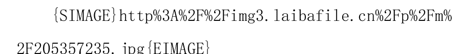

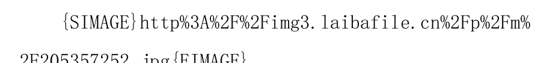

抵押卖出获得现金金融资，结果高价买回，从盘面价格上分析是这种结果。

作者:66 端午 88 日期:2015-02-08 22:13

@聪明的小散 2015-02-08 22:06:27

长期关注楼主帖子，请教一下济南哪个医院牙科比较好？老家郑州的，最近半年在齐河出差，回不去，有个牙齿坏掉了，需要看一下

天真牙科，我个朋友推荐的，在佛山苑小区里面，病人太多，可能需要预约，网上查查电话。

作者:66 端午 88 日期:2015-02-08 22:17

@66 端午 88 28801 楼 2015-02-08 19:24:00

@麦田 110400 2015-02-08 17:19:09

老大，我正在学习看股票的基本面，下面是安信信托的上两个季度的流通股持股情况。持股的股东怎么骤减，而且持有股票也这么点了呢？是公司都收回用于增发的意思吗?

加v信1101284955，获取更多好帖

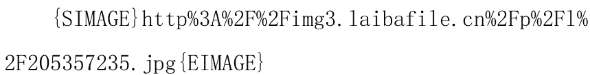

@麦田 110400 2015-02-08 20:52:53
抵押卖出获得现金金融资，结果高价买回，从盘面价格上分析是这种结果。

安信收益增长都 260%了，还要融资干啥呢?

是有些股东可能和控股方签过协议，需要用钱，但又不能违约在一定期限前卖出，只好通过专用账户卖出，然后通过其它方式（抵押贷款等），获得资金，时逢股价上涨，年底已经撤户，说明抵押结束，借出的股票是高价收回来的，亏了不少。

作者:66 端午 88 日期:2015-02-08 22:20
或者是对赌协议，蒙牛的大股东就是这么被赶出蒙牛公司的。

作者:66 端午 88 日期:2015-02-09 10:50
券商的估值明显下降，去杠杆到什么程度，算不清楚。已经不如房地产和信托的杠杆倍率高了，现在是借着前期积累的人气做反抽，下一步领涨板块是什么？现在大家都在找

作者:66 端午 88 日期:2015-02-09 10:54

想要走慢牛，背景一定是经济发展平稳运行，前提就是房地产行业走稳，快牛=金融注水，慢牛=房地产归位，从近期政策走向上看，已经不敢再提压制房地产了，现在的问题是库存过大，各地应该出台政策收购滞销的房地产项目作为政策性住房，同时对房地产信贷进行有限放松。

作者:66 端午 88 日期:2015-02-09 11:00

指数未必跌多少，要等到 20 周线上来，所以不要着急抄底，套住的，属于行业高估的，寻找高点高抛，属于未来走慢牛的，腾出资金后慢补。创业板，风险集聚所在。

作者:66 端午 88 日期:2015-02-09 11:02

券商现在属于平衡配置，以后不会作为重点板块，杠杆倍率提升是当初看好它的唯一因素，如果打压杠杆，它的涨势会和银行差不多，再说最近大量券商上市，已经不够稀缺了。未来成交量很难再跑到沪市 5000 亿以上。

作者:66 端午 88 日期:2015-02-09 11:03

配置重点应该是房地产+信托（足够稀缺）+部分重组股

作者:66 端午 88 日期:2015-02-09 11:25

高杠杆倍率行业计算，银行：8 倍左右，由于各个银行加大拨备率，现在大约 6 倍左右。保险行业，一直都是 5 倍左右，证券行业，国外大约是 10 倍，目前我国不计算手续费，大约是 2.5 倍左右，计算手续费，用平衡法计算大约是 5 倍左右。信托大约是 20 倍，可是由于该风险比较大，遇到熊市，信托的风险无法计算，用平衡法计算大约是 5 倍-10 倍之间，如果取消刚性兑付，该行业杠杆倍率将降至 5 倍以上，并且熊市风险可以被屏蔽。房地产行业：5 倍。就是说，金融行业杠杆倍率都都是 5 倍左右，现在就是算谁的市值和市盈率的系数最低。

加 v 信 1101284955，获取更多好帖

作者:66 端午 88 日期:2015-02-09 11:26

@66 端午 88 2015-02-09 11:03:29

配置重点应该是房地产+信托（足够稀缺）+部分重组股

@不惑之真惑 2015-02-09 11:23:32

老大，托托今天有没有可能板一个？

不至于明天开始停牌吧？上次西水就在停牌前板了一下，俺跑掉八成，后来就看大家吃肉，我就喝了一口汤。

不会的，在出消息前，会箱体震荡，出了消息，突破箱顶。

作者:66 端午 88 日期:2015-02-09 11:46

@66 端午 88 2015-02-09 11:03:29

配置重点应该是房地产+信托（足够稀缺）+部分重组股

@不惑之真惑 2015-02-09 11:23:32

老大，托托今天有没有可能板一个？
不至于明天开始停牌吧？上次西水就在停牌前板了一下，俺跑掉八成，后来就看大家吃肉，我就喝了一口汤。

@66 端午 88 2015-02-09 11:26:15
不会的，在出消息前，会箱体震荡，出了消息，突破箱顶。

@麦田 110400 2015-02-09 11:41:05
老大建议小托托的配置比例是几成？2 成？

一成信托，二成地产相关，一成重组，一成证券或者保险

作者:66 端午 88 日期:2015-02-09 13:13
刚才同学在微信里说：成交量 1800 亿以下，是调整底部，看来还得等等，还得日线 MACD 穿越 0 轴。二月份券商业绩担忧了

作者:66 端午 88 日期:2015-02-09 14:03
别看指数了，看成交量，1800 亿以下

作者:66 端午 88 日期:2015-02-09 14:29
@dashu9876 2015-02-09 14:15:51
老大，帮忙看下--中国国航 601111,8.60 元的成本，该割肉还是等等?

加 v 信 1101284955，获取更多好帖

正在筑底

作者:66 端午 88 日期:2015-02-09 14:47

@简单粗暴的你 2015-02-09 14:32:26

老大, 证券还会回调吗, 蓝色光标一直拿着吗

需要等挺长时间, 26.8 处应该大幅减仓, 剩下的做长线。

作者:66 端午 88 日期:2015-02-09 16:38

@a3392103 2015-02-09 15:56:29

期权的推出

散户赚钱更难了。

是, 盘中波动加剧, 收盘价反而缩小, 没有对冲工具, 风险是扩大了。

作者:66 端午 88 日期:2015-02-09 16:43

按照私人车辆拥有量, 四季度民用耗油量 (非商业), 同比大约提高了 15%左右。国家储备大幅扩大了 1000 万桶, 而总使用量降低了 2%。这个算数题谁都会计算, 商用用油减少了 35%-40%。体现于工程和流通环节。同期国有控制体系用油量基本持平, 流通环节降低幅度有限, 消耗量主要减少在民营体系相关各行业, 企业的微环境极其恶劣, 特别是民营体系。

加 v 信 1101284955, 获取更多好帖

作者:66 端午 88 日期:2015-02-09 19:45

安信信托每股送 0.7 元，这是给证监会发审委表现表现吗？大股东只能分到 1 个亿，拿来增发，也只能拿到不到一千万股，增发对象肯定是最大股东。

作者:66 端午 88 日期:2015-02-09 19:57

@梧高凤至 2015-02-09 19:51:57

请教楼主些问题。希望不吝赐教。

2015 年中国建材行业前景如何？

现在国家对与房地产业的态度是怎么样的？

如果国家想打压房地产业那城镇化又是怎么回事？

34 号文件对于房地产业又有什么影响？

建材行业是房地产的下游行业，如果房地产业萧条了，建材业受的影响有多大？

目前属于极少数能规避网售的行业之一，不过很多互联网企业都在等着切这块肉，且受到去年房产销售低迷的影响较大，前景堪忧。

作者:66 端午 88 日期:2015-02-09 21:10

@66 端午 88 28852 楼 2015-02-09 19:45

安信信托每股送 0.7 元，这是给证监会发审委表现表现吗？大股东只能分到 1 个亿，拿来增发，也只能拿到不到一千万股,增发对象肯定是最大股东。

@ty105453 2015-02-09 20:45:52

老大,这么说还是好事?

要是分到1.2元,马上减仓,现在还是分多了点。感觉想要表现,分个40-50分就可以了,留下钱送股,这样一来只有10送5的可能了,将大大影响未来估值。

作者:66端午88日期:2015-02-09 21:12

就是看增发对象是谁?以前说是中信信托,要是八杆子打不着的金主,增发完毕后,也得逢高减。

作者:66端午88日期:2015-02-09 21:17

按照现在的资本收益率来算,55%的收益率,如果增加2.5×13=32亿资本金,算上明年目标12亿,一共30亿利润,7亿股,每股收益4.5元。当然,额这么算有点做梦了,可是庄家会拿这种算法让散户去幻想。

作者:66端午88日期:2015-02-09 22:25

@不在外边 2015-02-09 22:04:20

老大,从MACD来看,券商行情是不是又回来了?

感觉够呛,你看看一月份的成交量仅仅次于12月,比开始发疯的11月还高,2月份时间少,券商收益全趴窝,3月份再调整一下，能到9月的成交量就不错。压力在3月。

加v信1101284955,获取更多好帖

作者:66 端午 88 日期:2015-02-10 08:33

@66 端午 88 27374 楼 2015-01-20 21:00

@马拉巴马 2015-01-20 20:54:06

请问楼主美圆还要换吗?好象最近都看空人民币啊!

突破6.32，可积极布局美元

@bjsybs 2015-02-09 22:45:50

万一到了某个位置不给换了咋办?

持有美钞现金，现汇要汇出，到了管制一步，基本就算崩盘了

作者:66 端午 88 日期:2015-02-10 09:08

@PETER6603 2015-02-10 08:38:01

老大，汇率下跌对房价还是有影响的吧。

最近看了套房子，感觉买房子在目前看来有点不划算

房子350万，拿到手将近400万，要每年上涨20万才能跑过持有现金的人，买不买房子也让人纠结啊。

不要增加总套数，甚至要减套数，换成大户型

安信信托一跌就出利好，一涨，庄家就打压。明显控制股价

作者:66 端午 88 日期:2015-02-10 09:38

CPI 跌破 1，很快进入通货紧缩时代，看好房地产行业。

作者:66 端午 88 日期:2015-02-10 09:47

@PETER6603 28866 楼 2015-02-10 08:38 老大，汇率下跌对房价还是有影响的吧。最近看了套房子，感觉买房子在目前看来有点不划算。房子 350 万，拿到手将近 400 万，要每年上涨 20 万才能跑过持有现金的人，买不买房子也让人纠结啊。

@投机者的扑克 2015-02-10 09:42:31

你真土豪，一套抵我三套

真正的土豪，都很低调

作者:66 端午 88 日期:2015-02-10 09:48

@66 端午 88 28868 楼 2015-02-10 09:23

安信信托一跌就出利好，一涨，庄家就打压。明显控制股价

@HH830516 2015-02-10 09:46:41

28 以下伺机加仓吗？

不着急，一个月以后再谈补仓，倒是房地产初步确定是下一步的领涨板块了。

作者:66 端午 88 日期:2015-02-10 09:51

房地产的领涨股很难判定，这个板块启动的方式，一定是慢牛方式，B 类基金除外

作者:66 端午 88 日期:2015-02-10 10:43

成交量上不去，券商只是反抽而已，房地产则是必须向上才能拉动经济，信托主要为房地产提供额外信贷，且有更高的杠杆倍率，理应高估，看问题先找逻辑，只做自己能理解的事情。

作者:66 端午 88 日期:2015-02-10 10:47

券商会 60 日线附近盘整震荡，等待成交量或者杠杆倍率变化，房地产会走出慢牛，盘面应该是这种趋势。

作者:66 端午 88 日期:2015-02-10 10:49

@莫高雷勇士 2015-02-10 09:48:22

今天东北证券吃错药了？以前都是涨幅后变数，跌幅前三，今天居然领涨。

动态 25 倍市盈率和海通证券并列最低，昨天东吴证券也是因为市盈率优势，这表明投资是价值型的，不是疯炒预期，所以不会疯。

作者:66 端午 88 日期:2015-02-10 10:51

今天虽然涨了，成交量和昨天基本持平，下午如果下跌，还会再缩量，券商就撑不住了，淡定。

作者:66 端午 88 日期:2015-02-10 11:04

@PETER6603 28874 楼 2015-02-10 09:47

@PETER6603 2015-02-10 08:38:01

老大，汇率下跌对房价还是有影响的吧。

最近看了套房子，感觉买房子在目前看来有点不划算

房子 350 万，拿到手将近 400 万，要每年上涨 20 万才能跑过持有现金的人，买不买房子也让人纠结啊。

@66 端午 88 2015-02-10 09:08:33

不要增加总套数，甚至要减套数，换成大户型

@又吃多了 2015-02-10 10:48:29

买这么大的不怕以后房产税太高吗？

传一套房，不管多大，不征税。

作者:66 端午 88 日期:2015-02-10 14:05

“投资”股票和种庄稼有一比，种子都是埋在地里，没听说过挂在树梢的。大品种就像小麦稻子，小品中就像辣椒和葱姜蒜。

作者:66 端午 88 日期:2015-02-10 16:00

@不惑之真惑 28898 楼 2015-02-10 14:30:00

托托的确让人恶心得很。有摔鼠标的冲动。

西水也盘到想吐，还不是一样翻番

作者:66 端午 88 日期:2015-02-10 17:21

@aobog 2015-02-10 16:54:22

楼主地产股有什么好推荐的吗

我就是选不出来才买地产 B 的，本来想买张江+东湖高新+中关村，一看市盈率没敢买。

作者:66 端午 88 日期:2015-02-10 17:56

@66 端午 88 28904 楼 2015-02-10 17:21

@aobog 2015-02-10 16:54:22

楼主地产股有什么好推荐的吗

我就是选不出来才买地产 B 的，本来想买张江+东湖高新+中关村，一看市盈率没敢买。

@HH830516 2015-02-10 17:44:50

嘉宝集团就是地产股啊，会不会爆发

嘉宝当核电概念买的，小地产公司不容易估值，好一年，然后就没以后了。

作者:66 端午 88 日期:2015-02-10 21:15

@麦田 110400 2015-02-08 17:19:09

老大，我正在学习看股票的基本面，下面是安信信托的上两个季度的流通股持股情况。持股的股东怎么骤减，而且持有股票也这么点了呢？是公司都收回用于增发的意思吗？

@luyhshj 2015-02-10 07:02:42

新手就不要入股市了，浪费时间了；去买房子吧

@麦田 110400 2015-02-10 21:10:18

姐就是卖房子挣了大把钞票才不知道怎么花呢！

打新股，按照过去六个月的收益，年化36%。

作者:66 端午 88 日期:2015-02-11 09:49

@简单粗暴的你 2015-02-11 09:38:17

大哥怎么看西水

涨的太快，增发价和市价差距太大，这是就是可怕的利益输送问题被怀疑，从而被证监会发审委按住，估计要跌一阵子，可能要跌到 15--17 左右做增发准备。这同样也是安信信托的风险所在，所以压着不敢动。

作者: 66 端午 88 日期: 2015-02-11 09:55

@1925028499 2015-02-11 09:25:07

老大怎么看西水这次跌停啊。一直没出。后悔死

让你卖，你不卖，好赖也得卖一半吧。

作者: 66 端午 88 日期: 2015-02-11 10:42

@简单粗暴的你 2015-02-11 10:06:59

我也没卖，现在卖不出去了，预计还有几个跌停啊，老大，三个?

最多一个，然后探底，横盘

作者: 66 端午 88 日期: 2015-02-11 10:44

再好的股票也不是一步到位的，涨了先出掉等调整，万一卖早了，说明没缘分，牛市深套，都不好意思和别人说了。

作者: 66 端午 88 日期: 2015-02-12 09:09

电商最新的突破口选择了医药零售，外面越来越多的药店要倒霉了，目前的问题是：买药的都是急用，全国性配售不现实，除了慢性和常备药，很难对急用药品产生致命突破，这块领域适合区域中心分散布局的大型企业，或 OTO 有一定发展的机会，或者采用垂直加盟模式。

作者:66 端午 88 日期:2015-02-12 09:12

@desertsahara 2015-02-11 12:52:35

一直看老师的帖子，收益也很大，视野扩宽了好多

最近有个创业的想咨询下老师，我一亲戚是做微信圈营销的，主要是服装尾货切货后卖给朋友圈里的妈妈，类似于关系型的营销，利润也还蛮不错的，但这种模式发展很受限，无法做大，靠雇佣几个人没法形成规模，最近一直考虑要不要做论坛，将朋友圈上的人引到论坛上，在论坛里销售。

不知道您这边有没有啥经验给指导一下不？

论坛门户已经过气了，尚能生存的只有为数不多的几个专业论坛，再就是几个八卦论坛，而且用户量也在减少，立足移动生存吧。

作者:66 端午 88 日期:2015-02-12 09:57

@ccn431 28952 楼 2015-02-11 21:42 楼主，股市论谈里有个挺火的帖子也推荐了安徽水利

@投机者的扑克 2015-02-12 09:44:27

今天安徽水利不错

还套额一毛多哪：(

加v信1101284955，获取更多好帖

作者:66 端午 88 日期:2015-02-12 10:09

@desertsahara 2015-02-11 12:52:35

一直看老师的帖子，收益也很大，视野扩宽了好多

最近有个创业的想咨询下老师，我一亲戚是做微信圈营销的，主要是服装尾货切货后卖给朋友圈里的妈妈，类似于关系型的营销，利润也还蛮不错的，但这种模式发展很受限，无法做大，靠雇佣几个人没法形成规模，最近一直考虑要不要做论坛，将朋友圈上的人引到论坛上，在论坛里销售。

不知道您这边有没有啥经验给指导一下不？

@66 端午 88 2015-02-12 09:12:05

论坛门户已经过气了，尚能生存的只有为数不多的几个专业论坛，再就是几个八卦论坛，而且用户量也在减少，立足移动生存吧。

@desertsahara 2015-02-12 10:04:14

现在就是利用手机的微信朋友圈，以为依附于微信，但是没法突破，把模式和规模做到可复制，好伤脑筋

现在网上炒热，得烧钱，有风投烧，不心疼，烧自己的，很快就变至尊宝。

作者:66 端午 88 日期:2015-02-12 11:11

加v信 1101284955，获取更多好帖

@九月登高 2015-02-12 10:52:50

端午兄，聊城的房子走势如何？我有套聊城的房改房，位置不算好，小区环境、物业都不好，打算卖了，现在的价格比一年前每平方低 500 元左右，已有买家出价，现在卖还是再等等。端午兄，给个建议如何？

卖，换济南的

作者:66 端午 88 日期:2015-02-12 12:08

@披着城市的外衣 2015-02-12 11:22:28

老大，感觉证券调整结束了，这感觉靠谱不？

不靠谱，区间震荡，2 月的成交量很难看，到了 3 月 5 号左右公布二月业绩，有一大波杀跌，要触碰 89 日线，那会才是建仓时机。

作者:66 端午 88 日期:2015-02-12 12:10

@66 端午 88 2015-02-12 09:09:50

电商最新的突破口选择了医药零售，外面越来越多的药店要倒霉了，目前的问题是：买药的都是急用，全国性配售不现实，除了慢性和常备药，很难对急用药品产生致命突破，这块领域适合区域中心分散布局的大型企业，或 OTO 有一定发展的机会，或者采用垂直加盟模式。

加 v 信 1101284955，获取更多好帖

@麦田 110400 2015-02-12 11:34:04

药店这几年就竞争越来越激烈了，我之前本想想和朋友合伙做来着。现在挣钱的是诊所，尤其是社区诊所。排队打针。

牙医诊所都非常看好，爱尔眼科想扩张在这个领域，额个同学是爱尔眼科的高级顾问，他说过，他开了个眼镜连锁店，生意貌似还不错，专供医院。

作者:66 端午 88 日期:2015-02-12 13:23

放量了，创业板赚的可以减了。

作者:66 端午 88 日期:2015-02-12 13:24

西水走的很强，再探底时，可逢低重新建仓

作者:66 端午 88 日期:2015-02-12 13:29

@66 端午 88 2015-02-12 09:09:50

电商最新的突破口选择了医药零售，外面越来越多的药店要倒霉了，目前的问题是：买药的都是急用，全国性配售不现实，除了慢性和常备药，很难对急用药品产生致命突破，这块领域适合区域中心分散布局的大型企业，或 OTO 有一定发展的机会，或者采用垂直加盟模式。

@麦田 110400 2015-02-12 11:34:04

药店这几年就竞争越来越激烈了，我之前本想想和朋友合伙做来着。现在挣钱的是诊所，尤其是社区诊所。排队打针。

@66 端午 88 2015-02-12 12:10:41

牙医诊所都非常看好，爱尔眼科想扩张在这个领域，额个同学是爱尔眼科的高级顾问，他说过，他开了个眼镜连锁店，生意貌似还不错，专供医院。

@麦田 110400 2015-02-12 12:50:26

现在牙科，眼科挣钱，我看以后就肺科挣钱！现在肺癌患病率越来越高。土豪老大，你开创个韩国整形医院啥的吧；)

私营医院社会地位弱势，出个医疗事故倾家荡产。所以他们都是搞这样的小行业，治不死，收费高的细分行业，有技术含量的不敢搞。

作者:66 端午 88 日期:2015-02-12 13:32

地产 B 的弹性比房地产 B 强好多。

作者:66 端午 88 日期:2015-02-12 13:34

慢牛走势需要淡定，可以不用整天盯盘了。

作者:66 端午 88 日期:2015-02-12 13:36

地产 B 的标的是土地含量较多的房地产公司，房地产 B 是均衡配置。这是额买它的唯一原因，不过波动太大了。

作者:66 端午 88 日期:2015-02-12 13:55

@66 端午 88 2015-02-12 09:09:50

电商最新的突破口选择了医药零售，外面越来越多的药店要倒霉了，目前的问题是：买药的都是急用，全国性配售不现实，除了慢性和常备药，很难对急用药品产生致命突破，这块领域适合区域中心分散布局的大型企业，或 OTO 有一定发展的机会，或者采用垂直加盟模式。

@麦田 110400 2015-02-12 11:34:04

药店这几年就竞争越来越激烈了，我之前本想想和朋友合伙做来着。现在挣钱的是诊所，尤其是社区诊所。排队打针。

@66 端午 88 2015-02-12 12:10:41

牙医诊所都非常看好，爱尔眼科想扩张在这个领域，额个同学是爱尔眼科的高级顾问，他说过，他开了个眼镜连锁店，生意貌似还不错，专供医院。

@麦田 110400 2015-02-12 12:50:26

现在牙科，眼科挣钱，我看以后就肺科挣钱！现在肺癌患病率越来越高。土豪老大，你开创个韩国整形医院啥的

加 v 信 1101284955，获取更多好帖

吧;)

@66 端午 88 2015-02-12 13:29:20

私营医院社会地位弱势，出个医疗事故倾家荡产。所以他们都是搞这样的小行业，治不死，收费高的细分行业，有技术含量的不敢搞。

@麦田 110400 2015-02-12 13:44:31

到目前为止有没有你能看上的行业呢~

金融

作者:66 端午 88 日期:2015-02-12 14:14

退一步海阔天空，忍一时豁然开朗。

作者:66 端午 88 日期:2015-02-12 14:28

安信的走势对券商板块有指导作用，均线粘合至89日线，然后上拉启动。还缺一波回调，所以现在不要买，买了能头疼死你的。

作者:66 端午 88 日期:2015-02-12 14:31

@66 端午 88 2015-02-12 14:28:36

安信的走势对券商板块有指导作用，均线粘合至89日线，然后上拉启动。还缺一波回调，所以现在不要买，买了能头疼死你的。

加v信1101284955，获取更多好帖

@ipeewee 2015-02-12 14:29:20

那我现在手里有的可以卖一部分等回调?

这个股，不追高，不抄底，不做差价。静等重组。

作者:66 端午 88 日期:2015-02-12 21:57

手好，中了两千新股，1000 大盘，500×2 小盘

作者:66 端午 88 日期:2015-02-13 09:39

判断准确，信托率先拉出第五浪，向上突破，爱建领涨，其它跟进。

作者:66 端午 88 日期:2015-02-13 09:44

如果一周内安信信托公布增发通过，第一波高点不低于 48

作者:66 端午 88 日期:2015-02-13 09:53

@aobog 2015-02-13 09:51:17

楼主，安信还能进吗，今天

不追高，不抄底，不做差价。今天冲高，不容易把握建仓点。

作者:66 端午 88 日期:2015-02-13 09:56

31 以下，逢低补比较妥当

作者:66 端午 88 日期:2015-02-13 10:00

加 v 信 1101284955，获取更多好帖

## 房地产业快启动了

作者:66 端午 88 日期:2015-02-13 10:10

胆大的去看看省广股份，胆小的看看蓝色光标，短线

作者:66 端午 88 日期:2015-02-13 10:17

@a3392103 2015-02-13 10:11:11

今天医药股大涨

是不是主力资金年避险。。。

涨的少的都在补涨，市值超过2万亿的别看了，成交量不会像以前那样了，除了五浪加速末期，会接近哪个量。看看对实体经济起关键作用的重型板块，首选地产，家电，汽车。

作者:66 端午 88 日期:2015-02-13 10:21

@简单粗暴的你 2015-02-13 10:15:29

蓝色光标还套着呢，能短线做低成本吗?

可以

作者:66 端午 88 日期:2015-02-13 10:26

深圳成交量自行情启动以来，首次超过沪市。

作者:66 端午 88 日期:2015-02-13 10:33

房地产指数在偷偷上涨

作者:66 端午 88 日期:2015-02-13 10:34

加v信1101284955，获取更多好帖

@海阔天空之君 2015-02-13 10:32:36

端午兄：地产板块的 600325 华发股份，未知能否入您眼？

房地产算不出估值，只好买指数。

作者:66 端午 88 日期:2015-02-13 10:41

房地产指数突破 20 日线，目测后市稳健上扬。

作者:66 端午 88 日期:2015-02-13 11:14

@海阔天空之君 2015-02-13 10:50:35

手上还有大量子弹，未知端午兄有啥好介绍啊？

或者现在是否还是宜潜伏、再看看？

房地产类

作者:66 端午 88 日期:2015-02-13 11:27

地产突破领涨

作者:66 端午 88 日期:2015-02-13 11:31

刚才滴震荡是哥额做出来滴。:)

作者:66 端午 88 日期:2015-02-13 11:39

@a3392103 2015-02-13 10:30:31

是不是深港通快要推出

有主力资金进去做局啊

老大

沪股的主力是金融，深市的主力是房地产，深港通也会刺激房地产类走好。目前看不是这个因素，刺激经济的着力点是房地产，这贴通篇都是揪着它说事。

作者:66 端午 88 日期:2015-02-13 12:11

主力根本判断不出来，所以几十万就可以让它上下震荡，让先抄底的出来一下，然后主力封单就上去了，因为他们看到了房地产指数开始领涨了，凡是符合逻辑的，终归是要发生的，炒股就是研判逻辑，找到路径。

作者:66 端午 88 日期:2015-02-13 13:25

奔跑吧，地产 B

作者:66 端午 88 日期:2015-02-13 14:20

@麦田 110400 2015-02-13 13:46:47

老大给看看这个股，002589 还能不能持有了

个人观点，不能留

作者:66 端午 88 日期:2015-02-14 13:32

任何传统企业，一旦遭到外部互联网企业的侵蚀，带来的必是利润率暴跌，传统盈利方式成为互联网企业介入的免费标的，以此吸纳库存客户资金，其盈利会以新产品替代老产品，随着券商牌照的放开，互联网企业的深度介入，券商行业起码在今年成为鸡肋行业，建议将券商从平衡配置降低为持续减持。

作者:66 端午 88 日期:2015-02-17 09:49

艹，最后一天才发红包，等到花儿快谢了

作者:66 端午 88 日期:2015-02-17 09:53

赶脚安信审批已过

作者:66 端午 88 日期:2015-02-17 09:59

没赔了的吧，捂着

作者:66 端午 88 日期:2015-02-17 10:02

冲击涨停，开牌一个涨停，后面看惯性了，起码应该三个以上吧。

作者:66 端午 88 日期:2015-02-17 10:34

涨停了，不管了，开始买小票耍耍，长城影视

作者:66 端午 88 日期:2015-02-17 10:36

信托是大金融里面最闪亮的

作者:66 端午 88 日期:2015-02-17 11:04

突破了，加仓房地产

作者:66 端午 88 日期:2015-02-17 11:05

@简单粗暴的你 2015-02-17 10:53:51

大哥，安信还能加仓不

31 以下不是让大伙加仓了吗?

作者:66 端午 88 日期:2015-02-17 11:06

## 地产有望在未来三个月成为替代券商的领涨板块

作者:66 端午 88 日期:2015-02-17 11:50

@简单粗暴的你 2015-02-17 11:15:06

加仓地产 B 吗

一半 B, 一半那得准的地产，额是地产 B+安徽水利

作者:66 端午 88 日期:2015-02-17 13:28

安信提高一块建仓安全点至 32.

作者:66 端午 88 日期:2015-02-17 14:07

安信股份在培养散户高抛习惯，等着你认准高抛低吸的时候，就高抛却吸不回来，然后到更高的位置追，传统手段，不理。

作者:66 端午 88 日期:2015-02-17 15:22

@ipeewee 2015-02-17 14:35:14

安徽水利还有机会介入么

等回调吧，5 日线

作者:66 端午 88 日期:2015-02-17 15:23

实体经济会比预料的更差，年后会有一大批企业不会再开业开工了。

作者:66 端午 88 日期:2015-02-17 18:52

熬到今年关门的，都比额强哈，额去年就不准备熬了，今年一算，省了几十万的人工和社保，算上堵车换屌丝摩托，又多省了两万，再算上自己用不到的商住两用也出租了，又省了四五万，眼见着以前驰骋在商场上的兄弟，一个个都不务正业了，股神出了好几个，以前都是聊技术发展方向，现在都是聊股市技术分析，新技术目看到有啥前景，老营生全都趴下了，踏踏实实过年吧，无欲则刚啊，祝大家春节愉快。

作者:66 端午 88 日期:2015-02-17 19:49

@ccn431 2015-02-17 19:09:55

@66 端午 88 29099 楼 2015-02-17 18:52:00

熬到今年关门的，都比额强哈，额去年就不准备熬了，今年一算，省了几十万的人工和社保，算上堵车换屌丝摩托，又多省了两万，再算上自己用不到的商住两用也出租了，又省了四五万，眼见着以前驰骋在商场上的兄弟，一个个都不务正业了，股神出了好几个，以前都是聊技术发展方向，现在都是聊股市技术分析，新技术目看到有啥前景，老营生全都趴下了，踏踏实实过年吧，无欲......

堵车太心烦了。

作者:66 端午 88 日期:2015-02-17 23:07

@1983 年的大兵 u 2015-02-17 21:53:44

真心求教一下，我是苏北县城的，已有 1 套房，不是学区房，因为小孩上学的原因，我们这里小孩上实验小学需要有学区房才行,请问今年购房是合适时机吗?

适合置换,不适合增持

作者:66 端午 88 日期:2015-02-17 23:10

@generabbit 2015-02-17 22:26:41

楼主如何解读这个:国务院:试点下放宅基地审批权

尚未得到该消息来源,如果有,是因为地方财政吃紧,无财力促进城镇化,现在下方审批,集约使用农村用地,提高密度,补贴地方基层财政

作者:66 端午 88 日期:2015-02-17 23:13

@逛逛在抽烟 2015-02-17 22:51:39

为了找回密码费了半天劲。祝楼主春节快乐!另:最近你谈的股票多些。能谈谈实体经济,以及美元等。也淡淡咱济南的动静吧。例如新的居住证政策,是不是不用买房,租房就可以居住。对房地产的影响呢?

完全不可能,租房需要证明的,都是奔着学籍去的,优质教育资源就那点,你有了,别人就没了,倘若要是都租,反复租,优质学校根本也挤不下。

作者:66 端午 88 日期:2015-02-19 16:34

今年的房地产交易将开始实质性的动态化,第一个特点就是互联网交易成为常态，第二个特点需要国家制度的支持，大幅降低交易费用，第三个特点就是交易的易化。在一个电子地图上，你就可以找到合适的房产。选择电子交易中介，选择贷款银行，抵押关联资产。这个市场的规模是目前传统电商市场的2-3倍规模。

作者:66 端午 88 日期:2015-02-20 23:12

@66 端午 88 29099 楼 2015-02-17 18:52:00

熬到今年关门的，都比额强哈，额去年就不准备熬了，今年一算，省了几十万的人工和社保，算上堵车换屌丝摩托，又多省了两万，再算上自己用不到的商住两用也出租了，又省了四五万，眼见着以前驰骋在商场上的兄弟，一个个都不务正业了，股神出了好几个，以前都是聊技术发展方向，现在都是聊股市技术分析，新技术目看到有啥前景，老营生全都趴下了，踏踏实实过年吧，无欲……

摩托冬天不好过

@Rambo 第 N 滴血 2015-02-20 21:59:43

人家天冷可以不出门的呀。又不像上班当差的，不管下雨还是打雷，准点得到。

至少今年我们这里不算冷，小踏板优势太明显了，快速路可以借公交车道，可以自行车车道，济南的通行时速在全国属于比较慢的，仅仅快于北京，西安，广州，比上海还要慢，大约时速 11.8 公里。摩托车的通行时速大约 30 公里左右。不过缺点也非常明显的，就是济南主干道和次主干道全部对摩托车限行，不过小踏板的好处就是和电动车样子完全一致，在电动车洪流中找出个小踏板，还真是不容易，除非专项整治。开这玩意，一定要眼观六路耳听八方，看到是专项整治，马上掉头。其它时间，交警根本就不理你，额试过一次，就停在交警旁边，中间隔着两辆电动车，等了一小会，两个电动车穿红灯过去了，额老司机啊，不肯闯红灯，这就直接面对交警了，木想到啊，交警马上把脸扭过去了，把额当空气的赶脚。

小踏板的短距离通行，在大城市是无以伦比的，这从台湾一直鼓励机车通行就看得出，开车出门 5 公里-10 公里，基本都需要 40 分钟-1 个半小时不等。用小踏板根本不存在堵车的问题，一般 10-30 分钟都可以顺利到达，最头疼的找车位，等车位，乱停车被罚，变道被罚，都没了。路过小路口，开车也是需要等红灯的，开小踏板，确定无通行车辆时，闯个红灯，也木有关系，不过要看仔细，不要和汽车抢道，肉包铁可比不了铁包肉。去神马超市，菜场，银行之类的踏板的优势就更强了。

作者:66 端午 88 日期:2015-02-20 23:22

就拿摩托车（踏板）的销量来说，我们这里销售量比不禁摩的时候要多了不下一倍，摩托车零售店的生意还是非常不错的，最近接手了不少时装品牌的零售店面。近一年街上摩托车越来越多了，这要是都开车，就更没法出门了。网售的摩托车，大部分是杂牌，因摩托车的故障率比汽车高，需要更多的简单售后服务，大部分品牌摩托车还是需要这些零售店做些的售后服务保障的。高端品种也多了，是因为都市人寻求更加张扬的个性，哈雷，杜卡迪，KTM，宝马之类的个性车比较典型，属于休闲用途。

作者:66 端午 88 日期:2015-02-21 09:45

@天边一片白云 2015-02-21 06:51:35

@66 端午 88 29155 楼 2015-02-20 23:12:00

@66 端午 88 29099 楼 2015-02-17 18:52:00

熬到今年关门的，都比额强哈，额去年就不准备熬了，今年一算，省了几十万的人工和社保，算上堵车换屌丝摩托，又多省了两万，再算上自己用不到的商住两用也出租了，又省了四五万，眼见着以前驰骋在商场上的兄弟，一个个都不务正业了，股神出了好几个，以前都是聊技术发展方向，现在都是聊股市技术分析，新技术目看到有......

经常忘充电，再有就是强度不行

作者:66 端午 88 日期:2015-02-21 15:45

@66 端午 88 29099 楼 2015-02-17 18:52:00

熬到今年关门的，都比额强哈，额去年就不准备熬了，今年一算，省了几十万的人工和社保，算上堵车换屌丝摩托，又多省了两万，再算上自己用不到的商住两用也出租了，又省了四五万，眼见着以前驰骋在商场上的兄弟，一个个都不务正业了，股神出了好几个，以前都是聊技术发展方向，现在都是聊股市技术分析，新技术目看到有啥前景，老营生全都趴下了，踏踏实实过年吧，无欲……

摩托冬天不好过

@Rambo 第 N 滴血 2015-02-20 21:59:43

人家天冷可以不出门的呀。又不像上班当差的，不管下雨还是打雷，准点得到。

@66 端午 88 29155 楼 2015-02-20 23:12

至少今年我们这里不算冷，小踏板优势太明显了，快速路可以借公交车道，可以自行车车道，济南的通行时速在全国属于比较慢的，仅仅快于北京，西安，广州，比上海还要慢，大约时速 11.8 公里。摩托车的通行时速大约 30 公里左右。不过缺点也非常明显的，就是济南主干道和次主干道全部对摩托车限行，不过小踏板的好处就是和电动车样子完全一致，在电动车洪流中找出个小踏板，还真是不容易，除非专项整治。开这玩意，一定要眼观六路........

@逛逛在抽烟 2015-02-21 13:35:28

66 楼主，即然你又不急着去赶时间上班，何必怕开车呢，咱可不能光看存折的数字而不去享受生活吧！你也谈谈济南的实体经济吧，毕竟股票是昙花一现的东东。

去年刚被罚了 27 分（木有超速，木有闯红灯），乱停车不扣分，不过 22 次，折腾死了，自从买了小踏板，只扣了三分，乱停车一次木有，多么大的进步。:)

作者:66 端午 88 日期:2015-02-21 15:46

@66 端午 88 29099 楼 2015-02-17 18:52:00

熬到今年关门的，都比额强哈，额去年就不准备熬了，今年一算，省了几十万的人工和社保，算上堵车换屌丝摩托，又多省了两万，再算上自己用不到的商住两用也出租了，又省了四五万，眼见着以前驰骋在商场上的兄弟，一个个都不务正业了，股神出了好几个，以前都是聊技术发展方向，现在都是聊股市技术分析，新技术目看到有啥前景，老营生全都趴下了，踏踏实实过年吧，无欲......

摩托冬天不好过

@Rambo 第 N 滴血 2015-02-20 21:59:43

人家天冷可以不出门的呀。又不像上班当差的，不管下雨还是打雷，准点得到。

@66 端午 88 2015-02-20 23:12:29

至少今年我们这里不算冷，小踏板优势太明显了，快速路可以借公交车道，可以自行车车道，济南的通行时速在全国属于比较慢的，仅仅快于北京，西安，广州，比上海还要慢，大约时速 11.8 公里。摩托车的通行时速大约 30 公里左右。不过缺点也非常明显的，就是济南主干道和次主干道全部对摩托车限行，不过小踏板的好处就是和电动车样子完全一致，在电动车洪流中找出个小踏板，还真是不容易，除非专项整治。开这玩意，一定要眼观六路耳听八方，看到是专项整治，马上掉头。其它时间，交警根本就不理你，额试过一次，就停在交警旁边，中间隔着两辆电动车，等了一小会，两个电动车穿红灯过去了，额老司机啊，不肯闯红灯，这就直接面对交警了，木想到啊，交警马上把脸扭过去了，把额当空气的赶脚。

小踏板的短距离通行，在大城市是无以伦比的，这从台湾一直鼓励机车通行就看得出，开车出门 5 公里-10 公里，基本都需要 40 分钟-1 个半小时不等。用小踏板根本不存在堵车的问题，一般 10-30 分钟都可以顺利到达，最头疼的找车位，等车位，乱停车被罚，变道被罚，都没了。路过小路口，开车也是需要等红灯的，开小踏板，确定无通行车辆时，闯个红灯，也木有关系，不过要看仔细，不要和汽车抢道，肉包铁可比不了铁包肉。去神马超市，菜场，银行之类的踏板的优势就更强了。

@Rambo 第N滴血 2015-02-21 12:41:27

三年兄分析得真多。

今年我们这里也不算冷，这几天中午出门我都是穿短袖T恤衫。

我的解决方案是：不开车的时候，干脆步行。反正房子在核心地段，大型超市，菜场，4大银行，都在步行10+分钟范围。

我们这里污染严重，常年排名全国70个大中城市排名头5名。露天活动，尽量减少时间。

作者:66 端午 88 日期:2015-02-22 19:04

@66 端午 88 29099 楼 2015-02-17 18:52:00

熬到今年关门的，都比额强哈，额去年就不准备熬了，今年一算，省了几十万的人工和社保，算上堵车换屌丝摩托，又多省了两万，再算上自己用不到的商住两用也出租了，又省了四五万，眼见着以前驰骋在商场上的兄弟，一个个都不务正业了，股神出了好几个，以前都是聊技术发展方向，现在都是聊股市技术分析，新技术目看到有啥前景，老营生全都趴下了，踏踏实实过年吧，无欲......

摩托冬天不好过

@Rambo 第 N 滴血 2015-02-20 21:59:43

人家天冷可以不出门的呀。又不像上班当差的，不管下雨还是打雷，准点得到。

@66 端午 88 2015-02-20 23:12:29

至少今年我们这里不算冷，小踏板优势太明显了，快速路可以借公交车道，可以自行车车道，济南的通行时速在全国属于比较慢的，仅仅快于北京，西安，广州，比上海还要慢，大约时速 11.8 公里。摩托车的通行时速大约 30 公里左右。不过缺点也非常明显的，就是济南主干道和次主干道全部对摩托车限行，不过小踏板的好处就是和电动车样子完全一致，在电动车洪流中找出个小踏板，还真是不容易，除非专项整治。开这玩意，一定要眼观六路耳听八方，看到是专项整治，马上掉头。其它时间，交警根本就不理你，额试过一次，就停在交警旁边，中间隔着两辆电动车，等了一小会，两个电动车穿红灯过去了，额老司机啊，不肯闯红灯，这就直接面对交警了，木想到啊，交警马上把脸扭过去了，把额当空气的赶脚。

小踏板的短距离通行，在大城市是无以伦比的，这从台湾一直鼓励机车通行就看得出，开车出门5公里-10公里，基本都需要40分钟-1个半小时不等。用小踏板根本不存在堵车的问题，一般10-30分钟都可以顺利到达，最头疼的找车位，等车位，乱停车被罚，变道被罚，都没了。路过小路口，开车也是需要等红灯的，开小踏板，确定无通行车辆时，闯个红灯，也木有关系，不过要看仔细，不要和汽车抢道，肉包铁可比不了铁包肉。去神马超市，菜场，银行之类的踏板的优势就更强了。

@Rambo 第N滴血 2015-02-21 12:41:27

三年兄分析得真多。

今年我们这里也不算冷，这几天中午出门我都是穿短袖T恤衫。

我的解决方案是：不开车的时候，干脆步行。反正房子在核心地段，大型超市，菜场，4大银行，都在步行10+分钟范围。

我们这里污染严重，常年排名全国70个大中城市排名头5名。露天活动，尽量减少时间。

作者:66 端午 88 日期:2015-02-22 19:05

@66 端午 88 2015-02-20 23:22:18

就拿摩托车（踏板）的销量来说，我们这里销售量比不禁摩的时候要多了不下一倍，摩托车零售店的生意还是非常不错的，最近接手了不少时装品牌的零售店面。近一年街上摩托车越来越多了，这要是都开车，就更没法出门了。网售的摩托车，大部分是杂牌，因摩托车的故障率比汽车高，需要更多的简单售后服务，大部分品牌摩托车还是需要这些零售店做些的售后服务保障的。高端品种也多了，是因为都市人寻求更加张扬的个性，哈雷......

@wsq2002919 2015-02-22 11:32:46

俺感觉此时的三年那么像“庄之蝶”尼？大隐于市。

废都，太废了

作者:66 端午 88 日期:2015-02-22 19:06

@66 端午 88 29099 楼 2015-02-17 18:52:00

熬到今年关门的，都比额强哈，额去年就不准备熬了，今年一算，省了几十万的人工和社保，算上堵车换屌丝摩托，又多省了两万，再算上自己用不到的商住两用也出租了，又省了四五万，眼见着以前驰骋在商场上的兄弟，一个个都不务正业了，股神出了好几个，以前都是聊技术发展方向，现在都是聊股市技术分析，新技术目看到有啥前景，老营生全都趴下了，踏踏实实过年吧，无欲......

摩托冬天不好过

@Rambo 第 N 滴血 2015-02-20 21:59:43

人家天冷可以不出门的呀。又不像上班当差的，不管下雨还是打雷，准点得到。

@66 端午 88 29155 楼 2015-02-20 23:12

至少今年我们这里不算冷，小踏板优势太明显了，快速路可以借公交车道，可以自行车车道，济南的通行时速在全国属于比较慢的，仅仅快于北京，西安，广州，比上海还要慢，大约时速 11.8 公里。摩托车的通行时速大约 30 公里左右。不过缺点也非常明显的，就是济南主干道和次主干道全部对摩托车限行，不过小踏板的好处就是和电动车样子完全一致，在电动车洪流中找出个小踏板，还真是不容易，除非专项整治。开这玩意，一定要眼观六路........

@逛逛在抽烟 2015-02-21 13:35:28

66 楼主，即然你又不急着去赶时间上班，何必怕开车呢，咱可不能光看存折的数字而不去享受生活吧！你也谈谈济南的实体经济吧，毕竟股票是昙花一现的东东。

@66 端午 88 29163 楼 2015-02-21 15:45

去年刚被罚了 27 分（木有超速，木有闯红灯），乱停车不扣分，不过 22 次，折腾死了，自从买了小踏板，只扣了三分，乱停车一次木有，多么大的进步。:)

@逛逛在抽烟 2015-02-22 01:55:53

最早我也骑 moto，哎，缺点是容易坏，推起来可吃力。风吹的几处关节炎。希望 66 注意了！新的一年新的开始，希望楼主谈谈自己经商心得，和对实体经济看法，以及担心不担心银行保险 50 万封顶法规出台对你储罐的担忧。好几次你都回避这些问题。也希望楼主做个寂寞的高手。毕竟别人心里承受能力、介人的位置和对未来的期许不同，当那么多的追问时肯定会影响到你内心的定力以及原先把握的规迹和风格。您知道我说的是什么:)。希望多......

当年就没骑够，骑摩托可以稍微增加下活动量，保持活力和反应速度

作者:66 端午 88 日期:2015-02-22 19:11

@重阳节的茉莉花 2015-02-21 22:30:54

楼主看到我看到我！想请您推荐一个中长线股票，有一笔钱暂时用不着，想投资+…………

中国股市极少有长线品种，所谓穿越牛熊市的品种，一百个有一个就不错，关键是即期市盈率都很高，未来到底好不好，得有极强的逻辑和事实依据，就是能从小公司变成大公司的，或者现在是小市场的小公司，以后成为大市场的大公司。苏宁云商（苏宁电器）算一个，现在也玩不转了。在早期的万科，深发展也算。中国也有这种公司，比如阿里巴巴，不过你早期买不到，现在买也没啥意思了。未来到底是什么样？

作者:66 端午 88 日期:2015-02-22 19:15

对于投资配置，总体上就是均衡配置，鸡蛋不要放一个篮子里，中长期看好的加大配置比例，中长线看淡的减持配置比例。目前流动性宜保持在 40-50%之间比较保险。

作者:66 端午 88 日期:2015-02-23 12:13

@Caesar0 29178 楼 2015-02-22 22:45:00

@66 端午 88 2015-02-22 19:15:27

对于投资配置，总体上就是均衡配置，鸡蛋不要放一个篮子里，中长期看好的加大配置比例，中长线看淡的减持配置比例。目前流动性宜保持在 40-50%之间比较保险。

三年大哥，请问想北京第二 CBD 附近的带小院联排别墅值得投资么？旁边有地铁，除了一个学校以外全是待封顶的摩天写字楼，但不是学区房。。。叫慧谷根园，您可否凭着经验帮我鉴定一下，感激不尽

先卖掉四环内，进行置换

作者:66 端午 88 日期:2015-02-23 12:44

未来四大城市圈，京津圈，沪杭圈，深港圈，成渝圈。构成支撑房价的基础，工业制造向小城市迁移，迁移位置趋向交通便利的物流中心附近，结合人力资源供应潜力，郑州，徐州，长沙等城市有此潜质，有助于房价企稳。房价未出现过度炒作的东部城市，下跌压力不大，不代表能涨，其它城市不易判断。随着旅游地产迅速成为去年唯一的热点，较低的需求增长，快速被放大的建设量填平，除三亚由于气候问题受压不大外，均呈现价高量缩，买气低迷，部分二，三线旅游地产开始挤泡沫，大连，青岛，珠海跌幅较明显，厦门泡沫随时会破裂，前期严重警示的杭州跌幅巨大。三线旅游则出现幅度不等的价格和销量双下滑。作为股市投资和地产投资，完全是两码事，行业下滑，意味着核心发动机停转，中国是政策市，况且所谓市场化的欧美也不允许其房地产陷入萧条，政策市的中国的波动率会更甚，春节过后，很难再现头几年的企业补库存，经济数据指标会加速下滑，类似2008 年的国庆假期后。该届政府应不会像上届政府一样出台大规模刺激政策，所以，短期内也不会出现经济快速反弹，新经济的路径是完全错误的，并未从中国的基础高等教育入手，整整晚了七年，不但丧失了一个很有潜力的素质教育市场，而且未能给新经济提供足够的人力和素质基础。

作者:66 端午 88 日期:2015-02-23 14:32

中石油和中国石化合并的可能性：99%，中国要依靠两油建立国家和行业垄断企业两级大规模储备，既然大家都热爱驾车，只好如此了。

作者:66 端午 88 日期:2015-02-25 10:53

降息降准今年会有很多次。

作者:66 端午 88 日期:2015-02-25 10:54

实际利率和名义利率是怎么衔接的。

作者:66 端午 88 日期:2015-02-25 10:59

@ccn431 2015-02-25 10:55:13

@66 端午 88 29207 楼 2015-02-25 10:53:00

降息降准今年会有很多次。

那还是布置金融地产板块为主吗

房地产+信托，是基础布局。

作者:66 端午 88 日期:2015-02-25 15:04

淡定，最差走势是直接回到 20 周线，次差走势是假突破后,回到 20 周线。现在不会探底,还不到 3050 点,啥时候 20 周涨到 3050 ,就得当心急速探,此前应该有一次降息。

作者:66 端午 88 日期:2015-02-26 11:33

减仓了安徽水利,清仓了嘉宝集团。补了地产 B

作者:66 端午 88 日期:2015-02-26 11:40

@武帝童爷 2015-02-26 11:35:52

托托嗷嗷的

---------------------------------------

安信好戏在后面哪,不着急,调整时比券商稳定,上涨时不冲锋,等到领涨时再说。

作者:66 端午 88 日期:2015-02-26 13:23

1.84 减了早盘低吸的地产 B

作者:66 端午 88 日期:2015-02-26 13:44

地产 B 上方有根下降压力线,突破它,就不用做 T 了,突破之前,每次触碰都被打下来。

作者:66 端午 88 日期:2015-02-26 14:01

量能跟不上了,该减点了。

作者:66 端午 88 日期:2015-02-26 14:56

T+0, 貌似失败了, 1.85 就是压力位

作者:66 端午 88 日期:2015-02-26 15:35

@66 端午 88 29268 楼 2015-02-26 14:56 T+0, 貌似失败了, 1.85 就是压力位

@投机者的扑克 2015-02-26 15:23:09
还未突破啊

1.85 有效突破后，可以逐步加仓了

作者:66 端午 88 日期:2015-02-26 16:13

2 周内比较安全，当 20 周线顶到 3050 点以后，就有危险了，危险在之后的 3-4 周之间。

作者:66 端午 88 日期:2015-02-26 17:31

长城影视有补涨机会，不需要补仓，小仓位，不买点小盘股，手痒

作者:66 端午 88 日期:2015-02-26 17:32

明天关注日照港，突破可以建仓，仓位不要太多

作者:66 端午 88 日期:2015-02-26 23:23

@ccn431 2015-02-26 21:14:26
@66 端午 88 29274 楼 2015-02-26 17:32:00
明天关注日照港，突破可以建仓，仓位不要太多

。。大哥上次不说说再也不买山东股了吗

不是山东股，是一路一带

作者:66 端午 88 日期:2015-02-27 09:32

日照港，逢回调积极介入

作者:66 端午 88 日期:2015-02-27 09:34

地产 B，临近突破，强烈关注

作者:66 端午 88 日期:2015-02-27 09:48

突破，回调可加仓

作者:66 端午 88 日期:2015-02-27 09:55

@简单粗暴的你 2015-02-27 09:52:02
回头吧，我还等上车哪

突破后，会有一次急杀，最后的上车机会。

作者:66 端午 88 日期:2015-02-27 10:21
@投机者的扑克 2015-02-27 10:14:09
小托托又回调，擦

震荡上扬

作者:66 端午 88 日期:2015-02-27 10:49
@aobog 2015-02-27 10:25:44
1.862 入了地产 b。。。。保佑我。

急杀买入，不要追高，慢牛走势，不要追高，突破是告诉你，回调可以买了，不是冲上去抢帽子

作者:66 端午 88 日期:2015-02-27 10:55

加 v 信 1101284955，获取更多好帖

@a3392103 2015-02-27 10:51:29

老大地产 B

周线上还要调整吧

日线上看大调整不会，慢慢调

然后再做火箭吧…………

这波没有火箭的板块，只有火箭的个股。所以没敢动证券，证券只会间歇性上涨，因为量放不出来。

作者:66 端午 88 日期:2015-02-27 11:22

试探性建仓了日照港

作者:66 端午 88 日期:2015-02-27 12:09

@a3392103 2015-02-27 11:34:15

老大第三浪是不是要来了

大盘周线上差 3-6 周调整

差不多接近 2 个月的调整

今天尾盘收盘上海石化涨停（看了下前面中石油 中石化涨之前都是小的先大涨）

国金也在冲击涨停板。

两周内风险不大，20 周线突破 3050 后，有风险

作者:66 端午 88 日期:2015-02-27 13:03

日照港，盘中回落即可继续加仓，已经突破，等待确认

加 v 信 1101284955，获取更多好帖

## 有效性

作者:66 端午 88 日期:2015-02-27 13:09

回调确认后，可大幅加仓，5.10---5.15 支撑位。

作者:66 端午 88 日期:2015-02-27 14:27

日照港，可以逢低买入了，最好分批买

作者:66 端午 88 日期:2015-02-27 14:28

@简单粗暴的你 2015-02-27 14:27:04

大哥还有蓝色光标吗？短线是不是唱完了，该出了？

没了 27，最后底仓已经出掉了

作者:66 端午 88 日期:2015-02-27 15:24

@秋雨花香 20002014 2015-02-27 14:18:57

地产 b 现在能加仓吗

没踩住 1.85，等

作者:66 端午 88 日期:2015-02-28 13:54

@简单粗暴的你 2015-02-27 14:27:04

大哥还有蓝色光标吗？短线是不是唱完了，该出了？

@66 端午 88 2015-02-27 14:28:13

没了 27，最后底仓已经出掉了

@ythwgh820622 2015-02-28 12:52:12

尾盘不是已经突破27元，个人觉得蓝色还很有空间。

大股东在该位置减持，且全年无像样表现，先出了看一下也好

作者:66 端午 88 日期:2015-02-28 17:09

@悠然自得 2033 2015-02-28 16:14:51

请问楼主：600337 美克家居后市走势如何？成本 11.90 元！谢谢！

短线需要调整，慢牛走势

作者:66 端午 88 日期:2015-02-28 18:22

降息了，大小开始转换，金融地产领涨

作者:66 端午 88 日期:2015-02-28 18:34

持有，加仓，守得云开见辉煌，地产 B，房地产 B 是最好的标的，其次是金融 B。这次券商 B 不是最佳标的，信托会长期走强的，社会实际利率很高，银行利率很低，中间的差额都是走信托通道的，安信信托可以加仓。不过仓位不要太高，配置一些房地产品种也不错。

作者:66 端午 88 日期:2015-02-28 18:53

房地产在今年 8 月前见底反弹，不过有房地产登记威慑，建议卖小买大，进行置换。主要用于自身使用的升级。

加 v 信 1101284955，获取更多好帖

作者:66 端午 88 日期:2015-02-28 19:39

@66 端午 88 2015-02-28 18:53:54

房地产在今年 8 月前见底反弹,不过有房地产登记威慑,建议卖小买大,进行置换。主要用于自身使用的升级。

@aobog 2015-02-28 19:34:31

政府这次比较有意思。一边是含糊的不动产登记大棒威慑,一边是偷偷注水地产。据说不动产证上面要登记买入的价格。估计交易后会根据差值征取所得税。

政府是又想当婊子 (维持经济快速发展),又想立牌坊 (转型新经济),哪有这么好的事,所以一边甩鞭子打驴,一边给驴上个缰绳,这让驴很为难,所以只好原地踏步。

作者:66 端午 88 日期:2015-02-28 19:45

刚才,额们的群里一致认定:银行利率降低,社会实际利率维持不动,银行固定收益会大量向理财产品迁移,路径是信托。一致看好信托行业品种,给予超配评级。

作者:66 端午 88 日期:2015-02-28 20:37

@ccn431 2015-02-28 20:15:29

@66 端午 88 29354 楼 2015-02-28 19:45:00

刚才,额们的群里一致认定:银行利率降低,社会实际利率维持不动,银行固定收益会大量向理财产品迁移,路径是信托。一致看好信托行业品种，给予超配评级。

楼主大哥下周是否整体仓位提高至几成比较合适

先看是否高开低走，如果稳住，就可以加仓至8成以上，2成滚动操作，如果高开低走，这次不大可能。

作者:66 端午 88 日期:2015-02-28 21:50

赶脚今年一定会把一些房东忽悠的卖掉房子去炒股，然后房产才能开涨。:)

作者:66 端午 88 日期:2015-03-01 11:27

@又吃多了 2015-03-01 09:37:27

房子一直在涨啊，不到一年旅游路周边涨了20%左右，还能怎么涨?

地铁改变城市版图，这不是济南创造的，济南只是刚刚开始

作者:66 端午 88 日期:2015-03-01 14:40

@66 端午 88 29367 楼 2015-03-01 11:27 @又吃多了 2015-03-01 09:37:27 房子一直在涨啊，不到一年旅游路周边涨了20%左右，还能怎么涨?

地铁改变城市版图，这不是济南创造的，济南只是刚刚开始

@投机者的扑克 2015-03-01 11:51:47

楼主简要讲下地铁开通后对房价的影响

地铁沿线容积率低的低估品种，将是未来重点。

作者:66 端午 88 日期:2015-03-01 14:44

这波行情的成果谁能抢到手，然后及时收手，转持地铁沿线大户，是未来的大赢家，小户则需要细心选择开发区（未来经济的迁移方向）地铁沿线品种。当然股市在此后一年半左右，都会有机会，甚至 2-3 年是慢牛走势的话，要多少留一些仓位。

作者:66 端午 88 日期:2015-03-01 14:47

@过客几声萧 2015-03-01 14:08:55

楼主，武汉的楼市前景如何，纯屌丝，准备首付 30%，什么时候买比较合适？

武汉，华中重镇，回落整理后，将有可能形成一个城市区域带，成为中西部三个支撑点之一，看好。

作者:66 端午 88 日期:2015-03-01 14:50

@66 端午 88 29367 楼 2015-03-01 11:27:00

@又吃多了 2015-03-01 09:37:27

房子一直在涨啊，不到一年旅游路周边涨了 20%左右，

加 v 信 1101284955，获取更多好帖

## 还能怎么涨？

@ccn431 2015-03-01 13:29:25

地铁改变城市版图，这不是济南创造的，济南只是刚刚开始

同感，很多时候开车其实很难受

岂止是难受，简直就是修炼，果断放弃四轮通行，向二轮回归。

作者:66 端午 88 日期:2015-03-01 18:29

@66 端午 88 29367 楼 2015-03-01 11:27 @又吃多了 2015-03-01 09:37:27 房子一直在涨啊，不到一年旅游路周边涨了 20% 左右，还能怎么涨？

地铁改变城市版图，这不是济南创造的，济南只是刚刚开始

@投机者的扑克 2015-03-01 11:51:47

楼主简要讲下地铁开通后对房价的影响

@66 端午 88 2015-03-01 14:40:04

地铁沿线容积率低的低估品种，将是未来重点。

加 v 信 1101284955，获取更多好帖

@下个黄金十年基友 2015-03-01 17:04:53

在地铁开通前，一条地铁线沿线都可以考虑，还是只买经济繁华那一端的？往往繁华那一端的房价已经很贵了。

结合低估程度和容积率，及环境因素。

作者:66 端午 88 日期:2015-03-01 18:37

在山东省临沂市兰陵县，有三名男子合伙制造假币赚钱。为了谨防被识破，他们买了设备，学了技术，不假造百元大钞，而是假造 1 元硬币。

近日，临沂费县公安破获了一起制贩假币的案件，缴获假币共四千多枚，全部是 1 元硬币。

据民警介绍，警方通过侦查发现以苍山籍钱某为首三人，是一个制贩假币的犯罪团伙，他们通过购买模具和原材料，制造市场上流通的面值 1 元的硬币。

得知线索后，费县警方立即成立专案组，锁定了犯罪嫌疑人，三名犯罪嫌疑人很快落网。

据了解，36 岁的钱某是兰陵县的一名农民，做生意失败后，动起了歪脑筋，拉拢堂弟钱某某和朋友许某合伙造假币。当时，钱某在上海做生意，发现上海有制造游戏机币的机器，认定这个机器就可以制造假币。

三人将机器和原料买到手后，就开始大量生产 1 元假硬币，原本计划大赚一笔，可假币造出来三人傻眼了。投入 18 万元成本，只造出了 16 万多枚硬币，亏了近两万多。

三人原想售完这些假硬币就散伙，结果只卖出了一部分，就被抓了。民警在现场缴获作案工具液压机、打气泵等作案工具一宗，查获假币 1 元硬币 4850 枚。目前，钱某、许某等 3 名犯罪嫌疑人已被刑事拘留。

作者:66 端午 88 日期:2015-03-01 21:27

@66 端午 88 2015-03-01 18:37:30

在山东省临沂市兰陵县，有三名男子合伙制造假币赚钱。为了谨防被识破，他们买了设备，学了技术，不假造百元大钞，而是假造 1 元硬币。

近日，临沂费县公安破获了一起制贩假币的案件，缴获假币共四千多枚，全部是 1 元硬币。

据民警介绍，警方通过侦查发现以苍山籍钱某为首三人，是一个制贩假币的犯罪团伙，他们通过购买模具和原材料，制造市场上流通的面值 1 元的硬币。

得知线索后，费县警方立即......

@大白菜 2736 2015-03-01 19:30:13

不会算账，作假也亏。哈哈，这年头犯罪也需要懂经济

我的意思是，如果有个群体，一下把上万亿的红一百，都换成硬币的话，会出现什么情况。

作者:66 端午 88 日期:2015-03-01 21:29

如果国家必须保持硬币的流动性，就必须再造这个数字出来，正规渠道的成本肯定比造假更贵的。

作者:66 端午 88 日期:2015-03-01 22:16

@66 端午 88 29367 楼 2015-03-01 11:27 @又吃多了 2015-03-01 09:37:27 房子一直在涨啊，不到一年旅游路周边涨了 20% 左右，还能怎么涨？

地铁改变城市版图，这不是济南创造的，济南只是刚刚开始

@投机者的扑克 2015-03-01 11:51:47

楼主简要讲下地铁开通后对房价的影响

@66 端午 88 2015-03-01 14:40:04

地铁沿线容积率低的低估品种，将是未来重点。

@下个黄金十年基友 2015-03-01 17:04:53

在地铁开通前，一条地铁线沿线都可以考虑，还是只买经济繁华那一端的？往往繁华那一端的房价已经很贵了。

@66 端午 88 2015-03-01 18:29:31

结合低估程度和容积率，及环境因素。

@下个黄金十年基友 2015-03-01 20:05:15

谢楼主。对了。楼主怎么看一天之内火爆网络的柴静事件，可以说是中国自网络时代开始最火爆的话题。从小学生到公园大妈都在谈论这个视频。这个事件预示着什么大政策出台么？

逼良为娼，然后扫黄，这和大货车，房地产，投资都一个情况，一鱼两吃，谈感情伤钱，环保板块要拉高吧。

作者:66 端午 88 日期:2015-03-02 10:20

大幅加仓了安信信托

作者:66 端午 88 日期:2015-03-02 11:15

利好都跑网络金融上面去了

作者:66 端午 88 日期:2015-03-02 12:10

主力这种捉迷藏，真没意思，直接利好的板块不涨，其它板块拉高，就是为了让散户进入已经超高，且无潜力的板块，它换出的资金再去买丧失信心的大盘股。真正有潜力和方向的新技术新概念品种，没有在国内上市的，捂紧，逢低加仓，不用理会即将开闸无限制发行 IPO 的创业板和严重高估的题材股。

作者:66 端午 88 日期:2015-03-02 14:03

加v信1101284955，获取更多好帖

@weaknet 2015-03-02 14:02:56
楼主，信托怎么放量下跌了，什么情况呀？

熬不住，跑了些短线
作者:66 端午 88 日期:2015-03-02 14:05
@66 端午 88 2015-03-02 10:20:19
大幅加仓了安信信托

@weaknet 2015-03-02 13:27:44
楼主可否透漏多少钱加的仓，我标的 32.40 还没成交，
收盘前还买不到的话要不要把出价提上去。

32.4
作者:66 端午 88 日期:2015-03-02 17:04
@投机者的扑克 2015-03-02 15:08:52
被柴静那疯丫头抢了风头

这事有眉目了，请查国际环保协会会长，这货在片尾鸣
谢的那个金主。
作者:66 端午 88 日期:2015-03-02 17:06
@麦田 110400 2015-03-02 14:04:32
老大加仓安信在赌什么？

### 资本金注入

作者:66 端午 88 日期:2015-03-02 17:45

@66 端午 88 29436 楼 2015-03-02 17:04:00

@投机者的扑克 2015-03-02 15:08:52

被柴静那疯丫头抢了风头

@ccn431 2015-03-02 17:39:52

这事有眉目了,请查国际环保协会会长,这货在片尾鸣谢的那个金主。

### 大老板啊

能源价格大跌,环保和新能源全都混的像孙子了。

作者:66 端午 88 日期:2015-03-02 17:48

不用着急,货币大规模刺激已成必然,再熬三个月,马上就知道新产业挑不起大梁了,现在街面一片萧条,神马环保,经济数据掉下来,空气马上好了。

作者:66 端午 88 日期:2015-03-03 01:56

@天边一片白云 29442 楼 2015-03-02 20:17:00

很多人还都没认识到目前这个牛市的特色。我个人认为这是一个行业颠覆的牛市。一些新兴行业开始试探性开拓自己的龙头，同时这些龙头开始试探性开拓这个行业的估值空间，这种时候正是十倍百倍股勃发时刻，眼光放高放长，抓住这些潜在的龙头是关键中的关键。

刚刚算了下创业板的数据，已经公布业绩的 381 家创业板（占全部 427 家的 89.22%）营收为 3143.5 亿，同比增长为 24.3%。净利润为 361.5 亿，同比增长为 20.7%。净利率为 11.5%，下降 0.34 个百分点。预估全部创业板净利 405 亿，目前总市值接近 3 万亿，估值 74 倍。PEG=3.5。

作者:66 端午 88 日期:2015-03-03 01:58

@下个黄金十年基友 29443 楼 2015-03-02 21:37:00

大老板啊

@66 端午 88 2015-03-02 17:45:13

能源价格大跌，环保和新能源全都混的像孙子了。

不明白，这是干什么，这不是自己给自己找麻烦么，中国的雾霾没有二三十年治理的好么？关停所有河北工厂，农民又会涌进北京找工作，和北京赶人的政策冲突，那么目的何在呢？

重工业不能停，停了经济崩溃，污染还得搞，多少人等着上市发财哪

加v信1101284955，获取更多好帖

作者:66 端午 88 日期:2015-03-03 01:59
@披着城市的外衣 29445 楼 2015-03-02 22:50:00
老大，晚上中信证券主动降低融资融券的成本，对证券是不是利好？

不是利好，说明融资融不出去了，否则降息干啥
作者:66 端午 88 日期:2015-03-03 02:00
@尚德行智强心 29446 楼 2015-03-02 23:20:00
房地产投资看好的心里来说，最好的结果也只是 有价无市，烂在手里

这个月能收十几万房租：）
作者:66 端午 88 日期:2015-03-03 02:03
更改操作策略，部分资金采用去年九，十月的超短风格。
作者:66 端午 88 日期:2015-03-03 10:32
大幅减仓了日照港
作者:66 端午 88 日期:2015-03-03 10:35
艹，卖便宜了
作者:66 端午 88 日期:2015-03-03 10:45
@shbjx1236 2015-03-03 10:38:55
5.21 跟楼主买了点日照港，刚才差点割掉，接了个电话

### 竟然冲上来了

额已经被吓跑了,留了几千股锻炼心脏
作者:66 端午 88 日期:2015-03-03 10:49

创投有动作
作者:66 端午 88 日期:2015-03-03 10:51

哆嗦了半天也没敢买紫江股份,苏州高新还是东湖高新?
作者:66 端午 88 日期:2015-03-03 10:52

还是东湖吧
作者:66 端午 88 日期:2015-03-03 10:55

超短线,有风险,想跟的小小跟,赚个饭钱,赔了饭钱别赖我。
作者:66 端午 88 日期:2015-03-03 11:06

追了一把兴蓉投资,别追了,可以找其它便宜的环保试试手。
作者:66 端午 88 日期:2015-03-03 11:12

@简单粗暴的你 2015-03-03 11:10:48
@66 端午 88 2015-03-03 11:06:15.0

追了一把兴蓉投资,别追了,可以找其它便宜的环保试试手。

加v信1101284955,获取更多好帖

### 日照港为什么要走呢，两会一路一带不是得炒炒吗

突破了再买，现在脉动行情，15 分钟拉高不出，跌回来挺难受的。

作者:66 端午 88 日期:2015-03-03 11:15

折腾半天，才和昨天收盘资金持平，不折腾就跌哭了。

作者:66 端午 88 日期:2015-03-03 11:16

券商最后一波调整了，等到 89 日线上抬至股价时，可逢低建仓。

作者:66 端午 88 日期:2015-03-03 11:21

庄的意图是打压大盘把题材带下来换仓，发现小盘题材拉不下来，只好作罢。估计还得再打压几次。

作者:66 端午 88 日期:2015-03-03 11:23

东湖高新突破，技术派这会才会进去

作者:66 端午 88 日期:2015-03-03 11:34

> @66 端午 88 29489 楼 2015-03-03 11:16 券商最后一波调整了，等到 89 日线上抬至股价时，可逢低建仓。

> @投机者的扑克 2015-03-03 11:32:23
老大不是放弃券商玩信托吗

信托类似前期的西水，仓位不敢太高，高了，你也守不住。

作者:66 端午 88 日期:2015-03-03 11:37

券商被抛弃，才会跌到 89 日线，大约有 15%的跌幅。所有人都看明白了，炒蓝筹，国家不同意。炒垃圾，国家只会发行新股，还遂了它的心愿。想了一晚上，决定开始炒垃圾。

作者:66 端午 88 日期:2015-03-03 12:41

@七层楼主人 2015-03-03 11:44:16

老大，东湖我 9.6 出掉了，略有盈利，我被它搞怕了：)

赚了好

作者:66 端午 88 日期:2015-03-03 13:15

又建仓了新希望

作者:66 端午 88 日期:2015-03-03 13:23

@66 端午 88 29496 楼 2015-03-03 11:37 券商被抛弃，才会跌到 89 日线，大约有 15%的跌幅。所有人都看明白了，炒蓝筹，国家不同意。炒垃圾，国家只会发行新股，还遂了它的心愿。想了一晚上，决定开始炒垃圾。

@投机者的扑克 2015-03-03 13:05:02

地产B还有戏吗

慢慢等，会赚的，熬不出的留一部分，出来炒垃圾股

加v信1101284955，获取更多好帖

作者:66 端午 88 日期:2015-03-03 13:25

买一把就被拉高，这仓肿么建？再找下一个

作者:66 端午 88 日期:2015-03-03 13:50

@generabbit 2015-03-03 13:36:00

买伊利

股神昨天买的

作者:66 端午 88 日期:2015-03-03 14:01

补了新希望

作者:66 端午 88 日期:2015-03-03 14:19

官员它们逼着散户炒垃圾，前阵子蓝筹革命被摁死了。

现在随便个垃圾，只要给你说个故事，你还就得信。

作者:66 端午 88 日期:2015-03-03 14:36

赶脚刚出龙潭，又入虎穴。

作者:66 端午 88 日期:2015-03-03 14:43

埋了个地产B的雷，竟然都塞给额了。1.705

作者:66 端午 88 日期:2015-03-03 14:45

这货疯了吧。

作者:66 端午 88 日期:2015-03-03 14:46

新希望回踩结束，明日拉高突破。

作者:66 端午 88 日期:2015-03-03 14:50

额要是知道能成交，就多埋几颗了。5%也太容易了，买少了。

作者:66 端午 88 日期:2015-03-03 15:00

@66 端午 88 29525 楼 2015-03-03 14:43 埋了个地产B的雷, 竟然都塞给额了。 1.705

@投机者的扑克 2015-03-03 14:55:28

这雷踩的牛比

哪里啊, 一单砸到 1.7, 额想着额的成本已经跌破了,赶紧补, 敲了个 10 万, 结果少敲了零, 买进来 1 万。又追加了 17.1, 没成交。

作者:66 端午 88 日期:2015-03-03 15:01

昨天炒环保一货, 拼音打进去, 买成了回报B, 笑死了。当天就亏 10.5%, 太狠了。

作者:66 端午 88 日期:2015-03-03 18:40

@卧龙吟 9966 2015-03-03 18:38:09

不是官员它们逼着散户炒垃圾,, 而是小盘股深得人心,有广泛的群众基础。从中国股市的历史来看, 只有小盘股才是黑马的摇篮。

小盘股靠炒作赚钱, 不关心 PE, 也得关心 PEG, 什么都不看就超, 就别谈什么概念问题, 就是炒。

加v信1101284955, 获取更多好帖

作者:66 端午 88 日期:2015-03-03 21:42

### 2015年2月中国城市房价排行

http://www.elivecity.cn/html/cheiapaixing/2915.html

| 排名 | 城市名称 | 平均房价(元/m²) | 同比上年 |
|---|---|---|---|
| 1 | 北京 | 35,494 | -8.67% |
| 2 | 上海 | 32,971 | 11.72% |
| 3 | 深圳 | 27,635 | 7.18% |
| 4 | 厦门 | 23,071 | 3.76% |
| 5 | 广州 | 20,106 | 10.00% |
| 6 | 杭州 | 18,637 | -2.56% |
| 7 | 三亚 | 18,074 | -7.63% |
| 8 | 南京 | 16,948 | -1.87% |
| 9 | 温州 | 16,822 | -14.94% |
| 10 | 天津 | 14,078 | -6.92% |
| 11 | 福州 | 13,541 | -2.76% |
| 12 | 丽水 | 13,080 | 4.31% |
| 13 | 珠海 | 12,323 | 2.41% |
| 14 | 宁波 | 12,179 | -11.62% |
| 15 | 青岛 | 11,671 | 3.18% |
| 16 | 舟山 | 11,169 | -11.22% |
| 17 | 金华 | 10,783 | -6.14% |
| 18 | 苏州 | 10,432 | 1.73% |
| 19 | 台州 | 10,423 | -4.38% |
| 20 | 济南 | 9,910 | 3.04% |
| 21 | 大连 | 9,839 | -9.01% |
| 22 | 绍兴 | 9,284 | -11.16% |
| 23 | 莆田 | 9,146 | -0.90% |
| 24 | 郑州 | 9,133 | 3.05% |
| 25 | 武汉 | 9,110 | 2.93% |
| 26 | 南昌 | 8,698 | -5.00% |
| 27 | 兰州 | 8,366 | -0.82% |
| 28 | 成都 | 8,216 | -4.01% |
| 29 | 昆明 | 8,213 | -8.04% |
| 30 | 石家庄 | 8,187 | 3.33% |
| 31 | 南通 | 7,922 | -1.59% |
| 32 | 龙岩 | 7,745 | -10.49% |
| 33 | 扬州 | 7,737 | -1.95% |
| 34 | 湖州 | 7,709 | -5.99% |
| 35 | 太原 | 7,689 | -0.36% |
| 36 | 东莞 | 7,687 | 0.75% |
| 37 | 合肥 | 7,653 | 3.14% |
| 38 | 廊坊 | 7,614 | -10.84% |
| 39 | 衢州 | 7,614 | -3.63% |
| 40 | 漳州 | 7,606 | 1.89% |
| 41 | 烟台 | 7,565 | -1.23% |
| 42 | 泉州 | 7,477 | -6.51% |
| 43 | 佛山 | 7,467 | -5.98% |
| 44 | 无锡 | 7,461 | -3.83% |
| 45 | 嘉兴 | 7,458 | -1.60% |
| 46 | 海口 | 7,395 | -0.51% |
| 47 | 三明 | 7,327 | -12.60% |
| 48 | 拉萨 | 7,293 | 10.25% |
| 49 | 西安 | 7,279 | 6.45% |
| 50 | 沈阳 | 7,224 | -5.59% |
| 51 | 汕头 | 7,223 | 1.11% |
| 52 | 哈尔滨 | 7,156 | -1.46% |
| 53 | 南宁 | 7,056 | 0.46% |
| 54 | 乌鲁木齐 | 7,053 | -4.05% |
| 55 | 宁德 | 6,951 | -5.65% |
| 56 | 重庆 | 6,947 | -5.84% |
| 57 | 常州 | 6,943 | -6.00% |
| 58 | 泰州 | 6,937 | -1.48% |
| 59 | 长春 | 6,777 | -3.30% |
| 60 | 天水 | 6,703 | -4.24% |
| 61 | 柳州 | 6,656 | -1.96% |
| 62 | 镇江 | 6,562 | -6.52% |
| 63 | 大理 | 6,484 | 3.53% |
| 64 | 秦皇岛 | 6,414 | -10.59% |
| 65 | 长沙 | 6,334 | -2.93% |
| 66 | 东营 | 6,313 | -5.39% |
| 67 | 日照 | 6,259 | -5.12% |
| 68 | 呼和浩特 | 6,248 | -4.39% |
| 69 | 南平 | 6,101 | -9.92% |
| 70 | 徐州 | 6,054 | -9.45% |
| 71 | 晋城 | 6,001 | -7.31% |
| 72 | 泰安 | 5,933 | -7.46% |
| 73 | 承德 | 5,914 | 0.61% |
| 74 | 阜阳 | 5,857 | -0.61% |
| 75 | 贵阳 | 5,855 | 1.14% |
| 76 | 保定 | 5,850 | 11.24% |
| 77 | 邯郸 | 5,822 | -1.24% |
| 78 | 西宁 | 5,792 | 0.52% |
| 79 | 宜昌 | 5,773 | -6.87% |
| 80 | 连云港 | 5,726 | 5.06% |
| 81 | 淄博 | 5,691 | -5.51% |
| 82 | 唐山 | 5,677 | -7.92% |
| 83 | 淮安 | 5,671 | -4.88% |
| 84 | 桂林 | 5,668 | -10.91% |
| 85 | 中山 | 5,655 | 1.29% |
| 86 | 包头 | 5,613 | -6.01% |
| 87 | 榆林 | 5,596 | -21.15% |
| 88 | 宜宾 | 5,554 | -4.49% |
| 89 | 盐城 | 5,548 | -6.30% |
| 90 | 赤峰 | 5,514 | -11.42% |
| 91 | 玉溪 | 5,474 | -2.28% |
| 92 | 沧州 | 5,470 | 0.72% |
| 93 | 惠州 | 5,453 | -2.29% |
| 94 | 湛江 | 5,447 | -6.62% |
| 95 | 茂名 | 5,441 | -3.10% |
| 96 | 芜湖 | 5,434 | -6.13% |
| 97 | 赣州 | 5,416 | -10.14% |
| 98 | 安庆 | 5,406 | -0.73% |
| 99 | 丽江 | 5,394 | -3.63% |
| 100 | 蚌埠 | 5,380 | -9.01% |

作者:66 端午 88 日期:2015-03-04 09:54

成本价抛出了东湖高新，这个操作失败。

作者:66 端午 88 日期:2015-03-04 10:28

@简单粗暴的你 2015-03-04 10:00:35

@简单粗暴的你 2015-03-04 10:00:02.0

加v信1101284955，获取更多好帖

问下老大这是如何判断的

技术分析吗，太牛了

超短线基本靠盘感。

作者:66 端午 88 日期:2015-03-04 10:30

@麦田 110400 2015-03-04 10:13:31

老大，请问为什么会出现这种情况尼？(⊙o⊙)？

跟随爱建走势

作者:66 端午 88 日期:2015-03-04 10:33

@投机者的扑克 2015-03-04 10:29:45

反弹不给力啊

还是炒概念，基因，教育，移动医疗

作者:66 端午 88 日期:2015-03-04 12:09

要征收环境税了

作者:66 端午 88 日期:2015-03-04 12:20

@66 端午 88 2015-03-04 12:09:34

要征收环境税了

@海阔天空之君 2015-03-04 12:18:52

加v信1101284955，获取更多好帖

对应地：请问哪些票票会受益？
该不会是近日已飙升的环保股吧。。。。。
谢谢；

环保

作者:66 端午 88 日期:2015-03-04 12:23

去年农产品网销增长 375%，按照这个速度，5 年内，中高端农产品零售将加速向网销迁移，对应结果：实体生鲜零售将被严重打压，低端就业失业率会大幅增长。利淡超市，专业化市场。利好冷链，物流，网商。

作者:66 端午 88 日期:2015-03-04 14:00

高抛了前日的安信信托，做个差价

作者:66 端午 88 日期:2015-03-04 14:02

补入了兴蓉投资

作者:66 端午 88 日期:2015-03-04 15:11

逢高卖一半安信，逢低置换爱建股份。

作者:66 端午 88 日期:2015-03-04 15:41

@武帝童爷 29617 楼 2015-03-04 15:24:00
@66 端午 88 2015-03-04 15:11:58

逢高卖一半安信，逢低置换爱建股份。

老大不等安信停牌，增发重组了？？我可一直抱着呢。

加v信1101284955，获取更多好帖

顺应时势，哦们是小虾米

作者: 66 端午 88 日期: 2015-03-04 17:09

@107 国道的小猪 29620 楼 2015-03-04 16:03:00

@66 端午 88 29502 楼 2015-03-03 12:41

@七层楼主人 2015-03-03 11:44:16

老大，东湖我 9.6 出掉了，略有盈利，我被它搞怕了:)

赚了就好

红木价格怎样了

缅甸打仗了

作者: 66 端午 88 日期: 2015-03-04 17:11

@投机者的扑克 29622 楼 2015-03-04 16:39:00

老大换爱建早不喊我: (

还没换哪，等调整，启动浪不会连续拉高

作者: 66 端午 88 日期: 2015-03-04 18:31

@简单粗暴的你 2015-03-04 17:22:43

我的家具从缅甸订的，也不知道猴年马月能送来

额天，缅甸生产木头还成，造家具，不如直接买几块大板保值增值呀。

作者: 66 端午 88 日期: 2015-03-05 09:29

@武帝童爷 2015-03-05 09:27:09

大哥威武，希望又板了。幸福来的太快了。

买少了只有一万股

作者: 66 端午 88 日期: 2015-03-05 09:32

兴蓉投资多，看看肿么样，昨天股神说庞大集团还能冲一块，有的别扔，没有的就看看得了

作者: 66 端午 88 日期: 2015-03-05 09:37

试探性买入了伊利能源，9.72

作者: 66 端午 88 日期: 2015-03-05 10:33

二东偷偷的回到了前期高位，太坏了:(

作者: 66 端午 88 日期: 2015-03-05 11:29

@投机者的扑克 2015-03-05 11:16:28

真有点抗不住了，想撤资不玩了

你不相信能涨时，就开始涨了

作者: 66 端午 88 日期: 2015-03-05 11:30

@简单粗暴的你 2015-03-05 11:04:07

东吴没到前期高位吧，刚 20，之前 24 的

已经超过我的减仓价

作者: 66 端午 88 日期: 2015-03-05 13:30

股神的票飞了

作者: 66 端午 88 日期: 2015-03-05 14:49

@66 端午 88 2015-03-05 09:32:09

兴蓉投资多，看看肿么样，昨天股神说庞大集团还能冲一块，有的别扔，没有的就看看得了

庞大集团

作者: 66 端午 88 日期: 2015-03-06 10:19

@66 端午 88 2015-03-05 14:49:18

@66 端午 88 2015-03-05 09:32:09

兴蓉投资多，看看肿么样，昨天股神说庞大集团还能冲一块，有的别扔，没有的就看看得了

庞大

@ipeewee 2015-03-05 22:53:02

股神是怎么选股的，这么厉害

鬼才知道

作者: 66 端午 88 日期: 2015-03-06 10:22

新希望随时减仓

作者: 66 端午 88 日期: 2015-03-06 10:33

调出的资金，关注兆驰股份，突破介入，10.42 元向上时，可少量试探介入

作者: 66 端午 88 日期: 2015-03-06 10:35

@投机者的扑克 2015-03-06 10:27:32

小盘股开崩了吗

太贵了，只能欣赏

作者: 66 端午 88 日期: 2015-03-06 11:02

@简单粗暴的你 2015-03-06 10:59:01

兴蓉投资怎么处理，等还是补呢？

市盈率最低的环保股，仓位不重的，等突破再说，最近环保应该有机会再起的

作者: 66 端午 88 日期: 2015-03-06 11:10

小盘股喜怒无常，经常疯狂。

作者: 66 端午 88 日期: 2015-03-06 11:11

股神有伊利能源，问题不大，额也是跟着买的，成本比他高。

作者: 66 端午 88 日期: 2015-03-06 14:44

## 安信破位，反弹止盈，只留一半坚守

作者: 66 端午 88 日期: 2015-03-06 16:24

@66 端午 88 29717 楼 2015-03-06 14:44 安信破位，反弹止盈，只留一半坚守

@投机者的扑克 2015-03-06 15:40:08

啊，小托托这就没戏了？

有戏，可能要做个诱空陷阱。

作者: 66 端午 88 日期: 2015-03-06 22:16

证监会：正在研究向银行发放证券牌照

2015 年 03 月 06 日 16:59

券商板块致命利空，有的借反弹机会清仓，小型金控集团利好，信托由于规模较小，受到影响不大，可能会被兼并收购，银行利好，特别是中型银行（招商，浦发，兴业，中信，光大，民生）。

作者: 66 端午 88 日期: 2015-03-06 22:17

@u_96090558 2015-03-06 21:25:48

楼主您好！在下在北京。请问楼龄 30 年的学区房能买吗？临近地铁，单价 3 万，6 层板楼，第二层，45 平。万分感谢!!!!

可以

作者: 66 端午 88 日期: 2015-03-07 14:24

美元突破 6.32，宜将部分人民币置换为美元现金。

作者: 66 端午 88 日期: 2015-03-09 09:51

@投机者的扑克 2015-03-09 09:31:10

擦擦，跌哭了

券商今天哭了

作者: 66 端午 88 日期: 2015-03-09 10:00

刚才把新希望拿回来一半，这把别跟了，风险太大

作者: 66 端午 88 日期: 2015-03-09 10:02

等着低补安信信托

作者: 66 端午 88 日期: 2015-03-09 10:02

周三，周四应该有个低点，可能会杀到 3060-3070

作者: 66 端午 88 日期: 2015-03-09 10:03

环保全年热点，基本确定，这波应该在低点对环保进行重点配置。

作者: 66 端午 88 日期: 2015-03-09 11:59

@投机者的扑克 2015-03-09 10:25:12

爱建怎么跌那么狠，能拿吗

等建仓，现在不着急

加 v 信 1101284955，获取更多好帖

作者: 66 端午 88 日期: 2015-03-09 13:39

@投机者的扑克 2015-03-09 13:31:03

大盘逆袭了

银行不会一下就弹起来，低吸，别追高。

作者: 66 端午 88 日期: 2015-03-09 13:43

银行涨，一定会带动地产

作者: 66 端午 88 日期: 2015-03-09 14:13

兴业银行收购兴福证券

作者: 66 端午 88 日期: 2015-03-09 14:17

地产 B 要疯啊

作者: 66 端午 88 日期: 2015-03-09 14:39

重仓的亿利能源突破

作者: 66 端午 88 日期: 2015-03-09 14:54

新希望的走势和启动前一天，基本一致，拜拜佛，明天接着涨停。:)

作者: 66 端午 88 日期: 2015-03-09 14:55

股神们盯上了富临运业

作者: 66 端午 88 日期: 2015-03-09 15:04

@66 端午 88 29784 楼 2015-03-09 14:39 楼主，帮忙分析下西子的房价和走势如何

@堰西小镇 2 2015-03-09 14:58:32

正在释放泡沫，跌到南京价，就到底了。

作者: 66 端午 88 日期: 2015-03-10 11:10

卖了兆驰，换了福临运业。

作者: 66 端午 88 日期: 2015-03-10 11:15

股神买了天成控股，被额嘲笑了好几天，结果停牌几天今天放出来，他说还有两个涨停，25 万股，眼馋。忍不住跟了一把富临运业，现在是熊市操作逻辑，前阵子他也是满仓踏空，风水轮流转，赶紧跟住股神。

作者: 66 端午 88 日期: 2015-03-10 11:23

@投机者的扑克 2015-03-10 11:15:01

富临已经开疯了，老大你那股神朋友还有什么股没有启动

额们哪个小坛子，里面有三个神级的高手，一个短线水平很高，一个长线很可以，还有一个做指数期货的。重仓的天成控股，美盛文化，小仓位的是富临运业，北大荒，中炬高新，亿利能源

作者: 66 端午 88 日期: 2015-03-10 11:24

他们都是滚动操作，告诉你们，人家一减仓，就套住你，成本差的太多了。

加 v 信 1101284955，获取更多好帖

作者: 66 端午 88 日期: 2015-03-10 15:05

@投机者的扑克 2015-03-10 13:15:34

谁家用过八喜壁挂炉，老是提示水压不足，每次用都要上次水，修也修不好，烦死了

加个加压泵

作者: 66 端午 88 日期: 2015-03-10 15:06

@秋雨花香 20002014 2015-03-10 14:44:57

安信信托怎么总是跌，啥时候能解套

额天，你多少米买的？这价也套

作者: 66 端午 88 日期: 2015-03-10 15:07

收盘前小补富临运业。

作者: 66 端午 88 日期: 2015-03-10 16:54

@66 端午 88 29822 楼 2015-03-10 15:06 @秋雨花香 20002014 2015-03-10 14:44:57 安信信托怎么总是跌，啥时候能解套

额天，你多少米买的？这价也套

@投机者的扑克 2015-03-10 16:11:18

老大安信要不要置换成爱建

加 v 信 1101284955，获取更多好帖

不着急，金融股整体走弱，等技术指标底部背离。

作者: 66 端午 88 日期: 2015-03-10 16:55

@66 端午 88 29822 楼 2015-03-10 15:06:00

@秋雨花香 20002014 2015-03-10 14:44:57

安信信托怎么总是跌，啥时候能解套

@ccn431 2015-03-10 15:51:01

额天，你多少米买的？这价也套

楼主，再次跌 21 以下适合加点仓吗

KDJ 已经死叉，再次金叉可断线介入，中线买入点等 MACD 指标。

作者: 66 端午 88 日期: 2015-03-10 16:59

额外甥刚才打电话过来，下个月就工作了，全加前五名，被加拿大最大的医院录用，唉，额那丫头咋就没这么精气神哪。

作者: 66 端午 88 日期: 2015-03-10 23:23

@秋雨花香 20002014 2015-03-10 20:34:31

楼主的意思先把安信信托割肉吗

赚了卖，不赚守。

加 v 信 1101284955，获取更多好帖

作者: 66 端午 88 日期: 2015-03-10 23:28

@66 端午 88 2015-03-10 16:59:06

额外甥刚才打电话过来，下个月就工作了，全加前五名，被加拿大最大的医院录用，唉，额那丫头咋就没这么精气神哪。

@麦田 110400 2015-03-10 21:16:39

从宿命的角度说，人的好运和精神头也是有限的，少年登科也不见得一生荣耀。福气是要慢慢用的。微博上看过你姑娘的照片，有灵气，只是没到那个运气呢。有点耐心，静等花开。

好像最近流行一句话，成功者拿宿命掩饰成功，失败者拿宿命掩饰失败，对不。

作者: 66 端午 88 日期: 2015-03-11 10:17

@进唯一 2015-03-11 10:04:10

@66 端午 88 2015-03-10 23:23:54.0

赚了卖，不赚守。

端哥，我的日照港五块四毛多买的，现在怎么操作？该割肉吗？谢谢了

加 v 信 1101284955，获取更多好帖

不割，离着权重股启动不远了。

作者: 66 端午 88 日期: 2015-03-11 10:23

@麦田 110400 2015-03-11 10:12:31

老大，富临运业你买了多少？你觉得几成仓位合适？

这种票，额不敢多买，就是跟着股神们晃悠晃悠。

作者: 66 端午 88 日期: 2015-03-11 11:14

把上证指数和美元走势，叠加一下，就找到依据了。创业板要大回调了。银行+信托+保险，下波都是好品种。

作者: 66 端午 88 日期: 2015-03-11 14:41

@麦田 110400 2015-03-11 12:56:29

老大，国金证券为什么是独立行情呢？你看好它吗？

互联网券商，粘网就火

作者: 66 端午 88 日期: 2015-03-11 23:51

@难得虎兔简约爱情 2015-03-11 18:35:29

楼主你好，跟帖一年有余，问过你不少问题，你都一一详细解答，希望这次能再次能得到你的答疑解惑。

目前我经营一家劳务咨询公司，主要负责给有商务部资质的中介输送工人，但利润微薄，私下里接了一些直接来自新加坡中介的订单，利润至少是给前者输送工人的两倍，眼看着很多行业被互联网冲击的节节败退，出国劳务这个行业估计也是早晚的事，所以在想能否运用一些所谓的互联网思维，整合一些国外的劳务订单放在网上。不知......

互联网思维就是 0 费用向终端客户提供服务，干垮所有同行，你的通路就构成了，但是你得熬到别人死干净，就得依靠其它人的投资，先讲个美妙得故事，唬住他们，然后一轮一轮融资，融到他们只能继续给你融资，直到所有同行死干净，期间你只要做到这个行业负利润，而且你的份额持续增长。通路达成后，依靠后续服务赚钱，比如开始收应聘方的钱，以后收广告，机票，房屋中介乱七八糟的后续服务，都是招聘方出。

作者: 66 端午 88 日期: 2015-03-12 09:41

@投机者的扑克 2015-03-12 09:31:33

又是银行自己玩啊

连续三天建仓兴业银行，买一次套一次，都不好意思说了

作者: 66 端午 88 日期: 2015-03-12 09:59

我艹，追了五把，一把都没打中，神马玩意啊，都是高添 0.3 元，竟然一把没成交的。从 28.5 追到 29.6，没成交

作者: 66 端午 88 日期: 2015-03-12 10:01

动漫全线启动，带着蓝色光标突破了，小盘股等你想追时，脱了鞋都追不上。

作者: 66 端午 88 日期: 2015-03-12 10:19

蓝色光标建仓，不知道是不是又要站岗。

作者: 66 端午 88 日期: 2015-03-12 10:28

银行+保险+地产还是主力

作者: 66 端午 88 日期: 2015-03-12 10:39

哇，兴业涨停，好长时间没吃过重仓涨停了。

作者: 66 端午 88 日期: 2015-03-12 11:37

@武帝童爷 2015-03-12 10:58:26

老大安信是出还是不出?明天 26 万股解禁，望指点。拜谢。

守仓

作者: 66 端午 88 日期: 2015-03-12 13:03

地产 B 额还有不少哪

作者: 66 端午 88 日期: 2015-03-12 13:33

蓝色光标站岗了，尼玛，冲动的惩罚

作者: 66 端午 88 日期: 2015-03-12 13:37

大小票，绝对不能掺和，一掺和就是两个耳光。

作者: 66 端午 88 日期: 2015-03-12 16:43

@进唯一 2015-03-12 14:19:46

@66 端午 88 2015-03-12 13:37:37.0

大小票，绝对不能掺和，一掺和就是两个耳光。

端哥，帮忙看看大族激光 002008 怎么样，十九块多的成本。要割肉吗？谢谢了

如果是超短，破 5 日线就得走（13 日线是短线的强行平仓线），现在不走，就是做中线，中线要等 20 日确定是否有支撑，然后看反弹是否突破布林线上轨，不能突破，还得考验 20 日线，突破就留着

作者: 66 端午 88 日期: 2015-03-13 10:19

清仓富临运业，减仓了亿利能源，一平一亏，大幅增仓了兴业银行。: ( : (

哭死了。蓝色光标站岗了，尼玛，命中注定不能动小股票。

作者: 66 端午 88 日期: 2015-03-13 10:22

股神的票只能欣赏啊，就像泡女神啊，泡到手就特码成了女屌丝，围观点赞就可以了，艹。

作者: 66 端午 88 日期: 2015-03-13 10:27

建仓北京银行

作者: 66 端午 88 日期: 2015-03-13 11:00

@66 端午 88 29939 楼 2015-03-13 10:27 建仓北京银行

@投机者的扑克 2015-03-13 10:40:46

老大这波主力是银行吗?要不要换到银行

建议大盘和小盘的配置比例为，7:3，忙着调仓。昨天蓝色光标买过劲了。一看比例成了 3:7。套了蓝色光标，只好减其它的概念股和小盘股。郁闷

作者: 66 端午 88 日期: 2015-03-13 11:32

@投机者的扑克 29945 楼 2015-03-13 10:55 使劲啊，一炮干到 4000 [来自 UC 浏览器]

@投机者的扑克 2015-03-13 11:22:47

擦这就没劲了?

引导浪，不会连续上行，但是要有一定仓位，这样才能持续注意它，跌回来逐步补仓，上次券商就是这样搞成全仓的。

作者: 66 端午 88 日期: 2015-03-13 13:09

@66 端午 88 2015-03-13 10:27:10

建仓北京银行

@ythwgh820622 2015-03-13 12:49:14

不会买到最高点了吧，端午哥，10:27 是目前最高点。

一部分买在次高了，不多，刚刚开始建仓。

作者: 66 端午 88 日期: 2015-03-13 13:51

继续建仓了北京银行。

作者: 66 端午 88 日期: 2015-03-13 14:15

蓝色光标又红了，真 TM 吓死了，好多仓位

作者: 66 端午 88 日期: 2015-03-13 15:13

这山看着那山高，跑过去，发现自己原来站的地方最高，小盘股额是玩不了，就算创业板，挑出来的也是大盘股。

作者: 66 端午 88 日期: 2015-03-14 12:27

@麦田 110400 2015-03-13 21:05:10

老大啊，你配置保险了吗?看好哪个?新华还是平安?

现在没有配置，这波只配银行+房地产

作者: 66 端午 88 日期: 2015-03-14 12:28

美金指数突破 100，两手打算，股市指数涨，配置银行+房地产，股市指数涨不动，积极配置美元现金。

作者: 66 端午 88 日期: 2015-03-14 12:36

现在指数的问题就是，慢慢上去，89 日线已经接近 3050 点，需要极速杀回来一下，还是不回来，这就是前面一直说的最后调整浪。可是美元已经提前启动了，这次要是来个巨型利空，下周后半段一天跌 300 点，就调整结束了，如果慢慢拉，这个问题就一直会存在。

作者:66 端午 88 日期:2015-03-14 14:25

@麦田 110400 2015-03-13 21:05:10

老大啊，你配置保险了吗？看好哪个？新华还是平安？

@66 端午 88 2015-03-14 12:27:22

现在没有配置，这波只配银行+房地产

@麦田 110400 2015-03-14 13:14:38

你只有兴业银行吧？大盘下周很可能启动了，为什么不看好券商了？券商还没有银行表现好？

北京银行第一天建仓，通常要建 3-4 天。美元和人民币存在竞争投资属地关系，现在国内缺乏投资机会，只有拉起资本市场价格，才能避免美元外流，人民币的支撑是美元外储，即使这样，美元也还是得外流，有些资金是不会进股市的，不过如果证券市场如果不涨，人民币的贬值失控的必然的，这就是对冲关系，国家层面的对冲。如果 2 周内还不涨，个人建议部分资金开始配置美元。

中国股市涨，就看两个指数，沪指，深指，一个对应银行指数，一个对应房地产指数。

作者:66 端午 88 日期:2015-03-14 14:29

北京银行一定要关注，它是第一个宣称要搞互联网化的银行。不过兴业是目前互联网做的最好的一家------钱掌柜完爆各种宝。

作者:66 端午 88 日期:2015-03-14 21:52

这是十几年前纳斯达克的走势，当时平均市盈率六十四倍，第二图是市值靠前的公司。现在纳斯达克经过十五年的挣扎，再次回到前期高点附近，平均市盈率只有十八倍。现在有两个问题，第一，我们的市场是否可能诞生纳斯达克出现的那些奇葩公司。第二，一个应试教育体系是否支持提供这么多奇葩的创业人才。


作者:66 端午 88 日期:2015-03-14 22:01

还有一个最大的问题，纳斯达克所有著名的公司都是技术推进型的公司，中国唯一一个具备这种特质的公司是：华为。其它即使在纳斯达克上市的中国企业，基本没有自主知识产权，都是市场换技术的典型企业，比如阿里巴巴，京东，百度之类的。

作者:66 端午 88 日期:2015-03-16 10:11

前期退出资金返回，大幅增仓北京银行。

作者:66 端午 88 日期:2015-03-16 12:47

银行的题材在于有强大的分拆上市潜力，昨天群里一个国资委同学说的，不知道真假。

作者:66 端午 88 日期:2015-03-16 15:12

@投机者的扑克 2015-03-16 14:48:14

地产 B 开始牛比闪闪放光芒

根本不叫涨，这玩意都是连续五个涨停才算

作者:66 端午 88 日期:2015-03-16 15:40

95 倍市盈率的创业板，额天

作者:66 端午 88 日期:2015-03-16 21:34

中国的创业板，现在炒的都是中间件行业，这些小品种很难成为数据平台，数据平台都在纳斯达克和香港上市了，我不知道李克强突然强调互联网会产生什么后果，估计是要大量发行该类型股票，支持转型。从可见的和可预测的价值分析，这些中间件大约只有 5%能成长为大公司，不过现在的价格起码透支了两年的业绩增长，这波牛市是否能维持两年都还说不定，现在买小盘股，要么赌重组，要么按技术操作快进快出。据说最后一个大型的数据平台 360 可能会在国内上市，不过估值肯定非常高，基本一步到位的定价。

作者:66 端午 88 日期:2015-03-16 22:49

@投机者的扑克 2015-03-16 22:24:19

我今天和老婆打个赌，半年时间要是在股市能挣 30%，以后我说啥她听啥，挣不到我就在家完蛋了，求祝福，求金融地产给力！

他们每周比赛品种是：中兴通讯，白云机场，德联集团。供参考吧，不评价

作者:66 端午 88 日期:2015-03-16 23:13

在中国多次爆发的大行情，没有一次不把以前认为炒不动的股票炒到价值恢复正常估值，按照世界主要股市的银行估值，都在 15 倍左右，我们现在只有 6 倍。只要涨一倍就可以了，创业板现在走第五浪延伸浪，相当于煤炭炒到 5000 点以上的疯狂浪，大部分品种都是换给散户的过程。金融只是走第三浪主升浪，稳定性更好。

作者:66 端午 88 日期:2015-03-17 02:22

刚看到微博里面说银监会内部正在对银行分拆上市进行调研。券商投顾待客理财条例通过，准私募，利好。

作者:66 端午 88 日期:2015-03-17 11:10

不着急，慢牛，一路一带又起来了

作者:66 端午 88 日期:2015-03-17 11:32

安信的消息咋还不出，不管增发不增发，只要出了消息，只能涨了，看看多远金融都起码涨了 30%，就这货在底下磨蹭。

作者:66 端午 88 日期:2015-03-17 14:07

指数一杀跌，就知道银行是好东西了。

作者:66 端午 88 日期:2015-03-17 14:41

日照港也涨，一路一带

作者:66 端午 88 日期:2015-03-17 17:23

地产 B 按照技术走势，马上就启动了。不过这玩意要是不跟着净值走，就是要炒垃圾股了。

作者:66 端午 88 日期:2015-03-17 22:01

注意风险，美元冲破 100 后，回调整理，首次跌破 5 日均线支撑。人民币今日兑美元大幅反弹，管理层现在也是盯着美元出调控，立刻发布将证券公司的融出资金额度进行再一次去杠杆，由最高时的 5 倍杠杆，降至 2 倍杠杆，券商面临补充资本金的燃眉之急，利空金融和指数。

作者:66 端午 88 日期:2015-03-18 08:19

@swimwang 2015-03-18 06:35:48

请教三年兄，如果中缅有类似乌克兰克里米亚事件，股市还有机会吗？

中国不可能像俄国那样抢土地，克里米亚和果敢的性质也不同。低强度戒备反而会刺激军工股。

作者:66 端午 88 日期:2015-03-18 10:16

减仓地产 B 和兴蓉投资，建仓了萃华珠宝

作者:66 端午 88 日期:2015-03-18 10:29

长城影视减半仓，继续加仓银行

作者:66 端午 88 日期:2015-03-18 10:30

@投机者的扑克 2015-03-18 10:22:02

爱建咋了？老大看看还能拿吗？

继续持有

作者:66 端午 88 日期:2015-03-18 10:42

长城影视，清仓

作者:66 端午 88 日期:2015-03-18 10:43

@viviwa 2015-03-18 10:42:28

老大，兆持股份還是持有吧？

持有，慢牛

作者:66 端午 88 日期:2015-03-18 10:44

@66 端午 88 30124 楼 2015-03-18 10:16 减仓地产 B 和兴蓉投资，建仓了萃华珠宝

@投机者的扑克 2015-03-18 10:29:29

老大不看好地产 B 了？

太多，减了一部分盈利

加 v 信 1101284955，获取更多好帖

作者:66 端午 88 日期:2015-03-18 10:45

昨天，大伙的观点是一致看好萃华珠宝。

作者:66 端午 88 日期:2015-03-18 10:48

为什么重仓银行，就是因为，这以后的走势震荡太大，银行经过会小跌，然后快速拉升稳定指数，在突然拉高时，可以小幅减仓赚取短线波动。而且是稳定的波动

作者:66 端午 88 日期:2015-03-18 14:05

艹，一卖就涨，安信信托这货

作者:66 端午 88 日期:2015-03-18 14:22

看着富临想砸电脑，尼玛，此后不赚不走。

作者:66 端午 88 日期:2015-03-18 15:04

@投机者的扑克 2015-03-18 14:55:49

操，满屏红就爱建绿的

一半爱建，一半安信，结果额只有一半安信，爱建没找到合适的建仓点。

作者:66 端午 88 日期:2015-03-18 15:06

今天，明天的该减仓了，有剧烈震荡的迹象，银行只有逆指数拉升时，机构才能找到建仓机会。

作者:66 端午 88 日期:2015-03-18 18:43

狂炒垃圾，这是 2007 年 3-5 月的节奏，不炒死定了，炒高不走也死定了。绝大部分人会因为这波垃圾行情被高高的挂在珠穆朗玛峰之上。

加 v 信 1101284955，获取更多好帖

作者:66 端午 88 日期:2015-03-18 18:44

如果管理层不出台打压政策，这波涨幅将直挂 5050 点。

作者:66 端午 88 日期:2015-03-18 18:56

@YUXJ2521 2015-03-18 18:52:31

http://finance.sina.com.cn/money/gzqh/20150318/170221751272.shtml 沪深两市收盘后期指高位跳水 7 分钟下跌 1%

空头突击，已经赔的没裤子穿了，好来捡条裤子，要不连家都回不了。

作者:66 端午 88 日期:2015-03-19 12:14

@投机者的扑克 30201 楼 2015-03-19 11:41:00

我的心已经千疮百孔了

蛋定，大小七三配置，拿好银行，业务分拆以后会大行其道。小的做大，大的拆小，都会找到上涨的理由。

作者:66 端午 88 日期:2015-03-19 12:15

@Rambo 第 N 滴血 30202 楼 2015-03-19 12:12:00

@投机者的扑克 2015-03-19 11:41:54

我的心已经千疮百孔了

加 v 信 1101284955，获取更多好帖

中国股市还真不是心脏不好的人玩的。因为操作置换房子，把子弹耗尽了。没钱进场玩，只得看着大家伙发财。

你这个最稳

作者:66 端午 88 日期:2015-03-19 12:17

乌龙了，同学买了盛屯矿业，脑子短路，跟成盛达矿业了，5555555

作者:66 端午 88 日期:2015-03-19 15:28

跌破 5 日线，都自觉减仓。89 日线已经过了 3049，金融股并未领涨，感觉有点作假了。

作者:66 端午 88 日期:2015-03-19 16:23

@披着城市的外衣 2015-03-19 16:10:07

我的东北还没有解套啊，老大！都不知道该怎么办了，就拿着吧，不知道会不会有更大的风险。

拿着，等反弹。不要轻易割肉，前阵子割了几把，每把都做错，得吸取教训了。慢牛只要不割，都有机会，额媳妇套在 8.4 的中海都涨了一块多。我意思是可以止盈，绝不割肉了。股神的短线票，没有去追高的，都是引导浪走完，横一阵子，布林线中轨获得支撑，小阳线买。看人家抓的大成控股，长城动漫，额正学着哪。

作者:66 端午 88 日期:2015-03-19 16:25

这两天，人民币大幅反弹，基本上破坏了美元的连涨态势，国内资金流出的压力大大减轻，股市存在调整的基础，谨慎点。

作者:66 端午 88 日期:2015-03-19 16:26

@66 端午 88 30219 楼 2015-03-19 15:28 跌破 5 日线，都自觉减仓。89 日线已经过了 3049，金融股并未领涨，感觉有点作假了。

@投机者的扑克 2015-03-19 16:21:20

老大意思是假牛？

有点像假突破。

作者:66 端午 88 日期:2015-03-20 10:06

早盘减仓了兴业银行，跟着股神杀入任子行。

作者:66 端午 88 日期:2015-03-20 10:10

@2012 遥远吗 30236 楼 2015-03-20 09:56:00

@投机者的扑克 2015-03-20 09:39:25

地产 B 要分拆？

地产 B 怎么停牌了吗？

折算，就是算不清楚，所以在不到二块减了一半

作者:66 端午 88 日期:2015-03-20 10:11

减了安信，安全仓位

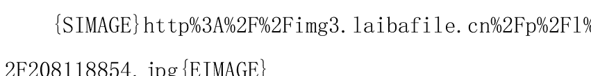

作者:66 端午 88 日期:2015-03-20 10:14

小仓位试盘，看看技术选股管用不

作者:66 端午 88 日期:2015-03-20 11:09

买了点三泰电子，互联网物流终端

作者:66 端午 88 日期:2015-03-20 15:16

大小盘抢夺资金，真乱腾。明天券商继续表现，大盘股有可能获得主动权，如果明天大盘无动作，减持部分大盘股。

作者:66 端午 88 日期:2015-03-21 17:20

踏青

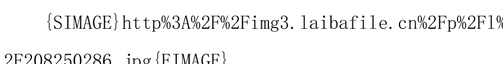

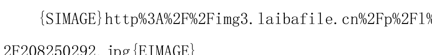


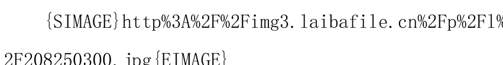

作者:66 端午 88 日期:2015-03-21 17:21

加 v 信 1101284955，获取更多好帖

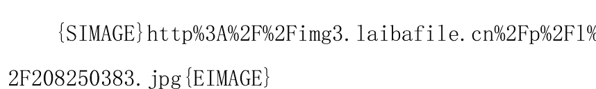

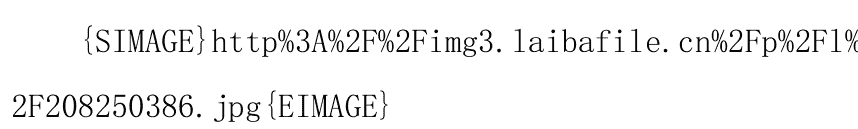

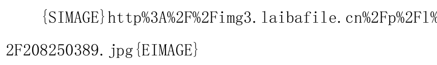

作者:66 端午 88 日期:2015-03-21 20:51

@66 端午 88 30290 楼 2015-03-21 17:21

http://static.tianyaul.com/img/static/2011/imgloading.gif

http://static.tianyaul.com/img/static/2011/imgloading.gif

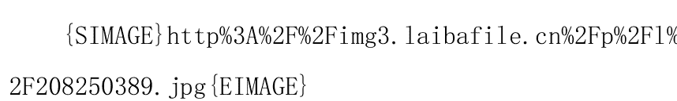

@逛逛在抽烟 2015-03-21 18:57:46

黄河堤坝附近。只能说是残花败柳，本来济南就不是宜居城市，都说人的一生追求的是财务自由，时间自由。楼主何必天天骑着 moto 穿梭于陋市，难道真是钻钱眼里了？

自从骑了摩托车，额的汽车都打不着火了，这不行啊，买了个锂电应急电源，开车时带着，插到点烟器里，一打就着，你换个摩托就知道什么叫幸福了。

作者:66 端午 88 日期:2015-03-22 18:58

今天老鸟聚会，总结前期经验，做题材的翻番，做新型行业的翻番，做大行业的反弹，都不在一个阶段。只要保持相同操作风格，都是翻番，涨了不卖的就是这个平均收益，做超额收益的都是踩对节奏的，踩错了只赚 5 成左右。仔细分析盈利的来源，和八字有关，就是你缺什么五行，赚暴利的方向就在这个方向，而且该时段运势有关。缺金的带金属装饰（西方），缺木的带手串（南方）（北方火，东方水），命里守中有土的，每项投资都赚，但都不多。真邪啊

作者:66 端午 88 日期:2015-03-22 22:00

明天金融股夺回主导权，周小川宣告：年内实现资本项目下自由兑换。有大金融的出去放鞭炮。

作者:66 端午 88 日期:2015-03-22 22:02

银行有望获得国际平均 PE 均值，12 倍。

作者:66 端午 88 日期:2015-03-22 22:09

这是要打金融战，我国最有竞争力的就是货币，总量大，关键还有近四万亿美金的背书，现在放外资进来，价格起码不低，让外资帮我们抬轿，不管外资进不进来，证伪期半年，跌也是半年后的事了。

作者:66 端午 88 日期:2015-03-22 22:12

@a3392103 2015-03-22 22:00:12

下周看两桶油会暴动不。

中石化效益大幅放缓 29%，实体全面滑坡，就靠虚的了。

作者:66 端午 88 日期:2015-03-22 22:17

如果由此美金币值受到打压，以稀土，金银为代表的有色系，将并行向上。

作者:66 端午 88 日期:2015-03-23 11:18

@麦田 110400 2015-03-23 10:01:50

老大，你打算加仓吗？你现在手里有什么？可以加仓广发证券吗？

加仓了任子行，太强了，这年月得买市胆率。

作者:66 端午 88 日期:2015-03-23 11:20

@66 端午 88 2015-03-22 18:58:19

今天老鸟聚会，总结前期经验，做题材的翻番，做新型行业的翻番，做大行业的反弹，都不在一个阶段。只要保持相同操作风格，都是翻番，涨了不卖的就是这个平均收益，做超额收益的都是踩对节奏的，踩错了只赚 5 成左右。仔细分析盈利的来源，和八字有关，就是你缺什么五行，赚暴利的方向就在这个方向，而且该时段运势有关。缺金的带金属装饰（西方），缺木的带手串（南方）（北方火，东方水），命里守中有土的，每项投资都赚，但......

加 v 信 1101284955，获取更多好帖

@帅悠悠 2015-03-23 10:04:05

老大,缺木带手串,缺金戴首饰,可要是缺水怎么办呢。。。。

翡翠和玉

作者: 66 端午 88 日期: 2015-03-23 11:21

@66 端午 88 30309 楼 2015-03-22 22:09 这是要打金融战,我国最有竞争力的就是货币,总量大,关键还有近四万亿美金的背书,现在放外资进来,价格起码不低,让外资帮我们抬轿,不管外资进不进来,证伪期半年,跌也是半年后的事了。

@投机者的扑克 2015-03-23 08:47:36

老大推荐个股票吧

让股神忽悠得,全都炒任子行去了。

作者: 66 端午 88 日期: 2015-03-23 11:25

地产 B 应该有三个到四个涨停

作者: 66 端午 88 日期: 2015-03-23 11:26

低价股全体飙升

作者: 66 端午 88 日期: 2015-03-23 11:56

@ipeewee 2015-03-23 11:37:56

地产B折成一半的价格，又给我一些华鹏地产是什么意思？

去问你的客户经理

作者:66 端午 88 日期:2015-03-23 17:16

实体经济风险积聚，头两个月财政收入下滑 5%（环比），国有企业利润下滑 21%。这大概就是大型股票最近表现不正常得主因。

现在是标准的投机市场氛围，鉴于实体经济大幅下挫，资本市场不会出台任何打压政策，价值股被实体经济拖累，估值下滑，只会有阶段表现，想跟上只能投机人气股，或者直接买 ETF 基金。就是买两头，天天涨停的，敢耍就耍，胆小的少买，比较好抓的就是低价股。6 块以下，盘子别太大，不退市就行。不过见了头部，赶紧跑。

作者:66 端午 88 日期:2015-03-23 17:18

今天坛子里的都在调仓，位置对不上的，只要不是暴涨，都换到各自方位去了，再炒炒，就集体进医院鸟。

作者:66 端午 88 日期:2015-03-23 19:02

把股价从低到高列一下，就知道该买什么了

作者:66 端午 88 日期:2015-03-23 21:00

套住不管哈，明天这些哪个开盘涨得少，超短哪个，头两个风险较大

作者:66 端午 88 日期:2015-03-23 21:16

不要搞太多，娱乐娱乐拉倒，套住就知道难受了。

作者:66 端午 88 日期:2015-03-24 09:07

前阵子看到一个票，停牌，现在开了板，总也找不到拿进来的机会，这玩意是目前中国股市里面概念最足，远景最宏大的品种，三泰控股，互联网，互联网+，网络金融，OTO，互联网销售，互联网物流，增发，融资平台，大数据，阿里概念。基本上具备所有概念。跌到 20 日线就买。一个概念 10 块也得 100 了。

作者:66 端午 88 日期:2015-03-24 09:39

博一把，大幅建仓三泰电子

作者:66 端午 88 日期:2015-03-24 09:39

@shbjx1236 2015-03-10 10:12:56

安信限售股解禁 3 月 13 日上市什么意思？

二十多万股原始股

作者:66 端午 88 日期:2015-03-24 10:00

目前持仓比例：大盘 4 成，小盘 6 成。重仓持股：三泰电子，兆日科技，任子行，北京银行，地产B

作者:66 端午 88 日期:2015-03-24 10:54

继续加仓三泰电子，任子行，减仓北京银行

作者:66 端午 88 日期:2015-03-24 11:23

我艹，这么一会少了十几万。:(

作者:66 端午 88 日期:2015-03-24 11:29

星期天，股神对额们说，传统经济没潜力，只能抽出传统经济的利润，补贴到新兴行业里面，所以这货拿了一大把美盛文化和任子行，新文化，今天说要买兆日科技。他的选股原则就是小盘，有股本扩充能力。一个牛市走完，送两三次，股价不变，赚股不赚钱，胆太肥了。

作者:66 端午 88 日期:2015-03-24 11:32

@66 端午 88 2015-03-24 10:54:22

继续加仓三泰电子，任子行，减仓北京银行

@16388cc 2015-03-24 11:26:01

仓位控制的太好了，我的子弹早打光了，连融资的都干上去了。

我是把年前撤出的资金又打进去了。

作者:66 端午 88 日期:2015-03-24 11:38

前面额算过，三泰电子要是想做到预测网点密度，起码要融资 1000 亿，它的市值起码也得 2-3000 亿，要么就是个骗子，要么就是个未来伟大的公司，人工成本不断提升，这玩意早晚是主流。主要在网售牢牢占据一环，并利用这个拉动进行网络扩展，除了阿里就是它了，京东和顺通都有缺陷，就是必须受昂贵的商业地产盘剥，根本走不下去。这种大堂里搞一堆电子柜子，以后加个屏幕就是广告公司，搞个 APP 就是网站信息节点，太有想像力了。

作者:66 端午 88 日期:2015-03-24 11:41

最次的办法就是干了一半干不下去了，被阿里收购，改名阿里传达室。起码也是上千亿的市值，互联网就是这么计算，看市场覆盖率和市值，其次再看利润。

作者:66 端午 88 日期:2015-03-24 11:52

@投机者的扑克 2015-03-24 11:48:55

尾盘地产B刚到成本价，吓尿我了

额咋赚了 20+%了哪，你早不买

作者:66 端午 88 日期:2015-03-24 11:56

股神算着调整低点在 3574 附近，这个大浪是新行业大浪，大金融反弹只能减仓，额北京银行还小亏着减的。

作者:66 端午 88 日期:2015-03-24 12:18

@投机者的扑克 30418 楼 2015-03-24 12:14:00

@66 端午 88 30414 楼 2015-03-24 11:52 @投机者的扑克 2015-03-24 11:48:55 尾盘地产B刚到成本价，吓尿我了

额咋赚了 20+%了哪，你早不买---------------------------拆分前出了啊，不知道买啥就买回来了，不会站岗吧

卖一半，这玩意大盘属性，全减就会打脸

作者:66 端午 88 日期:2015-03-24 13:11

换仓成功，大盘冲就减，置换入互联网行业

作者:66 端午 88 日期:2015-03-24 13:13

重点推荐三泰电子，其它的都在主升途中，三泰的主升在除权后，它还得再融资 1000 亿。

作者:66 端午 88 日期:2015-03-24 13:16

前段的五个涨停只兑现了重组增资和补涨，未来的想像空间还差的很远。

作者:66 端午 88 日期:2015-03-24 13:24

额本来预想，要是重出江湖就搞这玩意，这货干的忒大，额插不进手了，那就把票投给它吧，省的额自己创业了。

作者:66 端午 88 日期:2015-03-24 13:25

@66 端午 88 2015-03-24 13:13:14

重点推荐三泰电子，其它的都在主升途中，三泰的主升在除权后，它还得再融资 1000 亿。

@ipeewee 2015-03-24 13:20:58

为什么我搜 stdz 找不到?

三泰控股

作者:66 端午 88 日期:2015-03-24 13:25

改名字了

作者:66 端午 88 日期:2015-03-24 13:29

@投机者的扑克 2015-03-24 13:28:17

三泰涨的像疯狗啊

大伙都想明白了，不就是拼市梦率吗，那就得买想像力最丰富的，三泰无疑是第一位。

作者:66 端午 88 日期:2015-03-24 13:30

股市走到主升浪，庄什么的全别管了，乱拳打死老师傅。

作者:66 端午 88 日期:2015-03-24 13:32

关键是管理层在这个实体经济彻底萎靡的多事之秋，一丝一毫的政策利空也不敢放，这就是市梦率基础，其它全看谁胆肥了，你看卧龙那些玩意，额以前的主营就是那些玩意，根本不值哪个价，都炒的像火箭。

作者:66 端午 88 日期:2015-03-24 13:34

强化预期，咱就当它值 150，你就敢拿住了。

作者:66 端午 88 日期:2015-03-24 14:06

明天地产B冲不上涨停，继续减仓

加v信1101284955，获取更多好帖

作者:66 端午 88 日期:2015-03-24 14:07

@海阔天空之君 2015-03-24 13:49:23

老大:

“三泰明天出年报;其之前预告利润分配预案为:每 10 股派人民币 1.00 元(含税),转增 7.5 股;

今天这货涨了不少了;

出年报前,现在能进吗?

逢调整,分批买入

作者:66 端午 88 日期:2015-03-24 14:08

@投机者的扑克 2015-03-24 14:00:49

玩小盘?会不会现在去当接盘侠

形势分析过了,只要管理层不管,持有,调整时换仓增持。

作者:66 端午 88 日期:2015-03-24 14:22

三泰迎来主升浪,封停就是意味着主升浪开始

作者:66 端午 88 日期:2015-03-24 14:58

看看能不能一波拉到 100。

作者:66 端午 88 日期:2015-03-24 15:25

@投机者的扑克 30450 楼 2015-03-24 15:08:00

@66 端午 88 30439 楼 2015-03-24 14:06

加v信1101284955,获取更多好帖

明天地产B冲不上涨停，继续减仓

老大地产B还有个板吗

zuihouyige

作者:66 端午 88 日期:2015-03-25 10:01

002312

作者:66 端午 88 日期:2015-03-25 10:01

清仓了地产金融，大幅增仓了任子行。

作者:66 端午 88 日期:2015-03-25 10:03

@投机者的扑克 30466 楼 2015-03-25 09:11 期待

今天房地产板块大爆发 [来自UC浏览器]

@投机者的扑克 2015-03-25 10:01:27

伲玛挨套了

地产B，清了吧

作者:66 端午 88 日期:2015-03-25 10:31

三泰见绿果断加仓

作者:66 端午 88 日期:2015-03-25 10:57

@投机者的扑克 30479 楼 2015-03-25 10:47 @66

端午 88 30476 楼 2015-03-25 10:31 三泰见绿果断加仓

加v信1101284955，获取更多好帖

现在能建仓吗

[来自 UC 浏览器]

@投机者的扑克 2015-03-25 10:54:54

要不要等回调

稍微买一点，敢跌再加仓

作者:66 端午 88 日期:2015-03-25 13:19

按照互联网的估值，三泰上 100 早晚的事，这是我唯一一个能看到互联网产品的企业，说明它是在做事，不是炒概念。

作者:66 端午 88 日期:2015-03-25 13:29

乱拳打死老师傅，不到疯狂不撒手

作者:66 端午 88 日期:2015-03-25 13:30

@投机者的扑克 2015-03-25 13:13:05

中国中铁为何如此牛

大金融利空太多，只能搞二线蓝筹了

作者:66 端午 88 日期:2015-03-25 13:31

周日的时候，股神说大妈全部拿着银行券商，额立马一头冷汗

作者:66 端午 88 日期:2015-03-25 13:33

永远别站在大妈群里

加v信1101284955，获取更多好帖

作者:66 端午 88 日期:2015-03-25 13:41

100, 加油:)

作者:66 端午 88 日期:2015-03-25 13:42

要论算估值, 额头牌。:)

作者:66 端午 88 日期:2015-03-25 14:01

@66 端午 88 30497 楼 2015-03-25 13:33 永远别站在大妈群里

@投机者的扑克 2015-03-25 13:44:14

三太太这个股, 别说大妈, 我这个壮小伙买这个也直哆嗦。

再张 20 块, 你就不哆嗦了

作者:66 端午 88 日期:2015-03-25 14:05

@海阔天空之君 30504 楼 2015-03-25 13:44 哎,按老大今早的指导意见: 一直想等“三泰”调低点的买点。。。。。 结果它又开始飞了。。。。。 奶奶的, 真气愤这幕后的黑庄;

@投机者的扑克 2015-03-25 13:59:08

牛比的股从来没有舒服的上车位置

上午我挂单低接三泰也失败了, 差 5 分。

作者:66 端午 88 日期:2015-03-25 14:05

明天任子行再调整一天，踩着 5 日线会再起一波，估计还是两个涨停，都盯着点。

作者:66 端午 88 日期:2015-03-25 14:24

三泰控股就是买入锁仓，按照股神的话说：这么大牛市不捂出来个百元票，以后都不知道该跟孙子怎么吹牛了。

作者:66 端午 88 日期:2015-03-25 14:50

三泰走势提示明日有震荡，低位加仓

作者:66 端午 88 日期:2015-03-25 14:56

@投机者的扑克 2015-03-25 14:54:41

擦谁砸我三太太我弄死谁

震仓清除短线散户，正常。慢涨急杀，缩量上行，挺好的

作者:66 端午 88 日期:2015-03-25 15:07

@66 端午 88 30522 楼 2015-03-25 14:50 三泰走势提示明日有震荡，低位加仓

@投机者的扑克 2015-03-25 14:58:35

还要荡啊，直接板不行吗

直接板就引起注意了，挑个好票，现在忒难了。

作者:66 端午 88 日期:2015-03-25 16:49

@慕容山城 2015-03-25 16:23:43

都在想买入挣钱，难道没人想落袋为安吗？

实体经济没有丝毫机会，银行存款 2.5%，物价涨幅 10% 左右。

作者:66 端午 88 日期:2015-03-25 20:17

坚定持股信心，历史告诉我们，只要管理层不出台针对整个市场的打压，一个板块的主升是不会结束的，从 6124 的中石油上市，530 提税打压，到去年年底的严查杠杆，都是行情结束的标志。这波理论涨幅是 4200---4300 之间。中国 M2 为 130 万亿，随着房地产市场整体陷入低迷，房地产吸纳资金的能力起码减少 70%，就是说：现在每年新增社会闲散资金大约 7 万亿（净增），实体经济本来可以吸纳大约其中的一半，现在根本进不去，而且实体经济的资金在加速撤退。银行理财规模大约 12 万亿规模，正在以 3000 亿/月撤出。股市大约每月吸纳的资金在万亿以上，这次的涨势类型相当于 530 前二---三个月的市场行为，乱拳打死老师傅，只要推到 4200 点，公募资金只能被迫买回。散户不要预测顶点，10 秒清仓，530 没套住，6124 没套住，129 也没套住。另外就是任何一个板块的主升，没有单头部，都是双头。

作者:66 端午 88 日期:2015-03-25 20:21

另外注意：防止指数高开 50 点，立刻逃命。

加v信1101284955，获取更多好帖

作者:66 端午 88 日期:2015-03-25 20:40

如果把 3500 点上的跳空阳线作为突破点算，现在 200 点涨幅。在此说有泡沫，这显然是胡说八道。看看 2006 年突破 1700 点的图形，中间有多少人说有风险，泡沫大。5，10 日线都是买入点，跌破 20 日线才会陷入中期调整。本来有一次调整机会，由于突破太多，这次探底 20 周线的机会已经消失。这种乱拳打死老师傅的行情，要看 RSI 的顶部背离信号。

作者:66 端午 88 日期:2015-03-25 20:46

K 图 002312_1

三泰控股(002312)

业绩简评

三泰披露 2014 年年报，实现营业收入 12.56 亿元，同比增长 39.85%；实现归属上市公司净利润 9405 万元，同比增长 8.64%；速递易业务方面，公司在 2014 年已经累计进驻 36 个城市，累计签约 3 万个网点，实际运营 1.3 万个网点。

经营分析

原主营业务仍然为公司贡献现金流和利润：自公司向社区互联网转型以来，原主营业务在我们分析框架中的重要性逐步下降，但是由于各项业务运营良好，我们认为原主营业务仍然能给公司贡献持续的现金流和净利润。

加v信1101284955，获取更多好帖

三泰是最早一批转型互联网的上市公司，也是执行力最强的公司：在“互联网+”流行的今天，大多数的上市公司都提出了向互联网转型的计划。但是三泰在 2013 年就开始了转型的步伐，在 A 股的上市公司中属于最先吃螃蟹的人。并且三泰说到做到，最终在 2014 年实现了 1.3 万个小区的落地运营，执行力强是公司达到社区互联网平台商的最核心竞争力。

融资成功后，速递易确立领先地位，定增计划有望祝公司加速实现平台梦想：7.5 亿元定增成功之后，实际上速递易已经构筑成功了很高的壁垒，确立了领先地位。目前公司再次推出 29 亿元定增计划，若成功，更有助于公司加速实现其生态系统梦想。

预计 2015 年将实现 5 万个速递易网点，其网络价值将被市场重估：根据公司的资金实力和扩张计划，我们认为速递易今年的扩张速度会大幅超出市场预期，至年底速递易有望实现 5 万个网点的覆盖，占据国内社区接近 10%。其网络价值将被大幅重估。

互联网保险并购有助于大幅提升估值：公司收购的烟台伟岸旗下的金保盟是国内领先的互联网保险平台，2014 年销售保费高达 18 亿元，在互联网金融炙手可热的当下，该收购将大幅提升三泰控股估值。

## 投资建议

调整 15-17 年 EPS 的预测为 0.34 元、0.72 元和 1.57 元，维持对公司的“买入”评级。[国金证券股份有限公司]

作者:66 端午 88 日期:2015-03-25 21:54

有人问：全通教育 300 块合理吗？额回了一句：

只有这个价能激励创新机制，现在出来创业 99%是要亏的，不是这百分之一的万一，谁特么出来赔钱玩啊，现在和上世纪 90 年代，刻个萝卜章就赚钱的年代，早就天翻地覆了。

作者:66 端午 88 日期:2015-03-25 22:41

@66 端午 88 2015-03-25 20:21:34

另外注意：防止指数高开 50 点，立刻逃命。

@ythwgh820622 2015-03-25 22:39:07

以前觉得你很靠谱，明天高开 50 点，你在说冷笑话吗？再说，创业板本周内还有两个交易日，肯定得调整，疯炒去吧，看你穿着跑鞋没。

我说自此以后，谁说明天了？

作者:66 端午 88 日期:2015-03-25 23:31

@66 端午 88 2015-03-25 20:17:57

坚定持股信心，历史告诉我们，只要管理层不出台针对整个市场的打压,一个板块的主升是不会结束的,从 6124 的中石油上市, 530 提税打压,到去年年底的严查杠杆,都是行情结束的标志。这波理论涨幅是 4200---4300 之间。中国 M2 为 130 万亿,随着房地产市场整体陷入低迷,房地产吸纳资金的能力起码减少 70%, 就是说: 现在每年新增社会闲散资金大约 7 万亿 (净增), 实体经济本来可以吸纳大约其中的一半, 现在根本进不去, 而……

@ythwgh820622 2015-03-25 22:55:02

没有套住, 6124 还没套住, 有些人还没有解套呢。以前有人六七十元买长虹, 现在 10%?

今年上 4200 肯定没问题, 但没这么快吧, 最近楼主打了鸡血了?

任何顶都套不住老股民, 老股民都是套在半山腰。

作者:66 端午 88 日期:2015-03-25 23:32

@隆七 2015-03-25 23:08:22

老大, 我买了证券b, 我觉得牛市券商肯定挣钱啊, 这背后的逻辑靠谱吗?

我昨天差不多最高点进入的, 想一直守, 可行吗? 多谢

券商再调整三个月, 你会受不了了, 都不涨, 肯定能守住，就怕别的涨你的打横，你就受不了了。

作者:66 端午 88 日期:2015-03-25 23:33

@generabbit 2015-03-25 23:25:49

红木要去哪个网看来着？

麒麟

作者:66 端午 88 日期:2015-03-26 09:41

加仓了任子行

作者:66 端午 88 日期:2015-03-26 11:08

这次是被揍惨了，艹

作者:66 端午 88 日期:2015-03-26 11:31

@卧龙吟 9966 2015-03-26 11:25:32

作者：卧龙吟 9966 时间：2015-03-25 11:05:20

股友们，今天该减仓了。

昨天就提醒你们了，可就是没人听啊，哈哈。。。

送丫一个字，滚

作者:66 端午 88 日期:2015-03-26 14:39

看着哪，到底让王八蛋留在上面了，为毛记不住下面还有根 20 周线哪，要套一阵子了。中午买了指数空单锁定。

作者:66 端午 88 日期:2015-03-26 14:40

融券做空了中信证券。

作者:66 端午 88 日期:2015-03-26 14:55
@投机者的扑克 2015-03-26 14:45:09
老大的股还在吗

只减了一部分，没看跌停了吗？尼玛上午正好满仓，看来是被庄家盯上了，隔了三成多，全部反手做空对冲。额不能说话了，说了准打脸。

作者:66 端午 88 日期:2015-03-26 15:29
中石油尾盘狂拉，明天指数也堪忧了。看来明天还得继续做空指数。

作者:66 端午 88 日期:2015-03-26 17:23
@投机者的扑克 2015-03-26 16:36:13
中信没咋涨啊，空它风险应该不小吧

怕明天跌啊，五日线上横几天，失去炒作热点，就会杀跌。仔细算算，虽然今天亏不少，可是还是比一直拿着大金融合算，额又平衡了。

作者:66 端午 88 日期:2015-03-26 20:32
@wdtklk 2015-03-26 19:41:14
现在做空中信会很惨吧。觉得楼主急躁了

如果创业板见顶，上证也只剩下几十点涨幅，具体就是3750一线。再拉回去碰20周线，在3100附近，中信起码能跌35%，能融到的券不多，其它能融到的不具备跟随指数特性。看看形势吧，不行就抛掉，现在还赚着哪。先把跌停的潜在跌幅对冲掉。

作者:66 端午 88 日期:2015-03-27 10:00
减了部分三泰，加仓了指数空仓，融券了中国平安。

作者:66 端午 88 日期:2015-03-27 10:33
昨天晚上翻了一晚上技术图，除了银行已经找不到合适的价值类型投资标的，而且一季度银行业绩环比出现下滑。只是融不到银行的券，两个龙斗都被管理层摁死了。额轻易不肯动用做空工具的，只是在上次3400点做空了一次。

作者:66 端午 88 日期:2015-03-27 11:01
所有板块只有有色有启动迹象，可是实体经济不支持它上涨。如果沿用市梦率估值，还能上冲15-20%，如果否定市梦率估值，就该大调整了，喜欢拿着票的转有色。不喜欢拿票的，空仓，或者利用做空工具。这次上涨唯一担心的就是没有碰20周线就起来了，而且领涨的不是银行地产，最开始有这个苗头，估计是被融券了，没有一点银行券可以融。

作者:66 端午 88 日期:2015-03-27 11:08
@投机者的扑克 2015-03-27 11:00:20
指数好像跌不下去的样子

看看 2006 年 7 月的走势。

作者:66 端午 88 日期:2015-03-27 11:12
融中信的原因是，尽管它可能会有最后表现，但是当你想融的时候，一定是没了。

作者:66 端午 88 日期:2015-03-27 11:48
@投机者的扑克 2015-03-27 11:43:22
老大全面翻空了吗?

走一步看一步，散户空多 10 秒钟。:(

作者:66 端午 88 日期:2015-03-27 11:50
如果拉动地产，就能带起一串

作者:66 端午 88 日期:2015-03-27 12:07
@投机者的扑克 2015-03-27 12:00:06
上午尾盘直拉是诱多?

MACD60 分应该到 0 再启动

作者:66 端午 88 日期:2015-03-27 12:12
@66 端午 88 30702 楼 2015-03-27 11:50 如果拉动地产，就能带起一串

@投机者的扑克 2015-03-27 12:08:11
地产 B 出的后悔啊

鬼才能想到能这时候拉地产。

作者:66 端午 88 日期:2015-03-27 14:23
止盈了兆日科技

作者:66 端午 88 日期:2015-03-27 14:25
活着跑出来了。套住些任子行。

作者:66 端午 88 日期:2015-03-27 15:01
@投机者的扑克 30720 楼 2015-03-27 14:55
@V 流星蝴蝶剑 V 30718 楼 2015-03-27 14:44
@66 端午 88 30712 楼 2015-03-27 14:25 活着跑出来了。套住些任子行。

老大，三泰怎么处理？ [来自 UC 浏览器]

你好像站岗站的最高：([来自 UC 浏览器]

@V 流星蝴蝶剑 V 2015-03-27 14:58:14
哭死！这岗不知道站到什么时候：(

早晨反抽应该减一些，降低成本。我还有一半多哪，成本已经可以抵抗震荡了。

作者:66 端午 88 日期:2015-03-27 15:01
兆日的主力太仗义了，吓死了。卖了它，平了指数空仓，解除了锁定。

作者:66 端午 88 日期:2015-03-27 15:05
@V 流星蝴蝶剑 V 30718 楼 2015-03-27 14:44
@66 端午 88 30712 楼 2015-03-27 14:25 活着跑出来了。套住些任子行。

老大, 三泰怎么处理? [来自 UC 浏览器]

@投机者的扑克 2015-03-27 14:55:31
你好像站岗站的最高: (

额从启动开始建的仓, 现在持仓成本 41, 42 多的成本扛不住一个跌停。

作者:66 端午 88 日期:2015-03-27 15:08
@投机者的扑克 2015-03-27 14:09:13
地产 B 要涨停。。我擦

@weaknet 2015-03-27 14:28:31
我全卖光了, 惨

比俺强, 俺只有地产 A, 刚赎回, 还没到账。

作者:66 端午 88 日期:2015-03-27 19:47
得, 任子行看来要是长套了。下午证监会发布打击创业板中小板造价做庄的回应。

作者:66 端午 88 日期:2015-03-27 20:42
@投机者的扑克 30735 楼 2015-03-27 20:19:00
@66 端午 88 2015-03-27 19:47:57
得，任子行看来要是长套了。下午证监会发布打击创业板中小板造价做庄的回应。

三太太呢，受影响吗

这个问题不大，重组的和百元股影响大

作者:66 端午 88 日期:2015-03-29 14:49
@zhuyi538 30748 楼 2015-03-29 13:54:00
楼主请教个问题，济南的房子现在可以买吗？会不会大幅降价？想在王官庄买一套二手。。

就业率开始下滑，除了自己使用，近期不要投资地产

作者:66 端午 88 日期:2015-03-29 14:53
产能过剩催生互联网经济，反过来，互联网经济将迅速消灭过剩产能，无法盈利的互联网企业也将一并死去，这就是宿主和寄生体的关系，只有原生态企业搞的互联网升级能够继续生存下去。

作者:66 端午 88 日期:2015-03-29 16:26
加 v 信 1101284955，获取更多好帖

@abcs1999 2015-03-29 16:14:23
楼主请教一下，三泰逢高减持还是继续持有？

跟随创业板走势

作者:66 端午 88 日期:2015-03-30 10:24
三泰问题不大，又开始拉指数股了，建筑投资，一带一路。

作者:66 端午 88 日期:2015-03-30 10:30
银行一动，百花凋残

作者:66 端午 88 日期:2015-03-30 10:36
额，早盘平了中信证券，买了 XXX，不能说了，一说不涨了。

作者:66 端午 88 日期:2015-03-30 10:40
尼玛，额就不能动小股票。赚钱的全是神马银行，保险，券商，房地产，有色。

作者:66 端午 88 日期:2015-03-30 10:48
三泰是互联网股里面走的很强的，有题材支撑，建议不破 10 日线保留，任子行比较危险，反抽 10 日线减仓，否则就得拿到送股并调整 1 个月左右。

作者:66 端午 88 日期:2015-03-30 14:02
市场传闻：今晚降息降准，实体经济大幅衰退，数据已出。

加 v 信 1101284955，获取更多好帖

作者:66 端午 88 日期:2015-03-30 17:59
为毛起个大早, 赶个晚集哪? 逻辑都算准, 要不是各路蛇精瞎 JB 哔哔, 额怎么这么挫了哪?

二套房房款首付至四成, 降息降准马上到, 这特么早都在谱啊。是额不够坚持吗? 都是命啊。

作者:66 端午 88 日期:2015-03-30 19:39
@66 端午 88 30812 楼 2015-03-30 17:59
为毛起个大早, 赶个晚集哪? 逻辑都算准, 要不是各路蛇精瞎 JB 哔哔, 额怎么这么挫了哪?

二套房房款首付至四成, 降息降准马上到, 这特么早都在谱啊。是额不够坚持吗? 都是命啊。

@aobog 2015-03-30 18:20:07
楼主。在地产 b 去年 1.85 站上来后。加满油一骑绝尘了。。。俺早早跑出来了。。丢人。师傅。。

都怪俺, 不够坚持, 俺以后只分析, 不推荐了, 这是额的人性缺陷。

作者:66 端午 88 日期:2015-03-30 19:42
俺记住了, 不炒小盘股, 坚持自己的独立分析。

作者:66 端午 88 日期:2015-03-30 20:08
中国的创新就是搞几个 APP, 然后狂炒股价, 然后收了散户的钱，继续写故事，这个纳斯达克的创新，完全是两条路，强哥也被骗了，中国的网售，事实上是把就业和内需的基础全部破坏掉了，现在拉地产，也是勉为其难，商业地产已经垮了，一条腿蹦，是蹦不远的，互联网经济不具备提供广泛就业的能力，因此它就是破坏性的。

作者:66 端午 88 日期:2015-03-30 20:21
@山的那边 2012 2015-03-30 20:19:05
楼主认为，在新的政策的刺激下，房价会再次上涨吗？

不会，只会加速去库存，现在是供应存量太大的问题。

作者:66 端午 88 日期:2015-03-30 20:22
@秋雨花香 20002014 2015-03-30 20:15:06
跟着楼主买的股没等涨都扔了，还买了三泰，到现在都没回本

嗯，吸取教训，不再推了，推荐了反而不涨。

作者:66 端午 88 日期:2015-03-31 10:19
减了任子行

作者:66 端午 88 日期:2015-03-31 10:20
彻底安全了。:)

作者:66 端午 88 日期:2015-03-31 10:28
再减任子行，成小仓位。这把任子行没赚，换房地产，券商,银行,基建。品种不公布了。轮涨行情,看好明天指数股继续发飙。

作者:66 端午 88 日期:2015-03-31 10:34
@66 端午 88 30851 楼 2015-03-31 10:28 再减任子行,成小仓位。这把任子行没赚,换房地产,券商,银行,基建。品种不公布了。轮涨行情,看好明天指数股继续发飙。

@投机者的扑克 2015-03-31 10:32:14
老大三太太没减吧?

没有,中长线持股,等送股

作者:66 端午 88 日期:2015-03-31 11:22
@2015 明天会更好 2015-03-31 11:20:21
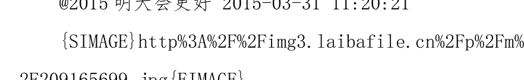

这是只熊知道不

作者:66 端午 88 日期:2015-03-31 13:09
@简单粗暴的你 30867 楼 2015-03-31 11:38 三年大哥,房市出新政了,点评一下可以吗?!

@投机者的扑克 2015-03-31 12:07:11
加v信1101284955,获取更多好帖

## 买吧，买房比买股靠谱多了

时机不到，能卖小先卖小，等着库存消化接近结束，换大的。

作者:66 端午 88 日期:2015-03-31 13:10
10 日前后，在公布经济数据同时，会降准降息。

作者:66 端午 88 日期:2015-03-31 13:12
最近经济快速下滑，和反腐导致经济运行模式发生变化有关。以前是官员要了项目，赶紧通知朋友圈，现在是中央发项目，官员麻木且不配合，企业想抓项目，怕资金不到位，更不知道该通过什么渠道接单，清算，中间的传导出了问题。

作者:66 端午 88 日期:2015-03-31 13:57
@投机者的扑克 2015-03-31 13:51:17
三太太跟跌给力，反弹不给力。蛋疼

现在反弹狠就是主力想出的。

作者:66 端午 88 日期:2015-03-31 14:41
看热闹的不怕事大。:)

作者:66 端午 88 日期:2015-04-01 12:37
愚人节，少说话

作者:66 端午 88 日期:2015-04-02 09:52
三泰不错，互联网物流

作者:66 端午 88 日期:2015-04-02 10:06
刚才清了任子行，再不捣鼓小盘股了。

作者:66 端午 88 日期:2015-04-02 10:14
三泰控股，主业清晰，定位准确，盘子有一定规模，关键不是小盘股，拿着放心。

作者:66 端午 88 日期:2015-04-02 10:46
赶脚实体经济要崩溃的节奏，山东上市公司半数以上滑坡。

作者:66 端午 88 日期:2015-04-02 10:58
@66 端午 88 2015-04-02 10:14:06
三泰控股，主业清晰，定位准确，盘子有一定规模，关键不是小盘股，拿着放心。

@麦田 110400 2015-04-02 10:50:27
我三泰终于解套了，老大，你还有这个票吗

有不少

作者:66 端午 88 日期:2015-04-02 10:59
@麦田 110400 2015-04-02 10:53:19
老大啊，我看大盘咋这么忽忽悠悠的呢，是不是要调整？你几成仓位啊？

## 七成不到

作者:66 端午 88 日期:2015-04-02 11:01
500 亿市值以上的已经被彻底摒弃,小盘股在宇宙里飘,只能在 100-200 亿市值里面找。

作者:66 端午 88 日期:2015-04-02 11:22
如果所有企业都去搞互联网经济,中国经济的体量将缓慢缩减 20%左右,五年内的目标是经济总量不萎缩,这事太明白不过了。

作者:66 端午 88 日期:2015-04-02 11:33
@66 端午 88 2015-04-02 11:22:42
如果所有企业都去搞互联网经济,中国经济的体量将缓慢缩减 20%左右,五年内的目标是经济总量不萎缩,这事太明白不过了。

@11b861112 2015-04-02 11:26:11
请问楼主 有哪几种方式可以达到总量不猥琐呢? 地产?

只有货币注水能保持数据勉强能看,如果不注水,肯定是下滑的,连负增长都做不到,本来就是货币吹起来的,不破就相当不容易了。证券作为最后一个吹起来的泡,大三浪结束,不论做到什么程度,走人,该结账的时候,不早走就全盘埋单。

作者:66 端午 88 日期:2015-04-02 11:34
这几天把所有股票都反了一遍，发现大部分股票的估值都超越了 530，除了一些景气下滑行业。

作者:66 端午 88 日期:2015-04-02 11:39
现在比较一下现在的生活和 5 年前有什么不同，除了人人赚着一个手机，其它都变化不大。

作者:66 端午 88 日期:2015-04-02 12:07
> @66 端午 88 30961 楼 2015-04-02 11:34 这几天把所有股票都反了一遍，发现大部分股票的估值都超越了 530，除了一些景气下滑行业。

> @投机者的扑克 2015-04-02 11:46:49
老大意思是快见顶了吗

第一大浪的五浪，高度无法预测。到顶了，额会通知，需要月线级的背离。

作者:66 端午 88 日期:2015-04-02 12:10
> @swimwang 2015-04-02 11:59:04
请教三年兄，大三浪结束有没有标志性事件，您看什么时候能结束？

加 v 信 1101284955，获取更多好帖

大三浪还没开始哪，现在是第一大浪的第五浪。大三浪以权重股为主，题材股一般在第一大浪走完就歇菜了。大三浪的速度很快，是指数行情，现在炒题材是，业绩兑现困难，各路庄家都得在业绩兑现期前拉高出货。你觉得中小企业每年能实现 50%的增长吗？讲讲故事容易，把故事搞成现实，没戏。

作者:66 端午 88 日期:2015-04-02 12:15
整体风险就是，不论权重和题材都失去他们的本性，权重股整体 25 倍市盈率以上，题材股失去涨升冲力，这时，月线 J 值在 90 以上钝化，缩量上涨，题材股已经跌到半山腰，中国投到国外的资产出现大量坏账，指数股冲到顶端后，出现大阴线，反弹无量，筑双头。抛出所有股票，NX 的开始准备做空，水平一般的去找各家宝宝。

作者:66 端午 88 日期:2015-04-02 12:18
@66 端午 88 30959 楼 2015-04-02 11:33 @66 端午 88 2015-04-02 11:22:42 如果所有企业都去搞互联网经济，中国经济的体量将缓慢缩减 20%左右，五年内的目标是经济总量不萎缩，这事太明白不过了。

---------------------------------------- @11b861112 2015-04-02 11:26:11 请问楼主 有哪几种方式可以达到总量不猥琐呢？ 地产？

---------------------------------------- 只有货币注水能保持数据勉强能看，如果不注水，肯定是下滑的，……

> @投机者的扑克 2015-04-02 11:44:05
结账移民吗？没能力移民的怎么办

> 苦熬

作者:66 端午 88 日期:2015-04-02 13:35
日线级顶背离，要大调整了。适当减了些三泰。

作者:66 端午 88 日期:2015-04-02 13:48
@66 端午 88 30976 楼 2015-04-02 13:35
日线级顶背离，要大调整了。适当减了些三泰。

> @披着城市的外衣 2015-04-02 13:44:27
老大，大盘要调整？证券都出？

> 大蓝筹基本都没涨多少，千万别割肉。不过也别低吸，跌下来关注三泰。

作者:66 端午 88 日期:2015-04-02 14:13
@红拂临晓 30985 楼 2015-04-02 14:05 @66 端午 88 2015-04-02 13:35:33 日线级顶背离，要大调整了。适当减了些三泰。
楼主，我的三泰成本是 45.58，今天要不要出呢，请速指教，

The request was rejected because it was considered high risk

昨天我看到一篇文章，是以一个银行分行长的口吻写的，意思就是实体经济已经不需要贷款了，他们的贷款额度全部放给小型上市公司，他们不放贷，人家就会增发。你的感觉是对的，实体经济已经完蛋了，现在就是最后的盛宴，到了不投给股市就不能生存的地步。这个泡沫全靠所谓的新经济憧憬所维持，新经济泡沫能维持多久？谁都不知道，不过一旦破灭，是很大的金融灾难。

在八年前，我就非常看好新经济，但是我没想到新经济是这样的方式展开，是资本推动型，而非我预料的技术引导型。中国的新经济是拆了旧房子，盖新房子的模式，不是改造，不是另起炉灶，而是毁灭过去，这在整个世界经济史上都未发生过。

作者:66 端午 88 日期:2015-04-06 20:03

我预测的牛市和现在的完全风马牛不相及，我预测是资产证券化为主轴，人民币国际化为先导。现在则成了对外投资解决过剩产能为先导，以所谓的创新经济为基础。结果很明显，实体经济肯定会撑不住的下滑，市梦率充斥市场理念，中国走上了2000年的纳斯达克之路，未来一年，如果新经济不能快速提高份额，我算着：肯定不会快速提高。一路一带困难重重，会蒙受重大的烂尾工程损失。这应该是2-3年以后的事了，不过一年后，必须拉高房地产，否则中国经济直接崩盘。

作者:66 端午 88 日期:2015-04-06 20:05

房价只有大幅快速上涨，才能对冲经济下滑，可惜现在已经被库存压到不能翻身的境地，这个泡沫什么时候破裂，以什么方式破裂，这是我们当前要密切关注的，在破灭前，享受泡沫浴的快乐吧。

作者:66 端午 88 日期:2015-04-07 11:11

大小盘，7:3，不要瞎换，轮涨行情。

作者:66 端午 88 日期:2015-04-07 11:33

@generabbit 2015-04-07 11:28:19

我有个黑檀的簪子买来一直没有用，今天用发现裂了一点，也不知道是买来就裂了还是后来裂的，但是也没法找商家了，我就用刀子削去了裂的地方，感觉木性不错，丝丝屑屑的挺均匀的。

找点同类木质的细木粉，添缝，然后用502封住，打磨光滑就可以了。

作者:66 端午 88 日期:2015-04-07 12:01

@66 端午 88 2015-04-06 20:03:12

我预测的牛市和现在的完全风马牛不相及，我预测是资产证券化为主轴，人民币国际化为先导。现在则成了对外投资解决过剩产能为先导，以所谓的创新经济为基础。结果很明显，实体经济肯定会撑不住的下滑，市梦率充斥市场理念，中国走上了2000年的纳斯达克之路，未来一年，如果新经济不能快速提高份额，我算着：肯定不会快速提高。一路一带困难重重，会蒙受重大的烂尾工程损失。这应该是2-3年以后的事了，不过一年后，必须拉高房地产，否则中国经济直接崩盘。

@红拂临晓 2015-04-07 11:36:07

楼主，您说一年后必须拉高房地产，但前面又说“如果自己不住，就先别买房子，买点股票基金或者混合基金。一年后再考虑房子问题。”

那一年后买房子岂不是房子又涨了吗？

小女子最近也在考虑趁着楼市不景气买个小公寓自己住住，不用再租房子了。

你这一说，我又糊涂了，肯请老大指点迷津哟~~~~~~~~

拉高地产价格，指的是从经济角度分析，主导经济的是中央政府和地方政府。中央政府的对策是信贷转长债，地方政府的对策是拉高房价。对于P民，不在底部震荡器托盘，寻求更高波动上涨率的资产，逢高兑现，然后在房价启动趋势形成后，短线操作地产相关资产。

作者:66 端午 88 日期:2015-04-07 12:09

@坐山观鬼斗 2015-04-07 11:56:36

房地产贴变股市贴!什么意思?

收房租，买股票，有问题吗?:)

作者:66 端午 88 日期:2015-04-07 15:07

别瞎换，看着别人涨就眼红，选前阵子涨的少的，拿着就行。

作者:66 端午 88 日期:2015-04-08 11:19

强力洗盘

作者:66 端午 88 日期:2015-04-08 11:51

在牛市，做个沉淀的人

作者:66 端午 88 日期:2015-04-08 14:37

今天市值变化不大，涨跌共现，大盘股冲关，小盘股调整，大盘股先涨，小盘股明天补涨。

作者:66 端午 88 日期:2015-04-08 14:56

这波合额的胃口。:)

作者:66 端午 88 日期:2015-04-08 15:17

有的人多贵都敢追题材股，有的人多贵都敢追大盘蓝筹，额是后者。

作者:66 端午 88 日期:2015-04-08 15:26

@66 端午 88 31195 楼 2015-04-08 15:17 有的人多贵都敢追题材股，有的人多贵都敢追大盘蓝筹，额是后者。

@投机者的扑克 2015-04-08 15:20:56

三泰还要调整多久。。

冲关结束后，小盘股才会拉起来，冲关得靠大盘股，冲3000是大盘冲的，冲4000也一样。等到大盘飙升，小盘股股东减持换入大盘时，这会已经4300-4400了，小盘股才会走最后一浪，记着：是最后一浪，大部分小盘股在这波做出最高点。

作者:66 端午 88 日期:2015-04-08 15:35

@简单粗暴的你 2015-04-08 15:30:52

冲完关是不是大盘股又要震荡了？还拿着西水东吴呢，快拿吐了。

西水，东吴都涨的不错啊

作者:66 端午 88 日期:2015-04-08 18:46

@投机者的扑克 2015-04-08 16:35:18

今天与几个发小在群里聊天，他们在老家，我在省会，有个发小要买第三辆车，我问他买这么多车干嘛，他反问我买那么多房干嘛。被群起而攻之说我不懂享受，活的太累，唉，反正是无法勾通。

估计是搞滴滴租车吧。

作者:66 端午 88 日期:2015-04-09 10:18

股神在哭，额在笑，风格要贯彻始终才能笑到最后。

作者:66 端午 88 日期:2015-04-09 11:23

@a3392103 31230 楼 2015-04-09 10:33 创业板他们都看到2800我也不知道 股票也不是一天跌完的大跌必然有反弹 胆子大的可以抢下 没必要割肉

@投机者的扑克 2015-04-09 10:37:20
看看三泰的形态，这是破位了啊，上涨趋势还有?

@a3392103 2015-04-09 10:45:37
老大不说先持有吗
还要送股。

我还有一成半的三泰控股，前阵子都说了减仓，别减光，这个股题材没走完。就是可恨的跟了股神的一个票，挂在月亮上了，也是一成半。其它都是证券，银行，指标地产。4000点到5000点的主力品种应该是大盘股。

作者:66 端午 88 日期:2015-04-09 11:26

@投机者的扑克 2015-04-09 10:35:38
三泰怎么搞，股神怎么说

股神说该股正黄旗，看好，人家能忍，咱忍不住啊。今天股神的票刚才都打到跌停了，人家出去逛了，额是涨停才出去逛。

作者:66 端午 88 日期:2015-04-09 11:28

股神最后留在微信里的话是：这是到了民国吗？:)

作者:66 端午 88 日期:2015-04-09 11:47

@简单粗暴的你 2015-04-09 11:31:36

老大，券商还能拿吗，大盘要顶不住的样子啊。本来想持券商到牛市结束的，吓到了

你想让国家破产吗？

作者:66 端午 88 日期:2015-04-09 12:24

@投机者的扑克 2015-04-09 10:39:55

50买三泰的 兄弟 在不，你砍了没，心情如何

@不惑之真惑 2015-04-09 12:13:38

票票没砍，手倒是想砍。

唉，都不敢给你们推荐了，我第一次说时，一般是刚买到5成，如果继续涨3%，我就会打到配置满格。每次提示减仓，都要减的。不要等到我说了三天以后再买，小盘股额也不喜欢，走势太突兀。不像大盘股，有从容的建仓时机，小盘股，等到你想买时，都是拔高追高，额一般都得高添2%，才能买进来。再有一个总结，不要想买小盘股同板块补涨的，涨的不好，就会始终涨不好，而且跌时更猛。这和大盘股不一样，大盘股是涨不动，也跌不动。

作者:66 端午 88 日期:2015-04-09 14:44

这不又回来了呀，拿住自己敢拿的，坚持。

作者:66 端午 88 日期:2015-04-09 14:46

@投机者的扑克 2015-04-09 13:36:20

互联网板块在疯狂反弹，正黄旗主为何稳如泰山。。难道这是三泰的含义？

他得融好几次，主力走了，它怎么融资？拿住

作者:66 端午 88 日期:2015-04-09 14:47

昆仑万维，盯了一个月都木敢买。

作者:66 端午 88 日期:2015-04-09 14:59

@66 端午 88 31273 楼 2015-04-09 14:46 @投机者的扑克 2015-04-09 13:36:20 互联网板块在疯狂反弹，正黄旗主为何稳如泰山。。难道这是三泰的含义？

他得融好几次，主力走了，它怎么融资？拿住

@投机者的扑克 2015-04-09 14:51:26

庄家真折磨人啊

不经历风雨，怎么见彩虹

作者:66 端午 88 日期:2015-04-09 18:37

券商的引导浪今天结束了，调整10-15%，然后开始主升浪。今天顶部杀下来就5-6个点了，所以能忍的就先忍一周，不到两周就会开始拉高了。这波做出来应该是前面调整最低价的一倍，多个10-20%，然后还有一个MACD周线级的空中加油，但是很多品种都无法创新高，这波走完，别动这个板块了。

作者:66 端午 88 日期:2015-04-09 18:39

今天房地产主升开始的第一天，预期10-15号应该有降准，如果高开，低走，主升浪结束，如果平开高走，也会涨到2月份底部调整底价的2倍。

作者:66 端午 88 日期:2015-04-09 21:17

券商一季度利润爆棚，最低动态市盈率已经降至14倍左右（东北证券），净利增长率第一是国信证券。

作者:66 端午 88 日期:2015-04-09 21:43

下一步的热点就是银行撸袖子直接收购券商，并将信贷直接转为券商融资，管理层一旦默认，证券市场将大到不能

## 嗜血牛市

2015/4/8 每日经济新闻

股票市场震荡会加剧，在上涨的过程中，很多冒险者会成为炮灰。

股市继续上升，4月7日沪综指站上3900点，股市没有喘息，一路向上。

股市大幅上涨，因为所有的概念都在股市中，股票市场成为惟一的救命稻草。实体企业债务去杠杆要靠股市，创新企业融资要靠股票，中国经济结构转型要靠股市，目前政策对于股市的整体呵护要靠股市，投资者不再增持房地产后主要的投资标的是股票。

资金源源不断进入股市，券商来不及开户，融资融券的已经笑不动。据Wind资讯数据显示，4月1日收盘A股两融余额为15183.91亿元，环比增加244.75亿元。具体数据方面，沪深两市当天融资买入额达到1786.70亿元，占全部A股成交额的近15%，当天融资偿还额为1545.96亿元，融券卖出量为217304.22万股。截止4月5日的一周，上证指数当周涨幅达4.68%，沪市单周融资买入的规模就超6000亿元，创历史最高水平。

各种融资资金进入股市，证监会对违规两融券商的处理可见一斑，大户做原始股和港股，中户融资炒股，小户跟风买进。实际上，情况可能从数字显示的更严重。《21世纪经济报道》4月5日披露，今年以来通过某家银行渠道流入资本市场的资金量占到了资产投放的一半。在失去了房地产和制造业这两个强劲的赚钱机器后，股票市场成了资金流向的一个洼地。企业融资通过证券市场，或者挂板或者上市而后抵押股票或者定向增发，市场的融资渠道发生了根本变化，银行已经开始转型。

一些分析师已经在着眼于利率市场化、存款保险制度设立后的40万亿以上的存款，15万亿以上的理财产品，以及人民币国际化开闸、养老金入市后的数万亿资金。

股市如火烹油之际，制度改进必须跟上。到现在为止，市场化的注册制、退市制度、集体诉讼制度还没有显示出威力。

监管层触摸到市场热度，开始调节节奏。4月7日，《人民日报》报道IPO发行速度上升。今年以来，证监会共为98家企业发放了新股发行批文，超过去年全年的94家，而且放行数量呈逐月增长的趋势。这似乎压低不了市场热度，4月份获得批文的30家企业预计融资规模大都在10亿元以下，30家合计远远不到200亿元。而此前，3月份发行的24家新股，实际募资215亿元；2月份发行的24家新股，实际募资146亿元；1月20家新股，实际募资96亿元。今年一季度，通过融资融券业务融资净买入额每天就有100亿元至200亿元。

不仅如此，由于实现让利于打新者的政策，目前新股上市价格被人为抑制，使得上市发行之后溢价抬升。中国经济网报道，东方财富网记录自2014年6月打新重启至3月27日，新股上市20日后平均涨幅高达126%，而2014年打新基金平均收益率超8%。对部分投资者而言，打新可谓是造富良机。据统计，2014年，A股市场全年共有125只新股发行，首日平均涨幅超过40%，上市以来平均涨幅超过150%。现在的打新政策是有利于烘托股票市场，有利于打新者的热情的。

另一方面，虽然市场化退市制度如箭在弦，拉了半天的弓射出却很慢，对市场的风险警示作用不够。自2001年2月下旬实行的《亏损公司暂停上市和终止上市实施办法》以来，年均退市家数不足10家。2014年11月16日，《关于改革完善并严格实施上市公司退市制度的若干意见》正式生效，新退市制度出台后，目前也只有ST博元等上市公司面临切实退市风险，ST二重主动退市失败。而ST长油、ST博元等还受到追捧。

至于保护投资者利益看看投资者艰难的维权就可知一二，佛山照明等维权投资者受到的待遇一言难尽。

从货币、投资方向、市场心态是走牛，但从基础制度、诚信体制却不具备走牛基础，因此这只牛是只嗜血的剧烈震荡牛，只有训练有素的牛仔才能驾驭。如果基础制度改革不抓紧落实，将来，就没有将来了。

作者:66 端午 88 日期:2015-04-10 11:19

我了去的，额媳妇的中海发展忽忽悠悠的赚了30%，尼玛，傻人有傻办法啊，这是要上房揭瓦啊，坚持就是王道。

作者:66 端午 88 日期:2015-04-10 11:27

@wzz810711 2015-04-10 11:21:56

翠花珠宝涨停了，谢大师了。我可报了10 多天了

上酸菜

作者:66 端午 88 日期:2015-04-10 14:23

平安银行第一个突破6416帽子

作者:66 端午 88 日期:2015-04-10 14:25

很有示范作用

作者:66 端午 88 日期:2015-04-10 14:42

没涨停得小银行，赶紧跟着平安飞呀。

作者:66 端午 88 日期:2015-04-10 17:28

昨天晚上半夜睡不着，看看表快三点了，狠狠心，在微信里撒了个五百块的红包，附注：不定期晚上三点派送红包。

这下好了，以后失眠的不止我一个了。??

作者:66 端午 88 日期:2015-04-10 19:06

小强，经济快崩了，你怎么看。

{IMAGE}http%3A%2F%2Fimg3.laibafile.cn%2Fp%2F1%2F210252862.jpg {EIMAGE}

作者:66 端午 88 日期:2015-04-10 21:29

赶脚经济下滑幅度越大的地方，证券交易量越大。

作者:66 端午 88 日期:2015-04-10 21:30

@66 端午 88 31317 楼 2015-04-10 19:06

小强，经济快崩了，你怎么看。

{SIMAGE}http%3A%2F%2Fimg3.laibafile.cn%2Fp%2F1%2F210252862.jpg {EIMAGE}

@神静心清 2015-04-10 19:52:32

楼主大哥，这是不是说地产股还会涨？？？

@投机者的扑克 2015-04-10 20:59:33

我感觉要是地产还是没啥起色，估计后期还要要放大招。

08年是贷款7折，4万亿。今天比08年还差。10万亿够吗？

不够，起码40万亿。

作者:66 端午 88 日期:2015-04-10 22:12

李克强在东北三省经济工作座谈会上强调 把稳增长保就业提效益作为紧要之务 在改革开放中实现东北新一轮振兴

央视网消息（新闻联播）：10日，中共中央政治局常委、国务院总理李克强在长春主持召开东北经济工作座谈会，研究推进东北发展相关工作。

会上，吉林省委书记巴音朝鲁、省长蒋超良和辽宁省长李希、黑龙江省长陆昊汇报了本省经济情况，并谈了打算和建议。

李克强说，东北在国家战略全局中举足轻重。党中央、国务院对东北发展高度重视。去年，国家专门出台近期支持东北振兴若干重大政策举措的意见，效应正在显现。当前，全国经济运行总体平稳，但下行压力持续加大，东北由于能源原材料和重化工业比重大，受国内外市场变化影响更为明显，加上体制机制改革滞后和一些内在因素，经济下行压力更大。必须采取有效措施，破解发展难题。

> 经济由政府引导，官员说了：主动性是没了，干好的都是别人的，贪污点就当老虎。被动性也没啦，房地产完蛋了，没弹药也没工事，银行的钱都炒股了。拿什么搞？

作者:66 端午 88 日期:2015-04-11 23:05

@66 端午 88 31317 楼 2015-04-10 19:06

小强，经济快崩了，你怎么看。

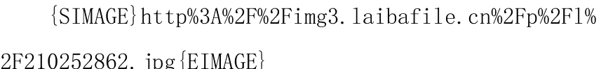

@神静心清 2015-04-10 19:52:32
楼主大哥，这是不是说地产股还会涨？？？

@投机者的扑克 2015-04-10 20:59:33
我感觉要是地产还是没啥起色，估计后期还要要放大招。
08年是贷款7折，4万亿。今天比08年还差。10万亿够吗？

@66 端午 88 2015-04-10 21:30:37
不够，起码40万亿。

@Rambo第N滴血 2015-04-11 12:11:09
￥40万亿！！！管理层有这胆吗？？
记得三年老哥以前在极视财经那时说过一个理论。大约意思是同样的错误短期内不会相同的犯两次，结果会被各种因素对冲掉。

40万亿，会有一个新的名字放出来，出来的名义不是M2，而是其它手段，比如地方债转长期建设债，以前的口径是22-30万亿，如果这个短期高息债证券化后，起码可以带来新增贷款额度15-20万亿，美元储备的二次使用问题，起码也是10万亿之巨，要不那么多国家参加新亚行，人家为什么啊，还不是图你的好处吗

作者:66 端午 88 日期:2015-04-11 23:15

河北担保为什么理论上已经破产了，因为它抵押担保的都是地方短期高息债，风险太大了。济南最近起码跑了 30 家路边的所谓融资公司，他们的融资标底都是房地产和房地产相关链条。

你把创业板所有企业的利润加起来是多少，不足 100 亿，市值高达上万亿。小企业在开始一般都是飞速成长的，就比如你搞个小行当，投入个几万，一年赚个几万，很容易，头十年成长 100 倍问题都不大，等到做到一定程度，就没法再发展了。这些企业通常已经干到 5 年左右的样子，再搞五年，基本也就没什么潜力了。因为他们没有几家是技术型企业，持续性一看就能看到尽头。

你再去看看基础行业，一家行业一流企业的利润都在数百亿，上千亿。这种企业要是扛不住，得多少小企业做成长对冲？

作者:66 端午 88 日期:2015-04-12 18:47

三大政策银行启动改革，内容简单概括就是分账管理，微利维持原有业务，开拓盈利性的自营业务。国家不再全部保底，你得自己解决一部分盈利，来补贴你的政策性亏损。实质上就是鼓励增加资本金，对资产进行证券化，估计离着上市不远了。后果，上市前刺激银行股的走强，上市后增加股市容量，对投机进行抑制，上市时机的选择点很重要。

小强表示，东北振兴要拿出闯关东的劲头，赶脚这不是啥好事，都闯关东了，可见该地区经济下滑的速度已经超过管理层的容忍限度，其实东北经济下滑是必然的，非常确定的，中国的经济支柱就是房地产，对于人口绝对流出的地区，当然是绝对的经济下滑因素。同时这些人移居到了什么地方，就会促进人口迁入地区的经济发展，北上广深无疑是人口流入的大户。

作者:66 端午 88 日期:2015-04-13 09:42

三姨太，冲

作者:66 端午 88 日期:2015-04-13 11:00

小强的谎撒不下去了，外贸数据二位数下滑。

作者:66 端午 88 日期:2015-04-13 11:05

拍几个电影和动画，捣鼓一下网络软件，写几个 APP 就能阻止经济下滑，我看现在的领导层脑子真是不好用。

作者:66 端午 88 日期:2015-04-13 11:22

@简单粗暴的你 2015-04-13 11:17:19

金融股整体动作太肉

传统基础行业受打压，市场反应一定是孱弱的。故事漫天飞，概念遍地跑，这就是小强搞的新经济，他根本就不懂新经济的本质，首先是人的变化，人的变化是从教育改革开始的，根本就没动静，中国的新经济没有根。

加v信1101284955，获取更多好帖

作者:66 端午 88 日期:2015-04-13 14:05

三泰可以裸奔了，散户基本已经走光了。:)

作者:66 端午 88 日期:2015-04-13 14:54

@zys19840121 2015-04-13 14:35:24

问下老大，现在买股指期货还可以吗？4100点了

现在搞基金，得奔指数加倍基金，比如 XX 进取，锐进之类的，而且针对上证。

作者:66 端午 88 日期:2015-04-13 15:19

银行股平均市盈率超过 20 倍，把保证金提走 80%，创业板不要搞了，中小板低估值还能跑一阵子。

作者:66 端午 88 日期:2015-04-13 15:22

@66 端午 88 2015-04-09 18:37:36

券商的引导浪今天结束了，调整 10-15%，然后开始主升浪。今天顶部杀下来就 5-6 个点了，所以能忍的就先忍一周，不到两周就会开始拉高了。这波做出来应该是前面调整最低价的一倍，多个 10-20%，然后还有一个 MACD 周线级的空中加油，但是很多品种都无法创新高，这波走完，别动这个板块了。

@麦田 110400 2015-04-13 15:20:03

老大，我现在持有的是广发证券，肉筋筋的不走啊，墨迹死了。看了您上面说的，现在还不到离开这个版块的时候，对吧？

加v信1101284955，获取更多好帖

不到时候，按照波浪理论，上波调整的低点，最少翻番，多的 2.5-3 倍。到达此位，就再别动这个板块了，或者连续三个涨停幅度，作为板块主升浪的结束标志。

作者:66 端午 88 日期:2015-04-13 23:10

浦发总行带头全员降薪 20%，首季未完成盈利目标，预测银行业将步入业绩下滑期。互联网金融总共实现自身净利润不足 100 亿，代价是银行业利润下滑大约 5%，大约少赚 1000 亿左右。同时，令人遗憾的是，中小企业融资成本继续上升，2014-2015，短贷实际融资成本大约 12-15%，中值 13.5% 左右，大约降低了 1.5%，大型企业贷款利率大约 8-10%（短贷），同比上升 1%。小强，怎么看？

作者:66 端午 88 日期:2015-04-13 23:12

@投机者的扑克 2015-04-13 17:08:56

话说最近涨了快一千点了

后面还有好几千点哪，别着急。

作者:66 端午 88 日期:2015-04-13 23:15

赶脚：中央的意图是，增发+IPO 融资=银行贷款，这才叫合理。现在新增贷款总额还有 13 万亿左右，证券融资大约 3 万亿（企业债+增发+IPO），还缺 10 万亿/年的直接融资。

加 v 信 1101284955，获取更多好帖

作者:66 端午 88 日期:2015-04-14 08:35

银行资金已经通过证券的融资渠道大规模进入股市，这在以前，可是扰乱金融秩序罪。

作者:66 端午 88 日期:2015-04-14 10:39

可以小仓位低吸证券了，还有 5% 以内见底。

作者:66 端午 88 日期:2015-04-14 10:59

坚持自己的风格，总有峰回路转的一天，不要东一榔棰西一梆子。7:3 配置，小盘转配中小板，不碰创业板。

作者:66 端午 88 日期:2015-04-14 11:16

传统金融业是受到政策打压最密集的行业，同时要看到全国 75% 的利润来自传统金融业和房地产行业，你指望一年赚几百万几千万的新兴行业能颠覆这种行业吗？大部分新兴行业都是在讲故事，实在讲不下去就收购几家业绩波动剧烈的不成熟资产，人家要是觉得有前景，何必卖给你，小强干完这届赶紧找地方补课，连新兴行业的基础都不打就想搞新兴行业，根本就没哪个人材谈什么新兴行业。

作者:66 端午 88 日期:2015-04-14 11:21

@zys19840121 2015-04-14 10:57:21

@66 端午 88 2015-04-14 10:39:06.0

可以小仓位低吸证券了，还有 5% 以内见底。

老大，兴业证券和招商证券可以吗？

加v信1101284955，获取更多好帖

说过了，穷地方，经济下滑最严重区域的券商，有望走出独立行情。拉高后期换成大券商。

作者:66 端午 88 日期:2015-04-14 11:28

@66 端午 88 31411 楼 2015-04-14 10:59 坚持自己的风格，总有峰回路转的一天，不要东一榔棰西一梆子。

7:3 配置，小盘转配中小板，不碰创业板。

@投机者的扑克 2015-04-14 11:27:03

我的风格是一买就套怎么破

连续三周跑不赢指数，建议买 ETF，进取类开放和封闭基金

作者:66 端午 88 日期:2015-04-14 12:17

@66 端午 88 31414 楼 2015-04-14 11:21

@zys19840121 2015-04-14 10:57:21 @66 端午 88 2015-04-14 10:39:06.0 可以小仓位低吸证券了，还有 5% 以内见底。

老大，兴业证券和招商证券可以吗？

说过了，穷地方，经济下滑最严重区域的券商，有望走出独立行情。拉高后期换成大券商。

加 v 信 1101284955，获取更多好帖

@投机者的扑克 2015-04-14 11:42:01

目测经济最烂的是东北，楼主对不对

鬼子都知道哪个地方 GDP 下滑最快，哪个地方最穷，反正就是不说名字了，这几天涨幅排在前面的是啥？今天涨幅靠前的是啥。

作者:66 端午 88 日期:2015-04-14 14:08

唉，一群猪脑子

作者:66 端午 88 日期:2015-04-14 14:09

板

作者:66 端午 88 日期:2015-04-14 14:10

券商明后天最后建仓机会

作者:66 端午 88 日期:2015-04-14 14:14

书上写着：60 分钟 MACD 死叉时，股价探低点，第一买入时机（前提是 20 日线向上，均线系统向上发散），BOLL60 分钟线，打到 20 均线上，跌不下去了，出一根小红线，赌第二买入点，BOLL 向上放量穿越上轨，第三短线买入机会，这把突的高，得减仓。

作者:66 端午 88 日期:2015-04-14 14:19

卧槽，主升浪提前了吗？

作者:66 端午 88 日期:2015-04-14 14:26

加 v 信 1101284955，获取更多好帖

@66 端午 88 31436 楼 2015-04-14 14:10 券商明后天最后建仓机会

@投机者的扑克 2015-04-14 14:19:33

砍三泰入券商靠谱吗

七三配，没必要砍套的。买的时候就说了，别多买。要是买的多了，反弹赚钱时减仓。

作者:66 端午 88 日期:2015-04-14 14:30

赶脚还得探一轮，不着急，着急就碰墙了。

作者:66 端午 88 日期:2015-04-14 14:31

飞翔吧三姨太，散户已经走光了。

作者:66 端午 88 日期:2015-04-14 14:34

三泰今天绝佳买点的。

作者:66 端午 88 日期:2015-04-14 14:35

扑克心里流泪的时候，就是底部

作者:66 端午 88 日期:2015-04-14 15:02

@66 端午 88 31450 楼 2015-04-14 14:35 扑克心里流泪的时候，就是底部

@投机者的扑克 2015-04-14 14:45:42

我都流一个月了

流多少泪，就能换多少金子，就怕手一贱，泪就白流了。

只要别拿着涨过份的股票，都会有收获的。

作者:66 端午 88 日期:2015-04-14 19:16

@zys19840121 31439 楼 2015-04-14 14:18:00

@66 端午 88 2015-04-14 14:14:18.0

书上写着：60 分钟 MACD 死叉时，股价探低点，第一买入时机（前提是 20 日线向上，均线系统向上发散），BOLL60 分钟线，打到 20 均线上，跌不下去了，出一根小红线，赌第二买入点，BOLL 向上放量穿越上轨，第三短线买入机会，这把突的高，得减仓。

老大，不是东北或者西部吗？

经济下滑速度最快的省：山西

作者:66 端午 88 日期:2015-04-14 19:17

@炒股票要折腾 31462 楼 2015-04-14 15:54:00

楼主，蓝色光标还关注么，最近大跌，基本面出了问题吗？

收购的海外资产巨幅亏损

作者:66 端午 88 日期:2015-04-14 19:22

快讯：李克强称中国经济下行压力仍在上升，中国需为面对更大的经济困境做好准备；中国经济增速等主要指标保持在合理区间；要加大定向调控力度。快讯：铁路运量直跌至五年前运量，小强经济指数蒙受重创。~~~~~~房地产就是救生圈，降准降息就是伸过来的援手。

作者:66 端午 88 日期:2015-04-14 22:46

@66 端午 88 30749 楼 2015-03-29 14:49

@zhuyi538 30748 楼 2015-03-29 13:54:00

楼主请教个问题，济南的房子现在可以买吗？会不会大幅降价？想在王官庄买一套二手。。

就业率开始下滑，除了自己使用，近期不要投资地产

@zhuyi538 2015-04-02 18:37:31

就是自己用啊，最近看了套王官庄精装房 63 平，能测 66 平，51 万，想出手呢，三年哥帮忙参谋下被，您就提个意见，盈亏自负，谢了

@66 端午 88 31009 楼 2015-04-02 20:57

股市有相当盈利，地产配置不足的，可以锁定。

@zhuyi538 2015-04-03 22:35:09

????? 不是股票。。我是说买房啊。

@66 端午 88 31049 楼 2015-04-04 11:51

股市没赚钱的，谨慎购房。

@zhuyi538 2015-04-04 16:24:41

不炒股????~~意思是现在不要买房?房子还能降?还是不要负债要通缩?

@66 端午 88 31061 楼 2015-04-04 17:48

别人用货币的收益买房，你是用血汗钱买房，关键王官庄那个地方算不上核心位置。

@zhuyi538 2015-04-04 22:17:58

大哥啊，到底是要不要买~~给个原因啊~核心位置买不起啊!又不会炒股啥的~只会死赚钱~不过王官庄 3 区周围的楼盘都在 1 万了，比如泉景阳光 100 什么的，我感觉应该还是比较抗跌的~话说王官庄的房子还就一直没跌多少

@66 端午 88 31067 楼 2015-04-05 16:10

你要是买了自己住，那地方交通不算方便，你要是买了投资，看看收益率够不够货币基金收益。你为什么买哪?找不到理由----------

@zhuyi538 2015-04-05 23:30:21

在共青团上班，不知道该买哪，远了不想买，近了买不起～那地方交通还行吧～哥哥啊你就说刚需该不该买吧。。大神说美元撤离刺破泡馍。。然后通缩～！到底是不是这么个情况！最近亚投行中美剑拔弩张啊

@66 端午 88 2015-04-05 23:59:19

美元走势是美国经济走势的结果，美国经济依靠消费，消费的前瞻指数是非农就业率，上周就业率大幅下滑，导致美元大跌，不过这个指数还不能反映趋势，只能视作一个波动，如果月幅度下滑，美元就到头了。美元指数最多也就涨到 120，美国这次非农就业率连续上升的基础是美国制造业兴旺，原因是中国人工成本大幅抬升所致。这里有个博弈的杠杆，中国出口下滑，就会导致人民币汇率下滑（出口单价降低），美国的工业制造也是需要出口……

@zhuyi538 2015-04-14 16:23:32

哥哥啊 您就给个建议 济南刚需 该不该现在出手为什么？房价会降？还是现在负债以后会死的很惨？

要买也得在 9 月左右买，此前会有一大波人卖房炒股，位置选历下，米多买在核心，米少按揭在城轨沿线历下东部，别太靠东。

加v信1101284955，获取更多好帖

作者:66 端午 88 日期:2015-04-14 22:50

@简单粗暴的你 2015-04-14 20:20:11

三泰这个公司有点了解，市梦率这么高，股价也这么高，越了解越不敢买

现在能做到一分钟 1000 单得收发量，以后随着人工成本逐步抬升，逐步开始收费，每分钟做到 10000 单，这股的估值是多少？现在快递员得身体越来越差了（明显降低了人员要求），再过三年，一半快递员都会是女汉子了。

作者:66 端午 88 日期:2015-04-15 09:56

证券保险短线调整基本到位

作者:66 端午 88 日期:2015-04-15 10:08

GDP:7.0%，坑爹的统计局，现在的增速应该为负才合理。铁路运输是基本运输量，下滑 9%，基本上就是实体经济的现实。

作者:66 端午 88 日期:2015-04-15 10:08

没低价筹码的招保万金，房地产 B。

作者:66 端午 88 日期:2015-04-15 10:59

@投机者的扑克 2015-04-15 10:54:05

这尼玛要崩盘？

加 v 信 1101284955，获取更多好帖

崩不了，风格转换的前期，大金融的大 C 浪很快来临。

作者:66 端午 88 日期:2015-04-15 11:00

不以教育改革为先导的新经济改革犹如水中月，梦中花。

作者:66 端午 88 日期:2015-04-15 11:02

@投机者的扑克 2015-04-15 10:47:31

创业板跌成狗了

本来就是狗，前阵子挂羊头，卖狗肉行情。

作者:66 端午 88 日期:2015-04-15 11:12

@简单粗暴的你 2015-04-15 11:08:33

金融 C 浪是不是准备不带保险玩了？大哥，山西证券还能买吗？

调整后买入

作者:66 端午 88 日期:2015-04-15 11:23

券商融资根本融不到。

作者:66 端午 88 日期:2015-04-15 12:34

今天保利董事长在微博留了一句话：保利就是个 P。俺赶脚是国家督促保利重组了，结合万科前董事长王石放弃管理权，专心泡妞的行为。国家级房地产公司面临大规模重组。

作者:66 端午 88 日期:2015-04-15 13:00

铁路运输下滑 9%，水运下滑 12%，公路下滑 2%，发电量下滑 3.7%，房地产开发量下滑 18.2%，销售下滑 9.8%，统计局干的太漂亮了，外贸下滑 6%，M2 同比微增 0.5%，零售下滑 0.27%，全部分量下滑，总量怎么上升的呀，小强-----------------大家喊你摆一摆。

作者:66 端午 88 日期:2015-04-15 13:26

政策风向标：北京银行启动

作者:66 端午 88 日期:2015-04-15 14:09

@投机者的扑克 2015-04-15 13:43:46

去年不是提到 MBS 吗，今年怎么不搞了

股东很多都是官二，红二。

作者:66 端午 88 日期:2015-04-15 14:10

可以追追兴业银行。调整到位

作者:66 端午 88 日期:2015-04-15 14:11

@投机者的扑克 2015-04-15 14:07:42

现在经济这个屌样，国家还有什么大招可以放

货币贬值，放水，还不能放少了，否则小强干不到任期了。

作者:66 端午 88 日期:2015-04-15 14:15

我了去的，从 20.15 发到 20.3 才发出来，这尼玛坑爹的天涯小便。

作者:66 端午 88 日期:2015-04-15 14:35

@投机者的扑克 2015-04-15 14:26:24

银行保险在拉升，没券商毛事啊

明天轮到券商了

作者:66 端午 88 日期:2015-04-15 15:04

小强-----------------你妈喊你回家穿内裤。:(

作者:66 端午 88 日期:2015-04-15 20:24

@66 端午 88 30749 楼 2015-03-29 14:49

@zhuyi538 30748 楼 2015-03-29 13:54:00

楼主请教个问题，济南的房子现在可以买吗？会不会大幅降价？想在王官庄买一套二手。。

就业率开始下滑，除了自己使用，近期不要投资地产

@zhuyi538 2015-04-02 18:37:31

就是自己用啊，最近看了套王官庄精装房 63 平，能测 66 平，51 万，想出手呢，三年哥帮忙参谋下被，您就提个意见，盈亏自负，谢了

@66 端午 88 31009 楼 2015-04-02 20:57

股市有相当盈利，地产配置不足的，可以锁定。

@zhuyi538 2015-04-03 22:35:09
不是股票。。我是说买房啊。

@66 端午 88 31049 楼 2015-04-04 11:51
股市没赚钱的，谨慎购房。

@zhuyi538 2015-04-04 16:24:41
不炒股~~意思是现在不要买房？房子还能降？还是不要负债要通缩？

@66 端午 88 31061 楼 2015-04-04 17:48
别人用货币的收益买房，你是用血汗钱买房，关键王官庄那个地方算不上核心位置。

@zhuyi538 2015-04-04 22:17:58
大哥啊，到底是要不要买~~给个原因啊~核心位置买不起啊！又不会炒股啥的~只会死赚钱~不过王官庄3区周围的楼盘都在1万了，比如泉景阳光100什么的，我感觉应该还是比较抗跌的~话说王官庄的房子还就一直没跌多少

@66 端午 88 31067 楼 2015-04-05 16:10
你要是买了自己住,那地方交通不算方便,你要是买了投资,看看收益率够不够货币基金收益。你为什么买哪?找不到理由------------

@zhuyi538 2015-04-05 23:30:21
在共青团上班,不知道该买哪,远了不想买,近了买不起~那地方交通还行吧~哥哥啊你就说刚需该不该买吧。。大神说美元撤离刺破泡馍。。然后通缩~!到底是不是这么个情况!最近亚投行中美剑拔弩张啊

@66 端午 88 2015-04-05 23:59:19
美元走势是美国经济走势的结果,美国经济依靠消费,消费的前瞻指数是非农就业率,上周就业率大幅下滑,导致美元大跌,不过这个指数还不能反映趋势,只能视作一个波动,如果月幅度下滑,美元就到头了。美元指数最多也就涨到120,美国这次非农就业率连续上升的基础是美国制造业兴旺,原因是中国人工成本大幅抬升所致。这里有个博弈的杠杆,中国出口下滑,就会导致人民币汇率下滑(出口单价降低),美国的工业制造也是需要出口......

@zhuyi538 2015-04-14 16:23:32
哥哥啊 您就给个建议 济南刚需 该不该现在出手

加v信1101284955,获取更多好帖

为什么?房价会降?还是现在负债以后会死的很惨?

@66 端午 88 2015-04-14 22:46:25
要买也得在 9 月左右买, 此前会有一大波人卖房炒股,位置选历下, 米多买在核心, 米少按揭在城轨沿线历下东部,别太靠东。

@zhuyi538 2015-04-15 20:17:27
谢谢楼主, 米不多啊, 也就能接受 50 万的房子...历下买个一室一厅的..?? 哪个小区好?

奥体西路, 北段, 找个离地铁站口近的小区, 买个 90平的应该够了, 那边 7000 左右的样子。

作者:66 端午 88 日期:2015-04-15 21:18

@66 端午 88 30749 楼 2015-03-29 14:49

@zhuyi538 30748 楼 2015-03-29 13:54:00

楼主请教个问题, 济南的房子现在可以买吗? 会不会大幅降价? 想在王官庄买一套二手。。

就业率开始下滑, 除了自己使用, 近期不要投资地产

@zhuyi538 2015-04-02 18:37:31

加 v 信 1101284955, 获取更多好帖

就是自己用啊,最近看了套王官庄精装房63平,能测66平,51万,想出手呢,三年哥帮忙参谋下被,您就提个意见,盈亏自负,谢了

@66端午88 31009楼 2015-04-02 20:57

股市有相当盈利,地产配置不足的,可以锁定。

@zhuyi538 2015-04-03 22:35:09

不是股票。。我是说买房啊。

@66端午88 31049楼 2015-04-04 11:51

股市没赚钱的,谨慎购房。

@zhuyi538 2015-04-04 16:24:41

不炒股~~意思是现在不要买房?房子还能降?还是不要负债要通缩?

@66端午88 31061楼 2015-04-04 17:48

别人用货币的收益买房,你是用血汗钱买房,关键王官庄那个地方算不上核心位置。

@zhuyi538 2015-04-04 22:17:58

加v信1101284955,获取更多好帖

大哥啊，到底是要不要买~~给个原因啊~核心位置买不起啊！又不会炒股啥的~只会死赚钱~不过王官庄3区周围的楼盘都在1万了，比如泉景阳光100什么的，我感觉应该还是比较抗跌的~话说王官庄的房子还就一直没跌多少

@Rambo 第N滴血 2015-04-05 10:42:35

还有：现在价位太高啦!! 我也赶脚这个时机只适合置换或者自用的操作。纯投资的话，在这种高价位进货，出租收益率是铁定高不了的。

@zhuyi538 31464楼 2015-04-14 16:20

我就是自住啊，现在租房一个月1000，公积金一个月1200，在济南王官庄附近买套70平以下的二手房首付17左右，月供2000多，至于为什么选王官庄，一个是在这里住惯了，一个是地段也还不错，算不算很核心，但是离着核心的泉城广场什么的也很近了，附近的楼盘都是10000多，紧挨着就有个泉景天沅1W多，不过也就隔着1000多米而已，感觉地段还可以了，价格也可以接受。。就是现在的经济形势不知道买了以后会不会吃不起饭啊。。

@aobog 2015-04-14 22:34:33

虽然俺不支持买房的钱炒股。。但是非学区非核心暂无

加v信1101284955，获取更多好帖

教育附加值的王官庄您还是别考虑了。首套自住建议核心区。
历下。再烂在小也不会错。。要不您就赚个大钱在买。

@zhuyi538 2015-04-15 20:24:08

谢谢。。主要是怕买到高点，天涯整天崩盘崩盘的。。。
给忽悠晕了，最近更是到处是负面消息，下步经济要是真不行了，对买房者有什么影响？

@66 端午 88 2015-04-15 21:18:16

刚需，经济崩不崩，也没谁免费给你住房。你的问题就是想找个便宜的时候，赶脚这波行情（大C浪）要是能冲到5500点，你在5300点买房，应该是可行的。那会有多套的看到盈利效应，房子就是便宜10%也是肯抓紧回笼资金的。

作者:66 端午 88 日期:2015-04-16 09:11

@66 端午 88 30749 楼 2015-03-29 14:49

@zhuyi538 30748 楼 2015-03-29 13:54:00

楼主请教个问题，济南的房子现在可以买吗？会不会大幅降价？想在王官庄买一套二手。。

就业率开始下滑，除了自己使用，近期不要投资地产

@zhuyi538 2015-04-02 18:37:31

就是自己用啊，最近看了套王官庄精装房63平，能测66平，51万，想出手呢，三年哥帮忙参谋下被，您就提个意见，盈亏自负，谢了

@66 端午 88 31009 楼 2015-04-02 20:57

股市有相当盈利，地产配置不足的，可以锁定。

@zhuyi538 2015-04-03 22:35:09

不是股票。。我是说买房啊。

@66 端午 88 31049 楼 2015-04-04 11:51

股市没赚钱的，谨慎购房。

@zhuyi538 2015-04-04 16:24:41

不炒股~~意思是现在不要买房？房子还能降？还是不要负债要通缩？

@66 端午 88 31061 楼 2015-04-04 17:48

别人用货币的收益买房，你是用血汗钱买房，关键王官庄那个地方算不上核心位置。

@zhuyi538 2015-04-04 22:17:58

大哥啊，到底是要不要买~~给个原因啊～核心位置买不起啊！又不会炒股啥的～只会死赚钱～不过王官庄3区周围的楼盘都在1万了，比如泉景阳光100什么的，我感觉应该还是比较抗跌的～话说王官庄的房子还就一直没跌多少

@Rambo 第N滴血 2015-04-05 10:42:35

还有：现在价位太高啦！！我也赶脚这个时机只适合置换或者自用的操作。纯投资的话，在这种高价位进货，出租收益率是铁定高不了的。

@zhuyi538 31464楼 2015-04-14 16:20

我就是自住啊，现在租房一个月1000，公积金一个月1200，在济南王官庄附近买套70平以下的二手房首付17左右，月供2000多，至于为什么选王官庄，一个是在这里住惯了，一个是地段也还不错，算不算很核心，但是离着核心的泉城广场什么的也很近了，附近的楼盘都是10000多，紧挨着就有个泉景天沅1W多，不过也就隔着1000多米而已，感觉地段还可以了，价格也可以接受。。就是现在的经济形势不知道买了以后会不会吃不起饭啊。。

@aobog 2015-04-14 22:34:33

虽然俺不支持买房的钱炒股。。但是非学区非核心暂无教育附加值的王官庄您还是别考虑了。首套自住建议核心区。

加v信1101284955，获取更多好帖

历下。再烂在小也不会错。。要不您就赚个大钱在买。

@zhuyi538 2015-04-15 20:24:08

谢谢。。主要是怕买到高点，天涯整天崩盘崩盘的。。。
给忽悠晕了，最近更是到处是负面消息，下步经济要是真不行了，对买房者有什么影响?

@66 端午 88 2015-04-15 21:18:16

刚需，经济崩不崩，也没谁免费给你住房。你的问题就是想找个便宜的时候，赶脚这波行情（大 C 浪）要是能冲到 5500 点，你在 5300 点买房，应该是可行的。那会有多套的看到盈利效应，房子就是便宜 10%也是肯抓紧回笼资金的。

@朱晨霞 2015-04-16 09:07:17

现在有个开发商的房子尾盘清仓几套房子，地产商要退出这个楼盘，重心转移外地，清仓大处理，大面积的，地段还行，跃层加上送的阁楼，外加还赠送露台，估计有个 300 来平米，

卖旧换新的绝佳标的。
作者:66 端午 88 日期:2015-04-16 09:34
地产龙头异动

作者:66 端午 88 日期:2015-04-16 10:33

北京那俩飙车的说是做微商的，以后老虎们也去搞微商，查住就说是电商赚的，一根火柴买三万，我想肯定有人埋单。

作者:66 端午 88 日期:2015-04-16 11:37

抱紧手里的筹码，大 C 浪幅度不会小于大 A 浪，量度涨幅最低也得 5100 以上至 5600，后面还有一个大 E 浪，大 E 浪的幅度难以预测，极端的涨幅就像 2007 年，其实那波大 E 浪的起涨点是 3000 点，竟然两波延伸到了 6000 多，也有可能是个双头的失败浪。大 C 浪就是鱼肚子，涨的少的捂牢。

作者:66 端午 88 日期:2015-04-16 11:48

@简单粗暴的你 2015-04-16 11:44:17

大哥，除了三泰再买点山西证券对吗？象中信申万这种 3400 点蹲着的大券商要不要配备一些？

买山西证券是因为它涨幅落后，现在的操作策略是同板块找涨势差的同板块小盘股，涨高了，换到涨的少的。

作者:66 端午 88 日期:2015-04-16 11:51

基本面有问题的不要动，比如方正，太平洋，都是基本面有问题的，4600 点以前，不要动大盘券商，过了 4600，不要动小盘券商。

作者:66 端午 88 日期:2015-04-16 11:52

这波涨势，券商不是唯一核心，银行，保险也该获得一定仓位。

作者:66 端午 88 日期:2015-04-16 11:57

平安保险是个有问题的券商,一到高位,就会搞巨额融资,所以:建议把配置保险的资金,配置在全国性大地产公司上,小强的策略是有问题的,到了一定程度,不会不纠正,我不是太看好房地产未来的涨势,不过房地产政策上会有逆转,这次经济增速明显是在 2-3%左右,强行把数据做到 7%,是小强还是不服,等到一定程度,不服也得服,新兴行业的起点是教育,人事制度的改革,而不是创业问题,现在创业就是找死,除非找人给你投资,让别人死。

作者:66 端午 88 日期:2015-04-16 12:05

中国的移动类通信公司绝对都是灰常弱智的企业,现在只要搞一个 APP,然后对该 APP 流量免费,立刻就能把 BAT 干翻。中国的银行类企业也是非常弱智的企业,现在只要对金卡用户流量免费,对资产进行分拆,利用大数据资源,贴合用户的金融需求,立刻干翻所有的互联网+。

作者:66 端午 88 日期:2015-04-16 21:03

一季度经济下台阶 (5%-6%),稳增长加码,二季度经济小周期企稳。

看到一季度公布的数据,做了十多年宏观研究,当场就醉了。做宏观研判最重要的是弄清真相,本文我们试图通过一些质量相对可靠的数据弄清中国经济的真实运行状况及其趋势。核心观点：一季度经济下台阶(5%-6%)，稳增长加码，二季度经济小周期企稳。我们曾预测新5%比旧8%好，现在看经济正接近中长期底部。

## 1. 让数据说出真相：中国经济的真实状况

虽然官方公布的一季度 GDP 增速在 7%，但微观观察到的经济速度可能已经在 5%-6%左右。由于中国的工业增加值和 GDP 数据统计容易受到人为干扰，在经济衰退期经常被“和谐”而导致误差扩大。

我们观察到 2014 年二季度以来，发电量、粗钢产量、铁路货运量跟工业生产及 GDP 的背离不断扩大，近期这种背离程度已经接近 2008 年底-2009 年初的水平，比如 2015 年 1-3 月上述三项指标增速分别为-0.1%、-1.7%、-9.1%(1-2月)，但规模以上工业增加值增速却是 6.4%、GDP 增速 7%。

由于重化工业的弹性较大，我们可以采用更广泛的 155 种主要工业产品产量合成工业生产指数，这是联合国推荐、国际通行的工业核算方法，目前中国月度工业生产统计数据的采集采用规模以上大中型企业联网直报和规模以上小型企业逐级上报相结合的方式，属于具有中国特色的自创方法。

本文合成的月度工业生产指数与国家统计局核算的规模以上工业增加值增速在 2004~2007 年间基本吻合。可见，在经济平稳运行的年份，我国工业生产增速数据质量较高。

但是在 2008~2010 上半年经济大幅波动期间，工业生产指数与规模以上工业增加值增速出现了较大背离，即 2008 年我国工业增加值增速明显高估和 2009 年明显低估。而且这种背离在工业的主要行业里都不同程度地存在，是一个普遍现象。

我们合成的工业生产指数与官方公布的工业增加值增速之间的背离再次出现并不断扩大，发生在 2014 年 2 季度以来，这也就意味着实际经济增速比官方公布的数据要低得多，而且经济增速在 2014 年 2 季度-2015 年 1 季度出现了明显下滑，但宏观数据被“和谐”了。

为什么是 2014 年 2 季度以来经济快速下滑？2014 年 2 季度以来发生的最重要事件是房地产长周期拐点出现，并引发一系列事件，比如重化工业快速下滑、土地财政坍塌、财税改革提速、财政货币政策加码宽松等。房地产投资占中国固定资产投资的 24.6%，加上制造业和基建相关的，房地产链上相关投资占全社会固投的一半。这也应证了那句经济史上的名言“房地产是周期之母”。因此可以说，稳增长核心是稳投资，稳投资核心是稳房地产投资。

我们预计 2015 年下半年中国经济可能会增速换挡的探明中长期底部，标志性事件是房地产投资降到 5%左右，根据人口周期测算，未来几年中国房地产投资的增长中枢在 5%左右。

最新的情况是，3 月中采 PMI50.1，比上月回升 0.2，经济趋稳，驱动力来自稳增长加码，体现在财政支出加码、建筑业订单回升、大企业和小企业景气分化、中采和汇丰 PMI 背离。330 救房市政策后预计地产有一波回升。美国非农就业低于预期，预计美联储加息推迟，美元指数阶段性见顶，人民币贬值和资本流出压力暂缓。猪价和大宗商品价格反弹，通缩压力暂缓。

我们对全年的看法是，一季度下一个台阶，二季度企稳，随着稳增长政策效应衰减和房地产新开工低迷传导到投资端，三季度面临再度寻底压力，这一次可能探明中长期底部，标志性事件是房地产投资增速回落到 5%左右的长期中枢。

作者:66 端午 88 日期:2015-04-16 21:09

## 2. 三产逆势增长存疑，一年期加权贷款利率高于名义 GDP 增速意味着宏观加杠杆和降息紧迫

分产业看，第二产业同比增长 6.4%，比上年全年下降 0.9 个百分点，为 GDP 增速下滑的主因。第三产业同比增长 7.9%，比上年全年下滑仅 0.2 个百分点，考虑到一季度房地产市场低迷、治理三公、出境游火爆等因素，第三产业基本不波动存疑，根据经验，第三产业最容易统计数据注水。

GDP 名义增速为 5.8%，GDP 平减指数由上季度 0.3%大幅下降为-1.1%，一年期加权贷款利率高于名义 GDP 增速意味着宏观加杠杆和降息紧迫。

## 3. 新旧经济冰火两重天

工业生产从 1-2 月 6.8%降到 3 月的 5.6%，创六年多来新低，一季度同比增速为 6.4%，比 2014 年四季度的 7.6%明显下了一个台阶。

### 3.1. 东北和西部地区形势严峻

东中西部地区工业生产均出现了不同程度的滑坡，东部受出口拖累，中西部受资源品和重化工业需求低迷拖累，其中西部和东北地区形势严峻。

### 3.2. 行业分化，传统制造业下滑，新兴和政府支持行业表现较好

3 月行业走势依然分化。传统行业依然弱势，通用和专用设备行业延续跌势，同比增速分别由原来的 4.8%和 3.1%进一步下滑至 2.4%和-0.2%。黑色金属和有色金属则一涨一跌，同比增速由原来的 3.5%和 12.7%分别变为 5.5%和 9.6%。新兴的医药和计算机电子业仍然保持相对强势，保持两位数增长。受到政府支持的的铁路船舶和航空航天业同比增速重新回到 15%以上。

## 4. 投资下滑，地产大降，制造业低迷，基建高增

全社会固定资产投资完成额累计同比为 13.5%，继续下滑并不如预期的 13.9%，单月增速为 13.2%。1-3 月的季调环比则分别为 1.05%、1.03%和 1.04%，比 2014 年底的 1.11%左右明显下滑，但增速在一季度平稳。

### 4.1. 房地产销售回升，但投资增速继续下滑

1-3 月全国房地产开发投资 16651 亿元，同比名义增长 8.5%，扣除价格因素实际增长 9.5%。3 月当月增速为 6.5%，比 1-2 月 10.4%的同比增速大幅下滑。受到房地产放松政策的影响，房地产销售有所回升。其中土地购置面积累计同比由-31.7%小幅扩大至-32.4%，房地产销售面积和销售额累计同比由-16.3%和-15.8%分别回升至-9.2%和-9.3%，新开工累计同比则由-17.7%继续下滑至-18.4%。尽管房地产销售受到政策刺激有所回升，但是房地产投资和新开工仍然下滑，后续房地产下行仍然是经济下行最大的风险，我们维持全年房地产投资增速 5%的判断。

### 4.2. 制造业投资低迷

受出口和房地产投资拖累，制造业投资同比增速由 1-2 月的 10.6%继续下滑至 3 月的 10.3%。3 月出口交货值同比为 0.9%，比 1-2 月 4.2%大幅下滑，一季度增速仅为 2.9%。

### 4.3. 基建高增，稳增长发力

基建投资当月同比继 1-2 月的 20.6%上升至 3 月的 24.5%。其中，交运仓储投资增速从 21.3%左右大幅上升至 26.2%左右，水利环境和公共设施管理业从 19.3%上升到 24.9%。为了保 2015 年 GDP7%和固定资产投资 15%的目标，基建需加码

## 5. 消费增速稳中略降

社会消费品零售名义同比增速由 1-2 月的 10.7%下滑至 3 月的 10.2%，实际增速则由 11%大幅下降至 10.2%。

消费的分项数据来看，限额以上餐饮的基数效应消失，同比继续小幅上升。受房地产销售的提振，房地产相关消费均回升，建筑装潢材料由 12.5%上升至 21.2%，而汽车消费继 1-2 月逆势大幅上行至两位数 10.8%后大幅回落至-1.3%。

## 6. 政策加码稳增长

预计降息降准和稳增长加码。公共政策部门采取了一种虽不刺激但会兜底的宏观调控新思路，为改革赢得时间。形成强改革与宽货币新组合，加码基建投资对冲房地产投资下滑，预计 2 季度稳增长加码。地方债替换降低无风险利率、提升风险偏好。专项债券超市场预期，稳增长决心显现。央行自 3 月以来第五次下调逆回购利率至 3.35%，压低短端利率的意愿明显，未来还会有降息降准等进一步宽松政策出台。

维持春节后提出的“稳增长加码，2 季度经济企稳，股市阳春”判断。近期关注 7 大类重大投资工程（重大网络工程、健康养老、生态环保清洁能源、粮食水利、油气、交通）、三大区域战略（一带一路、京津冀协同发展、长江经济带）落地、万亿地方债务开始市场化替换、大宗反弹、环保、军工、非银、银行。

作者:66 端午 88 日期:2015-04-17 09:52

券商主升浪开始了?

作者:66 端午 88 日期:2015-04-17 09:58

券商如果启动，其它都歇了吧，都洗洗睡吧。

作者:66 端午 88 日期:2015-04-17 10:02

水运全体涨停

作者:66 端午 88 日期:2015-04-17 10:05

@66 端午 88 31609 楼 2015-04-17 09:52

券商主升浪开始了?

@神静心清 2015-04-17 09:59:02

楼主大哥，东北证券有没有涨停的潜力??

现在值得买

作者:66 端午 88 日期:2015-04-17 10:08

从来木有见过哪个总理，或者中国的或者外国的，去挺某一个企业，这明显是违规啊，南北车这是搞哪样，小强

作者:66 端午 88 日期:2015-04-17 10:17

建议小强直接转行黑嘴算了

作者:66 端午 88 日期:2015-04-17 10:50

昨天，额个同学把这种行情比作常态化工工资牛市，正在涨的就是发工资，不涨的就是工资刚发完，最郁闷的是干了一段，还没发工资就辞职。选择标的应该是基本面不错，股价横盘多日，一片骂声的品种，这些都是快发工资的。

作者:66 端午 88 日期:2015-04-17 11:46

小票等 89 日线上来，大票轮番等 20 日线启动，目前是这种情况，黑嘴李的猪在风口飞。

作者:66 端午 88 日期:2015-04-17 12:09

开始探讨个问题，中国经济如果硬着陆，国内有什么可以作为避风港？

作者:66 端午 88 日期:2015-04-17 14:06

锁仓，溜达，不看盘了。

作者:66 端午 88 日期:2015-04-17 18:42

周末重大利空，小强这是要杀猪了吗。

作者:66 端午 88 日期:2015-04-17 18:47

利空公布后，a50 快速下跌 5%，六月交割品种下跌超过 8%。下周一集体跌停开盘的赶脚。

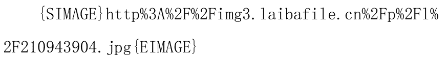

作者:66 端午 88 日期:2015-04-17 21:31

股市是现在经济的唯一看点，如果就此走熊，中国经济貌似很快会进入衰退期，所以昨天额就想，如果这种情况发生了，该有什么对策。两面赌，半仓美金，半仓做空品种。

作者:66 端午 88 日期:2015-04-18 00:45

@沧海一粟 G2011 2015-04-17 22:27:30

楼主，小弟跟帖很久了，作为刚需，现在适合买房吗?

本人坐标在长三角三线城市，做点小买卖，房子首付可以凑出来，买后资金会相对紧张一些，但勉强过得去，不知道我能不能买?麻烦帮我分析一下，先谢了!

你得考虑今后的现金流通路断掉该怎么办?如果买房是用闲置资金，还可以理解。要是感觉手紧，就先别急。实体经济下滑并未到位，现在还不到半山腰，只有等到影响就业时，小强才会恍然大悟，他是个正直的，停留在书上的理论家，对我国的经济运行状况并非驾轻就熟。

作者:66 端午 88 日期:2015-04-18 00:47

形势不妙，看来留了15%的利润防撞垫还是不够，三泰不敢留了，唉，木有赚小股票的命。其它需要部分减仓，全看周一低开后是否能拉出新高，拉不动，就减，跌停就白搭了。

作者:66 端午 88 日期:2015-04-18 17:06

@ccn431 2015-04-18 02:06:41

A50 最后一下红了。。

段子你也信，特意去交易软件看了一下，全日下跌 6%。

作者:66 端午 88 日期:2015-04-18 17:08

@66 端午 88 2015-04-17 21:31:40

股市是现在经济的唯一看点，如果就此走熊，中国经济貌似很快会进入衰退期，所以昨天额就想，如果这种情况发生了，该有什么对策。两面赌，半仓美金，半仓做空品种。

@freeman2018 2015-04-18 08:08:22

请问楼主，国内除了期指和融券外，还有什么做空品种？有专门做空的基金吗？

现在融券也融不到，等到真跌了，还真是融不到券。所以，额特地把户头转到朋友在的一家证券公司，以后熊市到了，好有个通风报信的，好来能融到券吧。

作者:66 端午 88 日期:2015-04-18 17:12

券商银行这类大金融问题不大，没准还会逆势涨点。额担心的是涨了不少的地产股。现在能操作的做空工具大部分是个样子货，真到你想融券，根本融不到，等你想融资，也融不到。额那个奇葩同学拿了一大票天成控股，13.8 的成本，涨了也不敢卖，卖掉就融不到资了。

作者:66 端午 88 日期:2015-04-18 17:17

@66 端午 88 2015-04-17 21:31:40

股市是现在经济的唯一看点，如果就此走熊，中国经济貌似很快会进入衰退期，所以昨天额就想，如果这种情况发生了，该有什么对策。两面赌，半仓美金，半仓做空品种。

@freeman2018 2015-04-18 08:08:22

请问楼主，国内除了期指和融券外，还有什么做空品种？有专门做空的基金吗？

50，180，500 股指期货，不过得等到趋势出来才能动这些玩意。融券做空，沽空权证，这两类操作难度较大，期货也有做空钢材，有色，不过也不容易操作。

作者:66 端午 88 日期:2015-04-18 17:23

@u_96750055 2015-04-18 00:56:57

老大，今天满仓证券 B 的怎么操作

减仓时，我会通知大家。不过我也不一定能做对，只是给大家一个参考吧。这波赚到钱，出来的。肯定是 20%的赢家。而且这波 C 浪也是散户能把握的最后机会了。E 浪的难度大，幅度也大，不是所有品种都能涨。上波牛市的大 E 浪的领涨品种是有色煤炭，金融是收尾行情。这波看着像一带一路，不过大部分一带一路已经失去估值优势了。到了 E 浪一旦套住，可能这辈子都解不了套。

作者:66 端午 88 日期:2015-04-18 17:25

@蓑笠翁 168 2015-04-18 14:16:38

老大，我个人觉得莫慌，更不要杀跌！反而利用低开下探机会调仓！甚至加仓做短差。理由有几点：1、周末政策比上次威力差远了，券票愿借出者也不多!2、打新资金抄底心切！3、挣钱效应才急剧放大不久，不符合马上被收割最佳时机 4、顶都我们老百姓看到了，政府主力颜面何存！5、只有来了大利好，才有极致状态产生！

请老大指正！

后面肯定有更高点，不过就怕是 C 浪结束，这一下个股就得调整 30%。而且 E 浪不定炒不炒你手里的股，这很麻烦。

作者:66 端午 88 日期:2015-04-18 17:30

最新消息：有助于减少低开幅度

中国证监会新闻发言人答记者问

2015 年 4 月 18 日 17:20 阅读 3211

今日，中国证监会新闻发言人邓舸接受了记者的采访，回答了相关问题，以下是这次采访的主要内容：

问：近日，证券业协会、基金业协会、上交所、深交所联合发布《关于促进融券业务发展有关事项的通知》，该通知是否是鼓励卖空，打压股市？

答：这是误解误读。融券交易是境外市场普遍采用的一种成熟的交易机制，它具有减缓市场波动、发现市场价格、对冲市场风险等作用。我会 2006 年制定并于 2011 年修订的《证券公司融资融券业务管理办法》，就规范和发展融资融券业务提出了要求。近年来融资业务快速发展，而融券业务发展缓慢。2014 年新“国九条”明确提出，要健全市场稳定机制，完善市场交易机制，丰富市场风险管理工具。4 月 17 日，证券业协会等四家自律组织联合发布《关于促进融券业务发展有关事项的通知》，是落实新“国九条”要求的举措，目的是促进融资融券业务平衡发展，健全市场交易机制，维护市场稳定健康发展，不是所谓的鼓励卖空，更非打压股市，请正确理解，不要误判误信。

问：近日，证监会通报融资融券业务开展情况并提出七项要求，是否要限制融资业务发展？

答：4 月 16 日，我会通报了近期检查证券公司融资融券业务发现的问题及处理情况，这是我会开展证券公司现场检查后，按照程序进行的例行常规工作。《证券公司融资融券业务管理办法》对证券公司依法合规经营、加强风险控制、强化客户适当性管理已有明确规定。通报所提出的七项要求，是对现有规定的重申和提醒，旨在促进融资融券业务规范发展，保护投资者合法权益，没有新的政策要求，市场不宜过度解读。

作者:66 端午 88 日期:2015-04-18 22:25

好的私募你进不去，差的私募不如你自己买，绝大部分人跑不赢指数涨幅，所以额开始就强调：应该融资买ETF，基本上能达到最牛的基金收益。

作者:66 端午 88 日期:2015-04-18 22:28

买 ETF 得有定力，所以又会引申出下一个问题：你是不是了解你自己，牛市拿什么股票都差不多，关键你拿股票的股性，要和你的性格相符。

作者:66 端午 88 日期:2015-04-19 10:11

信息太乱，一面打压，一面否认，最后降准降息，降息是超预期的，因为把 gdp 做到 7%，就是告诉大家，暂时不降息。看开盘吧。

作者:66 端午 88 日期:2015-04-19 10:35

@秋雨花香 20002014 31681 楼 2015-04-18 22:41:00

中国人民银行决定自 2015 年 4 月 20 日起下调金融机构人民币贷款和存款基准利率。金融机构一年期贷款基准利率下调 0.25 个百分点至 5.1%;一年期存款下调 0.25 个百分点至 2.25%。

造谣

作者:66 端午 88 日期:2015-04-19 17:48

降准是必然的，降息是暂时不会的。这从为什么要把 GDP 做到 7%即可看出，降准预期也不是几天的事了，每到月初都会开始传播这类消息，这也是额对把 GDP 增速强行做到 7% 的非常不满，这非常不客观，现在能有 5%就算不错了，按照资金流动速率和总量分析，如果不是投资强行扩大，中国已经陷入衰退。现在的问题是：货币贬值的压力非常大，只是由于国外也是滥发钞票，暂时平衡而已。货币贬值率=M2 增速-实际 GDP 增长=13.2-X，现在把 GDP 做高的意图是：告诉老百姓，贬值不高，即使这样，由于货币的利率已经不足 3%。我们暂且把 X 定义在一个略微平衡的估值上，就是 5.5%-6%，货币一年的贬值速率已经达到 4.5%左右。管理层期望的牛市，现在也只体现在政策的慢牛上。而股市上的泡沫已经漫天飞舞了。只要压着权重股（大金融+房地产），总体上就不会大差错，但是其它的品种都是投机品，一不留神套住就是 10-20 年的长套。买低估值的，反而不可能对冲货币贬值，这真特码是个谬论。

作者:66 端午 88 日期:2015-04-19 17:56

央行这么一搞，真是摆了外资一道啊。

作者:66 端午 88 日期:2015-04-19 17:59

一切不以降息为调控目的的手段，都是耍 LM，高开减仓，上次已经上过一次当了，往前查，每次降准没意思是上涨的，谨慎不追高，高开减仓，低开装死。

作者:66 端午 88 日期:2015-04-19 20:34

对中国一年半的新经济转型做个小结，快速转型模式已宣告失败，根本没这个基础，想效法西方经济模式，没有人家的思维，学的四不像，面子像，里子还是老一套。现在的管理层估计已经找到症结所在，教育体制改革已经起步不过要后年才开始，额倒是建议现在马上就开始，浪费也就这一两届，也不是什么大不了的事情，学了肯定是有用的，而且也别在考试上体现，教育的终极成果最终体现在让学生自己思考，而不是预设的标准答案。等到他们不是想做对所有答案，而是未来我要做不同的人。教育改革就成功了，辅以社会名誉和财富的引导，这些孩子天生就是??的性格，而不是一群羊，老虎并非个个都能成功，但其中一定会成为老虎的，他们的志向是创造，而非做官老虎，这样的群体才是民族国家的希望所在。

作者:66 端午 88 日期:2015-04-19 23:19

教育和人事制度改革，越快越好，等两年貌似公平，可惜中国等不起两年，基础工作越快越好，目前的经济改革，也应该配套给打基础，现在所谓互联网经济，就是打着管理层急功近利的旗号，追逐快速的财富转移，讲什么颠覆，讲什么推倒重来，跟着纳斯达克的屁股跑，除了你有的市场被瓜分外，你啥也没捞到，典型的行业就是汽车和网售。传统市场是经过几代人一点点做出来的，你利用不平衡的政策和外资涸泽而渔的商业模式，完全是错误的手段。比如零售行业，本来 5000 亿的利润规模，你挤掉了 4000 亿，500 亿利润给了走量的商人，500 亿大头给了淘宝一家，貌似给了消费者好处，事实上会造成几千万的失业，这种模式不可能长久。目前零售行业整体衰退，就是结果，而且会越来越差。

再说汽车行业，除了杀出个比亚迪，国产品牌的占有率是逐年下滑，核心问题：你的发动机搞不好，你的变速箱搞不好，整体沦为外资的倾销市场。就算比亚迪，也不是搞传统发动机的，整个中国造不出一台像样的汽车，恶果倒是体现出来了，到处堵车，通行效率越来越差，而且还成为了主要污染源，这样的结果，倒不如台湾那样到处是摩托车。

作者:66 端午 88 日期:2015-04-19 23:32

总理现在专职推销，全国人民齐声喝彩，真不知道大伙怎么想的，一个总理该干什么，应该干什么？总理直接成了销售总经理，这即不正常，也不合理，转型期的中国，领导该做什么？理顺制度缺陷，制定新游戏规则，制定法律规章，制定有效的监督机制，那条都比推销更重要。过剩产能问题不是这几年产生的，一直都存在这个问题，搞推销，而且是用外汇做贷款，这很容易被美国人扔到漩涡里出不来，中国投资到哪里，美国人就会在那里横生事端，比如利比亚，伊拉克，肯尼亚等等，这不知道要多少窟窿等着填。

作者:66 端午 88 日期:2015-04-20 09:40

向地产移仓 10%，减了三泰，卅，毛也没赚到。

作者:66 端午 88 日期:2015-04-20 09:55

@慕容山城 2015-04-20 00:48:21

强哥聪明人，下大琪呢，也是保身之策。

经济从来不是1+1=2，也不是2-1=1，经常出现1+1》10，2-1=-10的结果。

作者:66 端午 88 日期:2015-04-20 09:57

降低牛市节奏，有利于业绩稳定增长和真正符合社会需求的成长企业，不利于周期行业，更不利于题材和概念股。这波牛市启动本身就有缺陷，它不是基于经济成长，而是期待财富转移。

作者:66 端午 88 日期:2015-04-20 11:42

风口在中字头，小强自从扛不住以后，只能靠建筑建设类投资了，房地产市场低迷，不是央行放出水就能水涨船高，只是起到止跌作用，看看小强咋办?

作者:66 端午 88 日期:2015-04-20 11:57

@投机者的扑克 2015-04-20 11:35:59

光挣指数，还把钱亏了

ETF 可以配置一些，50ETF

作者:66 端午 88 日期:2015-04-20 14:49

@weaknet 2015-04-20 14:39:13

你说国家降个准，招谁惹谁了，大金融今天这么配合，跌这么惨，这不给习大大出行添堵么，明天要是再这么来一天，估计散户不急，证监会的人该坐不住了

证监会被打脸了，耳光从来不是一个，绝不可能稳住，要么继续杀跌，要么快速反弹创新高，赌市，证监会应该改名：博彩监督委员会

作者:66 端午 88 日期:2015-04-20 14:49

唉，额的地产从涨停瞬间差点打绿

作者:66 端午 88 日期:2015-04-20 15:08

炒股要听小强的话，服了，以后跟着小强走，小强干了什么，得好好研究，去银行命令不收费，不让炒金融，支持对外撒钱。这阵子就这种风，庙小妖风大，水浅王八多，遍地是大哥。

作者:66 端午 88 日期:2015-04-20 15:39

@66 端午 88 31741 楼 2015-04-20 14:49

@weaknet 2015-04-20 14:39:13 你说国家降个准，招谁惹谁了，大金融今天这么配合，跌这么惨，这不给习大大出行添堵么，明天要是再这么来一天，估计散户不急，证监会的人该坐不住了

证监会被打脸了，耳光从来不是一个，绝不可能稳住，要么继续杀跌，要么快速反弹创新高，赌市，证监会应该改名：博彩监督委员会

@投机者的扑克 2015-04-20 15:16:19

### 如何让证监会闭嘴

去证监会门口静坐，戴上口罩

作者:66 端午 88 日期:2015-04-20 17:19

@投机者的扑克 2015-04-20 17:04:06

### 券商的主升浪还有木有？

捶成乌龟不出头了，只要涨肯定打压券商，跟紧证监会不敢打压的吧。第一不准影响到新股申购，第二不准和小强作对。

作者:66 端午 88 日期:2015-04-20 21:29

@66 端午 88 2015-04-19 23:19:06

教育和人事制度改革，越快越好，等两年貌似公平，可惜中国等不起两年，基础工作越快越好，目前的经济改革，也应该配套给打基础，现在所谓互联网经济，就是打着管理层急功近利的旗号，追逐快速的财富转移，讲什么颠覆，讲什么推倒重来，跟着纳斯达克的屁股跑，除了你有的市场被瓜分外，你啥也没捞到，典型的行业就是汽车和网售。传统市场是经过几代人一点点做出来的，你利用不平衡的政策和外资涸泽而渔的商业模式，完全是错误......

The request was rejected because it was considered high risk

余，怎么专业就是研发电路板哪。这俩可都是熊市都能做股票的，绝不是牛市才当股神的，这就是人力的错配问题。

作者:66 端午 88 日期:2015-04-22 18:22

@香香樟树 2015-04-22 17:56:05

楼主 点评一下重庆的房子吧 现在能入手吗

北上广深外的其它城市，没必要着急买房子。

作者:66 端午 88 日期:2015-04-22 18:42

我说中国经济按照现在这条路走，一定是要崩溃的。我打两个比方：第一是电影，电影行业是舶来品，源头是美国，美国的电影票比较便宜，但是版权保护的好，所以人人都去电影院看电影。中国的电影票很贵，版权保护不好，绝大部分都从网上找片源。互联网经济一直致力于电影票免费，作为吸引流量的入口，从广告，小零食等长尾产品上收回成本，如果有一个院线这么干了，风投提供亏损补贴，其它院线都不上座了，你觉得最后这个产业会怎么样？第二，万达一直在转型 O2O，它能提供多少亏损，比如免房租吸引卖家入场，这貌似行不通。万达是想盘活资产，赔多了他不干，所以它的触网注定会失败，它为什么要盘活资产，因为它的商业地产卖不掉，传导到地方政府，就只能举债搞建设或者减少建设量，中国的投资对 GDP 贡献率不小于 40%，当王健林无法消化库存时，地方政府的危机同时发生。

加 v 信 1101284955，获取更多好帖

作者:66 端午 88 日期:2015-04-22 18:51

@66 端午 88 2015-04-22 16:11:17

股市是最后分享财富的机会, 最后会陷入慢慢的各类熊市, 小强的新经济改造很难成功, 一带一路可能是背一屁股烂账, 但这不影响我们博取最后的机会。昨天我哪个奇葩同学分析经济形势和股市走势, 说这波牛市是年线高位金叉, 牛市结束后, 会面临 10 年级别的调整, 暗合实体经济在牛市结束后, 会陷入漫漫的黑暗迷茫期, 类似南美的中等收入陷阱, 那会坚决不能做反弹, 等待下一代怎么解决新经济问题, 也许他们会有办法。

@Rambo 第 N 滴血 2015-04-22 18:42:30

三年老哥个人觉得呢?? 中国能不能逃脱陷入 “中等收入陷阱” 的命运??

到目前为止还没看到希望, 创新是造出一个新市场, 而且解决高端就业, 还不能对原有支柱型的市场造成很大的影响。你看美国的 IT 革命, 它是从打字机开始进化的, 机械, 电子, PC, 笔记本, 平板, 手持设备。他们的进化是技术引导的, 我们的进化是应用型的, 一个互联网企业基本就可以垄断市场, 比如淘宝, 它占据了市场份额的 95%, 这在美国是不允许的。

加 v 信 1101284955, 获取更多好帖

作者:66 端午 88 日期:2015-04-23 08:59

@66 端午 88 2015-04-22 16:11:17

股市是最后分享财富的机会, 最后会陷入慢慢的各类熊市, 小强的新经济改造很难成功, 一带一路可能是背一屁股烂账, 但这不影响我们博取最后的机会。昨天我哪个奇葩同学分析经济形势和股市走势, 说这波牛市是年线高位金叉, 牛市结束后, 会面临 10 年级别的调整, 暗合实体经济在牛市结束后, 会陷入漫漫的黑暗迷茫期, 类似南美的中等收入陷阱, 那会坚决不能做反弹, 等待下一代怎么解决新经济问题, 也许他们会有办法。

@Rambo 第 N 滴血 2015-04-22 18:42:30

三年老哥个人觉得呢?? 中国能不能逃脱陷入 “中等收入陷阱” 的命运??

@66 端午 88 2015-04-22 18:51:47

到目前为止还没看到希望, 创新是造出一个新市场, 而且解决高端就业, 还不能对原有支柱型的市场造成很大的影响。你看美国的 IT 革命, 它是从打字机开始进化的, 机械, 电子, PC, 笔记本, 平板, 手持设备。他们的进化是技术引导的, 我们的进化是应用型的, 一个互联网企业基本就可以垄断市场, 比如淘宝, 它占据了市场份额的 95%, 这在美国是不允许的。

加 v 信 1101284955, 获取更多好帖

@支持后悔买岛国车 2015-04-23 08:49:28

国外反垄断的例子很多，比如微软，谷歌等。

看到你说推荐的股票被庄家利用，我觉得可以换一个模式提醒大家。

比如说 **股份，在 15~16 元区间是个比较好的建仓点。看好 30 元以上,期间逢高减仓。这样如何？或许能避免被庄家上。。。。。

其实，我觉得大家最拿不准的是什么时候卖。

目前策略是持股品种尽量分散，等到风险来临前夕，应该把股票品种集中于一个。随时等待离场信号，一直股票的离场点位比较容易确认，行情末期，持有多种股票，高低点不容易确认，所以，过了 4800 点，建议只留一只股票，做好跑路准备。

作者:66 端午 88 日期:2015-04-23 10:08

@66 端午 88 2015-04-22 16:11:17

股市是最后分享财富的机会，最后会陷入慢慢的各类熊市，小强的新经济改造很难成功，一带一路可能是背一屁股烂账，但这不影响我们博取最后的机会。昨天我哪个奇葩同学分析经济形势和股市走势，说这波牛市是年线高位金叉，牛市结束后，会面临 10 年级别的调整，暗合实体经济在牛市结束后，会陷入漫漫的黑暗迷茫期，类似南美的中等收入陷阱，那会坚决不能做反弹，等待下一代怎么解决新经济问题，也许他们会有办法。

@Rambo 第 N 滴血 2015-04-22 18:42:30

三年老哥个人觉得呢？？中国能不能逃脱陷入“中等收入陷阱”的命运？？

@66 端午 88 2015-04-22 18:51:47

到目前为止还没看到希望，创新是造出一个新市场，而且解决高端就业，还不能对原有支柱型的市场造成很大的影响。你看美国的 IT 革命，它是从打字机开始进化的，机械，电子，PC，笔记本，平板，手持设备。他们的进化是技术引导的，我们的进化是应用型的，一个互联网企业基本就可以垄断市场，比如淘宝，它占据了市场份额的 95%，这在美国是不允许的。

@支持后悔买岛国车 2015-04-23 08:49:28

国外反垄断的例子很多，比如微软，谷歌等。

看到你说推荐的股票被庄家利用，我觉得可以换一个模式提醒大家。

比如说 **股份，在 15~16 元区间是个比较好的建仓点。看好 30 元以上,期间逢高减仓。这样如何? 或许能避免被庄家上。。。。。

其实，我觉得大家最拿不准的是什么时候卖。

@66 端午 88 31928 楼 2015-04-23 08:59

目前策略是持股品种尽量分散，等到风险来临前夕，应该把股票品种集中于一个。随时等待离场信号，一直股票的离场点位比较容易确认，行情末期，持有多种股票，高低点不容易确认，所以，过了 4800 点，建议只留一只股票，做好跑路准备。

@神静心清 2015-04-23 09:54:22

楼主大哥，山东地矿不声不响的快翻番了，咋这么不要脸呢。。。

无人机概念

作者:66 端午 88 日期:2015-04-23 10:14

汇丰 PMI 创 12 个月新低，实体经济走势和预测一致。

作者:66 端午 88 日期:2015-04-23 11:23

@投机者的扑克 2015-04-23 10:53:38

券商还是一夜情

加 v 信 1101284955，获取更多好帖

调控指数用的，大盘不振就启动，大盘走的好，就打压，不是领涨股，现在的热点在一带一路，这几天重点在核电

作者:66 端午 88 日期:2015-04-23 12:09

@乖乖瀧滴咚 2015-04-23 11:58:43

@66 端午 88 ，关注楼主的帖子好几年了，比较喜欢楼主的风格。

从来不玩股票，这次被一帮朋友也拉下水做了股市韭菜……

完全不懂操作也不指望炒短线，只想买一只股票做中长线投资算了，我现在只买了一只平安银行，楼主能给指点一下吗？

适合一直持有到行情结束，最好离市场远点，不要盯盘看，一周收盘看一次。

作者:66 端午 88 日期:2015-04-23 12:12

@三少帅 2014 2015-04-23 11:14:38

11 年开始默默跟着楼主炒股 4 年，每天看看已成习惯。试问一下楼主，假如“股市是最后分享财富的机会，最后会陷入慢慢的各类熊市”、“会面临 10 年级别的调整”。今后如何投资？

## 以固定收益为主

作者:66 端午 88 日期:2015-04-23 13:23

艹，终于红了

作者:66 端午 88 日期:2015-04-23 13:38

@最痛的领悟 2015 2015-04-23 13:33:24

@u_96750055 2015-04-23 12:49:30.0

老大，手持券商中信，招商，接近前高，请你给点建议，目前有十个点收益，谢谢

继续持有 个人认为

减仓

作者:66 端午 88 日期:2015-04-23 13:39

我不能说啊，说了就被庄利用，还是你们说，我建议就可以了。

作者:66 端午 88 日期:2015-04-23 13:47

@顺势而为 88856 2015-04-23 13:44:05

老大。。。三泰还看到 100 吗？？？？

只当是能涨到 100 吧，要不拿不住，你看扑克一卖，毫无征兆的拉起来，这指定是故意的，那天额说吐噜嘴，找比我便宜的买，然后也别说，让庄在黑暗里，你们一咋呼，你们就明牌了。

作者:66 端午 88 日期:2015-04-23 13:50

一路一带启动

作者:66 端午 88 日期:2015-04-23 13:57

股神止盈了任子行，杀入了万邦达，仅供参考，我没买。

作者:66 端午 88 日期:2015-04-23 14:03

@简单粗暴的你 2015-04-23 14:01:32

@66 端午 88 2015-04-23 13:57:03.0

股神止盈了任子行，杀入了万邦达，仅供参考，我没买。

谢大哥无私助人，另想问问创业板不是在筑 M 头吧，买创业板股票还是有些战战兢兢

人家靠创业板发家，不喜欢炒别的，有别的看着也是战战兢兢，比如 ST 北大荒,亿利能源。

作者:66 端午 88 日期:2015-04-23 14:45

@V 流星蝴蝶剑 V 2015-04-23 14:36:11

老大，你不说了，感觉在股海中找不到北了：(，要么我们自己建个群吧，这么多年都是跟着你的！每晚必反复读帖！

半仓基本仓，其它滚动操作，涨了就卖，跌了再买回来

加 v 信 1101284955，获取更多好帖

(涨停就别卖了)。

作者:66 端午 88 日期:2015-04-23 14:57

@V 流星蝴蝶剑 V 2015-04-23 14:36:11

老大,你不说了,感觉在股海中找不到北了:(,要么我们自己建个群吧,这么多年都是跟着你的!每晚必反复读帖!

@投机者的扑克 2015-04-23 14:47:00

一样找不到北

三泰昨天发出的短线买入信号,日线 KDJ 金叉, 60 分钟 KDJ 触顶回路,因为 5 日线还在向下,所以不会一次冲过,今天早晨打到 5 日线止跌,今天冲过 10 日线。上面还有一个 20 日线,冲到此处应该减仓。然后还会踩上升的五日线,此处加仓。在过 20 日线,这时,均线已经粘合,如果带量上冲,这会是大资金加仓的时机,如果这次带量涨停,必过前高。

作者:66 端午 88 日期:2015-04-23 15:01

先看小趋势,小趋势会带动大趋势,结合 KDJ, MACD, BOLL 做震荡股,CCI 做涨停股。

作者:66 端午 88 日期:2015-04-23 19:06

@潜水太辛苦 2015-04-22 10:42:42

楼主，我看你的帖子好一阵子了，但是一直都没回复过，因为我没账号，今天特意注册了一个账号，就想问问 lz，昆明的房子，刚需，现在可以考虑入手了吗，lz 看到我，求关注

@潜水太辛苦 2015-04-22 11:17:14

不能买，昆明定义为三线城市。

多谢 lz 解答，我想再具体的问问那如果想买的话再等多久合适？辛苦 lz 了

@66 端午 88 2015-04-22 11:39:35

股市会在 9 月前崩一次，如果你是自住需求，可以立刻买入，如果是投资，还得继续等经济崩溃。

@zhuyi538 2015-04-22 11:48:00

济南呢？是不是也立刻出手啊。。

@66 端午 88 2015-04-22 12:06:38

自主可以买，注意实际，等着卖房炒股的人多起来，再买。一定要买历下区，最近历下区拼了命的补贴居民，60 岁以上老人，全免做白内障等眼科手术，70 岁以上老人，补贴家庭卫生费，首善之区，最富裕的一个区，赞。

加 v 信 1101284955，获取更多好帖

@zhuyi538 2015-04-23 18:04:02

再就是怎么能看出来卖房炒股的人多了啊。。。有什么指标吗？

砍价比较容易，卖家比较容易沟通。

作者:66 端午 88 日期:2015-04-23 19:07

@简单粗暴的你 2015-04-23 13:50:28

@66 端午 88 2015-04-23 13:47:41.0

只当是能涨到 100 吧，要不拿不住，你看扑克一卖，毫无征兆的拉起来，这指定是故意的，那天额说吐噜嘴，找比我便宜的买，然后也别说，让庄在黑暗里，你们一咋呼，你们就明牌了。

好吧，庄还逛论坛，不会还开帖子呢吧

@咬我的是 DOG 2015-04-23 18:36:54

说不定有几个大神帖子就是庄，先确定自己股神地位也先让下面赚点小钱 等收网的时候挖个大坑，大鱼小鱼一网打尽。有可能吗？？？

有可能，现在是互联网时代，还得说那句话：隔着屏幕，你不知道对面是人是狗，好赖能不能来个好评差评。

作者:66 端午 88 日期:2015-04-23 19:08

@2014 木子 2014 2015-04-23 18:50:25

老师你觉得 N 线开外县城房子目前有买的必要吗?还是观望呢?

没必要，白送除外。

作者:66 端午 88 日期:2015-04-23 19:10

出利空了，对市梦率品种就是多发新股，每个月从审核一次，改为两次，每次 25 家，如果创业板疯，每月 50 个新股供应，估计发到总量 300 家，行情就结束了，现在已经发了 190 家，行情最多还有两个月。

作者:66 端午 88 日期:2015-04-23 19:16

同时，实体经济接近崩溃边缘，本周末降息是大概率，打一巴掌给个枣吃，明天大跌，周日公布降息 0.5 个点，不排除同时降准。一白脸，一红脸。证监会做恶人，央行做好人。

作者:66 端午 88 日期:2015-04-23 19:25

@66 端午 88 31987 楼 2015-04-23 19:16

同时，实体经济接近崩溃边缘，本周末降息是大概率，打一巴掌给个枣吃，明天大跌，周日公布降息 0.5 个点，不排除同时降准。一白脸，一红脸。证监会做恶人，央行做好人。

加 v 信 1101284955，获取更多好帖

@顺势而为 88856 2015-04-23 19:21:52

老大，那我们的三泰呢？？。。跟跌。。

今天出季报，拼人品。

作者:66 端午 88 日期:2015-04-23 19:31

首季每股亏三分，业绩同比少亏 200%。

作者:66 端午 88 日期:2015-04-23 20:05

没必要，亏损是共识，猪肉已经开涨了，人工价格上去，物流一提价，就是重大利好

作者:66 端午 88 日期:2015-04-23 22:09

@2014 木子 2014 2015-04-23 18:50:25

老师你觉得 N 线开外县城房子目前有买的必要吗?还是观望呢?

@66 端午 88 2015-04-23 19:08:34

没必要，白送除外。

@2014 木子 2014 2015-04-23 20:13:07

到了要结婚的年纪,父母只想要老家县城的!昆山的死活不肯!好纠结啊,老师认为大概到何时房价才会降?还是长期不涨也不跌状态?

看四十万亿放水能放出来不，房价这东西和货币量紧密对应。股市不可能永远涨，慢涨比暴跌更有难度。大跃进式的转型经济彻底破产时，才会重启房地产。等

作者:66 端午 88 日期:2015-04-23 22:10

@猛男如烟 2015-04-23 20:35:58

老师，你觉得武汉的房子最近值得买么，刚需，但还在观望

和济南形势差不多，自住需选时，投资禁入（主要是太贵）。

作者:66 端午 88 日期:2015-04-23 22:12

@二斤浓缩铀 2015-04-23 20:07:29

老师！请指点一二。深圳这边的小产权房 8000 一平（村委盖的），能买不？我是无房一族。谢谢老师！

貌似风险越来越大，商品房越难卖，越对小产权施以重拳。

作者:66 端午 88 日期:2015-04-24 09:38

@qhabb 2015-04-24 09:25:24

楼主，000981 后市如何？现亏 5%

持有，布林线收口后继续慢牛走势

作者:66 端午 88 日期:2015-04-24 09:41

降低银行估值至市盈率*2，政策打压，未来货币注水主要将由银行埋单，这意味着银行需要承担改革代价，市盈率虽低，只有下滑的份，减持，速减。降低保险估值，因为持有大量的银行股权。

作者:66 端午 88 日期:2015-04-24 09:57

机构现在估计也在减持，券商会获得意外流入。

作者:66 端午 88 日期:2015-04-24 09:59

@牛牛年牛牛人 2015-04-24 09:51:15

66 看看成发科技这个股后期走势怎么样?

主升段，持有

作者:66 端午 88 日期:2015-04-24 10:02

由于房地产和银行联动，如果想继续持有地产，只能选择转型类地产，放弃对指数型房地产股权低估的评价。

作者:66 端午 88 日期:2015-04-24 10:03

小强的的政策讲导致实体经济步入泥潭，同时虚拟资本市场乐翻天。

作者:66 端午 88 日期:2015-04-24 10:05

不讲故事的股票不是好股票，中国股市就是中国故事。

作者:66 端午 88 日期:2015-04-24 10:10

把管理层所有的政策放到输入端, 输出端的结果出来了: 讲故事, 越亏损越光荣, 越是对实体经济贡献大的不能持有。-----------------越虚越好, 玩八卦。

作者:66 端午 88 日期:2015-04-24 10:47

银行股有向净资产价格回归的趋势, 只有回到净资产以下, 才能变成乌龟, 防止政策进一步打压。

作者:66 端午 88 日期:2015-04-24 11:00

【一季度新增就业同比减少 20 万人】人社部数据显示, 今年前三月就业形势总体平稳, 城镇新增就业 324 万人, 同比减少 20 万人, 一季度末城镇登记失业率为 4.05%, 同比和环比均小幅下降。一季度湖南、海南、西藏、山东、深圳 5 地区调整了最低工资标准, 月最低工资标准平均调增幅度为 11.3%。-----------------利好三泰。

作者:66 端午 88 日期:2015-04-24 11:14

银行保险的反弹, 坚决卖出, 逢低换入部分券商, 部分一路一带。

作者:66 端午 88 日期:2015-04-24 11:15

三泰是故事大王, 问题不大。

作者:66 端午 88 日期:2015-04-24 11:23

@a3392103 2015-04-24 11:19:00

老大啊, 以后怎样面临个逃顶问题。

加 v 信 1101284955, 获取更多好帖

## 07 年后面收尾是 28 分化，拉指数。。。。

这会不一样了，小强要的是二线蓝筹和故事会。压住一线蓝筹，现在买一线蓝筹是和小强作对，只有一线蓝筹带指数。

作者:66 端午 88 日期:2015-04-24 13:38

小强发令：卖掉银行，做中国梦。

作者:66 端午 88 日期:2015-04-24 13:49

@简单粗暴的你 2015-04-24 13:45:30

@xiaoyucrc 2015-04-24 13:34:40.0

端午兄：深圳房价像火箭啊，最近！

原来深圳也涨了

人口植入

作者:66 端午 88 日期:2015-04-24 14:02

小强必须对崩溃的中国经济承担历史责任，这话放这里了。

作者:66 端午 88 日期:2015-04-24 14:21

@66 端午 88 2015-04-24 14:02:10

小强必须对崩溃的中国经济承担历史责任，这话放这里了。

@朱晨霞 2015-04-24 14:03:24
中国经济真的要崩溃了吗？一般人还怎么活啊

固定收入偏向防守，权益类资产偏向激进。

作者:66 端午 88 日期:2015-04-24 14:22
神车又涨停了

作者:66 端午 88 日期:2015-04-24 14:40

@海阔天空之君 2015-04-24 14:33:05
老大：
“权益类资产偏向激进”，此话怎么理解？
望详述；

找份稳定的工作，干最危险的业余套利。

作者:66 端午 88 日期:2015-04-24 16:10

@2014 木子 2014 2015-04-23 18:50:25
老师你觉得N线开外县城房子目前有买的必要吗?还是观望呢？

@66 端午 88 2015-04-23 19:08:34
没必要，白送除外。

@2014 木子 2014 2015-04-23 20:13:07

到了要结婚的年纪,父母只想要老家县城的!昆山的死活不肯!好纠结啊,老师认为大概到何时房价才会降?还是长期不涨也不跌状态?

@66 端午 88 2015-04-23 22:09:14

看四十万亿放水能放出来不,房价这东西和货币量紧密对应。股市不可能永远涨,慢涨比暴跌更有难度。大跃进式的转型经济彻底破产时,才会重启房地产。等

@2014 木子 2014 2015-04-24 16:03:52

老师请问下现在降准释放的钱会进入股市还是制造业还是楼市呢?

只有两个去处:股市,美元。

作者:66 端午 88 日期:2015-04-24 19:48

@简单粗暴的你 2015-04-24 19:38:26

很多人都将目光关注央行下调存款准备金率一个百分点上,但是有一件事比这影响还大,那就是央行以外汇储备委托贷款债转股的形式注资国开行和进出口银行,金额分别达到320亿美元和300亿美元!1、这是真正的核武器,比降低存款准备金率大得多。降准一个百分点释放1.2万亿货币，这个注资 620 亿美元，理论上可以最大制造出约 7.2 万亿人民币。这简直就是核武器。2、下调存款准备金率是印钞，而这是制造印钞机，直接批量生产印钞机来……

40 万亿，差的还远着哪，以前这招用在过四大行上，朱镕基用这招救了当时的银行，然后开始对四大行进行股改，要不老外不敢入股。

作者:66 端午 88 日期:2015-04-24 20:39

再出利空，专项打击操控股价，这个利空是针对题材和创业板的。事实上，大伙都知道，这波题材故事会行情，就是操控股价的结果，管理层基本默认了操控股价是有益的，所以创业板才超越了人类历史上最高的整板泡沫，纳斯达克最高的市盈率诞生在 2000 年-2001 年，市盈率高达 78 倍，中国创业板的平均市盈率目前为 101 倍。

作者:66 端午 88 日期:2015-04-24 23:18

@u_96975674 2015-04-24 22:52:23

楼主，上海的刚需，现在房子能买吗？还是再等等，还有那种九几年的老房子能买吗

上海刚需，一直都该买。

作者:66 端午 88 日期:2015-04-24 23:19

上海的房子已经不是房子，是上海生存证

作者:66 端午 88 日期:2015-04-25 12:57

@jzy0801 2015-04-25 10:33:10

@66 端午 88 2015-04-24 23:19:25.0

上海的房子已经不是房子，是上海生存证

楼主，你好。请问离上海比较近的苏州可以出手购房吗？谢谢！

买昆山还情有可原，买苏州是想做度假房吗？

作者:66 端午 88 日期:2015-04-25 21:23

@猛男如烟 2015-04-23 20:35:58

老师，你觉得武汉的房子最近值得买么，刚需，但还在观望

@66 端午 88 32002 楼 2015-04-23 22:10

和济南形势差不多，自住需选时，投资禁入（主要是太贵）。

@秋晴忆 2015-04-25 19:52:12

同为武汉的刚需，想问老师自住的何时买最合适，因为工作相关，知道武汉这边目前申请房贷的量少了很多，但是办证大厅里的交易量还是很多，我也很奇怪，难道都是全款买房的？价格真的不便宜

今年9月应该有个加速上涨波动，结合货币形势选择自住入市机会。

作者:66 端午 88 日期:2015-04-25 22:21

只有一招能救中国房地产，就是土地确权，向拥有房产产权的业主确认附属的土地产权永久性归属，不再以70年作为约束，从宪法上废止土地公有制，除此之外，没有更好的办法（绝对不能对农村土地确权，会造成土地大规模产权集中）。

作者:66 端午 88 日期:2015-04-26 13:18

@猛男如烟 2015-04-23 20:35:58

老师，你觉得武汉的房子最近值得买么，刚需，但还在观望

@66 端午 88 32002 楼 2015-04-23 22:10

和济南形势差不多，自住需选时，投资禁入（主要是太贵）。

@秋晴忆 2015-04-25 19:52:12

同为武汉的刚需，想问老师自住的何时买最合适，因为工作相关，知道武汉这边目前申请房贷的量少了很多，但是办证大厅里的交易量还是很多，我也很奇怪，难道都是全款买房的？价格真的不便宜

@66 端午 88 32084 楼 2015-04-25 21:23

今年 9 月应该有个加速上涨波动，结合货币形势选择自住入市机会。

@秋晴忆 2015-04-25 22:40:35

谢谢老师的解答，是否可以理解当九左右，货币发行量大增，物价都有明显上涨的时候，就该出手了？

货币释放有个延时作用，从放货币到体现在 GDP 上，大约需要 4-6 个月，如果释放过晚就拖到明年去了，5 月是最后的释放时间，有可能在 5.1 之间出台货币宽松政策，也不排除周末就出台。GDP 反转，意味着证券市场行情结束，里面堆积的大量获利盘会涌出寻找下一个池子，房产虽然不能像以前吸纳绝大部分资金，也会有一部分流向地产。9 月应该是启动前夕。

作者:66 端午 88 日期:2015-04-26 13:19

@大连之鹰 2013 2015-04-25 22:43:27

然后房子还能翻一番

不会, 必定在建量实在太大, 但是那会就算房价不涨了,
只要不出台遗产税政策, 也会有一部分买房子。

作者:66 端午 88 日期:2015-04-26 13:20

@CrystalUO 2015-04-26 10:15:30

lz, 请问港股现在能买吗? 风险如何? 您推荐哪些类港股?

不买港股, 就像不买郊区房产一样。

作者:66 端午 88 日期:2015-04-27 08:55

一季度大型企业利润同比下滑 8%, 小强辞职。

作者:66 端午 88 日期:2015-04-27 09:37

三泰控股被 N 家投研机构重估为 68 元左右, 定义为物联网龙头。

作者:66 端午 88 日期:2015-04-27 09:39

@66 端午 88 2015-04-27 08:55:02

一季度大型企业利润同比下滑 8%, 小强辞职。

@11b861112 2015-04-27 09:26:39

【路透: 中国新一轮 QE 呼之欲出】路透社说, 如不出意外, 中国将很快宣布新一轮量化宽松政策 (QE) ——央行通过直接购买商业银行资产的方式投放基础货币, 以此撬动信用投放、拉低全社会的长期融资成本、减缓通缩压力并推动经济增长。

“财政部和央行基本达成了协议，推出的时间，以及推出的力度都会超过外界想象。根据目前的信息，是央行可以直接购买商业银行的资产，而且是各类资产。”一位不愿具名的消息人士透露。

即刻要涨的就是一带一路等大基建品种，中线看房地产有利好支撑，业绩成长最确定的是券商，长远看就是互联网企业的成长性。

作者:66 端午 88 日期:2015-04-27 09:44

银行，保险最好别动，政策集中打压的方向，房地产只能买转型类的，或者只开发一线城市的中小地产商。

作者:66 端午 88 日期:2015-04-27 10:24

@u_101184339 2015-04-27 10:03:12

@66 端午 88 房地产投资相对于股市来说所需资金量太大，我们小老百姓投资不起啊

所以让你先炒股，在择机置换成房子。

作者:66 端午 88 日期:2015-04-27 10:36

@麦田 110400 2015-04-27 10:34:15

老大，现在可不可以炒有色煤炭化工板块里面价格还比较低的票票啊？

作者:66 端午 88 日期:2015-04-27 10:38
@麦田 110400 2015-04-27 10:35:02

我对券商股简直失去了我所有耐心~磨死我了

作者:66 端午 88 日期:2015-04-27 10:46
@简单粗暴的你 2015-04-27 10:45:03
@麦田 110400 2015-04-27 10:35:02.0

我对券商股简直失去了我所有耐心~磨死我了

我券商拿半年了，也快失去耐心了

横有多长，竖有多高，只要不跌，就是好股票。

作者:66 端午 88 日期:2015-04-27 10:48

逢高卖出银行，保险，大型房地产，置换成一带一路和小盘高成长品种，跟紧小强，做一头坚强的猪。

作者:66 端午 88 日期:2015-04-27 12:24
@麦田 110400 2015-04-27 11:20:49

中铁和铁建不是传要合并吗？

涨太多了。

作者:66 端午 88 日期:2015-04-27 12:27
@红拂临晓 2015-04-27 11:01:16

老大，看到我~~~~~~~~~~

前两天我不是来说过最近想买个小房子自住，问公寓能不能买。承蒙老大、和小布童鞋给出建议，我放弃了这个选项。

现在又出来问题了。

中介给我推荐了两处房子，一处是一个 80 多平的阁楼（有部分层高达到 6 米多，还可以间出个错层来），卖 26 万，但是没有产权，跟开发商直接签使用权合同。一处是个 65 平的经济适用房，65 平卖 29 万，但说也没有产权。

我坐标青岛，所以这么便宜......

这种房子出租多少钱，如果 10%的对冲，能买，这种房子没产权涨不动。

作者:66 端午 88 日期:2015-04-27 13:19
@投机者的扑克 2015-04-27 13:16:32

三泰威武

60 以前没做短差机会。

作者:66 端午 88 日期:2015-04-27 14:13
@投机者的扑克 2015-04-27 13:57:55
一直不封板啊

新主力在建仓，要不冲高就掉下来了。新主力和你成本差不多，珍惜宝贵的筹码

作者:66 端午 88 日期:2015-04-27 14:14
额媳妇一把中海翻番了，天天在家得瑟。怎么阻止她得瑟。

作者:66 端午 88 日期:2015-04-27 14:19
券商脑门上写着大大的“耻”字飘过长安大街。

作者:66 端午 88 日期:2015-04-27 14:25
管理层愚蠢的调控，要是一直炒券商，不会有这么大泡沫。

作者:66 端午 88 日期:2015-04-27 14:29
打压券商，大盘休息。打压小盘，大盘起飞。就是轮不着券商，已经和银行一个德行了。不过指数还是往上加速，管理层弱智的可以了，估计小强脸都绿了，都炒股去了，谁来交税。

作者:66 端午 88 日期:2015-04-27 15:02
@投机者的扑克 2015-04-27 14:32:39
几个朋友一直在券商都快疯了

关起来的时候通知一声，加仓。

作者:66 端午 88 日期:2015-04-27 15:25

如果管理层早先不多次打压券商，银行保险地产不会这么低迷，一带一路不会这么火，创业板也不会这么高估。结果是热点扩散，推起的全是泡沫。实体经济资金流出，加入豪赌，管理层现在是骑马难下，首鼠两端，猪八戒照镜子，里外不是人。还在做实体的人，一万个草泥马扔向管理层。现在管理层敢下马吗？要下马，全完蛋，实体经济的资金已经深陷其中，最多就是加速发行股票，银行理财可有投资标的了，这个泡沫不敢让它破，也不敢让它膨胀过快，过快也是破，小强惹大麻烦了。

作者:66 端午 88 日期:2015-04-27 16:21

@mary 无牙 2015-04-27 16:06:46

楼主大大，看到我，怎么感脚现在是全民炒股啊，好像不炒都对不起自己似的，虽然只有小钱钱，也想炒炒试试，求楼主大大推荐几只股票吧，或者推荐一至两个类型的股票吧，因为绝对股盲，零起点………………

看到我，看到我啊………………

ETF50,ETF180,ETF300,创业板 B. 按照 30%, 30%, 20%, 20%。

作者:66 端午 88 日期:2015-04-27 17:18

中国版次贷开闸，预期可放出 25 万亿信贷，股市要炸。房地产 3-4 月后，开始飙，能飙到二线城市了。

作者:66 端午 88 日期:2015-04-27 21:43

看看中科曙光，就知道中国股市的乱象了，刚发行就亏损，刚亏损就开始重组，超额收益都是靠内控操作，按照价值选股已经无用了，有背景的企业靠关联重组收购增发，没背景的靠讲故事，不知道这个泡破了会有多少人，十几二十年都无法翻身。

作者:66 端午 88 日期:2015-04-27 21:46

@马拉巴马 2015-04-27 17:40:35

人民币又要开贬了吗？

没看到人民币汇率今天暴跌吗？疯传（中新社），央行将以购买银行现有信贷对商业银行进行次贷处理，补充银行流动性。

作者:66 端午 88 日期:2015-04-27 21:48

@mayguo 2015-04-27 20:14:31

研究了一下万邦达、大股东由 8 千万股减持到 700 万股、难道是要重组？

接的工程单太多，直接套现做生意了。订单合同增加了 10 倍。PPP 概念

作者:66 端午 88 日期:2015-04-27 21:50

@tsboy321 2015-04-27 21:04:40

@66 端午 88 32186 楼 2015-04-27 17:18:00

中国版次贷开闸，预期可放出 25 万亿信贷，股市要炸。

房地产 3-4 月后，开始飙，能飙到二线城市了。

物价能涨多少呢

物价涨幅已经不重要了，重要的是非股民集体变屌丝了。

作者:66 端午 88 日期:2015-04-27 21:56

家里有个败家娘们太恐怖了，额哪个奇葩同学，炒股水平一流，他媳妇死活不让炒，闹来闹去只拿出来 60 万炒股，已经两番了，他媳妇买了一百多万路边理财，老板跑路了，只收回来 10%。

作者:66 端午 88 日期:2015-04-27 23:36

@66 端午 88 2015-04-27 21:56:36

家里有个败家娘们太恐怖了，额哪个奇葩同学，炒股水平一流，他媳妇死活不让炒，闹来闹去只拿出来 60 万炒股，已经两番了，他媳妇买了一百多万路边理财，老板跑路了，只收回来 10%。

@麦田 110400 2015-04-27 22:15:17

看来老大比你那奇葩同学命好多了，你这个股神身后有嫂子的大资金支持啊~

什么啊，他媳妇是套傻了，不敢买了。额媳妇也是套傻了，不停的补仓，自己的米不够了，就使用均富卡，然后按月补仓，额这几年房租的一半都贴给她补仓了。上次套在12块（中海），我让她卖，她不卖，说绝不赔钱卖，一直补到3块，整整6年，太能坚持了，庄家就怕这种轴劲。

作者:66 端午 88 日期:2015-04-27 23:42

@66 端午 88 32195 楼 2015-04-27 21:43

看看中科曙光，就知道中国股市的乱象了，刚发行就亏损，刚亏损就开始重组，超额收益都是靠内控操作，按照价值选股已经无用了，有背景的企业靠关联重组收购增发，没背景的靠讲故事，不知道这个泡破了会有多少人，十几二十年都无法翻身。

@迷恋松松 2015-04-27 23:18:11

那你还鼓励小散炒股？别人问你还推荐？大多数人赚的都会还回去的。

大部分人不但会把利润送回去，而且还会把本金的一部分送回去，所以，顶部以后，必须买房锁定。这个问题，我已经强调一百多次了吧。

作者:66 端午 88 日期:2015-04-27 23:43

@简单粗暴的你 2015-04-24 13:45:30

@xiaoyucrc 2015-04-24 13:34:40.0

端午兄：深圳房价像火箭啊，最近！

原来深圳也涨了

@66 端午 88 2015-04-24 13:49:28

人口植入

@我花发时百花杀 2015-04-27 23:24:34

没明白，能解释下吗。

大城市可以提供更多的优质就业机会和平台，人口流入是必然的。这个问题前面也仔细的分析过。

作者:66 端午 88 日期:2015-04-27 23:44

@蓑笠翁 168 2015-04-27 22:53:31

老大！对应的有色、CPI、黄金是不是要预期开飚了

反弹而已，实体经济对这些玩意影响的比较直观，可以关注一下小金属。

作者:66 端午 88 日期:2015-04-27 23:45

@66 端午 88 32203 楼 2015-04-27 21:50

@tsboy321 2015-04-27 21:04:40 @66 端午 88

32186 楼 2015-04-27 17:18:00 中国版次贷开闸，预期可放出 25 万亿信贷，股市要炸。房地产 3-4 月后，开始飙，能飙到二线城市了。

物价能涨多少呢

物价涨幅已经不重要了，重要的是非股民集体变屌丝了。

@投机者的扑克 2015-04-27 23:10:16

我是股民我还是屌丝怎么办

换 ETF,踏踏实实过日子。

作者:66 端午 88 日期:2015-04-28 08:32

部分地方政府开始对属地内天猫大卖家进行税收清缴，大卖家表示，肯定交不起，宁可跑路。

作者:66 端午 88 日期:2015-04-28 10:05

坛子里的确是有庄的探子

作者:66 端午 88 日期:2015-04-28 12:06

@wsq2002919 32233 楼 2015-04-28 11:27 @66

端午 88 2015-04-27 21:56:36 家里有个败家娘们太恐怖了，额哪个奇葩同学，炒股水平一流，他媳妇死活不让炒，闹来闹去只拿出来 60 万炒股，已经两番了，他媳妇买了一百多万路边理财，老板跑路了，只收回来 10%。

@ 麦田 110400 2015-04-27 22:15:17 看来老大比你那奇葩同学命好多了，你这个股神身后有嫂子的大资金支持啊~

@投机者的扑克 2015-04-28 11:36:57 6 年啊，本金赚回来也等于亏了。09 年小牛翻两倍的没赔回去，你算算多少了。

作者:66 端午 88 日期:2015-04-28 12:51

@zys19840121 2015-04-28 12:27:56

@66 端午 88 2015-04-28 12:06:02.0 09 年小牛翻两倍的没赔回去，你算算多少了。三年大哥，请问东北证券和山西证券可以抛了吗？谢谢！

再等 1 天，不启动，放弃券商。

作者:66 端午 88 日期:2015-04-28 14:04

## 股神买了世贸股份，电影概念

作者:66 端午 88 日期:2015-04-28 14:41

@mayguo 2015-04-28 14:11:25 下次见到股神邦问下他的重仓股、是不是太念心了？

只知道新加仓，底仓不会告诉任何人。

作者:66 端午 88 日期:2015-04-28 16:46

@66 端午 88 2015-04-24 14:02:10 小强必须对崩溃的中国经济承担历史责任，这话放这里了。

@zhuyi538 2015-04-28 16:39:34 什么叫崩溃？什么景象？

负增长 10%以上，可定位为硬着陆。

作者:66 端午 88 日期:2015-04-28 20:52 今天互联网+暴跌，打了小强的脸，一收盘，小强就憋不住的释放互联网+利好。

作者:66 端午 88 日期:2015-04-29 10:09 怎么跌回来，怎么涨回去。

作者:66 端午 88 日期:2015-04-29 10:45

@投机者的扑克 2015-04-29 10:19:57

## 券商这个鸟样是不是可以放弃了

抗涨抗跌，有戏。

作者:66 端午 88 日期:2015-04-29 10:48

@夜行货车 ABC 2015-04-29 10:44:15 今年上海对外地的限制很厉害，没长期居住证，小学入学不能办，而且居住证每年签注，房东需要交房租 5%的税，很多房东都是转嫁到租客头上，每年近 5w 的房租有点承受不起了；昆山也一样，有正式居住证才可入学，越来越严格；你这样子和第一代出国移民差不多，得牺牲一代了。买个位置不是太差的上海房子混身份吧。

作者:66 端午 88 日期:2015-04-29 13:39

@武帝童爷 1 2015-04-29 13:34:55 老大，最近买的什么股啊？一直默默跟老大做，安信，西水等。

一路一带+三泰。

作者:66 端午 88 日期:2015-04-29 13:40 三泰要反弹新高了，觉得拿着心慌，可以稍微减仓，等调整下来补回来。

作者:66 端午 88 日期:2015-04-29 15:06 设定止盈线：7 日线，击破，撤离，转战外汇市场。今日缩量止跌，向上无力，管理层高压态势已现，预期大三浪有可能提前结束，同时政策有逆转迹象，房地产市场日渐低迷，有望引领中国经济继续破位下行。个人观点，仅供参考。

作者:66 端午 88 日期:2015-04-29 23:25

@66 端午 88 2015-04-29 15:06:15 设定止盈线：7 日线，击破，撤离，转战外汇市场。今日缩量止跌，向上无力，管理层高压态势已现，预期大三浪有可能提前结束，同时政策有逆转迹象，房地产市场日渐低迷，有望引领中国经济继续破位下行。个人观点，仅供参考。

@夜行货车 ABC 2015-04-29 17:48:26 说起租房，我碰到这样一个房东，他的房子 77 平，租价 4k，装修新的，他说他们家庭收入 2.5w，他在外地，每年回来就几天又走了，也能供的起，但是想给孩子留点，所以老婆孩子在上海与别人合租，所以想出租；上月老婆去理发，说起租房，有个老者，说自己住在附近，是一个民营医院的院长，老板给他租的房子，都说房租有点太高了；上海 2014 年社保平均工资为 5500 左右，房租已经赶上大学毕业生一个月的工资了----但是可......

加 v 信 1101284955，获取更多好帖

## 政治因素

作者:66 端午 88 日期:2015-04-29 23:34 “大盘股 IPO 又来了！中国核电今晚预披露招股书，拟发行 38.91 亿股。”美元跌破颈线，本次牛市的发动依据已经动摇，本次牛市发动的基础依据之一是为了对冲资金外流，被迫启动，现在美元已经弱势整理，资金流出的压力减轻，行情有提前结束的可能，---------------------据此操作有风险，仅代表个人观点。

作者:66 端午 88 日期:2015-04-30 09:38 减持 25%三泰控股。

作者:66 端午 88 日期:2015-04-30 09:42 三泰控股减到了半仓，KDJ 值顶头，短线有压力。

作者:66 端午 88 日期:2015-04-30 09:44 三泰成本已经降至安全位：28.1。

作者:66 端午 88 日期:2015-04-30 09:46 “大盘股 IPO 又来了！中国核电今晚预披露招股书，拟发行 38.91 亿股。”美元跌破颈线，本次牛市的发动依据已经动摇，本次牛市发动的基础依据之一是为了对冲资金外流，被迫启动，现在美元已经弱势整理，资金流出的压力减轻，行情有提前结束的可能, ----------------------------

@66 端午 88 2015-04-29 23:34:49 据此操作有风险,仅代表个人观点。

@炒股买米做饭 2015-04-30 09:12:06 老大意思,清仓???

设定止盈位。

作者:66 端午 88 日期:2015-04-30 10:23

@支持后悔买岛国车 2015-04-30 10:21:16 中国建筑涨停了。什么时候需要减仓?请教一下端午兄。

见涨停减仓。

作者:66 端午 88 日期:2015-04-30 10:25 中建是一带一路里面走势最弱的一个,如果不能连续拉升,只能算补涨,如果拉到 13 以上,就是新龙头。

作者:66 端午 88 日期:2015-04-30 10:30 小强必须为中国资产泡沫未来不到一年的大破灭负全责。

作者:66 端午 88 日期:2015-04-30 10:31 清仓了山西证券和东北证券,买入了中海发展。

加 v 信 1101284955,获取更多好帖

作者:66 端午 88 日期:2015-04-30 10:34 12.68 买的哈，别买贵了。

作者:66 端午 88 日期:2015-04-30 10:40

@66 端午 88 2015-04-30 10:30:48 小强必须为中国资产泡沫未来不到一年的大破灭负全责。

@前身草民 7 号 2015-04-30 10:32:35 老大怎讲？

脱实向虚，直接融资的占比只有 5%，拉垮了 95%的实体融资体系。

作者:66 端午 88 日期:2015-04-30 10:42 就像互联网+，占比利润不足 1%的盈利规模，拖垮了 15%的零售体系。比如打车软件，已经被英法德等众多国家定义为非法。

作者:66 端午 88 日期:2015-04-30 11:06

@a3392103 2015-04-30 10:59:25 创业板疯了。

小强的小鲜肉，将来泡沫破裂，会有无数的小散恨死小强。

作者:66 端午 88 日期:2015-04-30 11:59

@66 端午 88 32345 楼 2015-04-30 10:31 清仓了山西证券和东北证券，买入了中海发展。

@投机者的扑克 2015-04-30 11:32:35 券商好像一直不行。

被小强一 P 坐垮了。

作者:66 端午 88 日期:2015-04-30 12:03

@66 端午 88 2015-04-30 10:30:48 小强必须为中国资产泡沫未来不到一年的大破灭负全责。

@炒股票要折腾 2015-04-30 11:45:39 楼主貌似很悲观，但打破现在的利益格局、重新进行利益分配才是当前首要，互联网只是一个手段，再走原来的老路，这辆破车才会散架，只有改革才有出路。目前高层的政策，大受年轻人欢迎啊，因为不变革，年轻人一点机会都没有，利益固化，变革，才有一点机会。

我非常贴近 IT 行业，现在所谓的利益格局，只是针对国家政策而言，自己在市场上找饭吃的 IT 企业，下滑的不能再下滑了。比如济南的 IT 企业，就是浪潮这种吃政策饭的好过，再就是在资本市场上讲故事的利用外延收购还能混下去，真正的草根创业都混不下去了。

作者:66 端午 88 日期:2015-04-30 12:09 额朋友里面，以前做实业的，做设计开发的，做商业零售的，做工程的，8 成在专职炒股，体系内混的，大部分也在炒股，剩下两成业余炒股，尼玛，什么世道。

作者:66 端午 88 日期:2015-04-30 12:19

@66 端午 88 2015-04-30 12:09:12 额朋友里面，以前做实业的，做设计开发的，做商业零售的，做工程的，8 成在专职炒股，体系内混的，大部分也在炒股，剩下两成业余炒股，尼玛，什么世道。

@朱晨霞 2015-04-30 12:14:19 经济会完蛋吗

就照现在的形势，大概率硬着陆。转型不是李克强这种大跃进，大跃进的错误在中国经济史上太常见了，稳不住传统经济，搞几个电影，把渠道转到互联网，讲讲股市，就转型了？真简单啊。这货貌似已经不清醒了。

作者:66 端午 88 日期:2015-04-30 12:33

@无言 h1 2015-04-30 00:30:12 加 v 信 1101284955，获取更多好帖

楼主，在此谢谢你。去年向您请教的，福州有一套 09 年购置的无装修小户型空置房，手上有 30 万现金，问过您如何处理，楼主当时说现金入股市，我是小白比较保守，拿了 10 万当时买了武钢，一直持有到现在已翻翻，特此感谢楼主。请问楼主，您对福州的楼市如何看？

等探底，投资需谨慎。

作者:66 端午 88 日期:2015-04-30 12:40 现在每一个被互联网挤占的传统经济的百分点，将消耗两倍的货币滥发才能补回来，算算你的资产得贬值多少，这就是互联网+对中国经济的最大贡献，这个责任得由小强来承担。

作者:66 端午 88 日期:2015-04-30 13:56

@66 端午 88 2015-04-30 12:09:12 额朋友里面，以前做实业的，做设计开发的，做商业零售的，做工程的，8 成在专职炒股，体系内混的，大部分也在炒股，剩下两成业余炒股，尼玛，什么世道。

@朱晨霞 2015-04-30 12:14:19 经济会完蛋吗

@66 端午 88 2015-04-30 12:19:19 就照现在的形势，大概率硬着陆。转型不是李克强这种大跃进，大跃进的错误在中国经济史上太常见了，稳不住传统经济，搞几个电影，把渠道转到互联网，讲讲股市，就转型了？真简单啊。这货貌似已经不清醒了。

@朱晨霞 2015-04-30 13:15:40 那大家岂不是都要破产了吗？一般老百姓只能坐等崩溃吗

坐等失业。

作者:66 端午 88 日期:2015-04-30 14:51

@a3392103 2015-04-30 14:41:28 老大，大三浪完了吗？

券商被小强 1PG，坐扁了，甩了吧，会折磨死的。谁家挖掘机最牛，小强的 PG 最牛。

作者:66 端午 88 日期:2015-04-30 15:04

@66 端午 88 2015-04-30 12:09:12 额朋友里面，以前做实业的，做设计开发的，做商业零售的，做工程的，8 成在专职炒股，体系内混的，大部分也在炒股，剩下两成业余炒股，尼玛，什么世道。

@朱晨霞 2015-04-30 12:14:19 经济会完蛋吗

@66 端午 88 2015-04-30 12:19:19 就照现在的形势，大概率硬着陆。转型不是李克强这种大跃进，大跃进的错误在中国经济史上太常见了，稳不住传统经济，搞几个电影，把渠道转到互联网，讲讲股市，就转型了？真简单啊。这货貌似已经不清醒了。

@朱晨霞 2015-04-30 13:15:40 那大家岂不是都要破产了吗？一般老百姓只能坐等崩溃吗

@66 端午 88 2015-04-30 13:56:28 坐等失业。

@朱晨霞 2015-04-30 14:58:26 我估计除了体制内的人，其他打工的人，比如工厂工人，一些白领啊之类的会不会真的会失业啊

很有希望啊，收入高的转为收入低的，固定收入的转为不固定的，这就是小强的功绩。

加v信1101284955，获取更多好帖

作者:66 端午 88 日期:2015-04-30 15:12 今天收盘把该减仓的都减了，51 没好消息，资金大步撤离，转战外汇移出。

作者:66 端午 88 日期:2015-04-30 15:31

@66 端午 88 2015-04-30 12:09:12 额朋友里面，以前做实业的，做设计开发的，做商业零售的，做工程的，8 成在专职炒股，体系内混的，大部分也在炒股，剩下两成业余炒股，尼玛，什么世道。

@朱晨霞 2015-04-30 12:14:19 经济会完蛋吗

@66 端午 88 2015-04-30 12:19:19 就照现在的形势，大概率硬着陆。转型不是李克强这种大跃进，大跃进的错误在中国经济史上太常见了，稳不住传统经济，搞几个电影，把渠道转到互联网，讲讲股市，就转型了？真简单啊。这货貌似已经不清醒了。

@朱晨霞 2015-04-30 13:15:40 那大家岂不是都要破产了吗？一般老百姓只能坐等崩溃吗

加 v 信 1101284955，获取更多好帖

@66 端午 88 2015-04-30 13:56:28 坐等失业。

@朱晨霞 2015-04-30 14:58:26 我估计除了体制内的人，其他打工的人，比如工厂工人，一些白领啊之类的会不会真的会失业啊

@66 端午 88 2015-04-30 15:04:43 很有希望啊，收入高的转为收入低的，固定收入的转为不固定的，这就是小强的功绩。

@朱晨霞 2015-04-30 15:27:04 但是社会上感觉还在吹啊什么体制内现在不好做了，其他行业更赚钱啊之类的，现在考试的人下降了等等。感觉大部分人都会被媒体骗的失去方向

没有一次危机是发生在警惕中的。

作者:66 端午 88 日期:2015-04-30 15:41

@66 端午 88 2015-04-30 12:09:12 额朋友里面，以前做实业的，做设计开发的，做商业零售的，做工程的，8 成在专职炒股，体系内混的，大部分也在炒股，剩下两成业余炒股，尼玛，什么世道。

加 v 信 1101284955，获取更多好帖

@朱晨霞 2015-04-30 12:14:19 经济会完蛋吗

@66 端午 88 2015-04-30 12:19:19 就照现在的形势，大概率硬着陆。转型不是李克强这种大跃进，大跃进的错误在中国经济史上太常见了，稳不住传统经济，搞几个电影，把渠道转到互联网，讲讲股市，就转型了？真简单啊。这货貌似已经不清醒了。

@朱晨霞 2015-04-30 13:15:40 那大家岂不是都要破产了吗？一般老百姓只能坐等崩溃吗

@66 端午 88 2015-04-30 13:56:28 坐等失业。

@朱晨霞 2015-04-30 14:58:26 我估计除了体制内的人，其他打工的人，比如工厂工人，一些白领啊之类的会不会真的会失业啊

@66 端午 88 2015-04-30 15:04:43 很有希望啊，收入高的转为收入低的，固定收入的转为不固定的，这就是小强的功绩。

@朱晨霞 2015-04-30 15:27:04 但是社会上感觉还在吹啊什么体制内现在不好做了，其他行业更赚钱啊之类的，现在考试的人下降了等等。感觉大部分人都会被媒体骗的失去方向

@66 端午 88 2015-04-30 15:31:37 没有一次危机是发生在警惕中的。

@朱晨霞 2015-04-30 15:36:58 楼主我一个堂弟，年纪才 20 出头，读书不好好读，照大人的话说是活络，成熟，但是我觉得他不够稳重，前两年辍学拿父母的钱开什么手机店，包了店铺，结果干了一年就不要干了，开始贷款买豪车做租赁汽车的生意，后来车不知道哪天不见了，估计是又不要搞了。又是和十来个人包什么工程，当时家里人就说不好，十来个人这么多人能搞好吗？太乱了，结果今年又开始搞网咖了，又开始装潢什么的，感觉他爸妈的钱都快别他搞光了......

搞光了就踏实了，万一的前提是别花自己的钱，马云是教材，小强号召大伙当万分之九千九百九十九的分母，谁信谁 IIB。额周围的人本来都是创业的，现在集体股市再就业了，支持万分之一会讲故事的，故事终究是故事。

作者:66 端午 88 日期:2015-04-30 17:26

@李四家的小李 2015-04-30 16:02:56 看了几天帖子，楼主一直在说小强目前的方针走偏了，那回到当初的话，以楼主的意见，正确的方针又是怎样呢？

教育先行，人事制度改革做支撑，政府提供一个人人都可以创业的平台环境。没有教育制度改革，就没有创新的基础（人材），没有人事制度的改革（市场化公平运作），就会让官吏成为主宰企业兴旺的最重要因素，没有公平开放低廉的创业环境（低门槛创业），就不会产生真正的创新企业。现在高昂的企业运营成本，已经无法让万众创新了。

作者:66 端午 88 日期:2015-04-30 18:19

@李四家的小李 2015-04-30 16:02:56 看了几天帖子，楼主一直在说小强目前的方针走偏了，那回到当初的话，以楼主的意见，正确的方针又是怎样呢？

@66 端午 88 2015-04-30 17:26:16 教育先行，人事制度改革做支撑，政府提供一个人人都可以创业的平台环境。没有教育制度改革，就没有创新的基础（人材），没有人事制度的改革（市场化公平运作），就会让官吏成为主宰企业兴旺的最重要因素，没有公平开放低廉的创业环境（低门槛创业），就不会产生真正的创新企业。现在高昂的企业运营成本，已经无法让万众创新了。

@叫我小氓氓 2015-04-30 17:32:52 会不会先杀鸡儆猴后，再推人事改革会阻力会小一些？

一党执政要是能防腐败，就不会有二档和多挡制了。

作者:66 端午 88 日期:2015-04-30 18:21 回复第 32389 楼， @66 端午 88

@李四家的小李 2015-04-30 16:02:56 看了几天帖子，楼主一直在说小强目前的方针走偏了，那回到当初的话，以楼主的意见，正确的方针又是怎样呢？

教育先行，人事制度改革做支撑，政府提供一个人人都可以创业的平台环境。没有教育制度改革，就没有创新的基础（人材），没有人事制度的改革（市场化公平运作），就会让官吏成为主宰企业兴旺的最重要因素，没有公平开放低廉的创业环境（低门槛创业），就不会产生真正的创新企业。现在高昂的企业运营成本，已经无法让万众创新了。

@李四家的小李 2015-04-30 18:03:52

我还有一个问题，我们来假设一下，如果政府以降低楼价为目的，向大型房地产发行长期债券(5-10年期)，以降低1-2成税收作为利诱，共同合作建设大型楼盘，您觉得可行吗，能否挤出一点泡沫和回拢过多流动在外的资金？

不可行，人性决定了不可能实现，房价涨才会有人想集资盖房。只有完全产权才能稍微降低房产的投机属性。

作者:66 端午 88 日期:2015-04-30 19:32

创业板的公司，深究起来，一多半都是这个熊样。

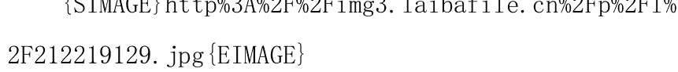

作者:66 端午 88 日期:2015-04-30 23:03

@swwwwwww 2015-04-30 21:50:58

@66 端午 88 32378 楼 2015-04-30 15:12:00

今天收盘把该减仓的都减了，51 没好消息，资金大步撤离，转战外汇移出。

外汇很平静，节后就要关注对外水管了？我刚进股市第二周，节后就平仓！

你还真不能走，才一周，赚足了再出来吧，赌额判断失误。

加v信1101284955，获取更多好帖

作者:66 端午 88 日期:2015-04-30 23:37

@披着城市的外衣 2015-04-30 23:20:43

刚才看了一眼新闻：中央政治局会议。尤其是：“会议认为，积极的财政政策要增加公共支出，加大降税清费力度。稳健的货币政策要把握好度，注意疏通货币政策向实体经济的传导渠道。要注重发挥投资的关键作用，认真选择好投资项目，做到有市场，有长期回报……要完善市场环境，盘活存量资产，建立房地产健康发展的长效机制”。感觉领导们也很累啊，政治局的领导都在选项目、抓经济、稳增长，不遗余力！感觉是不是有点偏离了管理……

社会主义就是社会主义，资本主义就是资本主义。又想要社会主义的管理体系，又要有资本主义的活力，顺拐了。

作者:66 端午 88 日期:2015-04-30 23:41

重建土地制度私有制和公有制的混合制度，向解放前被合法拥有，被剥夺土地产权的业主道歉，并进行切合实际的补偿计划。重整宪法，设立土地公私转换法律。我想，这绝对是不可能的。前面就说过：这是个死结。

作者:66 端午 88 日期:2015-05-03 16:04

@老孟 1968 2015-05-03 12:51:34

@66 端午 88 你好三年，跟你帖子 4 年了受益匪浅。

加 v 信 1101284955，获取更多好帖

春节过后就想入市, 但一直忙于其他事情没有开户, 请问现在开户入市晚了吗? 先从那几个股票入手, 请三年老师指教。

现在不适合追高, 适合底仓+短线。等着调整出 D 浪再进去建仓, 不过 E 浪不容易做, 涨速太快, 而且是涨以前没涨过的品种。

作者: 66 端午 88 日期: 2015-05-03 17:56

@YDFQ15 2015-05-03 17:04:52

端午哥, 您对深圳最近的房市怎么看?

最近上涨很疯狂。卖主反价的很多, 同一个房子过两天涨 10 20 万。我们看中一个龙华的二手房 100 平 200 万。合同都签了业主反价, 要我们加 20 万。我们不想加价。可是从别的中介那得知最近的行情, 似乎那房子 240W 都能卖出去。律师说如果他不愿意卖, 就私下和解, 最少也要赔 10 万 8 万的, 但是对于上涨的幅度来说, 算的了什么呢? 不知道深圳房价会不会继续暴涨。这样的话只能望能望房兴叹啊。是……

前面已经做了形势判断, 从年初开始的反弹, 只刺激到一线城市, 强二线稍微涨一点, 弱二线只是止跌。实体经济下滑期, 唯一的增量就是人口流入这一个需求。人口有流入就有流出的, 流出的三四线城市继续下滑。

作者:66 端午 88 日期:2015-05-03 17:58

@YDFQ15 2015-05-03 17:04:52

端午哥，您对深圳最近的房市怎么看？

最近上涨很疯狂。卖主反价的很多，同一个房子过两天涨 10~20 万。我们看中一个龙华的二手房 100 平 200 万。合同都签了业主反价，要我们加 20 万。我们不想加价。可是从别的中介那得知最近的行情，似乎那房子 240W 都能卖出去。律师说如果他不愿意卖，就私下和解，最少也要赔 10 万 8 万的，但是对于上涨的幅度来说，算的了什么呢？不知道深圳房价会不会继续暴涨。这样的话只能望能望房兴叹啊。是……

只要你能接受，只能接受，因为一线会继续涨，直到人口不再流入为止。

作者:66 端午 88 日期:2015-05-03 18:50

此轮牛市是标准的政策市，题材股普遍涨幅高达 3 倍以上，且无业绩改善迹象。最近几天政策出现明显逆转态势，今晚如不公布利好（降息），下周应逢高降低仓位至 3 成以下，如果股指大幅下挫，金融股有逆势对冲股指下跌的横盘震荡走势（低买高卖，但不适合普通散户操作），其它题材类均呈现中期见顶态势。注意风险，个人观点，仅供参考。

作者:66 端午 88 日期:2015-05-03 20:12

加 v 信 1101284955，获取更多好帖

@YDFQ15 2015-05-03 17:04:52

端午哥，您对深圳最近的房市怎么看？

最近上涨很疯狂。卖主反价的很多，同一个房子过两天涨10~20万。我们看中一个龙华的二手房100平200万。合同都签了业主反价，要我们加20万。我们不想加价。可是从别的中介那得知最近的行情，似乎那房子240W都能卖出去。律师说如果他不愿意卖，就私下和解，最少也要赔10万8万的，但是对于上涨的幅度来说，算的了什么呢？不知道深圳房价会不会继续暴涨。这样的话只能望能望房兴叹啊。是……

@66 端午 88 2015-05-03 17:58:56

只要你能接受，只能接受，因为一线会继续涨，直到人口不再流入为止。

@YDFQ15 2015-05-03 19:22:06

这样让人害怕呀。就是现在涨幅太大了，接受不了。2年都白干了。

要涨到什么时候呢？人口不再流入有没有个风向标？或者说购房的窗口期在哪儿呢？

一线城市的窗口期是：去年年底，今年年初，额到处看房的那个月。资金第一次外溢，产生了购房窗口。不过随机额发现，二线城市继续下滑，一线城市开始止跌走稳。随着股指继续拉高，利用房产锁定利润的人越来越多，不过买气只集中于一线城市，因为只有一线城市的需求是真实的，而且供应也未过度。

加v信1101284955，获取更多好帖

作者:66 端午 88 日期:2015-05-03 21:50

@66 端午 88 32423 楼 2015-05-03 20:12

@YDFQ15 2015-05-03 17:04:52

端午哥，您对深圳最近的房市怎么看？

最近上涨很疯狂。卖主反价的很多，同一个房子过两天涨 10~20 万。我们看中一个龙华的二手房 100 平 200 万。合同都签了业主反价，要我们加 20 万。我们不想加价。可是从别的中介那得知最近的行情，似乎那房子 240W 都能卖出去。律师说如果他不愿意卖，就私下和解，最少也要赔 10 万 8 万的，但是对于上涨的幅度来说，算的了什么呢？不知道深圳房价会不会继续暴涨。这样的话只能望能望房兴叹啊。是……

@YDFQ15 2015-05-03 21:35:44

这样看来目前深圳都没有要跌的可能了？只能这样涨下去？我们这些刚需未免太悲催了。刚想买房。

加 v 信 1101284955，获取更多好帖

赶脚一线城市只剩三个了：帝都------权力中心，魔都------金融中心，深圳------外贸和创新中心，广州已经被大大的边缘化。除此三个城市外，都不用着急。

作者:66 端午 88 日期:2015-05-04 08:27

@二斤浓缩铀 2015-05-04 07:07:42

端午哥，昨天刚刚签了合同，20 年的老房子 110 平 150 万。关外的。现在感觉压力山大。

有压力即有动力，加油

作者:66 端午 88 日期:2015-05-04 10:17

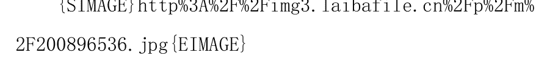

哭晕在厕所。

作者:66 端午 88 日期:2015-05-04 11:31

@weaknet 2015-05-04 10:38:43

谁知道西水股份咋啦

就是那波不适合散户做的 E 浪

作者:66 端午 88 日期:2015-05-04 15:05

@u_101434115 32445 楼 2015-05-04 14:08

@66 端午 88 2015-05-04 11:31:15.0

加 v 信 1101284955，获取更多好帖

就是那波不适合散户做的 E 浪

西水先走 E 浪？其他股票呢

依次走 e 浪，金融最后动，可能在指数下跌时补涨，分寸不好拿捏

作者:66 端午 88 日期:2015-05-04 17:27

汇丰 PMI 降至 48.9，实体经济撑不住了。即刻打击网售是比较靠谱的对策。

作者:66 端午 88 日期:2015-05-04 18:35

小强这是非要把中国搞垮不可呀，等着牛市结束了，大家都换成美元汇出，小强会吓尿裤子吧。

作者:66 端午 88 日期:2015-05-04 18:37

要是网售不交税，始终不交税，这不是天堂吗？连美国人都知道，只有死亡和交税不可避免。

作者:66 端午 88 日期:2015-05-05 00:28

果然出了 40 万亿计划，关键是 42 万亿提振不了信心，还是白搭，管理层应该找少花钱，可以快速提振信心得政策，小额分批投入，和打仗一样，白白得消耗了弹药，和 2008 年开始犯的错误雷同。

作者:66 端午 88 日期:2015-05-05 00:32

额的建议是，取消七十年产权规定，土地费用由一次性支付，改为每年或者定期支付，老房子老办法，新房子新办法。确认永久产权和合理的征地补偿方式。常态化管理，给产权持有着明确的预期。

作者:66 端午 88 日期:2015-05-05 08:28

@炒股票要折腾 2015-05-05 06:47:02

电商只是一种商业竞争模式，因为高效，试着生存，难道要返回传统低效的商业模式？目前要做的是提高政府效率，减少行政运行成本，让整个社会运行成本下来，才能解决实体的问题，而不是靠打压某一种新兴的商业模式

神马模式不模式，就是省了税钱和费前而已。实体商铺的租金和淘宝推广费比例差不多，可以对冲，不能对冲的就是税费。

作者:66 端午 88 日期:2015-05-05 08:30

我早就发现，网商的增值税发票是拿出来单独卖的，一般 4-7 个点，网上不开票，平着走量，或者便宜两个点，卖发票赚钱。这就是大网商的生存之道。

作者:66 端午 88 日期:2015-05-05 10:17

@66 端午 88 2015-05-05 08:30:01

我早就发现，网商的增值税发票是拿出来单独卖的，一般 4-7 个点，网上不开票，平着走量，或者便宜两个点，卖发票赚钱。这就是大网商的生存之道。

@炒股票要折腾 2015-05-05 09:09:19

电商对大卖家是收税的。

我认识一个大卖家，他有三个淘宝皇冠店铺，年营业额，我算着有 2000 万以上，利润的一半以上靠税票，你调查过吗？天猫有些厂商是开票的，大部分也是不开票的。

作者:66 端午 88 日期:2015-05-05 10:23

唉，东北证券被轧空了。:(

作者:66 端午 88 日期:2015-05-05 10:26

@jccyy8 2015-05-05 10:20:09

@66 端午 88 您好，看您帖子一年多了，每天刷新几次！您对广州郊区的房子怎么看，昨天我看了一个二手房普通装修在广州从化 太平镇一个小区，76 平方的楼梯房，二楼，南北通透！大型小区，2009 年的房子！绿化 物业比较可以，从化数一数二的，算下来 7500 元一平方。能租 800 左右一个月。离地铁口 1 公里.我同事 09 年开盘 2900 元一平方买的一套，位置相当！感觉现在买亏大了，附近的电梯房均价 6400 左右一平方，离广州市区 40 公里！现在......

要是打工，得在有前途的地方打工。要是创业，现在能存活的地方创业。不论怎样，大城市是最终目标。

加 v 信 1101284955，获取更多好帖

作者:66 端午 88 日期:2015-05-05 10:51

调整后降息。

作者:66 端午 88 日期:2015-05-05 12:27

@66 端午 88 2015-05-05 08:30:01

我早就发现，网商的增值税发票是拿出来单独卖的，一般 4-7 个点，网上不开票，平着走量，或者便宜两个点，卖发票赚钱。这就是大网商的生存之道。

@炒股票要折腾 2015-05-05 09:09:19

电商对大卖家是收税的。

@luyhshj 2015-05-05 09:35:06

连税都没搞懂啊；
税是政府收的，不是电商收的；电商就是个平台；
营业税、收入所得税、城建税、教育税等，占了利润的 60%，电商都是不交的；
如果真正收起来，淘宝不说立即倒掉，也差不多了；

@炒股票要折腾 2015-05-05 11:37:35

是政府收的，表达有点问题，我是说大卖家，虽然有时候不开发票，但是政府是收税的，我身边有这样的人，买家不要发票，但一样的交税的

加 v 信 1101284955，获取更多好帖

商量一个较低的双方可接受的纳税额。

作者:66 端午 88 日期:2015-05-05 14:34

提示好几天风险了，还能怎么说哪。

作者:66 端午 88 日期:2015-05-05 14:40

第一次触碰 20 线，没事。估计是主力配合降息用的洗盘。

作者:66 端午 88 日期:2015-05-05 15:05

@wsq2002919 2015-05-05 14:48:08

现在 43.6 买入三泰控股行不

@66 端午 88

不行，下波行情是绩优股行情。三泰做到一定程度，把成本坐低，等待它的业务进展而定。

作者:66 端午 88 日期:2015-05-05 15:06

@炒股买米做饭 2015-05-05 14:50:47

老大，降息那个股会最疯，银行还是卷商?

现在看不出来，降息对银行利空，对房地产利好。

作者:66 端午 88 日期:2015-05-05 15:08

对于绝大部分人，是不合适做大 E 浪的。对绝大部分股票，E 浪行情就是对 C 浪的解套和双顶行情，下波行情会缩量涨。半仓滚动操作，加小心，连续拔高彻底退出，置换美元。

作者:66 端午 88 日期:2015-05-05 18:26

鉴于小强的经济政策已经无法遏制经济下滑，初步做出后市预判，这次如跌破 20 日线，60 日线同时失效，会考验 89 日线，会打到绝大部分人的底仓亏损。所以，严格监控 20 日线的支撑作用，跌破，砍底仓。

作者:66 端午 88 日期:2015-05-05 18:35

支撑位大约在 3600-3700 之间，等待 89 日线盘上。这是牛市得止盈位，89 日线。

作者:66 端午 88 日期:2015-05-05 18:36

个人观点，仅供参考。

作者:66 端午 88 日期:2015-05-06 10:21

阻止经济崩溃的唯一前提是小强提前结束任期，或者将其架空。防止激进的新经济大跃进。否则，一年内，经济硬着陆已无法回避。

作者:66 端午 88 日期:2015-05-06 10:32

马云所谓打击网销会影响就业和消费，从逻辑上讲根本站不住脚，就业和消费下滑是由网销大规模兴起发源，刚性消费是固定增长的，网销事实上挤占了原有消费通路和就业通路。

作者:66 端午 88 日期:2015-05-06 10:36

加 v 信 1101284955，获取更多好帖

经济潜力的实质性损害来源于目前新经济政策不加区分什么是新经济和利益再分配的模糊认识，从这个问题上讲，小强的底子是文科生的底子，他该多向理科生请教一下什么叫技术创新。你不能把利益再分配打着新经济的幌子所进行的破坏性创新作为作为经济发展的主脉。

作者:66 端午 88 日期:2015-05-06 14:41

破位，清仓，留了点三泰，成本负值，中海发展，一点，成本小三万块。

作者:66 端午 88 日期:2015-05-06 15:14

@月冷蓝田 2015-05-06 15:07:50

三年大哥，这个帖子看了几年，成长了很多 谢谢

思考了一下目前经济的逻辑：很多人报着在股市赌一把，然后资金出逃的想法，

现请教大哥：

上海嘉定那边的房子或者“上海地铁沿线”房能入吗？有些一居室的也就 60 多万左右

上海依然是经济中心，未来依然是人口流入的城市，作为投资的话，划算吗？？？毕竟大家都认为接下来地方债等等一定是超级大放水，，钱都贬值了，不如借贷买，到时候钱毛了，还也划算？？ ......

绝佳标的。

作者:66 端午 88 日期:2015-05-06 15:17

楼主看到我---------------------------------------楼主看到我 --------------------------------------- 楼主看到我
--------------------------------------- 楼主看到我
--------------------------------------- 楼主看到我
--------------------------------------- 楼主看到我
--------------------------------------- 楼主看到我
--------------------------------------- 楼主看到我
--------------------------------------- 楼主看到我
---------------------------------------

@zcsnet 2015-05-06 14:02:14

楼主说说看下半年至明年初，上海是否有可能适度放开限购？（例如人均不超过 30 平的可再购入一套这种有限放开）

本人身在上海目前自住小房，由于父母过来帮带小孩住的太挤了,, 所以考虑再买一套，但是无奈被限购了（外地户口）。还有个办法就是卖掉自住小房再买一套三房，但是置换太折腾了，边卖边买的，万一有个衔接不好，这大家子人都跟着焦虑。另外也考虑如果持有两套，进可攻退可守，三

加 v 信 1101284955，获取更多好帖

一线很难放开限制政策，都是人口大量流入，放开限制，人多的就没法待了。

作者:66 端午 88 日期:2015-05-06 15:23

20日线是短线趋势线，在20日线以上，每次下跌都可以加仓。在20日线下，每次上涨，都可以减仓，击破20日线，会有反抽，这也是短线的最后一次减仓机会。

作者:66 端午 88 日期:2015-05-06 15:38

@进唯一 2015-05-06 15:23:36

@66 端午 88 2015-05-06 14:41:18.0

破位，清仓，留了点三泰，成本负值，中海发展，一点，成本小三万块。

端哥，中海发展是走还是留十二块八的成本

手快就清掉，觉得自己短线水平差，只能跌下去以后补仓，否则会挨二耳光。

作者:66 端午 88 日期:2015-05-06 18:23

@66 端午 88 2015-05-06 10:21:25

阻止经济崩溃的唯一前提是小强提前结束任期，或者将其架空。防止激进的新经济大跃进。否则，一年内，经济硬着陆已无法回避。

@zhuyi538 2015-05-06 17:32:41

一直不理解楼主口中的硬着陆是什么景象?

我也没经历过硬着陆, 想象中是这样: 经济下滑和货币贬值呈现并发。

作者:66 端午 88 日期:2015-05-06 18:25

@YDFQ15 2015-05-03 17:04:52

端午哥, 您对深圳最近的房市怎么看?

最近上涨很疯狂。卖主反价的很多, 同一个房子过两天涨 10~20 万。我们看中一个龙华的二手房 100 平 200 万。合同都签了业主反价, 要我们加 20 万。我们不想加价。可是从别的中介那得知最近的行情, 似乎那房子 240W 都能卖出去。律师说如果他不愿意卖, 就私下和解, 最少也要赔 10 万 8 万的, 但是对于上涨的幅度来说, 算的了什么呢? 不知道深圳房价会不会继续暴涨。这样的话只能望能望房兴叹啊。是……

@66 端午 88 2015-05-03 17:56:58

前面已经做了形势判断, 从年初开始的反弹, 只刺激到一线城市, 强二线稍微涨一点, 弱二线只是止跌。实体经济下滑期,唯一的增量就是人口流入这一个需求。人口有流入就有流出的,流出的三四线城市继续下滑。

@zhuyi538 2015-05-06 17:38:06

济南算是几线?二线?

我以前认为是三线,现在看着大伙都说它是二线,定为弱二。

作者:66 端午 88 日期:2015-05-06 20:30

@麦田 110400 2015-05-06 19:21:35

两个月的利润在一周内全部回吐,这是吃人不吐骨头的节奏啊!我是割肉呢还是割肉呢?

上个月底就让大家轻仓了呀,所以俺的中建第一个涨停就基本走光了,第二个涨停手里没了,郁闷了 2 天,昨天金融反弹,手里一股都木有,还把中建的利润贴在中海的亏损上。4 月份白忙活了,不过俺现在就 2000 股记号了。

作者:66 端午 88 日期:2015-05-06 20:30

@进唯一 2015-05-06 20:02:50

@66 端午 88 2015-05-06 15:38:58.0

手快就清掉,觉得自己短线水平差,只能跌下去以后补仓,否则会挨二耳光。

端哥的意思是先拿着吗？等调整差不多再补吗？

昨天都讲了,破 20 日线,理论上手里一股也别留。

作者: 66 端午 88 日期: 2015-05-06 20:36

中海套住的, E 浪展开后, 有双头走势, 跑不掉的, 适当减仓, 10 块以下伺机补回, 双头时大减 (把本金减出来)。这次是系统风险, 95% 的股票是要调整的, 不知道底在何处,就按照现在的实体经济形势, 结束也有可能, 不过我想着管理层就算垂死也要挣扎的, 如果未来反弹, 弹到 4500 上不去, 就真是双头了。双头跌破颈线位, 理论上调整起码到年线。就会走成 95-2001 年的长线慢牛, 都回去复习一下。个人观点, 仅供参考。本人能力有限, 只能向最坏的走势考虑。

作者: 66 端午 88 日期: 2015-05-06 20:37

@麦田 110400 2015-05-06 19:22:39

真不知道这样的市场能踩准节奏赚钱的都是什么人?还是早都撤离了。。

这次赚大的, 都是高杠杆融资, 然后头三天清仓的。利润大约 400% 以上。

作者: 66 端午 88 日期: 2015-05-06 20:39

我被一个朋友拉到他们股票群里, 现在的 90 后, 操盘大狠了，5 倍配资，加上 1 倍融资。合计十倍杠杆。

作者:66 端午 88 日期:2015-05-06 20:47

95 年形成的慢牛，在五浪结束后，调整到 120 日线

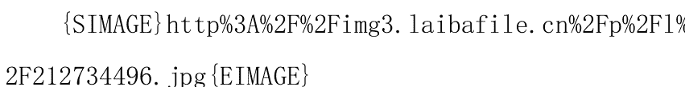

作者:66 端午 88 日期:2015-05-06 20:54

那会没有涨跌停限制，一周能把你一年的盈利吃净。然后还有一个垂死挣扎的 519 行情。一个半月涨 70%。然后跌到 1000 点附近，在 1000-1300 挣扎了 2 年。这会转型基本成功，找到了房地产作为主引擎，外贸作为产能扩张基础，双引擎。不过 99 年开始的 1000 点到 2245 点牛市，把市盈率炒到平均 70 倍，泡沫破裂，同时：当时开始的互联网板块 200 倍市盈率，被纳斯达克崩盘引爆，一直跌了 5 年。

我们这波慢牛，估计能搞 2-3 年，结束后，会有 10 年的低迷期，去消化创业板的泡沫。不过，经济不能硬着陆，否则就会提前结束。

作者:66 端午 88 日期:2015-05-06 23:42

要严格落实好减半征收企业所得税、暂免征收增值税和营业税等税收扶持政策，坚决杜绝违规收税现象。二是各级税务部门今年内不得专门统一组织针对某一新兴业态、新型商业模式的全面纳税评估和税务检查。三是深入研究改进管理和服务的措施。加强调查研究，认真倾听各方面的意见和建议，积极探索实施促进新兴业态、新型商业模式健康规范发展的管理和服务措施。

-----------------竟然直接免税了，实体渠道彻底完蛋了。

作者:66 端午 88 日期:2015-05-07 03:02

@鸭梨不是很大很大 32548 楼 2015-05-07 00:25:00

@66 端午 88 32546 楼 2015-05-06 20:54

那会没有涨跌停限制，一周能把你一年的盈利吃净。然后还有一个垂死挣扎的 519 行情。一个半月涨 70%。然后跌到 1000 点附近，在 1000-1300 挣扎了 2 年。这会转型基本成功，找到了房地产作为主引擎，外贸作为产能扩张基础，双引擎。不过 99 年开始的 1000 点到 2245 点牛市，把市盈率炒到平均 70 倍，泡沫破裂，同时：当时开始的互联网板块 200 倍市盈率

这些人都在创业板，一时半会死不了，小强这货怎么还有脸当官啊，下课

作者:66 端午 88 日期:2015-05-07 08:49

@投机者的扑克 2015-05-07 08:13:40

最近出去玩了，回来一看跌成狗了，老大券商如何操作

-----------------

暂持有，等待反弹高点。

作者:66 端午 88 日期:2015-05-07 08:54

加拿大重启移民计划，自2013年初加拿大暂停中国新移民申请以来，累积移民意向上百万，这次重启，令人大跌眼镜。E1企业家计划由200加元直跌至10万加元，不过要求有企业管理经验2年，其实也很简单，在国内企业做到部门经理，便可达标。诸位有意向的，可以动手了。移民监延续以前的规定，每年至少在加待满6个月，满三年可入籍。

作者:66 端午 88 日期:2015-05-07 09:37

今天明天有盘中反抽20日线的可能，减出来再说。

作者:66 端午 88 日期:2015-05-07 10:03

有实体店的，生意没起色，就可以关门了。

作者:66 端午 88 日期:2015-05-07 10:08

中国经济现在最大的问题不是经济周期压力，而是主管经济的管理层脑子已被驴踢坏了。

作者:66 端午 88 日期:2015-05-07 10:11

@66 端午 88 2015-05-07 10:08:03

中国经济现在最大的问题不是经济周期压力，而是主管经济的管理层脑子已被驴踢坏了。

@披个马甲来喘气 2015-05-07 10:10:23

楼主，你好。

请教一个问题，现在去农村买房子合适吗？就是那种新农村的二层小楼一个小院，打算退休后自住，据说城市居民是不能买农村房子的，不过周围也有买的，就是和卖家签协议，村里盖章。

有一定风险。如果很便宜，可以考虑。

作者:66 端午 88 日期:2015-05-07 10:54

现在不是仓促出台各类刺激政策的时候，应该解决管理层认识和智商的问题，经济下滑该怎么办，上涨过快该怎么办，形成常态化处置，给大家预期。转型必须搞，但不能搞成吹泡泡，更不能打着改革的幌子进行资本游戏。@李克强，慎言慎行，你咋像个毛孩子哪。

作者:66 端午 88 日期:2015-05-07 10:59

赶脚管理层内部已经出现意见分歧，抓紧统一认识，明确预期，不要等到 2008 年下滑形成趋势时，再仓促出台超规模的刺激政策。

作者:66 端午 88 日期:2015-05-07 11:43

对比了一下纳斯达克和道琼斯 2000 年 3 月 10 前的走势，创业板离着崩盘不远了。

作者:66 端午 88 日期:2015-05-07 12:07

创业板的逻辑是美式思维，那么它的估值顶就是美式估值顶，纳斯达克加速后在 2000 年 1 月后，和道琼斯产生严重的背离，并引发道琼斯提前见顶。在 3 月 10 日产生第一高点，筑双顶，从启动开始一倍涨幅，现在中国创业板涨幅一倍，中国主板跌破 4000 点。创业板崩盘。这个价买创业板，真不如自己创业了。

作者:66 端午 88 日期:2015-05-07 13:22

买入了看跌期权,做空了 ETF300,做空了指数期货 10 手，看看能不能赚点。

作者:66 端午 88 日期:2015-05-07 13:24

反应快即是我的优势，也是我的劣势，优势是：我从来没被套在过山顶，劣势是我经常容易做丢股票。

作者:66 端午 88 日期:2015-05-07 13:43

爱玛，这么一会就把中海的亏损全赚回来了，有能力开股指期货的一定要开啊，当你把把做多不顺的时候，不妨换换手气，做一把空试试哈。

作者:66 端午 88 日期:2015-05-07 13:47

再杀一把，就平了空仓。明日继续寻找做空机会。

作者:66 端午 88 日期:2015-05-07 13:50

平空仓，观望。

作者:66 端午 88 日期:2015-05-07 13:56

再次买入空仓。

作者:66 端午 88 日期:2015-05-07 13:59

艹，平，亏了点

作者:66 端午 88 日期:2015-05-07 14:13

继续做空，额就不信今天不破 4100

作者:66 端午 88 日期:2015-05-07 14:46

刚才打到低点，平空仓。爽

作者:66 端午 88 日期:2015-05-07 19:10

@垮掉的视觉 2015-05-07 17:45:03

国务院出台文件：大力发展电子商务，促进新经济发展。端午哥，你担忧的终于成了现实，总理估计身边没个说反对意见的人，为功名，都只是顺着他说话

人们总是能看到自己想看的，也只能听到自己想听的，并不是没有人提出反对意见，而是听者，看者选择性视听。半仓做空操作，半仓开始转换美金，做好移民准备。

作者:66 端午 88 日期:2015-05-07 21:32

@XYZ 交点 32603 楼 2015-05-07 21:01:00

今天收到公司新发文，拓展新业务，以互联网+为核心，重组公司架构。现在搞得我上面的领导是谁都不清楚了!!

楼大，中铁二局被套 11 个点……看来真是看错了，反弹跑呢还是跑呢

等反弹前做个差价

作者:66 端午 88 日期:2015-05-07 23:46

中国目前所谓创新，所谓转型，均为所谓破坏性创新，不是在原有基础上的改进，发展，更不是创造新的需求从而形成蓝海市场。这种所谓破坏性创新，本质就是利益再分配，无法主导经济良性的发展，它基本就像肿瘤，它的成长不会改善生态，只会恶化生态。在此基础上的所谓转型，是走不下去的。因为良性的创新发展，会对原有生态进行优化，提高“整体”效率，它提高的是生态环境的效率。破坏性创新，它提高的是自己的效率，破坏了生态的效率。它的一小步，将消耗几倍的生态利益。所以，我们看到：在所谓中国经济转型以来，他们所涉及的生态，都发生了严重的滑坡，大量的效率产能反而失去市场，失业率大幅提高。传统经济相当于他们的宿主，他们只是寄生的，破坏的发展自己，这种模式是无法持续的。

作者:66 端午 88 日期:2015-05-07 23:50

比如淘宝:它的国际化，占据了美国零售市场多少份额，欧盟国家的市场份额。如果他是良性的，会把中国大量的零售产能向外输出，占据原本属于亚马逊，沃尔玛，易购等零售巨头的份额。通过调查发现，淘宝的进口份额比出口份额大了近一倍以上。它很难具备创新的渠道扩张能力。

作者:66 端午 88 日期:2015-05-08 10:11

无话可说，泡泡强时代来了

作者:66 端午 88 日期:2015-05-08 11:04

@a3392103 2015-05-08 10:44:23

创业板这是在作死啊。

政策市，看看腮帮子厉害，还是客观规律厉害，赶脚，在中国还是腮帮子厉害，不过实体经济靠腮帮子吹不起来。

作者:66 端午 88 日期:2015-05-08 12:33

刚才网上看到一贴，说 3W 咖啡，看完了想回帖，已被删除。

互联网咖啡的长尾效应：互联网推广，互联网支付，互联网订货，互联网送货，催肥。接着就来了，互联网健康咨询，互联网减肥，互联网医疗，互联网火葬，互联网掉念。一个很长的链条。本来门店消费，颠半天消耗的热量正好喝咖啡抵消，现在就得转着弯来过。

中国的创新的确是跑偏了呀。

作者:66 端午 88 日期:2015-05-08 13:51

都认为是牛市回头，可能就不是了。

作者:66 端午 88 日期:2015-05-08 15:03

段子成真

作者:66 端午 88 日期:2015-05-08 15:19

400 块的创业板，不管是中国的巴菲特还是美国的巴菲特都晕菜了，8090 的小散全都买的创业板。

作者:66 端午 88 日期:2015-05-08 17:32

@天不再那么蓝 2015-05-08 15:39:54

## 楼主，短期不准备移民的家庭也需要换点美元吗？

前两个季度，外汇流出6000亿美元，如果这次即将爆发的经济危机，最后无法被统计局给统计掉，这点美金真不够换的。

作者:66 端午 88 日期:2015-05-10 10:48

在小强大力倡导万众创新的大环境下，昨日山东国考再创惊人考招比：山东公考报名结束 最热岗竞争 1685:1。就业压力已经不容掩盖，侧面证明社会经济总体增长已经回落至5%以下。

作者:66 端午 88 日期:2015-05-10 17:08

降息0.25，低于市场预期

作者:66 端午 88 日期:2015-05-10 17:42

由于互联网企业对各类生产，销售企业的挤压，小规模货币政策对经济的刺激作用极为有限，而且会蚕食政策的使用空间，是最为愚蠢的调控手段。经过这次降息，人民币存款利率已经和2009年持平，却只令人感到经济的低迷，未有一战的欲望，从这点出发，调控是失败的。

作者:66 端午 88 日期:2015-05-10 18:48

为什么会呈现这种越鼓励新兴产业，经济下滑就越发不可抑制的奇怪现象，这种现象在世界经济史上都是从来没有过的现象，因为我们的创新是破坏性创新，每刺激所增加一个新经济百分点的增长，就需要以传统行业 2%以上的比例加速去产能，我不知道传统经济去产能底线在什么位置，倘若按照现在的对冲比例计算：我们的新兴行业目前占比在 3%左右，在可见的三年内增加到 9%（起码有一半以上是无增值 GDP），就会削减 20%/年左右的传统经济份额。为了弥补 20%的经济总量下滑，大约有 12 万亿/年的 GDP 下滑，只能从基建投资上找回（增量）。这个增量是连续的，不是一年完成，如果把新经济份额总量提高到 20%（西方的比例），时间大约需要 5 年到 10 年，而且越到后面压力越大，而不是越小。到现在，我们的基建投资增幅是 13%，大约是 7 万亿的投资额，今年目标是新经济份额提升到 4.5%左右，需要增加 3 万亿左右的基建增量。

作者:66 端午 88 日期:2015-05-10 22:19

@炒股票要折腾 2015-05-10 22:07:41

楼主，对党最重要的是新增就业，只要新增就业有保障，gdp 不是最重要的，前些年赚够了的，接下来出点血，不会影响社会安定的

经济降速，就业会增加？前所未闻

作者:66 端午 88 日期:2015-05-10 22:50

回忆红木上涨的细节，有助于分析股市的行情变化趋势。我记得黄花梨开始炒作的时候，大约就是在 1990 年左右开始的，年年涨，不多涨，从 1995 年开始加速，一直到 2000 年，原材料基本耗尽。1990 年时，黄花梨大约在 1.5 万元/吨，到了 1995 年也就涨到大约 5 万-10 万的样子，从 2006 年开始加速，到了 2000 年附近，每吨大约到了 100 万以上，500 元/斤。对应深沪股市，1992-1995 年，大约就是区间震荡。1995 年到 2000 年，产生了一波慢牛。

越南黄花梨，从海黄消失以后，被定义为旗帜品种，越南黄花梨 2000 年的价格，1.5 万一吨，和海黄起涨点惊人的相似。比 1998 年重新定义了的小叶紫檀便宜 4 倍左右（印度小叶当时价格大约不到 10 万的样子），开始也是慢速推涨，2000 年到 2005 年，整整五年价格也才涨到 15 万左右，从 2005 年开始加速，到了 2007 年炒作高峰，大约炒到 150 万。2007 年底崩盘起，跌至 2008 年底，跌去了 65%左右，然后再从 50 万左右，用了不到 3 年，拉高到惊人的 260 万。此波行情对应 2001-2007 年股市牛市，也是区间震荡到大幅走高的过程。

红酸，很早就不便宜，1990 年，每吨大约 5000 元，涨到 2000 年，一万多，2005 年 2.5 万，2007 年牛市涨到大约 7.5 万，2008 年-2009 年回落到 3.5 万。加速引导浪自 2009 年开始，到了 2014 年，只涨到 7.5 万左右。2014 年开始加速，不到半年涨幅高达 3 倍，至 20-30 万之间。对应当今的股市也是到了 2014 年区间震荡，2015 年加速。不过要注意：红酸的行情十分短暂，而且回落速度非常快，截止至现在，每吨大约15万的样子，波澜不惊。我们的股市是否有此可能也是非常短暂哪？

海南黄花梨自从资源枯竭后，从2000年计入收藏领域，价格由100万，已经升至大约5000-10000万每斤，且没有像样的材料进入零售市场，家具材一概由拍卖行成交。

越南黄花梨自从资源枯竭后，从260万每吨，目前上升到每斤4000-7000元/公斤，零售市场偶尔能见到少量像样的家具材，也仅作为装饰精品，失去主材的作用。

小叶紫檀自1997年进入中国市场，开始价格大约1.2万每吨，最高升至2007年的160万/吨，由于小叶檀有数百年人工养殖的储量，加之印度阿三严格控盘，价格走势基本和炒作品种呈现背离，目前价格不足80万-120万之间震荡，但材料的质量已大幅下降。

作者:66 端午 88 日期:2015-05-10 23:01

红木行情领先中国证券市场行情一年启动。已验证

海黄行情----------对应慢牛 1992-2001。已验证

越黄行情----------对应中速牛 2005年-2007年。已验证

红酸行情----------对应快速牛 2004-2005年？？？待验证。

海黄=创业板

越黄=中小板

红酸=主板

新三板=小叶紫檀（背离主流市场）

这个比喻是否恰当哪？

作者:66 端午 88 日期:2015-05-10 23:13

奥肯定律描述了经济增长率与失业率之间的关系。该定律表明失业率与国民生产总值增长率之间呈反向变化即二者存在负相关关系，经济的高增长率伴随着低失业率，低增长率伴随着高失业率。经济学家奥肯依据对美国经济数据的实证研究表明，当经济增长率高于2.25%时，经济增长率每增加一个百分点，失业率就会下降半个百分点；当经济增长率低于2.25%时，经济增长率每减少一个百分点，失业率就会上升半个百分点。而失业率与其带来的国民生产总值缺口（损失）之比率是1：2.5，即失业率每增加1%，实际国民生产总值会减少2.5%左右。这一经验性规则揭示了经济增长和失业率之间的内在关系。尽管各国经济增长率和失业率之间的数量变动关系不尽相同，但经济增长与就业同向变动、与失业反向变动的关系，已为许多国家的经济实践所证实。

作者:66 端午 88 日期:2015-05-11 10:15

败给股神了：任子行，新文化，兆日科技。神啊，刚才股神卖了新文化，杀入了凯利泰。:(

作者:66 端午 88 日期:2015-05-11 10:16

## 拿不住就是没缘分

作者:66 端午 88 日期:2015-05-11 10:26

@mayguo 2015-05-11 10:21:07

股神的万邦达还在磨叽

股神在上面高抛了一把，昨天卖掉了（周五），加仓了一把兆日，没追上，又加仓了新文化，今天冲高卖出了。这货操作频率太快，等着额跟就一路飞了。

作者:66 端午 88 日期:2015-05-11 10:27

@a3392103 2015-05-11 10:23:43

创业板天天百多个点。

要人命啊。

## 小强的鲜肉

作者:66 端午 88 日期:2015-05-11 10:40

@天不再那么蓝 2015-05-11 10:34:30

楼主，中海怎么操作好，今天能买入做T么，会不会T在半山腰

昨天额同学说，能反弹15-20%，筑双头走势，这样子，大盘价值股是不能搞了，一涨就打压，平衡指数了。只能找低点搞小盘股。

加v信1101284955，获取更多好帖

作者:66 端午 88 日期:2015-05-11 10:48

买了点凯利泰

作者:66 端午 88 日期:2015-05-11 10:51

艹,一万股一次都买不进来,得小仓位慢慢买,神马玩意啊。

作者:66 端午 88 日期:2015-05-11 11:02

@djcsdn 2015-05-11 10:51:43

现在少赔了一点,是去是留

----------------------------------------

赔多少?缓慢移仓。跟着股神走,小强虽然弱智,风口在他一边。

作者:66 端午 88 日期:2015-05-11 11:04

这是额最后一个敢买得创业板了,唉,拿住兆日科技现在就可以退休了,3万股,尼玛。

作者:66 端午 88 日期:2015-05-11 11:08

@djcsdn 2015-05-11 11:04:50

一共才500股 汗

----------------------------------------

500股够十个羊肉串吗

作者:66 端午 88 日期:2015-05-11 11:08

最后一个估值合理,有望冲击100的小票,其它都没法看了几百倍市盈率。

作者:66 端午 88 日期:2015-05-11 11:12

看看同板块的东富龙，持平就能过100.

作者:66 端午 88 日期:2015-05-11 11:16

@AB双子兔 2015-05-11 11:06:58

楼主看到我，看到我--------------

楼主，请教一下如何看待石家庄的楼盘走势啊？

我们目前小孩2周岁，2居室，想换个大一些的房子，资金有限，又想买个学区房，可是市中心学区房将近1万多了。

如果不入学区房，将来孩子上学是个问题。

总以为房价会慢慢跌，可是看目前走势，希望很渺茫。

请教一下，什么时候入手是比较好的选择啊？

找教育局的人请教，比请教额靠谱，比如哪个像样的小学又改变学区了。

作者:66 端午 88 日期:2015-05-11 11:18

@djcsdn 2015-05-11 11:06:49

老大，给个建议吧 无责任的

500股就不值得移仓了，反弹到位买易联众。好赖能搞200股。

作者:66 端午 88 日期:2015-05-11 11:20

@66端午88 2015-05-11 11:08:48

最后一个估值合理，有望冲击100的小票，其它都没法看了几百倍市盈率。

@djcsdn 2015-05-11 11:12:51

那我加仓了哈，还是果断卖出捏

一群90后在买易联众哪。他们买的卫宁软件和朗玛信息都走的不错，刚买了三天，看来额是老了，跟不上年轻人的节奏了。:(

作者:66 端午 88 日期:2015-05-11 11:21

股神说，小盘股和大盘股不一样，上涨都是缩量，一旦高位放量25%以上，就会出短期头部，就别追了，等调整下来再买。他说调整下来也没事，小强一忽悠，又要新高了。

作者:66 端午 88 日期:2015-05-11 15:52

@雾都小鱼32713楼 2015-05-11 15:38:00

@66端午88 2015-05-11 10:15:28

败给股神了：任子行，新文化，兆日科技。神啊，刚才股神卖了新文化，杀入了凯利泰。:(

那天猛地看到楼主说的股神买的股票，正好是兆日科技冲到快100的时候，我还想说这也太神了吧，说的都涨了这么多了，再往后看1z的票，有的都买了，真是感慨万千，看好了拿住了说来容易做起来真是难，今天再看三

为了回避两块的风险，回避了五十块利润，这个耳光揍的太狠了，唉，该检讨什么哪。叫花子怎么也不敢高攀正黄旗啊。??

作者:66 端午 88 日期:2015-05-11 22:37

扒拉扒拉新兴行业，发现互联网+，信息行业实在是下不了手，这个凯利泰搞的骨科微创手术设备还算是高利润子行业，骨科是心外科以外，利润最高的手术设备，第三是眼科。和互联网最接近的行业是通讯行业，他们要搞互联网，和玩一样方便。

作者:66 端午 88 日期:2015-05-12 09:38

建仓了世纪鼎利，互联网教育+4G概念

作者:66 端午 88 日期:2015-05-12 10:56

券商一涨，就查两融。

作者:66 端午 88 日期:2015-05-12 10:57

我了去，这是刚突破就回探33的小顶啊。

作者:66 端午 88 日期:2015-05-12 10:59

到达历史阻力位，看来要盘整一段日子。不过从市净率看还算勉强接受。

作者:66 端午 88 日期:2015-05-12 14:34

@支持后悔买岛国车 2015-05-12 13:06:16

端午兄，今天大盘已经反弹到4300点之上了，创业板还在狂飙。

今明2天，是否应该减点仓位了？

虽然市场一片乐观，可是注意看数据，目前有些放量滞涨的感觉。

请指点一二。谢谢。

整个市场都明白了管理层意图，主板压住慢涨。创业板使劲涨，使劲发行新股。就会造成大量资金从主板向创业板流动。盯着暴风科技，它不涨了，创业板就开始调整了。

作者:66 端午 88 日期:2015-05-12 14:43

同类型业务，京天利快300了，这个世纪鼎利是在吃屎吗？

作者:66 端午 88 日期:2015-05-12 18:11

@月冷蓝田 2015-05-12 17:51:47

暴风科技 这支股票是疯了吧？？第34个涨停？

谁能看看 解读一下

这是第一支纯互联网企业。

作者:66 端午 88 日期:2015-05-12 23:13

http://it.sohu.com/20150403/n410749330.shtml

还有10亿现金，外加互联网教育，股价不高，盘子不离谱，后面就守它了，大富科技以前也是这种计算方式，可惜没拿住，三泰也没拿住，这个一定得拿住，大家互相鼓励哈。额也不着急一次大仓位了，见绿线就稍微买一点，设定一个月加仓期，省得仓位过重，受市值波动影响持股信心。

作者:66 端午 88 日期:2015-05-13 00:15

该股曾经是创业板最高股价，2010年有部分筹码套在35-40，这波调整主要是针对这批历史套牢盘进行的震荡整理，换手目前超过200%，这波拉到40-42，还会打回35，而且是放量杀跌，这样就能把历史套牢盘彻底清理掉，半年目标：100以上。这波拉升到42需要减仓一次，然后就可以放心持有了。什么时候公布高送转了，才会有出货行情，那是明年的事了，在IT行业，技术含量最高的首推通讯子行业，搞互联网+是天生的得心应手，关键看他们管理层是否愿意干，6.5亿收购互联网教育资产，对于这么小盘子企业，是大手笔了，关键的问题是：中国教育根本不能与时俱进，IT本科出来，基本就是啥也不会，如果互联网作为国策来搞，人力是先行的最重要因素，专业技术培训是基础。

作者:66 端午 88 日期:2015-05-13 09:42

继续加仓世纪鼎利

作者:66 端午 88 日期:2015-05-13 10:18

卧槽，买在最低点了。:))))

作者:66 端午 88 日期:2015-05-13 10:20

@CrystalUO 2015-05-13 09:55:25

楼主看到我，医药B股能买嘛？

只要不是控制指数的基金都可以分批介入

作者:66 端午 88 日期:2015-05-13 11:22

每次世纪鼎利下跌的时候，心中默念一百遍：100块。

作者:66 端午 88 日期:2015-05-13 11:29

@投机者的扑克 2015-05-13 10:58:37

买不了创业板

创业板B

作者:66 端午 88 日期:2015-05-13 12:12

邮币市场掀起滔天巨浪。额的四个主力品种均翻了10倍以上。

作者:66 端午 88 日期:2015-05-13 13:04

终于踏上追赶全通教育的遥遥征程。

作者:66 端午 88 日期:2015-05-13 14:28

再加一把

作者:66 端午 88 日期:2015-05-13 15:39

@进唯一 2015-05-13 14:45:41

@66端午88 2015-05-13 14:28:35.0

## 再加一把

端哥,我的中海发展还拿在手上,请教一下我后期应该怎么操作。谢谢了

套的多就等,套的不多,积极做差价,打平后减仓。

作者:66 端午 88 日期:2015-05-13 15:42

@支持后悔买岛国车 2015-05-13 15:15:01

今天创业板B,居然接近跌停收盘。乐视网放巨量封不住涨停,最后收小阳。是不是明天会有一些异动?反倒是地产B,尾盘急拉。希望能听听端午兄的收盘分析。感谢。

不拉指数的二线股,只有房地产有安全边界。又有政策支持,可以买房地产股票,也不能多买,里面的品种走势分化非常严重。刚才爆拉是抬升指数。

作者:66 端午 88 日期:2015-05-13 15:45

@u_101434115 2015-05-13 14:22:30

坑爹的券商股

彻底让小强玩坏了

加v信1101284955,获取更多好帖

作者:66 端午 88 日期:2015-05-13 16:56

中国国家统计局周三(5月13日)公布数据显示,中国4月规模以上工业增加值同比增长5.9%,社会消费品零售总额同比增长10%,1-4月固定资产投资同比增长12%,均不及市场预期,并处于多年来的低位。

作者:66 端午 88 日期:2015-05-13 19:05

【李克强主持召开国务院常务会议】据中国政府网,国务院总理李克强5月13日主持召开国务院常务会议,部署推广政府和社会资本合作模式;确定加快建设高速宽带网络促进提速降费的措施,助力创业创新和民生改善等;进一步推进资产证券化,新增5000亿元信贷资产证券化试点规模。

作者:66 端午 88 日期:2015-05-13 21:19

@u_96750055 2015-05-13 20:35:34

楼主老大,深圳的房子疯了,看好一套280万的,我多炒三个月股,就涨到350万了,好苦逼,炒房客也复活了似的,千人炒房群爆满,都开三群了,这房还能炒吗

北上深,你要不是股市高手,还是买房吧。

作者:66 端午 88 日期:2015-05-14 08:13

@66端午88 2015-05-13 12:12:17

邮币市场掀起滔天巨浪。额的四个主力品种均翻了10倍以上。

加v信1101284955,获取更多好帖

@Caesar0 2015-05-13 21:48:07

三年大哥,北京这边邮币市场的受托理财一般年华收益在40%,请问这样的高收益可以持续么?

不可持续,邮币市场,只适合熊市介入,或者短线快炒。现在有电子盘了,炒作疯狂和当年文艺作品份额一样。那天一规范,就完蛋了。

作者:66 端午 88 日期:2015-05-14 09:13

@不惑之年的M惑 2015-05-14 09:04:00

没想到老大投资这么广泛 邮币卡也玩的这么溜多年前入了几盒聊斋三的型张 现在市价多少? 价格合适就卖了算了 盼回复

邮票没有,都是纪念币,令人骄傲的毛泽东诞辰100年纪念币,合计持有1362个,和平年套币35套,宋庆龄纪念币120个,广西20个,其它乱七八糟的有十几个。毛泽东纪念币,济南世面上很少,都被额在2009-2010年收的差不多了,成本从4.7----8,现在电子盘报价在82-85之间波动。:)

作者:66 端午 88 日期:2015-05-14 10:13

@武帝童爷1 2015-05-14 09:49:48

老大,继续加仓世纪?

加v信1101284955,获取更多好帖

我反正是见绿就加仓,每次只加几千股,跌到5,10日线加码买入,慢慢来,省的和三泰似的一次满仓,震的头晕脑涨,失去判断力。

作者:66 端午 88 日期:2015-05-14 10:29

暴风科技,打开涨停,有赌的可以100股,100股的买

作者:66 端午 88 日期:2015-05-14 10:32

怪不得拿着创业板的没事就出去暴走,避跌的板块。

作者:66 端午 88 日期:2015-05-14 10:44

艹,买了一百股,这么一会亏一千多,跌起来够神的,当记号股了。

作者:66 端午 88 日期:2015-05-14 10:48

又买了一百股,扯平了。再不敢买了,心脏一下就运动起来了。

作者:66 端午 88 日期:2015-05-14 11:05

艹,一块扣里面了,手贱啊这是,剁手且

作者:66 端午 88 日期:2015-05-14 11:15

@u_101690475 2015-05-14 11:06:30

端老大,主板有什么推荐的?创业太火,主板是不是冷清了

要调整两个月,你按照熊市的策略,超跌买入(底背离),MACD反弹至0卖出。你要是能这么操作，就可以买主板。

作者:66 端午 88 日期:2015-05-14 11:21

暴风科技，神一样的票

作者:66 端午 88 日期:2015-05-14 11:21

神の票

作者:66 端午 88 日期:2015-05-14 11:40

@香香樟树 2015-05-14 11:31:33

昇兴股份 这个股票天天涨停 怎么回事

20多有人给我说过这个票，是他们的代理。大股东贷款炒股，竟然合规。

作者:66 端午 88 日期:2015-05-14 11:54

@不惑之年的M惑 2015-05-14 09:04:00

没想到老大投资这么广泛 邮币卡也玩的这么溜 多年前入了几盒聊斋三的型张 现在市价多少？价格合适就卖了算了 盼回复

@不惑之年的M惑 2015-05-14 11:34:10

邮票没有，都是纪念币，令人骄傲的毛泽东诞辰100年纪念币，合计持有1362个，和平年套币35套，宋庆龄纪念币120个，广西20个，其它乱七八糟的有十几个。毛泽东纪念币，济南世面上很少，都被额在2009-2010年收的差不多了,成本从4.7----8,现在电子盘报价在82-85之间波动。:)

我的涨一倍	你的涨十倍		看出投资眼光的差距了

那年我在极视里吆喝了一个多月，买入毛泽东纪念币，当时的批发价不到6块，零售10块。

作者:66 端午 88 日期:2015-05-14 11:55

@不惑之年的M惑 2015-05-14 09:04:00

没想到老大投资这么广泛 邮币卡也玩的这么溜 多年前入了几盒聊斋三的型张 现在市价多少？价格合适就卖了算了 盼回复

@不惑之年的M惑 2015-05-14 11:35:55

邮票没有，都是纪念币，令人骄傲的毛泽东诞辰100年纪念币，合计持有1362个，和平年套币35套，宋庆龄纪念币120个，广西20个，其它乱七八糟的有十几个。毛泽东纪念币，济南世面上很少，都被额在2009-2010年收的差不多了,成本从4.7----8,现在电子盘报价在82-85之间波动。:)

这东西是继续持有还是变现？这几年光看它装死了

要是缺钱花，就卖掉一半。不缺钱，留给后代。

作者:66 端午 88 日期:2015-05-14 13:58

@wzz810711 2015-05-14 13:40:10

帮看看萃华珠宝

突破走势，持有

作者:66 端午 88 日期:2015-05-14 15:06

@支持后悔买岛国车 2015-05-14 14:10:07

大家赶紧，世纪的庄家就请大家上车了。千万要坐好。

弱庄，看来又得慢悠悠的走。

作者:66 端午 88 日期:2015-05-14 15:11

@天不再那么蓝 2015-05-14 10:16:45

楼主主板有什么可买？哎，看中的票全都飞了。。。。我怎么总找不好买点：(

找 MACD 零轴刚刚金叉的，第一天突破，第二天调整的，或者突破两三天不涨的，但是千万别放量。

作者:66 端午 88 日期:2015-05-14 15:12

赶脚暴风科技以后是奔着 500-1000 去的，拿上一百股二百股的欣赏一下。再多买就是作死了。

作者:66 端午 88 日期:2015-05-15 08:08

@u_96869904 2015-05-15 05:51:05

### 老大看看亿晶光电，想入手买点

可以逢低买入，日线 MACD 金叉时观望一下，金叉后转中线。

作者:66 端午 88 日期:2015-05-15 08:10

@风风的的 2015-05-15 06:26:55

老大帮忙看看 002325，多谢！

互联网教育，风口。放量挺大，需要在该位置把量缩下来才能继续拉高。目标 36 以上。

作者:66 端午 88 日期:2015-05-15 09:32

加仓了世纪鼎利

作者:66 端午 88 日期:2015-05-15 10:58

@月冷蓝田 2015-05-15 10:04:09

还有同样概念的全通教育 300359 怎么一下子由 400 多跌到 100 多呢？

### 送股除权

作者:66 端午 88 日期:2015-05-15 10:59

@牛牛年牛牛人 2015-05-15 10:39:37

等下 午证监会出消息

加 v 信 1101284955，获取更多好帖

造谣而已，神版在小强的支持下，已经不能按照正常估值了，按照 90 后的说法是，压赌未来。

作者: 66 端午 88 日期: 2015-05-15 11:24

有大盘股的，抓紧减仓。小盘股下跌买入。不要盯着 000，6XX 了。

作者: 66 端午 88 日期: 2015-05-15 12:54

@66 端午 88 2015-05-15 11:24:53

有大盘股的，抓紧减仓。小盘股下跌买入。不要盯着 000，6XX 了。

@投机者的扑克 2015-05-15 11:32:23

券商怎么搞。。。套了好多

创业板的逻辑是：传统产业怎么救也不会回到 2006 年以前的发展模式了，转型只能制造新的市场，尽管现在有泡沫，可是如果压住泡沫，中国经济就看不到希望，唉，改不改思路，都是个人的事。

作者: 66 端午 88 日期: 2015-05-15 14:14

高抛了早盘的世纪鼎利，成本降至 33.4

作者: 66 端午 88 日期: 2015-05-15 14:31

滚动操作，尽量降低成本，不要追高，找 15 分钟的底背离买入。

作者:66 端午 88 日期:2015-05-15 17:24

@难得虎兔简约爱情 2015-05-15 12:59:56

刚开户的是不是不能买创业板啊？有知道的回答下。

@八两与半斤 2015-05-15 14:48:25

是，要拿身份证去证券公司风险评估后再开通。因为创业板风险大，新股民不能开户的时候开通创业板。

@难得虎兔简约爱情 2015-05-15 16:58:00

是不是有资金和开户时间限制？

开户满两年，签订风险责任书。

作者:66 端午 88 日期:2015-05-15 18:32

@viviwa 2015-05-15 18:00:55

今天下午立马跑去开通了创业板，不过要下周二才可以买入

正好能抄个底，周 2 收盘买一下，周三中午前买一下。以前这两个时间价格都便宜。

作者:66 端午 88 日期:2015-05-15 19:01

中国教育简直就是垃圾，每年额种的竹子冒出来笋头，都被熊孩子，半大孩子，新移民的农村娘拔掉不少，这是多么损人不利己的精神啊，身为中国人，感到深深的可耻。

加 v 信 1101284955，获取更多好帖

作者:66 端午 88 日期:2015-05-15 21:29

@66 端午 88 2015-05-15 19:01:27

中国教育简直就是垃圾，每年额种的竹子冒出来笋头，都被熊孩子，半大孩子，新移民的农村娘拔掉不少，这是多么损人不利己的精神啊，身为中国人，感到深深的可耻。

@Rambo 第 N 滴血 2015-05-15 20:56:00

还有个事：小强这两天喊话叫操心宽带、流量费用。真有点儿不务正业啊!! 喊话经济，是命令型经济的延伸吧

下决心互联网立国了，必须把信息高速公路修上，基础工作，今年是世纪鼎利的好机会，不知道这个公司能抓住机会吗

作者:66 端午 88 日期:2015-05-16 10:50

从文化市场回来，有一半以上的小摊和地摊都在卖各种各式手串，本来挺高雅一爱好，现在搞成群众运动，额都不好意思戴了。做这玩意就那几种材料，紫檀，绿松石，琥珀，黄龙玉，南红。现在价格都炒高了 10 倍--100 倍，看着绿松石琥珀南红都按克卖了，还不定是真的。乱起八糟的啥材料都有，除了七里铺菜场，这就算济南最热闹的地方。小摊主反映人流量大，生意不错，绝大多数摊主好像以前都是做实体商铺的，这也算再就业吧，都是让淘宝挤兑的。

作者:66 端午 88 日期:2015-05-18 08:36

@鸭梨不是很大很大 2015-05-18 00:04:00

三年兄，讨教一只山东股：三联商社。后市如何？

疯传黄光裕在狱中练就一套互联网八卦开碑掌，马上就放出来，欲掀资本市场滔天巨浪。逢低买点，这货不会消停。

作者:66 端午 88 日期:2015-05-18 09:48

涨速快的额没法补仓，唉。

作者:66 端午 88 日期:2015-05-18 09:52

暴风科技再跌到 5 日线，又可以 100 股，100 股了。

作者:66 端午 88 日期:2015-05-18 09:59

溜达且，市值新高。

作者:66 端午 88 日期:2015-05-18 10:00

@投机者的扑克 2015-05-18 09:58:52

套死了反弹都没有

主板调整到 3800 点，再谈主板回补。

作者:66 端午 88 日期:2015-05-18 10:12

三泰，唉，就像 1949 年 9 月 30 日晚上 11 点 59 分 59 秒叛变了革命。:(

作者:66 端午 88 日期:2015-05-18 10:18

加 v 信 1101284955，获取更多好帖

@66 端午 88 2015-05-18 10:12:32

三泰，唉，就像 1949 年 9 月 30 日晚上 11 点 59 分 59 秒叛变了革命。:(

@炒股买米做饭 2015-05-18 10:15:54

老大，我三泰我 45 就飞了，好郁闷。

我高点有限啊，3 万股啊，一辆 A8 出来了，哭死。

作者:66 端午 88 日期:2015-05-18 10:19

世纪鼎利，一定要守住。100 块，100 块

默念 100 遍。

作者:66 端午 88 日期:2015-05-18 11:24

@天不再那么蓝 2015-05-18 10:29:29

守着一只股真是要忍耐呀，3 泰这么好的股都做飞了：(

不知道还有人手头有么

我有四个创业板哪，这是其中之一，不过也是潜力最大的一个。

作者:66 端午 88 日期:2015-05-18 11:25

热烈庆祝重仓股易联众涨停。

作者:66 端午 88 日期:2015-05-18 11:28

加 v 信 1101284955，获取更多好帖

热烈庆祝重仓股亿通科技涨停，热烈庆祝记号股暴风科技涨停。

作者:66 端午 88 日期:2015-05-18 11:35

@炒股买米做饭 2015-05-18 11:00:36

老大买了暴风啥感觉，心脏受的了不，能买这股的，身体都是倍棒的

200 股，做风向标用的，它涨，创业板就强势，它跌，创业板就调整。

作者:66 端午 88 日期:2015-05-18 11:55

@66 端午 88 32887 楼 2015-05-18 10:00 @投机者的扑克 2015-05-18 09:58:52 套死了反弹都没有

主板调整到 3800 点，再谈主板回补。

@投机者的扑克 2015-05-18 11:47:36

3800。。券商要跌到哪？

你没看到我已经清仓了券商吗？唉。

“你最反感的，也有可能就是你最欠缺的。”得向卧龙先生道歉，虽然创业板被额认定为是个泡沫，不过你得跟着市场走，这必定是现实所发生的，只不过要严控风险，按照股神的说法，创业板要跌也是最后跌。完全有机会跑出去，倒是主板的阴跌太讨厌了。按照他的理论，创业板很可能要在指数上接轨主板，才能把主板顶起来，到底是比额多吃了几年饭，更了解泡沫的形成过程，额还是稍微嫩点。

作者:66 端午 88 日期:2015-05-18 12:23

@66 端午 88 32612 楼 2015-05-07 23:46

中国目前所谓创新，所谓转型，均为所谓破坏性创新，不是在原有基础上的改进，发展，更不是创造新的需求从而形成蓝海市场。这种所谓破坏性创新，本质就是利益再分配，无法主导经济良性的发展，它基本就像肿瘤，它的成长不会改善生态，只会恶化生态。在此基础上的所谓转型，是走不下去的。因为良性的创新发展，会对原有生态进行优化，提高“整体”效率，它提高的是生态环境的效率。破坏性创新，它提高的是自己的效率，破坏了生态的效率。它的一小步，将消耗几倍的生态利益。所以，我们看到：在所谓中国经济转型以来，他们所涉及的生态，……

@sharkyang2015 2015-05-18 11:48:57

要么是屁股决定脑袋，为了自己那点利益在这胡说八道，要么就是傻逼。

回头去读读熊比特的创造性毁灭理论，技术创新原本就会摧毁旧的行业，就像汽车行业摧毁马车行业一样。

不好意思，楼主，你已经是淘汰货了。

得了吧，我还是坚定的看空目前政策所带来的后果，实体经济的下滑不会被遏制，只不过创业板的走势，你得跟随操作罢了。

作者:66 端午 88 日期:2015-05-18 13:14

大家感谢额吧，为了让机构能看到额出货，忍痛强行减仓了 5000 股世纪鼎利，庄家应该看到了。

作者:66 端午 88 日期:2015-05-18 13:17

@天不再那么蓝 2015-05-18 10:29:29

守着一只股真是要忍耐呀，3 泰这么好的股都做飞了：

不知道还有人手头有么

@66 端午 88 2015-05-18 11:24:31

我有四个创业板哪，这是其中之一，不过也是潜力最大的一个。

@不惑之真惑 2015-05-18 12:28:10

上次看到端午兄卖了，我也手贱卖了一半，但未及时买回。

我能告诉你们我把成本价成功做到接近八十了吗?

加 v 信 1101284955，获取更多好帖

### 有见过这么奇葩的吗?

额天，你真狠啊。

作者:66 端午 88 日期:2015-05-18 13:32

@66 端午 88 2015-05-18 13:14:23

大家感谢额吧，为了让机构能看到额出货，忍痛强行减仓了 5000 股世纪鼎利，庄家应该看到了。

@天不再那么蓝 2015-05-18 13:16:49

今天能接回么没

不接，额发现，每次到了关键时刻，额都会减仓，所以就主动减了，它就突破了。

作者:66 端午 88 日期:2015-05-18 13:34

别跟着额卖，故意让庄看的

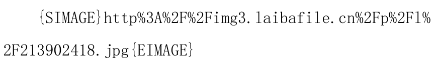

作者:66 端午 88 日期:2015-05-18 13:37

默 念 100 遍 ， 100 块 ， 100 块

作者:66 端午 88 日期:2015-05-18 13:46

@wzz810711 2015-05-18 13:44:54

加 v 信 1101284955，获取更多好帖

### 老大，凯利泰如何操作？

持有，等添权。

作者:66 端午 88 日期:2015-05-18 13:50

IT 行业是额的本行，抓潜力股，甩基金经理 10 条大街，额一旦捋清思路，基金经理只有跟着额做的份。

作者:66 端午 88 日期:2015-05-18 13:51

@投机者的扑克 2015-05-18 13:47:29

创业板赶上主板。。。

这种走法，一个月内的事。

作者:66 端午 88 日期:2015-05-18 14:25

@追忆似水流年 N 2015-05-18 14:19:42

楼主、看到我！咨询个事！

有朋友找工作、鲁证期货、进去信息部门工作、搞硬件软件之类的、想问问你了解这公司吗、前景咋样、待遇咋样？期盼回复!!!

真的不熟，要是鲁信还不错。

作者:66 端午 88 日期:2015-05-18 14:31

热烈庆祝重仓股，世纪鼎利攻击涨停。

作者:66 端午 88 日期:2015-05-18 14:32

加 v 信 1101284955，获取更多好帖

只有一个没涨停，加油，凯利泰。

作者:66 端午 88 日期:2015-05-18 14:46

@披着城市的外衣 2015-05-18 14:38:58

老大，鼎利开板是你搞的哇？

我小散一个，哪有那么大本事。:(

作者:66 端午 88 日期:2015-05-18 16:51

@巴蜀缘 2015-05-18 15:45:38

老大，萃华珠宝现在怎样，能进不？

基本面不是太高，逐渐减仓，第一季度珠宝业下滑 10%。

作者:66 端午 88 日期:2015-05-19 09:47

加仓了世纪鼎利

作者:66 端午 88 日期:2015-05-19 10:23

@投机者的扑克 2015-05-19 09:59:32

夸创业板，创业板跌。说券商死，券商立马奋起。。。

券商反弹减仓

作者:66 端午 88 日期:2015-05-19 11:22

小强晚上出来鼓气，明天证监会再差两融。

作者:66 端午 88 日期:2015-05-19 13:43

@66 端午 88 2015-05-19 11:22:27

小强晚上出来鼓气，明天证监会再差两融。

@叫我小氓氓 2015-05-19 11:46:13

好狠。。。券商就不能喘口气？

哥被教育了四个月，再不改正错误就是猪了。

作者:66 端午 88 日期:2015-05-19 13:48

最迟下个月接轨主板，那会再考虑减仓问题，减也不能多减，主板的大票基本面太烂了，煤炭电力最后一块阵地沦陷，神华效益大幅下滑，发电量净减 3 成。

作者:66 端午 88 日期:2015-05-19 13:49

热烈庆祝暴风科技二连板，只有 200 股。

作者:66 端午 88 日期:2015-05-19 13:51

世纪鼎利最后的上车机会，等打到 42 左右，会有一波速杀，不知道能不能打到现在这个地方，然后就超三泰的火势。

作者:66 端午 88 日期:2015-05-19 13:53

西水是跟着两边涨啊，大小版通吃。

作者:66 端午 88 日期:2015-05-19 14:01

@66 端午 88 2015-05-19 13:51:14

世纪鼎利最后的上车机会，等打到 42 左右，会有一波速杀，不知道能不能打到现在这个地方，然后就超三泰的火势。

@披着城市的外衣 2015-05-19 13:54:28

三年大哥，我手上有掌趣科技，27.5 的本，啥时候下车?

潜力不是太大了，这波是炒的市值和估值。500 亿的市值不算小了。

作者:66 端午 88 日期:2015-05-19 14:03

选技术含量高，市场潜力大的低市值品种，尽量别亏损，有互联网概念的。

作者:66 端午 88 日期:2015-05-19 14:09

@披着城市的外衣 2015-05-19 14:07:54

三年大哥，麻烦再诊断一下腾邦国际!

可以加仓

作者:66 端午 88 日期:2015-05-19 14:16

凯利泰是马拉松选手，从来不涨停，就是涨不停。

作者:66 端午 88 日期:2015-05-19 14:18

@66 端午 88 32970 楼 2015-05-19 13:51 世纪鼎利最后的上车机会，等打到 42 左右，会有一波速杀，不知道能不能打到现在这个地方，然后就超三泰的火势。

@投机者的扑克 2015-05-19 14:12:35

看看三泰死的心都有

唉，没缘分啊，那会是看着主板熊指数操作牛股。

作者:66 端午 88 日期:2015-05-19 14:20

世纪鼎利不比三泰差的，小股本，大概念，现在他们股东正在操作股价哪，股东减持给大庄，压盘吸货，等着底仓足了，一卦楼梯一样的涨停板。

作者:66 端午 88 日期:2015-05-19 14:39

@66 端午 88 2015-05-19 14:20:03

世纪鼎利不比三泰差的，小股本，大概念，现在他们股东正在操作股价哪，股东减持给大庄，压盘吸货，等着底仓足了，一卦楼梯一样的涨停板。

@wsq2002919 2015-05-19 14:25:59

现在再加仓世纪鼎力 可以不

绿了买

作者:66 端午 88 日期:2015-05-19 14:40

@u_101434115 2015-05-19 14:27:25

本来想券商拿到牛市结束的，太伤人啦

可以稍微留一些，1/4，不要看，一看就窝火。

作者:66 端午 88 日期:2015-05-19 14:42

@天不再那么蓝 2015-05-18 10:29:29

守着一只股真是要忍耐呀，3 泰这么好的股都做飞了：(

不知道还有人手头有么

@66 端午 88 2015-05-18 11:24:31

我有四个创业板哪，这是其中之一，不过也是潜力最大的一个。

@不惑之真惑 2015-05-18 12:28:10

上次看到端午兄卖了，我也手贱卖了一半，但未及时买回。

我能告诉你们我把成本价成功做到接近八十了吗？

有见过这么奇葩的吗？

@66 端午 88 2015-05-18 13:17:14

额天，你真狠啊。

@不惑之真惑 2015-05-19 14:39:28

哈哈哈，今天我居然瞬时解套了。等一百!!

我卖是因为当时手里有一大票中国建筑，所以得看指数做，做着做着就都卖了。

作者:66 端午 88 日期:2015-05-19 21:34
@u_96869904 2015-05-19 21:19:04

老大帮忙看看山东章鼓，已有 8 个点的盈利，想中长线持有，可以不

还能涨，不过中期就算了吧，风机怎么搞也不会是互联网+

作者:66 端午 88 日期:2015-05-19 21:35
@viviwa 2015-05-19 20:39:58

想起三泰，就是大跌的第三天卖出，没赚没亏，拿着等了那么久，最后一波被震出来，真是血泪啊~!!!!!!

调整的越难受，未来收益越大。为了避免痛苦，也就放弃了快乐。

作者:66 端午 88 日期:2015-05-19 21:36
@周榕 ABC 2015-05-19 17:50:04

楼主，中国平安可以继续持有吗

赶脚 9 月以后拿大蓝筹比较好，个人观点，仅供参考

加 v 信 1101284955，获取更多好帖

作者:66 端午 88 日期:2015-05-19 21:37

@66 端午 88 2015-05-19 14:20:03

世纪鼎利不比三泰差的,小股本,大概念,现在他们股东正在操作股价哪,股东减持给大庄,压盘吸货,等着底仓足了,一卦楼梯一样的涨停板。

@wsq2002919 2015-05-19 14:25:59

现在再加仓世纪鼎力可以不

@66 端午 88 2015-05-19 14:39:32

绿了买

@wsq2002919 2015-05-19 14:52:09

三年大哥:易联众和亿通科技建仓可以不

易联众逢低建仓,亿通科技逢高减仓。

作者:66 端午 88 日期:2015-05-20 09:51

嘎嘎嘎嘎

作者:66 端午 88 日期:2015-05-20 09:55

暴风科技的存在,是为了彻底打开创业板的上升空间,不过也不敢多买,因为等它往下栽的时候,谁都走不掉。第一目标 500 . 第二目标 1000

加 v 信 1101284955 ,获取更多好帖

作者:66 端午 88 日期:2015-05-20 09:57

@牛牛年牛牛人 2015-05-20 09:52:09

66 看看 002174 是不是可以建仓了?

-----------------------------

稍微等等,这票要在创业板,表现就更好了

作者:66 端午 88 日期:2015-05-20 10:03

还是股神的票 NB 啊,新文化

作者:66 端午 88 日期:2015-05-20 10:21

@投机者的扑克 2015-05-20 10:14:03

老大创业板 B 能买吗

-----------------------------

现在要买世纪鼎泰,好多前期涨的好的大盘创业板调整了,会影响指数走势。

作者:66 端午 88 日期:2015-05-20 10:25

@投机者的扑克 2015-05-20 10:24:38

老大主板还有股能买吗

-----------------------------

和创业板属性类似的,可以买。很少。

作者:66 端午 88 日期:2015-05-20 10:38

@66 端午 88 33037 楼 2015-05-20 10:25 @投机者的扑克 2015-05-20 10:24:38 老大主板还有股能买吗 ----------------------------- 和创业板属性类似的，可以买。很少。

加 v 信 1101284955,获取更多好帖

@投机者的扑克 2015-05-20 10:32:29

同方股份如何

天成控股，内蒙君正

作者:66 端午 88 日期:2015-05-20 10:39

@u_101434115 2015-05-20 10:25:22

世纪鼎利还能补吗，大哥，心塞的券商昨天开始卖，卖少了，后悔

急杀买入

作者:66 端午 88 日期:2015-05-20 10:47

@投机者的扑克 2015-05-20 10:42:24

想追又怕站岗

狠狠心就过去了，不狠心就哭晕在厕所吧。世纪鼎利的潜力最大，100 块。

作者:66 端午 88 日期:2015-05-20 11:06

@66 端午 88 33041 楼 2015-05-20 10:38 @66 端午 88 33037 楼 2015-05-20 10:25 @投机者的扑克 2015-05-20 10:24:38 老大主板还有股能买吗 和创业板属性类似的，可以买。很少。 @投机者的扑克 2015-05-20 10:32:29 同方股份如何 天成控股，内蒙君正

@投机者的扑克 2015-05-20 10:58:18

这俩哪个好

差不多，能跟到创业板一般品种的六成涨势。

作者:66 端午 88 日期:2015-05-20 11:17

@投机者的扑克 2015-05-20 11:11:34

天成站岗了

没事，我个朋友分析是 40 的目标。他融资买的，22 万股。

作者:66 端午 88 日期:2015-05-20 11:22

@u_101434115 2015-05-20 11:11:08

@66 端午 88 2015-05-20 10:47:28.0

狠狠心就过去了，不狠心就哭晕在厕所吧。世纪鼎利的潜力最大，100 块。

追高了，晕菜了

# 分批买

作者:66 端午 88 日期:2015-05-20 11:31

@u_101434115 33052 楼 2015-05-20 11:11 @66 端午 88 2015-05-20 10:47:28.0 狠狠心就过去了，不狠心就哭晕在厕所吧。世纪鼎利的潜力最大，100 块。

追高了，晕菜了

@投机者的扑克 2015-05-20 11:23:48

我也在晕菜

分批买，我都是分批买，哪怕少赚点，心理比较稳定，最好买了涨，然后回调加仓。买了就跌，在下面的支撑线补，这样买的不如前面的稳定。

作者:66 端午 88 日期:2015-05-20 13:18

@ancallisto 2015-05-20 13:14:50

三年兄，去年券商行情的时候兄推荐的 张江高科 苏州高新 东湖高新现都已翻倍，现在还能追否？对于此类概念，是否适合长线持有至牛市结束？

涨的不少了，前景暂时不明，风口不在哪里，现在就是创业板里面的高新行业+中小板里面的通信和软件。

作者:66 端午 88 日期:2015-05-20 13:41

加 v 信 1101284955，获取更多好帖

@投机者的扑克 2015-05-20 13:36:44

妈蛋选了天成没选内蒙，真失败

天成控股是除了支付宝以外，最大的第三方支付，潜力巨大，就是板块不好，在主板，要是在创业板，现在早过50了

作者:66 端午 88 日期:2015-05-20 13:45

这年月，就得站在风口上，就算是一头猪，也是飞猪。

作者:66 端午 88 日期:2015-05-20 13:51

@CrystalU0 2015-05-20 13:44:55

老大，请问现在上证的b股还能买吗？

不懂B股

作者:66 端午 88 日期:2015-05-20 13:58

我了去，亿通科技又要涨停了

作者:66 端午 88 日期:2015-05-20 14:07

@投机者的扑克 2015-05-20 13:47:01

神创这么涨。。。

赚了吧

作者:66 端午 88 日期:2015-05-20 14:08

@支持后悔买岛国车 2015-05-20 14:02:30

求端午兄，推荐几只B股市场的股票。万分感谢。（无责任推荐，风险自负）

真没研究过，我们这群朋友，只有一个买了B股的，人家2011年买的深圳B股一直没动，现在怎么也得翻倍了。

作者:66 端午 88 日期:2015-05-20 14:25

加仓了世纪鼎利，40.21

作者:66 端午 88 日期:2015-05-20 14:38

这是杀最早的套牢盘，等着盘上43，就没阻力了，继续买入。

作者:66 端午 88 日期:2015-05-20 14:50

@u_96869904 2015-05-20 14:46:57

老大，中国铁建套了8个点，怎么操作，不死不活的

逢高减仓，遇到今天这种盘中急杀，速度买入创业板小市值品种。

作者:66 端午 88 日期:2015-05-20 15:15

中海发展，中国远洋同时停牌，不要脸的央企，说不重组，还是重组，不如拿着创业板踏实。

作者:66 端午 88 日期:2015-05-20 17:30

@进唯一 2015-05-20 16:52:37

@66 端午 88 2015-05-20 15:15:25.0

中海发展，中国远洋同时停牌，不要脸的央企，说不重组，还是重组，不如拿着创业板踏实。

端哥，不是重组吧，不是说合资买了几条船吗？这消息对中海发展有什么影响没有？

中国的远洋运输行业都亏的底掉，重组只是时间问题，而且这个行业的兴盛关系到整个造船业的景气程度，造船业在制造业里面是大行业。不进行垄断经营，中国内部就把海洋运输拼死了，等着国外大运输企业收尸？显然不可能。

作者:66 端午 88 日期:2015-05-20 21:32

国务院发文推进网络提速降费：3 年内投资 11300 亿信息高速公路计划，全面提升通信股估值，强烈看好世纪鼎利和亿通科技。

作者:66 端午 88 日期:2015-05-20 21:33

@wsq2002919 2015-05-20 17:38:31

是 35.32

不是 30.32

@132565ty 2015-05-20 19:56:15

楼主呢？

加 v 信 1101284955，获取更多好帖

今天加了仓，比你的成本高了。

作者:66 端午 88 日期:2015-05-20 21:35

明天通信股起码有 30 个涨停的。

国务院发文推进网络提速降费：3 年内投资 11300 亿

## 国务院办公厅关于加快高速宽带网络建设推进网络提速降费的指导意见

国办发〔2015〕41 号

各省、自治区、直辖市人民政府，国务院各部委、各直属机构：

宽带网络是国家战略性公共基础设施，建设高速畅通、覆盖城乡、质优价廉、服务便捷的宽带网络基础设施和服务体系一举多得，既有利于壮大信息消费、拉动有效投资，促进新型工业化、信息化、城镇化和农业现代化同步发展，又可以降低创业成本，为打造大众创业、万众创新和增加公共产品、公共服务“双引擎”，推动“互联网+”发展提供有力支撑，对于稳增长、促改革、调结构、惠民生具有重要意义。近年来，随着“宽带中国”战略的启动实施和持续推进，我国宽带发展水平有了显著提升，但仍与人民群众的需求和用户期望差距较大，网络速率相对国际先进水平仍然较低，人均网费支出占收入的比重仍然较高，城乡区域发展不平衡，服务质量有待改善。党中央、国务院对此高度重视，要求加快推进宽带网络基础设施建设，进一步提速降费，提升服务水平。经国务院同意，现就有关工作提出以下意见：

### 一、加快基础设施建设，大幅提高网络速率

(一)加快高速宽带网络建设。加快推进全光纤网络城市和第四代移动通信(4G)网络建设，2015年网络建设投资超过4300亿元，2016—2017年累计投资不低于7000亿元。推进光纤到户进程，2015年完成4.5万个铜缆接入小区的光纤化改造，新建光纤到户家庭超过8000万户。完善电信普遍服务，开展宽带乡村工程，加大农村和中西部地区宽带网络建设力度，2015年新增1.4万个行政村通宽带，在1万个行政村实施光纤到村建设，着力缩小“数字鸿沟”。扩大移动通信覆盖范围，鼓励移动用户向4G迁移，提升移动宽带速率。

到2015年底，全国设区市城区和部分有条件的非设区市城区80%以上家庭具备100Mbps(兆比特每秒)光纤接入能力，50%以上设区市城区实现全光纤网络覆盖；直辖市、省会城市等主要城市宽带用户平均接入速率达到20Mbps，其他设区市城区和非设区市城区宽带用户平均接入速率达到10Mbps，鼓励有条件的地区推广50Mbps、100Mbps等高带宽接入服务；95%以上的行政村通固定或移动宽带。建成4G基站超过130万个，实现乡镇以上地区网络深度覆盖，4G用户超过3亿户。

到2017年底，全国所有设区市城区和大部分非设区市城区家庭具备100Mbps光纤接入能力，直辖市、省会城市等主要城市宽带用户平均接入速率超过 30Mbps, 基本达到 2015 年发达国家平均水平, 其他设区市城区和非设区市城区宽带用户平均接入速率达到 20Mbps; 80%以上的行政村实现光纤到村, 农村宽带家庭普及率大幅提升; 4G 网络全面覆盖城市和农村, 移动宽带人口普及率接近中等发达国家水平。

(二)提升骨干网络容量和网间互通能力。适度超前建设高速大容量光通信传输系统, 持续提升骨干传输网络容量。优化互联网骨干网络结构, 大幅增加网间互联带宽, 2015 年扩容 600Gbps(吉比特每秒)。加大中央预算内投资, 加快互联网国际出入口带宽扩容, 全面提升国际互联带宽和流量转接能力。

(三)加强应用基础设施建设。加快推动内容分发网络向大容量、广覆盖、智能化演进, 不断增强网络流量承载和分发能力。加大支持力度, 促进向下一代互联网演进升级。提升网站服务能力, 增加主要业务应用带宽配置, 实现互联网信源高速接入、网络流量高效疏通, 促进应用基础设施与骨干网络协同发展, 持续改善用户上网体验。

(四)深入推进电信基础设施共建共享。创新电信基础设施建设管理方式, 加快推进集中统一建设和专业化运营, 全力保障 4G 网络建设进度, 促进铁塔等电信基础设施资源整合共享, 提高效率和效益, 避免重复建设。全面推进“三网融合”, 2015 年底前将实施范围扩大到全国。

### 三、 完善配套支持政策，强化组织落实

(十)推进简政放权。对通信建设资质资格审批等已经取消或下放的相关行政许可事项和非行政许可审批事项，各有关部门要加强督促检查，确保落实到位。要进一步改进行政审批工作，简化申报材料要求，努力为企业经营活动创造便利条件。要坚持放管结合，强化事中事后监管，积极推进电子政务和政务公开，加快实现网上申请、受理、审核流转、公示审批结果等，着力提升工作效率，不断提高服务能力和管理水平，切实减轻企业负担，充分激发市场活力。

(十一)完善配套支持政策。工业和信息化部、发展改革委、财政部等要加快完善以宽带为重点内容的电信普遍服务补偿机制，加快农村宽带基础设施建设。结合无线电频率占用费统筹使用，发挥中央财政资金引导作用，持续支持农村及偏远地区宽带网络建设和运行维护，推进电信普遍服务工作。利用中央预算内投资，结合新型城镇化、“一带一路”、长江经济带等国家战略，支持基础薄弱区域宽带基础设施升级改造。金融部门要加大融资支持，对重大项目投资给予有效贷款支持。国资委要统筹考虑宽带网络作为战略性公共基础设施的定位，优化完善基础电信企业经营业绩考核体系。环保部门要进一步优化通信基站环境监管机制，加快环评进度。各地要对基础电信企业在融资、用电、选址、征地、小区进入等各方面给予支持并加强对政策落实情况的考核。鼓励有条件的地方对众创空间的宽带网络给予适当补贴。

(十二)完善宽带网络标准。工业和信息化部要抓紧完善网络速率监测标准、电信服务质量标准等并抓好组织实施，加快建设“宽带中国”地图及网速监测平台，发布各地、各企业宽带速率权威信息，促进企业有序竞争，接受用户监督。住房城乡建设部、工业和信息化部要加大对光纤到户国家标准的组织实施和监督检查力度，确保执行到位。

(十三)全面保障宽带网络建设通行。各地要在经济社会发展规划、城乡规划、土地利用总体规划、城市地下综合管廊建设规划等综合性和专项规划中，同步安排通信光缆、管道、基站、机房等宽带网络设施建设内容。市政设施和政府机关、企事业单位、公共机构等所属公共设施，应向宽带网络设施建设开放，并提供通行便利，保障公平进入，禁止巧立名目收取进场费、协调费、分摊费等不合理费用。积极探索通过推动地方性法规建设，进一步明确宽带网络的战略性公共基础设施属性，切实保障宽带网络基础设施的建设通行权。

(十四)规范通信建设行为。各地要进一步完善新建住宅小区和住宅建筑内光纤到户通信设施规划建设和验收备案等工作机制，严格执行光纤到户国家标准规范，落实小区红线内通信管道等配套设施建设。支持现有住宅小区光纤改造，禁止任何机构和个人无故阻碍通信设施建设或收取不合理费用，切实保障用户的公平选择权。对因征地拆迁、城乡建设等造成的宽带网络设施迁移或毁损，严格按照有关标准予以补偿。

各地区、各有关部门要充分认识加快宽带网络提速降费工作的重要意义，把思想和行动统一到党中央、国务院决策部署上来，按照本意见要求，加强组织领导，明确工作责任，切实落实好各项任务措施。充分发挥“宽带中国”战略实施部际协调小组作用，各有关部门要按照职责分工，加强协调配合，形成工作合力，共同推进宽带网络提速降费，积极制定实施财税、土地、建设、环评、企业经营业绩考核等方面支持政策。工业和信息化部要加强与相关部门的协调，做好统筹推动和督促检查，每年向社会公布全国和各地区实施情况，接受社会监督，重大情况及时报国务院。

作者:66 端午 88 日期:2015-05-20 21:51

@66 端午 88 2015-05-20 21:35:42

明天通信股起码有 30 个涨停的。

国务院发文推进网络提速降费：3 年内投资 11300 亿

国务院办公厅关于加快高速宽带网络建设推进网络提速降费的指导意见

国办发〔2015〕41 号

各省、自治区、直辖市人民政府，国务院各部委、各直属机构：

宽带网络是国家战略性公共基础设施，建设高速畅通、覆盖城乡、质优价廉、服务便捷的宽带网络基础设施和服务体系一举多得，既有利于壮大信息消费、拉动有效投资，……

@wsq2002919 2015-05-20 21:39:28

老大，亿通科技明天可以建仓吗

不知道，涨势超出意料。上午有个探5日线的机会，也就15分钟。

作者:66 端午 88 日期:2015-05-20 23:19

@我花发时百花杀 33111 楼 2015-05-20 22:42:00

楼主，你看“小商品城”如何？目前也是不温不火的，就是很早前涨过一段时候。

额未来两个月，不看主板品种了，够够的

作者:66 端午 88 日期:2015-05-20 23:21

网上疯传取消房产七十年产权限制，这个问题太大，有确切消息时再议，它会改变整个资本市场的配置基础。

作者:66 端午 88 日期:2015-05-21 10:42

没追上通讯股的，吴通通讯看一下，马上突破了

作者:66 端午 88 日期:2015-05-21 11:29

@u_101434115 2015-05-21 10:46:39

@66 端午 88 2015-05-21 10:42:22.0

没追上通讯股的，吴通通讯看一下，马上突破了

大哥，世纪鼎利不能追了吗，您建仓吴通通讯了？

上半年收的房租，建仓了吴通通讯。

作者:66 端午 88 日期:2015-05-21 11:30

@u_101434115 2015-05-21 10:46:39

@66 端午 88 2015-05-21 10:42:22.0

没追上通讯股的，吴通通讯看一下，马上突破了

大哥，世纪鼎利不能追了吗，您建仓吴通通讯了？

再好，也不能把鸡蛋放一个篮子里

作者:66 端午 88 日期:2015-05-21 14:14

@66 端午 88 2015-05-20 23:21:41

网上疯传取消房产七十年产权限制，这个问题太大，有确切消息时再议，它会改变整个资本市场的配置基础。

@垮掉的视觉 2015-05-21 13:48:12

貌似又有个专家辟谣了。但总觉得空穴不来风。这样做对政府的好处多，让人遐想啊。

整体房地产市场如果不出台重大政策，已经抬不起来了。

作者:66 端午 88 日期:2015-05-21 14:50

坐等吴通通讯明天突破。

作者:66 端午 88 日期:2015-05-21 14:52

@投机者的扑克 2015-05-21 14:36:56

天成可是见短顶了

拿一阵子，主板票都是锻炼忍耐的试金石，额是不敢买主板了。

作者:66 端午 88 日期:2015-05-21 15:24

@66 端午 88 2015-05-20 09:55:58

暴风科技的存在，是为了彻底打开创业板的上升空间，不过也不敢多买，因为等它往下栽的时候，谁都走不掉。第一目标 500。第二目标 1000

@月冷蓝田 2015-05-21 15:01:37

手里有 2 只 a 股类似股票，湖北广电和广电网络，目前看来还不错啊，湖北广电盈利到了 20%，另一个 7%，不知道还能持有吗？

可以持有，湖北广电更好，缩量涨停

作者:66 端午 88 日期:2015-05-21 15:26

@投机者的扑克 2015-05-21 14:36:56

天成可是见短顶了

@投机者的扑克 2015-05-21 14:51:04

啥都在涨就他跌，主力针对我吗

淡定淡定，一次少买点，不过最好买创业板和中小板的票，主板的都像有病的啊，站不住，稍微站一会，又倒了

作者:66 端午 88 日期:2015-05-21 15:28

@66 端午 88 33144 楼 2015-05-21 14:52:00

@投机者的扑克 2015-05-21 14:36:56

天成可是见短顶了

@雾都小鱼 2015-05-21 15:26:38

拿一阵子，主板票都是锻炼忍耐的试金石，额是不敢买主板了。

楼主，今天凯利泰和鼎利都涨势喜人，祝贺啊，你现在是没主板股票了吗，世纪鼎利怎么看，会回踩吗，还是直接向上

留了一百股中国建筑，一百股嘉宝集团。做个记号

作者:66 端午 88 日期:2015-05-21 16:52

@平凡主妇 2015 33151 楼 2015-05-21 15:28:00

楼主大大，吴通通讯明天还能进吗？

不知道，最好等根大阳线，今天资金流出挺大，怕筑双头，这货上波没调整，不像世纪鼎力，也不像凯丽泰一路小阳拉升，暂观望

作者:66 端午 88 日期:2015-05-21 20:11

这股涨一天调一天，估计明天该调整了

作者:66 端午 88 日期:2015-05-21 22:06

@66 端午 88 2015-05-21 20:11:14

这股涨一天调一天，估计明天该调整了

@wsq2002919 2015-05-21 21:20:39

老大，万科 A 股未来走势怎么样，继续持有还是下车，盼回复

反弹减仓，等待缩量至 3 月中旬时，且 MACD 日线金叉时可以重新介入。

作者:66 端午 88 日期:2015-05-21 23:24

@LYL1242000 2015-05-21 22:59:37

楼主怎么都不回答我呢？是不是我问错了？

合同一经签订，如果双方没有违约行为，就不会变更合同条款，和你不再缴纳公积金无关，只不过你无法提取公积金支付按揭贷款了。

作者:66 端午 88 日期:2015-05-21 23:37

鸡精经理今天开始密集调研通信类公司，世纪鼎利，亿通科技，吴通通讯前景看好。

作者:66 端午 88 日期:2015-05-22 00:08

从战略高度考量中国资产泡沫和美国资产泡沫，中国资产现在无疑充满泡沫，美国哪，同样充满泡沫。中国的资产泡沫归根到底是由美元滥发所推动的，美国资产泡沫归根到底是由其国民的贪婪所推动的，为了维持选票，利用各种金融工具所产生。由于中美两国关系从合作多于对抗转为对抗多过合作，两国事实上在比拼泡沫的强度，谁先破谁衰退。只要我们不再过份追求承接美国的美元泡沫，美国的泡沫比中国先破是一定的。这主要是因为美国的投资者风险意识较强，有较强的自我保护能力。我们的优势则在于货币量庞大，且货币泡沫并未侵蚀实体经济，只要限制银行的间接融资成本。则我们的泡沫比较硬一些，美国的对策是撤回制造业投资，防止新行业向中国转移，施加军事和政治压力，我们的对策是削减过剩产能，提升制造业技术含量，积极进行人民币国际化，强化国防力量。最近原油开始反弹，是因为美国发现：打击俄罗斯过多，会提升中国实力，它想做战略平衡，所以，一直对中国进行原油促销的沙特，突然减少了对华原油出口。

从以上诸多现象分析，中国正在遭受严重的战略挤压，对于美国，它是一个彻头彻尾的奸商国家，抛却它国内的民主，自由，公平外，额对这个国家无丝毫好感。商人吗，就是图个赚钱，长久的赚钱，如果影响到额赚钱，它就是敌人。对于我们中国小百姓，必定绝大多数不可能移民，我们的命运基本上是和中国绑定的，现在必须站出来说话：任何打击美国经济利益的事情，我们都要责无旁贷的去做，泡沫终究会破，只要能做到美国的先破，美国破的更彻底，我们的日子就会好过一些，否则老百姓总会承受更多的硬着陆损失。放弃美元兑换计划，转为盈利后增持地产，做个合格的中国好公民，绑定中国未来。

作者:66 端午 88 日期:2015-05-22 08:07

@周榕 ABC 2015-05-22 00:33:50

楼主，本人在海口不错地段持有几套房产，今年空租几月了，一直纠结是否卖了，请问如何看海南房产后市，谢谢

海南的房子是度假房，积极做推广，完善房产配套，在微信上建个圈子，好多人度假还找不到好的房子哪。租金也比乱租高一些，房客素质就更别提了。

作者:66 端午 88 日期:2015-05-22 09:57

加仓了世纪鼎利

作者:66 端午 88 日期:2015-05-22 10:00

再加一次 40.5

作者:66 端午 88 日期:2015-05-22 10:14

安信信托启动了。

作者:66 端午 88 日期:2015-05-22 10:38

@披着城市的外衣 2015-05-22 10:11:56

老大，券商是不是要启动了？

间歇性反弹。

作者:66 端午 88 日期:2015-05-22 10:39

@听雪 159 2015-05-22 10:32:12

楼主，亿通科技是怎么回事啊，调整还是？没看到新闻，不懂，求解惑啊

送股除权，跌 2-3 天，然后开始填权

作者:66 端午 88 日期:2015-05-22 10:40

@a3392103 2015-05-22 10:16:38

安信信托应该是一个涨停板调几天，再来几个涨停板这种剧本?

彻底被遗忘时，它就发狠了

作者:66 端午 88 日期:2015-05-22 11:18

@u_101434115 2015-05-22 10:52:35

大哥推荐的每只股票拿住了都牛，我偏偏拿了个东吴证券，真是太恼火了

最窝火的是芭田股份

作者:66 端午 88 日期:2015-05-22 15:13

@u_101434115 2015-05-22 10:52:35

大哥推荐的每只股票拿住了都牛，我偏偏拿了个东吴证券，真是太恼火了

@66 端午 88 2015-05-22 11:18:05

最窝火的是芭田股份

@wsq2002919 2015-05-22 14:55:31

老大，易联众能加仓不?

5 日击破可加仓，现在跌的不够。

作者:66 端午 88 日期:2015-05-23 20:56

@u_101434115 2015-05-22 10:52:35

大哥推荐的每只股票拿住了都牛，我偏偏拿了个东吴证券，真是太恼火了

@66 端午 88 2015-05-22 11:18:05

最窝火的是芭田股份

@wsq2002919 2015-05-22 14:55:31

老大，易联众能加仓不?

@66 端午 88 2015-05-22 15:13:50

5日击破可加仓，现在跌的不够。

@u_102016788 2015-05-23 15:29:38

端午兄，长荣股份现在还能加仓吗?

涨幅偏低，估计和行业不景气有关（烟标）。前期公告终止重大重组，收盘栽8.24以上可参与短线博弈，跌破36.5收盘需要减仓。这根K线放量，有代表意义。

作者:66 端午 88 日期:2015-05-23 21:00

@骑乌龟过沙漠 2015-05-22 23:07:22

楼主老师的话水平高，也理性的多，站在大多数国人的角度，长期坚持天涯，见识人品令骚年发自内心敬佩。

想问问您怎么看打车软件的事，各地出租车意见很大，群体性闹得厉害。可是垄断经营可恶。于国于民绝无好处。打车软件实际使用来说，真的挺好。

上述例子还有很多，像农村零售什么的。互联网经济是不是很大程度上有冲击垄断的作用？？？？

骚年我是民航从业人员，机务维修，你怎么看我这个行业的未来？？？

出租车行业的问题是政府垄断和自由经济的争端，就各个国家对打车软件的态度，大多数都在限制和禁止，但是这个行业的确需要整顿，高昂的成本由消费者承担，相当于土地和房产的关系。关键的问题是：打车软件能把出租车零售价格降下来吗？如果降下来，我支持打车软件，如果降不下来，不支持，打车软件现在不是独自行动，它只是金融资本抢夺支付手段入口的工具。

作者:66 端午 88 日期:2015-05-23 21:01

@骑乌龟过沙漠 2015-05-22 23:07:22

楼主老师的话水平高，也理性的多，站在大多数国人的角度，长期坚持天涯，见识人品令骚年发自内心敬佩。

想问问您怎么看打车软件的事，各地出租车意见很大，群体性闹得厉害。可是垄断经营可恶。于国于民绝无好处。

打车软件实际使用来说，真的挺好。

上述例子还有很多，像农村零售什么的。互联网经济是不是很大程度上有冲击垄断的作用？？？？

骚年我是民航从业人员，机务维修，你怎么看我这个行业的未来？？？

太古的？

作者:66 端午 88 日期:2015-05-23 23:10

世纪鼎利有望成为老大的小鲜肉

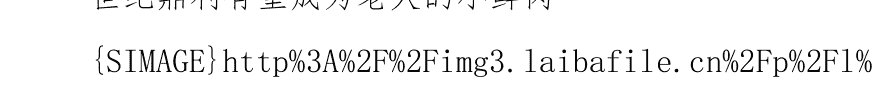

作者:66 端午 88 日期:2015-05-24 13:43

@u_96869904 2015-05-24 06:39:04

老大，我满仓了赣锋锂业，27.6 的成本，求操作建议

5 日线附近获得支撑后，还会反复向上，不过力度欠佳，除非有重组运作。

作者:66 端午 88 日期:2015-05-24 16:15

@平凡主妇 2015 2015-05-24 13:51:28

王亚伟：：大金融接力互联网引领牛市第二春

(2015-05-22 15:49:57)

[图片]转载▼

标签： 股票分类： 股市

今日沪深指数双双大幅跳空高开，随后开启一波大跳水走势，但随后又被强势拉起，沪指强势突破 4600 点，再创新高，深成指也是突破 16000 点，创业板指更是一举突破 3600 点，但随后走势不佳，持续横盘。

从盘面来看，今日大金融板块表现较好，券商股领涨，国海证券，东兴证券涨停。保险，银行板块相对较弱。......

大金融不会涨很多，带指数太厉害，昨天已经出利空了，要查信托和证券之间的配资链条

作者:66 端午 88 日期:2015-05-24 16:18

@66 端午 88 2015-05-22 00:08:47

从战略高度考量中国资产泡沫和美国资产泡沫，中国资产现在无疑充满泡沫，美国哪，同样充满泡沫。中国的资产泡沫归根到底是由美元滥发所推动的，美国资产泡沫归根到底是由其国民的贪婪所推动的，为了维持选票，利用各种金融工具所产生。由于中美两国关系从合作多于对抗转为对抗多过合作，两国事实上在比拼泡沫的强度，谁先破谁衰退。只要我们不再过份追求承接美国的美元泡沫，美国的泡沫比中国先破是一定的。这主要是因为美国......

加 v 信 1101284955，获取更多好帖

@赢家 1234 2015-05-24 11:49:30

长期看三年老师的思想，获益匪浅！三年老师能否详解和美的泡沫破碎先后的具体内容，目前我也在纠结人民币资产和美元资产的配置问题，谢谢，单纯的爱国情怀不能成为我做经济决定的原因，谢谢！

中国经济到现在也没崩溃过，鬼才知道什么样子。美国的泡沫破裂好几次了，这会也一样，肯定要发动大型战争，而且它要把它自己的风险向外传导。

作者:66 端午 88 日期:2015-05-25 08:21

@66 端午 88 33211 楼 2015-05-22 15:13

@u_101434115 2015-05-22 10:52:35

大哥推荐的每只股票拿住了都牛，我偏偏拿了个东吴证券，真是太恼火了

@66 端午 88 2015-05-22 11:18:05

最窝火的是芭田股份

@wsq2002919 2015-05-22 14:55:31

老大，易联众能加仓不？

@湖面上的单车 2015-05-24 23:15:03

三年大哥，家人受别人的推荐买了美邦服饰和东方电子，其中美邦重仓，正好遇上停牌，据推荐股票的人说复盘之后绝对能翻倍，但他并无内幕消息，完全是凭感觉，感觉服饰行业都在走下坡路，对这个股实在觉得不靠谱，求三年大哥分析！另外周围有一个股神推荐买中国铁建，中国交建，中国重工，三年大哥觉得怎么样？

美邦服饰转型重组，持有。大蓝筹要看管理层态度，估计热点只集中于重组个例，为了维持总体估值合理，会刻意打压能带动指数得标的。

作者:66 端午 88 日期:2015-05-25 09:12

@66 端午 88 33240 楼 2015-05-25 08:21

@66 端午 88 33211 楼 2015-05-22 15:13

@u_101434115 2015-05-22 10:52:35

大哥推荐的每只股票拿住了都牛，我偏偏拿了个东吴证券，真是太恼火了

@66 端午 88 2015-05-22 11:18:05

最窝火的是芭田股份

@wsq2002919 2015-05-22 14:55:31

老大，易联众能加仓不？

@湖面上的单车 2015-05-25 09:07:58

谢谢三年大哥的回复，世纪鼎利今日派股，估计三年大哥又要大赚了，呵呵～

派息，中期报告有可能派红股8-9月左右，明年年初增发上市。

作者:66 端午 88 日期:2015-05-25 10:18

减仓了易联众，加仓了吴通通讯

作者:66 端午 88 日期:2015-05-25 10:19

@u_101434115 2015-05-25 10:01:39

吴通通讯被套了，我想把他卖了再换些世纪鼎利，可行吗，大哥，世纪鼎利还想补货

鸡蛋别放一个篮子里，绿了买

作者:66 端午 88 日期:2015-05-25 10:20

@wzz810711 2015-05-25 09:59:08

老大，易通科技被套挺多，可以补吗？

贴近20日线时，等出根阳线再补。研究一下BOLL

作者:66 端午 88 日期:2015-05-25 10:51

加v信1101284955，获取更多好帖

艹，貌似换错了

作者: 66 端午 88 日期: 2015-05-25 11:05

创业板不能抖聪明 : (

作者: 66 端午 88 日期: 2015-05-25 15:19

一般额判断要涨，起码提前基金经理十个交易日左右。应该再有 2-3 个交易日，开始脱离地球。

作者: 66 端午 88 日期: 2015-05-25 23:34

@132565ty 2015-05-25 23:32:27

徐工机械 (000425). 求操作建议, 老大

一带一路持有

作者: 66 端午 88 日期: 2015-05-25 23:35

@夏勇 s 2015-05-25 21:54:45

@66 端午 88 北辰实业 金晶科技 京东方 a

这三只票能拿么

北辰---京津晋概念, 持有。金晶科技---逢高减仓, 京东方---低价股, 不是太看好。

作者: 66 端午 88 日期: 2015-05-26 08:42

@北望长安的博客 2015-05-26 08:22:44

这几天到处都在炒作创业板风险, 这个板块还敢持有吗? 老大

股价接近 100 的别动了,小盘科技股,市值低,业绩增长有潜力有保证的还有潜力。

作者: 66 端午 88 日期: 2015-05-26 10:04

大蓝筹补涨走势,应该持续高抛。

作者: 66 端午 88 日期: 2015-05-26 10:05

@u_101434115 2015-05-26 09:32:33

世纪鼎利果然是涨一天跌一天,掌握规律可以做 T 啊

马上就加速了。

作者: 66 端午 88 日期: 2015-05-26 10:11

@海阔天空之君 2015-05-26 10:05:14

老大:

如果今天真出现一定的跳水,请问:

1) 是在今天尾盘就回补买嘛?还是再等个 2/3 天才补,感觉大盘走势有点像 4.28——5.8 的势头;您偏向哪个看法?

2) 回补时应买啥?吴通?世纪?凯利泰?易联众?

请指点,谢谢了;

主板是绿叶,小板是红花。绿叶掉光了,开不了花,只有绿叶,不开花,早就被园丁拔掉了。

作者:66 端午 88 日期:2015-05-26 10:17

突破了，今天以后，盘中下跌就是补仓机会。

作者:66 端午 88 日期:2015-05-26 10:26

清仓了易联众，继续寻找吴通通讯的低吸机会。

作者:66 端午 88 日期:2015-05-26 10:27

本来计划是今天要建仓嘉宝集团，结果停牌了，唉。

作者:66 端午 88 日期:2015-05-26 10:38

@风风的的 2015-05-26 10:35:43

000507,老大帮我指导一下，谢谢！13元的成本。残了。

等待高抛机会

作者:66 端午 88 日期:2015-05-26 11:43

@巴蜀缘 2015-05-26 11:41:04

楼主实在强，从地产B、安信、萃华珠宝、三泰、鼎立、一路跟随，虽然都跑的早，没拿住，但都赚钱了，感谢！感谢！顺便麻烦楼主看下中国远洋和葛洲坝，走还是留呢？

不建议主配大蓝筹，20-30%可以了

作者:66 端午 88 日期:2015-05-26 12:23

@披着城市的外衣 2015-05-26 11:52:13

老大，航天动力30的本，还能拿不？

牛市结束后，肯定有10%的人入了门，可以继续在股市赚零花钱。其它90%的人，工作忙的买成房子收点房租，没事的创业，赚那么多，且得够陪一阵子的，如果万一创业成功，回来报个喜。

作者:66 端午 88 日期:2015-05-26 20:16

2005年到2007年的牛市，一共持续了两年四个月，指数涨幅600%。无数提前预判顶部的都不得不重新进场，绝大部分品种涨幅高达8-10倍，现在涨幅只有150%。大部分股票涨幅在200%左右。

作者:66 端午 88 日期:2015-05-26 20:19

@秋雨花香 20002014 2015-05-26 19:30:44

端午哥，每天刷你的帖子无数遍，看下300264这只票怎么样。

这票我从51开始拿着，等填权。

作者:66 端午 88 日期:2015-05-26 23:03

今天比较罕见，习总去创新公司视察，小强在国外也不闲着，先是力挺中国机械，导致国内市场剧烈反应，晚上撰文力挺互联网+，明天创业板又要接着疯，世纪鼎利------互联网教育+4G，凯利泰----------互联网医疗，吴通通讯-----------互联网数字营销+4G，易联众------互联网支付。看来明天还得找机会买回易联众

作者:66 端午 88 日期:2015-05-26 23:04

减仓时机：创业板指数接近主板指数时

作者:66 端午 88 日期:2015-05-27 11:31

总体策略就是高抛大蓝筹，低吸创业板和中小板里的互联网+。

作者:66 端午 88 日期:2015-05-27 11:33

小股票涨5%以上，跌的时候1%以内。大股票涨5%，跌的时候10%挡不住。做个均衡配置，我说的四个股票每种25%，今天还涨不少哪。

作者:66 端午 88 日期:2015-05-27 12:25

@红安土匪 33340楼 2015-05-27 12:14:00

三年，你的暴风估计要涨停

只有200股

作者:66 端午 88 日期:2015-05-27 14:04

@比目鱼JG 2015-05-27 13:51:53

端午哥 易联众现在39.4要入吗

涨太快了，追不上，买了亿通科技，正在调整中。

作者:66 端午 88 日期:2015-05-27 14:06

凯利泰过了80，目标100。世纪鼎利前期大顶已突破，60有望。

作者:66 端午 88 日期:2015-05-27 14:14

亿通科技调整四天了，临近除权调整结束，积极关注，填一半权问题不大。

作者:66 端午 88 日期:2015-05-27 14:16

我了去，还吃不进来了，靠。

作者:66 端午 88 日期:2015-05-27 14:21

@平凡主妇2015 2015-05-27 14:12:46

@66 端午 88 2015-05-27 14:06:21.0

凯利泰过了80，目标100。世纪鼎利前期大顶已突破，60有望。

我一路看着凯利泰涨上去的 就是没钱啊 唉

这股从来不涨停，就是不停涨。

作者:66 端午 88 日期:2015-05-27 14:26

@牛牛年牛牛人 2015-05-27 14:24:48

天诚控股涨停了。。。。扑克呢？

这货捂不住啊，要不早出来得瑟了。

作者:66 端午 88 日期:2015-05-27 14:28

@扑克，这回捂住了吗？

作者:66 端午 88 日期:2015-05-27 14:37

世纪鼎利的主力偷偷摸摸建仓，生怕别人看到。

作者:66 端午 88 日期:2015-05-27 14:53

亿通科技，开始填权，积极关注。

作者:66 端午 88 日期:2015-05-27 14:54

吴通通讯，向上突破。

作者:66 端午 88 日期:2015-05-27 14:56

盯了一天易联众，低接一把没成交，比兔子跑的还快。全日低吸亿通科技。

作者:66 端午 88 日期:2015-05-27 15:01

亿通科技尾盘拉至35.29，今日加仓成本不到32，有大蓝筹的只能选择高抛换股，否则牛市白走一遭。

作者:66 端午 88 日期:2015-05-27 17:19

@sashababy 2015-05-27 16:47:31

亲可以明示下吗 是不是该建仓世纪鼎利

我满创业板找，概念成色堪比三泰电子的，只有这个还能下得去手，大数据，4G，互联网教育，高公积金（具备大比例送股能力），虽然不好判断它什么时候一飞冲天，可它有这个潜质，这个股票两三天就会碰一次5日线，打到5日线买入比较放心。

作者:66 端午 88 日期:2015-05-27 19:07

@sashababy 2015-05-27 16:47:31

亲可以明示下吗 是不是该建仓世纪鼎利

@66 端午 88 33384楼 2015-05-27 17:19

我满创业板找，概念成色堪比三泰电子的，只有这个还能下得去手，大数据，4G，互联网教育，高公积金（具备大比例送股能力），虽然不好判断它什么时候一飞冲天，可它有这个潜质，这个股票两三天就会碰一次5日线，打到5日线买入比较放心。

@神静心清 2015-05-27 17:56:08

楼主大哥，看到我 安科生物还可以持有吗？600009 另外 大盘近期会不会调整，求解惑

持有

作者:66 端午 88 日期:2015-05-27 19:09

@wsq2002919 2015-05-27 18:38:28

老大，汉麻产业，可以入手吗？

根本没吃进的机会，10个涨停吧，打开涨停，第一时间加入，25以前开板貌似都可以加入。

作者:66 端午 88 日期:2015-05-27 19:38

银行储蓄大规模向证券市场迁移，6124前不会有大幅调整了，半年内大约会有10万亿的迁移量，能够承载每月发行大约200个公司的IPO，就是说，每周都有新股，都不会有问题。

作者:66 端午 88 日期:2015-05-27 20:42

@66 端午 88 2015-05-27 14:14:50

亿通科技调整四天了，临近除权调整结束，积极关注，填一半权问题不大。

@ythwgh820622 2015-05-27 20:19:19

哪调整四天了，昨天涨了5+，今天7+，怎么调4天了？

你去查查这个时间，价位是多少？-3.1%

作者:66 端午 88 日期:2015-05-27 20:43

又找到一个创业板奇葩，等额赚足了通讯板块再进去。

作者:66 端午 88 日期:2015-05-27 21:11

有银行工作的同学吗？赶紧提供一份本月存款增减比例报表，匡算一下有多少资金流入了证券市场，计算一下上涨极限。

作者:66 端午 88 日期:2015-05-27 22:24

下午，淘宝数据库服务器光纤被挖断，5个小时后恢复。利好通信股和存储器公司。

作者:66 端午 88 日期:2015-05-28 00:14

@u_101434115 2015-05-27 23:02:42

@66 端午 88 2015-05-27 22:24:56.0

下午，淘宝数据库服务器光纤被挖断，5个小时后恢复。

利好通信股和存储器公司。

大哥，诺普信怎么样？市净值很高

纠正你一个错误观念，市净率高了不好，这意味着净资产偏低，送股别琢磨了。股本也偏大，市值也偏大。但是有农药互联网概念，这股我七块多买过。要是我，不会动这类品种。

作者:66 端午 88 日期:2015-05-28 00:16

@acson_joe 2015-05-27 23:46:45

老大神武，北大荒短期涨到多少啊

这股14想买，结果是ST，要去签个协议，嫌麻烦就没动。股神的基础股之一，农业土地概念，随着启动土地改革，有一定潜力，可逢低少量配置。

作者:66 端午 88 日期:2015-05-28 10:07

@acson_joe 2015-05-27 23:46:45

老大神武，北大荒短期涨到多少啊

@66 端午 88 33411楼 2015-05-28 00:16

这股14想买，结果是ST，要去签个协议，嫌麻烦就没动。股神的基础股之一，农业土地概念，随着启动土地改革，有一定潜力，可逢低少量配置。

@神静心清 2015-05-28 10:06:11

三年大哥，我留了两手西水，这货要闹哪样啊？跟吃了脑残片似的...

这货已经没有顶部限制了

作者:66 端午 88 日期:2015-05-28 10:09

开仓了炬华科技

作者:66 端午 88 日期:2015-05-28 10:10

小幅加仓了亿通科技

作者:66 端午 88 日期:2015-05-28 10:11

卖了易联众，被朋友批评了。:(

作者:66 端午 88 日期:2015-05-28 10:12

股神已经快把任子行从25捂到100了，NB

作者:66 端午 88 日期:2015-05-28 10:13

热烈庆祝亿通科技冲击涨停，换超跑就靠他了。

作者:66 端午 88 日期:2015-05-28 11:09

@u_101434115 2015-05-28 11:01:17

上午加仓世纪鼎利了，惨啦

这个股绝对不能追高，说了好几次了。

作者:66 端午 88 日期:2015-05-28 11:10

刚才逢低补入了亿通科技。

作者:66 端午 88 日期:2015-05-28 11:33

下跌中才能发现强势股

作者:66 端午 88 日期:2015-05-28 12:04

@平凡主妇2015 2015-05-28 11:28:31

鼎利狂跌

杀09年的套牢盘，没高抛的等着。

作者:66 端午 88 日期:2015-05-28 13:30

世纪鼎利经过今天明天调整后，如果上拉时仍然无力，应该减仓操作。转为低吸亿通科技。

作者:66 端午 88 日期:2015-05-28 13:31

@a3392103 2015-05-28 13:20:15

今天假摔?

明天还会调整，下周一下午前调整结束，继续维持创业板指数追上证指数的判断。

作者:66 端午 88 日期:2015-05-28 14:44

@平凡主妇2015 2015-05-28 14:20:44

暴跌啊 晕死

俺都木敢补仓，你们就动了五香爪，唉，明天貌似还得调整，这波就是额说的杀原始套牢盘。这几天一直奇怪：庄啥时候从良了，原来是没到时候。

作者:66 端午 88 日期:2015-05-28 14:53

今天是530吗?

作者:66 端午 88 日期:2015-05-28 15:06

今天跌了，530就安全了，只能往好处想了，淡定淡定

作者:66 端午 88 日期:2015-05-28 15:08

得，今天搞的亿通科技都在半山腰挂着哪。

作者:66 端午 88 日期:2015-05-28 15:59

等利空澄清，如果有大利空，就得逃命，没利空，等明天反弹再做决定

作者:66 端午 88 日期:2015-05-28 19:35

到目前为止没有发现实质性利空，1. 中金在港股减持工行，建行。 2. 各大券商降低保证金融资比例。 3. 央行正回购1000亿，减少流动性 4. 下周中核电IPO，预计需要锁定超过8万亿

一下锁定八万亿，占据中国理论M2的6.5%，说明现在的股市是多么重要，已经成为中国经济的唯一热点，所以，这次下跌极有可能是假摔。就是假摔也有风险，建议各位做好高抛动作，减仓30%，特别是在无量反弹至前高时，可半仓减持。等待调整结束时再行介入，抛售标的仍以大蓝筹为主，小股票适当减持是为了降低持股成本，增强抵抗波动的心态稳定性。

作者:66 端午 88 日期:2015-05-29 10:05

轻仓大蓝筹，底部小股票。

作者:66 端午 88 日期:2015-05-29 10:09

逢高卖出大蓝筹，逢低补入小股票，小股票买走势稳定的，跌的多的只能做反弹。

作者:66 端午 88 日期:2015-05-29 10:28

割肉跑小票的SB了，拿着大蓝筹的SB了，买了任子行，三泰控股，凯利泰的NB了。

作者:66 端午 88 日期:2015-05-29 10:30

@凝月寒魄 2015-05-29 10:29:39

亿通科技34.7买入

再早点买就好了，可惜额满仓了。

作者:66 端午 88 日期:2015-05-29 10:37

创业板的中线目标是逼近上证指数。

作者:66 端午 88 日期:2015-05-29 11:02

@66 端午 88 2015-05-29 10:37:29

创业板的中线目标是逼近上证指数。

刚除权或者快除权的互联网+

作者:66 端午 88 日期:2015-05-29 11:20

@66 端午 88 2015-05-29 10:37:29

创业板的中线目标是逼近上证指数。

@66 端午 88 33486楼 2015-05-29 11:02

刚除权或者快除权的互联网+

@神静心清 2015-05-29 11:04:06

三年大哥 西水还能拿吗?

等待反抽减仓

作者:66 端午 88 日期:2015-05-29 11:31

@牛牛年牛牛人 2015-05-29 11:28:48

一、IPO集中发布一下冻结天量资金一下出来天量资金
这头牛走起不疯才怪!

IPO能不能控权重分散到每个周每天都有新股发行每天
都有打新资金出来 形成慢牛通路

二、证监会到底让不两融、让就定个基准出来杠杆比理
最大多大保证金比例多大、不要每要每次一大涨就查两融可
以提高保证金比基点，就象存款利率一样做到精准控制、

三、制定良好的退市机制、池子就么大不停发行新股资金总会有枯的一天后市怎么样不敢想啊、不......

管理层希望熊市使用融资，牛市降低融资。可惜这是违背人性的政策。

作者:66 端午 88 日期:2015-05-29 12:08

@66 端午 88 2015-05-29 10:37:29

创业板的中线目标是逼近上证指数。

@66 端午 88 33486楼 2015-05-29 11:02

刚除权或者快除权的互联网+

@神静心清 2015-05-29 11:04:06

三年大哥 西水还能拿吗?

@66 端午 88 33488楼 2015-05-29 11:20

等待反抽减仓

@神静心清 2015-05-29 11:28:46

谢谢大哥，这货就是个玩行为艺术的，简直是特立独行。。。揪心。。。

大哥，看三一重工资金流入挺多的，会不会有什么异动呀?

你要是做军工股，还有情可原，买天成和内蒙君正也凑合。其它主板的票不是老千股的少。

作者:66 端午 88 日期:2015-05-29 12:19

北京明年拟实行“有车位才能购车”政策

2015年05月29日 09:47

来源:新京报

北京车位起码翻一番，从35万左右直奔60万，核心位置的不低于百万。

作者:66 端午 88 日期:2015-05-29 13:20

@tmawen2 2015-05-29 13:12:36

老大可以操作次新股吗,看别人眼红啊

机会已经没了，早盘盯了半天清水源，手里没钱也没招啊。涨停第一次打开的，可以买。

作者:66 端午 88 日期:2015-05-29 13:21

三泰，任子行又涨停了，##，这次一定要捂住。

作者:66 端午 88 日期:2015-05-29 13:57

扑克的天成又飞上去了

作者:66 端午 88 日期:2015-05-30 19:56

@wsq2002919 2015-05-30 19:41:10

老大，溧阳路前脚进易联众，第二天易联众就停牌，啥节奏啊？烦请分析分析。

这个股早被控盘了，那些机构消息知道的晚，我这种散户被洗掉了。

作者:66 端午 88 日期:2015-05-31 17:31

@66 端午 88 2015-05-28 13:30:04

世纪鼎利经过今天明天调整后，如果上拉时仍然无力，应该减仓操作。转为低吸亿通科技。

@我花发时百花杀 2015-05-31 16:28:41

老大，多少算有力。。。

拉升的起点必须凶猛，涨停，而且开盘45分钟内。

作者:66 端午 88 日期:2015-06-01 09:35

加仓了世纪鼎利

作者:66 端午 88 日期:2015-06-01 09:57

裕兴股份，临近突破，关注

作者:66 端午 88 日期:2015-06-01 10:00

买入了裕兴股份，减仓了吴通通讯

作者:66 端午 88 日期:2015-06-01 10:03

世纪鼎利杀套牢盘过程基本结束，第一目标位：60

作者:66 端午 88 日期:2015-06-01 10:37

@牛牛年牛牛人 2015-06-01 10:19:51

游族网络开板了 开始数数

额一个小朋友中了这个新股，天天得瑟。

作者:66 端午 88 日期:2015-06-01 10:38

@七层楼主人 2015-06-01 10:28:55

我的两只票嘉宝和亿利都停牌了，不知好坏啊？

等着数涨停板，额媳妇重仓天成控股和亿利能源，彻底不跟额玩了，跟着股神玩了。:(

作者:66 端午 88 日期:2015-06-01 10:41

都没跟上的，可以盯一下炬华科技，目前创业板里相对估值合理得股票，互联网售电概念。

作者:66 端午 88 日期:2015-06-01 10:45

吐血，吴通通讯拉起来了。

作者:66 端午 88 日期:2015-06-01 11:08

@tmawen2 2015-06-01 10:58:44

@66 端午 88 33539楼 2015-06-01 10:45:00

吐血，吴通通讯拉起来了。

还能买不老大，裕兴一路追着没赶上，7个点了不知道该不该跟

昨天按照股神喝醉后，一不留神透的选股秘诀买的，不知道改不改抢帽子，赶脚问题不大。

作者:66 端午 88 日期:2015-06-01 11:15

昨天，几个朋友喝酒，额大学同学说，现在的互联网+，已经不是概念了，他以前带的徒弟都在干这些玩意，一个是用手机给小鸭洗衣机做手机遥控软件和控制板，一个在给深圳的一家上市公司做互联网医疗诊断（用传感器采集本地人体数据，上传后，远程诊断病情）。

作者:66 端午 88 日期:2015-06-01 11:37

@那时花开啦 2015-06-01 11:19:17

老大，亿通科技还行不行？

改位置为平衡位，需要调整20-30个交易日，然后翻番，看看美盛文化，应该一个走势，高抛低吸降低成本，等待翻番。

作者:66 端午 88 日期:2015-06-01 13:15

卄，庄家没事就扇额耳光玩啊。

作者:66 端午 88 日期:2015-06-01 14:30

还有拿着安信信托的吗？能拿住的都是高手啊。

作者:66 端午 88 日期:2015-06-01 14:31

@a3392103 2015-06-01 14:20:05

老大这波牛市安信到多少

90?

我还有吖。

你 NB

作者:66 端午 88 日期:2015-06-01 14:32

真正的牛股是每三天必创新高。凯利泰今天能摸出个新高吗?

作者:66 端午 88 日期:2015-06-01 14:33

任子行和新文化，又双双涨停，技不如人啊。:(

作者:66 端午 88 日期:2015-06-01 14:45

@炒股买米做饭 2015-06-01 14:39:25

能从去年年底持有到现在安信的，确实牛。那个时候老大老是说要重组。呵呵。

现在重组消息已经发布了，额也不敢买了，散户就是散户啊。:(

作者:66 端午 88 日期:2015-06-01 15:57

@ttoy123 2015-06-01 15:31:01

老大阿有中小板的股票推荐

昨天挑出来两个，没敢买，万和电气+金智科技

作者:66 端午 88 日期:2015-06-01 16:32

@爷问 2015-06-01 16:22:14

楼主，一直在看你的帖子，08 年后就没炒股了。最近想进来，是否晚了？另外没开创业板，价格也很高了。有色金属还有没有机会，看了下就这个还涨得少点

有色煤炭这两个板块一直涨幅不足，不过他们是反弹，不容易拿的住。看看 MACD 是不是有月线金叉，如果月线金叉，有 10-12 个月的涨幅，据我同学分析，这两个板块年线顶背离后，需要调整 10 年。

作者:66 端午 88 日期:2015-06-01 16:55

@爷问 2015-06-01 16:40:58

谢谢。看来是不能玩了。还是不能轻易进去，看了下 A 股的成交量和指数的关系，成交量好像已经到顶了，真可能到下半场机构拉高获利出逃的时间了。会玩的才能赚

主要是这种建议太难下了，别人一般情况是翻倍到二倍之间，炒的好的三倍，加了杠杆的 5 倍左右利润了，你的持股心态和别人没法比，除非是短线高手，一个月赚一倍，才能转为稳定持股。我哪个奇葩同学，在 2 月 1 号以前，也是拿不住股，经此天成控股三倍杠杆两倍利润，不炒别的股票了，就是拿着等60。

作者:66 端午 88 日期:2015-06-01 18:22

@Caesar0 2015-06-01 17:23:19

三年大哥，最近新闻的环境显示一线城市的地产蠢蠢欲动，请问这样对进入股市的资金会不会起到分流的作用？请问股市在涨一波后兑现部分利润，卖小房置换北京的大户型学区房，这样的操作是否稳妥？

望指教，谢谢！

5500 点以上，股市出现暴跌，调整超过三周，将导致房地产市场逆转，可导致二线城市见底上扬，是筑双头，还是再创新高，看成交量和涨速。其实资本市场的走势都是类似的，此前长达一年半的调整，是房地产市场月线级顶背离后产生的调整，由于跌幅有限，再涨的话，速度将趋缓，下次房地产调整将是长期调整。

作者:66 端午 88 日期:2015-06-01 18:24

@Caesar0 2015-06-01 17:23:19

三年大哥，最近新闻的环境显示一线城市的地产蠢蠢欲动，请问这样对进入股市的资金会不会起到分流的作用？请问股市在涨一波后兑现部分利润，卖小房置换北京的大户型学区房，这样的操作是否稳妥？

加 v 信 1101284955，获取更多好帖

望指教，谢谢！

可以。这波房子上涨，严禁在涨了很多后追高。

作者:66 端午 88 日期:2015-06-01 21:38

@香香樟树 2015-06-01 21:22:13

楼主 评价一下天茂集团吧 后期怎么操作

这个股票基本就是西水股份的翻版，毛病是股本太大。上拉强度不如西水。第二大浪目标的 16 块已经完成，需要调整一段时间，三大浪容易失败，强势股可以再翻一倍。看着 MACD 一直背离，可能不是强势股。

作者:66 端午 88 日期:2015-06-01 21:41

中国教育已经到了非改不可的程度，复旦大学在国内也属于头十名的高等学校，连个宣传片都抄来抄去的，已经被人戏称作山寨大学了。我们经济要转型，必须改变山寨别人技术这个恶性循环。学习是为了超越，不是模仿，更不是支持以恒，翻来覆去的抄袭。

作者:66 端午 88 日期:2015-06-01 22:19

@66 端午 88 2015-06-01 21:41:26

中国教育已经到了非改不可的程度，复旦大学在国内也属于头十名的高等学校，连个宣传片都抄来抄去的，已经被人戏称作山寨大学了。我们经济要转型，必须改变山寨别人技术这个恶性循环。学习是为了超越，不是模仿，更不是支持以恒，翻来覆去的抄袭。

加 v 信 1101284955，获取更多好帖

@Rambo 第 N 滴血 2015-06-01 22:11:57

以前那个“汉芯”造假事件，也是复旦的人干的吧，我记不清了。

@Rambo 第 N 滴血 2015-06-01 22:14:36

查了一下，不是复旦，是上海交大的人干的。

“汉芯造假案”是指2003年2月上海交通大学微电子学院院长陈进的“汉芯1号”产品造假，并借助“汉芯1号”，他又申请了数十个科研项目，骗取了高达上亿元的科研经费的事件。

在全国大型城市里，上海的创业环境竟然排名在10名开外，上海人的小家子气根深蒂固，远远落后于深圳和北京，这用房价解释不通，上海是个消费型的城市，很难搞成创新城市。

作者:66 端午 88 日期:2015-06-02 09:57

今天炒创业板的低市盈率品种，这是主板撤出资金加入了创业板，选股方式带有明显的价值投资型特征。可惜创业板的风口不在这些低市盈率品种上，是补涨性质的，不过带指数非常明显。

加v信1101284955，获取更多好帖

作者:66 端午 88 日期:2015-06-02 10:26

@u_96869904 2015-06-02 10:16:51

端午兄，买亿通套住了

早晨把昨天高抛的亿通科技买回来了，这股需要高抛低吸，降低持股成本，等待翻番。

作者:66 端午 88 日期:2015-06-02 10:26

@wsq2002919 2015-06-02 10:12:52

@66 端午 88 楼主，三泰控股现在能买吗？ 同问

神也不敢下手了。

作者:66 端午 88 日期:2015-06-02 10:32

@66 端午 88 33581 楼 2015-06-02 09:57

今天炒创业板的低市盈率品种，这是主板撤出资金加入了创业板，选股方式带有明显的价值投资型特征。可惜创业板的风口不在这些低市盈率品种上，是补涨性质的，不过带指数非常明显。

@神静心清 2015-06-02 10:25:52

大哥，西水这不要脸的突然临时停牌，您怎么看？。。。

加 v 信 1101284955，获取更多好帖

复牌后一串板。

作者:66 端午 88 日期:2015-06-02 11:29

按现在这架势，2-3 个月，创业板就能逼近上证指数，就是说：一直按照这个走势，小股票还能拿 2-3 个月。小股票有个特点，强的一直强，直到估值上限，弱的一直弱，直到轮到他上天。

作者:66 端午 88 日期:2015-06-02 14:03

内蒙君正涨停了，扑克买没买？

作者:66 端午 88 日期:2015-06-02 14:03

世纪鼎利今天估计能突破

作者:66 端午 88 日期:2015-06-02 14:04

爱玛，亿通科技终于翻红了

作者:66 端午 88 日期:2015-06-02 14:20

亿通科技要成为牛股的前提是，今天要创新高，看看能不能吧，如果新高，就可以追入。

作者:66 端午 88 日期:2015-06-02 14:34

楼主：66 端午 88 时间：2015-05-13 00:15:55

该股曾经是创业板最高股价，2010 年有部分筹码套在 35-40，这波调整主要是针对这批历史套牢盘进行的震荡整理，换手目前超过 200%，这波拉到 40-42，还会打回 35，而且是放量杀跌，这样就能把历史套牢盘彻底清理掉，半年目标：100 以上。这波拉升到 42 需要减仓一次，然后就可以放心持有了。什么时候公布高送转了，才会有出货行情，那是明年的事了，在 IT 行业，技术含量最高的首推通讯子行业，搞互联网+是天生的得心应手，关键看他们管理层是否愿意干，6.5 亿收购互联网教育资产，对于这么小盘子企业，是大手笔了，关键的问题是：中国教育根本不能与时俱进，IT 本科出来，基本就是啥也不会，如果互联网作为国策来搞，人力是先行的最重要因素，专业技术培训是基础。

-------------------稍有误差，维持第一目标 60，第二目标 100.

作者:66 端午 88 日期:2015-06-02 14:36

凯利泰，再有一个板就捂到一百了，这票纯粹是过日子的赶脚，这么长时间就一个涨停，可不影响它超过 100 块，第一牛市目标就快实现了，捂出一只百元股。

作者:66 端午 88 日期:2015-06-02 14:39

裕兴股份，尾盘发力，突破，可惜这个买的少。

作者:66 端午 88 日期:2015-06-02 14:42

亿通科技的新高是 37.8 以上，加油。

作者:66 端午 88 日期:2015-06-02 14:56

亿通科技喜欢尾盘突击，等到 57 分后，看看能不能拉到 37.8 以上去。

作者:66 端午 88 日期:2015-06-02 18:34

@66 端午 88 33621 楼 2015-06-02 14:56

亿通科技喜欢尾盘突击，等到57分后，看看能不能拉到37.8以上去。

@飘尘踏雪 329 2015-06-02 17:58:35

今天沒有突破37.8，如果明天突破算不算强股？

不能算强，牛股三天都创新高的，连吴通通讯和炬华科技都创新高了，好点的两天一新高。

作者:66 端午 88 日期:2015-06-02 18:35

@66 端午 88 2015-06-02 14:20:15

亿通科技要成为牛股的前提是，今天要创新高，看看能不能吧，如果新高，就可以追入。

@wsq2002919 2015-06-02 14:35:02

老大：回调时候进呗

不出新高，只能调整时买入。

作者:66 端午 88 日期:2015-06-02 18:38

@xiaoyucrc 2015-06-02 14:08:33

端午哥：002130 还能拿吗？

走势有点呆滞，观望一下

作者:66 端午 88 日期:2015-06-02 18:58

不用打赏，额要是早清醒一点，再坚持一点，从 4 月初就明白过来，那会拿住的是任子行，三泰电子，兆日科技形势就完全不一样了。:(

作者:66 端午 88 日期:2015-06-02 19:35

我内个奇葩大学同学，从去年就说：他想通过股市改变命运。额当时就憋不住的想乐，认为这基本没有可能。截至到周日，他说他做到了，他算着他的消费水平，这半年的盈利基本都够他下半辈子的养老金了。这轮牛市下来，社会财富结构顷刻间就发生了翻天覆地的变化，这比房地产投资可凶狠多了。一个事业比较成功的人，在黄金十年全程，得保证基本盈利的稳定性，又得适时的转换成房地产，10 年的成绩。2014-2015 年，短短的一年间，就被在熊市积累足够经验和技术的股市高手，顷刻间赶超。就更别说哪个股神了，这把他的资金量，额算着得过 2000 万以上了，这一年是神奇的一年。

作者:66 端午 88 日期:2015-06-02 20:06

@u_102016788 2015-06-02 20:02:04

楼主，苏宁云商怎么样？有网商、实体店、互联网金融等概念。

股本金太大，不适合我们这些小散

作者:66 端午 88 日期:2015-06-02 22:17

大家需要好好研究一下盛达矿业的走势，这个股票额奇葩同学推荐给我。当时没拿住，看看它的引导浪，从 12-18，能磨死人吧，而且中间二股东大幅减持。这种股东有不知道自己公司事的可能吗？然后开始加速两波，第一波实现底部翻番到 24，调整到 21，然后再翻番，中间停牌公布重组。套路都一样一样的。易联众也是相同的走势。现在世纪鼎利的小幅减持，也是在为未来的主升浪做资金准备。按照波浪理论，世纪鼎利刚刚翻出箱体。40:8=X:40,按照波动倍率计算，它的理论极限是 200 块。主升浪还没开始哪，按照额同学的算法，这次牛市结束，就是年线顶背离，需要调整 10 年左右。必须把股价拉到足够的高度，杀下来才能调整 10 年，所以，走主升浪的股票都会拉到理论极限。上波牛市打到年线顶背离的股票大部分都是周期性行业，这波创业板的票是第一次走出牛市，上涨幅度是 4 倍不到（开盘价 1000 点），沪市第一波牛市是涨了 15 倍（100 点开盘）。

作者:66 端午 88 日期:2015-06-03 10:26

安信疯起来就不是人。

作者:66 端午 88 日期:2015-06-03 10:27

200 股暴风科技涨的最好

作者:66 端午 88 日期:2015-06-03 10:43

不要追了,MACD60 分钟死叉

加 v 信 1101284955，获取更多好帖

作者:66 端午 88 日期:2015-06-03 10:51

耐心等待调整结束。

作者:66 端午 88 日期:2015-06-03 11:18

主板有双头迹象

作者:66 端午 88 日期:2015-06-03 11:18

小板跟随调整,不宜增减仓,观望。

作者:66 端午 88 日期:2015-06-03 13:13

@66 端午 88 33660 楼 2015-06-03 11:18

小板跟随调整,不宜增减仓,观望。

@神静心清 2015-06-03 11:35:05

大哥 感觉这个趋势更像上一次牛市的走位了。。

小板股是机会,大盘股是搓衣板。调整到明天下午 2 点以后。

作者:66 端午 88 日期:2015-06-03 13:18

任子行真强

作者:66 端午 88 日期:2015-06-03 13:19

卫宁软件重新启动

作者:66 端午 88 日期:2015-06-03 13:28

板前抢入了卫宁软件。

作者:66 端午 88 日期:2015-06-03 13:54

## 创业板实在太强了

作者:66 端午 88 日期:2015-06-03 14:48

@66 端午 88 33667 楼 2015-06-03 13:28

板前抢入了卫宁软件。

@神静心清 2015-06-03 14:00:36

大哥 汇报一个情况，赛轮金宇的概念能支持它的表现吗？ 不会也是出老千的吧？

不看好，个人观点，轮胎受原料价格影响太大，利润空间非常小。

作者:66 端午 88 日期:2015-06-03 15:21

@66 端午 88 33667 楼 2015-06-03 13:28

板前抢入了卫宁软件。

@神静心清 2015-06-03 14:00:36

大哥 汇报一个情况，赛轮金宇的概念能支持它的表现吗？ 不会也是出老千的吧？

@66 端午 88 33675 楼 2015-06-03 14:48

不看好，个人观点，轮胎受原料价格影响太大，利润空间非常小。

加v信1101284955，获取更多好帖

@神静心清 2015-06-03 15:03:41

嗯 大哥，我也觉得没有成长点，顶多在大盘形势下算表现还不错。。。

现在讨论估值有点不合时宜了，选择前期强劲，在顶部下滑后，盘整一个月的小股票，不要看其它了，只看走势，尽量不要选管理层点过名的，你又不是长期持有，强者恒强。

作者:66 端午 88 日期:2015-06-03 15:22

@名字很长好注册 2015-06-03 15:05:11

南车要复牌了，您怎么看高铁板块？比如说晋西车轴。

神车会造成主板震荡

作者:66 端午 88 日期:2015-06-03 15:26

小强在南美又画了张大饼，3500 亿美金的南美铁路，直接顶翻了小日本。想想中国铝业在 2007 年上市前的一系列收购，然后合并上市。不过这波牛市后，中国中车，能跌的只剩 10 分之 1，不过那是以后的事了。

作者:66 端午 88 日期:2015-06-03 16:11

@名字很长好注册 2015-06-03 15:05:11

南车要复牌了，您怎么看高铁板块？比如说晋西车轴。

@66 端午 88 2015-06-03 15:22:09

神车会造成主板震荡

@朱晨霞 2015-06-03 16:06:24

现在投资淘宝做生意可行吗

事在人为，什么时候都有机会，只是要付出更多努力和策划。

作者:66 端午 88 日期:2015-06-03 19:13

今天跳水是由于盘中传闻东莞证券建议自己的大客户减仓至五成以下，说明后天有重大利空，单边印花税改为双边印花税，盘后东莞证券澄清这是谣传。

作者:66 端午 88 日期:2015-06-03 22:39

@132565ty 2015-06-03 21:35:08

大哥(000425) 徐工机械控股股东减持会有影响吗?

大盘股减持是致命的，因为即使它减持，也还是控股，小盘股减持的问题就比较多，是利益输送，还是大股东不看好，还是需要资金做股权运作，而且减多了容易被踢出去。

作者:66 端午 88 日期:2015-06-03 22:40

到目前，大股东通过减持放弃控制权的不到 10 家小盘股公司，小盘股（总股本不到 3 亿，流通不到 1.5 亿的），一家都没有导致股价因此一蹶不振。

作者:66 端午 88 日期:2015-06-03 22:54

@名字很长好注册 2015-06-03 15:05:11

南车要复牌了，您怎么看高铁板块？比如说晋西车轴。

@66 端午 88 2015-06-03 15:22:09

神车会造成主板震荡

@我花发时百花杀 2015-06-03 22:51:52

震荡的意思是指大家会去抢票，然后导致其它板块失血导致的波动是么。

就怕一个结果，中车领着大盘股夺回涨势的控制权，不过按照慢牛的管理层意图，可能只会拉动一路一带，不过现在一路一带的权重也相当大，所以，可能性很小，但也不得不防。

作者:66 端午 88 日期:2015-06-04 09:07

@扑克，他们昨天开始减仓天成控股了，留神点，逢高卖

作者:66 端午 88 日期:2015-06-04 10:20

大蓝筹突进，大伙集体后撤，把这些傻货凉前面了。

作者:66 端午 88 日期:2015-06-04 11:11

加v信1101284955，获取更多好帖

@66 端午 88 33697 楼 2015-06-04 10:20 大蓝筹突进，大伙集体后撤，把这些傻货凉前面了。

@投机者的扑克 2015-06-04 10:53:27

啥意思

抽梯子，大盘股大涨，小盘股小涨，大盘股就会踩着小盘股成为主流。大盘股涨，小盘股跌，梯子抽了，DUANG，爬的高摔得狠。

作者:66 端午 88 日期:2015-06-04 11:16

跌幅扩大，可能调整会延续至明天上午，下午只有反弹。

作者:66 端午 88 日期:2015-06-04 11:19

炒创业板需先有短套 15%的心理准备，就为了这 15%的负收益，连续错过 2-3，3-4 月行情，放走了任子行，兆日科技，三泰控股。

作者:66 端午 88 日期:2015-06-04 11:20

就算最早拿着的蓝色光标，也快翻倍了，教训。

作者:66 端午 88 日期:2015-06-04 13:17

小股票淡定，最差会有双头，主板是标准双头。逢高减大票，暂时不补小票，等待调整结束。

作者:66 端午 88 日期:2015-06-04 13:27

@投机者的扑克 2015-06-04 13:26:23

哭了

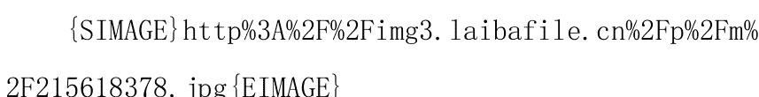

早盘反弹，你该跑，都给你说了。庄已经出货，剩下的都是反弹。

作者:66 端午 88 日期:2015-06-04 14:09

吴通通讯这么大利好都给揍下来五个点，

作者:66 端午 88 日期:2015-06-04 14:36

过山车啊，明天继续走强，就可以补今天的弱势股，今天探底，只能买强势股。

作者:66 端午 88 日期:2015-06-04 14:42

卫宁软件，逆势冲涨停

作者:66 端午 88 日期:2015-06-04 14:48

移仓力度不够，今天还是资金缩水。

作者:66 端午 88 日期:2015-06-04 15:05

@u_101434115 2015-06-04 14:50:42

老大，世纪鼎利还能补吗

不能补，该加速不加速，还是引导浪，高抛低吸，保持底仓运行。

作者:66 端午 88 日期:2015-06-04 19:17

@u_101434115 2015-06-04 14:50:42

老大，世纪鼎利还能补吗

@66 端午 88 2015-06-04 15:05:36

不能补，该加速不加速，还是引导浪，高抛低吸，保持底仓运行。

@wsq2002919 2015-06-04 16:05:06

老大，吴通回调能补仓不，谢谢！

@wsq2002919 2015-06-04 16:42:53

老大，上午加仓了交通银行，结果涨停。中长期看好，行不？

好长时间没看主板了，赶脚持续性差，小盘股一般 MACD 死叉后两天见低点。大盘股死叉后只是第一个低点，第二次反抽时，跌下来能打出来个更低的位置。

作者:66 端午 88 日期:2015-06-04 19:18

@红安土匪 2015-06-04 17:26:06

暴风这是玩人的节奏。早上 293 抛 100 股，看到跌下来了做做短差，没想到跌停啊。现在把昨天抛的都买回来了，成本变为 240 多。

加 v 信 1101284955，获取更多好帖

悠着点，这票少买点，太贵，现在抓补涨的小盘科技行业。

作者:66 端午 88 日期:2015-06-04 19:22

@u_101434115 2015-06-04 14:50:42

老大，世纪鼎利还能补吗

@66 端午 88 2015-06-04 15:05:36

不能补，该加速不加速，还是引导浪，高抛低吸，保持底仓运行。

@wsq2002919 2015-06-04 16:05:06

老大，吴通回调能补仓不，谢谢！

可以补，不过我加仓在早晨，收盘还小套。

作者:66 端午 88 日期:2015-06-05 07:29

@u_96869904 2015-06-04 22:30:57

妈蛋的忆通科技，这两天跌死了！三年兄，有必要调仓换股吗？

高抛低吸，持有底仓，你看过高送转的小盘股有不填权的吗？MACD 还没死叉哪，死叉后两天见低点，然后开始填权。

加 v 信 1101284955，获取更多好帖

作者:66 端午 88 日期:2015-06-05 07:32

@逛逛在抽烟 2015-06-04 22:35:15

66，解一小学学区房现在有必要现在买吗？现在大环境下合适吗？以后会不会中心位置也会掉价？

解放路第一小学的学区房都是二手房

作者:66 端午 88 日期:2015-06-05 08:11

@wzz810711 2015-06-05 07:45:31

老大，裕兴股份可以补不？

可以少量补仓，创业板少有的无风险股，就是不发力，看来还没到起爆点。

作者:66 端午 88 日期:2015-06-05 08:42

@朱晨霞 2015-06-05 08:24:26

现在还能入市吗

昨天暴跌中，可以杀入仍然翻红的强势小盘股，收盘大部分都涨停了。比如：福星晓程。

作者:66 端午 88 日期:2015-06-05 10:04

减了一半凯利泰，买入福星晓程

作者:66 端午 88 日期:2015-06-05 10:36

@mayguo 2015-06-05 10:24:59

加v信1101284955，获取更多好帖

股神的万邦达发威了

股神现在没有万邦达，额媳妇跟着买了，股神已撤离该股。

作者:66 端午 88 日期:2015-06-05 10:37

买着买着，品种又散了

作者:66 端午 88 日期:2015-06-05 10:39

吴通通讯要涨停哪

作者:66 端午 88 日期:2015-06-05 10:48

@简单粗暴的你 2015-06-05 10:43:16

一般情况下，总是会选择不涨的那只，放过涨的那个，鼎利比吴通涨得差很多，让我哭一会儿

控股股东持有比例不到 25%了，再减减仓就被轰跑了，不着急，这股一旦启动就是两倍的胜负，不是一倍，是两倍。

作者:66 端午 88 日期:2015-06-05 11:22

@牛牛年牛牛人 2015-06-05 11:19:21

国盛证券证实今日起将创业板股票全部调出两融标的

芝麻大的小券商，不给融，客户另投他处。

作者:66 端午 88 日期:2015-06-05 14:01

任子行，天天行。: (((

作者:66 端午 88 日期:2015-06-05 14:54

这是将要炒中车的节奏

作者:66 端午 88 日期:2015-06-05 15:04

套了。:(

作者:66 端午 88 日期:2015-06-05 15:17

@a3392103 2015-06-05 15:13:13

中车上市的走势会不会跟申万宏源一样。

看看中铝，如果有此种走势，得减仓创业板了，暂时做好准备。

作者:66 端午 88 日期:2015-06-05 21:59

@逛逛在抽烟 2015-06-04 22:35:15

66，解一小学学区房现在有必要现在买吗？现在大环境下合适吗？以后会不会中心位置也会掉价？

@66 端午 88 33743 楼 2015-06-05 07:32

解放路第一小学的学区房都是二手房

@逛逛在抽烟 2015-06-05 20:59:25

是，我知道，我是想把二环东路那大房子卖掉换成这儿的小房子，可以吗？

没必要，二环东路现在也很繁华，特别是经十路和花园路沿线。如果配属学区，没必要换。

作者:66 端午 88 日期:2015-06-05 23:52

大家对照一下 4 月 7 日-----21 日，上证综指-------创业板指，的对照图。当时是 4000 点沪市冲关，创业板调整。当上证冲关成功后，创业板开始加速补涨，现在是 5000点沪市冲关。小板应该调整 15 个自然日，大约调整两周 10-11个交易日。现在只调整了 2---3 个交易日。很多小票的 MACD会死叉，超强势的会走空中加油（不死叉，只粘合），适当减仓应对，保留底仓。水平高的，选择主板大票进行投机炒作，等着小票调整下来回补。水平一般的，逢高减仓，等待启动后补回。

作者:66 端午 88 日期:2015-06-06 00:05

如果设定创业板等小票是主战场，为了维持两周的调整，主板不会马上突破 5000 点，即使突破，也会回踩，暂时按照这种走势设定，随时调整应对策略。

作者:66 端午 88 日期:2015-06-06 00:07

为了维持大部分创业板品种调整，并且不会破位的话：创业板里的大票，滞胀票会充当对冲工具，比如华谊兄弟，东方财富等这类大票会强势运行。

作者:66 端午 88 日期:2015-06-06 22:04

@xiaoyucrc 2015-06-06 21:17:42

端午哥：今天深圳前海边上（宝安中心区）一楼盘开盘均价8万多，首推200多套全部抢光，最便宜1000万以上，市场是不是疯了？

炒股得来的钱，消费（投资）起来是不讲理智的。

作者:66 端午 88 日期:2015-06-06 22:05

@wsq2002919 2015-06-06 20:48:13

@66 端午 88

证监会叫停场外配资端口接入,啥节奏？对周一股市的影响几何？

对小股票影响较大，这周对两融和配资双重打压，明显不让过5000点。

作者:66 端午 88 日期:2015-06-07 12:08

周末利空频传，估计为期货做空方所散布，中国股市是政策市，管理层如对谣言型的市场恶意传闻不严厉整饬，就会丢失政策主导权，同时也放任了这种违法行为的肆意，市场经济是法制经济，近期凤凰网财经部门到处散布市场传闻，大部分消息引发市场震荡，麻烦的是这些提前透露的消息有兑现的，也有没兑现的，咋整哪？要是大部分没兑现，应该对它采取市场禁入措施。像这样的新型媒体，怎么对其规范？管理层首先要对自己的言行进行规范，一切政策以一个公正的主流媒体作为主导发布。统计局 CPI 数字的机密泄漏案就是市场传闻之所以广泛传播和被市场交易者普遍采纳的管理层不规范行为，首先要做到自己的公平公开公正清白。

加v信1101284955，获取更多好帖

作者:66 端午 88 日期:2015-06-08 11:11

等待新资金承接创业板，没高抛的淡定。中国历史上最短的牛市也得跑 1 年半。还差 7 个月哪。

作者:66 端午 88 日期:2015-06-10 13:30

大蓝筹只是反弹而已，看看创业板是双头还是再冲新高，创业板必须放量新高，否则第二个高点需要减仓。

作者:66 端午 88 日期:2015-06-10 14:08

大部分创业板受阻于下降的 5 日线，并且严重缩量，观望。

作者:66 端午 88 日期:2015-06-10 14:23

突破 5 日线的，可以补仓建仓

作者:66 端午 88 日期:2015-06-10 15:43

@66 端午 88 33836 楼 2015-06-10 14:23

突破 5 日线的，可以补仓建仓

@神静心清 2015-06-10 15:02:11

大哥，比如说鼎利么？

我的创业板除了亿利泰，都是一种走势。

加 v 信 1101284955，获取更多好帖

作者:66 端午 88 日期:2015-06-10 18:56

@平凡主妇 2015 2015-06-10 16:59:52

@66 端午 88 2015-06-10 15:43:21.0

我的创业板除了亿利泰，都是一种走势。

都是磨好久然后再爆发吗?

收盘在 5 日均线以上，就可以做滚动操作。

作者:66 端午 88 日期:2015-06-10 18:58

@66 端午 88 33836 楼 2015-06-10 14:23

突破 5 日线的，可以补仓建仓

@神静心清 2015-06-10 15:02:11

大哥，比如说鼎利么?

@66 端午 88 2015-06-10 15:43:21

我的创业板除了亿利泰，都是一种走势。

@tsboy321 2015-06-10 16:49:33

大哥 能帮我看看 300328 吗

已经企稳，可以继续持股

作者:66 端午 88 日期:2015-06-10 18:59

@红安土匪 2015-06-10 11:16:11

三年,我的 200 股暴风现在持仓成本为负值了。

你牛,额反弹到 286 卖掉了。: (

作者:66 端午 88 日期:2015-06-11 12:33

@我花发时百花杀 2015-06-11 11:40:38

老大,三泰还会有行情吗。

赶脚不会有大的机会了。

作者:66 端午 88 日期:2015-06-11 12:34

@听雪 159 2015-06-10 21:32:18

楼主,中国中车什么时候可以入手哇

现在好像还不行

作者:66 端午 88 日期:2015-06-11 14:39

加仓了世纪鼎利。

作者:66 端午 88 日期:2015-06-11 14:40

@66 端午 88 33836 楼 2015-06-10 14:23

突破 5 日线的,可以补仓建仓

@神静心清 2015-06-10 15:02:11

大哥，比如说鼎利么？

@66 端午 88 2015-06-10 15:43:21

我的创业板除了亿利泰，都是一种走势。

@tsboy321 2015-06-10 16:49:33

大哥 能帮我看看 300328 吗

@66 端午 88 2015-06-10 18:58:31

已经企稳，可以继续持股

@u_102016788 2015-06-11 12:43:50

老大帮忙看看 300172 如何

这股和世纪鼎利差不多，概念不如世纪鼎利

作者:66 端午 88 日期:2015-06-12 09:55

吴通通讯快新高了

作者:66 端午 88 日期:2015-06-12 09:56

耐心等待凯利泰的低吸机会。

作者:66 端午 88 日期:2015-06-12 09:58

创业板温和放量，暂时不看坏。

作者:66 端午 88 日期:2015-06-12 10:13

86 补回部分 81 减仓的凯利泰，卧槽。：（

作者:66 端午 88 日期:2015-06-12 11:38

@66 端午 88 2015-06-12 09:58:10

创业板温和放量，暂时不看坏。

@wsq2002919 2015-06-12 10:31:23

老大，帮看看 300383 光环新网走势，感谢！

下跌空间有限，调整时间不到

作者:66 端午 88 日期:2015-06-12 11:39

@wzz810711 2015-06-12 11:23:26

老大，裕兴股份终于要回本了，可继续持有吗？

持有，等新高

作者:66 端午 88 日期:2015-06-12 17:25

@平凡主妇 2015 2015-06-12 13:52:29

端午哥，感觉鼎利一直在压盘，是不是有二次大的交易，所以在控制股价？

这么执着的减持，在创业板里还没见过，为毛额每次都能搞到这种票，前面有安信信托，现在又蹦出来个世纪鼎利。建议部分逢高减持，剩下的锁仓不理了。

作者:66 端午 88 日期:2015-06-12 17:30

@简单粗暴的你 2015-06-12 14:56:33

吴通让我给出了，现在就拿了些世纪鼎利，

减持了 1000 股，立刻涨停，这是给额看的吗?

作者:66 端午 88 日期:2015-06-12 19:51

传闻易联众被华为重组，还有拿住的吗?

作者:66 端午 88 日期:2015-06-13 08:03

@66 端午 88 2015-06-12 19:51:11

传闻易联众被华为重组，还有拿住的吗?

@wsq2002919 2015-06-12 22:17:10

老大，是好还是坏呀，额还有点.

数涨停板吧，1，2，3，4，5----N

作者:66 端午 88 日期:2015-06-13 08:04

@66 端午 88 33877 楼 2015-06-12 17:30

@简单粗暴的你 2015-06-12 14:56:33

吴通让我给出了，现在就拿了些世纪鼎利，

减持了 1000 股，立刻涨停，这是给额看的吗?

加 v 信 1101284955，获取更多好帖

@107 国道的小猪 2015-06-12 20:28:40

三年兄，小弟工作很忙，没时间买股票，想买点基金，能否指导下，不然就拖大家后腿了，现在勤奋工作不跟随这波行情的，必须屌丝啊

现在买国企改革的基金，未来有赚

作者:66 端午 88 日期:2015-06-15 07:46

现在的点位，莫谈长线了。

作者:66 端午 88 日期:2015-06-15 10:57

@乌鸦 1972 2015-06-15 08:59:52

老大，炬华科技停牌，计划增发购买资产了。开盘几个涨停？呵呵

N 个，前面一直压盘，看来就是为了增发价格问题

作者:66 端午 88 日期:2015-06-15 16:19

@披着城市的外衣 2015-06-15 11:20:52

老大，世纪鼎利是什么情况？

早盘拉高不减仓啊，周六就给建议了。

作者:66 端午 88 日期:2015-06-15 16:22

@wsq2002919 2015-06-15 15:45:52

@66 端午 88

今天用鼎利做了一把 T,降低了成本。原来震荡中也有机会呀，

走弱了，不该接回来，本周是调整或者是见顶的最后一周（创业板），击破前低，应该大幅减仓，3640 是生命线（最后止盈点），3678 是 20 日线（强势支撑，跌破，就不能低补了），谨慎观望。

作者:66 端午 88 日期:2015-06-15 20:31

盯着上面的两个指数，第一个跌破，跑一半，第二个跌破，清仓。想出国的换美金，坚守的买房子锁定，不可做反弹。而且这波牛市结束后，沪市的年线图形是年线顶背离，需要调整大约 10 年左右或者更长（大约 10 年）。创业板大跌后，还会有牛市，1-2 年后。至于沪市为什么会熊十年，这是好几个技术高手的结论，额只是复述一下，因为是年线顶背离，就是说，我们过去 22 年，其实一直在走慢牛，还没有经历过一次真正的熊市。（个人观点，仅供参考）

而且这波行情是由创业板做头羊的，整个牛市是由创业板筑底开始的，发动，拉升也都是创业板引领的，创业出了头部，沪市也不远了。很早就像公布这个算法，不过怕影响大伙的持股心态。第一波：2050----3400，涨幅 0.6615，第二波，3049----，如果涨幅 0.6615，----------5160 点。（个人观点，仅供参考）

更可怕的事情是，这波牛市一旦结束，由于各种杠杆作用，会把各类理财和银行资金都裹挟进去，这个防火墙到底有没有，强到什么程度，鬼才知道。一旦演化成金融危机，也是我国金融系统第一次产生这么大规模的金融危机。（个人观点，仅供参考）

所以，今天晚上如果不出什么大利好，基本上凶多吉少，该说的都说了，大家自己拿主意。

作者:66 端午 88 日期:2015-06-16 09:50

小股票跌起来没底，没减的等反抽，会反抽 20 日均线的。

作者:66 端午 88 日期:2015-06-16 09:57

56 清仓吴通通讯

作者:66 端午 88 日期:2015-06-16 09:58

94 清仓凯利泰

作者:66 端午 88 日期:2015-06-16 10:01

世纪鼎利昨天减了一半，今天等反抽。

作者:66 端午 88 日期:2015-06-16 10:09

仓位至 20%，保证金不抢反弹，严守纪律。

作者:66 端午 88 日期:2015-06-16 10:19

今天晚上估计会出利好，没减仓的暂时忍耐，反抽再走。

作者:66 端午 88 日期:2015-06-16 10:35

@投机者的扑克 2015-06-16 10:28:20

加 v 信 1101284955，获取更多好帖

## 老大帮我看看京东方要清仓吗

大蓝筹会拉一波，只能小仓位参与，因为主流都在小股票上。

作者:66 端午 88 日期:2015-06-16 11:04

79.5 减仓卫宁软件。

作者:66 端午 88 日期:2015-06-16 11:07

@投机者的扑克 2015-06-16 10:54:34

地产B 涨停了啊

鬼都知道，这波下来，赚钱的都去锁定房产了。

作者:66 端午 88 日期:2015-06-16 11:07

@66 端午 88 33913 楼 2015-06-16 10:35 @投机者的扑克 2015-06-16 10:28:20 老大帮我看看京东方要清仓吗 大蓝筹会拉一波，只能小仓位参与，因为主流都在小股票上。

@投机者的扑克 2015-06-16 10:37:15

京东方也算大蓝筹+低价，为何也跌的像狗

唉，估计是你买了的原因吧。:(

作者:66 端午 88 日期:2015-06-16 12:17

碰到20日线，一定要减仓到五成以下。（个人观点，仅供参考）

作者:66端午88 日期:2015-06-16 12:57

再算一遍：{3406点（第一大浪顶点）-2010点（引导浪低点）}/2010=0.6945(上升幅度)

第二浪是调整浪

第三大浪理论涨幅： 3050*0.6945+3050=5168点。

实盘最高点：5178点，当日收盘5166点，未收在理论涨幅之上，额算错了，得出的是5160，所以并未逢高减仓，额是按照引导浪后的加速点算的。：(

作者:66端午88 日期:2015-06-16 12:59

如果再精细一点三浪起点是3049点，得出的理论涨幅是：5167点，还是没有越过。

作者:66端午88 日期:2015-06-16 14:14

创业板要杀跌的赶脚

作者:66端午88 日期:2015-06-16 14:31

唉，这么一算，离着最高点差了70头大肥猪啊，这得够吃一辈子了吧。：(

作者:66端午88 日期:2015-06-16 14:40

由于杠杆因素，今天尾盘有可能极速杀跌，这是融资被平仓的原因所致，而且以后有可能会越跌越快，同样是杠杆作用。

加v信1101284955，获取更多好帖

作者:66 端午 88 日期:2015-06-16 14:43

世纪鼎利真是抗跌，不过别抢哈，散户一抢都倒给你。

作者:66 端午 88 日期:2015-06-16 15:00

神车跌的只剩一半了，凡事牛市里的神，最后都会变坨坨。

作者:66 端午 88 日期:2015-06-16 18:31

@朱晨霞 2015-06-16 15:41:47

楼主老师以后真的会是电商时代吗

额现在也有点蒙圈，除了肉菜蛋奶，都电商了。可是电商基本没有利润空间，貌似依赖人力越多的服务业，刚性也越强。

作者:66 端午 88 日期:2015-06-16 18:34

@不惑之真惑 2015-06-16 15:32:37

端午兄的牛熊市判断变化太快了。
我倒觉得现在正是喊死了也不卖的时候。

今天几个朋友交流了一下，认为要打到 60 日线后，看反弹力度，额自衬熬不到 60 日线，所以只能大幅减仓。明天应该有反弹，反弹摸到 20 日线，可能是最后的逃命机会。

作者:66 端午 88 日期:2015-06-17 08:56

@朱晨霞 2015-06-16 15:41:47

加 v 信 1101284955，获取更多好帖

## 楼主老师以后真的会是电商时代吗

@66 端午 88 2015-06-16 18:31:16

额现在也有点蒙圈，除了肉菜蛋奶，都电商了。可是电商基本没有利润空间，貌似依赖人力越多的服务业，刚性也越强。

@静观万物并作 2015-06-17 00:10:45

电商的本质是金融，电商只是个壳，跟人力关系并不太大，肉蛋奶早晚也要拿下，冷链，有兴趣可以讨论一下，多少知道一点。

冷链的问题是人力成本和房租，难度比网商+速递模式成本高多了。

作者:66 端午 88 日期:2015-06-17 10:38

卧槽，就 10%的仓位也受不了啊。:(

作者:66 端午 88 日期:2015-06-17 10:48

@难得虎兔简约爱情 2015-06-17 10:42:52

楼主，亿通科技和世纪鼎利还能拿住吗？

额还有 3000 股亿通科技，3000 股世纪鼎利，1000 股卫宁软件。:(

作者:66 端午 88 日期:2015-06-17 12:50

两个顶做下降连线，突破我才敢进。

作者:66 端午 88 日期:2015-06-17 13:27

DUANG,卖了点世纪鼎利 40.16

作者:66 端午 88 日期:2015-06-17 13:41

减亿通科技

作者:66 端午 88 日期:2015-06-17 13:43

@平凡主妇 2015 2015-06-17 13:33:51

@66 端午 88 2015-06-17 13:27:35.0

DUANG,卖了点世纪鼎利 40.16

端午哥觉得鼎利反弹后还会调整?

看 60 分钟线，仍有调整。

作者:66 端午 88 日期:2015-06-17 13:54

卫宁软件清仓

作者:66 端午 88 日期:2015-06-17 14:10

不知不觉靠近了 20 日线，大家自己决策吧

作者:66 端午 88 日期:2015-06-18 09:53

额记着有个反弹秘籍上说了，反弹小趋势中，60 分钟线 MACD 穿越零轴就是绝佳买点。很快就到了，这也是检验反弹和上涨的试金石。

作者:66 端午 88 日期:2015-06-18 09:55

60 分钟线 向上穿越零轴，这会股价下跌，但是 MACD 惯性还会上冲，下一个小时穿越零轴了，观望

作者:66 端午 88 日期:2015-06-18 13:37

补回了昨日高抛的部分股票，并重新建仓了凯利泰

作者:66 端午 88 日期:2015-06-18 13:55

大幅加仓了凯利泰

作者:66 端午 88 日期:2015-06-18 14:30

去厕所哭会

作者:66 端午 88 日期:2015-06-18 19:07

现在进入 530 节奏，房价开始拉高，二线城市，半年内 30%+

作者:66 端午 88 日期:2015-06-18 19:31

@66 端午 88 34022 楼 2015-06-18 19:07

现在进入 530 节奏，房价开始拉高，二线城市，半年内 30%+

@神静心清 2015-06-18 19:26:19

大哥，那济南房价岂不是又要涨？

核心区房子等着放礼花

作者:66 端午 88 日期:2015-06-19 10:07

检讨，纪律就是用来遵守的，不是用来投机的。等反抽颈线

作者:66 端午 88 日期:2015-06-19 10:10

颈线反抽失败的几率是 80%。通常会先打到 60 日线，反弹至前高的颈线位，有时甚至会创新高，但会构成周线的顶背离。中线的最后逃命机会，此处需要忍耐大约 30 以上交易日。

作者:66 端午 88 日期:2015-06-19 10:16

凯利泰昨天买的原因是贪图抢权，一般情况下，熊市里大比例送股都会有 10%的涨幅，牛市大约有 20%-100%的涨幅，这货忒不要脸了，借送股出货。

作者:66 端午 88 日期:2015-06-19 10:54

@66 端午 88 34022 楼 2015-06-18 19:07

现在进入 530 节奏，房价开始拉高，二线城市，半年内 30%+

@神静心清 2015-06-18 19:26:19

大哥，那济南房价岂不是又要涨？

@66 端午 88 2015-06-18 19:31:38

核心区房子等着放礼花

加 v 信 1101284955，获取更多好帖

@djcsdn 2015-06-19 10:46:06

楼主，是不是忽略了失业率这个最大的变数，我认为不会涨这么快

这波房市上涨不会具备持续力，但是涨上去的很难掉下来，这波要买就买养老房。

作者:66 端午 88 日期:2015-06-19 14:31

这是创业板的 530，大股票更没戏，都是跟涨的，这和 2007 年是不同的。

作者:66 端午 88 日期:2015-06-19 14:32

@66 端午 88 34042 楼 2015-06-19 10:54

@66 端午 88 34022 楼 2015-06-18 19:07

现在进入 530 节奏，房价开始拉高，二线城市，半年内 30%+

@神静心清 2015-06-18 19:26:19

大哥，那济南房价岂不是又要涨？

@66 端午 88 2015-06-18 19:31:38

核心区房子等着放礼花

@红安土匪 2015-06-19 12:34:47

买房了将来更难出手了。现在房子还是过剩吧。买点贵金属,投资点新能源,我觉得还靠谱。

贵金属更难出手,而且还没有出租收益,这波牛市终结后,都得过几年苦日子了。

作者:66 端午 88 日期:2015-06-19 14:46

下面就该关注:金融市场的崩溃对实体经济的影响了,赶脚 GDP 增速很快会跌破 5%。

作者:66 端午 88 日期:2015-06-19 14:47

深沪股市跌幅都超过创业板指数跌幅。

作者:66 端午 88 日期:2015-06-19 14:47

估计很快就会救市,不过救市也没用了,都是反弹减仓的机会。

作者:66 端午 88 日期:2015-06-19 15:06

@66 端午 88 2015-06-19 14:47:57

估计很快就会救市,不过救市也没用了,都是反弹减仓的机会。

@红安土匪 2015-06-19 14:52:08

今天为何会如此大跌呀?完全没有任何太大的利空出来?难道晚上才会出来什么政策?

发行股票数量是按照加了杠杆的规模计算的，现在抽了杠杆，股票发行量没下来，这要是按照自然走势，牛市就结束了。

作者:66 端午 88 日期:2015-06-19 20:00

@我花发时百花杀 2015-06-19 19:52:24

咋整，是放着等反抽，还是周二割肉，大家商量下。

亏损比例在 20%以内，周末无重大利好消息，建议减仓，而且是大比例减仓，减 80-90%

作者:66 端午 88 日期:2015-06-19 22:34

@66 端午 88 34069 楼 2015-06-19 20:00:00

@我花发时百花杀 2015-06-19 19:52:24

咋整，是放着等反抽，还是周二割肉，大家商量下。

@我花发时百花杀 2015-06-19 21:17:32

亏损比例在 20%以内，周末无重大利好消息，建议减仓，而且是大比例减仓，减 80-90%

跌起来太快了，散户完全没反手之力，还在想着是不是很快会拉。几天功夫……

你逃不出来，庄也难出，不过人家有期货保护，散户要么依靠速度快，要么依靠资金成本优势，别无它途。

作者:66 端午 88 日期:2015-06-20 17:03

@wz_8808 2015-06-20 10:03:14

感觉三年兄对房市和市场宏观经济的各个层面是一个绝顶的高手，但在股市里突然没有了这个感觉了？特别是今年以来还是有一些浮躁的感觉………………
随口说说，不知道是不是这样

因为额是以真实价值估值，过了年开始，整个市场就是热炒垃圾股（重组），小盘股（成长）的市场行情，额的估值理念已经太根深蒂固了，一时半会无法纠正。:(
关键问题是：绩优股被管理层牢牢的摁死了，一涨就出利空。

作者:66 端午 88 日期:2015-06-21 18:57

@女人是上帝 2015-06-21 15:29:13

楼主合肥这样的城市算 2 线不？也能涨 30+?

弱二线只有核心区域涨，像济南这样的不会涨到神马东高速和西客站，假若他们强行涨，肯定要在明年吃套的，因为涨的不多，所以套的也不多。

作者:66 端午 88 日期:2015-06-21 19:02

加 v 信 1101284955，获取更多好帖

@66 端午 88 2015-06-15 20:31:12

盯着上面的两个指数，第一个跌破，跑一半，第二个跌破，清仓。想出国的换美金，坚守的买房子锁定，不可做反弹。而且这波牛市结束后，沪市的年线图形是年线顶背离，需要调整大约 10 年左右或者更长（大约 10 年）。创业板大跌后，还会有牛市，1-2 年后。至于沪市为什么会熊十年，这是好几个技术高手的结论，额只是复述一下，因为是年线顶背离，就是说，我们过去 22 年，其实一直在走慢牛，还没有经历过一次真正的熊市。（个人观……

@ythwgh820622 2015-06-20 23:02:04

楼主啊，你 15 号都看到大跌了，还形诸文字了，18,19 号还抢票，晕哦，人性还是贪婪的，生怕错失了大反弹哈？感觉股票，楼主今年一直操作的很乱，任子行，三泰,,, 扔了猛涨，涨了又追。。

你对房市的深度是我一直钦佩的，非常棒，追了好几年了都。

之所以重新买入凯利泰，是查阅了所有高送股创业板的股票，发现高送转前后在下跌 20%左右后，均可以实现盈利（最低要求），还不算爆发类型的，牛市熊市均有效。如果有耐心，它还是会站上 80 以上数日的，时间大约 20 个交易日。

加 v 信 1101284955，获取更多好帖

作者:66 端午 88 日期:2015-06-21 19:34

@不是竹篮 2015-06-21 19:24:33

楼主，深圳的房价你怎么看，刚需啊

几个月前给出建议了：不是股票高手，锁定利润买房（专指深圳）。

作者:66 端午 88 日期:2015-06-22 07:44

@66 端午 88 34088 楼 2015-06-21 19:34:00

@不是竹篮 2015-06-21 19:24:33

楼主，深圳的房价你怎么看，刚需啊

@不是竹篮 2015-06-21 19:39:50

几个月前给出建议了：不是股票高手，锁定利润买房（专指深圳）。

楼主，现在是否是 历史 高点啊？

肯定不是合理价位，至于泡沫程度，要看央行的了

作者:66 端午 88 日期:2015-06-22 07:46

@66 端午 88 34088 楼 2015-06-21 19:34

@不是竹篮 2015-06-21 19:24:33

加 v 信 1101284955，获取更多好帖

楼主，深圳的房价你怎么看，刚需啊

几个月前给出建议了：不是股票高手，锁定利润买房（专指深圳）。

@北腿大爷 2015-06-22 07:08:45

楼主您好！

您对济南新世界阳光花园的房子有研究吗？上午转了一下，8号楼6、7层复式172平米的房子，每平米1.35万，这个价格怎么样？适合入手吗？

非常感谢！

价格不好，而且相当不好，山水庭院促销尾房，5，6复试，1.05万，容积率0.7

作者:66端午88日期:2015-06-22 07:49

@格桑_达娃 2015-06-22 07:41:58

端午兄又看到你啦，高兴！

好久不见了:)

作者:66端午88日期:2015-06-22 08:09

支持农民工返乡创业，说明了什么问题？

作者:66端午88日期:2015-06-22 16:04

加v信1101284955，获取更多好帖

@YDFQ15 34067 楼 2015-06-19 16:31

@66 端午 88 34022 楼 2015-06-18 19:07

现在进入 530 节奏，房价开始拉高，二线城市，半年内 30%+

那现在岂不是在二线城市买房的好机会？买核心地段呢？
[来自 UC 浏览器]

@YDFQ15 2015-06-22 14:30:12

武汉，厦门，郑州都算是二线城市吧？如果在武汉买楼主建议在哪个区下手？

买房这事个性化非常强，你先分清楚是自住还是投资，
投资还得分长线出租和中短线炒价。自住：兼顾交通便利+
低容积率+安静+景观，位置可适当放宽一点。投资：位置+
位置+面积因素（中短线），位置+位置+容积率（长线）。

作者:66 端午 88 日期:2015-06-22 16:05

@66 端午 88 2015-06-22 08:09:48

支持农民工返乡创业，说明了什么问题？

@精艺良工 2015-06-22 13:21:34

加 v 信 1101284955，获取更多好帖

建筑业 餐饮业 餐饮业等可以吸纳大量农民工就业的行业发展不景气，就业需求下降。

赶脚是人力成本抬升导致很多低端行业无法接受了。说明中国对外出口产能竞争力下滑。

作者:66 端午 88 日期:2015-06-22 16:06

@66 端午 88 34095 楼 2015-06-22 07:46

@66 端午 88 34088 楼 2015-06-21 19:34

@不是竹篮 2015-06-21 19:24:33

楼主，深圳的房价你怎么看，刚需啊

几个月前给出建议了：不是股票高手，锁定利润买房（专指深圳）。

@北腿大爷 2015-06-22 07:08:45

楼主您好！

您对济南新世界阳光花园的房子有研究吗？上午转了一下，8号……

@北腿大爷 2015-06-22 10:23:04

非常感谢楼主的回复。

山水庭院位置太偏了，上班、孩子上学都太不方便了。

加v信1101284955，获取更多好帖

而且那个位置也不太好出租吧？

那地方除了有个实验初中外，也没啥好学校了。

作者:66 端午 88 日期:2015-06-22 21:49

@66 端午 88 34105 楼 2015-06-22 16:06

@66 端午 88 34095 楼 2015-06-22 07:46

@66 端午 88 34088 楼 2015-06-21 19:34

@不是竹篮 2015-06-21 19:24:33

楼主，深圳的房价你怎么看，刚需啊

几个月前给出建议了:不是股票高手,锁定利润买房(专指深圳)。

@北腿大爷 2015-06-22 07:08:4……

@北腿大爷 2015-06-22 17:20:10

抱歉，楼主，是我没讲清楚。

我的孩子明年上初中，学校是育英中学，而且我也不打算换学校了。

因此，我们打算在育英中学附近找一套房子。但是育英中学方圆领 2 公里之内，比较新一点的楼盘就只有万达、银座晶都国际、三建瑞福苑了。其他都是老的单位宿舍。

加 v 信 1101284955，获取更多好帖

如果扩展到 3 公里范围，新世界阳光花园也凑合。

而 3 公里范围之内，只有新世界阳光花园有新房，其他都是二手房。房龄 10 年之内的房子，除了这里，也都是……

----------------------------------------

赶脚应该在附近找个小房子租一下，凑合三年。买个准一二区域，交通好的长期坚守，高中要是走读，你还得再买。
一类区域已经彻底没有 11 层小高层了，出去一问：现在 18 层的板楼都叫小高层。

作者:66 端午 88 日期:2015-06-22 21:56

现在一类区域，只有两个花园洋房（6-8 层的），一个是名筑一品，均价 1.95 万（问了下实际成交价在 2.2 万），一个是利农六号，均价 1.9 万（实际为 2.4 万）。楼间距尚可忍受的恒大帝豪（均价 1.9，实际成交价在 2.1 万左右，大间距超高平层），其它中东部楼盘，基本都是养鸽子用的。

作者:66 端午 88 日期:2015-06-22 22:22

头阵子额媳妇股票赚了不少，整天嚷嚷着要买蓝石大溪地的别墅，这几天 DUANG------DUANG 的跳水，不支声了，加上跑了几次，额都是找着车多的时候让她体验，现在连一二层复式的洋房也不提了。

作者:66 端午 88 日期:2015-06-23 09:42

借反弹反抽，逐步降低仓位。

作者:66 端午 88 日期:2015-06-23 09:45

加 v 信 1101284955，获取更多好帖

教训啊，今年盈利从宝马 740 大幅下滑至只赚一个 MINI
越野车。：（
作者:66 端午 88 日期:2015-06-23 09:57
清仓了吴通通讯。
作者:66 端午 88 日期:2015-06-23 10:40
缩量找第二只脚，貌似明后天有反弹，不过要抓住机会
减仓。
作者:66 端午 88 日期:2015-06-23 11:31
@红安土匪 2015-06-23 10:54:54
三年的判断真准确，每次拉升都是逃跑的机会。

还是手慢了，凯利泰只跑了一半，还有一半结结实实两个跌停板，唉
作者:66 端午 88 日期:2015-06-23 13:13
到底了
作者:66 端午 88 日期:2015-06-23 13:56
清仓了凯利泰。
作者:66 端午 88 日期:2015-06-23 14:15
@三国刀斧兵 2015-06-23 14:01:37
凯利泰大幅拉升

76.85 卖的

加v信1101284955，获取更多好帖

作者:66 端午 88 日期:2015-06-23 15:36

@三国刀斧兵 2015-06-23 14:01:37

凯利泰大幅拉升

@66 端午 88 34138 楼 2015-06-23 14:15

76.85 卖的

@神静心清 2015-06-23 15:06:03

大哥,你怎么看这一波反弹,小弟以为是为了跟打新资金抢筹码,以待关门打狗,求大哥高见!

和530走势一致,太一致了,不要问额了,问大盘指数的历史。

作者:66 端午 88 日期:2015-06-23 15:39

现在知道是中线底部也没用,下一波炒什么的判断才是关键。看看再打下来到89日线后,什么东西能稳住,创出指数新高是什么拉动的。

作者:66 端午 88 日期:2015-06-23 20:32

经过反复权衡,拟对资产配置做出调整,5成股票资金移出,锁定房产。未来还有一波,不敢全仓做了。我怕贪婪难以控制,索性就不给贪婪太多机会。

作者:66 端午 88 日期:2015-06-24 09:57

加v信1101284955,获取更多好帖

创业板持续走软，热点集中于国企改革和军工行业。可能正在风格转变

作者:66 端午88 日期:2015-06-24 10:43

@66 端午88 34144楼2015-06-23 20:32

经过反复权衡，拟对资产配置做出调整，5成股票资金移出，锁定房产。未来还有一波，不敢全仓做了。我怕贪婪难以控制，索性就不给贪婪太多机会。

> @generabbit 2015-06-24 10:33:22

端午同学，你说房产税的实施最终会对房价导致啥影响呢，比如那种以前算近郊，现在由于开发扩大城区，发展成核心区域里面的联排啥，这种面积很大的，以前如今二线城市估价都要1000万的，虽然当初买入并不贵。这种房子，会不会因为税收持有成本高而神速贬值？比如1000万的，政府评估价大约800万左右，如果收税，按百分之4，持有成本一年接近40万。这会导致何等影响？

这种联排一定要买环境，只有容积率就瞎了。你能买到很便宜的农民房，但是环境就别提了。

作者:66端午88日期:2015-06-24 10:45

如果风格发生改变，建议散户做最后一把，半仓多点就可以了，还需观测近期反弹的热点在哪里，如确定风格转变，

加v信1101284955，获取更多好帖

持有50ETF，盈利50%后，彻底退出。

作者:66 端午88 日期:2015-06-24 10:46

这次调整是创业板拉着主板往下掉

作者:66 端午88 日期:2015-06-24 10:50

看了一周的房子了，发现一套188平的小高层还凑合，明后天准备交定金。

作者:66 端午88 日期:2015-06-24 11:02

由于近期核心区域房价坚挺，修正地产减记400万至150万，宜增持改善型次核心区域交通便利环境良好的自住房，置换出的核心位置住宅用于长期出租。

作者:66 端午88 日期:2015-06-24 11:18

七月份震荡探底行情，普通散户离的越远越好，你一买就调整，你一卖就反弹。可以一成仓做超跌反弹。主升浪做完的股票，连看都别看，杀跌很猛，反弹很快，一不留神就站岗了。

作者:66 端午88 日期:2015-06-24 11:20

就像股神昨天买的兆驰股份，抄底可以，今天一开盘，就拉涨停，然后任意点回调，你介入，都可能站岗。

作者:66 端午88 日期:2015-06-24 11:21

@66 端午88 2015-06-24 10:50:43

看了一周的房子了，发现一套188平的小高层还凑合，明后天准备交定金。

加v信1101284955，获取更多好帖

@xiaoyucrc 2015-06-24 11:15:28
啊！这么快就定了。

木办法，额容易手贱，赶紧自行剁手。

作者:66 端午 88 日期:2015-06-24 13:25

如果我不下决心买房，像吴通通讯中午的反弹，额肯定就忍不住追进去了，现在就踏实多了。

作者:66 端午 88 日期:2015-06-24 14:43

@名字很长好注册 2015-06-24 13:38:27

楼主，在3,4线城市买个平房小院翻建成小楼，这个投资怎么样？有土地证房产证

@名字很长好注册 2015-06-24 13:45:02
投资大概要80W，位置稍偏。

你租多合算

作者:66 端午 88 日期:2015-06-24 18:59

刚才出了新闻：取消75%的存贷比，这标志着货币再次滥发的宣言，立刻扑向房地产。创新型小盘股逢高减持，转为：紧盯房地产（中小型为主），严密观测煤炭，有色。暂时不要着急抢筹，等二次探底，不过下波的热点品种可能不

加v信1101284955，获取更多好帖

会下跌了。

作者:66 端午88 日期:2015-06-24 19:02

@66 端午88 2015-06-24 10:50:43

看了一周的房子了，发现一套188平的小高层还凑合，明后天准备交定金。

@垮掉的视觉 2015-06-24 15:51:54

端午哥还是买的济南的房么，城镇化进入后半场，二线城市房价能保值多久，是否应该关注永远上涨的一线城市呢，最近董攀等大神都在搞北京郊区的团购，理由是不限购，10年后涨幅超过二线核心并永久上涨。

环顾四周，还是济南的房子便宜，我记得2002年，北京三环的房子5000冒点头，济南的房子1500-2000之间。现在北京三环的房子，六万起，济南的房子，8000-10000。

作者:66 端午88 日期:2015-06-24 19:07

未来各个大型城市，将会积极争夺户籍人口，会因此出台各自的鼓励流入政策，鼓励人口和企业的并行流入。

作者:66 端午88 日期:2015-06-24 19:20

今天新闻挺多啊，央行乱印钞票，证监会胡印股票，政府另起炉灶。

作者:66 端午88 日期:2015-06-24 22:19

加v信1101284955，获取更多好帖

@不是竹篮 2015-06-24 21:07:08
楼主，深圳地产泡沫什么时候破？
------------------------

人口不再涌入时
作者:66 端午88 日期:2015-06-24 22:20
@66 端午88 34176楼 2015-06-24 19:20

今天新闻挺多啊，央行乱印钞票，证监会胡印股票，政府另起炉灶。

楼主你好，我也济南的，想卖掉二环南路蓝天绿园140平房子一套，板式小高层户型好，媳妇反对，犹豫中，想听听您的高见。

@我是帅克 2015-06-24 21:32:49
------------------------

自住尚可，为什么要卖？现在要卖房炒股绝对是错误的
作者:66 端午88 日期:2015-06-25 10:11
中国医药，厦门信达，新世界。关注
作者:66 端午88 日期:2015-06-25 12:40

额们管中国共产党叫：妈妈
额们管中华人民共和国叫：母亲
额们管中国人民银行叫：央妈
老百姓不是子民又是什么？

加v信 1101284955，获取更多好帖

作者:66 端午 88 日期:2015-06-25 12:43

下阶段主力板块初露端倪: 1. 国企改革 2. 房地产

前面说的三个都是国企改革, 房地产关注: 首开股份, 鲁商置业, 银亿股份

作者:66 端午 88 日期:2015-06-25 13:11

中午交了定金, 为中国经济发展贡献了一点微薄之力。

作者:66 端午 88 日期:2015-06-25 13:17

@66 端午 88 2015-06-25 13:11:56

中午交了定金, 为中国经济发展贡献了一点微薄之力。

@风风的的 2015-06-25 13:12:39

买房了?

是啊, 炒股是为了什么啊? 就是为了买房呗。

作者:66 端午 88 日期:2015-06-25 21:41

风险厌恶者: 关注银行稳进, 年化收益 50%了, 守到年底也有近 25%的收益, 爽呆。

作者:66 端午 88 日期:2015-06-25 21:42

银华稳进

作者:66 端午 88 日期:2015-06-25 21:43

@隼眼 2015-06-25 21:10:05

顶一个, 向楼主请教一下, 济南国际会展中心北边的几

加v信1101284955,获取更多好帖

个楼盘咋样?海信慧园等，主要是考虑有个高新区第一实验学校，方便孩子上学。

这地方比较尴尬，作为新核心区，价格比老区和新区的过渡地段还贵。

作者:66 端午 88 日期:2015-06-25 23:56

纠正：银华稳进是永续型基金，只有在高限和底限进行折算，否则是永远也看的着，摸不着，理论高收益没用。

作者:66 端午 88 日期:2015-06-25 23:58

@精艺良工 2015-06-25 23:53:35

三年老师:

我是江苏徐州的，想买一套大户型自己住，以后方便孩子上学。现在有两种方案:

方案一：徐州二环路以内的均价是 1.5 万/平米左右 以容积率高的高层为主，车位的价格在 15 万到 20 万之间。买一套距离市区内具有优势教育资源的小学附近。

方案二：在徐州的行政中心也就是新城区买一套大平层或者 2 层洋楼，让孩子在新城区学校读小学，以后父母也可以过来一起住。新城区的小学都是市里小学的分校，徐州的两家三......

确定住 20 年以上话，后者好一些，配套可以慢慢等。

加 v 信 1101284955，获取更多好帖

作者:66 端午88 日期:2015-06-26 09:41
@66 端午88 2015-06-25 23:56:13
纠正：银华稳进是永续型基金，只有在高限和底限进行折算，否则是永远也看的着，摸不着，理论高收益没用。

@tsboy321 2015-06-26 09:39:42
三年老师能再解释一下吗？不明白啊

额理解错了，别买
作者:66 端午88 日期:2015-06-26 09:47
盯着额说的股票，别买，等均线走好再买。

作者:66 端午88 日期:2015-06-26 09:51
创业板指数奔跌停去了，吓死，空前绝后啊

作者:66 端午88 日期:2015-06-26 10:11
观测标的增加泸州老窖

作者:66 端午88 日期:2015-06-26 10:19
系统风险只有1%的股票可以逆势走强，2800只股票，
只有28只，很难选中，所以，不抢反弹，不抄底。

作者:66 端午88 日期:2015-06-26 11:23
@66 端午88 34219楼 2015-06-26 10:19
系统风险只有1%的股票可以逆势走强，2800只股票，
只有28只，很难选中，所以，不抢反弹，不抄底。

加v信1101284955，获取更多好帖

@神静心清 2015-06-26 11:22:41
大哥，手上还有几只票没跑掉，现在割肉行吗？

已经晚了，等吧，今天股灾，股灾跑是绝对错误的，但是股灾后的反弹要是不跑，就错上加错了。

作者:66 端午 88 日期:2015-06-26 11:25
800 家跌停，等 1400 个跌停时，一定会反弹的。

作者:66 端午 88 日期:2015-06-26 11:58
无利好，且反弹至 60 日缩量时，可减仓。

作者:66 端午 88 日期:2015-06-26 13:04
@66 端午 88 2015-06-26 11:25:32
800 家跌停，等 1400 个跌停时，一定会反弹的。

@YUXJ2521 2015-06-26 11:58:23
能说说逻辑吗？

肖刚上午在陆家嘴话就没讲完就跑了，估计回去商量稳定股市去了。

作者:66 端午 88 日期:2015-06-26 13:53
额同学所在营业部开始强平了，晕死，一天融资额下滑15%。

加v信1101284955，获取更多好帖

作者:66 端午88 日期:2015-06-26 13:54
忍住，快反弹了，目前1500个跌停，超标了
作者:66 端午88 日期:2015-06-26 14:07
金融风险有可能已经爆发，向银行理财和违规进入股市的银行资金蔓延。
作者:66 端午88 日期:2015-06-26 14:10
1800只跌停，空前绝后。
作者:66 端午88 日期:2015-06-26 14:45
这个点位养老金不会买，只会卖。等政策救市吧，不救这次没底，融资盘分层强平，压力太大了。
作者:66 端午88 日期:2015-06-26 15:01
@66 端午88 34229楼 2015-06-26 13:54
忍住，快反弹了，目前1500个跌停，超标了
89日线碰了，反弹能入点吗？空仓半个月了，本来想六月不碰了的

@11b861112 2015-06-26 14:52:05
这种跌停碰，额是不敢买了，要是慢慢跌下来还敢买点。
作者:66 端午88 日期:2015-06-26 15:02
买房的策略还是对的，至少现在看是对的。
作者:66 端午88 日期:2015-06-26 15:22

加v信1101284955，获取更多好帖

@66 端午88    2015-06-26 15:02:35
买房的策略还是对的，至少现在看是对的。

@generabbit 2015-06-26 15:05:28
一般来说，你会买当地最贵的新区的房子吗？

不会，我一般买能买的起的最贵的。：（
作者:66端午88日期:2015-06-2615:23
额要是中间不搞那把两个跌停的，这会算非常完美，艹，
晚节不保，吸取经验教训，下次牛市再来过。
作者:66端午88日期:2015-06-2616:31
牛市结束不结束，不要猜，等着均线走好了就知道了，
现在猜底就是接飞刀。
作者:66端午88日期:2015-06-2616:32

@66端午88    2015-06-2615:02:35
买房的策略还是对的，至少现在看是对的。

@generabbit    2015-06-2615:05:28
一般来说，你会买当地最贵的新区的房子吗？

@66端午88    2015-06-2615:22:08
不会，我一般买能买的起的最贵的。：（

加v信1101284955，获取更多好帖

@generabbit 2015-06-26 16:08:56

你这个意思是，济南最贵的楼盘你买不起？这个不至于嘛。

济南最贵的，额当然买不起，买得起也不能买，比如恒大帝景，平均260平，一平两万多。

作者:66端午88 日期:2015-06-26 19:45

@66端午88    2015-06-26 16:32:48

济南最贵的，额当然买不起，买得起也不能买，比如恒大帝景，平均260平，一平两万多。

@generabbit 2015-06-26 18:06:57

那，端午同学，能说下你不买的理由吗？

额想买而没买着一二个楼盘，历山名郡，一期5700抽号没抽到，二期8100排队没排上，然后三期1.3万就觉得不值了，最后尾盘炒到1.7万，到现在也没涨，基本就是顶部了。其它房子曾经有个朋友转一套200平的东外环洋房，当时刚买了房子手头紧。利农六号的6,7复式预交款（5000一平），当时拿不准，没买，开盘1.25万，比较悔，不过这个全款定金要提前5年交，搁谁也拿不准吧。再往后数，都是买可不买的，核心位置都是高层，6层洋房位置太偏。

作者:66 端午88 日期:2015-06-26 19:47

@平凡主妇2015 2015-06-26 19:12:03

端午哥能点评下厦门的房子吗？打算投资套小的。谢谢

有机会拿下问题不大，那个岛没多大地方盖新房了。

作者:66 端午88 日期:2015-06-27 12:05

关于分级基金的套利：大家可以研究一下，现在银华A折价20%，银华B溢价20%，没有套利空间，等到银华B溢价回缩到10%左右时，各买入1000股（份），合并后，基金赎回，就构成套利了。

作者:66 端午88 日期:2015-06-27 17:31

降息了，利好房地产和房地产股票

作者:66 端午88 日期:2015-06-27 17:35

@286244986 2015-06-27 17:10:57

@66 端午88 34268楼 2015-06-27 12:05:00

关于分级基金的套利：大家可以研究一下，现在银华A折价20%，银华B溢价20%，没有套利空间，等到银华B溢价回缩到10%左右时，各买入1000股（份），合并后，基金赎回，就构成套利了。

楼主大神，关注您很久了，跪求买房指导。我是80后刚需，目前怀孕在湖南老家休息，老公马上要从上海离职回湖南做事，老公一级建造师，新公司长沙，常……

小学需要提前三年以上购置房产，以应付落户和学籍考察。我个朋友以前在长沙，现在跑深圳发展了，她说：靠着江边的好，尤其靠近岳麓山的江景房，肯定是首选。

作者:66 端午 88 日期:2015-06-27 20:35

@tsboy321 2015-06-27 19:02:46

@66 端午 88 34270 楼 2015-06-27 17:31:00

降息了，利好房地产和房地产股票

这表明现在点位是底了吧

不要猜底，不要认为自己能抄到底，均线走好再说。今天利好，有利于筑底，但等到筑出底在介入。今天看好后市的声音空前的一直，这不是好现象。

作者:66 端午 88 日期:2015-06-28 09:21

@荒原的鹰 2015-06-27 20:58:22

请教一下楼主，手里就20多万的首付，在济南买哪个位置会比较好？泰安有个房子，均价8000多，位置非常好，如果是这样的话，卖哪个城市的能好点？也想在济南买个一室一厅的，但位置能好点的，自住，以后再还大的，这样可以吗？

毫无疑问，卖掉泰安的，买入济南的，山东区域内，济南的前景远比青岛的房价走势要乐观一些。

作者:66 端午 88 日期:2015-06-28 09:24

@66 端午 88 2015-06-27 17:31:45

降息了，利好房地产和房地产股票

@wsq2002919 2015-06-28 07:23:48

老大，上周五抄了几万地产b，后市可看好不？啥时候可以抛？烦请明示。

偶然抄在底部的，建议明天反弹跑一半，止损点在抛出后，再探底时，利润被全部耗尽之前。等待趋势变化的转折点。

作者:66 端午 88 日期:2015-06-28 10:49

刚才量化计算：反弹终结的点位可能在4400附近。

作者:66 端午 88 日期:2015-06-29 09:47

牛股找出来了，跌下来可以少量介入：中国医药

作者:66 端午 88 日期:2015-06-29 11:24

@援剿总兵贺人龙 2015-06-29 11:18:46

给楼主问好。

震荡市，艺高人胆大的可以玩玩。

可惜我两个股票，一个停牌，一个st天天跌停。动弹不得。

觉着自己不大中的，就谢谢。小仓位哈，一成以下。

作者:66端午88日期:2015-06-29 11:24

小票坚决回避，别动抢反弹，摊低成本的念头，打死不买。

作者:66端午88日期:2015-06-29 13:05

连跌几天，合规融资仅下降5%，赶脚融资额度会下滑30-35%之间，才会筑底结束，唉，观望，不抄底。

作者:66端午88日期:2015-06-29 15:45

@YDFQ15 2015-06-29 15:15:00

端午哥，您觉得哪个二线城市现在比较好入手？东莞也会涨吗？相比东莞，武汉潜力怎么样？

区域中心城市+二线城市，房价没有爆炒过的，人口没有净流出。南京，济南，武汉这类城市比较典型，南京房价不知现在高不高。

作者:66端午88日期:2015-06-29 15:46

@痛苦的鱼 2015-06-29 15:09:44

有消息传保监会要求保险公司必须保持7成仓位。主攻方向权益、蓝筹、银行、保险。下午1点半证监会紧急会议，讨论暂时停止IPO事宜，会议通知已经发出。

莫听谣言。

作者:66端午88日期:2015-06-29 16:22

@66端午88 34310楼 2015-06-29 15:45

@YDFQ15 2015-06-29 15:15:00

端午哥，您觉得哪个二线城市现在比较好入手？东莞也会涨吗？相比东莞，武汉潜力怎么样？

区域中心城市+二线城市，房价没有爆炒过的，人口没有净流出。南京，济南，武汉这类城市比较典型，南京房价不知现在高不高。

@generabbit 2015-06-29 16:17:43

替楼主补个郑州，不过去年至今，郑州房价不降反升，不知道这次是不是还和大趋势相反

本来是想列上，不过河南人口流出大省，加上媒体报道郑州大量住宅空置，没敢造次。

作者:66端午88日期:2015-06-29 17:08

只从技术分析：由于跌破前期底部4099点，后面有两种走势，继续杀跌，先到 3450 附近，直接宣告牛市结束，开始长周期盘整，明年创新高。另一种走势，在 120 日附近构筑反弹底部，向上反弹至 XXXX 点，构筑周线顶背离，参见 2007 年（4800-5500 点反弹），第二种走势是长期顶部的构筑结构，最后的逃命机会。

作者:66 端午 88 日期:2015-06-29 18:44

@66 端午 88 34313 楼 2015-06-29 16:22

@66 端午 88 34310 楼 2015-06-29 15:45

@YDFQ15 2015-06-29 15:15:00

端午哥，您觉得哪个二线城市现在比较好入手？东莞也会涨吗？相比东莞，武汉潜力怎么样？

区域中心城市+二线城市，房价没有爆炒过的，人口没有净流出。南京，济南，武汉这类城市比较典型，南京房价不知现在高不高。

@generabbit ……

@YDFQ15 2015-06-29 18:37:01

谢谢端午哥以及上面朋友的意见。武汉确实还挺不错的，很有活力的城市，人口又多。湖多漂亮，美中不足就是重工业弄的空气污染。要投资还是买繁华地段哦？

投资必须买核心，这也是纪律。

作者:66 端午 88 日期:2015-06-29 20:33

@聪明的小散 2015-06-29 20:07:03

郑州是个很奇葩的地方，郊区楼盘，容积率超过4，还能卖一万出头，居然还能被哄抢而光。实际房价感觉比济南高的不是一点半点。济南西二环边的龙腾国际花园，挨着森林公园才卖7000，在郑州最起码1万2

龙腾花园我刚去看过，看中的大约在9500-10500之间，那个7000起价，根本就没有，最低的8000.

作者:66 端午 88 日期:2015-06-30 08:23

@狙击2016 2015-06-29 20:58:53

@66 端午 88 2015-06-29 20:33:43.0

龙腾花园我刚去看过，看中的大约在9500-10500之间，那个7000起价，根本就没有，最低的8000.

您好端午哥，默默地看您的帖子好久了，多少受您的影响还炒了下股，现在已经清仓。运气不错在这么恶劣的环境下还没有亏钱。中间还像别人推荐过世纪鼎利，那段时间涨势还好。本人是临沂人，不知端午哥对临沂熟悉不？开始看您的帖子也是因为您对房价判断......

还成，临沂有段时间学习温州，商业发展的不错，弱三线城市，额有个朋友和李群世交，极为欣赏。不过临沂人口流出挺大，很大一部分在济南发展，临沂人比菏泽人厚道。

作者:66 端午88 日期:2015-06-30 10:00

@红安土匪 2015-06-30 09:50:47

这种跌法完全就是要套死所有没有跑的。

一年，翻番算做的差的，比贩毒利润还高，埋单时刻，不走的埋单。

作者:66 端午88 日期:2015-06-30 10:47

@红安土匪 2015-06-30 09:50:47

这种跌法完全就是要套死所有没有跑的。

@66 端午88 2015-06-30 10:00:21

一年，翻番算做的差的，比贩毒利润还高，埋单时刻，不走的埋单。

@红安土匪 2015-06-30 10:14:54

今天建仓可以。可以小反弹一下吧。

融资盘会被层层强平，这和以前不一样，以前套牢强扛，现在你想扛，不让你扛，最后多杀多，杀到融资盘被彻底摧毁。

作者:66 端午 88 日期:2015-06-30 11:13

@u_103379079 2015-06-30 10:57:19

三年兄，现在买房子依然无忧吗？我感觉股市下来了，楼市顶多滞后 3—6 个月，也会上演下跌景象，参考 07—08 年！你觉得呢？

济南房价一直很低，我记得 2002 年，北京三环的房价在 5000 多，那会济南在 2000 左右，一类区域价格在 3500 左右。现在北京三环房价 6.5--8 万，涨了 15 倍，济南现在一类区域在 1.5 万左右，只涨了四倍多一点。济南外环附近的房价以前大约是 2500 左右（2006 年），现在才不到 7000.最近 3 年一点没涨。

作者:66 端午 88 日期:2015-06-30 14:57

没忍住，买了点 ETF180 和恒顺醋业，中国医药。明天不准把额套住。

作者:66 端午 88 日期:2015-06-30 15:40

@狙击 2016 2015-06-30 11:14:42

@66 端午 88 2015-06-30 08:23:54.0

还成，临沂有段时间学习温州，商业发展的不错，弱三线城市，额有个朋友和李群世交，极为欣赏。不过临沂人口流出挺大，很大一部分在济南发展，临沂人比菏泽人厚道。

端午哥还想请您帮忙说下临沂楼市。您已经说到临沂人口流出严重，这点我也比较认同。想请能展开讲一下！本人一直不看好临沂楼市，看好大地方楼市，原计划2016买房，请指点一二，在......

临沂是常住还是能出来发展，以后小城市的机会越来越少，除非在体系内。

作者:66端午88日期:2015-06-30 16:29

@66端午88 2015-06-30 14:57:06

没忍住，买了点ETF180和恒顺醋业，中国医药。明天不准把额套住。

@红安土匪 2015-06-30 15:56:25

三年，你对后市看高到多少？我的群里面大家觉得不超过4600，甚至站上4500都不错了。

买的最多的是ETF180,就是为了快速逃命，小股票跌起来跑不出去。

作者:66端午88日期:2015-06-30 21:06

@66端午88 34280楼 2015-06-28 09:21

@荒原的鹰 2015-06-27 20:58:22

请教一下楼主，手里就20多万的首付，在济南买哪个位置会比较好？泰安有个房子，均价8000多，位置非常好，如果是这样的话，卖哪个城市的能好点？也想在济南买个一室一厅的，但位置能好点的，自住，以后再还大的，这样可以吗？

毫无疑问，卖掉泰安的，买入济南的，山东区域内，济南的前景远比青岛的房价走势要乐观一些。

@扇乱春秋 2015-06-30 19:45:49

估计楼主是没有实地去过济南和青岛，济南作为山东第三城市，除了有个省会，其他真心没法和青岛比，是任何方面，济南去青岛打工的一片一片的，在济南，你却绝少见到胶东半岛过去讨生活的～

额天，额过去一百多次北京吧，青岛也得五六十次吧。：）

作者:66端午88日期:2015-07-01 12:54

20小时均线已经下移至2328，如不能突破，将再次向下调整。

作者:66端午88日期:2015-07-01 12:57

4323.

作者:66 端午 88 日期:2015-07-01 14:53

跑的快，也亏了两个点，又一次手贱刹手的赶脚。：（

作者:66 端午 88 日期:2015-07-01 15:14

市场底一定是低于政策底的，咋每次都不长记性哪。：（

作者:66 端午 88 日期:2015-07-01 20:59

河南开征房产出租税，河南房屋租赁新规实行 房租2000 缴税 600。呵呵了，坐看河南房地产崩盘。

作者:66 端午 88 日期:2015-07-02 07:15

证监会连夜发布利好，扩大杠杆倍率，由此前的净资本二倍扩大至四倍，不再要求强平融资盘，券商短债常态放开，停止审批，只做备案，允许券商对融资抵押品权益转债处理，不再对场外配资进行清理。降低过户和手续费。

作者:66 端午 88 日期:2015-07-02 07:43

天天耳茄子，晕了。

作者:66 端午 88 日期:2015-07-02 09:02

中国只有一次慢牛，就是 96 年到 2001 年，其实是非常难做的，额那几年完全放弃股市，专心搞实业了。结果到 2000 年没熬住，小仓位杀进去一次，一套 5 年，2007 年才解套。

作者:66 端午 88 日期:2015-07-02 10:10

这么多利好，基本没表现，看来是进入熊市了。

作者:66 端午 88 日期:2015-07-02 11:07

@绝不在门口徘徊 2015-07-02 10:34:40

三年大哥定制家具太难卖了，能教我炒股么？

我看着现在定制家具都是在微信上卖了。

作者:66 端午88 日期:2015-07-02 11:08

@沧海水手91888 2015-07-02 10:22:36

@66 端午88 34388楼 2015-07-02 10:10:00

这么多利好，基本没表现，看来是进入熊市了。

有种说法可以解释：国际做空中国股市。

现在买股票都得先把自己灌醉了，才敢下单。

作者:66 端午88 日期:2015-07-02 14:19

彻底熊了，可以不聊股票了，咱们以后只聊房子，谁提股票打出去。：（

作者:66 端午88 日期:2015-07-02 15:01

@66 端午88 2015-07-02 14:19:23

彻底熊了，可以不聊股票了，咱们以后只聊房子，谁提股票打出去。：（

@xiaoyucrc 2015-07-02 14:28:42

端午哥：我开工两套房子了，一套自住，一套出租，自住的打算去福建买大红酸脂的红木沙发，听说红木也要跌了，是楼上的朋友和我说的，她说让我等等。

木材跌，家具可不定就跌，一套还得几十万。

作者:66 端午 88 日期:2015-07-02 18:04

带头违规：刚才银监会停了指数期货。

作者:66 端午 88 日期:2015-07-02 18:54

@66 端午 88 34411 楼 2015-07-02 18:04

带头违规：刚才银监会停了指数期货。

@aobog 2015-07-02 18:17:23

三年兄。公寓还能买吗

不能买，只能买住宅。

作者:66 端午 88 日期:2015-07-02 18:55

还有多少人拿着股票啊？统计一下仓位

作者:66 端午 88 日期:2015-07-02 20:21

@66 端午 88 34416 楼 2015-07-02 18:55

还有多少人拿着股票啊？统计一下仓位

@aobog 2015-07-02 18:58:16

我。半年前入市小白。盈利 20 个点。现在调整还有五个点了。。此波调整主要买了证券避险。一支新华医疗停牌躲过大跌。。这周入泸州老窖套。明天估计就要亏损了。

建议反弹止盈，反弹一个点也是反弹。

作者:66 端午 88 日期:2015-07-02 20:22

@66 端午 88 34416 楼 2015-07-02 18:55

还有多少人拿着股票啊？统计一下仓位

@神静心清 2015-07-02 18:59:56

大哥。。。我半仓。。。

反弹减仓，2 成仓就不少了。均线走好后补回来。

作者:66 端午 88 日期:2015-07-02 20:24

@66 端午 88 34416 楼 2015-07-02 18:55

还有多少人拿着股票啊？统计一下仓位

@神静心清 2015-07-02 18:59:56

大哥。。。我半仓。。。

最少需要减一半。逮住利好，反弹涨不动时，减一半。

作者:66 端午 88 日期:2015-07-02 22:22

@66 端午 88 34416 楼 2015-07-02 18:55

还有多少人拿着股票啊？统计一下仓位

@神静心清 2015-07-02 18:59:56

大哥。。。我半仓。。。

@wsq2002919 2015-07-02 22:02:24

半仓亿通，吴通。另有三只停牌。呜呜,

唉，每次额割肉都通知大伙了，怎么还拿这么多啊。

作者:66端午88日期:2015-07-02 22:23

@wzz810711 2015-07-02 22:03:43

老大，裕兴股份亏一半呐，如何操作？

反弹减一半，均线走好再补仓。赶脚盈利是很难了，做减亏的预期。

作者:66端午88日期:2015-07-02 22:24

刚才看到网上说要抓恶意做空的了，恶意做空本来应该被市场惩罚的，做游戏规则外的动作不妥吧，赶脚是真熊了，熊就是每次抬头都是跑路的机会。

作者:66端午88日期:2015-07-02 22:36

楼主：66 端午88 时间：2015-06-15 20:31:12

盯着上面的两个指数，第一个跌破，跑一半，第二个跌破，清仓。想出国的换美金，坚守的买房子锁定，不可做反。

## 股市分析与预测

而且这波牛市结束后，沪市的年线图形是年线顶背离，需要调整大约10年左右或者更长（大约10年）。创业板大跌后，还会有牛市，1-2年后。至于沪市为什么会熊十年，这是好几个技术高手的结论，额只是复述一下，因为是年线顶背离，就是说，我们过去22年，其实一直在走慢牛，还没有经历过一次真正的熊市。（个人观点，仅供参考）

而且这波行情是由创业板做头羊的，整个牛市是由创业板筑底开始的，发动，拉升也都是创业板引领的，创业出了头部，沪市也不远了。很早就像公布这个算法，不过怕影响大伙的持股心态。第一波：2050----3400，涨幅0.6615，第二波，3049----，如果涨幅0.6615，----------5160点。（个人观点，仅供参考）

更可怕的事情是，这波牛市一旦结束，由于各种杠杆作用，会把各类理财和银行资金都裹挟进去，这个防火墙到底有没有，强到什么程度，鬼才知道。一旦演化成金融危机，也是我国金融系统第一次产生这么大规模的金融危机。（个人观点，仅供参考）

所以，今天晚上如果不出什么大利好，基本上凶多吉少，该说的额都说了，大家自己拿主意。

正在朝着最坏的方向逼近，最可怕的问题可能正在发生。

作者:66端午88 日期:2015-07-02 22:54

加v信1101284955，获取更多好帖

---

楼主：66端午88 时间：2015-06-15 20:31:12

盯着上面的两个指数，第一个跌破，跑一半，第二个跌破，清仓。想出国的换美金，坚守的买房子锁定，不可做反弹。而且这波牛市结束后，沪市的年线图形是年线顶背离，需要调整大约10年左右或者更长（大约10年）。创业板大跌后，还会有牛市，1-2年后。至于沪市为什么会熊十年，这是好几个技术高手的结论，额只是复述一下，因为是年线顶背离，就是说，我们过去22年，其实一直在走慢牛，还没有经历过一次真正的熊市。（个人观点，仅供参考）

而且这波行情是由创业板做头羊的，整个牛市是由创业板筑底开始的，发动，拉升也都是创业板引领的，创业出了头部，沪市也不远了。很早就像公布这个算法，不过怕影响大伙的持股心态。第一波：2050----3400，涨幅0.6615，第二波，3049----，如果涨幅0.6615，----------5160点。（个人观点，仅供参考）

更可怕的事情是，这波牛市一旦结束，由于各种杠杆作用，会把各类理财和银行资金都裹挟进去，这个防火墙到底有没有，强到什么程度，鬼才知道。一旦演化成金融危机，也是我国金融系统第一次产生这么大规模的金融危机。（个人观点，仅供参考）

所以，今天晚上如果不出什么大利好，基本上凶多吉少，该说的额都说了，大家自己拿主意。

加v信1101284955，获取更多好帖

---

@66端午88 2015-07-02 22:36:30
正在朝着最坏的方向逼近，最可怕的问题可能正在发生。

@我花发时百花杀 2015-07-02 22:49:25
散户还是很苦，被套住了，很难克服情绪，所以越是套就越被套。盈利-少赚-亏损-大亏。。。想抛的时候，来点好消息。中国这么多散户，都是国之栋梁。

我经历过这么多次熊市了，赚几倍的时候，要敢于在顶部盈利下20-30%时，克服心理障碍，砍掉所有羁绊。并远离股市2-3年再伺机建仓的，都是最大的赢家。可是说到容易，做到非常难，没一个散户不手贱的，所以必须买成不可轻易抛出的标的锁定。这次牛熊转折，再次的教育了额，手贱就是穷的起点。等待下次红木牛市后，再做长期打算吧。

作者:66端午88 日期:2015-07-02 22:56
红木无牛市，股票没机会。

@wsq2002919 2015-07-02 22:36:23
千年一遇的股市风云，有幸经历过，参与过，见证过。身在其中，虽然无奈被套，但这未尝不是一种人生历练。若干年后，回头再看此帖，其中记载的曾经股市点滴，及楼主

加v信1101284955，获取更多好帖

---

的点播，想必别有一番滋味在心头。

最黑暗的时刻已经来临，离天亮也就不远了。

如果不幸真的陷入了熊市，建议各位就别补仓了，有反弹也很容易亏损（最后结账时），手贱的以后十年，每年小仓位做一下吃饭行情，大致时间在每年年底到第二年年初。赚个超额利息就达到预期。

作者:66端午88 日期:2015-07-03 07:48

@沧海水手91888 2015-07-02 22:59:02

越南的大果紫檀，一般般的大板，十公分后的都要两三万

主产地已经禁止出口一切原料，6月1日开始简单制成品也取消了出口配额，不过由于缅甸边境形同虚设，以前正常出口比例仅占30%，大部分都是走私。10公分的板不是进口板，都是国内加工的，越南转口的板都是5.5CM厚的。

作者:66端午88 日期:2015-07-03 07:53

@luyhshj 2015-07-03 06:48:49

谈谈经济发展吧

经济不会有热点，以前分析过了，在房地产大幅上涨前，大行业不存在机会，传统小行业被互联网盯上的，要惨。涉及人力成本的，只要能控制住人力成本和生产效率的可以存活，去产能艰难的攻坚时刻。创新行业找不到投资的，死路一条。找到投资的，不能快速发展的，耗尽投资者的血汗钱。
只有一类创新企业能做大，找到投资，快速发展，不管是颠覆传统行业还是找到蓝海市场，唯快不破。

作者:66端午88 日期:2015-07-03 10:24

停牌的1000股易联众，停牌开牌的2000股嘉宝集团，彻底死翘翘了。

作者:66端午88 日期:2015-07-03 10:27

@披着城市的外衣 2015-07-03 10:09:54

老大，我是一成多一点的仓位。老大坚决，我也很听话！
额是6月17日跑的。

厉害，额中间做了两把反弹，还亏了20%尼玛。吓死了
作者:66端午88 日期:2015-07-03 10:28

@AB双子兔 2015-07-03 09:58:26

端午老师，银行的理财产品这一段时间还能碰吗？比如，
交行自己发行的某些理财，说是保本保收益的。请解惑啊？
多谢多谢。

@绝不在门口徘徊 2015-07-03 10:05:51
都股灾了还碰屁啊~

加v信1101284955，获取更多好帖

---

可以搞货币市场基金，比如：XXX宝，XX宝之类的。
作者:66端午88 日期:2015-07-03 10:31
@66端午88 34448楼 2015-07-03 07:53
@luyhshj 2015-07-03 06:48:49
谈谈经济发展吧

经济不会有热点，以前分析过了，在房地产大幅上涨前，
大行业不存在机会，传统小行业被互联网盯上的，要惨。涉
及人力成本的，只要能控制住人力成本和生产效率的可以存
活，去产能艰难的攻坚时刻。创新行业找不到投资的，死路
一条。找到投资的，不能快速发展的，耗尽投资者的血汗钱。
只有一类创新企业能做大，找到投资，快速发展，不管是颠
覆传统行业还是找到蓝海市场，唯快不破。

@本老人家大弟子 2015-07-03 08:56:39
楼主你对股市楼市大方向判断都太准了，请问你觉得这
次金融市场调整对楼市有什么影响？仅仅针对二线城市核
心区

更加坚定了老百姓持有的信心，但买入需要看货币量，
就是说大伙都没钱了，涨速不会快。

加v信1101284955，获取更多好帖

---

作者:66端午88 日期:2015-07-03 10:42
@湖面上的单车 2015-07-03 10:31:00

三年大哥，借你的肩膀哭会儿～全仓，5只股票，除了交通银行，其余全部深套，五成仓大众交通，已腰斩，三成仓美邦服饰，之前一直停牌，尼玛挑在昨天复牌，复牌就两个跌停～之前老相信国家会出利好，尼玛到今天才明白最大的空头是国家，我去～

等待反弹减仓吧，这种走势，不喝醉了，额是不敢买了。

作者:66端午88 日期:2015-07-03 10:45

楼主：66端午88 时间：2015-06-15 20:31:12

盯着上面的两个指数，第一个跌破，跑一半，第二个跌破，清仓。想出国的换美金，坚守的买房子锁定，不可做反弹。而且这波牛市结束后，沪市的年线图形是年线顶背离，需要调整大约10年左右或者更长（大约10年）。创业板大跌后，还会有牛市，1-2年后。至于沪市为什么会熊十年，这是好几个技术高手的结论，额只是复述一下，因为是年线顶背离，就是说，我们过去22年，其实一直在走慢牛，还没有经历过一次真正的熊市。（个人观点，仅供参考）

而且这波行情是由创业板做头羊的，整个牛市是由创业板筑底开始的，发动，拉升也都是创业板引领的，创业出了头部，沪市也不远了。很早就像公布这个算法，不过怕影响

加v信1101284955，获取更多好帖

---

大伙的持股心态。第一波：2050----3400，涨幅0.6615，第二波，3049----，如果涨幅0.6615，----------5160点。（个人观点，仅供参考）

更可怕的事情是，这波牛市一旦结束，由于各种杠杆作用，会把各类理财和银行资金都裹挟进去，这个防火墙到底有没有，强到什么程度，鬼才知道。一旦演化成金融危机，也是我国金融系统第一次产生这么大规模的金融危机。（个人观点，仅供参考）

所以，今天晚上如果不出什么大利好，基本上凶多吉少，该说的额都说了，大家自己拿主意。

@66端午88 2015-07-02 22:36:30

正在朝着最坏的方向逼近，最可怕的问题可能正在发生。

@不惑之真惑 2015-07-03 09:03:52

几次跟着端午兄逃跑，后来都还得回来。

这次没跟着跑，后来却发现这回是真该跑了。

幸好还留着安信信托，要不然亏到姥姥家了。

既然端午兄统计仓位，俺140%仓。

不惜一切代价，先把融资盘斩掉。

作者:66端午88 日期:2015-07-03 10:52

加v信1101284955，获取更多好帖

---

反弹压力现在在4060附近，有一定反弹空间，现在不要砍仓，等反弹，到时候不跑就是SX了。
作者:66端午88 日期:2015-07-03 11:06
@66端午88 34448楼 2015-07-03 07:53
@luyhshj 2015-07-03 06:48:49
谈谈经济发展吧

经济不会有热点，以前分析过了，在房地产大幅上涨前，大行业不存在机会，传统小行业被互联网盯上的，要惨。涉及人力成本的，只要能控制住人力成本和生产效率的可以存活，去产能艰难的攻坚时刻。创新行业找不到投资的，死路一条。找到投资的，不能快速发展的，耗尽投资者的血汗钱。只有一类创新企业能做大，找到投资，快速发展，不管是颠覆传统行业还是找到蓝海市场，唯快不破。

@本老人家大弟子 2015-07-03 08:56:39
楼主你对股市楼市大方向判断都太准了，请问你觉得这次金融市场调整对楼市有什么影响？仅仅针对二线城市核心区

@66端午88 2015-07-03 10:31:18
更加坚定了老百姓持有的信心，但买入需要看货币量，

---

就是说大伙都没钱了，涨速不会快。

@垮掉的视觉 2015-07-03 10:59:00

哈哈哈，我妈今天早餐时，一边看股市的新闻，一边突然说了一句，咱家的房子可是死都不能卖啊。弄得我莫名其妙的。哈哈哈

打死都不能卖:) 作者:66端午88 日期:2015-07-03 13:50 @kyy2015 2015-07-03 13:30:02 @66端午88 建议楼主看看叶荣添的微博

谁的也别听，按照自己的操作体系来执行，拿不准就等均线走好。作者:66端午88 日期:2015-07-03 13:52

貌似周末肯定有重大利好，不过有利好就会高开杀跌，真的不好把握，你抄个跌停底吧，第二天就能给你跌停开盘。等你等到利好，两三个跌停已经套上了，一个高开，就算涨停，第二天顺势冲高五个点，还是把你摞上面了。就按着20小时压力线，反弹到了就走人，比较妥当。

作者:66端午88 日期:2015-07-03 13:55

阵子子，玩的好的，淘到跌停底，第二天不论赢赚，接

加v信1101284955，获取更多好帖

---

着就跑，为了配置市值打新而已。偶然赚了，很意外，绝大多数都是亏着跑的，虽然配到市值，打到新股，也不够弥补市值损失。

作者:66端午88 日期:2015-07-03 13:56

@66端午88 34416楼 2015-07-02 18:55

还有多少人拿着股票啊？统计一下仓位

@逛逛在抽烟 2015-07-03 13:53:14

0股，已销户。下波牛市2024年再去开户。

毅力强大，赞！

作者:66端午88 日期:2015-07-03 15:59

房价已经确认启动，国家税务局下午确认：从8月1日起，免征营业税优惠由2年改回5年。这一优惠政策只执行了五个月。

作者:66端午88 日期:2015-07-03 16:00

@66端午88 34416楼 2015-07-02 18:55

还有多少人拿着股票啊？统计一下仓位

@鸭梨不是很大很大 2015-07-03 15:34:48

我满仓。仓位：80%停牌中。20%创业板中博短差，练盘感。目前利润：除掉停牌的。从神创板高点下，亏9～11%。

加v信1101284955，获取更多好帖

---

80%的停牌仓位会补给你五个以上跌停，祈祷吧。

作者:66端午88 日期:2015-07-03 16:03

额还是坚持做自己吧，底部提前两周探明，顶部跑在相当于沪市5070点，已经挺准了，下一步需要改进的是毛躁，手贱。

作者:66端午88 日期:2015-07-03 16:07

@般若菠萝2011 2015-07-03 16:00:35

请问楼主，股神这次逃到顶没有？

额深知高位出逃后，最怕的就是被同伙影响，暂时删掉了所有股民朋友，同学的电话，微信，微博，把电话设置成：只接电话本电话。就这样还手贱了两次，要是这段时间和他们交流，估计已经套在半山腰了，他们的情况，我真的不知道。：（

作者:66端午88 日期:2015-07-03 16:10

@66端午88 2015-07-03 13:52:47

貌似周末肯定有重大利好，不过有利好就会高开杀跌，真的不好把握，你抄个跌停底吧，第二天就能给你跌停开盘。等你等到利好，两三个跌停已经套上了，一个高开，就算涨停，第二天顺势冲高五个点，还是把你撂上面了。就按着20小时压力线，反弹到了就走人，比较妥当。

加v信1101284955，获取更多好帖

---

@u_102945225 2015-07-03 16:07:07

楼主，20小时压力线？弱弱的问一句，是60分钟的20均线吗？

是的，这是短线的强阻力位，即使突破，如果缩量上涨，也应该减持。

作者:66端午88 日期:2015-07-03 20:49

@66端午88 34502楼 2015-07-03 16:10

@66端午88 2015-07-03 13:52:47

貌似周末肯定有重大利好，不过有利好就会高开杀跌，真的不好把握，你抄个跌停底吧，第二天就能给你跌停开盘。等你等到利好，两三个跌停已经套上了，一个高开，就算涨停，第二天顺势冲高五个点，还是把你撂上面了。就按着20小时压力线，反弹到了就走人，比较妥当。

@u_102945225 2015-07-03 16:07:07

楼主，20小时压力线？弱弱的问一句，是60分……

@scmsnws 2015-07-03 18:39:11

你前面的放空大招:忘记了？逻辑上不应该。咋整的？

---

应该有个反弹，不可高仓位，小赚即可。不换手，套在上面的人都快跳楼了，咋能不换手哪，必须换手，100米高的楼，跳下来当然摔死了。如果每人跳5米，也就崴个脚脖子，跳10米，半死重伤。所以，就算打回2000点或者更低，十个人跳，都能活着，一个人承担，就死定了。

作者:66端午88 日期:2015-07-03 21:11

改成段子，纪念一下初熊的中国股市：仁慈的股市反弹最近跳楼的不少，为啥，套的太多了，已经丧失了偿还债务或者赢回大额本金的可能，就像跳楼，楼50米高，跳下来死路一条。跳个5米，也就崴下脚脖子，只有跳10米，才能摔成重伤，又不至于就此牺牲，因为剧痛，还真长了记性，所以，股市跌一段，必然产生一次反弹，否则天下的股民真是没的活路了，经过一轮反弹，高位的斩仓离场，看好的接过跳楼的接力棒，每人跳十米。大家彼此重伤，互相安慰，股市和谐了，没死人，都长记性了，股市以后就多多少少的提高了智商，所以，任何一个国家的股市，大幅下跌后，都会一致性的出现较大反弹，把楼顶的人顺下来，让没赔的人接过下跌的种子，孕育，成长，开花，结果，DUANG-------------落地，送给接盘股民一些伤痛，一些记性，一点智商。以此，实现任何一个股市都不会留下只做杀人放火坏事的恶名，这就是股市的仁慈-------------反弹。

加v信1101284955，获取更多好帖

---

作者:66端午88 日期:2015-07-04 11:48

这次第一波杀的太狠，是有原因的，就是赚的太离谱，而且是老投资者普遍跑输大势，新韭菜大获全胜，这种形式下，必然狂杀新韭菜。仍属合理杀跌，反弹后，会进入钝刀杀跌阶段。老股民那不安份的心开始躁动，下波是套老股民阶段。

作者:66端午88 日期:2015-07-04 11:51

三波杀是集体杀，杀光所有盈利，杀光信心，缩量至顶部的十分之一成交量。反弹后进入建仓杀阶段，放到以后讨论。

作者:66端午88 日期:2015-07-04 11:54

济南二季度房地产数据：累计成交三万六千余套，同比大增六成，体现在走势上，底部放量突破。

作者:66端午88 日期:2015-07-04 20:40

如果管理层这次不淡定，在这次超预期救市后，中国金融市场将被被虚拟金融市场的危机做实，正式进入整体危机状态

{SIMAGE}http%3A%2F%2Fimg3.laibafile.cn%2Fp%2F1%2F2F218687381.jpg{EIMAGE}

作者:66端午88 日期:2015-07-04 20:44

三千点以上不易出台过份的救市政策，救泡沫市场是危害极大的弱智行为

---

作者:66端午88 日期:2015-07-04 20:44
@1925028499 34528楼 2015-07-04 19:41:00

4日消息，IPO的发行被要求暂停。投行人士表示，证监会已发邮件要求，已经缴款的IPO退款，今晚7点前需将公告发给交易所。

其要求公告的模版为，因近期市场波动较大，发行人及保荐机构(主承销商)公司出于审慎考虑，决定暂缓后续发行工作。原披露的预计发行时间表将进行调整。网上申购资金7月6日解冻，网下申购资金7月6日退回。发行人和主承销商将及时公告本次发行的后续事宜

老大怎么看

管理层丧失理智的决策

作者:66端午88 日期:2015-07-04 21:26
@一表淫材 2015-07-04 21:18:31
@66端午88 34532楼 2015-07-04 20:44:00

管理层丧失理智的决策

直接出了王炸

是泡沫肯定会爆，人为挺住泡沫，下次掉下来，你出台什么政策，你会托底到多少点，这样会造成上市公司和非上

加v信1101284955，获取更多好帖

The request was rejected because it was considered high risk

就都死绝了。

作者:66 端午88 日期:2015-07-07 11:05
新低，这里不是底了。

作者:66 端午88 日期:2015-07-07 11:09
可怕政策性忽悠，丫的不忽悠，额怎么会进去，本来都全额申购新股了，都给退了，一块回来赔，这得多坏的坏蛋。

作者:66 端午88 日期:2015-07-07 11:10
@66 端午88 2015-07-07 11:03:47

如果国家队撑不住，2000点也撑不住，合规杠杆主力的持仓成本大约在3000点附近，打到这个位置，合规杠杆无论如何也扛不住了，再用大约1500点消化杠杆部分减仓。就都死绝了。

@炒股买米做饭 2015-07-07 11:05:37
要割肉走吗。三年哥

根本不给你割肉的机会。

作者:66 端午88 日期:2015-07-07 11:13
砸穿了2000点，如果创了1664新低，就算涨两倍，现在的挨套的也解不了套。

作者:66 端午88 日期:2015-07-07 11:58
我建议，能坚持到反弹减仓就坚持。如果快威胁本金的

加v信 1101284955，获取更多好帖

人，应该立刻止损止盈。中国股市根本不是我们搞的，这么高的收益，一个月不间隔的杀跌，根本就是给你张画看看。救市政策额也支持了，结果如何哪。啥号召也别听了，口号和信念都保证不了你账户的亏损。

作者:66 端午 88 日期:2015-07-07 12:00

市场价格都是比较出来的，别只看护盘的那几只，等到其它品种都跌到白菜价了，他们还有投资投机价值吗？肯定也是要补跌的。

作者:66 端午 88 日期:2015-07-07 12:17

@投机者的扑克 2015-07-07 12:03:15

看到 1600 了？

熊市的融资一共才 2000 亿左右，杀到这个融资额，起码要跌 1500 点，这部分融资盘会在什么时候杀，3100 点以下。国家队应该什么时候出来救市，应该在交易量萎缩至顶点成交量的 1/10.这次救早了，为什么救早了，国家还对自己的政策抱有希望，还对自己有信心，所以没尽全力（昨日汇金只买入了 60 亿），可是散户已经全力了（买入了 2500 亿），如果守不住，这部分人会止损，形成新的空头能量。如果这次救市失败，什么时候见底，就是最坚定的多头倒下，怎么看他们会倒下，就是融资额杀回熊市的融资额。到目前还有 17000 亿的坚定多头，冒着本金被清零的风险坚持。等

加 v 信 1101284955，获取更多好帖

到本金开始损失时，就会成为空方的主力。等到1600点斩尽杀绝时，外资也进来了，这波的空军翻多成为新一轮多头。
这个时间会延长多久，10年，底部的成交量几百亿左右，吸货艰难，需要漫长的建仓期。

作者:66端午88日期:2015-07-07 12:26
谷子地说：主力撤了，没吹集结号。

作者:66端午88日期:2015-07-07 12:33
著名庄股，安信信托盘中宣布停牌。庄扛不住了，再跌增发价就作废了，躲进乌龟壳吧。

作者:66端午88日期:2015-07-07 12:39
额们就是谷子地的命。

作者:66端午88日期:2015-07-07 13:20
1450亿挂在跌停上排队，全部买盘只有50亿。：（

作者:66端午88日期:2015-07-07 13:51
@66端午88 34766楼 2015-07-07 13:20
1450亿挂在跌停上排队，全部买盘只有50亿。：（

@本老人家大弟子 2015-07-07 13:33:05
端午哥，创业板怎么回事，这成交量，这分时走的

入创业板指数标的的股票一共100只，48个停牌，只能跌到这里了。

加v信1101284955，获取更多好帖

作者:66 端午 88 日期:2015-07-07 13:57

不对，我算错了。这几天沪市由于托盘，指数已经虚高了 10%左右，看了看深圳市场指数，基本已经快到了主力的融资减仓线，最多有 5%的空间。这样，沪股大约还有 6%的融资平仓线，再暴跌一天，或者今天这样搞两天，肯定会爆发金融危机。今天收盘后，管理层估计要疯，立刻成立国家资产公司，注资明确：10 万亿。兴许有救，否则，有货币基金的朋友都得当心了。如果这样，人民币的币值也扛不动了。

作者:66 端午 88 日期:2015-07-07 14:00

如果发生金融危机，沪市第一波的理论跌幅应该杀到起涨位：2450 附近。

作者:66 端午 88 日期:2015-07-07 14:03

能忍住手贱的才是大智慧，目前看，那些股神都套在了顶部，一天的功夫，就是天堂和地狱的区别，光头强一定会为此付出代价。

作者:66 端午 88 日期:2015-07-07 14:04

60 层楼和 50 层楼，跳下来是没区别的。

作者:66 端午 88 日期:2015-07-07 14:05

保证金总额现在才 1.2 万亿，想想没几个人能跑出来。

作者:66 端午 88 日期:2015-07-07 14:10

卖盘增加至 1800 亿，买盘 100 亿。

作者:66 端午 88 日期:2015-07-07 15:00

加v信1101284955，获取更多好帖

2 天后，整体市场爆仓，一块被埋葬，活埋了，艹。当时有杠杆，额就觉得不对劲，虽然没用过杠杆，不过这波加杠杆没跑的，最后都是死路一条。

作者:66 端午88 日期:2015-07-07 15:04
现在需要做善后了，肖刚应该以渎职罪被公诉，那个鼓吹互联网金融的大老虎该怎么办？

作者:66 端午88 日期:2015-07-07 15:05
期指收盘后崩溃。

作者:66 端午88 日期:2015-07-07 16:49
@名字很长好注册 2015-07-07 16:24:02
楼主看看后期楼市吧

如果演化成金融危机，房市是首先遭到冲击的资产，现在允许用房产抵押融资标的了，而且银行正常信贷业务也会受到影响，贷款更难了，百姓资产受损严重，买房的积极性会受到极大压制，不是不想买，而是真买不起。金融系统危机爆发后，会按照资金级别，逐次将风险引入实体经济。

作者:66 端午88 日期:2015-07-07 17:18
@红安土匪 2015-07-07 17:05:13

三年，你想的也许是错的，股市再怎么跌，影响不了多少实体包括房地产。看看下面这篇文章，我觉得思路挺不错的。

加v信1101284955，获取更多好帖

6月14号周末缩在家里无聊写了一篇随笔《理性的灾难》，没想到写完之后不幸碰上了大盘大跌，两周两市市值被干掉了十几万亿。于是有人发微信来威胁的，有人好意来提醒要我带着面具上街的。其实，写那篇随笔的时候只是针对周边过热的炒股现象随便有感而发而已，等同于《二十年目睹之怪现状》，到今天也不过只……

这波行情不到一年的时间，涨幅普遍超过了150%-200%。而且吸引了大量的实体经济资金参与，一旦下滑至安全位置，意味着所有资金都被强行锁在证券市场，其实本来不算什么，等10年肯定是能解套，不过它发生的时间不对。发生在滞胀期，实体经济的资金饥渴更加严重。从现实条件分析，中国搞互联网经济，而且上升为国策，绝对是不合时宜的，中国需要的不是新渠道经济，而是技术引导的新经济。互联网的滥用，首先破坏了零售体系，为这次半截牛市提供了资金准备，发动起来后，又导致互联网金融挤压了传统金融领域，想要降低企业融资成本很简单，降低利差就可以了，结果现在银行吸储更艰难，企业融资成本越来越高，中间差被互联网金融搞的混乱不堪，失去监管。股市这波杠杆牛市，场外资金来源主要是互联网金融所提供，正所谓搬起石头砸了自己的脚。

作者:66 端午88 日期:2015-07-07 19:03

加v信1101284955，获取更多好帖

如果实在搞不定全面危机，那就发动一场对日战争。总之，战争是解决问题的最终手段。

作者:66 端午88 日期:2015-07-07 20:54
没停牌的倒霉了，基金赎回只能卖开盘的。这下子真奔2000 以下了，要是停牌的少点，2400 兴许能有反弹。要是都停了，中石油也扛不住。

作者:66 端午88 日期:2015-07-07 21:17
@66 端午88 34830楼 2015-07-07 20:54
没停牌的倒霉了，基金赎回只能卖开盘的。这下子真奔2000 以下了，要是停牌的少点，2400 兴许能有反弹。要是都停了，中石油也扛不住。

@本老人家大弟子 2015-07-07 21:04:17
现在这造成了把散户往银行挤啊，我操，不会把中国银行拉到十块吧，日了狗了，把散户骗的割肉去高位接盘银行，这他妈本来是指望来救兵的，结果直接来强奸散户了

空方肯定带着杠杆买银行去了，等到涨高了，一块摔出来，又是一轮杀猪行情。

作者:66 端午88 日期:2015-07-07 23:28
没停的，死定了，明天接盘可能为0.这个世界有太多的诱惑，不由得你不信，有再好的预判和行动指南，也未必能

加v信1101284955，获取更多好帖

平平安安的生活，唉，这狗屎的日子。

作者:66 端午88 日期:2015-07-07 23:56
美元/人民币，一年期货汇率已经跌至6.42，额选择了祖国，祖国却无情的抛弃了额。

作者:66 端午88 日期:2015-07-07 23:58
夜间交易的所有期货，全部跌停，金融危机已经爆发。

作者:66 端午88 日期:2015-07-08 09:26
中国金融危机第二天，全线跌停，现在应该马上休市。
所有金融产品，全部休市，等局势缓解后部分恢复交易。

作者:66 端午88 日期:2015-07-08 09:29
然后暂时恢复T+0,打开涨跌停限制。让风险彻底宣泄。

作者:66 端午88 日期:2015-07-08 09:40
根本跑不出去，我晚上四点起来添的跌停价，到现在12笔，只成交了一笔。

作者:66 端午88 日期:2015-07-08 09:43
谢谢管理层的好意，已经成交了四笔。

作者:66 端午88 日期:2015-07-08 09:50
成交了六笔，可以装死了，剩下的不割了。

作者:66 端午88 日期:2015-07-08 09:54
管理层给你逃命机会，自己把握吧。

作者:66 端午88 日期:2015-07-08 10:10
今天沪市成交量前2400，主力吸货2200亿（国家队），

加v信1101284955，获取更多好帖

还有1100只跌停。不出三天，救市资金就会枯竭，护市资金最少五万亿才能托住局势。

作者:66端午88 日期:2015-07-08 10:12

现在卖盘仍然居高不下，高达2100亿（跌停挂价），买盘62亿。

作者:66端午88 日期:2015-07-08 10:34

@投机者的扑克 2015-07-08 10:29:34

我的股今天连公告都没发停盘了，这是咋整

那是保护你，怕你乱卖卖便宜了，不过要是整个市场稳不住，总不能不开盘了，那会就会一串跌停，好坏参半，拼人品了。

作者:66端午88 日期:2015-07-08 10:37

不给国家添乱的最好方式就是：维持自己资产合理配置，不要添置负资产，负现金流，就是为国分忧的最好方式。

作者:66端午88 日期:2015-07-08 10:45

赔光了今年所有利率，不玩了，唉，吓得屁滚尿流的。

作者:66端午88 日期:2015-07-08 10:51

一次错误就能干掉你半年的利润，两次错误就全洗白了，三次错误就能杀掉你3-4成本金。这已经不是可以用熊市来解释了，完全是危机模式。建议这次危机结束后，应全面去杠杆，最高0.5倍的杠杆，而且随涨随减。达到指数翻番，

加v信1101284955，获取更多好帖

取消杠杆。

作者:66 端午 88 日期:2015-07-08 10:54

经过网络大V们不懈的忽悠，国家队也被骗进了泥坑。

作者:66 端午 88 日期:2015-07-08 11:25

我放出来的嘉宝集团还剩一点，连续五个跌停了，比我当时建仓还便宜

作者:66 端午 88 日期:2015-07-08 12:17

@清风明月 9911 2015-07-08 11:34:15

有网友这么说：创业板不起 中小板不起 股市不起！救市应该先救以创业板为主的中小创龙头强势股 从而带动市场人气的聚集 最终拉动主板稳定上扬 可现在偏偏去救没人气的蓝筹 明摆着大量场内外融资盘及私募重仓都是中小创 全都喊着救蓝筹 市场当然更加恐慌抛中小创 剑走偏锋结果只会同归于尽

@红安土匪 2015-07-08 12:00:10

哈哈。那是那帮炒作创业板的疯子被套傻了，纯忽悠而已。从每股上百元几百元一下子跌到十几、二三十块，谁都快疯了，谁被套都希望国家来就自己的，这就是人性。预计创业板会跌破2000点。别小看了老大的狠，拭目以待！

要不是趋势指引，鬼才买创业板。要不额忍了一年才买

加v信1101284955，获取更多好帖

创业板。

作者:66 端午 88 日期:2015-07-08 13:39

打开涨停，没翻红的，建议现在减仓一部分。（个人观点，仅供参考）

作者:66 端午 88 日期:2015-07-08 13:39

跌停

作者:66 端午 88 日期:2015-07-08 13:40

主力的意图是打开跌停板，提供流动性，并不是帮你拉涨停板。

作者:66 端午 88 日期:2015-07-08 13:41

就算想做反弹的，要等到 20 日线回落下来，均线走好再进去，有大约 2-3 周的反弹。不过做完反弹，就是最后的逃命机会了。以后连反弹都别抢了。

作者:66 端午 88 日期:2015-07-08 13:45

今天不跌停的，不代表明天不跌停，跌停才会救助，而且还得素质好的票，庄票今天一只都没救助。

作者:66 端午 88 日期:2015-07-08 13:54

@66 端午 88 34908 楼 2015-07-08 13:39

打开涨停，没翻红的，建议现在减仓一部分。（个人观点，仅供参考）

@nhzgf 2015-07-08 13:50:21

加 v 信 1101284955，获取更多好帖

那我的海马今天红了是不是后市可期。

那是庄SB，以为会有人跟紧，拉起来勾散户的，那也减仓，除非拉涨停，不要减仓。

作者:66 端午88 日期:2015-07-08 13:58

@66 端午88 34908楼 2015-07-08 13:39

打开涨停，没翻红的，建议现在减仓一部分。（个人观点，仅供参考）

@nhzgf 2015-07-08 13:50:21

那我的海马今天红了是不是后市可期。

@66 端午88 34914楼 2015-07-08 13:54

那是庄SB，以为会有人跟紧，拉起来勾散户的，那也减仓，除非拉涨停，不要减仓。

@nhzgf 2015-07-08 13:56:28

:-( 开盘跌停价就跑了一半，跑早了。

今天能跑出去，就是胜利，别盯着那几个点，关键是有资金，主动权就回来了，不能再听忽悠了。

作者:66 端午88 日期:2015-07-08 14:00

加v信1101284955，获取更多好帖

@红安土匪 2015-07-08 13:59:00
看样子今天大盘会跌破3500，收在3400-3500间。

现在看指数已经毫无意义，已经失真了，好多股票跌的比2000点都低了，比如天成控股，昌九生化

作者:66端午88日期:2015-07-08 14:01
尾盘会拉大蓝筹，别追，不过小股票会面临强平压力，不封死跌停的都是被救助的，加入自选股，慢慢看。

作者:66端午88日期:2015-07-08 14:03
股市只融资了不到3000亿资金，结果花了一万亿在山腰帮着庄家逃命，光头强的责任是不能不追究的，太败家了。

作者:66端午88日期:2015-07-08 14:05
这些票有很多是没有价值的题材股，怎么处置也很棘手，可能需要好多年才能平出去。要不就这些压力，就会导致目前的平仓位成为强大压力。

作者:66端午88日期:2015-07-08 14:06
券商股全线跌停，对未来预期非常不好。可能迎来长期熊市的煎熬。

作者:66端午88日期:2015-07-08 14:13
周一不利用涨停开盘打爆空头，就会一步步陷入被动，所有听了政策支持股市的广大散户和私募，都被耍了一道，在目前的估值上，不会加入做多阵营，起码下一个支撑位才

加v信1101284955，获取更多好帖

会有敢抢反弹的，目标位2400-2600附近。

作者:66端午88日期:2015-07-08 14:15

五分钟的错误，会用十年来弥补，和1929年的美国政府完全一致的行为。

作者:66端午88日期:2015-07-08 14:18

扯了，这次打到底部，国家队就是全市场最大的庄家了，估计得持有大约10万亿的票值（不含原始国有股）。

作者:66端午88日期:2015-07-08 14:19

周一要是打爆空头，最多耗费1万亿就够了。

作者:66端午88日期:2015-07-08 14:22

今天跟着抢反弹的散户，明天就会割肉杀出，构成新的做空能量，一直到反弹资金不敢再抢反弹，成交量萎缩至顶部量的十分之一或者更低。

作者:66端午88日期:2015-07-08 14:25

跌停挂单，仍有1800亿，还早着哪

作者:66端午88日期:2015-07-08 14:27

@清风明月9911 2015-07-08 14:16:10

感觉这次股市，是拿国家信用做赌资的赌局，这次拉不起来，下次碰到这种情况，有再多利好，谁还愿意跟？

市值已经大到很难控制的程度，国家队手里资金还是太少，而且有诸多限制，多点理解吧，只能运动防御，不能硬

加v信1101284955，获取更多好帖

抗的。

作者:66 端午88 日期:2015-07-08 14:29

@投机者的扑克 2015-07-08 14:26:39

期货也跌成狗

期货跌停是好现象，让他大幅贴水，就阻断现货抛盘压力的。

作者:66 端午88 日期:2015-07-08 14:32

作为运动防御，今天国家队的表现比头几天强多了，宣泄绝大部分的空头能量。但也仅是作为今天来说，早两天就不是这个情况了。这样可以有效的把空头的力道卸掉，估计3天左右能顶出一个小平台（3000点以上位置），但不排除就不再下跌了。

作者:66 端午88 日期:2015-07-08 14:42

@66 端午88 2015-07-08 14:32:12

作为运动防御，今天国家队的表现比头几天强多了，宣泄绝大部分的空头能量。但也仅是作为今天来说，早两天就不是这个情况了。这样可以有效的把空头的力道卸掉，估计3天左右能顶出一个小平台（3000点以上位置），但不排除就不再下跌了。

@红安土匪 2015-07-08 14:36:22

加v信1101284955，获取更多好帖

请教下：现在不允许股指开空单了，今天股指IF1507怎么还跌停了？

利用期货淘宝的机构，抛不出现货，只能期货做空对冲。他们还没认为到底

作者:66 端午88 日期:2015-07-08 14:43

@66 端午88 2015-07-08 14:32:12

作为运动防御，今天国家队的表现比头几天强多了，宣泄绝大部分的空头能量。但也仅是作为今天来说，早两天就不是这个情况了。这样可以有效的把空头的力道卸掉，估计3天左右能顶出一个小平台（3000点以上位置），但不排除就不再下跌了。

@本老人家大弟子 2015-07-08 14:36:28

今天知道稳一下创业板了，今晚再停盘五百家，明天指数更好控制了，最后留700个股票玩

留的越少压力越大，基金赎回压力太NB了，这几天30%的基金赎回。只能卖不停牌的。

作者:66 端午88 日期:2015-07-08 14:49
跌停抛盘增加值2100亿，达到今天最高卖盘。

作者:66 端午88 日期:2015-07-08 14:50

@66 端午88 34909楼 2015-07-08 13:39
跌停

@湖面上的单车 2015-07-08 14:44:09
三年大哥，帮看看006629美邦服饰好不，刚跟家里人大干了一场，复牌后连着4个跌停，今早又跌停，后来居然开板了，赶紧出掉一半，没想到下午暴力拉升，直接拉涨停的节奏，赶紧在高位又出掉了一部分，结果被家人骂惨了，家人觉得亏得太多，好不容易红了就应该留着不应该出，可我对大盘没信心，三年大哥，这股这么拉到底是几个意思啊？

打开涨停，别管什么价，减一半，昨天就说了。今天的最佳减持时间也告诉大家了。

作者:66 端午88 日期:2015-07-08 14:51
@66 端午88 2015-07-08 14:25:01
跌停挂单，仍有1800亿，还早着哪

@wsq2002919 2015-07-08 14:50:28
大哥，手里还有点亿通科技，现在红了，减仓还是全割了，套了60%，谢谢

加v信1101284955，获取更多好帖

卖一半

作者:66 端午88 日期:2015-07-08 14:53
开始拉蓝筹，千万别手欠。

作者:66 端午88 日期:2015-07-08 15:31
@乱世文章 2015-07-08 15:19:46

估计明天还是大幅低开，国家队使劲拉，恐慌盘使劲抛的节奏，完全是死循环，怎么拉的起来？

抛到融资盘没了，股价有投资价值了，自然卖的就少了，如果没有流动性，就完蛋了。那会就是杀到1毛，也会有人卖。这样有成交的连续下杀，空方能量就逐步衰竭了。要是无量跌停，空头已经不看价格了。

作者:66 端午88 日期:2015-07-08 15:37
我头几天写的段子，大家都体会一下

作者:66 端午88 日期:2015-07-08 17:08
@乱世文章 2015-07-08 15:19:46

估计明天还是大幅低开，国家队使劲拉，恐慌盘使劲抛的节奏，完全是死循环，怎么拉的起来？

@66 端午88 2015-07-08 15:31:31
抛到融资盘没了，股价有投资价值了，自然卖的就少了，如果没有流动性，就完蛋了。那会就是杀到1毛，也会有人

加v信1101284955，获取更多好帖

卖。这样有成交的连续下杀，空方能量就逐步衰竭了。要是无量跌停，空头已经不看价格了。

@赢家 1234 2015-07-08 15:42:04

没有流动性，具体指什么？或者需要什么样子的外围环境？

大面积跌停，就没流动性了。想用钱的拿不出来，就是流动性丧失了。

作者:66 端午88 日期:2015-07-08 17:09

@u_103563910 2015-07-08 16:14:39

三年老大请问下双汇什么时候能入手？？

双汇前期比较抗跌，反弹时也不会有什么力量。

作者:66 端午88 日期:2015-07-08 17:10

@乱世文章 2015-07-08 15:19:46

估计明天还是大幅低开，国家队使劲拉，恐慌盘使劲抛的节奏，完全是死循环，怎么拉的起来？

@66 端午88 34960楼 2015-07-08 15:31

抛到融资盘没了，股价有投资价值了，自然卖的就少了，如果没有流动性，就完蛋了。那会就是杀到1毛，也会有人

加v信1101284955，获取更多好帖

卖。这样有成交的连续下杀，空方能量就逐步衰竭了。要是无量跌停，空头已经不看价格了。

@本老人家大弟子 2015-07-08 16:17:44

哥，啥叫有投资价值，市盈率都得到10，大盘股都得到5，还是对经济有好的预期啊，你都预期可能有金融危机了，估计大家都觉得钱的价值比股票高

注册制放开就不一样了。

作者:66 端午88 日期:2015-07-08 18:45

光头强终于觉悟了，开始对高等教育进行改革了，拭目以待。

作者:66 端午88 日期:2015-07-08 20:25

@老孟1968 2015-07-08 19:20:55

中国银行4.8买的还留吗？

分批减仓。

作者:66 端午88 日期:2015-07-08 20:42

@66 端午88 2015-07-08 18:45:49

光头强终于觉悟了，开始对高等教育进行改革了，拭目以待。

@本老人家大弟子 2015-07-08 20:29:51

楼主，你为什么要一次又一次的相信那个骗子？

因为我还相信他们是好人，只是能力有限，不能一棒子打死，但我的确高估了他们的能力。

作者:66 端午88 日期:2015-07-08 20:43

@66 端午88 34976楼 2015-07-08 18:45

光头强终于觉悟了，开始对高等教育进行改革了，拭目以待。

@qinshiye2000 2015-07-08 20:35:00

三年如何看待楼市啊?房贷利息 历史 新低哦，强总理看来走老路啊

没办法，这个链条太完备，拉动作用是任何一个行业都无法比拟的。

作者:66 端午88 日期:2015-07-09 09:46

卖盘缩小到 500 亿，形势有好转

作者:66 端午88 日期:2015-07-09 10:16

半仓现金，半仓股票，滚动操作。

作者:66 端午88 日期:2015-07-09 11:27

@wuliqun2009 2015-07-09 11:11:05

加v信1101284955，获取更多好帖

端午哥，请教一下，现在买盘数量已经超过了卖盘，但是现在有1400多家停牌，

停牌的如果开盘补跌，继续拖累大盘的话，会不会又得新低了。。

鬼才知道，现在技术走势已经没法看了。不可满仓，不可空仓，要不怎么都是挨耳光，半仓只挨一个，两害权衡取其轻。

作者:66 端午88 日期:2015-07-09 11:28

等待均线走好再重仓。头几天抢权重的都撂倒了。

作者:66 端午88 日期:2015-07-09 11:29

你无法确认，题材股反弹10-20%，是不是会像现在的权重股一样。稳健的办法，就是等均线走好，5，10交叉可以加仓，5，10，20向上排列时可以加仓。

作者:66 端午88 日期:2015-07-09 11:30

低价，跌幅大的，不要看品种。

作者:66 端午88 日期:2015-07-09 20:41

今天买了鲁商置业，昌九生化，内蒙君正。买错了改革B，有点眼瞎，一看跌停开了，就买了几万股，发现明天要折算，卅，几个板要送出去了，真是老花眼了。

作者:66 端午88 日期:2015-07-09 21:55

@wuliqun2009 35039楼 2015-07-09 21:25:00

加v信1101284955，获取更多好帖

端午哥，中国医药和天成控股你卖掉了没？这两个明天还能买不

中国医药没了，天成还有

作者:66 端午88 日期:2015-07-09 21:56

@红安土匪 35025楼 2015-07-09 15:28:00

@66 端午88 2015-07-09 11:30:40

低价，跌幅大的，不要看品种。

三年，ETF 基金收益如何？跟余额宝差不多的么？

完全不一样，指数基金

作者:66 端午88 日期:2015-07-10 10:05

开盘竞价加仓了鲁商置业，天成控股，昌九生化，建仓了内蒙君正

作者:66 端午88 日期:2015-07-10 10:15

@66 端午88 2015-07-10 10:05:11

开盘竞价加仓了鲁商置业，天成控股，昌九生化，建仓了内蒙君正

@红安土匪 2015-07-10 10:12:15

加仓了准备随时跑么？现在还大面积停牌呢。如果都复

加v信1101284955，获取更多好帖

牌了，并且涨停复牌的话，会不会形成众散户蜂拥出逃的踩踏？

昨天该满仓，不过吓坏了，必须做T+0准备，最大的风险是全仓进去跑不出来，所以，今天集合竞价满仓。就是为了规避全仓风险。现在的价格，贵上20%都无所谓。保持流动性最重要。

作者:66 端午88 日期:2015-07-10 10:17

震荡筑底后，注意把超跌股换到：国企改革+房地产。

作者:66 端午88 日期:2015-07-10 10:18

@wuliquun2009 2015-07-10 10:15:58
继续哭晕，满仓跌停，现在2成仓涨

今天有下跌的吗？

作者:66 端午88 日期:2015-07-10 11:53

楼主：66 端午88 时间：2015-07-10 10:18:51
@wuliquun2009 2015-07-10 10:15:58
继续哭晕，满仓跌停，现在2成仓涨

今天有下跌的吗？

@wuliquun2009 2015-07-10 10:42:28

加v信1101284955，获取更多好帖

端午哥，我是前天跌停价割肉的，昨天没有补回来，今天冲高了没追，现在只有2成，郁闷死了

逆转一定要下狠心，唉，不过也不好判断的，上次下了重手，这一杀就是四个半跌停，得五个涨停才能回去，看来是不能完全回本了。争取回到四月份市值减仓。股市只要不关门，就有机会。

作者:66 端午88 日期:2015-07-10 11:54

@红安土匪 35025楼 2015-07-09 15:28:00

@66 端午88 2015-07-09 11:30:40

低价，跌幅大的，不要看品种。

@66 端午88 2015-07-09 21:56:02

三年，ETF基金收益如何？跟余额宝差不多的么？

完全不一样，指数基金

@xiaoyucrc 2015-07-10 11:07:36

我今天买了两个ETF，510050，510710，等反弹结束卖。

买错了，应该买超跌，指数打到4200以上，置换成超级大盘股，避险。下回来的时候，大盘股会护盘，稍微涨点，

逐步撤出寻找未来的上涨逻辑。

作者:66 端午88 日期:2015-07-10 11:55

@66 端午88 35075楼 2015-07-10 10:17

震荡筑底后，注意把超跌股换到：国企改革+房地产。

@飘尘踏雪329 2015-07-10 11:35:03

国企改革B可以吗？这两天一直做T，成本降到0.8，有机会解套吗

别买B，这玩意就怕震荡市和股灾。只适合单边上涨市。

作者:66 端午88 日期:2015-07-10 11:57

@v6abc 2015-07-10 11:22:45

b级基金的购买一定要慎重，上折和下折一定要弄明白，搞不好来个下折就惨了。。。。

打开涨停抢了一把，发现折了，艹，怎么范这种低级错误了。他们交易机制有问题，毫无提示，这种世道，也没留时间给你看资料。估计折后算上溢价得亏20-30%

作者:66 端午88 日期:2015-07-10 12:36

@wuliqun2009 2015-07-10 12:28:01

端午哥，给我个建议，是下午追高到5成仓，还是等周一挂涨停价买之前停牌的股呢，哪个操作能好一点，这段时

加v信1101284955，获取更多好帖

间亏了不少，想捞回来一些

还有一个半板是比较稳的，就是超跌的都涨停了。明天开盘抢了还有一个板。现在不涨停的都是没跌的，他们会提前下跌，积攒护盘能量。

作者:66 端午88 日期:2015-07-10 12:59

楼主:66 端午88 时间:2015-06-29 13:05:07

连跌几天，合规融资仅下降 5%，赶脚融资额度会下滑 30-35%之间，才会筑底结束，唉，观望，不抄底。

截至昨天，场内合规融资余额较顶部下滑了 35%，绝大部分是被强平的。少量减仓的也是亏损累累，只有在去年融资一直拿着不动的（这部分合计大约 6000 亿），还有利润。场内

剩余的 8000 亿融资，现在肯定亏的一塌糊涂了。

作者:66 端午88 日期:2015-07-10 13:02

@隆七 2015-07-10 12:52:02

端午哥，帮忙看看招商轮船算不算超跌呢？今天开个会一看涨停了，下了狠心，涨停板满上了！

股价有风险，只跌了 50%.

作者:66 端午88 日期:2015-07-10 13:06

现在不宜买没涨停得，去找跌的很的，股价相对较低的，

加v信1101284955，获取更多好帖

比如 10 以下，涨停两天后，跌幅仍然跌了一倍的，只要不全天涨停，分批买入，尽量便宜点。还会有 1-4 个涨停板，但是明显不如今天好选了，我都没时间选，昨天买的，今天只要没涨停，就进去了。

作者:66 端午88 日期:2015-07-10 13:25

跌到前天晚上，额那股神朋友都跌傻了，穿了一只袜子去朋友那找安慰，还差 15%平仓，就是昨天收盘不拉起来，他会在今天被平仓，他只使用了 0.5 倍杠杆。非常时期

作者:66 端午88 日期:2015-07-10 13:27

@牛牛年牛牛人 2015-07-10 13:23:02

我今天算手贼一会。本来想封个 2000 股到涨停的，结果是把自己已经涨停的 2000 股在涨停位卖出去了。先哭一会去

唉，这就是命啊

作者:66 端午88 日期:2015-07-10 13:29

@1925028499 2015-07-10 13:23:08

这么多打开涨停的股票。然后不封。要干嘛？

指数不好收场了，这些超跌的反弹一倍，指数就可能新高了，那些不跌的大盘股又不跌。据权威人士统计，3427 点时，股票的不加权指数其实只有 2780-2850 点之间。彻底的

加v信1101284955，获取更多好帖

推倒重来。

作者:66 端午88 日期:2015-07-10 13:32

指数股不敢跌，超跌股只能涨，还得人为控制信心恢复，不到4300点，人气不会恢复，就是到了，也很危险，下面抄底的人赚了不少，再杀出来扛不住就要命，只能人为控制，现在市场其实非常脆弱，别看着都涨停了，无数的人按着键盘准备跑路。

作者:66 端午88 日期:2015-07-10 13:33

@66 端午88 2015-07-10 13:25:34

跌到前天晚上，额那股神朋友都跌傻了，穿了一只袜子去朋友那找安慰，还差15%平仓，就是昨天收盘不拉起来，他会在今天被平仓，他只使用了0.5倍杠杆。非常时期

@1925028499 2015-07-10 13:29:34

0.5倍杠杆。身边被平仓的好几个。开盘账户被锁。补钱补不进去。

补钱根本不顶事，补的钱只能应付当天的下跌，一个跌停还得补。

作者:66 端午88 日期:2015-07-10 13:36

融资融券全都暂停了，底部不准杠杆资金进入，这是对的。

加v信1101284955，获取更多好帖

作者:66 端午88 日期:2015-07-10 13:53
@鸭梨不是很大很大 2015-07-10 13:47:50
今天我清了。30%利润。减去前边亏的约10%，也有20%
利润。足已。。。。

三年，我在考虑，1000多只停牌股怎么放出来？？？？？现在的涨，可以看成是一定量的资金拉半量市值的股市。那以后呢？千只停牌出来，加新股发行预期，这点量够用吗？

能看到3天就富可敌国了，还敢看长期吗？

作者:66 端午88 日期:2015-07-10 14:31
@支持后悔买岛国车 2015-07-10 14:12:03
如果下周又开始翻空，是否应该先空仓。
然后逢低进入中石油等权重股。
等企稳回升后，再换股？
还请指教。你说的国企改革类的股票有没有看中那一只？

3成底仓这次可以带着下跌，空头已经不敢那么猖狂了。
国企改革肯定是未来最有号召的题材和板块。找机会还得把
中国医药搞回来，地方政府需要进行大规模的证券化，将资
产置换成发展资金。这个股市存在并不是为了散户赌博用的，

必须有个大战略，当然不是散户的。经过这次颠簸，投机的人会减少，谨慎融资。

作者:66 端午88 日期:2015-07-10 14:34
@v6abc 2015-07-10 11:22:45
b级基金的购买一定要慎重，上折和下折一定要弄明白，搞不好来个下折就惨了。。。。

@66 端午88 2015-07-10 11:57:44
打开涨停抢了一把，发现折了，艹，怎么范这种低级错误了。他们交易机制有问题，毫无提示，这种世道，也没留时间给你看资料。估计折后算上溢价得亏20-30%

@v6abc 2015-07-10 14:24:52
b级基金的净值到了0.65元左右就要下折，行情不好折了还要下折。折折钱就没了，还不如买股票呢。刚琢磨明白这个事，割肉割到骨头里了。

主要去年炒银华锐进，商品B，军工B都赚了一些，大意了。新基金一个月就下折，这得多烂的基金经理，你满仓也就算了，还不对冲，直接轰到猪圈里算了。

作者:66 端午88 日期:2015-07-10 14:35
分级B跌起来可真要命，地产B两次上折，一次就全荡

加v信1101284955，获取更多好帖

平了。

作者:66 端午88 日期:2015-07-11 22:01
@luyhshj 2015-07-11 17:31:43
关于实业，楼主给些建议吧，比如说社区医院，个人想进入；

这个怎么进入？我老妈兼职给四家私营医院做名誉顾问，人家根本不需要她去上班，每家给两万五，就是图她的医疗牌照。听我妈说，他们根本赚不了多少钱。而且大医院在社区都设立有社区医院的。

作者:66 端午88 日期:2015-07-11 22:22
小外甥上个月以麦吉尔大学医学院医疗专业第一名的毕业成绩，被加拿大最大医院录用。加拿大和美国一样，医生和律师，是最好的工作职位之一，不仅是收入高，社会地位和认可程度也非常高。中国籍移民一代进入这种大型医院的可能性相当低，我同学老婆以前在省立医院做大夫，移民以后只能去小医院做护士。同时拿到许可证的大夫可以自己开设诊所，国家给的钱只够每周干2----3天。主治医师的院内收入大约是25万加元以上，可以选择干整天，或者每天干几个小时。卧槽，待遇太好了。

作者:66 端午88 日期:2015-07-12 00:18
@luyhshj 35144楼 2015-07-11 23:20:00

加v信1101284955，获取更多好帖

## 关于社区医院与医疗行业

@66 端午 88 2015-07-11 22:01:52

这个怎么进入？我老妈兼职给四家私营医院做名誉顾问，人家根本不需要她去上班，每家给两万五，就是图她的医疗牌照。听我妈说，他们根本赚不了多少钱。而且大医院在社区都设立有社区医院的。

看来你没有对社区医院做过研究；

社区医院和私人医院是不同的，规模和准入要求都是不同的；

社区医院是政

我居住的这个城市，每个街道办事处都有大医院设立的社区医院，很多

作者:66 端午 88 日期:2015-07-12 13:13

@66 端午 88 2015-07-11 22:22:37

小外甥上个月以麦吉尔大学医学院医疗专业第一名的毕业成绩，被加拿大最大医院录用。加拿大和美国一样，医生和律师，是最好的工作职位之一，不仅是收入高，社会地位和认可程度也非常高。中国籍移民一代进入这种大型医院的可能性相当低，我同学老婆以前在省立医院做大夫，移民以后只能去小医院做护士。同时拿到许可证的大夫可以自己开设诊所，国家给的钱只够每周干2-3天。主治医师的

加v信1101284955，获取更多好帖

院内收入大约是25万加元以上，可以选择干整天，或者每天干几个小时。卧槽，待遇太好了。

@Rambo 第 N 滴血 2015-07-12 11:49:39

一流的生源进入医学院。

近八成医生不希望子女从医。国内这几年医学生的生源质量一年不如一年。同时，大量医科大毕业生找不到合适工作。沦落到做医药代表的地步或者改行干与医药毫不相关的工作。

国内和国外完全不同，国外读医学院，入学难，学费高，就业有保障。国内的教学是延缓就业，医学院早就烂大街了。

作者:66 端午 88 日期:2015-07-12 22:05

@老孟 1968 2015-07-12 20:02:50

@66 端午 88 明天世纪鼎利多买些可以吗？

可以，不过建议还是合理搭配，鸡蛋永远不要放在一个篮子里。利用明天规范场外融资的利空，逐步加仓。目标主板不到十块，大幅下跌70%的，上个月或者连续两个月大阳线（但未见有利好的品种），起码多占一些仓位。

作者:66 端午 88 日期:2015-07-12 22:07

@66 端午 88 2015-07-12 00:18:30

加v信1101284955，获取更多好帖

我居住的这个城市，每个街道办事处都有大医院设立的社区医院，很多

@luyhshj 2015-07-12 20:22:48

社区地段医院的营收状况不佳；主要是专业性、服务等方面，都没有精品；

朋友的医院（深圳），5个人合伙，他只是小股东，院长是大股东；立品牌花了2年的时间，医院的特长是妇科（乳腺）、牙科，4个医生；现在已经基本上覆盖了周围3公里范围

好的合伙人不好找，尤其是医术精湛，又懂经营的；

医疗服务，网络替代不了的，也标准化不了；

在济南我看到几个优势的私营医院和小型（正规区级医院），合资搞的医院。专门攻一个主项的，有那么三五个好的，不过也是政府扶持的。

作者:66端午88 日期:2015-07-13 10:31

@支持后悔买岛国车 2015-07-13 09:52:51

端午兄，我看你念念不忘“中国医药”。

如果这次大盘再探底，你心目中“中国医药”的合理建仓价位是什么价格？

现在不要有固有思维，今天不涨停的减掉，半夜添单子追今天涨停的，品种开始集中。

作者:66端午88日期:2015-07-13 10:33

封涨停越早的，走势越强，而且会在调整大势中突出出来，这些是未来两个月的强势股。

作者:66端午88日期:2015-07-13 11:25

还有两个板基本到了小强吹喇叭的地方，弱势股要提前一天减仓额。下阶段将结束普涨，选择强于大势的品种，减出来的资金分成10份，下跌买一份。不能大力度操作。4100-4500将震荡2-3个月，涨不追，小跌观望，大跌时买一份。连买个五六次小底部，选择突破时，加仓。

作者:66端午88日期:2015-07-13 11:27

@wuliqun2009 2015-07-13 11:16:16

天成控股好猛，9:15挂涨停价买，没买到

昨天半夜买入的单子都没成交，艹。这股有潜质成为下阶段大牛股。

作者:66端午88日期:2015-07-13 12:22

@红安土匪 35164楼 2015-07-13 11:33:00

@66端午88 2015-07-13 11:25:42

还有两个板基本到了小强吹喇叭的地方，弱势股要提前一天减仓额。下阶段将结束普涨，选择强于大势的品种，减

加v信1101284955，获取更多好帖

出来的资金分成10份，下跌买一份。不能大力度操作。
4100-4500将震荡2-3个月，涨不追，小跌观望，大跌时买
一份。连买个五六次小底部，选择突破时，加仓。

三年又开始疯狂了。才被扇

股神们都深套了，送钱不要，这不是额的风格

作者:66 端午 88 日期:2015-07-13 12:27

分析一下；

首先，下跌破位，绝无可能，转型的中国，实体经济低迷，需要一个庞大的资金池，以引导资金流向管理层意图，提供足够的资金完成战略转型，走熊就意味着放弃人民币强势地位，意味着转型失败。

其次，长期在3650-4300震荡，绝无可能，中国股市历来都有这个特点，盘久必跌，倘若所有散户在此位赚不到钱，或者被迫套牢，最后只能以下跌破位收场，参见首先。

再次，马上从指数上突破，完成大五浪，可能性较低，因为大五浪不论怎么走，只有一条路，新高后再破位，参见2007年。

最后，在4100-4500处高位横盘蓄势，时间长达2个月以上，交换筹码。然后攻击6124后，小幅突破创出新高后（不能超过7%），慢速回落至4500点附近震荡长达1-2年。

加v信1101284955，获取更多好帖

这个可能性最大，参见1996年初暴跌后走势。

总之，先要破坏4浪的形态周期，这样产生的不是大五浪，而是新的一个复合延伸浪，必须创新高，但不能突破太高，给未来留足空间。然后经过中长期震荡，重新产生一波主升浪，这样的走势将牛市延长至4-5年，赶脚这就是管理层的意图。

所以，4500点作为重要平衡位，一定要加以严密的监视和判断，就是突破，或者跌破此点位，有什么经济背景，突破的速度，成交量，完成突破的主导力量和板块。这是个关键点位，而且对于以后好几年都非常关键。

然后，我们来分析，未来半年炒什么股票，蓝筹不会有大行情，目前都在高位，带指数太厉害。中小创（高成长），估值太高，没有场外配资拉抬，就不会有太强的冲劲。剩下还有什么东西，题材和中盘蓝筹，在里面好好找找吧。

作者:66端午88 日期:2015-07-13 12:29

以上分析基于现实，基于超预期的国家救市，这意味着：股票资金池在战略上达到了房地产资金池相同的低位，中央政府倾向于使用证券资金池，地方政府倾向于使用地产资金池。这是最新的动向。

作者:66端午88 日期:2015-07-13 12:57

@wuliqun2009 2015-07-13 12:37:50

端午哥，下午有什么票适合买入么，早上没追到

加v信1101284955，获取更多好帖

我也没追到想买的，等吧，等待是一种美德，美德是会得到嘉奖的。

作者:66 端午 88 日期:2015-07-13 12:59

@66 端午 88 2015-07-13 12:29:43

以上分析基于现实，基于超预期的国家救市，这意味着：股票资金池在战略上达到了房地产资金池相同的低位，中央政府倾向于使用证券资金池，地方政府倾向于使用地产资金池。这是最新的动向。

@红安土匪 2015-07-13 12:39:31

你没有考虑美元升值、欧元逐步分崩离析，还有油价低迷对国内的影响。估计你还得被裆妈扇两巴掌。

我注意到中国股市临近崩溃的那天晚上，美股突然停盘了，好好考虑一下。奇怪的是第二天，全世界都支持中国了。

作者:66 端午 88 日期:2015-07-13 20:33

房地产市场事实上已经逆转了，人口就是最大的利好。

【全面放开二孩政策？国家卫计委正式回复啦】今天是第26个世界人口日。国家卫计委在昨天通报了我国人口和计生工作的情况。我国总人口仍然保持增长，在去年末已达13.68亿人。而在全面放开二孩方面，卫计委首次透露，目前正在抓紧制定相关规定。

加v信1101284955，获取更多好帖

> 作者:66 端午88 日期:2015-07-14 10:02
> 内蒙君正走强，归入牛股阵列

> 作者:66 端午88 日期:2015-07-14 10:02
> 天成控股，恒顺醋业，内蒙君正。这三个有戏

> 作者:66 端午88 日期:2015-07-14 10:03
> 清仓了嘉宝集团，追入了内蒙君正

> 作者:66 端午88 日期:2015-07-14 10:12
> 鲁商置业，昌九生化补涨未到位，继续持有。

> 作者:66 端午88 日期:2015-07-14 11:09
> 鲁商置业已走弱，停止买入，选择高抛点。

> 作者:66 端午88 日期:2015-07-14 11:11
> 已减仓鲁商置业

> 作者:66 端午88 日期:2015-07-14 11:22
> 刚才又减了一些鲁商置业，至安全仓位

> 作者:66 端午88 日期:2015-07-14 11:33
> 卖出后，不要补走弱的票，等强势票打开涨停，换股炒作，切记。

> 作者:66 端午88 日期:2015-07-14 11:56
> @66 端午88 2015-07-14 11:33:52
> 卖出后，不要补走弱的票，等强势票打开涨停，换股炒作，切记。

加v信1101284955，获取更多好帖

@红安土匪 2015-07-14 11:36:35

三年，下午要跳水了。刚看到新闻说社会融资和新增贷款数量，央行解读为回暖不具备持续性

跳跳更健康

作者:66 端午 88 日期:2015-07-14 12:08

昌九生化也准备减一些，牛票不动了。

作者:66 端午 88 日期:2015-07-14 14:42

做了个T+0

作者:66 端午 88 日期:2015-07-14 14:43

做了部分移仓，增了内蒙君正和昌九生化，减了鲁商置业，嘉宝集团，改革B

作者:66 端午 88 日期:2015-07-15 08:48

要是主力疯狂洗盘7月6号响应抄底的散户，今后国家政策的公信力则一定会大打折扣，这会孕育成下一次危机的种子。

作者:66 端午 88 日期:2015-07-15 08:50

按照我党的一贯政策，无论多大代价，是会解放7月6号的筹码，而且会稳定在此之上数日，才会产生下一个问题，是不是要二次探底。

作者:66 端午 88 日期:2015-07-15 13:40

1200多跌停，不是卖不掉，就是买不着，买着就等着跌停。国家这救市越看越像是洗劫散户了。

作者:66端午88日期:2015-07-15 17:00

@goldpizza007 2015-07-15 16:21:40

老师您好，西安地铁口的50平以内的单身公寓租售比已经1:200了，现在房贷有方的比较松，西安也不限购，但一直担心国家将来的房产税，吃吃不敢贷款投资这些小户型，老师是否能给些建议。

可以，先问好出租空置率。如果没有空置期，拿下。

作者:66端午88日期:2015-07-15 20:35

@香香樟树 2015-07-15 19:20:38

牛市结束了吗？楼主

比我预想的糟糕，调仓已经无法规避震荡下滑，如果击破3623，牛市就结束了，即使反弹，也很难产生像样的反弹，比如2008年（4800-5200点的反弹）。

作者:66端午88日期:2015-07-15 20:36

@逛逛在抽烟 2015-07-15 17:53:24

楼主如何看待大舜天成的房子，14500一平方。能保值吗？

加v信1101284955，获取更多好帖

不看好这个楼盘，质量非常一般，盖了快十年了还没卖光，物业管理费天价。

作者:66 端午 88 日期:2015-07-15 20:38

这个开发公司开发的楼毛病很多，燕山路上搞了盘，半烂尾。以前解放电影院地块，搞了个炮楼一样的楼，现在快成贫民窟了。

作者:66 端午 88 日期:2015-07-16 11:36

尾盘拉高的话，就减仓，如果震荡，就不动了。

作者:66 端午 88 日期:2015-07-16 12:47

@66 端午 88 35252楼 2015-07-16 11:36

尾盘拉高的话，就减仓，如果震荡，就不动了。

@u_102545745 2015-07-16 12:36:22

端午兄，请点评一下咱济南的万科麓山楼盘，谢谢！

那片涨了一倍了，其它不熟。

作者:66 端午 88 日期:2015-07-17 10:46

天成控股已走好，第一目标位20

作者:66 端午 88 日期:2015-07-17 10:48

前期踏空的，可以关注内蒙君正，逢低买入。第一目标位12.5

作者:66 端午 88 日期:2015-07-17 10:49

加v信1101284955，获取更多好帖

恒顺醋业，持有，逢高减持。

作者:66 端午88 日期:2015-07-17 10:51

昌九生化，持有，不加不减。鲁商置业走势疲软，逢高清仓。

作者:66 端午88 日期:2015-07-17 11:29

@wuliqun2009 2015-07-16 22:08:11

端午哥，你对有色板块怎么看，后市还有机会么？我现在还有600456, 600549, 000960, 002171这几个，002171这个坑货，今天减仓了

转型的有反弹动力，其它不看好。

作者:66 端午88 日期:2015-07-17 13:45

标的涨停的，补仓天成控股，涨势领先，调整领先，和目标位差距较大，可逢低积极补仓。目前锁定三只股，下半年都会有很好表现：天成控股，内蒙君正，昌九生化。

作者:66 端午88 日期:2015-07-17 13:49

@红安土匪 2015-07-17 11:50:45

三年好，下午股指有没有可能突然反转，来个跌停？今天股指的波动不是正负20%么？

空头已经移仓下个月，今天送你个涨停，下月才会震荡。

作者:66 端午88 日期:2015-07-17 13:53

加v信1101284955，获取更多好帖

为了防止对大家干扰，4300前不再发言了。

作者:66 端午 88 日期:2015-08-02 21:17

盯着下轨，跌破第一个小时抛出四分之一，二小时一半，三小时四分之三，四小时，空仓。八到九个月后做一次月线顶背离，不做也行。这是反抽结束的标志线，跌破三天后不能收复，将进入熊市。谁都不希望是这样的结果，我们只是市场的跟随者，愿赌服输，不管你赚没赚到。

{SIMAGE}http%3A%2F%2Fimg3.laibafile.cn%2Fp%2F1%2F222301674.jpg{EIMAGE}

作者:66 端午 88 日期:2015-08-02 21:34

按照老规矩，底部成交量大约是顶部成交量的15%以下，当指数创了新低，而成交量未创新低时，结合其它技术指标，才能判断是否见底，这个成交量极限大约二千二百亿左右，如果融资量下滑至上海四千亿，这个极限量有可能下滑至1500亿左右。

作者:66 端午 88 日期:2015-08-03 10:16

@爷问 2015-08-02 22:48:28

楼主，论坛里好多贴在谈tpp，你有何高见？

美国挤压孤立中国的手段之一，力图避开世贸规定，将中国盈利性制造业向东南亚和其它环太平洋国家转移。主要是孤立中国已经过剩的产能，目前尚未达成协议。中国应该

加v信1101284955，获取更多好帖

果断放弃鼓励互联网经济在国内的扩张，转为支持互联网经济对外扩张。

作者:66 端午 88 日期:2015-08-03 10:34

@ximenchuiwu 2015-08-03 10:23:26

楼主帮分析下西安楼市发展还有区域分布 谢谢

西北重镇，本身有一定的刚需支撑，有文化底蕴，房价以稳定为主，不适合超比例投资，人口外流不太严重。

作者:66 端午 88 日期:2015-08-03 10:50

目前走势为，缩量阴跌，慢火炖青蛙。

作者:66 端午 88 日期:2015-08-03 10:51

抓住国家队在盘中接盘产生得短促反弹，逐步减仓，本金全部撤出，有盈利的把部分盈利放在里面联系一下短线，持股时间越短越好。

作者:66 端午 88 日期:2015-08-03 11:03

反抽通道的下限就在3600附近，因为太重要，所以会反复击破和反抽该线，确认跌破后，会在5和10日线压力下二次探底，如果仍不能止跌，下面的走势将完全复制2008年行情。比较可靠的支撑现在看不清楚，要看成交量变化。

作者:66 端午 88 日期:2015-08-03 12:33

@爱好围棋 2015-08-03 12:02:09

楼主帮忙分析下；前段时间看了好久房子，一直没有合

加v信1101284955，获取更多好帖

意的。昨日在一楼盘看到一户型、楼层、价格不错，一时头脑发热交了3万定金。事后想想这个楼盘虽是学区房，但开发商目前只开发了只有三分之一，交通不变、生活不变（在新区最尾端，概念为生态居住区，往前是商业区、行政区）。考虑好久，有点想丢掉定金算了，当心房地产不行，这里发展不起来。

哪个城市，用途，定金扔了干啥，找人要回来。

定金和订金虽然读音一样，但却有本质区别。

“定金”是指当事人约定由一方向对方给付的，作为债权担保的一定数额的货币，它属于一种法律上的担保方式，目的在于促使债务人履行债务，保障债权人的债权得以实现。签合同时，对定金必需以书面形式进行约定，同时还应约定定金的数额和交付期限。给付定金一方如果不履行债务，无权要求另一方返还定金；接受定金的一方如果不履行债务，需向另一方双倍返还债务。债务人履行债务后，依照约定，定金应抵作价款或者收回。

而“订金”目前我国法律没有明确规定，它不具备定金所具有的担保性质，可视为“预付款”，当合同不能履行时，除不可抗力外，应根据双方当事人的过错承担违约责任。

特别提示：并不是所有的“定金”都不能退还。我国《商品房销售管理办法》第22条规定：不符合商品房销售条件

加v信1101284955，获取更多好帖

的，开发商不得销售商品房也不得收取任何预订款性质的费用。因此，如果商品房不符合销售条件，而购房者已经交纳了“定金”，那么无论双方是否约定“定金”退还事项，开发商都应无条件退还定金给购房者。此外，根据《最高人民法院关于审理商品房买卖合同纠纷案件适用法律若干问题的解释》第4条的规定，因不能归责于当事人双方的事由，导致商品房买卖合同未能订立的，出卖方也是应当返还定金的

作者:66端午88日期:2015-08-03 13:54

@BuonaVistasg 2015-08-03 13:11:59

楼主怎么看青岛未来三年的房价走势？还有没有投资价值？市北欢乐滨海城和崂山海尔路哪个更值得入手？

目前看山东的房子都没投资价值，改善自住的可以考虑

作者:66端午88日期:2015-08-03 14:25

@垮掉的视觉 2015-08-03 14:21:06

端午哥，央行出台文件万网购超过5000元支付宝受限您怎么看，网上都是反对的声音。

这标志着互联网经济已经威胁到体系内的生存，是否对互联网进行限制和监管，尚需观察。

作者:66端午88日期:2015-08-03 19:52

加v信1101284955，获取更多好帖

@普拉明 2015-08-03 14:21:39
成都的房子怎么样？

强二线，应该有小幅走高，投资也应该谨慎，只有一线是短线建仓时机，不过现在时机已过。4-5月份是好的买入时间点。

作者:66 端午88 日期:2015-08-04 10:05
利用反抽，涨停清仓了7万股内蒙君正，资金撤离。

作者:66 端午88 日期:2015-08-04 10:06
@wzz810711 2015-08-04 09:14:35
老大，天成亏20了，要出吗？

亏这么多，只能做长期抗战准备了。

作者:66 端午88 日期:2015-08-04 15:59
@进唯一 2015-08-04 13:22:42
@66 端午88 2015-08-04 10:06:12.0
亏这么多，只能做长期抗战准备了。

天成要清吗？

不清，卖了内蒙君正，还补了一点天成，涨太快，补少了。

加v信1101284955，获取更多好帖

作者:66 端午88 日期:2015-08-04 16:00
@天不再那么蓝 2015-08-04 11:06:59
楼主手中还有钜华科技吗，躲过大跌，现在还停盘的钜华科技不知道什么时候复盘？复盘会补跌吧？还有救没

补跌赚便宜了，跌的不会像不停的那么多，万一有个利好，没准还创新高，就像嘉宝集团。

作者:66 端午88 日期:2015-08-05 08:58
降低互联网金融股的配置，多留心超跌+重组股。

作者:66 端午88 日期:2015-08-05 09:12
中国有几个支撑型城市：广州（南部），杭州（东南），天津（东北），成都（西南），西安（西北）。

作者:66 端午88 日期:2015-08-05 10:06
乐通股份

作者:66 端午88 日期:2015-08-05 17:25
一段时间从公众视野“淡化”的房地产税有了新动向。最新调整过的十二届全国人大常委会立法规划本周向社会公布，包括房地产税法在内的34项立法任务进入其中，这意味着备受关注的房地产税法已正式列入中国立法规划。

房地产税正进行内部初步商讨
房地产税要在两年内出台并不容易。

据早报记者了解，有关房地产税的改革工作一直在进行中，但是进展并不顺利。

最新的说法是，房地产税主体税种可能由房产税、城镇土地使用税合并。

另外，按照《中国经营报》的报道，未来房地产税征收有望通过划定“豁免征收面积”来确定房地产税起征点，即个人或家庭在豁免征收面积以内的住房，免征收房地产税。而“豁免征收面积”将根据地方住房情况针对性划定，不会一刀切。

一名参与房地产税起草的专家告诉早报记者，有关房地产税，目前确实进行了初步商讨，但只是内部商讨。同时，他提到，现在推出房地产税的前提还不具备，待内部商讨完全，自然会对外征求意见。

据透露，在初步商讨中，房地产税的税率和税基已有，但仍存在变更的不确定性。

所谓税基是指计税依据或标准。对此，有按房产的历史成本、租金收入、按人均住房面积或家庭住房套数、按市场价值计征等多种主张。

2013年房产税改革被上升为房地产税体系建设，虽然“房产税”与“房地产税”只有一字之差，但是改革从一个税种上升到与房地产相关的一系列税种：土地增值税、企业所得税、契税、个税、城镇土地使用税等。

中央财经大学财经研究院院长王雍君表示，目前，房地产税的具体内容内部争议还较多，不方便对外透露，但是通过征求内部意见，相信出来的方案会更加完善。个人的想法是基本住房面积免征，同时按照房地产的评估值每年征收一次。对于房地产税，建议地方政府拿“大头”，中央拿“小头”。

“税务总局内部也一直在研讨，在没出台具体的条例前，一切尚无定论。”前述专家说。

财政部财政科学研究所前所长贾康在“博鳌21世纪房地产论坛第15届年会”上接受媒体采访时表示，中央提出到2016年要完成相关的基本工作，但从目前的进度来看，还没有把房地产税立法的第一版内容交给社会去调研讨论。因此最乐观估计，房地产税立法最早在2017年提交到全国两会讨论。

而按照贾康此前在公开场合的表态，房地产税将在2016年完成立法，并于2017年正式推出。

贾康称，此前财政部提出的说法是要对房地产税“加快立法”，但最近在有关部门的报告中，这一说法变成“配合立法”。贾康分析，这可能是考虑到经济下行以及楼市下行的因素，有意弱化房地产税出台带来的压力，给房地产市场回稳留下更多时间。

目前中国与房地产相关的税种有很多，包括营业税、土地使用税、土地增值税、耕地占用税、城镇维护建设税、房产税、契税、印花税和个人所得税等。

中国社会科学院经济研究所研究员汪利娜认为，房地产税种繁多，交叉征税和税率不合理问题突出。在保有环节开征房地产税不是简单地增加税种和税负，还要做减法，以改变开发、交易和保有环节税种重叠、税负不合理的问题。

举例来说，在交易环节，购房不足2年的卖方要按交易全额缴纳5.5%的营业税，还要按成交价格减去房屋原值和相关税费后的余额，交纳20%的个人所得税。

“房地产税的开征最终将会对整个房地产税收体系作调整，最终的目的是降低居民税负。”王雍君说。

易居房地产研究院副院长杨红旭认为，房产税确实能在一定程度上抑制持有多套房，但却非打压房价的工具。

贾康认为，一旦房地产税立法获得通过，其作为一个地方税种在不同城市的表现会不一样。房地产税的税率会有一定的浮动空间，预留给地方政府去调整。不同的城市也可能根据自己的实际情况决定具体推行的时间。

贾康表示，房地产税完成立法之后，与之前的重庆、上海房产税试点有根本不同，房地产税的推出，会伴随着营改增等房地产全链条的税收调整而进行，其基本思路是降低从土地到交易环节的中间直接税，增加持有税。房地产税还有助于促进地方税收的透明化。

------------------如确定开征房地产税，中国经济将陷入10年低迷，每年GDP最少下滑5%，不是增速，而是总产值。密切关注该政策，如果开征，除自用房产外，人民币资产将遭受大规模抛售，全面转向美元资产。中国经济之所以还没崩盘，多亏了房地产做为储值手段的需求，一旦开征房地产税，相当于对资产征收贬值税，在供小于求时，并不严重，在供大于求的前提下，无疑是高级黑中国经济的绝佳手段。

作者:66 端午88 日期:2015-08-06 11:18
@平凡主妇2015 2015-08-06 08:55:38
@垮掉的视觉 2015-08-05 23:26:31.0

端午哥，我北京一同学在消息比较灵通的单位工作，比较敏感我不能说是哪个部门，他对我说让我现在买房越早越好，因为房产税五年后施行，可能要针对增量房收，存量房不收。第二，明年初二十到三十个城市要开始划分建设边界，土地将不再供应。

写字楼收不收房产税？

写字楼一直都在收，只要租赁人不需要发票就不用交。写字楼和住宅属性不同。核心位置写字楼就那些，住宅存量太大。

作者:66 端午88 日期:2015-08-06 11:21
@投机者的扑克 2015-08-06 11:03:15
老大天成能买吗

观望。金融改革全线哑火，转为观测重组股，乐通不是飙起来吗。昨天友利控股涨停，回调可试探介入，这个才是游戏龙头，掌趣科技只是个屌丝而已。

作者:66 端午88 日期:2015-08-06 16:00
@平凡主妇2015 2015-08-06 12:37:35
@66 端午88 2015-08-06 11:18:34.0

写字楼一直都在收，只要租赁人不需要发票就不用交。
写字楼和住宅属性不同。核心位置写字楼就那些，住宅存量太大。

嗯嗯谢谢端午哥！深圳前段时间房价暴涨，端午哥分析下深圳是否还值得入手住宅？投资性质的。谢谢！

等调整吧，深圳涨的比上海还快，这不符合逻辑。

作者:66 端午88 日期:2015-08-06 19:07
看来经济出了大问题，我们这里有四十多条大街同时在施工热力管道，今年扒一遍，然后估计明年就是电力管道施工再扒一遍，后年再搞一次自来水管线施工。难道不能一块干吗？以前也这样，不过没这样的密度，看着堵车和原来程度差不多，上街的汽车也减少了。

作者:66 端午88 日期:2015-08-07 15:09
不出，盯着我说的同道，在顶部高抛一次。

作者:66 端午88 日期:2015-08-07 15:12
@平凡主妇2015 2015-08-06 12:37:35

@66 端午88 2015-08-06 11:18:34.0

写字楼一直都在收，只要租赁人不需要发票就不用交。

写字楼和住宅属性不同。核心位置写字楼就那些，住宅存量太大。

嗯嗯谢谢端午哥！深圳前段时间房价暴涨，端午哥分析下深圳是否还值得入手住宅？投资性质的。谢谢！

@66 端午88 35410楼2015-08-06 16:00

等调整吧，深圳涨的比上海还快，这不符合逻辑。

@aqiang5188 2015-08-06 21:14:53

端午兄！本人去年就想在深圳买，论坛上的好多大神说不要买，房价会崩盘！自住的！结果今年深圳的房价逆天了！那你说，现在能下手么？盼回！急！

自住的随时下手，投资的等调整。

加v信1101284955，获取更多好帖

作者:66 端午88 日期:2015-08-07 15:13
@66 端午88 2015-08-05 09:12:47

中国有几个支撑型城市：广州（南部），杭州（东南），天津（东北），成都（西南），西安（西北）。

@u_104604262 2015-08-07 11:09:49

楼主您好，您说的支撑型城市是什么意思？还有天津似乎在华北。

去年在天津贷款购房，中心城区的边缘位置，配套不成熟，新兴区。

目前发展还是比较好的，该地段新建楼盘4个，都是大开发商，卖的很好。比如我这小区明年年中交房，现在大产权住宅基本售罄。

周边还有一些保障房小区。大量人口涌入绝对没有问题，配套建设中，比较靠谱，尤其我这小区门口地铁已完成土建招标，不久开工。

目前房价微涨。但这一地......

能在一线买，就不买二线。

作者:66 端午88 日期:2015-08-07 23:01
天成控股今日公布股东名单，2-9均为机构，算上暗中操作的主力，外面的筹码不多了，注意加仓。由于证金成为二股东，估计重组融资审批合格问题不大，争取在停牌前配置到2-3成仓位。

加v信1101284955，获取更多好帖

作者:66 端午88 日期:2015-08-08 13:13
现在重组停牌未必是好事，如果反抽结束后，不能转为新行情，就会陷入C浪大跌，所以，选择重组股，不能鸡蛋放在一个篮子里。

作者:66 端午88 日期:2015-08-10 21:25
@xiaofenggst 2015-08-10 15:25:31

还有以后置换时，不知道好不好出售。

我记得上海人喜欢在晒台上支个手摇滑轮。你可以改进一下，做个电动马达在上面，配个遥控器控制，这样你空手爬楼梯应该问题不大了吧。:)

作者:66 端午88 日期:2015-08-10 21:27
@天不再那么蓝 2015-08-10 11:28:00

楼主帮我看看中国重工，怎么弄了个500W封单？不回调了么？气死我了~~~:(

难，我的品种也挺分散的，不如不做T，不过又不甘心留在涨不动的品种里面，几天过后一看，涨的都差不多，天成控股除外。

作者:66 端午88 日期:2015-08-10 22:57
加v信1101284955，获取更多好帖

@66 端午88 2015-08-08 13:13:47
现在重组停牌未必是好事，如果反抽结束后，不能转为新行情，就会陷入C浪大跌，所以，选择重组股，不能鸡蛋放在一个篮子里。

@weaknet 2015-08-10 21:29:40
行情一上一下，心脏不好的控制仓位参与呀。痛定思痛，看看现在中央坐庄的股市，记得楼主之前也提过的，下半年准备直接买国企改革主题基金了，当然不买B类分级的了，就买正常公募基金好了。楼主觉得如何

这么高了，尽量少动没折过的B级，最好还是鸡蛋分散放，25%重组ING，25%国企改，25%超跌，25%重组预期。

作者:66端午88日期:2015-08-10 23:02
@逛逛在抽烟 2015-08-10 22:05:48
谈谈楼市吧

一颗红心，两种准备。如果出了房产税政策，制订了时间表。逐步减持以升值为主的房产，留一小部分学区房，租金收益看淡的也减掉。同时买个正好不交税的户型，玩了命的增持使用权车位。减持出来的资金，换美元。如果房产税政策出不来，延续既有策略。

加v信1101284955，获取更多好帖

作者:66 端午88 日期:2015-08-11 00:16
@逛逛在抽烟 2015-08-10 22:05:48

谈谈楼市吧

@66 端午88 35444楼2015-08-10 23:02

一颗红心，两种准备。如果出了房产税政策，制订了时间表。逐步减持以升值为主的房产，留一小部分学区房，租金收益看淡的也减掉。同时买个正好不交税的户型，玩了命的增持使用权车位。减持出来的资金，换美元。如果房产税政策出不来，延续既有策略。

@逛逛在抽烟 2015-08-10 23:05:10

分析到位！历东花园你感觉有价值吗

还不错的位置，当时差点买了那的房子，我有几个朋友买在哪里，貌似3800的样子。

作者:66 端午88 日期:2015-08-11 00:19
@逛逛在抽烟 2015-08-10 22:05:48

谈谈楼市吧

@66 端午88 2015-08-10 23:02:12

一颗红心，两种准备。如果出了房产税政策，制订了时间表。逐步减持以升值为主的房产，留一小部分学区房，租金收益看淡的也减掉。同时买个正好不交税的户型，玩了命的增持使用权车位。减持出来的资金，换美元。如果房产税政策出不来，延续既有策略。

@难得虎兔简约爱情 2015-08-10 23:09:48
楼主，怎么理解玩了命的增持使用权的车位？

免税，刚需中的刚需

作者:66 端午88 日期:2015-08-11 00:24
@逛逛在抽烟 2015-08-10 22:05:48
谈谈楼市吧

@66 端午88 35444楼2015-08-10 23:02
一颗红心，两种准备。如果出了房产税政策，制订了时间表。逐步减持以升值为主的房产，留一小部分学区房，租金收益看淡的也减掉。同时买个正好不交税的户型，玩了命的增持使用权车位。减持出来的资金，换美元。如果房产税政策出不来，延续既有策略。

@逛逛在抽烟 35445楼2015-08-10 23:05
分析到位！历东花园你感觉有价值吗

加v信1101284955，获取更多好帖

@逛逛在抽烟 2015-08-10 23:07:59
想买解一小学学区房，最近一直纠结这边的房子。对了美元换了不少了，而且藏在电脑主机箱里了。

看病方便极了，其它也不错，就是周边人流量太大了。
以前是优势，现在不算优势。那边新开的盘，起价都在1.6万以上了，成交价估计得1.8以上。我个朋友狠狠心卖了两套房子，又贴了200万，买了绿景利农的花园洋房，197平，1.75万，现在一看2.3万了，卖家具还真不错。

作者:66端午88日期:2015-08-11 09:12
电商为什么要和连锁企业融合，第一：规避管理层对其限制（由于消灭了5000万就业）。第二：看中了连锁企业的高杠杆率（垄断生产企业的账期）第三：借用全国连锁企业，收购其成熟的仓储物流和服务通路。特别是第三条，曲线打压传统运输企业，最担心的应该是顺丰快递。

作者:66端午88日期:2015-08-11 09:15
昨天看了搜房网的二手商业地产，以前从来不转让的各类核心区域门铺，出现了铺天盖地的转让信息，价格对比前些年动辄5万以上的价格，平易近人的多了，很多都在2万以下，可惜，不会有人接手的，支撑门店的实体零售行业江河日下，几近衰亡。

加v信1101284955，获取更多好帖

作者:66 端午88 日期:2015-08-11 10:49
@wuliqun2009 2015-08-11 10:03:32

端午哥，你现在对股市怎么看？现在是深层诱多，还是反转？

前面讲过了

作者:66 端午88 日期:2015-08-11 12:29
@逛逛在抽烟 2015-08-10 22:05:48

谈谈楼市吧

@66 端午88 2015-08-10 23:02:12

一颗红心，两种准备。如果出了房产税政策，制订了时间表。逐步减持以升值为主的房产，留一小部分学区房，租金收益看淡的也减掉。同时买个正好不交税的户型，玩了命的增持使用权车位。减持出来的资金，换美元。如果房产税政策出不来，延续既有策略。

@朱晨霞 2015-08-11 11:49:31
哪种是不交税的

位置良好的小产权，无产权的车位使用权是规避房产税的利器。

加v信1101284955，获取更多好帖

作者:66 端午88 日期:2015-08-11 12:31
央行放弃坚挺的人民币，支持出口改善需求端疲软，如果国内不大幅释放流动性，将会导致人民币计价的资产承压，如果资产此时位于高位，就会出现断崖式下滑，周末降准应难以避免，参见安倍经济理论。

作者:66 端午88 日期:2015-08-11 12:34
楼主，怎么理解玩了命的增持使用权的车位？

@wzz810711 2015-08-11 12:16:32
免税，刚需中的刚需
老大，自己小区的车位基本都一比一，买这么多没用吧？租不出去咋办？

我从来没见过哪个成熟社区的固定车位租不出去的先例，只不过对比投入来说，基本和住宅的收益差不多，如果购置成本未经过炒作，收益大约在6-7%左右。经过炒作的在3-4%以下。

作者:66 端午88 日期:2015-08-11 12:36
我刚买的房子，只配给一个车位，多出来的拿出来拍卖，那个销售说，小户型少的社区，车位一般是不够卖的，大户型下个月可能允许多买一个。等到销售后期，涨幅最大的不是房子，而是车位。

加v信1101284955，获取更多好帖

作者:66 端午88 日期:2015-08-11 12:38
@广州萝岗草民 2015-08-11 11:59:58
端午哥:
换个话题——红木;
我新买的楼,将于年底收楼,此次家私我想买红木;
前段时间也抽空去了广东的中山市大涌镇的红木家私城看,但看的我眼花缭乱的;
目前红木在降价,想问:
若继续跌,您建议的购买时机约是在何时?(我不急着入住的);
该买酸枝呢,还是缅甸花梨?若是酸枝,就应该买老挝酸枝,还是其它非洲得就行了?
南美酸枝特便宜,看木头也可以,可以考虑吗?
其它的,若……

1:4配置,红酸买一件,缅甸花梨买四件,都是绝佳的买入时机。红酸买精品中小件,棉花买大件。

作者:66 端午88 日期:2015-08-11 12:41
南美红酸指的是墨西哥黑黄檀(微凹黄檀),价格大约是老挝红酸(交趾黄檀)的三分之一左右。应该买老挝红酸,注意涂色,不要买到假货。建议在信誉良好的作坊定制。

作者:66 端午88 日期:2015-08-11 12:45

人民币贬值趋势将在突破 6.35 左右后形成

作者:66 端午 88 日期:2015-08-11 15:31

@xiaoyucrc 2015-08-11 13:35:15
端午哥，我是不是要换些美元了？

是，应该有个底仓的。我给我高中同学们讲了这事，他们都换了大约 5 万美金，留个机票钱。

作者:66 端午 88 日期:2015-08-11 15:35

@广州萝岗草民 2015-08-11 11:59:58
端午哥：
换个话题——红木；
我新买的楼，将于年底收楼，此次家私我想买红木；
前段时间也抽空去了广东的中山市大涌镇的红木家私城看，但看的我眼花缭乱的；
目前红木在降价，想问：
若继续跌，您建议的购买时机约是在何时？（我不急着入住的）；
该买酸枝呢，还是缅甸花梨？若是酸枝，就应该买老挝酸枝，还是其它非洲得就行了？
南美酸枝特便宜，看木头也可以，可以考虑吗？
其它的，若……

@66 端午 88 2015-08-11 12:38:29
1:4 配置，红酸买一件，缅甸花梨买四件，都是绝佳的买入时机。红酸买精品中小件，棉花买大件。

@generabbit 2015-08-11 13:21:16
刚想来问红木，就发现有人问了。请教，如果通过关系来买原板子，买啥放着好。

板子除了缅花，估计再往上买，就买不起了。大板的价格通常会比枋材价格贵 3-10 倍，除了看长短，厚度，还是看宽度（第二重要），最重要的是花纹（价格差异的主因）。一张水波纹的大红酸大板，现在标价大约 50 万（大于两米长，宽度不低于 60，厚度不低于 7）。

作者:66 端午 88 日期:2015-08-11 15:41

@66 端午 88 2015-08-11 12:45:34
人民币贬值趋势将在突破 6.35 左右后形成

@红安土匪 2015-08-11 13:16:48
我与你的观点恰恰相反。如果人民币贬值，以人民币计价的各种大宗商品将会出现上涨，而不是暴跌。一旦人民币贬值，房子，食品，矿产，石油和贵金属都会涨价。三年，你如何看呢？

加 v 信 1101284955，获取更多好帖

中国不是日本，日本是衰退了 20 年，我们才是衰退的初期，日本的房产已经低迷了 20 多年，股市也是 20 年没创新高，中国还在准备征收房产税，日本一直都有房产税。采用类似的政策，不一定获得相同的结果。黄金白银作为货币的替代品，除外。

作者:66 端午 88 日期:2015-08-11 15:44

@xiaofenggst 2015-08-10 15:24:39

本人在魔都，打算买房，但是地段稍微好的属于学区房的能承受的价格只有多层的顶楼（六层），想想住六楼爬楼梯，心都有点怵啊，群里的同志们有没有住顶层楼的啊，顶楼能考虑不？

@红安土匪 2015-08-10 16:08:31

6 楼倒不是很高。关键是顶楼最大的缺点是楼顶的保温层做得如何？防水是否过关。最头疼的是防水，如果屋顶漏水，够你折腾几年的。

@xiaofenggst 2015-08-11 14:26:48

昨天去看房，发现顶板上像水印似的，担心防水有问题，放弃了，再找找看吧，选房真是件纠结的事情

加 v 信 1101284955，获取更多好帖

顶层防水的确头疼，不定是你的房顶不行，也有可能是其它地方漏水，通过缝隙漏到你这边来的，隔热倒是比较容易解决，铺一层石英砂隔热，然后上面铺一层反光隔热材料即可大幅降低光热量。

作者:66 端午 88 日期:2015-08-11 15:45

@COOL 森 2015-08-11 13:05:36

楼主，四年前的标题是不是已经不适用于现在呢？本人刚需（不是很急），坐标武汉，请问下一次购房时间窗口在何时呢？谢谢答复。

在房地产税公布后的恐慌期

作者:66 端午 88 日期:2015-08-11 20:48

@平凡主妇 2015 2015-08-11 18:55:44

端午哥，我在深圳，看中一个写字楼，二手的，1.5万/平，加上各种税后差不多1.7万/平（100平方，卖家实收150万，加税后170万），已带两年租约，每月租金5600，看下整个写字楼，基本都租出去了，租金在60元/平，三年后隔一个路口的片区就旧改完毕，建高档写字楼和大型商场还有公寓，现在已经拆迁了一大部分。要买的写字楼旁边的二手住宅基本3万/平，还是比较旧的楼房。请教端午哥是否适合投资？还是再等一下？

加v信1101284955，获取更多好帖

深圳到了该等等了，暴涨后不宜马上入市。

作者:66 端午88 日期:2015-08-12 08:15

@平凡主妇2015 2015-08-12 07:12:19

@66 端午88 2015-08-11 20:48:47.0

深圳到了该等等了，暴涨后不宜马上入市。

这个写字楼在这轮暴涨中没怎么涨

不涨有不涨的道理，你调查一下，是不是所有的写字间都没涨，如果都不涨，说明营商环境恶劣，如果只有这一个不涨，那是这房子有硬伤。

作者:66 端午88 日期:2015-08-12 15:35

今日人民币中间价突破6.35，可加大美元持有量，有能力的可将美元汇出。

作者:66 端午88 日期:2015-08-12 18:09

@叹气的鱼TT 2015-08-12 16:29:04

端午哥，现在有朋友在玩崖柏，这个东东有收藏价值吗？

基本上没有收藏价值，最近经常乱炒东西，你看看这东西，过去300年，炒过没有，如果没有，那就别动。

作者:66 端午88 日期:2015-08-13 16:26

@天不再那么蓝 2015-08-13 14:48:06
同样的错误犯了一次又一次。。。
------------------------

早晨还想补仓，一犹豫，拉高了，等回落，没等到。20以上就留神了，股神套在21。

作者:66端午88日期:2015-08-14 17:22

@红安土匪 2015-08-14 12:44:12

天津的大爆炸居然对股市没有影响。这种死亡50人+，伤700人+以上的特大事故对股市应该是极大的利空呀。
------------------------

虽然，这事对于天津和当事人，是个悲剧。额猜啊，对于股市，这是大利好啊。首先这块物流用地是保不住了，2公里内，都成缓冲隔离绿化带了，那些房子成了景观房。其次，从事危险品运输企业的审批会收紧，现存的也会规范，这行业的利润会上升。审批环保的官员由于吃回扣，肯定官帽子要丢。这家企业的背景也会牵连出来非常多的贪官，不是说这些官在这个事上有问题，而是现在的官基本上没有干净的，一查就出事。各个消防队的消防设备也会更新改善，上市公司可以从中渔利。灾难对于股市，开始是小利空，然后会挖掘出无穷无尽的题材。我猜，会有个天津重建概念，还会有个消防新概念，然后会有个灾难监控概念，总之，是利好。

加v信1101284955，获取更多好帖

作者:66 端午88 日期:2015-08-15 16:19

@红安土匪 2015-08-15 10:23:13
三年，对于股市，我有个想法：
其实中国的股市跟基建、房地产有很大关系，房地产不行了，股市好不到哪里去。虽说房子给政府带来了不少银子，让老百姓跟着政府吃香喝辣了好些年，但是，现在政府比较头疼的就是房地产了。托的话抑制创新，抑制年轻人创业，推高各种成本，造成其它行业的萧条；不托又不行，跟房地产相关的行业太多，并且是农民工就业的大头。
现在大宗资产相对于去年、前年的时候跌了三分之二了吧？但是……

房价之所以这么高，是因为它的不可下跌性（至少从数字上，你不能让人们觉得下跌）。因为它替代的是货币功能，一旦房产下跌，资金马上会大幅外流，外流的不是人民币，是美元。那时候，啥新兴行业，啥创新，啥货币政策，啥财政政策都挡不住了。房产税敢于开征，分分钟就会让中国裸泳，经济那会只是小问题，不足挂齿了。

作者:66 端午88 日期:2015-08-15 16:23

装修以后会找到替代方案，即是工厂定制，现场安装。而不是现场制作，这样能大幅削减人工成本。所有的人工成本，都会像这个方向努力，洋快餐早就把这个问题解决了，

加v信1101284955，获取更多好帖

各类服务都会通过提高效率降低成本，就看谁解决的好了。

作者:66端午88日期:2015-08-15 16:25

@mariger 2015-08-14 23:15:51

楼主怎么看万科麓山的房子？对着奥体

> 开发区的房子，大部分处于高估状态。（8000---1.6，均价大约9600）

作者:66端午88日期:2015-08-15 18:32

@红安土匪 2015-08-15 10:23:13

三年，对于股市，我有个想法:

其实中国的股市跟基建、房地产有很大关系，房地产不行了，股市好不到哪里去。虽说房子给政府带来了不少银子，让老百姓跟着政府吃香喝辣了好些年，但是，现在政府比较头疼的就是房地产了。托的话抑制创新，抑制年轻人创业，推高各种成本，造成其它行业的萧条；不托又不行，跟房地产相关的行业太多，并且是农民工就业的大头。

现在大宗资产相对于去年、前年的时候跌了三分之二了吧？但是......

@66端午88 2015-08-15 16:19:29

房价之所以这么高，是因为它的不可下跌性（至少从数字上，你不能让人们觉得下跌）。因为它替代的是货币功能，

一旦房产下跌，资金马上会大幅外流，外流的不是人民币，是美元。那时候，啥新兴行业，啥创新，啥货币政策，啥财政政策都挡不住了。房产税敢于开征，分分钟就会让中国裸泳，经济那会只是小问题，不足挂齿了。

@红安土匪 2015-08-15 16:22:46

呵呵，是的。

@朱晨霞 2015-08-15 16:48:01

房产税的开征可能的开征，怎么个标准，这个还真的是个问题，像我家，我爸妈两老两套，我自己和老公两套，公婆一套，怎么算，一家人有时一套真不够

现在有两种提法，第一种是：首套免税，对冲方案，假离婚。第二种：人均60平，超出征税，基本上没有好的解决办法，要不多生几个，不值得。那只好减持一部分不适合持有的。

作者:66 端午88 日期:2015-08-17 13:44

友利控股，昌九生化，天成控股都拉出新高了。

作者:66 端午88 日期:2015-08-17 13:45

@披着城市的外衣 2015-08-17 13:41:21

老大，你好！我最近感觉餐饮有起色，好多次订包间都

加v信1101284955，获取更多好帖

因人满被拒，这是怎么回事？说国民经济开始复苏了？！

经济会在很长时间内不温不火，甚至在特别的时段显得要失控下滑。

作者:66 端午88 日期:2015-08-17 13:50

没跟上节奏的，选择股价超越4178点高度的，有重组，国企改革概念的小盘股加仓。不要买超过10亿股总盘子的，流通股在1-5亿为好。

作者:66 端午88 日期:2015-08-17 15:24

@66 端午88 2015-08-17 13:50:37

没跟上节奏的，选择股价超越4178点高度的，有重组，国企改革概念的小盘股加仓。不要买超过10亿股总盘子的，流通股在1-5亿为好。

@1925028499 2015-08-17 14:04:57

老大内蒙君正早抛了吧。现在有什么好推荐啊

第一个涨停就卖掉了，换了乐通股份，看着友利控股爆发力更好，又换成友利控股。要是友利控股涨不动，明天打算再换点别的看看。

作者:66 端午88 日期:2015-08-18 18:28

查到哪里，哪里有问题，今天天津常务副市长，国家安

加v信1101284955，获取更多好帖

全监督局局长被双规。不是查几个官员，问题就不存在了，
到处是窟窿，唉，额要是领导，早就急到吐血了，换官员有
用吗？上去的也不定就没事，只是还没出事，到处都是事，
中国就是个事奶奶。

作者:66 端午 88 日期:2015-08-19 08:10

@66 端午 88 2015-08-18 18:28:29

查到哪里，哪里有问题，今天天津常务副市长，国家安
全监督局局长被双规。不是查几个官员，问题就不存在了，
到处是窟窿，唉，额要是领导，早就急到吐血了，换官员有
用吗？上去的也不定就没事，只是还没出事，到处都是事，
中国就是个事奶奶。

@朱晨霞 2015-08-18 20:58:03
楼组淘宝赚钱到底容易不容易啊

底价上货，不贪，最好有个强势品牌，生意就好。前提
还是超便宜

作者:66 端午 88 日期:2015-08-19 10:12

涨停附近清仓友利控股

作者:66 端午 88 日期:2015-08-19 10:31

@天不再那么蓝 2015-08-19 09:05:55
每次不看盘的那一天 90%大跌，咋办，

加v信1101284955，获取更多好帖

真是辛辛苦苦一个月，一天就给回去了。。。无语

现在很容易操作的，60分钟线，KDJ三波死叉见底，三波金叉见顶。具体操作上，等到第三死叉后，30分钟MACD绿线开始缩短时，建仓。第三波金叉后，MACD红线缩短时，卖出。做几波震荡，不少赚的。

作者:66端午88 日期:2015-08-19 10:32

现在是第一死叉，逢高卖出的最后机会。卖出友利控股后，只剩天成控股的底仓。其它都只留100股做标记。

作者:66端午88 日期:2015-08-20 15:17

局势不妙，有可能会跌破3478前高，只能在大盘疯狂连续下跌，个股跌幅连续两日跌停时抢反弹，只做手里有的票。感觉自己没短线能力的，不要抢反弹，等待三次死叉后再做。但60分KDJ尚未产生第二次死叉。由于60分MACD已经死叉，明日无意外，KDJ线开盘低开即可死叉，构成第二个死叉。如跌破3558，将考验3373------3478之间的维稳底线。

作者:66端午88 日期:2015-08-20 15:22

@66端午88 2015-08-18 18:28:29

查到哪里，哪里有问题，今天天津常务副市长，国家安全监督局局长被双规。不是查几个官员，问题就不存在了，到处是窟窿，唉，额要是领导，早就急到吐血了，换官员有

加v信1101284955，获取更多好帖

用吗？上去的也不定就没事，只是还没出事，到处都是事，
中国就是个事奶奶。

@朱晨霞    2015-08-18 20:58:03
楼组淘宝赚钱到底容易不容易啊

@66 端午 88    2015-08-19 08:10:36
底价上货，不贪，最好有个强势品牌，生意就好。前提
还是超便宜

@朱晨霞 2015-08-20 14:04:00
代购国外大牌好吗，比如国内专柜去批发，保证正品

国内专柜也在网上卖，估计给你的价格，就是淘宝价。
有些销量不大的品牌，会按照传统分销模式发展网上代理。
不过这种品牌销量不大，很难做出规模利润。强势品牌，你
需要厂商，厂商不需要你。弱势品牌，厂商需要你，你不需要
厂商。所以，盈利艰难。只有平台能赚钱，因为不论谁做
网上销售，都得付广告费和推广费。

作者:66 端午 88 日期:2015-08-20 21:06

【商务部回应"闭店潮": 靠企业在市场竞争中探索求变】
近几年，由于经营模式落后，成本持续上涨，新兴业态替代、

加v信1101284955，获取更多好帖

网络购物冲击等多因素的影响，百货、超市等传统零售企业效益下降，关店止损现象时有发生。2015年上半年主要零售企业（含百货、超市）在国内共计关闭121家。

商业零售由长链条变为短链条，整体削减不少于7千万就业人口。主要问题不在于零售的毛利率下滑，而是内容减少，购物只是购物了。

作者:66端午88 日期:2015-08-20 21:15

**【商务部回应"闭店潮":靠企业在市场竞争中探索求变】**

近几年，由于经营模式落后，成本持续上涨，新兴业态替代、网络购物冲击等多因素的影响，百货、超市等传统零售企业效益下降，关店止损现象时有发生。2015年上半年主要零售企业（含百货、超市）在国内共计关闭121家。

------------------商业零售行业内容减少

作者:66端午88 日期:2015-08-20 22:07

今天开车出门，这阵子骑摩托车20分钟的路程，足足用了70分钟，好像所有规定都是为了难为百姓而出台的。

作者:66端午88 日期:2015-08-21 09:52

第二次死叉，看看是不是能突破3558点，如果突破。

三波死叉后，建仓只能用2-3成仓位。

作者:66端午88 日期:2015-08-21 09:56

PMI新低，再次向2008年底部刺探，我们的转型效果并

加v信1101284955，获取更多好帖

不好。

作者:66 端午 88 日期:2015-08-21 11:11

第二空头循环还有两个小时，看看能不能打出新低（3558 以下），打出来的反弹不能抢。忍着看多头反击，再看第三个空头循环，然后再定抢多大仓位的反弹。

作者:66 端午 88 日期:2015-08-21 11:32

新低，至损天成控股底仓，目前仓位：600 股记号，龟息。

作者:66 端午 88 日期:2015-08-21 13:51

盯住黄金概念，下波热点

作者:66 端午 88 日期:2015-08-21 13:56

@朱晨霞 2015-08-21 13:31:53

@Rambo 第 N 滴血 2015-08-20 22:49:21

你们那边的民间玩金融的多吗？就是满大街投资担保公司的景象。如果是的话，就可能是金融旁氏骗局。

金融旁氏骗局，有点像传销的套路。都要精心包装一番，开豪车，高档奢侈品，出入高档会所……反正就是要包装出他们的投资或者什么项目很赚钱的一个假象，以吸引投资者砸钱过去。

我一個朋友一家人体制内。没做生意的。还要买豪车，家……

加v信1101284955，获取更多好帖

前几年已经形成潮流了，贪污受贿这类违法的事，不以为耻反以为荣，腐败成本计入经济运营成本，整个国家都腐败不堪，连小百姓出去聚餐下馆子，也说是去腐败一下。

作者:66 端午 88 日期:2015-08-21 14:53

尾盘如果打出新低，三死叉后，有可能击破 3373，底限大约为 2990 左右，注意风险

作者:66 端午 88 日期:2015-08-21 14:55

新低，破箱体了，换下一个箱子。2990 至 3500

作者:66 端午 88 日期:2015-08-22 11:28

我们的股市牛市，算是成功了，额想散户都认为是失败了。我们为什么要发动这次牛市，原因有三个 1.防止人民币转为美金外流 2.寻找新经济发展的契机 3.对冲经济下滑导致的资金闲置。

对于问题 1.道琼斯已经开始下滑了，只要在后面的走势中弱于中国 A 股，就不会有大量的闲置资金兑换成美金外流，我们才花了 2 万亿不到，也许只有一万亿。美金外流都是 10 万亿人民币的等级，而且就算把闲置资金套在顶部，他们想跑也跑不掉了，这部分资金是最有意向流出的。

2.创业板就算是再跌一半，也有平均大约 50-70 倍市盈率，这对创业者还是非常有吸引力的资本价格。无法直接融资，也可以作价和 A 股的壳公司进行置换，慢慢寻找兑现时

加 v 信 1101284955，获取更多好帖

The request was rejected because it was considered high risk

@朱晨霞 2015-09-02 14:50:05

楼主，今年经济和就业真的不行了吗，前几个礼拜去商场，就是如同屈臣氏之类的护肤品超市，叫了服务员，结果理货管店的全是几个戴眼镜斯文的年轻小伙子，上个礼拜去一个母婴店，竟然也全是男店员，还有一个比较大型的幼儿的淘气堡之类得游乐园，全清一色男服务员，貌似以前都是女性从业集中的店现在都是男性撑场面了。看来就业真的不行了，倒闭的企业太多。

全国今年一共关闭了大约4000家汽车4S店，1600余家中等规模以上的超市和百货商场，小商品市场普遍客源不足。唯一的实体店热点是小型餐饮和电影院。

作者:66 端午88 日期:2015-09-02 20:51

@披着城市的外衣 2015-09-02 15:47:44

老大，昨天晚上和一家上市的百货公司财务总监吃饭，说今年上半年比去年上半年的盈利好一些。这是什么情况？

看了几家上市的百货公司报表，也是好一些，但是不多，估计是转型高端，另外一些是转型超市的O2O，比如苏宁，国美，大润发，都在搞线上线下一体价格。不过消费只会增速下滑的，别忘了零售行业被干掉的5千万就业人口。这是长期潜在的零售下滑基础。

加v信1101284955，获取更多好帖

作者:66 端午88 日期:2015-09-03 12:26

啤酒销量自有统计以来，首次出现同比下滑。

作者:66 端午88 日期:2015-09-04 11:51

国内刺激经济的最终结果，一定是外汇减少。

随着我国经济增长放慢，在每一个点GDP下滑过程中，都需要刺激经济活力，外贸形势非常严峻，特别是第四季度，随着各国货币对美元的竞争性贬值，最终将体现到中国外贸收支表上。目前通过加速进行投资外，已经没有更好的对冲经济下滑工具，消费的支撑作用在互联网加的浪潮下，效率会提高，但是内容和外延将大幅消减国内零售的增加值和作为行业递延对整体消费的支撑作用。（不再需要大量货币）

以货币增量提振投资总量，一直都在做，而且力度会逐步强大。这种政策的经济环境，要求货币利率尽量之低，以减少这些造出来的工程在施工和运营维护的财务成本，并且会大量向社会资金敞开。由于国内房地产市场面临房地产税的长期利空影响，又受到库存量巨大的短期现实压力，已经无法吸纳央行释放出来的货币。（国内货币基础量巨大）

央行的货币政策不论怎么平衡，都难以在美联储和管理层经济政策之间做平衡。最后只好采取较强势的维稳立场，这将导致货币流出，但流出量也会制约美元的加息速度。本来是期待中国股市可以在这段艰难时期部分取代房地产市场成为货币蓄水池的，但由于众多因素制约，这个可能变的越来越渺茫了。（虚拟市场的崩溃是资金流出的起始点）

作者:66 端午88 日期:2015-09-04 16:17

近几年美国，日本打着重振制造业的幌子搞生产回归，对于他们来说，制造加工组装是技术含量和附加值最低的行业了。我们中国在搞提高人力效率的渠道分配革命。谁傻谁聪明一眼既明，有些就业岗位一旦消失了，就再也补不回来了。

作者:66 端午88 日期:2015-09-06 10:30

@66 端午88 2015-09-04 16:17:58

近几年美国，日本打着重振制造业的幌子搞生产回归，对于他们来说，制造加工组装是技术含量和附加值最低的行业了。我们中国在搞提高人力效率的渠道分配革命。谁傻谁聪明一眼既明，有些就业岗位一旦消失了，就再也补不回来了。

----------------

@Rambo 第N滴血2015-09-04 16:33:29

三年兄，我有一个友仔经销小型自动化加工设备（全自动2D木雕机、全自动2.5D木雕机、全自动雕刻机……这类加工设备），今年的生意也不好做。他想转做二手国外加工机器人经销（全新大型机要求的资金大，做不了），其实也是一个经销商角色，外加维护、耗材之类，也是没有核心技术的没有研发那种中小企业。

加v信1101284955，获取更多好帖

三年兄对自动化机器人行业有研究不？说出来分享一下对自动化行业的分析。

木雕机早就普及了，最早是刻字机，然后是立体雕刻机，最后是5D雕刻机，现在又搞3D打印机。机器人看好，好多同学都在搞这个行当，不过都是做配套的，编软件的。大型企业普及机器人代替越来越昂贵的人工，这是潮流，也是必然趋势，只是专业性太强，能搞这个东西的做配套，对不起自己的付出，不过去国外搞机器人设计收入很高。

作者:66 端午88 日期:2015-09-07 18:31

魔都静安区兼并屌丝闸北区，看来是要疯狂拆迁了呀

作者:66 端午88 日期:2015-09-07 18:32

@朱晨霞 35825 楼 2015-09-06 23:01:00

@66 端午88 2015-09-06 10:30:49

木雕机早就普及了，最早是刻字机，然后是立体雕刻机，最后是5D雕刻机，现在又搞3D打印机。机器人看好，好多同学都在搞这个行当，不过都是做配套的，编软件的。大型企业普及机器人代替越来越昂贵的人工，这是潮流，也是必然趋势，只是专业性太强，能搞这个东西的做配套，对不起自己的付出，不过去国外搞机器人设计收入很高。

加v信1101284955，获取更多好帖

不是好时机啊，打架的可能在提高

作者:66 端午88 日期:2015-09-07 18:33

@垮掉的视觉 35832楼 2015-09-07 15:44:00

端午哥，国务院发新闻了，房地产税并未列入立法规划！任志强难道真有内幕？之前他就说不会立法！

不是已经开始立法准备了吗

作者:66 端午88 日期:2015-09-07 21:44

@66 端午88 2015-09-07 18:33:21

@垮掉的视觉 35832楼 2015-09-07 15:44:00

端午哥，国务院发新闻了，房地产税并未列入立法规划！任志强难道真有内幕？之前他就说不会立法！

不是已经开始立法准备了吗

@垮掉的视觉 2015-09-07 19:06:20

新华网：近日，中国政府网公布了《国务院2015年立法工作计划》，环境保护税、税收征收管理法(修订)、增值税暂行条例(修订)、消费税暂行条例(修订)、资源税暂行条例(修订)五部税收法规被列入。不过此前热议的房地产税并未列入今年国务院立法计划。此前关于房地产税今年列入立法的说法不实。

加v信1101284955，获取更多好帖

任志强前不久，说今年不可能列入立法，后来被媒体打脸，说内部人士已经证实今年房地产税将立法。结果最后还是大炮猜对了。

谁也没说今年就能通过人大，不过3年内肯定开征。现在我们这里小户型一片抛声，大家都在卖小换大。140--300的卖的最好。

作者:66端午88 日期:2015-09-08 20:11

打到了这波行情的原始上升线获得支撑，后面不易判断了，如果是反弹，今天是第三个60分钟金叉，如果是反转，反弹后再探底时，会大幅缩量，并且不再创新低。如果判断是反弹，就不能再抢，如果是反转，今天日线MACD马上底部金叉，纠结。

作者:66端午88 日期:2015-09-08 22:22

@66端午88

@kunyaliu 2015-09-05 23:46:08

楼主有没有群啊，推荐个啊方便下我们散户交流学习啊！

@66端午88 2015-09-06 09:13:48

我是没有群的，我朋友之前建了一个群，喊我过去帮忙，我因为搞部落这边就没去，新手可以进去看看，群号238085242 验证码T1010，有荐股和技术分析，前段时间推荐的股都不错，不过群也会讲原油，多元化，大家可以相互交流学习下！

加v信1101284955，获取更多好帖

@艾特鸣 TZ 2015-09-07 08:58:26

楼主现在还有推荐股吗

@晖力日辰 2015-09-08 20:42:20

加了，谢谢推荐

瞎说，我没有群，也不设立什么QQ群，微信圈。听了这货赔钱的，别找我算账。

作者:66 端午88 日期:2015-09-08 22:24

微信看到消息，并未把房地产税立法列入今年的人大讨论议题，这么低迷的经济数据，再来砸一锤子，玻璃心般的中国经济已经无力承受了。

作者:66 端午88 日期:2015-09-09 12:13

汇率已经开始管制，跨境购汇收到严格限制，人民币贬值已成必然，保汇率和保资产二选一的策略，管理层选择了保资产。外汇在国内还是央行的资产，只不过是在子账户之间的腾挪，汇出才能成为自由货币。

作者:66 端午88 日期:2015-09-09 14:56

买了友利控股

加v信1101284955，获取更多好帖

作者:66 端午88 日期:2015-09-09 14:58

@66 端午88 2015-09-09 12:13:59

汇率已经开始管制，跨境购汇收到严格限制，人民币贬值已成必然，保汇率和保资产二选一的策略，管理层选择了保资产。外汇在国内还是央行的资产，只不过是在子账户之间的腾挪，汇出才能成为自由货币。

@ipeewee 2015-09-09 13:19:06

为什么要选择保资产？

降低外贸贡献度，提振国内内需。

作者:66 端午88 日期:2015-09-09 20:26

@朱晨霞 2015-09-09 17:53:30

@66 端午88 2015-09-09 14:56:10

买了友利控股

楼主怎么看待滴滴打车退出

换名了，叫滴滴出行。互联网产品都是长尾产品，起头主推的不赚或者亏，全靠后面的运营赚钱。总之，先把人拉过来再说。

作者:66 端午88 日期:2015-09-09 20:29

加v信1101284955，获取更多好帖

@66 端午88 2015-09-09 12:13:59

汇率已经开始管制，跨境购汇收到严格限制，人民币贬值已成必然，保汇率和保资产二选一的策略，管理层选择了保资产。外汇在国内还是央行的资产，只不过是在子账户之间的腾挪，汇出才能成为自由货币。

@红安土匪 2015-09-09 16:58:51

人民币贬值无法保资产。我觉得你的想法有个缺陷，就是个人的换汇和购汇其实只占外汇流失的一小部分，大头是外资撤离。生意不好做的时候，人家关门要走，你难道派军队拦住不让走？人民币今年内是不可能再贬值的，并且人民币如果贬值的势头一旦再次抬头，流失的外汇更多。国内的资产反而会暴跌。其实汇率才是国家最重视的，资产方面确实受到了近期的一些利好刺激，但是，这是政府给出的最后的救命稻草。

从另一个方面也可......

卡住人民币兑换美金的中转点，就是汇出。所以才会先限制境外兑换和地下钱庄。你在国内换了美元，对中国外储一点影响都没有，都在央行的外币总账户里倒腾，左手换右手的问题，汇出可就不一样了。

作者:66 端午88 日期:2015-09-09 20:30

@generabbit 2015-09-09 16:34:01

@66端午88

本地群发了个图，坐标依旧是河南郑州，本地传统市中心的豪华商业区打出卖房子的旗号，价位不可思议。一方面是均价已经过万的房价，一方面是这样的价格。真是乱套了。来和你汇报下

{SIMAGE}http%3A%2F%2Fimg3.laibafile.cn%2Fp%2Fm%2F226960411.jpg{EIMAGE}

------------------------

零售实体店是完蛋了。

作者:66 端午88 日期:2015-09-11 20:57

我记得我刚工作那会，我的好多同学都在考托福和GRE，聊起来中国对美国最大的威胁是什么，他们齐声说：难民。中国只要往美国移送一千万真正的难民，美国就乱了。

作者:66 端午88 日期:2015-09-11 21:00

@luyhshj 2015-09-11 17:44:51

我不相信小强看不到零售业的衰落，他的智囊团呢？零售业的萧条，导致全体生态链的衰落，为何不调整呢？

------------------------

因为零售是属于市场领域的野草，体系外。

作者:66 端午88 日期:2015-09-11 21:01

@朱晨霞 2015-09-09 22:39:20

@66 端午88 2015-09-09 20:26:41

换名了，叫滴滴出行。互联网产品都是长尾产品，起头主推的不赚或者亏，全靠后面的运营赚钱。总之，先把人拉过来再说。

李嘉诚资产全部迁出中国有什么含义

晚了就撤不出来了

作者:66 端午88 日期:2015-09-11 21:02

@朱晨霞 2015-09-09 22:39:20

@66 端午88 2015-09-09 20:26:41

换名了，叫滴滴出行。互联网产品都是长尾产品，起头主推的不赚或者亏，全靠后面的运营赚钱。总之，先把人拉过来再说。

李嘉诚资产全部迁出中国有什么含义

@红安土匪 2015-09-10 12:55:32

三年对央妈保资产的判断是错误的。李嘉诚要走，应该就是不看好内地经济的发展，经济不好，资产无法保值，更别提增值。

两个都想保，哪个都保不住，现在的形势只能保一个，另外一个用强权锁住。

作者:66 端午88 日期:2015-09-12 09:57

@朱晨霞 35887 楼 2015-09-12 07:14:00

@66 端午88 2015-09-11 21:02:14

两个都想保，哪个都保不住，现在的形势只能保一个，另外一个用强权锁住。

楼主现在物流行业怎么样

除快递外，一片萧条

作者:66 端午88 日期:2015-09-14 11:37

@天不再那么蓝 2015-09-14 10:43:20

今年收入剧减，开支猛增，日子难熬。。。。

经济下滑，楼主觉得运动竞技、比如赛车等行业前景如何

奢侈行业已经不适合当今的经济形势了，只有行业龙头能挨过去，赛车行业头几年相当火爆，现在貌似只有金港是盈利的，其它全亏，上海亏的最多。

加v信1101284955，获取更多好帖

作者:66 端午88 日期:2015-09-14 11:39

@逛逛好无聊 2015-09-13 19:57:32

楼主，请解读一下国企改革吧！

不看好国企改革，也许是个题材吧，不过题材太大，没有大行情，撑不动这么大的题材。

作者:66 端午88 日期:2015-09-14 11:40

@66 端午88 2015-09-12 09:57:16

@朱晨霞 35887楼 2015-09-12 07:14:00

@66 端午88 2015-09-11 21:02:14

两个都想保，哪个都保不住，现在的形势只能保一个，另外一个用强权锁住。

楼主现在物流行业怎么样

除快递外，一片萧条

@朱晨霞 2015-09-14 09:46:49

楼主，现在赚钱也难，学点什么东西对以后你觉得比较有好处

出国培训教育，高考培训教育，看着活着最舒服的就是辅导应试升学教育的老师了，年入几十万没压力。

作者:66 端午88 日期:2015-09-14 22:05

(转的): 李嘉诚企业注册地外迁，被视为"叛国弃国"。郭广昌、史玉柱、马云、马化腾、李彦宏等资产早就实现跨主业全球布局，一线互联网企业注册地均在避税天堂美属开曼群岛，潘石屹更是把自己弄成理论上的无产者，不持股。这帮绝顶聪明人，已做好一切最坏打算！

作者:66 端午88 日期:2015-09-14 22:07

@66 端午88 2015-09-12 09:57:16

@朱晨霞 35887 楼 2015-09-12 07:14:00

@66 端午88 2015-09-11 21:02:14

两个都想保，哪个都保不住，现在的形势只能保一个，另外一个用强权锁住。

楼主现在物流行业怎么样

除快递外，一片萧条

@朱晨霞 2015-09-14 09:46:49

楼主，现在赚钱也难，学点什么东西对以后你觉得比较有好处

加v信1101284955，获取更多好帖

@66 端午88 2015-09-14 11:40:44

出国培训教育，高考培训教育，看着活着最舒服的就是辅导应试升学教育的老师了，年入几十万没压力。

@朱晨霞 2015-09-14 16:13:59

我发现现在那种培训班真的好多好多

@朱晨霞 2015-09-14 16:14:46

不过现在这个行业鱼龙混杂，感觉竞争也大

家里有个高中生，马上就有赶脚了，哗哗哗，没了。

作者:66 端午88 日期:2015-09-15 21:25

@投机者的扑克 2015-09-15 10:08:04

老大现在手里什么股

两成仓友利控股，套住了，等反弹吧，估计这个点位，一年内总有解套机会，这票最低能干到5块左右，短期如不能解套，也不补仓了，不套点，貌似稍微一踏空就很紧张哪。

作者:66 端午88 日期:2015-09-16 13:42

@进唯一 2015-09-16 09:15:04

@66 端午88 2015-09-15 21:25:19.0

两成仓友利控股，套住了，等反弹吧，估计这个点位，一年内总有解套机会，这票最低能干到5块左右，短期如不能解套，也不补仓了，不套点，貌似稍微一踏空就很紧张哪。

端哥，乐通股份被套了，要割肉离场吗？

这俩货难兄难弟，都是重组等待中，要是股价过低，恐怕会影响重组进行的，小仓位持有做标记，重仓要杜绝。就算未来崩盘砍到1600点，大型反弹，估计这个价也能解套，不过套一半就没救了，不要把仓位超过2成。

作者:66端午88 日期:2015-09-16 13:44

@披着城市的外衣 2015-09-16 09:55:11

老大，西水现在怎么样？

能跑就跑，泥沙俱下，跌幅还早着哪。

作者:66端午88 日期:2015-09-16 23:27

晚间谣传今日股市暴涨的原因是：中央即将出台振兴房地产刺激计划。赶脚怎么刺激和振兴与否已无关，最重要的是澄清房地产税的问题，其次减少供地量。

作者:66端午88 日期:2015-09-19 13:16

下周一周二可能进行多空双方决战，小散最好不要参与，等待一方胜势已定，参与痛打落水狗，还得防备多头空头陷阱，既无量上涨下跌均无效。

作者:66 端午88 日期:2015-09-19 13:25

下月经济数据继续难看，但不一定反应到统计局数字上，中国数据传导大约需要三个月左右，这就是2008年二季度企业感觉崩溃的时候，统计局数字还不错，这个数据到了8~9月才开始下滑，到了十二月，大家长嘘一口气的时候，统计局数字才崩塌。对抗经济下滑，如果外贸环境不佳，当然这是保汇率的结果，保汇率事实上是放弃外储的，必然产生资金外流和外贸数字不佳。由于中美关系的牵制，保汇率是必然选项，这时应该大力限制网售，澄清房地产税，减少土地供应。加大各地地铁等城建项目审批，消减小型企业税费。以对冲经济下滑。

作者:66 端午88 日期:2015-09-19 17:49

9月深圳房价同比上涨37%，上海同比上涨31%，北京同比涨25%，广州同比涨16%，济南同比涨1.7%。这特么也太不平衡了。

作者:66 端午88 日期:2015-09-20 13:18

@平凡主妇2015 35958楼 2015-09-19 19:51:00

@66 端午88 2015-09-19 17:49:56.0

9月深圳房价同比上涨37%，上海同比上涨31%，北京同比涨25%，广州同比涨16%，济南同比涨1.7%。这特么也太不平衡了。

## 不平衡了。

端午哥，打算在深圳核心位置投资一套小两居房子，不知现在是否合适？另外，我弟在山东，不知现在投资济南的房车是否合适？谢谢啦！

一线城市现在非常适合短线操作，不具备长线价值，我看到有人三个月炒了几十套，盈利40%，拿着盈利等盘整期。

作者:66端午88 日期:2015-09-20 13:19

@平凡主妇2015 35959楼 2015-09-19 19:52:00

是投资济南的房子是否合适？打错了。济南的房子投资的话，哪个片区更有价值？

小清河沿线的低密度大宅。

作者:66端午88 日期:2015-09-20 13:21

@朱晨霞 35963楼 2015-09-19 21:57:00

@66端午88 2015-09-19 17:49:56

9月深圳房价同比上涨37%，上海同比上涨31%，北京同比涨25%，广州同比涨16%，济南同比涨1.7%。这特么也太不平衡了。

中日会打吗，日本安保法通过。中国是不是内忧外患？

日本没有纵深，战争潜力极弱。

作者:66端午88 日期:2015-09-20 13:23

@量子足球 35965楼 2015-09-19 22:36:00

中美关系牵制保汇率是啥意思？澄清房产税意思是近几年不征了？看来房奴还是要继续苦逼下去。

只有放开计划生育才能对冲有限度的房产税，没有限度的房产税无解。

作者:66端午88 日期:2015-09-20 13:26

@随性听莲 35969楼 2015-09-20 09:24:00

@平凡主妇2015 2015-09-20 07:00:21.0

主要是3.30新政的原因吧，降低了二套房首付比例，由七成降为三成，之前的置换需求和投资需求一下子迸发了。

流入的这些年轻人，薪资待遇并不足以应付这么高的房价。最高算腾讯吧，但腾讯一年才招几个人？其他什么华为中兴等招人多的企业，名头很大，但是待遇并不高。

深圳的福利房基本没有，这是他的优势所在，就是房产持有成本可以向租赁环节转移，二线城市大部分是省会老城市，福利房太多，猿类的房产持有成本太低了。

加v信1101284955，获取更多好帖

深圳是创业中心，移民城市，历史负担基本没有，一个村发展起来的，另外四个城市体系内势力强大，虽然都受惠于人口流入，深圳的刚需更强烈，获得被认同感的需求更强烈。

作者:66端午88 日期:2015-09-20 22:27

国企改革就是改革涨价方式。

作者:66端午88 日期:2015-09-21 08:41

@匿名用户daota 2015-09-21 00:08:50

楼主，请教你件事情，本人济南，父亲患上病毒感染引起红细胞减少，一直在省立医院血液科看病，医生开的药是强力松抗生素药物，病情还能稳定住。一旦强力松减少剂量，红细胞就下降。医生和我家里人也知道，抗生素副作用很大。我就想请教你济南有没有治疗血液病方面比较好的医院或医生。

济南目前没有特别强的该专业大夫，抓紧去协和医院。

作者:66端午88 日期:2015-09-21 08:49

@66端午88 2015-09-20 22:27:45

国企改革就是改革涨价方式。

加v信1101284955，获取更多好帖

@朱晨霞 2015-09-21 08:35:44

楼主对天涯里面说的崩溃论调有何见解，现在大家都很迷茫，如何才能一条自己的路呢？

中国创新改革路径发生了重大错误和挫折，以财富分配作为先导没有前途，应该转变发展方式，以技术引导为先导，以教育改革为基础。中国在现代社会发明了什么？创造了什么？英国第一次工业革命搞了蒸汽机，美国二次工业革命搞了内燃机和电器，美国三次工业革命搞了信息化，德国现在搞的第四次工业革命（尚未成型）----智能智造，我们却在拿着20年前的互联网技术搞应用，这绝不是创新，而是在搞分配规则。中国人缺乏先发先导的想象力，这和中国上千年的科举制密不可分，我们的教育制度改革，万变不离其宗，就是在科举制上做改革。

作者:66端午88 日期:2015-09-21 09:01

中国暂停从缅甸进口木材（主要是红木），以打击非法盗伐和走私国际公约保护的植物。紫属花梨和红酸类（白酸），上述木材见底信号明显，价格即将起飞。

作者:66端午88 日期:2015-09-21 15:08

@66端午88 35996楼 2015-09-21 09:01

中国暂停从缅甸进口木材（主要是红木），以打击非法盗伐和走私国际公约保护的植物。紫属花梨和红酸类（白酸），上述木材见底信号明显，价格即将起飞。

@107国道的小猪 2015-09-21 15:06:37

缅甸花梨会涨吗？

开始都是慢慢涨，等到加速就很贵了。

作者:66端午88 日期:2015-09-21 15:09

今日自调整以来，首次站稳20日线，静静的数数，N01,N02,N03可以开始建仓。20日线反转向上时，寻找阴线杀跌时买入。（不准跌破20日线）。

作者:66端午88 日期:2015-09-21 23:57

英国人发明了：火车，坦克，蒸汽机，发电机，电池，航空母舰。

德国人发明了：汽车，电话，电灯，电视机，摄像机，集成电路，喷气飞机，火箭，电脑。

美国人发明了：收音机，录音机，录像机，微波炉，洗衣机，空调，冰箱，GPS,移动电话，复印机，传真机，电子管，互联网，连发机枪，电磁炮。

中国人发明了：造纸，活字印刷，指南针，火药。

中国人已经整整1000年没发明过什么像样的东西了。

作者:66端午88 日期:2015-09-22 08:23

有了淘宝，中国人在未来1000年，就更没希望发明发现什么。

作者:66端午88 日期:2015-09-22 09:43

补仓了友利控股，建仓了安科瑞。

作者:66端午88 日期:2015-09-22 10:09

券商好长时间没有领涨过了，关注。

作者:66端午88 日期:2015-09-22 10:29

选择提前突破20日线的，现在回踩的关注。券商不具备长期走好的可能，去杠杆后，券商已经失去超额估值的基础。

作者:66端午88 日期:2015-09-22 10:30

医疗，医药今天涨的不错。

作者:66端午88 日期:2015-09-22 12:36

把仓位止损点设定于20日线，击破出局。不击破持有等待，仓位三成。

作者:66端午88 日期:2015-09-23 10:03

抢钱时刻，仓位升至6成。

作者:66端午88 日期:2015-09-23 10:04

跌幅大，市盈率较低，市净率在4以下的创业板首选。

作者:66端午88 日期:2015-09-23 10:12

美国为什么要捅大众的菊花背景介绍：

2008年11月20号早上8点，我边吃早餐边看CNN转播美国汽车业三巨头要求政府纾困的听证会。为了能在美国政府7000亿美元的救市计划中分到最后一杯羹，通用、福特、克莱斯勒的三位CEO专程赶到国会哭穷，因为这三大汽车公司当时正濒临倒闭的边缘。

其实这笔本来就少得可怜的纾困金早已所剩无几，其中有一半要留给下任的奥巴马政府，而本届政府可用的一半中，已经大部分被用来纾困银行业，剩下的最后一点儿大家都想要。可谁也没想到，三大汽车公司居然在这个时候跳出来伸手讨钱。这点儿钱救助他们三家中的任何一家都还远远不够，真要全给了他们，其他行业还想雨露均沾吗？

由此你可以想象，美国社会对此事的观感有多差。

所以，当有议员冒坏水儿，问这三位CEO有谁不是坐私人飞机来华盛顿时，估计所有的观众都跟我一样觉得特解气，因为这三位仁兄竟无一人举手，他们当即在国会殿堂上被讥讽为“世界上最富裕的乞丐”。看着这三位曾经那么不可一世的CEO，如今却要为“手背朝下”而饱受羞辱，不知怎的，那一刻让我想起了他们的欧洲同行保时捷。

专做跑车的保时捷，若论企业规模，只配做美国三大品牌的小老弟。可论起捞钱本领和口袋深度，那它绝对是大哥大。单在2007年，保时捷的纯利就高达64亿欧元，照此时通用与福特的市值，这笔钱足以把两家公司一起买下来。

实际上，攥着大把现金的保时捷还真是想收购，只不过它的目标可不是美国同行，而是德国大众。

要说保时捷打算收购大众，那也是由来已久，地球儿人都知道，这本无阴谋可言，可最后它又是如何演变成一场举世关注的大阴谋呢？本文就来说说这件事儿。

由于保时捷是上市公司，收购举动必须公告，所以当它在2005年9月26日正式对外公布要收购大众时，保时捷未来将会大举买入大众股票，自然也就尽人皆知了。然而，这种尽人皆知并未造成市场上跟风买股、搭车赚钱，反倒招致大规模的反向做空，从而造成了一场针对大众股价的多空对做。保时捷当然是站在多方，而空方则是以欧洲各大对冲基金为主的秃鹰集群。

在这场多空博弈中，保时捷巧妙地利用市场交易规则，狠狠地玩了空头一把，几乎将各大对冲基金一网打尽。以空头的立场来看，保时捷的整个手法的的确很阴谋。不过，这是后话，我们先从空头说起。

如同保时捷要收购大众早就不是秘密一样，欧洲各大对冲基金为此而做空大众，那也是公开进行、毫不遮掩的，因为几乎没人认为收购大众这事儿能够干成。举凡收购之事，不成功便成仁，要么不做，要做就得毕其功于一役。否则一旦破局，被收购的公司股价必定暴跌，只要事先做空便可大发利市。所以，凡是存在着不利传言的收购，通常都会引发一波做空。可是，具体到保时捷收购大众这件事，究竟为什么大家如此有志一同，非要认定它就搞不成呢？这还得从德国的一部特殊的法律《大众法》(Volkswagen Law)说起。

虽然德国大众跟保时捷一样，都是家族企业同时也是上市公司，但大众还有一个特殊之处：由于战争时期大众曾被政府征用，因而产生了官方股份。战后，为了防止本国汽车业被外国公司并购，德国政府于1960年专门为大众公司量身定制了一部《大众法》。这部法律与德国的《公司法》有所不同，德国《公司法》规定，只要对一家公司持股达到75%，就算取得了该公司的控制权。但《大众法》却规定，持有大众公司股份在20%以下时，按实际持股比例计算投票权，当持股比例超过20%时，无论超过多少，其投票权最高也只限于20%。换句话说，要想取得该公司的控制权，就必须持股80%以上。为什么要这么规定呢？因为大众的官股比例刚好是20.1%，也就是说，只要官股不释出，就是所有的民股全归你一家，你也控制不了大众(这法律够流氓吧？)。

于是，《大众法》便成为保时捷收购大众的最大障碍，因为毫无官方会释出股份的迹象。那20.1%的官股现在由大众公司所在地——下萨克森州政府持有，实际上是归该州全体纳税人所有。从法律上讲，州政府只是代持股份，它无权决定能否释出，这种事必须提交州议会表决，弄不好还得启动公民投票程序。因而，市场上每个人都很清楚，谁也打不了官股的主意。这就是为什么自保时捷公开其收购意图之后，三年多来一直不被看好而屡遭做空，因为在空头们的眼中，这不利因素岂止是“传言”？那根本就是“铁定”啊！

可令人奇怪的是，保时捷却在市场上照样买入大众股票，好像对那个官股障碍视而不见。这自然引来了更多的对冲基金参与“空众”，不光欧洲，就连美国都有基金跑来共襄盛举。据说，这是自1997年索罗斯组团儿攻击亚洲货币以来，最大规模的一次国际秃鹰集结(秃鹰者，专事放空者也。)。

其实，保时捷对于《大众法》设置的这个障碍不可能视而不见，只不过它采取了更为彻底的办法，那就是直接向欧洲法庭起诉，指控《大众法》违反了欧盟《反垄断法》。

这招儿可说是釜底抽薪之计，因为所谓的《反垄断法》(也有国家叫《反托拉斯法》、《反不正当竞争法》、《公平交易法》)，号称是“经济领域的宪法”，它高于其它与经济相关的法律。如果《大众法》真的违反了欧盟《反垄断法》，就会被判无效。

经过了两年多的漫长诉讼，欧洲法庭最终支持了保时捷，于2007年正式判决《大众法》无效。从此以后，《大众法》将不复存在，大众公司也将适用德国的《公司法》。这样的话，只要持股比例达到75%，就能控股大众公司，官股便不再是障碍。

作者:66端午88 日期:2015-09-23 10:13

这时大家才明白，保时捷一路走来坚定做多，视官股如无物，原来是打一开始就铁了心要给官股来个釜底抽薪，而且还真给它“抽”成了，这超出了市场所有人的预期。

谁都知道，《反垄断法》官司超不好打，诉讼难度高，又旷日费时，因为它动辄涉及一个法条甚至整部法律的存废，兹事体大，非同小可。所以此前没人认为欧盟法院会为企业杠上德国政府和立法机构，市场几乎一边倒地看衰保时捷这场官司，否则，也就不会引来那么多空头了。

很显然，保时捷对法律的理解和对规则的运用，比市场的一般认知要高出一筹。照理说，这应该引起空方的警惕了，可接下来市场空头们的行为却令人感到奇怪，他们不仅没有就此收手，反而继续加码做空大众。

加v信1101284955，获取更多好帖

空头们之所以会这么做，则是因为德国的另一部法律——《证交法》。该法规定，通过买入股票对一家上市公司持股超过30%之后，如再增持便属要约收购，必须公告。

保时捷虽然通过打官司废了《大众法》，但却躲不过《证交法》，它恰恰符合了要约收购的条件。就在打赢官司的时候，保时捷对大众的持股刚好是31%，这意味着今后它每走一步都得摊在阳光下，处在空方的注视下。而对于空方来说，保时捷此时距离控股大众所要求的75%还路途遥远，空方尚有足够的时间，完全可以静观其变、相机离场。他们心里非常有底：反正你在明处我在暗处，谁怕谁呀？

原来空方之所以有恃无恐，是因为他们认为有双保险，就算保时捷赢了反垄断官司，也只是第一步，要达到最终目标还得靠买股票。要知道，通过在公开市场上买股票来收购一家上市公司，那可是件特别复杂的事，过程中充满了变数，随时都可能功亏一篑。只要保时捷稍有闪失，就可能导致收购失败，届时空方大赚其钱的机会不就来了吗？

当然，如果市场对于保时捷会成功收购的看法占了上风，大众股价就会快速上涨，空方也有被轧空的风险。但空方此时显然非常自信，他们觉得，比起自己被轧到，保时捷收购不成的风险可要大得多。

果不其然，当保时捷持有大众的仓位增加到42.6%之后，这个数字就再也不往上涨了。市场上便纷纷传言保时捷的收购行动碰到了障碍，于是，放空大众的融券余额便开始大幅飙升，达到最高峰时，放空大众的空单总量竟然是流通盘的13%，这在德国DAX30指标股中，可是从来没有过的(大众股价记入DAX30指数)。由此可见，做空大众的各大对冲基金已经开始疯狂起来，浑然不知灭顶之灾正向他们走来。

他们忽略了法兰克福市场还有一项特殊的交易规则，可以让人规避上述要约收购的法条。这项规则只存在于期权这种衍生品交易之中，而《证交法》的要约收购法条针对的是现股买卖，衍生品交易不受其约束。所以，交易所的这项期权交易规则与《证交法》并不冲突。

德国的法兰克福股票交易所也像大部分发达国家的股市一样，都有期权交易(即option right，也有译为“选择权”的)，它分为买权和卖权。就买权而言，买入买权的一方向卖出买权的一方支付权利金，他就有权在到期日按双方约定的价格买入股票，而卖出买权的一方则收到权利金，他就有义务在到期日按双方约定的价格卖出股票。如果届时市场股价低于双方约定的价格，买方可以选择不行权，卖方就没收权利金。反之，如果届时市场股价高于双方约定的价格，买方一定会选择行权(因为有钱赚嘛)，卖方就必须履约。由于权利金只相当于股票全部价款很小的一部分，所以期权交易实质上是一种杠杆交易，也就是一种融资行为。

现在，重点来了。

法兰克福市场在期权交易上有一项极特殊的规定，即如果买入买权的一方是按全额价款支付权利金，也就是说不使用融资杠杆，便可自行决定何时公布期权仓位，而不管其已经持有了该公司多少股份。保时捷正是利用了这项规则，将空方轧到了万劫不复的境地。

保时捷在持有大众的股份比例达到42.6%之后，便不再买入现股，改为持有大众期权的买权，而且是支付全额现金，不使用融资杠杆。根据上述交易规则，保时捷可以不公布这部分仓位，当然它也的确没公布。于是，空方便一直以为保时捷的大众仓位仍然只有42.6%，这距离控股所要求的75%还远着呢。

殊不知，保时捷早已悄悄锁定了31.5%的大众流通股买权，加上已持有42.6%的现股，保时捷持有大众的总仓位已达到了总股本的74.1%，再算上那不能流通的20.1%的官股，理论上，未来可交易的大众股票已经只剩总股本的5.8%了。这种状况只有保时捷自己知道，外界，尤其是那些放空大众的人，是不知道的。

如前所述，此时大众的空单总量已经高达流通盘的13%，这相当于总股本的10.4%，也就是说，未来可交易的股票数量已经少于空单总量，即便这些股票全部让空头们买走，他们也轧不平账户，因为还有4.6%的股票不知该上哪淘换去呢。至此，轧空局面已完全成形，而空头们还蒙在鼓里。

——这是一种极端状态的轧空。由于法兰克福市场不可以无券放空，一旦股价高于空方成本，而空方手中又无券追加，就只能回补空单、认赔离场。这时，如果可交易的股票少于空单总量，理论上股价便可以飙到无限高。因为空头下单之后，不像多头可以选择行权或不行权，空头只有履约交割的义务，一旦被轧，即使股价再高也要亏钱买股、全数缴回。所以，在类似法兰克福这样不能无券放空的市场，期权空头的风险可以是无限大的。

作者:66端午88 日期:2015-09-23 10:14

此时，那些放空大众的对冲基金就被置于这巨大的风险之中而不自知。保时捷巧妙地利用了期权交易的特殊规则，成功地把自己从明处转到了暗处，在只有它自己知道市面上未来可交易的大众股票还剩多少的情况下，它只需根据每天都会公布的空单余额数据，就能知道轧空在哪一天形成。这时主动权已经完全掌握在保时捷手中，它可以任意选择出手的时机。

大众的空单余额达到了最高峰——流通盘的13%那一天，是2008年10月23日。保时捷……捷把出手的时机选在了三天后的10月26号，这天是星期天，股市不交易，谁也无法抢先采取行动。当保时捷的发言人对外公布持有大众的总仓位（包括买权仓位）时，估计所有参与“空众”的基金经理们都觉得这是他们一生中最难过的一个周末，想必每个人都会彻夜难眠，因为他们完全可以想象得到第二天开盘后会是怎样一种景象。

第二天一开盘，法兰克福市场便爆发史上最大的一波轧空行情。凡是放空大众的机构，谁也不想被甩在那即将无券可补的4.6%里。空头们为了抢先平仓，只好疯抢股票，即使是比当初放空时高几倍的股价，也在所不惜、忍痛回补。这就是股市上的“夺门而出、互相踩踏”，只不过这种“踩踏”不是把股价往下砸，而是向上顶。拜其所赐，大众股价两天内就飙涨了500%，从200欧元飙到1005欧元！以致其总市值超越了埃克森美孚，成为了全球市值最大的公司，尽管这只有短短的两天，但也算是创造了历史。可同样在这短短的两天，“空众”的避险基金们却至少亏损了几十亿，真是冰火两重天啊。

这种极端的轧空还差点导致整个市场停摆，因为大盘指数受大众股价影响而极度扭曲（试想如果中石油两天内飙涨5倍，上证指数会成啥样）。最后还是法兰克福交易所出面，把保时捷和无法平仓的机构叫到一起协商，由保时捷主动释出5%的股票让空头平仓，大众股票的交易才得以恢复正常。不过，股价还是得按那个时点的行情价算，也就是说：“给机会让你们平仓就不错了，出点儿血吧，各位！”据说，好多年过六旬的老基金经理，是流着眼泪敲单回补认赔离场的，这是他们一生遭遇的最大败绩，估计从此再无翻身之可能。

此事与麦道夫欺诈案，是这波金融危机中唯二的造成了基金经理自杀的事件，所以也引起了德国监管当局的调查，但调查的结果却是保时捷毫无违规之处。不仅如此，它还直接进账百亿，并一举完成对大众的收购，自身的股价也飙涨了近40%，真是一举多得，有够高杆。

可毕竟损失者众，且金融界一向都有“赢了装牛×，输了找理由”的毛病，于是“阴谋”之说便甚嚣尘上，更有人指责保时捷不务正业，纯粹在靠玩儿金融赚钱。对此，保时捷的发言人（就是前面那位启动轧空按钮的仁兄）淡定地回呛到：“我还没听说有哪家对冲基金也生产跑车。”这话真是太损了！简直就是骂人不带脏字儿啊！言下之意就是：你们是对真正的对冲基金，在金融上却玩儿不过我们一个做跑车的，还有什么好说的呢？

可是，损归损，这话倒也颇值得玩味，为什么如此众多的金融老手，一起输给了行外之人？看起来，关键在于保时捷成功地利用了期权交易规则，可也许有人会觉得奇怪，为什么所有参与放空大众的避险基金经理，无一例外全都忽略了那条要命的交易规则呢？

平心而论，这倒也不能全怪那帮基金经理们，因为那条规则自从有期权交易以来，就从来没人用过。您想啊，能用上它的人，那口袋得有多深呐！更何况，从事选择权交易的，大部分都是机构，也就是玩儿对冲的这帮避险基金们，对于这类机构来说，仓位一般都很大，而且要尽可能地放大，哪有不使用融资杠杆的道理呢？所以这条规则自从设立以来就从未有人启用，完全形同虚设，早已被人淡忘。可如果我们换一个角度看这个问题，这不正说明了保时捷的厉害吗？能把这尘封已久的规则挖掘出来并加以利用，那可是要有非凡的眼力呀！

可即便如此，“空众”机构的集体疏忽仍然是不可原谅的，因为有一个迹象其实早就在提醒他们，那就是保时捷曾向银行申请100多亿欧元的授信额度。保时捷作为上市公司，对于如此大笔的授信申请，必须发布公告，所以各大机构肯定都知晓此事。他们竟没有想想，一年净赚60多亿欧元的保时捷，自己都钱多得没处花，还贷这么多款干吗？很显然，它唯一需要大笔现金的地方不就是并购吗？况且申请授信的时间就发生在欧盟法庭判定《大众法》无效之际，难道这意图还不够明显吗？尤为值得关注的是，在得到授信额度之后，保时捷持有大众的仓位反而不再增加了，难道这还不够启人疑窦的吗？哪有贷来款子不用，天天趴在账上给人付利息的呢？100多亿欧元，那利息可不是个小数字啊！如果那些重仓放空的基金经理们把这些信息勾串起来，多打几个问号，再去故纸堆里翻翻，看看还有什么与此相关的规则或法条被忽略了，也许结果就不一样了。

由此可见，空头被轧实在是有活该之嫌啊！

孙子曰：‘兵者，诡道也。能而示之不能，用而示之不用。’看着保时捷如此成功地利用规则、诱‘空’深入，让我想起了伟大领袖在反右时针对‘引蛇出洞说’讲的那句名言：‘有人说，这是阴谋。我们说，不，这是阳谋。’

作者:66端午88日期:2015-09-23 12:10

不妙

作者:66端午88日期:2015-09-23 14:35

木有，等30日线下来，再决定去留。

作者:66端午88日期:2015-09-23 14:38

考验20日线支撑，撑住不减仓，撑不住，稍微减一点，这样的走势，就弱化20日线了，非得等30日线下来再说。

作者:66端午88日期:2015-09-23 14:45

减了此前的仓位，唉

作者:66端午88日期:2015-09-24 10:26

@wzz810711 2015-09-24 10:24:21

老大，卖早了友利控股还有不少哪。

作者:66端午88日期:2015-09-24 22:37

@moon7god 2015-09-24 21:56:29

@66端午88 2015-09-23 10:14:31.0

此时，那些放空大众的对冲基金就被置于这巨大的风险之中而不自知。保时捷巧妙地利用了期权交易的特殊规则，成功地把自己从明处转到了暗处，在只有它自己才知道市场上未来可交易的大众股票还剩多少的情况下，它只需根据每天都会公布的空单余额数据，就能知道轧空在哪一天形成。这时主动权已经完全掌握在保时捷手中，它可以任意选择出手的时机。大众的空单余......

纯属个例，在西方国家，企业是投行餐桌上的菜，没想到这道菜蹦起来咬了一圈食客，还咬死了一个。

作者:66端午88日期:2015-09-24 22:38

@u_103817720 2015-09-24 17:30:18

我觉得最近提出的“大众创业，万众创新”自相矛盾，有可能大家都去创业吗？万众创新那还叫创新，创新应该只有少数人能做的事，另外提出的“互联网+”也有问题，互联网+把中国经济变成了以互联网为主，互联网+传统行业，应该叫传统行业+互联网，中国经济仍然以传统行业为主，怎么可能以互联网为主，都是没经脑袋思考的。

道路已经错了，继续走下去，实体经济不会好转，等着什么时候风险积累到一定程度总爆发吧。

作者:66端午88日期:2015-09-25 12:56

@u_103817720 2015-09-24 17:30:18

我觉得最近提出的“大众创业，万众创新”自相矛盾，有可能大家都去创业吗？万众创新那还叫创新，创新应该只有少数人能做的事，另外提出的“互联网+”也有问题，互联网+把中国经济变成了以互联网为主，互联网+传统行业，应该叫传统行业+互联网，中国经济仍然以传统行业为主，怎么可能以互联网为主，都是没经脑袋思考的。

@66端午88 2015-09-24 22:38:35

道路已经错了，继续走下去，实体经济不会好转，等着什么时候风险积累到一定程度总爆发吧。

@朱晨霞 2015-09-25 08:57:13

我觉得国家应该也知道实体经济的重要性吧，只是一下子要提振实体经济不是一天两天的事情，国家高层比我们懂的人应该多的多，难道他们就不知道这些现实吗

经济是一门实践的学问，学是学不到真谛的。

作者:66端午88日期:2015-09-25 17:51

**【发改委：8月全国铁路完成货运量同比降15.3%】**1-8月，全国铁路完成货运量22.6亿吨，同比下降10.9%，完成货物周转量15897亿吨公里，同比下降12.5%。8月份全国铁路完成货运量2.8亿吨，同比下降15.3%，完成货物周转量1932亿吨公里，同比下降17.3%。

周末降息可期，经济崩盘近在咫尺

作者:66端午88日期:2015-09-25 20:50

传：华为裁员4万以上，真的假的

作者:66端午88日期:2015-09-26 16:56

@随性听莲 36159楼 2015-09-26 10:58:00

今天深圳亲友聚会。还是一个感觉：深圳人，胆子超级大。

我在北上广，遇到过创业者，IT企业高管，技术专家，这些人在工作领域以外的地方，都很低调，低调到朴实。他们几乎都秉承一个传统的理念：精打细算，收支平衡，谨慎负债。

但是在深圳，“保守”是会被人嘲笑的。

赌性重，适合实力不济时的最后一搏，你见过围棋高手招招争先吗，经济速度放缓后，比拼的是耐力和绝对实力，每步不求速胜，每步都要赚点便宜，积少成多，聚沙成塔。比较适合未来的生存环境，搏命时代已经过去了，可见的未来，越抢攻，死越快。

作者:66端午88日期:2015-09-27 10:20

小区已经出现了第二个速递柜子：丰巢。物业的说还有两家正在谈，不过阿里要求预留一个位置，中国式的创新基本上都是门槛极低的东西，这就是额们管理层政策的直接后果，中国式创新基本上可以视作消费端。

作者:66端午88日期:2015-09-27 12:36

@出生于西部 2015-09-27 10:03:19

楼主，我想问一下，你对你自己这帖的题目怎么看：房地产投资依然无忧，逆向思维让你找到真实

发帖时间 2011 年 1 月 29 号。

着什么急，房产周期横跨 5-10 个经济周期，这才第二个。

作者:66端午88日期:2015-09-28 09:42

8 月工业利润同比下滑 8.8%。趋势明显，底部还远着哪，经济底部信号是 PPI 扭转向上，但是工业利润小幅下滑，基本可以判断见底。

作者:66端午88日期:2015-09-28 09:42

@出生于西部 2015-09-27 10:03:19

楼主，我想问一下，你对你自己这帖的题目怎么看：房地产投资依然无忧，逆向思维让你找到真实

发帖时间 2011 年 1 月 29 号。

@66端午88 2015-09-27 12:36:00

着什么急，房产周期横跨 5-10 个经济周期，这才第二个。

@focuson_zs 2015-09-27 22:24:43

楼主，请问南京房子现在有投资的价值么？我看天涯经济论坛很多人都看空房地产。而且将来人民币应该会贬值，如果人民币大贬，会不会刺破国内房地产的泡沫？

南京房价已在高位，谨慎行事。

作者:66端午88日期:2015-09-28 09:44

@66端午88 36164楼 2015-09-27 12:36:00

@出生于西部 2015-09-27 10:03:19

楼主，我想问一下，你对你自己这帖的题目怎么看：房地产投资依然无忧，逆向思维让你找到真实

发帖时间 2011 年 1 月 29 号。

@沧海水手91888 2015-09-27 21:38:18

着什么急，房产周期横跨 5-10 个经济周期，这才第二个。

西部貌似在房价最高时买房了，急啊！

西部所在的城市可能已经见顶了，估计他在三四线城市，这些城市出了旅游地产，养老地产，功能性地产，是啥也不能投的，前面已经讲过了。

作者:66端午88日期:2015-09-28 12:40

@难得虎兔简约爱情 36177楼 2015-09-28 10:40:00

@出生于西部 2015-09-27 10:03:19

楼主，我想问一下，你对你自己这帖的题目怎么看：房地产投资依然无忧，逆向思维让你找到真实

发帖时间 2011 年 1 月 29 号。

@66端午88 2015-09-27 12:36:00

着什么急，房产周期横跨 5-10 个经济周期，这才第二个。

一直看好苏州，无锡这些区域

作者:66端午88日期:2015-09-28 16:56

@像雾像雨又像风11 2015-09-28 15:59:36

@难得虎兔简约爱情 36177楼 2015-09-28 10:40:00

@出生于西部 2015-09-27 10:03:19

楼主，我想问一下，你对你自己这帖的题目怎么看：房地产投资依然无忧，逆向思维让你找到真实

发帖时间2011年1月29号。

@66端午88 2015-09-27 12:36:00

着什么急，房产周期横跨5-10个经济周期，这才第二个。

楼主怎么看汉口片区

西部重镇，和成都，重庆，西安一起行动。

作者:66端午88日期:2015-09-28 16:57

@dearhai 2015-09-28 13:05:36

楼主，亚运会申请成功，杭州楼市是否继续上涨？

不会的，杭州的阿里迁出，三个亚运会也对冲不了。

作者:66端午88日期:2015-09-29 02:07

找到一张全国城市供求关系比较图，济南供应在全国倒数七八位，需求居中。价格已经开始全面上涨，额选的房首次提价，一平涨860。

作者:66端午88日期:2015-09-29 11:03

@出生于西部 2015-09-29 09:37:05

全国房产都见顶了。目前就是拉在高位上，或者小幅慢涨，或者小幅阴跌，想赚钱不可能。投资房产的人也没有，想保值，五年十年可以。十年以后悬。

济南房价哪个区域跌过啊？房子越建越远。你就看历下区东二环内的就成了，2012年，这个区域也就8000，2014年10000，2015年12000以上，新开的都在1.4万以上。

作者:66端午88日期:2015-09-29 11:41

@66端午88 2015-09-29 02:07:27

找到一张全国城市供求关系比较图，济南供应在全国倒数七八位，需求居中。价格已经开始全面上涨，额选的房首次提价，一平涨860。

@出生于西部 2015-09-29 09:30:12

楼主不要睁眼说瞎话，济南房价，新房基本五年没涨。二手房无量瞎涨，也就是自己吼。大多数人还是会买一手房。

{SIMAGE}http%3A%2F%2Fimg3.laibafile.cn%2Fp%2Fm%2F2F229219286.jpg{EIMAGE}

@业余套利 2015-09-29 11:09:16

哈哈，新房都不在端午的重点区域里啊，济南东拓、西进、南控、北跨、中疏，已经跑过了东西南二环，东边已经过二环绕高速了哦。如果这么远的新房也能涨，估计济南也有北上广的潜质了。

那片叫孙村，度假房的架势，度假谁在济南度啊，济南交通又不好，开着车也得排队上下班，一天三个小时跑路，早几年去哪边套过兔子。

作者:66端午88日期:2015-09-29 18:59

@出生于西部 2015-09-27 10:03:19

楼主，我想问一下，你对你自己这帖的题目怎么看：房地产投资依然无忧，逆向思维让你找到真实发帖时间 2011 年 1 月 29 号。

@66端午88 2015-09-27 12:36:00

着什么急，房产周期横跨 5-10 个经济周期，这才第二个。

@focuson_zs 2015-09-27 22:24:43

楼主，请问南京房子现在有投资的价值么？我看天涯经济论坛很多人都看空房地产。而且将来人民币应该会贬值，如果人民币大贬，会不会刺破国内房地产的泡沫？

@66端午88 2015-09-28 09:42:57

南京房价已在高位，谨慎行事。

@月冷蓝田 2015-09-29 14:29:53

三年大哥你好，知道这个称呼的都是看你帖子几年了，也学习了不少知识。最近一年一直有一个疑问，现请教：实体经济下滑，传导下去就会影响就业面，我们单讨论“房价”这个很俗的问题，虽然天涯已有定论，“房价要看在什么城市，什么位置，不能一言概之，这些是正确的观点不表”，---我要问的是从大局来看，如果就业持续下滑，岂不是很多白领交不起房贷，然后会出现断供潮，但是在特色主义中国，不会发生断供潮，......

除了全国前十位的城市房价，其它城市很少有净资产少于按揭借贷的，就是说，他们有办法，也许啃老，也许东挪西凑，肯定不会弃房的。除非房价跌 50%，不存在这种可能。一线城市吸纳就业的能力都比较强，只有等到一线城市大规模失业，才会影响到房地产。炒房的不在此列，如果以后有一天出现部分业主弃房，指定是短线炒作的。

作者:66端午88日期:2015-09-29 19:01

@叫我小氓氓 2015-09-29 16:24:00

【重庆国庆起开征年度个人房产税】10月1日起，重庆市开征个人住房房产税，对象是独栋商品住宅或建面单价超过13192元的住房，以及在此间无户籍、无企业、无工作的个人新购的第二套(含)以上的普通住房。

重庆早就开始征了，一直是这些销量占比极少的房子。

作者:66端午88日期:2015-09-29 19:10

现在放水都不一定行了，大家也许还记得4万亿刺激，那会是什么货币环境，M2才45万亿，现在145万亿，你放少了根本没用，放多了就太不像话了，你M2是美国的1.5倍，GDP是人家60%。那会地方债是多少，现在地方债刚刚理清楚是30万亿，你再来个20万亿刺激计划，然后地方配套发债100万亿？现在中国的债务占比已经不少了，再多了，就剩日本一条死路。而且日本的发达程度，我们远远没有达到。

转型是必走之路，转型的路径有问题，第一基础没有，也没有持续转型的能力，你教育都不能跟紧，你拿什么转型，这不是人种的问题。第二中国缺乏公平公开公正的社会正义，这是存在于每个人内心里的认同，不是写在法律上的条文。第三中国缺乏技术引导型的企业和企业生存环境，涉及知识产权保护和首创技术。

作者:66端午88日期:2015-09-30 08:58

前八月全国造船新订单同比下降 68%，背后隐含的是外贸进出口大幅走低，不知道进出口额维持高位是怎么统计出来的

作者:66端午88日期:2015-09-30 11:27

@业余套利 2015-09-29 16:08:14

现在货币政策确实存在两难。2009 年大放水，大家不懂，特别是企业界根本不懂货币政策的威力，结果买房的发财，建厂的倒霉。这一次，市场已经有经验了，一旦放水，立刻会去京沪买房。怎么办？好办法是，减少税费罚，鼓励各种所有制的企业都公平赚钱。不好的办法是，放开京沪限购，通过房地产拉动经济。 @财上海

@月冷蓝田 2015-09-30 09:36:30

为什么我总感觉第二种可能性很大呢？昨天又发布了购车购置税减半的利好，应该也是应对车市的萧条,,,其实减免中小企业的税收是好事，但是能有效执行下去吗？

@u_103817720 2015-09-30 10:58:55

汽车行业产能开始过剩，今年倒闭的 4S 店有 4000 多家，

## 购车购置税减半政策分析

购置减税是一种利好，但作用有限，ZF 应该学习日本，缩短车辆使用年限，现在一台车可以开 16 年，有些车行驶达 100 多万公里还在使用，旧的不报废，新的需求如何产生，经济是需要流动，需要不断产生需求，如果不能看到这点，汽车行业将会是大问题。

促进汽车消费对管理层是非常好的事，反正路上车满了，头上摄像头也满了，想快点多交罚款，索性不开扔家里，成了彻底的高贬值率无用工具，这才是最棒的消费，花钱不用（保险，年检，保养，烧油，罚款，停车，装饰），15 年就报废。对家庭，看不出有什么消费冲动，额都改骑摩托车了，车辆增多唯一利好的是停车位越来越 NB 了。

老乡们，我们不抢粮食，回村吧，老乡们，想跑也没地方，全国都解放了，老乡们，回村吧，再不回来，我们可就开枪了。

作者:66 端午 88 日期:2015-09-30 11:32

@业余套利 2015-09-29 16:08:14

现在货币政策确实存在两难。2009 年大放水，大家不懂，特别是企业界根本不懂货币政策的威力，结果买房的发财，建厂的倒霉。这一次，市场已经有经验了，一旦放水，立刻会去京沪买房。怎么办？好办法是，减少税费罚，鼓励各种所有制的企业都公平赚钱。不好的办法是，放开京沪限购，通过房地产拉动经济。 @财上海

@月冷蓝田 2015-09-30 09:36:30

为什么我总感觉第二种可能性很大呢？昨天又发布了购车购置税减半的利好，应该也是应对车市的萧条,,,其实减免中小企业的税收是好事,但是能有效执行下去吗?

来次真正的经济危机,才会让京沪深的房价跌下来

作者:66端午88日期:2015-09-30 17:19

经济越搞越差,徐峥的片子越拍越好,港囧----------一部舍与得的佳作。

作者:66端午88日期:2015-10-05 14:33

实体经济会持续恶化,中央政策只能缓解,此前分析中国发展的主线是权力为主导,体系分层围绕权力运行:货币超发后然后利用房地产进行回收的循环链条:经济发展的动力来源自官员可以进行灰色运作。都出现了裂痕甚至断裂,这是基础发展动力被破坏,重新构建发展动力,绝非一朝一夕可为。

作者:66端午88日期:2015-10-05 17:51

中国籍生物医学家:屠呦呦。首次获得诺贝尔医学奖。这才是中国的未来发展之路和转型方向。你发明了什么,创造了什么,你造出了什么财富。而不是分配了什么既有的财富，小强----------弱智。

作者:66 端午88日期:2015-10-05 17:54

中国最有可能实现突破的不是电子行业，而是生物医疗行业。前者的创新现在都是大规模的集成时代，小资金小投入获得创新的机会基本等于0.生物制药则可能以小投入获得前所未有的突破，这也是最近几年纳斯达克市场的核心是生物制药行业为领涨的含义。

作者:66端午88日期:2015-10-05 17:59

@烈火动力 2015-10-05 17:17:57

告诉大家个事实吧，本人所在的湖南，四线城市吧，国庆前四天成交17套了，都是回乡置业的，意向足，上访量每天10几组，这是今年上半年难得一见的，个人感觉这是中国房价上涨的最后一波，要说原因只能说是做了7,8年地产后的个人感觉，这次无论是利率和政策都比08年更宽容，泡沫不会永远维持，预测很难。个人感觉等这波宽松所有利好释放完毕，房价不涨了就是见顶信号！

如果贷款利率跌到每年4%以下（20年），估计你还得改变看法。

作者:66 端午88日期:2015-10-05 18:37

背景资料:

屠呦呦，81岁的老太太了，这几天精神抖擞地飞到美国接受 2011 年拉斯克临床医学奖去了。自从屠呦呦发现青蒿素，40 年来她一没有成为中国科学院院士，二没有成为中国工程院院士，大家都替她冤得慌，终于有一个这么重要的国际奖项给她发奖了，真是感动死人，如果她足够命长的话，以后获诺贝尔奖也是说不准的事情呢。

不过如果她真的获了诺贝尔奖，肯定有一拨人要被气得疯掉。因为到现在为止，学术界还很多人根本不承认青蒿素是屠呦呦发现的。在网上搜一下就能找到，一个科学网博客，一个新浪博客，都在没完没了论证这件事。

不过实际上，屠呦呦这名字早就跟青蒿素牢牢焊在一起了，尤其是在拉斯克奖树立的荣誉面前，再多的争议也只是八卦，也只是为她的故事锦上添花而已。

话说这争议是怎么回事呢……我先从头儿讲吧。中国文革时期科研经费相当低，就是越战给了青蒿素一个机会，据说中国领导人是应越南请求才举全国之力攻坚疟疾的。那会儿老科学家基本都被斗倒了，所以项目里净是中青年，屠呦呦作为中医研究院中药研究所实习研究员加入进去的时候是 39 岁。

那会儿研究方向之一就是从中药古方里找，在成百上千种中药里，青蒿一直表现不好，一直就不是首选。后来屠呦呦率先想到是提取方法错了，改用乙醚，结果用乙醚得到的青蒿提取物抗疟性超强，几乎达到 100%。后来屠呦呦把这个方法在 1972 年全国工作会上一报告，大家就都知道了。

事情坏就坏在这儿。如果那会儿屠呦呦在大会报告前发表论文的话，就没有后面那么多纠缠了。可惜当时的环境根本不让发表什么论文，发了也不许署名。所以没辙啊没辙……

找到方法之后就想法儿提纯呗。屠呦呦组里的一个人 1972 年底率先得到了“青蒿素 II”结晶，另外有云南和山东省药物研究所分别在 1973 年 4 月和 12 月得到“黄蒿素”（云南）和“黄花蒿素”（山东）。后来 1974 年鉴定，认为这三种东西都是一个物质，都叫青蒿素了。

本来，无论按照方法还是纯化，屠呦呦小组都是最早的，如果她在纯化后也能立马发文章的话，估计也省了日后很多麻烦。但撇开这事不提，屠呦呦最落人把柄的，是她组的青蒿素 II 临床试验结果奇差。

云南与山东的青蒿素做临床试验都获得效果好、副作用小的评价，可屠呦呦组的 8 例临床试验却在其中 5 例恶性疟患者身上出现 1 例反复、2 例无效、2 例心脏毒性反应的不良结果，不得不把试验停掉。据此，云南和山东都认为屠呦呦当时所得的青蒿素 II 其实根本不是抗疟有效单体，所以真正的青蒿素是由他们首先提纯得到的。

另外，他们还强调为什么他们的产物效果好呢，是因为他们获得青蒿素的方法跟屠呦呦不一样，所以说他们不是从屠呦呦 1972 年会议报告受到的启发，所以他们其实是独立想出来的，跟屠呦呦无关，所以屠呦呦没道理成为青蒿素的唯一发现者。

这种说法成立吗？我实在没有精力去翻看和比对那么多资料，所以也不好说他们到底是不是有道理，有几成的道理。不过为什么屠呦呦小组最初得到的青蒿粗提物抗疟效果显著，而进过纯化的提取物临床试验却出奇的糟糕？曾参与当年项目的化学家吴毓林猜想，原因也许出在原料植物的选择上——中药药材中有两种所谓的青蒿，黄花蒿（Artemisia annua）和青蒿（Artemisia apiacea），现在知道仅黄花蒿中含有青蒿素，而且黄花蒿中青蒿素的含量与产地大有关系，中国北方产的黄花蒿中青蒿素含量极低。因此，也许是屠呦呦组前后采用的药材产地不同，造成了药效的天壤之别。从这个角度来说，当时屠呦呦其实都没有搞清到底该用哪种植物提取……

说回科研体制。后来屠呦呦他们还是发了论文的，1977年第一篇中文论文，以“青蒿素协助组”作为集体笔名，1982年发表英文论文，集体笔名“青蒿素及其衍生抗疟药合作组”。这种貌似公平、实际上严重不公的署名方法真是为日后的纷争埋下地雷阵了。

另外，对于这么重要的原创新药（中国仅此一例啊），在发表论文前，屠呦呦还应该为药物化学结构申请专利的。可惜当时中国完全没有专利制度，也没有知识产权的概念，什么都没有。

说来说去，我是支持青蒿素的发现应该归于屠呦呦的。借用饶毅他们论文里的话：由于 1）屠呦呦提出用乙醚提取，对于发现青蒿的抗疟作用和进一步研究青蒿都很关键；2）具体分离纯化青蒿素的钟裕容，是屠呦呦研究小组的成员；3）其他提取到青蒿素的小组是在会议上得知屠呦呦小组发现青蒿粗提物高效抗疟作用以后进行的，获得纯化分子也晚于钟裕容，所以，青蒿素的发现被归功于屠呦呦。

不过查看资料可知，屠呦呦这个人真的非常不得人心，她性格太差，做的很多事情也非常霸道无理，活该受到这么多的质疑和反对，有些质疑确实直中要害，比如屠呦呦名为组长，但在工作中是否是研究小组的 PI？她是否霸占组内成员及其他合作者的功劳？是否故意抹杀竞争对手的成就？饶毅说她还私藏了一批中医研究院当年的原始材料，秘不示人，让很多事实无据可查……有人说她之所以没有被评为院士，很大程度上就是性格所累……

（中医药新药研发和市场化：是否能代活中国资本市场。----严密关注）

中国医药研究和西方的医药研究完全不同。中国基本都是大学在搞研究，就现在中国的大学教育环境，根本没有人潜下心去搞研究，这个学科的带头人和有潜力的学者，都在寻找出国定居的机会，几十年来，一直如此。原因很简单，他们搞出的成果和他们的收入和财富分配关联极少，成果大多被校方官僚所窃取。应该建立这种奖励制度，研发人必须是实验人和项目主要工作人员，项目成果转化后，所得有一半必须归项目组支配。项目组任何人员不得是校方官僚，想做研发，就放弃领导职务。

作者:66 端午 88 日期:2015-10-06 12:40

【许小年：四万亿隐患不清除，我们便无法进入下一轮的增长】写的比较透彻，企业的发展在于持续创新，创新并不轻松，创新思维才是人类前行的原动力，互联网不是一种思维，是打着创新旗号的急功近利恶行。互联网经济和就业，只能二选一。中国欠缺的是底层创新，敢于回避急功近利的快速发展，从教育入手，重新塑造中国人的世界观，以创造价值为核心，不是盯在加工业上赚几毛钱，不是靠破坏环境盲目扩大产能，不是在分配环节上动坏心眼。我们缺乏德国人的心细和下潜深度，更缺乏美国人天马行空的想象力，还缺乏英国人利益永恒的客观精神，这一切的源头都在于教育和社会权利制衡。

作者:66 端午 88 日期:2015-10-06 20:25

楼主：66 端午 88 时间：2015-10-05 17:59:16

@烈火动力 2015-10-05 17:17:57

告诉大家个事实吧，本人所在的湖南，四线城市吧，国庆前四天成交17套了，都是回乡置业的，意向足，上访量每天10几组，这是今年上半年难得一见的，个人感觉这是中国房价上涨的最后一波，要说原因只能说是做了7，8年地产后的个人感觉，这次无论是利率和政策都比08年更宽容，泡沫不会永远维持，预测很难。个人感觉等这波宽松所有利好释放完毕，房价不涨了就是见顶信号！

如果贷款利率跌到每年4%以下（20年），估计你还得改变看法。

@烈火动力2015-10-06 19:34:42

利率降到4以下的可能性很大，个人认为房价2—3年内很难降！利率未降到底未来还有很大可能QE，全世界货币贬值都是争相恐后！看看澳洲房价，美国房价就知道了，国内地产的风险时间节点在下一个鼠年！

宋鸿兵分析指出：中国版的QE事实上已经在进行了。只不过我们处理的负债是地方债，就是以省级政府担保，政府发行低于4%的长期债（银行买下来），然后把地方政府高达8%的债替换出来（发新债换旧债）。然后把这个高信用度的债抵押到央行，给银行流动性。如果不能抵押给银行，就不能算QE，现在省政府的债，就是QE的处理方式。

作者:66 端午88 日期:2015-10-06 20:38

@66 端午88    2015-10-06 12:40:38

【许小年：四万亿隐患不清除，我们便无法进入下一轮的增长】写的比较透彻，企业的发展在于持续创新，创新并不轻松，创新思维才是人类前行的原动力，互联网不是一种思维，是打着创新旗号的急功近利恶行。互联网经济和就业，只能二选一。中国欠缺的是底层创新，敢于回避急功近利的快速发展，从教育入手，重新塑造中国人的世界观，以创造价值为核心，不是盯在加工业上赚几毛钱，不是靠破坏环境盲目扩大产能，不是在分配环节上动......

@垮掉的视觉 2015-10-06 17:32:41

TPP是不是对中国很不利呢？端午哥

再不利也不可能接受的，消减国家主权获得平等交易的机会。阿桑奇（维基解密）曾经解释过这个协定：就是跨主权资本（国际资本）利用这个协定可以直接告主权政府，而WTO有主权管辖权，外来投资必须遵守国内法律，FPP则是申请美国（在美的FPP仲裁机构，由美国把持）申诉。对于中国经济，这是不可想象的，因为中国的经济运行方式就是围绕主权（权力）运行的，也可以说是专门为中国量身定制的。因为其它集权国家要么不搞市场经济，要么搞权力制衡的市场经济，只有中国是举国体制的权力主导经济体系。

中短期可以对抗，可以挖 FPP 的墙角，比如加入 FPP 的国家，同时和中国搞了自贸协定，有数个这种国家，中国就可以通过投资和转口，将产能塞进 FPP。不过美国也在防止你这么搞，时间一长还是会找到办法打击原产地中国的贸易。

一流的企业玩规则，二流的企业玩人材，三流的企业玩产品。不要眼馋一流的企业，人家早就玩透了人材，玩透了产品。中国的问题是：缺乏首创的创新产品，这是我们能看到的結果，看不到的原因是我们的教育体系不适合创新，形成的未来后果就是：产品附加值低，门槛低，整理利润不足，只能依靠数量获取利润，由此产生了一系列恶果：环境污染，外贸依赖，消费不足，人力资源素质低，产能过剩严重。

作者:66 端午 88 日期:2015-10-07 15:36

中国有自己的特色，拉美化倒是不至于，青岛化是大概率，既是以黑替灰，黑向灰付款购买保护，这比较符合中国的国情。

作者:66 端午 88 日期:2015-10-09 22:48

因为在中国落实知识产权保护很难，创新和发明很难获得完善的保护，发明人除非直接操作企业，自己的知识产权也不会妥善的升级为财富。所以，我们是个山寨的国家，山寨的企业怎么进行竞争，既然技术都是山寨的，你我他都是一样的抄袭，那只好不强调技术的先进，只能依靠产品的各种包装和外在噱头。

作者:66 端午 88 日期:2015-10-09 22:49

@烈火动力 36271 楼 2015-10-06 21:16

前几天看了兴业银行首席经济学家鲁政委的观点，把很多问题都归结于高汇率和人民币贬值太少，忽视了LZ讲的企业创新，企业有能力又何尝不能承受坚挺的汇率呢，是吧？可问题是我们的对外出口企业的产品附加值太低，又没有自主的核心科技水平在里面，定价能力也差。你再看人家日本和欧洲，还有最开始的美国，人家都是高度发达国家，都在竞相货币贬值，我还在自诩不靠货币贬值促进经济，是不是有点搞笑？据了解，其实现在很多进口的东西比如牛奶，就比国内产的便宜，长此以往国内产业必然空心化，这都是冥币外升内贬的恶果！

@月冷蓝田 2015-10-08 14:32:00

国外牛奶比国内便宜是因为国内“隐形成本非常高”，，，毕竟你懂。。。。

食品卫生监督检验，各种单位都得打点。

作者:66 端午 88 日期:2015-10-10 14:33

@66 端午88 2015-10-09 22:48:05

因为在中国落实知识产权保护很难，创新和发明很难获得完善的保护，发明人除非直接操作企业，自己的知识产权也不会妥善的升级为财富。所以，我们是个山寨的国家，山寨的企业怎么进行竞争，既然技术都是山寨的，你我他都是一样的抄袭，那只好不强调技术的先进，只能依靠产品的各种包装和外在噱头。

@tsboy321 2015-10-10 13:58:10

三年老师对服装业了解吗？我是做服装的，做的是国内二线大牌，现在的服装行业也是同质化很严重，商场的人气也是越来越不行。请问服装行业有没有好的转型模式呢？大家都叫嚷的互联网+和用大数据分析店铺和顾客我都觉得不靠谱

定制服装，高端服装租赁，形象设计+服装个性化，细分化才有自己的市场，总之，门槛不能低。

作者:66端午88日期:2015-10-10 14:39

互联网以后，一件同质化的服装，也就赚10块，占用资源100块。裁裤腿收线脚也10块利润，而且赶脚会越来越贵，不是让你做这个小生意，是不要做大家都干的事情。用工厂的品质，做出个性化服装，其实是一件挺不容易的一件事，如果在根据这个人的特点，肤色，身材，相貌设计出来的衣服，利润多100倍，也不贵。

作者:66 端午88 日期:2015-10-10 17:48

@66 端午88 2015-10-09 22:48:05

因为在中国落实知识产权保护很难，创新和发明很难获得完善的保护，发明人除非直接操作企业，自己的知识产权也不会妥善的升级为财富。所以，我们是个山寨的国家，山寨的企业怎么进行竞争，既然技术都是山寨的，你我他都是一样的抄袭，那只好不强调技术的先进，只能依靠产品的各种包装和外在噱头。

@tsboy321 2015-10-10 13:58:10

三年老师对服装业了解吗？我是做服装的，做的是国内二线大牌，现在的服装行业也是同质化很严重，商场的人气也是越来越不行。请问服装行业有没有好的转型模式呢？大家都叫嚷的互联网+和用大数据分析店铺和顾客我都觉得不靠谱

@66 端午88 2015-10-10 14:33:49

定制服装，高端服装租赁，形象设计+服装个性化，细分化才有自己的市场，总之，门槛不能低。

@朱晨霞 2015-10-10 15:50:30

你的意思是要有自己的想法，对客户个性化设计才可能会有销路对吧

其实就是搞产品差异化，给用户一个说服自己，给你高价成交的机会。至于说服的程度，在于你是否满足了用户的需求。用户需要什么？品牌，材质，辨识程度，外形等等一系列用户的内部的感知和外部的评价。

作者:66 端午 88 日期:2015-10-10 17:51

中国版 QE 开始了，就是信贷资产再抵押，银行+保险再获高额度信贷支持，总额度在 10 万亿左右。房产再次宣告得到救赎。二线城市，特别是省会城市，上升至买入评级。

作者:66 端午 88 日期:2015-10-10 17:53

虚拟证券市场跌势将会结束，必然造成房市股市争夺资金。如果房价涨速加快，证券市场有可能走出慢牛行情。如果房产依旧低迷，证券市场有可能扭转向上，盯着房价说话。

作者:66 端午 88 日期:2015-10-10 21:39

这波是反弹，不是反转，目前只能这么看，中国股市的特点历来是顶部一天，底部 1-3 年。定义于反弹，就别太重仓，3-5 成到头，现在可以把一半资金买成短期理财，仓位 1-2 成建个底仓，目标是能安心睡觉。20 日突破 60 日线，可以加到5成仓。60日线扭转向上，可以持续加仓。品种：300XXX, 603XXX

作者:66 端午 88 日期:2015-10-10 22:52

交通部红头文件下发，严禁私家车介入专车。汽车吗，明摆着就是消费，出租车吗，就是职业工具，虽然工具相同，职业可是不同啊，网销为什么商业部不管哪。如果私家车介入专车，出租车根本无法竞争，私家车干这玩意的ABB是起步车，保时捷，法拉利，兰博基尼常客。哪个大众的屌丝车没人预约的。

作者:66 端午 88 日期:2015-10-11 14:18
{SIMAGE}http%3A%2F%2Fimg3.laibafile.cn%2Fp%2F1%2F230551106.jpg{EIMAGE}

作者:66 端午 88 日期:2015-10-11 19:19
找这篇文章，体会一下：赚大钱的逻辑：那些说靠能力的人都快醒醒吧

作者:66 端午 88 日期:2015-10-11 20:40
额买第一套房子的时候，北京4500，上海4200，深圳3600均价。额买的6100的济南写字间。卧槽，15年后，额这房子只涨了不到2倍，北京涨了14倍，上海涨了16倍，深圳涨20倍，济南真是个罪恶的城市。

作者:66 端午 88 日期:2015-10-11 22:25
中国经济本身就是货币拉动型的，对货币的渴望无以复加，当外贸出口无法获得外部货币支撑时，就会疯狂的对内扩大杠杆倍率，现在已经有学者预测中国的次贷危机何时爆发了。

加v信1101284955，获取更多好帖

作者:66 端午 88 日期:2015-10-12 07:50
@66 端午 88    2015-10-11 14:18:21
{SIMAGE}http%3A%2F%2Fimg3.laibafile.cn%2Fp%2F1%2F2F230551106.jpg{EIMAGE}

@espn16500 2015-10-11 23:39:50
天涯发的图根本就看不到内容的

找这篇文章，体会一下：赚大钱的逻辑：那些说靠能力的人都快醒醒吧

作者:66 端午 88 日期:2015-10-12 07:55
@平凡主妇 2015 2015-10-12 02:35:59
@xiaoyucrc    2015-10-11 23:09:00.39

端午哥好，深圳也没有20倍的，有也是寥寥无几的个案，目前我手上买的早的算上杠杆也就13倍，2005年买的。

已经很不错啦 可惜我09年才到深圳，没赶上房价低的好时候

加v信1101284955，获取更多好帖

2000年那会，额就发现深圳人对房产的痴迷，额一堆窝在华强和赛格创业的朋友，在自己资金还挺紧张的阶段就开始买住宅房产，然后拉着额买，额那会对住宅嗤之以鼻。

主要是租金问题，写字间的租金对比住宅租金那会比价大约是：10:1，现在已经达到：3:2的水平。这说明营商环境在15年间已经发生了质的变化，创业已经成了找死的行为。

作者:66 端午 88 日期:2015-10-12 07:59
@平凡主妇 2015 2015-10-12 02:34:35
@66 端午 88 2015-10-11 22:25:33.203

中国经济本身就是货币拉动型的，对货币的渴望无以复加，当外贸出口无法获得外部货币支撑时，就会疯狂的对内扩大杠杆倍率，现在已经有学者预测中国的次贷危机何时爆发了。

> ____________________

我觉得投资房产的需要再等等，深圳。端午哥觉得呢？

____________________

那是当然，对于已经飙上去的，要抱有风险意识了。

作者:66 端午 88 日期:2015-10-12 11:01
@66 端午 88 2015-10-11 14:18:21


@朱晨霞 2015-10-12 09:59:37

图太小了，你能不能直接给我们链接或者是文章题目我们自己去搜

找这篇文章，体会一下：赚大钱的逻辑：那些说靠能力的人都快醒醒吧

作者:66 端午 88 日期:2015-10-12 11:02

@投机者的扑克 2015-10-12 09:53:09

老大，友利还有吗

有的，刚刚翻红，艹

作者:66 端午 88 日期:2015-10-12 11:09

两个股神现在持有的票：中航光电，山东华鹏，天成控股，安科瑞。仅供参考

作者:66 端午 88 日期:2015-10-12 17:18

@披着城市的外衣 2015-10-12 15:42:22

老大，节前又进了三泰控股。不知道了接下来啥情况？！

额从17就想买，看看小区里已经有三个快递箱了（又来了一家EMS），而且丰巢明显占优，木敢买。这股反弹可期，不要指望能走二次牛市了。

加v信1101284955，获取更多好帖

作者:66 端午88 日期:2015-10-12 17:19
@出生于西部 2015-10-12 16:30:33
楼主，首付已经降到2成5，公积金首付降到2成，现在不投资更待何时？

楼主已经于6月18日买入了一套自用大户型。

作者:66端午88日期:2015-10-12 23:03

为什么TPP这么恨中国的国企，就几十家世界五百强，因为他们不受美国国家利益的控制，当然我也讨厌，但是我更讨厌美国国家利益跨国来控制我个人，因为这货的控制经过一道中国国家利益叠加，我要被克扣两份，还不如中国国家利益只克扣我一份。两害权衡取其轻，更何况大家还能通过微博之类的吐槽，缓解一下国内克扣，要是被美国控制了，吐槽都没地方，额坚决支持人民币和人民币计价的资产。

作者:66端午88日期:2015-10-13 09:41
山东华鹏进保险箱。

作者:66端午88日期:2015-10-13 11:02
@朱晨霞 2015-10-12 23:06:08
@披着城市的外衣 2015-10-12 22:11:26

本人也是5月份入手一套大户型，用媳妇的公积金贷款，按照首套房计算利息，低于2.95了！

加v信1101284955，获取更多好帖

我还没放贷，11月放贷，利息是不是按照现在利息算。
我也5月份的样子签合同的

贷的越晚越好，现在是降息周期。

作者:66端午88日期:2015-10-13 12:12
@66端午88 36568楼 2015-10-12 11:01:00
@66端午88 2015-10-11 14:18:21


@朱晨霞 2015-10-12 09:59:37
图太小了，你能不能直接给我们链接或者是文章题目我
们自己去搜

@u_102472918 2015-10-13 11:38:00
找这篇文章，体会一下：赚大钱的逻辑：那些说靠能力
的人都快醒醒吧

端午哥，看不清楚，求链接或文章标题。

赚大钱的逻辑：那些说靠能力的人都快醒醒吧

作者:66端午88日期:2015-10-13 12:14

看不清楚的长微博的文章名字是：那些说靠能力的人都快醒醒吧

文章名字起的挺白痴的，不过内容不错，大意就是：当年觉得艰难时，并不是就要成功的先导，而是你选错了路。

作者:66 端午 88 日期:2015-10-13 12:44

最近我总是在思考，中国为什么一千年都没有什么重要的发明和创造，这非常不符合常理。最后听了袁腾飞的讲课录音，发现中国自从搞了科举以后，科技就完蛋了。我们每个人的经历都不同，发展道路千差万别，用同样的教育只能规范出一群不在一条路上的人，去走一样路的一群人。所以，中国搞标准化都很快很适应，到了经济领域，就会出现同质化，只能适应生产加工，对于创新，都是白痴这一个级别，同时，我们的体制也延续了这个特点，不改革教育，中国就永远是同质化社会，各个方面都是如此。

作者:66 端午 88 日期:2015-10-13 13:53

@投机者的扑克 2015-10-13 12:52:34

老大，友利的多款游戏遭苹果下架，怎么看

没事，这个价格，有个概念就成了，万一再搞出个好游戏就50了。

作者:66 端午 88 日期:2015-10-13 14:29

安科瑞脱离安全成本区，继续持有

加v信1101284955，获取更多好帖

作者:66 端午88 日期:2015-10-13 14:31
中航光电突破颈线位后获得支撑，目前已经反弹至碗边，继续持有。

作者:66 端午88 日期:2015-10-14 19:26
从X囧到夏洛特烦恼，从无厘头的屌丝，到平凡屌丝的过渡。快乐麻花的长产业链有着最类似互联网产品化的特征，这背后一定是发生了什么，对，就是很多人发现这个社会，社会经济结构越来越屌丝化了，就像互联网经济，整单打散，然后通过各种信息通路把散单汇聚起来。盯着台湾看，整个中国正在经济结构上，踏上台湾之路。

作者:66 端午88 日期:2015-10-14 23:22
@66 端午88 36740楼 2015-10-14 19:26 从X囧到夏洛特烦恼，从无厘头的屌丝，到平凡屌丝的过渡。快乐麻花的长产业链有着最类似互联网产品化的特征，这背后一定是发生了什么，对，就是很多人发现这个社会，社会经济结构越来越屌丝化了，就像互联网经济，整单打散，然后通过各种信息通路把散单汇聚起来。盯着台湾看，整个中国正在经济结构上，踏上台湾之路。

@投机者的扑克 2015-10-14 22:21:36
什么叫经济越来越屌丝化

加v信1101284955，获取更多好帖

屌丝把屌丝当成一种标签自我调侃，这代表一种社会思潮，形成了新的社会文化，也是一种不好的社会讯号，就是下层合理跃升阶层的通路已经阻断。

作者:66 端午 88 日期:2015-10-14 23:29

科举的经济形式还在，只不过仅存在于经济链条的需求端，底层存在就注定了其悲剧人生，他们已经认命了，自得其乐于其较低的生活状态。和社会权力全然脱钩，就像王健林的儿子王思聪，它就算一个白痴，照样荣华富贵。任何一个屌丝本来可以通过各种苛刻的考试，进入体系内从孙子熬成婆婆，进而获得灰色的权力和财富，这种通路也不存在了。

作者:66 端午 88 日期:2015-10-15 08:59

偶然听到一首歌，小调不错，一看歌词，哥被震惊了，魔都帝都房主一直在争夺房价最高的殊荣，难道都吵架到流行歌坛里了？有歌词为证：

# 你在南方的艳阳里，大雪纷飞

我在北方的寒夜里，四季如春#

这分明是北京房主调侃上海没有暖气呀。:)

作者:66 端午 88 日期:2015-10-15 09:56

@66 端午 88 2015-10-14 23:29:54

科举的经济形式还在，只不过仅存在于经济链条的需求端，底层存在就注定了其悲剧人生，他们已经认命了，自得其乐于其较低的生活状态。和社会权力全然脱钩，就像王健

加v信1101284955，获取更多好帖

林的儿子王思聪，它就算一个白痴，照样荣华富贵。任何一个屌丝本来可以通过各种苛刻的考试，进入体系内从孙子熬成婆婆，进而获得灰色的权力和财富，这种通路也不存在了。

@朱晨霞 2015-10-15 08:59:12

楼主，搞个培训机构，找老师搞升学培训补课的那种机构开一个能发财吗，这条路我感觉不错啊

可以的，只要真有几把刷子，第一年努力做好，第二年一飞冲天，在急功近利的中国教育面前，提高分数的口碑传播速度是你意想不到的。

作者:66 端午88 日期:2015-10-15 10:03

目前走势符合引导浪特征，看着心惊胆颤，其实毫无风险，可以逢低建仓跨年度行情的概念题材。

作者:66 端午88 日期:2015-10-15 10:17

@66 端午88 2015-10-14 23:29:54

科举的经济形式还在，只不过仅存在于经济链条的需求端，底层存在就注定了其悲剧人生，他们已经认命了，自得其乐于其较低的生活状态。和社会权力全然脱钩，就像王健林的儿子王思聪，它就算一个白痴，照样荣华富贵。任何一个屌丝本来可以通过各种苛刻的考试，进入体系内从孙子熬成婆婆，进而获得灰色的权力和财富，这种通路也不存在了。

加v信1101284955，获取更多好帖

@朱晨霞 2015-10-15 08:59:12

楼主，搞个培训机构，找老师搞升学培训补课的那种机构开一个能发财吗，这条路我感觉不错啊

@Rambo 第N滴血 2015-10-15 10:00:51

培训补课？现在感觉到处都是。走在大街上就给你塞一张广告，某某教育培训。

认识搞民办职业教育超过十年的朋友（当然规模比不了山东大蓝翔了）。这几年很惨谈，就靠给老学生年审（电工证、焊工证、高空作业证……）赚生活费，去年开始转型卖文凭：大专、专升本、在职研究生。卖的是真文凭，不是路边办假证那种

@朱晨霞 2015-10-15 10:05:23

不是啊，我是说那种给初中生高中生补课升学的那种

这种补课的市场比专业培训市场大数倍，而且目前市场化教育企业做这行根本没法和现役老师竞争，水平差太远了（不含基础英语），现在的问题是：真正能提高学生成绩，德技双佳的老师，根本腾不出时间来搞培训，人家管自己的学生精力都不够用。出于教育公平考虑，国家应该把这批老师集中起来，建立电视大学的模式，或者由教育企业出高薪把他们集中起来，建立收费的视频学校，而且这些学校本身依托实体学校，会大大降低成本。

作者:66 端午 88 日期:2015-10-15 10:31

@66 端午 88 2015-10-14 23:29:54

科举的经济形式还在，只不过仅存在于经济链条的需求端，底层存在就注定了其悲剧人生，他们已经认命了，自得其乐于其较低的生活状态。和社会权力全然脱钩，就像王健林的儿子王思聪，它就算一个白痴，照样荣华富贵。任何一个屌丝本来可以通过各种苛刻的考试，进入体系内从孙子熬成婆婆，进而获得灰色的权力和财富，这种通路也不存在了。

@朱晨霞 2015-10-15 08:59:12

楼主，搞个培训机构，找老师搞升学培训补课的那种机构开一个能发财吗，这条路我感觉不错啊

@Rambo 第N滴血 2015-10-15 10:00:51

培训补课？现在感觉到处都是。走在大街上就给你塞一张广告，某某教育培训。

认识搞民办职业教育超过十年的朋友（当然规模比不了山东大蓝翔了）。这几年很惨谈，就靠给老学生年审（电工证、焊工证、高空作业证……）赚生活费，去年开始转型卖文凭：大专、专升本、在职研究生。卖的是真文凭，不是路边办假证那种

@朱晨霞 2015-10-15 10:05:23

不是啊，我是说那种给初中生高中生补课升学的那种

@66 端午 88 2015-10-15 10:17:27

这种补课的市场比专业培训市场大数倍，而且目前市场化教育企业做这行根本没法和现役老师竞争，水平差太远了（不含基础英语），现在的问题是：真正能提高学生成绩，德技双佳的老师，根本腾不出时间来搞培训，人家管自己的学生精力都不够用。出于教育公平考虑，国家应该把这批老师集中起来，建立电视大学的模式，或者由教育企业出高薪把他们集中起来，建立收费的视频学校，而且这些学校本身依托实体学校，会大大降低成本。

@朱晨霞 2015-10-15 10:21:17

我认识一个人，她搞这个，但是问题是她说他不愿意招聘在职老师，因为一他们没时间，二就是这些老师他们教学的方法往往就是按照自己在课堂上一样，本身工资高，去了培训机构，往往就是坐在那里发卷子给他们做，所以她都是招聘那种专职来培训机构帮人补课的人来补课，我觉得这个就是她遇到了和你说的问题,就是在职老师一来没精力,二来在培训机构里面不是会太负责,可能自己工资也高,来培训机构纯粹混混

真正有实力的老师,即使想赚外快,在家里搞赚的都比应聘多若干倍。

作者:66 端午 88 日期:2015-10-15 10:53

@66 端午 88 36760楼 2015-10-15 10:03 目前走势符合引导浪特征,看着心惊胆颤,其实毫无风险,可以逢低建仓跨年度行情的概念题材。

@投机者的扑克 2015-10-15 10:47:16

友利符合吗

持有,均衡配置,涨多的减仓,补到不涨的,跌多的,不追高,不割肉,在自己的几个品种里面跳动,底仓是不要动的。

作者:66 端午 88 日期:2015-10-15 13:18

安科瑞如果收出下影十字星,会构成标准的揉搓线,后市面临暴涨。

作者:66 端午 88 日期:2015-10-15 16:46

@朱晨霞 36779楼 2015-10-15 14:19 楼主你说屌丝经济,那怎么赚屌丝的钱呢

@投机者的扑克 2015-10-15 14:37:44

看屌丝需要啥,住房,女人,子女教育。这些相关行业一直不错

是啊,屌丝自己可以不花钱,屌丝得找老婆,屌丝的养孩子,屌丝得养老婆,屌丝得有地方挡风遮雨。所以:社交网站,电影,普及型餐饮,母婴用品,教育,学区房,小清新消费,化妆品,房产,房屋出租。都是刚性需求。

作者:66 端午 88 日期:2015-10-16 08:06

济南公布史上最大规模旧城改造工程,接连公布五个大片区的旧城改造项目,其中:历山宾馆改造项目,这个地段是济南四大核心地段之一,等拆迁的发财了,拆迁补偿高达1:2.7~3的面积补贴,说实话只要不回迁,他们可能要亏。

作者:66 端午 88 日期:2015-10-16 09:45

友利控股进入安全持股区间。

作者:66 端午 88 日期:2015-10-16 09:47

@66 端午 88 2015-10-16 08:06:20

济南公布史上最大规模旧城改造工程,接连公布五个大片区的旧城改造项目,其中:历山宾馆改造项目,这个地段是济南四大核心地段之一,等拆迁的发财了,拆迁补偿高达1:2.7~3的面积补贴，说实话只要不回迁，他们可能要亏。

@朱晨霞 2015-10-16 08:26:02

哈哈，是啊。估计要后悔从该处迁出了

他们不迁出来，这个地段价格就限制住了，每次拆迁，都是城市新贵和破落户的场地交换过程，他们离开，才能促进服务行业的升级。

作者:66 端午 88 日期:2015-10-16 09:51

@痛苦的鱼 2015-10-16 08:25:16

【中国人口报告上递决策层 建议立即放开全面二孩】

@第一财经日报 称，中国未来人口发展战略报告已上递到决策层，该报告提出立即放开全面二孩政策的建议。知情人士表示，该报告是应决策层要求上递，也传达出一个信号，生育政策有可能在很近的时间内发生较大变化。

楼主对这个怎么看？是不是意味即将放开二胎

人口减少对经济是灾难性的，现在人口虽然没有减少，但是平均年龄在快速上升，即未来人口减少已经形成趋势性下降，更关键的问题是高素质人口比例走低，低素质人口快速上升，灾难。

作者:66 端午 88 日期:2015-10-16 11:59

## 66 端午 88 36863 楼 2015-10-16 09:45
友利控股进入安全持股区间。

@投机者的扑克 2015-10-16 10:24:41
感觉 3500 及上方有大量套牢盘，这波不会轻易上去。引导浪从来都不舒服，看看去年 8-10 月。

作者:66 端午 88 日期:2015-10-16 14:40
卧槽，股神的华鹏飞又快板了，这个额不会买，邪票。

作者:66 端午 88 日期:2015-10-16 15:04
@107 国道的小猪 2015-10-16 14:44:19
台湾之路是怎样的，三年哥。公民普惠的屌丝经济。

作者:66 端午 88 日期:2015-10-16 18:32
一般民主制附带的社会经济，都是对应其选票绝大多数区间的，印度有印度的选民经济，美国有美国的，英国有英国的，他们的经济政策基本上符合其大多数选民的意愿，大陆就完全不同：我们施行的是投资向上越级，消费向下越级，额头几年写过这个问题，额对大家讲过：我们 P 民的策略也是投资向上，消费向下，和国家的政策相匹配。因为额们是虾米，不是主人，主流经济就是这样，你们为什么要逆势而为哪。台湾的民主化有点过份的民主，缺乏精英引导，这和美国不同，呈现出民主的初级阶段，屌丝引导了国家经济政策，七嘴八舌的喧闹，声音最大，未必最好，这就是屌丝经济结构，虽然声音最大，未必最好，不过这种经济短期内对屌丝最有利，长期看未必。

作者:66 端午 88 日期:2015-10-16 18:37
一个民主的国家政府，是要照顾大多数人利益的，所以它经常体现出的手段，大部分是逆市场而为的，因为市场经济受益的是市场的强者，也是少数，拉开了和大多数选票的区间，政府的行为是抹平差距，照顾大多数人。我们的国家体系，是精英引导的，精英的利益和政府行为如果重合，就会加倍拉大收入差距。

作者:66 端午 88 日期:2015-10-17 16:38
@66 端午 88 2015-10-16 18:37:08
一个民主的国家政府，是要照顾大多数人利益的，所以它经常体现出的手段，大部分是逆市场而为的，因为市场经济受益的是市场的强者，也是少数，拉开了和大多数选票的区间，政府的行为是抹平差距，照顾大多数人。我们的国家体系，是精英引导的，精英的利益和政府行为如果重合，就会加倍拉大收入差距。

@greenapl1985 2015-10-17 11:04:27
希望楼主能看到我，看这个帖有一年多了，第一次回贴，希望楼主能帮忙分析一下我现在的问题。

我是在上海上班，想在苏州买套房以后自住（近几年是不行了，还是想在上海发展）。

很早就有这个想法，但因为苏州之前一直限购，去年 10 月份才全面开放限购，当时想入手一套小户型，可家人不同意，说我不去住，而且只能用商业贷款不划算。结果这一年下来，苏州园区的房价好点的小区涨了居然有 50%，我以前看的一套房子，68 平方，涨了 35 万。

养老不一定非在苏州，南方很多小城市适合养老，找个风景好的，趁着卖不动的时候大幅打折，也不是不能买。尽量选择旅游区域，租金能对冲一部分成本。苏州现在多米一平了。

作者:66 端午 88 日期:2015-10-19 08:43
@阅读人生 2015-10-17 19:23:36
老师，我有个疑问，您说三年内会出房产税，房产税细则出来的时候就开始抛房产，那时要是太多人抛没多少人接盘怎么办？是不是趁着刚过去的涨潮现在抛呢？

房产税要公平，就不会对房价有太大影响，要是附加什么个人抵扣面积，小产权免交，房改房免交，公务员免交，就是特大利空。普税会演化为人头税，就不可怕了。

作者:66 端午 88 日期:2015-10-19 08:48
@66 端午 88 2015-10-16 18:37:08
一个民主的国家政府，是要照顾大多数人利益的，所以它经常体现出的手段，大部分是逆市场而为的，因为市场经济受益的是市场的强者，也是少数，拉开了和大多数选票的区间，政府的行为是抹平差距，照顾大多数人。我们的国家体系，是精英引导的，精英的利益和政府行为如果重合，就会加倍拉大收入差距。

@greenapl1985 2015-10-17 11:04:27
希望楼主能看到我，看这个帖有一年多了，第一次回贴，希望楼主能帮忙分析一下我现在的问题。

我是在上海上班，想在苏州买套房以后自住（近几年是不行了，还是想在上海发展）。

很早就有这个想法，但因为苏州之前一直限购，去年 10 月份才全面开放限购，当时想入手一套小户型，可家人不同意，说我不去住，而且只能用商业贷款不划算。结果这一年下来，苏州园区的房价好点的小区涨了居然有 50%，我以前看的一套房子，68 平方，涨了 35 万。

@66 端午 88 2015-10-17 16:38:38
养老不一定非在苏州，南方很多小城市适合养老，找个风景好的，趁着卖不动的时候大幅打折，也不是不能买。尽量选择旅游区域，租金能对冲一部分成本。苏州现在多米一平了。

@greenapl1985 2015-10-17 18:41:58
反正我看到的小区从 13000 直飙 19000，有些本来就贵的好像没涨这么多，一个 18000 的小区现在是 21000。

苏州，无锡。额一直都看好，过去几年一直都推荐的。房价终究会和城市竞争力相匹配的，竞争力强的城市会吸引投资和企业，吸引外来人口，从而导致房价的内在价值抬升，地方政府应该把用力方向放在产业集聚，提供优良的投资和创业环境营造上，房产只是城市竞争力提升的红利，莫要南辕北辙。

作者:66 端午 88 日期:2015-10-19 10:47
@角丁 2015-10-19 09:18:56
产能过剩又当如何，谁都赚不到钱。

作者:66 端午 88 日期:2015-10-19 19:20
人口流出大省的湖南，首先受不了，正在立法审议全面放开 2 孩，这样一来，10 年后，房价支撑就有了。不过放开一时半会也起不了作用，得用非常手段刺激，比如第二个孩子，可以享受一定补贴。

作者:66 端午 88 日期:2015-10-20 08:45
@66 端午 88 36932 楼 2015-10-19 19:20
人口流出大省的湖南，首先受不了，正在立法审议全面放开 2 孩，这样一来，10 年后，房价支撑就有了。不过放开一时半会也起不了作用，得用非常手段刺激，比如第二个孩子，可以享受一定补贴。

@ctrjoyz 2015-10-20 04:44:51
先生看到我，经济看得我一头雾水。广西农民，几十亩地靠水靠路，今年西瓜不好卖，请问明年还会好吗，好怕像今年一样西瓜烂在地里，顺便问种地的话哪种好一点，种树甘蔗、瓜果和蔬菜？感激不尽。

种什么都行，就是提前调查别人种什么，千万别和他们种的一样。

作者:66 端午 88 日期:2015-10-20 11:16
卖出了中航光电，买入了艾比森。

作者:66 端午 88 日期:2015-10-20 12:04
@66 端午 88 36988 楼 2015-10-20 11:16
卖出了中航光电，买入了艾比森。

@投机者的扑克 2015-10-20 11:57:24
老大，反弹主力为创业板吗？

第一阶段应该看距离最高点的距离，创业板普遍偏离过大。等到创业板涨不动了再说。

作者:66 端午 88 日期:2015-10-20 12:07
作为刚需第一需求，以后娶媳妇的成本将大大飙升，都喜欢要儿子，儿子就会过剩，商品经济谁都避不开供需原则，最近拉新娘的特点是：越来越多的城里新郎娶了乡下闺女，弱势群体以后将丧失基因传递权力。

作者:66 端午 88 日期:2015-10-20 19:20
经过 104 轮竞拍，葛洲坝以 49.5 亿、配建 41000 平公租房及 61800 平回迁房的代价拿下樊家村地块，溢价率 50%。据中原地产研究部总监张大伟计算，楼面价高达 7.5 万/平！今起 35 天内，北京将陆续拍出 31 宗地，起价总计 624.17 亿。

帝都不服气，内个乡下的深圳，暴发户的魔都一边站着切。

作者:66 端午 88 日期:2015-10-20 19:33
英国是个务实且老谋深算的国家，每次排队都站在正确的一队。英国首相的求结盟并不是心血来潮。这让额想起爱德华国王在 1910 年对法国访问以修复百年不慕的英法关系所导致的凡尔赛~华盛顿体系。

作者:66 端午 88 日期:2015-10-21 08:37
马云是一般人吗？基因是会传递的大自然密码。

马云的父亲--马来法。

马来法在我国曲艺界堪称元老级人物，自小就对曲艺有着浓厚的兴趣。长期以来，他从事着浙江曲艺的理论和史料研究工作，十分关注省内一些濒临危亡、亟待抢救的曲艺种类，虽年事已高，仍经常赴各地辅导排演曲艺新曲目。

马来法长期担任省曲协领导，推出了一批批优秀作品和曲艺新人，最有代表性的是绍兴莲花落，像胡兆海、倪齐全、翁仁康都是全国排得上号的。退休后，马来法被聘为省非物质文化遗产专家，因为毕生从事曲艺工作，他对浙江民间曲艺了如指掌。

说起曲艺，马来法如数家珍，滔滔不绝，当被问到自己喜欢曲艺是否影响到儿子马云的时候，马来法连忙表示，“我们家有一个原则，各人有各人的事业”，便不再多说。事实上，马云也爱好曲艺、戏曲，曾有媒体报道说，马云小时候受父亲影响还曾上台表演过相声。

虽然对于父亲对儿子事业上的影响，马云和马来法都很少在公共场合提及。但从马来法对于曲艺事业的态度，不难看出马云在商业中的执着是深受父亲影响的。

作者:66 端午 88 日期:2015-10-21 09:47
大幅加仓了友利控股，这股异动。

作者:66 端午 88 日期:2015-10-21 11:17
60 日关前震荡需要大约 5-10 个交易日，不要追高。

作者:66 端午 88 日期:2015-10-21 11:27
@66 端午 88 37029 楼 2015-10-21 11:17
60 日关前震荡需要大约 5-10 个交易日，不要追高。

@投机者的扑克 2015-10-21 11:24:06
友利已站上 60 日均四个交易日了啊。

指数调整。

作者:66 端午 88 日期:2015-10-21 15:04
唉!:(

作者:66 端午 88 日期:2015-10-21 18:43
济南 R1,2,3 线陆续开工建设，有可能改变济南原有地产格局，可关注一下容积率低，地铁附近风景优良的近郊区域。赶脚：东部远郊（比飞机场再向东南的区域），小清河东段和西段，黄河以北（如果地铁通往济阳，还得考虑附近是否有工厂），总之，南部已经那样了，还是选有水的。

作者:66 端午 88 日期:2015-10-21 18:44
加 v 信 1101284955，获取更多好帖。

@66 端午 88 37039 楼 2015-10-21 15:04
唉!:(

@投机者的扑克 2015-10-21 16:29:05
老大，友利站岗的能活着出来吗？

按照图形分析，第一反弹目标应该在 3750 附近以上（仅供参考）。也别拘泥于预判，跌破 20 日线注意逃命。

作者:66 端午 88 日期:2015-10-22 11:33
缓慢承接 60 日下压，水平不高的持有，水平高的做差价，等待箱底 3250 和 60 日下压的交汇选择。

作者:66 端午 88 日期:2015-10-22 14:37
卖出了艾比森。

作者:66 端午 88 日期:2015-10-22 14:39
卖出了安科瑞。

作者:66 端午 88 日期:2015-10-22 14:40
卖出了天成控股。

作者:66 端午 88 日期:2015-10-23 00:38
欧元今晚放水，貌似减半仓操作失误了，艹。

作者:66 端午 88 日期:2015-10-23 10:04
重新买回了安科瑞，建仓了卫宁软件，东富龙，任子行。

作者:66 端午 88 日期:2015-10-23 13:21
创业板 20 日线突破 60 日线，满足中线操作要求，所以仓位 7 成集中在了创业板上，前日大跌是因为 20 日线金叉 60 日线引发的共振所致，重点在于创业板。

加 v 信 1101284955，获取更多好帖。

作者:66 端午 88 日期:2015-10-23 13:22
这也是 5 月八日以来，首次将重仓集中于创业板。

作者:66 端午 88 日期:2015-10-23 13:24
@进唯一 2015-10-23 11:35:49
@66 端午 88 2015-10-23 10:04:49.16
重新买回了安科瑞，建仓了卫宁软件，东富龙，任子行。

端哥，现在买入乐通股份有戏吗？请教，谢谢了。

找创业板各个板块龙头。

作者:66 端午 88 日期:2015-10-23 13:24
@wangx416 2015-10-23 11:44:46
求教一下在郑州东区 CBD 外紧邻的位置，一个 45 平的小户型，带精装修，现在能卖 42 万左右。租出去的话月租在 1800。目前周边的毛坯新房价钱在 1 万左右。几年后楼下有 5 号地铁入口，请问这房子现在是卖了还是租出去划算？

出租。

作者:66 端午 88 日期:2015-10-23 16:30
@投机者的扑克 37089 楼 2015-10-23 15:30:00
@66 端午 88 37084 楼 2015-10-23 13:22
这也是 5 月八日以来，首次将重仓集中于创业板。

老大，友利还在吧？在哪，二天没新高，准备换股了。

作者:66 端午 88 日期:2015-10-23 22:36
@wz_8808 2015-10-23 19:44:57
三年兄，现在投资白酒是不是时机？有没有机会？

粮食跌价，白酒没机会。

作者:66 端午 88 日期:2015-10-23 22:38
@66 端午 88 37086 楼 2015-10-23 13:24:00
@wangx416 2015-10-23 11:44:46
求教一下在郑州东区 CBD 外紧邻的位置，一个 45 平的小户型，带精装修，现在能卖 42 万左右。租出去的话月租在 1800。目前周边的毛坯新房价钱在 1 万左右。几年后楼下有 5 号地铁入口，请问这房子现在是卖了还是租出去划算？

@wangx416 2015-10-23 20:03:59
出租。

旁边在建的有个银基王朝的项目是之前城中村改造的安置房。有十几栋楼，30 多层的。现在基本建好了，这会对该处以后的房价产生什么影响吗？

结合附近的需求分析，如果需求不足，会降低商品房的品质。

作者:66 端午 88 日期:2015-10-23 22:39
高端社区的小户型，最合适，能租高价。

作者:66 端午 88 日期:2015-10-23 22:40
@66 端午 88 2015-10-20 19:33:14
英国是个务实且老谋深算的国家，每次排队都站在正确的一队。英国首相的求结盟并不是心血来潮。这让额想起爱德华国王在 1910 年对法国访问以修复百年不慕的英法关系所导致的凡尔赛~华盛顿体系。

@翻墙爱好者 2015-10-23 20:10:26
他会站个屁！直接从大不列巅站成了破落户。

英国是个伟大的国家，没有英国你还扎小辫哪。

作者:66 端午 88 日期:2015-10-25 11:14
@wz_8808 2015-10-24 20:43:55
@66 端午 88 2015-10-23 22:36:54.673
粮食跌价，白酒没机会。

正是因为粮食跌价，才是投资的机会？

短期看是逢低吸的机会，可是粮食多少是底，你看的准吗？

作者:66 端午 88 日期:2015-10-25 11:15
@沧海水手 91888 2015-10-24 01:29:04
我一直好奇不解，那些国家怎么不脱离英联邦？

@波兰印花琥珀 2015-10-24 23:21:21
呆着很舒服，为啥要脱离呢。不像 hk，现在都出港独了，真是令人唏嘘。

英美亲戚，留在英联邦，就是美国的远房亲戚。

作者:66 端午 88 日期:2015-10-25 11:22
@ipeewee 2015-10-24 23:24:51
看楼主的意思是不是楼市近两年还会保持火热？有个问题想请教，我在浙江衢州，这边有房开在售的 240 万以上的排屋，有两年前 190 万购入的房东挂牌 170 万卖，是否有炒作空间？我和中介是朋友，现在其他人暂时接触不到房东，就怕买了难以脱手。看在我一直关注这帖子好几年的份上，楼主给个中肯意见吧，谢谢啦??

未来房价会分化，房价（城市）要看城市的竞争力，包括一线城市，如果房价远远超出了城市竞争力，也没有前途，未来房价的走势：要结合城市潜力具体分析。和货币整体形势，城市提供的就业和发展机会，城市的便利性，基础设施及福利。以上因素决定了人口是否流入，还有这个城市还有多少承载空间，比如深圳，它面积很小，潜力很大，所以一度把上海踩在脚下，这已经高估了其城市潜力，论城市潜力，上海一直想搞金融中心。北京同意吗？任大嘴一语道破，没戏，北京只要争，金融中心还是在北京，包括文化艺术，服务（各类中介），创意，这些未来有潜力的行业，北京不会撒手的，上海土鳖一边站着去，深圳乡巴佬只赔干加工，大炮说的就这意思。

作者:66 端午 88 日期:2015-10-25 11:27
在各个时期，某些城市利用了地缘优势，获得了比北京更有效率的发展，比如广州和深圳搞的贸易加工经济，上海的买办经济。归根到底他们没有得到核心竞争力，中国经济是围绕权力运行的货币释放引导的分层经济。北京作为权力核心，肯定是核心中的核心，只要它想抢什么，就没有抢不到的，其它城市应该主动规避和北京竞争某类利润效益光明的先导行业。以承接北京放弃了的，或者其它因素导致北京没法从事的行业。

作者:66 端午 88 日期:2015-10-26 09:44
减仓友利控股，加仓了安科瑞。

作者:66 端午 88 日期:2015-10-26 09:54
安科瑞板。

作者:66 端午 88 日期:2015-10-26 11:24
@渴望自由 2011 2015-10-26 08:16:08
楼主，你真的有群吗在天涯讨论挺麻烦的！

@66 端午 88 2015-10-26 09:05:48
我是没有群的，我朋友之前建了一个裙，喊我过去帮忙，我因为搞部落这边就没去，新手可以进去看看，③⑦⑦③④②④⑦① 验证：银领人生，有免费荐股和技术分析，前段时间推荐的股都不错，大家可以相互交流学习下！

@黑暗戒灵 2015-10-26 09:35:26
楼主现在还有推荐股吗？现在空仓想买。

@geng9axime 2015-10-26 09:55:18
今天推荐的 601985 很给力，谢谢楼主推荐的群！

@zhangbin4506 2015-10-26 11:15:40
加了，大概多久可以通过

额没有什么群，别相信骗子

作者:66 端午 88 日期:2015-10-26 19:13
@掉了一个U盘 37269 楼 2015-10-26 18:17:00
楼主，我有套30年房龄的小房子，一直在出租，是否值得卖掉，貌似短时间内不会拆迁。百强县前三的小县城。

卖

作者:66 端午 88 日期:2015-10-27 13:32
清了友利控股，加仓了东富龙

作者:66 端午 88 日期:2015-10-27 14:19
引导浪没舒服的，调仓到创业板里面，除了山东华鹏，都是创业板，八成多。

作者:66 端午 88 日期:2015-10-27 14:41
唉，中航光电，气死

作者:66 端午 88 日期:2015-10-28 11:08
@我花发时百花杀 2015-10-27 22:15:31
老大，君正集团和奋达科技如何。现在看世纪鼎利好像也挺稳的。

暂时不关注主板了，它得消化60日下压连带，盯着创业板平台发射，突破买入，冲高卖出，反复操作。

作者:66 端午 88 日期:2015-10-28 12:33
财新网PMI（汇丰PMI）指数从下月起停止公布，准确判断中国经济走势的难度越来越大了。

作者:66 端午 88 日期:2015-10-29 08:18
还记得回西安卖猪肉的北大毕业生吗？他和师弟搞了猪肉连锁售卖店天地一号，昨天在新三板上市了，上百家连锁店，2013年、2014年、2015年1-3月，天地壹号分别实现营收11.73亿、11.26亿、2.66亿；净利润分别为3.14亿、2.53亿、2547.44万。

作者:66 端午 88 日期:2015-10-29 18:20
@xwl906 2015-10-29 13:08:43
楼主，中山市因为今年动工建深中大桥房价小幅上涨。今年是否可入手一套二手房？本人买房结婚，中山房产未来是否有升值空间？恳请楼主指点一二。

珠海看着不错

作者:66 端午 88 日期:2015-10-29 18:22
@66 端午 88 2015-10-29 08:18:15
还记得回西安卖猪肉的北大毕业生吗？他和师弟搞了猪肉连锁售卖店天地一号，昨天在新三板上市了，上百家连锁店，2013年、2014年、2015年1-3月，天地壹号分别实现营收11.73亿、11.26亿、2.66亿；净利润分别为3.14亿、2.53亿、2547.44万。

@静候佳音3 2015-10-29 12:19:26
净利润下滑严重

我去，这个笨死了，工作没有贵贱，思想才有贵贱，人家找到了细分市场的天然竞争优势。

作者:66 端午 88 日期:2015-10-29 18:45
可以生俩了，二线全部城市住宅，提升估值至买入。

作者:66 端午 88 日期:2015-10-29 22:10
@进唯一 2015-10-29 21:48:36
@66 端午 88 2015-10-29 18:45:49.16
可以生俩了，二线全部城市住宅，提升估值至买入。

端哥，安科瑞还可以持有吗？

额还有哪，高位没减是失误了，下次冲高减一半。

作者:66 端午 88 日期:2015-10-30 00:59
计划生育长不了，哥早算清楚了，计划生育最大的问题还不是造成人口年龄构成和人口减少的问题，而是人口素质退化的问题。不出所料的话，城市二胎会在三年后获得补贴，如果没有补贴，城市房价涨50%也可以对冲掉补贴。

作者:66 端午 88 日期:2015-10-30 10:20
冲高出了任子行

作者:66 端午 88 日期:2015-10-30 10:31
建仓了天瑞仪器

作者:66 端午 88 日期:2015-10-30 15:22
@107 国道的小猪 2015-10-30 12:41:38
三年哥，你关注的教育还是有所进展的，至少迈开了一步，推行高中素质教育

高考指挥棒还挥着，何谈素质教育

作者:66 端午 88 日期:2015-10-31 15:52
@ipeewee 2015-10-31 10:47:34
@66 端午 88 37422 楼 2015-10-30 03:26:00
计划生育长不了，哥早算清楚了，计划生育最大的问题还不是造成人口年龄构成和人口减少的问题，而是人口素质退化的问题。不出所料的话，城市二胎会在三年后获得补贴，如果没有补贴，城市房价涨50%也可以对冲掉补贴。

城市房价就此开始上涨？不仅仅是二线城市？

大部分三四线城市都是熟人社会结构，无法提供足够的发展机会。

作者:66 端午 88 日期:2015-11-01 16:56
@鸭梨不是很大很大 2015-11-01 16:29:06
三年兄，聊聊木头吧。。。鸡翅木能买吗？非洲花梨呢，能买吗？

这两种都不能买，直接下手缅甸花梨（大果紫檀），倒是原料价格下来了，可是看到淘宝的标价一点没下，邪门。那就直接买原料。

作者:66 端午 88 日期:2015-11-01 17:11
可以做个比较：一线城市的房子是黄花梨，紫檀，老红木。二线城市的房子是：白酸和大果紫檀。三四线城市的房子是：非洲花梨，巴西花梨，鸡翅。一线的房子已经高高在上，由于短缺因素，他还会拼命的上涨，但是没准什么时候就会狠狠的咬你一口。二线的房子虽然现在不涨，但是潜力很大，随着时间的推延，总有一天会稳稳的表现出其价值，现在就是消化库存。三四线的房子供应量无限，需求却已经见顶。你准备买哪种？

作者:66 端午 88 日期:2015-11-02 08:15
全面二孩政策对房地产市场潜在需求的定量分析：

2017---2019年，全国每年新增大约420万需求，按照每两人新增一套住房需求，大约每年200万套。作为人口大省的：山东，江苏，河南，四川受益最大。其中房价在中位数的山东，河南收益最明显。山东的需求大约有30%集中在济南。济南在2030年的潜在刚需每年将增加3-4万套，在其后的20年，每年将增加1.5-2万套。济南，郑州将有潜力升格为强二线城市。当然，这需要当地地方政府对产业政策进行脱胎换骨的改革，提升消费支撑，增强服务行业竞争力，进行产业升级，大力增强政府的服务和效率，做好城市升级的前瞻性规划和布局。

同时，作为人口流出大省的湖南湖北，广西，四川，江西，河南。将为广深经济圈（珠江末端流域），上海经济圈（长江末端流域），平津经济圈（环渤海），提供大量的人口流入，一线城市房价将不断膨胀，直至出租成本达到人口流入极限平衡（租房支出达到收入的一半）。

作者:66 端午 88 日期:2015-11-02 08:28

| 排名 | 省份 | 人口（万人） | GDP排名 | GDP（亿元） | 人均GDP（元） | 房价排名 |
| :--- | :--- | :--- | :--- | :--- | :--- | :--- |
| 1 | 河南省 | 9413 | 3 | 14234 | 15056 | 16 |
| 2 | 山东省 | 9579 | 2 | 25326 | 27148 | 7 |
| 3 | 四川省 | 8107 | 4 | 9657 | 11708 | 25 |
| 4 | 广东省 | 10644 | 1 | 29863 | 32142 | 6 |
| 5 | 江苏省 | 7939.49 | 5 | 24738 | 32985 | |
| 6 | 河北省 | 7287 | 6 | 13387 | 19363 | |
| 7 | 湖南省 | 6690.6 | 8 | 8366 | 13123 | 11 |
| 8 | 安徽省 | 6928.5 | 7 | 6906 | 11180 | 20 |
| 9 | 湖北省 | 5799 | 9 | 8451 | 14733 | 17 |
| 10 | 广西省 | 5282 | 11 | 5386 | 11417 | 27 |
| 11 | 浙江省 | 5493.8 | 10 | 17633 | 35730 | 4 |
| 12 | 云南省 | 4687 | 12 | 4260 | 9459 | 30 |
| 13 | 江西省 | 4522.15 | 13 | 5323 | 12204 | 24 |
| 14 | 辽宁省 | 4390 | 14 | 10418 | 24645 | 9 |
| 15 | 贵州省 | 3502.22 | 19 | 2543 | 6742 | 31 |
| 16 | 黑龙江省 | 3835 | 15 | 7081 | 18463 | |
| 17 | 陕西省 | 3763.7 | 17 | 4806 | 12843 | 21 |
| 18 | 福建省 | 3774 | 16 | 8440 | 23663 | 10 |
| 19 | 山西省 | 3630 | 18 | 5465 | 16143 | 15 |
| 20 | 重庆市 | 2970 | 20 | 3938 | 14011 | 18 |
| 21 | 吉林省 | 2699 | 21 | 4693 | 17211 | 13 |
| 22 | 甘肃省 | 2582.18 | 22 | 2494 | 9527 | 29 |
| 23 | 内蒙古 | 2497.61 | 23 | 6140 | 25558 | 8 |
| 24 | 新疆 | 2232.78 | 25 | 3305 | 16164 | 14 |
| 25 | 上海市 | 2415 | 24 | 11658 | 65473 | 1 |
| 26 | 北京市 | 2114.8 | 26 | 8879 | 57431 | 2 |
| 27 | 天津市 | 1007 | 27 | 5014 | 7972 | 3 |
| 28 | 海南省 | 803 | 28 | 1121 | 13361 | |
| 29 | 宁夏区 | 572 | 29 | 769 | 12695 | |
| 30 | 青海省 | 529 | 30 | 706 | 12809 | |
| 31 | 西藏区 | 300.2 | 31 | 326 | 11567 | |

作者:66 端午 88 日期:2015-11-02 08:29

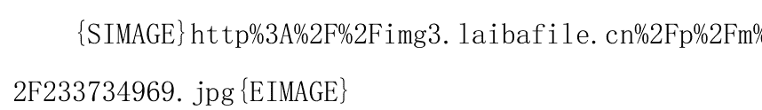

作者:66 端午 88 日期:2015-11-02 08:32
按照单位人口教育投入，潜力最大的省份：广东，山东，河南。学区房的潜在升值可能排名占据头三位。地方政府应该提前谋划扩张教育投入，否则会造成教育公共资源短缺。

作者:66 端午 88 日期:2015-11-02 10:47
@66 端午 88 37514 楼 2015-11-02 08:15
全面二孩政策对房地产市场潜在需求的定量分析：2017---2019年，全国每年新增大约420万需求，按照每两人新增一套住房需求，大约每年200万套。作为人口大省的：山东，江苏，河南，四川受益最大。其中房价在中位数的山东，河南收益最明显。山东的需求大约有30%集中在济南。济南在2030年的潜在刚需每年将增加3-4万套，在其后的20年，每年将增加1.5-2万套。济南，郑州将有潜力升格为强二线城市。当然，这需要当地地方政府对产业政策进行脱胎换骨的改革，提升消费支撑，增强服务行业竞争力，进行产业升级……

@匿名用户 daota 2015-11-02 09:16:34
持保守意见，每年死亡多少人口呢？

中国人口平均寿命已经接近西方发达国家，死亡率对比出生率极速缩窄。

作者:66 端午 88 日期:2015-11-02 10:48
@66 端午 88 37514 楼 2015-11-02 08:15 全面二孩政策对房地产市场潜在需求的定量分析：2017---2019年，全国每年新增大约420万需求，按照每两人新增一套住房需求，大约每年200万套。作为人口大省的：山东，江苏，河南，四川受益最大。其中房价在中位数的山东，河南收益最明显。山东的需求大约有30%集中在济南。济南在2030年的潜在刚需每年将增加3-4万套，在其后的20年，每年将增加1.5-2万套。济南，郑州将有潜力升格为强二线城市。当然，这需要当地地方政府对产业政策进行脱胎换骨的改革，提升消费支撑，增强服务行业竞争力，进行产业升级……

@投机者的扑克 2015-11-02 09:10:30
老大，安徽呢？

排在七八位的样子，人口流出量大，平衡走势。

作者:66 端午 88 日期:2015-11-02 10:52
@逛逛在抽烟 2015-11-02 10:12:39
楼主最近对房产360度转湾，难道开始屯房（在济南）？

从震荡到上涨的转折需要基础因素的变化，无非就是供求关系的改变。

作者:66 端午 88 日期:2015-11-02 15:08
@bzlx1 2015-11-02 13:10:22
端午老师 最近一个邻居的快递点 想转让 转让费 ，在考虑是否要接手 老师给点意见 这方面有发展么

不接受，接了累死，快递小老板基本和普通白领赚的差不多，付出明显偏大。

作者:66 端午 88 日期:2015-11-02 15:10
@披着城市的外衣 2015-11-02 13:39:56
老大，老徐被抓对股市走势有没有影响？

敢死队队长被捉，不是连死都不怕吗？那就死且吧，忙活半天都是裆的。大庄入住，谁耍聪明一定是最不聪明。

作者:66 端午 88 日期:2015-11-02 15:11
@66 端午 88 2015-11-02 08:15:45
全面二孩政策对房地产市场潜在需求的定量分析：2017---2019年，全国每年新增大约420万需求，按照每两人新增一套住房需求，大约每年200万套。作为人口大省的：山东，江苏，河南，四川受益最大。其中房价在中位数的山东，河南收益最明显。山东的需求大约有30%集中在济南。济南在2030年的潜在刚需每年将增加3-4万套，在其后的20年，每年将增加1.5-2万套。济南，郑州将有潜力升格为强二线城市。当然，这需要当地地方政府对产业政……

@朱晨霞 2015-11-02 12:21:41
很多人都说养不起二胎，楼主怎么看，我觉得很多人都不会去生二胎吧

不要直线思维，养不起不生，国家跟你耗不起，一定会给你补贴的。

作者:66 端午 88 日期:2015-11-02 15:37
@bzlx1 2015-11-02 13:10:22
端午老师 最近一个邻居的快递点 想转让 转让费 ，在考虑是否要接手 老师给点意见 这方面有发展么

@66 端午 88 2015-11-02 15:08:54
不接受，接了累死，快递小老板基本和普通白领赚的差不多，付出明显偏大。

@朱晨霞 2015-11-02 15:18:56
楼主，微信营销赚钱吗，我现在朋友圈10个8个在代购啊，代理化妆品啊啊，我感觉都不靠谱啊

老鼠会搬上网

作者:66 端午 88 日期:2015-11-02 16:21
济南库存新房从2014年6月的22个月去化率，大幅降低至本月的8个月去化率，预期在明年2季度达到合理水平，如果竣工面积保持现在的水平，明年春节后济南新房将开启加速上涨。

作者:66 端午 88 日期:2015-11-02 16:22
@bzlx1 2015-11-02 13:10:22
端午老师 最近一个邻居的快递点 想转让 转让费 ，在考虑是否要接手 老师给点意见 这方面有发展么

@66 端午 88 2015-11-02 15:08:54
不接受，接了累死，快递小老板基本和普通白领赚的差不多，付出明显偏大。

@朱晨霞 2015-11-02 15:18:56
楼主，微信营销赚钱吗，我现在朋友圈10个8个在代购啊，代理化妆品啊啊，我感觉都不靠谱啊

@66 端午 88 2015-11-02 15:37:34
老鼠会搬上网

@朱晨霞 2015-11-02 16:09:08
啥意思

老鼠会=传销

作者:66 端午 88 日期:2015-11-02 20:54
从下个月开始，额投资的住宅就火力全开了，争取明年再买一套。

作者:66 端午 88 日期:2015-11-02 23:17
@逆风飞舞 888 2015-11-02 21:15:08
66 端午 88 大师

因深圳与中山建隧道连接，半小时车程，中山市的港口镇保利国际广场是否有投资价值，盼回复！

不宜投资新建的任何商业地产。

作者:66 端午 88 日期:2015-11-02 23:19
我去，这贴成了广告版了。:(

作者:66 端午 88 日期:2015-11-03 10:23
反弹结束，全面清仓

作者:66 端午 88 日期:2015-11-03 10:29
反抽是清仓机会，等待二次探底。

作者:66 端午 88 日期:2015-11-03 12:17
@zys19840121 2015-11-03 11:01:35
@66 端午 88 2015-11-03 10:29:45.427
反抽是清仓机会，等待二次探底。

老大，请问26块钱的东富龙是跑是拿啊？谢谢！

赚钱的都跑了，这个亏一块跑了一半。

作者:66 端午 88 日期:2015-11-03 12:44
@投机者的扑克 2015-11-03 11:18:36
老大，北京上海的房票外地人有办法搞到吗

@Rambo 第 N 滴血 2015-11-03 11:36:24
有这种案例：中介安排你与北京老太婆假结婚，你弄到房票之后，再与北京老太婆离婚。问题搞掂，中介收点中间费，北京老太婆也收一些费用。

艾玛，如果大妈反悔了，！@#￥%……&*（）——（&%#@

作者:66 端午 88 日期:2015-11-03 12:46
@wzz810711 2015-11-03 11:18:35
这次又没挣着哈，被套的也没解呢

这波得跳着做，的确挺讨厌，安科瑞冲高一犹豫下来了，少赚好几万。天瑞仪器，昨天冲高没卖，今天平盘跑，又少赚好几万，里外里十几万了，忒难控制了。

作者:66 端午 88 日期:2015-11-03 12:47
艾比森卖早了少赚好几万，任子行卖早了，少赚十万。郁闷，不是早了就是晚了，难得完美。

作者:66 端午 88 日期:2015-11-03 17:05
@逆风飞舞 888 2015-11-02 21:15:08
66 端午 88 大师
因深圳与中山建隧道连接，半小时车程，中山市的港口镇保利国际广场是否有投资价值，盼回复！

@66 端午 88 2015-11-02 23:17:54
不宜投资新建的任何商业地产。

@朱晨霞 2015-11-03 16:23:29

楼主，现在贷款放贷好慢，我组合贷款都快好几个月了都还没放贷，都要半年了，不是鼓励投资房地产吗，银行办事效率怎么这么底下，我想早点拿到房子装潢了

组合贷款不但不合算，而且还慢，以前听说过，没用过。都是商贷或者公积金，各贷各的。

作者:66 端午 88 日期:2015-11-03 22:07

天津爆棚了，9，10 两月销售商品房 2.57 万套。估计新港和开发区的数量挺大，指望老城区根本不靠谱，天津有了好政策，马上有活力了，看看几个一线城市，都是政策扶持的，上海----------金融试验区，深圳----------特区，天津--------自贸区+保税区+学区，北京------------权力集聚区，广州----------是么？估计天津未来几年就会掀翻广州，挤入四强。额好几个以前的邻居组团去天津买房，都是为了避开天杀的山东变态高考。

作者:66 端午 88 日期:2015-11-04 14:28

道式技术

作者:66 端午 88 日期:2015-11-04 14:49

剩余 30%资金，明天回调整理时，抓任子行。

作者:66 端午 88 日期:2015-11-04 14:52

仓位守好，散户不怕涨

{SIMAGE}http%3A%2F%2Fimg3.laibafile.cn%2Fp%2F1%2F234126159.jpg{EIMAGE}

作者:66 端午 88 日期:2015-11-04 20:02

一根阳线改三观。

作者:66 端午 88 日期:2015-11-04 22:15

@武帝童爷 1 2015-11-04 21:06:57

老大，您好，我是以前的老人，以前跟您一起炒股，炒过安信信托、中国建筑，西水股份等，现在手里还有安信呢。因为平时工作比较忙，后续陆续减仓，看今天的走势，又好了，看见您很久没有晒股图了，明天想买点，请问老大买您手中那个，好些，万望不吝赐教。谢谢

艾比森，安科瑞，天瑞仪器，东富龙比较适合散户，都是额反复均衡选出来的。

作者:66 端午 88 日期:2015-11-04 22:17

@66 端午 88 2015-11-04 20:02:06

一根阳线改三观。

@投机者的扑克 2015-11-04 21:57:01

尾盘强行上车了海南航空。。。不知道咋样。。

这波行情产生于去杠杆背景下，慢牛特征明显，宜选耗

加v信 1101284955，获取更多好帖

用资金量不大的创业板和题材股操作。

作者:66 端午 88 日期:2015-11-04 22:18

全国人民（屌丝层），全都眼巴巴的等着股市产生收益，去消费，甚至去买房哪。

作者:66 端午 88 日期:2015-11-04 22:58

@66 端午 88 2015-11-04 22:18:24

全国人民（屌丝层），全都眼巴巴的等着股市产生收益，去消费，甚至去买房哪。

@投机者的扑克 2015-11-04 22:49:08

问题时大部分都会被没收啊。。。赚钱的不多啊

赚了买房

作者:66 端午 88 日期:2015-11-05 11:01

@66 端午 88 2015-11-04 22:18:24

全国人民（屌丝层），全都眼巴巴的等着股市产生收益，去消费，甚至去买房哪。

@走来走去 2014 2015-11-05 03:17:53

今日首次拜读大师神贴，五体投地。。细细品读 耗到半夜五更也只爬到 28 页，等养足了精神继续爬。

另请教大师，本人现在浙江，12 年在珠海金沙新区（与

加 v 信 1101284955，获取更多好帖

横琴隔海相望）买入一套住宅，常年空置，年初曾有抛售意向，但如今拜读神作，我之愚见似乎跟大师思维有些背离，还望大师教我，或卖，或持，或租？（购房之初，由于在浙江已经有过房贷，珠海这套是家父家母的名义购置，按揭为期 10 年。如租，3W/年。）

出租，尽量延长还款周期。我有一套小户型，开始租金才 280 块（2004 年），现在租金是 1400. 成本 8 万。

作者:66 端午 88 日期:2015-11-05 11:59

早盘建仓了东吴证券，减了点华鹏飞。仍有 3 成资金，引导浪貌似结束。长线看，中小创潜力仍大，短线看非银金融热闹。

作者:66 端午 88 日期:2015-11-05 12:02

创业板逆势调整，有利于指标股休息时，加速上升，可低吸缩量调整的创业板。

作者:66 端午 88 日期:2015-11-05 12:24

最近一年的经济政策，强化了房地产在国民经济中的龙头支柱地位，并得到广大资本持有人的普遍认可。房地产如果放开发展会造成土地流失和供应过度，紧缩发展，又会被投机资本利用。全靠管理部门调控，又无法堵住灰色经济链条，彻底形成连环制肘，发展过快不行，发展过慢不行，阳光发展不行，灰色发展不行。对于房地产，就像一只烤熟的

大肘子，看着的留哈喇子，端着的手生疼。额等坚持持续增持的，则稳稳的放在盘子里，攻守皆可。相比于留哈喇子的，手生疼的后面反而会好些，热肘子总有冷却的时候，留哈喇子的会一直流下去。

作者:66 端午 88 日期:2015-11-05 14:04

三成仓打进了新华保险，6:4 配置

作者:66 端午 88 日期:2015-11-05 14:05

@投机者的扑克 2015-11-05 13:07:54

老大海南航空还能拿不

应该可以

作者:66 端午 88 日期:2015-11-05 18:17

@朱晨霞 2015-11-05 15:07:15

我想问问楼主的消费观念是什么，楼主 你买衣服买吃的会追求奢侈啊名牌吗，你怎么看待消费理念，你的消费理念是什么

消费向下，投资向上，早就有总结。如果投资和消费兼备，那是首选，比如红木家具。纯消费的，不感冒，额媳妇专买名牌，屡教不改。

作者:66 端午 88 日期:2015-11-05 18:18

@kele200712 2015-11-05 16:03:48

加 v 信 1101284955，获取更多好帖

我今天也加仓保险了，可惜买的是平安

保险的特点是跟随券商上涨，涨速不如券商，耐久性比券商好，有从容的时间减仓，而且提前行情大势见顶，比较容易操作。

作者:66 端午 88 日期:2015-11-05 18:20

这波行情的目标是，赚半套房子，卖一个小套，换一个大套。

作者:66 端午 88 日期:2015-11-05 22:57

@66 端午 88 37766 楼 2015-11-05 18:20 这波行情的目标是，赚半套房子，卖一个小套，换一个大套。

@投机者的扑克 2015-11-05 18:34:25

老大，牛市又开始了？

半截牛

作者:66 端午 88 日期:2015-11-06 10:00

略减创业板，继续加仓东吴证券，配置达到 1:1，指数股短线。创业板锁仓，不再减持。

作者:66 端午 88 日期:2015-11-06 11:10

新华保险的作用是为指数股打开上升空间，这点是其它任何金融股都不具备的优势，上看至 80

作者:66 端午 88 日期:2015-11-06 11:31

@武帝童爷 1 2015-11-06 11:21:52

谢谢老大的股，新华保险八十。得拿多久

预计三至四个月左右。

作者:66 端午 88 日期:2015-11-06 11:52

计算方式都是统一的，引导浪的底部最少翻番。

作者:66 端午 88 日期:2015-11-06 13:17

指数股一共选择了两只：新华保险，东吴证券。回调积极买入。东吴是券商里面绝对低估品种，有望挑战西部证券，未来会连续加速。

作者:66 端午 88 日期:2015-11-06 14:14

东吴证券开涨停，最后上车机会。

作者:66 端午 88 日期:2015-11-06 14:20

上不了车的，买新华保险，分批建仓。

作者:66 端午 88 日期:2015-11-06 15:31

安科瑞明天如果不涨，可以抛出换成新华保险。

作者:66 端午 88 日期:2015-11-06 17:16

出利空了，处罚券商。重启 IPO 列入日程。

作者:66 端午 88 日期:2015-11-06 20:09

在随后发布的细则中，确定以后申购新股不缴款，卧槽，重大利好，以后新股彻底成持股福利了，不过中签率也低了，

加 v 信 1101284955，获取更多好帖

烧烧香估计顶用。周一高开，不过离着换挡不远了，谨慎追高，调整 2-3 天，可坚决介入券商。把东北证券牵出来，备选。

作者:66 端午 88 日期:2015-11-06 21:20

新增两个涨的不多的安全品种：中国建筑，中航资本。和券商搭配操作。

作者:66 端午 88 日期:2015-11-07 14:31

@66 端午 88 2015-11-06 20:09:50

在随后发布的细则中，确定以后申购新股不缴款，卧槽，重大利好，以后新股彻底成持股福利了，不过中签率也低了，烧烧香估计顶用。周一高开，不过离着换挡不远了，谨慎追高，调整 2-3 天，可坚决介入券商。把东北证券牵出来，备选。

@莫高雷勇士 2015-11-07 11:26:51

持有东北证券 1 年了，感觉这个股，庄比较弱哈，涨幅居中，跌幅总是靠前的，刚公布的股东结构来看，基金公司都跑了，只剩下社保基金了。

没有跑的就没有入的。

作者:66 端午 88 日期:2015-11-07 23:49

@被遗忘的花园 2015-11-07 18:38:41

## 楼主，海口房子阴跌几年了，现在可以出手了不？

听说五指山以南冬天不冷，五指山以北和北海非常类似。

作者:66 端午 88 日期:2015-11-08 10:17

惊闻深圳万人抢购风潮，1600 多套新房一扫而空，全国也就深圳能出现这种事，把炒房当成事业的城市，唯有深圳一个，这才是超一线城市，堪比创业板龙头，犹如妖股特立 A。

作者:66 端午 88 日期:2015-11-08 10:48

目前证金汇金合计持股市值高达 2.62 万亿元，持股市值在所有账户中排名第一，在市值配售背景下，包括“国家队”在内的大机构或将是打新新政的最大受益人。

已建仓完毕，国家实质上已经控盘了。可供流通的市值一共 18 万亿左右（总市值 40 万亿），大庄家搞了 15%。

作者:66 端午 88 日期:2015-11-08 11:14

山东的 GDP 和发展数据明显和实际感受不同，其实用房价波动即可分析实体经济的冷热，广东排名第一，境内拥有超级一线城市一个（深圳），准一线城市一个（广州），二线城市二个（珠海，佛山），准二线三个（东莞，汕头，中山）。江苏则是二线城市林立的局面，南京强二线，无锡，苏州，都是二线中比较靠前的城市，准二线就不说了，起码五六个。

看看山东，青岛，济南二线城市，准二线只有烟台一个，其它城市都很弱势。这和GDP及社会发展水平严重背离，统计局真该查查山东的数据造假问题，实在太严重了。

作者:66 端午 88 日期:2015-11-08 11:21

@66 端午 88 37816 楼 2015-11-07 23:49:00

@被遗忘的花园 2015-11-07 18:38:41

楼主，海口房子阴跌几年了，现在可以出手了不？

@被遗忘的花园 2015-11-08 10:45:20

听说五指山以南冬天不冷，五指山以北和北海非常类似。

海南冬天都还好。南边确实更暖和。个人看法，养老房买在海口很不错，房价比三亚便宜多了，医疗、生活配套齐全，海南其它地方比不上海口。

海口的房产属性有部分实质需求，部分旅游地产，部分金融属性。总体上看，不应该超过济南房价。有可能跌不了多少，不过涨速不会很快，他的旅游养老功能，明显不如三亚，总体上缺乏特点支撑。

作者:66 端午 88 日期:2015-11-08 11:26

总体上看，北京未来全境都会是房地产热点，权力，资金，科技，文化，服务的潜力实在太大，北京如果不控制房价，两个上海的规模都追不上。很多利润率不足的企业会向天津迁移，未来随着津京融合和交通的便利，这条线上也会有很多热点出现。

作者:66 端午 88 日期:2015-11-08 21:19

@acson_joe 2015-11-08 19:41:52

端午大哥，一直在看您的帖子，深为佩服您的格局和思维，请教一下，我这房价踏空者，买靠近深圳的东莞长安镇、虎门镇、松山湖附近的联排别墅，现在入手妥不妥，什么时候比较合适，当前均价已经两万了 @66 端午 88

深圳的房价波动率比较高，到了主升末期，如果交通便利，选择的品种是对的，如果已经有房，应该在一年以后到两年之间，选择房价回落时买入。追高的东西，不适合中线操作。

作者:66 端午 88 日期:2015-11-08 22:37

银行高速增长周期结束，增长停滞接近于 0，不良贷款激增至万亿以上，将会在明年年底前耗尽风险准备金。未来的 10 年，将会面临利润下滑局面，这个结果对于银行业来说是早就在预期以内的，传统金融行业占据社会总利润的 6 成，本身就非常不合理和不可持续，早在 2001 年银行整体利润超过社会总利润的 40%时，这个问题就已经相当严重了，银行业未来的改革和其它提前进入衰退周期的行业类似，首先是消减利润微薄的贷款占比，比如房地产贷款，同时消减风险大的业务占比，比如周期行业的贷款占比。增加服务业（垄断地位）和稳定性强的非周期行业贷款占比（医疗医药教育），增强自身的扛风险能力（严格审批贷款，尽量缩减长周期业务）以应对面临的去产能过程。其次是发现新蓝海，其中网络营销是重要的一个环节，即：减少实体门店，增加网络业务量和品种，改革业务流程，适应互联网时代的节奏（节流），在开源方向，着力于互联网新品种，提高便利性和安全性的前提下，直接进入网售交易环节，利用资金流优势，抢夺被阿里占领的业务领域，并尽快完善自己的业务闭环。

作者:66 端午 88 日期:2015-11-09 10:07

开盘竞价清仓了安科瑞，减了华鹏飞，逢低加仓了东吴证券，中航资本

作者:66 端午 88 日期:2015-11-09 10:35

@平凡主妇 2015 2015-11-08 22:42:12

现在住的是三房，楼上也是三房，上下楼打通侯打算做饭 休闲等都在下一楼，看书休息都在上一楼，楼上全木地板装修，客厅摆上大写字台，两个大人和两个小朋友一起在大写字台上看书学习，周围全是书柜。想想感觉是挺美好，就是纠结现在是否出手。

嫩这情况比较特殊，如果能承受，回落就得拿下，没法等底。

作者:66 端午 88 日期:2015-11-09 10:38

低价别墅如果交通方便，比较适合自己居住，投资性能不如城区联排（含近城区联排叠拼）。

作者:66 端午 88 日期:2015-11-09 15:01

@投机者的扑克 2015-11-09 14:09:27

老大，券商没有问题吧

途中修正，一天离最高接近 10%了，没几个点好调整。

作者:66 端午 88 日期:2015-11-09 16:17

@夏日迷情 8 2015-11-09 11:50:51

端午大哥， 000993 今天可以入吗？持多长时间？

第一波强度不够，可能不是最近的热点。选择第一波有力量的，在调整时介入。

作者:66 端午 88 日期:2015-11-09 21:13

@66 端午 88 2015-11-08 10:17:24

惊闻深圳万人抢购风潮，1600 多套新房一扫而空，全国也就深圳能出现这种事，把炒房当成事业的城市，唯有深圳一个，这才是超一线城市，堪比创业板龙头，犹如妖股特立 A。

@渣男太可恶 2015-11-09 19:22:21

这个楼竟然从 2011 年到现在，呵呵
楼主你估计一下深圳房子明年之后是否会大跌？

肯定有调整，大约会在明年 2 季度受到房地产税因素开始调整，时间一年到一年半。

作者:66 端午 88 日期:2015-11-09 21:14

@山的那边 2012 2015-11-09 19:53:06

俺手中的申万宏源今天抛掉了，等调整完了再接回来。

这个调整极限幅度是 15%，时间大约 5-10 个交易日，关键是你扔不到头部，再启动就怕会很突然，很难上车。

作者:66 端午 88 日期:2015-11-10 11:28

跟哥走，有肉吃吧。不要追高了，调整才刚刚开始。维持 5-10 日的调整，这段时间高抛低吸，逐步把仓位调整到大金融：创业板，8:2，9:1 的比例。一直到拉指数拉到创业板逆势暴跌。然后逐步减仓指数股，换入到创业板。

作者:66 端午 88 日期:2015-11-10 11:39

创业板的底部在 2550-----2580 一线，涨多少都得打回来，现在不要着急捞小票，等着把猪吹上天，再俯冲下来抓兔子。

作者:66 端午 88 日期:2015-11-10 12:14

@投机者的扑克 2015-11-10 11:56:19

这波能直接干到前高吗

这波券商行情，决定这次是反弹还是反转。券商拉一波到年初高价，然后结束。这波是反弹，最高反弹位置是 4200 左右。券商拉两波，超过最高价，然后萎靡，这波行情是双顶行情。券商拉三波，创历史高价。这波将形成慢牛，冲破指数顶。

作者:66 端午 88 日期:2015-11-10 12:15

额很早就读过一篇文章，里面讲如何利用券商股，估测行情总高度。

作者:66 端午 88 日期:2015-11-10 12:20

看看券商的走势，第一波量大，第二波量小，量背离是诱空，调整时间不足，需要至少调整到 13 日线，或者等待 13 日线托起，会形成主升浪。一直拉没有前途，高抛一部分，等待随后调整，再接回来。

作者:66 端午 88 日期:2015-11-10 13:10

老套路：每天拉券商，再咋下来，搓几次，创业板就哗啦了。

作者:66 端午 88 日期:2015-11-10 13:35

@投机者的扑克 2015-11-10 13:28:52

## 我擦，瞬间浮盈没了

跌不了多少，今天明天守5天线，后天大后天守10日线，中间还得反弹一次，然后再回来摸一次低。

作者:66 端午 88 日期:2015-11-10 15:15

@平凡主妇 2015 2015-11-10 14:34:35

@66 端午 88 2015-11-10 13:35:33.843

跌不了多少，今天明天守5天线，后天大后天守10日线，中间还得反弹一次，然后再回来摸一次低。

端午哥推荐个券商股

等几天看看，散户做不了震荡市

作者:66 端午 88 日期:2015-11-10 18:39

这个调整一定有，因为60日线马上逆转向上了，存在共震。还有最多6个交易日，60天前高位的指数就被剔除了。只要指数稳在这个平台，60日线自然向上，60日线逆转的意义是：行情中线看好。不过20日金叉60日线后，存在20日向下，同时60日向上的一次确认。就是说：10个交易日后的拉升，一定要大幅减仓，应对这个20日级别的调整。

作者:66 端午 88 日期:2015-11-11 08:12

@夏日迷情 8 2015-11-10 22:54:04

端午大哥，有人要带我炒原油，说很赚，你看呢？盼回复

不炒，等你股票炒成神再说吧。

作者:66 端午 88 日期:2015-11-11 11:06

金石东方冲击涨停。

作者:66 端午 88 日期:2015-11-11 11:07

早盘减了东吴证券，加仓了东北证券，东吴实在太弱了。

作者:66 端午 88 日期:2015-11-11 11:16

现在的架势有点像今年的3月份，又开始压指数炒小股票了。

作者:66 端午 88 日期:2015-11-11 11:18

观测券商第二波如果没有爆发力，应该调整计划。

作者:66 端午 88 日期:2015-11-11 11:56

@66 端午 88 37933楼 2015-11-11 11:16 现在的架势有点像今年的3月份，又开始压指数炒小股票了。

@投机者的扑克 2015-11-11 11:49:00

不是吧，这不玩人吗？才从小盘转来啊

看来这波行情得两边压注。哪边涨了得卖。

作者:66 端午 88 日期:2015-11-11 14:12

东北证券，新龙头

作者:66 端午 88 日期:2015-11-11 14:30

减东吴，加了东北

作者:66 端午 88 日期:2015-11-11 14:48

减出的资金配置于创业板，目前持股比例为：6:4，明天继续减，恢复配置到5:5.

作者:66 端午 88 日期:2015-11-11 15:09

经过两次波段操作，东吴证券的成本已经由18.2降至16.9，这股以前比东北证券贵，怎么现在这么猥琐。

作者:66 端午 88 日期:2015-11-11 15:11

@a qiang5188 2015-11-11 14:20:58
端午兄，兄弟在深圳！请问现在是买房的时机吗？自住！
再有，请问是贷款买房还是一次性付款买房合算（本人有一次性购房的经济实力）？

你有能力短炒，就炒一把，没这个能力和时间，静等回调整理时买入。

作者:66 端午 88 日期:2015-11-11 15:12

@投机者的扑克 2015-11-11 13:46:32
跳水了我操

跳水的时候，融资加仓，心里扑腾扑腾的，第一次使用融资。只融了15%，这玩意得大心脏。:(

作者:66 端午 88 日期:2015-11-11 21:53

@66 端午 88 37957楼 2015-11-11 15:12 @投机者的扑克 2015-11-11 13:46:32 跳水了我操

跳水的时候，融资加仓，心里扑腾扑腾的，第一次使用融资。只融了15%，这玩意得大心脏。:(

@投机者的扑克 2015-11-11 15:34:27
牛啊，老大，这波中信不当龙头了吗？

这种凶狠都是流通盘小的，东兴------西北，现在东兴停牌了，缺少主力龙头，一个孤掌难鸣，会再拉出来一个，现在西北市盈率炒高了，市值过千亿，潜力不会太过份，看看是不是能把东吴拉出来。不过这都是短线投资，还是原来的判断靠谱：创业板，又是一波真正的牛市。券商是测量行情高度用的。拉高会受到市值和市盈率限制，创业板，没这事。

作者:66 端午 88 日期:2015-11-11 23:02

@66 端午 88 37957楼 2015-11-11 15:12 @投机者的扑克 2015-11-11 13:46:32 跳水了我操

跳水的时候，融资加仓，心里扑腾扑腾的，第一次使用融资。只融了15%，这玩意得大心脏。:(

@投机者的扑克 2015-11-11 15:34:27
牛啊，老大，这波中信不当龙头了吗？

@66 端午 88 2015-11-11 21:53:11
这种凶狠都是流通盘小的，东兴------西北，现在东兴停牌了，缺少主力龙头，一个孤掌难鸣，会再拉出来一个，现在西北市盈率炒高了，市值过千亿，潜力不会太过份，看看是不是能把东吴拉出来。不过这都是短线投资，还是原来的判断靠谱：创业板，又是一波真正的牛市。券商是测量行情高度用的。拉高会受到市值和市盈率限制，创业板，没这事。

@莫高雷勇士 2015-11-11 22:05:46
东北证券盘后龙虎榜显示，溧阳路孙哥难耐行情，携宁波江东北路、上海恒丰路封板。值得注意的是，卖一机构出货8个亿，折合4200万股，这么大的量，由于大股东减持被限制，只可能是第三大流通股东出货，而这个NO.3就是证金（5850万股）。之后其他股东都没有这么大的持股量。回顾证金买入东北证券历程，估计拯救其流动性发生在7月7、8日，可能7月7日16.69元是第一批买入，8日15.09元继续买入；8月24-26日期间有无补仓救市不得而......

汇金的可以抛出，证金的不准抛出。另外，就算按你的说法，他俩也就一亿股，杀光了就和小盘股一样了，成妖精了。

作者:66 端午 88 日期:2015-11-11 23:03

赶脚东吴证券的二金股也差不多光了吧，这股历史定位一直比东北证券高10%的。

作者:66 端午 88 日期:2015-11-12 10:41

金石东方已经赚了快一半了。:)

作者:66 端午 88 日期:2015-11-12 10:48

昨天，今天补了东富龙

作者:66 端午 88 日期:2015-11-12 12:57

> @66 端午 88 37986楼 2015-11-12 10:48 昨天，
今天补了东富龙 ------------------------------

> @投机者的扑克 2015-11-12 11:50:10
老大快拉升券商啊，受不了啦
----------------------------------------

怎么也得调整到10-13日线，就是看一步杀到位还是横盘震荡等均线上来。看看券商去年引导浪后的A浪，震荡等待均线的可能性大。现在就是找券商龙头（不含西部证券，炒太高了，C浪它会提前到位）

作者:66 端午 88 日期:2015-11-12 12:59

A浪涨的少的，B浪不调整的就是C浪最猛的。

作者:66 端午 88 日期:2015-11-12 13:36

华泰,招商很有希望,迁移部分资金

作者:66 端午 88 日期:2015-11-12 13:45

东吴上面有一根日线级下压线,想要突破就得放量,一旦放量突破,就迎来主升浪。

作者:66 端午 88 日期:2015-11-12 13:46

突破18.2就是主升浪。

作者:66 端午 88 日期:2015-11-12 13:48

额估计突破18.2就不会让上车了,不突破还得调整。

作者:66 端午 88 日期:2015-11-12 18:21

@投机者的扑克 2015-11-12 17:48:47

13日线离的还有距离。。还要几天呀

6-8个交易日,一周半

作者:66 端午 88 日期:2015-11-13 10:01

东吴证券差一毛突破下降压力。

作者:66 端午 88 日期:2015-11-13 14:31

东吴证券突破压力线,加了点仓。第一次追高买

作者:66 端午 88 日期:2015-11-13 17:54

已辟谣,公安部经济稽查局正在寻找信息来源,这货撞枪口上了。

作者:66 端午 88 日期:2015-11-13 23:19

@mr_observer 2015-11-13 19:24:40

楼主你好,一直看你的帖子,感觉很不错

现在有个问题想请教一下你,天成控股发了公告,天成控股参与设立大爱寿险,说是利好消息,但今天为什么却股票却是跌的,手上有点天成的股,不知是该留着,还是卖了,想请楼主帮忙分析下,谢谢!

我15块已经卖了。中国的股票,都是炒预期,出了利好,只要不是大牛市。都会被利用作为出货时机,因为这时候,没有这票的人,都想买入,所谓形成了一致预期。如果此前涨幅巨大,又没有超级庄入驻。这股的顶部基本就出来了。

作者:66 端午 88 日期:2015-11-13 23:20

@66 端午 88 2015-11-13 17:54:12

已辟谣,公安部经济稽查局正在寻找信息来源,这货撞枪口上了。

@1925028499 2015-11-13 19:29:01

融资保证金提高好像是真的,目前各个大的网站都已经刊登了这个消息,老大怎么看。感觉算是个利空

要是顶部出了这个消息,就是超级利空,不亚于清理配资，现在是底部刚刚走出来。反应激烈的话，调整到前一个箱体顶部附近，反应不激烈的话，低开高走。

作者:66 端午 88 日期:2015-11-15 19:21

去库存的意思就是少卖地，挺地价。缩减土地到现房之间的差价，利好二线城市，三四线不会有什么起色，他们面对的是绝对过剩问题。绝对过剩------------无药可救。

作者:66 端午 88 日期:2015-11-15 21:28

降低杠杆是应该的，不过应该前阵子在最底部去，这样跌也跌不动。现在出这个消息加上巴黎恐怖袭击，可能导致一些超涨的股票剧烈回调，带动弱势股下滑，有可能造成20日均线下移去触碰60日均线，但这种触碰最好发生在60日线逆转向上时再去触碰。好在60日线离逆转向上时日不多了，最多还有十个交易日就会向上。可视作牛市启动前的最后一次回调，目标无法预测，理论上从3200-2450都有可能。这次降杠杆不完全是彻底利空，因为降低是针对23日以后的，此前的都还有高杠杆，绝大部分熬过下跌的资金，即使带着杠杆深套，也不用去减杠杆，被减杠杆的是以后做右侧追高的人。杠杆资金会分散到更多投资者中，以免造成杠杆倍率抬升过快，再次形成疯牛走势。

作者:66 端午 88 日期:2015-11-15 21:30

@被人称作好男人 2015-11-15 19:57:35

请教楼主，我在沈阳，手头暂时有60万资金，目前沈阳房产市场很冷淡，整体近两年一直在跌，但我想出手核心地段学区房，请教现在买合适，还是再等一等，听听您对沈阳学区房未来走势的建议，谢谢。。。祝好运。。

沈阳人口减少速度不算太快，不过其对周边人口的吸引力在下滑，不宜对该城市进行资产性投资。

作者:66 端午 88 日期:2015-11-16 10:17

@投机者的扑克 2015-11-16 09:55:13
我擦跌哭了

问题不大，基本上走年初的行情，券商上去减仓，别动指数股了。逮住创业板调整时买入，真的转变思路了，不再搞什么权重蓝筹了。

作者:66 端午 88 日期:2015-11-16 10:21

止盈了东北证券，建仓了飞天诚信和新国都

作者:66 端午 88 日期:2015-11-16 10:51

@投机者的扑克 2015-11-16 10:27:05
老大，券商没问题吧

不会大跌，涨势被大幅抑制，二波爆发没戏了，接近前期高点或者新高后，坚决卖出换股。今后将剔除出观察范围。

作者:66 端午 88 日期:2015-11-16 10:52

天瑞仪器涉及安全检测，这阵子应该热一段了。

作者:66 端午 88 日期:2015-11-16 10:55

大盘股都是竞走选手，主板都是马拉松选手，创业板都是F1选手。

作者:66 端午 88 日期:2015-11-16 13:26

@隆七 2015-11-16 12:41:11
端午哥，之前听你说过蓝色光标和三泰控股，我八月买了一点点蓝色光标，但复牌第二天就不行了，能不能继续拿着啊，多谢

股本已大，选择流通盘1.5亿以下的，最好几千万有股本扩张能力的。

作者:66 端午 88 日期:2015-11-16 13:27

@多么美丽的人生 2015-11-16 12:32:47
楼主，想在长春投资一套小公寓，不知怎样？请楼主给点意见，谢谢!!

规避东北投资性地产，人口大幅流出，短期内看不到投资价值。

作者:66 端午 88 日期:2015-11-16 13:34

@66 端午 88 38067楼 2015-11-16 10:17 @投机者的扑克 2015-11-16 09:55:13 我擦跌哭了

问题不大，基本上走年初的行情，券商上去减仓，别动指数股了。逮住创业板调整时买入，真的转变思路了，不再搞什么权重蓝筹了。

@投机者的扑克 2015-11-16 11:47:45
蛋疼

领导摆明了就是鼓励小票，不要执迷不悟，今后沪市一定是垃圾组团之地。

作者:66 端午 88 日期:2015-11-16 16:25

头几天为了换券商，换掉了中泰股份和道氏技术，一大波涨停一个没吃到。额的好好改改投资习惯了，大盘股只要敢涨，立刻融券放空，真可惜现在又不能融券。这种赶脚好像今年2月份，看着小票涨不敢买，垃圾绩优股买了就让你旁边看着别人吧嗒嘴。赶紧恢复融券做空吧，以后要反向操作，大烂筹只要两个板，融券赚一把。小票敢回调，买入。估计这波搞到最后，又是大蓝筹做观众，创业板眉开眼笑。

作者:66 端午 88 日期:2015-11-16 17:04

@lpp163163 2015-11-16 16:30:16

楼主，我在县城有套小户型学区房，想换大房子，一是大户型，二是二手小别墅，该怎么选？另外小户型明年是卖是出租？小户型为10年内新房。

现在比较纠结，楼主请指教，地点济阳。请楼主给点意见，拜托!!

未来济阳会有地铁通达，底部有支撑，但要想城里的人搬出来，这个可能性不大，房产不但具备实用，投资属性，还有环境选择功能，包括人文的。

作者:66 端午 88 日期:2015-11-17 09:50

连指数都坠下来了，券商成妖

作者:66 端午 88 日期:2015-11-17 09:55

新国都还不错。

作者:66 端午 88 日期:2015-11-17 11:30

@投机者的扑克 2015-11-17 11:12:38
我靠回落了，这不科学

调整时间不到，不能猛攻，只能小步突破，或者横盘整理。

作者:66 端午 88 日期:2015-11-17 11:32

@hengjianK 2015-11-17 11:26:36
佛山静院的环境一般，怎么都卖那么贵啊，比二手房贵一倍呢

成本和定位高,那地方叫一个堵,再加个小区,出门只能两轮了。

作者:66 端午 88 日期:2015-11-17 13:49

@莫高雷勇士 2015-11-17 12:00:14

三年有没有觉得,你这两天的操作,节奏总算差那么一点?

早盘高抛了一半券商刚才收回了1/4,还凑合,只是没有加仓券商,还在减。早盘低接了任子行。

作者:66 端午 88 日期:2015-11-17 13:55

新加入一只观测股,麦迪电气,看看是突破回踩,还是假突破。

作者:66 端午 88 日期:2015-11-17 18:36

额闭嘴一周,这段时间最难熬,还有6天。

作者:66 端午 88 日期:2015-11-23 21:01

供给侧改革?完全务虚了,真不知道他们怎么想的?优质优价+创新,放在一起来个新名字就出来需求了吗?现在什么需求最火,淘宝。淘宝是什么本质,便宜。一样的东西买便宜的,不一样的东西买,买功能一致最便宜的,总之,挡不住的便宜。优质优价+创新,还是搞不过淘宝,99%的中国人对价格敏感。就说电动车,你能搞出来5分钟充满电,续航400公里,售价1.5倍以内同档次内燃机汽车吗?搞不出来对吧。你能搞出来1.5倍同位置高层价的别墅吗？搞不出来是吧。那你怎么和便宜竞争？这是需求侧的反问，还没提收入水平哪。BBA汽车的定位就是1.5倍同档车型的定价，结果市场占有率也只有10%左右，这是收入水平决定的。国产车咋搞不出1.5倍的车哪？没那水平，搞了30年也没搞出来，你想吆喝吆喝就搞出来吗？中国的战斗机价格一直都是1/3------1/2的国际同代战机价格，干嘛不搞出个1.5倍的？搞的出来吗？优质从来都不是靠自己说出来的。

作者:66 端午 88 日期:2015-11-23 23:27

@投机者的扑克 2015-11-23 23:08:34
老大回来了，明天可以开始涨了吗

我原来以为会走出来2008年底部的走势，60日折上时，加速冲击4000点，然后回探60日线。如果走成慢牛，就会不上冲，可能会下探上个平台的中位，慢慢引导60日线向上，能忍的就忍一个多月。忍不住的，破5日线就得减仓，等背离再买回来。

作者:66 端午 88 日期:2015-11-24 14:25

涨停止盈了东北证券。

作者:66 端午 88 日期:2015-11-24 14:49

买入了鹏辉创新

作者:66 端午 88 日期:2015-11-24 14:50

## 金石东方再冲涨停

作者:66 端午 88 日期:2015-11-24 15:04

手里还有几千股东吴, 券商已经清光了。不敢玩这玩意了, 太闹心。集中于创业板, 8成仓位。七个品种, 慢慢熬。

作者:66 端午 88 日期:2015-11-24 16:34

济南终于上榜了, 全国最堵城市第一名, 全国pmi全年平均最高第一名。一票否决, 市长书记该辞职吗

作者:66 端午 88 日期:2015-11-24 19:03

> @66 端午 88 38213楼 2015-11-24 15:04 手里还有几千股东吴, 券商已经清光了。不敢玩这玩意了, 太闹心。集中于创业板, 8成仓位。七个品种, 慢慢熬。

> @投机者的扑克 2015-11-24 15:14:02 老大, 我手里全是东吴咋办, 闹心一个月了

做T, 降低成本, 哪天不留神一冲高, 变红了, 赶紧一把都卖了, 打死不碰大蓝筹了。

作者:66 端午 88 日期:2015-11-24 19:04

> @66 端午 88 38195楼 2015-11-23 21:01 供给侧改革? 完全务虚了, 真不知道他们怎么想的? 优质优价+创新, 放在一起来个新名字就出来需求了吗? 现在什么需求最火, 淘宝。淘宝是什么本质, 便宜。一样的东西买便宜的，不一样的东西买，买功能一致最便宜的，总之，挡不住的便宜。优质优价+创新，还是搞不过淘宝，99%的中国人对价格敏感。就说电动车，你能搞出来5分钟充满电，续航400公里，售价1.5倍以内同档次内燃机汽车吗？搞不出来对吧。你能搞出来1.5倍同位置高层价的别墅吗？搞不出来是吧。那你怎么和便宜竞争？这是需求侧的反问，还没提收入水平哪。BBA汽车……

@107国道的小猪 2015-11-24 10:08:33

国家智囊也就如此水平

@u_103817720 2015-11-24 17:20:43

中国的电子商务就是一场同室操戈的内战，商家所获得的每一分利润都是以整个社会的损失和整个社会的退步为代价，一个贪图便宜的国家，总有一天会坐吃山空，淘宝的出现有其好的一面，但负面影响会使中国进步倒退10年以上。

淘宝并没有创造价值，就这么简单。

作者:66 端午 88 日期:2015-11-25 10:44

@炒股票要折腾 2015-11-25 08:56:55

淘宝没有创造价值，我不认同。淘宝降低了中间环节的

The request was rejected because it was considered high risk

了说话权。

作为一个消费者，如何积极参与财富分配做一个消费商呢？信息时代的经济竞争，是以消费者为核心，那么，作为一个有眼光和能力的消费者，就有必要把自己身边的消费者组织起来，带领大家一起与生产商共享财富分配。因为组织和管理了消费者，付出了劳动，就会有收益，这就是商业行为，所以这样的消费者，就是一个商人，因此叫消费商。

其实，消费商的行为早就存在，只是人们忽略了这个概念。比如，你买了一件漂亮、价格低廉的衣服，给你的同事、朋友说了后，他们不知在什么地点，你就带他们去购买。也就是说，你引导了消费。但是，卖衣服的老板没给你任何好处，最多算帮了朋友一个忙。此时，你的行为已是一个消费商的行为。不过，你这个商人没有赚到一分钱，做着没有收益的商业行为。

竞争消费者的过程，也就是拥有和锁定消费者的过程，其实就是一个使消费者从分散走向联盟的过程。在这个新时代的竞争过程中，不是由生产商来完成，也不是由流通商来完成，而只能由我们这些消费者来完成。

因为我们的立场是一致的，容易在观念上达成统一，行动上采取合作。为什么会这样？因为曾经有无数的生产商和流通商，联合起来将我们消费者的钱掏走，只留下价高值低、甚至可能是伪劣的产品，一次次伤害了我们善良的购买欲望，让我们失去了快乐消费的信心。

既然是消费者从分散走向联盟的必然过程，那么作为一个消费者，今天你不主动去团结别人，使自己成为一个消费商，明天就是别人来团结你，他会成长为一个消费商！其中的经济利益关系，不必多说。也许，过不了多久，你与朋友见面打招呼时，他会自豪地告诉你，他是一个消费商！

消费者成长为消费商，将是一场浩大的革命！可以预见，在不久的将来，消费商将是一个非常有前途的职业，它将很多人从传统的生产关系链里解脱出来，不用被条条框框束缚，照样可以开拓属于自己的新天地！

作者:66 端午 88 日期:2015-11-26 18:07
@zcsnet 2015-11-26 13:10:02

楼主看到我!!!! 楼主看到我!!!! 楼主看到我!!!! 楼主看到我!!!!

请教楼主：

1、本人在上海，目前有自住 65 平小房一套，目前有改善需求，也有投资需求，有两套方案，一直比较纠结。请楼给指点一下。。

1、将现有的小房过户到自有公司名下，再买一套大房。这个操作复杂，因为是外地户口被限购，不能买二套，过户到自已公司的名下。算公司财产，可绕开限购。但是公司名下房产如果将来出售，会征很多......

## 用你父母的名义买

作者:66 端午 88 日期:2015-11-27 10:10

@投机者的扑克 2015-11-27 09:59:06

券商带头向下干啊

昨天已经清光了，散户得发挥灵活的优势，眼见不妙，脚底抹油。

作者:66 端午 88 日期:2015-11-27 10:12

全国工业利润下滑，实现负增长，淘宝厉害啊。

作者:66 端午 88 日期:2015-11-27 10:13

@zcsnet 2015-11-26 13:10:02

楼主看到我!!!! 楼主看到我!!!! 楼主看到我!!!! 楼主看到我!!!!

请教楼主:

1、本人在上海，目前有自住 65 平小房一套，目前有改善需求，也有投资需求，有两套方案，一直比较纠结。请楼给指点一下。。

1、将现有的小房过户到自有公司名下，再买一套大房。这个操作复杂，因为是外地户口被限购，不能买二套，过户到自已公司的名下。算公司财产，可绕开限购。但是公司名下房产如果将来出售，会征很多......

加v信 1101284955，获取更多好帖

@66 端午 88 2015-11-26 18:07:52
用你父母的名义买

@zcsnet 2015-11-27 09:43:05
父母也是外地户口，需要有上海两年社保记录。目前退休年龄，没法操作。这条路行不通。。。所以只能先择卖小买大，或者用公司买（可能面临高额税费。。）

用媳妇户口买
作者:66 端午 88 日期:2015-11-27 10:19
加仓了任子行
作者:66 端午 88 日期:2015-11-27 11:46

@投机者的扑克 2015-11-27 10:47:10
老大，现在改行去神创来的急不

不要动了，等下周局势明朗再说。
作者:66 端午 88 日期:2015-11-27 12:01
2011 年预测的中国经济有限度返回计划经济，随着供给侧改革的落地，兑现预期。

作者:66 端午 88 日期:2015-11-27 15:07
一天跌了一个月

加 v 信 1101284955，获取更多好帖

作者:66 端午 88 日期:2015-11-27 21:12
@红安土匪 2015-11-27 19:47:20

三年是水平比较高的大户了，如果连你都无法愉悦的在A股挣钱，像我这样的小散那就是鲜嫩的韭菜。

这次操作的不好，券商换错了一次仓。
作者:66 端午 88 日期:2015-11-28 15:28

头几年算着终于追上额大表姐了，经此一线城市暴涨，现在一算，卧槽，额又成同辈里的穷人了。额表姐受祖上荫惠，在帝都算有五套半三环内的房子，额大表哥努力一辈子，给儿子买了两套房子，自己单位分了一套，算上额大姨会留给他一套，排名第二。中国现在真有点变态了，城市决定你的身价，站在不同的平台，真就还是特么不一样哪。

作者:66 端午 88 日期:2015-11-29 14:34
@大屁股不大 2015-11-28 22:38:20

楼主您好:看了几天您写的文章，收获挺多，您对楼市、股市的观点很中肯。小弟有一事请教，请楼主给指个明路，
1. 老家亲戚在郑州、新郑港区富士康工业园旁边拿了三百亩土地准备明年动工，我能否去承包个小工程。
2,我现在南京做点小生意，手里有点小钱是在市区买个二手房还是和自家亲戚入股开个超市(三百万左右).我本想明年到新郑去，但现在房子又不好卖，很纠结。请楼主给我把把脉，开个方子，

## 万分感谢!

这两个行业都不算景气,后者风险比前者还要大点。两害权衡取其轻,都是利用杠杆的业务,头几年行情好的时候,做三个小区的管道就能发家,300亩,控制住风险,相当于五六个小区的总量了。争取把成本要回来,利润能要多少算多少,要不回来的顶房子。只要控制住成本安全,风险不算太大。

作者:66端午88日期:2015-11-29 14:56

@66端午88 38337楼 2015-11-28 15:28 头几年算着终于追上额大表姐了,经此一线城市暴涨,现在一算,卧槽,额又成同辈里的穷人了。额表姐受祖上荫惠,在帝都算有五套半三环内的房子,额大表哥努力一辈子,给儿子买了两套房子,自己单位分了一套,算上额大姨会留给他一套,排名第二。中国现在真有点变态了,城市决定你的身价,站在不同的平台,真就还是特么不一样哪。

@投机者的扑克 2015-11-29 09:53:04

大城市财富相当于带杠杆的涨,小城市很难赶上。现在就是去大城市追也追不动了

中央领导要好好想一想,为什么只有北京,上海,深圳涨。不涨的城市领导也得想一想,为什么人家涨,你就不涨。

作者:66 端午 88 日期:2015-11-29 16:43

@66 端午 88 2015-11-28 15:28:59

头几年算着终于追上额大表姐了,经此一线城市暴涨,现在一算,卧槽,额又成同辈里的穷人了。额表姐受祖上荫惠,在帝都算有五套半三环内的房子,额大表哥努力一辈子,给儿子买了两套房子,自己单位分了一套,算上额大姨会留给他一套,排名第二。中国现在真有点变态了,城市决定你的身价,站在不同的平台,真就还是特么不一样哪。

@自由人 200 2015-11-29 15:47:46

北京 3 环内 5 套半,这么牛 B。不是一般人努力能追上的。

他们家属于没续上官场的红二代,二代没去经商,官场混的一般,处级,在北京处级也就骑自行车的份。上一代的福利太好,都是体系内的房子。有半套是因为他现任的妈是后妈,老爷子(已过世)的房子不一定全留给他,后妈的亲戚也盯着哪套吓人的六室三厅(两套合建)。

作者:66 端午 88 日期:2015-11-29 16:49

@红安土匪 2015-11-29 15:14:54

哈哈,三年我又想打击你。考虑到你肚量不错,我就不客气。我的观点就是高房价必定维持不下去的，继续维持下去对大陆伤害太大。将来人民币必定有不得不加息的一天，甚至等不到步入加息通道，北上广深的资产价格就会缩水。好好理解韩正说的上海房价太高抑制创新，还有习大说的地方去库存。欧美这些国家都不是靠房产实现人们富裕的，我想 ，大陆难道可以脱离地球实现房产富裕强国么？

138 万亿 M2 怎么处理吧，加上每年的新增货币，几年就 200 万亿以上了，有钱就得流动，往哪里流？就算人民币国际化，也交换不出去多少。管理层想的挺美，资金池向虚拟股权市场迁移，这还没发新股，就都吓尿了，按照现在这个形势发展下去，房产市场的占比还会增加。10 年后，人口减少因素完全消失，主城区土地储备枯竭，房价还会涨。

作者:66 端午 88 日期:2015-11-30 09:15
@投机者的扑克 2015-11-30 08:27:49
老大，今天股票砍仓还是怎么搞

等反抽减仓，大跌不减仓，一减就割在后脚跟上。
作者:66 端午 88 日期:2015-11-30 10:07
冲高止盈了艾比森，金石东方
作者:66 端午 88 日期:2015-11-30 10:07
止盈了新国都
作者:66 端午 88 日期:2015-11-30 10:08
止损了上海新阳

作者:66 端午 88 日期:2015-11-30 10:09
平盘抛出了博晖创新

作者:66 端午 88 日期:2015-11-30 10:10
微利止盈了麦迪电气

作者:66 端午 88 日期:2015-11-30 10:21
下午应该有次暴力反弹，减仓至2成以下。剩下的熬60日线

作者:66 端午 88 日期:2015-11-30 10:54
@投机者的扑克 2015-11-30 10:32:29
老大我手里有飞天诚信，反弹走吗

不走，长线票，可以减，不要清仓。这票明年大牛股，作为金融安全的领头羊，不会没有表现的。

作者:66 端午 88 日期:2015-11-30 10:56
创业板是风水轮流转，看看世纪鼎利就知道了。

作者:66 端午 88 日期:2015-11-30 11:30
@进唯一 2015-11-30 11:02:10
@66 端午 88 2015-11-30 10:56:25.75
创业板是风水轮流转，看看世纪鼎利就知道了。

## 端哥，任子行还能拿着吗？

找机会做 T，不容乐观的走势。

作者:66 端午 88 日期:2015-11-30 11:31

档终于主导出崩溃 3.0

作者:66 端午 88 日期:2015-11-30 11:41

人生三大错觉：1. 房价崩溃 2. 股市走牛 3. 她喜欢你 @红安土匪

作者:66 端午 88 日期:2015-11-30 13:49

貌似两点半左右有个高点。

作者:66 端午 88 日期:2015-11-30 13:55

明天早晨有个 SDR 高点，不知道是不是能超过下午两点半的高点，两点半应该再减一点，赌明天 SDR 高点的减仓机会。

作者:66 端午 88 日期:2015-11-30 14:04

中途调整，时间后延调整时间。

作者:66 端午 88 日期:2015-11-30 14:53

完成减仓计划。

作者:66 端午 88 日期:2015-11-30 15:03

@66 端午 88 2015-11-30 14:04:25

中途调整，时间后延调整时间。

@cloudstiff198 2015-11-30 14:33:29

三年，时间后延调整时间是什么意思啊?

我看的是15分钟KDJ,专门做反抽的。中间有调整超过15分钟,达到一个单位的,就得把高点后延调整的时间,比如中间发生了两次15分钟的调整,高点就得后延半小时。

作者:66端午88日期:2015-11-30 15:06

明天SDR公告,估计会高开,构成第二个高点。如果冲过3530,就会成为V型反弹。下次再探,不会比第一个低点更低。如果明天高开后,仍然不能冲击3530,就会形成N型调整,不排除会击破今天的低点,然后看,第二波调整是否会减速,缩量。这两个指标会决定是否探2850-3000点。

作者:66端午88日期:2015-11-30 15:08

金融市场总是出乎意料的,比如明天SDR未通过,或者份额打不到普遍预期的12%。可能就会高开低走,如果大幅低开,反倒没事。

作者:66端午88日期:2015-11-30 15:11

所以,即使高点后延了三个15分钟,可能会在明天前半小时发生高点,也把仓位降到2成以下。如果有效跌破60日线,建议不是高手,就不要玩了。

作者:66端午88日期:2015-11-30 17:15

淘宝新消费链干掉了谁?后果----------

加v信1101284955,获取更多好帖

消费链都是什么人啊？现在就业结构是：公务员和财政拨款供养人员及家属，一共6千万人。国有企业职工和家属，一共1.6亿人。外资企业和家属，一共8000万人。私企和家属，一共4.2亿人。公民和农民工及家属，一共5.8亿人。大中小企业主及家属，一共0.07亿人。自由职业人口，大约0.15亿，个体户和微小企业主及家属，5000万。

淘宝干掉了谁？个体户和微小企业主，5000万，基本被灭了，这部分人是中产阶级。扁平化渠道干掉了自由职业的三成左右，也基本是中产阶级，大中小企业被干掉了25%，大部分是高收入和中产之间的人。合计干掉了大约1亿人左右的饭碗（消费中间力量）。

不出所料的话，中国经济将在10年内不会有任何好转迹象。直到中国中产和高收入阶层达到再平衡。
作者:66端午88日期:2015-11-30 17:18

供给侧想达到的目的是消费升级，干掉的中产和次高收入阶层，正好是供给侧改革的目标，希望管理层动动脑子，你们期望的供给侧需求端，已经大大缩水了，而且还会加速缩水，未来的中国经济将经历很长一段时间的屌丝时刻。
作者:66端午88日期:2015-12-01 10:53

反抽时间结束，胜利大逃亡吧。
作者:66端午88日期:2015-12-01 12:30
@66端午88 38402楼 2015-12-01 10:53 反抽时间结束，胜利大逃亡吧。

@投机者的扑克 2015-12-01 11:52:59

老大股灾 3.0 开演了吗

这地方说不上特别坏，60 日线有支撑，兴许在 60 盘整一段，还能带起来一波小反弹，目标 3600 多点。如果缩量上涨，很可能耗尽 60 日上扬能量后，就走熊了。这段行情有两个结果，上面的是第一种，第二种是放量上涨冲过 3730，就会反弹到 4300 附近。

作者:66 端午 88 日期:2015-12-02 11:14

@投机者的扑克 2015-12-02 10:39:16

老大，现在怎么办

高抛涨的，跌的守仓（当然轻仓位）。

作者:66 端午 88 日期:2015-12-02 11:16

60 日击破时，轻仓都不要了，有盘中反弹就撤离。这虽然是极端行情，发生的可能不大，也不得不防，一旦 60 有效跌破，此后三年，每年只能在年底年初做一波吃饭行情，其它时间空仓。或者不要看股市了，机会小，风险大。

作者:66 端午 88 日期:2015-12-02 15:11

券商自营盘调仓，散户能抢一把就抢一把，抢不着就算了。赤裸裸的和散户做博弈。

加 v 信 1101284955，获取更多好帖

作者:66 端午 88 日期:2015-12-02 16:36

十一月，济南一手房成交一万四千套弱，创出成交价格最高点，成交套数次高点。整体库存降至七个月左右，未来三个月，库存将继续减少，去化率在一季度末会降至支持房价上涨程度，涨速最快区域集中在历下区东部接近开发区地块，二环内全面超越 1.3 万，其中文化路~和平路区域住宅均价升破 2 万，这是区域房价最贵的区域。山大路均价升至 1.8 万，拉开二手房房价五千左右。奥体西路南段均价升至 1.4 万，涨速最快。商铺销售陷入全面低迷，写字间销售价格只有同区域住宅价格的 6 成，库存大量增加，预示营商环境极度恶化。住宅租金方面，中低端住宅大幅上涨，高端住宅租金持平，显示通胀抬升积累所致，本区域无法提供高收入就业机会，高端住宅以持有升值为主，很少流向租赁市场。

作者:66 端午 88 日期:2015-12-02 20:44

@66 端午 88 38421 楼 2015-12-02 15:11 券商自营盘调仓，散户能抢一把就抢一把，抢不着就算了。赤裸裸的和散户做博弈。

@投机者的扑克 2015-12-02 20:13:04

什么意思？券商出中小创买蓝筹股吗？

我周围问了一圈，有拿着小票的，有空仓的，基本没有拿着蓝筹的。这就是机构玩散户的标准手段，你有啥就不炒啥，等你终于忍不住卖掉了原有风格，跟进去躺在机构旁边，机构就会炒你放弃的风格，一脚丫子把你踹下车。这种势态下，绝大部分散户没有盈利的可能。你现在干到蓝筹里面，人家一冲高让你赚几个点，你进去只要一贪，一犹豫，马上就开始调整，一直杀到上波券商那个架势。你还拿的住吗？拿不住，就调整到位，再拉。如果你拿住了，好了，人家减下来的仓位，就会入中小创，反复捉迷藏。你要是手里啥都有，你就得忍住两种震荡，小票涨了你扔小票，大票涨了你扔大票，关键你入的点位合适吗？都在底部拿票，底部在哪里？机构说了算。你觉得是底，人家可以再杀两个台阶，你顿时成了为解套奋斗。应对这种势态，只有小仓位逐步买，这样你就没有盈利的效应。搞半天都是 20%的盈利，80%的不动或者下跌。木有新增资金进来干掉机构，就是场内幸存未被套牢的散户和主力的博弈，人家知道你手里拿着什么，你一把明牌，牌型不好，打的还差，就像斗地主你一把电话号码牌还没凑出个炸弹，即贪婪的想 360 倍赢分，还想人家能杀你却不杀，人家凭什么可怜你呀，一把把炸弹的轰的你分都借不出了，最后不到 1000 块，等下次吧。

作者:66 端午 88 日期:2015-12-02 20:54

这时候，要是散户齐心协力不玩了，你们机构自己玩吧，全体买入美金，央行也慌了，首辅也慌了，才会让证监会变 SB，头阵子说 4500 点以下券商不减仓，现在不算数了，好多不算数的事,就是打算把你扔在上面,当然,散户也不会齐心协力去炒美金。那就随便让人割你肉吧。房地产已经连涨两天,明天进去可能又买在次头部了,一调整,又会把你扔在山顶上。好在额的票仓不是股票,是一堆砖头瓦块,股市没有盈利效应,房市就会意气风发,2线城市的好日子明年就开始了,动脑子才能盈利的东西,真心不是好东西,哪里比得上砖头瓦块,涨价大家一块嘚瑟,不涨了大家门一关,只当不知道。

作者:66 端午 88 日期:2015-12-02 20:59

额还记得2006年同学聚会,一个定居上海的女同学听着额们济南同学叨叨房子的事,她长叹一声,为毛你们都赚了,就是额亏了,陆家嘴9200买的房子,买了半年竟然跌到8800,我去,现在应该涨到58000了吧。

作者:66 端午 88 日期:2015-12-02 21:13

供给侧改革:貌似有了新的说法,不是转型升级,这只是个幌子。就是主动减少,限制供给。比如盖房子,少批地,或者缓建房。钢铁水泥煤炭有色金属,减少产量。这个靠谱吗?这些玩意主动减产,GDP就会唰唰的掉血。

作者:66 端午 88 日期:2015-12-03 15:06

@投机者的扑克 2015-12-03 14:13:36

资金又回中小创了?

加v信1101284955,获取更多好帖

20日线下涨都是反弹，上了20日线再操作。

作者:66端午88 日期:2015-12-04 12:13

@投机者的扑克 2015-12-04 11:36:13
老大，是不是反弹结束了

大小板块分化，观望。

作者:66端午88 日期:2015-12-05 16:33

二线城市加速去库存并非好事，大事在后面，就是加速性透支买房将导致白银10年的提前结束，加上房地产税的压力，如果这轮房价上涨（2016-17年），会造成房地产10年萧条（2018年开始）。

原来的货币循环链条：发钞--------基建，出口，投资，消费-----卖地满足上四项------铁公鸡，美国出口，盖房，商铺----------卖火车票，卖汽车，卖水电气，国内加工，买房，买商铺---------税收，回收土地款，回收货币-----------银行收入增加------央行气壮-------继续发钞

现在的链条：发钞--------基建，出口下滑，投资，消费（出口，少一条腿）-------得拼命卖地补回出口（地卖多了）------铁公鸡，出口下滑，盖房，商铺没法盖了（淘宝砍掉一条消费腿和部分投资性地产）----------卖火车票，卖汽车，卖水电气，国内加工量减少，得加速加量卖住宅，商铺已经卖不掉了（网售压力下的地产，瘸了一条腿，所有销售压力集中于商品住宅）----------------税收开始下滑，土地款回收困难（住宅供应量过剩导致的地产问题，向金融行业传导），货币无法回收----------商业银行收入减少----------央行没后劲了----------继续发钞有压力--------得人民币国际化-------让国外增加对人民币的需求-----------还得继续发钞

现在钞票多发，不一定用在国内，这些货币直接注入了货币循环的前端，并未实现国内循环，这部分货币通过大宗商铺和金融活动在央行，国外央行，国际金融投资和交易实现了虚拟循环。发钞量增加的代价是币值波动。

作者:66端午88 日期:2015-12-06 17:40

@逛逛在抽烟 2015-12-05 23:46:42

我服了66了。矛盾综合体。一会看好楼市，一会又悲观。自己看好二环内升值，自己却又买了效区房。能给个准信吗？

额啥时候买郊区房了？二环内一直都没有问题。

考虑问题要从主要矛盾分析，现在主要矛盾集中在：各类改革政策和货币释放，是否可以有效对冲经济下滑，原来预测是不能对冲，现在的结果也是不能对冲。说好了做完一波牛市就彻底休息，现在离着这个节点只差一步，就是牛还在不在，一周内定结果。这帖如果走向如何苦熬调整期。该怎么写下去哪？

作者:66端午88 日期:2015-12-06 17:42

@不惑之年的M惑 2015-12-06 12:51:25

老大 给解答一下东吴好么 频繁做T加回补 现在也亏一个板 感觉券商里面最肉的一个 当初的选择理由充分么？ 听你的 天成和安信都有获利 先感谢啦

股神发了警示：60分钟MACD在零轴打横，上穿零轴加仓，死叉黄线，一只脚踏入熊市。

作者:66端午88 日期:2015-12-07 09:56

@投机者的扑克 2015-12-06 23:12:31

老大，下周牛熊有结果吼一声啊

额减仓了，至5%仓位。

作者:66端午88 日期:2015-12-07 12:14

@投机者的扑克 2015-12-07 11:02:55

老大，中小创虎的很啊，心痒痒

忍住，最少要等二次探底，进去都是反抽20日线的形势，看看再杀有没有力量，要是小幅下跌缩量，再找机会。

作者:66端午88 日期:2015-12-07 19:18

@66端午88 2015-12-01 10:53:34

加v信1101284955，获取更多好帖

反抽时间结束，胜利大逃亡吧。

@女人是上帝 2015-12-07 15:24:10

楼主请教下怎么和售楼处斗争调到满意的房源啊？我看楼盘看好的楼层都说卖了，推荐不不满意的低层给我，我怎么能弄清真实销售情况？信息太不对称了。。。。。能指教下吗？谢谢

看看楼盘本身的素质，基本就可以确定，买楼的忽悠不能听，位置，容积率，舒适性，交通，周边房价，户型结构，整个小区的素质

作者:66端午88 日期:2015-12-08 10:55

感觉散户可以离开这个市场了，未来很有可能是2001年或者2010年后的翻版。

作者:66端午88 日期:2015-12-08 14:00

现在高手们都在做超短了，散户脑袋里都是浆糊，肯定越做越亏。这个形势和2001年高点落下来一样的走势。慢慢蚕食。等红木再次启动后，再关心股市

作者:66端午88 日期:2015-12-08 16:01

@骑乌龟过沙漠 2015-12-08 15:47:40

请教楼主，您觉得根据pe对沪深300进行定投怎么样？

做定投得有好心态，还是买美金吧，国内已经看不到能投的标的了，抓紧换，有能力就换成美金汇出，国内只有美元现钞保险。

作者:66端午88 日期:2015-12-09 01:14

支撑人民币强势的最后一根稻草已被管理层抽走，投资收益已经无法应付财务成本，砍一条腿。民间投资受制于房地产税因素，对前景并不乐观，比如济南的房子，均价比三年前还低，可核心位置涨了40%，这说明接了两年盘的大部分是屌丝首次置业需求。对外贸，由于人民币挂钩强势美元，无形中二年间出口均价涨了20%，中国出口根本没这么高的附加值对冲利率抬升，算上人工成本高企，外贸这条腿也折了。消费的腿算保全的最好，仍有9%增长，不过算着明年二季度也会折，因为淘宝的好处很快见效，它的坏处慢慢来临，预期今年春节就会发病。去年开始搞的资产证券化虎头蛇尾，早早被各路内幕大鳄抽筋扒皮，缓这口气照老规矩要四年以上。明年随着疯狂的新股抽血，大股东减持重启。很有可能在未来的两年探一下原始上升通道，因为今年年线只要收绿，就构成对应6124的年线双头。这样一来，三个老腿全部萎缩，新腿两条，万众喝咖啡已经底掉，资产证券化成了割韭菜比赛。明年经济必破3%，当然我已经把货币贬值算进去了。没有货币需求，发的货币，一定以某种方式兑换为美金外流，很容易判断的结果。

作者:66端午88 日期:2015-12-09 10:23

@投机者的扑克 2015-12-09 08:55:40

济南均价不及三年前？老大，来长三角投资房产吧。

三年前主流在次核心区域+主城区，现在的主力都是近郊,远郊+次核心。次核心区域的价格和三年前的主城区价格一致，远郊和近郊的楼盘拉低了价格，不过价格也在7000-8000之间。所以，谁也没捞着便宜，看着均价还下滑了。要么济南成了全国最堵城哪，上班赶羊一样，下班和放鸭子一样，来来回回，进进出出的。

作者:66端午88 日期:2015-12-09 21:40

海外人民币突破前高挺进6.51高位，宣布人民币贬值之路启程，换美元，换美元，换美元。重要的事说三遍。

作者:66端午88 日期:2015-12-10 12:25

对于一线城市，应该征收地产税了，以价格控制最可行，成交价格超过五万开证地产税，不设补贴面积，同时对户籍人口进行补贴，这样会让出租收益比抬升到合理范围，同时压制房价过度上涨。

作者:66端午88 日期:2015-12-10 17:22

“注水数据”惊动中央巡视组

“如果统计数据不失真，东北经济发展后劲今天不至于此。”吉林省人大财政经济委员会主任委员赵振起认为，从各地固定资产投入上计算，“2010年底一汽集团的资产总额才1725亿，全省每年上万亿的投资，一年要建设多少个一汽”倘若依照各地汇报的产业成长性计算，东北一些县域经济规模都超过香港了。

中国实际经济规模最少多统计了30%，等着泡泡一个一个爆，等着李总拍PP。

作者:66端午88 日期:2015-12-11 09:23

飞天诚信，竞价走一半，冲高清仓。

作者:66端午88 日期:2015-12-11 09:35

0仓位

作者:66端午88 日期:2015-12-11 09:40

低吸了安科瑞，艾普森

作者:66端午88 日期:2015-12-11 15:18

1. 设定止损位：击破60日线，任何收盘不回60日均线，清仓。最高仓位不超过25%。
2. 资产投资建议是：高抛涨幅过大房地产（1线），借反弹或者新高机会减持中小户型。
3. 规避新购入人民币资产，减持人民币货币
4. 美元应该在资产配置中由现金比例5%上限，调升至总资产的10%以上，作为下限。

作者:66端午88 日期:2015-12-11 15:21

2. 资产投资建议是：高抛涨幅过大房地产（1线），借反弹或者新高机会减持中小户型（2，3线）。

5. 鉴于汽车销量有所回升，继续增持低价位（核心地段车位），高抛已经炒高的车位，车库。
6. 注意现金流动性保持畅通，注意现金不能只持有人民币。

作者:66端午88 日期:2015-12-12 11:29

额一直都没忘记这个人，刘军洛：

本次，欧洲央行重量级再量化的威力。1，欧元进入无限期量化时代；2，欧洲央行不再做多欧洲国债=德国10年期国债收益率暴涨=中国市场欧元套利交易者大撤退；3，中国央行手上巨量欧洲国债陷入被“屠”=中国央行愚蠢的多元化外汇储备战略陷入直接被欧洲央行“一剑封喉”。下星期，人民币汇率暴贬。---12.04

作者:66端午88 日期:2015-12-12 20:02

人民币贬值是灾难性的，现在不是2008年，全国货币量只有46万亿，美元外储有2万亿。现在人民币是140万亿，美元外储也是2万亿左右（其它都换成欧元，日元，英镑了）。2万亿美金，也就10几万亿人民币的事，说换掉就换掉了。关键是换掉撤离，所以，你拿着美金放在银行里，还是现钞放在自己家里，还是汇出。价值是不一样的，汇出的价值最高，放在家里，也有很高的价值，还放在银行里，价值最低。

一国货币贬值,其资产是不会升值的,这是简单的对应关系。

作者:66端午88 日期:2015-12-13 16:31

最稳定的就是房租收入了,用了三天就把两套空置的房子租出去了,一套在水屯北路上,上午挂出去,下午就搞掂了。按照购置成本,12%的年收益率,按照现价市盈率,2.5%收益率。

作者:66端午88 日期:2015-12-13 16:50

经济重回房地产驱动模式,股市被抽水已经必然之势,既有可能出现2001年以后,2009年以后的资金分配格局,房价形成趋势上涨,股市陷入低迷,每年一次吃饭行情。注意投资风险。

作者:66端午88 日期:2015-12-14 15:40

再搞十个中心城市,额也猜一下:从北向南,沈阳,西安,郑州,南京,成都,武汉,杭州,天津,青岛济南二选一,厦门福州二选一。

作者:66端午88 日期:2015-12-15 19:57

下午逢低小幅加仓了安科瑞和艾比森,如突破颈线,可大胆大幅加仓了。自调整最低点,如-----突-----破-----颈-----线,都是翻番走势的大C浪形态,谨慎看好。

作者:66端午88 日期:2015-12-15 21:29

@66端午88 2015-12-15 19:57:33

下午逢低小幅加仓了安科瑞和艾比森，如突破颈线，可大胆大幅加仓了。自调整最低点，如-----突-----破-----颈-----线，都是翻番走势的大C浪形态，谨慎看好。

@投机者的扑克 2015-12-15 20:28:29

老大看看300118如何，好像这两天互联网安全挺火

明天互联网乌镇大会，今天就是最高点了。

作者:66端午88 日期:2015-12-16 08:46

@猪侠侠 2015-12-15 22:17:51

@66端午88 2015-12-15 21:29:57.23

明天互联网乌镇大会，今天就是最高点了。

楼主一天到晚互联网、好像什么行业都靠互联网才能救

互联网无法救经济。

作者:66端午88 日期:2015-12-16 10:42

@投机者的扑克 2015-12-16 10:06:20

老大，安科瑞受压10日均线，这里需要放量啊

艾比森多方炮走势，安科瑞已经绝对低估。逢低买入，一个颈线在41.5，另一个在37，突破后，看底部翻番。

作者:66端午88 日期:2015-12-16 11:02

@猪侠侠 2015-12-16 08:47:10

@66端午88 2015-12-16 08:46:12.387

互联网无法救经济。

那怎么新闻报纸全乌镇、看的人心烦

病急乱投医，李总现在的战略就是：拍脑袋，拍胸脯，拍大腿，拍屁股。产能过剩是需要消减的，而且过程很痛苦，就像割肉。

作者:66端午88 日期:2015-12-16 12:31

中央经济会议定调：农民工市民化。

农民工去的地方，就是要闪开的地方，减持中小户型。

作者:66端午88 日期:2015-12-16 15:52

@投机者的扑克 38564楼 2015-12-16 14:34:00

刚装个逼就被揍：(

别追高，相反，拉升要减仓，还没稳稳站在20线

作者:66端午88 日期:2015-12-17 10:14

大幅加仓了安科瑞

作者:66端午88 日期:2015-12-17 10:17

就缺一根放量突破20日线的启动阳线了,赶脚明年6月前翻番。

作者:66端午88 日期:2015-12-17 10:32

@投机者的扑克 2015-12-17 10:27:54

此处需要量能

看看上一波任子行引导浪后的调整,给震跑了,然后涨了三倍。

作者:66端午88 日期:2015-12-17 11:03

刚才低补了艾比森。

作者:66端午88 日期:2015-12-17 11:13

@投机者的扑克 2015-12-17 11:05:12

安科瑞开启装逼模式

20日线附近会徘徊两日,然后加速, 20日线翻身向上时,会缩量再探一下。然后才会启动装B模式。然后就等着数钱吧。:)

作者:66端午88 日期:2015-12-17 11:27

现在搞智能城市,艾比森的室内室外大屏用量不小,股本小,需求大,业绩容易体现出来。安科瑞是智能充电桩。

作者:66端午88 日期:2015-12-17 14:05

大幅加仓了艾比森

作者:66端午88 日期:2015-12-17 14:20

不会，看着15分钟线，还有15-30分钟，就开始拉升了。

作者:66端午88 日期:2015-12-17 14:29

调整结束

作者:66端午88 日期:2015-12-17 14:39

安科瑞换庄了，需要慢点才能把仓位建好，不过这会换庄，前途就是会创历史高价，这货打跌停那天是换庄日。和任子行稍微不同，任子行是拉高的时候换的庄，不过在这个位置换庄，通常都会有疯狂的大C浪。

作者:66端午88 日期:2015-12-17 14:49

安科瑞今天算攻击20日线的第一天，明天还有一天上跳回落，后天会放量冲破20日线。艾比森已经站上了20日线，后两天上摸颈线位，一旦站稳颈线，就不要做高抛低吸了。

作者:66端午88 日期:2015-12-17 14:57

貌似艾比森已经突破了颈线密集成交位，那就是明后天就有拉板的可能了。

作者:66端午88 日期:2015-12-17 17:03

@投机者的扑克 2015-12-17 16:55:41

使劲啊，老丈人今年股灾后入市，目前挣30%，伙同媳妇把我好一顿挖苦，讲我白炒了那么多年。晕啊，碰见好周期怎么说都有理

新股民都傻大胆，等遇到一轮真正的熊市，他们就没话了。有些期待是不能说出来的，说出来反而难以实现，你看看2008年2月。

作者:66端午88 日期:2015-12-18 00:13

@披着城市的外衣 2015-12-17 21:53:24

老大，看看长亮科技和铁汉生态怎么样？

前面的年线主升浪已经结束，后面的盘子太大。

作者:66端午88 日期:2015-12-18 11:21

大盘股打鸡血，鸡冻一阵子

作者:66端午88 日期:2015-12-18 14:52

3.1-32.2，吃了好多好多安科瑞，额都没想到吃了这么多，滚吧，庄，以后额做庄。

作者:66端午88 日期:2015-12-18 18:46

@66端午88 38611楼 2015-12-18 14:52

3.1-32.2，吃了好多好多安科瑞，额都没想到吃了这么多，滚吧，庄，以后额做庄。

@投机者的扑克 2015-12-18 17:22:47

老大这么猛

嘘----------------，吹吹牛

作者:66端午88 日期:2015-12-19 15:38

截止至本周，济南住宅库存去化率为3.8个月，商用去化率为26个月，工业厂房去化率为43个月，被工商用房严重拖累的房地产整体去化率并未有效降低，反而比低迷的2014年增加了2个月，达到了空前的22个月。充分体现出目前经济结构性的问题：既是消费及民用投资延续高景气，商务实体陷入低迷，工业生产极寒冰冻。这也是我国经济存在的结构失衡提供了现实的注解，互联网经济绕过了实体经济循环，建立了规避国家货币循环，税收循环的差异路径。这个路径到底是好是坏，尚未有定论。互联网经济在整个经济体系中占比不足5%，但是却吸引了大量的资金参与期间，即使有如此之大的资金投入，产出却没有同步跟进。由此导致原有资金循环投入总量减少的迹象相当明显，在全面货币供应超过13%增速下，资金成本降低一半，而资金使用成本并未有效增加，整体经济脱实向虚的趋向愈发明显。

作者:66端午88 日期:2015-12-21 11:28

经济不会有任何好转的可能性，现在的蓝筹股不具备在业绩上好转的可能，这种情况有点像楼市，楼市的结果大家已经清楚了，就是炒四个，京沪广深。股市的前途没有可能好转，蓝筹股会被人民币贬值压力死死按住，结果就是形成和楼市一样的结果，炒小票。

作者:66 端午 88 日期:2015-12-21 21:39

@红安土匪 2015-12-21 16:19:05

像三年这样的，生个五六个，照样可以提供很好的衣食住行和教育条件。但是三年最多生 2 个，甚至就一个。

少生韭菜不够数，不够领导们收割啊，赶脚生的注定是韭菜，还不如不生。

作者:66 端午 88 日期:2015-12-22 15:37

@投机者的扑克 2015-12-22 11:33:31

尼玛，天瑞仪器才是铁血真汉子

这票第一浪长的少，调整很快就结束了。像安科瑞涨了 150%的，可能要强压着等 60 日线过来才成。你看这几天强势的，都是探 60 日线再起来。

作者:66 端午 88 日期:2015-12-22 15:39

@投机者的扑克 2015-12-22 14:57:12

老大，明日拿 20 日线不

等 20 日线破掉，额就敢全仓做了，现在 20，30，50%的来回遛，散户都快遛成驴了，蒙上眼睛一圈一圈的。

作者:66 端午 88 日期:2015-12-22 15:42

@66 端午 88 2015-12-21 11:28:21

加 v 信 1101284955，获取更多好帖

经济不会有任何好转的可能性，现在的蓝筹股不具备在业绩上好转的可能，这种情况有点像楼市，楼市的结果大家已经清楚了，就是炒四个，京沪广深。股市的前途没有可能好转，蓝筹股会被人民币贬值压力死死按住，结果就是形成和楼市一样的结果，炒小票。

@甘心做马甲 2015-12-22 15:03:57

请教楼主：楼市抄四个，怎么说？北京的房价明年你怎么看？

太强了，位置越来越垃圾，价格越来越高，额们这，位置一远，成交均价哗哗的就落下来了。要是按照二环内算，一类区域算，一类现在大约 16000，二环内 13000-14000，二手还得打 9 折.

作者:66 端午 88 日期:2015-12-22 15:47

@投机者的扑克 2015-12-22 14:57:12

老大，明日拿 20 日线不

悬

作者:66 端午 88 日期:2015-12-23 14:39

这货要干啥？

作者:66 端午 88 日期:2015-12-23 14:40

## 真要突破 20 日线么?

作者:66 端午 88 日期:2015-12-23 14:43

牛股像，翻倍走势啊。

作者:66 端午 88 日期:2015-12-23 14:45

一阳穿六线，卧槽，下午还减了点补艾比森，艹。庄太坏了。

作者:66 端午 88 日期:2015-12-23 14:46

这要是搞到 34.5 以上，散户就轧空了。

作者:66 端午 88 日期:2015-12-23 15:14

做完这波行情，不论是赔是赚，准备大量兑换美元避险。明年经济可能出乎意料的差。济南为了应付增速下滑，玩命审批地铁项目，一气搞了 8 条线的审批计划。预期将耗资大约 3000 亿左右，备战全国区域中心城市运动，也不看看实体经济根本不支持济南这样的城市铺大饼，济南的核心竞争力是一没权，二没钱，三没核心技术，四没创业环境，五没众多 985，211 吸引高素质人口落户，官员阶层勾肩搭背，拉帮结派，社会阶层极端固化。想要摊大饼，先得把老百姓收入提高起来，有能力承接卖不掉的房子，济南平均收入不足 4500 块（到手），得比一线城市差近一倍，这种收入根本不可能承接巨量的新房入市。

作者:66 端午 88 日期:2015-12-23 21:48

万宝之争解读：王石满世界吆喝，我要建立制度管理，以后我走了，公司一样运行良好，谁走了都没事，我不要能人，不要天才，不要超人，我要三流人员，要奴才，其实他是想：我放手，留下的也是我的奴才，于是就放心的游山玩水泡妞打屁去了。风云突变，宝能举牌，这是要抢了王石打的江山啊，妞咋办？没钱没势了，妞跑了不说，额就当不成董事长了，谁还落落额呀。还好，我培养了一批奴才，都得听额的，总之，只要额能坐董事长这个位子，一切都好说哈，额不是培养了一批奴才吗，攥住他们要挟资方，有话好好说哈。

作者:66 端午 88 日期:2015-12-23 21:49

万宝之争如果要成为中国证券市场的标志性事件，赶跑王石就是首要前提和唯一条件。

作者:66 端午 88 日期:2015-12-23 23:59

这件事上，王石已经输定了，不管他走不走。不走，就会被合并报表，以后再不像华润对万科那样不管不问，因为华润并未合并万科报表，以后再高调做人，谅他也没这个胆。走，就正好看看王石搞的管理制度成色如何。说实话，碰到房地产的黄金十年，在这个行业里混没发大财，都不好意思出来见人。

作者:66 端午 88 日期:2015-12-24 09:15

我们的汽油价格又超过美国一倍了，搞明白了吧，供给侧改革就是提高国营体系的供给价格，小样，换个马甲就不认识你了,本贴头几页的商品价格分道扬镳图就是这个意思。

加v信1101284955，获取更多好帖

作者:66 端午 88 日期:2015-12-24 12:21

重要事件:红木家具行业率先试水互联网销售和O2O的连天红,近日发表声明,要求其未完成合同客户支付更多定金,在其广泛存在违约前提下,还要求客户增加定金,好多支付定金2年以上的客户到现在还没收到货。这家公司不是脑残就是准备破产清算了。连天红是从3年前开始互联网销售的,一度占据红木市场份额的近15%,这也是到目前为止,红木古典家具单一品牌占据市场份额最高的一家。合计雇佣员工超过8000人(不含签约连锁),由此看出:国内风投能控制的赔本时间大约是3年左右,国际风投能控制亏损经营的时间大约是5年(未上市融资),未来大量亏损经营的企业将通过融资上市解决持续亏损,这是准备吃定韭菜了。

作者:66 端午 88 日期:2015-12-24 14:37

额已经被遛成驴了,不看了,不翻倍不出来,随丫去吧。:(

作者:66 端午 88 日期:2015-12-24 21:08

喊创新整整两年,房地产成为了最后的救命稻草,唉。

作者:66 端午 88 日期:2015-12-24 22:39

@顺势而为 88856 2015-12-24 21:58:07

老大那是说,房地产又要开涨了。。。。????

加v信1101284955,获取更多好帖

房地产的问题是房子不涨卖不动，现在脑残的管理层要求降价卖房，真是弱智到极点。我们假设房价会涨，但和 2011 年的商业地产形势类似，涨就需要真的减持了，特别是价值高估的学区房，留一套学区房就成了，富余的可以减持。大户型可以留着，估计下个月会出政策，鼓励居民购买新房出租，那可真是坑，现价买房出租，收益率才 2-3%。

作者:66 端午 88 日期:2015-12-25 02:25

@oceantian110 38706 楼 2015-12-25 01:21:00

@66 端午 88 2015-12-24 22:39:58.377

房地产的问题是房子不涨卖不动，现在脑残的管理层要求降价卖房，真是弱智到极点。我们假设房价会涨，但和 2011 年的商业地产形势类似，涨就需要真的减持了，特别是价值高估的学区房，留一套学区房就成了，富余的可以减持。大户型可以留着，估计下个月会出政策，鼓励居民购买新房出租，那可真是坑，现价买房出租，收益率才 2-3%。

赶脚偏僻的位置是没人租房的，西客站区域，100 平的两室二厅，售价大约七十万，只能租一千二三百。2%，关键没人租。

作者:66 端午 88 日期:2015-12-25 02:32

我在想，为什么这回经济减速，印了如此巨量的货币也没把经济刺激起来，难道真是边际效应递减吗。

作者:66 端午 88 日期:2015-12-25 11:29

@投机者的扑克 2015-12-25 10:55:49

靠，34.5 这么难？

最后阻力 30 日线，突破后 20 日线就快逆转了。

作者:66 端午 88 日期:2015-12-25 12:24

@红安土匪 2015-12-25 12:15:41

今天是圣诞节，并且也快新年了。祝三年及各位朋友开心快乐。再说两句关于国内的经济形势。

现在社会经济情况是什么样的？不考虑房产的价值（因为你如果是贷款买房且唯一自住的话，大部分人是不会卖掉房子来偿债的，而且在房市低迷的环境下房子也不容易出售），如果以净资产来计算，中下层中净资产为负值的应该占了社会家庭总数的相当大一部分。估计在 30%-50%之间。

还有不怎么负债的下层，如农民，城市租房打工者呢……

为了刺激农民入城，扩大农产品进口正在实施，估计通用农业会被暂时放弃一阵子，英国当年不是也搞过吗，没有工人，就打压粮价，导致农民破产，大规模向城市集中。

作者:66 端午 88 日期:2015-12-25 14:14

加 v 信 1101284955，获取更多好帖

@投机者的扑克 2015-12-25 13:45:08

使劲啊

出来装逼啊，盯着37，突破就翻番

作者:66端午88 日期:2015-12-25 14:24

@猪侠侠 2015-12-25 14:23:37

现在搞互联网是不是赚钱

十年前搞互联网现在还活着的是赚钱的，最近3年靠风投的互联网95%都会死掉。

作者:66端午88 日期:2015-12-25 14:28

稳住30日线3天，额就追加资金满仓搞。

作者:66端午88 日期:2015-12-25 14:29

突破调整颈线35.15，最低看前高，突破前颈线37，翻番

作者:66端午88 日期:2015-12-25 14:30

艾比森和安科瑞，走势完全一直，因为是相同技术指标选出来的。

作者:66端午88 日期:2015-12-25 14:31

这次一定要耐住震荡，拿到翻番，不能再犯任子行和三泰电子的错误了。

作者:66端午88 日期:2015-12-25 16:36

@猪侠侠 2015-12-25 15:37:53

@66 端午 88 2015-12-25 14:24:52.347

十年前搞互联网现在还活着的是赚钱的，最近3年靠风投的互联网95%都会死掉。

看社会对互联网的吹捧和做淘宝微商的那些朋友似乎很赚钱的样子，似乎就感觉是个大金矿一样

是啊，眼睛看到珠穆朗玛峰很容易的，爬上去的只有几个，何况他们看的是太阳和月亮哪。

作者:66 端午 88 日期:2015-12-27 16:05

@u_104452981 38745 楼 2015-12-27 15:22:00

@66 端午 88，请教下您，您一直说北上广深一线投资自住有价值，还会涨，但我不是当地人，被限购了，请您帮我分析下上海的酒店式公寓和 loft 有没有投资价值呢？先谢谢您了，前几天看了一套浦西中山医院附近的 60 平小公寓平层非 loft，6 万一平，要 380 万，首付 5 成，月供 20000 左右，10 年付清，问了下如果拿下来能租 12000 一个月。得房率 70%。

时间已变，条件已变，一线城市目前看只有炒作价值。我上次说的时候一线城市还有部分投资价值，目前看是看不到了。现在已经上涨了大约 35% ~ 100%。

作者: 66 端午 88 日期: 2015-12-27 19:38

@u_104452981 2015-12-27 16:11:23

那目前 2 线呢? 杭州我去看了主城区上城下城核心地带要 4-7 万, 非核心主城区到处在建楼, 起高架, 连滨江区都 2 万 5 , 租售比严重倒挂, 厦门还没去看, 二线目前还有投资价值吗? 除了房产外, 您觉得目前 200 个现金投资什么?货币基金? 股市? 外币资产已经配置了 70%, 再次感谢您的回复!

拿出来一部分改善自住, 其它稍微赌一下股市, 配一些美元。

作者: 66 端午 88 日期: 2015-12-27 21:12

@Neo1018 2015-12-27 20:15:29

@66 端午 88 , 谢谢您的耐心解答, 如果明年美元持续加息 4 次, 您觉得股市有机会? 是不是领导也要给套利热钱留有套利的空间才不致于冲击汇率?

美元加息至和人民币利率逆转, 极有可能发生战争。

作者: 66 端午 88 日期: 2015-12-27 22:02

@红安土匪 2015-12-27 21:26:48

三年, 十三五期间要落实房地产税。

房产税压力降低，主要是农民工买了房子再征税，明显是要出大事。

作者:66 端午 88 日期:2015-12-28 07:30

@66 端午 88    38756 楼  2015-12-27 22:02:00

@红安土匪      2015-12-27 21:26:48

三年，十三五期间要落实房地产税。

@buwangchuxin2015 2015-12-27 22:14:11

房产税压力降低，主要是农民工买了房子再征税，明显是要出大事。

什么大事？看不懂哪。刷屏也没刷出下文，楼主能细说不？

对于中产拔羊毛，会引来一片骂声，到最后，税也收走了，中产也认栽了。对于富人拔羊毛，富人会一边公关，一边脚底抹油，一颗红心两种准备。对于穷人征税，那只好跟丫死磕了。

作者:66 端午 88 日期:2015-12-28 07:37

对于明年，在所谓的互联网等新经济模式完成扩张前的继续中，整体经济不会有任何好转，中国的新经济不是创造一个新蓝海，而是颠覆或者取代原有份额，你说它提高效率了也好，产业升级了也好，实质上就是原来1个亿的行业利润压缩到1000万，就业率消减9成，就业人员压缩到1成。给你好处你马上就享受到了，给你带来的打击，需要慢慢品味和消化。

作者:66 端午 88 日期:2015-12-28 07:40

怎么形容这种互联网新经济？唉，毒品，很快爽到了，产生了强烈的药物依赖，慢慢走向死亡。

作者:66 端午 88 日期:2015-12-28 10:01

刚才安科瑞回踩颈线，大单没抢进来，唉。

作者:66 端午 88 日期:2015-12-28 10:10

安科瑞回探颈线结束，伺机向上突破。艾比森已经突破，等待新高后回踩。

作者:66 端午 88 日期:2015-12-28 10:12

创业板指数强势，面临主升浪，目标位4000点附近。

作者:66 端午 88 日期:2015-12-28 13:57

艾比森设定止盈止损位：47.5

作者:66 端午 88 日期:2015-12-28 13:58

暂时观望，涨停就设定止赢位，不涨停，继续观望

作者:66 端午 88 日期:2015-12-28 14:20

买早了点，34.4加了仓。:(

作者:66 端午 88 日期:2015-12-28 14:24

加v信1101284955，获取更多好帖

安科瑞做的是圆弧底,潜力最大。

作者:66 端午 88 日期:2015-12-28 15:03

@66 端午 88 2015-12-28 14:24:22

安科瑞做的是圆弧底,潜力最大。

@红安土匪 2015-12-28 14:49:58

有没有可能后市就一直跌几天呢?圆弧顶=很可能就是下杀的走势啊?

缩量跌下来的,最起码有双头走势。

作者:66 端午 88 日期:2015-12-28 17:41

@投机者的扑克 2015-12-28 15:06:49

老大我心碎了

玻璃心啊

作者:66 端午 88 日期:2015-12-28 21:03

只有汇出的美元才是美元,拿着美元现钞是80%份额的美元,放在央行可控范围内的美元,只是人民币的美元符号,本质上和人民币区别不大。

作者:66 端午 88 日期:2015-12-28 22:56

今年暖气有点离谱,往年都是勉勉强强在20度以上,今年是顽强的稳定在28度以上,这个夏天不好熬啊,搞的老子已经感冒两次了。

加v信1101284955,获取更多好帖

作者:66 端午 88 日期:2015-12-29 10:33

横有多长，竖有多高，看看艾比森，忍住等。

作者:66 端午 88 日期:2015-12-29 11:02

@投机者的扑克 2015-12-29 10:50:15

我靠这是闹哪样

看看上一轮安科瑞的走势，本周的目的就是缩量回探 10 周线，刚才已经摸到了。等爆发

作者:66 端午 88 日期:2015-12-29 11:47

炒股和种庄稼差不多，人家一年才收获，股民强多了

作者:66 端午 88 日期:2015-12-29 12:42

@猪侠侠 2015-12-29 10:48:06

楼主，理财是节流，能不能讲一下开源，像我们一般老百姓，整来整去就那点收入，在收入不提高的情况下，感觉财富增长很缓慢，能说下做事做工作创业方面的点子吗

靠山吃山，靠水喝水。如果山水都靠不上了，你选的职业前途已经枯竭了，更换职业。

作者:66 端午 88 日期:2015-12-29 13:53

减了艾比森

作者:66 端午 88 日期:2015-12-29 15:03

加 v 信 1101284955，获取更多好帖

@66 端午 88 2015-12-29 13:53:29

减了艾比森

@披着城市的外衣 2015-12-29 14:44:57

不是说好了等着翻番吗？

卖点换美元

作者:66 端午 88 日期:2015-12-29 15:06

1 月 8 日大股东可以减持了，这几天卖出来，别买股票了。

作者:66 端午 88 日期:2015-12-29 23:29

@猪侠侠 2015-12-29 23:21:42

@66 端午 88 2015-12-29 15:06:50.823

1 月 8 日大股东可以减持了，这几天卖出来，别买股票了。

楼主，现在开个茶叶店之类的有钱赚吗，卖土特产，茶叶批发之类

实体茶叶店大部分在亏损，网商好一点，因茶叶销售刚刚搬到网上卖，竞争还不充分，估计一年以后网商的盈利难度也会很大。

作者:66 端午 88 日期:2015-12-29 23:30

@wangx415 2015-12-29 22:32:20

@66 端午 88 38843 楼 2015-12-29 15:06:00

1 月 8 日大股东可以减持了，这几天卖出来，别买股票了。

大股东减持？是指安瑞科吗？

大部分创业板都有减持的可能，观望一下再说。

作者:66 端午 88 日期:2015-12-29 23:32

@u_103817720 2015-12-29 20:55:50

房地产不可能再保值，理由为 官员 耍流氓，产权 70 年，一届ZF10年，经历了 7 届，在，产权随时可能推倒重来。

企业只需要一个好的经营环境，可偏偏这时出了淘宝，规避了税收，给假货提供了市场。

老百姓只需要一个好的社保体系，可偏偏这时又要延期退休。

担心社会真的会乱。

国家税务总局昨天下文，要求加强税收管理：1. 对于实体主要是规范大中型企业。（这条无所谓）。2 对于个人主要是要摸清资产量大的人格。(卧槽,这是要查房租的赶脚)。

作者:66端午88日期:2015-12-29 23:51

@逛逛在抽烟 2015-12-29 16:15:33

@107国道的小猪2015-12-29 15:14:59.81

体制内的底层怎么破?

同问

同问(清水衙门)

体制内很多行业都挺容易赚钱的,额说几个:1.教师就不用说了,今年高考补习费上了N多一对一,1小时500块--1000块。赶脚要破产丫,太狠了。2.额个高中同学在省级设计院做建筑设计,经常几个同事合作拉私活,给别的私营公司搞设计,每年能分大概30W+.3.额个高中同学在省立医院当大夫,在两个私营医院挂牌,还兼爱尔眼科的顾问,连手术费带挂牌费,每年150W+(还偷偷开了公司,专门卖自己手术用的耗材,不知盈利情况,估计不少赚).4.额个朋友在环保设计院,他们处挂靠环保局搞了个环评公司,跑跑批文,写写环评报告,不是主要人员,年分红大约20W.

5.某小伙伴(公务员,但不是直接业务),天天晚上陪着XX房地产和XX总公司领导吃喝嫖赌,垄断他们建设的商品小区的电梯业务，不知赚多少。6. 某小伙伴，百盛餐饮，经常有新开的连锁店有点干股。7. 某小伙伴，某高校分院院长，自己画画，总是有人出高价收购，木有见到画的很好。

------------------靠山吃山靠水喝水。

作者:66 端午 88 日期:2015-12-29 23:54

@66 端午 88 38843 楼 2015-12-29 15:06 1 月 8 日大股东可以减持了，这几天卖出来，别买股票了。

@投机者的扑克 2015-12-29 15:29:17
安科瑞呢

额还保持原有仓位，没低补，也没割肉。
作者:66 端午 88 日期:2015-12-30 08:21

@猪侠侠 2015-12-30 06:16:54

@mrdodo2000 2015-12-29 15:52:11.61
老大总结的真精辟！

怎么汇出，怎么操作

出境开户，然后可以汇出。换汇：可以利用每人五万美元的年额度，也可以利用黑市。
作者:66 端午 88 日期:2015-12-30 08:22

@猪侠侠 2015-12-30 06:11:26

@66 端午 88 2015-12-29 23:29:48.447

实体茶叶店大部分在亏损，网商好一点，因茶叶销售刚刚搬到网上卖，竞争还不充分，估计一年以后网商的盈利难度也会很大。

那高新区或繁华地带会不会有钱人多点，会卖的好

除了能搞定单位大批量购买的，貌似没有好的盈利目标。

作者:66 端午 88 日期:2015-12-30 08:26

国外的账户，每个账户每年也仅仅可接受三个不同的国内账户分别汇出一次，也就是总共三次，每次不得超过 5 万（国内可以是非亲属汇的）。也就是说，每个国外账户，每年可接受外汇 15 万美金（无论是不是亲属）。如果一家人在加拿大，全部去银行开账户，有三个国外账户，则可接受 45 万美金。加上每个人只能换汇 5 万，需要动员 9 个人。。汗。。如果夫妻原本有大量的汇在账户上还好一点，不用动用那么多人。

作者:66 端午 88 日期:2015-12-30 08:40

2016 年的房市是政府主导下的牛市，可逢高了结中小户型，锁定盈利，置换成美元。10 年白银一朝透支，2018 年，将迎来房地产全面过剩，大批住房出租都会成问题。由于旧城改造大部分采用置换方式,释放的需求政府自己都拿走了,不会对消减库存和在建房产去化,起到对冲作用。2016 年的住宅市场=2011 年的商用市场,已到逢高兑现时。

作者: 66 端午 88 日期: 2015-12-30 08:48

@猪侠侠 2015-12-30 08:38:11

@66 端午 88 2015-12-30 08:26:15.433

国外的账户,每个账户每年也仅仅可接受三个不同的国内账户分别汇出一次,也就是总共三次,每次不得超过 5 万 (国内可以是非亲属汇的)。也就是说,每个国外账户,每年可接受外汇 15 万美金 (无论是不是亲属)。如果一家人在加拿大,全部去银行开账户,有三个国外账户,则可接受 45 万美金。加上每个人只能换汇 5 万,需要动员 9 个人。。汗。。如果夫妻原本有大量的汇在账户上还好一点,不……

不靠谱,必须境外开户(不含香港澳门)。

作者: 66 端午 88 日期: 2015-12-30 10:27

@aqiang5188 2015-12-30 09:21:03

66 端午 88 楼主

端午兄,现在换美元只能换现金,这么多美元现金放家里,也是个问题啊!愁!

保险柜啊

作者:66 端午 88 日期:2015-12-30 10:28

@投机者的扑克 2015-12-30 10:06:01

艾普森还是亲儿子

只剩三分之一的艾比森了。:(

作者:66 端午 88 日期:2015-12-30 10:29

安科瑞这么明显的充电桩概念,子公司在产,自己做充电桩计量。没理由不创新高的。

作者:66 端午 88 日期:2015-12-30 14:17

臭不要脸的庄,推大单,也不跟了,气死你

作者:66 端午 88 日期:2015-12-30 14:38

减仓了安科瑞

作者:66 端午 88 日期:2015-12-30 15:01

@66 端午 88 38895 楼 2015-12-30 14:38 减仓了安科瑞

@投机者的扑克 2015-12-30 14:42:38

啊,为啥减仓啊

还得再探一次 10 周线,唉,磨人,到了 10 周线再补回来。

作者:66 端午 88 日期:2015-12-30 15:02

右肩低于左肩了。
作者:66 端午 88 日期:2015-12-30 15:53
@像雾像雨又像风 11 2015-12-30 15:25:39
楼主，武汉二线主城区不会过剩吧？等着改善

二线城市都是一个熊样，一线会最后下跌，而且是跳水形态的下跌。二线能挺到 2017 年 6-10 月，一线能挺到 2018 年年初春节前后。
作者:66 端午 88 日期:2015-12-30 15:54
人民币对美元再次创出年内新低。
作者:66 端午 88 日期:2015-12-30 18:39
@猪侠侠 2015-12-30 16:30:17
@66 端午 88 2015-12-30 15:53:22.393
二线城市都是一个熊样，一线会最后下跌，而且是跳水形态的下跌。二线能挺到 2017 年 6-10 月，一线能挺到 2018 年年初春节前后。

二线城市多余房产啥时候适合卖

我会在明年三季度开始卖掉大部分中小户型住宅。
作者:66 端午 88 日期:2015-12-30 18:40
@猪侠侠 2015-12-30 17:07:27

@66 端午 88 2015-12-30 15:53:22.393

二线城市都是一个熊样，一线会最后下跌，而且是跳水形态的下跌。二线能挺到 2017 年 6-10 月，一线能挺到 2018 年年初春节前后。

那刚需是不是 18 年买划算

刚需需要的是家，和投资两码事。投资有腾挪的余地，刚需没有。

作者:66 端午 88 日期:2015-12-30 21:52

@猪侠侠 2015-12-30 21:13:59

@66 端午 88 2015-12-30 18:40:59.683

刚需需要的是家，和投资两码事。投资有腾挪的余地，刚需没有。

就是 18 年价格会不会低一点

房价下跌时，你不会有购买的欲望，买了以后一路下滑，耻辱啊。

作者:66 端午 88 日期:2015-12-30 22:41

外管局暂停一部分境外银行的外汇业务，卧槽，看来以前的招要失灵啊，只能持有美元现金了吗？

加 v 信 1101284955，获取更多好帖

作者:66 端午 88 日期:2015-12-31 12:05
好多票跌破 60 日线了。半仓吧，这俩货都是做逆势，
卅，太坏了，昨天减了一半，今天做 T，还把成本做高了一点，低抛高买。

作者:66 端午 88 日期:2015-12-31 14:25
@66 端午 88 38934 楼 2015-12-31 12:05 好多票
跌破 60 日线了。半仓吧，这俩货都是做逆势，卅，太坏了，
昨天减了一半，今天做 T，还把成本做高了一点，低抛高买。

@投机者的扑克 2015-12-31 13:06:55
老大加仓了？

没机会加仓，元旦后再说吧。目前 4 成仓。
作者:66 端午 88 日期:2015-12-31 14:56
图穷匕见，就怕这手，所以不敢半空补仓。
作者:66 端午 88 日期:2015-12-31 14:58
还有任子行的清仓吧，破 60 日线了
作者:66 端午 88 日期:2015-12-31 16:43
央行帮你压着美元，不换是傻瓜。
作者:66 端午 88 日期:2016-01-01 11:56
济南 2025 年前地铁布局。黑色区域是受益最大区域（4
个，四线交叉），灰色（3 个，三线交叉）为显著提高通行效率区域。远郊地铁站 1 公里附近新盘可能会成为涨价比例最大的区域，未列入，因为可以进入城市，并不意味着通行效率提升，进入城市去做什么哪？由于政府搬迁至龙奥片区，围绕权力办事的规律，导致了该区域成为过去两年升值最快的区域，虽然那个片区配套很差，人多了，啥都会有的。

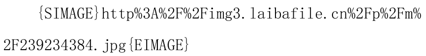

作者:66 端午 88 日期:2016-01-01 12:02

按照其它城市的经验，环线为王。红色的环线内，出租应该并不困难。换线外风景优美，环境良好，没有高架桥，没有快速路噪音地段，同时出行便利，邻居素质高的低容积率的房产，适合居住。

作者:66 端午 88 日期:2016-01-01 12:05

在这张图上，清晰的告诉济南的房主：山大路是济南的中轴线。

作者:66 端午 88 日期:2016-01-01 12:11

济南的二环以前南北不清晰，现在看：清河北路是新北内环，经十一路（旅游路），是济南的新南内环，原有的一环就像北京的紫禁城一环，已经失去环线作用。济南如果有房价分化阶段，由于南部涨势已经到位，北部又处于较低位置，且是济南的成片城建建设重点区域。小清河沿线，自东二环至大纬二路之间，将成为最后的掘金区域。

加 v 信 1101284955，获取更多好帖

作者:66 端午 88 日期:2016-01-02 12:05

陆军司令员，一个连长起家的将领，适合做战役级统帅吗?

作者:66 端午 88 日期:2016-01-02 15:31

一国军事家，要有格局，或者对当代战争的格式有清晰现实先导的理论，尽管这种理论不可以脱离实际，但必须是有前瞻性的。从二战，从马岛战争，中东战争，冷战对峙，各种现代军事技术的牵制，都是先导理论最终赢得了胜利。额绝不信任挥舞大刀片可以赢得对步枪纵队的胜利，也不相信步枪敲掉喷气机的奇迹，更不相信机械化火力覆盖能压倒信息技术引导的精确打击。精确信息单边打击时代，一个扛过枪的大兵，是不可能有超前的格局认识，并形成理论的。

作者:66 端午 88 日期:2016-01-02 15:40

刚找到一部纪录片：陶瓷（1=6），中国当代出口产品的毛利率远远达不到从宋至清的陶瓷，茶叶，丝绸。世界各地的消费者对中国制造如此爱不释手的年代。

作者:66 端午 88 日期:2016-01-02 15:44

日本是如何富起来的，利用仿制中国瓷器，利用中国清前期社会动乱，导致中国瓷器出口停滞了半个世纪。http://v.youku.com/v_show/id_XNDQ3MTEyNzYw.html?from=y1.2-2.2

作者:66 端午 88 日期:2016-01-02 16:20

加v信1101284955，获取更多好帖

成为瓷器出口大国的中国，日本，德国，恰恰是外贸起家的三个国家，命中注定。

作者:66 端午 88 日期:2016-01-02 16:23

中国人生产瓷器，是资源天赋。日本人生产瓷器，是偷抢拐骗，德国人生产瓷器，是科学工业。

作者:66 端午 88 日期:2016-01-02 19:09

@66 端午 88 2016-01-02 15:31:01

精确信息单边打击时代，一个扛过枪的大兵，是不可能有超前的格局认......

@少伯驾舟江湖行 2016-01-02 17:22:55

> “精确信息单边打击时代，一个扛过枪的大兵，是不可能有超前的格局认识，并形成理论的。”

你的这个逻辑完全错误！

决定一个人是否对某一个领域具有科学的理论认知，取决于下述方面

- 1、个人天赋；2、个人意志品质与内在追求；3、成长机遇；4、成长环境；5、成长的基本物质与精神基础；6、实践、理论反思、提高。

前二者很难考量，无法从现有信息作出判断；3、4、6，属于左右互搏，不同立场的人观点可能截然......

你看看那样一个大肚子，酒桌混出来的。多看几眼比你瞎想有用。

作者:66 端午 88 日期:2016-01-03 11:43

去年经济领域最大的两件事。1. 深圳踩着广州的脑门和帝都魔都等高了，尽管步子的节拍是广州的。 2. 股市告诉了大家梦想是个神马玩意，不但可以得到，同样可以失去。

作者:66 端午 88 日期:2016-01-03 12:00

去年房地产领域最大的两件事。1. 你要是没两把刷子，这个世界你永远都是看热闹的，帝都的审批权力（权钱交易中心），魔都的金融权力（洗钱圣地），深圳的创业权力（有个中小创不是闹着玩的），苏州的最佳规模投资权力（攫取了上海的工业投资迁移）。只要中国经济还围绕权力运行，北京始终无忧。只要保持对外开放，人民币国际化不打脸，上海无忧。只要还有各类创投资金翻云覆雨，深圳无忧（盯着创业板指数，深圳股价房价严重联动）。只要上海脱实向虚，苏州---昆山无忧。 其它准一线，强二线城市，如果区域内无竞争压力，也跟着沾点光。比如南京，杭州，三亚，天津，郑州，武汉。有区域竞争压力的，当地领导先想想清楚，是保一个，还是哥俩一块看热闹。比如：成都--重庆，济南---青岛，沈阳---大连，福州---厦门。其它底子差，怎么折腾都没戏的省份，歇了吧，比如长沙，哈尔滨，长春，昆明，西部和西南省份。

2，商业地产全面萧条，这个不用多说了，连看都懒得看了，不论几线城市。

作者:66 端午 88 日期:2016-01-03 13:08

去年世界经济领域两件大事，1. 人民币和美元进行的立体攻防。 2. 关于美元和石油的互相利用，美国，俄国，沙特的互相牵制。

作者:66 端午 88 日期:2016-01-03 19:35

@66 端午 88 2016-01-03 12:00:51

去年房地产领域最大的两件事。1. 你要是没两把刷子，这个世界你永远都是看热闹的，帝都的审批权力（权钱交易中心），魔都的金融权力（洗钱圣地），深圳的创业权力（有个中小创不是闹着玩的），苏州的最佳规模投资权力（攫取了上海的工业投资迁移）。只要中国经济还围绕权力运行，北京始终无忧。只要保持对外开放，人民币国际化不打脸，上海无忧。只要还有各类创投资金翻云覆雨，深圳无忧（盯着创业板指数，深圳股价房价严重联......

@少伯驾舟江湖行 2016-01-03 16:19:37

你上面提到战役格局，肯定是有感于年底最后一天的事，正因为那天的事，我才深刻体会到太宗当年的良苦用心。公开报道太宗提到直接悬菊的有两次，都指向一个时间段 2050 年左右，还都是因英国记者的采访而起，与那个两制有关，现在理解可能又是个类似先富带动后富的设想。

不过，事情恰恰相反，后来走的路根本不是软着陆模式，枪最后是要用的，硬撑、高举高打模式，很像当年的 naz（只能写这么多）。不想妥协，总想牢牢掌控……

这人，越来越不着调，神马民主政治，人权自由的。在这块土地上就是个幌子，就像限购一样，限购是普遍存在的，所有人的利空，一旦放开，怎么也轮不到你啊。你期待的民主自由，其实是期待你一个人的民主自由，一旦放开民主自由，也没你的开胡。多少投机倒把份子等着放开党禁，做个土皇帝哪。远的不说，流氓黑社会，臭不要脸的大队书记村长，一旦放开党禁，都会蹦出来搞社团，能直接骑你脖子上拉屎了。现在，还好吧，他们也有怕的人。那会，自由了，直接抡刀剁了你，小老百姓，别贪图那些华而不实的玩意，搞乱了，小老百姓更惨，不乱，你还能吃着碗里的，骂着锅里的，就算碗里东西少，你还能凑合着活。

作者:66 端午 88 日期:2016-01-03 19:41

@红安土匪 2016-01-03 15:55:42

中国玩这种大格局还是太菜了，每每在外面被人取笑。在国内却横征暴敛

中国现在的石油进口价格大约是 80 美元左右，根本甭看美国和欧洲油价，那不是给你的价格，沙特有便宜货也不给你。想要打击石油价格狠简单，限制国内汽车消费即可，不行啊，被美国人带沟里了，房地产和汽车是中国消费的两大基石，不敢碰了。既然不敢限制就猛抽油吧，汽油价格不下调，相当于对世界第一消耗市场征收高额税，现在油价的 60%都是税，房价里面有 70%以上都是税。有这两个税，体系内就三个字：爽歪歪。

作者:66 端午 88 日期:2016-01-03 19:42

@猪侠侠 2016-01-03 15:06:29

@66 端午 88 2016-01-03 12:02:14.173

2，商业地产全面萧条，这个不用多说了，连看都懒得看了，不论几线城市。

写字楼和商铺对吧

绝大部分小企业都撤离写字间了，搬商住两用去了。

作者:66 端午 88 日期:2016-01-03 20:20

深圳城建面积高达 2000 平方公里，济南只有 400 平方公里不到，真不知道这些年这群王八蛋在干啥哪。

作者:66 端午 88 日期:2016-01-03 23:00

@猪侠侠 2016-01-03 20:40:12

@66 端午 88 2016-01-03 19:42:54.787

绝大部分小企业都撤离写字间了，搬商住两用去了。

还是商住两用实惠吗

商住两用有比较强的灵活性，商业繁荣时，租给小企业办公，获得超出住宅的收益。商业低迷时，租给小白领拼租，获得批零差价的收益。商住两用的核心问题是：位置足够好。

作者:66 端午 88 日期:2016-01-04 10:13

@投机者的扑克 2016-01-04 09:54:08

老大要跑不

挂了一次，卖不出去，唉，等反弹吧。马上熔断了

作者:66 端午 88 日期:2016-01-04 10:14

艹，创业板跌幅超过 5%，怎么没有熔断？

作者:66 端午 88 日期:2016-01-04 10:17

反抽任何一个短线均线，都可以离场，今年不好玩。

作者:66 端午 88 日期:2016-01-04 11:04

@红安土匪 2016-01-04 10:22:19

三年，会不会一直跌到本周末啊？刚好本周末放行大户解禁，然后在小散绝望的时候，就拉升了。

加 v 信 1101284955，获取更多好帖

60日线是最后的止盈止损位，任何反弹反抽都是逃命机会，同时各位要留神：深圳的房价可能正在构筑顶部了。

作者：66端午88 日期：2016-01-04 11:05

@投机者的扑克 2016-01-04 10:53:22

又特么上涨没吃到，下跌没跑掉

命啊。

作者：66端午88 日期：2016-01-04 11:08

艾比森击破47.5，刚才清仓了。

作者：66端午88 日期：2016-01-04 13:11

熔断后，会有一个超强的15分钟级反弹，很多股票会反弹5%，如果这时你还盈利或浅套，清仓，如果深套，减50-75%。

作者：66端午88 日期：2016-01-04 13:13

已经熔断，等会抓住反抽机会，看谁跑的快了，不再提醒了，一定要减仓的。

作者：66端午88 日期：2016-01-04 13:16

强力反弹后，会有更强烈的下跌，一直跌到7%，全日停牌，明天走势搞不清楚了，如果有超级利好，仍是减仓机会，如果没有利好，估计还会处罚熔断。

作者：66端午88 日期：2016-01-04 13:19

如果出现这种情况，建议卖出深圳房地产（仅供参考）。

加v信1101284955，获取更多好帖

作者：66端午88 日期：2016-01-04 13:31

舜

作者：66端午88 日期：2016-01-04 13:32

金融危机爆发，这波极有可能向银行和地产市场传导。

作者：66端午88 日期：2016-01-04 13:35

今天停牌了，唉，天杀的中国大忽悠。

作者：66端午88 日期：2016-01-04 13:41

遛驴行情终于结束，驴给遛死了。

作者：66端午88 日期：2016-01-04 17:13

我们现在推演深圳房价崩溃的过程，深圳的房价是由什么支撑的？高杠杆倍率资金，毫无疑问，就算金领，对于深圳的房价（150平才算起步金领的住宅），我们设定深圳的金领均价为6-7万，总资金额大约是1000万。20-30%的首付，相当于5倍杠杆，房价只要下跌20%，他基本就可以弃楼了。怎样才可以让房价跌20%？对于一个创业城市来说，只要没有创业机会，或者创业周期稍微长一点。就会造成造富进程的结束，中国的创业企业极度依赖给类创投资金，只要中美两国的创业板股市不景气，这种依赖传导就会被切断，那么为什么会确认中国经济就算临近崩溃也会维持创业板的高市盈率？那么需要切断中国创业企业的成长过程，怎么切断？美元对人民币上涨形成趋势，当人民币失去美元的锚定，就会加大波动幅度，导致人民币持有者丧失长期持有的信心。

加v信1101284955，获取更多好帖

只要发生挤兑美元外储，深圳的房价必然崩溃。央行可以全力维护人民币的汇率吗？会的，目前中国可以兑换的美元大约有1.2万亿（其它外储已经被分散到了欧元，英镑，日元等货币），目前我们的人民币流动量是多大，大约40万亿-50万亿之间，只需要10%的兑换量，人民币即可崩盘，只有人民币大幅贬值，才能减少对美元的兑换，所以，央行的努力也仅仅限于边打边撤。央行敢把外汇占款放出来吗？绝对不敢突然大量释放，这样会造成更多的人民币涌向美元。流动人民币减少了，还不敢补足，人民币的市场真实利率，肯定会提高（观测国债逆回购和房贷优惠幅度），这样的结果肯定会引发股市崩溃，然后切断风险投资上市套现的链条，接着创业机会大大减少，深圳人口流入的基础崩塌，房价随即回落。现在要搞明白这个链条断裂的时间----------初步判断是1年内，如果房价下滑3成，贷款800万二十年，每月本息支付大约6-7万。有这个能力的人在深圳有多少？

作者：66端午88 日期：2016-01-04 18:39

如果依靠人民币贬值可以刺激出口，那么上海暂时无忧，如果贬值后，外贸还是没稳住，上海的房价高度依赖外储存量，顶住外储，美元，欧元同时大量流出，上海崩溃。苏州依赖上海的工业转移，上海房价跌下来，工业成本降低，会打压苏州房价。帝都会成为最后的避难地。

作者：66端午88 日期：2016-01-04 18:49

加v信1101284955，获取更多好帖

（晕死，这条分析忘发了）由于我国金融当局对世界经济格局认识不清晰，把大量的美元外汇储备更换为欧元，澳元，日元和英镑。导致中国外储的结构发生了最不利的结构，目前，我国外储已经不是美元储备一家独大，在所有储备中，虽然美元仍是最大储备量，但是比较2008年金融危机的结构，危险性大大增加，即在所有3.67万美元储备中（折算），美元持有量大约为2.1---2.2万亿美元，欧元1.2万亿美元（折算），其它为英镑和日元。而2008年，我国外汇储备的1.97万亿，有85%左右是美元，现在只有65%。2008年，我国国内M2为46万亿，2015年末，我国M2为140万亿。就是说，人民币中的美元含量降低了，由25%降至11%，一旦国内发现人民币有潜在贬值压力，可轻松的将美元兑换殆尽。（目前国内居民存款为54万亿）

当然，还要看这些兑换成美金的人民币是否汇出（出逃），如果兑换后仍存在国内银行，其属性不会变化，如果兑换后提现放在自己家里，就会诱导美元趋势性汇率抬升，如果汇出则是致命的出逃。

如果是一个看跌人民币的职业炒家，肯定不会存在银行里，最优选择是汇出避险，增强美元的国内需求，而且形成实质性减少，其次兑现放在自家保险箱里，助推人民币继续贬值，获取美元对人民币的在岸套利，如果仅仅是现汇兑换，则影响不大，因为你的美元货币仍在央行的账户内，只不过

加v信1101284955，获取更多好帖

从一个子账户迁移至另一个子账户。

作为资产投资人，则更要保持币值变化对你资产的影响，倘若未形成趋势，属于波动震荡，则大可不必紧张。如形成贬值趋势，则必须减持贬值币种的资产，比如房产，股票，都会被币值走弱所影响，轻则造成该币种资产价值降低，重则导致该币种资产蒙受崩盘风险。

本帖最后由于2015-12-13 13:51编辑

作者：66端午88 日期：2016-01-04 21:02

为什么深圳房价和中小创行情关联密切？因为深圳主板，中小板，创业板的深圳本地公司多达150家，是数量最大的私营公司上市来源地。未上市的公司估值普遍在5-10倍，上市公司则为80倍以上，加之大把的私营公司上市后，各类原始股东套现，资金可呈现成十倍放大，对房市的推动是决定性的。深圳加速上涨的时间是今年2月以后，和大股东减持数量是一一对应关系。

作者：66端午88 日期：2016-01-04 22:46

@晨曦时刻 2016-01-04 22:11:19

其实判断房价要看两个信息：1 政府欲望，政府的希望是房子多卖，因此政府期望房价缓慢上涨，不能涨得太快，但也绝不能跌。2 供需情况，这个决定长远来看的房价情况。因此，三四线房价保持稳定，不会上涨但也基本不会有大跌。一线城市继续上涨。

加v信1101284955，获取更多好帖

我一直都在讲一个原理；经济的弹性适用范围原理。在弹簧张力在合理范围内，施力和受力是可控的，一旦把弹簧的弹性用尽，就会失控。现在的失控是供需失衡，并不是需求量一下消失了，而是供应量远远超越了需求。去产能是一样的道理，盲目扩大产能至弹性消失，随之而来的肯定是去产能，依靠农民工去房地产的产能，就会导致弹性失效，因为农民工在城市的工作是不稳定的，没有人替他们谋划稳健的开支规划，他们可以应付高昂的教育，医疗支出吗？如果是仅仅居住在这里，而不能从经济上融入社会，就是不可持续的。一线城市的价格也不是无度上涨，要看支撑当地房价的基础，基础削弱，房价一样会爆。

作者：66端午88 日期：2016-01-04 22:50

一线城市的房价高到一定程度，也会把金领变成农民工的，除非房租快速上拉，达到4-5%的收益，不过这样的高价，4-5%，恐怕没有打工者受得了如此高的房租。目前北京上海深圳的房租收益普遍在1.5-2%，根本谈不上自行衍息的基本要求。

作者：66端午88 日期：2016-01-04 23:55

依赖外贸盈余的国家，货币和证券今晚都大幅下挫，澳元，加元，日元，欧元，人民币。其中基础材料货币：澳元和加元，分别对美元贬值超过1.5%。

加v信1101284955，获取更多好帖

作者：66端午88 日期：2016-01-04 23:57

人民币目前是第二强的货币，除了对美元小幅下挫0.15%，对其它货币均走高，这并不是问题所在，问题的关键是：中国的美元储备量最大，这头羊最肥。

作者：66端午88 日期：2016-01-05 09:41

29.2-29.4，减了，郁闷

作者：66端午88 日期：2016-01-05 10:02

反抽貌似结束了，抛出最后的底仓，回家碎觉

作者：66端午88 日期：2016-01-05 11:44

上涨的逻辑已经出了问题，实体经济不会好转，黑天鹅频繁出击，留在主板凶多吉少，只好去搏题材，现在杀题材，基础动摇，只有等题材杀到位再说了，此前尽量不要抢反弹，因为现在的交易规则也变化了，慢涨急跌，底部下降，趋势转弱。大部分散户是无法盈利的，美金，美金，美金，再说三遍，寻找央行干预时买入持有，比理财安全可靠。

作者：66端午88 日期：2016-01-05 12:09

楼主：66端午88 时间：2016-01-05 11:44:02

上涨的逻辑已经出了问题，实体经济不会好转，黑天鹅频繁出击，留在主板凶多吉少，只好去搏题材，现在杀题材，基础动摇，只有等题材杀到位再说了，此前尽量不要抢反弹，因为现在的交易规则也变化了，慢涨急跌，底部下降，趋势转弱。大部分散户是无法盈利的，美金，美金，美金，再说三遍，寻找央行干预时买入持有，比理财安全可靠。

@烈火动力 2016-01-05 11:51:21

货基还安全吧，三年？

安全，我的急用零钱全部都是货币基金。

作者：66端午88 日期：2016-01-05 14:12

今天测试收盘前半小时熔断，卧槽，啥都得试试

作者：66端午88 日期：2016-01-05 14:13

@到了春季只想远行 2016-01-05 14:09:24

28块又抄了一点点安科瑞

管住手啊，一定要管住，管不住就出门耍，不要带手机。

作者：66端午88 日期：2016-01-05 14:52

@到了春季只想远行 2016-01-05 14:25:42

就是炒个短线，火中取栗

手痒剁手，脚痒粘脚

作者：66端午88 日期：2016-01-05 15:11

@66端午88 39047楼 2016-01-04 17:13

我们现在推演深圳房价崩溃的过程，深圳的房价是由什么支撑的？高杠杆倍率资金，毫无疑问，就算金领，对于深圳的房价（150平才算起步金领的住宅），我们设定深圳的金领均价为6-7万，总资金额大约是1000万。20-30%的首付，相当于5倍杠杆，房价只要下跌20%，他基本就可以弃楼了。怎样才可以让房价跌20%？对于一个创业城市来说，只要没有创业机会，或者创业周期稍微长一点。就会造成造富进程的结束，中国的创业企业极度依赖给类创投资金，只要中美两国的创业板股市不景气，这种依赖传导就会被切断，那么为什么会确……

@YDFQ15 2016-01-05 14:52:47

您之前不是一直看好深圳楼市的吗？如果一年内崩盘，让我们去年涨价后在高位买房的人情何以堪啊！

可以了，从去年年底到现在都翻番了。

作者：66端午88 日期：2016-01-05 19:52

@66端午88 39047楼 2016-01-04 17:13

我们现在推演深圳房价崩溃的过程，深圳的房价是由什么支撑的？高杠杆倍率资金，毫无疑问，就算金领，对于深圳的房价（150平才算起步金领的住宅），我们设定深圳的金领均价为6-7万，总资金额大约是1000万。20-30%的首付，相当于5倍杠杆，房价只要下跌20%，他基本就可以弃楼了。

怎样才可以让房价跌20%？对于一个创业城市来说，只要没有创业机会，或者创业周期稍微长一点。就会造成造富进程的结束，中国的创业企业极度依赖给类创投资金，只要中美两国的创业板股市不景气，这种依赖传导就会被切断，那么为什么会确……

@YDFQ15 2016-01-05 14:52:47

您之前不是一直看好深圳楼市的吗？如果一年内崩盘，让我们去年涨价后在高位买房的人情何以堪啊！

刚需买的不是房子，是身份

作者：66端午88 日期：2016-01-05 22:36

@猪侠侠 2016-01-05 18:32:45

楼主，你觉得把钱花在旅游上好不好

额前面说过一句啥？投资向上，消费向下。你认为旅游是投资，你就去旅游，当然有的人旅游就是投资，比如好多股神赶脚控制不住手的时候，就去旅游。还有的写几本旅游攻略，也能小小赚一把，还有一种旅游叫商务旅游，代购旅游，通过旅游找到发达国家的新思维新动向，或者赚差价。

作者：66端午88 日期：2016-01-06 08:49

都去当地代理生肖纪念币的银行网上预约，一个手机+

加v信1101284955，获取更多好帖

身份证预约五个。

作者：66端午88 日期：2016-01-06 10:24

@猪侠侠 2016-01-05 18:32:45

楼主，你觉得把钱花在旅游上好不好

@66端午88 2016-01-05 22:36:52

额前面说过一句啥？投资向上，消费向下。你认为旅游是投资，你就去旅游，当然有的人旅游就是投资，比如好多股神赶脚控制不住手的时候，就去旅游。还有的写几本旅游攻略，也能小小赚一把，还有一种旅游叫商务旅游，代购旅游，通过旅游找到发达国家的新思维新动向，或者赚差价。

@tsboy320 2016-01-06 08:59:10

三年老师，“投资向上，消费向下”能具体说说吗?不太懂啊

投资向上一阶层看齐，消费向下一阶层看齐。整个中国都是这种模式，要不淘宝能这么火？

作者：66端午88 日期：2016-01-06 10:29

安科瑞职工增持计划，操盘手水平烂极了，上个平台才大量补仓，搞的额也跟进去了，估计他在25平台进了一批，在34平台进了一批，均价29.这次肯定是套住了，跌多了抢反弹，到了职工计划成本附近抛出。

作者：66端午88 日期：2016-01-06 10:36

@猪侠侠 2016-01-06 10:28:38

@66端午88 2016-01-06 10:24:18.827

投资向上一阶层看齐，消费向下一阶层看齐。整个中国都是这种模式，要不淘宝能这么火?

楼主你衣服都淘宝吗

一部分

作者：66端午88 日期：2016-01-06 10:37

@66端午88 2016-01-06 08:49:24

都去当地代理生肖纪念币的银行网上预约，一个手机+身份证预约五个。

@shy175089046 2016-01-06 09:10:40

要这个干嘛?

央行发的福利

作者：66端午88 日期：2016-01-06 10:38

@到了春季只想远行 2016-01-06 09:54:21

29.33把安科瑞卖光了，卖早了。。

出货点不错

作者：66端午88 日期：2016-01-06 18:57

@马拉巴马 2016-01-06 18:27:59

老大，人民币兑美元跌得太快了吧？是央马故意的还是形势所迫啊？

预期的一致性导致单边走势，注意回调风险和回调买入美金时机。今天是一次性贬值2%以后的，市场自由走势的，单日首次贬值超过1%。贬值已形成趋势。下面观测人民币对美元贬值后，是否促进外贸出口增加，如果没有，看空上海房价。

作者：66端午88 日期：2016-01-07 09:46

手里没有美金的，已经置身于必败的境地，太快了。

作者：66端午88 日期：2016-01-07 09:48

央行已经停止了一切大型外资行的人民币和美元兑换业务，狠，马上进入管制了，国内美金成了瓮中之鳖。

作者：66端午88 日期：2016-01-07 09:50

哥的预测一项项兑现，一件好事都没有，唉。

作者：66端午88 日期：2016-01-07 10:00

流动性完蛋了。

作者：66端午88 日期：2016-01-07 10:21

加v信1101284955，获取更多好帖

这样搞法，会连带企业债进入风险。可怕

作者：66端午88 日期：2016-01-07 10:31

@猪侠侠 2016-01-07 10:22:11

@66端午88 2016-01-07 09:50:46.667

哥的预测一项项兑现，一件好事都没有，唉。

唉、楼主能来点正能量吗

这年月对于不上进，没理想，没智商的人，真是个好时代：(

作者：66端午88 日期：2016-01-07 11:22

@像雾像雨又像风11 2016-01-07 11:15:36

楼主，美元在国内也没有用吧，只能赢利了换回来？手里钱不多有意义吗？

由于我国金融当局对世界经济格局认识不清晰，把大量的美元外汇储备更换为欧元，澳元，日元和英镑。导致中国外储的结构发生了最不利的结构，目前，我国外储已经不是美元储备一家独大，在所有储备中，虽然美元仍是最大储备量，但是比较2008年金融危机的结构，危险性大大增加，即在所有3.67万美元储备中（折算），美元持有量大约为2.1---2.2万亿美元，欧元1.2万亿美元（折算），其它为英镑和日元。而2008年，我国外汇储备的1.97万亿，有85%左右是美元，现在只有65%。2008年，我国国内M2为46万亿，2015年末，我国M2为140万亿。就是说，人民币中的美元含量降低了，由25%降至11%，一旦国内发现人民币有潜在贬值压力，可轻松的将美元兑换殆尽。（目前国内居民存款为54万亿）

当然，还要看这些兑换成美金的人民币是否汇出（出逃），如果兑换后仍存在国内银行，其属性不会变化，如果兑换后提现放在自己家里，就会诱导美元趋势性汇率抬升，如果汇出则是致命的出逃。

如果是一个看跌人民币的职业炒家，肯定不会存在银行里，最优选择是汇出避险，增强美元的国内需求，而且形成实质性减少，其次兑现放在自家保险箱里，助推人民币继续贬值，获取美元对人民币的在岸套利，如果仅仅是现汇兑换，则影响不大，因为你的美元货币仍在央行的账户内，只不过从一个子账户迁移至另一个子账户。

作为资产投资人，则更要保持币值变化对你资产的影响，倘若未形成趋势，属于波动震荡，则大可不必紧张。如形成贬值趋势，则必须减持贬值币种的资产，比如房产，股票，都会被币值走弱所影响，轻则造成该币种资产价值降低，重则导致该币种资产蒙受崩盘风险。

作者：66端午88 日期：2016-01-07 13:54

加v信1101284955，获取更多好帖

由于我国金融当局对世界经济格局认识不清晰，把大量的美元外汇储备更换为欧元，澳元，日元和英镑。导致中国外储的结构发生了最不利的结构，目前，我国外储已经不是美元储备一家独大，在所有储备中，虽然美元仍是最大储备量，但是比较 2008 年金融危机的结构，危险性大大增加，即在所有 3.67 万美元储备中（折算），美元持有量大约为 2.1---2.2 万亿美元，欧元 1.2 万亿美元(折算)，其它……

去产能结束接近尾声时，会有好转，这个时间恰好和互联网经济成互补，所以看传统经济去年能结束点，就是互联网经济扩张结束点。

@马拉巴马 2016-01-07 11:35:00

老大，减持新规管用不？期限三个月，难道人民币还要贬三个月？

不管用，这不是下跌的核心因素，核心因素是人民币贬值因素。

@烈火动力 2016-01-07 13:24:31

加 v 信 1101284955，获取更多好帖

个人觉得现在房价与汇率没有太直接的关系。就拿俄罗斯来说吧，卢布贬值了那么多，但俄国内卢布计价的房子还有一定的涨幅，所以倒觉得房产是对冲民币贬值的一个有效工具。真正影响明年房价的可能是央妈放水的力度，如果仅仅一两次的降息降准恐怕撑不住现在的房价。

再者从过去 08 年的经验判断，往往在股市跌到一定程度后（大概半年左右时间）房价才跟跌，当然其前提是放水力度跟不上。

但以的尿性，个人估计两会后大力......

特地调查了一下莫斯科房价，额同学说，只有那屁大地方一点很贵，其它位置稍差的都很便宜。

@wendy84china 2016-01-07 11:32:50

楼主,感谢您的预判，就您所说逆向思维，当大家一片唱衰之时，其实才是机会。我党没那么傻，即使欧元储备多了，也是有政治因素，和欧洲肯定有过利益交换。是险棋不错，但不会致命。那么多的智囊不会全是傻子的。

关键现在一点也不衰，GDP 还稳住 6.5%，新常态了，你的篮子里少了，总篮子还在增大，现在搞房地产开发的还是不错着哪。

做个人民币走势分析: 巨大的兑换压力导致央行只有两个手段来应付, 第一, 采用行政手段进行限制, 不过这会导致国际压力, 使人民币国际化受阻, 结果是打压了一线城市的洗钱中心功能。第二, 升息, 压缩人民币流动性, 会导致国内经济继续恶化。两害权衡取其轻, 行政化限制马上会出台。

逆回购凶猛, 人民币热钱疯狂出逃

@Dommyoo1 2016-01-07 14:53:48

2015 年在深圳太苦逼了! 年初准备买房被朋友带进了股市, 还没回本。现在还能在深圳买房吗? 好纠结!

不能, 风险最大的城市

在行政干预前, 央行还会做最后两次努力, 都是逢低介入美元的良机。

央行在外汇市场出手了, 今天一早人民币汇率一度跌至 6.7373, 目前已经回升到 6.5926, 如果能打压到 6.5 以下, 不要由于, 疯狂买入。

加 v 信 1101284955, 获取更多好帖

@Dommyool 2016-01-07 15:07:19

刚需啊,老师!哭晕了!

在深圳效区有套房,市场价300W,想换市区学位房,看中的800W打算咬牙凑钱买了。看了老师的贴,打算放弃!刚需现在怎么办?退一步换套小点的学位房行嘛?

唉,让你们买的时候不买,不该买的时候着急,你往回查查,额都让你们什么时候买房,2008年底,2012年底,去年4-5月。每次都是一倍涨幅,现在进去正好抢个帽子,套你多长时间,鬼才知道。

@wzz810711 2016-01-07 15:14:48

老大,关键是现在买美元不好买了。银行控制很紧呀,要各种手续。

周六我还问过中行,他说没问题啊?

加v信1101284955,获取更多好帖

@猪侠侠 2016-01-07 15:15:43

楼主、到底啥时候买房好

跌下来看形势

@66 端午 88 39169 楼 2016-01-07 15:04

央行在外汇市场出手了，今天一早人民币汇率一度跌至 6.7373，目前已经回升到 6.5926，如果能打压到 6.5 以下，不要由于，疯狂买入。

@马拉巴马 2016-01-07 16:09:15

老大，6.73 好像是离岸价，6.59 是在岸价

对的，6.5 在岸价，应该回探一次。

@猪侠侠 2016-01-07 20:07:18

楼主为啥现在都是抗日剧

拍摄成本低，服装便宜，演员便宜，观众便宜，剧情便宜，容易审批。

@猪侠侠 2016-01-07 20:49:00

拍摄成本低，服装便宜，演员便宜，观众便宜，剧情便宜，容易审批。

难道是薄利多销？现在连拍电视都药控制成本了

90%的电视剧都是保本或者亏本运营，只有降成本才能生存，电影好多了，电影现在取代逛街了，是城市屌丝最便宜的娱乐消费。

广播电视系统自从被互联网掀翻后，每况愈下，肯定会向前端压缩成本的。

暂停熔断，高开低走，低开高走。

@种合野乃小尼丹 2016-01-07 22:43:01

奇怪，4 年过去了，LZ 的逆向思维在小地方买房子策略怎么样了？

几十万扔进去直接成本机会成本损失 4，50%了没？

全国人口最大省省会，人口正流入，交通核心，区域核心，房价未涨，城建开始好转，出租收益比稳定在 4%。

炒作逻辑混乱，有色煤炭钢铁，都是去产能行业，目前这些行业产能过剩至少一倍，而且去产能极端不利，反而是民营企业的过剩产能消除的效果比较好，钓鱼行情，什么时候看到此类大型上市公司破产重组后，才是见底标志。

@种合野乃小尼丹 2016-01-08 13:34:05

5 年,期间低风险实际收益率 8-10%, 标的价格本身没涨,机会成本损失 25% 左右

不知道当地不动产流动性怎么样,房子是流动性最差的资产,如果流动性一般实际损失 30% 左右

这还是郑州,其他听逆向思维劝的北上广深外投资者不知投资怎么样了

扯,五年间,额最便宜的阁楼都过万了。一般是 25-35% 的收益,加上每年 4% 的房租收益,合计 50% 左右。济南二环内学区房,有下一万二的么?山大路新盘已经没有下 1.6 万的了,好点的二手直奔 2 万,差的大约 1.3 万。五年前最便宜的只有 8500 左右。

济南新房均价 8680 , 二手房均价 10490 , 历下区二手房均价 13430 , 历下区二环内新房均价 15160 。西客站的新盘便宜的只有 6000-7000, 孙村附近的新盘也是六千出口,而且这些便宜的地方供应量巨大,拉低了新房成交均价。核心地段新盘现在容积率都在 3 以上,均价在 1.5 万以上,额号召无忧买入的时候,这些地方普遍在万元左右, 2.4 容积率遍地都是，现在核心地段根本找不到容积率3以下的。五年前，济南偏远地段很少有楼盘，很少的几个，标价大约5千左右。偏远的楼盘，距离核心位置大约有15-20公里，济南的交通通行之差，15公里*1.5倍距离时间=通行效率中等城市。

快播官司问题，你得看背后的战争，有快播的市场，就没有乐视网的市场，百度视频，搜狐视频，QQ视频也有和快播视频冲突的，总之都有侵权问题，50步笑不得100步，乐视网掏了3亿多，买了一堆有产权的垃圾视频，有快播就兑现不了，乐视网是北京公司，权力中心，快播是深圳的屌丝创业公司，还没找到盈利的方式，权力和资本介入程度非常浅，乐视网可是上市公司，若干权力和资本大规模介入，不搞死你丫的，我怎么赚钱啊。自觉抵制乐视网，就是维护屌丝的切身利益，不要购买乐视产品和服务，丫的全身都是小股民血汗装备起来的。

现在又有人提议深圳和惠州合并，升级为直辖市，说要引领中国经济突围，完全是胡扯，就这几年搞起来的所谓新经济，并未创造蓝海市场，他们的做法就是吸引各类风投资金，从传统经济份额夺取市场，不但不是新的市场，也并未提高经济效益，反而降低了传统行业的经济效益，深圳的营商手段就是你 10 块利润，我做到 1 块，作死拉倒，然后再找个利润高的行当做烂。通常情况下，传统行业要做一个新产品，利润是逐步下滑的，比如电视行业，从不能国产，到国产挤出进口产品，时间长达 20 年，产品的利润逐步下滑，同时产业规模逐步扩大，这个周期是 20 年，从暴利行业发展到微利，逐步稳定后成为夕阳行业。深圳的做法是，5 年，从暴利到微利，这几年互联网+，缩短到 3 年，甚至更短。你三年能把这个产品做透吗？在技术未做透前，就把利润做透了。特别是互联网+以后，甚至 3 年就没赚过钱，利润就做透了。利润做透了，资本市场确获得了丰厚的利润，然后股东减持，炒高深圳房价，你这样搞，别的城市就别发展了，彻底成为了深圳的产品倾销地，你这是在搞殖民地经济吗？利用政策优势搞资金汇聚，搞资本炒作游戏，这样的新经济，不叫新经济，和庞氏骗局没有什么两样。

深圳是全国活力最强的城市，这和它的经济产业结构，城市精神，人口组成完全相符，体现在房价上，波动性极其剧烈，国内资金为什么要逃离，主要因素就是规模资金已找不到可以投资的项目了，找不到就跑吗？还有很多可以保值的标的，但是：中国货币流动性实在太大，策略又是非常激进的。作为典型的代表深圳，在形成趋势性货币贬值的背景下，又会呈现出其特色，这种货币流出一定会波及到房地产，其波动性也是非常剧烈的，别的城市可能下调 10%就没有卖盘了，深圳的波动幅度可能会增加到 30%以上，甚至更剧烈。由此发生类似对于其它城市崩盘的效果，但是他不会崩，跌到 30%，没房的可以逢低买入了，跌到 30%以上一定是崩盘的效果，到时候，你敢买吗？未必敢。深圳的这种资产性波动，像极了创业板股票，年轻人心脏好，深圳人的心脏尤其坚强。

@buwangchuxin2015 2016-01-10 13:04:42

98 年，08 年，金融危机似乎是以十年为周期，而且不管源自哪里，除了朝鲜一类极度封闭的国家外都会受到波及。

08 年，国家放水解决了很多人可能出现断供的问题，如果马上又快要出现断供问题，国家会怎么办，继续刺激，继续放水，然后房价接着涨，然后泡沫越来越大。

反正我觉得现在的日本挺好，美国也不错，有时候把放水和金融玩得团团转，钱能真正的转起来即使有很大的债务和泡沫，只要能转嫁或者让它永远不破也不失为……

理论上应该降息降准刺激低迷的经济，由于外汇汇率狂贬，这种可能性又降低了，现在放出来流动性，既不会进入实体经济，也不会进入股市，会加速换美元，赶脚在央行主动打压美元后，稳定一阵子，然后突然跳贬的可能性非常大，现在应该逢低逐步加仓美元。

@山的那边 2012 2016-01-10 13:45:47

三年老师，您看像我们这种工薪阶层的，手里有点小钱但又不多的，要不要换一点美元来避险。

我也是很犹豫要不要换个几 W 美元，但是又担心利息的损失。投 P2P 一年大概 10%的利息收入。

宁可买货基，也不动 P2P

每次大动作都得给自己一个交代，立一杆大旗，这叫名正言顺，出师有名：买美元救中国。对于中期战略资源，美国擦屁股纸，拿在我等爱国志士手里，一不带出国境，二不捐款移民，等到祖国最需要它的时候，我们原封不动的按照市价交回去，千万莫让那些投机份子和灭我之心常在的坏人拿走。明日加仓美元。回额妈家对付身份证开新账户且。

@猪侠侠 2016-01-11 09:37:31

楼主，现在经济比较困难，我看做娱乐戏子最好了，你看那些明星什么的，各种奢侈，各种高出场费，演出费，我觉得任何经济风险都没办法影响他们

经济不好的时候，才是娱乐业的黄金时代，美国的大型电影公司都是美国经济危机的产物。

还有，你只看到混的好的，没看到混到吃不上饭的，这行饭也不是那么好抢的。混在顶端的那些人，还不定多龌龊才能上位哪。

离岸汇率：http://finance.sina.com.cn/money/forex/hq/USDCNH.shtml

@他年明月在 2016-01-11 12:55:43

6.8

现在的在岸买入价是 6.58

额打算击破 6.5 开始大规模建仓，账号和资金都准备好了，就等央行送大礼了。

@赢家 12345 2016-01-11 14:13:32

敢问楼主，钞和汇比例如何配置？还是全部为汇？

汇能汇出，如果你能汇出就选择现汇，如果不打算和央行做对手盘，也保留现汇。额是打算跟央行做对冲，所以要提出现金。等着以后价高了，现钞转为现汇还得损失一点。

矮油，跌到 5%也不停牌了。

@buwangchuxin2015 2016-01-11 16:28:26

楼主：自然本然 时间：2016-01-11 00:09:17

未来一种可能性，国内股票跌到二千点以下，楼市下跌百分之七十，利息降低到零，国家大力支持海外人民币投资，输出产能和人力。但汇率反升到 1:4 左右。美国开始 QE 来抢中国资本输出。

第一，给国内企业降包袱，形成大垄断，组织大集团冲向国际市场，自己借钱给别人，自己为别人干活，转化为长期收益。

第二，国内暗补出口企业，加大出口，使垄断国企或上市公司成为跨国......

这波如果美金行情是国内的主力，一定会炒到加息为止，公安部又要抓人了。

@lesstime579 2016-01-11 16:31:30

汇能汇出，如果你能汇出就选择现汇，如果不打算和央行做对手盘，也保留现汇。额是打算跟央行做对冲，所以要提出现金。等着以后价高了，现钞转为现汇还得损失一点。

楼主，请教一下，四五线地市，今天去中行预约，说目前都是 06 版，调款也不确定估计也没有新版，也没有零钞，老版大头 100 将来使用会有什么隐患吗，另外换了现钞怎么保存啊

保险柜

@buwangchuxin2015 2016-01-11 16:28:26

楼主：自然本然 时间：2016-01-11 00:09:17

未来一种可能性，国内股票跌到二千点以下，楼市下跌百分之七十，利息降低到零，国家大力支持海外人民币投资，输出产能和人力。但汇率反升到 1：4 左右。美国开始 QE 来抢中国资本输出。

第一，给国内企业降包袱，形成大垄断，组织大集团冲向国际市场，自己借钱给别人，自己为别人干活，转化为长期收益。

第二，国内暗补出口企业，加大出口，使垄断国企或上市公司成为跨国......

@莫高雷勇士 2016-01-11 17:44:41

不可能，现在货币超发这么多，汇率只能贬。

和发多发少关系不大，关键国内已经没有什么标的可以锁住货币了，这才是大问题。买房子这种玩意，都是一手钱一手货的，你出了钱，别人拿到钱也得耍出去。不像股票，跌价一卖钱就没了（暂时锁在名义亏损里面了）。

@lesstime579 2016-01-11 19:26:55

保险柜

谢谢楼主，楼主方便的话能不能再说说，放港户里是否可行啊

大陆和香港有协定，貌似不行

作者:66 端午 88 日期:2016-01-11 21:07

@66 端午 88 2016-01-11 11:03:08

离岸汇率：

http://finance.sina.com.cn/money/forex/hq/USDCNH.shtml

@大连之鹰 2013 2016-01-11 19:56:21

离岸在岸差距很大，香港到内地深圳套利的很多啦，香港的人民币都不够用了

离岸价今天在央行干预下，暴跌 1000 点，离岸和在岸价目前只有 400 点差距，估计再有两天到三天，在岸价会打到 6.5 左右，是一次绝佳的逢低买入机会，为了保险起见，逐步买入。6.5 以下，越跌越买。

作者:66 端午 88 日期:2016-01-12 11:10

昨天去银行开新户，发现好多大妈也在等哪，那个理财经理办公室外面一大群人在咨询美金的问题，大妈都不囤黄金了，改囤美金。

作者:66 端午 88 日期:2016-01-12 11:14

不要小看大妈，现在的收入结构中，最稳定的收入就是老年人的退休金，每年涨 10%，这些年体系内退休人员的退休金，稳稳的干掉了在职职工收入增长，且存量巨大，花的少，攒的多，要是美金上涨形成趋势，每个月的退休金都会像存款一样往美元账户流入。

作者:66 端午 88 日期:2016-01-12 11:31

@lesstime579 2016-01-12 08:36:07

@66 端午 88 2016-01-11 21:07:32.657

离岸价今天在央行干预下，暴跌1000点，离岸和在岸价目前只有400点差距，估计再有两天到三天，在岸价会打到6.5左右，是一次绝佳的逢低买入机会，为了保险起见，逐步买入。6.5以下，越跌越买。

楼主，为什么今天离岸涨在岸跌呀

据传香港人在做套利，央行要抑制套利，就得把在岸价和离岸价的价差打掉。

作者:66 端午 88 日期:2016-01-12 15:26

在岸离岸价背离，应该这么解释：换了美元的大妈，保持现汇状态，美元在国内仍然在央行总账下，只要在央行控制下，涨跌对资产价格影响不大，但贬值对外贸有好处。离岸价如果和在岸价差距过大，会导致套利交易，这容易引导在岸价空涨，同时货币外流，央行比较怕这个结果。所以：默认美元缓慢升值，但不允许套利交易（反复套利，就把央行掏空了），反而美元慢涨，无套利，那么美元也不会大幅流出，好处多坏处少。

作者:66 端午 88 日期:2016-01-13 11:31

@66 端午 88 2016-01-12 15:26:51

在岸离岸价背离，应该这么解释：换了美元的大妈，保持现汇状态，美元在国内仍然在央行总账下，只要在央行控制下，涨跌对资产价格影响不大，但贬值对外贸有好处。离岸价如果和在岸价差距过大，会导致套利交易，这容易引导在岸价空涨，同时货币外流，央行比较怕这个结果。所以：默认美元缓慢升值，但不允许套利交易（反复套利，就把央行掏空了），反而美元慢涨，无套利，那么美元也不会大幅流出，好处多坏处少。

@赢家 12345 2016-01-13 09:13:45

http://finance.sina.com.cn/china/jrxw/2016-01-11/doc-ifxnkvtm9747213.shtml

看看这个，我们的动作是不是要加快些！

http://finance.sina.com.cn/roll/2016-01-13/doc-ifxnkvtm9874681.shtml

作者:66 端午 88 日期:2016-01-13 12:54

房产的 70%和房子无关，油价的 60%和石油无关。

作者:66 端午 88 日期:2016-01-13 15:27

@66 端午 88 2016-01-07 21:03:59

广播电视系统自从被互联网掀翻后，每况愈下，肯定会向前端压缩成本的。

@种合野乃小尼丹 2016-01-07 22:43:01

奇怪，4 年过去了，LZ 的逆向思维在小地方买房子策略怎么样了？

几十万扔进去直接成本机会成本损失 4，50%了没？

@66 端午 88 2016-01-08 09:16:11

全国人口最大省省会，人口正流入，交通核心，区域核心，房价未涨，城建开始好转，出租收益比稳定在 4%。

@种合野乃小尼丹 2016-01-08 13:34:05

5 年，期间低风险实际收益率 8-10%，标的价格本身没涨，机会成本损失 25%左右

不知道当地不动产流动性怎么样，房子是流动性最差的资产，如果流动性一般实际损失 30%左右

这还是郑州，其他听逆向思维劝的北上广深外投资者不知投资怎么样了

@66 端午 88 2016-01-08 17:03:08

扯，五年间，额最便宜的阁楼都过万了。一般是 25-35% 的收益，加上每年 4%的房租收益，合计 50%左右。济南二环内学区房，有下一万二的么？山大路新盘已经没有下 1.6 万的了，好点的二手直奔 2 万，差的大约 1.3 万。五年前最便宜的只有 8500 左右。

@泰兰德 de 记忆 2016-01-11 19:26:39

我看你说来说去，总离不开一个济南，你可知道其它地方的价格？我在深圳，从 2014 年 8 月开始看房，最清楚不过了。深圳中心区和有地铁的地方是 NB，没地铁的地方和周边的东莞惠州可就惨了，比如深圳石岩区，你在地图上找下，因为没地铁又有工业园，万元以下的都有。现在这形势下，也就北上广和人口多城市的中心区能卖得出去了。北京由于土地资源少，可能他周边能稍稍卖起来。

@种合野乃小尼丹 2016-01-13 14:17:28

人家肯定要死咬没错的，这 5 年来其实中国除十来个城市外基本都平或者跌了，三线城市基本要么跌要么没流动性

他当年还一二三线城市如何如何，现在认错就不能“一贯正确”，还有谁信他啊？

@66 端午 88 2016-01-13 15:27:19

我啥时候说过要买三线的房子了？你往回查查。1线城市，我一致推荐到今年6月，而且是自住型和改善型的，二线城市人口流入的一直推荐。现在的策略：二线没涨的逢低买入，一线暴涨的狠狠杀跌。额就说过两个三线城市：东莞（樟木头）和北海，而且不是投资型的，是旅游类型的。

@种合野乃小尼丹 2016-01-13 15:42:46

由上所述得出结论，不论是1，2，3线城市，房地产投资将依然是政府的主力投资方向，如果市场价格发生下滑，可以利用拆迁等多种手段刺激需求，我们要做的事情依然是等待一次小规模的下滑机会，继续逢低买入，看清大形势，顺势而为，不要做趋势的叛逆，因为趋势不会轻易转向，特别这个趋势已经延续的10年的前提下，你怎么能轻易判断未来10年它不会延续哪？趋势也绝不会掌控在P民手里。

那会我把济南的房价归类于3线城市，明白了吧，结果大家非得说它是二线的

作者:66 端午 88 日期:2016-01-13 17:30

@种合野乃小尼丹 39313 楼 2016-01-13 14:19

@种合野乃小尼丹 39205 楼 2016-01-08 23:58

@66 端午 88 2016-01-07 21:03:59

广播电视系统自从被互联网掀翻后，每况愈下，肯定会向前端压缩成本的。

@种合野乃小尼丹 2016-01-07 22:43:01

奇怪，4 年过去了，LZ 的逆向思维在小地方买房子策略怎么样了？

几十万扔进去直接成本机会成本损失 4，50%了没？

@马拉巴马 2016-01-13 15:22:00

估计这大半年苏州均价就涨了五成，好点的直接就翻倍了，

@种合野乃小尼丹 2016-01-13 15:52:08

2014 年末我去过苏州，大概 1 个月，印象里 1 万到 1 万 5 区间就能买到很不错的了

刚才查了查苏州 15 年狂涨啊，不过也算是补缺口吧，苏州经济不弱于南京杭州，房价只有两者一半左右

补涨也有道理，估计无锡有可能是下一个，当地 8000 能买到不错的房子，便宜的像苏北似的，没理由啊

总体讲 2011 年至今，5 年里房价有明显涨幅的 1 线外也就 10 个上下二线，特征都有基本面好，原本价值洼地有待补涨

比如郑州啊苏州啊南......

苏州几年前看好过，现在灰常不看好，那是个工业城市，拉高房价奏是作死，无锡问题不大。相同的逻辑，额看空过温州，结果温州跌的一塌糊涂，看空过杭州，结果杭州前年去年跌幅第一。

作者:66 端午 88 日期:2016-01-13 19:27

@流星蝴蝶剑 wq 2016-01-13 18:50:54

额，楼主，我只想问一句，即便地方政府财政百分之百都由卖地来支撑，房价就有道理一路往下飙？你有没有想过中国的银行会破产，有没有想过中国的政府也会破产？底特律能破差，为毛中国地方政府不行？就因为我们是社会主义国家？的确，政府有很多行政手段，但你确定一定能刺激房价上涨而不是起到反作用？远到计划经济，近到熔断机制，我是没看到哪项政府的行政干预能够刺激经济健康发展，求科普？

1996 年---2006 年，经济发展，房价涨，互相促进，那会虽然你也会觉得房价高，其实不高，整体上讲：做实业的盈利超过房东的盈利，黄金十年。2007 年开始，游戏规则变了，搞实业完败于房东，皮之不在，毛将焉附。现在已经到了，清理产能，买房待涨。钱不够就使用杠杆，前程堪忧了。做空中国泡沫资产价格的工具就是美元。

作者:66 端午 88 日期:2016-01-13 23:39

@种合野乃小尼丹 39313 楼 2016-01-13 14:19

@种合野乃小尼丹 39205 楼 2016-01-08 23:58

@66 端午 88 2016-01-07 21:03:59

广播电视系统自从被互联网掀翻后，每况愈下，肯定会向前端压缩成本的。

@种合野乃小尼丹 2016-01-07 22:43:01

奇怪，4 年过去了，LZ 的逆向思维在小地方买房子策略怎么样了？

几十万扔进去直接成本机会成本损失 4，50%了没？

@马拉巴马 2016-01-13 15:22:00

估计这大半年苏州均价就涨了五成，好点的直接就翻倍了，

@种合野乃小尼丹 2016-01-13 15:52:08

2014 年末我去过苏州，大概 1 个月，印象里 1 万到 1 万 5 区间就能买到很不错的了

刚才查了查苏州 15 年狂涨啊，不过也算是补缺口吧，苏州经济不弱于南京杭州，房价只有两者一半左右

补涨也有道理，估计无锡有可能是下一个，当地 8000 能买到不错的房子，便宜的像苏北似的，没理由啊

总体讲 2011 年至今，5 年里房价有明显涨幅的 1 线外也就 10 个上下二线，特征都有基本面好，原本价值洼地有待补涨

比如郑州啊苏州啊南......

@66 端午 88 2016-01-13 17:30:28

苏州几年前看好过，现在灰常不看好，那是个工业城市，拉高房价奏是作死，无锡问题不大。相同的逻辑，额看空过温州，结果温州跌的一塌糊涂，看空过杭州，结果杭州前年去年跌幅第一。

@种合野乃小尼丹 2016-01-13 23:10:20

一、无论济南算不算进三线，目前三线都已经几乎全线阵亡

二、11 年作为基准算，杭州等大半以上二线也已经阵亡，只有最多 10 个上下二线勉强还行

三、11 年作为基准算现在除一线 +最多 10 个上下二线还可以，其它城市不动产都阵亡了

四、2011 年你的预言完全错误，2011 年为基准看 90% 城市不动产价格都基本玩完，增幅远低于同期低风险利率（50-60%）

一大半甚至没明显超过 2011 年时候的绝对价格

你这种说法毫无依据，济南的核心区域房价，自 2013 年底看淡整体房市后，仍然涨了大约 30-40%（比如山大路中段的房子，自 12000 涨到 16000 多），济南这两年房价看起来没涨，是因为大量的偏远区域房产上市拉下来的，核心位置现在开盘就是 1.7 万，比如解放路中段新开的两个盘，历山名郡二手房超越 2.1 万（目前二手房里面最贵的）。新建的 CBD 新区，以前也就 7000 左右，现在一概 1.2-1.6W 开盘。去年看好的奥体西路区域，现在大部分也超过了一万，去年年初才 6000-7000。

作者:66 端午 88 日期:2016-01-13 23:46

增幅远低于同期低风险利率（50-60%），这句？什么叫低风险利润，银行直营的理财是低风险利率的底限，5 年，每年平均 5%，25%的收益，五年济南这样的城市，房租每年 3-3.5%，加上 30%的价格上涨。别不懂装懂了，低风险利率走低是板上钉钉的事，未来 5 年，无风险利率的底限会向 2.5-3%靠拢。也就是个房租收益，银行的低风险，是让你丧失了灵活性，同时面临绝对货币的绝对贬值。

作者:66 端午 88 日期:2016-01-14 08:33

@66 端午 88 2016-01-13 23:46:05

增幅远低于同期低风险利率（50-60%），这句？什么叫低风险利润，银行直营的理财是低风险利率的底限，5 年，每年平均 5%，25%的收益，五年济南这样的城市，房租每年 3-3.5%，加上 30%的价格上涨。别不懂装懂了，低风险利率走低是板上钉钉的事，未来 5 年，无风险利率的底限会向 2.5-3%靠拢。也就是个房租收益，银行的低风险，是让你丧失了灵活性，同时面临绝对货币的绝对贬值。

@种合野乃小尼丹 2016-01-14 01:10:18

没事不要不懂装懂，你 5 年前错了就错了，当自己毛泽东还要争一贯正确啊

过去 5 年低风险利率是信托收益，这么多产品发行上万亿，只有几十亿出问题，最后还给赔了本金没给利息而已

10 年前后接近 10%，现在大概 7-8%。理财是骗不懂行大伯大妈的，都是资金池产品，无抵押物无明确标的，是文盲的最爱

还“板上钉钉”，当自己伟大领袖啊，网上是胡扯淡地方，想口出圣旨去和周公会吧

5 年前什么“逆向思维”，谁……

信托的起点是多少，太能胡扯了，起点 100 万，还是 8% 的，现在根本也找不到 6% 的，连 3.X% 的国债都一抢而空，10% 的都是 500 万起的，别听说就当事，信托违约的也不少，你能买到的，估计也就是违约那一等级的，你大资金投一个试试，包你肉包子打狗，不承认，你可以晒你的收益单据。

作者:66 端午 88 日期:2016-01-14 08:59

大部分信托终将违约，走信托的一般都是高回报，背后的问题是这些项目根本贷不到款，要么是钢铁煤炭焦炭，四级城市的小开发商，老少边穷政府的城建，主要集中在这些过剩产能和低信誉标的。国家目前在干什么？强行去产能，挤压高风险杠杆。这些信托最后的结果能回本就烧高香，还在这美哪，等着排队跳楼吧。

作者:66 端午 88 日期:2016-01-14 09:02

高信誉的大中型城市建设债（有税收抵押），大部分都包装成城商行的理财了，这部分国家是兜底的，那些连城商行都看不上的，大多有偿债风险。这里面还有两个档次，有偿债能力的，但没有高信用等级的（比如用城市土地做抵押的），这部分根本轮不到卖给你，人家都自行消化了，你能买到的，基本都是风险极大的，比街边的P2P强点有限，相当于次级旁氏产品。

作者:66 端午 88 日期:2016-01-14 10:15

@66 端午 88 2016-01-12 15:26:51

在岸离岸价背离，应该这么解释：换了美元的大妈，保持现汇状态，美元在国内仍然在央行总账下，只要在央行控制下，涨跌对资产价格影响不大，但贬值对外贸有好处。离岸价如果和在岸价差距过大，会导致套利交易，这容易引导在岸价空涨，同时货币外流，央行比较怕这个结果。所以：默认美元缓慢升值，但不允许套利交易（反复套利，就把央行掏空了），反而美元慢涨，无套利，那么美元也不会大幅流出，好处多坏处少。

@赢家 12345 2016-01-13 09:13:45

http://finance.sina.com.cn/china/jrxw/2016-01-11/doc-ifxnkvtm9747213.shtml

看看这个，我们的动作是不是要加快些！

@66 端午 88 2016-01-13 11:31:07

http://finance.sina.com.cn/roll/2016-01-13/doc-ifxnkvtm9874681.shtml

@赢家 12345 2016-01-14 10:13:12
三年兄，又来叨扰了，钞日后除了黑市能用，还有其他的途径吗？请指点，求心安！

钞主要是应付日后外汇管制，这得看经济下滑到什么程度。

作者:66 端午 88 日期:2016-01-14 11:48
@投机者的扑克 2016-01-14 11:36:04
小盘股反弹了啊

额看了看图形，15 分钟的扎马步走势，赶脚扎稳了，第二天一脚再踹倒，这是第四个马步。

作者:66 端午 88 日期:2016-01-14 11:54
15 分钟缩量反弹，等到 kdj 过了 100 跌下来的时候，放量杀就是还有更低，缩量下来，有两个结果，再来一次 kdj 顶背离，或者放量涨，构筑底部，转看 30 分钟线。总之，逃的比较快，这次不抢反弹了。

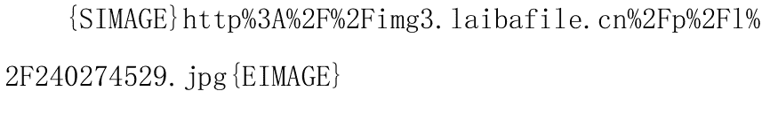

作者:66 端午 88 日期:2016-01-14 12:45
@66 端午 88 2016-01-14 09:02:42
高信誉的大中型城市建设债（有税收抵押），大部分都

加 v 信 1101284955，获取更多好帖

包装成城商行的理财了,这部分国家是兜底的,那些连城商行都看不上的,大多有偿债风险。这里面还有两个档次,有偿债能力的,但没有高信用等级的(比如用城市土地做抵押的),这部分根本轮不到卖给你,人家都自行消化了,你能买到的,基本都是风险极大的,比街边的 P2P 强点有限,相当于次级旁氏产品。

@种合野乃小尼丹 2016-01-14 12:24:05

装什么装,你在信托干还是在银行干?按你自己逻辑,拿学历证和工作证出来晒晒呗

理财都是资金池产品,没抵押物没明确项目用途的,你看过理财合同没有啊,还两个档次,那种东西不是文盲的谁会碰

信托都有抵押物的,那是合同标准格式好不好,至于抵押土地质地好不好需要投资人自己判断

现在 google map 和招拍挂网站这么多,自己去搜呗,我当初是自己跑到抵押物土地去看的

文盲一个,5 年前骗什么逆向思维……

晒了怕你自卑:)

作者: 66 端午 88 日期: 2016-01-14 14:06

这次还真是反弹,能有 2-3 天

作者:66 端午 88 日期:2016-01-14 15:30

你们抢吧，额盯着美元，创业板跌幅大的还有一天半反弹

作者:66 端午 88 日期:2016-01-14 16:43

@66 端午 88 2016-01-14 15:30:42

你们抢吧，额盯着美元，创业板跌幅大的还有一天半反弹

@nawa2011 2016-01-14 15:50:05

三年兄，年前出手广州二手学位房，理智否？孩子 5 年后才用，就是手里有钱想投资。学位房有投资价值吗？15 年全年涨了 12 个点~~赐教赐教啊 我都发了三遍啦~~~

广州涨幅不大，刚需择机而入。

作者:66 端午 88 日期:2016-01-14 16:47

广州不知是发展出了问题还是人口出了问题，貌似要被一线城市除名了。投资的要谨慎，刚需可以买，你图的不是利润，是根据地问题。

作者:66 端午 88 日期:2016-01-15 11:32

@红安土匪 2016-01-14 12:54:26

三年跟女人有啥好扯的？你跟她讲道理，她跟你摆事实；你讲中心城市和一二线城市房价要涨，她说县城和乡镇

跌了。五年前就算是 2011 吧，即使把县一级算上，哪个县城的房价比现在高?与 2011 年比较，房价是涨了还是跌了?

@种合野乃小尼丹 2016-01-14 16:50:30

我是男的，你的基本直觉就不灵啊

11 年三线城市普遍 5 千上下了吧，浙江这种地方都上万了

今天一般三线还是 5 千样子，变化不大的

@红安土匪 2016-01-15 08:54:12

你这人逻辑堪忧，东拉西扯，啥都懂，但是啥都混乱，跟女人不是一回事？现在楼主三年开始看空房地产，看多美元，没看见么?

按照他的逻辑，无图无真相，先晒小 JJ

作者:66 端午 88 日期:2016-01-15 15:59

@烈火动力 2016-01-15 14:55:34

今年上半年是楼市出货的最后一点点可怜的时间

二线能撑到明年春节左右（是明年，不是今年），不过明年下半年就很难卖掉了。房产这玩意，只有最疯狂时卖，才能买在高点。

加 v 信 1101284955，获取更多好帖

作者:66 端午 88 日期:2016-01-15 18:48

@66 端午 88 39374 楼 2016-01-14 16:47

广州不知是发展出了问题还是人口出了问题，貌似要被一线城市除名了。投资的要谨慎，刚需可以买，你图的不是利润，是根据地问题。

@冷眼观渔 2016-01-15 09:42:05

广州的问题：

- 1. 人口流入：在 2000~2010 年间，广州年均的人口净流入为 23.5 万人，但到了 2011~2013 年间，年均人口净流入数量大幅下降至 7.5 万人，如果剔除正常的人口交替，人口净流入几乎停滞，这也是广州房价走势疲弱的重要原因之一。
- 2. 供求：体现在供求关系上，截至 12 月初，广州的库存去化周期为 16.5 个月，不仅远高于北京、上海、深圳同期 10.4 个月、8.9 个月、8 个月的去化周期，甚至还高于天津、南京、成都等二线城市……

广州房价代表传统经济，大家是希望广州涨，还是期望深圳涨，广州才是屌丝的代表，深圳代表忽悠阶层。

作者:66 端午 88 日期:2016-01-15 18:49

@投机者的扑克 2016-01-15 16:12:46

老大大盘怎么看，周一万科出来估计又要砸一通，能砸

个中期底部吗

鬼才知道，不上 20 日线最好别玩。

作者:66 端午 88 日期:2016-01-15 21:22
@吸水海绵 001 2016-01-15 20:59:31
楼主，一直跟随你的帖子，想问下 福建福州的房子 是否可以下手？ 二环外三环内 中等小学学区房。

刚需学位可以买，额列一下可以买的二线城市刚需可买城市：南京-，无锡+，福州+，武汉+，成都+，重庆-，郑州-，济南-，青岛-。带加号的都是近期大量资本（针对房产）和人口进入的城市，减号的只有人口流入，资本流入不足的城市。

作者:66 端午 88 日期:2016-01-15 21:27
库存容量看不到减少的二线城市：昆明，南宁，三亚，海口，石家庄，西安，沈阳，长沙，哈尔滨。
济南市委书记最近对济南发展速度偏慢极为不满，连续发布大规模城建和城市发展规划，如果能落实，那是前景相当看好，尚待观察。

作者:66 端午 88 日期:2016-01-15 21:29
重庆的经济试点貌似看来效果不错，工业发展速度连续全国前列，不忽悠互联网经济，房价控制的不错，不过房东

比较不满。

作者:66 端午 88 日期:2016-01-16 01:02

建行和中行都宕机了

作者:66 端午 88 日期:2016-01-16 11:05

@66 端午 88 39403 楼 2016-01-16 01:02

建行和中行都宕机了

@15859900368 2016-01-16 01:40:08

什么意思

申购猴币,第二波每张身份证可以买 10 个。

作者:66 端午 88 日期:2016-01-16 20:34

纪念币由发行量 1 亿枚,上升至 5-10 亿枚,发行量提高至 50-100 亿/种,仍然遭疯抢,标志着大资金的介入,它将不再是一个小众市场,有可能迎来大规模炒作,它的特点比邮票更鲜明,就是为了炒作而生,邮票始终是小众市场,未来纪念币如果形成电子盘和集中托管保存,将形成一个崭新的规模化金融产品。

作者:66 端午 88 日期:2016-01-16 20:38

纪念的发行规模由 2000 万/种提升到 1-2 亿/种整整用了 25-30 年,由 2 亿/种,到 100 亿,只用了不到 3 年,你应该看到这样的现象,发行 2 亿时很困难,发行 50 亿时,

一抢而空，建议管理层仔细研究这个市场，一箭三雕。回收固化货币，有实物保障（尽管价值很低），增加人民币对投资市场的吸引力。

作者:66 端午 88 日期:2016-01-17 17:10

@lb1123 2016-01-17 16:07:18

接近等值发行的金银币才有更好的藏币于民的作用，现在的金银币面值却只有金属成本的几十分之一，不便回购

20 万造了 17 万假币的故事，谁还记得。:)

作者:66 端午 88 日期:2016-01-17 17:11

金银币都是溢价 2-5 倍以上发行，特别是银币溢价都很高。

作者:66 端午 88 日期:2016-01-17 23:18

@66 端午 88 2016-01-17 17:11:30

金银币都是溢价 2-5 倍以上发行，特别是银币溢价都很高。

@Caesar0 2016-01-17 22:19:58

这种收益率是否同样存在于邮币卡市场？我之前买了一些相关理财，收益率在 40%。现在本金都收回来了，就剩利润在里面滚动

额的几个朋友都在电子邮币市场搞申购新邮票之类的，
说是收益还不错。不过 40%很悬，去年有 1X%-2X%之间。

作者:66 端午 88 日期:2016-01-18 11:25
@投机者的扑克 2016-01-18 11:02:43
老大，无量反弹，是不是还有低点

不是底，创业板跟随创新低，稳住主板杀小板的时候，
估计到底（日线级底）。

作者:66 端午 88 日期:2016-01-18 15:51
@投机者的扑克 2016-01-18 11:41:39
老大，股神开始入市没

俩股神一个套在半山腰，一个顶部停牌。今天嚷嚷到底
了哪。额赶脚套住的凤凰不如鸡。这地方你买了也拿不住，
不如等 20 日线上翻时踏实。

作者:66 端午 88 日期:2016-01-19 19:23
@麦田 110400 39432 楼 2016-01-19 16:35 @投
机者的扑克 2016-01-19 13:22:52 靠，见底了吗
扑克，看来你手里还有
银子准备往里送啊~

@投机者的扑克 2016-01-19 17:54:48
咋地啦，两次股灾虽有损失，但都逃掉了啊

加 v 信 1101284955，获取更多好帖

没看到稍微涨一点就发新股了吗，这次下跌是有预谋的，
可能是想让养老金买到别人买不到的价格，你说应该是多少。

作者:66 端午 88 日期:2016-01-20 09:11
@BADZINE 2016-01-20 07:29:46

楼主觉得沈阳房价怎么样，可否购买？符合你说的没怎么涨二线城市。

看看自己所在城市在建项目储备情况，这代表中长期库存情况，和中长线走势有关。再看看已建成未销售的库存情况，这和短期走势密切相关。自从 2013 年底到 2014 年初，地产形势就不再是一涨俱涨的时代了，呈现明显的分化，每个城市都有不同的人口流入量，房产供应量，潜在供应量。要具体问题具体分析，人口流入的水平和数量，总体上看城市综合竞争力，就业容量，就业水平，城市人文环境，城市福利，城市基础建设情况。

作者:66 端午 88 日期:2016-01-20 11:36
@烈火动力 2016-01-20 09:35:00

三年，个人觉得要趁回调的机会赶紧的换美元，我预感今年下半年央行有很大概率启动美日欧的老路，QE。金圆券应该离我们不会太远！

加 v 信 1101284955，获取更多好帖

额在等着合适的实际

作者:66 端午 88 日期:2016-01-20 12:50

@逛逛在抽烟 2016-01-19 22:44:42

66、最近论坛有个观点一线房产到顶、三四线去库存，认为只有二线还有炒作价值！结合济南本地未来几年政府在轻轨、中央 CBD 等等的开发大手笔、您对本地房产的前景像他们说的一样吗？

济南平均房价，要经历一个相当长的平盘状态，从老核心到新 CBD 之间（山大路至奥体西路，只能买此之间的房子，东西中轴线是解放东路），会迎来一个涨价时代，济南的土地储备丰腴，城市建设落后，人口流入在未来 10 年会得到极大的加强，前面的条件都是确定的，济南的经济发展比较落后，需要迎头赶山，这不是领导努不努力的问题，也不是大家关心不关心的问题，这是个社会问题，是不确定因素，需要政策和资金的配合，相当难。一线城市房价的高不可攀，完全有赖中央政府的弱智，所有好的新的政策，资金，社会（全国性的）都配属给了北上深，别的城市想要翻身，就得突破中央的管理限制，营造宽松自由开放的经济环境。

作者:66 端午 88 日期:2016-01-20 12:56

济南应该从土地使用成本上向无烟工业和科技企业提供强大的补贴，好在目前本城土地价格低廉，补的起，同时

向高端创业和实业投资，提供住宅价格补贴，也补得起。同时降低贪官的寻租空间，减少权力部门的管辖权，这不容易做到。

作者:66 端午 88 日期:2016-01-20 17:24

## 央行外汇新规:

- (1)5 个以上不同个人，同日、隔日或连续多日分别购汇后，将外汇汇给境外同一个人或机构。
- (2) 个人在 7 日内从同一外汇储蓄账户 5 次以上提取接近等值 1 万美元外币现钞;
- (3) 同一个人将其外汇储蓄账户内存款划转至 5 个以上直系亲属等情况。将被界定为个人分拆结售汇行为，也就是俗称的“蚂蚁搬家”，一律进入黑名单，违规者将被剥夺两年合计 10 万美元的换汇额度。

作者:66 端午 88 日期:2016-01-20 22:45

@麦田 110400 2016-01-20 20:50:52

三年哥，你现在换了多少美元?

现金的两成

作者:66 端午 88 日期:2016-01-20 23:13

国内原油价格死撑 40 美元不降价，终会传导至外贸成本，导致出口大幅下滑，拭目以待，跌到 25 美金以下，估计中国的外贸就彻底歇菜了。

作者:66 端午 88 日期:2016-01-20 23:14

石油击破 25 美元以下六个月，上海房价见顶。

作者:66 端午 88 日期:2016-01-21 15:08

@麦田 110400 2016-01-20 20:50:52

三年哥，你现在换了多少美元?

@66 端午 88 2016-01-20 22:45:58

现金的两成

@麦田 110400 2016-01-21 12:37:13

哥，你是兑换成美元现金放家里啊，还是买美元理财产品了?

现钞，一周只准提 9999 美元现金。再多，封账户。

作者:66 端午 88 日期:2016-01-21 15:09

@投机者的扑克 2016-01-21 15:00:03

这波反弹只吃了一点点，等新低了

俩股神都沉默了，你算不错的啦，一旦离开火场，轻易不要返回。

作者:66 端午 88 日期:2016-01-21 15:10

@麦田 110400 2016-01-20 20:50:52

加 v 信 1101284955，获取更多好帖

## 三年哥，你现在换了多少美元？

@66 端午 88 2016-01-20 22:45:58
现金的两成

@麦田 110400 2016-01-21 12:37:13
哥，你是兑换成美元现金放家里啊，还是买美元理财产品了？

@麦田 110400 2016-01-21 13:27:27
查了一下公募基金的排行，今年以来，从易方达黄金、嘉实黄金、汇添富黄金及贵金属、诺安黄金涨幅超过 3%，QDII在境外高收益债券好几个都在 1%，是不是可以买一些债券型 QDII 基金？

黄金基金，可以少量买点，别买黄金，这玩意不贵上 20%，你出不了手。

作者:66 端午 88 日期:2016-01-21 15:20
央行的对手盘，一定是汇出或者持有美元现钞，要人民币，央行是老大，额玩不起，不跟它混了，成吧。

作者:66 端午 88 日期:2016-01-21 18:47

@66 端午 88 2016-01-21 15:20:47

央行的对手盘，一定是汇出或者持有美元现钞，要人民币，央行是老大，额玩不起，不跟它混了，成吧。

@赢家 12345 2016-01-21 17:14:58

三年兄何意？持钞者可能以后成为打击的对象？减少持有？还是干脆出国，办投资途径？等待中

怎么打击？持有美钞就是罪犯？那么美国人都是罪犯？如果持有美钞的中国人是罪犯，那谁还搞经济？出口企业都成了奴隶？你自己不控制货币发行，还要怪罪货币使用者。那别搞市场经济了，重新回到计划经济。房子靠分，不准卖了。

作者:66 端午 88 日期:2016-01-21 18:48

深圳房价将在 3 个月内崩盘，做空工具美金现钞

报告显示，在广东 21 个地级市中，到深圳市就业的毕业生平均就业薪酬最高，为 3502 元/月，比平均就业薪酬高 11.88%。（看不出就业者的收入比三线城市的济南高多少）。

其中，研究生平均就业薪酬为 6831 元/月；本科生则为 3899 元/月。深圳也是为本科毕业生提供 4000 元以上薪酬比例最大的地区，达到 41.44%。

作者:66 端午 88 日期:2016-01-21 18:51

如果这个预测成立，石油价格同步跌破 25 美金，保持

六个月，上海房价崩溃。北京形势稍好，得等统计局编的瞎话破产。

作者:66 端午 88 日期:2016-01-21 18:53
一线城市的房价支撑在出租收益比 3-4%之间。

作者:66 端午 88 日期:2016-01-21 18:53
一线城市防止房价崩溃的唯一出路，提高房租至收益比 3%以上。

作者:66 端午 88 日期:2016-01-21 20:28

按照人力成本，人力生产效率，补贴综合分析，目前纽约曼哈顿的公寓租金中位数是 1370 美金/月，如果把人力成本，薪酬，住房占据收入比例来计算。中国一线城市能达到曼哈顿租金的一半就算是极限了。就是平均租金的中位数在 4000-4500，就是中国一线城市的租金中位数到顶，曼哈顿的一室一厅的占比最大（使用面积大约在 90 平/套）。我查到的一线城市这种房子，就算是 60 平/套，租金中位数大约也在 3000 以上了，你有多大提升空间，无解。

作者:66 端午 88 日期:2016-01-21 20:44

纽约去年收入（户均）81000 美元（到手，已扣税），上海是 50000 元（工作者平均收入，户均年入 10 万），纽约大约是上海的 5.3 倍。如果算上北京深圳广州，起码是 6 倍以上。即算是扣除房产税（还可以获得一半以上的减免），也有 5.5 倍。这将极大削弱中国企业和商品的竞争力，城市房价归根到底要看城市的发展水平，房价一旦向租金转移成本，就会抑制城市的发展能力和潜力。

作者:66 端午 88 日期:2016-01-21 21:30

@麦田 110400 2016-01-21 20:57:08

三年哥，您了解 QDII 基金吗？我看广发有一款叫广发亚太中高收益债券，今年以来公募债券 QDII 基金里面排行 NO.1。主要是投资亚太地区的债市的。现在股市这么差，债市的泡沫会不会也会崩塌啊？

现在最大的泡不在股市，已经跌了不少，容易破的大泡债市算一个，仅次于一线房产的泡。中国这次系统风险很大，资产泡沫居高不下，产能泡沫已经破裂，全靠货币量撑着，一旦货币价值重估，风险就全盘暴露了，中国的办法就是关上门自娱自乐，你的人民币咋走出去，怎么分担产能过剩？

作者:66 端午 88 日期:2016-01-21 23:35

@投机者的扑克 2016-01-21 21:29:07

有这么夸张吗？看空一切房产？

没有，只是看空深圳和上海的房子，此后的上涨都是给你看热闹的，当所有人都盯着看涨的时候，你觉得是什么时候，就是集体丧失理性的时候。

作者:66 端午 88 日期:2016-01-22 17:19

加 v 信 1101284955，获取更多好帖

@BADZINE 2016-01-20 07:29:46

楼主觉得沈阳房价怎么样，可否购买？符合你说的没怎么涨二线城市。

@66 端午 88 2016-01-20 09:11:07

看看自己所在城市在建项目储备情况，这代表中长期库存情况，和中长线走势有关。再看看已建成未销售的库存情况，这和短期走势密切相关。自从2013年底到2014年初，地产形势就不再是一涨俱涨的时代了，呈现明显的分化，每个城市都有不同的人口流入量，房产供应量，潜在供应量。要具体问题具体分析，人口流入的水平和数量，总体上看城市综合竞争力，就业容量，就业水平，城市人文环境，城市福利，城市基础建设情况。

@BADZINE 2016-01-22 15:59:56

我啥也不懂，请楼主给分析分析。

{SIMAGE}http%3A%2F%2Fimg3.laibafile.cn%2Fp%2F1%2F240916161.jpg{EIMAGE}

{SIMAGE}http%3A%2F%2Fimg3.laibafile.cn%2Fp%2F1%2F240916166.jpg{EIMAGE}

已建成房产去化率，就是几个月卖光

作者:66 端午 88 日期:2016-01-22 17:21

@66 端午 88 2016-01-21 18:48:46

深圳房价将在 3 个月内崩盘，做空工具美金现钞

报告显示，在广东 21 个地级市中，到深圳市就业的毕业生平均就业薪酬最高，为 3502 元/月，比平均就业薪酬高 11.88%。（看不出就业者的收入比三线城市的济南高多少）。

其中，研究生平均就业薪酬为 6831 元/月；本科生则为 3899 元/月。深圳也是为本科毕业生提供 4000 元以上薪酬比例最大的地区，达到 41.44%。

------------------------------------------

@月冷蓝田 2016-01-22 15:33:56

三年大神，你看看关于深圳房价我有一个理论：由于传统经济的萧条，大量资金进入所谓的“移动的互联网”、“p2p”等等一切都靠近智能设备的系统平台，需要大量的开发人员、软件行业的相关人员，而深圳拥有软件这一块得天独厚的优势，房价于是“应势上涨”，当然不排除热钱也看到如此的逻辑，操作一把？？？请大哥分析分析！！

------------------------------------------

深圳不是硅谷，你有几家像样的公司，有几家在创造新技术和新产品的公司，中国的教育不支持这样的模式。中国的模式是货币猛印，然后利用中国人口政策划片，找供不应求的地方狂炒，建立在高杠杆倍率之上。

加 v 信 1101284955，获取更多好帖

作者:66 端午 88 日期:2016-01-23 11:01

@百昧人生 2016-01-23 00:38:00

@66 端午 本人是在江西省会南昌市，在南昌已有一套商业贷款的房子，在南昌周边的县城有套 04 年买的无贷款的房子（顶楼，140M，准备卖掉换过一套小点和楼层低点的）。现在有点小闲钱，想用公积金入手一套小房子，在 10000/m，主要是用来做保值收租金，请 LZ 指点下是否可行。南昌是个经济很落后的地方，但是感觉房价比长沙等地方还贵，有点拿不准，谢谢！

你这种情况有点像 5 年前的济南，房价涨上去了，经济没跟上，房地产开发强度还没跟上。赶脚你可以跨区域进行投资，无锡可以考虑一下。选择经济有潜力的区域更保险。

作者:66 端午 88 日期:2016-01-23 13:26

货币当局对换美元规避风险行为，恨的要死怕的要命。新华社在一篇评论文章中称，

随着中国央行采取措施来稳定人民币汇率，一些试图做空人民币的“激进”投机客将遭遇巨大损失。

鲁莽投机和恶意做空将面临更高的交易成本甚至可能是严重的法律后果，中国政府试图改善市场监管机制和法律体系。

中国政府拥有充足的资源和政策工具来确保经济形势处于控制之下，并且应对任何外部挑战。

该评论来自最新刊发的新华社英文评论，结尾部分强调做空人民币的投机客将遭遇巨大损失，受到法律严惩。

以下为新华社全文：

Commentary: Chinese economic transition testing global investors' wisdom, courage

Jan. 22, 2016 (Xinhua) -- As the Chinese economy is undergoing profound restructuring and transition, international investors seem to be split in their judgment about the prospects for China's capital market.

Some people believe that the Chinese capital market is experiencing a major crisis, of which they try to take advantage with speculative actions and even vicious shorting activities.

The latest example is that some radical speculators tried to short sell the Chinese currency yuan, which has been depreciating against the U.S. dollar recently. However, with the Chinese monetary authority taking effective measures to stabilize the value of the yuan, those speculators are expected to suffer huge losses.

Meanwhile, many other investors see new opportunities in the transformation of the Chinese economy.

According to data from the London-based consulting firm Preqin Ltd, in 2015, global venture capital made 1,555 investments in China's startups with a total worth of 37 billion U.S. dollars, up 147 percent over the previous year, showing the investors' confidence in China's pro-innovation policy and business-friendly environment.

In a mature market economy, both speculative shorting and long-term investment are free choices of investors, and therefore should not be labeled as "right or wrong" or "good or bad."

But given the unique nature of the Chinese economy, currently the world's second largest, it should be fair to say that the choices made on China often reflect an investor's wisdom and courage.

As an old Chinese saying goes: To catch a big fish, one must cast a long line. The ancient Chinese wisdom fits the current Chinese economic situation well.

Many leading economists and scholars have pointed out that while China's economic restructuring is a challenging and arduous mission and the transitional period could be lengthy and painful, China is at no risk of a recession and the current 6.9 percent economic growth rate is still good enough to sustain the country's long-term prosperity.

Meanwhile, with the Chinese government actively pushing forward a series of fundamental reforms and supporting innovation-based business startups, both domestic entrepreneurs and foreign investors are expected to benefit from the economic restructuring process.

For example, the government has spared no efforts to cut excessive production capacity, boost domestic consumption and encourage the development of the service sector. It has also granted more market access to private capital and foreign investment.

The latest report from the American Chamber of Commerce in China showed that last year nearly two thirds of its member companies made profit in China, and three quarters saw good investment returns. The report also found that most of the member companies were optimistic about the future growth of the Chinese market, and over 90 percent of them viewed innovation as the key to their future success in China.

A smart, far-sighted investor would seize the opportunity arising from China's economic restructuring, and achieve a win-win outcome by investing in China's future and reaping the fruits of China's reform and robust new economy.

As for those who want to bet on the "ultimate failure" of the Chinese economy, they should look back at the past four decades, which witnessed China's growth from an underdeveloped economy into a global economic powerhouse through continuous reform and opening up.

They should also take into consideration the fact that the Chinese government has been constantly improving the country's market regulatory system and legal system. As a result, reckless speculations and vicious shorting will face higher trading costs and possibly severe legal consequences.

And just as proved in the yuan exchange rate case, the Chinese government has sufficient resources and policy tools to keep the overall economic situation under control and cope with any external challenges.

作者:66 端午 88 日期:2016-01-23 13:35

昨天开车出门，全程 EPS 灯狂闪，ABS 刹车狂打脚底板，像装了按摩器。起码两次方向盘打到不知道什么方向，中间慢速刹车还差点追尾。今天早晨吸取教训，不开车了，开着额的小踏板，发现更作死，基本靠俩脚丫子辅助刹车，等会去淘宝买套防滑车轮套。

作者:66 端午 88 日期:2016-01-23 15:27

@66 端午 88 2016-01-23 13:35:26

昨天开车出门，全程 EPS 灯狂闪，ABS 刹车狂打脚底板，像装了按摩器。起码两次方向盘打到不知道什么方向，中间慢速刹车还差点追尾。今天早晨吸取教训，不开车了，开着额的小踏板，发现更作死，基本靠俩脚丫子辅助刹车，等会去淘宝买套防滑车轮套。

@wsq2002919 2016-01-23 14:52:30

貌似刹车片该换了

结冰地滑，神仙也白搭，额的刹车是改装过的，100-0，32M以内，四活塞浮动，更容易激活ABS。

作者:66 端午 88 日期:2016-01-23 15:28

@66 端午 88 39504 楼 2016-01-23 13:35

昨天开车出门，全程 EPS 灯狂闪，ABS 刹车狂打脚底板，像装了按摩器。起码两次方向盘打到不知道什么方向，中间慢速刹车还差点追尾。今天早晨吸取教训，不开车了，开着额的小踏板，发现更作死，基本靠俩脚丫子辅助刹车，等会去淘宝买套防滑车轮套。

@马拉巴马 2016-01-23 14:35:05

无锡的房子有投资潜力不？本来只想买套自己住的，如果有潜力干脆多买套做投资！无锡新区苏州园区相距 50 公里房价相差三倍还多，逆天了

有的，基本上是二线里面最看好的了。

作者:66 端午 88 日期:2016-01-23 15:29

## 美国商业大亨传奇，四集，推荐

作者:66 端午 88 日期:2016-01-23 17:10

@66 端午 88 2016-01-21 18:48:46

深圳房价将在 3 个月内崩盘，做空工具美金现钞

报告显示，在广东 21 个地级市中，到深圳市就业的毕业生平均就业薪酬最高，为 3502 元/月，比平均就业薪酬高 11.88%。（看不出就业者的收入比三线城市的济南高多少）。

其中，研究生平均就业薪酬为 6831 元/月；本科生则为 3899 元/月。深圳也是为本科毕业生提供 4000 元以上薪酬比例最大的地区，达到 41.44%。

@cxytdn20140522 2016-01-23 16:21:43

连楼主这样的浓眉大眼的死多都背叛了楼市，看来楼市真是不行了。

木有全部看空，只是现在一线城市的泡沫已经难以维持了，必须进行大幅度的修正。

作者:66 端午 88 日期:2016-01-23 17:15

美国经历的第一次工业革命，铁路行业诞生了范德比特，石油行业诞生了洛克菲勒，钢铁行业诞生了卡内基，汽车行业诞生了福特。我们国家铁路发展，只有中国铁道部（铁总），石油行业只有三桶油，钢铁行业只有宝钢武钢鞍钢。

美国经济发展诞生的个人财富，经济秩序，美国梦，企业家。中国经济发展诞生了国企，国家垄断和管制，潜规则，中国噩梦，贪官。绝好的讽刺

作者:66 端午 88 日期:2016-01-23 21:57

@66 端午 88 2016-01-23 15:29:43

美国商业大亨传奇，四集，推荐

四集读懂美国经济发展史，四个小时，就知道中国不可能诞生伟大的创业型企业。

作者:66 端午 88 日期:2016-01-24 08:52

从质量上讲，人民币是一种准劣质货币，因为它的流通效率实在太差，美元一共 12.6 万亿，就支撑了整个世界货币体系，按照美元涉及的贸易，资产数量高达 250 万亿，可供流通的资产不小于 120 万亿，仅用 12 万亿就包容了，其后是 50 倍的信用，10 倍的流转率。中国 GDP 仅仅 10 万亿美元，资产，贸易最多大约有 60 万亿美元规模，其中不可能流通的资产高达 40 万亿，而我们的货币总量超过了 20 万亿，只有 3 倍的总体信用，1 倍的流转率。从美国市场经济不完善发展时代得到的结论，虽然是丛林市场经济，但他们之间是有制衡的，一直存在制衡，当他们联手控制了国家政治体系，西奥多·罗斯福又代表国家对这些一手遮天的经济财阀进行了制衡，反观我国经济，财阀换成了国资委，发改委。

委，政府。这种以国家名义行使垄断托拉斯职能。至于三桶油，各大地产公司，各大地方医院，高等学校，铁路，钢厂。都只能算是他们的分公司。你能想像洛克菲勒是靠卖灯油起家的吗？爱迪生背后 JP 摩根才是电气化时代的缔造者，摩根开掘了巴拿马运河，收购了卡内基的美国钢铁，他们不但开创了行业产品时代的先河，每一步都伴随着股权的参与和控制，我们的股权理念，完全是和这种经营模式对立的。这些财阀每走的一步，在当时都是新兴行业，由小至大，风险=股权=创新。我们的市场叫债券化的股份制比较恰当，30-50 倍市盈率是债券的极限值，而我们的中位数则是 50-100 倍。

作者:66 端午 88 日期:2016-01-24 09:00

从货币和流动资产效率上讲，中国经济体系缺乏信用，不但市场交易者之间缺乏信用保证，央行也缺乏对内信用，这就是人民币国际化背景下，人民币将承受极大贬值压力的基础原因，人民币国际化是双刃剑，在解决自己产能过剩的同时，也会把内部缺乏信用向外部传导，外部信用是美元背书的，一旦中国央行掌握的美元，脱离央行的掌握，中国一定会发生货币危机。为了防范这个危机，中国央行只有两条路可以走，第一，暂缓人民币国际化进程，直到去产能结束。第二，缓慢贬值，让货币回到它正常的估值，鉴于中国央行一贯的行为准则，就是嘴里喊不贬值，事实上稳定贬值。第二条路的可能性更大。

加 v 信 1101284955，获取更多好帖

作者:66 端午 88 日期:2016-01-24 10:19

@66 端午 88 2016-01-24 08:52:12

从质量上讲,人民币是一种准劣质货币,因为它的流通效率实在太差,美元一共 12.6 万亿,就支撑了整个世界的货币体系,按照美元涉及的贸易,资产数量高达 250 万亿,可供流通的资产不小于 120 万亿,仅用 12 万亿就包容了,其后是 50 倍的信用,10 倍的流转率。中国 GDP 仅仅 10 万亿美元,资产,贸易最多大约有 60 万亿美元规模,其中不可能流通的资产高达 40 万亿,而我们的货币总量超过了 20 万亿,只有 3 倍的总体信用,1 倍的流转率。从美国市……

@少伯驾舟江湖行 2016-01-24 09:10:05

这个帖子一路跟下来,三年的风格变化好大。

不过,相信中国政府一定能够打爆所有空头,直到最后一刻,自己就突然爆掉了。

@红安土匪 2016-01-24 09:54:14

你知道空头是谁?最大的空头会是谁?人民币从 6.05 一路跌到 6.6 是谁来主导的?

我突然发现很多屁民真的是很傻很天真。就像媒体一说房地产商吸血,是高房价的罪魁祸首,但是结果是什么?

既然资本做空人民币,说明人民币范畴的经济体有很大

的问题，人家不是故意做空，只是跟随趋势而已。

央行自己抖聪明，从来不给人民币持有者正确的，合乎预期的指引。从阴谋论上讲，会认为中国央行自己是人民币空头。:)

作者:66 端午 88 日期:2016-01-24 10:26

中国这么大产能，完全就是以外贸为导向的经济体，货币估值一旦高企，外贸下滑是一定的，为了阻止因为货币因素导致外贸下降，增强产能的叠加过剩，势必让货币贬值，贬的太快又不行，中国又是一个以美元背书抵押发钞的大国，这么一进一出，不死也扒皮了，所以央行的抖聪明也是迫不得已，必须贬，又得有序的贬，还不能让人民币持有者有快拔毛的痛感。所以使劲拔几根，再给你糊上几块膏药，让你准备嗷嗷喊疼的时候，先把药灌下去，现代手术的麻醉戏法。等你迷糊的时候，再拔几根。

作者:66 端午 88 日期:2016-01-24 10:29

中国的高新技术，基本延续了中国式的自我安慰，关起门来自己玩。你创新的玩意有多少是出口的？神马智慧城市，智慧医疗，互联网加，电子支付，虚拟现实，量子通讯，这就是意淫 YY。

作者:66 端午 88 日期:2016-01-24 21:02

这阵子研究电影，韩国片可看性明显比国产片强，可国际获奖情况很差,韩国是给老百姓拍电影,我国是给外国人拍电影,当然,我国获国际奖的电影票房情况也很一般,票房好的,貌似自己也不好意思拿出去比赛。

作者:66 端午 88 日期:2016-01-24 22:06

@66 端午 88 2016-01-23 15:29:43

美国商业大亨传奇,四集,推荐

@麦田 110400 2016-01-24 21:01:14

给三年哥和大伙儿推荐电影《大空头》。

看过了,人家有做空工具,直接找银行商量。在中国,不给你捣乱的机会。

作者:66 端午 88 日期:2016-01-24 22:12

济南是个慢节奏的城市,应该果断抓住北京各类名校正在外迁的机会,把济南做成教育中心,真正的无烟工业,,@山东省省长@山东省委书记@山东省教委主任,赶紧去北京往回拉啊。

作者:66 端午 88 日期:2016-01-24 22:17

昨天问起同学这事,他说济南市政府不同意,一所大学要无偿划拨一千五百亩土地,认为不合算,我去,这种领导可以直接回家卖红薯了。今天的政策新闻是,全部放开除一线城市外的所有城市户籍管理限制,各个城市根据自己的需求自行出台落户政策,未来就是个抢夺较高素质人口的架势。

作者:66 端午 88 日期:2016-01-25 11:24

@wzz810711 2016-01-25 10:25:29

老大,凯利泰复牌了,涨停了,目前亏22.可以补一些吗?

不补,比它好的一大车。

作者:66 端午 88 日期:2016-01-25 11:44

@66 端午 88 39539 楼 2016-01-25 11:24

@wzz810711 2016-01-25 10:25:29 老大,凯利泰复牌了,涨停了,目前亏22.可以补一些吗?

不补,比它好的一大车。

@投机者的扑克 2016-01-25 11:37:06

这屌一大盘还不跌

不急,有人分析最近一年,央行的外汇操作净亏了1万亿美元,这个问题早晚要爆发的,到时候会跌的你不敢买。

作者:66 端午 88 日期:2016-01-25 12:21

请将股票账户资金移出80%以上,手欠的移走95%。将资金按照比例分配至:货币基金:银行理财(保本):外汇账户=33%:33%:33%。

加v信1101284955,获取更多好帖

作者:66 端午 88 日期:2016-01-25 20:14

全面推行营改增，结果只能降低名义税负率，增值税的管理比营业税严的多，想要抵扣，就得全链条参与税收活动，由此，事实上整体税负率提高了，更大的问题是：增值税不支持高毛利率。以前算过有个平衡点，可以用避税手段选择是缴纳增值税还是营业税，现在都改成增值税，选择没有了，高毛利率的服务业和创意产业，损失惨重。比如商品价格向服务价格转移，可以少交增值税，现在都算进去了。

作者:66 端午 88 日期:2016-01-25 20:18

比如 1000 块的空调，包安装卖 2000 块，增值 1000 块，纳税 170 块。你可以拆散了卖，空调卖 1200 块，只交 34 块增值税，安装费 800 块，营业税率 5%，营业税为 40 块，合计纳税 74 块。增值税多缴纳 94 块。

作者:66 端午 88 日期:2016-01-25 23:19

@Rambo 第 N 滴血 2016-01-25 22:52:29

蛮久不来论坛啦。新气象新形势啊!!

三年兄，我辞职了，没工作了。准备和朋友搞点新型农业（朋友家有土地）。也不指望发多大财，能混个收支平衡就成。 三年兄对新型农业有什么建议不？

我有几个朋友现在搞新型农业，到处乱窜找好东西，然后加上自己的品牌包装，回济南销售，比如不知道真假的五常大米，黑龙江的山菇。另外一个订制五谷杂粮，比如一年交点钱，给你配齐一份自己监制的杂粮，也不知道是不是绿色的。还有一个客串的，包了个山头，养土鸡和土鸡蛋，头几年都来推销，今年没说，估计是不干了。

作者:66 端午 88 日期:2016-01-25 23:23

建议是贴近客户需求，你要是搞绿色，就在田间地头加直播，让他们相信你的确搞的是没有污染的产品，销路应该不错。

作者:66 端午 88 日期:2016-01-26 10:19

@66 端午 88 2016-01-25 23:23:40

建议是贴近客户需求，你要是搞绿色，就在田间地头加直播，让他们相信你的确搞的是没有污染的产品，销路应该不错。

@Rambo 第 N 滴血 2016-01-25 23:33:08

这个已经想到了。前几天 J D 京东上抢购了几个小米小蚁（yi）智能摄像机 夜视版 ，就打算照地头搞直播，￥ 1 4 9 一个加上用券，成本也不算高。

上滴灌技术是一定了，多年玩各种 D I Y 经验，自装配能省点成本。

刚刚在看这几天的《每日经济新闻 》说以色列的农业，看上去很牛啊!!

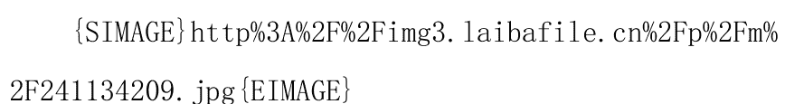

一60%的国土面积被列为干旱地区，水资源匮乏，然而以色列的农业世界闻……

1分制造，99分宣传，互联网时代了，额那朋友现在全天候混电视台和媒体，天天上电视混脸熟，卖老脸推介品牌，额还以为它改行了哪，据他说：人丑点没事，重点是要有辨识度。

作者:66端午88日期:2016-01-26 14:41
2850已破，目标1664，至少技术上是这么要求的。

作者:66端午88日期:2016-01-26 14:42
这就是额在这轮行情启动前说过的：年线双头，按年来调整的超级熊市，日本股市曾经搞过一次这玩意。

作者:66端午88日期:2016-01-26 14:54
@猪侠侠 2016-01-26 14:27:01
楼主，国际油价崩盘，为啥我们国内两桶油还是老样子

预计年内石油价格将低于25美元，而我国由于要隔离国内终端零售价格和国际油价联系，这关系到巨额的油税和国家投资避免遭受重大损失（中国企业和主权基金在80美元以上收购了大量的高成本石油资源，总额高达6000亿美金以上，并且，中国石油制品价格中，税收高达 45%以上，对缓解财政收入和支出压力，有极大的支撑作用），其实这都不算什么，关键是它最终影响了什么。北京是我国的权力中心，其房价和权益交换紧密挂钩，上海是我国金融中心，也是洗钱圣地，深圳是我国创业和创新中心，和深圳股市的造富紧密关联。油价低于 25 美元，将严重制约我国人民币国际化进程，并收窄我国金融对外联系，从而大幅削弱上海的金融中心作用，你们会发现上海的 GDP 和税负率严重不合理，这其中主要由于高端金融服务起着推波助澜的作用，由此间接明证了金融活力的降低，将严重影响上海房价。

作者:66 端午 88 日期:2016-01-26 15:37
楼主：66 端午 88 时间：2016-01-26 14:41:27
2850 已破，目标 1664，至少技术上是这么要求的。

@烈火动力 2016-01-26 15:36:07
没这么惨吧，呵呵，2400 应该差不多了。另外楼市估计还能撑个大半年

额也没说一下就跌到，目标位。
作者:66 端午 88 日期:2016-01-26 17:25
@麦田 110400 39565 楼 2016-01-26 16:37:00
三年哥，您购买货币式基金一般参考哪些因素？买成立时间比较长，年化收益率比较靠前的？有没有什么选购窍门呢？文科生研究起来真心头痛。


安全第一，便利性第二，收益第三，相当于活期存款
作者:66 端午 88 日期:2016-01-26 19:42

经济下滑期有无数的黑天鹅会突然来临，比如下午统计局长被带走调查，这个岗位太敏感了，中国的统计数字造假由来已久，会不会重新修订经济数据，存在不确定，很吓人。山东的数据，就额的赶脚，水份极大。
作者:66 端午 88 日期:2016-01-27 09:13

我朝经济模式是依靠货币推动的，一旦长期资金无法释放，一切难以为继。
作者:66 端午 88 日期:2016-01-27 10:03

@66 端午 88 2016-01-27 09:13:53
我朝经济模式是依靠货币推动的，一旦长期资金无法释放，一切难以为继。

@红安土匪 2016-01-27 09:23:55
又放水了。

最长的一个月，根本不顶事，缓解短期流动性的，大资金都去换美金了。

作者:66 端午 88 日期:2016-01-27 10:04

不敢放长期资金，放出来就去换美金了，所以不敢降准，降息也不敢，怕形成人民币贬值预期。

作者:66 端午 88 日期:2016-01-27 10:07

卧槽，凶猛的大 C 浪，听话的都看着热闹吧，抄啥底啊，没底。

作者:66 端午 88 日期:2016-01-27 15:03

@tianle1984 2016-01-27 14:37:07

楼主，看到我。很激动啊，估计楼主也是济南的，请问近期在济南历下区甸柳附近买学区房合适吗？感觉济南经济不行啊，想买房又怕以后会降，请您给讲讲。。

一看就不了解济南，济南涨起来慢，但就是有个好处，不跌，一有点苗头，都装死了。甸柳庄太贵，学区房密集，你往东看看，极限至奥迪西路附近，看看有没有容积率低，价格在 8000 左右的。

作者:66 端午 88 日期:2016-01-27 19:59

中国 12 月规模以上工业企业利润同比-4.7%，前值-1.4%。中国 1-12 月规模以上工业企业利润同比-2.3%，前值（1-11 月）-1.9%。这意味着经济减速由体系内向体系内蔓延发展，同时也是体系外去产能已经到了最激烈时刻，体系外去产能最惨烈阶段已结束，注意观测经济热点，观察一下能在这个阶段可以生存的企业组织形式，他们是下一经济周期中效益最好的行业。

作者:66 端午 88 日期:2016-01-28 08:19

@举个栗子 2014 2016-01-28 00:43:10

楼主好，小弟请教一下买房的事，最近深圳公积金可以用于户籍所在地贷款买房了，就有了用深圳公积金在潍坊贷款买房的想法，不知道三年大哥觉得有没有必要？背景：我跟我老婆都是潍坊人在深圳工作，父母帮不上我们，在深圳买房无望（两人年收入合计十五万多些），公积金放在账户里面觉得浪费，就想把这些钱用起来，在潍坊买房，我们两人的公积金一个月有两千左右，可以还大部分按揭，剩下的按揭没什么压力。不知道三年哥有什么......

潍坊三线城市，不具备保值升值能力，如果你们一直在深圳定居，可考虑在深圳周边买房，比如额曾经说过的东莞的樟木头或者市区，惠州。如果考虑投资，建议在长三角区域房价低估区域，比如无锡。

作者:66 端午 88 日期:2016-01-28 08:21

@林森霖 2016-01-28 01:50:01

体系内向体系内蔓延，笔误？另请教三年兄怎么得出这个结论, 下一周期也包括传统行业?

体系外向体系内蔓延, 额前面讲过中国经济的轮胎原理, 外层磨漏, 就该磨内层了。

作者: 66 端午 88 日期: 2016-01-28 10:33

@u_106431533 2016-01-28 10:27:18

楼主济南的, 激动啊, 我淄博的??, 不知道楼主对淄博张店的房价有何看法?

没看法, 赶紧趁着济南房价便宜搬到济南, 逆天的淄博土地潜在供应量, 虽然布局适合人居, 搞的没有重心了, 重工业发达, 污染厉害, 赶紧闪人。

作者: 66 端午 88 日期: 2016-01-28 10:36

@goodpath2016 2016-01-28 09:36:41

楼主怎么看宁波的楼市?

宁波不错, 房价也挺贵, 不过对于浙江能否同时推动两个城市高房价, 这个很难。比如山东省, 明显要放弃青岛支持济南了。

作者: 66 端午 88 日期: 2016-01-28 16:47

@红安土匪 2016-01-28 15:41:53

看来央妈是彻底放弃了股市。房市, 外汇, 银行和股市, 下一个被放弃的是哪一个?

过剩产能是下一个,再下一个是农民,接着是事业单位中的学校,医院(有能力盈利的单位,会改成企业制)。

作者:66 端午 88 日期:2016-01-28 16:48

房市和三桶油永远不会放弃,就靠他们收税了。

作者:66 端午 88 日期:2016-01-28 16:49

@投机者的扑克 2016-01-28 16:09:12

套牢的好像开始装死了,一个月900点,真爽

盯着月线布林线的下轨,到了就买,能赚套房子,早买一周能亏一套房子。

作者:66 端午 88 日期:2016-01-28 19:25

@投机者的扑克 2016-01-28 16:09:12

套牢的好像开始装死了,一个月900点,真爽

@66 端午 88 2016-01-28 16:49:35

盯着月线布林线的下轨,到了就买,能赚套房子,早买一周能亏一套房子。

@红安土匪 2016-01-28 17:10:44

大概是多少点位?到时候也跟着赚点钱。

加v信1101284955,获取更多好帖

1690

作者:66 端午 88 日期:2016-01-28 21:06

@骑乌龟过沙漠 2016-01-28 20:29:53

楼主大神，看过来看过来，恒生国企指数现在才 0.75 的市净率，市盈率 5.78。上证红利也是，市盈 7 倍多，还有分红。玩一下怎么样？

另您觉得小户型前景不大，但是小弟觉得租售比相对来说还不错，而且总价低，想在北京搞一套，落户同时租金抵房贷，您觉得怎么样？在北京有房很有面子有木有，好找对象有木有。

最近俩股神都去开户做空恒指了。

作者:66 端午 88 日期:2016-01-29 07:59

@骑乌龟过沙漠 2016-01-28 21:54:58

声明一点，个人追贴多年，差不多隔一两天就看看。只是向楼主请教而已请教而已请教而已

北京买房子也落不下户口的，那地方不缺有钱人，讲究权力至上，先落体系内工作档案才能落户。

作者:66 端午 88 日期:2016-01-29 09:02

得等互联网经济冷却下去才会看的清楚。

加 v 信 1101284955，获取更多好帖

作者:66 端午 88 日期:2016-01-29 17:43

@骑乌龟过沙漠 2016-01-29 10:13:50

楼主，我在算半个体制内，有集体户口

@红安土匪 2016-01-29 11:31:45

北京集体户口买房了就可以落户么？不算积分？

不限购，可以买房迁户。

作者:66 端午 88 日期:2016-01-29 17:44

楼主：66 端午 88 时间：2016-01-28 19:25:11

@投机者的扑克 2016-01-28 16:09:12

套牢的好像开始装死了，一个月 900 点，真爽

@66 端午 88 2016-01-28 16:49:35

盯着月线布林线的下轨，到了就买，能赚套房子，早买一周能亏一套房子。

@红安土匪 2016-01-28 17:10:44

大概是多少点位？到时候也跟着赚点钱。

1690

The request was rejected because it was considered high risk

The request was rejected because it was considered high risk

资本和人材密集型的，搞机器人之类的肯定也是上海和深圳搞，也轮不到你山东，山东还剩下什么优势，相对较高素质的人力资源（相比于河南，四川，河北来说），最长历史传承的尊师重教基础，你不搞教育产业搞什么。

作者:66 端午 88 日期:2016-02-09 03:01
@致冷暖 39739 楼 2016-02-09 00:14:00

楼主，春节了，面对一些人品低劣，爱占便宜的亲戚，你会敬而远之吗

还好，家族里这种人少，距离也远。人生如戏，全靠演技，学会哭穷，保持低调，见人就捧，逢人就夸，同学圈里别嘚瑟，不装逼，不招人羡慕嫉妒狠。

作者:66 端午 88 日期:2016-02-10 12:57

中央政府是否采取强力措施避免少量烈性泡沫引爆已经萎靡的经济结构，1.央企总部需要从一线城市撤离一半。2.985，211 需要从一线城市撤离一半。这才是考验中央政府是否执政为民的标靶。3.政策性平衡，不得以任何理由给予一线城市特殊的政策试点。

作者:66 端午 88 日期:2016-02-10 13:05

郑州的地方政府比较务实，抓住了人家自己的特长。1.交通枢纽核心 2.人力优势 3.行业升级的变化节点 4.以新城做基础吸引大企业转移

由此产生的对策: 1. 搞基础建设完善投资环境, 吸引了以富士康为代表的一批加工企业建厂汇聚人口 2. 抓住交通优势把物流做到全国一流 3. 以人力优势发展教育产业 4. 以人力优势做大了区域商品贸易。值得济南的领导认真学习。

作者:66 端午 88 日期:2016-02-10 13:13

济南的高等教育整合非常失败, 山大的扩张是吃掉了自己的竞争对手, 而不是整体高等教育的扩张, 作为 211 的山东工业大学, 本来也有扩张潜力和扩张领域的, 作为技术含量最高的山东医科大学是唯一的部属核心院校, 也是有扩张前景的, 放在一个山大里面内斗, 结果是负合游戏, 乱的一锅粥。当时应该把山医搞成医药大学, 整合方向是山医+山中医+医药精细化工+医药电子, 山工的整合方向也完全不对路, 山大和山工的工科专业, 100%重合, 根本没有必要合并。

作者:66 端午 88 日期:2016-02-10 13:19

@66 端午 88 2016-02-10 13:05:44

郑州的地方政府比较务实, 抓住了人家自己的特长。1. 交通枢纽核心 2. 人力优势 3. 行业升级的变化节点 4. 以新城做基础吸引大企业转移

由此产生的对策: 1. 搞基础建设完善投资环境, 吸引了以富士康为代表的一批加工企业建厂汇聚人口 2. 抓住交通优势把物流做到全国一流 3. 以人力优势发展教育产业 4. 以人力优势做大了区域商品贸易。 值得济南的领导认真学习。

@红安土匪 2016-02-10 13:12:33

其实武汉发展的也可以。这几年武汉主要抓住机遇发展生物、通信、光电及新能源产业。上市的公司有中元华电、光迅科技、烽火科技、凡谷电子、盛帆电子、风帆股份及即将上市的华舟重工。引进了包括华为，百度、腾讯等软件开发公司。随着产业布局的逐步合理，武汉高校的毕业生会倾向于本地就业，而逐步减少去深圳上海和北京就业。

武汉，郑州，成都都搞的不错，西安，济南，沈阳落后了。

作者:66 端午 88 日期:2016-02-10 13:21

济南的领导过年应该老老实实的在家闭门思过，你们最大的问题是：缺乏善待百姓的这条做官的基本规范。

作者:66 端午 88 日期:2016-02-10 22:26

@singozhou 2016-02-10 21:14:16

@66 端午 88

潜水了很久，今天终于注册了个号

请教个问题：之前三年哥说原油跌破 25 美元，且维持 6 个月，上海房价即下跌。

求详解（内在原理），谢谢！

上海是中国的金融中心，涵盖大量的金融业务和衍生品，其金融服务占据 GDP 比例相当高，大约近 30%，而且大部分外资企业把总部放在上海，也是从资金管理角度立足的，算上外贸通关报关和其前后产业链条。金融和对外贸易可以决定上海的兴衰。上海的核心竞争力就是买办经济集大成。美元跌破 25 美元，意味着国际贸易大幅下滑，国际贸易活力降低至原油生产国无法依赖美元生存。（其实原油价格主要是金融因素，既其和美元的贸易货币对应关系，原油是美元国际商品定价的物质基础。）中国是强烈依赖对美出口顺差的外贸国，别以为原油和美元挂钩程度减弱就会涌向人民币，因为人民币的价值背书是美元顺差提供的，原油价格长期低迷，会导致人民币国际化停滞甚至倒退，从前期人民币贬值阶段总结上看，强势美元在打压油价的同时，也造成大量的资本外流，由此导致人民币国际化趋弱，掐住了人民币对外业务的脖子，人民币对内业务并非上海的专利，各个区域中心都在盯着区域化金融中心的潜力，上海的优势是人民币对外业务和外贸结算，对内业务萎缩则正在进行中，比如深市股票成交量从前年开始屡屡超越沪市，现在已经成为常态化，有接近二十个左右的副省级省会和计划单列市都在强调建设区域金融中心，这都将对上海产生直接竞争，削弱其发展空间。

作者:66 端午 88 日期:2016-02-10 22:29

@Caesar0 2016-02-10 21:28:20

三年大哥，看着央行外汇的家底每个月都少 1000 亿美元，是不是前些年通过各种渠道进来沉淀到房地产的资金开始逐步拉高出货了，照这个节奏下去感觉全国房地产的十年大顶快要形成了吧...

有些城市已经见顶了（部分 3，4，5），有些城市正在构筑顶部（1 线），有些城市刚刚启动（部分 2，3 线），这就是结构分化。

作者:66 端午 88 日期:2016-02-10 22:38

现在见顶的城市房价，得盯着 M2 看，你说见顶了，它也可能还会涨，但绝对跑不赢货币增发，这有非常强的欺骗性。特别是 1 线城市，它现在靠什么支撑房价：优惠政策，有偏向性的资源分配，你看国家有点神马好事要试点了，不是北京，就是深圳上海。比较好的政策不是给重庆，就是给天津。你让全国扎上脖子养这几个城市好了，东北的经济崩盘是老百姓实在看不到希望了，卖房子撤退移民了，以后经济搞不上去的城市，都有这种可能，以后投资房产得研究区域经济的增长潜力了。

作者:66 端午 88 日期:2016-02-11 11:57

加 v 信 1101284955，获取更多好帖

@t7377 2016-02-10 23:08:13

楼主春节前几天去佛山看了下几个楼盘，均价 9000 左右。环比略有下降，本人想中山郊区有套放卖掉换佛山市中心的大房，中山房 10 年了也还只能是原价加 40%卖，请问这样操作可行吗？谢谢！

你还不如买个广州的二手小公房。

作者:66 端午 88 日期:2016-02-11 14:08

@t7377 2016-02-11 12:34:01

谢谢楼主，广州现在是限购，早几年在广州珠江新城附近买了套，现改成 4 个单间可以收 8000 左右的租金，在佛山买主要是改善自住换大房，想中山的卖掉付首付，广州的租金付按揭，请问这么操作可以吗？如果可以什么期间入手比较合适？谢谢

以后投资房产，不能只盯着自己门前的三瓜俩枣了，你得研究透哪个城市的经济有潜力，目前涨幅不到位。特别是那些前期城建落后于经济发展水平的城市，买进去正好赶上改善市容，交通，绿化大幅增加投资的，这些公共投资到最后都会算到你的房价里面。任何一个城市经济高速发展，人口就会涌入，涌入的人口素质和经济发展到什么水平是对应的，刚开始发展的城市，来的都是屌丝，发展到中期，来的都是工程师和技术人员，到了后期，就是各种老板和所谓艺术家之流的戏子。

作者:66 端午 88 日期:2016-02-11 14:19

一省双城的都会面临支撑重心明确的问题，其中：辽宁，山东的紧迫性更强一些，急需特大型城市支撑整体经济的转型，没有高素质人口的急剧和城市综合实力的投资，无法快速完成城市升级的急迫性。中国银行辽宁分行（大连），山东分行（青岛），都已做好了向省会迁移的准备。济南的情况额比较清楚，今年城市投资不会低于 5000 亿，其中政府操盘的大约 3500 亿左右，省级财政会相应支持一些城际轨道和高速公路项目，比如黄河上面的跨河大桥。以后 5 年内，每年的投资都会超过今年，整体投资将超越武汉，成都，郑州。和重庆大约持平的规模。济南去年的 GDP 总产值只有区区 6200 亿，今年所有投资就会接近去年的 GDP，今年的 GDP 会有一个玩命窜天的增长，估计一下就会挺近到全国头八位。万事俱备，只差拉进来几个 985 和 211 了。省长现在就该搬到国务院门口扎个帐篷，不给几个好大学，就不用回来上班了。

作者:66 端午 88 日期:2016-02-11 15:53

@singozhou 2016-02-10 21:14:16

@66 端午 88

潜水了很久，今天终于注册了个号

请教个问题：之前三年哥说原油跌破 25 美元，且维持 6 个月，上海房价即下跌。

求详解（内在原理），谢谢！

@66 端午 88 2016-02-10 22:26:21

上海是中国的金融中心，涵盖大量的金融业务和衍生品，其金融服务占据 GDP 比例相当高，大约近 30%，而且大部分外资企业把总部放在上海，也是从资金管理角度立足的，算上外贸通关报关和其前后产业链条。金融和对外贸易可以决定上海的兴衰。上海的核心竞争力就是买办经济集大成。美元跌破 25 美元，意味着国际贸易大幅下滑，国际贸易活力降低至原油生产国无法依赖美元生存。（其实原油价格主要是金融因素，既其和美元的贸易货币对……

@singozhou 2016-02-11 15:03:28

我是一路看着你东西过来的，有些不清楚再问明白点

1. 你提到上海经济结构（外贸），这跟上海的房产结构一致么？
a. 当然外贸不好会影响上下游产业链及从业人员
b. 以我自己感受，很多房产持有人为非外贸人员（本地人，明星/富豪，江浙有钱人），不过没有确切数据
2. 假定上海房价见底，时间？

之前听说一个分析，世界性的经济衰退中，中国一般于美国加息周期后的 1-2 年见底回升；且传导顺序是经济（14 年）……

金融发达，就会带动一切产业，货币是什么？经济血液。钱多的地方，房价一定高，货币流转速度快的地方，房价一定高，钱多的地方，经济一定活跃增长，引来大量的移民。你算算上海本地企业从股市募集了多少资金，他和北京，深圳在此项有着共同的特点，大量的资金汇聚，钱多的地方，资金成本反而低，剩余资本就会追逐风险投资收益，上海和深圳北京的区别是：大量的外资外企汇聚。你不承认外贸贡献率可以查查全国十大港口的吞吐量，上海港远超深圳鹤立鸡群。上海吞吐量大，并不是说本地产量大，他做的是物流和资金流，我国外贸毛利率微薄，通关之类的成本已经算外贸流程中油水最足的。

你再看看我国经济体系的利润分配，金融一项占据全额利润的 5 成以上，你从上海税收也看得出，为什么交了那么多税，税基在金融。

人民币国际化受阻（人民币是贸易货币，不是储值和定价货币）+石油价格在 25 美金下徘徊半年以上，将导致上海经济活力降低（受国际贸易影响），房价见顶。当然，要是国家强顶着维持泡沫，就得加强超发货币至 15%增速，目前在 12%的增速，上海房价扛不住。

作者:66 端午 88 日期:2016-02-11 17:55

@逛逛在抽烟 2016-02-11 16:35:50

济南的情况额比较清楚，今年城市投资不会低于 5000 亿，其中政府操盘的大约 3500 亿左右，省级财政会相应支持一些城际轨道和高速公路项目，比如黄河上面的跨河大桥。以后 5 年内，每年的投资都会超过今年，整体投资将超越武汉，成都，郑州。和重庆大约持平的规模。济南去年的 GDP 总产值只有区区 6200 亿，今年所有投资就会接近去年的 GDP，今年的 GDP 会有一个玩命窜天的增长，估计一下就会挺近到全国头八位。万事俱备，只差拉进来几个 98……

只是逻辑推演，年底看数据吧。

作者:66 端午 88 日期:2016-02-11 17:56

呀，玩股票又该揪心了，就看外围市场的走势，下周一貌似要千股跌停开盘啊。

作者:66 端午 88 日期:2016-02-11 19:05

@66 端午 88 39764 楼 2016-02-11 17:56

呀，玩股票又该揪心了，就看外围市场的走势，下周一貌似要千股跌停开盘啊。

@lb1123 2016-02-11 19:02:54

请教楼主,可以换美元了嘛?还是继续等回调?

等 6.5 以下

作者: 66 端午 88 日期: 2016-02-11 22:18

@木棉小木头 2016-02-11 22:06:57

楼主,想问一下你对东莞房价的看法?

前几年过来东莞松山湖, 14 和 15 年没有买房, 15 年下半年开始涨的厉害, 宣传是深圳客拉高的, 身边确实有一些深圳的朋友在东莞这边买房, 以前 9000 的房子, 现在都涨到 1.4 万了。

龙大和南光高速免费, 东莞和深圳有地铁要通, 这些都是上涨的理由?

房子作为衣食住行之一,对生活影响很大。

仍有冲劲, 中值潜力以广州下限为准。深圳的工业会像上海那样外溢, 承接的地区只有惠州和东莞。

作者: 66 端午 88 日期: 2016-02-11 23:40

看了会高中同学的微信圈, 他们在聊子女教育, 没插嘴,不过收获颇大: 那就是: “他爹是什么人, 他儿子基本就是什么人, 她娘是什么人, 她闺女也是什么人。” 各位以后可以作为真理执行了。

作者: 66 端午 88 日期: 2016-02-12 14:40

@66 端午 88 39766 楼 2016-02-11 19:05
@66 端午 88 39764 楼 2016-02-11 17:56

呀，玩股票又该揪心了，就看外围市场的走势，下周一貌似要千股跌停开盘啊。

@lb1123 2016-02-11 19:02:54
请教楼主，可以换美元了嘛？还是继续等回调？

等 6.5 以下

@lb1123 2016-02-12 11:31:56
谢谢，但这波美元怎么哪？谁搞的事？人民币是滥，现在爆出的是美国也经济没回复啊

别看利率，看货币总量和货币对比 GDP 比值，现在的情况是中国的 M2=美国 M2+日本 M2，而且每年以 12%的增速加速膨胀，日本负利率，货币和债务只能做到同步增长，美国 0.25 的利率，货币膨胀规模减速。

作者:66 端午 88 日期:2016-02-12 14:44

黄金飙升，的确出乎了意料，黄金上涨是危机模式启动的信号，不过黄金有个毛病，就是危机下半场，由于现金为王战略深入人心，市场会出现严重的流动性紧缩，那会黄金会加速下滑，而且会创新低。让人不敢放心持有难以兑现的现货黄金，拿着纸黄金或者黄金ETF，好一些，不过这玩意不是主流产品，特别是黄金相关理财，往往附加大量的限制，很难做到盈利和黄金走势同步。

作者:66 端午 88 日期:2016-02-12 19:18
@洛嘎 2015 2016-02-12 15:35:09

麻烦楼主方便时，给我回复：我一月刚在北京买了一套亚运村房子，位置在四环里。不是学区房，但离10、8号地铁很近。现距离小区20多米正在兴建北京市重点工程--奥体文化商务园。该园区是以北京北部中心区域打造的，集文化，商业，金融为一体，是北京北部高端中心区，2022冬奥会运动员村就建在这里，园区明年全部完成。其中有一条隧道横穿四环主路，向北直通鸟巢及奥林匹克森林公园。园区写字楼全部为5A级。该项目6.3公顷，园区......

看买的价格如何了，平常心，买了就拿着。

作者:66 端午 88 日期:2016-02-13 01:17
@66 端午 88     2016-02-07 14:44:06

山东算是认栽了，去年发改委调整了城市级别，鲁吹一号竟然没有一个特大城市，房价想上天却没了后劲。往前数20年，广东一直竖大旗，一个省两个一线城市，经济总量遥遥领先。江苏从来都不服气广东，丫的政策好，咱们江苏靠的是智商,养着一个一线,四个二线,现在南京跳起来踩上广州的脑门,有了两个一线,广东只有一个一线。山东自从被江苏赶超后一直想反超,无奈老百姓认命,当官的脑子里塞满了浆糊,走路顺拐了,其实山东还......

@一文不名平天下 2016-02-13 00:58:31

三年兄 青岛的面积和人口根本不足以直辖 如果青岛直辖 那么很有可能是青烟威组合直辖 青烟威3地加起来面积大约不到3万平方公里 不到重庆一半 三地加起来人口还不到2000万 有可能还要把高密诸城划进去 而不是把平度划出去 如果要人口超2000万 可能还要把日照拉进去凑数这样的话 相当于胶东半岛全划走 山东直接崩掉了 但是如果不这么划 人口不够2000万 山东为了自己的利益 绝对不可能放青岛直辖的

但是青岛直辖是有非常......

论大陆防御,大连,威海的重要性远胜青岛。论进攻,分往哪里进攻,对日本,应该是舟山作为前进基地。青岛的优势是被德国殖民地过,有相比山东其它区域更好的教育和人文基础,有一定的工业传承。

作者:66 端午 88 日期:2016-02-13 01:22

要论划地直辖,你看看北京,上海,天津,深圳哪个有你说的这么大地方。把平度划出来也比北京天津上海大。人口无所谓，一直辖，肯定自己跑过去一批，再有，你咋就这么认定烟台威海喜欢跟着青岛跑涅，额的了解是烟台绝对不会跟着青岛当陪衬的，俩地方从官至民，不是太对付，你这画法不是画个直辖市，是画个胶东省对不。

作者:66 端午 88 日期:2016-02-13 01:44

山东整个划到北方战区，赶脚青岛是作为防御外海入侵内海（渤海）的防守前沿，如果说进攻，主要是应付朝鲜半岛。中国在改善和韩国关系后，赶脚青岛的战略作用已经降低了。

作者:66 端午 88 日期:2016-02-14 15:28

http://mp.weixin.qq.com/s?__biz=MzA3NjM4NTI2NQ==&mid=404486699&idx=3&sn=ffc656e01268f172dfe776a9a1c35efb&scene=2&srcid=0115RPthkgf4yDW84TUf1z4S&from=timeline&isappinstalled=0#wechat_redirect

作者:66 端午 88 日期:2016-02-14 19:19

@橡木 123 2016-02-14 18:01:57

楼主我一直关注你的贴，请教黄山这座城市是旅游城市，安徽投资房产旅游返租可行吗？

我上次去黄山的时候，黄山还叫屯溪，是个美丽的小城。可惜还是太靠北了，如果用于旅游，来的人住的时间又太短，大部分时间都是山上遛一圈就走了。你要是把房子盖到山上，那绝对是能发财的。盖在山下，就没什么大花头。加上山下有成群的疗养院，木有给私人留下太多升值空间。

作者:66 端午 88 日期:2016-02-14 19:21
@u_104130353 2016-02-14 17:59:20
楼主，广州房价相对来说偏低
天河区-黄埔交界处的房子能买吗？ 1.95万/方

如果你要求不是太高，可以买，南京踩了广州的脑门，广州实在是咽不下这口气，至于能不能抢回来，看经济了。

作者:66 端午 88 日期:2016-02-15 10:11
@380824 2016-02-15 06:48:35

三年哥，过年好！三年哥，过完年了，事情也来了！弟弟在青岛买房，当然父母出首付。父母的意思是让其回老家河北保定买房！回来工作。我弟不愿意！说青岛无论那方面都要比保定强太多！不想回去。我也支撑弟弟的看法。但是，父母让我说服弟弟回来，当然他不回来也不能勉强。我想请三年哥帮忙分析和比较一下青岛和保定！我个人认为保定是比不了青岛的！但是就不知道从哪里说起！怎么说才能让父母支持弟弟在青岛买房！我是没有时......

这俩城市的确半斤八两，保定一直有帝都行政和工业外溢或者潜在的利好支撑，青岛的底子不错，不过按照今年的投资算，山东省是下决心支持济南了，青岛不会有超额的财政支持，起码三年内涨幅潜力收窄。

作者:66 端午 88 日期:2016-02-15 10:28
@yiyiyingying 2016-02-15 10:21:00
楼主怎么看待河北省会石家庄?

不看好石家庄。

作者:66 端午 88 日期:2016-02-15 18:49
@夏日迷情 8 2016-02-15 11:23:22
楼主,我看中东莞东城市内的房子,价格 15000 元. 旁边近双轨,想买等升值或自住,可行否?

自住可以，如果投资，尽量往离着深圳近的地方买。

作者:66 端午 88 日期:2016-02-15 18:50
@农民小昊昊 2016-02-15 10:49:29
楼主，过年好，看您帖子这么久没有注意到您提过济南边上的小弟德州，去年 11 月份德州的万达广场开业了，人还不少，楼主感觉德州万达的房子怎么样，现在 5000 左右吧

卖掉德州的投资房，买济南的，小点也无所谓 90 以上即可，留着迁移户口。

作者:66 端午 88 日期:2016-02-15 22:16
@inseck 2016-02-15 19:44:25

可以换美元了么?

稍等，现在天天盯着。

作者:66 端午 88 日期:2016-02-16 10:16

M2 新增 14%，这是国家自 2009 年后，再次滥发货币，炒房又将成为主流投机选择。

作者:66 端午 88 日期:2016-02-16 16:28
@平凡主妇 2015 39815 楼 2016-02-16 12:12:00

端午哥，打算在济南投资套房产，总价 80-100 万左右，请端午哥指点一二！谢谢！

奥体西路的房价涨了 30%，实在下不去手了。你要是住一线或者强二线，还有额度的话，尽量选本地，异地投资收租金稍微麻烦。济南的房价涨不过发达城市。

作者:66 端午 88 日期:2016-02-16 16:30
@大庄逍遥游 39814 楼 2016-02-16 10:45:00
@66 端午 88 2016-02-16 10:16:55

M2 新增 14%，这是国家自 2009 年后，再次滥发货币，炒房又将成为主流投机选择。

汉成帝刘骜，西汉第十二位皇帝，甫一继位沉迷在漂亮女人的身体上。

刘骜宠爱赵飞燕、赵合德姐妹，而赵合德之宠远过赵飞燕。

可是，一旦纵欲过度，能力就会衰退。于是，方士呈献仙丹，只是，仙丹

再看两个月，月月14%，多大泡沫都会消于无形，这完全是价值尺度被颠覆了。

作者:66 端午 88 日期:2016-02-16 17:00
@平凡主妇 2015 39818 楼 2016-02-16 16:34:00

端午哥，槐荫西客站附近房子是否值得投资？

我也认为济南的投资标的在高新奥体附近，不过你也是觉得涨幅太大了。

我还看中了龙湖名景台的小高层一层复式，不过超标了，要260万左右，涨了大约40万，那边供应量太大，有些担心，再就是那边租金太低，低到不想出租

作者:66 端午 88 日期:2016-02-16 22:29
@66 端午 88 2016-02-16 10:16:55

M2 新增 14%，这是国家自 2009 年后，再次滥发货币，炒房又将成为主流投机选择。

@slimcoffee 2016-02-16 22:17:46

你好 楼主 为什么这样算是滥发呢？ 真的不懂 真心求教 谢谢！

中国的 M2 已经 141.6 万亿，每年新增 14%是多少，20 万亿。中国的 GDP 多少，66 万亿多点。中国的 M2=美国 M2+日本 M2。2008 年令人诟病的货币刺激，以后超发了 4 万亿(正常增速额外增发)，导致当年货币增发高达 27%，也不过当年超发了 10 万亿，现在只要从正常货币增长 10-12%超发到 14%，就会多产生 5 万亿额外的货币。

作者:66 端午 88 日期:2016-02-17 06:39

人民币汇率的波动周期大约是 20 周左右一个周期，其中涨跌各半个周期左右。打算在下跌周期的第六周和第九周，开始加仓美元，额算着第六周能见到小周期的底部，第九周会测试这个底部，然后再起一波，目前是在下跌周期的第三周到第四周之间。

作者:66 端午 88 日期:2016-02-17 10:09

一直看着股市像 2008 年 7-8 月的奥运维稳行情，判断准则就是上攻不能突破 3020，下跌不能在 2 月破 2638。然后在 3 月中下旬，出黑天鹅击破 2638，向 2100-2300 一线刺探，如果途中出了新低，那么还得等绝对低位。如果一直坚持到2200点附近反弹开始，也没创新低，就可以长线建仓，短线操作。如果创了新低，反弹后还会向月线布林线下轨寻找底部，一旦触碰到月线布林线下轨，就是送你一套房子的机会。俩股神坚持认为现在就是底部，类似2010年7月的波段底部，验证就是突破3020，然后回探时买入，做个吃饭行情，涨幅极限是3600点，这样会放弃35%的机会。

作者:66 端午 88 日期:2016-02-17 11:34
@66 端午 88 2016-02-16 22:29:34
@66 端午 88 2016-02-16 10:16:55 M2 新增 14%，这是国家自 2009 年后，再次滥发货币，炒房又将成为主流投机选择。

@freedoms2016 2016-02-17 10:21:16

滥发货币这意味着房价还有很大可能继续上涨？现在内地很多小县城房价回落得很厉害，建得太多。楼主能分析下珠三角的房价吗？广州、珠海的均价 15000，东莞也有 10000 以上，深圳都快 40000 了。中山只有 6000。中山是否有投资价值？最近要修连接深圳和中山的跨海大桥（深中通道），现在很多深圳人去中山买房了。

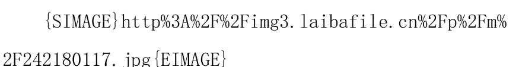

不建议中山，深圳是国家政策支持的城市，你能把政策带到中山去吗？

作者:66 端午 88 日期:2016-02-17 11:38

城市房价长期高涨后，会带动人工成本提高，即使不买房，你的人工成本收入中，就含有一部分房产高估值的附带，会导致用工涌入，带动第三产业发展。中山的房价低，就业市场吸引不到足够的高收入人口，又没有东莞对于广州和深圳的双便利。

作者:66 端午 88 日期:2016-02-17 11:43

就算买了最近涨势不活跃的广州，前景也比中山好的多，未来国家政策鼓励发展省级经济圈发展区域中心城市，在当今财政收入走低的背景下，省级财政只有支持一个城市的能力，广东估计会支持广州，深圳是特区，是中央的一面小红旗，那得中央给钱给政策派驻企业。

作者:66 端午 88 日期:2016-02-17 13:29
@66 端午 88 2016-02-17 11:43:51

就算买了最近涨势不活跃的广州，前景也比中山好的多，未来国家政策鼓励发展省级经济圈发展区域中心城市，在当今财政收入走低的背景下，省级财政只有支持一个城市的能力，广东估计会支持广州，深圳是特区，是中央的一面小红旗，那得中央给钱给政策派驻企业。

@u_109201696 2016-02-17 12:10:53

端午哥好，请问山东烟台的房子现在买合适吗？海边 1 万左右，谢谢啦！

我这边有两个同学都在卖烟台的叠拼别墅，你有兴趣吗？原价出售，万一平，精装修。

作者:66 端午 88 日期:2016-02-17 13:35

他们发在同学圈里的，打算卖掉买北京的房子

{SIMAGE}http%3A%2F%2Fimg3.laibafile.cn%2Fp%2F1%2F242192269.jpg{EIMAGE}

{SIMAGE}http%3A%2F%2Fimg3.laibafile.cn%2Fp%2F1%2F242192273.jpg{EIMAGE}

{SIMAGE}http%3A%2F%2Fimg3.laibafile.cn%2Fp%2F1%2F242192274.jpg{EIMAGE}

{SIMAGE}http%3A%2F%2Fimg3.laibafile.cn%2Fp%2F1%2F242192278.jpg{EIMAGE}

{SIMAGE}http%3A%2F%2Fimg3.laibafile.cn%2Fp%2F1%2F242192283.jpg{EIMAGE}

作者:66 端午 88 日期:2016-02-17 21:30

再美，不涨就只能卖掉，额同学说肠子悔青了，这房子是两年多前买的，他们住在北京，买在烟台，本来想度假用的，结果根本也没时间度假，空了两年多。在北京也买不起这种房子，要是在北京四环内买个小房子，现在都涨50%了。理想丰满现实骨感，如果把理想幻想成现实，就是这个样子。

加 v 信 1101284955，获取更多好帖

作者:66 端午 88 日期:2016-02-17 21:33
@麦田 110400 2016-02-17 15:26:03

有钱人生活真让人羡慕，三年哥也住着这么奢侈的大房子吧？

住这种房子的，那是实在太有钱，作为投资角度考虑，这种房子转让不容易，总价高，面积大，养护成本高，房租也高不到哪里去。当然一线城市的人，买三线的房子，就会越级消费了。

作者:66 端午 88 日期:2016-02-17 21:42

房租高的，升值性能的确不假，济南被骂的抬不起的诚基中心，可谓核心位置创了涨幅最末一位的投资型产品。这房子从（单层）均价6000左右（2007-2008）开卖，到卖到尾盘时（2013年），五年只涨到7800，到现在才8500左右，还有一批买在8800的（最早的一批带精装修的），不过房租真是太神奇了。40平小公寓，租金3500，收益率高达8.5%。双层100平住宅，租金差不多3700左右，收益率也高达6%以上。整个小区变成了青年公寓。

作者:66 端午 88 日期:2016-02-18 09:14
@66 端午 88 2016-02-17 21:42:31

房租高的，升值性能的确不假，济南被骂的抬不起的诚基中心，可谓核心位置创了涨幅最末一位的投资型产品。这房子从（单层）均价 6000 左右（2007-2008）开卖，到卖到尾盘时（2013 年），五年只涨到 7800，到现在才 8500 左右，还有一批买在 8800 的（最早的一批带精装修的），不过房租真是太神奇了。40 平小公寓，租金 3500，收益率高达 8.5%。双层 100 平住宅，租金差不多 3700 左右，收益率也高达 6%以上。整个小区变成了青年公寓。

@我爱庭院 2016-02-18 08:35:42

单身公寓不能落户，没有学位，只能出租，收租管理打理麻烦，所以哪怕收益 6%，也少有人接盘

因为单身公寓本身增值速度极慢，住宅涨 10%，单身公寓最多涨 3%，哪怕住宅买了放那不管，几年后卖出收益照样比公寓高的多

我家附近一个盘，小区紧靠地铁口，10 年前，住宅卖 5000 多，开发商盖了一栋单身公寓也是 5000 多，现在住宅二手卖 16000，单身公寓卖 7000（两年前还是 8000 多，近几年都在降）

对公寓的收益高，但是属于商用，50 年产权，贷款最多 5 成，1.1 倍利率，涨速非常慢，位置在靠近主干道一侧。

加 v 信 1101284955，获取更多好帖

搞不清为什么会有这么多人租。小区里面是普通住宅，双层LOFT，学区房，七十年产权，涨速也不快，收益低于前面的公寓，赶脚距离只有几十米到二百米，咋收益差了这么多，里面还安静哪。

作者:66 端午 88 日期:2016-02-18 09:17
@红安土匪 2016-02-18 08:50:43

三年，刚出来的公积金存款利率上调，是个啥意思？存款利率上调而贷款利率没变，感觉央妈好大方啊。

提高公积金的收益率，吸引客户

作者:66 端午 88 日期:2016-02-18 12:56
@66 端午 88 2016-02-17 13:35:04

他们发在同学圈里的，打算卖掉买北京的房子
{SIMAGE}http%3A%2F%2Fimg3.laibafile.cn%2Fp%2F1%2F242192269.jpg{EIMAGE}

{SIMAGE}http%3A%2F%2Fimg3.laibafile.cn%2Fp%2F1%2F242192273.jpg{EIMAGE}

{SIMAGE}http%3A%2F%2Fimg3.laibafile.cn%2Fp%2F1%2F242192274.jpg{EIMAGE}

{SIMAGE}http%3A%2F%2Fimg3.laibafile.cn%2Fp%2F1%2F242192278.jpg{EIMAGE}

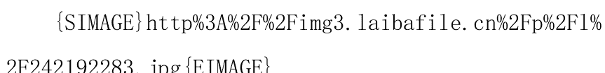

@赢家 12345 2016-02-18 09:39:15
多大面积的??

210平，210万

作者:66 端午 88 日期:2016-02-18 13:00
@投机者的扑克 2016-02-18 11:20:34
老大，股神买的什么股

易尚展示，华鹏飞，兴民钢圈。

作者:66 端午 88 日期:2016-02-18 17:03
股神的重仓还没开盘：新文化，乐金健康。这货怎么抓住的这种题材，真搞不懂

作者:66 端午 88 日期:2016-02-18 20:26
【菠菜、生菜、菜心10元/斤，节后菜价堪比肉价】菠菜10元/斤，西兰花7.5元/斤，大葱8元/斤……春节假期过后，本应是菜价逐步下跌的阶段，但今年一反常态，一些地方菜价堪比肉价。在广州，一些蔬菜菠菜、生菜、菜心等价格多在10元/斤，市民直呼“吃不起菜”。
过了15，菜价还不回落，有望启动通胀模式。互联网的 O2O 搞不定生鲜蔬菜，损耗和中间流程成本太高了。

作者:66 端午 88 日期:2016-02-18 20:30

因为生鲜蔬菜的消耗用户，基本以大妈大爷为主，不会搞这网那网的，价格又斤斤计较，非得你亏的底掉，他们才会改变生活习惯。小菜店只有在大型城市才会接受合作，但人家宁可不合作，因为加入意味着以后自己的小店就完了，小菜贩也不会加入，只有大型生产商和批发商会接受，不过你要承担他的损耗和流程成本，貌似没有一家物流公司肯接受这种半天不接货，货就烂在自己手里的生意。

作者:66 端午 88 日期:2016-02-18 20:33

关键买菜买米这事，作为大妈大爷本身就是一种社交活动，这事你都帮着办了，所有的开放广场都放不下这么多无事可干的广场舞爱好者。

作者:66 端午 88 日期:2016-02-18 21:13

http://finance.sina.com.cn/china/gncj/2016-02-18/doc-ifxprucu2986760.shtml

5 万亿想拉动中国经济，神马智商，这波想逆转，最起码 20 万亿，而且逆转后还会衰竭，而且中间过程不会有 2009 到 2011 年近 3 年，最多 2 年，还会沉淀在房地产上。

作者:66 端午 88 日期:2016-02-19 06:14
@66 端午 88 2016-02-18 21:13:03

http://finance.sina.com.cn/china/gncj/2016-02-18/doc-ifxprucu2986760.shtml

5 万亿想拉动中国经济，神马智商，这波想逆转，最起码 20 万亿，而且逆转后还会衰竭，而且中间过程不会有 2009 到 2011 年近 3 年，最多 2 年，还会沉淀在房地产上。

@野兽刑警 1 2016-02-18 22:22:46

楼主好，按这个思路岂不是买房无忧吗?

记得你对淄博的房价貌似不看好，那么请问淄博周村的营业房，现在是持有好还是卖掉好?

可以从事即时服务业的繁华地段临街商铺，比如从事餐饮此类的，尚可（可持有），其它经营模式的，特别是拎包零售的，前景堪忧。除非已经形成稳定商圈的临街商铺外，不要再投商业地产，就连商务公寓也别动。如果投资山东，只能买济南从新 CBD 到老 CBD 之间区域的住宅。

作者:66 端午 88 日期:2016-02-19 08:24
@Demon 执事 2016 2016-02-19 07:50:06

一直默默看帖... 敢问楼主如何看待宁波房价，宁波库存量很大，是现在买好还是再等等

宁波问题不大，浙商大本营，是否增持取决于你的资金流状况。

作者:66 端午 88 日期:2016-02-19 12:27
@strictly 2016-02-19 08:55:50

楼主好，请问怎么看江苏苏州的房价，去年下半年开始到现在差不多翻倍了，有些还不止，看不懂了

苏州的制造业很发达，而且技术含量明显比珠三角的要高，估计是产生了一定过剩工业产能，在去产能的同时，由于经济发达，会涌向房地产固化。问题也不大，因为经济有底子。只是试图挑战南京房价，超过南京就有泡沫。

作者:66 端午 88 日期:2016-02-19 12:28
@鸭梨不是很大很大 2016-02-19 10:55:34

三年，悉尼的公寓能投资吗？

只能投在中国留学生的聚居区，中国人喜欢扎堆，大学教育区，出租净回报率超过 10%可以投。

作者:66 端午 88 日期:2016-02-19 15:38

房地产转让契税降税启动，首套 1%（90 平以下），二套 1%（90 平以下），首套 1.5%（90 以上），二套 2%（90 平以上），多套参见二套。京沪广深不参与降税。可怜的广州，这个打折计划应该是南京，结果广州替补作了冤大头。

作者:66 端午 88 日期:2016-02-19 15:40

加 v 信 1101284955，获取更多好帖

经过这么多年，突然想翻唱没有共产党就没有新中国了，先把名改一下：没有房地产就没有共产党。

作者：66 端午 88 日期：2016-02-19 19:11

@inseck 2016-02-19 18:49:40

想请教一下，四五线地级市，我母亲在给哥嫂带孩子，为了减少矛盾，我准备给她在哥嫂附近买房子。现在有两个选择：1. 小区对面成熟小区多层房一楼，77平30万。已满两年，可过户。2. 一站路远的公务员高层小区，105平23万，三室房，如果买一楼可以考虑部分房间转商用，小区好多人买一楼开店的。但目前无法过户，小区的房子基本都在转让所以便宜。我应该如何选择呢？请赐教。

3，4，5线你不如租房子。把省下来的钱去买你当地省城的房子。房产现在的功能首先是其金融性，其次再论实用功能。你在省城买房一样落户，享受的教育，医疗，交通，城市其它附属设施，都是3，4，5线无法具备的。

作者：66 端午 88 日期：2016-02-19 20:39

@yuleng2012 2016-02-19 19:48:33

前辈，本人目前上海限购，如果想在长三角投资套房产，是否无锡是最好的选择呢？南京、苏州已经涨高了，下来最好的城市应该是无锡了。可否谈谈呢？共产党又开始救市了，无锡的房价2016年该涨起来了吧！

加v信1101284955，获取更多好帖

出于方便管理的原则，对于一线限购同学，又没有其它办法增持的，首选寻找波段低点进行置换，其次寻找周边强二线里面经济基础优良，尚未被疯狂炒作过的城市。无锡，宁波都是你的菜。

作者：66 端午 88 日期：2016-02-20 21:19

@yuleng2012 2016-02-20 10:42:43

前辈，谈谈河南郑州吧，特别是郑东新区！

做实经济基础后才会继续涨，看好

作者：66 端午 88 日期：2016-02-20 21:21

@pjk34250 2016-02-20 11:58:14

三年大哥，一直默默学习很少发言。本人深圳工作有房，眼见老家武汉发展快速，想入手一套房产，目前关注东湖高新片区，希望能够复制深圳南山的辉煌，方向是否正确？

武汉，郑州一直都看好，都是物流中心，区域金融中心，武汉还有不少新经济成份，尽量靠近新CBD可享受更高回报。

作者：66 端午 88 日期：2016-02-20 21:22

@开工厂我累了 2016-02-20 10:19:53

新年好，楼主对郑州房产市场有何高见？

前期涨幅在二线里面算强的，继续大幅涨有难度，需要夯实经济支撑。

作者：66 端午 88 日期：2016-02-20 22:40

@ayiayiayia 2016-02-20 21:47:27

额。。。咋发了三次呢，还以为没发出去呢

实在是没法看好，资源价格大幅下滑，国内鼓励清洁能源，都是长期的压力。祖上晋商的光芒都被败尽了。前朝的晋商那可是瓢把子，神马广东帮，上海帮，浙江帮，都是浮云啊，怎么这代的晋商混的这么没出息，靠挖煤过日子。实在愧对祖上了。

作者：66 端午 88 日期：2016-02-20 22:49

@singozhou 2016-02-20 22:34:20

LSY接替XG，老大怎么看？（微观层面）

他不挡枪，难道要小强自己堵抢眼吗？舆论压力实在太大，不弃个卒子，一届就落马了，人家朱镕基是主动不干了，得罪人太多，不过人家把银行业救活了，烂国企全甩了，你干了什么，E租宝，泛亚金属，干掉了整整一个零售产业，搞出来5000万失业人口，送给美国人5000亿美金市值，美国人不敢说一铺养三代，养个两代是轻松的，你把这句全世界的真理删除了，不但老百姓的商用资产蒙受超额损失，同样造成地方政府潜在的税收，就业，土地价值蒙受空前损失，这笔账早晚要算的。

更恶劣的现实是，几代超发的货币已经锚不定了，早晚会弃人民币而逃，你只依靠住宅锁定，会造成房价短期内超涨，长期面临巨幅震荡，房地产的两条腿被砍掉一只，瘸腿了，你只看网售带来的短期利益，对资产减值准备的缺乏前瞻性，不良的后果会逐步兑现。

作者：66 端午 88 日期：2016-02-20 23:00

马云又在大放厥词，淘宝纳税178亿，你纳税是纳的广告费名义下的商场提成，淘宝买家出发票是要加税点的，各省由此减少的零售税收都被马云转移支付给了杭州，所以杭州的房价蹭蹭涨，3，4，5线城市揭不开锅，这个账是你这么算的吗？

作者：66 端午 88 日期：2016-02-21 06:43

最近最火的就是艺考季了，全面激活承办城市的服务行业，餐饮，住宿，出行，经常看到颜值出众的美女帅哥，每个招生学校都能狠捞一笔，自从扩招政策以来，艺考从小众市场转为大众市场，为我国服务行业提供了大量的较高素质人员，奠定了最近5年来文化行业的超速增长，目测这个大行业有望成为长期繁荣行业，并不断进行市场细分化和外围拓展，不过这个行业一直以脏行业面目示人，从行业规范，政府监管，人员价值评定，获得利润，新内容和新形式探索，都有不足之处，同时也表明，这个行业仍有较大潜力可供发展。这个行业对于个人来说：是拼天赋和潜规则并重的，资本相对于这两项出于弱势地位------------这个行业是服务行业中的金字塔塔尖。

加v信1101284955，获取更多好帖

作者：66 端午 88 日期：2016-02-21 09:33

@中国梦F4 2016-02-21 08:09:50

楼主，谢谢发帖，受教了！怎么看沈阳房价？什么时候适合出手，谢谢了

沈阳是东三省唯一可考虑投资的城市，不过拐点可能要比别的强二线城市慢，主因和济南一样，经济问题，期待当地政府有所作为吧，在中国，特别是北方，大部分社会和经济资源都掌握在政府手中，社会营商环境和创业环境都不如南方，人材储备极差，大部分高端人材外流，有能力的人没有志向，有志向的人没有能力，两项都具备的人，大部分都流出了。

作者：66 端午 88 日期：2016-02-21 21:12

@痛苦的鱼 2016-02-21 20:33:48

楼主对这个如何看？我刚买的一个低密度小区，落地一楼送花园，被这吓一跳 [我国将原则上不再建设封闭住宅小区]《中共中央 国务院关于进一步加强城市规划建设管理工作的若干意见》提出，我国新建住宅要推广街区制，原则上不再建设封闭住宅小区。已建成的住宅小区和单位大院要逐步打开，实现内部道路公共化，解决交通路网布局问题，促进土地节约利用。另外要树立“窄马路、密路网”的城市道路布局理念，建设快速路、主次......

扯，甭听他们瞎叫唤，房产贵到一定程度，就是阶层的标志了，把墙拆了，阶层会抗议的，赶脚像一线这种城市，地价太贵，以后大量拿地谁也拿不起了，缩小转让面积，几个楼就是一个小区，道路变窄，让你停不了车，都去买车位。

作者：66 端午 88 日期：2016-02-21 21:17

最近一线齐刷刷飙升，把增发的货币全吸干净了，管理层应该感到耻辱，你们为民执政，就吹出这几个泡泡，你们是金鱼吗？你们的记性难道只有7秒吗，赶紧把高等学校均匀外迁，央企外迁，政策均衡给经济较差的区域，你这样折腾根本没用，连对全国性的经济支撑都谈不上了，你们还想混不想混了。

作者：66 端午 88 日期：2016-02-21 22:14

@xiej132015 2016-02-21 21:26:09

青岛的房价10年后这几年一直不涨甚至下降，怪着急的，刚出的十三五规划挺唬人的，又画了一个圈，请三年评一下我们山东的小资二线青岛房市？谢谢！

山东的经济份额分配，偏向于大型传统企业，支撑货币流转的链条到了民营体系非常薄弱，你要是看过前面写的，应该记得有这样的论述民营体系的投资就是房地产，像江浙粤闽则是民营和国营二分天下，在山东，辽宁这两个省都是民营：国营=3:7，两个省非常相似。所以，山东和辽宁的民营体系只能支撑一个城市作为地产主导的城市。这就意味着，省财政一定会倾斜支撑一个城市，如果两个都撑，肯定都无法成为特大城市。鉴于省会有其重要的区域政治，经济，文化，物流，信息，交通的多重体系支撑，我先不说山东，辽宁选择了支持沈阳，浙江选择了支持杭州，福建选择了支持福州，你说山东会选择哪个城市，文件上说是两个城市都支持，怎么支持，我以前投标全省的项目，没有一个中间含青岛的，都是财政拨款，青岛自己搞。青岛，大连，厦门，宁波都是经济很强的计划单列城市，要靠他们自己为主了，至于房价高低，全看自己的能力，省会城市则是省的一个招牌，面子问题。

所以，投资青岛，一定要紧密结合区域经济发展的实际情况，对于这种细分到独立城市的方方面面，你知道的情况肯定比我更快更符合事实。

作者：66 端午 88 日期：2016-02-22 08:10

@奔跑兔纸 2016-02-22 02:14:18

楼主，呼和浩特的房价怎么样啊，想今年上半年买一套自住，现在的价位合适不，望楼主指教

资源型城市，跟随能源价格波动，不是太看好。

作者：66 端午 88 日期：2016-02-22 08:13

@水滴里看世界 2016-02-22 07:43:15

虽然还没有时间看完所有，只看了前面和后面的几页已经深切感受到楼主观念的转换。看来全面危机还是有可能的。一线城市高企的房价正挤压中低层收入者离开，员工待遇需求上涨企业负担加重。坐标深圳，小产权租金从两千到四千只用了一年。已经快到隔壁市的边沿了，这个状态真真的有问题

当房价传导至房租时，竞争力下降已势成累卵。我刚问个同学，他说深圳千万的房子租金大约在2万/月，超过了2%，风险已经集聚的相当严重。

作者：66 端午 88 日期：2016-02-22 09:27

@致冷暖 2016-02-22 09:15:30

楼主，股市啥时候可以再进入

突破3020

作者：66 端午 88 日期：2016-02-22 09:36

额盯着三六五网和迦南科技，等着指数多头排列后，慢慢吸入。

加v信1101284955，获取更多好帖

作者：66 端午 88 日期：2016-02-22 10:26

@痛苦的鱼 2016-02-21 20:33:48

楼主对这个如何看？我刚买的一个低密度小区，落地一楼送花园，被这吓一跳 [我国将原则上不再建设封闭住宅小区]《中共中央 国务院关于进一步加强城市规划建设管理工作的若干意见》提出，我国新建住宅要推广街区制，原则上不再建设封闭住宅小区。已建成的住宅小区和单位大院要逐步打开，实现内部道路公共化，解决交通路网布局问题，促进土地节约利用。另外要树立“窄马路、密路网”的城市道路布局理念，建设快速路、主次......

@66 端午 88 2016-02-21 21:12:26

扯，甭听他们瞎叫唤，房产贵到一定程度，就是阶层的标志了，把墙拆了，阶层会抗议的，赶脚像一线这种城市，地价太贵，以后大量拿地谁也拿不起了，缩小转让面积，几个楼就是一个小区，道路变窄，让你停不了车，都去买车位。

@djcsdn 2016-02-22 10:15:21

抓起来打一顿就老实了，抗议啥

有房的比没房的能闹腾，又是微信又是微博的，没揍都嚷嚷挨揍，更别说神马钉子户，维个权，散个步，堵个路，挂横幅，围攻售楼处，占个楼顶，各种哭各种闹，花花肠子多着哪，万一有装B的犯了心脏病，还真兜不住了。知道额们市委书记怎么进的大狱，虽然房闹不是主因，但是抓的时候就找的这个理由。

作者：66 端午 88 日期：2016-02-22 10:29

没房的编段子，有房的下黑手，嘎嘎，真是木有见到过没房的怎么闹，最多拍拍屁股滚蛋了。

作者：66 端午 88 日期：2016-02-22 13:13

没哪，等调整。

作者：66 端午 88 日期：2016-02-22 13:37

壮着胆买了点三六五网，安科瑞。1成

作者：66 端午 88 日期：2016-02-22 13:45

买了点迦南科技，32.5

作者：66 端午 88 日期：2016-02-22 13:51

艹，看来只剩额一个空头了。

作者：66 端午 88 日期：2016-02-22 18:32

@夏日迷情8 2016-02-22 15:43:39

楼主，股市这波真的站稳了么？还会回调不？

没到底，反弹完了跌，不过一颗红心两种准备，时刻堤防股神的预测，建点仓，要不到时候手忙脚乱的，都不知道该买什么了。

作者：66 端午 88 日期：2016-02-22 21:49

我没有微信对外发布，请各位不要上档受骗，本人概不承认任何相关额的博客，微博，微信，QQ，电话。

作者：66 端午 88 日期：2016-02-22 22:50

@xiejl32015 2016-02-21 21:26:09

青岛的房价10年后这几年一直不涨甚至下降，怪着急的，刚出的十三五规划挺唬人的，又画了一个圈，请三年评一下我们山东的小资二线青岛房市？谢谢！

@66 端午 88 2016-02-21 22:14:13

山东的经济份额分配，偏向于大型传统企业，支撑货币流转的链条到了民营体系非常薄弱，你要是看过前面写的，应该记得有这样的论述民营体系的投资就是房地产，像江浙粤闽则是民营和国营二分天下，在山东，辽宁这两个省都是民营：国营=3:7，两个省非常相似。所以，山东和辽宁的民营体系只能支撑一个城市作为地产主导的城市。这就意味着，省财政一定会倾斜支撑一个城市，如果两个都撑，肯定都无法成为特大城市。鉴于省会有其重......

@xiejl32015 2016-02-22 22:29:05

谢谢三年，同意您的观点，青岛解放前是直辖市，现在国营企业多，老百姓不富裕，来的俩个父母官临沂和潍坊的，根子浅魄力小，都是求平安的，青岛老百姓看不上眼，真正大视野和为民办事的俞正声和杜世成，青岛从德国人开埠，文化一直是海派，有别于其他山东城市，现在确实很尴尬，青岛有得天独厚的港口和气候，体育，文艺人才辈出，真需要强有力的父母官带动经济，事半功倍的发展~~期待山东的崛起，老百姓幸福安康富裕，而不......

济南12年前，一直都是烟台威海的官员过来做头把交椅，最近12年，一色的中央下放干部，从张高丽算起，过来都是蹭一下就高升了，因为山东官场以吹唯美，数据倍好看，老百姓穷的叮当响，老百姓民风温和，不喜闹事。过来几年攒够成绩都跑了，没一个为济南做长远规划和沉下心大力气发展经济的官员。

作者：66 端午 88 日期：2016-02-22 22:56

刚才几个朋友讨论拆墙建开放小区的事哪，这事基本不可行。比如两个相邻小区，一个是豪宅区，一个是拆迁回迁小区。豪宅区大部分业主买了车位，然后拆迁小区车位配属不足，把车都停到豪宅区的路边，试问中央这种情况肿么处理？如果两个小区的容积率差的太多，一个别墅区，容积率1.0，一个普通小区，容积率3.5，卧槽，这简直就是抢钱啊。

作者：66 端午 88 日期：2016-02-22 23:00

加v信1101284955，获取更多好帖

再有，哪个小区有能力每个单元安排保安吧，这样成本会吓死人的，一个小区50个楼，每个楼就算三个单元。150个单元，你怎么配保安？如果出了人命案，谁来负责？一楼的安全怎么办？现在都不准安装防盗钢架，2，3楼都跟着紧张哪。如果一楼装了，2，3，4，5，6，7，8赶脚能一下装到10层，成监狱模式了。

作者：66 端午 88 日期：2016-02-23 08:03

@有空就逛 2016-02-22 23:02:15

三年哥，请问广州南沙怎么看，被弄了个自贸区，前几年的时候在那买了一套，但买的小区是偏向度假休闲型的多一点好像，离南沙中心有点距离，现在是比买的时候升了点，但好像也是有价无市，卖了那里在广州市区买一套好还是在等等那里自贸区的发展，还是另有高见，谢谢。

如果核心区没涨多少，赶紧换到核心区。

作者：66 端午 88 日期：2016-02-23 08:08

@singozhou 2016-02-23 07:59:39

http://m.thepaper.cn/newsDetail_forward_1434605
说上海库存只够消耗3.7个月（新房），三年哥怎么看

一线的问题是一致性预期+供应量稀少，房价已经不是行业问题，是多重问题集中体现在房价上，地方政府是不会主动去泡沫的，房价高企对地方经济发展短期内是有百利无一害。应该从高等学校，中央企业迁离，房价上涨后的转移支付，政策出台的平衡问题解决。

作者：66 端午 88 日期：2016-02-23 09:44

@蓝色心情1015 2016-02-23 09:27:27

楼主，我就在一线城市的魔都，去年才看到你的帖子，后悔没早看到你的真知灼见。今年上海的房价可以说是飙升。自己现在想置换，但看了一圈后，发现这一波上海房价涨得厉害，特别是中内环的。你说现在这个房价显然是非理性的。国家的一系列救市政策初衷应该是要就库存多的三四线城市，但是现在却炒高了一线城市的房价，一线地方政府估计在偷着乐。作为一线生存的普通P民，真是心酸啊。请楼主分析一下，一线城市如上海，2016年……

价格围绕价值波动，说一线有很大的调整空间，并不是说一线房产没有价值了，而是刚刚上涨的这一块，水份太大，没有经过一定数量的换手，底部没有抬高多少。一线在一个价格附近稳定2年以上，就会产生很好的支撑，涨10-20%不算过份，再多涨的，很有可能在调整的时候就调回来。而且一线的购置成本很高，对现金流量的要求也很高。

作者：66 端午 88 日期：2016-02-23 10:29

5.58买入了鲁商置业

作者：66 端午 88 日期：2016-02-23 10:35

36.7补入了365，2成仓

作者：66 端午 88 日期：2016-02-23 15:39

@三元流动 2016-02-23 13:41:58

楼主对厦门房子怎么看，昨天看新闻国务院批准厦门的城市规划，还有一百多万人口的增加，感觉厦门房价还要继续大幅增长。

平常心吧，不低了，额看好福州。

作者：66 端午 88 日期：2016-02-23 15:41

@投机者的扑克 2016-02-23 14:35:27

跳水啦，老大抄家伙上不

又买了点365和迦南科技。低位买了两个大雷，没踩上。算了，明天后天还得调整一下。

作者：66 端午 88 日期：2016-02-23 15:42

@66 端午 88 2016-02-22 22:56:16

刚才几个朋友讨论拆墙建开放小区的事哪，这事基本不可行。比如两个相邻小区，一个是豪宅区，一个是拆迁回迁小区。豪宅区大部分业主买了车位，然后拆迁小区车位配属不足，把车都停到豪宅区的路边，试问中央这种情况肿么处理？如果两个小区的容积率差的太多，一个别墅区，容积率

加v信1101284955，获取更多好帖

1.0，一个普通小区，容积率3.5，卧槽，这简直就是抢钱啊。

@djcsdn 2016-02-23 14:55:05

我感觉政府的主要目的是想让穷人和富人住在一起，楼主以为然否

是的，中央的意思是别搞的以居住区分身份，以后穷小子想吃个天鹅都完全没机会。

作者:66 端午 88 日期:2016-02-23 20:54

固定划片，学校一点捞钱的机会都没有了，全拼房产证。现在学校收回一部分选择权，就是收回一点寻租的机会。你想把校长饿死吗。

作者:66 端午 88 日期:2016-02-23 20:57

刚看到国家规划研究所所长解释小区拆墙，可以振兴街区商业，让女孩子逛街，现在的女孩子很少有逛街的习惯了。

FUCK，不逛街是因为小区的墙多吗？是淘宝把人分走了，这货智商堪忧啊。

作者:66 端午 88 日期:2016-02-23 22:21

@马拉巴马 2016-02-23 22:05:46

端午兄，本人最近刚在无锡买了套自住房，看着旁边城市房价都在涨，还想加杠杠投资一套，请问这样做稳妥不？如果投资的话，是买比较偏的高铁新城均价6500左右还是

市政府周围的太湖新城均价 9000 左右，麻烦指点一下，谢谢！

政府周边，不解释

作者:66 端午 88 日期:2016-02-23 22:23

@civicGT 2016-02-23 22:07:09

最近我看到各官办民办五毛出来对此摇旗呐喊，但理由都是类似这种瞎掰，看得出这条实在智商太低，五毛都很难圆的好了。总之，土地是 TG 立国之本，翻来覆去的搞哇。

额想半天也想明白了，变相回收土地，因为小区里的土地是属于业主的，含在容积率里面，如果把路收回，你容积率本来是 2，现在变成 3-4 了。

作者:66 端午 88 日期:2016-02-23 22:29

道路一旦开放，路的管理权，自然归交通管理部门管理（交警，城管，道路稽查），哈哈，以后交警就可以进小区贴条了，城管可以进去砸占路经营的小贩子了，道路稽查可以进来查私车拉人的了。而且，可以随时进行限制性通行的，比如领导路过，你们先别出门了，等领导穿过你们小区以后，你再去买菜哈。

作者:66 端午 88 日期:2016-02-23 22:30

最吓人的是，一层，以后可以改成社区商铺了，这要是堵了下水道，2 楼家里就会水漫金山。

作者:66 端午 88 日期:2016-02-24 10:38

加仓了 365，迦南科技，安科瑞

作者:66 端午 88 日期:2016-02-24 10:42

@lesstime579 2016-02-24 09:35:52

请教楼主，最近一直为房子的事纠结，请楼主指点一下，先谢谢了。我爸爸家在十八线小县城，算是个小小小旅游城市，县城绝大部分面积都是内湖和外湖，还有一个国家级文物景区，家里在县城中心，是自己买的一个小院，私人转让，有购买合同但没有办证，我们这普遍都是个人交易不办证，房子奖靠着内湖，前几年准备翻盖房子但是城管上不准盖，房子前面是一个四栋楼的住宅小区，楼间距比较开阔，我家在小区最里面就是离我家最近的一......

不能图便宜，如今房产已经和实用功能相去甚远。能卖掉快卖，向你所在的省会城市进军，等着你够不到时，会后悔的，县城里有套住着够用就成，无所谓什么品种，不要占用过多资金。

作者:66 端午 88 日期:2016-02-24 11:36

@投机者的扑克 2016-02-24 10:49:45

创业板日了 10 日线可以向上突突了吧

估计得等日线死叉后才会止跌。

作者:66 端午 88 日期:2016-02-24 11:57

@youtian201 2016-02-24 11:14:26

槐荫西客站片区能买吗

不看好，开发力度太强了，没有梯度，是济南去库存的核心问题。

作者:66 端午 88 日期:2016-02-24 12:01

@简单的生活 Q 2016-02-24 11:11:21

真心请教楼主：本人现在深圳，深圳罗湖有一套 100 平米的楼梯房，老家省会长沙有一套 170 多平米的福利房，在湘潭有一套 120 平米的住房（现我父母在住），手上有 100 多万的现金，想卖掉长沙的房子在深圳择机再买套房子投资，因为感觉长沙的房子投资价值不大。现在卖是不是合适？

算算你的现金流量，现在买深圳不轻松。可以把湘潭和长沙的房子择机卖出，入东莞房，如果父母不想离开老家，可保留长沙，供一套东莞房。

作者:66 端午 88 日期:2016-02-24 12:04

@欣喜菩提 2016-02-24 10:58:34

楼主您好！想请教个问题：珠海为三线城市，人口 150 万左右，工业少，就业机会少，工资水平偏低，房价一直以来都是偏高，去年底以来更是疯涨，涨速全国第一，房价全国第10，我是刚需，看到房价这样疯涨，无法淡定了，想近期在市区入手一套小两房，（因资金有限，买个小两房用于出租可以抵一部份房贷减轻负担，自己可到城中村租住比较便宜。不用考虑小孩读书问题）。哎这个买房的问题弄得我都像个祥林嫂了，到处问意见，还请楼......

珠海典型的旅游城市，和厦门，三亚类似，已炒高的旅游城市泡沫都不小，建议广州来一套吧。

作者:66 端午 88 日期:2016-02-24 12:08

济南 5 年前，如果不提高西客站的开发强度，而是在西客站先引入各类型非加工和非工业企业，然后再配套建设住宅，济南就没有现在的库存问题。

作者:66 端午 88 日期:2016-02-24 14:21

貌似风格转换了，♌，一把小票不涨。

作者:66 端午 88 日期:2016-02-24 19:21

@开工厂我累了 2016-02-24 19:13:23

请问楼主，郑州，无锡，东莞三市你选择在哪个城市投资房产？

无锡

作者:66 端午 88 日期:2016-02-25 08:32

@bspolice 2016-02-25 07:21:05

楼主，你好！自己在西安，有 2 套房子，但是房价几年没动过，很是恶心。现有几十万余钱，想去北京买一套商住两用不限购的房子，我看了下房子，总款大概 200 万，首付能付起，月供减去出租房租的租金，自己每月还要倒贴 2000 元，你觉得可以去投资么？

商住两用首先是住宅，其次是核心位置，第三是大户型。不建议购置纯商用，核心位置小型公寓可以权衡一下（用于住宿，类似于七天之类的酒店公寓，有专门指向人群，比如高校附近）。

作者:66 端午 88 日期:2016-02-25 08:34

@u_106447590 2016-02-24 23:54:54

楼主好，请教重庆主城区的房子可以买吗，建面 6000 元

这么便宜？你确定吗？我们这里涨的这么赖叽叽的，主城核心已经 1.3-1.5 了（老公房），新的 1.6 以上。

作者:66 端午 88 日期:2016-02-25 10:39

@投机者的扑克 2016-02-25 09:56:50

跌出翔了

最次的走法还会有个双头，莫慌。

作者:66 端午 88 日期:2016-02-25 12:17

@66 端午 88 40081 楼 2016-02-25 10:39 @投机者的扑克 2016-02-25 09:56:50 跌出翔了

最次的走法还会有个双头，莫慌。

@投机者的扑克 2016-02-25 12:09:21

老大，等反抽跑吗

再突破 2900，无量或者缩量小涨，就跑吧，这波调整到 2700-2750，股神们是靠不住了，还得靠自己。

作者:66 端午 88 日期:2016-02-25 12:19

@66 端午 88 40076 楼 2016-02-25 08:34:00

@u_106447590 2016-02-24 23:54:54

楼主好，请教重庆主城区的房子可以买吗，建面 6000 元

@u_106447590 2016-02-25 12:05:47

这么便宜？你确定吗？我们这里涨的这么赖叽叽的，主城核心已经 1.3-1.5 了（老公房），新的 1.6 以上。

是的楼主，套内 80 平米，二手房叫价 65 万，小区物管 1 元 3，离李嘉诚的珊瑚水岸几百米距离，不过他的房子现在建面 8000，姐改善住房，现下手也犹豫呀，行情不好

不是 6000 吗？怎么又改 8000 了。

作者:66 端午 88 日期:2016-02-25 12:24

@66 端午 88 40076 楼 2016-02-25 08:34:00

@u_106447590 2016-02-24 23:54:54

楼主好，请教重庆主城区的房子可以买吗，建面 6000 元

@u_106447590 2016-02-25 12:05:47

这么便宜？你确定吗？我们这里涨的这么赖叽叽的，主城核心已经 1.3-1.5 了（老公房），新的 1.6 以上。

是的楼主，套内 80 平米，二手房叫价 65 万，小区物管 1 元 3，离李嘉诚的珊瑚水岸几百米距离，不过他的房子现在建面 8000，姐改善住房，现下手也犹豫呀，行情不好

改善不用犹豫，额看了下地图，可以买。

作者:66 端午 88 日期:2016-02-25 14:45

@u_102945225 2016-02-25 14:12:45

@66 端午 88 楼主您好，看了您好久的贴决定您眼光非常长远，有个问题想请教您，我今年 40 了，在直辖市做公务员，处级，收入一般也没什么特别的发展就是混日子，因为还有点理想，今年考了美国卡耐基、和哥伦比亚的 MBA 想出国去念书，可是家里人都反对。自己也有点纠结了自己比较内，并不想单纯的花钱镀金（经济并不是很富裕如果出去得借钱），留在美国也不太可能。担心念完回来没什么社会关系还不如现在的工作，又收不回成本。......

没必要，你在体系内，保底。找朋友开个咨询公司，你不用出面，利用你的业务流程娴熟的特点，可以出出点子，不要惹祸上身，撸点银子不是难事，人一忙就充实了，比出国当个二等公民强。

作者:66 端午 88 日期:2016-02-25 14:47

下了这么大决心，还是给忽悠进去 4 成仓，失败啊。

作者:66 端午 88 日期:2016-02-25 15:30

@66 端午 88 40094 楼 2016-02-25 14:47

下了这么大决心，还是给忽悠进去 4 成仓，失败啊。

@鸭梨不是很大很大 2016-02-25 15:12:17

三年，帮看下“中银绒业”啊！今天强制复牌。。。后续会怎么样？？？心里没底啊！

放量不涨停，卖一半，出第一根阴线清仓

作者:66 端午 88 日期:2016-02-25 16:53

@致冷暖 2016-02-25 15:31:20

楼主，问你一个问题，生两个孩子从长远看好不好

好，两个总能挑出一个稍强的。

作者:66 端午 88 日期:2016-02-25 16:54

@夏日迷情 8 2016-02-25 15:47:31

问下楼主，我想买个双拼房，请问双拼房有啥弊端呀？地点东莞市内！在此谢谢楼主解答！

位置，容积率，离道路远点，我们这里一般都喜欢买东户。

作者:66 端午 88 日期:2016-02-25 16:55

@最美季节 2016-02-25 16:00:31

楼主，怎么看和房地产紧密相关的建材行业？春节后这段时间，从公司业务量来看，比去年更差点。我劝老板从这个行业撤退得了，没必要养闲人，反而拖垮自己。但老板的意思，目前还有点利润，还想再坚持两年。我个人的看法是一个行业进入下行通道，很难翻转，与其浪费时间，不如尽早换个行业，如果只看眼前还能赚点，只怕以后再想转行，更难。人无远虑必有近忧呀。

不是1,2(部分)线，应该主动收缩

作者:66 端午 88 日期:2016-02-25 16:57

@转角遇到谁 ABC 2016-02-25 16:32:58

楼主大哥，关注你的帖子很久了，请问浙江嘉兴房价走势如何，嘉兴距上海杭州苏州两个小时车程，现在房子太小，想换一套大的，现在可以入手购置吗

我忘了从哪里听来的，嘉兴价格挺贵，你还是买昆山和无锡算了。

作者:66 端午 88 日期:2016-02-25 16:59

@singozhou 2016-02-25 16:07:30

老大，后面怎么看？要出来吗？

明天视反抽情况卖掉一多半，这个市场已经不适合散户操作了。额估计，就是为了等着逮我所以不跌，额一进去就开跌。:(

作者:66 端午 88 日期:2016-02-25 18:42

深圳车牌拍卖价升至108000；秒了上海。疯狂的城市

作者:66 端午 88 日期:2016-02-25 22:47

@有空就逛 2016-02-22 23:02:15

三年哥，请问广州南沙怎么看，被弄了个自贸区，前几年的时候在那买了一套，但买的小区是偏向度假休闲型的多一点好像，离南沙中心有点距离，现在是比买的时候升了点，但好像也是有价无市，卖了那里在广州市区买一套好还是在等等那里自贸区的发展，还是另有高见，谢谢。

@66 端午 88 2016-02-23 08:03:29

如果核心区没涨多少，赶紧换到核心区。

@有空就逛 2016-02-25 22:40:53

南沙核心区还是广州市区？那套房子算上几年利息可能没钱赚也卖掉好么？谢谢

纯投资不要考虑过去，关键是未来，越靠近市区越好。

作者:66 端午 88 日期:2016-02-25 22:56

@ws1197158 2016-02-25 21:49:02

老大 济南华山珑城的房子 可以买吗 感觉后期开发很好

那地方的别墅是最接近市区的在售别墅，花园洋房也是准绝版，北边和东边的高层就算了吧，貌似没有地铁站，瞎了，要是有地铁规划就好了，那个片区规划居住人口 20 万，如果住满了，东外环基本就废了，我看着这个项目的西南端有一个区靠近荷花路的西头，可以借助未来的环线地铁（北园路和东外环交叉口向北一点，距离大约 1 公里）。

作者:66 端午 88 日期:2016-02-26 10:21

@投机者的扑克 2016-02-26 09:36:03

老大，股票什么时候跑

等反抽。

作者:66 端午 88 日期:2016-02-26 10:37

反抽至 20 日线开始减。

作者:66 端午 88 日期:2016-02-26 11:58

@liushui123456 2016-02-26 11:28:46

你好楼主，请教一下，济南的全福立交桥重汽翡翠清河小区的房子能买吗？谢谢。

可以，早几年看中了这个小区 165 的复式，被媳妇否决了，不多见的 11 层小高层，4 条地铁汇聚，尽量买离高价桥远点的 3-8 层都不错。

作者:66 端午 88 日期:2016-02-26 12:12

济南地铁线路已经出了 100 多个版本了，估计不少于 99 个都是房地产开发商忽悠客户用的，下面这张是正版，2022 年开通的 R1-R3，2026 年开通的 M 线版本太多，等出了规划再说，最重要的是环线周边，距离站口 200-800M 都是黄金位置，太近了容易受到地铁运行影响。

作者:66 端午 88 日期:2016-02-26 12:13

R1-R3:

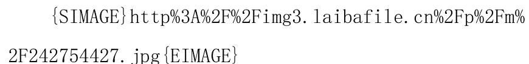

作者:66 端午 88 日期:2016-02-26 12:52

济南是可以上民用汽车项目的，重汽的潜能根本没挖掘出来。没必要乱拉境外企业，集中整合一下重汽的资源，上轿车，电动车，中小型越野车和货车都没问题。奔驰全线产品，重汽为什么不横线占领山东市场，目前山东的汽车销量全国第一，民用车可以规避经济周期，至少比重型车抗周期性好，夺回山东市场30%的份额，济南的汽车产业规模就会上升到全国第三。

作者:66 端午 88 日期:2016-02-26 14:21

清仓了鲁商置业，5.5.迦南科技，28.50

作者:66 端午 88 日期:2016-02-26 14:38

@龙泉四季 2016-02-26 13:38:56

请问下楼主，深圳的房子现在买还是等几年买？？不着急住，主要是等5年后小孩上学需要，现在住盆友的房子，也不用担心没地方住。首付款有，月供1.5W也能承受。就是这房子买来感觉压力太大

刚需适合选择机会抓紧上车，投资的选择余地比较大，刚需没的选择，这波调整时抓紧买，这刀是早晚要砍，就是轻重而已。前面讲过了，除非你可以不在深圳发展。

作者:66 端午 88 日期:2016-02-26 16:07

@蓝色心情 1015 40141 楼 2016-02-26 15:04:00

楼主，怎么看待链家中介被曝光打压?

转移舆论压力

作者:66 端午 88 日期:2016-02-26 16:09

@youtian201 40142 楼 2016-02-26 15:21:00

老大，我也看中华山珑城，感觉发展潜力大，关键是便宜，没有大资金运作。

便宜有便宜的道理，济南不发展到黄河北，小清河以北就会永远低估，其实交通搞好，这地方距离市区比开发区还近。

作者:66 端午 88 日期:2016-02-26 16:11

@youtian201 40143 楼 2016-02-26 15:26:00

要不老大和俺们说说济南你看好的刚需盘有哪几个？我们去买。

去年前年推奥体西路，现在推小清河沿线，从顺河高架至还乡店区间。

作者:66 端午 88 日期:2016-02-26 16:14

北上广开春房租飙升三成，各个二线城市迎来创业回归，宜抓紧出台利于鼓励创业和发展的新政策，地税人员限定任务不准提高，国税一周放假五天。地方经济就会有有好转。

作者:66 端午 88 日期:2016-02-26 18:23

@youtian201 2016-02-26 17:25:52

谢老大指点

扯，美元的基础是军事的一极化和牢牢把握着人类发展方向的主导权（文化，艺术，创新），虽然这两样都建立在经济基础之上，但你只有经济是搞不定这两样的，你的社会主流文化，是否得到全世界的认可，别的国家我不知道，反正中国不是，军事就更别说，我从来不相信一个造不出先进发动机的国家可以搞军事装备。

作者:66 端午 88 日期:2016-02-26 21:16

@逛逛在抽烟 2016-02-26 19:42:48

66 端午 88 楼主

2016-02-26 16:11

40147 楼

@youtian201 40143 楼 2016-02-26 15:26:00

要不老大和俺们说说济南你看好的刚需盘有哪几个？我们去买。

去年前年推奥体西路，现在推小清河沿线，从顺河高架至还乡店区间。

一一一楼主？不会吧？就那边那人文环境、和一条臭水沟似的河。咋能有投资价值？

你见过整治后的小清河吗？

作者:66 端午 88 日期:2016-02-26 21:31

人文环境是会改变的，地产开发会加速这一进程，额八九十年去上海的时候，那小巷子脏乱差，现在盖了新房子，穷人都轰跑了，90 年代初去大栅栏的时候，也这熊样。现在都不一样了。唯一的例外是 2000 年左右去深圳的时候，赶脚不一样，到处都是新的，路过广州也是脏乱差。不过这四个城市和济南不一样的地方就是人多。

作者:66 端午 88 日期:2016-02-27 10:43

@欣喜菩提 2016-02-24 10:58:34

楼主您好！想请教个问题：珠海为三线城市，人口 150 万左右，工业少，就业机会少，工资水平偏低，房价一直以来都是偏高，去年底以来更是疯涨，涨速全国第一，房价全国第 10，我是刚需，看到房价这样疯涨，无法淡定了，想近期在市区入手一套小两房，（因资金有限，买个小两房用于出租可以抵一部份房贷减轻负担，自己可到城中村租住比较便宜。不用考虑小孩读书问题）。哎这个买房的问题弄得我都像个祥林嫂了，到处问意见，还请楼……

@66 端午 88 2016-02-24 12:04:16

珠海典型的旅游城市，和厦门，三亚类似，已炒高的旅游城市泡沫都不小，建议广州来一套吧。

@欣喜菩提 2016-02-24 20:38:00

谢谢楼主的回复，只是我户口，我父母兄妹都在珠海，但我确实非常想逃离珠海，那里的工资太低了。

@欣喜菩提 2016-02-26 23:38:39

楼主您好！今天小川说我们的货币政策还有宽松的空间，是不是完了，通胀情况下，就像前几天的报道说高通胀榨干俄罗斯人民的钱包一样，只有资产相对货币保值，那在避险心态下房价还得继续涨。

楼主建议我可以关注广州，但因为广州有限购，估计也不行。我虽然户口在珠海，现在东莞工作，惠州，东莞，珠海三个地方是我考虑的方向。相对与惠州城区房价还可以接受，且环境尚可，主要预期深莞惠一体化，前景可期。东莞，现在房......

毫无疑问是东莞。

作者:66 端午 88 日期:2016-02-27 10:49

@鲸鲸丫头 2016-02-27 10:20:13

楼主看到我，看到我!! ????????

楼主大大，简单说下我的情况。我家两套住房，一套商铺，都在武汉的市中心一环内。住房自住一套，出租一套，商铺自用当做工作室。商铺在临街小区商业街二层，有 150 平方，如果放租，月租金大约 7000。我自用来说基本空置了 80 平方，觉得有些不划算。想在市中心投资兼自用一套 90 左右小户型二手房办公，这种二手房房子大约月租金 3500，房价 15000 每平方。周边配套非常成熟，基本没有新盘，有一……

这还要问，买个一环内不影响你现金流的最大面积，然后用商铺和住宅租金养按揭。工作室边边角角的租个小房，一定比用自己的商铺合算。等着交了房，两套住宅+商铺出租，慢慢回收资金等机会，工作室和居住放在一起。

作者:66 端午 88 日期:2016-02-27 10:51

@singozhou 2016-02-27 09:51:32

http://m.thepaper.cn/newsDetail_forward_1436545

最近看了平顶山那个 70 多岁的教师，教了 34 年，拿了不到 1 万块，因为没有证，还被辞退。

竟无法言语....世风日下，道德沦丧

自己不努力，等待天上掉馅饼，可怜之人必有可恨之处。

作者:66 端午 88 日期:2016-02-27 10:56

200 万现金，估计最起码能有 100 万可以买房，现在二套房的首付是三成，就是说：你可以动用的极限是 300 万，可以买 200 平左右的四室二厅或者五室二厅。

作者:66 端午 88 日期:2016-02-27 12:07

额几年前拍的小清河沿岸:

作者:66 端午 88 日期:2016-02-27 12:37

@66 端午 88 2016-02-27 10:56:02

200 万现金, 估计最起码能有 100 万可以买房, 现在二套房的首付是三成, 就是说: 你可以动用的极限是 300 万,可以买 200 平左右的四室二厅或者五室二厅。

@鲸鲸丫头 2016-02-27 12:25:00

谢谢楼主的指点! 武汉的房价你看好吗?

那是, 中西部如果让额买, 第一成都, 第二武汉。

作者:66 端午 88 日期:2016-02-27 12:57

@2006 此去经年 2016-02-27 12:48:09

问问看, 苏州房子今年涨价 2 倍了。还能不能接受, 不然孩子没有好学区啊,, 会不会高位接盘, 这房价涨的一个有房子的都闹心, 因为大家都有改善需求啊, 现在年轻人彻底改善不起了, 也不敢生二胎了

加 v 信 1101284955, 获取更多好帖

2009-2010 年那会, 额在极视首选推荐苏州, 6000-8000, 强力买入。如果是这个价位*2, 那还可以买, 超过 2 万就逼近南京了, 省内非省城不以任何理由超过省城房价。到了 2 万 4 以上, 你不如直接买南京。

作者:66 端午 88 日期:2016-02-27 15:45

@夏日的阳光 ing 40175 楼 2016-02-27 14:15:00

楼主你好, 在这贴一直是潜水中, 最近在本县城买了套电梯房, 单价 3000 一方, 六月交房。现有地下车位 6 万一个, 不知道要不要买个, 所在小区是 12 层电梯房 5 栋, 其余都是六层高的电梯房。

如果是自主无可厚非, 不过一般县城租金低的可怜, 租房住是最优选择, 除非你说的县城是昆山。要是你投资, 那就完全错了。卖掉, 马上到省城卖一套。我表哥当年在昆山工作, 单位分一套, 自己买一套。2002 年, 果断全清掉, 一共三百多平, 上海的老公房一并卖掉, 换了上海内环内 130 平豪宅, 给儿子留着结婚。选在算起来, 这套房子直奔千万以上了。昆山也涨, 但永远跟不住上海。

作者:66 端午 88 日期:2016-02-27 16:02

算上这轮房产涨价, 体系内完胜体系外。额大姨是 1986 年从北京移居上海的, 因为额大表哥相中了大学的女同学, 人家要求他在上海工作，额大姨费了好大劲才把他的工作从山东济南调到上海，结果上海单位人员编制满额，又下方到二级单位，在昆山，那会还没有商品房之说，你在哪里工作，就分到哪里的房子，额大姨在北京住的时候，部里给她两套房子，一套四室，一套两室（那会的房子根本没有厅），她退休的时候，要求移居上海跟着儿子，按照组织规定，在上海置换了三套房子，两套两室一厅，一套一室一厅，不过上海的房子太坑爹了，二室一厅赶脚也就 50 平方，按照现在的估值算亏了。这三套房子分别落户到额大姨，额小表姐，额大表哥名下，以后又分别卖掉进行了置换，现在一共有六套房子。还真是一套往外租的都没有，额大姨住一套，额小表姐离婚，夫妻各分一套，小外甥女继承一套，额大表哥夫妻两个住一套，大外甥住一套。这些房租估值在 2002 年前，基本和额赚的米相当，到了 2006 年，还抵不过额的财力，到了现在，我了去，额完败，平台决定人生。

作者:66 端午 88 日期:2016-02-27 17:35

@u_108861983 2016-02-27 16:24:38

@66 端午 88 楼主你好，我在上海打工，但房价和户口的问题我打算也没希望在上海购房定居。去年打算在苏州买房，结果去年苏州房价飞涨。到今年 5 月份，我大概能凑到 60 万。现在有两个想法，一是在老家河南南阳（地级市，3000-4000 的房价）购买个小商铺（中心区，这个会谨慎，地段不好不出手），再看情况可以的话贷款个住房。第二种是在无锡买个80万左右总价的商品房。想问楼主有什么意见。谢谢了

如果想回家，就别回南阳了，去郑州。如果你能在无锡找到事业，不妨首选扎根无锡。

作者:66 端午 88 日期:2016-02-27 17:36

@66 端午 88 2016-02-27 12:37:56

@66 端午 88 2016-02-27 10:56:02 200 万现金，估计最起码能有 100 万可以买房，现在二套房的首付是三成，就是说：你可以动用的极限是 300 万，可以买 200 平左右的四室二厅...

@鲸鲸丫头 2016-02-27 16:35:13

楼主大大怎么看房产税?

转型失利的话，房产税无限期推延。总的有点利空，那怕用后脚跟想想都不可能实现。

作者:66 端午 88 日期:2016-02-27 17:37

@Jacky 想找到信仰 2016-02-27 16:46:18

数据可靠吗，这样的逻辑是不是太不理性？？？

额根本就不用问你的智商问题了，你长后脚跟了吗？

作者:66 端午 88 日期:2016-02-27 17:48

额讲额大姨家的事，是告诉各位：体系内一代可养三代，我大姨是体制内的，额大表哥小表妹只能算体系边缘，他们只是体系内的企业。到了第三代和体系一点边都不沾了，只是房子的根源在体系内传过来的，他们都在外企工作。额大表姐算还在体系内，祖传两袋的核心体制，第三代还在体系内，在北京，自己一套北京的商品房都没买，买了也算卖错了，额那个大表姐夫也买过商品房，你们别笑哈，回老家买了套度假房，铁岭的联排别墅，他爹给它留下了四套半北京二环到三环之间的房子，有半套是因为他爹二婚的老婆没生孩子，只有一个远房侄女，也盯上这套豪宅了。

作者:66 端午 88 日期:2016-02-27 17:51

@u_108861983 2016-02-27 16:24:38

@66 端午 88 楼主你好，我在上海打工，但房价和户口的问题我打算也没希望在上海购房定居。去年打算在苏州买房，结果去年苏州房价飞涨。到今年 5 月份，我大概能凑到 60 万。现在有两个想法，一是在老家河南南阳（地级市，3000-4000 的房价）购买个小商铺（中心区，这个会谨慎，地段不好不出手），再看情况可以的话贷款个住房。第二种是在无锡买个 80 万左右总价的商品房。想问楼主有什么意见。谢谢了

@66 端午 88 2016-02-27 17:35:21

如果想回家，就别回南阳了，去郑州。如果你能在无锡找到事业，不妨首选扎根无锡。

@u_108861983 2016-02-27 17:45:58

感谢楼主回复，再问个问题，如在无锡购房，中心区两房小面积或者是稍外一点新房三室，再或者是大学边上的。这三种要是排个序，楼主怎么看？长期看怎么选择啊

首选位置核心，次选新的发展中心（政府搬迁的新址周边），其它不用考虑。

作者:66 端午 88 日期:2016-02-27 18:51

@ythwgh820622 40191 楼 2016-02-27 18:35:00

楼主，请教下，我目前在 3 线城市（南方某省会旅游城市）工作，在很小的县城某小区有一小房，单位房，绿化、环境（幼儿园在小区内，也靠近不错的初中、高中）、安全（监控很多）、水电费相对便宜，面积不大，60 平左右，目前能卖到 18 万左右，目前在出租，租期快到了，每年租金不到 8 千元（租售比在 4%左右），房子价格比去年有所回暖，去年只能卖到 16 万几。目前的计划是：将此处小房卖了，凑钱到省城买一套小房进行出租，省城

加 v 信 1101284955，获取更多好帖

# 哪个省

作者:66 端午 88 日期:2016-02-27 18:52

@qinshiye2000 40190 楼 2016-02-27 18:11:00

楼主如何看待东莞楼市呢？还有现在县城地皮好贵啊，老家贫困县城地皮过万一平

小地方贵了，根本不要理它。

作者:66 端午 88 日期:2016-02-27 19:51

@66 端午 88 2016-02-27 18:51:25

@ythwgh820622 40191 楼 2016-02-27 18:35:00

楼主，请教下，我目前在 3 线城市（南方某省会旅游城市）工作，在很小的县城某小区有一小房，单位房，绿化、环境（幼儿园在小区内，也靠近不错的初中、高中）、安全（监控很多）、水电费相对便宜，面积不大，60 平左右，目前能卖到 18 万左右，目前在出租，租期快到了，每年租金不到 8 千元（租售比在 4%左右），房子价格比去年有所回暖，去年只能卖到 16 万几。目前的计划是：将此......

@ythwgh820622 2016-02-27 19:28:26

彩云之南，昆明。

云南，广西，湖南，人口大量流入广东，昆明的房子盖的太多太快，很可能与这波上涨无缘了。按照区域划分，你可以去成都投个小房子，就是管理比较麻烦。

作者:66 端午 88 日期:2016-02-27 20:19

云南，广西，湖南投资要领，云南有一块热带区域：西双版纳。广西有片沙滩：北海。这两个城市要报平常心，就是买了享受的，不要追求快速的涨价回报，看长期的收益。湖南的问题和云南广西一样，人口流出。作为长沙，它有典型的消费城市特征，但是人口增长不足，09 年搞四万亿的时候，额是相当看好长沙的，仅次于苏州和天津，这些年流水一样的过去了，长沙仍是不温不火，可见，人口流出是最大的利空，其杀伤程度甚至超过了经济发展这个基础因素。

作者:66 端午 88 日期:2016-02-27 21:38

这是 2010 年收缩货币以来首次再提宽松政策，周小川的发言令人感到意外，仅仅在半个月前，李总还在提醒地方政府，货币政策不会放开，防止地方债务非理智增长，半月后，中央的政策即发生如此翻天覆地的变化，估计和 G20 各国财长协商达成的协议有关，至于货币宽松到什么程度，我们还需要进一步观察 2，3 月货币释放力度，以判定货币刺激是针对资本市场，还是对经济整体释放，如果如周小川所说的偏宽松，那么房地产市场会获得提振，如果对经济整体释放，那么股市的机会更大。

加 v 信 1101284955，获取更多好帖

作者:66 端午 88 日期:2016-02-27 22:41

@ynbamboo 40203 楼 2016-02-27 22:16:00

如果人在云南，不想跨省买房，是买昆明市区，还是买昆明呈贡新区大学城（以前外媒报道为鬼城，大学、市政府都搬过去了，现在人气较前已提升，目前和昆明主城已通地铁，今年 6 月还要通高铁，目前新区市政府住宅区在呈贡是最贵的，约 6 千多一平米），还是买楼主提到的西双版纳？抑或非刚需不用买，持币观望，或者换点美元保值，哪种选择要好点，望楼主解答一下，谢谢！

是必须买，必须跨省买，你还处于积累阶段，必须买在安全性强的地方，如果你有五套成都房，想享受生活了，也不太在意收入增长了，那倒是可以考虑一下西双版纳。

作者:66 端午 88 日期:2016-02-27 22:44

@youtian201 40204 楼 2016-02-27 22:17:00

还有，老大唐冶片区你看好不？

不看好，济南未来的方向是把城市做圆，不是再搞拉皮拉面，现在够变态了，东西长六十公里，南北十五公里，超级宽银幕。

作者:66 端午 88 日期:2016-02-27 22:58

@u_109332696 40181 楼 2016-02-27 17:27:00

加 v 信 1101284955，获取更多好帖

想咨询下楼主 大学毕业几年了想全款买套房 目前在四川地级市上班(不稳定) 最近两年房价跌了应该有10%了 如果买可以在离市中心5公里(看规划还可以 有万达)买个小套三,但是怕地级市不保值 本来自己家就在四川另外的市有房子不存在必须要改善居住的问题。或者在成都高新区(三环外 但那边外企多个人比较看好 主要是便宜)买。楼主能建议下选择哪里吗?暂时不考虑贷款买房 ^_^四川人向来喜欢悠闲 打算买完

成都

作者:66 端午 88 日期:2016-02-28 00:55

济南市城建布局:

作者:66 端午 88 日期:2016-02-28 01:03

@66 端午 88 2016-02-27 18:51:25

@ythwgh820622 40191 楼 2016-02-27 18:35:00

楼主,请教下,我目前在3线城市(南方某省会旅游城市)工作,在很小的县城某小区有一小房,单位房,绿化、环境(幼儿园在小区内,也靠近不错的初中、高中)、安全(监控很多)、水电费相对便宜,面积不大,60平左右,目前能卖到18万左右,目前在出租,租期快到了,每年租金

加v信1101284955,获取更多好帖

不到8千元(租售比在4%左右),房子价格比去年有所回暖,去年只能卖到16万几。目前的计划是:将此......

@ythwgh820622 2016-02-27 19:28:26

彩云之南,昆明。

我去问了云南的朋友,他说昆明的问题是:上一任盖了太多房子,城市人口不到七百万,已经按1200万人得规模批地盖房,人口流出并不是非常严重,周边的广西和贵州人口大量流出。

作者:66端午88 日期:2016-02-28 10:51

@alexfuel 2016-02-28 10:05:49

楼主能分析分析福州吗?谢谢

民营经济看浙江,往后排到老三就是福建,优势是民营体系加杠杆时,倍有底气,坏处是一炒就冒火,福州刚需只能买,改善和投资需要把握回调时机,中性,厦门房价也是进了全国头10名,福州按理说不会低于厦门,一比较就知道厦门高了,福州比较正常价格。

作者:66端午88 日期:2016-02-28 10:56

@披着城市的外衣 2016-02-28 10:15:17

老大,俺现在西部某省会城市持有两套住宅,不想再买

加v信1101284955,获取更多好帖

住宅了，现在有点闲钱应该在本城买套营业房，还是到一线买套小住宅呢？还是在海口，厦门这样的城市买？

沿海城市的位置选择错误，西部那些经济基础差，人口流出的城市，可真得当心。商业地产，根本连看都别看了，国家都不扛了，你能扛得住？研究一下无锡，东莞这类的二线城市。如果老天长眼，神马苏州，南京，广州之类的崩了盘，赶紧去抄一把。

作者:66 端午 88 日期:2016-02-28 11:03
@oceantian110 2016-02-28 10:52:04
楼主咋看 最近铺天盖地的楼市火热报道，是不是出啥事了？

昨天晚上额所有入了群，都在聊房子，连国外的同学都往回发房子照片，齐声谴责京沪深的房价，因为大家都买不起了。

作者:66 端午 88 日期:2016-02-28 11:10
@披着城市的外衣 2016-02-28 10:15:17
老大，俺现在西部某省会城市持有两套住宅，不想再买住宅了，现在有点闲钱应该在本城买套营业房，还是到一线买套小住宅呢？还是在海口，厦门这样的城市买？

@66 端午 88 2016-02-28 10:56:27

沿海城市的位置选择错误，西部那些经济基础差，人口流出的城市，可真得当心。商业地产，根本连看都别看了，国家都不扛了，你能扛得住？研究一下无锡，东莞这类的二线城市。如果老天长眼，神马苏州，南京，广州之类的崩了盘，赶紧去抄一把。

@木棉小木头 2016-02-28 11:01:52

东莞松山湖这边的房价都2万多了，镇区都1万多，算不算高？

东莞算长的慢，看看苏州，就知道未来的东莞房价。

作者:66 端午 88 日期:2016-02-28 16:55

@肿么破 2016-02-28 15:33:14

@66 端午 88 别闹了，作为在这个行业奔波好几年人，我想说的是这就是一个进来就跳出去的坑

好赖还是个坑，E租宝连坑都不挖，现在的中国，骗你都懒得挖坑了，房地产不但挖个坑，还给竖块碑，这玩意比印的纸票子强。

作者:66 端午 88 日期:2016-02-29 08:21

@107 国道的小猪 2016-02-29 01:30:54

加v信1101284955，获取更多好帖

南宁的房市，三年兄怎么看，虽说体制内，但是目前两套一栋都是真金白银辛苦买下，去外省投资又不方便，请三年指条路，谢谢

大部分大型楼盘都有代出租业务，随着网上支付的普及，远程出租成为现实。趁着强二线城市大部分放开限购，抓紧置换。异地购房宜选择大品牌，大楼盘，中小户型，不要配属车位，能买200平的，买两套100平或者三套70平。

作者:66 端午 88 日期:2016-02-29 08:23

济南一月份二手房成交价格同比暴涨26%，成交量暴涨40%（二手房的位置大部分都在核心和次核心位置，这样就剔除了远郊新盘价格的干扰因素），历下区成交均价突破1.35万，核心位置突破1.5万，新盘核心位置向2万靠拢。

作者:66 端午 88 日期:2016-02-29 08:29

要问济南哪里涨的最疯，不是核心和次核心，而是政府新址周边，特别是政府公务员配属的新盘，价格从2011年的5000-6000，迅速上扬至1.2--1.3万左右。

作者:66 端午 88 日期:2016-02-29 08:36

@youtian201 2016-02-29 00:30:19

但是老大如果不选择买房子，选择买美元能不能对冲没有买房子的风险，感觉买了房子变现是个问题，房子资金周转速度慢，美元没利息，真头疼啊。

选择美元是最保守的防御手段，想要改变阶层属性，目前看只有房地产投资投机组合可以实现。

作者:66 端午 88 日期:2016-02-29 08:50

@wzz810711 2016-02-29 08:45:40

老大，现在又事买房时机了吗？

强二线表现时间。

作者:66 端午 88 日期:2016-02-29 09:36

32.2-32.3 大幅减仓了三六五网

作者:66 端午 88 日期:2016-02-29 09:37

鲁商置业剩下点底仓 5.67 幸运成交。

作者:66 端午 88 日期:2016-02-29 09:41

股民们离开股市奔向了房市

作者:66 端午 88 日期:2016-02-29 09:46

剩余不足1成仓，不理了，撤退。2000点见

作者:66 端午 88 日期:2016-02-29 10:16

@披着城市的外衣 2016-02-28 10:15:17

老大，俺现在西部某省会城市持有两套住宅，不想再买住宅了，现在有点闲钱应该在本城买套营业房，还是到一线买套小住宅呢？还是在海口，厦门这样的城市买？

@66 端午 88 2016-02-28 10:56:27

沿海城市的位置选择错误，西部那些经济基础差，人口流出的城市，可真得当心。商业地产，根本连看都别看了，国家都不扛了，你能扛得住？研究一下无锡，东莞这类的二线城市。如果老天长眼，神马苏州，南京，广州之类的崩了盘，赶紧去抄一把。

@木棉小木头 2016-02-28 11:01:52

东莞松山湖这边的房价都2万多了，镇区都1万多，算不算高？

@66 端午 88 2016-02-28 11:10:12

东莞算长的慢，看看苏州，就知道未来的东莞房价。

@nahmlyong 2016-02-29 09:47:59

凤岗，塘厦好点的小区都卖1.7~2.0+了，离稍远一点的樟木头新盘1.3~1.4w。。如果出手买的话 哪个片区更靠谱呢。。紧邻深圳的优势大些吗？

还有往西边走广东自贸区那一带，虎门，长安等镇未来会不会发展的很好呢（因为深圳的发展一直是西进的）

唉，额盯着樟木头的时候，最贵的才8000，便宜的5000多。艹，

作者:66 端午 88 日期:2016-02-29 10:26

山东3，4线城市的投资者，应该果断抢入济南各类住宅，有米的买核心和政务核心，中产买入小清河沿岸，米少的买华山片区，M3地铁线确定穿越华山片区，相当划算的价格。

作者:66 端午 88 日期:2016-02-29 10:42

@minigirl2015 2016-02-29 10:36:08

LZ 你好，我追贴好几年，很佩服你股市房市都游刃有余，很少人两个不同领域都做这么好的！本来默默潜水偷学了不少知识呵呵。现在也有同样的困扰。同是投资，异地置业，想买小户型。看的楼盘有两种类型，一种是小区里同一栋楼大小户型都有，比如两梯四户、两梯五户中的小户型，周边环境以居家为主。另一种是小区里大小户型都有，但是某一栋都是纯小户型，三梯二十几户的那种，周边以商业或大学为主。请帮参谋下，选择哪种类型的......

买大小混住的小户型，公摊你赚大了。

作者:66 端午 88 日期:2016-02-29 10:44

比如同样公摊率的楼盘，一层六户分100平公摊，每户的公摊面积才10几个平方。一层2，3户的100平公摊，有你的33-50平，你说你赚大了吧。反正大户型根本不在乎门口有多大，咱在乎。

作者:66 端午 88 日期:2016-02-29 11:07

@tmawen2 2016-02-29 10:52:06

老大，杭州也开始涨了，你之前说杭州没有上涨空间，现在能买不

平常心介入，有前一波的回杀，底部坚实多了。

作者:66 端午 88 日期:2016-02-29 11:08

@minigirl2015 2016-02-29 10:59:24

多谢LZ，我也倾向后一种整栋纯小户型，我觉得优点是周边的商业/大学，人群以年轻人、外地人为主。顾虑是，这种都是投资、出租的，房子升值/出租后几年的收益有保证吗？
公摊不是重要因素吧？

选则大户型，就是选邻居，小户型的自住用户，那是会斤斤计较的。

作者:66 端午 88 日期:2016-02-29 11:10

@披着城市的外衣 2016-02-28 10:15:17

老大，俺现在西部某省会城市持有两套住宅，不想再买住宅了，现在有点闲钱应该在本城买套营业房，还是到一线买套小住宅呢？还是在海口，厦门这样的城市买？

@66 端午 88 2016-02-28 10:56:27

沿海城市的位置选择错误，西部那些经济基础差，人口流出的城市，可真得当心。商业地产，根本连看都别看了，国家都不扛了，你能扛得住？研究一下无锡，东莞这类的二线城市。如果老天长眼，神马苏州，南京，广州之类的崩了盘，赶紧去抄一把。

@木棉小木头 2016-02-28 11:01:52

东莞松山湖这边的房价都2万多了，镇区都1万多，算不算高？

@66 端午 88 2016-02-28 11:10:12

东莞算长的慢，看看苏州，就知道未来的东莞房价。

@nahmlyong 2016-02-29 09:47:59

凤岗，塘厦好点的小区都卖1.7~2.0+了，离稍远一点的樟木头新盘1.3~1.4w。。如果出手买的话 哪个片区更靠谱呢。。紧邻深圳的优势大些吗？

还有往西边走广东自贸区那一带，虎门，长安等镇未来会不会发展的很好呢（因为深圳的发展一直是西进的）

加v信1101284955，获取更多好帖

@66 端午 88 2016-02-29 10:16:08

唉，额盯着樟木头的时候，最贵的才8000，便宜的5000多。艹，

@nahmlyong 2016-02-29 10:58:13

我跟着楼主的帖子有一段时间了。。如果说樟木头新盘跟凤岗二手楼做选择的话，楼主是不是会倾向于凤岗塘厦呢（因为紧邻深圳），望楼主指教

那会准备买樟木头，是想选个南方小城市养老用的。实用性不如近郊的，比实用性当然选凤岗这类的。

作者:66 端午 88 日期:2016-02-29 11:25

@youtian201 2016-02-29 11:15:16

老大额米少准备重点考虑天鸿万象新天，另外顶楼和一楼的房子能买吗

太偏了，华山珑城比它强，外国语的学区房。

作者:66 端午 88 日期:2016-02-29 11:28

花园洋房，顶层和一层都是最好的。11层小高层，3-6最好，18层中层，看在小区里的位置，如果是景观房，选高的，不遮挡阳光的前提下，3-7层好，25层以上的高层，往上面选，11-24层好。

加v信1101284955，获取更多好帖

作者:66 端午 88 日期:2016-02-29 11:37

你画个坐标，从华山珑城过东外环高架桥，8公里到了燕山立交桥。你从未来将铺设的工业北路高架桥，8公里到了全福立交桥。燕山是未来的中心节点，正好在政务中心和市区中心的中间点上。全福立交桥未来是北部核心。燕山的区块价值是1.5万以上，全福的区块价值是1万。你说哪里合算，你自己想吧。

作者:66 端午 88 日期:2016-02-29 12:44

@u_108637843 2016-02-29 11:42:21

三元大哥 目前小弟对中央疯狂的降息降准降税收政策感到非常吃惊，说明去库存的问题非常严重了，从目前来看，去库存是非常难的，甚至可以说失败的可能性非常大。因为三四线的房子基本上没人要，而且出于对D的不信任，屁民绝对会不会干D提倡的事情，只会和D对着干。那如果去库存化失败，会带来怎样的后果，会有怎么样的影响。影响可能持续的时间和破坏力又是怎么样的。大哥能不能更详细的，更深入讨论下这个问题。而不要像其他……

没人指望3，4线的库存会在短期内清掉，这会导致政策支持房地产后，买入资金涌向供不应求的城市，集中炒作中心城市，次中心城市，特大城市。

作者:66 端午 88 日期:2016-02-29 12:54

@50502015 2016-02-29 12:42:22

楼主说成都，能有具体的区域么?现在啥行情呢？从鲁到渝，养老房可行么？

成都和济南差不了多少，养老房选热带和亚热带。

作者:66 端午 88 日期:2016-02-29 12:55

@碧水小姣龙 2016-02-29 12:36:37

楼主，武汉的房子怎么选呢？在深圳工作，房价这波上去之后是有点吃力了，打算过几年撤退回武汉，武汉现在首付2成，上半年能凑到60—80万的现金，未来3年月供2—3W不是问题（3年之后回武汉估计供不到这么多），总价在300w-400w之间都能接受。在老城区和光谷新城区那片犹豫（学位家里的老房子已经解决，考虑将来回去上班而已）还是面积小点，一套老城区自主，一套光谷投资？请帮看看有啥建议？谢谢！

武汉成都，投资投机两相宜。首选商业中心，次选政务中心。

作者:66 端午 88 日期:2016-02-29 12:57

@披着城市的外衣 2016-02-28 10:15:17

老大，俺现在西部某省会城市持有两套住宅，不想再买住宅了，现在有点闲钱应该在本城买套营业房，还是到一线买套小住宅呢？还是在海口，厦门这样的城市买？

@66 端午 88 2016-02-28 10:56:27

沿海城市的位置选择错误，西部那些经济基础差，人口流出的城市，可真得当心。商业地产，根本连看都别看了，国家都不扛了，你能扛得住？研究一下无锡，东莞这类的二线城市。如果老天长眼，神马苏州，南京，广州之类的崩了盘，赶紧去抄一把。

@木棉小木头 2016-02-28 11:01:52

东莞松山湖这边的房价都2万多了，镇区都1万多，算不算高？

@66 端午 88 2016-02-28 11:10:12

东莞算长的慢，看看苏州，就知道未来的东莞房价。

@nahmlyong 2016-02-29 09:47:59

凤岗，塘厦好点的小区都卖1.7~2.0+了，离稍远一点的樟木头新盘1.3~1.4w。。如果出手买的话 哪个片区更靠谱呢。。紧邻深圳的优势大些吗？

还有往西边走广东自贸区那一带，虎门，长安等镇未来会不会发展的很好呢（因为深圳的发展一直是西进的）

@66 端午 88 2016-02-29 10:16:08

唉，额盯着樟木头的时候，最贵的才8000，便宜的5000多。艹，

@nahmlyong 2016-02-29 10:58:13

我跟着楼主的帖子有一段时间了。。如果说樟木头新盘跟凤岗二手楼做选择的话，楼主是不是会倾向于凤岗塘厦呢（因为紧邻深圳），望楼主指教

@66 端午 88 2016-02-29 11:10:52

那会准备买樟木头，是想选个南方小城市养老用的。实用性不如近郊的，比实用性当然选凤岗这类的。

@nahmlyong 2016-02-29 12:21:28

楼主选择樟木头作为养老地的理由能否告知一二呢，是因为那里的生态环境吗还是有别的考虑呢。我目的很单纯，纯粹从投资角度考虑。现在樟木头新房 OR 凤岗二手之间我迟迟举棋不定。从觉得这次炒作如此疯狂，买个二手来个短平快好些

以前路过，觉得风景不错，到处绿油油的，而且位置比北海那种城市好，是投资和养老兼顾的选择。

@nahmlyong 2016-02-29 13:01:15

谢谢楼主了 我来深6年了 依我拙见养老还是选择惠州城区比较好些，自然环境尚可+怎么说也是市区配套相对好些+最重要的房价便宜!!!

东莞是深圳的苏州，惠州是深圳的无锡，你自己选吧。

作者:66 端午 88 日期:2016-02-29 13:19

@漠漠03 2016-02-29 13:11:04

请教楼主：安徽蚌埠，持有一套70平米的高层小户型，毛坯，2013年10月5700一平方买的，小区离万达等几个商业综合体及大型公园非常近，周边有写字楼，交通方便，生活配套比较齐全。

但正如楼主所说，城市人口净流出，不看好房市后期的发展，所以想将此房出售，亏本10%的价格挂出去两个月了，看房的人寥寥无几。

根据楼主的经验，有没有什么好的方法，能将此房及时出手？

加v信1101284955，获取更多好帖

或者实在卖不出去的情况下，用来出租，风险……

安徽是国家统计局公布的人口流出第一位次，整体不看好，但这个省有一个好处，只有一个中心城市，所以选择余地不大，合肥，很多外地打工又买不起当地城市的房子，会首选合肥投资，你要和这群人竞争，他们工作的地点打工收入可是不低，如果买合肥也肝疼，那就去买彩票算了。如果想迁出安徽，首选无锡。

作者:66 端午 88 日期:2016-02-29 13:23

@漠漠 03 2016-02-29 13:11:04

请教楼主：安徽蚌埠，持有一套 70 平米的高层小户型，毛坯，2013 年 10 月 5700 一平方买的，小区离万达等几个商业综合体及大型公园非常近，周边有写字楼，交通方便，生活配套比较齐全。

但正如楼主所说，城市人口净流出，不看好房市后期的发展，所以想将此房出售，亏本 10%的价格挂出去两个月了，看房的人寥寥无几。

根据楼主的经验，有没有什么好的方法，能将此房及时出手？

或者实在卖不出去的情况下，用来出租，风险……

装修一下，兴许卖点能提高一些。中小城市的出租，的确是满脸泪，我查着额们省的淄博，潍坊，那房租低的让业主伤心透了。

作者:66 端午 88 日期:2016-02-29 13:42

@275866447 2016-02-29 13:26:21

楼主认为房产占资产的比例为多少比较合适

前面讲过，任何时期不要低于五成，作为进攻阶段，看你的操盘能力，总之前提是不要产生现金流风险。

作者:66 端午 88 日期:2016-02-29 13:43

@马拉巴马 2016-02-29 13:35:15

端午楼主，这个周末无锡部分地区楼盘比较火爆，特别是市政府所在地太湖新城，以前也是有名的鬼城，但是就在太湖边上，环境没得说，离苏州也很近。售楼处外面车子以苏州牌照最多，是不是苏州溢出效应开始显现了呢?

应该视作启动点，第一财经的忽悠能力在国内经济媒体端口，排名第一。

作者:66 端午 88 日期:2016-02-29 13:46

额粗略的估算了一下，应该主攻以下城市：山东-------首选济南，西南-------成都，中西部-----------武汉，东部-----------无锡，南部---------东莞。

作者:66 端午 88 日期:2016-02-29 13:53

@singozhou 2016-02-29 13:44:11

老大，望解。我在魔都 15 年 10 月买的，追你帖过程中年后就动了卖的念头，但未满 2 年，要交 10 几万税，现在比我买时涨了 40-50。到 16 年底再说？

看原油价格跌到 25 美元以下半年，应该卖掉考虑去周边二线未严重炒作过的城市投资。房产有个问题，涨的时候没人舍得卖，一旦你下决心卖的时候，通常是下跌期，很难有好的价格出手。

作者:66 端午 88 日期:2016-02-29 16:30

@夏日迷情 8 2016-02-29 15:12:13

楼主大哥，买东莞的房子是买凤岗塘厦这片回报大些，还是买虎门长安这片呢？谢谢楼主抽空回答！

你看东莞，北边是广州，南边是深圳，而且距离都很短。不论是经济还是位置上，都能承接溢价，且不限购，现在广州比较低迷，不过已经有了翻身的苗头，广州和南京的争夺，不会在几年内有结果，或许到了年底广州又把南京干翻也说不准哪，东莞是两头押注的首选。虎门只是深圳的一个镇，他可以作为财力不足时的备选，需要强调东莞本身也是有相当经济基础的，加工基地的鼻祖。

作者:66 端午 88 日期:2016-02-29 17:38

@Louisafaith 2016-02-29 17:24:35

@66 端午 88 朋友昨天推荐了您，想咨询以下几个问题。

1. 上海崇明的房子有升值空间么？小区叫华贸东滩花园（3 万单价），周边 4,5 个别墅区，长江隧桥往返过路费 100 元，地铁 19 号线不到崇明了。崇明东滩附近都是以休闲度假为主。

2. 相比较崇明的东滩花园，买市区老公房还有升值空间么？已经涨的很疯狂了。

谢谢

你要是没有上海的户口，可以寻找上海境内低估品种，要是已经有了上海的户口，买崇明不如买昆山，更不如买无锡。

作者:66 端午 88 日期:2016-02-29 17:44

http://v.qq.com/cover/h/hmio331r9eojdlp/o0019w93tzk.html

这个小朋友的嗓子竟然有些许磁性，天才，艺考能进中央音乐学院。

作者:66 端午 88 日期:2016-02-29 18:05

@Louisafaith 2016-02-29 17:24:35

@66 端午 88 朋友昨天推荐了您，想咨询以下几个问题。

1. 上海崇明的房子有升值空间么？小区叫华贸东滩花园（3万单价），周边4,5个别墅区，长江隧桥往返过路费100元，地铁19号线不到崇明了。崇明东滩附近都是以休闲度假为主。

2. 相比较崇明的东滩花园，买市区老公房还有升值空间么？已经涨的很疯狂了。

谢谢

@66 端午 88 2016-02-29 17:38:43

你要是没有上海的户口，可以寻找上海境内低估品种，要是已经有了上海的户口，买崇明不如买昆山，更不如买无锡。

@Louisafaith 2016-02-29 17:57:52

谢谢您了，上海户口已有，是想把手里的公积金用起来投资，万一房价买后降了就养老。能具体分析下为啥买崇明不如买昆山么？为什么不看好崇明呢？谢谢

视作江北

作者:66 端午 88 日期:2016-02-29 18:05

@大树底下睡 2016-02-29 18:01:30

有消息说房产税马上就来，楼主怎么看？房产多会不会反而受累

就目前经济状况看，完全没有操作可能

作者:66 端午 88 日期:2016-02-29 18:32

@Louisafaith 2016-02-29 17:24:35

@66 端午 88 朋友昨天推荐了您，想咨询以下几个问题。

1. 上海崇明的房子有升值空间么？小区叫华贸东滩花园（3 万单价），周边 4,5 个别墅区，长江隧桥往返过路费 100 元，地铁 19 号线不到崇明了。崇明东滩附近都是以休闲度假为主。

2. 相比较崇明的东滩花园，买市区老公房还有升值空间么？已经涨的很疯狂了。

谢谢

@66 端午 88 2016-02-29 17:38:43

你要是没有上海的户口，可以寻找上海境内低估品种，要是已经有了上海的户口，买崇明不如买昆山，更不如买无锡。

@Louisafaith 2016-02-29 17:57:52

谢谢您了，上海户口已有，是想把手里的公积金用起来投资，万一房价买后降了就养老。能具体分析下为啥买崇明不如买昆山么？为什么不看好崇明呢？谢谢

@66 端午 88 2016-02-29 18:05:03

视作江北

@Louisafaith 2016-02-29 18:23:52

不好意思，不太了解，您指重庆江北区还是长江以北啊。另外无锡如果滨湖区，您觉得如何？

中国人的地域观念特别强，苏州河，用了多少年跨过去的，你以为长江是那么容易跨过去的？

作者:66 端午 88 日期:2016-02-29 18:50

打开地图，你会发现这张地图上分布着黄色的道路，道路的密集程度达到一定程度，就会形成一块黄斑，中国最大的三块黄斑代表着投资密度，投资密度代表着人口和资金的汇聚。这三个黄斑是：京津地区，长三角地区，珠三角地区。这个三个区域除了具备先天的人力优势外，大部分形成因素是政策因素，主导政策的权力，中国的经济是围绕权力运行的，不会买房子的，你去查哪块黄斑大，当然这是事后诸葛了。作为后来者，你去寻找离着黄斑近的，还能买得起的，或者其它黄斑稍大的，还没有爆炒过的。

作者:66 端午 88 日期:2016-02-29 20:33

@66 端午 88 2016-02-29 16:30:37

@夏日迷情 8 2016-02-29 15:12:13 楼主大哥，买东莞的房子是买凤岗塘厦这片回报大些，还是买虎门长安这片呢？谢谢楼主抽空回答！

@freedoms2016 2016-02-29 20:28:42

楼主为什么不看好中山？它北有广州、南有珠海澳门、东与深圳仅隔一条珠江。

没看不起中山，就是钱不够了，中山要罩进来，得搞个跨海大桥，还得提升自己的经济能力，这需要时间，更需要银子。200 万亿以上再说。

作者:66 端午 88 日期:2016-02-29 20:38

@youtian201 2016-02-29 20:18:48

老大，华山珑城涨价了，8000 多了，和明辉豪庭一个价了，万象新天 6400，有小户型，你感觉直接不能买吗？还有恒大城的公寓能投资吗？济南不熟今天就转了这几个盘。

那可以考虑路劲东城的5层以下不遮挡阳光不临街的房子（8500），也可以考虑翡翠外滩南区靠西侧的（8800），还有海尔北湖项目（9000），珑城的过了八千有点亏，我去看的时候，西南角的7800，东北角的才6400，最靠北能看到高速的房子6100.

作者:66 端午 88 日期:2016-02-29 20:40

明辉豪庭不能买，离着电厂太近了。

作者:66 端午 88 日期:2016-02-29 20:49

这三个，路劲东城要选离北园高架远的低层。海尔云世界要买靠人工河的中低层，翡翠外滩要买西侧的中高层，不临街能看到河景的。

作者:66 端午 88 日期:2016-02-29 21:02

没涨吧，提价几百有可能，一下提到8000以上没可能。

作者:66 端午 88 日期:2016-02-29 21:16

@夏日迷情8 2016-02-29 15:12:13

楼主大哥，买东莞的房子是买凤岗塘厦这片回报大些，还是买虎门长安这片呢？谢谢楼主抽空回答！

@66 端午 88 2016-02-29 16:30:37

你看东莞，北边是广州，南边是深圳，而且距离都很短。不论是经济还是位置上，都能承接溢价，且不限购，现在广州比较低迷，不过已经有了翻身的苗头，广州和南京的争夺，不会在几年内有结果，或许到了年底广州又把南京干翻也说不准哪，东莞是两头押注的首选。虎门只是深圳的一个镇，他可以作为财力不足时的备选，需要强调东莞本身也是有相当经济基础的，加工基地的鼻祖。

@夏日迷情 8 2016-02-29 21:03:31

大哥 虎门是东莞的镇啊 不是深圳啊

楼主大哥，我的意思是虎门、长安、凤岗、塘厦都是东莞的镇区，都是深圳周边，但是虎门长安这边相比凤岗塘厦又靠近广州一些，是不是买虎门长安的房子投资回报更高一些呢？楼主大哥辛苦了！

看着高速公路密布，是不是太乱哪。如果风景好，污染轻微，噪音可控。就可以买。离着深圳，东莞，广州都在 30-50 公里。

作者:66 端午 88 日期:2016-02-29 21:17

@夏日迷情 8 2016-02-29 20:00:12

楼主大哥，央行降准了，0.5 个百分点，这是要拉股市还是要挺楼市的节奏呀

人民币大贬

作者:66 端午 88 日期:2016-02-29 21:46

@tj 阿童木 2016-02-29 21:29:30

楼主能帮我具体分析分析厦门的房价吗？年后又比年前涨了，想在市中心地段换一套大房子，何时出手比较合适，不知会不会一直涨，手里只有 220 万，现在看到的都是 500 万左右的二手房，要 4 万一平了，谢谢

这个价不用换了，直接去福州

作者:66 端午 88 日期:2016-02-29 21:47

@youtian201 2016-02-29 21:28:36

好楼层，靠湖的，靠高速便宜，不敢要。

靠湖的都是联排别墅，1.8--2 万左右了吧。

作者:66 端午 88 日期:2016-02-29 22:29

@天边一片白云 2016-02-29 21:50:12

小清河的房子在什么价位呢？

8500-10000

作者:66 端午 88 日期:2016-03-01 01:31

@youtian201 2016-03-01 00:13:58

有高层在别墅西边要 60 多万，手里就 12 万首付不够，还有大魏明都的房子可以买吗？怎么那么便宜 4000 多一平，销售人员说有房产证，但是首付又得让交 50%，把我搞糊涂了

没证，小产权。

额记着珑城最小面积有 88 平的，也就 50 几万，现在首套（你没有贷款的话），可以放到二成首付（90 平以下首套）。二套是三成。

作者:66 端午 88 日期:2016-03-01 09:24

@youtian201 2016-03-01 08:32:21

万科幸福里和中建新悦城这里呢，能不能考虑？

低楼层抑制远方噪音，高楼层抑制人声噪音，这是经验问题。

作者:66 端午 88 日期:2016-03-01 09:27

@66 端午 88 2016-02-29 13:46:20

额粗略的估算了一下，应该主攻以下城市：山东-------首选济南，西南-------成都，中西部-----------武汉，东部-----------无锡，南部---------东莞。

@漠漠 03 2016-02-29 13:11:04

请教楼主：安徽蚌埠，持有一套 70 平米的高层小户型，毛坯，2013 年 10 月 5700 一平方买的，小区离万达等几个商业综合体及大型公园非常近，周边有写字楼，交通方便，生活配套比较齐全。

但正如楼主所说，城市人口净流出，不看好房市后期的发展，所以想将此房出售，亏本 10%的价格挂出去两个月了，看房的人寥寥无几。

根据楼主的经验，有没有什么好的方法，能将此房及时出手？

或者实在卖不出去的情况下，用来出租，风险……

@xx6612 2016-03-01 09:01:49

安徽是国家统计局公布的人口流出第一位次，整体不看好，但这个省有一个好处，只有一个中心城市，所以选择余地不大，合肥，很多外地打工又买不起当地城市的房子，会首选合肥投资，你要和这群人竞争，他们工作的地点打工收入可是不低，如果买合肥也肝疼，那就去买彩票算了。

如果想迁出安徽，首选无锡。

首选应该是杭州。

尽管南京房价这些年一直涨，杭州房价一直跌，但是，不论南京......杭州也不错，这些城市你是考虑租售比，还是考虑升值潜力，这是个长短期选择，更是个投机投资选择。看爱好了，杭州现在和广州是一档的，那还不如选广州哪。

作者:66 端午 88 日期:2016-03-01 11:06

@鸭梨不是很大很大 2016-03-01 10:43:31

三年兄，不知你有没有关注这次楼市，入市资金的性质。

前期深圳楼市资金有一部分是很高杠杆的：信贷+众筹+配资+房产商贷。主要操作高端物业。

另：街铺能投资吗？（国道旁的小区外围底商）（商品房 15000/平：街铺 25000/平）

你先别管什么资金进入的早，最早进入的肯定是投机资金，然后趋势资金，最后是刚性需求资金。冲起来破了顶，就很难再跌下来，房价抬起来，物价跟上去，物价就是支撑。早有人分析，现在打击中国经济不能靠金融了，因为中国的金融太大，你不论是美国还是日本，资金进来都成了小资金。只能从实物拖中国的高成本，比如基础食品。现在最怕的是国外进口粮食涨价，摁住中国的口粮。

作者:66 端午 88 日期:2016-03-01 11:09

@66 端午 88 2016-02-29 13:02:56

北京--------帝都，上海--------魔都，深圳--------故事都，南京--------老帝都。

@大连之鹰 2013 2016-03-01 10:58:41

请教楼主，那几个都明白，这个故事都怎么理解？请赐教

说了半天离不开一个权力问题，北京权力中心，上海金融和出口中心，深圳国家故事会中心，南京携七朝故都余威扼珠三角门户。

作者:66 端午 88 日期:2016-03-01 11:14

每次 CCAV 吆喝什么什么试点了，什么什么过河要摸石头了，都是特么上海深圳北京的事，现在看起来这叫不要脸了。你凭什么就把全国的资源都集中到这三个地方，因为这三个地方就是国家的脸面，要涂脂抹粉，但和你这个后脚跟没关系。

作者:66 端午 88 日期:2016-03-01 12:11

@平凡主妇 2015 2016-03-01 11:53:20

端午哥，现在感觉楼市好火啊，搞得自己也好想去买一套，怎么办？

杀向东莞和无锡，额看到有个无锡盘子不错，中海珑玺，花园洋房，1.2万，还不错，比济南便宜。

作者:66 端午 88 日期:2016-03-01 12:21

经济自有其自身的方式管理其运行走势，淘宝每年为你剩下了5万块，那么原来的小老板只能去买房，小老板的预期不高，20年内，房价涨幅会等同于我开店的利润，结果房价最终的收益就是除了跑赢通胀外，净赚100万。而你，淘宝为你剩下了100万，最终，你在房产居住或者改善的费用，会多掏100万。这就是经济的语言，出来混的，早晚要还回去，你不是给小老板，就是给开发商，或者前房东。所以额也认为：经济问题，就是个分配问题。

作为政府也很无辜，你们不花钱，只能我来花，可是我也没钱啊，养着一堆公务员正好把地税花干净了，想要修路，搞配套，搞建设只能卖地啊。没想到网销也搞的我收入下降了，那只能多卖点地，如果持平或者少卖地，就得提高土地价格，否则，我也搞不了建设，难道你们买的房子，没有路通过去，没有水，没有电的，你们怎么住？可是不搞基建，好多人就没工作了，他们闲着抢你的房子，抢你的老婆，抢你得存折，你们能撑住吗？

作者:66 端午 88 日期:2016-03-01 12:36

赶脚苏州淫民比上海淫民反应快多了，抬起来，上海人才会接盘。

苏州人都来无锡抢房？看房团275名客户引爆锡城

作者:66 端午 88 日期:2016-03-01 12:38

苏州人民是价值投资者，上海人民是趋势跟随者，无锡人民是最后的埋单者。这同样适用于济南，自己不拉起来，最后被别人拉起来也还是得自己接住。

作者:66 端午 88 日期:2016-03-01 14:32

这种走法，完全复制了2008年的奥运维稳行情。2008年7月18日

作者:66 端午 88 日期:2016-03-01 17:27

沈阳疯了吧，对在校大学生0首付，那群小王八蛋连消费贷款和助学贷款都有1PG烂账。

作者:66 端午 88 日期:2016-03-01 17:29

@66 端午 88 2016-02-29 18:50:05

{SIMAGE}http%3A%2F%2Fimg3.laibafile.cn%2Fp%2Fm%2F242968830.jpg{EIMAGE}

打开地图，你会发现这张地图上分布着黄色的道路，道路的密集程度达到一定程度，就会形成一块黄斑，中国最大的三块黄斑代表着投资密度，投资密度代表着人口和资金的汇聚。这三个黄斑是：京津地区，长三角地区，珠三角地区。这个三个区域除了具备先天的人力优势外，大部分形成因素是政策因素，主导政策的权力，中国的经济是围绕权力运行的，不会买房子的，你去查哪块黄斑……

@这不科学 b9 2016-03-01 15:03:18

长沙就是个悲剧啊!!! 楼主!

没那么严重，就是盖过劲了，消化一阵子还能涨。

作者:66 端午 88 日期:2016-03-01 17:30

@u_108637843 2016-03-01 14:35:15

{IMAGE}http%3A%2F%2Fimg3.laibafile.cn%2Fp%2Fm%2F243023111.jpg{EIMAGE}

楼主 这样可行吗

做梦，银行有估值师，鉴定房产的价格，价格不是你说多少就多少，贷给你多少，也不是你需要多少就给多少。

作者:66 端午 88 日期:2016-03-01 17:38

@天蓝小羊羊 2016-03-01 17:23:17

三年哥好，我一直看你的帖子，学到很多，最近有个问题想不通，想请教一下，国家一直让大家多贷款买房，难道不怕有一天好多人还不起银行出问题么。实在搞不懂，一定看到我啊，我专门注册了来问的，祝哥发大财!

国家发了一圈贷款发现一个问题，大企业的贷款还不上了，只能继续贷，唉。小企业的贷款还不上了，只能做成烂账，艹。贷给证券公司的，都换成股票了，汗。贷给非洲的都被国家免掉了，哭。贷给股票抵押的，都挂账了，傻。有一种贷款从来没有出过事，抵押品超过贷款额的8倍，哪有这么好的事啊？这是神马玩意，居民住宅。好吗，只剩这一个东西保险了。

以后怎样，先别管了，反正既要安全，又要能贷出去，还得能收回来。只有这神马了。这都是有大数据统计的，以后出不出事，我也不知道，神马也不知道，那会放贷的PP屁股走了，定政策的拍拍屁股走了，只剩下房子了，那会再出事也是以后大数据的问题了，那神马神马神马，赶紧贷啊，就这么出招吧，其它以后再说了。

作者:66 端午 88 日期:2016-03-01 17:41

@江湖辉 2016-03-01 16:58:15

楼主大智!很多地方提到俺们东莞，特别是东莞的樟木头，深圳地形东西狭长而南北短促，东莞樟木头位置得天独厚，房产价格低于价值，价格低是当年香港人政策性退出造成的。樟木头的确是个价值洼地。本人在樟木头持有两个公寓，小有斩获。

请教楼主的是：武汉周边有没有樟木头这样地方？我想说的是我家乡咸宁，咸宁离武汉80公里，高铁、城轨都通，有温泉且环境好，差不多是中国房价最低的地级市！公寓一般不过2000-3000，别......

我去，樟木头是啥地方啊，咸宁是啥地方啊，咸宁黄了吗？你看樟木头就在黄圈里面，讲半天你也没明白啊，投资要跟随趋势，趋势在哪里？哪里投资大就奔哪里。

作者:66 端午 88 日期:2016-03-01 17:52

@天蓝小羊羊 2016-03-01 17:39:39

楼主觉得买西安好还是买郑州好呢

西安开发力度太强，郑州刚涨过一轮，奔武汉吧。

作者:66 端午 88 日期:2016-03-01 18:13

@天蓝小羊羊 2016-03-01 18:09:16

楼主，还想请教一下国家让大家贷款这么多买房，不怕大面积断供么，到时候银行怎么办呢

国家发了一圈贷款发现一个问题，大企业的贷款还不上了，只能继续贷，唉。小企业的贷款还不上了，只能做成烂账，艹。贷给证券公司的，都换成股票了，汗。贷给非洲的都被国家免掉了，哭。贷给股票抵押的，都挂账了，傻。有一种贷款从来没有出过事，抵押品超过贷款额的8倍，哪有这么好的事啊？这是神马玩意，居民住宅。好吗，只剩这一个东西保险了。

以后怎样，先别管了，反正既要安全，又要能贷出去，还得能收回来。只有这神马了。这都是有大数据统计的（银行只看数据的，他们脑积水），以后出不出事，我也不知道，神马也不知道，那会放贷的PP屁股走了，定政策的拍拍屁股走了，只剩下房子了，那会再出事也是以后大数据的问题了，那神马神马神马，赶紧贷啊，就这么出招吧，其它以后再说了。

作者:66 端午 88 日期:2016-03-01 18:16

在中国，炒房不用动员，就像韩国足球打日本一样，不用动员，人人都像打了鸡血，嗷的一声就全上去了。中国人对土地和土地相关，那是写在基因上的，5000年的历史（好像还有争议，反正4000年是妥妥的）就是一部关于土地争夺史，从三皇五帝到本朝，莫一例外。

作者:66 端午 88 日期:2016-03-01 20:08

@66 端午 88 40385楼 2016-03-01 14:32 这种走法，完全复制了2008年的奥运维稳行情。2008年7月18日

@投机者的扑克 2016-03-01 19:45:44

老大我还有365网没走，有希望摸下20日线吗

额也没走干净哪，期待再摸一下2900，等等二月份信贷数据再定夺。

作者:66 端午 88 日期:2016-03-01 20:13

@漠漠 03 2016-03-01 19:44:05

@66 端午 88 @xx6612 @投机者的扑克 ……在外面忙了一天，上来一看，有这么多的人为我出谋划策，很感动，忠心感谢网络那端未曾谋面的你们！

今天一大早去房产交易中心办契税，人可真多呀，我一直排队到下班前才办好。这样的场景，确实让人感觉楼市的春天又来了。

排队空隙去了售楼部和中介，所了解到的情况是：市场比年前稍稍回温一点了，但价格暂时没有跟着上涨。

之前提到的5700元一平米买的房子……

2014年2月，是很多中小城市的长期顶了，主要是经济问题，当地不能提供足够的就业岗位。沈阳这种裸奔政策，真是让人百感交加，你说是买还是卖哪，沈阳出这种政策估计主要是想留人，高校毕业生就是经济的肌肉。你是不是应该提供足够的就业岗位，人家买个房子，可怎么往下混哪，你先搭起个骨头架子才能长肉吧。

作者:66 端午 88 日期:2016-03-01 20:22

@youtian201 2016-03-01 20:15:50

老大仔细学习了你的经验发现北京周边廊坊和武清比较符合你的黄块论，能谈谈吗？

有些人注定离不开北京，他们只能买北京远郊，但是作为异地投资者，没必要往那种犄角旮旯里挤了，不论是无锡还是东莞，都是比较适合居住的，北京极其周边，还真是不适合居住。

作者:66 端午 88 日期:2016-03-01 20:31

综合做出评估：将沈阳剔除出二线城市，并入三线城市。作为房产长期投资人，首先考虑的是房租收益，本来消费的人群是按照阶梯排列的，有一大部分会去买房，租房人群会大量减少，势必拉低房租收益比，从长期上看，会打击投资的稳定性和收益水平。短炒的，可以把握机会，如果有机会的话，长期投资的，需要撤离这个城市了。

作者:66 端午 88 日期:2016-03-01 20:46

@爱美月月 2013 2016-03-01 20:44:20

楼主大大，这波一线到底会涨到啥时候啊？

深圳涨到创业板崩盘，上海涨到石油跌破25美元，北京涨到换皇上。

作者:66 端午 88 日期:2016-03-01 21:37

这波经济大调整，主因是本届政府迅速启用中国经济的克星，以淘宝为首的网络销售，把掘墓人当作神立了牌坊，切断了货币循环通路，导致任何货币刺激都失去了作用，每每释放货币，都不能拉动CPI，导致循环断链。而房地产的链条未中断，所有货币大部分流入房地产，当地方政府发现这一特征后，开始过度开发房地产，导致市场自我缩容，集中炒作政策性城市。中国必定进入市场经济只有短短的20年，前期大部分投入参与商品流通的资产迅速贬值，没有过渡时间，自从2011年，额发现商业地产潜在价值重估危险后，几乎在2年内，零售行业裹挟其所有协作分支，迅速崩溃。

有人一直强调汽车的出现也曾经将马车全部淘汰，马车夫都失业了，可惜我们不是在这种低层次发生的产业升级，且马车被淘汰也是有20年的过渡期，我们在政策大跃进推动下，2年就干掉了零售业，零售就业人群根本就无法在两年内完成知识更新和完成资产减值准备，就被0利润参与竞争的网售企业干翻了。此时，国家应该对零售行业进行部分补贴，支持他们缓慢退出市场，这样资产减记可以维持，人员可以逐步转为其它行业，现实的情况是，他们只能买住宅规避，天量的零售企业资产目前无法处置，这将导致我国经济长期低迷，直到情况发生变化。

作者:66 端午 88 日期:2016-03-01 21:48

零售行业本来已经形成了自己的生态，虽然效率差点低点，不过这个行业为中国贡献了最少大约1500万个中产就业岗位，一旦失去生机，手里又有大把的运营资本，他们成为了炒房的中坚力量，中国的零售行业，绝不仅仅是一些贩子，而且有依托这个零售体系的中小企业和数十个小分支服务行业。发展经济必须依托就业进行，搞新兴行业必须注重不能发生负合博弈。有那个心气，你去搞先进发动机，你去搞生物制药，结果中国的新兴行业都是搞财富分配的狠脚色，核心技术绝大部分还是进口的。

作者:66 端午 88 日期:2016-03-01 22:21

抄来的，同意这种想法：

火车站作为外来务工人员的集散地，其周边环境历来是比较复杂的。这也就决定了其周边不可能有名副其实的高档社区，也就是说它的房价不可能高，虽然交通便利，但由于租客经济能力有限，其房租也不可能太高。

作者:66 端午 88 日期:2016-03-01 23:12

@天蓝小羊羊 2016-03-01 17:39:39

楼主觉得买西安好还是买郑州好呢

@66 端午 88 2016-03-01 17:52:07

西安开发力度太强，郑州刚涨过一轮，奔武汉吧。

@钓个鱼 2016-03-01 23:07:43

楼主啊，准备在武汉买一套房了，位置在南湖两所211大学中间位置，请问现在买合适吗？

抓紧选房，防止被放鸽子。

作者:66 端午 88 日期:2016-03-01 23:55

@wuyadancer 40442楼 2016-03-01 23:38:00

楼主看到我，楼主，分析一下济宁市区，最近借着各种炒作新闻，加上本地棚户区改造货币化补偿，轻轨，中心城炒作，也开始涨价。。本人打算在太白湖新区靠近市区的位置买。最近又纠结于黄块了。。对了市区价格一般6500-10000 周边4500-6000吧。。买房子优先考虑是配套还是距离单位的距离？（来自天涯社区微论客户端）

一万真不如济南买房了，奥体西能买靠近胶济线的，小清河能随便选了。等几年地铁一通，房租嗖就上去了。

作者:66 端午 88 日期:2016-03-02 03:20

@wuyadancer 2016-03-02 00:10:57

关键是我在济宁工作，事业单位，中学。济南太远了。。

还是那句话：居住，不得已，够用好用即可。投资，奔向中心城市。

作者:66 端午 88 日期:2016-03-02 03:24

@肖申克地九叔 2016-03-02 00:21:40

@66 端午 88 2016-02-29 13:23:26.517

装修一下，兴许卖点能提高一些。中小城市的出租，的确是满脸泪，我查着额们省的淄博，潍坊，那房租低的让业主伤心透了。

@66 端午 88 楼主怎么看青岛

总体中性，如果外贸程度下降，青岛距离核心物流通路并无优势。最近除了一线城市外，其它涨幅较好的均处于国内主干交通线的重要节点上。

作者:66 端午 88 日期:2016-03-02 03:27

@youtian201 2016-03-02 00:40:52

还有，老大别管价格了，再推几个性价比最高的盘吧，额算明白了，便宜没好货。

沿经十路自八一立交桥至奥体中心，密布1.5万-3万的盘子。除少量在市中区外，均为历下区的楼盘。这个区段一直领涨。

作者:66 端午 88 日期:2016-03-02 03:33

@youtian201 2016-03-02 00:40:52

还有，老大别管价格了，再推几个性价比最高的盘吧，额算明白了，便宜没好货。

核心区段未必是以后涨幅最大的，要选地铁环线里面价格低，交通好，风景美，容积率低的楼盘。按照其它城市的规律，地铁成网后，会对最贵区域有稀释作用。

作者:66 端午 88 日期:2016-03-02 03:35

地铁成网后，贵的房子涨不了多少，相反，原来低估的地方会因为地铁因素，一飞冲天。

作者:66 端午 88 日期:2016-03-02 09:49

@youtian201 2016-03-02 08:21:15

那老大看看保利华庭和海信贤文世家呢？

还不如买丰奥世家的二手房，少见的小高层。

作者:66 端午 88 日期:2016-03-02 09:51

@u_109601197 2016-03-02 08:34:54

根据楼主分析！看好绿城百合花园，容积率低，地铁沿线！学区房（什么分校）缺点就是靠近黄台电厂！

那房子还是不错的，小贵，过万了。不过一直也不便宜，几年前就9000+。

作者:66 端午 88 日期:2016-03-02 09:55

@youtian201 2016-03-02 08:40:27

北部太乱，实在不想选北部的盘。

北边是未来，一旦北跨成功，这片就变成核心区了。

作者:66 端午 88 日期:2016-03-02 10:27

@投机者的扑克 2016-03-02 10:21:05

老大股票跑路吼声

没跑，早盘低开还补了一点，不多，恢复到2成仓。

作者:66 端午 88 日期:2016-03-02 10:43

@投机者的扑克 2016-03-02 10:42:07

明天两会开幕了吧，今天会不会最后的维稳

365网是做网上房地产销售的企业。

作者:66 端午 88 日期:2016-03-02 10:44

嘎嘎，板了，虽然还亏着。

作者:66 端午 88 日期:2016-03-02 11:04

@u_109601197 2016-03-02 08:34:54

根据楼主分析！看好绿城百合花园，容积率低，地铁沿线！学区房（什么分校）缺点就是靠近黄台电厂！

@66 端午 88 2016-03-02 09:51:26

那房子还是不错的，小贵，过万了。不过一直也不便宜，几年前就9000+。

@u_109601197 2016-03-02 10:43:20

价格现在12000左右!

:(

作者:66 端午 88 日期:2016-03-02 12:03

二线全面启动:

{SIMAGE}http%3A%2F%2Fimg3.laibafile.cn%2Fp%2F1%2F243092763.jpg{EIMAGE}

作者:66 端午 88 日期:2016-03-02 14:53

@肖申克地九叔 2016-03-01 23:54:18

楼主 长沙适合买吗

@u_103817720 2016-03-02 13:52:13

长沙是湖南省会，作为省会城市是全国房价最低的地方，2011年入手了梅溪湖房产，5年来价格一直未涨，光利息亏了20多万，所以，湖南是最不适宜投资房产的地方，过去如此，现在如此，将来还是如此，主要原因有，第一，湖南是人口净流出省份，第二，长株潭一体化，城市群分散，第三，工业不发达，地方税务挤压工业企业，有些企业税务长期进驻，投资环境极差，三一重工搬至北京就是很好的例子。第四，在长沙挣钱很难，留不住人，......

自住可以买，投资转向武汉。

作者:66 端午 88 日期:2016-03-02 15:08

等待二月份信贷数据。

作者:66 端午 88 日期:2016-03-02 16:33

@天蓝小羊羊 2016-03-02 16:18:28

楼主请教一个问题，我在郑州主城区一个不太热闹的区（高新区）的核心位置有两套商住两用复式（两套面积基本一样，都是上下两层加起来一百平左右），整个小区是城市综合体（商场，商业街，住宅，公寓，写字楼都有），楼下是商场。今年夏天交房，我是多隔断几间租给人居住好，还是租给小公司好。

租给小企业好一些，和人家客气点，嘱咐一声，干不下提前说一声，及时找下家。

作者:66 端午 88 日期:2016-03-02 17:27

@duhongy 2016-03-02 17:08:10

楼主好，请教一个房产投资，珠海斗门一叠拼别墅（1，2，3层），单价9300/平米，一共是200万，华发公司开发的，环境等各方面还不错，就是离珠海市中心较远，距珠海市中心大约40分车程，我一炒房朋友看好，说将来一定会升值，最近这朋友在珠江三角看了一圈，最后决定入手这叠拼别墅，理由是价格较便宜，环境好，大公司开发的项目，港珠澳大桥即将开通，将来很多深圳、香港人都会到这买房定居，我觉得他说得有道理，但珠海这个......

这个实在看不准，额同学都在卖烟台的度假别墅，度假---------明白。

作者:66 端午 88 日期:2016-03-02 18:56

@duhongy 2016-03-02 17:08:10

楼主好，请教一个房产投资，珠海斗门一叠拼别墅（1，2，3层），单价9300/平米，一共是200万，华发公司开发的，环境等各方面还不错，就是离珠海市中心较远，距珠海市中心大约40分车程，我一炒房朋友看好，说将来一定会升值，最近这朋友在珠江三角看了一圈，最后决定入手这叠拼别墅，理由是价格较便宜，环境好，大公司开发的项目，港珠澳大桥即将开通，将来很多深圳、香港人都会到这买房定居，我觉得他说得有道理，但珠海这个......

@66 端午 88 2016-03-02 17:27:46
这个实在看不准，额同学都在卖烟台的度假别墅，度假明白。

@50502015 2016-03-02 18:07:43
端端，对烟台，有啥指点的？

自住可买，投资选济南或者青岛。

作者:66 端午 88 日期:2016-03-02 20:04
房价连涨+降准助推 “涨”字领跑济南楼市

作为济南市和山东省管理部门，应该迅速拆分山大，恢复原来的山东大学，山东工业大学，山东医科大学，并努力使他们都恢复原有的学界地位，加大力度提升济南大学的办学质量，使其接近 211 的水平，扩大山东艺术学院的办学规模，提升山东工艺美术学院在全国美誉度。并校并没有提高山东大学的排名，也没有提高教学能力，现在整个学校管理混乱，应该立刻对其进行纪检规范，将山东师范学院重新定位为综合性大学，更名为齐鲁大学。

一个城市的房价，并不是想推就能推动，推高了就难以下跌，城市房价归根到底要看城市竞争能力和潜力，不要刻意推高房价，要把精力放在振兴地方经济，为努力的人提供公平的发展机会，扩大有效就业，扩大中小企业盈利能力。

作者:66 端午 88 日期:2016-03-03 03:58
一款车即可改变生态，微型涡轮喷气发电机技术即将商用。

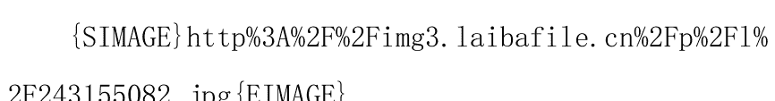

作者:66 端午 88 日期:2016-03-03 10:27
@投机者的扑克 2016-03-03 09:23:54

老大，365 继续持有吗

龙头确立，帮助传统行业互联网化的领头羊

作者:66 端午 88 日期:2016-03-03 10:35
@wzz810711 2016-03-03 09:26:54

一线城市体量的房市，不是哪个炒房团能随便炒起来的，被赐姓后，见不到房市政策的负面新闻，一起去库存，一线买不起，十八线瞧不上，只能忽悠那些买得起二三线的，买着买着价格就高了，当二线过高时，一线的涨价便成了强烈预期，于是小哥们下决心有钱也不带厂妹升级转型了，宁举债也要换一套一线。看的微博，老大，分析的有道理不?

一线是头羊，但并不最适合异地投资，视作标杆比较好。因为现金流量的问题，除非你在低位拿的，高位拿住，并不轻松。

作者:66 端午 88 日期:2016-03-03 11:04
无锡连夜涨价

作者:66 端午 88 日期:2016-03-03 11:23
加仓了 365 网

作者:66 端午 88 日期:2016-03-03 13:58
@投机者的扑克 2016-03-03 13:45:27
换手 10%了我靠

观望 3933，突破加仓，过不了减仓。

作者:66 端午 88 日期:2016-03-03 13:59
2933，2933，2933

作者:66 端午 88 日期:2016-03-03 14:00
@66 端午 88     2016-03-03 11:04:20
无锡连夜涨价

@CaesarO 2016-03-03 12:55:45
三年兄，最近楼市的狂欢和股市以及小川行长上周五在
上海表示“支持居民加杠杆买房，”是不是从侧面反映了我
国要效仿日本搞安倍经济学了，反正人民币汇率还有贬值空
间把债务从地方政府向民间转移。

作者:66 端午 88 日期:2016-03-03 23:02
全国各省市头牌高等学校：

- 1. 北京：北大
- 2. 上海：复旦
- 3. 天津：南开
- 4. 重庆：重庆大学
- 5. 黑龙江：哈工大
- 6. 吉林：吉林大学
- 7. 辽宁：东北大学
- 8. 河北：燕山大学
- 9. 河南：郑州大学
- 10. 陕西：西安交大
- 11. 四川：四川大学
- 12. 山东：蓝翔技校
- 13. 江苏：南京大学
- 14. 浙江：浙江大学

--------------------------山东亮了

作者:66 端午 88 日期:2016-03-03 23:07
@平凡主妇 2015 2016-03-03 21:29:09

大大，你不会跑无锡买房去了吧？

加v信 1101284955，获取更多好帖

西水东和太湖新区，中小户已光，除非排队买新开的盘。

作者:66 端午 88 日期:2016-03-04 08:26
纪申兰现象，开始我也不理解，对她反感。然后查看她家乡的情况，理解了。穷困县，山区，即使在挖煤时代，他们家乡也没有煤。他们家乡有劳模文化，她是劳模，劳模是什么？没有文化，但是肯下力。她能做的也只有举手，获得上级政府的施舍。经济基础是一切现象的最有逻辑的解释。

作者:66 端午 88 日期:2016-03-04 09:57
还有 12 个小时才能走完上升波段，即使涨不上去，也会反复冲高，不放量就可以减仓了。

作者:66 端午 88 日期:2016-03-04 11:46
@singozhou 2016-03-04 11:44:18
大哥，365 已打到 30 天线，可加吗？

不加不减，等冲高卖出。

作者:66 端午 88 日期:2016-03-04 11:47
前线传来最新消息：
无锡 新区 滨湖区 太湖新城！所有楼盘已经全部售空！
晚上二点有人全部现金交款买房。

卧槽，太不禁炒了，房子便宜了就这熊样，一把清了。
放弃观望无锡，耐心等待济南。

加 v 信 1101284955，获取更多好帖

作者:66 端午 88 日期:2016-03-04 11:51
济南就是下一个无锡，山东淫民等几天就会奋不顾身席卷万元以下二环内（西和北部）。距离市中心 15 公里以上的压价房，得靠济南淫民自己消化了。

作者:66 端午 88 日期:2016-03-04 11:55
前线传来最新战报：

无锡 新区 滨湖区 太湖新城！所有楼盘已经全部售空！晚上二点有人全部现金交款买房！

作者:66 端午 88 日期:2016-03-04 12:45
@singozhou 2016-03-04 11:48:16

另外老大帮忙看下，歌尔声学（002241）是不是已经背离很明显了？

小创票，炒的是成长，你看这么大盘子还有成长潜力吗？

作者:66 端午 88 日期:2016-03-04 14:23
清仓了 396 网，目前 0 仓位，还是做亏了点，唉。

作者:66 端午 88 日期:2016-03-04 14:27
股市已经彻底成为房地产附加，只有在双调整到底才会有大机会，再就是每年有一次吃饭行情。

作者:66 端午 88 日期:2016-03-04 14:34
卖出一切股票，如果套的不深，假装去买房子。:)

加 v 信 1101284955，获取更多好帖

作者:66 端午 88 日期:2016-03-04 16:16
楼主：66 端午 88 时间：2015-06-15 20:31:00

盯着上面的两个指数，第一个跌破，跑一半，第二个跌破，清仓。想出国的换美金，坚守的买房子锁定，不可做反弹。而且这波牛市结束后，沪市的年线图形是年线顶背离，需要调整大约 10 年左右或者更长（大约 10 年）。创业板大跌后，还会有牛市，1-2 年后。至于沪市为什么会熊十年，这是好几个技术高手的结论，额只是复述一下，因为是年线顶背离，就是说，我们过去 22 年，其实一直在走慢牛，还没有经历过一次真正的熊市。（个人观点，仅供参考）

而且这波行情是由创业板做头羊的，整个牛市是由创业板筑底开始的，发动，拉升也都是创业板引领的，创业出了头部，沪市也不远了。很早就像公布这个算法，不过怕影响大伙的持股心态。第一波：2050----3400，涨幅 0.6615，第二波，3049----，如果涨幅 0.6615，----------5160 点。（个人观点，仅供参考）

更可怕的事情是，这波牛市一旦结束，由于各种杠杆作用，会把各类理财和银行资金都裹挟进去，这个防火墙到底有没有，强到什么程度，鬼才知道。一旦演化成金融危机，也是我国金融系统第一次产生这么大规模的金融危机。（个人观点，仅供参考）

所以，今天晚上如果不出什么大利好，基本上凶多吉少，

加 v 信 1101284955，获取更多好帖

该说的额都说了，大家自己拿主意。

现在看起来，真是特么顶天 NB 的预判了。可惜天杀的小强把额忽悠进去一把。以后记着顶逃出来，全款买房。

作者:66 端午 88 日期:2016-03-04 17:56
@这不科学 b9 2016-03-04 16:26:16

楼主我现在想要在长沙买套房，现在入手是不是买在顶点了，是观望几年还是选择买呢

自住任意时间可买，因为房价下来的时候，你期待的位置区域，等等一系列条件不一定配合，不要因为涨跌因素买卖自住房。和投资正好相反

作者:66 端午 88 日期:2016-03-04 17:59
一次性提高房地产类资产估值 1000 万，除了最近买入的一套，其它房产全部突破 1.2 万/米。

作者:66 端午 88 日期:2016-03-04 18:32
@66 端午 88 40602 楼 2016-03-04 11:47

前线传来最新消息：

无锡 新区 滨湖区 太湖新城！所有楼盘已经全部售空！晚上二点有人全部现金交款买房。

卧槽，太不禁炒了，房子便宜了就这熊样，一把清了。放弃观望无锡，耐心等待济南。

加 v 信 1101284955，获取更多好帖

@qihuiqin0227 2016-03-04 16:52:31

不会这么恐怖吧！年前我家就在滨湖区买了一套小户型
105 平米，每平米 8200，这么说赚大了？开心！

你去问一下吧，额苏州的朋友现在就在买哪，抢了一套
小三房，被一块买房的当地人白眼了半天。

作者:66 端午 88 日期:2016-03-04 19:27
不知道多少人的肠子是青的

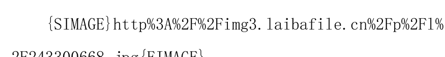

作者:66 端午 88 日期:2016-03-04 22:35
@这不科学 b9 2016-03-04 19:13:31

楼主，长沙北辰三角洲房子是否可以呢

自住可买，投资谨慎。成都刚刚拍出来地王，估计不日
将启动了。

作者:66 端午 88 日期:2016-03-05 00:51
中国将消减钢铁产量 1.5 亿吨，这会就知道谁要被削减
了，宝钢，首钢不会减产，那肯定是河北和山东的钢要减产
了，这就是政策倾斜。这么搞几下，一线的企业旺了，二三
线的企业颓了，一线保了就业，保了税收，其它地方又是失业, 又是财政歉收, 房价的支撑是实体经济, 中央你的政策
也太没谱了, 连家里的佣人都跟着沾光。

加 v 信 1101284955，获取更多好帖

作者:66 端午 88 日期:2016-03-05 01:00
房地产竖起大旗, 中国经济重启传统经济模式, 估计这一轮增长时间将远远短于 2009 年刺激, 不过在转型失败的压力下, 不动用传统经济已无法抑制下滑, 独腿的房地产行业能扛多长时间的大旗, 2016 年-2017 年中期前, 问题不大,但增长能力已经被大大削弱, 这主要是因为商业地产已经趋势性衰退, 此轮刺激的瘸脚性, 将导致双份资金涌入住宅地产, 加之品种分化异常严重, 2 线中的投资品种涨速和涨幅将远超 2009 年-2010 年。

作者:66 端午 88 日期:2016-03-05 03:57
阳朔可以搞旅游地产, 通常都是旅店客栈什么的, 找个设计师设计一下, 有点特色, 自己干也行, 干一阵子有起色了出租也行, 投资不要太大, 摸好门路再扩大。武汉都在谈光谷, 通地铁的城市, 最热的是政府新址和新 cbd, 如果在一起就是热点区域。

作者:66 端午 88 日期:2016-03-05 10:24
@孜昂姑姑 2016-03-05 09:51:26

端午老师你好, 坐标郑州, 目前有一套 85 两居室出租了出去, 我们自己在单位附近租房住, 从去年就一直想要在“鑫苑名家”买一套 130 平的二手房作为改善型住房, 小区环境好,有幼儿园和小学,去年嫌贵,今年总价蹭蹭又涨了十来万,大概 13500 一平,首付 80 多万,买后压力会大点,外面的投资也需要收回付首付,两居室也需要卖掉,因为我们就是一般的工薪家庭,现在不知道楼市后市如何,再涨真买不起了,是现在买,还是把钱继续作为他……

置换大房,要考虑现金流问题,不要因为吃干榨尽搞到无以为继,对于资金实力始终处于只能买一套的尤其要重视。别总是想着升值问题,只有一套房谈升值有点自欺欺人,如果资金实在够不到,不妨降低点标准,在该小区买套小点的,等待时机积累资金再换大的,不买不行,超出实体购买也不好,采取均衡策略吧。

作者: 66 端午 88 日期: 2016-03-05 10:27
@forevers 乐乐 2016-03-05 09:59:36

一直潜水关注楼主的帖子,涨了不少的见识,虽然不是刚需,但是也被这次房价的涨幅搞得心慌慌的,想出手套小二房。诚心想请教楼主大大,如果纯投资保值的话,杭州的上城区和广州的珠江新城选哪个比较好些?杭州的单价 3W 左右,珠江新城要 4W 了,都是比较中心的位置,城市比较稀罕杭州但又感觉广州珠江新城的位置更好一些

珠江新城好一些

作者:66 端午 88 日期:2016-03-05 10:40
济南最贵区域楼盘:

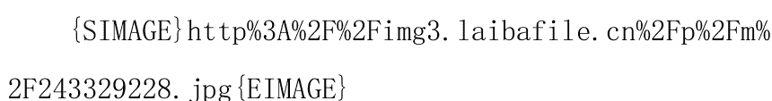

作者:66 端午 88 日期:2016-03-05 10:45
@66 端午 88 2016-03-05 01:00:42

房地产竖起大旗，中国经济重启传统经济模式，估计这一轮增长时间将远远短于 2009 年刺激，不过在转型失败的压力下，不动用传统经济已无法抑制下滑，独腿的房地产行业能扛多长时间的大旗，2016 年-2017 年中期前，问题不大，但增长能力已经被大大削弱，这主要是因为商业地产已经趋势性衰退，此轮刺激的瘸脚性，将导致双份资金涌入住宅地产，加之品种分化异常严重，2 线中的投资品种涨速和涨幅将远超 2009 年-2010 年。

@u_103817720 2016-03-05 10:30:46

佩服楼主对房地产市场的精准判断，但个人提醒大家投资须谨慎，因固定资产套现太不容易了，特别是二、三、四线城市，这波房地产行情保持增长到底能维持多久，1 年还是 2 年，如果是短期内增长，那么大部份人都会是高位接盘，现在的政策是 2 年后才免征营业税，以交税日期开始算,, 房地产商一般要 1 年左右才会去办这些手续，估计最快是三年才能转手，根据以往的判断，那时房地产到底是什么情况，我预计，不擦亮眼睛，这波很多人成......

加 v 信 1101284955，获取更多好帖

资本市场有个特点，领涨品种有优先兑现权，额这次推荐的区域都是领涨圈子里的便宜货，并未推荐一线城市，并未推荐已经炒高的二线城市，也不推荐经济实体差强人意的旅游城市。

作者:66 端午 88 日期:2016-03-05 16:08
@song361867 2016-03-05 14:50:47

其实楼主玩的就是击鼓传花的游戏，只要鼓点不停，楼主总能游刃有余。但是盘子越来越大，玩的人越来越多越来越嗨，那么是不等鼓破了或者鼓点停了就会停摆。每个人都有自己的想法，但实际上大部分人已经被动的参与了游戏进入了赌局结果已经注定。

一线城市这么高，都没采用物业税和房地产税，你担心有点多余，房价有到顶的那天，到顶也未必是价格到顶，而是它对经济的支撑能力下降，为什么今年开始刺激房地产，说明经济增长和房地产在一个主轴上。

作者:66 端午 88 日期:2016-03-05 16:45
2 月份，济南二手房开始加速向上（济南的二手房通常都在老城区，不含距离市中心超过 15 公里以上的偏远区域）

{SIMAGE}http%3A%2F%2Fimg3.laibafile.cn%2Fp%2Fm%2F243352657.jpg{EIMAGE}

作者:66 端午 88 日期:2016-03-05 18:18
@u_106447590 2016-03-05 17:09:34

楼主，请问永川兴龙湖金科中央街门面有升值吗，前 2 年买的，目前空置，是永川新城

说城市，别说片区，哥不是地图通。

作者:66 端午 88 日期:2016-03-05 19:05
@u_106447590 2016-03-05 17:09:34

楼主，请问永川兴龙湖金科中央街门面有升值吗，前 2 年买的，目前空置，是永川新城

@66 端午 88 2016-03-05 18:18:47

说城市，别说片区，哥不是地图通。

苏州涨幅已经靠近南京，不要再追了，可以去无锡搞一套。上海再 NB，它不敢整体超过北京，这叫懂事，看眼色。不过买卖房的时机看起来简单，操作起来并不简单，最好的方式是持有放租，长线看还是很有花头的。在房产上做差价的，没几个有好结果，比如 2014 年初，有个哥们卖了北京五套房子，兑现了 1700 万，说是存银行吃利息，租房住，现在被所有人嘲笑的一塌糊涂，号称京城第一傻冒。

加 v 信 1101284955，获取更多好帖

作者:66 端午 88 日期:2016-03-05 20:52
@马拉巴马 2016-03-05 20:03:16

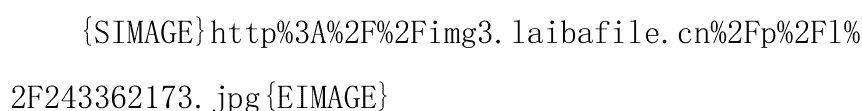

这图是今天到现在成交量，一般更新到晚上 10 点多，估计今天很可能破 600，无锡这两年一般成交在 150 左右，去年年底也放过一次量，从 2 月份末开始一直维持在 300 以上，前天突破 400，昨天突破 500，今天很有可能突破 600，无锡房产史上成交最大量了。量在价先，接下来会涨了吧？

毫无疑问热点区域会飙升，非热点区域加速去库存并小涨。

作者:66 端午 88 日期:2016-03-05 20:53
@难得虎兔简约爱情 2016-03-05 19:41:19

http://www.efw.cn/news/n209696.html

楼主怎么看这个报道？确实身边有很多苏州人到无锡去抢房啊。

尚处于价值回归阶段，不要紧张。

作者:66 端午 88 日期:2016-03-05 20:54
@66 端午 88 40663 楼 2016-03-05 18:18:00

加 v 信 1101284955，获取更多好帖

@u_106447590 2016-03-05 17:09:34

楼主，请问永川兴龙湖金科中央街门面有升值吗，前2年买的，目前空置，是永川新城

@u_106447590 2016-03-05 18:54:35

说城市，别说片区，哥不是地图通。

不好意思，描述不清，是重庆永川区

买核心，买热点，重庆不是一线城市，不会漫天掉馅饼的。

作者:66 端午 88 日期:2016-03-05 20:56
@song361867 2016-03-05 19:09:48

给楼主并看帖同人提个醒，最忙给老人买房发现以前一直关注的小区冒出不少二手房，选择性和价位都趋于理性，大家是否有这个感觉。

昨天一个上海同学在微信里面说去年8月卖掉了上海的二套房，赶脚早晚是要后悔的。因为她卖的不是绝对顶部，就算调整，她也没好的空间补回来，下跌时，通常还会再期待下跌。

作者:66 端午 88 日期:2016-03-06 00:54
加v信1101284955，获取更多好帖

如果你把经济活动视作战争，那么对手的任何纰漏你都要重视，对于一再暴露出同样的纰漏，往往是对手内在缺陷的外部反应，一定要揪住狠狠痛击，就像辩论赛中的思维缠斗，把住他的一个缺陷论据猛攻，从而导致其整体崩塌。中国经济的致命纰漏就是货币问题，我们不会打死中国经济，但是每次都可以利用它做文章，获取超额收益，中国经济的缺陷通过金融系统的创新，实质就是放大杠杆倍率，是中国最善于商业创意人群的舞台，更是中国经济的软肋所在。

作者:66 端午 88 日期:2016-03-06 01:41

新鲜数据出笼，三月头三天，济南日均销售暴涨三倍，由上月日均300余套爆增至千套，按照目前销售速度，库存住房只够卖两个月，显然依靠本地消费和投资是做不出如此巨量的，这标志着广大山东人民跑步入场，疯狂抢夺中心城市资源的起点。预计在月中即可呈现极速拉高走势，作为经济强省一旦获得全省认同，潜力非同小可。

作者:66 端午 88 日期:2016-03-06 10:21

@一文不名平天下 40686楼 2016-03-06 09:44:00

三年兄 我认为你需要考虑一个问题

如果美联储持续加息 中国怎么办？说白了 只要中国不想死的太快 唯一的方法是同步加息 加息会提高资金成本 那么杠杆炒房的 后果就不用多说了 和配资炒股是一样的

加v信1101284955，获取更多好帖

如果中国不跟着美国加息 说明就是破罐子破摔了 后果很清楚 资本外流 金融危机是极其可能出现的 你相信金融危机出现的情况下 房价会涨吗？你也说过自己换美元 我记得你还买过半吨白银 那么房价呢？至少继续涨

全球一片负利率，美国也扛不住，美国的经济规模庞大，它不作足要升的姿态，就无法保持币值，美国和中国都在疯狂发钞，美国是抖各种机灵让你误判，实在不行就用军事实力搅乱全世界任何区域敢于妨碍或者和他竞争发钞的国家地区。中国是简单粗暴就是要发钞，美国发钞面对全世界，中国发钞面对全中国，想对世界发钞，结果被美元摁倒打了一顿踢回来了，又得发钞，又无法对境外发钞，房产成为发钞的借用工具。上面的文字，你一定要好好理解，认真体会。

作者:66 端午 88 日期:2016-03-06 10:28

美国是否可以像中国这样发钞，美联储做梦都像这样，可惜他的权力制衡不允许这样发钞，它只能先把国债发出去，然后抵押债券来发钞，前提就是有人买它的国债，美国也同样不敢玩死中国，前阵子美国压人民币过狠，中国一卖美债，美国经济数据立刻难看了俩月，人民币一稳定，美国经济数据立刻又好看了。这俩国家的经济已经拴在一条绳上。

作者:66 端午 88 日期:2016-03-06 13:13

济钢2022年搬离济南，北部工厂将于2023年全部撤离，济南炼化停止技术改造，将于2025年撤离，由此济南将彻底摆脱重工业和化工行业，转型已属必然，未来济南的建设将以省会中心为核心，发展金融，贸易，物流，交通，会议展览，文化娱乐出版，教育，医疗，旅游，信息和部分没有污染的轻工业品和机械加工。着重生态友好，高端增值和服务行业并重。济南以前是个不屑炒房的城市，城建落后，规划土鳖，封闭且愚昧，沉溺于土鳖和屌丝满满的意淫中不可自拔。

炒房就是最佳的招商引资手段，辅以宽松的营商环境，不太腐败的政管体系，依托全国三强的强大腹地，济南应该立足做山东的橱窗，而不是生产工厂。其地产目标应该是追赶南京，货币是经济血液，国家释放货币，如不能将血液引入属地，落后是必然的。郑州曾经在2012年搞了很多鬼城，现在看起来不但全部被消化，还真把资金招过去了。安徽（合肥）依靠强大的打工经济回流，房价竟然和上海同步启动，只是晃瞎了绝大多数所谓经济砖家的狗眼。这都需要山东省政府经济决策部门好好调研一番。山东很多三线城市，都不应该炒房，他们应该好好搞生产，济南应该放弃生产，帮助这些三线城市做好营销推广和产品策划，各司其责，中小城市要做小而强，大城市不应该和他们抢夺生产成本的优势，踏踏实实做高端产业和增值服务。

作者:66 端午 88 日期:2016-03-06 15:01

@song361867 40694楼 2016-03-06 14:29:00

贾康: 一线城市可推房地产税------------------可以看成借房价爆炒之机以平民愤的手段, 那就对现在接手的购房者是一个打击。

马仔说了能算数?

作者:66 端午 88 日期:2016-03-06 15:17

@song361867 2016-03-06 13:50:47

自从一线火爆, 楼主也跟着高兴。问题是现在是屌丝买房还是富人在抛房, 先弄明白然后在说投资的事不至于将来弃楼。

济南本地的富人, 不屑在济南买房, 都去北京了。抛出来的房子, 都是老公房居多, 很明显的置换行为。

作者:66 端午 88 日期:2016-03-06 17:08

@blue889 2016-03-06 16:11:09

这样自嗨不知道能够玩多久? 如果是闭关锁国时代还解释的通, 可惜如果出口和外企不玩了该如何? 国企应该不能做指望的

所以这次不会炒所有的房子, 只集中于中心城市和价值低估城市, 很多城市的顶部就是在2014年2月。

作者:66 端午 88 日期:2016-03-06 19:02

@66 端午 88 2016-03-06 10:21:58

@一文不名平天下 40686楼 2016-03-06 09:44:00

三年兄 我认为你需要考虑一个问题

如果美联储持续加息 中国怎么办？说白了 只要中国不想死的太快 唯一的方法是同步加息 加息会提高资金成本 那么杠杆炒房的 后果就不用多说了 和配资炒股是一样的

如果中国不跟着美国加息 说明就是破罐子破摔了 后果很清楚 资本外流 金融危机是极其可能出现的 你相信金融危机出现的情况下 房价会涨吗？你也说过自己换美元我......

@一文不名平天下 2016-03-06 18:07:02

三年兄 你的意思就是赌美联储不会加息咯 而不是说美联储加息的话 炒房有什么不死的好办法 而且你认为炒房会从一线蔓延到济南这类二线弱的地方 所以力推济南的房产 但是问题在于 江浙沪自古富庶 江浙沪炒房可以看作经济下行态势下的保值手段 在全国来讲是不具有普遍性的

而且在经济下行态势下 银行转向房贷属于用个人债务置换企业债务 但是如果经济一直下行 个人债务根本是背不起的 也就是说 这波炒房导致的后果 很可能......

青岛人在济南的不多,烟台威海现在越来越多,当然你如果说鱼贩子,种菜大户,工厂主这类少。搞艺术的,设计的,创意的,学历高的越来越多了。所以,济南要搞差异化发展,别和青岛拼电器,别和胶东拼海洋行业,产品设计,电子设计,IT,制药,生物产品,产品创意,重型机械装备,这些玩意济南还是很有竞争力的。

作者:66 端午 88 日期:2016-03-06 19:09

青岛经济基础是比济南强,你敢说烟台威海是青岛的腹地吗?人家根本就不摆青岛。济南嘛时候靠过工业和制造业?济南腹地很多强的地级市,比如:淄博,临沂,济宁,东营之类的,哪个拿出来在南方也是比较强的地级市,如果全省一条心,排除青岛的干扰,济南腹地延伸到烟台,威海,潍坊,干掉南京分分钟的事。同样的问题,苏州和上海是一体化的,它也不摆南京一道,南京的腹地是向北向东辐射的。苏州的延伸至于无锡,绝不敢越雷池一步干到常州,这是分界线。

作者:66 端午 88 日期:2016-03-06 20:10

一线城市开始互殴了,上海一直对创新金融市场规模日趋萎缩,被深圳抢了先机耿耿于怀,想把创新金融的瓢把子抢回来,鉴于在中央势力里面,沪帮的实力远远高于粤帮,抢夺很可能会在政策层面获得支持,这些政策的实施最终会影响到深圳房价,当心防备。不过上海也得同样防备北京,现在沪深的房价又快持平了。现在的决策层核心还是太子帮,捏捏上海挤点油水也不是不可能的,比如强化上海的房地产税预期,哈,富人要比穷人累心的多,不留神也会被割韭菜。

作者:66 端午 88 日期:2016-03-06 20:18

最近蔬菜价格狂涨不止,绝大部分小品种超越了肉价,同时鸡蛋价格萎靡不振,大家分析一下什么原因。

作者:66 端午 88 日期:2016-03-06 20:50

@66 端午 88 2016-03-06 20:18:39

最近蔬菜价格狂涨不止,绝大部分小品种超越了肉价,同时鸡蛋价格萎靡不振,大家分析一下什么原因。

@难得虎兔简约爱情 2016-03-06 20:30:53

原因大概有两个:

第一,蔬菜占CPI比重没有肉类大,所以是为了控制CPI指数,至少数据上看起来老百姓生活负担小了;

第二,种菜的地和人少了,供不应求。

瞎猜的,不知道有没有蒙对。

电商玩不转的行业,会自己对冲通胀的,额感觉要从这里分析,生产端成本提升不大,零售端玩命涨,增值出现在流通环节,其实额赶脚这样做挺好的,被电商把持的行业,

加v信1101284955,获取更多好帖

加不上去价，等着被货币滥发玩死拉倒，活该了。

作者:66 端午 88 日期:2016-03-06 20:53

鸡蛋的耐储周期比蔬菜长几倍，猪肉冷冻后更长。房产的耐储周期几乎无敌。

作者:66 端午 88 日期:2016-03-06 22:09

@狙击2016 2016-03-06 21:01:23

三年大哥，一直是您的粉丝，知道您一直推荐买济南的房子。但家在临沂，也不想再去济南折腾了。现在无房，三年内必须买房。手头有点小钱但感觉买了立刻下跌会很不爽！想听听三年大哥的建议，再等等还是现在就去选房！临沂房子实在太多了！

自住无需等待，选择最适合你的房子。投资的确应该投济南，特别是山东境内。

作者:66 端午 88 日期:2016-03-06 22:09

@happier35 2016-03-06 21:31:53

请问下楼主，我想在成都南延线一带买社区门面房，是否可以买？单价在3万2左右，请楼主一定回答我

规避一切商业地产。

作者:66 端午 88 日期:2016-03-06 22:12

@白狼谷 2016-03-06 21:03:17

@66 端午 88 40711楼 2016-03-06 20:53:00

鸡蛋的耐储周期比蔬菜长几倍,猪肉冷冻后更长。房产的耐储周期几乎无敌。

14亿人的国家盖了够住25亿人的房子,再盖就够住40亿人了,还高价,还耐储,奇葩的国度,迟早有老天来收

人力会逐步向区域中心城市集中,会造成3,4线城市房产过剩,压住一线城市,特别是一线房租跟随上涨后,一线已成鸡肋。

作者:66 端午 88 日期:2016-03-06 22:46

推荐个创业创意:谁能搞抓紧搞,1亿的PE估值。

卧槽,赶紧搞个月子嫂APP,评价体系,薪酬体系,规范标准化,一体运作。

作者:66 端午 88 日期:2016-03-06 22:51

@66 端午 88 2016-03-06 10:21:58

@一文不名平天下 40686楼 2016-03-06 09:44:00

三年兄 我认为你需要考虑一个问题

如果美联储持续加息 中国怎么办?说白了 只要中国不想死的太快 唯一的方法是同步加息 加息会提高资金成本 那么杠杆炒房的 后果就不用多说了 和配资炒股是一样的

如果中国不跟着美国加息 说明就是破罐子破摔了 后果很清楚 资本外流 金融危机是极其可能出现的 你相信金融危机出现的情况下 房价会涨吗？你也说过自己换美元 我……

@一文不名平天下 2016-03-06 18:07:02

三年兄 你的意思就是赌美联储不会加息咯 而不是说美联储加息的话 炒房有什么不死的好办法 而且你认为炒房会从一线蔓延到济南这类二线弱的地方 所以力推济南的房产 但是问题在于 江浙沪自古富庶 江浙沪炒房可以看作经济下行态势下的保值手段 在全国来讲是不具有普遍性的

而且在经济下行态势下 银行转向房贷属于用个人债务置换企业债务 但是如果经济一直下行 个人债务根本是背不起的 也就是说 这波炒房导致的后果 很可能……

@66 端午 88 2016-03-06 19:02:24

青岛人在济南的不多，烟台威海现在越来越多，当然你如果说鱼贩子，种菜大户，工厂主这类少。搞艺术的，设计的，创意的，学历高的越来越多了。所以，济南要搞差异化发展，别和青岛拼电器，别和胶东拼海洋行业，产品设计，电子设计，IT,制药，生物产品，产品创意，重型机械装备，这些玩意济南还是很有竞争力的。

@一文不名平天下 2016-03-06 22:40:12

烟台威海当然不是青岛的腹地 烟台和青岛有相似性
有一定的竞争 威海走旅游的路子 和青岛烟台不一样 但是
从地域性讲 胶东和鲁中本身文化差异性就很大 这种差异
是大于青烟威三地差异的 你一直强调的是把全省资源聚集
到济南 然后拉抬济南房价 走河南安徽的路子 问题在于
河南安徽这么做 是因为他们只有省会拿得出手 提升省会
形象对其他地区发展有好处 但是山东经济本身是分散分布
的 根本不需要把资源让给济南提升形象 如果也这......

山大从来不是青岛的，其前身是位置在山东医学院的圣
约翰教会学校，山大只是名字和一部分教职人员。

山东大学医学院位于山东大学趵突泉校区，是中国最早
的医学院校之一，前身为创建于1911年4月17日的齐鲁大
学医学院，历史可追溯到1864年成立的登州文会馆和1891
年成立的华美医院医校。1952年9月由齐鲁大学医学院、山
东省立医学院、华东白求恩医学院重组成山东医学院，1978
年划归卫生部直属，1985年更名为山东医科大学。

登州文会馆是由美国北长老会传教士狄考文于1864年
创办的私立学校，是中国第一所教会大学，是齐鲁大学的初
创阶段，是中国最早的现代型大学，为中国早期高等学堂输

送了大批师资力量。1876年改称“文会馆”，1881年开设大学预科，1882年纽约长老会总部批准以tengchow College（登州学院）为学校英文名称，以“文会馆”作为中文名称。

狄考文于1864年正月在登州（今蓬莱）和先期达到的一对传教士夫妇在城西北观音庙办起了一座寄宿的“蒙塾”。1872年，狄考文又在此基础上，扩大了校舍，增加了课程。称前三年为“备斋”，后六年为“正斋”，“正斋视高等学堂之程度，即隐括中学与内；备斋视高中学堂之程度，而隐括蒙学与内”（《文会馆志》）1876年，文会馆第一批学生毕业（学制12年），毕业生仅3人：邹立文、李青山、李秉义。这比上海圣约翰书院（即后来的圣约翰大学）早3年，比北京汇文、通州的潞河（两校当时都称书院，后合并为燕京大学）早了十几年。

学制方面分备科和正科，读书9年。由狄考文亲自编写课本，包括数学、物理化学以及圣经、国学、英文；狄考文的妻子则讲授历史、地理、音乐等。1886年文会馆的规模再次扩大，可以容纳100多名学生。同时，还增加了木工、电工、车工等工艺课程；另外有一些传教士讲授天文、逻辑等新课程。

义和团运动时，该学校遭到冲击和破坏。此后，校址迁往山东潍县，并改名为广文学堂。后在此基础上，发展成为著名的齐鲁大学。

作者:66 端午 88 日期:2016-03-06 22:55

## 齐鲁大学

齐鲁大学（Cheeloo University），简称齐大，诞生于1864年（清同治三年）由来自美国、英国以及加拿大的多个基督教教会，美北长老会共同筹款联合开办。是中国最早的教会大学之一。经过长期发展，齐大发展成一所综合性教会大学。

齐鲁大学全盛时期，老舍、钱穆、顾颉刚、栾调甫、马彦祥、吴金鼎、胡厚宣等学术名家先后在此执教。学校的医科的实力最强，有“南湘雅、北齐鲁”之称。当时的齐鲁大学号称“华北第一学府”，和燕京大学并称“南齐北燕”。[1]

> 齐鲁大学校长、哈佛大学毕业生刘世传曾说：“正如我的另一个母校，哈佛大学是美国最老的大学一样，齐大是中国最老的大学，绝对没有一个中国大学能在这一点上赶上齐大！”[2]

1952年院系调整，齐鲁大学被撤销建制，其学科分别并入山东大学、山东师范大学、南京大学等高校，校园旧址为今山东大学趵突泉校区，校史由山东大学医学院继承。虽然齐大和山大同处山东，但两者历史上少有关联，是不同性质、不同风格、相互独立的。

作者:66 端午 88 日期:2016-03-06 22:56

齐鲁大学才是山大的正宗前身

加v信1101284955，获取更多好帖

作者:66 端午 88 日期:2016-03-06 23:07

而且我不太理解为什么你把青岛作为济南的敌人 我只说一件事 直到90年代末 青岛的电信通信收入都占到全山东一半 电信收入是按省划分的 这些收入都是由山东省统一支配 济南花了青岛多少钱可想而知了 至于你总是提到的山大 那是青岛的 被济南抢走而已 山东绝大多数地方都有青岛援建的工厂 没有青岛的技术 山东和河南就是一个水平 另外 青岛的建设 山东省从来不出一分钱 无论是奥运场馆还是港口地铁跨海大桥 青岛全部自己筹资 而济南建个省体育中心 是全省一人扣10块钱工资的 山东省从来没有支持过青岛发展 但是收钱从来不含糊 要是山东对青岛的支持有辽宁对大连的十分之一 青岛也不至于被苏州甩那么远 青岛人的确对山东省有意见 认为一帮土包子不配做青岛的主管部门 这里面最重要的原因之一就是山东得了青岛太多好处 却总是拖青岛后腿 给青岛下绊子 生怕青岛发展起来 难道拖死青岛 山东就富了？ 即便到了现在 以三年兄你这样的见识水平 仍然以青岛为敌人 这就是山东人的特点 见不得人好 望人穷 难道长三角没有上海 珠三角 没有香港 就都富了？

你没有做过全省的招标，全省中标后，其中根本不含青岛份额，他们的财政一直是单独算，并未进行过财政支付转移（计划单列市的特权），并且山东还得划拨一部分搞形象工程。你算算青岛的投资和财政收入一目了然。正因为有了青岛，济南的投入一直不足，而且作为外贸大省的山东，很大一部分外贸份额也被强行划归青岛。由此导致了经济大省和小省会的奇葩现状。

作者:66 端午 88 日期:2016-03-06 23:09

除了山东外，其它省会都是省财政极度倾斜的，山东是个例外，济南一直到10年前，可以称是个村。

作者:66 端午 88 日期:2016-03-06 23:30

@yuleng2012 2016-03-06 23:23:49

前辈，看美元走势，快到兑换点了吧？

还想知道，投资买房要使用杠杆吗？一般周期多长？谢谢！

6.5以下低吸，仓位不要过重，这是个耐心活。

作者:66 端午 88 日期:2016-03-06 23:36

对于山东省的做法，额是深受其害的，额的最优选择是2006年感觉秋风已冷时(气人之处就在于已经准确的估算出未来的经济走势后，还是下不了决心离开济南)，撤离济南，随便找个北京，深圳或者苏州待着，现在就可以彻底退休了。

作者:66 端午 88 日期:2016-03-06 23:44

@66 端午 88 2016-03-06 22:56:09

## 齐鲁大学才是山大的正宗前身

@一文不名平天下 2016-03-06 23:24:17

1930年4月，国民党政府任命杨振声为校长，9月21日，举行开学典礼，国立青岛大学正式成立。

1932年行政院议决，将国立青岛大学改为国立山东大学。

1937年，“七七”事变，抗日战争爆发。11月国立山东大学由青岛迁往安徽安庆，不久再迁四川万县。

1946年春，经国民政府教育部批准，国立山东大学在青岛复校，赵太侔再任校长。

1958年7月，山东大学归由山东省领导，同年10月奉命迁校济南。

这是山东大学真……

额没否定过山大有一部分是青岛过来的，前身要按照时间最久远，最文明，最辉煌的算起，不过青岛一直不承认是隶属山东的，为神马把名字改成山东大学？一直叫青岛大学就挺好的，况且这俩大学分分合合的好几次了。齐鲁大学才应该叫山东大学，所以，额坚持认为山东省应该恢复齐鲁大学，把渊源比较近的山东师范大学改制即可。

作者:66端午88 日期:2016-03-06 23:46

@slimcoffee 2016-03-06 23:34:42

## 楼主怎么看杭州呢?

经过前期大幅调整后，底部夯实，和南京，苏州，广州并列1.5线，偷偷意淫一下，神马时候济南能搞进这个圈子，额会很高兴滴。

作者:66端午88 日期:2016-03-07 00:06

@66端午88 2016-03-06 22:56:09

齐鲁大学才是山大的正宗前身

@一文不名平天下 2016-03-06 23:24:17

1930年4月，国民党政府任命杨振声为校长，9月21日，举行开学典礼，国立青岛大学正式成立。

1932年行政院议决，将国立青岛大学改为国立山东大学。

1937年，“七七”事变，抗日战争爆发。11月国立山东大学由青岛迁往安徽安庆，不久再迁四川万县。

1946年春，经国民政府教育部批准，国立山东大学在青岛复校，赵太侔再任校长。

1958年7月，山东大学归由山东省领导，同年10月奉命迁校济南。

这是山东大学真……

@66端午88 2016-03-06 23:44:33

加v信1101284955，获取更多好帖

额没否定过山大有一部分是青岛过来的，前身要按照时间最久远，最文明，最辉煌的算起，不过青岛一直不承认是隶属山东的，为神马把名字改成山东大学？一直叫青岛大学就挺好的，况且这俩大学分分合合的好几次了。齐鲁大学才应该叫山东大学，所以，额坚持认为山东省应该恢复齐鲁大学，把渊源比较近的山东师范大学改制即可。

@一文不名平天下 2016-03-06 23:49:41

你说的那个最辉煌 实际后来是停办的

现在的山东大学前身 是在青岛筹办并成立的 与你说的那个最辉煌之间没有任何继承关系 唯一相同点是名字里有山东大学四个字而已

哪有停办啊，理课文科划归山大，师范单独搞了山东师范学院，医科搞了山东医科大学，化工还搬到青岛搞了青岛化工学院。

作者:66端午88 日期:2016-03-07 00:07

@雨中注册 2016-03-06 23:52:04

楼主，帮看下武汉。最近想入手2环内2套房，公积金贷款。怎么样？谢谢！

立刻买入

作者:66端午88 日期:2016-03-07 00:08

@66端午88 2016-03-06 20:18:39

最近蔬菜价格狂涨不止，绝大部分小品种超越了肉价，同时鸡蛋价格萎靡不振，大家分析一下什么原因。

@一文不名平天下 2016-03-06 23:58:59

鸡蛋价格低迷 是因为饲料价格跳水 鸡蛋利润没有太大变化 这里面还有一个因素是前年鸡蛋暴涨引发的蛋鸡存栏量提高

蔬菜价格暴涨是因为厄尔尼诺引发的低温冻害 属于天气因素 这里面有个重要原因是去年气象部门失职 一直喊暖冬 对于南方低温冻害没有做出预警

这两个价格和电商什么的一点关系都没有 和金融什么的也没有任何关系

你难道不知道冬天的蔬菜全是大棚养的吗？大棚和厄尔尼诺不挨边。

作者:66端午88 日期:2016-03-07 00:12

不了地域问题了，额对青岛并无恶意，只是从政策分配，财政分配角度上考虑这个问题，一省双城都存在这个问题，区别在于其它省市全部都是倾斜省会，就算省会是坨屎，也会倾斜到另外一个城市甘做老二。你见过苏州房价胆敢越过南京吗？你见过厦门的经济规模超过福州吗？还是你见过宁波敢挑战杭州。青岛敢，而且做到了，所以山东是个奇葩的省。

作者:66端午88 日期:2016-03-07 00:18

山东自称是经济强省，数据也支持，可山东在全国淫民心目中就是一幅屌丝形象，这和济南的屌丝形象完全一致，并不会因为有个美丽的青岛而改变。

作者:66端午88 日期:2016-03-07 07:48

@happier35 2016-03-06 21:31:53

请问下楼主，我想在成都南延线一带买社区门面房，是否可以买？单价在3万2左右，请楼主一定回答我

@66端午88 2016-03-06 22:09:57

规避一切商业地产。

@alexfuel 2016-03-07 01:14:49

楼主看到我，SOHO呢？是不是也在规避之列？

如果属于70年产权，位置在核心，是个例外。

作者:66端午88 日期:2016-03-07 08:14

@狙击2016 2016-03-07 07:58:03

本人愚钝，一直觉得临沂现在花70万买的房如果一年后跌到60万岂不是多花了近10万吗？如果明知道是下降趋势，等等岂不是更好吗？为什么说刚需无需考虑涨跌，当然我算不上真正的刚需了！请指教！

不要以个例干扰整体的走势，2003年国家调控房地产，造成上海第一次房价下跌，我同学在上海买了第一套房子就赶上了这次调整，房价由1.1万跌到9200（坐标陆家嘴）。聚会的时候一个劲的诉苦。

作者:66端午88 日期:2016-03-07 16:43

@天蓝小羊羊 2016-03-07 15:22:04

楼主好，我老公家河南偏远农村的，他弟弟与弟媳常年在外打工，我老公给他们看了一个郑州小公司开发的住宅比周边便宜几百，但是两年后才能交房。他们也能买得起，但是比较吃力。现在他弟媳不愿意买，他弟弟要买，到底该买不该。

看看它有没有五个证，便宜的多少都有点问题。如果银行能贷款，问题不大，银行帮你摸清底细了。

作者:66端午88 日期:2016-03-07 17:51

@天蓝小羊羊 40779楼 2016-03-07 17:33:00

@天蓝小羊羊 2016-03-07 15:22:04

楼主好，我老公家河南偏远农村的，他弟弟与弟媳常年在外打工，我老公给他们看了一个郑州小公司开发的住宅比周边便宜几百，但是两年后才能交房。他们也能买得起，但是比较吃力。现在他弟媳不愿意买，他弟弟要买，到底该买不该。

@66端午88 2016-03-07 16:43:03

如果没什么硬伤，买

作者:66端午88 日期:2016-03-07 17:53

@天蓝小羊羊 40780楼 2016-03-07 17:39:00

@天蓝小羊羊 2016-03-07 15:22:04

楼主好，我老公家河南偏远农村的，他弟弟与弟媳常年在外打工，我老公给他们看了一个郑州小公司开发的住宅比周边便宜几百，但是两年后才能交房。他们也能买得起，但是比较吃力。现在他弟媳不愿意买，他弟弟要买，到底该买不该。

@66端午88 2016-03-07 16:43:03

嗯，以后物业管理的难度比较大，不过先上车再说，必定家底不够厚实

作者:66端午88 日期:2016-03-07 17:58

济南上周成交量高达6700套，创下全国最新记录，如果能延续这个势头，一个月后，房价将大幅飙升，库存只够卖不到两个月，市场将进入卖方市场。济南从来没有经历过卖房主导的市场氛围，真不知道会发生什么现象（只有少数楼盘经历过，比如历山名郡的1，2期，一直在排队，从来没中标），拭目以待吧。

作者:66端午88 日期:2016-03-07 18:55

转个帖子：要淡定，实在跟不上的，等上1，2年，还会调整的，不过调整后的价格要视这波冲高的高度和速度而定。

## 我所亲历的北京抢房潮

2016-03-04 于聪毛葱说

感谢阅读于聪原创作品，欢迎转发。

肚子一天天大起来，我和老公不得不考虑卖掉郊区的“花园洋房”，换到市里去，否则在市里上班的我们实在没有精力照料宝宝。做了这个决定3天，我们就把房子卖掉了。心里不舍，毕竟是我们在北京的第一个家，地板、橱柜、餐桌、沙发，所有的一切都是我和老公的心血，而又有什么办法呢，为人父母，第一课，就是责任吧。

然后我们开始换房之旅。

就那么巧，遭遇了恐怖的“抢房热”。

我们目标很明确，可以不考虑学区，上班距离地铁3站左右都可接受，但面积上至少要同等大小。刚开始的几天，还能淡定的看房，与房主交流，但是随着国家出了降契税的政策，教育部放出学区房可能会发生变化的通告，形势开始不对劲。一向火热的学区房有些降温，导致了地段好的非学区房升温，而且二胎政策一放开，大户型开始受青睐，既然学区不保证，那还不如买个大房子住着舒坦。

其间，有一天晚上冲动的签了一个房子，但最终因为不合心意最终放弃。

而从那开始，噩梦来袭。

业主1：

某著名高校硕士毕业，家里装修和卫生一流，相谈甚欢，走的时候说，价钱和细节都可谈。可是过了一天，看房人数激增，中介弟弟传话说，房主是要换大三居，因为大三居涨价，他也跟着涨价30万。我突然蒙掉，会有人一天涨价30万？是疯了吗？于是打算放弃。

业主2：

一家人都看着闷闷不乐的样子，也是家里装修和卫生一流，报价并不低，问可以随时签约吗，说再等等，他们也是换房，那边还没看好，第二天问，还是说再等等，主动说加5万签约吗，答案依然是再等等，于是不了了之。而在同时，中介弟弟说，业主1又涨了50万，3天一共涨了80万，因为他看中的大三居涨了100万！我听到这些，感觉是在做梦，

## 真的会有这样的人？

业主3：

某隐形富豪，常年在国外，神秘分子。每天只在晚上12点之后和中介沟通细节，就如皇上上朝一般。所有沟通都谈好，就已经过了2天，终于第3天答应让他老婆和我们商讨细节，而上午，中介弟弟通知说业主老婆的爸爸住院了，要拖到下周才能谈。我有点开始慌了，我发现有些不对劲了，大部分业主卖房开始犹豫并不是一个好兆头。

果然，新闻开始铺天盖地的形容北上广和深圳的房价和窜天候一样疯涨，而在这个节骨眼上，央行降了基准利率，楼市真的疯了。

接下来几天，只要是有房子在卖，就会有中介带着一群人去看，很多客户连房子都没看清，就已经嚷嚷要签约。最佳状况是，很多业主，会从一堆客户中挑选付款方式最佳的一方签约，但是已经开始有业主坐地起价，10万20万都是常态，大户型坐地起价50-100万的随时可见，买房者和待宰的羔羊一样，任何条件都答应，可很多业主直接放下一堆的客户，说，我还得再考虑一下。

买房的急了，中介急了，卖房的也急了，因为大部分人都是以房换房，要换的房在涨价，自己出售的房子也不得不涨价，要换的房子涨价后还不见得能签约，那自己出售的房子涨价后也不敢轻易放手，进入一个怪圈，一个恶性循环。

我和老公真的慌了。

因为我们发现，钱放在手里，就是以10万20万的速度在贬值，如果不立马换成房子，真的是渣渣都不剩。很多人会说，大不了不买房子了，把钱握在手里投资。谁不知道这个道理，可是投资到哪里去呢，股市被套牢，理财收益低，拿出去创业，再好的业绩，可能过了5年，你依然买不起一套心仪的房子。这应该是大部分人的心态了，据我的几个常联系的中介估算，北京的买房者与房源的比例已经达到6:1，也就是大概一套房子有6个人在抢，谁都不想让钱在手里贬值。我开始发现，我们开始看不上的那些稀奇古怪的户型，也开始涨价，而且竟然都成交了。

我们彻底慌了。不止我们，手里拿着现金或者打算换房的人都慌了。

我们立马改变策略，不能再考虑大户型了，当断则断，退而求其次，只能转向离我工作地点近的小户型。

业主4：

70多岁的老人，三楼，上楼不方便要换房，中介好说歹说，是同意出售，但是不是立马，他也要再等等，他要等看到合适的房子再出手。这时，同小区出了一个一楼，中介劝他换到一楼去，这样三楼就可以及时出售了，可是老人家依然要再等等。我焦灼的等待着中介的回音，结果三番五次都是再等等。而这时，过了一天时间而已，一楼涨了30万！

其实在这之前，我们就已经看中另外一套距离、学区和环境都不错的房子，但是我刚要出门去看房，中介打电话说，业主老婆羊水破了，要去医院，房子看不成了，经过业主4，我们已经意识到问题的严重性，于是找了该小区的同户型，虽然价钱高了一点，但是也比没有选择强。

约好和业主谈。

业主5：

三个老北京。一个胡子老长，一个眼睛斜视，一个邋遢邋遢，胡子长的是房主。上来开口就说，我先和你们说一下我的情况。我一听到这句话，头都炸了。果然，又是一样的情况，他们看了3套房子，每套都是坐地起价，而且不签约，所以他们无法立刻出售这套房子，但是可以和我们保证，不涨价，就卖给我们，等他们选好房子后立马和我们签约，胡子老长的大哥一脸信誓旦旦，说这是君子协议。去你的君子协议吧，你是当我是三岁小孩儿吗？中介已经看不下去，把他们劝走了。

这时已经是晚上8点多，眼看着又要无功而返。有个中介灵机一动，说，给生孩子的业主打个电话试试吧。而就是这个电话，救了我们。

一个开进口宝马的年轻男士来了。

他说，他刚从医院回来家里给媳妇拿东西，接到中介电话就过来。我们依然没报什么希望，因为这个房主报价低很多，我们正打算等他涨价。没想到的是，中介和他讲价，他竟然同意了！在这种形势下，他不但没涨价还降价。随即感慨，我平时看见微信上的众筹一定会捐款，看见讨饭的一定会给钱，好人还是有好报的。

## 业主6：

这是最后一个业主，风度翩翩，稳坐如山，说话慢条斯理，只比我们大五岁。他刚买了个1000多万的豪宅，为了改善住房。好吧，同样是改善，我们是从郊区进城，他是直接改善到188平米的豪宅去了。他说，他出售的这套房子当年是花几十万全款买的，所以没有贷款，我算了算，一套房子，他已经净赚了几百万。这可能就是缘分，也可能是他看着我大着的肚子起了怜悯之心，很顺利的签约了。

人贵在知足常乐，在这场浩劫中，能全身而退，已经是不容易了。我老公说，在北京，每向市里的一环前进一步，都是要付出代价的。虽然没有实现我的所有预期，但在这个大形势下，应该知足了。

而谁能想到，发生的这一切，是在9天时间里。

我称经历的这场抢房风暴为浩劫。

它偷走了我一直坚持的信念。一直以来，我相信，通过自己的努力，是可以让生活变得更好的。而这次，让我深深体会到了一种无力感。是一种在巨大漩涡中，你想抽身又不敢，只能随波逐流，任人宰割。我第一次体会到，国家政策的改变，对一个普通老百姓生活的洗劫。接二连三的毫无规律的新政，可以让几代人的资金灰飞烟灭。并不是你有钱握在手里，就高枕无忧，一个政策的改变，立马让你深陷泥潭。这种因为大环境的突然转向，花钱依然买不到自己心仪东西的无力感，令人心酸。第一次感受到了人制的可怕，没有章法，没有制约，只是根据形势随意变化规则。人民没有任何商量的余地，只能被动应对。这是否就是中国人向来没有安全感的原因，无论什么东西，即使掌控在自己手里，也可能因为一朝一夕的大环境，一无所有。

它给我灌输了投机倒把的种种好处。一直以来，我同样相信，努力工作才是人生最大的切入点，可是，当我看见只比我大5岁的年轻人，因为早买了几年房子，就已经积累到了很多小企业几年的业绩。5年后，人与人财富和生活质量的最大差距，竟然不是因为工作努力的结果，而是房子！谁在历史的洪潮中及时出手，谁就坐享其成。和很多搞科研的人聊房子，大家一致认为，这么努力的工作，依然是在生活线上挣扎，而如果一旦抓住了某个机会买到合适的房子，胜过奋斗几十年！真是找不到努力为国家奉献的动力！当房子给年轻人造成这么大的浮躁心理时，我不知该如何评价。

它让我看到了奇怪的社会分层，以房分人，用房产进行的阶级固化。在这场浩劫中，我体会到了普通小市民在底层的挣扎。最上层占有最多房地产资源的人最有话语权，因为他们可以随意变卖房产，并没有其他压力，而且他们可以操纵一些暗处的套现或者其他不为人知的资金积累。而下一层需要换到这一层的买方，则受到制约，如果上层业主涨价，他也只好被动涨价，再下层的买方受到上面两层卖家的制约，已经有些无力感，再下层的买方，基本是任人宰割，而那些努力工作，家里条件不是很好，靠自己攒钱的年轻人们，连任人宰割的机会都没有！何其悲哉！在一线城市，不考虑其他社会因素，竟然可以因为一个房子，将社会分层，这是我从来没有深入想过的事情。一部分人掌握了大量地产资源，并用此创造出更多的财富，期间并没有实业支撑，而很多人，在事业和实业中奋斗几十年，到头来因为没有掌握良好时机，过着与付出不成比例的生活。课本上教育我们说，科学技术是第一生产力。而在一线城市，蜗牛的背壳——房子，俨然成为第一生产力。

作为一个在象牙塔里读了20几年书，三观极正的28岁年轻人，我越来越看不懂这些朝令夕改的规则。而我已经无力抱怨，因为生活还要继续。

作者:66端午88 日期:2016-03-07 21:34

“楼继伟：个税方案已上报国务院 教育房贷支出将分类扣除”

这个新闻将彻底把热点城市，推向拉升的主升段。

作者:66端午88 日期:2016-03-07 22:57

深圳龙华玖龙玺开盘，单价8万5起，这特么龙华都这价了。

作者:66端午88 日期:2016-03-08 01:25

刚才看到一篇大作：论房子。简直是用绳命写的啊，还出来个新名词：砖本位，这可是用人家血汗败家总结出来的大作。哥背地里嘿嘿一乐，这不就是额说过的价值度量工具问题吗。转一下：

一）落袋为安

几乎我认识的每一个人，都坚信炒房客是一定要“出货”的。

这件事如此被确信，乃至成为一种信仰。我甚至可以听见冷嘲热讽的各种说法；

“升值有什么用，不卖掉都是假的”。

“卖不特的”

“落袋为安才是安全的”。

“大家联合起来，三个月都不要买。饿死那群炒楼客，让他们资金链断裂”。

“我就是不买，死也不买。捏紧钞票，炒家赚不到我的钱”。

当这种嗡嗡嗡传自于你的家人时，就成了一种痛苦。有时候你甚至不得不被迫“卖”掉一套房子，以呈视众人你是“真”赚钱了。其结果自然是悲剧性的，卖掉的房子又涨了四倍，你少赚了几百万。

“落袋为安”这件事最最令人痛苦的，是你落袋了之后，它又涨了四倍。使你不得不深入思考一下，落袋为安究竟是怎么回事。这么做到底值得不值得。

## 二）落袋不安

我们几乎从小就被教育“落袋为安”，你的父母长辈如是教育你，你的好友亲朋这样教育你。你去地摊上买二本理财书，它也这样教育你。

可是有没有人和你说过，为什么要“落袋为安”。原理究竟是什么。

根据我的总结，“落袋为安”这种说法，主要因为长辈们99%都是混中国股市走来的。

在国际上，基本没有“落袋为安”主体思想的。

以烂大街的 Warren Buffet 为例，他的再保险公司，可口可乐，吉列刀片，P&G 股份都持有了几十年，也没见老头子乐呵呵“落袋”的欲望。未来十几年似乎也没这需求。

亚洲首富李嘉诚，其核心资产是长实与和黄，似乎也没落袋的企图。

倒是新首富李君河，汉能股份动辄腰斩跌停。他倒是很想“落袋”的，恨不得换成几百亿现金。

所以“落袋”不落袋，关键看你是否物有所值。

中国股市长期高估，平均高估 500%以上。大伙买来买去都是投机。老庄股扯高了诱骗人入局，自然是渴望“落袋为安”的，因为你是垃圾换黄金。

而真正的核心资产，长实大厦和黄码头亚洲电讯，他们都是很实质的资产，又没有高估，大股东自然没兴趣去落袋。

落袋这件事，归根到底还是看你手里是泡沫，还是真金。

## 三）分道扬镳

回头说到房地产市场，我们可以将房产与纸币，想象成二根铁轨。

一根偏东，一根偏西。

房产每年升值 14%，其主要的动力是滥发纸币，钞票变“糙”了。

纸币年年贬值，越来越没有购买力。

这二根铁轨，一根向东，一根向西。选择“买房”或者“持币”的人，就象行车在二根轨道上面，越来越远。直至再也不能遥望分离，成为二个世界的人。

这样的情况下，请问你是要成为“持房”还是“持币”的人。

答案当时是持房。

哪怕是蹦蹦跳跳跳火车，哪怕冲破头打破血，你也要跳到“持房”的这列火车上来。因为你知道，未来的差距会越来越远。你只有搭上房产快车，才能保护你的财富。

我们正在尽力，将每一分现金都转换成房产，“落房为安”。

如果现在有人和你说，“落袋为安”，赶紧把房产都换成现钞。你会怎么说。

你会哈哈大笑。

变成现钞？变成现钞再如何，忍受每年14%的贬值？

别开玩笑了。当你售房后，你第一时间要做的事，就是把他再变回房子。

## 四）砖本位

在多军的世界里，我们信奉的是“砖本位”。

所谓砖本位，就是一切财富，以平方米m²计算。其他财富，只要没变成砖头，统统都是伪财富。

你出去相亲，问你有多少财富，回答600平米。

你和初中同学比试成功，你有600平米，他有1200万现金，请问谁更有钱。

冷冷一笑，只要没有变成砖头，分分钟把你贬成首付。

“落房为安”，砖本位。

房产没有泡沫，纸币才有泡沫。一切现金只有兑换成了房子，才算是安全的，保值的，增值的。

当然，“砖本位”不是让你每次在外就餐吃饭，吃完饭切0.001平米的房产证来支付餐费。

砖本位的意思，指除了生活必需流动资金，其他的大头以砖头方式存储。譬如 98%的资产是房产，2%的资产是日常现金。

作者:66 端午 88 日期:2016-03-08 01:25

## 五）砖本位的实际应用

“砖本位”还是“纸本位”，在实际应用中会有很大不同。三观也影响到了日常行为。

举个例子，2005 年迄今，政府对于二手房交易，征收总计约 10%的税。

对于傻空，他们相信的是“纸本位”，相信一切财富，最终都需要兑换成现金。

所以傻空们的心理价位，就是 85%

傻空们振振有词，“任何房子，最终总是要出售的。所以你应该承担 10%的税收。至于 85%，因为流动性变差了。你的房子应该扣税之后再贬值”。

而多军们的报价，则是 120%

多军们的理由是：“110 卖给你，我到手只有 100。之所以要开价 120，因为你还要给我回程的车马费”。

房子才是真正的财富。我 120 卖给你，到手 110。然后我还要买进，所以 120 才是成本线。

你看，85 vs 120，这事就没法谈了。

没法谈怎么办。分道扬镳呀。

人是不能被说服的，只能被搧耳光。

多军和空军，宛如坐在二根分道扬镳的铁轨上，距离越来越远，越来越远。

- 20000/m 的时候你嫌贵，没有买。
- 然后就是 25000/m
- 然后就是 30000/m
- 然后就是 35000/m
- 然后就是 40000/m

等到 40000/m 的时候，你终于想起来了。想去看一看，多军上家和你说，“对不起，40000+20%”

你气得脸都要歪了。“凭什么加+20%”。

不凭什么，因为多军信奉“砖本位”，而你信奉“纸本位”。

- 48000/m，是给你一个上车的机会。
- 如果你不抓住这个机会。那明年的价格还要涨。
- 明年就是 50000+20%
- 后年是 60000+20%
- 70000+20%
- 80000+20%
- …………

多军和空军，是二条分道扬镳的铁轨。这 20%，就是你的上车成本。

你可以不满意，可以咒骂。

你翻身的唯一机会，是中国哪一天不滥发纸币了。通货膨胀没有 14%了，现金不再变橘子皮了。你不用冒火险翻越铁轨了。

可惜的是，这种事的可能性 ………… 您还不如降了吧。

## 六）万世不移的财富

我们所做的一切，都有一个清晰无比的目标；

> “为我们及我们的子孙积攒尽可能多的财富”。

这其中，对财富的理解及三观的不同，决定了我们最终能拥有多少财富。

你不理解财富，它怎么肯理你。

世界上的财富，分很多种。

现金，储蓄，理财产品，股票，基金，外汇，信托，贵金属，艺术品，PE 投资，海外资产，房产，土地……

但是，虽然都是财富，他们的走势却是不同的。有些升值很快，有些升值很慢。

“末业逐之，主业守之”。你先靠一个自己熟悉的领域，譬如股票，譬如期货，赚到一大笔钱。

然后，守业和创业是完全不同的二回事。守业讲究的是持久稳定，你要持续地将赚来的钱，换成“最佳”那种资产。并沉淀下来。

目前看来，房产是最强的资产，所以我们是“砖本位”。

我们将一切手段赚来的钱，尽可能地兑换成砖头。这样才能长久保护我们的财富。纸币并不是一种很坚挺的资产，所以“纸本位”是极大错误的。

如果有一天，我们能找到更好的资产。譬如玄幻小说中写的“蓝晶”，产量有限，用途广泛，易于隐蔽不会被政府抢劫。那么我们一定会毫不犹豫地将所有资产转换成蓝晶，并坚持“蓝晶本位”。

很可惜的是，目前并不存在“万世不移的资产”，所以我们只能尽力勉强选择房产作为不错的标底“砖本位”。

生活在我们这个国度，必须清醒地认识到，我们这个国家对富人并不友好。

国家并不喜欢大资产阶级，因为这意味着一股对抗的力量。唯一可成为大富的人群，只有他们自己及他们的盟友。

我们的国家，在时刻削弱着富有阶级的力量。一个人如果有很多钱，TG就用每年14%的通胀来削弱他。

如果你试图用房产来对抗通胀，国家就会阻扰你这方面的能力。用“限购”“限贷”来削弱你能买入的面积。

这当然也是符合天理的。如果每个人都能逃避政府的剥削。

如果这世上没有了羊，那狼吃什么，虎吃什么。

艾诚：谢谢任总。潘石屹说他对国内未来房价不太看好。您看好吗？

任志强：刚才郑主任已经说的很清楚，怎么还问同样的问题。郑主任说房子还会继续涨价，08年美国房地产出现危机，现在房价又涨了百分之十几，历史上这么多说明不需要讨论了。

艾诚：所以你的答案就是看好中国的房价。

任志强：我不是看好房价，是货币永远是贬值的。如果货币永远贬值什么东西不涨价，麦当劳都涨价。你不要理解错了。

艾诚：关于房价大部分老百姓还是要继续纠结，房价什么时候会回归一个合理价位，使得大部分百姓不用一直成为房奴。

任志强：你问的就是违法宪法的问题。大部分老百姓工资收入不一样，遇到的不是同一个问题，富人觉得房子很便宜，穷的人觉得房子很贵，中等收入以上的人才能讨论，怎么叫大部分人，政府责任跑哪去了，最穷的人不需要讨论房价，政府管了，要廉租房、经适房干嘛。贫富差别恰恰来自于你对资产的投资，过去投资了房产今天都是富人，过去没投资房产的人，舍不得买的人活该，该你穷。

作者:66 端午 88 日期:2016-03-08 10:02
@estefanie315 2016-03-08 09:51:30
@66 端午 88

我在苏州买了两套房，都在苏州市工业园区。

一套 90 平方米的两房，2015 年 8 月份买的，那时候单价 17200 元/平方米，位置好些，2016 年 3 月现在单价 30000 元/平方米。

另外一套是安置房，46 平方米，80 万，单价 17500 元，2016 年 1 月买的。。离地铁有 2 公里。安置房小区环境一般。

旁边现在一手房、二手房的价格大概 25000-30000 元/平方米，但是安置房的价格第一点，不晓得安置房会不会升值。

另外我老家的......

可以置换，先买后卖，吸取上文的教训。

作者:66 端午 88 日期:2016-03-08 15:19

@人傻钱多易冲动 2016-03-08 14:42:24

请教楼主。我家在西部县城中心位置有一商铺，约 40 来个平方，年租金 10 万出头，离县府县委都在 200 米距离左右。县城人口近 20 万，全县不到一百万。县城最中心位置的像这样的商铺约一百多个。当地住宅均价这两年降了些，目前在 4000 元左右。请问楼主，这个商铺是继续持有，还是处理掉算了。

互联网已经盯上县域快递，现在好，绝不代表未来好，如果能转让出去话，速度转出，找个离你近的热点区域，如果在宁夏甘肃青海这类省,就直奔西安,如果不嫌远,成都,武汉就更好。

作者:66 端午 88 日期:2016-03-08 16:25

@estefanie315 2016-03-08 15:49:43

@66 端午 88 我买的是莲花一区的,总楼层是四层,位于第三层,是安置房。小区容积率比较低,大概容积率 0.8 左右。不知道会不会拆迁。周边体育公园可能会土拍,预计楼面价 3 万左右。现在安置房的价格是 21000 左右。周边二手房价格普遍都在三万。土拍之后,商品房的价格应该会有提升。

你认为这个房子有升值空间吗?

容积率就是王道,只要房产是 100%产权,以后轻松灭掉高层,多层,小高层,太逆天了,独栋的容积率,你那院子也太大了,不会再补盖吧。

作者:66 端午 88 日期:2016-03-08 16:28

2016 年年度名词: 砖本位。

作者:66 端午 88 日期:2016-03-08 16:33

光天化日之下,足球退役球员在街上把交警揍了,实在太解气了,贴张条不是一百就是二百,赚钱太狠了。不过你揍他,好赖带个面具吧,额们大济南的交警每年罚款几十亿,就是国家税务局交警分局啊。

加 v 信 1101284955,获取更多好帖

作者:66 端午 88 日期:2016-03-08 20:11

@estefanie315 2016-03-08 15:49:43

@66 端午 88 我买的是莲花一区的，总楼层是四层，位于第三层，是安置房。小区容积率比较低，大概容积率 0.8 左右。不知道会不会拆迁。周边体育公园可能会土拍，预计楼面价 3 万左右。现在安置房的价格是 21000 左右。周边二手房价格普遍都在三万。土拍之后，商品房的价格应该会有提升。

你认为这个房子有升值空间吗？

@66 端午 88 2016-03-08 16:25:01

容积率就是王道，只要房产是 100%产权，以后轻松灭掉高层，多层，小高层，太逆天了，独栋的容积率，你那院子也太大了，不会再补盖吧。

@estefanie315 2016-03-08 17:00:58

土地性质 出让建设用地使用权 住宅用地 用途是住宅

我是估价师。学这方面的。

这个小区是早期安置房，容积率比较低，后来的安置房容积率越来越高。

开始是四五层的多层。

旁边的安置房 8 层、20 层的安置房。容积率在 1.5-2 左右。

就是房子是安置房，小区环境不太好，租客比较多。离地铁和在建的奥体中心大概有 2 公里，个人觉得有点远。

慢慢守吧，出租的太多，说明业主对房价不满意，换手率高了，环境才能变好，出租率高非常不利于升值。

作者:66 端午 88 日期:2016-03-08 23:40

额们市长在北京发话了：济南以后搞楼宇经济，总部经济，黄河新区。简单解读一下：

楼宇经济----要强化市政建设，盖楼慢慢卖，废话，楼不涨价谁买啊，以后肯定就是一个字涨，为什么不强调互联网？新经济？额们济南觉悟晚，刚刚开始做城里人该做的事。

总部经济----以后地级市的大企业，总部能搬到济南的都搬过来，你们要点政策啥的也方便，窝在下面没前途，生产可以放在下面，高层管理人员都过来。

黄河新区----核心位置的地也卖的差不多了，赶紧增加点储备，绝不能搞买方主导市场（过剩的源头啊），要紧平衡，要供给侧紧平衡，略微控制成卖方主导市场。

作者:66 端午 88 日期:2016-03-08 23:48

# 怎么删除这些小广告啊?

{SIMAGE}http%3A%2F%2Fbq.tianyaui.com%2Fd%2Fqd.gif{EIMAGE}

作者:66 端午 88 日期:2016-03-09 11:13

@estefanie315 2016-03-08 15:49:43

@66 端午 88 我买的是莲花一区的, 总楼层是四层,位于第三层, 是安置房。小区容积率比较低, 大概容积率 0.8 左右。不知道会不会拆迁。周边体育公园可能会土拍, 预计楼面价 3 万左右。现在安置房的价格是 21000 左右。周边二手房价格普遍都在三万。土拍之后, 商品房的价格应该会有提升。

你认为这个房子有升值空间吗?

@66 端午 88 2016-03-08 16:25:01

容积率就是王道, 只要房产是 100%产权, 以后轻松灭掉高层, 多层, 小高层, 太逆天了, 独栋的容积率, 你那院子也太大了, 不会再补盖吧。

@estefanie315 2016-03-08 17:00:58

土地性质 出让建设用地使用权 住宅用地 用途是住宅

我是估价师。学这方面的。

加 v 信 1101284955, 获取更多好帖

这个小区是早期安置房，容积率比较低，后来的安置房容积率越来越高。

开始是四五层的多层。

旁边的安置房8层、20层的安置房。容积率在1.5-2左右。

就是房子是安置房，小区环境不太好，租客比较多。离地铁和在建的奥体中心大概有2公里，个人觉得有点远。

@66端午88 2016-03-08 20:11:59

慢慢守吧，出租的太多，说明业主对房价不满意，换手率高了，环境才能变好，出租率高非常不利于升值。

@estefanie315 2016-03-09 08:21:44

是卖掉好呢？会不会贬值呢？

@estefanie315 2016-03-09 08:51:00

留吧，等待换手

作者:66端午88 日期:2016-03-09 11:14

@往事随风80后 2016-03-09 09:36:33

几年前我请教过楼主，感谢您的建议。我在通州买了一套房子，现在我打算要在家人单位附近买一套小产权的房子，可是首付困难，我可以将通州的房子出手吗，楼主应该知道通州限购的事情吧，您怎么看

另外，我现在还在美国工作，很快就要回去了，我不知道未来还会不会回来，需要买一套房子再回去吗

钱少还想做事是真难

---------------------------------------

通州政府入住，持有。小产权不要买，如果首付实在困难，可投资天津。

作者:66 端午 88 日期:2016-03-09 11:22

投资房产不是人人都能搞的，记住前提：““““不要导致现金流入不敷出”””，在此前提下再谈房产投资。

作者:66 端午 88 日期:2016-03-09 11:45

什么叫“本位”制度，就是不知道该怎么办的时候，换成它。比如炒股的逢高兑现，货币就是股票的本位，目前官方的标准是人民币本位，额一直在强调房产本位，不知道该怎么办了，买套房子压压惊吧。

作者:66 端午 88 日期:2016-03-09 17:40

中国经济和其它主要经济体最大的不同就是，不全是钱的问题，还有级别问题，所以任何炒作不能过了这个杠，炒深圳的得盯着上海，炒上海的得盯着北京，炒北京的盯着央行。有不听话的，强行变道的，超了头车的，嘚瑟过头的，等着政策收拾吧，比如深圳开始严查首付贷了。

作者:66 端午 88 日期:2016-03-09 20:56

# 【菜刀之败觅因：粗钢年产 8 亿吨 无法用在刀刃上】

我国有上千年菜刀锻造历史，高端菜刀市场却被外国品牌占据。笔珠和菜刀，“一文一武”，两件物品共同向钢铁大国提出了沉重的命题。一把优质的德国进口双立人菜刀，市价可高达几千元，而普通国产菜刀一般仅几十元。

这个问题谈过好多次了，媒体现在才想到这个议题。人家一吨瑞典粉末花纹钢售价 10 几万，你一吨几千块，人家成本和你差不了多少，人家的收益率是多少？现在刚才都进化到拼硬度，拼柔韧性，拼含量配比秘方。你就会生产螺纹钢，拼产量，这都是人家上世纪 80 年代后就不生产的玩意了。

作者:66 端午 88 日期:2016-03-09 23:04

# 留神二手房的交易陷阱

阿姨十年前卖房如今房价翻番 欲索回谎称不知房子已卖

http://sh.sina.com.cn/news/s/2016-03-09/detail-ifxqaffy3810650.shtml

邱阿姨 2004 年的时候因动拆迁分得住房一套，因家中无人居住该处房产，邱阿姨便动了变现的念头，该年 4 月，她以 50 万元的价格将房子卖给了李先生。

可谁知接下去的时间里，房价一路高歌猛进.........

加 v 信 1101284955，获取更多好帖

2013 年 8 月，邱阿姨偶然听人说起，买卖房屋的合同如果不是房产持有人本人签字，可以确认为无效。

她灵机一动，心想，起初卖房时，的确并非她本人签署的合同，而是由其丈夫所签。就这样，长期处于心态不平衡的邱阿姨走上了法院，提出确认买卖房屋合同无效的诉讼请求，理由便是合同上的签名是由其丈夫所签，所以变卖该房时自己并不知晓。

法院受理后，聘请了鉴定机构对房屋买卖合同上的邱阿姨签名字迹进行鉴定，得出“该买卖合同上的签名确实不是邱阿姨所写”的意见，法院确认后，于 2014 年 3 月 25 日作出判决：原告邱阿姨与李先生之间的上海市房地产买卖合同无效！

作者:66 端午 88 日期:2016-03-10 16:15

@Rambo 第 N 滴血 40917 楼 2016-03-10 14:38 只要有工作让入职就去，不管什么工作，只要不坑别人不违法就干

@天蓝小羊羊 2016-03-10 14:07:32

哎，今天失业，本人文科硕士，毕业七八年都在不停的找工作和失业中度过，现在的这个月薪两千五也没了，借楼主地方请教一下大家，这是为什么，为什么，盼楼主也给指点一下。

## 理工科请教，文科硕士一般干什么工作呢？

@天蓝小羊羊 2016-03-10 16:00:14

毕业七八年都在做什么？学的什么专业，你的特长？

作者:66 端午 88 日期:2016-03-10 16:41

连锁百货企业开始疯狂关店了，零售行业崩塌风险向产业链的上一环节——商业物业传导。

作者:66 端午 88 日期:2016-03-10 16:43

昨天路过顺丰快递的分货点，看到一多半的快递小哥都戴着厚厚镜片的近视眼镜，问了一个小哥，你以前上过大学吗？小哥说是郑州大学毕业的。

作者:66 端午 88 日期:2016-03-10 17:11

昨天头条新闻里面讨论重庆为什么发展速度快，有个回复获得最多的点赞：政策倾斜，官员级别高。卧槽

作者:66 端午 88 日期:2016-03-10 17:15

今天的热点新闻是：政协会议，河南一个委员的提案：全国高考统一试卷，全部考生统一按照分数招考。关键的是后面一句：这个提案已经是该委员第十九次了，这货是不是脑子坏掉了，你这不是想让河南考生占领北大清华吗？

{IMAGE}http%3A%2F%2Fbq.tianyaul.com%2Fd%2Fch.gif{E

作者:66 端午 88 日期:2016-03-10 17:19

头几天看到山东的高考升学率比我们那会提高了不知道多少倍，问问懂行的咋回事。他说 985，211 的升学人数和以前比没多少提高，出数的都是以前本省的专科学校都转成一本了。

作者:66 端午 88 日期:2016-03-10 20:13

在教育部公布学区房划片入学新规后，学区房热，在很多城市受到抑制，还好，济南仍然采用绝对的学区房政策。

作者:66 端午 88 日期:2016-03-10 20:15

精细到每个楼座，教育局都制定了严格划片入学分区，以防止人为操作入学，彻底杜绝了腐败问题（至少到区级教育局都会严肃对待）。

作者:66 端午 88 日期:2016-03-10 20:30

获悉债转股获得政策支持，以后银行惨了，贷出去的款换回一大把资不抵债的 A 股，另一大把是没上市的亏损企业股权，以后这些股票都会返还给市场的零售用户（散户），太狠了，大股东通过质押渠道变相减持了，证券市场又接了最后一棒。

作者:66 端午 88 日期:2016-03-10 23:16

欧洲央行 0 利率，皮球先踢给美国，然后再踢给中国，等待接招。

作者:66 端午 88 日期:2016-03-11 09:23

注意：人民币：美元，比价进入射程，临近买入时机。

作者:66 端午 88 日期:2016-03-11 13:54

济南住宅库存仅剩 4.4 万套，上月底的数据是 5.4 万套，10 天卖了 1 万套。

@66 端午 88 2016-03-11 13:54:15

济南住宅库存仅剩 4.4 万套，上月底的数据是 5.4 万套，10 天卖了 1 万套。

@阿狸在线 2016-03-11 16:42:28

三年兄，请教，现阶段是买房子还是买入美元，只能二选一呀！

房产配置超过资产 8 成的，就看热闹兼偷着乐，配置不足五成的，应该买房子。

作者:66 端午 88 日期:2016-03-11 20:35

二月信贷出炉：7700 亿，等的就是这个数据。一线城市见顶是大概率，后面的地产行情是二线城市的慢牛走势。

作者:66 端午 88 日期:2016-03-11 20:38

7260 亿，前面写错了。

作者:66 端午 88 日期:2016-03-11 21:15

要是没有互联网的绞杀，传统企业遇到这种大规模经济减速，可以采取缩小规模，保持利润率，降低雇佣人数，保持人员待遇的龟息战术，去熬这个危机，现在互联网和国家政策保护下的雇工政策，导致这招不灵了，前后追杀，前面互联网举着大刀要削你的脑袋，后面人员成本顶着你屁股，你脑袋能缩到肚子里面吗？能——那是真王八。

作者:66 端午 88 日期:2016-03-11 21:21

你说我一走了之行吧，你走的掉吗？你的资产全压在生产和经营上，左右都堵死了，相当于把你绑在老虎凳上，前后左右，真是缴枪也得杀头啊。哥关闭公司是多么正确，二年过去了，除了一批靠混医院回扣的药贩子，剩下的都翘辫子了。

作者:66 端午 88 日期:2016-03-12 01:09

济南的房子，好多人都喜欢南边，因为靠着山，这真是匪夷所思，全国的房地产都是靠着水的贵，滨海，滨湖，滨河，肯定都是最贵的。济南像样的河有两条，黄河就算了吧，黄啦吧唧的。另外一条就是小清河。以后的河景房将是最贵的地方，要以发展的眼光看，最后大家都是趋同的，济南和全国其它城市有什么不同，如果有不同，那就是济南的审美还停留在一百年前，离着黄河远点踏实。

加 v 信 1101284955，获取更多好帖

作者:66 端午 88 日期:2016-03-12 12:57

今天早晨踩盘的结果是：小清河沿岸全线火爆，人山人海的，比菜市场里面还热闹，大户型提价 500--1000 千块。起爆了

作者:66 端午 88 日期:2016-03-12 15:35

@宫崎峻雨伞 41001 楼 2016-03-12 14:50:00

楼主怎么看济南华山片区，华山珑城的房子潜力如何？

别墅区，西边靠外环东路的，华山湖湖岸边的，东侧南部的，都是好东西。

作者:66 端午 88 日期:2016-03-12 15:40

@yuleng2012 41002 楼 2016-03-12 15:11:00

前辈，一线城市顶的判断是指短顶（2-3年）、中顶（5-6年）还是长顶？

目前，上海这边限购执行严格，价位还与香港有些距离，感觉长线来看还是会超过香港。

但如果以美元计价的话，是不是真见长顶了呢？

房事，谁敢看到十年以上，十年前你能看到今天吗。如果二十年以后走下坡路，你敢赌二十年租房吗。现在这个驾驶，五年内还是做不到切割地产行业。

加v信1101284955，获取更多好帖

作者:66 端午 88 日期:2016-03-12 23:01

龙煤控股集团企业职工由于工资问题开始向当地政府发难，房地产的最大敌人就是动乱和战争。降低东北全境房地产评级，沈阳由三线城市（原估算为二级城市），继续降低至四线，“不可购置”，大连由二线城市，降低为三线城市，“谨慎购置”，以上两个城市投资者禁入。

作者:66 端午 88 日期:2016-03-12 23:47

惠州大热，不过额不看好，一个 10*10 公里的城市，工业基础薄弱，完全是深圳炒作资金溢出所致，其经济潜力对比东莞，远远不如无锡对比苏州那样只相差一个等级。

作者:66 端午 88 日期:2016-03-13 10:26

京东公布全年业绩，净亏损 94 亿美元。同时全国涌现大型连锁百货关店潮，一年消除行业总量 32%。互联网过后，寸草不生。

作者:66 端午 88 日期:2016-03-13 12:19

澄清声明：小广告逆天啊，本人不以任何非 ABS 传统发帖方式表达自己的观点，本人无任何 QQ，微信，微博客户端接口，请大家不要上当，由此造成的损失，本人不承担任何责任，特此声明。

作者:66 端午 88 日期:2016-03-13 12:29

本周还剩一天，济南新盘头六天合计销售 5500 套，预计全周销售 6200-6300 套，复合预期，整个三月预计销售新房，26000 套+，济南目前新房库存（住宅），41000 套以下，按照销售量比计算，3 月月底，库存将降至 27000 套左右，4 月月底将进入卖方市场。以山大路和解放路交叉口为中心（地图中心点），距离 8 公里半径的核心城区，将在 4 月初进入卖方市场。

加 v 信 1101284955，获取更多好帖

作者:66 端午 88 日期:2016-03-13 15:48

阿尔法狗终于输棋了，人类一挖逆转，阿狗一挖，把自己挖输了。高手过招，胜负一招间。

作者:66 端午 88 日期:2016-03-13 17:12

在中国权力永远大于经济，王石幸福的抱住了驸马的小腿，宝能收购彻底失利，估计连减持都不敢减持了，以后享受 100 股小股东权力，这下亏大了。搞经济不讲政治，分分钟堕落成二傻子。

作者:66 端午 88 日期:2016-03-13 20:27

调查了一下互联网媒体的房地产板块，没有一家能做到客观，准确，公正，及时的对房地产估值建立起有效坐标系统，基本成了散客市场主导，一套房子的价值与其所在的城市，区片位置，建筑类型，功能，交通，配套，学区，折旧都有密切的关系。现在的成交价乱七八糟的，同时成交的房子，价格千差万别，买卖双方蒙头要价，主观砍价，互联网企业在进入这个市场整整 15 年后竟然主导不了这个市场，说明这里面有巨大的创业商机。有想创业的可以勇敢杀入，必有厚报。

加 v 信 1101284955，获取更多好帖

作者:66 端午 88 日期:2016-03-13 20:36

是的，应该让价值透明化，获得交易参照的主导权。淘宝的透明化战略是相当成功的。

作者:66 端午 88 日期:2016-03-13 20:39

这个参照系不但对二手房的价格，而且对一手房的拍卖土地，销售起价估算也是非常有帮助的，但是貌似没有一家互联网企业想取得这个话语权。一手房就是收个广告费和优惠分成，二手房打上数据拉倒，还停留在广告费盈利阶段，太 LOW 了。

作者:66 端午 88 日期:2016-03-13 20:47

一个目光长远的互联网房地产企业，应该通过实现以上的要素，拿到定价话语权，挖掘出某个城市，某个区域的低估品种，或者警示某个城市，某个区域过热，引导用户理性买卖，建成以价值为核心的交易评估体系，才会成为这个巨大支柱行业的基石企业。用户的信赖和高可用性，将会帮助他在超长的尾链获取巨额的回报。比如买卖，租赁，抵押，评估，家装，缴费，托管，其实最大的市场仍然是资产管理。

作者:66 端午 88 日期:2016-03-13 20:50

得此行业主导权，互联网企业的终极目标。

加 v 信 1101284955，获取更多好帖

作者:66 端午 88 日期:2016-03-13 23:35

额算着自从深圳，上海房价开飙，北京就一脸得酸爽，果然不出所料，在上海，深圳综合房价超越北京后，北京偷偷从包袱里摸出一把万德福御用菜刀，狠狠的剁在俩货的脖子上。北京要夺回金融市场的主导权了：从即日起，新三板企业可直接向深沪各板直接转板，不用经过行政审批。新三板目前有大约六千家上市企业，等待上市的企业高达2万余家。抽梯子了，A股股民，上海深圳的房价，可真的悬了。

作者:66 端午 88 日期:2016-03-14 12:40

从2000点以下起涨，能赚一套房子，从2638起涨，只能赚三分之一套房子，这个这个实在是不够数，还是看2933能不能突破并站稳吧。

作者:66 端午 88 日期:2016-03-14 17:01

房本位时代，没别的办法，赚了钱就扔在可靠的房子上，经济一不行了，经济政策马上举起房地产大旗，好在国家也怕涨到泡沫破裂，只好假装限制一下，这会就会轮到其它商品涨价，什么是商品，一切皆商品，你从事什么行业，你就会贩卖什么样的商品，不过走势一直向上的只有核心城市的房产，非常明显的房本位，有些城市还没学会经营城市，地批的太多，一任领导为了自己的政绩吃干榨净，以至于耽误这次牛市，不要怕，只要人口净增长，下波牛市再来过，消化完库存后还有机会的。

加v信1101284955，获取更多好帖

作者:66 端午 88 日期:2016-03-14 17:44

我们工人有力量，嗨，我们工人有力量！这群懒汉出门这么一闹腾，钱就从财政拨下来了。这是个不好的先例，该去产能的企业，挺着尸也不埋葬，就会把不该死掉的企业，挤到死亡圈子里，劣币驱逐良币，很多私企就被这样挤死了。

作者:66 端午 88 日期:2016-03-14 17:59

地价便宜的片区，开发初期，不应该要太强的开发力度，容积率低一些，比如繁华的地方 3.2 以上的容积率，你不繁华的地方做到 2.4 就可以了，公共环境和公共绿地面积大一些，多建几个公园和图书馆之类的，吸引居民定居，以宜居对冲地价劣势，人多了再加大开发强度。济南的城建规划的确是土的掉渣。西客站这样的开发强度，要熬起码 5 年以上，你跟着它熬吧，算了一下最近的商业配套，也得 5 公里左右，医院，菜场，都离着好远一大截。

作者:66 端午 88 日期:2016-03-14 19:35

老帖子拉出来回顾一下：这就是房本位

楼主：66 端午 88 时间：2011-02-11 18:52:11

作为企业跨市场投资的一部分，我先做个图。

[SIMAGE]http%3A%2F%2Fimg3.laibafile.cn%2Fp%2F1%2F244078410.jpg[EIMAGE]

作者:66 端午 88 日期:2016-03-14 19:37

看看现在的经济现状，体会一下五年前做的图。

[SIMAGE]http%3A%2F%2Fimg3.laibafile.cn%2Fp%2F1%2F2F244078586.jpg[EIMAGE]

加 v 信 1101284955，获取更多好帖

作者:66 端午 88 日期:2016-03-14 19:40

煤价下来了，取暖费降了吗，零售电价下来了吗？石油价格下来了，汽油价格下来了吗？钢铁，水泥价格下来了，房价下来了吗？

作者:66 端午 88 日期:2016-03-14 20:59

小清河在市区的最新图片，这里将是济南最美的地方。

{IMAGE}http%3A%2F%2Fimg3.laibafie.cn%2Fp%2F1%2F2F244084459.jpg{IMAGE}

{IMAGE}http%3A%2F%2Fimg3.laibafie.cn%2Fp%2F1%2F2F244084464.jpg{IMAGE}

{IMAGE}http%3A%2F%2Fimg3.laibafie.cn%2Fp%2F1%2F2F244084469.jpg{IMAGE}

{IMAGE}http%3A%2F%2Fimg3.laibafie.cn%2Fp%2F1%2F2F244084473.jpg{IMAGE}

{IMAGE}http%3A%2F%2Fimg3.laibafie.cn%2Fp%2F1%2F2F244084479.jpg{IMAGE}

{IMAGE}http%3A%2F%2Fimg3.laibafie.cn%2Fp%2F1%2F2F244084485.jpg{IMAGE}

{IMAGE}http%3A%2F%2Fimg3.laibafie.cn%2Fp%2F1%2F2F244084492.jpg{IMAGE}

{IMAGE}http%3A%2F%2Fimg3.laibafie.cn%2Fp%2F1%2F2F244084494.jpg{EIMAGE}

{SIMAGE}http%3A%2F%2Fimg3.laibafie.cn%2Fp%2F1%2F2F244084499.jpg{EIMAGE}

加 v 信 1101284955，获取更多好帖

作者:66 端午 88 日期:2016-03-14 21:01

小清河沿岸风景

{SIMAGE}http%3A%2F%2Fimg3.laibafie.cn%2Fp%2F1%2F2F244084689.jpg{EIMAGE}

{SIMAGE}http%3A%2F%2Fimg3.laibafie.cn%2Fp%2F1%2F2F244084693.jpg{EIMAGE}

{SIMAGE}http%3A%2F%2Fimg3.laibafie.cn%2Fp%2F1%2F2F244084697.jpg{EIMAGE}

{SIMAGE}http%3A%2F%2Fimg3.laibafie.cn%2Fp%2F1%2F2F244084707.jpg{EIMAGE}

{SIMAGE}http%3A%2F%2Fimg3.laibafie.cn%2Fp%2F1%2F2F244084710.jpg{EIMAGE}

{SIMAGE}http%3A%2F%2Fimg3.laibafie.cn%2Fp%2F1%2F2F244084712.jpg{EIMAGE}

{SIMAGE}http%3A%2F%2Fimg3.laibafie.cn%2Fp%2F1%2F2F244084715.jpg{EIMAGE}

作者:66 端午 88 日期:2016-03-15 13:01

周末跑了一趟新东站的核心位置，滩头，村里都在加盖房子，一层的盖二层，二层的盖三层，三层的上面还加盖简易房，卧槽，这是神马架势，是快要冻结了吗？

加 v 信 1101284955，获取更多好帖

作者:66 端午 88 日期:2016-03-15 17:17

得，房本位从小开始教育了。

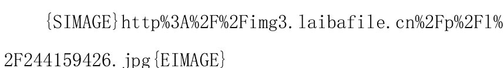


作者:66 端午 88 日期:2016-03-15 18:36

一线城市 5 个：

- 北京（全国政治、文化、教育中心）
- 上海（全国经济中心）
- 广州（经济发达，中国第三大城市）
- 深圳（经济发达、特区城市）
- 天津（重要经济大港）

二线发达城市 8 个：

- 杭州（经济发达、副省级、强省省会）
- 南京（经济发达、副省级、强省省会）
- 济南（经济发达、副省级、强省省会）
- 重庆（直辖市，西部中心城市）
- 青岛（经济发达、计划单列市）
- 大连（经济发达、计划单列市）
- 宁波（经济发达、计划单列市）

加 v 信 1101284955，获取更多好帖

作者:66 端午 88 日期:2016-03-15 18:36

这是最新的房价潜力排名，额认为济南排名没这么高。

- 1 线城市：北京，上海，深圳
- 1.5 线城市：广州，南京，杭州，天津（不含港口区），苏州
- 2 线城市：宁波，成都，重庆（投资谨慎），武汉，济南，福州，郑州
- 2.5 线城市：南昌，合肥，大连（投资谨慎），西安（投资谨慎），长沙（投资谨慎），无锡，东莞
- 特色城市：厦门，青岛
- 其它城市，不要进行投资。

作者:66 端午 88 日期:2016-03-15 18:47

上海力图争夺创新企业交易中心的策略被中央驳回，该利益随即划归给了北京。深圳，上海金融吸引力被限制在旗鼓相当的博弈层面，为了维持北京的房价，中央也是拼了，让你们抢，谁都不给了，肥水不流外人田，放在自己家后院。深圳长出了一口气，暂时安全了，上海一脸酸爽，原来是剃头挑子一头热，北京嘿嘿一乐：鹤蚌相争，印把子我赢了。

作者:66 端午 88 日期:2016-03-16 08:59

昨日北京公布多达 355 个旧城改造项目，相当于库存房产需要拆掉近 20%，这明显是中央不满意北京目前房价。

作者:66 端午 88 日期:2016-03-16 10:36

不要把房价想的这么简单，现在一线城市全都不要脸了，抢政策，抢资金，抢人口，抢融资，都是为了维持自己的房价。你从房价这个中心视角解释目前的资本市场乱像，特别容易找到脉络。北京为什么获得了三板市场的全国市场地位，深圳眼看要崩了，硬硬压住了上海的战略新兴板计划，北京又为什么公布这么大的旧城改造项目。炒高了房价有什么好处？这是永恒的招商引资，房价上涨，没人舍得卖，房价下跌，你根本卖不出去，工商业投资，经济一低迷，丫的跑路了，后遗症太大，赚你三瓜两枣的税收，哪里比的上房产这么干脆直接，70%的税收，你说应该发展哪项？

作者:66 端午 88 日期:2016-03-16 10:42

北上深，GDP 的房价含量高达 40%以上，每个城市的房产 GDP 都不低于 4000 亿，涉及其它 GDP 不少于 1000 亿（家电，加装等等），而贡献的这 4000 亿如果都投入城建，又会引导生成多少 GDP，税收含量又是多少。高房价是维持一线城市发展的核心竞争力，看明白这点就全清楚了。

作者:66 端午 88 日期:2016-03-16 11:11

除了 1 线城市吸金外，其它上涨的城市都需要各自的独特性，比如苏州这类工业基础超强的城市，以前有足够的工商业利润对冲房价上涨，现在工商业下滑，属于最后的实体经济资金溢出城市。比如无锡东莞，受惠于一线城市资金外溢。比如南昌，合肥，城市规模较小，外出人口大多在一线城市赚取溢价工资的回购。比如济南，郑州，成都这三个人口大省的省会，以前对房地产依赖程度较低，现在看清形势，主动向房地产靠拢带来的价值回归。

作者:66 端午 88 日期:2016-03-16 11:56

中国下一步房价风险最大的省：福建，浙江，特别是福建肯定不乐观。人口基数少，人口增量主要靠导入，经济如所料会进一步降低增速，势必导致人口流动趋于弱化，特别是跨省流动将大大减少。这两个省的房价位于高位，且人口流入程度都会有大幅下滑，由此导致房价风险急剧攀升。

作者:66 端午 88 日期:2016-03-16 16:50

额大学老师移民加拿大了，正在全力做个加拿大房东。他说福建人很多，在加拿大炒房囤房，欧洲也不少。福建人就像国内的江西和安徽人，赚了钱也适当买些福州厦门的房子。

作者:66 端午 88 日期:2016-03-16 22:52

@飞快奔跑的馒头 41252 楼 2016-03-16 22:33:00
请教楼主，浙江台州市区房子是现在买还是在等几年看看，不是刚需，想全款买。

杭州，别无二选

作者:66 端午 88 日期:2016-03-16 22:53
十年间房产升值排名。

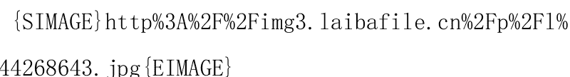

作者:66 端午 88 日期:2016-03-17 11:52

去年七月买的房涨了 20%了，预计今年涨幅不低于 50%。

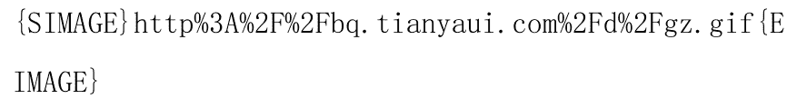

作者:66 端午 88 日期:2016-03-17 21:09

赶脚通胀已经从蔬菜的种子萌发了，互联网低价策略将自决于通胀引发的牛市，找找和互联网不搭界的玩意。

作者:66 端午 88 日期:2016-03-18 07:24

所有的开发商全特么是骗子，广告打一个很低的价格，你过去一看，那根本是个起价，给你介绍户型的时候先涨一道，告诉你个均价，等你看中户型后，一房一价，又涨一道，各种优惠把你算晕，等到你交钱的时候，才知道，艹，原来这么贵呀。

作者:66 端午 88 日期:2016-03-18 08:18

上海眼见着北京不鼓励自己搞金融扩张，赶紧重拾制造业，这么高房价不铺摊子撑不住啊，苏州小心啊，全靠上海制造业外溢的城市。苏州--------买入评级下调为观望。

作者:66 端午 88 日期:2016-03-18 11:53

@投机者的扑克 2016-03-18 10:34:12

老大，沪指突破了，抄家伙上不

突破 2933 时，加了二成仓，突破 3022，加到五成。这回赶脚不应该全仓做。

作者:66 端午 88 日期:2016-03-18 14:04

@lxm1017 2016-03-18 13:11:44

楼主对泉城的车位怎么看，有投资必要吗

好位置的买

作者:66 端午 88 日期:2016-03-18 14:55

一根阳线改变情绪，两根阳线改变预期，三根阳线改变信仰。

{IMAGE}http%3A%2F%2Fbq.tianyaui.com%2Fd%2Fk1.gif{EIMAGE}

{IMAGE}http%3A%2F%2Fimg3.laibafile.cn%2Fp%2F1%2F244400299.jpg{EIMAGE}

作者:66 端午 88 日期:2016-03-18 15:22

@投机者的扑克 41307 楼 2016-03-18 12:59:00

@66 端午 88 41306 楼 2016-03-18 11:53 @投机者的扑克 2016-03-18 10:34:12 老大，沪指突破了，抄家伙上不

突破 2933 时，加了二成仓，突破 3022，加到五成。这回赶脚不应该全仓做。

老大买的啥

## 上次买的那些

作者:66 端午 88 日期:2016-03-18 15:36

苏州发布调控房价意见，再牛逼的经济城市，敢于挑战政治中心，都是找死。上海之于北京如此，深圳之于北京也罢，都是以下犯上。苏州只能装怂，南京怒了。??

作者:66 端午 88 日期:2016-03-18 15:38

高房价就是招商引资，有好事大哥请先，小弟敢先动筷子，你官帽子不想要了吗？

作者:66 端午 88 日期:2016-03-18 20:51

## 杜甫是怎样搞垮大唐经济的

作者：冯学荣

我们都知道唐代伟大诗人杜甫，他写过一首诗，名叫《茅屋为秋风所破歌》，其中有这么几句脍炙人口的诗文：

> 安得广厦千万间，大庇天下寒士俱欢颜，风雨不动安如山

> 呜呼！何时眼前突兀见此屋，吾庐独破受冻死亦足

这是杜甫自己的茅屋被飓风部分摧毁之后，联想到天下无房阶层，顿生怜悯之心，杜甫说：希望自己有能力为天下所有无房家庭免费建造房屋，使居者有其屋，人人有房住，如果这个志愿达成，自己就是冻死，那也是值得的。

历史上的杜甫，一生颠沛流离，郁郁不得志，但是在另一个平行宇宙，忧国忧民的杜甫，当上了大唐宰相兼“大唐居者有其屋委员会”主任，权势在一人之下，万人之上。

杜甫向唐皇哭诉了大唐无房者的痛苦，连唐皇都被他感动了，二人一同落泪，杜甫说：我一定不负重任，一年之内，令大唐全国上下，居者有其屋，人人有房住。

让我们以“周”为单位，记录杜甫走马上任“大唐居者有其屋委员会”主任以后，大唐发生了什么，以及大唐的经济，是怎样一步一步走向崩溃的：

第一周：《唐民日报》头条，伟大爱国诗人杜甫上任“大唐居者有其屋委员会”主任，在长安城门接见贫民，宣誓一年之内实现居者有其屋，人人有房住，贫民痛哭流涕，纷纷称杜甫为“杜青天”。

第二周：杜甫与幕僚开会，初步确定：大唐分房只面向无房家庭，有房家庭一律不得参与分房。消息次日见报。

第三周：幕僚紧急报告，以长安为核心，方圆三十里，发生了百姓摧毁自己的破旧房子的现象，而且这个现象有向四方扩散的迹象。放眼所及，断壁残垣，延绵不绝，触目惊心。杜甫下令微服私访。

第四周：经走访得知，老百姓捣毁自己的破旧房子，是因为知道大唐政府即将分配新房，而有房者不得参与分配，所以房子破旧的人家纷纷自毁家园、以获得分配新房子的资格、弃旧换新。杜甫闻讯，大怒，说这些自毁家园的都是刁民，一律不得参与分房。

第五周：自毁家园的家庭代表约一千户、共五千人左右涌进长安城申诉，指责大唐政府误导人民，使他们无家可归，杜甫斥之“刁民”，不见。这一批人捣毁了《唐民日报》社，部分被捕治罪，其余沦为流民，导致长安及附近治安急速恶化。

第六周：“大唐居者有其屋委员会”吸取教训，重新召开会议确定：废掉“无房者才可参与分房”的原标准，重新制定标准：只有月收入为二两银子以下的极度贫困家庭，方可参与分房。

第七周：大唐掀起降薪潮，一周之内，许多上班族的工资主动降到月俸银子一两九，部分上班族与老板谈好：等分到房了，再恢复原来的月薪水平。杜甫偶有所闻，但认为刁民只是少数，他坚信大部分的大唐百姓是诚实的、正直的。

第八周：因为只要收入低就可以分到新房子，天下竟然有这么好的事，于是大唐进一步掀起了辞职潮，许多上班族宁愿选择失业，也要参与到分房大军中去。结果上班人数剧减，懒汉人数剧增。

第九周：幕僚统计数据上报，全唐共有人口一千万户，其中月收入二两银子以下的家庭有三百万户（数据有水分，因为不少人主动降薪、主动失业）。

第十周：世上没有免费午餐，天上不会掉房子，杜甫的建房经费，毫无疑问需要从税金出，经幕僚精算，建设三百万套新房子，需要将商业税从30%增加到50%。

第十一周：《大唐新税法》出台，商业税从30%增加到50%，商家哗然。此外“大唐居者有其屋委员会”宣布：先建设第一批新房十万套。

第十二周：增税之后，已经有不少实力欠强的商家倒闭，且倒闭现象有持续发酵的迹象。与此同时，大唐政府“居者有其屋”计划第一批次十万套新房工程招标完毕，蛙蛤蛤地产公司中标，开始动工。

第十三周：大唐越来越多的商家在50%的商业税制度下，无法盈利，商业倒闭潮在全国加速度发酵，民间失业人口急速增加。

第十四周：因加税而引发的商业倒闭潮所催生的失业人士家庭满足了杜甫“月收入二两银子以下”的标准，纷纷报名参与分配新房，于是，大唐政府“居者有其屋”计划原定三百万套，不得不增加至四百万套。

第十五周：由于大唐福利分房从三百万套增加到四百万套，原有预算不足，唯一办法是进一步加税，朝廷下旨实行更严厉的盐铁专营，同时商业税进一步调整至60%。

第十六周：第一批十万套新房子竣工，杜甫下令各地县政府以抽签方式，尽快分配给满足月收入二两银子以下的家庭；

第十七周：杜甫幕僚报告，第一批十万套新房子，绝大部分是分给了各地县令的家属、亲戚、朋友和各种走后门的人。民间怨声载道。杜甫闻讯大怒，下令抓几个县令做典型，从快从重，严加惩戒。

第十八周：大唐全国上下火速查办了在第一批十万套新房分配中徇私的县令三百名，斩首，流放，十万套新房子洗牌、重新分配。

第十九周：蛙蛤蛤地产公司老板向大唐政府交收首批十万套新房子之后，从杜甫账房收到了工程款，但是以60%的商业新税率一算，利润微乎其微，不如回家耕田。于是，蛙蛤蛤地产公司立即解散，老板回乡务农。

第二十周：“大唐居者有其屋委员会”公布第二批十万套新房计划，因蛙蛤蛤地产公司解散的缘故，“大唐居者有其屋委员会”重新向全国招标，但一周过去，无人响应。

第二十一周：杜甫幕僚报告，因60%商业新税率的缘故，大唐全国80%以上的房产承建公司破产，剩下20%的房产承建公司因为市场竞争不充分的缘故，供不应求，要价奇高，为现在财政税收所不能负担。杜甫闻之，愕然。

第二十二周：大唐全国商业持续凋敝，城市萎缩，百姓大规模失业，米价暴涨，部分地区开始出现饿死人的现象。

第二十三周：“大唐居者有其屋委员会”宣布：因财政力量不足，暂缓执行“居者有其屋计划”。

第二十四周：在首批十万套新房分配中没有抽到签的百姓代表约三十万人，涌进长安城，群情汹涌，他们说：“第一批人分到了房子，第二批该轮到我了，凭什么现在暂停分房计划？”，老百姓当街呼喊“杜甫下台”的口号，要求杜甫出来给个说法。

第二十五周：杜甫不胜其烦，为了开辟财路对着账单苦思冥想，忽然发现厉行盐铁专营以来，江淮各道的地方政府和民间私营盐铁的商人、工匠相互勾结欺瞒朝廷，实际增收并不多。杜甫于是亲自兼任盐铁转运使督镇江淮。

第二十六周：淮西节度使表示朝廷贪得无厌，断了太多百姓生路，公然抗命。杜甫大怒，拿出国库里最后的积蓄作为军费，率军攻破淮西。江南各道顿时悚然，不敢再和朝廷对抗，各地盐商纷纷破产。

第二十七周：看到新征上来的盐课，杜甫喜出望外。然而由于各地产业凋敝，大量人口失业，各地暴乱不断，治安极度恶化。杜甫发现，新征上来的盐课还不够维稳的。唐皇大怒，好好的江山被你的政策搞成这样。杜甫表示愿意带兵四处维稳，却发现国库已经空空如也，再也凑不出钱了。杜甫心力交瘁，引咎辞职。

第二十八周：杜甫下台后把家产全部捐给了国家，但却是杯水车薪，回天乏力。最后在贫病交加中，杜甫去世。临死前杜甫仰天长叹：我一心报国，毁家纾难，就为了天下苍生安居乐业，为什么会事与愿违，落得如此下场？

结局：大唐各地，四处暴动，一个叫黄巢的盐商子弟在破产后率领饥民，异军突起，攻城掠地。大唐盛世，如摧枯拉朽，顷刻灭亡。

本故事纯属虚构。

一千年多后，一个叫哈耶克的经济学家出版了一本叫《通往奴役之路》的书，解答了杜甫的疑问——通往地狱的道路，往往由鲜花铺就。“安得广厦千万间，大庇天下寒士俱欢颜”——杜甫的初衷是好的，但结果却是搞垮了大唐的经济，并且招致了大唐的覆亡。忧国忧民的知识分子，罔顾经济规律，以一颗赤子之心，行祸害社会之事，这样的事情，无论海内海外，在过去有，现在有，将来，也继续还会有。

作者:66 端午 88 日期:2016-03-18 22:48

经济规律告诉我们，土地价格低的时候，不能多盖房子，低价房盖多了，不但土地价格停滞不前，还会造成大量的库存，对房价有抑制作用。只有视市场需求卖地，始终保持市场供求紧平衡，不断拉高房价，土地价格才能可持续的提高，银行才会放心以土地抵押放款盖房，放款按揭。小强号称是搞经济的，其实这货是个假把式，搞了这几年，地方政府玩命一次性大量释放土地，房价被抑制住了，经济也完蛋了，根本做不到可持续发展，中国经济的发展模式是货币推动的，没有土地抵押的发钞，一定会导致大规模通胀，因为土地并未锁住发行的货币，导致货币到处乱窜，经济脱实向虚越发明显，其要因在于，土地卖了，货币发了，如果房价没有升值预期，就不会被锁定，导致空发的货币涌向不该去的地方。中国货币的发行是以土地抵押锚定的，就像美国发钞要以美联储发债锚定一样。只不过我们国情比较特殊，土地所有权是国家的。

作者:66 端午 88 日期:2016-03-19 12:27

## 【重磅】苏州政府出招啦，楼市新十条出台！一年涨价幅度不能超过 12%

2016-03-18 无线苏州

3 月 18 日上午，苏州市政府召开常务会议，主题是：关于稳定苏州房地产市场发展，主要针对新房预售证和调价。当天下午，苏州市人民政府公开发布了正式文件。

意见主要包括增加市场供应、控制房价增长、加强市场监管三大部分，共 10 条。

### 加强土地供应管理

### 适时调整供地计划，稳定市场预期

强化土地供应和房地产市场联动机制，进一步加大普通住宅用地供应，严格控制非住宅用地供应，优化区域土地供应节奏，根据市场需求变化适时调整土地供应计划，保持房地产用地市场供需基本平衡。

- 在商品住宅供应偏紧、库存较少的区域，增加土地供应量；
- 在商品住宅库存量较高区域，控制土地供应量。
- 同时，加强出让后土地管理，建立跟踪警示机制，对取得土地满一年未开发的予以书面警示，满两年未开发的坚决依法收回，加快土地开发上市。

目前，针对市区商品住宅去化期较短的情况，要适时调整供地计划，加快土地供应，稳定市场预期。

### 完善商品房预售管理

### 预售房源 10 日内一次性对外销售

加强商品住宅项目（低密度住宅、政策性住房和非居住商品房除外）预售许可管理：

- 市区（不含吴江区）30000 平方米以上商品住宅项目分期开发的，每期申请预售面积不宜低于 30000 平方米（尾盘除外）；
- 30000 平方米以下商品住房项目宜一次性办理商品住宅预售许可。
- 项目取得预售许可证后，预售房源应在 10 日内一次性全部对外公开市场销售。

### 强化商品房价格管理

### 12 个月内不宜超过 12%

加强商品住宅价格监管，市区（不含吴江区）新批准商品住宅项目预售许可时，房地产开发企业应当科学合理确定申报价格，并一次性公开全部准售房源及每套房屋价格，严格按照明码标价格式要求，全部进入商品房预售许可行政主管部门设立的商品房预售系统。房地产开发企业应当及时将申报价格报送价格主管部门。在对外销售时，

- 同批次房源应当一次全部公示销售价格，实际销售价格不得高于申报价格，申报价格3个月内不宜调高，6个月内调高幅度不宜超过6%，12个月内不宜超过12%，同一批次房屋间价格不得调剂使用。
- 同一批次不同类型房屋价格可以区别定价。下一批次备案预售价格不宜高于上一批次同类型房屋成交均价的6%。

### 建立市场平准房源机制

### 全面清理已建和在建定销房、安置房源

市区（不含吴江区）应全面清理已建和在建定销房、安置房源，确定扎口管理部门或国有企业，按照市场定价机制，将满足征收安置需要后剩余房源，按照现房、期房销售条件完善有关手续，根据市场情况，作为平抑市场房价房源分批投放市场。

### 加强房地产税收监管

### 坚决堵塞“阴阳合同”产生的税收漏洞

重点对定价明显超过周边房价水平的房地产开发项目，强化土地增值税等税种的征管和稽查。加大应用房地产价格评估技术，加强存量房交易税收征管，坚决堵塞“阴阳合同”产生的税收漏洞。

### 全面清查金融违法行为

### 遏制房地产市场投机行为

金融监管部门要对本地区的P2P、小贷公司以及涉及众筹买房、首付贷或其他涉及高杠杆房贷情况进行全面摸底排查，梳理相关企业名单、数量、产品模式；查处银行机构资金变相流入首付房贷情况，限制商业银行间利率竞争及与房产中介违规合作行为，加强贷款人资格审查，清理首付贷等场外加杠杆模式，切实防范金融风险，遏制房地产市场投机行为。

### 加大市场执法检查力度

### 加大对违规囤地、捂盘等行为的查处力度

住建、国土、规划、物价、工商、税务和金融管理等部门要各司其职，规范房地产市场信息发布和各类房地产展销行为，加强对房地产企业和项目的监管，加大对违规囤地、捂盘惜售、哄抬房价、违规展销和违规发放贷款等行为的查处力度。一经查实，要严格依法处理并记入企业当年信用不良行为记录。

### 提高市场动态监管水平

### 切实规范房地产市场销售行为

加强房地产市场监测，对房地产项目进行全过程数据综合分析，科学调节全市土地供应规模和开发建设进度。指导房地产开发企业科学合理定价，切实规范房地产市场销售行为。加强完善开发企业和经纪机构信用评价系统和失信惩戒机制，加强货币资本金分类监管和预售资金监管，强化商品房开发建设、预售许可、交付查验和备案管理等各项工作。

### 加强社会舆论引导

### 倡导理性消费理念

加强房地产市场及相关信息公开，科学制定全年土地供应计划，及时向社会公布，稳定土地市场预期。加强媒体宣传和引导，倡导理性消费理念，共同推动房地产市场稳定健康发展。

### 加强部门协调联动

### 建立促进房地产市场稳定健康发展的联席会议制度

各市、区要切实履行促进本区域房地产市场稳定健康发展的主体责任。各级政府要建立促进房地产市场稳定健康发展的联席会议制度，切实加强统筹协调和工作配合，细化工作措施，共同做好稳定房地产市场的各项工作。

各市及吴江区根据当地实际情况参照执行。

### 业内分析

### 1、土地出让

从文中可以看出，政府已经完全意识到现在市场上的供应严重不足，表示将会“适合调整供地计划，加快土地供应，稳定市场”。这对于现场缓解市场供求关系紧张将起到重大的作用（开发商也许再也不用担心拿不到地了）。

## 2、商品房预售管理

此次影响较大的应该是商品房预售管理部分，以往，市场上不断出现封盘，或者捂盘惜售的现象，引发购房者的心里紧张。而现在的规定是：预售证申请需在3万方以上，而且需在10日内公开对外销售！这样将大大缓解无房可买而引发的恐慌现象！

## 3、房价调控

此次在房价调整方面也出台大招，两会房价上涨被点名压力谁都顶不住！苏州市场的房价也的确涨的太快了！此次规定表示：参考项目预售证时的备案价格，项目六个月内调价最高6%，12个月最高12%。

## 4、吴江不受影响

文件看到最后可以发现，此次吴江将不受影响，吴江前段时间刚出了几块不错的地，楼面价有直接破万的。看来是要更高了，估计去吴江买房子的又要成为热潮了！

作者：66端午88 日期：2016-03-19 12:28

每年涨12%，这收益也仅仅次于巴菲特了。

作者：66端午88 日期：2016-03-19 14:55

经济规律告诉我们，土地价格低的时候，不能多盖房子，低价房盖多了，不但土地价格停滞不前，还会造成大量的库存，对房价有抑制作用。只有视市场需求卖地，始终保持市场供求紧平衡，不断拉高房价，土地价格才能可持续的提高，银行才会放心以土地抵押放款盖房，放款按揭。小强号称是搞经济的，其实这货是个假把式，搞了这几年，地方政府玩命一次性大量释放土地，房价被抑制住了，经济也完蛋了，根本做不到可持续发展，中国经济的发展模式是货币推动的，没有土地抵押的发钞，一定会导致大规模通胀，因为土地并未锁住发行的货币，导致货币到处乱窜，经济脱实向虚越发明显，其要因在于，土地卖了，货币发了，如果房价没有升值预期，就不会被锁定，导致空发的货币涌向不该去的地方。中国货币的发行是以土地抵押锚定的，就像美国发钞要以美联储发债锚定一样。只不过我们国情比较特殊，土地所有权是国家的。

以前是直觉上，上升不到理论性的总结，这段很重要，为什么房本位是核心问题。想改变中国经济发展的模式并非一朝一夕的问题，谁都知道要向创新转型，急功近利大跃进并未改善中国经济发展的可持续动力问题，结果就是出来一堆E租宝，互联网经济的后果也都看到了，它在蚕食经济基础，却未创造出新价值，等到吃尽原有积累的价值，也就创新不下去了，搞的只是利益再分配。

创新要从教育和人事制度开始，辅以社会资源，财政资源分配的公平公正，否则一切瞎改革都将导致经济持续下滑。

作者：66端午88 日期：2016-03-19 21:09

烟台现在要搞跨海隧道，赶脚不靠谱，对接的是江河日下的大连，北韩国放在那里，根本起不到任何促进贸易发展的作用，还不如挖到天津去。

作者：66端午88 日期：2016-03-19 21:27

如果房地产支撑的是财政，你们可以叫它土地财政，如果支撑的是整个经济，那么就叫房本位。

作者：66端午88 日期：2016-03-19 21:43

获悉商业房产自5.1后可以参与抵扣，这个，这个，这个。艹，可以不用缴税了吗？100万一套，平手卖出，不用缴纳任何费用，买受人可以拿来抵扣，然后再平手还给卖方。我了去个，这是个BUG啊。

作者：66端午88 日期：2016-03-19 21:46

还有费用，契税3%，相当于3%买抵扣发票，还是值。

作者：66端午88 日期：2016-03-19 23:01

@alexfuel 41362楼 2016-03-19 22:50:00
@66端午88 2016-03-19 21:46:03
还有费用，契税3%，相当于3%买抵扣发票，还是值。

那么对住宅的影响呢？是不是对二手房东不利？

这还在预判阶段，估计仅仅对一线城市短暂利好，文件细节还得推敲，房产这么大宗，估计会抵扣一定比例，附加多重限制，国税减少，财政部长会发疯的。

作者：66端午88 日期：2016-03-20 10:40

刚才和人讲起的日本房地产崩溃，其实，日本房地产崩溃是1991年，而日本国民生产总值的顶峰是1995年，收入的顶峰也是1995年稍早半年。日本发展到顶峰的时候，电视机，录像机，组合音响，磁带摄像机，胶片照相机，充斥整个中国市场，那会我们这里有个舜井街，所有商店都卖日本电器。到了1997年以后，舜井街慢慢都改行卖手机了（传统手机）。山大路上两侧出现无数卖电脑的小店和大型批发市场。这标志着美国转型成功，日本走向没落，97年开始了中国经济的黄金十年，中国IT开始起飞（当然是跟在美国屁股后面），家电行业开始走向没落，这也标志着日本走向没落，人们的兴趣逐步从家电转为桌面IT，2002年开始桌面IT开始走下坡路，中国人开始玩房地产了，到了2006年，苹果统一天下，标志着英特尔，微软时代的结束，IT行业转型移动端，桌面IT没落（其实IT支出是大幅减少的），中国则迎来了房地产的十年。

中国经济的黄金十年：从1997年中国准备加入世贸开始，以房地产的初步放开，外贸经济打底，汽车行业作为消费的先选项。消费和投资并行发展，大部分人的财富积累是从事实业。到了2006年，美国的IT行业走向没落（从电脑升级的速度就能看出来），我国则迎来投资的单边发展，作为体系内的铁公鸡，体系外的房地产飞速发展，这需要大量资金推动，所以我们的货币像洪水一样的爆发了。这段时间的财富积累主要依靠体系内接工程大单，体系外炒房囤房来实现，你会发现小老板从此玩不转了。进入到2015年后，货币增发速度已经无法满足房地产的增值速度了，除非玩超额货币投放，房地产已经不是无脑买入的时代了（分化时代），只能自我缩容进行炒作，维持高速增值，体现在炒作房地产品种，集中于一线和强二线城市。实体经济则全面剔除赚钱速度慢的行业，玩风投，互联网，讲故事，在短期内通过PE赚取未来几十年的预期盈利。NB的人总是玩适应货币量的玩意，事实上，目前的房地产整体上没有泡沫，如果还像原来一样都涨，反而就出现了泡沫，之所以一线二线涨，是因为人口和资金向大城市集中，3，4，5线失去人口和资金，价格怎么涨？他们的时代，折价卖掉库存就结束了。

作者：66端午88 日期：2016-03-20 10:57

如果想在未来十年跟上货币量的发行速度，应该减持非主流城市的房地产，增持1线（伺机）和强势2线城市（伺机买入已经走高的，现在就买启动的）住宅地产。

作者：66端午88 日期：2016-03-20 17:11

特色城市的旅游区和拓展区，差价极大。均价偏离值的巨大，导致城内分化严重，不具备整体走强的基础。

{SIMAGE}http%3A%2F%2Fimg3.laibafile.cn%2Fp%2F1%2F244565283.jpg{EIMAGE}

{SIMAGE}http%3A%2F%2Fimg3.laibafile.cn%2Fp%2F1%2F244565295.jpg{EIMAGE}

作者：66端午88 日期：2016-03-20 17:20

武汉，成都，饱满，匀称，这样的城市有潜力。

{SIMAGE}http%3A%2F%2Fimg3.laibafile.cn%2Fp%2F1%2F244565953.jpg{EIMAGE}

{SIMAGE}http%3A%2F%2Fimg3.laibafile.cn%2Fp%2F1%2F244565978.jpg{EIMAGE}

作者：66端午88 日期：2016-03-20 17:32

大胆预测：未来一年，房价拉不进全国前30的城市，随后10年经济都会走下坡路，我们未来面对的是城市的集聚效应。有集聚才会有第三产业的繁荣，房价不涨，没人会投资这个城市，拉高房价，吸引货币和人力的集聚，完成经济由工业向服务业的转型。只有提高了城市的房价，才能变相利用土地价值抵押获得资金流入，资金来了，人也就来了，这是最高层面的解释。从底层层面解释：人家为什么要来，由于教育，医疗，环境，服务，政府效率，公平机制，营商机会等多重因素所构成。

作者：66端午88 日期：2016-03-20 17:56

http://mp.weixin.qq.com/s?__biz=MjM5NzAzMDU4MA==&mid=402403734&idx=1&sn=c236c5f5d2d702ba2f60040820752c5a#rd

作者：66端午88 日期：2016-03-20 18:24

宁波房价超过2万的区域，集中在10*10公里区域内，绝大部分沿江分布。其它区域在1-1.5万，符合新供商品房的价格区间。你再涨就干掉杭州了，你倒是想涨，你们市长敢涨吗?

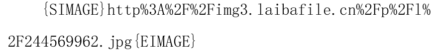

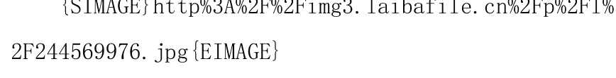

作者：66端午88 日期：2016-03-20 19:15

@daneigaoshou2016 2016-03-20 18:50:53

楼主，关注您的大作已有一段时间，现在结合我自己的现实情况咨询一下楼主：本人三口之家现在领秀城居住一小户型，未来一两年还清贷款后有两种选择，1，在领秀城再买一大户型改善居住，2，在核心区域买一小户型投资，请问楼主纯投资来讲哪种选择较好？领秀城在济南的定位如何，还有没有投资的空间？如果投资买文化园的二手小户型投资回报如何？主要看到文化园的位置不错。这两种选择哪种较好？在线等待楼主解答。

不要买商务公寓，要买住宅。

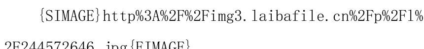

作者：66端午88 日期：2016-03-20 20:31

比如：你淄博买房6000多一平，打算买150平的，合计一百万，你可以去济南买套90平（可落户）的容易出租的房子，房租大约在2000-2500之间。你租100平的淄博房子才多少，大约在1500附近，甚至更低，用多出来的钱支付济南房的一部分按揭。既满足了居住要求，又保证了投资收益。如果你买了淄博的房子，长期涨速慢，闹心不。

作者：66端午88 日期：2016-03-20 21:49

@66端午88 2016-03-20 20:31:40

比如：你淄博买房6000多一平，打算买150平的，合计一百万，你可以去济南买套90平（可落户）的容易出租的房子，房租大约在2000-2500之间。你租100平的淄博房子才多少，大约在1500附近，甚至更低，用多出来的钱支付济南房的一部分按揭。既满足了居住要求，又保证了投资收益。如果你买了淄博的房子，长期涨速慢，闹心不。

@大连之鹰2013 2016-03-20 20:49:06

90平米的房子能租到2500，那可挺高了

济南是为数不多的，可以依靠房租进行自我循环增持的城市之一。如果均价上升至1.5万，房租恐不能支撑持续增持地产了。

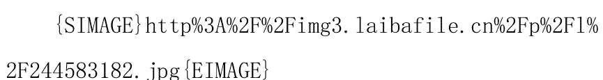

作者：66端午88 日期：2016-03-20 22:11

这阵子主要就是探讨战术问题了，因为是右侧交易，你只关心战术问题即可。在调整期，主要讲战略问题，怎么投资赚够买房的钱。

作者：66端午88 日期：2016-03-20 22:24

北京的房价，没人有意见吧。

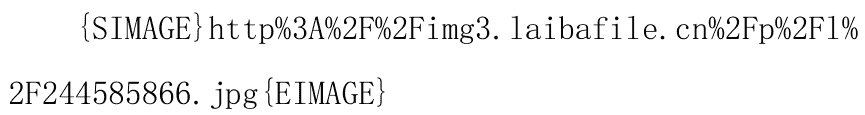

作者：66端午88 日期：2016-03-20 23:04

中国银行山东省分行即将于下月正式搬迁济南。届时，四大国有银行的山东省级分行全部聚齐在省会济南。~~~~~我猜测下一步山东外经委也会搬回济南的。山东只能支撑一个强二线城市，与其出现两个不成气候的二线城市，不如把工业放到青岛，济南专心致志的做大金融，服务，教育，医疗，制药，设计，创意，文化，旅游这些高附加值产业。

作者：66端午88 日期：2016-03-20 23:07

山东境内专注地产投资的同学，应该果断踩准节奏，把重心积聚到济南，这是我目前可以通过逻辑确定的。

作者：66端午88 日期：2016-03-20 23:29

省会是一个省的形象，并对其它区域有示范效应，把济南发展成一个村，明显对山东省是非常不利的，在王书记掌权前，济南只能算半个省会，可它却是实实在在的政治，文化中心，金融中心都有点不好意思张嘴，省会未必去发展工业，但其它高附加值产业必须是省会专有的，在整个世界范围都是如此。我这么说，青岛同学一定不高兴，但事实就是如此，我鼓励青岛成为直辖市。济南专心致志的做整个山东省的核心，亲兄弟明算账，不明不白的分权分治，对于青岛和济南都会造成定位模糊，找不到自己的核心发展道路。

作者：66端午88 日期：2016-03-20 23:39

济南这一任的市委书记和以前的真不一样，是个做事情的官员，明显不是鲁籍官员的作风，早点过来，济南根本不会是现在这么个烂摊子，建议这样的官员要多几个，本地产的官员，那叫一个贪，懒，贼，油，龌。把做官当成自己的事业，官风不正。

作者：66端午88 日期：2016-03-21 07:16

@流转溪水 41414楼 2016-03-21 00:22:00

楼主，我最近想东莞排名买房，请问买松山湖的房子还是买东城或大朗地铁口的房子?最近房价上升太快，不知如果去做!

东莞和无锡，需要极速买入的，按周涨价已经是最后的买入时刻，如果天天涨，就不能买了。前面讲过了买房的要点，一条一条看，很多房子，我没看到现场，根本拿不出准确的建议，地铁房的要点是，距离地铁口400到800米最佳。

作者：66端午88 日期：2016-03-21 07:21

@alexfuel 41416楼 2016-03-21 03:16:00

@alexfuel 2016-03-20 11:11:08

另外想听听楼主的意见，买市中心黄金地段的二手房，因为评估价的关系，贷款比较少，杠杆比较低；二环和三环之间的新房，贷款比例高，杠杆高，从投资升值的角度，应该如何选择？

楼主，我在福州，也算是您认为可以投资的二线省会，市中心黄金地段二手房单价三万以上，我很喜欢，但是总价个人可以选择福州的新区，新迁政府所在地，新CBD去买，三万价格不低了。建议适当谨慎，福建的房子应该以杭州均价为约束。

作者：66端午88 日期：2016-03-21 10:48

刚才买回了两成君正集团7.94-7.97

作者：66端午88 日期：2016-03-21 11:04

买入了迦南科技，仓位升至5成。

作者：66端午88 日期：2016-03-21 11:33

这波应该赚不到一套房子，试试小户型能加一套不。

作者：66端午88 日期：2016-03-21 14:15

鲁商置业已经进入安全持股区。

作者：66端午88 日期：2016-03-21 14:28

@九月登高 2015-02-12 10:52:50

端午兄，聊城的房子走势如何?我有套聊城的房改房，位置不算好，小区环境、物业都不好，打算卖了，现在的价格比一年前每平方低500元左右，已有买家出价，现在卖还是再等等。端午兄，给个建议如何?

@66端午88 2015-02-12 11:11:43

卖，换济南的

@九月登高 2016-03-21 14:14:41

端午兄，我米不多，想买套二手，60万上下的。房租可以抵部分房贷。可行不?有合适的楼盘吗

佛山苑西边，有省实验小学的学区房，大概1.4万，买个最小的先租着，嫌贵，买燕山小学和甸柳庄小学的学区房，价格都差不多1.4-1.5万。不过环境不算好，没有封闭小区。也可以考虑解放路第一小学，第二小学的学区房。你看看舜宜家园的学区房，90平的大约120万，没有太小户型，不知道这阵子涨价没有，从搜房网查一下。最好的二手房是历下区几个好的小学的学区房，最好是封闭的。花园路山大路交叉口很快会开一个新盘，估计在1.5--1.6万左右，最小有不到50平的小户型，学区是历山国际学校，也可以。这个可以方便的贷款，首付20%，但是租金覆盖不了按揭，估计得首付50%以上才可以覆盖，叫华夏幸福。

作者：66端午88 日期：2016-03-21 14:52

盯了一天的安科瑞，一天没绿，等调整买入吧。

作者：66端午88 日期：2016-03-21 16:01

养老房不是买在便宜的地方，要医疗和空气，环境，配套兼备。以后养老，年纪大了，病啊灾的难测，离着好医院近点，买东西方便点，空气，湿度好点，满眼绿，能多活几年。

作者：66端午88 日期：2016-03-21 18:03

房价涨的太快，连体系内的都搞不动了，于是联合在股市再搞一把梭哈短平快，击鼓传花，最后落在谁手里谁倒霉，赚钱的继续固化在房地产上，这次预期没有前年7月高，一个小户型，50平的就放手吧，想赚100平的最后会亏50平，把握好机会，下注。

作者：66端午88 日期：2016-03-22 00:37

@yah1231523yah 2016-03-21 23:44:51

@66端午88

大亚湾的碧桂园十里银滩

价格还没涨三期7500可以入手吗?

还是松山湖的18000的也是碧桂园

纠结

一个东莞一个大亚湾

盼回复

离着核电站需要30公里以上的安全距离，还是东莞吧。

作者：66端午88 日期：2016-03-22 08:00

@646564966 2016-03-22 01:20:13

楼主分析下郑州的房市

看好，人口大省，且全省唯一热点区域，独苗，缺陷是爆发力不足，同时也有好处，就是价格比较稳定，基本不会产生回跌，房价容易做实，同时，经济和投资并重，二者关系处理的比较好。

作者：66端午88 日期：2016-03-22 10:05

建仓了安科瑞，补仓了君正集团

作者：66端午88 日期：2016-03-22 13:33

@联邦楼市 2016-03-22 13:19:09

楼主，一直跟随你。现在想咨询：没有购房资格的外地人，如何在一线城市购房？

二手问中介，一手问售楼小姐。他们给你办这些手续，该交社保交社保，该递交申请的递交申请。

作者：66端午88 日期：2016-03-22 16:21

各省会的领导如果真懂经济，一定会压住省内一般城市，保持小跌小涨，集中刺激省城，抢夺资金，反正全国资金就这么多，我抢到，就没你的，你抢到，我就只能饿着。所有的一线城市都在干，所有的经济强省也都在做同样的事，不干，你这个省没法搞区域金融，没钱扯什么淡啊，没钱过来你搞什么投资啊，被边缘化是必然的。济南前几任领导，包括省级领导，真该好好培训一下经济的基础知识。

作者：66端午88 日期：2016-03-22 16:27

为什么要压住其它城市，因为所有城市房价都涨，一没那么多资金，二会把实体经济抽干了，集中抽省城，提高卖地效率，房价一贵，只能逼着转型高端服务行业，而普通市民由于房产拥有率高，生活水平不会下降。你土著居民搞不了后现代服务业，只要教育跟的上，新来的教育移民可以干，他们的收入高了，会继续买房推高土地价格。但这种操作，不适合普遍搞。杭州搞了，宁波再搞，就搞不动了。南京搞

The request was rejected because it was considered high risk

The request was rejected because it was considered high risk

发动机行业，橡胶行业，汽车零售行业，汽车金融行业，汽车保险行业，玻璃行业。

首先它满足了几个要求，本行业提升了效率，扩大了规模。大幅拉动了就业，大幅提高了工业产值，大幅提高了产业链所有环节的效率。

互联网经济并没有提高零售的效率，只是进行了流通再造，消减了就业，降低了零售行业的整体利润。中国这么大的市场，并不是制造商引导型的经济，而是市场引导型的，所有的厂商围绕市场做文章。比如苹果，这是典型的制造商引导型，你看到网上的苹果比实体店的贵很多这种现象吗？有人说，有的。对那是港行或者水货，正规渠道的零售价格，一定是苹果店最便宜。那么为什么苹果不采用网上销售哪？再举个例子，小米手机，有比小米旗舰店更便宜的吗？有人说有，那是运营商系统流出的协约小米。你见过比肯德基更便宜的汉堡吗？一定见过，那是山寨的汉堡。

如果你陶醉在短暂的低廉价格上，你得该考虑未来会发生什么了。

1. 低价引导的市场，主流就是低价，低价是否可以产生足够的利润维持这个产品厂商可以持续销售，你们一定会发现，你买的低价产品是无法持续的，你这次买了便宜的 A，下次买了便宜的 B，再下次买了便宜的 C。结果 ABC 份额都没有扩大，也没有提高质量，或者升级之类的后续了。最终活下来的不是 ABC，而是 D，但由于价格高，你永远不会消费 D。互联网的主流一直都是像 ABC 一样的产品，各自风流一两年，然后消失了。D 不会消失，但规模永远不会扩大，这就是互联网经济的结果。你享受了便宜，但给你便宜的厂商活不到最后，市场永远不会发育成熟。

2. 就是零售行业由此减少的就业问题，你得接受大街上购物的人越来越少的现实，由此得到支撑的商圈经济，和繁荣的街面文化慢慢走向萧条。

3. 商业地产的未来，由此减少的政府收入将加倍体现在住宅价格上，你在居住上的支出将会越来越贵。

> 由此分析得出的结果是：互联网经济是住宅地产的强大同盟，你剩下的消费支出都会加倍支付给住宅地产。

作者:66 端午 88 日期:2016-04-02 14:36

最近电影行业景气度很高，想了想逻辑的过程，这要感谢 20 年前开始的高等教育艺术扩招，一下搞出这么多毕业生，他们也得靠主业发财不是，这是个由供应引导消费的范例。

作者:66 端午 88 日期:2016-04-02 15:24

转贴：禁摩限电，对快递业影响好大，昨天看新闻，好多快递哥被拘留。不给电动车送货，只能小四轮喽，那啥成本啊。非机们乱窜确实危险，可这突然来这么运动式的查封，一点过渡期都没有。网上流出的某新区的执法鼓励政策，查获一辆奖励几百，如果敢争吵的当暴力抗法处理，当场制服。

加 v 信 1101284955，获取更多好帖

相配套的政策是：全部淘汰黄标车；车牌摇号一年十万个；然后先是原特区内限外地牌，现在外地牌推广到原特区外的部分地区。

呵呵，这腾笼换鸟换得。。。呵呵。

作者:66 端午 88 日期:2016-04-02 20:18

@乌鸦 1972 2016-04-02 16:38:54

老大，高考改革不分文理科采取 3+x，对小孩未来的自我发展是很大的利好吧！zf 还有什么别的意图吗？

额老师的儿子，高考保送中科大，全省当年不算外国语一共报送了 19 个人，他儿子是其中之一。大学二年级申请滑铁卢大学金融数学专业，拿到了 OFFER，毕业后成功就职加拿大帝国商业银行的证券自营部，两年后成为项目组负责人。其实他儿子一直想回国，可惜找不到合适的单位，额老师说，咱就是个教书的，也没啥背景，好单位根本进不去，你就踏踏实实在加拿大发展吧。

作者:66 端午 88 日期:2016-04-02 20:54

今日，郑东新区龙湖副 CBD 一宗住宅用地再次拍卖，据了解恒大、正商均参与了此次的竞拍。从位置上可以看出，该宗地紧邻着龙湖，地段更有优势，147 轮，恒大地产集团郑州有限公司以 22.31 亿元竞得该宗地，地价 2049 万元/亩，楼面价 12293.75 元/m²，成为新晋总价和单价地王。

加 v 信 1101284955，获取更多好帖

----------河南真给力，明年经济增速肯定要秒山东，强烈要求换掉山东省委书记，对经济贡献几乎为0，调到上海去，济南书记调任山东省委书记。这样上海的房价就不涨了，上海的同学同意吗？

作者:66 端午 88 日期:2016-04-02 21:16

武汉创造全国销售记录：3 月销售 3.15 万套，资金争夺已成白热化，引导到资金的城市，未来 5 年经济会加速发展，市长升省长。吸引不到资金的城市，未来几年形势堪忧，市长要坐冷板凳当观众了。----------武汉正在向 1.5 线城市进军，强烈看好。

作者:66 端午 88 日期:2016-04-02 23:26

站在城市经营的角度考虑，二线城市房价上涨，有利于吸引资金，这特么和招商引资效果一样，而且效果更好，只要房价不脱离二线城市的价格体系，就会促进城市发展，利于地方政府手中握有大量的投资额度，现在反腐风声又紧，资金不会大量落入贪官的腰包，结果是这些钱只能投向城建发展，你的钱虽然是房产价值的三倍，不过其中近两倍都会砸在你房子的环境中，这些钱足够支撑 5 年的发展了，往后 5 年，城市竞争力提升，整个城市的估值都不一样了。我计算的二线城市均价的上限是 2 万，下限是 1 万，均值 1.5 万，只要不超过这个范围，就是强势二线城市，房价均值不过万的城市，会因为吸引不到足够的发展资金而捉襟见肘，无法从国家大量释放货币的政策中得到有效的份额，未来的发展也会被牢牢的固定于弱二线城市范畴，甚至会跌入三线城市，沈阳和长沙就是典型城市，具备二线城市的诸多优势，却向三线城市滑落的卢瑟城市。

作者:66 端午 88 日期:2016-04-02 23:31

各位卢瑟市长，你们要有无锡市长的胸怀，理直气壮的向全中国和世界推介你们的城市，而不是瞎鸡巴整天为了升迁明争暗斗，马屁乱拍。只有让广大市民长期获得经济发展带来的好处，市民才会记住你。

作者:66 端午 88 日期:2016-04-02 23:59

@巴鼠 2016 2016-04-02 09:54:52

网商是新工业革命，本身没有错，但必须要把这个模式推广到全世界...就像工业革命刚兴起时的西欧，如果没有来复枪和大航海，就那帮白化病人自己玩早崩了。美国也看懂了的，所以中国铁路复兴欧亚大陆的丝路战略，走到哪里哪里就开始动乱

你在做梦，别的国家都非常保护零售行业，你想玩乾坤大挪移，人家就玩金钟罩铁布衫

作者:66 端午 88 日期:2016-04-03 00:08

@朱红武 2016-04-02 23:55:15

好的 准备带小孩在这边上学

下手多问几家，平衡价格和户型后买入。

作者:66 端午 88 日期:2016-04-03 00:45

@朱红武 2016-04-03 00:26:26

@朱红武 2016-04-02 23:55:15

好的 准备带小孩在这边上学

@66 端午 88 42190 楼 2016-04-03 00:08:00

下手多问几家，平衡价格和户型后买入。

好的 离地铁远点的 一公交站 06 年的房子 还用考虑吗 价格底一点 谢谢

这个要看自己喜好和方便程度了，赶脚离着 400-800 米之间最好，离着太近稍微乱点，要是正好从自己楼下穿过，据说会有震动。

作者:66 端午 88 日期:2016-04-03 10:49

发展城市的理念缩减成短短的几句话：紧平衡供地，大力发展经济，夯实地价基础，吸引资金，吸引人口，吸引产业集聚。

作者:66 端午 88 日期:2016-04-03 11:45

济南的重心已经显著东移，由过去 20 年前：从大观园-----泉城路（南北是从经二路至经七路）一线为核心，迁移至山大路-------奥体西路向东一条街（南北是解放路工业南路--经十路），形成金融CBD。

老核心维持在：

1. 明湖南路------文化西路，顺河街---------历山路。
2. 花园路------解放路，东外环----历山路两个商业CBD。

作者:66端午88 日期:2016-04-03 11:48

@66端午88 2016-04-03 10:49:31

发展城市的理念缩减成短短的几句话：紧平衡供地，大力发展经济，夯实地价基础，吸引资金，吸引人口，吸引产业集聚。

@向大神门致敬 2016-04-03 11:25:08

三年叔我现在做长租公寓，操作上有一点不太清楚。就是如何和房东谈毛坯房的定价问题。请赐教~

第一是控制的一手房数量，第二是你的对外出租控制能力。这两条决定了你话语权份量，然后要求前两年较低租金补偿你的装修和推广费用，然后逐步加租，达到业主的期待收益，第一次签约大约两年，第二次签约大约三年，房租稳定后，要求5年签一次。你逐步对外提租，获得最重要的利润。

加v信1101284955，获取更多好帖

作者:66 端午 88 日期:2016-04-03 11:51

我们这里有个很出名的烂盘，诚基中心，真是不适合业主居住，但非常适合出租。被几家驻场中介垄断后，租金市场一片繁华，是出租收益率最高的片区之一。

作者:66 端午 88 日期:2016-04-03 19:09

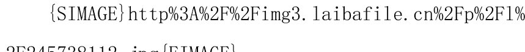

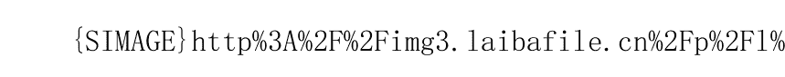


上图可看出，只有北上深的房价脱离了住房性质。归入金融产品的 PE 范围，大于 20 倍。南京，杭州，天津，广州，厦门，三亚大于 12 倍（1.5 线），武汉，成都，郑州，济南，福州，宁波，青岛。均符合国际住房购置支出的合理范围内，即 10 倍以下，少的才 6 倍出头，比美国平均购置成本还低点，人家还有房产税哪。那些非热点地区，住房收入比甚至只有 3-4 倍的。其中：武汉，成都，郑州，福州，宁波，济南，青岛。这些城市还有相当程度的价值投资功能，珍惜机会。

作者:66 端午 88 日期:2016-04-03 19:51

加 v 信 1101284955，获取更多好帖

成功的移民，是拿到所在地身份，积累了财富，留下后代，回到祖籍的人（不考虑政治因素）。半成功的移民，是拿到身份，被绑在移民地的人，不成功的移民，是绑在移民地，拿不到身份的人。建议第三类移民要均衡考虑一下前景，中国早期向西方移民，第一第二代一般都是子承父业，连续奋斗，熬出身份，比现在艰难多了，到了我这代，很多移民依靠强大的智商挤入西方科技领域，一代跨越成功，差点的，第二代通过艰苦学习，进入了西方传统就业领域，实现了文化和经济的移民。再晚点的，比如下一代，大部分都是花父母的钱过去混日子的，就算是移民成功，也绝无长期扎根主流社会的可能。移民一线城市的同学，也要仔细算计一下值不值了。

作者:66 端午 88 日期:2016-04-04 09:10


恭喜东莞获得 3 月环比涨幅全国第一，无锡涨幅进入全国四强。

作者:66 端午 88 日期:2016-04-04 09:16

上海墓地单价超房价 4 倍

金羊网 2016-04-03 14:15

高端墓地近 30 万元一座

数读

每年清明节前后，墓地价格又成为人们关注的话题。在上海，为先人买块墓地，到底要花多少钱？

在香港联交所上市的福寿园(01448.HK)是国内为数不多的以墓葬为主业的上市公司，公司于2013年底在港交所主板上市。阅读其招股书和历年财报，不难解读出墓葬业背后的真实数据，看看一个人离开人世后，找块安息之所到底要花多少钱。

根据福寿园2015年中报，其目前出售的坟墓包括定制艺术墓、成品艺术墓、传统艺术墓、草坪卧碑墓等六种。其中定制艺术墓价格最高，2015年上半年共销售388座，均价为289198元/座(人民币，下同)。价格最低的草坪卧碑墓的平均售价，也已经达到60419元/座。根据相关规定，国内安葬骨灰的墓穴面积一般不超过1平方米，因此可以推算出墓穴按面积计算的单价，已经超过9万元/平方米。

9万元/平方米是个什么概念?来自上海市统计局的数据显示，2015年上海市内环新建住宅均价为72066元/平方米，全市成交均价21501元/平方米。墓穴单价远超上海内环房价，是全市均价的4倍以上。同时根据网易房产的统计，今年2月份之前，上海著名的顶级豪宅汤臣一品，成交均价约为17.7万元/平方米，远低于最高档墓地每座29万元左右的单价。

福寿园经营的区域覆盖9个省市的11座墓园，它公布的销售价格，具备一定的代表性。

> 点评：赶脚地下室早晚取代墓地。

作者:66 端午 88 日期:2016-04-04 09:20

帝都的三月销售情况分析：2016 年 3 月份北京新房成交 9032 套，环比上涨 200.6%，同比上涨 165%；成交面积环比上涨 173.4%，同比上涨 139.4%；成交均价 32438 元/平米，环比微降 0.6%，同比上涨 15.8%。

数据显示，3 月份普通住宅成交 3889 套，环比上涨 138.7%，同比上涨 65%；别墅项目成交 458 套，环比上涨 120.2%，同比上涨 263.5%。商住项目成交 4687 套，环比上涨 301.3%，同比上涨 406.2%。

北京本月新房成交热点区域主要集中在大兴、通州和房山。各类型项目成交均价涨幅都不大，别墅项目均价环比下降 13.4%，商住项目成交套数和面积环比涨幅最高，分别达到 301.3%和 309.7%。

> 稳步上扬，管理层对涨幅略有不满，连续被深圳和上海超越

作者:66 端午 88 日期:2016-04-04 09:22

帝都房价纯属逗你玩，不图最好，只图有个北京房产证，福利太好了，先占坑，等户口。

作者:66 端午 88 日期:2016-04-04 09:59


## 深圳目前菜价


作者:66 端午 88 日期:2016-04-04 10:57

好事啊，再贵点就包邮了。


作者:66 端午 88 日期:2016-04-04 15:57

深圳截断网商链条很聪明，深圳也是重要的网商基地，对外不对内，拉高网售本地到货成本，扶持零售过难关，去商业地产的库存，用自己优势，补掉自己的短板，的确比别的城市聪明。这样深圳的网上零售链条占领其它城市的实体零售市场，自己的网商市场提高成本，减少其它区域网商渗透，棋高一着，打击摩的，打击摩托犯罪，整顿交通秩序只是幌子而已。中央要求淘宝做不到的事（对欧美扩大外销市场），深圳对内做到了。

作者:66 端午 88 日期:2016-04-04 16:10

不但深圳这样做，郑州也在做，像保护自己的眼睛一样保护自己的零售市场，维持高就业率，这都是属于棋高一着的城市。

加 v 信 1101284955，获取更多好帖

作者:66 端午 88 日期:2016-04-04 16:21

转贴:

刚才看 ccav-2 台，各地响应李总经理的号召，建了无数的“创业谷”，但基本都是出租办公楼，靠政府 50%的补贴生存。半年后，换地方再开一家，再拿补贴。讲了深圳南山区，开一家创业园/孵化器，政府最高能给 2 千万的补贴。结果是，办创业谷的比创业的还多，只好拉人头。怎么拉人头的倒没说，不过可以想象，李总决不是一个人在战斗。


作者:66 端午 88 日期:2016-04-04 23:33

昨天不知从哪个节目撇到一眼，所谓：诗歌小说音乐电影，都是利用时光刻在你回忆的某些伤疤，消费你，割你的韭菜。如果你不能消费别人，那么也别让别人割了你的韭菜。深刻，深刻，这些玩意以后就当作凑热闹。

作者:66 端午 88 日期:2016-04-04 23:36

中央核心区夜景


加 v 信 1101284955，获取更多好帖

2F245817817.jpg {EIMAGE}

{SIMAGE}http%3A%2F%2Fimg3.laibafile.cn%2Fp%2F1%2F245817819.jpg {EIMAGE}

{SIMAGE}http%3A%2F%2Fimg3.laibafile.cn%2Fp%2F1%2F245817821.jpg {EIMAGE}

作者:66 端午 88 日期:2016-04-05 09:54

清仓了鲁商置业，小赚出局。

作者:66 端午 88 日期:2016-04-05 10:10

现在的经济形势，非常利于二线房地产整体走牛，其中大部分是慢牛，少部分热点城市（去库存顺利的）会加速涨，这些热点城市会大幅吸纳货币政策宽松释放的流动性，锁定性比股票好的多，帮助这些城市进行经济转型，提供建设资金，改善居住环境，改善营商环境，从而形成良好的预期，为引进人才和项目营造良好的经济和生态环境，如果这个城市人文良好，就有可能进入 1.5 线城市行列。

作者:66 端午 88 日期:2016-04-05 10:40

@开工厂我累了 2016-04-05 03:55:52

过去一年，深圳房价暴涨，导致不少人将投资目光转向了最靠近深圳的城市一一东莞。短短几个月时间内，东莞均价涨了数千元。然而，涨价非但没有遏制深圳客入莞步伐，反而使深圳炒房大军如蝗虫般席卷整个临深楼盘，几乎买下 0.6 个东莞。对此，东莞人民怨声载道，提出要对深圳人限购。

加 v 信 1101284955，获取更多好帖

据一组数据显示，在去年的前 11 个月，深圳在东莞的买房资金高达约 600 亿，仅 12 月 19 日这一天，深圳人在东莞就砸了 25 亿。不久前，由于买房的深……

深圳的资源成本越来越高，只能像上海一样转型金融，科创，创意，出口贸易，消费。深圳的生产加工组装，和围绕其配套的中低端行业，都会像上海资本外溢一样，逐步涌向东莞，东莞现在欠缺的是苏州人民的素质，只有房价提高到限制低端人口进入的程度，才会有苏州的素质。

作者:66 端午 88 日期:2016-04-05 11:46

济南现在实业就挺难的，财政支付的创新资金只有青岛的 20%，远远低于烟台，潍坊，济宁，这样的 SB 省城，全国独一份。我不是说全部艺考财政补贴，而是说创业环境和营商环境不佳，财政补贴只是其中一项。

作者:66 端午 88 日期:2016-04-05 11:56

最近频繁遭到二手房中介骚扰，其中一个电话拒接了十几次，仍旧不懈的坚持呼叫。实在烦了，就接了，没等他说话，额说：有没有排队给二百的活，给几个呗，于是他主动挂了。


作者:66 端午 88 日期:2016-04-05 14:26

{SIMAGE}http%3A%2F%2Fimg3.laibafie.cn%2Fp%2F1%2F245861772.jpg{EIMAGE}

作者:66 端午 88 日期:2016-04-05 14:26

{SIMAGE}http%3A%2F%2Fimg3.laibafie.cn%2Fp%2F1%2F245861772.jpg{EIMAGE}

作者:66 端午 88 日期:2016-04-05 16:23

转贴：我们乡镇一级的商品房只配存放一线市民的骨灰？我他妈隔壁就住着一些鬼魂？

房价高最近常被谈及，但或许你想不到，有些人因为墓穴价格高而打起房子的主意。清明假日期间，记者在采访中获悉，如今一些市民买房不为自己或家人住，而是摆放骨灰盒——上海崇明、江苏启东等个别地方的商品房摇身一变，竟变成了“私人墓园”。

## 只在清明前后现身

清明假期，崇明县城桥镇一名房产中介人员向记者提起：近几年，不少上海市区居民在崇明原农场地区纷纷购置商品房。这些人中，除了自己或家人居住用途外，个别购房者还带有“特殊”目的，让你想也想不到——将房子作为存放亲人骨灰的场所，并定期前来祭扫。

崇明原农场地区，可能是本市商品房价格最低的地区之一，一套数十平方米的两居室，均价在 20 万元以内。低廉的价格加之当地不错的生态环境，最近几年吸引了不少市区市民前来购房，有的人用于周末度假时来居住，有的选择在退休后来此地颐养天年。不过，还有一些“神秘”的买房者，他们只在每年清明节前后出现。

“买房时，他们只说用来居住或是放户口，后来我才知道，他们是派‘这个用场’。这种做法虽然不违法，不过要是邻居们知道了，心里肯定不舒服。但我们是中介公司，讲职业道德，所以还是会尽量替他们保密。”这名中介人员说道。

## “公墓太贵买不起”

在这名中介人员的牵线下，记者辗转联系到其中一名“神秘买房者”陈先生，对方不否认买房存放亲人骨灰的事实。记者询问陈先生:怎么会想到这种方式的？是仅存放一两个(骨灰盒)，还是很多个？但陈先生对此不愿多谈，在表示“市区公墓太贵，实在买不起”后，匆匆挂断了电话。

随后，记者又在中介人员的带领下，来到原跃进农场一小区一套被认为用作“特殊用途”的商品房前。房子大门紧锁，窗户被厚厚的窗帘遮盖得严严实实。该小区入住率不高，且多为老年居民。一小区居民称，他也听说有人在此买房当作“私家墓园”，清明节前后还在楼道里烧纸钱，但具体哪户人家并不清楚，“我觉得这种行为太自私，是缺乏公德心的一种表现。”

另据记者了解，一些市民还在江苏、浙江等地购房，用于“供奉老祖宗”。

## 两种观点截然相反

记者查询到，今年2月上海新房成交均价为3.7万元/平方米，而上海墓葬用地资源日益捉襟见肘，墓地价格高企，每座墓地均价在10万元上下，高端墓地价格更是在30万元左右。且本市很多公墓有价无市，多数已停售或限售。

根据相关规定，国内安葬骨灰的墓穴面积一般不超过1平方米，因此可以推算出高端墓穴按面积计算的单价不会低于30万元，这比一些顶级豪宅的价格还要高出一大截。

有报道还称，如果按墓地的20年缴费周期和房产的70年使用权换算年均“居住”费用，墓地的价格更是高得离谱。网友们感叹墓地价格高，“死不起”。

买房摆放骨灰盒，网友们怎么看？一种观点认为，自己的房子派什么用，无论住人还是放骨灰盒，都应该是“自己说了算”。这也不违背国务院《殡葬管理条例》提倡的“以骨灰寄存的方式以及其他不占或者少占土地的方式处理骨灰”；另一种观点觉得，死者骨灰应该“入土为安”，生人和骨灰同住一幢楼，让人不自在，而且一旦点香烧纸祭祀，容易引发火灾，影响邻居生活环境。记者查询了相关资料，没有发现相关具体规定。

作者:66 端午 88 日期:2016-04-05 23:58

转帖：深圳大动作严查，广州拟“五禁“电动车，等于是灭绝政策，今天的央视新闻，北京也开始限行，禁行电动车了，几乎都是同时，而且央视的口风也变了，以前电动车在官媒口中是弱势群体，现在一大推罪名扣身上，这是什么风向。----------额的判断是有依据的。

作者:66 端午 88 日期:2016-04-06 00:06

@66 端午 88 2016-04-05 11:46:37

济南现在实业就挺难的，财政支付的创新资金只有青岛的 20%，远远低于烟台，潍坊，济宁，这样的 SB 省城，全国独一份。我不是说全部艺考财政补贴，而是说创业环境和营商环境不佳，财政补贴只是其中一项。

@一文不名平天下 2016-04-05 11:58:53

看看山东电视台那些节目质量 那些土的掉渣的主持人就知道山东省领导的水平 学不了北京台的大气 上海台洋气 连浙江台的商业气和湖南台的 青春 气也学不了从一个地区的电视台 就能看出这个地方整体素质 一个有素质的领导肯定容不下自己治下都是烂节目烂主持 上星的电视台就是各省的面子 目前来讲 山东是最丢人的 连安徽都不如

一文不名平天下：最牛掰的春晚收视率，

2016 年央视春晚多屏直播收视率达 30.98%, 略超过 2015 年央视春晚收视数据发布的多屏收视率 29.60%。

2016 湖南卫视小年夜春晚以全国网收视率 2.55, 收视份额 9.89%, 城市网 2.28, 收视份额 7.56%的佳绩夺得双网同时段收视桂冠, 连续 19 年蝉联同时段收视第一。

2016 辽视春晚于 2 月 6 日腊月二十八播出。收视率达 2.271%, 市场份额 7.526%, 全网收视、社交网络影响力、热门话题榜、百度风云榜等八项指标排名第一。

2016 北京卫视春晚大年初一 19:35 播出, 收视率为 1.849

2016 江苏卫视春晚大年初一 19:30 在播出, 收视率为 1.699

2016 山东卫视春晚 2 月 4 日播出, 收视率为 1.485

2016 东方卫视春晚将在大年初一晚 7 点半播出, 收视率 1.298

2016 安徽卫视春晚 2 月 6 日 19:35 播出, 收视率为 0.905

作者:66 端午 88 日期:2016-04-06 10:12


天 天 短 线


作者:66 端午 88 日期:2016-04-06 10:12


## 天 天 短 线


作者:66 端午 88 日期:2016-04-06 12:49

限制快递使用低成本的落后方式运输是供给侧改革的标准案例，一个行业的发展必须为上下游行业提供支持，互为依托，必须符合国家的长远战略。从这个要素分析，限制三轮和电动摩托成为快递的主要运输工具，有利于电动汽车和普通货棚汽车的产业发展，对新能源和传统工业好处更大。

作者:66 端午 88 日期:2016-04-06 14:16

@洛嘎 2015 2016-04-06 13:43:41

端午兄，北京四大班子搬迁通州已成事实。现在都在说北京要划分中央核心区，有说二环以里和四环以里。方便说说真要有这么个核心区，对市民及房价有什么影响吗？多谢。

北四环附近是龙头，然后琢磨通州吧。北京历来是住北不住南。中央区影响不大，据说三环内只准出不准进了（叫新设神马首都区），进去也得拆出来。

作者:66 端午 88 日期:2016-04-06 16:55

一个城市，一个地区，如果大部分老百姓赶脚异常的委屈，为难，辛苦，失望，这种痛苦超过了其它城市和地区，一定是领导出了问题，领导也是人，是人就不会闲着，不是干好事就是干坏事，如果百姓赶脚挺幸福的，那么领导一定是守法的官员，如果百姓赶脚这地方没盼头了，都想着走掉，领导一定是没闲着的去干坏事了。所以，这领导下不下台，和额没关系哈，额只是在济南赶脚比较憋屈，因为额也是普通老百姓的一员。


作者:66 端午 88 日期:2016-04-07 09:57


天 天 短 线


作者:66 端午 88 日期:2016-04-07 18:05

http://chatadmin.fang.com/chat/suzhou/107/24427/index.html

苏州今天土地拍卖价格，比较一下自己的房子的估值，是不是有提升?

作者:66 端午 88 日期:2016-04-07 23:52

加v信1101284955，获取更多好帖

赶脚济南的供地政策应该调整了,停止新批供地1-2年,或者每年只象征性的批一点。先把批出去收拾完了再说。就这涨价速度,那怕一个月都耽误不起,全省没一个给力的城市,山东省整体资金肯定会大幅流出,今年山东要玩完的赶脚。

作者:66 端午 88 日期:2016-04-08 09:32


天 天 短 线


作者:66 端午 88 日期:2016-04-08 21:05

转帖:

心塞!部分快递公司拒收寄往深圳的快件

湛江云媒 04-07 19:55

> “对不起,你的快件我们不能接收,最近深圳禁摩了,快件严重积压,4月起我们已经停止发往深圳的业务了!”7日上午,王小姐打算往深圳寄送一件快递,却接连被两家快递公司无情拒收,原因竟是远在千里之外的“禁摩”行动,“前段时间深圳禁摩行动闹得沸沸扬扬,没想到这禁摩行动的威力都来到湛江了!”

由于网购的货物不合适,王小姐打算通过快递寄回货物,眼看“无理由退款”的最后期限快到了，7日上午，王小姐急匆匆地到快递公司办理退货，不曾想却接连被拒。“快递公司一听货物寄往深圳，都拒绝接收，他们都说深圳禁摩，当地的快件都堆积成山了，现在就算寄过去了，也派不过来。”无奈，王小姐只能离开，找了第三家快递公司，才成功将货物寄出。

最近，不少往深圳寄快递的市民都有些心塞，要么寄快递“无门”，要么快递迟迟送不到。记者昨天从湛江各大快递公司了解到，受深圳“禁摩”行动的影响，当地不少快递公司不得不更换了汽车用于派件，但车辆有限，派件效率明显下降，大量快件堆积。本月开始，湛江部分快递公司因为“业务量大”而暂停发往深圳的快递业务，即使没有停运的快递公司在快递速度上也明显受到影响。

“我们公司已经全部改用汽车派发快件了，即使如此派件的速度还是跟不上的，特别是当地的一些小的街道，汽车根本进不去，派件难度还是增加了。”一家正常揽件的快递公司负责人表示，部分快递公司虽然正常收件，但受“禁摩”行动的影响，最近寄往深圳的快递可能会不同程度延时送达。

各个城市请跟紧，否则就被深圳割了你城市零售的韭菜。

作者:66 端午 88 日期:2016-04-09 02:14

济南房价三月加速上扬，取得三月全国涨幅第一

{SIMAGE}http%3A%2F%2Fimg3.laibafile.cn%2Fp%2F1%2F246181882.jpg{EIMAGE}

作者:66 端午 88 日期:2016-04-09 11:17

@66 端午 88 2016-04-03 10:49:31

发展城市的理念缩减成短短的几句话：紧平衡供地，大力发展经济，夯实地价基础，吸引资金，吸引人口，吸引产业集聚。

@向大神门致敬 2016-04-03 11:25:08

三年叔我现在做长租公寓，操作上有一点不太清楚。就是如何和房东谈毛坯房的定价问题。请赐教~

@66 端午 88 2016-04-03 11:48:42

第一是控制的一手房数量，第二是你的对外出租控制能力。这两条决定了你话语权份量，然后要求前两年较低租金补偿你的装修和推广费用，然后逐步加租，达到业主的期待收益，第一次签约大约两年，第二次签约大约三年，房租稳定后，要求 5 年签一次。你逐步对外提租，获得最重要的利润。

@向大神门致敬 2016-04-03 13:04:09

我也是这么谈的前三年低一点，然后逐步提高房租。哎

加 v 信 1101284955，获取更多好帖

~我定制家具的店一直不太好，又累又赚不到钱，月星商场还要提高租金。感觉就像鸡肋。。打算下季度就关门了 5555

@和小布 2016-04-08 22:30:12

定制家具一般都是纯板材现代简约风格的吧，这种类型的市场其实很小，大部分市场都被装修公司抢走了，然后因为板式家具都是螺丝安装，便于运输的特点，又被淘宝低价货分走一杯羹。板材家具也没什么样子可言，一般也就材料上下点功夫，比如用鹏鸿、兔宝宝等大品牌的板材。但选择这种风格家具的大部分原因就一个字——穷，外观、品牌都不太重要，只要便宜就行了，说白了，面向的群体收入水平都不高，钱肯定不好赚了。


这种欧式的就不错，又便宜，又实称，古典用材，现代锁链，美观简约，结实。

作者:66 端午 88 日期:2016-04-09 11:45

今年中小学教师的招聘市场繁荣，济南终于开始对教育下手了，大班转小班，建了好多中小学，这是济南可以做到的事情，济南做不到的是往回拉 985/211 大学本部，这个任务只能交给省委书记了，在济南闲着也是闲着，出去堵门抢大学


作者:66 端午 88 日期:2016-04-09 11:48

济南的文化广电系统，先把领导换掉，从北京或上海调领导，占着茅坑不拉屎。

作者:66 端午 88 日期:2016-04-09 12:03

北京就不要数了，23 个 985/211，上海 10 个，南京 8 个，天津 3 个，武汉 7 个，成都 4 个。济南只有 1 个。

作者:66 端午 88 日期:2016-04-09 22:41

今天去看了核心区的商业模式：宽厚里，实体零售已经走上餐饮一极化发展的极端。

作者:66 端午 88 日期:2016-04-10 12:19

此轮房价上涨具备战略意义，哪个地区，哪个城市依靠房价上扬引导资本流入，以资本流入为契机，带动人材流入，进而依赖高端人口进行创新，激活本地化消费市场，都跑在经济发展的前列。


作者:66 端午 88 日期:2016-04-10 18:55

人民日报：雪崩时没有一片雪花是无辜的

给门卫上支烟，大门立即打开；停车费 30 元，递上 10 元说不要票了，收费员开心放行；对办事员意思意思，户口两天办妥……他们明天也求人办事，开始了新一轮折磨。谁是恶性循环的第一推手呢压垮骆驼的绝不仅仅是最后那根稻草，雪崩的时候没有一片雪花是无辜的。
http://news.sina.com.cn/o/2016-03-24/doc-ifxqsxic3121342.shtml?

## 这届人民不行


作者:66 端午 88 日期:2016-04-10 18:58
@大漠飞烟 8288 2016-04-10 12:55:41

看到我哦，端午兄，名悦这边房型、环境都看好了。但是只剩沿旅游路的房子了。从 3 楼到 11 楼都有。还有必要在这选吗。另外的两个选择是在辅仁中学边的康桥颐城两室小户型，租金能有 3200。和海尔绿城的两室小户型，租金能有 4000。麻烦端午兄给拿个主意呗，这几天纠结的失眠了。昨天听了端午兄的建议，把堤口路齐鲁花园的房子卖掉了。(来自天涯社区微论客户端)

好在济南涨速慢，要不你先卖后买，真的会睡不着觉。
http%3A%2F%2Fbq.tianyaui.com%2Fd%2Fzy.gif

加 v 信 1101284955，获取更多好帖

作者:66 端午 88 日期:2016-04-10 20:03

黄河大坝上人好多，去年开始明显多起来，前年过去还蛮舒畅的，大前年很少看到人，绿的海洋。你接受一件事情的好处，必定也要承担它的坏处。济南居民越来越多了，房价的基础越加坚实，不过新移民的素质还不如老土著。大坝上到处都是自助烤肉串的游人，真是挺讨厌的。


加v信1101284955，获取更多好帖


作者:66 端午 88 日期:2016-04-10 20:07

@一文不名平天下 42460 楼 2016-04-10 19:38:00

@66 端午 88 2016-04-10 18:55:56

人民日报：雪崩时没有一片雪花是无辜的

给门卫上支烟，大门立即打开；停车费 30 元，递上 10 元说不要票了，收费员开心放行；对办事员意思意思，户口两天办妥……他们明天也求人办事，开始了新一轮折磨。谁是恶性循环的第一推手呢压垮骆驼的绝不仅仅是最后那根稻草，雪崩的时候没有一片雪花是无辜的。

http://news.sina.com.cn/o/20

我们奢侈品去年已经第一了。

作者:66 端午 88 日期:2016-04-10 21:25

菜价开始下滑，通胀预期有所走稳。


作者:66 端午 88 日期:2016-04-10 23:18

这次货币释放是通过市场手段释放的，并没有像以前那样，按照国家安排资金定点投放，有本事的就抢，没本事的干瞪眼着急，最快的抢夺方式就是拉高房价，营造一个牛市

加 v 信 1101284955，获取更多好帖

的房市环境，房地产这玩意，周期长，但见效快。你当地市场不好，资金很难快速进入，一旦进入了其它地区市场，一时半会也跑不出来，流动性都被地方政府拿去了。加之各地经济基础千差万别，周期的快慢也决定了：经济基础好的区域房价都还在顶部震荡，并未产生明显的回调。本来就热，现在再烧一把火，马上就进入了牛市氛围。这下落后区域就惨，还没等到复苏，本地资金先行逃窜，去了热点地区。等你市场刚刚获得喘息，中央政策又开始调控了，我去，太惨了，一步慢，步步跟不上。

作者:66 端午 88 日期:2016-04-11 10:50

- 第一档(人口超过 1000 万): 1 个城市,为临沂市(1022.1 万);
- 第二档(人口 800 万-1000 万): 4 个城市,为潍坊市(924.72 万)、青岛市(904.62 万)、菏泽市(843.79 万)、济宁市(824 万);
- 第三档(人口 600 万-800 万): 2 个城市,为济南市(706.69 万)、烟台市(700.23 万);
- 第四档(人口 400 万-600 万): 4 个城市,为聊城市(593.57 万)、德州市(570.51 万)、泰安市(558.13 万)、淄博市(461.5 万);
- 第五档(人口 400 万以下): 6 个城市,为滨州市(383.96 万)、枣庄市(383.1 万)、日照市(287.05 万)、威海市(280.92 万)、东营市(209.91 万)、莱芜市(134.53 万)。

作者:66 端午 88 日期:2016-04-11 16:24

章丘年内扯市设区，济南搞成一根油条了。

作者:66 端午 88 日期:2016-04-11 17:09

济南开工建设 33 座中小学，解决基础教育问题。这才是政府应该做的事情，省委省府的大爷们，高等教育眼巴巴等你们干点实际工作哪。

作者:66 端午 88 日期:2016-04-11 19:19

@普拉明 2016-04-11 17:04:56
@平常日子里 42477 楼 2016-04-11 11:57:00
端午大哥您好，现在才看到您的帖子，感觉自己错失了好多机会，汗。。。
我是哈尔滨人，家有自助房一套。想买一套新一点的房子。结果看房从去年看到今年春季。我看中了哈尔滨群力新区，公务员小区的房子。不过这小区房子没有房本，是三联单，小区环境不错，使用面积均价 6，7 千左右，位置稍微差点能再便宜。但是一直有点纠结，不知道现在买房合适不合适，不知道哈尔滨......

长远看，成都没问题。投资房产要会抓起爆点，自住则是精选区域，学区，环境交通，人文，容积率，兼备投资的精细化选择。投资，你找好标的，2，3 天一看，要看库存，片区销售量，市场整体热度，稍微有苗头，就进去。

作者:66 端午 88 日期:2016-04-11 23:34

额天，投资地产如果传到下一代，下一代立刻把吃租当成主业，就会产生这样的危害，所以，还是按照正常流程走他们该走的路，该怎么培养教育还是按照符合他们的特长和本性走自己的路，投资地产并非是所有人的主业，如果他们依靠自己的主业赚了钱，选择走这条复合成长的道路，会更好一些。直接投资地产，无疑会让他们失去人生的一部分经历，立刻变成毫无激情，缺乏人性的金钱动物。


作者:66 端午 88 日期:2016-04-12 00:27

全国高中一百强：1. 北京：16 个 2. 上海：3 个 3. 天津：4 个 其它地区分布比较均匀，湖南湖北浙江稍强，分别在省会有 2 个。衡水二中排名第二，据说是中国最大的未成年人监狱，这就是中国的高考制度。

作者:66 端午 88 日期:2016-04-12 09:14

济南住房公积金额度由 60 万提升至 70 万，这是管理层赶脚涨速明显偏慢的加油政策，实施三天以来，济南住房市场摆脱了周末成交稀少的常态，成交量开始空中加油，预计 4 月份房地产销量不会低于 3 月的 2.2 万套。济南将在 4 月底至 5 月初进入卖方市场状态，房价开始加速，预计在三季度前，房价中位数突破 1.2 万，核心区均价突破 1.5 万，接近强 2 线城市的市场热度。

作者:66 端午 88 日期:2016-04-12 09:32

我晕，查了查新政策，2020 年前，就是 5 年内，需要增加到 570 万，5 年需要增加 150 万，每年 30 万人口移入。配套政策也已经放开，大专以上学历，不再要求 90 平房产落户。

作者:66 端午 88 日期:2016-04-12 11:53

额以前买的房子，都是奔着地段去的，长期持有主要看出租率和租金收益比。没有一套是学区房。额也没有强调过非得要买学区房，济南前年学区改革，额那些房子都变成了学区房，政策这东西，你别奔着它去，它就会来找你，你奔着它去，它会踢你。学区房，尽量不要买大的，万一给你一脚，宁可踢在 PP 上，可千万不能踢在心窝上。

作者:66 端午 88 日期:2016-04-12 13:17

土著的福利：华山片区原居民的拆迁条件，送每人 47 平（按照户籍），原有房产 1:1 原地置换（冻结前），户籍每人 30 平优惠价购买福利。每人配属 40 平商铺（集体管理，收入每年发放）。

作者:66 端午 88 日期:2016-04-12 23:04

加 v 信 1101284955，获取更多好帖

@一枫一叶一 2016-04-12 23:00:24
楼主说说深圳楼市吧

观望踩盘，等待时机。

作者:66 端午 88 日期:2016-04-12 23:08

资本市场，成交量永远领先于成交价的变化：济南 4 月 11 日商品房成交 884 套

2016-04-12 08:23 更新 关键词：济南商品房成交 济南楼市 济南房产。--------------------------济南市场再次向日销千套突击。

作者:66 端午 88 日期:2016-04-12 23:54

资本市场，成交量永远领先于成交价的变化：济南 4 月 11 日商品房成交 884 套

2016-04-12 08:23 更新 关键词：济南商品房成交 济南楼市 济南房产。--------------------------

@66 端午 88 2016-04-12 23:08:30 济南市场再次向日销千套突击。

@平凡主妇 2015 2016-04-12 23:45:59
天量见天价

天价早着哪，额们这里一二手房价倒挂严重，历下二手

加 v 信 1101284955，获取更多好帖

房均价已经突破1.4万,新房由于历下有靠近开发区的片区,均价只有1.3万,这不正常。1.5万一眨眼就到了。

作者:66 端午 88 日期:2016-04-13 10:21

89日线突破,中线有戏。最后一道阻力在120日线,如果有力突破120日线,就逆转了。

作者:66 端午 88 日期:2016-04-13 12:08

中国的房地产之所以脱离了租售比的估值体系,主要源于5000年的农业移民传承,不但要居住,更需要居住的安全保障和归属感,导致户均持房量向最少有一套,越多越好的消费和投资倾向。不是这届老百姓没素质,是祖上的基因就是这么遗传下来的。

作者:66 端午 88 日期:2016-04-13 12:11

随着对房地产行业的限制逐步放松,社会经济数据奇迹般全面好转,要是再总结不出来:房本位。简直就没法交流了。

作者:66 端午 88 日期:2016-04-13 15:36

新闻播报:济南妇幼保健医院统计,二胎占比42%。新韭菜来了,一线只有一套房的,给个胆子也不敢吧。

作者:66 端午 88 日期:2016-04-13 21:55

@wendy84china 42593楼 2016-04-13 21:21:00
三年大哥,请问您对上海松江佘山有了解吗?佘山是一个国家级旅游区。旅游区买房可以吗?有个小区在佘山地铁站旁边,地铁九号线通往徐家汇,佘山到徐家汇地铁30-40分钟。问得太细了,不好意思啊。能否用您宝贵时间帮忙解答。

可以的

作者:66 端午 88 日期:2016-04-13 22:38

济南轨道公司发布地铁设站的具体细节,下一步需要抢占次核心的景区地铁房,据图买房。突出特点是:更加重视核心区,不惜切断泉脉,把中轴线向核心区西移,由山大路为中轴西移至历山路,这样历山路旧房改造的房价估计又成天价,环线避开全福立交桥,内行红楼片区,导致红楼片区(花园小区)旧城改造房估值提升,总之,最贵片区都不给设地铁站。好处是,山大路北段房产将面临重估。

作者:66 端午 88 日期:2016-04-13 22:53

@moon7god 2016-04-13 22:43:59
三年大哥说说成都投资房子肿么选择呢?俺目前考虑桐梓林附近的,毕竟是成都的富人区,地段好,不知道二手房溢价如何,希望三年大哥传授一些选房技巧

位置不错,距离市中心5公里内,外面看是6-7层多层,容积率估计不高,不过看着绿化不算好。楼间距太小,这种小区不能算好,宁可买绿化好的11层小高层,这种房子私

加v信1101284955,获取更多好帖

密性不佳，环境一般。

作者:66 端午 88 日期:2016-04-14 14:03

卖出了迦南科技，10 个点。

作者:66 端午 88 日期:2016-04-14 18:13


地铁设站信息。

作者:66 端午 88 日期:2016-04-14 18:31

西客站从地铁设点上看，基本上被排除出地铁设站便利区域，R2 线转向避过西客站，5-6 年后才能建好 M1,即使建好，两个站承接 50 万居民，基本要排大队上车。将西客站区域剔除购房标的。得利最大的是环线片区，M4 沿线片区。

作者:66 端午 88 日期:2016-04-14 18:52

- 1 河南 9613 万
- 2 山东 9082 万
- 3 四川 8673 万
- 4 广东 7859 万
- 5 江苏 7381 万
- 6 河北 6735 万
- 7 湖南 6629 万
- 8 安徽 6338 万
- 9 湖北 5988 万

加 v 信 1101284955，获取更多好帖

-------------------长期看，除了京沪广深外。可以形成大约五个人口超过千万的区域中心，

- 1. 郑州
- 2. 济南
- 3. 成都
- 4. 南京
- 5. 长沙
- 6. 合肥
- 7. 武汉

谁先将人口做到 1000 万，将会占据一席之地。长沙由于距离武汉较近，且人口流出严重，基本已出局。合肥和南京距离较近，合肥比较危险。济南存在和青岛的平衡问题，要么两个都成不了大器，要么济南胜出，郑州，成都，南京，武汉，妥妥是未来的区域中心城市。

作者:66 端午 88 日期:2016-04-14 18:54

赶脚以后湖南人民会大面积移民武汉哪。有没有武汉当地的同学，介绍一下移民情况。

作者:66 端午 88 日期:2016-04-14 21:50

广东玩命抓教育，985/211 拉不过来，就抬自己的学校，山东省委书记，学着点，这事省委书记不抓，该谁抓。

从今年起，广东又有 5 所高校的 93 个专业纳入一本招生。那么这些新增专业一共能为广东高校新增多少一本学位？记者采访和粗略统计发现，这些新晋专业将提供超 10000 个一本学位。

作者:66 端午 88 日期:2016-04-14 22:06

山东一本率只有 15%，985/211 只有 5%，多么大的需求，既然这个产业都商品化了，又对就业不包分配，为什么不搞。

你只要符合高等教育规律，宽进严出，可以放大高素质高等教育的规模，让想学的人都去读书，改变学生混日子混文凭，改变老师混日子混资历混待遇的最大弊端。

作者:66 端午 88 日期:2016-04-15 07:39

济南 4 月 12 日商品房成交 935 套,济南 4 月 13 日商品房成交 963 套,今天有望挑战千套。

作者:66 端午 88 日期:2016-04-15 08:46

住建部发文：库存量大的 3，4 线城市，原则上不再通过住宅用地审批。(鼓励人口向二线中心城市迁移)。

作者:66 端午 88 日期:2016-04-15 08:57

小清河核心片区确定位置：自历山路和小清河北路交叉口为半径，1.5 公里。不推荐北大新时代，容积率难以测定，小户型太多，还有可恨的 LOFT，实际容积率不会低于 5.5，诚基中心虽然容积率也高，但位置处于核心区的中心点，出租收益巨大，北大新时代不具备这种优势。

作者:66 端午 88 日期:2016-04-15 10:08

3 月 GDP 增长 6.7%，好于预期的 6.5%。三月新增贷款 1.37 万亿，好于预期。

作者:66 端午 88 日期:2016-04-15 12:57

@66 端午 88 2016-04-15 10:08:21
3 月 GDP 增长 6.7%，好于预期的 6.5%。三月新增贷款 1.37 万亿，好于预期。

@zhuzhu7373 2016-04-15 10:49:41
楼主，你好。坐标合肥，我之前也一直知道合肥的房价在二线城市中属于价值洼地，但是因为自身的一些原因，迟迟未能确定买新房的事情。

现在属于改善型住房，原有的住房要拆迁了，预计等拿到房子应该是几年后，大约能分到2套房子。

现在情况是，我们40岁左右，有2个孩子，想买个户型大些的，改善下自己的居住环境。家人都住在东边，目前东边没有合适的新盘。老公的父母住在肥东（也是东边），所以我自己主张在东边买......

额对合肥不是太熟悉，如果我去买合肥，会按照这个图买。不知道符合不符合当地的热点片区，一个外人的视角选房。（避开铁路，靠近主干道，选择热点区域，然后再选择环境，容积率，楼型，户型，楼层等因素）


作者:66 端午 88 日期:2016-04-15 15:45

@德国再没铁血队长 2016-04-15 14:37:36
端午哥，看过来。。。。。求助

坐标郑州，夫妻二人、孩子小学一年级，2013年已购一套按揭房子两室75平米,月供900元。但是北户,不朝阳。(当时选房失败求现在阴影面积。。)位置南三环与中州大道(东三环),交通去市区哪里都挺方便,小区对面就是小学,学校知名度一般,规划的初中还没有建成。

现在想要再购置一套房子,120平米3室,首先满足是自住,而后孩子上学和保值,备选了3个:

- 1、郑东新区二手学区房......

郑州城市规划比济南好,济南把开发区和CBD放在一起了,郑州把开发区和政务区放在两个方向上。围绕中间的东西走向中轴买。哪里性价比好,环境好就买哪里(结合交通,学区,高收入就业带)。河南人多,最后在中轴上的都会填满。


作者:66 端午 88 日期:2016-04-16 00:36

土地使用年限到期后,您认为以下哪种方式比较合适?
房主按当前地价支付土地出让金;

- 4.11% 1125票

房主按建房时地价支付土地出让金;

- 4.70% 1286票

房主按土地使用期内均价支付出让金;

- 3.88% 1061票

无偿续期;

- 75.54% 20676票

(居民拥房率)

国家收回土地和房屋，对房主进行补偿;

- 8.68% 2375票

不知道。

作者:66 端午 88 日期:2016-04-16 11:27

自从网销从 2011 年开始加速井喷，到了 2015 年经济整体炒互联网+为止，整整五年间，有效就业岗位被削减了大约 1 亿个左右。我国有自主技术并形成产业链的新兴行业增长为 0，货币 M2 量由大约 70 万亿，膨胀了一倍，至 144 万亿（截止至 2016 年 2 月底），从事实体经济的加工业，制造业，零售业，普遍遭受去产能的波及，没有这波去产能调整，就没有今天的 1，2 线房价暴涨，彻底确立了中国经济的主线：房本位。中国经济的好转，起于房地产去库存，特点就是减少住房供地，实现整体的紧平衡供地，允许商品房有秩序的在可控范围内上涨，并激发买力，激活房地产市场，带动中国经济止跌反弹。

房价起来的空间是虚的，必须用实体经济填满，否则将会引起房价的剧烈波动，你可以视作经济的整体波动，因为现在是房本位时代。用什么填满虚涨的房价，有一部分是去产能过度的传统行业，大部分是真正有自住开发技术和市场空间的新技术经济份额，我说这个新技术并不是互联网行业，我说的是增长为0的新兴行业，你说汽油发动机是新技术吗？在欧美不是，在我国是。很多产品都是如此，我国有很多产品的质量，技术都是不入流的，这就是我们的新技术行业需要改善的空间，而且很大，小小的手机芯片还在依赖台湾，韩国，美国进口。中国是世界最大的自行车，摩托车，汽车市场，我们的变速器自己生产不了，我们的摩托车，汽车发动机技术基本是工业国家里面最差的，环顾我能看到的产品，没有一项能做到精致完善的程度，这都是有效发展空间。作为国家推行的供给端改革，就是要限制产品加工程度较低的产品进入市场，对加工程度高，自主技术创新（不是简单意义上的外形之类的）提供支持。我随便举个例子，用电热水壶的加热效率远远高于天然气加热的效率，但是电力的价格相对于煤气的热值效率还是低的，那么我们的气灶热效率为什么不高，那么这个产品就存在改进的空间，不要小看这些小行业，都是百亿级的市场容量。如果有几百个分类市场产品在搞创新，我们的市场内外销会越上一个新台阶，简单说：加工设计越复杂，难度越大，对实体经济的促进越大。这才是创造价值，而不是互联网经济简单的搞价值再分配，互联网经济不会让中国进入发达国家行列，它的目的是搞两极分化。

加v信1101284955，获取更多好帖

## 【天津自贸区融资租赁业领跑全国 两大平台正在报批】

4 月 14 日, 天津自贸试验区管委会专职副主任蒋光建在举行的媒体座谈会上透露, 备受市场关注的两大租赁平台, 即中国天津租赁平台、中国金融租赁登记流转平台相关文件已上报国务院, 有关部门目前正在积极地履行相关程序。

---------天津也在发展金融业, 虽然是些边边角角, 山东甩过来个郭树清, 也没见金融有什么创新哪?

作者:66 端午 88 日期:2016-04-17 11:00

山东高考大省, 每年参加高考人数居全国第二---第四, 55 万人, 广东第一 (外来人口多), 河南, 四川, 山东经常会变位次, 人数都在 53-57 之间波动。山东高考 (春季) 中, 参加艺考人数, 保持在 10-11 万之间, 是全国最大的艺考市场, 因为文化课拼的太狠, 山东高考难度在全国排名第二 (仅次于江苏), 所以, 山东是敢于在全国第一个放开异地准入高考的省份, 但是放开后, 参加高考的人数没有明显变化, 没人愿意到山东参与高考。山东的一本率比较低, 如果剔除省内新增学校提供的一本学位, 一本率大约在 7%左右, 处于全国倒数区间, 山东的二本线, 基本和绝大多数省份的一本线持平 (实际录取分数), 想上个好一点的大学, 得比一本线高 30-50 分。只要上了外地的 985--211, 基本就是有去无回了。额高中同学在外地读了 985 的, 只回来 2 个 (家里 NB),

加 v 信 1101284955, 获取更多好帖

其它的都在京沪扎根了。省会济南有当地的土政策，本地考生达到二本线，有很多委培和定向的名额可供选择，以走读方式向济南考生提供学位（城市福利）。

由于山东省的经济结构和官场因素，山东人对学历的期待，简直是变态般的疯狂，一旦政策放开至全国统考，比如研究生考试，山东人立刻冒出来，甩开所有省份，山东籍考研升学率，山东已经连续维持 15 年全国第一，甩开第二 30 个百分点，已至于现在大部分 985---211 学校对山东籍研究生数量做出严格限制，论考分，山东籍研究生在全国已无对手。

山东很多二本学校的专业，每年都会冒出个全班考研成功的惊人记录，这说明了几个问题：1. 山东就业市场不好 2. 山东经济结构有缺陷 3. 山东体系内裙带问题和公平问题相当严重 4. 山东的私营企业规模不大，也不能提供体系内企业提供的薪酬和福利待遇 5. 山东人的思维局限性很大，缺乏创业精神，把学历和就业当成进入体系的跳板。

这些问题总结一下：山东的官本位是全国最严重的地区之一，无法提供给普通百姓一个通过自身奋斗跃层发展的创业环境。

昨天李总发布高等教育改革吹风会，在中国这种分层经济社会，完全依靠社会的公平是行不通的，还得体系内先派大礼包。中国要改变经济发展模式，首先要动的就是高等教育，同步实施社会公平公正改革。

截至目前，在南京市政府 2016 年的三次土拍中，土地出让收入已占 2015 年土地出让总收入的 39.4%。1 月初，南京新房库存量还是 4.8 万套。但如今南京市区的可售住宅套数为 3.02 万套，三个半月已消化了 37%的库存。根据克尔瑞数据统计，2015 年 7 月开始，南京楼市已连续六个月冲破万套，是广州、深圳成交套数的 2.3 倍以上。

南京已经稳稳的挤掉了广州。地价高，吸金能力强，在未来经济在底部波动时，会给城市提供强大的资金供给，南京-------大赢家。

如不出意外，今年的经济明星城市排名：1.南京 2.天津 3.苏州 4.武汉 5.郑州 6.合肥 7.东莞 8.无锡 9.北京 10.福州

不看到用房地产相关板块冲击突破 89 日线前，股票是不能被看好的，现在是无逻辑上涨，无逻辑下跌，额做不了，赚点赶紧跑，一跌也跑，无法持仓。

加 v 信 1101284955，获取更多好帖

房价高的地方，报考的高考考生也多，而且大部分还都不想走了，这说明了什么问题哪？


2000 年----------城市 GDP

| 排名 | 城市 | GDP |
| :--- | :--- | :--- |
| 1 | 香港 | 12883 |
| 2 | 上海 | 4771 |
| 3 | 北京 | 3161 |
| 4 | 广州 | 2492 |
| 5 | 深圳 | 2187 |
| 6 | 重庆 | 1791 |
| 7 | 天津 | 1701 |
| 8 | 苏州 | 1541 |
| 9 | 杭州 | 1382 |
| 10 | 成都 | 1310 |
| 11 | 武汉 | 1206 |
| 12 | 无锡 | 1200 |
| 13 | 青岛 | 1191 |
| 14 | 宁波 | 1176 |
| 15 | 沈阳 | 1119 |
| 16 | 大连 | 1111 |
| 17 | 南京 | 1073 |
| 18 | 佛山 | 1050 |
| 19 | 哈尔滨 | 1002 |
| 20 | 济南 | 952 |
| 21 | 东莞 | 820 |

加 v 信 1101284955，获取更多好帖

## 2015 年城市----------GDP

| 排名 | 城市 | GDP |
| :--- | :--- | :--- |
| 1 | 上海 | 25300 |
| 2 | 北京 | 23000 |
| 3 | 广州 | 18100 |
| 4 | 深圳 | 17900 |
| 5 | 天津 | 17200 |
| 6 | 重庆 | 16100 |
| 7 | 苏州 | 14400 |
| 8 | 武汉 | 11000 |
| 9 | 成都 | 10800 |
| 10 | 杭州 | 10100 |
| 11 | 南京 | 9600 |
| 12 | 青岛 | 9300 |
| 13 | 长沙 | 8600 |
| 14 | 无锡 | 8400 |
| 15 | 佛山 | 8200 |
| 16 | 宁波 | 8020 |
| 17 | 大连 | 7800 |
| 18 | 郑州 | 7450 |
| 19 | 沈阳 | 7300 |
| 20 | 济南 | 6320 |

山大路继续领涨济南楼市：恒大帝景均价已升至 2.45 万，国玺均价升至 1.9 万，绿景尚品尾房升至 2 万，开元府均价升至 1.86 万，额盯着的华夏福地还没开盘，估计也买不起了。


盛世名门业主交钱拿不到房产证 恒嘉置业:咨询房管部门

2016-04-06 07:03:26 来源： 舜网-济南日报 作者：赵可伟 刘阳 责任编辑：曹乐平

摘要：4 月 1 日，本报报道了市民葛先生入住天桥区盛世名门小区多年，房产证至今未下发一事。开发商回应系房管部门漏发所致，但该说法被房管部门否认。

盛世名门业主交钱拿不到房产证 恒嘉置业:咨询房管部门

加 v 信 1101284955，获取更多好帖

## 盛世名门小区(赵可伟 刘阳 摄)

4月1日，本报报道了市民葛先生入住天桥区盛世名门小区多年，房产证至今未下发一事。开发商回应系房管部门漏发所致，但该说法被房管部门否认。

葛先生表示，自己2011年在该小区购房，并于去年缴纳了办理房产证的相关费用及面签，房产证却迟迟未拿到。记者3月31日联系开发商山东恒嘉置业有限公司(以下简称“恒嘉置业”)未果。

4月1日上午，记者再次来到恒嘉置业。工作人员称，葛先生确实已办好相关手续，至于为何未拿到房产证，“可能是房管部门漏发”，并建议他到房管部门咨询此事。

5日下午，市住房保障和房产管理局工作人员表示，如果办理房产证的相关手续已经办好，并且在房管部门登记注册，不可能会漏发房产证，开发商的说法并不成立。

刚才查地图，发现福州易涨难跌的原因了，周边全是山，半径8公里，再发展只能上山了，上山即违反国家政策，成本也高。土地资源紧缺的程度的确是支撑房价的重要因素。

@quaner2005 42800楼 2016-04-20 20:37:00

楼主好，楼主对无锡看法相对乐观，不过我最近在看无锡本地论坛，无锡房价不高原因是人口流入不够，安置房过多,大部分选址安置,靠地铁及商业中心,比同地段商品房都好,无锡近几年基建几乎停顿,污染工业大量外迁,我看到的情况也基本属实,今天看到一些经济数据增量增速基本上在江苏13市倒数第一,无锡本地论坛也一片低迷悲观气氛。原本与苏州不相上下,如今断崖式的落差,楼主怎么看无锡的昨天今天和明天?思维跳不出来,看不

额很早就发现,无锡和济南有几分类似,换领导

抢学区房势在必然,班里要是有几个这玩意,也真是学不好。

http://caozhi.news.163.com/16/0420/18/BL46B9K00001544E.html

昨天和买了翡翠外滩房子的同学,聊起小清河沿线的楼盘,他说小清河北岸的房子买不得,要在河北岸建设高压线,对北岸沿河景观的破坏几乎是致命的,加上高压线(230KV)的辐射范围是60米,可是该小区距离高压线最近的楼座只有30米,不知道建设单位和审批单位为什么脑子又被尿淹了,这个高压线将影响翡翠外滩和华山珑城最值钱的景观楼盘。提醒各位,小清河沿线要买南岸的,北岸景观全瞎,济南的官僚作风问题还真是不容易搞定。

加v信1101284955,获取更多好帖

房产这玩意真是强者恒强，弱者恒弱，小清河沿线买到云世界到极限了，跨过小清河就是村，济南以后就是一根扁担打天下了。

应该这样，山东师范大学改名山东大学，山大把校区交出来，不收你丫名字也成，山大滚蛋，把山工，山医分出来，这俩一个是 211，一个是不次于 211 的专项大学，山东师范大学更名齐鲁大学，投资成 985，排名也能进前 20。

山大的展涛是济南人，赶到吉林大学去当校长了，从此山大新换的校长是神马来头，莱西，好熟悉的名字。

还是把展涛调回来当市长算了，这货只要勒紧裤腰带，应该能干好。

最近网红经济铺天盖地的过来了，上海出了网红 PAPI 酱，河南出了我想去看看。一个商业化了，一个自己玩，一个借用资本的力量开始首轮融资，一个嫁人幸福去了。那么干露露为什么就红不下去了，干露露卖自己，PAPI 酱事实上是卖了整个上海姑娘一个阶层，原来娇滴滴的上海阿拉也可以这个样子，总之，南北方做商业的视角完全不一样，平台高度更不一样。你追了 PAPI 酱的粉，整天津津乐道了吗？
如是，你便是被割了韭菜。如果看过普遍感到不适，得，上海姑娘已经贬值了，作为 PAPI 酱，人家的职业就是演戏，割你的韭菜是本份，你说上海妞得罪谁了呀，不知不觉被贴了 PAPI 的牌子，倒霉。


重新做个济南潜力区域划分：剔除小清河以北区域。购置区域选择：“历下区”和“高新开发区”楼盘，区域划分：历山路周边开始，一直到奥体中路向东 3 公里。南起：旅游路周边至花园路东延线以南。避开高架桥，高压线，60 公里快速路 100 米内尽量回避，尽量不要买历城区的房子，没有好学校搭配。

现场踩盘，高压线高度 50 米，大约 17 层楼高，对小清河景观造成致命破坏。


加 v 信 1101284955，获取更多好帖

这条 220KV 对沿线多个河景小区造成致命影响，近距离有辐射影响（西欧和北美辐射标准）100 米以内，中距离 300 米以内对景观有致命影响，相邻各楼盘对景观有估值破坏影响，1.华山珑城临近小清河沿线 2，翡翠外滩南区 3.鑫苑名家 4.海尔云世界 5.北大时代 6.加州启程

以上楼盘均失去景观的估值提升作用，不要购买。

高压线对房价的影响真是致命的，北大资源开发的北大时代，由于紧邻小清河高压线，导致销售低迷，正在进行项目整体转让，估计是转不出去了，谁敢接盘？接过来就砸手里。

来，等着他们建好了高压线，额们去拍照，搞个小清河高压线摄影比赛，推介给全中国，让这条线败掉几个官员好不好。


今年第一季度各省 GDP 数据陆续出台，河南威风八面，闯入全国六强，增幅高达 8.3%，郑州-----------城市新星，点个赞。

济南市最近负面消息非常多，山大迁校，正副班长陆续爆出违法乱纪丑闻，对景区肆意破坏，空气污染连续多年进入全国十强，交通拥堵连续一年荣膺全国榜首，经济增速降至全省倒数，这都不是好兆头，拟降低济南投资目的地等级，由二线中等城市降至弱二线城市。

第一季度全国各省市 GDP 靠前的省：（不计经济份额占比太低的直辖市和小省）

- 1. 江苏涨 8.3%，南京，苏州涨的好。
- 2. 广东涨 7.3%，广州低迷，从 1 线沦落到和南京，杭州为伍。
- 3. 河南涨 8.3%，郑州涨的很好。
- 4. 安徽涨 8.6%，合肥涨的很好。
- 5. 江西涨 9.1%，南昌涨的很好。
- 6. 浙江涨 7.2%，杭州，宁波都是缓涨。
- 7. 山东涨 7.3%，济南也是缓涨。

房地产决定未来几年的发展速度。

问个问题：地暖能使用纯木地板吗？还能打龙骨吗？我只知道地暖一般不推荐实用实木地板，只能实用实木复合地板，或者复合地板，地砖。但是有一些抽缩小的硬木是可以使用的，哪种实木地板可以用哪？

加 v 信 1101284955，获取更多好帖

经济小幅止跌回弹，不代表未来经济一路反弹，不消除互联网经济对实体经济的压制，再释放多少货币，也只能拉动 1，2 线城市房价，实体经济受益并不明显。

http://www.miaopai.com/show/dvYfgPV2-esvEzMkVchTng__.htm

学习一下视觉导演

百盛旗下的肯德基，麦当劳，分别开始预撤出准备，肯德基宣布出手中国业务股权 19.9%，麦当劳则更坚决，宣布未来将其中国营销门店全部转为特许经营模式，肯德基在未来也将主要采取特许经营模式，主要输出品牌和营销流程，零售业务逐步淡出。----------------分析：

原因很清楚，这两家店的主营是赚商铺的升值，现在发现商铺已经被互联网搞惨了，他们再努力，零售的利润和市场占有率亦不会再提高，商铺价格反而在下滑，两项对冲，已经开始亏了，虽然商铺升值不体现在报表上，但是终将体现在市值上。

百盛旗下的肯德基，麦当劳，分别开始预撤出准备，肯德基宣布出手中国业务股权 19.9%，麦当劳则更坚决，宣布未来将其中国营销门店全部转为特许经营模式，肯德基在未来也将主要采取特许经营模式，主要输出品牌和营销流程，零售业务逐步淡出。----------------分析：

原因很清楚，这两家店的主营是赚商铺的升值，现在发现商铺已经被互联网搞惨了，他们再努力，零售的利润和市场占有率亦不会再提高，商铺价格反而在下滑，两项对冲，已经开始亏了，虽然商铺升值不体现在报表上，但是终将体现在市值上。

就业低迷省份国考越来越难了，据报道：位列竞争激烈排行榜前五的省份分别是甘肃、内蒙古、贵州、宁夏和山西，均为中西部省份，而榜首省份甘肃更是达到了 66.6:1 的新高度，已接近国考竞争力度。记者梳理发现，根据 1:41.2 这个比例，山东省竞争比的数据，排进了全国前十名。

百盛旗下的肯德基，麦当劳，分别开始预撤出准备，肯德基宣布出手中国业务股权 19.9%，麦当劳则更坚决，宣布未来将其中国营销门店全部转为特许经营模式，肯德基在未来也将主要采取特许经营模式，主要输出品牌和营销流程，零售业务逐步淡出。----------------

“如果不做房地产,仅仅做快餐,麦当劳早关门了。”麦当劳的创始人雷·克罗克被邀请去奥斯汀为得克萨斯州立大学的工商管理硕士班作讲演时说，麦当劳的真正生意是经营房地产。

麦当劳在全球超过3万家门店，根据克罗克表述，麦当劳的操作方式是先选择开店地址，长期承租或购进房屋，再将店面出租给加盟店获取差额。资料显示,麦当劳收入的1/3来自直营店，其余来自加盟店，其中房地产收入占这部分收入的90%。在美国市场上，有60%的麦当劳房产属于麦当劳公司所有，其它的多为麦当劳公司出面签订的长期租赁协议。

做生意本质上就是建立一个平台或一种模式，然后把各种可以整合到的资源往这个平台上装，等到时机成熟了，再跃升到另一个平台之上，装更多的资源。说得通俗些，就是以卖汉堡出名的麦当劳，其实是在靠扮演二房东的角色赚钱。即通过收购或者租赁房屋，然后转租给自己的加盟者，赚取中间部分的价差。利用麦当劳的能力提升级差地租，增加商业地产的内在价值，其实就是麦当劳在美国的投资价值高于肯德基的主要原因。更为可怕的是麦当劳在中国正在以每年150家以上的速度扩张，不断地持有商业热点区域的物业，而持有型物业比重的增加，维护了麦当劳公司稳定的现金流。

而人们之所以愿意从麦当劳手中租用商业用房，其中一个原因就麦当劳的选址本领。对于麦当劳来说，选址是一件极为重大的事情，通常一个店的开与否都要经过三到六个月的考察，考察的问题极为细致，甚至涉及到店址是否与城市规划发展相符合，是否会出现市政动迁和周边动迁，是否会进入城市规划红线。进入红线坚决不碰。老化商圈内坚决不设点。纯住宅原则上也不设点等等。正因为麦当劳们在选址上给人们的信心，才使得它具备了在房地产界淘金的一个基本条件。因为只有它能给别的商家以信心的时候，别人才会跟随它，而它以低价租来的店铺才能以比较高的价格租出去。这才让他们有机会得到的是最便宜的租金，最黄金的地段，这本身就是在赚地产的钱。

做商业地产，最关键还是人才，为了能够弥补麦当劳目前店铺数量过少导致的管理人才缺乏这一硬伤，麦当劳的第七所汉堡大学早已落户上海麦当劳中国总部。他们拟投资2.5亿元，为超过5000位管理人员提供运营管理及领导力的相关培训，这是麦当劳中国汉堡大学推出的培训计划。由此可预见，麦当劳在中国的开店步伐将会大幅加速。

对于肯德基和麦当劳来说，由于中国商业地产已经日薄西山，如果想靠商业地产赚差价，这种可能已经微乎其微，其商业模式在中国已经失去了发展的意义。只能依靠单纯的经营，这无疑是低效率的营销。索性退出零售，做中间环节。而承接百盛零售业务的个人或者企业，也存在这个问题。只好将成本向零售端转移。麦当劳，肯德基的价格会逐步抬高，但又和互联网经济的黄焖鸡狭路相逢。麦当劳的特许经销商如想提高利润，只有降低一部分低端市场的份额，转而向需要提供更优质服务的客户群转移，同时提高价格。

作者：66 端午 88 日期：2016-04-26 18:51

@u_111681624 2016-04-26 17:27:37

端午老师好！请问你对南昌的房价怎么看，红谷滩中心区在 1.5 万左右，红角州 1.2 左右，朝阳州 1 万左右，好像对于南昌经济来说房价也已经很高了，您觉得还有投资空间吗？请回复，不胜感谢

1997.05——1998.03，上海航天局职工大学校长助理、复印机销售服务部总经理；
1998.03——1998.10，上海航天局职工大学副校长、复印机销售服务部总经理；
1998.10——2000.03，挂职上海市松江区五库镇党委副书记、镇长；
2000.03——2001.01，上海市松江区五库镇党委书记、镇长；
2001.01——2001.11，上海市松江区泖港镇党委书记；
2001.11——2001.12，上海市松江区计委主任、党组书记；
2001.12——2004.03，上海市松江区发展计划委员会主任、党组书记，松江区人民政府副区长兼松江工业园区管委会主任、出口加工区管委会主任、科技园区管委会主任，松江经济技术开发建设总公司总经理、科投公司董事长；
2004.03——2004.11，云南省昆明市委副书记、常务副市长；
2004.11——2005.02，云南省昆明市委副书记、代市长；
2005.02——2007.06，云南省昆明市委副书记、市长；
2007.06——2007.07，上海市黄浦区委副书记、代区长；
2007.07——2008.02，上海市黄浦区委副书记、区长；
2008.02——2008.06，上海市黄浦区委书记、区长；
2008.06——2011.04，上海市黄浦区委书记；
2011.04——2015.03，江西省委委员、常委，南昌市委书记；
2015.03——，山东省委委员、常委，济南市委书记。

作者：66 端午 88 日期：2016-04-26 19:07

@琅琊阳都一尘埃 2016-04-25 14:38:39

楼主您好，看您比较看好武汉光谷的房子，投资的话那边肯定有前景，但自住的话感觉不是特别方便。

顺便问下，楼主怎么看汉阳房价，相对来说，武汉的价值洼地了，特别是四新琴台那一块，其实离汉口武昌市区都蛮近的，希望听听您对汉阳的看法，不胜感激。

多好的大武汉，根本就不在江边种高压线，比济南强多了。

作者：66 端午 88 日期：2016-04-26 20:22

额再把城市策略写一下：
1. 沪深，短期观望，积极踩盘，等待整理后段买入。
2. 京，别买南边，少买西边，其它区域买，别买燕郊，房山之类的远郊和非京房产。
3. 津，核心买入。
4. 广州，核心和发展方向，买入。
5. 东莞，靠近深圳的买入，核心有超值的买入。
6. 苏州，园区附近，买入。
7. 南京，核心和不过江的，买入。
8. 杭州，买核心和新区，行政区。
9. 武汉，核心+光谷，买入。
10. 郑州，新区+核心区，买入。
11. 合肥和南昌，核心区和城市发展区，视现金流情况而定（这两个城市经济支撑不是太强，要重视土地和潜在供应情况）。
12. 济南，只买东部+核心。

作者：66 端午 88 日期：2016-04-26 20:36

急了急了，河北一季度经济发展垫底，省政府一竿子撸了 44 个厅官。东三省一季度经济发展垫底，省政府都不知道该怎么着急了，中央先着急了，一竿子规划到 2030 年了，反正一换届，就不是额的事了，不管怎么说：政策扶持必须了。

山东集体吹大牛，不上不下的，也没有撸官帽子，也没政策扶持，年底算账吧，估计到了年底，山东就沉底了。

作者：66 端午 88 日期：2016-04-27 18:05

就业市场受低迷经济环境影响，开始出现就业率下滑，一旦确认下滑，基本就是统计局已经捂不住了，是保就业还是保李总的互联网忽悠经济，这个选择题可是真难回答。

作者：66 端午 88 日期：2016-04-27 20:44

## (转) 互联网经济埋葬了中国制造

每年一次的世界最大、最全的德国汉诺威工业展，2015年我们又参加了(4月13～4月17日)。这是我第四次参加此会，时隔八年，我又来到这个巨大的展览中心，经历了6天，走遍了25个展馆，这样全面的一走，使我恍然大悟，让我吃惊、猛醒、羞愧、思绪万千……

德国汉诺威工业展共27个展馆，第一、第八馆没开放外，这次会共25个展馆启用，除了七、八、九展馆为高科技展示馆外，其余的展馆全部为传统产品，为压缩机、电机、机床、轴承、汽车零部件、铸、锻、机加、钣金件、电子元器件、太阳能、风能、电动汽车等等。

由于我们主要是去宣传陕西产品网，顺便带点产品展示，因此需要我们走遍所有的展馆，去主动给参展商和参会的客户宣传讲解，也正因为宣传陕西产品网工作的需要，让我意外的对中国制造在世界所处的地位、在外国人心目中的印象，有了比较全面地、深度的了解和感受！

中国制造在传统行业里已“边缘化”了！

除了七、八、九三个高科技产品展馆外，其余的都是传统产品的展馆，中间的位置、好的位置都是被发达国家和新上升的发展中国家所占有，为：ABB、西门子和每个行业的龙头企业，以及土耳其、印度和前东欧的国家，他们占地60～500平方米不等！而MADE IN CHINA分布在每个展馆的最边、最没人气的地方，没有大的摊位，90%是3×3或3×4的展位。

从形象上看，外国的企业布置：大气、突出、鲜艳、有特点，中国企业的布置：灰土、小气、大同小异；从产品上看，外国企业的产品庞大、精致、讲究、新颖、难度大；中国企业的产品陈旧、粗笨、科技含量低、布置和摆放很不讲究。

这次展会是大年会(一年大展，一年小展，这样重复的循环，从1947年至今)，有65个国家和地区参展，6500多个参展商，有十八多万个国外客户来参观和洽谈，但中国展位上的参观者和客户却是寥寥无几，很多客户走到中国展示区，就绕开走了，有的看客，中国的供应商热情的给他们介绍，他们却很不耐烦或摇头不停留的走过。

中国制造在工业 4.0 的高科技展馆里找不到！

我们很认真地在七、八、九高科技展馆里参观和学习，有智能机器人，3D 打印机，工业自动化信息技术、能源和环境科技、动力和控制、工业产品的生产工艺及服务产品研发方面的前沿产品，技术和解决方案，高精度的各种分析设备和检验设备等。尤其是智能机器人，发展的太快了，总共有八类机器人，大到抓送汽车整车、小到安装手表的零部件。上百家公司各种机器人的表演，让人目不暇接、眼花缭乱！

可是 2007 年来这里时，只有两家公司有机器人，而且是粗大笨的东西！但是让我感到更惊奇的是：我转遍了整个展馆，却没有看到一家中国的公司，在这里参展！是我们的产品太差了呢？还是我们的许多产品是抄袭的，侵犯了知识产权，不敢来这里展示？我们许多企业都整天在喊他们的产品“已达到或超过了世界先进水平”。为什么不敢真枪实弹地上战场呢？

国外客户对中国参展商和产品的态度！

许多客户对中国制造不信任，不屑和发怵，很远看到中国的参展专区就止步了，好一点的是走马观花、匆匆走过，问他们是否有兴趣，他们只是笑而不答。我们介绍陕西产品网走遍了所有的展馆，介绍了许多客户，但对中国公司有兴趣的人不多，有的你说你的，他们心不在焉、有的干脆给你说“我们不和中国公司有任何的往来，你不要再说了！”让我们十分的尴尬！那么，我们不禁要问：为什么？为什么是这样那？

为什么中国制造很快被世界边缘化了？

几年前中国制造，还是许多国家、地区和企业的首选，可现在却被嫌弃、被冷落、被边缘化了呢？

我反复静静地思考了这个问题，认为原因有以下几点：

1. 急功近利、缺乏长远的发展规划。
国家多年以来要的是GDP，无论什么办法、无论什么手段，只要能增加或完成GDP就是一好百好！重复、盲目的扩大再生产；地方、行业和企业也是围绕着GDP和短期的利益年复一年的忙碌，没有心思搞科技、创新、技术改造、新产品的研发、潜心搞科研，更没有脚踏实地的作风，精益求精的产品，把企业、把服务做到最好。

2. 人心浮躁、不注重学习、不注重技术、不注重人才。
利益的驱使、人们没有心思去学习、去钻研、因学习、研究、钻研技术都是慢活，短时间看不到效益，无论是国家、地方、企业和个人，都不会引起高度的重视，企业的技术研发队伍越来越弱，技术工人的水平、责任心、精益求精的态度是越来越差，人心浮躁、频繁的跳槽，企业的文化、技术研发、管理、技能缺乏传承、水平不是在提高，而是越来越走下坡路了！

3. 没有信仰、道德、诚信和责任。
前一阵，我常常看到“我国已开始尝到了道德沦丧的恶果”、“贵族精神的消亡、流氓意识的兴起”等一些文章，觉得有点言过其实、半信半疑，但这次参展一个星期，我耳闻目睹，才真正体会到了这些年来我们没有信仰、道德、诚信、责任、踏踏实实的作风，求实认真的态度所造成的一系列不可挽回的损失和恶果！

4. 夜郎自大、投机取巧、缺乏国际的大视野。
由于好大喜功、报喜不报忧、我们的社会、企业习惯了歌功颂德，自吹自擂，常听到许多企业说：“我们的产品达到了国际水平，我们自主研发的产品已获得了专利，在世界上处于领先的地位等等！实际情况是：言过其实、个别的指标达到了国际水平，但总体还是相差甚远，或是压根就是抄袭先进国家的技术或产品，自吹自擂却不敢去国际舞台上展示、亮相、害怕差距太大或侵犯知识产权。

5. 大专院校、科研机构与企业的衔接太差！
这些年来，大专院校、科研机构、企业之间的衔接的很不好，风气很不正！虚报、假报各种科研项目的事屡见不鲜，编制一系列的项目，拿走了许多国家的科研基金，却成果甚微。一切向“钱”看的风气，使许多人见利忘义，丧失了师德、道德和基本的人格！在这样的大环境下，即使有良知的教授、科研人员研究出的新成果、新产品，各方谁也无心对一个没有多大把握的新技术、新产品的反复试验、没有兴趣，是因为劳心、劳力、投入大、回报慢！生长和成长期的时间过长、等不及！

总之，这次参展，让我恍然大悟、思绪万千、感慨不已，深刻感受到了，我们这些年出现的信仰危机、诚信危机、道德危机、人性危机、最终反映到了我们在国际市场的形象危机、产品危机、制造危机、我们完全被边缘化了，中国制造岌岌可危！

作者：66 端午 88 日期：2016-04-28 11:39

南京的新区在江北，导致南京重心向北迁移，跨江艰难。谨慎渡江，赶脚沿江一带会成核心带。

作者：66 端午 88 日期：2016-04-28 12:54

由于跨境电商开始征税，对自贸区构成的利好已经丧失殆尽。虽然这是短暂的政策调整，从体系内外争夺进出口的端口对弈上讲，端口控制权已被体系内牢牢把握，自贸区对体系外的红利基本和体系外无关了。政策是会调整的，自贸区仅仅构成概念性利好，实质性支撑暂时别提了。

作者：66 端午 88 日期：2016-04-28 13:03

加 v 信 1101284955，获取更多好帖

股市这轮熊市调整非常奇怪，新股没有停发，新股也没有破发，真正的市场底在哪里，真看不清楚。虽然成交量缩进过 10%，但是天量是杠杆资金退起来的，真正的地量能用杠杆天量做为市场天量吗？看不清楚。

作者：66 端午 88 日期：2016-04-28 18:28

小产权不具备金融功能，纯居住使用，继承缺乏法律支持。买这玩意，必须实打实的按照出租收益比来计算，年收益 10%以上，总金额低于 20 万，可以考虑，你凭什么保证如此高的收益率和出租空置率。只有一个因素，位置好。现在这种位置好的小产权，在任何一个大型都市都是不可能存在的。以我买的一套小产权，面积 73 平，总价 8.1 万（装暖气和煤气花了 8000 块），简单装修交付，购买时间 2003 年。位置东外环中部靠近省图书馆。这种房子升值潜力极差，目前售价只有大约 5000 左右，周围的房子都是 1.2-1.3 万之间。2003 年，该区域商品房售价大约 3600-4000 之间，租金收益 1400 元/月。天建的度假村坑了不少人，当时售价大约 3300-3600，无产权，租金价格谈不上，很少有出租的，以养老房销售。西营的位置：最近的通达道路是开车到唐治，折向南，跨过乡间公路。总距离大于 40 公里以上，还跑不快，去一趟如果不堵车一个半小时。堵车无法估测时间。还不如买章丘的房子。

加 v 信 1101284955，获取更多好帖

作者：66 端午 88 日期：2016-04-28 21:04

@tonyqN 2016-04-28 20:00:29

首先声明我不是销售，港西路不知你走过没有，相当不错，章丘的环境和东外环那里根本没法与西营比。5 年前楼房单价在 2000 左右，现在 5000 左右，别墅 5 年前大约 50 万左右现在 120 万左右。章丘诺贝尔城、碧桂园别墅估计没 200 多万拿不下来吧！从投资上，西营房子可能不如，但从居住上绝对完胜。

-----------------------------

不论是章丘的还是西营的，基本没有实用价值，上下班 2 小时，周末去一趟也就打扫一下卫生就回来了。要是养老，那边根本没有医院，也没有成熟的商业设施。老年人往医院送都来不及。不过院子里烤个肉串，还是很不错的。我看到西营别墅的时候，比你早十几年，往梯子上方向，河边靠山的有一大串野别墅，风景的确不错。

作者：66 端午 88 日期：2016-04-28 22:22

为什么毛泽东采用文化大革命这么残酷的方式杯酒释兵权，而华盛顿主动就交了权，为什么蒋介石的权利交给了儿子，金家政权延续了三代，新加坡的总统也是父子传递，为什么苏联的政权都不会交给儿子，为什么君主立宪制的内阁负责制不会犯大错，总统制下的内阁负责制最强大，而内阁总负责制下的政府政策像抽风。为什么南棒模仿美国比台巴子模仿美国更成功。这个世界太复杂了。

加 v 信 1101284955，获取更多好帖

作者：66 端午 88 日期：2016-04-29 11:46

中国经济开启极端的滞胀模式，对于企业：死不了，活不好。对于个人，延续小刀割肉模式。机会：小行业，市场中从来没见过的新鲜品种，依靠 PE 瞎眼定价。一大波影星靠刷脸伪造眼球经济的高溢价资产，割一割韭菜，明显韭菜已经不够用了，还有钱的都是人精，有钱没热点区域房产的是伪人精，有房没衍息的坐坐过山车。正在收租的地主，你们赢了。

作者：66 端午 88 日期：2016-04-29 15:52

对于大部分人，活着的目的就是浪费时间，中国，包括整个世界，效率都不会提高到它的极限，因为需求是有限的，你就是提高效率，也没有需求对应你的产能。浪费时间=消费，提高效率=投资，当：供给>需求时，绝大部分人处于消费端，时间就是你必须消费掉的东西，社会要提供这种消费时间的产品，而不是缩小消费时间的产品，互联网经济，貌似提高了你的效率，节约出来的时间也是无用时间，还不如都去逛街哪。

作者：66 端午 88 日期：2016-04-29 15:54

想要活在投资端，就必须提供有市场的产品，这些产品哪怕匪夷所思，你听都没听过，想都没想过，可以简单，也可以复杂，简单的，你容易生产出来，但也容易被别人踢出来，复杂的，你很难造出来，但进去，你就可以踢别人了。

作者：66 端午 88 日期：2016-04-29 21:13

如此脑残+2B 的济南城市规划，只记得户户垂柳了，到处种柳树。尼玛现在不敢出门了，柳絮漫天飞舞，出门得打几十个喷嚏，等着收口罩，薤。

作者：66 端午 88 日期：2016-04-29 21:22

济南为了上地铁项目，交警也是拼了。汽车上牌一点也不控制，500 万人口的城市，汽车保有量 197 万辆，每月以 2.5 万辆以上的速度增长，黄河桥对鲁 A 免费，傻子才不把车牌挂在济南。由此更加速了济南的拥堵。上地铁项目，现在没人反对了，都特么堵服气了，天桥交警为了鼓励大家四轮出行，玩命查摩托车，就差贴布告必须买汽车了，神马玩意啊。

作者：66 端午 88 日期：2016-04-30 13:13

玩命扑进砖头瓦块的这一大批人，绝对不是当下社会经济中最有效率的一群人，但他们肯定是过去经济发展过程中风光过的一群人，最有效率的人根本看不上房地产这点增值潜力。当，最高效的数量稀少，且高效率无法普惠给绝大部分人时，必将迎来相对高效率群体的对冲反击，恰好这种反击搭上了央行的快车，最高效率被极大的抑制了，被紧紧压缩在局部范围内，当其资金无法产生链式效应时，会被其高昂的扩张成本逐步耗尽。其中有几个关键词：
1. 互联网经济的排他性
2. 互联网经济颠覆性的后时代
3. 传统经济占有的强大资金份额
4. 央行货币政策的无奈
5. 通胀和衰退的伴生

作者：66 端午 88 日期：2016-04-30 14:47

我从来没有见到中国的哪个大型钢铁企业或者控股企业在搞新型钢材的宣传，AST34,V10,V30,粉末钢，花纹钢都是国外企业宣传被额听到的，只看到大众宣传了一阵子空腔注蜡工艺和激光焊接工艺。我们的汽车钢材最多宣扬一下我的钢板厚度达到 1MM，日本的只有 0.5MM。黄奇帆对钢铁行业的建议也仅仅是盖楼用双倍钢材，你咋不宣扬一下，用钢不增，结构强度增加一倍哪？

作者：66 端午 88 日期：2016-04-30 15:28

明星企业格力电器收入爆锉，董姐姐网红算当上了，可惜没能挽救格力，2015 年的格力年报显示，格力公司营业收入为 977.5 亿元，相比前一年 1400 亿下跌 422 亿，同比下滑 29.04%。

作者：66 端午 88 日期：2016-04-30 19:37

针对韭菜明显不够用的现实，国务院经济会议决定：要让韭菜地里有足够的韭菜，只能把不炒股的人发展新韭菜，就算他们自己不同意，养老基金同意就可以了。

加 v 信 1101284955，获取更多好帖

作者：66 端午 88 日期：2016-05-01 00:26

我们市的新书记，真的是比胶东人会搞经济，先把棚户区都拆了，而且不为难土著，好处给的足，称都高高的，拆迁户兴高采烈的拿着钱去买新房子了。现在开始向全国推介济南，拉投资，拉项目，为房价坚实的上涨打好经济基础，济南的官场一定要好好敲打一下，脏的差的都要敲下来，脸难看，门难进，事难办的作风要很刹，吃拿卡要的潜规则一定从根上解决。就怕见效太快，2，3 年就调到中央去了。那啥，天桥区现在已经成了市区拖后腿的油瓶，该麻溜的换次血了。

作者：66 端午 88 日期：2016-05-01 13:02

食品和服务价格飙升，同学们该考虑提租了，关键问题是：农村的 CPI 涨幅要高于城市 CPI 涨幅，说明农村人口正在涌向城市，低端住宅提租的绝佳时机到了。

作者：66 端午 88 日期：2016-05-01 18:02

@大唐渔夫 2016-05-01 17:01:35

楼主，您好，之前向您请教过。但那时没具体接触中介，具体情况没完整表述给你。

我老公婚前房 160 平米，2011 年以接近 120 万的价格全款买下，豪装，2016 年涨价，中介估价接近 190 万。学区很一般。

我自己婚前房 43 平米，2011 年以 25 万的价格全款买下，

加 v 信 1101284955，获取更多好帖

The request was rejected because it was considered high risk

但其实在经济领域，对市场的看法，分歧是太正常不过了。过去总是强调正面引导，但是正面引导过多，会误导决策。比如，总认为房地产还能大发展，钢筋水泥还能大发展，这种判断不切实际。

权威人士还提到，对一季度的经济形势，不能简单地以“开门红”、“小阳春”加以描述。这是科学的态度。一季度的回暖只是迹象，而且并不稳固。这说明对经济走势的宣传上，出了大问题，导致了误判，所以现在来纠偏。

因此，权威人士说，鼓励从专业层面展开讨论，真理越辩越明，对稳定预期会起到积极促进作用。

7，密切关注价格变化。

这是唯一一个权威人士没有下结论的问题，走向仍不清楚。但是这对未来货币政策的空间影响很大。权威人士采取了负责任的态度。

作者：66 端午 88 日期：2016-05-10 13:19

货币政策有变，放慢了节奏，尚需4，5月份信贷数据落实。第二波空中加油会以慢涨为主，看好帝都的领涨预判不变。

作者：66 端午 88 日期：2016-05-10 19:30

额为什么扒拉来扒拉去的翻腾全国头十位城市的GDP，高等学校数量，211、985，人口，全国排行头100医院，道路密度。就是为了计算城市福利。

加v信1101284955，获取更多好帖

作者：66 端午 88 日期：2016-05-10 23:39

中国经济迎来了存量时代，以前发展速度快，我干我的，你干你的，都有饭吃。现在是拼存量，锅里就这么多，我抢到了，你就没饭吃，你抢到了，我就得饿肚皮。大面上是行业内拼效率，拼创新。地域上是拼省域经济，拼大经济带，省内拼同质化的城市竞争。为了减少省内的内耗，各省要明确各个地区主要搞的产业，只准协同，不准互相拆台，集中精力拼对口竞争省份和大经济圈。作为山东的省级领导，提出批评，到现在也木有协调一下各地区的发展方向，这样会造成大量的资源浪费，好处都被外人利用竞价优势搞走了，当然，你也得稍微倾斜一下济南，哪个省不要脸啊，非就得山东不要脸。

作者：66 端午 88 日期：2016-05-11 22:48

## 我国城市群的发展现状（转帖）

### 九大城市群整体比较

在纵向比较上看，九大城市群的各指数水平总体上均呈现出上升趋势。其中，长三角城市群的优势十分明显，珠三角城市群的综合指数则持续出现波动。这反映出九大城市群在城市人口、经济及生活文化水平方面均不断取得进步，同时，一直居于三大城市群之列的珠三角的波动和减速，最值得关注和探讨。

在横向比较上看，我国城市群发展的层级分化日趋固化，区域发展不均衡问题并未出现明显好转，各自的劣势和问题在短期内也难以从根本上解决。山东半岛城市群尽管在东部仅居于二线，但总体发展水平仍高于中西部的成渝和中原。中原经济区和成渝经济区不仅经济基础薄弱，一体化程度较低，发展速度和发展质量均滞后，在发展思路与模式上也比较被动，依附并受制于东部而缺乏应有的文化自信和道路自觉。长江中游的三城市群发展基础较为薄弱，城市群的规划范围和相关政策出台、推进迟缓，也是影响该地区发展的主要问题之一。

加 v 信 1101284955，获取更多好帖

### 长三角城市群

排在第一位的是长三角城市群。在五个一级指数中，长三角的城市生活指数排在首位，首位比指数也排在首位。相比于其他八个城市群，长三角在人口、经济、文化和城市层级体系的发展相对比较平衡，表明在经过 30 多年的磨合与一体化进程之后，一种良好的层级体系与合理的协作机制正在生成，无论是从生活便利程度还是文教卫生领域的发展水平来看，均具有极大的优势。长三角的主要优势在于经济发达，无论是经济总量还是人均 GDP 均位于全国前列。但其最大的软肋仍是环境和可持续发展问题，其工业废水、工业二氧化硫等的排放量在 2012 年仍明显高于其他城市群。从绿色发展的角度看，明显落后于珠三角、山东半岛城市群等。

### 珠三角城市群

排在第二位的是珠三角城市群。在五个一级指数中，珠三角的城市人口指数和城市经济指数均位列第一，在城市人口指数中的优质和职业人口二级指数也有很好表现，在城市经济指数的可持续发展二级指数上保持优势地位，是其在城市经济指数上名列第一的主要原因。但珠三角的生活指数和首位比指数分别位列第四和第五，基本处于中等靠后的位置。在城市文化指数上不仅与长三角、京津冀有较大差距，也落后于成渝经济区，排在第四位。以年接待游客数量指数为例，2012 年珠三角接待游客量从上一年的 2.8 亿人次跌至近 2.5 亿人次。珠三角在公共文化服务设施投入、文化资源的社会和经济效益、科技文化创新能力、旅游资源的开发利用等方面均有很大的提升空间。

### 京津冀城市群

排在第三位的是京津冀城市群。在五个一级指数中，京津冀的城市文化指数遥遥领先于其他八个城市群，继续保持在第一的位置，城市经济指数中的第三产业二级指数表现出较大的优势。以北京为首位城市的京津冀有深厚的历史底蕴和丰富的文化资源，同时北京作为国家首都在区位、政策、人才、资金、市场等方面得天独厚的优势，使其成为名副其实的国家文化中心。2012 年的数据显示，京津冀城市群的首位比指数水平有所提升，但其发展的最大问题依然是城市群的内部差异和两极分化严重，距离一个理想的城市群——在人口、经济、文化和整体结构上具有合理层级体系，在空间边界、资源配置、产业分工、人文交流等方面具有功能互补和良好协调机制的城市共同体——还有很大的差距。这表明，北京没有充分发挥出其应有的辐射和带动作用，区域一体化发展仍长期停滞在研究层面和启动阶段。但自 2014 年开始，京津冀城市群出台了一系列重要举措，一体化和协同发展的步伐进一步加快。但具体效果的体现还会有一个“延时”阶段。

### 山东半岛城市群

排在第四位的是山东半岛城市群。在五个一级指数中，山东半岛城市群的城市人口指数、城市经济指数和城市生活指数均排在第三位，表明其优质人口发展水平较高，经济发展的综合水平较强，以及居民生活水平较高，在这三个方面积累了较为突出的优势。山东半岛城市群的首位比指数排在第二位，表明城市群内的各城市发展较为均衡。凭借这些优势，山东半岛城市群超过了体量比自身大得多的中原经济区和成渝经济区，成为我国城市群第二方阵的重要代表。但是，山东半岛城市群的“文化指数”仅排在第六位，仅在长江中游地区的三个城市群之前。山东半岛城市群在传统文化资源与资本等方面并不弱，关键是城市群的文化魅力和创新能力未能充分释放出来，也可以说是“有大本钱但没有做出大生意”。这种现象在我国二线城市群中相当普遍，是今后各城市群在文化建设中亟待关注和突破的困境。

### 中原经济区

排在第五位的是中原经济区。在五个一级指数中，中原经济区的城市生活指数依然保持在第二的位置，表明从生活成本和便捷度等指标看，中原经济区的宜居水平在九城市群中相对较高。同时，在九大城市群中，中原经济区的城市人口指数倒数第一，城市经济指数倒数第二，前者揭示出“人口大城市群”与“人口强城市群”、“人口数量”与“优质人口”的突出矛盾，后者则显示出中原经济区在经济领域发展程度不高，与东部发达城市群有着明显差距。城市人口指数倒数第一与城市经济指数倒数第二，还表明人才不足与就业不足已成为制约中原经济区发展的主要障碍。此外，城市经济指数倒数第二还揭示出当前的经济增长仍是以牺牲环境为代价的粗放型增长模式，区域经济发展亟待转型升级。

作者：66 端午 88 日期：2016-05-11 22:49

### 成渝经济区

2012 年的数据显示，成渝经济区的首位比指数退居第三，仍具有较强的优势，但其本质上是一种在整体不发达状态下的“原始和谐”，是区域内各城市发展水平都比较低的集中体现。此外，值得关注的是，成渝经济区在 2012 年的就业人口比例有较大的增加幅度，表明其在人口指数特别是职业人口指数方面有所提升。成渝经济区发展面临的主要问题包括：首先，成渝经济区虽然在中西部具有一定的经济优势，但与东部发达城市群相比仍相当落后，这是成渝经济区的生活指数垫底、人口指数落后的主要原因。其次，成渝经济区虽有重庆、成都等核心城市，但与北京、上海、广州等核心城市相比，辐射能力弱、带动作用不强等问题也比较突出。作为西部城市群，成渝经济区文化发展落后的主要原因是投入不足，具体表现在文化产业发展不足、从业人员相对较少、图书馆等文化事业落后等方面，这在整个西部地区也具有很强的代表性，是国家在文化政策和资金配置时应重点关注的。

### 环长株潭城市群

排在第七位的是环长株潭城市群，在五个一级指数中，环长株潭城市群的城市人口指数和城市经济指数均排在第五位，前者与武汉城市圈共同位列第五，超越了成渝经济区、中原经济区和环鄱阳湖城市群，这表明其人口发展的综合水平在九大城市群中位于中等位置，具备一定的潜在优势，后者排在成渝经济区、武汉城市圈、中原经济区和环鄱阳湖城市群之前，主要原因在于环长株潭城市群的第三产业二级指数和可持续发展二级指数都排在靠前的位置，特别是可持续发展二级指数，仅次于珠三角城市群，这说明环长株潭城市群在转变经济发展方式上有所突破，既实现了较快的经济增长，又达到了减少污染排放的目标。

### 武汉城市圈

排在并列第八位的是武汉城市圈，在五个一级指数中，武汉城市圈与环长株潭城市群的城市人口指数并列排在第五位，排在成渝经济区和中原经济区的前列。武汉城市圈在校大学生数比例和从业人口比方面的水平较高，优质人口指数和职业人口指数的优势显著，这与其高等教育院校集中以及相关投入较高有关。顾名思义，武汉城市圈有其自身的区域发展模式，即以武汉市为中心展开圈层式的发展，因此一个不容忽视的问题是其城市群均衡发展水平完全没有优势，在九大城市群中垫底，这与该地区的发展历史、传统的经济布局以及生活形态密切相关。

### 环鄱阳湖城市群

排在并列第八位的是环鄱阳湖城市群，在五个一级指数中，环鄱阳湖城市群的城市人口指数排在第七位，优势主要集中在人口的增长率上，其在城市经济和文化发展水平上都排在最后，整体发展水平有限。但作为位于中部地区的城市群，仍然有一些相对优势存在，比如在职业人口二级指数上名列第三位，排在珠三角和山东半岛城市群之后，在可持续经济发展二级指数上位于第三位，排在珠三角和环长株潭城市群之后，但值得注意的是，环鄱阳湖城市群较低的污染排放水平也是以较低的经济发展水平为基础的。

### 城市群存在的主要问题

1、从东部发展较为成熟的四大城市群看，尚未形成合理的城市层级和分工体系，城市群建设进入了需要深化改革的瓶颈期

理想的城市群是一个在人口、经济、社会、文化和整体结构上具有合理层级体系，在空间边界、资源配置、产业分工、人文交流等方面具有功能互补和良好协调机制的城市共同体。目前我国东部沿海发育较为成熟的城市群主要有京津冀、长三角、珠三角及山东半岛城市群等，但从总体上看，东部四大城市群尚未形成合理的城市层级和分工体系，一方面，与世界各大城市群相比，缺乏明确的战略定位和重点方向；另一方面，在动力机制上主要是行政手段，市场作用亟待释放。从各项发展指标看，东部四大城市群的水平处于持续提升过程中，但增长的幅度有限，一是经过前些年的快速和高速增长，开发程度普遍较高并抵达某种阈限，人口、资源优势的利用回报率有所下降，同时在空间资源和环境条件约束加大的背景下，很难再像过去一样“大踏步前进”，和我国经济发展趋势一样，东部城市群也迎来了以“中高速发展”为主要特征的“新常态”。

2、从中部城市群的综合发展水平看，在环境保护、层级体系及人口资源方面均不乐观，且可能面临着“隐形塌陷”的困扰

中部城市群主要包括中原经济区、环长株潭、武汉城市圈、环鄱阳湖四个。中原经济区城市人口指数倒数第一，城市经济指数倒数第二，前者显示人才与就业已成为制约其发展的主要障碍，后者揭示出当前仍是以牺牲环境为代价的粗放型增长模式。武汉城市圈高等教育院校密集，优质人口指数和职业人口指数的优势显著，但本质上是一个“放大了的武汉”，在层级体系上还有很长的路要走。环鄱阳湖城市群在九城市群中垫底，而基于经济不发达基础上的环境生态水平，本身也是极其脆弱和靠不住的。发育比较均衡的是环长株潭城市群，其第三产业和可持续发展仅次于珠三角，在一些指标上还超越了成渝经济区。中部城市群面临的最大问题可能是“隐形塌陷”，其人才和人力资源本身已经不足，而随着长江经济带的贯通和一体化，有可能流向下游的长三角和上游的成渝，这是特别需要注意和未雨绸缪的。

3、从西部的城市群发展看，和中部城市群已有一拼之力，但与东部还有较大距离，其难题在于如何突破各种现实的客观条件限制

成渝经济区的主要特点可以概括如下：在人口指标方面，成渝经济区历年来基本在第五至第七位徘徊；在经济指标方面，成渝经济区基本处于第六位左右；在文化指标方面，成渝经济区基本在第四位左右；在生活方面，成渝经济区基本位于最末位，这是成渝经济区表现最不尽如人意之处；在首位比方面，成渝经济区的均衡程度较高，但由于总体发展水平不高，这也仅仅是处于“简单均衡”或“原始均衡”阶段，而随着经济社会发展的不断深入，这样的“均衡”必然会被打破。成渝经济区是西部城市群发展的缩影，由于地理位置不占优势，它们一般在区域发展中竞争力有限，在人力、资源的抢夺中往往处于劣势地位。而如何突破种种现实条件的限制，则是西部地区城市群发展面临的主要难题。

4、城市群精神文化生态建设成效不明显，“重经济，轻文化”的现象依然较为严重，与“城市让生活更美好”的理想还有较大的差距

城市群代表了当今城市发展的最高水平，拥有巨大的物质财富和良好的公共服务能力，本应是当代中华民族美好生活的核心空间。但在城市群经济繁荣、城市建设光鲜亮丽等繁华表象的背后，各种极端心态与行为也与日俱增。这说明我国城市群患上了“文化病”，在硬件、硬实力与软件、软实力之间出现了严重的不协调和不平衡。

原因在于，首先，目前我国城市群规划多是以产业、交通为中心的经济规划，评价标准也主要是一系列经济指标，这就在顶层设计上决定了其必然走上“经济型城市群”的发展道路。其次，尽管在一些规划和实施方案中“文化”一词频频出现，但由于规划编制的基本立场和评价标准并未改变，文化充其量只是一个“摆设”，“重经济轻文化”的基本格局未得到改变。这是我国城市群规划“惊人相似”的主要原因。再次，尽管我国城市群涵盖了巨量的区域文化资源和生活方式资产，但对城市群的建设和发展的实际贡献极其有限。从文化指标评估看，中原经济区和山东半岛城市群文化底蕴丰厚，却排在靠后的位置，这说明其文化资源的社会效益、经济效应和影响力没有挖掘出来。对于物质空间上日趋局促的城市群，文化开发和提升是今后应重点研究、规划和布局的战略方向。

加v信1101284955，获取更多好帖

作者：66 端午 88 日期：2016-05-11 22:50

## 对城市群健康发展的建议

-   1、东部城市群探索人口、经济、生活、文化四位一体、均衡发展的城市群机制，解决我国城市群层级体系混乱和一体化缺乏内生动力的问题

对此可通过自上而下的机制体制改革，合理划定城市群的层级体系与边界，以理顺城市层级间的资源配置关系、建立合理的利益协调和补偿机制为中心，构建符合我国城市群发展的协调协同发展机制，把“浅表合作”延伸到实质性合作和“命运共同体”的新阶段。

-   2、中部城市群建立就业、产业和基础设施三者的联动机制，提升区域和城市发展的整体水平和竞争实力

提升长江中游三城市群的整体经济发展水平和城市发展水平是关键，对此需根据城市群内部各城市的人力禀赋特点，建立就业、产业和基础设施三者的联动机制，朝着人口、经济、环境和文化四者协调统一、相辅相成的方向迈进。通过城市群内部的人力禀赋特点和产业布局的双向互动，逐步调整产业和就业的结构，积极解决就业问题，实现就业、产业和其他基础设施的合理配置。

加 v 信 1101284955，获取更多好帖

-   3、西部城市群需努力突破客观条件的限制，找到理念、机制和技术发展的新思路

在经济全球化进程中，不少城市及城市群都面临着客观条件的限制，如北美五大湖城市群，该城市群中的城市基本处于美国中部内陆，向外联系的通道是五大湖水城。成渝经济区同样有长江流域这一通往外界的水域，和五大湖城市群相似，如何变自然地理环境的劣势为发展的优势，很多西部城市群都可在发展理念和机制方面借鉴国际经验，在资源匮乏和地理位置封闭的背景下，通过积极运用交通和信息技术方面的最新成果，在发展理念、发展机制及技术路径方面找到新思路。

-   4、深研并重建区域文化认同，切实推进文化城市群战略实施

目前正在实施的城市群规划大多以交通和产业来引导发展，中原经济区、武汉城市圈等文化底蕴丰厚的地区在现实发展中并不占优势。而后发展的城市群不仅难以通过交通和产业得到充分发展，也会牺牲掉欠发达地区传承较好的区域文化传统和认同感。无论是当代国际城市群建设，还是中国古代城市体系构建，实际上都与文化和价值息息相关。城市的本质是文化，文化城市群代表了城市群发展的更高形态。依托我国新型城镇化和文化强国两大国家战略，将“文化城市群”作为落实“完善城镇化健康发展体制机制”的顶层设计和核心框架，转变以工业化、现代交通和城市基础设施建设为主导的经济型城市群发展模式，大力培育环境、经济、社会和文化的协调关系和协同发展机制，是我国城市群发展应认真研究和布局的总体思路与核心战略。

作者：66 端午 88 日期：2016-05-12 00:24

降个鸟价，今天上海新拍出三块地，松江地块，3.8万楼板价，奉贤 2.3 万楼板价，都是郊环线左右的地块。你压住中外环的价格不拍地，郊环的呼呼的涨起来，明显是在向北京学习经验。

作者：66 端午 88 日期：2016-05-12 00:32

去年年初想着换掉一套老破小，试试盘口，挂了一套文化路的学区房出去，当时成交价大约 1.3 万，挂的价格是全款净价：1.75 万。整整一年没人问，这阵子中介疯狂打电话到爆，赶紧把卖单撤掉了。

作者：66 端午 88 日期：2016-05-12 12:24

管理层想把资金挤向实体经济，实体经济神马能卖动？只有住宅，而且还不是所有的住宅，这么一挤，估计 2 线靠后的城市都能动一动了，只要人口保持流入的城市，都有希望。

加 v 信 1101284955，获取更多好帖

作者：66 端午 88 日期：2016-05-12 16:05

@唐朝一支先 43343 楼 2016-05-12 15:04:00

@爱好围棋 2016-05-12 14:24:29

端午兄见解不凡，有一事请指点：家有小孩（女孩）今年高考，语言能力较强，数理逻辑能力较差，成绩一般（最多二本），性格内向，性情直率不善心机。本人住县城，在当地地级市已经购了房，目前在考虑小孩的大学专业问题，小孩偏向会计，学这个专业的优势是小孩将来可以在市里上班（但肯定是在企业打工，考公务员估计没这个能力）；我倾向于读师范学中文或英语专业，将来当老师。另外，护士出国干不错的，只要不怕脏累，收入不比学霸低，关键工作很容易找。

作者：66 端午 88 日期：2016-05-12 23:33

据新华社报道：本年度高考将调出上海，江苏，湖北，四川的部分高考录取名额，名额调入：河南，贵州等中西部省份。河南人大代表的 8 年抗战终于见到了效果，虽然目前尚未得到国家教委的证实，但江苏，上海地方教委已经确认。---------虽然有点水份，还是开始了。不过额还是搞不清楚，为什么主要以三本为辅，以专科为主哪？难道这些省的普通高等学校已经招不到人了？

作者：66 端午 88 日期：2016-05-13 13:32

加 v 信 1101284955，获取更多好帖

读到个帖子，启发大家：中国在欧美网销好评率第一的自主药是：痔疮膏。如果能批量打入西方医药处方市场，一大笔收入，*10 倍的国内零售价。卖东西要往贵的地方卖，不能靠降低价格竞争。不过要是都去争，也特么兴许比国内还便宜了。

作者:66 端午 88 日期:2016-05-13 14:16

中国企业有这么多空间需要填补，却果断选择了互联网经济，领导层还在大力推广，神奇。

作者:66 端午 88 日期:2016-05-13 19:07

四月新增贷款回落至 5500 亿，宽松预期一锤碎满地，管理层的政策变来变去，朝令夕改，让人手忙脚乱，昨天小强“强调”：今年保证新增贷款增量低于 13%，前四个月货币增速由一季度的 13.4%一步下滑至 12.8%，这和其在年初的“强调”发生了 180 度的转弯：1，2 月，小强一直在强调，不允许经济增速下滑至 GDP6.5%增速以下，会采取宽松的货币政策应对，然后前三个月果然看到货币蜂拥而至，到了 3 月底 4 月初，房地产扭转了下滑趋势后，经济数据随即止跌反弹，钢材水泥价格见底回升。小强马上改口“强调”：货币政策采用稳健政策，主要刺激政策由财政政策执行。这对房价高企的一线城市构成凶狠的一击，不过也不要怕出现什么暴跌，有了这种调整气氛，才好意思狠狠砍价对不，继续维持深圳，上海的积极踩盘，等待调整见底策略。北京由于新盘供应紧张，并未出现由新盘拉动房价整体飙升的态势，后期仍然看好。

作者:66 端午 88 日期:2016-05-13 20:56

M2 维持持平，M1 大幅增加，M2-M1 差额扩大，说明企业没有投资意愿，通胀有所缓解，受到影响最大的是三四线城市的房地产，他们已经没有可能进行去库存了，相反原归属于 3，4 线城市的流动性将加速流入 1.5 线和 2 线城市，这些城市普遍采用紧平衡供地，在流动性未全面过剩条件下，成交量将有所下滑，价格维持上涨趋势，涨速有所减缓，一线城市中的深圳，上海受累于政策收紧和涨幅扩大，有可能会延长调整时间，由预期的 6 个月延长至 10--14 个月左右。

作者:66 端午 88 日期:2016-05-14 12:37

江苏高考事件开始闹腾了，这样划拨的确容易引起群体事件。还是按照老办法比较可靠：将部属高等学校逐步迁移至高考大省，江苏其实是不应该减少名额的，本来就是和山东类似的地狱模式。还是山东老乡厚道啊，这么多年一直蒙受不公平待遇，从来不闹事。

作者:66 端午 88 日期:2016-05-14 12:54

我了去的，中国经济真是特么 2B，这么牛逼的需求放着不满足，搞那么多没车跑的高速公路和政府楼堂馆所，牛逼的北大清华人大，你丫不是不肯离开帝都吗？都对口去甘肃，青海，新疆，河南搞分校区，毕业证不准写分校，都是北大清华人大一样的毕业证，一样的注册手续，提高学费，补贴西部贫困生奖学金。对面的@小强 ，看过来，这不是需求是什么，满地找需求，真 IIB.

作者:66 端午 88 日期:2016-05-14 13:00

不是都不待见三本吗？让三本直接进入 985/211 的院系，中国的教育本来就不是朝着教育去的，身份认证+体系认证，那就敞开供应，反正也不包分配了，当成普通教育就可以了，万亿级的市场，还能延缓就业。

作者:66 端午 88 日期:2016-05-14 13:01

何止是万亿级的市场，是十万亿级的，教育投入，不管是个人还是财政，只要学到东西，不会有错的。

作者:66 端午 88 日期:2016-05-14 13:08

其实，教育投入狠合算的，不过你别搞那么大学生宿舍，那当然要玩亏了，餐饮住宿，全部由周边社区供应，即解决了财政投资的出口，又解决了民间投资的出口，你见没见国外的大学，学校里有很少一点宿舍，大部分是要去民间解决的。地方政府搞不了教育，可以由 985/211 对口支援，从师资和品牌上输出。很容易搞出每年 10 万亿的增量，中国每年对国外的教育支出也几千亿美金，肥水不流外人田。

作者:66 端午 88 日期:2016-05-14 15:47

都盯着山东的一本率由全国倒数，历经十几年地方财政的疯狂投资，竟然也挤进了全国前 8，莫荒，你看看山东的一本都是啥玩意啊？青岛大学，济南大学，山东财政大学，临沂大学，鲁东大学，聊城大学，青岛理工大学，山东理工大学，山东青年政治学院 X,山东大学威海分校，烟台大学,XXXXXXX，这些以前可都是没人待见的二本。经过地方财政的多年投入和建设，在本省按照一本招生，在外省按照二本招生。我了去的。这样就算进了一本序列吗？所以，山东敞开了异地高考，根本也没人稀罕进来考你家的一本。相反，江苏，浙江，广东的很多高等学校，在本地是二本招生，跑到山东都特么在一本招。

作者:66 端午 88 日期:2016-05-14 15:56

中国高等学校的问题是：教育能力不足，冗员过多，政府化官场化，急功近利心态，这些问题解决掉，可以大幅提高教育效率。

作者:66 端午 88 日期:2016-05-14 16:57

高考四十年间的录取率变化。


作者:66 端午 88 日期:2016-05-14 18:24

哥前前后后分析了一年多的高考制度改革，期待从这次南京事件作为契机，全面启动中国高等教育制度改革。这可是涉及人事制度，官僚体系认证，体系内外合用的人材鉴定认证的基础制度改革，也是最硬的骨头之一。

作者:66 端午 88 日期:2016-05-14 18:35

额了去的，武汉直接给教育厅封门啦，哼，不服啊，全国任何省都可以和山东一块联考，体会一下山东模式。

作者:66 端午 88 日期:2016-05-14 18:41

其实啊，这次划拨名额才是公正，亏着额提前做的数据统计，为什么要从湖北和江苏调拨，因为这两个省的 985/211 过多（相比其它省份），而且大部分是部属院校，不是地方财政掏的钱，是国家掏钱，地方享受好处，当然还有更过份的区域：比如北京上海。而且像江苏，湖北一样情况的成都，西安，沈阳都存在类似的情况，为什么不是这仨货多出指标，而是江苏湖北往外掏。其它这些考生的家长也是二货，放出的指标分明都是三本和专科，都是本省考生都不待见，招生困难的学校。由国家掏一部分钱，这些烂学校完成招生指标，被大 V 们一挑唆，就冲上去了。

作者:66 端午 88 日期:2016-05-15 11:40

南京地价已至顶部，注意新盘价格风险，昨日南京拍出地王，楼板价至 4.5 万，成本销售价应不低于 6.8 万，正常销售价格不会低于 7.5 万，这个价格基本超越了上海中环价格。如果此波新盘带动二手房价格挑高，会迅速拉出超越 4 万的均价，理论涨幅量度到位，成家量不会有大幅放量，顶部会在疯狂中到来，高抛的可以伺机减持。自住用户和投资用户，在启动拉高时，不要上车了，这波上去肯定会回调至买入价格以下的。

作者:66 端午 88 日期:2016-05-15 11:44

自五代十国后的旧都，全部翻炒一遍，中国炒家是历史系毕业的吗？

作者:66 端午 88 日期:2016-05-15 14:08

来个 10 块的学区房。


作者:66 端午 88 日期:2016-05-16 11:32

南京这么一闹，反倒扩招了，我了去的，真是会哭的有奶喝啊。改革阻力来自于哪里？在于每个人都不会放弃自己的既得利益。

作者:66 端午 88 日期:2016-05-16 11:50

总之，房价上涨过快城市，一定是要调减的，看看除了苦大仇深的河南。哪个疯狂上涨的城市不调减，其实这个改革是很正确的。你不缩减城市福利，人家当然要炒房价。

作者:66 端午 88 日期:2016-05-16 12:52

江苏如果不让出足以构成房价支撑的福利，从国家角度考虑，也很容易处理，从今年开始不再审批通过江苏的高等学校增加专业，增加学位授予权，不再对江苏高等学校进行新的投资。这玩意都是因果关系，你对中央政府不承担义务，国家财政也不会对你承担责任。

作者:66 端午 88 日期:2016-05-16 17:39

头几年济南政府也意识到被山东省涮了一把,又急匆匆的把本来和山东医科大学的渊源颇深的山东医学科学院划拨给济南大学,否则济南大学是真划不到一本招生,研究能力太差了。

作者:66 端午 88 日期:2016-05-17 13:49

深港通政策出台了吗?创业板涨肯定就这个理由。

作者:66 端午 88 日期:2016-05-17 14:31

不要地域歧视哈,就事论事,怎么能长效促进经济健康增长,怎么在经济下滑期做好防守,怎么在别人不知所措时,淡定的谋求正常收益,都可以讨论,可以讨论经济手段的选择,小百姓怎么保住自己的资产,但不要搞地域攻击。

关于北京和上海的福利问题,由来已久,最公平的办法就是高校迁出,不过那些老师根本不会离开北京上海,没有师资,你把大学搬过来,让蓝翔的蒙古大夫讲课啊?

作者:66 端午 88 日期:2016-05-17 18:42

从房地产视角看,是喜欢增量的,本地土著,你给他个重本,他也很难踏踏实实的创业,反正家里有房子,他才不会累死累活的赚钱买房。一不留神考到京沪深去了,当地人口减少,父母又得考虑卖掉二线的房子给他一线买房子。西部的学生过来,学习可能不如当地学生,那是初中高中基础打的不好,中国人,大部分人的智商没有很大区别。如果留在当地就业，就是买房的后备刚需，买房之前，还得租房住，帮你提高投资收益。二线城市的业主，应该是支持对西部扩招的。

作者:66 端午 88 日期:2016-05-18 21:22

【中国 4 月份用电量分类指标增速集体大幅回落】- 4 月份全社会用电量、工业用电量和第三产业用电量等分类指标增速集体大幅下滑，和近期公布的诸多数据相符，进一步印证经济复苏势头脆弱，整体形势仍然堪忧。4 月份全社会用电量 4569 亿千瓦时，同比增 1.9%。其中，第二产业和工业用电量均增 0.6%，第三产业增 5.8%。此前数据显示，3 月份全社会用电量同比增 5.6%，第二产业和工业用电量分别增长 4.3% 和 4.2%。第三产业用电量增长 9.0%。

----------五月经济数据难言乐观。

作者:66 端午 88 日期:2016-05-18 22:16

济南已经对价格超过 1.8 万以上的住宅停止网签，可以成交，但不能被统计在城市房价中。

作者:66 端午 88 日期:2016-05-19 13:40

刚才读了一个贴，说 985 学校的副教授年入 50 万？有这么高吗？高校的老师来说说？

作者:66 端午 88 日期:2016-05-19 13:45

中国的年轻人去哪里了？

http://finance.ifeng.com/picture/special/picture266/

作者:66 端午 88 日期:2016-05-19 14:50

对于利用房产赚钱，一定要闷声发财，额大学一共就两三个同学能聊到一块去，头几年聚会一不留神告诉他个大概房产套数，这货喝醉了，说话声音忒大，让别人听到了，马上几个同学脸色都不对了。我了个去，以后额就再不去参加大学同学聚会了，吃肉千万别吧嗒嘴，你最好做到你爹娘都不知道你有多少房子，这说明很多人在房产的上涨大潮中根本没有把握住机会，一比较，挺容易招人恨。

作者:66 端午 88 日期:2016-05-19 15:16

真是不得不佩服上海人的智商，不敢再炒内环线了，发现北京都是外围开花。于是也开始搞外围了，钱不少收，只要紧平衡供地，价格一样黑着哪，崇明岛，以前都是上山下乡的地方吧，今天拍出来一样 1.5 万多的楼板价，这销售价格又奔小四万以上去了。这事北京就不好意思打压了，咱家都这样，怎么摁住上海，会被人议论：只准北京放火，不准上海电灯。

作者:66 端午 88 日期:2016-05-19 15:24

@木棉小木头 43678 楼 2016-05-19 15:22:00

@66 端午 88 43655 楼 2016-05-19 13:40:00

刚才读了一个贴，说 985 学校的副教授年入 50 万？有这么高吗？高校的老师来说说？

有项目，有外面收入的肯定有，而且可能不止这么多。
我在广东某地方二本。

坐标广州，不算企业合作及公积金，年入 50 万。

作者:66 端午 88 日期:2016-05-19 16:38

省会城市一般都特会耍赖皮，就像南京，杭州，看到苏州和宁波的价格呼呼涨，唯恐担心资金被老二抢了去，一边刺激自己的房价，一边摁住老二的房价，要不怎么叫省城哪。

作者:66 端午 88 日期:2016-05-19 22:49

我们这里的沃尔玛在撤店，肯德基麦当劳也在对到期直营店收缩规模，只有最底端的大润发在扩大规模。

作者:66 端午 88 日期:2016-05-20 12:35

## 段子

昨天北京某全国重点高中校庆，北大、清华、211 高校的招生办主任都去了，清华的招生办主任讲话讲了六点，最后他跟高中生们互动了一下，他说：“我们清华近年培养了三百名厅局级以上官员，你们知道他们有一个共同特点是什么吗？”台下数千学生齐声高呼：“贪！？”主任很尴尬，连忙说：“唉唉，同学们真幽默，难道我们的官员只有贪吗？？”学生又齐声高呼：“还有通奸！”
招生办主任摆了摆手转身走下台了。

作者:66 端午 88 日期:2016-05-21 01:26

独家调研结果，所谓小强经济指数的各项重要成份，都是经济周期中滞后的品种，作为调节经济的参照，完全具备其天生的缺陷，既滞后特征相当明显，一旦开始逆向调节，必须加量加倍刺激，而且也具有滞后性。美国经济的向导型号就是就业率，中国通常把货币增量作为早周期型号，由于货币基数越来越大，每投入 6.5 元贷款，才能换来 1 元 gdp

作者:66 端午 88 日期:2016-05-21 19:56

原标题：山东安排部署高等教育综合改革工作

齐鲁网 5 月 20 日讯（山东台 王镇 富张杨）全省高等教育综合改革工作会议今天在济南召开，贯彻落实党中央、国务院关于教育综合改革的决策部署，安排部署全省高等教育综合改革工作。

据山东广播电视台新闻中心《山东新闻联播》报道，省委副书记、省长郭树清出席会议并讲话，省委副书记龚正主持会议，省委常委、常务副省长孙伟作总结讲话，省委常委、组织部部长杨东奇出席会议。

郭树清说，山东积极推进高等教育改革发展，教育规模迅速扩大，教育质量稳步提升，高等教育大众化程度不断提高。但全省高等学校参差不齐、竞争力不强，教学、研究和培养人才的能力与经济社会发展还很不适应。要把高等教育综合改革作为全省改革发展的一项重要任务，推动高校办出特色、办出水平，努力走出一条高等教育改革发展的新路子。

郭树清指出，推进高等教育综合改革，必须加强和改进党对高校的领导。要全面贯彻执行党的路线方针政策，坚持社会主义办学方向，牢牢把握意识形态工作主动权，使党的政治领导、思想领导和组织领导在高校真正落地。高校党委要带头增强政治意识、大局意识、核心意识、看齐意识，自觉同以习近平同志为核心的党中央保持高度一致。要强化法律、纪律和规矩观念，坚持民主集中制，履行好党风廉政建设主体责任，努力营造风清气正的教育氛围和环境。

郭树清强调，要紧紧抓住高等教育立德树人这个核心任务，把践行社会主义核心价值观落实到推进教育治理体系和治理能力现代化中。落实高校办学自主权完善治理结构，推动高校去行政化，落实党委领导下的校长负责制，建立完善学校理事会，坚持开门办学，树立良好的事业法人形象。要瞄准世界一流国内一流建设大学，重视一流学科建设，培养学生的创新意识，增强学生的实践能力，动员全社会力量参与高校发展。全面提高教师队伍综合素质，强化师德师风建设，提供合理稳定待遇，创造宽松教学科研环境，健全考核评价体系，加强人才发展工作，充分调动广大教学和科研人员的积极性。

龚正在主持会议时强调，要牢牢把握综合改革重大机遇，充分发挥高校党委的领导核心作用，始终坚持正确的改革方向,加快构建充满活力、富有效率、更加开放、有利于学校科学发展的体制机制。希望广大高校教职工时刻铭记教书育人的神圣使命,以自身的人格魅力、学术造诣和模范行为教育引导学生,培养造就中国特色社会主义建设者和接班人。各级各部门要研究制定支持高校改革的政策举措,充分调动方方面面的积极性和创造性,努力营造良好的改革环境。

孙伟要求,各级各部门各高校要加强协调配合,加快综合改革方案和配套文件制定,形成支持、鼓励、促进改革的强大合力。注重发挥基层首创精神,及时总结推广可复制、可推广的经验做法,搞好督促检查,确保各项改革措施落地生根。山东大学校长张荣出席会议。

作者:66 端午 88 日期:2016-05-21 20:10

额这两天计算了一下清北的国家投资和年度拨款,985/211 的投资和年度拨款,清北的大学在校生数量,985/211 的在校生数量。清北的近 20 年来科研成果,985/211 科研成果,普通省级重点高等院校的在校生数量和科研成果。清北的科研成果高居前两位,但比较其巨额的投资,效率仍然偏低,985/211 的科研质量和数量很一般,省级重点院校就更别提了。科研经费怎么投入效率最高?转化率最高?社会效益最高?引导作用最强?这是我国尖端科技未来发展的瓶颈问题。我们高等学校的财政问题非常严重,陷入了和政府效率低下同样的困境,养人财政,为什么西方高等院校的财政效率普遍高于我国？我们这样大的投资，竟然在所有的机械动力和控制方面毫无建树，真是匪夷所思。

现在的科研经费投入，主要解决了大学老师的福利问题，其科研成果的含金量，实在是太低了，这真是很搞笑的事情，真是半瓶子砖家骗福利的科研体制。

作者:66 端午 88 日期:2016-05-22 11:41

今天早晨拉了个新娘，新郎烟台的，新娘临沂的（大学同学），在开发区买了套房子。伴郎津津乐道了一路，夸新郎会买房子，不到两年涨了四千多，赚了 45%。

作者:66 端午 88 日期:2016-05-22 12:34

蔡英文的讲话经过大陆的台湾问题专家解读了两天，结论是越来越差了，今天早晨干脆连海基会和陆委会已经无法直接联系了，都是通过新闻进行隔空喊话。台湾的一千多亿顺差赶脚是保不住了。

作者:66 端午 88 日期:2016-05-22 13:15

高性能战斗机，我们国家跟在美国和苏联人后面搞了几十年了，到现在我们的发动机还没过关，我们的投入不可谓不大？如果说我们技术落后，搞这种空气动力有难度。那么汽车发动机，貌似我们也搞了几十年，自主发动机，真的一个都木有，就连号称自主技术的那个比亚迪，丝毫都不否认，就是抄了大众的。所有汽车发动机的新技术，没有一项是中国人搞出来的，进气歧管，分层燃烧，直喷，增压，水平对置，可变气门正时，可变气门升程，阿特金森循环，米勒循环，没有一项是中国人搞出来的。置。中国可是世界上产量最大，销售量最大的市场，你再强调代差，那可真说不过去了。

作者:66 端午 88 日期:2016-05-22 17:05

最近流行穆旦的诗，有一句写的真好，我全部的努力只不过完成了普通的生活。

作者:66 端午 88 日期:2016-05-22 18:52

- 济南 5 月 21 日商品房成交 738 套
- 济南 5 月 20 日商品房成交 987 套
- 济南 5 月 19 日商品房成交 908 套
- 济南 5 月 18 日商品房成交 717 套
- 济南 5 月 17 日商品房成交 704 套

本周济南新盘销量继续保持全国第一。

作者:66 端午 88 日期:2016-05-23 12:36

2 年前预测，中国在大规模反腐败以后，会有若干城市出现这种情况，由于严肃纪律，贪官让渡出来的法律权利和市场权力，将被黑社会组织所占据，原来官场破坏越彻底的城市，出现这种结局的可能性越大。山西太原，先干掉了贪官，又搞出成规模成建制的黑社会组织。

http://news.sina.com.cn/c/nd/2016-05-23/doc-ifxsktkp9147607.shtml

作者:66 端午 88 日期:2016-05-23 17:00

前济南市城乡建设委员会主任田庄被双规，这可是主管土地规划的肥差。

作者:66 端午 88 日期:2016-05-23 21:54

@shew2356 43912 楼 2016-05-23 19:27:00

楼主，海南老城经济开发区的房子值得买吗，在海南生态软件园旁边，楼盘挨着软件园，步行 5 分钟，房价大概 5800!

不要动了，海南供应量可怕

作者:66 端午 88 日期:2016-05-23 21:56

@yrh1234567 43916 楼 2016-05-23 20:16:00

一周销售数量，武汉 5000 多套，最近几个月销售数量是全国第一

牛，放量涨，全国不超过十个这种城市

作者:66 端午 88 日期:2016-05-23 22:37

随着深圳上海陷入调整，二线城市大部分成交量萎缩，凡是未出现过明显暴涨的二线城市，涨势将进入下半场，需要精简一下目标标的，否则，在短周期调整中将有可能跌到你的成本价附近，（不含仍在放量的城市，他们强者恒强，但跟进者恐怕都是外地人了）。

1. 核心区涨幅不如新区的，放弃新区，选择核心区涨幅不到位的。（新区和核心并立双中心的城市，比如济南）
2. 城市重心发生移动的（由于行政中心迁移，由于新建 CBD 迁移，由于新区迁移，导致原有核心区边缘化的城市），放弃核心区。（比如苏州）

加 v 信 1101284955，获取更多好帖

作者:66 端午 88 日期:2016-05-24 15:17

刚才看到一个女研究生讲演，题目也没记住，反正就是说：大家不要抱怨现在阶层固化，总是有漏网之鱼的。我了个去，下面听的群情激奋，掌声雷动。这不是犯二是神马啊？我是说鼓掌的。漏网之鱼在讲演，网里的鱼在鼓掌，如果抱着做漏网之鱼的目的，这个社会不用进步了。社会进步一定会伴随着一个超级大的群体走上社会文化经济治理的重要岗位，凭几条漏网之鱼，这个社会离倾覆不远了。

作者:66 端午 88 日期:2016-05-24 22:36

@我爱吃樱桃 927 44417 楼 2016-05-24 20:58:00

哦～现看到好多 loft 的公寓～环境不错～作为 80 后很喜欢～一看产权基本都是 40 年 50 年的～比起 70 年产权清一水几百万的房子～虽差了 20 年～但价格 可爱了很多～这样的房子值得投资吗？

拒绝一切商业地产

作者:66 端午 88 日期:2016-05-25 11:15

研究样本采用奥体西路片区，2014 年中到年底，销售低迷，甚至出现促销价格在 6888，6999 这样明显的低估价格。赶脚和正常估值有大约 1500 左右的差价，完全是送钱价。由于证券市场反弹因素，截止到 2015 年一季度，价格已经基本恢复到正常估值附近，加上正常溢价大约在 9000 到 10000 之间，仍然可以以投资心态买入。截止到 2015 年年中，由于证券市场崩溃，资金外溢流入楼市。价格产生启动迹象，成交量放大，此时，奥体西路供应量大量下放，结合整个房地产市场的走势，11000 以下，都算是正常估值的范畴。到了 2015 年年底至 2016 年初，价格已经超越 1.2 万，随即国家出台了去库存政策，目前样本价格都在 1.45-1.6 万附近，已经达到估值的极限位，虽然还没看到明显的顶部迹象，不过这个价，只适合少部分低容积率的豪宅品种，其它品种不要再抢入了。

作者:66 端午 88 日期:2016-05-25 11:34

济南的新热点：看好花园小区旧城改造项目，这是核心区边缘最后一片，可以成片开发的项目。容积率就没法高规格了，3.8 以下。

作者:66 端午 88 日期:2016-05-25 11:44

结合济南经济发展和城建发展，济南市政府应该果断对天桥区政府和滨河集团领导班子进行调整，天桥区已经成为济南全面发展的障碍。官员的平庸不能成为无所作为的理由，随便调入个上海街道办事处的主任也比那些庸官强多了。

作者:66 端午 88 日期:2016-05-26 08:46

@u_96697526 2016-05-26 07:54:24

公积金下调,看着很负面呢,房子依旧值得买么?看了个武汉光谷的房子,90平出头,税前150多点,未满2年有营业税,毛坯,可能要税费15w。这一片基本开发完了,只能买存量了。同等装修了的,已经2w了。

不错,狠狠心拿下,作为投资还可以。最好拖到2年过户,税有点高了。

作者:66端午88日期:2016-05-26 16:58

发广告的大爷:每页给你留一个位置。多发一个也不行,同意,你就“吱”一声。嫩忒特么顽强了。

作者:66端午88日期:2016-05-26 19:07

@司帝欧2016-05-26 17:02:41

端午老师您好,准备在合肥滨湖区买一套学区房,但是但是现在已经炒到2万一平,还能下手吗?感觉合肥房价上天了。请楼主给个建议,谢谢

1. 上海 25300 亿元,同比增长 6.8%(人口: 2425 万)
2. 北京 23000 亿元,同比增长 6.7%(人口: 2168 万)
3. 广州(广东 1)18100 亿元,同比增长 8.3%(人口:1667万)
4. 深圳(广东 2)17500 亿元,同比增长 8.9%(人口:1077万)
5. 天津 17200 亿元,同比增长 9.4%(人口:1516 万)
6. 重庆 16100 亿元,同比增长 11%(人口:3001 万)
7. 苏州(江苏 1)14400 亿元,同比增长 7.5%(人口:1060万)
8. 武汉(湖北 1)11000 亿元,同比增长 8.8%(人口:1033万)
9. 成都(四川 1)10800 亿元,同比增长 8%(人口:1442万)
10. 杭州(浙江 1)10100 亿元,同比增长 11%(人口:889万)
11. 南京(江苏 2)9600 亿元,同比增长 9.2%(人口:821万)
12. 青岛(山东 1)9400 亿元,同比增长 8.2%(人口:871万)
13. 长沙(湖南 1)8600 亿元,同比增长 9.7%(人口:731万)
14. 无锡(江苏 3)8500 亿元,同比增长 7.1%(人口:650万)
15. 佛山(广东 3)8200 亿元, 同比增长 8.3%(人口: 720万)
16. 宁波(浙江 2)8000 亿元, 同比增长 7.5%(人口: 781万)
17. 大连(辽宁 1)7800 亿元, 同比增长 3.8%(人口: 669万)
18. 郑州(河南 1)7450 亿元, 同比增长 9.6%(人口: 937万)
19. 沈阳(辽宁 2)7280 亿元, 同比增长 3.5%(人口: 828万)
20. 烟台(山东 2)6300 亿元, 同比增长 8%(人口: 702万)
21. 济南(山东 3)6280 亿元, 同比增长 8%(人口: 706万)
22. 东莞(广东 4)6200 亿元, 同比增长 7.8%(人口: 831万)
23. 泉州(福建 1)6150 亿元, 同比增长 8.5%(人口: 829万)
24. 南通(江苏 4)6120 亿元, 同比增长 9%(人口: 730万)
25. 唐山(河北 1)6050 亿元, 同比增长 7%(人口: 753万)
26. 西安(陕西 1)6000 亿元, 同比增长 7.8%(人口: 862 万)
27. 哈尔滨(黑龙江 1)5750 亿元, 同比增长 6.9%(人口: 1001 万)
28. 福州(福建 2)5670 亿元, 同比增长 9.4%(人口: 734 万)
29. 长春(吉林 1)5650 亿元, 同比增长 8.8%(人口: 767 万)
30. 石家庄(河北 2)5620 亿元, 同比增长 8%(人口: 1049 万)
31. 合肥(安徽 1)5600 亿元, 同比增长 10.5%(人口: 769 万)

合肥这两年涨了不少，估计是当地经济发展速度比较快的因素。赶脚涨幅已大，风险防控比追逐短期上涨更重要。2 万的价格不便宜了，如果经济再连续能维持 10%以上增速 2 年以上，才能消化掉现在的房价泡沫，2 年内的回调，肯定能以更低的价格买入。

作者:66 端午 88 日期:2016-05-26 20:44

点评一下最近的经济形势和房地产市场关联：我记着帖子最早的几页就做过中国经济通胀和通缩之间的距离已经被大幅压缩的图解，主要是想表达弹性空间不足的问题，这也造成我国宏观经济管理非常艰难，一刺激就会很快拉高物价水平，稍微一调控又会陷入通缩。现在的 M2 已非 2011 年可比，想刺激动辄得 10 万亿规模，加上正常的货币释放，每年保持 13%左右的增速，再等 10 年会增加多少？更要命的是货币放出来还回收不了，只能沉淀到房地产市场。这又会造成未来更难的问题，就是只能刺激房地产，刺激其它任何行业都不会起到关键作用，因为经济份额都集中到了房地产市场，只有依靠房地产行业完成货币循环。其它行业就算短期吸纳了资金，也会因为货币无法循环导致资金蒸发（跑路，倒闭，崩盘），比如网上高利贷，民间 P2P，乱七八糟的互联网+，都是如此，货币循环速度快的行业最快倒掉，货币循环速度慢的缓缓发酵，目前证券市场吸纳了大约 10 万亿的新增流动性，其中大部分是讲故事，可惜故事只能讲一时，不能讲的太久，早晚会露出其狰狞面目。好，问题回到房地产，既然事实就是依靠房地产，那么就要利用好房地产，在互联网泡沫破裂前，商业地产处于完全过剩，基本不用看了。瘸了腿的房地产只剩传统意义上的住宅地产，住宅地产从长期支撑看，第一是增加居民收入水平（经济能力），第二是增加居民数量（人口能力）。未来中国经济就会按照这样的推理发展，经济发展速度越快，增量越大的城市，越容易引入人口，越易达成强者恒强。城市规模逐步扩大继而融合，形成城市集团（城市经济融合圈），人口逐步集中到 10 个左右大型城市圈。房产价格不会暴跌，但存在阶段调整的可能，涨跌节奏由中央政策控制。大家算算你所在的城市属于哪个圈子，就基本知道房价潜力了。各个城市经济需要围绕房地产链条内和外围下功夫，搞好房地产相关产业的发展，既然是支柱产业，就得最大限度的利用它，而不是挤压它，潜规则它，做无害化处理和三公规范。人多了你搞轨道交通，路网建设，城市之间的融合会造成城市分工不同，势必加强城市之间的各种联系，这都需要建设。

住宅和商业地产本是两条腿走路，一条蹦不了多久。随着近期政策对房地产行业支撑的弱化和限制，房地产行业整体上看，将在年内走完第一轮加速普涨，进入整体阶段调整。仍在坚持走互联网忽悠路线的国家创新，也将很快走到尽头，不启用商业地产的另一条腿，住宅无法背负双重压力继续前行，一个独腿运动员怎么可以跑出正常人的世界记录？是限制互联网的颠覆性破坏，还是启用商业地产，这是摆在中央政策制订者面前的艰难抉择。

作者:66 端午 88 日期:2016-05-27 09:38

工业增速降至 4.2%,在房地产数据 5 月预期增速停滞后,工业增速马上跟紧,降至年内新低。

作者:66 端午 88 日期:2016-05-27 22:27

@ 公 安 部 部 长 , 过 来 看 看 :

http://3g.163.com/touch/article.html?channel=news&offset=39&docid=B03BE7T800011229&version=A

打击腐败同时必须管控有组织的黑涩会，同时管控以公司名义存在的黑涩会，这么搞法会出大乱子的。这届政府缺乏执政经验么？

作者:66 端午 88 日期:2016-05-27 22:44

各地房地产市场动态一览：
1. 北京通州限制人口户籍流入（限制低贡献率人口流入落户）
2. 南京对土地拍卖进行限价（避免房价被一次性拉高）
3. 合肥出台房贷限制政策
4. 各地土地拍卖市场地王频出（资金无法通过运营实体行业获益，纷纷涌入房地产行业）
5. 商业地产销售继续低迷（投资量，拍卖价格，库存数据更加难看了，这才是民营企业投资率下滑的主因）

作者:66 端午 88 日期:2016-05-28 14:31

魔都发布商业物业（商铺，写字间，商业公寓）指导意见，对于销售平衡地区：自持量不低于 60%，对于过剩地区：自持量为 100%。------------------库存太大，不能再搞商业物业了，不过国家政策是：商业物业必须和住宅搭配建设。住宅都卖掉了，商铺和写字间卖不掉了，好吧，建了都自己拿着，不准销售产权（我了个去的，肯定有开发商以这样的方式出售，长租带租，你一年交 20 年的房租，产权归你了，我还帮你出租，三年后，我跑路了或者转让代租权了，你找接盘侠要账吧)。总之，地方政府算看清楚了，商业物业完蛋了，你开发商自己玩吧，别想甩给刁民，你跑了，弱智刁民找我们地方政府闹事，没门，你开发商自己处理吧。

加 v 信 1101284955，获取更多好帖

作者:66 端午 88 日期:2016-05-29 08:23

发广告的大爷，群众自发举报，额每页的确都给你留了位置，都是群众删的哈，这就叫民主，听从民主召唤吧。

作者:66 端午 88 日期:2016-05-29 13:15

再做最后一个案例，让大家了解互联网经济，寄生在这个帖子上的广告就相当于互联网经济，丫的现在不守规则，无度扩大自己的规模，爷不陪玩了，没有宿主，它也就死掉了，当然，它可以披上其它外衣，比如量子通信，继续耍无赖，这就是互联网经济的本质，BYE---BYE.

作者:66 端午 88 日期:2016-06-14 15:27

小广告还贴着哪

红木市场有启动迹象，按照这个导引，明年前股票市场不会有大起色。上海，深圳，南京，厦门，不要抢了，等待缩量。特别是厦门，不看好，这种房价，厦门只能搞莆田医院，造假，电信诈骗才能扛得住。

作者:66 端午 88 日期:2016-06-15 11:24

@草儿美丽 2016-06-14 18:33:08

请教楼主，前段上海淞江等市郊出地王，是否预示此地未来房价有上升空间?目前有淞江一住房想置换市内，不知什么时候操作?哈哈，来了就咨询谢楼主了!

高价地代表远期看好，短期看，调整并未结束

作者:66 端午 88 日期:2016-06-15 11:58

@houjieteng 2016-06-15 10:54:43

三年哥，我收藏的好贴基本上都被广告攻陷了。不要弃贴啊。。偶尔说上两句吧。。^_^

天涯官方要是不管一管，这个坛子就废了

作者:66 端午 88 日期:2016-06-16 12:22

济南 6 月 15 日商品房成交 1342 套,

这是要加速吗？连续超 900 套，昨天上千了。

作者:66 端午 88 日期:2016-06-16 21:27

恒大既搞矿泉水，又参与了绿色农业产品，但对这两个细分市场并无影响，因为它定位高，是要利润的。他没有影响原有市场秩序，他的对手是依云这类进口商品。互联网企业盯着的都是原有市场份额，并未开拓出蓝海市场和新增用户，而且是不要利润的谋取市场占有率，他们的兑现目标不是利润，而是风投，各类资本市场的上市估值，从资本估值转为市场利润，有巨大的不可预测性，这需要资本市场投资者来承担，而且讲故事有一定时间的证伪期，互联网企业瞄准的就是这块看起来时间挺长，操作起来盈利艰难，弱智股民太多的混沌利润。

作者:66 端午 88 日期:2016-06-17 12:07

济南 6 月 16 日商品房成交 1162 套，本周成交有望向万套进军，又领先全国了。比预期加速阶段迟滞了半个月左右，中东部核心区新房和二手房均价有望突破 2 万大关。

作者:66 端午 88 日期:2016-06-17 20:25

@alexfuel 2016-06-17 20:05:19

楼主啊楼主，终于把你盼回来了！湖北省曹广晶的讲话，说“过去我们担心房价上涨，今天更应该担心房价下跌”那篇，您看到了吗？想听听您的看法，谢谢！

这话没错的，哪个房地产市场化的国家都怕房价跌，而且经此一轮上涨后，房地产占据经济份额更大了，对税收的影响简直就是绝对支柱，地方政府的债务平衡表，全靠房地产了。

作者:66 端午 88 日期:2016-06-19 10:51

@举个栗子 2014 2016-06-19 10:35:10

请教楼主，现在是在青岛买房的好时机吗？如果买房首选考虑的区域还是楼主之前确定的市南 崂山其次市北吗？

对

作者:66 端午 88 日期:2016-06-19 20:53

@山鬼子慕 2016-06-19 19:59:58

三年哥，对天津后市怎么看？这个月中刚卖出了外环线边上津南的一套小三室。我环外还有一套两居室，继续买环外房我觉得意义不大。去年底买了环内靠近外环线的学区大三室大概一平涨了 8000，现在售价差不多 33000 一平，所以我不想在继续追涨。我觉得天津缺乏高新技术产业与高端制造业，短时间很难支撑环内均价突破三万继续上涨（河西，南开），从我自己的角度我觉得也许会盘整两年，所以想积蓄点力量将来换到环内的大三室去。没……

在上涨停顿时间，可以进行置换，上涨时，如果配置合理，可静观不动。二次冲高，如果成交量没有放大，形成空涨，可逢高卖出投机投资住宅（核心的不要动）。

作者:66 端午 88 日期:2016-06-19 20:56

读到一个网帖，发布时间是 2010 年，互联网小型投资失利的案例：（转帖）

从今年春节开始，我就舍弃原来一切，全职经营淘宝店了。

我经营淘宝的原因：

一、电子商务确实是很有前景（淘宝只是电子商务的一小类）；

二、一个信誉高的淘宝 ID，相当于一个铁饭碗。一个信

加 v 信 1101284955，获取更多好帖

誉高的淘宝店，不像一个实体店，走到哪里都能经营。一个信誉高的 ID 跟着自己，生活着都踏实。

三、任何生意，都有可能经营 N 年一无所获。而淘宝不会，每一笔交易都累积着。就算起步再怎么难，再怎么没成就，只要坚持总有做起来的一天。

我的家乡是广东普宁，普宁与相隔的汕头陈店镇是中国的内衣/睡衣名镇，这里是产业基地。国内的内衣/睡衣超过一半是这里生产的。我们这里走出家门口就到处都是厂，大到几千人的大厂，小到几个人的家庭作坊。产业优势非常明显，我现在就是经营本地的睡衣。

我现在的经济基础，大概能拿出 30 万来规划。但现在还没有大资金地往淘宝投入。

感觉无忌的人都比较理智。我想问问大家对淘宝的看法。

另外附上我的小店网址：

```
http://shop60093681.taobao.com/
```

(非广告，实在是想听听大家意见。)

作者:66 端午 88 日期:2016-06-20 12:46

@大漠飞烟 8288 2016-06-20 00:05:49

楼主终于回来啦。不知楼主听说济南财富中心地球站的事了吗

听说过的，你去淘宝买个电磁强度测量仪，不贵，貌似 1-2 百。测量一下再说，如果超标可以寻求法律帮助，如果没超标，房价又因此下滑了，可以逢低抢一下。额看过建筑构造，挺好看的，如果不超标兴许还能成为景观哪。

作者:66 端午 88 日期:2016-06-20 12:47

@星宿老仙法驾中原 2016-06-20 11:14:19

楼主您好，不知道您怎么看待信托，信托这种财产管理制度可靠吗？

风险高于银行保本理财，收益高于企业债，适合有行业背景的高净资产人士配置，小老百姓离的远远的。

作者:66 端午 88 日期:2016-06-20 12:54

头几天初中同学聚会，某同学曾经是济南排名前 10 位的服装品牌代理商，在传统渠道盛行时，先做旗舰店，然后又铺设全省零售网络，再然后发展山东，河南大型零售专柜，在淘宝盛行前果断低价全部向下属代理转让了直营专柜，自己倒是避开了破产的命运，不过其下线被全面套牢，资金保住了，零售渠道全垮，还搞的多年的生意伙伴全部分崩离析。这次聚会接口 618 大促没去，现在专心做网售，赶脚比以前艰难多了。

作者:66 端午 88 日期:2016-06-20 13:07

混的最好的是 XX 大学二级学院院长，他倒是不嘚瑟，他梁桥是额最好的同学，偷偷给额说，北京三套大房，分别在 2008 年-----2011 年购置，在家里嘚瑟的不得了。还在混实业的分别是幕墙安装商，医疗器材供货商寥寥数人。这波同学警察特别多，一个班七个警察不少吧，谁都能找到，只要想找你，我了去的。另外就是初中学习越不好的，子女学习越给力，问了十几个，清一色省实验中学，上大学的几个孩子算年龄稍大的，搞文艺的特别多，中传中戏浙传都有，这还真有点意外哪。

作者:66 端午 88 日期:2016-06-21 12:23

@本老人家大弟子 2016-06-21 12:15:11

楼主大哥，请问你对金丝楠木怎么看，现在是机会不？

不看好，它从来都不是稀缺贵重木材，只是良材。

作者:66 端午 88 日期:2016-06-21 16:20

@woaiwozijil21212 2016-06-21 14:57:11

楼主，今天看到你的帖子，很佩服！想问郑州房价上涨过快，三月到现在涨了 2000 每平！想问手头有 70 万左右现金，是直接买还是贷款买，目前手头有 3 个待迁房，卖了可惜，不卖再买就怕国家房产税！请指点迷津，有不有可能横盘

不卖，如果能回迁就选择回迁，不能回迁考虑货币补偿，额们这里的货币补偿，比你自己卖合算（不含天桥区）。

作者:66 端午 88 日期:2016-06-21 16:21

@小雨淅沥沥 2016 2016-06-21 15:33:02

楼主大大。哈尔滨房子能买吗

自住，置换可以买。投资选择天津，无锡。

作者:66 端午 88 日期:2016-06-21 19:53

@yfytiffany 2016-06-21 18:53:14

楼主，你认为北京未来一段时间的房价走向会如何呢？今年以来我一直在关注，最近新闻开始报道市场观望情绪开始上升！我自己的经历是开发商一直捂盘涨价，从年初放出开盘信息，一拖再拖，从 2 月拖到 6 月底，7 月开盘，少的涨了 3000-6000/平米，多的涨了 5000-10000/平米。他们涨价的理由基本都参考地王的楼面价！不知道如何选择，是入市还是观望，比较迷茫!!!

一线城市单论价格，的确是无话可讲了。还涨不涨？这要参照货币增量，购置人群的收入和预期，还有实体经济发展情况，城市福利，涌入人口的家底，房租收益比综合判断，不能因为额们买不起，就做出错误的判断。按照现在的条件分析，一线房产只适合无法离开的人，收入排名在前 1%%的群体购买。

作者:66 端午 88 日期:2016-06-21 20:03

不算老破小，100 平一线外环内没有硬伤的房子，家庭月稳定收入不足5万的（这个5万是净剩的，净收入大月7万左右，如果算上三险一金，大约在月入10-11万），买入一线房产会承受比较大的压力。就算有部分生活成本受到资助，5万也是个杠。这个收入大约是全国收入人口排名1%%以内。当然，如果你的住房公积金很高，又没有其它债务，适当下浮1-1.5万也算合理。

作者:66 端午 88 日期:2016-06-22 15:37

@夏日迷情 8 2016-06-22 14:57:00

楼主大哥我看到有一种观点，就是国家现在推公租房补贴啥的，以后会搞资产证券化呢？资产证券化后就让银行房地产债务与地产切割，而资产证券化想要卖个好价钱，必要有一个房地产稳定上涨的预期，大哥，你怎么看？

好房子不用证券化，孬房子没法证券化，集体涨会有泡沫。股市要在这里横很长时间。

作者:66 端午 88 日期:2016-06-24 09:13

济南房价潜力都盯着核心区，核心区不拉高拓展空间，会影响城市整体交易的活跃度，一线城市对于核心区的对策是：拆迁或是置换轰走，核心区不再规划住宅，转为支持商业发展。

作者:66 端午 88 日期:2016-06-24 16:19

山东一本分数线大幅下滑，文：530/474/308，理：537/451/293。山东省扩招已成定局。

作者:66 端午 88 日期:2016-06-25 20:21

房价表


作者:66 端午 88 日期:2016-06-25 20:23

@爷问 50651 楼 2016-06-25 16:13:00

政府又在催搞不动产登记，是打算收房产税的节奏？武汉的房子还能买吗？

避开热点区域，选择未来潜力区域，这就有难度了

作者:66 端午 88 日期:2016-06-25 21:20

素质教育真是坨狗屎，应付高考必败无疑，额家娃上的学校是山东省素质教育推行最彻底的学校，高考全靠保送的220个名额，实际参加高考，保送剩下的应届生一本率才20%左右，其实他们入学成绩比历城二中总体上差不了多少，如果按照传统高考模式，升学率提高到50%是没问题的，素质教育和高考不匹配的问题，不仅影响中国创新战略的实施，还会把中国产业升级牢牢的钉死在山寨模式上。

作者:66 端午 88 日期:2016-06-25 22:02

淘宝营造了一个类似于当今世界经济贸易格局的市场，产地可以对消费地进行倾销，且不通过实体零售（类似于当今国家之间的关税和保护规则），产地就相当于中国，倾销地大部分是西部和轻工业比较滞后，商业繁华程度较差的省份。关键是为了平衡贸易，中国还得定期去采购逆差国的高附加值产品，淘宝顺差省份则完全把这样的补偿免掉了，淘宝顺差省份依次是：广东，浙江，江苏，福建。逆差省份是：山东，河北，河南，四川。山东每年逆差高达1500亿（数据源自省长政府工作报告）。

作者:66端午88 日期:2016-06-25 23:12

实验今年共有2822名学生高考，文化课裸分一本上线约1800余人。历二：纯文化课：文162，理766，共计936人。山师附中2016高考再创佳绩！经初步统计，1322人参加高考，一本864人，达65.4%；二本以上1260人，达95.3%。有三个班全部学生达到一本线，其中两个理科班平均612分（超一本线75分），一个文科班平均560分（超一本线30分）。

历城二斩获第一66.5%，山师附中逆袭实验65.4%，实验64%。

作者:66端午88 日期:2016-06-25 23:25

我了个去，刚才网上看到一对二货考砸了，一块从楼上跳了，坐标邹城，唉。

作者:66端午88 日期:2016-06-26 10:10

刚才查了使用全国Ⅰ卷的省市，发现山东跌了30分，还是理科最高的，文科列第二（大河北跌的少一点），往年的困难户河南跌到 2000 年以前去了，号称高考恶魔省之一的湖南也大幅下滑，江西，湖北，安徽这些省也跌到下面去了，这应该和高考名额向中西部倾斜有一定关系，山东仍是全国高考最难省份，浙江，江苏因为自主命题无法比较。

作者:66 端午 88 日期:2016-06-26 13:24

【巴菲特：伴侣是人生最大的投资】我年轻时曾与我们州最漂亮的女孩约会，但最后没有成功。我听说她后来离过三次婚，如果我们当时真在一起，我都无法想象未来会怎么样。所以你人生最重要的决定是跟什么人结婚？在选择伴侣上，如果你错了，将让你损失很多。而且，损失不仅仅是金钱上的。

作者:66 端午 88 日期:2016-06-26 19:38

头些年，黄金见顶的时候，虽然我也有这种直觉，可是缺乏佐证和依据，突然见到周大福上市，额立刻就明白了：黄金见了一个长期的，很可能是几十年的大顶部。现在的商铺，犹如当年的黄金，现在肯德基犹如当年的周大福。

作者:66 端午 88 日期:2016-06-26 20:31

@66 端午 88 2016-06-26 19:38:47

头些年，黄金见顶的时候，虽然我也有这种直觉，可是缺乏佐证和依据，突然见到周大福上市，额立刻就明白了：黄金见了一个长期的，很可能是几十年的大顶部。现在的商铺，犹如当年的黄金，现在肯德基犹如当年的周大福。

@精神病人精神多了 2016-06-26 20:08:59

什么意思？能详解么？

2011-11-25 23:42 写的：

能出掉的出了吧，亚洲最大的黄金首饰企业周大福即将上市，两个问题：1. 黄金贵到企业不融资就玩不起了。2. 家族企业上市最重要的原因是可以用 PE 的价格卖掉了。周大福自建立起，整整 90 年的经营历史。想上市早就上了，何必等到现在哪？家族的估值高达 2400 亿港币，超越李嘉诚。所以，黄金已经见顶了，下面的任何反弹或者新高都是绝佳的减持时机，现在这个价，拿现货的貌似没有亏的。期货跑的快，亏点是应该的，现货跌起来，是很难出手的。

作者:66 端午 88 日期:2016-06-26 22:05

前几天路过小清河，下车看了一下水质情况，真是触目惊心，污染呈现加速崩溃，特意提醒购买中海珑城的业主，华山湖是和小清河完全联通的，且主要水源是小清河污染源的下游水，以后被熏到再后悔可就来不及了。海尔云时代的上游水源是大明湖，尚未有污染出现。

作者:66 端午 88 日期:2016-06-27 21:31

“穷城市”的尴尬：地卖不出去这些城市凭什么立足？

国家统计局公布的5月份70个大中城市数据显示，一直不温不火的广州也迎来了上涨模式。

一线城市以及部分热销二线城市房价如男人房事抹了派猁森那般性致勃勃，也因其异常火爆迎来政策调控，而一些中西部、东北城市却面临高库存的尴尬，去化乏力，多项刺激政策，仍收效甚微，最终产生一批尴尬的“穷城市”。

这些“穷城市”面临着相似的尴尬处境，地卖不出去，楼市库存压力大，经济增长乏力，产业结构不合理，对人口缺乏吸引力，投资动力不足……

面临楼市高库存，政府一面刺激楼市销售，一面限制土地出让，以免增添新的库存压力。但这些“穷城市”高度依赖土地财政，限制土地出让城市就失去了基础设施的启动资金来源。没有好的基础设施，失去好的投资环境，面临经济恶性循环困境的“穷城市”还值得投资吗？在新一轮的城市洗牌中，“穷城市”该如何奋起反抗，在城市竞争中找到立足之地？

## “穷城市”的尴尬

我国房地产市场两级分化的格局日益明显，各类调控政策也没能扭转。地区经济的“贫富差距”最终反应在楼市上，楼市两极分化，一批中西部以及东北城市被划入“穷城市”行列。

在中国城市经济专家委员会副主任宋丁看来，“穷城市”不仅表现为楼市的高库存，更深层次的原因是经济结构不合理，产能过剩，发展动力不足，导致人口、资金不同程度流出，反映到房地产上，就造成供过于求，库存压力大。

据深圳房地产研究中心高级研究员李宇嘉统计，超过70%的待售库存面积，都集中在600多个实体经济实力较弱的三、四线城市，部分地区商品房存销比甚至超过30个月。

据媒体记者观察，楼市两极分化不仅是地区间的，就是同一个省份中的不同城市也严重分化。江西南昌5月房价以环比1.5%的涨幅居于热点二线城市之列。而江西的其他城市，如鹰潭、上饶、新余、宜春、景德镇等城市则面临巨大的库存压力。

据看看新闻网报道，在江西省一些地方，60%的地产老板面临倒闭的压力，而80%以上倒闭的开发商则是“死于”高利贷，政府、开发商、银行利益捆绑，成为楼市的“受害者”。

江西的情况并不是个案，而是全国楼市两极分化下的一个缩影。

房地产与金融资深评论人黄立冲认为货币宽松政策驱动了投资需求的增长，政策不能拉动全国的均衡发展，有些城市成为被抛弃的经济带，而有些城市则成为受惠方。

经济的分布往往有前瞻性和后发性。政府的规划是基于长远发展，经济将形成良性循环；如果政府只注重实效和眼前利益，就像煤矿等能源产业，如果不预先培植多元经济，一旦资源枯竭，经济衰退不可避免。依靠煤炭产业的山西以及依赖重工业的东北三省在能源产业衰退之下沦为“穷城市”。

从经济总量来看，数据显示，东北三省与山西 2016 年一季度 GDP 增速垫底，而辽宁出现负增长。失去产业支撑，人口面临持续流出压力，库存压力巨大的东北地区，近 10 年来净流出人口总数高达 200 万。

对于企业而言，没有产业以及人口的支撑，企业发展需要的产业联动以及人力资源得不到满足，企业发展难以为继。

种种迹象表明，这些城市的投资风险在加剧，城市吸引力在减弱，城市价值在急剧缩水。黄立冲认为开发商需要减少在这些城市的投资，以减少损失。

“穷城市”的开发商面临去化周期长、资金回笼难的问题。而在当前信贷宽松之下，银行放贷对于“穷城市”的中小开发商仍保持谨慎，利润摊薄，甚至面临亏损。

对于购房者来说，这些城市的房价缺乏上涨的动力，甚至有些区域存在下跌的风险，配置“穷城市”的房地产意味着主动选择了资产的贬值。

## 城市洗牌之战

为缓解部分城市高库存的压力，国土资源部发布的《国土资源“十三五”规划纲要》提出，对房地产库存较高的城市，减少直至停止住房用地供应；允许尚未开工房地产项目用地按照有关规定改变用途，用于棚改安置房和公共租赁住房建设。

宋丁认为政策的调控效果有限，停止供地对于去库存本身刺激力度很小，去库存将是长期任务。

易居研究院智库中心研究总监严跃进认为限制土地出让，对于防范烂尾楼增加、土地出让过于激进战略的纠偏等有利好，但对于严重依赖土地财政的地方政府来说，收入减少，财政压力增大，出现基础设施建设资金不足，建筑行业、装修行业等房地产上下游产业面临冲击。

黄立冲则表示，政府真正要解决问题，需要立足长远，短期的痛苦在所难免。继续依赖土地财政也解决不了问题，土地出让的结果是产生更多的库存，浪费资源，产生的只是短期的 GDP。

以限制土地出让缓解高库存压力，从而达到增强城市竞争力，目前来看治标不治本，收效甚微。

在这一轮去库存战役中，城市间分化愈加明显，一线城市以及部分热点二线城市居于“强城市”、“富城市”之列，吸引了大量的人口以及资金进入，强者愈强。

“穷城市”经济活力减弱，失去对人口的吸引力，在新一轮城市洗牌中，如何防止城市价值继续缩水，在城市竞争中寻求立足之地？

严跃进认为，从务实的角度看，积极争取高铁资源是较好的方法，例如武汉就是典型的依靠交通枢纽位置而发展起来的，但在产业导入等方面压力还是比较大。

近期，华侨城在各大城镇攻城略地，开创“旅游+文化+城镇化”模式，也有开发商已加入小镇模式的阵营，试图在激烈的竞争中开辟一条新的发展路径。

宋丁认为，以传统视角看，“穷城市”价值缩水，但放在新的发展通道看，“穷城市”可能找到资源或市场新优势，从而实现翻身。

新型城镇化是机会之一，扎实做好以人为本的城镇化，全面解决进城农民的待遇、住房等问题，房地产需在这个流程中寻求发展机会。开发商通过文化、旅游、科技等产业平台介入城镇化，打造复合型小镇，是合理的发展模式和渠道，但要得到政策和市场双重检验。

黄立冲表示，“穷城市”的产生是城市发展不可避免的，就像人有好坏，城市存在贫富差距，这是经济发展不均衡下的必然结果。目前没有立竿见影的解决方案，地区的均衡发展与财富分配均衡才能解决“穷城市”问题，但当下困难较大。小镇地产的兴起，给“穷城市”发展提供思路，做成功了或可挽救衰退中的城市。

但从可行性来讲，需要因地制宜，体验式消费地产需要天然资源，旅游小镇需要文化以及旅游资源的支撑，对于山西、东北老工业基地来说，不太适合。

而对于开发商来说，做一个复合型小镇需要丰富的运营经验，华侨城模式并不一定适合其他开发商，从商业可行性来讲，操作难度和风险都很大。

新城控股高级副总裁欧阳捷认为，都市圈恰恰正是未来城镇化的方向，都市圈里的中小城市将面临未来人口流入和产业发展的最好机会。在都市圈里的“穷城市”将获得后发优势。不在都市圈里的“穷城市”将寻求发展文化旅游城市、手工业和手工艺品城市、农业观光城市、民宿和宜居等城市的发展路径。

关键在于，小城镇有便捷快速的交通网络，能让流动人口变成居住人口，并吸引旅游人口，最终带来产业的调整和升级，没有产业的小城镇无法吸引人口，也不可能有持续的发展。

房地产要围绕这样的思路，或许才有更好的发展机会，库存也是能够被消化的，但是一方面需要时间消化，另一方面需要停止或者减少新增土地供应和住房供应，确保不制造新的库存。

作者:66 端午 88 日期:2016-06-29 11:45

历下区二环内新房全面突破二万，部分高端豪宅突破三万。开始加速了

作者:66 端午 88 日期:2016-06-29 16:21

根据统计数据，1-5月全国铁路完成货运量13.18亿吨，同比下降7.7%，降幅比1-4月收窄0.2个百分点，完成货物周转量9343亿吨公里，同比下降8%，降幅比1-4月收窄0.3个百分点。5月份，全国铁路完成货运量2.7亿吨，同比下降7%，完成货物周转量1870亿吨公里，同比下降6.6%。

作者:66 端午 88 日期:2016-06-29 22:58

济南不是北京，更不是上海，无法在核心位置开发不到位的前提下肆意拉高远郊盘，济南房地产市场的发展阶段也不支持全面开花的市场氛围，济南现阶段处于核心区域锚定上涨空间的初步市场成熟度阶段，核心区域涨不动，新CBD价格首先会被压制，跟随CBD起涨的高新板块和东部新城，会被层层压制，如果肆意炒作东部新城，高铁西部片区的前车之鉴必将会在东部新城重演。

作者:66 端午 88 日期:2016-06-29 23:13

济南自房地产商品化开始，中轴线大致在大纬二路，发展至2003年，中轴线已经东移至大约在顺河高架--------泉城广场西之间，发展至济南第一次有明显的上涨（2007年），中轴线东移至泉城广场东----------历山路一线，只第二次明显的上涨波动（2013年），中轴线东移至历山路至山大路之间，这波行情由于新CBD的建设，中轴线已经拉伸至东外环以西附近。这样，导致济南城区东西长达35公里以上，通行效率和出行便利性已经达到极限。济南的道路强度，根本无法满足这样的城市造型，即使强化道路建设，未来的交通也难以满足这样的城市规划。从城市规划上分析，应该强化北部开发，可惜这个天桥区不给力，这个不给力从环保，城市规划，城建主管上都有重大问题。

作者:66 端午 88 日期:2016-07-01 20:01

山东的同学看过来：投资以潍坊为界，潍坊即可选择济南，也可选择青岛，潍坊以西，投资济南，潍坊以东投资青岛。3，4线城市，置换可以，如果涉及投资，不要在中小城市投资了。

作者:66 端午 88 日期:2016-07-01 23:58

中央巡视组入住济南：

袁子健：18774914110（领队）

余斌：18684890667（组长）

杨思：18874734123（副组长）

饶军：13574874110（副组长）

周行：18874086929（主任）

作者:66 端午 88 日期:2016-07-02 11:08

济南6月房价首次超越青岛，以前济南涨不动，是不争山东第一，现在不是要争第一，而是不得不去争第一。济南的城建和居住环境明显和东部省会身份严重不符，补课才刚刚开始。

作者:66 端午 88 日期:2016-07-02 21:35

@小梅子 1234 2016-07-02 17:17:33

楼主还在这里忽悠买房，看来别有用心，没感觉到危机要来了吗，08年经济危机，坐标苏州，我08年底买的房，4500每平，我同事08年6月也是跟炒房风买的7900一平，同一小区，认为现在不能入手，要等等再说，就算下半年调整好了，股是又见底了，谁还去炒房子，现在房子都过剩，根本不好套现，现在大部分人认为钱要贬值，说不定钱以后要值钱了，资本市场要有逆向思维。

（自己往回翻帖子,3月5号写的）：苏州涨幅已经靠近南京，不要再追了，可以去无锡搞一套。上海再NB，它不敢整体超过北京，这叫懂事，看眼色。不过买卖房的时机看起来简单，操作起来并不简单，最好的方式是持有放租，长线看还是很有花头的。在房产上做差价的，没几个有好结果，比如2014年初，有个哥们卖了北京五套房子，兑现了1700万，说是存银行吃利息，租房住，现在被所有人嘲笑的一塌糊涂，号称京城第一傻冒。

作者:66 端午 88 日期:2016-07-02 22:09

往回翻帖子：

作者：小荷浮水卷还舒 时间：2016-03-21 16:20:27

我在苏州，太可惜了，去年没有买房，一家五口，挤在80平的房子里．一直想买，去年有了一点钱，可惜．．

去年从五月份看房看到七月份，然后突然一个跳空，涨的很厉害，没跟住，现在房价飞了．

请问，苏州园区还有买房的机会了么？

现在这个价，对于我，是涨还是不涨都没有什么意义了，去年看中的1万2一平的，现在涨到2万8.太可惜了．还有机会买房么？

黑名单 举报 41454楼 打赏 回复 评论(1)

66端午88： 2016-03-21 16:52:17 评论

短期没机会了，可考虑补入无锡湖区房，不至于被彻底轧空。

目前对苏州的看法，上涨途中调整，等待南京拉开江苏的上涨空间，调整到位后，跟随南京走势，园区仍是未来热点区域。额当时的预期是从三万上涨到多少不知道，但不能再追了，如果有机会调整下来，最好接近30%，还可以买园区。即使未来进入到较长调整周期，这波调整的底部也不会跌破。

作者:66端午88 日期:2016-07-02 22:11

重磅消息：多家大型银行提高商业地产的首付比例至70%(包含商铺,写字间,公寓),对商业地产的清算开始了,是否会触动地方政府的痛点,继续观察中

加v信1101284955，获取更多好帖

作者:66 端午 88 日期:2016-07-02 22:49

最近一年,济南地方治安环境恶化,警察都干什么去了。到处都是黑涩会大哥。@山东省公安厅 @济南市公安局 @山东省政法委 要严打黑涩会组织了。

作者:66 端午 88 日期:2016-07-03 13:26

河南是个后发冲劲很强的省份,教育部+中科院(中科大)+洛杉矶分校+河南省政府,正在筹建全国排名前20的综合大学,这个省太上道了。

作者:66 端午 88 日期:2016-07-05 17:05

济南二手平均房价10430,整个济南市有两个大片区房价在下跌,其中天桥区以年跌幅2.47%,高居跌幅榜首位,老百姓斗不过贪官庸官,也没精力整天维权。用脚投票是可行的,建议能卖出的,卖出,移居历下,市中和开发区。

作者:66 端午 88 日期:2016-07-07 08:48

山大路新盘起价已升至1.85万,二手次新房对比新房有大约20-35%的巨大差价。

作者:66 端午 88 日期:2016-07-07 09:42

买入了四方精创。看看有目有花头

作者:66 端午 88 日期:2016-07-07 14:36

加v信1101284955,获取更多好帖

四方精创，有翻倍潜力，仅供参考。

作者:66 端午 88 日期:2016-07-07 20:11

拟减持美元，减持理财，逢低加仓证券占比。由此前33:33:33（%）调整至15:1.5:0（%），现金占比为：30%，证券增持至25%，等待月线MACD转强后继续增持。

作者:66 端午 88 日期:2016-07-08 13:40

小丫头收到录取短信了，一代人又成长起来了。

作者:66 端午 88 日期:2016-07-08 22:25

工业北路就是个界限，以南建到济钢东边去了，以北不是小产权就是黑凄凄一片。黄台电厂以东成片开发的热火朝天，像火力发电这种污染严重的产业，以后房价超过2万，真是不能搞了，迁出盖房子，发展城市消费经济，低层次人口围绕生活服务就业，高端人口搞新技术，高端服务，高增值高效率产业。各种教育服务，职业培训都有很大的空间，赶脚济南还能再吸纳200万-300万人口，围绕人口一条龙服务，济南和郑州都比其它省份更有优势。

作者:66 端午 88 日期:2016-07-08 22:53

大家同喜同喜：）

作者:66 端午 88 日期:2016-07-08 23:24

美非农就业率大涨，慎防利好构成的短期波段高点，如有加息传闻或者一次性利好兑现，宜高抛美元。

作者:66 端午 88 日期:2016-07-09 14:29

> "父母要善于选择时机，适时退出孩子的生活主线。"

他们有他们自己的生活，强行干预不但适得其反，他们老了以后，总是会有所遗憾的地方。可以给他们建议，不要代替他们选择。

作者:66 端午 88 日期:2016-07-10 22:38

深圳管理层比山东聪明了不是一点半点，正在筹建4所综合大学（其中不少于2所要求进入全国前100），10所特色学院（其中不少于2所艺术院校，这是要建立本地文化认同的氛围），一个城市的高度，比一个省高那么多，真是为山东汗颜。

作者:66 端午 88 日期:2016-07-11 00:41

@646564966 51529楼 2016-07-11 00:16:00

@66 端午 88 2016-07-08 13:40:25

小丫头收到录取短信了，一代人又成长起来了。

现在都不用通知书了吗

早过时了，最快速度是短信通知

作者:66 端午 88 日期:2016-07-11 00:46

前阵子看奥巴马离职前最后一次讲演，挺搞的，今天看新闻中国有个节目被封杀了，中国吐槽大会，查了查是在山寨美国收视率第一的美国吐槽大会，有想想papi酱也是这个路子，都在抄袭啊，只是程度不一样。美国吐槽大会改变了美国政局结构，政治开始娱乐化，就这么厉害。

作者:66 端午 88 日期:2016-07-12 00:39

不要以单独的地区界定这两个城市：东莞（深圳的东莞区），无锡（苏州的无锡区）。

作者:66 端午 88 日期:2016-07-12 23:29

@拿林洛 2016-07-12 22:48:42

这个月成都的房价都在微跌，难道是上涨的前奏吗？

-----------------------------

基本上是唯一的洼地了，鼓励西南各省和四川中小城市的投资者踊跃杀入大成都。

作者:66 端午 88 日期:2016-07-13 18:30

昨天读到一篇文章，河北的省会本来是天津，不应该让其直辖，一个省两个直辖市，对河北经济发展简直是灾难，应该恢复天津的河北省会地位，思路基本正确。

作者:66 端午 88 日期:2016-07-14 15:42

发改委文件称：将对民间投资减少的地区进行重点督导。

这个没法督导，民间投资不是傻蛋，投了就亏，谁敢投哪？民间投资萎缩的地区，基本都是淘宝（电商）逆差地区，不平衡电商和铺商的成本，投资将一路滑下去，无解。

作者:66 端午 88 日期:2016-07-16 20:42

故地重游，顺便看看东边的房子。

加v信1101284955，获取更多好帖

{SIMAGE}http%3A%2F%2Fimg3.laibafie.cn%2Fp%2Fm%2F254237582.jpg{EIMAGE}

{SIMAGE}http%3A%2F%2Fimg3.laibafie.cn%2Fp%2Fm%2F254237592.jpg{EIMAGE}

{SIMAGE}http%3A%2F%2Fimg3.laibafie.cn%2Fp%2Fm%2F254237615.jpg{EIMAGE}

{SIMAGE}http%3A%2F%2Fimg3.laibafie.cn%2Fp%2Fm%2F254237627.jpg{EIMAGE}

{SIMAGE}http%3A%2F%2Fimg3.laibafie.cn%2Fp%2Fm%2F254237672.jpg{EIMAGE}

{SIMAGE}http%3A%2F%2Fimg3.laibafie.cn%2Fp%2Fm%2F254237691.jpg{EIMAGE}

{SIMAGE}http%3A%2F%2Fimg3.laibafie.cn%2Fp%2Fm%2F254237701.jpg{EIMAGE}

{SIMAGE}http%3A%2F%2Fimg3.laibafie.cn%2Fp%2Fm%2F254237709.jpg{EIMAGE}

作者:66 端午 88 日期:2016-07-17 14:03

商铺跌入深谷, 恒大帝景, 将其商业中的4-6层商业,以低于成本价向市场抛售, 4000-6000, 该项目住宅目前住宅价格为21000-26000.

作者:66 端午 88 日期:2016-07-17 14:39

4000买回来半个学校, 加盟了电影院还真是不贵。

加v信1101284955, 获取更多好帖

作者:66 端午 88 日期:2016-07-18 09:06

再刷一遍全国重点城市房价划分：

- 1. 一线城市：北京，上海，深圳
- 2. 一点五线城市：南京，广州，天津，杭州，苏州，武汉
- 3. 二线强城市：福州，东莞，合肥，郑州，宁波
- 4. 二线中城市：成都，济南，无锡，南昌，中山
- 5. 特色城市：厦门，三亚，青岛，珠海

作者:66 端午 88 日期:2016-07-18 19:02

每个结结实实的强1.5线（排名靠前的）城市都能带得动一个2线城市，北京是个例外，城市福利太好，宁可把自己的村房拉高，也不会向外溢出经济潜力。

作者:66 端午 88 日期:2016-07-18 23:57

```
http://www.56.com/u19/v_MTIyODg50Tg0.html
```

绷着脸飙播音腔，真目前途了，娱乐的吐槽是个启发

作者:66 端午 88 日期:2016-07-19 18:57

山东高考的精华本一，共投出档案8万多份，只有4%选择济南。教委主任应该立刻引咎辞职，主管领导干啥去了？你以为当个领导这么容易吗？滚----------------

作者:66 端午 88 日期:2016-07-20 16:06

最近M1,M2剪刀差扩大，原因：是固定存款向活期存款转移所至。固定期限存款通常被居民持有，单向趋势扩大，表明居民存款转移至企业的流动资金(购房),卖地数量并未增加(房地产投资同比小幅增加),表明企业并未将流动性转为政府的卖地收入。隐含的因素是:3,4线城市去库存后,房地产企业拿到购房款后,不敢买地。1线城市大部分减少卖地,房地产企业拿到购房款后无地可买。1.5线土地价格居高不下,有向一线靠拢的架势,弱2线城市房地产销售开始下滑,仅仅起到部分库存被消减,仍有大量在建和现房。2线(中)城市,房价走势分化,热点片区创出新高,冰冷区涨幅有限。

此时,应继续降低人民币利率,迫使流入房企的流动资金转为地方政府收入,或鼓励有钱没能力发展的房企转型为社会服务企业。

作者:66端午88日期:2016-07-22 00:45

全国商业物业去化周期升至52个月,部分城市去化周期长达100个月。额天,看这架势,经济已经被小强玩坏了。同时还有更严重的,在就业人口下滑的同时,就业已经保不住了,预计在6个月后,失业问题将成为不可回避的触发事件。

作者:66端午88日期:2016-07-22 11:46

中国的人口向东部移动是大趋势,经济好的年份移入的多一些,经济差的年份移动的少一些,经济落后的地区根本养不活养不好那么多人,因为它的资金流动速率慢,单位土地产出少，青海，甘肃，宁夏，这些省份人口降到几百万人口才具备发展的可能。每个省内也是如此，山西，陕西，广西，云南，四川长远看人口也会大量流出。

加v信1101284955,获取更多好帖

作者:66 端午 88 日期:2016-07-22 16:00

这个月两套普通住宅租约到期，其中一套便宜的，购入成本8.8万，目前市价47-50万，租金随行就市1600，连本带利息全部赚回，当期开始产生纯收益。最开始的时候是拿来给员工做宿舍的，五年多就把本金和利息收回来了。

作者:66 端午 88 日期:2016-07-23 20:03

习近平最近考察了一圈温州小商品城，估计应该对实体商业的崩盘所有体会了。

作者:66 端午 88 日期:2016-07-23 23:02

我们讲一个经济圈，一个城市圈，一定是要有一个核心城市，这个城市有能力创造新的价值，新的产业，吸引本经济圈外的投资，人口素质很高，对当地传统文化有相当程度的认可，并吸引较高素质人口迁移至此发展。北京，上海，深圳，都是如此。南京，武汉也有这个潜力。特色城市，不具备这些能力，没有文化的城市走不远。

作者:66 端午 88 日期:2016-07-25 11:41

帝都已经有很多住改商的底层主动恢复原状，商改住。

作者:66 端午 88 日期:2016-07-25 12:50

额看了看济南市中区的地图，向南如果继续限制，它位于南向的几个住宅只能说中性楼盘，升值潜力有限。市中未开发的土地，都在西南部，和槐荫区遥遥相对，和济南发展主线背向而行，这个区的主要机会都在于主城区部分的拆迁重建。

加v信1101284955，获取更多好帖

作者:66 端午 88 日期:2016-07-25 17:18

买房这事个性化太强了，比如刚才上海那位同学，手里有两套浦江的中小户型，如果手里没有资金了，就不能放大自己的杠杆，特别是一线房价这么高的地方，只能慢慢置换成同区域较大户型。如果此时，手里还有几百万空闲资金，说明开始你的资产配置有问题，房产配置偏低了，最优对策是卖掉郊区房，买核心区房，以不影响整体资产安全为前提，尽量把配置不到位的补足。

作者:66 端午 88 日期:2016-07-25 21:56

现在优势城市房价越来越高，资金占用额度也越来越大，头半年没有上涨的城市，还有那些蜗牛涨的城市，以后越来越没机会，分化是未来5-10年，国内经济发展的大趋势。尽管国家政策会想尽办法抹平这种分化，但分化来自于各方面因素综合的结果，政策会迟滞分化，但终究不能抹平分化，额赶脚这次分化的迹象，大约是14年底到15年初，一线城市在调整幅度更小的市况下，首先起涨，这和以前的市场绝然不同。分化是大潮流，不要盯着别人的菜吃自己的饭，要勇敢的抢他们的菜。当然，人家限购不让你抢了，那只好抢不限购的优势城市。

作者:66 端午 88 日期:2016-07-26 11:49

@benbenlove2015 2016-07-25 20:49

楼主，天津房价怎么看啊，真的很迷茫啊，不出手的话，看着涨，就越来越买不起了 66 端午 88

楼主：

......

@赤羽九天 2016-07-26 11:37:45

请教楼主，燕郊房子最近又涨不少，最近看房。夏垫二手，廊坊安次一手，楼主指导一下看好哪个或者都不看好

北京境内，尽量靠近5五环，最好有地铁。

作者:66 端午 88 日期:2016-07-26 12:50

（转帖）欧洲正在衰败，很多人说法国正在被穆斯林粉碎，除了穆斯林外，还有另一个重要的粉碎机----中国。法国的各方面都在被粉碎，经济、就业、文化、甚至环境都在被粉碎。

我经常去法国出差，因为我们公司的供应商某法国机动车零部件制造商的总部在巴黎。以前只是偶尔去那出差，还算正常；自从这家供应商2013年被日本某株式会社收购后，我去巴黎出差的频率就突然增加，而我出差的任务大多数都是投诉这家供应商，各种质量小问题交涉，开产品质量会议。这既是好差事也是坏差事，说这是好差事，因为我没什么压力，去了法国所做的就是投诉，听取技术分析，提出质疑，毕竟我是客户。说这是坏差事，那是因为每次该法国供应商总结的质量问题分析最后都是被新的质量反馈给推翻，这不就是打脸么？到底是打得法国人的脸，还是打日本人的脸，还是打。。。的脸？

我们公司很早就从该法国供应商采购机动车零部件，包括执行触发器，发动机控制器，雨刷，油耗管理器等等。

刚参加工作时这家供应商可以说是超级暴利，行内人都清楚的成本极低的小部件，都可以被法国供应商捆绑销售，而且要价甚高，其余的享有知识产权的零部件更不必说了，一个振动传感器单卖可以要价19欧元，简直就是打劫！可是这些零部件的价格却在我参加工作后一路下滑。掐指一算，该法国供应商主打产品的价格少的跌掉了20%，多的跌掉了70%。头两年我总是以为该法国供应商零部件价格下跌的原因是全球经济萧条、经济增速放缓、产能过剩等林林总总股票术语。

后来我确信该法国供应商产品价格下滑的原因就是很多零部件在中国也可以生产了。就说雨刷电机吧，在2011年后中国突然冒出一大堆本土雨刷电机厂商，有个厂商连牌子都没有，生产出来后竟私自贴上国外厂商的牌子卖到汽车修理店去。他们的报价都是照法国供应商的市场报价的 60%~80%左右出价，一部分进口法国零部件算上关税，国产和法国零部件实际购买价差别更大了，一轮竞争后，即使像我们这种法国供应商的老客户，也会去采购一些国产厂商的零部件，其他厂商也会或多或少采购一些，法国供应商的销量自然会下滑，经历几个季度的业绩下滑，法国供应商自然也会降价，可是呢？国产厂商会继续按照法国供应商最新报价的 60%~80%进行报价，又一轮杀价开始了。

我最佩服的是国产厂商销售人员刺探对手报价的能力，这里就不细讲了。几乎每年一轮杀价，最后价格就降到了今天这个地步。不知不觉几年过去了，我发现公司采购的国产零部件比例越来越高，就说空调系统，我们的采购基本上国产化了，偶尔出于商业原因，会象征性地顺便购买法方的空调。

吐槽开始:

自从法国供应商顶不住国产价格战压力开始降价后，各类问题是越来越多，各种奇葩的质量问题就不说了。

领导以为我愿意去巴黎和那些说动词不变形法语的阿拉伯裔扯质量问题？领导以为我愿意带那些小清新法语翻译去逛商场？领导以为我愿意听那些说动词不变形法语的黑人技术人员忽悠人的辩解段子？连个时间戳都不换。领导以为我愿意走在满是狗屎还标榜文化底蕴的 19 世纪街道上？领导以为我愿意胆战心惊地经过抢劫偷窃犯罪率高得吓人的巴黎小巷？领导以为我愿意被巴黎黑人碰瓷。。。。。

领导当然不会这么以为，因为他自己死都不愿意去巴黎出差，当然推我去了。据说他 2009 年在巴黎被几个年轻人抢走了钱包，护照手机什么的都丢了，回来后领导从此法粉转法黑。

以前该法国供应商总部技术分析部有个中国留学生小哥，巴黎高科毕业的，武汉人，挺有技术内涵的，有他在，我基本放心，他说当初来法国留学时因为喜欢法国文化，有些后悔，各种吐槽，说法国税后薪资低，薪水上涨缓慢，职场格局就是混工龄，被穆斯林排挤，没有发展空间。2014 年，我突然发现接洽我的法方技术人员换成了一个利比亚裔法国人，才知道那个中国留学生小哥被乐视挖回国了。我当时在想：“国产厂商把市场价杀成这样，法国公司不裁员就不错了，加薪就不要想太多了”

该吐槽这个利比亚裔技术分析工程师了，他开始还算认真，虽然技术功底差了点，但是态度不错，我质问什么，他都尽全力查证、解释。troubleshooting 也是能麻烦多少人就麻烦多少人，只是每天一到做祷告时间，就得提前去祈祷室，一进去就是半个小时，感慨巴黎总部一半的会议室都不是能随随便便预定的，因为那是时刻为穆斯林祈祷准备的房间。祷告完毕后，后来，那个小哥变得没那么勤快了，我就纳闷：“就算在公司熬出了点资历，也不能突然这么变得这么嚣张懒散吧”。后来一个新进员工（又是阿拉伯裔）偷偷告诉我，这个利比亚裔技术分析工程师成功进入了工会。进入工会对法国人意味着每天打酱油照样端着铁饭碗，而且优先享受公司福利奖金。然而工会的老员工抱怨公司的福利奖金一年不如一年。

国产厂商引发价格战，该法国供应商日子能好过吗？2013年就陷入财务困境，发行新股筹资，结果董事会内部一些股东不愿意再认购新股，谈崩了，一个犹太股东拉着两个犹太裔独立董事在二级市场减持股份，移民去了以色列。公司里的很多员工说起这事居然还很高兴。要在我国此事绝对是超级大利空。后来我才知道，6600万人口的法国在2015年移民美国的富豪人数位列全球第一，而法国移民美国的人数还不到法国移民以色列人数的一半。法国到底怎么了？就在董事会分崩离析之时，日本某机动车零部件生产商收购了这家法国供应商的多数股权，一次注资13亿美元，以前我听到商业收购就以为是扩张势力，这种日本公司的收购在行内人看来就像给法国人接盘擦屁股。

几年后，随着年龄的增长，愈发感觉日本企业举债收购欧美企业基本就是给白人接盘擦屁股。90年代日本当了全球接盘侠，现在还不吸取教训，重复历史，只是收购规模再也无法超过日本90年代的海外收购规模了，不妙的是中国也在走这条邪路，2015 年中国企业海外收购额超过日本企业，如果收购的都是我们供应商那样的公司，绝对不是好事。

我无意中发现随着国产竞争厂商雨后春笋般扩产，法国公司的阿拉伯裔和黑人越来越多，本土白人比例在下降。退休的都是法兰西族当地人，但新进来的基本都是黑人和阿拉伯裔，有一个生产经理是法兰西白人，前几年退休，手下的一个摩洛哥裔穆斯林接替了他的位子，从此以后这个穆斯林经理招聘的工人全是穆斯林，招聘理由是这些北非裔要价更低，可以抵抗中国同类产品竞争厂商。其实在法国这个青年人失业率超过 20%的国家，无论基督徒，穆斯林还是无神论者，都有人抢这种流水线工人岗位的。

更奇葩的是一个金发碧眼的法兰西族女员工居然也是穆斯林，她是在嫁给穆斯林后皈依了伊斯兰教，由于她是工会领导，就把她的穆斯林老公介绍到公司销售部门工作！她和前夫没有生小孩，但和现任穆斯林老公已经准备生二胎了，刚怀孕就请产假，之后我问她急事她也不回邮件。

法国未成年人口中穆斯林比例已经达到 33%，穆斯林的工作机会随着老一代穆斯林升任管理层后而变得越来越多，他们很团结，就算推卸责任时也是玩攻守同盟，让我很恼火。

顺便说下，很多法国公司的午饭食堂想吃法国香肠和猪排已经是不可能的事了。每天做祷告时生产线真是崩得紧啊，原本满配 530 人的生产线在祷告时间只有 360 人看着，这样生产靠不靠谱？毫无冗余监管，我隐约感觉这是导致法国供应商质量问题频繁的原因之一。

巴黎总部在 2015 年迎来了首批日本高管集体退休法国籍高管，别看日本高管在中国分公司那么嚣张，他们在法国就怂了，根本不敢把员工管紧了，2014 年日本高管没来时，法方也就是每天 7 小时中 1 个小时做祷告，1 个小时喝咖啡，只有在全国总工会年度罢工游行时才可能加薪；现在倒好，每天 7 个小时中 2 个小时做祷告，1.5 个小时喝咖啡，公司工会举行罢工都能够要挟日本高管发奖金。穆斯林员工罢工游行积极性比法兰西人还要高。

我已经不敢对那些质量问题的分析报告做太多希望了，即使他们得出了正确的质量问题分析报告和 troubleshooting result。就那个生产线的现状，问题肯定还会频发。

2016 年，我们又开始对尾气排放系统进行了国产化替代，看来这家法国供应商要继续恶性循环了。哦！不怕，有日本某株式会社给他们输血擦屁股，说不定还能把收购子公司的巨额债务用金融衍生品隐藏起来。难怪日企曝出财务丑闻后，总是会在海外分公司挖出更多的假账，就看他们怎么切割关系了。

大家都说法兰西共和国在 2040 年就会举行公投成为法兰西斯坦，我看等不到 2040 年，中国厂商就会加速法国债务危机的到来了，届时社会矛盾加剧，本土法兰西族白人加速逃离法国，法国会更早地迎来穆斯林执政党，加速全国伊斯兰化。

作者:66 端午 88 日期:2016-07-28 12:25

一个省没有一个城市房价顶在高位，这个省基本就屌丝了。济南房价顶上去，周边的泰安，莱芜，章丘，淄博，聊城。都会获得强劲的支撑，地方政府手里有了钱，就会拿出钱做转型，搞建设。青岛头几年顶的挺高，对周边影响不大，说明青岛不是一个辐射的开放型城市。济南的面积在山东算是小的，填满了比较容易，青岛想填满了难。青岛房价高了，还在抢烟台和日照的海运量。一个核心城市的关键作用就是起肺的作用，吐故纳新。时刻走在转型升级时尚文化的前沿，不断把成熟的行业转置到周边城市，这就是核心城市最关键的作用。

作者:66 端午 88 日期:2016-07-29 11:03

再强调一遍：民间投资下滑的主因并非经济环境不好，经济大环境不好只对民间投资起到阻碍作用，并非消减民间投资的基础原因。民间投资大幅下滑的主要作用是互联网经济盛行。这是常识性问题，有多少人能参与互联网经济，相当于 10%不到的就业人口，他们的手段是竞低价，抢占市场份额。前文讲过这个问题，通过破坏原有生态环境，建立自己的生态环境，互联网经济的结果会造成一家独大，有排他性，效率提高了，就业减少，对于传统的民间投资，投资和就业是正相关，互联网经济是负相关。就业问题是当届政府面对的最大问题，不过等它明白过来的时候，已经来不及了。

作者:66 端午 88 日期:2016-07-29 21:51

就在大部分热点城市已经初现调整迹象的关键时刻，各个管理部门纷纷出台统一的协调政策。银监会宣布对影子银行进行大幅度整治并强调理财资金不得进入股市，证监会宣布不准对题材进行炒作，严禁造题材。住建部宣布拟向财政部和税总协商进行个税减免政策。中央政治局会议宣布：严防经济脱实向虚。各大银行纷纷提高商业地产首付比例。发改委宣布不准开发商恶意囤地，恶意向市场融资补充购置土地资金。这一切都指向：房价必须涨，不准在最需要你的时候掉链子。

作者:66 端午 88 日期:2016-07-30 05:40

“老板，哟哟切克闹，煎饼果子来一套，两个蛋，谢谢！”看似轻描淡写的语言背后，我有些紧张，轻轻地抹了一把汗。

“少年，看你筋骨精奇，可愿听老夫一言，助你打通任督二脉？”煎饼大叔说。

卧槽！居然抢了我的台词，难道被识破了？“您请讲。”我故作镇定地说。

“要辣么？”

“..................不要，最近长痘。”没被发现，心中舒了一口气。“大叔，我看您也筋骨精奇。可愿听我一言，打通任督二脉，飞黄腾达，黄袍加身？”

“恩？”大叔摊好面，抬起头看着我：“你服务过哪些公司？”

专业！我不由赞叹，懂得做背景调查，果然不是等闲之辈，幸好早有准备：“我服务过阿里九九，腾很快，千度，大米，3600等等。对了，隔壁停车场管理员老王也在用我的策略！”

“可老王现在还只能坐在太阳下抽烟啊！”大叔反问。

“他抽的是中华！”

我看到煎饼大叔眼中有一丝贪婪的神色，打蛋的手颤抖了一下。我乘胜追击，祭出大神器：“听说过‘互联网思维’么？”

“啪”一只鸡蛋从手中滑落到地上，蛋碎了...

“骚年！愿闻其详！”老板做了个揖。

“首先，你得免费！”

“卧槽，骚年，你嫂子还等着我赚奶粉钱呢，你怎么能忽悠我免费呢！”

“大叔有所不知，你看你这免费以后，大家肯定每天早上都来这你这买煎饼果子啊！你就有流量了啊！”

“然并卵...”大叔边说边把煎饼果子翻了个面。

“流量变现的第一步，自媒体！你的小推车上可以上广告了！扫二维码免费吃煎饼，然后去收取商家的广告费用，这招叫煎饼钱出在猪身上。”

“讲真？广告有的赚么？”大叔眼睛再次放出色狼般的光芒。

“分x传媒听说过吧？电梯里贴小广告的，都上市了！”

大叔似懂非懂的点点头“就是公共厕所写‘贩卖枪支火炮迷奸药，同性恋交友’之类的公司？他们也能上市？”

“大概是吧...”解释不清楚索性懒不解释，“毕竟流量大啊，能赚钱！”

我看出大叔流了一滴口水，于是继续说：“这是第一步，第二步你要用这个商业模式融资，估值么...我就给你估个5000万吧，拿1000万稀释20%股份，然后全杭州所有小区和CBD铺开免费煎饼果子摊，全都上广告！完成第二步，启动A轮融资，拿3000万稀释10%，估值3个亿！然后启动第三步，平台外流量变现！”

“怎么搞？”大叔已经激动的不知道再给我的煎饼果子加什么料了。

“自己做投资！就投移动互联网项目天使轮，签订A轮退出机制，投完项目之后快速通过自有平台引流，引进A轮投资，套现...”

“骚年！12元谢谢。”大叔拿着煎饼果子平静的面对口沫横飞的我。

“还要付钱？我和你聊战略了啊！”我拿着我的煎饼果子，捂着空空如也的口袋后退了一步。

“我只是个卖煎饼果子的，你跟我谈个鸡毛战略。这么牛B，自己敲钟去啊，在这bb什么。下班路口堵个车，堵住100个ceo，现在的总监还不如以前的技工有货。你们这个圈子，吹牛大过实干啊！诶...”

我竟无言以对，羞愧的低下了头，然后撒腿就跑。

对，我的确没钱付煎饼果子钱。

对，不应该吹牛，应该实干，反正大叔跑不过我，扯些没用的还不如撒腿就跑。

对，和创业一个道理。

作者:66 端午 88 日期:2016-07-30 05:48

济南东部核心区开始加速猛涨，优质学区房老破小一周涨三千，突破二万大关，二手次新房涨势加速，已距新房差价不到15%，山大路均价突破二万之时标志上升空间打开，济南房市极有可能进入加速主升段。

作者:66 端午 88 日期:2016-07-30 18:08

作为济南曾经排名前三的散租大市场之一，新世界已经今非昔比，曾经容纳上千商铺，人流巨大的低端日用品，服装，小商品市场，在重新装修后，人可罗雀，商场也未开空调，小老板在扎堆打扑克。欢迎习总视察。


作者:66 端午 88 日期:2016-07-30 21:18

中国好声音这档节目变成了“中国新声音”，的确都是很有辨识度的新声音。这种创新，中国互联网做不到。

作者:66 端午 88 日期:2016-07-31 13:10

如果想限制一线房价，可采用拍地限价，超出部分进行全额财政支付转移，并对接关联地区，比如上海和辽宁对接，上海拍地超出上限，全额转移给辽宁，补贴给民生项目，比如补贴给拆迁补偿，国企改革下岗生活补贴。

作者:66 端午 88 日期:2016-07-31 14:22

加v信1101284955，获取更多好帖

@shuimo415 52001 楼 2016-07-31 13:27:00

楼主，您看下，上面的文章，做为要买房的我们，是不是具有参考价值～

扯淡文章

作者:66 端午 88 日期:2016-07-31 21:42

@alexfuel 52008 楼 2016-07-31 21:25:00

楼主兄，我这两天看了两个房子，同属福州市中心同一个顶级学区，一个两房 86 平方 248 万，二层没电梯，一个三房 106 平方 330 万，七层，加装电梯，从投资的角度来看，应该选哪一个？谢谢！

330 万的更好，如果资金不足选 248 的也可以。

作者:66 端午 88 日期:2016-07-31 21:43

@自制力 2013 52009 楼 2016-07-31 21:31:00

另外请问楼主对人民币汇率怎么看？对房价的影响？谢谢

可控的贬值，中长线看还是不如持有 1.2 线中国房产

作者:66 端午 88 日期:2016-07-31 22:42

房地产现在这么肥，打压它到崩溃是最 SB 的对策，前文写过，国家想促进什么就搭售在里面可以了，民生就业可以加强物业管理和服务的硬性规定，想刺激建材就不允许出售毛胚房，想刺激智能化城市就规定必须建设智能化房屋，想刺激3，4线城市就财政支付转移或者直接搭售小城市房子，现在很多不要脸的一线城市都是配建保障房，只保障自己，不管不顾他们房价高涨对小城市经济发展的抽血盘剥，要把高房价产生的红利普惠给全体公民，收税无疑是比较弱智的措施。

作者:66 端午 88 日期:2016-07-31 23:50

盘点一下预警过的涨幅到位城市，只涉及整体（个体标的涨跌可能会不跟随整体，但数量较少，不做为参照）。
1. 上海
2. 深圳（超涨严重）
3. 南京（超涨严重）
4. 苏州（已经开始进入调整中段）
5. 厦门（超涨严重）
6. 合肥（超涨极其严重）
7. 武汉光谷（涨势到位）

尚有上涨余地城市。
1. 郑州
2. 济南
3. 成都（首选潜力品种）

未提到的城市，要精选品种，时刻关注货币供应量。

作者:66 端午 88 日期:2016-08-01 10:55

中国7月官方制造业PMI为49.9，预期值为50，创5个月新低。中国7月财新制造业PMI为50.6，预期48.8，前值48.6。

作者:66 端午 88 日期:2016-08-01 11:59

买房有个误区，把性价比衡量放在前面，其实性价比好的房子，大多在重要指标上是有硬伤的，涨的慢，跌的快，随便租金收益比稍微高一点，对于保值升值都是不利因素。

加v信1101284955，获取更多好帖

作者:66 端午 88 日期:2016-08-01 16:04

7 月全国大中城市涨幅榜前列，出现了济南的名字，济南以月环比涨 3.8%列全国涨幅第七，济南无论是涨幅和上涨比例，都非常低（新房均价只有 91XX），仍然是东部城市的洼地，暂时看不到有整体风险，如果说有风险点，就是开发区的东部，刑村高架桥以东附近和再向东片区，展望三季度和四季度，济南有望在核心区和核心区偏东方向获得价格突破，只有这个绝对核心区创出新高，才能打开济南整体的上升空间，帮助西部和北部消减库存。

作者:66 端午 88 日期:2016-08-01 18:05

额比较担心的问题还是出现了，打老虎彻底破坏掉原有官僚体系的城市和区域，黑社会有不断做大的迹象，他们以商会，协会，社团的名义建立黑社会组织，控制了一些本地化服务行业，利用黑社会组织渗透这些行业，垄断这些行业，形成黑商集团。这可是破坏国家基础的犯罪行为，腐败官吏让渡出来的潜规则垄断，被黑社会拿走了。希望大家积极收集证据，向中央政府反应，已经出现“拉美化”迹象。

作者:66 端午 88 日期:2016-08-03 09:09

南海问题，主要是老二天然是老大的潜在威胁对象这个问题的延伸，苏联第二时，美国发动了冷战。日本第二时，

美国发动了广场协议。当年德国第二时，美国发动了租借法。当年英国第二时，美国对苏德提供了大量经济援助。现在中国第二了，美国会从经济，外交和军事三条线挤压中国。中国先把参与美国集团的小弟供血管掐断即可，让美国给他们补贴，像日本，韩国，新加坡，台湾这种对中国市场绝对大额顺差的国家，限制起来特别容易，逐步减少他们的顺差，拒绝供血。对美国，限制向美国，加拿大，澳大利亚移民和输出购房资金，限制资本向这三个国家转移，抓抓腐败问题即可，现在三个国家购房的大部分都是一把付清，背后 90% 都是黑金，美国还有特殊的关系，讨价还价问题，所以还不能限制的太死。像加拿大，澳洲，直接切断。让美国补贴他们，几个月就受不了了。

作者:66 端午 88 日期:2016-08-03 16:42

@u_110763806 2016-08-03 16:37:27

@星宿老仙法驾中原 2016-06-20 11:14:19

楼主您好，不知道您怎么看待信托，信托这种财产管理制度可靠吗？

@66 端午 88 50501 楼 2016-06-20 12:47:00

风险高于银行保本理财，收益高于企业债，适合有行业背景的高净资产人士配置，小老百姓离的远远的。

加 v 信 1101284955，获取更多好帖

## 楼主那银行非保本浮动收益的理财，能买么

一般会告诉你浮动范围，不保收益的不买

作者:66 端午 88 日期:2016-08-04 10:25

中低端消费有下滑迹象，这是就业问题的反馈。

作者:66 端午 88 日期:2016-08-04 16:05

济南绝对不可对津京为核心的环渤海圈保有幻想，河北跟着津京混，榨的皮包骨头样，现在河北不够榨的，来拉山东，作死啊。当然口号要跟着狠狠的喊，济南的前途应该向南京学习，抛开对上海的幻想，自己搞自己的城市圈，济南要跟着津京混，就是步石家庄的后尘，当然，济南的官员心里是想跟着京津混，官帽子容易变大。济南的前途就是拉着烟台威海淄博潍坊临沂做自己的开放经济圈。济南的市长，山东的党政一把手，要多些南方思维，不能接受京官，这是血的教训，当然，这事，咱自己说了也不算。

作者:66 端午 88 日期:2016-08-05 13:34

山东貌似是想从金融下手，你看最依赖金融的银行，房地产都在证券市场无所作为，其它强市的房地产和银行都依托证券市场做大了，济南本地房地产上市公司市值才几十亿，储备的土地都不止这个价了，最近也根本不敢在济南热点地区拿地，这叫神马企业思维和政府支持。山东地方银行，齐鲁银行，青岛银行，恒丰银行都木有上市融资。

作者:66 端午 88 日期:2016-08-05 23:53

@u_96697526 52500 楼 2016-08-05 22:33:00

深圳又部分放开限购啦，逗逼啊，来回变

抢钱，你不抢别人的，别人一定会抢你的。

作者:66 端午 88 日期:2016-08-06 11:12

济南 7 月一手新房突破 9100（含远郊房和县房），二手房均价突破 1.2（位置好），其中历下区二手房突破 1.55 万，成交量基本持平，新房成交 1.5 万套，二手房成交 0.5 万套，热点向老核心区扩散，导致市中区涨幅高达 10%，历下区西部涨幅不低于 10%。开发区东部泡沫初步呈现，进入较低风险区域，其它区域处于安全区间。

作者:66 端午 88 日期:2016-08-06 17:04

直播火爆，是失业人口膨胀的表象吗？

作者:66 端午 88 日期:2016-08-06 19:16

上海也算是个奇葩的城市，都死熬内环内，你往外迁迁能死啊，内环内的马路怎么修也宽不了，都挤在里面多憋屈，都憋出绿毛了。

作者:66 端午 88 日期:2016-08-07 11:04

全国热点城市的小房地产公司，特别是有土地储备的，股本结构分散的，都将是大型房地产商收购的标的。

作者:66 端午 88 日期:2016-08-07 11:30

一个人是如何成为屌丝的，人原本都不是屌丝，成为一个屌丝的前提是他得有屌丝的一整套想法，然后这套思维主宰他的日常行为规范，就像世间本来没有路，走的时间长了，一个人就成为了屌丝。这套思维定式来源于他的环境给他的灌输，他接触人群对他的影响，受到的教育，如果负项占据了主要地位，必然形成屌丝思维。

作者:66 端午 88 日期:2016-08-07 22:40

5 年半过去了，这张图基本就是这些年走过来的经济真实反应，体系内提供的产品越过了社会认可通胀线，变轨运行：汽油价格仍在高位，电力价格并未随煤炭价格下跌而下跌，热力也一样，水价还涨了，土地价格大幅上窜，高铁票价高定位，凡是民营体系参与的产品，盈利难度加大数倍，民营体系基本压缩在通胀线下。只有一个例外，1，2 线的房价，跟随体系内产品跃出通胀线，基本跑赢了通胀。


作者:66 端午 88 日期:2016-08-07 22:59

如果没有淘宝和大规模的网售，现在的经济形势是这样的：物价基本能跟随国营体系跃出上轨，大城市物价飞涨，央行不敢释放如此多的货币，农产品价格基本和现在持平，房价涨幅不如现在这么大，商业地产和住宅可以同步上涨，分散了炒作资金，同时 3，4 线城市也不像现在这么低迷。

作者:66 端午 88 日期:2016-08-08 20:53

互联网加在表面上，伤害的是实体零售，本质上拔掉了传统工业和品牌营销的销售终端，工业和品牌管理被视作容易转型到互联网上继续发展，真可惜，大部分这类企业转不过去，沉没成本太高了，高到放弃传统渠道，基本剩不下什么了。你看看现在的互联网品牌，全部都是轻资产企业，他的重心后段放在互联网销售和营销，前段放在交互研发，在生产上一概采用代工。比如李宁为代表的快销服装等，裁撤5000 多家门店后，他的品牌价值还能剩多少？

作者:66 端午 88 日期:2016-08-09 18:19

额发现安徽人胆子最肥，那点经济底子敢把房价炒这么高，这和山东正好是两个极端。

作者:66 端午 88 日期:2016-08-09 22:55

这波上涨主升大致在明年春节前结束，没有吸引到足够资金的城市以后将退出城市发展的竞争行列，并将承担未来货币调整周期的绝大部分衰退。

作者:66 端午 88 日期:2016-08-11 11:38

山东上半年 GDP 未达目标 去年也未完成 GDP 增速目标
----------------------------------------赶脚要换将了。

作者:66 端午 88 日期:2016-08-11 12:14

@庭溪 2016-08-11 08:49:47

端午哥，请教一下，想在青岛市崂山区入手一套房子，海口路麦岛路附近，二手盘，是现在入手呢，还是再等等，到年底或者开春在说，感觉那里的价格有点虚高。不知您是否了解海怡名都和锦园南区那两个小区，海怡名都均价3.6万，锦园南区均价2.2，不知如何抉择。房子是给老人养老买的。谢谢。

老人不适合长期居住在靠海边太近的住宅，青岛夏天太潮了。冬天倒是不干燥。

作者:66 端午 88 日期:2016-08-11 23:09

济南今天卖了3000亩土地，大部分都是原有项目的延续地块。楼面地价价大约5000止10000不等。位置都只有两小块在核心位置。历下区开始拆额说的潜力区，其中一块在甸柳庄东外环沿线，另一块在泺源大街沿线，估计会拉高附近估值跃至2.5/3万区间，都是不错的学区，济南的机会转至东部核心区老破小。尽量不卖大单位的封闭宿舍，要买六层以下老楼，开放式的，产权明确的。

作者:66 端午 88 日期:2016-08-12 10:32

历下区两块拆迁土地被冻结，一片东外环沿线，原有二手房价大约1.5万，有望带动周边老破小冲破2万。一块泺源大街沿线核心地块，原先价格大约1.5-1.6万，有望被抬升至2.2万以上（新房会接近3万）。济南下半年的主要机会在历下区老核心区东部老破小，不要选择封闭式的单位宿舍，宜选择开放式6层以下步楼，产权清晰的学区房（不要买规划为商业地产护城河内区域）。

作者:66 端午 88 日期:2016-08-12 14:15

房地产公司卖房的钱有一部分用于收购中小（1，2 线）房地产公司上市股权，这是神马架势。

作者:66 端午 88 日期:2016-08-12 17:16

济南有两个片区老破小价格不算高，一个是花园小区，一个是东仓小区。前面的 1 万左右(红楼一小的学区房稍贵)，后面的 1.2 万左右。资金不太足的，可以拿这两个区域。

作者:66 端午 88 日期:2016-08-12 21:52

@zxvvn1 2016-08-12 19:57:11

楼主好 北京南城四环内价格 不算太高 可否投资，请赐教

南城如果不进行大规模整治，貌似就是北京的拖油瓶。

作者:66 端午 88 日期:2016-08-13 02:35

本月信贷大规模滑坡，实体经济加速去产能已到下滑曲线的最陡区间，但如果管理层应对不当，可能会引发硬着陆，现在突出的问题是过度减少的就业岗位将难以支撑经济维持稳定，并在随后的半年内将持续发酵，易引发诸多社会问题。应对策略，1. 大规模限制互联网撒币乱象的进一步蔓延 2. 拆分淘宝（事实市场占有率已经突破垄断极限）3. 提高互联网零售的税率，增加其对税收的贡献 4.由于1线和1.5线城市已经和普通2线城市拉开巨大的差价，应该果断限制这些城市的涨幅，引导资金流入弱2线和强3线城市，严防发生中型以上城市的债务危机。

作者:66端午88 日期:2016-08-13 18:50
@zyp6626 53737楼 2016-08-13 18:15:00

工业北万科新里程新地价拍出了9000多一平方，楼主怎么看?

万科是家很守规矩的公司，前期拿地保守了，其它几块地都是前期合约地，估计万科没有签附加协议，只能在行情好的时候血拼了，这从另一角度分析，规避了土地风险也就无法获得超额溢价。

作者:66端午88 日期:2016-08-13 20:21

网络直播这么火，额仔细想了想，其实就是网络叫花子，搞个10万粉丝，卖个小色相，每人一天施舍个2毛，一个月也能搞几万。

作者:66端午88 日期:2016-08-13 20:25
@互联网强，过来好好看一下这个贴，补补基础常识，真不知道你以后卸任怎么去面对这么多下岗小老板和雇员。

作者:66端午88 日期:2016-08-13 23:14
@牙aya 2016-08-13 23:07:23

对了，想再问下大大对于厦门的后市怎么看？

肯定得调整，但调整不属于刚需，好多事刚需等不得，老婆等跑了，孩子等得没地方上学，特别是哪种漂泊感，的确不好受。额一直在说，投资和刚需是完全不同的心态对待调整，越调整，刚需越不敢买，越涨刚需越受不了。你要是等调整，也许再涨一截调整下来了，比现在买便宜不了多少。所以有合适的就买，先用着，然后等待机会换房。

作者:66 端午 88 日期:2016-08-15 10:29

城市发展规模越来越大，新房总有一天成为配角，二手房成交量在一线城市已经远远大于新房成交量，但二手房存在估值无法定量定质和成交不规范行为，非市场因素住宅了这个巨大的市场，现在的中介模式是去适应市场乱象而定位的，并不复合规范化市场准则，这是一个大市场而无大公司的领域。

作者:66 端午 88 日期:2016-08-15 16:04

怎样帮助理论上可以经营下去的中小微企业获得较低利率贷款，防止经济波动超调而导致的正常企业无法经营。可以由企业重要关联人（法人，董事长，大股东，重要出资人）抵押 1，2 线城市的住宅房产向银行贷款额度（50-60%比例），也可以由政府专门机构作为联保人，抵押 1，2 线城市的商业地产向银行获得贷款额度（30-50%比例），并监控其个人账户和企业账户，不至于将抵押贷款用于炒房炒股等金融投机。除此之外，额也想不出怎么帮助中小微企业了。

作者:66 端午 88 日期:2016-08-15 20:04

额查了查各个重要城市的房地产商在当地市场份额的情况，结果发现只有山东的俩城市不给力，特别是国资企业，济南的情况比青岛还差。应该对山东省国资委提出重点批评，融资能力差渠道匮乏，小富即安，不思进取，只干等着政府给点优惠，拿地一点也不积极，对当地经济发展基本没有助力，如有可能，尽快换人。

作者:66 端午 88 日期:2016-08-15 23:12

发现一种很好的毛胚房（水泥墙）墙面材料，如果墙面是平的，涂一层渗透型的墙面固化剂，然后淘宝买石塑地板砖（免胶的），贴上很有效果，要用壁纸压轮把空气赶出来，保用 40 年，环保省钱高档，赶脚效果接近满墙贴大理石了，关键自己就能轻松搞定了，如果是乳胶墙面，就换成乳胶漆墙面固化剂，要达到指甲掐不出痕才可以，还是能贴，保用 20 年。要是原来的乳胶漆档次很差，那只好刮掉了。

作者:66 端午 88 日期:2016-08-17 02:48

这两天 duangduang 的被王宝强的烂事轰炸，开始是觉得他蛮可怜的，然后发现老百姓更可怜，一个演屌丝的且基本没有演技的演员，竟然可以为屌丝代言，真不知道广大弱智屌丝脑袋是不是被驴踢坏了，这货十套京房哪，屌丝有吗。

加 v 信 1101284955，获取更多好帖

均富是好现象，替国家解决了大问题哪，干的好。

作者:66 端午 88 日期:2016-08-17 21:44

不要被过高地价左右，该调整的调整，改补涨的补涨，凡是提示观望的地区，最好别追高。资金的来源目前不足，不支持一线城市再起大行情。

作者:66 端午 88 日期:2016-08-18 12:05

未来选房难度会加大，甚至同区域，同容积率的房产，不同开发商的房子也会分化，注意两家公司的产品，龙湖的环境设计在全国地产商里非常有竞争力，另一家是万科，后期物业管理排名领先，且控盘能力最强。

作者:66 端午 88 日期:2016-08-18 16:18

@心情点滴 X 2016-08-18 15:29:10

楼主，我在上海，家庭名下 2 套房，一套 2 房房龄 19 年带学区，一套 3 房 7 年房龄学区一般，小孩读小学得 2019 年才用上这个学区，现在把这个老房子置换成同区域次新 3 房的话可行不

可以

作者:66 端午 88 日期:2016-08-18 16:19

@66 端午 88 2016-08-18 12:05:08

未来选房难度会加大，甚至同区域，同容积率的房产，不同开发商的房子也会分化，注意两家公司的产品，龙湖的环境设计在全国地产商里非常有竞争力,另一家是万科,后期物业管理排名领先,且控盘能力最强。

@rxu427 2016-08-18 14:44:12

楼主, 现在昆山花桥万科的装修房 22000, 离年底开建的地铁 3 公里, 小孩在附近读书, 纠结要不要买一套还是租,买万科还是买离地铁 500 的楼盘? 在上海有房,在上海工作。麻烦参考下, 万分感谢。

还不如买到嘉定。

作者:66 端午 88 日期:2016-08-19 16:39

@流氓兔毛 2016-08-19 15:07:00

现在是不作投资存银行吃利息也比买房好。

往回翻 400 多页, 看看 30 年来存款赔了多少。

作者:66 端午 88 日期:2016-08-19 19:08

这根本奏不是个屌丝, 只不过善于装屌丝。

{SIMAGE}http%3A%2F%2Fimg3. laibaf ile. cn%2Fp%2Fm%2F257241115. jpg{EIMAGE}

一条完整的电影链条, 屌丝是如何也搞不定的, 他老婆才是纯正的屌丝。

作者:66 端午 88 日期:2016-08-20 13:10

加 v 信 1101284955, 获取更多好帖

郑州刚搞出来个 1.5 线级别的地王，经过在郑的朋友落实，这块地不具备普遍意义，是城市副中心（郑东新区+龙湖金融中心的核心区域）的低密度住宅用地，容积率低于 1.8，楼高限制 18 米，洋房级别，对稳定房价有作用，不会普遍拉高房价。

作者:66 端午 88 日期:2016-08-20 13:58

京沪开撕，北京：你丫敢拆石库门，你这是耍赖皮啊，额们好几百王府大院都不敢拆，只能盖到燕郊去。这可是有文物价值的建筑，额们中央政府绝不答应。上海：难道有这事？谁拆的啊，咋不知道涅，那谁谁谁，谁让你拆的啊，怎么没人答应一声啊，就这样吧，反正也拆了，下不为例哈。

作者:66 端午 88 日期:2016-08-20 19:03

做建材的要发财啊，不过不是所有的都发财，要把建材搞成业主能自己搞的，额在淘宝上看到卖马赛克的，连怎么上墙都告诉你，工具，材料，材料配方，马赛克都写清楚了，现在的装修人口真特么逆天的贵，要是能自己玩，反倒成乐趣了。

作者:66 端午 88 日期:2016-08-21 10:56

现在房地产行业主要的矛盾是，过热城市按照市场规律进行阶段性调整和地方政府通过拉高地价带动房价继续上涨之间的矛盾，地方政府不希望调整以下跌的方式进行，同样也不想缩量调整，他们需要房价即使在上涨后，仍然放量横盘调整，这是违背市场规律的。每个城市的涨幅涨速和经济基础都不一样，国家根本难以出台统一的政策，因城施策的依据是什么？怎么来界定风险程度：房租收益比高于 40 倍就应该开始限贷，高于 45 倍，就应该开始亮黄灯，限制新购入套数。高于 50 倍，就应该限制外来人口购房。

作者:66 端午 88 日期:2016-08-21 12:02

简单讲：投资是寻找变化，刚需是要杜绝变化。这样讲，你们明白了吗。

作者:66 端午 88 日期:2016-08-21 12:59

城市保障房的政策应该进行重大调整，你保障的是什么人？应该保障两类人，一是绝对穷人，而且永远不可能翻身的这类，比如残疾人，无工作能力的户籍人口，不要房租，财政补贴都可以（历史原因造成的）。另一类人，暂无工作能力，暂无房租消费能力，这类人，按照比市场价格低的房租。不能搞成社会福利性质向偷懒模滑，占小便宜，权力寻租这类人提供福利。特别是济南，存在严重的泛福利倾向，很大一部分保障房被不该保障的人占据。

作者:66 端午 88 日期:2016-08-21 18:14

https://item.taobao.com/item.htm?spm=a1z10.1-c.w4004-14812752561.2.u4WDQd&id=536627976343

有人送五仁月饼了，据说是庆祝女排夺冠。被骗别赖额，额就是一看免费就眼红。

加 v 信 1101284955，获取更多好帖

## 上海和深圳相比落后了？

深圳大学教授魏达志的观点非常鲜明：从长远看，上海不是深圳的对手，这是由上海的所有制结构决定的。上海的央企、地方国企、外资企业、民企比重为 1:1:1:1，而深圳 90% 都是民企和个体。创新动力是完全不一样的。

2015 年，深圳 GDP 1.75 万亿，香港 1.79 万亿，广州 1.8 万亿，新加坡 1.83 万亿，北京 2.29 万亿，上海 2.49 万亿。

魏达志说，按这个基数，上海慢下来，深圳快起来，深圳赶上上海的时间大约是 8-10 年。再过 10 年，深圳有望成为中国经济总量最大的城市，且是香港的一倍。“这个未来，你能想象到吗？”……

我并不同意魏文中的一些观点，但受其触动做了点研究后，方感深圳冲击波之强。上海对深圳很重视，但一般人还是认为深圳强在高新技术和一批明星企业，论综合实力和上海还差很多。

实际情况如何呢？

### 深圳经济总量 20 年后可以超过上海

2004 年我从广州迁往上海时，上海的经济总量是深圳的两倍。去年和今年上半年缩窄为 1.5 倍。如果深圳保持比上海增速快两个百分点的优势（去年快 2.1 个百分点，今年上半年快 1.9 个百分点），预计 2038 年前后会超过上海，成为中国最大经济城市。

### 深圳人均经济指标早已超过上海，且上海难以追上

深圳是副省级城市，面积 1997 平方公里，2015 年常住人口 1137.87 万人。上海是直辖市，面积 6340 平方公里，2015 年常住人口 2415 万人。上海的面积是深圳的三倍多，人口是深圳的两倍多。深圳每平方公里产出的 GDP 和财政收入多年位居全国大城市第一。

2015 年深圳人均 GDP 是上海的 1.5 倍以上。上海到 2020 年的目标之一是人均 GDP 15 万元，深圳 2015 年已达到 15.8 万元。考虑到深圳比上海增速快，从人均 GDP 来看，上海也许永远赶不上深圳了。

### 深圳的创新指标优于上海

到 2020 年，上海的目标是万人发明专利达到 40 件，研发投入占 GDP 比重达到 3.5%，新兴产业增加值占 GDP 比重达到 20%。这些目标低于深圳目前水平。深圳到 2020 年这三方面的目标分别是：64 件，4.25% 和 42%。

2015 年深圳 PCT 专利申请量（Patent Cooperation Treaty，专利合作条约）13308 件，连续 12 年居全国大城市之首，今年上半年 PCT 申请量更是达到 9002 件，占全国申请总量的 51.8%。（注：深圳和上海对新兴产业的定义不完全相同，由此可能导致该项数据比较不够精准）

### 深圳的产业竞争力和企业家精神强于上海

2015 年上海的第三产业占 GDP 比重比深圳高 10 个百分点（71% 对 61%），主要高在金融上。但从产业竞争力角度，上海已落后不少。深圳过去五年战略性新兴产业增加值年均增长 17.4%。

今年上半年，上海规模以上工业产值同比下降 4.4%，深圳同比增长 7.5%；第二产业增加值，上海下降 3.3%，深圳增加 7.3%；战略性新兴产业，上海增长 0.7%，深圳增长 12.1%。

以上数据来自政府工作报告和“十三五”规划纲要，是政府口径。而政府报告中没有的一些指标，比如明星企业数量和经济的人格化代表——杰出企业家群体的数量，深圳可谓一浪接一浪，前浪依然向前，后浪滚滚又来，远超上海。袁庚精神、蛇口精神似乎是一种基因，在深圳代代相传。

综上，虽然上海在城市综合管理、文教卫体等社会发展水平和经济总量上仍有一定优势，但在决定经济持续发展的体制性、结构性、企业素质、人口年轻化等方面，上海都已落后。换言之，上海的优势更多是总量优势和存量优势，而深圳的优势更多是结构优势和增量优势。

在金融这一上海最重要的领域，由于金融政策由北京决定，金融资产的半壁江山也在北京，且金融市场的开放度还不足，所以上海的市场优势无法充分展现。

这从外资法人银行的情况就看得很清楚，虽然他们注册地在上海，但开会都要去北京，以至有人抱怨“还不如注册在北京”。而在和互联网高度相关的新金融以及私募股权投资等更具活力的方面，上海已经很难说有领先优势了。

### 深圳领先的意义在哪里？

家在上海，户籍在上海，我当然希望上海好，不希望被超越。但站在大历史角度，我觉得深圳领先的意义或许更大——

它证明了市场经济的力量。邓小平说，深圳的发展和经验证明，我们建立经济特区的政策是正确的。特区特在哪里？就是破旧，就是与先进国家和地区的规则接轨，大胆图新。

邓小平对中国的最后嘱托主要体现 1992 年南方谈话中，可以说，是深圳“一夜之城”的实践给了他对自己理论更充分的信心。

在某种意义上，只要深圳不回头，中国就不会回头。中国市场经济因深圳而立，是深圳的成功探索，促使邓小平下决心让浦东开发开放，让整个上海和全中国都加入到市场经济的历史潮流中。

它证明了越新越好，越高越好。一个年轻的、有着更充分的内生动力和开放活力的城市，它能在几十年间超越中国 100 多年来不可动摇的经济中心，证明了创业创新的力量，自主自强的力量，不墨守陈规的力量。

邓小平曾说：“要发展高新技术，越新越好，越高越好，越新越高，我们就高兴。”土地资源约束和成本压力倒逼深圳只能往上走，往高价值的创新方向走，这条路走通了，它是一条通衢大道。

它证明了新制度的力量和人的力量。很多人喜欢研究商帮，研究地域文化对经济发展的影响，其潜台词是，某些地方、某些人不太适合搞市场经济，不太讲信用，不太愿意吃苦。深圳是典型的移民城市，它证明了市场经济的熔炉会接纳一切参与者，市场经济的舞台会为一切有梦想的人打开，不管你来自哪里都有机会成功。

只要政府尊重市场，敬畏市场，服务市场，以人为本，以民为本，以法为本，则政府在市场经济中不会无所作为，而是大有可为。走法治化、阳光化的服务型政府之路，就能激发起人民群众不可想象的力量。这就是新制度的力量，以及被新制度唤起的人的力量。给中国人一点阳光就能蓬勃生长，深圳证明给了全世界看。

### 回看上海的一段历史

1843 年 11 月 17 日，根据《南京条约》和《五口通商章程》，上海正式开埠，自此对外贸易激增，从一个海边县城跃居远东第一大都市，不过数十年的时间。今人谈到上海，都会提到其独特的地理优势，如通江达海、紧邻江浙、远接长江中上游，离韩、日、新加坡等国距离最为适中。

但当年《南京条约》谈判时，清政府官员最担心的是外国人提出开放苏州府。在最后确定的广州、厦门、福州、宁波、上海“五口”中，广州、福州是省城，厦门、宁波是府城，只有上海是县城。

但为何是上海后来居上、执中国城市之牛耳？复旦大学历史学系教授戴鞍钢指出，清政府还是眼光内向，着眼于内河航运。而外国势力是从海上来的，工业革命后世界已进入蒸汽时代、轮船时代、海洋时代。

上海当时确实不如苏州繁华，但从海洋时代眼光看，上海的潜力更大。所以外国人提出上海开埠。仅仅十年，上海就取代广州成为中国内外贸易第一大港。一方面，上海周边的丝和茶不用再千里迢迢到昔日“一口通商”的广州出口了；另一方面，上海的内河航运也很发达，保证进口货物运到后很快就转运分销出去，不愁卖不掉、运不走。

上海社会科学院研究员熊月之指出，1843 年的上海，人口规模在中国城市中排第 12 位，在北京、苏州、广州、武汉、杭州、成都、福州、西安、南京、长沙与天津之后。上海不是江苏省的中心，甚至连松江府的中心也算不上。上海在松江府一般被认为是比较重商、缺少文化的地方。但上海有一个特点，就是城市人口中外来商人占有重要地位，本地人排外观念不强。

熊月之研究了五口通商后各个口岸的反应——

- 广州：外国人要入城，广州官绅软磨硬顶就是不让，斗争持续了十几年。直到 1859 年广州沙面租界设立，租界与华界之间开挖了人工河，严格实行华洋分处，地狭人少，发展缓慢。
- 福州：开埠之后，福州官绅以极为傲慢的方式对待英国领事，让他极不体面地自己摸索上岸。
- 厦门：外国人起初所划的居留地是较场、水操台一带，英国人认为过于偏僻，恐遭窃劫，不愿前往，1862 年后才开辟英租界。
- 宁波：离上海较近，先到那里的外国人后来不少转到上海。
- 上海：英国人来了，上海人一是好奇，二是谋利，跟外国人做生意，和跟外地人做生意没多少区别。有人发现围观外国人是个商机，就在英国人住地附近卖票，每个参观者收费。这种灵活性和适应性，加上地缘优势，让外国商人、传教士、外交官都认为上海人与广东人很不一样。

上海人对外国人，至少表面上愿意接近。开埠两年后，英租界设立，随后是法租界、美租界，英、美租界后来合并为公共租界。公共租界的面积最大时有 33503 亩，法租界最大时有 15150 亩，加在一起是全国其它 23 个租界的面积总和的 1.5 倍。

### 历史中的启示：自治、法治与安全

根据熊月之的研究，上海的租界从最初的华洋分离到后来的华洋杂居（1854 年 7 月修改的土地章程删去了华洋分居条款），使中国大一统的政治局面出现了一道缝隙，在清政府、北洋政府、南京政府的统治中演变成一条灰色地带，一个战乱中可以藏身、新生政治力量也可以利用的空间，并形成了亦中亦西、中西混合、中西并重的文化和风俗。

上世纪 30 年代有西方人说：很多人不理解上海何以会这样迅速地成为一个大工业城市，因为从环境来看，上海并不是理想的地方，地价贵，房租高，工资昂，其实一个重要的原因是，那时中国其他地方经常动乱不安，工业发展遭到骚扰，上海则不然，这就形成了工业集中于上海的趋势。那一批又一批从四面八方涌来的难民，则成为上海工商业取之不尽的廉价劳动力。

混杂、多元、相对安全、贸易发达，令上海成为资源的汇聚地，能够配置各种商业机会。从开埠到 1900 年，上海人口从不到 20 万增长到 100 万，为中国之最。“战乱时，大批难民涌入上海，那是迫不得已。承平时，很多达官富商、文化名人来上海居住、置业、发展，则是理性选择。

很多达官富商、文化名人先前并不在上海生活，而是在外地为官、经商与活动，但他们将家安在上海，将钱存在上海，一旦仕途受挫，商途不顺，便折返上海，当寓公，做隐士，……这些人有钱、有闲、有识，于是，上海房地产业、银行业、书画业变得那么兴盛，上海也由此平添了那么多名人故居。”（熊月之）

多元杂处之地，有商机，能做生意赚钱，还要有太平秩序，住着安心。1930 至 1931 年，英国籍南非法官费唐到上海调查租界，结论是，上海能在不太长的时间里发展为现代大都市，关键在于三大要素，即自治、法治与安全。

公共租界实行的是自治制度，法治管理也相当严格，早期《申报》经常刊载居民因随地大小便、粪桶过街不加盖子、乱倒垃圾、斗殴闹事而被处罚的案件。上海也是中国最早出现律师的城市。熊月之指出，“长期的自治与法治，培育了上海人的契约精神，养成了上海人遵纪守法的习惯。

民国初年人们就看出：上海人历经英人熏蒸陶育，‘服从法律习惯已较胜于内地’。租界内西方司法制度的引进，也使上海人早于其他地方的人有了寻求法律保护的意识，当时外地人就有‘沪人健讼’之说。……到了上世纪 30 年代，‘打官司’一词在上海社会已经十分普及。

1930 年江苏全省 6300 件民事诉讼案中，上海市占了 4577 件，达 73%。1935 年上海仅律师公会等律师组织的成员就达 1000 多人，上海一地集中了全国 40% 的律师。”

有商机，有法治，企业当然喜欢，所以上海，也只能是上海，成为中国近代工商业的大本营。不仅李鸿章将三大制造业企业——江南制造总局、轮船招商局和机器织布局放在上海，近代中国各行各业的知名企业和扛鼎人才，大多数也都扎根在上海，基本为民办企业。

他们打败洋货的案例不胜枚举，如佛手牌味精战胜日货味之素，五洲固本肥皂战胜英商祥茂肥皂，华生电扇夺取美商独占的电扇市场，等等。

租界是不光彩的殖民地，我援引学者的研究成果，不是要证明“租界繁荣论”，因为全世界很多殖民地半殖民地的境遇都非常悲惨，即使独立后也发展不好。近代上海经济的历程说明，上海从“数千年未遇之变局”中磨砺出的重视商业契约、讲法治、讲职业精神、产品和服务求卓越、开放不排外、重视管理的素质，是上海发展背后的最重要社会资本。

在五口通商、独钟上海的历史关头，上海发育出了近现代商业文明的基本形态，在租界的历史场景中没有辜负历史赋予的责任。没有上海，很难想象中国的商业发展会走上什么道路。

也是在这样的商业文明和产业基础上，才有了新中国成立后上海在经济中的举足轻重。“上海造”是质量的象征，上海是众多发明创造的策源地。1980 年，上海一地的工业增加值占全国的 12%，这样的比重绝对后无来者。

### 下一轮，谁更有忧患谁更有希望

“十三五”期间，深圳的城市目标是加快建成现代化国际化创新型城市，上海的目标是到 2020 年，形成具有全球影响力的科技创新中心基本框架，基本建成国际经济、金融、贸易、航运中心和社会主义现代化国际大都市。

在我看来，在目前的基数水平以及全球经济低迷、中国推进结构调整的背景下，无论深圳还是上海都面临巨大挑战和压力。

去年 6 月，深圳“改革 30 人论坛”给深圳市政府寄送了一份《对深圳改革开放重大战略问题的建议》，批评深圳自我满足，不敢担当，求稳怕乱，怕冒风险，敢闯敢试的责任感正在退化，警告深圳如果吃过去几十年的老本，“最终将可能沦为‘平庸的城市’”。

建议书提出了 11 个方面的改革建议，包括：向国家申报城市治理体系和治理能力现代化试验特区；深化户籍制度改革，扩大户籍人口比重；启动人民团体去行政化改革；全面推进政事分开，取消各类事业单位的上级主管部门，实现事业单位治理结构的社会化、现代化；成立大数据局，创新互联网+政府的治理模式；等等。

从我多次到深圳的感受看，自满情绪蔓延，有钱就赚、急功近利的丛林心态，城市综合管理水平方面，都应当引起重视。三人行必有我师，深圳在很多领域一骑绝尘，但值得向其他地方学习的也并不少。

比如中国食药监总局每批准 3 个一类新药，就有 1 个来自上海张江；张江连续几年在国家新药创制重大专项经费中的占比为全国的 1/3；张江企业申报新药的成功率是全国平均水平的 3 倍。张江在这方面有很多好做法，比如政府投资建公共实验室，免费提供给研发人员使用，有利地帮助他们降低成本，聚焦核心。

在公共服务方面，浦东新区的网上政务大厅将在进一步完善后实现审批全上网，目前“网上督查室”也在加快建设，将全面实现对网上政务行为的在线督查、电子督办、实时监管等功能。即使是在深圳非常强势的互联网领域，也有一个短板，就是电子商务，包括商品和服务。像携程这样的公司，10 多年前就用 6 西格玛的方式把服务标准化、精确化，这不仅是技术问题，和上海在服务方面的底蕴也是分不开的。

最近上海正在努力补短板。浦东新区书记沈晓明把最近的一次区委全会干脆开成了“找短板补短板”的会议。他说，改革是浦东的生命线，哪天浦东没改革了，就将被抛弃。他坦言，浦东三产增长的拉动力主要是金融和房地产，金融是我们希望发展的，房地产就不那么好，因为不可持续，所以三产也不是样样都好。

产业结构方面，浦东过去 4 年工业产值持续低位，工业投资持续下滑，规上工业企业数量持续减少。“抓工业还是要抓战略性新兴产业，抓高技术产业，抓专精特新产业。我们要向深圳等兄弟地区学习。

尤其是深圳工业并不靠少数几个行业吃饭，4G 技术、超材料、新能源汽车、3D 显示、无人机等等，是热点频出、百花齐放。去年深圳工业增长 7.7%，新区是 2.4%。社会公认深圳经济活力强，浦东不得不佩服，一定要向深圳学习。”

上海的人才优势比较突出，但沈晓明也反思说，浦东各类人才 128 万，乍一看数字很大，但一比较就知道，浦东人才占常住人口比例是 23.4%，北京是 28.6%，深圳是 37.1%。

上海找到差距，认识到差距之时，就是存有新希望之时。

需要指出的是，上海有一个强势政府，有横向到边、纵向到底的管理系统。上海总能把中央交办的事情办得最稳妥，上海是中国城市中最佳的受托人。但是，一利必有一弊，上海卓有成效的网格管理和精致的海派文化的熏陶，在筛掉杂质的同时，也终结了很多活力与可能性。

在上海，你很少看到就某一个问题，激发整个城市各种经济成分的热忱，头脑风暴，群策群力。上海习惯的方法是，高素质官员组织调研，找出具体目标和方向，让大家执行。听上面的话，这种行动哲学哪里都有，上海发育得最成熟。

但长此以往，上海的视界就会锁定在官员的头脑里，他们再聪明也赶不上时代的快速变化。上海创新力不足的问题，官员不是不知道，但他们习惯于自己去指导如何解决。

而深圳各界经常会就深圳的命运大声疾呼、上书上网、争议甚至质疑，官方总是主动给予开放式的互动。在上海，斯斯文文提点意见是可以的，官方精准组织的讨论也是可以的，但前提都是要“正确”。

### 为了中国的明天打好这两张牌

8 月 8 日我在深圳南山调研的这家金融科技公司叫中兴飞贷，团队核心都是银行出来的，运用一套行之有效的风控系统帮助银行给小微企业和个人做贷款。我仔细了解了风控过程，觉得特别贴近市场，接地气。在上海，我也接触过一些西装笔挺、教育背景优越、融资量很大的类似机构，但因为太高大上、太洋了，在市场上反而缺乏战斗力。

上午 9 点半，我见到中兴飞贷的 CEO，他说不好意思，本来董事长要来的，可是凌晨 2 点到 4 点他还在召集我们开电话会议，真的起不来。等到中饭后准备离开时，董事长从一个会议中出来送行，聊了一阵。我问，天天晚上这么弄吗？他说，这大半年因为要从线下切到线上，任务太重，基本上都这样。然后他说，我们夜里两三点、三四点结束时，看看对面那个大楼，也都亮着灯，那可是腾讯游戏公司。

《深商的精神》一书的作者老亨说，深圳就有这样一批“以创意为瑰宝”的人，和大上海相比，深商生生不息的生命力在于能容纳新的人、新的想法，能容许新的商业基因不断加入。“

上海更像一个资本王国，深圳更像一个人本主义的创意王国，只要你有真正好的创意，你就可以体验自我实现的快乐。深圳和上海很难说谁的定位更胜一筹，但深圳价值观正在成为上海价值观最强有力的挑战者。”老亨甚至认为，中国文明重心的南移趋势，已是昭然若揭。

我同意老亨对深商精神的总结，但站在整个中国的角度，我深信深圳的精神，上海的精神，一样弥足珍贵。

想到刘永行说，“在上海，我就像一条鱼游进了大海，无声无息，无人打扰。但当我需要金融资源时，很容易就能满足。”

想到马明哲说，“很享受在上海的生活，我喜欢在全世界的金融家到上海时，陪他们去一个有特色的小饭馆，一点不比香港差。”

想到有次和王石聊天，我说企业家都让深圳出了，上海就多为政治局输送官员吧。王石想都不想就回应：“上海的官员越多越好。”万科在全国各地有项目，房地产又是和最多的政府部门打交道的行业，哪里最规范，心里有数。

上周五在外滩17号，友邦保险所在地顶楼，我望着波光粼粼的江水和对面的陆家嘴，突然有一种感觉，中国近现代商业文明的火炬在上海点燃时，当时中国最多的创业传奇是在黄浦江畔展开的，中国人，外国人，都有。

今天，当中国有了更多火炬去照亮整个商业的天空，上海不再那么显赫了。但是，伟大的基因从来只会变异而不会消失。今天，商业可能兴起于茫茫神州的很多地方，可能兴盛于具备制度与文化优势的一部分地方。

但是，如果要找一个兴盛之后的放心之所，上海还是最佳选择吧。历史积淀的社会资本、文化资本，不会像经济指标那样易于被超越的。

所以一个地方的优势，从本质上说不是拷贝的结果，只能是发扬自身优势、同时勇于借鉴先进经验、不断创新的结果。

上海不是深圳，很多方面也做不了深圳，但上海可以借鉴深圳在一个更为充分的竞争环境中，那股敢想敢干、不怕失败的精气神，以及绝不小富即安、勇攀创新高峰的狠劲与自信。

如果上海能把这种精神用于提升自己的综合实力，必能不断带给中国惊喜。上海学深圳，不是比速度，而是要焕发一种更加进取、追求卓越的斗志，在自己擅长的方向，创造最佳服务体验，早日成为世界级城市。

（1线城市互掐互撕已成常态，城市竞争跃上台面。中央撒胡椒面式的政经扶持，现在面临公平的考问）。

作者:66 端午 88 日期:2016-08-22 23:58

http://pit.ifeng.com/xianxingjun/special/xianxingjun01/

额读了这篇文章后，赶脚网销是美国打击中国就业的一个战略手段。就算是在美国，网售也只是实体零售渠道的补充，从来不是主流。美国鼓励中国网销是通过允许上市，风投等金融间接介入。造成的结果却很严重，中国的零售，包括渠道基本无法增值，传统工业无法通过正常发展得到升级，导致社会资金从实体，商铺投资撤出，转投住宅地产。同样达到削弱你工业化进程，同样拉高你的生产成本，因为货币就这么多，你从消费中剩下的钱，最后都会补进居住成本。房地产建造的技术含量，终究无法替代整体工业化的技术含量。

作者:66 端午 88 日期:2016-08-23 17:31

## 山东省发文支持扩大消费文件

(其中房产部分的政策，就是全省支持青岛，济南发展房地产，对烟台威海临沂有支撑，不会构成实质性支撑，山东在湖北，安徽，河南之后成为第四个集中力量发展核心城市的省份)

## 六、支持扩大住房消费

19. 深化住房分配货币化改革。完善住房补贴制度。严禁党政机关、人民团体、事业单位以单位名义建设或团购住房。对未享受过房改政策的机关事业单位工作人员，建立无房职工一次性补偿和无房职工长效补贴机制。允许农村中小学教师和乡镇卫生院医护人员购买周转住房(中央预算内资金支持的边远艰苦地区农村教师周转宿舍建设项目和乡镇卫生院周转宿舍除外)，允许高等院校和科研院所为引进人才购租商品住房。

20. 大力发展住房租赁市场。完善公共租赁住房政策，大力推进公共租赁住房货币化补助改革，建立购租并举、以补为主的公共租赁住房保障制度。逐步降低公共租赁住房实物提供的比重，对城镇居民保障性住房租赁转向以货币化补贴为主。支持公共租赁住房保障对象通过房产租赁市场承租住房，政府对符合条件的家庭给予定额租赁补贴。完善公共租赁住房保障补贴制度，结合市场租金水平和保障对象实际情况，合理确定租赁补贴标准。推动农业转移人口和其他常住人口市民化，逐步将符合条件的非户籍困难家庭纳入公租房保障范围。鼓励收购库存商品住房作为公租房。

21. 积极推进棚户区改造货币化安置。积极推进棚户区改造，鼓励棚户区改造采取货币化安置方式。各地新启动的棚改项目总体上货币化安置比例不得低于50%，商品房库存较多、消化周期较长的市、县(市、区)原则上应全部采用货币化安置。推动实施政府购买棚改服务政策，创新棚改服务提供方式，各市、县(市、区)要将政府购买棚改服务资金列入年度财政预算。进一步落实财政奖励政策，引导棚改居民选购合适的商品房。各地对选择货币化安置的棚改居民，可额外给予一次性资金奖励，对选用存量商品住房安置的奖励标准，要适当高于选用现金支付方式的奖励标准。

22. 加快实施老旧小区综合整治改造。要加快改进住宅专项维修资金管理，切实提高使用便利性。按照“政府组织、试点先行、财政奖补、逐步推开”的原则，采用“住户拿一点、财政补一点、住宅专项维修资金适当补偿”的多方出资方式，每个市、县(市、区)先选择有条件的小区或部分楼栋开展既有多层住宅加装电梯试点。所需财政补助资金主要由市、县(市、区)落实，省级财政给予奖补。有序扩大物业管理覆盖面，2016-2020年，市、县(市、区)财政按照每月每平方米0.2-0.4元的标准，对接管老旧小区的骨干物业企业给予专项补助。

23. 用足用活住房公积金政策。支持缴存职工家庭提取住房公积金，用于支付房租、普通自住住房物业费和缴纳住宅专项维修资金，简化办理手续，有条件的城市可开展装修提取住房公积金业务。开展商业贷款公积金利差贴息和住房商业贷款转住房公积金贷款业务，实行住房公积金缴存异地互认和异地贷款。全面开展冲抵还贷业务，减轻贷款人还款压力。按照低门槛、广覆盖的原则，将与用人单位签订合同、工作稳定的农民工和高校毕业生纳入住房公积金制度，满足进城新市民的住房消费需求。

24. 落实房地产税收优惠政策。落实国家加快培育和发展住房租赁市场的税收优惠政策，对个人出租住房的，按1.5%计算缴纳增值税;个人出租住房月收入不超过3万元的，2017年年底前免征增值税;一般纳税人出租在实施营改增试点前取得的不动产，允许选择适用简易计税办法;对个人出租住房所得，减半征收个人所得税;对房地产中介机构提供住房租赁经纪代理服务，适用6%增值税税率。落实房地产交易环节契税、增值税优惠政策，个人将购买2年以上(含2年)的住房对外销售，不区分普通、非普通住房，一律免征增值税。将个人购买住房契税优惠范围由家庭唯一住房，扩大到家庭第二套改善性住房，降低刚需和改善性住房的购房成本，引导住房需求全面释放。

作者:66 端午 88 日期:2016-08-23 17:48

有两个谚语，给管理层脑补一下。

- 1. 生意好不在税上。
- 2. 钱不是省出来的，是赚出来的。

为什么我说现在出台税补已经迟了，我是2014年关掉的公司，在我逻辑推测的未来几年，看不到盈利可以超过国债收益率的可能。在2014年1月1日前，如果不出台税补基本就错过了时机，管理层那个时期正在普及营改增，这个营改增，在中央口径上计算，应该减了5000亿的税收，但实际增收起来，反而增加了税收。这在本帖最开始就已经说过了：税负率不会降低。

作者:66 端午 88 日期:2016-08-25 11:12

赶脚8月的经济数字没法看了，互联网整垮商品流通链条后，附加在其上经济微循环阻滞，基本失去活力，房地产的短周期性调整，和投资加速下滑。弱周期叠加在一起，这下有的“好看”了。

作者:66 端午 88 日期:2016-08-25 11:22

加v信1101284955，获取更多好帖

结合基本形势分析,如果在月底前不能展开双降,整体经济有失速下坠的可能。如果以逆回购代替双降,将导致风险后移,年内整体增速考验5%(统计局数字)。

作者:66 端午 88 日期:2016-08-25 11:50

二线房产买哪里,这是有共性特征的,总归是跟着资金走。一是存量核心,这是历史形成的资金密集。二是政府资金往哪里砸,你就跟着在哪里买,这是未来资金要去的地方。

作者:66 端午 88 日期:2016-08-25 12:45

@沧海一粟 2629 2016-08-25 12:41:39

楼主,亲戚工作定在了长清,想在长清大学城附近买个两室。楼主了解那边的楼盘吗?谢谢

别买长清

作者:66 端午 88 日期:2016-08-25 18:38

济南目前的情况是:价值低估的位置基本填平,开始向非热点区域扩散,非热点区域涨幅不大(绝对涨幅),涨幅比例确不小。除了拖油瓶的天桥外,买房都得敢疼一阵子了,注意到市政府文件,对天桥的城建和片区发展,基本也是持否定态度,基本都是表扬历下,高新和市中的事例,对历城和槐荫区是比较中性的评价,天桥连提都木有提,额的赶脚还是比较准的。

作者:66 端午 88 日期:2016-08-26 15:54

加v信1101284955,获取更多好帖

西部怎样振兴，地税全免，国税加大回拨力度，三险一金（民营体系）进行补贴。促使低端加工业向西迁移，加强职业教育和大专教育，培养大量能实际操作的人材，对于个人：按揭用所得税进行冲抵，商业用房个人可以用消费发票冲抵一部分。

作者:66 端午 88 日期:2016-08-27 03:36

现在央行降低杠杆倍率，完全是无聊的想法，中国的产业升级并未完成，充其量大家只是在想在做，也绝非几年内可以走上规模化，替代原有旧工业，旧商业，旧农业，旧服务业的份额，还是那句话，利润薄了，就只能走量。街边小贩都清楚的事，央行能不清楚？你不是卖菜刀吗，现在就只有1块利润，想赚一百块，你就得卖一百把。当年没淘宝的时候还能一把赚10块，现在有了淘宝只能赚一块。其实一把菜刀差价10块和1块，对于零售顾客并没有什么本质区别。淘宝拿了8块好处给了顾客，自己留了1块，然后给贩子只留了一块。所有的贩子都得每把菜刀留给淘宝1块。菜刀总量却不会多卖几把，大部分小贩子最后都没法干了，只有几个没把只赚五毛的还在干，淘宝照样收1块，这种向上挤压一直传导至做菜刀的小作坊，小作坊也没法干了，只剩最便宜的那几家还在干。产品升级了吗？没有，都在拼成本哪。成本压缩成这样，贷款不加杠杆才怪哪。减杠杆，就是去小作坊的产能，价格可提不动，除非所有人都不干了，现在可不就这样，贷款的少了，连贩子带工匠都去买房了，菜刀被去产能了。

话说今天中央经济委员会又发了文件，说要搞产业升级，中国也要生产德式菜刀了，一把只卖500多块，一套10把。惹的几个菜刀器材爱好者和打了鸡血似的，这菜刀好啊，浓浓的德味，切片的切丝的剁骨头的都有，比中式板刀强多了。经济学家齐声喊好，几个大款各买一整套，整整卖了好几百把。旁边大妈说了，我一个月菜钱才1000块，买一套够半年菜钱了，买了升级刀就吃不起菜，我这样的大妈有五亿哪。

作者:66 端午 88 日期:2016-08-27 12:22

@悠芜晨馨 2016-08-27 07:15:27

楼主，你觉得国家最现实和最应该做的是什么，作为普通人，走什么方向又才是最明智的。

转型，升级，创新的大方向没有错。具体措施和细节完全错了，互联网应该作为手段，而不是作为方向。不能在破坏企业生态前提下的创新，才是有效创新，前面大篇幅的讲了创新次序和创新应该持有的主观思路，国家创新：要先从教育和人事制度改革开始，给企业创新制造创新环境，创新要创造价值，思路是替代进口，增强突出某类技术特色，形成新的产业，昨天看到一个行业研究员说：最近国产啤酒卖的很不好，进口的啤酒卖的非常好，这还是拉菲的老路，你青岛，燕京啤酒就不能出款产品，达到进口的品质，只卖8块一瓶吗，反倒是汉堡啤酒过来卖25块一瓶，如果你口味好，难道不能12块向德国销售吗。整整五年的时间被浪费了，一直喊创新，把啤酒搬到网上卖，一瓶啤酒的利润从1块降到1毛，青岛啤酒出了新款吗？啤酒销售OTO，快递员到处蹿，青岛啤酒的总销量上去了吗？（------------这只是打个比方）。丰田汽车为什么搞两个品牌，一个中低端的丰田，一个高端的凌志。日产企业也是两个品牌，英菲尼迪和日产。都是力图拉开产品的层次，走向高端。额就看着中国汽车行业，搞了这么多年，传统发动机搞不好，就去搞电动车，你不从技术上努力，总在营销上搞创新，这样不会有前途。

作者:66 端午 88 日期:2016-08-27 12:45

广州内核心之乱，额是印象深刻，特别是老火车站一带。所以大家都喜欢天河，海珠区，不过价格很高。如果这个片区价格还可以，还是蛮不错的。


作者:66 端午 88 日期:2016-08-27 22:49

郎咸平和王宝强是两个极端，有文化和没文化，就怕流氓有文化。

作者:66 端午 88 日期:2016-08-28 13:40

@台灯是我的 2016-08-28 12:49:17
@66 端午 88

楼主好。最近去了趟威海玩了10天。那边有山有水有大海，空气又是北方少有的好。夏天不太热，冬天不太冷（而且威海的暖气烧的得开窗户），那边真是宜居之地。

但是那边的房子真是建的多，卖房的中介又多。还有就是我看威海的规划好像是全部城市化，那样的话建设的住宅就太多了。

威海人少，物价不便宜，房子价格确实不贵。楼主作为山东人，评论下威海房产情况呗。

IIb 威海，最好的人居环境，都给搞成海景房了。那个城市真的非常适合搞成精品小城市，少盖房子卖高价，保持环境。

作者:66 端午 88 日期:2016-08-28 17:59

下午去看了恒大滨河左岸，恒大接盘北大资源的尾盘，容积率不清楚，大约在3以下，内含成本500块装修，15层至32层板楼，说10月开盘，距离小清河北路高压线150米多点，说是河景房，看不到小清河。西距顺河高架500米左右。济南体校北侧，销售报价很谨慎，说好的楼层户型要超过1万，赶脚这个盘不能动，维持假设高压线导致沿线楼盘-2000块的预测，正常估值8000-8300.

作者:66 端午 88 日期:2016-08-29 01:05

今天看到, 全国五十强的十六家地产企业对易居地产营销进行了重组, 大企业开始抱团, 中小地产企业只有两条路, 拿着地等待收购, 以后拍地, 这小中小企业基本被踢出局了, 即使联合买地, 也缺乏控制力, 很难熬过下轮调整期。第二条路, 拿着赚的钱去干房地产相关行业, 别谈转型到跨行业创新, 他们没机会赚钱, 最多赚股市散户的傻钱。买房的要注意, 不要被他们带到坑里。房地产行业面临整合, 以资本和股权为纽带进行横向整合, 如果国家认可, 股市活了, 如果不认可, 股市死了。

作者:66 端午 88 日期:2016-08-29 16:14

凡是由于地王拉高的房价, 一次性跳涨的, 都不要追高, 没有充分的换手和沉淀, 就算是投机也别买。这玩意不是股票, 涨点就能跑。

作者:66 端午 88 日期:2016-08-29 16:25

这波房价上涨, 最反常的就是没有同步拉高房租, 说明这波资金涌入根本不在乎长期出租收益, 房价高到一定限度, 投资者一般不会把出租当作回收手段, 房租的那点收入甚至连出租损耗也弥补不了, 索性空置等待涨价。

作者:66 端午 88 日期:2016-08-29 22:32

维持此前判断: 元旦至春节开始的失业大潮进入风险爆发倒计时, 互联网和就业只能选一项扶持, 两厢摇摆的结果, 至由失业引发的社会问题急剧恶化，就业压力问题已无法掩盖。

加 v 信 1101284955, 获取更多好帖

作者:66 端午 88 日期:2016-08-30 05:35

调升济南 CBD 区域西至唐治，东至东外环外（仅含涨幅过大的楼盘）评级已升至风险集聚较严重，有一年内翻倍，单价至1.75万以上，容积率大于3，楼层高度超过25层，出租收益比高于PE40倍，空置率大于50%的楼盘予卖出评级。上面还有2000多涨幅，没可能卖在最顶部。

作者:66 端午 88 日期:2016-08-30 21:30

全国银民冲向1，2线楼市，股市并未对此做出持续反应，基本属于无动于衷状态，所以股民赔钱也是必然的，除了少数地产开发企业，大部分上市公司不持有住宅地产，大部分持有的是商业物业，与土地价格重估绝缘。

作者:66 端午 88 日期:2016-08-31 11:20

厦门出台购房限制

作者:66 端午 88 日期:2016-08-31 11:43

恒大的企业数据分析：销售量提高22%+，利润下滑70%+，土地储备增加1亿平方+，企业策略转向快销，以利润换取市场份额，增加土地储备，大量购入同产业链条上的企业股份股权权益资产。完全按照中央对房地产行业的要求，这个企业未来将成为中国最大的房地产规模化企业，恒大的房产有个特点：大部分采用精装修交付。

作者:66 端午 88 日期:2016-08-31 12:41

额算看明白了，南京是苏北人民的南京。济南要向南京学习，做鲁中，鲁西人民的济南，搞好地缘优势，别往环渤海圈子里扎，头几年南京也想往长三角里扎，碰的灰头土脸，被上海一巴掌扇回来，于是北跨，现在一招盘活苏北资源，江苏经济赶超广东，甩开山东的趋势日益明显。

作者:66 端午 88 日期:2016-08-31 13:56

比如董家镇那地方，有个历城二中，升学率直奔省实验中学，你就不能学习一下毛毯厂中学，找几个小开发商跟进一下，做出个针对中国高考的教育小镇，全省招生，就算全省招复读生，那地方经济也起来了，利用地方区域优势才能找到自己的特点。

作者:66 端午 88 日期:2016-08-31 17:00

计算一下地产周期，这轮小周期从预警的2014年2月开始（事实上开始回落要晚3个月才开始），进行到2016年8月，正好是600交易日小周期的尾端，搞完金九银十，整个周期耗尽。整体需要调整，但由于上涨周期分化严重，有些热点城市还要迟滞一段时间。说实话这不是好消息，下面开始说说好消息，由于地产在整个经济中比重抬升，小周期的时间已经缩短到600交易日。就是说，拿着房地产等下一轮周期上涨，只需要最长一年的调整时间。未上车，准备加仓的，可以充分利用这一年调整周期进行布局。下轮地产周期上涨后,才会轮到股市上涨。

作者:66 端午 88 日期:2016-08-31 21:48

武汉开始限贷了


作者:66 端午 88 日期:2016-09-01 08:38

最近发现济南正在大幅度制度化推进经济改革,力度和速度都很快,只要抓好落实和执行力,济南的面貌会出现明显改观。

作者:66 端午 88 日期:2016-09-01 19:46

济南8月成交量继续小幅萎缩,成交价格比上月稍微加速,均价涨3.7%,基本由新区涨幅提供,天桥持平,槐荫小涨不足1%,市中涨1.5%左右,历城涨2.5%左右(新区涨幅和老城区背离)。预计9,10涨幅将进入全国前五。目前济南新房成交均价9570,涨幅居全省首位,二手房均价1.2万+,远远落后于新区涨幅。本省青岛如果继续把重点放在四方,李沧,胶州,估计起色不会很大,应该推动崂山和市北区域,市南区价位已高,很难推盘。

作者:66 端午 88 日期:2016-09-01 21:25

经过一轮假创新(停留在资本市场层面的创新),中国底层老百姓(不含1,2线拆迁户),彻底丧失了越级进入更高阶层的机会。比较典型就是滴滴租车,UBER。不进行价格补贴，立刻散摊子，进行价格补贴，整个市场秩序混乱不堪。中国的创新都是耍股民，实体部分以投资暂时亏损维持经营，盈利只存在于对二级市场套现。像淘宝这样的企业并未引导商品升级，反而导致大量的生产企业难以经营，合计导致5000W+零售产业链人口失业，在目前体制下，只能由他折腾，等待下届再说吧，本届统计局再改改数据，不至于让大家都明白过来。

作者:66 端午 88 日期:2016-09-01 22:55

山东省下发刺激消费文件，其中房产消费又被强调一遍，机关，政府，事业单位，不准统一盖房，可以对未享受房改人员进行补贴，济南公务员又赚了一道，很多单位在 CBD 向南区域集中建房，这下又发了，很多人兑现卖指标，4000-6000 成本，现在卖 1.1-1.2 万（比售楼处的房子便宜 2K-3K），小区人文环境还好，挺容易出掉。

作者:66 端午 88 日期:2016-09-02 00:29

突发消息：李小鹏来山东做书记，王浩前淄博书记做市长，这是咋回事？咋回事？山东能不能不提供镀金服务啊，济南换个本土领导？这是要干啥？郭树清高升，镀镀金走了。龚正扶正，这个没意见。

作者:66 端午 88 日期:2016-09-02 11:57

至 8 月底，营业税增长 3050%，主要是清欠营业税和房地产热销所致。好了，现在只有政府有钱了，经济问题事实上已经成了政府的事。

“我们想的是‘营改增’，营业税应该是下降的，全国的营业税是负增长的，结果中央(营业税)一下子完成3049.5%，肯定有原因，但是没有说明，我认为还是说明一下好”。全国人大常委会委员杨震也认为，3049.5%这个数据太异常，“一般情况下，1-7月份应该是60%(营业税执行数占比)，哪怕已经完成了全年的100%也很正常，竟然是现在的3049.5%，那原来的预算又是怎么做的呢?”他表示，报告提到，由于部分地区房地产市场销售回暖以及清欠营业税入库，全国一般公共预算的营业税实际增长18.4%，“这里面反映了一些异常情况?”

作者:66 端午 88 日期:2016-09-02 12:33

最近大家都在热炒啤酒和方便面大幅下滑的问题，与此相对应是高端进口啤酒消费量增长强劲，干挂面市场营收10%以上的增长。

解释一下，啤酒消费量降低主要是打击酒驾所至，高端啤酒对应消费群体通过代驾回避了打击。方便面销量降低，绝非消费升级，外卖只替代了少量方便面消费，大部分消费转向更低一层的干挂面市场，这说明经济活动指数降低。

作者:66 端午 88 日期:2016-09-02 12:40

卧槽，额查了一下挂面上市公司，普遍增长啊，淘宝的功劳。

作者:66 端午 88 日期:2016-09-02 19:34

这波为什么要选择新区,园区,行政新区,----------
老城钉子户太多,拆迁成本高昂,兴建小区规模不会很大,
越大的城市,市中心就越拆不得,连片开发难度大,附带的
城建设施只能修修补补,整体环境被周边环境拉低。

为什么核心区域长期看好,随着老钉子户一个个入地,
后辈对老城区房子渐生方案,钉子户逐步减少,拆迁难度逐
步降低,到了城区银民主动要求拆迁的时候,城区老旧楼盘
也逐步更新,城区建设会突出文化传承,精品路线。那时,
核心终归是核心(不含旅游区)。

作者:66 端午 88 日期:2016-09-03 20:02

冬至日,北纬66.5°的太阳高度为0,赤道太阳高度为
66.5度,济南在北纬36.5°,66.5-36.5=30,太阳高度为30
度。(冬至日是济南采光最差的一天,当天济南阳光最高
角度为30%),起码要保障冬至日1个小时的直射入户.

TAN30=0,(前楼相对楼高/楼距)<0.58即可,比如:
前面的楼高是60米,楼距50米,(60-X)/50<0.58,
X>31米,相当于10层的高度。

当然开发商也会算,为了满足这个条件,就得拼命拉开
楼间距,对于开发商不合算,所以开发商会把前楼开槽,让
低角度阳光入户,满足国家要求,但对于你不合算,中午的
阳光和早晨9点的阳光是不一样的。

加v信1101284955,获取更多好帖

作者:66 端午 88 日期:2016-09-03 20:14

1-7 月铁路运量同比下滑 7.3%，搞了这么多铁路，运量却在下降。现在还在闹腾物流升级，中国的快递，是一种低效率高成本运输方式，跟着网售对接，这玩意随着人力成本抬升，成本也会抬升，逐步成为过剩产能。以一种过剩产能代替更早的过剩产能，关键前面的过剩产能还在亏损期就开始替换。

作者:66 端午 88 日期:2016-09-03 21:22

这次 G20 选择了杭州，额赶脚基本是个错误的选择，中国在推广网销和一路一带，各位与会领袖，凡是有智商的一定不会跟着搞网售，国内选民会抡起鞋跟拍扁他们。一路一带，叫好不叫座，大宗产品走海运，小型货物走航空，只有中距离适合路上运输。就是说，中国的产品从路上进入俄罗斯东部，中亚都是有可能的，要是运到更远的地方，经济成本太高。倒是俄罗斯西部的产品运到欧洲还可以。

作者:66 端午 88 日期:2016-09-03 22:23

@66 端午 88 56591 楼 2016-09-03 20:14:00

1-7 月铁路运量同比下滑 7.3%，搞了这么多铁路，运量却在下降。现在还在闹腾物流升级，中国的快递，是一种低效率高成本运输方式，跟着网售对接，这玩意随着人力成本抬升，成本也会抬升，逐步成为过剩产能。以一种过剩产能代替更早的过剩产能，关键前面的过剩产能还在亏损期就开始替换。

@莹子石头 56596楼 2016-09-03 21:51:00

铁路和煤炭是铁路的大户，它俩一衰，铁路受影响不小

现在电力公司都在搞远程输电，额前两年写过一篇文章，网售物流是怎么搞掉传统物流的。往前查查应该能找到。

作者:66端午88日期:2016-09-04 02:54

今年应届大学生就业问题闹大了，教育部已经组织人力，派出就业指导小组指导应届就业下滑严重的部属高校，督导就业问题。

经过信心和广泛的数据汇总，得出结论，9，10两月全国大部分二线城市会飙升，一线即使强压，也会出现明显上涨。整体市场将非常火爆，把房产纳入投资组合的人，应该停止买入，短线操作的，应该择机高抛兑现部分利润。

作者:66端午88日期:2016-09-04 10:40

我们现在强调的：行业和商品具备高附加值，高增值特性。本质上就是要求产品可以承载更多更高的人力成本，因为商品经济越发达，越会强调就业率问题，消费是人类建立和发展商品经济体系的初衷，如果只强调高附加值，高增值特性，即使商品拥有了高附加值高增值的特性，也是面对出口市场，很难提高国内就业率。

作者:66 端午 88 日期:2016-09-05 08:44

额翻了半天失业率，只找到这玩意，失业率就是升高了，我们这只能感觉它，但是说不出来，宝宝苦，宝宝不能说。

http://finance.ifeng.com/a/20160606/14463224_0.shtml

作者:66 端午 88 日期:2016-09-05 10:38

北大做出重大决定，在深圳建立本科教育分校。

-----------清华滚过来。

作者:66 端午 88 日期:2016-09-05 12:15

楼主：66 端午 88 时间：2011-02-11 10:24:15

在国家强力调控的一月份，全国重点监测的 100 个大中型城市样本均价涨幅 0.91%（环比），本城市涨幅 1.19，已达 9116 元，这还仅仅是众所周知的统计数据，百姓实际的感受价格远远不止这点，在新国八条发布后，特别是春节前后，全国成交量大幅萎缩 56%，预期 2 月成交量将继续下滑，很可能出现同比上的大幅萎缩。

同期 PMI 亦开始呈现走低，其中非制造业 PMI 首次出现下滑，滞胀是什么？是杀人不见血的钝刀，“不要犯错误”，实业经营者今年的警世箴言，没有人不会在心中经常默念几遍，在成本压力渐增和维持市场占有率的平衡中，民营企业的血肉之躯正在被豪华列车拖行在一条不甚平整的煤渣路上，一切都按照符合逻辑的过程演绎着。

加 v 信 1101284955，获取更多好帖

五年半过去，济南新房均价只涨了不到 500 块，意义却发生了变化，原来的 9100 是什么位置：老城区位置，现在老城区新房均价大约在 1.5 万均价，如果只计算二环东路周边，均价近 2 万。次新二手房均价大约在 1.2-1.4 万之间，甚至更高一些。现在 9600 的均价，那是算上长清，章丘的均价。

作者:66 端午 88 日期:2016-09-05 15:37

审视了一下世界范围内的著名城市和我国经济发展靠前的城市，其最大特点就是城市的发展最后都浓缩在房地产和文化上，两者高度融合。这样城市制造的财富带不走，看着富，你想带走可是又带不走。你可以去山西挖煤，沙特采油，你带走的是金钱，不是财富，财富是能守住的东西，能带走的只是金钱。

作者:66 端午 88 日期:2016-09-06 12:30

额发现，现在喊房地产要崩盘的都是股民，从大股民到小股民，从赚钱股民到赔钱股民，从黑嘴到小白，99%的股民都在喊房地产要崩盘，为啥剩下一个不喊，因为他房子多。嘎----------嘎

作者:66 端午 88 日期:2016-09-06 16:12

现在一线城市的房价，真是无法无天，彻底逮住中央政府的小辫子，一边扯还一边念叨，你倒是赶紧限购啊。现在经济发展，凡是能有代替房地产的，中央政府也不至于这么投鼠忌器，现在已经分不清什么是经济发展，什么是房地产发展了，简直就是一回事吗。要不这样吧，一线房子，买一套，必须搭售辽宁一套房子，不买辽宁房，不卖你一线房，两套在一个房产证上，休想买了一线房再割肉辽宁房，真也是没啥好办法了。

作者:66 端午 88 日期:2016-09-06 20:46

还得表扬下济南现任书记，管的很细心，工业北路改造要求预留地下管廊。济南的扒路军是劳民伤财的痼疾，还涉及贪腐弊端。济南经济要是真发展起来，再发到辽宁把东北玩转了，最起码能进常委，就看时间能不能衔接上。

作者:66 端午 88 日期:2016-09-06 23:22

本市的市委书记是个现象，如果哪位搞组织工作的，能看到这个帖子，对今后的干部选拔真是有借鉴意义，从 2015 年 3 月上任，DUANGDUANGDUANG,几脚一踹，立刻赶脚这是个经济内行啊。我去查他的简历，经过商，开发过土地，基层打过滚，上海滩也混过，和当今大部分干部经历完全不同，互联网强也搞过经济，读过书，还博士。我了个去，这个贴从开始就强调过经济学是门实践的学科，读过书反而容易被各种历史经验限制了你的能力，你只去研究结果，不去分析当时经济事件的所有构成因素，怎么博弈出来额结果，这个过程你了解吗？得出的结论都明显被别人牵着鼻子走，就像几个资本买办就把小强遛的前后不着调，效果有目共睹，玩不转了，还得房地产救命。中国官员，特别是经济领域的，没有经验不能用，也用不得。

作者:66 端午 88 日期:2016-09-07 10:14

持有一线城市大量开发土地的上市公司，就像 2014 年 7 月的券商，是有明显逻辑上涨的标的，股市是否有机会，全看他们了，他们不引领一波翻番行情，行情起不来。其次房地产产业链的官方转移支付标的，PPP 和城建企业，是超额预期增长的逻辑。

作者:66 端午 88 日期:2016-09-08 02:09

京沪涨到 30 万的那天，整个社会都颠覆了。假如你在京沪生活工作，我在三线非热点城市生活工作，过去 15 年我们都做类似的事情，从事类似的工作，也不关心什么房价问题，只是平平常常的两套房，一套首套，一套改善。那天，你是千万富翁，我是个穷屌丝。只是因为我们生活在不同的城市。这是两个人对比，更是两个城市的对比，难以言状的差距和不协调。

之所以产生了这样的结果，除了我国房地产制度问题外，主要是网销在后面推波助澜，本来京沪应该是高昂物价的成本，结果被淘宝平衡掉了，导致我们虽然做了同样的事情，你的成本更低，加上制度因素，你收益更高。我想大家都意识到了这一点，于是房地产在各区域间争夺资金，所谓金融，就是看你货币流转量，房价高了，金融自然就上去了。这是从金融角度考虑问题。民间事实上是在去金融化，过去的货币，将来的，加上杠杆全部给了政府，换成房地产计价，这是几年前就算好的结果。

地方政府的对策，当然，这个地方政府算成一个永远追求本地利益最大化的地方政府，而不是把地方当成垫脚石的官迷。它一定是追求本地房价尽量高涨，能对冲掉京沪的虹吸效应。额看到有人说帝都北五环普通住宅也奔10万了，这个价格距离额预测的套均800万已经相差不远，事实上超过了这个限度，就是去金融化，最大限度利用金融手段从金融控制中把自己摆脱出来。大家都从金融中牟利，不管是中央政府还是地方政府，或者是企业，个人，都在利用金融，但却想着摆脱金融的控制。

9，10两个月1，2线会缩量加速，涨势甚至开始向3线城市蔓延，城市之间为了未来繁荣和信心的争夺即将开始。

作者:66 端午 88 日期:2016-09-08 10:27

大家以为淘宝在做什么，它就是在做金融，金融是怎么诞生的，现有商务活动，然后才会有金融。淘宝说我要做金融，国家肯定不让他做，它一直在打擦边球。

作者:66 端午 88 日期:2016-09-08 13:03

济南根本没有必要对跨河大桥通行的本市车辆进行免费，相反，额倒是认为应该对外地车辆进行限制进入和限制通行，即使未来道路建设有了改善，也不适宜鼓励外地车辆在济南挂牌并随意通行，未来 10 年随着济南城市发展，车辆资源会非常稀缺，如果政府想不明白，随便看一下发达城市的经验。再说，一年几个桥上亿的费用，对经济发展毫无贡献，还增加了市内通行压力，不如投入到更需要资金的地方，比如济南生活污水治理。

作者:66 端午 88 日期:2016-09-08 22:24

凡是淘宝涉及的产品，都处于价格下滑，凡是淘宝没有涉及的产品，都出于价格上升，中国式的产品背离。（生活类，消费类）M1 的剪刀差终于迎来了产品涨价盈利期，这对 CPI 有好处。

作者:66 端午 88 日期:2016-09-08 23:36

济南迎来全城普涨的九月，估计 9 月进全国前三了。

作者:66 端午 88 日期:2016-09-08 23:43

@bjseawind11 2016-09-08 23:23:08

楼主好，成都天府新区的房子能入手吗？1.2 万左右，谢谢！有合适的位置推荐吗，再次感谢！

成都可以买。

额不推荐具体楼盘，每个人得喜好不同。给你们参考意见：区域，选择新区，新政务区，新核心区，没有新核心区的城市，就买政府大量投资的区域，不能只搞住宅，房产要和产业同步。楼盘,一个结构的房子，买大牌子大地产公司的，容积率低的。楼座选择，花园洋房------小高层板楼-----高层板楼-------高层塔楼的次序选择，户型选择，大开间，较短进身，户型方正，南北通透，采光良好，噪音越低越好。其它问题也讲过很多遍了。

作者:66 端午 88 日期:2016-09-09 00:28

按照目前城市发展现状，济南的核心区域已经实质性东移。


作者:66 端午 88 日期:2016-09-09 07:33

说到这里就不能不说说城市规划问题，全国规划最好的城市就是上海，整个城市围绕外滩运行，内环内不仅涵盖海派文化的浦西，也包括新兴的浦东，一个中心，几个功能块，北京规划就比较乱，东一榔头西一棒子，三个 CBD，你总得算计揣测未来的中心会在哪里冒出来。

作者:66 端午 88 日期:2016-09-09 10:12

房地产这种标的，非常简单，简单到大妈都不屑看一眼，闭着眼买。股票这玩意，得分中国股票和成熟市场股票，中国股票从来不按规则出牌，只有极少的人可以利用它盈利，大部分人是来当炮灰的，知道自己是炮灰，就别瞎炒，盯着逻辑，只要符合逻辑就是一波大的行情，不符合逻辑，说明庄实在诱骗你上钩，上波的逻辑就是资产加杠杆证券化，所以盯着证券股。这波是房地产繁荣，不符合这个逻辑就是小反弹，如果符合逻辑，就是一波大行情。

作者:66 端午 88 日期:2016-09-09 11:12

朋友圈里面天天都在抢房，所有的股民都看空地产，分析一下，这是两个极端。他们都不会对，明年的调整强度可能也不会很大。相应 9，10 两个月的涨幅也不会非常大，这种可能也不能完全排除。大家最近一周都报一下当地的行情怎么样。

作者:66 端午 88 日期:2016-09-09 11:19

全国前 100 房地产公司共持有 1.3 万亿现金，富的流油，9，10 月过完，估计就上二万亿了。

作者:66 端午 88 日期:2016-09-09 11:21

如果不买地，就会发生大规模并购，洗掉小的房地产上市公司。

作者:66 端午 88 日期:2016-09-09 13:58

明年我兔的口号不是保增速，不是保创新，而是保就业。拭目以待吧。

作者:66 端午 88 日期:2016-09-09 16:39

现在的问题在地方政府，它对当地经济发展承担无限责任，企业，个人需求不足的时候，就得靠政府拉动投资，地方政府投资现在不准过度向中央政府透支债务，所谓控制地方融资平台的融资规模，地方政府想拿到投资，就得卖地，又不准把房价拽的太快，现在北深，已经不敢大量卖地了，上海主要地块也不敢从内环内出，都放到很远的郊外，还是一样出地王。其实这么贵的土地，控制一下数量，总会卖出高价，一块地等于过去 10 块的价格。现在的老百姓是怕了金融产品，玩股票跳楼，玩PIIP被骗成傻瓜，银行理财是净负收益，存银行是赈灾，只好买房产，而且只敢买确定性上涨的。

中国政府和央行受迫于美元压力，也是不敢乱动，只有美元出了招，才敢还招，他们是在做汇率的防守反击。就怕美元就是不出招，干耗着你，把你得失业率熬出问题，好在咱们的失业率只能体会，确说不出来，体现在大家的感觉上就是消费水平越来越低，有钱就买房，买不起就攒钱。这样耗的结果，慢慢把能动的二手房换手，持有成本逐步提高，就像股票拉出个旗杆，缓慢调整把平均成本抬高，等到刚需和改善积累到一定程度，再发动下一轮上涨，现在房地产周期越来越短，这次 600 个交易日，下波如果中国经济仍然搞不到新发动机，调整的时间也会缩短，不是调整时间够了，而是中国经济等不了太长的时间。

作者:66 端午 88 日期:2016-09-09 19:40

http://www.eeo.com.cn/2016/0909/291789.shtml

作者:66 端午 88 日期:2016-09-10 09:59

济南昨日公布本年度供地计划,剩余供地量大约 1 万亩，如果放在其它年份，这个供地量基本可致济南停止上涨，放在今年则可能导致尚未进入济南的大型房地产公司蜂拥而入，600亿供地量让土地饥渴的开发商涌入，济南政府很可能成为最大赢家。

作者：66端午88 日期：2016-09-10 10:44

明年的政府工作重心估计会重返经济发展，不过干一阵子他们会发现，还是得靠房地产，互联网是做减法，房地产是做加法，想发展经济最容易的办法就是搞房地产，创新就是开拓新领域，新高度，如果做价值再分配，结果定是减法。

作者：66端午88 日期：2016-09-10 14:12

企业以投资目的进入住宅房地产，本质是看跌经济发展，已经采用最保守的投资方式，整体经济形势向淡相当明显，中央政府和央行要对冲整个市场的预期，只有货币宽松一条路，财政刺激只能刺激一部分投资，而且这些要投的项目，本身也已经存在巨大的过剩问题，连自己的正常循环都做不到，投出必须进行无限制的继续投入，这和烧钱差不多。

作者：66端午88 日期：2016-09-10 20:53

房地产市场分化的很厉害，有的城市还在下跌，有的城市在加速，有的已经到高位横盘了。现在中央要求因城施策精准到个城施策。货币政策没有动静，但是市场自然的需求量很低。各个城市需要更加细化分析，我手头的交易数据不足，而且有些数据，官方的和同学们反应的对不起来，只能准确计算济南的情况。

作者：66端午88 日期：2016-09-10 21:56

2013年末 110.65万亿元 13.6% 33.73万亿元 9.3%
2014年末 122.84万亿元 11.0% 34.81万亿元 3.2%
2015年末 139.2万亿元 13.3% 40.1万亿元 15.2%
2016年7月 149万亿 11.8% 44.3万亿

2016年07月份 1491600.00 10.20% 0.07% 442900.00 25.40% -0.16% 63300.00 7.20% 0.80%
2016年06月份 1490500.00 11.80% 1.97% 443600.00 24.60% 4.55% 62800.00 7.20% 0.00%
2016年05月份 1461700.00 11.80% 1.14% 424300.00 23.70% 2.61% 62800.00 6.30% -2.48%
2016年04月份 1445200.00 12.80% -0.07% 413500.00 22.90% 0.46% 64400.00 6.00% -0.46%
2016年03月份 1446200.00 13.40% 1.52% 411600.00 22.10% 4.87% 64700.00 4.40% -6.77%
2016年02月份 1424600.00 13.30% 0.59% 392500.00 17.40% -4.89% 69400.00 -4.80% -4.28%
2016年01月份 1416300.00 14.00% 1.72% 412700.00 18.60% 2.92% 72500.00 15.10% 14.72%
2015年12月份 1392300.00 13.30% 1.33% 401000.00 15.20% 3.46% 63200.00 4.90% 4.81%

货币结构M1-M2的比例变化剧烈的是2014年——2015年，并非今年，余额宝大发展的那年，导致M1增加偏离正常年度。今年的M1增量来自于个人将定期存款转为购置房产，导致企业活期存款增加。

由于淘宝等网商的隔离作用，M1并未推高社会零售价格，只推高了部分社会服务价格，体现在CPI上并不高，也未跟随上涨的房价而提高，说明房租并未提高。而且还说明了一个问题，房产有脱离投资品属性的趋势。

作者：66端午88 日期：2016-09-11 13:49

深圳的建筑越来越漂亮了。

作者：66端午88 日期：2016-09-11 15:41

刚才看到有人在夸奖日本城市的城建和街容，一个城市公共投资连续30年投入有多大，每年算100亿（均值应该在200亿以下），3000亿，每年的维护和折旧差不多的费用，前后就得6000亿，一个这样的城市有多少常驻人口，最多容纳400万城市人口，每个人均沾5000块。这还不算交通，医疗，教育，卫生，安全等成本，都算上肯定过万。如果在这样的城市，你的房价事实上是包括了这些服务的，就算是租房，其中也是含这些成本的。

作者：66端午88 日期：2016-09-12 11:05

新一波资金即将加盟，打新资金的场下额度已经升至5千万，这部分资金的退出，将借用杠杆助推金九银十，大量资产配置进入证券市场的高净值投资者，将在未来两个月减持打新资金，继续增持房地产，这不是投资机会，而是大类资产调配所致，楼市也将随着这波追涨资金的进入，冲到此轮上涨的顶部。

作者：66端午88 日期：2016-09-12 18:31

品秋2013：黑名单举报 2016-09-12 17:40:03 评论

评论 star070103008：多年事实证明楼主所做出的判断绝不会信口开河或者主观臆断。但判断上或许有偏颇，但这也就是仁者见仁智者见智了。比如，楼主对当今电商对社会经济的影响的判断，在某些方面我也是有不同意见的。

——2个场景，以前额逛街都是逛英雄山文化市场。周六路过东工商河边的古玩市场，发现那片成了摊集，成群人乌漾乌漾的在哪里卖手串，里面没人，都在外面练摊。

——刚才路过高法门口，前面蹲了一地的人，都在监狱管理局门口，原来是下辖一个监狱的职工维权，开始额还以为律师维权哪。

作者：66端午88 日期：2016-09-13 12:40

统一回答：非一线热点城市，纯投资购置房产进入风险区，少数比较安全的机会存在于未来的热点片区+上涨幅度不大的品种（条件要重合）。刚需购房应本着不要追涨热点片区，不限制你上车，但要综合平衡自己的资金流量安全，在此前提利用好贷款的优惠。

作者：66端午88 日期：2016-09-13 12:51

济南进入九月，历下区新房升至1.76万，山大路片区新房升至2万，二手房升至1.6万，历城区新房均价首次突破万元，天桥区止跌反弹，市中区稳步上行至均价1.35万。城区热点分别集中于：CBD——开发区西侧，山大路商圈，红楼商圈，阳光新路商圈，张庄路商圈。唯一不见天桥有热点，本来额算着小清河东东侧会成为天桥翻身的片区，由于栽了一路高压线杆，小清河污染恶问题，导致翻身无望。结合城市商圈结构，历城，历下，开发区热点片区距离非常接近，有望形成新城市中心。注意三点（CBD，山大路，红楼）构成的区域和其辐射区低估的品种。

作者：66端午88 日期：2016-09-13 23:47

涨势向弱2线，强3线城市蔓延，长沙放量上涨，成都突破了历史新高，重庆成交量大幅增加，额闻到了风险的味道。

作者：66端午88 日期：2016-09-14 08:33

（转帖）：这个mall没开几年，一开始就属于新业态，几乎没什么商店，全是饭店。

这周末一去，发现饭店都关了十之七八了。

只剩下星巴克，麦当劳，棒约翰，还有其他两三家饭店还在支撑了。

原来最火的每次都要排队等位的餐厅还开着，但是没人排队了，只有三分之二的区域开着，店家索性关了三分之一的营业区域。

经济萧条，加上网商的影响，去年就发现了，西安钟楼商圈附近的骡马市步行街，周六周末人多的赶集似的，现在没人了，周边的兴正元广场也受到影响，人少了，餐饮就不行了，关门了好多家，楼上的商铺也关门一大半！就连一楼的小餐馆铺子，也有好多干不下去，说房租涨，人少，今年尤为甚。

不死才怪。虽然大部分mall都是靠餐饮和儿童赚钱，但是其他那些是必须的，否则人家逛啥。尤其mall中的电影院，ktv，儿童区那是吸引人气的关键。

无锡火车站南面保利广场，去年去了一次，关了大半，几年前还可是很火爆的啊。

怎么人们的真实感受跟统计局的数据不一样呢？8月，1-8月都是同比增长10%以上的。

这两家之所以热闹，就是因为：便宜！

TC的那些Mall的特点都是渐渐衰败。

北京的星光天地，以为边上是Ritz Carlton就NB哄哄了。

07年08年都是高级店，后来就逐渐变成地摊、快餐了。消费水平其实还是不到位，人均鸡的屁摆在那里呢。

到某工地看过，开发商说招商不好招，尤其沃尔玛、电影院、HM、优衣库之类的有影响力的商家。餐饮容易，但是流动快，比例高了就是死路一条。两年前去了一趟万象城，发现也沦为吃饭看电影的地方了。

作者：66端午88 日期：2016-09-14 12:18

2015-2016这波涨幅，已经把2012-2014年购入的业主集体送入保险箱，其中不含中小城市，其中2015年7月前逢低买入的，成本仅仅相当于2013年的价格。

作者：66端午88 日期：2016-09-14 15:17

现在工业化国家农民比例不足7%，我们国家不会那么低，因为要解决精工细作提高粮食单产问题，最终比例有可能落在20%左右，农民现在穷是因为平均土地占有量太低，平均土地量高，可以促进农业像工业化那样集约使用。现在不算农民工，中国农户的比例仍然高达50%，当农村人口和城市人口的平均收入基本持平时，可基本达到城市化的要求。

作者：66端午88 日期：2016-09-14 16:18

## （转贴）这家曾叫板许家印的地产商，半年亏损145亿震惊市场

淡出公众视野多日之后，中国最大的地下商场开发商人和商业（01387.HK）以一个半年巨亏145亿的姿势，震惊了中国资本市场。

今年上半年，这家曾创造地下商业神话的公司亏损高达145.11亿元，是中国亏损之王中国远洋（601919.SH）的两倍，几乎是所有上市公司中亏损最严重的企业。而其营业收入仅5.23亿元，去年同期，这家公司亏损约5.34亿。

不到一年间，人和商业之所以会出现如此巨额的亏损，是源于它将曾经赖以成名的地下商场业务剥离，开始转向发展农产品销售的相关业务。它所剥离的这部分资产包括位于哈尔滨、广州、武汉、东莞等12个城市的23幢已落成地下商城，以及11幢在建商城和10幢已取得相关建筑批文的规划中商城，总建筑面积约410万平方米。

近年来商业资产普遍增值的市场行情，让这些将要出售的商城在2015年底审核后的资产净值为206亿元。虽然人和商业并不拥有这些出售资产的所有权，拥有的仅是地下商场的运营权，但这项出售依然使得它们的账面亏损超过140亿元。

这些出售的商城主力销售均为服装及配饰。今年3月份，人和商业曾通过戴德梁行在市场上公开招揽对这些物业有兴趣的潜在买家，但一直无人问津。最终其公司创始人兼董事长戴永革在7月8日以最低阶10亿美元（约合65亿元人民币）自己承当接盘侠。

得到大股东接盘资金后，人和商业将有能力偿还约50亿元的未到期境外债务。最近两年，人和商业曾饱受境外债务的偿还压力，去年底它们一度还违反了一项涉资23亿元的境外银团贷款协议，这让其备受资本市场质疑。

在完成资产出售和偿付未到期债务后，人和商业将持有15亿-20亿元的现金及零债务，但它也将彻底告别地产行业，曾经顶着“中国最大地下商城运营商及开发商”光环的公司，也会退出历史舞台。

接下来，人和商业将会把业务重点转到农业业务，通过为农产品供应商提供交易场所，收取一定比例的交易额作为佣金和服务费的方式继续存在。但即便如此，曾创造地下商城辉煌的这家公司仍然不被资本市场看好。

国际评级机构标普认为，人和商业在新业务模式运营上可能面临挑战，因为现有管理团队在农产品服务方面的经验有限，更要的是，管理层在运营地下商场业务时也展现出财务管理差，执行和战略规划不足等问题，同时较弱的执行和信用记录还可能削弱其未来的融资能力。

告别黄金时期的地产行业正进入转型和调整期，一些不适应新形势的中小开发商正逐渐被淘汰。在自身商业模式天花板和庞大境外债务的双重压力下，人和商业也以不体面的方式告别了地产行业，尽管它们也曾辉煌过。

1990年代，哈尔滨商人戴秀丽和戴永革两兄妹在国内开创了一种全新的商业模式。他们将中国各地在文革时代修建的人民防空工程用作商业开发，并通过出租商铺和转让商铺经营权的方式获取回报。这种开发模式无须缴纳土地出让金及增值税，还能豁免物业税，从而节约大量成本，此后，以“地一大道”命名的地下商场在中国各个城市不断被复制。

这种独特模式一度得到香港资本市场的认可。2008年10月，人和商业成功在香港上市，并募得资金约30亿港元，其基础投资者甚至包括新世界集团创始人郑裕彤。上市后的第一财年，人和商业的净利润达到40.37亿元。2011年这家公司更是达到了巅峰——实现收入22.44亿元，净利润更是高达52.7亿元（包含物业增值利润）。

但好景不长，人和商业在快速扩张后，这种独特商业模式的弊端也开始凸显。其开发的地下空间由于没有土地使用权，只能转让商铺经营权的方式让后续发展举步维艰。

特别是自2013年以来，受国内消费疲弱、新建商用物业供过于求，以及电子商务竞争白热化所影响，人和商业的地下商城业务确实面临经营困境的局面，商城业务来自转让地下商城单位经营权的收益逐年下跌，由2012年的2.7亿元抛物线式下降至2015年的220万元。

糟糕的现金流和不断恶化的盈利前景，无法在继续支撑人和商业“防空洞”模式的扩张，退出最终成了它无奈的选择。对创始人戴永革而言，这位曾经在足球领域叫板许家印的地产商，也将逐渐远离主流视线。

===========================

互联网经济创造的就业和财富增加有多少？谁拿走了其中的财富。对应的商业链条到底损失了多少，谁在蒙受巨额亏损？这个损失应该由谁来承担？

作者：66端午88 日期：2016-09-14 17:26

### 一、广义货币增长11.4%，狭义货币增长25.3%

8月末，广义货币(M2)余额151.10万亿元，同比增长11.4%，增速比上月末高1.2个百分点，比去年同期低1.9个百分点；狭义货币(M1)余额45.45万亿元，同比增长25.3%，增速比上月末低0.1个百分点，比去年同期高16.0个百分点；流通中货币(M0)余额6.35万亿元，同比增长7.4%。当月净投放现金179亿元。

### 二、当月人民币贷款增加9487亿元，外币贷款增加298亿美元

8月末，本外币贷款余额108.32万亿元，同比增长11.6%。月末人民币贷款余额102.90万亿元，同比增长13.0%，增速比上月末高0.1个百分点，比去年同期低2.4个百分点。当月人民币贷款增加9487亿元，同比多增1391亿元。分部门看，住户部门贷款增加6755亿元，其中，短期贷款增加1469亿元，中长期贷款增加5286亿元；非金融企业及机关团体贷款增加1209亿元，其中，短期贷款减少1172亿元，中长期贷款减少80亿元，票据融资增加2235亿元；非银行业金融机构贷款增加1463亿元。月末外币贷款余额8097亿美元，同比下降13.4%，当月外币贷款增加298亿美元。

住户部门贷款增加6755亿元，短期贷款增加1469亿元，中长期贷款增加5286亿元。

70%新增贷款为住宅贷款和房地产开发贷款。其中土地流入1467亿，住宅流入5286亿。其它新增贷款，最起码有一半是房地产行业相关贷款。就是说全部9500亿新增贷款，有大约8700左右流入了住宅地产。

这可以很好的解释股市破位下行，很有可能跌破2600点。

例数过去二十年，中国股市和中国房市，各自爆发了四次牛市，其间的小牛市不止10次，股市每次涨上去基本都回到了原位，房市每次大牛市的上涨基本都保留住了涨幅。

有人炒股20年，大部分都成了纯屌丝。有人买房持有20年，大部分翻了10倍，少部分翻了5倍。

作者：66端午88 日期：2016-09-14 20:09

@66端午88 2011-02-11 20:00:43

事实上哪？我们P民需要的是这种模式。通过市场规律，公平公正的解决经济结构问题，我们不需要一个成本快速抬高的发展模式，更不需要一个由国家主导的体系再造。

这就是政府提出的新常态理论基础。

作者：66端午88 日期：2016-09-15 10:57

大家中秋快乐，在加速前买房都可以小范围嘚瑟嘚瑟了，仅限家庭内部嘚瑟就成。

作者：66端午88 日期：2016-09-15 11:08

实体零售再遭重击，国家税务总局开启全国整顿营改增后的发票专项检查。有于营改增后，大批非一般纳税人纳入了增值税系统，经营中发票管理和开具比过去做小规模纳税人严格很多，如果不增加财务费用，增加合格专业人员，很容易出错，再说增值税发票这玩意是可以赚钱的，估计会有很多小企业被罚款。

作者：66端午88 日期：2016-09-15 14:53

电视里面放历史转折中的邓小平，高考作为当时改革的先头部队政策，通过改革教育群众，让人民参与到改革当中去。这对现实很有指导意义，额算了一圈同学的发展，发展跨度最大的不是常青藤联盟中的留洋博士，不是500强里面的高管，也不是政府里面的高级官员，却是一个没考上大学的以前所谓的劣质学生，干过很多职业，现在从事创新企业投资。这说明当时的选拔标准并不适合人的发展规律，这个同学的成就足足抵得上30个以上正常发展的高级技术人员。万众创业的思想是好的，但并不适合中国国情，中国的创新应该存在于更广泛更低门槛范围，不应该针对应届毕业生，应该限制资本造成创新市场垄断，特别是以投资补贴亏损存在的资本型企业，由于他们的存在严重限制了民间投资和广泛的创新。

作者：66端午88 日期：2016-09-16 10:30

额估计这波上涨后，如果以后房价再涨，就不能按照性价比选房了，以后随着城市地价上涨，开发商搞的房子一般会都会从房产的最原始功能着手，提高建筑质量提高居住性能，这股风气早晚要传导至买方。

作者：66端午88 日期：2016-09-16 13:34

（转贴）

由于人口转变等原因，全球主要经济体都面临结构性的问题。从历史来看，自由市场并不能很好地应对结构性问题，反而可能在短期内带来诸多不稳定因素，使经济社会落入长期的恶性循环。但计划经济早就被证明只是个吃力不讨好的

The request was rejected because it was considered high risk

的次新房。但是这些楼盘有个缺点就是地势低洼容易淹水，目前交通也比较拥堵，可能是那边住家的人太多了，周边又没有多少可供就业的产业，所以很多人都要开车出行到其他地方上班，但是有条地铁线路明年会开通，但是也只能覆盖南湖小部分小区。以后随便城市交通的......

框内的很好
作者:66 端午 88 日期:2016-09-21 22:08

额查到黄台南路的福润康城的 15 层小高层，价格 1 万冒头，还是次新盘，拿下。

11 层小高层，1.2 万，抢。

花园庄东路，黄金花园，小高层，1.2 万，抢，达盛鑫苑小高层，1.1 万抢，都是次新盘，

这几个小区容量都不大，买两套价格都会有反应，要买抓紧，防止业主受刺激抬价。想拖时间的一概不理，记着不要买顶层。

作者:66 端午 88 日期:2016-09-21 23:13

济南拿了这么多土地资金，解决经济发展问题已成小菜一碟，山东人不是不行，是当局过去给安排的领导太疵毛了。山东房价上涨，将直接打击北京房价的重要支撑，山东人是北京过去20年房价上涨过程的最大买家,由此,近期会有京级新闻媒体强烈指责济南的涨价,不必理会,你丫都十万了,济南均价1.5W以下不存在泡沫。

作者:66端午88日期:2016-09-22 03:01

美联储宣布不加息,货币外压后延,房价9,10两月继续飙,房价已经不是单纯的经济问题,而是城市繁枯的必争高地。特别是中心城市之争,当务之急是尽量挽留住当地的发展资金,房价不涨,资金一定流出,房价若涨太快,又恐怕中央政府干涉。这非常考研地方政府的和稀泥水平。不过中央政府,请你也不要站在一线城市的角度考虑,你不摁住北上深的房价,你就没理由压抑其它城市的房价,除了一线城市外,其它城市的政策均属出于无奈,不涨房价,资金全部跑到一线去了。

作者:66端午88日期:2016-09-22 11:35

额调研了很多样本,这波涨势,大部分城市的新区和新政务区不论是涨幅,涨速,成交量都超过了老核心,而城市原户籍居民对这类区域认可程度并不高,主要是城市新移民在后面推波助澜,这明显是人口流入城市的特征。早期的上海浦东暴涨,北京的北四环和上地片区暴涨,都有这种特征。要把握城市热点,除了观察政府投资力度外,还要关注城市发展的新驱动力,从行业导向和人口导向也可以得到相同的结果。管理层如果在此时对房地产打压,打压的正好是刚需和新移民，管理层是保护刚需还是保护投机，这正好和金融风险成反向关系。

加v信1101284955,获取更多好帖

作者:66 端午 88 日期:2016-09-22 12:54

有个股友的账户被券商的客户经理私自窃取帐号密码胡乱操作，共造成近十万损失，报案后，该工作人员已经承认盗用账号操作，系为赚取成交额佣金，开户券商否认公司指使，系个人原因，该券商大名：首创证券，警惕该券商。

作者:66 端午 88 日期:2016-09-22 13:19

昨天土地拍卖荣盛拿下两个地王，目测全副立交桥的地能赚大钱，三条地铁交叉，也是历城重点发展的片区，就是挨着立交桥太近，想要卖高价，得把立交桥围边做成防噪音壁，加上又是工业北起点。周围地王无数，只要不跨小清河，可能会挑破历城区的高点，这位置可比九英里强多了。

作者:66 端午 88 日期:2016-09-22 21:36

济南看来这是想上天啊，几天功夫二手放都不卖了，一手房也不卖了。

作者:66 端午 88 日期:2016-09-22 22:32

@统计局，看过来：

评论 短腿羚爱笨笨鱼：你们青岛咋这么不要脸涅，明明比济南贵，统计出来数字还比济南便宜，太鸡贼了，青岛奏是盛产鸡贼。

作者:66 端午 88 日期:2016-09-22 22:51

加 v 信 1101284955，获取更多好帖

房子没了，专心致志拉房租吧，闲着也闲着，打算去蓝翔学装修了。

作者:66 端午 88 日期:2016-09-23 08:36

烟草公司下属房地产开发公司熟化的全福立交桥西北角那块地，本来是想单位自建了，现在土地都得走土地招拍挂，以前济南市场是个比较封闭的市场，大家都是老伙伴，一般谁熟化谁开发，现在济南对外开放了，新来的野蛮人不会给你讲交情，来了就抢，大家要接受这个现实，抢不到地就没饭吃，如果紧平衡供地，又是开放市场，本地开发企业早晚都得给挤出去，比较典型的就是鲁商置业，现在已经被彻底挤跑了，只要是按照新规则下公平拍地，不讲以前的套路，土地就会越来越贵。开发商拿地要选市场低迷的时候拿，市场如果一直火热，济南土地超两万，两年内的事情，大家也别对外线土地价格拍出高价嗤之以鼻，接受现实准备战斗。

作者:66 端午 88 日期:2016-09-23 08:55

招拍挂公平的话（官员要廉洁），便宜土地不会有了，建委监督管理公平（官员要廉洁），也不再有诚基中心这种违建房了。不过诚基中心这种房子的确能替代某些商业物业的职能，（房价涨不快，租金相对很高的标的）。

如果济南的房地产市场环境净化所导致的走势成立，预计新房市场也就这样了，调整幅度不会很大，调整的机会主要存在于二手房市场，当市场冷淡期，购置房产的需求消失，急于兑现的二手房会回落很多,今后的主要机会在二手房。

再说说济南的整体市场,目前呈现重新估值的迹象特别明显,按照传统思路,新东区先涨,然后老东部2个月跟上,目前如果说逐步填平挖地,差不多就会该动老市中区那片了,不过这个区域范围较大,得分片区,目测沿玉函路向南辐射是最容易炒作的,其次就是英雄山向南辐射。这个市中区,得从整体布局考虑,阳光新路位置太偏西,不会得到大多数人认可。赶脚应该重点经营英雄山沿线,这条路是传统商圈,周边老破小很多,老百姓改善居住条件的要求远远比西部迫切,一呼百应。而且这条路加强,可以有效带动南外环周边。

作者:66 端午 88 日期:2016-09-23 08:58

如果说经十路的大发展,是历下区的再创业,那么英雄山路就是市中区的再创业机会。

作者:66 端午 88 日期:2016-09-23 11:49

济南数家楼盘封盘停售!有二手房一夜间涨价过半!

山东商报 张阳阳

[摘要] 真真儿的疯了!!!济南有楼盘再次封盘停售!!!有二手房一夜间涨价过半!!!

真真儿的疯了!!!

济南有楼盘再次封盘停售!!!

有二手房一夜间涨价过半!!!

刚刚诞生“地王”的郭店镇位于济南市东北方向,与泉城广场的直线距离达到20公里,此前,该片区少有新建楼盘开发,而几处建设于2000年以前的小区也多为小产权房,因此,该片区房价始终在5000元/平米以下徘徊。但昨日这样的局面却开始改变,不仅有二手房开始涨价,而且涨幅并不低。

加v信1101284955,获取更多好帖

艹,准知道会这样,没想到这群业主鸡贼,反应太快了。作者:66端午88日期:2016-09-23 18:36

我勒个去,额同学说:天桥区长昨天被带走了,等新闻吧。额算看清楚了,一个地方经济不行,首先是领导不行或者不称职,人就这点能量,不干好事,肯定就是去干坏事了。作者:66端午88日期:2016-09-23 21:36

@看东山的房子2016-09-23 21:14:42

不卖了,不卖了!济南9月26日起全面停止网签交税过户,至10月8日恢复,半个月将现零成交。

系统停机!房产交易税、车购税申报26日起停办2016-09-23 16:19:44来源:齐鲁晚报

[摘要]因税务申报系统全面停机,全省国税、地税系统自9月26日18:00起,暂停办理大部分涉税(费)业务,其中涉及范围较为广泛的是车辆购置税业务和房产交易涉税业务停办。此次停办影响时间较长,将持续至10月8日

加v信1101284955,获取更多好帖

8:30。

因税务申报系统全面停机，全省国税、地税系统自9月26日18:00起，暂停办理大部分涉税(费)业务，其中涉及范围较为广泛的是车辆购置税业务和房产交易涉税业务停办。此次停办影响时间较长，将持续至10月8日8:30。

从市国税局和市地税局了解到，业务停办的原因是，现有纳税系统全面停机。按照国家税务总局和山东省国家税务局、山东省地方税务局的统一部署，将于2016年10月8日起上线运行金税三期工程优化版。因系统切换需要，自2016年9月26日18:00起至2016年10月8日8:30止，现有系统停止工作。税务部门提醒：

一、暂停办理业务的场所及平台系统

(一)国税系统。济南市国税系统所设各类办税服务厅(含车辆购置税办税服务厅)、委托代征单位、发票代开点、车辆购置税委托缴纳点等办税服务场所，以及网上办税平台、移动办税平台、自助办税终端、移动开票系统等办税服务系统。

(二)地税系统。济南市地税系统所设各类办税服务厅、政务中心办税窗口及房产交易中心办税窗口等办税服务场所(包括自助办税终端)，以及网上报税、企业综合办税平台、发票查询等办税服务系统。

二、系统切换期间可以办理的涉税业务

(一)增值税专用发票、货物运输业增值税专用发票、机动车销售统一发票的认证(含增值税发票选择确认平台的勾选确认);

(二)增值税发票(包括:增值税专用发票、增值税普通发票、机动车销售统一发票、增值税电子普通发票)的抄(报)税;

(三)海关进口增值税专用缴款书网络采集报送;

(四)涉税咨询。

系统切换期间，除自助办税终端、移动开票系统外，纳税人端的其他发票开具系统均可正常开具发票。

纳税人需要注意：于2016年9月26日前尽早办理车辆购置税缴纳、发票领用、发票代开、涉税事项申请等涉税(费)业务。自10月8日起，受办税高峰及系统磨合等因素影响，可能会出现办税场所拥堵、等候时间较长等情况，您可联系主管税务机关提前预约，合理安排涉税事宜办理时间，尽量错峰办理。

网签没问题，又不是办房产证。

作者:66端午88日期:2016-09-24 13:49

CDS发布，这本身是个杠杆保险工具。所有经济因素，必有因有果，如果成为利空的打压工具，必须涨出空间，这是常识问题，关键上涨时，你要研究为什么上涨，这个因素能持久吗?美国的次贷危机和国内有所不同，美国当时的房价是四处都涨，0 首付，而且房价上涨后，这批劣质买房人，又把房价上涨的价值抵押出去消费了，美国是消费为发动机的经济体，他的消费是随着资产上涨增强的，我们中国的经济是投资为发动机的经济体，我们的消费不随房产上涨而增强，但股票上涨倒是可以刺激消费。

况且我们的 CDS 也不是真对房地产的，而是针对企业债的，除非企业发债囤房，才会把风险传导至金融系统，要严防企业恶意发债囤房，这才是真正的危险。

作者:66 端午 88 日期:2016-09-24 14:00

郭店上涨，意料之中，济钢搬迁，潜在的省政府植入位置周边，地铁线交叉点，北园高架落地位置，内西 5 公里房价已经 1.5 万，但木想到会一步到位。

作者:66 端午 88 日期:2016-09-24 15:53

全国经济排名前 100 城市，江苏所有地区的城市都入列了 13 个，山东 15 地级市全部入列，广东 9 个，浙江 8 个，河南 6 个，湖南 6 个，河北 5 个，福建 4 个，内蒙 4 个，湖北 3 个，安徽 2 个。

对比经济领先城市个数：福建，湖北，安徽过度依赖省会经济，省政府的经济发展压力很大。山东，河南，湖南省会存在较大发展空间，这个长沙到底是咋回事，这是个现象，也是个谜。

作者:66 端午 88 日期:2016-09-24 16:50

加 v 信 1101284955，获取更多好帖

山东省政府督促济南青岛取消入户籍限制，不得再以 90 平房产作为落户限制，山东发展中心城市的欲望比济南迫切，济南这个城市实在是太给山东丢人了。

作者:66 端午 88 日期:2016-09-24 17:18

## 历下区地图


历下区除了济南市规定外，其它户籍福利，80 岁上有老年补贴，70 岁以上白内障政府全包，国家义务教育期间学杂费全免，60 岁以上查体免费，免费再就业培训。首善之区。

作者:66 端午 88 日期:2016-09-24 19:09

额查了一下济南区级政府的领导，大部分都是本地干部，这不行啊。组织部门，应该把有能力的后备干部放出去，和江浙粤交流一下，带点新点子回来，我们也应该把有能力的干部引进过来一些在本地挂职。

作者:66 端午 88 日期:2016-09-24 20:14

要把房价转换为城市竞争力，能人你们快来啊，送你套房子，服役 15 年产权归你，南京以后可以喊这种口号了。美国是股权文化，中国是房地产文化。

作者:66 端午 88 日期:2016-09-24 20:27

一个被北京淘汰穷屌丝的蝉变------------------------

(转帖)

## ?【冰川思想库特约撰稿 西坡/文】

这两天,我关注的一些苏州本地公众号又要高潮了。虽然它们三天一小潮,五天一大潮,但这次的高潮可能来得更猛烈一些。因为苏州又拍出了新地王。我为小编们的词汇量感到压力,像什么“面粉高过面包价”、“爱不起”、“配不上”之类,去年已经用过一轮了,所幸自媒体时代读者的忘性也大。2015年以来,苏州的房地产市场在全国表现十分抢眼。我刚看到一则新闻,说苏州今年前8个月的土地依赖指数高达82.6%。不知为何,每次看到苏州房价上涨的新闻,我这个苏州新移民都有一丝尴尬。不是因为我现在已是半个既得利益者,而是由于一个巧合。我和我老婆2015年初从北京迁来苏州。逃离北京的理由有很多,归根结底四个字——买不起房。后来了解到,在我们来之前的许多年里,苏州的房价一直波澜不惊,与北京的大江大海形成鲜明对比。

2015年以来苏州商品住宅平均售价。

我们刚到苏州,听说均价才1万元左右一平方米,十分惊讶。就像习惯了北京的拥堵之后,去哪里都发现一路畅通,看多了北京的房价,去哪儿都觉得房子是白菜价,上海、深圳除外。不过那时我们没有买房的想法,只是觉得在这个城市,买房是一件可以期待的事。没有了房价的高压,又赶上春绿江南的好时节,刚来苏州的那段时间,十分逍遥自在。万万没想到,没安逸多久,我就亲眼见证了苏州快步进入炒房时代。或许是命中注定，我逃得出北京，却逃不出房价的掌心。我的反应一向迟钝，在房价上也是如此。2015 年苏州房价上涨，尤其是园区房价飙涨，源于几次土拍，拍一次涨一次。但这是我事后才从房产销售那里了解到的。我刚开始意识到房价涨得凶，完全是偶然。当时租的房子，房东突然要收回，说着急用钱要卖房。房东态度很坚决，痛快地赔了违约金。我们一打听，原来那套房子几个月里单价已经涨了好几千，涨到了 1.6 万元左右一平方米。当时看来，这已经是很高的价格了，是以前的苏州人不敢想象的，房东急于在高位出手也在情理之中。后来我们不止一次讨论，假如那位房东当时真的把房子出手了，他一定会痛骂自己很多年。看到附近房价都已飙到 1.6 万元一平方米，我们开始有点着急，但没有立马下定决心买房。又是一次偶然，一位北京的朋友来苏州出差，聊起苏州的房价，他拿自己当初在北京买房的经历为依据，劝我抓住机会。那天晚上回去之后，我想了很多，想得最多的是，假如错过了这班车，我很可能“错失”苏州。

以我们当时的储蓄加上父母可以提供的支援，按当时的房价，买一套位置满意、100 平方米左右的房子，钱刚刚够。假如房价继续涨，我们只能考虑更偏的位置。如果不满意的话，只能继续观望，那买房就又遥遥无期了。在北京干瞪眼了这么多年，假如再错过苏州买房的机会，那这一生岂不是太悲剧了？ 抱着追赶“末班车”的心态，我们迅速地看了附近几个楼盘，挑中了一个小区。当时这个小区只有上次开盘剩的一些房子在卖，楼层都并不好，但时间已不容许我们再挑挑拣拣。在我们买房的过程中，销售一直在恐吓我们，“下次开盘就到两万了”。我们知道他的小心思，但心里也嘀咕，万一他说的是真的呢。 2015 年国庆节刚过，我们交了首付，拿到了合同。在那一刻，心里的石头终于落了地。我不会被房价再一次抛弃了。 事实证明，那个销售没有骗人。我们买房之后不到半年的时间里，苏州的房价又大涨了一波。与之相比，之前的涨幅简直不值一提。拿我们那个小区为例，开盘时 1.4 万元一平方米，我们买的价格是 1.7 万元一平方米，后来一路涨到接近 3 万元一平方米。

苏州一楼盘开盘，现场人满为患。

买房的时候，我们还有点担心自己是接盘侠，到了过年的时候，我们俨然已成为“买房成功人士”。短短几个月，净赚一百多万，我甚至从没想过自己会有发这笔横财的命。买房顿时成为我们人生中最正确的决定。相形之下，之前多年的挣扎奋斗都显得苍白无力。 坦白说，我们当初甚至都没有想过，故事会是这样的结局。我们想的只是输不起，于是本能地抓住了最后的机会，其中又有很大的运气成分。 对我来说，买房最大的好处之一是，再也不用为房价新闻揪心了。不管媒体如何报道，专家如何评论，你都可以跟着谈笑风生了,再也不用压抑内心的绝望和愤怒。其实对于像我这样只有一套房子 的刚需族来说,房价的涨涨跌跌意义不大。卖掉房子还掉贷款还能剩多少钱的数字游戏,只能偶尔意淫一下罢了。房价越涨,越不敢卖,你怕再也买不回来。再买一套?对不起,真没钱了。

唯一可以让我找到优越感的是平行世界的我：在那个世界里,出于种种原因,我没有赶上末班车,攥着多年攒下的积蓄,苦等房价下降的那一天。我继续写文章指点江山,却唯独不敢对房价说三道四,因为我自知没有资格。可是现在我就有资格谈论房价了吗?我侥幸地赶上了末班车,却不知道自己坐的是什么车,也不知道它会开往何方。有人知道吗?

作者:66 端午 88 日期:2016-09-24 20:43

重大突破!癌细胞竟被中国医生用这种方法弄死了------------------这才是中国创新的希望。

作者:66 端午 88 日期:2016-09-25 08:56

@济南大白兔 59557 楼 2016-09-24 22:13:00

济南房价放量暴涨,只要成交量不下来,还要暴涨,东部起码到 3 万以上吧

那不一定,济南房价压着周边十几个城市的房价,济南不涨,都不敢动弹。

作者:66 端午 88 日期:2016-09-25 08:59
@幽云十八铁卫 59571 楼 2016-09-25 04:45:00

现特请教一下楼主，：本人纯属丝一个，农村家庭出身，目前在珠海一血汗工厂，月收入 5000 元左右，手头 35 万现金左右，我是不可能回去农村了，珠海买房就不做这个梦了，看了楼主的帖子，感触很深，现打算买房有以下几个城市选择：湖南衡阳房价 4000 元左右（老家），广东中山（目前均价 7000 左右，广东佛山三水 7000 左右），还请楼主给点建议，另：以我这类情况也就考虑 90 平米的小三房了，首付多少比较合适（可以到 5...

你出来这么多年，技术也积累不少了，未来哪里最适合你发展就买在哪里，前提必须是热点城市。

作者:66 端午 88 日期:2016-09-25 12:15

今天碰到一个朋友，他在北园有两套房子拆迁了，政府给他每平补贴 1 万，乱七八糟加起来也得 1.2 万一平，当时海尔云世界才 8 前冒头，明显是合理的，要是额赶紧收钱去认购新房，这货贪得无厌，拖着当钉子户，非得想多要点，结果拖来拖去的，海尔云世界也 1.3-1.7 万了，额问他干嘛不选择回迁啊，实在不行还有回迁兜底。他说回迁房的户型不好，也不想买在这里了，我了个去，绝对误判形势了，差不多就行了，靠拆迁发大财的都是坐地农民，你又不是农民，

虽然是朋友，拔过额认为他应该执行合理的政府政策。

作者:66 端午 88 日期:2016-09-25 12:25

向上修正核心区价格至 3 万均价，以山大路作为样本，本轮上涨目标应该至 3 万左右，偏离度正负 7.5%。西门至东外环，旅游路至大明湖之间。次新盘有可能超过这个价格，老破小要稍微低一些，老破小学区房持平。

作者:66 端午 88 日期:2016-09-25 19:31

老破小的位置一般都很好，但是人口经过长期固化，老化严重，这些人从事的职业和知识结构，都是前一代的，基本都是夕阳行业。中国的建筑也不存在纪念或者艺术价值，老式的砖瓦水泥结构，单论建筑的价值，没有存在的必要。但是位置，这是永恒的主题。还亏着是这种烂房子，拆起来也不心疼，要都像欧洲，才啰嗦，得围着圈建设，里面是旅游休闲区兼顾文化政务，外面是各种功能中心，我们直接干掉培育新消费更划算。可惜零售了，本来结合在一起是个很好的生态，现在缺了零售，城市的人气普遍欠旺。

作者:66 端午 88 日期:2016-09-25 22:51

文 厦门大学教授，赵燕菁------------------（我认为土地财政实现了共赢，互联网经济是杀敌 200，自损 3000，一个可持续，一个不可持续）

http://weibo.com/p/2304184a78b4ee0102wwup（转帖）

首发于 中国金融地产会，ID: zgjrdch

加 v 信 1101284955，获取更多好帖

这是我们见过的关于土地财政论述中最清晰的和最聪明的，而且这位体制内的聪明官员还开出了药方，我们认为是最靠谱的药方，这文章事实上论述了，房地产不可能出现大跌，只能在最后的疯狂之后，慢慢通过长期的滞涨，经过十几年的时间慢慢将积压在房子里的资金缓缓流出去，然后等待财产税和直接税慢慢能够接手土地财政。结合当前房地产市场遇冷和政府地块出售困难的现状，我们认为这是当前的土地财政模式正在转型所致。论述实在精彩，深入浅出，转发各位。

计划经济遗留下来的这一独特的制度，使得土地成为中国地方政府巨大且不断增值的信用来源。不同于西方国家抵押税收发行市政债券的做法，中国土地收益的本质，就是通过出售土地未来的增值（70 年），为城市公共服务的一次性投资融资。

改革就是一系列选择。但真正改变历史的选择，当时并不一定看得清楚。“土地财政”就是如此。从诞生到形成，它并没有一个完整的设计，甚至“土地财政”这一名词，也是后来才想出来的。但正是这个来路不清、没人负责甚至没有严格定义的“土地财政”，前所未有地改变了中国城市的面貌，成为全球经济成功与问题的根源。

“土地财政”是否可以持续？是否还能改进？还是必须全盘放弃？乃是攸关国家命运的重大抉择。由于“土地财政”被“房价”、“腐败”、“泡沫”等敏感的社会话题所绑架，摒弃“土地财政”，几乎成为学界和舆论界一边倒的共识。本应客观、专业的学术讨论，演变成了指责“土地财政”的竞赛。

好的“学术”，不在于告诉人们众所周知的“常识”，而在于能解释众所不解的“反常”。“土地财政”之所以抗风而立、批而不倒，就在于其有着不为学术界所知的内在逻辑。“土地财政”背后的经济含义，远比我们大多数人知道的深刻、复杂。

本文试图以“信用”为主线，重新评价“土地财政”的功过，思考“土地财政”改变可能带来的风险，探讨改进“土地财政”的可行路径。

## 信用：城市化的催化剂

城市出现了几千年，有兴有衰，但为何到了近代却突然出现了不可逆转的“城市化”？绝大多数研究，都认为城市化是工业化的结果。这一表面化的解释妨碍了我们对城市化深层原因的认识。

城市的特征，就是能提供农村所没有的公共服务。城市不动产的价值，来源于所处区位；不同区位的价值，取决于公共服务的水平。公共服务是城市土地价值的唯一来源。无论城墙，还是道路，或是引水工程，公共服务都需要大规模的一次性投资（fixed cost）。但由于传统的资本获得方式，主要是通过剩余的积累，大型工程建设往往需要成年累月的建设。巨大的投资，限制了大型公共设施的建设，成为制约城市发展的主要障碍。

突破性的进步，来自于近代信用体系的创新。信用制度为大规模长周期的设备和基础设施投资提供了可能。

信用制度的关键是如何获得“初始信用”。工业化和城市化的启动，都有赖于获得跨越原始资本的临界门槛。只有资本才能为资本作抵押。一旦原始资本（基础设施）积累完成，就会带来持续税收。这些税收可以再抵押、再投资，自我循环，加速积累。

城市化模式的选择，说到底，就是资本积累模式的选择。不同的原始资本积累方式，决定了不同的城市化模式。历史表明，完全靠内部积累，很难跨越最低的原始资本门槛。强行积累，则会引发大规模社会动乱。因此，早期资本主义的原始资本积累，很大程度上是靠外部掠夺完成的。几乎每一个发达国家，都可以追溯到其城市化早期阶段的“原罪”。

传统中国社会的差序格局中，基于熟人社会的民间借贷，只能是小规模和短周期的。近代中国被打开国门后，不仅没有积累下原始资本，反而成为列强积累原始资本的来源地。1949年后，中国重获完整的税收主权，但依靠掠夺实现原始资本积累的外部环境已不复存在。中国不得不转向计划经济模式。

所谓“计划经济”，原理上仍然是通过自我输血，强行完成原始资本积累的一种模式。在计划经济条件下，经济被分为农业和工业两大部类，国家通过工农业产品的剪刀差，不断将农业的积累转移到工业部门。依靠这种办法，中国建立起初步的工业基础，但却再也没有力量完成城市化的积累。超强的积累率，窒息了中国经济，使生产和消费无法实现有效地循环。改革前，中国城市化水平一直徘徊在百分之十几。

## 中国城市化的“最初的信用”

中国城市化模式的大突破，起始于上世纪 80 年代后期。当时，农业部门已经无力继续为中国的工业化提供积累。深圳、厦门等经济特区被迫尝试仿效香港，通过出让城市土地使用权，为基础设施建设融资。从此开创了一条以土地为信用基础，积累城市化原始资本的独特道路。这就是后来广受诟病的“土地财政”。

1994 年的分税制改革，极大地压缩了地方政府的税收比例，但却将当时规模很小的土地收益划给了地方政府，从此奠定了地方政府走向“土地财政”的制度基础。

随着 1998 年住房制度改革（“城市股票上市”）和 2003 年土地招拍挂（卖方决定市场）等一系列制度创新，“土地财政”不断完善。税收分成大减的地方政府不仅没有衰落，反而迅速暴富。急剧膨胀的“土地财政”，帮助政府以前所未有的速度积累起原始资本。城市基础设施不仅逐步还清欠账，甚至还有部分超前（高铁、机场、行政中心）。

的确，没有“土地财政”，今天中国经济的很多问题不会出现，但同样，也不会有今天中国城市化的高速发展。中国城市成就背后的真正秘密，就是创造性地发展出一套将土地作为信用基础的制度——“土地财政”。可以说，没有这一伟大的制度创新，中国特色的城市化道路就是一句空话。

为何中国能走这条路？这是因为计划经济所建立的城市土地国有化和农村土地集体化，为政府垄断土地一级市场创造了条件。“土地财政”的作用，就是利用市场机制，将这笔隐匿的财富转化成为启动中国城市化的巨大资本。

“土地财政”并非中国专利。从建国至1862年近百年间，美国联邦政府依靠的也是“土地财政”。同土地私有化的老大陆不同，殖民者几乎无偿地从原住民手中掠得大片土地。当时美国联邦法律规定创始十三州的新拓展地和新加入州的境内土地，都由联邦政府所有、管理和支配。公共土地收入和关税，构成了联邦收入的最主要部分。土地出售收入占联邦政府收入最高年份达到48%。

对比中国土地财政，就可以想象当年美国的“土地财政”规模有多大。

2012年，中国国税收入11万亿元，如果按土地收入占48%计算，就相当于5万亿，而2012年“土地财政”总收入只有不到3万亿。中国土地财政，就是从上世纪90年代初算起，迄今也不过 20 余年。

而美国从建国伊始，直到 1862 年《宅地法》（Homestead Act）规定土地免费转让给新移民，联邦政府的“土地财政”才被地方政府的财产税所代替，前后持续近百年。所不同的是，美国“初始地权”的获得，靠的是对北美印第安人的屠杀和掠夺，而中国则是通过计划经济的制度设计。

作者:66 端午 88 日期:2016-09-25 22:52

## 土地财政的本质是融资而非收益

土地私有的城市，公共服务的任何改进，都要先以不动产升值的方式转移给土地所有者，然后政府通过税收体系，才能够将这些外溢的收益收回。

因此，税收财政的效率几乎完全依赖于与纳税人的博弈，交易成本极高。而在土地公有制的条件下，任何公共服务的改进，都会外溢到国有土地上。政府无需经由税收“过滤”，就可以直接从土地升值中获得公共服务带来的好处。

相对于“征税”的方式，通过“出售升值土地”来回收公共服务，外溢漏失小、交易成本低。其积累效率如此之高，以至于城市政府不仅可以为基础设施融资，甚至还可以以补贴的方式，为有持续税收的项目融资。

计划经济遗留下来的这一独特的制度，使得土地成为中国地方政府巨大且不断增值的信用来源。不同于西方国家抵押税收发行市政债券的做法，中国土地收益的本质，就是通过出售土地未来的增值（70 年），为城市公共服务的一次性投资融资。如果把城市政府视作一个企业，那么西方国家城市是通过发行债券融资，中国城市则是通过发行的“股票”融资。

在中国，居民购买城市的不动产，相当于购买城市的“股票”。这就解释了为什么中国的住宅有如此高的收益率——因为中国住宅的本质就是资本品，除了居住，还可以分红。不仅分享现在公共服务带来的租值，还可以分享未来新增服务带来的租值。

因此，中国的房价和外国的房价是完全不同的两个概念。在这个意义上，“土地财政”这个词，存在根本性的误导——土地收益是融资（股票），而不是财政收入（税收）。在城市政府的资产负债表上，土地收益属于“负债”，税收则属于“收益”。

对“土地财政”本质的认识，还有助于解释困惑经济学家的一个“反常”——为何中国经济高速增长，而股票市场却长期低迷不振。

如果你把城市土地市场视作股票市场的一部分，就会发现中国股票市场的增长速度和中国经济的增长速度完全一致，一点也不反常。由于土地市场的融资效率远大于股票市场，因此，很多产业都会借助地方政府招商，变相通过土地市场融资。这也间接反驳了那些认为土地财政抑制了实体经济的指责。

土地财政相对税收财政的效率差异，虽然很难直接观察，但我们仍然可以通过一些数据间接比较。

近年来，中国 M2 持续高速增长，但并未引发经济学家所预期的超级通货膨胀。一个重要的原因，就是 M2 的规模是有实际需求支撑的。现在有一种流行的做法，就是拿 M2 和 GDP 作比较。2012 年 M2 余额 97.42 万亿。2012 年 GDP 约 51 万亿，M2 与 GDP 的比例达 190%。有人认为，M2/GDP 数据逐年高企，说明资金效率和金融机构的效率较低。更有人担心通胀回归和房价反弹。

但实践表明 M2 和 GDP 并不存在严格的对应关系。1996 年是个分水岭。从这一年开始 M2 超过 GDP，但此后却长期保持了低通胀，甚至局部时期还出现通缩。而改革开放后几次大通胀都出现在此之前。

这是因为，合意的货币发行规模，取决于货币背后的信用而非 GDP 本身。如果说税收财政信用与 GDP 存在正相关关系，土地财政提供的信用与 GDP 的这种相关性就可能比同样 GDP 的税收财政成倍放大。

1998 年住房制度改革虽然没有增加 GDP，但却使“城市股票”得以正式“上市流通”，全社会的信用需求急速扩大。如果我们理解房价的本质是股价的话，就会知道，通货膨胀之所以没有如期而至甚至出现通缩，乃是因为房价上升导致社会信用膨胀得更快。

## 理解土地财政的问题与风险

虽然“土地财政”给中国经济带来了诸多好处，但同任何发展模式一样，“土地财政”模式也有其自身的重大问题。这些问题不解决好，很可能会给整个经济带来巨大的系统风险。其后果，不会小于税收财政曾经带来的“大萧条”、“金融风暴”、“主权债务危机”。

首先一个问题，就是“土地财政”必定要将不动产变成投资品。政府打压房价的政策之所以屡屡失效，就是没有按照资本品的市场来管理住房市场。

“土地财政”的本质是融资，土地乃至住宅就必定是投资品。买汽车公司股票的人，并不是因为没有汽车。同样，买商品房（城市股票）的人，也并非因为没有住房。只要是土地财政，不动产就无可避免地会是一个资本品。无论你怎样打压住房市场，只要其收益和流动性高于股票、黄金、储蓄、外汇等常规的资本渠道，资金就会继续流入不动产市场。

第二，拉大贫富差距。土地财政不仅给地方政府带来巨大财富，同时也给企业和个人快速积累财富提供了通道。靠投资不动产在一代人之内完成数代人都不敢梦想的巨额财富积累，成为过去十年“中国梦”的最好注脚。

但与此同时，没有机会投资城市不动产的居民与早期投资不动产居民的贫富差距迅速拉开。拥有不动产的居民，即使不努力，财富也会自动增加；而没有拥有不动产的居民，即使拼命工作，拥有不动产的机会也会越来越渺茫。房地产锁定了不同社会阶层流动的渠道，造就了绝望的社会阶层。

第三，占用大量资源。如果说中国经济“不协调、不平衡、不可持续”，房地产市场首当其冲。同虚拟的股票甚至贵金属不同，不动产为信用基础的融资模式，会超出实际需求制造大量只有信用价值却没有真实消费需求的“鬼楼”甚至“鬼城”。

为了生产这些信用，需要占用大量土地，消耗掉本应用于其他发展项目的宝贵资源。资本市场就像水库，可以极大地提高水资源的配置效率，灌溉更多的农田。但是，如果水库的规模过大并因此而淹没了真正带来产出的农田，水库就会变为一项负资产。

第四，金融风险。既然土地财政的本质是融资，就不可避免地存在金融风险。股票市场上所有可能出现的风险，房地产市场上都会出现。2012年全国土地出让合同价款2.69万亿元，虽然低于2011年的3.15万亿元，与2010年的2.7万亿元基本持平。但这并不意味着土地融资在全资本市场上比重的缩小。

截至2012年底，全国84个重点城市处于抵押状态的土地面积为34.87万公顷，抵押贷款总额5.95万亿元，同比分别增长15.7%和23.2%。全年土地抵押面积净增4.72万公顷，抵押贷款净增 1.12 万亿元，远超土地出售收入的减少。这些土地抵押品的价值实际上都是通过房地产市场的价格来定价的。打压房价或许对坐拥高首付的银行住房贷款产生不了多少威胁，但对高达 6 万亿以土地为信用的抵押贷款却影响巨大。一旦房价暴跌，如此规模的抵押资产贬值将导致难以想象的金融海啸。

## 没有准备的税制转型

鉴于“土地财政”带来的一系列严重问题，主流观点几乎一边倒地要求抛弃“土地财政”。谈论抛弃很容易，如何找到替代的融资？一个简单的答案，就是仿效发达国家，转向税收财政。

当年美国“土地财政”切换到“税收财政”，靠的是联邦政府放弃土地收益同时地方政府开征财产税。今天中国，土地在地方，税收在中央。如果仿效美国，中央政府就必须大规模让税给地方政府。现在，中央税收刚刚超过 11 万亿，要想靠退税弥补近 3 万亿的土地收入和占地方财政收入 16.6% 的 1 万亿的房地产相关税收几乎是不可能的（更不要说还有 6 万亿的土地抵押融资）。

如果国税不变，按照某些专家的建议，通过直接增加财产税等新的地方税种来补偿土地收入。那么，能否靠增税弥补放弃“土地财政”的损失？中国的税负水平并不低，其增速远超 GDP。2012 年完成税收达到 11 万亿，同比增 11.2%。在此基础上，继续大规模加税的基础根本不存在。

在中国，“土地财政”的本质是“融资”，其替代者必定是另一种对等的信用。而要把税收变为足以匹敌土地的另一个信用基础，就必须突破一个重要的技术屏障——以间接税为主的税收体制。

数据显示，2011 年，我国全部税收收入中来自流转税的收入占比为 70%以上，而来自所得税和其他税种的收入合计占比不足 30%。来自各类企业缴纳的税收收入占比更是高达 92.06%，而来自居民缴纳的税收收入占比只有 7.94%。如果再减去由企业代扣代缴的个人所得税，个人纳税不过占 2%。去年个税起征点上调后，今年个人直缴的比例还会更低。这就是为什么税收高速增长，居民税负痛感却不敏感的重要原因。

任何一种改革，如果想成功，前提就是纳税人的负担不能恶化。1862 年，美国的税改取消联邦土地收入，改征地方财产税，纳税人的负担没变，收入在不同政府间切换。但在中国这样的税收结构下，就算是中央真的可以下决心减税，也不过是减少了企业的负担，减税并不能直接进入居民个人账户。因此，对居民个人而言，增加财产税就是支出净增加。

有人也许会质疑，难道应该让中国企业忍受如此高的税负？我们可以用另一个问题回答这个问题，为什么中国边际税率如此之高，全球投资还要蜂拥进入中国？答案是：“土地财政”。

借助土地的巨大融资能力，地方政府可以执行无人能敌的税收减免和地价补贴。其补贴规模之大，甚至使得如此高的税率都变得微不足道。也正是由于地方政府的补贴远大于税负的增长，中国企业才保持了相对竞争对手的优势。

同样的道理，中央政府之所以可以保持如此高的税收增长，很大程度上是仰仗地方政府更高的土地收益。没有“土地财政”的补贴，企业根本无法负担如此沉重的税收，中央政府的高税率就不可持续。

作者:66 端午 88 日期:2016-09-25 22:53

## “土地财政”的升级与退出

中国未来几年最大的战略风险，就是在还没有替代方案之前，轻率抛弃“土地财政”。

没有一成不变的城市化模式。“土地财政”也是如此，不论它以前多成功，也不能保证其适用于所有发展阶段。指出直接税开征的风险，并非否定直接税的作用，而是要发挥不同模式在不同阶段的优势。同时，当城市化进入新的发展阶段后，为不同模式的转换寻找可行的途径。

最优的城市化模式，就是根据不同的发展阶段、不同的空间区位，组合使用不同的模式。一旦原始资本积累完成，城市化进入稳定阶段，其历史角色就会逐步淡出并最后终结。

不同模式过渡，没有简单的切换路径。必须经过复杂的制度设计和几代人的时间。

正确的改革策略应当是：积小改为大改。把巨大的利益调整，分解到数十年的城市化进程中。要使每一次改革的对象，只占整个社会的很小部分。随着城市化水平的提高，逐渐演变到直接税与间接税并重，乃至直接税为主的模式。成功的转换，是“无痛”的转换。时间越长、对象越分散，社会承受力就越强，改革也就越成功。

具体做法是，当把城市分为已完成城市化原始资本积累的存量部分和还没有完成的增量部分。在空间上、时间上把不同的利益主体区分开，分别制定政策，分阶段逐步过渡到更加可持续的税收模式：

- 1) 企事业单位和商业机构，可率先开始征收财产税；
- 2) 永久产权（如侨房、公房等），可以开征财产税；
- 3) 小产权房、城中村可以结合确权同时开征财产税；
- 4) 有期限的房地产物业，70年到期后开征财产税同时转为永久产权；
- 5) 老城新增住宅拍卖时就规定要交缴财产税；
- 6) 老城区及附近新出让的项目可以缩短期限，如从70年减少到20年或30年，到期后，开征财产税；
- 7) 所有已经有完整产权的物业，需以公共利益为目的，才可以强制拆迁，物业均按市场价进行补偿；

8) 愿意自行改建的，在容积率不变且不恶化相邻权的条件下，允许自我更新；
9) 愿意集体改造的，自行与开发商谈判条件。个别政府鼓励的项目（如危旧房），可以容积率增加等方式予以奖励。

财产税可以有不同的名目，直接对应相关的公共服务。通过区别不同的政策对象，按照不同的阶段，将完成城市化的地区渐进式地过渡到可持续的“税收财政”，同时，建立与之相对应的，以监督财税收支为目的社区组织。

城市新区部分则应维持高效率的“土地财政”积累模式。但维持，并不是意味着无需改变。其中，最要紧的，就是必须尽快将住房地产分为投资和消费两个独立的市场。现在的房地产政策之所以效率低下，一个很重要的原因，就是我们希望用一个政策同时达成“防止房地产泡沫”和“满足消费需求”两个目标。要想摆脱房地产政策的被动局面，就必须将投资市场和消费市场分开，并在不同的市场分别达成不同的经济目标——在投资市场，防止泡沫破裂；在消费市场上，确保居者有其屋。

市场区分后，就可以组合利用价格和数量两个杠杆，使政策的“精度”大幅提高。在投资市场上（商品房），控制数量（比如，将供地规模同其空置率挂钩）放开价格，避免不动产价值暴跌触发的系统性危机；在消费市场上（保障房），控制价格增加数量，满足新市民进入城市的基本消费需求。

在这里需要特别指出的是，“土地财政”下，中国货币的信用的“锚”就是土地。在某种意义上，人民币是“土地本位”货币。中国之所以没有产生超级通货膨胀，关键在于人民币的信用基石——“土地”——的价值和流动性屹立不倒。一旦房价暴跌，土地就会贬值，信用就会崩溃，泛滥的流动性就会决堤而出。

## “人的城市化”

真正用来满足需求并成为经济稳定之锚的，是保障房供给。这部分供给应当尽可能的大。理想的状态，就是要做到新加坡式的“广覆盖”。所谓“广覆盖”就是除了有房者外，所有居民都可以以成本价获得首套小户型住宅。只要不能做到“广覆盖”，保障房就会加剧而不是减少社会不满，“寻租”行为就会诱发大规模腐败。

而要做到“广覆盖”，首先必须解决的问题就是资金。中国金融系统总体而言，资金非常丰沛，关键是如何设计出足够的信用将其贷出来。目前的保障房不能进入市场。这种模式决定了保障房无法像商品房那样利用土地抵押融资。依靠财政有限的信用，必定难以满足大规模建设的巨额资金需求。

如何既能与商品房市场区隔，又可以进入市场流通以便于融资？一个简单的办法就是“先租后售”——“先租”目的是与现有商品房市场区隔；“后售”则是为了解决保障房建设融资。举例而言：假设 50 平方米保障房的全成本是 20 万元（土地成本 2000 元/平方米，建安成本 2000 元/平方米）。一个打工者租房支出大约 500 元/月，夫妻两人每年就是 1.2 万元，10 年就是 12 万元，15 年就是 18 万元。届时只需补上差额，就可获得完整产权。

这个假设的例子里，各地的具体数字可能不同，但理论上讲，只要还款年限足够长，辅之以政府补助和公积金（可分别用来贴息和政府物业费），即使从事收入最低的职业，夫妻两人也完全有能力购买一套完整产权的住宅。

由于住房最终可以上市，因此土地（及附着其上的保障房），就可以成为极其安全有效的抵押品。通过发行“资产担保债券”（Covered Bonds）等金融工具，利用社保（3.11 万亿元）、养老金（1.92 万亿元）、公积金（2 万亿）等沉淀资金获得低息贷款，只需政府少许投入（贴息），就可以一举解决“全覆盖”式保障房的融资问题。

“先租后售”模式，看似解决的是住房问题，实际上却意味着“土地财政”的升级。

这一模式同以往的“土地财政”一个重要的不同，就是以往“土地财政”是通过补贴地价来直接补贴企业，而“先租后售”保障房制度，则是通过补贴劳动力间接补贴企业。2008年以后，制约企业发展的最大瓶颈已经不是企业，而是劳动力。新加坡和香港的对比表明，住房成本可以显著影响本地的劳动力成本，进而增强本土企业的市场竞争力。

“土地财政”另一个后果，就是“空间的城市化”并没有带来“人的城市化”——城市到处是空置的豪宅，农民工却依然在城乡间流动。现在很多研究都把矛头指向户口，似乎取消户籍政策就可以一夜之间消灭城乡间的差距。取消户籍制度，如果不涉及其背后的公共服务和社会福利，等于什么也没做；如果所有人自动享受公共服务和社会福利，那就没有一个城市可以负担得起。

户籍制度无法取消与“土地财政”密切相关。由于没有直接的纳税人，城市无法甄别谁有权利享受城市的公共服务，就只好以户籍这种笨拙但有效的办法来限定公共服务供给的范围。要想取消户籍制度，就必须改间接税为直接税。而改变税制，就必须面对前文所述的制度风险。

但就算能够用财产征税取代户籍，也还是解决不了农民转变为市民的问题——今天因为缺少财产而拥有不了户籍的非城市人口，明天也一样会因为缺少财产而无法成为合格的纳税人。因此，研究怎样让农民可以获得持续增值的不动产，远比研究如何取消户籍来得更有意义。

“先租后售”的保障房制度，使得户籍制度变得无关紧要。它为非农人口获得城市资产和市民身份，直接打开了一条正规渠道——新市民只需居住满一定时间，就可以通过购买保障房，成为城市的正式市民。

## “土地财政”重建个人资产

现在的财政界，有一种普遍的看法，认为中国现行的税制结构，已经到了非调整不可的地步。理由是间接税使每一个购买者都成为了无差别的纳税人，无法像直接税那样，通过累进使高收入者承担更多的税负来调节贫富差距。

但现实中，真正导致贫富差距的深层原因，是有没有不动产。不动产成为划分有产阶级和无产阶级的主要分水岭——有房者，资产随价格上升，自动分享社会财富；无房者，所有积累都随房价上升缩水。房价上升越快，两者财富差异就越大。财产不均是因，收入不均是果。用税收手段只能调节贫富的结果；用不动产手段才能调节贫富的原因。

要缩小社会财富差距，最主要的手段，不是税收转移和二次分配，而是要让大部分公民能够从一开始就有机会均等地获得不动产。“土地财政”向有产者转移财富的功能，是当前贫富差距加大的“罪魁祸首”，但通过“先租后售”，这一功能马上就可以变为缩小贫富差距的有力工具。

“现代人”的特征，就是拥有信用。土地财政通过“先租后售”保障房，帮助家庭快速完成原始资本积累，为劳动力资本的城市化创造了前提。由于保障房的市场溢价远远高于其成本，因此，保障房房改就相当于以兑现期权的方式给所有家庭注资。

家庭的经济学本质乃是从事“劳动力再生产”的小微企业。将土地资本大规模注入家庭，可以快速构筑社会的个人信用，使经济从国家信用基础拓展到个人信用基础。保障房“广覆盖”，为城市化的高速发展提供了一个巨大的社会稳定器。它在利益急速变化的发展阶段，极大地增加整个社会的稳定性，扩大执政党的社会基础。

“先租后售”保障房可以显著地提高配置家庭效率。国外的实践表明，同储蓄形态的养老金相比，住宅更加容易保值、增值。高流动性的住宅可以在家庭层次将社保和养老金资本化。

“先租后售”保障房对中国经济的意义，乃是借助“土地财政”作为融资工具为启动大规模保障房建设并将住房转化为城市化的人口的原始资本，从而为城市化完成后转向税收财政创造条件。1998 年房改的成功，推动了中国近十年的快速增长。保障房在规模上远超当年的房改（甚至美国的《宅地法》），可以预见，这一改革一旦成功，中国经济至少还可以高速增长 20 年。

## 结束语

近代以来，中国一直都在模仿、追赶，鲜有能真正称得上“有中国特色”的制度创新。而“土地财政”就是这样一个伟大的制度创新，其经济学意义远比大多数人的理解来得深刻、复杂。

“土地财政”只是一种金融工具。工具本身无所谓好坏，关键是如何使用。“土地财政”之所以广受诟病，并非“土地财政”出了问题，而是如何使用“土地财政”出了问题。随着城市化阶段的演进，“土地财政”用来解决的问题也应当及时改变。

从更长远的经济发展阶段看，我们今天所担心的问题，很可能会随着原始资本积累阶段的完成而自动消失。

中国城市化最快的城市之一深圳，税收收入占到政府收入的93%以上，来自土地的收益已经微不足道。但深圳经济并未为无地可卖而“不可持续”——由于已经完成了原始资本积累，深圳土地财政已经悄然退出。深圳的实践表明，我们可能根本无需为长大后不治自愈的“病”吃药。

土地和货币（信贷），是经济的两个核心因素，他们是现代经济的起源和最终归宿。这个问题在开贴起始就已经大篇幅讲述过。没有地产（房地产）繁荣，是谈不上金融两字的。作为一个“经济人”的个体，这张图要牢记于心，再贴一下。


地块 I 很好，基本是珑城里面最好之一了。

选地铁房，你要预判地铁要通到哪里？原来这里有个盘，品质不错，还没通地铁，你综合各种判断，这里一定会搞地铁，我是让你选这种房子。别地铁要通了，房价一步到位，你再选就是追高了。

逆回购走高，市场倒逼释放流动性。

我了个去，杭州人不是挺文雅？怎么，斯文扫地啦。

http://ln.qq.com/a/20160926/029352.htm

CBD 片区的广电系统卫星信号接收站被取消环评，环保局怕担责任，把问题推给做做环评的公司了，其实大家都懂是怎么回事。我了去，高大尚的地方就是牛掰，领导一个眼色，下面的贪官赶紧收敛纠错。清河北的高压线就一直拖着不办，紫腚都是屌丝买的房子，一定要抢占富人区，不要挨屌丝群里，一辈子倒霉。

国务院同意章丘市撤市设区，买入郭店是理智的。

房地产股票都带起来了，房地产就是中国的痒痒肉，一挠就爆。

外地有钱的同学们都要回来买房子了，屌丝们这下可要悬了，不涨不回来买，同学圈里真热闹。

房地产不但要救中国，还要救股市，我了个去，牛掰了。

逆回购飙升，继续从市场面挤压政策空间，不给钱，股市这是要崩的前奏。13 年 6 月底就出了这么一档子事。

额这里有个货卖两套，又贷 170 万，四月 1.6 万接了一套恒大帝景，现在乐的屁颠屁颠的，几个月间改变了人生。估计前业主已经（抵账房）哭死在厕所了。

这房租再不涨涨，额也没那么容易一年一套了，唉，多么伤心啊----------

变身城里人，户籍身份转换一直备受关注。为此，省政协在调研报告中建议放宽集体户设立条件，允许机关、团体、民办非企业单位、保障性住房小区等设立集体户。目前，山东已率先实现社区集体户。

利好纯住宅小户型，尤其利好老核心的老破小，抢。

学习魔都好榜样，扎堆离婚（转贴）

一天离婚 340 对，是去年同期 3 倍

南京限购新政一出，不少人第一时间调侃：要去离婚了。昨天是实施首日，据南京市民政局统计，截至昨天下午 5 点半，南京有 327 对新人结婚，也有 340 对夫妻分手。而去年的这一天，是 114 对夫妻离婚。现代快报记者探访发现，离婚登记室里大家谈论最多的不是感情，而是限购、房子。

老夫妻来离婚

昨天上午 9 点左右，玄武区婚姻登记处接待了第一对离婚夫妻，这对老夫妻年龄大约六七十岁。进入离婚登记室后半个钟头左右就办好了手续。

“是不是为买房离婚，这个我们不清楚，他们没说，填写的原因是‘感情不和’，”玄武区婚姻登记处工作人员介绍说，但离婚协议书留下疑问，他们名下有一套房产，最后是归男方所有。

## 孕妇坚持要离婚

鼓楼区离婚登记室昨天也很热闹。上午8点40分，门口就已经有二三十号人排队。8点55分开门，随后取号机上离婚登记就已经排到22号。

说是办离婚，却一点看不出感情不好。有的夫妻手挽着手，有的夫妻坐在一起，说笑着。很多人还交谈起来，写有财产、子女等家庭私密信息的离婚协议书也互相分享。“你这个写得不行，要全打印，不能手写。”“就按照模板写，房产全过到一个人名下就行了。”

而一对小夫妻在大厅吵了起来。“离婚能有什么问题，过两天再来复婚就是了。”“我总觉得不踏实，那个房子卖出去再买，离婚有用吗？”

最让人感慨的是，孕妇也来了。“上午一个大肚子，下午又来一个。唉，她们对离婚非常坚持。”鼓楼区婚姻登记处负责人夏主任说，除了怀孕的，还有抱着婴儿来办手续的。“对怀孕的、哺乳期的离婚，我们虽然劝了，但女方不听。估计离婚是为了办事情吧。”

## 南京一天离婚340对

“每周一相比其他工作日，离婚会略多一点，但也就一天30多对。但今天一个上午就办了37对，全天近60对。”夏主任表示，这可能与限购令有关。

截至昨天下午5点半，南京全市有340对夫妻分手。“可以肯定的是受到限购新政的影响了，去年9月26日，114对夫妻离婚。今年房产交易火爆，前阵子日均离婚量一般在200对左右。”南京市民政局有关负责人说。

在没有出台限购政策以前，为买房子少交税而离婚的夫妻也很多。从去年下半年开始，离婚、复婚、补证的数量就上来了。今年上半年，离婚22200对，而去年同期的离婚量是15763对，同比增加40.8%。复婚数也增长近四成。

中国房地产很难找到做空方，为了防止房价过度上涨，中央政府和央行充当了空方，但在目前经济下行压力增大的经济环境下，投鼠忌器，为了防止打压到整体市场，只能把调控的任务交给地方政府，地方政府又是房地产利益链条的最大收益人。大家请放心，不会有大幅下跌，这不符合逻辑。

经济重回旧模式，房地产------基建，构成短闭链循环，尽为体系内行业，民营体系借助个人身份加入豪赌，其它行业木有看点，概念类创新将成资本黑洞，花光风投的钱，大部分创新已成类消费变种。

## 204003 的逆回购很合适啊

额再说一下人文环境: 1. 平均学历 2. 就职类型 3. 平均收入 4. 本地人口比例

事业单位的人口素质最高，其中以科研单位最高，高等学校其次，再次政府机关，金融，外企白领，国企，土著市民，私营从业者，进城农民，土著农民。

现在全国的城市都知道了这个现实：必须拉高本地区中心城市的价格，不拉高，本地区（省级）的资金就会外流，也无法固化经济发展的成果，这是共识，所以，额认为为很多二线城市的未来都相当看好，甚至有一部分涨幅会远远超越一线城市，但是波动性肯定比一线的要大，就是调整时，会有很大的回调，但长期趋势反而更明确了，只要货币宽松，不会像以前只涨一线了。

国庆假期延长 1 天，好给大家充分的时间买房，多体贴啊。

赶脚首辅应该顺应时势引咎辞职，赶紧换个领导，P 民已经快让嫩折腾死了，严厉限制虚拟经济，把赚钱机会还给广大的下层老百姓，想创新的盯着体制内开放的领域，当然有些领域也不会放给你的，比如石油，土地，都是70%的税率，放给你财政就垮了。你现在这种传统经济发展道路，嘴里还喊着创新，只有风投赚钱，事实上只有体制内的收入增长，房子被谁买去了？这是打着改革的幌子打劫下层老百姓。电力售电，已经是很薄利润了，对电力主营不构成影响，喊了六年都没搞起来，这叫改革吗？

北京部分高校将转移至天津、河北-----------------天津，保定。

事业是面子，房子是里子。

再强调一下，粘商如踩屎，不可购买商铺，商务公寓，写字间。已经交付的写字间空置率大幅上升。

| 所在区 | 部分初中 | 对口小学 |
| :--- | :--- | :--- |
| 历下区 | 济南五中 | 十亩园小学、青龙街小学、解放路第二小学、山大路实验小学自愿选择五中或甸柳一中 |
| | 济南八中 | 省实验小学（部分）、棋盘街小学、趵突泉小学 |
| | 泉城中学 | 花园小学、汇泉小学、汇波小学、大明湖小学 |
| | 甸柳一中 | 甸柳一小、历下实验小学、山大路实验小学自愿选择五中或甸柳一中 |
| | 燕新中学 | 济南友谊小学、济南丁家小学、济南姚家小学 |
| | 燕山学校 | 解放路第一小学，文化东路小学，燕山学校小学部，燕柳小学 |
| | 东方双语 | 东方双语小学 |
| | 历元学校 | 历元学校小学 |
| | 锦屏学校 | 锦屏学校小学 |
| | 砚泉学校 | 砚泉学校小学 |
| | 山师大二附中 | 山东师范大学附属小学 |
| | 山大附中 | 山大子弟，共建生 |
| | 山大二附中 | 山大一附小、二附小 |
| | 十八中 | 王舍人小学、大辛庄小学 |

## 历城区

三十四中 历城区南全福小学、历城区北全福小学、历城区还乡店小学、济南卷烟厂子弟小学、山东省农科院小学、齐鲁制药厂小学和历城区工业北路第二小学

- 山大辅仁学校 辅仁小学部
- 龙奥学校 龙奥学校小学部
- 齐鲁合作学校 齐鲁合作学校小学部
- 德润中学 名士小学、景山小学
- 甸柳一中分校 盛景小学
- 俊德实验学校 俊德实验学校小学部
- 龙德学校 龙德学校小学部
- 直升学校未定 弘毅小学

## 市中区

- 育才中学 济南育才中学小学部、前魏小学、魏华小学
- 十四中 济南第十四中学小学部、经八路小学、经九路小学、育明小学
- 育英中学 济南市经十一路小学、胜利大街小学、南上山街小学
- 二十七中 纬三路小学、纬二路小学
- 六十八中 育新小学、六里山小学、七里山小学、玉函小学、育晖小学
- 普利初中 馆驿街小学
- 实验初中经纬分校 经纬小学
- 实验初中 经五路小学
- 育贤中学 育贤小学、育贤二小、育贤四小、白马山小学
- 七贤中学 七贤小学、九曲小学、文庄小学、双龙小学、后龙小学、杨庄小学
- 育文中学 育文中学小学部
- 舜文中学 舜文中学小学部
- 舜耕中学 舜耕小学、舜玉小学、山东省实验小学（部分）
- 济南中学 民生大街小学、永长街回民小学、上新街小学
- 泉景中学 泉景中学小学部
- 党家中学 罗而小学、小庄小学、党东小学、党西小学、陡沟小学、邵而小学、催马小学、郑庄小学、丰齐小学
- 十六里河中学 东河村小学、西河村小学、分水岭小学、大涧小学、吴家小学、兴隆小学、秀山小学
- 育秀中学 育秀小学、育秀中学小学部

## 槐荫区

- 十二中 营东小学、新世界小学
- 十九中 小辛庄小学、德兴街小学、南辛庄小学
- 二十中 纬十路小学、经七路第一小学、光明街小学
- 二十六中 槐荫实验小学、匡山小学、老屯小学、刘堂小学、泉城花园小学
- 三十中 机场小学、明星小学、张庄小学、刘庄小学
- 三十七中 北大槐树一小、北大槐树二小、昆仑小学（非机车子女）、御锦城小学
- 槐荫中学 西堡小学、楚庄小学、周官屯小学、三教堂小学、西张回民小学、美一小、美二小、美三小
- 礼乐中学 饮马小学
- 育华中学 汇英小学、大金小学、大杨庄小学、腊山小学、担山屯小学
- 济微中学 济微中学小学部
- 兴济中学 兴济小学、段店小学、闫千户小学、济南昆仑小学（机车子女）
- 阳光100中学 阳光100小学、阳光100中学小学部
- 古城中学 小金小学、周王小学、田庄小学、古城实验小学

## 天桥区

- 济南第十三中学 制锦市街小学、锦缠街小学、明珠小学、行知小学
- 汇文实验学校中学部 汇文实验学校小学部、济南师范附属小学、师范路小学
- 济南市锦苑学校中学部 锦苑学校小学部
- 济南第十五中学 北坦小学、天成路小学、济洛路小学
- 济南第五十六中学 新苑小学、无影山小学、药山小学、滨河小学
- 济南明湖中学 清河实验小学、明湖小学、芙蓉小学、黄台小学
- 汇才学校中学部 汇才学校小学部、天桥区实验小学、泉星小学
- 济南博文中学 博文小学、堤口路小学、交校路小学
- 济南师范天桥附属学校中学部 天桥附属学校小学部、鹊山小学、北苑小学
- 济南第二十九中学 二十九中学小学部
- 大桥镇第一中学 大桥第一中心小学、大吴小学、大庄小学、香王店小学、王家镇小学
- 大桥镇第二中学 大桥第二中心小学、司家小学、东营小学、杏元小学、丁屯小学
- 济南第五十二中学 桑梓中心小学、刘庙小学、周闫小学、高王小学、桑梓回民小学
- 初中计划建设中 宝华小学
- 暂无对口初中 泺口片区新建小学

## 历城区

- 济钢鲍山学校 济钢一小
- 历城二中分校 洪家楼三小
- 历城三中 洪家楼小学、洪家楼第二小学、历城实验小学
- 历城六中 历城六中小学部
- 历城双语实验 历城双语小学部、文苑小学
- 凤鸣学校 凤鸣学校小学部
- 里仁学校 里仁学校小学部
- 直升学校未定 明睿小学

## 高新区

- 高新一实验 高新一实验小学部、义和小学、盛福实验小学、十里河小学、智远小学
- 高新二实验 高新二实验小学部、奥龙小学
- 奥体中路学校 奥体中路学校小学部、山师附小雅居园校区
- 凤凰路学校 凤凰路学校小学部
- 孙村中学 春晖小学、孙村中心小学、大正小学、火炬小学、庄科小学、流海小学、鸡山小学
- 直升学校未定 凤凰路小学

作者:66端午88 日期:2016-09-29 12:56

@罗米 TV 2016-09-29 11:31:29

楼主好，几个问题不明白，盼指点：
1. 如果说房地产是金融资本项目，地方政府通过开发土地的公共服务功能提升土地收益，先期买入的居民坐享土地升值。那么那些不是资源流入的城市该怎么解决财政收入问题？毕竟，不是每个地方的土地都有好的升值趋势。
2. 如何理解汇率和不断高企的楼市价格之间的平衡关系？
3. 五月权威人士为什么要特地跑出来说房子是给人住的？

1. 迫使他们从基础经济入手，先把经济做起来，才有可能引进人力，另一方面，中心城市的工业项目向这些中小城市转移，也能带动当地就业。在没有苗头以前，既是人口流入倾向前，是不能投资房产的。
2. 币值降低的同时，代表你的外贸竞争力不断增强，其实这两者是可以对冲掉的，央行需要对冲的是投机问题，不是汇率固有现象的对冲。
3. 权威人士8月最重要的一句讲话是：希望房地产繁荣能带动中国经济发展。其它都是噪音。

作者:66端午88 日期:2016-09-29 20:46

全福立交桥到CBD的距离图


作者:66端午88 日期:2016-09-30 00:37

福州的调控太有创意了，每次开盘涨幅不得高于10%，我了个去，这就是要搞庄家最爽的涨停板啊，每次开几十套，每次涨10%，福州这不得涨天上去啊。

作者:66端午88 日期:2016-09-30 04:27

突然想起来，WTO和淘宝，简直是一个模式，美国对中国狠的牙根痒痒，可又离不开中国的廉价商品，中国老百姓对淘宝也是一样，特别是商品输入地区，影响就业可又离不开，看看床破是怎么收拾中国逆差的，然后那就是今后该怎么对付淘宝。奥巴马是明白人，自己建立一个另外的体系，又得保就业又得保证别的小弟赚钱跟着混。TPP的确是一条正确的路，可惜美国人民没有意识到，这和额讲的要由国家建立一个真正免费的数字交易平台是一个思路。

作者:66端午88 日期:2016-09-30 10:45

乐视传闻：最近深圳那边有的工厂已经拒绝接乐视的货了，因为欠款拖着不给。而且坊间沟通过，乐视欠的还比较多。甚至不仅仅是供货商，据说他们买的楼钱也没给够，还拖着。

作者:66端午88 日期:2016-09-30 12:11

京报开始对山东人减少对京房购买表达强烈的不满，意料之中，中央政府站出来说几句公平话，北京这些年到底从山东吸走多少资金，肯定在万亿以上还钱。

作者:66端午88 日期:2016-09-30 23:07

额二姨住在北京的二环内，距离筒子河也就400米，打额记事，她家就没搬过家，到现在也木有拆迁，这也太熬人了，现在还是贫民窟的样子，这北京市政府也太不讲究了吧。

作者:66端午88 日期:2016-10-01 13:05

翡翠外滩170平，认筹价1.1万，西边那个楼。

作者:66端午88 日期:2016-10-01 13:25

9月70城市官方数据：


作者:66端午88 日期:2016-10-01 18:31

山东分解到区级的房价排序是：

1. 青岛崂山区：2.4430万
2. 青岛市南区：2.2800万
3. 青岛市北区：1.6470万
4. 济南历下区：1.5360万

作者:66端午88 日期:2016-10-01 18:41

这算出徒了。


作者:66端午88 日期:2016-10-01 20:13

最火购房季


2F260545754.jpg {EIMAGE}

作者:66端午88 日期:2016-10-01 20:40

这些照片都会名垂青史。

{IMAGE}http%3A%2F%2Fimg3.laibaf ile.cn%2Fp%2F1%2F260547236.jpg {EIMAGE}

{IMAGE}http%3A%2F%2Fimg3.laibaf ile.cn%2Fp%2F1%2F260547240.jpg {EIMAGE}

{IMAGE}http%3A%2F%2Fimg3.laibaf ile.cn%2Fp%2F1%2F260547241.jpg {EIMAGE}

{IMAGE}http%3A%2F%2Fimg3.laibaf ile.cn%2Fp%2F1%2F260547245.jpg {EIMAGE}

{IMAGE}http%3A%2F%2Fimg3.laibaf ile.cn%2Fp%2F1%2F260547249.jpg {EIMAGE}

{IMAGE}http%3A%2F%2Fimg3.laibaf ile.cn%2Fp%2F1%2F260547250.jpg {EIMAGE}

作者:66端午88 日期:2016-10-01 21:51

济南连续两周放量，已经超过了春节后的量能，真有点出乎意料，还需再观察两周，如果一个月放量超出前高，后面的走势，真是有点说不清楚了。

作者:66端午88 日期:2016-10-01 21:59

如果山东资金集中买济南，年内超过福州一点问题也没有，可能统计数字不能客观的表现出这样的价格水平，这样。

作者:66端午88 日期:2016-10-01 22:12

作为济南，应该把工作重点稍微向城市圈融合转移了，这也是山东省希望看到的目标，东西平衡，期待未来的济南能够带领西部完成山东的经济转型。

作者:66端午88 日期:2016-10-02 11:25

恒大今日被暂停网售处罚，你卖那么便宜，搞那么多人去抢，制造轰动效应，若提价到1.2万，哪里有那么多人疯抢，隔条河差价就有三千多，你还让海尔卖吧。关上门慢慢提价卖，尽量延长房地产上涨周期，利于带动整个整个房地产相关行业走好。

作者:66端午88 日期:2016-10-02 14:24

看谢百三这点尿性，活活亏死了。

作者:66端午88 日期:2016-10-02 14:31

PM2.5在中国代表一个城市的发达度，PM10在中国代表一个城市的卫生习惯。

作者:66端午88 日期:2016-10-02 19:20

额记着2006年到2008年间，济南和山东是相对发展滞后的一段时间，山东和江苏由此拉开了较大差距，从此山东不再对超过江苏抱有期望。

作者:66端午88 日期:2016-10-02 19:25

得，股民的瘦屁股开盘又要挨一顿揍了。

作者:66端午88 日期:2016-10-02 19:49

@66端午88 2016-10-02 19:20:31

额记着2006年到2008年间，济南和山东是相对发展滞后的一段时间，山东和江苏由此拉开了较大差距，从此山东不再对超过江苏抱有期望。

@大漠飞烟8288 2016-10-02 19:27:52

济南市政府这傻货，人家4.5万的价限购。咱家1.2万就限购。这傻出不争气啊!!

知道济南的问题了吧，济南是个从机制上不鼓励发展经济的城市，管理济南不难，难的管理干部。胶东帮在济南甚至在山东是个抱团的党内帮派，牵一发而动全身，靠山很厚实，这也是中国的痼疾，政商经一体化，你想发展又不想动这个利益团体，简直难以逾越，想动这个团伙，在山东很难，住建部这个跳出来，突然像打了鸡血，北京暴涨的时候这个部门在干什么，上海，深圳，南京，郑州，合肥，天津，厦门暴涨，这个部门又在哪里。

作者:66端午88 日期:2016-10-02 20:59

住建部这个部门守在北京，为什么北京的房价还是那么高，灯下黑吗？还是到处都是大爷，丫的管不住，管不住可以换人了吧，来个副总理兼任。全国这么多暴涨的城市，住建部难道不知道？

作者:66端午88 日期:2016-10-02 21:09

全国百城房价倒数后十个，四个在山东，这是骂谁哪？

1. 湘潭：3974元/m²
2. 宝鸡：4011元/m²
3. 菏泽：4182元/m²
4. 新乡：4239元/m²
5. 潍坊：4432元/m²
6. 营口：4474元/m²
7. 德州：4548元/m²
8. 贵阳：4607元/m²
9. 聊城：4622元/m²
10. 宿迁：4628元/m²

作者:66端午88 日期:2016-10-02 21:24

全国的房价都是因城施策，只有济南的房价住建部这么关心，总要有个理由吧，不能因为你姜大明在山东干过就特殊对待，别的城市恒大都是同样的销售方式，为什么只处罚济南。这个问题才是关键所在。

作者:66端午88 日期:2016-10-02 22:24

济南这次处罚的是两家外来地产商，恒大和中海，恒大在济南的楼盘价格不高，算厚道运作的，中海价格也不高，都是靠走量做规模化的企业，大家尽量用脑想想也知道这是什么原因。

作者:66端午88 日期:2016-10-02 22:53

大家顶着北京调控，有双重含义，北京已经开始调控，你不调控还想不想干了，北京调控意味着特大城市不再对其它城市产生吸血作用，别的城市也就不用害怕资金被快速吸走。

作者:66端午88 日期:2016-10-03 00:54

美元战略是不是又要提上日程了？

作者:66端午88 日期:2016-10-03 13:10

做个小结：进入观望期的热点城市，北京，上海，深圳，天津，杭州，南京，苏州，无锡，昆山，东莞，珠海，厦门，福州，武汉，郑州，济南。

仍可择机优选品种的城市：成都，长沙，佛山，宁波，扬州，这五个城市能买的品种要精选，不要买在加速后，盯准政府投资，新区，新政务区，核心区。这几个城市启动时间靠后，涨势会后延几个月，如果加速后也不能买了。三四线城市，禁止买入。

作者:66端午88 日期:2016-10-03 20:33

对了，济南的市长还空着哪，要不北京再给空投个窝囊废祸害一下好了，找个垃圾点的镀层金再弹跳一下，说不准又是个什么部长，尽快恢复我大济南村的威名。

作者:66端午88 日期:2016-10-03 23:09

政府政策就像打摆子，一阵一阵的，忽冷忽热，这届政府的经济简直了，中国管理的水平还是幼稚园水平，阴晴不定，没有连续性，都是市场反向对冲的，美联储为代表的西方经济体都是预期的执行者，按照市场规律来，我们则是大家集体抖聪明，猜丢手绢。咱们还是研究一下美金问题吧。

作者:66端午88 日期:2016-10-04 00:30

势态已明朗，重要的事说三遍：美元，美元，美元，早扑早避险，赶脚人民币这次是守不住了。

作者:66端午88 日期:2016-10-04 09:46

房价不会崩盘，热点城市跳涨过的区域，且涨幅一倍以上的，才会有调整压力，跌幅最大30%，时间也绝难超过1年（见顶进入调整期后，要分清楚震荡筑顶和见顶，股民都知道怎么判断），10月是惯性上涨期，11月大部分城市也不会见顶，12月会有很多城市见顶，这是一直以来的判断。美元也不会涨到天上去，只不过大家形成了一致性预期，在美元12月加息前有个冲高的波动机会。

有涨必有跌，房价走的是长期上升波动，小周期时间已到，注意风险，这是一直以来都提醒的，现在的问题是小周期的自然见顶，叠加了政府的后知后觉调控，肯定会对整个市场形成了超调，这个超调会对市场产生什么影响？按照多年的房地产走势评估，对房地产持有者影响不大。对证券市场的投资者是意外的灾难，对汇率市场正确投资方是一次盈利机会。

作者:66端午88 日期:2016-10-04 20:40

股民群起欢腾，击掌相庆，他们说：中央来救他们了，1万点不是梦了。他们总把自己当碟菜，自作多情成习惯了。

作者:66端午88 日期:2016-10-04 22:03

股市能去吗？这离着顶部才一年半，当时怎么要的散户，连小强都出来了，想搞死你只需要1秒。主力成本目前3000-3100点附近，至多不过3200点，进去主力正好甩给你，空间没有想像力。如果跌到2000点区域，空间就有了，主力也不会低于成本大甩卖，吃饭行情指数没有35%的空间，反弹的主力也跑不出来。目前点数，下跌也没多大空间，等利空才能跌下去，多大的利好也挡不住主力3200点会减仓。

作者:66端午88 日期:2016-10-05 08:48

习总工作战斗过的地方肿么没有限购哪？这也太托大了吧。

作者:66端午88 日期:2016-10-05 08:53

一个新阶层的崛起——农拆二代

2日，广州著名的改造城中村杨箕村迎来回迁入伙之日，千围宴庆典在新居大楼下举行。村民庆祝方式可谓十分“土豪”，现场筵开1500席，并从广东粤剧院请来三大粤剧名角粉墨登场，让村民可以边吃宴席边看戏。据悉，杨箕村地处广州中心商业区核心，村民每户平均分得4套以上房屋，家家坐拥千万资产。

杨箕村地处广州的主要交通干道，与广州核心中心商业区珠江新城比邻。2009年，杨箕村城市化改造启动。历经7年，杨箕村整体改造完成。今年3月，杨箕村摇珠分房结束，被拆迁房屋的回迁人分配到4032套安置房，面积从32平方米到118平方米不等，平均每栋（户）房屋的回迁人分配到4套安置房。据杨箕村公布名单，回迁房总分配面积为278544平方米，平均每栋（户）分得186.1平方米的回迁面积，按照同地段5万元人民币/平方米的楼价，相当于村民户均拥有约1000万的资产。

### 15000人同吃入伙宴

国庆期间，杨箕村回迁仪式举行。杨箕小区庆典的筹备工作从9月30日开始，展架、舞台搭建，桌椅摆放等这些工作早早展开。

2日，盛大的回迁庆典举行。据了解，这场盛大的回迁庆典总共有1500桌，全小区4000多户业主都收到了邀请函。当天下午5时，原本预留的15000人的席位，已是座无虚席，工作人员还要添椅子。

### 粤剧名角粉墨登场

“我们来了600号人，开了好几辆大巴，从顺德出发，早上6点到了就直接开工了。”该餐饮策划的相关工作人员说，现场搭建了六个临时厨房，其中三个专门明火做热食的在最里面。记者在现场所见，村宴呈T字形布局，在正中间建有舞台，村民可以边吃饭边欣赏表演。当晚的表演由醒狮开场，除了歌舞、小品、相声，还有小孩子最喜欢的魔术表演，主办单位更请来几位粤曲演唱家和粤剧演员现场表演。

由于人流量大、宴席太多，为维持秩序和保障群众安全，现场还摆起了安检门，村民需逐个检查进入。据悉，现场除了杨箕村村民，还有不少从外地赶回来的村民，甚至旅居海外的杨箕村民，也早早赶过来，一起庆祝入伙。

## 小资料：七年一蝶变 城中村成新区

杨箕村地处广州的主要交通干道—广州大道中和中山一路交界处。改革开放之前，杨箕村主要是稻田和菜地，改革开放20余年间，曾是许多外来务工人员来广州落脚的第一站，而杨箕人在村镇内发展经济，全村固定资产达8亿元人民币，曾是广州农村改革开放的名片。同时杨箕的土地不断被征用，村镇面积缩小。逐渐富裕的村民开始建新屋，但由于缺乏规划，楼与楼间距非常小，杨箕村内形成了大量“握手楼”、“一线天”景观。

近年随着附近的五羊新城及珠江新城先后兴起，杨箕逐渐被广州城区包围，其城中村格局与周围环境显得格格不入，抢劫、盗窃等社会问题日益突出，因此杨箕村于2009年被纳入广州9条拆迁改造城中村之一，1496栋房屋要全部拆迁，历经7年，从动员、拆迁、遇阻、问题解决，杨箕村终于在今年完成改造，成为新型社区。

改造后以杨箕大街为界划分为南北两大部分：北侧6万平方米的村民回迁区域建有16栋回迁安置房，而南侧5万平方米的出让融资区域则建40层以上的大楼及酒店式公寓、幼儿园、小学、公交站、超市等配套设施。

作者:66 端午 88 日期:2016-10-05 11:34

中国调控房价很容易，管理层不是不知道怎么调控，而是一再装傻充愣，帝都魔都，两个城市才是控制中国房价的风向标，深圳也就在后面扑棱扑棱，城市规模小是深圳的先天不足。打下来北京上海房价，哪个城市都涨不上去。以这次调控为例：北京一出限购政策，1.5，2线城市纷纷跟进，已经说明了这个问题。

但是，形成京沪房价奇高的因素却和这些调控无关，这两个城市都是各类政策，投资，资金，企业，金融，教育医疗，文化，国家优先重点扶持的城市，社会福利，教育，薪酬才是拉开和其它城市房价的基础因素，这在缺乏公平的中国，已经上升到城市贵族化的现状。京沪随便有套房，到二线城市相当于直接跳升了两个阶层。

作者:66 端午 88 日期:2016-10-06 00:55

额建议：华东+3市进行高考联招联考，统一试卷，统一分数。

全国应该把基础教育水平差不多的省份拢到一起进行高考，北京，上海，山东，江苏，浙江，广东，福建，可以放在一起。这个时机已经成熟了。

内蒙+东北三省，放在一起。

新疆，西藏，甘肃，青海，宁夏，放在一起。

重庆，四川，广西，贵州，云南，海南，放在一起。

河北，天津，山西，河南，湖南，湖北，江西。放在一起。

既然你做不到完全平等，做到相对平等是最低要求。否则，你共产党执政为民，办事公平的大话为什么要写在墙上。

作者:66 端午 88 日期:2016-10-06 02:56

国家安全问题，十六个热点城市，算上广州宁波，去掉昆山。正好16个。


作者:66 端午 88 日期:2016-10-06 03:19

刘鹤写了一篇文章，大家有空可以仔细读一下，写的不错，主题就是三个，以城市圈构建立特大城市，有恒产才会有恒心，创新要从教育开始。

作者:66 端午 88 日期:2016-10-06 10:29

刘鹤水平还是很高的，只不过总要替小强擦PP的后续补丁，再好的补丁，也总是不好看的。

加v信1101284955，获取更多好帖

作者:66 端午 88 日期:2016-10-06 20:21

房地产之于股票的最大优势:可以闭眼堵耳，尽情装死，不会有人干扰你持有房产，绝不会有人胆敢诬蔑你全家是房东，他若不是房东，他连上学也上不了，还得路上多耽误两小时，累且吧。期间------------用心经营使用你的租赁权，降低一档消费。

作者:66 端午 88 日期:2016-10-06 21:44

这两个因素又构成对冲，限购为双降创造了条件，美元对人民币的升值预期又导致央行不能进行货币宽松，看来决定因素还是小事件，也许就差你的一块钱。

作者:66 端午 88 日期:2016-10-06 22:38

各个淘宝逆差城市怎样才能对冲掉网售的打击？最简单的方式就是严厉打击低成本速递行业，不允许无证电动三轮溜街串巷，最起码要规范商务运输车辆，严格规范其用工制度，提高用工成本。否则不出几年，各城商业和餐饮服务就全都趴窝了。

作者:66 端午 88 日期:2016-10-06 23:48

重温一下2011年画的中国经济周期简图，现在的周期已经越来越短，波动幅度也越来越低。


作者:66 端午 88 日期:2016-10-06 23:53

加v信1101284955，获取更多好帖

然后体系内外分化了。


作者:66 端午 88 日期:2016-10-07 20:37

http://www.miaopai.com/show/JZ9tBqn9i99NQmmMFrodFQ__.htm

中国建筑工程很先进。

作者:66 端午 88 日期:2016-10-07 22:50

【兰州空城记：一个国家级新区的萧条样本】4年前，地处秦王川的兰州新区被正式批复，它成为中国第5个国家级新区，承担着狭窄的兰州外延发展的历史使命。开发商不断涌入，很快将原来的农田变成了高楼林立的新城。4年后，这里依旧地广人稀，空置的楼房像黑洞一样吞噬着兰州新区的未来。

一个三线城市，高新区地理距离主城区不宜超过25公里，这和天津的塘沽高新区存在的问题是相同的，只不过天津距离更远，城市级别更高。

作者:66 端午 88 日期:2016-10-08 08:40


作者:66 端午 88 日期:2016-10-08 09:54

请教端午大哥，我已转昆山户口父母在河南农村因为年纪大，我想在附近买个小房子他们能来住。没想到今年昆山涨太猛了，8月份看了张浦镇65平的一室一厅，2012年交房的塔楼房东要求到手价50万，当时真被上海炒房团吓到了，怕后面涨的买不起两室两厅，已付6万，限购出来会不会跌到6k？

调整极限也就30%，一般能调整20-25%。差不多要调整到6K多。越边缘的区域调整压力越大。

作者:66 端午 88 日期:2016-10-08 10:42

任志强被禁言已经一年了，最近在知乎分答上一气回答了四十多个问题，大家可以在网上找找，回答还是比较客观的。

作者:66 端午 88 日期:2016-10-08 23:50

各地借题发挥了，这分明是做出一副:死给你看的架势。中国经济面临硬着陆风险，小强真可怜，矫枉过正式的运动模式，将把中国这列难以克服惯性的列车倾覆出正常轨道，这不是整业主，这是整小强啊。

作者:66 端午 88 日期:2016-10-09 10:29

网约车的本地化政策，是政府控制互联网指向本地化发展的一种有益常识，本质上是保护地区地价的一种防火墙，禁止低成本劳动力对高成本地区劳动力的跨区套利，避免互联网竞低价由商品市场向劳动市场扩散。

加v信1101284955，获取更多好帖

作者:66 端午 88 日期:2016-10-09 11:42
@asdftang2 2016-10-09 11:08:57

楼主说的有理，但是楼主忽略了以下三个问题：

- 1、地方政府能卖的地基本都卖完了，看着一些地方的开发区什么的还有不少荒地，但你去问问，十之八九都是卖了的。
- 2、房产税准备很久了，它的登场又是一大笔稳定税收啊，这个才是稳定财源。
- 3、再涨下去，卖一套房子都可以全家移民了，银行信贷也支持不了了（总不能银行把所有贷款都放给买房子的吧）。

外汇对于我们是很重要很重要的。

1. 荒地如果不开发是可以收回的。2. 可持续性，你赶脚房产税有可持续性吗？如果收，税率就得做到可持续性，就是成本可消化，如果不能消化，根本无法持续。3. 不该移民的移了民，在国外怎么就业，怎么生存，不是什么人都能移民，国内混的不咋样，移民还是不咋样。

作者:66 端午 88 日期:2016-10-09 12:00

房价一直就不便宜，通常是和当期收入相比，不要拿后期的收入和前期的房价相比，这叫前后眼，后悔药。早年能买多套房的，也是当时收入高，所谓那个时代事业成功的人。

如果你的收入一直处于社会收入中位线，又不敢使用高杠杆，始终都不会有合适的买入机会。买房这事，和XX年代基本没有关系，90后现在事业成功的，如果不将财富固化在优质房产上，以后还会面临80后同样的问题，因为以后还会有00后，10后，20后，经济是发展的，知识是会换代的，概念是会被颠覆的，你掌握的赚钱能力早晚有一天也是会过时的，落伍的，额是最早一批使用和应用互联网的人，可以说现在的互联网是我们那代人搭建起来的，有了新事物，不管你接不接受，他是客观存在的，不过你要有能力分辨它的真伪。我们那代人已经选择了自己的板凳，强化自己的板凳，越踏实的板凳越沉重，早晚有一天你也有搬不动自己板凳的时候，谁也别嘲笑前一代人，谁也别嘲笑下一代人，他们也会建造自己的板凳，属于自己的板凳早晚也会越来越沉重，直到自己也搬不动，直到那张板凳过时被淘汰。

作者:66 端午 88 日期:2016-10-09 15:23

媒体已经开始把眼球从房地产转移到就业上了：

http://news.pedaily.cn/201610/20161009403812.shtml

作者:66 端午 88 日期:2016-10-10 09:19

美元临近突破

作者:66 端午 88 日期:2016-10-10 12:20

上海股市，从来没有过地量地价重合的底部，所有的底部特征都是如此，指数新低，但不创成交量新低，上周五刚创了成交量新低：1127亿。

作者:66 端午 88 日期:2016-10-10 13:13

9天21城调控，调控地区的销售金额占全国比例47%，销售面积占比26%，新开工占比24%，房地产开发投资占比34%。不要忘记这波经济止跌是怎么止住的，这是常识性问题，而且这21城基本就是中国房地产的龙头，按住龙头，龙也不飞了，最多来个金龙摆尾，股市沾点便宜，反弹完了接着跌。

作者:66 端午 88 日期:2016-10-10 16:32

1,2线上涨有内在逻辑，民间资金只能借势，不能扭转乾坤，它得考虑未来。3，4线要是资金听了政策的话也太傻了。

作者:66 端午 88 日期:2016-10-10 17:56

数据难看要等到12月，房地产对GDP的影响要比市场迟滞2-3个月，静待12月，来年1月数据大滑坡。在此之前，大部分热点城市将延续强烈的缩量并惯性小涨，不带苏州这种耍赖皮的玩了，当月降，纯属胡诌八扯，当然不排除其它热点城市学习苏州经验，集体耍赖皮。

作者:66 端午 88 日期:2016-10-10 18:00

相应党的号召，挂两套老破小学区房，加点卖压，不求成交，只求帮政府打压房价。:)

作者:66 端午 88 日期:2016-10-10 22:19

这是2014年9月初写的，加上7月22日的启动。对比验证了这个关联的可靠性。

海南黄花梨，上世纪90启动，价格有不足2万/吨，两年不到涨到十余万一吨（最大一次升值比例），这是中国红木市场的第一次牛市。中国股市从91年开盘，至91-92年度，从不足100点，飞速上扬至1530点。这次齐涨，红木市场领先证券市场一年左右。小叶紫檀自上世纪末被重新挖掘出来，自99年起加速上行，不足两年，涨至20万左右（最大一次升值比例），中国股市延迟一年爆发第二次牛市，股指从1000点最高升至2245点。第三次，越南黄花梨自2004年价格不足十万，产生一波持续的暴涨行情，至2006年升至越200万左右（最大一次升值比例），中国股市自2005年，自1000点，最高升至6100余点。第四次，大红酸枝，自2013年二季度从稳健上扬转为加速上扬，均价自7万左右，升至仅20万（最大一次升值比例）。中国股市自本年度三季度开始，走出强劲反弹，目标在何处？早几年就做过价格分析，发现红木市场重要品种如果爆发重要行情，必定于次年在股市上产生同步行情。这次如果再次应验，可算是经济领域里比较歪门左道的关联了，拭目以待，证券市场是否会产生第四次牛市行情。

作者:66 端午 88 日期:2016-10-11 08:32

@66 端午 88 2016-10-10 22:19
这是2014年9月初写的，加上7月22日的启动。对比验证了这个关联的可靠性。海南黄花梨，上世纪90启动，价格有不足2万/吨，两年不到涨到十余万一吨（最大一次升值比例），这是中国红木市场的第一次牛市。中国股......

@11点准时睡觉 2016-10-10 23:31:12
楼主，你好。真心求教，长沙四方坪拆迁房，有房产证，现在是集贸市场，居住环境确实不怎么理想，但属于该区域商圈核心区，房价6000样子，到在建地铁口10分钟路程，周边小区7000-8000。是否值得入手，还请帮忙分析一下，万分感谢。

租金水平和学区怎么样？
如果是这样的房子，离着街口稍远点的房子没问题。临街，想自住，不是很好的选择。


作者:66 端午 88 日期:2016-10-11 09:06
又开始忽悠散户接盘了，上面套牢盘重重跌跌，三次暴跌，算上国家接盘，起码15万亿等解套。上波行情是杠杆牛，消化这个库存只靠中国人够呛能解套了，得忽悠老外来接盘啊。

作者:66 端午 88 日期:2016-10-11 09:19

济南这几天成交量超比例萎缩，由千套常态降低至10-30套成交量，从昨天开始网签已经停掉了。如果这种成交量延续下去，3个月-6个月，财政又没钱花了。估计全国的热点城市都是如此。现在媒体又开始忽悠接盘商用房和3,4线，P民算看清楚了，地方政府靠不住，中央发个文件，这些地方的政策，通通都得翻脸。房市也股市化了，股民都习惯了，能炒就炒，炒到高位神马为国接盘什么的都是忽悠老乡别跑，额跑了先。从房地产小周期的缩短，其中又隐含着什么内因？-----------经济调控空间极度压缩，基本已经失去了弹性空间。

作者:66 端午 88 日期:2016-10-11 09:22

人民币在岸中间价已经突破新高，一待离岸价突破6.75确认，又是一大波美元行情。

作者:66 端午 88 日期:2016-10-11 10:11

管理层现在有点手足无措，自认为该做的，一做便被打脸，特别是跟着政策跑的吃瓜群众，跟随被打脸，通常耳光还不是一个，正手一个反手又一个。获得丰厚回报的都是超级博弈资金，提前预判政策发力点，甚至提前布局，再利用话语权鼓动政府犯错误，借用政策迅速拉高，高位提前套现，根本不考虑行业发展和长期回报，留下一地垃圾等待政府消耗更大的精力收拾残局，你说这两年，从股市到房市，从债市到实体，央行发行的货币都被消耗在这种遛狗行情里，前几年的吃瓜小老板，去年的吃瓜股民，今年的吃瓜股民，未来的吃瓜股民，都会付出惨痛的代价。

加v信1101284955，获取更多好帖

（四）全面放开放宽重点群体落户限制。除极少数超大城市外，全面放宽农业转移人口落户条件。以农村学生升学和参军进入城镇的人口、在城镇就业居住5年以上和举家迁徙的农业转移人口以及新生代农民工为重点，促进有能力在城镇稳定就业和生活的农业转移人口举家进城落户。省会及以下城市要全面放开对高校毕业生、技术工人、职业院校毕业生、留学归国人员的落户限制。省会及以下城市要探索实行农村籍高校学生来去自由的落户政策，高校录取的农村籍学生可根据本人意愿，将户口迁至高校所在地；毕业后可根据本人意愿，将户口迁回原籍地或迁入就（创）业地。（公安部牵头）

（五）调整完善超大城市和特大城市落户政策。超大城市和特大城市要以具有合法稳定就业和合法稳定住所（含租赁）、参加城镇社会保险年限、连续居住年限等为主要依据，区分城市的主城区、郊区、新区等区域，分类制定落户政策，重点解决符合条件的普通劳动者落户问题。户籍人口比重低的超大城市和特大城市，要进一步放宽外来人口落户指标控制，加快提高户籍人口城镇化率。

这对学区房是大利好，如果租房（6年）即可自动获得学籍，就更好了，学区房有望获得超长线持有的逻辑。

作者:66 端午 88 日期:2016-10-12 08:44

@只阅不复 2016-10-12 03:09:37

楼主大哥，在此拜过。鄙人有些疑惑，望能给些建议。在下现在郑州核心地段区有一小两房，租金房贷币是大于一，眼下需要一改善型住房，疑惑的地方是：我是卖了这个两房置换？还是保留现有两房，再筹钱购一改善型住房？如果不卖两房再购置新房产，现有资金有困难，本人年收入20W左右，可能需要存个一段时间；如果卖了两房则预购置房产资金能解决。如果选择改善型住房，请问选在什么位置比较合适？核心区域还是稍偏远地带？因现……

筑顶期，你的房子已经加速过的，可先卖掉。如果你要买的房子如果已经加速过，就等一段调整时间，等待调整时买，这属于投机性买入的做法。按照正常操作，置换要等价格平稳期，这样最保险。选择的区域可以是老核心环境好的房子，也可以是新区，CBD，新政务区区域，当他们调整一段幅度时，是最好的补入时机。

作者:66 端午 88 日期:2016-10-12 09:02

前段时机，我个朋友买了套房子去房产大厦过户，碰到这样一家业主，南边的房子（南外环环领秀城）1.1万卖（南部还在缓涨时），此时东部房价已经涨到1.4万左右（加速中买入），卖掉了领秀城，换入了东部房子，办房产证过户时，南部已经开始加速（大约1.6万），那家丈母娘在大厅里哭着闹着不让过户，也不知道结果怎么样了。

这就是刚需置换时容易出现的麻烦，会造成很大损失。

作者:66 端午 88 日期:2016-10-12 14:04

土地同比成交降2%，成交价同比涨40%，远远超越房价涨幅，热点城市地方政府赢了。

作者:66 端午 88 日期:2016-10-12 19:19

刚想起电改售电私有化的事说了两句，这两天就提速了，额赶脚这个贴是被内参上报了吧。

作者:66 端午 88 日期:2016-10-12 20:32

济南古城区，省政府从元朝就在这里盖衙门了，北宋的济南府也在这里。


作者:66 端午 88 日期:2016-10-12 21:14

@u_111987663 2016-10-12 20:59:36

楼主求解惑

我苏州相城区下面的一个镇上，我限购前订购了一套二手联排别墅，460万（可退订）。原计划是把手头的二套房卖掉至少一套后购买这个联排。现在限购后看房的人明显减少，不大好出售。目前手头有180万资金，请问我是现在购买联排呢，还是等自己的房子卖出后再买。谢谢。

别墅如果做投资，不是好的标的。

作者:66 端午 88 日期:2016-10-13 11:13

## 大红酸枝狂涨40%，红木家具将迎涨价潮（转帖）

当我们还在对黄花梨的一料难求、有价无市的现实发表感慨时，在南非约翰内斯堡召开的濒危野生动植物种国际贸易公约第17届缔约国大会(CITES COP17)，作为决定红木产业原材料命运的重大事件，已经给红木原材料市场及成品家具市场带来了巨大的影响。

### CITES COP17将全部黄檀属列入濒危保护

回顾国庆前的这一周，红木界最热的焦点就是濒危野生动植物种国际贸易公约第17届缔约国大会(CITES COP17)。一个大会让多少红木人心惊肉跳。最新消息称，全部黄檀属植物已经被列入濒危保护。

CITES东盟专家组还将在大会上提交大果紫檀(缅甸花梨)和鸟足紫檀(老挝花梨)、奥氏黄檀(白酸枝)和巴里黄檀(红酸枝、花枝)列入濒危物种附录二的提案。将大红酸枝(交趾黄檀)管制级别从附录二中的标注5升级为标注4，将管制范围从原木、锯材和胶合板扩大到了家具及零部件。

如果将大果紫檀、鸟足紫檀、奥氏黄檀、巴里黄檀新增到濒危物种附录二中，其严苛的贸易规定基本会让其合法贸易的通道堵死!

中国红木国标内全部的酸枝木类和香枝木类都将进入国际管制，而且其他所有的黄檀属树种商品木材亦将如此。彷如2013年濒危管制的“马达加斯加现象”再现。

### 红木原材料价格涨势直逼2013年行情

今年以来，尤其是最近几月，业内人士最新的第一手资料显示，以当前红木行业几种主要用材，即CITES第17次缔约国大会重点探讨的大红酸枝、巴里黄檀、缅甸花梨为例，大红酸枝普通用材年初约15万元一吨，现在已突破20万元。好料年初25万元以上每吨，现在已经超过30万元，平均涨幅40%。

花枝(巴里黄檀)春节前大料4.5万元/吨，现约6万元/吨，普通料3万元每吨，现在是4.5万元/吨左右，涨了50%。缅甸花梨小料已从年初1万元涨到现在1.5万元至1.7万元，较大规格料已从年初1.8万元涨到约3万元左右，较之年初涨幅达60%至70%。为证明原材料市场涨价行情，以未入红木国标的非洲花梨为例，其年初原材料每吨约2500元，现在5000元左右，涨幅接近100%。

国内红木原材料也在一周之内疯涨15%，相比一年前涨幅普遍超过30%，最高达到了50%，原材料的紧缺也造成红木家具近期价格上浮10%~20%。以上价格从数据上直观反应了原材料涨幅，并在整个产业链全面表现出来：首先，原产地国老挝、越南、缅甸等产地国今年以来的出口政策以及对私自乱采伐的处罚程度，包括判刑等越来越重。最近有位同行在老挝买了300万花梨木原材料，最后出不了关，原因是产地国不让出口原材料。无奈之下，他不得不在当地请工人开成家具料再出口，导致成本剧增。

其次，在国内几大家具产区与重要原材料市场，如上海、深圳、广西、云南等地买料，一定得下手快，不能犹豫，否则即便你支付了定金，等你提货时也可能遇到木材商反悔，究其原因是材料几天一个价，从付定金起短时间内已经涨了一大截！

### 众多红木家具生产企业纷纷涨价

2016年还未过完，大红酸枝原材料平均涨幅已达40%；巴里黄檀原材料涨幅达50%；缅甸花梨小料涨幅高达65%；而之前最不受重视的非洲花梨原材料涨幅竟然接近100%。

众多企业纷纷发出涨价通知，因东南亚多国主要红木材料原产地禁止出口，国内原木价格上涨，产品价格涨幅3%—10%，在企业规定时间内未付清全款的，重新下单均按照调整后的价格执行。

### 这是信号吗？

作者:66 端午 88 日期:2016-10-13 21:29

马云又开始转移矛盾焦点了，电商不可怕，可怕的是垄断电商，网售不可怕，可怕的是有体系有制度的竞低价，而不是竞优品。

作者:66 端午 88 日期:2016-10-13 21:39

估计今晚汇率突破6.75，一轮抛弃人民币运动呼之欲出。

作者:66 端午 88 日期:2016-10-13 23:55

市场经济，首先它是个有效市场，而不是无效的，有效市场的重要功能是引导生产者和消费者，使之均衡对等，它要有效的，真实的，准确的传达双方的意愿和趋势，并通过价格传递，教育，买卖双方，你的错误必将通过市场给你评价并作用于你自己，你不良的市场行为，最终将通过有效市场打击你自己。无效市场则屏蔽了你正确或者错误的行为，市场对行为的传递迅速，及时纠正错误，奖励正确。它就是良好的有效市场，无效市场则导致行为的评价被无限制拖延或反向评价，最终当错误累加到一定程度时，造成无法弥补的损失。

作者:66 端午 88 日期:2016-10-14 17:49

@幸福的迷惘 2016-10-14 14:53:46

楼主，你觉得学区的概念将来可能淡化吗？

除非学校师资趋同，学区的概念不会消失。

作者:66 端午 88 日期:2016-10-14 17:59

各城9月房产均价（新房+二手房，按权重计算价格）


作者:66 端午 88 日期:2016-10-14 20:56

## 重庆房价的真想（转帖）

刘晓博原创作品

在这一轮房地产政策牛市里，重庆是特大城市里房价比较平稳的一个（同样平稳的还有沈阳、大连等城市）。先是在自媒体上，最近又在纸媒上，重庆被称为“经济增长”可以和“房价平稳”并存的最佳案例。

重庆真的可以成为中国楼市的样板吗？它真的破解了中国大城市的房价飙升之谜吗？我们还是数据说话，通过大城市之间的比较来研究一下这个问题吧。

### 一、重庆的高增长，靠的是天量投资，其量之大前无古人、后无来者

大家都知道，最近几年来重庆的GDP增长非常快，增速上基本上保持了全国城市第一的位置。这种成绩是怎么来的？秘诀只有一个：超高强度、超大规模的投资。

事实上，重庆的投资规模之大，在中国城市建设史上是史无前例的。下面这个表格，反映的是四大一线城市和天津加v信1101284955，获取更多好帖

### 重庆最近三年的固定资产投资情况，以及占GDP比重。

### 6大城市固定资产投资规模

| 城市 | 2013 | 2014 | 2015 | 合计 | 占GDP比重 |
|---|---|---|---|---|---|
| 北京 | 7032 | 7562 | 7991 | 22585 | 35% |
| 上海 | 5648 | 6016 | 6353 | 18017 | 26% |
| 深圳 | 2391 | 2717 | 3298 | 8406 | 17% |
| 广州 | 4455 | 4890 | 5406 | 14751 | 29% |
| 天津 | 10121 | 11654 | 13066 | 34841 | 75% |
| 重庆 | 11205 | 13324 | 15480 | 40009 | 94% |

通过上面表格我们可以看出，在6大城市里最近3年投资率（“三年固定资产投资总额”占“三年GDP之和”的比例）最高的就是重庆，接近100%。最低的是深圳，只有17%。过去3年，重庆花在固定资产投资上的钱，几乎是深圳的5倍，广州的3倍，或者相当于“北京+上海”。

还记得BBC前年给武汉做的一集节目吗？这些没有见过世面的老外，对武汉的建设规模大呼小叫，以为看到了第二个太阳。其实武汉的固定资产投资规模，只有重庆的一半而已。

也许你会说，重庆实际上相当于一个省，面积达8万平方公里。但事实上，重庆的人口只有3000万，而北上广深的人口都超过了2000万。如果按照人均固定资产投资额考察，重庆也可以达到深圳的3.3倍，广州的2倍。

如果从每一块钱“固定资产投资”获得的GDP产出看，重庆的生产效率只有深圳的5分之一，或者上海的四分之一。所以，从发展阶段上看，重庆仍然处于粗放型增长期。

### 二、重庆经济对房地产高度依赖，房屋建设规模巨大

先看一个表格，这里对比的10大城市商品房开工、竣工情况，以及房地产依赖度（当年商品房投资额占GDP比重）。

### 10大城市房屋供应量

| 城市 | 房地产依赖度 | 商品房施工面积 | | 商品房竣工面积 | |
|---|---|---|---|---|---|
| | | 总面积 | 住宅 | 总面积 | 住宅 |
| 北京 | 1.31亿 | 6315 | 2632 | 1378 | |
| 上海 | 1.51亿 | 8372 | 2647 | 1589 | |
| 深圳 | 4978 | 3157 | 360 | 202 | 8% |
| 广州 | 9346 | 5760 | 1511 | 981 | 12% |
| 重庆 | 2.9亿 | 1.94亿 | 4630 | 3186 | 24% |
| 南京 | 7084 | 4775 | 1449 | 1064 | 15% |
| 杭州 | 1.11亿 | 5926 | 1665 | 1070 | 25% |
| 苏州 | 1.13亿 | 7939 | 1653 | 1275 | 13% |
| 沈阳 | 8341 | 5869 | 1037 | 769 | 18% |
| 郑州 | 1.08亿 | 7256 | 1077 | 670 | 27% |

（单位：除注明的外，均为万平方米）

从上述表格可以看出，重庆和杭州、郑州一样，其经济对房地产依赖度非常高，依赖度均达到或超过了24%。这显示出重庆等城市的经济发展仍然处于“起吊机阶段”，未来存在转型的风险。如果转型不成功，将来会比较麻烦。深圳、广州对房地产依赖度最低，特别是深圳，只有重庆的三分之一。

从房屋供应量上看，重庆一马当先，堪称海量，超过了“上海+深圳+广州”。但实际生活人口，重庆只有3016万，大约是深圳或广州的1.5倍，北京或者上海的1.37到1.25倍。所以，重庆无论是房屋在建面积和竣工面积，都明显偏高。2015年重庆人均竣工的商品住宅面积，大概是深圳的10倍，是广州的2倍，是北京的1.65倍。

考虑到人口因素，深圳住宅供应量是最小的，小得非常极端。其次，广州、北京、上海人均住宅供应量也比较低。

### 三、重庆人口竞争力非常弱，在10大城市里几乎是最低的

这里我仍然使用“小学生人数”作为考察人口增长状况的指标，下面的表格反映的是2010年到2015年10大城市小学生人数变动情况，其中沈阳的数据分别是2009年和2014年的。

### 10大城市小学生人数变化（单位：万人）

| 城市 | 2010年 | 2015年 | 增幅 |
|---|---|---|---|
| 北京 | 65.3 | 85 | 30% |
| 上海 | 70.2 | 79.9 | 14% |
| 深圳 | 61.9 | 86.5 | 40% |
| 广州 | 82.5 | 93.8 | 14% |
| 重庆 | 200 | 207 | 4% |
| 南京 | 28.8 | 35.8 | 24% |
| 杭州 | 45.4 | 52.5 | 16% |
| 苏州 | 38.8 | 60.6 | 56% |
| 沈阳 | 34.3 | 35.1 | 2% |
| 郑州 | 61.0 | 79.1 | 30% |

从上述表格可以看出，过去5年最具人口竞争力的城市是苏州、深圳、北京、郑州和南京。苏州在2015年之前没有统计民办学校的小学生，所以增幅在2015年出现了“跳涨”。同口径下，人口增长的冠军应该是深圳。

相比较而言，杭州、上海、广州的增速一般。人口竞争力最差的是沈阳和重庆。重庆小学生人数的绝对量远远超过北上广深，这是因为重庆是传统的人口输出地区，人口外流的一般规律是青壮年男性先出去打工，然后青壮年女性跟上，绝大多数儿童是留守在家的，只有少数儿童可以跟随父母到城市里生活。

### 四、重庆吸纳的资金量仍然有限

最近几年来，由于重庆进入大建设时期，固定资产投资惊人，所以金融体系里吸纳的资金量也快速增长。但即便如此，重庆的“金融机构本外币各项存款余额”（以下简称资金总量）仍然不高，甚至一直被成都压了一头。

根据各大城市2015年统计公报，北京的资金总量是最高的，达到12.86万亿人民币，上海为10.38万亿，深圳为5.78万亿，广州为4.28万亿，杭州为2.98万亿，成都为2.95万亿，重庆为2.88万亿，天津2.81万亿，苏州为2.37万亿。

这个资金排行榜在2015年最大的变化是（2015年统计口径有所拓宽），深圳把广州甩开了；而杭州一举越过了天津、重庆和成都，成为内地的资金第五城。从资金总量上看，重庆只有大约深圳的一半，上海的四分之一，北京的五分之一。

### 五、结论

如果综合经济发展模式、对房地产依赖度、房屋供应量，以及人口、资金增长情况来看，中国一线城市和强二线城市里，重庆楼市可能是最麻烦的。这种天量的供应，最终将造成大量的空置和浪费。再过几年，这种结果将逐步显现出来。当然，眼前的好处就是房价涨不动了。

事实上，现在房价涨不动的城市比比皆是，绝大多数三四线城市都是这样，至于东北、山西、内蒙的很多大城市也是这样。难道我们能说，这些城市都成功地控制了房价，都值得一线城市学习吗？

写这篇文章，无意于否定重庆这些年取得的经济发展成绩，深圳、上海这些对房地产依赖度低的城市，当年也都是从“起吊机经济”转型过来的。正是因为后来他们转型升级了，所以才吸引了巨量人口和资金的流入，加上土地有限，最终出现了房价的飙升（上海、深圳历史上都搞过购房入户，可见当时人气不旺）。

作者:66 端午 88 日期:2016-10-15 15:59

## 中国500强小学出炉济南10校入选

- 37 97.7 山东省济南市甸柳第一小学
- 73 94.8 山东省济南市解放路第一小学
- 120 91.6 山东省济南市花园路第二小学
- 152 89.7 山东省济南市省实验小学
- 183 87.9 山东省济南市经五路小学
- 215 85.8 山东省济南市青龙街小学
- 266 81.7 济南师范学校附属小学
- 274 80.6 山东省济南市东方双语实验学校小学
- 279 80.2 山东省济南市山东师范大学附属小学
- 457 68.8 山东省济南市解放路第二小学

作者:66 端午 88 日期:2016-10-15 16:08

国务院总理李克强10月14日主持召开国务院常务会议，确定进一步扩大国内消费的政策措施，促进服务业发展和经济转型升级；部署持续深化商事制度改革，更大降低创业创新制度性成本。

会议指出，顺应群众期盼，以改革创新增加消费领域特别是服务领域有效供给、补上短板，有利于改善民生、培育经济发展新动能。几年来采取的一系列政策，有力推动了消费扩大，促进了服务业发展和制造业品质提升，支撑了经济转型升级。

### 民办学校收费可自主定价

下一步，一要消除制约养老、教育、体育等消费的体制机制障碍。清理取消申办养老机构的不合理前置审批，支持将闲置的旧厂房、办公用房和转型后的公办培训中心、疗养院等改造成养老设施。依法兴办的营利性民办学校收费可自主定价，鼓励在理工农医、国家急需的交叉前沿和薄弱空白等领域开展中外合作办学。年内完成体育类社团与机关脱钩第一批试点，推进职业联赛改革，推动学校、企事业单位体育设施向社会开放。

二要加大旅游、文化等领域有效供给。实施乡村旅游后备厢行动。改进旅居车准驾管理，出台旅居车营地用地政策。逐步将国际邮轮入境旅游团15天免签政策扩至更多口岸，探索试点游艇租赁业务。制定数字文化产业发展指导意见。适时将文化创意产品开发试点推广至符合条件的地市级文化文物单位。

三要出台加快发展健身休闲产业指导意见，因地制宜发展冰雪、山地、水上、汽摩、航空等户外运动和电子竞技等，配套建设营地、码头等设施，发展民族民间健身项目，提升器材装备研发制造能力。

### 扩大汽车平行进口试点范围

四要促进传统消费升级。打破汽车销售品牌授权单一模式，扩大汽车平行进口试点省市范围。制定节能环保技术产品推广目录，促进绿色建材消费。对内外销日用消费品实行“同线同标同质”。

五要优化消费环境。通过放宽准入，吸引社会投资增加消费品和服务供给。强化质量安全监管。提高城市快速消费品等民生物资配送和冷链物流能力，加大对城乡农贸市场和物流设施等支持。加快推进智慧家庭、养老服务等标准建设。

### 解读

### 要鼓励民资进入更多新动能领域

14日召开的国务院常务会议确定进一步扩大国内消费的政策措施，促进服务业发展和经济转型升级。

### 消费对经济拉动作用更加明显

中国贸促会研究院研究员赵萍说，我国已进入消费加速升级期，城乡居民消费水平正在经历从以往的大规模、同质化消费，向差异化、高品质消费转型，多样化、多元化、多层次的全新消费格局正在加快形成。

在这样的背景下，消费对我国经济发展的拉动作用更加明显。商务部数据显示，今年前8月，社会消费品零售总额同比增长10.3%，消费对经济增长的带动作用明显增强。上半年最终消费贡献率达73.4%，同比提高13.2个百分点。

> “通过放宽准入，吸引社会投资增加消费品和服务供给。”会议指出，要加大旅游、文化等领域有效供给。

专家表示，要加大医疗、教育、文化、体育等社会领域向民间投资开放的力度，鼓励民间投资进入更多新动能领域。

会议确定，制定数字文化产业发展指导意见。适时将文化创意产品开发试点推广至符合条件的地市级文化文物单位。

### 规范竞争秩序使居民敢于消费

业内预测，今后5年文化产业占GDP比重将超过5%，规模达5万亿元，成为支柱性产业。2017年中国电影市场规模将超过北美。

近年来，我国人口结构发生了较大变化，随着老年人口比重上升，未来老年人的消费观念、偏好以及消费能力将影响社会消费结构的改变，形成潜在消费市场。他们在医疗保健等各方面有大量的多元化需求。

会议提出，要消除制约养老、教育、体育等消费的体制机制障碍。此外，会议还提出，要出台加快发展健身休闲产业指导意见；要促进传统消费升级；要优化消费环境。

> “持续规范市场竞争秩序，进一步优化消费环境，为激发市场活力、实现潜在需求提供保障，将使居民敢于消费、乐于消费、安于消费。”赵萍说。

-------------------这些政策是合适的。

作者:66 端午 88 日期:2016-10-15 20:36

（原标题：去不掉的楼市库存 前8个月全国商品房库存仅减少了4%）

> “全国商品房库存从最高峰的2016年2月的7.39亿平方米降到8月的7.08亿平方米，只去了0.31亿的库存，占比约4%。”中原地产首席分析师张大伟对《华夏时报》记者说。

尽管数据不算乐观，但去库存趋势正朝着好的方向发展。

加v信1101284955，获取更多好帖

国家统计局公布数据显示，自2016年2月开始，尽管全国商品房待售面积连续6个月下降，但每月下降的数量并不多，至今没有一个月超过1000万平方米。

“今年以来连续6个月全国商品房库存下降，累计减少3000万平方米左右。”9月13日的国新办的会上国家统计局新闻发言人盛来运说，从这个角度来讲，去库存成效是比较明显的。

“8月末比7月末全国商品房待售面积减少了512万平方米，其中住宅减少得更多，住宅待售面积减少639万平方米。”

盛来运解释称，之所以两个数据有差距，是因为商业营业用房待售面积有所增加，“最近房地产上涨主要是住宅价格上涨比较多，销售比较好，所以有利于去库存，数据有积极变化。”不过，业界似乎并不认可去库存成效较明显。

## 只去了4%的库存

国家统计局发布数据显示，全国商品房待售面积7月单月只减少了34万平方米，8月减少了512万平方米。而张大伟对13个热点城市去库存的统计也发现，这13个城市8月单月库存就减少了248万平方米，也就是说，全国其他所有城市库存只减少了264万平方米。

“三四线城市的库存仍然处于高位。”张大伟说，现在一二线库存结构在过去本身就不存在积压的情况下，出现了库存短缺，房价飙升很快。据张大伟分析，一二线在这一轮得到的政策红利更多，加之一二线土地供应量不大，刺激了房价的持续上涨，而三四线原本就没经历过限购、限贷，所以之前的需求已被一二线透支。

据记者了解，目前从全国看，商品房的库存结构去化非常不均衡。三四线对土地财政依赖要高一些，导致在去掉小部分库存后，又增加了土地供应，房子还没卖出去库存又上来了。

而更不可取的是加杠杆去库存。《华夏时报》记者梳理央行发布的数据得知，2016年前7个月房地产按揭贷款增加了2.83万亿，刷新历史新纪录。

据央行统计数据，8月全国人民币新增贷款9487亿元，而住户部门贷款增加6755亿元。央行对此分析称，8月新增贷款超预期的主要原因是房贷继续快速扩张，住户部门贷款增加6755亿元，占到了当月全部新增贷款比重的七成。

“住户贷款可以理解为基本是房贷，是贷款主力。”张大伟说，今年前8个月房地产按揭贷款增加了3.51万亿，“2016年前8个月释放的个人按揭贷款，超出了2009年全年的两倍多。”据查，2009年全年个人按揭贷款仅为1.4万亿，不足今年1至8月的二分之一。

“3.5万亿房贷，不仅去不了库存，只会助推物价的上涨。”张大伟说。信贷超发带来的投资持续席卷多个城市，因此张大伟认为，从房价上涨程度看，2016年这一轮房价上涨是最畸形的，少数城市涨幅太高太快。

上海城市经济学会高级经济师顾海波对《华夏时报》记者表示，2016年房价上涨出现了局部区域的恐慌，最典型的是上海、南京、杭州等城市。“与今年相比，2013年房价普涨涨幅虽高但不恐慌。单独看数据，花费了3.5万亿房贷刺激去库存却只完成了4%。”顾海波说，中央本来是想去三线以上城市的库存的，结果一二线房价暴涨，三四线的房价却是雷打不动。

## 去库存现新压力

“去库存应通过城镇化，而非加杠杆。”新华社近日撰文称，杠杆只会导致楼市虚火上升，不仅使热点城市房价高位跳涨，而且还增加了三四线城市去库存的难度。

房地产去库存被纳入今年中央工作的重点，便颇受关注。随之而来，从中央到地方，一系列重磅的楼市刺激政策轮番出台，去库存已成为当务之急，而刺激政策涉及信贷、税收、购房补贴等。

当前房地产市场“确实不太正常”，一线城市和部分二线城市房价暴涨得厉害，而三线、四线城市累积了大量商品房库存，出现很多房子无人问津。

事实上，自今年2月至今，楼市已成为经济增长与信贷扩张的重要动力。对此，多位专家认为，在此轮楼市狂热刺激下，地产投资与新房开工再度抬头，这种背景下销量下滑，将给去库存带来新的压力。“最近一段时间，钢铁、水泥价格持续走高，这背后是地产项目投资强有力的支持。”我的钢铁网资讯总监徐向春对《华夏时报》记者说，库存过量影响房地产投资增速，进而影响GDP增长。

数据便是最好的证明。自2014年1月起，房地产开发投资增速连续下滑，来自统计局的数据表明，2015年末房地产投资增速已从两年前的20%以上跌至1%，处于1998年房改以来的最低水平。在过去较长一段时间，中国的房地产投资增长对GDP增长的贡献率一直维持在50%左右，因此房地产投资增速的大幅回落，便成为影响GDP增长的主要因素。

“影响房地产投资增速的重要原因，是房地产库存过高导致的产能过剩，需求不足。”全国房地产商会联盟主席顾云昌在接受《华夏时报》记者采访时说，当楼市长期一直处于高库存状态，银行资金有可能出现断裂的危险，从而引发金融危机。顾云昌说，从某种意义上而言，房地产业一旦坍塌，金融可能会崩溃，就会影响经济社会稳定发展。

张大伟也向《华夏时报》记者指出，本轮政策最大的问题是，降房价采取“一城一策”但去库存时没有采取“一城一策”。“照此，未来需要多大的资金量才能继续撬动三线、四线城市去库存？这是一个很现实的问题。”在张大伟看来，中央关于房地产去库存的政策目的是消化掉存量库存，决不是鼓励以金融杠杆模式来刺激房地产发展，“这一轮政策调控，主要以抑制投资、打击投机为主基调。”

于是，国务院总理李克强在10月11日强调，针对房地产市场的一些分化态势，将强化而且也正在强化地方政府的主体责任，因城因地施策，保障居民基本住房需求，努力实现住有所居，促进房地产市场平稳健康发展。

死结，说明房地产去库存效果不佳，同时为了抑制热点城市房价，就得拍卖大量的土地，增加大量的库存，于是2-3年后又一批库存出来了，还去不去库存哪？

作者:66端午88日期:2016-10-16 13:40

http://mp.weixin.qq.com/s?__biz=MjM5NDM5Nzg5Nw==&mid=2649901139&idx=5&sn=c94604888f0343e7b9c435f015fabbec&chksm=be8e83f589f90ae3bace0d2130fc48b9d688cc2453f39191a1c83ff2bf60955424054dd38884&mpshare=1&scene=2&srcid=1015hbA7P5XEiEHITLINKPGY&from=timeline

加v信1101284955，获取更多好帖

&isappinstalled=0#rd

这个视频转过一次，再转一次，中国人自己不要妄自菲薄，要有民族自信。

作者:66端午88日期:2016-10-16 14:29

宝能举家搬迁至郑州，发了财赶紧发展根据地，下一个人口红利大省：山东，地点：济南。不知道哪个新贵财团能提前占据，50年一遇的机会，如果山东能削弱官场的腐败，这个省的潜力想着都能眼红的流哈喇子。

作者:66端午88日期:2016-10-16 15:04

把北上广深宁都卖掉，换到美国。就会这样了，你丫净想美事哪。

http://weibo.com/p/23044450326b50bd34ac0d66cda1e0bd3ecb1c

叙利亚才转移了多少移民，就把欧洲搅成酱缸了，中国人有多少，不是一个数量级。

作者:66端午88日期:2016-10-16 17:09

10月16日消息，新浪财经今日获得的判决书显示，万达与万科的河北省唐山子公司为躲避抽逃出资调查，涉嫌行贿唐山市工商行政管理局原副局长马爱，致使国家损失1155万元罚款。对此，万科集团向新浪财经回应称将认真调查。

权力就是核心竞争力，不过目前国内想形成核心竞争力，都有原罪。

作者:66端午88日期:2016-10-17 14:15

美元再次逼近6.75，预期应该可以冲破，股市提前做出反应。

作者:66端午88日期:2016-10-17 15:35

额高挂的老破小，竟然络绎不绝的有人要买，条件改成：不接受贷款买，只接受全款。还是络绎不绝，说明老破小目前的定价偏低，就算这样，也不能卖，卖了也不够换CBD，卖掉毫无意义。

作者:66端午88日期:2016-10-17 16:24

汇率已刺破6.75，择机大胆增持美元。

作者:66端午88日期:2016-10-17 19:49

卧槽，淘宝的LED改装吸顶灯环，真是太好的设计了，充分利用中国稀土材料的便宜，中国吸顶灯的工艺设计缺陷（二代节能灯的损坏率简直太高了，配件更换难度大，额以前说过这事，结果人家摆平了，磁铁配件更换灰常方便），加上便宜的一塌糊涂，10块两个，结果发过来四个，便宜的额都不好意思了，那么不论是制造的，还是销售的，这不是作死吗？这玩意正常寿命都有5年以上，质量好的撑10年问题不大。额那个二代的管子，飞利浦勉强能撑到5年，国产的一般品牌，最多2年，杂牌都是一年左右，便宜且长寿命，照明行业死定了。

加v信1101284955，获取更多好帖

作者:66端午88日期:2016-10-17 22:40

青岛材大器粗，对金融总部落户青岛，给予最高一亿补贴，济南直接送土地可以了，鼓励金融总部自己盖楼。

作者:66端午88日期:2016-10-17 22:52

济南要支持国美，以前额是反对国美这种嚣张企业的，现在形势不同了，国美还收购了一家济南的企业，要扶持它做大，在合规前提下，容忍它从金融起步，和京东，淘宝做差异化竞争，把它留下来做大，作为本土向外扩张的一张名片，按照黄光裕的野心，他是有能力把京东掀下马的。

作者:66端午88日期:2016-10-18 08:48

债转股是非常大的利空，现在出了个债转股概念，真不知道傻逼们怎么想的，债还不上了，换成股权，虽然延缓债务危机向民间传导，不过总是要有承接的主体，银行到了该还债的时刻，银行能永远拿着股权吗？不会。无疑会向后段转移的，股民又要挨揍了。原因很简单，银行的盈利权重占据实体经济的50%以上，没有哪个行业能取代银行。指数早晚承压，这是中短期的，银行拿到的股权一旦向市场减持，则构成长期压力。熊市，空仓是最优对策。

作者:66端午88日期:2016-10-18 13:16

北京房价不带头跌到均价5万以下，中央政府没有任何理由添着墙根厚的脸皮限制其它地方政府发展房地产，其它问题都看各城政府的操作能力了。

加v信1101284955，获取更多好帖

作者:66端午88日期:2016-10-18 17:50

股市现在有个反弹周期窗口，现在启动貌似年线还在下降中，只能界定为反弹，如果年线先反翘，带量突破年线，有可能发动一波行情，关键问题在于：指数涨30%，主力才能出来，发动行情的主力和套住的主力，成本平均应该在3100---3200，只有不到10%的空间。去年国庆节拉动后，形成的一个突破缺口，还有3天扣底时间到达250日线窗口，如果这三天仍然无法突破年线，下一个窗口就得89天以后了。

作者:66端午88日期:2016-10-19 13:22

三季度GDP企稳，主因是房地产在三季度狂飙所至，问题是房地产带动能力这么强，怎么没造成GDP增长哪？被它对冲掉的负面因素在哪里？民营企业投资是大幅下滑的，这说明PPP对冲掉了工业企业效益下滑，维持国营体系持平后，民营企业脱实向虚，助推了房价上涨，而对冲掉的是负项的民营企业实体下滑（零售，加工，出口），对于民营行业的新行业增长巨大，对冲掉的是民营企业的夕阳行业。

由此判断，整个经济组成的参与者，左口袋换右口袋，民营去产能未能见底，仍在下滑。住宅地产在对冲掉商业地产后，实际上提供正向因素并不是多的不得了，说明民营去产能的下滑速度已经趋缓。

在这种口袋游戏结束后，LOSER已经出来了，门槛不够高的产业工人，零售行业雇员，和其紧密相关的小行业从业者，效率挤占了就业，维持明年年初开始的失业潮判断。

加v信1101284955，获取更多好帖

作者:66端午88日期:2016-10-19 20:43

红木零售价格开始上涨ING，如果出现领涨品种翻倍，明年股市必有大行情。继续观察红木家具走势，主要观测是哪个品种翻倍，大红酸翻倍，股票还是过不了6124，如果缅甸花梨（大果紫檀），走创新高行情，未来是能突破6124的大牛市。

作者:66端午88日期:2016-10-20 16:16

广州虽然涨的满，广州的空置率低，出租回报率确是最高的（1.5线以上），现在房产调控，中央应该认清形势，就是压住1线城市房价，这仨货每次都调整最小，涨幅最大，而且次次领涨，为什么？管理层比谁都清楚，但是纵容一线涨，二线不涨就会被吸走发展资金，城市级别差距越小，房价对于资金的竞争导入越激烈，1.5线涨，2线就不能不涨。究其源头，就是摁住一线城市的问题，教育资源过剩，可以向其它城市分流，为什么要导入人口？各种政策过剩，你给济南这种政策沙漠城市均点。政府权力过剩，你下方权力给省城。一线房价的无度飙升，无疑是在中央管理机构纵容下所致。

作者:66端午88日期:2016-10-20 21:31

（转帖）失业潮的迹象初显------------------

楼主还没看到这一点。

等他实在熬不住，打算找新东家的时候，到时候就会悲哀地发现，已经没公司招人了。

大家裁员都来不及，还招什么人呐。

去年我公司的现金流出问题，每个月都把两张信用卡刷爆，用套现的钱来支撑现金流。但是，员工的工资一天都没拖。

整整刷了半年多才缓过来。期间还收到过银行的短信，说禁止利用信用卡套现神马的，估计是被监控程序发现了，于是发个短信警告一下。

今年的营业额居然比去年增加不少，但是仔细一看报表，就发现问题了，几乎所有老客户的业务都在萎缩。

总营业额增加是因为来了几个新的大客户（意味着竞争对手那里少了几个大客户）

最大的一个老客户，前段时间刚卖了魔都两套房，一套将近1000万，一套2000多万，说是公司周转不灵，卖房解困。

幸好他这两套房子买得早，分别增值了8-9倍，大概是这个数。

果然是实业误国，房产兴邦。

我一个朋友则比较惨，做了10年的生意，曾经做得相当不错。但是，从去年还是前年开始，就不停地关闭分部，外加载员。

然后，到了上个月，他发现，这行业已经没法做下去了（跟房产有关），唯一的出路只能是转行，从头来过。10年的行业经验化为泡影。

他想去互联网企业找份工作，准备东山再起。

但是，国内TOP5名校毕业，外加一堆丰富经验（当然改写了自已创业的那10年经历），居然一时半会找不到工作。

说是现在互联网公司也不好进了。

唯一幸运的是，他在魔都和外地有几套房。呵呵。又是房子。

不知道房价崩盘的时候，大家还靠什么过日子。

可以预见在未来一年经济继续低迷，还有份工资可拿的就知足吧。

没有工资的得赶紧行动，不管好坏，先去找个坑蹲着。再过一段时间，说不定连粪坑都有人占了。

作者:66端午88日期:2016-10-21 08:57

汇率已突破6.7504，坐等天上掉馅饼。

作者:66端午88日期:2016-10-21 10:16

## 10月上半月各城房价涨幅


作者:66端午88日期:2016-10-21 10:36

貌似股市正在运行2014年上半年走势，开始观察煤炭有色，并行观测大红酸枝和缅甸花梨的市场走势。

作者:66端午88日期:2016-10-21 10:42

股市突破60周线，底部已经确立（2638底部已经成立）。

作者:66端午88日期:2016-10-21 16:27

值得尊敬的歌手：

鲍勃迪伦今日凌晨发布拒领诺贝尔声明：接受诺奖，这比谢绝它更危险2016诺贝尔文学奖决定授予鲍勃迪伦，评价是“为伟大的美国歌曲传统带来了全新的诗意表达”，但北京时间今日凌晨，鲍勃迪伦发布声明，表示将拒绝该奖项。

以下是声明全文——

我很遗憾这是一件颇招非议的事情：奖金被决定授予我，而我却拒绝了。原因仅仅在于我没有更早地知道这件事的酝酿。我在10月13日《费加罗文学报》上读到该报驻瑞典记者发回的一条消息，说瑞典科学院会把奖金颁发给我，不过事情似乎还有余地。这时我就想，我只要写一封信给瑞典科学院（我第二天就把信发了，但并未公布给大众），我就能改变这件事情，以后便不会再有人提到我了。

那时我并不知道颁发诺贝尔奖是不征求受奖者的意见的。我还认为我去信加以阻止是及时的。但我知道，一旦瑞典科学院作出了决定，就不能再反悔了。

我拒绝该奖的理由并不涉及瑞典科学院，也不涉及诺贝尔奖本身，正如我在给瑞典科学院的信中说明的那样。我在信中提到了两种理由，即个人的理由与客观的理由。

个人方面的理由如下：

我的拒绝并非是一个仓促的行动，我一直都是一个摇滚歌手，而非诗人、作家。即使我现在不知道摇滚到底是什么，我曾经认为那是人类文明的进步，但它也可能是退化，因为如今摇滚舞台上尽是些会跳舞的长毛猿。

学者们、教授们和文学博士们现在会论证我不是个歌手而是个诗人，但我想对他们说的是，如果我50年前真是个诗人，你们会一言不发地看着我饿死。而歌曲，带我到某个不一样的、解放了的、看不见的共和国。

当然，获得诺奖不是一件丢人的事，而且是一件很励志的事，因为如果一个流行歌手能够获奖，就是说所有人都能获奖。你不能反驳我，事实就是如此。

这种态度来自我对歌手的工作所抱的看法。一个自由表达的歌手，他只有运用他的手段，即创作出的作品来行动。他所能够获得的一切荣誉都会使其读者产生一种压力，我认为这种压力是不可取的。我是署名鲍勃·迪伦还是鲍勃·迪伦·诺贝尔奖获得者，这决不是一回事。

而且，接受这类荣誉的作家，他会把授予他荣誉称号的团体或机构也牵涉进去：我对反越战人士抱同情态度，这件事只关系到我，而如果诺贝尔奖得主鲍勃·迪伦支持反越战运动，那么他就会把作为机构的所有诺贝尔奖得主牵连进去。

所以个人应该拒绝被转变成机构，哪怕是以接受诺贝尔奖这样令人尊敬的荣誉为其形式。这种态度完全是我个人的，丝毫没有指责以前的诺贝尔奖获得者的意思。我对其中一些获奖者非常尊敬和赞赏，我以认识他们而感到荣幸。

我的客观理由是这样的：

当前文化战线上唯一可能的斗争是为东西方两种文化的共存而进行的斗争。我并不是说，双方应该相互拥抱，我清楚地知道，两种文化之间的对抗必然以冲突的形式存在，但这种冲突应该在人与人、文化与文化之间进行，而无须机构的参与。

我个人深切地感受到两种文化的矛盾：我本人身上就存在着这些矛盾。我的同情无疑趋向于社会主义，也就是趋向于所谓的东方集团，但我却出生于一个资产阶级的家庭，在资产阶级的文化中长大。这使我能够与一切愿意使这两种文化相冲互靠拢的人士合作共事。不过，我当然希望“优者胜”，也就是社会主义能取胜。

所以我不能接受无论是东方还是西方的高级文化机构授予的任何荣誉，那怕是我完全理解这些机构的存在。尽管我所有同情都倾向于社会主义这方面，不过我仍然无法接受比如说列宁奖，如果有人想授予我该奖的话，现在当然不是这种情况。

站在歌手的身份，我似乎没有太大的理由妄议文学界。但我很清楚，诺贝尔奖本身并不是西方集团的一项文学奖，但它事实上却成了这样的文学奖，有些事情恐怕并不是瑞典文学院的成员所能决定的。

所以就现在的情况而言，诺贝尔奖在客观上表现为给予西方作家和东方叛逆者的一种荣誉。譬如，南美一位伟大的诗人内里达就没有获得这项荣誉，此外人们也从来没有严肃地对待路易·阿拉贡，而他却是应该获得这一荣誉的。很遗憾，帕斯捷纳克先于肖洛霍夫获得了这一文学奖，而唯一的一部苏联获奖作品只是在国外才得以发行，而在它的本国却是一本禁书。

瑞典科学院在给我授奖的理由中提到“诗意表达”，我的理解即是“自由”。自由，这是一个能引起众多解释的词语。在西方，人们理解的仅仅是一般的自由。而我所理解的却是一种更为具体的自由，他在于有权力拥有不止一双鞋，和有权力吃饱饭。

在我看来，接受该奖，这比谢绝它更危险。如果我接受了，那我就顺从了我所谓“客观上的回收”。我在《费加罗文学报》上看到一篇文章，说人们“并不计较我那政治上有争议的过去”。我知道这篇文章并不代表科学院的意见，但它却清楚的表明，一旦我接受该奖，右派方面会作出何种解释。我一直认为这一“政治上有争议的过去”是有充分理由的，尽管我时刻准备在我的同伴中间承认我以前的某些错误。

我的意思并不是说，诺贝尔奖是一项“资产阶级的”奖金，这正是我所熟悉的那些阶层必然会作出的资产阶级的解释。

最后我再谈一下钱的问题。科学院在馈赠获奖者一笔巨款的时候，它也同时把某种非常沉重的东西放到了获奖者的肩上，这个问题使我很为难。或者接受这笔奖金，用这笔钱去支持我所认为的重要组织或运动，就我来说，我想到了民权解放运动。

或者因为一般的原则而谢绝这笔奖金，这样我就剥夺了该运动可能需要的资助。但我认为这并不是一个真正的问题。显然我拒绝这笔140万美元的奖金是因为我不愿被机构化，无论在东方或是在西方。然而你们也不能为了140万的奖金而要求我放弃原则，须知这些原则并不仅仅是你们的，而且也是你们所有的同伴所赞同的。

正是这一点使我无论对奖金的馈赠还是对我不得不作出的拒绝都感到十分为难。

最后，我谨向瑞典公众表示我的谢意。

作者:66 端午 88 日期:2016-10-21 17:18

调降济南开发区房价为卖出，应该产生不低于40%的跌幅，随着近万套廉租房和公租房集中入市，此次得到保障的人口有大量户口不属于济南，这在其他城市是无法得到保障的，如果能以这种方式得到保障，低端商品房的租金将大幅走低，并由低端向中高端扩散，跳空领涨的济南开发区和CBD片区东侧，将失去最基础的支撑，面临全线触顶大幅回落，请济南投资者注意风险。

作者:66 端午 88 日期:2016-10-21 23:24

看了电影，我的战争。中国真正的敌人是美国，现在都在忽悠互联网+，打起仗屁用没有，有空多研发先进技术装备，死的人兴许能少点，现在都特么开着电动自行车送快餐，以后开着电动车送死呀。

作者:66 端午 88 日期:2016-10-21 23:57

汇率已疯，超出预料，这股市再不启动，貌似要爆金融风险了。

作者:66 端午 88 日期:2016-10-22 13:47

中国全部外汇储备中，大约有2万亿是美元，按照现在的汇率不足14万亿人民币，敢于放开，一个月内即可全部换掉，如果继续放在央行的篮子里，中国将不必全部抛出美元国债，如果P民都换成现钞，中国将大规模减持美债，美国将无法加息，同时人民币流动性将减少14万亿，如果按照操作规范，央行必须回收14万亿流动性，或者降准不少于10次。

作者:66 端午 88 日期:2016-10-22 20:57

加v信1101284955，获取更多好帖

偶然看到纪录片：长征。党的优良传统至今已损失殆尽，其中的群众路线，现在官员还能和老百姓打成一片吗，只见到城管和老百姓打成一片。赶脚党的干部要放下架子，返回到群众中去，倾听一下群众的心声，不是装样子，过年过节送点温暖，要从日常问题出发。这是什么意思？就是基础打扎实，根基牢稳。就算出了重大问题也不会乱掉分寸，现在根基不稳，又怕无名大风不知何时刮来，现在做个高级领导，也真心不容易。

作者:66 端午 88 日期:2016-10-22 23:04

龙煤集团，以前作为范本提起过好几次，一直质疑其企业效益不管是大年小年，一概不好，非常奇怪，原来是这帮货搞的：龙煤分公司副总受贿超3亿创纪录被判死缓并终身监禁。东北问题，主要是人灾的问题，企业效益不好，先查查领导，不过现有体制下，换上去也是继续贪，大家说怎么从机制上解决东北问题，哪怕是学习一下东部，起码你得把职工工资解决好，报表也能看的过去，然后再贪哪，像这种只顾自己贪，其它事情一概不管的领导，直接死刑算了。

作者:66 端午 88 日期:2016-10-24 10:06

股票可以谨慎看好了。

作者:66 端午 88 日期:2016-10-24 10:27

大同煤业，鲁商置业

作者:66 端午 88 日期:2016-10-24 10:40

加v信1101284955，获取更多好帖

为什么要说煤炭，山西也就是不会玩，资源要统一管理，才能形成垄断性控制，一直集中到山西最多2-3家煤炭资源管理公司，山西就有救了。

作者:66 端午 88 日期:2016-10-24 10:44

鲁商投资不是投它的房地产业务，它是山东国企改革的代表品种，郭树清要是对山东国企进行大规模重组，首先就得立个标杆，注入国企的地产资源，使其成为融资平台，额个同学选了山东高速，额选了鲁商置业。

作者:66 端午 88 日期:2016-10-24 10:54

我了去，大同买少了。:(

作者:66 端午 88 日期:2016-10-24 20:21

囤一把房子的确容易脑萎缩，但未必见得是不好的投资，可惜容易乐趣尽失，手里要有一定比例的流动性，活到老，学到老，耍到老。（又一个可惜，但不适合大多数人）

作者:66 端午 88 日期:2016-10-25 10:45

看好的品种涨的太快，君正集团竞价买以后，出门倒垃圾的工夫就拉起来，没敢说，等回调吧。大同煤业调整时缓慢加仓。

作者:66 端午 88 日期:2016-10-25 13:52

此轮龙头板块出来了，煤炭

作者:66 端午 88 日期:2016-10-25 21:27

额把吸顶灯罩也给磁铁化了，脏了就扔，再不用洗了，也不用配型号了，灯罩比灯盘小点就成。

作者:66 端午 88 日期:2016-10-26 11:03

低补了君正集团

作者:66 端午 88 日期:2016-10-26 14:20

大同煤业7.5X任意补入。

作者:66 端午 88 日期:2016-10-26 17:43

引导浪，每次牛市的引导浪短则3-5个月，长则12个月。本着逢低买一点的策略，不追高，也不要轻易做短线，做短线容易被甩，不适合水平一般的人。还得盯着红木的市况，这是最稳定的信号灯。

作者:66 端午 88 日期:2016-10-27 17:19

@u_102945225 2016-10-27 15:18:03

楼主，您好，我是天津的，现在有个买政府限价房的机会大概每平1万左右，但不在市区要过了外环在四郊，周围没什么常住配套还没完善，看着也比较荒凉。5公里之外有比较健全的商业配套，购物中心，周边商品房不到3万，位置不方便买了暂时也空着当投资，要5年之后才能上市交易。您看这个合适买吗？

合适，太合适了

作者:66 端午 88 日期:2016-10-27 19:21

狗日的中年（转贴）

加v信1101284955，获取更多好帖

第一次进入社会工作，我19岁，在一个机械厂做体力活，每天像毛驴一样重复着围磨般的工作，那时候纠结我的最大人生困惑就是吃炒饭省钱还是吃炒面省钱。我的房东是个40岁左右的男人，每天四平八稳的睡到自然醒来，踱着方步把我们几个出租房检查一遍，接着就在大把富足的时间里打盹，喝茶，看天。更要命的，这狗日的居然早点就吃炖肉，香味像狗舌头一样撩涮着我的味觉。那时候，做梦都在盼望着我的40岁什么能到来，我也可以这样踱着方步在时光里浸润，那是一个多么向往年龄啊。

想不到一奔子就挖到中年，才发现中年碎了一地的烟火，中年是个卖笑的年龄，既要讨得老人的欢心，也要做好儿女的榜样，还要时刻关注老婆的脸色，不停迎合上司的心思。中年为了生计，脸面，房子车子票子不停周旋，后来就发现激情对中年人是一种浪费，梦想对于中年是一个牌坊，守得住忠烈，还要做得好婊子。

中年是一场斗争，人斗不过命，命斗不过时间。多少当时觉得无法过去的坎儿，过上几年突然就风轻云淡了。我没见过一个人把另一个人恨一辈子的，更可怕的是忘记和不在乎，最后都败给了时间，再娇惯的贾宝玉也会遁入空门，再厉害的如来也敌不过妖精的不在乎，万能基督耶稣最后还是让十字架来安抚信徒，再威严的毛泽东还不是躺在那里让人排着队参观。

禅宗讲，一花一世界，一叶一如来。什么年龄做什么事情，不能硬干，60岁的刘晓庆硬是要和30岁的范冰冰比美，不是找死，就是割肉。邓丽君之所以成为传说，就是和他同台的机会都不给你留过，才叫江湖。齐秦、罗大佑生生的把自己沦落成乡间交流会上的马戏团台柱子，得捯饬上一天才能唤醒曾经的故事，和时间死磕，败的只有传奇。与其逆流而上，不如随波逐流，这是对生命的敬畏。

中年是一道清茶。在觥筹之后，人散夜阑之时，一半妥协，一半坚守，两边都让一小步。妥协就成了从容，坚守就成了雅致。从容多了，就会豁达温存的体会一下怨恨之间的不舍以及市井里不精致却扎实亲切的活法。茶要慢品，多一些留白，多一些转身的空间，无声的流泪，抿嘴浅笑，都是一种风景。每段时光都是最好的经过，每个女人都有最美的时光。

中年可以深刻，但千万不要尖刻，看得开，千万别点破。那种咋咋呼呼的人，心中无比自卑才会如此丈八，我见过一种人，全世界没有他能上眼的人和事，语言的巨人，行动的矮子。丈量不见自己的人，他会用尖酸刻薄来过滤生活，终日郁郁寡欢，把日子过的跟太监似的，怎么能体会生活的跌宕起伏，潮涨潮落。一位医生朋友讲了一个笑话，说一日，有患者就诊，患者说，他半生讲究养身养生，没有一点不良爱好，百思不得其解，怎么老是百病缠身？后医生停顿了一会问：你抽烟不？不会。你喝酒不？不会。那你上嫖不？么有。后医生十分沉痛的说了一句：死个哇。看好有甚意义了？医生朋友说，这个世界，医生只能看病，绝对不能救命。这种把生活过的尖刻的人，除了送他奔死的节奏，再不知道如何安慰对待自己这么苛刻的人。

中年是一种满足。下雨有伞，炙热有阴凉，有二两小烧，一碟花生，接受寡妇暗送的秋波，指使光棍挑水，和讨吃子比富，跟一群闲人打五毛钱的麻将，是一种满足。打开微信朋友圈，一看王石邀你去爬山潘石屹请你喝茶，最近有点闲时间登登珠穆朗玛，租豪华游轮领着章子怡、巩俐去夏威夷晒太阳；喝上年份的红酒开始摇杯挂壁，开始收藏12个流失的兽头，有了自己的服装设计等等，也是一种满足。满足是快乐的密码，天天猴急猴急的攀比，除了让你失落失望失魂落魄别无他法。整天还沉浸在谁谁谁怎么就比我混得好？想当初他......这人充其量不是中年，是40岁以上而已。

中年是独处时候的沉默，是热闹时候的不正经，中年不是演讲中的"扬手是春，落手是秋"的轻描淡写，中年是生活场上的"扬手是打的，落手是掏钱"干净利索，在这一扬一落之间，把很多的细节都留给了自己。

中年是狗日的现实。当我们终于可以腰缠万贯时间的时候，才知道中年并不是我看到的表象，狗日的中年不仅消融掉我浓密的长发，也弄丢了我蓬勃的激情和梦想，有些时候，一觉醒来尽然忘记了很多重要的记忆。更要命的是孤独开始富得流油，忧伤也异常亢奋，唯一不变的是毛哥对我的冷若冰霜，也没有几间出租房让我每天检查。现在明白，人生的境界不是天天幸福，而是天天不烦。有一些思念和牵挂可以入梦，梦会绵长，有一些爱好可以入心，生活就会充实，有一两个人懂你的沉默黑夜就不会漫长，有一两个圈子可以分享，时间就会缓慢，没有爱好，时间就会无聊，没有兴趣，生活就会无味。人生不是竞走，用最快的速度到达终点，而忽略了一路的风景和喝彩，这不是中年。

中年不是摇滚，持续的愤怒和亢奋不会快乐，我见过一个斗士，每见一次，斗士都是一副忧国忧民的样子，这个社会仿佛没有一件让他可以称心的事情，鲁迅一般。人生活在极端，总会倾斜，特别是一个女人，忘记柔软等于慢性变态。中年也不是民谣，清新到忘记年龄，单纯到忽略世事，都是要不得的，不能跟生命较劲，弄好了就是刘晓庆，弄不好就成了刘胡兰。中年更不是学院派的民族唱法，千人一面，千人一声。登不上大雅的舞台，又不屑于乡野僻壤的原生态，活得活得就忘记了来路。中年更要懂得敬畏，敬畏生命，敬畏生活，敬畏阅历，敬畏年龄。中年应该有两种事应该尽量少干，一是用自己的嘴干扰别人的人生，二是靠别人的脑子思考自己的人生。

作者:66 端午 88 日期:2016-10-28 14:30

加v信1101284955，获取更多好帖

## 恒源煤电关注

作者:66 端午 88 日期:2016-10-28 17:48

现在只有两个城市有征收房产税的基础，京沪，采用可变的房地产税，0---1.5%，有前提的，就是房价用市场价格计量，而不是统计局的数字。涨就加税，跌减税。必须有准确的指数。

作者:66 端午 88 日期:2016-10-28 19:09

转一句话：“经过上半年的唇枪舌剑，小强靠边了，经济大权彻底由核心掌握。不知道未来6年经济政策会有什么新东西呢？还或者是继续供给侧改革打头旗？”

不知道真假，不过应该开始对网商征税，越快越好，就业形势越来越严峻了。

作者:66 端午 88 日期:2016-10-28 21:56

这是真要做事的官员，值得肯定。

http://www.miaopai.com/show/XHkXU7slu77sCpRx7DeB9Q__.htm

作者:66 端午 88 日期:2016-10-29 02:24

【张召忠“海带缠潜艇”想法获专利，国家专利局长亲自签发专利证书】张召忠在《防务新观察》提出的“海带缠潜艇”战术，与不久后一艘美军核潜艇被渔网缠住的事故，引起了相关部门高度重视，根据这一想法设计的“干拧式潜艇防御系统”已经于两年前研发成功，并于今年6月8日正式获国家专利--------------------------天呀!!!，这是忽悠自己成功了么？

作者:66 端午 88 日期:2016-10-30 11:27

高大尚的各种互联网出租没搞定，小广告秒解决。额个朋友有套老破小对外出租，在搜房，链家，安居宝，58一系列互联网通路上发信息，还花了几百块上拉费，用了一个多月还没租出去，他表弟是个代理发布接头小广告的牛皮癣头，知道后连夜贴了几张小广告，第二天天还没亮就租出去了，这事让额对小广告这事刮目相看，这是什么原因？

作者:66 端午 88 日期:2016-10-30 17:52

北京如此限价：大兴区（县）限价到5.6万，年初才不到3万，北京市你们这么干，你们把中央领导当傻逼吗？

作者:66 端午 88 日期:2016-10-31 10:57

买了一点恒源煤电，先做个记号，不创新低就可以缓慢加仓了。

作者:66 端午 88 日期:2016-10-31 23:00

济南新土地入市开拍，上午开盘3分钟即告停盘（主要是开发商抢地热情并未受到限购政策影响，三分钟四块土地共获得300余次有效报价，平均2秒多一轮），截止至停牌的土地价格为（暂时），南北康超越8000楼板价，文庄超越8000楼板价，彩石别墅区超越万元楼板价。奇怪的是下午并未开盘竞标，估计是不敢开了。

作者:66 端午 88 日期:2016-10-31 23:33

唉，感脚额该闭一阵子嘴了，说谁谁倒霉，北京刚才换市长了。

作者:66 端午 88 日期:2016-11-02 17:18

减了一成股票，加仓了一成美元。

作者:66 端午 88 日期:2016-11-03 08:39


作者:66 端午 88 日期:2016-11-03 09:37

君正集团5.31清仓

作者:66 端午 88 日期:2016-11-03 13:18

挣一千卖了，转眼少赚9000块，我了个去的。

作者:66 端午 88 日期:2016-11-03 16:53

王文涛书记把三联锦绣苑的烂尾房解决了，当年闹得满城风雨，张高丽，姜大明都没解决，王大神给搞定了，补偿款每平12000，足足可以买在绕城高速内了。济南人民的福气，要是济南历届领导都能秉公行政，担当责任，锐意进取，济南怎么会混到如此田地。大赞

作者:66 端午 88 日期:2016-11-03 16:56

@66 端午 88 64820 楼 2016-11-03 09:37:00

君正集团5.31清仓

腾出来钱补了大同煤业和恒源煤电

作者:66 端午 88 日期:2016-11-03 19:27

济南最后一个硬骨头是诚基中心，估计谁也搞不定了，容积率已达极限，现在的房价根本腾挪不开，只能等济南房价超过3万才能动，贪官的纪念碑，留着乱几年吧。

作者:66 端午 88 日期:2016-11-04 00:28

供暖需求是最基本的社会公共服务，以前供暖是按照淮河为界限的，现在随着时代发展，生活质量的提高，适当向南推进集中供暖已经势在必行，第一：中国中部大部分地区在冬季都有取暖需求，少量非集中供暖浪费了大量的能源，能源效率不佳，电取暖效率只有集中供暖效率的40%-50%。

第二：可以考虑供暖范围可以向南推进400-500公里，单位热能价格可以比北方稍贵，供暖时间可以比北方短，但的确是有质量的需求，如果哪位领导看到这个建议，可以每年增加数千亿GDP，同时以低成本向中高端用户提供环保的热能，往采纳。

作者:66 端午 88 日期:2016-11-04 13:05

早盘减了昨天底补的煤炭，一个拖拉机开始回补君正集团

作者:66 端午 88 日期:2016-11-04 13:23

拖拉机只成交了三分之一就拉回去了，尼玛

作者:66 端午 88 日期:2016-11-04 23:04

加v信1101284955，获取更多好帖

中组部对济南市长的提名是王忠林，问了一圈没啥值得关注的政绩。强烈反对，应该给王文涛配一个南方干部，搭班子理念不同，内耗严重，济南耽误不起，山东更耽误不起。

作者:66 端午 88 日期:2016-11-05 10:50

这两天走到单元门口，正规车位已满，在车位外面总是停着一辆新X6，哒哒新还目挂牌。今天早上出门买早餐，看到楼顶阁楼业主拖家带口兴高采烈的上了X6，看来济南房价潜力还早着哪。

作者:66 端午 88 日期:2016-11-05 10:57

## 王忠林简历

王忠林，男，1962年8月出生，汉族，山东费县人，博士研究生，1984年7月参加工作，1984年6月加入中国共产党。

- 1980.09-1984.07，华东政法学院法律系刑法专业学习；
- 1984.07-1988.12，枣庄市公安局政研室、政治部办事员；
- 1988.12-1989.12，枣庄市公安局政治部干事；
- 1989.12-1990.06，枣庄市公安局政治部副科级侦察员；
- 1990.06-1994.07，枣庄市公安局政治部副主任、正科级侦察员；
- 1994.07-1995.11，枣庄市公安局山亭区分局局长、党委书记；

## 肖捷简历

肖捷，男，汉族，1957年6月出生，辽宁开原人，博士研究生，1976年3月参加工作，1985年8月加入中国共产党。

1976年03月至1978年10月，北京市机械局机械研究所、机电研究所工人；

1978年10月至1982年09月，中国人民大学财政系财政金融专业学习；

1982年09月至1987年01月，财政部综合计划司长期计划处干部；

1987年01月至1991年12月，财政部综合计划司长期计划处（长期计划预测处）副处长（其间：1987年11月至1989年4月赴联邦德国进修）；

1991年12月至1993年11月，财政部综合计划司长期计划预测处处长（1991年10月至1992年10月挂职任辽宁省阜新市计划经济委员会副主任）；

1993年11月至1994年07月，财政部综合计划司副司长；

1994年07月至1998年07月，财政部综合与改革司副司长（1992年9月至1995年7月，财政部财政科学研究所财政专业在职研究生学习，获经济学博士学位；1994年9月至1995年7月，在中央党校一年制中青年干部培训班学习）；

1998年07月至2000年06月，财政部综合司司长；

2000年06月至2001年09月，财政部国库司司长；

2001年09月至2005年07月，财政部副部长、党组成员，中国红十字会副会长（2004年10月任），中央保健委员会委员（2002年7月任）；

2005年07月至2007年08月，湖南省委常委、副省长；

2007年08月至2013年03月，任国家税务总局党组书记、局长；

2013年03月，任国务院副秘书长（正部长级）；

2016年11月，财政部部长。

中共十七届、十八届中央委员。

看着简历，他是个忠实的政策执行者。其重要履历中，国家税务局局长的履历是其行政特点的重要研究来源，在此6年间，国税收入暴增，实现了政策赋予的责任，同时对民营企业来说，是灾难转折期。作为技术官僚，只要做好本份事就可以了，政策必定不是部一级官员制订的，楼继伟仔细有想法，和高层的政策有悖，换掉只是时间问题。

1995.11-1996.10，枣庄市公安局交警支队支队长、政委；

1996.10-1999.01，枣庄市公安局交警支队支队长；

1999.01-2000.12，枣庄市公安局党委委员、交警支队支队长；

2000.12-2001.04，枣庄市人民检察院副检察长、党组成员；

2001.04-2002.01，枣庄市峄城区委副书记、代区长；

2002.01-2003.01，枣庄市峄城区委副书记、区长；

2003.01-2006.06，枣庄市市中区委副书记、区长（其间：2004.07-2005.01，参加山东省中青年干部赴美国培训班学习）；

2006.06-2006.12，枣庄市峄城区委书记、党校校长；

2006.12-2007.03，滕州市委书记、党校校长；

2007.03-2011.11，枣庄市委常委，滕州市委书记、党校校长（其间：2008.09-2011.07，中国海洋大学农业经济管理专业学习，获得博士学位）；

2011.11-2011.12，枣庄市委常委；

2011.12，聊城市委副书记；

2013.03-2015.07，聊城市委副书记，代市长、市长。

看着履历是奔着政法委主任去的，目有搞过经济么，除非就是安排给王书记搞拆迁，搞好济南法制化建设，解决济南旧城改造问题。

作者:66 端午 88 日期:2016-11-05 12:07

《资本》PK《地主》，最近很热，一个股票掮客写的，作者急了。眼看着证券这碗饭越来越没油水，自己的板凳就那样矮穷挫了。地主的板凳越来越舒服，马上就升级沙发了，而且还有可能变成王座。只要在经济领域，就无法摆脱屁股决定脑袋问题，何止是经济，政治，文化，生活领域也是如此。

作者:66 端午 88 日期:2016-11-06 16:38

公务单位彻底取缔公务车辆是不现实的，不妨取消豪华车，剩余干活的加上GDP，交由上级单位统一远程管理，出行公务时间对比GDS路线符合即可，车辆保养维护维修招标确立几家企业。大量提高车补费效比太差了，直接供养车辆成本更高。

作者:66 端午 88 日期:2016-11-07 09:50

买回了君正集团基本仓

作者:66 端午 88 日期:2016-11-07 09:59

最近是这样操作的，逢低拖拉机买入，越便宜买的越多，上涨30分钟线MACD背离时减仓1/3---------1/2，然后反复操作，降低持股成本，保留基本仓位。

加v信1101284955，获取更多好帖

作者:66 端午 88 日期:2016-11-07 10:07

加仓了君正集团

作者:66 端午 88 日期:2016-11-07 10:09

财政政策应该兑现主流政策的预期，中国财政政策是和市场预期做反向操作，这样会导致主流经济预期混乱，许小年甚至建议取消对宏观经济的预测。

作者:66 端午 88 日期:2016-11-07 12:16

关注一下盛屯矿业

作者:66端午88日期:2016-11-07 13:48

自交通部开始严厉打击高速公路超载的非法行为以来，铁路货运已扭转连续四年运量下滑局面，同比增8.4%。这个现象对经济管理层有指引作用，就是目前网售企业持有超国民待遇，得到其它行业未有的各类政策支持，而结果导致各类其它商业零售企业经营集体陷入困境，由此导致就业率下滑，进而迎来影响社会稳定的问题，是否被合理的扭转，摆在管理层面前的问題虽然非常多，但从根源上讲：就业是压倒一切的重要问题，需要重新考虑政策鼓励的目标是否产生了错误，这是首先要解决的根源问题。

作者:66端午88日期:2016-11-07 16:24

重大政治改革！北京、山西、浙江试点设立监察委员会

--------------------------关键还是抓落实，不要流于形式，搞成衙门化，和原有体制搅在一起，和纪委又有什么区别哪？要垂直管理，费用在中央统一列支，不吃地方财政，不介入地方权力和行政权力分配。

加v信1101284955，获取更多好帖

作者:66 端午 88 日期:2016-11-07 20:40

农村集体土地三权分置：1. 土地所有权归集体 2. 土地承包权归农民 3. 土地经营权归转让方

总代理：集体，零售商：农民，庄家：收集零售筹码 结果：会拉高农产品价格。土地经过总，分，总 实现有代价的集约化规模运营。这种操作和目前的股市有类似之处，经营过程看违约成本，兑现过程看农产品提价能力。

作者:66 端午 88 日期:2016-11-08 08:10

有缴的吗？

作者:66 端午 88 日期:2016-11-08 17:03

川普如果赢得大选，如果川普兑现竞选纲领，全球贸易一体化将倒退10年。中国的对策是对网销征收35%左右的社会资源占用附加税。

作者:66 端午 88 日期:2016-11-09 11:40

减光了鲁商置业，补了君正集团

作者:66 端午 88 日期:2016-11-09 13:16

川普上台，对于中国来说，经济压力增大，安全压力降低，要提前做好打算，创新的主流不能乱创，炒概念，讲故事，要抓紧对冲掉网售对经济作的减法。

加v信1101284955，获取更多好帖

作者:66 端午 88 日期:2016-11-09 15:21

@飘然的2哥66989楼 2016-11-09 17:11:00

大哥，今天下午天津又出了新地王，楼面价5.6您怎么看？

撤掉天津主管招拍挂的官员。

作者:66 端午 88 日期:2016-11-09 17:13

美元一去不回头，直奔6.99而去，这是要活活逼死央行么？

作者:66 端午 88 日期:2016-11-10 00:21

追加A股已成仓位。

作者:66 端午 88 日期:2016-11-10 09:37

关注上海建工

作者:66 端午 88 日期:2016-11-10 09:37

经济发达地区都支持希大妈，经济落后地区都支持了川大爷，美国现在也是屌丝当家。屌丝的思维都是有局限且直接的，美国今后几年会从外贸和顺差出口方向强烈阻击我国，看清大形势。国内必须促进消费，增厚零售产业链的利率润，拉长零售产业链的长度，大量的就业机会都会来自零售产业链的衍生行业，如果不打压“做减法的互联网+”经济模式，今后几年我国经济形势将日益严峻，期待管理层觉醒。

作者:66 端午 88 日期:2016-11-10 12:55

重提呼吁了20年的：以国家为主导的信用基本制度建设，一切无异议的违反双方公正签署合同交易，且置于国家信用机制监督下的违反合约行为。都纳入个人，法人，政府部门（地方）的诚信记分体系。

计入违反合同的行为必须是双方自愿签订，无争议，包含无法抗拒因素违约所致的鉴别，鉴定，判罚（简易法庭，低成本公信），某些垄断企业，政府与个人签订的协约，不包含在内。

本着只计入违约，不计入总额的记分原则，违约记分超出一档，便失去这一档信用带来的福利，并相应减去下一档信用资质分数。

纳入诚信记分的行为必须置于国家体系之下：交纳了协约标的的税收，合法的协约。

作者:66 端午 88 日期:2016-11-10 16:00

北京夫妇卖掉一套房去澳洲当了3年农场主 如今IIB了

http://house.ifeng.com/pic/2016_11/10/38877682_0.shtml#p=1

作者:66 端午 88 日期:2016-11-10 18:54

2015年美国各州人均gdp排名：

加v信1101284955，获取更多好帖

## 2015 位次 对比 2012 位次

| 位次 | 州名 | 人均GDP（美元） | 对比2012位次 |
| :--- | :--- | :--- | :--- |
| 0 | 华盛顿哥伦比亚特区 | 181125 | 平 |
| 1 | 阿拉斯加州 | 81801 | 上升1名 |
| 2 | 纽约州 | 72965 | 上升5名 |
| 3 | 康涅狄格州 | 72331 | 上升1名 |
| 4 | 北达科他州 | 70926 | 下降2名 |
| 5 | 特拉华州 | 69930 | 下降4名 |
| 6 | 马萨诸塞州 | 69705 | 平 |
| 7 | 怀俄明州 | 68536 | 下降2名 |
| 8 | 新泽西州 | 64070 | 平 |
| 9 | 华盛顿州 | 62213 | 上升2名 |
| 10 | 加利福尼亚州 | 61924 | 上升7名 |
| 11 | 明尼苏达州 | 60256 | 上升1名 |
| 12 | 马里兰州 | 60097 | 上升1名 |
| 13 | 德克萨斯州 | 59994 | 上升1名 |
| 14 | 伊利诺伊州 | 59472 | 上升2名 |
| 15 | 内布拉斯加州 | 59175 | 上升4名 |
| 16 | 科罗拉多州 | 58009 | 下降1名 |
| 17 | 弗吉尼亚州 | 56891 | 下降6名 |
| 18 | 俄勒冈州 | 56009 | 下降8名 |
| - | 全美平均 | 55904 | 上升4名 |
| 19 | 夏威夷州 | 55598 | 平 |
| 20 | 路易斯安那州 | 54159 | 上升1名 |
| 21 | 新罕布什尔州 | 53824 | 上升1名 |
| 22 | 罗德岛州 | 53321 | 上升2名 |
| 23 | 宾夕法尼亚州 | 52925 | 上升5名 |
| 24 | 艾奥瓦州 | 52807 | 下降1名 |
| 25 | 南达科他州 | 51902 | 下降5名 |
| 26 | 威斯康星州 | 51456 | 上升2名 |
| 27 | 俄亥俄州 | 51052 | 上升7名 |
| 28 | 堪萨斯州 | 50218 | 下降3名 |
| 29 | 北卡罗莱纳州 | 50159 | 下降2名 |
| 30 | 印第安那州 | 49328 | 上升1名 |
| 31 | 犹他州 | 48965 | 下降1名 |
| 32 | 内华达州 | 48639 | 下降6名 |
| 33 | 佐治亚州 | 48574 | 平 |
| 34 | 佛蒙特州 | 47520 | 下降2名 |
| 35 | 密歇根州 | 46585 | 上升3名 |
| 36 | 密苏里州 | 46538 | 平 |
| 37 | 田纳西州 | 46531 | 下降2名 |
| 38 | 俄克拉荷马州 | 46298 | 下降1名 |
| 39 | 蒙大拿州 | 44308 | 上升5名 |
| 40 | 亚利桑那州 | 43269 | 下降1名 |
| 41 | 亚拉巴马州 | 42667 | 上升5名 |
| 42 | 佛罗里达州 | 42595 | 下降2名 |
| 43 | 肯塔基州 | 41586 | 平 |
| 44 | 新墨西哥州 | 41551 | 下降2名 |
| 45 | 缅因州 | 41477 | 下降4名 |
| 46 | 阿肯色州 | 41129 | 上升2名 |
| 47 | 南卡罗莱纳州 | 40212 | 平 |
| 48 | 爱达荷州 | 39398 | 下降1名 |
| 49 | 西弗吉尼亚州 | 38567 | 平 |
| 50 | 密西西比州 | 35717 | 平 |

作者:66 端午 88 日期:2016-11-10 19:20

加拿大前15城市人口：

1、Toronto（多伦多），安大略省（以下简称安省）的省会，人口2,615,060，面积630.21平方公里。人们通常所说的多伦多往往是指大多伦多地区，该都市群以多伦多为中心，包括密西沙加、宾顿、万锦、旺市等周边城市，总人口达到5,583,064，是加拿大第一大都市群。

2、Montreal（蒙特利尔/满地可），魁北克省（以下简称魁省），人口1,649,519，面积365.13平方公里。以蒙特利尔为中心，包括其周边的拉瓦尔、朗基尔等城市的大蒙特利尔地区，总人口达到3,824,221，是加拿大第二大都市群。

3、Calgary（卡尔加里/卡加利），阿尔伯塔省（以下简称阿省），人口1,096,833，面积825.29平方公里。

4、Ottawa（渥太华），安省，加拿大首都，人口883,391，面积2790.22平方公里。

5、Edmonton（埃德蒙顿/爱民顿），阿省的省会，人口812,201，面积684.37平方公里。

6、Mississauga（密西沙加），安省，人口713,443，面积292.40平方公里。

7、Winnipeg（温尼伯/温尼辟），曼尼托巴省的省会，人口663,617，面积464.08平方公里。

8、Vancouver（温哥华），不列颠哥伦比亚省（以下简称BC省），人口603,502，面积114.97平方公里。通常所说的温哥华往往是指大温哥华地区，该都市区以温哥华为中心，包括素里、本拿比、列治文、高贵林等周边城市，总人口达到2,313,328，是加拿大第三大都市群。

9、Brampton（宾顿），安省，人口523,911，面积266.34平方公里。

10、Hamilton（汉密尔顿/咸美顿），安省，人口519,949，面积1117.23平方公里。

11、Quebec City（魁北克城），魁省的省会，人口516,622，面积454.10平方公里。

12、Surrey（素里），BC省，人口468,251，面积316.41平方公里。

13、Laval（拉瓦尔），魁省，人口401,553，面积247.09平方公里。

14、Halifax（哈利法克斯），新斯科舍省的省会，人口390,096，面积5490.28平方公里。哈利法克斯的行政级别叫regional municipality，与city不同，所以比一般的市大很多。

15、London（伦敦），安省，人口366,151，面积420.57平方公里。此伦敦非彼伦敦，比较过分的是这个伦敦的市区内也有一条泰晤士河。

作者:66 端午 88 日期:2016-11-10 19:24

1，纽约（New York），位于纽约州，人口8175133；

2，洛杉矶（Los Angeles），位于加利福尼亚州（California），人口3792621；

3，芝加哥（Chicago），位于伊利诺伊州（Illinois），人口2695598；

4，休斯顿（Houston），位于得克萨斯州（Texas），人口2100263；

5，费城（Philadelphia），位于宾夕法尼亚州（Pennsylvania），人口1526006；

6，凤凰城（Phoenix），位于亚利桑那州（Arizona），人口1445632；

7，圣安东尼奥（San Antonio），位于得克萨斯州，人口1327407；

8，圣地亚哥（San Diego），位于加利福尼亚州，人口1307402；

9，达拉斯（Dallas），位于得克萨斯州，人口1197816；

10，圣何塞（San Jose），位于加利福尼亚州，人口945942；

11，杰克逊维尔（Jacksonville），位于佛罗里达州（Florida），人口821784；

12，印第安纳波利斯（Indianapolis），位于印第安纳州（Indiana），人口820445；

13，旧金山（San Francisco），位于加利福尼亚州，人口805235；

14，奥斯汀（Austin），位于得克萨斯州，人口790390；

15，哥伦布（Columbus），位于俄亥俄州（Ohio），人口787033；

16，沃思堡（Fort Worth），位于得克萨斯州，人口741206；

17，夏洛特（Charlotte），位于北卡罗来纳州（North Carolina），人口731424；

18，底特律（Detroit），位于密歇根州（Michigan），人口713777；

19，埃尔帕索（El Paso），位于得克萨斯州，人口649121；

20，孟菲斯（Memphis），位于田纳西州（Tennessee），人口646889；

21，巴尔的摩（Baltimore），位于马里兰州（Maryland），

加v信1101284955，获取更多好帖

人口 620961;
22, 波士顿(Boston), 位于马萨诸塞州(Massachusetts), 人口 617594;
23, 西雅图 (Seattle), 位于华盛顿州 (Washington), 人口 608660;
24, 首都哥伦比亚特区 (District of Columbia), 人口 601723;
25, 纳什维尔(Nashville), 位于田纳西州, 人口 601222

作者:66 端午 88 日期:2016-11-10 19:48

希拉里赢得的州: 华盛顿州, 俄勒冈州, 加利福尼亚州, 内华达州, 科罗拉多州, 新墨西哥州, 明尼苏达州, 伊利诺伊州, 纽约州, 佛吉尼亚州, 缅因州, 佛蒙特州, 新罕布什尔州, 马塞诸塞州, 罗德岛州, 康涅狄格州, 新泽西州, 德拉华州, 马里兰州, 夏威夷州。

作者:66 端午 88 日期:2016-11-10 20:04

华盛顿州 (9), 俄勒冈州 (18), 加利福尼亚州 (10), 内华达州 (32), 科罗拉多州 (16), 新墨西哥州 (44), 明尼苏达州 (11), 伊利诺伊州 (14), 纽约州 (2), 佛吉尼亚州 (17), 缅因州 (45), 佛蒙特州 (34), 新罕布什尔州 (21), 马塞诸塞州 (6), 罗德岛州 (22), 康涅狄格州 (3), 新泽西州 (8), 德拉华州 (5), 马里兰州 (12), 夏威夷州 (19), 华盛顿特区 (1)。

共 21 州，其中包含人均收入最高的：1.2.3，5，6，7，8，9，10，前 10 州中拿到 9 个。

21 个州中，17 个州排名前 25。大部分位于大洋两岸依托国际贸易的州。

作者:66 端午 88 日期:2016-11-10 20:08

按照人口结构，如果中国进行大选：山东，河南，四川，广东，江苏，河北，湖南，（湖北，浙江）。人口就超过一半了（不含湖北浙江）。

作者:66 端午 88 日期:2016-11-10 22:36

转帖：

形象理解的话，共和党是爹，民主党是妈。

严父唯恐儿子没出息，唯恐儿子不自强，不成器；慈母唯恐儿子冻着饿着累着，唯恐儿子受欺负。

民主党是"左派""自由派"，代表中产阶层和贫民阶层，城市力量较强,主要支持者是工会和知识分子，及社会边缘化势力如移民，女权主义，少数族群，同性恋团体,等. 政治上，民主党重视内政，环境保护，健康保险与社会福利，教育等领域.

共和党是"右派""保守派"，代表资产阶层和社会保守势力，在乡村特别是南方力量强大. 主要支持者有宗教组织，大企业，退伍军人，白人特别是男性白人是共和党最重要资源. 政策上，共和党支持商界，削减政府规模开支和福利计划，但保证军力，与民主党对立，后者强调政府投资同时削减军队把钱用于国内.

共和党比较偏重外交，特别是动用军力干涉国际事物，是所谓"鹰派"，与民主党"鸽派"相对.

共和党也称为老大党(GOP)，象征是大象,民主党象征是驴子,现任领袖是奥巴马

当代的民主党与共和党在政治理念上是对立的.

民主党是"左派"，"自由派". 共和党是"右派"，"保守派"

对外政策上，民主党强调外交，共和党主张武力.

政府管理上，民主党强调机构扩大，共和党主张机构精简.

宗教文化问题上，民主党强调多元化，共和党主张保持基督教精神.

社会问题上，民主党强调多元化，共和党主张传统责任道德.

经济政策上，民主党强调保护主义，支持工会，共和党主张自由贸易，支持大公司.

人权问题上，民主党支持堕胎和人体基因研究，废除死刑，共和党反对堕胎和人体基金研究，支持死刑.

———————————————貌似这两党的执政理念融合交叉比较严重。

作者:66 端午 88 日期:2016-11-10 22:39

历任美国总统的党派和政绩，原来民主党和共和党原来是一个党。

http://world.people.com.cn/n1/2016/1109/c1002-28848719.html

作者:66 端午 88 日期:2016-11-11 09:51

减了君正集团，加仓了盛屯矿业

作者:66 端午 88 日期:2016-11-11 11:17

小减了恒源煤电，增仓了大同煤业

作者:66 端午 88 日期:2016-11-11 11:22

煤飞色舞是主流板块

作者:66 端午 88 日期:2016-11-11 14:00

开仓了首开股份。煤炭有色封仓进入中线持有阶段，安全垫已经做好了。

作者:66 端午 88 日期:2016-11-11 14:54

首开起涨，突破 ENE 中位线。

作者:66 端午 88 日期:2016-11-11 18:30

国务院办公厅关于推动实体零售创新转型的意见

来源：中国政府网 发布者：区科经信局 发布时间：2016 年 11 月 11 日 浏览次数：2

各省、自治区、直辖市人民政府，国务院各部委、各直属机构：

加 v 信 1101284955，获取更多好帖

实体零售是商品流通的重要基础，是引导生产、扩大消费的重要载体，是繁荣市场、保障就业的重要渠道。近年来，我国实体零售规模持续扩大，业态不断创新，对国民经济的贡献不断增强，但也暴露出发展方式粗放、有效供给不足、运行效率不高等突出问题。当前，受经营成本不断上涨、消费需求结构调整、网络零售快速发展等诸多因素影响，实体零售发展面临前所未有的挑战。为适应经济发展新常态，推动实体零售创新转型，释放发展活力，增强发展动力，经国务院同意，现提出以下意见：

## 一、总体要求

（一）指导思想。全面贯彻党的十八大和十八届三中、四中、五中、六中全会精神和国务院决策部署，牢固树立创新、协调、绿色、开放、共享的发展理念，着力加强供给侧结构性改革，以体制机制改革构筑发展新环境，以信息技术应用激发转型新动能，推动实体零售由销售商品向引导生产和创新生活方式转变，由粗放式发展向注重质量效益转变，由分散独立的竞争主体向融合协同新生态转变，进一步降低流通成本、提高流通效率，更好适应经济社会发展的新要求。

（二）基本原则。

坚持市场主导。市场是实体零售转型的决定因素，要破除体制机制束缚，营造公平竞争环境，激发市场主体活力，推动实体零售企业自主选择转型路径，实现战略变革、模式再造和服务提升。

坚持需求引领。需求是实体零售转型的根本出发点，要适应消费需求新变化，引导实体零售企业补齐短板，增强优势，扩大有效供给，减少无效供给，增强商品、服务、业态等供给结构对需求变化的适应性和灵活性。

坚持创新驱动。创新是实体零售转型的直接动力，要抢抓大众创业、万众创新战略机遇，加强互联网、大数据等新一代信息技术应用，大力发展新业态、新模式，进一步提高流通效率和服务水平。

## 二、调整商业结构

（三）调整区域结构。支持商业设施富余地区的企业利用资本、品牌和技术优势，由东部地区向中西部地区转移，由一二线城市向三四线城市延伸和下沉，形成区域竞争优势，培育新的增长点。支持商务、供销、邮政、新闻出版等领域龙头企业向农村延伸服务网络，鼓励发展一批集商品销售、物流配送、生活服务于一体的乡镇商贸中心，统筹城乡商业基础设施建设，实现以城带乡、城乡协同发展。

（四）调整业态结构。坚持盘活存量与优化增量、淘汰落后与培育新动能并举，引导业态雷同、功能重叠、市场饱和度较高的购物中心、百货店、家居市场等业态有序退出城市核心商圈，支持具备条件的及时调整经营结构，丰富体验业态，由传统销售场所向社交体验、家庭消费、时尚消费、文化消费中心等转变。推动连锁化、品牌化企业进入社区设立便利店和社区超市，加强与电商、物流、金融、电信、市政等对接，发挥终端网点优势，拓展便民增值服务，打造一刻钟便民生活服务圈。

（五）调整商品结构。引导企业改变千店一面、千店同品现象，不断调整和优化商品品类，在兼顾低收入消费群体的同时，适应中高端消费群体需求，着力增加智能、时尚、健康、绿色商品品种。积极培育世界级消费城市和国际化商圈，不断深化品牌消费集聚区建设，进一步推进工贸结合、农贸结合，积极开展地方特色产品、老字号产品“全国行”、“网上行”和“进名店”等供需对接活动，完善品牌消费环境，加快培育商品品牌和区域品牌。合理确定经营者、生产者责任义务，建立健全重要商品追溯体系，引导企业树立质量为先、信誉至上的经营理念，加强商品质量查验把关，用高标准引导生产环节品质提升，着力提升商品品质。

## 三、创新发展方式

（六）创新经营机制。鼓励企业加快商业模式创新，强化市场需求研究，改变引厂进店、出租柜台等传统经营模式，加强商品设计创意和开发，建立高素质的买手队伍，发展自有品牌、实行深度联营和买断经营，强化企业核心竞争力。推动企业管理体制变革，实现组织结构扁平化、运营管理数据化、激励机制市场化，提高经营效率和管理水平。强化供应链管理，支持实体零售企业构建与供应商信息共享、利益均摊、风险共担的新型零供关系，提高供应链管控能力和资源整合、运营协同能力。

（七）创新组织形式。鼓励连锁经营创新发展，改变以门店数量扩张为主的粗放发展方式，逐步利用大数据等技术科学选址、智能选品、精准营销、协同管理，提高发展质量。鼓励特许经营向多行业、多业态拓展，着力提高特许企业经营管理水平。引导发展自愿连锁，支持龙头企业建立集中采购分销平台，整合采购、配送和服务资源，带动中小企业降本增效。推进商贸物流标准化、信息化，培育多层次物流信息服务平台，整合社会物流资源，支持连锁企业自有物流设施、零售网点向社会开放成为配送节点，提高物流效率，降低物流成本。

（八）创新服务体验。引导企业顺应个性化、多样化、品质化消费趋势，弘扬诚信服务，推广精细服务，提高服务技能，延伸服务链条，规范服务流程。支持企业运用大数据技术分析顾客消费行为，开展精准服务和定制服务，灵活运用网络平台、移动终端、社交媒体与顾客互动，建立及时、高效的消费需求反馈机制，做精做深体验消费。支持企业开展服务设施人性化、智能化改造，鼓励社会资本参与无线网络、移动支付、自助服务、停车场等配套设施建设。

## 四、促进跨界融合

（九）促进线上线下融合。建立适应融合发展的标准规范、竞争规则，引导实体零售企业逐步提高信息化水平，将线下物流、服务、体验等优势与线上商流、资金流、信息流融合，拓展智能化、网络化的全渠道布局。鼓励线上线下优势企业通过战略合作、交叉持股、并购重组等多种形式整合市场资源，培育线上线下融合发展的新型市场主体。建立社会化、市场化的数据应用机制，鼓励电子商务平台向实体零售企业有条件地开放数据资源，提高资源配置效率和经营决策水平。

作者:66 端午 88 日期:2016-11-11 18:31

（十）促进多领域协同。鼓励发展设施高效智能、功能便利完备、信息互联互通的智慧商圈，促进业态功能互补、客户资源共享、大中小企业协同发展。大力发展平台经济，以流通创新基地为基础，培育一批为中小企业和创业者提供专业化服务的平台载体，提高协同创新能力。深化国有商贸企业改革，鼓励各类投资者参与国有商贸企业改制重组，积极发展混合所有制。鼓励零售企业与创意产业、文化艺术产业、会展业、旅游业融合发展，实现跨行业联动。

（十一）促进内外贸一体化。进一步提高零售领域利用外资的质量和水平，通过引入资本、技术、管理推动实体零售企业创新转型。优化食品、化妆品等商品进口卫生安全等审批程序，简化进口食品检验检疫审批手续，支持引进国外知名品牌。完善信息、交易、支付、物流等服务支撑，优化过境通关、外汇结算等关键环节，提升跨境贸易规模。鼓励内贸市场培育外贸功能，鼓励具有技术、品牌、质量、服务优势的外向型企业建立国内营销渠道。推动有条件的企业“走出去”构建海外营销和物流服务网络，提升国际化经营能力。

## 五、优化发展环境

（十二）加强网点规划。统筹考虑城乡人口规模和生产生活需求，科学确定商业网点发展建设要求，并纳入城乡规划和土地利用总体规划，推动商业与人口、交通、市政、生态环境协调发展。加强对城市大型商业网点建设的听证论证，鼓励其有序发展。支持各地结合实际，明确新建社区的商业设施配套要求，利用公有闲置物业或以回购廉租方式保障老旧社区基本商业业态用房需求。发挥行业协会、中介机构作用，支持建设公开、透明的商铺租赁信息服务平台，引导供需双方直接对接，鼓励以市场化方式盘活现有商业设施资源，减少公有产权商铺转租行为，有效降低商铺租金。

（十三）推进简政放权。推动住所登记改革，为连锁企业提供便利的登记注册服务，地方政府不得以任何形式对连锁企业设立非企业法人门店和配送中心设置障碍。进一步落实和完善食品经营相关管理规定。连锁企业从事出版物等零售业务，其非企业法人直营门店可直接凭企业总部获取的许可文件复印件到门店所在地主管部门备案。放宽对临街店铺装潢装修限制，取消不必要的店内装修改造审批程序。在保障公共安全的情况下，放宽对户外营销活动的限制。完善城市配送车辆通行制度，为企业发展夜间配送、共同配送创造条件。

（十四）促进公平竞争。健全部门联动和跨区域协同机制，完善市场监管手段，加快构建生产与流通领域协同、线上与线下一体的监管体系。严厉打击制售假冒伪劣商品、侵犯知识产权、不正当竞争、商业欺诈等违法行为。指导和督促电子商务平台企业加强对网络经营者的资格审查。强化连锁经营企业总部管理责任，重点检查企业总部和配送中心，减少对销售普通商品零售门店的重复检查。依法禁止以排挤竞争对手为目的的低于成本价销售行为，依法打击垄断协议、滥用市场支配地位等排除、限制竞争行为。充分利用全国信用信息共享平台，建立覆盖线上线下的企业及相关主体信用信息采集、共享与使用机制，并通过国家企业信用信息公示系统对外公示，健全守信联合激励和失信联合惩戒机制。

（十五）完善公共服务。加快建立健全连锁经营、电子商务、商贸物流、供应链服务等领域标准体系，从标准贯彻实施入手，开展实体零售提质增效专项行动，进一步提高竞争能力和服务水平。加强零售业统计监测和运行分析工作，整合各类信息资源，构建反映零售业发展环境的评价指标体系，引导各类市场主体合理把握开发节奏、科学配置商业资源。加快建设商务公共服务云平台，对接政府部门服务资源，发挥行业协会、专业服务机构作用，为企业创新转型提供技术、管理、咨询、信息等一体化支撑服务。鼓励开展多种形式的培训和业务交流，加大专业性技术人才培养力度，推动复合型高端人才合理流动，完善多层次零售业人才队伍，提高从业人员综合创新能力。

## 六、强化政策支持

（十六）减轻企业税费负担。落实好总分支机构汇总缴纳企业所得税、增值税相关规定。营造线上线下企业公平竞争的税收环境。零售企业设立的科技型子公司从事互联网等信息技术研发，符合条件的可按规定申请高新技术企业认定，符合条件的研发费用可按规定加计扣除。降低部分消费品进口关税。落实取消税务发票工本费政策，不得以任何理由强制零售企业使用冠名发票、卷式发票，大力推广电子发票。全面落实工商用电同价政策，在实行峰谷电价的地区，有条件的地方可以开展商业用户选择执行行业平均电价或峰谷分时电价试点。落实银行卡刷卡手续费定价机制改革方案，持续优化银行卡受理环境。

（十七）加强财政金融支持。有条件的地方可结合实际情况，发挥财政资金引导带动作用，对实体零售创新转型予以支持。用好国家新兴产业创业投资引导基金、中小企业发展基金，鼓励有条件的地方按市场化原则设立投资基金，引导社会资本加大对新技术、新业态、新模式的投入。积极稳妥扩大消费信贷，将消费金融公司试点推广至全国。采取多种方式支持零售企业线上线下融合发展的支付业务处理。创新发展供应链融资等融资方式，拓宽企业融资渠道。支持商业银行在风险可控、商业可持续的前提下发放中长期贷款，促进企业固定资产投资和兼并重组。积极研究通过应收账款、存货、仓单等动产质押融资模式改进和完善小微企业金融服务，通过创业担保贷款积极扶持符合条件的小微企业。

（十八）开展试点示范带动。支持有条件的地区完善政府引导推动、企业自主转型的工作机制，在财政、金融、人才、技术、标准化及服务体系建设等方面进行探索，推动实体零售创新转型。内贸流通体制改革发展综合试点城市要发挥先行先试优势，突破制约实体零售创新转型的体制机制障碍，探索形成可复制推广的经验。开展智慧商店、智慧商圈示范创建工作，及时总结推广成功经验，示范引领创新转型。

各地区、各部门要加强组织领导和统筹协调，加快研究制订具体实施方案和配套措施，明确责任主体、时间表和路线图，形成合力。商务部要会同有关部门加强业务指导和督促检查，综合运用第三方评估、社会监督评价等多种方式科学评估实施效果，推动各项任务措施落到实处。

作者:66 端午 88 日期:2016-11-11 18:46

评论 可可部落 ABC：零售转型很多人做过，都无疾而终了，电商本身就是剔除掉了这一环节，这从美团团购的没落即可见一瞥。额看到最有用的一条就是平衡线上线下成本，让他们能站到同一起跑线上竞争。这种优惠力度，如果全部由财政埋单，财政真搞不定，太大了。

作者:66 端午 88 日期:2016-11-11 18:48

很高兴看到管理层终于返回问题的本质，关注到零售产业链的本质问题。

作者:66 端午 88 日期:2016-11-11 19:24

> "加快建设商务公共服务云平台，对接政府部门服务资源，发挥行业协会、专业服务机构作用，为企业创新转型提供技术、管理、咨询、信息等一体化支撑服务。"

这个可以再深化，可以和社会信用体系衔接起来。目标要放大到合法注册的所有经营者公共平台。然后再和金融，税收并网。改名叫：国家工商事物公共信息平台（网）

作者:66 端午 88 日期:2016-11-11 19:31

零售改革必须要启动，本着合理利润，合法经营，信守诚信，支撑就业这四个目标。未来的实体零售必须有能力克服成本抬升问题，网售不能成为主流，但应该以鲶鱼的身份存在，规模控制在实体零售的 20%以内。一方面要提高网售的成本，另一方面要降低实体零售的成本，加上一部分财政补贴。让他们能够以相近的成本展开竞争。

作者:66 端午 88 日期:2016-11-12 13:04

# 大美济南的花花草草


作者:66 端午 88 日期:2016-11-12 15:12

川普儿子的助选讲演有几句话, 打动了美国屌丝: 那些被非法移民, 国外工人抢了工作的工人们, 请为了帮助你们

加 v 信 1101284955, 获取更多好帖

## 前所未有！特朗普拿出 1212 个“部级”职位公开招聘

这真是要搞皿煮啊。

期货和证券盈利方式的不同，期货盈利：只要有大幅度波动即可赚钱。证券盈利：投资标的的产品，成本和销售之间要有差价扩大的趋势，经营要有一定规模且还在扩大。

美国最大的减税项是房地产税==================拭目以待----------------

## “特朗普主义”在美国出现的社会根源（转帖）

作者 Charles Murray

如果你对特朗普主义(Trumpism)感到沮丧，可别骗自己说如果特朗普(Donald Trump)未获得共和党总统候选人提名，特朗普主义就会逐渐消失。特朗普主义是许多美国人对美国演进轨迹所生愤怒之情的一种表达，而这种愤怒是合情合理的，特朗普主义的出现也在意料之中。特朗普主义标志着美国社会持续半个世纪的一种演化进程已经走到了最后阶段，即美国对其深具历史意义的国家认同的摒弃。

知名政治学家亨廷顿(Samuel Huntington)在其最后一部作品《我们是谁？》(Who Are We?)中写道，这种国家认同有两个重要组成部分。其中一个组成部分是美国的盎格鲁-新教传统，由于美国目前存在众多文化和宗教传统，安格鲁-新教传统无可避免会褪色。另外一个组成部分是美国理念，这是美国人独一无二的东西。正如历史学家霍夫施塔特(Richard Hofstadter)所言：“美国是一个没有意识形态的国家，它本身就是一种意识形态，这是我们的宿命。”

这种被亨廷顿称作“美国信条”的意识形态都包括什么内容呢？其核心价值观可以概括为平等主义、自由和个人主义这三点。由此衍生出久为观察人士所认同的那几条人们耳熟能详的国家信仰：法律面前人人平等，机会平等，言论和集会自由，独立自主，有限政府，自由市场经济，分权制衡。

直到1960年时，这种信仰还是全国性共识。当年角逐民主党总统候选人提名的肯尼迪(John F. Kennedy)、约翰逊(Lyndon B. Johnson)和汉弗莱(Hubert Humphrey)都真正信奉这种理念，他们与共和党人的分歧只是实现方法的不同。

如今，这个信条已不再令人信服，其实质也不复存在。为什么会这样？推动这个逆转过程的很多因素都可以在整个美国社会的发展进程中找到：比如新的上层阶级和下层阶级的出现，以及夹在两者中间的工人阶层所处的困境。

笔者 2012 年在《分崩离析》(Coming Apart) 一书中详细讨论了这些新的阶级。新的上层阶级包括那些决定这个国家的经济、政治以及文化形态的人。新的下层阶级包括那些未能遵从美国公民文化一些最基本习俗（尤其是工作和婚姻习俗）的人。这两个新出现的阶级实际上都否定了美国信条，无论他们嘴上说得多漂亮也改变不了这个事实。特朗普主义则代表了夹在这两个阶级之间的工人阶层的声音，向世人宣告这个阶层同样也在背离这一信条。

历史上，美国例外主义最公认的方面之一是缺乏阶级意识。就连马克思和恩格斯也承认这一点。这是美国式平等主义。没错，美国有富人也有穷人，但这并不意味着富人就高人一等。

成功的美国人顽固地拒绝接受上层阶级光环，他们通常比较低调，把自己当作普通人。大多数美国富人在普通家庭、甚至贫穷家庭中长大，在变成富人之后，他们在生活中仍保持着自己青少年时期的习惯和标准。

在美国的社会群落里，社会和文化之间曾呈现出高度的异质性。法国政治社会学家托克维尔(Tocqueville)在 19 世纪 30 年代曾写道，在美国，较为富裕的民众煞费苦心地不显得高高在上。这种情况一直持续到了 20 世纪，甚至在美国的精英社区当中也是如此。在 1960 年的人口普查中，费城高级住宅区 Main Line 的居民收入中值仅相当于今天的 9 万美元。波士顿 Brookline 的居民收入中值为 7.5 万美元，纽约上东区仅为 6 万美元。在这些社区通常的宴会上，很多客人仅仅只有高中学历。

但自那以来，新的上层阶级发展出了独特的文化。在半个世纪的时间里，美国顶尖的大学吸引了全国各地最优秀的人才，他们彼此交往，相互通婚。聪明才智越来越受到重视。2016 年，前面提到的那些精英社区中的宴会上，来宾几乎全都拥有大学学位甚至更高的教育背景。他们大体上都很富有。当前 Main Line、Brookline 和纽约上东区的居民家庭收入中值分别在 15 万、15.1 万和 20.3 万美元左右。

这些晚宴上的谈话可能与美国主流聚会上的谈话完全不同。新兴上层阶级的成员很少被美国主流社会中最受欢迎的电影、电视剧和音乐所吸引。他们在饮食、健康保健、子女抚养、度假、读书、网站浏览和啤酒口味方面有着独特的文化。不管哪个方面，新的上层阶级都拥有其独特的行为方式。

新兴上层阶级的另一个特点是他们很容易就接受成为上层阶级成员的现实并且对普通美国人表现出一种傲慢态度，这是美国社会的一种新现象。在与受过高等教育的朋友聊天时尝试使用“乡巴佬”这个词，看看他们是否会产生听到其他种族歧视语汇时的那种紧张情绪。当你提到“飞跃之地”（flyover country）这个词而没人问你这词是什么意思时，想想这意味着什么吧。如果想不明白的话，可以跟一位在西佛吉尼亚购买了周末度假地的华盛顿朋友聊聊。他会告诉你他对新邻居们的不屑，而这些邻人他在华盛顿精英社区里已经遇到过。

美国主流群体充分意识到了这种傲慢和蔑视，自然也受到了刺激。美国平等主义已经命无多日。

新的上层阶级逐渐退出社会主流之际，新的下层阶级在白人工人阶层中出现，并在创造特朗普主义借以兴起的社会环境方面扮演了重要角色。

自美国立国时起，工作和婚姻一直是美国公民文化的核心，白人工人阶层一直秉持这一理念，直到上世纪60年代。几乎所有的成年男性都参加工作或寻求就业，他们中的绝大多数人已婚。

此后情况开始发生变化。从1968年到2015年，白人工人阶层中，30多岁、40多岁男性（这对男性来说本该是工作和供养家庭的黄金年龄段）的劳动力参与率从96%下降至79%。同一时期，白人工人阶层中，30多岁、40多岁男性的已婚率从86%下降至52%（非白人工人阶层中30多岁、40多岁男性的劳动参与率和已婚率也出现下降，只不过降幅和持续下滑程度没那么严重）。

这是令人震惊的变化，而且这种现象在美国国内很普遍。目前在普通的白人工人阶层居住社区，正值壮年时期的男性人群中，有五分之一甚至没有找工作；他们依靠女友、兄弟姐妹或父母生活，或是依靠伤残抚恤金、灰色收入、犯罪收入维持生活。近一半人没有结婚，与大量未婚男性伴随而来的全部社会问题都涌现出来。

在这些社区，大约一半的孩子是未婚女性所生，具有单亲母亲家庭孩子的所有问题，男孩的问题尤其严重。无论是在小城镇还是城市地区，吸毒都已经成为一个大问题。

想一想这些趋势对工人阶层社区每个人生活的影响，包括那些仍然遵循旧规则的人群。他们发现自己努力工作，养家糊口，但邻里之间的传统公民文化已经不复存在，社区氛围不再友好愉悦，甚至不再安全。

在美国出现这种社会阶级巨变的同时，还发生了其他重大变化，即美国社会出现了背离自由主义与个人主义的大规模意识形态变化，而这两种主义是美国信条的两大支柱。这种变化很大程度上由民权运动及女权运动引发，这两场运动都是对美国信条的典型引申，对美国在实现黑人和女性权利方面提出了合理的要求。

但是，运动的成功却很快导致与美国信条相矛盾的政策推出。平权运动要求将美国人放在不同的群体中加以考虑。保持结果的公平胜过了在法律面前人人平等的原则。基于照顾特定群体的考量而制定的政策不断增多，此类政策越来越多，而这类政策对应的特殊群体也越来越多。

到上世纪 80 年代初，民主党精英们绝大多数都接受了一种与传统上的自由和个人主义观念公开冲突的意识形态。这一点巩固了民主党长期以来在少数族裔、单身女性和低收入女性中的声望，然而却得罪了另一个关键的民主党选民群体：白人工人阶层。

白人工人阶层的男性是上世纪 80 年代初“里根民主党人”的典型代表，这个群体也常常被说成是特朗普的核心支持者。然而这个群体的愤懑却常常被误解。说他们毫无理性地攻击跟自己外表不一样的人，这是错误的。特朗普主义肯定有一些种族主义和排外的成份，我在推特(Twitter)和Facebook 上写了一些批评特朗普的文字后发现了这一点。

特朗普主义作为一种现象，它的核心事实是整个美国工人阶层有正当理由对统治阶层表示不满。在过去半个世纪的经济增长过程中，工人阶层实际上没有得到任何好处。经济学家自然可以指出这一说法的局限性和不完整性，但说到底，在收入分配体系中处于下半段的那部分人，其家庭实际收入自上世纪 60 年代末以来从未增长过。

同一时期，美国企业将数百万个制造业工作岗位转移至海外，而这些属于劳工阶层能获得最高报酬的岗位。不管是从前还是现在，这些主要都是男性工作岗位。1968 年和 2015 年，70%的制造业工作都由男性承担。

在过去半个世纪里，数以千万的移民（包括合法和非法的）涌入美国，给工人阶层的就业带来竞争。除了农业之外，其中许多就业岗位涉及建筑业或手工技艺。从过去到现在，这些行业的就业一直以男性为主：1968 年和 2015 年，男性在这些行业从业人员中的占比分别为 77%和 84%。

经济学家仍在就这种局面给美国就业市场带来的效应争论不休。但是，某个小镇上的人因为大企业关闭当地工厂把工作岗位转移到中国而失业，或者一个屋顶工看到承包商因为非法移民成本更低廉而聘用他们，这些人产生愤怒和挫折感是合情合理的。

在社会上，白人工人阶层男性被社会精英们看不起，而在自己的社区中，他们作为家庭支柱、好父亲、好伴侣的角色得不到认可，他们的社区生活开始分崩离析。这一切也加剧了他们的挫折感。最重要的是，几十年来他们投票支持的政党——共和党没有做任何一件事情来帮助他们。他们怎么会不愤怒？

他们希望解决问题的方式一点都不保守。他们现在希望有一个中立的政府在很大程度上代表他们的利益。如果说桑德斯在移民问题是持非常开放态度的，那么他的其他理念与特朗普主义的一致程度要超过保守主义。

在政治上，桑德斯不再坚守美国对自由和个人主义的传统理解不是什么问题。特朗普也不再坚守。白人工人阶层中的很多人都是如此。他们和其他人一样也背弃了美国信条。

谁还在继续全面地拥抱这种信条？大部分中产阶级和上中产阶级（尤其是小企业经营者），企业界、金融界的很多人士，以及共和党大部分高级领导层。他们仍然在原则上支持平等主义、自由和个人主义的理念。

别忘了还有温和派民主党人，他们是罗斯福新政 (New Deal) 的精神继承者。他们或许鼓吹社会民主制度，但他们对于将美国人划分为不同群体加以区别对待的政策不满，而且非常坚定地支持言论自由、个人的道德责任以及托克维尔所说的那种平等主义。这样的人依然很多，不过他们大多不敢亮明自己的政治观点。

但这些都只是大众中的一小部分，美国建国之后的 175 年中将美国民众凝聚在一起的全国共识已不存在。正如美国信条渐渐失去人心，它与日常生活的契合度也在缩减。我们自夸的自由如今受限于成千上万的琐碎限制，涉及我们想做的几乎所有事情，个人主义照例会因顾及群体权利而被忽视，我们还得到了一个傲慢的上层阶级。在实际操作层面和意识形态层面，美国信条都已经崩塌。

美国的民族特性并没有完全丢失。在全世界的眼中，美国人的民族特性仍是生动、独特的。在历史上，美国接纳不同种族的移民，帮助他们融入社会，使之展现出美国的民族性格, 在这方面没有哪个国家比美国做得更出色。未来一段时间, 美国人的特质仍清晰可辨。

具有讽刺意味的是, 特朗普主义的热情很大程度上被引向了警惕移民涌入威胁到美国民族特性这一风险。然而实际上我遇到的外来移民 (无论是什么种族) 通常都具备典型的美国人品质一一开朗、工作努力、乐观、雄心勃勃。保持美国人的民族特性似乎不足为虑。

不过, 这种民族特性归根到底也是根植于美国信条中的。当对这种世俗宗教的信念只存在于一部分美国人心中时, 美国很快会变成另一个国家一一一个十分强大、富裕的国家, 名字仍叫 “美利坚合众国”。但是我们将脱离美国的基石一一正是这块基石造就了历史上独一无二的美国。

本文作者默里 (Charles Murray) 供职于美国企业研究所 (American Enterprise Institute), 是该研究所的 W.H. Brady 学者。他撰写过多本书籍, 例如《民治: 重建自由, 无须得到许可》 (By the People: Rebuilding Liberty Without Permission) 和《分崩离析: 美国白人五十年来 (1960-2010) 的变化》 (Coming Apart: The State of White America, 1960-2010)。

## 延伸阅读

美国此次大选的绝对赢家: 特朗普主义

发表于 2016 年 8 月 11 日

图片来源：Getty Images

作者 | Gerald F. Seib

翻译 | 张平安

敬请各位注意：特朗普是特朗普，特朗普主义是特朗普主义。两者并非同一概念，两者的命运也不必然相连。

特朗普，自是指共和党候选人唐纳德·特朗普，目前正处窘境。他在过去的一周里引发了比平常更大的争议，让共和党不少重要人物与他划清界限，他在民调中与希拉里的差距进一步扩大，他还让不少人进一步质疑此人存在致命缺陷，不配成为一名合格的总统候选人。

特朗普主义，是被投射到特朗普身上的一系列观念和立场的混合物。特朗普主义是一种民粹主义大杂烩，它凝聚了民间对现状的愤怒，对自由贸易和移民的不信任，对美国海外干预必要性的怀疑，对法制和秩序的渴望，再补上了一剂民族主义药方。正如特朗普8月8日在底特律的演讲中所说的：我们的新信条不是全球化，而是美国化！

但是，这些观念并非特朗普所发明，相反，他只是对其加以了利用而已。有理由相信，就算特朗普今年没有赢得大选，这些观念本身也将继续传承下去。请两党都牢记这一点吧，会有好处的。

特朗普主义的号召力有数据为证。根据华尔街日报/NBC News 上周的民调，由于特朗普对一名在伊拉克战死的美军穆斯林士兵发表不敬言论，以及他与共和党高层的不合，特朗普本人的支持率已然下滑，即使是在他的铁杆票仓——白人工人阶级中，支持率也在下降。但是，他所传播的那些观念依然在引发共鸣。

民调中，当被问及特朗普和希拉里谁更有能力改变华盛顿被商业巨头操控的现状时，特朗普以 46%对 26%的巨大优势获胜。这是这一年来民间反建制基调的一大体现。

尽管特朗普的经济政策尚欠细节，不过在处理经济问题的能力方面，民调中他依然保持着对希拉里的优势，不过领先优势比此前有所收窄。在处理犯罪问题的能力上，他也以 44%对 36%的优势领先希拉里。

此次民调中最具看点的内容，或许是受访者如何看待特朗普和希拉里在表示接受本党总统候选人身份的演讲中所传达的核心信息。为准确测出受访者的反应，民调组织者只列明了这些信息的具体内容，但并未告知它们究竟出自特朗普还是希拉里。

其中，特朗普演讲的的核心信息是“我们的国家到了危机时刻”，袭警和恐怖主义“威胁着我们生活方式的每一方面”。希拉里演讲的核心信息则不那么灰暗：“不要让任何人告诉你说，我们的国家弱了，我们不弱。不要让任何人告诉你我们没有达成目标的必要条件，我们有。”

不看演讲人，只看两段核心理念，哪个更符合选民的想法呢？特朗普的理念以 52%对 36%的优势领先。

而对于两人各自面临的个人麻烦——特朗普关于牺牲的美军穆斯林士兵的言论，希拉里则忙于处理她邮件曝光的麻烦——民众的担忧程度也是基本持平。

图片来源：CHARLIE NEIBERGALL/ASSOCIATED PRESS

所以，就算特朗普主义的传递者——特朗普本人——已麻烦缠身，他所传递的信息依然强劲有力。这次民调的组织者中的共和党民调专家比尔·麦金塔夫说，这一项数据显示，如果特朗普本人能够静坐原地而不到处跑竞选，让这项数据里的这位“特朗普”去发挥影响力，他同希拉里的差距就会变小。

是否真是如此，我们尚不清楚。民间对于特朗普喜怒无常的担忧没有减弱，对于他的知识水平和经验的深层顾虑也没有降低。这些都是很重要的问题。

但是对这些问题的担忧，也因为特朗普对公众情绪的利用而有所分散。不论特朗普是真的深谙此道，还只是瞎猫撞上死耗子，这都不重要。因为这些情绪早已积累多年，正等待一个人来将其收割，使其凝结。

这些情绪至少可以追溯到上世纪 90 年代的非主流竞选人罗斯·佩罗和帕特里克·布坎南，或者 1968 年的乔治·华莱士。而 8 年前，明尼苏达州州长蒂姆·普兰提也曾警告说，共和党对于崛起的“山姆会员商店(Sam’s Club)共和党人”的吸引力正在流失，这群人正是持更加民粹主义经济观点的工人阶级。3 年前，芝加哥市长、民主党人拉姆 · 伊曼努尔也曾警告说，一个激进化的核心选民阶层正在出现，这部分选民希望能有一位可以真正解决问题的实用主义政治人物来领导美国，这个人与出现功能障碍的华盛顿政治圈子没有关联。

如今，特朗普的势力来到舞台中心，请神容易送神难，要驱走这些势力谈何容易。如果他赢了，这些势力会更加强大；如果特朗普这位旗手输了，共和党也必须学会如何同那些不开心的、讨厌建制的自己人打交道了。可能到最后，民主党也得学会这点。

以淘宝为首的低成本网销依靠前端的产能过剩和以商业地产为核心竞争力的传统零售无法有效提高效率的缺陷，摁住了较高价格的拎包零售（零售从 2008 年起进入去产能阶段）。目前，房地产调控导致资金无法进入房地产住宅，前期低迷的资源行业获得流动性支持，从前后两端挤压第二产业，工业加工业如果不能向后端传递产能，效率低的就只能被清理掉了，很显然，往后半年是工业加工业的去产能最后阶段，也是最残酷阶段（可能会由外贸大幅下滑完成最后一击）。此后，前中后链条分别完成了去产能（资源行业于 2010-2011 年开始进行去产能阶段，由供应端改革完成政策底部)。由原材料(中美分别走上了同一条路,基础建设膨胀)需求增加导致的通胀将顺畅的穿越整个商品流通通路。

炒葱姜蒜是大小年的老把戏,今年会奇怪的三样都抄,三样中的两样都涨幅三倍了,如果大葱也炒起来,通胀无疑是来了。

北方今年貌似天气偏冷,煤炭看好。

济南的轨道交通受制于济南城市结构,赶脚设计的并不理想,最突出的问题就是,1.西客站-----------济南站-----------东客站的横向动脉,竟然需要换乘。

2.没有围绕环线做星型放射,按照拓扑结构,环线+星型放射,是效率最高的运行方式。

增仓盛屯矿业

经济问题,多考虑常识问题,我们国家的炒作风盛行,已经背离了智商基础,源于我们都喜欢短期赚快钱,期待暴富,这违背了客观规律。

4.6 减了上海建工

作者:66 端午 88 日期:2016-11-14 11:08
分时线背离了，咋还不调整哪？
作者:66 端午 88 日期:2016-11-14 12:28

## 原标题：山东:聚焦"微腐败"严拍身边"蝇"点名通报1767人（转帖）

"2016年上半年，全省各级纪检监察机关受理涉及乡科级以下党员干部检举控告40796件，占总数的74.6%；立案查办乡科级以下党员干部违纪问题14362件，占总数的96.6%"。山东省委、省纪委高度重视整治和查处侵害群众利益的不正之风和腐败问题，今年3月以来，在全省开展重点督导县（市、区）集中整治和查处侵害群众利益的不正之风和腐败问题工作，各级纪检监察机关上下联动，重点突破，一批基层“微腐败”问题得到集中整治。

"督办，就要让相关县（市、区）乃至乡镇党委、纪委真正感受到压力，切实推动工作落实"。山东省纪委要求各级纪检监察机关畅通举报渠道，明确查纠重点，紧盯村居“两委”成员特别是党支部书记、乡镇（街道）包括“七站八所”干部、县（市、区）直部门领导班子成员和中层干部；紧盯在扶贫中虚报冒领、截留私分、挥霍浪费以及吃拿卡要、强占掠夺、贪污挪用等问题，特别是向扶贫资金乱伸手行为；紧盯城郊接合部的镇村，基层管钱管物管项目以及执法、监管部门，具体负责分配、审批、监督的科室。

加v信1101284955，获取更多好帖

各市纪委迅速行动起来，在协助省纪委督导重点县（市、区）的同时，选取重点乡镇进行督导，实行领导班子成员联系重点乡镇，17市确定重点督导乡镇239个，第一批集中交办问题线索889条。

重点督导“微腐败”，让群众看到了实实在在的成效，赢得了群众充分肯定。肥城市湖屯镇钱三村村民王朋连说：“感觉党委、政府对我们的反映是真听真记，纪委的同志是真查真办，很多问题都查出来了。”

截至目前，山东省对中央纪委和省纪委重点督办的187件问题线索已全部查结，查实162件；处理299人，其中党纪政纪处分249人，移送司法机关22人。

在严肃执纪查处的同时，加大点名道姓通报曝光力度。截至今年8月，全省各级纪检监察机关共通报侵害群众利益的不正之风和腐败问题465批1522起，涉及1767人。特别是从7月下旬开始，省纪委分7批集中对第一批18个重点督导县（市、区）查处的典型问题进行通报曝光，形成了有力震慑。（山东省纪委）

点赞，建立公平公正公开，可监督，能反馈，能处理的机制，市场化不是万能药，依托市场化，完善监督和处置机制，有利于扭转社会风气向好。

作者:66 端午 88 日期:2016-11-14 15:30

```
{SIMAGE}http%3A%2F%2Fimg3.laibafile.cn%2Fp%2F1%2F263737285.jpg {EIMAGE}

{SIMAGE}http%3A%2F%2Fimg3.laibafile.cn%2Fp%2F1%2F263737292.jpg {EIMAGE}
```

作者:66 端午 88 日期:2016-11-14 16:39

关于利用高效率流通手段, 低价倾销问题, 昨天有个朋友问额, 你怎么界定它的定价高低哪? 你怎么界定它定价是否合理哪? 额一下没想明白。

现在想明白了, 以实质性损害为界定, 受损害的行业或者企业提供自己的证据。

- 1. 比如: 互联网企业比较善用的, 羊毛出在羊身上。不论是什么企业, 你可以蔑视你自己产品的价格, 但不能蔑视其它厂商的价格。你的商品可以便宜, 但不能打乱原有市场价格的体系, 比如: 用联通, 送手机, 这特么就是明显的违法行为 (当然得先立法)。
- 2. 比如: 买手机, 送三年联通话费, 我了个去, 这也是违法行为, 你的商品可以免费, 你必须考虑移动, 网通的成本, 首先这个价格, 你得通过行业协会的认同, 如果没有行业协会, 可以用一个行业均值来限定你的定价, 比如行业第6, 7, 8, 9, 10分别不同意你的定价, 他们可以提供一份真实的成本, 如果你丫的倾销, 同样是违法。
- 3. 超前定价: 不得以未来预测的市场价格, 定现在的价格。(显著低于目前定价也是非法的)。

加v信1101284955，获取更多好帖

作者:66 端午 88 日期:2016-11-14 18:56

济南教育局应该懂事，善于主动为领导分忧解愁，主动把历下实验小学迁往CBD区,原有校区交由解放路第二小学，二小的校区狭小，不适合设立新学校，可以交由距离不远的解放路第一小学办学，初中对应入学居住地不用改变学区。

作者:66 端午 88 日期:2016-11-14 21:25

据中国驻旧金山总领馆教育组消息，连日来，美国多地爆发游行示威，部分城市的游行还演变成骚乱，华人受到波及。中国驻旧金山总领馆教育组提醒各位中国留学生、访问学者、汉语教师及志愿者注意自我保护。

美国总统大选结束后，包括旧金山、波特兰、西雅图等在内的美国多地爆发游行示威，部分城市的游行还演变成骚乱，有人在市中心纵火，有人打破商店玻璃，有人在建筑物上喷刷标语。有部分抗议者把愤怒的焦点发泄到当地华人身上，出现了很多反华言论，一些地方的中国留学生也遇到被谩骂的情况。

为此，中国驻旧金山总领馆教育组提醒领区广大中国留学生、访问学者、汉语教师及志愿者务必注意自我保护，确保自身安全，不要去人群密集的场所，远离游行集会，不要围观，避免与他人发生争执。如遇紧急情况，请立即报警并与我馆有关部门联系。———————莫把他乡当故乡

作者:66 端午 88 日期:2016-11-15 08:36

热点城市惯性上涨已到末期，符合预期，进入调整期后，刚需凑够资金可买两类房产：上涨幅度小，处于价值洼地的中等户型（90-120平，未来热点区域），优势地段优良学区的老破小。不要追涨已至高位的热点区域，这些区域处于调整压力区。有些人必定没法等，有些刚需第一刀几乎必挨。

作者:66 端午 88 日期:2016-11-15 10:32

小幅加仓了盛屯矿业

作者:66 端午 88 日期:2016-11-15 11:15

减了首开股份

作者:66 端午 88 日期:2016-11-15 16:16

人民币M2现在大概在150万亿左右，按6.8换算大概是22万亿美元，美元大概11万亿左右。

作者:66 端午 88 日期:2016-11-15 18:01

@廊坊地 2016-11-15 16:50:26

楼主端午兄你好，想向你请教几个问题。1，咱国经济在未来几年突破千难万险走上稳定向上的概率有多大？2，如果经济平稳向上了，现在的房地产泡沫还算泡沫吗？3，廊坊现在新房1万8，老破小学区1万5. 结合新机场. 大七环. s6轨道交通. 廊涿城际和区位优势还有上升空间吗？谢谢

加v信1101284955，获取更多好帖

- 1. 坚持不断创新，改革，发展，稳定向上的可能很大。
- 2. 仍存在区域泡沫的可能，因为房产这玩意还会产生特色泡沫，就算是整体稳定了，还是不能排除少数几个城市永远存在“泡沫”，在整个世界都是这样。泡沫这玩意是主观性特别强的定义，泡沫只有破裂了，才能说明它真的是泡沫。
- 3. 价格上，无法判断还能涨多少，如果问我会不会买？我不会买。

作者:66 端午 88 日期:2016-11-15 22:08

看着汇率走势，貌似使使劲月底前能冲7块，略微超出预期。

作者:66 端午 88 日期:2016-11-15 22:28

拟指数化操作美元，A股只盯资源股，以增持美元现钞对冲发改委过快释放产能，资源股上涨幅度如果不能超越汇率涨幅，按周减持股票，减持货币基金，合并缓慢增持美元。

作者:66 端午 88 日期:2016-11-16 10:12

加仓了1成美元，向上修正美元极限位至7.30

作者:66 端午 88 日期:2016-11-16 11:28

减了君正集团，加仓了盛屯矿业。

作者:66 端午 88 日期:2016-11-16 11:56

规范网络销售的市场秩序，工商局责无旁贷，除了工商注册，查查假货，工商局基本也没啥任务的，工作重心应该向规范不易施行属地管理的网络销售秩序转移，依托于实体进行管理的工商系统，貌似绝大部分人都缺乏互联网基本知识，也缺乏行政执法的法律和法规指引。

加v信1101284955，获取更多好帖

作者:66 端午 88 日期:2016-11-16 14:53

汇率今晚有望上攻6.9

作者:66 端午 88 日期:2016-11-16 19:51

奥巴马任期到2017年1月20日。

打个折扣,1月5日前，持有美元和资源股风险不大。

作者:66 端午 88 日期:2016-11-17 02:16

快讯：美国会建议立法严禁中国国企或国资控制企业取得美资企业的控制权和关联性股权。～～～～阻击网售已事成必然，拭目以待。

作者:66 端午 88 日期:2016-11-17 14:35

减了上海建工，加仓了大同煤业。

作者:66 端午 88 日期:2016-11-17 17:24

额为济南交通疏通献一策：暂时开放部分禁摩路段，达到欧4的车型可有限度通行（限上下班时间和非禁行时间），之所以只开放欧4，是欧4摩托车环保标准基本和汽车的欧3持平，当然必须有牌照，有驾照。鼓励少占用道路资源，等道路建设完备后，可恢复以前的规定。现在济南摩托车市场回潮非常强烈，与其名义上的禁止通行（其实禁不住），不如依规开放一阵子。

作者:66 端午 88 日期:2016-11-17 22:47

@ty_118666898 2016-11-17 22:15:43

端午兄, 宁波自有住房一套, 多一套小平方, 放眼20年, 现在50万, 20年后还值50万吗? 家人劝卖, 觉得20年后不值50万, 谢谢了!

年贬大约10%左右。

作者:66 端午 88 日期:2016-11-18 09:00

美元汇率突破6.9大关, 下一加仓点在7.0附近, 突破该点位有重大意义, 国内房地产会承压下滑。

作者:66 端午 88 日期:2016-11-18 13:20

经济学的书都是欧美日苏写的, 我们的经济教科书都是翻译人家的, 你按照人家定的规则管理经济, 基本就是给人家垫背。在美元和中国A股的资金争夺战中, 美元基本已经赢定了, 中国央行自食其果。

作者:66 端午 88 日期:2016-11-18 14:49

底仓出逃80%, 暂避风险

作者:66 端午 88 日期:2016-11-19 00:56

中美贸易再出分歧, 主管中美贸易的美机构向国会提交不承认中国市场经济地位的报告。尽管额也不认为中国是市场经济, 不过哪个国家是哪? 美国也不能算作纯粹的市场经济国家, 不过我们利用政府政策干涉市场的确不妥, 要搞真正的行业协会，政府有啥事可以控制行业协会，市场参与者首先要自律，不自律要有法律管着。上升不到法律程度，就得靠行业协会，协会要有权威，要公正，要维护行业利益。

加v信1101284955，获取更多好帖

## 总理痛斥的会议“内鬼”，必须依法处理（转帖）

2016-11-19 16:20 凤凰评论

在中国经济放缓和人民币下跌的情况下，数量惊人的资金正通过隐蔽的非正常手段逃离中国。

据港媒披露，今年1月到9月，中国大陆资金非正常流失高达21,400亿元人民币，国有商业银行、地方开发银行的不良资产上升至2.9%-3.8%，城镇地区登记失业率则为4.2%。为此，10月29日，国务院召开了专题会议，会上，李克强总理痛斥有“两面人”故意制造漏洞，导致资金非正常外流，甚至有内鬼就在会议室内。

总理在会议中说，资金、资产非正常外流，金融机构不良资产和坏账的状况十分严峻，并直指现在的问题致命是人为的，而且是明显不作为、乱作为所造成的。资金、资产多渠道非正常外流是老问题、大问题，恶性循环十多年仍然得不到解决，就是因为有人为制造的资金外流漏洞、大洞、深洞。他表示，有扮“两面人”，也有有恃无恐的，有的内鬼就在会议室内。

内鬼就在会议室内，这一说法令人惊耸，同时也是一针见血。而与此同时，奉劝与会的各官员，在位一天要忠诚于职务，要专心于专业，要忠实于做人人格和尊严，这也体现了总理的苦口婆心。实际上，“内鬼就在会议室内”的说法，确实并非虚言，这是有前车之鉴的。

加v信1101284955，获取更多好帖

汇率单向大幅波动，可能逻辑已经发生了变化。当心年初的股市暴跌，股票也是中国资产的一大类，而且有变现优势。要当心

作者:66 端午 88 日期:2016-11-19 21:14

## 黄奇帆警告商业地产已经明显过剩（转帖）

11月18日，市长黄奇帆在全市商务工作调研座谈会上指出，要主动适应经济发展新常态，深刻理解商务发展新要求，大力培育贸易发展新优势，推动全市商务工作再上新台阶。

在听取市商务委、重庆海关、市国税局、人行重庆营管部的汇报后，黄奇帆说，近年来全市社零总额保持平稳较快增长，城乡商贸物流网络日益完善，电子商务等新型商贸业态加快发展；一般贸易稳中向好，服务贸易快速增长，外资结构不断优化。商务工作的持续健康发展，已成为全市经济增长的重要动力支撑。

黄奇帆说，为适应内外贸一体化发展新形势，市委、市政府将原市商委、市外经贸委整合组建市商务委。下一步，市商务委要充分发挥资源整合优势，利用好中新互联互通示范项目实施和重庆自贸试验区筹建等重大机遇，推动内外贸工作齐头并进、加快发展。外贸方面，一是要以自贸试验区、两江新区、高新区、经开区、保税区等重点开放平台为抓手，大力发展货物进出口贸易，着力引进外资；二是要善于从产业链、业务链、供应链着手，推进转口贸易、总部贸易和服务贸易发展，重点要通过抓住龙头企业、推动集群发展方式，不断做大做强做优业务；三是要积极规划引导从事转口贸易、总部贸易和服务贸易的企业形成贸易集聚区，并做好海关、税务、金融等配套服务；四是要全力抓好重庆自贸试验区建设，这是重庆明年外贸工作的重中之重，要努力在促进贸易便利化、投资自由化、金融国际化，加强负面清单管理和事中事后监管等方面积极探索，着力推动制度创新、管理创新、服务创新。内贸方面，一是要防止商业类房地产过剩，通过规划引导、供地调节、转变用途等手段，严控贸易批发市场、写字楼、商铺等项目规模；二是要着力打造知名夜市品牌，使之成为重庆经典旅游景点；三是要进一步发展电子商务，在交易量增长的同时，要注重其在带动就业、带动产业、增加税收等方面的制度引导和设计；四是要高度重视防范商业领域的金融风险，严禁各类商业地产中高杠杆、高息揽储、售购返租等行为。

作者:66 端午 88 日期:2016-11-19 23:15

这个世界，在最底层的哲学或者逻辑上，是互通的，不论你做什么，如果沉溺其中，感受它的流动，感受它的韵律，到最后归结到逻辑定律，都是一致的。下载了个电影：七月与安生。还截了个影评：https://movie.douban.com/review/8092654/

中国经济创新驱动，如同选择不安稳爱折腾的安生，传统经济如同安稳的七月，创新是无止境的，空间不可估量，保底限是有限度的是一个层面，如果创新瞎折腾，就像扑棱来忽悠去的安生，也没啥前景，这是另外一个层面。再说，如果我们作为经济环境的参与一份子都从理智出发，做出最合理的行为选择，那么你认定正确的就一定正确吗？作为管理层也按照数据分析，做出最优的政策指向，那么政策就一定正确吗？这都有局限，所以，及时纠正纠偏，按照客观存在的路径做出适时的调整才是唯一可信的。在短期对策一定要有足够的弹性空间，中期要有适时的目标，长期一定是曲折向上，螺旋向上，前景看好。

作者:66 端午 88 日期:2016-11-20 00:28

大致看了看全国热点城市的当月交易情况，本月，上涨基本已经停滞，(10月，初步判定为惯性上涨中前段)，很多城市处于速冻阶段，到了11月数据出来的时候，涨幅会进一步收窄，绝大部分城市持平缩量，惯性上涨期已经至末段。估计大家都明白房地产市场的作用了，额也不用再做知识普及了，全面对地方政府停止输血，至少开发商这个环节，进项是准备断掉了，开发商还能对地方政府提供一年的土地补库存，加上明年的销售低迷已经定局，现在只等开发商的流转压力期了，债务率高的，明年年底爆发，债务率低的，后年春节后至年中显现。

作者:66 端午 88 日期:2016-11-21 22:38

## 外媒：亚马逊平台上中国卖家太多，美国卖家已经受不住了

张凯燕 来源：雨果网 2016-11-21 20:22:25 动态解读

摘要：作为知名的“中国制造”，中国卖家也是亚马逊平台积极招募的对象之一。然而中国卖家的涌入给美国卖家造成巨大的价格压力，销售额大不如前。

作为全球最大的电商平台，亚马逊吸引了无数卖家，其中也包括中国卖家。作为知名的“中国制造”，中国卖家也是亚马逊平台积极招募的对象之一。然而中国卖家的涌入给美国卖家造成巨大的价格压力，销售额大不如前。

雨果网从美国媒体近日了解到，在亚马逊搜索“phone charger”，中国电子产品制造商Anker的产品赫然出现在结果顶端，连亚马逊自营品牌AmazonBasics和其他34个国际品牌包括三星的排名都在其之下。

加v信1101284955，获取更多好帖

Anker的充电器售价12.99美元, 超过2.3万个评价, 绝大多数是正面评价, Anker还采用了亚马逊FBA, 所以产品能在两天内送达。

Anker只是亚马逊平台众多的中国卖家之一。实际上, 根据中国某第三方的数据显示, 在深圳大约有1万个卖家进行着跨境电商业务, 通过亚马逊、eBay等平台向北美、欧洲的消费者销售。

### 中国卖家大量涌入亚马逊平台

跨境电商平台出现后, 摆在中国制造商面前的机遇很明显, 之前中国卖家要接触到美国、加拿大和英国等地消费者要跨越诸多障碍。现在通过亚马逊平台, 卖家可以轻松接触到这些买家, 提供的价格也比那些经手中间商的要更低。

所以诸多中国企业纷纷依靠平台向海外进军。Anker的创始人Steven Yang意识到了其中的机遇, 于是在2011年在深圳成立了海翼电子商务公司, 研发了Anker产品线, 进军欧洲和美国市场。四年后, Anker的全球收入达到了1.931亿美元, 是亚马逊美国站个别品类的畅销卖家。

亚马逊给中国卖家带来巨大机遇的同时, 中国卖家也对平台其他卖家也造成了有力的威胁。

中国卖家的数量加倍增长, 亚马逊也鼓励这种发展。亚马逊在2012年开始招募中国卖家入驻美国站等站点。去年亚马逊中国卖家的销售额比2014年增长了两倍, 更令人惊讶。

加v信1101284955，获取更多好帖

惊讶的是，美国站中国卖家的销售额在2015年增长了10倍。

亚马逊并没有透露美国站目前有多少中国卖家，但据咨询机构 Marketplace Ignition 的东南亚总监 Noah Herschman（前任敦煌网COO）表示，这一数据大约为20万。亚马逊2015年公布的平台卖家数量为200多万，这意味着美国站中国卖家数量大约占亚马逊的十分之一。

中国卖家数量的增长导致平台竞争激烈，对美国卖家提出了巨大的挑战。这些美国卖家在之前的拼杀中走出一条血路，然而随着亚马逊平台向中国卖家开放，这两年他们的销量增长放缓，销量大不如前。而且真正棘手的问题还在于中国卖家的商品价格比其他人更低，而消费者经常都是选择低价商品。

## 中国商品价格低引发美国卖家不满

Amichai LLC 公司创始人兼亚马逊卖家 Marshall Taplits 表示：“中国卖家确实有着很多优势。绝大多数的制造来自中国，所以如果一个工厂能直接在亚马逊销售，成本绝对要更低。如果你是一位美国卖家，面对这样的情况，要把业务运营下去的唯一办法就是把价格降到最低，生存愈发艰难。”

但是降价还不一定有效。网上零售商 Do It Wiser 从过去的教训中了解到，降低价格在当前激烈的竞争中并不能刺激增长。这家零售商主要在亚马逊出售墨水和墨盒，已经有将近 10 年的销售历史，去年 2000 万的营业额中超过一半是来自亚马逊。该零售商的 CEO Alejandro Velez 表示，过去两年亚马逊上销售墨水的中国卖家数量显著增长，限制了 Do It Wiser 的发展，而且中国卖家的价格要比他们更低。

“一开始我们试图跟着他们降价，那时我们想可能商品卖不出去了，心情非常恐慌，” Velez 说道。但是降价也没有帮助他们提高销量，因为很多竞争者也在降价，导致价格战更加激烈。随后 Do It Wiser 开始转变策略，维护评分，提高搜索排名。

业内人士表示，亚马逊平台吸引中国卖家主要是为了预防未来阿里巴巴进军美国市场，如果让中国卖家与亚马逊平台紧密相连，并以低价出售，阿里巴巴未来要进入美国市场就没有任何优势。

对于越来越多的中国卖家，有些美国卖家表示深感挫败，因为亚马逊没有有效回应他们的顾虑，不满平台引入中国卖家后产生的各种问题。还有些卖家表示，中国卖家利用不真实的好评、抄袭 listing 页面、非法或合法地销售与他们相似的商品，中国卖家的假货、侵权等行为，让众多美国卖家成为了受害者，引起强烈不满。

## 亚马逊出台系列措施治理问题

对于这些问题，亚马逊今年大刀阔斧，出台了一系列的措施，包括采用品牌销售费、禁止产品换取好评等。MPO Global 的主席 David Rifkin 表示，这些措施是好消息。他表示，MPO 今年亚马逊平台的营收将增长 30%，但如果没有中国卖家的竞争，营收能增长 50%。

另一家亚马逊零售商 Near and Deer 的创始人 Lindsay Baublitz 表示，中国商品的价格要比他们的低至少 30 美金，所以公司主要通过更优秀的服务和更广泛的选择与之进行竞争。中国卖家涌入亚马逊平台，让美国卖家必须更加努力，以更优质的服务在激烈的竞争中脱颖而出。Baublitz 说道：“如果你了解市场和需求，针对目标优化照片和页面等，你同样能获得优势。中国卖家涌入是因为他们看到了亚马逊提供的机遇。而这个机遇仍然向美国卖家敞开大门。”

不过他也说道：“亚马逊是一个非常开放的平台，任何人都有机会，所以这也让你的业务更容易被别人吃掉。”

作者:66 端午 88 日期:2016-11-22 08:45

按照网络商业的流转效率，目前流通市场的货币最量少多出了 2 倍以上。追究中国目前的经济形势，扩大网销范围，只有两个结果。1. 货币体系崩溃 2. 经济脱实入虚，纵容金融炒作。

中国受得了货币紧缩吗？受不了，目前美元储备减少了一万亿刀，按理来说货币应该减少，起码应该接近 GDP 增长，实际情况是货币增量仍然远远超越 GDP 增长。就是说：不论是中央政府还是地方债务的增量，房价等被货币增长稀释了。

从货币角度看债务还在正常范围内，从社会实际货币需求量上看，债务已经超标。你如果在缩微一下，站在商业上看货币，是看不出什么的。中国货币锚定的是什么？是中国债务，还是外储，还是房地产。

作者:66 端午 88 日期:2016-11-22 11:23

7.9 补回到半仓盛屯矿业，做亏了，

作者:66 端午 88 日期:2016-11-22 11:31

昨天风这么大，都没人管管？

作者:66 端午 88 日期:2016-11-22 12:03

东北振兴，要从人的基本素质开始抓起。看到纹身的扒皮，看到栓着粗金链子放倒，看到惹是生非的摁臭水沟里，改风气，10 年能扭转社会风气就是非常 NB 的治理了。

作者:66 端午 88 日期:2016-11-22 13:01

7.22 补回大同煤业半仓

作者:66 端午 88 日期:2016-11-22 22:22

奥迪正在和上海大众协商合资造车协议，估计一些更高级别的车型要南迁，东北的投资环境真是连保守的德国人也受不了，TT,S，估计会在上海制造了。

作者:66 端午 88 日期:2016-11-22 23:37

广州不涨是不屑一涨，真要涨起来，小小深圳实在是压不住，华南的重要大学，医院都在广州，深圳除了会讲故事，底蕴要和广州比，尺码差大去了。随着白云海珠核心区域的土地拍卖落槌，广州重回一线城市行列，这可让在后面疯狂追赶的南京和武汉彻底泄气了。年初就说过了：深圳的房价是和创业板挂钩的，上海的房价是和中国外贸前景挂钩的，北京的房价是个中央集权挂钩的，广州的房价是和传统商业挂钩的，天津重庆的发展速度是和央行印钞机的转速挂钩的。各省省会的房价是和全省的经济实力及发展经济的财商挂钩的。如果一个省的省会房价和省经济潜力不挂钩，这个省要么就是在吹牛，要么就是主管领导脑子里习惯性捣浆糊。

作者:66 端午 88 日期:2016-11-23 13:40

中美两国现在有类似的矛盾摆在眼前，倡导新经济的地区都在沿海，资源型传统经济都在内陆，美国顺应了选民的要求，放倒了民主党，额们不是选票政治，只有平衡型的和面治理，总体来讲，东部将占尽优势，不过外部经济将通过外贸牵引中国经济，如果不顺应世界经济走向，中国经济份额将呈现相对下降。

作者:66 端午 88 日期:2016-11-23 20:19

我了去，央行疯了吧，中国金融当局的控制能力太差了，没有整体的联动，缺乏大局观。股市指数微涨根本对冲不掉人民币贬值，板块不持续，广大散户基本很难赚钱，散户一撤，主力资金没有帮衬，成了硬性拉抬。汇率眼见要冲 7 了。

作者:66 端午 88 日期:2016-11-23 23:40

据 1932 年的《财富》杂志统计，美国有 3400 万成年人和儿童没有任何收入，失业人数占当时美国总人口的近3成，这还没有把将近1000万的农民包括在内，否则情况还要严重。

当时的工厂确实不需要1929年之前那么多的工人。美国机车公司在1932年整整1年，只卖出了1台机车。而在20年代，它平均每年要卖600台。大萧条时期，美国全国近86000多家企业破产，5500多家银行倒闭，整个工业生产陷入停顿，金融系统也全部瘫痪。

当时普通美国人缺衣少食，生活艰难程度超乎想象。很多人的午餐，往往只花5美分——在餐饮店里点一杯咖啡，然后要杯白开水，把柜台上的免费番茄酱倒到开水里一搅和，就算是一杯番茄汤了。冬天来了，只得将报纸塞在衬衣里御寒，往鞋里垫入硬纸板和棉花取暖。

1933年，新就任的美国总统罗斯福认为，一个政府“如果对老者和病人不能照顾，不能为壮者提供工作，不能把年轻人注入工业体系之中，听任无保障的阴影笼罩每个家庭，那就不是一个能够存在下去，或是应该存在下去的政府”，社会保险应该负责“从摇篮到坟墓”整个一生。

罗斯福一改美国政府施政传统，采取了英国经济学家凯恩斯的观点，推行政府干预经济的系列政策，史称“罗斯福新政”。

为了让全美国1700多万人不再依靠亲属和政府救济，1933 年 5 月，国会通过联邦紧急救济法，成立联邦紧急救济署，将各种救济款物迅速拨往各州。第二年，又把单纯救济改为“以工代赈”，给失业者提供从事公共事业的就业岗位。

1935 年后，罗斯福通过社会保险法案、全国劳工关系法案、公用事业法案、公平劳动标准法等立法，创立失业保险、老年保险、最低工资标准、按收入和资产的多寡而征收的累进税，保障工薪族的经济安全。

罗斯福新政很快将美国带出大萧条的泥沼。从 1935 年开始，美国几乎所有的经济指标都稳步回升，国民生产总值从 1933 年的 742 亿美元又增至 1939 年的 2049 亿美元，失业人数从 1700 万下降至 800 万。

而罗斯福本人，也成为美国历史上，迄今为止，唯一一个连任 4 届的总统。

罗斯福新政的内容：

- 1、规范金融秩序：
  - ①政府整顿金融业，支持大银行重新开业，淘汰小银行，强令州银行加入联邦储备银行；
  - ②公布《存款保险法》，设立联邦储蓄公司，对小额存款提供信用保障，同时吸收存款，提高货币流通率，增强资金流通；
  - ③放弃金本位制，增发新钞，宣布美元贬值。

- 2、为解决大规模失业的问题，政府举办公共工程，实施“以工代赈”，扩大消费需求：
  - ①政府组建民间自然资源保护队，吸收大量男青年从事造林、筑路、森林防火、防止水患、水土保持等市政工程。
  - ②此外，政府还成立民间工程署，以完成工程计划与支付工资。

- 3、调整工农业生产：
  - ①在工业方面，颁布《全国工业复兴法》，同时成立国家工业复兴局负责实施该法。凡遵守该法的企业悬挂蓝鹰标志。
  - ②在农业方面，先后颁布两个《农业经济调整法》，设立农业经济调整署，适量缩减农业生产，提高农产品价格，并调整农业信贷机构。

- 4、社会保障措施：
  - 除经济调控外，罗斯福政府还通过社会政策尝试解决贫富差距问题，协调劳资关系。
  - ①罗斯福政府首先积极实施失业救济，完善社会保险制度。
  - ②国会通过《社会保险法》，建立养老金制度、失业保险制度和对残废及无谋生能力者的救济制度。政府还通过《公平劳动标准法》，规定最低工资和最高工时，禁止使用童工。
  - ③其次，在全国推行累进所得税制度，加征遗产税和财产转移税。

作者:66 端午 88 日期:2016-11-24 00:22

外盘突破 9.5

作者:66 端午 88 日期:2016-11-24 09:11

6.95，如果股市不爆发像样的走势，下一波就是大妈集体抢购美现钞了。

作者:66 端午 88 日期:2016-11-24 10:54

煤炭钢铁产能过快释放，恶果匕现。像这种低级错误出于国家政策，真是难以想像，本来该关闭的不关了，该停产的不停了，熬到金融动荡谁来承担责任？摁住期货市场价格，需要动用过剩产能解决吗？

作者:66 端午 88 日期:2016-11-24 14:04

护盘失败，拉券商逻辑错误，再投美元一票。美元至 6 成流动性配置，涨到天也不加仓了。

作者:66 端午 88 日期:2016-11-24 21:31

寒冬真的来了！新一轮的破产倒闭潮 5000 万人即将失业！（转帖）

一家家带着岁月记忆的实体店黯然离场，或不得不闭店改造，实体零售业整体进入了整休期。

2016 年上半年，在单体百货、购物中心以及 2000 平方米以上的大型超市业态中，22 家公司共关闭了 41 家店铺。其中，百货与购物中心 15 家，歇业店铺的营业总面积超过 60 万平方米。被关店铺持续经营时间平均为 6.84 年，其中，百货与购物中心为 8.67 年。

近几年接连倒闭的百货店不胜其数，从外资第一店的百盛，到要关掉国内一半百货门店的万达。

据统计，2015 年中国百货关店席卷了 17 个省市自治区、14 个品牌、63 家百货门店。从关店分布地区来看，东部地区百货关店最严重，福建省成为百货关店的重灾区，2015 年共有 9 个百货门店关店。

其中，仅万达百货就在福建省关店 8 个门店。从关店品牌来看，万达百货以关店 35 个门店居首位，其次为天虹百货（5 家）、玛莎百货（5 家）、金鹰百货（5 家）。此外，2015 年关店的百货不仅包括万达百货、王府井百货等全国性百货品牌，如百盛、华堂商场（伊藤）、玛莎百货等外资品牌也难逃关店命运。

惨不忍睹！到底是电商还是房价害死了实体经济？

关店潮愈演愈烈，百货、超市、便利店、餐饮、购物中心全都无一幸免。一份在网上流传甚广的《实体店阵亡名单》揭露了实体经济“尸横遍野”的现状。名单上大致列出了涉及百货、超市、奢侈品品牌、服装行业和餐饮等 7 大领域，其中包括梅西百货、万达百货、香奈儿、沃尔玛、家乐福、7-11、麦当劳、咖啡陪你、美特斯邦威、李宁等等知名品牌。

数据显示，2016 年年初，沃尔玛宣布关闭全球 269 家沃尔玛实体店；万达百货位于宁波、青岛、沈阳、芜湖等地的近四十家店关闭；乐购山东6家店全部关闭；还有天虹百货、阳光百货、马莎百货等也纷纷沦陷。

## 到底是什么压垮了实体经济？

近几年接连倒闭的百货店不胜其数，从外资第一店的百盛，到要关掉国内一半百货门店的万达。传统零售业面临困境已是不争的事实，但造成如今境地的原因何在？

## 并非是“马云们”搞死了实体经济

很多人把传统实体经济萧条的原因归于电商的发展壮大，抢占了一部分市场导致百货行业冬季到来。电商们在自造的一节又一节里赚了个盆满钵满，而实体零售业却经历了一“劫”又一“劫”。

实际上，电商内部的恶性竞争告诉我们成功的永远是少数。所以我们常常会常常听到一句话：电商越来越不好做了。实体店有租金成本，网店也有流量成本，网店不断增多导致竞争的白热化，流量成本也水涨船高。

## 房价是重要的伤害输出

导致实体经济危机的主要原因之一就是中国死保房地产的结果。中国不惜一切代价死保房地产，大量的资源向房地产倾斜，包括财政、货币等，导致实体经济供血不足，很多中小企业随时倒闭。

当资源涌向房地产领域，赚钱效应很快蔓延，炒房热度高烧不退，辛辛苦苦做实业一辈子赚的钱都没有炒房一年赚的多，这种信号一旦蔓延，一些从事制造业、服务业的企业家纷纷把钱转移到了炒房炒地皮，浮躁和泡沫让人放弃了在实体经济领域的研究、创新。

有人感叹：

七匹狼做地产、美的做地产，海尔做地产，雅戈尔做地产，苏宁做地产，国美做地产，苏泊尔做地产，格力做地产，格兰仕做地产，奥康做地产，娃哈哈做地产，喜之郎做地产，奥克斯做地产、长城床垫做地产、长虹电器做地产，五粮液、郎酒、水井坊、阿里巴巴都在做地产，神奇的地产啊，让72行最后都殊途同归！

房地产热火朝天，需要大量的钱，央行开足马力印发货币，大量货币再转到房地产行业，房地产行业继续红火，连续10多年，踩踏着实体经济，营造着一派虚拟繁荣的假象！

## 各项成本不断上升

对于制造业等实体经济而言，主要的生产要素都在涨价。工资社保，每年增加12%-15%，食堂菜价，水价，气价，都在涨，房租是长期合同，一般也是每年上涨一点点。租金成本、人工成本、税收、水电等费用，无一不再攀升。销售而降低，各项成本却快速上升，利润可想而知。

## 融资难，难于上青天

没当过老板，很难深刻体会到贷款的酸甜苦辣。为什么银行不肯放款给中小企业？原因很简单，你的生意不能稳赚钱，银行不想借给你。贷款 100 万元给小民企和贷款一个亿给大国企，花费的成本是一样的，银行自然没有心思理会中小企业了。现在的情况是，中小企业拿不到贷款，国企拿到了资金后无处投资，于是资金在国企手里转个弯，高息放贷给中小企业。

## 能源、原材料、运费、工业制成品轮番上涨

2016 年 9 月，负增长了长达四年半之久的 PPI 终于逆转，这标志着中国工业领域全面涨价正式开启。事实上，从年初开始，煤碳、铁矿石、造纸等大宗原材料就开始上涨，数月后传导到整个工业领域。

- PPI 四年半后首次转正
  - ■ 受去产能和其它因素影响，煤碳钢铁狂飙
    - 受工业去产能和楼市去库存等因素的影响，国内焦煤和动力煤分别较去年年底飙涨超 150%和 100%。而截至 10 月 21 日，钢材综合价格指数 79.00 点，同比上涨 19.17 点，较年初增长 22.63 点。高线、三级螺纹钢、热轧卷板等重点钢材品种价格同比上涨 27.4%、27.9%、44.9%。
  - ■ 化工原料疯涨，将影响下游行业
    - 近半年来，上游化工原料开始猛涨。TDI 从年初的 1 万/吨狂涨到 5 万/吨；国产金红石型钛白粉由年初 9300 元/吨涨到 14000 元/吨，业内人士还坚定的认为继续上涨；新戊二醇已由 6000 元/吨左右涨到了 13800 元/吨。与年初相比，市场售价涨幅超过了 50%的品种相当多，很多品种涨幅高达一倍甚至超过一倍，例如顺丁橡胶、丙酮、丙烯、丁二烯、顺丁橡胶等。
  - 造纸业：产能集中、污染治理和纸业抱团导致价格飞涨
    - 从 2014 年底开始，原纸价格开始绝地大反弹。此后，涨价风越刮越猛，2015 年春的牛卡三连涨，2016 年出现白卡六连涨，各种涨价函雪片一般飞向下游包装印刷行业。特别是进入 2016 年以来，包装原纸每个月都会上涨，每次涨价幅度甚至高达 300 元/吨。最近，连市场非常低迷的文化纸也开始大涨。
  - 家具行业：海绵、木材和运输成本大幅拉涨
    - TDI 从年初时每吨 1 万多元相比，目前已涨到每吨 5 万元的水平；软泡聚醚年初市场均价在 8,300 元/吨，而到了 10 月份市场大幅拉涨至 14,300 元/吨左右，累计涨幅 72%左右。受原材料价格大幅拉涨，现在海绵价格已涨了接近一倍。受海绵持续涨价潮连锁反应，加上木材以及物流运输新政的影响，家具行业也开始上调价格。
  - 运费上涨，各行各业受影响
    - 9 月 21 日，国家发布“最严治超令”，运费费用涨得飞起。部分地区物流由 6 元一件货涨到了 10 元一件，建材每吨运输成本上涨 100 元，饲料运输成本上涨 35%以上，化工原料涨幅惊人，煤碳上涨 10 元/吨......

## 原材料疯涨之后，中间行业开始报复性上涨

在硬生生消化掉前几轮原纸疯狂上涨的压力后，包装印刷行业再也坚持不住，从 10 月开始出现报复性上涨，首批 10%的涨幅已经全面铺开，后续上涨压力仍然十分巨大。此外，玻璃价格上涨 15%、电路板提价 10%、元器件涨价 5%，工业制成品各个环节都在酝酿涨价。

## 资本寒冬后尸骨累累：一场躲不过的追杀

在资本寒冬未来临前，是一场所有人都脑袋被冲晕的狂热期，2014 年下半年到 2015 年夏季，资本的狂热让互联网人成为了香饽饽。创业公司们拿到了巨额投资，开出超出市场应有价格的薪水来挖人，让候选人们都纷纷自视过高，没有经验实力一般的技术人也敢一开口就是 15K、20K。

没有人愿意冷静下来，人傻钱多速来，终于将整个互联网市场都炒到了失控的边缘。

如今，我们再回望疯狂的那一年，会发现，躲不开资本寒冬追杀的那群人也是当年那些无法正视自身实力随意要价又乘着风口不断跳槽将薪资炒到极高的那群人，还有看互联网来钱快匆匆报个培训班便转行的投机者们。

当寒冬来临，最先倒下的，便是他们。

因过去资本的狂热，让他们认为自己可以轻松找到高薪

## 资本寒冬与裁员

工作，总之会有无数初创企业开出 double 的薪资对他们伸去橄榄枝，他们便失去了危机感，日复一日，懒散度日，最终，成为了在追杀潮中死去最快的人。

大多数在这场资本寒冬的追杀中倒下的员工，都是没有危机感忘却自身努力的被淘汰者。

资本寒冬背后的裁员，往往也是一轮新的洗牌，更是一场大浪淘沙。

直播产业是在风口上，看似没有受到资本寒冬的影响，但颓势已经慢慢出现，近日来，已有几家做直播的小企业宣告破产关闭，和 O2O 行业一样，热潮之后便是退温，再入寒冬。

人们争先恐后的涌入风口，站在风口上，谁都能飞，飞得越高，跌得也越痛，跌得伤痕累累，甚至头破血流。

资本寒冬与其说是对初创企业的一场灾难，倒不如说是一次残酷的挑选。对于头脑清醒、战略清晰、盈利稳定的初创企业而言，这场寒冬更像是机会，冬天对他们而言，并不算冷，因为他们早已备好了过冬的粮食和衣服。

对于未准备好的初创企业，一腔热血刚刚洒出，便遇上一股寒流，热血变凉，尸骨暴露在雪地中。他们在寒冬中挣扎，被迫裁员，以求自己不会是路旁的森森白骨，这是一场被裁员工注定躲不开的追杀。

## 新一轮的实体经济的破产，未来可能会有 5000 万人失业

在各种成本大涨，国内外市场需求不景气的情况下，一些资金不足、订单锐减、缺乏创新、负债高企的企业将率先倒下，实体行业新一轮的破产倒闭潮已经来临。预计未来几年，制造业倒闭潮将呈现集中爆发之势，行业大洗牌不可避免。

- 7 月 25 日，河北霸州一家 2014 年才刚刚成立的一家家具厂老板在几名供货商的围墙押送下跳车跑路！共欠下工人 60 多万工资和百万货款。
- 7 月 27 日，意大利朗文国际集团(香港)有限公司老板欠款百万跑路。据称该厂所有员工工资未结算，展会上收了客户几十万定金、货没发就跑路了。
- 7 月 29 日，成立于 2006 年的威业家具厂员工聚集在工厂大门外，打出横幅和各种标语，声称“威业家具厂老板跑路”。据了解，该厂已经两个月未发工资，而老板电话无法打通。
- 7 月 30 日，材料商聚集在成都南方工业园文臣沙发厂(全名“香港文臣家居有限公司”)门口希望能追回材料款，据称老板已经在 7 月 29 日跑路，该厂已经三个月工资未发工资。

在这之前的五六月份，珠三角也接连发生标卓、永信、裕健、冠升、雅来特家具行业倒闭潮。

而在电子业、鞋业、服装业、玩具业等劳动密集型行业，倒闭潮也是一浪高过一浪。

而这些倒闭的企业，大多属于中小企业。由于中上制造业大多没有自己的品牌，主要靠贴牌或低价优势来获得市场份额。在市场蓬勃发展的上升时间，这种模式尚能获得生存空间。但在市场不断下滑的情况下，企业被迫走上降价之路。结果出现“面粉贵过面包”的现象，企业现金流越来越少，最终破产倒闭。

据初步估算，2014 年我国中小制造企业吸纳就业人数约 1.5 亿人。如果未来五年内中国有三分之一的中小企业被洗牌，将会有 5000 万人失业，如果有一半的中小企业倒闭，则会有 7500 万人失业。如果考虑到富士康、金仁宝、三星、裕元这些拥有数十万甚至上百万就业人口的大型制造业正在或即将撤出中国，未来中国制造业的失业人口将远超想象。

想到这里，我突然明白李克强总理提出“全民创业”的良苦用心了！

## 实体经济的出路在哪里？

传统实体店要顺势而为，迅速接入线下支付并布局线上。千万要记得借势，善于借势用力，线上选购线下体验是消费者的消费方向，而真正体验的是线下传统实体店面。传统实体应该定位好自己的方向，有完整的服务体系，数据管理体系，精准的营销对象，做好店铺的合理营销手段。如果只是仅仅靠单一的传统营销，乏味的模式，最终是要被人家干掉。这个时代干掉你的不是电子商务，是趋势。实体经济的转型之路，任重而道远。

- 第一，互联网工具。互联网是一次基因再造，改造我们所有跟消费者的关系，改造我们的生产线，改造我们几乎所有的能力。
- 第二，工匠精神。如果你只具有互联网的能力，只用互联网改造的企业的话，其实只是完成了改造的一段，对于制造业来讲，制造一双皮鞋，我为什么穿这双皮鞋？不是因为你营销做的好。是因为我穿这双皮鞋很舒服，德鲁克讲一句话，商业的本质是你做一双皮鞋卖给那个消费者，这个消费者穿这个鞋子在脚上很舒服。
- 第三，我们要改变我们的创新能力，要积木式创新，我们要开放我们的创新平台，我们要成为全球产业变革中的一部分。什么叫新中国制造，中国制造，我们把它改变命运，我们还是要回到产业本身，还是制造。但无非是变成了一些新的因素。

## 在当下这个经济环境下，怎么找准方向？

跟紧趋势，积极参与新经济！

中国的经济未来的转型一定是大趋势，所以我们的企业家应该积极地去参与新经济的投资，这个我觉得是完全正确的。但是在我们传统的一些旧经济领域，我觉得没有必要再进去了，现在在供给侧改革有力的动作之下，应该采取防守。

当然企业需权衡好进取与防守，举债加杠杆的进取就不可取。

另一趋势，中国企业正积极“走出去”。

现在中国企业走出去的主要原因排在第一位的是属于垂直整合和横向扩张这两条。

中国改革开放30多年，我们很多尤其南方包括江浙广东，很多中小的民营企业它都已经完全成为全球整个产业供应链或者制造产业链里面很重要的一块，有个别优秀的民企从汽车零配件，成了这个全球最有竞争力也是最主要的给知名的美国系、德国系、日本系的整车装备公司提供零配件供应的企业。他们有的时候希望到海外去做垂直的和横向的扩张。而另外一个垂直的扩张，我们觉得非常的看好就是属于在中国做得很好，中国也在参与到国际的产业链里面，我发现到国外的竞争对手和同行里面遇到了困难，大家知道我做过几年的化工并购为主，世界的大宗商品化工里面有一句话，中国人能做的基本上别人就不要进去了，因为我们的成本优势，我们原来的劳工优势以及谈率的讲，很多化工品最后的收购方都在中国。

中国企业走出去未来会是长期存在的一个现象，而且中国企业成熟度会随着中国企业走出去而逐步的提高和改善，中国企业创造的价值会随着将来中国出现无数的好企业，相当于美国的 GE、NTMT，包括其他最先进的德国系、英国系的大企业。

从长线的角度来讲，股市有其投资价值，但更多的的投资者更关注中短期来讲，他们对资金流动性有更深的求，而尽快的实现财富翻倍增长，更是他们投身于股市中的根本诉求，所以这些投资这更想知道的是：当下 A 股是否会迎来新一波牛市？

但如果说我们会出现一个波澜壮阔的牛市，短期看可能性也不大，更多是一种结构性的行情，不过结构性的行情实际上会有很多的机会，历史经验告诉我们，比如我们 2004、2005 年那波行情，实际上指数的低点，比如说这个图中的圆圈部分是指数的低点，但是如果只关注指的话实际上在个股层面也是精彩纷呈的，这就是我们所说的结构性市场中的结构性机会。以前也是这样，1996、1997 年的那波行情也是这样。

## 煤炭行业研究

研究了一下煤炭行业，虽然煤价已经超过了煤炭企业的盈亏平衡点，但是由于上半年煤价一直出于盈亏平衡点以下（煤炭的盈亏平衡点，按照渤海离岸价在 525-550 块才能保本），600 块以上才能谈得上通过各种管理手段发展，超过 750 块才能叫黑色的黄金。这个行业的确不适合民营企业介入，应该鼓励私营企业有序退出，一个省保持 1-2 个能源集团控制产能，和电力集团协商合理的价格。煤电，各应维持利润对半。今年煤炭企业亏损较大的原因是上半年亏大了，到目前，全年成交均价也才 405 块，到年底均价如果维持 600 以上，全年销售价格 444 块，绝大部分地下采掘企业还是亏损，只有内蒙的露天矿情况稍好（不过他们的煤热含量较低），如果额是发改委，短期工作重点是，会降低内蒙的低热量煤炭产能，长期的工作是监督民营企业撤离，对现有煤炭企业进行大规模兼并。

## 特朗普的教育政策

得，川普的教育政策向中国看齐，这届教育主要推动：择校。

## 济南新房情况

济南新房情况，自从限购以来，大部分楼盘销量大幅减少，最近一周成交量小幅增加，成交量高的日份，能有 350 套左右。二手房自限购以来，呈现稳健上扬走势。优质学区房挂牌量巨幅减少，估计是暂时用不到的业主被限购后，即使卖出老房子，也无法进行置换。中东部二手次新房是最近的亮点，因近三年，二手次新房陆续纳入学区管理，中东部的次新房很多被安置到比较好的学区。比如山大路的历下实验学校分校，历山国际学校，东部的辅仁学校等，受位置和配套等因素价格领涨济南房市。

## 美国穷人大咆哮：政府这是把赚血汗钱的底层老百姓往死里坑！

10 月 25 日，youtube 上传了一条名为“The Naked Truth: Trumpland”（赤裸裸的事实：特朗普王国）的视频，再现了美国广大工人、农民阶层贫困状况。

有趣的是，视频导演摩尔是个力挺桑德斯的极左人士，他恨不作为的希拉里，更恨特朗普骗人，他其实只信希拉里的穷亲戚、侠客桑德斯能杀过来救美国。

然而，他原本用来抨击对希拉里和特朗普的视频，却引来了无数粉丝给特朗普站队——大量美国网友留言讲述着他们的真实遭遇，也发泄着他们的愤怒。

比如：奥巴马的医疗改革把老百姓往死里坑；对跟连饭都吃不饱的人，民主党还在大谈什么 LGBT（同性恋、双性恋及跨性别人士）!

比如：实际上，贫困的老百姓在投票的那一刻，肤色、理想、种族都滚蛋了，老百姓就是想吃点好的，没精英们那么多闲功夫去大谈什么“主义”。

他们理解不了，为什么自己连工作都找不到，还要花钱养非法移民和难民。

库叔综合了美国网友相关留言，以供库友参考。

本文由瞭望智库综合自微信公众号“Alpha”、“Civil Rights”及 youtube 网站，原始内容来自 youtube10 月 25 日发布视频 The Naked Truth: Trumpland，网友观点不代表瞭望智库观点。

民主党和希拉里可能永远也不会接触到这些身处水深火热的底层人民，而特朗普抓住了他们的苦楚，讲出了他们的心声。试想，如果民主党的候选人们没有把火力集中在发动各种人身攻击、而是静下心来去倾听一下选民的诉求，那么，也许就不会招致“沉默的大多数”如此之深的反感了。

在 Youtube 这条反映美国穷人生活现状的视频下，网友们纷纷留言，发泄不满，同时也诉说着期待改善困窘生活的希望。

### 1 奥巴马医改坑惨了老百姓！

实际上，美国中部的大多数地区非常的萧条贫穷，医疗坑苦了中下阶层。

- 网友 A：参与了奥巴马医改后，全家每月为此花费约六七百美金（税后）；但免赔额（在一定条件下被保险人对于损失的自负额）仍高达 5000 美元，买医保跟不买几乎没什么不同。然而，政府强制性规定不买就罚款，这是把赚血汗钱的底层老百姓往死里坑的节奏！
- 网友 B：十几年前，我刚来美国的时候，保险很便宜。在奥巴马医疗政策推行以前，我自己买商业保险跟奥巴马那破玩意价格差不多：读书期间一个月五六十美金就能搞定；全家自费 600 美金，还带一个月的生育险，比我后来公司提供的价值 2000 多美金的保险还要好很多，免赔额只有 1000，个人自负率（被保险人用于就医或配药所需自行支付的小额费用）好像是 25 美金。
- 网友 C：奥巴马推行医疗改革以后，原本一个月 200 多美金的花费立马涨到 600 多美金，连保险条款都没变。同样价位下，以前可以买的保险覆盖范围和免赔额比现在好多了，完全可以现金付钱，还可以打折。我认识的一个人，钱全拿去买保险了，根本没钱看病。
- 网友 D：自由竞争下保险比政府介入更便宜。奥巴马医疗剥夺了老百姓不买保险的自由，而大城市的精英们脱离群众太久，根本体会不到底层老百姓的辛酸泪。很多年轻人工资低、身体好，不买保险还能吃得起饭。强制让人买保险，剥夺了多少人的自由，所换来的就是口头上的所谓“大爱”，好像这样大家就都能看得起病了。真是太可笑了！

所以，今年很多中西部蓝州翻盘，把选票投给了共和党跟特朗普。

为什么保险会这么贵？答案是美国人需要养太多不能自食其力的人了。在这种庞大的各种税收和保险的压力下，当下，年薪 5-6 万美金的人群已经成了“有工作的穷人”。不能再割这些家庭的“羊毛”去贴补贪婪懒惰的吃福利人群了！是时候让大家都自食其力了。

### 2 美国底层工人到底有多穷？

关于这个问题，网友们讲述的真实见闻让人触目惊心！全然感受不到世界上最发达、最先进国家应有的富足。

- 网友 E：我有时间会去附近社区做义工，看到这些收容所里的光景，你就知道美国各个州都有被主流媒体遗忘的穷人。
- 网友 F：在蓝州的农村，工作机会少、工资低，香奈儿这些高大上的品牌，只能在媒体上看到，而在我身边还真看不到有人用奢侈品。甚至，我买个 200 美金左右的包，会被别人说成“钱多人傻”。
- 网友 G：去密歇根州旅游的时候，在一些小镇只能看到破败景象：去加油站加油的车大多破旧，当地人衣着的也破兮兮的，很有“回到解放前”的感觉。

在“非法移民＋全球化”时代，最惨的是低端服务业拿时薪的人，日子真是过不下去了。中产技工，有的还能通过搬家和换工作来维持体面生活；而且美国很多工薪阶层都打工两份以上。

- 网友 H：有一次，我搬家卖东西，台式机卖 150 美金，正好邻居白大叔家小孩上中学做功课需要用电脑（是的，他家没有电脑，放在中国是不是都难以想象），他跟我商量：能不能把电脑给他留着，等他拿到下个星期的薪水再来支付？人到中年，连 150 美金都拿不出来，我还能说什么呢？真的好心酸。

还有一件事印象颇深。为了搬家，我打算卖我女儿的床和床垫，原价近 300 美金，我只要 20 美金。一对夫妇带着 6 个孩子从蒙大拿州搬到东部。这家主妇问我还有什么要卖，我就把多余的儿童安全座椅给她了。她非常开心，跟我说搬家时打她电话，他们两口子都来帮我搬家。那时她正怀孕，一个月后临产。

- 网友 I：以前公司一个车间工人领养了几个小孩，老婆在家带孩子，他一人每天打两份工，周末还要再干一天，真的很让人佩服。原来一同事，白天衬衫领带在办公室采购部做文职，晚上去酒吧做酒保，同时兼职写作，已经出版了 10+ 中长篇小说。他有两个孩子，小的今年上大学，因为打橄榄球拿到了助学金。
- 网友 J：有个离异的流水线女工，前夫找不到工作、不付抚养费，为了抚养两个小孩，她一个人打 3 份工，每天工作 18 小时。很多人甚至喝不起星巴克。

美国人把钱花到哪里去了？这就像个迷。

- 网友 K 说：我的经理人年薪 14 万美金，19 岁的儿子刚参加了海军。上个月，她跟我说家里的暖气有点问题，找人来修估价 800 美金，但是拿不出来，所以要等到这个月才能修。我们在中部农村，消费不高。

### 3 白人干活比“老墨”更卖力

也许你会说非法移民在美国的日子有多辛苦，但是，底层美国人也同样辛勤——他们可以为了一个月的临时工作来回开上 4000 英里（约 6400 公里），吃睡都在车上。

在中部红州生活的网友说，白人干体力活真是再正常不过了。他们的职业操守不输任何一个移民群体。公寓的烘干机坏了，两个白人壮汉来修，修好之后用手把地上的尘土垃圾清理的干干净净；商场里面的店员也是特别热情认真，很少看人下菜碟。

曾在明尼苏达念书的网友回忆道，当时，学校的清洁工是白人，大叔是退伍老兵，大妈脑子有点慢，但是对人友好、干活认真，大妈给地板打蜡打的超亮。后来换了索马里人，那个干活的质量，简直是目不忍视！

另一位网友说：“老墨”根本没大家想的那么勤奋，他们干活很糊弄。看过周围找“老墨”、黑人等做黑工的各种悲惨教训之后，我家装修搬家等各种活都找正经白人公司做，一分钱一分货，是绝对真理。我曾找一家当地搬家公司搬钢琴，一个年轻白人开车来的，只带着他年迈的父亲！淋着雨折腾了好一阵子，我们要给小费，可小伙子死活不肯要，说已经包含在总费用里了（总费用也不高，是我们问了几家里面最低的）。

白人竞争不过“老墨”，不是因为不够勤奋。我们搬家装修，包工头说如果走公司名义就贵，因为公司有许可证、有保险。如果找几个“老墨”就便宜一半不止，因为不签合同、没有保险。

任何国家都应该好好对待辛勤工作、努力生活的本国老百姓，而不是要花腔、高喊什么“大爱”的口号——难道美国总统不是应该首先照顾好自己的公民吗？很多网友表示很讨厌虚伪的民主党“圣母们”……底层工人几乎全都支持特朗普。

### 4 要尊严，多打几份工也不吃救济

在很多州，农民非常辛苦：一家五六口人在几百亩地上忙活着，挣不到多少钱，只有年复一年地卖力气，还要为昂贵的奥巴马医疗政策买单。去大城市法学院读书的农民子弟，从来不敢去吃快餐以外的餐馆，而周围的同学非富即贵，落差之大可想而知。他们说：再苦都不能吃福利，太丢人了！建筑工人们也是，宁愿打好几份工都不肯吃救济，因为会被全部朋友瞧不起。

曾在田纳西大学读博士的网友说：那里的“红脖子”（在乡间农场讨生活的美国白人）宁可挨饿都拒绝接受福利。

在新泽西，一个读着“火坑”专业博士的白人小伙子谈到，他爸妈小时候在吃福利的家庭长大，觉得这么做很丢人，所以拼命打工挣钱养他和他妹妹，就是累死也不让兄妹俩吃救济。还好他们很争气，他博士马上毕业，妹妹硕士还有一年，等妹妹毕业找到工作，他妈妈就可以退休了。

而非法移民们却心安理得地享受着各种福利救济。这自然引发了人们的不满，在南加州一个城市，当地人拒绝南美洲来的小非法移民进入，其实不难理解。

有自尊的人，除非在困难的时候，接受别人的施舍都是很羞愧的事情。这些人跟非法移民不同，工人阶层需要的是工作，而不是吃救济。一个网友说：曾经在社会安全部门工作过的朋友，和我说过很多各种混福利的故事，她最后忍无可忍，辞职了。

“哈佛商业评论”有篇文章说的好：白人工人阶层要的是工作、是自尊心，是男人养家的荣誉感，是传统价值观的回归。你可以说他们保守、政治不正确，但是同性恋和跨性别者应该怎么上厕所，根本就不是劳动人民关心的；他们同样理解不了，为什么自己连工作都找不到，还要花钱养非法移民和难民。

对于拿着低工资努力工作的人，必须给他们一条活路，而那些吃救济的“票蛆”必须学会自食其力。

### 5 民主党“圣母”们，你们真是够了！

库叔提醒：前方高能，均是网友们对民主党的火力猛攻：

你跟连饭都吃不饱的人谈什么 LGBT（同性恋、双性恋及变性者）？谈什么厕所问题？谈什么“大爱”？生存都成了问题，先考虑自己难道不是正常的吗？

希拉里同学很不接地气，民主党也是。

他们看着电视里的非法移民和难民落泪，却看不见本土劳动人民的苦和无奈；

他们就“平等自由”议题夸夸其谈，却看不到用压制别人自由来追求自己的绝对自由的恰恰是他们自己；

他们以为 LGBT 的利益大过天，但人们最关心的是工作机会、是出门不用担心安全隐患；

他们呼喊着黑人权利时，却视警察生命如草芥；

他们指责别人自私，却看不见族裔利益；

他们无限夸大白人至上和种族歧视，却无时不刻在流露对底层的鄙视。

传统上，民主党才是反贸易、支持工会的。不过，它的党纲都一直在变，再往前算，民主党还阻挠解放黑奴，谁能想到后来出了第一任黑人总统。

说句可能有点“政治不正确”的话，LGBT 占美国人口的不到 5%，现在，他们已经逐步拥有了跟婚姻相关的一系列权利，大部分右派也没说要取消他们的结婚证，还想怎么样？呢？

在竞选过程中，所谓政治精英们成天在吵同性恋问题（能不能结婚、怎么上厕所合理）、大麻合法不合法、怎么看待堕胎行为、要不要控枪这些华而不实的东西。而且吵不出个结果，纯属浪费时间。

百姓在投票的那一刻，肤色理想种族都滚蛋了——有奶就是娘、给饭吃的才是亲爸妈。总有的人觉得投票给特朗普就是支持白人至上主义，其实，老百姓就是想吃点好的，没精英们那么多闲功夫去大谈什么“主义”。

再往高层次一点说，劳动人民要的不是钱，是劳动，要的是自己养活自己的荣誉感、自尊心。民主党折腾着搞失业救济，舍本逐末，反了。

此外，在弹劾克林顿时期，媒体是独立的，敢于面对当权政党。然而，在奥巴马时期，媒体“一面倒”地偏袒一个政党，这也算是“奥巴马特色”了——20年前，由50家公司控制90%的媒体，现在这些权力到被6个公司紧紧握在手里。

## 6 制造业不回归，大家都完蛋

网友们纷纷吐槽，光靠高科技没法支撑整个国家，尤其是大资本家还要独吞好处。美国走下坡路不是因为没有了高科技，而是因为中产的没落。健康的社会结构需要有强大的中产阶级。要是中产消失了，美国也就没有了领导世界的资本。

其中一位网友说：中产消失的最大原因是大公司全球化。我们公司在过去两年半内关掉3个部门，工厂搬到泰国，财务搬到菲律宾，IT和设计服务中心搬去印度。其中两个部门是在一个中部城市，其中有些员工在公司工作二十几年，他们就这样失业了。大老板还说自己已经很仁慈了，提前好几月通知他们找新工作。可问题是，当地已经没有新工作了——突然间，几百人失业，几百个家庭交不起房贷、要开始领失业救济。

其余的接着回复：

好多公司都这么做了，对当地的服务业造成巨大打击——人们都失业了，没人去餐馆吃饭，也没人装修房子，没人做景观美化了。在极度缩减的市场里，这些从业者还要跟只收现金、不交税、不用买许可证和保险的廉价“老墨”竞争，怎么可能活得下去？！

这十年工作产业变化的太快，美国整个制造产业链已经完全破裂了。“播客”里天天在说应该告诉大家服务性工作也很好，不要纠结制造业岗位。但是，事实就是现在的外包产业越来越多元化，我知道的大的银行，也是把基础的数据处理工作移到了印度和菲律宾。

现在，工作岗位被“外包”的主要是蓝领。制造业低端工作没有了，高端也会被外包出去。现在全球教育学习都扁平化，美国普通人和中国的大陆台湾也差不多，当然工作转到大陆台湾去了。不过，现在中国制造也不乐观，已经逐步转移到越南和印度了。但是，越南也有工会，工人工资也在节节攀升。同时，白领的工作已经开始“被外包”了。越来越多的财富 500 强公司的办公部门转移到了印度、菲律宾、中国，比如审计、金融、工程、律所、市场、服务行业等诸多行业。

全球化正在把人挤压到两个极端，再加上科技的发展很多人从事的工作被机器取代。在这个时候还要引进难民实在雪上加霜。美国要再次强大起来，必须解决怎么分配全球化利益的问题，如果还要坚持全球化的话。

美国穷人特别希望制造业回归美国，肯定很不容易，但是不做的话，大家都完蛋。苹果手机生产全部美国化，价格不会加倍，只是利润降低。一部苹果手机成本大概是 150 美金，翻倍 300 美金，卖出来 600 美金，当中所有环节都要赚钱。

作者:66 端午 88 日期:2016-11-25 20:13

-------------------尤其是这段话，比较一下淘宝，比较一下现在的中国经济，都有借鉴意义。

作者:66 端午 88 日期:2016-11-25 21:54

操一下总理的心，目前经济应该调整到一个进退比较自如的位置，中国是依靠全球贸易一体化发展起来的，这个大趋势是美国人发起的，现在美国是不是要退一步，或者退好几步，这是个未知大前提。要分析今后世界经济局势的几种未来走向和对应的预案，包括货币的，汇率的，财政的，税收的，就业的，资产价格的，创新方向的。注意这些要素之间的衔接，这些玩意复杂的和变速箱似的，每种情况都需要不同的啮合比例，怎么调整使经济遭到的震动最小，哪个到时候顶不上去，有什么替代的要素，都得想好了，做好应激处置准备，国外也在做相应的对策，比如 PPT 相关国家最近阵脚大乱，都在等美国的下一步动向。

作者:66 端午 88 日期:2016-11-26 11:16

## 【特朗普打响“全球紧缩”第一枪，苹果将不再 Made in China?】（转帖）

资料来源：Wind 资讯

特朗普重塑美国正在火热进行中，先是宣判 TPP 死刑，刚刚又要求苹果带着生产线撤离回国。在竞选期间他就一再强调，要让美国公司把制造业的就业岗位转移到美国本土，从而给更多的美国工人就业机会，多次点名苹果。

这回是真的要“躲进小楼成一统”！

> 接受《纽约时报》采访时特朗普称，“我和苹果 CEO 库克通过电话，我告诉他‘对我来说最大的成就之一，就是让苹果回归美国，在这里建工厂，很多座工厂。不是像现在这样去中国或是越南。”

特朗普称库克表示理解，他接着提到了会给予非常优越的“刺激性计划”，包括“巨额减税”和“放松监管”，以吸引苹果重回美国。

特朗普称，“我们将对企业大幅减税，放松监管。无论你属于哪个党派，我都能向你证明监管的荒诞，这些束缚企业的监管政策应该全部废除，否则企业将难以创立和扩张。”

虽然在竞选时多次强调要让制造业回归美国，现在随着他的当选，美国企业全球大回撤似乎势在必行，而苹果也确实在和制造商沟通细节了。

据日本经济新闻报道称，全球最大的电子产品代工服务企业台湾鸿海精密工业（富士康母公司）开始讨论将生产线搬回美国。

援引消息人士透露称，“苹果已经向富士康、和硕联和提出要求，让它们研究在美国制造 iPhone 的问题。富士康已经遵照要求行事。”

## 苹果利润创纪录，中国贡献 1/4

苹果之所以利润丰厚，究其根本在于定价最大化而生产成本最小化。

如果在美国生产苹果手机， 成本将上升至原来的 2 倍，最低定价 10000 多得 iphone 你还愿意买吗？

据 Strategy Analytics，尽管 iPhone 销售不断下跌，苹果三季度获得的利润份额创纪录新高。

2016 年三季度全球智能手机利润总共高达 90 亿美元，而苹果攫取了91%，相当于81.9亿美元，创下纪录新高。

迄今为止，苹果几乎所有的消费电子产品在美国加州总部进行设计研发，在劳动力廉价的国家寻找代工厂，iphone的代工厂主要在中国的富士康。

摩根大通表示，“成本大幅上涨自然会影响到手机售价，导致更多的人买不起iPhone。如果iPhone出现销量下滑，自然会对苹果造成沉重打击。”

投资银行Drexel Hamilton分析师布莱恩·怀特(Brian White)称，“如果把iPhone制造迁回美国是不切实际的”。

瑞士在线交易银行SwissquoteBAnk市场策略主管PeterRosenreich表示：“苹果生产线转移可能不会有好的结果，事实上是特朗普的贸易政策有问题”。

特朗普贸易政策的主要特点是实行保护主义，并提高关税惩罚中国等国家。

报道称，除中国外，亚洲对美国的出口在过去15年里稳步下降，而中国仍占到美国贸易逆差中的一半，任何显示特朗普实行保护主义政策的迹象都将触发贸易战。

## 中国制造之殇？

据今年库克披露的苹果在中国大陆大约有24家零售店，员工数量是1万名左右。在iOS应用开发上，苹果为中国创造了150万个工作岗位。

像连接器、耳机、表面玻璃和包装盒等等，这些可替代性较强的零部件，技术含量不高的工艺，都是在中国进行的。这些供应链的员工数量大概有几十万。

整个苹果的全球组装工厂共有 18 家，其中 14 家位于中国（多位台资背景）。现在大约有 70%-80%的 iphone 订单是在富士康。2013 年的富士康员工数量是 120 万。

上面还没有算上极具有中国特色的手机壳、贴膜等服务。仅在深圳就有几万人在从事手机卡产业。

最近几年很多跨国企业已经全部或部分搬离中国，“世界工厂”地位受到威胁！

经过多年人均工资的增长，中国的人力成本比较优势已经越来越小。而同样条件下，越南的生产成本比中国低 15%至 30%；去年越南工厂工人的平均月薪约为 136 美元，印度尼西亚约为 129 美元,而中国工人已达 413 美元的平均月薪，是越南和印尼的三倍以上。

此外，在中国向高新经济体的转变过程中，企业的商业模式将会承受越来越大的压力，而企业盈利数据寥寥无几。对于众多行业来说，中国已不再是一个“新兴市场”，企业维持高利润率(15%-20%)的日子已一去不复返。

作者:66 端午 88 日期:2016-11-26 20:44
(转帖)

特朗普去年在竞选总统之时就表示要让苹果把 iPhone 放回美国生产，而据日媒指出，台湾鸿海精密工业已经开始讨论在美国生产苹果的智能手机。

在今年六月份的时候，苹果公司就已经向亚洲的合作商“富士康”和硕联合科技提出了将所有的亚洲生产线全线撤回美国的这一想法，不过据后者拒绝了苹果的洽询，而富士康相对“听话”一些，已经在开始讨论在美国的生产事宜。苹果考虑将 iPhone 撤回美国生产，似乎也在也印证了对特朗普未来政策的一种应对。这引发了业内关于 iPhone 回美国生产的大讨论。

让苹果迁回本土，真的是“愚蠢而且不现实”吗？

当然，多数人对于特朗普这一说法第一反应是“愚蠢而且不现实”。

原因很多：中国的供应商几乎主导了苹果绝大多数的元器件的生产，iPhone 生产成本被认为会上升至原来 2 倍，价格必然大幅提升，iPhone 销量也会随之下滑，中美之间或将发动贸易战等等。而之所以说不现实，主要是因为美国缺乏熟练技工与产业工人，苹果工厂根本无法迁移本土。在美国找到并雇用监督 iPhone 生产的 8000 名合格的工业技师，所需时间将会长达 9 个月；但在中国，只需 15 天。

也就是说，围绕智能机制造的原料、技工、管理、市场等产业链条都在中国，且形成了产业链集群，想在美国本土改善产业链以及制造人才缺失的现状，并非一朝一夕之功。

但若细想一下，特朗普提出让 iPhone 回美国生产，其本质是从美国的制造业产业的长远布局以及美国的人口就业来考虑的，换句话说，他这种姿态很容易调动美国广大中下层工薪阶层的兴奋的情绪，因为特朗普这种说法乍看之下，并没有站在以库克为代表的硅谷资本家的利益立场上。

特朗普的说法在当下对苹果来说很不现实，但我们要看到这是由美国制造业的无奈现状决定的。

早在 2009 年，美国就提出了重振制造业的口号，但制造业始终没有回流美国的明显迹象。制造业曾经让二战后的美国称霸全球，成为全球工业与制造业的中心，但随着美国第三产业的发展以及环保的需求，美国政府推行制造业产业转移政策，认为制造业只是低附加值、非知识型经济，进而把制造业生产转移到第三世界国家，本土只保留研发与设计，呈现出“去硬资产化”趋势。甚至，美国的部分大学关闭了制造技术和制造科学方面的课程。

但这样一来的结果是，美国在制造业的主导权与竞争力都呈现出下降的趋势，根据美国供应管理学会（ISM）的数据显示，2015 年 12 月份美国制造业指数从 11 月的 48.6 降至 48.2，创 2009 年 6 月以来的新低。早前中国民生银行研究院也发布了一份《中美德日韩制造业对比分析》报告显示出，在制造业竞争力指数排名当中，美国排在德国与日本之后，在人均增加值排名方面，美国的人均制造业增加值不仅低于德日，甚至低于韩国。

由此可见，美国制造业的现状非常堪忧，未来要想进一步向全球制造业竞争力上游前进，美国需重新认识到制造业的重要性与在未来发展中的战略地位。若能让美国最具代表性的标杆企业回到美国生产并取得良好的成效，就可能产生很强大的示范效应，让其他美国科技企业将制造业工厂回流本土就会显得很有说服力，而重振美国制造业，治疗产业空心化，对于特朗普个人来说，这也能算是其任期内一项很大的政绩工程。

而对于苹果自身来说，搬回美国本土对苹果其实也并非全是坏处，因为长期受制于产业链在中国的事实，并不符合苹果的长期战略利益，即无法确保苹果在未来的产业链主导权。

很显然，如果在仓促的情况下回到美国，iPhone 在美国生产会面临许多难题，包括大量熟练的产业工人与原材料零件生产配套设施的缺失。聘请大量熟练的产业工人需要花费时间，而且只会令成本大幅上升。但过于依赖中国供应商与中国市场，也意味着将持续依赖中国的产品配套能力与支撑能力，这对于苹果始终是一大隐患。因为前面提到，在美国，已经没有庞大的产业集群来支撑 iPhone 在关键零部件上的迅速生产，这可能会让未来苹果欠缺应对市场的快速反应能力。

不过苹果还有折中的办法，即智能手机的组装仍然在中国完成,先让一大批亚洲代工厂把一些核心关键的零部件的生产先转移到美国,通过循序渐进的方式,在一个较长的时期内逐步将供应链的核心建立在美国本土。先尝试完备智能手机上游供应链,不仅可以缓解来自未来特朗普政府的压力,同时可以制衡富士康越来越大的影响力。

但苹果亟需摆脱对于富士康的依赖

笔者之前撰文指出,越来越依赖富士康,正在成为苹果的隐患。

在过去不久,苹果要求供应商报价降低20%,这遭到富士康、日月光半导体等一众供应商的反对,富士康甚至已表示,如果没有合理利润将不接受苹果订单。

很明显,即便苹果在供应链单一零部件奉行双供应商的策略,却无法阻挡富士康成为一家代工界的巨无霸,富士康拥有超过100万劳工与成千上万的熟练技工,苹果几乎完全依赖于富士康的工厂与便宜劳工,苹果拥有技术与专利,但制造技术在富士康等供应商手里,苹果对富士康的依赖性越来越大,后者甚至已经成为苹果无法低估与随意下生杀大权的代工厂。

苹果正在试图摆脱这种隐患,也在做一些相关的布局。

比如苹果早前曾作出尝试将部分零部件迁回到美国组装,据资料显示,在2014年传闻中的iPhone6蓝宝石玻璃,是在美国阿利桑那州的GTAT公司生产,Mac Pro的顶级Mac机 late2013 版本开始已陆续迁回美国组装生产了。甚至，苹果有可能自己在本国生产芯片，据《硅谷商业杂志》指出，苹果公司早前就支付了 1820 万美元在圣荷塞北部购买了一处面积为 70000 平方英尺的芯片生产工厂。苹果在美国也有制造车间，比如 Mac 的组装就有部分放在了美国本土，以及核心部件上，包括手机玻璃面板，WiFi 的天线，以及集成度较高的芯片和处理器等部件的组装。

苹果迁回美国生产导致人工成本大幅上升，iPhone 成本更高等这些明面上的账目，苹果自然会算的清楚。但从科技未来的发展趋势看，从长远来看，人力成本是可以削减的，办法就是提升效率，因为制造产业的自动化机械化是必然趋势，未来的工厂可能无需大量人力，只需用到高技能熟练技工与核心岗位专业人才，而其他组装流程可以机械化与自动化。因为据说苹果早就已经开始在其 MacPro、iMac 生产线上实施自动化生产，除了材料和最后组装，制造过程也基本无须人力。

从这里可以看出，苹果早已做好了未来 iPhone 的关键零部件与硬件回流本国生产的准备，这其实也暗含苹果要制衡富士康的一种战略需要。目前来看，如果要生产 iPhone，在同一个地方就需要一群供应商，iPhone 原材料及零件供应链来自于 31 个国家，其中中国的供应商数量最多，达到 349 家，美国目前虽没有中国这么多，但也有 60 多家供应商。

如果苹果让富士康搬迁过来的话，也可能也会带动亚洲产业链相关供应商也随之搬迁，目前据悉台积电和夏普已经承认，尽管美国制造业 iPhone 的成本更高，但为了不失去像苹果这样的大客户，他们可能考虑搬迁问题。

在特朗普的角度来看，在美国，已经找不到大量的熟练产业工人，这对于全球第一经济大国来说，显然不是一种健康的产业模式，这一趋势一旦加剧，会导致更严重的制造业危机。而苹果如果能让“富士康”将核心的亚洲生产线撤回美国，实则对苹果长远利益无损，也符合特朗普制造业回流的政策需要，却对富士康是一个沉重的打击。因为与苹果建立供应合作关系的 18 家代工厂之中，富士康占了 7 家，富士康的生产线搬回美国，显然会加强苹果在供应链上的话语权。对于富士康来说，搬迁回导致生产成本将至少翻番，对于成本这一十分关键的因素来说，富士康很难承受，况且富士康还在大量布局机器人换人的工作，这还会产生大量的资源消耗与物流成本以及员工流失成本，要知道，和硕联合科技是直接拒绝了这一提议。

所以，它对于苹果的好处，苹果显然可以通过合作建厂、资本入股以及技术运营、布局安插苹果高管与核心技术人员等势力渗透等多种手段加大控制权，逐步架空富士康在苹果产业链端上的影响力，而前面说到，苹果在一个更长远的时间内，缓慢的将供应链的核心环节转移到本土，所以说，从长期来看，iPhone 迁回美国生产或帮助苹果在美国本土形成一个至少比现在更完善的上游供应链产业集群，在供应链环节获取更大的自主权与更有效的创新驱动效应，并让不那么听话的富士康不再脱离苹果的控制。

另一方面，依赖苹果订单的大量中国供应商其实也需要思考应对之策，因为从短期看，苹果让富士康搬回美国生产，其实是一个多方全输的结果，但从长期看，却利于苹果制衡富士康以及美国的制造业的逐步回流。在这些环节中，富士康其实是一颗关键的棋子。是否同意搬回美国生产，其实最值得富士康好好深思。

苹果的回撤是两头回撤，先把元器件撤回去，现在苹果的利润是：设计研制，零售，资本，元器件，组装。元器件的利润率比组装高一些，如果单独把组装放在中国，也就没啥花头了。

作者：66 端午 88 日期：2016-11-27 12:57

现在城市里的就业机会，城里人都不干，上个月简单装修了一下老破小，补腻子，粉刷墙面，最一般的工人，日薪 300 块，更换了一下上下水，算着他们的日薪也在 300 左右。尤其是下水道，日薪能高到 400-500 块，都是外地人，活是脏点累点，也是赚钱。

作者：66 端午 88 日期：2016-11-27 15:00

环渤海高铁审批通过，避济南而过，这是奔着吸河北一样吸鲁北和胶东哪？济南算渤海圈这个判断，额一直都持怀疑态度，这下不但济南被隔离了，连青岛想吸点胶东的油水都困难了。

作者：66 端午 88 日期：2016-11-27 16:41

【铁矿石中国需求最大却没有定价权】中国钢厂发现，新协议版本中基础条款和补充条款都发生了变化。基础条款在普氏价格基础上，每吨铁矿石加几十美分到 1 美元不等的溢价；补充条款中和日韩钢厂的待遇也有所不同。中国经济高速发展十几年，力拓和必和必拓把铁矿石价格大肆暴涨，铁矿石低迷时把中国当爷爷，铁矿石价格上涨把中国当傻子！

国内资源行业根本不能分散运营搞无序竞争，资源在价格低时，根本不让你收购。价格高时卖给你，还抢着接帽子。价格向上时，你的产能都消减掉了，直接抢了你的份额。国内资源行业生存机会只能兼并重组成多种资金融合的大集团。一致对外。价格低时主动停产，以提高生产效率（这需要大量的机械化施工投资，你没钱，在价格高的时候，你没有份额。）对抗力拓/必和必拓/淡水河谷，价格高时释放产能赚钱储备资金。停产不是为了消减产能，而是要主动适应市场需求减少供给，不能互相杀价到以亏损减少产能。

作者：66 端午 88 日期：2016-11-27 18:53

电网的利润比电厂和煤矿高 N 倍，腐败层出不穷，不知道为什么不消减这个行业的利润率，现在三桶油都跟着过苦日子，电网这么搞，明显的不懂政治，这是要出大问题的。

作者：66 端午 88 日期：2016-11-27 23:00

## 中央出台顶层设计解决“土地使用权到期后续期”等问题（转帖）

2016 年 11 月 27 日 18:37
来源：新华网

### 一、中央顶层设计解决八大产权问题

新华社北京 11 月 27 日电（记者安蓓、陈炜伟、林晖）《中共中央、国务院关于完善产权保护制度依法保护产权的意见》27 日正式对外公布。作为我国首次以中央名义出台的产权保护顶层设计，《意见》为解决长期以来社会所关注的八大产权问题明确了方向。

1. 非公有产权保护弱于国有产权保护：坚持平等保护

由于历史原因，存在一些法律制度对不同所有制产权保护不够同等，对非公有产权保护弱于对公有特别是国有产权保护，出现因所有制主体身份不同而同罪异罚或异罪异罚现象。

平等保护是产权保护的重要原则。《意见》明确，公有制经济财产权不可侵犯，非公有制经济财产权同样不可侵犯。加快推进民法典编纂工作。健全以企业组织形式和出资人承担责任方式为主的市场主体法律制度，统筹研究清理、废止按照所有制不同类型制定的市场主体法律和行政法规。加大对非公有财产的刑法保护力度。

> “很多政策措施在中央文件中都是首次出现，力度空前，对于平等保护各类产权尤其是加强非公有产权保护意义重大。”国家发改委经济体制与管理研究所所长银温泉说。

2. 企业特别是民营企业过去的经营不规范问题：遵循法不溯及既往等原则

长期以来，各类企业特别是民营企业在经营发展过程中存在一些违规经营甚至涉嫌违法行为。特别是一旦企业涉案，容易“新账旧账一起算”。对此一些民营企业忧心忡忡，甚至影响投资意愿。

《意见》指出，坚持有错必纠，抓紧甄别纠正一批社会反映强烈的产权纠纷申诉案件，剖析一批侵害产权的案例。严格遵循法不溯及既往、罪刑法定、在新旧法之间从旧兼从轻等原则，以发展眼光客观看待和依法妥善处理改革开放以来各类企业特别是民营企业经营过程中存在的不规范问题。

北京大学法学院教授常鹏翱说，中央明确历史、辩证地看待过去的不规范行为，给民营企业家吃下“定心丸”，有利于他们安心投资、生活。

3. 涉案财产处置随意牵连合法财产：依法慎重采取强制措施

企业和公民财产权受到侵犯，执法司法不够规范是一个重要原因。比如，不管企业涉案性质轻重，一旦涉案动辄采取查封、扣押、冻结等强制措施，造成企业正常经营无法进行，甚至破产倒闭；处理涉案财物时扩大范围，混淆企业法人财产和股东个人财产，混淆违法所得和合法财产，混淆涉案人员个人财产和家庭成员财产等。

《意见》提出，严格规范涉案财产处置的法律程序，依法慎重决定是否采取相关强制措施。严格区分经济纠纷与经济犯罪的界限、企业正当融资与非法集资的界限、民营企业参与国有企业兼并重组中涉及的经济纠纷与恶意侵占国有资产的界限，防范刑事执法介入经济纠纷，防止选择性司法。

常鹏翱说，这些措施旨在稳定社会基本财产秩序，督促公权力依法行为，充分体现了国家对企业、个人合法财产权的严格保护。应尽快形成具体办法，使其成为行政实践和司法实践。

4. “新官不理旧账”：完善政府守信践诺机制

一些地方政府政策不连续，“新官不理旧账”，有的甚至招商引资时“敲锣打鼓”，项目上马后“关门打狗”；有的地方保护主义严重，极端的甚至将外来投资企业特别是民营企业视作“打土豪”的对象；有的调整规划采取行政强制性措施，不给予企业必要的搬迁补偿费用。

《意见》明确，大力推进法治政府和政务诚信建设，地方各级政府及有关部门要严格兑现向社会及行政相对人依法作出的政策承诺，认真履行在招商引资、政府与社会资本合作等活动中与投资主体依法签订的各类合同，不得以政府换届、领导人员更替等理由违约毁约，因违约毁约侵犯合法权益的，要承担法律和经济责任。

社科院法学研究所研究员孙宪忠说，政府是公权力的代表，强调法治政府和政务诚信，对于约束政府行为，维护人民权利意义重大。

5. 房屋土地使用权到期：研究后续期法律安排

土地使用权到期后，房子还是你的吗？随着越来越多的百姓拥有属于自己的房产，这成为普遍关注的问题。

《意见》明确，研究住宅建设用地等土地使用权到期后续期的法律安排。

孙宪忠认为，关键意义在于中央明确了解决这一问题的导向，即推动形成全社会对公民财产长久受保护的良好和稳定预期。

6. 强征强拆：给予被征收征用者公平合理补偿

由于财产征收征用制度不完善，相关法律规定不够明确具体，造成行政机关自由裁量空间大，少数地方借“公共利益的需要”之名强征强拆公民房屋，或征收征用补偿不够公平合理。

《意见》明确，完善土地、房屋等财产征收征用法律制度，合理界定征收征用适用的公共利益范围，不将公共利益扩大化。给予被征收征用者公平合理补偿。

孙宪忠说，需要在法律上明确界定公共利益的范围，即使涉及公共利益，也要目的正当、程序正当、足额补偿。要让百姓有知情权，以及一定的参与权和决定权。

7. 国资“蛀虫”：防止内部人任意支配国有资产

由于我国国有资产产权保护制度仍不完善，国有资产流失现象仍然存在。比如国有产权由于所有者和代理人关系不够清晰，存在内部人控制、关联交易等；由于自然资源资产产权所有人缺位，土地等自然资源由国有企业低价甚至无偿使用。

《意见》提出，以制度化保障促进国有产权保护，防止内部人任意支配国有资产，切实防止国有资产流失。建立健全归属清晰、权责明确、监管有效的自然资源资产产权制度，逐步实现各类市场主体按照市场规则和市场价格依法平等使用土地等自然资源。

常鹏翱说，要深化国有企业和国有资产监督管理体制改革，通过制度化建设防止国有资产流失；侵吞国有资产的必须依法追究。

作者：66 端午 88 日期：2016-11-27 23:01

8. 侵犯知识产权成本过低：提高侵权法定赔偿上限

由于知识产权侵权成本过低，造成侵权行为屡禁不止，严重损害创新活力。

《意见》明确，提高知识产权侵权法定赔偿上限，探索建立对专利权、著作权等知识产权侵权惩罚性赔偿制度，对情节严重的恶意侵权行为实施惩罚性赔偿，并由侵权人承担权利人为制止侵权行为所支付的合理开支。

中国（海南）改革发展研究院院长迟福林说，严格保护知识产权不仅有利于加快经济转型升级，也有利于广大知识分子凭借知识资本成为中高收入者。当前要探索知识产权保护制度创新，尽快在有效界定科研人员知识产权上形成可操作方案。

### 二、土地与房屋权益三大焦点

新华社北京 11 月 27 日电 题：聚焦关于完善产权保护制度依法保护产权的意见土地与房屋权益三大焦点

新华社“新华视点”记者

11 月 27 日，《中共中央国务院关于完善产权保护制度依法保护产权的意见》发布。

引人瞩目的是，意见在多处对于公众关心的土地与房屋财产问题，作了说明和安排，明确提出：研究住宅建设用地等土地使用权到期后续期的法律安排、细化规范征收征用法定权限和程序、赋予农民更多财产权利等。

意见的发布，将对公民的土地与房屋权益保护释放哪些新信号？新华社“新华视点”记者采访了权威专家进行深入解读。

#### 焦点一：70 年住宅土地使用权到期了怎么办？关键点：研究续期法律安排

【文件精神】研究住宅建设用地等土地使用权到期后续期的法律安排，推动形成全社会对公民财产长久受保护的良好和稳定预期。

【专家解读】北京大学法学院教授常鹏翱认为，意见尊重并回应了民意，传递了一个重要信号：既然研究的是续期的法律安排，并强调形成受保护的良好和稳定预期，那么就意味着，对于个人住宅土地使用权到期后政府会收回的担心是不必要的。

今年 4 月，温州房屋 20 年土地使用权到期事件引发社会高度关注。国务院 1990 年发布的《中华人民共和国城镇国有土地使用权出让和转让暂行条例》中明确，土地使用权出让最高年限按用途确定，其中居住用地 70 年、工业用地 50 年、商业旅游娱乐用地 40 年、其他或综合用地 50 年。从全国范围内来看，大部分住宅的土地使用权年限都是 70 年。公众关注，不论是最高年限 70 年，还是低于这个年限，到期了该如何续期呢？

中国人民大学民商事法律科学研究中心主任杨立新说，目前，关于住宅用地使用年限续期的法律依据主要是物权法第一百四十九条规定，“住宅建设用地使用权期间届满的，自动续期”。目前的法律条文由于缺乏细则，如何“自动续期”存在不确定性，难以操作。

杨立新认为，续期问题可以从三个方面来考虑：一是不够 70 年的，到期后必须都续期到 70 年；二是 70 年到期后自动续期，相当于住宅建设用地使用权是一个无期限的物权，即一次取得永久使用，国家不必每次续期每次都收费；三是到期后经过自动续期变成永久性建设用地使用权之后，应当确定使用权人与国家所有权人之间的关系，可以考虑收取必要而不过高的税金，但应当经过立法机关立法决定。

中国（海南）改革发展研究院院长迟福林认为，意见提出财产权利保护问题，实质是承认并尊重房产已经成为城镇居民重要财产权的现实。对于 70 年土地使用权到期后的处理，要拿出妥善的办法。意见尽管没有出台具体的内容，但特别重要的是，指明了要向有利于财产保护的方向进行制度设计。

专家认为，意见也是强化物权法的表现，回应了凡是重大改革都要于法有据。应当按照民主、科学、透明立法的原则，通过法律手段来细化相关规定。

#### 焦点二：如何遏制征地与拆迁导致的矛盾？关键点：不将公共利益扩大化

【文件精神】完善土地、房屋等财产征收征用法律制度，合理界定征收征用适用的公共利益范围，不将公共利益扩大化，细化规范征收征用法定权限和程序。遵循及时合理补偿原则，完善国家补偿制度，进一步明确补偿的范围、形式和标准，给予被征收征用者公平合理补偿。

【专家解读】宪法规定，国家为了公共利益的需要，可以依照法律规定对土地和公民私有财产实行征收或者征用并给予补偿。迟福林等专家表示，随着各地城镇化进程加快，土地矛盾日益凸显。目前，个别地方政府打着公共利益的旗号，占用和征收土地，只付出低价进行补偿，转手进行房地产开发。最终，政府和开发商攫取高额利益，而部分被征收人的合法权益没有得到保障，引发一系列群体性事件、刑事案件等尖锐矛盾，并造成失地农民等长远社会问题。

记者采访发现，为遏制上述乱象，国土部近年来每年多次挂牌督办地方政府的违法征地问题，并问责有关负责人。迟福林认为，意见的一个重点，就是要科学界定公共利益的范畴，防止将公共利益随意扩大化。接下来，有关部门应该根据这个精神进行科学研究，确定好公共利益的边界。

中国社科院法学研究所民法室主任孙宪忠表示，建议规定公共利益的认定引入听证程序。除了政府，利益受损代表和独立的相关专家代表也应该参加。政府部门或者其他强势的受益主体如果主张某一项目的建设是为了社会公共利益的需要，应当承担举证责任。

近期，四川查处多起基层干部套取征地拆迁补偿款案件。四川省人民检察院反贪局统计数据显示，今年上半年，四川共查办涉农村土地资源开发利用领域的职务犯罪 108 人，占上半年查办涉农扶贫领域总人数的 23%。

杨立新、常鹏翱等表示，受人关注的贾敬龙案，起因就与征地拆迁有关。意见提到细化规范征收征用的法定权限和程序，这是最根本的法律约束。而遵循及时合理补偿原则，关键是及时。到底是事前、事中还是事后？补偿费用是多少？都要在征收之前就应该谈好。

中国人民大学法学院教授刘俊海建议，在适用实际损失赔偿原则的过程中，应当引入价格评估程序，且评估机构应当是利益受损当事人和政府共同指定的机构。如果双方不能形成一致意见，应由法院指定评估机构。如果评估有误，评估机构要承担损害赔偿责任。

#### 焦点三：农民宅基地权益如何保障？关键点：落实用益物权

【文件精神】深化农村土地制度改革，坚持土地公有制性质不改变、耕地红线不突破、粮食生产能力不减弱、农民利益不受损的底线，从实际出发，因地制宜，落实承包地、宅基地、集体经营性建设用地的用益物权，赋予农民更多财产权利，增加农民财产收益。

【专家解读】“这项涉及数亿农民切身利益的规定要求，是对正在实施的宅基地制度改革的衔接与明确。”刘俊海等专家说，过去，农民对农房宅基地只拥有使用权，造成抵押贷款受阻，农民进城后宅基地使用权退出不畅，带来一系列问题导致农民财产权利难以实现。

记者采访了解到，去年 2 月，全国人大授权北京市大兴区等 33 个试点县（市、区）行政区域，暂时调整实施土地管理法等相关规定，深化农村土地制度改革。其中 15 个试点县市承担宅基地制度改革试点任务。试点主要针对农户宅基地取得困难、利用粗放、退出不畅等问题，要完善宅基地权益保障和取得方式，探索农民住房保障在不同区域户有所居的多种实现形式；探索进城落户农民在本集体经济组织内部自愿有偿退出或转让宅基地。

“过去，宅基地制度注重保障农民住有所居的社会保障权利。而在当前城镇化背景下，大量农民进城，不少地区宅基地社会保障权利弱化，财产权利性质日益突出。”孙宪忠说，在这种情况下，需要在发挥宅基地的社会保障作用的基础上，有序赋予宅基地的财产性权利。

据了解，经过一年多的试点，不少宅基地试点县市已取得实质性进展。湖北省宜城市对当地宅基地完成测量确权后，首批 5 户已获得共 46 万元的农房抵押贷款，8 个试点村共有 112 户村民选择有偿退出宅基地。

刘俊海、常鹏翱等专家认为，意见回应了农村“三块地”的改革，提出落实宅基地的用益物权，赋予农民更多财产权利，增加农民财产收益，能够使宅基地等原来的“死资产”在一定范围内流动，最后变成“活资源”。（记者陈尚营、安蓓、乌梦达、李劲峰）（完）

作者：66 端午 88 日期：2016-11-28 10:08

美实体零售（黑 5 促销季）同比下滑 5%，网购同比涨 19%，看看美国人怎么处理这个问题，虽然网购在美国占比 8.6%，中国网购占比社会零售比例已升至 23%。

作者：66 端午 88 日期：2016-11-28 12:17

中国人在思想上，一直存在左右的争斗，自从帝制衰亡后，闹起革命运动后，思想界就分化了，当代的“五毛”，“美分”的叫法还在遗传害人。现在存在那么多问题，不去处理问题，还在纠葛是左还是右的问题，一群典型的 SB。现在经济领域，新兴产业动不动就喊去革谁的命，典型的傻帽，淡定理智的解决问题，问题始终是存在的，解决问题。

作者：66 端午 88 日期：2016-11-28 19:12

这两天，眼见着路口都有闪着警灯的警车派驻，这种警力下沉，对预防犯罪，为守法公民壮胆，作用很大，觉得济南的确是变天了——天亮了。赞

作者：66 端午 88 日期：2016-11-29 08:46

上海，天津限购加码，不含塘沽，结合环渤海高速的中心点也在塘沽，这片产业重合度较高，互补性并不强，塘沽受到政策集中支撑，先不说该区域的房价走势，环渤海资源有向塘沽集中的前兆。

作者：66 端午 88 日期：2016-11-29 12:55

早晨新闻说美里湖那片小作坊作事了，在居住区搞化工，这事你举报都没人管，头些年写字楼下面有个小作坊搞金属架子加工，声音太大了，关上窗户都挡不住噪音。打电话反应给城管，派出所，110，环保局，街道办事处，没有一个行政执法机关来处理。

作者：66 端午 88 日期：2016-11-30 19:01

法制晚报讯（记者 蒲长廷）今天下午，记者来到北京金融街购物中心西侧大楼一层，这里的黑天鹅展览品已经被移走。据现场工作人员介绍，展览品在下午 1 点钟被 6、7 个工作人员挪走。从今天上午 10 点商场开门计算，展出仅仅 3 小时。据商场工作人员介绍，此次金融街和街角艺术馆和艺术介入等公司合作进行“街角艺趣”展览品展示，活动从今天开始持续到 2 月 15 日结束，本来将要展出两个半月的。

“中午我们接到上级通知，让马上将艺术品撤走。后来我上网看到才发现原来网友将展出的黑天鹅和证监会联系了起来。”据此次活动的主办方相关负责人告诉记者。随后记者从西侧滚梯来到商场二、三层看到，“街角艺趣”展览品展示活动还在继续。

有色煤炭下跌的罪魁竟然是它，卧槽。

The request was rejected because it was considered high risk

是客观现实决定的。别人出事，我们不出事，这就是金融改革的成功。交易品种、机制的创新是很重要，也没人说不重要，但一切都要以稳健为前提，要有取舍，要看准时机，要做好风险控制。中国金融市场接连不断的风波，问题的根源之一就在这里。当然，还有一个根源是资本过剩，这是理论问题，就不在这里讨论了。

大部分所谓金融创新是瞎胡闹。就在不久之前，中国的银行界专业人士对千奇百怪的“金融创新”也表达过不同意见，认为风险不可控，但被政策压制了，后来还被迫要跟上潮流，也搞“金融创新”。这样的做法太偏激了，金融业排第一位的事情从来都是风险控制，保守就是银行业的看家本领，谁不保守谁倒霉。美国是金融创新的大国，但美国家庭用手写支票一直用到现在，按说比我们还保守，就这样还出事呢！所以“风控第一位”这个原则一旦被弃之不顾了，不出大事就是万幸，出大事也毫不奇怪。

在资本过剩的环境里面集资是很容易的，但集资之后投资投到哪里才是关键。中国眼下的市场环境，我们说“八面埋伏”，那些经验老道搞了几十年的企业家都深感棘手，毛头小子即便有个好点子，但运作起来哪里会有那么容易？哪怕是“野心时代”也不能忘记，资本只是第一步，运作才是回报的关键，没运作谈何增长？因此所谓的“高增长”项目，十有八九是吹牛皮、吹概念、吹故事，靠着山呼海啸的狂吹，能成事吗?

现在，那些过去到处应聘没人用的人，随便弄了个概念，也在玩金融，搞集资，转眼间居然变成金融家了!过去搞房地产的，现在都在搞金融、玩资本了!大爷、大妈也在积极参与，这种现象说明我们的金融环境真地出现问题了，资本是要有回报的，那样才是良性循环。哪里会有那么多突然出现的高增长项目?哪里有那么多的企业人才搞得了高增长的项目?既然没有真实的资源，那就只能来假的，于是很快金融创新就演变成金融骗局了，有的还是惊人规模的骗局。现在南方有的县，那明确就是以骗为生了，所谓做事的，十人里面有九人是骗子。到了这个程度，还不警醒，就太不可思议了。

金融动荡是一场荒唐游戏。埋雷的是城市化，引爆的是政策，弹片杀死的是居民财富，受伤的是投机者，倒地的是市场机制。2015年的金融动荡，可以说只有输家，没有赢家，只有早早离场的人除外。面对金融动荡，大规模的行政干预达到空前的力度，公安抓起来的人，到现在还没有结案，结果如何还不好说。这一切使得改革开放后好不容易建立起来的市场交易和秩序，又乱了。

什么可以做，什么不可以做，市场需要很长时间才能重新适应，市场建设和发展只好先放一放了，等风头过去再说了。所以2016年，金融券商、投行、基金甚至包括银行的日子并不好过，他们开会的时候，将会远远多于业务操作的时候。

作者:66 端午 88 日期:2016-12-06 13:38

## 资本过剩才是大问题

对于 2016 年的趋势，从产业层面来讲，关键是要明白资本过剩条件下会发生一些什么事情？从理论高度来讲，这是一个新的认识框架，与传统经济理论有很大不同。由此出发，会产生很多的议题和脉络，让大家看到事情的定性、解释现象，这是我们看问题的基础。没有这个理解，那就像盲人摸象，你还以为一切都好着呢，一切都跟过去一样，就像航海老手，还以为前面的风浪以前见过，那样势必就要栽莫名其妙的跟头。摔的很厉害，还不知道为什么摔跟头。

## 债券市场的改革和建设

中国的金融改革，重点是债券市场的改革和建设，其他都是次要的。市场交易机制的建设不是现阶段的重点。什么 T+0、注册制、三板四板之类的争论很凶，造成市场动荡，但这根本就不是重点，“政策技术面的爱好者”造成了很多的问题。真正的问题在于，要看清中国大形势对证券市场、对金融市场所提出的要求，这是大局！我们的官员很喜欢理解上级领导的精神，这也没错，但上级领导的精神是什么？怎么来的？还是大局，一切都是围绕大局来转的，形势比人强，这句话是没错的！而从大局来看，“一带一路”、债务的处理、消费以及金融市场的建设，最需要的就是各类分级债券市场的建设和完善。所以，2016 年以至今后，中国债券市场建设是重点，是主轴，其他的都不是。

## 世界的社会大风向问题

社会各界都要关心我们的世界正在改变，只有这样，你才知道自己的选择是什么。占领华尔街运动发生之后，很多国内的金融大腕都一笑置之，认为这个运动就是一个玩笑。大家可以很容易看到，他们的言论现在还都在。他们是从本能出发的，似乎占领华尔街运动触犯了他们搞金融的颜面。这还得了？金融家的地位是至高无上的。实际上，整个世界可并不是这样，占领华尔街运动不但没有消失，而且深入人心，在政治形态上也从街头运动演进到国际政治大舞台之上。最近伯尼·桑德尔斯在美国大选中过关斩将，获得极高的民意支持，搞得参加过三次竞选的希拉里·克林顿稀里哗啦的，就表明了这一点。整个世界的社会民主主义大潮正在涌现，这是中产阶级——也就是占领华尔街中所说的那 99%——决定的变革，终于还是发生了。在这种社会条件下，世界富豪的表现要低调一点，要舍财取义；政府要转型，转向社会福利，搞福利政府。中国的情况与发达国家有不同之处，但这个方向是不会错的，今后的世界，社会主义大潮风起云涌，时代又变了。

## 居民财富证券化

居民财富的证券化。这个概念我借过来的，过去都是说资产证券化，指的机构，但我认为，居民手中的财富，也要予以证券化，要让老百姓的储蓄，除了买 Coach 包、豪表、日本马桶盖之外，转化为更大的动能，这就要靠有吸引力的债券了。如果居民财富都是以现金形式存在，那很可能不妙的。其实，这也是一种消费，要提供债券给市场，消化掉一部分居民储蓄。现在的理财产品是一类，但并不完美，这个出路形成的市场大有可为，要做的事情很多。从趋势上看，债券也是未来一个好的投资品。这是经济周期决定的，美国的经验表明，大约每个 7-8 年左右，就会出现一次大危机，这样就形成周期了。在后面的衰退期出现的时候，资金将会更为紧张，必然有较高利率水平的债券产品出现，这样在债券市场就有机会了。

## 改革的成功与否主要看政府干部队伍的状况

最后讲讲中国的改革，这个改革的成功与否，很大程度上看政府干部队伍的状况。对于现在的改革红利，高谈阔论的多，其实这种人大多都是言论界的人士，名气虽然很大，但不是真正干事的，现实当中，改革红利的取得是相当困难的。现实情况里面，总书记提个口号，指一个方向，这是他的工作，这是政策。按说政府部门就要出政策路线图，来配套实现政策落地。但我们不是这样做的，总书记喊一句口号，我们就出个政策文件，把口号记下来了，口号还是口号。更麻烦的是，在口号之下，啥事都可以干，啥事都敢干，这就是乱的起源。表面上，中国有一个总书记，下面有两千多个县；实际一看，其实中国除了上面有一个总书记之外，下面还有两千多个“总书记”，都在那里学着总书记喊口号。这事看着稀奇，其实一点不稀奇，现实就是这样。

改革，能把这事改了，就是巨大的进步，改革就是要求，既然是政策，那就要拿出政策路线图出来，干什么定下来之后，怎么干也要定下来。目前，这个是缺位的，最多就是糊弄几句。

作者:66 端午 88 日期:2016-12-06 14:43

这次全国房价走势和区域行业的热度也有极强的关联性，依赖资源，采掘和产业靠近资源类的省份普遍涨幅很小，比如西北，内蒙，西南，东北地区。行业普遍不景气，在景气的时候不做反向操作，储备不足，到了冬天只能冬眠了。但这种状态是不可持续的，东部省份是省，人家西北，西南，东北也是省，就算是万恶的股市，垃圾股也会有阶段性上涨的，更别说关系到民生，国家经济平衡的大问题了。

作者:66 端午 88 日期:2016-12-07 11:21

济南房地产市场 12 月展望，从第一个交易周看，成交量小幅回暖，不过政策面已经严格遏制了本地投资者的购买力释放，经过询问销售第一线人员，目前成交量有两大部分，第一：全省的购买力向济南转移，主要是来自临沂，菏泽，济宁，淄博，潍坊的新移民，这部分大约占了新房购入的 50%左右。第二：由于拆迁货币补偿的比例逐步提高，刚需购入的比例大约在 25%，其它主要购入群体是置换和升级，首套等绝对刚需。济南房价现在属于正常运行状态，基本没有投资者介入，之所以有大量本省需求涌入济南，是济南房价目前对比省外省会仍然是东部大型城市的屌丝价，另外，三季度的一波拉升后，起到了示范作用，很难界定外来购置者是刚需还是投资需求，不过限买一套的政策不会导致产生明显的泡沫。

作者:66 端午 88 日期:2016-12-07 17:01

今天中午去物业办公室举行的车位转让，7 户抢 1 个转让车位，最后成交价 213720。

作者:66 端午 88 日期:2016-12-07 18:16

很多企业都把总部搬到北京，这本身就不正常，是什么原因导致这些企业必须把总部设定在北京，1. 人脉圈子，权力圈子，审批圈子，资金圈子在北京，所以不得不搬。2. 人力人材在北京，只能搬到北京。3. 市场在北京(销售核心)，只能搬过去。这里面有足够的问题让管理层思考。

作者:66 端午 88 日期:2016-12-07 21:33

养老行业试探了很多手段，都失败了，不妨这样搞，政府在比较良好区域的地方建立老年公寓，同时配置各种医疗康复生活设施（必须位置优越），注意问题就在这里，谁持有公寓的产权（商务属性的住宅）。要由养老人持有产权，不对外出售，老年人可以用自己的产权房进行置换。老年人退出时，可由新的加入者用产权房进行置换，从而盘活一部分商业地产，但不能搞成泛滥的模式，让老年人接受这种养老模式。从而解决房产保值，养老，商业，消费，消费升级多种矛盾。这就叫创新，做加法的创新。

作者:66 端午 88 日期:2016-12-08 13:13

自从腐败成本计入社会成本后，整个市场风气就不正了。正经企业也必须依赖各种不上桌面的手段做生意，也无法过度谴责这些企业，它们也得生存。国内大量的工程项目都是政府甲方，你不围绕这些单子转，早就关门了。需要反思和检讨的东西很多，市场规则怎么建立，政府又怎样保障政策上下通达，同时又避免直接插手项目。

作者:66 端午 88 日期:2016-12-08 15:06

这收入太不正常了，怪不得各类工厂全都招不到人了，大学生反而极度过剩

作者:66 端午 88 日期:2016-12-08 16:30

【北京沦陷】---------转帖

1-10 月份的北京的经济数据已经出台，毫无好转迹象。十大重点服务业的利润整体下降 6.2%，而 1-9 月份的数据还只是下降 5.2%。一个月下来，又下跌了 1 个百分点。分行业来看，对北京的广大小清新影响最大的，当然是租赁与商务服务业(即设备租赁业和广告、策划、会计、律师行业)，行业利润从 9 月份的下跌 12.9%恶化到了 10 月份的下跌 13.9%，这个行业的 88 万从业人员不知作何感想，下一步，当裁员的铡刀落到他们脖子上的时候，他们会不会从岁月静好的幻梦里醒过来呢?

作为北京门面的文化创意产业，截至 5 月底还有 117.8 万的从业人员，同比增长 0.9%。文化产业是北京提供了最多就业岗位的产业，甚至比北京制造业的 89.8 万的从业人员还多。然而到了 8 月底，这个行业在经济萧条的大环境下，终于萎缩到必须整体裁员的地步，从业人员首次出现下降，117.5 万，较 5 月底减少了 3 千人。随着北京经济的逐步萧条，这个行业能够容纳的就业人员，相信还会继续大幅度的减少，而每年从北京各大院校的相关专业毕业的小清新学生们，又不知道会作何感想呢?

此外，即便是毕业就意味着失业的北京小清新学生们尝试去练个摊，开个饭店，理论上都已经不可能。前三季度，批发和零售行业里的中小微企业利润整体下滑3.6%，从业人员减少1.7%。从事住宿和餐饮业的中小微企业则直接扑街，根本不要谈什么利润了，甚至整体亏损4.4亿，从业人员减少3.1%。你都没法想象北京的那些胡同里的小店主们有多么绝望。与这组数据相印证的，是1-10月份的北京社会消费品零售总额数据，同比只有5.2%的增幅，对比全国10.3%的增幅，只相当于全国水准的一半。

之所以不看好津京冀的原因就在于北京的经济非常不均衡，利润分布集中于围绕权力运行的央企，围绕权力运行的外资，围绕权力运行的金融，围绕权力运行的各类科技企业和服务行业。很难产生外溢，从流通角度上考虑，北京是商品输入地，北京是最像美国的城市。有人发大财，有人饭也吃不好。

作者:66 端午 88 日期:2016-12-08 22:19

原油压着的这条线，是长期压力线，如果突破，石油价格就初步逆转了，盯着这条线，如果逆转，是标志性事件。

作者:66 端午 88 日期:2016-12-09 20:23

温哥华地产泡沫彻底破灭？房价一个月累计大跌20.7%今年八月的时候，加拿大温哥华政府宣布对外国购房者征收15%的房地产税，主要为了防止大量中国热钱涌入加拿大房地产市场过快推高房价。

当时，分析师预计温哥华的房地产市场即将崩盘。结果一语成谶。房地产新政策颁布后数周内，受房地产税的影响，中国买家不再大肆扫购住房，导致温哥华房价和住宅成交量双双大幅杀跌。

同时，过去一个月内温哥华房地产市场的最新交易数据显示，温哥华房地产泡沫已经彻底破裂。加拿大房地产中介商 Zolo 公司提供的实时和历史平均房价显示，过去一周内，温哥华中心地区的房价大幅回调，市中心房价目前已经降至110万美元，过去四周内累计下跌20.7%，过去三个月的跌幅更是高达24.5%。独栋住房的平均价格也在三个月内下跌7%至260万美元。

-------------------这只是开始，当通胀预期变成现实问题，开始加息时，完全依赖贷款+房租，模式的温哥华，多伦多才会开始真正的调整，有海外房产的，要留神了。

作者:66 端午 88 日期:2016-12-09 22:38

两油在城里建的加油站，资产利用率也太差了，这么好的窗口，你卖个车险能死啊，你给汽车做个小保养能死啊，卖矿泉水能赚几粒米，你插个宝马的广告都比卖矿泉水赚钱。

作者:66 端午 88 日期:2016-12-11 21:03

额是在 2003 年开始为阿里巴巴鼓掌，从 2008 年开始为阿里巴巴将要导致中国式经济危机而担心，从 2010 年一直反对阿里巴巴的经营模式。算算从知道阿里巴巴到现在，已经足足 16 年了，阿里巴巴从一个良性的鲶鱼，发展到实体经济已经背负不动的巨无霸企业，就如同中国对美国的强大顺差，已经令美国无法从事制造行业一样结果。川普的经济政策将导致阿里巴巴面临中国经济一样左右为难的尴尬处境。

作者:66 端午 88 日期:2016-12-12 10:29

原油期货突破长期压力线，标志性事件发生了。

作者:66 端午 88 日期:2016-12-12 11:01

昨天金融街又开始恶心证监会了，我艹。

作者:66 端午 88 日期:2016-12-12 14:01

我了个去，美元赚点银子，都让股票赔回去了，郁闷

作者:66 端午 88 日期:2016-12-12 14:29

现在央行无比的难受，降准，钱就固化在房地产优势城市，不降准，货币循环流量减少，用拆东墙布西墙的办法已经靠不过去，以前在通缩周期，多放点货币影响不大，现在进入通胀周期，放多了刺激物价，放少了市场不领情，真是怎么搞都不安逸。

作者:66 端午 88 日期:2016-12-12 14:47

割肉一半大同煤业，肝疼

作者:66 端午 88 日期:2016-12-12 14:49

击破 5.36，三日内回不去，头部成了，唉

作者:66 端午 88 日期:2016-12-13 00:28

金融街有病吧，开始恶搞广大散户了。

作者:66 端午 88 日期:2016-12-13 10:26

各方纷纷揣测房地产长效化机制的内容了：有的说是立法征收房产税，有的说是分拆房产税在热点城市执行，有的说是合并房地产相关税收试点征收，总之，都和房地产税相关。

作者:66 端午 88 日期:2016-12-13 11:05

跌破 3128 构成周线级调整，又可以不用看了。

作者:66 端午 88 日期:2016-12-13 23:20

11 月居民对房地产调查表：

作者:66 端午 88 日期:2016-12-14 19:54

额个同学以前在机床一厂做工程师，穷的屁颠屁颠的，以后辞职去了一家厦门的机械企业，现在厦门四套房，人挪活树挪死。

作者:66 端午 88 日期:2016-12-15 09:26

人民币在过去 20 年，总体呈现对外升值，对内贬值的扭曲走势，导致人民币天量的滥发，现在貌似到了还债时刻，出来混迟早是要还的。

作者:66 端午 88 日期:2016-12-15 09:51

继续割肉大同煤业一半，只剩 25%仓位，剩下的当股东了。

作者:66 端午 88 日期:2016-12-15 11:40

三害权衡取其轻，大比例持有美元+人民币相对高收益固定收益银行理财，是目前最优对策。

作者:66 端午 88 日期:2016-12-15 13:17

不想赚大钱，就赔不了大钱，这就是金融产品的特性。

作者:66 端午 88 日期:2016-12-15 13:48

昨天有人问起他们家的投资安全性，他媳妇买房过度，导致家庭正常支出失衡，这在资产上涨期看不出危险，一旦资产进入调整期，就会很危险，搞不好要被银行收走房子，额建议：房产是一项风险较低的投资，不要透支对房地产投资，把稳健投资搞成投机，慢慢来，人生很长，不要因为错走一步，导致未来无路可走，把安全性放在首位，是房地产投资的前提。

作者:66 端午 88 日期:2016-12-15 13:58

现在出租回报率只有 2%，二套房按揭成本高达 6%左右，理论上要出租 3 套房子才能养一套房子，如果空租就会导致入不敷出，需要用自有资金扛按揭，这就是目前风险所在。

作者:66 端午 88 日期:2016-12-15 19:38

- 副总统：彭斯
- 国务卿：艾克森美孚董事长
- 副国务卿：高盛董事长
- 副国务卿：通用电气董事长
- 白宫办公室主任：洛克希德马丁董事长
- 白宫办公室副主任：格鲁曼董事长
- 白宫办公室副主任：通用动力董事长
- 科技部部长：波音董事长
- 科技部副部长：联合技术董事长

## 中央经济工作会议报告：

中央经济工作会议12月14日至16日在北京举行。中共中央总书记、国家主席、中央军委主席习近平，中共中央政治局常委、国务院总理李克强，中共中央政治局常委、全国人大常委会委员长张德江，中共中央政治局常委、全国政协主席俞正声，中共中央政治局常委、中央书记处书记刘云山，中共中央政治局常委、中央纪委书记王岐山，中共中央政治局常委、国务院副总理张高丽出席会议。

习近平在会上发表重要讲话，分析当前国内国际经济形势，总结2016年经济工作，阐明经济工作指导思想，部署2017年经济工作。李克强在讲话中阐述了明年宏观经济政策取向，对明年经济工作作出具体部署，并作总结讲话。

会议认为，今年以来，我们全面贯彻去年中央经济工作会议决策部署，加强和改善党对经济工作的领导，坚持稳中求进工作总基调，坚持新发展理念，以推进供给侧结构性改革为主线，适度扩大总需求，坚定推进改革，妥善应对风险挑战，引导形成良好社会预期，经济社会保持平稳健康发展，实现了“十三五”良好开局。经济形势总的特点是缓中趋稳、稳中向好，经济运行保持在合理区间，质量和效益提高。经济结构继续优化，创新对发展的支撑作用增强。改革开放取得新突破，主要领域“四梁八柱”性改革基本出台，对外开放布局进一步完善。人民生活持续改善，贫困人口预计减少1000万以上。生态环境有所好转，绿色发展初见成效。成绩来之不易，必须充分肯定。同时，我国经济运行仍存在不少突出矛盾和问题，产能过剩和需求结构升级矛盾突出，经济增长内生动力不足，金融风险有所积聚，部分地区困难增多等。对这些问题，我们要高度重视，继续努力加以解决。

会议指出，党的十八大以来，我们初步确立了适应经济发展新常态的经济政策框架。第一，作出经济发展进入新常态的重大判断，把认识、把握、引领新常态作为当前和今后一个时期做好经济工作的大逻辑。第二，形成以新发展理念为指导、以供给侧结构性改革为主线的政策体系，引导经济朝着更高质量、更有效率、更加公平、更可持续的方向发展，提出引领我国经济持续健康发展的一套政策框架。第三，贯彻稳中求进工作总基调，强调要保持战略定力，坚持问题导向、底线思维，发扬钉钉子精神，一步一个脚印向前迈进。党中央对经济形势作出的重大判断、对经济工作作出的重大决策、对经济工作思想方法作出的重大调整，经受了实践检验，是符合实际的。全党同志要坚定信心，按照党中央确定的思路和方法，朝着我们的奋斗目标不断前进。

会议指出，2017年是实施“十三五”规划的重要一年，是供给侧结构性改革的深化之年。要全面贯彻党的十八大和十八届三中、四中、五中、六中全会精神，统筹推进“五位一体”总体布局和协调推进“四个全面”战略布局，坚持稳中求进工作总基调，牢固树立和贯彻落实新发展理念，适应把握引领经济发展新常态，坚持以提高发展质量和效益为中心，坚持宏观政策要稳、产业政策要准、微观政策要活、改革政策要实、社会政策要托底的政策思路，坚持以推进供给侧结构性改革为主线，适度扩大总需求，加强预期引导，深化创新驱动，全面做好稳增长、促改革、调结构、惠民生、防风险各项工作，促进经济平稳健康发展和社会和谐稳定，以优异成绩迎接党的十九大胜利召开。

会议强调，稳中求进工作总基调是治国理政的重要原则，也是做好经济工作的方法论，明年贯彻好这个总基调具有特别重要的意义。稳是主基调，稳是大局，在稳的前提下要在关键领域有所进取，在把握好度的前提下奋发有为。要继续实施积极的财政政策和稳健的货币政策。财政政策要更加积极有效，预算安排要适应推进供给侧结构性改革、降低企业税费负担、保障民生兜底的需要。货币政策要保持稳健中性，适应货币供应方式新变化，调节好货币闸门，努力畅通货币政策传导渠道和机制，维护流动性基本稳定。要在增强汇率弹性的同时，保持人民币汇率在合理均衡水平上的基本稳定。要把防控金融风险放到更加重要的位置，下决心处置一批风险点，着力防控资产泡沫，提高和改进监管能力，确保不发生系统性金融风险。要坚持基本经济制度，坚持社会主义市场经济改革方向，坚持扩大开放，稳定民营企业家信心。要加强预期引导，提高政府公信力。按照守住底线、突出重点、完善制度、引导舆论的思路，深入细致做好社会托底工作，扩大人民群众获得感，维护社会和谐稳定。

会议认为，我国经济运行面临的突出矛盾和问题，虽然有周期性、总量性因素，但根源是重大结构性失衡，导致经济循环不畅，必须从供给侧、结构性改革上想办法，努力实现供求关系新的动态均衡。供给侧结构性改革，最终目的是满足需求，主攻方向是提高供给质量，根本途径是深化改革。最终目的是满足需求，就是要深入研究市场变化，理解现实需求和潜在需求，在解放和发展社会生产力中更好满足人民日益增长的物质文化需要。主攻方向是提高供给质量，就是要减少无效供给、扩大有效供给，着力提升整个供给体系质量，提高供给结构对需求结构的适应性。根本途径是深化改革，就是要完善市场在资源配置中起决定性作用的体制机制，深化行政管理体制改革，打破垄断，健全要素市场，使价格机制真正引导资源配置。要加强激励、鼓励创新，增强微观主体内生动力，提高盈利能力，提高劳动生产率，提高全要素生产率，提高潜在增长率。

会议指出，今年以“三去一降一补”五大任务为抓手，推动供给侧结构性改革取得初步成效，部分行业供求关系、政府和企业理念行为发生积极变化。明年要继续深化供给侧结构性改革。

第一，深入推进“三去一降一补”。要总结今年工作，落实已部署的各项任务，根据新情况新问题完善政策措施，推动五大任务有实质性进展。去产能方面，要继续推动钢铁、煤炭行业化解过剩产能。要抓住处置“僵尸企业”这个牛鼻子，严格执行环保、能耗、质量、安全等相关法律法规和标准，创造条件推动企业兼并重组，妥善处置企业债务，做好人员安置工作。要防止已经化解的过剩产能死灰复燃，同时用市场、法治的办法做好其他产能严重过剩行业去产能工作。去库存方面，要坚持分类调控，因城因地施策，重点解决三四线城市房地产库存过多问题。要把去库存和促进人口城镇化结合起来，提高三四线城市和特大城市间基础设施的互联互通，提高三四线城市教育、医疗等公共服务水平，增强对农业转移人口的吸引力。去杠杆方面，要在控制总杠杆率的前提下，把降低企业杠杆率作为重中之重。要支持企业市场化、法治化债转股，加大股权融资力度，加强企业自身债务杠杆约束等，降低企业杠杆率。要规范政府举债行为。降成本方面，要在减税、降费、降低要素成本上加大工作力度。要降低各类交易成本特别是制度性交易成本，减少审批环节，降低各类中介评估费用，降低企业用能成本，降低物流成本，提高劳动力市场灵活性，推动企业眼睛向内降本增效。补短板方面，要从严重制约经济社会发展的重要领域和关键环节、从人民群众迫切需要解决的突出问题着手，既补硬短板也补软短板，既补发展短板也补制度短板。要更有力、更扎实推进脱贫攻坚各项工作，集中力量攻克薄弱环节，把功夫用到帮助贫困群众解决实际问题上，推动精准扶贫、精准脱贫各项政策措施落地生根。

第二，深入推进农业供给侧结构性改革。要把增加绿色优质农产品供给放在突出位置，狠抓农产品标准化生产、品牌创建、质量安全监管。要加大农村环境突出问题综合治理力度，加大退耕还林还湖还草力度。要积极稳妥改革粮食等重要农产品价格形成机制和收储制度。抓好玉米收储制度改革，做好政策性粮食库存消化工作。细化和落实承包土地“三权分置”办法，培育新型农业经营主体和服务主体。深化农村产权制度改革，明晰农村集体产权归属，赋予农民更加充分的财产权利。统筹推进农村土地征收、集体经营性建设用地入市、宅基地制度改革试点。要严守耕地红线，推动藏粮于地、藏粮于技战略加快落地，保护和提高粮食综合生产能力。广辟农民增收致富门路。

第三，着力振兴实体经济。要坚持以提高质量和核心竞争力为中心，坚持创新驱动发展，扩大高质量产品和服务供给。要树立质量第一的强烈意识，开展质量提升行动，提高质量标准，加强全面质量管理。引导企业形成自己独有的比较优势，发扬“工匠精神”，加强品牌建设，培育更多“百年老店”，增强产品竞争力。实施创新驱动发展战略，既要推动战略性新兴产业蓬勃发展，也要注重用新技术新业态全面改造提升传统产业。要建设法治化的市场营商环境，加强引进外资工作，更好发挥外资企业对促进实体经济发展的重要作用。要更加重视优化产业组织，提高大企业素质，在市场准入、要素配置等方面创造条件，使中小微企业更好参与市场公平竞争。

第四，促进房地产市场平稳健康发展。要坚持“房子是用来住的、不是用来炒的”的定位，综合运用金融、土地、财税、投资、立法等手段，加快研究建立符合国情、适应市场规律的基础性制度和长效机制，既抑制房地产泡沫，又防止出现大起大落。要在宏观上管住货币，微观信贷政策要支持合理自住购房，严格限制信贷流向投资投机性购房。要落实人地挂钩政策，根据人口流动情况分配建设用地指标。要落实地方政府主体责任，房价上涨压力大的城市要合理增加土地供应，提高住宅用地比例，盘活城市闲置和低效用地。特大城市要加快疏解部分城市功能，带动周边中小城市发展。要加快住房租赁市场立法，加快机构化、规模化租赁企业发展。加强住房市场监管和整顿，规范开发、销售、中介等行为。

同时，要继续扎实推进以人为核心的新型城镇化，促进农民工市民化。要深入实施西部开发、东北振兴、中部崛起、东部率先的区域发展总体战略，继续实施京津冀协同发展、长江经济带发展、“一带一路”建设三大战略。

会议强调，要按照统筹推进、重点突破的要求加快改革步伐，更好发挥改革牵引作用。要深化国企国资改革，加快形成有效制衡的公司法人治理结构、灵活高效的市场化经营机制。混合所有制改革是国企改革的重要突破口，按照完善治理、强化激励、突出主业、提高效率的要求，在电力、石油、天然气、铁路、民航、电信、军工等领域迈出实质性步伐。加快推动国有资本投资、运营公司改革试点。要加强产权保护制度建设，抓紧编纂民法典，加强对各种所有制组织和自然人财产权的保护。坚持有错必纠，甄别纠正一批侵害企业产权的错案冤案。保护企业家精神，支持企业家专心创新创业。要稳妥推进财税和金融体制改革，落实推动中央与地方财政事权和支出责任划分改革，加快制定中央和地方收入划分总体方案，抓紧提出健全地方税体系方案。要深入研究并积极稳妥推进金融监管体制改革，深化多层次资本市场体系改革，完善国有商业银行治理结构，有序推动民营银行发展。要推动养老保险制度改革，加快出台养老保险制度改革方案。要有重点地推动对外开放，推进“一带一路”建设，发挥好政策性、开发性、商业性金融作用。要完善跨部门的统筹机制，加强对财税、金融、土地、城镇化、社会保障、生态文明等基础性重大改革的推进，既制定方案又推动落实。抓好重大改革顶层设计，也要充分调动地方和基层推动改革的积极性和主动性。

会议强调，要坚持党的基本路线，充分调动各方面干事创业的积极性，形成推动科学发展的合力，扎实做好各项工作。要创新和完善宏观调控，推进政策协同配套，提高政策精准性和有效性，保持经济运行在合理区间，抓好重点领域风险防控。深入推进简政放权、放管结合、优化服务和财税金融、国有企业等重要领域和关键环节改革。推动供需结构有效匹配、消费升级和有效投资良性互动、城乡区域协调发展，进一步释放国内需求潜力。深入实施创新驱动发展战略，广泛开展大众创业、万众创新，促进新动能发展壮大、传统动能焕发生机。加快现代农业建设，促进农业提质增效和农民持续增收。推进更深层次更高水平的双向开放，赢得国内发展和国际竞争的主动。持续加强节能环保和生态建设，推动绿色低碳发展取得新进展。更好统筹民生改善与经济发展，进一步织密扎牢民生保障网。

会议强调，做好经济工作，要贯彻落实党的十八届六中全会精神，把全面从严治党要求体现在党领导经济工作之中。各级领导干部特别是高级干部要把落实党中央经济决策部署作为政治责任，党中央制定的方针政策必须执行，党中央确定的改革方案必须落实。要深入调研，加强学习，提高本领，使制定的政策更加符合实际。要抓住想干事、敢干事这两个关键点，健全正向激励机制，促进干部创造性开展工作。全党坚定信心、知难而进，尽心尽力把经济工作做好。

中共中央政治局委员、中央书记处书记，全国人大常委会有关领导同志，国务委员，最高人民法院院长，最高人民检察院检察长，全国政协有关领导同志以及中央军委委员等出席会议。
各省、自治区、直辖市和计划单列市、新疆生产建设兵团党政主要负责同志，中央和国家机关有关部门主要负责同志，中央管理的部分企业和金融机构负责同志，中央军委机关各部门及武警部队负责同志参加会议。

## 精简版解读：

1、中央经济工作会议12月14日至16日在北京举行。习近平在会上发表重要讲话，分析当前国内国际经济形势，总结2016年经济工作，阐明经济工作指导思想，部署2017年经济工作。李克强在讲话中阐述了明年宏观经济政策取向，对明年经济工作作出具体部署，并作总结讲话。

> （习总亲自讲话，说明很重要，这些都是明年必须要完成和落实的，特别强调了一下张高丽，这是要重点搞天津吗？）

2、会议指出，2017年是实施“十三五”规划的重要一年，是供给侧结构性改革的深化之年。

> （年年重要，明年重点是供给侧改革，意图就是国资控股的前端行业要整合，兼并，重组，核心是去产能，提前解决欧美提的意见）

3、要继续实施积极的财政政策和稳健的货币政策。财政政策要更加积极有效，预算安排要适应推进供给侧结构性改革、降低企业税费负担、保障民生兜底的需要。货币政策要保持稳健中性，适应货币供应方式新变化，调节好货币闸门，努力畅通货币政策传导渠道和机制，维护流动性基本稳定。

（积极的财政政策，就是困难问题后置，前面讲过今日之债务，明日之税费，财政背债，意味着后面的税，谁来抗，打算留给下一届了，4万亿的包袱这届背，下届怎么办？货币稳健，这个没办法，人民币的背书是美元，美元持续流出，人民币含金量下滑，印钱得有理由，先以政府名义印）

4、要在增强汇率弹性的同时，保持人民币汇率在合理均衡水平上的基本稳定。要把防控金融风险放到更加重要的位置，下决心处置一批风险点，着力防控资产泡沫，提高和改进监管能力，确保不发生系统性金融风险。

（防控风险是未来一年最大的不可预测事件，没有涨就不会跌，至少让风险可控，金融收益要符合实体经济发展的客观现实，不能超越客观现实，意淫在某项金融产品上发大财，明年很难）

5、会议认为，我国经济运行面临的突出矛盾和问题，虽然有周期性、总量性因素，但根源是重大结构性失衡，导致经济循环不畅，必须从供给侧、结构性改革上想办法，努力实现供求关系新的动态均衡。

（经济问题的核心就是供需关系四个字，管理层终于懂了，他们还得知道：商品经济的核心是要实现供需的动态关系平衡，弹簧不能失效，就会有弹性）

6、会议指出，今年以“三去一降一补”五大任务为抓手，推动供给侧结构性改革取得初步成效，部分行业供求关系、政府和企业理念行为发生积极变化。明年要继续深化供给侧结构性改革。

（供给侧，去产能）

7、去产能方面，要继续推动钢铁、煤炭行业化解过剩产能。要抓住处置“僵尸企业”这个牛鼻子，严格执行环保、能耗、质量、安全等相关法律法规和标准，创造条件推动企业兼并重组，妥善处置企业债务，做好人员安置工作。

（供需失衡的最大两个行业就是钢铁和煤炭）

8、去库存方面，要坚持分类调控，因城因地施策，重点解决三四线城市房地产库存过多问题。要把去库存和促进人口城镇化结合起来，提高三四线城市和特大城市间基础设施的互联互通，提高三四线城市教育、医疗等公共服务水平，增强对农业转移人口的吸引力。

（房地产库存都在3，4线城市，把人往3，4线赶，这个说说没用，3，4线没有就业机会，人进去也留不住）

9、去杠杆方面，要在控制总杠杆率的前提下，把降低企业杠杆率作为重中之重。要支持企业市场化、法治化债转股，加大股权融资力度，加强企业自身债务杠杆约束等，降低企业杠杆率。要规范政府举债行为。

（去企业杠杆,就是降低企业财务成本,体系内企业通过债转股,未上市企业要上市融资,规范政府举债和积极的财政政策,这条有矛盾,规范就是减少,那是由中央政府举债?还是给地方政府的信用进行评级?）

10、降成本方面,要在减税、降费、降低要素成本上加大工作力度。要降低各类交易成本特别是制度性交易成本,减少审批环节,降低各类中介评估费用,降低企业用能成本,降低物流成本,提高劳动力市场灵活性,推动企业眼睛向内降本增效。

（还是降企业成本问题,外部:任何减税,降费都是不现实的,这贴早就谈过这个问题,不会降低企业实际税负率,看看文件高兴一下就可以了。内部:降低工资招不到人,灵活用人,容易被员工利用劳动合同法起诉,这一条基本都是废话,只当没看到）

11、补短板方面,要从严重制约经济社会发展的重要领域和关键环节、从人民群众迫切需要解决的突出问题着手,既补硬短板也补软短板,既补发展短板也补制度短板。要更有力、更扎实推进脱贫攻坚各项工作,集中力量攻克薄弱环节,把功夫用到帮助贫困群众解决实际问题上,推动精准扶贫、精准脱贫各项政策措施落地生根。

（什么不行发展什么,这涉及一个大问题,发展什么需要投资的，之所以不行，就是因为赚不到钱才不行，赚不到钱，谁去投资？又说了扶贫问题）

12、细化和落实承包土地“三权分置”办法，培育新型农业经营主体和服务主体。深化农村产权制度改革，明晰农村集体产权归属，赋予农民更加充分的财产权利。统筹推进农村土地征收、集体经营性建设用地入市、宅基地制度改革试点。

（农村土地集中使用的问题）

13、着力振兴实体经济。要坚持以提高质量和核心竞争力为中心，坚持创新驱动发展，扩大高质量产品和服务供给。

（实体经济到底是什么？暂且定义为传统产业，传统产业的问题不是创新问题，第一是要解决国外能造，国内不能造的问题 第二是秩序问题 第三是公平竞争的问题）

14、促进房地产市场平稳健康发展。要坚持“房子是用来住的、不是用来炒的”的定位，综合运用金融、土地、财税、投资、立法等手段，加快研究建立符合国情、适应市场规律的基础性制度和长效机制，既抑制房地产泡沫，又防止出现大起大落。要在宏观上管住货币，微观信贷政策要支持合理自住购房，严格限制信贷流向投资投机性购房。要落实人地挂钩政策，根据人口流动情况分配建设用地指标。

（房子是用来住的、不是用来炒的----------明年要格）

## 中央经济工作会议要点

1、中央经济工作会议12月14日至16日在北京举行。习近平在会上发表重要讲话，分析当前国内国际经济形势，总结2016年经济工作，阐明经济工作指导思想，部署2017年经济工作。李克强在讲话中阐述了明年宏观经济政策取向，对明年经济工作作出具体部署，并作总结讲话。

> （习总亲自讲话，说明很重要，下面这些条款都是管理层关注的问题，明年要推进和实施，后面提了一下张高丽，难道是要搞天津？）

2、会议指出，2017年是实施“十三五”规划的重要一年，是供给侧结构性改革的深化之年。

> （明年的重中之重是供给侧改革，说简单点就是去产能，解决欧美给中国提的意见）

3、要继续实施积极的财政政策和稳健的货币政策。财政政策要更加积极有效，预算安排要适应推进供给侧结构性改革、降低企业税费负担、保障民生兜底的需要。货币政策要保持稳健中性，适应货币供应方式新变化，调节好货币闸门，努力畅通货币政策传导渠道和机制，维护流动性基本稳定。

> （积极的财政政策：咱们复杂的事往简单里说，中国经济是货币推动型的，不印钞票没法玩，现任政府最头疼的问题就是上届政府印钞基数太大，一上任就在坑里，继续挖就把自己埋了，赶紧跳出来，再挖一个坑，下届政府一上任，正好在新坑里。前面讲过：今日之债务，明日之税费。这就是新坑，印钞以政府名义印，不白印，打个白条，就叫政府债务。稳健的货币政策：不稳健也得装稳健了，人民币这种货币的背书是美元，美元流出，人民币含金量下滑，你要搞全球贸易，人民币的应用范围太窄，还得用美元。对于P民，明年第一件事，把明年的美元额度用足。)

4、要在增强汇率弹性的同时，保持人民币汇率在合理均衡水平上的基本稳定。要把防控金融风险放到更加重要的位置，下决心处置一批风险点，着力防控资产泡沫，提高和改进监管能力，确保不发生系统性金融风险。

> (明年最大的不可确定事件，就是各类金融风险。记着，金融问题的关键是没有涨就没有跌，所谓涨，就是超越实体经济发展现实的超额利润，如果超越了这个底线，明年必定会爆发金融风险，风险的大小和利润超越程度正相关。)

5、会议认为，我国经济运行面临的突出矛盾和问题，虽然有周期性、总量性因素，但根源是重大结构性失衡，导致经济循环不畅，必须从供给侧、结构性改革上想办法，努力实现供求关系新的动态均衡。

> (管理层终于明白了经济的核心问题就是四个字：供需关系。额再提醒一下，商品经济的核心问题是：供需关系的动态平衡问题，弹簧不失效，就会有弹性，弹簧失去弹性就会发生断裂)。

6、会议指出，今年以“三去一降一补”五大任务为抓手，推动供给侧结构性改革取得初步成效，部分行业供求关系、政府和企业理念行为发生积极变化。明年要继续深化供给侧结构性改革。

> （今年钢铁，煤炭的供给侧效果显著，大部分央企都扭亏为盈，以前不亏的，现在效应更好了，比如该死的神华，别人减产，只有他不减，这是什么待遇。供给侧改革是给企业的，不是给金融炒客的，谁从煤炭里赚钱不走就得割肉，你要不是那个行业的从业人员，看看热闹就行了。）

7、去产能方面，要继续推动钢铁、煤炭行业化解过剩产能。要抓住处置“僵尸企业”这个牛鼻子，严格执行环保、能耗、质量、安全等相关法律法规和标准，创造条件推动企业兼并重组，妥善处置企业债务，做好人员安置工作。

> （产能过剩最严重的两个行业就是钢铁和煤炭，今年去的产能，仍显不足，明年继续）

8、去库存方面，要坚持分类调控，因城因地施策，重点解决三四线城市房地产库存过多问题。要把去库存和促进人口城镇化结合起来，提高三四线城市和特大城市间基础设施的互联互通，提高三四线城市教育、医疗等公共服务水平，增强对农业转移人口的吸引力。

> （房地产问题1，房地产库存主要在3，4线城市，要把人往3,4线赶,不过说说没用,这本身就不关房地产什么事,人不进去是因为没有工作机会,赶进去,也得跑,说了白说,只当没这条吧)

9、去杠杆方面,要在控制总杠杆率的前提下,把降低企业杠杆率作为重中之重。要支持企业市场化、法治化债转股,加大股权融资力度,加强企业自身债务杠杆约束等,降低企业杠杆率。要规范政府举债行为。

> (去杠杆问题,体现在企业上,就是降低企业经营成本中的财务成本,对于体系内的企业,用直接融资替代间接融资,已经负债的,要债转股,最终股市埋单。这里面有机也有危。机会是如果长期分红超越了利率,额简直想都不敢想了,如果这么好,还用得着债转股吗?紫腚是危机更大咯,当然危机是针对股民的,机会是有,是困难企业的机会,可以不用真金白银的还债了---------奉旨赖账)

10、降成本方面,要在减税、降费、降低要素成本上加大工作力度。要降低各类交易成本特别是制度性交易成本,减少审批环节,降低各类中介评估费用,降低企业用能成本,降低物流成本,提高劳动力市场灵活性,推动企业眼睛向内降本增效。

> (还是降低企业经营成本,从企业外部讲:就是降费降税降低干涉。至于税费,前面讲过,不会降低企业实际税负率，额想这几年税改已经给大家深刻的体会了。降低干涉，额想更难，政府部门不干涉，他们的职能就降低了，咱不说见不得人的行贿问题，一个政府部门如果不干涉企业事物，也就没有存在的必要，这明显是说要小政府，大经济的构架，我们政府很大，不符合这个构造)。

> (再来说说企业内部：降低人力成本，就是变相降低薪酬，这个估计难度比较大，不过比起私营降低人力成本，这还算容易的，私营企业员工拿着劳动合同法给老板理论，合法老板一般没招，认栽。除非养一批黑涩会，给打跑了，见一次打一次，还不以企业名义，够狠。)

11、补短板方面，要从严重制约经济社会发展的重要领域和关键环节、从人民群众迫切需要解决的突出问题着手，既补硬短板也补软短板，既补发展短板也补制度短板。要更有力、更扎实推进脱贫攻坚各项工作，集中力量攻克薄弱环节，把功夫用到帮助贫困群众解决实际问题上，推动精准扶贫、精准脱贫各项政策措施落地生根。

> (短板问题，就是什么不行就发展什么。不过有个大前提限制，为什么不行，因为赚不到钱才不行。赚不到钱的玩意，谁来投资啊？这得政府直接补贴到不行也得行)

12、细化和落实承包土地“三权分置”办法，培育新型农业经营主体和服务主体。深化农村产权制度改革，明晰农村集体产权归属，赋予农民更加充分的财产权利。统筹推进农村土地征收、集体经营性建设用地入市、宅基地制度改革试点。

> (农村土地的集中使用和变现问题,产权三分,不知道前景怎么样,土地集中使用,实现集约化发展,这是好事,可以形成新农业行业。如果农村土地使用价格太高,也没法干。不过如果宅基地可以拥有部分城市房产的类似产权,对距离城市距离不远的农村,是好事,社会发展要惠及所有公民。)

13、着力振兴实体经济。要坚持以提高质量和核心竞争力为中心,坚持创新驱动发展,扩大高质量产品和服务供给。

> (实体经济到底是什么?额认为这个定义很重要,这里可以定义为传统经济份额,传统经济谈创新和新兴行业谈创新,完全是风马牛不相及,组织构架完全不一致,你按照新兴行业对传统行业创新,还不如重新搞一个企业效率高。传统行业的最大发展机会在于。1.搞先进国家能造,我们不能造的----替代进口 2.把粗制滥造的造成工匠的精品 3.拓宽销售渠道 4.组团要求国家给予公平待遇)

14、要落实地方政府主体责任，房价上涨压力大的城市要合理增加土地供应，提高住宅用地比例，盘活城市闲置和低效用地。特大城市要加快疏解部分城市功能，带动周边中小城市发展。要加快住房租赁市场立法，加快机构化、规模化租赁企业发展。加强住房市场监管和整顿，规范开发、销售、中介等行为。

> （减少商用房产的建设比例，支持特大城市周边的小城市涨价，管理层这是被谁忽悠了？这条简直就是号召大家去炒东莞，佛山，廊坊，昆山这类品种）

15、混合所有制改革是国企改革的重要突破口，按照完善治理、强化激励、突出主业、提高效率的要求，在电力、石油、天然气、铁路、民航、电信、军工等领域迈出实质性步伐。

> （这些行业民资进去就是做个添房，给你个黄金版的名片：中国XX集团小股东，其它自己看着办）

16、要加强产权保护制度建设，抓紧编纂民法典，加强对各种所有制组织和自然人财产权的保护。坚持有错必纠，甄别纠正一批侵害企业产权的错案冤案。

> （中国的知识产权问题，不是没有法的问题，而是执行的问题，是手续繁琐的不如不告的问题）

17、稳妥推进财税和金融体制改革，落实推动中央与地方财政事权和支出责任划分改革，加快制定中央和地方收入划分总体方案，抓紧提出健全地方税体系方案。要深入研究并积极稳妥推进金融监管体制改革，深化多层次资本市场体系改革，完善国有商业银行治理结构，有序推动民营银行发展。

> （由于限制了地方政府举债，营业税又归了国税，只能中央返还了，讨价还价）

18、要推动养老保险制度改革，加快出台养老保险制度改革方案。

> （自从公务员和事业单位入了养老保险，本来就不够花的钱，就更不够花了，老乡们赶紧过来集资了）

19、要创新和完善宏观调控，推进政策协同配套，提高政策精准性和有效性，保持经济运行在合理区间，抓好重点领域风险防控。深入推进简政放权、放管结合、优化服务和财税金融、国有企业等重要领域和关键环节改革。

> （政策不存在什么精准性问题，就是执行力和执行力度问题，额看到所有执行不到位和过头的问题，都是政出多门，没有确定执行主体和责任人，责任单位的问题）

## 关于金融风险的讨论

纵容，这才是最大的金融风险！（转贴）

原创 2016-12-17 付鹏 付鹏的财经世界之全球宏观策略对冲

说到底就是中国这几年持续过渡金融化的结果，经济脱实入虚必然的恶果，对于经济结构性问题不敢直视，各项政策之间相配合上脱节，导致过渡流动性的背景下再叠加了结构性流动性失衡（实体经济缺血，流动性集中在金融领域）；

越是金融资产繁荣---实体就是越没人干---大家都去干金融---金融繁荣进一步加剧---所有的政策都变成了“炒作”的“题材”---金融繁荣成为了一个社会衡量的标尺---大家秉承着饿死胆小的撑死胆大的信念---不再相信勤劳致富，只相信一夜暴富财务自由---金融膨胀过渡---金融体系各个领域杠杆拼命增加---自我循环自我强化自我实现--最终引发金融体系系统性风险

原本是服务于实体经济的金融领域，演变成为了自我循环的游戏，资本的本性决定了其本身只是逐利的，但资本并不会去区分什么样的逐利行为是有利的什么样的逐利行为是有弊的；

这三四年的金融交易性资产创造了金融虚假繁荣最终这就是爆发系统性风险的根源，此次中央经济工作会议把提出守住金融体系不发生系统性风险放在了相当重要的位置，其实从另一个侧面也说明了当下整体系统性风险发生的概率越来越大了，过去几年已经陆陆续续在局部地区爆发了一些局部风险，而金融市场最主要的特点就是相互的反馈，这些看似不同领域的局部风险其实背后都是一个问题，而这样的相互反馈正在蔓延成为一场大规模的金融体系连锁的反应；

三季度货币政策执行报告提出的“主动调结构、主动去杠杆、主动防泡沫”渐成政策指针，本次中央经济工作会议再度重申“着力防控资产泡沫，要把防控金融风险放到更加重要的位置”。在“防泡沫、控风险、去杠杆”的总体要求下，势必需要货币政策适度收紧予以配合。

事实上这也是间接性的承认了我们部分地方曾经或正在出现系统性风险点：股市，债券，商品，楼市，汇率；

这两年的特点就是：加杠杆的背后必然是隐藏着很多“秘密”，这就如同股市最后加杠杆加的管理层最后调研的时候都被聪明的人民群众创造出来的各种玩法惊呆了一样，这样的事情在各个领域频繁上演，房地产政策出一个，老百姓就发明一个绕道政策继续加杠杆，离婚证这种廉价的工具简直就是赤裸裸的人性的底线；

股票市场：从2009年证监会61号令秉承着金融服务与实体的职能启动IPO，原本的意图是要充分的发挥资本市场的职能和功能的引导资金的正确去向，但IPO环节中的大量徇私舞弊，利用金融市场大肆寻求私利的事情，从暗中就正在侵蚀着整个原本正确的目的，逐利性驱动大量影子银行驱动储蓄搬家，流入股票二级市场，上涨带来刺激效应驱动各路资金和杠杆追入股市，贪婪浮现，融资配资加杠杆，各种金融化产品，各种管理基金，各种杠杆各路资金，纷纷涌入股票市场，外面还有个股指期货进一步的提供金融加速机的作用，典型的自我循环自我强化自我实现，一场金融杠杆下的泡沫轰轰烈烈展开，管理层在防范风险的基础上对于市场进行调剂，调剂的结果就是刺破了杠杆的自我循环路径，拆杠杆导致市场流动性急速收缩，暴力崩盘下金融衍生产品又再次的加快了负反馈的传导，股灾爆发；

债券市场：由于过渡流动性的背景下再叠加了结构性流动性失衡，资产收益率普遍缺乏吸引力的情况下，大量银行资金通过表外理财和委外加杠杆后涌出，而比股票更大规模的就是债券市场，各种由此造成债市杠杆率的不断攀升。

和股票市场最后加杠杆背后隐藏着很多秘密一样，债券市场里面的各种利益的盘根纠结，各种加杠杆的玩法也是屡见不鲜，银行间同业互放存款以及银行与非银委外互加杠杆，这都为系统性风险埋下了隐患；

随着监管层和央行开始逐步的对市场降杠杆开始调整的时候，杠杆率过高之后的债券市场当然也必然是难逃一劫，银行与非银委外间的相互去杠杆，终使债市脆弱资金链趋于不稳定，并造成恐慌性踩踏行情。

商品市场：供给侧改革让下面执行者完成了一场轰轰烈烈的“关停运动”造成价格急速上涨，金融杠杆的放大效应加速价格的上涨和供需之间自我强化自我循环自我实现的过程，严重的干扰了正常政策效应的判断；

发改委频繁政策被市场打脸，政策的权威性和有效性被大打折扣；

11月11日过渡自我强化的商品期货市场在遭受到监管层不断加大摩擦成本的背景下，当晚爆发局域性系统性风险，市场功能逐步丧失其应有的职能；

房地产，就不多说了，新增信贷全是房贷全是房贷，这是个神奇的地方，一个困扰政府最大最大的紧箍着，一个把所有风险都集中的地方，一个谁也说不准会怎么样的地方；

想清楚了,怎么干?现在的核心问题是:金融市场养的太大了,市场的参与者不怕你!

说句俗话:就好像很多人会说,各种灾管我屁事,我关心的就是涨了赚多少倍,跌了赚多少倍的事情,涨跌都赚钱那才是牛B!至于政策有多难跟我有毛关系,越乱越赚钱,如果市场都有效了,赚不到钱了!

嗯,如果是一两个人这么想也就罢了,如果整个社会和金融市场的参与者都这么想的时候,你就会理解为什么现在中国的金融系统风险如此的会被放大,管理者有时候很无奈,因为这样的非理性环境和认知确是不是制度管理者能够管的了得,这也就是有的时候很多事情为啥就忽然就发生了的艺术感。

今年年初全球央行困境:你敢加息我就死给你看!其实背后蕴含了道德性风险的逻辑,现在中央经济工作会议强调:“主动调结构、主动去杠杆、主动防泡沫”,守住底线的论调,必定会被市场参与者解读为:“你看!政府也不敢暴力去杠杆,挤压泡沫,他敢挤压,市场就崩盘,然后政府还要守住底线,那就一定会救!然后同志们只要死不了,我们就继续把杠杆再玩一次!”

呵呵,这才是防范金融系统性风险最难的地方,既要。。又要。。还要。。。哪那么容易啊!

赌徒只能被消灭,不会被教育!

他赌你不敢，你的温柔意味着他更加肆无忌惮
你敢么？不敢就是继续纵容，敢那就要承担压力释放的负面效应
是时间选择一个了，没有时间再拖下去了，这才是当下最大的金融风险！

## 关于济南跨河发展的讨论

额昨天看新闻，济南跨河貌似要提速，而且获得了省委的支持。在洛口建设隧道，这算去年的规划。如果在洛口和东外环之间加一个桥，东外环到济石线之间加一个桥，可以初步解决交通问题，再就是规划问题。工业区，商务区，居住区，休闲旅游风景区怎么规划？下图中的河北西侧，水网密集，倾向于搞居住和休闲旅游区，中部靠东，距离CBD较劲，适合发展商务区，东部适合搞装备，汽车之类的工业。第一步建设不易超过青银高速。这片东西长23公里，南北宽大约7公里。初步解决了济南东西狭长，南北较短的城市构架问题。


## 其他讨论

作者:66 端午 88 日期:2016-12-17 08:59

@zxcskyzxc 75132 楼 2016-12-17 08:09:00

楼主,元旦购汇额度刷新,虽然现在已经贬了不少快到7了,是不是也应该在1.1之前换美元?我感觉1.1一过,大量购汇,又会大跌一回。

跌破七，二话不说，早餐钱也要换掉

作者:66 端午 88 日期:2016-12-17 09:00

@youtian202 75129 楼 2016-12-17 01:01:00

老大，香港账户安全不，要不要转回来取现钞啊？

香港比国内安全

作者:66 端午 88 日期:2016-12-17 17:30

@ty_cindy911 2016-12-17 16:54:58

楼主大哥，坊间最近一直在讨论文涛书记北垮的开会内容，您怎么看这个说法？此举的后期影响会怎样？尤其是对洛口区域，会不会迎来一轮不错的发展？

北跨不是想跨就能跨过去，额查了一下跨河发展的城市，只是数了数人家建的桥就灰心了，济南这两个桥，算上机场旁边那个（距离市区稍远，一时半会也用不上，过桥就是济阳），额前阵子又发现搞了一个，在以前东郊浮桥附近（济石客运），目前可用的二个固定桥梁，还是财政拨款买断通行费，要是跨河发展，起码还得需要3-4个公路桥（双向8车道以上）。当务之急顺河高架延伸跨过黄河，奥体中路延伸，跨过黄河。这个桥一建就是2-3年，算上审批筹款，5年就过去了。这还只是基础设施，河北边发展什么？现在搞的化工行业对污染处理要求太高，对环境影响太大。这些土地价格目前不高，适合高装备和汽车整车，如果有个大型汽车厂能落在哪里，再搞高铁项目的配套，兴许能带动起来。

别说上海了，浦东发展，当年是举全国之力，政策是国家级的，资金也是国家级的，额数了数新建的桥梁就有十几座。南京也是十座以上的桥梁和隧道，是举了全国第二强省的一省之力。济南要是跨河发展，济南自己真是搞不动，这得全省下决心。

作者:66 端午 88 日期:2016-12-18 18:01

今天，在葛底斯堡，特朗普发布了他的革命性的入主白宫100天计划。这个名为“我与广大美国选民的契约”将会保证重振美国经济，确保国民安全。

我从来不是，也不想成为一个政客。但当我看见我们国家的问题的时候，我知道我无法再袖手旁观了。我们的祖国曾经施惠于我，我爱她，我感到我必须行动起来。

变革必须来自这个崩塌的系统的外部，而我的竞选能够代表这种一生难得的变革。建制派对我的竞选的疯狂抵制就是明证。我呼吁，美国人民从当下政治的嘈杂和凌乱中探起头来，一起拥护美国精神的中流砥柱—伟大的信仰和乐观精神。我恳请大家（对国家）有远大的愿景。

接下来就是我的100天计划，它将使美国再次变得强大。这是特朗普和所有美国选民的关于重塑华府诚信、责任和革新的契约。

接下来是我的100天行动计划。在我就职的第一天，我的政府会立即开始执行6条措施来清除华府的腐败和特殊利益勾结。

- 第一，起草一项宪法修正案，规定国会成员的任期有上限（term limits）。
- 第二，所有政府部门停止招聘新的员工以削减开支（军队，公共安全，公共健康部门除外）。
- 第三，以后每产生一条新的联邦法规，必须先废除两条旧的。
- 第四，规定所有白宫与国会官员离职5年之内不能担任政治说客（公司或团体的在政府内部拥有关系、能为公司或团体谋利益的人）。
- 第五，规定所有白宫与国会官员终身不能担任其他国家政府的政治说客。
- 第六，规定禁止其他国家的说客为美国大选筹款。

在同一天，我将开始执行以下7条措施来保护美国工人：

- 第一，宣布与NAFTA重新谈判、或者按照Article 2205文件退出协议。
- 第二，宣布退出环太平洋合作组织TPP。
- 第三，让财政部长标定中国为汇率操纵国。

作者:66 端午 88 日期:2016-12-19 10:16

@zhouf1001 2016-12-19 02:12:32

@66 端午 88 75159 楼 2016-12-18 13:20:00

纵容，这才是最大的金融风险！（转贴）

原创 2016-12-17 付鹏 付鹏的财经世界之全球宏观策略对冲

说到底就是中国这几年持续过渡金融化的结果，经济脱实入虚必然的恶果，对于经济结构性问题不敢直视，各项政策之间相配合上脱节，导致过渡流动性的背景下再叠加了结构性流动性失衡（实体经济缺血，流动性集中在金融领域）；

越是金融资产繁荣---实体就是越没人......

加v信1101284955，获取更多好帖

你不能坐在自己的凳子上看待全国通盘调控者的作为，如果你站的位置高一点，也能理解全盘管理者的行为，作为金融产品的小炒家，一定要抓紧转变思路，最大程度的接受换位思考，否则往后1-2年经常会被打脸，管理者被打脸，不赔自己的钱，咱要是被打了脸，钱夹子也会被跟着打漏了。

作者:66 端午 88 日期:2016-12-19 10:48

如果保证指数年涨幅10%，就可以保证养老和社保的收益率。最大杠杆倍率大约为1.5-2倍之间。股票涨20%就可以了，后两年估计就这个走势，按照这个思路，今年收盘只要保住3000点就可以，商品维持在中价位，保持正负5---7%左右的波动范围，债券，房产都不会有太多的涨幅。等待外部经济环境传导到国内再做调整。

作者:66 端午 88 日期:2016-12-19 17:34

@重返寒武纪 2016-12-19 15:48:29

端午大哥，我从去年看房子看到现在，当初的8000的泰悦赫府涨到一万六了,当初1万2的三盛国际也都1万六了，财富中心都卖没了。当初燕柳园的房子2万我嫌贵没买，现在挂出来的都2万3、4了。眼看着房价越来越贵，好地方的房子越来越少，手里的钱越来越贬值。

现在手头的首付有40多万，咬咬牙能出到60万，不知道是现在买房还是再等等，看这个趋势房价涨上去了就不会再降了,就是想着能保值,趁现在还能挣给娃在济南买个房子存......

不知道你能承受的按揭是多少,如果可以承受,买个CBD绿地的9X平房的小房最保险。如果能长期持有,可以买个华山珑城靠近全福立交桥,又不临街的130平左右户型。还有一个盘,海宴门万科,如果开盘在2万以下,最好能压到1.7-1.8也可以买。其它的不是有硬伤,就是该调整了。再就是估值不到位的花园庄东路上的次新盘,目前1.3-1.5,正常估值应该在1.7左右,其它盘估值差不多到位了。

作者:66端午88日期:2016-12-1917:56

距离CBD区域距离5公里内的房价水平,傻子都知道该买在哪里,都在等济南的规划,只要北跨开始的发令枪了。


作者:66端午88日期:2016-12-1921:49

中国国家统计局19日公布的数据显示,11月份,中国70个大中城市中,新建商品住宅和二手住宅价格环比上涨的城市个数继续减少,分别比上月减少7个和8个;环比下降的城市个数增加,分别比上月增加4个和7个。

一线和热点二线城市房地产市场更是迅速降温。包括北京、天津、上海、南京、无锡、杭州等在内的15个热点城市中，有9个城市新建商品住宅价格环比下降，2个城市持平，其余4个城市的房价涨幅回落至1%以内。

值得注意的是，北京、上海、深圳这三个前期房价涨速较快的一线城市房价环比实现“停涨”。11月北京房价环比持平，上海、深圳则由升转降，其中深圳已连续两月下跌。另一个一线城市广州的房价涨幅则是逐月缩小。

国家统计局城市司高级统计师刘建伟指出，除四个一线城市房价环比基本持平外，二线城市房价环比涨幅进一步回落，而三线城市房价总体较为稳定。

伟业我爱我家集团副总裁胡景晖指出，10月以来，各个城市因地制宜、因城施策，纷纷根据自身的房地产市场情况，从货币、土地、行政管理等多方面出台了一轮甚至多轮楼市政策，在如此密集与大力度的调控下，全国楼市整体降温，房价涨幅明显回落，甚至由升转降，房价下跌的城市也越来越多。

在这些政策中，货币政策的作用最为直接有效。商业贷款、公积金贷款首付比例的大幅提高，直接控制住了购房杠杆，避免过度释放流动性来支撑按揭购房，抑制了住宅的投机属性，保障了“房子是用来住，而不是用来炒的”。

从今年的楼市政策导向来看，促进房地产市场平稳健康发展已经成为官方的楼市政策核心，决策层也在通过这些政策实践研究符合国情、适应市场规律的房地产调控长效机制。

加v信1101284955,获取更多好帖

京沪深的同学，过来汇报一下，你们所在的片区房价是涨是跌？统计局额不是太敢相信。

作者:66 端午 88 日期:2016-12-19 23:36

推荐：《冲天》-----抗战的中国空军

落后就得挨揍

不发展就会被歧视

发动机啊发动机

作者:66 端午 88 日期:2016-12-20 17:36

该死小日本，又针对中国人搞了个赌场，建议施行全民有偿举报在日本参与赌博的中国公民制度，只要有证据，官方参赌人员直接党纪法律处理。无官方背景，使用银行贷款者，立刻抽贷，还不上立刻拍卖资产，其它有头有脸非官方人士，放开媒体曝光（隐私权不保护参赌人员）。

作者:66 端午 88 日期:2016-12-22 09:15

11月已被管理层贴上热点限购城市中的涨幅第一和第二，武汉和郑州，调控加码。还是青岛会耍，热点区域嗖嗖涨，靠几个低价区域拉低房价，值得济南学习，借机跨河现在已经可以吹号了。

作者:66 端午 88 日期:2016-12-22 17:12

计划单列市设置的目的，为了改革开放早期解决经济开放问题，一共五个，深圳、大连、青岛、宁波和厦门。全部是沿海省份，全部是一省双城的既定现实，其中：地方财政不上缴省级，而是财政部垂直管理，实际起到的实际作用是削邦，避免地方财政被省级挪用补贴贫困地区。

加 v 信 1101284955，获取更多好帖

作者:66 端午 88 日期:2016-12-22 20:40

国家说要规范住房租赁市场的初衷是，让空置的房子进入租赁市场，同时培育稳定的长租市场，让开发商由出售的盈利模式转为出租的资金回收模式。

这完全是不可想象的，如果房地产从今天开始不涨，房子靠出租回收投资，市场能接受这种房地产的存在模式吗？先算算成本，就算济南吧。如果开发商的土地成本在6000块左右，盖出来起码1.1万左右（含装修）。房子自持的成本由管理成本，税收，财务成本，人员费用，其它支出，折旧构成。（1%+6%+0.5%+0.5%+1.5%）*1.2，最少大约11%+考虑到空置率问题，成本大约14%以上。目前房地产的出租回报率，按照它的成本持有，回报也才5%左右。国家每年补贴给它10%可能吗？一套房子如果由个人持有维持空置，基本上只有1.5%的折旧，如果企业出租，它的成本就会有14-15%。这是无法解决的。

作者:66 端午 88 日期:2016-12-22 21:52

中国房地产“丧钟敲响” 房价将下降70%？（转帖）

## 一、打了谁的耳光？

“房子是用来住的、不是用来炒的”。

这是一句非常平实的话，但对中国就是一个炸雷。

11月27日，《房地产调控政策与市场前景》闭门研讨会中，任志强发表关于房价的讲话：“2017会比这一轮涨得更高！”瞬间，任志强的讲话刷爆朋友圈！

12月3日，万科董事局主席王石在财新峰会上称，房地产行业虽然相较于过去难赚钱，但是走其他行业是没有出路的，万科还是要乖乖干建筑商的活，当总承包商。相较于其他行业，相比海尔、TCL等公司来看，房地产还是油水大的多。

任志强和王石是中国房地产企业的代表和代言人，也是高房价的鼓吹和推动者，也是既得利益者。

之所以对高房价这么有底气，因为他们的观点是：中国政府靠房地产养活，政府不可能革自己的命不要房地产了。

而相关方面的评论就直指各级政府的土地财政和对房地产的总体评价：

房地产行业多年畸形发展催生了畸高的房价，两个重要原因就是地方政府对“土地财政”的过度依赖和房地产持有环节几无税负。在房地产野蛮生长的时期，投资、投机住房一度成为快速致富的捷径，投资投机性需求兴风作浪，使得住房成为少数人牟取暴利的工具，不仅造成正常的住房供需关系被扭曲，更令房地产业偏离了居住的本质属性和改善民生这一目标。这不仅提高了企业经营成本和城市居民的生活成本，也加剧了社会贫富差距，进而直接绑架了中国经济。毋庸讳言，疯涨的房价已严重脱离了中国的人口结构变化和经济的基本面，潜藏巨大风险。

而房地产的危害是破坏了中国经济。当前，我国实体经济既有上扬动力，也有下行压力，总体处于稳中有进、稳中向好的态势。但资产价格飙升，使得一些企业脱离主业，赚快钱之风盛行。前一段时间，多家上市公司纷纷出售在北京上海等一线城市的房产，而从中所获得的收益更是远远超过了经营主业所得，这便是资产价格飙升对经济扭曲的现实写照。做实业不如做投机和投资赚钱多、赚钱快，比较利益诱导要素加速流向非实体经济。“宁炒一座楼、不开一家厂”的盛行，既使大量资金“脱实入虚”加剧泡沫，又进一步助长了“一夜暴富”的浮躁社会心态。

## 二、房地产税马上要来了？

中央经济工作会议指出：要坚持“房子是用来住的、不是用来炒的”的定位，综合运用金融、土地、财税、投资、立法等手段，加快研究建立符合国情、适应市场规律的基础性制度和长效机制，既抑制房地产泡沫，又防止出现大起大落。

房地产市场的稳定发展，关键在于稳定市场预期，减少市场参与者的非理性行为。但实践表明，限购限贷等短期行政性调控手段并不能从根本上起到稳定预期、解决供求矛盾等一系列深层次问题，一旦政策放松或退出，房价便会出现报复性反弹，从而陷入“屡调屡涨”的怪圈。因此，要彻底解决楼市中存在的矛盾，最根本的还是推进房地产调控长效机制的建立，这样才能真正做到稳定市场预期，预期稳则供求稳，供求稳则房价稳，房价稳则市场稳。

此次政治局会议再次显示决策层对房地产调控的思路，即从依赖行政指令向侧重市场的长效机制转变。如何处理好房地产和经济增长、住房消费和投资等的关系，应该是长效机制的题中应有之义。可以预见，土地供应制度、住房金融体系、房地产税收等一系列制度建设将步入快车道，以长效机制引导市场稳预期，这无疑是抓住了楼市调控的真谛。

> 教授谢百三曾经上书万言书反对房地产税说：谁出台房地产税，谁就是历史罪人“。

可现在看，房地产税是谁也阻挡不住了。

## 三、中国房价有多少下降空间？

推行房地产税后，中国房价会降多少？

几年前就有专家写文章，认为中国房价会下降70%。

国际通行的标准是一般人工作6.5年就能买得起房。如果两个人结婚都有工作3年多就能买得起房。一般人就是城市的工薪阶层，包括工厂打工的。买得起就是付完首付，按25年或30年贷款时间，每月工资收入能付得起银行本息。

如果按面积计算，中国的房价是美国房的三倍。而中国人普遍的收入只有美国的7分之1，也就是说，以收入而比，中国房价比美国高出十几倍，近20倍。如果中国房地产回归到市场化，房价将下降70%。如此，就没有了房地产调控，不用房地产调控，房价就会稳定。你也别愁经济会受打击，美国房价那么低，经济不是世界最强？有人说，中国国情不同人多地少，房价非高不行。中国是人多，但中国人的住房面积要求可比美国减一半，人家普通人家二三百平方，还带前后花园，咱一个家庭一百多平方米就行，打工的五六十平方也满意。人家住别墅，再住高楼，增加容积率。中国绝不是土地问题，现在盖得房子并不少，房价是炒房炒高的。

## 四、政府将用哪些措施限制炒房？

具体来说，结合各方观点，总结如下：

- 1. 房地产税步伐加快。房地产税既能充当地方政府财源，降低地方政府土地财政依赖，又能将房地产领域税收从交易环节后移至持有环节，抑制“炒房”的手段被寄予厚望，或将加快进入立法程序。
- 2. 金融杠杆继续收紧。这包括两方面：一方面是近期房价上涨幅度较大的一二线楼市继续执行严格的限贷政策，具体如，针对第二套以上住房，提高贷款利率、提高首付比例甚至不提供住房抵押贷款这类措施都可能推出；另一方面，是现在一些大额信用卡支付、消费贷、装修贷等大多是变相的首付贷，未来这些渠道可能会被彻底堵死。
- 3. 通过税收政策给炒房者“去动力”。比如炒的套数越多、交易越频繁，交易环节各税种的税率越高等。国际上，也一般都会对炒房行为征收比较高的交易税和资本利得税，识别的方式主要是看该住房是否为家庭的主要住房，以及住房持有期的长短。非主要住房、持有期在3-5年以内的，一般会面临比较重的税。
- 4. 对热点城市加大土地供应，以缓解房少价高局面。此次会议公告中提到，要落实人地挂钩政策，根据人口流动情况分配建设用地指标。要落实地方政府主体责任，房价上涨压力大的城市要合理增加土地供应，提高住宅用地比例，盘活城市闲置和低效用地。其实房价没什么神话，只要土地供应充足，房价根本不会涨。
- 5. 发展大都市圈战略。会议指出，特大城市要加快疏解部分城市功能，带动周边中小城市发展。并明确“提高三四线城市和特大城市间基础设施的互联互通，提高三四线城市教育、医疗等公共服务水平”等。这些都是意在发挥大城市的辐射效应，将资金由屈指可数的几个大城市引向周边中小城市，既为一二线楼市降温，又为三四线城市去库存。

## 五、实体经济大利好来临

总得看来，这次中央经济会议可以高度归纳为几点：实体经济的利好，房地产去金融属性，人民币继续贬值然后企稳。这次中央经济会议最旗帜鲜明的一点就是指出了：要坚持房子是用来住的，不是用来炒的。这句话对房地产行业影响巨大，需要认真研究。

无论是调控房地产，还是人民币贬值，背后都表明了对于实体经济的支持和保护，过去靠房地产炒作拉动经济增长的方式，已经开始转变了，变成抑制房地产，将人民币汇率贬值到位，促进实体经济发展。

联系前不久上面出手保护格力电器，击退野蛮人，整顿保险等，实际上就是对中央经济会议的响应，对于实体经济的保护已到新的高度。

因为这个时候，在太平洋的彼岸，美国即将上台的总统特朗普也在对美国经济进行战略大转移，已经将美国的实体经济、制造业上升到空前高度，任命了一堆经济巨头为政府组阁成员，还在税收等方面想尽办法在振兴美国制造业。

当美国制造业开始重新振兴的时候，中国如果忽略实体经济和制造业，那接下来会更麻烦。而中国的实体经济和制造业两大阻力，一是高房价，二是高人民币汇率，高房价使得制造业和实体经济成本过高，人民币高汇率使得出口受挫。

因此将房价有效降低，将人民币汇率合理降低，就成为了促进中国制造业、中国实体经济振兴的最有力的武器，所以中央经济会议围绕这两个方面重点阐述，是非常英明的，抓住了主要矛盾。

雄关漫道真如铁，而今迈步从头越，经济转型从来都是艰难的，需要壮士断腕的勇气和决心，祝福祖国经济转型成功！

真是健忘，去年年底还着急哪，房地产涨了半年。拉动经济逆转向上，这才好了几个月，就不知道自己姓什么。跌给你看，一年内，就哭爹叫娘了，不是房产，而是整体经济数据，不信试试啊

作者:66 端午 88 日期:2016-12-23 08:46

最近几天，央行进行资金扭转交易，刻意压低短期利率，防止短期交易利率拉动长期市场利率向上，效果明显，年底周四的国债逆回购波动最高点压低到10%以下，同时也把软肋暴露出来，外汇储备问题已成问题焦点，再有越30个交易日，60日线顶上来以后，存在爆发性上攻7的机会。

作者:66 端午 88 日期:2016-12-23 11:28

12月28日，各省鸡年纪念币网上预约，每个身份限购40枚，比去年多了四倍，纸币的确毛了，纪念币也毛了。

作者:66 端午 88 日期:2016-12-23 12:47

央行通过提供中期借贷便利，变相降准，本来额算着四季度起码要降低存准率2个点，至少也得1.5个点，相当于向市场提供2万-3万亿流动性。可就是没等到，一查MLF，发现总量已经超过3万亿。

作者:66 端午 88 日期:2016-12-24 16:57

@u_100998488 2016-12-24 16:15:52

楼主，厦门限购，漳州港的房子现在能买么？

厦门的经济没有辐射能力，也没有大规模溢出的能力，你说哪？

作者:66 端午 88 日期:2016-12-24 18:45

像乐视这种企业，它喊的营销口号，一听到就没法乐观：看我的手机功能和别人的一样，我们才卖699，999，我们按照成本销售，赚便宜的大甩卖。你再去看看苹果的营销口号：我们最贵，我们和别人都不一样，我们最先进，它值这个价钱。

作者:66 端午 88 日期:2016-12-25 16:21

城际轨道和高铁的作用就是吸金和置换，有钱人去中心城市，没钱的人被赶到2，3线城市，资本进一步集中，构成的城市圈经济构架呈现梯度排列，对于经停的中心城市近距离乡镇有好处，对2，3线非中心城市是灾难性的，对于原有热点城市是利好。

作者:66 端午 88 日期:2016-12-25 22:16

习近平：群众需求就是发展契机

2016-12-25 02:03 人民日报

260人参与 4评论

原标题：群众需求就是发展契机（人民论坛）

The request was rejected because it was considered high risk

## 一名副部级官员的经商及仕传奇路

在进入司法部之前，卢恩光在每个工作领域、每个职务上的任职期不超过3年，辗转腾挪的速度之快之频十分少见。

2016年12月16日上午8点，中央纪委在早间发布了一条重磅“打虎”消息：司法部党组成员、政治部主任卢恩光涉嫌严重违纪，正接受组织调查。

回溯卢恩光仕途经历，堪称传奇。他从一名民办教师做起，在上世纪90年代初期通过创办校办企业继而担任科技副乡长，由此步入官场。在随后的近10年中，他先后在家乡山东省阳谷县担任乡镇和县里的多个领导职务，最终进入山东省政协。

2001年，卢恩光进京就职。自此之后的15年中，他又横跨媒体、地级市党委副职、劳动保障、政法四个领域，在被调查前担任司法部党组成员、政治部主任，已然跻身副部级高官行列。在进入司法部之前，卢恩光在每个工作领域、每个职务上的任职期不超过3年，辗转腾挪的速度之快之频十分少见。

卢恩光打造的山东省方舟集团公司（以下简称“方舟集团”）发展顺利，早在近20年前就创下年销售1.5亿的记录，成为当地龙头企业。卢恩光被调查后，方舟集团回应称，目前经营正常，但拒绝透露该公司与卢恩光的具体关系。

第一财经1℃记者获知，聊城市、阳谷县的一些前官员已被要求协助调查，详细讲明卢恩光在山东期间被提拔的过程。

## 村内立碑表彰其“功业”

聊城市阳谷县高庙王镇刘化育村，鲁西北大地上的一个普通村庄。该村最北面道路上，一尊德行碑矗立路边。碑正面刻有“德被梓里”四个字，立碑时间为1998年11月。设立德行碑的来由是该村村委会及全体村民感谢卢恩光为家乡做出的各项贡献。

彼时卢恩光正担任阳谷县政协副主席，由他创办的方舟集团正值生意兴隆火爆之时。

位于该碑北侧不远的卢恩光老宅，早已无人居住，透过门缝依稀可见到院内长满半人高的杂草。

卢恩光是地道的农家出身。刘化育村与卢家熟识的村民说，卢恩光的祖父年轻时带着家人闯关东，其中包括卢恩光的父亲。卢恩光在东北长大，初中时才回到村里。

刘化育村多名与卢恩光年龄相仿的村民告诉1℃记者，卢恩光初中时非常好学，数理化成绩尤其优秀，还特别喜欢研究机械类物件，“大到电机，小到手表，他都想动手拆开再装，装了又拆”。卢恩光还试着绘制图纸搞发明创造，家里一间屋中堆满了各种由他绘制的图纸。

公开简历显示，卢恩光1965年出生，1984年到高庙王中学当了一名民办教师，其学历为大学。村里在1998年为他所立的德行碑上，也称其是大学学历。但卢恩光在高庙王中学的几名同事却有不同说法，有人认为他只是中专毕业，还有人认为他是高中毕业，“当民办教师前，他肯定没上过大学，19岁就大学毕业是明显不合常理的”。

## 爱搞发明的民办教师

卢恩光当初中教师，教过数学和物理。当时乡镇中学师资力量、教学用具均落后，学生能考上高中的仅两成左右，很多学生毕业后即回家务农或外出打工。在同事们的印象中，卢恩光瘦高，好相处，教学表现与大家没有多少不同之处。但卢恩光在教学之外，依然喜欢搞发明、研究，这是唯一与大家的不同之处。

当教师五六年后，1991年时，卢恩光在与同事闲谈中提到，他教了几年物理、数学，这两门课需要绘图的地方多，但是除了圆规、三角板等传统用具外，老师和学生都没有其他绘图用具。他想在这方面想想办法，搞出个绘图仪来，方便教学使用。这一想法在同事中引发讨论，支持者有之，说风凉话的也有不少，认为他不务正业。

最终，在校领导支持下，卢恩光在课余时间开始了研发。1992年上半年，一种多功能快速绘图仪研发成功，在高庙王中学的学生中试用。随后，这一教具很快在全阳谷县的学校中推广。由此，卢恩光在阳谷县名声大噪，获得乡、县两级领导的接见和表彰，他也借此结识了乡、县两级的一些官员。

前述卢恩光的同事回忆称，在这以后，卢恩光离开教学岗位，专事绘图仪的研发和销售。

## 1万撬动20万启动资金

20世纪90年代初，正值乡镇企业蓬勃发展期。卢恩光没有错过机遇，快速绘图仪的成功促使他决定办厂以扩大生产规模，增加收益。1992年8月，高庙王科仪厂应运而生，卢恩光担任厂长。

陈光（化名）是阳谷县一名退休科级干部，曾任乡镇企业主管部门副职，与卢恩光有较多工作上的来往。他曾视察、指导过卢恩光创办的科仪厂的工作。卢恩光曾向陈光提及自己的起家之路：1992年8月，他准备创办科仪厂时，手里并无充足资金。担任村干部的二叔卢道洲（音）出面凑了万余元资金，但距离创办企业所需资金相距甚远。

卢恩光把这笔万元资金用作“活动”费用，找到了县里的银行。经过一番“活动”，他用这笔资金，换来20万元银行贷款，成为了办厂启动资金。陈光当时就认为，这是卢恩光的过人之处，“这个人的思维大胆开阔，有长远眼光，总能走在别人前面”。

科仪厂成立后，卢恩光冲在研发和销售的一线，亲自外出推销产品。科仪厂还得到了阳谷县政府的支持。陈光说，卢恩光经常到他的办公室，有时是汇报工作，有时则是随便来寒暄问候几句。陈光也从同事处获知，除了他的办公室，卢恩光有空时还会找乡、县两级各有关官员，要么寻求支持，要么向这些官员汇报企业生产情况。他也由此拉近了与领导的距离。

经过一年多的发展，科仪厂大有斩获，产品获得了山东省内很多学校的订单。方舟集团官方网站称，1993年，快速绘图仪被定为山东省第一批星火计划项目。除了在商业上收获成功，1994年，卢恩光被任命为高庙王乡科技副乡长，这一本无实权的虚职成为卢恩光政坛的起始点。就在这一年，方舟集团也注册成立。

陈光认为，卢恩光的过人之处其实更多的是一些小聪明，用于经商是可以的，此人没有太多文化积淀，钻营心理强，并不适合从政。“他当乡里的副书记时，我就劝过他最好不要从政”。但陈光的劝说没有阻止住卢恩光继续升迁的意愿。卢恩光敬重陈光，在一次闲谈中回应了老领导对他的劝说，“我的家庭是传统家庭，家里认为做官比经商好”。

## 口杯打造龙头企业

多功能快速绘图仪的成功，是卢恩光商业生涯的起始，也帮助他进入政界。但这种科教仪器的用户仅有学校，即使销量大，也属于小众产品。想在商业上取得更大成功，就必须研制面向大众的产品。卢恩光最终选定了研制口杯。

阳谷县多名退休官员告诉1℃记者，卢恩光当年在县里的很多场合，讲过自己研发口杯的起源。上世纪90年代中期，卢恩光发现了一个商机。他看到不少领导用罐头瓶当作口杯，既不美观，倒上热水后又烫得无法端起来。

经过研发，1996年年末，一种口杯产品在方舟集团诞生，并被命名为“诺亚口杯”。方舟集团曾对外宣称，“诺亚口杯”选用高级水晶玻璃为原料，采用双层真空结构，能适应40-260摄氏度温度巨变，具有保温隔热功能，杯盖处有变色涂片随时提示杯中水温。杯底还装有经精炼的麦饭石、木鱼石等，具有保鲜、磁化、矿化、消毒的作用。除了宣称的前述保健功能，诺亚口杯的双层结构内还可以喷绘图案，特别是根据个人需要定制喷涂各类图案和文字，更加适合赠送。诺亚口杯的产业链由此形成。卢恩光还专门为诺亚口杯申请了8项国家专利，为产品的一部分关键技术制定了严格的保密措施。关键工序车间永远大门紧闭，甚至谢绝各级领导参观视察。

方舟集团并未对外披露过销售业绩，诺亚口杯为方舟集团积累了多少财富成为一个谜。1℃记者通过知情人士获取了一份介绍方舟集团销售业绩的资料。该资料显示，诺亚口杯在1997年即创下1.5亿元销售额的记录。在很长一个时期，方舟集团成为阳谷县乃至聊城市的龙头企业，聊城市及下属各县市领导纷纷前来视察、考察。也有山东省的一些省领导前来视察。在陈光等退休官员看来，此时的卢恩光不再是小的乡镇企业主，结识的官员数量越来越多，级别越来越高，而诺亚口杯又是一种非常合适的联络感情的礼物，这成为卢恩光仕途升迁的极佳契机。

1997年，卢恩光已经从科技副乡长转任高庙王乡党委副书记，同时担任方舟集团董事长、总经理，属于亦官亦商的角色。1998年2月，卢恩光升任阳谷县政协副主席，不再在方舟集团任职。工商资料显示，方舟集团目前的法定代表人为卢方立。

此时卢恩光的身份对外已不再是商人，但方舟集团这家由他亲手打造的企业，此后究竟和他有没有关系，有多少关系，并无详细说明和记载。

12月20日下午，1℃记者来到方舟集团总部，反复寻找卢方立未果。一名负责接待的工作人员称，卢方立不在公司，外出养病已有半个月，也无法联络公司其他领导接待记者。该工作人员称，公司经营运转正常，卢恩光曾经是这里的负责人，但已经离开十多年。当问及卢方立与卢恩光的关系时，该工作人员表示并不清楚。

## “家贼”风波

正式进入官场，在政协副主席位置上，卢恩光并无实权。他在阳谷政界仅留下随同其他领导到各乡镇考察这一印记。但一桩轰动当地的大案，让阳谷县的很多人对他记忆犹新。方舟集团称此事为“家贼难防”。

1997年10月，山东省滕州市光明实业公司（下称“光明公司”）经理俞成君，眼见诺亚口杯的销售火爆，便找到方舟集团副总经理王文奎，出价30万元，要王搞到“诺亚”口杯的生产技术。王文奎明知生产“诺亚”的接口技术是企业秘密，严禁泄露，但在30万元的诱惑下，还是答应了。王文奎绘制了“诺亚”口杯生产线接口设备零件图纸37张，前往滕州进行交易。但俞成君却安排人秘密潜入王文奎住宿的宾馆房间，将图纸偷出并复印，随后马上冷淡王文奎，表示不再需要图纸。

“黑吃黑”之后，王文奎虽然没有得到30万元许诺，但与俞成君关系也未完全僵化。在俞成君以利相许后，二人继续合作。

光明公司很快生产出双层玻璃杯，王文奎还向光明公司提供了诺亚商标的烫花纸，使得光明公司的产品与真品诺亚口杯在外观上看不出差异。王文奎又安排其他几人，用偷出的“诺亚”口杯的注册商标、合格证、产品说明书及包装箱，将假“诺亚”打扮得完全可以乱真。随后，光明公司的假诺亚口杯大量上市。方舟集团打假办在巡查市场时，竟然在距离本公司不远的一家店铺中发现了这些假诺亚口杯，遂向阳谷警方报案。

一家商业类杂志在报道该事件时提及，方舟集团在1998年7月上旬发现这一线索，阳谷县公安局紧急立案。“刑警们顶着炎炎烈日，乔装打扮，昼夜盯守，秘密传讯可疑经销商”，很快就破获了这起案件。1999年7月，案件在阳谷县法院宣判，王文奎犯侵犯商业秘密罪，被判处有期徒刑3年，犯生产、销售伪劣产品罪，被判处有期徒刑8年，数罪并罚，决定执行有期徒刑10年。俞成君等其他几人也均被判刑。该报道提及，这次假货事件给方舟集团造成直接经济损失1033万元。

阳谷县多名知情人士告诉1℃记者，王文奎在方舟集团曾是卢恩光的左膀右臂，两人年轻时曾拜过把子。此事发生后，有人曾劝卢恩光放王文奎一马，但遭到卢恩光的拒绝。还有人劝卢恩光对这件事冷淡处理，不要太过声张。但王文奎落网后，卢恩光就安排人将消息向阳谷县民间公开。此事也成为卢恩光在阳谷县“立威”的一个标志性事件。

## 外行社长

王文奎案尚未宣判前，1999年5月，卢恩光升任山东省政协科技开发服务中心副主任。1℃记者从山东有关知情人士处获悉，这一职务其实也是荣誉性职务，并无具体实权和分管工作。知情人说，卢恩光越过聊城市这一级，直接进入山东省任职，背后的故事很难猜想。担任副主任近一年多后，卢恩光升任该中心主任，官阶已位居副厅级。

在山东省政协任职不到两年，2001年3月，卢恩光结束在山东的政坛生涯，调入北京工作。他担任的第一个职务为《华夏时报》的社长。《华夏时报》前身为《中国物资报》，2000年转由中国残联主管，2001年1月1日更名为《华夏时报》。《华夏时报》最初定位为一份市场化的都市报，卢恩光于2002年4月出任该报的社长，行政级别已升至正厅。

卢恩光主掌《华夏时报》时，报纸创刊时间不久，正值创业摸索期。按照报业传统运营模式，社长主要负责经营，探索报纸的盈利方向。华夏时报多名前员工告诉1℃记者，卢恩光来报社不久，从中层到基层，大家便看出此人完全是一个外行。印象最深的一个例子，卢恩光在一次与员工的座谈中，了解员工收入情况。当得知采编人员的收入构成是底薪加稿酬时，卢恩光对这一当时在市场化媒体已普遍实施的薪酬制感到新鲜，大赞这种薪酬制有利于调动员工积极性。

卢恩光在报社听得多，说得少。出席报社各项活动需要讲话时，卢恩光完全靠念稿。在华夏时报任社长近2年，卢恩光没有取得太多成绩。2004年2月，卢恩光离开华夏时报。

虽然被员工认为是外行，经营报社也无建树，卢恩光却先后在多家核心期刊发表了关于报社经营的论文。其中包括题为《传媒业经管人员的绩效考核》、《我国报业集团的经营环境与经营对策》等。卢恩光在两篇论文中旁征博引，并建构一些经营模式图形。直到卢恩光离开华夏时报到四川遂宁任市委副书记后，他依然刊发了两篇关于报业经营的论文。

在被员工一致认为是外行的同时，卢恩光进京后，也在继续经营着自己的人脉圈。一名在京任职的阳谷籍官员张华（化名）告诉1℃记者，他与卢恩光在一次山东老乡聚会上相识，当得知张华也是阳谷人且在中央机构任职，卢恩光异常高兴，马上要求互留电话。在随后的交往中，卢恩光向张华展示过一本山东在京老乡通讯录，并希望通过张华结识更多山东籍在京官员。

但张华却从阳谷县的一些官员处得知，卢恩光进京后，不太愿意再接触阳谷老家的人，包括来京办事的阳谷官员。“他对这些人能躲就躲，好像不想让人知道他来自阳谷这一小地方。”

就在卢恩光任职华夏时报社长期间，大约在2003年下半年，张华接到卢恩光的邀请，一起参加一个晚宴。这个晚宴共有10人左右，张华一个也不认识。通过卢恩光介绍才得知，参加者全部是有关领导的秘书。晚宴结束，卢恩光与这些秘书合影留念。

一名聊城籍在京官员对1℃记者表示，卢恩光的朋友圈中包含了神秘富商郭文贵，由于同是聊城籍，卢恩光与郭文贵关系密切。

## 任期副部级一年即被查

在结束华夏时报任职后，2004年2月，卢恩光被任命为四川省遂宁市委副书记（挂职）。担任这一虚职仅2年多，卢恩光便回京任中国残疾人福利基金会副理事长、秘书长。2007年6月，卢恩光回京，担任劳动和社会保障部办公厅巡视员兼副主任，正式进入中央部委工作。2008年3月后，劳动和社会保障部与人事部合并为人力资源和社会保障部，卢恩光任劳动监察局巡视员兼副局长。

多名原劳动和社会保障部知情人士回忆称，卢恩光当时在部里公开露面并不多，仅记得他在单位期间与下属相处融洽，说话也不多，但不管是对上级还是下属，总是满脸笑容。其中一位知情人说：“他当时给人的感觉是谨小慎微，不去得罪人”。

虽然在劳动保障系统任职，但鲜见卢恩光关于这一工作领域的论著。但就在这一年，卢恩光却在两个大学的学报上刊登了两篇关于刑事诉讼法课题的学术论文，一篇为《论我国审前羁押制度的完善》，另一篇为《侦查讯问程序改革研究》。此时卢恩光也有了一个光鲜的学术身份——中国社会科学院法学研究所博士后流动站研究人员。《论我国审前羁押制度的完善》刊发于2007年6月，1℃记者检索发现，在卢恩光发表这篇论文前，已有至少6篇同题硕博士论文。卢恩光的论文字数仅4200多，抄袭率达到60%，文章结构、主要论点完全从先前的同题论文处复制，有些章节属于一字不改照搬而来。

2009年5月，在人力资源和社会保障部任职仅2年多，卢恩光再获升迁，被任命为司法部政治部副主任，后兼任人事警务局局长。没有任何政法工作经历的卢恩光一跃进入政法系统，并一改之前一直担任虚职的局面，担任起掌握实权的职务长达6年。张华等与卢恩光熟识的人士认为，现在看来，卢恩光任职人力资源和社会保障部期间，专攻法学方向，撰写法学论文，应该就是在为未来转入政法系统做准备。

2015年11月，卢恩光升任司法部政治部主任，官至副部级。上任后不久，2015年12月12日，卢恩光在《农民日报》撰文《把农民作为普法重点对象》，该文成为卢恩光最后一篇“著作”。出身农家的卢恩光在文中称，“法律下乡”是“三下乡”活动的重要组成部分。多年来，各级司法行政部门，按照中央部署，把农村作为普法重点地区，把农民作为普法重点对象，坚持开拓创新、注重实效，深入开展“法律下乡”工作，深受广大农民群众的欢迎和拥护。

2016年3月2日至4月30日，按照中央统一部署，中央第六巡视组对司法部党组进行了专项巡视。在向司法部反馈巡视中发现的问题时，中央巡视组指出，接到的关于司法部选人用人问题反映较多，对一些单位和党员干部队伍管理松散，有的领导干部违规兼职、档案造假、瞒报个人事项等；一些单位公款吃喝、滥发津补贴，办理减刑、假释、暂予监外执行及罪犯转押服刑等方面腐败行为易发多发。

升任副部级仅一年多后，2016年12月16日，卢恩光因涉嫌严重违纪，被调查。

一个典型的山东籍官员，表像是听话，忠诚，人际关系好。背地里是官迷，善于钻营，投机。看看他的履历，他更适合做个小老板。不过在商场里混过了，放到官场，则更会见风使舵，别指望他干点有利于国家，百姓的实事，不过这种人在官场上很有市场，拉帮结派小圈子，站队排队每次都恰到好处，---------官混子。

## 津巴布韦用动物偿还中国军费

据美媒12月28日报道，津巴布韦第一夫人格雷斯·穆加贝近日将35头幼象、8头狮子、12只鬣狗和一头长颈鹿送给中国一家野生动物园，以还清为刚果民主共和国军队购买军备用品所欠款项。

这批野生动物被装上一架波音747货机，途径莫斯科、上海，最后运抵目的地广州长隆野生动物园。

报道称，35头幼象是在津巴布韦的万盖国家公园被捕。

有英媒担心，这些小象可能会在中国面临象牙交易的悲惨境遇。

英媒《泰晤士报》报道称，津巴布韦的一位野生动物专家也表示，强迫幼象和象群分开是“残酷的疯狂举动”。不过，津巴布韦负责野生动物保护的官员则认为，抓捕大象并将其送至国外，能够帮助“超负荷运作”的国家公园减轻压力。

据财新网报道，格雷斯·穆加贝渴望接替自己丈夫的总统职位并不是什么秘密。一位知情人士透露，格雷斯是为了帮刚果民主共和国军方购买军靴、军服等军备用品，才欠下中国一笔债务，而运往中国的野生动物们就是为了抵债用的。

津巴布韦总统罗伯特·穆加贝与刚果民主共和国的现任总统约瑟夫·卡比拉及其已故的父亲一向关系甚密。津巴布韦还曾派遣军队，帮助刚果民主共和国镇压由卢旺达、乌干达和布隆迪等国支持的内部变乱。

## “消失的津巴布韦大象”

报道称，就在12月23日，英国《卫报》也同样关注了从津巴布韦运往中国的野生大象。

根据卫报报道，因为工作人员没能找到足够大的磅秤来给这些大象称重，运送大象的飞机还一度滞留在维多利亚瀑布机场。

津巴布韦特别保护小组的创建人 Johnny Rodrigues 表示，一旦称重工作完成，“它们就会消失”。而这些大象中有些只有三岁。

在津巴布韦，尽管出口活象是合法的，但仍然引来极大争议。不少动物保护人士称，这一行为“合法但却不道德”。首先，抓捕野生大象的行为将会破坏象群的社会结构。其次，德国的动物保护小组 Pro Wildlife 成员 Daniela Freyer 也提到，在抓捕、运输和圈养的过程中，大象的致死率很高，“在道德上难以接受也不可持续”。

## 买大象和卖大象的都不服气

面对批评，进口大象的外国公园和出口大象的津巴布韦官方似乎都有苦要诉。

美国得州的达拉斯动物园，最近才从非洲东南部国家斯威士兰进口了一些野生大象。这家动物园的网站称，上述媒体报道中的观点“没有事实依据，引用的信息也都很老旧，并没有考虑到人工饲养大象的方法已有进步”。

津巴布韦的环境部长 Oppah Muchinguri 最近也表示：“我们必须卖大象，因为它们不仅是全球性资源，也是本土资源。出售大象可以维持当地居民的生计，也是为我们的后代考虑”。

2016 年 1 月，这位部长就曾表示，鉴于津巴布韦野生动物保护区的水资源枯竭会让大象丧命，不如将其卖给可以照顾好这些大象的国家。

那么，格雷斯·穆加贝到底欠了中国多少钱呢？

BBC 在今年 1 月的一篇文章中称，自 2015 年 7 月以来的短短半年内，津巴布韦已经卖给中国 100 只大象，每只大象的价格大约在 4 万美元左右（折合人民币约 24 万元）。根据这个数字，可以简单地推算格雷斯的欠款。不过，大约拥有 8.4 万只大象的津巴布韦，如果仅仅将大象作为一种可以兑换现金、抵销债务的商品，那么总有一天这些资源会枯竭。

作者:66 端午 88 日期:2016-12-30 00:20

## 央妈的钱为何不进实体？萝卜章的背后真相曝光！

2016-12-26 互联网金融网

今天给大家解密一个中国金融行业的秘密，所有银行、证券、保险、基金乃至大型国有企业等机构长期以来秘而不宣，而其他经济主体都感觉极不舒服，但又找不到源头的秘密：资金空转！

这个秘密，换一个说法就是，“央妈的资金为何不能流入实体行业？”

再换一个说法，就是中央政府和全体民众一直问个不休的那个问题，“中国经济为什么脱实向虚？”

在当今商品社会，杀人放火吸毒赌博的生意都有人去做，但铁定赔钱的生意却没有人会去做。

2008 年以来，在央妈使劲儿放水放水再放水的宽松货币政策之下，股票市场涨涨跌跌，但债券市场可是一路走牛（市场利率持续走低），买债券成了稳赚不赔的买卖——但是，唯一的不美好就是，债券的收益率太低，赚钱也越来越难……

方法总比困难多啊！

搞金融的，有谁不知道简单的杜邦公式？

净资产收益率=资本收益率×杠杆倍数。

如果资本净收益率不能提高，那老子就加杠杆呗！

比方说，大爷我买某种债券的收益率是 7%，如果我全部用自己的钱来买，那我 100 元一年只能挣 7 元钱；如果我能借来钱，加上 10 倍的杠杆，假定借钱的成本是 3%，我 1100 元的收益就变成了 77 元钱，减去 1000 元的利息成本 30 元钱，我的总收益达到了 47 元钱！

乖乖啊，一下子我的 100 元净资产收益率高达 47%[(77-30)/100]!!!

在聪明的中国金融业里，一种你好我好他也好的三角套利模式很快被发明了出来，涉及企业、银行、券商三方……

首先，某大型国有企业发行 100 万元债券，募集 100 万元资金，利率 4%；

然后，企业将资金购买银行的理财产品，收益率 5%，轻松赚钱 1%，好爽；

接下来，银行将资金马上委托给券商做成委托投资理财业务，要求收益 7%，白赚 2%，好爽；

再接下来，券商的委托投资业务投给谁呢？答案是还是这家企业，券商成立一个基金，使劲儿加杠杆，买了这家企业所发行的利率 4%的债券——

你说不对啊，这券商不要赔死么？

图样图森破！

我说了，券商会加杠杆的！券商的基金从银行里借钱，利率 3%，加上 10 倍杠杆，买上 1100 万这家公司的债券，赚取利息 44 万，除去付给银行杠杆资金 30 万元的利息之外，还赚了 14 万元，净资产收益率高达 14%，再付给银行委托理财产品 7 万元的利息，券商自己也净赚 7 万元——自己一分钱不花，还能净挣 7 万元，真特么爽！

你看，资金就这么转了一圈，根本没进入实体经济和企业内部，但最后结果是企业爽、银行爽、券商也爽，大家都无风险的挣到了钱（企业1万、银行2万、券商7万），社会主义的优越性一下子就体现出来了吧？

赚钱的永动机就这么轻松的被发明出来。

你说不对啊，银行既然有3%的资金，为什么还要接受5%的资金？

哎，你是不大了解我天朝商业银行运行规则吧，在银行里，理财资金是理财资金，存款是存款，央妈的钱是央妈的钱，各自有各自的一条线，互不搭界。

赚钱这事儿，是不可能有永动机的，一定是有人做了冤大头！

当然有人做了冤大头。

表面上看，出了杠杆资金的那个银行是冤大头，因为它提供了最低的资金成本。

嘿嘿，银行个个都精得鬼一样，当然不可能当冤大头，为什么愿意当这个冤大头？

答案不难解释：银行可以从央妈那里以更低成本融资，再融给投资机构赚利差。

换句话说，银行从央妈那里得到资金的成本远低于3%，只要安全借出去，一转手就先赚了一波利差！也只有从央妈那里来的钱，借贷成本才会这么低。

这下你明白了?

央妈才是冤大头,央妈不断喷射的奶汁才养活了中国金融市场一群一群的套利狼,央妈才是中国金融业赚钱永动机的总源头!

然而,央妈毕竟只是一个妈啊!

央妈所吃的所有亏,央妈所喂出去的所有奶汁,最终都会转化为附着在人民币身上盯着全体民众不断吸血的一整套金融安排……

不傻不天真的央妈,天天强调自己放出去的低成本资金,应该通过银行进入实体产业,但实际上,哪里资金更安全哪里更能挣钱,资金就会流向哪里,以上赚钱永动机运转得这么顺畅,钱干嘛还要去实体行业?

更何况,现在实体经济萧条,企业普遍经营不佳,哪里需要这么多贷款资金?

更进一步的,即便实体企业真得到了资金,又赚不了钱反而赔钱怎么办?

对银行来说,实体企业赚不赚钱管我屁事,我关心的是贷款安全不安全,会不会出问题?要知道,现在金融行业持续高压反腐,贷款一旦出问题,领导可是要被追责的!

如此一来,你说说看银行怎么会愿意给实体经济放贷款?实体经济又怎么可能得到低成本的资金?

你可能不知道,正是资金空转导致了萝卜章事件的发生,导致了 12 月 15 日的国债期货跌停……

因为,赚钱永动机遇到问题了!

什么问题?马上分析。先说一下国债期货的问题。

12 月 15 日国债期货跌停之后,央妈立即出台了 1400 亿元的麻辣粉 (MLF) 操作,债券市场再度获得救生游泳圈; 12 月 20 日,中国证券业协会连夜召开会议,证监会副主席亲临现场主持,最终国海证券表示愿意履行协议,但其他机构不得挤兑,大家共同承担风险。

很多人并不知道,金融市场的根基在于债券市场,而十年期国债的收益率通常被称为“无风险利率”,它是整个金融市场资产定价的定海神针,一旦这个收益率出现巨大上升,又没有央妈出来奶水四溅,资本市场便会出大问题。

国债期货 12 月 15 日为何跌停?

表面看起来是美联储加息原因,实际上则是因为 12 月 24 日有消息爆出,国海证券被委托某银行代持的债券亏损超过 5%,亏损量达 5 亿-10 亿元——

人在江湖飘,哪能不挨刀?

亏了也就亏了,国海证券认栽就是了!

然而,让人瞠目结舌的是,国海证券却出来发声,说公司公章被挪用,或为“萝卜章”,国海证券的律师更是一脸严肃的表示,“走法律途径解决”……

作者:66 端午 88 日期:2016-12-30 00:20

这下可真是玩大了——未来金融市场海啸的种子就此埋下，12月15日国债期货市场才出现恐慌性的跌停。

要知道，与国海证券债券代持相关代持机构不少于22家之多，有名有姓被卷入或参与会议的就包括联储证券、五矿证券、联讯证券、华福证券、东吴证券、南昌农商行、华林证券等。

随后爆出的华龙证券和浙商证券的故事，更是让狗血溅了大家一身。

媒体报道，华龙证券购买了5个亿的国债，合同签了也开始交易了，只不过T+1交割到自己账上，没想到第二天债券价格大跌，华龙直接耍赖说我不要了。媒体一曝光，华龙证券一看事情玩大了，赶紧解释说这不是我们赖账，是技术性违约，是因为停电——交易不执行，居然是因为停电！停电！停电！接下来，特么的是不是要去找电力公司索赔？

隔了一天，浙商证券又跳出来狗血喷头，他们选择不履行合同，还公开宣布说自己的协议回购因“技术原因导致交易失败，并无恶意违约”……

长期以来，我国国内债券市场机构之间的代持行为非常普遍，通常操作是：被代持机构与代持机构一份承诺买回的协议，协议的核心就是未来以一定的价格承诺买回这笔债券。因为一般情况下代持的都是国债，这可是最安全的抵押品，大家也不会去较真什么承诺协议上签章是真的假的，相当于是行业内的潜规则，你特么突然去较真这是不是“萝卜章”，这意味着债券机构之间的信用出了大问题……

这个道理，就像我曾经在《金融圈该炸了！这份判决书，可能搞死信托理财行业……》一文中提到的，信托机构和房地产商之间明股实债的关系，如果把这种明股实债确确实实的认定成股权，就会对整个行业产生巨大冲击，甚至会毁掉某个行业。

债券市场的核心在信用（这也是整个金融市场的核心），信用不在，大家也都别玩了！但现在，国海证券声称“萝卜章”，让整个行业的节操碎了一地！

看了我上一篇讨论《央妈的钱为何不进实体》的文章，有同学该举手提问了，赚钱永动机解释得很精彩，我们也明白了央妈的钱为什么流不进实体产业，但这和国债期货跌停有个什么鬼关系呢？

当然有关系！

那个赚钱永动机里，券商要从银行那里借来 10 倍杠杆资金，银行可不是傻瓜，如果你的债券投资亏了怎么办？

所以，银行妥妥的会要求抵押物。

最好的抵押物，就是国债！

在我的财富分享和讲座中，我无数次强调过，国债是最好的抵押品，中国国有金融机构几乎都接受国债抵押，国债抵押所得到的资金不仅成本最低，而且变现比例超高，100 元的国债抵押几乎可以得到100元现金——其他抵押物哪有这么好?

前面讲的通过企业发行债券创造赚钱永动机的案例,其实只是中国金融业赚钱永动机的一种而已,对券商们来说,还有一种接近0风险的投资,那就是不断用国债作抵押借钱,去捕捉金融市场上不断出现的各种非正常的不合理差价,等到价差恢复正常,就可以大赚一笔——这种操作,在金融市场上被美其名曰:无风险套利。

说自己遭遇“萝卜章”事件的国海证券,很有可能就在做这样的套利。

比方说,去年股灾开始到现在,股票市场的T+0套利很是赚钱,几乎各大证券公司都成立了自己控制下的基金在大套而特套,套的不亦乐乎,而这正是2016年初股市熔断以来波动越来越小的核心原因。市场上还有一种更懒的赚钱方式,就是用国债不断做抵押,坐吃国债利息,如果央妈降息,国债价格还会上涨,稳赚利息还能挣价差,简直爽得不要不要的!

不过,这个无风险盈利有一个很让人讨厌的问题——国债本身虽然很安全,但国债的利息很低,涨跌也非常微小,如果纯粹的吃利息或赚价差,挣钱少啊,哪够这些金融机构的饕餮大口?

那怎么办呢?

你懂的，杜邦公式，当然是上杠杆了。

而且，用国债作抵押，上杠杆不要太容易哦，具体见下图！

有人针对这一事件做了个比喻：

刘备买了 100 万债券，觉得 5%收益太低，让诸葛亮联系曹操，说你借我 90 万现金，我每年付你 3%的利息，这 100 万的债券你帮我代持（其实就是抵押），曹操同意了；拿到 90 万现金，刘备又去买成债券，联系孙权代持，得到 80 万现金；然后又去联系袁绍，……这样一来，本来只有 100 万元现金的刘备却持有 1000 万的债券，如果一切顺利，债券到期只要不跌，刘备就要发大财……

没想到，最近债券价格大跌，曹操、孙权、袁绍等人一看手上抵押物快不敌借出去的本金和利息了，就要求刘备按照当初的协议买回去，没想到，刘备这流氓一看自己要亏钱，也开始玩黑的，说当初和你们签合同的诸葛亮私刻公章，我都已经报警了……

接下来，曹操袁绍孙权都急了，干脆直接在债券市场上抛售债券，由于接盘侠没有那么多，导致国债期货 12 月 15 日出现跌停……

这就是债市的去杠杆。

债券抵押，要不了几下，10 倍、20 倍的杠杆就上来了，本来一点点的利润，一旦上了 10 倍 20 倍的杠杆，那也会变成赚钱机器！

如果你熟悉金融投资历史的话，应该知道我在说谁了？！

没错！就是那个拥有一群债券套利天才+2个诺贝尔奖获得者+1个美联储前副主席的长期资本管理公司（LTCM），他们当年就是这么赚钱的，也最终因此而倒下，并导致市场出现流动性危机——要不是美联储安排救急，当时整个华尔街恐怕都会被拖下水。

LTCM成立之后即成为华尔街的明星，前4年的收益率平均达到了40%，傲视群雄。接下来，大部分人认定LTCM公司是因为1998年俄罗斯国债违约而倒下，可实际上LTCM倒下和俄罗斯国债违约还差十万八千里——LTCM公司风险控制十分严格，所以持有不靠谱的俄罗斯国债量极少，他们主要持有的是G7工业国（美德日英法意加）国债，违约的可能性基本是0。但是，因为俄罗斯国债违约，导致市场出现恐慌，德国国债价格飙升而同为G7工业国的意大利国债价格却出现大跌。

尼玛，市场恐惧的时候我贪婪，市场贪婪的时候我恐惧，谁不知道这个理啊？LTCM判断，市场错了，赚大钱机会来了，立即重仓看多意大利国债并看空德国国债——

特别要强调，LTCM这个判断没有错，当LTCM倒下之后，两者的价差很快缩小。

作者:66 端午 88 日期:2016-12-30 00:21

但在当时，很不幸的是，在 LTCM 重仓之后，巴西出现债务违约，市场情绪认为当时债务高企的意大利也可能出现违约，意大利债券价格继续暴跌，而德国债券价格则持续上升，而 LTCM 则失血严重，不断抵押导致其杠杆率高达 60 多倍。因为抵押品不足，就有银行要求 LTCM 补充资金，而 LTCM 一旦想通过出售意大利国债或购入德国国债来止血，就会导致意大利国债更加暴跌或德国国债更加上涨……

就这样，从事最安全的 G7 工业国国债套利交易的 LTCM 公司，生生被自己困死，一两个星期之内，几十亿美元本金损失殆尽，通过国债的不断抵押和上杠杆，与 LTCM 相关的华尔街资金高达 3250 亿美元——为了避免整个华尔街被拖下水，最后由美联储出面组织 15 家华尔街金融机构合伙收购了 LTCM，这一事件才最终得以平息。

由此，LTCM 也“光荣”成为当代金融史第一个 TBTF（太大而不能倒）的金融机构！

华龙证券和浙商证券虽然无赖和流氓，但至少有倒霉的对手承担损失，而国海证券现在想干的事情，就是想效法 LTCM，把大家都拖下水，要大家要共同承担损失（诚实的说，我写到这一段的时候，国海证券还没有认赔呢，但财主很清醒，这些国有金融机构，撅起尾巴就知道它们会拉什么屎）!

什么意思呢？

当代纸币市场的核心在于信用，而货币市场的直接延伸——债券市场的核心也是信用，尤其是中国这种绝大多数金融机构都是国有的情况下，不管你怎么玩，赚死赔死都得自己担。国海证券赔了 5 个亿或 10 个亿，如果认了，整个金融体系潜规则得以维持，整个债券市场的信用也可以维持，接下来看看央妈怎么想方设法限制一下“赚钱永动机”，然后再由央妈慢慢放水，整个债券市场还可以慢慢玩……

如果一旦把这个事情推到法院和刑事案件上去，呵呵，呵呵，呵呵。

如果国海证券不认账，所有涉及债券代持业务金融机构都需要确认业务，机构之间的信用都将荡然无存，大家会争先恐后的在国债市场上抛售，中国国债期货市场流动性将会被抽光，整个国债市场毁掉。

如果连国债都不可信了，整个债券市场你以为谁还会傻乎乎的认账啊，什么企业的信用债券，去死吧（货币基金最近已经开始受到债券暴跌的影响了）!

债券市场一旦出现流动性崩盘危机，央妈再不来救驾，2008 年雷曼兄弟倒闭之时美国华尔街金融体系流动性瞬间冻结的状况就会降临中国金融市场，接下来就是股市、汇市、期市上会出现史无前例的惨烈大崩盘……

国海证券为什么把这个事儿捅成刑事案件，本质上说，就是不想承担责任。

加 v 信 1101284955，获取更多好帖

兄弟姐妹们，10 亿元的损失哎，你让我们国海证券谁来承担？总裁？投资总监？具体代持业务负责人？谁又能承担得起？即便承担得起，我又为什么主动承担这个损失，你特么一个国有金融机构，让我某某个人承担损失，我怎么愿意？

为什么要把这事儿推给法院，就是想让整个行业知道，大家都遵守同样的潜规则，你们都要帮我说话，帮我担点儿损失，要不然，大家就一起死！最好的办法，就是和 LTCM 一样，由央妈出面，组织一堆金融机构共同承担……

最后结果，也确实如此。

下图即为国海证券 12 月 22 日发布的公告。

注意以上措辞，“维护大局、履行社会责任，愿意与各方共同承担责任”，“利率债投资收益与相关资金成本之差额由国海证券与与会各方共担”……

说白了，不就是要拉上一堆金融机构共担损失么？

再看看其中有句话多牛逼，“伪造印章…涉及债券金额不超过 165 亿元”，这大手笔……要知道，国海证券是一家再普通不过的中小券商而已。

虽然，在各方压力之下，国海证券决定认账，但要求大家共同承担风险和损失，债券市场危机暂时告一段落……但是，要说中国债券代持问题彻底解决，恐怕连央妈和证监会自己都不信。

LTCM 事件尚可救赎（因为 LTCM 的判断中长期看并没有错，只是遇到危机），中国的债券市场却是救无可救，正如下面这段话所说：多数人在书本上读到 LTCM 的故事，会幸灾乐祸的看到诺贝尔奖获得者损失数十亿美元，其实不知道 LTCM 的事故可能发生在你、我以及从事这个行业的每一个人身上，从历史上获得教训并避免类似命运的唯一方法是时时的警醒和自我管理。

大家可能都听说过这句俗语：当你在房间里发现一只蟑螂，那么你的房间里至少有上千只小强！

不整虚的，第二只小强已经出现！

最新新闻，马云的招财宝上的企业债券涉及违约，其保险方浙商财险、发行方粤交所又开始就债券问题扯皮，当浙商保险拿着“广发银行惠州分行”开具的保函实施反担保赔偿请求的时候，广发银行验证发现该保函为假并立即报案。

债券市场又一起萝卜章事件爆发！这一次是发行债券的大型企业（广东侨兴集团下属公司）最先耍流氓，传导到马首富的 P2P，再传导到保险公司、交易所，然后到银行，接下来，我们不妨看央妈和证监会再怎么处理……

作者:66 端午 88 日期:2016-12-30 09:55

房地产的长效机制，如果要建立有效的长效机制，必须本着多方受益，以稳定的出租房市场替代恐慌买入的市场反复向上拉动，1. 增加空置持有成本 2. 降低杠杆率 3. 降低长

## 从固定电话数量看城市经济的活跃度

2016-12-29 刘晓博 城市战争

文 | 刘晓博（本文选自“天天说钱”）

研究城市经济活力的时候，有很多指标都比GDP更有用。道理很简单，因为GDP纳入了政绩考核，数据可能被干扰了，但那些不经意披露的小数据，往往隐藏着事实的真相。

几年前，我率先使用“小学生人数”作为考察一个地区人口增长的核心依据，并将它跟楼市研究结合起来。目前，这种研究方法已经被越来越多的学者采用。今天我想介绍的一个指标也比较奇葩，它就是：固定电话用户数。

中国固定电话用户数在2008年前后见顶，随后在移动电话迅速普及的打压下，固定电话用户开始减少。现在谁还安装固定电话？当然是企业，尤其是新创业的中小企业。原因很简单，虽然固定电话没有什么用了，但你不安装一部，就可能被人看做是“皮包公司”，影响公司信誉。

根据上海统计局公布的数字，2010年的时候全市固定电话为936万户，其中住宅电话575万户，非住宅类的是361万户；到了2015年，全市固定电话下降到了797万户，住宅类为462万户，非住宅类为335万户。

于是我们可以计算出来：这5年里，上海家庭安装的固定电话减少了20%，单位的电话只减少了7%。可见，家庭可以取消固定电话，但单位很少这样做。而这，大概就是中国各地固定电话的基本情况。

2010年到2015年，全国固定电话用户数平均减少了22%。

所以，如果一个城市固定电话有增长，或者下降幅度远低于22%，则意味着这个城市有显著人口增长，或者有大量中小企业设立。

好了，上数据！让我们看看部分城市的固定电话用户数字5年来的变迁：

### 部分城市固定电话用户变动情况（单位：万户）

| 城市 | 2010年 | 2015年 | 增减 |
| :--- | :--- | :--- | :--- |
| 深圳 | 509 | 754 | +48% |
| 东莞 | 226 | 298 | +32% |
| 重庆 | 583 | 565 | -3% |
| 佛山 | 266 | 258 | -3% |
| 北京 | 886 | 785 | -11% |
| 长沙 | 208 | 182 | -13% |
| 南京 | 290 | 248 | -14% |
| 上海 | 936 | 797 | -15% |
| 厦门 | 162 | 131 | -19% |
| 杭州 | 366 | 293 | -20% |
| 广州 | 602 | 468 | -22% |
| 惠州 | 140 | 109 | -22% |
| 苏州 | 352 | 269 | -24% |
| 廊坊 | 106 | 72.3 | -32% |
| 全国 | 2.94亿 | 2.3亿 | -22% |

以上数据来自各城市公布的“统计公报”，其中很多城市，比如郑州、成都、武汉、天津等，我没有能查到固定电话用户数，所以未能列入这个表格。

上述10多个城市，基本上是过去5年里人口或者经济增长最快的城市，它们要么是一线城市及其卫星城，要么是直辖市或者副省级城市。

过去5年里固定电话出现显著增长的，只有深圳和东莞。其中东莞是先增后降，但最终仍然实现了5年的大幅增长；深圳期间略有反复，最终在2015年出现飙升。而2015年，正是深圳商事制度改革得到深化、创业热情高涨的年份。

据深圳特区报最新消息，商事制度改革以来，深圳市新登记商事主体171万户，比改革前同期增长了270%；其中企业近103万户，比改革前同期增长了339%。截至2016年11月30日，深圳市累计实有商事主体262万户。按深圳统计局最新公布的深圳常住人口1137.89万人计算，深圳每千人拥有商事主体230户，每千人拥有企业130户，创业密度最高，居全国首位。

深圳目前有262万个商事主体，这意味着深圳已经超过重庆，成为全国商事主体最多的城市。重庆到2016年上半年，商事主体数量为203万；北京到今年7月，商事主体数量为194万；广州到今年9月，商事主体数量为146.7万。上海的数据没有查到，大概跟北京相当。

深圳和东莞固定电话的高增长，主要原因是近年来诞生了大量的小企业，次要原因是人口的大幅增长。换句话说，是公私两方面固定电话的强劲需求，支撑了他们用户数的增长。佛山的情况，跟深圳东莞类似，所以下降幅度远远低于全国水平。

重庆最近几年扭转了人口下滑的趋势，经济增长比较快，此外大量农村人口可能开始安装固定电话，毕竟有些山区移动电话信号不好。所以，从固定电话用户数字来看，重庆经济也是蒸蒸日上的。但重庆的情况，显然跟深圳、东莞、佛山不完全一样。

我此前在专栏里用“小学生人数”推算过，中国有“三大四小”人口增长中心，其中北上深及其周边是“三大”，长沙、南京、郑州、“厦门+泉州”是四小。从上述数据可以看出，北京、上海、长沙、南京固定电话减少速度也显著低于全国水平，这跟人口增长有关。当然，还跟创业企业增多有关，这在北京身上体现的更显著一些。

受北京因素影响，廊坊是过去5年人口、资金都增长得非常好的城市，在地级市里堪称增速全国第一。但遗憾的是，固定电话数量显示，廊坊吸引到的只是人口，而没有吸引到企业。

至于苏州，固定电话减少幅度也超过了全国，这跟苏州人口增长趋势似乎不符。但如果你考虑到苏州经济结构以及资金增速，就可以理解了。苏州大的外资生产企业比较多，人口大部分进入了工厂。由于苏州缺乏小型创业企业，所以固定电话数量只减不增。而且近年来，苏州“金融机构本外币存款余额”这个重要指标，也开始落后于南京、杭州、天津，排位越来越靠后，眼看前十名难保。这说明其经济效率并不高。

杭州被人看做是创业天堂，但遗憾的是从固定电话数量增减角度，我们看不到杭州小企业的活跃度。当然，广州、厦门、惠州等城市也是这样。

在这个指标上，深圳和东莞的强劲势头令人惊叹，其中深圳固定电话用户已经突破750万，跟北京（785万）、上海（797万）达到了一个量级。

---

作者:66 端午 88 日期:2016-12-31 00:07

@我爱庭院 2016-12-30 22:36:35

济南和南京难兄难弟，首位度倒数第一第二，山东中心城市帽子被青岛抢了，南京还好自己拿着了，今天李强书记开会说要加强南京首位度建设，还把马云请到南京来开会

济南的首位度暂时无解，山东和江苏是资源平均分配的典型省份，短暂的政策倾斜，解决不了几十年对济南建设的轻视，王书记这个月咬着牙说要新建两个桥，其实只有一个洛口通道。这会应该山东省咬咬牙，建4-5个桥。最快提升济南首位度的策略是合并泰安和莱芜，反正刚解放那会也是三地一个城市。可惜，这种地区合并山东自己说了也不算，这种解决方式，济南可以名正言顺的向南部发展，让泰山成为内山，全省集中财力建设山东中西部的核心城市圈，当然也就是想想而已。

作者:66 端午 88 日期:2016-12-31 18:45

济南真是倒了必须只争朝夕的时刻

作者:66 端午 88 日期:2016-12-31 22:42

外汇局:个人5万美元购汇额度不变 需更多材料

2016-12-31 18:34:19

来源:凤凰财经综合

439人参与31评论

据彭博引述四位知悉此事的人士称，中国计划加强对个人年度购汇额度使用情况的监测。

上述要求不具名的人士称，中国外汇管理局将自2017年1月1日起，要求个人以人民币购买外汇时提供更多材料，每年等值5万美元的个人购汇额度没有变化。

外汇局发给彭博的声明称，目前中国现行的个人购汇政策没有变化，个人年度总额内的购汇凭有效身份证件在银行办理，超过年度总额的，凭有效身份证件和有交易金额的用汇真实性证明材料等办理。

点评：在人民币一致贬值预期下，新的一年个人外汇换汇额度开启，外汇局发出此信号，很明显是为了稳定信心。

作者:66 端午 88 日期:2016-12-31 22:43

各位同学元旦快乐，粥沫鱼块。:)

作者:66 端午 88 日期:2017-01-01 15:05

外汇储备问题，得动态考虑，自从外储的从最高库存开始下滑，外贸顺差大约1.3万亿美元，算上减少的接近9仟亿，合计流出了2.2万亿，按照可查资料，中国的美元含量大约65%，剩余3.1万（可能现在不够了），其中美元只有2.1亿（现在应该不足这么多），如果明年美国限制顺差，加上2.1万亿中有不可流动性部分（记作30%不可流动性），中国实际能动用的大约1.4-1.5万亿美元，还得留出外债中短期应付和正常支付储备，还剩1万亿。现在的问题是：外汇顺差可能有多种外币（欧元，英镑等），流出的都是美元。美元流出的越多，外储中美元含量越低。

作者:66 端午 88 日期:2017-01-01 22:44

台湾问题，已成中国软肋，谁想讹诈中国，都可以顶一下你的软肋，然后通过台湾问题捞取经济和政治利益。额赶脚应该淡化台湾问题，绝不承认台湾的任何独立妄想，继续从外交，经济，政治上挤压台湾的生存空间。划出红线，敢独立，立刻打。也绝不以台湾软肋做交换给予任何集团或者个人利益，积极争取台湾资金流向大陆，但不给绿营方面任何投资机会。不放给台湾本土任何实质经济利益，谁愿意补贴台湾谁来补贴，谁补贴就打击谁的经济利益，也不给予以台湾问题做交换得到超额的好处。

作者:66 端午 88 日期:2017-01-01 23:23

http://sy.house.163.com/16/1229/15/C9FC98KT02041G1G.html

----------闹得最起劲的是地产党

作者:66 端午 88 日期:2017-01-02 19:34

刚集成了一套大户型的装修，装修师傅的收入真是高的可怕，泥瓦瓷砖师傅一天收入不低于600，木工师傅一天收入不低于500，铺大理石的师傅一天不低于800（这个有难度，主要是扛不动那么一大块石板），刷墙刷漆的师傅一天不低于300，哥自己是电工师傅兼设计师，给自己省了每天500工费，就这么高的工费，哥一算比装修公司（就是干集成的），还省了30-40%左右。顺便还摸清了水泥，黄沙，水，石灰膏的配比和施工细节，额赶脚下一套额就把木工师傅和瓷砖师傅的工费也省了。要是每个业余装修工都能熟练掌握一门技术，大家完全可以搞互助装修了，这玩意真是暴利行业。

作者:66 端午 88 日期:2017-01-02 21:30

自1月2日起，合法进口渠道涉及濒危植物物种的：黄檀所有品种（酸枝类，黄花梨），均不得进行报关（停止国际交易），禁止活体及成材的进口，出口。对于刺猬紫檀（此处刺猬紫檀专指非洲产气密度高于0.75的非洲黄花梨），古夷苏木（巴西花梨），酒瓶兰属，进行严格的配额管理，并不得进行成品和非成品及原料的出口。

作者:66 端午 88 日期:2017-01-02 23:57

@情迷苏州城 75596 楼 2017-01-02 22:35:00

重庆西站附近的房价进入快速上涨通道，某楼盘均价从套内9000多跳涨到13000多。黄奇帆离任，内部消息房价将从套内计价转为按建筑面积计价。

扯，套内面积小，应该贵才对，如果这么涨法就是一夜翻倍，不会有人跟进的，持有成本太平均了

作者:66 端午 88 日期:2017-01-03 22:12

评论 @叫什么好 888：铺木头地板最简单，打龙骨的稍微复杂点，其次是剔墙皮抹腻子刷乳胶漆，再次铺墙纸，都有对应的工具，只要把握好尺寸，细心点很容易上手，再次是剔槽走线，要算功率容量，会接配电箱（盒），以上的工作都能DIY。再然后就是有点技术难度的，贴石膏线，吊顶，然后是铺地砖，墙砖，难度最大的是木工做石膏吊顶，做造型，做箱柜。PPR水管基本没难度，工具凑手，知道怎么配管就行了。

作者:66 端午 88 日期:2017-01-04 22:31

@东北虎虎与波哥 2017-01-04 01:19:36

端午楼主看过来，想问下为啥这么看好佛山？还有花都和萝岗知识城或者长岭居板块你更看好哪个？

@华化十常 2017-01-04 17:23:52

问题是广州不想为佛山做嫁衣。向西发展卖地得钱的是佛山，广州没地可卖半分好处没有。而且和佛山接壤的广州老城区交通堵的要命，还得配套交通建设的费用，算来算去还是亏。所以广州才会向东向南发展。最近几年广州事实上的中心是天河，荔湾已经趋于衰落，下一个停滞的也许就是越秀了。

这不是额说的，这是城市介绍：

佛山与广州地缘相连、历史相承、文化同源。是“广佛都市圈”、“广佛肇经济圈”、“珠江-西江经济带”的重要组成部分，全国先进制造业基地、广东重要的制造业中心，在广东省经济发展中处于领先地位。

佛山现辖禅城区、南海区、顺德区、高明区和三水区，常住人口735.06万人，其中户籍人口385.61万人。

2015年，佛山实现地区生产总值8010亿元，人均地区生产总值突破10万元，跻身高收入城市行列。

这么好的经济基础，一线城市的辐射区域，同城的前景，你找不到不买佛山的理由。你把佛山看成广州的一个区好了，它不同于廊坊和苏州，佛山和广州城市福利相同。

作者:66 端午 88 日期:2017-01-05 09:03

新年新气象，增持美元1成，总持仓7成。

作者:66 端午 88 日期:2017-01-05 12:59

济南12月新房均价跌6%，热点区域销量下滑，潜力区域成交量增大，华山珑城成交踊跃。

作者:66 端午 88 日期:2017-01-05 14:06

央行够狠

作者:66 端午 88 日期:2017-01-05 16:50

观察外贸顺差和流出量的比值

作者:66 端午 88 日期:2017-01-05 18:28

44岁中信建投首席周金涛离世，20个预言待验证

原创 2016-12-27

公开资料显示，周金涛，1972年7月出生于天津，2016年新财富最佳策略分析师第五名，2008-2012年连续5年新财富策略研究最佳分析师。

今年9月，这位卖方分析师老兵在一次微路演中提到自己的病情说：“各位新老朋友大家好，5月份之后就一直在休病假，又经历了人生的感悟阶段，现在病情已经有所好转，所以和大家聊聊近期的想法。”周金涛的离世让众多投资界人士发出“珍惜健康”、“活在当下”的感叹。

在今年的新财富拉票词里面，周金涛写的自我简介如下：

中信建投证券首席经济学家周金涛，是中国康德拉季耶夫周期理论研究的开拓者。其在2007年因为成功预测了次贷危机，即所谓的康波衰退一次冲击而声名鹊起。2015年之后，其成功预测了全球资产价格动荡，并在2015年11月预言中国经济将于2016年一季度触底，大宗商品将出现年度级别反弹，目前来看，全球资产价格正在朝着这个方向运行。

> 一位基金经理说：“初读他的报告，只觉得玄乎，难懂，后来越读越觉得博大精深。人不能决定自己的生命长度，但可以决定密度。在这个行业里，周天王是一代宗师。”

对于一个卖方分析师，纪念的最好方式也许是认真读读他认真完成的研报。“聪明投资者”（ID: Capital-nature）整理了“一代宗师”周金涛今年两次活动中，对未来经济走势和财富资产状况的20个预测。

2016年3月16日，周金涛在一个沙龙活动中发表了主题为“人生就是一场康波”的演讲，阐述了康波经济周期理论及长期资产配置的研判，做出如下预判：

1. 每个人的财富积累一定不要以为是你多有本事，财富积累完全来源于经济周期运动的时间给你的机会。
2. 人生的财富轨迹就是康德拉季耶夫周期（详见文末注释）。康德拉季耶夫周期一个循环是60年，一个人的自然寿命是60年。
3. 人的一生中所能获得的机会，理论来讲只有三次，如果每一个机会都没抓到，一生的财富就没有了。如果抓住其中一个机会，至少是个中产阶级。
4. 一个康德拉季耶夫周期分为回升、繁荣、衰退、箫条。现在这次经历的康德拉季耶夫周期，是从衰退向箫条的转换点，未来十年注定在箫条中度过。
5. 2015年是全球经济及资产价格的重要拐点，意味着未来四到五年的总体的资产收益率不仅不赚钱，甚至可能要亏损。2016年到2017年是一次滞胀，流动性差的资产可能就没人要了。未来在2017年到2019年可能发生流动性危机。
6. 2017年中期、三季度之后，将看到中国和美国的资产价格全线回落，2019年出现最终低点，那个低点可能远比大家想像的低。
7. 我奉劝大家，如果想发债最好发五年的，2018年之后就能够感到我说的话的意义。
8. 一直到2025年，都是第五次康波箫条阶段。
9. 40岁以上的人，人生第一次机会在2008年，如果那时候买股票、房子，你的人生是很成功的。2008年之前的，上一次人生机会1999年，40岁的人抓住那次机会的人不多，所以2008年是第一次机会。
10. 第二次机会在2019年，最后一次在2030年附近，能够抓住一次你就能够成为中产阶级。
11. 1985年之后出生、现在30岁以下的人，第一次人生机会只能在2019年出现。所以现在25岁到30岁的人，未来的5年，只能好好工作。因为买房什么都不行，这个就是由人生的财富命运所决定的。
12. 大宗商品牛市是几十年出现一次，2011年至少到2030年，商品的走势都是熊市，不可能在商品方面取得大的收益的。
13. 房地产周期20年轮回一次，中国本轮房地产周期1999年开启，2017年上半年附近，中国的这次反弹会结束。2019年房价会是一个低点。
14. 2010年之后美国出现房子的牛市，2017年是第一波的高点，如果到美国买房，也可以再等等。
15. 未来五年是资产的下降期，大家尽量持有流动性好的资产，而不要持有流动性不好的资产。高位的房子就是流动性不好的资产，一级市场的股权也是流动性不好的资产。

今年9月14日，中信建投发布周金涛的最新微路演纪要，其中谈了怎么布局2017年。预测内容如下：

16. 四季度到2017年上半年，有可能是中国资产最差的时间。2016年四季度中国的第三库存周期可能渐渐接近周期高点，从2017年初开始，中国的库存周期开始回落。而此时，美国的库存周期仍处于上升阶段，这样的组合对中国的资产是不利的。

由于一线城市房地产库存的下降，而开工跟不上，不能排除房价再次拉升的可能性。如果汇率先跌，房价可能就会受到抑制。如果房价先涨，房价和汇率的关系就有点复杂，应该是房价先涨后跌，随后触发一定的系统风险。

17. 对 2017 年全年而言，目前我仍然没有找到类似于 2016 年商品这样的机会。全球 2009 以来的中周期，2017 年结束是大概率事件。

18. 2017 年到 2019 年是中美房地产周期共振下行期。这个问题当然不一定在 2017 年表现的非常严重，但有可能能够出现趋势性特征。

19. 2017 年至 2019 年商品将二次探底。2017 年之后，商品将再次下探，其二次探底的价格当在 2015 年的低点附近。

20. 2017 年很难做出绝对收益，A 股依然没有机会，主要还是等待风险释放后的超跌反弹。而相对收益方面，黄金一定是首要选择，黄金的配置时点大致判断在 2017 年二季度。

作者:66 端午 88 日期:2017-01-05 21:28

今日济南市委市政府召开新闻发布会，要发力构建法制化治理，不知道是噱头还是搞真的，要是真的落实，这可比南方发达城市的治理结构更有优势。总体上讲，投资房产首先就是选择城市，哪个城市给更多老百姓带来希望，带来公平公正公开的生活和发展环境，哪里的城市就值得投资。

作者:66 端午 88 日期:2017-01-05 21:46

@镜像 forever

额会选择这个区域，或者这个区域周边政府投资量大的区域。


作者:66 端午 88 日期:2017-01-06 09:54

这次央行干涉离岸人民币汇率，采用的手法和索罗斯当年败走麦城差不多，一手卖出美元，一手抽干人民币，比当年港府直接禁止当夜港币融资还市场化了一点。可是两者背景不同，上次是外资搞事，这次国内已经形成看空人民币的市场环境，主要原因不在于别人，是自己的问题，多年的货币超发，已经使 M2 膨胀到 160 万亿，远远超出了实际货币使用量。加之外贸出口压力，人民币事实上也需要一定的贬值来稳定外贸出口。这次干涉应该不是单纯的控制汇率高低，而是争夺汇率走势的主导权。

作者:66 端午 88 日期:2017-01-06 13:52

## 重庆下月起正式开征房产税

2015-09-30 10:33:04

华夏经纬网

10 月 1 日起，重庆市开征个人住房房产税，对象是独栋商品住宅或建面单价超过 13192 元的住房，以及在此间无户籍、无企业、无工作的个人新购的第二套(含)以上的普通住房。

昨天，重庆市地税局发布公告称，2015 年个人住房房产税申报缴纳将于下月启动，10 月期间，可到个人应税住房所在地的地税机关或拨打 12366 税务热线主动申报。征收区域为主城九区，对于经地税机关通知申报后仍不申报纳税的市民，地税机关将依法采取加收每日万分之五的滞纳金、提请阻止出境、媒体曝光、交易限制、银行扣款等措施追缴税款，并按规定追究相应的法律责任。

据重庆地税局方面介绍，共三类住房要申报缴纳房产税，第一类为个人拥有的独栋商品住宅，是指独立、单栋且与相邻房屋无共墙、无连接的成套住宅；第二类是二套房，特指在重庆市无户籍、无企业、无工作的个人新购的第二套（含）以上的普通住房；第三类为个人新购的高档住房，是指建筑面积交易单价达到上两年主城九区新建商品住房成交建筑面积均价 2 倍(含)以上的住房。据介绍，今年，重庆市高档商品住宅的房产税起征点为 13192 元（均价 6596 元/平方米的 2 倍）。就是说，今年在重庆新买的住宅，建筑面积单价在 13192 元/平方米以上就需要缴纳个人住房房产税。

对于税率问题，相关负责人介绍，独栋商品住宅、“三无人员”第二套普通住房以及建面成交单价在均价的 3 倍以内的高档住房，税率为0.5%；3倍(含)至4倍的，税率为1%；4倍(含)以上的税率为1.2%。税务部门解释，纳税人在《暂行办法》施行前拥有的独栋商品住宅，免税面积为180平方米；新购的独栋商品住宅、高档住房，免税面积为100平方米；“三无人员”第二套普通住房没有免税面积。

2011年，国务院常务会议同意在部分城市进行对个人住房征收房产税改革试点，具体征收办法由试点省份人民政府制定。随后，上海、重庆公布房产税细则，自2011年1月28日起实施，重庆房产税税率为0.5%-1.2%，上海税率为0.6%或0.4%。上海、重庆试点后的“修改版”可能在全国推广房产税改革。(记者朱开云)

重庆不存在炒作空间，它本身就是2线弱的市场环境，3线的市场氛围，加上又有已经过时的政策压力，稍微一涨就碰了上限，投资重庆要极端谨慎。

作者:66端午88日期:2017-01-06 23:39

北京的拆迁补偿真是太厚道了，知道大家为什么要买到3环内了吧：

- 1. 家里在平安里有个院子，私产，房本100多平，占地大概有200？零几年修地铁拆迁的。现金1000万+回龙观四套房。
- 2. 近几年普遍现金20到30万一平，如果位置特殊，还可以再谈，平房比楼房补偿会更高，另外再有平价购买经济适用房或者限价房的机会。
- 3. 西直门50平原地换3套100平。
- 4. 北京拆迁补偿基本就是从08年奥运会开始才大幅度提高的，那之后为此闹事的就很少了。

作者:66端午88日期:2017-01-08 13:59

@quaner2005 2017-01-08 12:58:55

楼主好，持续跟帖中，过完年想去东莞看看，置换有什么要特别注意的吗？

靠近深圳，交通便利，环境良好，有国家和大型企业大量投资的位置是首选，其次可以选择东莞核心区相对低估的老破小。置换的原则是：1.如果你在其它城市(3,4线)，最好产生了一定涨幅，对于资源城市，反弹不反弹已经无关紧要，只要能卖掉，赶紧换。2.如果在东莞进行置换，只能差的换成好的。3.济南，南昌算热点城市里热度垫底的，记做标杆，在此类城市级别之下才能置换到东莞。

作者:66端午88日期:2017-01-08 16:26

@品秋2013 2017-01-08 14:38:18

https://view.inews.qq.com/a/FIN2017010800366005

三年兄，这算不算失业潮初期？

现在的失业潮是严重的结构性失业，就是传统经济固有的周期性和衰退过程叠加，互联网等新兴行业对传统经济的强烈挤压，由于过剩产能不断出清导致的岗位减少，剩余企业竞争导致的刚性效率提升，会导致传统就业岗位突然断崖下坠，比如：零售产业链全链条，传统渠道销售，普通加工工人，低端白领，传统行业的产业工人和管理人员，这个群体非常庞大。而生活服务类的，专业服务类的，高端研发类的，则又呈现出明显的短缺。

从现象分析，就是两头短缺，中间严重过剩（如果将中间层向两头转移能对冲掉多少比例，额没有数据支持，仅谈个人看法，总之就是中间层必须向两头迁移），目前就业问题，国家层面应该从前，中，后端重新进行认知性流程设计，从普通人到国家高层，都需要对就业观重新定义。

中午一点多，额去小区外农贸市场现场买了一份炖鸡，等了大约 7-8 分钟的样子，那个小师傅是多种接单。百度，饿了吗，现场炒（不提供餐座），这段时间，一共卖了 6 份，五个灶，现场卖了四份，外卖二份，最小份的 20 块（主料是 2-3 个鸡大腿），每份盈利 5-8 块，额算了一下，他一天起码卖 150 份，他的就业毫无问题。

这种就业方式，怎么才能让城里人接受（改变认知），城里人如果接受（就业方式的社会认可度），政府如何提供有效的支持，这牵扯到就业培训，就业培训的标准化（标准化意味着客户的可以快速接受此类服务），比较快速的开张和盈利或者找到合理的工作机会，盈利的可持续性，可持续性意味着稳定就业。别指望有私人就业机构可以提供这种普及就业的解决，私人就业机构只能面对高端就业市场，因为他们是为了盈利而生存。这需要政府做大量耐心细致的工作和投入。

作者:66 端午 88 日期:2017-01-08 16:46

额上午盯着装了三个热水器，两个电的，一个燃气的，用了三个品牌：海尔，万和，华帝。海尔/赞#########万和/中评########华帝/差评。要论技术和产品含量，各家都差不多，海尔的服务质量的确比其它厂商要高很多，做的非常标准化。

作者:66 端午 88 日期:2017-01-09 00:55

山东是中间行业大省，比如电解铝全国第一，今天额去问吊顶的铝扣板，全部都是浙江和广东出产，貌似没有一个品牌是山东生产的，这种情况非常多，为什么不做产业链延伸？从铝锭加工成铝扣板貌似也没什么难度，类似的节能断桥铝门窗，同样没有山东的产品。

作者:66 端午 88 日期:2017-01-09 11:10

@ReadyGooo 2017-01-09 10:19:23

端午大哥好，最近看到您的帖子，楼主大才，目前在苏州发展，老家是南通的，目前有购房的需求，小孩虽然还小，但肯定要考虑学区，我自己对苏州的了解是规划太大了，中环都铺到 20*20 公里了， 上海那么大的人口也就这规模，所以我觉得不管买哪里 还是要靠老市区近点 方便的话想请教楼主的意见，另外 小孩上学的问题，南通的教育在江苏是名列前茅的，而且那边还有些人脉资源 如果在南通买房发展怎么样呢 不知......

苏州的经济规模应该属于准 1.5 线，甚至就是 1.5 线。人口密集区域环线应该是 20*20 左右，一线城市的人口密集环线在 30*30 附近，2 线城市应该在（15-16）*（15-16）。北京 6 环线现在是 50*50，慢慢添吧，估计北京最终人口可能会稳定在 3500 万人左右。

作者:66 端午 88 日期:2017-01-09 20:36

济南的地铁，还带英文字母标识，不容易记忆，标识不清晰，让外地人犯晕，建议按照全国通用的叫法：1，2，3，4------N 号线

作者:66 端午 88 日期:2017-01-10 00:07

额记着 90 年代的发票管理制度，发票有两种，税率不一样的，批发发票和零售发票，批发的税率貌似 7%，零售发票的税率是 10%，以后改成增值税体系，事实上这种批发和零售的概念还存在，经营者往来使用增值税发票，零售使用普通发票，但是税率统一了，都是增值的 17%。而小规模经营者采用普通零售发票，税率 4%。

你去传统渠道提货一批，价格还是相对很低的，比淘宝价还有低，你要是一个零售用户，要求按照批发价提货，一般是不被接受的，这就是传统商业的规则，我是地区代理，我要保障我的下线零售商有维持生存的利润。

现在网售的销售规则，一步到位，一口价杀到底，中间商没有加价空间，批发价格做零售业务，你从淘宝看到买 10 件能便宜一截的，都是传统商业的痕迹，估计他以前也是做批发的。

这就是网商商业规则，但是这样结果是商品增值空间收窄，体现在商业流通上，效益空间被压缩了，我们从事和发展一个行业或者事业，最终的目的是什么？取得效益，这就是常识。提高效率的目的是什么？提高效益。如果提高了效率，整个流通体系的效益是下滑的，我不知道这种行业还有什么前景。

额反复的提醒，经济问题一定要首先关注常识问题，小强学过书本上的经济，对于实体经济，他基本没有操作经验，没有基本常识，这是他的短板。

作者:66 端午 88 日期:2017-01-10 22:13

马云这个大忽悠，又去忽悠川普了，增加 100 万就业，呵呵，1.如果能解决中美逆差问题，美国的就业问题又成了中国的就业问题，按照中美的薪酬计算，解决了100万美国人就业，会再消减500万中国人口就业。2.如果解决不了，当然肯定也解决不了，如果放开美国人直接进入淘宝，首先要解决货币兑换问题，其次，还有贸易待遇对等问题，开放了中国，美国也就放开了，中国这些商品由淘宝进入美国市场，分分钟冲垮美国1000万人口就业。就算是单边开放国内市场，要不要关税？难道也像国内市场一样，免税进入吗？总体来讲，世界各国都已经对淘宝严加盯防了（中国自己除外），额就看这货如何兑现让美国新增100万就业。

作者:66 端午 88 日期:2017-01-10 22:28

马云拜会川普的新闻评论，网友回复选摘：

- 1. 这样搞，美国实体经济减少1000万就业
- 2. 还是派地产商去忽悠川总吧。。。。给我一个底特律，我还你一个纽约。。。。
- 3. 增加百万快递小哥
- 4. 先前站错队，幕后献金押宝希拉里，这回来抬轿的。还是马总识时务，前两天王首富嚷嚷养活了十万美国人，现在马总要养活一百万。
- 5. 阿里系崛起最关键的棋是假货策略、补贴下游、绑架上游投资者这三步，每一步都是违背市场公平原则的恶意竞争
- 6. 想当年，淘宝当年以免费打败了 ebay 的原装山寨，易趣。莫不是要在美国故伎重演？
- 7. 小强的戏份呢，jackma 见了奥黑，见了川总，赞助了妖婆，小强哭晕在厕所。
- 8. 马云说的是帮美国中小企业把东西卖给亚洲
- 9. 特朗普伸出手来，要结束这场短暂的记者会见，但马云却没有注意到，他目视前方的镜头，谈兴正浓。
- 10. 其实马总见川总，估计还是孙总介绍的，前面孙总不是说了投资美国 500 亿美元嘛。
- 11. 50 万淘宝客服加 50 万快递员，bingo!
- 12. 马云要是能从美国海淘 F-22/35,F-119/135 发动机，增加 100 万就业还是有希望的，现实做不到了。中国消费者想买美国制造，这个想法会让特朗普很开心；中国制造美国打包，这个做法也符合实际。马云挺会虚的
- 13. 我朝的京东不就是学亚马逊呗，淘宝进入实际上对亚马逊影响不大，反而能冲击到 eBay 的市场，加大电商在美帝的话语权，亚马逊苦心经营了这么多年，没那么容易被搞掉的，淘宝进入倒是要遵守美帝的法律法规，被套上项圈
- 14. 基本上，马云要背锅经济下滑的大任了。。。宗庆后：互联网乱搞对中国经济冲击得太厉害
- 15. 亚马逊笑而不语
- 16. 增加百万快递小哥------------看了标题，我第一个念头也是这个

作者:66 端午 88 日期:2017-01-10 22:32

有一点额看的非常清楚，小强为大嘴忽悠们（互联网+背后的风投）站台，先被 PTP 网贷打了左脸，又被加了杠杆炒爆的证券市场打了右脸。现在又为淘宝站台，这个脸 6 年后打，会一直打下去，这次拍脑门吧。

作者:66 端午 88 日期:2017-01-11 00:00

额赞赏这样的创新：国外没有的产品或者技术，我们首创，国外比较先进的技术和产品，额们经过公关研发或者引进吸收升级，迎头赶上超越，额们还没有超过人家的东西，额们在大幅度缩短差距，就算是品牌这类的，额希望额们的产品卖的更贵，人人追逐，成为街头时尚，这些都是创新的一种。

作者:66 端午 88 日期:2017-01-11 00:18

中央扯淡的真多，聊城距离济南 100 公里不到，一脚油门就到了，也是规划山东中西部城市群的成员，又是本省城市，这一竿子划到中原城市圈，请问一下：你到底有没有智商，以后智商不到 70 的官员，属于法定残疾人士，请不要乱说话，说话想清楚，至少你拿尺子量量地图再说话，

作者:66 端午 88 日期:2017-01-11 09:08

10 年前，有国企背景的两家快递公司，是市场占有率第一和第二，EMS 和中铁快运，现在都找不到存在感了。中铁快决策脱离主流市场的前领导升任铁道部部长，中组部的考核机制一定是有问题的。

作者:66 端午 88 日期:2017-01-11 11:02

济南排名前 5 学区房：


作者:66 端午 88 日期:2017-01-11 14:05

哥中午剔了一面墙，给小工做个示范样板，小工说，干不了，我了个去。


作者:66 端午 88 日期:2017-01-11 18:53

这两天抡了抡锤子泥刀，吃饭也香了，睡觉也不失眠了，让那些吃饱了撑着的都去劳动，劳动最光荣。

作者:66 端午 88 日期:2017-01-11 20:19

山东省委省政府的老爷们，醒醒吧，聊城边界距离济南最近的市区（长清）不到 40 公里。不在山东中西部搞出一个中心城市，增加省内的向心力。早晚有一天让河南骑到你脖子上撒尿，山东的财力不足以快速发展出两个中心城市，能发展早起来了。青岛靠近海洋，他即使不是省内的中心城市，也是汉城，东京的城市圈城市，根本不用担心，也不怕成为韩国，日本的区域城市，至少国内某省是插不进脚丫的，这下好了，中原城市圈直逼济南，这叫兵临城下，你们真的一点也不着急吗?

作者:66 端午 88 日期:2017-01-13 09:12

年度最佳照片: -------------------创新要有边界。


作者:66 端午 88 日期:2017-01-13 09:52

太钢不锈搞了圆珠笔特种钢，但是对企业整体效益影响不大，像这种大型企业搞小市场创新，应该分拆，分拆部分从事持续创新，刀具钢，军事特种钢利润率都不错，逐步做大。

作者:66 端午 88 日期:2017-01-13 10:07

2016 年，出口按照人民币计算，同比下降 2%，人民币同比贬值 6.5% (美元)，人民币顺差主要产生于中美贸易，对美出口其实是增加了 4.5%。

作者:66 端午 88 日期:2017-01-13 11:28

宝宝贝贝是一家: 2017-01-13 10:50:32

评论 66 端午 88: 楼主，北京的房子没见跌啊，尤其是最近，业主都在涨价，貌似年前都在抢房子，为啥呢?

北京是极少数个例城市，它的房价和中央权力集中挂钩，调整或者不调整都在预料之中，它不符合市场的定义。上海和外贸挂钩，深圳和创新经济挂钩，多少都有市场成份。这个北京，供地不供地，总会把预期的利空变成利好，完全屏蔽市场的作用。扩大供应，人口流入，涨，减少供应更涨。它的房价和中央部委，中央企业，教育和医疗是否迁出挂钩。它的调整也是统计数字，想调整，把统计数字做下来即可，实际哪，别看市场，看它的福利还在增加，怎么可能调整。

作者:66 端午 88 日期:2017-01-13 15:13

魔都医保加福利：年缴费 620 块，三甲住院报销 60%，其它大朝城市未知，上海也明白了。

作者:66 端午 88 日期:2017-01-13 18:31

转："这是 2017 年一月。鉴于 2016 年帝都房价疯涨 30-50%。俺这学区房那套 70 平米小房是 6500 元租金鸟。这 90 平米的小房还是一口价 10 万租一年。一年起租。"

-----------------额终于明白了，"房子是用来住的，不是用来炒的"，这句话是提醒大家该涨房租了。

作者:66 端午 88 日期:2017-01-14 09:27

@alexfuel 2017-01-13 17:38:36

楼主，看了您上面对那位想买天津的朋友的回复，您建议他等 17 年底经济数据下滑时出手，这是否适用于其他热点城市？

@小亲亲原野 2017-01-14 01:13:48

北京政策最松的时候，没户口能买不

额在北京的同学，亲戚，朋友最多，加起来不下 30 几个，截止到 2010 年，以后额没有再统计，有房 5 套或以上，大约在 6 个左右（如果一直没卖的话），他们一般是外企的高级白领或者是继承（有户口），3 套左右的小老板（无户口，或者现在都不在北京生活），1-2 套的最多，大部分是通过高考留在北京体系内的（有户口），没有没房的。有个奇特的现象，就是落地就是北京户口的，只有很少的人买过商品房，要么是拆迁补偿，单位福利，继承。

作者:66 端午 88 日期:2017-01-14 10:16

## 2016 年北京市限购政策

### 一、北京户籍家庭限购政策

- 1. 单身：限购 1 套房，已有 1 套及以上住房的无法再买房；
- 2. 家庭：限购 1 套房，已拥有 2 套及以上住房的无法再买房；

### 二、非北京户籍限购政策

加 v 信 1101284955，获取更多好帖

- 1. 有北京市暂住证、在北京市无房、持续缴纳 5 年以上社保或个税的非北京市家庭，限购 1 套住房；
- 2. 已拥有 1 套及以上住房的非北京市家庭，无法提供北京市有效暂住证和连续 5 年(含)以上在本市缴纳社会保险或个人所得税缴纳证明的非本市户籍居民家庭，暂停在本市向其售房。

### 三、外籍人士\港澳台地区居民\华侨限购政策

境外个人在北京居住满一年后，能且只能购买一套用于自住的住宅。

### 四、公司限购政策

- 1. 大陆公司若需要在北京买房，则昌平、朝阳两个区内，除个人独资的单位、个体工商户、外企(外企在京设立分公司的除外)的购房受限制外，其他的单位购房不受限;其他区县除个体工商户外不受限制。
- 2. 外企在大陆仅能在公司注册所在地购买一套非住宅商品房。

## 2016 年北京市限购政策

## 2016 年北京市限购利率

上图是北京市购房利率表，但是如果您是在北京已经拥有 1 套房的外地人，再买房，则需要付 60%以上的首付，利率上浮 10%。

## 北京市限购首付比例政策

- 1. 首套房首付比例：北京首套房最低首付款比例为 20%，公积金贷款最高额度为 120 万元；
- 2. 二套房首付比例：从 2015 年 9 月 14 日开始，北京市已有 1 套房并且已经结清贷款公积金贷款的，购买二套房最低首付款比例调整为 20%。

相关解读：2016 北京限购令细则解读

■不论新房还是二手房都只能限购一套

这份名为《落实同一购房家庭只能在本市新购买一套商品住房有关政策的通知》(以下简称《通知》)明确，自 2010 年 5 月 1 日起，同一购房家庭只能在本市新购买一套商品住房。同一购房家庭是购房人、配偶及未成年子女。而商品住宅包括新建商品住宅和存量住房，这意味着，5 月 1 日起，同一购房家庭不论买新房还是二手房，只要是买住宅，都只能限购一套。

■网签前应填写《家庭成员情况申报表》

《通知》同时明确，自 5 月 1 日起，购房人在网上签约前应填写《家庭成员情况申报表》。记者注意到申报表按购房人是成年人还是未成年人分为两种表。其中购房人是成年人的，需填写的信息有购房人姓名、身份证号、户籍所在省份、婚姻状况、配偶姓名及身份证号和户籍所在省份、有无未成年子女、未成年子女姓名及身份证号、所购房屋地址、预售证号或房屋所有权证号。

而如果购房人是未成年人，申报表则由购房人的监护人填写。需填写的内容除了所购房屋地址、预售证号或房屋所有权证号外，还需填写购房人及其父母、兄弟姐妹的姓名、身份证号、户籍所在省份。

上述两类《家庭成员情况申报表》都需购房人及监护人签名，并承诺遵守《北京市人民政府贯彻落实国务院关于坚决遏制部分城市房价过快上涨文件的通知》中关于“同一购房家庭只能在本市新购买一套商品住房”的有关规定，承诺所填写信息真实准确，如有虚假，愿意承担因此造成的法律责任。

房地产开发企业、经纪机构(含交易保证机构)或存量房网签服务窗口通过查验购房人的户口本、结婚证等证件原件对《家庭成员情况申报表》核实并复印存档。同时，《家庭成员情况申报表》原件还作为合同附件及房屋登记的申请材料。也正是如此，《通知》强调，购房人应如实填写《家庭成员情况申报表》，对于提供虚假信息骗购住房的，将承担相应法律责任。

■骗购或超标购房将不予办理房产证

市住建委有关负责人昨天还强调，自5月1日起“限购令”施行后，房屋行政主管部门如果发现购房人提供虚假信息骗购住房、超标购房的，将不予办理房屋登记，并将其行为通报给相关贷款机构。如果房地产开发企业、经纪机构与购房人串通，骗购住房的，将暂停其网上签约并将其违法违规行为记入企业信用档案，予以曝光。该负责人也因此提醒购房人，对那些人户分离或想通过假离婚多买房的，一定要如实申报，否则将承担违规成本。

记者昨天也从多家开发商处了解到，尽管《通知》昨天才公布，但事实上，5月1日当天，北京各家楼盘及中介机构都已经接到了执行通知。“5月1日一早，通过钥匙盘进入我们楼盘的网签系统，就已经有上述通知，一旦有购房人网签，就必须填写申报表了。”多家楼盘的销售负责人告诉记者，“但受新政出台影响加上五一放假，这几天还没有人买房，因此这个表还没人填。”

作者:66 端午 88 日期:2017-01-14 18:26

@alexfuel 2017-01-14 14:48:52

楼主，我一直在观察福州市老核心的二手房，特别是学区房，仍然稳定上涨，什么时候才是介入的时机？抑或是很难调整了？一季度形势不明朗，继续观望踩盘，我想请教您的是，下一波，老核心顶级学区小户型和老核心二类学区中等户型，哪一个品种升值潜力更大？这两天福建省有关部门表态，要确保福州厦门同地段、同品质、同楼盘价格不涨，还说既要控房价，又要促销售，这个嘴炮请您鉴赏解读一下，谢谢。

下一波领涨的还是政府优先发展区域，老核心不会跳涨，但稳定性高于新区。“这两天福建省有关部门表态，要确保福州厦门同地段、同品质、同楼盘价格不涨，还说既要控房价，又要促销售”------------发展中心城市是既定政策，而且从经济层面看，已经是亮过底盘的。其中吸引人口流入，扩大城市边界是重要的一环。新区承载人口能力强，可供开发的土地多，无疑对 GDP 兜底有实质性帮助。

作者:66 端午 88 日期:2017-01-14 18:46

对于阿里巴巴冲击体系外的零售产业链，管理层持放纵态度。对于阿里巴巴染指体系内的银行业务，管理层持强烈反对态度。

【支付机构备付金集中存管 4 月落地 平均交存比例 20% 不计息】目前支付机构备付金利息收入在总收入中的占比为 9.52%，其中预付卡发行与受理机构这一占比最高为 22.24%，网络支付机构为 11.26%。1 月 13 日，央行发布《关于实施支付机构客户备付金集中存管有关事项的通知》称，自 4 月 17 日起，支付机构应将客户备付金按照一定比例交存至指定机构专用存款账户。据了解，首次交存的平均比例为 20% 左右，央行目标为最终实现全部客户备付金集中存管。

作者:66 端午 88 日期:2017-01-14 21:12

(转贴，这个贴是 2010 年开始写的) 十一以后，原来租俺 4 环内小房的租客搬家了。

问了一下，他新租的是北5环内，距离俺小区旁边的一个楼盘140平米的三居，租金6000元。他说面积多了一倍，租金也涨了一倍，房租超过他太太的收入了。

这租客是一个北京土著80后，2007年结婚前有个前女友，两人合伙买了一套房，后来吹了，房子女方拿走。07年又找了一个北漂女孩结婚，他母亲是英国兰开斯特大学毕业的女博士，退休前做过北京一所名牌大学的研究生院院长。07年这母亲给他40万做首付叫他再买房，这个80后受牛刀深刻影响，认为房价太高，当时在5环内买套100平米房120万足矣。

不听他院长母亲的话，非要租俺的房结婚。3年后悲剧发生了，他永远也买不了房产了，他还有个哥，他也继承不了房产了。现在租用的6000房租的房价值500万，但是这类小区的业主90%都是不足200万买下的一手房产，放租6000元租售比应该是1：300之内。2009年这类140平米的5环内小区一般租金是4000-4500元。他说他收入涨了但生活质量下降了。牛刀害死80后呀。

所以俺早就有一个结论，环线内一套三居150平米内，在现在和长远的未来，租金都是可以抵用一个白领的工资解决养老金用的。房租比养老金的增幅靠谱。环线内三居一套解决一人的京城养老问题可以保持到永远。尤其这些一手买入的当时投资只有100-200万的房产。

加v信1101284955，获取更多好帖

[XXXXXXX 编辑于 2010-10-27 09:50]

[2010-10-31 10:30 补充如下]

周六把北 4 环内的 70 平米小房又租出去了，租金 3500。从新补了一下装修，墙面刷漆，所有木器上漆修理。新添置电视柜，折叠餐桌，电脑台，1.2 米宽天坛床一个，170 升冰箱。

北 4 环外 140 平米租金 6000，北 4 环内 70 平米租金 3500 也说的过去了。

租客十分抢手，三个人争租。直接付一年的租金，涨幅明年 11 月份再商量。

[2010-11-12 08:51 补充如下]

今天看了看学区房，黄庄的学区房。均价 4.2—4.7 万，都是小户型 50—80 平米。

价真高呀，20 几年前的商品房。有这钱买这学区房，初中部是可以上人大附，北大附了。

高中部依然要北京市统考。那有全区 100 名以外那么好进入人大附中高中部的。有这 300—400 百万买学区房不如投资 100 万，叫子女出国读名校得了，子女人大附毕业上了好大学，挣回 400 万需要几十年吗？家长为啥就这样傻，非要炒人大附的学区房到 4 万 7 千的高价？还是破旧的 20 年以上的小房。

[2010-11-13 10:54 补充如下]

今天又把 4 环内，学院路上的小三居 90 平米小房租出去了，租金 4500。学区房。

装修还能用，家具齐全，新添洗衣机。

这样因验并验证了俺的名言。一套 150 平米的帝都环线内房产可以抵抗一个白领的收入并保持到永远。

70+90=160 平米。4.2+5.4=9.6 万

9 万 6 千是一个比较标准的普通白领收入吧。

但是房租还是涨势每年加租 10%不难。等着 2012 年 3800 和 4900 的房租价。

俺比较厚道，一般比正常价稍低出租，来年住舒服了享受习惯了再加租。

[2010-11-13 10:55 补充如下]

以下内容由 XXXXXX 于 2014-4-17 08:00 补充

再补充一下 2014 年俺出租房的房租价。比三年前涨鸟不少，关键因素是：学区房，四环内。

70+90=160 平米，年租金是 6+9=15 万。还是一个比较标准的白领的年收入。
换算成4环内的大四居也就是150-160平米，一年房租也要13-15万。还是一个标准的白领收入。
俺敢打保票不管是到达2020年还是2030年在这20年内，北京四环内的房子依然是很高的租金，学区房依然贵。150平米绝对是一个白领标准的年收入，俺是指白骨精。

这是2017年一月。鉴于2016年帝都房价疯涨30-50%。
俺这学区房那套70平米小房是6500元租金鸟。
这90平米的小房还是一口价10万租一年。一年起租。
(令额惊讶的是，只有房东的贴一写就是10年8载，那些炒股的，崩溃的，奋斗的，创业的一门的，风吹雨打，3，5年后都成了昨夜黄花。)

作者:66 端午 88 日期:2017-01-15 11:29

本报1月13日讯（记者 王端鹏张丹丹）1月5日、13日，省委常委、市委书记王文涛和市委副书记、代理市长王忠林到省直部门走访并征求意见建议，代表市委、市政府和全市人民对省直部门长期以来对济南建设发展的支持表示感谢。王文涛表示，同在蓝天下、共饮一河水，我们大家是“命运共同体”，更是“生命共同体”。希望省直部门一如既往地聚焦省会发展、支持省会建设，共同把省会建设得更加美好。

1 月 5 日和 1 月 13 日，王文涛、王忠林一行先后到省交通运输厅、省发展改革委、省经济和信息化委、省政府金融办、省环境保护厅、省科技厅、省水利厅、省住建厅、省银监局、省财政厅走访，与省直部门负责同志进行深入座谈交流，详细介绍 2016 年济南经济社会发展情况和 2017 年工作打算，听取他们对济南建设发展特别是对加快“打造四个中心、建设现代泉城”的意见建议。

王文涛表示，同在蓝天下、共饮一河水，我们大家是“命运共同体”，更是“生命共同体”。所以说，济南好，大家好。2016 年，面对经济下行压力，济南紧紧围绕“打造四个中心、建设现代泉城”中心任务，深入推动“433”工作体系，经济社会发展交上了一份漂亮答卷，主要经济指标增幅高于全省平均水平。成绩取得来之不易，与省直部门的大力支持和帮助密不可分。2017 年，济南将继续围绕中心任务，坚定不移地推进“453”工作体系，大力建设“四个中心”，抓好项目建设、招商引资、棚改旧改（征地拆迁）、拆违拆临和建绿透绿、创建全国文明城市五项重点工作，打好治霾、治堵、脱贫三大攻坚战。希望省直部门一如既往地聚焦省会发展、支持省会建设，共同把省会建设得更加美好。

在与省交通运输厅负责同志交流时，王文涛表示，交通拥堵是大城市在发展中必然遇到的难题，具有系统性、反复性、复杂性和长期性的特点。济南要彻底解决交通拥堵问题，必须从优化城市结构上下功夫，从城市空间上跨过黄河去发展。要统筹考虑、科学规划，建设包括高速系统、快速路网、公共交通、慢行系统、停车系统在内的综合交通体系。希望省交通运输厅在交通项目规划建设方面继续给予支持。

在与省发展改革委负责同志交流时，王文涛表示，济南携河北跨既是改变省城北部落后面貌的重要举措，也是城市发展到一定阶段、解决城市之困的必然选择。北跨发展首先要解决交通问题，大力推动跨河桥隧建设。与此同时，济南将致力于打造“大十字、小米字”铁路交通格局。在高铁、地铁、城铁“三铁”时代，省会城市理应成为枢纽城市，从而在区域竞争中争得主动。希望省发展改革委在战略谋划、项目审批、政策争取等方面加大对济南支持力度。

在与省经济和信息化委负责同志交流时，王文涛说，济南高度重视推动中国制造 2025 与德国工业 4.0 的对接，推动中德中小企业合作在省会落地生根。作为重要的交通枢纽城市，济南具备成为物流中心城市、带动辐射周边的条件和基础。针对县域、工业短板，济南正按照“少取多予搞活”的思路发展县域经济、壮大工业经济，努力抢抓大数据产业带来的变道换向机遇，发展具有省会特点的新型工业经济。希望省经济和信息化委在中德中小企业合作、工业发展、物流中心建设方面继续给予支持。

加v信1101284955，获取更多好帖

在与省政府金融办负责同志交流时，王文涛表示，去年以来，在省政府金融办的支持下，各金融机构、要素市场聚焦省会发展，成果显著。着眼于错位发展，济南将区域性金融中心定位为以服务实体经济为主的产业金融中心，这也与中央的要求以及国家发展实体经济的需求完全吻合。今后济南还将积极争取国家级示范试点，打造国内有影响、国际有知名度的产业金融论坛。希望省政府金融办在产业金融中心建设中继续给予支持。

在与省环境保护厅负责同志交流时，王文涛表示，去年以来，我们把治霾作为三大攻坚战之一，按照“做我们能做的事情、做我们能快做的事情”的思路推动务实治霾，完成城区内131台35蒸吨及以下燃煤锅炉淘汰(改造)任务，建成区居民生活燃煤清洁化替代率达到90%以上。今年我们将完成市域范围内35蒸吨及以下燃煤锅炉淘汰工作，35蒸吨以上燃煤锅炉全部实现超低排放，加大省会城市群联防联控力度，完善网格化管理制度，用好市场和行政两个手段，努力实现空气质量有新的改善。希望省环境保护厅在治霾等环境保护工作上继续给予支持。

在与省科技厅负责同志交流时，王文涛表示，区域性科创中心是“四个中心”建设的重要组成部分。建设区域性科创中心不能走过去的老路，必须抓住机会变道换向、拉长发展的长板。从济南的实际来看，我们要抓住量子通信产业、大数据产业发展的机遇，搭建国家级开发平台载体，设立产业引导基金，实现颠覆性创新，推动实现新的更大突破和发展。希望省科技厅在区域性科创中心建设及科技创新方面继续给予支持。

加v信1101284955，获取更多好帖

在与省水利厅负责同志交流时，王文涛表示，去年以来，济南按照“广蓄水、储客水、保泉水”的思路，优化水资源格局，提升水资源利用水平，在全国率先通过水生态文明城市验收，水资源对经济社会发展的支撑能力进一步提升。“保泉必先保山、保山必先保林”，为了做好南部山区保护工作，我们专门成立了南部山区管委会，践行“共抓大保护、不搞大开发”理念。希望省水利厅在水利项目规划建设、资金等方面继续给予支持。

在与省财政厅负责同志交流时，王文涛表示，今年我们将紧紧围绕“四个中心”建设中心任务，深入推进“453”工作体系。对于治霾、治堵工作，我们将推动市域内35蒸吨以下燃煤锅炉淘汰、35蒸吨以上锅炉全部实现超低排放，推动北跨桥隧建设、二环路快速路网建设、打通一批断头路，不断提升城市宜居宜业水平，提升市民的归属感、自豪感。希望省财政厅继续聚焦省会建设，给予更大支持。

在与省住建厅负责同志交流时，王忠林表示，新的一年，济南将紧紧围绕“打造四个中心、建设现代泉城”中心任务，深入推进“453”工作体系。其中的棚改旧改、拆违拆临和建绿透绿、创建全国文明城市等重点工作与住建工作密切相关，而打赢治霾、治堵、脱贫攻坚战也离不开省直部门的大力支持。希望省住建厅一如既往地支持省会建设，加大工作指导和政策扶持力度。

在与省银监局负责同志交流时，王忠林表示，“打造四个中心、建设现代泉城”离不开金融机构的大力支持。在当前大投入、大建设、大发展阶段，省会新的城市框架格局带来新的发展机遇。希望省银监局发挥自身优势，在吸引金融机构落户、发展总部经济等方面大力支持济南，在支持产业金融、科技金融等方面加强与济南的合作。

在座谈交流中，省直部门负责同志对去年济南“打造四个中心、建设现代泉城”取得的成绩和今年的工作思路给予肯定和赞扬。他们一致表示，省会是全省人民的省会，支持省会建设责无旁贷，必定毫无保留；济南是大家工作生活的城市，推动济南发展义不容辞，必定全力以赴。相信在济南市委、市政府的带领和全市广大干部群众的辛勤努力下，“打造四个中心、建设现代泉城”一定能够实现“两年有看头”的阶段性目标，省会改革发展必将提升到新水平。

市委常委、常务副市长孙晓刚，市委常委、副市长苏树伟，副市长李宽端、王新文和市政府秘书长李胜利分别参加有关走访活动。

1月14日，历下区委召开常委(扩大)会议，宣布省委、市委关于历下区政府主要负责同志职务调整的意见：谢兆村同志任中共历下区委委员、常委、副书记，提名为区长候选人；宋永祥同志任中共市中区委委员、常委、书记，不再担任历下区委副书记、常委、委员职务。

14日，天桥全区领导干部会议召开，宣布省委、市委关于天桥区党政主要负责同志职务调整的意见：刘程华同志任中共天桥区委委员、常委、书记；窦虎同志任中共天桥区委副书记，提名为区长候选人。毕筱奇同志不再担任中共天桥区委书记，另有任用。

14日，长清全区领导干部会议召开，宣布省委、市委关于长清区党政主要负责同志职务调整的意见：王勤光同志任中共长清区委委员、常委、书记；王京文同志不再担任中共长清区委书记、常委、委员职务；赵居安同志任中共长清区委副书记，提名为区长候选人；张洪武同志不再担任中共长清区委副书记、常委、委员职务。

14日，章丘全区领导干部会议召开，宣布省委、市委关于章丘区党政主要领导同志职务调整的意见：刘天东同志任中共章丘区委委员、常委、书记；韩伟同志任中共章丘区委副书记，提名为区长候选人。江林同志不再担任中共章丘区委书记，另有任用。

历下区和开发区，工作一直比较到位。天桥区工作一直比较不到位，县域经济，济南做的最好的就是章丘。长清的问题是不知道怎么干，干部平均水平比较低。平阴，济阳，商河，情况更差一点。市中区和槐荫区，找不到工作重点。

济南现在已经成了前线城市，只有快速发展才能增强山东省的影响力和凝聚力，济南落后，山东的经济边界会萎缩至济青沿线，北部被环渤海侵蚀，西部被中原城市圈侵蚀，南部被南京向北的战略侵蚀。

作者:66 端午 88 日期:2017-01-15 14:08

人民群众的眼睛是雪亮的，老王在一年半中获得了济南人民的认可，额去网上查了查，从一年半以前的无感，到一年前的觉得这个新领导不一样，到半年前济南开始有了变化，到现在的好评如云，这在济南发展史上都算是个奇迹，从来没有一届领导能这么快的改变济南温吞水的面貌，也从来没有一个人能成为百姓热议的话题。让济南全城人都动起来，齐心协力建设济南，发展济南，一个人改变一座城市。

作者:66 端午 88 日期:2017-01-15 14:57

@和美 forever 2017-01-15 14:47:27

一个省会的一把手兼省委常委这么低声下气的到各个省级单位请求支持，全国也就济南是这种悲惨命运，独一份。

山东省去年前年发展速度都在下滑，离着江苏更远了。后面河南浙江穷追猛赶，捉急，为啥不改组山东？？？郭师傅虽然有金融背景，山东的确在金融上很难找到着力点，金融发达地区都是有全国性金融市场支撑的，上海：资金拆解中心，沪市，贵金属期货，外汇中心。深圳：深市，创业板，港币中心。大连，郑州：期货市场，北京：资金源头，三板。天津：全国租赁市场。

作者:66 端午 88 日期:2017-01-15 17:24

经过山东省教委和山东大学的积极努力和奋力折腾，山东大学本年度排名全国第二十名，终于从20年前的全国第11，跌到全国第20，期间还兼并了一个211大学，一个卫生部直属院校，新开设了青岛校区。


作者:66 端午 88 日期:2017-01-15 22:58

(转帖)

武汉有机会，但需要和时间赛跑，能否成为一线城市不仅要看武汉，决定因素很多，和中国未来产业升级能否突围成功，中国这片土地容得下几个一线城市，武汉本身的发展，其他城市的发展都有关。

最近恰巧在看这方面的东西。众所周知中国经济现在已经发生了很深刻的变化。过去几十年中国经济飞速发展，尤其沿海东部崛起了一大批城市，也是在过去几十年中北上广深四个城市发展壮大，巩固了今天一线城市的地位。

中国未来几十年经济还能否继续维持高速发展，经济能否持续维持高活力，很大程度上决定了能否有更多城市在未来继续实现崛起。

其实这些年产业聚集的效应越来越明显，本身产业很强的地方因为规模化经营使各种成本得到降低，常常更容易吸引到新的企业，而原来条件一般的城市，在竞争中和大城市距离被拉的越来越大。全国的城市中渐渐形成了强者愈强的局面。在这种情况下，如果中国经济可以继续保持高活力，可能后边会有更多城市进入第一梯队，而如果未来中国经济停滞，只有四个城市能维持非常强大的实力，那其他城市想要战胜北上广深的任一个，在和平年代都是相当难的。

而未来中国经济发展的空间，私以为就在于第三产业，武汉和当今北上广深的差距，也在第三产业。

中国现在第三产业占GDP比重刚刚超过50%，下图是2012年全球主要发达国家三产业GDP比值。

中国工业增长速度已经在逐渐下降，而未来工业维持低速增长，长期低于GDP增长是大概率事件，靠制造业扩张维持经济高增长的时代可能已经一去不复返了。

当前中美经济总量的差距主要是第三产业的差距

为了进一步研究我国未来经济增长靠什么产业、靠哪些省区市、靠什么技术、靠什么政策、未来竞争对手是谁，中国重点产业科技竞争力与发展潜力研究课题组对我国60个行业（一产4个，二产包括41个工业行业和建筑业共42个，三产14个）、7个战略性新兴产业、31个省区市，以及美国等6个国家的科技竞争力、经济发展潜力进行系统研究，其中有关第三产业的主要结论是：

第一，当前中美经济总量的差距主要是第三产业的差距。2013年我国国民生产总值是91897.4亿美元，是美国167997亿美元的54.7%。第一产业增加值为9201.5亿美元，是美国2691亿美元的3.42倍，第二产业增加值为40336.7亿美元，是美国34274亿美元的1.18倍，第三产业增加值为42359.3亿美元，是美国131033亿美元的32.3%。可见，中美现阶段经济差距主要来自于第三产业。

第二，我国人均GDP相当于美国40年前的水平，第三产业占GDP比重相当于美国70年前的水平。2013年我国人均GDP为6920美元，略高于美国1973年（6741美元）的水平，比美国晚了40年；2013年我国第三产业占GDP比重为46.10%，据美国商务部的数据，美国第三产业占GDP比重1937—1944年平均值为46.2%，说明我国第三产业占GDP比重比美国晚了70多年。

第三，人均GDP同为7000美元左右时，我国第三产业占GDP比重比美国低14.7个百分点。我国2013年人均GDP与美国1973年都接近7000美元，但美国1973年第三产业占GDP比重为60.8%，我国2013年为46.1%，比美国低了14.7个百分点。

第四，我国人均GDP为美国的14.3%，但第三产业人均主要指标仅为美国的7.4%。2013年我国人均GDP为同年美国48387美元的14.3%，同年我国第三产业占GDP比例比美国2011年78.6%低了32.5个百分点。课题组对中美两国第三产业2008—2011年4年的平均数比较发现，第三产业的14个行业中，我国有11个行业人均值在美国的7%及以下，其中卫生、社会保障和福利为1.91%，租赁和商业服务业为2.40%，公共管理与社会组织为2.85%，科学研究和技术服务业为2.95%，信息传输、计算机和软件业为3.31%，房地产业是4.09%，文化、体育和娱乐业为5.87%，居民服务和其他服务业为6.09%，批发和零售业为6.74%，住宿和餐饮业为6.79%，金融业为7.03%；只有3个行业人均值超过了7%，其中水利、环境治理和公共设施管理业为13.96%，交通运输、仓储和邮政为15.32%，教育为24.3%。

研究还发现，美国第三产业占GDP比重在60%以上时，仍然保持了40多年的持续增长，大约每年增加0.5个百分点。1970—1990年第三产业比重增加了8.9个百分点，1991—2010年增加了7.6个百分点。

## 第三产业将迎来快速发展机遇期

当前，世界经济尚未摆脱金融危机的影响，一些高端制造业向发达国家回流，劳动密集型产业继续向发展中国家转移，新兴国家快速发展面临新困难，世界经济正处于“调整期”。我国正在进入由投资驱动向创新驱动转变的“转型期”，排名世界第19位的创新体系（国外机构测算为35位）要支撑世界第二大经济体保持快速增长，处于“小马拉大车”的被动状态，经济持续增长压力明显增加，但是，当前第三产业却正处于快速发展的“机遇期”。

第一，我国第三产业拥有20万亿元左右的潜力。课题组运用3种方法对2020年第三产业潜力进行了预测，结果表明，第三产业拥有20万亿元左右的潜力，即使在工业增长速度减缓的情况下，大力发展第三产业，不但能够支撑近中期经济持续增长，且经济总量有望超过美国。

一是按照人均GDP相应的第三产业发展水平测算，2013年我国人均GDP为同期美国人均GDP的14.3%，但我国第三产业的14个行业中有11个行业的人均值不足美国人均水平的7%。若到2020年我国第三产业人均值达到美国2013年的10%，第三产业潜力约为21.5万亿元，若达到美国2013年的14.3%，则第三产业拥有34.8万亿元的潜力。

二是按2010—2013年第三产业年平均增速推算。2013年第三产业增加值为26.22万亿元，按过去5年平均增长率9.46%计算，2020年第三产业潜力达23万亿元。

三是从未来7年我国产业结构调整趋势分析，若第三产业占GDP比例每年增加一个百分点，即从2013年的46.1%增加到2020年的53%，考虑价格因素，第三产业的潜力也在20万亿元左右。

作者:66端午88 日期:2017-01-15 22:58

第二，健康、信息、房地产、金融、科技服务、养老、体育等将是第三产业发展的重点。对第三产业中主要行业潜力预测表明，第三产业中潜力较大的行业主要有：

一是健康服务业总体规模将达到8万亿元以上。据国家统计局和美国经济分析局的数据，2008-2011年4年平均，我国人均健康服务业消费水平仅为美国的1.91%。2011年美国医疗卫生支出占GDP为17.9%，若我国医疗卫生支出占GDP由2012年的5.36%达到2020年的10%，也就是说相当于美国1990年、法国和英国2003年的水平，我国健康服务业的市场规模将达到8万亿元以上。另外，如果用近5年健康产业的速度推算，健康产业潜力则超过10万亿元。

二是信息服务业拥有3万亿元以上的潜力。2013年我国手机用户为12.2亿，网民数量是美国总人口的1.95倍，运用新一代宽带技术、大数据、云计算现代技术，将进一步提升信息服务业的规模与水平。《国务院关于促进信息消费扩大内需的若干意见》指出，到2015年，信息消费规模超过3.2万亿元，带动相关行业新增产出超过1.2万亿元，电子商务交易额超过18万亿元，网络零售交易额突破3万亿元。

三是科技服务业潜力超过1万亿元。2013年我国全时研发人员360万人，全社会研发投入11906亿元，是美国2012年研发经费4152亿美元的45.51%。2011年我国科技服务业增加值6537亿元，为同年美国科技服务业增加值6965.7亿美元的13.9%。如按过去5年我国科技服务业年增长17.31%推算，到2020年科技服务增加值将达2.93万亿元；2012年美国研发投入与科技服务业的比例为1:1.68，我国为1:0.55，若到2020年我国R&D占GDP达2.5%，全社会R&D达2万亿元，科技服务业与科技投入之比达1:1，则科技服务业潜力将达2万亿元。保守估算，我国科技服务业潜力将超过1万亿元。

四是盘活房地产业资源，房地产服务增加值有望翻一番。我国人均住房面积已达36平方米，为美国人均64平方米的56.2%，按此推算，我国住房总面积约485亿平方米，是美国房产总面积206亿平方米的2.35倍，但我国房地产服务的增加值2012年为29005.5亿元，仅为美国19172亿美元的23.97%。用2008—2011年4年的平均数计算，美国每平方米房产年服务业增加值为93美元，我国是9.5美元，为美国的10.2%。我国房产服务业人均值为美国的4.09%。考虑到我国农村房产商品化率低等因素，到2020年，我国房地产人均消费若达到美国2011年的10%，房产服务业的增加值将翻一番，达到5.92万亿元。

五是金融业潜力尚未完全挖掘出来。2013年12月末，我国M2总量110.65万亿元（17.99万亿美元），外汇储备3.82万亿美元，人民币存款余额104.38万亿元，而同期美国M2为10.986万亿美元，我国M2是美国的1.64倍。但2012年我国金融业总量仅为4550.1亿美元，为美国金融保险业10782亿美元的42.2%。美国金融服务业占GDP的比重为6.64%（2012年），英国为9.26%（2008年），日本为5.81%（2009年），加拿大为6.74%（2010年），我国2012年为5.53%，表明我国金融业仍有很大发展潜力。

六是养老产业蕴藏着万亿元的市场潜力。我国超过60岁老人已经超过2亿人，随着独生子女父母进入老龄阶段，养老产业将迅速崛起。据不完全统计，全国各地正在建设的大型健康、养老园区达40多个，总投资超过1200多亿元，有专家预测未来市场潜力在3万亿元以上，我们保守测算养老产业潜力在1万亿元以上。

七是体育服务业拥有万亿元发展潜力。我国拥有13.5亿人口，目前从事体育锻炼的人口仅有3.2亿人。经过产业增长速度法、国际比较法、消费指数法等3种方法测算，到2020年我国体育产业拥有1.5万亿元的发展潜力，其中体育制造业5000亿元，体育服务业约1万亿元。发展重点是群众性体育活动，力争全部中小学生、老龄人口的3/4、就业人口的一半参加各类体育活动。

第三产业的发展对国家来说可能是现在剩的唯一的蓝海了，但虽然是蓝海，里边也充满了暗礁和危险。

武汉现在和第一梯队城市的差距，很大程度上也是第三产业的差距。

未来武汉能否成为一线城市，很大程度上取决于能否在下一轮经济增长中抓住机会，保持住高速经济增长。

武汉有自己的优势，但武汉现在依然是一个工业为主的城市，产业结构上和北上广深相比第三产业差距很大，和杭州也有较大差距。21世纪站在所有城市顶端的，必定是能够聚集高端人才，资本，技术研发的城市。工业城市GDP再高也是无法成为一线城市的。

现在北京第三产业占GDP比重已经过了80%向90%去了，还在向外疏解制造业，上广第三产业也都接近70%了，武汉的第三产业只刚刚过了50%，差距非常巨大，现实很残酷。最近十年武汉依然在努力壮大工业规模，比一线城市发展晚了一个阶段。

武汉要成为一线城市，不仅要工业强大，GDP增长，更重要的是需要能够聚集更多跨国企业，大型企业的总部，区域总部，聚集更多金融企业，有很多公司把高端研发落户在此。

武汉和北上广深外的城市相比优势是明显的，大学生和科研机构本身很多，优秀大学很多，拥有中国内陆少有的优良交通条件，在中部六省基本处于无对手的地步。

如果未来中国市场继续增长，有更多跨国企业需要建立华中总部，武汉的优势是非常巨大的，这个优势成都重庆西安也有，“但重庆和成都之间尚有竞争”。

这几天查资料发现，现在国内城市发达程度，很大程度上和第三产业占比吻合，而未来的发展中，我私自猜想，正如权威人士所说，可能会是二八原则，20%的人和城市会占据80%的利润，一个区域内，第一的城市可以获得最大的生存空间，而后边的城市会距离越来越远。

工业时代看起来中部地区的武汉、郑州、长沙都各显神通，都得到了较快发展，但到了服务业时代，如果大型外企在大中国区只设一个总部或一个研发基地，他们很可能只会选北上广深，所以只有北上广深的高端产业率先发展起来了。如果企业在中国的发展止步于此，那中国未来很有可能就也只能有四个一线城市。

但如果中国经济能够继续快速发展，如果跨国企业在中国还需要华中，西南总部、研发中心，需要更多的分支机构，那武汉和成都、重庆、西安将会迎来巨大机会。在这个时候，武汉和郑州、长沙的差距就有可能进一步真正拉开了。

武汉现在从国家层面能拿到的优惠政策已经够多了，长江中游城市群规划，沿长江经济带，超大城市定位，自贸区，全面改革试验区等，本身的条件也是无可挑剔。可以说只要武汉不作死，武汉能否进一步崛起，和中国中西部能否进一步发展，中国能否全面进入发达国家水平是休戚相关，基本等同的。

武汉劣势也有很多，在行政效率上和沿海还有较大差距，政府这些年主要精力投放在工业发展上，第三产业似乎重视不够。房价地价比长沙成都重庆高，可能会增高企业成本。虽然大学生很多，但商业环境还不够好，人才并不能有效留下来转化成生产力，这些都是未来需要面对的问题。

不过现阶段整体上我对武汉的管理层的表现还是非常满意的，希望中国能够全面实现伟大复兴，希望大武汉可以百尺竿头，更进一步，随着国家的发展一起崛起。

一个城市会成为怎样的城市，首先要自己给自己定位，更需要百尺竿头敢为人先的精气神。这个帖子是2012-13年写的，武汉的发展，离不开武汉有一大批人材给武汉高标准定位，目标高，追求就高，事实上，人家也做到了。

作者:66 端午 88 日期:2017-01-16 10:09

@京津特快 ABC 2017-01-16 07:03:27

在这个时代，开发商站在台前，银行等角色站在幕后，甚至在关键时刻ZF还是愿意帮助开发商的，在万科股权之争上，证监就多次怼了宝能：人家辛辛苦苦干实业，你借点钱就来抢夺股份，这不合适。

房企是希望赚钱的，它需要生产资料——地；银行是需要赚钱的，它需要把钱借给房企，因为房企最安全；ZF是希望房地产稳一点的，转型需要房地产的支撑。

借钱的，花钱的，赚钱的，三位一体，谁能要求谁降价呢？只剩下购房者在......

这个问题非常复杂，资本市场应该是公平的，可是规则是不公平的，之间存在非常大的落差，如果货币不滥发，这些保险公司根本也没这么多钱搞事，就算搞事也得照顾自己的成本。现在货币发出来了，企业的估值没有跟上，万科还算是好的，企业规模膨胀大致跟上了货币超发。保险公司想控制也很难。只要不违法，你不能规定货币在某类投资者手里能做什么事，做事做到什么程度，除非你事先在法律框架下提前规定。

同样的问题在各个市场中都存在，管理层不是提前预判要出什么事而约定规则，而是在事搞出来以后，出个窗口指导，不要总是被市场牵着鼻子走，要制订尽量完善的规则，画好圈子，即使搞出事，也要有法律框架下的应急处置方式。

作者:66端午88 日期:2017-01-16 11:27

济南得大力加强城市和城市文化宣传，现在各大网站山东版基本都成了青岛的专栏，济南宣传部吃神马饭长大的，搞几个破电视剧就是政绩吗？闯关东，红高粱。要抓新媒体，今日头条----------腾讯新闻的，每天来几个济南建设，经济发展，传统文化，旅游介绍，这个难吗？换人

作者:66 端午 88 日期:2017-01-16 11:51

济南规避限购最好的地方性土对策就是放开章丘和黄河北盖小面积住宅过渡房，放宽人口落地落户政策，这个政策由区里面出，偷偷进村，打枪的不要，先抢了人口再说。

作者:66 端午 88 日期:2017-01-16 14:54

一个省经济实力不够强，国家所有的部门都会给你做减法，济南铁路局以前是全国性的大局，自从江苏经济实力超越山东后，徐州铁路分局从济南铁路局剥离出去，济南铁路局成了中等规模。(2008 年 3 月 18 日，济南铁路局下属的徐州铁路分局划归上海铁路局。)

作者:66 端午 88 日期:2017-01-16 15:08

铁路版图基本就是经济实力划分，你强了自然向你倾斜。


江苏 GDP 超越山东的那年，徐州铁路分局从济南分局划出。

作者:66 端午 88 日期:2017-01-16 19:32

(转贴) 90 后长大了, 社会现实终会让你 “低头” 或者叫 “觉醒”

01

大学毕业三年, 班级微信群很少响了, 偶尔响一下, 是某某买房了, 晒几张新家的照片, 招呼大家说, 以后就在 xx 安家了, 同学们路过可以来玩啊。

你在底下恭喜啊恭喜地接着, 脸上却划过一缕忧伤, 心想, 我他妈什么时候才能有套房啊?

同学见面, 不是在聊房价, 就是在说房贷, 你嘴上虽然说终究是过客, 买房干嘛呀, 但还是偷偷地去交了首付。

你说你受够了租房, 在北京每个月房租 4000 元, 一年下来房租都顶小 5 万, 且不说你一年能不能挣 5 万, 就说你每天省吃俭用, 钱没给你爹没给你妈, 全交给了陌生人——房东, 你憋屈。

你终于如愿在五环上买了一套房子, 你说银行每天都催你还钱, 想死都不敢死。

我看着你, 回忆式地问, 你以前的梦想不是当一个舞蹈家?

你脸一拉, 瞪我一眼说, 小孩子才有梦想, 我只想买套房。

02

我想起一个故事。

一个北京人，1984 年为了圆出国的梦，卖了鼓楼大街上一个四合院的房子，凑了 30 万去了意大利。

在意大利他艰辛节俭地度过了 30 年，终于攒下 100 万欧元（折合人民币 768 万），准备回国安享晚年。

回到北京，他去了原来的老房子看了看，发现当年被卖掉的四合院现在中介挂牌 8000 万出售，他刹那间崩溃了……

故事告诉我们，选择比努力更重要。所以有人说决定我们现在生活的就在于我们 10 年前有没有选择买一套房。

根据瑞信研究院的 2016 年财富报告，我们可以得出，拥有超过约 515 万人民币净资产的人，已经属于全球最富裕的人这一结论，据说这一类人只占全球的 1%。我曾经读过一篇文章名字叫《我只过百分之 1 的生活》，那么现在我想问，你有 500 万吗？

毫无疑问，那些在北上广深任何一个城市有套房子的人，都已经站在了全球财富金字塔的顶端。但是我相信，他们中的很多人，都只是赶上了好时机，他们早我们 10 年，15 年在城里买了房。

我的同事老朱给我讲过一件真实的事。

十几年前，老朱在深圳富士康打工，跟他一块在流水线上工作的有一个男孩，这个男孩叫小赵。

那个时候，大家下班后都是窝在宿舍里睡觉，只有小赵下班了还去夜市摆地摊，即便休息也去打零工，他花了大概有两年多的时间，攒够了首付的钱，在深圳买了套房。

10 年过去了，现在小赵身家起码有 3000 万了。

我悠悠地对老朱说，如果当初你也在深圳买套房就好了，那你就不用和傻逼的我做同事了，老朱叹息了一声笑了。

转了个笑脸，我在心里想，房子真的能给人带来翻天覆地的变化，对，是翻天覆地。

### 03

有人做过调查， 说如果时间倒退 10 年，你最想做的事是什么，其中排名非常靠前的就有买房。

我不禁要问一句？我们到底为什么买房？

房子给人安全感。

安全感，这是一个人人内心都会遇到的问题，没有房子，我们是不敢谈安全感的。

就比如说我，在郑州 3 年，住过 5 个城中村，平均半年搬一次家，你跟我谈什么安全感？

没有一套房子，在这个城市待再久，都很难有切切实实的归属感，它就像一场盛大的暗恋，我在你怀里，但是我不能说我属于你。

中产阶级也缺乏安全感，除了买房他们不知道要干什么？

每天早上醒来，习惯性地打开手机，看看自己的房子有没有涨？

虽然手里不缺钱，但在人民币加速贬值的当下，他们害怕自己的钱被稀释的没有购买力，他们每天在思考我的第N套房子应该买在哪里？

所以，只有不断地买房，才能暂时缓解他们的焦虑。

人生大事都与房子有关。

结婚要房子，因为女人需要物质基础做保证。

80后已经成为住宅消费的主要群体，而他们正处于结婚或者生子的人生重大转折阶段，中国人的传统观念将家庭和房子绑定，结婚需要房子，小孩成长，小孩教育依然需要房子。

买房也是一种投资需求。

近些年房地产市场的快速发展，使得很多人已经从中受“益”，这种钱和辛辛苦苦日复一日工作赚钱相比来的太轻松了，人人都有不劳而获的心理，但是房子助长了它。

投资是财富积累的最重要手段之一，而房地产现阶段仍然是最好的投资品。

### 04

最近看到一句话，说一套房子能改变你的阶层。

对于我们普通人来说，摆脱阶层的一大驱动力就来自于房子，如果你没有买房，哪怕你工作不错，薪水不错，你基本就是底层。

但是一旦你在一线城市有套房子，你就很容易是中产阶级了，也就是上面所说的百分之一的人。

仔细观察，你会发现整个社会都在“人以群分”，比如飞机有头等舱，高铁有头等座，一等座，二等座，酒店也有商务套房，豪华大床房，普通标间等等，这说明未来社会的等级只会越来越严格。

要打破这种局面，很多人选择赌一把，买套房。

BBC 的一部纪录片《人生七年》也用 49 年的时间揭露了一个残酷的事实，穷人的孩子依然是穷人，富人的孩子依然是富人，这种阶层是很难打破的。这其中只有一个叫 Nicolas 的男孩，成功打破了阶层的天花板晋升为精英。纪录片说，这个概率仅约为 7%。

但是生活中的我们，很多都不会将希望放在这 7%上，这也是我们义无反顾选择买房的原因。

当所有的青涩心事，都变成了衣柜与化妆品之上的灰尘，当仗剑走江湖的豪情都冷却成但求安稳，当所有牛逼哄哄的梦想，都变成了买房。你终于承认，小时候那些，画家，科学家，发明家，老师，医生等崇高的梦想，如今好像跟你没有任何关系了。

为了买上一套房，你的日常生活变成了加班熬夜，你每天的生活费加上吸烟预算是 20 块，你说你算了算，除去房贷，还剩 600 块，固定的生活标配不能变，否则就不够了。而我终于明白，为什么我喊你去吃黄焖鸡你都不去了。

偶尔你也会感伤，说房子取代了梦想。

其实呢，我们都清醒地知道，买房让梦想实现得更好了，给父母的安心晚年，给孩子的五彩斑斓的童年，给爱人的温暖小窝，你看，你都在慢慢实现，不是吗？

叮当猫，富兰克林读书俱乐部专栏作者，讲故事，讲生活的 90 后女屌丝。喜欢倾听，喜欢思考，也喜欢吃辣条。喜欢自由自在的生活，喜欢因内心的确认而达成的同频共振。爱这个世界，还有你。

作者:66 端午 88 日期:2017-01-17 10:09


福州真是让山给挤住了。

作者:66 端午 88 日期:2017-01-17 12:30

齐鲁网济南 1 月 16 日讯(山东台记者 刘庆 李侠 宋强) 根据中央要求，省委常委班子今天召开 2016 年度民主生活会，以学习贯彻党的十八届六中全会精神为主题，以中央政治局民主生活会为标杆，围绕“两学一做”学习教育要求，重点对照《关于新形势下党内政治生活的若干准则》和《中国共产党党内监督条例》，结合思想和工作实际，聚焦政治合格、执行纪律合格、品德合格、发挥作用合格要求进行党性分析,开展批评和自我批评,不断增强发现和解决自身问题的能力,牢固树立“四个意识”,坚决维护习近平总书记的核心地位,推动全面从严治党向纵深发展。

省委书记姜异康主持会议,代表省委常委班子作对照检查并作总结讲话。中央督导组、中央纪委机关有关同志到会指导。省委副书记、省长郭树清,省委副书记龚正和省委常委出席。

为开好这次民主生活会,常委班子作了认真准备。一是认真组织学习研讨,在深化认识中立杆对表。深入学习习近平总书记系列重要讲话精神、十八届六中全会文件,以中央政治局特别是习近平总书记为标杆,擦拭思想灰尘,看到了自身的差距和问题。二是广泛征求意见,在主动认领中检视不足。三是全面梳理作风建设和整改落实情况,在查漏补缺中增强持续改进提高的责任感。四是深入开展谈心谈话,在思想交流中增进团结。省委常委之间、常委与分管部门负责人、与所在党支部党员代表进行了谈心谈话,接受党员、干部和群众的约谈。五是认真撰写对照检查材料,在党性分析中明确努力方向。

会议首先通报了 2015 年度省委常委班子民主生活会整改方案落实情况、2016 年度省委常委班子民主生活会征求意见建议情况、2016 年贯彻落实中央八项规定精神加强作风建设情况、中央巡视“回头看”反馈意见整改落实工作进展情况。

会上，姜异康代表省委常委班子作对照检查，深入查摆了6个方面存在的问题。理想信念方面，思想教育这个根本抓得不牢，抓好理论学习、改造主观世界的主动性还不够强，对党内政治文化建设认识不深刻。政治纪律和政治规矩方面，执行和维护政治纪律政治规矩的责任履行还不够到位，有针对性地加强党性教育、纪律规矩教育存在不足，监督检查不够有力。作风方面，持之以恒落实中央八项规定精神的定力和韧劲需要持续深化，解决群众关心的切身利益问题还有不少欠账，做群众工作的能力和方法与形势发展新要求还不尽适应，开展调查研究不够深入。担当作为方面，工作指导的前瞻性不够强，正向激励机制还不够完善，“亲”“清”新型政商关系还没有完全建立起来。组织生活方面，经常性的批评和自我批评坚持得不够好，带头落实双重组织生活做得不够好，抓党的建设基础性工作还有薄弱环节。落实全面从严治党责任方面，压力传递存在层层衰减的问题，把握运用监督执纪“四种形态”不够到位，督查问责力度不够大。针对这些问题，省委常委班子深刻剖析了原因，提出了下一步努力方向和具体整改措施，一是深入学习贯彻习近平总书记系列重要讲话精神，铸牢理想信念这个共产党人的魂，做到对党绝对忠诚；二是进一步增强“四个意识”特别是核心意识、看齐意识，坚定不移维护党中央权威，维护党中央的核心、全党的核心；三是加强和规范党内政治生活，强化党内监督，大力营造风清气正的政治生态；四是认真落实全面从严治党主体责任，继续在常和长、严和实、深和细上下功夫，推动管党治党走向严紧硬；五是坚持在开拓创新、真抓实干中检验和锤炼党性，扎扎实实贯彻落实好党中央决策部署，不断开拓山东发展新境界；六是进一步加强常委会自身建设，发挥好总揽全局、协调各方作用，切实肩负起走在前列的历史使命。

随后姜异康带头作自我批评，省委常委同志逐一进行对照检查，把自己摆进去，深刻进行党性分析，检视党性修养的差距。大家发扬斗争精神，运用批评和自我批评武器，坦诚相见、开门见山，直奔问题、推心置腹，相互提出批评意见。通过自我剖析和相互批评，常委同志碰撞了思想、触及了灵魂、增进了团结，对自身存在问题有了更加深刻的认识，表示虚心接受批评意见，从自身做起，从党内政治生活严起，自觉接受监督，认真抓好整改。

姜异康在总结讲话时指出，通过这次民主生活会，大家经历了一次严格的党内政治生活锻炼，用实际行动检验了学习贯彻《准则》和《条例》的成效，达到了预期目的。要把学习贯彻十八届六中全会精神作为当前和今后一个时期的重要政治任务，不断加深理解、提高认识，坚决把中央部署要求落到实处，推动全面从严治党不断深化，努力实现党内政治生态根本好转。要筑牢对党绝对忠诚的思想根基，切实提高政治站位和政治觉悟，以党的旗帜为旗帜、以党的方向为方向、以党的意志为意志，当政治上的明白人。要自觉经常同党中央对表，校准自己的思想和行动，始终如一向党中央看齐，向党的理论和路线方针政策看齐，向党中央决策部署看齐，在思想上政治上行动上同以习近平同志为核心的党中央保持高度一致，坚定不移把维护党中央权威，维护习近平总书记的核心地位落实到行动中去，落实到推进改革发展稳定和党的建设各项工作中去。

姜异康要求，要带头严肃党内政治生活，坚持共产党人价值观，始终把理想信念铭记于心、见诸于行，多用、常用、用够、用好批评和自我批评的武器，带头强化党内监督，注重家庭、家教、家风，努力营造良好政治生态。要坚决扛起管党治党重大政治责任，坚持标本兼治，推动全面从严治党向纵深发展。要把这次民主生活会上查摆出的问题，与中央巡视“回头看”反馈意见整改还不到位的问题、“两学一做”学习教育查摆出的问题有机结合起来，以抓铁有痕、踏石留印的劲头抓好整改落实。要牢记习近平总书记“走在前列”的殷殷嘱托，崇尚实干、狠抓落实，全面做好稳增长、促改革、调结构、惠民生、防风险各项工作，不断开创经济文化强省建设新局面，以优异成绩迎接党的十九大和省第十一次党代会胜利召开。

缺乏内容，省里应该早点确定山东的发展重心和次序问题，4年内，稳住西部和北部的外部压力，济南要带领中部西部北部实现超常规发展。4年后，全省支持鲁南发展，构建大三角经济格局。济南和青岛以前差在哪里，从产值上讲：差一个海尔+一个海信（或者青啤），从经济意识上：开放度不够，和经济主流贴合性较差，从管理者角度上讲，没有以发展经济为核心目标。

作者:66端午88日期:2017-01-17 22:03

来来来，看看济南第二个成功的创业品牌，第一个是三株，第二个黄焖鸡。

http://c.m.163.com/news/a/C0Q6VSP40001544E.html?spss=newsapp&spsw=1

作者:66端午88日期:2017-01-18 12:00

@dbchao 2017-01-18 11:05:25

楼主，二楼为啥不行？请指点一、二。

林州是安阳的一个县级市，安阳额去过两次。繁华度和消费能力相当于山东比较弱的地区，人均消费能力止于3000到顶，相当于济南10年前的消费能力。现在的电商渗透能力很强，估计林州也不例外，大抵对冲掉1/3-1/2的服装消费。这个消费量无法支撑商场消费，低成本的底商存活率都成问题。我们这里的新世界以前还挺火的，现在二层买衣服的已经撤了一大半。这类服装专业零售小店铺卖场基本已经无法生存，洛口专业批发市场零售减量也很严重，主要靠批发和网售。几个新建的服装批发市场连招商都无法完成。品牌运动休闲服饰在大规模撤店后销量依然不振，靠大比例打折生存，卖价和淘宝差不多，就这样还经常更换品牌。关键他们全部都是底商（次繁华街面，比如经七路，文化路东西路，解放路），二层只有耐克，阿迪达斯，彪马，哥伦布这类强势品牌，国内的探路者敢租。（繁华商业街底商租金太贵，比如泉城路，花园路，会展中心）。综合体情况差不多（分等级为一，二，三类，其中三类目前已专门无经营服装业务卖场）。

作者:66 端午 88 日期:2017-01-18 22:30

（转帖）阶段顶部总算出来了

据经济之声《央广财经评论》报道，从1月7日开始，2017年省级地方“两会”陆续开幕，1月将有28个省份完成“两会”全部议程，其中22个省级“两会”将在1月中旬密集召开，主要集中在12日至17日。截至目前，已有北京、河北、西藏、甘肃、宁夏等19个省区市地方两会已经陆续开幕。值得注意的是，“房地产去库存”成为各地两会不约而同的关键词。

回看过去一年，楼市大体上可以用初期温和、中期暴涨、后期降温来概括。据国家统计局最新公布的数据显示，截至去年 11 月末，全国商品房待售面积 69095 万平方米，环比已经连续 9 个月下降，库存累计减少 2758 万平方米。

但如果详细对比数据不难发现，2758 万平方米的去化量只占了 6 亿 9095 万已有库存的 4%，去库存形势依旧严峻。与此同时，部分省市在去库存的同时，出现了房价的大幅上涨。在 2017 年已召开两会的省市不仅继续把房地产调控的落脚点放在去库存上，更强调“稳定房地产市场价格”。

深圳两会提出，2017 年要落实国家房地产市场调控政策，坚持“房子是用来住的”、不是用来炒的”的定位，综合运用金融、土地、投资等手段，加快研究建立适应市场规律的房地产市场平稳健康发展基础性制度和长效机制，有效降低高房价对实体经济的“挤压”影响。

新疆维吾尔自治区在政府工作报告中指出，坚持把房地产业发展与城镇化、农业转移人口市民化有机结合，分类调控、因城因地施策，确保房地产市场平稳健康发展。

北京两会传出的消息，北京楼市调控的目标是稳定房价，要建立房地产发展的长效机制。大力推进自住房、公租房等保障性住房的建设，让住房真正回归居住属性。

与此同时，万达集团董事长王健林在公司年会上透露房地产行业周期性太强，万达商业将逐渐从房地产开发行业退出，另一位地产大佬孙宏斌则果断为乐视注资 150 亿元，走多元化战略……

当各地都把“去库存、稳楼价”放在重要位置、市场政策显示从紧趋向、地产商寻求多元化发展路径，房地产行业会发生哪些变化？

市场总体降温明显，2017 年该买房还是该卖房？关于此话题，经济学家马光远做出了点评。

马光远：2017 年要不要买房子是大家都非常关注的问题，对这个问题的回答可以从三个层面把握。第一，2017 年的整体房地产市场相对 2016 年而言肯定会降温。总体来讲，无论是土地市场还是整个新房、二手房交易市场在 2016 年都非常火爆，很多数据都创下了历史新高，新房交易首次超过了十万亿，以后要突破这个标杆恐怕会比较难。所以，无论是交易量还是增速，肯定都会回落，加上一些热点城市的房价在 2016 年有了比较大幅的上涨，但缺乏概念支撑，房价回落的可能还是比较大的。

但要强调的是 2017 年房价大涨的概率非常低，暴跌的概率几乎等于零。从中国房地产的基本走势来看，我们一是必须认识到房地产市场已是今非昔比，发生了很大的变化，经济高增长的周期基本已经结束；二是货币高增长的周期基本也已结束；三是国际资本流入中国高增长的周期也在改变着。这种情况意味用过去思考房地产的思维和逻辑、凭过去经验判断下一步房地产的走势可能会犯错误。

但同时，我要强调对房地产来讲有三个周期没有结束：一是中国城镇化的周期正在进行；二是中国的金融资本和土地资本结合的时代，包括未来整个城市的升级等也还没有结束；三是中国经济以房地产作为支柱产业的基本面没有变化。这种情况意味着整体房地产的走势一定会是平稳的，这和2017年整体房地产政策怎样解读有很大的关系。

关于去年年底中央经济工作会议谈到的房地产政策，大家可能关注到了两点，第一，政策强调了房子是用来住的，而不是用来炒的，整个房地产未来的政策应该会着力解决回归居住功能的问题；第二，政策特别强调了长效机制的问题，表示以后要通过土地、税收、信贷、投资、立法等一系列的政策举措来完善房地产的长效机制，要加快研究、建立符合国情、实现市场规律的基础性制度和长效机制，一方面抑制房地产泡沫，另一方面防止房地产出现大起大落。

对于这个长效机制，我们可以从两个方面去关注，第一，它是中国房地产长治久安的基础，过去我们主要以调控为主，未来它可以确保房地产稳定、健康发展，长效机制的推出已经进入了倒计时；第二，要真正建立长效机制需要时间，过去的整个政策包括发展房地产的目的、理念在将来可能要出现颠覆性的变化。所以，无论是在税收还是在信贷、立法等方面，建立长效机制还需要很长时间，但政策的转折点已经到来，未来要让房地产慢慢回归到社会、民生，意味着对炒房、过度投机肯定是不允许的。

基于这样的考虑，房地产本身的大、小周期加之政策的调控、2016年的上涨，2017年房地产会出现一定的回落和降温。所以，在目前政策明确表示不支持投资房地产的情况下，2017年肯定不是投资房产很好的时候。

第二，很多人有像是孩子上学等特别急切的需求，在一些大城市，这些需求是大问题，这时候就不要考虑价格变动等，毕竟时间还是比较紧迫的。

第三，对于很多过去投资房地产而拥有多套住房的人而言，目前也是可以减持手头房产的时候了，未来政策对持有多套住房者征收房产税的政策尽管可能要很长时间才会出台，但这是大趋势，是方向。

第四，要特别强调是中国经济的基本面和房地产行业的基本面都没有出现大的逆转，2017年的这种调整是顺势而为，是挤房地产的泡沫，消化其中风险，而不是为了打压房地产。尽管一些城市的房价会出现调整，但广州、西安、重庆、昆明、南宁等一些整体房价在2016年表现较平稳的城市相对而言是比较安全的。

此外，从房地产周期看，在政策大调整的情况下，一般上半年是不适宜出手的，大家如果不是那么急切，可以等6月份以后看整个政策、看中国经济基本面的变化再做决定。

最后，特别要强调的是，考虑中国房地产房价走势时，要注意到过去一是货币的整体流动性较好，二是大量的国际资本进入了中国房地产市场，而现在总体形势在逐渐变化，比如人民币贬值的压力、资本流出的压力等对整个房地产市场的未来走势是有一定影响的。

但从长期看，对中国这样的人口大国、货币大国以及城镇化正在进行中的大国而言，比较优质的城市资源在很长一段时间里都是稀缺品，大家从农村甚至是小城市往中等城市、大城市转移的过程中，每个人都有梦想，就是选择比较宜居的、优质的城市居住、工作、生活，这也是整个中国经济转型过程中不可或缺的组成部分。所以，从大周期看，房地产的大周期没有结束，结束的是过去不正常的比如快速增长的“青春期”现象。所以，中国房地产市场化进入第19个年头后，正在走向成熟，将来它的表现会非常正常、非常成熟。

所有热点城市建议投资者集体观望，新增：广州环线内至观望，成都高新区至观望，杭州所有区域至观望，目前比较安全的区域：佛山近穗区域（不可加速涨），宁波涨幅未到位的地区优势区域。

济南剩余的三个点，由于近期历山学校学区房已经涨至合理价位，已无明显低估。建议转入观望。绿地CBD作为不可跌区域，适合房地产配置比例较低投资者的首选，继续保留，中海珑城北区目前价格不清楚，超过1万后，谨慎点。

作者:66 端午 88 日期:2017-01-18 22:40


停止补贴中国经济，让电商撑撑，额倒是看看电商能不能撑到一整年。

作者:66 端午 88 日期:2017-01-18 23:02

盘点一年间全国涨幅靠前的城市（统计局数字）：

- 1. 深圳：50.1%
- 2. 合肥：48.8%
- 3. 南京：48.5%
- 4. 厦门：48.4%
- 5. 上海：45.5%
- 6. 无锡：35.3%
- 7. 北京：35.2%
- 8. 杭州：33.9%
- 9. 郑州：31.0%
- 10. 广州：30.6%
- 11. 福州：30.4%
- 12. 武汉：29.1%
- 13. 天津：28.4%

向下数据不全：涨幅即使按照统计局数字，超过25%涨幅的城市起码

加v信1101284955，获取更多好帖

还有：珠海，佛山，东莞，惠州，中山，石家庄，长沙这些体量较大的城市。

作者:66 端午 88 日期:2017-01-19 11:41

“北京也修了一条，修到天津，说半个小时就到天津，于是天津人就到北京来了。” -------------------这句话充分的暴露的中央高层的“政策派发”后遗症认识不足，或者就是心里明白装糊涂。从系统平衡角度考虑，你这个地方刺激政策或者先行先试的政策试点，都是有红利效应的，优势城市越刺激经济越发达，中小城市越来越跟不上发展形势，搞的现在一线城市的中等收入阶层，利用财富汇聚效应轻易超越了中小城市的极高收入阶层，形成了中小城市发展受限的局面，你再赶人进中小城市，怎么可能，没有工作机会，人家进去怎么生活，肯定都去大城市找工作了。

作者:66 端午 88 日期:2017-01-19 17:19

话说前几天看纪录片：我在故宫修文物。国内到处贩卖的精品瓷，晓芳窑，原来这个晓芳款是台北故宫瓷器修造仿造师蔡晓芳，额们的修造师退休也就做做文物鉴定，人家的修造师能搞出个品牌，这个品牌每年仅仅在大陆销售量高达数亿，每只小小的茶碗售价上千甚至几千，大件更贵，这是什么因素所致？值得搞“大众忽悠万众败家”的小强仔仔细细的调研一下。

作者:66 端午 88 日期:2017-01-19 17:30

@和美 forever 2017-01-19 17:15:47

期房网签时写了两个人的名字，下证的时候能减为一个人的名字吗？

摘自网上回答：如果是签购房合同时是两个人签名那房产证是两个人的名字，而且是两个人共有，意味着每人各占50%份额。如果是一个人签字那在房产证上只有签字人的名字。在你还贷完成之前是不能加任何人的名字，只有你还贷完成了或提前把贷款余额部分还清了，拿上银行出具的相关手续到房地产办理相关事宜时这个环节，才能在必须是你同意的前提下拿着结婚证方可加上对方的名字。

作者:66 端午 88 日期:2017-01-20 09:29

@alexfuel：额喋喋不休说房价，房价背后到底是什么？一是货币问题，二是城市经济活力问题。现在城市发展有两条路，一条是基础经济超常态发展，以应对货币大幅增量，这在全国有两个例子，1是重庆 2是天津得滨海 他们在过去几年全国城市经济增速中排名前两位，尤其需要强调和可被对比的是天津，头几年它的房价和南京，杭州这类同规模城市相比，房价上涨落后，经济增速领先，天津内部对比更明显，它的滨海新区增速很快，大大超越房价增速，而老城区的房价涨速就很快，经济增速远远落后于房价涨速。所以怎么评价滨海新区，额说滨海更像一个城市，而不是城市的某一部分。今年滨海受制于国家去产能，经济增长有所降低。而这两个城市的增长方式，目前还不能说有长期的持续性，这在前文的负债率问题上分析过。

另外一条发展道路是房价涨速普遍快于基础经济发展，以一线城市为主，拉高房价对冲货币释放，同时以拉高房价形成房地产市场繁荣，吸纳货币释放流向自己的经济圈。区前面讲过，就是主动营造央行对该城的货币定向投放的环境。

中国经济的特点是什么？货币推动型。

然后我们再研究什么叫二线中等城市：额认为房价涨幅对冲掉货币增量的才能叫二线中等城市。同时，基础经济发展不能低于全国GDP增长率（总量=基础经济+房价）。

掉过头说重庆，天津滨海，他们为什么不需要拉动房价，因为中央主动给他们塞钱。

作者:66 端午 88 日期:2017-01-20 09:49

移民二代的烦恼，脸还是中国的，脑子已经不中国了

近日美国最大的华人论坛文学城出现了一篇帖子引发网友热议，作者ArmorUSA7岁便随父母移民美国，他发帖的目的是为了告诉和他一样的华裔二代美国移民的中国父母，他们在打着让他们的子女追逐梦想的旗号匆忙来到美国前，应该充分了解出生在美国的华人在美国是如何被对待的这一现实。帖子发出后很快被转载到其他华人论坛上，包括美国本土最大的在线论坛Reddit，迅速引起华裔二代移民的共鸣。

首先看看ArmorUSA在Reddit上是如何陈述他的观点的吧。他说，坦白来说，他认为华裔二代美国移民在美国面临的种种现实其实是他们的中国父母的责任。作为他们的孩子，他们不能够责怪他们的父母在他们年龄很小的时候把他们带到美国来，因为这些父母已经做了他们认为最好的事情并且没有人可以精确地预见未来。然而，作者不得不说的是，一旦这些父母带着他们的孩子来到美国，他们就故意让他们自己看不到西方世界的现实以及美国白人对亚洲人的看法。他们被自己的老观点所欺骗，即“美国是一片充满机会的土地”，以至于他们不能理解或是听得进去其他可能的观点。

作者接着说，最糟糕的地方是中国父母总是在自己的圈子里说着读着中文，却强迫他们的孩子经历“真实的美国”。但是当他们的孩子回家后向他们诉说美国并不是简单地如同他们父母所说的那样美好时，他们的父母总是让孩子收回他们的话，并告诉孩子父母才是真正了解美国的人。作者认为这一逻辑是愚蠢的。

根据作者ArmorUSA，华裔二代美国移民必须经历这些痛苦。首先是他们必须面对两层歧视：地理上的和种族上的，而美国白人只需面临一层，即地理上的歧视；其次，华裔二代美国移民没有一个真正属于他们的强大的网络，因此他们不得不依赖他们仅有的来自中国的权力和影响力。作者过去常常有让美国二代华裔社区与白人特权抗争的想法，但这一想法无法得到支持，甚至是来自他们父母的支持；作为成长在美国的二代华裔，他们丧失了作为中国人的利益，丧失了中国文化，不会说中文，并且不能被中国人民所接受，而这一点他们的父母是根本看不见的，同时，他们仅能得到一些美国文化的元素，但由于他们不是白人，因此不能实现作为美国人的所有利益；白人尊敬权力、权威、金钱和影响力，而不仅仅是温顺融进白人里的人，仅仅作为一个华裔二代，是不可能获得白人的尊敬的，很多在权力和商业要职上工作的白人更尊敬中国人而非在华裔二代；华裔二代美国人不缺乏社会技能，但美国的环境并不尊重华裔二代，美国社会存在着种族歧视；华裔二代缺乏中国本土长大的人的自信，华裔二代恐怕是最不自信的一群人。

众多华裔二代网友看后纷纷留言，毫不吝啬地坦言他们的苦水。

我能理解这些经历当我与我以前的新移民室友谈话的时候。他不是90后富二代，但他对西方的想法与我们父母那一辈的人更像。基本上，你不可能理解他。

像他和我们父母明显是移民，他们有严重的口音，并不被看成是一种威胁。（白人）对待他们并不像对我们那样充满敌意，因为我们的讲话和举止与白人在一个层次上而这种平等是他们不能容忍的。

加v信1101284955，获取更多好帖

很高兴有人像你一样站在我们华裔二代这一边。

最大的问题是亚洲的媒体愚蠢地从好的角度描述西方/白人。我听说过各种各样的原因，但要紧的事是消灭这种无稽之谈。这些媒体简直在驯养一群送入狼口中的羊。


对。为什么亚洲的媒体总是把白人描述成好人而西方媒体把我们描述成要么邪恶、懦弱、书呆子，要么他们用亚洲的刻板形象把自己装成亚洲人。

精彩的分析。华裔二代群体太弱了，根本不能与全球白人至上做抗争。任何抗击全球白人至上的努力必须来自中国的平衡杠杆。我看不到其他的任何方式。

白人被认为是优越的，但是世界上其他地方的白人相对于美国来说是大大减少的。即使我能阅读中文，我没有能够居住在中国的合适的语言。对我来说没有很多的选择。没有地方是完美的。

同意。这个国家对我们的标准设置得太高，从某种程度上来说可以比得上在中国（不同之处是中国关注硬性的考试分数，而在这里面临对好成绩和课外表现的压力）。无论哪种方式作为一个亚洲人都你注定要在这样的压力下生活，但是如果我必须选一个的话，我更偏向于生活在中国，在那里我不必感觉到自己在生活的多方面都生活在“食物链的底端”。在中国，有其他地理歧视，但是总体来说当我给中国人当面讲作为一个华裔二代的经历时，他们中的很多人会说他们宁愿在中国做一个普通人而不是做一个孤独的华裔二代，拼了命而获得很少。

网友ArmorUSA的言论给我们敲响了警钟，想要移民美国的人需要将其提到的困境考虑其中。同时希望华裔二代美国移民更有自信，能够面对生活中的更多挑战!

作者:66 端午 88 日期:2017-01-20 10:24

http://wedia.ifeng.com/7380802/wedia.shtml

关于中央派发地方经济刺激和先行先试政策的公平性探究，这个问题由辽宁提出来是最合适的，作为和辽宁经济结构最类似的山东，作为和沈阳最类似的城市济南，唉，哪里有压迫哪里就有呐喊。

作者:66 端午 88 日期:2017-01-20 14:01

近期收益率较高的银行理财，同学发在微信里了

{SIMAGE}http%3A%2F%2Fimg3.laibafile.cn%2Fp%2F1%2F268146897.jpg{EIMAGE}

{SIMAGE}http%3A%2F%2Fimg3.laibafile.cn%2Fp%2F1%2F268146903.jpg{EIMAGE}

作者:66 端午 88 日期:2017-01-20 14:32

五大行获得定向降低存款准备金1%。

作者:66 端午 88 日期:2017-01-20 20:23

加v信1101284955，获取更多好帖

到目前，大陆都无法规模化生产这样的精品瓷，这既是额们的文化，又是额们的传统，虽然不排除景德镇大师能造出比这个好的作品瓷，但确无法量产，真是瓷器国的耻辱。


2F268163089.jpg {EIMAGE}

{SIMAGE}http%3A%2F%2Fimg3.laibafile.cn%2Fp%2Fm%2F2F268163091.jpg {EIMAGE}

2F268163097.jpg {EIMAGE}

{SIMAGE}http%3A%2F%2Fimg3.laibafile.cn%2Fp%2Fm%2F2F268163107.jpg {EIMAGE}

作者:66 端午 88 日期:2017-01-21 08:45

## 川普的执政班底

{SIMAGE}http%3A%2F%2Fimg3.laibafile.cn%2Fp%2Fm%2F2F268175399.jpg {EIMAGE}

2F268175405.jpg {EIMAGE}

{SIMAGE}http%3A%2F%2Fimg3.laibafile.cn%2Fp%2Fm%2F2F268175407.jpg {EIMAGE}

2F268175408.jpg {EIMAGE}

作者:66 端午 88 日期:2017-01-22 12:08

## 宁波区域分析:

{SIMAGE}http%3A%2F%2Fimg3.laibafile.cn%2Fp%2Fm%2F2F268215811.jpg {EIMAGE}

{SIMAGE}http%3A%2F%2Fimg3.laibafile.cn%2Fp%2Fm%2F2F268215823.jpg {EIMAGE}

{SIMAGE}http%3A%2F%2Fimg3.laibaf ile.cn%2Fp%2Fm%2F2F268215834.jpg {EIMAGE}

{SIMAGE}http%3A%2F%2Fimg3.laibaf ile.cn%2Fp%2Fm%2F2F268215846.jpg {EIMAGE}

{SIMAGE}http%3A%2F%2Fimg3.laibaf ile.cn%2Fp%2Fm%2F2F268215851.jpg {EIMAGE}

{SIMAGE}http%3A%2F%2Fimg3.laibaf ile.cn%2Fp%2Fm%2F2F268215860.jpg {EIMAGE}

2F268216503.jpg {EIMAGE}

25公里的水平垂直距离，基本上是宁波的主城区，宁波有一个区域是北仑港和天津滨海有类似之处，但距离不算远，容易受到主城区的辐射，宁波市内前端有条姚江，中后端有个甬江，它的命脉就是围绕这条江做文章。

它的潜力区域在于甬江南岸，向东，逐步向下游小冲击平原发展，资金量每增加一些就会跨河向北。依据两个大城市是互相排出的，它的发展方向是向海洋，而不是向杭州靠拢。关注甬江南岸开发区区域和未来向东延伸的潜力区域------1。关注老核心靠近甬江区域。这条河不算干净，需要全流域环保投入治理。

作者:66 端午 88 日期:2017-01-22 13:41

中国社会科学院将在中国青年政治学院的基础上成立中国社会科学院大学，并将在青岛建设校区，地点就在李沧世园会附近。目前中国社会科学院与青岛市已经签订协议，在青岛建设中国社会科学院大学分校区。据了解，这也是中国社科院大学目前传出的唯一一个校区。对于大多数青岛考生来说这是一个利好消息，这等于有了一次在家门口上名牌大学、享受优质教育资源的机会。

这个山东主管教育的副省长，你站出来走几步，你还要不要脸了。

作者:66 端午 88 日期:2017-01-22 18:21

@mikesunones 2017-01-22 10:52:17

楼主看到我。

你好，三年无为。

第一次发贴。帮忙看看。

坐标昆山。

父母一套拆迁房 140 平，乡镇。市价在 1 万不到每平估计。

自己一套昆山市老城区附近，110 平。三室。父母一起与我住。房龄 15 年。市价 1 万。

这个区域无好学区，涨不起来。楼上有阁楼 80 平出租中，月租 1400.

格子铺一套，4 楼 35 平。建材类主题，中环附近。租金估计 38 元每平。现出租窗帘商家。统一收租 1: 9 分成。估计年租金仅 1 万多，出......

父子之间房产赠予需要交契税，需要办理公证缴纳公证费，该程序税费很高、以后出售按 20%全额缴纳个税，建议放弃；

因是直系亲属，两种方式供你选择：

一、若是子女以后不卖的话，建议走分家析产的程序，写一份分家协议书（或到房管部门要一份），让父母所有家人签字同意析产到子女名下，只需交纳手续费（每平 6 元和工本费 80 元）~~但以后出售时需要交纳 20%所得税~

二、若子女以后卖的话，建议现在走买卖过户程序，父母是卖方，子女是买方，费用如下：

要根据评估价格、是否满五年、房子是否父母的唯一房子后对号交纳：

-   1、测绘费 1.36 元/平方；
-   2、评估费 0.5%（评估额，允许浮动）；
-   3、契税评估额初次 90 平内 1%、90 平~140 平内 1.5%，超过 140 平或非首次 3%，买方缴纳；
-   4、所得税按全额的 1%由卖方承担，若是五年外的唯一普通住房减免；
-   5、交易费 6/平方,双方；
-   6、工本费80元,买方(工本印花税5元)买方;
-   7、营业税5.6%,若满五年可减免。

作者:66端午88日期:2017-01-22 18:54

额来说说什么叫法制,什么叫人情。比如小摊小贩占道经营,一定要整治,整治完了不是没事了,额看到新闻里说,城管又给小贩里面的特困职工找到合法市场的摊位,这就叫人情。倘若一开始城管因为可怜这些特困职工,不对其进行管理,这就叫人情社会,法律破产了,管理了,这就是法制社会,这是个先后次序,轻重缓急的问题。

作者:66端午88日期:2017-01-23 12:57

今年的重中之重,是减持3,4线已经有小幅反弹的中小城市房地产,减持次序是商业地产,投资型的住宅。具备养老性能的特色旅游和养老城市,要抱着自用的想法,没必要持有收租,总之,用不到就卖掉,这可能是未来十几年内确定的卖出机会。

作者:66端午88日期:2017-01-23 23:20

@幽云十八铁卫 2017-01-23 22:17:01

楼主特意帮一个远房亲戚请教:月入5000左右的30岁大龄剩男一个,中山血汗工厂的维修技术人员,老家湖南中部四线城市,家中父母都是农民,农村新房一栋,手中现金30万,额让他换了1.5万美刀现钞,该怎么配置家庭资产,特请教一下,谢谢(因本人水平实在有限,给不了他建议,

加v信1101284955,获取更多好帖

还望楼主给点意见)!

额给你讲个故事，就是额哪个炒股技术非常好的同学，他原来在甸柳一中旁边有一套学区房，90平，他2008年以1万块当时的高价卖掉，然后去西部12马路附近买了一套120平的房子，还赚了一点所谓的差价，然后开始研究股市，终于练成了技术高手（技术男一般都是这个流程），上轮牛市，用100百万赚了300百万，这轮调整，300万赔回去一半。净收益150万，他现在这个房子在西边，涨的不理想，只有1.35万左右，资产合计增值了200万。现在甸柳一中的学区房，3万左右，如果它从事稳健的固定收益，不换房，现在资产增值应该是：180+50万=230万。如果它当时用手里的100万，新增了这套西部的房子，它现在的资产增值是：180万学区房增值+30万房租+60万新房增值=270万，如果它当时100万，又买了他邻居的房子：180万+180万+30万=390万增值。

作者:66 端午 88 日期:2017-01-24 12:03

济南的旅游休闲消费区


作者:66 端午 88 日期:2017-01-24 19:15

2017年1月23日，经中共中央批准，中共中央纪委对

加v信1101284955,获取更多好帖

河南省委原常委、政法委书记吴天君严重违纪问题进行了立案审查。郑州大发展，多亏了吴天君，郑州的同学要多记得他的好。

作者:66 端午 88 日期:2017-01-24 19:26

尽量别动农村，油水少，后遗症多，要以市区发展的扩散效应自然带动周边村镇自愿融入城市（个人观点）

中纪委消息，河南省委政法委**吴天君涉嫌严重违纪，正接受组织调查。

11 月 11 日上午 10 时 30 分，中纪委发布消息，河南省委原**、政法委**吴天君涉嫌严重违纪，正接受组织调查。

今年 5 月，吴天君刚刚从河南省委**、郑州市委**任上调任省政法委**。从 2012 年 2 月起，吴天君一直担任郑州市委**。

吴天君主政郑州的 4 年多里，郑州进行了大规模的拆迁改造。共启动拆迁村庄 627 个，动迁 175.65 万人。因其强势的执政风格，郑州市民给吴天君起了个绰号“一指没”。吴天君落马后，甚至有郑州市民挂横幅、放鞭炮，照片和视频通过微信传播开来。

去年 6 月 13 日至 8 月 11 日，吴天君在公开报道中消失了 59 天。据《财经》此前报道，吴天君曾被纪检部门问话，之后到北京做手术，后返回郑州工作。

相关知情人告诉新京报记者，目前，已有 10 余人因涉及吴天君案被控制，正在配合或者接受调查。郑州和谐汽车董事长冯长革与新乡靖业集团董事长张靖两人于今年 5、6 月份先后被带走，知情人称，此二人涉吴天君案。

## 新乡国际饭店“转让”余波未了

吴天君 1957 年生于河南濮阳，其仕途从未离开河南，从安阳地区基层农业技术员干起，先后担任内黄县长、内黄县委**，安阳市副市长、安阳市委秘书长等职务。

2000 年 1 月，吴天君担任新乡市委副**，2001 年 12 月，任市长。2006 年 2 月，任新乡市委**、市长。

至 2011 年 5 月，吴天君共在新乡任职 11 年 4 个月。

在吴天君落马之前，新乡靖业集团董事长张靖被带走的消息已经传开。

新乡靖业集团内部人士向新京报记者证实，张靖于今年 6 月初被带走调查。

2003 年，靖业公司从新乡市政府收购了国有企业新乡国际饭店，之后连续被饭店的退休员工举报，认为收购价格太低导致国有资产流失近 6000 万元。

新乡国际饭店的前身由新乡市友谊宾馆、新乡豫北宾馆合并而成，合并前两个宾馆均为市委、市政府的接待单位，是市直机关的下属部门，单位性质为国有自收自支的事业单位。

工商信息显示，新乡国际饭店有限公司于 2003 年 12 月 19 日注册，注册资本 5000 万元，其唯一的股东是新乡市靖业房地产开发有限公司，而股权变更信息中，没有新乡市政府注资的记录。

新京报记者从退休员工处获得了新乡市政府与靖业公司签订的《新乡国际饭店国有资产产权出让、受让合同》。

合同显示，出让方为新乡市人民政府，法定代表人为市长吴天君。受让方为新乡市靖业房地产开发有限公司，法定代表人为张靖。

合同称，新乡市人民政府为改善新乡市整体接待水平，提高接待能力，经研究决定对新乡国际饭店的国有资产产权实施出让，并以接受外力的方式进行改制重组，以邀请招标的方式选择有实力的投资合作者。

合同显示，根据新乡恒业会计事务所有限责任公司的评估，国际饭店资产总额为 14327.7 万元，总负债 6932.6 万元，净资产 7395.1 万元，其中含土地使用权 74.9 亩，每亩 119 万元。

最终，按照新乡市政府所定土地优惠价格 40 万元/亩计算，74.9 亩土地使用权价值为 2996 万元。国际饭店总资产为 8412.3 万元，减去负债 6932.6 万元，净资产总和为 1479.7 万元。

合同第四条显示，出让方承诺给予优惠，按 1400 万元收取出让金。

靖业集团内部人士称，当时有 5 家企业竞拍新乡国际饭店，起拍价为 300 万元，靖业公司的出价最高，为 1400 万元，因此得以收购饭店。但是，靖业集团并未向新京报记者提供相关的竞拍材料。

郑州市某会计师事务所赵姓负责人长期从事国有企业资产评估，他告诉新京报记者，从合同上看，按照评估报告，每亩土地 119 万元是当时的土地使用权价值，40 万元每亩的成交价，明显低于市场价格，可以从该合同看出，国有资产流失 5900 多万元。

对于新乡市政府以邀请招标的方式转让饭店，北京德润律师事务所刘家辉律师告诉新京报记者，新乡国际饭店作为国有企业，应该以公开招标转让，邀请招标是不可以的。

新京报记者向时任新乡市政府经办人员询问相关事宜，被拒绝。

11 月 27 日晚，新京报记者通过电话与张靖本人取得联系。

张靖表示，他因涉及吴天君案被带走协助调查，现调查结束刚刚回到郑州家中。

张靖称，相关部门详细调查了新乡国际饭店转让一事，“他们把所有的手续都调了。”但当记者问及转让的细节，张靖拒绝回应。

郑州市一名接触省政府官员的人士透露，今年 5 月被带走调查的郑州和谐汽车董事长冯长革，也涉吴天君案。

冯被纪检部门带走调查的消息，新京报记者在多名官方人士处获得证实。

郑州和谐汽车控股有限公司 2013 年赴港上市。其董事长冯长革曾在河南省高级人民法院工作。2002 年，他离开法院系统成立律师事务所，后又涉足多个品牌的顶级豪车销售代理和高尔夫、房地产等行业。

一位与冯长革有过接触的地产商告诉新京报记者，冯长革组织相关豪车俱乐部，结识了不少名流。

2014 年，冯长革在郑州的金沙湖高尔夫观邸项目被媒体曝光，涉嫌未批先建。

近日，河南和谐置业有限公司表示，该公司董事长冯长革失联至今未归。

## “新农村建设”被全省推广

从 2006 年 3 月到 2011 年 5 月,吴天君担任新乡市委**。据 2006 年 5 月 29 日河南日报报道，上任之后两个月，吴天君就“擂响新农村建设的战鼓”。

吴天君在接受河南日报记者采访时说，党的十六届五中全会，提出了建设社会主义新农村的重大历史任务。在他看来，这对从根本上解决“三农”问题提供了很好的历史机遇。

在公开报道中，吴天君对三农问题颇有研究，2009 年，吴天君出了一本名为《耕地保护新论》的书，由人民出版社出版。

河南省一位退休厅级官员张华（化名）曾读过这本书，他总结了吴天君的观点：让农民们搬进现代化社区，住上“小洋楼”，并发展非农产业，为农民们提供就业岗位，让更多的农民过上城里人的生活；农民搬离原来的村庄后对土地进行复耕，以此节约耕地，换取城镇建设用地指标，达到占补平衡——这被吴天君称为“新农村建设”。

一位新乡媒体人说，2009 年，吴天君开始在全市推行新农村建设。

2009 年，吴天君邀请了一批河南省的专家来新乡调研。张华也参与了调研，张华认为，吴天君此举是希望能够得到省里的支持。

张华告诉新京报记者，吴天君专门抽出一天时间接待他，陪他吃了两顿饭，态度恭敬，完全没有领导的架子。

张华说，他明白吴天君是希望他能在省委领导面前多说说新农村建设的好话。

但在张华看来，吴天君的想法太脱离实际了。

张华认为，并不是所有农民都愿意住进高楼，且新社区若要发展非农产业，除非城市郊区、本来就有成熟行业的地区可行，一般的农村社区因规模小、需求小而难以形成产业。

“我至少 3 次在公开的会议上给吴天君提出了意见：‘不要在全省推广，你在位的时候，大家都说好，等你走了，这就是后遗症,会很严重。’”

但张华的劝阻没有被重视,吴天君的想法获得了河南省相关领导的充分肯定,被认为是其在城镇化建设方面的创新之举。

随即,全省开始推广新农村建设,新乡也作为改革试点,在之后的几年里接待了来自全国各地的考察团。

### “一号文件”不提倡拆并村庄

2010 年,吴天君为新乡市设计了一个雄心勃勃的规划:新乡将全市 3571 个建制村规划为 1050 个新型农村社区。新乡市“十二五”规划实施的 5 年里,要先建成 369 个新社区,全部建成后,可节约一半土地约 26 万亩。

但张华认为,这个计划没有实施的可能性:“若以吴天君当初设计的每个村 5000 人来算,1050 个新农村社区就有 525 万人,2010 年新乡市总人口才 570 万,市区人口 120 多万,难道要城里的百姓回到农村去住?”

“据我调查,目前对于搞农村社区,积极拥护的占三分之一,这类人主要是准备盖房子的;另外三分之一既不支持也不反对,处于观望状态;还有三分之一的人是坚决反对,这类人主要是刚盖好房子的,或者贫困没钱的。”

在张华看来，新社区建好了，老村拆不掉，不仅没节约耕地，反而还占用了耕地。“河南搞新型农村社区，其目的主要是为了节省土地，进行复耕。但是现在看来，即便是建立了新社区，现在复耕依然很难，因为农民的宅基地原来一般都打了地基，有的地方修建了柏油马路，复耕代价太大。”

事实上，新农村建设在实施过程中，的确遇到了问题。《瞭望》新闻周刊曾于 2009 年报道，新乡下辖封丘县的新李庄村因上级要求建设新型农村社区，村干部占用了村里的 200 亩耕地，卖给地产商搞开发，引起村民不满，与村干部发生争执，导致一死两伤的悲剧。

文章援引当地一位不愿透露姓名的负责人的话说：

新型农村社区建设本身是件好事，但由于封丘属国家级贫困县，财政拿不出更多的钱对社区基础设施和公用设施建设进行补贴，又想完成上面下达的任务，所以才选择了和开发商合作建设。

据新京报记者了解，因为报道的影响力，国务院相关领导做出批示，要求相关部门派人调查，纠正当地的错误做法。

2011 年 11 月 10 日，国务院专门召开常务会议，研究部署规范农村土地整治和城乡建设用地增减挂钩试点工作。会议特别提出，要严格控制城乡建设用地增减挂钩试点规模和范围，坚决防止违背农民意愿搞大拆大建、盲目建高楼等现象。

2013 年 2 月 1 日，**“一号文件”公布。文件规定，农村居民点迁建和村庄撤并，必须尊重农民意愿，经村民会议同意。“不提倡、不鼓励在城镇规划区外拆并村庄、建设大规模的农民集中居住区，不得强制农民搬迁和上楼居住。”

据《东方早报》报道，上述的文件内容主要是针对河南说的。

据了解，从去年开始，新乡官方已不再提新农村建设，吴天君大力推进的农民上楼运动逐渐偃旗息鼓。

### “领导手一指，我们马上扒”

2011 年 5 月，吴天君履新省会郑州，任市委副**、代市长。

在张华看来，吴天君的升迁，是因为省里主要领导对新农村建设的充分肯定。

5 个月后，吴天君进入省委**班子。2011 年 12 月，吴天君接任河南省政法委**。

2012 年 2 月，吴天君第二次到任郑州，任市委**，正式为这个城市的主政者。

知情者说，吴天君延续了之前在新乡的城镇化思维，甫一到任，提出的施政纲领，就是“新型城镇化建设、现代产业体系构建、以网格化为载体依靠群众推进工作落实长效机制建设”，是为推动郑州发展的“三大主体”工作。

其中，最为重要的政绩，也受到最大争议的就是依托城中村改造的新型城镇化建设。

根据官方的数据，截至 2015 年 11 月，“十二五”期间，郑州市四个开发区、六个城市区及县城、产业集聚区、组团新区规划区范围内，共启动拆迁村庄 627 个，动迁 175.65 万人，郑州全域范围内保持着每年拆迁 100 多个村的进度。其中，中心城区（围合区域内和航空港区 107 国道以西）的 476 个村庄，已完成拆迁改造城中村 383 个，占总数的八成。

这无疑是郑州建城史上规模最大的拆迁运动。

如今的郑州市，四环以内，常常会见到一种反差的情景：一边是刚建好的新楼盘，另一边是一批正在建设的高楼，中间夹着没拆完的城中村，人去楼空，钢筋从倒塌了一半的墙上伸出来。

对于吴天君主导的这场拆迁改造行动，郑州民众对其毁誉不一。

支持者认为，吴天君主政郑州的 4 年多时间里，郑州仿佛从一个大村庄变身成为一个大都市，高效地解决了城中村过去多年给郑州带来的隐患，新建的马路、地铁与高架打通了城市的脉络，拉大了城市的框架，这是领导魄力的一种表现。

而反对者则从事例出发印证观点。他们认为，吴天君任下的政府罔顾城中村百姓的利益，强拆事件频发，相关案例不胜枚举。在其主政其间，400 多家报亭被拆除，22 个曾花费 2000 多万建造、只使用了 5 年的快速公交 BRT 站台也被拆除。

知情者说，在官场上，吴天君对待同级或上级官员，态度较为谦和，但对待下属，看似不发脾气，却很懂得说话的技巧。据新京报记者了解，一位基层官员给吴天君汇报工作时，讲了些拆迁上的难处，希望能放缓拆迁的速度。吴天君回复说：“还有啥困难没？我工作比较忙，你找组织部部长谈这个事情吧。”

《南方周末》记者在采访时了解到，郑州下辖的一些县财政紧张，没钱拆迁补偿，当时吴天君提出要求：限期拆完，拆不完、没钱拆的不要干这个县委**了，有钱想干的很多。

据《人民日报》报道，2013 年 11 月 26 日，郑州市中原区西流湖街道办事处小京水村高增根、王纯、郭电杰等几户居民的房屋被强制拆除。强拆者称：凡不接受“先拆迁，后补偿”的，都是这个下场，直到有人受伤入院，强拆才停止。

报道称，被拆迁居民多次向区政府、街道办事处提出查阅有关规划、拆迁的相关文件，但始终没有见到两级政府出具任何相关合法文件。拆迁指挥部工作人员宋某某说：“我也没见过拆迁许可证明，但有红头文件。就因为某领导从这路过，手一指，‘下次来，这一块不能再看见啊’，我们就要马上扒。”

这位“某领导”即吴天君。

## 律师称政府违法改变土地性质

北京律师朱孝顶曾代理了多起郑州拆迁案件，他也研究了吴天君治下郑州拆迁的模式。

朱孝顶介绍，2013 年、2014 年期间，郑州大量存在区县政府以政府文件成立“拆迁指挥部”、**、政协、公检法官员都被政府任命为指挥部成员的现象。

朱孝顶向新京报记者出示了一份 2014 年郑州市管城回族区人民政府文件，主题为《关于调整郑州管城回族区十里铺城中村改造工作指挥部人员的通知》。该通知显示，管城回族区政法委副**、区人民法院副院长、二里岗公安分局局长等都是指挥部成员。

朱孝顶介绍，除此之外，金水区政府、惠济区政府、二七区政府、中原区政府、上街区政府都成立了包含**、政协、公、检、法领导参加的拆迁指挥部。

朱孝顶说，2004 年湖南“嘉禾事件”之后，时任最高人民法院副院长曹建明宣布“各级人民法院不得参与拆迁”；近年来公安部也三令五申“公安人员不得参与征地拆迁等非警务活动”。

朱孝顶认为，郑州的做法，是与上述要求背道而驰的。此外，朱孝顶还提出郑州拆迁模式中其他违法问题。

朱孝顶说，他曾协助一位被强拆的市民苏花娣向郑州市国土资源局申请公开“冉屯村集体土地变更为国有土地的批准文件及其法律依据”的政府信息。

2015年2月5日，郑州市国土资源局以政府信息公开答复的形式确认：“郑州市中原区中原乡冉屯村民委员会于2008年办理了城中村确权登记手续。其主要程序为：冉屯村申请、中原区政府审核，经市政府批准后登记发证。其主要依据为《土地管理法》第八条城市市区的土地属于国家所有。”

朱孝顶认为，城中村的土地性质为集体土地，只有经过国务院或者省一级政府批准进行征收后，才能转为国有土地，进行商业开发。因此郑州市政府没有权力直接把集体土地登记成国有土地，这一行为违反了《宪法》、《物权法》和《土地管理法》，性质非常恶劣。

朱孝顶认为，郑州直接由市政府批准将集体土地变更为国有土地的做法，僭越了国务院和省政府的法定专属批准征收权力，违宪的同时也颠覆了中国土地征收根本制度，相关人员已涉嫌犯罪。

作者：66 端午 88 日期：2017-01-24 19:57

郑州是怎么赶上超过济南的，多亏了吴天君：


加v信1101284955，获取更多好帖


作者：66 端午 88 日期：2017-01-25 16:56

最近新闻报道，丽江治安混乱，本来这个城市是可以进入养老特色城市的圈子，现在予以剔除，小城市的优势就是优质的人文环境，气候和风景环境，若是破坏了基本生活舒适度，毫无特色和优势可言，一并给予云南其它中小城市观望评级（西双版纳，大理，普洱）。

作者：66 端午 88 日期：2017-01-25 17:15

突然间路边都是这种单车了，是地铁交通的好伙伴。


作者：66 端午 88 日期：2017-01-25 18:30

“一元房价”横空出世的背后（转贴）

在热点城市房地产市场的预期没有明显改变的情况下，郑州有一块地被以1元/平方米的综合房价拍出，另几块地也出现综合房价低于楼面价或仅高出楼面价2元/平方米的奇葩的情况。

事情的大体情况是：1月22日，郑州市郑东新区挂牌出让7宗住宅用地，按照该市在土地招拍挂中实行的“限地价、限房价”规则和“熔断”机制。按照这样的规则，竞买人先竞地价，地价如达到熔断，再竞房价，即竞买人承诺销售房价不得高于规定的所处区域的综合房价，且其所报的综合房价最低者为土地竞得人，土地竞得人不得高于竞得房价进行销售。这几块地在先前的网拍过程中，由于触碰“高压线”而引发“熔断”。按照“低价竞得”的原则，参与竞标的企业需报出未来所建住宅的“综合房价”，价低者竞得。于是，就出现了当家一家房地产企业以1元/平方米的综合房价摘得一块土地的情况。这意味着如果该地块成功出让，房屋的销售价格为1元/平方米。在整个拍卖过程中，更奇葩的是，有22家企业竞争，除了1元竞得的企业，其中还有一家企业居然报出了0元/平方米的房价。

在出现“1元”的房价后，当地的国土管理部门以不正当竞争为由暂停了涉及的5宗地的出让。通报称，相关房地产开发商关于综合房价的报价如低于其拟开发建设房地产项目的成本，不仅违反《中华人民共和国反不正当竞争法》等相关法律规定，而且扰乱房地产市场的正常交易秩序，对购房人的购房安全也可能产生重大隐患。

加v信1101284955，获取更多好帖

房企竞买土地，肯定是为了盖房子赚钱，但利用“低价竞得”的原则出价一元，不仅有悖常理，的确对整个土地出让市场造成了严重的扰乱。根据目前笔者掌握的材料，尚不能判断这些企业是否违背了《反不正当竞争法》的相关规定。但土地市场之所以以如此杀价的方式竞争，表面上是规则的漏洞，本质上则是土地交易制度自身先天性的残缺以及热点城市土地供应的短缺。

先说规则，目前中国土地市场实行的是“招拍挂”的模式，这种模式自实行以来，各界对其一直非议不断小，土地“招拍挂”虽然减少了土地出让中的一些不透明和腐败问题，但在土地规划，土地价格和交易的公平等方面，存在着诸多的问题，特别是，在地方政府垄断土地供应的情况下，事实上并没有避免不了“招拍挂”中的腐败问题。特别是，过去的土地“招拍挂”奉行价高者得的准则，一方面，地方政府在高地价带来的财政收入的诱惑下，通过人为调控土地供应，追求地价最大化；另一方面，开发商在高价拿到土地之后，为了保证自己的利润，必然推高房价。同时，在高地价的诱惑下，地方政府在土地供应的时候，必然人为减少低价商品房的土地供应。这在过去多年来一直如此。在去年全国土地市场“地王”不断，极其火爆的情况下，一些热点城市普通商品房的土地供应不增反减，包括北京、上海在内的都远远没有完成当年的土地供应计划。土地供应的短缺，导致房价预期的升温，这是热点城市房价居高不下，恐慌性需求纷纷入市的主要原因。再加上，土地“招拍挂”对开发商的资金来源、资质等并不进行太多的要求，因为导致土地市场杠杆很高，一些开发商以高杠杆拿地，并将杠杆传递到住房市场。多年以来，包括笔者在内的很多人士不断呼吁完善“招拍挂”，综合评标、“限地价，竞房价”等完善方式相继在各地实施，但在土地供应仍然短缺的情况下，土地市场就会出现“1元房价”这样的非理性极端情况。

再说土地供应。笔者过去一直强调，尽管中国热点城市的土地短缺是事实，但由于目前土地交易制度自身的缺陷，使得土地短缺更为严重。除了地方政府对土地一级市场的垄断导致的土地短缺外，土地资源浪费严重，土地利用效率低也极为严重。中国很多大城市的土地使用效率，远远低于东京、首尔等东亚特大城市，盘活无效土地、低效土地的潜力巨大。再加上，每年各个城市的土地供应计划因为种种原因人为调整，每年完不成土地供应计划的城市不在少数。以北京为例，2016年北京土地市场共实现44宗地块成交（其中包含3宗棚户区改造），同比减少66宗地，创造了2004年北京土地市场全面实施“招拍挂”以来的最低点；44宗土地建设用地面积合计464.88万平方米，跌至10年来的低谷。住宅类用地仅实现成交15宗，远远低于历年平均出让56宗住宅用地的水平。对于为何很多城市没有完成土地供应计划，以及完不成计划如何问责，目前没有硬性的约束措施。

因此，在规则不完善、土地交易制度亟需改革的情况下，热点城市出台的一些抑制土地市场的举措，无法堵塞开发商对稀缺土地的热情。出现“1元”的极端情况就情有可原。笔者倒是人为，对于这些情况，搬出反正不正当竞争法并不能彻底解决问题。从长远而言，治本之策肯定在于完善土地交易制度，减少地方对土地供应的人为控制。短期而言，关键还是在于加大普通商品房的土地供应，严格热点城市的土地供应计划，不能人为导致短缺。同时，要清查土地闲置和囤地情况，多年前，国土管理部门就强调要严格依法清理查处房地产开发中闲置土地、囤地炒地、向别墅供地等各种违法违规用地的专项整治行动，但到今天，动真格的仍然很少。笔者建议全国土地管理部门能够督促热点城市今年全面公布当年和未来三年的土地供应计划，并督促落实，转变预期。同时，严厉控制土地市场加杠杆炒作土地的行为。这样，才能让土地市场真正回归理性。

作者：66 端午 88 日期：2017-01-25 18:43

@66 端午 88 2017-01-25 17:15:55

突然间路边都是这种单车了，是地铁交通的好伙伴。


为什么本地的创业企业没有尽早的铺开市场，这需要济南官方反思一下。

作者：66 端午 88 日期：2017-01-25 19:38

国家人口规划和城市化论述：

http://politics.caijing.com.cn/20170125/4229471.shtml

扯淡，前后不一致，你要控制特大城市人口，就不能加大投入一线城市大量产能，恰恰这些城市圈投入的产能，投入的发展资金数量最大，人不去这些地方去哪里？

作者：66 端午 88 日期：2017-01-25 21:33

@走路回家上班呢 2017-01-25 19:39:47

@66 端午 88 2017-01-25 17:15:55

突然间路边都是这种单车了，是地铁交通的好伙伴。

{SIMAGE}http%3A%2F%2Fimg3.laibafie.cn%2Fp%2F1%2F268338455.jpg{EIMAGE}

----------------------------------------

@66 端午 88 76328 楼 2017-01-25 18:43:00

为什么本地的创业企业没有尽早的铺开市场，这需要济南官方反思一下。

----------------------------------------

MOBike 已经在很多城市铺开，深圳遍布都是。这个单车单价超过 2K，……

加v信1101284955，获取更多好帖

2000K 能做到内八速，轴传动，一体轮毂，铝合金车身。

作者：66 端午 88 日期：2017-01-25 21:41

这个应该是 2K 级的


作者：66 端午 88 日期：2017-01-25 21:54

省里最经常讲的话就是双轮驱动，青岛的轮子大，动力足，济南的轮子小，动力差，这跑起来会有什么效果，就是青岛在外面跑大圈，济南在里面跑小圈，跑起来不是直线，兜圈子，这效率。

作者：66 端午 88 日期：2017-01-26 09:34

济南和青岛差在哪里？最开始差的就是缺乏青岛的那个彪劲，青岛被殖民后，开放的接受程度远远高于内陆城市（烟台，威海都有此特征），体现在接受外来文化方面也是比较开化的，内陆城市则是首先持抵制的心理，沿海城市则是试试看。青岛对外开放，开始是笨拙的，也走过弯路，靠着彪劲，渡过了第一个瓶颈期，规模化经济得到初步的结局。它面临的是第二个瓶颈期，就是全民整体素质的不足，人家搞教育，搞科研，路子是对的，这些都是基础框架，架子大了，才能长肌肉，长里脊，同时，青岛这个文化，是殖民地化形成的，既有开放特征，又有封闭的基因，所以，山东人（包含非青岛的胶东人）普遍赶脚青岛式的矫情和对齐鲁文化的排斥。济南人最缺青岛的那股彪劲，一直都缺，济南如果发展的好，基本上会和青岛经济总量有10-20%左右的差距，差这么多，是自己没有发展所致。

作者：66 端午 88 日期：2017-01-27 00:35

## 摩拜单车是如何做大的？（转帖）

在过1天就是春节了，胡玮炜刚刚得到了一个消息，富士康和摩拜单车达成行业独家战略合作，富士康将通过遍布海内外的数十家工厂，专门开辟摩拜单车生产线，预计年产能可达560万辆。此外，还有最重要的一个消息，富士康也成为摩拜单车新的战略投资者。

而之前，胡玮炜完成了摩拜单车D轮融资，在这轮融资中共获得2.15亿美元股权融资，约合人民币15亿元。

这意味着，到今年1月底，摩拜单车的估值已经超过100亿元！

胡玮炜是摩拜单车的创始人，2015年1月份成立了摩拜科技公司，2年，仅仅只有2年，她一个85后的女子，就把一个企业从0做到了估值高达100亿，实现从0位数暴增到11位数的逆袭。

而实现这一目标滴滴用了3年（2010年-2013年），阿里巴巴用了6年（1998年-2004年）。

加v信1101284955，获取更多好帖

## 一个女记者如何逆袭成为百亿公司掌门人

2004年胡玮炜从浙江大学城市学院新闻系毕业后，进入《每日经济新闻》经济部成为一名汽车记者。后来北上到了北京的《新京报》，随后又跳槽到了《商业价值》和极客公园做和汽车相关的报道，这一干就是10年。

她把少女最美好的时光给了媒体，给了汽车。

和其他大学生一样，胡玮炜参加工作也是从4位数的月薪干起，而传统媒体行业因为受到互联网和新媒体的冲击，她的收入一直没有质的飞越。辛辛苦苦在汽车记者这个职业上干了10年，她的月薪也不过从4位数到5位数，当然绝对不是开头是9的5位数，是排名最靠前那个5位数。

35岁到45岁对于一个女性来说，是人生最精华的10年。在此之前，女性从一个羞涩的小女孩成长为一个女人，大部分女性完成了结婚生子，而随后的这10年是女性打拼的最好的黄金时代，绝不能再虚度！

胡玮炜逐渐意识到给别人打工的职业生涯，并不能实现自己的梦想，而媒体行业的低收入让她觉得，并不是对自己价值的体现，尤其和汽车圈那些从业者的收入相比，让她觉得没有尊严。

35岁到45岁，女性最宝贵的10年，她必须利用好，实现自我突破，获得人生的价值。

于是，2014年，她辞职了！

转机出现在和一群高人的聊天之中！有一天，她和一些投资人在一起聊天，当时一个天使投资人说：“哎，你有没有想过我们做共享单车呢？用手机扫描开锁的那种。”

此话说出之后，遭到在场的人的反对，因为在中国几乎每个拥有自行车的人都有过自行车被人偷过的经历，“共享”这肯定不可能！这件事情的难度太大了，别人都退出了！

胡玮炜听了这句话后，有一种被立刻被击中了的感觉，她马上就说，我可以做这个。

机会就是这样，当很多人都觉得是机会的时候，那一定不是机会，而是危机，只有在被人看不懂，看不起，不想做，不敢做的时候，这才是机会。机会永远属于冒险者！

于是，胡玮炜成了摩拜单车的创始人，而提这个建议的人，成了她的天使投资人。

就这样，一个从月收入4位数到月收入5位数打拼了10年的女生，因为一句话，2年间，她让摩拜单车估值从0达到11位数，达到100亿元。

中国地铁大规模扩张带起来的，这种盲点的把握，既要胆量，又要运气，更要有风投的力挺。大家多关注能被大型行业兴起迅速带动起来的小行业机会（其实也不能算小项目了）。

作者：66 端午 88 日期：2017-01-27 11:29

大家过年好


作者：66 端午 88 日期：2017-01-27 11:45

特朗普的贸易战从农历年的最末一天开战了：Trump说要在美墨边境建墙，而且要墨西哥掏钱。墨西哥总统说，坚决不掏，并且取消了本月底的美墨高峰会谈。白宫发言人随即代表Trump今天发表声明，要课墨西哥所有进口货物20%关税，用于建墙。

作者：66 端午 88 日期：2017-01-29 09:37

@一路欢歌 1601 2017-01-28 12:33:41

新年快乐，万事如意！

听说山大搬到章丘的事情差不多定了。山医不办，因为跟齐鲁对接。兴隆校区搬。以后兴隆校区给华东医科大学，这个大学以后跟省立医院和千医对接。那楼主看山大章丘校区西边的房子有投资价值吗？谢谢

那得在经十路和S102，做成地铁环线（至东平陵），实现高密度通行，同时在经十路铺设高架桥实现立体交通。这样一来，北跨的紧迫性就降低了，交通投入的资金就会加大。最终形成一条线的城市结构（在全国都是特例），以后地铁的补贴会很大，成为财政负担。所以，额认为那片只会形成一个孤立区域，作为章丘区西移的融合区，城市的分中心，不做出环线，地铁通过去，不做环线。

作者：66端午88 日期：2017-01-29 09:43

美国一些政策，也是值得中国城市学习，比如出生地自动获得户籍（当然不适用于一线城市）。

作者：66端午88 日期：2017-01-29 09:47

山东提供了20%的北京移入人口，但却没有促进山东的经济发展。本年度山东被江苏又甩开1900亿经济总量。


作者：66端午88 日期：2017-01-29 15:53

这里是灵岩寺


加v信1101284955，获取更多好帖

2F268445757.jpg {EIMAGE}

{SIMAGE}http%3A%2F%2Fimg3.laibafie.cn%2Fp%2F1%2F268445759.jpg{EIMAGE}

{SIMAGE}http%3A%2F%2Fimg3.laibafie.cn%2Fp%2F1%2F268445761.jpg{EIMAGE}

{SIMAGE}http%3A%2F%2Fimg3.laibafie.cn%2Fp%2F1%2F268445762.jpg{EIMAGE}

{SIMAGE}http%3A%2F%2Fimg3.laibafie.cn%2Fp%2F1%2F268445763.jpg{EIMAGE}

{SIMAGE}http%3A%2F%2Fimg3.laibafie.cn%2Fp%2F1%2F268445764.jpg{EIMAGE}

{SIMAGE}http%3A%2F%2Fimg3.laibafie.cn%2Fp%2F1%2F268445765.jpg{EIMAGE}

{SIMAGE}http%3A%2F%2Fimg3.laibafie.cn%2Fp%2F1%2F268445766.jpg{EIMAGE}

作者：66 端午 88 日期：2017-01-29 15:59

这是宽厚里

{SIMAGE}http%3A%2F%2Fimg3.laibafie.cn%2Fp%2F1%2F268445845.jpg{EIMAGE}

{SIMAGE}http%3A%2F%2Fimg3.laibafie.cn%2Fp%2F1%2F268445846.jpg{EIMAGE}

{SIMAGE}http%3A%2F%2Fimg3.laibafie.cn%2Fp%2F1%2F268445847.jpg{EIMAGE}

{SIMAGE}http%3A%2F%2Fimg3.laibafie.cn%2Fp%2F1%2F268445849.jpg{EIMAGE}

{SIMAGE}http%3A%2F%2Fimg3.laibafie.cn%2Fp%2F1%2F268445850.jpg{EIMAGE}

{SIMAGE}http%3A%2F%2Fimg3.laibafie.cn%2Fp%2F1%2F268445852.jpg{EIMAGE}

{SIMAGE}http%3A%2F%2Fimg3.laibafie.cn%2Fp%2F1%2F268445856.jpg{EIMAGE}

{SIMAGE}http%3A%2F%2Fimg3.laibafie.cn%2Fp%2F1%2F268445857.jpg{EIMAGE}

{SIMAGE}http%3A%2F%2Fimg3.laibafie.cn%2Fp%2F1%2F268445859.jpg{EIMAGE}

作者：66 端午 88 日期：2017-01-29 16:13

这里的人文气息是网购永远达不到的高度，留给你一辈子的记忆，时光流逝后还会给带给你的礼物。

{SIMAGE}http%3A%2F%2Fimg3.laibafie.cn%2Fp%2F1%2F268446104.jpg{EIMAGE}

{SIMAGE}http%3A%2F%2Fimg3.laibafie.cn%2Fp%2F1%2F268446105.jpg{EIMAGE}

{SIMAGE}http%3A%2F%2Fimg3.laibafie.cn%2Fp%2F1%2F268446107.jpg{EIMAGE}

加v信1101284955，获取更多好帖

作者:66 端午 88 日期:2017-01-30 13:06

合肥房价开始预期内下行:

合肥楼市下行, 滨湖、蜀山、北城业主们坐不住了, 集体抗议: 房价要崩, ZF 要救市!

北城、滨湖、蜀山业主集体呼吁救市

最近, 合肥二手房降价的案例越来越多, 而业主也越发着急, 纷纷呼吁 ZF 要救市!

在 12 月, 滨湖区、蜀山区及北城业主就在合肥市 12345 政府服务直通车上进行投诉。

作者:66 端午 88 日期:2017-01-30 14:12

江浙沪三天, 包邮。环渤海城市圈三天, 包邮, 这个完全可以, 有了高铁, 争取 36 小时包邮。

加 v 信 1101284955, 获取更多好帖

作者:66 端午 88 日期:2017-01-30 23:08

新华社这是肿么了？？？

打开手机 APP，扫描条码，商品就加入了虚拟购物车，直接在手机上支付，然后生成一个二维码。出门时只要将手机上的二维码出示给收银员核验，就可以带走所购买的商品。

江西南昌市的天虹商场超市最近推出的这项手机自助结账服务，让顾客免去了排队买单的烦恼，受到市民欢迎。此举也为这家连锁实体商场在与电商的竞争中增加了筹码。

“在超市购物，最麻烦的就是排队买单。购物人多的时候，可能要等半个小时以上。”市民刘蓉说，自从推出这项新服务后，她来超市购物的频次明显增加。

除了自助结账，这家商场还新增了优惠停车服务。即便没有购物，银卡会员 10 元以内停车费不用交钱，金卡会员免费额度增加一倍。此前，顾客需凭商场的购物小票，才能换来一张免费停车券。

停车不与购物挂钩，给了会员方便的同时，带来了更多的人流。这家商店一楼皮鞋专柜的售货员李玲告诉记者，停车优惠项目实施后，她所在的专柜销售额比上年同期增加了 20%。

近年来，在互联网购物平台的冲击下，中国很多实体商店遭遇生存困难，一些商场关门停业。但在经历了一段时间的低迷后，很多实体商店另辟蹊径，找到了更加适合实体经营的生意，又逐渐恢复生机和人气。

2016 年 11 月 30 日，即将关闭撤店的上海市淮海路上的英国玛莎百货店顾客稀少。

万象城是中国西部直辖市重庆市九龙坡区的一个商业中心，此前按传统商场模式经营，销售知名品牌服装，由于购物者减少，商场人气下降。不过，随着一些大型儿童用品店的设立，以及一些儿童互动项目的开展，重新给这里带来了客流。

在一家名为“孩子王”的儿童用品商店里，儿童服装、奶粉、玩具、读物等一应俱全。有的家长推着推车，有的抱着孩子，在里面悠闲地选购。工作人员则忙碌地取放顾客挑选的商品。

> “我们的生意一直很好，碰到打折或促销的时候，简直忙不过来，收银台能排十几米长的队。”工作人员王小姐说，随着全面二孩政策的实施，又迎来一次出生的小高峰，儿童用品很受欢迎。

> “孩子用的物品我们一般在实体店买。”家长王飞说，因为实体商店里可以仔细挑选。

除了“儿童牌”，“体验牌”也是商店的招揽人气的好手段。

1 月 26 日，人们在黑龙江省牡丹江市一家商场选购装饰品。

重庆市渝中区的小时代商场曾经是一个很大的家具商场，但由于经营不善以及电子商务的冲击，3 年前很多商户从这里撤出。

经过重新包装后，小时代商场正在逐步恢复人气。现在除了一些儿童用品商店进驻外，还集聚了大量互动性商店，这里又成了一个热闹的商场。

在商场的一楼，随处可见儿童游乐场、运动场，还有一辆辆小火车从身旁穿梭而过。在一间透明的壁球馆里，几名年轻女孩正在全神贯注地打壁球，她们娴熟的技巧吸引了一些消费者围观。壁球馆旁摆放着跑步机等运动器材，一些消费者正在体验。“6 楼还有健身中心，里面有大型游泳池，以及拳馆、瑜伽馆和各种各样的健身器材。”工作人员热心地向体验者推介。

> “实体商店不寻求改变就是坐以待毙，但如果找准定位进行变革，增加体验性和互动性项目，也能够很好地生存下来。”江西省社会科学院经济研究所所长麻智辉说，经过阵痛后一些实体商店正在积极寻求改变，它们正在打一场“翻身仗”。

中国实体零售只剩最后一条路，形成垄断，不管以什么办法。每间企业没有 5 万亿的流量，谈不上生存起点。

作者:66 端午 88 日期:2017-01-31 12:43

## 新华社华盛顿1月30日电（记者郑启航）美国国际贸易委员会30日作出终裁，美国将对从中国进口的大型洗衣机征收反倾销税

美国国际贸易委员会当天裁定，从中国进口的大型洗衣机对美国相关产业造成了实质损害。由于美国商务部此前已终裁认定中国向美国出口该产品存在倾销行为，国际贸易委员会当天的裁定意味着美国商务部将正式要求海关对此类产品征收反倾销税。

根据美国商务部去年12月终裁确定的幅度，美国将对中国厂商征收32.12%至52.51%的反倾销税。

根据美国商务部的数据，2015年美国从中国进口的这类产品金额约为11亿美元。

对于中美之间的贸易摩擦，中国商务部多次表示，希望美国政府恪守反对贸易保护主义承诺，共同维护自由、开放、公正的国际贸易环境，以更加理性的方法妥善处理贸易摩擦。

标志性事件：贸易战正式开始

作者:66 端午 88 日期:2017-01-31 12:48

因拒绝执行移民禁令：

特朗普火速开除代理司法部长 代理移民和海关执法局局长

作者:66 端午 88 日期:2017-01-31 20:05

现在济南还保留很多烂高中，鸡肋一样的教育。赶脚把他们转为初中，社会效益和教育层次更明显，比如7，9这类或更差的高中，转成初中教育会成为非常不错的初中，积极发展应用类大学的预科（4年制高中，直升培养高级技术工人的大学或者对口企业的委培生源），为济南工业升级提供专门的应用级人材。

作者:66 端午 88 日期:2017-02-01 00:54

现在小强没有明白一个基本道理，实体零售的参与者是真正繁荣区域经济的建设者，网售是掠夺者（区域外的）。中国的形势和美国差不多，搭上互联网快车的就像美国发达地区，逆差区域就像美国的中西部州，等着特朗普的压力传导过来再说吧。我说的三五家连锁企业，不是网售企业，但会使用互联网技术，抄了实体零售底部的一批人，一批资金，他们必须对内妥协，妥协实体企业的互相拆台，以网售作为唯一的竞争对手。通过股权或者其它方式进行最紧密的合作，要不只能滚出零售市场，他们必须在全国统一价格，统一销售策略，以近似淘宝价压缩网商的生存空间，以本地化增值服务延长自己的长尾效应。不论这两种模式怎么竞争，零售行业的就业人口都会减少，如果实体零售无法克服人性的缺陷，就会被网售逐步蚕食侵吞各个细分市场，从家电到信息产品，从服装到日用百货，从珠宝到生鲜粮食，而且根本没有还手的机会。

作者:66 端午 88 日期:2017-02-01 12:24

考虑一下货币过多的问题，互联网经济从效率上讲提高了货币的使用效率，原有运行的货币规模也在承受向外挤的压力，现在因为经济增速下滑，就需要投入大量货币是站不住脚的，投进去多少，就会挤压出来多少，只不过是以新换旧。被挤压出来的货币也没什么实质性的投入项目，要么投入对未来的预测，给予海市蜃楼项目以高估值。要么投入房地产。前者造成资本市场的高估值，后者造成土地市场的高溢价。如果单纯考虑房地产市场，它是个相对的研究范围，从货币方向看过去，找到的问题是：目前缺乏广泛的大众化的发展机会。如果没有发展机会，空转的货币只能囤积在金融市场，如果允许金融市场景气，就会抬高资金成本，如果不允许金融市场繁荣，就会导致资金流出。

作者:66 端午 88 日期:2017-02-01 21:26

小区外面那条街，从额看到有第一家专卖水果开始，现在已经八家了，两年的功夫。搞融资的全撤退了，卖房子的只剩一家，两年前还有四家。卤肉连锁的开始是一家，现在搞到四家。药店增加了一家，现在是三家。西点店两家已经好几年了，这门生意稳定。

作者:66 端午 88 日期:2017-02-02 16:31

青岛胶州（西海岸国家新区）价格：

谁说 1.6 万均价？睁眼说瞎话吗？

{SIMAGE}http%3A%2F%2Fimg3.laibafile.cn%2Fp%2Fm%2F268555599.jpg{EIMAGE}

作者:66 端午 88 日期:2017-02-02 16:40

房价有正常估值体系的, 城市级差有明显的分界线, 就是每落一档, 你最好区域的均价等于人家外环的均价。你顶尖的豪宅价等于人家中环的均价, 超了就是高估。

作者:66 端午 88 日期:2017-02-02 16:51

上海的内环内=北京 4 环, 北京 5 环=上海的中环, 北京的 6 环=上海的外环, 北京届内 (剔除密云, 平谷, 怀柔) =上海的郊环线, 上海远郊=密云, 平谷, 怀柔。深圳这个城市面积小, 他搞不出环线, 都是偎在海边的贵, 也不均匀, 总体价格向外扩散回落。

作者:66 端午 88 日期:2017-02-02 17:35

小清河边上的那一掛高压线, 赶紧入地, 区域估值立刻能提升至 1.5 万, 北边就出来一个热点能对冲掉调整压力, 这特么谁做的规划啊, 村支书级别的规划。

作者:66 端午 88 日期:2017-02-02 18:01

明年济南的建设投资量高达万亿, 现在地方政府要盯着这个需求, 争取把投资转化为长期的可持续的 GDP, 济南目前缺的是可持续的规模, 不要搞完建设就熄火, 要尽量争取本地化提供, 能留多少在本地尽量本地解决, 这对未来很重要。就比如说的建材吧, 济南目前从头到尾基本都供应不了

加 v 信 1101284955, 获取更多好帖

(除了水泥),从简单的涂料,瓷砖,马赛克,甚至填缝剂,到增值率高点的断桥铝构架,铝吊顶,各类电器开关,灯具,木地板。额只是做个类比,总之,生产和投资要衔接好,以投资带动生产,但不能搞已经过剩的品种,盯住增值率高的玩意。如果自己玩不转,可以引进项目,优先采购这些项目的产品。

作者:66 端午 88 日期:2017-02-02 22:32

@ty_谁谁谁 430 2017-02-02 22:10:15

@stone806 432 楼 2011-02-18 16:04:00

北京限购令落地 房租上涨无数北漂欲撤离京城

==============================
===

既然话语权都掌控在中央手中,。为什么还要放出房租暴涨的信息呢?发个文告房租信息不能交流,如同李 刚一样,不就解决了么,为什么媒体还要大肆报道,不明白你就看楼主的文章,还崩盘,中国的崩盘你能看到么?文各崩盘不,崩成那样了,P民却亢奋到极致,知道怎么........

--------------------------------

国家抑制炒作需求,房地产将回归其功能价值,趋向于它的投资收益比,国家如果想维持房价,不明确房价的下跌为调节目的,就会导致供应量减少,买入需求减少。(供需同时减少)。房价不跌或者小跌,结果将造成房租的反复向上，直到回归其投资价值对应的租金。

如果国家调控转为促进房价下跌，则会造成国民财富大幅缩水，金融市场动荡，两害权衡取其轻，我认为结果是房租在涨到相当幅度后，国家开始吸纳市场流动性，建立大规模的国民住房基金，建立大规模的国家公租房制度，国家跳上前台，自己掌控，所以现在高房价将很难支撑其获得合理收益。2009 年前的房产将威风八面。商业地产在 2012 年前有重大的炒作机会，随后步入低谷，将在未来 3-5 年后，实现软着陆，投资人会转向其功能性，功能强的将成为今后投资的重点，功能弱的将被抛弃，呈现两极分化。这个趋势实现的前提国家把多余流动性收回并核销，这个可能极难实现。

所以，更大的可能是房租继续涨，在国家经济失去地产支撑后，由于经济发展需要，开始选择重新放开政策，房价继续涨，房价要涨到什么程度，要看流动性能够支撑力度，直到国家把发展重点倾向于民营体系后，市场经济找到切实的比房地产更有支撑力度的经济发动机，这是城市化进程结束前的阶段。

如果一直都找不到市场发动机，那么中国将陷入日本模式，这个模式并不是全民经济陷入萎缩，而是民营体系陷入泥沼，中国经济整体继续滑向计划体系。

这是当时推演的房地产中期走势，基本上也就是这么走过来的。没什么推演难度，前提是必须客观，不要从自己的角度考虑问题，不要夸大某些因素，也不要回避某些因素。

作者:66 端午 88 日期:2017-02-02 23:08

一般炒无可炒的时候，市场资金会追逐旅游养老地产，如同爆赚后会奖励自己点什么东西的心态，本来云南广西境内的小城市很有希望分点油水的，可惜他们自己把自己牌子给砸了，资金会涌向海南治安环境较好的城市，不过这种房子，买进去基本就出不来，只好用自住掩盖兑现难度了。哪些小城市的地产商和政府应该齐声谴责大理的不懈坑爹行为。

作者:66 端午 88 日期:2017-02-03 10:06

短期利率上升了。

作者:66 端午 88 日期:2017-02-03 13:05

济南基层政府面貌有所转变，第一天上班就开始撸袖子了。

http://zhibo.e23.cn/index.php?m=content&c=index&a=appzb_show&lid=65

作者:66 端午 88 日期:2017-02-04 17:56

美国商务部 2 月 2 日发布最终裁定认为，从中国进口的不锈钢板和钢带获得补贴，以低于合理水平的价格在美国市场倾销。这表明，美国商务部在对中国不锈钢板产品征收关税的道路上又前进了一步。

美国商务部称，它确认这些进口产品的反倾销税率在63.86%至76.64%之间，针对强制应诉企业“山西太钢不锈钢有限公司”(Shanxi Taigang Stainless Steel Co Ltd)的反补贴税率为75.60%。

按照这个速度，今年被加税的出口顺差大致在1000亿美元。如果欧盟和日本同步跟进，涉及被加税出口顺差将超过2000亿美元。应先先从日本下手，大幅减少日本对华顺差，国内应该发展替代进口产品的工业项目。

作者:66 端午 88 日期:2017-02-04 18:11

历山路至东外环，这些可怕的学区房。

{SIMAGE}http%3A%2F%2Fimg3.laibafile.cn%2Fp%2Fm%2F2F268641726.jpg{EIMAGE}

{SIMAGE}http%3A%2F%2Fimg3.laibafile.cn%2Fp%2Fm%2F2F268641736.jpg{EIMAGE}

作者:66 端午 88 日期:2017-02-05 09:49

青岛“十三五”人口规划：2020年常住人口达1000万

2017年02月05日 02:06

来源：青岛日报/青岛观/青报网 作者：林 刚

经青岛市政府同意，青岛市发改委印发《青岛市“十三五”人口发展规划》(以下简称“《规划》”)。《规划》立足当前人口发展基础和面临形势，为青岛“十三五”人口发展提出了纲领性的指导意见。《规划》提出，到2020年，全市常住人口规模达到1000万左右，为率先全面建成小康社会、建设宜居幸福的现代化国际城市提供有力支撑。

加v信1101284955，获取更多好帖

青岛是落实未来城市发展纲领最彻底的城市，既是抢钱抢人抢资源，济南的土鳖官员们啥时候能意识到这点。

作者:66 端午 88 日期:2017-02-05 15:52

山大向章丘大跃进是一步大招，章丘的房子成了极好的过渡房，中转房，而且即使章丘没有撤“县”设区，其房地产的跌价风险也远比其它县低，对于拿不到济南户籍的山东老乡，这是开了个后门，买个能落户的最小户型，先把户籍落下，伺机向市区过渡。

作者:66 端午 88 日期:2017-02-05 22:19

青岛是日本的青岛，德国的青岛，从来也不是山东的青岛，100个山东人90个会这么说，剩下的10个是青岛人。

作者:66 端午 88 日期:2017-02-06 11:56

历下区的年度计划：加强历山学校建设，要高标准建设一所对接国际化教育的CBD国际学校。这两个区域教育资源都会获得大幅加分，要盯住盯准。市中区移入了历下经验，加强该区的市民福利，该区房产至少有5%的内含价值提升，优质学区房有10%的估值提升空间。

作者:66 端午 88 日期:2017-02-06 12:35

好多人问什么是新农业,新农业有两个内含,说到底就是提高初级农产品的附加值,第一:农产品到商品的就地转化,从种植养殖到加工成成品,在当地解决。第二:结合本地特点,尽量生产附加值高的农产品,不要一窝蜂的大规模种植,这样会把自己搞死。

作者:66 端午 88 日期:2017-02-06 13:58

转帖:人口和人材

关于未来城市化 2.0 时代的人口之战,存量博弈,我说只要是有生产能力消费能力的人就行,有朋友说只要人才,不要人口。啥是人才?人才不会写在脸上。高学历也不一定就是人才。人才的施展是需要外在环境和历史机遇的。深圳过去 30 多年吸引的千万人口哪个是人才你说说?然而深圳却成了。东莞会成为第二个深圳。湖大了水多了自然会有大鱼生。马化腾当年也不过是深大的普通学生;任正非 40 多岁走投无路创业。美国澳洲今天如此繁荣,当年来的又是啥人?难民逃犯。所谓“人才”不过是伪命题,就好像“你要把握住机会”一样?你说啥是机会?机会来之前先给你打个电话?我们的人口总量过去十几年是没怎么增长的,同时却是普遍老化了。这个时候还要挑挑拣拣的,实在是不识时务。中国人听话老实,勤劳是天性,务实赚钱是骨子里的传统,只要给他一条活路,能在此立足(比如房价不要太高,入籍门槛不要太高)。未来的英明城市管理者,主要任务不是炒房,而是引人,乃至抢人!一切施政措施都应围绕这个目标。有朋友说要资源不要人。人就是资源,是最大的资源,万物之源!

你不要轻易学北京赶人,弄不好会闪了腰。倾国倾城,任何时候都可以挑挑拣拣;如果是一般姿色,差不多的就行了。

提供市场,提供公开公平公正合理的规则,成功的就是人材。

作者:66 端午 88 日期:2017-02-06 22:15

济南经纬区开埠建设全国首创,当年也是做过全国的实验田的,不过那是人家袁世凯搞出来的,济南由此一跃成为民国十大城市,现在前 20 都算不上了,额就不信共产党还不如北洋军阀。

作者:66 端午 88 日期:2017-02-06 23:44

刚才看了个德国制作北欧风格椅子的视频,中国的产业工人落后就落后在工具上,德国人的工具又好用又实用,品种很多。一个通用 2 级木工的水平,使用这些工具,分分钟就是 8 级的水平,中国的工业效率的提升,额赶脚下一步主要是通过提高工具设计和生产来实现,工业品的效益主要是通过设计的能力提升。两者结合就是工业追赶德国的大方向。

加 v 信 1101284955,获取更多好帖

作者:66 端午 88 日期:2017-02-07 13:10

济南的人大代表，政协委员们，不要抱着等和靠的态度，对待济南的发展问题，要在两会上亟呼发展济南战略的紧迫性，要让全省人民知道和理解发展济南的战略意义。济南的老百姓，要多向省和国家传达你们的心声。青岛偏于胶东一角，辐射能力主要体现在面对海洋，对全省的辐射能力极其有限，过渡发展青岛会葬送山东在全国的经济地位，弱化齐鲁文化的向心力。中国是大陆国家，未来的发展潜力是向内求发展，自己发展好了，才能在国际局势变化莫测的环境中保持战略定力和稳定发展。

作者:66 端午 88 日期:2017-02-07 18:08

## 武汉 99 亿转让 340 亩，引入 500 强总部落地

【财新网】（记者 侯雯）热点城市土拍考验房企拿地智慧。2 月 7 日的武汉鸡年首场土拍中，中信泰富以 99.2 亿元底价摘得二七滨江商务区优质商服用地 P (2017) 009 号（下称 009 号地），其中住宅占比约 33%。

该地块为第二次挂牌，在 2016 年底首次挂出后被撤牌时，中信泰富即介入拆迁施工。本次重新挂出，该地块设置了特殊的竞买条件，并下调了近 40%的竞买保证金，也是本次土拍 7 宗地中唯一没有设置出让指导价和一次报价的地块。

据武汉本地媒体报道，2016 年 12 月 28 日，武汉汉口滨江商务区举行开工仪式，该商务区由中信泰富和中建三局联合建设。公开资料显示，在 2015 年 10 月，中建三局与武汉市国土局签署了汉口滨江商务区的基础设施和地下空间投资建设项目合作的框架协议。中建三局对该项目的总投资约为 99.2 亿元。

武汉在 2016 年 12 月 22 日的土拍中首次给 7 宗地块设置了“指导价”，如果竞拍过程中超过了指导价，则按“一次报价”方式确定竞得人。房企在指导价基础上加价再报一次价格，由主持人根据相关规定确定最终竞得人。

009 号地条件优厚却底价成交，对此，一位品牌房企武汉公司人士表示质疑：“不是没人抢，是有人‘勾地’。”

他介绍，“勾地”就是开发商会事先和政府谈，一般企业会向政府承诺一些商业条件，比如引进大型企业总部，自持商业面积，配建公共设施等，基本上就是快速体现政绩的工程。谈好以后，政府就在招拍挂文件中设定限定性条件，包括但不限于上面的商业条件，可能还有竞拍企业的资格，如 500 强企业，拥有一行三会金融牌照的企业，有城市轨道交通设施业务等，从而保证谈好的企业能够底价或低价获取土地。

009 号地块位置优越且未设置最高限价，起拍前就被业内视为“香饽饽”。该地块位于二七滨江商务区核心区北片，在 1 号线轻轨站徐州新村和二七路之间，南边是武汉市汉口中心城区的高档综合体“武汉天地”，东边为长江。二七滨江商务区现已汇集绿城、万科、新世界等品牌房企，业内人士分析，该地块未来适合开发高端住宅，与区域内的武汉天地、华发外滩首府、绿城黄浦湾、万科二七滨江类似。武汉天地目前无新房在售，二手房价格在4万元/平方米左右。

009号地占地22.9万平方米，容积率为1.2-11.8，用地性质复杂，包括住宅、商服、文体娱乐、科教和公园绿地。该地块由16宗地块构成，根据规划，其地上总建筑面积控制在117.3万平方米以内，其中居住面积为38.64万平方米，约占33%。

该地块曾在2016年12月26日被临时撤牌，业内人士猜测是政府“怕出地王”。2017年1月7日该地块重新挂牌后，并未设置最高限价，且竞买保证金由原来的32.68亿元下调为19.84亿元。

值得注意的是，该地块的竞买条件较为严格。规定竞买人须为2016年美国《财富》杂志公布的世界“500强”企业，承诺引入2016年度美国《财富》杂志公布的世界500强企业2家以上（含2家）的区域总部，并自竞得之日起一个月内完成在江岸区注册入驻。且须引入6家以上（含6家）取得“一行三会”所颁发的金融许可证的全国性保险公司等金融机构的区域总部（合作协议）。

据一位品牌房企投资部人士介绍，常规土地竞买条件对参与人的性质规模，建设方案和周期，以及引入企业的年税收保证，多能屏蔽掉小型房企。他认为，武汉这次设置这么严格的竞买条件，有定向拿地之嫌。

会玩，聪明，主要还是市场热度出来了，干活也容易了，快速夯实基础经济。天上九头鸟，地上湖北佬。

作者:66 端午 88 日期:2017-02-07 18:16

人民币外汇利率周线级调整临近结束，外储存量破 3 万亿，央行弹药有限，如果持续压制利率，估计年底就会捉襟见肘了，盯住。

作者:66 端午 88 日期:2017-02-08 10:03

额们同学群里纷纷表示：济南再不发展，以后五湖四海的同学回来聚会就成农家乐啦。我了个去，怪不得都跑出去了，以前叫插洋队，现在叫洋民工。

作者:66 端午 88 日期:2017-02-08 17:42

@youtian202 2017-02-08 16:55:44

举全省之力实施“省会战略”，值得商榷

2017 年 02 月 08 日 星期三 新京报

观察家

济南想把自己做大做强、提高“首位度”，我们应当乐观其成，但这恐怕要立足于“自立自强”。城市对于各种要素的集聚作用，以前靠基础设施，现在更加依靠政府塑造良好的营商环境。要在这方面做得好，则靠全面深化改革。

近日，山东省济南市委、市政府主要负责人痛感济南市在省内“首位度”不够，山东省城市经济“群山无峰”，……

小丫和海尔同时起步，海尔是集体企业，婆婆少，敢抓管理，额记着小丫是二轻局下属企业，正式工人给你闹腾，上面领导又多，今天一道明天一道的，最后就乱了。同属于国营体系的海信也不如海尔转的块，上市以后才改善的，不过周厚健干个工业信息产业厅厅长完全够格。重汽的领导也很有能力，把一家亏损企业带活了，济南老企业硕果仅存。

作者:66 端午 88 日期:2017-02-08 19:01

@fishershifei 2017-02-08 18:06:10

你提供的数据可以看出地方财政对土地的依赖，可以看出实体经济名存实亡。所有既得利益者都在推高房价，但是谁去买这些房子呢??老百姓拿什么去买？

我相信凡是有中国参加的都会大幅降价，房子必然会如此。

现在盖一所房子有多快，两天一层楼。相信后年必然是房价跌的时候，拭目以待

实体经济没事，解决就业的小企业完蛋了，并不是既得利益者推高房价，有钱的早买了，现在有钱人就能买的起一线城市房产吗？现在是被实体经济分批挤压出来的资金，和加了一批一批的涌入地产，拿个几百万就敢创业吗？门槛比前 10 年创业难度高了十倍不止。翻到本帖第二页找图看看就明白了。现在编段子的都能编出这样的：万一实现了哪？你知道这是多么令人灰心的创业口号。

作者:66 端午 88 日期:2017-02-08 21:13

(转帖):

从某种意义上来说，这是省委、省政府、省政协对王书记、济南的公开支持。因为如果省里不支持王书记和济南，不认可济南战略目标应是全国性中心城市，这个发言只能作为提案内部消化，绝不可能让其上大会。所以说，意义其实十分重大。感谢省委、省政府、省政协，祝福王书记和济南，也感谢王学爱委员。

省委书记姜异康，省委副书记、省长郭树清，省政协主席刘伟，省领导孙伟、吴翠云、夏耕、王随莲、王书坚、季缃绮、赵润田、张务锋，省政协副主席陈光、雷建国、王乃静、许立全、郭爱玲、孙继业、翟鲁宁、赵家军，秘书长张心骥，以及省委、省政府有关部门负责同志到会听取了委员发言。

济南战略目标应是全国性中心城市 北跨是发展的不二选择

今天上午，政协第十一届山东省委员会第五次会议举行大会发言。山东省政协委员、民进省委秘书长王学爱在会上发言时表示，济南的宏观定位应更加突出“文化泉城”，战略目标应是全国性中心城市，北跨黄河是济南跨越发展的不二选择。

王学爱说，济南作为国家定位的区域中心城市，目前已被国家中心城市包围，在地域半径 300 至 700 公里范围，东边是兄弟城市青岛，西边是郑州，北边是北京、天津，南边是上海、南京。对济南而言，“身陷重围”既是压力，也是动力，更蕴藏着巨大的发展机会。

济南的宏观定位应更加突出“文化泉城”

过去几十年，济南一直在追求城市的现代化，但城市建设实际上远跟不上形势发展，反而把自己的特色、城市的张力给“现代化掉了”，现在又花大气力恢复，走了不少弯路。“文化力”是一个城市最核心的软实力。济南山的俊朗、泉的活泼、湖的包容、柳的婀娜、荷的清雅……为一城百姓共有，蕴含着厚重的历史和文脉，赋予了文化泉城丰富的内涵和外延。如果深挖泉城独特的文化优势，以文化主题带动区域发展，其潜力和魅力将无可比拟、不可阻挡。教育传承文化、发展文化，尤其是高等教育，某种程度上是城市文化的标识，我们应该像抓经济一样抓教育。建议配合我省“双一流”大学建设规划，打造若干个总校设在济南的大学。在高校管理体制上实现突破，设立类似南方科技大学一样的“研究型”高等学府，类似香港中文大学一样的“书院制”大学，类似宁波诺丁汉大学一样的“国际合作型”大学。与中国孔子基金会合作，建立中国传统文化研究高地，让文化泉城的名片更美更靓。

## 济南的战略目标应是全国性中心城市

除“环渤海地区南翼的中心城市”外，济南应站在中国东部地区交通枢纽地位的高度，探索发展战略性机会。济南是京津冀城市群、长三角经济圈之间的“估值洼地”，是两大经济圈与山东半岛交汇对接的枢纽城市，是两大经济圈空间扩张的理想目的地。当两大经济圈因房价、城市生活成本高昂而推动人口和产业转移时，处于中间地带的济南是最理想的选择地。济南必须把握“京沪逆城市化”的趋势，为产业和人才外溢做好系统性规划、实质性争取。国家中心城市是干出来的。济南的竞争优势不仅在经济，更在文化，在于优势文化支撑下的产业经济加速崛起，在于量的扩张和质的提升双轮并举、大幅跨越。应尽快构建核心带动、圈层推进、效应扩散的产业发展格局，核心区高端服务业，要全力上档次、上水平；近郊区装备制造、物流及新兴产业，要全力迈向中高端；远郊区现代农业、县城工业，要齐心聚力、突破短板。唯其如此，省会济南才能提高首位度，发挥出应有的辐射带动作用。

## 将西部新城打造成第二个 CBD

作为一个 700 万人口的城市，提出第二个 CBD 似乎不妥，但是，从区域长远发展的角度看，宜早不宜迟。早，则占尽先机，把握主动；迟，则机会渐失，处处被动。如果西部没有大体量的商务中心区，就很难实现济南东、西部的均衡发展。目前，西部新城建设如火如荼，但存在着住宅量大、商业空间建设不足、配套设施建设滞后等问题，特别是整体规划缺乏“灵魂”，没有鲜明的主题。建设的目标不明确，整合产业资源的能力就相应弱化。西部新城 CBD 的定位应该是山东半岛和京津冀城市群、长三角经济圈交会对接的核心，应该成为承接两大经济圈人才、技术和产业外溢，对标高新技术发展的又一商务高地。

## 北跨黄河是济南跨越发展的不二选择

腾笼换鸟无法满足城市发展的空间需要，必须突破济南长带状的城市布局，加快实施“北跨战略”，为低成本打造新的经济增长点，拓展发展单元。北跨黄河，一是采取“蛙跳”方式，防止大都市连绵区摊饼式扩张。二是采取交通导向战略，大流量交通先行，以快速交通为中心城区减压、为北部新区提速。三是突破行政区划壁垒，不但要立足济阳、商河，还要与齐河、禹城对接，统筹规划、融合发展。四是积极借助申办大型运动会、推进国家级基础设施建设等机遇，高起点定位，高标准建设，带动北跨尽快取得实质性突破。

作者:66 端午 88 日期:2017-02-09 00:16

农产品搞互联网，先试电子盘，不要搞上一轮被关闭的那种封闭，炒作，套利，操纵。山东的大蒜，苹果，姜，梨，桃，枣，养殖，蔬菜。都是全国重要产地，要和订单生产联系在一起，杜绝投资，帮助农民稳定预期价格，可以利用获得的订单来抵押贷款，如果国家不让搞电子盘，就人工撮合交易，关键是要建立大宗交易市场，把金融带进来。

作者:66 端午 88 日期:2017-02-09 00:23

(转帖): 北京自 2017 年 2 月 8 日起签署网签合同的第二套个人住房按揭贷款业务（含新建住房、二手住房、置换式住房），贷款期限不得超过 25 年。对此，凤凰财经记者进行了求证。据银行知情人士称，确实有这回事，但具体细节还不清楚。

作者:66 端午 88 日期:2017-02-09 01:45

有市委的同学看到后转告一声宣传部，别往了去新华社看看吆，他们能写内参，好事坏事的都能翻 180 度。

作者:66 端午 88 日期:2017-02-09 13:39

(转帖) 被国家中心城市“包围”，济南亟需“隆起”

在正在进行的山东省两会上，有政协委员提出，目前济南已“身陷重围”，应加快发展，向全国性中心城市迈进。济南怎么“身陷重围”了？济南加快发展对山东有多大的意义？嗷夜哥和您说道说道。

济南已被国家中心城市“包围”

在全国上下都在“撸着袖子加油干”的当下，济南也不甘落后，提出要积极打造全国重要的区域性经济中心、金融中心、物流中心和科技创新中心，拆违、治堵、治霾等民生工作也在强力推进。但一贯低调的济南，仍面临着尴尬的境地。

作为全国经济第三强省的省会，济南 2016 年 GDP6800 亿元，在全国城市中排 20 名开外。即便在山东省内，济南也屈居青岛、烟台之后。省会城市 GDP 在省内排“老三”，这在全国其他省份绝无仅有。 现在，济南作为国家定位的区域中心城市，已经被国家中心城市包围。在 700 公里半径内，北有北京、天津，南有南京、上海，西有郑州，东有省内的兄弟城市青岛。郑州近年来发展迅速，2016 年 GDP 已达 7900 亿，是济南的近 1.2 倍，青岛更是首破万亿大关，排名全国第 12，是济南的近 1.5 倍。

对济南来说，现在到了奋起直追的最关键时刻，否则眼见其他城市强势崛起，济南恐怕短时间难以摆脱“洼地”的窘境。对山东来说，虽然 17 市中有 15 市进入全国百强，仅次于江苏 13 市全入围的成绩。但一方面，山东各市的位置排名并不特别靠前，山东明显是“有山无峰”的局面。另一方面，青岛、烟台发展地处东部海岸，对辐射相对落后的中西部地区难免鞭长莫及，山东中西部发展亟需强有力的龙头带动。

## 大城市有多重要?这里面学问多

正如我们所熟知的,大城市的重要性,首先体现在其对周边城市的辐射。例如,济南的发展,养活了周边城市不少为济南提供商品或服务的人。不仅是青岛之于烟威、上海之于苏杭,全世界绝大多数大城市都会产生一个成熟的都市圈。

## 长三角已经成为成熟都市圈,上海功不可没

但这次嗷夜哥想要着重提及的,是一个钱的问题。地区发展需要钱,而政府的收入大半来源于税收。想要增加政府税收,除了招商引资外,还得需要一个大家并不陌生的词汇:“总部经济”。而对山东来说,所谓的群山无峰,指的就是缺乏一个吸引总部经济的城市。

至于原因,嗷夜哥慢慢道来。

2017 年初,正是各地陆续公布 2016 经济数据之时。嗷夜哥对比几个发达地区的财政收入和 GDP,GDP 排名第三的山东,在财政收入榜上排名第四,原因是上海市的财政收入超过了山东。而在具体数据上,山东与江苏、广东的财政收入差距,要远远大于三省在 GDP 上的差距。山东的财政收入,甚至还不到广东省的六成。而经济体量只有山东 7 成的浙江,其财政收入也达到了山东的 9 成。

再看几个大城市的数据,北京的财政收入也接近山东。天津的经济体量只有山东 27%,财政收入也达到了山东 46%。其中,北京、上海的税收收入,均占据财政收入的 8-9 成。

### 部分省市 GDP 和财政收入比较（单位：亿元）

当然，影响地方财政收入的原因有很多，例如经济增长效率、收费情况、中央返还税收等情况，但一线大城市（北京、上海、天津）和拥有一线城市的省份（广东、浙江）这这方面的优势是显而易见的。

更直接的数据，是通过衡量税收和税源的比例来得到的，经济学中称之为“税收背离指数”。而近年来诸多学者的研究，得出的结论也证实了嗷夜哥的那个猜想。上海、北京、广东、天津等地区为税收背离的主要税收流入地和受益地，而河南、山东、湖南、河北等地，为税收背离的主要税收流出地和受损地。

也就是说，在河南、山东等地，很多经济活动并没有转化成税收上交当地财政，而是流入了北京、上海等地，成为了他们的税收。

### 总部经济匮乏，山东吃了哑巴亏

为何会出现这种情况？包括国家税务总局原副局长、中国注册税务师协会会长许善达在内的诸多学者认为，是当前尚需完善的政府间财税体制造成的。

我们分情况来说，北京某家企业决定在其他省份，如河北省，开设一个工厂。北京需要把厂房、人员等迁出。等新工厂开工建设，其产生的 GDP 会计算在河北省内。但至于税收，则要看各地政府的协商。2015 年刚刚出台的京津冀产业转移办法就规定，新工厂的税收由迁出地与迁入地五五分成。

其实，上述规定只是针对于京津冀产业转移的一个特殊规定。按照目前现行的政策，公司总部和分公司之间的税收，也要实现分成。具体分成方法是，所有地区分公司产生的税收（此处单指属地税所有的部分，因为属中央税收的将直接上缴国税）经计算后，25%归于总部所在地的政府，50%归分公司所有，25%的按照各分公司经营收入、职工工资和资产额，在分公司之间分配。

部分省市税收背离状况，正值为净流入，负值为净流出（2010 年数据）

这一政策其实已经最大限度地调解了各地之间的利益关系。但我们也得看到，即使总部只产生少量经济活动（如人力、办公用品方面），总部所在地政府也会取得所有分公司 25%的税收。

其实，造成国内地区间税收背离的因素还有很多。例如资源税征缴制度不完善，会造成东西部省份税收背离，但对于山东、河南、河北等地来说，总分公司之间税收制度则是主因。鲁豫冀等省份，频临京津，又长期发展劳动密集型产业，很容易成为大企业分公司所在地。加之这些省份长期缺乏大城市，总部经济不发达，长期成为税收流出地，也就不难理解了。与鲁豫冀情况类似的，还有江西、湖南、安徽等省份。

其实，鲁豫冀的情况，之前曾在江苏和浙江出现过。以江苏为例，直到 2010 年，其还是税收净流出地，其主要原因是苏北经济欠发达，苏南虽然发展迅猛，但大多是承接了上海的产业转移。但在 2014 年，江苏却已经成为了税收净流入地。这其中，离不开南京、苏州两个后来崛起的大城市。

### 济南可“先富带动后富”

近年来，苏州凭借其优惠政策，成功地将上海不少企业搬了过来，成了地地道道的苏企，而南京则凭借省会之力，不仅发展了一批土生土长的大企业（如苏宁、雨润等），还吸引了一批外企的中国区总部落户（如 AO 史密斯等）。

南京作为省会，对带动全省经济起到了重要作用

而比江苏更成功的，无疑是浙江。其省会杭州拥有阿里巴巴、网易、娃哈哈、农夫山泉等大企业，涵盖传统产业与互联网新贵，其自然也成为了税收流入地。

当前，中国在确定总分部所在地间税收分成时，采取的其实是国际通行的比例。但目前中国财税关系存在的主要不足是，部分税收缺乏地方间平行流动，或是缺乏中央专门性的、对税收流出地的转移。该情况已经被多名财政专家关注，未来也亟待解决。

但当前，作为一个地方政府，最现实的还是适应这种财税体制——发展属于自己的总部经济。可要吸引总部驻扎，不能缺少的便是大城市的带动。而要发展大城市，集全省人

## （转帖） 被国家中心城市“包围”，济南亟需“隆起”

在正在进行的山东省两会上，有政协委员提出，目前济南已“身陷重围”，应加快发展，向全国性中心城市迈进。济南怎么“身陷重围”了？济南加快发展对山东有多大的意义？嗷夜哥和您说道说道。

### 济南已被国家中心城市“包围”

在全国上下都在“撸着袖子加油干”的当下，济南也不甘落后，提出要积极打造全国重要的区域性经济中心、金融中心、物流中心和科技创新中心，拆违、治堵、治霾等民生工作也在强力推进。但一贯低调的济南，仍面临着尴尬的境地。

作为全国经济第三强省的省会，济南 2016 年 GDP 6800 亿元，在全国城市中排 20 名开外。即便在山东省内，济南也屈居青岛、烟台之后。省会城市 GDP 在省内排“老三”，这在全国其他省份绝无仅有。现在，济南作为国家定位的区域中心城市，已经被国家中心城市包围。在 700 公里半径内，北有北京、天津，南有南京、上海，西有郑州，东有省内的兄弟城市青岛。郑州近年来发展迅速，2016 年 GDP 已达 7900 亿，是济南的近 1.2 倍，青岛更是首破万亿大关，排名全国第 12，是济南的近 1.5 倍。

对济南来说，现在到了奋起直追的最关键时刻，否则眼见其他城市强势崛起，济南恐怕短时间难以摆脱“洼地”的窘境。对山东来说，虽然 17 市中有 15 市进入全国百强，仅次于江苏 13 市全入围的成绩。但一方面，山东各市的位置排名并不特别靠前，山东明显是“有山无峰”的局面。另一方面，青岛、烟台发展地处东部海岸，对辐射相对落后的中西部地区难免鞭长莫及，山东中西部发展亟需强有力的龙头带动。

### 大城市有多重要？这里面学问多

正如我们所熟知的，大城市的重要性，首先体现在其对周边城市的辐射。例如，济南的发展，养活了周边城市不少为济南提供商品或服务的人。不仅是青岛之于烟威、上海之于苏杭，全世界绝大多数大城市都会产生一个成熟的都市圈。

### 长三角已经成为成熟都市圈，上海功不可没

但这次嗷夜哥想要着重提及的，是一个钱的问题。地区发展需要钱，而政府的收入大半来源于税收。想要增加政府税收，除了招商引资外，还得需要一个大家并不陌生的词汇：“总部经济”。而对山东来说，所谓的群山无峰，指的就是缺乏一个吸引总部经济的城市。

至于原因，嗷夜哥慢慢道来。

2017 年初，正是各地陆续公布 2016 经济数据之时。嗷夜哥对比几个发达地区的财政收入和 GDP，GDP 排名第三的山东，在财政收入榜上排名第四，原因是上海市的财政收入超过了山东。而在具体数据上，山东与江苏、广东的财政收入差距，要远远大于三省在 GDP 上的差距。山东的财政收入，甚至还不到广东省的六成。而经济体量只有山东 7 成的浙江，其财政收入也达到了山东的 9 成。

再来看几个大城市的数据，北京的财政收入也接近山东。天津的经济体量只有山东 27%，财政收入也达到了山东 46%。其中，北京、上海的税收收入，均占据财政收入的 8-9 成。

### 部分省市 GDP 和财政收入比较（单位：亿元）

当然，影响地方财政收入的原因有很多，例如经济增长效率、收费情况、中央返还税收等情况，但一线大城市（北京、上海、天津）和拥有一线城市的省份（广东、浙江）这方面的优势是显而易见的。

更直接的数据，是通过衡量税收和税源的比例来得到的，经济学中称之为“税收背离指数”。而近年来诸多学者的研究，得出的结论也证实了嗷夜哥的那个猜想。上海、北京、广东、天津等地区为税收背离的主要税收流入地和受益地，而河南、山东、湖南、河北等地，为税收背离的主要税收流出地和受损地。

也就是说，在河南、山东等地，很多经济活动并没有转化成税收上交当地财政，而是流入了北京、上海等地，成为了他们的税收。

### 总部经济匮乏，山东吃了哑巴亏

为何会出现这种情况？包括国家税务总局原副局长、中国注册税务师协会会长许善达在内的诸多学者认为，是当前尚需完善的政府间财税体制造成的。

我们分情况来说，北京某家企业决定在其他省份，如河北省，开设一个工厂。北京需要把厂房、人员等迁出。等新工厂开工建设，其产生的 GDP 会计算在河北省内。但至于税收，则要看各地政府的协商。2015 年刚刚出台的京津冀产业转移办法就规定，新工厂的税收由迁出地与迁入地五五分成。

其实，上述规定只是针对于京津冀产业转移的一个特殊规定。按照目前现行的政策，公司总部和分公司之间的税收，也要实现分成。具体分成方法是，所有地区分公司产生的税收（此处单指属地税所有的部分，因为属中央税收的将直接上缴国税）经计算后，25% 归于总部所在地的政府，50% 归分公司所有，25% 的按照各分公司经营收入、职工工资和资产额，在分公司之间分配。

### 部分省市税收背离状况，正值为净流入，负值为净流出（2010 年数据）

这一政策其实已经最大限度地调解了各地之间的利益关系。但我们也得看到，即使总部只产生少量经济活动（如人力、办公用品方面），总部所在地政府也会取得所有分公司 25% 的税收。

其实，造成国内地区间税收背离的因素还有很多。例如资源税征缴制度不完善，会造成东西部省份税收背离，但对于山东、河南、河北等地来说，总分公司之间税收制度则是主因。鲁豫冀等省份，频临京津，又长期发展劳动密集型产业，很容易成为大企业分公司所在地。加之这些省份长期缺乏大城市，总部经济不发达，长期成为税收流出地，也就不难理解了。与鲁豫冀情况类似的，还有江西、湖南、安徽等省份。

其实，鲁豫冀的情况，之前曾在江苏和浙江出现过。以江苏为例，直到 2010 年，其还是税收净流出地，其主要原因是苏北经济欠发达，苏南虽然发展迅猛，但大多是承接了上海的产业转移。但在 2014 年，江苏却已经成为了税收净流入地。这其中，离不开南京、苏州两个后来崛起的大城市。

### 济南可“先富带动后富”

近年来，苏州凭借其优惠政策，成功地将上海不少企业搬了过来，成了地地道道的苏企，而南京则凭借省会之力，不仅发展了一批土生土长的大企业（如苏宁、雨润等），还吸引了一批外企的中国区总部落户（如 AO 史密斯等）。

### 南京作为省会，对带动全省经济起到了重要作用

而比江苏更成功的，无疑是浙江。其省会杭州拥有阿里巴巴、网易、娃哈哈、农夫山泉等大企业，涵盖传统产业与互联网新贵，其自然也成为了税收流入地。

当前，中国在确定总分部所在地间税收分成时，采取的其实是国际通行的比例。但目前中国财税关系存在的主要不足是，部分税收缺乏地方间平行流动，或是缺乏中央专门性的、对税收流出地的转移。该情况已经被多名财政专家关注，未来也亟待解决。

但当前，作为一个地方政府，最现实的还是适应这种财税体制——发展属于自己的总部经济。可要吸引总部驻扎，不能缺少的便是大城市的带动。而要发展大城市，集全省人才、交通等各种资源于一体的省会自然是首选。先有成都集全省之力，发展到目前的国家中心城市之一，后有河南依据其交通便利，提出要打造中部物流中心。就连地处西南的贵州，也提出要建设大数据中心。

当然，成功的将总部经济建起来并获得相应的税收，应该只是济南这种省会城市的第一步。当省会城市发展起来后，就应该反哺其他城市，正所谓“先富带动后富”。而在经济发达的山东地区，这一设想无疑更加容易实现。山东本身产业结构完善，人才、资金都不缺乏，缺少的只是一个有带动作用的大城市。

作者:66 端午 88 日期:2017-02-09 13:40

中美的贸易矛盾难以调和，不论是奥巴马还是川普，都是想抑制对华逆差的，只是采用的手段不同，中美即使能谈妥表面上维持不撕破脸，也是中国退 3 步还是退 5 步的问题，总归就是谈中国要补偿美国什么。

然后，我们再来谈国内的“中美”问题，那就是淘宝造成的地区之间贸易逆差补偿问题，以前由于零售通路在本地，逆差的一部分是直接补给当地的零售商，分销商。现在没有补贴了，长期的地区之间贸易不平衡也是无法持续的，那就参照中美贸易新协议的内容吧。

作者:66 端午 88 日期:2017-02-09 17:31

谁要是说山东省没有向青岛倾斜，就是不客观，看看江浙两省的教育资源分配，再看看省内非省会城市的大学排名和命名，一目了然。教育资源是省城专属资源，不论省了，看看北京就知道为什么了，青岛可以搞高等学校教育，但应该以吸引省外资源为主，它的确过界了。

作者:66 端午 88 日期:2017-02-09 17:38

@66 端午 88 2017-02-09 17:31:45

谁要是说山东省没有向青岛倾斜，就是不客观，看看江浙两省的教育资源分配，再看看省内非省会城市的大学排名和命名，一目了然。教育资源是省城专属资源，不论省了，看看北京就知道为什么了，青岛可以搞高等学校教育，但应该以吸引省外资源为主，它的确过界了。

作者:66 端午 88 日期:2017-02-09 20:30

@111110623 2017-02-09 19:51:59

楼主，南京还有投资价值吗？南京浦口？

看看南京的规划

作者:66 端午 88 日期:2017-02-09 21:31

多省区提出强化省会城市群 多中心拉动经济发展

21 财经搜索 2017-02-09 06:16

本报记者定军北京报道

不久之前，山东省青岛市宣布，2016 年 GDP 达到 10011.29 亿元，成为中国第 12 个 GDP 总量跨越万亿元的城市。但是，山东省会济南 2016 年的 GDP 尚不足 7000 亿元。

如何发展省会城市，使省会城市成为辐射周边经济的经济拉动力，成为很多省区思考的问题。

在近期发布的各省两会政府工作报告中，21世纪经济报道记者发现，大量省区提出要大力发展省会城市经济，使省会辐射作用加强。尤其是一些东部沿海省份，冀望省会成为新的增长极，与靠海的门户城市并列为经济双中心。

比如，2月6日公布的山东政府工作报告提出，要强化省会辐射带动作用，加快西部经济隆起带建设。辽宁政府工作报告，也提出支持沈阳建设东北亚地区重要国际中心城市、引领东北振兴发展中心城市。河北则提出要支持石家庄增强辐射带动功能，加快建设现代化省会城市。

中国社科院工业所产业布局室副主任叶振宇指出，最近几年，不少省份强调了省会城市的发展，其实是发展的区域空间结构开始调整。“但是各地最后省会城市经济能否超越门户城市或者其他经济总量最大的城市，取决于其发展的路径。”

## 多省强化省会城市群

“省会经济繁荣”是我国区域经济一个普遍现象，但是一些省区的省会城市GDP并非省内最高。

比如，21世纪经济报道了解到，沿海各省有“双城市竞争”模式，比如大连和沈阳，唐山和石家庄，青岛和济南，南京和苏州，宁波和杭州，福州和厦门（泉州）。其中，沈阳、石家庄、济南、南京、福州作为省会城市，其经济总量尚不如大连、唐山、青岛、苏州和泉州。

除了上述沿海省份外，内蒙古呼和浩特作为省会城市，经济总量也不如区内的包头和鄂尔多斯。山东的济南也如此，其2016年经济总量不如省内的青岛和烟台。

这使得各个省区在2017年谋划新的发展战略，强化省会中心城市的发展，从而带动周边地区。

比如，江苏的2017年政府工作报告提出，以城市群为主体形态，发挥南京特大城市带动作用，推动宁镇扬一体化取得实质性进展，促进沿江城市集群发展、融合发展。河北则提出，加快补齐城市经济、县域经济、沿海经济发展短板，支持石家庄增强辐射带动功能，加快建设现代化省会城市。

此外，辽宁则提出以沈阳大连为主轴，把沈阳经济区和沿海经济带有机联结起来，增强整体竞争力，打造辽宁经济发展新引擎。支持沈阳建设东北亚地区重要国际中心城市、引领东北振兴发展中心城市，推进沈阳全面创新改革试验区建设，加快形成可复制可推广的经验。

而在今年山东两会上，山东省委常委、济南市委书记王文涛指出，山东济南作为省会城市，占全省经济的比重比较低。“山东群山无峰，缺少一个带动力强的核心城市。”

数据显示，2015年济南经济总量占山东全省比重为9.73%，与河南、安徽、湖北、湖南省会城市经济总量分别占全省的19.8%、25.7%、37%、29%相比，差距较大。

不过，无论是沈阳、济南、石家庄，还是南京、福州，作为省会城市要实现位置上的“超越”，仍然有一定困难。

比如，2016年济南GDP约为6800亿元，但是青岛经济总量已经超过万亿。南京经济总量为10503.02亿元，但是苏州有15475.09亿元。

首都师范大学资源环境学院教授王茂军认为，问题在于很多省会城市发展的腹地较小。“比如济南以北的德州，受北京和天津的经济辐射，东边的淄博等地，经济由青岛辐射，往西的聊城，经济被郑州辐射。”

河海大学苏南经济所教授刘奇洪则指出，南京的经济最近几年超过了无锡，但是与苏州相比还有差距。“因为南京以北以西都是安徽，建立南京都市圈有一定困难。”

## 冀望“多核”拉动经济

正因为资源禀赋不同，21世纪经济报道了解到，很多省区针对省会城市经济发展，做出了新的区域战略调整。

比如，呼和浩特经济总量不如包头、鄂尔多斯。2017年内蒙古政府工作报告提出，加快呼包鄂协同发展，建设中心城区1小时快速铁路圈、2小时公路圈，推进基础设施互联、产业建设互补、生态环境共治、公共服务共享取得实质性进展。

福建的省会城市福州，其经济总量不如泉州，辐射作用不如厦门。2017年，福建政府工作报告提出推进海丝核心区建设，推进福州新区创新发展。以滨海新城建设为主攻方向，大力推进“海上福州”建设。

叶振宇指出，省会城市配置资源的能力比其他城市一般要强，其吸引人口，加快要素聚集，实现产业快速发展的条件比较好。“比如泉州经济实力最强，但是很多发展资源还是向厦门和福州聚集。但是能否实现‘超越’，取决于其发展的路径。”

此外，在发展省会城市的同时，相关省区在政府工作报告中也提出了“多核”发展的战略。

比如河北强调支持石家庄增强辐射带动功能的同时，也提出支持唐山加快建设国际化沿海城市。山东也提出要大力发展现代海洋经济，加快山东半岛城市群建设。这意味着，青岛的辐射作用也不可或缺。

“济南目前要对全省经济提供拉动，这方面作用正在增强。青岛则是作为山东的沿海门户城市，其起到的是山东向全球开放的作用，两者差别很大。”王茂军解释称。

辽宁也提出，大连要发挥引领带动作用，沿海六市要完善对外开放的功能。江苏则指出进一步提高苏南、苏中、苏北发展的协调性，统筹推进沿江、沿沪宁线、沿海、沿东陇海线发展。

背景因素交代清楚，不是济南挑头，济南是最后一个。

作者:66 端午 88 日期:2017-02-09 21:32

## 多省区提出强化省会城市群 多中心拉动经济发展

21财经搜索 2017-02-09 06:16

本报记者定军北京报道

不久之前，山东省青岛市宣布，2016年GDP达到10011.29亿元，成为中国第12个GDP总量跨越万亿元的城市。但是，山东省会济南2016年的GDP尚不足7000亿元。

如何发展省会城市，使省会城市成为辐射周边经济的经济拉动力，成为很多省区思考的问题。

在近期发布的各省两会政府工作报告中，21世纪经济报道记者发现，大量省区提出要大力发展省会城市经济，使省会辐射作用加强。尤其是一些东部沿海省份，冀望省会成为新的增长极，与靠海的门户城市并列为经济双中心。

比如，2月6日公布的山东政府工作报告提出，要强化省会辐射带动作用，加快西部经济隆起带建设。辽宁政府工作报告，也提出支持沈阳建设东北亚地区重要国际中心城市、引领东北振兴发展中心城市。河北则提出要支持石家庄增强辐射带动功能，加快建设现代化省会城市。

中国社科院工业所产业布局室副主任叶振宇指出，最近几年，不少省份强调了省会城市的发展，其实是发展的区域空间结构开始调整。“但是各地最后省会城市经济能否超越门户城市或者其他经济总量最大的城市，取决于其发展的路径。”

## 多省强化省会城市群

“省会经济繁荣”是我国区域经济一个普遍现象，但是一些省区的省会城市GDP并非省内最高。

比如，21世纪经济报道了解到，沿海各省有“双城市竞争”模式，比如大连和沈阳，唐山和石家庄，青岛和济南，南京和苏州，宁波和杭州，福州和厦门（泉州）。其中，沈阳、石家庄、济南、南京、福州作为省会城市，其经济总量尚不如大连、唐山、青岛、苏州和泉州。

除了上述沿海省份外，内蒙古呼和浩特作为省会城市，经济总量也不如区内的包头和鄂尔多斯。山东的济南也如此，其2016年经济总量不如省内的青岛和烟台。

这使得各个省区在2017年谋划新的发展战略，强化省会中心城市的发展，从而带动周边地区。

作者:66 端午 88 日期:2017-02-09 23:28

## 环渤海高铁获批

如果在环渤海高速建成前，济南发展不成为“大明”前期的北京，山东的潜力会加速被津京经济圈吸干。

作者:66 端午 88 日期:2017-02-09 23:55

知道为什吗山大搞这么多校区吗？因为展涛从山大去了吉林做了几年校长，估计一大票下属都去取经了，长春是一座成长在吉大怀抱中的城市。一城七校区。


作者:66 端午 88 日期:2017-02-10 00:53

本来想写写山大的历史，一看百度比额还清楚，罢写了。山大一共在青岛待了大约16年（37年-51年之间一直在外躲避战乱）。山大在去青岛前，在济南待了27年，58年后待了60年，你说它是哪里的大学，济南这边的大学基本都是山大前前后后折腾着分出去的。

作者:66 端午 88 日期:2017-02-10 01:02

袁世凯这个人看来是被历史黑了，得重新研究一下，不简单，第一个搞经济特区，第一个搞高等教育。

作者:66 端午 88 日期:2017-02-10 11:50

@小亲亲原野 2017-02-10 10:58:14

楼主，关注楼市已经，突然有个问题想问一下，有贷款的期房，将来如果要转手，必须把银行贷款还完才能卖吗？

你拿到房款还掉房贷（拿不到买家的定金就得向中介贷款周转个把月），拿到全部产权才能过户。以前是可以变动抵押权属，好像以后不准这么干了。

作者:66 端午 88 日期:2017-02-10 22:56

这个布拉德.皮特也真够有意思的，结婚起源于拍了斯密斯夫妇（谍战片），离婚立刻再拍个间谍片：间谍同盟——真够戏剧人生的。

作者:66 端午 88 日期:2017-02-11 18:19

我了个去，市委市政府刚下了规定，不准放鞭炮，刚才外面又有放的了。

作者:66 端午 88 日期:2017-02-11 21:22

山东师范大学是扎根济南一百余年，尽心尽力服务山东的一所实力大学，赶脚应该扶持其恢复其齐鲁大学的原有身份，并努力使其科研和教学能力超过211水平，为济南战略添砖加瓦。山东师范大学是1903年从山东大学分立出来的师范类学校，在1950年分别并入了华东大学的师范类专业，1950年并入了齐鲁大学的理科专业。目前全国师范类院校排名15，是山东唯一一所实力接近985/211，并有可能迅速获得活力的院校。山东师范大学在全省桃李满天下，山东艺术学院，山东省体育学院，聊城大学，曲阜师范大学等若干专业学院都是从山东师范大学分立出来的，这是一所多年只减不加的老大学，有深厚的底蕴。

作者:66 端午 88 日期:2017-02-11 22:17

历山学校学区（上面的三角额也搞不清楚，户口归天桥，学区归历下）。


作者:66 端午 88 日期:2017-02-12 10:56

网上已经有很多专业热帖讨论济南问题了，现在应该传播到微博，微信，头条上去，形成大讨论。总体上对二姜这些年的治理，山东中西部百姓不甚满意。

(转帖):

## 只有大力提高省会首位度、集聚性和辐射力，才会避免山东经济的“中间塌陷”

2017年山东省两会期间，省委常委、济南市委书记王文涛担心山东经济“中间塌陷”，遗憾缺乏有竞争力的核心城市，痛感济南“首位度”不够，提出“举全省之力实施‘省会战略’”的政策建议。省政协十一届五次会议大会发言时，省政协委员、民进省委秘书长王学爱提出，济南的战略目标应是全国性中心城市。至此，汹汹舆论迅速发酵，成为会场内外一个具有较大影响力的话题。当然，这一话题虽有争论，但在参加会议的有关领导、人大代表、政协委员中基本达成了共识。我们为王文涛书记、王学爱委员点赞。

全球城市化的加速发展，不论是发达国家还是发展中国家，都十分注重中心城市的建设，因为中心城市势必产生集聚效应和辐射效应，带动区域经济增长。这一规律同样适用于中国，目前，从全国来看，江苏、浙江、河南、安徽、湖南等省发挥特大城市带动作用，均提出了举全省之力发展省会的方略。而在山东经济格局中，当下有两个经济中心：一是以济南为中心的省会城市经济群，一是以青岛为中心的沿海城市经济群。我们乐见青岛崛起，但也更需济南隆起。鉴于青岛地处沿海，对山东大部乃至周边地区辐射力弱，故王文涛书记和王学爱委员所提建议恰逢其时，难能可贵。只有大力实施“省会战略”，提升济南的首位度、集聚性和辐射力，才会避免山东经济的“中间塌陷”。

为什么这么说呢？从历史上看，山东经济在中国版图上从未塌陷过。山东位于中国东部、黄河下游，北濒渤海，东临黄海，地域辽阔，资源丰富，曾有“山东安而天下皆安矣”的说法。勤劳、勇敢、智慧的齐鲁儿女在几千年的繁衍生息中，创造了光辉灿烂的经济、科技、文化。济南是京津冀城市群、长三角经济圈之间的“估值洼地”，文化积淀深厚，产业基础良好，引领作用突出，在区域经济格局中的位置得天独厚。华夏历史上，山东、济南具有“天下制胜之地”的区位优势，是北方省份中开发最早，经济最为发达的区域。

如果山东经济塌陷，将是中国经济的灾难。不可否认，山东虽然资源优势、区位优势、交通优势远远好于全国一些省市，但在经济总量和质量上或被越拉越远，或被渐渐赶上。究其原因，不外乎中心城市规模小，产业层次效益低，机制转换欠超前，但根本原因却是因循守旧、四平八稳、不愿做出头鸟的落后思维，甚至处落后而不知落后，缺乏应对市场经济的新观念、新思路。在大力建设国家中心城市的今天，这样的作为就已经先输一筹了。济南同样如此，正如王文涛书记所指出的：作为省会，济南面临着尴尬的境地，北面是京津冀城市群，南面则面临着南京、合肥这些城市的强劲压力，西面的郑州不久前被确定为国家中心城市，是个很大的刺激，以郑州为核心的中原城市群还包纳了山东两个市。“我们再不奋起直追，很有可能形成中间塌陷”。正因为如此，山东经济尤其是广大的中西部地区也不应、更不该“中间塌陷”，因为“山东安而天下皆安矣”的山东如被国家忽略，则山东难宁，天下难安。山东耽误不起，中国需要山东。

那么，如何防止山东经济的“中间塌陷”。一方面，要聚全省之才，集全省之智，探寻实施“省会战略”的六韬三略，唯有冲破一切条条框框放手去干，山东经济才不会“中间塌陷”。未来各省间的竞争，是核心城市的竞争。站在全国的角度看，山东需要大发展，济南更需要大发展。济南的最大优势是省会城市群经济圈的核心城市，实践中，要注重顶层设计，树立创新思维，打破陈腐观念，建立一系列适应和促进省会经济群发展的新方略，整合运用综合性资源禀赋，努力把省会优势转化为发展优势。另一方面，要借全国之势，举全省之力，集聚实施“省会战略”九合一匡，唯有将省会发展为核心城市，山东经济才不会“中间塌陷”。世人都知道至圣先师孔子，可又有几人知道孔子心中的“至圣先师”是谁？他就是管仲。作为千古一相，管仲目光远大，文韬武略，有经天纬地之才、济世匡时之略，辅佐齐桓公尊王攘夷，东征西讨，九合诸侯，一匡天下，终使齐桓公成为春秋五霸之首。先贤管仲能让齐国成为一匡天下的东方大国，那么我们后人为何能让山东经济“中间塌陷”呢？

谨防山东经济“中间塌陷”离不开国家层面的大力支持。山东经济“中间”能否塌陷，经济圈发展快慢、水平高低，关键取决于济南的综合实力和辐射带动能力。山东要发展，济南这个龙头必须舞起来。建议国家从历史、当下和未来考量，从全国整体战略考量，在规划编制、政策实施、项目安排、改革试点、资金扶持等方面给山东特别是省会城市经济圈核心城市——济南以倾斜。建设国家中心城市，绝不可扔掉山东，绝不可扔掉济南。

谨防山东经济“中间塌陷”需要山东省和济南市练好内功。其实，山东提出省会经济圈建设已有多年，虽然取得了明显成绩，但百舸争流，核心城市的发展如同逆水行舟，不进则退。“明者因时而变，知者随事而制”。谨防山东经济“中间塌陷”，必须尽快构建核心带动、圈层推进、效应扩散的发展格局，举全省之力把高端要素向济南集聚，建设大枢纽，培育大产业，带动大物流，塑造大都市。尤其需要提出的是，鉴于“首位度”倒数第一的济南面积小、人口少的窘状，尽快学习全国一些先进城市的做法，启动济南区划调整，不搞则已，要搞就要做大动作，把周边一些相关市县划入济南，确保济南及早进入国内城市的“万亿俱乐部”。

谨防山东经济“中间塌陷”必须增强省会济南的辐射带动能力。举全省之力实施“省会战略”并不是将其他城市的人才、资源、资金、技术等统统搬来、抢来，即所谓的“吸血”，而是以省会济南为核心，与周边城市形成紧密的圈状经济区域，优势互补、协同发展、合作共赢，从而形成综合实力强大的国家级区域经济板块。

“登东山而小鲁，登泰山而小天下”，山东人从来都有这样的豪迈气魄。然而，“逝者如斯夫”，更体现出山东人的紧迫感和忧患意识。面对山东经济“中间塌陷”担忧的新挑战，面对国家性中心城市打造的新形势，山东人应当清醒懂得机遇与挑战同在的规律，懂得在很多情况下机遇稍纵即逝，时不我待，而挑战无时不有，长期存在。不甘落后，勇于担当，是山东人的性格、山东人的气魄，祈愿“梦醒之后的山东”机遇无限，早日腾飞！

作者:66 端午 88 日期:2017-02-12 11:18

请大家报一下当地租金情况，济南房租有上涨苗头了，刚定了两个合同，均上涨10%。是经济好转了，还是出租旺季以前了？

作者:66 端午 88 日期:2017-02-12 15:30

现在很难找到整体明显低估的城市了，现在可以重点观测以下城市：济南，滨海新区，宁波，佛山（融合区），成都。

北方城市：如果山东省支持济南发展，首选济南，如果山东省没有什么动作，首选滨海。南方东区域：盯着宁波和佛山融合区。西南盯紧成都。主要观测项：寻找经济超常发展迹象的城市，在房地产调整期，基础经济的强劲增长可以对冲掉调整压力（特别是房价不高的区域），甚至仍存在特例性的小幅上涨，这种上涨如果延续到房地产景气周期，该城市将成为下轮超强势城市。

作者:66 端午 88 日期:2017-02-12 17:58

@大脸猫爱老公 2017-02-12 17:37:21

济南的空气好吗？车辆不拥堵吗？为啥房价涨的这么无节操？

济南房价并不高，新房整体均价9400左右，二手房整体均价1.43W，整体不高是因为有长清区的下坠作用，如果章丘设区后，将进一步拉低济南的新房均价（估计能下拉到9000冒头，再次低于青岛），这个价格真是华东各省的屌丝价，比江浙的县城还便宜不少。在近城区域起码四个片区还在一万以下，分别是西客站区域，小清河以北近北外环大区域，南外环西南区域，东部的绕城高速以东区域。二手房贵，是因为二手房都在核心区。

从最高价区间看，济南最贵的也就是2.5-3.1之间，占据最贵房价比例的9成以上，超过3.1W的屈指可数。这和青岛市南区，崂山区相比整整差了两个数量级，相比外省核心城市均价也是屌丝价。济南的最大问题是，头10年，没人去认真发展基础经济，从政府到国营体系，从私营企业到个人，都迷糊了。想搞经济的部门得不到支持，很多企业和个人夹着尾巴抱头鼠窜，从内生自住动力上讲，已经失去发展的可能。所以，老王在使用完拉动经济的抓手后，发现：下面是空的，别的城市如果拉动正常的建设和地产，内生动力接着就跟上来，济南没有，只能寄希望于重新集聚发展动力。额认识的好多技术人材和经营人材，如果换到其它有活力的城市，不会像现在这么萎靡，他们不是开创型的人材，需要经济环境活跃起来，他们才有机会。

作者:66 端午 88 日期:2017-02-12 20:40

山东其实正在走下坡路，原因很清楚，沿海无法带动内陆增长。名义增速只有6.3%，怎么看都像是西部欠发达地区的数字。


作者:66 端午 88 日期:2017-02-13 00:22

额看到最新的分析是：计划单列市是中央财政插入经济发达省份的抽血管，江苏，浙江，广东都看的比较明白。清朝怎么控制封疆大吏防止割据？是把重要节点划归临近省。

份，宋朝是兵将分割，明朝时权力分割。

作者:66 端午 88 日期:2017-02-13 12:46

济南重建一下山大七嘴八舌的互掐，青岛引进 6 个高等院校没有争议，市长挂帅搞落地。这个山东啊，明年的经济增幅估计跑不赢浙江了。

作者:66 端午 88 日期:2017-02-14 10:54

1 月份 CPI 同比上涨 2.5%，涨幅继续维持“2 时代”。1 月份 PPI 同比上涨 6.9%，创逾五年新高。

2017 年 1 月份，全国居民消费价格总水平同比上涨 2.5%。其中，城市上涨 2.6%，农村上涨 2.2%；食品价格上涨 2.7%，非食品价格上涨 2.5%；消费品价格上涨 2.2%，服务价格上涨 3.2%。

1 月份，全国居民消费价格总水平环比上涨 1.0%。其中，城市上涨 1.0%，农村上涨 0.9%；食品价格上涨 2.3%，非食品价格上涨 0.7%；消费品价格上涨 1.0%，服务价格上涨 1.0%。


作者:66 端午 88 日期:2017-02-14 11:13

1 月份，食品烟酒价格同比上涨 2.5%，影响 CPI 同比上涨约 0.75 个百分点。其中，水产品价格上涨 6.4%，影响 CPI 上涨约 0.11 个百分点；畜肉类价格上涨 5.7%，影响 CPI 上涨约 0.27 个百分点（猪肉价格上涨 7.1%，影响 CPI 上涨约 0.19 个百分点）；鲜果价格上涨 4.8%，影响 CPI 上涨约 0.08 个百分点；鲜菜价格上涨 1.6%，影响 CPI 上涨约 0.05 个百分点；粮食价格上涨 1.2%，影响 CPI 上涨约 0.03 个百分点；蛋价格下降 9.1%，影响 CPI 下降约 0.06 个百分点。

1 月份，其他七大类价格同比均有所上涨。其中，医疗保健、其他用品和服务、教育文化和娱乐、居住、交通和通信、衣着、生活用品及服务价格分别上涨 5.0%、4.8%、3.3%、2.3%、2.3%、1.1%和 0.6%。

据测算，在 1 月份 2.5%的居民消费价格总水平同比涨幅中，去年价格上涨的翘尾因素约为 1.5 个百分点，新涨价因素约为 1.0 个百分点。

## 一、居民消费价格环比和同比涨幅受春节因素影响扩大

从环比看，1 月份 CPI 上涨 1.0%，涨幅比 2016 年 12 月份扩大 0.8 个百分点。一是受节日因素影响，食品价格环比上涨 2.3%。其中，鲜菜、鲜果、水产品和猪肉价格环比涨幅分别为 6.2%、5.7%、4.4%和 3.4%，合计影响 CPI 环比上涨约 0.42 个百分点。二是寒假和春运期间出行人员增多，交通和旅游价格上涨明显，飞机票、旅行社收费、长途汽车、宾馆住宿价格环比分别上涨 18.6%、11.1%、3.4%和 3.2%，合计影响 CPI 环比上涨约 0.23 个百分点。三是受国内成品油调价影响，汽、柴油价格环比分别上涨 4.7%和 5.2%，合计影响 CPI 环比上涨约 0.09 个百分点。今年 1 月份 1.0%的 CPI 环比涨幅，比 2016 年和 2015 年春节所在月份环比涨幅分别低 0.6 和 0.2 个百分点，主要原因是受暖冬影响鲜菜价格环比涨幅远低于前两年春节月份。

CPI 同比上涨 2.5%，涨幅比上月扩大 0.4 个百分点。从分类看，交通和通信价格同比涨幅比上月扩大 1.4 个百分点，影响 CPI 同比涨幅扩大 0.17 个百分点；旅游价格同比涨幅比上月扩大 5.9 个百分点，影响 CPI 同比涨幅扩大 0.11 个百分点；食品价格同比涨幅比上月扩大 0.3 个百分点，影响 CPI 同比涨幅扩大 0.07 个百分点，上述三项合计影响 CPI 同比涨幅扩大约 0.35 个百分点。

据测算，在 1 月份 2.5%的 CPI 同比涨幅中，去年价格上涨的翘尾影响约为 1.5 个百分点，新涨价影响约为 1.0 个百分点；2 月份由于“春节错月”和上年同期基数较高，翘尾影响将明显回落。

## 二、工业生产者出厂价格环比涨幅回落，同比涨幅继续扩大

从环比看，1 月份 PPI 上涨 0.8%，涨幅在连续扩大 4 个月后出现回落，比 2016 年 12 月份缩小 0.8 个百分点。其中，生产资料价格上涨 1.1%，涨幅比上月缩小 0.9 个百分点；生活资料价格上涨 0.2%，涨幅比上月缩小 0.1 个百分点。从主要行业看，一是黑色金属冶炼和压延加工、化学原料和化学制品制造、煤炭开采和洗选、有色金属冶炼和压延加工业价格环比分别上涨 2.1%、1.8%、1.7%和 0.1%，涨幅比上月分别缩小 5.9、0.7、1.7 和 2.3 个百分点，合计影响 PPI 环比上涨约 0.3 个百分点，对 PPI 的影响程度较上月减少 0.7 个百分点；二是受国际原油价格上涨影响，石油和天然气开采、石油加工业价格环比分别上涨 10.4%和 3.9%，合计影响 PPI 环比上涨约 0.3 个百分点。

从同比看，1 月份 PPI 上涨 6.9%，涨幅比 2016 年 12 月份扩大 1.4 个百分点。在调查的 40 个工业大类行业中，33 个行业产品价格同比上涨，比上月增加 1 个。其中，石油和天然气开采、煤炭开采和洗选、黑色金属冶炼和压延加工、石油加工、有色金属冶炼和压延加工、化学原料和化学制品制造业价格同比分别上涨 58.5%、38.4%、37.7%、24.4%、17.3% 和 9.2%，涨幅比上月分别扩大 38.8、4.4、2.7、7.8、0.2 和 2.6 个百分点，合计影响 PPI 同比上涨约 5.7 个百分点，占总涨幅的 82.6%。

据测算，在 1 月份 6.9%的 PPI 同比涨幅中，去年价格变动的翘尾影响约为 6.1 个百分点，新涨价影响约为 0.8 个百分点。

作者:66 端午 88 日期:2017-02-14 11:21

济南现在的房价走势，非常适合置换，低估的区域基本都跟进涨了一轮，高价区域基本没有持续上涨，有置换需求的积极行动，不要等到价格波动起来，不易操作了。

作者:66 端午 88 日期:2017-02-14 12:57

山东省委，你们若占着茅坑不拉屎，就该滚蛋了，让能干的人来干，不改思维就换人，没啥好说的了，看看你们最近两届都干了什么？

作者:66 端午 88 日期:2017-02-14 15:09

# 济南的历史地位和时代责任（转帖）

## 从地理位置看济南

北接京津唐，南接长三角，西连黄河中上游，东连胶东半岛，京沪高铁、胶济铁路在此交汇，济南已成为全国性的交通枢纽点。

## 从全国看济南

2016 年，济南确定为环渤海南翼中心城市，有专家分析，环渤海将形成两个金三角，共同带动北京、天津、河北、辽宁和山东等 5 省发展。环渤海经济圈规划中，烟台、大连、天津将构成其中的一个金三角；沈阳、天津、济南则是第二个金三角。

## 从省内看济南

作为省会城市和交通枢纽，省会城市群经济圈以济南为核心。

## 从五大城市群看济南

中国五大城市群，只有环渤海城市群位于北方。济南作为环渤海地区南翼的中心城市，在环渤海经济圈和长三角经济圈之间承上启下作用明显。

## 历史地位优势明显

明朝山东的治所所在地。1904 年开商埠，成了山东内陆第一大商贸中心。1948 年-1966 年成为关内最早解放的大城市，当时中央和华东局决定济南市为丙级省的行政规格。“文化大革命”被降为一般省属地市级。1994 年中央明确原 14 个计划单列市和济南、杭州共 16 个市的政府机关行政级别定为副省级，1997 年重庆升级为直辖市后，副省级城市架构和数量一直持续到今天。

## 城市定位六次变化

上世纪 50 年代末工业城市。1989 年中国第二批历史文化名城公布，济南在列，自此济南的城市符号又多了一项。上世纪 90 年代建设部确定济南为“黄河中下游地区跨省际的中心城市”。2000 年山东省省会、著名的泉城和历史文化名城、我国东部沿海经济开放区重要的中心城市。2005 年环渤海地区南翼和黄河中下游地区的中心城市。2016 年环渤海地区南翼的中心城市。

日前举行的省政协十一届五次会议上，民进山东省委在大会发言中提出，从历史地位、区域协调等多方面来说，济南的战略目标应是全国性中心城市。“历史地位”这句话引起网友共鸣。记者就此梳理济南在历史上尤其是近现代史上走出了怎样的高度？

## 最早的“副省级”城市

济南府一直为山东的治所所在地。明朝时，泰山的香税、莱芜的冶铁、淄博的煤矿、德州的漕运等都是当时济南府的重要经济支撑。为了让济南更好地成为一个“省会”，明朝政府还赋予济南府山东盐场的管辖权。

到了清末民初，济南于 1904 年自开商埠，它不但使济南从传统的政治中心一跃而成了山东内陆第一大商贸中心，而且标志着整个山东内陆市场经济的发端，并成为当时城市自我发展的一个典范。

1948 年 9 月，解放军攻下济南城，济南成为关内最早解放的大城市。在曾任济南市政协副主席诸葛士廉撰写的回顾录上，记者注意到一个细节：新中国成立初期，济南政治、军事、经济地位异常突出，当时中央和华东局决定济南市为丙级省的行政规格。

1950 年政务院制定干部工资档次时，济南市被列为丙级省的行政级别，直至 1966 年一直享受着比省低半格，比地级市高半格的副省级待遇。据了解，这也是新中国最早的一批副省级城市。不过，“文化大革命”中被降为一般省属地市级。

一直到 1994 年，中央明确原 14 个计划单列市和济南、杭州共 16 个市的政府机关行政级别定为副省级，1997 年重庆升级为直辖市后，副省级城市架构和数量一直持续到今天。

## 屈指可数的区位优势

有网友说，济南在山东的地位，如同山东在中国的地位一样，要多重要就有多重要。

踞鲁之西，南凭泰山，东望大海，枕黄河涛浪的济南，有强大的政治优势，汇集了许多区域性的首脑机关，除了是山东省的省会外，还曾经是曾经的七大军区之一、十八个大铁路局之一，目前的中国人民银行十二大分支机构之一、七大电网中心之一，这些跨省际管辖的大机关驻地，造就了济南在军事、经济、教育、历史、交通、金融等方面的区域影响力。

> “这种‘五位一体’的大城市在国内也是屈指可数的，这些都决定了济南对周边省市具有较强的辐射力和带动力。”

山东大学教授刘冰表示，济南区位优势也非常明显，北接京津唐，南接长三角，西连黄河中上游，东连胶东半岛，是连接华东与华北的门户，是连接华东、华北和中西部地区的重要枢纽，京沪锁钥，可以说是承东接西贯通南北。

区位优势决定济南在交通上优势明显，京沪高铁、胶济铁路在此交汇，济南已经成为全国性的交通枢纽，成为一处人流、商流、物流和信息流的汇聚点。

## “中心城市”曾三易其稿

去年8月份，国务院批复济南市城市总体规划(2011年—2020年)，明确济南城市定位：环渤海地区南翼中心城市。

算上这次，济南城市定位已六次变化。最早的城市定位是上世纪 50 年代末的“工业城市”。刘冰分析说，比比同类城市，那时济南的制造业无论是基础还是实力都有可陈之处。济南经济最辉煌时依靠的是国企，像轻骑集团、小鸭集团等都曾经俯瞰全国。时过境迁，像轻骑集团等也告别了往日的辉煌。

1989 年，中国第二批历史文化名城公布，济南在列。上世纪 90 年代，原建设部确定济南为“黄河中下游地区跨省际的中心城市”。由于黄河早已失去通航功能，这一定位更多的是地理形态的描述。

随后的十几年，济南“中心城市”的定位三易其稿。2000 年，济南被定义为“山东省省会、著名的泉城和历史文化名城、我国东部沿海经济开放区重要的中心城市”；2005 年为“环渤海地区南翼和黄河中下游地区的中心城市”；2016 年为“环渤海地区南翼的中心城市”。

刘冰认为，中国五大城市群，只有环渤海城市群位于北方。济南作为环渤海地区南翼的中心城市，无疑将成为全国辐射区域最大的主要城市之一。

山东省城乡规划设计研究院院长唐建平认为，山东城镇体系仍为“双中心”格局，济南、青岛两大城市功能定位分工不同。据分析，济南作为省会城市和交通枢纽，济南在城市群团体化发展方面已经迈出了坚实步伐，省会城市群经济圈发展规划陆续实施。

放眼全国，发展省会城市群是发展的必然方向。最早开始的长沙、湘潭、株洲城市圈，效果明显。近几年发展的武汉城市群、合肥城市群等证明，也是一条行得通的好路子。

作者:66 端午 88 日期:2017-02-14 15:23

省政府新闻办公室定于 2017 年 2 月 14 日（星期二）下午 3:00 举行新闻发布会，邀请省住建厅主要负责同志等解读《山东半岛城市群发展规划（2016-2030 年）》和《山东省农业转移人口市民化发展规划（2016-2020 年）》。届时本网将会进行直播。

[2017-2-14 15:00]魏长民：新闻界的各位朋友，女士们、先生们：大家下午好！欢迎参加省政府新闻办新闻发布会。近期，省政府印发了《关于山东半岛城市群发展规划（2016-2030 年）的批复》（鲁政字〔2017〕12 号），省城镇化工作领导小组印发了《山东省农业转移人口市民化发展规划（2016—2020 年）》（鲁城组字〔2017〕1 号）。今天，我们邀请省城镇化工作领导小组办公室主任、省住房城乡建设厅厅长王玉志先生，省城镇化工作领导小组办公室副主任、省住房城乡建设厅巡视员、新闻发言人耿庆海先生，对两个规划进行发布解读，并回答记者提问。参加今天发布会的有中央驻鲁新闻单位、省直、济南市及其他省市主要新闻单位的记者朋友。

加 v 信 1101284955，获取更多好帖

首先，请王玉志厅长对《山东半岛城市群发展规划（2016—2030年）》和《山东省农业转移人口市民化发展规划（2016—2020年）》进行发布解读。

[2017-2-14 15:02]王玉志：新闻界的各位朋友、女士们、先生们：大家下午好！

首先，借此机会，向多年来关注、关心和支持我省住房城乡建设事业发展的媒体记者和社会各界朋友表示衷心感谢！下面，向大家简要介绍《山东半岛城市群发展规划（2016—2030年）》和《山东省农业转移人口市民化发展规划（2016—2020年）》。

## 一、《山东半岛城市群发展规划》有关情况

### （一）关于山东半岛城市群的战略定位

城市群是新型城镇化的主体形态，是经济社会发展的重要载体。山东半岛城市群覆盖全省17设区市，北邻京津冀，南接长三角，东与日韩隔海相望，西引黄河流域。规划立足于半岛城市群现有基础和发展潜力，明确“四大定位”：一是深化对外开放，推进与“一带一路”沿线地区互联互通，建设成为新亚欧大陆桥东方桥头堡、黄河流域龙头城市群、我国北方重要开放门户。二是强化与京津冀和长三角城市群多通道联系，积极承接北京非首都城市功能，建设成为京津冀和长三角重点联动区。三是以“蓝黄”两区和青岛西海岸新区为依托，培育壮大海洋优势产业集群，建设成为具有国际竞争力的蓝色经济示范区和高效生态经济区。四是深入实施创新驱动战略，加快建设山东半岛国家自主创新示范区，发展成为环渤海地区重要增长极。到 2030 年，城市群综合竞争力保持全国先进位次，全面建成发展活力足、一体化程度高、核心竞争力强的现代化国家级城市群。

### （二）关于城市群的空间、规模和产业三大结构

统筹城市群空间结构。科学把握城市群空间演变特点和趋势，引导资源要素合理集聚，构建“两圈四区、网络发展”的总体格局，两圈四区即济南都市圈、青岛都市圈和烟威、东滨、济枣菏、临日四个都市区。济南都市圈重点突出省会城市优势，强化与周边淄博、泰安、莱芜、德州、聊城等城市同城化发展，建设成为半岛城市群向中西部拓展腹地的枢纽区域。青岛都市圈重点发展蓝色经济，协同潍坊等城市一体发展，建设陆海统筹、具有较强国际竞争力的都市圈。积极培育发展烟威、东滨、济枣菏、临日四个都市区，推动区域设施共建、市场共育、服务共享、环境共保。加快提升沿海城镇发展带，优化培育济青聊、京沪、滨临、烟青、德东、鲁南等发展轴线，构筑“一带多轴”网络体系。

引导城市群人口有机集聚。根据资源环境承载力和生产力布局特点，以都市圈（区）为主要载体，统筹推进人口市民化。到 2020 年，半岛城市群总人口达到 1.03 亿以上，城镇人口 6700 万。济南、青岛迈入特大城市行列，临沂、烟台、淄博、济宁、潍坊进一步壮大规模，枣庄、威海、德州等8个城市发展成为大城市。极化县城发展，形成15个左右城区人口超过50万的中等城市，35个左右城区人口20-50万的城市，30个左右城区人口20万以下的城市。培育10个左右新生小城市，创建100个左右特色小镇。到2030年，城市群总人口达到1.06亿左右，城镇人口8000万左右。

推动城市群产业协同发展。优化城市群产业结构，大力发展高端制造业，做大做强现代服务业，推动传统产业转型升级，着力构建错位发展、分工协作的产业体系。实施创新驱动战略，加快建设山东半岛国家自主创新示范区，实现“山东制造”向“山东创造”转变。以产业园区为载体，引导产业集聚发展，加快建设协同创新、合作共赢的现代产业集群。积极推进产城融合，引导产业发展与城镇扩容良性互动，支持有关城市建设国家级产城融合示范区。

### （三）关于城市群的设施支撑

完善城市群交通网络。强化交通引导，构建城市群3小时交通圈、都市区节点县市1小时交通圈、设区市中心城区与周边县市1小时通勤圈。一是强化城市群对外交通联系，加快与京津冀、长三角以及中西部地区、东北地区快速高效、互联互通交通网络建设。积极推动济郑高铁、京沪高铁二线、沿海高铁等高速通道建设。二是完善城市群内部交通网络，加快“三横五纵”高速铁路主骨架建设，搭建高速铁路网；加快城际和城市轨道交通建设。三是提升城市群集疏运能力，完善机场、港口等区域重大交通设施布局，强化不同交通方式衔接，构建综合交通枢纽体系。

作者:66 端午 88 日期:2017-02-14 15:24

完善城市群设施网络。构建布局合理、功能完善、衔接紧密、保障有力的基础设施网络体系，增强综合承载能力。一是共建水利基础设施网络。优化水资源配置格局，加大城镇再生水利用力度，提升海水综合利用水平，推进海绵城市建设，促进城镇、人口和产业布局与水资源承载力相一致。二是共建能源基础设施网络。统筹区域能源基地建设，完善外电、外气入鲁等能源储备运输网络，调整优化能源结构，构建现代能源保障体系。三是共建信息基础设施网络。加快“三网融合”，推动跨部门、跨行业、跨地区共建大数据公共服务平台，建设智慧城市群。

完善城市群生态网络。坚持绿色、集约发展，促进生产空间、生活空间、生态空间有机融合。以山体、水系、海岸带为支撑，强化鲁中山区和半岛丘陵地区两大区域生态绿心保护，构建“绿水青山”生态体系。推动城市群绿道网络建设，强化空间管制和生态修复。以水、大气和土壤污染防治为重点，强化环境污染联防联治，统筹区域环境基础设施建设，协同治理环境污染。

### （四）关于城市群建设的保障机制

一是强化开放合作机制。深化对外开放，强化青岛、烟台海上合作战略支点作用，积极融入“一带一路”。深化与日韩合作，积极参与建设中国-东盟自由贸易区升级版。推进环渤海地区合作，全方位提升与京津冀、长三角协同发展水平，积极承接北京非首都功能。强化与中原经济区交流合作，不断拓展中西部腹地。

二是强化一体化发展机制。建立高层定期协商机制，统筹协调城市群协同发展重大问题。建立城市群、都市圈（区）工作推进机制，协调区域内重大事项和各方利益。创新要素流动畅通机制，破除行政壁垒，推进统一要素市场建设。完善公共服务共享机制，实现公共服务均等、便捷、高效。

三是强化规划实施机制。编制都市圈（区）规划，制定近期行动计划。研究制定支持城市群发展的具体政策，在项目安排、资金投入、土地保障等方面给予支持。省城镇化办公室将建立规划实施绩效评估机制，定期研究、解决规划实施中的重大问题，加强跟踪监测、督促检查和实施评估，推动《规划》全面实施。

## 二、《山东省农业转移人口市民化发展规划》有关情况

《山东省农业转移人口市民化发展规划》共七篇、三十章，从总体要求、目标任务、配套政策、实施保障等方面，对全省“十三五”期间农业转移人口市民化工作进行了全面部署安排。《规划》确定到2020年，实现1000万农业转移人口和700万城中村城边村原有居民市民化，常住人口城镇化率、户籍人口城镇化率分别达到65%和55%以上。

### （一）关于农业转移人口市民化的推进策略

省委、省政府提出，我省农业转移人口市民化主要是推进城镇外来务工人员市民化、城中村城边村原有居民市民化、农村地区就地转移就业人口市民化“三个市民化”，这是整个规划的主体和核心。一是推进城镇外来务工人员市民化。重点引导外来务工人员及其随迁家属、农村籍大中专学生和退役军人、在城镇购房的农村人口等人群在城镇落户。强化城镇产业就业支撑，提升外来务工人员就业和收入水平，保障进城落户农民农村权益，多渠道解决农民工住房需求，推动外来务工人员融入城市。二是推进城中村城边村原有居民市民化。因地制宜采用整村改造、局部拆建、综合整治等方式，统筹推进城中村、城边村改造，到2020年基本完成城市建成区内城中村改造。将城中村城边村原有居民逐步纳入城市社区治理，优化教育、医疗、养老等公共服务设施布局，提升住区环境宜居水平。三是推进农村地区就地转移就业人口市民化。加快推进新生小城市培育试点、重点示范镇提升、特色小镇创建，打造就地市民化载体；促进镇区基础设施向周边村庄延伸，实施农村新型社区和产业园区“两区同建”，推动农村新型社区人口纳入城镇化管理。

### （二）关于市民化的配套政策

创新完善户籍、土地、投融资等相关政策，形成完善的市民化政策体系。一是建立健全农业转移人口市民化与财政转移支付、城镇化建设用地规模增加、财政支持基础设施三挂钩机制，构建“钱随人走、地随人走”的资源分配机制。二是科学测算人口市民化成本和转移支付标准，厘清政府和市场职能边界，建立健全由政府、企业、个人共同参与的农业转移人口市民化成本分担机制，降低农业转移人口进城落户的经济压力。三是充分发挥财政资金在推进人口市民化中的主体作用，鼓励引导社会资本、金融机构等积极参与人口市民化进程，逐步建立政府引导、市场运作的多元化、可持续的资金保障机制。四是健全完善城乡统一的户籍管理制度，实施城镇集体户口、居住证和转移落户备案证书制度，畅通落户渠道，消除农民进城后顾之忧，积极引导农村人口向城镇有序转移。五是切实发挥土地对推进人口市民化的要素支撑和资源保障作用，优化城乡建设用地布局，强化城镇基础设施、公共服务和城中村改造用地保障，建立健全农村土地流转交易平台，释放农村建设用地潜力。

### （三）关于规划实施的保障机制

一是制定人口市民化任务分工方案，明确分阶段的目标任务和工作措施，强化规划引导，落实部门责任，指导各市、县政府加快编制人口市民化规划，研究制定具体实施意见。二是健全完善人口市民化监测和绩效评估制度，建立完善人口市民化信息管理系统，开展“三个市民化”年度动态监测。三是对各地各部门目标完成情况及重点领域改革任务推进情况进行评价，对人口市民化成效突出的市县，在用地和资金等方面给予奖励。

新闻界的朋友们，推进山东半岛城市群建设，加快实现农业转移人口市民化，是实施新型城镇化战略的重要内容和迫切需要，请大家深入宣传两个《规划》，形成全社会关心支持城镇化发展的良好氛围，进一步推动全省城镇化健康发展，为加快经济文化强省建设作出更大贡献，以优异成绩迎接党的十九大和省第十一次党代会胜利召开！

撒胡椒面，你有胡椒面吗？按照这个策略山东完蛋了，欢迎中西部省份吊打山东。

额认为5年内山东只有两个城市群，20年内看，最多三个城市群，你特么搞这一串，和放屁有什么区别？

作者:66 端午 88 日期:2017-02-14 16:10

额已经看到未来5年内要发生的事情，2年内浙江省的经济增量将会超过山东省经济增量，河南连续5年经济增速会超过山东。做个大记号，山东会被后发省份持续吊打。东北的范围扩大化，山东整体上向东北看齐。

作者:66 端午 88 日期:2017-02-14 20:05

今个，不聊房子了，聊聊虐狗节。

{SIMAGE}http%3A%2F%2Fimg3.laibafile.cn%2Fp%2Fm%2F2F269166133.jpg{EIMAGE}

{SIMAGE}http%3A%2F%2Fimg3.laibafile.cn%2Fp%2Fm%2F2F269166140.jpg{EIMAGE}

{SIMAGE}http%3A%2F%2Fimg3.laibafile.cn%2Fp%2Fm%2F2F269166154.jpg{EIMAGE}

{SIMAGE}http%3A%2F%2Fimg3.laibafile.cn%2Fp%2Fm%2F2F269166165.jpg{EIMAGE}

{SIMAGE}http%3A%2F%2Fimg3.laibafile.cn%2Fp%2Fm%2F2F269166182.jpg{EIMAGE}

{SIMAGE}http%3A%2F%2Fimg3.laibafile.cn%2Fp%2Fm%2F2F269166193.jpg{EIMAGE}

作者:66 端午 88 日期:2017-02-14 21:03

山大今日公布新建中心校区计划（章丘西，乱起八糟得开发土地用量大约1.2万亩，教学区6000亩），仅交还兴隆校区教学区和软件园校区，大赚特赚，叫兽们又能多搞一套成本价房子了（眼馋，书中自有黄金屋）。这说明济南市是诚心支持山大创双一流高校，绝不是为了土地价值进行置换。

作者:66 端午 88 日期:2017-02-15 00:36

@海岸线 9984 2017-02-14 22:33:40

今天济南统计局公布济南市GDP增长情况了，速度不是很满意啊，不用跟南方发达二线城市比，就是跟本省青岛济南比都是慢的，差距又拉大了。曾经在济南上了四年学，对济南有一定的感情，真心希望济南能解放思想，重点发展实体经济，加快发展。

济南任务有点繁重，地处盆地，搞重工业污染大，青岛也搞重化工业，人家在海边，风一吹跑了。现在又得做重工业的减法，有得发展，的确艰难，不过目有想到济南去年卖了这么多房子，增速还是没过10%。这两年的确应该重视招商引资，发展重型装备，济南也有机车大厂，以此为基础，联合中车在济南扩大产能啊，上动力拖动啊，不稀罕青岛的项目，我们自己的项目自己搞，全省支持轨道建设，不做青岛项目照样活的很好，关键你要能做啊。重机械行业污染还是比较可控的，除了热处理废液（量很少），基本无污染。

另外，济柴不是退市了吗？中油资产借壳，争取拉过来，这不是水到渠成吗，送他半个楼，全国都在申请保险公司，也没见济南的企业去申请一个，我了个去，太LOW了。

再有，国美不是把三联改名了吗？前面说的拉过来搞电子商务，帮助它做物流的事，也不去谈谈能成吗？

MD，青岛的再抄袭额的建议，你们就是小偷，听见没有，就是小偷，有点智商甭整天抄额的主意。

作者:66 端午 88 日期:2017-02-15 01:17

辽宁方面：

## （二）着力完善体制机制

一是进一步推进了行政审批制度改革。取消下放356项省级职权，放权力度位于全国前列。14个市都组建了行政审批（服务）局，将多个部门的审批权集中到一个部门。省（中）直40个单位422项审批事项进入省政务服务中心集中办理，审批时限压缩50%以上。

二是推进了省政府内设机构精兵简政的改革。率先推动新一轮“三定”规定调整，55个部门优化职责750余项，精简处室85个，减少干部职数192名，收回人员编制104名。

三是推进了经营性事业单位改革。省本级率先组建了7家国企集团，各市组建了41家企业集团，带动全省658家经营性事业单位转企改制，改制后的企业集团起步良好，收回事业编制1.5万余名。

四是推进了国有企业管理改革。吸引各类资本569亿元，国有资本初步起到了放大作用。省属国有企业资产负债率下降2.3个百分点，“三项费用”压减5.1%，“两金”占用下降22%，上缴国有资本收益15亿元。

五是推进了商事制度改革。实施企业“五证合一、一照一码”、个体工商户“两证整合”登记制度，激发了创业活力。

六是推进了风险管控机制改革。去年，省委、省政府制定并实施了19号和21号文件，对政府债务和养老金风险防范提出了管理措施。省本级化减政府性债务1122.5亿元，各市化减政府性债务570亿元。发行置换债券2708亿元，节省利息支出140亿元。将424亿元国有股权益、100亿元财政资金纳入养老保险风险基金，补充养老金缺口，落实“收支平衡、预算兜底”责任制，基本保障了养老金按时足额发放。

七是推进了财税体制改革，落实了国家各项税制改革政策。深化投融资体制改革，推出了政府和社会资本合作（PPP）项目106个，吸纳民营资本294亿元。水价、不动产登记、农垦、林业、供销社等领域改革都取得了新的进展。

八是推进了开放发展体制的改革。利用外资30亿美元，引进省外到位资金2600亿元。进出口总额实现5825亿元。“三互”大通关、大连港、营口港集装箱多式联运，成为全国首批示范工程。铁岭保税物流中心获海关总署验收并封关运行。华晨集团、东北特变电工等企业在“一带一路”沿线布局项目达97个。

## （一）抓好关键性改革，优化投资营商环境

开展优化营商环境建设年。着力构建开放包容、互利合作、重信守诺、亲商清商、尊商护商的营商环境，打造“诚信辽宁”。按照《辽宁省优化营商环境条例》的规定，凡是与国家法律法规不一致的规章、文件一律清理、修改或废止；凡是没有法定依据的审批、审查、投资限制、资格认证、中介服务、行政收费一律取缔；凡是阻碍民营经济发展的准入门槛一律破除；凡是限制民营企业、外地企业进入本地市场的各种壁垒一律拆除；凡是政府依法作出的书面承诺，必须按期兑现；凡是对企业进行的执法检查，必须制定计划、经过批准、公开公告，不准随意处罚；凡是企业和群众对损害营商环境的举报投诉，必须在七个工作日内书面答复；凡是违反优化营商环境条例的行为，一律追责问责、严肃处理，并公开曝光。

加快转变政府职能。继续推进“放管服”改革，以清单管理推动减权放权。完善事中事后监管制度，“双随机、一公开”监管改革实现全覆盖。推行“互联网+政务服务”。推进工商注册便利化，深化“多证合一”登记制度改革。建立市场准入负面清单制度和公平竞争审查制度。大力整治垄断性服务行业。开展“减证便民”专项行动，最大限度方便企业和群众。

深化国有企业改革。建立健全现代企业制度，全省国有企业吸引各类资本1000亿元。打好国企提质增效攻坚战，省属国有企业资产负债率再下降5个百分点，“三项费用”压减5%，上缴国有资本收益达到20亿元，提高国企资产利税率和全员劳动生产率，按规定提取折旧。积极稳妥推进厂办大集体改革，基本完成国企业家属区“三供一业”分离移交，增强国有企业发展活力。

大力发展民营经济。依法保护民营企业合法权益，放宽民间资本准入行业和领域。疏通中小微企业融资渠道。在辽宁大地上，我们一定要让投资者合法获利，让企业家施展才华，让发展动力竞相释放，让市场活力充分涌流。

分类推进事业单位改革。继续抓好经营性事业单位转企改制，实现经营性国有资产集中统一监管。

强化风险管控。认真贯彻国务院88号文件和辽委发21号文件精神，健全政府债务风险管控和应急处置机制，严格禁止无效投资。认真落实辽委发19号文件精神，加强养老金收支预算管理，多方筹措扩大基金规模，确保养老金按时足额发放。

推进财税体制改革。抓好公共财政建设，落实完善“营改增”试点政策。调整优化财政支出结构，重点用于保民生、保运转，为老百姓多做雪中送炭的实事，不搞劳民伤财的形象工程。推进预决算信息公开。继续深化国税、地税征管体制改革。抓好电力、医疗服务价格改革。推进不动产统一登记工作。

作者:66 端午 88 日期:2017-02-15 12:40

只有跨过黄河才能辐射滨州，东营和德州，截断环渤海的动脉，成为环渤海南翼的重要一极。如果把德州，滨海东营，烟台威海，这三个区域打包送给滨海新区，就是战略错误。这虽然是山东省的问题，但是和济南的发展息息相关。


作者:66 端午 88 日期:2017-02-15 22:43

山东出台了一个撒胡椒面式的城市群规划,如果按照规划执行,鲁南五个地区未来肯定是过剩的,滨东也是过剩的,这根本不符合规律。山东的地理结构和经济构架,未来最多三个圈,而且鲁南的圈非常难以成型,得全省统一思想,济南和青岛还得有能力放弃一些东西,才能搞起来,现在这样,就像打架靠扇耳光,根本没啥力度。鲁南既不能发展济宁,也不能发展临沂,得发展曲阜,这两个区域的资源向曲阜集中,由于曲阜在济宁境内,还得为此建立一个特别市或者特别行政区。

作者:66 端午 88 日期:2017-02-16 13:13

@天经风雨色愈朗 2017-02-16 12:39:11

规划指出:“目前山东半岛城市群已经形成了以济南、青岛为核心,大中小城市和小城镇较为协调的城镇体系,空间格局出‘双核引领、群峰并起’的发展特征,济南、青岛都市圈开始加快发育。并特别指出:尤其是近年来,济南都市圈进入实质性推进阶段。此次规划,更是明确提出,支持济南、青岛建设“国家中心城市”!将济南和青岛提到了一样的位置。然而,众所周知,国家中心城市是国家赋予一座城市的发展使命,体现的是国家的战略……

济南历来是政治城市，青岛历来是经济城市。民智开化时代，以老百姓的贫穷忍耐换取爵位已经行不通了，济南也不是追求在经济总量超过青岛，也没有必要，但济南必须要做符合山东省经济地位的省会。前面讲过N多遍了，一个城市是有历史成因的，要尊重历史的选择。商品经济中的企业什么是核心竞争力，企业文化和企业品牌。作为城市竞争，一样的道理。一个强势品牌能做到多大规模，几千亿到上万亿，一个平庸品牌能做到多大规模，几百亿到头了。一个优质的有文化的有品牌的城市发展能量，不论是发展潜力远远超过发展几十个平庸城市，从社会效益效率，经济效益效率上讲，都是唯一的选择。济南有文化基础，有城市知名度。这都是历史选择因素和现实中必须发展济南的原因，政府要担负起历史责任，更要从山东省发展的现实角度考虑，在5年内，把工作的重点放在济南。

作者:66 端午 88 日期:2017-02-16 14:15

今年的工作重心是发展基础经济，城市化就是促发展促转型的抓手，至少在阶段过程中是重点。房价不要太关注，只要供地规模和用地需求紧平衡，让它调整也调不了多少。

作者:66 端午 88 日期:2017-02-16 18:38

看着福州的新规划，长乐设区，沿江是风景区（地铁周边），这片可能马上就火了。中长期限内，可以盯着新区的景观大道（和地铁站点重合的位置），找准新城的CBD和政府驻地。


作者:66 端午 88 日期:2017-02-17 11:58

怪不得菏泽，聊城划中原城市圈，原来还有这么一道。

平原省（已撤销）：因地处黄淮平原得名“平原省”。1945年1月中共中央成立平原分局；3月河南沦陷，日军在此成立伪平原省，驻郑州；光复后，恢复河南省建制，辖地属国民党和共产党交错管辖；建国后，合鲁西南、豫北、冀南衔接地区成立平原省，省会新乡市，辖新乡、安阳、湖西、菏泽、聊城、濮阳6专区。1952年11月，正式撤销平原省，辖区分别划归河南省和山东省，平原省不复存在。

作者:66 端午 88 日期:2017-02-17 15:51

额天，今天查到这个数据，太可怕了，山东这么大一个省，不如深圳一个市。


2016年公共财政收入达7901亿，比前一年增长9.1%，其中深圳市地方级收入3136亿元，增长15%，首次突破3000亿大关。

加v信1101284955，获取更多好帖

山东一个省的GDP6.7W，深圳GDP1.93W。

作者:66 端午 88 日期:2017-02-18 12:45

@平凡主妇 2015 2017-02-18 00:06:51

广东人口多，教育资源均量不足，也稀释了教育房产的部分价值。

端午哥，这句话怎么理解？

山东有能力的城市，应该积极吸纳域外教育资源或新建，升级高质量的高等教育，这本身没错，山东人均优质教育资源是全国倒数第二的水平，倒数第一是河南，广东倒数第三。但是如果在域内争抢学校，对全省的资源改善不会起到很大作用，还抽空了当地长期发展的支柱，在此对青岛提出批评。鉴于高等教育的形成并不能通过直接投资马上改善质量，济青都应该走出山东省，吸纳域外的高质量教育资源，特别是东北面临人口减少和学校扩张的需要，吸引的难度较低。

作者:66 端午 88 日期:2017-02-18 13:03

章丘的房价的确有必要控制一下，中央要求山东省政府：济南青岛新建商品房不涨（一年内），中心城区很难做到一点不涨，这就要求远郊盘有拉低房价的因素存在，长清不在济南发展的主方向上，反而被限购了，章丘设区后，房价又会被计入总盘子，一下拉起来，会给统计局做报表增加难度，当然青岛也面临同样的问题，它的胶南房价控制不住，统计

加v信1101284955，获取更多好帖

The request was rejected because it was considered high risk

## 华强北的前生今世(转贴)

> “以前,出租商铺的价格都是我们说了算。现在是你要多大我们割多大,再谈价格。”在华强北负责远望二期的招商经理潘建东无奈地对第一财经记者说。

华强北的今时已经不同往日。

上世纪90年代,深圳电子商圈华强北迎来了它最辉煌的时刻。这里的商家,生意好的时候甚至日入百万。这里成为了许多年轻人南下淘金的第一站,在华强北拥有一家自己的店面是他们奋斗的目标。

华强北彼时拥有一种罂粟般的魔力:上下游供应链、信息流、物流以及人流在此处交汇,形成了这个庞大的电子集散地的内核。在最好的日子里,这里1平方米的柜台可以卖到30万,一张商铺申请登记表可卖到5万。

那时的华强北,是创业者的摇篮,是草根的天堂。在这小小的1.45平方公里的土地上,至少诞生了50个亿万富翁,也孕育了腾讯、神舟电脑、同洲电子、金证、洪恩软件等一批在国内响当当的知名企业。

随着互联网发展,线上电子元器件崛起,实体店人流逐渐稀少。电子商务扫荡旧经济，华强北失去了往日风光。技术浪潮起伏，财富在此聚散。有人留下了，有人散去了，华强北和它的淘金客们正在经历一场漫长的蜕变。

## 以前，商铺价格“我们说了算”

2013 年 3 月，是华强北的一个重要时间节点。——由于地铁 7 号线施工，华强北主干道被围挡，进入四年的改造期。

主街道被围挡之后，交通不便、漫天尘土的施工环境让人流量骤减，另一方面，线上的元器件电子商城呈现出锐不可当的势头。

改造期间，跑路潮、空铺潮之说喧嚣不止。高峰期时，离开华强北的企业大概在三四千家，这比郑州或济南等城市电子市场的总量都要大。

华强北街道 2013 年公布的数据显示，商圈中 14 家代表性单位，有 13 家日均人流量下降 10%~20%，4 家营业额出现下降，6 家出租率降低，出现较大空置，并且有 5 家出现了租金下跌的情况。

新买主盘下已经亏损经营的旧楼，最后不得不在亏损中寻找下一任买家——店铺频繁易主成为常态。

“那段时间只能熬”，张坚对第一财经记者表示。张坚的柜台设在远望数码城的二楼中心，原来主要做水货手机的生意。和众多来深圳的淘金者一样，带着梦想和干劲一头扎进了华强北。在他的观念里，这里是创造奇迹的地方。

坊间有这样的传闻，华强北一条 900 米的街每年的销售额能达到 4000 亿元。一个月赚二三十万对于肯吃苦的年轻人来说并不是遥不可及的梦。

不过，一夜暴富的神话最终没有发生在自己身上，相反，随着华强北商圈优胜劣汰的产业链整合，张坚在华强北开的档口生意越来越差。

和其他地方论档口出租的形式不同，在寸土寸金的华强北，大多数电子市场都是按平方米收租。一个看上去不到 5 平方米的小档口，通常会有两三家共享，而租金便宜些的柜台也常常被分割成几块，一张每日更新的水货单，一个十几元就能买到的卡西欧计算器，就组成了交易的店面。

在最困难的时候，张坚选择了和别人合租，一个不到 1 平方米的柜台租给了三家人。但这样的日子也没有过多久。

如果说零售品牌直营店的崛起压缩了水货手机的空间，那么深圳的大力度打击走私手机市场则成为了张坚的噩梦。

此前，淘宝上 3C 类产品中，超过 50%的货源都来自华强北，每天吞吐苹果的产品都在四五千部以上，货源一断，像张坚这样的小批发商就会很“受伤”。并且，不少供水货商存货买货的卖场自华强北改造起已经打出了转型升级的口号，张坚不得不再找新的地方来维持稳定的客源。

“小卖家必须要适应商场的规划和节奏，不过，表面上怎么变化，生意还得继续。”张坚关闭了自己的店铺，还在寻找新的商机。

“朋友圈说大不大，说小不小，潮汕人基本都会互相帮忙。”同样在华强北起步的阿凯对这个地方也拥有着深厚的感情。

曾经山寨手机生意的衰败让阿凯和他的老乡们苦不堪言。

“不用看网上的数据，单单是看远望二楼这边的店铺就知道了。”在地铁围蔽期间，阿凯带记者参观过他的“战场”。一眼看上去，过道两边都是做手机背壳的商家。而据阿凯介绍，在过去，这里大多数都在卖水货手机或者翻新手机。

阿凯所说的远望二期位于主街上，与一期毗邻。开年之后，远望二期开始了新一轮的招商，“等了一整天，也没见几个人过来问，更不要说租了。”负责二期的招商经理潘建东告诉记者。

与主街的热闹场景不同，记者走访发现，远望二期二楼店铺的空置率达到了50%以上，大部分店面铁闸紧锁，而零落的商家也是闲庭信步，并无忙碌迹象。“以前，出租商铺的价格都是我们说了算。现在是你要多大我们割多大，再谈价格，就是这样人家都不愿意跟你谈。”潘建东无奈地对记者说道。

阿凯告诉记者，作为山寨手机厂商，从事iPhone外壳业务所投入的资源并不需要太多，只要弄到iPhone的模具，然后迅速开工来抢占市场,同时,原有山寨手机的销售渠道还可以重新利用,相比从事其他行业,做手机壳并不是完全的白手起家,只是将原有的生产产品更换而已。

转型浪潮扑面而来,生存下来比什么都重要。线上电商带来冲击的同时,也为华强北带来新的机会,如何把握机会成为留守的华强北人必须面对的新问题。

> “虽然和过去相比,每部手机赚的点数波动并不大,但是加上铺租和人流量等因素,生意并不好做。”

## 寻找新名片

年后的第五个工作日,第一财经记者走访华强北。彼时,每年一度的醒狮贺新春活动刚过,电子竞技嘉年华也如约而至,给这里带来了不少人气。

店主手指在计算机上快速按下一些数字,店里的小工则忙着装卸一盒盒不同品牌的手机。手拖车拉过的声音夹杂着吆喝声,对着店主问价的客人也不自觉提高自己的音量。

四年改造将华强北主干道变成商业步行街,从深南大道入口到红荔路出口,930 米长的华强北,从此结束人车混流历史。

此前,淘金客们热爱的华强北已经经历过几轮变革。

1982 年深圳特区成立不久,城区面积很小。原电子工业部、兵器部、航空局、广东省电子局等单位迅速进驻当时相当于市郊的上步工业区，成立了一系列的电子工业企业，并建成了爱华、京华、华发等大厦。这时，还没有华强北的概念，此处以电子工业生产为主。

彼时，一栋 20 层的深圳电子大厦拔地而起，不仅是深圳当时最高楼，也是全国最高楼——顺理成章地成为了深圳特区的地标。

1988 年 1 月深圳电子集团公司正式更名为赛格电子集团，1988 年 3 月 28 日成立了赛格电子配套市场，当时由来自深圳本地和内地的 160 多家厂商以及 10 家港商，以自营自销、联营代销的方式经营。此时形成了华强北的雏形，上步工业区也从一个工厂区变成了一个国内举足轻重的电子元器件交易市场。再后来，电子产品起家的华强北成了深圳一处商圈。

上世纪 90 年代到 2000 年初，华强北从最初的工业区向商业区升级，吸引不少百货进驻;2006 年开始，手机零售配件行业迅速占领市场并让华强北名声在外;在 2013 年 3 月，由于地铁 7 号线施工，华强北主干道被围挡，进入四年的改造期。

封街减少了客源，但也正是这四年间，华强北凭借其完备的电子信息产业链，打造“创客天堂”，无人机、LED、机器人、VR(虚拟现实)、AR(增强现实)、新型可穿戴设备等科技含量更高的产品正在成为华强北的新名片。

中国(深圳)综合开发研究院副院长曲建认为，华强北的未来应当是东京秋叶原。

改造后，华强北仅地下空间的增量就达 200 万平方米。约有一半面积会发展消费电子的展销，将电子商场从地面延伸到地下。另一半将引进餐饮、百货、珠宝、休闲等项目，形成体验式为主的商业业态。

如今的华强北主街两边形成较为明显的不同风格，一边是以赛格、远望、曼哈等电子以及手机零配件为主的商城，而另一边则是女人世界、茂业等商业区。这两种风格在这条不到 1000 米的街道上共存着，风格迥异却也和谐共存。

> "对于华强北的改造一方面要保证华强北电子元器件的魂;另一方面，数码安防、配套的生活服务也要有所承载，但如果只是改成纯商业步行街，那这种改造是失败的。" 半导体应用联盟副秘书长、猎芯网副总裁吴波对第一财经记者说道。

而如今，电子元器件在华强北所扮演的角色正在逐渐淡化，尽管赛格电子市场里仍有不少店面，但三三两两的客人诠释了僧多粥少的行业情况。

在远望电子商城，记者对比了两家店面给出的报价单，华为 P9 全网 32G 的差价不过 5 元，而同款机型，京东报价比线下高出 600 多元。如此微薄的利润难以维持高昂的租金，此时的华强北，一个一米长的铺面，报价从 5000 到 8000 元不等。

线下生意越发艰难，不少人选择离开，而仍然留下的只能拥抱转型。

## 去与留

> “没有办法，为了提升品牌影响力，即使亏损也要做。”

远望数码城二期所处大楼原来是一家免税商店。潘建东告诉第一财经记者，总公司盘下这个地段的时候，商城是处于亏损状态，经营了之后起色并不大。

由于与一期仅有一街之隔，庞源集团对于二期的规划必须与一期区分开来，VR、无人机等新兴智能硬件市场成为新的投资目标，而这个定位正好顺应当圈的转型升级。

实际情况不甚理想，“小的店面招不出去，像大疆那样的大品牌不愿意来。”谈起招商进展，潘建东颇为头疼，“一天下来，来问的人都没几个，更不要说租了。”

对比尚不成熟的无人机与VR产品，潘建东更倾向与大品牌合作打造线下体验店，来提升铺面出租率。“目前我们四楼半层都租给华为建线下售后中心，楼下也要改造一些铺位给OPPO做展示厅。”

在华强北，沿街铺面均以手机大厂为主。除此之外，就是小吃、餐饮等较容易吸引客流的小店。

华强北的传统产业——电子元器件正逐渐通过网络渠道分销出去。

作为分销商，老谢很早便到了华强北，从学徒开始做起，到如今拥有自己的公司，在华强北其完成了个人资产的原始积累。

如今老谢在华强北租用着一个柜台和一个 40 平方米的办公室。楼下柜台接待客户，楼上是专门的仓库，整个公司员工不到十个人。

这种模式已经成为华强北的标准经营模式。在与电商的融合中，承担不起昂贵经营成本的商家已逐渐撤出华强北，只留下接待客人用的小柜台作为提货点。

电子元器件电商平台猎芯网将办公室选在了龙岗万科旗下的一个互联网产业园里，这里离华强北将近 11 公里。

对比华强北上千元一个小柜台，科技产业园价格更加适合互联网公司，加上厂房改造的结构，实际使用空间比普通写字楼高 10%~20%。

而身处关外的电商平台与华强北依然保持联动关系。对于平台来说，华强北是其向外界展示的一面窗口。

> "用同样的钱，在关外可以租到很大面积的办公区域。互联网电商教育用户的过程已经过去，无论买卖都不需要把所有东西铺设在上面(华强北)了，我们只需要(在华强北)设一个收发货的地点就可以了，很小的一个据点。" 吴波说道。

现在的阿凯主要打理网上的销货平台，而华强北的店铺主要做批发生意。

但由于 IC 元器件行业没有什么门槛，一两个人就能撑起一个店铺，平时这些人的工作就是帮朋友找货，像手机上的一个小部件，打个电话，窜个场子就能找到，电商对于阿凯等人来说无疑是个抢饭碗的事，从主观意愿上来说，并不是太多的人愿意去尝试。但大势所趋下，线上转型能够带来更多机会。

走入远望的一家店面，里面的工作人员告诉第一财经记者，从正月初八开始，每天的手机批发量在 2000 部左右，而这些订单大部分来自线上。

> “（如今）柜台拉新业务的概率已经变得很小，现在去华强北的很多是工程师、老熟客或者企业买家，他们一般都在线上已经找好自己想要的，去柜台只是提货或者看看质量。”吴波告诉记者。

作者:66 端午 88 日期:2017-02-28 19:58

有 2 套住宅合同到期，分别提租 20%（3 年前签）和 10%（2 年前签），当日更换客户成交（58 同城成交，搜房都是中介忽悠，差评），另一套老客户答应续租，房租开始涨了。:)

作者:66 端午 88 日期:2017-02-28 20:50

（转帖）：中共中央总书记、国家主席、中央军委主席、中央财经领导小组组长习近平 2 月 28 日上午主持召开中央财经领导小组第十五次会议。习近平发表重要讲话强调，做好经济工作是我们党治国理政的重大任务，要坚持宏观和微观、国内和国外、战略和战术紧密结合，坚持问题导向，及时研究重大战略问题，及早部署关系全局、事关长远的问题，对经济社会发展进行指导，把谋划大事和制定具体政策紧密结合起来，加强责任分工，一锤一锤钉钉子，直到产生实际效果。

中共中央政治局常委、国务院总理、中央财经领导小组副组长李克强，中共中央政治局常委、中央书记处书记、中央财经领导小组成员刘云山，中共中央政治局常委、国务院副总理、中央财经领导小组成员张高丽出席会议。

会议审议了《关于党的十八大以来中央财经领导小组工作和 2017 年重点工作的报告》。会议认为，党的十八大以来，在以习近平同志为核心的党中央坚强领导下，中央财经领导小组把握经济社会发展大势，加强和改善党对经济工作的领导，召开 14 次会议，研究 22 项重大议题，提出 400 多项任务和措施，作出一系列关系当前和长远的重大决策，推动办成了一些具有深远历史意义的大事，有效引导了经济社会持续健康发展。

会议听取了国家发展改革委、人民银行、住房和城乡建设部、工业和信息化部关于深入推进去产能、防控金融风险、建立促进房地产市场平稳健康发展长效机制、振兴制造业等工作思路的汇报。

习近平强调，做好 2017 年经济工作，要坚持稳中求进工作总基调，把握好经济社会发展大局，确保经济平稳健康发展，努力提高经济运行质量和效益；确保供给侧结构性改革得到深化，经济结构调整取得有效进展。

习近平指出，深入推进去产能，要抓住处置“僵尸企业”这个“牛鼻子”。有关部门、地方政府、国有企业和金融机构要把思想和认识统一到党中央要求上来，坚定不移处置“僵尸企业”。要做好转岗就业、再就业培训等各项工作，发挥好社会保障和生活救助的托底作用，确保没有能力再就业人员基本生活。要区别不同情况，积极探讨有效的债务处置方式，有效防范道德风险。

习近平强调，防控金融风险，要加快建立监管协调机制，加强宏观审慎监管，强化统筹协调能力，防范和化解系统性风险。要及时弥补监管短板，做好制度监管漏洞排查工作，参照国际标准，提出明确要求。要坚决治理市场乱象，坚决打击违法行为。要通过体制机制改革创新，提高金融服务实体经济的能力和水平。

习近平指出，建立促进房地产市场平稳健康发展长效机制，要充分考虑到房地产市场特点，紧紧把握“房子是用来住的、不是用来炒的”的定位，深入研究短期和长期相结合的长效机制和基础性制度安排。要完善一揽子政策组合，引导投资行为，合理引导预期，保持房地产市场稳定。要调整和优化中长期供给体系，实现房地产市场动态均衡。

习近平强调，振兴制造业，要推动制造业从数量扩张向质量提高的战略性转变，让提高供给质量的理念深入到每个行业、每个企业心目中，使重视质量、创造质量成为社会风尚。要树立放水养鱼意识，在降低垄断性行业价格和收费方面下更大功夫，尽一切努力把企业负担降下来。

习近平指出，中央财经领导小组会议定下来的事情，要抓好贯彻落实，明确责任、有效督查。历次小组会议确定的事项都要落实，各地区各部门要把自己应负的责任担起来，主动开展工作。要从制度上明确责任，强化监督问责，确保令行禁止。要注意评估反馈，建立有效的反馈和评估机制，及时了解政策实施存在的问题，提出改进建议。

中央财经领导小组成员出席，中央和国家有关部门负责同志列席会议。

## 习近平：引导房地产市场的投资行为 保持房地产市场稳定

习近平指出，建立促进房地产市场平稳健康发展长效机制，要充分考虑到房地产市场特点，紧紧把握“房子是用来住的、不是用来炒的”的定位，深入研究短期和长期相结合的长效机制和基础性制度安排。要完善一揽子政策组合，引导投资行为，合理引导预期，保持房地产市场稳定。要调整和优化中长期供给体系，实现房地产市场动态均衡。

哪里需要发展，就刺激哪里，或者降低压制力。引导，重疏通轻封堵。充分利用房地产对经济的促进作用，降低整体上涨引发的金融，社会，经济压力。今后房价的热点会更加分化，下一轮的热点城市上涨将会更加短促和猛烈。

作者:66 端午 88 日期:2017-02-28 21:26

卧槽，额转帖人民日报的贴也删，小编还有木有政治觉悟了。

作者:66 端午 88 日期:2017-03-02 01:00

关于地产投资的逻辑，其实万事万物的底层是共通共融的，不但投资地产，亦或工作，生活，概莫如此。额总结了多年成功经验和失败的教训，归纳出其精髓，既是：“大胆假设，谨慎求证，看准趋势，果断执行！”这是战略问题，至于战术问题，蝇头小利尔，只有你的战略大方向对路，才谈得上使用什么战术，额们现在之所以现在可以观望，是因为吃到了完整的一大波涨幅，再往前追溯，是坚持了近二十年的持续增持。额本来也没想到这个贴会写这么长时间，额周围的朋友之间聊起房子，额也只是诚恳的只说一次，至于他们听不听劝，额也不会再多说了，必定每个人的情况不一样，多说无益。为大家反复纠正房地产投资的错误看法，其实最关键的原因是：我们之间木有利益冲突。如果额写的东东为你赢得了财富，也不必感谢额，这是缘份，总之，额只说真话，一直到哪天闭嘴走开。

加v信1101284955，获取更多好帖

作者:66 端午 88 日期:2017-03-02 01:19

汇率 MACD 即将上穿 0 轴，一旦突破 60 日均线，将有一段看多走势。

作者:66 端午 88 日期:2017-03-02 23:23

燕山立交桥北 150 米处，二环东路高架桥下有一处违章建筑未被列入拆除名单（皇家咖啡）。刚才看到头条新闻上有人提起这个违章建筑，从百度地图里面看了一下，的确挺隐蔽的，不过既然是违法建筑，也应该拆除。

作者:66 端午 88 日期:2017-03-02 23:44

百度街景截图：


作者:66 端午 88 日期:2017-03-03 23:50

额问了问做街道办事处副主任的同学，他偷偷告诉额他管辖的街道，75%的营业房是没有产权证的，这个样子，难怪商铺和写字间卖不动，这可肿么办，拆了没地方经营，不拆影响合法房产销售，真是考察管理者的难点。

作者:66 端午 88 日期:2017-03-05 19:30

人大代表素质堪忧，取消高考的英语科目，这玩意国际交流工具，不会还不行，只好让他赚钱，这素质，唉，问下，人大代表肿么选出来的呀？

加 v 信 1101284955，获取更多好帖


作者:66 端午 88 日期:2017-03-05 22:45

转帖：跨河战略起步

3月1日下午，中国铁建董事长、党委书记孟凤朝与济南市代市长王忠林相约济南,双方就进一步深化基础设施领域投资建设和华山北片区项目建设合作进行了深入交流。

华山北地块位于济南主城区——历城区东北部，临近二环东路。济南城市发展格局为“东拓、西进、南控、北跨、中疏”，现状是东西长，南北窄，交通拥堵较为严重。济南新区的提出，将使本地块成为济南未来北跨发展的桥头堡。

中心城规划范围东至东巨野河，西至南大沙河以东(归德镇界)，南至南部双尖山、兴隆山一带山体及规划的济莱高速公路，北至黄河及济青高速公路，面积1022平方公里。

东拓已发展至章丘，发展轴过长，土地中心性价值递减，西进受黄河阻碍、南部山丘发展受限，因此“北跨”与“携河发展”成为济南未来发展的唯一选择。

华山北片区开敞活动空间与城市功能空间交错布置，空间结构布局合理。

华山北片区将融入“立体城市”、“海绵城市”、“智慧城市”理念，借助地铁交通辐射与黄河景观资源，打造 TOD 新城典范，国际健康生态名城，建设成为区域领先的口碑项目、具有世界影响力的中国名城。

目前，中国铁建在济南投资建设的华山北片项目位于济南市历城区，东、西、北三面临黄河，总用地约 8.55 平方公里，可出让建设用地面积约 3800 亩，地上建筑规模约 560 万平方米。是济南北跨黄河战略、重点发展的核心区，它的建成将成为济南东北部城区发展乃至整个城市发展的典范。

建成后的华山片区将湖、山相得益彰，山水与人文交融的名胜格调，对实现济南“北跨”城市发展战略具有重大意义。

加v信1101284955，获取更多好帖

作者:66 端午 88 日期:2017-03-05 22:54

# 一、2016 年工作回顾

过去一年，我国发展面临国内外诸多矛盾叠加、风险隐患交汇的严峻挑战。在以习近平同志为核心的党中央坚强领导下，全国各族人民迎难而上，砥砺前行，推动经济社会持续健康发展。党的十八届六中全会正式明确习近平总书记的核心地位，体现了党和人民的根本利益，对保证党和国家兴旺发达、长治久安，具有十分重大而深远的意义。各地区、各部门不断增强政治意识、大局意识、核心意识、看齐意识，推动全面建成小康社会取得新的重要进展，全面深化改革迈出重大步伐，全面依法治国深入实施，全面从严治党纵深推进，全年经济社会发展主要目标任务圆满完成，“十三五”实现了良好开局。

——经济运行缓中趋稳、稳中向好。国内生产总值达到74.4万亿元，增长6.7%，名列世界前茅，对全球经济增长的贡献率超过30%。居民消费价格上涨2%。工业企业利润由上年下降2.3%转为增长8.5%，单位国内生产总值能耗下降5%，经济发展的质量和效益明显提高。

——就业增长超出预期。全年城镇新增就业1314万人。高校毕业生就业创业人数再创新高。年末城镇登记失业率4.02%，为多年来最低。13亿多人口的发展中大国，就业比较充分，十分不易。

——改革开放深入推进。重要领域和关键环节改革取得突破性进展，供给侧结构性改革初见成效。对外开放推出新举措，“一带一路”建设进展快速，一批重大工程和国际产能合作项目落地。

——经济结构加快调整。消费在经济增长中发挥主要拉动作用。服务业增加值占国内生产总值比重上升到51.6%。高技术产业、装备制造业较快增长。农业稳中调优，粮食再获丰收。

——发展新动能不断增强。创新驱动发展战略深入实施。科技领域取得一批国际领先的重大成果。新兴产业蓬勃兴起，传统产业加快转型升级。大众创业、万众创新广泛开展，全年新登记企业增长 24.5%，平均每天新增 1.5 万户，加上个体工商户等，各类市场主体每天新增 4.5 万户。新动能正在撑起发展新天地。

——基础设施支撑能力持续提升。高速铁路投产里程超过 1900 公里，新建改建高速公路 6700 多公里、农村公路 29 万公里。城市轨道交通、地下综合管廊建设加快。新开工重大水利工程 21 项。新增第四代移动通信用户 3.4 亿、光缆线路 550 多万公里。

——人民生活继续改善。全国居民人均可支配收入实际增长 6.3%。农村贫困人口减少 1240 万，易地扶贫搬迁人口超过 240 万。棚户区住房改造 600 多万套，农村危房改造 380 多万户。国内旅游快速增长，出境旅游超过 1.2 亿人次，城乡居民生活水平有新的提高。

我国成功主办二十国集团领导人杭州峰会，推动取得一系列开创性、引领性、机制性重要成果，在全球经济治理中留下深刻的中国印记。

回顾过去一年，走过的路很不寻常。我们面对的是世界经济和贸易增速 7 年来最低、国际金融市场波动加剧、地区和全球性挑战突发多发的外部环境，面对的是国内结构性问题突出、风险隐患显现、经济下行压力加大的多重困难，面对的是改革进入攻坚期、利益关系深刻调整、影响社会稳定因素增多的复杂局面。在这种情况下，经济能够稳住很不容易,出现诸多向好变化更为难得。这再次表明,中国人民有勇气、有智慧、有能力战胜任何艰难险阻,中国经济有潜力、有韧性、有优势,中国的发展前景一定会更好。

一年来,我们主要做了以下工作。

一是继续创新和加强宏观调控,经济运行保持在合理区间。去年宏观调控面临多难抉择,我们坚持不搞“大水漫灌”式强刺激,而是依靠改革创新来稳增长、调结构、防风险,在区间调控基础上,加强定向调控、相机调控。积极的财政政策力度加大,增加的财政赤字主要用于减税降费。全面推开营改增试点,全年降低企业税负5700多亿元,所有行业实现税负只减不增。制定实施中央与地方增值税收入划分过渡方案,确保地方既有财力不变。扩大地方政府存量债务置换规模,降低利息负担约4000亿元。稳健的货币政策灵活适度,广义货币M2增长11.3%,低于13%左右的预期目标。综合运用多种货币政策工具,支持实体经济发展。实施促进消费升级措施。出台鼓励民间投资等政策,投资出现企稳态势。分类调控房地产市场。加强金融风险防控,人民币汇率形成机制进一步完善,保持了在合理均衡水平上的基本稳定,维护了国家经济金融安全。

二是着力抓好“三去一降一补”,供给结构有所改善。以钢铁、煤炭行业为重点去产能,全年退出钢铁产能超过6500万吨、煤炭产能超过2.9亿吨,超额完成年度目标任务,分流职工得到较好安置。支持农民工在城镇购房,提高棚改货币化安置比例,房地产去库存取得积极成效。推动企业兼并重组,发展直接融资,实施市场化法治化债转股,工业企业资产负债率有所下降。着眼促进企业降成本,出台减税降费、降低“五险一金”缴费比例、下调用电价格等举措。加大补短板力度,办了一批当前急需又利长远的大事。

三是大力深化改革开放,发展活力进一步增强。全面深化改革,推出一批标志性、支柱性改革举措。围绕处理好政府和市场关系这一经济体制改革的核心问题,持续推进简政放权、放管结合、优化服务改革。在提前完成本届政府减少行政审批事项三分之一目标的基础上,去年又取消165项国务院部门及其指定地方实施的审批事项,清理规范192项审批中介服务事项、220项职业资格许可认定事项。深化商事制度改革。全面推行“双随机、一公开”,增强事中事后监管的有效性,推进“互联网+政务服务”。推动国有企业调整重组和混合所有制改革。建立公平竞争审查制度。深化资源税改革。完善农村土地“三权分置”办法,建立贫困退出机制。推进科技管理体制改革,扩大高校和科研院所自主权,出台以增加知识价值为导向的分配政策。放开养老服务市场。扩大公立医院综合改革试点,深化药品医疗器械审评审批制度改革。制定自然资源统一确权登记办法,开展省以下环保机构监测监察执法垂直管理、耕地轮作休耕改革等试点,全面推行河长制，健全生态保护补偿机制。改革为经济社会发展增添了新动力。

加v信1101284955,获取更多好帖

作者:66 端午 88 日期:2017-03-05 22:55

积极扩大对外开放。推进“一带一路”建设，与沿线国家加强战略对接、务实合作。人民币正式纳入国际货币基金组织特别提款权货币篮子。“深港通”开启。完善促进外贸发展措施，新设 12 个跨境电子商务综合试验区，进出口逐步回稳。推广上海等自贸试验区改革创新成果，新设 7 个自贸试验区。除少数实行准入特别管理措施领域外，外资企业设立及变更一律由审批改为备案管理。实际使用外资 1300 多亿美元，继续位居发展中国家首位。

四是强化创新引领，新动能快速成长。深入推进“互联网+”行动和国家大数据战略，全面实施《中国制造 2025》，落实和完善“双创”政策措施。部署启动面向 2030 年的科技创新重大项目，支持北京、上海建设具有全球影响力的科技创新中心，新设 6 个国家自主创新示范区。国内有效发明专利拥有量突破 100 万件，技术交易额超过 1 万亿元。科技进步贡献率上升到 56.2%，创新对发展的支撑作用明显增强。

五是促进区域城乡协调发展，新的增长极增长带加快形成。深入实施“一带一路”建设、京津冀协同发展、长江经济带发展三大战略，启动建设一批重点项目。编制西部大开发“十三五”规划，实施新一轮东北振兴战略，推动中部地区崛起，支持东部地区率先发展。加快推进新型城镇化，深化户籍制度改革，全面推行居住证制度，又有1600万人进城落户。发展的协同叠加效应不断显现。

六是加强生态文明建设，绿色发展取得新进展。制定实施生态文明建设目标评价考核办法，建设国家生态文明试验区。强化大气污染治理，二氧化硫、氮氧化物排放量分别下降5.6%和4%，74个重点城市细颗粒物（PM2.5）年均浓度下降9.1%。优化能源结构，清洁能源消费比重提高1.7个百分点，煤炭消费比重下降2个百分点。推进水污染防治，出台土壤污染防治行动计划。开展中央环境保护督察，严肃查处一批环境违法案件，推动了环保工作深入开展。

七是注重保障和改善民生，人民群众获得感增强。在财政收支压力加大情况下，民生投入继续增加。出台新的就业创业政策，扎实做好重点人群、重点地区就业工作。全面推进脱贫攻坚，全国财政专项扶贫资金投入超过1000亿元。提高低保、优抚、退休人员基本养老金等标准，为1700多万困难和重度残疾人发放生活或护理补贴。财政性教育经费支出占国内生产总值比例继续超过4%。重点高校招收贫困地区农村学生人数增长21.3%。免除农村贫困家庭学生普通高中学杂费。全年资助各类学校家庭困难学生8400多万人次。整合城乡居民基本医保制度，提高财政补助标准。增加基本公共卫生服务经费。实现大病保险全覆盖，符合规定的省内异地就医住院费用可直接结算。加强基层公共文化服务。实施全民健身计划，体育健儿在里约奥运会、残奥会上再创佳绩。去年部分地区特别是长江流域发生严重洪涝等灾害，通过及时有力开展抢险救灾，紧急转移安置 900 多万人次，最大限度降低了灾害损失，恢复重建有序进行。

八是推进政府建设和治理创新，社会保持和谐稳定。国务院提请全国人大常委会审议法律议案 13 件，制定修订行政法规 8 件。完善公共决策吸纳民意机制，认真办理人大代表建议和政协委员提案。推进政务公开，省级政府部门权力和责任清单全面公布。加大督查问责力度，组织开展第三次国务院大督查，对去产能、民间投资等政策落实情况进行专项督查和第三方评估，严肃查处一些地区违规新建钢铁项目、生产销售“地条钢”等行为。加强安全生产工作，事故总量和重特大事故数量继续下降。强化社会治安综合治理，依法打击违法犯罪，有力维护了国家安全和公共安全。

扎实开展“两学一做”学习教育，认真落实党中央八项规定精神，坚决纠正“四风”，严格执行国务院“约法三章”。依法惩处一批腐败分子，反腐败斗争形成压倒性态势。

过去一年，中国特色大国外交卓有成效。习近平主席等国家领导人出访多国，出席亚太经合组织领导人非正式会议、上海合作组织峰会、金砖国家领导人会晤、核安全峰会、联大系列高级别会议、亚欧首脑会议、东亚合作领导人系列会议等重大活动。成功举办澜沧江—湄公河合作首次领导人会议。同主要大国协调合作得到加强，同周边国家全面合作持续推进，同发展中国家友好合作不断深化，同联合国等国际组织联系更加密切。积极促进全球治理体系改革与完善。推动《巴黎协定》生效。经济外交、人文交流成果丰硕。坚定维护国家领土主权和海洋权益。中国作为负责任大国，在国际和地区事务中发挥了建设性作用，为世界和平与发展作出了重要贡献。

隆重庆祝中国共产党成立 95 周年，隆重纪念中国工农红军长征胜利 80 周年，宣示了我们不忘初心、继续前进、战胜一切困难的坚强意志，彰显了全国人民走好新的长征路、不断夺取新胜利的坚定决心！

作者:66 端午 88 日期:2017-03-05 22:55

各位代表！过去一年取得的成绩，是以习近平同志为核心的党中央正确领导的结果，是全党全军全国各族人民团结奋斗的结果。我代表国务院，向全国各族人民，向各民主党派、各人民团体和各界人士，表示诚挚感谢！向香港特别行政区同胞、澳门特别行政区同胞、台湾同胞和海外侨胞，表示诚挚感谢！向关心和支持中国现代化建设事业的各国政府、国际组织和各国朋友，表示诚挚感谢！

我们也清醒看到，经济社会发展中还存在不少困难和问题。经济增长内生动力仍需增强，部分行业产能过剩严重，一些企业生产经营困难较多，地区经济走势分化，财政收支矛盾较大，经济金融风险隐患不容忽视。环境污染形势依然严峻，特别是一些地区严重雾霾频发，治理措施需要进一步加强。在住房、教育、医疗、养老、食品药品安全、收入分配等方面，人民群众还有不少不满意的地方。煤矿、建筑、交通等领域发生了一些重大安全事故，令人痛心。政府工作存在不足，有些改革举措和政策落实不到位，涉企收费多、群众办事难等问题仍较突出，行政执法中存在不规范不公正不文明现象，少数干部懒政怠政、推诿扯皮，一些领域腐败问题时有发生。我们一定要直面挑战，敢于担当，全力以赴做好政府工作，不辱历史使命，不负人民重托。

# 二、2017 年工作总体部署

今年将召开中国共产党第十九次全国代表大会，是党和国家事业发展中具有重大意义的一年。做好政府工作，要在以习近平同志为核心的党中央领导下，高举中国特色社会主义伟大旗帜，全面贯彻党的十八大和十八届三中、四中、五中、六中全会精神，以邓小平理论、“三个代表”重要思想、科学发展观为指导，深入贯彻习近平总书记系列重要讲话精神和治国理政新理念新思想新战略，统筹推进“五位一体”总体布局和协调推进“四个全面”战略布局，坚持稳中求进工作总基调，牢固树立和贯彻落实新发展理念，适应把握引领经济发展新常态，坚持以提高发展质量和效益为中心，坚持宏观政策要稳、产业政策要准、微观政策要活、改革政策要实、社会政策要托底的政策思路，坚持以推进供给侧结构性改革为主线，适度扩大总需求，加强预期引导，深化创新驱动，全面做好稳增长、促改革、调结构、惠民生、防风险各项工作，保持经济平稳健康发展和社会和谐稳定，以优异成绩迎接党的十九大胜利召开。

综合分析国内外形势，我们要做好应对更加复杂严峻局面的充分准备。世界经济增长低迷态势仍在延续，“逆全球化”思潮和保护主义倾向抬头，主要经济体政策走向及外溢效应变数较大，不稳定不确定因素明显增加。我国发展处在爬坡过坎的关键阶段，经济运行存在不少突出矛盾和问题。困难不容低估，信心不可动摇。我国物质基础雄厚、人力资源充裕、市场规模庞大、产业配套齐全、科技进步加快、基础设施比较完善，经济发展具有良好支撑条件，宏观调控还有不少创新手段和政策储备。我们坚信，有党的坚强领导，坚持党的基本路线，坚定不移走中国特色社会主义道路，依靠人民群众的无穷创造力，万众一心、奋力拼搏，我国发展一定能够创造新的辉煌。

今年发展的主要预期目标是：国内生产总值增长 6.5% 左右，在实际工作中争取更好结果；居民消费价格涨幅 3% 左右；城镇新增就业 1100 万人以上，城镇登记失业率 4.5% 以内；进出口回稳向好，国际收支基本平衡；居民收入和经济增长基本同步；单位国内生产总值能耗下降 3.4% 以上，主要污染物排放量继续下降，重点地区细颗粒物（PM2.5）浓度明显下降。

济增长基本同步；单位国内生产总值能耗下降3.4%以上，主要污染物排放量继续下降。

今年的经济增长预期目标，符合经济规律和客观实际，有利于引导和稳定预期、调整结构，也同全面建成小康社会要求相衔接。稳增长的重要目的是为了保就业、惠民生。今年就业压力加大，要坚持就业优先战略，实施更加积极的就业政策。城镇新增就业预期目标比去年多100万人，突出了更加重视就业的导向。从经济基本面和就业吸纳能力看，这一目标通过努力是能够实现的。

今年要继续实施积极的财政政策和稳健的货币政策，在区间调控基础上加强定向调控、相机调控，提高预见性、精准性和有效性，注重消费、投资、区域、产业、环保等政策的协调配合，确保经济运行在合理区间。

财政政策要更加积极有效。今年赤字率拟按3%安排，财政赤字2.38万亿元，比去年增加2000亿元。其中，中央财政赤字1.55万亿元，地方财政赤字8300亿元。安排地方专项债券8000亿元，继续发行地方政府置换债券。今年赤字率保持不变，主要是为了进一步减税降费，全年再减少企业税负3500亿元左右、涉企收费约2000亿元，一定要让市场主体有切身感受。财政预算安排要突出重点、有保有压，加大力度补短板、惠民生。对地方一般性转移支付规模增长9.5%，重点增加均衡性转移支付和困难地区财力补助。压缩非重点支出，减少对绩效不高项目的预算安排。各级政府要坚持过紧日子，中央部门要带头，一律按不低于5%的幅度压减一般性支出，决不允许增加“三公”经费，挤出更多资金用于减税降费，坚守节用裕民的正道。

货币政策要保持稳健中性。今年广义货币M2和社会融资规模余额预期增长均为12%左右。要综合运用货币政策工具，维护流动性基本稳定，合理引导市场利率水平，疏通传导机制，促进金融资源更多流向实体经济，特别是支持“三农”和小微企业。坚持汇率市场化改革方向，保持人民币在全球货币体系中的稳定地位。

做好今年政府工作，要把握好以下几点。

一是贯彻稳中求进工作总基调，保持战略定力。稳是大局，要着力稳增长、保就业、防风险，守住金融安全、民生保障、环境保护等方面的底线，确保经济社会大局稳定。在稳的前提下要勇于进取，深入推进改革，加快结构调整，敢于啃“硬骨头”，努力在关键领域取得新进展。

二是坚持以推进供给侧结构性改革为主线。必须把改善供给侧结构作为主攻方向，通过简政减税、放宽准入、鼓励创新，持续激发微观主体活力，减少无效供给、扩大有效供给，更好适应和引导需求。这是一个化蛹成蝶的转型升级过程，既充满希望又伴随阵痛，既非常紧迫又艰巨复杂。要勇往直前，坚决闯过这个关口。

三是适度扩大总需求并提高有效性。我国内需潜力巨大，扩内需既有必要也有可能，关键是找准发力点。要围绕改善民生来扩大消费，着眼补短板、增后劲来增加投资，使扩内需更加有效、更可持续，使供给侧改革和需求侧管理相辅相成、相得益彰。

四是依靠创新推动新旧动能转换和结构优化升级。我国发展到现在这个阶段，不靠改革创新没有出路。我们拥有世界上数量最多、素质较高的劳动力，有最大规模的科技和专业技能人才队伍，蕴藏着巨大的创新潜能。要坚持以改革开放为动力、以人力人才资源为支撑，加快创新发展，培育壮大新动能、改造提升传统动能，推动经济保持中高速增长、产业迈向中高端水平。

五是着力解决人民群众普遍关心的突出问题。政府的一切工作都是为了人民，要践行以人民为中心的发展思想，把握好我国处于社会主义初级阶段的基本国情。对群众反映强烈、期待迫切的问题，有条件的要抓紧解决，把好事办好；一时难以解决的，要努力创造条件逐步加以解决。我们要咬定青山不放松，持之以恒为群众办实事、解难事，促进社会公平正义，把发展硬道理更多体现在增进人民福祉上。

## 三、2017年重点工作任务

面对今年艰巨繁重的改革发展稳定任务，我们要通观全局、统筹兼顾，突出重点、把握关键，正确处理好各方面关系，着重抓好以下几个方面工作。

### （一）用改革的办法深入推进“三去一降一补”

要在巩固成果基础上，针对新情况新问题，完善政策措施，努力取得更大成效。

扎实有效去产能。今年要再压减钢铁产能5000万吨左右，退出煤炭产能1.5亿吨以上。同时，要淘汰、停建、缓建煤电产能5000万千瓦以上，以防范化解煤电产能过剩风险，提高煤电行业效率，为清洁能源发展腾空间。要严格执行环保、能耗、质量、安全等相关法律法规和标准，更多运用市场化法治化手段，有效处置“僵尸企业”，推动企业兼并重组、破产清算，坚决淘汰不达标的落后产能，严控过剩行业新上产能。去产能必须安置好职工，中央财政专项奖补资金要及时拨付，地方和企业要落实相关资金与措施，确保分流职工就业有出路、生活有保障。

因城施策去库存。目前三四线城市房地产库存仍然较多，要支持居民自住和进城人员购房需求。坚持住房的居住属性，落实地方政府主体责任，加快建立和完善促进房地产市场平稳健康发展的长效机制，以市场为主满足多层次需求，以政府为主提供基本保障。加强房地产市场分类调控，房价上涨压力大的城市要合理增加住宅用地，规范开发、销售、中介等行为。目前城镇还有几千万人居住在条件简陋的棚户区，要持续进行改造。今年再完成棚户区住房改造600万套，继续发展公租房，因地制宜提高货币化安置比例，加强配套设施建设和公共服务，让更多住房困难家庭告别棚户区，让广大人民群众在住有所居中创造新生活。

积极稳妥去杠杆。我国非金融企业杠杆率较高，这与储蓄率高、以信贷为主的融资结构有关。要在控制总杠杆率的前提下，把降低企业杠杆率作为重中之重。促进企业盘活存量资产，推进资产证券化，支持市场化法治化债转股，加大股权融资力度，强化企业特别是国有企业财务杠杆约束，逐步将企业负债降到合理水平。

多措并举降成本。扩大小微企业享受减半征收所得税优惠的范围，年应纳税所得额上限由30万元提高到50万元；科技型中小企业研发费用加计扣除比例由50%提高到75%，千方百计使结构性减税力度和效应进一步显现。名目繁多的收费使许多企业不堪重负，要大幅降低非税负担。一是全面清理规范政府性基金，取消城市公用事业附加等基金，授权地方政府自主减免部分基金。二是取消或停征中央涉企行政事业性收费35项，收费项目再减少一半以上，保留的项目要尽可能降低收费标准。各地也要削减涉企行政事业性收费。三是减少政府定价的涉企经营性收费，清理取消行政审批中介服务违规收费，推动降低金融、铁路货运等领域涉企经营性收费，加强对市场调节类经营服务性收费的监管。四是继续适当降低“五险一金”有关缴费比例。五是通过深化改革、完善政策，降低企业制度性交易成本，降低用能、物流等成本。各有关部门和单位都要舍小利顾大义，使企业轻装上阵，创造条件形成我国竞争新优势。

精准加力补短板。要针对严重制约经济社会发展和民生改善的突出问题，结合实施“十三五”规划确定的重大项目，加大补短板力度，加快提升公共服务、基础设施、创新发展、资源环境等支撑能力。

贫困地区和贫困人口是全面建成小康社会最大的短板。要深入实施精准扶贫精准脱贫，今年再减少农村贫困人口1000万以上，完成易地扶贫搬迁340万人。中央财政专项扶贫资金增长30%以上。加强集中连片特困地区、革命老区开发，改善基础设施和公共服务，推动特色产业发展、劳务输出、教育和健康扶贫，实施贫困村整体提升工程，增强贫困地区和贫困群众自我发展能力。推进贫困县涉农资金整合，强化资金和项目监管。创新扶贫协作机制，支持社会力量参与扶贫。切实落实脱贫攻坚责任制，实施最严格的评估考核，严肃查处假脱贫、“被脱贫”、数字脱贫，确保脱贫得到群众认可、经得起历史检验。

### （二）深化重要领域和关键环节改革

要全面深化各领域改革，加快推进基础性、关键性改革，增强内生发展动力。

持续推进政府职能转变。使市场在资源配置中起决定性作用和更好发挥政府作用，必须深化简政放权、放管结合、优化服务改革。这是政府自身的一场深刻革命，要继续以壮士断腕的勇气，坚决披荆斩棘向前推进。全面实行清单管理制度，制定国务院部门权力和责任清单，扩大市场准入负面清单试点，减少政府的自由裁量权，增加市场的自主选择权。清理取消一批生产和服务许可证。深化商事制度改革，实行多证合一，扩大“证照分离”改革试点。完善事中事后监管制度，实现“双随机、一公开”监管全覆盖，推进综合行政执法。加快国务院部门和地方政府信息系统互联互通，形成全国统一政务服务平台。我们一定要让企业和群众更多感受到“放管服”改革成效，着力打通“最后一公里”，坚决除烦苛之弊、施公平之策、开便利之门。

继续推进财税体制改革。落实和完善全面推开营改增试点政策。简化增值税税率结构，今年由四档税率简并至三档，营造简洁透明、更加公平的税收环境，进一步减轻企业税收负担。推进中央与地方财政事权和支出责任划分改革，加快制定收入划分总体方案，健全地方税体系，规范地方政府举债行为。深入推进政府预决算公开，倒逼沉淀资金盘活，提高资金使用效率，每一笔钱都要花在明处、用出实效。

抓好金融体制改革。促进金融机构突出主业、下沉重心，增强服务实体经济能力，防止脱实向虚。鼓励大中型商业银行设立普惠金融事业部，国有大型银行要率先做到，实行差别化考核评价办法和支持政策，有效缓解中小微企业融资难、融资贵问题。发挥好政策性开发性金融作用，强化农村信用社服务“三农”功能。深化多层次资本市场改革，完善主板市场基础性制度，积极发展创业板、新三板，规范发展区域性股权市场。拓宽保险资金支持实体经济渠道。大力发展绿色金融。当前系统性风险总体可控，但对不良资产、债券违约、影子银行、互联网金融等累积风险要高度警惕。稳妥推进金融监管体制改革，有序化解处置突出风险点，整顿规范金融秩序，筑牢金融风险“防火墙”。我国经济基本面好，商业银行资本充足率、拨备覆盖率比较高，可动用的工具和手段多。对守住不发生系统性金融风险的底线，我们有信心和底气、有能力和办法。

加快推进国企国资改革。要以提高核心竞争力和资源配置效率为目标，形成有效制衡的公司法人治理结构、灵活高效的市场化经营机制。今年要基本完成公司制改革。深化混合所有制改革，在电力、石油、天然气、铁路、民航、电信、军工等领域迈出实质性步伐。抓好电力和石油天然气体制改革，开放竞争性业务。持续推进国有企业瘦身健体、提质增效，抓紧剥离办社会职能，解决历史遗留问题。推进国有资本投资、运营公司改革试点。改善和加强国有资产监管，确保资产保值增值，把人民的共同财富切实守护好、发展好。

更好激发非公有制经济活力。深入落实支持非公有制经济发展的政策措施。加快构建新型政商关系。鼓励非公有制企业参与国有企业改革。坚持权利平等、机会平等、规则平等，进一步放宽非公有制经济市场准入。凡法律法规未明确禁入的行业和领域，都要允许各类市场主体平等进入；凡向外资开放的行业和领域，都要向民间资本开放；凡影响市场公平竞争的不合理行为，都要坚决制止。

加强产权保护制度建设。保护产权就是保护劳动、保护发明创造、保护和发展生产力。要加快完善产权保护制度，依法保障各种所有制经济组织和公民财产权，激励人们创业创新创富，激发和保护企业家精神，使企业家安心经营、放心投资。对于侵害企业产权的行为，必须严肃查处、有错必纠。

大力推进社会体制改革。深化收入分配制度配套改革。稳步推动养老保险制度改革，划转部分国有资本充实社保基金。深化医疗、医保、医药联动改革。全面推开公立医院综合改革，全部取消药品加成，协调推进医疗价格、人事薪酬、药品流通、医保支付方式等改革。深入推进教育、文化和事业单位等改革，把社会领域的巨大发展潜力充分释放出来。

深化生态文明体制改革。完善主体功能区制度和生态补偿机制，建立资源环境监测预警机制，开展健全国家自然资源资产管理体制试点，出台国家公园体制总体方案，为生态文明建设提供有力制度保障。

### （三）进一步释放国内需求潜力

推动供给结构和需求结构相适应、消费升级和有效投资相促进、区域城乡发展相协调，增强内需对经济增长的持久拉动作用。

促进消费稳定增长。适应消费需求变化，完善政策措施，改善消费环境。一要加快发展服务消费。开展新一轮服务业综合改革试点，支持社会力量提供教育、养老、医疗等服务。推动服务业模式创新和跨界融合，发展医养结合、文化创意等新兴消费。完善旅游设施和服务，大力发展乡村、休闲、全域旅游。扩大数字家庭、在线教育等信息消费。促进电商、快递进社区进农村，推动实体店销售和网购融合发展。二要增加高品质产品消费。引导企业增品种、提品质、创品牌，扩大内外销产品“同线同标同质”实施范围，更好满足消费升级需求。三要整顿和规范市场秩序。严肃查处假冒伪劣、虚假广告、价格欺诈等行为，加强消费者权益保护，让群众花钱消费少烦心、多舒心。

积极扩大有效投资。引导资金更多投向补短板、调结构、促创新、惠民生的领域。今年要完成铁路建设投资8000亿元、公路水运投资1.8万亿元，再开工15项重大水利工程，继续加强轨道交通、民用航空、电信基础设施等重大项目建设。中央预算内投资安排5076亿元。落实和完善促进民间投资的政策措施。深化政府和社会资本合作，完善相关价格、税费等优惠政策，政府要带头讲诚信，决不能随意改变约定，决不能“新官不理旧账”。

优化区域发展格局。统筹推进三大战略和“四大板块”发展，实施好相关规划，研究制定新举措。推动国家级新区、开发区、产业园区等创新发展。支持资源枯竭、生态严重退化等地区经济转型发展。优化空域资源配置。推进海洋经济示范区建设，加快建设海洋强国，坚决维护国家海洋权益。

扎实推进新型城镇化。深化户籍制度改革，今年实现进城落户1300万人以上，加快居住证制度全覆盖。支持中小城市和特色小城镇发展，推动一批具备条件的县和特大镇有序设市，发挥城市群辐射带动作用。推进建筑业改革发展，提高设计水平和工程质量。统筹城市地上地下建设，再开工建设城市地下综合管廊2000公里以上，启动消除城区重点易涝区段三年行动，推进海绵城市建设，使城市既有“面子”、更有“里子”。

### （四）以创新引领实体经济转型升级

实体经济从来都是我国发展的根基，当务之急是加快转型升级。要深入实施创新驱动发展战略，推动实体经济优化结构，不断提高质量、效益和竞争力。

提升科技创新能力。完善对基础研究和原创性研究的长期稳定支持机制，建设国家重大科技基础设施和技术创新中心，打造科技资源开放共享平台。推进全面创新改革试验。切实落实高校和科研院所自主权，落实股权期权和分红等激励政策，落实科研经费和项目管理制度改革，让科研人员不再为杂事琐事分心劳神。开展知识产权综合管理改革试点，完善知识产权创造、保护和运用体系。深化人才发展体制改革，实施更加有效的人才引进政策，广聚天下英才，充分激发科研人员积极性，定能成就创新大业。

加快培育壮大新兴产业。全面实施战略性新兴产业发展规划，加快新材料、人工智能、集成电路、生物制药、第五代移动通信等技术研发和转化，做大做强产业集群。支持和引导分享经济发展，提高社会资源利用效率，便利人民群众生活。本着鼓励创新、包容审慎原则，制定新兴产业监管规则。深化统计管理体制改革，健全新兴产业统计。在互联网时代，各领域发展都需要速度更快、成本更低的信息网络。今年网络提速降费要迈出更大步伐，年内全部取消手机国内长途和漫游费，大幅降低中小企业互联网专线接入资费，降低国际长途电话费，推动“互联网+”深入发展、促进数字经济加快成长，让企业广泛受益、群众普遍受惠。

大力改造提升传统产业。深入实施《中国制造2025》，加快大数据、云计算、物联网应用，以新技术新业态新模式，推动传统产业生产、管理和营销模式变革。把发展智能制造作为主攻方向，推进国家智能制造示范区、制造业创新中心建设，深入实施工业强基、重大装备专项工程，大力发展先进制造业，推动中国制造向中高端迈进。完善制造强国建设政策体系，以多种方式支持技术改造，促进传统产业焕发新的蓬勃生机。

持续推进大众创业、万众创新。“双创”是以创业创新带动就业的有效方式，是推动新旧动能转换和经济结构升级的重要力量，是促进机会公平和社会纵向流动的现实渠道，要不断引向深入。新建一批“双创”示范基地，鼓励大企业和科研院所、高校设立专业化众创空间，加强对创新型中小微企业支持，打造面向大众的“双创”全程服务体系，使各类主体各展其长、线上线下良性互动，使小企业铺天盖地、大企业顶天立地，市场活力和社会创造力竞相迸发。

全面提升质量水平。广泛开展质量提升行动，加强全面质量管理，健全优胜劣汰质量竞争机制。质量之魂，存于匠心。要大力弘扬工匠精神，厚植工匠文化，恪尽职业操守，崇尚精益求精，培育众多“中国工匠”，打造更多享誉世界的“中国品牌”，推动中国经济发展进入质量时代。

### （五）促进农业稳定发展和农民持续增收

深入推进农业供给侧结构性改革，完善强农惠农政策，拓展农民就业增收渠道，保障国家粮食安全，推动农业现代化与新型城镇化互促共进，加快培育农业农村发展新动能。

推进农业结构调整。引导农民根据市场需求发展生产，增加优质绿色农产品供给，扩大优质水稻、小麦生产，适度调减玉米种植面积，粮改饲试点面积扩大到1000万亩以上。鼓励多渠道消化玉米库存。支持主产区发展农产品精深加工，拓展产业链价值链，打造农村一二三产业融合发展新格局。

加强现代农业建设。加快推进农产品标准化生产和品牌创建，打造粮食生产功能区、重要农产品生产保护区、特色农产品优势区和现代农业产业园。推进土地整治，大力改造中低产田，新增高效节水灌溉面积2000万亩。发展多种形式适度规模经营，是中国特色农业现代化的必由之路，离不开农业保险有力保障。今年在13个粮食主产省选择部分县市，对适度规模经营农户实施大灾保险，调整部分财政救灾资金予以支持，提高保险理赔标准，完善农业再保险体系，以持续稳健的农业保险助力现代农业发展。

深化农村改革。稳步推进农村集体产权制度改革，深化农村土地制度改革试点，赋予农民更多财产权利。完善粮食等农产品价格形成机制和收储制度，推进农业水价综合改革。深化集体林权、国有林区林场、农垦、供销社等改革。健全农村“双创”促进机制，支持农民工返乡创业，鼓励高校毕业生、退役军人、科技人员到农村施展才华。

加强农村公共设施建设。新建改建农村公路20万公里。实现农村稳定可靠供电服务和平原地区机井通电全覆盖。完成3万个行政村通光纤。提高农村饮水安全供水保证率。加大农村危房改造力度。深入推进农村人居环境整治，建设既有现代文明、又具田园风光的美丽乡村。

### （六）积极主动扩大对外开放

面对国际环境新变化和国内发展新要求，要进一步完善对外开放战略布局，加快构建开放型经济新体制，推动更深层次更高水平的对外开放。

扎实推进“一带一路”建设。坚持共商共建共享，加快陆上经济走廊和海上合作支点建设，构建沿线大通关合作机制。深化国际产能合作，带动我国装备、技术、标准、服务走出去，实现优势互补。加强教育、文化、旅游等领域交流合作。高质量办好“一带一路”国际合作高峰论坛，同奏合作共赢新乐章。

促进外贸继续回稳向好。落实和完善进出口政策，推动优进优出。扩大出口信用保险覆盖面，对成套设备出口融资应保尽保。设立服务贸易创新发展引导基金。支持市场采购贸易、外贸综合服务企业发展。加快外贸转型升级示范基地建设。促进加工贸易向产业链中高端延伸、向中西部地区梯度转移。推广国际贸易“单一窗口”，实现全国通关一体化。增加先进技术、设备和关键零部件进口，促进贸易平衡发展和国内产业加快升级。

大力优化外商投资环境。修订外商投资产业指导目录，进一步放宽服务业、制造业、采矿业外资准入。支持外商投资企业在国内上市、发债，允许参与国家科技计划项目。在资质许可、标准制定、政府采购、享受《中国制造 2025》政策等方面，对内外资企业一视同仁。地方政府可在法定权限范围内，制定出台招商引资优惠政策。高标准高水平建设 11 个自贸试验区，全面推广成熟经验。引导对外投资健康规范发展，提升风险防范能力。中国开放的大门会越开越大，必将继续成为最富吸引力的外商投资目的地。

推进国际贸易和投资自由化便利化。经济全球化符合世界各国的根本利益。中国将坚定不移推动全球经济合作，维护多边贸易体制主渠道地位，积极参与多边贸易谈判。我们愿与有关国家一道，推动中国—东盟自贸区升级议定书全面生效实施，早日结束区域全面经济伙伴关系协定谈判，推进亚太自贸区建设。继续与有关国家和地区商谈投资贸易协定。中国是负责任的国家，作出的承诺一直认真履行，应有的权益将坚决捍卫。

### （七）加大生态环境保护治理力度。

加快改善生态环境特别是空气质量，是人民群众的迫切愿望，是可持续发展的内在要求。必须科学施策、标本兼治、铁腕治理，努力向人民群众交出合格答卷。

坚决打好蓝天保卫战。今年二氧化硫、氮氧化物排放量要分别下降3%，重点地区细颗粒物(PM2.5)浓度明显下降。
- 一要加快解决燃煤污染问题。全面实施散煤综合治理，推进北方地区冬季清洁取暖，完成以电代煤、以气代煤300万户以上，全部淘汰地级以上城市建成区燃煤小锅炉。加大燃煤电厂超低排放和节能改造力度，东中部地区要分别于今明两年完成，西部地区于2020年完成。抓紧解决机制和技术问题，优先保障可再生能源发电上网，有效缓解弃水、弃风、弃光状况。加快秸秆资源化利用。
- 二要全面推进污染源治理。开展重点行业污染治理专项行动。对所有重点工业污染源，实行24小时在线监控。明确排放不达标企业最后达标时限，到期不达标的坚决依法关停。
- 三要强化机动车尾气治理。基本淘汰黄标车，加快淘汰老旧机动车，对高排放机动车进行专项整治，鼓励使用清洁能源汽车。在重点区域加快推广使用国六标准燃油。
- 四要有效应对重污染天气。加强对雾霾形成机理研究，提高应对的科学性和精准性。扩大重点区域联防联控范围，强化应急措施。
- 五要严格环境执法和督查问责。对偷排、造假的，必须严厉打击；对执法不力、姑息纵容的，必须严肃追究；对空气质量恶化、应对不力的，必须严格问责。治理雾霾人人有责，贵在行动、成在坚持。全社会不懈努力，蓝天必定会一年比一年多起来。

强化水、土壤污染防治。今年化学需氧量、氨氮排放量要分别下降2%。抓好重点流域区域水污染和农业面源污染防治。开展土壤污染详查，分类制定实施治理措施。加强城乡环境综合整治，普遍推行垃圾分类制度。培育壮大节能环保产业，使环境改善与经济发展实现双赢。

推进生态保护和建设。抓紧划定并严守生态保护红线。启动森林质量提升、长江经济带重大生态修复、第二批山水林田湖生态保护工程试点，完成退耕还林还草1200万亩以上，积累更多生态财富，构筑可持续发展的绿色长城。

### （八）推进以保障和改善民生为重点的社会建设。

民生是为政之要，必须时刻放在心头、扛在肩上。在当前国内外形势严峻复杂的情况下，更要优先保障和改善民生，该办能办的实事要竭力办好，基本民生的底线要坚决兜牢。

大力促进就业创业。完善就业政策，加大就业培训力度，加强对灵活就业、新就业形态的支持。今年高校毕业生795万人，再创历史新高，要实施好就业促进、创业引领、基层成长等计划，促进多渠道就业创业。切实做好退役军人安置工作。加大就业援助力度，扶持城镇困难人员、残疾人就业，确保零就业家庭至少有一人稳定就业。我们必须牢牢抓住就业这一民生之本，让人们在劳动中创造财富，在奋斗中实现人生价值。

办好公平优质教育。统一城乡义务教育学生“两免一补”政策，加快实现城镇义务教育公共服务常住人口全覆盖，持续改善薄弱学校办学条件，扩大优质教育资源覆盖面，不断缩小城乡、区域、校际办学差距。继续扩大重点高校面向贫困地区农村招生规模。提高博士研究生国家助学金补助标准。推进世界一流大学和一流学科建设。深化高考综合改革试点。加快发展现代职业教育。加强民族教育，办好特殊教育、继续教育、学前教育和老年教育。加强教师队伍建设。制定实施《中国教育现代化 2030》。我们要发展人民满意的教育，以教育现代化支撑国家现代化，使更多孩子成就梦想、更多家庭实现希望。

推进健康中国建设。城乡居民医保财政补助由每人每年 420 元提高到 450 元，同步提高个人缴费标准，扩大用药保障范围。在全国推进医保信息联网，实现异地就医住院费用直接结算。完善大病保险制度，提高保障水平。全面启动多种形式的医疗联合体建设试点，三级公立医院要全部参与并发挥引领作用，建立促进优质医疗资源上下贯通的考核和激励机制，增强基层服务能力，方便群众就近就医。分级诊疗试点和家庭签约服务扩大到 85%以上地市。继续提高基本公共卫生服务经费补助标准。及时公开透明有效应对公共卫生事件。保护和调动医务人员积极性。构建和谐医患关系。适应实施全面两孩政策，加强生育医疗保健服务。支持中医药、民族医药事业发展。食品药品安全事关人民健康，必须管得严而又严。要完善监管体制机制，充实基层监管力量，夯实各方责任，坚持源头控制、产管并重、重典治乱，坚决把好人民群众饮食用药安全的每一道关口。

织密扎牢民生保障网。继续提高退休人员基本养老金，确保按时足额发放。稳步提高优抚、社会救助标准，实施好临时救助制度。调整完善自然灾害生活补助机制，全部完成去年洪涝灾害中倒损民房的恢复重建。加强农村留守儿童关爱保护和城乡困境儿童保障。关心帮助孤寡老人。全面落实残疾人“两项补贴”制度。县级政府要建立基本生活保障协调机制，切实做好托底工作，使困难群众心里有温暖、生活有奔头。锲而不舍解决好农民工工资拖欠问题，决不允许他们的辛勤付出得不到应有回报。

发展文化事业和文化产业。加强社会主义精神文明建设，坚持用中国梦和社会主义核心价值观凝聚共识、汇聚力量。繁荣哲学社会科学和文学艺术创作，发展新闻出版、广播影视、档案等事业。建设中国特色新型智库。加强文物和非物质文化遗产保护利用。大力推动全民阅读，加强科学普及。提高基本公共文化服务均等化水平。加快培育文化产业，加强文化市场监管。推动中国文化走出去。做好冬奥会、冬残奥会筹办工作，统筹群众体育、竞技体育、体育产业发展，广泛开展全民健身，使更多人享受运动快乐、拥有健康体魄。人民身心健康、乐观向上，国家必将充满生机活力。

推动社会治理创新。健全基层群众自治制度，加强城乡社区治理。充分发挥工会、共青团、妇联等群团组织作用。改革完善社会组织管理制度，依法推进公益和慈善事业健康发展，促进专业社会工作、志愿服务发展。切实保障妇女、儿童、老人合法权益。加快社会信用体系建设。加强法治宣传教育和法律服务。落实信访工作责任制，依法及时就地解决群众合理诉求。深化平安中国建设，健全立体化信息化社会治安防控体系，严厉打击暴力恐怖活动，依法惩治黑恶势力犯罪和盗窃、抢劫、电信网络诈骗等多发性犯罪，维护国家安全和社会稳定。严格规范公正文明执法，大力整治社会治安突出问题，全方位提高人民群众安全感。

人命关天，安全至上。必须持之以恒抓好安全生产。加强安全基础设施建设，做好地震、气象、测绘、地质等工作。严格安全生产责任制，全面落实企业主体责任、地方属地管理责任、部门监管责任，坚决遏制重特大事故发生，切实保障人民群众生命财产安全。

### （九）全面加强政府自身建设。

要坚持党的领导，牢固树立“四个意识”，坚决维护以习近平同志为核心的党中央权威，自觉在思想上政治上行动上同党中央保持高度一致，加快转变政府职能、提高行政效能，更好为人民服务。

坚持依法全面履职。各级政府及其工作人员要深入贯彻全面依法治国要求，尊崇法治、敬畏法律、依法办事。加大政务公开力度。坚持科学决策、民主决策、依法决策，广泛听取各方面意见包括批评意见。各级政府要依法接受同级人大及其常委会的监督，自觉接受人民政协的民主监督，主动接受社会和舆论监督，认真听取人大代表、政协委员、民主党派、工商联、无党派人士和各人民团体的意见。作为人民政府，所有工作都要体现人民意愿、维护人民利益、接受人民监督。

始终保持廉洁本色。要认真落实全面从严治党要求，把党风廉政建设和反腐败工作不断引向深入。坚决贯彻落实党中央八项规定精神，一以贯之纠正“四风”。加强行政监察和审计监督。保持惩治腐败高压态势，聚焦重点领域，严肃查处侵害群众利益的不正之风和腐败问题。广大公务员要持廉守正，干干净净为人民做事。

勤勉尽责干事创业。中国改革发展的巨大成就是广大干部群众实干出来的，再创新业绩还得靠实干。各级政府及其工作人员要干字当头，真抓实干、埋头苦干、结合实际创造性地干，不能简单以会议贯彻会议、以文件落实文件，不能纸上谈兵、光说不练。要充分发挥中央和地方两个积极性，鼓励地方因地制宜、大胆探索，竞相推动科学发展。严格执行工作责任制，特别是对重点任务，要铆紧各方责任、层层传导压力，确保不折不扣落实到位。强化督查问责，严厉整肃庸政懒政怠政行为。健全激励机制和容错纠错机制，给干事者鼓劲，为担当者撑腰。广大干部要主动作为、动真碰硬，与人民群众同心协力，以实干推动发展，以实干赢得未来。

各位代表！我国是统一的多民族国家。要坚持和完善民族区域自治制度，认真贯彻党的民族政策，深入开展民族团结进步创建活动。组织好内蒙古自治区成立 70 周年庆祝活动。加大对民族地区发展支持力度，深入实施兴边富民行动，保护和发展少数民族优秀传统文化，扶持人口较少民族发展，推动各族人民在全面建成小康社会进程中实现共同发展繁荣。各民族和睦相处、和衷共济、和谐发展，中华民族大家庭必将更加幸福安康。

我们要全面贯彻党的宗教工作基本方针，依法管理宗教事务，促进宗教关系和谐，发挥宗教界人士和信教群众在促进经济社会发展中的积极作用。

我们要认真落实侨务政策，保障海外侨胞和归侨侨眷合法权益，充分发挥他们的独特优势和重要作用，海内外中华儿女的凝聚力和向心力必将不断增强。

各位代表！过去一年，国防和军队改革取得重大突破，军队革命化现代化正规化建设取得新进展新成就。新的一年，我们要继续坚持以党在新形势下的强军目标为引领，推进政治建军、改革强军、依法治军，强化练兵备战，坚决有效维护国家主权、安全、发展利益。坚持党对军队的绝对领导，维护和贯彻军委主席负责制。持续深化国防和军队改革。强化海空边防管控，周密组织反恐维稳、国际维和、远海护航等重要行动。提高国防科技自主创新能力，加快现代后勤建设和装备发展。加强国防动员和后备力量建设。促进经济建设和国防建设协调、平衡、兼容发展，深化国防科技工业体制改革，推动军民融合深度发展。各级政府要以更加扎实有力的举措，支持国防和军队改革建设，让军政军民团结之树根深、枝繁、叶茂！

各位代表！我们要继续全面准确贯彻“一国两制”、“港人治港”、“澳人治澳”、高度自治的方针，严格依照宪法和基本法办事，确保“一国两制”在香港、澳门实践不动摇、不走样、不变形。全力支持香港、澳门特别行政区行政长官和政府依法施政，发展经济、改善民生、推进民主、促进和谐。“港独”是没有出路的。要推动内地与港澳深化合作，研究制定粤港澳大湾区城市群发展规划，发挥港澳独特优势，提升在国家经济发展和对外开放中的地位与功能。我们对香港、澳门保持长期繁荣稳定始终充满信心。

我们要深入贯彻对台工作大政方针，坚持一个中国原则，维护“九二共识”共同政治基础，维护国家主权和领土完整，维护两岸关系和平发展和台海和平稳定。坚决反对和遏制“台独”分裂活动，绝不允许任何人以任何形式、任何名义把台湾从祖国分裂出去。要持续推进两岸经济社会融合发展，为台湾同胞尤其是青年在大陆学习、就业、创业、生活提供更多便利。两岸同胞要共担民族大义，坚定不移推动祖国和平统一进程，共同创造所有中国人的幸福生活和美好明天。

各位代表！面对世界政治经济格局的深刻变化，中国将始终站在和平稳定一边，站在公道正义一边，做世界和平的建设者、全球发展的贡献者、国际秩序的维护者。我们将坚定不移走和平发展道路，坚决维护多边体制的权威性和有效性，反对各种形式的保护主义，深入参与全球治理进程，引导经济全球化朝着更加包容互惠、公正合理的方向发展。推动构筑总体稳定、均衡发展的大国关系框架，着力营造睦邻互信、共同发展的周边环境，全面提升同发展中国家合作水平，积极提供解决全球性和地区热点问题的建设性方案。加快完善海外权益保护机制和能力建设。我们愿与国际社会一道，致力构建以合作共赢为核心的新型国际关系，为打造人类命运共同体作出新的贡献。

各位代表！使命重在担当，实干铸就辉煌。我们要更加紧密地团结在以习近平同志为核心的党中央周围，同心同德，开拓进取，努力完成今年经济社会发展目标任务，为实现“两个一百年”宏伟目标、建设富强民主文明和谐的社会主义现代化国家、实现中华民族伟大复兴的中国梦而不懈奋斗！

刚才去本地论坛说了两句关于济南的实话，我了个去，竟然被踢了，唉，本地屌丝这思维太 LOW 了，城市开化程度真是 3，4 线水平。

上海的辐射城市是苏州，无锡是受到苏州和上海辐射的城市，东莞是深圳的辐射城市。东莞如果强，应该和苏州比较。无锡地处传统文化圈，这点广东的 2 线城市是无法类比的。

什么时候，济南人不再拿着泉城，泉水，忠厚，历史，慢生活这些词掩饰发展滞后的自卑，济南的自信就找到了。

### 为什么不同城市的收入差距越来越大？（转帖）

说说以前在北京认识的两位同事，为事业打拼多年之后他们都面临人生的选择关口，要么继续在北京生存，买房结婚生子，承受高物价快节奏带来的生活压力，另一种选择是回到家乡（他们都来自于小城市），过一种看上去平稳的生活。

这两人的选择各异，一位在选择在北京死磕事业，三年前一咬牙买下北京一间小破房，全部储蓄搭进去不说，还背上沉重的贷款压力。

前几年，连我们这种旁观者都看得出来他的生活水平直线下降，下馆子的次数、旅游次数、“买买买”的次数明显减少。与他的惨状相比，另一位选择离开大城市回到故乡的，则过了一段显然是舒适的日子。朋友圈的照片里不是今天聚个会就是明天旅个游，生活似乎很滋润。

当时，有不少人觉得选择留在北京的那个人是傻：干啥也别跟生活死磕啊。不过，几年过去，情况发生了很大的改变。随着他新跳槽的公司业绩逐渐有起色，其收入也一直在稳步增加，还添置了车和女友。加上其不动产的价值，此君的全部身家已开始接近八位数。

至于那位回到小城市的同事，似乎没有多少显著变化，收入几乎多年没变，所居住城市的房价据说还小跌，唯一增加的，是他不断膨胀的腰围。在货币迅速贬值的今天，你的收入如果没有增长，或者增长不明显，其实就等于你在变穷。

两个人选择不同的城市造成了几年之后他们财务上越来越大的差距，而随着时间流逝，差距在未来只会越来越大。这种现象只是笔者观察到的个案，还是具有某种普遍性呢？事实上，在今天的中国，这种城市和城市之间的收入差距的确存在，并且还在加剧。

根据《证券时报》在前段时间的报道，中国的人均可支配收入在不同地区出现了较大的差距。根据前不久发布的官方统计数据，2016年全国居民人均可支配收入为23821元，如果以此为参照标准，我们会看到，有一部分城市的居民可支配收入已经超过了5万元，还有一些城市和地区支配收入远低于全国平均数。如果连统计数据中的地区平均值都相差数倍，那么真实的收入差距，必将会远远高于此。城市与城市之间的收入对比就像是一面镜子，照出的是中国当下的经济现实。

除了收入差距存在巨大鸿沟这一事实，我们还注意到今天的一个趋势是：越是有钱的城市，以后会变的更有钱的几率越高；越是穷的城市，以后变富的机会就越渺茫。根据历史的统计数据，城市之间的居民收入差距虽然总体上升，但这些年人均收入却随着房价的变化愈加呈现“两极分化”趋势。富的地方越来越富，反之亦然。这种财富积累的“马太效应”预示着未来你选择在哪一个城市开展你的事业，很可能就会决定你一生的财富走向。

何以至此呢？为什么越有钱的地方，人会变得越有钱，越穷的地方，以后只会更穷呢？这是否不太公平？对于这些问题的回答，我们总是能听到一个老生常谈的“标准答案”，那就是人口流向决定经济和收入水平。

例如说，大城市资源集中，这里有最好的社会服务、最多的就业机会、最好的教育资源等等，人们因此都往这里扎堆，当然收入就自然会高了。至于那些人口总是向外流的地方，缺乏必要的事业机会，留不住人，自然也不会为人们带来收入的显著增加。

这类答案并没有解答问题的实质。凭什么人多的地方收入就一定增加的多呢？其实，仔细想想，二者并没有直接联系。假如我们把全国最穷的人全部赶到一座城市里边，让这座城市人口密度成为中国最高的，但这样做也并不能改变他们的经济状况，实际上也增加不了他们的收入。要想明白为何城市间收入差距越来越大，我们不能只看人口流向，而要参考其他指标。

至于说到为啥人们都往大城市扎堆，很多人认为这是由于大城市的“资源吸引力”，即是说大城市拥有优质的教育资源、更好的社会福利、更好的公共设施等等，因此吸引人们蜂拥而至。但其实这也并不是问题实质。

你想想，大城市的教育资源，你不过一个打工仔，能使用到吗？至于说社会福利，假如你没有本地户口，作为一个外地人也是无法充分享受的，另外，所谓更好的公共设施也属于一种自我意淫。不客气的说，北上深这些城市的公共设施除了给人添堵以外，其他的作用有限。最近颇受关注的“共享单车”事件，也从一个侧面说明，受限于人口素质，中国大城市的所谓公共设施，其实也就那样吧。

把以上这些因素都排除了，我们再来说说，究竟是什么决定了人都往什么城市扎堆，是什么造成了城市之间收入差距增大的现实。

今年 2 月的某期《南方周末》刊登了一篇新闻“为何有钱的城市越来越有钱”。文章说到，2016 年，以上海、深圳为代表的一线城市迎来财政收入的暴涨：上海市 2016 年一般公共预算收入 6406.1 亿元，较 2015 年增长 16.1%，位居全国第一；深圳市的一般公共预算收入达 3136 亿元，增长 15%，已经超越天津、紧随北京之后，成为全国第三。由于财政收入增速整体放缓，各个省市间收入的鸿沟正在加大，其他城市正被远远甩在身后。

新闻紧接着对此解读说，北上深等地的财政收入增长显著，源于产业结构的调整。在一二产业目前增长乏力的情况下，第三产业利润空间相对较大。因此，其为城市带来的收入增加也最为显著。中国的第三产业哪里最集中、最发达呢？当然是一线城市。

第三产业“欣欣向荣”的前提是，国家要给第二产业“去产能”，同时扶持产业转型，第三产业因而变得吃香。伴随着宏观政策的偏向，那些第三产业集中，并且受到政策“特殊照顾”的大城市的财政收入当然会有较大幅度的增长。同时，这种收入增长会直接推动金融、地产行业的繁荣，形成一种可持续的经济增长。言下之意，当一座城市的财政收入增加了，金融地产行业繁荣了，这座城市才会长期的变得“有钱”。

如果我们对照人均可支配收入和城市财政收入两张表

## 城市财政收入与居民收入的关系

格，可知城市财政收入高的地方，这里的居民收入也会比别的地方高。也就是说，先是大锅里的肉多了，个人的小灶里的肉才有增多的可能。而哪座城市财政收入多，很大程度上取决于政策导向，不完全取决于市场因素。由此再次验证那句话的真理性：在中国，想要赚钱的人都必须认真研究国家政策，哪怕只是赚一点小钱也是如此。

这种政策导向的财富分布机制为何可以持续？我们来设想一下当一个地方的市政收入高速增长，从而带动居民收入增长之后，接下来会发生什么事情。历史上有一个阶段恰好符合以上的情况，那就是英国工业革命。工业革命时期发生在英国的历史告诉我们：收入的显著增加会增加劳动者的创造力。

在经济史学领域，学者们普遍认可一个共识：当年的英国之所以能够执世界经济之牛耳，在于英国工人收入提高大大超越同期的欧洲，多余的收入让他们可以投资自己，用于技术进修和创新的学习，从而进一步推动英国国内生产力的增长。如果我们把过去的英国想象为现在那些收入增长很快的中国城市，结论同样成立。收入增长会显著增强这些地方劳动者的创新能力，创新能力会带来持久的财富，并且留住具有竞争力的人才。

经济学家保罗·克鲁格曼在《亚洲奇迹的迷思》一文中曾指出，技能的创新会导致工人间生产率的变化，进而扩大工人间的工资差距。技术进步与创新在技术密集型的部门有利于增加熟练工人的工资，在劳动密集型部门技术进步有利于非熟练工人工资的增加，假如一个地区的经济主要是技术密集型，那么这种增长就会更为明显。

克鲁格曼的观点在中国得到了充分的验证。中国的一线城市，显然已经在“经济转型”的进程中优先获得政策优势，此种政策优势直接带来财政收入的高增长，城市收入的增长带来个人收入的增长，个人收入的增长会增强劳动力的创新能力，反过来促进城市经济长期的增长……这就是如今越有钱的城市，个人收入增长越高，并且和其他城市差距越来越大的原因。

根据一份国内学者撰写的劳动力研究报告，在中国的大型城市，创新型企业依赖大量高素质的、具有创新能力的员工，企业为了自身的发展不让高技能员工流失，必然会不遗余力地为其提供更高的工资和福利。这一部分额外人力成本支出造成了公司必须对水平不足、能力不强的员工进行裁员，以控制总成本。因此，大城市加大创新的投入，势必会增加创新人员的支出，从而挤压能力一般的生产人员的生存空间，导致低能力、低创新的人被淘汰出局，离开大城市返回到小城市。

于是，这个对大城市来说的“良性循环”，恰恰造成了一种对小城市而言的“恶性循环”。随着创新成本提高，能力和素质低的人不断被淘汰回到小城市，但由于回到小城市的劳动力普遍创新能力不如大城市，因此其创造财富的能力相对有限。加上产经政策不会优先关注小城市，小城市既缺乏政策优势，也缺乏创新优势，其收入增长速度自然是远低于北上深等地了。城市之间的差距，也越拉越大。

说回我们的现实。今天不同城市的收入差距越来越大说明一个问题：你待在哪座城市，或许真的对你的一生会有决定性意义。“此处不留爷，自有留爷处”“树挪死人挪活”这类说法恐怕未来将不再适用，对年轻人来说，如果放弃留在大城市继续死磕事业，其实等于是放弃自己未来的财富。

作者:66 端午 88 日期:2017-03-09 09:37

2月份CPI同比上涨0.8%，PPI同比涨至2008年以来最高，预计全年通胀压力并不明显。中国2月CPI同比上涨0.8%，预期1.7%，前值2.5%。中国2月PPI同比上涨7.8%，预期7.7%，前值6.9%。

兑现了去产能的方向是“中间行业”的判断。

作者:66 端午 88 日期:2017-03-09 10:43

汇率越走越强，MACD红柱马上要突破颈线位了。

作者:66 端午 88 日期:2017-03-09 11:37

兰州的城市构造，它是没办法，整个城市坐落在河谷两端，宽边30+公里，窄边最宽只有6公里。

{SIMAGE}http%3A%2F%2Fimg3.laibafile.cn%2Fp%2F1%2F270650371.jpg{EIMAGE}

作者:66 端午 88 日期:2017-03-10 13:31

关于别墅问题，再强调一下，额不是不看好别墅，关键是别墅在什么位置。1.核心区的别墅，当我没说，一直买不起，济南最贵的房子就是别墅，黑虎泉南侧的联排，这个甭指望了。2.远郊的别墅，价格不便宜，因为容积率问题，也便宜不了，这种房子是消费品为主导性质的，投资者不要购买。3.近郊的别墅，价格不便宜，你得赌，赌城市发展过去，位置在近郊，兴许有可能被城市新区覆盖掉，这事可遇不可求，指望上的可能不大。综合权衡，额就不推荐别墅了。

作者:66 端午 88 日期:2017-03-10 14:15

额们济南不论是老核心，还是新核心，政府做的还是很贴心的，都是学区房，新区还是两个国际学校，厚道。

作者:66 端午 88 日期:2017-03-10 23:27

日前，济南市委市政府启动有史以来济南最大规模的招商引资洽谈会，在老王的带领下，济南正在踏上正确的经济发展道路，突出“高达新优特”五个字。

（转帖）招商引资是经济工作的生命线，也是“四个中心”建设的生命线。2015年底，济南市推进招商引资体制改革，济南市投资促进局应运而生。仅用一个月时间，一支年轻化、高学历、专业化的招商干部队伍迅速集结完毕，并在2016年呈上了一份亮眼的成绩单：

济南市新增省外签约项目120个，累计合同投资额1994.04亿元，排名由2015年全省15位跃居全省第一；投资630亿元的万达文体旅游城、93亿元的济南环境科技产业园、50亿元的华谊兄弟（济南）电影文化城以及中国银行山东总部、和泰人寿全国性总部等一批大项目、好项目纷至沓来。

济南实现招商引资双位数增长，达到近年来最好水平。引进市外投资1176.64亿元，同比增长23.86%，占固定资产投资的29.61%，比2015年增加2.46个百分点；实际到账外资112.26亿元，同比增长14.67%，高于全省4.8个百分点。

市投资促进局紧紧围绕“打造四个中心、建设现代泉城”中心任务，以“投资促进年”活动为抓手，全力抓好招商引资各项工作，招商引资顺利破题起势，实现了“一年有势头”。

……

在此基础上，2017年，市投资促进局谋划以招商引资十大行动为抓手，在全市开展“投资提升年”活动，寻求新突破，助力“两年有看头”。

## 2016

### 突破 解放思想明确新定位

眼界决定境界，境界决定思路，思路决定出路。正是在大胆解放思想中，济南开启了奋进赶超的新篇章。

这样的改变，源于2015年6月的全市“解放思想大讨论”务虚会。省委常委、市委书记王文涛明确提出，“解放思想、转变观念，首先必须要突破自己、突破过去，要纵比看发展，横比看差距，勇于做别人没有做过的事，敢于走在全省乃至全国的前面。”会上把济南放在全省、全国和全球三个维度进行了比较，看清了差距，找准了定位，进一步统一了全市上下的思想。

如果说在解放思想中统一思想，是下了一招漂亮的先手棋，那么，“打造四个中心、建设现代泉城”的目标定位，则完成了布局谋篇。2015年7月，市委十届八次全会正式提出“打造四个中心、建设现代泉城”的重大战略部署，确定了开放、融合、聚焦三大战略，招商引资更是史无前例地被列为全市三项重点工作之一，济南踏上了经济社会跨越发展的新征程。

### 改制 构建合力赶超新格局

只有先人一步，才能快人一拍。济南在全省率先进行了招商引资体制改革，整合内外资招商职能，成立了投资促进局。

在市投资促进局成立之初，副市长张海波明确提出，要打造研究型、专家型、实干型、实战型的“四型”招商队伍。除整建制划转的人员外，局机关组建之初，从基层招商一线精挑细选，抽调了14名具备公务员身份的优秀年轻干部，平均年龄31岁，全部为大学以上学历，其中，研究生以上学历的10人，部分是博士学历，6个处室至少有2至3名年轻干部，为招商工作注入了新活力。全局33名工作人员中，研究生以上学历的占70%，经济类专业的占52%，能够熟练应用外语进行日常交流的占27%，呈现出年轻化、高学历、专业化的突出特点，有力保障了整个干部队伍的战斗力和执行力。

### 发力 精准招商实现量质齐升

伸出十指，不如握紧一拳。济南聚焦重点板块、重点产业、重点企业、重点区域，实施精准招商、定向招商，先后引进了一批投资规模大、带动作用强的特色项目、优质项目，实现了量质齐升。

聚焦中央商务区，着力打造省会新名片。紧紧围绕产业金融中心定位，坚持引进明星开发商、龙头企业与招引“金融+”企业和总部经济并举。中央商务区及辐射区域内建设项目69个，入驻重点企业已达450余家，省级总部近30家，金融服务业机构65家，日益成为总部、金融、商务等高端业态的聚集高地。

聚焦重点园区，着力打造特色产业基地。以高新区为代表的十个省级以上开发区，规模效应、集约效应和带动效应不断放大。

聚焦重大活动，推介济南，捕捉商机，促进合作。2016年上半年，中国绿公司年会在济召开，柳传志、马云、王健林、王中军等一大批商界精英齐聚泉城。济南紧紧抓住有利机遇，加快了万达文体旅游城、华谊兄弟电影文化城等项目的推进步伐。此外，还组织参与了中国发展高层论坛——山东之夜、新加坡—山东经贸理事会、2016香港山东周、中国国际智能制造大会等一系列重大招商活动，成功促成了浪潮与思科、重汽与西门子、太古与波音等本土企业与世界500强的深度合作。

### 创新 优化环境提高服务效能

创新思路，着力打造开放型经济“济南模式”。2016年5月，济南获批全国构建开放型经济新体制综合试点试验城市，开启了新一轮高水平对外开放的新篇章。积极借鉴吸收上海自贸区等先进地区的经验，济南确定了公共服务、行政管理体制机制等方面的125项改革措施，加快简政放权，实施流程再造，提高服务效能，努力创建国际化法制化营商环境。

创新政策，着力打造投资洼地、创业福地、发展高地。围绕“四个中心”建设，济南充分用足用好国家、省出台的各项鼓励政策措施，同时结合自身实际，在金融、物流、科创、电子信息等方面出台了一系列真金白银的政策。

创新服务，着力打造一流的投资环境。正如济南市投资促进局局长宋卫东所说，“投资促进就是投资服务”。一年来，“外商服务月”系列活动已成为知名服务品牌，架起了政企合作交流平台，促进了商机对接，吸引更多外商来济投资兴业。为企业开辟了绿色通道，建立审批“容缺受理”制度，大大缩短项目审批和落地时间。

### 合力 科学考核树立新导向

招商引资工作既要活力也要合力，济南制定了新的科学系统的《招商引资考核办法》，充分发挥考核“指挥棒”的作用，调动方方面面的力量。各县区、市直部门（除政法、纪检监察部门外）及相关投融资集团公司全都纳入考核范围。对考核对象进行细致划分和归类，有针对性地设置考核内容和考核规则：有的侧重引资总量，有的侧重引资增幅，有的侧重重大项目引进，有的侧重招商工作的服务。

## 2017

### 聚焦十大行动寻求新突破

“围绕招商引资，要在招大引强上下功夫，确保‘四个中心’建设项目源源不断，围绕项目建设，要创新项目建设推进管理机制，集中力量抓好一批事关全局、支撑长远发展的重大项目。”全市经济工作暨“四个中心”建设推进大会上，省委常委、市委书记王文涛提出新的要求。而新的目标也已经明晰，济南市明确，2017年，计划引进市外投资1362亿元，增长15%，实际到账外资计划目标增长6%。为此，市投资促进局在去年深入开展“投资促进年”活动的基础上，在全市开展“投资提升年”活动，重点聚焦招商引资十大行动寻求新突破。

### 重点产业聚焦行动

聚焦信息技术、交通装备、高端装备、生物医药、新材料、节能环保、产业金融、现代物流、文化旅游、健康养老等十大重点产业，强化产业招商，加快引进一批重点项目。

将发布《济南投资报告》，完成重点产业招商地图。出台招商引资行动方案和产业招商实施办法，明确重点招商产业，制定招商实施路径，推动各招商主体错位发展。

年内，至少实现新签约过亿元项目140个，过10亿元项目35个，过100亿元项目10个，世界500强项目10-12个。

### 专业平台提升行动

组建市级专业化招商平台，面向社会公开选聘专业招商人才，依据我市产业招商重点领域成立产业招商组，实行“企业化管理、市场化运作”的模式，采取全员绩效考核，建立激励机制，充分调动招商人员的积极性和主动性，全力开展专业化招商。同时，各县区、省级以上开发区按照企业化管理模式，创新招商体制改革。

### 政策创新引导行动

用足用好国家和省市出台的促进招商引资的政策，进一步有效组合和配套使用我市“四个中心”建设各项鼓励政策措施，最大限度发挥政策叠加效应，提升招商引资成效。

出台我市更加有利于外商投资的政策，在落实好国发5号文（《关于扩大对外开放积极利用外资若干措施的通知》）的基础上，进一步在扩大利用外资领域、拓宽利用外资方式和渠道等方面大胆探索，提高我市利用外资规模和水平。

出台社会化招商奖励办法，充分调动社会各界招商引资的积极性和主动性，为我市引荐更多优质项目。

### 三库联动融合行动

建立科学、规范的招商引资项目数据库、目标客户库、合作载体库，以信息化手段整合资源，实现精准对接、高效招商。围绕“四个中心”建设，以打造完整产业链条、完善区域功能为原则，按照“定产业、定目标、定载体、定责任”要求，细化项目信息和目标对象等，策划包装100个市级重点对外招商项目，多渠道对外发布推介。

市直经济管理部门、对外联络部门、城市建设管理部门每年至少签约3个计划总投资过亿元的项目，并推动不少于1个签约项目落地。市各投融资集团公司依据职能，每年至少签约6个计划总投资过亿元的招商引资项目。

### CBD集中突破行动

紧紧围绕产业金融中心定位，加快绿地国际金融中心、华润万象城、中国人寿等项目的建设步伐，推进已签约的华润华人、平安区域总部等重点项目的落地速度。实现由引进明星开发商、龙头企业向招引“金融+”企业和总部经济转移，引进10个以上有代表性的总部企业、20个以上有代表性的产业金融企业，推动高端要素聚集，打造城市新名片。

### 高端精准推介行动

以德、美、日、韩、新与港台等国家和地区为重点，组织开展和参加10次以上重点招商活动。计划在德国开展智能制造专题推介，在美国开展新一代信息技术专题推介。组织参加2017香港—山东周、中德中小企业交流合作大会、第20届新加坡—山东经贸理事会、山东省—三菱企业第七次战略合作交流会等重点招商活动，在健康医疗、科创、智慧物流等方面寻求合作，引进优质项目。

以京津冀、长三角、珠三角等发达地区和先进城市为重点，策划主题招商活动。组织参与第20届中国国际投资贸易洽谈会、2017中国天津投资贸易洽谈会暨PECC国际贸易投资博览会、第五届中国(北京)国际服务贸易交易会等大型经贸活动，有针对性地开展城市宣传和项目推介。

### 项目提速提效行动

发挥重大项目推进机制作用，在依法合规的前提下，对重点项目采取“一事一议”“特事特办”的办法，实现高效决策、顺利推进。

年内，强力推进清华绿地启迪科技产业城、安邦保险山东总部、中信泰富金融总部等38个内资和10个外资重点项目，推动万达文体旅游城、济南环境科技产业园、华谊兄弟电影文化城等重大签约项目尽快开工建设，加快济南国际医学中心、数据科学中心建设步伐。

### 重点园区提升行动

着力抓好高新区等10个省级以上重点开发区的招商工作，推动园区优质项目大突破，特色产业大提升。高新区作为招商引资主阵地，以扩区放权改制为契机，依托“一区两城两谷”及10个重点园区，紧紧围绕电子信息、生物医药、装备制造、现代服务业等重点产业，引进过亿元项目30个，打造产业发展高地。

其他省级以上开发区作为招商重要阵地，实施错位发展，抓好文化创意、电子商务、工业设计、商贸物流等特色园区的招商工作，打造经济增长极。积极鼓励社会资本，参与园区的基础设施、公共服务平台建设，提升配套服务和综合承载能力。年内引进先进制造业、现代服务业过亿元项目不少于15个。

### 营商环境优化行动

对省、市确定的优先发展产业且用地集约的工业用地，在确定土地出让底价时，可参照所在地同类工业用地市场价的70%及土地成本确定出让起始价，吸引更多内外资项目落户。

编制投资服务指南，系统整理政务服务信息、中介服务机构、交通、学校、医院、餐饮、文化、旅游等十五项服务信息资料，印制投资服务一卡通，并同步发布到市投资促进局网站，为客商提供便利服务。

提高外资项目审批效率。加快外资项目网上审批改革步伐，出台全市网上备案工作流程，明确工作范围，全面实施网上备案；负面清单以内的审批项目，制定要件网上送审工作流程，全面实行一次性告知制度。重大项目全程跟踪，代办服务。

### 考核督导激励行动

建立科学合理、专业务实的招商引资考核体系。对各县区、高新区，加大量化考核分值比重，明确全年引入大项目数量情况，适当增加世界500强、国内500强等项目的分值比重。

对市直相关部门，以项目引荐、引进、推进为主，将市各投融资公司纳入考核范围，增加引进过亿元项目的任务数量，把服务企业情况作为考核内容。

对招商引资工作情况进行考核，对表现突出的单位予以奖励。

作者:66端午88日期:2017-03-12 20:36

给10W+买了帝都优势学区房的上周，孩子学校找家长谈话，了解升学意向。老师说，一旦选择了国际学校，孩子将很难再回到公立体制，所以一定要想好。我和先生在这个问题上存在分歧，我倾向于继续上国际学校，而我先生认为应该上公立校。

说来好笑，半年前，我们俩的观点恰恰相反。

两三年前我开始看学区房，直到孩子已经就读国际学校一段时间了，我还是一个学区房买家团的成员，坚定地要买一套能让孩子就读北京历史最悠久学校的房子，而且坚信一定能买到。我先生对学区房丝毫没兴趣，他认为大不了去国际学校，他很多客户的孩子就是在顺义的国际学校里上学，也挺好。

在那两年中，我看的学区房至少有110套，期间常常和经济观察报的前同事，也就是这篇稿件的编辑分享经历，她问了我好几次，要不要把你的故事写下来呀?拖了大半年，觉得特对不住她，才开始落笔。

回想起两年多来的细节历历在目，但彼时的信念和焦虑却一去不返。我只好安慰自己，写这篇稿子依然有现实意义，更重要的是我已经能更冷静和客观地看待这件事。

### （一）

2014年夏天，我开始研究北京的学区房。当时，北京义务教育改革方案已经明确，幼升小一房一校、高考锁区，这些政策引发了广泛的争议。但很多孩子还在上幼儿园的家长都在观望，并不着急出手。

那时候，学区房价格虽然已处在快速上涨的阶段，市场需求也很旺盛，但远没有到后来的饥渴和疯狂。

我所在的朝阳区，是北京城区的“教育洼地”。由于历史原因，北京的名校大多集中在东西海，朝阳几乎排不上字号，所以一听说高考锁区，最着急的就是朝阳区的家长。

我住的小区就配套了一个很一般的小学，俗称“菜场小学”。但那时，身边很多邻居并没有把买学区房这件事放在心上。其中一个邻居家有套房子划在西城什刹海片区西什库小学的范围内，但她家并没有把孩子户口转过去。另一个邻居的老人户口和房子在海淀区万泉小学，她觉得那边的房子面积太小，打算就在小区学校上学。

当时，我和一个在教育系统工作的朋友一起看了几个楼房。朋友还没有孩子，学区房的需求并不迫切，但那时北京的机关单位和央企催促有房的员工把户口从单位迁到自己房子里。又正值东西城合并的消息甚嚣尘上，她最迫切的需求是要在东西城买套房落户，所以，她顺便也跟着我一起去看学区房。

刚开始看房，我并不着急，东西城到处看，只要是好一点的学区都看了个遍。而跟我一起看房的朋友很快就出手买了一套非学区大房子。现在著名的“学区圣地”德胜片区，当时最便宜的房大约在250万元左右，单价大约在七八万元。而其他片区则还有不少150万-250万元之间的房源。

我见识了很多奇葩的学区房，尤其是老平房，有的房需要穿过邻居家才能进去；有的房只剩半面残墙和两根柱子撑着，墙缝里长满了杂草，售价20万元一平；还有的被其他房包围在中间，几乎暗无天日；甚至见过好几间1平方米的房子。

这些老平房通常都论间卖，每间有独立房本，面积通常在5-15平方米，价格在150万-250万元之间，没有市政给排水系统，顶多在院子里盖一个自建，里头有个小便池和一个水龙头。由于下水管较细，大号得去胡同外的公用厕所。

这样的房子看多了，你就能摸到一些规律，如果某间房子单价较低，就要格外注意是不是门洞或过道。早几年，门洞和过道是允许户口迁入的，后来管得紧了，户籍部门发了通知，买这样的房子风险就大了，等孩子上学后再转卖更成问题。

## （二）

与楼房相比，北京的平房交易市场相对不太透明，大品牌中介也较少涉及，房源主要掌握在几家规模不大的中介手中，运作模式和大中介有很大差别。

看了一些平房后，我开始失去耐心，因为假房源太多，中介往往会上传一些明显低于市场价的房源作为诱饵，之后以各种理由给客户推荐别的房源。

期间，一家大中介的经纪人问我对整座的四合院有没有兴趣。我说当然有，只是没钱。中介说，可以找几个人合着买，折下来每间要便宜得多。

于是，某天傍晚中介带着去看，那是个法院拍卖的院子，坐南朝北，南北西三进，土地面积有200多平，建筑面积也有120多平。中介拿了把钥匙想带我进去，却打不开锁，发现锁已经被人换了。当时法院二拍已经流拍，三拍的起价降到了不到1000万元，单价明显低于市场价一大截。

我立刻就心动了，赶紧拉了几个感兴趣的朋友商量。朋友们情况不太一样，有的孩子已经在这个四合院所属学区上学，买房单纯为投资，也有像我这样的刚需家庭。

我向大家解释了操作过程：先拍下房源，交款，办理过户，再重新测绘，分房。但里面有几个难点，一是谁都想要面积小总价低的房源，面积大的房源分给谁；二是门洞怎么办；三是如果有人临时退出怎么办。

不过，大家很快商量好房源和资金分配方案，甚至约定到时候把四合院一起整修，作为私人会所或办公室整租出去，每月按投资额获得租金收入。

大家又分头了解了房源的情况，其中有一位朋友非常给力，交了二十多万元拍卖定金，联系到了法官，给我们开门看到院子内部：虽然房屋比较老旧，但基本还保持着原来的格局，院子里还有两棵大树，很久没有人住，地上已经长出蘑菇。

当天，我们见到了法官，了解了该套房源权属之争的复杂性。虽然法官表示即便存在二次抵押，通过法院拍卖获得的房产是受到法律保护的，因此不必担心拍下来后面临纠纷。但另外一个信息让这件事发生了转折：原来，该套房源此前之所以能办出二次抵押，和权属登记部门的内部人员违规操作有关，因此权属登记部门成为被告。如果我们拍下这套房产，过户时的权属转移登记还是要由本案被告部门来办理。由于与此房存在利害关系，权属登记部门可能会拖延办理产权过户登记的时间。

买房团里有人认为，会存在房屋无法顺利过户的风险，还有人担心短期内过不了户会影响孩子入学，投资客则担心资金无法及时变现。我先生本来对此事就不看好，现在看到这样的局面，正好劝我打消念头。于是买房团作鸟兽散了。

拍卖当天，我们聚在一起吃散伙饭，席间得知房子拍卖价已经超过了买房团约定的最高价。而次日最终的成交价比头天看到的最高举牌价还要高出100万元。

几个月后，我再看那家中介的房源时，发现市面上多了很多套那个学区的平房房源。照片里的房源，非常像之前那套法拍房，于是我电话问那位最初推荐房源给我的经纪人，他说正是那套四合院拆分上市了。而且经过不同寻常的操作，析产后增加了房子的间数，原来只有9间，经过拆分，变成了10多间。这样一来，每间房的面积和总价更低，作为学区房每套可以卖出更高的单价。当然，这种增加间数的操作方式并不是一般人可以做到的。

后来，经纪人带我重新去看了那套四合院，非常可惜，它已经不再是原来的样子，两棵百年老树已被砍掉，几间破旧的房子用最便宜的建筑材料草草装修。中介痛心地说，这是个文保四合院啊，就这么被毁了。显然，这座四合院是被专门做这类倒卖生意的投资公司拍下来的。

之前看过几个投资公司整修的四合院，都是这个路数：先把四合院整座买下来，办个析产手续，拆成每间房一个房本，再把房子重新整修一下，每间房盖个自建，装上洗手池和蹲式便池。这样就可以相当于整座买入时的1.5倍到2倍的价格出手。

这个时候，四合院析产后的房本还没有下来，在中介挂牌单价将近20万元/平方米。我特地询问了业主派来现场接待客户的小伙子，土地证是否可以一起过户，但小伙子坚称，在房产过户时，原来的土地证就作废了。我问遍了中介，也都是这么说。于是我当天就决定出手，并签了定金合同。签了定金合同我还是不放心，又去打国土局电话咨询，得到的答复却是土地证不会自动作废，要买卖双方一起去国土局办理变更手续，才能进行变更。可业主依然说手里没有土地证，因此不配合办理土地变更。由于这套房此前就存在二次抵押，为了避免买房后可能发生的纠纷，我决定不再为这套房子买单。就这样，我错过了一次关键的买房契机，但后来也从未后悔过。

那段时间，我还去看了周围其他的四合院，但因为各种原因错过了。

## （三）

由于孩子爸爸对平房很不感冒，说不适合人类生存，我心灰意冷了一段时间，没有再看房了。后来我们又开始看楼房。

平房的好处是不占用购房名额，缺点是无法贷款，又很少有自住所以很少能接触到房东本人。楼房刚好相反，看楼房的过程中也了解了好几家的故事：有一对老俩口想卖了房子住养老院，女婿因为看好学区资格不同意。有一家老人不让孩子把户口迁进去，父母就造了个真实房源的假房本想给孩子上学，但最后被戳穿被判了刑。

那段时间，我们关注的学区房价格涨了不少，总价最低的也在500万元以上。当然有一些地下室的单价要便宜一些，但地下室的落户政策越来越紧，我们不敢冒这个险。

一年多前，两所“菜场小学”挂上了名校的牌子，中介说那两个新校区的新生已经开始在本部上学，于是我又开始关注这所学校新校区的房源。

这两个校区的房源中，还真有一个价格相对便宜的小区，只是小区的名字叫做“XX大厦”。这个大厦有部分房源是商住性质，另一部分房源是20年产权公寓，可以落户。我有点不太放心，先是打电话，后来到现场咨询。我和孩子在入学咨询日起了个大早，排了一个多小时的队。

排队中，一位操浓重北京口音的家长说，她家孩子不一定能上这个学校，今天来试试运气，孩子户口挂靠的姑姑房子名下，从录取排序上靠后，她埋怨到，“都是外地人挤掉我们北京人的入学名额。”旁边有人说：“外地人上不了，都得有北京户口。”她说：“那不是有很多外地人都拿到北京户口了吗？”

回顾那天咨询时的心情，我还非常确信会买那个小区的房子，也非常确信孩子可以上这所学校，我至今清楚地记得，招生老师笑盈盈地耐心回答了我的每个问题，我甚至能感觉到招生老师对我和孩子的印象不错。很遗憾，今年孩子真正的入学招生登记日期即将来临，而我和我的孩子不会在那条美丽的小胡同里乘着树荫，在数百年历史的校门口排上一个多小时的队了。

错过那套房子的原因也令人痛心，当时中介告诉我们，这套房子的价格可以往下谈5万-10万元，于是我先生坚持要业主在总价上让步。但是业主本人并没有到场，而是派了一个下属，下属表示自己不方便作主降价，给业主本人发消息，也未得到回复，于是，我先生没同意签，回去等消息。

就在当天晚上，房子加价3万成交。

那段时间学区房的价格一天一变，眼看着学区房价格越炒越高，我感觉从投资的角度越来越不划算，看房的兴趣也消磨了大半。

这时候，我听到一个小道消息，说今后北京的商住两用房可能可以落户了。于是，我又打了鸡血似的去看了一轮学区附近的商住房。在这轮看房过程中，我找到了一些总价低得出乎我意料的房子。不过，没过多久我就确认了这个小道消息并不靠谱，最终没有下赌注。

## （四）

过去的两三年，我一直对国际学校有所耳闻，但一直没有太当回事。当时我坚定地认为，我家孩子是走公立路线的。读公立一方面可以省一大笔开支，而且孩子上学后出售学区房可能还能挣一笔钱，另一方面，很多家长都说国际学校的教学质量整体来说不如公立学校，尤其是公立名校。

2016年上半年，我偶然听说一个口碑很好的国际学校要在距离我家1公里远的地方开设新校区。当时，我孩子在我们住的小区内私立幼儿园上学。我对这个幼儿园不算很满意，于是赶紧去报名试试。幸运的是，正好赶上了当时有一个名额空缺出来，也通过了面试。于是，我开始和国际学校教学体系有了亲密接触。

原来听说国际学校经常有早恋、抽烟、打架的情况，甚至还有孩子吸毒，攀比风严重。但是我的孩子入学后，我发现这个学校的校风非常正，孩子们每天穿着朴素的校服，只能穿黑色的鞋子去上学，不允许带花哨的首饰，除此之外，老师对教学也抓得非常紧，不亚于公立学校。和公立名校相比，这里的硬件可能没有那么高大上，但也没有公立校的一些痼疾，比如像不久以前轰动教育圈的校园霸凌事件，也没有公立常见给老师送礼的情况。

到了去年下半年的新生招生季，这个学校就很难进了，录取比例大约10:1。此时我开始庆幸孩子能在合适的机会进入这所学校就读。但这时候孩子爸爸却又和我产生了分歧。

他最担心的一点是，按照民促法的规定，国际学校的中国孩子必须使用义务教育教材上课。但是，孩子爸爸依然不打算买学区房，所以，按照他的思路，孩子只能就读于家附近的划片小学。

正在我满腹纠结时，一个朋友和我聊到这个话题。她说，哪个学校都有好老师，也有不好的老师，挑学校没有太大的意义，孩子从来就不是学校教出来的，是家长教出来的。而且买了学区房就能保证你家孩子上那个你想上的学校吗？几年后，孩子上小学或者小升初的时候，政策是什么样谁能预测得到？就算上了好学校，你又能保证他考上好大学，保证他以后事业成功吗？

事实如此，她说的每一句都是对的。原来我坚持一定要上好学校，是看到了阶层固化的局面，我不愿意孩子因为上了菜场小学而耽误未来。然而从现在教育改革的趋势来看，公立学校将以保证公平为主要宗旨，不再以选拔体制内精英为主。就连过去在房价领域十年来被证明是正确的任志强，在谈到学区房问题时也说，教育资源会趋于均衡。从实际情况看，好的公立学校也在纷纷收购和成立分校，还有很多成立民办学校来满足市场需求。

按照我的教育系统朋友的解释，这些民办学院的成立主要是为了给那些没有北京户籍的精英家庭孩子提供高质量的教育机会。而我的猜测，民办学院的设立，使公立学校可以在体制的框架之外满足部分体制内精英对于教育质量更高的需求，以解决公立学校教育资源被均衡化、被稀释的问题。

到底哪个才是正确答案？我其实并不确定。但我想通了很多道理，时代的变化远比我们想象的要快很多，我们的工作中，很少是当年老师教给我们的内容，而我们想教给孩子的也未必是孩子将来要用到的知识，我们只能教给他们生存之道，而这些道理，亘古不变。

全国市场已经到了必须产生调整的关键节点，再不调整就没有时间了，再好的涨势，也需要涨一年调整半年以上，最好是一年涨，一年调，连续上涨，将导致房价的虚空被进一步拉大，基础经济无法趁机修复支撑高度。结合各地政府的谨慎供地政策，如果整体都不进行调整，明年再来一波大幅上涨，这个市场就会产生巨大的杠杆风险，既：长期杠杆被短期借用于投机，虽然不会产生证券市场的高波动，但会导致风控防火墙失效，危机向低收入购房群体转移。建议提高首套房贷款比例至35%以上（不含公积金），限制1线和1.5线城市的二套房买入资格，比如户人均大于50平，不准购置二套房。

高风险警示城市新增：石家庄，风险等级提升至不能买入。南京，杭州，天津，合肥，福州房价均已突破红线，投资严禁买入，不能增加新套数，其中的合肥和石家庄，都是超涨城市，刚需也需非常谨慎，即使上车，也得抱着捡漏态度。

跨省辐射，没二话，就像大英帝国当年对殖民地一样的做法，给你生存和发展机会，但把你控制在低端，偏门，狭窄的产业结构，成为原材料供应地和初级产品加工地，在文化上侵蚀你，把你的高端人口拉到母国。

红线外的非市区及滨海和天津融合区，不要再提问了，天津不是上海，也不是北京，不会犄角旮旯都给你炒上去的。

山东省正在制定人口城市化政策，全面放开人口进入大城市的诸多限制，不再以房产，纳税，社保等指标限制人口流动，其中济南，青岛的户籍管制将同时松动。

济南的商业地产风险已经无法向后端传导，只要开发商敢盖好，就只能死扛了，西客站已经有三个项目被拍卖，位置虽然都很好，可是还是无法完成销售流程，只能拍卖还债。

额那个去新疆混的同学，原来是去开发（负责策划）度假基地项目，好多帝都混娱乐圈的都跟过去了，平台高度才是决定一个人成就的关键因素。额表哥果不其然去年年底又去昆山买了个2室户，他说买不起上海了，年纪大了就会有路径依赖，赶脚它该去买宁波的。

你们买房要盯着一类资产，不要只盯着自己关注的那一片，那一个小区，那一个城市。我说的这类资产都是有共性的，只要属性相同，买合适的适合的，你盯着的那片或者那个小区，不一定有合适的机会买入，你还能总靠着不买吗。

额已经看了你们的案例不下几百个了，额都快让大家炼成百事通了。你们也要学会独立分析，额必定不是你们当地人，没有经过实地踩盘这一关键步骤。

人口就是经济发展动力之源。

最高检察院认定村霸恶势力的七个认定标准（村霸是城市化进城中必然碰到的一个现象，其本质是传统农村的私权和现代城市公权的公开对抗显性化，也几乎是所有城市城中村融入城市后，必然的矛盾集中点和难以管理的重大社会事件潜在风险点。如果不严加遏制，就会给今后城市发展进程埋下潜在的定时炸弹）

“村霸”的特征有七个，符合其中之一的，一般均可归属于“村霸”范畴：

- 一是横行乡里，称霸一方，严重干扰破坏村民正常生产生活秩序的；
- 二是无事生非、无理取闹、打架斗殴、聚众闹事，危害农民群众利益，群众不敢惹、乡村干部不敢管的；
- 三是倚强凌弱、强拿强要、强买强卖，欺行霸市或坐地纳贡、结伙哄抢的；
- 四是有组织、有固定成员，进行违法犯罪活动，扰乱和危害农村社会治安秩序，严重影响农村社会稳定的；
- 五是对乡村干部不满，寻衅滋事、无理取闹，或者依仗其家族、亲属势力或利用其物质财富操纵农村基层组织选举的；
- 六是诬告陷害，利用热点难点、矛盾纠纷煽动群众，操纵闹事，破坏农村安定团结的；
- 七是受雇于人、充当打手，残害无辜的。

(转帖)

现如今，北上广深不断高企的房价，对这一代的年轻人来说，已是一个残酷而又无法回避的问题。年轻人在楼市中，正处于食物链的底端。

对于那些受过良好教育，在国际大都市辛苦打拼，默默工作的年轻人，我们只有借用诗圣杜甫的一句诗来祝福：“安得广厦千万间，大庇天下寒士俱欢颜。”

这次，主要想说说我闺蜜和她男票2017年抢房的经历。

1月开始看房，预算400万，没看中；过年回来接着看，预算提高到420万；眼睁睁看着房子一天一个价，心理价位也逐渐上升，430万、435万、455万……最终，2月28日，以更高的价格签下一套房。

跟着她们看房，我仿佛看到一叶扁舟，被波浪带着上下起伏，完全没有主动权。但她们终于还是落定了，否则会越来越恐慌。仅仅过去12天，就在我写这篇文章时，她们这套房的市场价又涨了至少35万。

先说一下闺蜜和男票俩人的情况吧。闺蜜在安华桥(北三环)附近工作，硕士毕业，月薪6K；男票在东四十条(东二环)附近工作，博士毕业，月薪20K。都是国企的小年轻，准备购买刚需婚房。

其实去年2月份我自己买房的时候，闺蜜就想买来着。但是男票和他家人不太愿意，因为男票家里条件还不错，总觉得想买的时候再买也来得及。这一拖就拖了一年。

到2017年1月初的时候，她们决定必须买房了。这时候，我去年2月买的房子，已经从315万涨到了差不多500万。光我房子涨价的部分，就等于他们工作6年的收入。

等他们今年打定主意要去看房时，她们开始的预算就是400万出头。1月份看了4套房，小两口都没看上，就先回家过年了。

春节的时候，闺蜜男票和老人又商量了下房子的事儿，收假回来后，俩人把预算提高到420万左右。然后，抢房之旅正式拉开帷幕。

A房：预期430万，被另一个买家以450万抢下。

2月7日下午1点多，我陪着闺蜜正式开始看了第一个房子，姑且称之为A房。

最开始业主报价就是460万。这套房子风景很好，卧室对着公园，房屋保养得也好，得房率也高。唯一不足的就是房龄比较旧，是1979年的老房子，而且在顶层。

对这两个小缺点，我都比较在意，尤其是担心旧房子的贷款问题。而且因为不是学区房，将来转手想卖的时候，也不太容易出手。

我把我的担心跟他俩说了，闺蜜男票跟父母商量之后，就是一边看情况，一边看更多的新房源。

后来别的房子没谈下来，又回来接着跟A房业主谈，这已经是2月20号。

这时候，已经有两拨中介在约业主了，约的都很急、都想让自己的客户先谈。最后商量下来是，20号上午9点，我们先去谈。

20号到了中介店面，我们这边是闺蜜姐姐、闺蜜和我，业主那边就是一个阿姨。但阿姨姿态比较强硬，要价450万一分不降。而闺蜜男票给我们的上限是430万，多一分都不行，闺蜜姐姐这边把情况说了半天，想着磨磨价，可就是磨不下来，最后不欢而散。

后来中介说，阿姨在会客室稍作休息之后，和另一个客户谈了下，也是一个小姑娘，没还价，450万直接签约。超级速度。

B房：预期435万，另一买家以445万抢下。

加v信1101284955，获取更多好帖

作者:66 端午 88 日期:2017-03-14 14:32

中海珑城东北侧最便宜那块地，现在每天销量都在200套以上，估计一个月内基本就光了，刚需上车抓紧最后机会。

作者:66 端午 88 日期:2017-03-14 23:11

终于还是到了该说再见的时刻，我是个追求完美的人，可还是发现这个世界上终究不会有完美，我只能尽量做的更好一点，就算不能至始至终的完美，也要做到一个小周期的完美，从2011年2月，到现在。从周期上讲，应该是一个小周期的轮回，不但是房地产周期，同样也是经济周期。虽然它不是从周期启动开始论述的，那会还在极视论坛，当然现在也不是小周期的结束，还缺一轮上涨。从中国的经济周期上讲，没有比研究房地产周期更符合经济周期的东西，因为它是中国经济支柱中的支柱。了解房地产会从货币起源一直延伸到人性博弈，涉及几十个学科，你越研究就会发现自己的知识积累还差的很远，大家的提问也不断督促额不断的学习和思考，完善自己的思维逻辑，不断推翻自己的思维定式，最后我给自己下了一个定义：多用脑，少走心，多用数据定量，自以为是要不得。我大约从2000年前后开始，陆陆续续总结了很多小的战术技巧定式，放到这一轮周期中验证，全部都是成立的，也许大家以后会用得上，有人说过华尔街没什么新鲜事，在中国，同样有效，一轮一轮的小周期，构成一个大周期，几个大周期构成一个完整的经济发展上升进程。

正如贴里写过：经济学科是门实践的学科，所有的理论写到纸上，基本就已经过时了，充其量是帮助大家去如何建立正确的模型，如何使用正确的逻辑手段，如何进行正确的分析。行动力还是在各位的手里，想的再准确，不去做等于零。我们学习经济知识，使用经济知识，归根到底是为了提升自己知识，能力，世界观层次服务的，如果以经济知识武装了自己，起码95%甚至更多人的见识都会离你有相当大的差距，相比于文化，社会这些东西，经济在更底层，相比于人性和政治，经济在更高层，从经济的视角看一切，都是通透的。头阵子看一段视频，说中国人连大米都造假，用塑料做。这也太离谱了，明显就是谣言。因为塑料的价格比大米贵多了，造假者想要破产的节奏？经济手段也是最佳的润滑剂，使用少量的经济手段就可以对几乎所有的关系进行润滑，更好的维护社会稳定，人际关系和谐，一个经济主导的中国，是无敌的。

一贴写六年，真是始料不及，恭祝大家未来的日子过的更好。留下一首徐志摩的小诗结束天涯之旅：

轻轻的我走了，
正如我轻轻的来；
我轻轻的招手，
作别西天的云彩。

加v信1101284955，获取更多好帖

那河畔的金柳，
是夕阳中的新娘；
波光里的艳影，
在我的心头荡漾。

软泥上的青荇，
油油的在水底招摇；
在康河的柔波里，
我甘心做一条水草！

那榆荫下的一潭，
不是清泉，是天上虹；
揉碎在浮藻间，
沉淀着彩虹似的梦。

寻梦？撑一支长篙，
向青草更青处漫溯；
满载一船星辉，
在星辉斑斓里放歌。

但我不能放歌，

悄悄是别离的笙箫;
夏虫也为我沉默,
沉默是今晚的康桥!

----

悄悄的我走了,
正如我悄悄的来;
我挥一挥衣袖,
不带走一片云彩。

作者:66 端午 88 日期:2019-02-22 19:36

不开新帖了, 继续写吧。2017年月至今的操作: 2017年8月减持一套老破小, 将负债清零 (响应政府去杠杆号召), 2018年3月减持了境外资产 (应对毛衣战), 2018年4月减持了一套次新小户型, 2018年7月结汇 (对冲无脑外逃资金), 2018年12月被动减持商铺四组 (N个), 目前手里只有一个商铺。2018年12月增持CBD大平层 (对冲减持的商铺)。

117913楼

作者:66 端午 88 日期:2019-02-22 19:44

这是2017年6月绘制的中国经济周期图。风险在今年, 目测管理层正在采取正确的对冲措施。早几年一直在找风险的触发因素, 在2018年由特朗普按照正常逻辑触发。


## 117914楼

作者:66 端午 88 日期:2019-02-22 19:49

2019年是风险积累爆发的一年，所有周期都在2019年结束，并开始新的周期运行，如果不能在大周期上进行转换，那么小周期也会受到影响，比正常运行的周期规律更弱的运行，我想新周期一定是释放中国人聪明才智的思维创新红利周期，当经济不再以数量高增长时代推动发展时，必须向以质量型推动，质量推动型的经济必须提高单位产出的利润率，而这种利润率的抬升不能以紧缺，限制，控价这些非市场化因素来完成，要以技术附加值含量的不断提高，不断推动原创的蓝海导向市场，最终的问题都将指向必须对教育体制和人事体制进行彻底的改革，我们的生产制造体系需要由学习型更迭为创新创造型进行快速转变，而这种转变的最根本基础就是以高等教育引导的整个教育体系，人事制度又与教育制度互为制肘，牵一发动全身。人事制度要保障有真才实学，真实成绩的人获得主导权，继而将教育转为培养具备这种真才实学，可以创造真实业绩的人材制造器。只有这样才能推动新的大型周期启动，为较小周期提供稳固可预期的未来增长空间。

## 117915楼

作者:66 端午 88 日期:2019-02-22 20:04

这是判断去年熊市C浪的预判，结果并没有杀到2200点，因为管理层提前做了对冲，否则，最起码会跌到2200点，甚至会跌到1793点（量度跌幅）。


117917楼

作者:66 端午 88 日期:2019-02-22 20:12

虽然不敢保证底部已经形成，但起码也是个大的反弹。下一波的上涨逻辑是通过新的资本路径向实体经济提供资金，银行是靠不住的，底部的企业都是一副癞皮狗的样子，银行不敢贷，也不符合规定，保险信托都是钱炒钱，资金压进去容易出事。金融租赁最近被银监会收编，在合规的监管下，的确是条有效向实体经济提供资本的通路，前提是合规和监管。互联网金融在前文讲过，是打着互联网名义的高利贷，迟早会出问题，建议管理层在现有的合规企业中扩大其合规资金来源，并在等级不低于金融租赁的金融企业分立金融租赁业务部门。----------前提是必须合规，在有效管控金融风险的前提下，扩大金融租赁业务。


117919楼

作者:66 端午 88 日期:2019-02-23 16:27

货币总量需要控制，但是要给有能力发展的企业留足发展空间,今天早晨发了金融供给侧改革的方向,全面向对支持实体经济发展的金融企业倾斜,控制金融风险的内涵是: 给予资信优等的企业发展机会,那些编故事,钱炒钱,高利贷的金融企业要驱离这个行业。对银行:要严格控制流向炒作房地产的资金。上周末,国家发改委已明确今后要统筹城市发展格局,以构建城市圈来促进域内资源和人力的配置和流动。

117943楼

作者:66 端午 88 日期:2019-02-23 17:07

未来几年,大机会不在房地产上,在于找出大类资产重配的方向,管理层要解决的问题是:区别资产的价值和监管造假欺诈违规违法。小百姓在于把握住资本流动趋势的逆转点,说的很明白了吧。

117944楼

作者:66 端午 88 日期:2019-02-23 17:55

@墨青衫 2019-02-23 17:45:31

楼主,想卖济南的一套小房子,是现在卖呢还是再等等?
----------------------------------------

我微信里面有好几十个房地产销售,现在不打折是很难成交的,他们最近打折的幅度是5-8%,但是效果并不好 (位置稍差)。济南最近公寓卖的不错,是由于诚基中心商用回收事件释放了大约5700户的住宅受限户,他们有很大一部分补买了公寓。很负责的说，买公寓并不明智。

117948楼

作者:66 端午 88 日期:2019-02-23 19:46

不出所料的话，应该在2-3个月内看到人事制度改革的新内容，这个教育长期改革政策，有多少份额是表达对创新型人材的渴求，讲的太多，找不到重点，需要更加细化一些，要把教育的重点放在提供能学到真才实学的体系，不能局限在学历教育。


117951楼

作者:66 端午 88 日期:2019-02-24 15:48

对于证券市场中的违法主体，不要连带导致不知情的散户承担连带责任，比如长生生物，当时正确的处置是停牌，期间：确定犯罪主体，惩罚犯罪主体，算出损失，剥夺犯罪主体的股权并扣压其个人财富，由合规合法的新控制人接管或者入股控制（政府托管也是一条出路，但要先立法约定）。散户损失由犯罪主体补齐，这才是正确的处置方式，公司业务继续进行（被并购或者由新的合规控制人继续开展业务），散户没有损失或者损失很少，也不会对市场造成冲击。现在这种处置方式，大股东违法，小投资者陪绑吃瓜涝，非常不合理。对于套现走人的大股东，要施行追溯原则，怎么骗得怎么吐回来，而且要承担处罚，你当时评估或者收购的资产价格是谁出具的评级？也要被追诉。

117962楼

作者:66 端午 88 日期:2019-02-25 12:34

人要懂得感恩，感谢济南市政府，历下区政府和法院，帮我和很多倒霉的业主消除了这些年投资的唯一瑕疵，所以尽管知道现在不是买房子的最佳时机，还是尽快把拿到的返款投到CBD，帮助政府建设好济南尽一点力量。这次回来，也是寻找最佳的资产配置逆转时机回来，希望能帮助到大家。

117985楼

作者:66 端午 88 日期:2019-02-25 22:50

在数理高考试题中，应该设立B卷，难度等同于奥数，在最好的985学校中设立特殊人材班，这个额度最高可以达到招生数和师资投入的10%，用来培养一门精专的创新领军人材，其它课业只作为参考，毕业后优先供应给华为这类需要创新技术的企业，而且在学习中由这些企业指定研究方向。

118000楼

作者:66 端午 88 日期:2019-02-26 12:39

苏交科：全部均线走好，均线粘合后向上发散，年利润增长30%，目前15倍市盈率，对应PEG=0.5，价值低估近半，可伺机买入。渤海租赁：受海航集团债务危机影响，先大幅跌破160亿配股价，再跌破大股东质押平仓线，是多元金融品种中低估品种，最好的结果是国家收回海航对其的控制权，这160亿的净价视同现金，可逢低买入。

118014楼

作者:66 端午 88 日期:2019-02-27 10:08

盯准华西证券，回落后建仓，唯一一个可以看的券商品种。12亿股可流通盘消化后，会是券商中的黑马。

118025楼

作者:66 端午 88 日期:2019-02-28 08:40

济泰磁悬浮，能不能到了泰安再向莱城区延伸哪？距离只有30公里。


118040楼

作者:66 端午 88 日期:2019-02-28 09:52

补到手软，爱建集团，华西证券，渤海租赁。

118042楼

作者:66 端午 88 日期:2019-02-28 12:34

大企业PMI, 51.5, 中小企业PMI分别为46.9%和45.3%。景气行业排行：铁路运输业、航空运输业、货币金融服务和租赁及商务服务业等行业商务活动指数位于55.0%以上较高景气区间，业务总量实现较快增长。

118047楼

加v信1101284955，获取更多好帖

作者:66 端午 88 日期:2019-02-28 13:21

貌似股神要上位。

118048楼

作者:66 端午 88 日期:2019-02-28 17:22

怎样控制房价：一城一策，谁家的孩子谁抱回去教养，房价在多大范围内不会出现风险，1-5%，不能跌，也不能超过5%涨幅，非常考验管理层和地方政府的操盘能力。控制2-3年，投房地产的资金就会转投其它权益资产，让资金别无出路，封死外汇转移通路，压低外汇理财回报，严控货币空转，压低理财收益，严打高利贷等非法融资，物价大于5%涨幅的实际感受（报表控制在2%以下）。股市今年的任务，不能突破3578，也不宜在3000点下长久停留，非常考验管理层和国家队操盘手。

118053楼

作者:66 端午 88 日期:2019-02-28 23:51


最上面的绿线是6124----5178连线，年线级压力线。最下面的红线是20年趋势平均线，代表着上升趋势线，这条线曾经在2013，2014年两次托起月线级下跌。如果跌破标志着上升趋势结束。目前粘合的下降红线，是5178---3587连线，月线级压力,如果不能突破,说明这次反弹是周线级的,还会向下第三次考验底部红线。如果突破,然后带动年线止跌,反弹后回探年线获得支撑(那会年线应该已经返回3000点以上),再向上突破最上面的年线压力线,牛市来临。

118059楼

作者:66 端午 88 日期:2019-03-01 00:02


和20年均线平行的红线,与20年红线,构成价值上升通道,绝大部分时间都在该箱体内运行,超过这个箱体就意味着进入了风险区间,但是如果不加速超越就没有超额收益。

118060楼

作者:66 端午 88 日期:2019-03-01 15:10

@嘉年华 16 2019-03-01 14:55:35

楼主好:还是想咨询下房子的事,近多年我在房子问题上栽了跟头,2015年和朋友购地建厂房仓库(大部分自用),缺少资金房子也没买。去年下半年到现在郑州的新房和二手房确实在降,新房有1000-2000的降幅。二手房观察近阶段降幅加大,不知是否现在购买还是等明年,谢谢楼主!

非刚需,近两年不宜买房。

118072楼

加v信1101284955,获取更多好帖

作者:66 端午 88 日期:2019-03-01 19:33

嗯，坚定信心，这波一定要搞出一套别墅。

118082楼

作者:66 端午 88 日期:2019-03-02 22:10

教育改革目标是：让每个年轻人都有出路，都对未来报有希望，都有权力靠自己的努力闯出一片天地。

118097楼

作者:66 端午 88 日期:2019-03-04 09:37

减了渤海租赁，建仓了西水股份。

118112楼

作者:66 端午 88 日期:2019-03-04 10:47

@柴德猛 2019-03-04 10:46:21

159915 +3.5%。靠。

创业板基金最终能跑赢75%的散户，不会炒的一直拿着它也可以的。

118118楼

作者:66 端午 88 日期:2019-03-04 11:12

我了个，好不容易跑赢了创业板基金。这玩意太狠了，跑赢它不容易。

118122楼

作者:66 端午 88 日期:2019-03-04 12:12

@何方求败 2019-03-04 11:47:37

听楼主的，渤海租赁抛了。剩三只华西，伊利，海信，可以拿住一段时间。

大消费不是进攻品种，金融+科技，会打出牛市的气势，确立牛市。

118125楼

作者:66 端午 88 日期:2019-03-04 14:19

追高，牛市也赔钱，低吸才是光明大道。

118133楼

作者:66 端午 88 日期:2019-03-05 00:04

网传增值税由16%降至13%，利好垄断加工业和独有技术的化工行业。

118140楼

作者:66 端午 88 日期:2019-03-05 15:05

@本老人家大弟子 2019-03-05 14:57:46

彻底跪了，159915和创50

科技股配置不到5成，根本跑不赢这两个指数基金。

118151楼

作者:66 端午 88 日期:2019-03-06 10:23

华西证券正在逐步在板块内部走强，有望领涨一轮。

加v信1101284955，获取更多好帖

## 118155楼

作者:66 端午 88 日期:2019-03-06 10:40

部分减持了江苏租赁, 加仓了爱建集团。

## 118156楼

作者:66 端午 88 日期:2019-03-06 11:38

博彦科技, 云计算, 边缘计算, 低价超跌科技股, 跌下来可以关注。

## 118161楼

作者:66 端午 88 日期:2019-03-06 17:19

华西证券公布二月份财报, 净利润2.8亿, 目前动态市盈率10倍, 下了车的恐怕是拿不回来了。

## 118179楼

作者:66 端午 88 日期:2019-03-07 09:39

低吸了国投资本

## 118190楼

作者:66 端午 88 日期:2019-03-07 10:51

年线反翘后, 注意风险, 此前没有大的风险, 关注要点, 年线反翘, 波幅加大, 再分批减仓, 等待B浪调整。如果是国家队操盘手, 就会这么操作。

## 118193楼

作者:66 端午 88 日期:2019-03-07 11:19

唉, 江苏租赁踏空。

加v信1101284955, 获取更多好帖

118196 楼

作者:66 端午 88 日期:2019-03-07 15:14

蛋定，5日线都没碰到，害怕个啥。

118211 楼

作者:66 端午 88 日期:2019-03-07 18:16

中信证券为了抄底向职工发债（其业绩明显下滑，肯定是自营盘做空所致），眼看着市场不给低吸机会，迫不及待地跳出来打压股市，感觉保资也做出了反击，立刻抛出中信的持仓，中信抛出了保险自营盘，反正盘面就是这么反应的。中信向职工发债炒股，这应该是不合规的，他们的员工不但自己不能炒股，也不得购买自己的理财产品，但是可以购置其它企业发行的集合理财产品，证监会应该立刻纠正他们的错误做法。关于中信建投和人保，由于流通股占比过低，容易被人为控制实施恶意炒作，应该给予停牌期限，待其可流通盘占比达到一定规模再行复市。

118218 楼

作者:66 端午 88 日期:2019-03-07 18:39

看着走势图就是中信怒怼保险业，保险反戈一击。


加v信1101284955，获取更多好帖

118220 楼

作者:66 端午 88 日期:2019-03-07 23:21

宁波银监会处罚银行资金非法流向股市事件，已被澄清。


118230 楼

作者:66 端午 88 日期:2019-03-08 09:28

韭菜又认怂了，烂泥不上墙。

118253 楼

作者:66 端午 88 日期:2019-03-08 09:56

应该问题不大，下面的热点转向业绩驱动和创新驱动，选的股都符合要求，很快会反包。第一次反包创新高后，注意减仓。

118261 楼

作者:66 端午 88 日期:2019-03-08 10:20

股市在和房市抢夺资金流动性的肉搏战中再告失利，从来没见过房市抢资金的时候互相拆台的，这就是股市的劣根性，股民太容易怂了。股民只会横盘装死，韭菜会给自己来一刀，结果真把自己砍死了。

118263 楼

加v信1101284955，获取更多好帖

作者:66 端午 88 日期:2019-03-08 11:02

两会还没结束，中信就开始拆台了，送他三个跌停比较恰当。

118266 楼

作者:66 端午 88 日期:2019-03-08 12:31

现在管理层已经马上对中信证券的自营盘和关联账户进行严密实时监测，检查他是否利用卖空言论进行反向建仓行为，来界定它是否对市场进行操纵，并且是否在操纵中获得好处。

118273 楼

作者:66 端午 88 日期:2019-03-08 14:01

12.2 建仓了苏交科

118284 楼

作者:66 端午 88 日期:2019-03-08 14:02

满仓了。

118285 楼

作者:66 端午 88 日期:2019-03-08 16:22

做三种准备，第一种反包，这说明行情进入末段，反包后就大规模减仓，第二种打横缩量，说明这次行情不是牛市，仅仅是反抽修复，止损位2900点。第三种，放量打横，一定要放量，等待二十日线顶上来，但不准击破，说明这是波复杂的上升，开始滚动操作。

加v信1101284955，获取更多好帖

118302 楼

作者:66 端午 88 日期:2019-03-08 16:27

@飞翔的企鹅 2017 2019-03-08 16:20:26

3月8日，在十三届全国人大第二次会议上，全国人民代表大会常务委员会委员长栗战书表示，“集中力量落实好党中央确立的重大立法事项，包括审议民法典，制定房地产税法等，立法调研、起草，加紧工作，确保如期完成。”

粗略计算了一下，去年房地产产业链合计产生了大约25万亿的GDP（房产有大约15万亿），对地方政府税收支持不小于75%，这是什么支柱，基本就是绝对的擎天柱。要替代这个擎天柱就要把它的GDP占比削弱到10/12%，万亿级的新产业至少十五个。要培育这十五万亿的新产业，必须对无法支持创新能力的高等教育和人事制度进行彻底的改革，这需要大约至少5/10年，到现在根本没看到这两项制度改革，所以，房产税十年内是无法施行的，因为没有经济基础来实施，任何此类传闻，视为嘴炮。

118303 楼

作者:66 端午 88 日期:2019-03-08 23:19

这次行情不是能不能发动，而是必须发动，出于这样的宏观分析我才跑回来写点东西。只要控制住股权抵押率（比如只能抵押一半股权，抵押率控制的低一点，并适当增加保险对冲），杜绝未来的风险向银行扩散。美国用10年的牛市扛过了最危险的低迷期，这值得我们好好研究一下。


118324 楼

作者:66 端午 88 日期:2019-03-09 14:53

@嗯 BEH 2019-03-09 14:34:18

端午大哥，说说房产税以及对未来房价的影响好吗？谢谢

对于房产税问题，我一直在思考，怎样缓和的出台，不影响整体经济发展，又能压缩新增供应，这非常考验管理层的平衡能力和智商。

新房新办法，老房老办法，划线对新房实施房产税。这样的房产税，可以锁定已售房产，不至于因为实施房产税导致库存卖压涌现导致的个人和银行抵押风险。又可以限制地方政府利用房地产拉动货币流向（准增发）。库存房产锁定（个人持有），可以利用现行政策，就是七十年转让土地使用权。但是征收房产税涉及土地产权，这个土地所有权怎样改革是未来始终要面对的问题。

118333 楼

作者:66 端午 88 日期:2019-03-09 19:36

## 美国不会因为想占有一块土地而接受这块土地上的人民

（菲律宾的独立过程真是带着满满的喜感）

其实菲律宾能从美国统治下独立的主要原因不是菲律宾有多强大，也不是菲律宾有多厉害，而是美国不愿意要菲律宾而已。实际上，是美国人要求菲律宾独立的。美西战争后，菲律宾成为了美国的殖民地。美国殖民菲律宾后，菲律宾开始是非常抵触的，所以爆发了大规模的起义。尽管菲律宾的起义军抵抗非常激烈，三年中消灭美军近万人，但最终美国人还是成功镇压了菲律宾的起义，掌控了菲律宾。

美国人控制菲律宾后，在菲律宾采取了非常新奇的殖民方式，这种殖民完全不同于过去的西班牙人。美国人在菲律宾建立了一个亲美的文官政府，并试图让菲律宾实现自治。美国人不仅没有大规模掠夺和压榨菲律宾人，反而让菲律宾迎来了“春天”，过上了好日子。在美国人的扶植下，菲律宾不仅实现了国家的和平稳定，而且经济和社会获得了快速发展，国民的生活水平也获得大幅度的提升。菲律宾竟然从落后的殖民地变成了一个较为发达的亚洲版“美国”，仅仅国内大部分青年进行了初等教育一项就让很多亚洲国家望尘莫及。所以，经过一段时间的磨合，菲律宾人不仅不再敌视美国，反而对美国充满了感激和依赖，他们喜欢上了作美国二等公民的感觉。

不过虽然菲律宾人想当美国公民，但美国人并不同意。因为美国人认为和菲律宾保持着殖民关系对美国没有什么好处。他们不仅不能给美国带来明显的利益，反而需要美国人养着他们，他们还会挤占美国人的市场和就业岗位，挤占美国人的公共资源，所以美国人不断推动菲律宾自治，强烈要求菲律宾独立。大萧条爆发后，美国人排菲的情绪日益高涨，要求甩掉菲律宾这个包袱，特别是美国工人，他们甚至要求美国政府限制菲律宾移民进入美国。所以1932年美国政府通过“海尔—哈维斯—加亭独立法案”，要求菲律宾独立。但美国人的法案遭到了菲律宾人的反对，菲律宾以部分条款损害菲律宾的利益为由拒绝接受独立法案。

最终，美国人不得不做出让步，1934年批准了一项新的独立法案“泰丁斯—麦克达菲法案”，决定给菲律宾设定十年的独立过渡期，过渡期内美国对菲律宾给予照顾。但还没等过渡期结束，太平洋战争爆发了，菲律宾被日本人占领，所以菲律宾独立的事被推迟了。二战结束后，美国对菲律宾进行了托管，但美国人认为根据1934年的泰丁斯-麦克杜菲法案，他们对菲律宾的义务已经结束，所以要求菲律宾独立。菲律宾虽然不情愿，但也没办法，所以不得不在1946年宣布独立。

118338 楼

作者:66 端午 88 日期:2019-03-10 12:28

## 【央行：2月M2同比增长8.0% 人民币贷款增加8858亿】

2月末，广义货币(M2)余额186.74万亿元，同比增长8%；狭义货币(M1)余额52.72万亿元，同比增长2%；流通中货币(M0)余额7.95万亿元，同比下降2.4%。当月净回笼现金7986亿元。2月社会融资规模增量为7030亿元，2月人民币贷款增加8858亿元。

118342 楼

作者:66 端午 88 日期:2019-03-10 13:17

claxiao007：黑名单 举报 2019-03-09 22:02:53 评论

端午大哥，我从15年就追您的帖子，看到您15年股市完美逃顶。刚发现您又回来了真的很高兴。我理解能力有限，这一楼的意思是这次行情是国家意志？不可能这么快结束吗？

股市筑底有两种筑底方法，主要就是突破年线的方式：
1. 年线下坠后，需要四次从底部向上穿越年线，现在的走势非常像2013年底的走势。第一次穿越年线的力度最大，比较容易操作。后面还会有三次探底的机会，每次穿越年线的力度都会减弱，存在创新低的可能，但下跌的幅度有限。直到第四次年线下压走平，才能事实突破，这种可能性占75%的大概率（2005年998底，2014年底）。
2. 年线下坠后，由于经济其它要素已经无法在短期内向实体经济提供资金支持，股市走向前台充当先锋，一直涨到年线反翘，B浪调整时也不会跌破年线，此后走出震荡上行的4-5年慢牛，为经济发展提供较长期的资金直接输入，这种可能性占25%。（比如519行情）

加v信1101284955，获取更多好帖

118345 楼

作者:66 端午 88 日期:2019-03-10 13:51

这个操作很重要，单独提出来：

M2不足8.5%，房地产不会有整体的机会，只有城市内部分化的机会，只能买核心中的核心，投资最核心级住宅。由于整体配置不能加重，只能置换，就是卖旧换新，向CBD核心住宅集中，减少套数，减少面积，向高附加值转移配置。

118347 楼

作者:66 端午 88 日期:2019-03-10 20:02

谭旭光：潍柴重汽重组后2025年营收要达1000亿美元

3月10日，全国人大代表，山东重工集团党委书记、董事长，中国重汽集团党委书记、董事长，潍柴集团董事长谭旭光接受独家专访。从心无旁骛到国企改革，从加强创新到发展生态，从扛起“中国制造”大旗到引领世界潮流——谭旭光句句箴言，掷地有声。

### ▲谈济南：全力助推省会新旧动能转换

2018年9月1日，谭旭光就任中国重汽集团党委书记、董事长。当年，他带领中国重汽集团与时俱进，凭借强大的体系能力，创新手段、顽强拼搏，打出一组漂亮的“组合拳”，各项经济指标创造历史最好水平，交出一份亮眼的成绩单——营收首次突破千亿，迈进了“千亿俱乐部”。按照汇总口径，重汽全年销售收入首次突破1000亿元；整车销量首次突破30万辆，同比增长14%；实现整车出口3.63万辆，占据国内重卡出口总量的半壁江山，连续14年稳居国内行业出口首位。

谭旭光不仅带领企业发展实现了新的重大突破，还利用自身的影响力和品牌效应为济南新旧动能转换助力。2018年9月4日——谭旭光就任中国重汽集团掌舵人后的第4天，他就陪同博世集团董事会主席沃尔克马尔·邓纳尔到济南考察访问。博世集团是世界著名汽车零部件生产企业，也是德国传统的工业企业，与重汽集团、重工集团保持着良好合作关系。省委常委、济南市委书记王忠林当晚会见了沃尔克马尔·邓纳尔，表示真诚欢迎博世集团与重汽集团、重工集团深化合作，济南市将全力以赴给予支持。沃尔克马尔·邓纳尔表示，博世集团在济南有着长期的投入与发展，看好双方未来更宽广更深层的合作，将加快推动有关合作项目的实施落地。

2019年1月27日，谭旭光陪同德国凯傲集团CEO高登·里斯盖到济南考察访问。凯傲集团作为世界知名装备制造企业，在物流搬运领域具有雄厚的实力和优势。王忠林在会见时表示，非常欢迎凯傲集团到济南投资发展。济南市委、市政府将全力以赴为广大企业在济发展搞好服务，打造一流营商环境。高登·里斯盖表示，中国市场潜力巨大，看好济南发展前景。凯傲集团对未来合作发展充满信心，并期待双方深入洽谈交流、寻找合作空间。

世界著名高端制造企业先后到济南考察洽谈合作，离不开谭旭光的全力推荐和牵线搭桥。如今，山东重工集团在济南新旧动能转换先行区投资建设“济南高端装备制造产业园”正在加速推进。该项目将打造千亿级装备制造产业集群，全面激发济南新动能，提升济南市创新能力、引领能力和创收能力。谭旭光介绍，山东重工集团将用三到五年左右时间，在济南市整合和落地项目，未来实现新增收入突破1000亿元，利润100亿元，税收30亿元。

### ▲谈发展：潍柴重汽重组后2025年营收要达1000亿美元

2018年3月8日，总书记参加山东代表团审议时说：“潍柴十年发展，交出了一份亮丽的成绩单，沉甸甸的！凡是成功的企业，要攀登到事业顶峰，都要靠心无旁骛攻主业。”

心无旁骛攻主业是潍柴持续快速健康发展的根基所在。20年来，谭旭光带领潍柴聚焦主业，一路披荆斩棘，从单一发动机生产厂发展成为涵盖动力系统、智能物流、汽车业务、工程机械、豪华游艇以及金融服务六大业务的国际化装备制造集团；从1998年销售收入5.7亿元、濒临破产的企业，发展到2018年实现销售收入2500亿元、利润140亿元的一流企业。

谭旭光出任中国重汽集团党委书记、董事长后，牢记总书记嘱托，积极践行心无旁骛攻主业的理念。他提出，中国重汽要精干主业、消灭僵尸企业，坚决退出与主业不相干的各种公司；有序推进辅业改制退出，对房地产、物业、医院等非主营业务加快改制退出步伐。

面对中国汽车工业特别是商用车行业从2020年将全面对外开放的形势，谭旭光认为，在这样的环境下做强做大，必须形成重要的竞争力量。如果能够实现中国重汽快速发展，将会使山东高端制造集群集聚起来。他来到中国重汽后，中国重汽确立了“从中国重型汽车制造向中国全系列商用车制造”战略转型的思路。

“最近，我们对战略进行了新调整，潍柴集团和中国重汽集团完成全面重组后，把1000亿美元的营收目标提前到2025年前实现。达到千亿美元的时候，100亿美元的利润是我们的目标，这将标志着山东出了一个进入世界一流企业的品牌。”谭旭光在接受专访时表示信心满满地说。

### ▲谈改革：要让国有企业负责人大胆干、放心干、安心干

谭旭光认为，国有企业不解决存在的残和缺，只有死路一条。“改革已经进行了好几轮，国有企业存在的残和缺，大家都很清楚，我认为不是中央没有要求，关键是敢不敢改的问题，敢不敢冲击矛盾的问题。下定决心，早改比晚改好。”谭旭光说。

如何才能解决存在的残和缺的问题？谭旭光认为，首先，政府要为国有企业改革给予积极引导、支持，营造良好的改革生态。”在这方面，山东省委、省政府，济南市委、市政府出台了一系列国企改革的政策，非常有效，值得其他地方借鉴。”

他说，其次是企业自身要有锐意改革突破的勇气，更要大力培植企业变革文化。潍柴之所以有今天，得益于20年前，痛下决心实现了改革突破，毫无保留地把自己的残和缺都解决了，没有那个时候的改革就没有以后持续的发展。

谭旭光认为，对国企改革来说，还有一点非常关键，那就是“人事改革”。今年春节前后，谭旭光执掌的中国重汽用一场“人事改革”拉开了新一轮改革大幕。改革中，64名主要领导干部经过公开竞聘正式上岗，这次中层干部公开竞聘和调整涉及279人次，是中国重汽历史上规模最大的一次。谭旭光表示，干部能上能下，是市场经济的要求，将来领导干部优化淘汰要成为一种循环的机制。

在谭旭光看来，涉及改革，“能不能”的问题很复杂，“敢不敢”的问题可能在很大程度上取决于“掌舵者”。“一定要让国有企业负责人大胆干、放心干、安心干。”

“一个地区的优秀企业家多、优秀企业多、优秀品牌多，这一定说明这里的发展生态很好。”谭旭光在接受专访时表示，政府要强化企业发展的生态建设，用市场的理念推动国企改革。在改革过程中聚焦重点监管，抓大放小，真正让企业在市场发展中发挥作用。

### ▲谈创新：创新要从基础研究做起，干一步看三步

创新是全国两会上的一个焦点话题。

谈到创新，谭旭光语气坚定地说：“核心技术是买不来、讨不来的。要实现创新，我们就是要站在巨人肩膀上，兼收并蓄集大成。这句话对我们的事业太重要了，这是总书记对我们提出的要求。”

谭旭光认为，创新要从基础研究做起，干一步看三步，储备好持续提升的核心技术要素。当前有许多制造业企业之所以研发费用投不进去，是因为基础研究和科学技术转化为工程技术的能力太弱。在这方面，装备制造企业要加大投入、主动作为，形成“基础研究+科学技术+工程技术”为一体的创新体系。同时，看一个装备制造业企业的竞争力，其核心是从被动应对客户需要向主动为客户提供全生命周期的技术转型，只有这样，客户才愿意接受。一切衡量的标准都是客户，只有这样才能从跟随模仿彻底转向原创。

重汽人事制度改革，不但对国企改革有指导作用，对我国的行政体系也有借鉴意义。盯紧了谭旭光的人事制度改革成效，能不能盘活重汽这样的老国企，能，就推广到政府部门，肯定错不了。

118367 楼

作者:66 端午 88 日期:2019-03-11 10:00

基本算稳住了，等待反弹时机

118380 楼

作者:66 端午 88 日期:2019-03-11 11:03

腾邦国际要飞

118387 楼

作者:66 端午 88 日期:2019-03-11 14:57

部分减仓了华西证券。

118402 楼

作者:66 端午 88 日期:2019-03-11 20:15

果然事出有因，希望管理层严查中信证券和其关联公司。


118409 楼

作者:66 端午 88 日期:2019-03-12 00:25

加v信1101284955，获取更多好帖

对于不影响行情走势的小票，估值高了就应该大力唱空，比如人民网这种烂票，明摆着高估，那些这概念那概念，也应该唱空。对于风向标，都知道高估，也知道流通盘过了限售期，它自然扛不动这么高的估值，但是你讲话应该有策略，你应该先提它的流通盘实在太小，这才是问题的核心。如果明白人装糊涂，那么葫芦里一定是有秘密。

买了银信科技

又复了下盘，越垃圾越疯狂，赶脚是一大波房东卖房炒股去了吧，你见过老股民不算计风控吗？你见过房东考虑过租售比吗？

垃圾股这么炒：先查询所有股票换手率，从 10-15%，走势向上，头一日资金流入（越多日流入越好），股价走势向上。放到自选篮子里，设定 2%拉升报警，成交量放到 25%以上不大涨，就卖掉。

手要快，一旦套住速度砍仓，不能像好股票那样慢慢等。

苏交科减仓

计算一下股权资金池的理论上升幅度，如果资产配置出现逆转。由股权投资向实体经济提供资金增量。这个周期的时间短则 5 年，长则 10 年。同步消减银行向实体经济提供固定投资的替代率 25%。我国货币增长率沿用克制的发行节操，未来 10 年的增长率稳定在 GDP+CPI，按照中值平衡法测算：7.5-8%（复利累加），目前的 M2 为 190 万亿，5，10 年到期 M2(5)=272 万亿，M2(10)=391 万亿，增量高达 80 万亿 ---200 万亿。对房地产控价的结果（正常状态下），10 年最多翻倍涨幅，前 5 年以较严政策控制 MAX=5%，房价升至目前价格的 1.27 倍，对比货币增量实际大约贬值 16%。目前 A 股总市值大约 50 万亿，假如替代银行比率能达到 25%，新增市值容量在 5 年内需要达到每年新增 20 万亿流动性规模，按照平衡法计算，每年新增大约 4 万亿增量（流动规模），考虑到我国股票的锁定率大约为 60%-70%，锁定量越高的价值股（大型股）活跃度未见明显增长。投机股的波动率会增强，呈现明显的情绪波动市。成交量会长期处于较高状态，利于券商的经营环境处于长周期景气。结论，替代率定于 25%，对于指数有长期利好，但不会失控上涨，对于投机股会增强波动率，造成大赢大亏，提升了风险收益率。

按照这样预估投资策略：风险承担能力差的，可选择基金定投和指数基金配置，风险承担中等的可采用稳健+激进混合配置，风险承担能力强的可追逐热点在相对高位放空。

指数的上升率大致能跟进货币增长幅度（合理估值），目前指数的合理估值大约为 15 倍，年内高点大约为 3500 点，超出此点位即为高估。记住：没有任何一种大类资产可以跑赢货币增长，长期看房地产也没有跑赢货币增长。

中国股市的指数不会再出现 10 年原地徘徊的历史，将同步跟进货币增长率，如同过去 18 年的房产，自 2002 年开始同步跟进货币增长一样的形式，大家能接受房产投资的原因就是它只涨不跌（有小跌，但没有全面性的大幅价格下滑），过去 18 年，房地产上涨了大约 10 倍左右，财富作用主要体现在了它的加杠杆，如果平均 3 倍杠杆，你的财富增加值提升了大约 30 倍。中国指数如果可以处于稳健上升，平均最大杠杆率只有 1.5 倍，二级市场未来 10 年收益率不使用杠杆大致在 3.5 倍左右，使用合规杠杆大约在 5 倍左右。这个上涨过程必须进行涨速调控，不能过快上涨，10 年的行情 2 年走完，市场和实体经济完全脱节，导致金融市场风险向实体经济传导，违背了金融市场为实体经济服务的基础原则，所以要淡定对待这个市场的波动，以过去投资房地产的心态面对中国股票市场。首先要有长期持有的信心，其次防范过快上涨造成的情绪波动。对于一级市场，收益率将会膨胀状态，所以管理层要找出一条路：杜绝假冒伪劣产品上市，防范上市公司造假欺诈，对于这种企业要让作奸犯科群体倾家荡产，但不要侵害不知情的二级市场投资群体，罚没要累及一条龙的所有违规犯法者，这个罚款是要补偿给二级市场的不知情投资人，不能罚进国库了之。

针对我国的国民和民族发展现行素质，我国不易采用西方国家的股权和市场制度，我国数千年欠缺信托责任和自律机制，这就是现实。所以上市公司的失控人和较大股东，上市必须签订协议，以 20 年作为期限进行减持限制。和市场共进退，同时完善法人治理结构改革，让上市圈钱跑路成为历史。

举个资产大类逆转后的例子，我 2003 年买的第一商铺价格是 2.8 万一平方，当时济南的住宅价格大约在 2000-3000 之间，也就是说一平方商铺可以买 10 平方住宅。由于淘宝的出现引领的电子商务兴起，使房地产市场内部分类出现逆转，商铺价格在 2005 年达到高峰后，连续 14 年不涨（仅仅在 2010 年-2011 年发生反弹，起因是城市综合体的出现），不涨价就有投资价值了吗？未必，连租金都跌了一半，商铺价格虽未见明显下滑，但是出租率下降，出租回报下降。现在商铺对比住宅的价格徘徊在 1:1.5 之间，相对住宅贬值了 10 倍。所以一旦出现资产大类比价逆转，绝非一朝一夕形成，一旦形成，也非一朝一夕可以完成。

这个周期表我当时画了一周，大家都要看看。

### 1. 朱格拉周期

法国经济学家朱格拉（C Juglar）于 1862 年出版了《法国、英国及美国的商业危机及其周期》一书中，提出了资本主义经济存在着 9～10 年的周期波动，一般称为“朱格拉周期”。这属于中等长度的周期，故称中周期。

### 2. 基钦周期

英国经济学家基钦 (J・Kitchen) 于 1923 年提出了存在着一种 40 个月 (3～4 年) 左右的周期，这是一种小周期，又称为“基钦周期”。

### 3. 康德拉季耶夫周期

俄国经济学家康德拉季耶夫 (N・D・Codrulieff) 于 1925 年提出资本主义经济中存在着 50～60 年一个的周期，故称“康德拉季耶夫”周期，也称长周期。

### 4. 库兹涅茨周期

1930 年，美国经济学家库兹涅茨 (S・Kuznets) 提出了存在一种与房屋建筑相关的经济周期，这种周期平均长度为 20 年。这也是一种长周期，被称为“库兹涅茨”周期，也称建筑业周期。

### 5. 体制释放周期

社会转型周期，此周期约为 30 年。战后日本经济于 1950 年代后期开始发力，以年平均 GDP 增长 6.5% 的速度大步前进，至 1990 年代初达到巅峰，人均 GDP 已相当于美国的 90%。此过程历时约 30 年，最终使日本成功转型为一个举世瞩目的经济大国。亚洲“四小龙”从传统资本主义国家（地区）发展为新兴工业化国家（地区），经济增长方式转型为主，社会形态转型为辅，称得上是准转型。这一过程从 1965 年开始，历时 30 年，随即也步入衰退。中国经济经过 20 几年的高速发展，今日仍能一枝独秀，靠的主要是社会转型中体制释放的动力。

前文中讨论过货币一旦形成，就无法消除的问题，房地产如果失去跟随货币增长的特性，钱还在，还会翻江倒海，货币的第一个特性就是寻求向价值尺度的靠拢。如果不激活股权市场，国内找不到另外一个资金池去容纳 200 万亿的流动性。

我们这几代人有幸赶上中国的对外改革开放（政策转型周期），不论是知识，学识，财富都发生了巨大的增长，与其探讨谁的能力更强，不如说是我们运气比较好，被国家发展的大浪头带上了几个阶层。如果你对国家的未来仍然持有希望，就理全部身家继续赌国运，赌我们中国会更进一步。

银华锐进适合跟踪传统绩优股，可在跌回小平台位置积极配置，今天涨太多，不要追高。

天气暖和了，可以施工了。

明天据股神说是日线顶背离或者突破日，当心点，前者的概率更大。

对于新股和概念股的恶炒，可以拟定无限虚拟做空制度，比如正常估值 25 倍，超出这个估值 30%--50%，控股股东和董事会可以申请这个做空制度，向市场无限制提供股票，并在回归合理估值时平仓收回（利润归国家平准基金，在低于正常估值 30%-50%以上时，申请国家平准基金收回股票，并在回归正常估值附近时平仓）。可以制定一个门槛，什么股票可以进入这个范围，控股股东掌握多少股票可以进入这个范围。

第一波资金满仓了，这不高不低的，第二波资金再等等 20 日线进去。

不允许私营企业搞金控平台，但是允许国营企业搞金控平台，我就不信私营企业搞金控平台容易出现高负债，国营企业搞金控平台就不出现高负债，这个口子决不能开，金融企业已经很多了，合规的非常多，为什么不能让现有的合规企业扩展成金控平台，那些国企的金融业务可以划拨出去，也可以转让出去，专心的搞自己的主营，你让他们搞特殊，搞未来可能出现金融风险点的业务，这种业务要是把主业搭进去，谁负责，你一个国营企业的领导层，几个领导能负责吗，你丫敢签字画押，出了问题你进大狱，用私人的家产抵扣损失吗？无非是推到集体决策上去。电力系统是个异常复杂的酱缸，一直都没有清理干净。

调整时垃圾股也抗跌，这是神马事。鲁信创投还新高了

涨上去就横，哪怕横一年，然后再涨，和房产投资一样了，这样就有财富效应了，那些垃圾股，一公布业绩就耷拉脑袋了。

未来三个月，将会降息一次，降准一次。

@ty_VIVI19 2019-03-24 07:35:09

老大，我在杭州郊区有套房子空着好多年了，卖了以后就不能在杭州买了，我要卖吗

减少套数，减少面积，向核心发展区域置换。

检验是否进入牛市的关键几天，通常出现牛市后，第一次触碰 20 日均线是检验牛市成色的试金石，触碰结束后，成交量放大突破前高，就是牛市的标准信号。

今日收不回 5 周线，应该止赢止损半仓。5 周线是必争的点位，没有强劲的支撑，从技术指标和主力意图上都说不过去。按理说 30 日线是反弹的结束点，离着太远，没有参照意义。剩余半仓可观察再次上摸 20 日线连续 3 日的放量情况。

不妙，减了半仓