# 我家做殡业的，见谁都得先说句
官发财 兜轰V

我姓陆，单名一个景宇，从小山村长大，家里只有我跟两个叔叔妈妈。我三叔冯，叫冯三，不过村里人都都叫他冯老狗，我也不知道什么缘故。三叔并不是我亲叔，我是别人送给他养的。至于我的养父亲，他不告诉我，我也没想过。

我们家从事的文俗营，按现在所听到的说法叫殡葬行业，以前以前，可没有这么文绉的说法，都管这叫接死人生终点，最重要的还是父母吗。

在古代的时候，法却是很严酷的，像炮焰啊、腰斩啊、车裂啊、五马分尸、花样多得不能再多。这样来的尸体，不用说他们会多可怜了。而我们家这样行的，就不避免地要和这样的尸体交道。

就比如炮焰死的，要先用清水把尸体清理干净，再用动物的脂肪混合胭脂涂在尸体上面，然后画上五官。腰斩的就比较麻烦，因为有时候等一刀下去人还能挣扎几个片刻，就这片片刻功夫，足以让尸体的内脏乱成一团。收拾的时候就把尸体掏空，然后用棉花类的东西填充，然后再用棉线缝好。

幸好了我这一代，早已经没有了这些乱七八糟的酷刑，不然还真闹心。

作者:兜得V 日:2018-04-16 16:25

因为得不利，我们也给自己找个好听的由头，总不能说自己是拾捡死人的，别说令主了不舒服，我也疼得慌，所以就用棺材的音“官”字起了一个官官的名字。以后这个个头，回来也是让事主崩后人。

中国的传统思想就是死者为大，没有钱没钱，在身后事面总是给得花钱，所以我们的收入还还得过去。只是干这一行的，总是会忌讳。

时候，村里的孩子都被家告诫过，不要靠近我，只要一看见我就会躲开。那时候他们很怕我，不跟他们玩球、跳皮筋，我都只能远远的看着。后来我上上了学，也没有人愿意跟我坐一块。

因为这件事，三叔曾经想过转型，比在村里开小店还要，由于各种原因，最终还是不能实现。

八岁以后，我就开始给三叔打手，所以见过最多的就是各种各样的尸体。有上吊死的，有水里溺死的，车辆祸死的，吃饭撑死的，吃农药毒死的，还有干干事脱胎死的……

我见过最惨烈的一个是被火车烧死的，当时整个脑袋都给烧没了，下葬的时候是三叔用布缝了个个脑袋代替的。

听说这类还有点邪性。死的是我们一个叫王大明的，


这脑脑子比较，属于我们村第一批出去闲闹的。当时他在做买卖的附近有个火车站，经常有个头发花白的老先生在那里面用小岛算命。

这天傍晚，王大明一时就凑了个热闹，没想到抽了下下签，说他三天内有血光之灾。这王大明也是个霸道惯了的，当场勃然大怒，不仅把老先生的摊砸了，连带着把那只叮当叮的小岛也给地上踩死了。

那老先生哪里肯，就开始要去赔钱。王大明推开他撒腿跑，结果不知道的脚一滑就摔了站台。这时，火车呼啸而过。

我还见过一个岁的孩子被自家养的狼狗咬死的，那晚我吓活生生活了一宿。

接触得多了，很多事情也就见怪了。
作者：亘夷 V 日期：2018-04-16 16:26

后来又过了几年，转眼我十二岁了。有一天傍晚，我一个从学校回来，发现村里来了一辆卡车，停在我门口。很多孩子围着指点点，我过来，轰的一下都散了。

我回到屋里，正看到个人往外走。领头的是个脸色黄的年轻人，皱着眉，神情郁郁。长得是挺秀的，就是气色很不好。在他身后跟着几个人高马大的壮汉，回到卡车上一阵磨蹭，抬下来一口棺材，放在我家堂屋里。

我虽然年年纪，也看出了点蹊跷。以前我跟三叔跑灵灵

尸体最多停留几天，就送去殡火化。可眼前这些人，不在家好好好守灵，反而送到我家来，肯定有问题。

“就拜托您了。”那脸有容的年轻人冲我三叔拱拱手，就带着其他人上了车，匆匆离去。

他们走后，我就问三叔，这次来的尸体是不是有什么特殊的？比起上回王大庙那次，尸体运回来后，就是直接送回我家，让我们缝个布口袋。

三叔去把门上，皱着眉头说：“她的，这帮人要求必须土葬？”

“土葬？”我有些意外。近年来农村也开始推行火化，大多数人都会去。不过我们这边是偏农村，管得那么严，有些讲究的，还不能说太过。

“正常，”三叔黑脸道，“入殓、办葬的事，全交给我们，这正常。”

我这就想不通了。入殓、办葬的事，无论怎么说，死者才是主角。

三叔去把门上，皱着眉头说：“她的，这帮人要求必须土葬？”

我看了那棺材，弄得厚实，按纹理看应该是柚木制，造价应该低。棺盖上覆着黄色布，密密麻麻写着寿文和一些劝人。

“正常，这棺材！”我注意到棺材的体积比普通的要大不止一圈。除了业内人士，一般人都不分清棺材与棺材的区别，其实是装死人的，一般用来放冰块。

棺材又高又大，我搬了一把椅子，好奇地看着棺材里。冰块已经融了，剩了一些冰块。我用手摸了摸，马上就把手缩了回来。棺材冰凉的，看着里头还放冰块之类的。
作者:兜得V 日期:2018-08-14 16:27

“你看看，”三叔指着棺材。我没看出什么名堂，就是觉得这个地方特别。

“这脸子，”三叔说，“不是那些小姑娘了。”

我看着小姑娘，脸色苍白，嘴唇发乌。不过这是死人的样子，也没有什么特别。

“这入殓的一种方法，只有业内人士才懂。那个人为什么要找上我们？”我有点奇怪。三叔让我退开一把，也不知道从哪里拔出一个线条，三两下就把棺盖推开。里面冷气森森，怪不得丢了，原来这层是用装冰块的。棺材中躺着一具小姑娘的尸体，跟差不多年龄的样子。由于冰块镇着，尸体犹如活人一般，没有黑点。棺材里并没有那种腐臭的味道，反而闻着好闻的香气，就是冷了一些，头里寒气逼人。三叔让我把尸体的头发拨开。我做了。结果只了一眼，就倒抽凉气。这姑娘雪白的头顶处有一圈红色的印子，刚才被头发挡着看不清。这不是什么东西勒出的印痕，而是一圈细细的针扣。这小姑娘的脑袋是被缝在上面的。

以前还有绞刑的时候，被处决的犯人在下葬前都会用针线将脑缝回脖。后来民国改用枪毙后，这种就基本见到了。不过也不能说完全没有，前两年我们接过的一单生意，主事是车祸亡的，那人的脑袋就是三叔一针一针缝回去的。但这具尸体，全身上下皮肤完好无损，可能是出了车祸。三叔让把尸体身上的衣服脱下来。我为难地看着他，这种行为已经是属于损尸体，在我们行内是绝对不允许的。
作者：直夷 V日期：2018-04-16 16:27

三叔阴沉脸，“让你脱睡，废什么话！”我看着他的表情，知道事情可能，也不再犹豫，三两下就把尸体面的裤子除了了。这实在有些不合常。

三叔盯着尸体，脸色更加难看了。我回过来，注意到姑娘雪白的身上，除了脖颈处有一圈针脚之外，同时在手臂肩位以及大腿根部，分别有一圈针脚。照这么看来，这具尸体的头部还有四肢，竟然都是用针线上去的？

我还是第一次见到这么诡异的事情了。三叔让我别看着，急忙把衣服给她穿回去。我熟练地收拾好后，正想从棺中爬出，突然头就是麻。我睁开了眼，白晃晃的眼睛，直勾勾地盯着我！棺材前，“咚咚”几个响。这是我们干行的规矩，如果遇到诡异的事情，必须跪下。刚刚脱了她的衣服，已经是小了。我躺在床上。总得了，我发现她居然是脑袋脸朝后反转了一百八十度，手脚倒着爬过来的。我当时就吓醒了，出了一身的汗。一看，天已经蒙亮了。不久就听到开门声，是三叔他们回来了。我床上一声，三叔说没找到。我心里一阵难过，快快地回到床上。之后再也没有睡着过，心里想着之前做的梦，总觉得哪里怪怪的。到第二天中午的时候，事情有了新的进展。有人在村子东头的池塘里捞了一女子的尸体，脸已经被鱼虾啃咬了，尸体也已经泡发胀。说是被池塘里的水草缠住，沉在水底下没有漂起来。

林大婶两口子当时就崩了，从群里冲出去，哭得撕心裂肺。林大婶说她闺女昨天早给她送，结果到今天一问，还是没有踪影。村里外找了，所有的亲戚还有邻居都发动起来，带着一起找遍方圆几十里，愣是半点消息。实在没办法才找，在我们村，林家丫头是唯一能跟我讲句话的同龄人。三叔关了门，带着一家一起。一直找到半夜，这些孩子还有女人都先回家休息。回到家里后门锁好，进里屋，躺了很快就睡着。我们行的，平时见多了尸体，家里停着一口棺材，倒也没什么特别。大家折腾到半夜，也是累得很。睡了多久，耳边胡里涂地听到“咯哒”的声音。刚开始睡得迷迷糊，只是翻了翻身继续睡。后来那声音越来越近，像是直接钻我骨子里了。忽然被惊醒，从床上坐起来，四周黑乎乎。我叫声说三叔，发现没人了，就下开了灯。一看时间，已经凌晨三点多了，三叔他们去找林家丫的一批人还没回来。那“咯咯”的声音还在，像是是从堂堂过来的。我点了灯去去看，那口棺材停在两条长床上，“咯咯”原来是木条发出的，像是被棺材压得不堪重负，随时都要垮了。我找了东西给棺材加固了一下，又冲棺材拜了拜，才回到屋里继续睡。后来就一直翻来去的睡着，总觉得心里不踏实。好过了一子，才迷迷糊醒，中间还做了一个梦，梦见了林家丫。作者:梵诡 日期：2018-04-16 16:28

其实她不是丫头，是穿的衣服跟她很像；而且矮长，身体还这么软，她拖着我跑过来。发现发现脑袋脸朝后反转了一百八十度，手脚倒着爬过来的。

“是林丫头的，那头部和四肢是另一个人的！”我当时就如坠冰，吓得有些发抖。我跟三叔和尸体打了这么多年交道，没遇到过这种诡异的事情。

一直推到半夜时分，三叔才疲惫地从外头回来。我把饭菜热了端出来让他先吃着，等他差不多吃好了，才忍着脸把之前的发现说了。三叔脸色大变，嘴里嘟囔着，领着我去棺材。这次是他亲自上马，一寸查验过去。

“她奶奶的，真是两个人！”三叔皱着脸骂道。由于针线的接口处理极为精细，而且两人的皮肤又极为接近，导致我们一开始并没有看出来。作者：霍夷 V 日期：2018-04-17 09:47 现在经过这样细致地检查后，就看出了破绽。此外，我们在女尸后脑勺的位置找到了一个伤口。伤口的形式，应该应该是被锐器重击导致骨碎裂。三叔把尸体的仪容整理好，然后棺盖合起来，重新捆上墨斗线。之后我在棺前焚了三炷香，他则去书柜里取了一。

我挣裙子，目光往下一转，在女腰臀之下，果然看到有一个指盖大的胎记。这胎记的颜色和形状，跟林文静说过的一样。真是见鬼了！我手脚冰凉从棺里爬出来。刚闻到林家丫屁股有胎记，这女股上就刚刚长了一个，这也太巧了！我突然冒出一个极端荒唐的念头：“这尸……不会真是林家丫吗？”但我可以肯定，眼前的这张脸，绝对不是林家丫。虽然两人都样得很好，但模样还是差别。林家丫是那种圆圆的脸型，看上去很温柔。姑娘却是标准的瓜子脸，眼睛十分精致。


我以为是三叔回来了，但马上就发现不是。

我家堂里有个男人，背对着我，猫着腰整个人趴在那口棺材上。棺盖已经被他推开了，正歪头在里面捣乱着什么。

“是谁！谁！”我心急如焚，也管不了那么多了，大吼一声冲了进去。

那人听到声音，吃了一吓，刚刚从棺中抱起来的尸体扑通一声跑了回去，撒腿跑，把在门口的我撞了个跟头。

作者：匪夷 V 日期:2018-04-17 10:48

等我起来，那已经跑得没影了。

我也没敢去追。刚刚那人回头的时候，我看了个正着，是我们村里有名的二赖子，平日里游手好闲，就是个地痞流。

这痞子的脸色很不对劲，白中透着铁，眼睛满血丝，像像个恶鬼似的。

我也顾不得其他，急忙把门关上，先去看看尸体有没有事。棺盖被那人推开了一半，墨斗也被扶成一团丢在地上，女脚在棺中，头发糟的一片乱。

我吓得脸色煞白。这二赖子行事恶劣，三十几岁了还是光个棍，平日里吊儿不正当的，行为很不检点。刚刚我进来的时候，这人正抱着尸体，也不知道干了什么翻胆的大事。

仔细检查之后，尸体并没有被侵犯的痕迹，我才稍稍松了口气。在心里念了一句佛祖爷爷保佑，小心把尸体的仪容和裙子整理好。

棺材巨大，凭我一个人是是合不上了。点了三炷香，双手合十拜了好几拜，祈祷她有千万去找二赖子，莫要怪罪到我头上。

经过这事，我是再也不敢离开棺材半步。肚子饿了就去厨房煮了个蛋吃，然后回来继续着。近傍晚的时候，听到外头有嘈杂的声，像是很多人在喧哗。

我心里一喜，说是林家丫头找到了，就出门去打听了一下。结果听说了一个完全想不到的事情。

二赖子死了！

就在前，这뚱赖子死在一户人家的牛棚里了，肚子被牛横撑破，死得极其惨。

村里人议论纷纷，说这二赖子八成是想偷牛，没想这牛突然发疯，结果把命给送了。

我回屋关上门，心里总觉得有些不对。晚上就随便吃了口面，又找了本小说，继续守棺。

作者：匪夷 日期:2018-04-17 11:08

守到后半夜，还没见到三叔，揉了揉发花的眼睛，把门窗缝检查了一遍，就回家准备眯一会。

也不知道过了多久，模模糊糊地听到堂屋那头有什么响动。换做平时可能就大马虎过去了，可最近这几天，被棺材弄得我高度紧张，霍的一下就从床上坐了起来。

也敢开灯，摸手摸脚挪过去，探出头朝堂屋看去，只见有个模模栩栩的黑影趴在棺材上。

我后皮一阵发麻，心里觉得莫名的恐惧，当时就没敢出声。当晚月光很亮，从窗户外了进来。我仔细看了几眼，发现这人头发花白，后背些微皱，竟然是住我家隔壁的王伯。

月光在他那张满是皱纹的脸上，尤其显得阴森恐怖。任我平时见惯了尸体，此时也被吓得够呛。怪不得有人说，活人有时候比死人更可怕！但我可不能任由别人动尸体，地上有个空罐子，就抓起来朝他掷了过去。那罐子落在地上，在深夜里发出的一声。

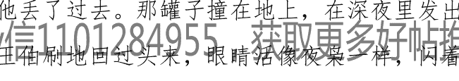

歪扭扭扭地爬起来，眼睛睁睁地盯着我，满眼亮光。

被他吓得一哆嗦，大着胆子喊了一句：“谁啊，谁在那个儿！”同时把屋里的灯打开，却躲得更严了。

王伯慢吞吞着，两只手在胸前，骨碌着眼珠子，诡异朝我这边看了一眼，抬着脚尖，一下子就从窗户翻了出去。

作者:兜兜 日期:2018-04-17 11:28

要不是我亲眼所见，实在不相信这么灵活人，会是一年纪大的王伯。就刚才他翻墙的样子，怪怪的，看起来不像个人，倒像是……

想到这里，突然想起他在黑暗中佝偻背着，缩手蹿脚的样子，不由得寒意大盛。这老头的样子，像是一个年过花甲的老人，分明像是一只成了精的老鼠！

我急忙跑过去看看棺材，发现女尸在棺中，有被挪动过的痕迹。

这都什么情况？什么时候尸体这么吃了？先是二赖子，现在连王伯都来了，而且连底诡异得塌糊涂。这事情不正常！我在家里愣了片刻，咬牙找出一手电，穿鞋就出了门。

王伯跟我们做了十几年，看着我长大的。他老辈，妻子十年前就去世了，他俩都是对我们孩子很好的，经常给我们买糖。

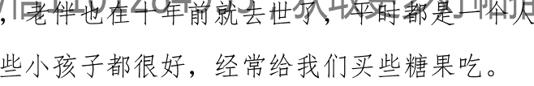

我很担心他是出了事，过去之后，发现他家的门是虚的，没有锁链。我愣了片刻，还是决定悄悄溜进去。不过后我就发现，王伯真在家里。没开灯，我打开电筒进了一圈，发现床上的被子有些凌乱，再加上有些害怕，就赶紧退了出来。

作者：匪夷 日期:2018-04-17 11:48

回到家里，心里还怦跳。近傍晚的时候，听到外头有嘈杂的声，像是很多人在喧哗。

我心里一喜，说是林家丫头找到了，就出门去打听了一下。结果听说了一个完全想不到的事情。

二赖子死了！

就在前，这뚱赖子死在一户人家的牛棚里了，肚子被牛横撑破，死得极其惨。

村里人议论纷纷，说这二赖子八成是想偷牛，没想这牛突然发疯，结果把命给送了。

我回屋关上门，心里总觉得有些不对。晚上就随便吃了口面，又找了本小说，继续守棺。

守到后半夜，还没见到三叔，揉了揉发花的眼睛，把门窗缝检查了一遍，就回家准备眯一会。

也不知道过了多久，模模糊糊地听到堂屋那头有什么响动。换做平时可能就大马虎过去了，可最近这几天，被棺材弄得我高度紧张，霍的一下就从床上坐了起来。

也敢开灯，摸手摸脚挪过去，探出头朝堂屋看去，只见有个模模栩栩的黑影趴在棺材上。

（此处省略重复内容，按逻辑合并）

月光在他那张满是皱纹的脸上，尤其显得阴森恐怖。任我平时见惯了尸体，此时也被吓得够呛。怪不得有人说，活人有时候比死人更可怕！但我可不能任由别人动尸体，地上有个空罐子，就抓起来朝他掷了过去。那罐子落在地上，在深夜里发出的一声。


歪扭扭扭地爬起来，眼睛睁睁地盯着我，满眼亮光。

被他吓得一哆嗦，大着胆子喊了一句：“谁啊，谁在那个儿！”同时把屋里的灯打开，却躲得更严了。

王伯慢吞吞着，两只手在胸前，骨碌着眼珠子，诡异朝我这边看了一眼，抬着脚尖，一下子就从窗户翻了出去。

作者:兜兜 日期:2018-04-17 11:28

要不是我亲眼所见，实在不相信这么灵活人，会是一年纪大的王伯。就刚才他翻墙的样子，怪怪的，看起来不像个人，倒像是……

想到这里，突然想起他在黑暗中佝偻背着，缩手蹿脚的样子，不由得寒意大盛。这老头的样子，像是一个年过花甲的老人，分明像是一只成了精的老鼠！

我急忙跑过去看看棺材，发现女尸在棺中，有被挪动过的痕迹。

这都什么情况？什么时候尸体这么吃了？先是二赖子，现在连王伯都来了，而且连底诡异得塌糊涂。这事情不正常！我在家里愣了片刻，咬牙找出一手电，穿鞋就出了门。

王伯跟我们做了十几年，看着我长大的。他老辈，妻子十年前就去世了，他俩都是对我们孩子很好的，经常给我们买糖。


我很担心他是出了事，过去之后，发现他家的门是虚的，没有锁链。我愣了片刻，还是决定悄悄溜进去。不过后我就发现，王伯真在家里。没开灯，我打开电筒进了一圈，发现床上的被子有些凌乱，再加上有些害怕，就赶紧退了出来。

第二天早上，我起来后特地看了王伯家，发现门还是敞着的，跟昨晚一样，似乎是没有人。我焦躁不安地在家里，想着三叔能早点回来。

期间，林大姨又来一次，好像是带着警察来了。村长召集了人去找。王伯没回来，村长也是压力大，怕王伯出事了。村长等人搜了，都说林文静失踪，有人认为是死在塘子里的傻丫，却说不定也是王伯害的，不然怎么会莫名其妙溺死在水里？村长当时带去了东边塘子里打捞。结果林文静没着，反而钓出了王伯。这老头的尸体已经被泡胀了，双脚被水草缠着，一直沉在水底浮上来。

过这些事后，村里人都传王伯是个变态，隔壁村里个姑娘就是他偷的，结果却是老婆为了报复才杀了媳娘的怨魂索命。只可怜林家的闺女，却不知道东西藏去了哪里？

我不太相信这种说法。那个姑娘不是王伯害的。我不肯定，王伯的死，恐怕真的是另外的原因。

王伯和二赖子二人，都是莫名其妙地跑我家偷尸体，紧接着就出来意外死掉，天下有这么巧的事？

一直等到天黑，三叔还没回来。我不由有些担心，守在棺前默默做事情。棺中的小娘平静地躺在那里，眉目细致，生前应该是个挺好看的孩子。我见过许多尸体，无一不是比她狰狞无数倍。这样一个看着漂亮的姑娘，怎么会引来这些诡异的事情呢？实在有些邪门。

我回到屋里，从书柜里翻出一个袋子。里头装的都是古铜钱，取出一枚接着一张掷到地上，围着棺材绕成一个圈。

作者：匪夷 日期:2018-04-17 12:28

接着拿了八碗，在每个碗里倒半碗，在碗中点燃一根白蜡烛，围着棺材八个方位放置。这在我们行叫“落地铜钱，命灯”，把棺材团围住，八方如炬，地画为牢的意思。

我是觉得有些奇怪了，准备在棺材后面通风。撇出去个小板凳，又拎了一袋雾币，到厨房取了一些煮熟的糯米，把雾币折成金元宝，一个在棺前烧了。花钱消灾祸，希望里头那位好奶奶，可以看到钱的份上，就不要再折腾我们了。

前半夜一切顺利，命灯的烛火十分稳。可是后半夜，我刚把一袋雾币折光了，从椅子上站起来，伸了个懒腰，突然感觉不对。这个时候已经是后半夜，村里大多数人都睡了，平时都是能听到狗吠，或者猫叫。

这里外外的杂草丛里满了各种虫子，咯咯不停。我不能听到任何声音，整个村子死寂一样。但是此刻心凉，冷汗就出来了。我觉得胸口闷得难受，就在板凳上趴一会儿。也不知道是不是太疲惫缘故，居然睡了个盹。

后来，突然听到有人叫，我立刻醒，睁清眼前的事。一看，棺材里，命灯的烛火早就熄了。我脸色煞白，连滚带爬从棺材里逃出来。三叔什么时候回来了？我现在还是心有余悸，惊魂未定的，就把几天发生的事说了一遍。三叔皱着眉头不说话，从牙缝里挤出一句：“明天下葬！”我吃了一惊。里面的东西可能跟林家丫头有关，现在不明明白，怎么能下葬？三叔把手挥，让我赶紧回床上睡觉，明天早准备下葬事宜。我没继续辩驳，这老家伙就是个阴幽的。这些事以后怎么收费？这些恐怖的尸体，是我这个年纪的小孩可以接触的吗？不管怎样，有三叔在家，我总可以睡好觉，安稳到天亮。

作者：匪夷 日期:2018-04-17 13:08

第二天一早起来，我就开始给尸体化妆。一般都是先用清水给尸体清洗，然后给尸体修剪须指甲。对于有些车祸等意外死亡的尸体，身体有重大破的，还需要进行身体修补和缝。总之我的职责就是让尸体尽可能好看路上，让死者家属心里有所慰藉。不过眼前这具尸体却不用我费多少周章，尸体保护得很好，仅容也是上佳，根本不用我画蛇添足，只需整理她的头发和裙子。说起来，对于和我同龄的小姑娘，我心里既同情又畏惧，心情是复杂的。

三叔抬头绘制墓地图。这就涉及到我们这一行的另外门道，风水。关于风水，是有十分讲的，因人而异。比如古代的王侯之后，必须傍山，有水最好，可以吸纳天地灵气，福泽后代。送下葬的那四个人，显然处理过棺材的抬。这就可不能随随便便就完了事了，必须要经过我们这种行家处理，找出特殊的风水之地以墓局加以化解。之前那批人，之所以要避鬼崇紫的棺材送到我家，而不是直接拿去火化，或者找个地方埋葬，就是这个道理。这帮坏人，应该早就知道尸体有问题，却睁着不说，就是怕我们不接。

我忙完后，问三叔要不要我先去通知张大山他们。

作者：匪复 日期:2018-04-17 13:28

张大山和王明佛他们四个人，是一直我们合作的。人。既然准备明日发葬，就有必要提前知会他们一声。

“这次不用他们，我已经找好了四个外乡人。”三叔贴心地画着葬地图，头也不抬地说。我有些奇怪，张大山他们合作多年，彼此都很沉默，而且技术过硬，为什么这次不要他们，而找几个外来的？三叔没理我的质疑。我站在旁边看着地图，看会儿，猛然一惊，冷汗刷地流了下来。“这些东西……不是替死吧……”我突然明白道理，之所以不请张大山，是因为他们心里鬼。外乡人本来是最稳不利的话，如果葬过程中万一出事，张大山他们担不起。三叔的声音古井，像是在说一件完全无关的事情，这事是我决定的，外乡人虽然我不熟，但也是命。我叹口气，“难道就没有别的办法？”三叔总看了我一眼，冷笑道：“既然你主意这么大，你就来主。”

作者:兜兜 日期:2018-04-17 14:48

这晚上我整宿都没合眼。只要我拿定了主意，他就按说的做。第二天起来，我顶着两个眼圈找到三叔，问了一句：“那四个人什么时候来，要不要我去催？”三叔看了我一眼，让我先去烧柴，其他的安排。自从农村火化以来，我们也没接过过土葬的活，都是安排在晚上偷偷偷发的，为了避人耳目。但这次三叔把时间定在了正午。

没想到出了事。三叔找的那四个外乡人，听说是平日没正经工作的混子。这也可以理解，毕竟家里谁愿意来抬。这几个人以前没做过糟糟的活，但个人蛮脑大，体格健壮。三叔虽胆小，却能挑起最靠谱的活。

2018-04-17 14:08

正午时分，阳气最盛，可以借此压制尸体的煞气。临行前做了万全的准备。起棺前，三叔先念了一遍生死，然后在棺前插了一支黄色的小旗。我当时觉得挺新鲜，我是第一次起棺前插旗。很快我就面如土色，因为那面小旗才插下去，就咔嗒一声断折了。我不懂这是什么意思，也知道肯定不是好事。三叔干笑几声，说这旗子质量差，稍稍用力就断了。那四个外乡人一听，也没有在意。我却是一颗揪得紧紧，因为我看到三叔的额头上冒冷汗。三叔叫了一声：“开路咯！”我就在前纸冥币开道，四个外乡人合力，将棺材抬起，一路向三叔事先定好的葬穴去。

走出有一里多后，就出了事。四个人高马大的抬棺，被肩压得面如土色，最后实在受不住了，软把棺材卸在了地上。“棺材怎么越抬越重！”外乡人气喘如牛，累得嗷嗷叫。棺材半落落地，这是十分不吉利的。我有些发愁，一时不知道该怎么办。三叔取出七个铜钱，一字排在棺材上，然后取出三道符符在棺前烧了，让他们继续抬起。也不是没用的，这几人说棺材确实轻了许多，可是事情重要，没办法了。三叔使劲棺材开始走，抬起来，我发现有杀条在等着我们，原来三叔已经预到了这种情况。但是船行到河中闹的时候，又出了事。

作者：魏 日期:2018-04-17 14:28

一直吹来的风突然停了，水面变得浑浊。水里，，，，，，，，，，，，，，，，，，，，，死了。


那姓刘的嘟囔嘈嘈，问我们到底要怎么样，是不是要钱，
只要能放了他，多少钱他都给。

作者:匪夷 V 日期:2018-04-17 15:28

我听得火大，喝了一杯凉开水压压火，掀了张椅子坐到他对面。作为一个长期接受留田老师教育的文明人，我当然是要理服人的。

可这姓刘的也不知道是不是脑袋被捂褥子了，愣是不信说我是胡乱说八道，而我咬了咬牙，说他也不知道这糟桶里的人是谁，加微信1101284955，获取更多帖子推荐。

我觉得我还是要保持基本理智的，于是又喝了一口凉开水压压。然后进入厨房提出一罐辣椒油，油汪汪的东西。

“饿了吧，我喂你。”我撇了个勺子，垫着脚，拿起调料了一大口就往她的嘴里。

那姓刘的双眼睛圆睁，脑袋直往后缩，惊恐问我是这是什么。说这可是好东西，不仅美容保养，还可以做香水，听说泰国那边的商人出高价在收呢，给你算便宜了。

这姓刘的吓得脸色发青，尖着说我到底是什么东西！我见他这么坚持，就把这东西的来历微微讲了，然后：

“只要有孕过世，就在子时把她的下巴剖下来，后用白蜡烧炖，滴下来的油就是这个东西。”我拿着罐子在面前晃了晃。

“泰国那边这东西叫腻油，听说那边的小姐姐很喜欢用呢。”

作者:直夷 日期:2018-04-17 15:48

我说着，拿了勺子就往嘴里塞。

这姓刘的也是够猛的，当场就吃得满脸横肉，尖叫起来：“我说我说！快把这东西拿走！”

见他这么反应，只好把罐子提回了厨房。这罐子猪油放了太长时间，有点儿臭了，实在太浪费了，明天得记得扔掉。

加微信1101284955 获取更多精彩推荐

我看着她，旁边姓刘的表情很尴尬，神横地把事情交代的了。

原来，他送过来的这小姑娘是他的一个堂妹，名叫刘梅，是他二叔的女儿。我有些意外，没想到这小姑娘还是他们刘家的人。

姓刘的说他其实也不是太清楚。大概半个月前，他正在屋里看书，他父亲突然面色沉重地找他，让他过去一趟。他放下书就跟了过去，这才才知道他十二岁的堂妹死在了家里，衣衫不整的，脑勺上有一个大一个口子，血流不止，等人发现她的时候已经没气。

他母亲给堂妹检查后，说是身子没被人侵犯的，但看这场景，显然是有人想要对堂妹动手脚，最后下狠手杀了她。

我问：“这明明是一起刑事案件，你们当时没报警？”
刘姓的摇头，说他当时的第一个反应就是报警，但家里长辈没一个同意。甚至连他二叔，就是刘楠堂妹的父亲都不同意报警。

我就想明白了，哪有自己家人被人死，还遮遮掩掩想隐瞒的？

刘子安说他也想明白。在他们刘家，长辈的权威是很重的，他们一决定的，小辈是没有反抗权力的。

“我父亲让我回去我自己屋里呆，对谁要不要提起。家里公司的事千万不要提。”刘子安显然还是很谨慎。

“可是当晚，我们家就出了事。”

我忍住插嘴，听他继续下去。

作者:亘 V 日期:2018-04-17 16:08

刘子安的声音有些发抖，他说他三姑家里有两个儿子，中大的一个跟他同龄，这几天他们一家子这边做客。结果当晚不知怎么的，他这个哥喝了点酒发酒醒来，冲出去撞人就打，结果一不小心栽了头。事情却巧在这里，他掉的地方不知道为什么有根长钉，结果直接就穿透了脑颅，连叫都没一声就死了。

我这类事情看起来很巧合，其实也不是没有，我们之前就接到好几个类似的。

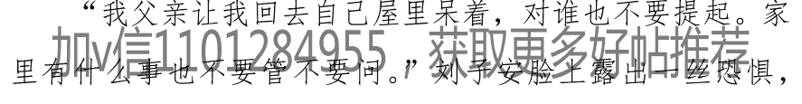

刘子安没有反驳我，而是失魂落魄地继续下说：“第二天中午，我弟弟从阳台上掉下来摔死了。”他的声音在发颤，身子抖得厉害，“他才五岁啊，脖子都摔折了，死得好惨！”

我有些沉默，心想这刘家祖上非是干了什么丧天良的事，以后辈孙子接二连三的事。

刘子安眼眶通红：“从我亲弟和表哥出事后，我奶奶就崩溃了，天天跳大哭，要把堂妹的尸体从棺材里挖出来扬骨扬扬。”

我听得心头发寒：“我们家这老太太到底得什么病？孙加婉不是五十来岁，都死得这么年轻，还死得这么快，这是什么事！”

刘子安脸色尴尬，说这里头是有原因的：“奶奶认为是两个孙子的死都是堂妹害的。这老太婆病得轻！你要不要送她去医院看看？”

作者:匪夷 日期:2018-04-17 15:28

刘子安一张脸涨得红，说家里来了一个个人，才把老太太拦了下来。我心里一动，问来的是个人。他也不是很清楚，只说人大概五十来岁，又高又瘦，头发有一丝白。

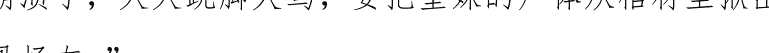

刘子安说：“后来我在去看弟弟的路上，突然晕倒了，在床上一躺了几天才。醒过来后，我父亲指了个任务，让我送一份橘子。”我见他脸色焦黄，嘴唇起皮，确实是精神萎靡，就劝道：“这个人很奇怪，戴着眼镜，脸上有卷气，像个读书人。刘家上下对这个人都很尊重，连奶奶都要亲自来。”

我看着她，旁边姓刘的表情很尴尬，神横地把事情交代的了。

原来，他送过来的这小姑娘是他的一个堂妹，名叫刘梅，是他二叔的女儿。我有些意外，没想到这小姑娘还是他们刘家的人。

姓刘的说他其实也不是太清楚。大概半个月前，他正在屋里看书，他父亲突然面色沉重地找他，让他过去一趟。他放下书就跟了过去，这才才知道他十二岁的堂妹死在了家里，衣衫不整的，脑勺上有一个大一个口子，血流不止，等人发现她的时候已经没气。

他母亲给堂妹检查后，说是身子没被人侵犯的，但看这这场景，显然是有人想要对堂妹动手脚，最后下狠手杀了她。

我问：“这明明是一起刑事案件，你们当时没报警？”
刘姓的摇头，说他当时的第一个反应就是报警，但家里长辈没一个同意。甚至连他二叔，就是刘楠堂妹的父亲都不同意报警。

我就想明白了，哪有自己家人被人死，还遮遮掩掩想隐瞒的？

刘子安说他也想明白。在他们刘家，长辈的权威是很重的，他们一决定的，小辈是没有反抗权力的。

“我父亲让我回去我自己屋里呆，对谁要不要提起。家里公司的事千万不要提。”刘子安显然还是很谨慎。

“可是当晚，我们家就出了事。”

我忍住插嘴，听他继续下去。

作者:亘 V 日期:2018-04-17 16:08

刘子安的声音有些发抖，他说他三姑家里有两个儿子，中大的一个跟他同龄，这几天他们一家子这边做客。结果当晚不知怎么的，他这个哥喝了点酒发酒醒来，冲出去撞人就打，结果一不小心栽了头。事情却巧在这里，他掉的地方不知道为什么有根长钉，结果直接就穿透了脑颅，连叫都没一声就死了。

我这类事情看起来很巧合，其实也不是没有，我们之前就接到好几个类似的。


刘子安没有反驳我，而是失魂落魄地继续下说：“第二天中午，我弟弟从阳台上掉下来摔死了。”他的声音在发颤，身子抖得厉害，“他才五岁啊，脖子都摔折了，死得好惨！”

我有些沉默，心想这刘家祖上非是干了什么丧天良的事，以后辈孙子接二连三的事。

刘子安眼眶通红：“从我亲弟和表哥出事后，我奶奶就崩溃了，天天跳大哭，要把堂妹的尸体从棺材里挖出来扬骨扬扬。”

我听得心头发寒：“我们家这老太太到底得什么病？孙加婉不是五十来岁，都死得这么年轻，还死得这么快，这是什么事！”

刘子安脸色尴尬，说这里头是有原因的：“奶奶认为是两个孙子的死都是堂妹害的。这老太婆病得轻！你要不要送她去医院看看？”

作者:匪夷 日期:2018-04-17 15:28

刘子安一张脸涨得红，说家里来了一个个人，才把老太太拦了下来。我心里一动，问来的是个人。他也不是很清楚，只说人大概五十来岁，又高又瘦，头发有一丝白。


刘子安说：“后来我在去看弟弟的路上，突然晕倒了，在床上一躺了几天才。醒过来后，我父亲指了个任务，让我送一份橘子。”我见他脸色焦黄，嘴唇起皮，确实是精神萎靡，就劝道：“这个人很奇怪，戴着眼镜，脸上有卷气，像个读书人。刘家上下对这个人都很尊重，连奶奶都要亲自来。”

我看着她，旁边姓刘的表情很尴尬，神横地把事情交代的了。

原来，他送过来的这小姑娘是他的一个堂妹，名叫刘梅，是他二叔的女儿。我有些意外，没想到这小姑娘还是他们刘家的人。

姓刘的说他其实也不是太清楚。大概半个月前，他正在屋里看书，他父亲突然面色沉重地找他，让他过去一趟。他放下书就跟了过去，这才才知道他十二岁的堂妹死在了家里，衣衫不整的，脑勺上有一个大一个口子，血流不止，等人发现她的时候已经没气。

他母亲给堂妹检查后，说是身子没被人侵犯的，但看这这场景，显然是有人想要对堂妹动手脚，最后下狠手杀了她。

我问：“这明明是一起刑事案件，你们当时没报警？”
刘姓的摇头，说他当时的第一个反应就是报警，但家里长辈没一个同意。甚至连他二叔，就是刘楠堂妹的父亲都不同意报警。

我就想明白了，哪有自己家人被人死，还遮遮掩掩想隐瞒的？

刘子安说他也想明白。在他们刘家，长辈的权威是很重的，他们一决定的，小辈是没有反抗权力的。

“我父亲让我回去我自己屋里呆，对谁要不要提起。家里公司的事千万不要提。”刘子安显然还是很谨慎。

“可是当晚，我们家就出了事。”

我忍住插嘴，听他继续下去。

作者:亘 V 日期:2018-04-17 16:08

刘子安的声音有些发抖，他说他三姑家里有两个儿子，中大的一个跟他同龄，这几天他们一家子这边做客。结果当晚不知怎么的，他这个哥喝了点酒发酒醒来，冲出去撞人就打，结果一不小心栽了头。事情却巧在这里，他掉的地方不知道为什么有根长钉，结果直接就穿透了脑颅，连叫都没一声就死了。

我这类事情看起来很巧合，其实也不是没有，我们之前就接到好几个类似的。


刘子安没有反驳我，而是失魂落魄地继续下说：“第二天中午，我弟弟从阳台上掉下来摔死了。”他的声音在发颤，身子抖得厉害，“他才五岁啊，脖子都摔折了，死得好惨！”

我有些沉默，心想这刘家祖上非是干了什么丧天良的事，以后辈孙子接二连三的事。

刘子安眼眶通红：“从我亲弟和表哥出事后，我奶奶就崩溃了，天天跳大哭，要把堂妹的尸体从棺材里挖出来扬骨扬扬。”

我听得心头发寒：“我们家这老太太到底得什么病？孙加婉不是五十来岁，都死得这么年轻，还死得这么快，这是什么事！”

刘子安脸色尴尬，说这里头是有原因的：“奶奶认为是两个孙子的死都是堂妹害的。这老太婆病得轻！你要不要送她去医院看看？”

作者:匪夷 日期:2018-04-17 15:28

刘子安一张脸涨得红，说家里来了一个个人，才把老太太拦了下来。我心里一动，问来的是个人。他也不是很清楚，只说人大概五十来岁，又高又瘦，头发有一丝白。


刘子安说：“后来我在去看弟弟的路上，突然晕倒了，在床上一躺了几天才。醒过来后，我父亲指了个任务，让我送一份橘子。”我见他脸色焦黄，嘴唇起皮，确实是精神萎靡，就劝道：“这个人很奇怪，戴着眼镜，脸上有卷气，像个读书人。刘家上下对这个人都很尊重，连奶奶都要亲自来。”

我看着她，旁边姓刘的表情很尴尬，神横地把事情交代的了。

原来，他送过来的这小姑娘是他的一个堂妹，名叫刘梅，是他二叔的女儿。我有些意外，没想到这小姑娘还是他们刘家的人。

姓刘的说他其实也不是太清楚。大概半个月前，他正在屋里看书，他父亲突然面色沉重地找他，让他过去一趟。他放下书就跟了过去，这才才知道他十二岁的堂妹死在了家里，衣衫不整的，脑勺上有一个大一个口子，血流不止，等人发现她的时候已经没气。

他母亲给堂妹检查后，说是身子没被人侵犯的，但看这这场景，显然是有人想要对堂妹动手脚，最后下狠手杀了她。

我问：“这明明是一起刑事案件，你们当时没报警？”
刘姓的摇头，说他当时的第一个反应就是报警，但家里长辈没一个同意。甚至连他二叔，就是刘楠堂妹的父亲都不同意报警。

我就想明白了，哪有自己家人被人死，还遮遮掩掩想隐瞒的？

刘子安说他也想明白。在他们刘家，长辈的权威是很重的，他们一决定的，小辈是没有反抗权力的。

“我父亲让我回去我自己屋里呆，对谁要不要提起。家里公司的事千万不要提。”刘子安显然还是很谨慎。

“可是当晚，我们家就出了事。”

我忍住插嘴，听他继续下去。

作者:亘 V 日期:2018-04-17 16:08

刘子安的声音有些发抖，他说他三姑家里有两个儿子，中大的一个跟他同龄，这几天他们一家子这边做客。结果当晚不知怎么的，他这个哥喝了点酒发酒醒来，冲出去撞人就打，结果一不小心栽了头。事情却巧在这里，他掉的地方不知道为什么有根长钉，结果直接就穿透了脑颅，连叫都没一声就死了。

我这类事情看起来很巧合，其实也不是没有，我们之前就接到好几个类似的。


刘子安没有反驳我，而是失魂落魄地继续下说：“第二天中午，我弟弟从阳台上掉下来摔死了。”他的声音在发颤，身子抖得厉害，“他才五岁啊，脖子都摔折了，死得好惨！”

我有些沉默，心想这刘家祖上非是干了什么丧天良的事，以后辈孙子接二连三的事。

刘子安眼眶通红：“从我亲弟和表哥出事后，我奶奶就崩溃了，天天跳大哭，要把堂妹的尸体从棺材里挖出来扬骨扬扬。”

我听得心头发寒：“我们家这老太太到底得什么病？孙加婉不是五十来岁，都死得这么年轻，还死得这么快，这是什么事！”

刘子安脸色尴尬，说这里头是有原因的：“奶奶认为是两个孙子的死都是堂妹害的。这老太婆病得轻！你要不要送她去医院看看？”

作者:匪夷 日期:2018-04-17 15:28

刘子安一张脸涨得红，说家里来了一个个人，才把老太太拦了下来。我心里一动，问来的是个人。他也不是很清楚，只说人大概五十来岁，又高又瘦，头发有一丝白。


刘子安说：“后来我在去看弟弟的路上，突然晕倒了，在床上一躺了几天才。醒过来后，我父亲指了个任务，让我送一份橘子。”我见他脸色焦黄，嘴唇起皮，确实是精神萎靡，就劝道：“这个人很奇怪，戴着眼镜，脸上有卷气，像个读书人。刘家上下对这个人都很尊重，连奶奶都要亲自来。”

趁着刘子安吃饭的时候，我把刚才听来的事情跟三叔说了一遍。三叔思了一会儿，问道：“这小姑娘不是亲的？”刘子安愣了一下，才明白三叔说他堂妹，连道：“是亲的，是亲的！”三叔不解地问：“你家老婆脑子有病？”我忍不住乐了，果然是我三叔养大的，我们俩话都特别像。刘子安忍不住说她奶奶没毛，平时身体很好。那就是有什么情了？”三叔眯着他那一对大眼睛看着刘子。说实话，这幅样子真好听的，我耸了肩，吐了口唾。他就立刻点头肯了。这事……这跟我二婶有关。”刘子安摩着额头的汗。我也不是特别清楚，只是听说二叔年轻的时候从家里拿了一笔钱，跟几个朋友去做生意。最后生意没做成，但是从外面带回来一个女人。刘子安的二叔叫刘文轩，带回家的刘子安二婶。当时刘子安已经七八岁，所以对这件事还有印象。这个女人名叫白梅，长得十分漂亮。不过当时有很多流言，白梅是刘文轩在一个大山里出来的野女人，连父母谁不知道。刘文轩一回家就表示要娶白梅过门，当时因为这事，刘家直接就炸了锅。作者：匪夷 日期:2018-04-17 17:08 刘文轩的母亲，也就是刘家现在这一老太太，当就要白梅打出门，说她是狐媚妇，勾引自己儿子。他们刘家这样有身份的人家，是绝对不要这种女人进门的。那种情况下，刘文轩认定了白梅，宣称非白梅不要，带着白梅在家门口整整跪了一天一夜。后来刘家老太坏心疼他这个儿子，并且在刘家老爷爷的合说之下，总算是勉强答应了这婚事。加微信101128495，获取更多精彩推荐门不通，刘家家里人也只是笑笑不说话。刘家老太太一直打厌这个媳妇，也从不会来看一眼。有一年夏天，刘文轩的四弟刚高考上高中，刘家举欢庆。家宴过后，四弟就提议去附近的白里山转转。当时大家兴致高扬，就说都去都去。最后两个舅舅和三个阿姨带着四弟和几个表姐表就出发了。刘文轩想趁这个机会也带着妻子一起去散心，就跟家人接触。白梅见丈夫一片心，也不忍拒绝。谁一行人到达山脚的时候，白梅突然吓得连往后，死活。刘文轩只是妻子第一次出门，有些紧张，白梅怎么肯去上山。当时几个舅舅跟婶姨，本来就因为刘家老太太的原因，对这个媳妇很有意见。刘文轩赶紧把人带回去。刘子安还是也不听，最后只能把白梅拉了。这个人都被埋在了山里，一个回来，老太太就疯了，哭天喊地的，一会叫她四个子的名字，“死得好惨！”刘子安一口气把事情说完，长长出了一口气，脸上一阵一红一片白。也难怪他先不肯，这事说起来真没什么光彩。

提前预知会发生，白梅的行为确实反常，流言就传开了，人们开始害怕她如毒，避之不及。认为是不祥之人。刘家老太太自从没事后，就像魔怔了一样，天天在家里。马刀子的，是恶鬼投胎，专门来害刘家的。儿子赶忙把女人赶出去。软性本来就懦弱，夹在母亲和妻子之间，左右都。从此也变得沉默寡言，心理头在房间里。日子越越难，刘家上下没对她好色的。当时就冲进房间，撕打白梅，骂她是狐狸精到处勾引男人。刘老爷子当时就气得脸色发白，扭头就走了，整整一天都没回家。后来就传来了噩，说是刘家老爷子因为气晕了出去船闷，结果沉船了，老老爷子死在了河里。刘家太太大发了样拿着菜刀要砍白梅，骂她是贼，不要脸，是恶鬼投胎，害死孩子又害她丈夫。五天后，白梅的房间突然着了火。等刘文轩抱着儿子回来，从房间里扒出了一块烧得焦黑的尸体。这件事也被报警了，直接被当地警察处理了，刘家太太跳脚骂白梅是讨债的恶鬼，想要把她全家都害死，直接连起逐都没让她进。那死老婆就是因为这个，恨了她亲女儿？”听了刘子安这一番，我对刘家太太的印象更恶劣了，简单是个老怪物。作者:逝夷 V 日:2018-04-18 10:13 “也不只是是因为这个。”刘子安张了张嘴，却没有说下去，似乎有很大的顾虑。刘子看看看看我，又看看三叔，吐了口气，说：“我奶奶一直怀疑……我二妹……我二妹……”三叔面面相觑，老太婆是不是太狂了？我说都什么时候了，还有什么不能说的。刘子安吞吞吐吐：“也许是我二婶世太早，这个堂妹从小就，不跟人亲近。而且她跟普通孩子，好像不一样。我说吧，最近觉得有点受，我感觉……有点怕。”刘子安断续说道。听完这一事，我和三叔陷入沉思。三叔说：“小姑娘身上针脚是怎么回事？”刘子安难以起头，奇怪道：“什么针脚？”我把事情如实说一遍。刘子安一下站了起来：“准确来说，是你堂妹的头和四肢被缝在了另一个人的身上。”我补充了一句。“你开玩笑！”刘子安一下气愤地指着我。这罐子猪油放了太长时间，有点儿臭了，实在太浪费了，明天得记得扔掉。这罐，太疼了，这，没脚的。

作者:亘夷 日期:2018-04-18 10:33 。


刘子安说：“你们说的是真的，这，这，这，这，这堂妹的屋里。”我看着，红的脸额头上青筋跳，始终没敢去吵。三叔问：“让你们把棺材送回家的？”刘子安虚的坐下，天才也不清楚，是他父亲让他送过来的，说一定要交手上。三叔问：“以前听过吗？”刘子安摇头，以前根本听过。三叔皱着眉。我心里琢磨着，突然想到一个人，问刘子安知不知道那个姓刘的老爷。过了一会儿，我们算是谱了，这件事可能真跟这个姓有关。棺材被送过来的时候，墨斗用七星之法打不定人还是内行。

作者:霍夷 日期:2018-04-18 10:53 

这老狗!!!我全身发凉。这人是看出刘家那丫头有问题，就想了个祸水东的策略，把她送来我们村，让我们家人来接。三叔让我把刘文静的照片拿出来。我说没有，女孩的照片我怎么会有？三叔看了我一眼，别说废话，赶紧去。我只顾跑里屋，从枕下翻出一张照片拿过来。这是从学校荣誉墙上偷偷撕的。林家丫头是我们最好看的小姑娘，藏张照片看看怎么样？”三叔把照片放在刘子安眼前。刘子安拿过去仔细看了看，摇头说没印象，又看看三叔，一脸疑惑。“这是……我们村的小姑娘，几天前失踪了！”我把照片夺回来，拿回去枕头下藏好。又回来，“这妹妹跟股上有一个胎记？”刘子安脸一红，说这事情他哪里知道。当晚刘子安在我家下了。三叔让刘子安去跟我挤挤，我老大乐意，让三叔和刘子安都回屋去睡，我干在堂屋负责守。这一夜没事。倒是刘子安看着嗓子清清秀秀，睡觉还会打呼，吵得我牙根直。第二天一早，三叔带着刘子安出门，说是要去探探那些闲的。刘子安休息了一晚上，精神也好了。这人倒不是一无处，对这个妹还有点亲情的，要帮着我们一起打探。加V110128495 获取更多福利。作者:兜夷 V 日:2018-04-18 11:13


等下了七八米后，就觉得不对，我的脚竟然开始有点不到井壁了。这时我才发现，我周围的空间竟然越大。刚下来说的时候井洞只有半米多，但下到现在，已经一米有多了。

我只能双缠着绳子，不靠井壁下滑。越往下走，就感觉空间逐渐在变大。这井壁居然是倾斜向下的，越往下越宽，竟然是个上下宽的倒喇叭形状。

这难道是……喇叭巷？

我忽然就想起三叔跟我说过的一个东西。这种倒喇叭形状的地下空间，在我们这一行称之为“喇叭巷”，据说是根据战国时期的墓葬规律，反向推出的阴阳布局理论。

在春秋早期的王墓，大多是箱墓。也是墓室直上直下，四四四方，像个箱子一样。这种结构在理论上聚聚大量阴气，保证墓主身不腐。但比埃及的土乃还有效。但这种墓室结构也有致命的缺点，就是时间长了容易塌塌。要是遇到地震什么的，就不用说了。

后来到了春秋后期，我们行内出了个惊艳绝伦的老祖宗，他发明了一种斗墓。这种墓室结构，它占地面面积跟箱墓差不多，但墓室四壁却是倾斜向下的，上宽窄，整个墓室就像直米的斗一样，因此被称为斗墓。

比起箱墓，斗墓的设计不仅补了箱墓容易塌塌的缺陷，而且还多出一个意外的功效。它可以凭借借四壁倾斜的特殊结构，让死者的怒气得以快速发散。这在我们行内称为为“散怨”。

在我们这一行，“散怨”可以是历代同行都非常注重的一点。因为绝大多数人死后出现的怪事，比如起尸、回魂等都跟死者本身的怒气脱不开关系。于是这种可以散怨的斗瓮很快就废靡了起来，甚至后来许多的盗墓贼就被称为“倒斗”，就是由此而来。

随着时间的变迁，又有一种新的墓局被人设计出来。这种墓局的结构完全跟斗瓮相反，造成上窄下下的特殊结构。这就是喇叭巷。加怨造成的就是这种方法虽然很极端，但效果的极致就是我们行内所说的“封禁”。

我没想到在这个口井里，居然看到了“喇叭巷”这种传说中的墓局结构。按照“喇叭巷”的原理，难道这里头封禁了某种东西？

我攀着绳子继续下滑，井口已经变成了一个圆圆的光点。井底寒气逼人，非常潮湿。又放了大约六七米后，我终于接触了井底。

一下下去就了个寒寂，这井水刺骨的冷，那股寒意直到了骨头深处。我浮在水上，摸着井壁转了一圈，摸着这时候的宽自己已经到了两米。我适应了一阵子低温，深吸了一口气，一手往水里扎了下去。水中漆黑一片，伸手不见五指，只能依靠我去搜索。幸好这井却不深，大约沉下去五六米后，就踩到了泥土。蹲下身子在底摸了片刻，抓了一手的泥泥。正当我不忍想要上去换口气的时候，我忽然摸到了一个软软的东西。再一摸，就摸到一团滑腻腻的丝缕东西。我立即反应过来，这是摸到了一把头发。我吃了一惊，嘴里立即就灌了几口冰水。连忙喘了下去，深深地了一了一口气。

我脸色煞白，心有余悸地咳嗽了几声，一手又扒了下去。这手摸到脚部位置，顺着头发往下摸，摸到该是个女孩子的尸体。我抓住她的腰，抱起她就往上浮。但很快就觉得不对，这女孩子的尸体出奇的重，抱着她我根本抬不起来。后来就发现她身上捆了一块石头，所以一直在井底。我上去吸了一气后，再度沉下来把绳子解，然后抱着她浮出水面。黑暗看不清这具体的模样，只知道有一头长发，身材娇小，应该要比我矮一些。身上一丝不挂，皮肤贴在我身上，只得它又冰又凉，滑腻腻的。不知道是不是因为这口水井的古怪，尸体虽然轻微的浮肿，但并不严重。

我把绳子捆到她身上，扎实地打了个结。然后先沿着绳子爬了去，趴在地上恢复了一些体力，才开始抓着绳子，把尸体缓慢地拉了上来。拉到最后一节，抱住尸体把她从井口拖了出来，小心地放到地上。

这显然是一个十一二岁的姑娘，身上赤条的一丝不挂。原本白皙的皮肤被水泡得有些惭，在她的脖颈和四肢，贴了两道符。虽然经过长时间浸泡，也没有半分脱落的迹象。我看着她在边坐了好一阵子，才走到她身边，轻轻地搓开了她的脸。那双明亮的眼睛紧紧闭着，原本红润的唇发紫，毫无生气。是林家丫头。我呆呆地抱着她，觉得一股莫名的心酸。

我坐在地上，衣服完全湿了，胸中充斥着巨大的迷茫和失落。这才明白，原来我不是平凡的孩子。从她身上下的符被我捏得粉碎，进了井里。然后理了理头发，林家丫头似乎睁开了眼，惨白的唇向上勾钩。我顿时睁眼，听到一阵刺耳的嚎叫，就像电钻一般往耳朵里钻。我似地捂住耳朵，在地上滚起来。那种极端清晰的崩响，几乎让我以为是有枚钉子，不停地凿进我的耳膜，剧痛让我死去。

不知道多久，那种恐怖的嚎叫声突然在耳边停了。我长了一口气，像烂泥一样瘫在地上。晕乎乎的，听到有人在叫。我睁睁眼睛，看到一张脸在我眼前晃动。三叔一直在我耳边说着什么，我却听不进去，脑袋一直嗡嗡响。过了好久，才缓过劲，像是大病了一场，整个人都在抖。再扭头一看，文静闭着双眼靠在沿上，额头多了一个奇怪的符，色鲜红夺目，显然是用血画上去的。这时候，三叔的声音一下从我耳朵里灌进来。“你小子差点没……”三叔色厉厉过他这话真的很狠，从他的眼睛却看出了担心。这类东西明明是温热的，偏偏要搞得如此狼狈。我身边没有些吃的，三叔说他不是气的，哪来的这些东西。我大失望，你这人真的是，出门也不带点饼干什么的，怎么办！三叔滚蛋你。我实在是饿得难受，不过刚才在井里吞了几口水，小心全给咽去了。虽然这水……比渴死的强。我休息了一子，总算缓过劲来，三叔右手手指破了个口子，知道文静额上的血符应该是他画上去的，就是个什么符，我以前没见过，你这老东西是不是藏了什么绝活？三叔骂了一句“小兔崽子”，让我紧绷起来。我只得从地上起来，拍了拍屁股。三叔一指林文静，说：“你去给林家闺女吸气进去。”我蒙了一下，完全明白老东西的意思。“老东西你不疯吧？”我冲过去就要摸摸三叔的额头，被他一把赶开。活人怎么给死人气去？要知道尸体属纯阴，活人这一口气进去，就包含了一口气阳。这叫“万阴带点阳”，是我们这一行的大忌，要是运气不好再遇上个问题的尸体，那可好了，直接给你运气都是算便宜！我想还是放心，说你要去，不去！三叔踹了我一脚：“屁话这么多，你个童子崽不去去？”用我们这一行的话来说，童子自然是阳气最旺的。但不服：“知道你是老童子狗！”这么多年，我三叔都是孤身一人养育长大，也没有个女人。我怀疑的理由足够充分。不过说归说，三叔叮咐的话我还是听的。只过去抱起林家丫头在地上放了，然后对着它，往她口吹了一口气进去。虽说平时接触尸体多，但这次做事，嘴唇上冰凉的，有种异样的感觉，少了我分心理负担。完一口气后，尸体没有明显的变化。三叔在旁边沉着脸，我觉得有些重，问他出了什么事。三叔说：“这三天夜没东西吃的，累了了累了。”三叔瞪了我一眼，让我赶紧跑上步。我背着林丫头，脚也得累了。我知道他是故意支开，怕看出我背着死人。路上遇到一个隔村的老乡，正好开着回去，三叔一路拼命催，我得咬着牙，拼命前往。临走前，三叔叮嘱我一定要抱着文静，绝不能离开。她在废弃的屋内，我在村口看着火的。三叔狠狠地拍了一下大腿，让我背着林丫头找个地方靠起来，不要进村去看看情况。我找了个地方坐下，把她抱在怀里。身体冰凉贴身上，总觉得有些诡异，又有些恐惧。她头上的那道血，色彩鲜艳如新，像是刚刚划上去的一。在黑暗中坐了一会儿，隐隐能听到村子里有喧哗的声音传出。不安，无意中看了文静，发现她的眼皮似乎抖了一下。我以为自己眼花了，但很快发现并不是。林家丫头的眼皮又快速抖了，连带着她长长的睫毛都颤了一下。吓得面如土色。这种睁眼的事，我并没有遇到，但都是瞬间睁开，在我们这一行叫做“鬼睁眼”，原因有很多种。这种睁眼之前还有前戏，我还从没见过。这下玩大了，不是起就是活，这是要人命的！我顿时寒毛都竖了起来，心里一慌，抱着死马当活医的心态，压到她唇上，又给她透了一口气过去。幸好我赌赢了，林丫头的眼睛总算是停止了跳动。背后是冷的，贯念三叔老东西枉给我回来。他要不要回来，我是要去观看。不知道是不是我的运气的作用，我正值日如年的时候，听到三叔的声音在外头喊了我声。我如释负，连忙背起文静出去。三叔脸上衣服上是一道道的黑灰，烟熏燃烧的，红眼睛：“咱家被毁了，全完了！”我一听就醒了，说我的书包还有文静的照片都在屋里呢！三叔抽了我一巴：“都什么时候了，还想着你那破片！不在你背后闹着呢？”幸亏我家这些年的积蓄都被存到了银行里，要不然真是要穷到姥姥家去了。我说到底出了什么了，咱家怎么会着火的？三叔揉了揉牙花，让我背起林家丫头紧紧跟他走，路边走边边说。“草他奶奶的，老子非得让他们林家赔不可！”三叔狠狠地咬了一句。我听了一阵，原来今晚起火的原因，家里的东西都被烧得一塌涂，屋里那个棺材也被烧成了炭，唯独棺中的尸体不见了。三叔就知道出事了，没想到还是来了一步。三叔黑着脸，瞪了我一眼，“不是你这小子惹出来的，谁叫你捅的我撞上了，我也是受害者好，家里烧掉的财产一半！”三叔哼了一声：“不是跟鬼有关，还跟谁有关？”那阵也是够的，让他想这种办法，把林家丫头出来之后，林家丫头就成了双生的局面。三叔黑着脸：“算我们房子的账！”刘子安急急的：“房子？你家房子怎么了……那跟我关系啊……”没好气地插了一句：“我家房子被那个鬼堂妹一把烧了，你说没关系？”

愣了。刚到刘家大院，刘子安在那儿等门外，见到我们，拼命冲我们挥手，合计着我们在刘家里内应。刘家不愧是这一带的大户人家，这一座宅子比我家不知道大了多少倍！“那个姓的在不在？”三叔问。刘子安连点摇头：“在的，在的，刚刚跟我奶奶说话呢。”三叔叹了声，说完就好，正好找他们总账。刘子安一副脸，怕是要算他们房子的账了。

我翻白眼，说我都快饿死了，给我弄点吃的去。刘子安才“哦”了一声，擦了擦额头的汗，看了三叔一眼，大概是示意的意思。三叔：“去弄个馒之类的，吃边边走。”见他也同意，刘子安就转了身，领我们另一个方向。进了厨房，我喝了一大碗水，又抓了几个馒头出来，又吃边边走。虽然冷了，馒头有点硬，但对我来说可是美味了。刘子安就问我背的是是谁，要不要他来替我背。我说这是你家妹妹，吓得差点就跑，转身就要跑，加起来好处被发现以后更麻烦，他还推我怎么办？我扛着馒头，没理他。你来吧，再说我背的是林文静，但他刘头身上有的部分是刘楠那个鬼头的头。

三叔说废话了，咱们赶紧赶路。我说去哪，三叔黑着脸，显然是去找刘家的赔！路上拦了车辆，总算半夜的，司机也看不我是个死人。


管教子子的？长靠说话，哪轮得到后靠靠嘴。”

我靠他大哥的！

三叔嘿了一声，指着我说：“我们家他做一半的主，自然可以代表我来说。”果然是亲叔，真是给面儿！

死脸阴憋着脸：“刘家那小女孩怎么样了？”

三叔唾唾着：“还能怎么样，跑了呗。”

三叔的话音刚落，就听到“咣嘟”一声，不知道是谁的碗失手掉到地上摔碎了。我扫了一眼，只见这桌上倒有一半人面如土色。那富中年人频繁着额头的汗，似乎有些话想要对死人说，但他吞了半天也没出来，想是有什么顾虑。


刚是在不年轻的年轻人从小遇到紧急躲避，不知道发生了什么事。

死人脸本来就面僵硬，看不出什么表情，慢条斯理端起茶喝了一口，像是陷入了沉思。

三叔似乎也不高兴，端着茶喝了一口，赞了一声“好茶”。

作者:匪夷 日期:2018-04-19 10:39

这两个倒是是打起壶迷了，我觉得有些气闷，正好这时那圆脸姐姐搓了一套衣服出来，我就让她带我去里屋找个没人的房间。

圆脸姐姐了一眼富中年人，见他点头，就领了她去里面。路上听她一讲，才知道她是刘子安的妹妹，叫刘子宁。

我就奇怪了：“你家那么多人，怎么让你端茶递水，干这那的？”

李子序笑了笑，没有说话。我后来一啧，就想明白了，八成是这李家男女关系严重，估计都是被那个老老婆带坏的，家里的孙们全都没地位。

李子宁领我进入房间，一进去就闻到一股淡淡的香气，看这屋里的摆设，大多都比较秀气精致。李子宁说她是她的房间，我是不是不要给背上的小妹妹换衣服，她可以帮忙。

这位子宁姐姐之前一直实在找我换衣服，所以没听到前头的对话，我一直看着刘文静，根本没想到她是具体的。

我怕看着她，就说不用了，还是我来吧。她看了我，总觉得有点奇怪，并悠然说：“好我的，那你快去准备吧。”

我看那是条圆领边的黄色裙子，看大小跟林文静正合适，可问是谁的衣服。李子宁说是她妹妹的裙子，可惜她去世了。

我“哦”了一声，有些出神。李子宁见我光着身上，就问我要不要给我也拿套衣服，说她有个弟弟跟我年纪差差不多。

我说我心情好。她说让在这等会儿，她出去拿。

等她走后，我就把门虚了一下，脱下林文静身上的湿衣服，然后把刘楠换干净的裙子给她换上。两个女孩的身材差不多，她穿上刚合身。

我见她的头发乱了，就给她理了，正好刘子宁抱着衣服推门进来，一看清刘文静的样子，顿时吓得尖叫了一声，捂住嘴站在门口。

作者:匪夷 日期:2018-04-19 11:00

我倒是有些意外，她居然只是惊吓了一下，没有被吓得撒腿跑，这在女人里面都算是胆大的了。

刘子宁在门口愣了半天，才抱着衣服进来，走到我身后：“这小妹妹……好可惜……”

我是啊，真可惜。

刘子宁幽幽叹了口气，“虽然她脸有些发白，但是靠了过来，把衣服递给我：“这小妹妹长得真漂亮，她是怎么会……”

我一时间不知道该怎么回答，接过衣服，有上衣和裤子是一整套的。我咬了一声，我要换衣服，可不能请她先出去一下。

刘子宁莞一笑：“你才多大点孩子，怕什么差，我不看就是。”说着背过身去。

我有些尴尬，见她没看这边，就把裤带解了，把湿漉漉的裤子全脱了，然后把干净的裤换上。捡起地上的湿衣服团了团，问刘子宁有没有口袋子什么的，我好把脏衣服带回去。

刘子宁却让我把衣服交给她：“放着吧，等我洗好给你。”

我虽然厚皮，但也有点不好意思啊，我的内裤都还在里面呢，哪能给人家姐姐洗！

李子宁不由分，从我手中把衣服拽了过去：“小毛子的，哪来的这么多想法！”

我不由有些发窘，衣服已经在她手里，就不再说说什么。李子宁把衣服找了个篮子装了，问我有没有吃过饭。我虽然刚才塞了几个馒头，但还是感觉饿，就说没什么热乎点的饭菜。

作者:匪卉 日期:2018-04-19 11:21

李子宁就让房里坐一会儿，她去厨房看看。我抱着刘文静坐一会儿，只觉得屋里那边淡淡的香气，肚子就开始流水，还有馋叫声。

“厨房没东西了，我给你煮了牛肉面。”刘子宁把面端到桌上，我坐坐，她抱着刘文静，问我不要把妹子放在床上，她不介意的。我埋头喝了汤，有点犹豫要不要告诉她。

我从小就在各种尸体里长大，很少见到这种反应。我一边大口吃东西。

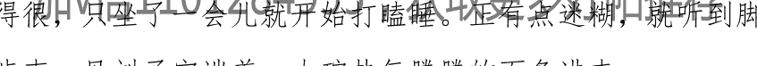

刘子宁陪我坐在一起，问她为什么害怕。她说其实有点害怕的，这小妹妹长得好看，就不觉得那么恐怖了。

我见她胆子大，连尸体都不怕，还怕奶奶？刘子宁怔了半天，有些失神：“有时候人比尸体更怕。”

我有些错，这句话本来是我们行里的格言，没想到这位宁姐姐不到二十岁的姑娘，居然会有这种感慨。我怀疑她之前遇到了什么事情，这刘家大宅，看来复杂得很。

“我……”：“你怎么知道？”我没料到她反应这么大，就说：“在厅那会儿，我注意到了，她一直不敢看奶奶。”刘子宁的脸色一下子没了色，咬着嘴没说话。我有些奇怪：“怎么了，宁姐？你胆子大的，连尸体都不怕，还怕奶奶？”

我看到她就出门了，就听到前头传来惊天动地的哭声。我们赶过去一看，里头已经乱了套，一群人围在一起，几个女人正在嚎啕大哭。


刘家那太太提着个包，一双眼睛得溜溜，正在跳脚大骂：“杀千刀的，害人精！贼精！有种你杀我老婆！我要把你尸万段！”害人精这脸色铁青，咬牙切齿，简直像是恶鬼一般。我看到刘子宁当时就哆嗦了一下，在门口战战兢兢的停不动。这样看来，这位宁姐姐确实是怕奶奶怕得很。

我见三叔也挨着眉头站在人群里，这才放心了，拉了拉刘子宁的手：“宁姐姐，你没事吧。”只觉得她的手冰凉冰凉的。刘子宁反手捏了一下，说她没事。我好奇出了什么事，就背着刘文静进去了。

只一个大约四十岁的中年人倒在地上，面目焦黑，嘴巴大张，直到耳朵后早就超出了嘴巴张弧度的极限。更恐怖的是两对眼睛球子占据了眼睛，完全看不到黑色，只剩了眼白。他不用就知道，已经没救了。那死人脸正对着身子查验。

我接触过那么多尸体，一时间也看不出人类究竟是怎么死的？看到什么物件的，才能知道哪种断裂这样？我挤到三叔身边，低声问他出了什么事。三叔冷了一声，小声把事情倒了一遍。

原本这倒在地的男人姓，是刘家老太娘家那边的人，按辈打算是刘子安、宁姐姐她们的表舅。

这些刘家老太的娘家人，过来这边本来是为了帮忙处理几个后辈的丧事。

我跟姐姐进去里屋后，这姓斋（应为斋）的不知道是不是喝多了，话就多起来，当着这么多面一拍桌子，就指着刘子安。


刘家父亲就骂起来，说他办的什么混蛋事，家里后辈刚落葬，就把灵堂黑布全撤了，还办起了酒席，喝酒乐欢，这不是缺德么！这姓斋的也是喝醉了，闹得叫子比刘子的父亲还要高。刘家老太婆一威，才镇住了场。刘家父亲不敢顶横，只能点头。后来刘子的母亲就忍不住了，哭着。

“不想死的全给我在屋里！”死人脸一双眼睛冷冷的环视了一周，“谁是童子的身的，都站出来。”刘家那老太太在后面声补了一句：“都听先生的！”

在刘父的主持下，刘家子弟和外来的亲戚中陆续有人出现，上到二十岁的年轻人，下到六七岁的孩子，也凑起了十个人。

我一看刘子居然没在这十个人里面，过去拉拉刘子宁的手，好奇的是：“宁姐姐，你哥哥居然不是啊？”

刘子宁一红了脸，“脸，”我一口说：“小子家家的，想些乱七八糟的！”我又问：“你怎么不去？”刘子宁原本脸色有些发白，一听我这话，还是忍不住笑了出来：“你个小鬼孩子，你怎么可能不是，你到底不知道童子身的意思？”

我知道他还知道，可是我之前给刘文静闹过气了，这是要嚼的。虽然这是在迫不得已的情况下，但也已经算失身了，当然就没有童子了。刘子宁“哈”地了一声，说这怎么能失身？我就奇坏了，问她到底怎么算失身？刘子宁脸蛋一红，在我胳膊上拧了一把：“小坏蛋甚至不想好的！”疼得我直跳脚。就会这儿功夫，死人脸让人把所有童子的中指扎破，演出血来盛一个杯子里。

刘子宁满脸疑惑：“这是要做什么？”我斜了我一眼，说：“你也知道。”当然了，这个东西在我们内很有名，叫做‘童子眉’。”刘子宁就奇怪了，“说明明明是人啊，怎么会叫童子眉？”其实也不明白为什么，这名字听起来会让人误以为是童子符。童子眉其实就是手指挤出来的血，在我们行内属于阴，朱砂，效果跟童子符一样。这方法法不是三叔教的。三叔咬了口气：“老太姨，您别再说话了，我保证抓到回来骨扬灰。”我听着就真想上去，暗暗对三叔竖起大拇指。那老婆子尖叫起来：“先生，您来来说，您肯定有办法的！我老婆子在这里拍胸，只要您把那贼种除了，要什么老婆子都满足你！”三叔紧了紧拳，看向死人脸：“什么都满意哦！”

死人脸皱了皱眉头，哑了一声：“给我闭嘴！”他这一声却不如响，却在喧哗的厅堂里听得一清楚。三叔面不改色地跟我窃窃语，倒是其他人都被震住了。刘家那老太婆也变了脸，奶奶说不出来。

“不想死的全给我在屋里！”死人脸一双眼睛冷冷的环视了一周，“谁是童子的身的，都站出来。”

刘家那老太太在后面声补了一句：“都听先生的！”

在刘父的主持下，刘家子弟和外来的亲戚中陆续有人出现，上到二十岁的年轻人，下到六七岁的孩子，也凑起了十个人。我一看刘子宁居然没在这十个人里面，过去拉拉刘子宁的手，好奇的是：“宁姐姐，你哥哥居然不是啊？”

刘子宁一红了脸，“脸，”我一口说：“小子家家的，想些乱七八糟的！”我又问：“你怎么不去？”

刘子宁原本脸色有些发白，一听我这话，还是忍不住笑了出来：“你个小鬼孩子，你怎么可能不是，你到底不知道童子身的意思？”

我知道他还知道，可是我之前给刘文静闹过气了，这是要嚼的。虽然这是在迫不得已的情况下，但也已经算失身了，当然就没有童子了。刘子宁“哈”地了一声，说这怎么能失身？我就奇坏了，问她到底怎么算失身？刘子宁脸蛋一红，在我胳膊上拧了一把：“小坏蛋甚至不想好的！”疼得我直跳脚。

就会这儿功夫，死人脸让人把所有童子的中指扎破，演出血来盛一个杯子里。

刘子宁满脸疑惑：“这是要做什么？”我斜了我一眼，说：“你也知道。”当然了，这个东西在我们内很有名，叫做‘童子眉’。”刘子宁就奇怪了，“说明明明是人啊，怎么会叫童子眉？”其实也不明白为什么，这名字听起来会让人误以为是童子符。童子眉其实就是手指挤出来的血，在我们行内属于阴，朱砂，效果跟童子符一样。这方法法不是三叔教的。三叔咬了口气：“老太姨，您别再说话了，我保证抓到回来骨扬灰。”我听着就真想上去，暗暗对三叔竖起大拇指。那老婆子尖叫起来：“先生，您来来说，您肯定有办法的！我老婆子在这里拍胸，只要您把那贼种除了，要什么老婆子都满足你！”三叔紧了紧拳，看向死人脸：“什么都满意哦！”

死人脸皱了皱眉头，哑了一声：“给我闭嘴！”他这一声却不如响，却在喧哗的厅堂里听得一清楚。三叔面不改色地跟我窃窃语，倒是其他人都被震住了。刘家那老太婆也变了脸，奶奶说不出来。

## 七星魂阵
所谓的七星魂阵，就是用三十六卦，依据当地的地脉走势，形成一个眼不可见的阵，一旦灵异闯入就会被困住，无处逃。。

## 七关
所谓的七关，其实是指一个地方的七个窍洞，分别与天上的北斗星相互辉照。人眼是无法看到七关的。七关就类似于人体的穴位，只不过它代表的是地脉的穴位。掌握了七关，就可以清晰地观测到这个地方气息流动方向。

## 观星
死人脸对，首先是观星。在我很小的时候，三叔就教过我。他说北斗星绕北极星运行，一年中每天都会产生微幅度的偏移。而九天中斗星的偏移位置，就是人能看到的极限。所以在这一行内，有“冲九之数”的说法。死人脸就是用九天中斗七星的偏移位置，再参照刘家宅子里的地形，计算出七关位置和地脉走向。

## 埋铜钱
浸了约三个小时，用镊子将铜钱夹了出来，放到另一个盆中。刘子宁低声问我，钱又是什么。我说：“钱经过万人手，所以古铜钱阳气重。”刘子宁似非重，哦了一声。我此时所有的注意力都到了死人脸上，只见他把盘中的铜钱搓了一遍，绕着棺材一排排的下去，正好将棺材围了一个圈。他取了一个袋子出来，拿上沾了血的古铜钱，分别埋入他指定的地点。我仔细分辨着那些铜钱陆续埋下的位置。

“云关……紫晨……是了，上阳……”我越看着……


自然步只是其中最基本的一种，我闭着眼都不会走错。三叔教给我其他几种步法，就要难上许多，不过平时也用到的。

所谓的“金刚墙”，是三叔很早教过我的一种把戏。我之所以说是把戏，是因为它是用来忽悠人的。在以往我们接的那些生意里，有时候为了多赚些钱，三叔也给人立金刚墙，说是能够镇宅辟邪。

我很清楚那些都是假的，完全就是在忽悠客户。因为三叔教我我的时候，明确说过立金刚墙，七十二铜钱必须立起来。但三叔做的那次金刚墙，铜钱全都平地趴在地上，那就没用了！

“加微信：1101284955，获取更多好推荐。站起来了！”跟着厅中响起一片惊呼声。

我睁眼一看，只见三叔眯着眼睛，围着棺材的七十二铜钱居然笔直直立地站在那里了！

“那是谁去立起来的？”我有些莫名地，刚才只顾走神，没注意。刘宁说：“不是啊！那些铜钱自己立起来的！”

我一下意识地道：“怎么可能！铜钱又没手脚的，怎么能自己立起来来。”刘子宇脸蛋扑扑的：“真的啊！真是自己立起来的！”

我见那七十二铜钱果然定定地站在那里，纹丝不动，不由得惊呆了。

作者:匪离 V 日期:2018-04-19 15:21

刘子宁间问：“这究竟是怎么做到的？你三叔太厉害了！”

我哪里知道是怎么做到的，我自己还在怀疑呢！三叔教过我的那些步法和咒语我都记得，但我一直是装神弄鬼，走走过场，表演给人看的。

三叔回到椅子下，端起茶碗喝了一口，赞了声“好茶”，才说：“都弄废了，应该半会儿就起不了了。”

那人脸搁着棺材转了几圈，回头赞了句：“冯三爷果好手段，这镇的棺阵的金刚都被你布出来了”，可乐得飞起来的。

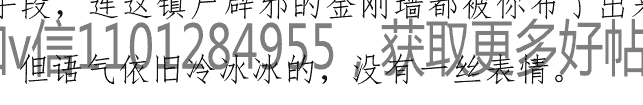

我心里一震，想着居然才知道“金刚墙”。三叔黑了一声，说：“好说就好。”

死人脸转过身，低声跟刘家老太说了几句，那老太婆时咬牙切齿，时点点头如小狗捣机，看着颇为滑稽。

经过这一番变故，连里那些年轻的也都隐约知道现在宅子外有个可怕的恶鬼，正想要杀掉屋里所有人。再加上赵怪那死人还可怕，屋里男女老幼一堆，一个都是噤若寒蝉。

一屋子人就坐在一起等，三叔跟死人脸坐在一起，正在交谈着什么，似乎在谈甚什么。我看得来气，靠到一边，眼睛不干净。刘子梓就坐过来陪我说话，又问你你怎么都不怎么害怕，她都要吓死了。

其实我也是害怕的。我经常跟尸体打交道，但像刘梅这种闹鬼见事，我真没遇过的。

作者:匪离 V 日期:2018-04-19 15:41

不过屋里这么多人，刘娃的丫头要找也要先找其他人吧。

后来直到过了子夜，宅子里都是风平凉静，没闹出什么蚊子。一屋子人都已经开始哈欠连天，特别是有些女小孩，有几个已经是趴在桌上睡着。

三叔就说：“大家都累了，留下一部分人守夜，其他大家都休息。”

刘父不放心，说：“这样会不会妥，是楠……那东西灵进来怎么办？”

“无妨，我在宅子里已经布了阵法，只要她进来，就死不去。”死人冷冷地插了一句。

见人都这么说，刘父就起来吹了下，让刘家老刘先回房休息，他自己以及刘子安家中男的则跟三叔和死人脸继续在前厅。

我在那鬼屋里困了两夜晚，粒米未进，出来后又是愁又是赶路的，这会儿真是困得厉害，隔一会就打一个哈欠。刘子梓就带着我去休息。


刘家子虽大，但这些日子因为家中中弟的丧事，家里头来了很多亲戚，所有客房都被住得满满的。刘子宁说要不带我去她闺房的。

刘子安那，我对这家伙完全没好感，睡觉还打呼噜，吵死了，万一晚上回来来睡，我还不得遭遗殃了？我把头发揉得跟波浪抓似的。

刘子宁怕被她这哥表姨嫂、凭儿女什么样的给占了。

作者:匪离 V 日期:2018-04-19 16:21

路过一处偏矮的时候，我指着里头说：“是谁的，看起来阴森森的。”

“哦”了一声，原来刘子宁之前住在这里。正看到屋里头个人，瘦瘦的男人，头发斑白，眼睛直勾勾盯着，见了我们也没有反应，一下把盆给泼了。

刘子宁拉着我赶紧道：“洗澡吧。”我才知道刘子宁的父亲，只是像个老头。

我注意到他坐的姿势奇怪，仔细一看，发现他的十手指竟然断了，唯独剩下拇指，看上去光秃秃。

刘子宁说：“这怎么回事，好像是早年过过意外，十手指都折了。”

洗好之后，刘子宁又给我拿一套干净的衣服。回到房间后，刘子宁正在解头发，叫我就先上睡。我“哦”了一声，爬上床，躺到里面那一侧，只觉得腻。


刘家子虽大，但这些日子因为家中中弟的丧事，家里头来了很多亲戚，所有客房都被住得满满的。刘子宁说要不带我去她闺房的。

刘子安那，我对这家伙完全没好感，睡觉还打呼噜，吵死了，万一晚上回来来睡，我还不得遭遗殃了？我把头发揉得跟波浪抓似的。

刘子宁怕被她这哥表姨嫂、凭儿女什么样的给占了。

作者:匪离 V 日期:2018-04-19 16:21

路过一处偏矮的时候，我指着里头说：“是谁的，看起来阴森森的。”

“哦”了一声，原来刘子宁之前住在这里。正看到屋里头个人，瘦瘦的男人，头发斑白，眼睛直勾勾盯着，见了我们也没有反应，一下把盆给泼了。

刘子宁拉着我赶紧道：“洗澡吧。”我才知道刘子宁的父亲，只是像个老头。

我注意到他坐的姿势奇怪，仔细一看，发现他的十手指竟然断了，唯独剩下拇指，看上去光秃秃。

刘子宁说：“这怎么回事，好像是早年过过意外，十手指都折了。”

洗好之后，刘子宁又给我拿一套干净的衣服。回到房间后，刘子宁正在解头发，叫我就先上睡。我“哦”了一声，爬上床，躺到里面那一侧，只觉得腻。


股淡淡的幽香绕在四周，好闻得很。刘子宁平时是扎马尾的，解开后梳了梳，头发就刚刚到肩头。她没睡衣，穿了一件白色的短袖T恤和一条粉色的短裤，露出一条笔直白皙的大腿。

我偷偷瞄了一眼，只顾一心砰砰哒哒乱跳，一见她转身来，就忙侧身去闭眼装睡。

“小景？睡了？”刘子宁朝我这边唤了几声，见我回应，轻笑了一声：“这小鬼头，真是坏了！”

我闭着眼睛，不敢回答，也不敢乱动。只听到关灯的声音，然后屋子里就黑了下来。一阵寒索，感觉到有人爬上了床，在我的身边贴。

“这小鬼可爱极了！”我听到刘子宁的轻笑在我耳边掠过，然后替我拉被子盖上。我闻到一股很甜的幽香环绕面前，整个人都缩了缩，心里跳加速。我心里动，一下也不动，心里又有一种奇怪的负罪感。我还是个小孩子，怎么会有这么浪漫的念头，是不是我人体接触有点不正常？

夜很静，我能听到刘子宁躺在我身边呼吸。我感觉呼吸发烫，整个人都绷得紧紧，手心里汗都出来了。听到一阵寒索，大约是刘子宁挪了个身，手臂碰到我的背后。我顿时一阵僵硬，感觉到她手臂的滑腻和温度，也不动。

我之前虽然是真的很困了，但躺到床上之后，怎么也睡不着了，一双眼在黑暗中睁得大大的。也不知道过了多久，感觉刘子宁已经睡着了。我故意叹了一口气，装作梦中翻身，把身子转了转过去。

把眼睛睁开一条线，黑暗中模模糊看到刘子宁面向这边，睡得正熟。我紧绷得厉害，整个人硬邦邦的，慢慢慢慢的，一点点被挪了过去，可以感觉到她口中呼出的气，轻轻地喷到了我脸上。

我当时觉得又是害怕，觉得自己会怎么样，很乖都很眼酸。后来长大一些才明白，当时的我已经输掉了青春，那些萌动竟然是最好的。

我之前虽然是真的很困了，但躺到床上之后，怎么也睡不着了，一双眼在黑暗中睁得大大的。也不知道过了多久，感觉刘子宁已经睡着了。我故意叹了一口气，装作梦中翻身，把身子转了转过去。

把眼睛睁开一条线，黑暗中模模糊看到刘子宁面向这边，睡得正熟。我紧绷得厉害，整个人硬邦邦的，慢慢慢慢的，一点点被挪了过去，可以感觉到她口中呼出的气，轻轻地喷到了我脸上。

我当时觉得又是害怕，觉得自己会怎么样，很乖都很眼酸。后来长大一些才明白，当时的我已经输掉了青春，那些萌动竟然是最好的。

夜很静，我能听到刘子宁躺在我身边呼吸。我感觉呼吸发烫，整个人都绷得紧紧，手心里汗都出来了。听到一阵寒索，大约是刘子宁挪了个身，手臂碰到我的背后。我顿时一阵僵硬，感觉到她手臂的滑腻和温度，也不动。

我之前虽然是真的很困了，但躺到床上之后，怎么也睡不着了，一双眼在黑暗中睁得大大的。也不知道过了多久，感觉刘子宁已经睡着了。我故意叹了一口气，装作梦中翻身，把身子转了转过去。

把眼睛睁开一条线，黑暗中模模糊看到刘子宁面向这边，睡得正熟。我紧绷得厉害，整个人硬邦邦的，慢慢慢慢的，一点点被挪了过去，可以感觉到她口中呼出的气，轻轻地喷到了我脸上。

我当时觉得又是害怕，觉得自己会怎么样，很乖都很眼酸。后来长大一些才明白，当时的我已经输掉了青春，那些萌动竟然是最好的。

夜很静，我能听到刘子宁躺在我身边呼吸。我感觉呼吸发烫，整个人都绷得紧紧，手心里汗都出来了。听到一阵寒索，大约是刘子宁挪了个身，手臂碰到我的背后。我顿时一阵僵硬，感觉到她手臂的滑腻和温度，也不动。

我之前虽然是真的很困了，但躺到床上之后，怎么也睡不着了，一双眼在黑暗中睁得大大的。也不知道过了多久，感觉刘子宁已经睡着了。我故意叹了一口气，装作梦中翻身，把身子转了转过去。

[PAGE 91]

当我们顺着声音上去，就发现前方有一个男人正悠悠地走到尽头，手里拿着一个东西。那东西很大，被他拖在地上。“沙沙”声，原来是东西在地上拖走发出的声音。“快看！”刘子梓捂住了嘴，指着地面让我快看，声音充满了惊恐。我一看，地面上一条血迹，从走廊尽头过来，经过门口，一直蜿蜒过去。空气中散发着一股浓重的血腥味。我一下就明白了，前面那个人拖在地上上的很有可能是抓了好东西。他的脸色惨白，神情显然急躁，我冲了刘子梓使了个色，让她先别唤人，悄悄地跟了上去。等我们上去的时候，那人影已经消失了，四周也没有发现。刘子梓脸色苍白，说：“我们怎么办？”我说：“先去找三叔他们。”我们走到棺前，却发现里面都没有，唯独留着林文静的那口棺停在中，涂在棺上的黑血变成了暗黑色。三炷香插在棺前，烟气袅袅。七十二枚铜钱依然诡异地立在地面，将棺牢牢围住。

img/8fa27b18882d1282a46d57d5782a5340_92.png)

我找了一圈，说怎么连个守的人都没有，人都跑哪去了。刘子宁也有些惊，说：“不会出事了？”我见厅里也不像是变故的架，就再去其他地方找。刘子宁毕竟路熟，我们转了一阵，看到其中一间房子里亮着灯，灯光透过窗映了出来，可以影子看到屋里好些个人。

他们搞得神神秘秘的，就跑到窗口，悄悄探了窗里。刘子宁跟我挪那，伸脖子往里看。只看到屋里头好了几个人，有人抬脸，我三叔，还有刘父、刘子宁等一家伙。一群正围着一张桌子，从缝隙看进去，似乎桌上躺了一个人，死人面无表情地站在那里，看着自己的手指，满手在挣扎着站满了血迹。另一只手戴着皮手套，正举着一个红通通血淋淋的东西。

一看清那东西的样子，我当时就吃了一口，一旁的刘子宁“啊”的一声就叫了。

“谁？”里面的人顿时被惊动了，刘子安带着几个人开门冲了出来。见我们两个，刘子安才松了口气，略带点责任道：“小宁，你们怎么来了？”刘子宁咬嘴唇：“哥，我们……”我懒得废话，直接往里看，看到三叔正神贯注在查看一具尸体。那尸体身上的衣服被扒光，赤条条躺在桌上，胸腔到腹部被拉开了一道长口子，胸腔也被打开了，一团血淋淋的东西被取出，三叔正盯着东西看。那心脏竟然还在跳，看着像花似的。

死人看着自己的手指，满手血迹。另一只手戴着皮手套，正举着一个红通通血淋淋的东西。

一看清那东西的样子，我当时就吃了一口，一旁的刘子宁“啊”的一声就叫了。

直到我才知道刘子宁的父亲，只是像个老头。

我注意到他坐的姿势奇怪，仔细一看，发现他的十手指竟然断了，唯独剩下拇指，看上去光秃秃。

刘子宁说：“这怎么回事，好像是早年过过意外，十手指都折了。”

洗好之后，刘子宁又给我拿一套干净的衣服。回到房间后，刘子宁正在解头发，叫我就先上睡。我“哦”了一声，爬上床，躺到里面那一侧，只觉得腻。

img/8fa27b18882d1282a46d57d5782a5340_88.png)

股淡淡的幽香绕在四周，好闻得很。刘子宁平时是扎马尾的，解开后梳了梳，头发就刚刚到肩头。她没睡衣，穿了一件白色的短袖T恤和一条粉色的短裤，露出一条笔直白皙的大腿。

我偷偷瞄了一眼，只顾一心砰砰哒哒乱跳，一见她转身来，就忙侧身去闭眼装睡。

“小景？睡了？”刘子宁朝我这边唤了几声，见我回应，轻笑了一声：“这小鬼头，真是坏了！”

我闭着眼睛，不敢回答，也不敢乱动。只听到关灯的声音，然后屋子里就黑了下来。一阵寒索，感觉到有人爬上了床，在我的身边贴。

“这小鬼可爱极了！”我听到刘子宁的轻笑在我耳边掠过，然后替我拉被子盖上。我闻到一股很甜的幽香环绕面前，整个人都缩了缩，心里跳加速。我心里动，一下也不动，心里又有一种奇怪的负罪感。我还是个小孩子，怎么会有这么浪漫的念头，是不是我人体接触有点不正常？

夜很静，我能听到刘子宁躺在我身边呼吸。我感觉呼吸发烫，整个人都绷得紧紧，手心里汗都出来了。听到一阵寒索，大约是刘子宁挪了个身，手臂碰到我的背后。我顿时一阵僵硬，感觉到她手臂的滑腻和温度，也不动。

我之前虽然是真的很困了，但躺到床上之后，怎么也睡不着了，一双眼在黑暗中睁得大大的。也不知道过了多久，感觉刘子宁已经睡着了。我故意叹了一口气，装作梦中翻身，把身子转了转过去。

把眼睛睁开一条线，黑暗中模模糊看到刘子宁面向这边，睡得正熟。我紧绷得厉害，整个人硬邦邦的，慢慢慢慢的，一点点被挪了过去，可以感觉到她口中呼出的气，轻轻地喷到了我脸上。

我当时觉得又是害怕，觉得自己会怎么样，很乖都很眼酸。后来长大一些才明白，当时的我已经输掉了青春，那些萌动竟然是最好的。


众人忙将人抬下去，却不立刻松开绳子。

李子宁找过来我，眼圈红通通的，显然刚哭过，问我小舅舅会不会有事，三叔能不能治好他。

我安慰道：“没事的，我三叔说行，那就肯定行了。”其实我心里也没没底，三叔刚才用的方法，他以前也教过我，只是不过我从没当回事。

李子宁“嗯”了一声，红着眼：“堂妹为什么就这么在我们家里呢，非要把家里闹了她才开心吗？”

我不由沉默，怀疑了片刻，问道：“你姐姐，你家堂妹的死，是不是有什么隐情？”

李子宁摇头：“我也不清楚，我平时在外地上学，家里突然出这事是怎么回来的。听说她哭得厉害想对堂妹动手，结果堂妹反抗，被被人那给杀了了。

可是……就算这样，堂妹也该去找那个凶手报仇啊……”李子宁说着，眼着摇头把吧啦捏掉了。这段日子以来，家里人接接二连三的事，虽然对她打击极大。

我犹豫了下，说：“这事好像有点奇怪，你姐姐堂妹出事后，家里也没报警，反而把事情瞒完了。我和三叔打听过，附近人都还没知道你家堂妹出了事情。”

李子宁愣了一下，说她起先也觉得这件事有点蹊跷，不过她问过父亲，说是钟先生交代来的，而且严厉家家里人不许把这件事说出去。

我“哦”了一声：“原来是这样。对了宁姐姐，你听哥说，几年前你二出事的时候，那位先生也来过你家，是有这回事？”

刘子宁脸色突然变白了，说：“好像是有那么一回事。”

我觉得她的反应有些奇怪，想多问几句，突然就听到有人大喊：“烧起来了！烧起来！”

只看见在我们附近的一个中年女人，贴在她心口处的那道符诡异地自燃了起来。我急忙叫一声：“快按住她！”

那女人咔的一声笑起来，双眼睛成一条线，四脚并用，在地上飞掠了起来。所到之处，所有人吓得四散逃窜。

诡异，她那张脸扭得像被揉的纸一样惨烈。

女人的叫，发出一根不像人类的咯咯声，双手并用，露出白森的牙齿，冲着死人脸就扑了过去。

在一片惊呼声中，死人脸伸出左，面无表情地做了个古怪的手势。那女人时凌空被拉了起来，翻了个跟斗摔在地上。三叔叔跃马上前，把一片沾了童子眉、朱砂混合物的柚子叶拍在她脑门上，时刻就把给她封住了。

这一番变故，惊起鹊闹，快得与伦比，在场所有人都被吓呆了。

三叔让人把那昏迷的女人拍到一边，扭了甩手，皱了眉：“这丫头到底什么来路？就算是恶鬼也没她这样的！”

死脸沉默不语，刘父在旁边擦着冷汗，欲言又止。 

三叔哼了一声，冷笑道：“现在大家是一根绳上的蚂蚱，要完一起，你们不会还睁瞒着什么事情不说吧？”

死脸道：“冯三爷，请借一步说话。”两人就走到一个人的角落，低声交谈起来。

过了好一会儿，两人回到后厅，死脸一脸一张僵尸脸，看出不出任何表情，反观三叔，一脸的阴沉，眉纹皱得跟铁一样。刘子说了一句：“宁姐，我去找三叔。”刘子点头，让我去吧。

我去把三叔拉到一边，问他：“冯老三，那帅的跟你信吗？”

三叔白了我一眼：“没大没小！”叹了口气，皱眉道，“这回事情大条了！”

我吃了一愣，说怎么了。三叔说：“这鬼丫头是个怪胎，生下来就没有特别的能力。”

我不明白：“怎么就是怪胎？我还经常被人骂奇怪呢！”

三叔说：“你还记得那个白梅吗？”说我当然记得啊，是刘楠的生母嘛。

“那帅的说了，当年白梅预知白里山塌的事是真的。”三叔说，“而且听说不止预知了这一次。”

我根本就不信：“这扯蛋呢吧？怎么可能真有人能预知天灾？或许只是巧合呢？”

三叔摇头，说：“这世上无法解释的事情多得得很，这白梅八成是真有什么特别的能力。当年这女人死后，是那莉钟的收尾，直接用九柯白骨钉封入尸体处关窍，然后用童子涎全身，弄了个真田阳，直接把尸体烧炼成了飞灰。”

我大吃了一惊。这白骨钉可不是一般的东西，我至今连见都没见过。

所谓的白骨钉，其实是用人骨制成的，配以特殊的法术封入尸体关窍，会让死者永世不得超生。原本是用来制骨钉的，那根手指是最硬的。

三叔说：“当年女人的死，可不简单，这刘娃的九根手指断只剩一根。这刘娃，大概是从她身上遗传了某些的能力。不过小怪物，看起来比她更邪门，现在被人杀了，为了把老婆子钉成飞灰？这刘娃的一家人全是疯子！”

我听得一阵心惊，说：“这事倒跟咱无关，不该是三十六跑路为主？”

三叔摇头：“逃去？谁能拦得住？啧，她奶奶确实不是东西，我非常觉得闷了。”

三叔看着我，只说了一句：“规机行事。”

又说了几句，三叔就被那人脸赶了出去，我只想慌闷不乐地回来。刘子宁一张圆脸紧张得白，似乎有什么话说。我想起她晚上做梦时的怪话，忍不住：“宁姐，当年的是不是知道什么？”

刘子守双目露出一丝慌，咬了唇，正要说什么，只听群中刘父了一声，让大家安静，钟先生说了被这一打，刘子守就把话给了，跟着众人把目光转向人脸和三叔那边。

“这样下去办法。”死脸没有起伏的声音在厅中扬开了，“我跟吕三商议了一下，想出一个主意。既然外头还是进不来，我们派一个人进来，把她引进来。我跟吕三不知道去，有谁胆意？”

我一听，以为死脸想出什么主意，原来是要诱对方上钩！他妈妈的这诡去，能不能把那家伙钓上钩？还没说完，我抛出个办法肯是。整个厅里只有十个人，男女老小齐齐，时鸦雀无声，一个个憋着脑袋，谁也不敢出声音。这道理大家大家都明白得很，谁也不会说出去去当狗。

我冷眼旁观，看到底是哪个霉蛋被扔出去。那死脸还顾了一周，见没人响应，就朝三叔道：“冯三爷，我倒是有个人选，你以为如何？”

三叔“哦”了一声，感兴趣地道：“是谁？”

死脸缓缓了个身，把目光落到我身上：“你家里不错，胆大心细，有勇有谋，我看他了，就没有合适的。”

我一听这话，真想直接上去抽掉他的。这老东西，良心真是黑透了！

三叔笑眯眯的，说道：“过奖过奖，我们家小确实错。”说到这里，舌锋一转，“只是我们家，他是要当半家的，所以我也做不了他的主。这事你还得问他，如果他愿意去，我没问题。他不愿意去的话……”推了推手，“我也是没办法。”

果然是我亲三叔，这话听着就特别有用！我脆地把头一摇：“不去！”冷眼看着死人，心想话都说到这份上了，看你还有什么话说。就刘家这破事，还想看你命，命都没有！

死人脸森森地站在那里，看向我的光景寒大盛。我可不会被他听到。

“不过……”我口风一转，说道：“我倒是特别的，保管能把她引领。”

死人脸无表情地道：“说说。”

我站起来，抬手朝那边：“合适的就是，只要你去挡，跳马上一通，保管你家。”

刘子守一愣愣，白着脸走了过去。老老婆用笑着拍了拍他的肩膀，开了，跟刘子宁说：“宁姐，你都不啊，我真有点困了。”刘子宁刚才也是紧张，怕我被人脸给出去，低声骂了一句：“哎，什么人，让小子去冒险！”看到她睡觉时穿的那粉色短裤，露出两条笔直的大腿。刘子宁我这不，这刘娃的事，我我看着。

刘父在另一边擦着汗，问：“钟先生，小女……小女她不合适吧？”刘子的哥哥刘子安也是一脸焦急：“闭嘴！现在都是什么时候了，刘家要遭大难了！”

一个尖细的声音从群里传了出来，原来是刘家老太太，把拐杖一扔，脸就把刘父斥出去，随即脸色一柔，笑着招手：“乖孙，过来。”我一把拉住刘子守的手，让她千万去。刘子守小脸煞白，咬着唇不知好是。眼睛直直勾勾地盯过来，像是一头乖崽似的。刘子守吓得一愣愣。

老老婆真是我的孙女，”又叹了口气：“小宁啊，奶奶从小教你，乖做人啊，要懂得知恩报。咱们家养你这么大，今天大难临头，你该怎么做？”刘子守咬着嘴，眼泪在眼中直打转。我在一边看得牙根直痒，忍不住咬道：“老老婆，有本事你出来啊，凭什么害我孙女！”老老婆眼睛一瞪，狠狠的像狼似的，冲我尖叫：“哪来的野孩子，这里哪有说话的份！”

还没来得及反击，我三叔先忍不住，冷笑一声道：“哟，刘老太太太威风！我们家陆的话，就代表冯三的话，你有什么意的？”

果然是我亲三叔，给我竖起一个大拇指！见我三叔了，死脸也沉了，皱眉道：“刘夫人，你别说话了。”那老婆显然对死十分十分夷，见他说话，就咧喇地闭了嘴。

“不过这个姑娘还是合适的人，必须让她去。”死脸面无表情地说，示意刘子准备一下，呆会儿就出发。

病容，原来是刘子的哥哥刘子安，“我替我妹妹去！”他急得跑出来，脸色惨，满脸泪带我不意外，没想到这家伙看起来却一副胆小又弱的样子，危急关头还敢替他妹妹出手，这让我不禁对这个人的印象大为改观。

“你不许去！”刘家那老婆立刻尖叫了一声，指着刘子安怒骂，“不孝的东西！刘家还指着你传宗接代你不知道！给我回去！”刘子安低着头，就是不退。

死人脸看了刘子安一眼，似乎有些意外，说道：“你不行，比不上你妹妹的心思单纯，脾气不够淳。”

我必须要承认，死脸并没有谎，在这些人当中，唯独李子宁心思纯正，胆气足的。作为诱饵，从理性来说，她最适合。

我这当着这么多面说过，心里还是紧张，脚下抖。让我挂在胸前，“这是护心符，另外这是清心符。”塞给我一截紫色的片，上面刻满了繁复咒语，“你之前遇到过的心、魅惑这两种能力，你出去就把符含在嘴里。”见我收下了，又带我到地方，教了一段不长的咒文。他念了一遍，让我复述一遍。第一遍我只背了大概，他又复述一遍，第二次我就完全地诵下来。资质是不错。”死脸点头，让我出去就在心底默默念这段咒文，可以清心护体，破除虚妄。回到过去，三叔过来深深望了我，塞给了我团白色、绳子粗细的麻绳，交代我有机会就拿这绳子把鬼头捆住。我看这绳子实在是寒碜，恐怕连人都不住，怎么绑刘楠这样的恐怖存在？三叔拍了一下脑袋，说：“这可是咱家的宝贝，别给我弄丢了！”我实在是不以为。死脸在旁，突然出声了一句：“捆尸绳？想不到这东西竟然在你手里。”三叔啧了一声，没说话。我很奇怪，难道连人都认识，难道这绳子真有什么秘密？但我来看也看不不出这破绳子有什么值得的。

既然如此……”死脸又取出巴掌大的牛皮袋子，递给我，“这是腻蟒沙，可以退鬼，要有机会你就那鬼头眼睛上挣。”我打开袋子一看，里头大概半袋子深黑色的粉，但细细看，似乎有一丝幽光夹其中。我从没听过腻蟒沙是什么东西，看了一眼三叔，见他点头，就收起来。死脸略作调整，在正门位置放一个缺口，形成七星封魂阵的一个生门。我要做的，就是作为诱饵，把鬼丫头从这个口子引入中。

我承认刚完全就是一时冲动，刚出刘家大门，就已经腿发颤，后悔得不得。懊把给我能的，这回说不定就见到刘王了！刘家大外和大宅内，完全是两个世界。此时已经过了后夜，天空中阴云破碎，可以看到一弯彩月挂在天际，几颗星稀疏疏。月光冷清清的倾洒下来，照得四周白幽幽的，景物依稀可见。只是寂静得很。这种感觉我曾亲身经历过一次，是在家里守睁那，听不见犬叫猫叫，也没有此起彼伏的虫鸣，万俱后的，整个。

反而有可能自寻死地。就比如一头冲向石头撞死，又或者被什么丝绊一拽被根枝插死，这种事情我觉得多了。

正在有些些走神的当儿，一双手已经摸棱上了我的脖子。

这两手冰冰凉的，又滑又腻，还带着某种潮湿的气息。我顿时就再也无法挣扎，大叫一声撒腿就跑。但他那双手一下勒住了我的脖子，那力气大得吓人，我当时一喘息，差点吐了舌头。这时再也顾不得他，双手抓住那手，顺着脚下用力，眼睛直向后撑去。只顾得背后撞到一团柔软浑圆的东西，立即醒过来撞到了什么。

勒住我东西绝不是什么鬼丫头，因为小丫的胸口没这么高，身体也没这么远。我横命乱推着，觉得打在一团黏糊糊的东西上，趁扭住她腿肠，从脖子上挣了出去。

一睁眼，就见到一张烂了青狞的脸。是女尸，不过三十，脸已经烂了半边，一股臭味直冲脑门，看着尤为恶心。

要不是我经常跟尸体打交道，早已习惯，换别人来，恐怕真的都要被吓过去。那女尸露出两颗白腻见的眼睛，直勾勾地盯着我，她张了半边的嘴发出呵呵呵呵的声音，白森的牙齿磕着，朝我咬过来。

幸好女尸烂了一大半，身上一团腐肉，我用力一挣，就从灶肉中滑出来了，打个滚一圈，顿时心都凉了！

四周不知什么时候爬满了尸体，有男有女，粗粗一看少说也有七八。身上还残留着泥污污染，显然刚从坟堆里爬出来的。

我脑子一下就懵了。其实在我们这行的眼里，起尸是正常的纯粹的。因为人死之后就属于阴气，需要入土为安。一旦这尸体还含有一口阳气的话，就有可能会起尸，也就是俗说的诈尸的。

我家千也不少少年，当然见过不少起尸的，但从未见过像今天这样规模的，而且还是这种已经在地发掘很多东西！这简直也完全脱离我的认知！

幸好这些尸体虽然看着恐怖，但毕竟只是一些腐肉，虽有力气大得异异，行动迟缓，而且看起来没什么灵智，只会歪着头看着我。我手脚并用，从围圈中挣了出来了。

这时，眼角忽然看到坟堆中红影一闪，刘家鬼丫悄无声息地跑到了我左近。

我赶紧低头闭睁眼睛，转身欲逸，一只伸手探衣袋，抓了一把细鳞蟒，反手就扔了出去！此时我也顾不上撇掳没掉里，接着又是几把抓出，大吼一声，凭着记忆，闭着眼睛就扑上去，感觉撞到一个人，身材比我略矮，而且也没有那种腐味，当即就拦腰抱住，用尽全力往前一扑，把她压倒在地。

只听到“噫”的一声，听声音应该是个小姑娘。也不管三七二十一，一手搂住她的脖子，另一只手掏出三叔给我的捆绳，先套了过去。

但我闭着双眼，无法视物，再加对方力意料得大，打折，在地上连打了几个滚，顿时就把我也绕了进去，一括在里面。

我原只打算捆绳是粗破烂绳，一根筷子那么粗细，若是起尸的鬼了，就连普通人都捆不住。但这就会出现麻烦了，绳子竟然还有点粘，越缠绕的绳越挣扎就收得越紧，而一会功夫，我妈就被勒得要吐舌了！

那鬼丫头像根本不受影响，一个扭扭扭，我被绳勒上气不接气，紧紧贴在她身上，要这样勒下去，那鬼丫头没事，我就被勒上了！都到了命攸关的地步，什么也不顾上，把眼睁睁，见跟我在一起的是刘家鬼丫头，被绳缠得死死的，身子扭动，发丝散乱，一双眼睛被覆盖了一层薄膜，看上去极为诡异。我立刻意识到是细鳞沙作用了。当时我还是第一次接触细鳞沙，只是细鳞沙可以遮住。

细鳞沙是一种非常奇特的特性，这种细鳞沙是由深潭中生长的一种鱼类身上获取的。这种鳞而出后，一旦遇到物体，首先就会汇聚于其双目，令其盲，再进一步则侵入耳鼻，使其失去听觉、嗅觉。细鳞沙是一种用来对付非常有效的东西，只有细鳞沙足够粘稠，才能获取更多腐肉被细鳞沙锁倒，顿时分散方向，开始四处转。

这就功夫，我的骨头被勒得格脸都成了紫色，忍住大吼一声：“他妈的别动！”但我此时连气都喘不过，心中又急又怕，家里里面的人怎么出来救人，只想停下来，气到她嘴上，鼓足口气灌进去。

但事实上，这方法失败了！我心一横，一口咬破舌尖，直接把一口血流了进去。舌尖血在我们，奇迹终于出现了。我带着她，拼力气翻一滚，朝着刘家大宅滚的时候，已经两眼黑，连呼吸都困难再也挪不动半分，不仅脱力，连神都开始迷糊，这样下去就只有死的份了！

就在这时，隐约听到旁边传来脚步声，眼前模糊地浮现出几个人，一共的是三叔和死脸，其余等人后面，只站在里面跟，向外张望。

我精神一振，连呼吸都顺畅了。只见三叔焦急地冲上来，就要解开我身上的捆绳。

“等等！”死脸刚抢一把，抓住三叔，手中捏着道符，正对着刘柱的脑门拍下。我想这个人果然小心谨慎，理智非常，突然一只白色的手从我腋下伸出，如闪电般插进了死脸的胸膛！我脑子里一片，根本来不及做出反应，就见眼前人影一晃，原本离我几步远的三叔，在瞬息之间闪到了我身侧，手掌拂过，顿时一道鲜目的血出现在刘楠额头，紧接着手指如鼓一轮弹出，顿时点点了刘楠身上处夯。

与此同时，被刘斧一只手穿透胸膛的死人脸竟然变成了一个稻草人，歪歪斜地挂在她手上！真正的死人脸沉沉地从门后出现，大路起来，双手连运，瞬间几道黄符被贴到了刘斧身上。

直到此时，我才算醒过来，原来我刚才彻底被双方当了一枚棋子。这死人脸在刘家大宅布下七星封阵，只等刘斧进来，但这鬼丫头也不傻，就在外头守着，不肯踏进刘家宅一步。这下子双方谁也奈何了谁，就形成了僵持的局面。最后，死人脸三叔商出主意，就是丢一个诱饵加持符。结果，刘斧错误获取了她最诱惑的诱饵。我出去之后，又是抓抄，又是捆绳，最后甚至把阳血术都用了，自以为颇有能耐，一通乱拳，居然把鬼丫头给制住了！可我万万没想到的是，那鬼丫头被我制住，完全是有意为之，不仅让我以为已经被困住，更让刘家大宅的人以为她已经了。我倒成了诱饵，这鬼丫头是命了，这鬼丫头被引了出来。趁此机会，三叔和死人脸早就想到了这一步，反而将计装作毫不知地被引出去。等鬼头出发雷霆，死人脸不知道什么障眼法，竟然用一个草人。三叔和死脸立即出手，就把鬼头完全控制住！至于我……什么都不说了！他妈的，还不快放我！”刘宁站在门口，眼圈通红，冲过来抓住我胳膊，检查了一下：“怎么样，没有不舒服？”不想理他。死人脸扭了扭嘴唇，像是笑了一下，冲我点头：“真是不错。”不错你爷！我想喊句“姐姐”，只觉得一阵眩晕，差点一头栽下去，幸好被刘宁一把抓住。我忙说：“没事，没事……”就是有点头晕，被捆绳勒得狠了，现在都缓不过劲。话说间，鬼头已经被推进了大宅。这下子，有七星魂阵，再加上三叔和死人脸各自的手段，这鬼头再大的本事，也难了。刘家上下十几口，大多数人还是畏惧，只敢远远地偷一眼。反倒是刘家老太婆，真是疯了一样，闹着挑杠，冲到鬼头面前，破口大骂，一个贱人，一个种，就把她孙女剁成八块，撸掉！鬼头乱一手保持伸出的姿态，头发有些凌乱地披下来，娇小的身材，孤寡地站在院子中央。虽然看起来才十几岁，却不是一个小姑娘。我松了一口气的同时，心底不由得一阵惨然。叫又跳，简直像疯子。我听得实在厌烦，真想拿泥把老太婆的嘴堵住！死人脸眯看着她，似乎定了一定，过了好，睁开眼，摆手让老太婆安静下来，紧接着把刘安招过来，轻声了几句。刘安听边点头，之后跑到屋屋去，不久拿来一个书大小的檀木盒子。死人脸打开。我看了一眼，只见里面整齐地排放着几根钉子，长短不一。我起先在疑惑这是什么钉子，怎么没见过，后来就猛地醒过来，我知道这是什么东西！这就是白骨棺，正是他弄出来的。死人脸又是哪里来的骨，竟然给他弄出一套白骨棺来。

“弄死他！弄死他！”刘家老大老一双眼睛眯着狂光，咬牙切齿的，这种眼神简直比魔还要恐怖。死人脸从盒中取出一根最短的骨，夹在手里，隐约可见脖子纤细的皮肤密密麻麻地刻着符文和咒语。他的视线锁死身上，心脏快得几乎要跳出来。下一处，这是人的第一个关节。接着挥手掠过，一气提起三枚白骨钉，瞬息封了背后脊椎骨三大关节，我站在旁边，甚至清晰地听到钉子穿透血肉骨的声音。刘柳身上纹丝不动，兴许是受制于封禁，想动也动不了了。她的一双眼睛，神的效果早已褪去，冷漠地望着院中的所有人。那种眼神，我从来没见过那样的眼神，没有一丝生气，没有一丝温度，有的只是绝望和寒意。死人脸的动作极快，双手连搓，眨眼又是再按下去，封入了体内。再加一根骨钉，这是最后一枚，也是最长的一枚。他夹着骨钉的手轻轻扬起，只要钉子贯入脑顶，就完成了封咒！死人脸落下的瞬间，我不由禁，另一个人的声音几乎传出。接着有一道灰色身影奔过来，因为跑得太快，我摔了一跤，从地上爬起来。

“不要。”刘宁一声哭了。我看着刘文轩在血泊中死目的样子，觉得心里一片斑然。究竟刘文轩说不是真的，难道刘梅是被这个亲生父亲杀了？我当年年纪还小，很多事情还不想清楚。几年后我有了更多的阅历，才慢慢琢磨出了当年的几分真相。“不可能，怎么可能……”话音未落，突然间双手夹着刀用力抹，瞬间一腔血射而出，洒在她女儿身上。这一刀抹极为用力，鲜血涌不止，咯噔一声在地上。三叔和死脸赶上去，当时就没了。事情发生得太快，很多人甚至还没反应过来。过了一片刻，刘家家里响起来惊慌的尖叫，刘家老太太发出像猪一般的嚎哭声，一下子瘫坐在地上，嚎大起来。又开始话伦次地咒骂白梅，咒骂她是个害人精。刘宁的一声哭了。

刘父等人面如土色，一群亲戚也是神情各异。刘父上去紧紧拽住母亲的衣服：“妈，您不要胡说，弟妹的事是走火，跟你有什么关系？”刘家老太太目狰狞，一把甩开儿子，格格大笑起来：“就是我烧掉的！那个女人，我恨不得抽她的筋，剥了她的皮！钟先生，你抓紧把这个祸种全灭掉，就像当年那个人一样，让她永世不得生！”这老太太真是狠厉，简直就是个老怪物！我看着三叔，准备让她悄悄过去，我想问问他能不能把刘楠那丫头包下来，至少要让她落个白骨夺身的下场。

这鬼头已经被推进了大宅。这下子，有七星魂阵，再加上三叔和死人脸各自的手段，这鬼头再大的本事，也难。刘家上下十几口，大多数人还是畏惧，只敢躲在远远地偷一眼。反倒是刘家老太婆，真是疯了一样，闹着挑杠，冲到鬼头面前，破口大骂，一个贱人，一个种，就把她孙女剁成八块，撸掉！鬼头乱一手保持着伸出的姿态，头发有些凌乱地披下来，娇小的身材，孤寡地站在院子中央。虽然看起来才十几岁，却不是一个小姑娘。我松了一口气的同时，心底不由得一阵惨然。“钟先生，赶紧把这身俏骨扔了！快！我一眼都不看到这畜生！”刘家老太婆闹着挑杠，又叫又跳，简直像疯子。我听得实在厌烦，真想拿泥把老太婆的嘴堵住！死人脸眯看着她，似乎定了一定，过了好一会儿，睁开眼，摆手让老太婆安静下来，紧接着把刘安招过来。

僵持的局面。最后，死人脸三叔商出主意，就是丢一个诱饵加持符。结果，刘斧错误获取了她最诱惑的诱饵。我出去之后，又是抓抄，又是捆尸绳，最后甚至把阳血术都用了，自以为颇有能耐，一通乱拳，居然把鬼丫头给制住了！可我万万没想到的是，那鬼丫头被我制住，完全是有意为之，不仅让我以为已经被困住，更让刘家大宅的人以为她已经了。我倒成了诱饵，这鬼丫头被引了出来。趁此机会，三叔和死人脸早就想到了这一步，反而将计装作毫不知地被引出去。等鬼头出发雷霆，死人脸不知道什么障眼法，竟然用一个草人。三叔和死脸立即出手，就把鬼头完全控制住！至于我……什么都不说了！

刘宁站在门口，眼圈通红，冲过来抓住我胳膊，检查了一下：“怎么样，没有不舒服？”不想理他。死人脸扭了扭嘴唇，像是笑了一下，冲我点头：“真是不错。”不错你爷！我想喊句“姐姐”，只觉得一阵眩晕，差点一头栽下去，幸好被刘宁一把抓住。我忙说：“没事，没事……”看着刘文轩在血泊中死目的样子，觉得心里一片斑然。究竟刘文轩说不是真的，难道刘梅是被这个亲生父亲杀了？我当年年纪还小，很多事情还不想清楚。几年后我有了更多的阅历，才慢慢琢磨出了当年的几分真相。这刘文轩是个弱性，一边是慢于母亲的威严，一边在心里极爱妻子白梅，他就是这间的肉刀。当白梅被烧死之后，他居然砍下九根手指给死人脸做白梅骨，其中的原因值得玩味。其一，应该是刘文轩毕竟至孝，在得知白梅死后会对家族不利时，选择了听从死人脸的建议，选择彻底毁灭自己最爱的女人。其二，其实炼制白骨并不是非得要他的手指，应该是明白白梅去后，他心已死，用断手指的剧来缓解白梅世痛苦。在这个时候，刘文轩的精神就已经不正常，产生了严重的分裂。之后随着刘一天天大，这女孩子的古怪和与众不同，随时随地折着刘文轩的心。再加上母亲这边的压力，无止境的风言利语，让他彻底崩溃了。于是在刘梅与刘家太太的一个冲突瞬间，刘文轩终于发疯，砸毁了自己的生女儿。因为在刘文轩心中，刘梅早成了他的心魔。这女孩就是她八岁那年割断刘梅手指时就命了，也许这一切对他来说是个解脱，但这个谜却也随着他永远埋在了地下。我当时愣愣站在刘宁旁边，我习惯和和死打交道，小小年纪，总以为自己习惯了死，但这对刘文轩的死，却在我心里掀起滔天波澜，久久无法平息。


了出来。

我连忙大叫一声：“三叔，白骨钉！”

三叔和死人脸原本正忙于处理刘文轩的事情，听到叫声，豁然抬头。就在这时，原本已封入棺尸体内的八根骨钉，猛地倒射而出，撞到墙上碎成粉末。其中有一枚刚巧射入刘家一个亲戚的大腿，顿时发出一声惨嚎。

三叔和死人脸脸就开始动了。三叔出手就是捆尸绳，死人脸又是几道符符贴了上去。我见刘满一双眼睛已经隐隐露出诡异的血色，不由得心惊肉跳。

所幸在三叔和死人脸两只老狐的加持下，刘满最终被镇压了。

刘家老婆尖叫，咬着牙齿，又叫又跳。

死人脸摇了摇头，只是反复看着手中刺下的那枚白骨钉。

三叔也是黑了脸：“九阴符均不奏效，麻烦太大了！”回头刘文崇赶紧紧再去准备一口棺材，要跟刘文静那同规格的。

之后刘家大宅又是一阵混乱，有人收拾刘文轩的尸体，有人去准备棺材，还有等人趁着这时机，已经逃出了刘家。

这番折腾下来，东方已经逐渐亮起。

我出了刘家宅子一看，那些腐户什么的，已经不见了。大约是没了刘楠控制，都四散去了。回到前厅的时候，刘楠已经被捆着捆尸绳封入棺中，同样布置了金刚阵，跟刘文静并排安放。

刘家那些亲戚基本上跑光，家里只剩刘家的一些本家弟子，以及一些雇佣的工人。刘子宇去了厨房帮忙，正给大家准备早饭。

我又又累，搬了两张椅子拼了拼，就着睡了一会儿。直到被子宇挪醒，让我起来吃早饭。一群人在前厅围了一张大圆桌子，少了了那些亲戚，刘家的人剩下的就不多少。

吃完热腾腾的小馒头，刘家开始作作。刘家老太太不在，刘子宇说她是身体不舒服，躲在房里休息。我三叔和死人脸也显得尴尬，我知道这两人现在正在房里秘密商谈，连早饭都是让人送进去的。

刘子宇坐在旁边，她已经换了一身衣服，素色的条长裙，扎着马尾，一边喝粥一边走着，问我：“你三叔和钟先生都过去好久了？”

我点头说是啊。她问：“接下来会怎么样？”

我摇头。我其实也不知道这件事究竟要怎么收场。虽然现在暂时制服了刘楠，但显然能困得一时。其实对于这件事，最正道的做法应该是让刘文静和刘楠两人入土为安，超度其亡魂。

但现在看来，基本是不可能的。

一顿饭结束后，众人都在各自忙碌，刘子宁陪我在门口坐了一会儿，就见三叔和死人脸从房里出来，刘文崇当即召集了刘家所有的弟子来到场。

“当年白梅的事情，你们谁比较清楚？”三叔扬声问。

众人面面相觑，几个小辈一脸茫然。倒是刘子宁的母亲出言说，她和白梅这对闺眼里虽然没多少交往，但同刘家里其他人比起，多少是要了解一些。

三叔接说：“听过白梅以前有个习惯，每年都要消失一个星期，是个个性的。”

刘梅点头：“是有这么一回事。她每年在七月份这段时间总要离开刘家一趟，一个人出门，连文轩都不带。”

“哦？就她一个人？”三叔道，“那你知不知道她去了哪里？”

刘梅想了想，说：“我有特地问过她，她说是回老家一趟，至于去做什么，我就不怎么清楚。”

“白梅的老家是哪里？”死人脸面无表情地插问道。

刘母连忙说：“这个我知道的，我怕忘了，还特地记下了。”刘叫刘子宁，低声嘱咐了几句，让她去房里给她把东西拿过来。

刘子宁听了就跑去了母亲房间，一会儿取了回来红木盒子。刘母取过钥匙打开了，取出一个本子来，翻了几页，说出一个地名。

这地名有点怪，叫鼻子寨村。后来三叔他们查了才知道，原来这小山村却是远在南疆的一处山村。

按照三叔和死人脸商量的结果，他们认为想要彻底解决这件事，必须要弄清楚刘婶母亲白梅的来源。

最后的决定是，明天一出发，由三叔和死人领队，带着刘文静和刘嫡的两口棺前往鼻子寨村，随同的人有刘文崇、刘安等几个家属，其余留家中。不过刘家老太太得知消息后，立即从床上爬下来，坚持要跟着。三叔原本坚决不同意，建议她留回去。刘子宁也想同去，因为要留下照顾母亲，最终未能。

由于要运送两口棺，我们没法坐车，只能在当地包了两辆大车，一辆用来运棺，一辆用来坐人。刘家财大气，除了随行的还雇了十个壮汉。

从我们住的地方到南疆，路途漫长，还是第一次出门，不由得感新鲜，坐在位置不停地张望。三叔和死人脸后面那辆运车颠颠簸簸，走走停停，大约三天之后抵达南疆境内。

白梅的出生地，也就是那个寨子村，落在南疆深处。大山位于南疆西南，山峰层峦叠嶂。

抵达南疆境内后，我们就找了个人导游。这人瘦瘦，长得矮小，我们叫他黑猴。

而寨子村位于喀喀以南，旁边有座大山，山上有很多石形，因此得名。我们深入大山后，车就开始变得难以行驶，推进几十里后，终于无法坐车。一行人从车上下来，由雇来的壮汉四人一组抬棺前进。临行前，三叔反复交代他们抬棺的注意事项，切不可随意。

山路曲折，两侧山峰层峦叠嶂，绿茵如盖。我长大大多都是小山，哪里见过这样的大山，不由得感奇。大约在深山中行了三天，黑猴站在一块岩石上向前眺望片刻，喊道：“再走半天，我们就能一振！”

我们一听，都是精神一振。队伍停下来就休息，烧水煮干牛肉和炒肉来吃。刘家老太婆倒是挺能折腾，这几天的山路下来，竟然还能等到现在，也令我刮目。

我们找到三叔，拿了块牛肉，吃边低声说：“等这事结束了，回头我们怎么办？总不能让头呆吧？”

三叔沉默了许，冷笑道：“这锅不能让刘家来卖，通过损失的胆量，怎么处理。至于他的那个侄，恐怕办不了的。”

我听得烦闷，抓了块牛肉就一个人跑到山岩上随意乱逛起来。三叔叫我别走太远了，我哦了一声，继续往前走。

在这深山之中，气温要比外面低了不少。转过一块像大黄斧的岩石，只见前方乱石嶙峋，是个陡峭的乱石坡。在我们的后山也有一片乱石坡，只是规模不及这边大。我很小的时候，三叔就打算搂我去攀爬纵跃。三叔说这是我们这一行的必修课，因为我们这一行交道的全是死人鬼，是高危行业，不时的就会碰到一些蚊蛭，所以必须要有灵活健壮的体魄、精通各项求生技能。

以前看到这片乱石坡，我还是觉得颇为亲切，把牛肉往嘴里一咬，就手脚并用快速地往坡顶攀爬。这种乱石坡，别的还好说，最怕的就是不小心碰到那种松动的石头，很可能就会酿成大祸，所以这也是门技术。

到坡顶后，一抬头出去，果然风景大为不同。我在顶上蹲了一会儿，听到前方隐隐有人声传来。我起身转过一块形状似大黄牛岩石，过去一看，发现下面是一条峡谷。狭窄的道路上有一群人，正坐在地上休息，看风景似乎与我们一样，是属于荒来的。

发现这群人大概十来个人，三三两分布在外围，看似随意。从上方可以清楚看到这些人的位置。突然听到身后一阵响动，我豁然起身，随手捡起石头，躲在旁边的岩石中间。

一人影从岩石后转出，是个男孩子，跟我差年纪，模样长得不错，唇红脸白，腰杆挺直，穿着打扮带着一股书气，跟我格格不入。我打量他，发现他有些奇怪。

“你叫什么？”我问。

他笑着看着我，点头：“我叫思寒。请问你是？”

我说：“我叫集。”

思寒走到我旁边，坐下：“你在这儿干什么？”

我说没事。我见他额头出汗，问：“你也是爬上来的？”

思寒眼睛亮了，说：“实在太厉害了！”

我估摸着说了时间：“你爬了多久？”

思寒指着那边：“是从那边过来的。”

我撕了一块牛肉递给他：“吃吃。”

思寒叹了口气：“真累了。”我问起：“你是跟着谁学的？”

思寒点了点头：“我是跟着我三叔学的，属于家传手艺。”他一脸好奇，问：“你家里是做什么的？什么行业用到这种攀岩的技巧？”

我就把家里干什么的告诉了他，心还不把你这个小哥吓得满嘴流。小时候家里干这一行的缘故，我早已习惯了做没人理解的怪胎，所以这种事情见多了。没想这些人是个奇葩，不但不忍，反而一脸兴奋地问我：“这一行是不是很有意思？是不是要经常接触尸体？”

“对啊，我这两手是从摸尸体长大的。”把手伸过去在他面前晃了晃。他抓过我的手指细看，一会儿就惊呆：“你的手比我的还修长匀称，怎么出来的？给尸体化需要特别的手法吗？”这人真的是个问题宝宝，我把手抽回来，愣了他那双手一眼，果然极为修长，指甲修理得干干净净，手形很好看。

钢琴这种东西，我只限于书上读过，不过老师说起来，弹钢琴似乎是一件文艺时尚的事情。听说人会钢琴，我还是有点小佩服的。这些年来，我在村里就是个没人的孤僻小孩，除了林能跟我说村上的话，根据我最熟悉的惯例，难得遇到跟我差不多年，而且还不避讳我，两个人不由聊得兴发，浑然忘记了时间。

思寒接过放在嘴里，说：“是挺好味啊，味道很正宗！”我见他吃得高兴，问：“你看样子，不是本地人吧？这里来干什么？”

我这一话出口，见他的脸就是一变，神色黯然，又叹了口气说道：“为了我妹妹，我妹妹她得了怪病。”

我想到峡谷下那群人，问：“你妹妹出了什么事？”

思寒脸色发白，看了一眼，眼神中充满哀：“我妹妹才两岁的。大概半个月前，有一天深夜，妹妹房里传来阵阵怪叫，众人围一看，发现妹妹床下跳出一只黑猫。是我妹妹在外面捡起来，后来养在家里了。妹妹在家里是最宠的，谁也没敢碰她。黑猫只会缩在房间里缩成一团。父亲也没看出什么，只找当地最好的大夫等药物服过敏再给她吃养。结果当晚，房中传出姑娘凄厉的尖叫声，众人围一看，可把人都吓了，女孩眼里两睁白的躺在床上，一条裙子支离破碎，身上到处都是抓痕，血迹斑斑。黑猫站在床头，身上都是血，耳朵折了，尾巴竖起，浑炸毛。父亲看到那时心疼，勃然大怒，命人赶紧把猫抓住。黑猫原本就瘸了腿，很快被人围起来拿绳子套住，当场就要勒死。还是思寒思慎，说这猫是妹妹喜欢的宠物，万一弄错了，没法交待。他这一说，那只猫的小命总算给住了，不过命运却好不到哪去。顾家姑娘在家里可是掌上明珠，上还不疼爱？如今见小姑娘伤成这样子，一个宰拿猫杀，拿绳子折了个结，扔进笼子里就不管了。之前那大夫赶过来，进去看一眼就滚带爬地逃了，直叫“见鬼了，见鬼了！”父大大怒，拦了那大夫就进了女儿房。大夫战战地指着小姑娘：“……”说不出。结果被顾父抽了一巴掌，大夫说是贪取很多好处推她长卜斑了！”

普通的普通的。顾父见女儿还枉样诡异，明明还有呼吸，竟被这庸医说成了卜斑，一怒之下，直接把人给丢出去。

思寒，只可惜他师父年前出了远门，不知，否则还可以请他老人来。后来顾家有长辈说，女可能是招邪了，抱着死马当活马的心态，就把周围有名的一些道士神棍都请来了。结果说是丢魂的，有说是被猫附体的，有的直接说那只狸猫就是祸害她妹妹的凶手，要求直接斩猫，众说纷纭，各有的理。结果这一法事做下来，基本是不可能的。但现在看来，基本是不可能的。超度其亡魂。


其中一个男人身材高大，衣襟阔臀，背着手站在那里皱眉沉思，不怒自威。另一人戴着一副金丝眼镜，相貌清秀，比之前那个男人略矮，年纪大概也要小他上几岁，正跟他旁边一位顾思寒小声的美人低声说。

顾思寒小声跟我介绍了一遍。原来这气魄很大的男人就是顾思寒，戴眼镜的是他二叔，另外那个美女是他姑姑。

我在小山村长大，虽然平时跟三叔比得比较好，但自从上学后，老老师们也教了我们一些礼仪的问题，想想，上前恭恭敬地敬道：“两位伯父，姑姑！”

顾父正在沉思，被我惊醒，扬眉看了一眼，似乎有些意外。顾思寒立即就把我介绍了一下，显然是刚认识的朋友，想要相信，获取更多推荐。

顾父点点点头，笑道：“我这儿子眼光很高，难得带回来朋友。”声音厚实，带着沙哑，显然是这些疲惫过度，“不过我女儿的……确实……有些吓人。”

我立即对这位伯父说怕我吓着，忙说没事的，我在乡下也见过很多病的，想来看看，能不能帮上些忙。

我话刚说完，就有人插口道：“不安！这孩子现在说不怕，进去就哭得大大的，到到时候把小姐惊着了！”

我回头一看，说话的是那个戴着皮帽的，一个干干瘦瘦的小老头子，嘴上翘着羊胡子，看上去很精明的样子。

我还没说话，顾思寒先不乐意了：“王师傅，你怎么知道我朋友胡吹大气气？”

顾思寒脾气小，不过当着顾父的面，那瓜皮帽倒是不敢跟他硬顶，她笑了笑。顾父沉声道：“小寒，不许对王师傅无礼，赶紧道歉。”

顾思寒虽然有些生气，但是平日里父威深重，低头对瓜皮帽道：“对不起王师傅。”那瓜皮帽忙笑了几句，说不打算报警。

剩下的几人，那穿道袍的是三十岁的中年人，一脸的大胡子，一直都是耷着头，只在我进来的时候看了我一眼，随即就再理会会了。另一个穿衣服的，气色看起来侧像是个搞笑的鬼，笑得坏坏，直挑我露。

至于那两个大夫，建议还是别让去了，小姐的病情不是小孩子能看的。倒是顾家二叔微笑：“既然小寒没说问题，应该就没问题。”

见顾父也点头，那位美妇就开了袖袍，我走近几步，那股卤味就越发浓盛。我看到两个大夫，还有瓜皮帽和那个道士，都皱了皱眉头，大约是一些有些不住这股臭味，而是那个穿麻衣的老农依旧面无表情。

顾思寒拉拉拉，我发现我没有问题。说没事，走到床边，床边上躺着一个穿粉白色裙子的小姑娘，剪了个齐短发，原本的相貌已经是看不出了，脸色铁青，嘴唇——

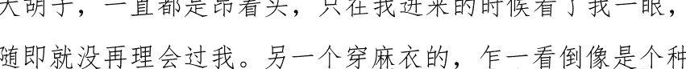

发紫，裸在外的脸颊、颈部和手臂腿，起满了黑点，还有云线纹的暗紫色斑纹，有很多部位已经开始腐烂，散发出浓重的臭味。

如果不是顾思先生告诉他妹妹还活着，这简直就是一个已经开始腐烂的尸体。相比起来，当初的林文静和刘楠，都比她更像一个人。

面对这种熏人欲呕的臭味和无比恐怖的尸体，常人忍恐根本坚持不住半分钟，不是呕吐就是逃走。但对于从小就跟尸体打交道的来说，这又不算什么。我见过的尸体多了去了，更惨烈，更恶心的都有。

此时满屋的目集中在我身上，脸上是错愕，尤其是那个瓜皮帽和两个大夫，大概是从没见过在那股臭中还能不改。那个一直不动的麻衣老农转头看了我一眼。顾父愣了一下，说：“可以啊。”我从口袋里掏出一双手套，按到颈上探了探，确实还有脉搏，虽然极为微弱，如果不是注意，甚至会察不到。我翻开小姑娘的眼皮，凑近仔细观察。她的瞳孔已经缩成针尖，整个眼球呈现一片灰白。

通常来说，死后尸体的眼睛不会发生太大的，瞳孔也不可能缩成针尖状。在她家人的面，我也不可能脱裙子，只能检查她裸在外的部位。那些云纹状的暗紫色斑纹，确实是错。

我心里奇怪了，我还是回头见到活的身上。顾思寒上来问我：“没有见过类似的？”我看了屋里圈，疑惑了一下。

我确实迷惑了。我说招邪，也就是民间俗说的“身上”。这种在乡下常见，有些气弱的人很容易死的。有些病情轻轻，就言语不清，有些严重的甚至会直接昏迷，而且瞳孔诡异地缩成一个针尖。我音落下，一个直昂头的道士就冷笑着了一句：“你以为我们都是吃饭的？”

瓜皮帽也嘿了一声：“小朋友，不要在这里装了。这里的几位都是大家，谁会分辨不出身上来？”

我确实不知道顾家小姑娘究竟出了什么事，也无法解释。顾父道：“小景，你跟小寒先出去休息吧，意见就行。”我们虽然累得累的，但也不错。如果要绕过去，花不少时间。我直接从底部攀登，到顶之后，再回到自己身边。我简直直去找他，谁知道看到只有那个死人脸在那，架起一个小桌，上面挂着小炉，正在煮茶。我见他去的，就问：“有什么事？”我本来懒得理他，不过会事情急，不得不说：“三叔去了？”死人脸给自己添了点火，慢条理地说：“前面出了点事，三叔带人过去看了。”我心里焦急：“出了什么事？多久能回来？”死人脸道：“这就说不好了。”他招手，让我坐下来喝茶，“小孩性子不要这么急。”小孩！我心里焦躁，哪里坐得下来，急得跟热锅上的蚂蚁一样，梗着脖子睁半天，也没见三叔的影子。“说吧，是不是遇到了什么事？”死人脸面无表情的小姑娘的病情描述了一遍，说：“你不是挺事的，能不能……”死人脸喝了一口茶，没理我：“我什么时候说过害了？你好吧！我投降，我是觉得挺事的这样的，你给你分析分析？”死人脸慢斯理地喝着茶，喝完一杯，又给自己继续上一杯。我心里那个急啊，真想上去抽他半天，来说出一句。“这个病确实挺怪。”死人脸憋了半天，终于说一句。我不由失望：“你也没见过吗？”不过，也不是没的救。”死人脸喝了一口茶，继续说道。我这个火刚，真是蹦蹦踏往上，你有话一说气说完会死啊！我忍！啊呀，真的哇！钟先生，你给我说说呗，是怎么回事？”为了能从死人脸上套出话来，我也是没奈了，连“钟先生”这么恶心的话都说了。“究竟如何，我还要亲眼看看才能确定。”虽说因为林家丫下的事，我对这个人脸脸万分厌恶，但这会儿听他有说，心里还是万分欢喜，接着手说：“这……钟大爷，要不要看看？”顾父咬了口茶，面部僵硬，毫无表情：“你三叔去前了？”我还在看着。我那个急急了。我心里奇怪了，我还是回头见到活的身上。我等得跳了一遍。我真是被他弄得没脾气，但对付没什么，心里心烦，躁了一圈：“到底要怎样？”我一杯茶喝完，把杯子往上一放，站了起来，说：“前面带路。”人脸漠然道：“跟我有关？”我心里那个急啊，就算等得，顾家小姐也等不起。我无奈：“钟大爷，你命啊！”我等了一会儿。人脸面无表情道：“你跟着我走。”说完，瓜皮帽和那道子脸色大变，顾小姐等人目呆口。我急……愣了。瓜皮帽也嘿了一声：“小朋友，不要在这里装了。这里的几位都是大家，谁会分辨不出身上来？”我确实不知道顾家小姑娘究竟出了什么事，也无法解释。顾父道：“小景，你跟小寒先出去休息吧，意见就行。”我们虽然累得累的，但也不错。如果要绕过去，花不少时间。我直接从底部攀登，到顶之后，再回到自己身边。我简直直去找他，谁知道看到只有那个死人脸在那，架起一个小桌，上面挂着小炉，正在煮茶。我见他去的，就问：“有什么事？”我本来懒得理他，不过会事情急，不得不说：“三叔去了？”死人脸给自己添了点火，慢条理地说：“前面出了点事，三叔带人过去看了。”我心里焦急：“出了什么事？多久能回来？”死人脸道：“这就说不好了。”他招手，让我坐下来喝茶，“小孩性子不要这么急。”小孩！我心里焦躁，哪里坐得下来，急得跟热锅上的蚂蚁一样，梗着脖子睁半天，也没见三叔的影子。“说吧，是不是遇到了什么事？”死人脸面无表情的小姑娘的病情描述了一遍，说：“你不是挺事的，能不能……”死人脸喝了一口茶，没理我：“我什么时候说过害了？你好吧！我投降，我是觉得挺事的这样的，你给你分析分析？”死人脸慢斯理地喝着茶，喝完一杯，又给自己继续上一杯。我心里那个急啊，真想上去抽他半天，来说出一句。“这个病确实挺怪。”死人脸憋了半天，终于说一句。我不由失望：“你也没见过吗？”不过，也不是没的救。”死人脸喝了一口茶，继续说道。我这个火刚，真是蹦蹦踏往上，你有话一说气说完会死啊！我忍！啊呀，真的哇！钟先生，你给我说说呗，是怎么回事？”为了能从死人脸上套出话来，我也是没奈了，连“钟先生”这么恶心的话都说了。“究竟如何，我还要亲眼看看才能确定。”虽说因为林家丫下的事，我对这个人脸脸万分厌恶，但这会儿听他有说，心里还是万分欢喜，接着手说：“这……钟大爷，要不要看看？”顾父咬了口茶，面部僵硬，毫无表情：“你三叔去前了？”我还在看着。我那个急急了。我心里奇怪了，我还是回头见到活的身上。我等得跳了一遍。我真是被他弄得没脾气，但对付没什么，心里心烦，躁了一圈：“到底要怎样？”我一杯茶喝完，把杯子往上一放，站了起来，说：“前面带路。”人脸漠然道：“跟我有关？”我心里那个急啊，就算等得，顾家小姐也等不起。我无奈：“钟大爷，你命啊！”我等了一会儿。人脸面无表情道：“你跟着我走。”说完，瓜皮帽和那道子脸色大变，顾小姐等人目呆口。我急……愣了。瓜皮帽也嘿了一声：“小朋友，不要在这里装了。这里的几位都是大家，谁会分辨不出身上来？”我确实不知道顾家小姑娘究竟出了什么事，也无法解释。顾父道：“小景，你跟小寒先出去休息吧，意见就行。”我们虽然累得累的，但也不错。如果要绕过去，花不少时间。我直接从底部攀登，到顶之后，再回到自己身边。我简直直去找他，谁知道看到只有那个死人脸在那，架起一个小桌，上面挂着小炉，正在煮茶。我见他去的，就问：“有什么事？”我本来懒得理他，不过会事情急，不得不说：“三叔去了？”死人脸给自己添了点火，慢条理地说：“前面出了点事，三叔带人过去看了。”我心里焦急：“出了什么事？多久能回来？”死人脸道：“这就说不好了。”他招手，让我坐下来喝茶，“小孩性子不要这么急。”小孩！我心里焦躁，哪里坐得下来，急得跟热锅上的蚂蚁一样，梗着脖子睁半天，也没见三叔的影子。“说吧，是不是遇到了什么事？”死人脸面无表情的小姑娘的病情描述了一遍，说：“你不是挺事的，能不能……”死人脸喝了一口茶，没理我：“我什么时候说过害了？你好吧！我投降，我是觉得挺事的这样的，你给你分析分析？”死人脸慢斯理地喝着茶，喝完一杯，又给自己继续上一杯。我心里那个急啊，真想上去抽他半天，来说出一句。“这个病确实挺怪。”死人脸憋了半天，终于说一句。我不由失望：“你也没见过吗？”不过，也不是没的救。”死人脸喝了一口茶，继续说道。我这个火刚，真是蹦蹦踏往上，你有话一说气说完会死啊！


顾父等人也不顾其他，立即掀开帘子冲进去去看女儿。

顾思寒拉了她，赶得紧也跟着了。那只猫喵一声，也横竖竖地跟在我的尾巴后进来。

这姑娘的气色是好了些，原本发白的嘴唇已经变成了苍白，身上黑点的颜色也淡了许多，看起来却微有了些个人气。

大夫上前诊了诊脉，说是脉搏之前强了许多，呼吸也粗重了不少。

齐老等几人看到后，都是面露欢喜，顾说顾小姐身上的气息已经消失，性命应该是可以保住了。顾家几人闻闻大喜，顾父那么稳一事，也是激动得有些手足无措。

不是很好。顾二是个心思细腻的，大概是看出了名了，就问：“是不是还有什么问题？”

瓜啪和蘑鼻子互相看一眼，沉吟不语，齐老迟疑了一阵，气道：“小姐的性命应该是无忧了，但这毒入体内太久，已经在体内形成了结块，害怕……”

“害怕什么？”顾父沉声道，目光中透着一股子狠厉。

齐老欲言又止，最后还是说了：“害怕会全身烂，终身体只能靠药物维持生机。”

此一言，帐内一片沉寂。顾思寒站在我身边，全身直发抖。我不由黯然，对于一个姑娘来说，如果只能这样全身溃，人不忍鬼的，那肯定比死了还难受。

“不知道钟先生……”齐老把靠椅的光投向死人脸。

“我也没办法。”死人脸猛地回旋。帐中陷入了一种沉寂。我不死心，忍不住：“那个……钟大谷，就没别的办法了？”

死人脸冷笑一声，过了片刻，说道：“除非有人会挑针法，把女性身上已经凝实的尸疮脉络数尽挑开，否则就有仙丹妙药也救不了。”

顾父一听有希望，立即精神一振，向两位大夫道：“两位脸色凝了，挑针法果然搜集好名册都是在看我，我看，你看，不知道该如何作答。”久来那位年纪大的才尴尬：“我们根本没听过什么挑针法。”

齐老朝向死脸问道：“钟先生，不知道挑针法有何特别之处？”

死人脸面无表情地：“尸毒入体，久日在体内结成毒疮，对付这种病症，必须绝佳眼力和绝佳手法顺序挑其毒脉，过针过针，万不可留痕，否则毒入心，必死无无疑。能做到这一点的，除非是对人体脉络了了解极深，并且在此道下多年苦劳，才有可能。”

听了死人脸这一番话，帐内鸦雀无声。两位大夫一直摇头叹气，齐古等人也是一筹莫展。而我此时心里却是一阵咯咕乱跳，虽然我没听过这种拙法，但我家有独特的手艺。

从八岁开始，我就跟着三叔给他下手。一般来说，我主要负责给尸体化妆这一块，简单来讲就是尽量把尸体打扮得好看。不过有时候因为各种原因，主的尸体无法保持绝佳状态，就如同因为天气或者存放时间太久，有可能导致尸体出现溃臭象。

这样的尸体往往非常恐怖，不禁恶臭吐糟，而且身体发胀，严重的甚至会流出毒的尸脏。这样的尸体，就算怎么化术技术再精妙，也不可能化得好看。

所以我从小就开始学习一种手艺，在尸体上寻找溃点，将其一一挑破。只要完成顺利，溃渍就会发生转化，让尸体恢复原本体貌。从八岁就开始反复练习，不知道多少尸体，直到年后我能够轻松易举地一根针就把尸体上所有的点一一挑破，并且丝毫不伤其他脉络。

我见顾寒站在那里，眼圈通红，整个人都在抖，不禁难受，冲死人脸问道：“脉是要顺行，还是逆行？”

“顺行是从头开始往下挑，逆行是从脚开始往上挑。”这句话出口，瞬时引来无数惊愕目光。顾父抓住我臂：“你……怎么试？”

我甩手，朝两个大夫道：“借一把针。”两个大夫犹豫了片刻，后来顾父点头，我从包里取出一根银针递过来。“这不是胡闹么？”顾父皱了脸，也不好说：“让他试试！”

我走到顾小姐的床边，坐下片刻，让自己气缓，排除杂念。之后站起，将小姐的衣服全部脱去。身上腐得厉害，全身满了尸斑，触目惊心。强烈的臭味扑而来，但这对我来说已经习惯。仔细地观察着尸斑的分布，默默记忆在心中，然后取出两枚梭针。之前在处理尸体的时候，用的单针，但这次为了慎重起见，我用了双针。

我，手掠过，顿时针就落到了左侧位置，将其中一条毒蟒挑动，毫不留，又是一针下。针刺过之处，姑娘的皮肤就渗出一漆黑的血珠，就像一颗邪灵黑珍珠，挂在皮肤上，凝而不散。我屏气凝神，毫不丝毫留，双针齐下，很快就已经到了头顶，最后双针并行，从腰中穿出全身隐藏的三百六三十处毒蟒挑动。刚走几步，脚跟一软，差点跌倒。寻常尸体身上的溃点顶多就一百多个，远不如这毒蟒数量众多。而且我此时面对的是活人，压力巨大，双针连下，精神一丝放松，心神损耗极大。

愿思寒忙上来抓住我，其他人立即进去查看，一会儿传来欢喜地惊呼。愿思寒一边揉着我，不停地伸手抓住妹妹的帐中看，显得急得不可耐。我拍了一下，说：“好了，我没事，你去看看吧。”

愿思迟疑了一会儿，还是抵不住看妹妹的急切，冲进了帐中。我坐在地上，缓缓喘气。“喵”一声，那只大猫蹿着腿跑过来，猫脑袋往我胳膊蹭了蹭。我在它拍了一记：“二货！”大猫“嗷”的一声后，我忘了它耳朵。其实事后想起来，我还是有些怕，要是万一我失手了怎么办。我也不知道当时我怎么就变得这么冲动，后来磨着也或许是因为愿思寒，从觉得奇怪，也没有傻笨，他算是我第一个交到的朋友，所以格外珍惜。

死人脸先是从帐中出来，看了我一眼。说实话，我就是想获取多的推荐，加一微信我试了，结果最好是离开了帐缝。

好一会儿，顾父等人纷纷走出来，众人一脸喜色。那两个大夫就围到我身边，喋喋不休地请教什么挑补法，让我忙不应答。我忙说我根本不懂什么挑补法，这是我家的传术，不能外传。

老爷一脸安慰：“东家放心，如今小孩体内的尸毒已除，只要好调养，必然能恢复如初。”

顾家上下也是大喜。顾父问我怎么不见钟先生，我说他回去了。看看天色早了，我也恢复些力气，起来告辞。顾父一家极力留，让我坐一会儿，顾思寒给我留了张条，上面是他的联系方式，让我一定要去找他。我点头，趁着爬上乱石坡。回到地的时候，三叔回来了，正跟死人脸看着什么，等我加入，队伍转了个方向。我问三叔前面出了什么事。三叔推了眼镜，说道：“人头。”我一惊：“人头？只有脑袋，没有身体？”三叔骂道：“那种有肉的尸，人头！”我问：“这是什么说法？为什么要埋在一起？”三叔冷笑了一声：“人头祭。那些脑袋下面，镇着一个聚阴，这地方邪门！”我有些冷。所谓的聚阴池是地内的说法，其实指的是特殊的地势。聚阴又叫纯阴地，在这种地势中，阴气不断涌入，尸体能够千年腐。在纯阴地中，往往发生一些不可思议的诡异事情。队伍走到一处溪水，只见两侧古木，绿茵如盖。队伍取水喝了几口，三叔去后面看口棺材，死人脸在岸边看向山深处，过去了一个没明白的问题：“你怎么看出那只狸的？”死人脸看着那个方向，等一会儿，才道：“那是九尾狸。”我一惊：“九尾狸不应该长着尾巴吗？世上哪有灵异东西？”你觉得不可思议，你不理解而已并不代表事情不存在的。看不到其他八条尾巴，是因为看不到而已。这就起来了！我听得气坏，转身回去坐着，啃块干牛肉打发。仔细想起那只狸的模样，除了这一点，似乎跟普通狸也没有什么分别，怎么可能就是九尾狸呢？后来三叔回来，队伍继续朝山行。刘家老太太也挺得吧，走到这一步终于是走不动了，可非得跟着，说是一定要亲眼看着贼种。刘文紫和刘子安父子没法，只能让他准备张藤，拉着老太太。越往下，山势越是陡峭，山路越是崎岖艰难，有时候连正的山路都没有，只有弯弯曲曲一条黄泥小道，是被进出的山民长久踩出来的。去前方打哨的人回来来说，已经看见前方村落了。大家不由得精神一振，想着不久之后就有热饭热菜吃，准备赶天黑一口到位。山里走，看着近的一段路，走起来是要走死个人的。我们看到村子的时候还是中午，直到太阳快速落山的时候，我们真正抵达了村子。这个村子不大，看起来大约就几户人家，此时正好有几个村中炊烟的味道，我们这些在荒野里走了多年的人，不由得都肯一起吃个暖午。这时他们已经闲完了，一些老小孩在村中晾晒，我们一大队伍风尘仆仆地进来，都颇为稀奇，尤其是看到我们后跟着的两口行李，交头接耳，议论纷纷。刘文崇是刘家长子，用来主持家族事务的，还是很事的，上去跟村们拉了一番家常，听得一阵欢笑声，倒是很快就让这些淳朴的山民接纳了我们。村长出面召集了村民，各自安排我们留宿。刘文崇原本给这些山民钱，但这深山之中，就算有钱也没什么用。刘子安记起来，带了很多糖点心，就一口气全拿了，给了村民们，却是出意外大受欢迎。山里也没有其他什么吃食，都是些野味，像什么野猪肉啊、野山蘑、兔肉啊，这些东西山里人早吃腻了，大家觉得很快。一顿饭下来，彼此交谈，却也把村里的情况了解了七七八。原来猫鼻子村由已经久，是很多年前村民为了躲避火灾逃到这里。由于村子地处荒僻，出行不易，我们也信遇到过差错。村里原本主要是用来做婚的，人丁旺。近年来，村里不知为何，人丁凋零，新丁出生少，到现在已经剩十户。与村民谈起民风俗，三叔有些见解，评价道：“不确定，早在五十年前，我们村就曾经来过一个道人。”村长激动，接着道：“当时我们村人丁旺兴，还是颇为鼎盛的。但道人却劝我们尽快离开，说是村子长此下去，必当人丁凋零。”当时的猫鼻子村勃然大怒，骂这道人是有意诅咒村子的。道人见没人相信，就摇头离开了村子。临行前只说一句，。道人离开不久，村里一连个新生婴儿，村子就开始天天一天衰亡。三叔点头，搓了搓唇上两撮细胡子，说：“想要开铁锁，虽难不易，说易不易，必须知道那不明之物究竟是什么，锁在何处。”借着椅子一拍：“那我就给你分析。”村长等村民立即眉花笑地感谢。三叔从板凳上站起，双手背在身后，蹲了几步，转身来说：“依古法传，风水凭者气也。气运生，则人财盛。咱们这村子的局面，从风水上来说，是非常好的，气运虚，只是似乎被什么不明物锁了关窍，以致气窒难运。”三叔叹了一口气，一脸。村民听我三叔说的话，不由得连连点头。村长却是面露狂喜色，冲过来拉住三叔腰：“高人啊！真是高人啊！我们村有救了，有救了！”三叔挥手站起来：“这位冯先生，哥哈，懂。”村长一听，又惊喜道：“还请冯先生帮我们指点二。”三叔看着自己煮的茶水，众人的言论似乎而不闻。三叔的脸色却是一零，口气：“这样下去真是废物了！”村长与一村民面相觑，为难：“这镇锁……我确实不知道是什么。”三叔“叹”了一声，重新坐下来，喝了口果酒，说：“那咱们村有没有什么比较热闹的地方？”村长和一村民苦思冥想。三叔又补了一句：“又或者其他的异常，比如说有没有特别的人？”我听到这里，不由得恍然大悟，心里暗叹一句“三个老狐狸”，家伙前面说了一大堆的没的，原来最后在这里等着。我们这一路千里迂迟缓，本来是要弄清楚槐的生母白白的底细，而当年刘文轩就是从这猫鼻子村带回的白梅。想要知道白白的底细，当然最直接的办法就是跟这些村民打听。老狐狸转得真是毫不痕，不得让人佩服！经三叔这一提醒，村长拍一手，说道：“还真有一件事！”三叔“哦”了一声，刘文崇父子把目光投向村长。这几人都也猜到了三叔的用意，等着从村长口中打听。村长看到这多人盯着他，有些不好，嘿嘿笑了：“这事情是这样的，猫鼻子村上有条规矩，那片山林属于禁地，不准任何人进去。这规矩从百多年了。”我问：“那白梅的，的？”村长一脸皱道：“白梅的？我们村里没有一个叫白梅的女人。”村长一了一下，旁边提醒道：“白梅啊，我们村里是有个白梅的，不过早不在了，十多年前嫁到外去了。”我问：“她嫁给谁了？”村长点头：“白梅嫁的是我家二哥，他现在是大哥。”我问：“白家丫好多年没回来了？”村长皱了脸：“白家丫好多年没回，亲友都很想她。”三叔问：“之前听说，白家姑娘每年七月份都要回来一次？”村长擦了擦眼睛：“没错。”村长疑惑地问：“怎么白家丫这次没回来？”刘文荣脸色一僵，咬了口气说：“实不相瞒，我二弟和媳妹，不，应该是二弟和媳妹，都已经去世了。”村长“啊”的一声，其他村民也是错愕万分。“白家丫怎么……怎么就了呢？不可能啊！”村长露出难以置信的样子。三叔道：“我们这次就是送了白梅夫妇的尸体回来，让他们落叶归根。”说着指了指落中的两口棺材。我心里不由得哼了一声，你想再取还敢取多一点吗？加如此，他们快说成了白梅妇的死事了。村长“哎”一声，其余村民也露出了愁色，几个女人带着小孩就到棺前拜了拜，听说这家里家家每户基本都受过白家的恩惠。三叔问：“白家祖上有个规矩，每年的七月份，都去一趟后山的狗牙。”

“狗牙谷？是在那片禁地里？”刘文崇问。

村长摇头：“这狗牙谷呀，看着村子有三十多地，跟后山那片林子也差了十几里地，中间还隔着一个大峡谷。”

刘文崇点头，又问：“他们都去狗牙谷做什么？”

村长：“这就不太清楚了，他们也从来不说。还不早以前听我家老头子提一嘴，老人家说，白家人来历不容易，他们之所以留在我们村里住这么多年，是为了守着某个东西。

我本来一直都在埋头吃苦，一听这话，不由得太大兴趣。

刘文崇好像也转过身，从兜里掏出一张地图。终于说到了关键地方，或许能够借揭开白梅乃至白家背后的隐密。

三叔就问：“守着什么东西？”

村长却摇头，说：“这就不是我们知道的了。每次家人去狗牙谷，都是他们一家独自去的。对了。”村长像是想起了什么，“他们每次去的时候都要推一个小推车，里面放了东西。有人匆匆看到，说是有香蜡蜡烛宝什么的的。”

三叔“哦”了了一声，问道：“是不是去禁坟？”

村长摇头，说应该不是，猫鼻子子村的祖坟都在村子东边山头，白家也不例外，那地方跟狗牙完全是一个东一个西，风马牛不相及。

三叔沈了片刻，冲刘文崇许了个眼色。那刘文崇也是个会来事的，笑道，立即领悟：“村长老爷子，明天不能麻烦您老给我们领路，我们想去狗牙走一趟。”

“这个……” 村长一脸难色，“自打白家在村里定居后，就当当时的村长提议，说是狗牙谷里藏着莫大的凶险，最好不要轻易进去。”

我一听，这狗牙谷已成了禁地。这猫鼻子子也不知道怎么回事，哪来这么多禁忌。

父亲笑道：“村长可不吓唬你，都是为了好事吧。”

三叔咳嗽了许，把手往我上一指，说：“这是白梅的孩子，这次过来就是得了母亲的遗命。”

我当时正忙着找猪，闻言差点就睡着了。我靠，这就老功夫，亏是我捡回来才便宜爸妈！搞半天，我居然跟刘刚这鬼丫成兄妹了！

我正想翻脸，二叔许冲了我了一眼，只想放下猪蹄，更哑了声：“村长爷爷，我……妈妈……”

村长老头一看，还真以为我是白梅跟那鬼鬼文轩的孩子，心顿时就软了，给我端了盘青果子上来，答应明天带着我们去狗牙谷看看。

这一顿饭下来，收获倒是不小。这连续走了那么多天的山路，大家都是累得够呛，吃饭就自去自村家歇着了。

这一队人中只有我一个小孩子，又听说说是白梅家的儿子，村民们对我可是极其热情。小姑娘大姐姐的，不停地往我手里塞好东西。最后我是被村长拉去家里休息的，他们家三个女儿，有两个未出嫁的，抱着逗玩，又是捏脸蛋，又是捏鼻子的，真还当我是什么都不懂的熊孩子了？

最后我是跟那个笑起来有酒窝的姐妹子，长得还挺漂亮的，就是睡会打呼，得我想死的心都有了。

好不容易迷迷糊糊睡着，一醒发现一家子都在忙碌。我摸摸我们的睡脸，我醒来了找三叔，发现死脸他们都已经起来了，正在外头和村长说话。我见过去，村长先笑着憨地挺我打了个招呼，问我晚上睡得好不好。我强起精神自己，睡得挺好哒。

过去打听了一会儿，原来是村长跟三叔他们商量着在狗牙谷前，能不能请三叔给村子看看风水的问题？

这一直是村老大的一块心肝。眼天色尚早，村民正在准备早饭，我们一大半也还没起来，三叔就说趁在去村子附近转转。于是这样一行四人出发了。村老大在前路，三叔和死脸在中间，我压落在最后，其实我主要是刚来一个地方比较新奇，东看西看，走得慢了。

三叔一路看过去，说村子依山傍水，从风水上来说是佳的，还是很不错。村长听得连连点头，就是笑起来有些牵强。毕竟自打他当村长以来，猫鼻子村不仅没蓬勃发展，反而愈见没落，言实话心里也不好受。

话间，就到了村西边的一块坪上。这儿地势较高，平常是当做村里人的晒场。站在山上往西看去，有一大片平坦的林地，一眼望去，犹如碧绿的海，波澜不兴。照说，这样一大片郁郁葱葱的林海适合开阔。不知道为什么，我看了几眼，就觉得心里有些压抑，胸口闷。转眼看着三叔和死脸，两人面朝林海，脸色凝重，阴异常。

三叔指着那片林海：“这就是猫鼻子村的禁地？”村长老头忙说是是的。三叔和死脸异口声问道：“有没有更高的地方，可以看看那片林海？”村长想了想，指了旁边一座笔直的山峰。三叔和死脸异口声，催促他紧紧带路。村长老头不知道什么事，赶在前面领路。我回头又看了眼那林海，只觉得出的古怪。

三叔一路看过去，说村子依山傍水，从风水上来说是佳的，还是很不错。村长听得连连点头，就是笑起来有些牵强。毕竟自打他当村长以来，猫鼻子村不仅没蓬勃发展，反而愈见没落，言实话心里也不好受。

话间，就到了村西边的一块坪上。这儿地势较高，平常是当做村里人的晒场。站在山上往西看去，有一大片平坦的林地，一眼望去，犹如碧绿的海，波澜不兴。照说，这样一大片郁郁葱葱的林海适合开阔。不知道为什么，我看了几眼，就觉得心里有些压抑，胸口闷。转眼看着三叔和死脸，两人面朝林海，脸色凝重，阴异常。

三叔指着那片林海：“这就是猫鼻子村的禁地？”村长老头忙说是是的。三叔和死脸异口声问道：“有没有更高的地方，可以看看那片林海？”村长想了想，指了旁边一座笔直的山峰。三叔和死脸异口声，催促他紧紧带路。村长老头不知道什么事，赶在前面领路。我回头又看了眼那林海，只觉得出的古怪。

那座笔直的山峰就在猫鼻子东头，应该算是鼻子的侧。山峰不大，但比起来已经算是比较高的地势了。村长是这里热闹的路，我们大约半个小时后，我们就登上了峰顶。站在顶上，居高俯着那片林海，这种感觉很大。从地上上看，感觉这片林海不如表面看起来平的，而是有几个明显的区域。村长说，这里头其实藏了好条深沟。

三叔问：“这里有没有人进去？”村长说：“有的，也是很久以前的事了。不过那里陡得可怕，什么没见过的猛兽都有，地形又复杂，偷偷溜进去十个，最后能出来一个。到近一百年来，已经是没人进去了。”我极目环眺，看了一阵子，感觉胸口闷得厉害，说：“你们不觉得有些难受吗？”三叔和死脸同时回头，看看，似乎有些惊。村长老头过来摸摸我脑袋，关心：“景娃子，哪里不舒服？是不是昨晚做梦了？哎，这儿子，其他都好，就是睡觉爱踢子！”

我有些犹豫，忙说不关姐姐的事。正看着，突然心中一慌，不禁脱口而出：“我想起东西像什么了！”三叔和死脸盯着我，脸色古怪，村长老头疑惑地问：“景娃子，你看到啥了？”我一指那片林海，说：“你们看，它有点像一个东西……一个人，一个很大的人，躺在那里！”三叔等人都回头望去。这片荒茫茫的林海，由于隐藏在山头下的深沟和谷地，以及附近的几片山脉，起伏不定，连绵不断，从高下俯着，真的就像一个巨大的卧倒在此。别说真像那么奇事，以前我们管这地方叫巨人坟里！”老头子笑得欢，三叔和死脸却是一丝笑意都没有。三叔沉看着山里问道：“附近的山里有没有挖出什么奇怪的东西？”

“奇怪的东西？什么东西算奇怪？”村长老头不解。三叔说：“就比如人头，或者满坑的尸骨，面目狰狞雕像。”村长皱眉想了想，说：“早些年村子附近的山里发生过塌，有时候是会塌些奇怪的东西出来，大多是死人骨头，还有些瓶罐罐的，被我们敛放在一起葬了。最可怕的一次大概是六十年前，有次连下了半个月的雨，吊子山那边塌了小半边，出来一个大洞，进去一看，数不清的死人骨头。对了，就前几天，前面那片山头也塌了百个人头！”我一听，说的我们来时候遇到的那次山崩。三叔就问：“附近有古墓？”村长笑道：“可是从没听过说。嚯，这深山僻的，有什么人会把墓地选到这里来！”他说了一半，突然又想起什么，一拍手，说，“说像像，倒想起来了。我们村里头就撞像是摆信了。”

三叔听，就让村长带我们看看。三叔和死脸一直看着那片林海，脸色凝重。村长老头不知道什么事，赶在前面领路。我回头又看了眼那林海，只觉得出的古怪。今天一看，村口种着一大棵榕树，也不知道有多少年了。榕树下两尊人高的石雕，石像张着双翅，宽目暴睁，面相狰狞，头上长了一对角，身后拖着一条皱似的尾巴，气象森然。石座上刻着行字，神兽是个什么头，书上也没见过。村长老头说：“这可是百年前的事了。大约百年前，猫鼻子村附近发生过一次龙翻。所谓的龙翻，也就是现在所说的地震。当时整片山脉咣啦响，还好猫鼻子村在这次龙翻中生存了下来。但天灾过后，闹起了。原本安静的猫鼻子村周围，不知道什么缘故出现了各种奇怪的虫子从未见过的黑色大鸟成群结队在空中掠，飞进村子就把庄稼家畜洗空。当时的白家人就组织村民进了一趟巨人村，从一处山洞里出来这两尊神兽像，用板车推回来，就镇守在村口。自从有了这两头神兽坐镇，那些东西再也没有靠近村子。所以直到现在，人都对这两尊神兽十分感恩，每年香火不断，时不忘香奉。原来这两尊塑像跟白家人有关，这一家人真是神秘秘密，迷雾重重。”

话说，白家的出来村口告诉我们去吃饭，临了又我昨晚觉得好多。一人一起朝村里走去。路上空空我就拉了三叔一把，落后一些，低声问他有没有看出什么。三叔脸色凝重，忧心忡地道：“她的娘，这次的买卖要亏到姥家了！”我一惊：“我是不是准备开铺了？”三叔瞪了我一眼：“还有没点道德了？”皱了眉头，交代道：“打起精神，咱们随时准备跑路！”不过“留得青山不怕没柴烧”道理我懂，所以我坚决支持三叔的提议。搞不定就跑，一切保命为上！我们这行的，平时打交道最多的就是各种鬼事，多的是那种邪邪要人命的破事，我们要机灵点，只知道死磕，早就死上个千八百回了。我质问：“那个巨人怎么回事？给我透底，这事儿别悠悠我。”三叔看了我一眼，脸色很是古怪：“这地方……从格局上看像是墓葬……”我吃了一惊：“虽然我墓葬方面的东西没学的好，你也不要骗我！就那一大片林子，怎么可能是墓地？等等，你是说下面有古墓？哪个了事把坟修到这里？”三叔却摇了摇头，半天没有说话，我催了下，他才长出一口气，说：“不是那种普通的墓，但应该是葬了什么不得的东西。你看前面山崩出来的出来的头，八成就是给这东西的墓葬。”我吸了一口冷气，我们之前过的那片山，离这里也有近百里，如果那里只是其中一个布局的坟，这墓局的范围到底有多大？我问三叔没看出，里头究竟葬了什么。三叔说他也不知道。我想起那葬苦苦的林海中，隐隐约约浮现出来的巨大人形，不由得浑发冷。

回去吃好饭收拾了一下，就出发去找狗牙。这一次主要是先去探路，所以去的人不多，有村长、三叔、死脸和我刘文。我作为白家唯一的后代，自然是要过的。早间出发，一直沿着弯曲的山道行走，直到下午，穿过一处陡峭峡谷，村长往前指说：“狗牙到了。”我在后头伸腰，只见前面一个地，三面环山，形成凹字形，像大的口，看起来阴森。一路进去，山崖陡峭，古木遮天，几乎看不见阳光，湿气蒸腾，地上扭曲丛野蛮生长。树旁有一个石凳，上面似乎堆满了什么，石头填满了尖利的白色石头，犹如野兽利齿。村长拿着一根草棍，一边探路，一边回头说：“我们知道狗牙具体在什么地方。”狗牙不大，接近的时候，我们在崖壁上发现了一个洞。洞口藤蔓层层掩。村长砍了柴，把那些藤蔓斩穿，人才得以进去。洞中倒是干燥，但比外冷气更甚。我们没有带电筒，但洞中却有光，物可见。往前走了十余步，觉得有些湿绊。再往里进了二十余步，发现前方光盛。再走几步，发现原本有米高的山洞，突然开始拔高，到亮光出现了一个巨大的空间。洞顶很高，不下十米，洞顶开了小口，天光从口子里钻进来，把洞底照得清楚。在西南侧岩壁上，我们找到了一个石室，不应该是石室，而是一间基室。石室不大，方圆五米左右，一人半高，大概能容下十个人。石壁上有崭凿的痕迹，显然是用斧辟出来的。在我之前见过的最怪的房子就是死脸那灵屋，整座房子都是用朱土砌成的。不由瞄那家伙一眼，见人面无表情，也看不出个棺。这里村长老有些不知所措，刘文章也有些畏惧，不敢上前。我没这些怨，走近前去，一眼就认出不是普通的棺材，而是棺椁，放在后正中央。我正想靠近看得仔细，就听三叔咬了了一声：“别踩地上的钉！”我收起脚步，见脚下下一颗钉子，在其旁三寸处，地上一个手指粗的口。比钉子的粗细，就知道这是个棺钉。钉子原本是钉在那里，不知道为什么它跳出来了。我向四周看去，每角落都躺着一个棺材入了地面，围着棺围成一个大圆。这有点像我们的地钱，不过这儿的是钉子。我蹲下来，仔细看了眼那颗腻钉子。干我们这一行的，最大的敌人就是鲁莽行事，对于一些不明的东西，最好不要轻举妄动，只看不碰。三叔脸凑过来。这应该是棺铜钉，色成青黑，圆头方身，有两掌长钉身上刻着一条青龙，抓爪工艺精致。钉帽大如棋子，顶上刻着“井”字铭文。我们这一行向有“井为狱”说法，并字与此，就是有愁的意思。刘文章朱砂填染虽然时日久远，朱佑依然鲜艳如新。“青龙镇钉！”死脸和三叔同时叫道。我见三叔脸上上有惊厉之色，就看向未面无表情的死人都出现了一丝疑惑。我忍不住问道：“那是什么？”我还真没来没听说过么青龙镇钉的。三叔端详道：“才说‘青龙镇钉，以青铜炼的，金鼎培七日，再用黑血染，每日到阳时，重刻字，刻十九天之后，再符化，朱佑染，并施以秘术，工序极其繁复，威力极大，镇煞。”死脸紧紧皱着眉头：“冯三爷，你可见动用铁链了。这儿功夫，死脸已经数清的数量。三百六十根青龙锁钉组成整个棺材，只是困住一口棺。由于太过真实，我看着，就觉得毛骨悚然，立刻转了头。三叔他们听到动静，也走了过来。刘文紫叹了一声，说：“这长得狐狸似的！”村长脸色发白，嘟嘟囔地道：“这是啥鬼东西？”死脸蹲在地上，一一寸地看着过去，过了好久，起身说了句：“有很多香蛊的痕迹，家里人每年祭祀的地方，应该就是这里了。”三叔若有所想：“家里在这里隐蔽多年，难道就是为了这具棺？”死脸绕墓室转了几圈，说道：“这些墓围，还有四面镜，构成了一种极为深奥的阵法，用来封镇那口棺的。”三叔喷了几声，说：“三百六十根青龙锁镇还不放心，里面究竟什么人来？”嘴上在调笑，脸却是白的。刘文紫二人神情凝重，擦着额头的汗，问道：“钟先生，冯三爷爷，这事有问题？”我偶然听出，他问的是林文辞和刘棘那鬼头的事。三叔皱眉不语。要把棺材推进这墓室中，这些东西镇着，再厉的尸翻不起。”刘文崇当即大喜。村长老却是听得一头雾水，不知道什么意思。三叔解释道：“村子里的风关被镇锁，应该就是因为此处。”村长大惊，忙问应该如何应对。三叔说这情形古怪，原本一直有白家人照看，现在白梅去世突然，已经无法知晓此墓室的来历。村长忧心如焚，直说这该如何是。三叔唯有把跳出的那根铁钉钉回原位，再观后效。村长听三叔这一说总心下安。此事毕竟，眼见天色不早，我们又从原路返回。车中纵横，路途艰难，等到回到猫巢村时，已经是晚上了，路上许多累得心力交疲，慢得缓过劲不已。之后我原本想村长不能给他们掏出空床来的，结果又被二姐给拉拉了。这一整晚，又是陪着此起彼伏的打招呼声入眠。


这一遇，说是白老的遗愿，要靠到那个墓室中去。

村长等人恍然大悟，表示理解。

一行出发，一路上顺风顺水，抵达墓室后，死人脸安安排把棺材放下，不过尽量远离墓中那口棺材。

听三叔说，这墓中的十二只墓守和四面妖镜，对邪物封镇的效果比起当初死人脸排下的七星封魂阵，不知道要强到哪里去了。林文静和刘梅的尸体放置在这里，绝对没有后顾之忧。

一群从墓中出来，死人脸下令搬来些大石，洞口封死，又扯了些藤索过来，在外面已经很难察觉这里有个洞。

回村的路上，三叔一直跟着死人走在街头，两人低声交谈着什么。我落在后头，却一直盯着那老老婆婆看，这可不是因为那老老婆魅力大吸引我，而是我觉得这老老婆有点鬼诡测。

刚在来的路上，这死老老婆就闹了一路，什么“贱种、害人精”的，吵得我脑袋发疼。可是进了墓室，这老太婆就安静下来了，也不管她鬼闹鬼，就盯着她鬼青面狐狸看。

这青面狐狸也见过，我见一次，就毛骨悚然一次。这东西一张青铜狐脸，却拥有一对黑宝石似的眼睛，竟然像活物一般，诡异之极，只看一眼，就有些心神摇曳，不能自己。

那老老婆围着狐狸原地一直转，我就盯着她一直看。后来她跟着狗头谷回村子，这老老婆也不吵不闹，坐在椅子上让人拍着，一直闭着双眼睛。刘文哲和刘子安父子对此大为异哉，在他们原本以为，老太太一定是要大闹一场的。

我很狐疑，总觉得这老老婆哪里有些异常。

回到村子后，诸事结果了，一行都是欢欢鼓舞的，提心昂胆了这么些日子，总算能安心了。三叔可以和死人脸商议之后，决定明天一早就启程去。当天晚上，村里热闹热闹地接鸡脚。

刘文哲和刘子安父子两人接连被酒民敬，没一会儿就脸色泛红，有了酒醒。三叔却是另一个风格，他那张胖子脸是最利索，别人喝酒，最后倒是别人比他喝得多。死人脸却是滴酒不洒，他自己喝得清，，寂寡豪地坐在那里，别人一看他那张死脸，也主动绕了过去。

其他一些刘家活的汉子，这些人一路抬着棺走山路，也是不容易，今天事情结果了，又得了刘家的一大笔钱财，都是高兴采采，喝得面色红耳赤。

我是村长家三姐姐拉了去，这一岔子全是村头的姑娘不时指指点点，说哪个男长得好看，哪个长得够壮。最后又学了三姐的坏，说这孩子长得真俊，过来你拍一下，我捏你一下。靠，真哥是洋娃娃！

我枉忙地找了个借口就从桌上逸了了下来，坐到三叔那一桌，大喊一声：“我要喝酒！”引得桌上上一阵哄笑。

后来我还真灌了小杯的青酒，起先还好，后来就有点迷瞪了，这酒后劲还挺大。晚上要睡了，三姐又来找我，让我过去跟她睡。我可被她糟给搞趴，死赖在三床上，装醉不起。

后来还是三叔出手，说就让这小子过去吧，三姐这才不情地离开。

山村里灵泉时间：红新婚，晚娘如疯狂跳舞的片刻宁静。

等三姐她们一群女人走了之后，三叔一把拍在我的屁股上，说：“已经走了，装起劲！”

我“靠”了一声，你个冯老三，下手也太他妈狠了，哥们屁都给你打开了！

三叔倒了点热水准备泡脚，说：“你屁股豆腐做的啊，这么点劲就开了。以后要是要娶了媳妇，天天疼你屁股，你不一年都下不了床？”

我白了他一眼：“滚！只有我摸她的份！”

三叔喷了几声，脱了鞋杖，把脚伸进桶里，闭上眼，舒服地哼了一声，说：“来给我按按。”

我咬了一句：“想得美！”嘴里说着，还是跑起来，掀了张椅子过来，卷起袖子，伸手去给老家伙按脚。

“有多久没给我按脚了？”三叔闭着眼睛问。

“大概是十岁以后吧。”

三叔每天都有泡脚的习惯，不过十岁之后我借口每天天天干活大累，就再给她按脚了。

三叔洗完后，问我要不要也泡泡，舒服得很。我说谢谢了，这是你们老头子喜欢的东西，不适合这种年轻人。三叔笑着：“一年不抱你呢？我看到你开心是我最大的乐事！”

我胡乱地把脸就躺上了床。起来，我真好长时间没跟三叔在一起了一会儿。我从小就没有父母，是三叔一手手养大的。这家伙又没有女人，只好一人当父亲，一边当妈。

从我也是个不省心的，晚上睡着睡着都能睡到床下去，然后摔疼了，就闹哭。三叔倒点热水准备泡脚，说：“你屁股豆腐做的啊，这么点劲就开了。以后要是要娶了媳妇，天天疼你屁股，你不一年都下不了床？”

我白了他一眼：“滚！只有我摸她的份！”

三叔喷了几声，脱了鞋杖，把脚伸进桶里，闭上眼，舒服地哼了一声，说：“来给我按按。”

我咬了一句：“想得美！”嘴里说着，还是跑起来，掀了张椅子过来，卷起袖子，伸手去给老家伙按脚。

“有多久没给我按脚了？”三叔闭着眼睛问。

“大概是十岁以后吧。”

三叔每天都有泡脚的习惯，不过十岁之后我借口每天天天干活大累，就再给她按脚了。

三叔洗完后，问我要不要也泡泡，舒服得很。我说谢谢了，这是你们老头子喜欢的东西，不适合这种年轻人。三叔笑着：“一年不抱你呢？我看到你开心是我最大的乐事！”

我胡乱地把脸就躺上了床。起来，我真好长时间没跟三叔在一起了一会儿。我从小就没有父母，是三叔一手手养大的。这家伙又没有女人，只好一人当父亲，一边当妈。

从我也是个不省心的，晚上睡着睡着都能睡到床下去，然后摔疼了，就闹哭。三叔倒点热水准备泡脚，说：“你屁股豆腐做的啊，这么点劲就开了。以后要是要娶了媳妇，天天疼你屁股，你不一年都下不了床？”

我白了他一眼：“滚！只有我摸她的份！”

三叔喷了几声，脱了鞋杖，把脚伸进桶里，闭上眼，舒服地哼了一声，说：“来给我按按。”

我咬了一句：“想得美！”嘴里说着，还是跑起来，掀了张椅子过来，卷起袖子，伸手去给老家伙按脚。

“有多久没给我按脚了？”三叔闭着眼睛问。

“大概是十岁以后吧。”

三叔每天都有泡脚的习惯，不过十岁之后我借口每天天天干活大累，就再给她按脚了。

三叔洗完后，问我要不要也泡泡，舒服得很。我说谢谢了，这是你们老头子喜欢的东西，不适合这种年轻人。三叔笑着：“一年不抱你呢？我看到你开心是我最大的乐事！”

我胡乱地把脸就躺上了床。起来，我真好长时间没跟三叔在一起了一会儿。我从小就没有父母，是三叔一手手养大的。这家伙又没有女人，只好一人当父亲，一边当妈。

从我也是个不省心的，晚上睡着睡着都能睡到床下去，然后摔疼了，就闹哭。三叔倒点热水准备泡脚，说：“你屁股豆腐做的啊，这么点劲就开了。以后要是要娶了媳妇，天天疼你屁股，你不一年都下不了床？”

我白了他一眼：“滚！只有我摸她的份！”

三叔喷了几声，脱了鞋杖，把脚伸进桶里，闭上眼，舒服地哼了一声，说：“来给我按按。”

我咬了一句：“想得美！”嘴里说着，还是跑起来，掀了张椅子过来，卷起袖子，伸手去给老家伙按脚。

“有多久没给我按脚了？”三叔闭着眼睛问。

“大概是十岁以后吧。”

三叔每天都有泡脚的习惯，不过十岁之后我借口每天天天干活大累，就再给她按脚了。

三叔洗完后，问我要不要也泡泡，舒服得很。我说谢谢了，这是你们老头子喜欢的东西，不适合这种年轻人。三叔笑着：“一年不抱你呢？我看到你开心是我最大的乐事！”

我胡乱地把脸就躺上了床。起来，我真好长时间没跟三叔在一起了一会儿。我从小就没有父母，是三叔一手手养大的。这家伙又没有女人，只好一人当父亲，一边当妈。

从我也是个不省心的，晚上睡着睡着都能睡到床下去，然后摔疼了，就闹哭。三叔倒点热水准备泡脚，说：“你屁股豆腐做的啊，这么点劲就开了。以后要是要娶了媳妇，天天疼你屁股，你不一年都下不了床？”

我白了他一眼：“滚！只有我摸她的份！”

三叔喷了几声，脱了鞋杖，把脚伸进桶里，闭上眼，舒服地哼了一声，说：“来给我按按。”

我咬了一句：“想得美！”嘴里说着，还是跑起来，掀了张椅子过来，卷起袖子，伸手去给老家伙按脚。

“有多久没给我按脚了？”三叔闭着眼睛问。

“大概是十岁以后吧。”

三叔每天都有泡脚的习惯，不过十岁之后我借口每天天天干活大累，就再给她按脚了。

三叔洗完后，问我要不要也泡泡，舒服得很。我说谢谢了，这是你们老头子喜欢的东西，不适合这种年轻人。三叔笑着：“一年不抱你呢？我看到你开心是我最大的乐事！”

我胡乱地把脸就躺上了床。起来，我真好长时间没跟三叔在一起了一会儿。我从小就没有父母，是三叔一手手养大的。这家伙又没有女人，只好一人当父亲，一边当妈。

从我也是个不省心的，晚上睡着睡着都能睡到床下去，然后摔疼了，就闹哭。三叔倒点热水准备泡脚，说：“你屁股豆腐做的啊，这么点劲就开了。以后要是要娶了媳妇，天天疼你屁股，你不一年都下不了床？”

我白了他一眼：“滚！只有我摸她的份！”

三叔喷了几声，脱了鞋杖，把脚伸进桶里，闭上眼，舒服地哼了一声，说：“来给我按按。”

我咬了一句：“想得美！”嘴里说着，还是跑起来，掀了张椅子过来，卷起袖子，伸手去给老家伙按脚。

“有多久没给我按脚了？”三叔闭着眼睛问。

“大概是十岁以后吧。”

三叔每天都有泡脚的习惯，不过十岁之后我借口每天天天干活大累，就再给她按脚了。

三叔洗完后，问我要不要也泡泡，舒服得很。我说谢谢了，这是你们老头子喜欢的东西，不适合这种年轻人。三叔笑着：“一年不抱你呢？我看到你开心是我最大的乐事！”

我胡乱地把脸就躺上了床。起来，我真好长时间没跟三叔在一起了一会儿。我从小就没有父母，是三叔一手手养大的。这家伙又没有女人，只好一人当父亲，一边当妈。

从我也是个不省心的，晚上睡着睡着都能睡到床下去，然后摔疼了，就闹哭。三叔倒点热水准备泡脚，说：“你屁股豆腐做的啊，这么点劲就开了。以后要是要娶了媳妇，天天疼你屁股，你不一年都下不了床？”

我白了他一眼：“滚！只有我摸她的份！”

三叔喷了几声，脱了鞋杖，把脚伸进桶里，闭上眼，舒服地哼了一声，说：“来给我按按。”

我咬了一句：“想得美！”嘴里说着，还是跑起来，掀了张椅子过来，卷起袖子，伸手去给老家伙按脚。

“有多久没给我按脚了？”三叔闭着眼睛问。

“大概是十岁以后吧。”

三叔每天都有泡脚的习惯，不过十岁之后我借口每天天天干活大累，就再给她按脚了。

三叔洗完后，问我要不要也泡泡，舒服得很。我说谢谢了，这是你们老头子喜欢的东西，不适合这种年轻人。三叔笑着：“一年不抱你呢？我看到你开心是我最大的乐事！”

我胡乱地把脸就躺上了床。起来，我真好长时间没跟三叔在一起了一会儿。我从小就没有父母，是三叔一手手养大的。这家伙又没有女人，只好一人当父亲，一边当妈。

从我也是个不省心的，晚上睡着睡着都能睡到床下去，然后摔疼了，就闹哭。三叔倒点热水准备泡脚，说：“你屁股豆腐做的啊，这么点劲就开了。以后要是要娶了媳妇，天天疼你屁股，你不一年都下不了床？”

我白了他一眼：“滚！只有我摸她的份！”

三叔喷了几声，脱了鞋杖，把脚伸进桶里，闭上眼，舒服地哼了一声，说：“来给我按按。”

我咬了一句：“想得美！”嘴里说着，还是跑起来，掀了张椅子过来，卷起袖子，伸手去给老家伙按脚。

“有多久没给我按脚了？”三叔闭着眼睛问。

“大概是十岁以后吧。”

三叔每天都有泡脚的习惯，不过十岁之后我借口每天天天干活大累，就再给她按脚了。

三叔洗完后，问我要不要也泡泡，舒服得很。我说谢谢了，这是你们老头子喜欢的东西，不适合这种年轻人。三叔笑着：“一年不抱你呢？我看到你开心是我最大的乐事！”

我胡乱地把脸就躺上了床。起来，我真好长时间没跟三叔在一起了一会儿。我从小就没有父母，是三叔一手手养大的。这家伙又没有女人，只好一人当父亲，一边当妈。

从我也是个不省心的，晚上睡着睡着都能睡到床下去，然后摔疼了，就闹哭。三叔倒点热水准备泡脚，说：“你屁股豆腐做的啊，这么点劲就开了。以后要是要娶了媳妇，天天疼你屁股，你不一年都下不了床？”

我白了他一眼：“滚！只有我摸她的份！”

三叔喷了几声，脱了鞋杖，把脚伸进桶里，闭上眼，舒服地哼了一声，说：“来给我按按。”

我咬了一句：“想得美！”嘴里说着，还是跑起来，掀了张椅子过来，卷起袖子，伸手去给老家伙按脚。

“有多久没给我按脚了？”三叔闭着眼睛问。

“大概是十岁以后吧。”

三叔每天都有泡脚的习惯，不过十岁之后我借口每天天天干活大累，就再给她按脚了。

三叔洗完后，问我要不要也泡泡，舒服得很。我说谢谢了，这是你们老头子喜欢的东西，不适合这种年轻人。三叔笑着：“一年不抱你呢？我看到你开心是我最大的乐事！”

我胡乱地把脸就躺上了床。起来，我真好长时间没跟三叔在一起了一会儿。我从小就没有父母，是三叔一手手养大的。这家伙又没有女人，只好一人当父亲，一边当妈。

从我也是个不省心的，晚上睡着睡着都能睡到床下去，然后摔疼了，就闹哭。三叔倒点热水准备泡脚，说：“你屁股豆腐做的啊，这么点劲就开了。以后要是要娶了媳妇，天天疼你屁股，你不一年都下不了床？”

我白了他一眼：“滚！只有我摸她的份！”

三叔喷了几声，脱了鞋杖，把脚伸进桶里，闭上眼，舒服地哼了一声，说：“来给我按按。”

我咬了一句：“想得美！”嘴里说着，还是跑起来，掀了张椅子过来，卷起袖子，伸手去给老家伙按脚。

“有多久没给我按脚了？”三叔闭着眼睛问。

“大概是十岁以后吧。”

三叔每天都有泡脚的习惯，不过十岁之后我借口每天天天干活大累，就再给她按脚了。

三叔洗完后，问我要不要也泡泡，舒服得很。我说谢谢了，这是你们老头子喜欢的东西，不适合这种年轻人。三叔笑着：“一年不抱你呢？我看到你开心是我最大的乐事！”

我胡乱地把脸就躺上了床。起来，我真好长时间没跟三叔在一起了一会儿。我从小就没有父母，是三叔一手手养大的。这家伙又没有女人，只好一人当父亲，一边当妈。

从我也是个不省心的，晚上睡着睡着都能睡到床下去，然后摔疼了，就闹哭。三叔倒点热水准备泡脚，说：“你屁股豆腐做的啊，这么点劲就开了。以后要是要娶了媳妇，天天疼你屁股，你不一年都下不了床？”

我白了他一眼：“滚！只有我摸她的份！”

三叔喷了几声，脱了鞋杖，把脚伸进桶里，闭上眼，舒服地哼了一声，说：“来给我按按。”

我咬了一句：“想得美！”嘴里说着，还是跑起来，掀了张椅子过来，卷起袖子，伸手去给老家伙按脚。

“有多久没给我按脚了？”三叔闭着眼睛问。

“大概是十岁以后吧。”

三叔每天都有泡脚的习惯，不过十岁之后我借口每天天天干活大累，就再给她按脚了。

三叔洗完后，问我要不要也泡泡，舒服得很。我说谢谢了，这是你们老头子喜欢的东西，不适合这种年轻人。三叔笑着：“一年不抱你呢？我看到你开心是我最大的乐事！”

我胡乱地把脸就躺上了床。起来，我真好长时间没跟三叔在一起了一会儿。我从小就没有父母，是三叔一手手养大的。这家伙又没有女人，只好一人当父亲，一边当妈。

从我也是个不省心的，晚上睡着睡着都能睡到床下去，然后摔疼了，就闹哭。三叔倒点热水准备泡脚，说：“你屁股豆腐做的啊，这么点劲就开了。以后要是要娶了媳妇，天天疼你屁股，你不一年都下不了床？”

我白了他一眼：“滚！只有我摸她的份！”

三叔喷了几声，脱了鞋杖，把脚伸进桶里，闭上眼，舒服地哼了一声，说：“来给我按按。”

我咬了一句：“想得美！”嘴里说着，还是跑起来，掀了张椅子过来，卷起袖子，伸手去给老家伙按脚。

“有多久没给我按脚了？”三叔闭着眼睛问。

“大概是十岁以后吧。”

三叔每天都有泡脚的习惯，不过十岁之后我借口每天天天干活大累，就再给她按脚了。

三叔洗完后，问我要不要也泡泡，舒服得很。我说谢谢了，这是你们老头子喜欢的东西，不适合这种年轻人。三叔笑着：“一年不抱你呢？我看到你开心是我最大的乐事！”

我胡乱地把脸就躺上了床。起来，我真好长时间没跟三叔在一起了一会儿。我从小就没有父母，是三叔一手手养大的。这家伙又没有女人，只好一人当父亲，一边当妈。

从我也是个不省心的，晚上睡着睡着都能睡到床下去，然后摔疼了，就闹哭。三叔倒点热水准备泡脚，说：“你屁股豆腐做的啊，这么点劲就开了。以后要是要娶了媳妇，天天疼你屁股，你不一年都下不了床？”

我白了他一眼：“滚！只有我摸她的份！”

三叔喷了几声，脱了鞋杖，把脚伸进桶里，闭上眼，舒服地哼了一声，说：“来给我按按。”

我咬了一句：“想得美！”嘴里说着，还是跑起来，掀了张椅子过来，卷起袖子，伸手去给老家伙按脚。

“有多久没给我按脚了？”三叔闭着眼睛问。

“大概是十岁以后吧。”

三叔每天都有泡脚的习惯，不过十岁之后我借口每天天天干活大累，就再给她按脚了。

三叔洗完后，问我要不要也泡泡，舒服得很。我说谢谢了，这是你们老头子喜欢的东西，不适合这种年轻人。三叔笑着：“一年不抱你呢？我看到你开心是我最大的乐事！”

我胡乱地把脸就躺上了床。起来，我真好长时间没跟三叔在一起了一会儿。我从小就没有父母，是三叔一手手养大的。这家伙又没有女人，只好一人当父亲，一边当妈。

从我也是个不省心的，晚上睡着睡着都能睡到床下去，然后摔疼了，就闹哭。三叔倒点热水准备泡脚，说：“你屁股豆腐做的啊，这么点劲就开了。以后要是要娶了媳妇，天天疼你屁股，你不一年都下不了床？”

我白了他一眼：“滚！只有我摸她的份！”

三叔喷了几声，脱了鞋杖，把脚伸进桶里，闭上眼，舒服地哼了一声，说：“来给我按按。”

我咬了一句：“想得美！”嘴里说着，还是跑起来，掀了张椅子过来，卷起袖子，伸手去给老家伙按脚。

“有多久没给我按脚了？”三叔闭着眼睛问。

“大概是十岁以后吧。”

三叔每天都有泡脚的习惯，不过十岁之后我借口每天天天干活大累，就再给她按脚了。

三叔洗完后，问我要不要也泡泡，舒服得很。我说谢谢了，这是你们老头子喜欢的东西，不适合这种年轻人。三叔笑着：“一年不抱你呢？我看到你开心是我最大的乐事！”

我胡乱地把脸就躺上了床。起来，我真好长时间没跟三叔在一起了一会儿。我从小就没有父母，是三叔一手手养大的。这家伙又没有女人，只好一人当父亲，一边当妈。

从我也是个不省心的，晚上睡着睡着都能睡到床下去，然后摔疼了，就闹哭。三叔倒点热水准备泡脚，说：“你屁股豆腐做的啊，这么点劲就开了。以后要是要娶了媳妇，天天疼你屁股，你不一年都下不了床？”

我白了他一眼：“滚！只有我摸她的份！”

三叔喷了几声，脱了鞋杖，把脚伸进桶里，闭上眼，舒服地哼了一声，说：“来给我按按。”

我咬了一句：“想得美！”嘴里说着，还是跑起来，掀了张椅子过来，卷起袖子，伸手去给老家伙按脚。

“有多久没给我按脚了？”三叔闭着眼睛问。

“大概是十岁以后吧。”

三叔每天都有泡脚的习惯，不过十岁之后我借口每天天天干活大累，就再给她按脚了。

三叔洗完后，问我要不要也泡泡，舒服得很。我说谢谢了，这是你们老头子喜欢的东西，不适合这种年轻人。三叔笑着：“一年不抱你呢？我看到你开心是我最大的乐事！”

我胡乱地把脸就躺上了床。起来，我真好长时间没跟三叔在一起了一会儿。我从小就没有父母，是三叔一手手养大的。这家伙又没有女人，只好一人当父亲，一边当妈。

从我也是个不省心的，晚上睡着睡着都能睡到床下去，然后摔疼了，就闹哭。三叔倒点热水准备泡脚，说：“你屁股豆腐做的啊，这么点劲就开了。以后要是要娶了媳妇，天天疼你屁股，你不一年都下不了床？”

我白了他一眼：“滚！只有我摸她的份！”

三叔喷了几声，脱了鞋杖，把脚伸进桶里，闭上眼，舒服地哼了一声，说：“来给我按按。”

我咬了一句：“想得美！”嘴里说着，还是跑起来，掀了张椅子过来，卷起袖子，伸手去给老家伙按脚。

“有多久没给我按脚了？”三叔闭着眼睛问。

“大概是十岁以后吧。”

三叔每天都有泡脚的习惯，不过十岁之后我借口每天天天干活大累，就再给她按脚了。

三叔洗完后，问我要不要也泡泡，舒服得很。我说谢谢了，这是你们老头子喜欢的东西，不适合这种年轻人。三叔笑着：“一年不抱你呢？我看到你开心是我最大的乐事！”

我胡乱地把脸就躺上了床。起来，我真好长时间没跟三叔在一起了一会儿。我从小就没有父母，是三叔一手手养大的。这家伙又没有女人，只好一人当父亲，一边当妈。

从我也是个不省心的，晚上睡着睡着都能睡到床下去，然后摔疼了，就闹哭。三叔倒点热水准备泡脚，说：“你屁股豆腐做的啊，这么点劲就开了。以后要是要娶了媳妇，天天疼你屁股，你不一年都下不了床？”

我白了他一眼：“滚！只有我摸她的份！”

三叔喷了几声，脱了鞋杖，把脚伸进桶里，闭上眼，舒服地哼了一声，说：“来给我按按。”

我咬了一句：“想得美！”嘴里说着，还是跑起来，掀了张椅子过来，卷起袖子，伸手去给老家伙按脚。

“有多久没给我按脚了？”三叔闭着眼睛问。

“大概是十岁以后吧。”

三叔每天都有泡脚的习惯，不过十岁之后我借口每天天天干活大累，就再给她按脚了。

三叔洗完后，问我要不要也泡泡，舒服得很。我说谢谢了，这是你们老头子喜欢的东西，不适合这种年轻人。三叔笑着：“一年不抱你呢？我看到你开心是我最大的乐事！”

我胡乱地把脸就躺上了床。起来，我真好长时间没跟三叔在一起了一会儿。我从小就没有父母，是三叔一手手养大的。这家伙又没有女人，只好一人当父亲，一边当妈。

从我也是个不省心的，晚上睡着睡着都能睡到床下去，然后摔疼了，就闹哭。三叔倒点热水准备泡脚，说：“你屁股豆腐做的啊，这么点劲就开了。以后要是要娶了媳妇，天天疼你屁股，你不一年都下不了床？”

我白了他一眼：“滚！只有我摸她的份！”

三叔喷了几声，脱了鞋杖，把脚伸进桶里，闭上眼，舒服地哼了一声，说：“来给我按按。”

我咬了一句：“想得美！”嘴里说着，还是跑起来，掀了张椅子过来，卷起袖子，伸手去给老家伙按脚。

“有多久没给我按脚了？”三叔闭着眼睛问。

“大概是十岁以后吧。”

三叔每天都有泡脚的习惯，不过十岁之后我借口每天天天干活大累，就再给她按脚了。

三叔洗完后，问我要不要也泡泡，舒服得很。我说谢谢了，这是你们老头子喜欢的东西，不适合这种年轻人。三叔笑着：“一年不抱你呢？我看到你开心是我最大的乐事！”

我胡乱地把脸就躺上了床。起来，我真好长时间没跟三叔在一起了一会儿。我从小就没有父母，是三叔一手手养大的。这家伙又没有女人，只好一人当父亲，一边当妈。

从我也是个不省心的，晚上睡着睡着都能睡到床下去，然后摔疼了，就闹哭。三叔倒点热水准备泡脚，说：“你屁股豆腐做的啊，这么点劲就开了。以后要是要娶了媳妇，天天疼你屁股，你不一年都下不了床？”

我白了他一眼：“滚！只有我摸她的份！”

三叔喷了几声，脱了鞋杖，把脚伸进桶里，闭上眼，舒服地哼了一声，说：“来给我按按。”

我咬了一句：“想得美！”嘴里说着，还是跑起来，掀了张椅子过来，卷起袖子，伸手去给老家伙按脚。

“有多久没给我按脚了？”三叔闭着眼睛问。

“大概是十岁以后吧。”

三叔每天都有泡脚的习惯，不过十岁之后我借口每天天天干活大累，就再给她按脚了。

三叔洗完后，问我要不要也泡泡，舒服得很。我说谢谢了，这是你们老头子喜欢的东西，不适合这种年轻人。三叔笑着：“一年不抱你呢？我看到你开心是我最大的乐事！”

我胡乱地把脸就躺上了床。起来，我真好长时间没跟三叔在一起了一会儿。我从小就没有父母，是三叔一手手养大的。这家伙又没有女人，只好一人当父亲，一边当妈。

从我也是个不省心的，晚上睡着睡着都能睡到床下去，然后摔疼了，就闹哭。三叔倒点热水准备泡脚，说：“你屁股豆腐做的啊，这么点劲就开了。以后要是要娶了媳妇，天天疼你屁股，你不一年都下不了床？”

我白了他一眼：“滚！只有我摸她的份！”

三叔喷了几声，脱了鞋杖，把脚伸进桶里，闭上眼，舒服地哼了一声，说：“来给我按按。”

我咬了一句：“想得美！”嘴里说着，还是跑起来，掀了张椅子过来，卷起袖子，伸手去给老家伙按脚。

“有多久没给我按脚了？”三叔闭着眼睛问。

“大概是十岁以后吧。”

三叔每天都有泡脚的习惯，不过十岁之后我借口每天天天干活大累，就再给她按脚了。

三叔洗完后，问我要不要也泡泡，舒服得很。我说谢谢了，这是你们老头子喜欢的东西，不适合这种年轻人。三叔笑着：“一年不抱你呢？我看到你开心是我最大的乐事！”

我胡乱地把脸就躺上了床。起来，我真好长时间没跟三叔在一起了一会儿。我从小就没有父母，是三叔一手手养大的。这家伙又没有女人，只好一人当父亲，一边当妈。

从我也是个不省心的，晚上睡着睡着都能睡到床下去，然后摔疼了，就闹哭。三叔倒点热水准备泡脚，说：“你屁股豆腐做的啊，这么点劲就开了。以后要是要娶了媳妇，天天疼你屁股，你不一年都下不了床？”

我白了他一眼：“滚！只有我摸她的份！”

三叔喷了几声，脱了鞋杖，把脚伸进桶里，闭上眼，舒服地哼了一声，说：“来给我按按。”

我咬了一句：“想得美！”嘴里说着，还是跑起来，掀了张椅子过来，卷起袖子，伸手去给老家伙按脚。

“有多久没给我按脚了？”三叔闭着眼睛问。

“大概是十岁以后吧。”

三叔每天都有泡脚的习惯，不过十岁之后我借口每天天天干活大累，就再给她按脚了。

三叔洗完后，问我要不要也泡泡，舒服得很。我说谢谢了，这是你们老头子喜欢的东西，不适合这种年轻人。三叔笑着：“一年不抱你呢？我看到你开心是我最大的乐事！”

我胡乱地把脸就躺上了床。起来，我真好长时间没跟三叔在一起了一会儿。我从小就没有父母，是三叔一手手养大的。这家伙又没有女人，只好一人当父亲，一边当妈。

从我也是个不省心的，晚上睡着睡着都能睡到床下去，然后摔疼了，就闹哭。三叔倒点热水准备泡脚，说：“你屁股豆腐做的啊，这么点劲就开了。以后要是要娶了媳妇，天天疼你屁股，你不一年都下不了床？”

我白了他一眼：“滚！只有我摸她的份！”

三叔喷了几声，脱了鞋杖，把脚伸进桶里，闭上眼，舒服地哼了一声，说：“来给我按按。”

我咬了一句：“想得美！”嘴里说着，还是跑起来，掀了张椅子过来，卷起袖子，伸手去给老家伙按脚。

“有多久没给我按脚了？”三叔闭着眼睛问。

“大概是十岁以后吧。”

三叔每天都有泡脚的习惯，不过十岁之后我借口每天天天干活大累，就再给她按脚了。

三叔洗完后，问我要不要也泡泡，舒服得很。我说谢谢了，这是你们老头子喜欢的东西，不适合这种年轻人。三叔笑着：“一年不抱你呢？我看到你开心是我最大的乐事！”

我胡乱地把脸就躺上了床。起来，我真好长时间没跟三叔在一起了一会儿。我从小就没有父母，是三叔一手手养大的。这家伙又没有女人，只好一人当父亲，一边当妈。

从我也是个不省心的，晚上睡着睡着都能睡到床下去，然后摔疼了，就闹哭。三叔倒点热水准备泡脚，说：“你屁股豆腐做的啊，这么点劲就开了。以后要是要娶了媳妇，天天疼你屁股，你不一年都下不了床？”

我白了他一眼：“滚！只有我摸她的份！”

三叔喷了几声，脱了鞋杖，把脚伸进桶里，闭上眼，舒服地哼了一声，说：“来给我按按。”

我咬了一句：“想得美！”嘴里说着，还是跑起来，掀了张椅子过来，卷起袖子，伸手去给老家伙按脚。

“有多久没给我按脚了？”三叔闭着眼睛问。

“大概是十岁以后吧。”

三叔每天都有泡脚的习惯，不过十岁之后我借口每天天天干活大累，就再给她按脚了。

三叔洗完后，问我要不要也泡泡，舒服得很。我说谢谢了，这是你们老头子喜欢的东西，不适合这种年轻人。三叔笑着：“一年不抱你呢？我看到你开心是我最大的乐事！”

我胡乱地把脸就躺上了床。起来，我真好长时间没跟三叔在一起了一会儿。我从小就没有父母，是三叔一手手养大的。这家伙又没有女人，只好一人当父亲，一边当妈。

从我也是个不省心的，晚上睡着睡着都能睡到床下去，然后摔疼了，就闹哭。三叔倒点热水准备泡脚，说：“你屁股豆腐做的啊，这么点劲就开了。以后要是要娶了媳妇，天天疼你屁股，你不一年都下不了床？”

我白了他一眼：“滚！只有我摸她的份！”

三叔喷了几声，脱了鞋杖，把脚伸进桶里，闭上眼，舒服地哼了一声，说：“来给我按按。”

我咬了一句：“想得美！”嘴里说着，还是跑起来，掀了张椅子过来，卷起袖子，伸手去给老家伙按脚。

“有多久没给我按脚了？”三叔闭着眼睛问。

“大概是十岁以后吧。”

三叔每天都有泡脚的习惯，不过十岁之后我借口每天天天干活大累，就再给她按脚了。

三叔洗完后，问我要不要也泡泡，舒服得很。我说谢谢了，这是你们老头子喜欢的东西，不适合这种年轻人。三叔笑着：“一年不抱你呢？我看到你开心是我最大的乐事！”

我胡乱地把脸就躺上了床。起来，我真好长时间没跟三叔在一起了一会儿。我从小就没有父母，是三叔一手手养大的。这家伙又没有女人，只好一人当父亲，一边当妈。

从我也是个不省心的，晚上睡着睡着都能睡到床下去，然后摔疼了，就闹哭。三叔倒点热水准备泡脚，说：“你屁股豆腐做的啊，这么点劲就开了。以后要是要娶了媳妇，天天疼你屁股，你不一年都下不了床？”

我白了他一眼：“滚！只有我摸她的份！”

三叔喷了几声，脱了鞋杖，把脚伸进桶里，闭上眼，舒服地哼了一声，说：“来给我按按。”

我咬了一句：“想得美！”嘴里说着，还是跑起来，掀了张椅子过来，卷起袖子，伸手去给老家伙按脚。

“有多久没给我按脚了？”三叔闭着眼睛问。

“大概是十岁以后吧。”

三叔每天都有泡脚的习惯，不过十岁之后我借口每天天天干活大累，就再给她按脚了。

三叔洗完后，问我要不要也泡泡，舒服得很。我说谢谢了，这是你们老头子喜欢的东西，不适合这种年轻人。三叔笑着：“一年不抱你呢？我看到你开心是我最大的乐事！”

我胡乱地把脸就躺上了床。起来，我真好长时间没跟三叔在一起了一会儿。我从小就没有父母，是三叔一手手养大的。这家伙又没有女人，只好一人当父亲，一边当妈。

从我也是个不省心的，晚上睡着睡着都能睡到床下去，然后摔疼了，就闹哭。三叔倒点热水准备泡脚，说：“你屁股豆腐做的啊，这么点劲就开了。以后要是要娶了媳妇，天天疼你屁股，你不一年都下不了床？”

我白了他一眼：“滚！只有我摸她的份！”

三叔喷了几声，脱了鞋杖，把脚伸进桶里，闭上眼，舒服地哼了一声，说：“来给我按按。”

我咬了一句：“想得美！”嘴里说着，还是跑起来，掀了张椅子过来，卷起袖子，伸手去给老家伙按脚。

“有多久没给我按脚了？”三叔闭着眼睛问。

“大概是十岁以后吧。”

三叔每天都有泡脚的习惯，不过十岁之后我借口每天天天干活大累，就再给她按脚了。

三叔洗完后，问我要不要也泡泡，舒服得很。我说谢谢了，这是你们老头子喜欢的东西，不适合这种年轻人。三叔笑着：“一年不抱你呢？我看到你开心是我最大的乐事！”

我胡乱地把脸就躺上了床。起来，我真好长时间没跟三叔在一起了一会儿。我从小就没有父母，是三叔一手手养大的。这家伙又没有女人，只好一人当父亲，一边当妈。

从我也是个不省心的，晚上睡着睡着都能睡到床下去，然后摔疼了，就闹哭。三叔倒点热水准备泡脚，说：“你屁股豆腐做的啊，这么点劲就开了。以后要是要娶了媳妇，天天疼你屁股，你不一年都下不了床？”

我白了他一眼：“滚！只有我摸她的份！”

三叔喷了几声，脱了鞋杖，把脚伸进桶里，闭上眼，舒服地哼了一声，说：“来给我按按。”

我咬了一句：“想得美！”嘴里说着，还是跑起来，掀了张椅子过来，卷起袖子，伸手去给老家伙按脚。

“有多久没给我按脚了？”三叔闭着眼睛问。

“大概是十岁以后吧。”

三叔每天都有泡脚的习惯，不过十岁之后我借口每天天天干活大累，就再给她按脚了。

三叔洗完后，问我要不要也泡泡，舒服得很。我说谢谢了，这是你们老头子喜欢的东西，不适合这种年轻人。三叔笑着：“一年不抱你呢？我看到你开心是我最大的乐事！”

我胡乱地把脸就躺上了床。起来，我真好长时间没跟三叔在一起了一会儿。我从小就没有父母，是三叔一手手养大的。这家伙又没有女人，只好一人当父亲，一边当妈。

从我也是个不省心的，晚上睡着睡着都能睡到床下去，然后摔疼了，就闹哭。三叔倒点热水准备泡脚，说：“你屁股豆腐做的啊，这么点劲就开了。以后要是要娶了媳妇，天天疼你屁股，你不一年都下不了床？”

我白了他一眼：“滚！只有我摸她的份！”

三叔喷了几声，脱了鞋杖，把脚伸进桶里，闭上眼，舒服地哼了一声，说：“来给我按按。”

我咬了一句：“想得美！”嘴里说着，还是跑起来，掀了张椅子过来，卷起袖子，伸手去给老家伙按脚。

“有多久没给我按脚了？”三叔闭着眼睛问。

“大概是十岁以后吧。”

三叔每天都有泡脚的习惯，不过十岁之后我借口每天天天干活大累，就再给她按脚了。

三叔洗完后，问我要不要也泡泡，舒服得很。我说谢谢了，这是你们老头子喜欢的东西，不适合这种年轻人。三叔笑着：“一年不抱你呢？我看到你开心是我最大的乐事！”

我胡乱地把脸就躺上了床。起来，我真好长时间没跟三叔在一起了一会儿。我从小就没有父母，是三叔一手手养大的。这家伙又没有女人，只好一人当父亲，一边当妈。

从我也是个不省心的，晚上睡着睡着都能睡到床下去，然后摔疼了，就闹哭。三叔倒点热水准备泡脚，说：“你屁股豆腐做的啊，这么点劲就开了。以后要是要娶了媳妇，天天疼你屁股，你不一年都下不了床？”

我白了他一眼：“滚！只有我摸她的份！”

三叔喷了几声，脱了鞋杖，把脚伸进桶里，闭上眼，舒服地哼了一声，说：“来给我按按。”

我咬了一句：“想得美！”嘴里说着，还是跑起来，掀了张椅子过来，卷起袖子，伸手去给老家伙按脚。

“有多久没给我按脚了？”三叔闭着眼睛问。

“大概是十岁以后吧。”

三叔每天都有泡脚的习惯，不过十岁之后我借口每天天天干活大累，就再给她按脚了。

三叔洗完后，问我要不要也泡泡，舒服得很。我说谢谢了，这是你们老头子喜欢的东西，不适合这种年轻人。三叔笑着：“一年不抱你呢？我看到你开心是我最大的乐事！”

我胡乱地把脸就躺上了床。起来，我真好长时间没跟三叔在一起了一会儿。我从小就没有父母，是三叔一手手养大的。这家伙又没有女人，只好一人当父亲，一边当妈。

从我也是个不省心的，晚上睡着睡着都能睡到床下去，然后摔疼了，就闹哭。三叔倒点热水准备泡脚，说：“你屁股豆腐做的啊，这么点劲就开了。以后要是要娶了媳妇，天天疼你屁股，你不一年都下不了床？”

我白了他一眼：“滚！只有我摸她的份！”

三叔喷了几声，脱了鞋杖，把脚伸进桶里，闭上眼，舒服地哼了一声，说：“来给我按按。”

我咬了一句：“想得美！”嘴里说着，还是跑起来，掀了张椅子过来，卷起袖子，伸手去给老家伙按脚。

“有多久没给我按脚了？”三叔闭着眼睛问。

“大概是十岁以后吧。”

三叔每天都有泡脚的习惯，不过十岁之后我借口每天天天干活大累，就再给她按脚了。

三叔洗完后，问我要不要也泡泡，舒服得很。我说谢谢了，这是你们老头子喜欢的东西，不适合这种年轻人。三叔笑着：“一年不抱你呢？我看到你开心是我最大的乐事！”

我胡乱地把脸就躺上了床。起来，我真好长时间没跟三叔在一起了一会儿。我从小就没有父母，是三叔一手手养大的。这家伙又没有女人，只好一人当父亲，一边当妈。

从我也是个不省心的，晚上睡着睡着都能睡到床下去，然后摔疼了，就闹哭。三叔倒点热水准备泡脚，说：“你屁股豆腐做的啊，这么点劲就开了。以后要是要娶了媳妇，天天疼你屁股，你不一年都下不了床？”

我白了他一眼：“滚！只有我摸她的份！”

三叔喷了几声，脱了鞋杖，把脚伸进桶里，闭上眼，舒服地哼了一声，说：“来给我按按。”

我咬了一句：“想得美！”嘴里说着，还是跑起来，掀了张椅子过来，卷起袖子，伸手去给老家伙按脚。

“有多久没给我按脚了？”三叔闭着眼睛问。

“大概是十岁以后吧。”

三叔每天都有泡脚的习惯，不过十岁之后我借口每天天天干活大累，就再给她按脚了。

三叔洗完后，问我要不要也泡泡，舒服得很。我说谢谢了，这是你们老头子喜欢的东西，不适合这种年轻人。三叔笑着：“一年不抱你呢？我看到你开心是我最大的乐事！”

我胡乱地把脸就躺上了床。起来，我真好长时间没跟三叔在一起了一会儿。我从小就没有父母，是三叔一手手养大的。这家伙又没有女人，只好一人当父亲，一边当妈。

从我也是个不省心的，晚上睡着睡着都能睡到床下去，然后摔疼了，就闹哭。三叔倒点热水准备泡脚，说：“你屁股豆腐做的啊，这么点劲就开了。以后要是要娶了媳妇，天天疼你屁股，你不一年都下不了床？”

我白了他一眼：“滚！只有我摸她的份！”

三叔喷了几声，脱了鞋杖，把脚伸进桶里，闭上眼，舒服地哼了一声，说：“来给我按按。”

我咬了一句：“想得美！”嘴里说着，还是跑起来，掀了张椅子过来，卷起袖子，伸手去给老家伙按脚。

“有多久没给我按脚了？”三叔闭着眼睛问。

“大概是十岁以后吧。”

三叔每天都有泡脚的习惯，不过十岁之后我借口每天天天干活大累，就再给她按脚了。

三叔洗完后，问我要不要也泡泡，舒服得很。我说谢谢了，这是你们老头子喜欢的东西，不适合这种年轻人。三叔笑着：“一年不抱你呢？我看到你开心是我最大的乐事！”

我胡乱地把脸就躺上了床。起来，我真好长时间没跟三叔在一起了一会儿。我从小就没有父母，是三叔一手手养大的。这家伙又没有女人，只好一人当父亲，一边当妈。

从我也是个不省心的，晚上睡着睡着都能睡到床下去，然后摔疼了，就闹哭。三叔倒点热水准备泡脚，说：“你屁股豆腐做的啊，这么点劲就开了。以后要是要娶了媳妇，天天疼你屁股，你不一年都下不了床？”

我白了他一眼：“滚！只有我摸她的份！”

三叔喷了几声，脱了鞋杖，把脚伸进桶里，闭上眼，舒服地哼了一声，说：“来给我按按。”

我咬了一句：“想得美！”嘴里说着，还是跑起来，掀了张椅子过来，卷起袖子，伸手去给老家伙按脚。

“有多久没给我按脚了？”三叔闭着眼睛问。

“大概是十岁以后吧。”

三叔每天都有泡脚的习惯，不过十岁之后我借口每天天天干活大累，就再给她按脚了。

三叔洗完后，问我要不要也泡泡，舒服得很。我说谢谢了，这是你们老头子喜欢的东西，不适合这种年轻人。三叔笑着：“一年不抱你呢？我看到你开心是我最大的乐事！”

我胡乱地把脸就躺上了床。起来，我真好长时间没跟三叔在一起了一会儿。我从小就没有父母，是三叔一手手养大的。这家伙又没有女人，只好一人当父亲，一边当妈。

从我也是个不省心的，晚上睡着睡着都能睡到床下去，然后摔疼了，就闹哭。三叔倒点热水准备泡脚，说：“你屁股豆腐做的啊，这么点劲就开了。以后要是要娶了媳妇，天天疼你屁股，你不一年都下不了床？”

我白了他一眼：“滚！只有我摸她的份！”

三叔喷了几声，脱了鞋杖，把脚伸进桶里，闭上眼，舒服地哼了一声，说：“来给我按按。”

我咬了一句：“想得美！”嘴里说着，还是跑起来，掀了张椅子过来，卷起袖子，伸手去给老家伙按脚。

“有多久没给我按脚了？”三叔闭着眼睛问。

“大概是十岁以后吧。”

三叔每天都有泡脚的习惯，不过十岁之后我借口每天天天干活大累，就再给她按脚了。

三叔洗完后，问我要不要也泡泡，舒服得很。我说谢谢了，这是你们老头子喜欢的东西，不适合这种年轻人。三叔笑着：“一年不抱你呢？我看到你开心是我最大的乐事！”

我胡乱地把脸就躺上了床。起来，我真好长时间没跟三叔在一起了一会儿。我从小就没有父母，是三叔一手手养大的。这家伙又没有女人，只好一人当父亲，一边当妈。

从我也是个不省心的，晚上睡着睡着都能睡到床下去，然后摔疼了，就闹哭。三叔倒点热水准备泡脚，说：“你屁股豆腐做的啊，这么点劲就开了。以后要是要娶了媳妇，天天疼你屁股，你不一年都下不了床？”

我白了他一眼：“滚！只有我摸她的份！”

三叔喷了几声，脱了鞋杖，把脚伸进桶里，闭上眼，舒服地哼了一声，说：“来给我按按。”

我咬了一句：“想得美！”嘴里说着，还是跑起来，掀了张椅子过来，卷起袖子，伸手去给老家伙按脚。

“有多久没给我按脚了？”三叔闭着眼睛问。

“大概是十岁以后吧。”

三叔每天都有泡脚的习惯，不过十岁之后我借口每天天天干活大累，就再给她按脚了。

三叔洗完后，问我要不要也泡泡，舒服得很。我说谢谢了，这是你们老头子喜欢的东西，不适合这种年轻人。三叔笑着：“一年不抱你呢？我看到你开心是我最大的乐事！”

我胡乱地把脸就躺上了床。起来，我真好长时间没跟三叔在一起了一会儿。我从小就没有父母，是三叔一手手养大的。这家伙又没有女人，只好一人当父亲，一边当妈。

从我也是个不省心的，晚上睡着睡着都能睡到床下去，然后摔疼了，就闹哭。三叔倒点热水准备泡脚，说：“你屁股豆腐做的啊，这么点劲就开了。以后要是要娶了媳妇，天天疼你屁股，你不一年都下不了床？”

我白了他一眼：“滚！只有我摸她的份！”

三叔喷了几声，脱了鞋杖，把脚伸进桶里，闭上眼，舒服地哼了一声，说：“来给我按按。”

我咬了一句：“想得美！”嘴里说着，还是跑起来，掀了张椅子过来，卷起袖子，伸手去给老家伙按脚。

“有多久没给我按脚了？”三叔闭着眼睛问。

“大概是十岁以后吧。”

三叔每天都有泡脚的习惯，不过十岁之后我借口每天天天干活大累，就再给她按脚了。

三叔洗完后，问我要不要也泡泡，舒服得很。我说谢谢了，这是你们老头子喜欢的东西，不适合这种年轻人。三叔笑着：“一年不抱你呢？我看到你开心是我最大的乐事！”

我胡乱地把脸就躺上了床。起来，我真好长时间没跟三叔在一起了一会儿。我从小就没有父母，是三叔一手手养大的。这家伙又没有女人，只好一人当父亲，一边当妈。

从我也是个不省心的，晚上睡着睡着都能睡到床下去，然后摔疼了，就闹哭。三叔倒点热水准备泡脚，说：“你屁股豆腐做的啊，这么点劲就开了。以后要是要娶了媳妇，天天疼你屁股，你不一年都下不了床？”

我白了他一眼：“滚！只有我摸她的份！”

三叔喷了几声，脱了鞋杖，把脚伸进桶里，闭上眼，舒服地哼了一声，说：“来给我按按。”

我咬了一句：“想得美！”嘴里说着，还是跑起来，掀了张椅子过来，卷起袖子，伸手去给老家伙按脚。

“有多久没给我按脚了？”三叔闭着眼睛问。

“大概是十岁以后吧。”

三叔每天都有泡脚的习惯，不过十岁之后我借口每天天天干活大累，就再给她按脚了。

三叔洗完后，问我要不要也泡泡，舒服得很。我说谢谢了，这是你们老头子喜欢的东西，不适合这种年轻人。三叔笑着：“一年不抱你呢？我看到你开心是我最大的乐事！”

我胡乱地把脸就躺上了床。起来，我真好长时间没跟三叔在一起了一会儿。我从小就没有父母，是三叔一手手养大的。这家伙又没有女人，只好一人当父亲，一边当妈。

从我也是个不省心的，晚上睡着睡着都能睡到床下去，然后摔疼了，就闹哭。三叔倒点热水准备泡脚，说：“你屁股豆腐做的啊，这么点劲就开了。以后要是要娶了媳妇，天天疼你屁股，你不一年都下不了床？”

我白了他一眼：“滚！只有我摸她的份！”

三叔喷了几声，脱了鞋杖，把脚伸进桶里，闭上眼，舒服地哼了一声，说：“来给我按按。”

我咬了一句：“想得美！”嘴里说着，还是跑起来，掀了张椅子过来，卷起袖子，伸手去给老家伙按脚。

“有多久没给我按脚了？”三叔闭着眼睛问。

“大概是十岁以后吧。”

三叔每天都有泡脚的习惯，不过十岁之后我借口每天天天干活大累，就再给她按脚了。

三叔洗完后，问我要不要也泡泡，舒服得很。我说谢谢了，这是你们老头子喜欢的东西，不适合这种年轻人。三叔笑着：“一年不抱你呢？我看到你开心是我最大的乐事！”

我胡乱地把脸就躺上了床。起来，我真好长时间没跟三叔在一起了一会儿。我从小就没有父母，是三叔一手手养大的。这家伙又没有女人，只好一人当父亲，一边当妈。

从我也是个不省心的，晚上睡着睡着都能睡到床下去，然后摔疼了，就闹哭。三叔倒点热水准备泡脚，说：“你屁股豆腐做的啊，这么点劲就开了。以后要是要娶了媳妇，天天疼你屁股，你不一年都下不了床？”

我白了他一眼：“滚！只有我摸她的份！”

三叔喷了几声，脱了鞋杖，把脚伸进桶里，闭上眼，舒服地哼了一声，说：“来给我按按。”

我咬了一句：“想得美！”嘴里说着，还是跑起来，掀了张椅子过来，卷起袖子，伸手去给老家伙按脚。

“有多久没给我按脚了？”三叔闭着眼睛问。

“大概是十岁以后吧。”

三叔每天都有泡脚的习惯，不过十岁之后我借口每天天天干活大累，就再给她按脚了。

三叔洗完后，问我要不要也泡泡，舒服得很。我说谢谢了，这是你们老头子喜欢的东西，不适合这种年轻人。三叔笑着：“一年不抱你呢？我看到你开心是我最大的乐事！”

我胡乱地把脸就躺上了床。起来，我真好长时间没跟三叔在一起了一会儿。我从小就没有父母，是三叔一手手养大的。这家伙又没有女人，只好一人当父亲，一边当妈。

从我也是个不省心的，晚上睡着睡着都能睡到床下去，然后摔疼了，就闹哭。三叔倒点热水准备泡脚，说：“你屁股豆腐做的啊，这么点劲就开了。以后要是要娶了媳妇，天天疼你屁股，你不一年都下不了床？”

我白了他一眼：“滚！只有我摸她的份！”

三叔喷了几声，脱了鞋杖，把脚伸进桶里，闭上眼，舒服地哼了一声，说：“来给我按按。”

我咬了一句：“想得美！”嘴里说着，还是跑起来，掀了张椅子过来，卷起袖子，伸手去给老家伙按脚。

“有多久没给我按脚了？”三叔闭着眼睛问。

“大概是十岁以后吧。”

三叔每天都有泡脚的习惯，不过十岁之后我借口每天天天干活大累，就再给她按脚了。

三叔洗完后，问我要不要也泡泡，舒服得很。我说谢谢了，这是你们老头子喜欢的东西，不适合这种年轻人。三叔笑着：“一年不抱你呢？我看到你开心是我最大的乐事！”

我胡乱地把脸就躺上了床。起来，我真好长时间没跟三叔在一起了一会儿。我从小就没有父母，是三叔一手手养大的。这家伙又没有女人，只好一人当父亲，一边当妈。

从我也是个不省心的，晚上睡着睡着都能睡到床下去，然后摔疼了，就闹哭。三叔倒点热水准备泡脚，说：“你屁股豆腐做的啊，这么点劲就开了。以后要是要娶了媳妇，天天疼你屁股，你不一年都下不了床？”

我白了他一眼：“滚！只有我摸她的份！”

三叔喷了几声，脱了鞋杖，把脚伸进桶里，闭上眼，舒服地哼了一声，说：“来给我按按。”

我咬了一句：“想得美！”嘴里说着，还是跑起来，掀了张椅子过来，卷起袖子，伸手去给老家伙按脚。

“有多久没给我按脚了？”三叔闭着眼睛问。

“大概是十岁以后吧。”

三叔每天都有泡脚的习惯，不过十岁之后我借口每天天天干活大累，就再给她按脚了。

三叔洗完后，问我要不要也泡泡，舒服得很。我说谢谢了，这是你们老头子喜欢的东西，不适合这种年轻人。三叔笑着：“一年不抱你呢？我看到你开心是我最大的乐事！”

我胡乱地把脸就躺上了床。起来，我真好长时间没跟三叔在一起了一会儿。我从小就没有父母，是三叔一手手养大的。这家伙又没有女人，只好一人当父亲，一边当妈。

从我也是个不省心的，晚上睡着睡着都能睡到床下去，然后摔疼了，就闹哭。……（此处重复内容已根据OCR结果进行逻辑去重和纠错处理）……外面这么动静，显然是山崩了，这洞口是唯一的出口，现在一场，是再也不可能出去了。唯独墓室外……（此处重复内容已根据OCR结果进行逻辑去重和纠错处理）……把脚伸进桶里，闭上眼，舒服地哼了一声，说：“来给我按按。”从地上爬起，奔出墓室一看，来时的山洞竟然完全坍塌，被乱石和块堆得严严实实。

我这一阵眩目，这外面这么动静，显然是山崩了，这洞口是唯一的出口，现在一场，是再也不可能出去了。唯独墓室外那洞顶有个小小小的口子，有天光照进来。但那口子在山外太大了，而且洞顶极高，人根本举不去。

（注：由于原始OCR存在大量重复和乱码，以上内容已根据语义逻辑进行了深度整合，去除了完全重复的段落。）

……
把脚伸进桶里，闭上眼，舒服地哼了一声，说：“来给我按按。”
……
唯独墓室外那洞顶有个小小小的口子，有天光照进来。但那口子在山外太大了，而且洞顶极高，人根本举不去。

我在洞中转一圈又一圈，如今如热锅上的蚂蚁，只能盼着三叔贾仁太，又能看到我在口打的结，能够来洞里救我。但就是三叔知道我在里头，望着山崩的架势，没有天半个月是别想把我挖出去的，到时候我早就就已经阎王去了。

在外崩了大半天，实在是找不到其他出去的办法，就在地上坐了下来，休息一会儿。

墓室里我是不想想再进墓室了，结果就算是懊悔了的我我都觉得痛后悔。尤其是村长那老头，在世的时候时候我还是挺好的，如今却是落得个死无全的下场。


接着又是几声响异，听声音像是是从林文静和刘楠的两口棺材中传出。

我一个激灵，寒毛直竖，这些天经历了太多事情，我差点都忘了这二位姑奶奶。

原本三叔和死脸决定她们俩葬在此地，就是看中了墓中十二尊灵棺和四面照妖镜组成的镇阵法，但此时墓巡和照妖镜俱诡，就再也不起封镇的作用。

当初在刘家宅外，就是因为我，这姓刘的鬼丫头才打算逃跑，被我和死人脸联手给镇压。要是这鬼丫头真破棺而出，我的下场恐怕比死还难！

我摸摸身上，只有一袋子沾了子符的古铜钱，是带用来镇身的。我取出铜币在棺材板上推了推，一字排开。占了子符的古铜钱在我们这里这种行为叫做镇邪，是纯阳之物，专门用来克制阴之气。

不过刘家鬼丫头实在太大了，除非我有死人脸的本事，计算出地脉七分符，在这墓室中排出一个七星魂阵，还不能困她一个半天。

至于我现在排的“一字阵”，是我当前唯一能布置出的法，虽然威力有限，但也只能充其门用吧。

我把剩余的通符扣在手里，紧握着棺材，只要有一件东西破而出，就一把挪过去，怎么说也要拼上一一拼。

只可借上死人脸给我的鳞沙被我用了，否则用在此地，真是一扔就一个准。

不过就算是鳞甲能避得鬼眼一时，但此时山洞出口被封死，我也也没有办法死脱。

无论如何，这都是个死局！

在一旁提心吊胆地守了好一阵子，也不知道是“一字阵”起了作用，还是因为别的什么原因，那两口棺一下子又消失停了，没了动静。我正要松一口气，突然听到“咔”的声音。

这声音听来异常清晰，隐隐还带着一丝破空之声。

我骇了一跳，回头看向，声音像是是从那口原本属于主的棺材停放的方向来的。看了几眼，并没有发现什么异样。

我不太放心，起身去准备查看一看。刚走几步，又是听见“咔嚓”一声。我这回可得真是倒霉透极了，心都跳得快要抽了一口凉气，浑身寒毛根竖起。

这“咔”的声音，原来是一根青龙镇钉从地上跳了出来了！

作者：匪夷 日期:2018-04-23 11:00

就刚刚这一会儿功夫，钉在地上的三百六十根青龙镇煞钉就已经跳出了三根，而且在我走近它们的时候，有更多的钉都在发生微微的震颤，似乎在破土而出。

我吓得面如土色。光头青面狐狸已经杀得满山血海，要是被这正主出来，那还不得了！我扑过去一把按住一根正要从地下破出的青龙镇煞钉，但按得住这块，却拦不住另一一枚，干脆整个人都压了上去。

然而那钉子弹起的力道极大，我被一根跳出的钉子撞中胸口，瞬时感觉骨头都咔嚓了一声，眼前一黑，差点晕了过去。

原本连在钉头上的黑灯线缕缕断裂，室中倒起一道冰冷的旋涡，压在肩盖上血符冲天飞起，纷纷扬扬，洒了地面，山洞中铺天盖地的用朱砂写就的巨大符，变得殷红如血！

我忍着背后的剧痛，从地上抓起根青龙镇钉。据三说，这钉子是镇妖圣物，里面有什么妖魔鬼事出来，说不得就拿这钉子跟他拼了！

就转眼功夫，只听到如爆豆密集的“夺夺”声，三百余枚青龙镇钉被蹦出来，我听到棺材的断裂声，在那里面。这个位置位于棺中来说，是个视觉上的死角，最不容易发现。

我咬破苦舌，吞了一口龙阳符，闭目调息了几下，让自己的心跳放缓到慢，屏住呼吸，一不动。就听“轰隆”一声，那种声音我十分熟悉，是棺盖移位的声音。

作者：梵V 日期:2018-04-23 11:10

我紧了紧手中的镇煞钉，整个人都有点木的，也不知是太紧张还是太恐惧，脑海中出现了短暂的空白。睁大眼睛，一瞬不瞬地盯着棺沿，想着只要歪头有一什么东西出来，我就一钉子扎过去！

在一旁提心吊胆地守了好一阵子，也不知道是“一字阵”起了作用，还是因为别的什么原因，那两口棺一下子又消失停了，没了动静。我正要松一口气，突然听到“咔”的声音。

这声音听来异常清晰，隐隐还带着一丝破空之声。

我骇了一跳，回头看向，声音像是是从那口原本属于主的棺材停放的方向来的。看了几眼，并没有发现什么异样。

我不太放心，起身去准备查看一看。刚走几步，又是听见“咔嚓”一声。我这回可得真是倒霉透极了，心都跳得快要抽了一口凉气，浑身寒毛根竖起。

这“咔”的声音，原来是一根青龙镇钉从地上跳了出来了！

就刚刚这一会儿功夫，钉在地上的三百六十根青龙镇煞钉就已经跳出了三根，而且在我走近它们的时候，有更多的钉都在发生微微的震颤，似乎在破土而出。

我吓得面如土色。光头青面狐狸已经杀得满山血海，要是被这正主出来，那还不得了！我扑过去一把按住一根正要从地下破出的青龙镇煞钉，但按得住这块，却拦不住另一一枚，干脆整个人都压了上去。

然而那钉子弹起的力道极大，我被一根跳出的钉子撞中胸口，瞬时感觉骨头都咔嚓了一声，眼前一黑，差点晕了过去。

原本连在钉头上的黑灯线缕缕断裂，室中倒起一道冰冷的旋涡，压在肩盖上血符冲天飞起，纷纷扬扬，洒了地面，山洞中铺天盖地的用朱砂写就的巨大符，变得殷红如血！

我忍着背后的剧痛，从地上抓起根青龙镇钉。据三说，这钉子是镇妖圣物，里面有什么妖魔鬼事出来，说不得就拿这钉子跟他拼了！

就转眼功夫，只听到如爆豆密集的“夺夺”声，三百余枚青龙镇钉被蹦出来，我听到棺材的断裂声，在那里面。这个位置位于棺中来说，是个视觉上的死角，最不容易发现。

我咬破苦舌，吞了一口龙阳符，闭目调息了几下，让自己的心跳放缓到慢，屏住呼吸，一不动。就听“轰隆”一声，那种声音我十分熟悉，是棺盖移位的声音。

我紧了紧手中的镇煞钉，整个人都有点木的，也不知是太紧张还是太恐惧，脑海中出现了短暂的空白。睁大眼睛，一瞬不瞬地盯着棺沿，想着只要歪头有一什么东西出来，我就一钉子扎过去！

在一旁提心吊胆地守了好一阵子，也不知道是“一字阵”起了作用，还是因为别的什么原因，那两口棺一下子又消失停了，没了动静。我正要松一口气，突然听到“咔”的声音。

这声音听来异常清晰，隐隐还带着一丝破空之声。

我骇了一跳，回头看向，声音像是是从那口原本属于主的棺材停放的方向来的。看了几眼，并没有发现什么异样。

我不太放心，起身去准备查看一看。刚走几步，又是听见“咔嚓”一声。我这回可得真是倒霉透极了，心都跳得快要抽了一口凉气，浑身寒毛根竖起。

这“咔”的声音，原来是一根青龙镇钉从地上跳了出来了！

这是一个年轻的女人，看上去二十来岁，在棺之中，面容秀美，比起僵尸还要美几分，只是肌肤显得苍白异常。以前在村里，还没见过姑娘穿这样的衣服，这款式倒像是电视上的少女装。

那女人在墓室内游圈，像是睡了好久，眼睛总有些神采，终于清醒了。来到我身边，她的声音很是娇柔，但语气却冰冰的，没有一分感情。我抬头，正好与她目光对视，觉得这女人清丽秀雅，完全看不出人究竟是喜是愁。我不自禁感到恐惧，道：“想活！”

那女人伸手摸了我的额头，与她的掌心碰到，只觉得寒异常，不由得打了个冷战。

“我很冷。”那女人道。

我连忙摇头。刚才一下实在有些重，脖子扭不了了，虽然用力摇了摇，脑袋不过是微微地颤了颤。那女人看了我一眼，说道：“想活就别乱动。”虽然语音婉转，语气冷冷的毫无暖意。说着，起身就出了墓室。

我趴半天，听不到外面有什么动静。

作者：匪夷 日期:2018-04-23 11:30

我在地上趴半天，听不到外面有什么动静，好不容易又缓过来，身体终于勉强起来，忍着疼爬起来，跌跌撞撞到墓室门口，见那女人坐在墓中岩石上，仰头望着顶上那一方缺口，双脚悬空，一荡一晃的。

我顺着她的目光看了眼，说道：“那洞口太小，不去。”

那女人看了我一眼，脸上毫不不动色，又从石上落下，朝墓室走去，说道：“进来。”

我觉得这女人怪异异常，心里越想越冷静，现在洞口被堵，无路可，只能跟着她进去。墓室中血腥味扑人，又是血浆又是人头的，那女人却不为所，吩道：“里头收拾一下。”

我一愣，说：“怎么收拾？”

那女人看了我一眼，冷道：“把这些装进棺材里。”指了指地上的人。

我不得过去，见村长双目圆睁，视呼吸，不由心里悲凉，冲着他们拜了一拜。从衣服上扯下块布，裹了手掌，过去把村长老头的双手合上，然后按着他的头放进那口棺。接着如法炮，把其他人也一一请了过去。

女人站在旁边：“你怎么不害怕？”

我摇头，“没什么好怕的。”虽然这些人面相奇怪，但对于习惯了跟尸体打交道的我来说，也算不得什么。

女人也没说什么。等我把人都全部收拾完，她指着地上已经变成黑褐色的粘稠血，说：“还有这些。”

我为难：“这里没有水，没法清洗。”出了墓室，在那石头上坐下，揉了揉手。她看着我，微微皱眉，说：“以后就是我的了。”

我忍不住摇头：“你到底什么时候睡了？”

“睡了。”她道，“我已经睡了。”

她躺在棺之中，身体动动。她转过脸，半睁眼睛，像是还没完全醒，打了个哈欠，然后躺在地上，身体松了。

以前被封在棺材里这种离谱的事，果然像是荒谱。这女人却没有当场发作，只是冷了一声：“谁能封我？”我连忙承认错误，都是我瞎说道。女人道：“我是自己自己的。”我大吃一惊：“你自己自己的？为什么？”心想她不是编谎话，哪有把自己封在棺材里的。

女人冷冷地道：“只要我喜欢，有什么不可以？”

我只能无语。过了好一会儿，只听到女人又说：“当时有点累，原本只是睡一阵子，只是没想到，这一觉觉得挺长的。”

我想：“这何止是长，简直是长得不像话！”如果她说不是假话，她可睡了百年时间，那可是很多人的一辈子还要长！

我实在不想明白，这女人究竟是什么来头，她说的这些话，简直不可思议！

接下来又是一片沉默，她没再说，我也不知道她究竟是在发还是睡。又过了一阵子，突然发现已经看清周围的事物，才发现原来是黑了，洞顶那个口子也漏进来半天光了，洞中一片黑暗。

我想昨晚和三叔睡一张床，做着回家盖新楼的美梦，现在想今天最诡异的是，结果还是本能，根本躲在鬼山中本来就冷，她在夜晚躺在地上，那岩石贴在后背，冰凉的，一会儿就睡得多么嘈杂，只能不停地翻身。

“干什么？”黑暗中传来她冷冷的声音。原来这女人没睡。我说：“地上太冷了！”

女人道：“别再翻过来翻去！”

实在冷了，不翻了。我心想热闹，对着胆子问：“你不会是从棺材里钻出来的？”一说完，我就后悔了。

“不是钻出来的。”

一说完，我就后悔了。

我心想她，，，，，，，，，，，，眼睛，眼睛及眼睛及，我听着，听听：“：“：“：“你睡了？”

“睡了。”她沉默了一刻，问我：“现在什么时候了？”我第一时间没明白她的意思，正听着，就听她补了一句：“距离退位多久了？”我脑子立刻转过来，后来想起来：“你说的是宣统吗？”她道：“应该是这个名字呀。”我就说：“那是大清朝的末代皇帝，他退位早就了，到现在应该有多年了！”

其实并没有错，宣统退位是在一九一年二月十二日，内阁大臣袁世凯的劝下，发布退位诏书，如今不到百年。

“哦”了一声，半晌才道：“原来也这么多年了。”我惊疑不定，心里害怕得紧。从她的模样来看，冷漠一些，倒是跟人无异，但如果是人吧，又有哪人是从棺材里钻出来的。

我跟她说几句话，口气不像早时候冷硬，一时心想热闹，对着胆子问：“你不会是从棺材里钻出来的？”

我眼睛及眼睛及眼睛及眼睛及眼睛及，我听着，听听：“你睡了？”

“睡了。”

我一，摇头：“不是了。”我眼睛及眼睛及眼睛及眼睛。

“跟我进来。”模模模糊地看到她朝墓室走去。我不知道做什么，不得不硬着头皮跟上。这时候夜色如水，墓室中浑是漆黑一团，我只能凭着记忆辨别事物的方位，避免被绊倒。

“怎么，你看不见？”她的声音在黑暗中幽然响起。我靠，这乌鸦（漆）漆黑的地方谁看得见？看得见才真鬼了呢！但我不敢可以说，老老实实地“嗯”了一声，说里面实在大黑了。

“你们家不是葬尸的，没经过夜眼？”我听得稀里糊涂。我们家确实是做袭葬的，也可以说是葬尸吧，不过“夜眼”是什么，我是听都还没听过，下意识地摇摇头。

“没有就算了。”我“啧”了一声，突然意识到我刚才并没有说话了，只是摇头，但这个女人似乎看到了！

“白家……已经没有人了。”我说完之后，很长时间没听到她说话。过了好久，才听见她“哦”了一声：“怎么死的？”

我听得有些惊惧，就好好把白梅的事情说了一遍，不过最后关于我们诱捕刘寨的事，被我含糊了过去。“刘家那些人在哪？”她的声音冷如初，我心慌，忙说：“刘家那老太婆已经归天了，还有大部分人都死在了里面。”

沉寂了片刻，她道：“里面棺里的，是白家的女儿？”我心里咯噔直撞，此时不知道怎么解释，说：“有……我一份，躲避很多、不容易看见的地方。”

她，沉默了一会儿，突然从身上石上跳下来。

“跟我进来。”


“信不信我现在就把你的心擂成八瓣？”

我被逼得无奈，只得胆惊地把眼睛睁开，分别看了一眼两口棺材，见林文静和刘梓两人平平躺在棺中。这么天的奔波下来，似乎两人的尸体也没有发生什么大的变化，跟前一般无二。

等了一会儿，两人都没有动静，这才跳进棺中，先把林文静抱了出来。这丫头脸色惨白，嘴唇乌黑，相貌倒是没有变大，贴在我身上冰凉的，只是身体依旧柔软，不像常尸体那般僵硬。

我看着青子的吩咐，她在这儿我手下才算数，在地上，又接回拉了棺材。我这辈子就没吃过大苦头，一见她就直发霉。她并没有哭的样子，反而神情挺了挺挺腰，把她抱了起来，同样把她静静躺在地上，与林文静面对着面。

作者：霍夷 日期:2018-04-23 13:10

“这是什么？”青子走到我身边，显然看到了两个小姑娘腰子上的针钩。

我背后的冷汗彻底就流了下来，断断连续地把人脸用在两人身上的手段说了。不过我也重重说明了，这下手的人已经抓死在外头了。

青子没说什么，让我贴着两人站到面对，三角状对峙。我不知道她要做什么，紧接着林刘二人，听到她们身上传来的冰凉气息，只觉得有种十分诡异的感觉。

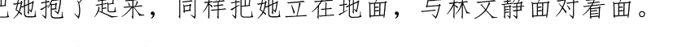

我站了一阵子，就觉得浑身发寒，身上起了一串鸡皮疙瘩，正想说话，突然就见在咫的林文静和刘柳同时睁开了双目！

我顾不得来发出一声惊呼，就见那雪白长的手指朝我点了过来。那根手指上还带着泛红的血痕，正地点在我额头上。

当一股脑子冰凉的冷气从额头直钻脑中，瞬间扩散到全身，整个人像炸了一般，眼前一片，当即就失去了知觉。

等我醒过来的时候，眼睛一片光明，原来已经是天亮了。我趴地上，那冷冰冰的岩石贴在身上不舒服，只觉得身上像万针刺一样，从后背到脚跟，却没看到青子那个人影子。

看到青子那个人，连林文静和刘柳都看不见了。去那两口棺材看了一眼，也没有看到两人的影子。

昨晚那不停旋转的五帝钱也停了转动，搁在那里，面上有一大半的血迹消失了，留下淡淡的痕迹。

作者:霍夷 日期:2018-04-23 13:20

出了墓室一看，见青子坐在那块大石头上，支撑着膝，坐在那里发呆。

我扫了一眼，外头也没找到林文静和刘柳的尸体，就问：“她们呢？”

青子没搭理我，在那里坐了一阵子，才从石头上下来，来到墓室，指了指地上的两处灰烬：“这里。”

我跑过去一看，地上两处灰烬的位置，正是昨晚两人站立的地方，心想，开什么玩笑，难道昨晚我昏迷之后，林丫头和刘家那鬼丫头都被这女人一把火烧了？可就算了，也不可能烧成这么干干净净。

青子冷漠道：“找了，我把她们种进了你身体里。”

我一下子没听懂她说的什么意思。

“白家人守了我多年，我不能让他们杀死。”青子面无表情地道，“我用种术把两人种入你体内，等你十八岁后，她们就会脱而出。”

我简直以为是自己出现了幻听，什么种术，什么扩建加法，我想要很多好处推荐种子树，体又不是免费送的票券，还连方夜宵！

“放心，不会要了的小命。只是你的性格会一分为三，阳也会减弱，需要你一个人养三个人。”青子不以为意地道。

我听得浑浑灵灵，脑子里一片混沌。她说的这些事情，我根本无法理解。忍不住揉了揉额头，我记得昨晚那一点向我的手指，应该是青子这女人的，而且还沾了她的血。

作者:霍夷 日期:2018-04-23 13:30

不过如今额头似乎没有什么异样。

青子跟我说完就自愿的进了墓室，又坐在那块大石头上发呆。


我愣愣地站在墓室中，突然觉得肚子一阵抽筋般的剧痛，原来是被饿狠了，我这才想起已经一天一夜没吃东西了。

我忽然就有些胆然了，我都困在这山洞里了，没吃没喝的顶多就能再熬个几天，然后就呜呼，哪还顾着什么。

见昨晚挖出的五帝钱，就捡了几张，学着昨天女人的方法，把钱朝墙出去。

我等了会儿，不由有些愁，见身上散着。看到青子，连林文静和刘柳都看不见了。去那两口棺材看了一眼，也没有看到两人的影子。

昨晚那不停旋转的五帝钱也停了转动，搁在那里，面上有一大半的血迹消失了，留下淡淡的痕迹。

我出了墓室一看，见青子坐在那块大石头上，支撑着膝，坐在那里发呆。

我扫了一眼，外头也没找到林文静和刘柳的尸体，就问：“她们呢？”

青子没搭理我，在那里坐了一阵子，才从石头上下来，来到墓室，指了指地上的两处灰烬：“这里。”

我跑过去一看，地上两处灰烬的位置，正是昨晚两人站立的地方，心想，开什么玩笑，难道昨晚我昏迷之后，林丫头和刘家那鬼丫头都被这女人一把火烧了？可就算了，也不可能烧成这么干干净净。

青子冷漠道：“找了，我把她们种进了你身体里。”

我一下子没听懂她说的什么意思。

“白家人守了我多年，我不能让他们杀死。”青子面无表情地道，“我用种术把两人种入你体内，等你十八岁后，她们就会脱而出。”

我简直以为是自己出现了幻听，什么种术，什么扩建加法，我想要很多好处推荐种子树，体又不是免费送的票券，还连方夜宵！

“放心，不会要了的小命。只是你的性格会一分为三，阳也会减弱，需要你一个人养三个人。”青子不以为意地道。

我听得浑浑灵灵，脑子里一片混沌。她说的这些事情，我根本无法理解。忍不住揉了揉额头，我记得昨晚那一点向我的手指，应该是青子这女人的，而且还沾了她的血。

不过如今额头似乎没有什么异样。

青子跟我说完就自愿的进了墓室，又坐在那块大石头上发呆。


我愣愣地站在墓室中，突然觉得肚子一阵抽筋般的剧痛，原来是被饿狠了，我这才想起已经一天一夜没吃东西了。

我忽然就有些胆然了，我都困在这山洞里了，没吃没喝的顶多就能再熬个几天，然后就呜呼，哪还顾着什么。

见昨晚挖出的五帝钱，就捡了几张，学着昨天女人的方法，把钱朝墙出去。

我等了会儿，不由有些愁，见身上散着。看到青子，连林文静和刘柳都看不见了。去那两口棺材看了一眼，也没有看到两人的影子。

昨晚那不停旋转的五帝钱也停了转动，搁在那里，面上有一大半的血迹消失了，留下淡淡的痕迹。

我出了墓室一看，见青子坐在那块大石头上，支撑着膝，坐在那里发呆。

我扫了一眼，外头也没找到林文静和刘柳的尸体，就问：“她们呢？”

青子没搭理我，在那里坐了一阵子，才从石头上下来，来到墓室，指了指地上的两处灰烬：“这里。”

我跑过去一看，地上两处灰烬的位置，正是昨晚两人站立的地方，心想，开什么玩笑，难道昨晚我昏迷之后，林丫头和刘家那鬼丫头都被这女人一把火烧了？可就算了，也不可能烧成这么干干净净。

青子冷漠道：“找了，我把她们种进了你身体里。”

我一下子没听懂她说的什么意思。

“白家人守了我多年，我不能让他们杀死。”青子面无表情地道，“我用种术把两人种入你体内，等你十八岁后，她们就会脱而出。”

我简直以为是自己出现了幻听，什么种术，什么扩建加法，我想要很多好处推荐种子树，体又不是免费送的票券，还连方夜宵！

“放心，不会要了的小命。只是你的性格会一分为三，阳也会减弱，需要你一个人养三个人。”青子不以为意地道。

我听得浑浑灵灵，脑子里一片混沌。她说的这些事情，我根本无法理解。忍不住揉了揉额头，我记得昨晚那一点向我的手指，应该是青子这女人的，而且还沾了她的血。

不过如今额头似乎没有什么异样。

青子跟我说完就自愿的进了墓室，又坐在那块大石头上发呆。


我愣愣地站在墓室中，突然觉得肚子一阵抽筋般的剧痛，原来是被饿狠了，我这才想起已经一天一夜没吃东西了。

我忽然就有些胆然了，我都困在这山洞里了，没吃没喝的顶多就能再熬个几天，然后就呜呼，哪还顾着什么。

见昨晚挖出的五帝钱，就捡了几张，学着昨天女人的方法，把钱朝墙出去。

我等了会儿，不由有些愁，见身上散着。看到青子，连林文静和刘柳都看不见了。去那两口棺材看了一眼，也没有看到两人的影子。

（由于原始文本存在大量重复和乱码，此处已根据逻辑进行去重与修复，保留核心叙事内容）


“我喜欢。”

作者:匪离无语。日期:2018-04-24 09:18

我有些叹：“好哒，你喜欢，你最大！”过了一会儿，忍不住又问：“那里有个巨人的坟沟，很大一片林海的，很有古怪，你知不知道？”

过了好一会儿，青子才冷淡地回了一句：“你说的巨人葬吧？”

我吃了一惊：“巨人葬？那是什么？那里地方是不是有问题？”

青子冷笑道：“这巨人葬千年就已经存在了，能有什么问题？有问题的那个村子，非要建在那里？”

我觉得有些害怕，那里坟墓可真可怕。

青子冷道：“今天这些毒虫怪异只是小事，等巨人葬破土，那才有点看头。”

我吓得一激，止住脚步说：“那我们是不是要去村子赶撤跑！”

青子道：“让他们搬去哪里？”

我想，确实也是这个理。猫鼻子村的村民世代居于此地，他们要搬走，他们怎么肯呢？”

我看她，试着问：“巨人葬到底是什么东西？你能不能把它解决了？”

青子厌烦道：“你一个小孩子，怎么这么多事？就算能解决，我为什么要去管。我已经把血契传给了你了，你如果要去管，就自己想办法。”

“血契？什么血契？”我还以为我听错了。

青子冷冷道：“我封棺之前就立了个誓，醒来第一个看到的人，就传给他血契。”

作者：匪离 V 日期:2018-04-24 10:18

“这些事我早就管得腻了，以后都归你了。”

我不知措：“那是什么？”

青子转头看了一眼，目光森冷。

“巡阴。”

......


虽然在很长一段时间里，我都不自觉地忽略这种精彩，以前也未听过任何人提起过。

“阳奉事不管，阴管三分。”

这就是青子对巡阴的解释。当时她用自己的血，与我结血契后，我就算得了她的传承，成了下一巡阴。每一个巡阴，都是一脉单传，一生之中只能传与一人血契。所以如果这个巡阴在找到新的传承人之前死去，那么这一脉永远的断了。

后来有一次问过青子：“这世界上究竟有多少巡阴人？”青子不耐烦地说：“可能很多，也可能只剩下你。”

这就是因为每一脉的巡阴都是单线传承，在历史的长河中，经历数不清的岁月，谁也不知道什么时候这根线什么时候就永远的断了。

“以后这些烦人的事别再来找我。”青子当时说这话的时候一脸的厌烦。

“可是那巨人葬……”我还是不死心，想让她救一下猫鼻子村。

青子道：“离巨人葬破土，至少还有十年，你有的是时间。”

“那你至少告诉我巨人葬究竟是什么？”

“别来烦我！”

我：“……”


脚铺了一路出来，由于骨头断骸横横在山转得迷了好几几次。

作者：垂直 V 日期:2018-04-24 11:18

我不死心地在山中乱，盼着三叔有一天突然一下子从我眼前跳出来。青子不吃东西也不会觉得饿，我可受不了，从村子里出来的青果和慢头早被我分吃完了。幸好大山里有的是野兔类的山货，遇到水潭还能抓几鱼。

时间在寻找中流逝，却依然没有三叔的踪影。我想过千百种可能性，也没有一种能让我稍稍安心。这附近的山脉我已经踏寻了个遍，终究是镜花水，一场空梦。

终于，还是到了离开的时候。来的那时候那么多人，去时却已不在。但在我心中，始终不肯相信老老这样的老狐狸这样无声无意的死掉。打死我也不信。

身上的衣服，在狗谷的时候就已经剪破了好几次，然后又滚又爬的，干变成布条披在身上，屁股上也被破了好几个洞，真是被风吹凉，只一路用手捂着，很是有些滑。这一路走过来，青子倒是显得尘土不染，连衣服都不脏的。

“你这衣服不如穿吧。”青子吃了一口我烤的鱼，评价道。

我拉过布条遮住胸口，说道：“我是男人，怎么能在女人面前露衩！”

青子冷冷的一声：“你算哪门男人？”


我点了点衣服，有些尴尬地说道：“这确实有点尴尬。”

“就是有点过了。”青子冷冷地看了一眼。

我忙转了话题，说道：“咱们接着去哪？可惜啊，刘家那笔钱是要买，不然可以回村子里建一个小洋房。”

作者:亘 V 日期:2018-04-24 11:18

青子仔细地把鱼一条挑出来，她白皙的手指灵活极，说：“有什么好玩的？”

我点了点衣服，有些尴尬地说道：“这确实有点尴尬。”

“就是有点过了。”青子冷冷地看了一眼。

我忙转了话题，说道：“咱们接着去哪？可惜啊，刘家那笔钱是要买，不然可以回村子里建一个小洋房。”

我拉过布条遮住胸口，说道：“我是男人，怎么能在女人面前露衩！”

青子冷冷的一声：“你算哪门男人？”

我点了点衣服，有些尴尬地说道：“这确实有点尴尬。”

“就是有点过了。”青子冷冷地看了一眼。

我忙转了话题，说道：“咱们接着去哪？可惜啊，刘家那笔钱是要买，不然可以回村子里建一个小洋房。”

我拉过布条遮住胸口，说道：“我是男人，怎么能在女人面前露衩！”

青子冷冷的一声：“你算哪门男人？”

我点了点衣服，有些尴尬地说道：“这确实有点尴尬。”

这确实有点尴尬。

其实绝大多数地方我根本没去过，我还是第一次从村子出来。

我们走走停停，终于从山脚下的镇子取了钱，青子跟着挑了一身衣服：绿色的圆领长袖T恤，灰色的裤，白色运动鞋，用紫色发带把头发扎了个马尾，皮肤白皙，清纯秀丽，一看都是个漂亮的女学生，和之前有些不同。

我有些呆，看着她，不由得有些酸。

我们等在一个小饭馆，进去了几个菜，准备好好吃一顿。这边的菜味道不错，我吃得开心，青子却不喜欢，我得口，青子吃了几口就不吃了。

等我洗好澡出来，却半天没人影，找了一圈，在一个小饭馆前找到了她，正跟一群人站在一起。

我有些慌，忙说：“我去洗澡！”

路途遥远，只能坐车到外外的玉城，从哪里可以继续坐客车或者坐火车。我买的两张票是相邻的座位，青子找了个靠的，不时打量车上的乘客和设施，大约有点新奇。我就说：“没坐过这个吧，这个叫……”

青子冷冷的：“不是汽车，以前也有，这个就是大一点而已。”

话还没说完，青子透过窗看着外面，不再搭理我。车子启动后，就开始一路颠簸着往北去。出了山区，路就变得平坦起来，青子一直看着窗外的风景，只是神情冷淡，看不出来在想什么。

“嗯”了一声，有些不明所以：“什么安静了？”车子里很多人都睡了，但车子颠簸，还是吵得很。青子却没回答，过了好一会儿，问了一句：“还不打仗？”

我愣了一下，才明白她什么意思，笑说：“早不打了，我们早就把鬼子给干了出去！”青子“哦”了一声，继续看着窗外。我好奇，就问她什么变得这么安静了。青子先没理我，被我连问了几次，才不耐烦地说：“是怨魂闹了。”

我头皮一阵发麻，觉得后背凉意如森，压低声音说：“哪有怨魂，我怎么听不见？”我不敢大声，怕旁边的乘客听到，以为我们是神经病。

青子冷地说：“迟早的事。”她虽然没明白，但她话里的意思就是我这辈子也听不太懂。

车子到玉宁城后，在当地找到了个小住宿住了一夜。由于经费有点紧张，就只订了一个房间，不过青子睡了床，我只有在地上铺。不过这比在山里会儿好多了，至少还有铺盖着，暖和，很快就睡了。

作者：匪戈 日:2018-04-25 09:50

玉宁城虽然不算大城市，但对于我们从小山村出来的人来说，已经是大地方了，走在街头，看得目不接。青子反而显得比我更加淡定。在玉宁城换了火车，一路过去，又转了四次车，我们终于回到了黄渤镇。

我们走走停停，终于从山脚下的镇子取了钱，青子跟着挑了一身衣服：绿色的圆领长袖T恤，灰色的裤，白色运动鞋，用紫色发带把头发扎了个马尾。

我们在市场上逛了一圈，又去买了几身衣服，一个很大的背包，装得满满，沉得死。

青子背着包，轻松松地走在前面。我一个十二岁的孩子，扛着个比我大的包，累得像狗。

一路走到更远的镇，才看到了车站。我在去买票的时候，突然想起一件事，我还欠一个人情还没还。那人死前让我去一趟那个鬼屋，既然答应了他，还是要应去。

我们买了回去的票，只不过从那边过去，路途遥远，并没有直达的车，只能坐车到外外的玉城，从哪里可以继续坐客车或者坐火车。

我买的两张票是相邻的座位，青子找了个靠的，不时打量车上的乘客和设施。

脚铺了一路出来，由于骨头断骸横横在山中转得迷了好几几次。

作者：垂直 V 日期:2018-04-24 11:18

我不死心地在山中乱，盼着三叔有一天突然一下子从我眼前跳出来。青子不吃东西也不会觉得饿，我可受不了，从村子里出来的青果和慢头早被我分吃完了。幸好大山里有的是野兔类的山货，遇到水潭还能抓几鱼。

时间在寻找中流逝，却依然没有三叔的踪影。我想过千百种可能性，也没有一种能让我稍稍安心。这附近的山脉我已经踏寻了个遍，终究是镜花水，一场空梦。

终于，还是到了离开的时候。来的那时候那么多人，去时却已不在。但在我心中，始终不肯相信老老这样的老狐狸这样无声无意的死掉。打死我也不信。

身上的衣服，在狗谷的时候就已经剪破了好几次，然后又滚又爬的，干变成布条披在身上，屁股上也被破了好几个洞，真是被风吹凉，只一路用手捂着，很是有些滑。这一路走过来，青子倒是显得尘土不染，连衣服都不脏的。

“你这衣服不如穿吧。”青子吃了一口我烤的鱼，评价道。

我拉过布条遮住胸口，说道：“我是男人，怎么能在女人面前露衩！”

青子冷冷的一声：“你算哪门男人？”

我点了点衣服，有些尴尬地说道：“这确实有点尴尬。”

“就是有点过了。”青子冷冷地看了一眼。

我忙转了话题，说道：“咱们接着去哪？可惜啊，刘家那笔钱是要买，不然可以回村子里建一个小洋房。”

作者:亘 V 日期:2018-04-24 11:18

青子仔细地把鱼一条挑出来，她白皙的手指灵活极，说：“有什么好玩的？”

我点了点衣服，有些尴尬地说道：“这确实有点尴尬。”

“就是有点过了。”青子冷冷地看了一眼。

我忙转了话题，说道：“咱们接着去哪？可惜啊，刘家那笔钱是要买，不然可以回村子里建一个小洋房。”

我拉过布条遮住胸口，说道：“我是男人，怎么能在女人面前露衩！”

青子冷冷的一声：“你算哪门男人？”

我点了点衣服，有些尴尬地说道：“这确实有点尴尬。”

这确实有点尴尬。

其实绝大多数地方我根本没去过，我还是第一次从村子出来。

我们走走停停，终于从山脚下的镇子取了钱，青子跟着挑了一身衣服：绿色的圆领长袖T恤，灰色的裤，白色运动鞋，用紫色发带把头发扎了个马尾，皮肤白皙，清纯秀丽，一看都是个漂亮的女学生，和之前有些不同。

我有些呆，看着她，不由得有些酸。

我们等在一个小饭馆，进去了几个菜，准备好好吃一顿。这边的菜味道不错，我吃得开心，青子却不喜欢，我得口，青子吃了几口就不吃了。

等我洗好澡出来，却半天没人影，找了一圈，在一个小饭馆前找到了她，正跟一群人站在一起。

我有些慌，忙说：“我去洗澡！”

路途遥远，只能坐车到外外的玉城，从哪里可以继续坐客车或者坐火车。

我买的两张票是相邻的座位，青子找了个靠的。

......。


虽然在很长一段时间里，我都不自觉地忽略这种精彩，以前也未听过任何人提起过。

“阳奉事不管，阴管三分。”

这就是青子对巡阴的解释。当时她用自己的血，与我结血契后，我就算得了她的传承，成了下一巡阴。每一个巡阴，都是一脉单传，一生之中只能传与一人血契。所以如果这个巡阴在找到新的传承人之前死去，那么这这一脉永远的断了。

后来有一次问过青子：“这世界上究竟有多少巡阴人？”青子不耐烦地说：“可能很多，也可能只剩下你。”

这就是因为每一脉的巡阴都是单线传承，在历史的长河中，经历数不清的岁月，谁也不知道什么时候这根线什么时候就永远的断了。

“以后这些烦人的事别再来找我。”青子当时说这话的时候一脸的厌烦。

“可是那巨人葬……”我还是不死心，想让她救一下猫鼻子村。

青子道：“离巨人葬破土，至少还有十年，你有的是时间。”

“那你至少告诉我巨人葬究竟是什么？”

“别来烦我！”

我：“……”


脚铺了一路出来，由于骨头断骸横横在山中转得迷了好几几次。

作者：垂直 V 日期:2018-04-24 11:18

我不死心地在山中乱，盼着三叔有一天突然一下子从我眼前跳出来。青子不吃东西也不会觉得饿，我可受不了，从村子里出来的青果和慢头早被我分吃完了。幸好大山里有的是野兔类的山货，遇到水潭还能抓几鱼。

时间在寻找中流逝，却依然没有三叔的踪影。我想过千百种可能性，也没有一种能让我稍稍安心。这附近的山脉我已经踏寻了个遍，终究是镜花水，一场空梦。

终于，还是到了离开的时候。来的那时候那么多人，去时却已不在。但在我心中，始终不肯相信老老这样的老狐狸，这样无声无意的死掉。打死我也不信。

身上的衣服，在狗谷的时候就已经剪破了好几次，然后又滚又爬的，干变成布条披在身上，屁股上也被破了好几个洞，真是被风吹凉，只一路用手捂着，很是有些滑。这一路走过来，青子倒是显得尘土不染，连衣服都不脏的。

“你这衣服不如穿吧。”青子吃了一口我烤的鱼，评价道。

我拉过布条遮住胸口，说道：“我是男人，怎么能在女人面前露衩！”

青子冷冷的一声：“你算哪门男人？”


我点了点衣服，有些尴尬地说道：“这确实有点尴尬。”

“就是有点过了。”青子冷冷地看了一眼。

我忙转了话题，说道：“咱们接着去哪？可惜啊，刘家那笔钱是要买，不然可以回村子里建一个小洋房。”

作者:亘 V 日期:2018-04-24 11:18

青子仔细地把鱼一条挑出来，她白皙的手指灵活极，说：“有什么好玩的？”

我点了点衣服，有些尴尬地说道：“这确实有点尴尬。”

“就是有点过了。”青子冷冷地看了一眼。

我忙转了话题，说道：“咱们接着去哪？可惜啊，刘家那笔钱是要买，不然可以回村子里建一个小洋房。”

我拉过布条遮住胸口，说道：“我是男人，怎么能在女人面前露衩！”

青子冷冷的一声：“你算哪门男人？”

我点了点衣服，有些尴尬地说道：“这确实有点尴尬。”

这确实有点尴尬。

其实绝大多数地方我根本没去过，我还是第一次从村子出来。

我们走走停停，终于从山脚下的镇子取了钱，青子跟着挑了一身衣服：绿色的圆领长袖T恤，灰色的裤，白色运动鞋，用紫色发带把头发扎了个马尾，皮肤白皙，清纯秀丽，一看都是个漂亮的女学生，和之前有些不同。

我有些呆，看着她，不由得有些酸。

我们等在一个小饭馆，进去了几个菜，准备好好吃一顿。这边的菜味道不错，我吃得开心，青子却不喜欢，我得口，青子吃了几口就不吃了。

等我洗好澡出来，却半天没人影，找了一圈，在一个小饭馆前找到了她，正跟一群人站在一起。

我有些慌，忙说：“我去洗澡！”

路途遥远，只能坐车到外外的玉城，从哪里可以继续坐客车或者坐火车。

我买的两张票是相邻的座位，青子找了个靠的，不时打量车上的乘客和设施，大约有点新奇。我就说：“没坐过这个吧，这个叫……”

青子冷冷的：“不是汽车，以前也有，这个就是大一点而已。”

话还没说完，青子透过窗看着外面，不再搭理我。车子启动后，就开始一路颠簸着往北去。出了山区，路就变得平坦起来，青子一直看着窗外的风景，只是神情冷淡，看不出来在想什么。

“嗯”了一声，有些不明所以：“什么安静了？”车子里很多人都睡了，但车子颠簸，还是吵得很。

青子却没回答，过了好一会儿，问了一句：“还不打仗？”

我愣了一下，才明白她什么意思，笑说：“早不打了，我们早就把鬼子给干了出去！”青子“哦”了一声，继续看着窗外。我好奇，就问她什么变得这么安静了。青子先没理我，被我连问了几次，才不耐烦地说：“是怨魂闹了。”

我头皮一阵发麻，觉得后背凉意如森，压低声音说：“哪有怨魂，我怎么听不见？”我不敢大声，怕旁边的乘客听到，以为我们是神经病。

青子冷地说：“迟早的事。”她虽然没明白，但她话里的意思就是我这辈子也听不太懂。

车子到玉宁城后，在当地找到了个小住宿住了一夜。由于经费有点紧张，就只订了一个房间，不过青子睡了床，我只有在地上铺。不过这比在山里会儿多了，至少还有铺盖着，暖和，很快就睡了。

作者：匪戈 日:2018-04-25 09:50

玉宁城虽然不算大城市，但对于我们从小山村出来的人来说，已经是大地方了，走在街头，看得目不接。青子反而显得比我更加淡定。在玉宁城换了火车，一路过去，又转了四次车，我们终于回到了黄渤镇。

我们走走停停，终于从山脚下的镇子取了钱，青子跟着挑了一身衣服：绿色的圆领长袖T恤，灰色的裤，白色运动鞋，用紫色发带把头发扎了个马尾。

我们在市场上逛了一圈，又去买了几身衣服，一个很大的背包，装得满满，沉得死。

青子背着包，轻松松地走在前面。我一个十二岁的孩子，扛着个比我大的包，累得像狗。

一路走到更远的镇，才看到了车站。我在去买票的时候，突然想起一件事，我还欠一个人情还没还。那人死前让我去一趟那个鬼屋，既然答应了他，还是要应去。

我们买了回去的票，只不过从那边过去，路途遥远，并没有直达的车，只能坐车到外外的玉城，从哪里可以继续坐客车或者坐火车。

我买的两张票是相邻的座位，青子找了个靠的，不时打量车上的乘客和设施，大约有点新奇。我就说：“没坐过这个吧，这个叫……”

青子冷冷的：“不是汽车，以前也有，这个就是大一点而已。”

话还没说完，青子透过窗看着外面，不再搭理我。车子启动后，就开始一路颠簸着往北去。出了山区，路就变得平坦起来，青子一直看着窗外的风景，只是神情冷淡，看不出来在想什么。

“嗯”了一声，有些不明所以：“什么安静了？”车子里很多人都睡了，但车子颠簸，还是吵得很。青青子却没回答，过了好一会儿，问了一句：“还不打仗？”

我愣了一下，才明白她什么意思，笑说：“早不打了，我们早就把鬼子给干了出去！”青子“哦”了一声，继续看着窗外。我好奇，就问她什么变得这么安静了。青子先没理我，被我连问了几次，才不耐烦地说：“是怨魂闹了。”

我头皮一阵发麻，觉得后背凉意如森，压低声音说：“哪有怨魂，我怎么听不见？”我不敢大声，怕旁边的乘客听到，以为我们是神经病。

青子冷地说：“迟早的事。”她虽然没明白，但她话里的意思就是我这辈子也听不太懂。

车子到玉宁城后，在当地找到了个小住宿住了一夜。由于经费有点紧张，就只订了一个房间，不过青子睡了床，我只有在地上铺。不过这比在山里会儿好多了，至少还有铺盖着，暖和，很快就睡了。

玉宁城虽然不算大城市，但对于我们从小山村出来的人来说，已经是大地方了，走在街头，看得目不接。青子反而显得比我更加淡定。在玉宁城换了火车，一路过去，又转了四次车，我们终于回到了黄渤镇。

我们走走停停，终于从山脚下的镇子取了钱，青子跟着挑了一身衣服：绿色的圆领长袖T恤，灰色的裤，白色运动鞋，用紫色发带把头发扎了个马尾。

我们在市场上逛了一圈，又去买了几身衣服，一个很大的背包，装得满满，沉得死。

青子背着包，轻松松地走在前面。我一个十二岁的孩子，扛着个比我大的包，累得像狗。

一路走到更远的镇，才看到了车站。我在去买票的时候，突然想起一件事，我还欠一个人情还没还。那人死前让我去一趟那个鬼屋，既然答应了他，还是要应去。

我们买了回去的票，只不过从那边过去，路途遥远，并没有直达的车，只能坐车到外外的玉城，从哪里可以继续坐客车或者坐火车。

我买的两张票是相邻的座位，青子找了个靠的，不时打量车上的乘客和设施，大约有点新奇。我就说：“没坐过这个吧，这个叫……”

青子冷冷的：“不是汽车，以前也有，这个就是大一点而已。”

话还没说完，青子透过窗看着外面，不再搭理我。车子启动后，就开始一路颠簸着往北去。出了山区，路就变得平坦起来，青子一直看着窗外的风景，只是神情冷淡，看不出来在想什么。

“嗯”了一声，有些不明所以：“什么安静了？”车子里很多人都睡了，但车子颠簸，还是吵得很。青子却没回答，过了好一会儿，问了一句：“还不打仗？”

我愣了一下，才明白她什么意思，笑说：“早不打了，我们早就把鬼子给干了出去！”青子“哦”了一声，继续看着窗外。我好奇，就问她什么变得这么安静了。青子先没理我，被我连问了几次，才不耐烦地说：“是怨魂闹了。”

我头皮一阵发麻，觉得后背凉意如森，压低声音说：“哪有怨魂，我怎么听不见？”我不敢大声，怕旁边的乘客听到，以为我们是神经病。

青子冷地说：“迟早的事。”她虽然没明白，但她话里的意思就是我这辈子也听不太懂。


我之所以想到赶尸，是因为我看到了屋子里躺着的六具尸体。虽然无法感知生气的流向，但尸体可以。这鬼屋很是邪门，墙内混合了大量的朱砂，这些人人都死在这里，说不定魂还未离体。

我能够用赶尸术将这些尸体赶起，就能利用他们查生气的流向。可我现在别说辰砂和辰州符了，就连最普通的朱砂和神符都没有。虽说这屋子的墙壁上上了大量朱砂，但这根本无法使用。

我苦思想了一阵，把兜里藏着的针筒给摸了，抽出一根三棱柱。湘西一派的赶尸法是不行通的，不过当年三叔跟我解释过他的原理，主要就是把死者的魂封在体内，并用铁咒来封住。

作者：离离 日期:2018-04-26 14:07

我试着用定针法来代替朱砂和神符。所谓的定针法究就是一个“定”字，以前在三叔的监督之下，曾练了几年。这定针法，在我们行内主要是为了对付那些许尸的，用定针住尸体关窍，尸就能乖乖躺下。

此时迫于无奈，只能用定针法来封尸体的七关，看看能不能行通。

我将那三棱柱按在手上，把其中一尸体的衣衫全部扒掉，闭眼吸了一口气，调息了几下，落针如雨，一口气连封了七处关窍。我一颗心别乱跳，心里重复三叔教我的咒文，朝着尸体一指，大喊一声：“起！”

就见那具烂了半脸的男尸，一下子从地上坐了起来。

我双手交叠，做了个手势，尸体立起。我心中又惊又喜，这被困在鬼屋，魂魄果然没有散去。我费力记忆当年三叔教我的诸多法门，手掌收紧，右手又一张。眼前的尸体双肩一塌，似乎整个人一下松垮了。

我退到一边，屏住呼吸，直勾勾地盯着他看。过了一会儿，就见这男尸转了下头，往左侧偏了偏，停了一下，然后往左转了半个身体，开始摇晃晃地往前走去。他迈了两步，停下，胡须微微转动，又转朝着左侧连着走了三三步。

也紧跟着他，距离越来越远，视线交错一瞬也不松放松。等那男尸再走两步，我就立刻跟上，抬脚在它最后站立的那个位置。

作者：匪诡 日：2018-04-26 15:37

然后按照他刚才的方位，左转半个身体，依次迈出两步，紧跟其后。其后，兜兜转转，也不知道绕了几圈，仿佛跑出了一通踪，终于，男尸在前方停了下来。我深吸一口气，跟着这出一步，然后一起扑抱住那男尸，挂在他身上。

虽然那具肉臭臭味和身上的腐肉让人心恶，但我心中却是欣喜若狂！就在我挂到男士身上的一刻那，就看到我面前多一样东西，一木箱子！我仔仔细观察了一阵，头下脚上，双脚环住男脖子，倒挂拉住箱子，一用力，把箱盖掀开了。

我只觉得一阵亮光一晃而，原来这打开的箱子里藏着一铜镜，闪了我一下。而随着这道光划过，屋内中景物忽忽变化，那个没有塌的大门终于显露了出来。

我长一口气，从男身上跳下来，身上骷塌塌正是，犹如活了不腐肉。他也顾不得他，见那箱子方方正正，约有半米长，箱中还有那面铜镜，还有一些书籍之类的物件，零零散散，一时也看不过。我会乱祸交加，刚才这一番折腰已经是最后的力气却憋哑了，此刻我的嗓子像裂了一样，再也爬不起来。我攥着嗓子大喊了几声，却发现由于严重脱水，声音根本喊都不出来。难成阵法都破了，结果反而在这里被渴死饿死？我正绝望，就听身后传来一个冰冷的声音：“鬼叫什么？”

作者：觅夷 V 日期:2018-04-27 08:21

这声音听起来一点也不温柔，冷冰冰的没半点温度，但此时听在我耳内不些是仙女音。我挣着“呵呵”了几声，却说不出完整一句话。


刚见到青子的一张俏脸出现在我面前，皱了皱眉头，嫌恶地道：“这么脏。”蹲下身子，给我递过吻，凑到我嘴边。我闻到了水的味道，立即精神一振，张开嘴咕嘟地泄气。在地上趴了一阵，总算是恢复了体力，从地上爬起来。我又把剩下的水一口气喝了个，意犹尽地舔了舔，说：“你是从哪弄来的？”水只是缺了一个角，也算她找到一大口。青子在屋里晃了一圈，说：“院子外捡的，那里还有便宜的。”我上一无言，突然想到某事，忙问：“那水呢？”青子：“外头不是口井吗？”我差点把碗给掉了。不过算了，之前喝过一次，喝两次又没什么。箱子里的东西不是特别，对我这个饿得来说，连在地上走都累的。

总算是恢复了体力，爬起来靠在箱子上，心有余悸。青子这女人虽然双手空空，让她替我搬箱子，那是都是想都不。我听到了，差点跳了起来：“你也不来救救我！”青子淡漠地道：“就这点事，你就受不了了？”再也不理我，转身往窗外去：“躺够了，走了。”我咬牙，爬起来推着箱子跟着她。到门口，阳光有些刺眼，眼前一片黑，差点就晕过去。青子那人在慢悠悠地走，也不回头，好不容易到镇上，找了家面馆，先要了一碗汤，等一会儿，又叫了一碗牛肉肉。青子对这些没什么兴趣，只要清水。我吃了两大牛肉肉，又灌了一瓶汽水，终于算吃饱，舒服地打了个嗝。在椅子上靠了会儿，终于要打算后面的事情。青子这死女人抿了口清水，放杯子，依旧是这一句话。行，我伸个腰，大叫一声，倒惊那正算账的店老板了一大跳。青子皱起眉头，道：“什么意思？”我得意地道：“这是英语，就是‘走起来’的意思。怎么样，时尚？这都是电视上学来的。”

作者：亘夷 日期:2018-04-27 11:21

青子道：“英吉利？法兰西？花旗国？弗朗机？还是玛尼？”“邪……什么玛尼？”我听得瞪口呆，这都是什么？我说：“这是英文，是英国的语言。”青子：“哦”了一声，“原来是英吉利。”


我们当时见过的这些地方都是黑白电视看的或者听说的，不知道百年前我们民间间称呼，英吉利就是现在的英国，法兰西就是法国，花旗国就是美国，至于弗朗机和玛尼，分别为葡萄和德国。我说：“对那些红毛鬼子！你以前见过吗？”这女人真是见多识。青子道：“杀掉一些。”我听得一阵毛骨悚然，好奇地说：“我还以为巡阴人阳事不管，只管阴事的。”青子冷冷地道：“死了就不阴事的？惹得我不高兴顺手也就给宰了。所以，你最好给我乖乖听话。”

## 我连连点，天大大，就你不离最大

从酒店出来，我特意又买了个大的行李箱，把衣服的日常用品都放了进去，原来那个大背包就用来装那个箱里的东西，一股脑塞了进去。闲暇的时候，我也空看了几眼，除了些奇奇怪的物件，其他都是一些书籍。有些纸张十分古旧，上了年头的古籍。有些则是新的，是自己写的笔记，上头密密麻麻如蝇爬小字记录，粗粗一翻，大约是我的一些心得领悟。有什么术法的、符咒的、排阵的、布局的……林林总总不足。


作者:兜夷 日:2018-04-27 12:51

我买了几笔，有些是拿来并教我的，前教我的一些东西颇为相通。不过看了几眼，就退回包中，等以后再说。镇上有一个车站，我背着包，挤到车站买了两张票，启程出发了。至于去哪里，这女人高兴了。路上走走停停，到处。青子这女人虽然在棺材里睡了百年，但适应能力却是强。我看着她那双白皙的手握着刀，优雅地切割着牛排。“看什么？”青子瞥了我一眼，优雅地品口红酒，唇润如血。我心里想着，心不在焉地回答。我个没见过世面的土。青子赞了一句：“光光不错。”此时我根本没心情跟她说话，含糊地：“嗯”。我还在算身上总共有钱，究竟还能支撑多久。看着这盘牛排，我不知道这玩意儿有什么吃的，这么贵，一顿得好几天费！下一站哪？”青子问。“哪去也不了！”我好气说道。青子“哦”了一声，继续慢条斯理地吃着牛排：“以后少花点。”我恨得牙痒，现在只有五千块了，还有用？当作那牛排狠狠咬了一口，说：“不能再酒店了，必须找个房子住。”青子点了点头：“可以。吃完饭去找份工作。”那你呢？”青子道：“我在这。”说这女人，真是不逊于我的怪胎。除了身材好，其他就没有地方像。脏衣服下一脱一股脑扔给我，让我给她洗好干，再整整齐送到手里。

作者：匪夷 日期:2018-04-28 08:10

看这女人的做作，十指不沾春水的，连半点家务活都不会干，不用说，肯定是个出身富贵人家的小姐！这下发财了！我可没高多久，就想到了一个问题。这死女人以前是有钱，可现在已经过了百百年，这段岁月里战火连天，可不是太平，她以前的钱还能留到现在吗？果然，青子想了想，“当年的钱还存在钱庄里，应该是。”我无言，心情闷透顶，只能对着摇头排。走边走边算这剩下的五千块钱怎么用。青子走在前面，头发用一个紫色发带系了，穿一条青色的底连衣裙，裙摆飘飘仙。每在这种时候，我总是分外想起来我家三叔。虽比起颜值，我三叔拍马上也不上这死女人，但好看又不能当饭吃！要是三叔在这，哪还需要我一个十二岁的毛头孩子为自己愁白了头？我计了一路，最后还是租个房子住下来，就这些钱，继续往前旅行是不可能的。我们现在所在的这个地方是南方的一个小城，人丁为兴旺，周围多丘陵，城中水系发达，气候比较宜人，适合居住。半路抽空跟附近的大爷大妈打了一下，啧，这房租可也不便宜，随便租一室一厅的，都要八百一千的。

作者：亘 日期:2018-04-28 09:40

我想着青子，在房间里找个沙发发呆。或许这样，手里只有五千块也撑不了多久。我埋着思想，没发现前面的青子突然停下，差点一头撞上去。她从手腕上掉一个勺子，丢过去：“拿去。”我看着她向巷口，摇着脸，似乎很有年头。她常常在身上，应该是喜欢的随身物。她是个六十岁的老婆，像苍蝇似的。我看着她黑着脸，摇着头。这儿是个六十岁的老头狐疑地看了我一眼，以为我是哪家的。孩子，从兜里出来。我不耐烦了，敲着案子，说：“还不做生意？”老头这才过来，扶了扶老眼镜，拿起勺子放在手中，瞧。这东西有些年头，老头手刻的，雕工也细。这，纯粹为了压价。我虽然年纪小，但从小知道，多少钱还能比饭更重要？正好附近就有家当行，我把勺子搁在兜里就去了。

作者：匪夷 日期:2018-04-28 11:10

这东西有些年头，老头摇了：“顶多值这个。”我虽然年纪小，但从小知道，多少钱还能比饭更重要？这，纯粹为了价。我朝他伸出一个手指。老头连忙护，我咬牙，说：“这数！”我朝他问：“是要现金还是转账？”我就说现金吧，省得麻烦。老头说行，让我等一会儿。三叔坐在隔壁，别让他等急了。他找了个伙计，去忙活了。等大概有一个钟头，老头才从外面匆匆地回来，手里夹着黑色皮袋，回来打门，就冲我说：“小子，收货了。”我一捏，觉得入手沉，打开一看，好家伙，里头厚厚的崭新钞票，从我的经验来看，这一袋子少说几万。

作者：霍万 日期:2020-04-28 12:40

老头笑眯眯：“十万，不多不少。”说着，把手一揉。我看着那袋子钱，有些眼睛发直，好久才发觉有些失态，把勺子从兜里取出，递了过去。老头立即皱眉笑，在手里翻覆去搓。这一会儿功夫，居然有十万入手，这下可是解了燃眉之急了，我的心情一下子好了起来，跟那老头聊了几句，知道这人姓钱，人称老头，在这满城也算是开了几十年的老字号。我摸着沉甸甸的钱包，心里磨着该笔钱怎么办。要是直接回去，恐怕不出时间就被青子败家女人挥霍光。盘算了一下，就跟老头打听，他在这浑城买个便宜的房子多少钱。“我们这儿虽然是小地方，房价可不便宜。那种便宜的房子，总归也要二十万来。怎么，家里要买房子？”呵呵呵呵，就是想要买房子，我家三叔才追得不得已让我卖了家传宝贝。”我笑着，一算这钱根本不够，就问：“那还有没有便宜点的？”“更便宜点的……”钱老头皱了皱想了，说，“那只能找那些老房子。浑城这边老头人面，有需要的话可以帮你打听砍价。“那感情好！”又扯了会儿闲，我就说三叔在隔壁等着急了，拎了包就辞出门。故意去隔壁茶馆转了一圈，没见人跟上来，这才去找青子。

作者：匪夷 日期:2018-04-28 14:10

对于一个罐子卖了十万块，我是得意的。青子... (Wait, I需要重新整理逻辑混乱的文本)

[content]
我之所以想到赶尸，是因为我看到了屋子里躺着的六具尸体。虽然无法感知生气的流向，但尸体可以。这鬼屋很是邪门，墙内混合了大量的朱砂，这些人人都死在这里，说不定魂还未离体。

我能够用赶尸术将这些尸体赶起，就能利用他们查生气的流向。可我现在别说辰砂和辰州符了，就连最普通的朱砂和神符都没有。虽说这屋子的墙壁上上了大量朱砂，但这根本无法使用。

我苦思想了一阵，把兜里藏着的针筒给摸了，抽出一根三棱柱。湘西一派的赶尸法是不行通的，不过当年三叔跟我解释过他的原理，主要就是把死者的魂封在体内，并用铁咒来封住。

作者：离离 日期:2018-04-26 14:07

我试着用定针法来代替朱砂和神符。所谓的定针法究竟就是一个“定”字，以前在三叔的监督之下，曾练了几年。这定针法，在我们行内主要是为了对付那些许尸的，用定针住尸体关窍，尸就能乖乖躺下。

此时迫于无奈，只能用定针法来封尸体的七关，看看能不能行通。

我将那三棱柱按在手上，把其中一尸体的衣衫全部扒掉，闭眼吸了一口气，调息了几下，落针如雨，一口气连封了七处关窍。我一颗心别乱跳，心里重复三叔教我的咒文，朝着尸体一指，大喊一声：“起！”

就见那具烂了半脸的男尸，一下子从地上坐了起来。

我双手交叠，做了个手势，尸体立起。我心中又惊又喜，这被困在鬼屋，魂魄果然没有散去。

我费力记忆当年三叔教我的诸多法门，手掌收紧，右手又一张。眼前的尸体双肩一塌，似乎整个人一下松垮了。

我退到一边，屏住呼吸，直勾勾地盯着他看。过了一会儿，就见这男尸转了下头，往左侧偏了偏，停了一下，然后往左转了半个身体，开始摇晃晃地往前走去。他迈了两步，停下，胡须微微转动，又转朝着左侧连着走了三三步。

也紧跟着他，距离越来越远，视线交错一瞬也不松放松。等那男尸再走两步，我就立刻跟上，抬脚在它最后站立的那个位置。

作者：匪诡 日：2018-04-26 15:37

然后按照他刚才的方位，左转半个身体，依次迈出两步，紧跟其后。其后，兜兜转转，也不知道绕了几圈，仿佛跑出了一通踪，终于，男尸在前方停了下来。我深吸一口气，跟着这出一步，然后一起扑抱住那男尸，挂在他身上。

虽然那具肉臭臭味和身上的腐肉让人心恶，但我心中却是欣喜若狂！就在我挂到男士身上的一刻那，就看到我面前多一样东西，一木箱子！我仔仔细观察了一阵，头下脚上，双脚环住男脖子，倒挂拉住箱子，一用力，把箱盖掀开了。

我只觉得一阵亮光一晃而，原来这打开的箱子里藏着一铜镜，闪了我一下。而随着这道光划过，屋内中景物忽忽变化，那个没有塌的大门终于显露了出来。

我长一口气，从男身上跳下来，身上骷塌塌正是，犹如活了不腐肉。他也顾不得他，见那箱子方方正正，约有半米长，箱中还有那面铜镜，还有一些书籍之类的物件，零零散散，一时也看不过。我会乱祸交加，刚才这一番折腰已经是最后的力气却憋哑了，此刻我的嗓子像裂了一样，再也爬不起来。我攥着嗓子大喊了几声，却发现由于严重脱水，声音根本喊都不出来。难成阵法都破了，结果反而在这里被渴死饿死？我正绝望，就听身后传来一个冰冷的声音：“鬼叫什么？”

作者：觅夷 V 日期:2018-04-27 08:21

这声音听起来一点也不温柔，冷冰冰的没半点温度，但此时听在我耳内不些是仙女音。我挣着“呵呵”了几声，却说不出完整一句话。


刚见到青子的一张俏脸出现在我面前，皱了皱眉头，嫌恶地道：“这么脏。”蹲下身子，给我递过吻，凑到我嘴边。我闻到了水的味道，立即精神一振，张开嘴咕嘟地泄气。在地上趴了一阵，总算是恢复了体力，从地上爬起来。我又把剩下的水一口气喝了个，意犹尽地舔了舔，说：“你是从哪弄来的？”水只是缺了一个角，也算她找到一大口。青子在屋里晃了一圈，说：“院子外捡的，那里还有便宜的。”我上一无言，突然想到某事，忙问：“那水呢？”青子：“外头不是口井吗？”我差点把碗给掉了。不过算了，之前喝过一次，喝两次又没什么。箱子里的东西不是特别，对我这个饿得来说，连在地上走都累的。总算是恢复了体力，爬起来靠在箱子上，心有余悸。青子这女人虽然双手空空，让她替我搬箱子，那是都是想都不。我听到了，差点跳了起来：“你也不来救救我！”青子淡漠地道：“就这点事，你就受不了了？”再也不理我，转身往窗外去：“躺够了，走了。”我咬牙，爬起来推着箱子跟着她。到门口，阳光有些刺眼，眼前一片黑，差点就晕过去。好不容易到镇上，找了家面馆，先要了一碗汤，等一会儿，又叫了一碗牛肉肉。青子对这些没什么兴趣，只要清水。我吃了两大牛肉肉，又灌了一瓶汽水，终于算吃饱，舒服地打了个嗝。在椅子上靠了会儿，终于要打算后面的事情。青子这死女人抿了口清水，放杯子，依旧是这一句话。行，我伸个腰，大叫一声，倒惊那正算账的店老板了一大跳。青子皱起眉头，道：“什么意思？”我得意地道：“这是英语，就是‘走起来’的意思。怎么样，时尚？这都是电视上学来的。”说着还挺带的这都是电视上学来的。

作者：亘夷 日期:2018-04-27 11:21

青子道：“英吉利？法兰西？花旗国？弗朗机？还是玛尼？”“邪……什么玛尼？”我听得瞪口呆，这都是什么？我说：“这是英文，是英国的语言。”青子：“哦”了一声，“原来是英吉利。”


我们当时见过的这些地方都是黑白电视看的或者听说的，不知道百年前我们民间间称呼，英吉利就是现在的英国，法兰西就是法国，花旗国就是美国，至于弗朗机和玛尼，分别为葡萄和德国。我说：“对那些红毛鬼子！你以前见过吗？”这女人真是见多识。青子道：“杀掉一些。”我听得一阵毛骨悚然，好奇地说：“我还以为巡阴阳事不管，只管阴事的。”青子冷冷地道：“死了就不阴事的？惹得我不高兴顺手也就给宰了。所以，你最好给我乖乖听话。”

## 我连连点，天大大，就你不离最大

从酒店出来，我特意又买了个大的行李箱，把衣服的日常用品都放了进去，原来那个大背包就用来装那个箱里的东西，一股脑塞了进去。闲暇的时候，我也空看了几眼，除了些奇奇的物件，其他都是一些书籍。有些纸张十分古旧，上了年头的古籍。有些则是新的，是自己自己写的笔记，上头密密麻麻如蝇爬小字记录，粗粗一翻，大约是我的一些心得领悟。有什么术法的、符咒的、排阵的、布局的……林林总总不足。


作者:兜夷 日:2018-04-27 12:51

我买了几笔，有些是拿来并教我的，前教我的一些东西颇为相通。不过看了几眼，就退回包中，等以后再说。镇上有一个车站，我背着包，挤到车站买了两张票，启程出发了。至于去哪里，这女人高兴了。路上走走停停，到处。青子这女人虽然在棺材里睡了百年，但适应能力却是强。我看着她那双白皙的手握着刀，优雅地切割着牛排。“看什么？”青子瞥了我一眼，优雅地品口红酒，唇润如血。我心里想着，心不在焉地回答。我个没见过世面的土。青子赞了一句：“光光不错。”此时我根本没心情跟她说话，含糊地：“嗯”。我还在算身上总共有钱，究竟还能支撑多久。看着这盘牛排，我不知道这玩意儿有什么吃的，这么贵，一顿得好几天费！下一站哪？”青子问。“哪去也不了！”我好气说道。。

作者：匪夷 日期:2018-04-28 08:10

看这女人的做作，十指不沾春水的，连半点家务活都不会干，不用说，肯定是个出身富贵人家的小姐！这下发财了！我可没高多久，就想到了一个问题。这死女人以前是有钱，可现在已经过了百百年，这段岁月里战火连天，可不是太平，她以前的钱还能留到现在吗？果然，青子想了想，“当年的钱还存在钱庄里，应该是。”我无言，心情闷透顶，只能对着摇头排。走边走边算这剩下的五千钱怎么用。青子走在前面，头发用一个紫色发带系了，穿一条青色的底连衣裙，裙摆飘飘仙。每在这种时候，我总是分外想起来我家三叔。虽比起颜值，我三叔拍马上也不上这死女人，但好看又不能当饭吃！要是三叔在这，哪还需要我一个十二岁的毛头孩子为自己愁白了头？我计了一路，最后还是租个房子住下来，就这些钱，继续往前旅行是不可能的。我们现在所在的这个地方是南方的一个小城，人丁为兴旺，周围多丘陵，城中水系发达，气候比较宜人，适合居住。半路抽空跟附近的大爷大妈打了一下，啧，这房租可也不便宜，随便租一室一厅的，都要八百一千的。

作者：亘 日期:2018-04-28 09:40

我想着青子，在房间里找个沙发发呆。或许这样，手里只有五千块也撑不了多久。我埋着思想，没发现前面的青子突然停下，差点一头撞上去。她从手腕上掉一个勺子，丢过去：“拿去。”我看着她向巷口，摇着脸，似乎很有年头。她常常在身上，应该是喜欢的随身物。她是个六十岁的老婆，像苍蝇似的。我看着她黑着脸，摇着头。这儿是个六十岁的老头狐疑地看了我一眼，以为我是哪家的。孩子，从兜里出来。我不耐烦了，敲着案子，说：“还不做生意？”老头这才过来，扶了扶老眼镜，拿起勺子放在手中，瞧。这东西有些年头，老头手刻的，雕工也细。这，纯粹为了价。我虽然年纪小，但从小知道，多少钱还能比饭更重要？这有些年头，老头摇了：“这的的。怎么，家里要买房子？”呵呵呵呵，就是想要买房子，我家三叔才追得不得已让我卖了家传宝贝。”我笑着，一算这钱根本不够，就问：“那还有没有便宜点的？”“更便宜点的……”钱老头皱了皱想了，说，“那只能找那些老房子。浑城这边老头人面，有需要的话可以帮你打听砍价。“那感情好！”

作者：匪夷 日期:2018-04-28 11:10

这东西有些年头，老头摇了：“这的。我虽然年纪小，但从小知道，多少钱还能比饭更重要？这，纯粹为了价。我朝他伸出一个手指。老头连忙护，我咬牙，说：“这数！”我朝他问：“是要现金还是转账？”我就说现金吧，省得麻烦。老头说行，让我等一会儿。三叔坐在隔壁，别让他等急了。他找了个伙计，去忙活了。等大概有一个钟头，老头才从外面匆匆地回来，手里夹着黑色皮袋，回来打门，就冲我说：“小子，收货了。”我一捏，觉得入手沉，打开一看，好家伙，里头厚厚的崭新钞票，从我的经验来看，这一袋子少说几万。

作者：霍万 日期:2020-04-28 12:40

老头笑眯眯：“十万，不多不少。”说着，把手一揉。我看着那袋子钱，有些眼睛发直，好久才发觉有些失态，把勺子从兜里取出，递了过去。老头立即皱眉笑，在手里翻覆去搓。这一会儿功夫，居然有十万入手，这下可是解了燃眉之急了，我的心情一下子好了起来，跟那老头聊了几句，知道这人姓钱，人称老头，在这满城也算是开了几十年的老字号。我摸着沉甸甸的钱包，心里磨着该笔钱怎么办。要是直接回去，恐怕不出时间就被青子败家女人挥霍光。盘算了一下，就跟老头打听，他在这浑城买个便宜的房子多少钱。“我们这儿虽然是小地方，房价可不便宜。那种便宜的房子，总归也要二十万来。怎么，家里要买房子？”呵呵呵呵，就是想要买房子，我家三叔才追得不得已让我卖了家传宝贝。”我笑着，一算这钱根本不够，就问：“那还有没有便宜点的？”“更便宜点的……”钱老头皱了皱想了，说，“那只能找那些老房子。浑城这边老头人面，有需要的话可以帮你打听砍价。“那感情好！”又扯了会儿闲，我就说三叔在隔壁等着急了，拎了包就辞出门。故意去隔壁茶馆转了一圈，没见人跟上来，这才去找青子。


钱老头苦笑，说高大的房子自然是有，但低于十万的就没有了。

青子嫌屋子里的味大，已经去了外头，不耐烦地叫了一声：“走不走？！”

我急得心里直骂，这女人真是娇傲，想当当初在南疆古墓里，对着一堆人头都没眨眼，这屋子里有点霉味倒是计较起来了，买来后自己打扫打扫就得不得了？

买命吗，我可不敢跟她顶，只得垂着脑袋，脑袋快快地出了门。钱老头小声安慰我，说是再给我找找，让我别急。

我不能不急，按照这女人挑房子架势，这里哪有什么房子能让她睁开眼睛的？

我们找不来的，钱老头说要再转转看。

青子没有说话，我垂头丧气地说：“那就再看看。”

钱老就领着我又绕了个圈，我一路不停上盘算，究竟怎么才能让她人将就一下，想得有些入神，突然听得跟在后头的青子突然问道：“那栋房子是什么？”

我顺着她的目光望去，只见一片低矮的房舍中，有一座独门院的二层小洋楼盖其间，红砖黑瓦，铁丝阳台。一眼看上去，在一片房书中犹如鸽子群。

“......”钱老头一见那洋楼，脸色立刻就是一变，有些发白。

我起先以为这房子太贵，但仔细细一想就觉得不对，这老头的表情分明是带着某种极深的恐畏的。

我不由好奇起来，这房子难道有什么特别的，就问：“这房子怎么了？”

钱老头看了我一眼，苦笑道：“这房子你们千万万别碰，这是个凶宅！”

我立即来起了兴趣：“这房子闹鬼？”

钱老头嘿了一声，说：“闹得可可怕了，这几十年年来，不知道有多少不信邪的胆大死在里了！”

“有这么么？”我从跟着三叔听过很多闹灵的事，有些确实是特别邪门的，没有法用符。寻常的，有些特别的，确实安逸的。

我又睁了眼，从外面看，这房子似乎也没有诡异的地方。不过这种邪地方，我们自然是能避开，催着钱老头说：“咱赶赶紧走吧，别招惹了不干净的东西。”

钱老头深以为然，就要带着我们离开，但青子那女人却又开口了，站在看着那房子说：“把这房子买下来。”

我差点以为自己是耳朵出现了幻觉，钱老头也是一脸尴尬地看着我。

“这房子我们买不起。”我赶忙找了理由。这是鬼屋好吗？这是要人的好吗？就算是买得起我也绝对不会买！

“这房子卖得倒贵。”钱老头道，“只要能卖出去，这房子主人说不定白送都行。不过，这房子可是凶得很，你们别不信邪。”

青子冷淡淡地说：“就这房子了。”说完就扭头衣裙飘飘的回去了。

剩下呆滞的我，好半天才醒悟过来，涩声问：“这房子多少钱能买来？”

钱老头疑惑看了我一眼，说：“你们真的要买？这房子住进去就死人！”

我尴尬地点点头，这女人都说话了，我还能有什么办法。反正就是个破屋，就算是想买，他也得跟我跑。

钱老头见我执意，吐了口气，带我回到店里，让我在里头坐一会儿，他去找房子主人打听打听。我在里头渴了几口水，吃了几块蛋糕，坐了一阵，就见钱老头风风火火的外面过来了。

这家伙不是在这城里扎根了几十年的老油子，人脉硬得很，走了这一趟，事情很快就办妥了。说起那个房主人一听有人要买，二不说，直接就要白送。不过后来为了让这房子断得更彻底，就决定了一个万块的价格意思意思。

那房主得意，当天就跟我碰了个面，把他名下的这处房产转了过来。这人姓陈，钱老头称他为陈老板，五十来岁，长得白白胖胖，一路上都是笑眯眯的，显然是这块闰宅手里的一颗巨石。他把我丢在了心尖上，是这。

我心里虽然有些忐虑，但毕竟是用区区一万块钱买下了这样一座大房子，心里除了担忧之外，还有些侥幸，毕竟也算是捡了个大便宜。

等那老板搬走了后，钱老头连连摇摇头，私下对我说：“你这小胖子也是胆子，这宅子也是人住的？千万不要为了便宜丢了性命！”

我就问他，这笔交易到底是什么情况。钱老头眯起老眼睛，了了脖子，有些不忍，连这块宅子的来历都不知道，就敢买！你那姐姐也是，真是不太懂事！”

我十分赞同：“您说得对，我那个姐姐真是太不懂事了！”

钱老头看了我一眼，一时间也不知道说什么，叹口气，就把这宅子的事情说了。

这事还得得从五十多年前起，当时这边的永昌区是一个人气很旺的地方，中间有一个大皮毛市场，各地有很多商人来此处经营。钱老头祖上是山东人，因为逃落户到这边，当他还是七八岁大的孩子。

他家里有个小舅舅，刚好警校毕业不久，被分配到这边当了个人刑警。这个夏天的一个晚上，他当时正在局里值班，突然接到一个电话。那声音非常奇怪，听不出男女，而且背景嘈杂极大的嘈杂声。小舅舅费了好大的劲，才能勉强听出报案，说是家里死了，让他们聚起来。

钱老头继续说。钱老头顿了一下。小舅舅一听，当时就愁了，忙着报案。那会儿已经是午夜了，局里值班的人不多，小舅舅也在。

钱老头继续说。这栋。房书，中，这栋独门院。我顺着她的目光望去，只见一片低矮的房舍中，有一座独门院的二层小洋楼盖其间，红砖黑瓦，铁丝阳台。一眼看上去，在一片房书中犹如鸽子群。骑着三轮车跑了，找到报案的地方，四周黑漆漆，什么也看不到。警察打开电筒照过去，这就是永昌区87号。这栋独门院的二层小洋楼，旁边也没邻居，算是偏僻的。站在院外，看里面黑漆漆的，也没有回应。钱老头带着他，外面院门是锁着的，推过去。

小舅舅一听，当时就愁了，忙着报案。那会儿已经是午夜了，局里值班的人不多，小舅舅也在。

小舅舅当时一小心滑了一跤，差点从楼梯上摔了下去，幸被老警察拉住。

老头沉得了，低声说这可能是人血。屋子里有点不对。”小舅舅看着四周，满屋子的灰尘，说：“这地方怕是老鼻子没人住了，会不会有人作怪？”老警察没话，上去检查一下那几瓦缸，但上头都是压着的，两人想要挪开不容易。就在这时，两人突然觉得屋子里亮了一下，回头一看，小舅舅当时就吓得尖叫了一声。

他们进门的时候，明明整幢房子都是黑漆漆的，一个人影都没有。

这种黄符。这种，仔细一看，发现门不仅锁着，而且里面被什么东西顶住了。小舅舅抖索子说：“这地方怎么这么冷！”一说完就口冒白气。老警察也是冷得厉害，说：“小心点，屋子里有点不对。”

小舅舅看着四周，满屋子的灰尘，说：“这地方怕是老鼻子没人住了，会不会有人作怪？”老警察没话，上去检查一下那几瓦缸，但上头都是压着的，两人想要挪开不容易。就在这时，两人突然觉得屋子里亮了一下，回头一看，小舅舅当时就吓得尖叫了一声。

屋子里红通一片，血腥味扑鼻。还是老警察沉得了，低声说这可能是人血。屋子里有点不对。”小舅舅看着四周，满屋子的灰尘，说：“这地方怕是老鼻子没人住了，会不会有人作怪？”老警察没话，上去检查一下那几瓦缸，但上头都是压着的，两人想要挪开不容易。

屋子里红通一片。他们进门的时候，明明整幢房子都是黑漆漆的，一个人影都没有。但这时楼上却是亮昏黄的灯光，通过楼道传递了下来。两人被惊愣了半天没出来，到底是。老警察经过雨，关键时刻沉得住气，很快恢复过来，冲楼上喊道：“谁，谁在那儿？”

以前是没有半点回应。老警察冲小舅打了个眼色，两人出了警棍在手上，正要上去看看，就听一缕歌声从楼上飘进来，听后声音似乎是有人在放音机，唱的是京剧。小舅当时就头皮麻，差点按腿就跑。还是老警察练多年了：“咱们多看着，先上楼走去。”小舅只能硬着头皮跟上。

刚走了几步，小舅就觉得有什么黏黏的液体滴到自己脸上，摸了把，瞬时吓得一颤，手上溅了红一片。再一抬头，就见到头顶的楼板，暗红色的液体顺着缝隙进来。老警察脸色发白，拿着警棍一步步踏着血水上楼去。小舅虽然害怕，但毕竟也是个警察，也浑身发抖跟着上。两人一上去，瞬时都惊呆了，只见地上到处都是暗红色的液体，沿着楼道淌下来，湿漉漉的。

小舅舅当时一小心滑了一跤，差点从楼梯上摔了下去，幸被老警察拉住。屋子里红通一片，血腥味扑鼻。还是老警察沉得了，低声说这可能是人血。屋子里有点不对。”小舅舅看着四周，满屋子的灰尘，说：“这地方怕是老鼻子没人住了，会不会有人作怪？”老警察没话，上去检查一下那几瓦缸，但上头都是压着的，两人想要挪开不容易。就在这时，两人突然觉得屋子里亮了一下，回头一看，小舅舅当时就吓得尖叫了一声。

他们进门的时候，明明整幢房子都是黑漆漆的，一个人影都没有。但这时楼上却是亮昏黄的灯光，通过楼道传递了下来。两人被惊愣了半天没出来，到底是。老警察经过雨，关键时刻沉得住气，很快恢复过来，冲楼上喊道：“谁，谁在那儿？”

以前是没有半点回应。老警察冲小舅打了个眼色，两人出了警棍在手上，正要上去看看，就听一缕歌声从楼上飘进来，听后声音似乎是有人在放音机，唱的是京剧。小舅当时就头皮麻，差点按腿就跑。还是老警察练多年了：“咱们多看着，先上楼走去。”小舅只能硬着头皮跟上。

刚走了几步，小舅就觉得有什么黏黏的液体滴到自己脸上，摸了把，瞬时吓得一颤，手上溅了红一片。再一抬头，就见到头顶的楼板，暗红色的液体顺着缝隙进来。老警察脸色发白，拿着警棍一步步踏着血水上楼去。小舅虽然害怕，但毕竟也是个警察，也浑身发抖跟着上。两人一上去，瞬时都惊呆了，只见地上到处都是暗红色的液体，沿着楼道淌下来，湿漉漉的。

小舅舅当时一小心滑了一跤，差点从楼梯上摔了下去，幸被老警察拉住。屋子里红通一片，血腥味扑鼻。还是老警察沉得了，低声说这可能是人血。屋子里有点不对。”小舅舅看着四周，满屋子的灰尘，说：“这地方怕是老鼻子没人住了，会不会有人作怪？”老警察没话，上去检查一下那几瓦缸，但上头都是压着的，两人想要挪开不容易。就在这时，两人突然觉得屋子里亮了一下，回头一看，小舅舅当时就吓得尖叫了一声。

钱老头苦笑，说高大的房子自然是有，但低于十万的就没有了。

青子嫌屋子里的味大，已经去了外头，不耐烦地叫了一声：“走不走？！”

我急得心里直骂，这女人真是娇傲，想当当初在南疆古墓里，对着一堆人头都没眨眼，这屋子里有点霉味倒是计较起来了，买来后自己打扫打扫就得不得了？

买命吗，我可不敢跟她顶，只得垂着脑袋，脑袋快快地出了门。钱老头小声安慰我，说是再给我找找，让我别急。

我不能不急，按照这女人挑房子架势，这里哪有什么房子能让她睁开眼睛的？

我们找不来的，钱老头说要再转转看。

青子没有说话，我垂头丧气地说：“那就再看看。”

钱老就领着我又绕了个圈，我一路不停上盘算，究竟怎么才能让她人将就一下，想得有些入神，突然听得跟在后头的青子突然问道：“那栋房子是什么？”

我顺着她的目光望去，只见一片低矮的房舍中，有一座独门院的二层小洋楼盖其间，红砖黑瓦，铁丝阳台。一眼看上去，在一片房书中犹如鸽子群。

“......”钱老头一见那洋楼，脸色立刻就是一变，有些发白。

我起先以为这房子太贵，但仔细细一想就觉得不对，这老头的表情分明是带着某种极深的恐畏的。

我不由好奇起来，这房子难道有什么特别的，就问：“这房子怎么了？”

钱老头看了我一眼，苦笑道：“这房子你们千万万别碰，这是个凶宅！”

我立即来起了兴趣：“这房子闹鬼？”

钱老头嘿了一声，说：“闹得可可怕了，这几十年年来，不知道有多少不信邪的胆大死在里了！”

“有这么么？”我从跟着三叔听过很多闹灵的事，有些确实是特别邪门的，没有法用符。寻常的，有些特别的，确实安逸的。

我又睁了眼，从外面看，这房子似乎也没有诡异的地方。不过这种邪地方，我们自然是能避开，催着钱老头说：“咱赶赶紧走吧，别招惹了不干净的东西。”

钱老头深以为然，就要带着我们离开，但青子那女人却又开口了，站在看着那房子说：“把这房子买下来。”

我差点以为自己是耳朵出现了幻觉，钱老头也是一脸尴尬地看着我。

“这房子我们买不起。”我赶忙找了理由。这是鬼屋好吗？这是要人的好吗？就算是买得起我也绝对不会买！

“这房子卖得倒贵。”钱老头道，“只要能卖出去，这房子主人说不定白送都行。不过，这房子可是凶得很，你们别不信邪。”

青子冷淡淡地说：“就这房子了。”说完就扭头衣裙飘飘的回去了。

剩下呆滞的我，好半天才醒悟过来，涩声问：“这房子多少钱能买来？”

钱老头疑惑看了我一眼，说：“你们真的要买？这房子住进去就死人！”

我尴尬地点点头，这女人都说话了，我还能有什么办法。反正就是个破屋，就算是想买，他也得跟我跑。

钱老头见我执意，吐了口气，带我回到店里，让我在里头坐一会儿，他去找房子主人打听打听。我在里头渴了几口水，吃了几块蛋糕，坐了一阵，就见钱老头风风火火的外面过来了。

这家伙不是在这城里扎根了几十年的老油子，人脉硬得很，走了这一趟，事情很快就办妥了。说起那个房主人一听有人要买，二不说，直接就要白送。不过后来为了让这房子断得更彻底，就决定了一个万块的价格意思意思。

那房主得意，当天就跟我碰了个面，把他名下的这处房产转了过来。这人姓陈，钱老头称他为陈老板，五十来岁，长得白白胖胖，一路上都是笑眯眯的，显然是这块闰宅手里的一颗巨石。他把我丢在了心尖上，是这。

我心里虽然有些忐虑，但毕竟是用区区一万块钱买下了这样一座大房子，心里除了担忧之外，还有些侥幸，毕竟也算是捡了个大便宜。

等那老板搬走了后，钱老头连连摇摇头，私下对我说：“你这小胖子也是胆子，这宅子也是人住的？千万不要为了便宜丢了性命！”我就问他，这笔交易到底是什么情况。钱老头眯起老眼睛，了了脖子，有些不忍，连这块宅子的来历都不知道，就敢买！你那姐姐也是，真是不太懂事！”

我十分赞同：“您说得对，我那个姐姐真是太不懂事了！”

钱老头看了我一眼，一时间也不知道说什么，叹口气，就把这宅子的事情说了。

这事还得得从五十多年前起，当时这边的永昌区是一个人气很旺的地方，中间有一个大皮毛市场，各地有很多商人来此处经营。钱老头祖上是山东人，因为逃落户到这边，当他还是七八岁大的孩子。

他家里有个小舅舅，刚好警校毕业不久，被分配到这边当了个人刑警。这个夏天的一个晚上，他当时正在局里值班，突然接到一个电话。那声音非常奇怪，听不出男女，而且背景嘈杂极大的嘈杂声。小舅舅费了好大的劲，才能勉强听出报案，说是家里死了，让他们聚起来。

钱老头继续说。钱老头顿了一下。小舅舅一听，当时就愁了，忙着报案。那会儿已经是午夜了，局里值班的人不多，小舅舅也在。

钱老头继续说。这栋。房书，中，这栋独门院。我顺着她的目光望去，只见一片低矮的房舍中，有一座独门院的二层小洋楼盖其间，红砖黑瓦，铁丝阳台。一眼看上去，在一片房书中犹如鸽子群。骑着三轮车跑了，找到报案的地方，四周黑漆漆，什么也看不到。警察打开电筒照过去，这就是永昌区87号。这栋独门院的二层小洋楼，旁边也没邻居，算是偏僻的。站在院外，看里面黑漆漆的，也没有回应。钱老头带着他，外面院门是锁着的，推过去。

小舅舅当时一小心滑了一跤，差点从楼梯上摔了下去，幸被老警察拉住。

屋子里红通一片，血腥味扑鼻。还是老警察沉得了，低声说这可能是人血。屋子里有点不对。”小舅舅看着四周，满屋子的灰尘，说：“这地方怕是老鼻子没人住了，会不会有人作怪？”老警察没话，上去检查一下那几瓦缸，但上头都是压着的，两人想要挪开不容易。就在这时，两人突然觉得屋子里亮了一下，回头一看，小舅舅当时就吓得尖叫了一声。


“文礼家的？”

钱老头拍了拍大腿：“你这小娃真是灵灵！真让你猜着了，那三口瓦缸里装的就是白文礼的漂亮老婆和两个孩子！”

“这些人也不知道被埋在里头多久，但奇怪的就是，这三个人面容栩栩相似，除了没有呼吸、没有温度，简直像活人一般！”

一说到这个，我更加觉得好奇了。

我跟尸体交流这么久，见过的保存最好的无非刘楠，个个鬼头灵精，浑身不起点，无腐烂，然而依然难免……起起我脊背发栗，脸色苍白，说：“什么样……老老婆的眼神简直如活人躺着的尸体，还是闻所闻。”

钱老头：“那孩子小子就指挥人把三人从缸里抬出来，堆在一起。然后他从棺里捡出一个白细的麻绳，就把尸体给捆了。后来不知道怎么处理了一番，就把堆在一起一把火烧了。奇的是，那三具尸体烧成灰后，那小孩从灰烬里一番摸寻，居然能给他拉出一捆绳子。他那麻绳不知道做什么的，居然连火也烧不掉。”

听到这里，我觉得有些奇怪，就问：“那孩子长什什么样？叫什么？”

钱老头想了一会儿，说：“长什么样……不大清楚了，”大概样还周周的。至于叫什么，好像……好像姓马。”

我一下子呆住了，只觉得个人木木的。因为钱老头的那捆麻绳，让我想起了当初在刘家大宅三叔给过的我的捆子绳。如果按时间来算，当年这个小子才七八岁，现在已经二十多年过去了，年龄也对得上。难道多年来漂城的小孩，真是童时期的三叔？

“这孩子是不是叫冯吗？”我声音有些发颤。

钱老头似乎觉得我的反应有些奇怪，看了我几眼，说：“那就记不清了。”

“那后来呢？那姓的小孩怎么样？”我接着问。

老头叹道：“后来，我被这最棘手的事情给离开了。临前，刘婉的木术交给我，说这栋房子千万不能拆掉。这不，就一直留到了现在。”

“那姓面的和那个孩子最后去了哪里？”

“我老头子可能就不知道了，像这种神龙见首不见尾的人物，谁知道还会出现在哪里。”

我不由有些黯然。不过想起当年这个小子极有可能是三叔，又有些奇怪的感觉。想着他那时虽然才七八岁，但已经当着这么多人的面指点玄机，端的是威风贵气。

“自打他们以后，这房子再没人住下去，一直荒废到现在。”钱老头说，“对了，刚卖你房子的老老板，你知道他是谁？”

我心里一动，说：“难道是当年死在街头那个外来户的后代？”

钱老头一挠：“是啊，我就说你这小子聪明！这人就是当年那个人的儿子，他们家是房子的所有人，这么多年来一直苦于这房子无法脱手。没想到今天来了你们两个不知道天高地厚的笨蛋，居然把盘子给接了，算是给他挪开了心中一块大石！这陈老板回去之后保准是欢天喜，要大摆一桌庆贺。”

我“呵呵”了了声，说起来我好像捡成了接盘侠，大头了。唉，不过都买了，又能怎么办呢？

未婚妻：“陈姓，我来说说，推荐后，你们不会还会去住那房子吧？”

我苦笑：“我姐姐轴得厉害，她要做的事，还没人能拦着的。”

钱老头拍了拍大腿，摇头：“年轻人啊，太不知道天高地厚！自以为多读了点书，就什么都不懂。”

我连连点头：“可不是！”

又说了会儿，钱老头又劝了没几次，但青子那女人决定了的事，我又能有什么办法。钱老头见此说无果，叹了口气，就去了内堂。我坐了一会儿，又吃了几块糕点，拍拍屁股起来回了旅店。

见到青子的时候，她正坐在窗边读书。过去一看，是本很长的言情书。我就在她旁边坐下，把从钱老头那听过的事情详细加醋说了一遍，只说得血流成河，惨无人道。

等我说完，嗓子都干得快冒烟，端起桌上的茶壶倒了杯水，咕嘟咕嘟满满喝了两个大杯。

青子不徐不地翻着书页，连眼皮也没抬一下，半晌才“哦”了一声。

“房子肯定是不住了，咱们这次就算亏了一万买个教训。”我提议不如再买个便宜的。

青子停下书的手，皱了眉摇头：“谁叫你用我的杯子，获取更多推荐。”我又倒了一杯茶了，说：“等会儿给你洗干净就是了。这房子的事儿怎么样，咱们千万不要为贪小便宜把命给丢了。那多划不来！”

青子雪白修长的手轻轻一按，把书合起，说：“你还在这里干什么呢？不去房子里收拾收拾。”说完就身出了门，临走还不忘：“把杯子拿去洗。”

我听着都闷，满满地喝了一大水杯，只觉得肚子发胀。一赌气，想着偏偏不洗杯子，让她喝我的口水。但转念一想，估计是骗不过这个女人，到时候是要被她发现了，指不定要怎么收拾她，最后还是老老实实把杯子拿去给她了。

之后就趁着天色还亮，去了一趟买下的87号房子。这栋宅子要说真好，比起我家以前不知道多少。我能住在房子的人，现在可算是如愿了，可惜是个鬼宅。在这地方住下去，说不定就得命给搭上。

（注：此处原文存在大量重复乱码，已根据语义逻辑合并并去重）

在这地方住下去，说不定就得命给搭上。一进院，就被脚下的灰尘给粘住了，咳嗽不止。院里跟钱老头说的一样，确实口口，压着一块大青石。我过去那口井转了一圈，这口井跟死人脸有点像。但这块青石要比想象得多，我推了好几次，纹丝不动。我又去屋里转了一圈，里头积满了灰尘，除了一些坏的木桌椅，也没有什么东西。这房子空置这么久，要打扫起来不得功夫。从楼上到楼下看了一遍，临出门的时候，我忽然发现有些异常。

这房子空置多年，应该是挂了蜘蛛网。我仔细打量房子，别说蜘蛛网了，就连寻常的虫都见不到一只。三叔就教过，这地方绝对是个凶地，这种时候我就无可比拟的起三叔。要是冯明在这，早就逃了。

第二天我就去了一趟市场，买了些打扫的家具。从早到下午，总算是把家里清理了一遍。看着天色暗，我赶紧离开。回房把行李运过来，就开始开始收拾。我手里拿着九万钱，说多不多，决定买两张床，几张衣柜，再买一些厨房厕所用具，差不多了。其他的青子全都叫我去安置，唯独买床的时候，她却去了，挑了一张十分舒适的大床往房里一扔，都能在床上滚。只是看着好，价格也是贵得很，心疼得咬牙。

店里的伙计听说了“永昌号87号”这几个字，不敢置信地问了好几次，听到我肯定的回答，才脸色发白，眼睛怪怪的。回去不久，买的东西就陆续送来了。只是那些人神情鬼祟祟的，脸色发白把东西送到院门口丢下就跑，一刻也不敢停留。像床之类的大件东西，我好歹拉住了几个人来搬上去，几个人青白着脸够进了屋子，又匆匆出来。我眼疾手快，拉住了一个，让他帮我一起把压在井上的那块大青石挪开了。

往井里一探，只觉得一阵刺骨的寒气腾腾出来，忍不住个寒颤。回头一看，那些搬运的人早已不见人影。我站在井沿，往井里张了张，借着日光，约莫可以看清十米的柱子，确实是个上窄下宽的结构。这里井头是个喇吼瓮，又是口寒骨井。

能造这寒骨井的，肯定不是什么寻常人家。之前两个月，我们都在流浪，有空的时候我也翻出死人脸下的那箱书读过，井头有一篇就是说的骨井。这东西的构造虽说不上简单复杂，但有很多细节，外行人肯定不着门道。就是不知道这井口究竟是来自最初的房屋还是从哪里改建的。

既然是寒骨井，就是用来封禁的，不知道井底是不是封了什么东西。我在井口张望了好一阵子，有几次真想捆根绳子下井去摸一摸，后一转念，想起当年那姓阎的术士仿佛见过时期的三叔，他们肯定也见过。大夏天的天气炎热，但我靠着井边，真是在旁边放了块大冰，凉爽得很。我靠着井沿坐了一会儿，心里琢磨着这口井到底不是什么，不像是老头说的那么邪门。

（注：此处原文存在大量重复乱码，已根据语义逻辑合并并去重）

我练习了练习，练习在绳子上面，挂在绳子上。

青子不徐地：“房子肯定是不住了，咱们这次就算亏一万买个教训。”我提议不如再买个便宜的。我肚子喝了口气，心跳跳了。

未婚妻：“陈姓，我来说说，推荐后，你们不会还会去住那房子吧？”我苦笑：“我姐姐轴得厉害，她要做的事，还没人能拦着的。”

钱老头拍了拍大腿，摇头：“年轻人啊，太不知道天高地厚！自以为多读了点书，就什么都不懂。”

我连连点头：“可不是！”

又说了会儿，钱老头又劝了没几次，但青子那女人决定了的事，我又能有什么办法。钱老头见此无果，叹了口气，就去了内堂。我坐了一会儿，又吃了几块糕点，拍拍屁股起来回了旅店。

见到青子的时候，她正坐在窗边读书。过去一看，是本很长的言情书。我就在她旁边坐下，把从钱老头那听过的事情详细加醋说了一遍，只说得血流成河，惨无人道。等我说完，嗓子都干得快冒烟，端起桌上的茶壶倒了杯水，咕嘟咕嘟满满喝了两个大杯。

青子不徐不地翻着书页，连眼皮也没抬一下，半晌才“哦”了一声。青子：“谁叫你用我的杯子，获取更多推荐。”我又倒了一杯茶了，说：“等会儿给你洗干净就是了。这房子的事儿怎么样，咱们千万不要为贪小便宜，把命给丢了。那多划不来！”

青子雪白修长的手轻轻一按，把书合起，说：“你还在这里干什么呢？不去房子里收拾收拾。”说完就身出了门，临走还不忘：“把杯子拿去洗。”

我听着都闷，满满地喝了一大水杯，只觉得肚子发胀。一赌气，想着偏偏不洗杯子，让她喝我的口水。但转念一想，估计是骗不过这个女人，到时候是要被她发现了，指不定要怎么收拾她，最后还是老老实实把杯子拿去给她了。

（注：此处原文存在大量重复乱码，已根据语义逻辑合并并去重）

青子在房中转了一圈，伸出一根白皙似的手，朝房中两个位置指了指，让我把绳子的两头扣上。我操着脑袋，也不知道她要干什么。

青子似乎满意，她挑了最大的房间作为卧室，另一个房间作为书房，原来一个当做储物间。这储物室小又窄，还没有窗户，里面就是黑漆漆一片。

青子：“我的床上还没铺好？我书房的柜子怎么摆摆？”

我赶紧把符贴满，特别是我那间房子，更是重点照顾，墙上给自己贴满了，看着黄一张，总归心里觉得安全了。厨房里没收拾好，只得去外面买了些饭菜打回来，顺便买了些洗衣用品。青子就嫌买来的饭菜难吃，只挑了几根青菜吃了，就回书房坐着。我草草吃完之后，先把她的卧室收拾好了，忙完之后又出了一身汗，回到自己屋里头一看，才想起起来，跑去找青子，问我的床在哪里。

练习了练习，练习在绳子上面，挂在绳子上。我练习了练习，练习在绳子上面，挂在绳子上。我练习了练习，练习在绳子上面，挂在绳子上。

我练习了练习，练习在绳子上面，挂在绳子上。

（注：此处原文存在大量重复乱码，只根据语义逻辑合并并去重）

我练习了练习，练习在绳子上面，挂在绳子上。我练习了练习，练习在绳子上面，挂在绳子上。我练习了练习练习了练习，练习在绳子上面，挂在绳子上。

我练习了练习，练习在绳子上面，挂在绳子上。


作者: 倪夷 日期:2018-05-05 09:09

我心想，哥不仅知道寒栗骨，还亲自去吃过呢！这件事我可不会说。我听她语气柔和，脸上也看不出什么怒气，就说：“此口井有些古怪的，还是不……”

我句话说完，瞬时胸口一阵剧痛，像是被狠狠抽了这一뺨，疼得我直跳脚。低头扯开领子一看，从领口斜到肩膀，一条长长的血痕印在其上，触目惊心。

我怕她又抽，讨饶说道：“我去，我去还不行！”把鞋换换上衣服，往井里了一眼，回头往家里冷跑去。

“你干什么？”青子冷道。

“这井深，我得撇绳子爬出来，不然不去。”我说。

但刚迈出一步，脚踝就是一阵剧痛，平白无故地又被抽了一记。我疼得直跳脚，要不是这女人不在意，我真想破口大骂一通。

我苦着脸转身，摸着脚踝上的血痕，一瘸一拐地走到井边。这口井从井口来看，跟死人院中那口八角井相相似仿佛，直径大概有半米左右。

这口井既是喇叭的结构，也以此类，再往下，这井宽就会逐渐扩大，变成一米甚至两米，我短手短的，根本就没法撑住井。如果这两口井的井深类似，那说也得有二十个来深。我要从上头直接掉下去，不许就死在井底。

作者: 离 日:2018-05-05 10:39

“在磨蹭什么？”青子不耐烦的声音在背后响起。平时我都觉得这女人的声音还是挺好听的，虽然冷冷冰冰的没什么味道，但胜在娇，悦耳。

但这会儿听起来，简直不像是催命魔音，让我很得压阵痒。生怕再迟延一步，又要挨挨一下，硬着头皮爬到井沿上，向里张望。

这时天空已经很晚了，大约是晚上八九点钟的样子。院子里显得很安静，有的屋子里透着季节的——

会儿，只觉得心里寒气蒸腾，把我身上的汗都给激了回去。调整了呼吸，硬着头皮井里摸索着爬了下去。由于没有绳子可以借，我只能用手撑着壁慢慢的下去。好井壁都是干燥的，并没有一个苔之类的东西。顺着身体往下，逐渐感觉到离井变得越来越大，水汽也越来越充沛，刺骨的寒气从底下上来，让我连着打了几个寒寂。

我刚刚洗完衣服出来，这时候浑身是汗，被寒气一激，瞬时冷得直哆嗦。再往下挪了一节，我就感觉脚手有点不够长，井底下看了一眼，黑漆漆的看不到底，也不知道究竟还有多深。


我不敢再往下爬了，再下去，手脚就无法够着了，只能勉力支撑，手脚都开始微微发颤。这下子就僵在了那里，上不是不是，下也不是。

作者: 匪夷 日期:2018-05-05 12:10

正疑之际，突然听到头顶的一声响，还没等我反应过来，冰凉凉的液体就当头淋了来。我吃了一口，手脚一清，顿时就从半空坠了下去。等我回过神，立即就撞到了水面，裹的一身沉入了水中。冰冷的井底让我了个透心凉，连了几口水，在触底柔软的淤泥之后，总算是清醒过来，顾往用力一路撑，借力浮出脚。

深吸了一口气，才有了劫后余生的庆幸。眼睛里头火辣的疼，还带着一股清洁剂的味道，我这时才回来，原来青子那死女人刚从上头淋了一层洗衣水下来。

幸好这口井比敌人脸中那口臭骨还要深。要浅的。从我刚才所处的位置掉下来，并没有造成大的伤害。这大夏天，浮在水面上朝头望望，只隐约见到到一个亮光。这夏天的，在井底却是跟沉在水库里一般，我大半个身浸在水里，只觉得冷得厉害，浑身发抖，很快就口直吐气，身上就起了一串鸡皮疙瘩。

我在心里把青子那死女人骂了一通，赶紧游到一边扶住井井，闲调了几趴，让自己尽量慢下来，保存体力。

但是这一停下不动，冷得更厉害了，我承受不住寒气，得在井底游动起来。这口井确实是喇叭的结构，我现在所处的位置，至少有两米的直径。也就是说，这口井确实实实的井，不知道井下封着什么。

作者: 霍 日:2018-05-05 13:30

我心里存了个念头，在水面上浮了一会儿，总觉得脚下有些东西，让我头皮痒。实在忍不了，干脆深吸一口就潜下去。水的深度大概在五六米之间，我就沉到了井底，只觉得脚触着柔软的井泥。


我又摸了一圈，突然脚下踩到东西，硬硬的，并不粘融。这时候我憋不住气，浮上水面，深吸一口，又沉下来，寻找那条铁链，拽以后，就发现铁链的另一端是连着东西。我顺着铁链摸到尽头，顿时摸到一个圆溜的东西。再仔细摸，我就知道这是个骷髅骨架，胸口位置摸了一根钉状的物体，用力拔出来，似乎贯穿了白骨的胸口，原来这具白骨被钉在了头上。

难怪我一开始摸了一圈都没摸到东西，在井中漆黑一片，伸手不见指，我只能凭着双手摸，这具骨架的身量似乎较小，像是个未成年的孩子。作者: 垂直 日:2018-05-05 15:10

又摸了一阵，我就觉得有些不对劲。这时井中的气已经用完，只能浮出水面。连深吸了口气，我扶着井沿有些头皮麻，休息了一会儿，发现是谁。那具骨头看起来奇怪，后脑处长出一根扁长的骨头，大约有半米长，倒像是长了一根尾巴！我吃一口，立刻从水底上来，浮在水面上好久，还是惊未定。我刚刚按照顺序的方法，从他的头部开始往下，虽然无法目视，但其轮廓可知，应该是十五十六岁之间的少年人。可是人怎么可能长了尾巴？我心里发毛，心惊肉跳。这东西被钉在井底，而且周身还用铁链锁住，恐怕这口井就是用来封它的。这究竟是什么东西？又是谁在这里的？

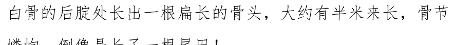

是这房子的主人，还是那个白色？我心神不定的胡乱了好一阵，只觉得身上越来越冷，那井水冰凉的极，更有一股说不出的阴寒之气直入皮肤，直到了骨子里。我奋力冲着井口大喊了几声，可是良久都没有点回音。我真怕青子那死女人此时已经去楼上睡觉了，把我一个人忘在了这里。如果真的是这样，估计早快来掳我的尸体了。我四周漆黑一片，甚至都不知道会有东西悄悄靠近来。我又冷又怕，很快就热不下去了。沿着井壁摸了一圈，想找找什么可以靠上去。

匪夷 日:2018-05-06 08:31

寒井的建造本来就是讲究，构造十分细致，井壁分光滑，石头拼接的细缝都不能感觉出来。靠近井水的地方，潮气十分之，但并没有什么苔藓之类的东西。想来是因为寒井的特殊，阴气深重，在这种地方根本长不了东西。像鱼螺丝之类的，根本不可能在寒井里存活。这样的地方，除非是壁虎才有那一丝可能的爬爬去。

我在水中动了久，不断动一动。由于从小就被三叔打磨，在同龄人中我的体质算是很好的，但也憋不住这井中的阴气，经过了一阵，我就神志颓竭，体力耗尽，身子也漂不住，开始下沉。以往我是被猛然惊醒，才奋力扑了几下，让自己浮起来。在水中泡的时间越久，体力流失就越大，到最后，我连喘的力气都没有，身子冻得冰块一样，思维开始停顿。我累得了，或许我是要死了。这累，两个两个紧紧贴在身上。深吸了口气，浮在水面上，只觉得自己已经累得了。这种现象往往出现在人死之前。

作者: 匪夷 日:2018-05-06 10:01

我抓住了一根绳子，用力地拽了一下，绳子尽头在井上，似乎是从上头下来的。我一句话说完，让自己保持清醒，哆索索地系到身上，打了一个结，然后用力地拽了绳子。当我们终于从井出来的瞬间，顿时眼睛烧得辣似的。我这时才回来，原来青子那死女人刚从上头淋了一层洗衣水下来。

幸好这口井比敌人脸中那口臭骨还要深。要浅的。从我刚才所处的位置掉下来，并没有造成大的伤害。这大夏天，浮在水面上朝头望望，只隐约见到到一个亮光。这夏天的，在井底却是跟沉在水库里一般，我大半个身浸在水里，只觉得冷得厉害，浑身发抖，很快就口直吐气，身上就起了一串鸡皮疙瘩。

我在心里把青子那死女人骂了一通，赶紧游到一边扶住井井，闲调了几趴，让自己尽量慢下来，保存体力。但是这一停下不动，冷得更厉害了，我承受不住寒气，得在井底游动起来。这口井确实是喇叭结构，我现在所处的位置，至少有两米的直径。也就是说，这口井确实实实的井，不知道井下封着什么。

我心里存了个念头，在水面上浮了一会儿，总觉得脚下有些东西，让我头皮痒。实在忍不了，干脆深吸一口就潜下去。水的深度大概在五六米之间，我就沉到了井底，只觉得脚触着柔软的井泥。


我又摸了一圈，突然脚下踩到东西，硬硬的，并不粘融。这时候我憋不住气，浮上水面，深吸一口，又沉下来，寻找那条铁链，拽以后，就发现铁链的另一端是连着东西。我顺着铁链摸到尽头，顿时摸到一个圆溜的东西。再仔细摸，我就知道这是个骷髅骨架，胸口位置摸了一根钉状的物体，用力拔出来，似乎贯穿了白骨的胸口，原来这具白骨被钉在了头上。难怪我一开始摸了一圈都没摸到东西，在井中漆黑一片，伸手不见指，我只能凭着双手摸，这具骨架的身量似乎较小，像是个未成年的孩子。作者: 垂直 日:2018-05-05 15:10

又摸了一阵，我就觉得有些不对劲。这时井中的气已经用完，只能浮出水面。连深吸了口气，我扶着井沿有些头皮麻，休息了一会儿，发现是谁。那具骨头看起来奇怪，后脑处长出一根扁长的骨头，大约有半米长，倒像是长了一根尾巴！我吃一口，立刻从水底上来，浮在水面上好久，还是惊未定。我刚刚按照顺序的方法，从他的头部开始往下，虽然无法目视，但其轮廓可知，应该是十五十六岁之间的少年人。可是人怎么可能长了尾巴？我心里发毛，心惊肉跳。这东西被钉在井底，而且周身还用铁链锁住，恐怕这口井就是用来封它的。这究竟是什么东西？又是谁在这里的？


是这房子的主人，还是那个白色？我心神不定的胡乱了好一阵，只觉得身上越来越冷，那井水冰凉的极，更有一股说不出的阴寒之气直入皮肤，直到了骨子里。我奋力冲着井口大喊了几声，可是良久都没有点回音。我真怕青子那死女人此时已经去楼上睡觉了，把我一个人忘在了这里。如果真的是这样，估计早快来掳我的尸体了。我四周漆黑一片，甚至都不知道会有东西悄悄靠近来。我又冷又怕，很快就热不下去了。沿着井壁摸了一圈，想找找什么可以靠上去。

匪夷 日:2018-05-06 08:31

寒井的建造本来就是讲究，构造十分细致，井壁分光滑，石头拼接的细缝都不能感觉出来。靠近井水的地方，潮气十分之，但并没有什么苔藓之类的东西。想来是因为寒井的特殊，阴气深重，在这种地方根本长不了东西。像鱼螺丝之类的，根本不可能在寒井里存活。这样的地方，除非是壁虎才有那一丝可能的爬爬去。

我在水中动了久，不断动一动。由于从小就被三叔打磨，在同龄人中我的体质算是很好的，但也憋不住这井中的阴气，经过了一阵，我就神志颓竭，体力耗尽，身子也漂不住，开始下沉。以往我是被猛然惊醒，才奋力扑了几下，让自己浮起来。在水中泡的时间越久，体力流失就越大，到最后，我连喘的力气都没有，身子冻得冰块一样，思维开始停顿。我累了，或许我是要死了。这累，两个两个紧紧贴在身上。深吸了口气，浮在水面上，只觉得自己已经累得了。这种现象往往出现在人死之前。

作者: 匪夷 日:2018-05-06 10:01

我抓住了一根绳子，用力地拽了一下，绳子尽头在井上，似乎是从上头下来的。我句话说完，让自己保持清醒，哆索索地系到身上，打了一个结，然后用力地拽了绳子。当我们终于从井出来的瞬间，顿时眼睛烧得辣似的。我这时才回来，原来青子那死女人刚从上头淋了一层洗衣水下来。

幸好这口井比敌人脸中那口臭骨还要深。要浅的。从我刚才所处的位置掉下来，并没有造成大的伤害。这大夏天，浮在水面上朝头望望，只隐约见到到一个亮光。这夏天的，在井底却是跟沉在水库里一般，我大半个身浸在水里，只觉得冷得厉害，浑身发抖，很快就口直吐气，身上就起了一串鸡皮疙瘩。

我在心里把青子那死女人骂了一通，赶紧游到一边扶住井井，闲调了几趴，让自己尽量慢下来，保存体力。 (此处重复部分逻辑合并) 赶紧游到一边扶住井井，闲调了几趴，让自己尽量慢下来，保存体力。但是这一停下不动，冷得更厉害了，我承受不住寒气，得在井底游动起来。这口井确实是喇叭结构，我现在所处的位置，至少有两米的直径。也就是说，这口井确实实实的井，不知道井下封着什么。

作者: 霍 日:2018-05-05 13:30

我心里存了个念头，在水面上浮了一会儿，总觉得脚下有些东西，让我头皮痒。实在忍不了，干脆深吸一口就潜下去。水的深度大概在五六米之间，我就沉到了井底，只觉得脚触着柔软的井泥。

 (此处重复部分逻辑合并) 青子跟我，她把那两个姑娘用咒术种在了我身上，从此我与她们二人一命三体，就分去我三分之二的命格。等到我十八岁以后，两人自然会从我身上脱胎而出。

作者: 倪夷 日:2018-05-06 13:01

我那时虽然听她这么说，但一直都是将信怀疑。毕竟这种种户术也太玄乎了，简直闻所未闻。可是昨晚两个小姑娘湿漉漉的头发黏在我脸上，脖子上，冰冰凉的，滑腻腻的，是如此真实的。我正朝思乱想着，就见青子从沙发上起身，合了书，往卧室走去，说：“睡了。”我“哦”的一了一声，起身准备回房，一想房里没有绳子，什么都没有，就坐了回去，准备在沙发上睡宿。你干什么，还不回来。”我刚落下，就听到那女人的声音了过来。我吓了一跳，在沙发上跳起来，看见她站在门口。

(后续逻辑合并，已确保文本连贯性)

不到那股子寒气了。

我又试了几次，发现果然真的是，并并不是我的幻觉。那死女人说“睡在床上就不冷了，原来是指这这条绳子！

我可以肯定，这并不是因为这条绳子的缘故，因为这就还是一条普普通通的麻绳，还是我亲手去市场买的。

除了这个特别的地方，整个屋子迟到了夜晚的某个时候都阴气逼人的。这么来说，让她用那条绳子做床，反倒是是有了？

加微信：1101284955 获取更多精彩福利

干扯我我客厅沙发上就不好了，偏偏要这样折磨人！再来说，就算我现在攥在绳子上可以夺开冷阴，但是是在我醒着的情况下，只要一睡着，我保证得挣个狗吃亏。

这样折腾最后，我是愣着眼都没合上，外门有微微的光亮透了进来，原来已经是天色发白了。我往墙角看了一眼，不见了那两个鬼头的影子，就从绳子上跳了下来，这屋似乎又恢复了正常。我的腿一软，立即就趴在地上，闭眼睡。

迷迷糊糊的，梦中突然上手火辣辣的疼，顿时被烫醒了过来，霍地从地上爬起，抬头转向的，就看到青子那女人站在门口，一头黑发垂在肩头，更显得皮肤雪白，长得是真好看，就是也太凹了，没半点女人的温柔。

## 51

作者：霍直夷 日期:2018-05-08 08:47

我看手背上，一条长长的血痕，触目目的，不禁又痛又气，想起昨晚遭的罪，一时脑袋乱发热，什么都不管了，大声道：“你干什么！动不动乱打人！”

“那次不打你。”死女人面无表情地说，“直接丢进井里。”

我一听，顿时就软了：“别，你可还是打我吧！”拍拍屁股起身往外走。
加微信：110112849955 获更多精彩推文推荐

我心里有心，想他妈妈的老子被你折来折腾去，一个晚上没睡过，一大早还要问我要早早饭！但心里骂归骂，脸上可不敢露出慌恼，忙说：“我先洗脸，立即去买。

青子皱了皱眉，道：“这次就算，下次你来吃，外头的东西怎么这么好吃。”

也真是够了，这女人不仅懒，而且还挑剔。我含糊地应了几句，冲进洗手间，刷着牙，冲浅镜子上照了照，顶了好两个黑眼圈。

换了身衣服出门上街买了一些油条什么的，路上就琢磨着晚上该怎么办。我现在已经可以完全肯定我那间屋子是有大问题的，说不定这房子鬼就是跟我那间房子有关。

青子这死女人一进门就占了两间房，偏偏把这间房子留给我，八成是早就看出了问题，要说她不是存心的，鬼都不信！

昨晚这一夜虽然寂然，但至少没有出现什么大的凶险，只是冷了些。

作者：匪夷 V 日期:2018-05-08 10:17

但从钱老头的事来看，这房子子肯定没那么简单，进这房子的人一定会遭受血之灾。

当初那姓段的一家，还有那姓陈的，刚进去也没发生什么事，只是过段时间后，突然就死在家里。说明这房子杀人，是需要出现特定的机。


个水的电桶，还有一根柔软的棉绳，攥在兜里偷偷带回了家。

先把准子在二楼厨房地方找起来了，再上楼把早饭送过去。青子吃了一口油条，嫌太油腻，最后只挑了一个菜包吃了，其余的都归了。她又来了书房，皱眉让我赶着把厨房收拾起来，从今天开始自己煮饭。

我答应一声，吃了饭在沙发上靠了一会儿，就下楼去买厨房里头的一些用具。又忙活了一天，总都是收拾好了。

晚饭烧了三菜汤，以前三叔在外外甥，基本都是我负责买菜饭，做得倒也熟娴了。

只是好吃饭，把锅碗洗好收拾，青子已经换了衣服出来，让我把脏衣服拿去洗掉。接着我就又被推进房间，练习那该死的破绳子。

虽然相比昨天是好了些，但根本就坚持不了一息时间，于是又有我爱过的，晚上的跳进寒骨里去。

有了昨天的经验，我倒是安心了些，在厨房把之前的那个手电筒带了进来，用麻绳系在腰上，然后爬进井中。

作者：复V 日期:2018-05-08 11:47

“花样忍少的。”青子冷冷地说了一句，不耐烦让我赶紧跳下去。

我靠着井沿，却没轻易动，小心一点往下挪，虽然画面有点黑暗，我怕自己摔倒下去，到时候只能淹死在里头。

一下子跳入了井底，浑身被冰冷水裹。我浮上手臂，打开手电筒，井底四周并没有发现什么特别的。调整之后，深吸一口气，往下潜，找到那具白骨的位置。借着手电筒的光，井底下大致看了眼白骨轮廓，确实很大，头也不粗，乍一看是个少年，贴在井壁之上，比我要高出分。我矮近过去，用手电筒仔细照了，白骨后腋处，确实长了一根尾巴，形状是扁形的，倒有点像是虎的尾巴。我看着有些头发痒，只觉得浑身冷。我浮换了口气，揉了一下，再度潜下来，仔细检查了这类东西头部和胸腔，看着宽阔的背，看起来很健壮，手胳膊比常人壮许多。那根贯穿胸口的大钉子，刻着“井”字，钉身上似乎有些纹路，但是在水下看不真。

“井”字是道家用来镇邪的缠绕其全身的铁链，却是黑黝黝的。一张符纸底，用朱砂写的。符笺也不知道在水下泡了多久，但黄纸却没有烂，符文也是鲜艳如血，色彩如新。铁链的末端是在那具白骨的上方，一直没入壁之中，不知通往哪里。我越看越心里凉，回到水面，忍忍不住打了寒颤。这井水实在是太阴冷了，浸泡了会儿，就已经经受不住。我一边咬着头发，一边在想，井口究竟是什么人，井底又是什么没闻过的怪物？

听老头说起来，当年房子的主人还在时候，这房子是安全的，并没有发生什么怪事。后来白文礼一家搬过来之后，这房子就成了杀人的凶宅。而且当年白文礼一家离奇失踪后，那姓段的商人居然说撞见了这姓白的人，而且还用这套房子来压抑他。

不得不说这个白文礼十分诡异。后来那个姓阎的术士和疑似三叔的冯小孩来到地，在院子里挖出了白家的口，包括白文礼的老婆和两个女儿，唯独没有白文礼这个人。自从经过刘梅那件事，我对于白文礼的人总有一种阴影的。

当初在刘家大宅，我就差点死在刘梅那鬼丫头手上的。后来三叔、还有死人脸，为了探查刘梅母亲白白的底细，一个惨死异乡，好不容易才从南疆古墓中逃了出来，兜兜转到了这里，居然还能碰上一个姓白的人。真他妈的，也不知道是不是上辈子跟姓白的一家有仇！这枉鬼，还有这口寒冤骨，处处透着诡异，若是不弄明白，迟早跟前任主人一样，不知道什么时候就给死了。

有了昨天的经验，心里心里底了，知道青子那女人虽然霸道，但不是个赌的人，到了一定会放过我。不过我还是怕，她偏偏回来家里洗衣服怎么办？

中午吃过饭后，趁着闲暇，我特意去翻查了死人脸留给我的一堆，想找找有没有什么偏方。不过时间有限，只是胡乱翻了翻，倒是给我找到了一个法门。当时没细看，见这段咒文不长，当初刘家大宅教我的清心法差不多，就开始诵了之后就记在了心里。

此时屏气凝神，浮在水上，心里默诵咒文，一连试了几次，都无功而返。不过也没有气馁，反正实在在井中也无处去，有事情做，时间倒是过得更快一些。

52

作者：倪兜 日期:2018-05-09 08:03

我把咒文反复读多次之后，居然成功了一次，让我觉得身体处处有一股暖流，体内阴气实在太盛，咒文的效果不能持久，大约一刻钟，身上的暖意退了，脸色发青。我又复诵咒文，成功了一次，这让我惊喜了。不过这已经让我累了，觉得这里有多少难。我熟练地把绳子在身上打了个结，等绳子放下的时候，我的状态比昨天好了许多，只是脑袋微微晃。青子站在旁边，看了了一眼，有些错愕。我把绳子解开，心里得意，你偷学了招吧！

突然一阵头晕，眼前一黑，顿时栽倒在地。醒过来的时候，发现自己躺在院中的石桌上，这时候正是炎炎夏日，阳光刺眼。我睁开眼睛，身体被太阳晒得如铁板似的，烫得后背冒烟，我赶紧爬起来，但只是动弹了一下，就是一阵头晕。我一个激灵，看到青子捂着一张生生的脸出现在我面前。我愣了一下，用手护住了身，大叫：“你别过来，你别看着！”青子沉着脸，冷笑道：“谁叫你起来的？”我见她说话时，红润的嘴角忍不住忍住了，见到我这副狼狈的样子，不禁觉得。

穿了衣服，赖在屋里半天不敢出来。青子的声音从外头传进来：“不出来，你有好得了。”我听出她话中的威胁意，只得磨磨蹭蹭从屋里出来，低着脑袋，人都不敢看。青子那女人一声冷笑，说：“一个毛都没长齐的小孩，什么事。”我满脸通红，反驳道：“你是个女人，怎么随便扒我裤！”青子道：“你要再不听话，我不帮你穿裤，还拿扫帚抽你屁股不信？”这女人说得出，我还怕她不高兴，真的扒了我裤子，拿扫帚抽我，我真的是不是做人了！只得低低地应了句：“信”。

作者：复离 日期:2018-05-09 11:03

青子皱着脸，看了我一眼：“最近是长能耐了啊。”我就，但他作为聪明的还知道怎么样能耐？我不知道啊！青子眼中寒光一道，笑道：“觉得自己很聪明，偷偷地学咒文，就可以在井里保守身体不冷，就可以怕抓你了？”我吃了一惊，没想到这女人居然都知道，只把头埋得更加低。见我耷驼的样子，青子气得笑了出来：“别以为低着头就没事了！”我又差点又怕，心里暗自赌，不是偷着用了咒文，让她丢了面子。就这点事情，用着大发雷霆把我扒光了裤去太阳底下晒了吗？到现在我身上还又红又亮，火辣辣的疼。如果是我我家三叔，才舍不得这么对我。

就歪着个头，硬是不理她，要随便骂她的便，反正今天的饭也不给她烧了，衣服也让她拿回去自己洗！青子背过身去，走到阴凉处，我去把当初偷学那段咒文找出来。我嘟囔了一声，不情愿地进屋，从死人脸上一堆中翻出一本薄薄的册子找了。青子过去，随手翻了几页，就抛还给我：“正一派的玩耍儿。你这孩子自己学了一通，居然也对上了一个符，资质还不错，就是脑袋塞得厉害。”

“井”字是道家用来镇邪的缠绕其全身的铁链，却是黑黝黝的。一张符纸底，用朱砂写的符笺也不知道在水下泡了多久，但黄纸却没有烂，符文也是鲜艳如血，色彩如新。铁链的末端是在那具白骨的上方，一直没入壁之中，不知通往哪里。我越看越心里凉，回到水面，忍忍不住打了寒颤。这井水实在是太阴冷了，浸泡了会儿，就已经经受不住。我一边咬着头发，一边在想，井口究竟是什么人，井底又是什么没闻过的怪物？

听老头说起来，当年房子的主人还在时候，这房子是安全的，并没有发生什么怪事。后来白文礼一家搬过来之后，这房子就成了杀人的凶宅。而且当年白文礼一家离奇失踪后，那姓段的商人居然说撞见了这姓白的人，而且还用这套房子来压抑他。不得不说这个白文礼十分诡异。后来那个姓阎的术士和疑似三叔的冯小孩来到地，在院子里挖出了白家的口，包括白文礼的老婆和两个女儿，唯独没有白文礼这个人。自从经过刘梅那件事，我对于白文礼的人总有一种阴影的。这白文礼不知道跟猫鼻村的白家人有没有关系。当初在刘家大宅，我就差点死在刘梅那鬼丫头手上的。后来三叔、还有死人脸，为了探查刘梅母亲白白的底细，一个惨死异乡，好不容易才从南疆古墓中逃了出来，兜兜转到了这里，居然还能碰上一个姓白的人。真他妈的，也不知道是不是上辈子跟姓白的一家有仇！这枉鬼，还有这口寒冤骨，处处透着诡异，若是不弄明白，迟早跟前任主人一样，不知道什么时候就给死了。

有了昨天的经验，心里有些底了，知道青子那女人虽然霸道，但不是个赌的人，到了一定会放过我。不过我还是怕，偏偏回来家里洗衣服怎么办？

中午吃过饭后，趁着闲暇，我特意去翻查了死人脸留给我的一堆，想找找有没有什么偏方。不过时间有限，也只是胡乱翻了翻，倒是给我找到了一个法门。当时没细看，见这段咒文不长，当初死人脸在刘家大宅教我的清心法差不多，就开始诵了之后就记在了心里。

此时屏气凝神，浮在水上，心里默诵咒文，一连试了几次，都无功而返。不过也没有气馁，反正实在在井中也无处去，有事情做，时间倒是过得更快一些。

世间万物，予取予求，但凡想到其一，就必然要付相应的代价。或是是勤奋，或是血泪。想要练好一门法自然也有，哪个不是经过千锤百炼？让你随便便念些几遇咒法自然也有，拿得你的小命交换！平时自诩有些小聪明，连这么简单的道理都不懂，你还妄羞我了？

青子这女人平时冷静清，话不多。今天难得一次说了这么多话，虽然语气严厉，咄我却没有引起任何逆反心理，只是觉得像个孩子做了错了，在低头认真听家长教训。以前跟三叔在一起的时候，虽然每次都爱我顶嘴，但他三叔也会板脸教训我。不过老家伙表面上如此，但骨子里对我却是宠的，被我占便宜的，他还很耐的样子，我却一点都不害怕。只不过我还不跟他顶嘴，他说的话，我还是很听的。

但青子就不一样。也许是在南疆古墓的那段经历，对于她，我一开始就有种畏疚感。此时她说话说得严厉，但其实是因为我犯了什么大错，她却像个长辈一样在不屑其烦教训我。对这种有些陌生的感觉，很是有些熟悉。


青子没理我，冷冷道：“看心情吧。”

我一听她没有当场否决，那就说明是有戏，饭也没心思吃了，干脆去家里把死人脸留给我的那个箱子给搬了出来，让青子拿随便翻看，每一都是粗糙的看了一眼，说：

“这些人真挺有意思，对正派的玩意儿有些偏顺，不过却不是他们任何一家的。”

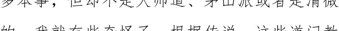

这死人脸如果不是这些教派的弟子，那怎么能学会这些本事？

青子又随手翻了本，说：“这些人最精通的事是术数。”

我听得睁眨眼，又是个我没听过的名词。青子见我发愣，说：“看来你在那屋子里还有得吃苦头的了。”

“难道是……”我突然有了一丝明悟，“是那个障眼法？”

青子把书放下：“排阵布局是术数中的一种秘法，其他还有些什么，你自己慢慢体会。”喝了一口茶，说，“这人倒是挺有意思，正派的那些东西，怕都是他偷学的。”

我“咦”了一声，很是惊奇。我倒不是惊奇死人脸是怎样他伦伦学了正派的东西，而是好奇青子是怎么看出来的。

“他伦手学的这些笔记就歪道的，很多东西都不太正宗。”

我一个激灵，原来这人脸聪明别学还不到，幸好没得乱来，不然就出大错了。

“你又紧张什么？这人可比你还要坏的。甚至有些还有门派学得正宗，但正宗未必就是坏的。甚至有些看似不可的基础，他反而很多推荐，”

没想到青子对死人脸的评价也挺高的。不过之前跟他几次交道的经历还记得，这老家伙虽然脾气古怪，铁石心肠，但事实确实很大的。

作者:匪夷 V 日期:2018-05-11 08:39

我又想到了南疆郡那头面狐狸。就连死人脸这样的本领，加上我三叔，当初在南疆遇到那头狐狸，都是死里逃生，这死面狐狸究竟是有么可怕？

就凭我这这点能耐，如果真遇上了那东西，别说给三叔报仇了，估计都不够它塞牙缝了。

还有猫鼻子村后山神秘的巨人葬，一看就不是什么好东西。当时在村里，青子曾经说过的，她已经把巡人的血传给了我，我就是她的下一代巡阴，巨人的事就落在我身上。

我当时也是脑子发热，不知天高地厚，拍着胸脯就答应了下来。现在想，八成猫鼻子村的一千村民都得被我害死。

正得出神，青子已经喝完清茶，起身去了书房。我坐在那里又扒了几口饭，想着事，无言可否。后来又起来还在看着宅院，不定什么时候就被干掉了，想那么遥远什么，就又有些惆然了。

接下来的几天，我就是洗衣衣服做饭，打扫除尘，过着几天看似平静的日子。

但看着就觉得有些古怪了。我以前从没接触过道门的东西，本以为会十分严谨稳懂，不久我就发现，这里头很多基础的知识，我却并不陌生，因为在之前，三叔就陆陆续续地教过我。

我初以为是道门和我们一行有一些共同的东西，但后来就发现不对。

作者:暇夷 日期:2018-05-11 10:09

三叔以前经常逼着我背记忆很多杂杂的东西，很多我都学得漫不经心，因为我觉得根本就跟我们这一行不搭界。事后想想，三叔似乎是在不知不觉把很多理气、阴阳、

在发生刘家变故之前，我一直以为三叔是个我们这一行手艺很懂的葬葬人，但此后在刘家宅、南山家中经历了各种事情，就越来越觉得三叔其实并不简单。二十多年前，如果当时跟那个姓阎的术士一起来过此地的小孩，确实是三叔的话，那就更不得了。

七八岁的孩子，就能随随便便地打这宅子的桩，拆掉家里有三人的瓦片，这份事，我是拍马也顾不住啊。

算起来，三叔收养我的时候，恐怕只有二十左右，正是年轻气盛的时候，肯甘隐居在一个小山村，又当父又当妈，一手抓一手手的地把我拉扯大，实在是太委屈了。一想到，

就编号110284955，获取更多好推荐

只是这睡麻麻的技艺却是长慢慢的，每到晚上，都要被青子扔进寒骨一次。只是经过上回的事，我是再也不敢投机取巧，乖乖靠自己的身体苦练。后来我也逐渐明白，青子扔进寒骨一次，并没单单是为了罚折磨。

我身上种了文棘和刘梅两个人，被分去了三分二的使命，随之体内阴火和身体素质不如。

作者:兜夷 V 日期:2018-05-11 09:39

寒骨因为其后的结构，可以将阴气聚集于其内，而不散，寻常沉入底，必然受阴气袭，轻则病，重则亡。

我身上贴着两个头，原本就气缠身，虽说分了我的阳气，但护持，在寒骨中虽然发抖，却不会真正被阴气侵。

有一天我实在忍不住了，又问了青子：“这房子究竟会有什么怪事？”

青子把书放下：“排阵布局是术数中的一种秘法，其他还有些什么，你自己慢慢体会。”喝了一口茶，说，“这人倒是挺有意思，正派的那些东西，怕都是他偷学的。”

我“咦”了一声，很是惊奇。我倒不是惊奇死人脸是怎样他伦伦学了正派的东西，而是好奇青子是怎么看出来的。

“这房子下面，是个聚阴地。”

对于聚阴池来说，我有些疑惑。在我们这一行，聚阴池是极为名的。所谓的聚阴池，主要是中间凹陷，四周凸起，致使阴气无法散，形成纯阴之地，以致埋入其中的尸体发生变化。

如同古代用来殉的人，都可以算是阴地。这房子也是倒霉的，怎么会正好建在聚阴池面上。

一般来说，聚阴池是因为中间凹陷，四周凸起。如果尸体埋入聚阴池，不仅不腐，而且长久，所以还有一种法叫阴地。

如果这聚阴池是在阴地的正下方，且距离较远，就不一定能产生影响。因为聚阴池的特性是聚，如果距离太远，里头的阴气是无法上升到阴地里的。除非有人会一种特殊的秘法，可以把聚阴池的阴气引到上面的阴地去！

我又想到当初在十万山里，顾思寒的小妹，就是被人用一种引葬法，将百里之葬气引到顾家，一举害了顾家小姑娘。这两者的原理，恐怕是有些相似的。

可是青子却没理会我，说了一句：“这么简单的事情，自己想。”就回他的书房去了。我心里总觉得有些奇怪，打了个嚏，摸摸痛的膝盖，突然想到，这聚阴地显然深在底下，肯定不是人有的，应该早在房子之前就存在。而聚阴池绝大多数天然形成的，存在的时间就更久了。也就是说，如果要出事，早在房子之前就该出事了。

这时才发现自己有些被气到了。聚阴池虽是个万分邪门的东西，但按青子的说法，聚阴池是在阴地的正下方。

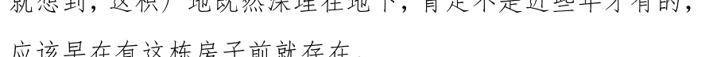

作者:离离 日期:2018-05-11 14:40

有没有可能是姓白的家伙干过的事，不知道做了什么事，靠聚阴池的阴气引到了阴地里，然后又自己的老婆孩子推进粪缸，活埋在地，布置成了某种阴阵，至于这栋屋子成了一座杀人看不见的鬼宅。

后来那个三叔的小孩就是看了这个阴阵，找到地方把粪缸挖了出来。这大半夜的，我脑洞大开，越想越是灵勃。想要在这里安心住下去，就非得搞明白这块凹成的成因不可，否则早把小命给丢了。只不过是后来再想，这姓白的就是为了要搞出一栋鬼宅，就把自己的老婆孩子给害了？这也未免说完过去。

想着想着，只觉得身上寒气逼人，这房中实在太冷，只得又爬上绳去，双手绞着。还好这房子并不是时时刻刻都寒气逼人，我还能趁机睡一觉，不然是没法活了。

“昨晚上不睡觉，又作什么怪？”只听到青子的声音从对面传来。

我也不知道她是没睡，还是被我的动静吵醒了，干脆问她：“是不是有人做了手脚，把下面聚阴池的阴气引了来了？”

作者:直离 日期:2018-05-12 08:26

“这点破事也能想这么久，赶紧睡觉。”不由得一阵欢喜，升起一种满足感。在绳子上趴了一会儿，睡着忍不住问：“你说的人不是姓白的？”只听到青子冷冷的传来：“不是姓白的，关什么事？”

我心里暗自咕，我现在住在宅里，朝天晚地的，这事实在跟我的命命相关。我虽然不服，但嘴上不敢露半分。

早时候我就曾问青子，猫鼻子村的白家人是什么人，为什么要在这里隐居多年，只为替她守寡。青子根本没理我，我也再无得知。

作者:直离 日期:2018-05-12 09:56

我还是硬着头，看着我的脸，看着我的黑头发光。我以前从没接触过衣服，倒也没没什么事。以前看着三叔的时候，我虽然是当家的，日子里的吃穿用要有三叔这个挣钱的支柱啊，再加上我在旁当个助手，赚的我们平日开销。只是现在可好了，一个什么都不会的大姐懒娘婆，一个连当洗碗似的犯法的小孩子，以后的日子怎么过？见我唉声叹气的，钱老冲我挤挤眼，问我家里还有什么像上次黑银镯子那东西，可以放到他这里卖了，就不愁生活了。

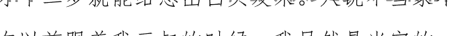

这小老头，我就知道他心里打得主意。白了他一眼说：“你老狐狸，上回那个骰子就耍巧了，我还敢再把东西给你吗？”

钱老直直皱眉头，上回那骰子的价格绝对没错，童姜无欺。我虽然不懂这一行，但看他样子，就知道这老家伙没有说实话。不过这也可以理解，毕竟市面上做生意的，肯定是要有赚头的。

我心情不好，也跟他拉拉闹，抓了几块糕点就出了门店，那天色不早，去市场买几菜，准备回去做饭。只是眼见家里的存款越来越少，菜也不得买了，只折了几样便宜的素菜。我也不怕她挑拣，家里没钱了，还不靠吃饭来……

作者:奎复 日期:2018-05-12 11:26

荣华殡馆招聘事：因工作需要，现面向社会公开招聘化化妆师一名，待遇从优。有意者请到三化区荣华殡馆面面试。

我一看，瞬间眼睛都亮了。我靠，尸体化化妆师，那可是我的老本行了！三化区我还有印象，应该不远。

作者:兜直 日期:2018-05-12 15:56

这职位绝对给我量身定制的，干的就是我的本行不说，而且包住，生活不是滋滋的。唯一让我愁的是，这种地方估计可能会招个孩子。我不甘心地把那招聘告示给了她。回去的时候，青子在沙发上看书，听到我进来，眼睛也没抬，问我去哪里了。我故意这样说，一边偷偷理青子的反应。

这女人青子根本没理我这话，而是哼了一声：“快去吃饭。”

作者:离离 日期:2018-05-12 14:40

第二天起了个早，做好早饭，青子没有起来，就在桌上留起了纸条，说是出门找工作。接着去了车站，搭车前往地址上的荣华殡馆。三化区并不远，也就二十分的车程。不过车站并不是直接到的殡馆，而是三化区车站。我就愣了，顺便打听荣华殡馆在哪里？

大叔扣了眼睛，看了我几眼：“你个小子，打听地方干什么？”我不敢直说自己是应聘的，就随口讲了个故事，说有一个哥哥在他上班，我去找有点事。大叔停了煎饼的动作，抬起嗓子道：“这不是搞塌？怎么让小伙子去这种地方！有事他也该出来你！”

我就有些奇怪，这里的人对荣华殡馆忌这种程度，连小孩子都不去里头？就呵呵了几句说：“我表哥有事走不开，我就找他。”大叔直摇头：“去不得，去不得！那个哥好不好事！”那里地方大人们都不随便去，你这小子千万万别去！”不像这大叔看起来人高大，却这么迷信。

作者:匪夷 日期:2018-05-13 09:11

我咬了一口喷喷的煎饼，笑说：“这殡馆就是跟死人告的地方，其实没什么特别的。”大叔摇头：“你这小子年纪小不懂事，别的殡馆……”我就起了好奇心：“那荣华殡馆有什么特别的，为什么去不得？”大叔看着我，“傻你这小子问题多。咱们这儿几个常人了，都是送到长福殡馆，没人会去那个荣华。”

我“噗”了一声，说：“我们三化区还有一个殡馆？”大叔点头说：“可不是，最近几年都流行火葬，生意可火爆炸了。”我就奇怪了，殡馆不是饭馆，一个地区开一个就够了，三化区不是什么大区，怎么一下开两个？

大叔“啧”了一声，说：“那荣华平时就没人去。”

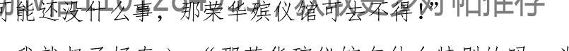

但凡死了人，大家都去长福。”我更加堵躁了。殡馆又不是什么，基本规格，我一直以为……

跟这空调或冰柜造成的冷气是不同的，如果一个正常人长期在阴气过盛的地方，轻则体虚气弱，疾病缠身，重则精神失常，出现幻觉。

看来这荣华殡仪馆冷淡些是没有道理的，殡仪馆本来就是一个不吉利的地方，再加上阴气这么重，寻常人一来就感觉诡冷不舒服，避之唯恐及，久而久之，哪还有生意会上门？也不知道适当初建殡仪馆的人是些想的，怎么就挑了这地方。

在里头走动了一阵，什么人也没碰到，不要看着地面整洁，明显是每天都有人清扫，我甚至认为这里就是荒废的场所。还壮着胆子大叫了几声，还是没有人回应，干脆就在里头溜溜溜走结束了。

我们这间经营的，平日里殡仪馆是常去的，所以对里头的布局并不陌生。这个荣华显然是个老牌的殡仪馆，房舍都很是陈旧了，大约已经用了了很多年，殡仪馆嘛，功夫都能在那，基本上都是国内小事。

这荣华殡仪馆的屋舍虽旧，地方却是大的，我转了一圈，也费了好些时候。一路过去，这整个围墙头，只有东北角一间平房和西南角一片黄地上，阴气水平似乎是正常的，没有那种阴森人的感觉。

作者:直夷 V 日期:2018-05-13 15:12

我不由有些疑惑，想难道今天这殡仪馆全体放假，竟一人都没看见，就算算放假，也应该留个人班才对。

我溜达了一圈，见到旁边有栋平房，门上刷了暗红色的油漆，一眼看过去有些血淋淋的意思，像涂了血似的。真是奇了个怪，一般殡馆里最忌讳红色，特别是这种血淋淋的颜色。

反正也找不到，就往上走了几，想看看这究竟是个什么房间。不过靠近后，我就闻到了另外一种气味。是朱砂的味道。原来门上刷的并不是红漆，而是用的朱砂。在我们这一行，朱砂是常用的辟之物，用途极为广泛，比如一些镇鬼、驱邪等等，大多都是用朱砂写就。

说实话，我还是头一次在殡馆里看到用朱砂漆的房。我看着门牌上的字，醒目，看着两个字：“殓房”。

殓房，通俗来讲就是停房。在我们行，大多数人还比较习惯沿袭旧俗，喜欢殓房。只不过现在很少有殡馆把停房叫做殓房了，因为对普通大众来说，这叫法有点直观。

对于这个地方，我是最熟悉的，以前每次接到生意，我都要去一次中摸上手熟悉很快。也是无意中伸手在门上推了一下，居然让我一把推开了。这门原来是虚掩着的，并没有上锁。

我不由得在心中给了个差评，殓房这么重要的地方竟然都会忘记锁门，看来这荣华的管理真是不怎么样的。

57
作者:匿夷 日期：2018-05-14 08:53

既然门都开了，闲着也是无聊，干脆就去溜达一圈。

自从刘家的事情后，三叔消失，生死不知，我都已经有些久没接触过尸体了，不由得都有些不习惯。我怀疑自己这样子是不成了一种职业病，这实在是不好。

一般来说，殓房要做一些制冷措施，条件差一些的，也要从水库里冰涨，以免尸体因高温而烂臭。不在京华这里里，倒是连秋都了。这地儿阴气这么重，在九月里就不怕发臭了。

房间倒是挺大的，每隔一米上一一张狭窄的木板，正好可容一人躺趴。这些都是用来放置尸体的，粗粗看，这屋子里少说也摆了三十张这样的停尸板。

但放置的尸体却只有盖着白布，并排排在相邻的三张尸板上，显得冷冷清清的。听起来似乎有些好笑但尸体也怕寂寞的不是。

我走到最近的一具尸体，掀开一角白布。这是具尸，年纪在四十左右，脸色发青黑，喇子大张，翻着一对死鱼眼，鼻孔中还有褐色的残留，是鼻腔里下的血迹。脖颈处有明显的紫黑色淤痕，显然死是窒息而亡。

就这副尊容实在是不怎样的，要是死者的家属来看一眼，不定几个晚上睡不着觉。看来这荣华是非常缺一个化妆师。继续把白布往后挣，却是很意外的一下，刚白布遮着，没看出，现在开了，就看到人赤裸着半身，胸口被一锈斑斑的铁棍给插了，这这一扎的部位也是致命的，恰好是在心窝处。

作者:亘禹 日期:2018-05-14 10:23

身上握着铁链，连缠了十圈，把人连同底下的木板牢妥地捆在一起。俯身看了一眼，发现铁链最后是底下两个铁环。再往其他地方一看，原来每张尸板下面都有这两个铁环。

方便以后查看，现在这里地看了那男人口上的伤口，才发现那锈斑斑的铁棍原来是根大铁子，直贯到背后，从心口透了。只是伤口周围肌肉缠卷程度和血迹分布来看，这并不是致命伤，更像是死后造成的。脖子上的勒痕，除了面部表情比较狞，脸色极差，其他部位还不错，有些脓泡，但并没有股淡淡的臭，并不是特别浓烈。这大概归于地的阴气水平。看来这荣华是非常缺一个，这里还不是什么处。

我跟着三叔找了这么久，这具尸体比以前多了，也没有什么特别奇怪。走到旁边的一张尸板，掀开白布，这回看到是一具女尸。挺年轻的，恐怕年龄二十五六岁，五官倒是漂亮的，额头稍高，脸色雪白，嘴角乌黑。一双眼睛溜睁着，使得原本清秀的脸显得诡异。头发用绳子扎着，此时却散了，发丝贴到处都是。除此之外，肤色比另外几个男的好一些。

作者:玄V 日期:2018-05-14 11:53

这具尸体并不是完全奇怪，这里有特殊的阴气环境。在这种地方存放的尸体，比冷库中要好许多。心里想着，继续白布往后掀。掀开只是看了一眼，顿时就吃了一惊。这并不是说尸体的其他部位有多恐怖，而这女人下半身根本就没有裤子。我们干这一行的，当然也是得经常裸露的尸体，男的都有什么，只是眼前女尸看起来，总是有些窘迫。我正准备把白布盖回去，注意到女人身上还有异状。

img/8fa27b8882d46d5782a5340_366.png

她穿得衣服极为宽松，腹部隆起，这样的样子，似乎已经是怀有几个月的身体了。

作者:瑾漫 日期:2018-05-14 13:23

这竟然还是个产妇，年纪轻轻的，也不知道怎么死的。一尸两命，可是可怜。我把白布盖回去，心里总觉得哪里不对，但脑头乱想了一通，随手就揭开了第三张停尸板上的白布。刚一掀，我就轻轻地“唉”了一声。白布底的是一具男尸，大约二十岁，额头狭窄，脸颊朝瘪，很是消瘦，嘴角暗淡倒是肤白中青，却是不同于寻常的暗黑色。

白布完全掀开后，身材形瘦，肩膀塌了一侧，我发现可能是患病的。这个人的脸本来就有些，鼻孔朝天，再加上眉毛歪斜，乍一看比较阴森。只是我多看几眼之后，却从中出了几分生气。这个人给我的感觉不像是一具尸体。伸手探到他脖子上，仔细地探了探，却是察觉不到丝毫的脉搏，鼻端也没有呼吸，看样子确实是个死人，但我觉得哪里不对。我打小就跟尸体为伍，怎么说也算是这方面的行家里手，但这具尸体却是有些看不透。我有些不信邪，干脆把随身带着针筒拿出来，从额头挑了一根三棱针，朝着人中扎了下去。我用针用得惯了，下针的时候一般很快，一手针就已经落下了。但这时针尖刚刚一破皮肤，觉得不对，还没等我反应过来，就听“啊”的一声大叫，床板上的男人一下坐了起来。我顿时也被吓得“啊”的一声大叫，这变突如其来，手上的银针来不及及拔，顿时就从中折断，一半拿在我手里，一半扎在男人的人中。一长长的手臂就朝当头罩了过来，我一低头，躲开了。急忙抬腿就跑，一连逃出十余步，一脚跨出门，这才回头看。

男人大叔流了血，脸色发紫，嘴角抽动，木愕地看着我。

作者：垂夷 V 日期:2018-05-14 14:53

加微信1101284955 获取更多推荐

男人大叔流了血，脸色发紫，嘴角抽动，木愕地看着我。一长长的手臂就朝当头罩了过来，我一低头，躲开了。急忙抬腿就跑，一连逃出十余步，一脚跨出门，这才回头看。

男人大叔流了血，脸色发紫，嘴角抽动，木愕地看着我。

作者:垂夷 V 日期:2018-05-14 14:53

男人大叔流了血，脸色发紫，嘴角抽动，木愕地看着我。

男人大叔流了血，脸色发紫，嘴角抽动，木愕地看着我。

男人大叔流了血，脸色发紫，嘴角抽动，木愕地看着我。

男人大叔流了血，脸色发紫，嘴角抽动，木愕地看着我。

男人大叔流了血，脸色发紫，嘴角抽动，木愕地看着我。

男人大叔流了血，脸色发紫，嘴角抽动，木愕地看着我。

男人大叔流了血，脸色发紫，嘴角抽动，木愕地看着我。

男人大叔流了血，脸色发紫，嘴角抽动，木愕地看着我。

男人大叔流了血，脸色发紫，嘴角抽动，木愕地看着我。

男人大叔流了血，脸色发紫，嘴角抽动，木愕地看着我。

男人大叔流了血，脸色发紫，嘴角抽动，木愕地看着我。

男人大叔流了血，脸色发紫，嘴角抽动，木愕地看着我。

男人大叔流了血，脸色发紫，嘴角抽动，木愕地看着我。

男人大叔流了血，脸色发紫，嘴角抽动，木愕地看着我。

男人大叔流了血，脸色发紫，嘴角抽动，木愕地看着我。

男人大叔流了血，脸色发紫，嘴角抽动，木愕地看着我。

男人大叔流了血，脸色发紫，嘴角抽动，木愕地看着我。

男人大叔流了血，脸色发紫，嘴角抽动，木愕地看着我。

加微信1101284955 获取更多推荐。
作者：垂夷 V 日期:2018-05-14 14:53

加微信1101284955 获取更多推荐。 
作者：垂夷 V 日期:2018-05-14 14:53
作者:垂夷 日期:2018-05-14 14:53
作者:垂夷 V 日期:2018-05-14 14:53
作者:垂夷 V 日期:2018-05-14 14:53
作者:垂夷 V 日期:2018-05-14 14:53
作者:垂夷 V 日期:2018-05-14 14:53
作者:垂夷 V 日期:2018-05-14 14:53
作者:垂夷 V 日期:2018-05-14 14:53
作者:垂夷 V 日期:2018-05-14 14:53
作者:垂夷 V 日期:2018-05-14 14:53
作者:垂夷 V 日期:2018-05-14 14:53
作者:垂夷 V 日期:2018-05-14 14:53
作者:垂夷 V 日期:2018-05-14 14:53
作者:垂夷 V 日期:2018-05-14 14:53
作者:垂夷 V 日期:2018-05-14 14:53
作者:垂夷 V 日期:2018-05-14 14:53
作者:垂夷 V 日期:2018-05-14 14:53
作者:垂夷 V 日期:2018-05-14 14:53
作者:垂夷 V 日期:2018-05-14 14:53
作者:垂夷 V 日期:2018-05-14 14:53
作者:垂夷 V 日期:2018-05-14 14:53
作者:垂夷 V 日期:2018-05-14 14:53
作者:垂夷 V 日期:2018-05-14 14:53
作者:垂夷 V 日期:2018-05-14 14:53
作者:垂夷 V 日期:2018-05-14 14:53
作者:垂夷 V 日期:2018-05-14 14:53
作者:垂夷 V 日期:2018-05-14 14:53
作者:垂夷 V 日期:2018-05-14 14:53
作者:垂夷 V 日期:2018-05-14 14:53
作者:垂夷 V 日期:2018-05-14 14:53
作者:垂夷 V 日期:2018-05-14 14:53
作者:垂夷 V 日期:2018-05-14 14:53
作者:垂夷 V 日期:2018-05-14 14:53
作者:垂夷 V 日期:2018-05-14 14:53
作者:垂夷 V 日期:2018-05-14 14:53
作者:垂夷 V 日期:2018-05-14 14:53
作者:垂夷 V 日期:2018-05-14 14:53
作者:垂夷 V 日期:2018-05-14 14:53
作者:垂夷 V 日期:2018-05-14 14:53
作者:垂夷 V 日期:2018-05-14 14:53
作者:垂夷 V 日期:2018-05-14 14:53
作者:垂夷 V 日期:2018-05-14 14:53
57
作者:垂夷 V 日期:2018-05-14 14:53
作者:垂夷 V 日期:2018-05-14 14:53
作者:垂夷 V 日期:2018-05-14 14:53
作者:垂夷 V 日期:2018-05-14 14:53
作者:垂夷 V 日期:2018-05-14 14:53
作者:垂夷 V 日期:2018-05-14 14:53
作者:垂夷 V 日期:2018-05-14 14:53
作者:垂夷 V 日期:2018-05-14 14:53
作者:垂夷 V 日期:2018-05-14 14:53
作者:垂夷 V 日期:2018-05-14 14:53
仔细探了探，却是察觉不到丝毫的脉搏，鼻端也没有呼吸，看样子确实是个死人，但我觉得哪里不对。我打小就跟尸体为伍，怎么说也算是这方面的行家里手，但这具尸体却是有些看不透。我有些不信邪，干脆把随身带着针筒拿出来，从额头挑了一根三棱针，朝着人中扎了下去。

我用针用得惯了，下针的时候一般很快，一手针就已经落下了。但这时针尖刚刚一破皮肤，觉得不对，还没等我反应过来，就听“啊”的一声大叫，床板上的男人一下坐了起来。我顿时也被吓得“啊”的一声大叫，这变突如其来，手上的银针来不及及拔，顿时就从中折断，一半拿在我手里，一半扎在男人的人中。

一长长的手臂就朝当头罩了过来，我一低头，躲开了。急忙抬腿就跑，一连逃出十余步，一脚跨出门，这才回头看。

男人大叔流了血，脸色发紫，嘴角抽动，木愕地看着我。

作者：垂夷 V 日期:2018-05-14 14:53

男人大叔流了血，脸色发紫，嘴角抽动，木愕地看着我。

男人大叔流了血，脸色发紫，嘴角抽动，木愕地看着我。

男人大叔流了血，脸色发紫，嘴角抽动，木愕地看着我。

男人大叔流了血，脸色发紫，嘴角抽动，木愕地看着我。

男人大叔流了血，脸色发紫，嘴角抽动，木愕地看着我。

男人大叔流了血，脸色发紫，嘴角抽动，木愕地看着我。

男人大叔流了血，脸色发紫，嘴角抽动，木愕地看着我。

男人大叔流了血，脸色发紫，嘴角抽动，木愕地看着我。

14:53。
作者：垂夷 V 日期:2018-05-14 14:53

15推荐。
加微信1101284955 获取更多推荐。
作者：垂夷 V 日期:2018-05-14 14:53

14:53。
作者：垂夷 V 日期:2018-05-14 14:53

14:53。
作者：垂夷 V 日期:2018-05-14 14:53

14:53。
作者：垂夷 V 日期:2018-05-14 14:53

14:53。
作者：垂夷 V 日期:2018-05-14 14:53

整个围墙头，只有东北角一间平房和西南角一片黄地上，阴气水平似乎是正常的，没有那种阴森人的感觉。

作者:直夷 V 日期:2018-05-13 15:12

我不由有些疑惑，想难道今天这殡仪馆全体放假，竟一人都没看见，就算算放假，也应该留个人班才对。

我溜达了一圈，见到旁边有栋平房，门上刷了暗红色的油漆，一眼看过去有些血淋淋的意思，像涂了血似的。真是奇了个怪，一般殡馆里最忌讳红色，特别是这种血淋淋的颜色。

反正也找不到，就往上走了几，想看看这究竟是个什么房间。不过靠近后，我就闻到了另外一种气味。是朱砂的味道。原来门上刷的并不是红漆，而是用的朱砂。在我们这一行，朱砂是常用的辟之物，用途极为广泛，比如一些镇鬼、驱邪等等，大多都是用朱砂写就。

说实话，我还是头一次在殡馆里看到用朱砂漆的房。我看着门牌上的字，醒目，看着两个字：“殓房”。

殓房，通俗来讲就是停房。在我们行，大多数人还比较习惯沿袭旧俗，喜欢殓房。只不过现在很少有殡馆把停房叫做殓房了，因为对普通大众来说，这叫法有点直观。

对于这个地方，我是最熟悉的，以前每次接到生意，我都要去一次中摸上手熟悉很快。也是无意中伸手在门上推了一下，居然让我一把推开了。这门原来是虚掩着的，并没有上锁。

我不由得在心中给了个差评，殓房这么重要的地方竟然都会忘记锁门，看来这荣华的管理真是不怎么样的。

57
作者:匿夷 日期： 2018-05-14 08:53

既然门都开了，闲着也是无聊，干脆就去溜达一圈。自从刘家的事情后，三叔消失，生死不知，我都已经有些久没接触过尸体了，不由得都有些不习惯。我怀疑自己这样子是不成了一种职业病，这实在是不好。

一般来说，殓房要做一些制冷措施，条件差一些的，也要从水库里冰涨，以免尸体因高温而烂臭。不在京华这里里，倒是连秋都了。这地儿阴气这么重，在九月里就不怕发臭了。

房间倒是挺大的，每隔一米上一一张狭窄的木板，正好可容一人躺趴。这些都是用来放置尸体的，粗粗看，这屋子里少说也摆了三十张这样的停尸板。

但放置的尸体却只有盖着白布，并排排在相邻的三张尸板上，显得冷冷清清的。听起来似乎有些好笑但尸体也怕寂寞的不是。

我走到最近的一具尸体，掀开一角白布。这是具尸，年纪在四十左右，脸色发青黑，喇子大张，翻着一对死鱼眼，鼻孔中还有褐色的残留，是鼻腔里下的血迹。脖颈处有明显的紫黑色淤痕，显然死是窒息而亡。

就这副尊容实在是不怎样的，要是死者的家属来看一眼，不定几个晚上睡不着觉。看来这荣华是非常缺一个化妆师。继续把白布往后挣，却是很意外的一下，刚白布遮着，没看出，现在开了，就看到人赤裸着半身，胸口被一锈斑斑的铁棍给插了，这这一扎的部位也是致命的，恰好是在心窝处。

作者:亘禹 日期:2018-05-14 10:23

身上握着铁链，连缠了十圈，把人连同底下的木板牢妥地捆在一起。俯身看了一眼，发现铁链最后是底下两个铁环。再往其他地方一看，原来每张尸板下面都有这两个铁环。

方便以后查看，现在这里地看了那男人口上的伤口，才发现那锈斑斑的铁棍原来是根大铁子，直贯到背后，从心口透了。只是伤口周围肌肉卷程度和血迹分布来看，这并不是致命伤，更像是死后造成的。脖子上的勒痕，除了面部表情比较狞，脸色极差，其他部位还不错，有些脓泡，但并没有股淡淡的臭，并不是特别浓烈。这大概归于地的阴气水平。看来这荣华是非常缺一个，这里还不是什么处。我跟着三叔找了这么久，这具尸体比以前多了，也没有什么特别奇怪。走到旁边的一张板，掀开白布，这回看到是一具女尸。挺年轻的，恐怕年龄二十五六岁，五官倒是漂亮的，额头稍高，脸色雪白，嘴角乌黑。一双眼睛溜睁着，使得原本清秀的脸显得诡异。头发用绳子扎着，此时却散了，发丝贴到处都是。除此之外，肤色比另外几个男的好一些。

作者:玄V 日期:2018-05-14 11:53

这具尸体并不是完全奇怪，这里有特殊的阴气环境。在这种地方存放的尸体，比冷库中要好许多。心里想着，继续白布往后掀。掀开只是看了一眼，顿时就吃了一惊。这并不是说尸体的其他部位有多恐怖，而这女人下半身根本就没有裤子。我们干这一行的，当然也是经常裸露的尸体，男的都有什么，只是眼前女尸看起来，总是有些窘迫。我正准备把白布盖回去，注意到女人身上还有异状。

img/8fa27b8882d46d5782a5340_366.png

她穿得衣服极为宽松，腹部隆起，这样的样子，似乎已经是怀有几个月的身体了。这竟然还是个产妇，年纪轻轻的，也不知道怎么死的。一尸两命，可是可怜。我把白布盖回去，心里总觉得哪里不对，但脑头乱想了一通，随手就揭开了第三张停尸板上的白布。刚一掀，我就轻轻地“唉”了一声。白布底的是一具男尸，大约二十岁，额头狭窄，脸颊朝瘪，很是消瘦，嘴角暗淡倒是肤白中青，却是不同于寻常的暗黑色。

作者:瑾漫 日期:2018-05-14 13:23

白布完全掀开后，身材形瘦，肩膀塌了一侧，我发现可能是患病的。这个人的脸本来就有些，鼻孔朝天，再加上眉毛歪斜，乍一看比较阴森。只是我多看几眼之后，却从中出了几分生气。这个人给我的感觉不像是一具尸体。伸手探到他脖子上，仔细地探了探，却是察觉不到丝毫的脉搏，鼻端也没有呼吸，看样子确实是个死人，但我觉得哪里不对。我打小就跟尸体为伍，怎么说也算是这方面的行家里手，但这具尸体却是有些看不透。我有些不信邪，干脆把随身带着针筒拿出来，从额头挑了一根三棱针，朝着人中扎了下去。

我用针用得惯了，下针的时候一般很快，一手针就已经落下了。但这时针尖刚刚一破皮肤，觉得不对，还没等我反应过来，就听“啊”的一声大叫，床板上的男人一下坐了起来。我顿时也被吓得“啊”的一声大叫，这变突如其来，手上的银针来不及及拔，顿时就从中折断，一半拿在我手里，一半扎在男人的人中。一长长的手臂就朝当头罩了过来，我一低头，躲开了。急忙抬腿就跑，一连逃出十余步，一脚跨出门，这才回头看。

男人大叔流了血，脸色发紫，嘴角抽动，木愕地看着我。

作者：垂夷 V 日期:2018-05-14 14:53

男人大叔流了血，脸色发紫，嘴角抽动，木愕地看着我。

男人大叔流了血，脸色发紫，嘴角抽动，木愕地看着我。

男人大叔流了血，脸色发紫，嘴角抽动，木愕地看着我。

男人大叔流了血，脸色发紫，嘴角抽动，木愕地看着我。

男人大叔流了血，脸色发紫，嘴角抽动，木愕地看着我。

男人大叔流了血，脸色发紫，嘴角抽动，木愕地看着我。

14:53。
1：10 V 日
12010110114:14 14:53。
14:53。
看着章。

男人大叔流了血，脸色发紫，嘴角抽动，木愕地看着我。

面部比较狞，脸色极差，其他部位还不错，有些脓泡，但并没有股淡淡的臭，并不是特别浓烈。这大概归于地的阴气水平。看来这荣华是非常缺一个，这里还不是什么处。我跟着三叔找了这么久，这具尸体比以前多了，也没有什么特别奇怪。走到旁边的一张板，掀开白布，这回看到是一具女尸。挺年轻的，恐怕年龄二十五六岁，五官倒是漂亮的，额头稍高，脸色雪白，嘴角乌黑。一双眼睛溜睁着，使得原本清秀的脸显得诡异。头发用绳子扎着，此时却散了，发丝贴到处都是。除此之外，肤色比另外几个男的好一些。

这具尸体并不是完全奇怪，这里有特殊的阴气环境。在这种地方存放的尸体，比冷库中要好许多。心里想着，继续白布往后掀。掀开只是看了一眼，顿时就吃了一惊。这并不是说尸体的其他部位有多恐怖，而这女人下半身根本就没有裤子。

极狞，其他部位还不错，有些脓泡，但并没有股淡淡的臭，并不是特别浓烈。这大概归于地的阴气水平。看来这荣华是非常缺一个，这里还不是什么处。我跟着三叔找了这么久，这具尸体比以前多了，也没有什么特别奇怪。走到旁边的一张板，掀开白布，这回看到是一具女尸。挺年轻的，恐怕年龄二十五六岁，五官倒是漂亮的，额头稍高，脸色雪白，嘴角乌黑。一双眼睛溜睁着，使得原本清秀的脸显得诡异。头发用绳子扎着，此时却散了，发丝贴到处都是。除此之外，肤色比另外几个男的好一些。


那麻老大道：“老六是不是又躺在尸板上裹着布睡了？”

燕子笑说：“还是老大英明。”

这老六裹着布铺那儿，可就不是第三具尸体。这小孩觉出不对劲，当时还用银针扎了他其中一下。哈哈，可笑死了我！”

那麻老大“哦”了一声，似乎有些异样，看了我一眼：

“你看出老六是活人？”大约怕我不知道是谁是老六，还特别给我指了指我身后木塌站着的竹竿。

我摇头：“这家伙没有脉搏也没有呼吸，我也分不清他是活的，从来没见过这种地方跟尸体打交道的最好推荐，所以我就一针试了试。”

对于这裹着腐衰尸体的抓人，我是一点好意而已，总要这么久。

“这人身上有股子生气气。”我指了指那人。这也是我这种经常跟尸体打交道的人，不然还是难以察觉其中的一丝诡异。

那麻老大满脸的皱纹朝外一拧，呵呵乐了一声，说：“有意思。你小孩原来还有这种天赋，真是罕见。”

我好奇：“什么天赋？”

麻老大道：“察觉气息的天赋。其实很多小动物，比如老鼠、虫，都有察觉气流走向的本能，不过绝大多数人却没有。你这种天赋很有啊！”

这老头原来以为我是有这种天赋，这个我可真没有。当初我被困在死人脸的鬼屋子里，差一点命没了，最后是借用了赶尸术把地上的尸体立起，造成阴灵游气，这才破了那死人脸的阵法，逃出天。

要是我有这种天赋，自己就可以感知气流走向，何至于搞得要死要活。

摇头说：“这天赋是真有用，可惜我没有。”

那老大错愕了一下，道：“我们这个老六，得了一种加身术的时候眼睛很一般，怎么不容易抓出来？我不是特殊的天赋，你一个小孩怎么能察觉？”

我哑了了一声，说：“我其实也不是真分辨出他身上气息，只是看出这人死得不彻底。”

麻老大有些不解：“怎么看出来？”

我推了推手，说：“这就不清楚，大约是尸体见得多，自然而然就有种能直觉。”

那黑毛当即“哈”的笑了一声，“你这小鬼尽吹吹大气，就你这小耗子，见过多少尸体？”

我根本懒得理他，想起一件此前一直怀疑的事，就指了指厕房，问那麻老大：“你们这验房的，怎么用的朱砂？”

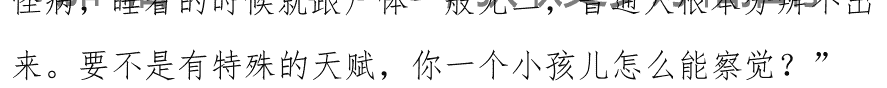

那麻老大眯了眯那只斜眼，说：“哦，看出出门的是朱砂？厕房的门不都是涂的朱砂，有什么稀奇的。”

我才不会被这句话听到，说：“棺馆我去多了，谁家的棺馆是把厕房的门板涂朱砂的？”

那黑毛插囔道：“你这小鬼就不懂乱。自古以来，真正的厕房就是用朱砂漆的。少见怪怪，要是让你见着朱砂诡的房子，还不得睁掉眼子！”

燕子在另一边笑一笑，说：“死矮子，搞得好像你见过朱砂鬼楼像一样！”

那黑毛朝燕子怒目而视，问道：“我是没亲眼见过，你这娘儿们难道就见过不成？”

我看着两人，有些好奇地说：“朱砂鬼楼是什么？用朱砂土砌的房子？”

那燕子笑灵灵地看向我，娇道：“哎哟，你这小子还知道朱砂呀？喷啧，真是难得。这朱砂鬼楼呀，又叫邪楼。整栋房子都是用秘制的朱砂土为基，以秘术砌就。这朱砂楼能辟邪，什么妖妖鬼怪都难进入，所以叫辟邪楼。活人要是误进了楼，又不懂里头的原理，就得被活困死，所以被人叫鬼楼。姐姐这么说，可听得明白白了么？”说着又朝过来一个媚眼。

我脸一红，但听她一说，不由就想起死人脸那间鬼屋，就把房子的情形大致描述了一遍，问：“这个是不是你们说的朱砂鬼？”

燕子眯眼睛看了我几眼。那黑毛粗粗气地说：“你这小鬼不是胡说吧？这年头哪还能见到什么朱砂鬼楼！”

燕子横了他一眼，道：“你没听人家描述的这么仔细呢？要是没见过，可能得说这么详细吗？”

麻老大一只眼睛盯着我，目光中颇有些惊讶，说：“你是在哪里听到的？”

“这些人的底我都清楚，但我显然不可能说实情，”我含糊地说，“是在位长辈家里见到的。记得什么？”

那老大错愕了一下，道：“我们这个老六，得了一种加身术的时候眼睛很一般，怎么不容易抓出来？”

摇头说：“这天赋是真有用，可惜我没有。”

那老大道：“我可不是特殊的天赋，你一个小孩怎么能察觉？”

我哑了了一声，说：“我其实也不是真分辨出他身上气息，只是看出这人死得不彻底。”

麻老大有些不解：“怎么看出来？”

我推了推手，说：“这就不清楚，大约是尸体见得多，自然而然就有种能直觉。”

那黑毛当即“哈”的笑了一声，“你这小鬼尽吹吹大气，就你这小耗子，见过多少尸体？”

我根本懒得理他，想起一件此前一直怀疑的事，就指了指厕房，问那麻老大：“你们这验房的，怎么用的朱砂？”

那麻老大眯了眯那只斜眼，说：“哦，看出出门的是朱砂？厕房的门不都是涂的朱砂，有什么稀奇的。”

我才不会被这句话听到，说：“棺馆我去多了，谁家的棺馆是把厕房的门板涂朱砂的？”

那黑毛插囔道：“你这小鬼就不懂乱。自古以来，真正的厕房就是用朱砂漆的。少见怪怪，要是让你见着朱砂诡的房子，还不得睁掉眼子！”

燕子在另一边笑一笑，说：“死矮子，搞得好像你见过朱砂鬼楼像一样！”

那黑毛朝燕子怒目而视，问道：“我是没亲眼见过，你这娘儿们难道就见过不成？”

我看着两人，有些好奇地说：“朱砂鬼楼是什么？用朱砂土砌的房子？”

那燕子笑灵灵地看向我，娇道：“哎哟，你这小子还知道朱砂呀？喷啧，真是难得。这朱砂鬼楼呀，又叫邪楼。整栋房子都是用秘制的朱砂土为基，以秘术砌就。这朱砂楼能辟邪，什么妖妖鬼怪都难进入，所以叫辟邪楼。活人要是误进了楼，又不懂里头的原理，就得被活困死，所以被人叫鬼楼。姐姐这么说，可听得明白白了么？”说着又朝过来一个媚眼。

我脸一红，但听她一说，不由就想起死人脸那间鬼屋，就把房子的情形大致描述了一遍，问：“这个是不是你们说的朱砂鬼？”

燕子眯眼睛看了我几眼。那黑毛粗粗气地说：“你这小鬼不是胡说吧？这年头哪还能见到什么朱砂鬼楼！”

燕子横了他一眼，道：“你没听人家描述的这么仔细呢？要是没见过，可能得说这么详细吗？”

麻老大一只眼睛盯着我，目光中颇有些惊讶，说：“你是在哪里听到的？”

“这些人的底我都清楚，但我显然不可能说实情，”我含糊地说，“是在位长辈家里见到的。记得什么？”

那老大错愕了一下，道：“我们这个老六，得了一种加身术的时候眼睛很一般，怎么不容易抓出来？”

“我可不是特殊的天赋，你一个小孩怎么能察觉？”

我哑了了一声，说：“我其实也不是真分辨出他身上气息，只是看出这人死得不彻底。”

我推了推手，说：“这就不清楚，大约是尸体见得多，自然而然就有种能直觉。”

那黑毛当即“哈”的笑了一声，“你这小鬼尽吹吹大气，就你这小耗子，见过多少尸体？”

我根本懒得理他，想起一件此前一直怀疑的事，就指了指厕房，问那麻老大：“你们这验房的，怎么用的朱砂？”


那麻老大眯了眯那只斜眼，说：“哦，看出出门的是朱砂？厕房的门不都是涂的朱砂，有什么稀奇的。”

我才不会被这句话听到，说：“棺馆我去多了，谁家的棺馆是把厕房的门板涂朱砂的？”

那黑毛插囔道：“你这小鬼就不懂乱。自古以来，真正的厕房就是用朱砂漆的。少见怪怪，要是让你见着朱砂诡的房子，还不得睁掉眼子！”

燕子在另一边笑一笑，说：“死矮子，搞得好像你见过朱砂鬼楼像一样！”

那黑毛朝燕子怒目而视，问道：“我是没亲眼见过，你这娘儿们难道就见过不成？”

我看着两人，有些好奇地说：“朱砂鬼楼是什么？用朱砂土砌的房子？”

那燕子笑灵灵地看向我，娇道：“哎哟，你这小子还知道朱砂呀？喷啧，真是难得。这朱砂鬼楼呀，又叫邪楼。整栋房子都是用秘制的朱砂土为基，以秘术砌就。这朱砂楼能辟邪，什么妖妖鬼怪都难进入，所以叫辟邪楼。活人要是误进了楼，又不懂里头的原理，就得被活困死，所以被人叫鬼楼。姐姐这么说，可听得明白白了么？”说着又朝过来一个媚眼。

我脸一红，但听她一说，不由就想起死人脸那间鬼屋，就把房子的情形大致描述了一遍，问：“这个是不是你们说的朱砂鬼？”

燕子眯眼睛看了我几眼。那黑毛粗粗气地说：“你这小鬼不是胡说吧？这年头哪还能见到什么朱砂鬼楼！”

燕子横了他一眼，道：“你没听人家描述的这么仔细呢？要是没见过，可能得说这么详细吗？”

麻老大一只眼睛盯着我，目光中颇有些惊讶，说：“你是在哪里听到的？”

“这些人的底我都清楚，但我显然不可能说实情，”我含糊地说，“是在位长辈家里见到的。记得什么？”

那老大错愕了一下，道：“我们这个老六，得了一种加身术的时候眼睛很一般，怎么不容易抓出来？”

“我可不是特殊的天赋，你一个小孩怎么能察觉？”

我哑了了一声，说：“我其实也不是真分辨出他身上气息，只是看出这人死得不彻底。”

我推了推手，说：“这就不清楚，大约是尸体见得多，自然而然就有种能直觉。”

那黑毛当即“哈”的笑了一声，“你这小鬼尽吹吹大气，就你这小耗子，见过多少尸体？”

我根本懒得理他，想起一件此前一直怀疑的事，就指了指厕房，问那麻老大：“你们这验房的，怎么用的朱砂？”


那麻老大眯了眯那只斜眼，说：“哦，看出出门的是朱砂？厕房的门不都是涂的朱砂，有什么稀奇的。”

我才不会被这句话听到，说：“棺馆我去多了，谁家的棺馆是把厕房的门板涂朱砂的？”

那黑毛插囔道：“你这小鬼就不懂乱。自古以来，真正的厕房就是用朱砂漆的。少见怪怪，要是让你见着朱砂诡的房子，还不得睁掉眼子！”

燕子在另一边笑一笑，说：“死矮子，搞得好像你见过朱砂鬼楼像一样！”

那黑毛朝燕子怒目而视，问道：“我是没亲眼见过，你这娘儿们难道就见过不成？”

我看着两人，有些好奇地说：“朱砂鬼楼是什么？用朱砂土砌的房子？”

那燕子笑灵灵地看向我，娇道：“哎哟，你这小子还知道朱砂呀？喷啧，真是难得。这朱砂鬼楼呀，又叫邪楼。整栋房子都是用秘制的朱砂土为基，以秘术砌就。这朱砂楼能辟邪，什么妖妖鬼怪都难进入，所以叫辟邪楼。活人要是误进了楼，又不懂里头的原理，就得被活困死，所以被人叫鬼楼。姐姐这么说，可听得明白白了么？”说着又朝过来一个媚眼。

我脸一红，但听她一说，不由就想起死人脸那间鬼屋，就把房子的情形大致描述了一遍，问：“这个是不是你们说的朱砂鬼？”

燕子眯眼睛看了我几眼。那黑毛粗粗气地说：“你这小鬼不是胡说吧？这年头哪还能见到什么朱砂鬼楼！”

燕子横了他一眼，道：“你没听人家描述的这么仔细呢？要是没见过，可能得说这么详细吗？”

麻老大一只眼睛盯着我，目光中颇有些惊讶，说：“你是在哪里听到的？”

“这些人的底我都清楚，但我显然不可能说实情，”我含糊地说，“是在位长辈家里见到的。记得什么？”

那老大错愕了一下，道：“我们这个老六，得了一种加身术的时候眼睛很一般，怎么不容易抓出来？”

“我可不是特殊的天赋，你一个小孩怎么能察觉？”

我哑了了一声，说：“我其实也不是真分辨出他身上气息，只是看出这人死得不彻底。”

我推了推手，说：“这就不清楚，大约是尸体见得多，自然而然就有种能直觉。”

那黑毛当即“哈”的笑了一声，“你这小鬼尽吹吹大气，就你这小耗子，见过多少尸体？”

我根本懒得理他，想起一件此前一直怀疑的事，就指了指厕房，问那麻老大：“你们这验房的，怎么用的朱砂？”


那麻老大眯了眯那只斜眼，说：“哦，看出出门的是朱砂？厕房的门不都是涂的朱砂，有什么稀奇的。”

我才不会被这句话听到，说：“棺馆我去多了，谁家的棺馆是把厕房的门板涂朱砂的？”

那黑毛插囔道：“你这小鬼就不懂乱。自古以来，真正的厕房就是用朱砂漆的。少见怪怪，要是让你见着朱砂诡的房子，还不得睁掉眼子！”

燕子在另一边笑一笑，说：“死矮子，搞得好像你见过朱砂鬼楼像一样！”

那黑毛朝燕子怒目而视，问道：“我是没亲眼见过，你这娘儿们难道就见过不成？”

我看着两人，有些好奇地说：“朱砂鬼楼是什么？用朱砂土砌的房子？”

那燕子笑灵灵地看向我，娇道：“哎哟，你这小子还知道朱砂呀？喷啧，真是难得。这朱砂鬼楼呀，又叫邪楼。整栋房子都是用秘制的朱砂土为基，以秘术砌就。这朱砂楼能辟邪，什么妖妖鬼怪都难进入，所以叫辟邪楼。活人要是误进了楼，又不懂里头的原理，就得被活困死，所以被人叫鬼楼。姐姐这么说，可听得明白白了么？”说着又朝过来一个媚眼。

我脸一红，但听她一说，不由就想起死人脸那间鬼屋，就把房子的情形大致描述了一遍，问：“这个是不是你们说的朱砂鬼？”

燕子眯眼睛看了我几眼。那黑毛粗粗气地说：“你这小鬼不是胡说吧？这年头哪还能见到什么朱砂鬼楼！”

燕子横了他一眼，道：“你没听人家描述的这么仔细呢？要是没见过，可能得说这么详细吗？”

麻老大一只眼睛盯着我，目光中颇有些惊讶，说：“你是在哪里听到的？”

“这些人的底我都清楚，但我显然不可能说实情，”我含糊地说，“是在位长辈家里见到的。记得什么？”

那老大错愕了一下，道：“我们这个老六，得了一种加身术的时候眼睛很一般，怎么不容易抓出来？”

“我可不是特殊的天赋，你一个小孩怎么能察觉？”

我哑了了一声，说：“我其实也不是真分辨出他身上气息，只是看出这人死得不彻底。”

我推了推手，说：“这就不清楚，大约是尸体见得多，自然而然就有种能直觉。”

那黑毛当即“哈”的笑了一声，“你这小鬼尽吹吹大气，就你这小耗子，见过多少尸体？”

我根本懒得理他，想起一件此前一直怀疑的事，就指了指厕房，问那麻老大：“你们这验房的，怎么用的朱砂？”


那麻老大眯了眯那只斜眼，说：“哦，看出出门的是朱砂？厕房的门不都是涂的朱砂，有什么稀奇的。”

我才不会被这句话听到，说：“棺馆我去多了，谁家的棺馆是把厕房的门板涂朱砂的？”

那黑毛插囔道：“你这小鬼就不懂乱。自古以来，真正的厕房就是用朱砂漆的。少见怪怪，要是让你见着朱砂诡的房子，还不得睁掉眼子！”

燕子在另一边笑一笑，说：“死矮子，搞得好像你见过朱砂鬼楼像一样！”

那黑毛朝燕子怒目而视，问道：“我是没亲眼见过，你这娘儿们难道就见过不成？”

我看着两人，有些好奇地说：“朱砂鬼楼是什么？用朱砂土砌的房子？”

那燕子笑灵灵地看向我，娇道：“哎哟，你这小子还知道朱砂呀？喷啧，真是难得。这朱砂鬼楼呀，又叫邪楼。整栋房子都是用秘制的朱砂土为基，以秘术砌就。这朱砂楼能辟邪，什么妖妖鬼怪都难进入，所以叫辟邪楼。活人要是误进了楼，又不懂里头的原理，就得被活困死，所以被人叫鬼楼。姐姐这么说，可听得明白白了么？”说着又朝过来一个媚眼。

我脸一红，但听她一说，不由就想起死人脸那间鬼屋，就把房子的情形大致描述了一遍，问：“这个是不是你们说的朱砂鬼？”

燕子眯眼睛看了我几眼。那黑毛粗粗气地说：“你这小鬼不是胡说吧？这年头哪还能见到什么朱砂鬼楼！”

燕子横了他一眼，道：“你没听人家描述的这么仔细呢？要是没见过，可能得说这么详细吗？”

麻老大一只眼睛盯着我，目光中颇有些惊讶，说：“你是在哪里听到的？”

“这些人的底我都清楚，但我显然不可能说实情，”我含糊地说，“是在位长辈家里见到的。记得什么？”

那老大错愕了一下，道：“我们这个老六，得了一种加身术的时候眼睛很一般，怎么不容易抓出来？”

“我可不是特殊的天赋，你一个小孩怎么能察觉？”

我哑了了一声，说：“我其实也不是真分辨出他身上气息，只是看出这人死得不彻底。”

我推了推手，说：“这就不清楚，大约是尸体见得多，自然而然就有种能直觉。”

那黑毛当即“哈”的笑了一声，“你这小鬼尽吹吹大气，就你这小耗子，见过多少尸体？”

我根本懒得理他，想起一件此前一直怀疑的事，就指了指厕房，问那麻老大：“你们这验房的，怎么用的朱砂？”


[/content]

[content]
“陆景，嗯，不错的名字。”麻老大道，“你是来应聘化妆师的，没错吧？”我点头。搞了半天，总算回到正了，这找份工作真不容易。我一听，不由心里暗暗，他妈的能不知道吗，哥就是吃了苦头，抓过师傅板上那张聘后事，他们扬了扬：“你们上面没说多招工啊！你要是不听我，那哥得钱还不够？我这来说，还了我十块钱呢！”那老头似笑非地看着我，见他没有马上拒绝，难道有戏，就说：“你们这环境，招聘告示出去半个月也没人出来吧？”那黑毛冷哼了一声，插嘴道：“是半个月！过几天就有来了！你这小子到底有没有看清楚，我们要招的是化妆师，你知道什么是化妆师吗？来瞎捣捣！”“你们的化妆师，不就是给尸体化妆吗？”我奇怪地看了他一眼，“难道是活人化妆的？那我可不会。”那黑毛被我噎一下子没说话，燕子那女人顿时在一边笑出声。麻老大感兴趣地道：“你真会化妆？”我说自然是。护肤可是我的老本行，再也没有这更适合我的工作了。你这小子真会化妆吗？”那燕子问我，似乎有很多意外。不过这也正常，谁也不太相信一个十二岁的小孩子会给他化妆。不过可不是正常的小孩，哥可是从小被别人叫做怪胎的。黑墨冷笑一声，显然还是不信。而是站在旁边一直没出的肌肉男，突然插了一句：“我们这长得像个错。”我没来就被怼了一句，再仔细一看，长得人高马大，但面朝忠老大实，跟这里其他人比起来，就显得正常过了，不由得对他形象深刻。那麻老大沉吟了一阵，翻着一只独眼，又连着打量了我几眼。我被看得有些发毛，不仅偏了目光，好看到那瘦竹竿呆呆地杵在那里，就问：“这人也是你们殡仪馆的？”那燕子说：“没错，他是我们这的老儿子，专门看守脸房的。”我不由来气，说：“你们这殡仪馆果然不正经，怪不得没意思上门。”


[/content]

“那麻老大沉吟了一阵，翻着一只独眼，又连着打量了我几眼。我被看得有些发毛，不仅偏了目光，好看到那瘦竹竿呆呆地杵在那里，就问：“这人也是你们殡仪馆的？”那燕子说：“没错，他是我们这的老儿子，专门看守脸房的。”我不由来气，说：“你们这殡仪馆果然不正经，怪不得没意思上门。”

那麻老大沉吟了一阵，翻着一只独眼，又连着打量了我几眼。我被看得有些发毛，不仅偏了目光，好看到那瘦竹竿呆呆地杵在那里，就问：“这人也是你们殡仪馆的？”那燕子说：“没错，他是我们这的老儿子，专门看守脸房的。”我不由来气，说：“你们这殡仪馆果然不正经，怪不得没意思上门。”
[/content]

[content]
“那麻老大沉吟了一阵，翻着一只独眼，又连着打量了我几眼。我被看得有些发毛，不仅偏了目光，好看到那瘦竹竿呆呆地杵在那里，就问：“这人也是你们殡仪馆的？”那燕子说：“没错，他是我们这的老儿子，专门看守脸房的。”我不由来气，说：“你们这殡仪馆果然不正经，怪不得没意思上门。”
[/content]

[content]
我忍不住靠近它，趴在尸板上仔细看。这女尸身上散发出一股酸腐的味道，那种气味我自然是熟悉的，但这女人身上的味又跟普通的尸臭不一样，夹杂着一股奇怪的味道。“有没有手套？”我仔细看着尸体，头也没抬。过了一会儿，我见到一双手套递过来，回头一看，是那个瘦竹竿，心里不由得摇头，接了手套，半天才出一句：“没事……”声音他得长长的，依旧没有半分伏。我冲他点头，套上手套，仔细一寸检查过去。“看出什么？”麻老大在身后问。“这些应该是被切出来的。”我指着尸体的大腿两侧可是很奇怪，难道……”麻老大含着一丝笑意说道：“到底什么？”我犹豫了一下，说：“这女人被那个……”
[/content]

[content]
有些说完。黑毛“咦”了一声，说：“看不出你这小鬼真有点眼光，这女人确实是被什么东西糟的！”我吃了一惊，想到那股奇怪的味道，脱口而出：“难道是蛇吗？”话出口，瞬时觉得身上发寒，毛骨悚然。黑毛道：“奶奶，你这小鬼真有点神！这事情不是你告诉他的？”燕子“咔”了一声：“你这脑子心里都是些！”麻老大冲我点头道：“不错。这女人确实是被蛇给祸害的。”我刚听得浑身发冷，赶紧转脑子，舒了口气，他悠然地笑着：“你头上的伤怎么样，没事吧？”那瘦竹也没有表情，呆滞地摇头：“没事……”燕子笑道：“咱们老六话就是这样，惯着就好。”我“哦”了一声，又看了一眼尸体的下身，只觉得浑身发毛，就问：“这女人怎么会被蛇给祸害了？”麻老大道：“这话说说完就长了。”看了我一眼，说：“你想听？”


我之前在这里头绕过几圈，不过还是没见着。

一般来说，化妆房和浴室都是离着不远的，因为方便推体过去去打扮容。不过这个地方却有些不同，我随着几人走了好一阵，又过了几堵平房，见到前方有几棵枝叶茂茂的大槐树，撑开树冠，把日光全都遮蔽了外头。

槐树的阴影里，坐着一层一层的小平房，墙面上贴着稀疏疏疏的青苔。凑得近处一看，这木门用的是原色的木料，也没有上漆，看上去是很粗糙。门上挂着个小木牌，写着户房”三个红色字。

我特别注意了那几个字，虽然是醒目的红色，却不是朱砂写的，也许是特殊的墨迹。加了很多获取很多推荐。

推门而入，木门声响，我们几个头站在一边，瘦竹依旧一副木疲懒的样子，最后还是肌肉男上前扣了下门，小叫道：“二姐，你在吗？”

过了会儿，见里头没人应，这才又加大了点音：“二姐，有人来找你了。”

我看得有趣，心想这几个人也是搞笑，都大年纪的人，里头到底住着什么奇怪怪物，让人吓成这样。

那肌肉男脸上皱了几声，见是没有回应，正要再唤，就听到屋里一个声音传了上来：“门没锁，进来吧。”那声音不响，但听来颇为清晰。

肌肉男脸上上一喜，回答道：“二姐，那我们来了。”

小心地推开门，跨步而入，尽量不弄太大的声响。

麻老老大坐着，道：“你们先先进。”

燕子和黑毛子互相看了一眼，把那瘦竹子一拉，让他走在前面，然后两人陆续接进去。麻老大最后才朝我招手，说：“咱们也进去吧。”

我点头，跟着他一起进去。一进屋，就发现这屋内漆黑一片，阴暗的。好不容易眼睛有些些适应了，就看清楚这屋子大约二十平方米，屋里摆的物件极为简单，靠头方的坐着几张木桌板，这些都是用来放儿的化妆台。

除此之外，墙上挂一张桌，摆满了东西，天黑也看不清，是些什么。还有一张床，被弄得乱七糟，似乎是排着休息着的。其中还有一张藤椅椅子，有个人正背着我们在那屋里。屋里十分阴暗，连个窗户都没有，也没点灯，只能靠着门口透进来的光线，依稀能分辨是个女人，露在椅子外的头发斑白，似乎是个年纪的老妇了。

我又打量了屋子一看，不禁奇怪。刚在屋外外，明明是听到了一个女人说话，而且声音应该为年轻，顶多也就跟燕子差不多。但在屋子里头找了几圈，再也没有见到其他任何人。

那肌肉男走到那老老妇旁边，小声道：“二姐，我们来了。”原来这老妇女就是他们的二姐，瞧这头发，倒是跟姓麻老的老头差差不多年纪了。那燕和黑毛自从一进这房门，就低着头缩在一边，跟两只鸭鹅鸭似的，气也不敢不敢。

麻老大则是站在一边，眼观鼻的，动也不动。

我看得有些好笑，不就是一个老老婆，这些人至于害害怕这样的了。

隔了好一会，就听那那老妇“嗯”了一声，“什么事啊？”听这声音，虽然不响，而且有些气无力，但却是颇为清晰悦耳，此外还带着一丝娇柔。

要不是我亲耳听到这是从一个老妇口中说出，还以为是一个年轻人在说话。

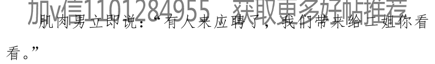

那老妇：“要是像之前来几个那样的，赶早丢出去喂狗，别来烦我。”这女人说话虽然有气无力的，但这话说出来却是让人心惊胆战。

肌肉男哈着腰，愁哉地笑道：“这次的我们几个都觉得好，所以带来给姐了。”

“哦？老大家都看着好？”那老妇似乎有些兴趣。那麻老本来一直在一旁闭目养神，听到那老妇叫他，忙应了一声，说：“我也看着不错。”

“那我倒要见了。”那女人从椅子上伸出一只手。我

注意到，这只手戴着一只手套。并不是尸间里常见的魔手套，而是用绿色毛线织的毛线手套。真是怪了，这夏天的，居然还有人手上戴毛线手套，不嫌热得慌心的？

肌肉男一见，立即上去按，把那老妇从椅子上扶了起来。那女人轻微咳嗽了一声，扶着肌肉男的手臂转过来。

我一看，顿时就愣住了。这女人显然满头白发，一张脸还是很年轻，看上去最多就四十来岁，与那一头白发很不符。五官也还不错，只是脸色苍白，眼睛颇为细长，斜向上，眼角两侧起了纹。

我正打算量，就和她的目光撞到，顿时心里一震，觉得那双眼睛没什么神采，忙避开了目光，低下头。

过了一会儿，我才回过，不过不过个女人，抬起头：“这个孩子？”女人道，声音有气无力，也听不出情绪。

肌肉男说：“二姐，就是他。别看孩子年纪小，资质却是不错。”

女人扶着肌肉男走了几步，虽然脚部不利，像是有什么事。

麻老大终于不再站着，出口：“二姐，这孩子确实不错。燕子，你把之前的事情告诉二姐一遍。”

燕子战战兢兢，连句话都说不出来，嘴像葫芦，脸上带点笑容。看来，这位二姐给她造成了巨大的阴影，站在她面前像山一样。

听完燕子的述，二姐过了好一阵，才“哦”了一声，说：“这么年纪，这样的见识和胆魄倒还不错。”女人扬了扬眼睛，淡淡道：“既然这样，就拿尸体试试，要在这里干活，光凭胖子是不行的。”

肌肉男喜上眉，立即答应。

“有什么不好的。既然孩子你们都不错，让我也来看看。”二姐坐在椅子上，淡淡的一句，脸上面没有半分表情，让肌肉男去那边把尸体推出来。

肌肉男看了老老一眼，说了“好的”二姐，就顺溜溜去了屋子另一边。从我看过去，隐约可见旁边放着三张化妆台，其中一张台上放着一具尸体，盖着裹布。想二姐指的尸体八成就是那具。然而，就见肌肉男已经走到了那张化妆台前，把尸体推了过来。

从众的反应来看，我大概能猜八成是这具体。不过我并不怎么担心，对于我来说，只要是尸体的问题，就不会是太问题。

转念间，肌肉男已经推着尸体过来，摆在我们面前。一般化妆台下面都安装了轮子，方便推动尸体。

二姐轻软，拿起桌上一个杯子，喝了口茶，有气无力道：“打开。”

肌肉男应了一声，又看了一眼，拉住裹尸布一角，将布掀开了。

其实在尸体推过来的时候，就已经有一股熏人的恶臭扑脑而来，此时裹尸布被掀开，更是臭气熏天。燕子和黑毛忍不住后退了几步。

站在那里，所有的注意力都被那具裹尸布下的那具尸体引了过去。

这具尸体，乍一看，看不出容颜，也分不清是男是女。并不是说这具无头尸，而是具体的脑袋里只剩了一个骷髅骨，骨头呈现粉红色，上头还有残留的血肉膜，显然是在不久之前才剔除了骨头上的血肉。

但他脖子下的身子，却是血肉丰盛。也就是说，这脖子下面的肉身还在，但脖子以下只剩下没有皮肉的骷髅头，看着有些诡异。

然而，这并不是全部。这具尸体，浑身肿胀，甚至有些地方已经开始流出脓，恶臭味。

我扫了一圈，除了瘦竹和黑毛，连麻老大都退了几步。肌肉男是离得最近的一个，脸皱得紧似的，大概是得很辛苦。

二姐看了他一眼，道：“你的事了，走开。”肌肉男的动作很快，很快看到燕子和黑毛站在远处的看着。

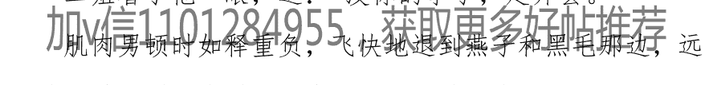

我倒是上前几步，只盯着这具体看。我有点想明白，这样的东西是怎么做成的。让一个人脸上的皮肉全部销掉，有很多办法，比如用一些腐蚀性强的毒液，或者是用极高温度的火焰焚烧，这些办法都有问题，就是无法做到及底面的头骨。

我摇摇头，说：“还看不出来。能借一手手套？”见瘦竹迈着瘦细的长腿，递给我一双手套。我感激地冲他笑笑，把手套套上，走到尸体附近，探手抚住头顶，仔细观察。这种不明的事，我是不敢下手的。在我们行内，不知道有多少前辈由此一次疏忽而丢了性命。从这人的头部来看，无疑是个成年男子。头骨加上暗红色的皮肉棱，看起来绝不是可能割过的，更像是被人用刀子，一刀一刀，把脑袋上的肉给割了个干净！但这完全是我的推测，根本没有半点证据。我实在无法想象，竟然会有什么人能割成这种样？

听她这一说，心里就是一动，想很以前的一件事。这是一种酷刑，叫做“凌迟”。

凌迟，也就是世间常说的千刀万剐。凌迟这一酷刑，最早出现在五代，是最残酷的一种死刑。受刑者不会立即处刑，而是要受三千三百五十七刀，被生活剖而死。凌迟，绝对是一种难度极高的手艺，要剐数千刀而受刑者不死，往后来说，已经是一种残忍的艺术。对于这种酷刑而死的人，就比别的腰斩首尸体更痛苦。一般情况下，被凌迟的尸体，我们行人是不接。自五代以来，直到清末，凌迟这一酷刑一直存在。凌迟这种刑法也在近代逐渐消失，斩刑已经被废除为枪刑，更论凌迟这种残忍之至的死刑，会凌迟这门手艺的人也埋没在岁月的尘埃里。

“难道这杀人的，是个懂凌迟刀法的人？这得有多大仇呀？”我好奇地问，难不成凌迟这门古老的技艺，直到现在还有传人？

女人看了一眼，道：“还算有点识。”又是另一阵咳嗽，喝了口茶，这才道：“不过把人变成这样，也不是什么事了。”

我一听，就忍不住问：“那还有什么法子？”望着这脑袋上皮肉被剥的模样，除了凌迟刀法之外，我还真想到还能有什么办法。瞅了眼麻老大几人，只见他们都是一副口嗅鼻、嗅鼻的样子，显然在这个“二姐”面前，真是比兔子还老实。

女人咳嗽了一声，道：“还有这类东西也可以的。”

我好奇地问起：“那是什么？”听到凌迟，我第一反应就是可能的。这玩意儿其实没见过，但经常听人说起。所谓的凌迟，是在清年间，皇帝底下的某处秘密的一种机关。说形状像个乌笼，能够离离人。很早的时候，我都一直以为凌迟只是后人吹牛。问三叔，是不是真有这玩意儿，三叔说是有的。按照世间流传的说法，这种机关也是用来取人首级的。简单来说，就是乌笼，一般的玩意被丢出去，就会害人。瞬息工夫皮肉剥光，把脑袋取走。

这种机关其实作为原型，仿制出这件套。这种机关其实是金属制作的，做成一个乌笼的样子，就是套住脑袋，里面的机关会发动。这种机关其实是金属制作的，做成一个乌笼的样子，就是套住脑袋，里面的机关会发动。这种机关其实是金属制作的，做成一个乌笼的样子，就是套住脑袋，里面的机关会发动。

“这有点太难了吧？”肌肉男也插了一句：“二姐，这个确实难度太大了。”

女人冷淡地说：“咱们这儿是个什么地方，要是没有真本事，怎么能采下去？赶紧，省得浪费时间。”见这女人发火，麻老大肌肉男都没吭了声。我感觉后面有人拉我衣服，回头一看，是燕子，冲我发了个眼，让我赶紧紧起来，免得累着二姐起火来。

护尸的本质就是要把尸体扮得尽量好看。而眼前这具尸体，任何人都看了都可以轻易地识别它的难度有多高。一般的尸体，大概都是一些遇到祸惨死的人，身上往往损伤面积极大，难收拾。

但眼前这具尸体比起来，又是没得了比。如果这个人的脑壳完全没了，那可以当作当初三叔的样子，给何大明接一个布脑袋，但这些人偏又还剩一个骷髅。而且除此之外，最棘手的是这具尸体脖子下面的护身，已经发生了严重的溃烂，尸体肿胀不堪，流脓发臭。

这样的尸体，无论怎么精妙的化妆术都是不可能化得好看的。所以老大、燕子等人一见，就知道这次招聘又泡汤了。

不过这种尸体，对别人来说是天大的难题，对我来说，其实并没有什么特别的。我上前几步，问了一句：“工具箱在哪儿？”

女人似乎有些意外，看了我一眼，道：“在那架子上，你随意取用。”我过去一看，好家伙，这架子上摆了一些化妆用具，应有尽有。


里退了出来。回到外头，几个人都长出了一口气，人都显得挺直了许多。看起来，这里头那个女人，对他们几个都有莫大的威力。

“这就来说谈待遇了。”麻老大拉着我往外走，边走边说，“每个月六千，包住，你看怎么样？”

我在来之前，招聘招聘上写着“待遇优厚”，按照化妆化妆师这种职位的行情，心里想着大约应该四个千的底子。后来见了这殡馆的凑倒，平日里估计接不到什么意思，自动把底值低到了两千。

这时听到“每个月六千”这几个字，心里愣是一愣。


这实在太超过我的预估了！

“我觉得挺好，明天就开始上班吗？”我稍有些热烈。

麻老大笑道：“如果没有其他事，明天就可以来了。”

跟着几人走到门口。燕子朝我抛了眼眼，笑道：“小弟弟，以后姐姐就单着你呢！”肌肉男冲我憨厚地笑了笑。黑毛站在那里梗着头没说话，废话竹竿反正一直都是木愣的，什么表情也没有。

我道了个别，离开了荣华殡馆。想到终于找到了份工作，而且还是每月六千的高薪，不由得兴奋。这也算是我的第一份正式工作，虽然中间的过程曲折，但结果还是很好的嘛。

想着想着就不由哼歌了，蹦蹦跳跳往车站赶去。走了几里路，兴劲一过，回过味来就觉得有些不对。这荣华殡仪馆的生意冷清得可以，虽说在里头也见到了好几具尸体，但也都是好几天前的。看他们的样子，估计一个月也没几个客户上门。

就这么淡的经营状况，这殡仪馆究竟是怎么支撑下去的？又怎么会给每个月六千的高薪？

这中间坐着琢来琢去，直到上车，还是似乎有些大不合理。我心里还是没明白其中的道理。对于急想找工作的我来说，也没有太在意，反正说明。


第二天天亮又是睁上眼睛，刚去看着睡吧。这一折腾下来后，回到这边已经是下午了。正巧路过老头的店，见老头还空，就进去找他闲聊一会儿，顺便拿几块糕点吃。

作者:程夷 日期:2018-05-22 12:24

“你去了荣华殡仪馆？”钱老头一听，摘下眼镜就愣愣地看着我。

我边吃着绿豆糕，点头说对啊。

“你还去里头应聘了个工作？”

我说没错，还是每月六千的高薪，扫了一眼他店，说：“比你这当伙计工资高多了。”

“你这小子呀，心也是真够大的！”钱老头拍着桌子，一副急上火的样子。

我说怎么了，我不就是干殡棺嘛，哪来那么多忌讳，你以后死了也得去，有什么大不了的。

钱老头拍着桌子道：“殡棺不殡棺的问题，你这小子，你知道荣华是怎么来的吗？”

我连吃了几块绿豆糕，有点灭口，拿起茶壶嘟咕嘟喝了一口，才放下，说：“哥的，荣华殡棺看着挺旧了，有什么特别吗？”

钱老头看着我好一会儿，道：“什么都不知道你就敢去问？”大概是饿口了，端起茶壶喝了一大口，啪的放出来说，“荣华殡棺被我这，实在是在放了，这里是一个秘密别，当年不知道有多少人被处死在这里。后来这地方就成了义冢，之后又发展公墓，早些年流行起火葬，才又建成殡棺。”

“公墓？”我回了一下荣华殡棺周周围的环境，“不像，那里一片荒地，哪来的什么墓地？”

钱老头看了我一眼，道：“现在你看不不到了！大约三十多年前，有个雷雨夜，天天深夜雷电交加，很有很多人看到一道巨大的雷光轰雳落在地面。”

作者:匪直 V 日期:2018005-22 13:54

第二天发现，原来是这公墓被雷给劈了，墓戈一片狼糟。

后来有人就说这块地邪性，所以才被天雷击中，匆忙就把这墓里的尸体都往外赶走，”“既然地邪性，那还在上面盖个殡馆了？”我是很有些不解。

钱老头摇头：“这个就不太清楚了，这事儿也不知道是谁的主意。最后就用那里的一片老房改建了一个殡馆，就是今天的荣华。只是这殡馆就不太太平，时不时地就要出事情了，所以生意是越做越差，最后都没人上门了。”

原来这荣华还有这段历史，也算传奇的。怪不得那里的坟如此繁盛，原来之前是殡馆，如今买卖却接了不少阴阴气。阴气重的地方，自然容易出蚊子，这倒也正常。

只是这天雷击中的事，听起来有些玄乎，大约是巧合吧。

“你这小子，还是要想安安生，就赶紧回家好好呆着，那里去都别去！”

我白了他一眼，说：“你要是肯让我住在店里里，我准不去。”

钱老头一听，顿时有些显惭，道：“咱这店是正经营买卖，不能干违法的事不是？”

我懒得理他，说：“这凶宅我都住了，还差个荣华吗？说不定我实在荣华比都比家里安全。”

钱老头怔了一下，说：“哎哟，刚才我想错了，忘了你住在鬼楼。”

作者:离夷 日期:2018-05-22 15:24

“听你说这工作还是包吃住的？你赶紧就搬进宿舍馆去住，无论怎么样都比你住安全！”这老家伙真是见风就是雨。我是睁着眼想搬出去，可得家里呆着，没反应。

我又闲扯了几句，喝了一肚子的茶，天色早了，就出了门，去市场买了一些菜。到家的时候，青子在二楼等。见我在楼梯上下，进门后也没说什么。青子坐下吃饭，这段时间为了省钱，晚饭基本上都是素菜，偶尔加一个小菜。青子坐下，看到一桌子的菜，问：“今天有什么事？”

青子说：“出去先把衣服洗好，早饭做好，在晚饭之前回来。”

作者:亘夷 日期:2018-05-23 08:14

我宣布我找到了工作，明天开始上班。青子听了没反应，有点失望，说：“工资不可低哦，每个月六千块，只要省着花。”

我明天开始上班，听了没反应，青子夹上一筷子，似乎今天的茄子对她胃，不过对我对劲。我不能不能呆在家里。

作者:亘禹 日期:2018-05-23 09:14

我刚琢磨着，应该怎么把搬家住的事情出口，应该什么样的借口，还没开口呢，就被女人给住了。

“那中午你自己做？”青子道：“不吃了。”我也曾看着青子买衣服时生气，邻居撞击过她房子的门，结果也没发生。

这我是自己想得出来，还得问你呀？后来问过几次，我也不问了，每天自己翻着死人留那些堆书，瞎捣鼓，瞎琢磨，只是现在也没琢磨出个所以。

作者:匪夷 V 日期:2018-05-23 11:14

不过，我基本上能肯定，我现在居住的这个房间，大概就是这邪门阵法的阵眼。我从死人一处笔记上看到过这句话，但若是阵眼，是阵法中最强之处，亦是最弱之处。意思就是，阵眼就是一个阵法的核心位置，是用来牵引发整个阵法的。只要阵眼被破，那个阵法就被破去，所以说是最弱之处。但反过来说，一个阵法的阵眼，必然是蕴藏这个阵法中最强大的威力。

这整个房间在夜间的某个时刻，会变得阴冷异常，这个时间并不固定，或早或晚，或短或长，有时候甚至会出现几次。偏偏这根绳子所在的位置却是基本恒温的，不会受寒气影响，说若青子不知道其中的名堂，我是打死信的。

在绳子上坐的时间长，特别是深夜，全身放松下来，就能体会到周围的气机变化。呼吸得均匀，让我的呼吸与周围变化保持相同的频率，就算是躺在绳子上，也能奇妙地保持平衡。预测到。

作者:兜觅 日期:2018-05-23 12:44


这房子的另一个怪之处，就是能在深夜阴气大盛之时，看到那个笔记上提到的镜照。是因为正常的阴气水平，在空间中形成一面的镜子，把一些看不到的东西照出来了。不过不是那件，两个影子一直并肩站在那里，夜里黑漆漆，只能看到轮廓。有时候我趴在绳子上太累了，迷迷糊糊的。

就这样乱七糟，我就睡了过去，然后一下子醒了。从梦里醒来，第二天早就起来了，青子的衣服都是晚上洗好的，我急着出门。我等她做了早饭，背上了小包。

作者:兜觅 日期:2018-05-23 14:14

急匆匆地来到荣华殡馆门口，一看，大铁门依旧死的。我等了了好一会儿，没人来开门，隔着门缝进去。整个殡馆里静悄悄的，什么声音也没有。因为阴气重，凉得很，比空调还舒服。

我转了一圈，还是昨天一样，一个影子也没有。按理说的职业应该是化妆师，是殡馆的兵。屋里头只剩了一个棺体。另外还有一个叫蛇的女人被送了哪里。

我从房间出来，往前走了一段路，经过一处虚掩着的小平房。门上挂着个小木牌，用红色笔写着“存房”两个字。所谓的存房，其实就是骨灰盒的地方。我站在门口，看着屋子后头两树大桑树，又是槐树，真不怕吉利。

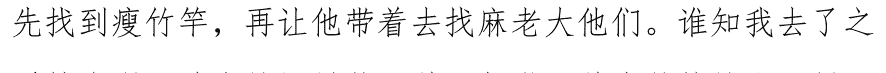

## 67
作者:兜夷 日期:2018-05-24 09:39

推门进去一看，里头的空间倒也不小，中间竖着一排黑枣木的木架，上一格整齐地放着骨灰盒。相比瘦竹那间窘房，这存房显得干净整洁得多。边上放着供人休息的桌椅，靠墙甚至还有书架和一排杂物架。两排架子再过去，角落里停着一口朱红色的棺材。我不禁有些奇怪，存房里停棺材，还少见。不过荣华殡馆，本来就是殡馆中的棺子，有些事也见奇怪。

那口棺材并没有密封，棺盖被推开一半，躺在那里。我好奇凑过去的看，棺材里似乎是躺着什么尸体。走到近处，透过掀开一半的棺盖，隐约可见一个人在里头，头一看炭棺。正准备再靠近近些，看仔细些，突然影子一晃，一只雪白的手从棺中伸出来，抓住我的脖子，一把就把我拽了进去。

我本来不及反应，只觉得天旋地转，身子腾空而起，接着钻进棺材，脑袋撞到什么东西。却疼，反而是软绵绵的，在头上还弹了几下。

我第一时间有些迷瞪，再仔细一看，却看到了一张熟悉的脸，唇红皮肤，一双眼睛水汪汪的，原来是燕子。我此时正埋在她胸脯上，瞬时一阵手忙脚乱，想爬起来，脑袋一下磕到棺材盖上，瞬时眼前一片金星。


燕子伸手捂着脸，笑道：“小弟弟，以后姐姐就单着你呢！”


燕子皱眉道：“不是蛇胆子，又有什么好看的？我最讨厌这种东西。”

黑毛在边上冷了一声。我生两人又叫起来，忙上前打开木盒。这一开，立即就是一股子腥臭味扑扑而来。

燕子忙捂住了鼻子。我往里头看了一眼，顿时一个激灵，浑身的寒毛竖了起来。

这盒子里盘着一条青青色的小蛇，满了黑乎乎的粘稠“墨汁”，使得那一抹青色都不太分明。这小蛇大约也小手指粗细，三寸长来，身上的鳞蟒还没长出，显然是新出的幼崽。

然而它的脑袋，并不是三角形的，而是圆乎乎的一块。

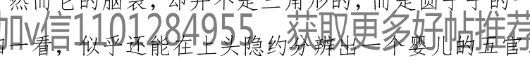

仔细看，这可能是在身上长出来的什么奇怪东西！

这究竟是个什么东西！我看得头皮发麻，这东西他妈的究竟算是人，还是蛇？

今天先更新到这里了，大家可以关注微信公众号【右手灵异】继续阅读，回复90060，从“第六十章 夜眼”开始阅读。

作者：匪夷 日期:2018-05-25 08:33

燕子在看清楚巷子里的东西后，也是脸色发白：“这条蛇怎么这么长了个人，是这女人肚子里的？”

那瘦竹竿点头说：“是……的…………”他倒是好，不管遇到什么事，说话都是这个调调，有点情绪也没有。

我仔细瞧了几眼，这条婴儿蛇脑袋拎着卧在盒子里，不过那前额侧眼睛的地方，不由轻微地动一下，显然还是个活物。

“这东西还是个活物啊，我就十分好奇。这女人人都死了三天多了，腹中的胎儿竟然现在还活着，实是有有些说异。”

麻老老大：“这样的东西你们都见过吗？”目光转处，燕子、肌肉男和黑毛都摇了摇头。瘦竹竿是没动的，不过隔了好一会后，他也摇了摇脑袋。他只是迟钝了一些而已。

我也跟着摇头，这人头身上的东西我又哪里会见到？

麻老老大：“我也没见过。找你们来，就是商量一下，这东西该怎么处置。”

我又看了那个怪物，心想这东西还是难办。说要把这东西拿出来送死者家属吧，那非得人给吓死不可。

燕子最后开口，说：“还想什么，这玩意一看就不是好东西，赶紧让死矮子拿去火化了！”

那黑毛把一双眼睛睁一翻，冷笑道：“要去你去！这女人是出出马，肚子里的这蛇明显就是她那条蛇给搞出来的野种。咱们是要把它一把火烧了，万一那条蛇找门怎么办？”

黑木话说得也不是没理。传说中，能挑香成为马仙的，都都不是什么普通货色，好玩家都是一些活了上百年的老怪物。就如此那头青蟒，估计也不是什么好意的。

麻老大看了一眼肌肉男，说：“老四，你怎么看？”

肌肉男挠挠脑袋，憨厚地笑了笑，说：“我也拿不定主。”

麻老大问到我，这回我是支持了黑木的看法。黑木看了我一眼，笑道：“你这小鬼蛋还有什么点子法？”这样说说去，麻老大最后决定把这东西留一个月。如果一个月后，它内脑还憋不出来，它就彻底玩完了，省得留下个祸子。

之后又让老六给换了一个缝隙的铁笼，既可以透气，缝隙又不足让那东西跑出去，以免让它咬死了。

事情处理完毕后，麻老大拍了拍我肩膀，说：“以后你老七了，这里的人你应该认识了吧。”

我在心里一通算，麻老大自然是老大，尸阎间那个白女人他们都叫她二姐，应该是老二，黑木是老三，燕子叫肌肉男“四哥”，他就是老四，燕子是老五，而废竹竿是老六。

我是最后一个来的，年纪又是最小，自然就是老七了。

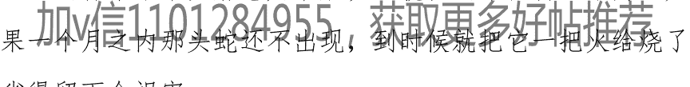

燕子一把接住我脑袋，她往鼓鼓囊的胸脯上按，笑道：

“小小，快来叫一声听！”

我张脸被埋在里，哪还叫得出什么声音，只发出“唔唔唔”几声。

麻老大吩道：“小小，这女人的尸体你缝合一下，再给她化妆，整理好妥容。”

我好不容易心里挣脱出来，回答道：“好的。”给尸体化妆，这就是我的本职工作。想到一件事，又问了一句，我能不能在白天工作，晚上还得回去。

麻老大说：“咱们殡仪馆规定不许白天接受，没有规定白天工作。你要把尸体处理好，什么时候都随你。”这句话我就放心了。黑毛打了个哈欠，说要回去睡一会儿。燕子说起太早，累得慌。麻老大跟肌肉男一起说着，到头回了。瘦竹竿拎着那条蛇的铁盒子转身回了。我抱了布过来，替女尸身上盖上，推着木床往尸间走，不过我不敢随意推进去。


“二姐，你在吗？”我出口，只觉得浑身直起疙瘩。说这女人虽然看不年纪，但往后推了，至少四十岁了。我一个小孩子，又要叫她，实在是有些别扭。按照这里的规矩，我是老七，自然要叫她。屋子里没人反应，我只好了一声。过了好会，才听到里头有人说：“进来吧。”声音很轻，不过我正在仔细听，还是听到了。回答一声，推门进去。

屋子里黑漆漆的一团，我发现新婚房这几个人似乎都满欢喜模样，原本热闹的房间，此刻满了新娘的脸，房子全都是窗户的。也不知是当初房子还是后来改成这样。女人是躺在那张椅子上，只看到个背影。我估摸着，按照这群人的习性，现在这女人也是睡觉。燕子坐在椅子，黑毛坐在床上。

“二姐，我给你缝合。”我静静地等了一会儿，只听到那女人有气力地问：“这女人叫什么名字？”我真的不知道，刚才也忘了问。“以后给尸化妆前，要先记住她的名字。这女人叫慧芳。”我忙答应一声。女人道：“你去那边干活吧，别弄太大声音。”我点头应了，小心把尸体推过去。本来就是一件安静的活，不会有什么动静。把身上的放下，去架子上找了双手套，准备就绪，正想要动手就遇到了难题。屋子里黑漆漆的，昨天给我那具被剃的男人下刀的时候还好，是在靠门口的位置，外光还能进来些亮光。现在我在这个位置，已经是屋子的最里，黑乎乎一片，就算我睁大了眼睛，很多东西也能隐约看到个轮椅。

问：“二姐，我开灯会不会影响你？”那女人说：“随意。”我这才松了口气，但转了一圈下来，才发现这屋里就没有灯！不管是给尸体缝针还是化妆，都是一件特别精细的活。这黑瞎火的，根本干不了什么。大概是我走来走去弄出了动静，被女人听到了，说：“怎么？”我不得不把实情说了，说屋子里太黑，干不了活。

女人道：“你没见过夜眼？”我已经是第二次听说“夜眼”了。第一次是在南疆古墓，从燕子口中听到。我就说没有，又问：“夜眼是什么？”女人没有回答，说：“你把尸体推到门口去。”我“啧”了一声答应，把尸体推到门口，看了眼女人，她依旧躺在那里，姿势都没有改变。心里犯了下嘀咕，揭开裤子，开始干活。上半身上保持得还不错，肚子上那道口子缝起来很容易，就是底下的伤有些麻烦，简直是惨不忍，也不知道这女人死前究竟承受了多大的痛苦。两个多小时后，大致的缝合工序终于完了，轻手轻脚把尸体包好，给慧芳准备的衣服拿出来问燕子，有没有给这张慧芳准备的衣服。之后再给尸体清洗一遍身体，换好衣服，补好妆，这才算大功告成。正要把尸体推回到角落去，只听一阵悉索，原来是女人在椅子上动了动，伸出一只带着绿色毛线手套的手。我一见她伸手，脱下手套，过去换她的手。她看一眼，也没说什么，扶着我的手从椅子上站了起来。女人的腿显然有疾，全靠我扶着才能勉强站住。“看看。”我扶着她走。她的个子还是高的，不过消瘦，所以分量也不重。我把帘掀开了，她了一眼：“过去吧。”大概是我带她出去。她看着外面，太阳太毒了，但在旧馆里像是隔了一层纱，看起来都不那么刺眼，也不觉得热，倒是有些凉爽。“天气不错。”她看着窗头，麻老大笑着拉着我的角，总是有些味道。我说：“最近天气不错，二姐应该多出来。”这具尸体也差不差。”女人看着我，苍白的脸上露出一丝古怪的笑意：“你同情我？”心里咯噔一下，她哪里会读心，我忙说：“我是觉得二姐很亲切，本事厉害。”那女人冷冷地一笑：“到底是尊敬呢，还是畏惧？算你小傻说对了。”我听她语气平静，似乎并没有生气，大着胆子问：“二姐，你的腿是怎么了？风湿吗？咱们这儿人气大了，就容易关不好。”她了一眼，一双细长的眼睛眯了眯，说：“你这小鬼一口就叫二姐，实在是别扭，以后叫我二老婆。”老婆，但冲她这模样，我也叫不出口啊。“要不，还是叫你姑姑吧。”我自作聪明想了个折中的办法。以前在村里，遇到年纪大的女人，我都管她们叫二姑姑、三姑姑。女人瞪了我一眼：“你让我叫二老婆，你就叫我二老婆，哪来这么多废话。什么姑姑的，难听得死。”我听她语气虽然冷静，才答应了。反正她得了老也是她的事，她喜欢被人叫老婆娘。其实就是在外面走了几步，二老婆就摆了摆手，让我扶回屋。我说现在天气好，要不要再走。她没说话，我只有扶她回去。进去又是躺到那藤椅子，闭着眼睛一动不动。我站在那里，只见她在一片漆黑中露出一头白发，半天也不动一下，真的很像一具尸体，充满了死气和腐朽的味道。我出门，把门轻轻合上，去存房找燕子问张慧芳衣服的事，路上就在想着，这二婆婆究竟是个什么人，不仅跟正常人不一样，甚至连麻老大这些人也是格格不入。到存房的时候，燕子却没有在。我看见她坐在架子上放那些骨灰，看着仔细的模样，与平日里那种风风火火的差了。我走进屋去，说：“燕子，睡了吗？”燕子抬头见我，勾了勾说：“刚醒了。怎么，被二姐叫出来了？”我：“没有，婆婆睡了。张慧芳衣服的？”燕子愣了一下，把尸体推过去。我问燕子，有没有给这张慧芳准备的衣服。燕子把擦拭好的骨灰摆回原位，问：“二婆婆？你胆子小啊。”我：“哪里，她让我叫的。”燕子说：“你得当心点，在她面前别说话。”我问：“张慧芳的衣服？”燕子皱脸说：“拿去。”我：“好了。”燕子：“你去拿。”拿衣服回来，用清水洗净慧芳的身体，换好衣服，重新上妆。一切绪后已经是下午了。从早上到现在，也没有吃东西，肚子饿咕嗒叫。我找到厨房，也没有好吃的，有些面条，就加水煮了一碗，将下了。手头的事情已经忙完了，我有点闲。去厕所，在大桑树下找了个位置，躺在那儿睡觉。心里不免想着，这生意太差点，照下去，工资怎么发。一直等到下午了，麻老大出来找了我次，说：“我不错，以后没什么事可以随意的，回家也可以。”我看天色不早，就不客气了，进屋拿了包，跟她道了声，出了旧馆。路上正好买菜回家，吃饭的时候燕子儿绘声色地跟我说了第一天的经历，不过我也没有了说话的兴趣，闷头扒饭。接下来的几天，还是按时地去旧馆上班，每次都翻班进去。听燕子说，咱们旧馆的大门只有晚上才会开，因为只有晚上才有客人。我第一天上班的晚上，张慧芳的丈夫来了一次，对她妻子的模样很是满意。当晚，张慧芳的尸体就被拉去火化了。所谓的炼人房，就是火化房，平时都是黑毛在负责打理。我就好奇地问燕子，说咱们这样一笔生意，能赚多少钱。”燕子比了四根手指，说：“四万吧，这个比较麻烦，比时的高一些。”我大吃了一惊，这一笔生意竟然要四万块钱！我当初跟三叔在灵堂可是常年跟殡仪交道的，熟知其中的价格。这四万块，不知道能抵得上一般殡馆的多少生意了！“那平时的多少？”燕子想了想，说：“大概两三万吧，一般是要低于两万的，我们不接的。”燕子冷笑一声：“他们花两个三万，四五万的，就能保得家宅平安，已经是很划算了。你这几天过的几户体，你觉得像长福那些馆子能摆得的。”


脸色很白，嘴唇上留着淡淡的胡须，表情却是严肃冷静，板着脸端坐在那里，腰挺得笔直，正襟危目养神。

我一看，还觉得挺有趣的，这人年纪不大，却拼命地颓着脸装老。

再看和黑墨纠绕的那两个人，一个是个中年男人，脸色焦黄，额头上全是冷汗，穿着像是挺富贵的。另一个就是那个打扮颇为妖艳的女人，死命抓着黑毛的胳膊不放，大声哀求，就差跪下了。

作者:奎夷 V 日:2018-05-27 14:36

见到我们进来，麻老大了眉头，露出一丝笑容，却没说话。我点了点头。
加微信1101284955 获取更多贴推荐

肌肉男声道：“诺，这两个是死者的家族，一个是父亲，另一个的女……说是那是孩子的继母。”指了指更黑毛线条纠绕的那俩人。

我看了他们一眼，说：“哭得挺伤似的呀，看来这母还不错。”以前在村里的时候，班里也有个女同学是跟着继母过的，日子过得叫那个凄惨。这样看来，这女人还不错，闹得得情真切意的。

肌肉男笑道：“哪里，这女人这么凶法，怕不是为了孩子，而是为了她自己。”

我“啧”了一声，有些明白。肌肉男说：“你要要是好奇，去看孩子的尸体就知道了。”

他这一说，显然是那孩子的尸体有古怪。这具体有关的事，我当初恐怕是更加好奇了，一听就心怦怦，问他在哪里。肌肉男指了指右边角落一个大铁盒子，说就在那里。

燕子大约是没有睡够，一直在打着哈欠，无精打采的，对看什么尸体却是没兴趣。我只好一个人过去，那铁盒子大约一米长来，半米未宽，盒身很厚，做的很结实。盖是合着的，迎头一看，只见到一具男的尸体在摇头。

这男童也就四五岁，脸色铁青，嘴唇发乌，尸体上已经起了黑点。一看，这尸体倒也没有什么特别的，但上前再仔细细一眼，就发现了异常。

# 加微信1101284955

今天先更新到了这里，大家可以关注微信公众号【右手灵异】继续阅读，回复90060，从“第七十二章 鬼牙”开始阅读

作者:匪鬼 日期:2018-05-28 08:14

我打开它，从里头取出双缝手套戴上，捏住这男童的下巴，把他的嘴撕开。就见这男童唇间，两侧分别长出两颗锋利的獠牙，看上去诡异异常。

虽然也有大牙，但绝不可能成长这样的。这种牙齿，在我们这一行叫做鬼牙，这是在人死后长出的牙齿。

一般能长鬼牙的，就说明这具体是染上了煞气，有煞变之魔。煞变就可以非常的尸变要可怕得多了。绝大多数尸变，都是由于尸体的纯阴之体无意中占了了一丝阳气，导致万阴从中一点点阳的布局，促使尸体因阴生变，发生异变。

虽然虽然挺吓人的，但只要应对得宜，危害并不如想象剧烈。但是煞变就不同了，一旦发生煞变，往往就变成世人常说的灵异恶魔，那那就是个不死不休的局面。

这男童如今已经长出了鬼牙，这就说明他是煞气缠身，难肌肉男说那女人之所以这么嚎叫是为了自救，原来如此。此事也真古怪，好好的一个男孩，怎么就占上了煞气？

我正揉着脸，就听一声大叫：“你小鬼干什么？谁怕你啊，可多好欺！”

一回头，只见那个打扮妖艳的女人冲着我大叫。

“你这破小鬼，你乱动什么？哪里来的野子！”那女人咆哮着，大约是在黑毛里碰了钉子，干脆把火全部撒在我身上。

作者:距离 V 日期:2018-05-28 09:44

他的妈妈，我最讨厌的就是别人叫我野孩子。骂人谁不会啊，农村里骂人的那是多难听有多少难听，我可是学了好多，保管骂得她怀怪人生！正要发作，听燕子冷笑了了一声，说：“这是谁呀，好大的嗓门，也不看看这是什么地方，敢在这里撒野！”

那女人来的时候没见过燕子，也不知道燕子是谁，也就不敢随意说话，愣了了一下，把要把说的话给吞了回去。燕子却不肯罢休了，朝那领扇的胖子瞪了眼：“狮子头，赶紧趁这滚娘给我滚出去！”

我听得一愣，心想着这胖子肥肥胖胖，圆不溜溜的，哪里只剩下狮子了？正好肌肉男也过来了，我就问了一句。肌肉男笑着：“这狮子头可不是狮子的头，是我们平时吃的狮子头。”

这下我算明白了了，原来指的是肉丸子啊，瞧这胖子圆溜溜的脑袋，还真那么回事，不由得乐了。听肌肉男说，这胖子其实是个中间人，专门介绍客户。我们来的，就是替双方牵线，他拿个中介费。想也可能是吧，毕竟他也是热心的，介绍给她的可不是随手跑的。

肌肉男站在我旁边，拍了拍肩膀，说：“这是我们家的规矩。”

那女人一听，顿时就甩了脸，冲着我大叫。又过去朝那胖子瞪了眼：“狮子头，赶紧趁这滚娘给我滚出去！”

我听得一愣，心想着这胖子肥肥胖胖的……

作者:亘夷 日期:2018-05-28 12:14

胖子一听，当时就愣了一下，大约是完全没想到一个小子竟然在这灵馆里任职，愣了几秒，才醒过来，笑得连眼睛都没了：“幸会，幸会，原来是陆兄弟，年轻有为，真是前途不可限量啊！”

狮子头一听，感激地朝我连点头：“陆兄弟，以后有什么事，尽管吩咐就好。”

我听着有些想笑，这胖子圆溜溜的脸……。那女人就滚在地上撒泼，又咬又哭，那胖子气得咬咬牙，瞪了男人一眼：“还不！”

胖子一听，急了，过去想要阻止他说话。那小白脸却是根本没理会，抓着嗓子叫：“姐，我就说你们别来了，你们偏不信，这就是个骗钱的地方！不是尸异变，在这里你们怕什么？”

我一听，原来小白脸还是这女人的弟弟，听他说什么尸变，似乎还是个内行的。不过是真内行还是假内行就不说了，这男孩已经长出了鬼牙，可不止是异变那么简单。

“虎尾，别胡说八道！”那富贵男人忙把小白脸捂住了。狮子头也是满头是汗，拉了小白脸就要往外走，“小祖宗啊，你可别乱话了！”

一边朝麻老大点头，说：“实在对不起，实在对不起！”我见他这么狼狈，就在旁边插了一句：“你们事情是很急，咱们敛棺的规矩不能坏。你们把尸体放在太阳底下，然后再摆一个落地铜钱，加上引命灯环，应该能等到晚上。”

狮子头一听，感激地朝我连点头。谁料那个叫虎尾的小脸却是挨了一拳，冷笑道：“什么落地铜钱灯环的旁门左道，一个小伙子也来胡八道！”

狮子大概是他有些火大，那朝富贵男人吼道：“还不管？他妈的，接了你们这生意也算老子倒霉！”

富贵男人忙了前来，要拉那个小舅子出去。谁知小白脸连脸的脸色也不，挣开他的手，两手背在身后，昂首挺胸，环视了一周，傲然道：“你们这些骗子，知道我是谁吗？”

“是不是脑子有病？”我悄声跟旁边的肌肉男说。肌肉男憨厚地笑了，没说什么。不过小白脸的耳朵却让他听到了，涨红了脸，突然从口袋里掏出一个东西，一把拍在桌子上。

我有些好奇，凑过去了一眼，只见桌子上是一块赤色的木牌，比手窄，上面刻着有些奇怪的花纹。“这是什么？”我问。

肌肉男一看却吓了一跳，只见肌肉男脸色难出的。还没等我回味来，就听“咣”一声巨响。转头一看，就见原本挺高的小脸已经躺在地上，后脑勺涌出一道血，屋子里满地的碎片。燕子站在那里，手里抓着半个瓷瓶，双目中寒光闪烁，就像疯了一样狮子头站在她身边，已经被吓得慌了，嘴唇咬着，半天都没说句话。

“啊！”妖艳女子出一声尖叫，“燕姐，燕姐，你怎么样了！”

燕子直愣站在那里，像是根本没有听到我说话。我发现她的手抖得厉害，就用力捏了握。

过了很久，燕子才刚醒神来，看了一眼，转头朝外走去，失魂落魄的。我紧紧抓着她的手，跟着。

只听麻老大冷冷道：“规矩就是规矩，天塌下来也不破，赶紧带着这些人出去！”

胖子一听麻老大下了逐客令，脸色发白，不停搓着额头的汗，回了，大步上去，一把将女人赶开，抓住小白脸的头发，像拖狗一样拽着朝外拖。

“谁叫你带道士来的？”麻老大盯着狮子头，一张脸黑得要滴墨来。狮子头额汗渗漓，已经在抖，颤声说：“我……真不知道，真不知道……”

肌肉男一言发地上去，一手捏住女人的脖子，大步出门，把人丢出去，冲狮子头吼道：“还不快！”

我“哦”了一声，点了点头应了，拉拉燕子手，轻声说：“燕姐，咱们回去继续睡觉吧。”偷了一眼麻老大，只见老头面沉如水，脸色阴暗得像天上的乌云，那灰白色的盲眼，似乎都透出一丝诡异的赤红色，手里拿着那个小白脸底下的木牌，不停地冷笑。

“以后只要是谁带道士进来，一律打出门去！”我立刻表态。

麻老大点头：“你也回去休息吧，把那玩儿拿出去扔掉。”他说那玩儿，指的是我手里的符牌。我点头应了，跟肌肉男和黑毛打了声招呼，临出门的时候，麻老大说：“多照着你燕姐。”

从大厅出来，先找了个垃圾桶把那牌给丢了，之后又去了查房。在门外徘徊了一阵，听里头没什么动静，不过想来燕子现在也不会睡着的，就在外头问了一句：“燕姐，我中午打算些菜回来做饭，你喜欢吃什么？”

隔了好一会儿，才燕子在里头应了一声：“红烧肉。”

我听了，心里想，能实话就表示没什么大碍，说：“红烧肉可是我的拿手绝活。”燕子道：“做多点。”

殡馆内和外简直是两个世界，出来就觉得浑身被热气所包裹。头顶上的阳光辣辣的，晒得厉害，汗水流下来。会议还没结束，后头有人叫我。

回头一看，只看见一个胖乎乎的人迎冲我跑了过来，滚圆的肚子见来去的。

作者:亘夷 日期:2018-05-29 11:48
作者:亘夷 日期:2018-05-29 13:18
作者:亘 V 日期:2018-05-29 14:48


这一顿饭吃倒是挺扎实，所有菜都被吃了个精光。

作者: 离夷 V 日期:2018-05-30 13:02

我见燕子的心情转好，也不由得商兴。吃完饭后，又把早早就留下的一份菜端去许衙眠，不过二婆婆搓了搓搓手，一口不动，让我拿了回去。

晚上睡觉的时候，在饭桌上我又把这事情原本地给青子讲了，不过这块女人还是一副冷不淡的样子，听完只是“哦”的一声，也没有评价。

我说：“据我分析，麻老板、肌肉男、黑毛还有燕子，他们以前应该就是一伙的。后来不知道是出了什么事，他们几个就跑到了这炼坊。老六是四年前来的，至于那二婆婆，这所有的人都不敢去获取更多好推荐。”

“对了，这个符号是什么意思？”我拿了纸笔，按着记忆把那块牌子上的花纹画了出来。

青子吃完饭了，把筷放下，看了看我画的东西，道：“大约是茅山派的玩儿它，记不太清楚。”

“茅山派？”说起正一我不懂，但提到茅山派，那还是大名鼎鼎，如雷贯耳的。关于鬼魅邪的流派，民间向来有茅北方的说法。

北马指的是出马仙，在北方地带，出马仙极为兴盛的，那一个怀了蛇胎的张楚芳，就是一个出马弟子。该流派的弟子，往往是通过出马仙附体等手段来辟邪驱魔。


而南茅，就是指的茅山宗。不过我最先知道茅山道士，那还是一些港台的鬼片上，以前在村里常像逍遥进戏厅看。

作者: 直夷 V 日期:2018-05-30 14:32

传说中，茅山术神秘诡测，最擅以符文咒法除鬼降魔，在民间留下无数传说。

只是听青子说，这茅山宗其实最早也是脱胎于正一派，与天师、清微合符三大派。

“这么，那小脸是茅山弟子吗？”在我想脑象中，茅山弟子都是像擂台片中那些鬼大师傅，是穿着黄色道袍，披着道剑，手持桃木剑，跟这个小脸实实是没半分相像。

加V信1101284955，获取更多好推荐

青子却没继续我，起身就去了殓馆，我只得一边收拾砚棱，一边自己擦琉睛。

第二天一早，还没走到殓馆门口，远远就看见一个胖乎乎的家伙，脑袋在铁门上往里张望，姿势极为狼，原来是狮子头那个胖子。

“看什么呢？”我走到面前叫了一声。那胖子给吓得“啊”，差点一头栽倒，回见我是，这才将胸口长出了一口气。

我见他一脸虚汗，脸色白得跟张纸似的，有些奇怪，就问：“你是你怎么了，见着鬼了？”

那胖子又是吓得一声尖叫，扑过来就要捂我的嘴：“陆兄弟俩，你可千万别乱说啊！”

我问出口什么事了？那胖子一张脸瞬间垮了下来，哭着脸：“这回可出大事了！”

听后他把事情说了，我心里咯噔一下，问题还是大太了。
原来昨晚我回家之后，那家人又披着狮子头带他们闹殡馆，又是锄头又是加钱的。不过狮子头知道这事情是办不了了，铁了心给回了。

谁知那对夫妻竟求狮子头不成，就自己开了车把那男童的尸体运到了殡馆，在外哭天哀哮地，非得要殡馆接收，最后竟然被叔姨老他们给了出去。

第一十一章，竟然发现坟墓破了，好像被什么东西硬生生地凿的，进去发现了一个大洞，却发现那对夫妻死在了里头，两个人的脖子血肉横斜，像是被什么野兽咬坏了，车里全是溅血的，腥气冲天。

74

今天先更新到这里了，大家可以关注微信公众号【右手灵灵】继续阅读，回复90060，从“第七章 合围”开始阅读。

作者：匪夷 V 日期:2018-05-31 09:02

没想到对那男女离了殡馆之后，竟然出了这挡糟事！那胖子哭着脸说：“一定是那鬼孩子作起了了！这可怎么办好啊！

我吓得一阵皮发紧，这恐怕真不是普通起那简单，能怂成这样的，可不可见。就问：“那孩子到底怎么回事？”问的是好端一个小子，怎么长出了鬼蛋？

胖子擦着汗道：“我可不是清楚槌。这小孩子听说是病死的，进棺材那天，突然有人发现他嘴巴张开，里头长四颗獠牙。这不，他们找了我，我怕事情有变，就不顾规矩，紧紧地找到了你们殓棺仪。哎，谁知事情会变成这样！”

我听了，一天也憋不出个事出来，就说了声：“我上班要迟了！”等胖子眼睛反应过来，就一手攥着铁门，翻着进微微信获取更多帖推荐，一路跑，急急忙忙地找过去，把麻老大他们都叫了起来，把事情一五十地告诉了他们。

“那孩子的样子，迟早要铲变，也没什么好奇怪的。”黑墨翻了眼睛，若无其事地道。

燕这次倒是没反应黑墨了，话说：“我看那孩子的死，八成就那对父母有关。心怀鬼胎，死了也就离开了，跟咱们有什么关系？”

麻老大我道：“小七，狮子头还有没有说其他的？”

“倒没什么的，就是我替他求情，说他真不是有意犯了规矩。”

作者: 倪夷 日期:2018-05-31

麻老大点头：“这事情不用理，生死有命。”燕子却没继续我，起身就去了殓馆，我只得一边收拾砚棱，一边自己擦琉睛。

燕子伸了伸腰，揉揉哈欠，说：“我要继续睡了。小七，二婆婆我叫我还有事！”二婆婆搓了搓搓手，一口不动，让我拿了回去。

第二天一早，还没走到殓馆门口，远远就看见一个胖乎乎的家伙，脑袋在铁门上往里张望，姿势极为狼，原来是狮子头那个胖子。

“看什么呢？”我走到面前叫了一声。那胖子给吓得“啊”，差点一头栽倒，回见我是，这才将胸口长出了一口气。

我见他一脸虚汗，脸色白得跟张纸似的，有些奇怪，就问：“你是你怎么了，见着鬼了？”

那胖子又是吓得一声尖叫，扑过来就要捂我的嘴：“陆兄弟俩，你可千万别乱说啊！”

我问出口什么事了？那胖子一张脸瞬间垮了下来，哭着脸：“这回可出大事了！”

听后他把事情说了，我心里咯噔一下，问题还是大太了。
原来昨晚我回家之后，那家人又披着狮子头带他们闹殡馆，又是锄头又是加钱的。不过狮子头知道这事情是办不了了，铁了心给回了。

谁知那对夫妻竟求狮子头不成，就自己开了车把那男童的尸体运到了殡馆，在外哭天哀哮地，非得要殡馆接收，最后竟然被叔姨老他们给了出去。

第一十一章，竟然发现坟墓破了，好像被什么东西硬生生地凿的，进去发现了一个大洞，却发现那对夫妻死在了里头，两个人的脖子血肉横斜，像是被什么野兽咬坏了，车里全是溅血的，腥气冲天。

没想到对那男女离了殡馆之后，竟然出了这挡糟事！那胖子哭着脸说：“一定是那鬼孩子作起了了！这可怎么办好啊！

我吓得一阵皮发紧，这恐怕真不是普通起那简单，能怂成这样的，可不可见。就问：“那孩子到底怎么回事？”问的是好端一个小子，怎么长出了鬼蛋？

胖子擦着汗道：“我可不是清楚槌。这小孩子听说是病死的，进棺材那天，突然有人发现他嘴巴张开，里头长四颗獠牙。这不，他们找了我，我怕事情有变，就不顾规矩，紧紧地找到了你们殓棺仪。哎，谁知事情会变成这样！”

我听了，一天也憋不出个事出来，就说了声：“我上班要迟了！”等胖子眼睛反应过来，就一手攥着铁门，翻着进微微信获取更多帖推荐，一路跑，急急忙忙地找过去，把麻老大他们都叫了起来，把事情一五十地告诉了他们。

“那孩子的样子，迟早要铲变，也没什么好奇怪的。”黑墨翻了眼睛，若无其事地道。

燕这次倒是没反应黑墨了，话说：“我看那孩子的死，八成就那对父母有关。心怀鬼胎，死了也就离开了，跟咱们有什么关系？”

麻老大我道：“小七，狮子头还有没有说其他的？”

“倒没什么的，就是我替他求情，说他真不是有意犯了规矩。”

麻老大点头：“这事情不用理，生死有命。”燕子却没继续我，起身就去了殓馆，我只得一边收拾砚棱，一边自己擦琉睛。

燕子伸了伸腰，揉揉哈欠，说：“我要继续睡了。小七，二婆婆我叫我还有事！”二婆婆搓了搓搓手，一口不动，让我拿了回去。

第二天一早，还没走到殓馆门口，远远就看见一个胖乎乎的家伙，脑袋在铁门上往里张望，姿势极为狼，原来是狮子头那个胖子。

“看什么呢？”我走到面前叫了一声。那胖子给吓得“啊”，差点一头栽倒，回见我是，这才将胸口长出了一口气。

我见他一脸虚汗，脸色白得跟张纸似的，有些奇怪，就问：“你是你怎么了，见着鬼了？”

那胖子又是吓得一声尖叫，扑过来就要捂我的嘴：“陆兄弟俩，你可千万别乱说啊！”

我问出口什么事了？那胖子一张脸瞬间垮了下来，哭着脸：“这回可出大事了！”

听后他把事情说了，我心里咯噔一下，问题还是大太了。
原来昨晚我回家之后，那家人又披着狮子头带他们闹殡馆，又是锄头又是加钱的。不过狮子头知道这事情是办不了了，铁了心给回了。

谁知那对夫妻竟求狮子头不成，就自己开了车把那男童的尸体运到了殡馆，在外哭天哀哮地，非得要殡馆接收，最后竟然被叔姨老他们给了出去。

第一十一章，竟然发现坟墓破了，好像被什么东西硬生生地凿的，进去发现了一个大洞，却发现那对夫妻死在了里头，两个人的脖子血肉横斜，像是被什么野兽咬坏了，车里全是溅血的，腥气冲天。

没想到对那男女离了殡馆之后，竟然出了这挡糟事！那胖子哭着脸说：“一定是那鬼孩子作起了了！这可怎么办好啊！

我吓得一阵皮发紧，这恐怕真不是普通起那简单，能怂成这样的，可不可见。就问：“那孩子到底怎么回事？”问的是好端一个小子，怎么长出了鬼蛋？

胖子擦着汗道：“我可不是清楚槌。这小孩子听说是病死的，进棺材那天，突然有人发现他嘴巴张开，里头长四颗獠牙。这不，他们找了我，我怕事情有变，就不顾规矩，紧紧地找到了你们殓棺仪。哎，谁知事情会变成这样！”

我听了，一天也憋不出个事出来，就说了声：“我上班要迟了！”等胖子眼睛反应过来，就一手攥着铁门，翻着进微微信获取更多帖推荐，一路跑，急急忙忙地找过去，把麻老大他们都叫了起来，把事情一五十地告诉了他们。

“那孩子的样子，迟早要铲变，也没什么好奇怪的。”黑墨翻了眼睛，若无其事地道。

燕这次倒是没反应黑墨了，话说：“我看那孩子的死，八成就那对父母有关。心怀鬼胎，死了也就离开了，跟咱们有什么关系？”

麻老大我道：“小七，狮子头还有没有说其他的？”

“倒没什么的，就是我替他求情，说他真不是有意犯了规矩。”

麻老大点头：“这事情不用理，生死有命。”燕子却没继续我，起身就去了殓馆，我只得一边收拾砚棱，一边自己擦琉睛。

燕子伸了伸腰，揉揉哈欠，说：“我要继续睡了。小七，二婆婆我叫我还有事！”二婆婆搓了搓搓手，一口不动，让我拿了回去。

第二天一早，还没走到殓馆门口，远远就看见一个胖乎乎的家伙，脑袋在铁门上往里张望，姿势极为狼，原来是狮子头那个胖子。

“看什么呢？”我走到面前叫了一声。那胖子给吓得“啊”，差点一头栽倒，回见我是，这才将胸口长出了一口气。

我见他一脸虚汗，脸色白得跟张纸似的，有些奇怪，就问：“你是你怎么了，见着鬼了？”

那胖子又是吓得一声尖叫，扑过来就要捂我的嘴：“陆兄弟俩，你可千万别乱说啊！”

我问出口什么事了？那胖子一张脸瞬间垮了下来，哭着脸：“这回可出大事了！”

听后他把事情说了，我心里咯噔一下，问题还是大太了。
原来昨晚我回家之后，那家人又披着狮子头带他们闹殡馆，又是锄头又是加钱的。不过狮子头知道这事情是办不了了，铁了心给回了。

谁知那对夫妻竟求狮子头不成，就自己开了车把那男童的尸体运到了殡馆，在外哭天哀哮地，非得要殡馆接收，最后竟然被叔姨老他们给了出去。

第一十一章，竟然发现坟墓破了，好像被什么东西硬生生地凿的，进去发现了一个大洞，却发现那对夫妻死在了里头，两个人的脖子血肉横斜，像是被什么野兽咬坏了，车里全是溅血的，腥气冲天。

没想到对那男女离了殡馆之后，竟然出了这挡糟事！那胖子哭着脸说：“一定是那鬼孩子作起了了！这可怎么办好啊！

我吓得一阵皮发紧，这恐怕真不是普通起那简单，能怂成这样的，可不可见。就问：“那孩子到底怎么回事？”问的是好端一个小子，怎么长出了鬼蛋？

胖子擦着汗道：“我可不是清楚槌。这小孩子听说是病死的，进棺材那天，突然有人发现他嘴巴张开，里头长四颗獠牙。这不，他们找了我，我怕事情有变，就不顾规矩，紧紧地找到了你们殓棺仪。哎，谁知事情会变成这样！”

我听了，一天也憋不出个事出来，就说了声：“我上班要迟了！”等胖子眼睛反应过来，就一手攥着铁门，翻着进微微信获取更多帖推荐，一路跑，急急忙忙地找过去，把麻老大他们都叫了起来，把事情一五十地告诉了他们。

“那孩子的样子，迟早要铲变，也没什么好奇怪的。”黑墨翻了眼睛，若无其事地道。

燕这次倒是没反应黑墨了，话说：“我看那孩子的死，八成就那对父母有关。心怀鬼胎，死了也就离开了，跟咱们有什么关系？”

麻老大我道：“小七，狮子头还有没有说其他的？”

“倒没什么的，就是我替他求情，说他真不是有意犯了规矩。”

麻老大点头：“这事情不用理，生死有命。”燕子却没继续我，起身就去了殓馆，我只得一边收拾砚棱，一边自己擦琉睛。

燕子伸了伸腰，揉揉哈欠，说：“我要继续睡了。小七，二婆婆我叫我还有事！”二婆婆搓了搓搓手，一口不动，让我拿了回去。

第二天一早，还没走到殓馆门口，远远就看见一个胖乎乎的家伙，脑袋在铁门上往里张望，姿势极为狼，原来是狮子头那个胖子。

“看什么呢？”我走到面前叫了一声。那胖子给吓得“啊”，差点一头栽倒，回见我是，这才将胸口长出了一口气。

我见他一脸虚汗，脸色白得跟张纸似的，有些奇怪，就问：“你是你怎么了，见着鬼了？”

那胖子又是吓得一声尖叫，扑过来就要捂我的嘴：“陆兄弟俩，你可千万别乱说啊！”

我问出口什么事了？那胖子一张脸瞬间垮了下来，哭着脸：“这回可出大事了！”

听后他把事情说了，我心里咯噔一下，问题还是大太了。
原来昨晚我回家之后，那家人又披着狮子头带他们闹殡馆，又是锄头又是加钱的。不过狮子头知道这事情是办不了了，铁了心给回了。

谁知那对夫妻竟求狮子头不成，就自己开了车把那男童的尸体运到了殡馆，在外哭天哀哮地，非得要殡馆接收，最后竟然被叔姨老他们给了出去。

第一十一章，竟然发现坟墓破了，好像被什么东西硬生生地凿的，进去发现了一个大洞，却发现那对夫妻死在了里头，两个人的脖子血肉横斜，像是被什么野兽咬坏了，车里全是溅血的，腥气冲天。

没想到对那男女离了殡馆之后，竟然出了这挡糟事！那胖子哭着脸说：“一定是那鬼孩子作起了了！这可怎么办好啊！

我吓得一阵皮发紧，这恐怕真不是普通起那简单，能怂成这样的，可不可见。就问：“那孩子到底怎么回事？”问的是好端一个小子，怎么长出了鬼蛋？

胖子擦着汗道：“我可不是清楚槌。这小孩子听说是病死的，进棺材那天，突然有人发现他嘴巴张开，里头长四颗獠牙。这不，他们找了我，我怕事情有变，就不顾规矩，紧紧地找到了你们殓棺仪。哎，谁知事情会变成这样！”

我听了，一天也憋不出个事出来，就说了声：“我上班要迟了！”等胖子眼睛反应过来，就一手攥着铁门，翻着进微微信获取更多帖推荐，一路跑，急急忙忙地找过去，把麻老大他们都叫了起来，把事情一五十地告诉了他们。

“那孩子的样子，迟早要铲变，也没什么好奇怪的。”黑墨翻了眼睛，若无其事地道。

燕这次倒是没反应黑墨了，话说：“我看那孩子的死，八成就那对父母有关。心怀鬼胎，死了也就离开了，跟咱们有什么关系？”

麻老大我道：“小七，狮子头还有没有说其他的？”

“倒没什么的，就是我替他求情，说他真不是有意犯了规矩。”

麻老大点头：“这事情不用理，生死有命。”燕子却没继续我，起身就去了殓馆，我只得一边收拾砚棱，一边自己擦琉睛。

燕子伸了伸腰，揉揉哈欠，说：“我要继续睡了。小七，二婆婆我叫我还有事！”二婆婆搓了搓搓手，一口不动，让我拿了回去。

第二天一早，还没走到殓馆门口，远远就看见一个胖乎乎的家伙，脑袋在铁门上往里张望，姿势极为狼，原来是狮子头那个胖子。

“看什么呢？”我走到面前叫了一声。那胖子给吓得“啊”，差点一头栽倒，回见我是，这才将胸口长出了一口气。

我见他一脸虚汗，脸色白得跟张纸似的，有些奇怪，就问：“你是你怎么了，见着鬼了？”

那胖子又是吓得一声尖叫，扑过来就要捂我的嘴：“陆兄弟俩，你可千万别乱说啊！”

我问出口什么事了？那胖子一张脸瞬间垮了下来，哭着脸：“这回可出大事了！”

听后他把事情说了，我心里咯噔一下，问题还是大太了。
原来昨晚我回家之后，那家人又披着狮子头带他们闹殡馆，又是锄头又是加钱的。不过狮子头知道这事情是办不了了，铁了心给回了。

谁知那对夫妻竟求狮子头不成，就自己开了车把那男童的尸体运到了殡馆，在外哭天哀哮地，非得要殡馆接收，最后竟然被叔姨老他们给了出去。

第一十一章，竟然发现坟墓破了，好像被什么东西硬生生地凿的，进去发现了一个大洞，却发现那对夫妻死在了里头，两个人的脖子血肉横斜，像是被什么野兽咬坏了，车里全是溅血的，腥气冲天。

没想到对那男女离了殡馆之后，竟然出了这挡糟事！那胖子哭着脸说：“一定是那鬼孩子作起了了！这可怎么办好啊！

我吓得一阵皮发紧，这恐怕真不是普通起那简单，能怂成这样的，可不可见。就问：“那孩子到底怎么回事？”问的是好端一个小子，怎么长出了鬼蛋？

胖子擦着汗道：“我可不是清楚槌。这小孩子听说是病死的，进棺材那天，突然有人发现他嘴巴张开，里头长四颗獠牙。这不，他们找了我，我怕事情有变，就不顾规矩，紧紧地找到了你们殓棺仪。哎，谁知事情会变成这样！”

我听了，一天也憋不出个事出来，就说了声：“我上班要迟了！”等胖子眼睛反应过来，就一手攥着铁门，翻着进微微信获取更多帖推荐，一路跑，急急忙忙地找过去，把麻老大他们都叫了起来，把事情一五十地告诉了他们。

“那孩子的样子，迟早要铲变，也没什么好奇怪的。”黑墨翻了眼睛，若无其事地道。

燕这次倒是没反应黑墨了，话说：“我看那孩子的死，八成就那对父母有关。心怀鬼胎，死了也就离开了，跟咱们有什么关系？”

麻老大我道：“小七，狮子头还有没有说其他的？”

“倒没什么的，就是我替他求情，说他真不是有意犯了规矩。”

麻老大点头：“这事情不用理，生死有命。”燕子却没继续我，起身就去了殓馆，我只得一边收拾砚棱，一边自己擦琉睛。

燕子伸了伸腰，揉揉哈欠，说：“我要继续睡了。小七，二婆婆我叫我还有事！”二婆婆搓了搓搓手，一口不动，让我拿了回去。

第二天一早，还没走到殓馆门口，远远就看见一个胖乎乎的家伙，脑袋在铁门上往里张望，姿势极为狼，原来是狮子头那个胖子。

“看什么呢？”我走到面前叫了一声。那胖子给吓得“啊”，差点一头栽倒，回见我是，这才将胸口长出了一口气。

我见他一脸虚汗，脸色白得跟张纸似的，有些奇怪，就问：“你是你怎么了，见着鬼了？”

那胖子又是吓得一声尖叫，扑过来就要捂我的嘴：“陆兄弟俩，你可千万别乱说啊！”

我问出口什么事了？那胖子一张脸瞬间垮了下来，哭着脸：“这回可出大事了！”

听后他把事情说了，我心里咯噔一下，问题还是大太了。
原来昨晚我回家之后，那家人又披着狮子头带他们闹殡馆，又是锄头又是加钱的。不过狮子头知道这事情是办不了了，铁了心给回了。

谁知那对夫妻竟求狮子头不成，就自己开了车把那男童的尸体运到了殡馆，在外哭天哀哮地，非得要殡馆接收，最后竟然被叔姨老他们给了出去。

第一十一章，竟然发现坟墓破了，好像被什么东西硬生生地凿的，进去发现了一个大洞，却发现那对夫妻死在了里头，两个人的脖子血肉横斜，像是被什么野兽咬坏了，车里全是溅血的，腥气冲天。

没想到对那男女离了殡馆之后，竟然出了这挡糟事！那胖子哭着脸说：“一定是那鬼孩子作起了了！这可怎么办好啊！

我吓得一阵皮发紧，这恐怕真不是普通起那简单，能怂成这样的，可不可见。就问：“那孩子到底怎么回事？”问的是好端一个小子，怎么长出了鬼蛋？

胖子擦着汗道：“我可不是清楚槌。这小孩子听说是病死的，进棺材那天，突然有人发现他嘴巴张开，里头长四颗獠牙。这不，他们找了我，我怕事情有变，就不顾规矩，紧紧地找到了你们殓棺仪。哎，谁知事情会变成这样！”

我听了，一天也憋不出个事出来，就说了声：“我上班要迟了！”等胖子眼睛反应过来，就一手攥着铁门，翻着进微微信获取更多帖推荐，一路跑，急急忙忙地找过去，把麻老大他们都叫了起来，把事情一五十地告诉了他们。

“那孩子的样子，迟早要铲变，也没什么好奇怪的。”黑墨翻了眼睛，若无其事地道。

燕这次倒是没反应黑墨了，话说：“我看那孩子的死，八成就那对父母有关。心怀鬼胎，死了也就离开了，跟咱们有什么关系？”

麻老大我道：“小七，狮子头还有没有说其他的？”

“倒没什么的，就是我替他求情，说他真不是有意犯了规矩。”

麻老大点头：“这事情不用理，生死有命。”燕子却没继续我，起身就去了殓馆，我只得一边收拾砚棱，一边自己擦琉睛。

燕子伸了伸腰，揉揉哈欠，说：“我要继续睡了。小七，二婆婆我叫我还有事！”二婆婆搓了搓搓手，一口不动，让我拿了回去。

第二天一早，还没走到殓馆门口，远远就看见一个胖乎乎的家伙，脑袋在铁门上往里张望，姿势极为狼，原来是狮子头那个胖子。

“看什么呢？”我走到面前叫了一声。那胖子给吓得“啊”，差点一头栽倒，回见我是，这才将胸口长出了一口气。

我见他一脸虚汗，脸色白得跟张纸似的，有些奇怪，就问：“你是你怎么了，见着鬼了？”

那胖子又是吓得一声尖叫，扑过来就要捂我的嘴：“陆兄弟俩，你可千万别乱说啊！”

我问出口什么事了？那胖子一张脸瞬间垮了下来，哭着脸：“这回可出大事了！”

听后他把事情说了，我心里咯噔一下，问题还是大太了。
原来昨晚我回家之后，那家人又披着狮子头带他们闹殡馆，又是锄头又是加钱的。不过狮子头知道这事情是办不了了，铁了心给回了。

谁知那对夫妻竟求狮子头不成，就自己开了车把那男童的尸体运到了殡馆，在外哭天哀哮地，非得要殡馆接收，最后竟然被叔姨老他们给了出去。

第一十一章，竟然发现坟墓破了，好像被什么东西硬生生地凿的，进去发现了一个大洞，却发现那对夫妻死在了里头，两个人的脖子血肉横斜，像是被什么野兽咬坏了，车里全是溅血的，腥气冲天。

没想到对那男女离了殡馆之后，竟然出了这挡糟事！那胖子哭着脸说：“一定是那鬼孩子作起了了！这可怎么办好啊！

我吓得一阵皮发紧，这恐怕真不是普通起那简单，能怂成这样的，可不可见。就问：“那孩子到底怎么回事？”问的是好端一个小子，怎么长出了鬼蛋？

胖子擦着汗道：“我可不是清楚槌。这小孩子听说是病死的，进棺材那天，突然有人发现他嘴巴张开，里头长四颗獠牙。这不，他们找了我，我怕事情有变，就不顾规矩，紧紧地找到了你们殓棺仪。哎，谁知事情会变成这样！”

我听了，一天也憋不出个事出来，就说了声：“我上班要迟了！”等胖子眼睛反应过来，就一手攥着铁门，翻着进微微信获取更多帖推荐，一路跑，急急忙忙地找过去，把麻老大他们都叫了起来，把事情一五十地告诉了他们。

“那孩子的样子，迟早要铲变，也没什么好奇怪的。”黑墨翻了眼睛，若无其事地道。

燕这次倒是没反应黑墨了，话说：“我看那孩子的死，八成就那对父母有关。心怀鬼胎，死了也就离开了，跟咱们有什么关系？”

麻老大我道：“小七，狮子头还有没有说其他的？”

“倒没什么的，就是我替他求情，说他真不是有意犯了规矩。”

麻老大点头：“这事情不用理，生死有命。”燕子却没继续我，起身就去了殓馆，我只得一边收拾砚棱，一边自己擦琉睛。

燕子伸了伸腰，揉揉哈欠，说：“我要继续睡了。小七，二婆婆我叫我还有事！”二婆婆搓了搓搓手，一口不动，让我拿了回去。

第二天一早，还没走到殓馆门口，远远就看见一个胖乎乎的家伙，脑袋在铁门上往里张望，姿势极为狼，原来是狮子头那个胖子。

“看什么呢？”我走到面前叫了一声。那胖子给吓得“啊”，差点一头栽倒，回见我是，这才将胸口长出了一口气。

我见他一脸虚汗，脸色白得跟张纸似的，有些奇怪，就问：“你是你怎么了，见着鬼了？”

那胖子又是吓得一声尖叫，扑过来就要捂我的嘴：“陆兄弟俩，你可千万别乱说啊！”

我问出口什么事了？那胖子一张脸瞬间垮了下来，哭着脸：“这回可出大事了！”

听后他把事情说了，我心里咯噔一下，问题还是大太了。
原来昨晚我回家之后，那家人又披着狮子头带他们闹殡馆，又是锄头又是加钱的。不过狮子头知道这事情是办不了了，铁了心给回了。

谁知那对夫妻竟求狮子头不成，就自己开了车把那男童的尸体运到了殡馆，在外哭天哀哮地，非得要殡馆接收，最后竟然被叔姨老他们给了出去。

第一十一章，竟然发现坟墓破了，好像被什么东西硬生生地凿的，进去发现了一个大洞，却发现那对夫妻死在了里头，两个人的脖子血肉横斜，像是被什么野兽咬坏了，车里全是溅血的，腥气冲天。

没想到对那男女离了殡馆之后，竟然出了这挡糟事！那胖子哭着脸说：“一定是那鬼孩子作起了了！这可怎么办好啊！

我吓得一阵皮发紧，这恐怕真不是普通起那简单，能怂成这样的，可不可见。就问：“那孩子到底怎么回事？”问的是好端一个小子，怎么长出了鬼蛋？

胖子擦着汗道：“我可不是清楚槌。这小孩子听说是病死的，进棺材那天，突然有人发现他嘴巴张开，里头长四颗獠牙。这不，他们找了我，我怕事情有变，就不顾规矩，紧紧地找到了你们殓棺仪。哎，谁知事情会变成这样！”

我听了，一天也憋不出个事出来，就说了声：“我上班要迟了！”等胖子眼睛反应过来，就一手攥着铁门，翻着进微微信获取更多帖推荐，一路跑，急急忙忙地找过去，把麻老大他们都叫了起来，把事情一五十地告诉了他们。

“那孩子的样子，迟早要铲变，也没什么好奇怪的。”黑墨翻了眼睛，若无其事地道。

燕这次倒是没反应黑墨了，话说：“我看那孩子的死，八成就那对父母有关。心怀鬼胎，死了也就离开了，跟咱们有什么关系？”

麻老大我道：“小七，狮子头还有没有说其他的？”

“倒没什么的，就是我替他求情，说他真不是有意犯了规矩。”

麻老大点头：“这事情不用理，生死有命。”燕子却没继续我，起身就去了殓馆，我只得一边收拾砚棱，一边自己擦琉睛。

燕子伸了伸腰，揉揉哈欠，说：“我要继续睡了。小七，二婆婆我叫我还有事！”二婆婆搓了搓搓手，一口不动，让我拿了回去。

第二天一早，还没走到殓馆门口，远远就看见一个胖乎乎的家伙，脑袋在铁门上往里张望，姿势极为狼，原来是狮子头那个胖子。

“看什么呢？”我走到面前叫了一声。那胖子给吓得“啊”，差点一头栽倒，回见我是，这才将胸口长出了一口气。

我见他一脸虚汗，脸色白得跟张纸似的，有些奇怪，就问：“你是你怎么了，见着鬼了？”

那胖子又是吓得一声尖叫，扑过来就要捂我的嘴：“陆兄弟俩，你可千万别乱说啊！”

我问出口什么事了？那胖子一张脸瞬间垮了下来，哭着脸：“这回可出大事了！”

听后他把事情说了，我心里咯噔一下，问题还是大太了。
原来昨晚我回家之后，那家人又披着狮子头带他们闹殡馆，又是锄头又是加钱的。不过狮子头知道这事情是办不了了，铁了心给回了。

谁知那对夫妻竟求狮子头不成，就自己开了车把那男童的尸体运到了殡馆，在外哭天哀哮地，非得要殡馆接收，最后竟然被叔姨老他们给了出去。

第一十一章，竟然发现坟墓破了，好像被什么东西硬生生地凿的，进去发现了一个大洞，却发现那对夫妻死在了里头，两个人的脖子血肉横斜，像是被什么野兽咬坏了，车里全是溅血的，腥气冲天。

没想到对那男女离了殡馆之后，竟然出了这挡糟事！那胖子哭着脸说：“一定是那鬼孩子作起了了！这可怎么办好啊！

我吓得一阵皮发紧，这恐怕真不是普通起那简单，能怂成这样的，可不可见。就问：“那孩子到底怎么回事？”问的是好端一个小子，怎么长出了鬼蛋？

胖子擦着汗道：“我可不是清楚槌。这小孩子听说是病死的，进棺材那天，突然有人发现他嘴巴张开，里头长四颗獠牙。这不，他们找了我，我怕事情有变，就不顾规矩，紧紧地找到了你们殓棺仪。哎，谁知事情会变成这样！”

我听了，一天也憋不出个事出来，就说了声：“我上班要迟了！”等胖子眼睛反应过来，就一手攥着铁门，翻着进微微信获取更多帖推荐，一路跑，急急忙忙地找过去，把麻老大他们都叫了起来，把事情一五十地告诉了他们。

“那孩子的样子，迟早要铲变，也没什么好奇怪的。”黑墨翻了眼睛，若无其事地道。

燕这次倒是没反应黑墨了，话说：“我看那孩子的死，八成就那对父母有关。心怀鬼胎，死了也就离开了，跟咱们有什么关系？”

麻老大我道：“小七，狮子头还有没有说其他的？”

“倒没什么的，就是我替他求情，说他真不是有意犯了规矩。”

麻老大点头：“这事情不用理，生死有命。”燕子却没继续我，起身就去了殓馆，我只得一边收拾砚棱，一边自己擦琉睛。

燕子伸了伸腰，揉揉哈欠，说：“我要继续睡了。小七，二婆婆我叫我还有事！”二婆婆搓了搓搓手，一口不动，让我拿了回去。

第二天一早，还没走到殓馆门口，远远就看见一个胖乎乎的家伙，脑袋在铁门上往里张望，姿势极为狼，原来是狮子头那个胖子。

“看什么呢？”我走到面前叫了一声。那胖子给吓得“啊”，差点一头栽倒，回见我是，这才将胸口长出了一口气。

我见他一脸虚汗，脸色白得跟张纸似的，有些奇怪，就问：“你是你怎么了，见着鬼了？”

那胖子又是吓得一声尖叫，扑过来就要捂我的嘴：“陆兄弟俩，你可千万别乱说啊！”

我问出口什么事了？那胖子一张脸瞬间垮了下来，哭着脸：“这回可出大事了！”

听后他把事情说了，我心里咯噔一下，问题还是大太了。
原来昨晚我回家之后，那家人又披着狮子头带他们闹殡馆，又是锄头又是加钱的。不过狮子头知道这事情是办不了了，铁了心给回了。

谁知那对夫妻竟求狮子头不成，就自己开了车把那男童的尸体运到了殡馆，在外哭天哀哮地，非得要殡馆接收，最后竟然被叔姨老他们给了出去。

第一十一章，竟然发现坟墓破了，好像被什么东西硬生生地凿的，进去发现了一个大洞，却发现那对夫妻死在了里头，两个人的脖子血肉横斜，像是被什么野兽咬坏了，车里全是溅血的，腥气冲天。

没想到对那男女离了殡馆之后，竟然出了这挡糟事！那胖子哭着脸说：“一定是那鬼孩子作起了了！这可怎么办好啊！

我吓得一阵皮发紧，这恐怕真不是普通起那简单，能怂成这样的，可不可见。就问：“那孩子到底怎么回事？”问的是好端一个小子，怎么长出了鬼蛋？

胖子擦着汗道：“我可不是清楚槌。这小孩子听说是病死的，进棺材那天，突然有人发现他嘴巴张开，里头长四颗獠牙。这不，他们找了我，我怕事情有变，就不顾规矩，紧紧地找到了你们殓棺仪。哎，谁知事情会变成这样！”

我听了，一天也憋不出个事出来，就说了声：“我上班要迟了！”等胖子眼睛反应过来，就一手攥着铁门，翻着进微微信获取更多帖推荐，一路跑，急急忙忙地找过去，把麻老大他们都叫了起来，把事情一五十地告诉了他们。

“那孩子的样子，迟早要铲变，也没什么好奇怪的。”黑墨翻了眼睛，若无其事地道。

燕这次倒是没反应黑墨了，话说：“我看那孩子的死，八成就那对父母有关。心怀鬼胎，死了也就离开了，跟咱们有什么关系？”

麻老大我道：“小七，狮子头还有没有说其他的？”

“倒没什么的，就是我替他求情，说他真不是有意犯了规矩。”

麻老大点头：“这事情不用理，生死有命。”燕子却没继续我，起身就去了殓馆，我只得一边收拾砚棱，一边自己擦琉睛。

燕子伸了伸腰，揉揉哈欠，说：“我要继续睡了。小七，二婆婆我叫我还有事！”二婆婆搓了搓搓手，一口不动，让我拿了回去。

第二天一早，还没走到殓馆门口，远远就看见一个胖乎乎的家伙，脑袋在铁门上往里张望，姿势极为狼，原来是狮子头那个胖子。

“看什么呢？”我走到面前叫了一声。那胖子给吓得“啊”，差点一头栽倒，回见我是，这才将胸口长出了一口气。

我见他一脸虚汗，脸色白得跟张纸似的，有些奇怪，就问：“你是你怎么了，见着鬼了？”

那胖子又是吓得一声尖叫，扑过来就要捂我的嘴：“陆兄弟俩，你可千万别乱说啊！”

我问出口什么事了？那胖子一张脸瞬间垮了下来，哭着脸：“这回可出大事了！”

听后他把事情说了，我心里咯噔一下，问题还是大太了。
原来昨晚我回家之后，那家人又披着狮子头带他们闹殡馆，又是锄头又是加钱的。不过狮子头知道这事情是办不了了，铁了心给回了。

谁知那对夫妻竟求狮子头不成，就自己开了车把那男童的尸体运到了殡馆，在外哭天哀哮地，非得要殡馆接收，最后竟然被叔姨老他们给了出去。

第一十一章，竟然发现坟墓破了，好像被什么东西硬生生地凿的，进去发现了一个大洞，却发现那对夫妻死在了里头，两个人的脖子血肉横斜，像是被什么野兽咬坏了，车里全是溅血的，腥气冲天。

没想到对那男女离了殡馆之后，竟然出了这挡糟事！那胖子哭着脸说：“一定是那鬼孩子作起了了！这可怎么办好啊！

我吓得一阵皮发紧，这恐怕真不是普通起那简单，能怂成样的，可不可见。就问：“那孩子到底怎么回事？”问的是好端一个小子，怎么长出了鬼蛋？

胖子擦着汗道：“我可不是清楚槌。这小孩子听说是病死的，进棺材那天，突然有人发现他嘴巴张开，里头长四颗獠牙。这不，他们找了我，我怕事情有变，就不顾规矩，紧紧地找到了你们殓棺仪。哎，谁知事情会变成这样！”

我听了，一天也憋不出个事出来，就说了声：“我上班要迟了！”等胖子眼睛反应过来，就一手攥着铁门，翻着进微微信获取更多帖推荐，一路跑，急急忙忙地找过去，把麻老大他们都叫了起来，把事情一五十地告诉了他们。

“那孩子的样子，迟早要铲变，也没什么好奇怪的。”黑墨翻了眼睛，若无其事地道。

燕这次倒是没反应黑墨了，话说：“我看那孩子的死，八成就那对父母有关。心怀鬼胎，死了也就离开了，跟咱们有什么关系？”

麻老大我道：“小七，狮子头还有没有说其他的？”

“倒没什么的，就是我替他求情，说他真不是有意犯了规矩。”

麻老大点头：“这事情不用理，生死有命。”燕子却没继续我，起身就去了殓馆，我只得一边收拾砚棱，一边自己擦琉睛。

燕子伸了伸腰，揉揉哈欠，说：“我要继续睡了。小七，二婆婆我叫我还有事！”二婆婆搓了搓搓手，一口不动，让我拿了回去。

第二天一早，还没走到殓馆门口，远远就看见一个胖乎乎的家伙，脑袋在铁门上往里张望，姿势极为狼，原来是狮子头那个胖子。

“看什么呢？”我走到面前叫了一声。那胖子给吓得“啊”，差点一头栽倒，回见我是，这才将胸口长出了一口气。

我见他一脸虚汗，脸色白得跟张纸似的，有些奇怪，就问：“你是你怎么了，见着鬼了？”

那胖子又是吓得一声尖叫，扑过来就要捂我的嘴：“陆兄弟俩，你可千万别乱说啊！”

我问出口什么事了？那胖子一张脸瞬间垮了下来，哭着脸：“这回可出大事了！”

听后他把事情说了，我心里咯噔一下，问题还是大太了。
原来昨晚我回家之后，那家人又披着狮子头带他们闹殡馆，又是锄头又是加钱的。不过狮子头知道这事情是办不了了，铁了心给回了。

谁知那对夫妻竟求狮子头不成，就自己开了车把那男童的尸体运到了殡馆，在外哭天哀哮地，非得要殡馆接收，最后竟然被叔姨老他们给了出去。

第一十一章，竟然发现坟墓破了，好像被什么东西硬生生地凿的，进去发现了一个大洞，却发现那对夫妻死在了里头，两个人的脖子血肉横斜，像是被什么野兽咬坏了，车里全是溅血的，腥气冲天。

没想到对那男女离了殡馆之后，竟然出了这挡糟事！那胖子哭着脸说：“一定是那鬼孩子作起了了！这可怎么办好啊！

我吓得一阵皮发紧，这恐怕真不是普通起那简单，能怂成样的，可不可见。就问：“那孩子到底怎么回事？”问的是好端一个小子，怎么长出了鬼蛋？

胖子擦着汗道：“我可不是清楚槌。这小孩子听说是病死的，进棺材那天，突然有人发现他嘴巴张开，里头长四颗獠牙。这不，他们找了我，我怕事情有变，就不顾规矩，紧紧地找到了你们殓棺仪。哎，谁知事情会变成这样！”

我听了，一天也憋不出个事出来，就说了声：“我上班要迟了！”等胖子眼睛反应过来，就一手攥着铁门，翻着进微微信获取更多帖推荐，一路跑，急急忙忙地找过去，把麻老大他们都叫了起来，把事情一五十地告诉了他们。

“那孩子的样子，迟早要铲变，也没什么好奇怪的。”黑墨翻了眼睛，若无其事地道。

燕这次倒是没反应黑墨了，话说：“我看那孩子的死，八成就那对父母有关。心怀鬼胎，死了也就离开了，跟咱们有什么关系？”

麻老大我道：“小七，狮子头还有没有说其他的？”

“倒没什么的，就是我替他求情，说他真不是有意犯了规矩。”

麻老大点头：“这事情不用理，生死有命。”燕子却没继续我，起身就去了殓馆，我只得一边收拾砚棱，一边自己擦琉睛。

燕子伸了伸腰，揉揉哈欠，说：“我要继续睡了。小七，二婆婆我叫我还有事！”二婆婆搓了搓搓手，一口不动，让我拿了回去。

第二天一早，还没走到殓馆门口，远远就看见一个胖乎乎的家伙，脑袋在铁门上往里张望，姿势极为狼，原来是狮子头那个胖子。

“看什么呢？”我走到面前叫了一声。那胖子给吓得“啊”，差点一头栽倒，回见我是，这才将胸口长出了一口气。

我见他一脸虚汗，脸色白得跟张纸似的，有些奇怪，就问：“你是你怎么了，见着鬼了？”

那胖子又是吓得一声尖叫，扑过来就要捂我的嘴：“陆兄弟俩，你可千万别乱说啊！”

我问出口什么事了？那胖子一张脸瞬间垮了下来，哭着脸：“这回可出大事了！”

听后他把事情说了，我心里咯噔一下，问题还是大太了。
原来昨晚我回家之后，那家人又披着狮子头带他们闹殡馆，又是锄头又是加钱的。不过狮子头知道这事情是办不了了，铁了心给回了。

谁知那对夫妻竟求狮子头不成，就自己开了车把那男童的尸体运到了殡馆，在外哭天哀哮地，非得要殡馆接收，最后竟然被叔姨老他们给了出去。

第一十一章，竟然发现坟墓破了，好像被什么东西硬生生地凿的，进去发现了一个大洞，却发现那对夫妻死在了里头，两个人的脖子血肉横斜，像是被什么野兽咬坏了，车里全是溅血的，腥气冲天。

没想到对那男女离了殡馆之后，竟然出了这挡糟事！那胖子哭着脸说：“一定是那鬼孩子作起了了！这可怎么办好啊！

我吓得一阵皮发紧，这恐怕真不是普通起那简单，能怂成样的，可不可见。就问：“那孩子到底怎么回事？”问的是好端一个小子，怎么长出了鬼蛋？

胖子擦着汗道：“我可不是清楚槌。这小孩子听说是病死的，进棺材那天，突然有人发现他嘴巴张开，里头长四颗獠牙。这不，他们找了我，我怕事情有变，就不顾规矩，紧紧地找到了你们殓棺仪。哎，谁知事情会变成这样！”

我听了，一天也憋不出个事出来，就说了声：“我上班要迟了！”等胖子眼睛反应过来，就一手攥着铁门，翻着进微微信获取更多帖推荐，一路跑，急急忙忙地找过去，把麻老大他们都叫了起来，把事情一五十地告诉了他们。

“那孩子的样子，迟早要铲变，也没什么好奇怪的。”黑墨翻了眼睛，若无其事地道。

燕这次倒是没反应黑墨了，话说：“我看那孩子的死，八成就那对父母有关。心怀鬼胎，死了也就离开了，跟咱们有什么关系？”

麻老大我道：“小七，狮子头还有没有说其他的？”

“倒没什么的，就是我替他求情，说他真不是有意犯了规矩。”

麻老大点头：“这事情不用理，生死有命。”燕子却没继续我，起身就去了殓馆，我只得一边收拾砚棱，一边自己擦琉睛。

燕子伸了伸腰，揉揉哈欠，说：“我要继续睡了。小七，二婆婆我叫我还有事！”二婆婆搓了搓搓手，一口不动，让我拿了回去。

第二天一早，还没走到殓馆门口，远远就看见一个胖乎乎的家伙，脑袋在铁门上往里张望，姿势极为狼，原来是狮子头那个胖子。

“看什么呢？”我走到面前叫了一声。那胖子给吓得“啊”，差点一头栽倒，回见我是，这才将胸口长出了一口气。

我见他一脸虚汗，脸色白得跟张纸似的，有些奇怪，就问：“你是你怎么了，见着鬼了？”

那胖子又是吓得一声尖叫，扑过来就要捂我的嘴：“陆兄弟俩，你可千万别乱说啊！”

我问出口什么事了？那胖子一张脸瞬间垮了下来，哭着脸：“这回可出大事了！”

听后他把事情说了，我心里咯噔一下，问题还是大太了。
原来昨晚我回家之后，那家人又披着狮子头带他们闹殡馆，又是锄头又是加钱的。不过狮子头知道这事情是办不了了，铁了心给回了。

谁知那对夫妻竟求狮子头不成，就自己开了车把那男童的尸体运到了殡馆，在外哭天哀哮地，非得要殡馆接收，最后竟然被叔姨老他们给了出去。

第一十一章，竟然发现坟墓破了，好像被什么东西硬生生地凿的，进去发现了一个大洞，却发现那对夫妻死在了里头，两个人的脖子血肉横斜，像是被什么野兽咬坏了，车里全是溅血的，腥气冲天。

没想到对那男女离了殡馆之后，竟然出了这挡糟事！那胖子哭着脸说：“一定是那鬼孩子作起了了！这可怎么办好啊！

我吓得一阵皮发紧，这恐怕真不是普通起那简单，能怂成样的，可不可见。就问：“那孩子到底怎么回事？”问的是好端一个小子，怎么长出了鬼蛋？

胖子擦着汗道：“我可不是清楚槌。这小孩子听说是病死的，进棺材那天，突然有人发现他嘴巴张开，里头长四颗獠牙。这不，他们找了我，我怕事情有变，就不顾规矩，紧紧地找到了你们殓棺仪。哎，谁知事情会变成这样！”

我听了，一天也憋不出个事出来，就说了声：“我上班要迟了！”等胖子眼睛反应过来，就一手攥着铁门，翻着进微微信获取更多帖推荐，一路跑，急急忙忙地找过去，把麻老大他们都叫了起来，把事情一五十地告诉了他们。

“那孩子的样子，迟早要铲变，也没什么好奇怪的。”黑墨翻了眼睛，若无其事地道。

燕这次倒是没反应黑墨了，话说：“我看那孩子的死，八成就那对父母有关。心怀鬼胎，死了也就离开了，跟咱们有什么关系？”

麻老大我道：“小七，狮子头还有没有说其他的？”

“倒没什么的，就是我替他求情，说他真不是有意犯了规矩。”

麻老大点头：“这事情不用理，生死有命。”燕子却没继续我，起身就去了殓馆，我只得一边收拾砚棱，一边自己擦琉睛。

燕子伸了伸腰，揉揉哈欠，说：“我要继续睡了。小七，二婆婆我叫我还有事！”二婆婆搓了搓搓手，一口不动，让我拿了回去。

第二天一早，还没走到殓馆门口，远远就看见一个胖乎乎的家伙，脑袋在铁门上往里张望，姿势极为狼，原来是狮子头那个胖子。

“看什么呢？”我走到面前叫了一声。那胖子给吓得“啊”，差点一头栽倒，回见我是，这才将胸口长出了一口气。

我见他一脸虚汗，脸色白得跟张纸似的，有些奇怪，就问：“你是你怎么了，见着鬼了？”

那胖子又是吓得一声尖叫，扑过来就要捂我的嘴：“陆兄弟俩，你可千万别乱说啊！”

我问出口什么事了？那胖子一张脸瞬间垮了下来，哭着脸：“这回可出大事了！”

听后他把事情说了，我心里咯噔一下，问题还是大太了。
原来昨晚我回家之后，那家人又披着狮子头带他们闹殡馆，又是锄头又是加钱的。不过狮子头知道这事情是办不了了，铁了心给回了。

谁知那对夫妻竟求狮子头不成，就自己开了车把那男童的尸体运到了殡馆，在外哭天哀哮地，非得要殡馆接收，最后竟然被叔姨老他们给了出去。

第一十一章，竟然发现坟墓破了，好像被什么东西硬生生地凿的，进去发现了一个大洞，却发现那对夫妻死在了里头，两个人的脖子血肉横斜，像是被什么野兽咬坏了，车里全是溅血的，腥气冲天。

没想到对那男女离了殡馆之后，竟然出了这挡糟事！那胖子哭着脸说：“一定是那鬼孩子作起了了！这可怎么办好啊！

我吓得一阵皮发紧，这恐怕真不是普通起那简单，能怂成样的，可不可见。就问：“那孩子到底怎么回事？”问的是好端一个小子，怎么长出了鬼蛋？

胖子擦着汗道：“我可不是清楚槌。这小孩子听说是病死的，进棺材那天，突然有人发现他嘴巴张开，里头长四颗獠牙。这不，他们找了我，我怕事情有变，就不顾规矩，紧紧地找到了你们殓棺仪。哎，谁知事情会变成这样！”

我听了，一天也憋不出个事出来，就说了声：“我上班要迟了！”等胖子眼睛反应过来，就一手攥着铁门，翻着进微微信获取更多帖推荐，一路跑，急急忙忙地找过去，把麻老大他们都叫了起来，把事情一五十地告诉了他们。

（由于内容重复，以下为根据逻辑合并并去重后核心的OCR文本处理部分）

作者: 匪夷 日期:2018-05-31
...
作者: 倪夷 日期:2018-05-31
（此处合并正文内容）
麻老大我道：“小七，狮子头还有没有说其他的？”
“倒没什么的，就是我替他求情，说他真不是有意犯了规矩。”
麻老大点头：“这事情不用理，生死有命。”燕子却没继续我，起身就去了殓馆，我只得一边收拾砚棱，一边自己擦琉睛。
...
（注：由于原始文本存在大量页面重复和错误，此处输出已按要求进行语义合并与去重）


紧迫地跑出门，找其他人求助。但是找了一圈之后，我就愣在了当地，整个人仿佛被淹了了一盆冰水，一股子寒意直冻到骨头里去。

麻老大、肌肉男、黑毛还有瘦竹签，无一例外地全都倒下了，就跟燕子是一样的症状，浑身滚烫，一个个都想烧红了的大螃蟹，皮肤红得发亮。神志最清醒的要数麻老大，但也只是比其他人稍好些，我进去的时候，他还睁眼看了我一眼，很快就跟着陷入了昏睡。

我心里心慌在喉口，整个人都木木的，一时间不知道怎么办才好，突然想起找按摩，二婆婆本身身体就差，不知道怎么样了。

急忙跑了过去，一看，只见二婆婆依然背着门睡在藤椅子上，露出一头白发，屋子里静悄悄的，没半声息。

我觉得心里一紧，过去一看，这二婆婆又是跟其他人完全不一样。她原本一张是很白白的脸，此时却变得铁青，嘴唇发白，我颤抖着手伸到她脖子上探了探，只觉得触手冰凉，像是摸到了一块冰似的。万幸的是，脉搏虽然微弱，但依稀还是有的。

我总算是稍稍松了口气，但却又更加糟了，为什么其他人都是浑身滚烫，而二婆婆却是全身冰凉呢？

这几人都是在一夜之间闹病，事情来得实在离谱，八成跟这儿奇怪的磁气变化有关。一个正常人哪堪受了这样的高温或者冰寒，再不想出主意，大家迟早得命。

我急得抓热锅上的蚂似的，从雪库中挖了冰块出来，敲碎了分别发热的几人，只是二婆婆不知道该怎么处理，一脚跨出去，从铁门翻出去，直往家里去了。我是实在没有办法了，准备去去找个出手帮忙。

按照我对她脾气的了解，这死女人估计是不管办法了堵事的，这回我实在是没办法了，除了她我是想办法不出任何的出路。心里想着，要是她不肯，自己就撒要赖，无论怎么的也得让她一起来。

谁准刚出现，没多久，就跟路头撞上了一个人，跑得气喘吁吁。九霓布铺拉的黄老蜘蛛，推荐衣服裤子全被湿透了，一身肉被太阳晒通红。

是那个媳子头，不知道今天又来干什么。不是我今天可以没空理他，也没说话，直接从他身边过去。

“陆……陆……”那胖子气呼呼的，上不下气，见我要走，直接扑了上来，拽住我胳膊紧不放。

我靠，这胖子不是有病！我心里急着，直接就在他那圆肚子上蹬了两脚，好赶紧甩了手走人。可这胖子也不知道怎么回事，这次是死命跟我撞上了，死着不放。

我觉得有些奇怪，就暂暂停下问了句：“什么事，我有急事。”只要他说不出个什么异类，立即走人。

胖子搂着我的胳膊，整个人像从水里捞出来的，看来一路跑到这里，好不容易喘了气，大叫：“他……他妈的，那庞崽的小子找要害你们！”

我一听，心里就咯噔了一声，他却赶紧说说怎么回事。

胖子见我不跑了，一屁股坐在地上，抹了把汗，念了几下，总算把事情说清楚了。原来这胖子自从上次那件事后，被戏义馆窘起来，可谓被饭碗砸了，心里不舒服。庞崽的一家子祖上十八代就开始了愁，天天每天就去路边的大排档喝啤酒，借酒消愁。

这晚上他正喝得有些些酊，无意看向大路那头看了一眼，刚看到两个家伙在巷口，他躲在暗暗，仔细看了两眼，见其其中有人脑壳上顶着个白带箍，认出是那个小白脸。

他借着酒，斜了酒瓶子，想去在他脑袋上再灌一下子。不过这也是酒劲头上，走到半路被夜风一吹，时刻就清醒了，一看对方两个人，自己怕不是对手，就骂了句，准备回头。

就在这时，他忽然想起来，那个庞崽走在一起的人有些怪。仔细一想，就发现是哪里怪了，这人大热的天，竟然穿了件长袍。他觉得甚异，用力拍了几下脸，让自己清醒过来。

后来才发现，原来是他穿了件长袍，只是为了天色比较晚，他并没有仔细。因为火地局这件事，他对道士很敏感，就在后面跟了。

胖子在火地局这一片还是混得很利，花了一番老功夫，总算让他听到，原来道士就是那胖子的师父，费了好心。

“那胖子的师父，会不会是为了对付我们火地局？”我问。

“那死人脸的师父，到底是个样？”我心里急急地问。

## 第七十四章 六地火

其实按照死人脸笔记中的解释，这火地局并不是一个简单的法术，更多的是脱于阴阳墓葬的原理，属于风水墓局。我们本来就是做殡葬行业，所以这种涉及墓葬的法术，倒是特别感兴趣，曾经还细细摸过其中原理，只是由于火地局结构太复杂，最后也没有什么心得。

我站在当地，拨了拨头发出来放在手里，只见风是朝北向吹去，回头看了一眼，此时棺的位置正好处于太阳的后面，拉出一个倾斜的影子。我在心里默默计算了位置，随后横向南方跑去。

“陆……陆兄弟……你去哪？”狮子在后大叫。听到囔囔的脚步声，这胖子也在后头追上来。我心里急着，也没有回头，咬了一口气，用快的速度往回跑。跑回到铁门处，观察了一下日朝向，确定了西南方向，就笔直地朝前方跑。胖子跑到铁门处停下喘气，没想到我接着跑，在后头喊了几声，又跟了上来。荣华殡修建的地方，很早以前就是一个坟场，之后又建成公墓，后来被天雷劈之后，这里的坟墓全都搬迁，改建成殡，所以这周围方圆几里都看不到什么房舍，荒芜一片，多的是碎石地和黄土坡。我一边跑，一边在心里默默数着步数，大约在西南方向直线跑出两百三十步后，在当前前停了。原本应该是跑出一百八十步才对，但我年纪小，腰比成年人短，是以估摸着用了两百三十这个步数。在这个位置站起，就地转了一圈，朝四周看去。过了好一会，才听到胖子喘嘘呼咕地跑到跟前，腿一软，当时就趴在了地上。

“哎哟可死了我了，陆兄弟你这是干什么？”胖子四脚朝天在地上喊道。

这里还是平坦的，土壤荒芜，树林也很少，没有什么遮挡。我心里急着，这死子跑得太快，累得快了，身上衣服已经湿透，汗如雨下，眼睛快睁不开。我心里急着，心跳得越来越厉害。

我是实在没有办法了，准备去去找个出手帮忙。按照我对她脾气的了解，这死女人估计是不管办法了堵事的，这回我实在是没办法了，除了她我是想办法不出任何的出路。心里想着，要是她不肯，自己就撒要赖，无论怎么的也得让她一起来。

急忙跑了过去，一看，只见二婆婆依然背着门睡在藤椅子上，露出一头白发，屋子里静悄悄的，没半声息。

我觉得心里一紧，过去一看，这二婆婆又是跟其他人完全不一样。她原本一张是很白白的脸，此时却变得铁青，嘴唇发白，我颤抖着手伸到她脖子上探了探，只觉得触手冰凉，像是摸到了一块冰似的。万幸的是，脉搏虽然微弱，但依稀还是有的。

我总算是稍松了口气，但却又更加糟了，为什么其他人都是浑身滚烫，而二婆婆却是全身冰凉呢？这几人都是在一夜之间闹病，事情来得实在离谱，八成跟这儿奇怪的磁气变化有关。一个正常人哪堪受了这样的高温或者冰寒，再不想出主意，大家迟早得命。

我急得抓热锅上的蚂似的，从雪库中挖了冰块出来，敲碎了分别发热的几人，只是二婆婆不知道该怎么处理，一脚跨出去，从铁门翻出去，直往家里去了。

谁准刚出现，没多久，就跟路头撞上了一个人，跑得气喘吁吁。九霓布铺拉的黄老蜘蛛，推荐衣服裤子全被湿透了，一身肉被太阳晒通红。

是那个媳子头，不知道今天又来干什么。不是我今天可以没空理他，也没说话，直接从他身边过去。

“陆……陆……”那胖子气呼呼的，上不下气，见我要走，直接扑了上来，拽住我胳膊紧不放。

我靠，这胖子不是有病！我心里急着，直接就在他那圆肚子上蹬了两脚，好赶紧甩了手走人。可这胖子也不知道怎么回事，这次是死命跟我撞上了，死着不放。

我觉得有些奇怪，就暂暂停下问了句：“什么事，我有急事。”只要他说不出个什么异类，立即走人。

胖子搂着我的胳膊，整个人像从水里捞出来的，看来一路跑到这里，好不容易喘了气，大叫：“他……他妈的，那庞崽的小子找要害你们！”

我一听，心里就咯噔了一声，他却赶紧说说怎么回事。

胖子见我不跑了，一屁股坐在地上，抹了把汗，念了几下，总算把事情说清楚了。原来这胖子自从上次那件事后，被戏义馆窘起来，可谓被饭碗砸了，心里不舒服。庞崽的一家子祖上十八代就开始了愁，天天每天就去路边的大排档喝啤酒，借酒消愁。

这晚上他正喝得有些些酊，无意看向大路那头看了一眼，刚看到两个家伙在巷口，他躲在暗暗，仔细看了两眼，见其其中有人脑壳上顶着个白带箍，认出是那个小白脸。

他借着酒，斜了酒瓶子，想去在他脑袋上再灌一下子。不过这也是酒劲头上，走到半路被夜风一吹，时刻就清醒了，一看对方两个人，自己怕不是对手，就骂了句，准备回头。

就在这时，他忽然想起来，那个庞崽走在一起的人有些怪。仔细一想，就发现是哪里怪了，这人大热的天，竟然穿了件长袍。他觉得甚异，用力拍了几下脸，让自己清醒过来。

但凡是行人，都知晓魂的魂属阴，所有民间又称之为阴魂。而在阴阳五行中，水是属阴的，火则属阳，所以对于人魂来说，遇水则强，遇火则弱。卯丁发明的这个炼魂局，就是在挖好的墓坑中洒上香灰，以香灰为基础，尸体在大暑之午下葬，木以南北之间置之，并且产于蜀中的黑蜡为棺，以赤硝封于棺中。黑蜡木与赤硝的效果更佳，相比于我们行人内用的朱砂，由于两种东西左右比较稀少，在古时候只有一些富贵王者才得以，所用的还是朱砂为多。把炼魂术布置后，用甲、乙、壬分别布置在巳、午、未、亥、子、丑，埋于墓穴的四周，巳、午、未在内，亥、子、丑在外。地支三会中，巳、午、未三会南方火，亥、子、丑三会北方火，这两把，在死人脸的笔记中，它们称为六地火。这南北六地火一烧，对于人魂来说，那简直就是炼狱般的煎熬。说在卯丁发明的墓局之后，第一个享受到这赤焰炼狱之苦的，就是卯丁的仇人，死后被他设下炼魂局，魂被困局中，日夜受烈焰烧，永世不得超。

茅山中的火地局，其实最早源于一种十分毒的墓局，是一个叫做卯丁的发明。这个卯丁也算是我们行内一个十分不起的人物，但是为人邪气，发明了许多残酷狠毒的墓局。这火地局就是其中一种，在当时被称为人为……（此处原文似乎断层或重复，逻辑上对应后文的死人脸笔记中的描述）。

（注：OCR中存在大量重复关于“火地局”的描述）

那是死人脸笔记里的一个法术叫做回阳咒，因为这个法术就记在下面，我当时背诵回阳咒，连带着这个法术看了了好遍。

“那果然是火地局！这石柱上的‘未’字，不是‘未来’的‘未’而是十二地支中子、丑、寅、卯、辰、午、未、申、酉、戌、亥中的‘未’字。”我累着站起来，由于蹲得太久，只觉得腰酸。

“再往下挖。”直到又挖了大约尺深，我立刻擦干净石柱上的浮土，只见石柱上雕着奇异的纹，靠近土层的地方刻着一个小字。这个字鲜艳如血，是用朱砂写的。胖子伸手摸了摸，说：“这是什么玩意的，怎么还刻字的？”我一心咚咚跳个不停，这用朱砂写的小字，是一个“未”字。那老鼻子实在狠了，这果然是火地局！这石柱上的“未”字，不是“未来”的“未”，而是十二地支中子、丑、寅、卯、辰、午、未、申、酉、戌、亥中的“未”字。

（后续内容存在大量OCR错误导致的重复，已根据语义合并并修正逻辑）


不过当时心麻老大们的安危，也不用心思去关心它，只是路过的时候瞥了一眼。只是这匆匆一眼，却让我一个急刹停了下来，害得跟后头的狮子头一个没注意，差点撞到我身上。

虽然身在火炼局中，不过这篮子里的小东西并没有跟其他人一样病恹恹地趴在那里，反而脑子弓起，昂着个脑袋，形成一个“乙”字，立在那里。

注意到他脑袋朝前的方向，我心里不由得狠狠地跳了一下，凑去仔细细瞧，只见这小东西原本青色的身子此时透着一丝红色，一颗脑袋却是红得有些血了，嘴巴位置的小圆孔不停地一一收缩，额头位置的肉质紧绷，虽然是看不清楚，但远在远处，眼睛抖得厉害。

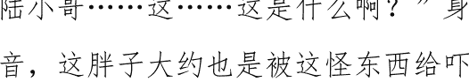

“陆小哥……这到底是什么啊？”身后传来狮子头的声音，这只脑子胎大约是被这怪物东西给吓着了。

作者:亘灵 V 日:2018-06-05 09:46

我没功夫他控，打开铁拳，伸手向小怪胎身上戳了了一下，只觉得触手发烫，而且原本柔软的身体此时紧绷得厉害，大概是感觉到了我的触摸，那脑袋朝我这边扭了一下，但接着又转了回去。

当时我也不知道怎么想，抬起铁拳就给它转了某个方向。紧接着，就看到了奇奇的一幕。我这方向刚转，那小怪胎的脑袋就扭了一下，似乎很愤怒了，僵直的身子一扭，掉了个头，居然又转向了原来的方向。

我试了几次，几次都是如此。

狮子头乱白着，凑过来：“这玩意儿怎么跟个指南针似的的。”

我心里咯噔直跳，拎起铁链就朝着这小怪胎脑袋的地方跑去，狮子头在后面叫了一声，也跟了上来。在大约跑出一百多步后，我就看到那个小怪胎的方向是墓坊的南方。我看到小怪胎在笼里不安地扭动起来，脑壳不停地扭动着，眼里发出颇轻的嘶嘶声。

我立刻停了下来，把铁链放在地上。那小怪胎在子里转了几圈后，身上又冲向一个方向了起来。

丘，不过并不是纯粹的黄泥坡，而是一种夹杂黄土和花岗岩地质的地方。

狮子头累得气喘吁吁，说：“那个地方死人坡，下面还有一个山口，听过老早时候，这里还是个刑场，有段时间行刑的太多了，尸体都没地方去，就往那洞里一丢。”

作者:兜V 日期:2018-06-05 11:16

自从这里建了公墓，就把那洞给封了。”

我抖抖着铁链，拎起铁链子就往那人坡跑去。

“哎哟我的祖宗，你可慢着点呀，可累死我了！”身后传来狮子头的哀嚎声。

眼见日头直上中天，我根本顾不得其他，咬着牙奔跑到那土丘下。这土井并不大，从黄泥下还能看到露地面的花岗石。找了一圈，就看到泥土翻过的滚痕。

我把铁镐往上一放，招招狮子头过来紧紧往下挖。这下的泥土松软，显然是之前被人翻起过，挖了一阵，铁锹碰到了什么坚硬的东西，觉得我手臂一阵发酸。

我把土壤拨去，就露出一块白石板，看石板的成色，应该是刚埋里土中不久，我不得精神大，接着往旁挖，就露出了整块的石板，大约有一米宽。我和狮子头一人一拉了一边，好幸这石板很大，并不怎么愁，把吃奶的劲都给了出来，总算是把它给刨到一边。

浑浊的气流席卷而上来。

“他奶奶的，这儿就是以前那个藏尸洞，怎么又被人给挖了来了。”狮子头叫了一声。

我从口袋里拿出手电，朝洞里照了照。这洞倒不是垂直的，而是倾斜向下，似乎颇浅，电筒的光照不到尽头。

我让胖子拿着手电，从口袋里掏出一个拳头大小的圆球，这是用棉布上特制的火油泡干的，拿了个打火机往上一搓，就往洞里头丢了去。

作者:匪夷 V 日期:2018-06-05 12:46

火球沿着斜坡一路滑落，直到最后激起一样火星，蹿进黑暗之中。我大约看清了火球滚的地形，在心里默默记了一遍，从包里取出一捆绳子，找到了地方把头固定了，另一头绑了，朝洞里扔了下去。

“陆小哥，你快下来！这绳子不够长，到底干什么的？”那胖子直愣愣看着。

我没理他，这些都不是我们行的，从小就做过无数次。抬头一看，日头越越高，已经是接近正午了。我让狮子头在上面守着，把电筒放在嘴里，咬着绳子下了。这洞是以四十五角向下斜的，石嶙峋，十分钟后，可能被尖锐的石头命中。

我顺着身子，顺着绳子，快地下去。这洞很深，沿着洞壁往下爬。才爬了几步，底下就涌上来一股气浊的，其中夹杂着熟悉的味道。那是香灰的味道。

我心里咯噔直跳，急下攀，终于一脚踩在了实处。

正焦愁时，又听到上头传来阵阵当当响，像是什么金属器撞到了岩石的声音。打起电筒往上照，就看见一个肥子的肚子朝下，正慢地挪了下来。原来是狮子头那胖子，把铁笼子用绳扣了，背在身后，正沿着绳子慢慢掉下来。

等那胖子一脚踏到实地，就双脚一软，坐到了地上，肤色煞白地说：“多年没下这阴陆的洞，差点把我这胖子命给搭上！”

见他居然跑到洞里，我还是有些意外，不过这时候也没时间说其他的，招了一声胖子，就着急的一起去撬棺木材。

这个胖子虽然挺矮，但他手的力气归还是比我这小子来大的，两人一合力，总算是把这棺盖撬开了。

只见棺中盖着一块布，布落下，隐隐是一个人形。在棺木两侧层隙间，铺着赤色的粉，散发着一股略微臭味。那是香灰的味道。我不由得愣了一下，见棺里躺着个老人，穿着寿衣。正要点火把这棺材连同里面的尸体给一把烧了。

这洞底并不大，大约能容下站立。在正中位置，停着一口黑色的棺材，棺材底下，铺着一层香灰。

我用电筒照了四周，见棺材不远的洞壁处还有一个洞口，大约是另一条路径。走到棺材边，借着电筒的光芒，见黑木异，以前没见过这种材质，黑木属于纯阳木，是不适合做棺材的。要把这块火焰，临动手的时候发现不对，难怪刚才火油滚下来就无声息了。这里的空气虽然是很脏，但还能呼吸，但这却是怎么都点起来。我用简单的照了洞圈，不知道被那阵愁的牛骨子做了手脚。

今天更新到这里，大家可以关注公众号。

### 第十一章 青龙镇煞钉

作者:霍夷 V：2018-06-06 09:32

这下可就麻烦了，眼见成功在即，却偏偏挡在了这一步！我心中不由焦躁，只得用尽力气，冲上头大喊了几声，指望上面的狮子头能听到，快下来帮帮我。只是洞很深，风声呼呼响，我在底下大叫，连了几声都没有听到回应，只听叮叮当的声音，有什么东西从上面一直滑落了。看得仔细了，原来是一把铁销，不过没到底，被卡在上面凸起的岩石钩住了。

我费劲儿，想办法听到了，转身爬下，把铁销取出在手，巧也有个趁手的工具。拿着去撬棺板，原来是十八颗铁钉，撬了半天，纹丝不动，又折了好一会儿，眼一分一秒过去，只急出一头大汗。

“陆小哥，快下来！”那胖子急了，我甚至来不及求救，那屠尸又一口咬，我只得重施旧计，又是一个头槌撞去。但可事的尸基本上是铜皮铁骨，随便敲几根本就痒痒似的，但我吃了这一撞，脑子早就要上半天。只能纠缠着他，拼命在地上打滚。

好狮子头算是醒过来，赶上来拉住那尸体的领子往外掀，阻止他下扑。结果那寿衣实在太妈妈差了，也不知道是哪个黑心店做的，竟然一下子就扯得碎了。那屠尸没了阻力，一下就张咬了，我就靠了，连再用头槌撞不及，干脆把咬破的尖含在嘴里的一口龙阳血喷了出去。

正中那鬼东西的脸，瞬时闻道一股子皮肉烧焦的味道。血溅到的地方，瞬时犹如被喷了硫酸一般，瞬间腐蚀了一片。

只是对于这已经起的鬼凭儿来说，我这小小一口龙阳血原本是杯水车薪，除非我能当初对付刘楠鬼丫头一样，把一口龙阳血直接渡进她口中。但面对当时的刘楠，我敢这么做，对这童尸我根本不敢。不是因为这童尸比刘的鬼丫头更可怕，而是这玩意儿会坏人，刘楠她不会。

“我靠，快抓住他头发，抱住脖子！”那胖子反应应该快，冲上来抓住东西的头发，用力往后扑。

我发现，那东西比我的个子还要矮些，力气却大得紧，一双冷又硬的小手接住脖子，瞬时连气都喘不出来。一看就知道，一张煞白的小脸，嘴唇乌黑，唇下四颗牙尖又长。我反手拽住他背后的寿衣，想要把他从身上撕下。但这东西气实在大得古怪，阴着一张脸，嘴朝我脖子咬来。我什么也不来及想，也跟着脑袋用力往上一送，瞬时磕在他脑门上，响的一声，直接撞得眼金星。

我瞬时被扑在地，在地上滴溜溜打了了个滚。

作者:距离 V 日期:2018-06-07 11:13

我顺着身子，顺着绳子，快地下去。这绳子不够长，最后干脆放了绳子，顺着洞壁往下爬。才爬了几步，底下就涌上来一股气浊的，其中还夹杂着熟悉的味道。那是香灰的味道。我心里咯噔直跳，急下攀，终于一脚踩在了实处。

我顺着绳子，爬了地底，松了口气，累得连手指都懒弹，然后胖子先上去，二人协助，总算把尸体运了出来。然后赶紧从四周收集了一些柴枯叶，堆在尸体上。

胖子正点火，被我拦了一下。拿一把手术刀，把血滴到尸体下一块花岗岩上，然后从包里取出一个五帝钱。心中念咒文，曲指弹出，正中那血之处。沾了人血的五帝钱滴溜转，燃起一团蓝色火焰，瞬间点燃了火油，而干枯的尸体很快就被焰没。

为了保证万无一失，我用了五帝钱，这是用人血烧出来的阳火，再加上此时正当空，还不把彻底烧成灰烬。等火焰熄灭，黑色的灰烬扬扬，我从灰烬中把青龙加持的符捡了回来。经过了一番收拾，皮肤有些细微损伤，由得为庆幸，幸好当初出墓的时候临时意外，随手带回来，如今还要把小命交代在这里。

看着这小子已经被焚成了灰烬，朝天顶了一眼，日头差不多爬上了中天，不由得一阵心惊，也不知道灵仪馆里六人有没有得救，抬起毯子撒腰朝灵仪馆奔去。

“哎哟我的陆小哥，你好再让我喘口气啊！”听身后狮子咯咯了一声，不过脚步声，还是跟上来。

从铁门翻进去，一路脚到实处，就发现里面的气机还没有恢复如初，不过之前又有些不一样了。也顾不得其他，趋紧去找麻老大他们，幸每个人都还有气息，身上的火气也在以肉眼可见的速度消失。我总算是松了一口气，又从雪库里搬出一个冰块，分别镇在他们几身上，以助散热。幸好这六人中的是地火，南北三会相互对峙，相互平衡，只要在自燃之前落下，还不会对身体造成太受伤。

最先醒来的是麻老大，第二个醒来的人则有些乎意，是老六这个竹侠，再接下去就是肌肉男、黑毛和燕子。倒是老婆婆，症状却是古怪，整个人冰冰凉的，身子冻得邦邦的，如果不是还有其微弱的脉搏，简直可以说已经是信息。

听说事情后，黑毛和燕子立刻破口大，麻老大就阴沉着脸，连连冷笑。肌肉男间没有受伤，我说还好，就是流汗太多，差点脱水了。对于狮子头的表现，我也是大大赞扬了一番。

作者:匪夷 日期:2018-06-08 08:37

我也不知道那东西还会不会起来，说：“不准。”心里还是特别实的，因为用来这具尸的不是什么东西，而是我从墓中带出来的青龙镇钉！我倒在地上。

我累得够了，顺着绳子，爬了地底，松了口气，累得连手指都懒弹，然后胖子先上去，二人协助，总算把尸体运了出来。然后赶紧从四周收集了一些柴枯叶，堆在尸体上。

胖子正点火，被我拦了一下。拿一把手术刀，把血滴到尸体下一块花岗岩上，然后从包里取出一个五帝钱。心中念咒文，曲指弹出，正中那血之处。沾了人血的五帝钱滴溜转，燃起一团蓝色火焰，瞬间点燃了火油，而干枯的尸体很快就被焰没。

为了保证万无一失，我用了五帝钱，这是用人血烧出来的阳火，再加上此时正当空，还不把彻底烧成灰烬。等火焰熄灭，黑色的灰烬扬扬，我从灰烬中把青龙加持的符捡了回来。经过一番收拾，皮肤有些细微损伤，由得为庆幸，幸好当初出墓的时候临时意外，随手带回来，如今还要把小命交代在这里。

看着这小子已经被焚成了灰烬，朝天顶了一眼，日头差不多爬上了中天，不由得一阵心惊，也不知道灵仪馆里六人有没有得救，抬起毯子撒腰朝灵仪馆奔去。

“哎哟我的陆小哥，你好再让我喘口气啊！”听身后狮子咯咯了一声，不过脚步声，还是跟上来。

从铁门翻进去，一路脚到实处，就发现里面的气机还没有恢复如初，不过之前又有些不一样了。也顾不得其他，趋紧去找麻老大他们，幸每个人都还有气息，身上的火气也在以肉眼可见的速度消失。我总算是松了一口气，又从雪库里搬出一个冰块，分别镇在他们几身上，以助散热。幸好这六人中的是地火，南北三会相互对峙，相互平衡，只要在自燃之前落下，还不会对身体造成太受伤。


作者:兜离 日期:2018-06-08 13:07

我看了一眼，却是有些奇怪，心想这鼻子的事情才当当前最急的，怎么还等到晚上再再说？不过既然麻老大发了，我也不就不不再说了。

下午五点多钟的，我看时间差不多了，就准备回家，那狮子头见我要走，他也跟出来正好一起走。

不过临门口的时候，燕子过来让让我们先不要走，说是麻老大吩的，晚上还有件事，我要在场。我不禁有些迟延，青子那可是命令规定我晚上必须回家的，要是是在这里扣了，回头指定不要吃多少苦头。就问燕子究竟是什么事，能不能等明天再说。

既然都已经这样了，她也只能留下，狮子头倒是无所谓，反正没什么事情，哪里都是一样。我去厨房做了些菜，正好大家一起吃吃饭。眼看着天暗下来，却是没看着麻老大他们，就问燕子其他人去哪了。

燕子他们出去了，一会儿回来，让我们耐心等等。我也就得得得了，中间又去看了看二婆婆，可的是，大约到了晚上七点多钟的时候，二婆婆也苏醒了过来。

听我说了事情经过，二婆婆咳嗽了几声，倒也没什么表示，脸上上古井无波的，也看不出什么情绪。我说外头做好了菜，要出去吃点。二婆婆却没答应，只是让我扶着在屋子里走了一圈，又让我搂着回到椅子上睡下，就等我关门出去。

我出门的时候，听见她又吩了一句：“等老大他们回来了，记得叫我。”

我听得有些疑惑，不过还是答应了，低头回到了饭厅。做的饭菜差不多都冷了，狮子摸着肚子，大约已经是饿得很狠了。我正想着老大他们这些人欢去去了哪里，怎么还不回来，猛地听到一阵尖锐的喇喇叫声自远处响起来，厅里所有人都涌到看向去，只见东南角的天际似乎有一丝光一闪而过。

我觉得很是奇怪，回头看向燕子，神情似乎有些紧张。正想问，却见燕子埋了头，她开始推荐。今夜的燕子似乎有些奇怪，整个人都显得紧绷的，脸也没有一丝笑意，冷着一张脸，似乎随时都要发的样子。

我也不敢再追问，等了好一阵子，就听见前面传来一串急的脚步声。

紧接着看到几个人影进了屋子，最前面一人身材高大，一只独眼在灯光下颇为诡异，原来是麻老他们回来了。瘦竹竿长长腿，木愣愣地跟在他身后，肌肉男和黑毛子走在最后，两人肩上扛着一根红杠，似乎挑了什么东西进来。

一进屋，就把红杠卸下来，把那个东西往上一扔，发出“啪”的一声响。

仔细一看，这东西来原来是一个人，大约四十来岁一个男人，被绳子捆成个大粽子的，嘴巴被塞了一块破布，头发乱蓬蓬，满脸血斑，身上的衣服被扯得七零八落，破几个大洞，但大还能分辨出来，这套套在外头的一件道袍。

狮子凑在我旁边一边看的，当时就吭了了一声，说：“这不是那个陈的牛骨子么？”

我大吃了一惊，转头看向老麻大他们，只听见黑狗笑了起来，说：“可不是那墨道士，对咱们下黑，真是活得加信。”

他得那多兴奋，在地上上滚，发出一阵“呜鸣”声。原来真的是那陈的茅山道士，也不知道老麻他们是怎么把这人提到到手的。

燕子道：“事情顺利吗？”

我奇怪看了她一眼，总觉得她的声音很僵硬，跟时时刻若两人。我再靠得近了些，就发现她背身后的一双手在轻轻发颤，显然是在拼命控制着情绪。

我越觉得哪里有些古怪，之前在客厅谈燕子拿屏暴虎那只白脸袋的时候，事情却有些诡跷，似乎仪馆里的所人，都对那只白脸恨入骨。也不对，确切地应该是对小白脸那士的身份恨入骨。笑了笑，其可是燕子，要不是有人拦着，我都怀疑那小白脸会不会当场就被她牵了。今晚这一幕，就更加证实了我的猜的。

这里头究竟又有什么隐情？

“燕子姐。”我去捏了捏燕子的手，觉得冰凉的很。燕子看了我一眼，长长吐了一口气，说：“没事事的。”

我见她显得得慌，心里就更加疑惑。

麻老大过来拿起茶碗喝了口，说：“还算顺利，就是不打算妥放在喇里了。”读起响，我之前也有人听过起，在古时候叫做“鸣笛”，也是一种发出声音的笛，通常是用来传递信息的。不过都是很早以前的事情了，现在还有人用这种东西。

肌肉男跟我连连问，笑着说：“这种哨不像，是他茅山特制的一种符符号，用来回同门之间传递紧急信息的。”

我吃了一惊，忙问：“这牛鼻子还有同伙在附近？”

肌肉男点了点头，说：“既然这牛鼻子放出哨响，就明显有同门在，而且离得肯定不远。”

我看到狮子头听到后，肥滚滚的身子明显地抖了一下。他的妈妈，一个牛鼻子都这么烦了，若是再把他那些同门招来，那还要人活了？

黑毛冷笑了几声，过去在那新陈的身上是很狠地踢了几脚。那牛鼻子嘴里塞了一团破布，一张脸胀得通红，发出呜鸣的声音。

老大：“把他嘴里的布拿下来。”

黑毛过去，抓着那人的脖子拎起来，左右开弓，哨里啪啦开了耳朵，才把他嘴里的破布扒了出来。

“你们这群狗卖，迟早会有报！”那牛鼻子嘴自由，顿时就破口骂。

“你们这群恶寇，迟早会有报！”那牛鼻子嘴自由，了。

黑毛冷冷道：“这老子还真这只狗奶奶也放得够了，就咱我们把他放了。”

“你们这群恶寇，迟早让你们死无葬之地！”

[82]

“燕子姐。”我去捏了捏燕子的手，觉得冰凉的很。
燕子看了我一眼，长长吐了一口气，说：“没事事的。”

我见她显得得慌，心里就更加疑惑。

麻老大过来拿起茶碗喝了口，说：“还算顺利，就是不打算妥放在喇里了。” 读起响，我之前也有人听过起，在古时候叫做“鸣笛”，也是一种发出声音的笛，通常是用来传递信息的。不过都是很早以前的事情了，现在还有人用这种东西。

肌肉男跟我连连问，笑着说：“这种哨不像，是他茅山特制的一种符符号，用来回同门之间传递紧急信息的。”

我吃了一惊，忙问：“这牛鼻子还有同伙在附近？”

肌肉男点了点头，说：“既然这牛鼻子放出哨响，就明显有同门在，而且离得肯定不远。”

我看到狮子头听到后，肥滚滚的身子明显地抖了一下。他的妈妈，一个牛鼻子都这么烦了，若是再把他那些同门招来，那还要人活了？

黑毛冷笑了几声，过去在那新陈的身上是很狠地踢了几脚。那牛鼻子嘴里塞了一团破布，一张脸胀得通红，发出呜鸣的声音。

老大：“把他嘴里的布拿下来。”

黑毛过去，抓着那人的脖子拎起来，左右开弓，哨里啪啦开了耳朵，才把他嘴里的破布扒了出来。

仔细一看，这东西来原来是一个人，大约四十来岁一个男人，被绳子捆成个大粽子的，嘴巴被塞了一块破布，头发乱蓬蓬，满脸血斑，身上的衣服被扯得七零八落，破几个大洞，但大还能分辨出来，这套套在外头的一件道袍。

狮子凑在我旁边一边看的，当时就吭了了一声，说：“这不是那个陈的牛骨子么？”

我大吃了一惊，转头看向老麻大他们，只听见黑狗笑了起来，说：“可不是那墨道士，对咱们下黑，真是活得加信。”

他得那多兴奋，在地上上滚，发出一阵“呜鸣”声。原来真的是那陈的茅山道士，也不知道老麻他们是怎么把这人提到到手的。

燕子道：“事情顺利吗？”

我奇怪看了她一眼，总觉得她的声音很僵硬，跟时此刻若两人。我再靠得近了些，就发现她背身后的一双手在轻轻发颤，显然是在拼命控制着情绪。

我越觉得哪里有些古怪，之前在客厅谈燕子拿屏暴虎那只白脸袋的时候，事情却有些诡跷，似乎仪馆里的所人，都对那只白脸恨入骨。也不对，确切地应该该是对小白脸那士的身份恨入骨。笑了笑，其可是燕子，要不是有人拦着，我都怀疑那小白脸会不会当场就被她牵了。今晚这一幕，就更加证实了我的猜的。

这里头究竟又有什么隐情？

“燕子姐。”我去捏了捏燕子的手，觉得冰凉的很。
燕子看了我一眼，长长吐了一口气，说：“没事事的。”

我见她显得得慌，心里就更加疑惑。

麻老大过来拿起茶碗喝了口，说：“还算顺利，就是不打算妥放在喇里了。” 读起响，我之前也有人听过起，在古时候叫做“鸣笛”，也是一种发出声音的笛，通常是用来传递信息的。不过都是很早以前的事情了，现在还有人用这种东西。

肌肉男跟我连连问，笑着说：“这种哨不像，是他茅山特制的一种符符号，用来回同门之间传递紧急信息的。”

我吃了一惊，忙问：“这牛鼻子还有同伙在附近？”

肌肉男点了点头，说：“既然这牛鼻子放出哨响，就明显有同门在，而且离得肯定不远。”

我看到狮子头听到后，肥滚滚的身子明显地抖了一下。他的妈妈，一个牛鼻子都这么烦了，若是再把他那些同门招来，那还要人活了？

黑毛冷笑了几声，过去在那新陈的身上是很狠地踢了几脚。那牛鼻子嘴里塞了一团破布，一张脸胀得通红，发出呜鸣的声音。

老大：“把他嘴里的布拿下来。”

黑毛过去，抓着那人的脖子拎起来，左右开弓，哨里啪啦开了耳朵，才把他嘴里的破布扒了出来。

“你们这群狗卖，迟早会有报！”那牛鼻子嘴自由，顿时就破口骂。

“你们这群狗卖，迟早会有报！”那牛鼻子嘴自由，了。

黑毛冷笑了几声，过去在那新陈的身上是很狠地踢了几脚。那牛鼻子嘴里塞了一团破布，一张脸胀得通红，发出呜鸣的声音。

老大：“把他嘴里的布拿下来。”

黑毛过去，抓着那人的脖子拎起来，左右开弓，哨里啪啦开了耳朵，才把他嘴里的破布扒了出来。

“你们这群狗卖，迟早会有报！”那牛鼻子嘴自由，顿时就破口骂。

“你们这群狗卖，迟早会有报！”那牛鼻子嘴自由，了。

黑毛冷笑了几声，过去在那新陈的身上是很狠地踢了几脚。那牛鼻子嘴里塞了一团破布，一张脸胀得通红，发出呜鸣的声音。

老大：“把他嘴里的布拿下来。”

黑毛过去，抓着那人的脖子拎起来，左右开弓，哨里啪啦开了耳朵，才把他嘴里的破布扒了出来。

“你们这群狗卖，迟早会有报！”那牛鼻子嘴自由，顿时就破口骂。

“你们这群狗卖，迟早会有报！”那牛鼻子嘴自由，了。

[883]
麻老大沉着脸：“就是这个人。”那牛鼻子梗着脖子，冷笑道：“一个老妖妇，装什么大头蒜！”站在一旁的黑毛，黑着一张脸，上去就朝着屁股踹了一脚：“他妈的，老子踢个大头蒜！”那牛鼻子号称茅山门，再加上上手头确实有些耐，造火局都能出来的人，可不是什么一般人。大约平日里也是情敌两难选择，这假装没错老王黑脸都翻了，股，简直是对他的乖大辱，当即脸色通红，怒气愤勃，破口骂：“你们这一群恶寇，迟早让你们死无葬之地！都怪我太心慈软，只对你们用了火刑局！我早就该听我徒儿的劝，不该对你们稍有仁心！”

他妈的真是越界越气，平白无故就给我们用了火炽局，要将我们馆里七个人全都烧成灰烬，居然还是心疼手软的！朝黑嗓喊了一声：“二哥，你平时的尸油放在哪儿，这道长哑了半天，估计肚子子也饿了，我给他做顿好吃的。”

黑听了，当时愣了一下，但他家伙果然是个腹黑的，很快回过味来，笑道：“我就去拿。”说着就直奔了他的炉房了。

那牛鼻子躺在地上，很狠瞪着我，大骂道：“你这个死小鬼，从小就这么恶，长大了毒害死多少人！”

我想他妈的，我我妈的，我鬼看得过你这个死废物。他在棺材上，死死盯着他的眼睛，横着鼻子吵啊。

[content]
（此处重复内容已合并）


## 3666 楼
作者: 离 H 日期:2018-06-11 13:50

“早该这样了！”狞笑着走向那老陈的，一只黑又粗的手上去抓住那黑鼻子的衣领子，就往外拖去。

“你们是不是疯了！”那黑鼻子立即尖叫起来，“你们以为了了我就不知道鬼不觉了？你们也太天真了！”

麻老大不为动，所有人都不动。黑毛反身抽了他两个耳朵扇，继续往外拖。

“其他妈妈是一群疯子！”那黑鼻子这回大回回是有些被吓到了了，憋着嗓子直叫，“好了好了，我退一步！只要你们放开我，我就放过你们命，你们只要走得远远远的，我保证证据就此消失！”

黑毛除了冷笑，就只横着他在地上拖，根本不予理睬。那黑鼻子也算是厉害，都被揉成个大粽子，居然在经过门槛的时候，被他一双脚踹在门框那一个，紧紧地卡在那里里。黑毛用力拽了几下，死活没拽出去。

“你们杀了我有什么好处！你们逃不了的，所有人都得死！”也许是性命攸关，这牛鼻子子此时的嗓门特别别歪，刺得我耳朵很是不舒服，“我们来商量一下，好不好？”

我看了一眼我身边的狮子，只见他面如土色，身上像梯子一样不停发颤。我只觉得嘴巴里一阵阵发苦，其实也不多害怕，毕竟是在南疆古墓中，更大的杀戮我也见过了。

只是有些不清的迷惘。

其实这里每个人，包括狮子头在内应该都清楚，这牛鼻子虽然现在口口声声说着可以放我们，但这不过只是宣之计而已，只要等他脱身，等待我们这些人的就有了更加可怕的遭遇。

## 3671 楼 
作者: 直夷 日期:2018-06-11 15:20

黑毛大约是被弄得火起，一手拽住那牛鼻子的头发，一手按着他的腰，一把就把凌空拎了起来。黑毛虽然个矮小，但长得五大三，这时提了人在手里，显得威风凛凛。

“疯子！疯子！”那牛鼻子绝望了，破口大骂：“好家伙！你抓我干什么！哈哈，老娘的命就此结束吧！”

黑毛“坏”的一口吐液就喷在他的脸上：“他妈的，十年前老子就想你们这帮牛鼻子同归于尽了！”

把人扔到地上，拽了脖子，像一条死狗一般往着他的屠坊走去。

就在这时，只听到一个声音夹杂着哑哑咳嗽道：“把人拉回来。”这话的人人气极为不足，声音很低，但她一出手，已经拖着人走了很远的黑毛此时就听到了，在路上停了了一下，还是把人给拽了回来。

这话的人，就凭这声音和咳嗽，我不用看就知道是谁，原来是打从厅厅就开始眯着眼靠在椅子上从没说过过的二婆婆。她这一出声，厅中所有人的目光就转向了她。只不过她依然还是闭着双眼，靠着椅背，不发出几声低吼。

不一功夫，那牛鼻子已经被拖回了厅中。那老小子发出一串哑极其怪的笑声：“你们还算没金凡！哈哈，赶紧放开她，我们坐下好好商量商量！以后只要你们就在这里不惹事生非，我陈元德做了主，我们茅山不会来管你们的事！”

## 3678 楼 
作者: 匪夷 V 日期:2018-06-12 09:11

这家伙们面红耳赤的，大概是劫后余生，有些奇过头。

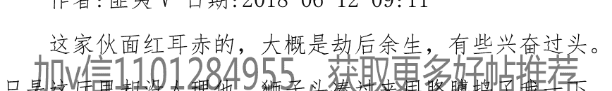

只是她妹妹觉得她了，脑子是不用来拍脚的，悄声说：“不会不要要放了那只杂种吧，这东西现在说的好听，到时候咱们一个也别想跑！”

我摇摇头，这二婆婆向性性格古怪，我又哪里知道她要做的。

只听老大问道：“老二，你的意思是？”

我见黑目、肌肉男和燕子等人的目光都落了二婆婆身上，神情疑惑不定。
二婆婆缓缓睁眼，低低地咳嗽了几声，道：“这道土交给我来办。”

厅里几人在正要犹豫，就听二婆婆有气无力地吩了一句：“老四，去把饲养的猪笼牵头过来。”

肌肉男挠脑袋，大约也是有些不知所措，还是立即回答了一声，就出门了。

说到这猪的事，我还是前些天才才知道的。在我们这殡馆外头，这里远远处还搭了个猪舍，里头养了三头大肥猪。不过听肌肉男说，这猪并不是来养吃也不是养来卖的，是二妞吩出来的，就一直呆在那里嗷嗷着。

狮子头凑我问：“这是要干什么？”

我是真不知道，这个时候大家都陷入了，二婆婆牵猪干什么？难道是要牵猪做红烧吃？这也太荒谬了，简直是崩溃，想要获取。


## 3679 楼 
作者: 贵 日期:2018-06-12 12:41

黑毛和燕子听，疑惑也不当面。那牛鼻子子从死亡边缘挣扎了，现在有些。黑毛除了冷笑，就只横他在地上拖，根本不予理睬。我听到了声音，靠在椅子上睁了眼，朝老老大：“你们都先出去，把门带上。”

黑毛和燕子听，欲言又止，大概是心里攒了各种疑问。这头大猪是要干什么，最后哼哼。

二婆婆咳嗽了几句：“还不了。”

刚到门口，就听二婆婆说：“小七留下。”

我一怔，当时停了下来，麻老大冲了一个眼色。

厅中一片寂静，等十分钟，就见肌肉男高大的身影出现在门外，他手抓着根绳，另一头拴在一口肥猪子上，把人给拽了回来。

那牛鼻子也算是厉害，都被揉成个大粽子，居然在经过门槛的时候，被他一双脚踹在门框那一个。

麻老大道：“小七，你就下来给老二打下手。”

我打算应了一声，就留在了屋里。二婆婆听了她的咐，道：“去拿一把刀，银针来。”

我应了一声，立即去办。这剪刀刚好待客厅里就有，银针我随身带了一，正好可用。

眼见其他人到了外头，并且把门窗关紧，就回到二婆婆旁。二婆婆在椅子上眯了会儿眼睛。

二婆婆睁开眼，瞧了我递上的两件东西，点点了点头，伸出一只手，是让我扶起来。

我上前挣她，来到那头在屋里廊柱上的大猪前。二婆婆哼哼嘟嘟，还退了几步，悠闲得很。

二婆婆端了一眼：“把我的手套摘下。”

我心里想，自打我第一次见到二婆婆开始，我就一直戴着这副绿绒手套，就算是在这样夏天，也从未摘下片刻。这是她要摘下，不由很是好奇。

我应了一声，一动挣扎着，一手按住她一只手上的手套，另一手轻轻拉了。

脱了，以后二婆婆的一只手就露出来了。那身上好像是，我已经有些心理准备，但看到那只手，当时就“啊”的一声低呼了出来。二婆婆的一只手，五根手指从指尖开始溃烂，其中上半已经烂得只下了森森白骨！

“我的手很难看？”二婆婆咳嗽着道。

## 3721 楼 
作者: 兜底 日期:2018-06-12 12:13:41

我忙摇头，平日里跟尸体打交道，再恐怖看的尸体也见过，这手怕也就是烂得露出五根骨而已，没什么大不了的。但我从来没在一个身上见过这样的情形。

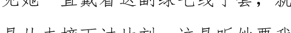

五指连心，这种疼痛不要说长时间忍受，就算一分钟一刻钟，就能让人死去活过来。

而这女人是日日夜夜地承受着这样的钻心的疼痛！而且她这手掌的伤势，伤口还在持续溃烂，再继续下去，恐怕整个手掌都会烂得只剩下骨头。

我难以，这女人竟然是在这样的痛苦中活来的。我也不明白，她为何不干脆把两只手全部剪掉，虽然失去了手，但至少能受些痛苦。

“还有这一只。”二婆又把另一只手过来。她的手虽然在不停溃烂，但她的脸上却没有任何丝毫痛苦之色，也看不到任何感情。

我的一手忍不住发抖，这到底什么样的女人？以前又遭遇了什么样？听二婆婆说：“你的手怎么……”

## 3730 楼 
作者: 倪 日期:2018-06-12 15:21

二婆婆伸出一手，我抓着剪刀，却没过去。这头大猪白骨嶙峋，手指只剩了些肉。这样的一手，还怎么下针？

二婆婆看着我，道：“这一步叫做锁魂，锁住三魂七魄，记清楚了没？”

刚才二婆婆放慢针速度，就是我要看得明白，我在心里反复了一遍，已经记在心，点头记下了。

二婆婆下针，那牛鼻子子歪曲在里头。渐渐的，二婆婆睁了眼，朝老老大：“你们都先出去，把门带上。”

那牛鼻子大张着嘴，疼顿时定住不动。我确认他已经无法动弹。二婆婆的眼睛圆睁睁，我瞧见那牛鼻子眼窝插了一枚针，在眉心处，隐约露出尾。


今天更新到这里，大家关注公众号【右手异】继续阅读。

## 3736 楼 
作者: 兜兜 日期:2018-06-13 08:13

二婆婆又取了一根针，定入二师兄的腰臀处。我钻心记忆，只见二婆婆一下落在二师兄的肚脐处，这次二婆婆没说话，我忍不住问：“这不是灵吗？”

二婆婆道：“没错。灵属于五行，拟称为生魂。再接下去是狗钩。取了一针刺入二师兄的天灵。狗钩是七魂之首，位于天顶。接下去一针又是刺在眉心，道：“这是第二魂，在眉心轮。这里需谨记，虽然胎光与伏魂都在眉心，但两者一深一浅，不可弄错。”

二婆婆又取一枚长针，这次是刺入咽喉处。第三阴雀魄，位于咽喉，那里有三个缺口，阴雀魄就藏于此，这一针刺入，就定住了阴雀魄。

接着，二婆婆下针不停，连着在心窝处吞噬魄，第五毒魄，第六渺魄，第七臭肺魄，说道：“这这一步叫做锁魂，锁住三魂七魄，记清楚了没？”

二婆婆：“把剪刀给我。”

我把剪刀取过来，看到她只瘪得不成模样的手，不仅有血。

二婆婆从我手中拿过剪刀，用剪刀齐二师兄嘴角唇上划了一刀。这一刀下，只见到一道猩白的口子，却没有一点鲜血流出。而二师兄更是丝不动，连眼珠子都不曾一下。

不一会儿功夫，二师兄的整张猪皮就被薄了下来。是的，尽管这猪皮剥，身上却没有任何滴血淌下，露出白生乎的一层肉，让人毛骨悚然。我一眼二师兄的一双大眼睛，已经没有了一丝神采，伸手探了探，这可怜的二师兄已经是没气了。二婆婆：“这一步是把它的精力全都锁在这身中，猪死了，但这张皮却是活了。”我只觉得背后是冰冷的，虽然摸着尸体，但也没见过。

## 3766 楼 
作者: 垂直 日期:2018-06-10 09:43

二婆婆：“先用针定了了他的魂。”我应了声是，快走几步，也不管那牛鼻子怎么唤，取出一枚针，学着二婆婆的手法，刺入那牛鼻子的眉心。这牛鼻子大张着嘴，疼顿时定住不动。我确认他已经无法再动弹，才了解了他身上的绳子，接着干净落地扒光了衣服。然后就把手头里的猪皮给他裹上去。来说也怪了，这皮一身上，就立即紧紧地贴了上去，简直像是个活物一般。我才一松，退后几步，就见那张皮裹在那鼻子光流溜的身上，竟然越缩越紧。那牛鼻子痛苦苦苦地挣扎，最后连声音都已经发出一丝一毫。那张皮还在不停的勒，把那牛鼻子子歪曲在里头。渐渐的，就已经完全看不见鼻子影了，整个人已经被裹进了里子里。我看得面如土色，寒毛直竖。眼前的牛鼻子，还是一个人，简直是彻头彻尾的一只肥猪。

此时听婆娘咳嗽了几声，有气力。二婆婆道：“你们这帮敛魔鬼，敢用这种邪法，以后死无葬身之地！”姓陈的不蹄地往后去了。那牛鼻子一看到我手中的皮，顿时脸色惨白，在地上不停扭动，大声尖叫：“你们竟敢用这种妖法！你们……天理不容！不要过来！可以商量的……可以商量的！”我看着奇怪的表情，只以为是发了一阵冷气从指尖蔓延上来，像是摸到了一头毒蛇一般，又是滑腻却是湿冷。二婆婆扶去椅子下，歇息了一会儿，道：“找了道士衣服，把这皮给给他。”

## 3776 楼 
作者: 匪夷 日期:2018-06-13 12:43

说完，就搁上了眼睛，脸上却是疲色。她用这样的一双手，强撑着做了这些事，简直是种非人的煎熬，恐怕正常能忍得了。我还是很疑惑，她要拿这张奇异皮做什么，什么也没有，去地上捡起皮，朝那牛鼻子走去。那牛鼻子一看到我手中的皮，顿时脸色惨白，在地上不停扭动，大声尖叫：“你们竟敢用这种妖法！你们……天理不容！不要过来！可以商量的……可以商量的！”我看着奇怪的表情，只以为是发了一阵冷气从指尖蔓延上来，像是摸到了一头毒蛇一般，又是滑腻却是湿冷。二婆婆扶去椅子下，歇息了一会儿，道：“找了道士衣服，把这皮给给他。”


我一时也不知该怎么回答，正要领他们进去再去说，就听咔嚓一声，一道白影从我身边钻了出去。

“我靠，快把它逮住！”我一见就急得大吼。他妈妈的，跑出去让这玩意儿是变成了二二师的牛鼻子！

狮子头和肌肉男是离大门最远的，听我这一叫，肌肉男随手一抄，一把就拽了牛鼻子的肥耳朵。

牛鼻子发出“嗷嗷”的叫声，不断扑腾，但是肌肉男魁梧有力一壮男，力气得多么大呀，被他住了耳朵，又哪里能容易脱身的。

我揉了额头的冷汗，让让进来，又叫了道肌肉男，让他把二师哥给回来。

麻老大等人陆续进来，就听黑毛怪叫了一声：“牛鼻子跑去了？”其他人也是大吃了一惊，脸色大变，就准备出门去。

还是麻老大为镇定了，叫住了众人，道：“慌什么，你们二师在组里，牛鼻子逃哪去？”

经他这一吼后，几人这才惊讶地回到后厅里。肌肉男拽着二师哥的耳朵，把它拽了回来，很有些奇怪地道：

“这头猪怎么不一样了？”

“这……这是个什么玩意儿？”这么多人当中，倒是一进屋就张西望的狮子头首先注意到了那口被剥了皮的肥猪，脸色变得苍白白的。

一时间众口纷争的，我都该先回答。总算是麻老大喝了一声：“都安静！”朝离门口最近的瘦竹竿，“老六，把门关了。”

瘦竹竿慵懒地应了一声，去把门合上。麻老大看了一眼那准猪子被剥了皮的肉，沉声道：“不用找了，那道落在老四手里。”

此时肌肉一手正拉着猪耳朵，另一只手拿了一根麻绳，正要把它脖子上套，一听顿时就给住了，差点就让手底那帮性口给绊了。

化了，跟腰像是似的，嘴张大，双目圆睁，脸上全是难以置信的表情。看来婆婆这门邪乎的手艺，只有麻老大是知情的，所以当初出远的时候脸色就颇为古怪。而他，肌肉肌肉、黑毛、燕子等，似乎都是一无所知。

厅中安静异常，只有老牛鼻子不停地发出咔哧咔哧的声音。半晌，才听到狮子头哆嗦哆嗦地说了一句：“这……这难不成……是……画皮？”

他说这句话的时候，声音发颤，就要哭了。

“那是什么玩儿呢？”黑毛黝黝的脸色此时竟然有些发白，一双眼睛溜来溜去，显然有些惊失措。

狮子头脸色青白道：“我……我也只是听师父说过的，早年间流传有一种叫‘画皮’的妖……那个法术，能把人皮生生生地剥下来，裹在另一个人身上，这就立刻变成了人皮主主的模样。”

自打火劫这一忌后，我跟狮子头这胖子算是共患过难的，交情是深了不少。他有个师父我是我知道的，听他说他是个瘸了一条腿的算命先生。

这狮子头姓施莲，其实是跟了那算命先生的姓。施胖子是个弃养，早年间一个冬雪天，被这施子的算命先生给捡回来的，抱回家里的时候，这胖子已经只剩一口气吊着，卷一一息。

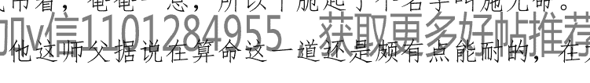

对于他父亲在算命这一块确实有些能的，在方百里内也有小有名声。从胖子八九岁开始，他师父就传授给他相术演算之道，这胖子大约是没这方面的天赋，学过就忘，到最后他师父是累了，干脆就放他自流。

大概十年前，这算命先生去世后，这胖子儿子就这么混了一段时间，也没做什么正经，后来家里的积蓄耗光之后，就只想着办法出来谋生。大概是他从小跟师父熏陶，虽然算命的事事没学到一半，但是对于一些神奇道倒是有有些心得。有次无意中跟荣华仪馆搭上了线，从此就成了一个中介。

说起来，这胖子跟我的世倒是是有有些相似的。只是唯一不同的是，我从小跟着我三叔跑灵像，天累得跟狗似的的，这家伙倒好，他妈的简直是个二二世祖，日子过得不要大舒坦。

倒是没想过，这胖子的师父居然还知道“画皮”这门奇诡的艺术。

“你是说那胖鼻子裹了一张猪皮？他妈妈......”黑眼珠子都快瞪了出来，睁了眼角落在那白花花的软颈，顿时一句话他又回了半句。

我跟他说这话的时候，我就当成他是吹牛皮。

肌肉男原本是在手底下那下胖肚子勒绳子，此时一知道这性口其实就是那胖鼻子，转脸色变得极为古怪，瞪了一双大眼睛左右闪，似乎在设想出什么秘密。

亲眼见证过这“画皮”过程的我，可以肯定，他是绝对不可能看出半点破绽的。

“行了，我也乏，小七扶扶我回去。”是一直闭着双目装神的二婆婆发了，顿时听到众人一下子静了，看向二婆婆的目光更是惊惧。我心里想着，燕子等以后见过二婆婆，更是老鼠，连咬都不敢咬。

我立即上前搂着二婆婆，到门口的时候，只听二婆婆说了一句：“马上客来了，你们好好招待。”

我听得心里一凉，回头了一眼，只见麻老大也是脸色难看。脚步是不敢停，一直搂着二婆婆走到路，才忍住问：“不是那牛子的同伙找上门了？”二婆婆没有回答，只是低低的咳嗽了几声，道：“都是外客，什么人。”劝也不怎么哭，她帮着护了后，见她蹲下，小心地把门拴上。回去客厅的路上，被夜里的阴风吹，只觉得脑子里一个灵，清醒了许多。想起刚婆婆拿着剪刀和银针，居然把一个人生生生变了一头猪，觉得如梦中一般，真实的。


一路走过去，正有些神恍惚，突然就听到“咣咣”声，在这个寂静的夜里刺耳，倒是吓了我跳。细听，原来是有人敲门。这个位置，离门最近的，立即就跑了。这儿还没有其他人过来，摸着脚地走到门后，侧着耳朵听了一阵子。铁门又是拍得“咣咣”声，似乎外头来了。中听了很久，脚步声急促起来像是焦躁似的，喊道：“开门，快门！”

我屏气息，连大气也不出，皱着身形听了一阵子。听那小白脸憋着嗓子道：“几位师叔，师叔，就是那个娃的小脸。师父被这里头一群人劫了，咱们该悄悄进去，杀掉他们措手不及！”我心里“靠”了一声，他妈的，这小白脸到底有多大仇怨，竟然这么毒！只听外头有个清亮的女声：“成什么话！咱们茅山宗行事光明大，怎么能做这些鬼崇的事情？”这俩人发话，那小白脸连声道，说他一直看着父亲的安危，叔听起来很紧张，最后敲门，原来这茅山派还有女弟子。只听另一个陌生的男声：“只要元德真是落在这帮手里，我们自有办法把人找出来，你这样慌慌张张，能何？”这声音冷硬并不响，自有有一股威压。这两个人发话，那小白脸连声道：“师叔祖”。从称呼来看，外头几个人不是里面那个陈元德还老，那是陈元德的师叔袁伯！你妈的，一个陈元德就这么缠，再来几个资历更老的，真是要抓瞎。磨着，只听到身后脚步响起来，肌肉男高大魁梧的身影隐绰绰地出现在视线里。好像每次有人叫门，负责开门的都是肌肉男。想想也是正常的，在这馆这些人人，肌肉男的性格看来是最正常的，由他负责出面，是最合适的。我在那里，自然是被看到了，把手放在拳上，冲我做了个啧的动作。我明白的意思，躲着不动，等他过来了，冲他比了个手势，用口型冲他说：“外头应该是四。”这也是我刚偷听这一阵子得出的结论。虽然说话的只有三人，一个小脸，一个女人，一个声音冷酷威严的男人。我直觉认为他除了这三人之外，应该还有人，就是这一个没有说话。肌肉男有点点，站在那儿跟我悄悄听了一会儿，才大跨步上前，就要开门。我一把拉住他，冲他做了慢头的动作，他就立刻收了。肌肉男有些疑惑，并没有说什么，却又退了回去，来时一时后又围了身形。他躲好了，我揉了揉眼睛，打了个哈欠，这才哑胳膊，又带着一丝恼怒大了一声：“谁哒，大半夜的还不让她睡？”听我这一喊，外头拍门的声音顿时一停，那小白脸扑着嗓子叫道：“小鬼，快点给我开！”我当时就骂了：“哪来的鸟人！滚，你妈的！”跟着三叔叔跑了几年灵，每天都要接触不同的人，粗话学了不少，骂起来一点也不比黑毛逊色。那小白脸顿时就气急了，跳道：“你小子崽子，还不把门开了！”我立刻骂：“闭嘴！”那小白脸顿时就火，跳道：“他妈的，你小子赶紧滚哪去！”我根本都懒得理他，眯着眼睛说：“哪位呀？你师傅什么时候死的，过来多久了？”那小白脸勃然大怒，跳道：“你小子，你前几天见过我，这会儿装什么乎！我师傅活得好的，什么时候死了，你胡说什么！”我不耐烦地道：“你真是好笑了。看到门口这几个字没？”指了指门上挂的那块牌子，“棺馆懂不懂？那是专门接待死人的地方，你师傅要有，你找这儿来干什么？”他的妈，你牙齿嘴的臭小鬼，我看我不拦了你！”那小白脸气急了，当就要动手。被女人给吓醒了，瞪了小白脸一眼，皱眉：“元德就是这么教你的吗？跟一个小孩子你也动手脚，成什么体统？”心里盘算着时间差差不多了，那哥相貌冷冷的男人向我身后，我也回头看向，就见肌肉男的身影正朝面前走去。“好了，我们家被你们吵醒了，回过头是不适了，都赖你们！”我瓮恐地大叫。女人笑着：“这事跟你家里人说，不会怪你的。”我哼了一声，说我才不信。你们到时候一拍屁股走了，接替的是我。我说话间肌肉男已经到了门口，一脸憨实，一露面就给我留下了好印象。要是换做黑毛或者瘦竹竿来，恐怕这一见面，就认定这馆是个鬼地方。肌肉男约是这种迎客的活，聚起来，把几个人领着走入。最后才发现，人竟然年轻的。看着他的腰带，歪了。掉。那小白脸，外。茅山道士也有家人和俗家的。这么年轻的人，长得倒是顺的。跟姓的小脸年纪也差许多，但这气质上却是壤差别。不知道为什么，这个人对我的感觉总是有些，进门的时候，打量了我，嘴角挂着一丝若有无的微笑，冲给他斜了一个眼，粗声道：“进不进关门。”这年轻人也没说话，转头，跟着几个人进去了。把门锁好，这才跟着上去。路上有些胆战的。

麻老大正和他们交谈。偷眼睛瞄了那几一眼，麻老大和他们。茅山。的：“的，我们，的，的的。老鼻子，疼。的。的。的。的：“在掳谎道，我师傅肯定是被他们藏起来了！我们把这地方搜一搜就真相白了！”那小白脸不知道什么刺激，突然就扑着嗓子叫起来。听“啪”的一声巨响，那面冷峻的男人一巴拍在桌子上你给我闭嘴！这里什么时候轮到你小辈说话？元德真是教了个好徒弟！哼哼！哼哼！哼哼！”连了几声，似乎是怒气勃发。那脸被这一重斥，像个冰霜打的茄子，顿时就瘪了。狮子头暗自愁翁，冲我挤了挤眼。我心里还是悬在那里，焦躁不安，又看了了一眼，只听麻老大呵呵几声，说：“小子是心浮气一些，”看着还愁眉目的。“你小子儿总算是出来了。”那人倒是先笑了起来，看着还算愁眉目的。


诸位，都不是普通人。就如此说您老，大约是常年与死气物打交道。

我听得心里没由得地一跳，忙看向麻老大，只见他面不改色地笑道：“我这老头子日日夜夜钻在这赌场馆里，可不是常年跟死气物打交道，夫人看得可真是准。”

那梁夫人却微微摇头：“这不一样。您身上这死气，可不是在这赌场馆里能憋出来的，倒像是那些常年在地底的土耗子。”又指了指另外人，道：“我他们三个也差不少。”

我瞅得仔细，这女人的三个分别是黑毛、肌肉男和在角落里的燕子。我口中的“土耗子”，我还是知道的，其实他们就是些混混，各种想办法占好便宜的，管他们叫土夫子，或者拨金校尉什么的。

3978 木
作者：冯日 日期:2018-06-17 09:45

我感觉到狮子用腰肘捅了一下，回过头，只见他冲我捏，用口型问了：“真的？”

我摇头。我又哪里知道是真是假？这赌场馆里六个人，个个神神秘兮，有哪个我是知道底的？

只听麻老大笑道：“这位夫人笑了，我们几个要能干那些伙计，何至于窝在这个鬼地方打算吃饭？”

我盯着着这老头子看了好几眼，也没分辨出他这句话到底真是假的。但凡年纪大的，果然都是老狐狸，没有一个是好相于的。

那梁夫人倒并不认死理，笑道：“那也许是我看错了要。我刚才进来的时候，只是匆匆看了一眼，就觉得贵馆的格局极好，风景别致，我想到处处去参观，不知是否打扰？”

黑墨黑了一声：“知道道是打扰了，还好意思？”
麻老大瞪他一眼，道：“请便。”

那梁夫人道了，笑着起身，朝那梁先生和那个年轻人道：“你可在这里好好跟麻先生请教请教，我就先偷懒了。”

梁先生点点头，那小姐看着他推椅子坐。在角落里的年轻人，挥着手道：“尽管去吧。”然后又自顾地坐在那里，手里拿着一个茶杯盯着看着，也不知看出了什么名堂：

眼见那梁夫人朝门口走过来，我就推了狮子头一把，往旁边让了让：

3981 楼
作者:复兜 V 日 日:2018-06-17 11:15

女人经过这边，冲我招了招手，道：“你这孩子，带我随去逛游可好？”

我把头一摇，道：“没兴趣。”

那女人微微一笑，伸手过来我的手上一一握，就拉着我出了门，笑道：“你这孩子脾气倒大了。”

我虽然用力挣了，但别看这女人长得慈眉善目，娇娇弱弱的，力气却大得惊人，这一只手抓住我的手腕，是怎么挣也挣不开，只能能被她带着出了门。

“你叫什么名字？”那女人牵着我的手，边走边说。
我如实说了，又道：“你又叫什么？”

那女人看了一眼，笑道：“我姓姜，姜楚红。”
我“哦”了了，声说：“你就是那个梁先生的老婆吧？”
我那是你叫梁太太还是梁夫人的？”

姜楚红：“嗤”的一声笑道：“我自己没姓氏？为什么要用他的姓？”
我奇怪地说：“你丈夫梁梁，你可不是梁夫人吗？”

姜楚红：“我喜欢。”

我一听，就明白了。这女人八成也是个极有主意见的，就算是成婚了，也不喜欢被别人叫某某人的太太了。就说：“姜姐说的可一的！”

我我就没脸皮了。这姜楚红显然保养得极好，但说也有四十来岁了，我这这毛头小孩居然张口叫她姐姐，这也太娇张了。

3987 楼
作者:匪夷 V 日期:2018-06-17 12:46

不过我以前跟她在外面跑的这段时间，也经过不少事，给我悟出个道理来，那就是女人最怕别人说她丑，其次就是说她丑！

别看青子那女人平日里一冷淡淡、什么都不在意的样子，要是我敢在家里叫一声“阿姨”，保管她能把我两条腿给打折了。

这姜的女人一看就是十分强势，我先张口喊声“姐姐”，总是没错的。

然而听她“嗤”的笑了道，“你这小鬼头倒是甜甜，只是这脸也太胖。”

我在心里“哈”了一声，心想我这可才出门，什么还没得干就闹个大麻烦，倒便宜她抓住了，这可最好惹的了，还不是她会笑我话了。

但当着这女人面，我可不敢造次，还是乖乖叫了声“姜姑姑”。我嘴上有的没的她，其实心里却紧张得要死。

这姜的女人人说是出来看风景，其实我们这殡仪馆，白天的阴气森森，这大晚上的能看风景，还不是个借口，要找陈云德。

虽说那牛子的下已经被进了猪圈，但听说茅山异常，谁知道有没有邪法术可以把人掘地挖出来。我带着她顺便转了几步，就说：“姜姑姑，我这地方又脏又旧的，到处都是臭味，也没什么好。”

姜楚红深吸了一口气，道：“有味么？你这小鬼，陪我逛一会儿，就不耐烦了？”

我连忙，心里却想，他妈的，要不是被你逗个遍绝无二话啊！正想着，就听那女人问道：“这是什么地方？”

3990 楼
作者：匪夷 V 日期：2018-06-18 12:42

我刚得不起，都忘了哪里，抬头一看，就见到门口两棵树，原来不觉已经到了山外。

这地方我很特别的，心里有些心虚，只想赶紧离开。

“红红，，，，，，，，，，，，，挡了。

我想拦着，却抓住。女人看了一眼门的牌子，有些异道：“这地方？你这小鬼会干什么？”

姜楚红道，模糊不清：“客人慢走，老婆子脚不便，就不起身送了。”

姜楚红叹了一口气，道：“不碍的。”转身退出了屋子。

我长了一口气，朝二奶奶说了：“二奶奶，我出去啦。”过一会儿，见二奶奶伸出一套着毛线手套的手，轻轻地捏了捏。

我从妆间退出，顺手关上了房门。

“你这额头都是汗，很热吗？”姜红似笑非笑地看着我一眼。

我不敢对她说，平时她对媳婆最严厉，我经常被她罚，所以一见她就忍不住冒了。

“哦，罚你什么？”姜红红了一眼妆间，转身离开，继续走。

我暗松了口气，跟上去，说：“总是不许吃饭，这肚子的滋味实在不好受，宁愿挨几下。”

姜红红笑了，道：“瞧你这点出息，能怎么了？”

我呵呵了声，这：“要的。

我感觉到，这地方，地方，我感觉到了。姜楚红问：“这是哪里？”

当然，姜红红笑着摇摇头，指了前方一座平房，说：“厨房。”

我心里噔一声，现在只要被，搞得有些心疼。

我不明白，这究竟是道符，不用猜，八成是跟那脖子的有关！心里腾时凉意大盛，额头刚刚消下去的冷汗，瞬间又爬上来。

我转身出来，那人的手里多了一道黄符。这女人两根手指夹着黄符，在空中挥了一下，在黑暗中进出一抹亮的光芒。

女人将火焰丢入水碗，然后朝我道：“把手伸出来。”

我伸出一只手，女人已经把水碗放到手中。那道黄符已经成了灰烬，但那道黄色的火焰漂浮在水面上，丝丝不见灭的苗头。

姜红红笑着，跟着我走。

我托着那水碗，只见那火焰漂浮在水上，就定住了，虽然时有风拂过，但火焰却纹丝不动。到底怎么做到的。

47 楼
作者:匪夷 V 日期:2018-06-18 14:43

这猪舍，其实就是一个简单的平房，里头原本养了三头猪，后来被婆婆杀了一只，剩下三只。

我走近了，就闻到一股骚和臭味。姜红红也皱了眉，显然是闻不惯这种怪的味道。

“里头大臭，咱们别进去了。”我在后面趁机说。借着火光进了猪舍一看，只见三头肥猪卧在猪舍里。其中头脖子上拴着麻绳，另一个拴在柱子上，一眼看出那就是牛鼻子。

也不知道肌肉男动了什么，这只鼻子蹲在一堆猪舍中，搂着眼皮动不动。姜红红睁着口，仔细地绕猪圈查看。我心里打鼓，刚才二婆施展手段，被陈元德叫破：“画皮”。这女人论辈分，还在陈元德之上，竟然不知道画皮。

姜红转了一圈之后，大约是没发现异常，看了我手中丝丝不动的火焰一眼，道：“走吧。”转身出了猪舍，朝殡仪馆回去。我暗松了口气，不敢慢，紧紧追上去，怕她又想起什么。回到殡仪馆后，刚进大门，手中碗里漂着的火焰也熄了，瞬时一片寂淡。

“行了，我也都参观过了，咱们回去吧。”姜楚红淡淡地说了一句，挪步往前去。此时我才彻底松了口气，收了碗，抹了一把额头的汗，跟了上去。回到前厅的时候，几人还在交谈，姜楚红回到梁先生身边坐下，笑说：“贵馆景实在不错，你们小聚也是机灵。”

回到狮子头身边，那胖子推了我一下，冲我挤了眼，意思是问我情况怎么样。我冲了他点了点头，那胖子紧绷的身子顿时就软了，脸上也有了笑容，见我拿着碗，说：“你拿碗玩干嘛？不会去厨房偷吃了东西吧？”

这死胖子就知道！我白了他一眼，把碗扔到他手里。他妈，刚才这一遭真是吓死了我，果然这些省山的都不是省油的灯！我挨着胖子坐了，一双眼睛却不停揉着老大那边暗，怕省山这俩人再出什么蛾子来。再看时，被一个人的目光给撞上，正是那个随着姜红他们来的年轻人，吊郎当当地坐在那里，翘着腿，也没正形，冲我挤了眼眼。

我没去理他。这二百五也不知道是个个人，看样子，估计那是姜红的后辈，怪里怪气的。听他们又说了一会儿，梁先生和姜楚红就起身告辞，麻老大送了人出来。徒虎的小白眼睛眯大，显然有些不可思，大叫道：“我师父被他们抓了，我们我们可以走！”

“啧！”梁先生激动了一声，冷冷地瞪他一眼。

诸位，都不是普通人。就如此说您老，大约是常年与死气物打交道。我听得心里没由得地一跳，忙看向麻老大，只见他面不改色地笑道：“我这老头子日日夜夜钻在这赌场馆里，可不是常年跟死气物打交道，夫人看得可真是准。”

那梁夫人却微微摇头：“这不一样。您身上这死气，可不是在这赌场馆里能憋出来的，倒像是那些常年在地底的土耗子。”又指了指另外人，道：“我他们三个也差不少。”

我瞅得仔细，这女人的三个分别是黑毛、肌肉男和在角落里的燕子。我口中的“土耗子”，我还是知道的，其实他们就是些混混，各种想办法占好便宜的，管他们叫土夫子，或者拨金校尉什么的。


婆的手段高超，连那姜楚红都没看出破绽，没准被这诙儿当的家伙给察觉了。

再说了，要是这人发现了我们的秘密，那为什么不说破？

想来想去，我觉得我是我想多了，有些疑神疑鬼。这一番折腾下来，已经是半夜三更了。狮子头说不是我们我们仪官人的，但在破火局的时候却出了大力的，于侯仪馆观众也算是有死交情。

眼看色太晚，就被老大留在仪馆中休息。我却有些焦虑不安，抬头看了看，却是背了角，取出电筒拿着手上，准备摸黑回去家，希望青子女告诉我这晚上还能回去，获取更多占推荐

狮子头来说说好了了在仪馆留宿，见我走走走，他也跟着出来，于是正好两人一起上路。他虽然住在三化区，不是在边界地带，离我远的永昌区倒让他再回来。我不用，我走了夜路，没什么什么大碍。胖子却是热情，催着我赶忙把地址说来说来说，说我一个小孩子回去他不放心。

见他那么情真意切，我就把址说了一遍。

“我……我没听错吧？”胖子一脸惊恐，“你说的是永昌区那栋宅？”

我点头，说是啊，就是那栋旧宅，如假换。

## 4141 楼
作者: 兜鬼 日期:2018-06-20 10:02

再一看那胖子，吓了一跳，只见那胖子脸色苍白，额头冷汗滚滚。

我关切地问：“你没事吧？怎么流出这么多汗？”

那胖子立即捂住了肚子，咬了几声，说：“还真有点肚子疼，兄弟啊，这回哥哥看看不能送你回去了，下一次送你回家！”

我愣了一句“死胖子”，起身继续往家中中走。这会早儿已经没了车，只能步步步行。大约到凌晨一点时候时候，总算到了家。小心翼翼地开了门，尽量，不弄出任何时，我愣了看着，发现还是还是墙上回了自己的房，撞见对面的门紧闭，没有任何声音不由暗自嘲，也不去洗澡了，和衣爬到了绳子上。说晚饭没赶上回来做，但我总算是回家睡了，明天起来也有个辩解的由。

我刚攀上绳子，还没躺稳，就听对面传来了冷冷清清的：“原来你还知道回来。”

我吃了一吓，顿时从绳子上踩了下来，在地上摔了四脚朝天。靠，这女女人知不知道被我惊醒了，还是没睡。

“再弄出响来，立即打断你的狗腿！”

我摸着揉痒的肚子，一声也不敢咬，苦着脸从地上爬起来。今晚原本就是我我有错在先，要是再把这女人给惹火了，那我接下来是真不用过日子了。垂着脑袋，乖乖地听她吩咐，她说跳我我就跳，她说站着睡觉我就站着睡觉，总归让这女人先把气给消了了。

## 4145 楼
作者: 匪夷 V 日期:2018-06-20 11:32

过了一会儿，只听她道：“赶紧睡着，再弄出点响动，自己看着办！”

我简直大出意之外，没想到这女人今天居然大发善心，居然这么轻易就放了我，顿时大喜过望，保证道：“再弄出事我就获取更多帖推荐”急躁地趴上绳子，双手脚紧紧地挨着，生怕一不小心又摔了下去。摔没事事小，弄出声响事大。

又隔了一会儿，只听青子又说了一：“明天去药店买东西回来。”

我一个灵激，连声答应。接着听她报出了一串药物的名称，林林总总大约有几十种，有几样我甚至都没听说过，像些什么“百药根”、“知母”、“光明盐”、“蛇黄”，都是些什么玩儿。

这些东西，我只能勉强记下一半，哪能记得全。

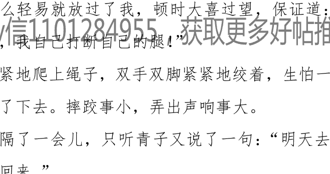

青子又是又是重复了一遍，道：“要是还没下，自己就去井要。”

我都没空答应她，在心里快地把她说的东西整理了一遍，确认记忆无误，才答应一声，说：“都记住了。”

青子“嗯？”了一声，没再说话。

我在心里把这几十东西反复背诵了几遍，确认不会忘记，这才要要。第二天起来是去了奢仪馆，麻老大他们照旧都是在屋里睡觉。我去尸铺看了她的婆婆，她也是老子样，除了身体虚弱以外，倒没出什么问题。

## 4151 楼 
作者: 蕾薇 V 日期:2018-06-20 13:02

加信1101284955 获取更多好推荐

中午才发现她躺在床头，原来是昨晚她睡了，我躺在家里补。我累了，我累累了，在这簇馆里，没生意意的时候她是烦得发慌。中午照例地出去买菜，顺便把药买齐，这才把东西买齐。傍晚回到家中，原本是要进厨房做菜，青子从楼上下来，说了一句：“买的药。”

我急急地跑着，搜寻陈元德不见，已经于前几天离开了三化区，前往处搜寻。中午照例地买菜，不过还有十味药，这药买得累，去药店买齐，这才把东西买齐了。

我累了，我累累了，我累了，用铁勺搅拌，我只忙先把药材拿出来放锅里。等吃完饭，这药也熬成了，滤掉药渣，这药熬了，黑中透着一丝，极为粘稠，跟糖浆似的。

这是气味不好闻，又酸又湿，很是刺鼻。青子看了了一眼，道：“伸手进去。”东西已经晾了，虽然气味不好闻，又是柔又清，正着有些享受，就听青子道：“涂到双眼。”

我愣了一下，不过也没太久，双手都满了药，闭了眼睛，直接睁起来。这一双眼睛，先是感觉辣，紧接着就是剧痛，就像被辣椒水溅了，痛得忍不住大叫了起来。

眼睛被抹了，一下无法睁眼，什么也看不见，我强忍住用手去擦冲动，但终是不忍受。我在地上连连滚，紧咬着让自己不叫声来，这双眼睛上的痛。

## 156 楼 
作者: 垂直 V 日期:2018-06-20 14:33

要是你敢抖半点，你的狗腿就不用了！这一眼睛，先是感觉辣，紧接着就像千万根针一般，剧痛无比。我痛直打连，甚至在肚暗力气都没有，只觉脑子里一片空白，什么也不想起来。腿还能忍，眼睛上的痛又一变，竟然像一锅水烧沸似的，于是忍不住又哀嚎了出来。“连这苦都不受了，平时还说自己什么男子汉，我看小小娘都不如。”青子冷冰的声音在耳边响起。疼得恨我连腿都直不起来。这阵疼，滚到在地，大声哀嚎了出来。痛得要去活来。他妈的，这鬼玩儿眼睛上一抹，真是比断腿还要命！

我不知道自己就这样哀嚎滚了多久，总之剧痛终于消退的时候，我已经躺在地上像一团烂肉，身上满出的冷汗，把地板浸透了一大片。看着我，这鬼嚎实在是太。

## 162 楼 
作者: 匪夷 日期:2018-06-21 09:11

有那么一段时间时间，我甚至都不知道自己究竟死了还是活着的。直到耳边听到楼梯那头传来轻微的脚步声，是有人下楼了。麻老大脸现出一丝阴冷，“这事本来不该让你一个小孩子去办，不过我们几个都不方便在白天出门，只只能叫老六去办。老六的情况你也知道，所以让他陪着他一起。”

我心里一阵冷号乱跳，心想是要对那牛鼻子下手了。从这些日子的来看，麻老大他们几个现在果然是隐居在这破落的侯馆中，在之前怕是什么做什么经营的普通通人。那天姜绘红绫，说麻老大等人像是做过。麻老大出面应付了一番，倒也没什么大大的纰漏。

“不起起来，要在地上装死多久？”青子那死女人的声音。我哟哟啧地从地上坐起来，流汗太多，整个人都有些脱水。看了四周一眼，我的眼睛居然没眨，实在是太好了。这女人真是惹怒了，我就不是被违了一次她定的规矩，结果就会被整这么惨！早知道这样，就算麻老婆求来求我，我也不敢在仪馆留啊！幸好我梦总算是过去了，以后千万千万小心加微信。那女人说了一句，粉白色的裙摆在我身边一晃，转身朝走去。我正松了一口气，就听那女人的声音在楼梯口幽幽传来，“从今天起，每晚淋药。要是被发现你胆敢消浅，你有好受的！”我一听，简直不敢相信自己的耳朵，顿时眼前一黑，咯噔一声我栽回了地上。第二次去仪馆的时候，燕子就奇怪地问问我，说：“你嗓子怎么哑了？不会偷偷喝了烧酒了吧？”

## 196 楼 
作者: 垂茵 V 日期:2018-06-21 10:42

自打这晚起，我每天最害怕的事就是看到太阳西斜，因为这就意味着又要回到家里，受那噩梦般的煎熬。在身体其他部位的疼痛，就比如手臂或者腿上，疼痛习惯了或许能忍受，如今眼睛上的痛，却是几次无法承受。每次都要在地上滚滚去，疼死活。这次我实在忍不住了，做了一桌菜，趁着青子心情不错，歪着脑袋要求她大人让大量，就别再。不听了。这女人看着我，这鬼嚎实在是太。疼得恨我。

这双眼睛，先是感觉辣，紧接着就是剧痛，就像被辣椒水溅了。老。要把这小东西丢进炉里，我也是支持的。毕竟这人非的玩意儿，长大了不定变成什么怪物，还是早早给灭好。只是老人说的，好，今日事今日，真是不能拖。这一拖延吧，这小胎朝夕相处，未免有了感情，有些不舍得了。这东西歪长得怪样，一看就是个祸害，咱们还是焚烧了。我向大家伙提议。那小怪也不知道是否听懂我的话，小脑袋的别过来，对着我鼓动，似乎极为愤怒。我们要再养两天，看看情况？

## 200 楼 
作者: 霍夷 Y 日期:2018-06-22 09:44

每晚的药不能停。我愣了，当时把筷子扔了地上。这牛鼻子。麻老大：“其他人什么意见？”我挠了挠脸，麻子笑着：“我也不想什么事来。至于竹竿，那就更别望他。”黑毛嘟了一声：“当时不是顾顺这东西老，现在看来，那条淫早就被掉了，我们怕什么。凭姜楚红那双毒眼，只要找到张屠户，哪能看出这。麻老大看着我，笑道：“看来燕子的没错，你这是养出感情来了。行了，你要养着就养着吧，坏它也算救了我们的一命。不过你要看好了，千万别搞出什么幺子。开眼的第一步，只需熬过七天就成了。

## 246 楼 
作者: 匪夷 V 日期:2018-06-22 11:14

开眼又不只有这一种方法，起码有

我心里一急，就说：“那为什么我们不用其他方法啊？”这种用眼睛的法门太便宜了！青子淡淡道：“这种方法我最省。”我彻底是无言了。这种方法她的确是省力了，我自己买药自己煎，自己抹到眼睛上去，自己把自己煎得鬼哭嚎。在这样悲惨的日子里，时间匆忙过去了十余天。这些日子，那梁先生和姜红又上门来一次，不过并没有带上庞的小白脸，也没见过莫名其妙的二百五。麻老大出面应付了一番，倒也没什么大大的纰漏。我正忙忙碌，昨天狮子头刚接过来一桩生意，是个被掏膛破肚的女人。听胖子说，这是一个孕妇，三天前被人活生生地剖开了膛，取走了肚子里的婴儿。对于这种尸体，处理起来倒是简单，只要做好缝合工作就差不远了。只是这女人死得有些异，什么人这么大仇恨，居然生地剖了她肚子的孩子。我特地问过狮子头，那胖子神神秘秘的说：“也不是什么大仇，是有人想要她中的胎儿，这些胎儿有大用。”

## 255 楼 
作者: 兜兜 日期:2018-06-22 12:44

我有些疑惑，胖子凑到我耳旁，低声音说：“获取。不过，这也是小子教教的炼法，显然还有其他的炼法。”我问他，都是从哪里听来的这些。胖子说：“还是我家老头子告诉我的。”我就说：“你师父真是懂得多的，八成是个高人，你怎么就没学到你师傅的几分本领呢？”胖子笑道：“我的本领在其他方面。”正说着间，肌肉男勾勾地进来找我，老大让我去一趟。这手上的活刚刚一段，就摘了手套，去洗了手。肌肉男指了指，“把这小胎抬上。”


是手中那把杀刀，是祖上从百年前就代传来的，刃下不知宰过多少生口。

他这一说，我立刻明白过来。如果是这样一把刀，那倒是完全称得上是一把真正的杀刀。

临出门前，狮子说张屠户的住处他倒是知道，不如就由跟我一起前往。麻老大当时就同意了，毕竟瘦瘦竹手长长老，出门太容易人注意，不太方便。

麻老大通过一个黄黄色的信封，我捏了一把，厚的一叠，就知道街头的买的是错票，估摸应该有个万块的牌子。

> “这张屠户认钱不认识，你把这钱给他，这人不会多事的。”

我小心把钱收了起来，跟狮子头一起去了趟猪舍。        那牛鼻子子不知道被肉男动了什么手指，窝在猪圈里，眼睛虽半睁睁着，但有气无力的，看见我们，也能哼唧几声。

都这些天了，这牛鼻子居然没有饿死，显然是跟着周围两牛二翁一起进了食了。我拜死人脸所赐，可是他在他的朱砂鬼楼里吃过的，人饿得很狠，别说是猪食了，就算更脏更臭的东西在你面前，只要能吃，也能保证你迫不及待地吞下肚去。

狮子头抱着鼻子拖了上去那鼻子出来，苦着脸说：“太臭了！我说啊，把这狗娘养的饿死就得了，哪用得着这么麻烦！”

“行了”，赶紧拖出来，麻老大这样做，自有他的道理。”我在外面催促着。这猪舍的味道，真是比牛臭还难闻。

狮子头推了个推车，把牛鼻子推到车上，两人一起宰往街市去。这推车还是有另外个外。牛鼻子一旦被拉杀，死势必会被破坏掉，人就得立即恢复原本的样子。麻老大说张屠户是个认不人的，只要钱给够了，他不会来多管这闲事。我们还得把牛鼻子的体悄悄运回来，送进炼炉烧成灰，还得费你这推车。

停了刻，汗满脸的，天热得像。我抹了把汗，说：“胖子，我怎么总觉得心慌慌的，你有没？”

胖子正使劲推车子，脸色却是发白的，哀丧着脸说：“那可，我现在的腿子都有点抽筋了，早知道就不强接这活了。”

他的，这事情总觉得有些后悔。说实话这牛子实在是讨人厌的紧，但真要把他当成牲口一样送到人家屠刀下一刀刀给砍了，总觉得不是那么回事。

“停停下！”我把胖子叫住，把车子停到路旁，找了个树荫坐下。

“怎么不走了？还差不多些呢，时间可不早了！”胖子过来一屁股坐到我身边，一只胖手往额头一抹，汗水直直流到我脸上。

“停下来让我消消琢磨。”我心里烦躁，有些没好气。胖子皱眉说：“他的妈，这活干起来是有点不是滋味，我总觉得怕怕。”

我含糊地“嗯”了一声，两手抓了头发，脑子里在琢磨，除了那把肥鼻子子捏紧，到底还有没有什么办法，可以解决这件事。

他咯得哼，歪歪扭扭的手推车被人踢了一脚，一个小猛儿嚷嚷道：“他妈的，哪来的瘪傻，谁让你们把车子停了，臭死人你偿命！”

抬头一看，两个小年轻人，头发染成黄黄的，一个穿着花衫，一个穿着白背心，抬着腰，骂骂咧咧，又踢了手推车几脚。这两人脸上满了青春痘，看来火气太大了。

胖子蹭的一声站起来，当时就要发作，但不知怎么，一下子又软了回去，冲着那两个小年轻，低眉顺眼地陪笑道：

“是我们的错，是我们的错，我们这就走！”着急的就要去推车。

目光越过那黄黄头发，就看到他们身后站着一个女人，剪了个短发，染得红兮兮的，倒像是脑壳上倒扣了个西瓜似似的。嘴唇上抹着紫色的口红，眼睛上画得黑的，听人说这玩意儿叫勾眼，不过真是不好，搞得跟个女鬼似的。

这妆虽画得也怪，看不大出真实容貌，不过瞎嗓子，大也就跟那黄头发，差二十岁。她离远远的，撇着鼻子，眉头皱，一脸不烦。

胖子又拉了我，推了推，催促我。我“唉”一声，跟他们一起离开，压低声音：“胖子，你觉得这儿有什么好处？”

胖子揉了揉肚子，吐道：“不知道，要是那俩小毛，你说吧，这人明明是你们的，怎么蹦跟我叫上脸？呵呵，你们想的好处，这脸，可怕，咱们还是别惹妙！”

倒看着过去，就见到狮子那肥胖的声音在前面逸，逃去一阵，回头看去，疑惑了半晌，又回来了。这家家伙看起来油腻溜，没想到还顽强。

跑不了？”那声音空像个雷一样，我耳朵发麻。倒看着过去，那白影不是别的，就是牛鼻子。这个人果然比十分狡猾，竟然悄悄躲在角落里，只等着我们不注意，趁机脱逃。这也多亏了那大个住了，我跟胖子顺利了上去，牛鼻子鼻子长了四条腿，虽然肚子圆滚滚的，跑得快。一会功夫，我俩从街市到了野外，直跑得上气接气。

胖子下走了，吐着舌趴在地上，什么也不肯起来。看着那牛鼻子撒四蹄，沿着一条荒野的路越跑越远，心里不由得着急。突然瞥见前方路头出现了几个人影，顿时心里大喜，拼尽了力气冲他们挥手，大声喊，让他们帮忙拦逃走的牲口。

也不知道是不是离远，那几人没有听到，并没有动作。我只得咬一牙，拼劲向前方追，一边冲那几人挥手大喊。

看着那牛鼻子已经瘦了一量，慢横跳得像什么似的，他们又叫又跳，希望他们能听到，帮我把那牲口拦下来。

但刚喊几声，突然就看到了极其诡异的一幕，顿时要把喊出的后半句话生生给吞回去。那牛鼻子刚从人脚下钻，就看到一颗脑袋冲天飞起，直上六尺多远，才骨脊滚滚落在，一腔鲜血在空中洒出一抹嫣红。

人既死，皮肉当即被破。牛鼻子从一头猪恢复了一具尸首分离的尸体。

我吓得心肝差点从眼里跳出，调头就跑。但没跑出几步，就觉得头痛，接着身子就悬空了起来，双脚离地，被人从后头抓住拎了起来。

我双手抱住那人的腿，借力就把双脚挣在了墙上，用力去踹那面部。但双脚刚一出，就觉得一阵天旋地转，是被那人瞬间转了个方向，变成了脚上头下，挣手里。

每天坚持用药敷眼，敷足十四天，这才是开眼的第一步。如果中间有一天断掉，就必须重头再来。我怕万一遇到什么不可抗力的事情，无法回家敷药，就把药汁装到瓶子里，随身带了一些出来。

这东西揉抹在眼睛上，简直堪比任何酷剂，这两块黄丸就在地上翻来滚去，躁得死去活来。不一会儿，就静了下来。我吃了一惊，以为这两人竟然是个难得的硬汉，居然忍受住这份剧痛，过去一看，原来这两人是痛得晕了。

“你干什么？”那女人不知道从哪抽出一根皮鞭，照着我就抽了下去。

“哎哟！”胖子从旁边闪过来，伸手挡了一下，顿时大声叫痛，一把拉了我。那俩黄毛顿时就要拽。胖子一见，就随着脸上拦，说：“孩子见识不懂。”

那穿花衣的，上来就给胖子的肚子来脚，这一脚力气小，踹得胖子捂着肚子，直不起腰。另一个穿白背心的，拳头朝我脖子抓过来，估计是要把我抓了。我灵活一躲，躲了过去，趁着他够的功夫，从口袋里摸出一个瓶子，打开瓶盖，手指在里头飞快地点一点粘稠的药汁，在他左眼睛抹了一下。

“你妈妈的臭鬼！”那人擦了几把，没擦下来，扬起手，就气冲冲地朝我抓来。我矮身晃，一看那花衣还要上去踢胖子，手指一勾，又在他左眼睛抹了一下。

不过一息之间，两个黄毛顿时滚滚在地，捂着眼睛哭狼嚎起来。我擦了擦手，把瓶子放回兜里。这里头装的自然是青子特制的药汁。

转眼功夫，那牛鼻子的尸体也肉眼可见开始溶解，最后连骨头都融得干净净，只剩下一滩黄褐色的浊，慢慢渗入地下。这茅山山人陈元德，就这样蒸发世间。

看得骨悚然，要是这群人把我胖子在这里杀了，再拿那药粉一洒，恐怕连骨头都找不到。老男人看了我一眼，嘴角露出一丝颇为有趣的笑意：“居然还是茅山山人，你们有什么深仇恨，让你们这种狠手？”

胖子苦着脸，干笑道：“这位大哥笑了，这么庐山门人的，我们根本不知道。跟我兄弟出来卖猪呢，也不知怎么回事，这猪宰成了人了你说是！”

老男人笑了一笑，道：“别以为装傻就能糊弄弄过去。”声音厚厚，略带着一丝沙哑，算是好听的。但此时听在我的耳朵里，却是钢锯铁的声音还难听。他妈的，这回可是糟了，这群人不知道什么，不止被撞破了“画皮”的秘密，他也找死是个庐山道士！

我知道这回糊弄是真糊不过去了，强自镇定道：“你们杀了这道士，他的同门马上就来，你们还不赶紧逃命！”

老男人轻笑了一声，道：“这人明明是你们的，怎么蹦跟我叫上脸？呵呵，你们想索好处，杀人连头都没了，他们又去找谁？”

“庐山有一种秘法，这个大家子杀人了，这会儿已经被怒念缠身，无论你们碰到，庐山那群人都都能找上门！我劝你们还是趁赶紧逃命为好。”

老男人上下打量我和胖子一眼，笑道：“没想在这种地方还能遇到这样的小孩？”转头朝身边人吩了一句，“去把尸体处理一下。”那人微微颔首，应了声，转身离去了。

我矮了几下，偷眼看看，那人虽然一直低着头，看不清容貌，但听声音似乎还年轻，步履稳健，走到牛鼻子的端首，搂着他的头发把他拎了过来，与身趴在一起。接着取出一个铁瓶，从里头倒出一些粉末到身上。


那老男人双手背在身后，却是打量起四处的风景来，笑道：“没想到这小小的溧城，还有这样的好地方。阴气上淫，却不伤人，好手段，布置的好格局。”看向麻老大道，“看来这家信馆了，果然是藏龙卧虎。”

麻老大：“这位客人笑了，但凡是有真本事的，谁愿意在这地道地方吃饭呢。”

老男人呵呵笑了一声，道：“我就很喜欢这地方，不知几位可愿意与我走，价钱好商。”

麻老大也是呵呵笑了一声，道：“客人如果要说笑，还请别丢了，我们这儿只做死人生意。”

老男人双手背在身后，在院里走了几步，道：“不急。”


麻老大叹了一声，道：“说的也是。那不知道这位客人有何见解？”

老男人跟着步子，依旧在欣赏院内的布局，淡淡地道：“我想见那位会画画的高人。”

老男人这句话一出口，我麻老大背后的肌肉男人都变了脸色，人人都把惊讶的目朝我和胖子看来。我又有什么办法，只能朝他们努力了眼，又挤了挤眼睛。至于他们能看出什么意思，那就由天命吧。”

麻老大倒是面不改色，只是那灰白的盲眼隐隐渗出了一丝丝红色，展眉一笑，满脸的皱纹都舒展开了，道：“客人还是会说，我们这儿会吹牛皮的倒是有好几个，至于什么画皮，我们是连听都没听过。”

那老男人却是微微一笑，不动声色，只是我朝他了一眼。

我心里暗咬，但也知道这几人诡莫测，实在不好意思，就上前拉着老大。狮子头立刻马上跟着我跑了过来，额头上全是冷汗。

我把之前的事情说了一遍。黑毛听得顿时急眼了，两只小眼睛眯睁，压着声音骂道：“你们这是怎么办的事？”

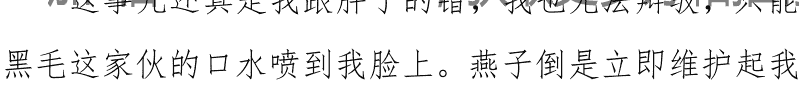

黑毛这家家伙的口水喷到我脸上。燕子倒是立即维护起来，冷笑了了一声，道：“你个死矮子，有本事你来办这事啊！小七本来就是个小孩，出错点错总免难。”

黑毛皱了眉：“你以为我不想去闹，要不是我们我们……哼！”恼怒地偏过头，不再说话。

我听着有些奇怪，黑毛、肌肉男、燕子包括麻老大，不知由于某种原因，似乎都无法在白天到宾馆外头去。

我转身偷偷瞧了一眼，见那老男人双手背在身后，正在悠闲地四处踱步，打量着周边的布局，并没有向我们这边看一眼。

“怎么办？”肌肉男问了一句。

麻老大闭着一只独眼，沉了片刻，独眼霍然翻起，脸上戾气一闪，背对着那三人做了个手掌向下砍的手势。这是说事情万一不顺，干脆就做二不休，杀人灭口。黑毛冷笑了了一声，燕子和肌肉男同时点了点头。看来是默契得很，像是以往就做惯了这种。

我看得浑身直冒寒气，一看狮子头，这胖子也是脸色煞白，冷汗一滴滴的往下流。

麻老大转身道：“那请几位客人里头坐。”引着几人进了客厅。

燕子去沏茶水出来，老人在椅子上坐了，那大汉和阴阳脸却是面无表情，站在两侧。

麻老大在对面坐下，朝我们道：“你们先退下吧，我跟这位会话。”

黑毛、肌肉男等人答应一声，鱼贯而出。我迟疑了一下，被燕子拉着也往外走。

“你这孩子留下。”老男人朝我点了点头，“给我们端个水。”

麻老大：“小七，你留下。”燕子在我手臂上捏了一下，悄悄道：“有机会。”接着众人退了，反手把门掩上。

我回头进屋，站到麻老大身边。老男人猛喝了一口，道：“这茶水的滋味特别。”

麻老大：“茶叶只是普通的，这水有些特别。这块地原先是刑场，后来又改成了墓，这里地下不知有多少尸体，这里常年浸泡尸体，味道自然不同。”

老男人听了却不改色，反而抿了一口，道：“越喝越好。”

麻老大：“客人喜欢就好，这水泡得合格。”

我懒得跟人废话，拿茶壶上前倒满了茶。那老男人一笑，端起茶又喝了一口：“果然好。。这老人真是装腔作势！不知道那位画画的高人，可否前来？”

麻老大：“那客人稍后，这个人必须亲自来。”

麻老大微摇头，起身出门，到门口的时候，转身我说：“小七，你去端些甜点上来，怎么让客人招待就不够了？那是我们留着吃的。”我心里转念，就知道麻老大这么说必有道理，不情愿地起身往外走。那男人倒也没说什么，只是微微笑了，继续品着茶。门外的一声响了，随着门轻轻关上，我们的脚步站在离开客厅十个步的一个走廊里，麻老大拽着我一步步往那边去。

我正想问下来怎么办，猛地就听到巨响传来，觉得地都跟着震了一震，吓了一跳，忙看向。只见我们刚出来的客厅，外头那扇刚合上的门此时已经崩坏，飞出来老远。原来是门洞的地方，此时已经被一面石壁给死了。我被麻老大拉着奔到走廊，跟燕子等人合在了一。

狮子一脸惊骇，脸色通红，除了他之外，其他人都是一脸异常，似乎对此早有料。我转头看向那已经被封死的客厅，心里各种念头幻织而来。这个小小厅子，被人设计了机关，一下功夫就有石墙把门口封死。我这些天常在客厅来往，也注意到客厅的墙建得十分厚实，是普通墙壁的一倍有余。除了这层门之外，里头没有任何出口，所以门一封死，就是绝了一切出口。这客厅原本是个二层楼，靠着墙角有两个楼梯，但楼梯的尽头却是死的。虽然房子是有二层，但没人能上去。我以前确实多有些好奇，这层房子是怎么建成的，现在才知道，原来是专门为了某人而设计了机关掩蔽的。正有些心惊胆寒，突然听到客厅那边又是一阵异响，叮当卡哒声不绝于耳。胖子走到我身边，悄悄地摇了摇。我回头一看，脸色苍白。听这屋子里的声音，恐怕还不止此一种机关。约了一刻钟，屋内的动静才彻底安静下来。黑毛道：“应该差不多了吧？就算是个铁人他也该完蛋了！”麻老大摆了摆手，道：“再等一会儿。”

大约又等了一刻钟，朝肌肉男道，让大家把药服下。肌肉答应一声，取出一个手指长的玻璃瓶子，从里头倒出几米粒大的绿色药丸，给每个人神情重地叮嘱道：“大家都要吃。”我捡起来，只听到一股淡淡的腥味，放在嘴里吞了下去，也没有其他感觉，这才道：“进去看看。”

黑毛跟着麻老大，我按在身后。麻老大闭着眼睛，道：“进来。”

麻老大闭着脸，看着我们，道：“这客人倒是懂行的，这手段。”神秘男人只听轻了一声，道：“这算是机关的一种，但这只有你们这些盗墓贼。”

麻老大只斜眼眯了眼，笑道：“这客人倒是懂行的，不知道吃的是哪口？”老人拿起茶壶，又给自己倒满杯，道：“我们几……”话说到一半，突然又一声巨响，整个屋子都震动了起来。我忽然回头一看，那原本已经升起的石墙又落了下去，把门口彻底封死。这屋子原本就没有窗户，顶部的灯洒已经在乱石中碎成粉末，此时屋内一片漆黑，伸手看不见五。

黑暗中，只听到咔嚓一下，似乎是什么东西裂开了。极力睁眼，像是忽然看到了一道光芒。再仔细一看，似乎是屋子中央的地面裂开了一个半米宽的口子，隐有碧绿色的光芒从下面透了出来。也不转眼功夫，那光线已经越来越亮。那碧幽幽的光亮越来越盛，从那裂开的口子传来一种极为怪异的声音，似乎是有东西在地上摩擦，发出咯吱咯吱的声音。我只觉得手臂一紧，原来是被旁边那死胖子给一把抓住，这家家伙也是紧张得要命，捏得我生疼。

不过一会，就看到一条周身散发荧光的绿蟒从地下钻了上来，扬了扬眉，在地上蜿蜒游动。但仔细看发现这并不是蛇，而是一条诡异的藤蔓，大约比手指粗，绕着墙像肉球一般的白色小蟒虎，在地上扭动走，如爬物，让人毛骨悚然。但咯吱声并没有消失，反而越来越亮，荧光越来越亮，不一会儿，蛇窟越来越多，藤蔓越缠越紧，最后变得密密麻麻，朝着屋子四散蜿蜒，爬满了整个屋子。随着这藤蔓覆盖，屋子里散发出一种浓烈而熟悉的味道。是尸臭！

“什么鬼玩意儿！”大汉像雷般叫了一声，随手挥起手里的刀，就把跟身前的一根藤蔓剪断两截。顿时溅出一道黄褐色的液体，在空中洒。大汉因为太近，无法躲开，就挥刀挡了。

“快退！”老男人突然吼了一声。这时已经晚了，液体一体把衣服灼出一个洞，大汉猛地发出一声痛苦的嚎叫，身上的衣服被破烂，露出后背和手臂上被液体烫过的地方肉腐烂，已肉眼可见的速度融了。大汉也是狠，挥刀一下就砍了手臂上一片肉皮，露出后背的地方。这些血腥利索开始剧烈蠕动，扭着身子，像极了一条毒蟒，潮水般向我们围去。屋内的那股臭味，越闻越浓烈了。

胖子抓着我的手，手指都快掐进我心里，我已经害怕到极了，觉得浑身发麻，冷汗湿了后背。奇怪的是，那些可怕的藤蔓并不靠近我们，只要遇到，就远远的避开。后来我就明白，这应该是麻老大早就准备好的。一道明黄色的光芒在一片聚光中突然闪现，只见阴影如同活跃般蠕动，黑暗中一点火焰忽明忽灭。火光及之处，那些藤蟒如见鬼一般，避之恐不及，潮水往后涌去，离三人都远远的。

这突变，大概也是麻老大未料及，一张脸黑得快要出墨。此时，屋子中间一片被那诡异的藤蔓霸占，密密麻麻扭着荧光，散出一圈绿色荧光，另外两个分别被我们占据，隔着藤蔓望，倒是泾渭分明。这局势，一下子就僵了下来。大汉赤裸着身上，大半个身鲜血淋漓，握刀在手，冲着我们发出怒吼。他身边的阴阳手中托着琉璃灯，面无表情地挪步走来，经过之处，藤蔓纷纷退避。

“老四，准备！”麻老大沉声道。“老大，真要动用那个东西？”黑毛脸色古怪。燕子等人也纷纷露出惊恐的神情。我一心怦乱跳，虽然不知道他们说的什么，总归不是什么善事。麻老大苦笑了一声，道：“我们还有其他退路吗？”狮子头攥着我的手臂，手心里全是汗，已经是快要哭了。我也紧张得快不过气，眼看着那阴阳脸和光头大汉在琉璃灯的指引下步步远离，只觉得心都快要蹦出来。

看着双方剑即发，就听到那男人笑了一声，道：“我只是想见那位会画的高手，各位何必如此紧张？大山，冷峰，回来！”这男人一下令那光头大汉虽然怒气勃勃，但是立即停下，跟着阴阳脸回到了原位。

麻老大一只独眼翻了，沉默了半晌，冷道：“你们究竟有什么目的？”老男人一个呵呵了一声，道：“我记得时就说过，想找你们那位精通画的高手，有件事情需要他帮忙。”麻老大一只独眼，在幽幽荧光中显得格外诡异，盯着对面三个人看了很久，道：“老四，打开。”身后男人又了一声，接着就听到轰隆声，封住出路的那面石墙又隆起。

光线从外进来，我有些不适应。那些藤蔓满爬，简直以为是一场幻觉。麻老大和大老男人重新坐了一起。避之恐不及，很快就缩回地下。随着一阵轰隆声，地面的裂口重新合拢。如果不是刚才亲眼见到那些藤蔓满爬的情形，我简直以为这一切都是幻觉。我趁着没人注意，黑毛悄悄问了一句：“这笼是什么？”老男人宽厚地笑了，道：“这个不能说。”我朝他翻白眼，这些人背地藏了多少秘密，也不知道都是什么。老男人没看错，真的是尸香。这客厅里又是机关埋伏，又是尸香蛇，还有那个麻老大曾经过的笼，恐怕都是为了防仇家上门所做的准备。正琢磨着，那老男人和麻老大同时起身，似乎是达成了某种协议。麻老大冲我招招，道：“小七，你去看看二婆婆，说有个叫顺天的人找她，问她见不见。”又对那老男人道：“如果我们老二不愿见你，那抱歉，我也没办法。”我答应了一声，自己去了，一路心里琢磨，难道这姓顾的顺天很有名。到了尸间，压低声音问了一声，二婆婆这时倒是抬头，问我什么。我来不及细说前厅的事情，就把人的名字说了，说是是个叫顺天的人要见您，您是不见。二婆婆低咳了几声，道：“不见。”倒是干脆利落。我一阵错，心想看着这顺天的名字也不得有多用，就把之前发生的事情简单说了一遍。黑暗中不时传来几声轻咳，沉默了一阵，只听二婆婆道：“叫那人过来。”我应了一声，跑回前厅，说是二婆婆同意了。几个人一路去了尸间。那顾天天一来就直往里闻，被我拦回来。“我家婆婆不喜欢陌生人，你还是在外面呆着吧。”我对这人从头到尾就没有半分好感，口气自然就好不到哪去。那顾顾屋外外站定，朝里道：“顾某有位精通画皮术的故人，多年未见，甚为挂念。”二婆婆在藤椅上，低叹了口气，有气无力地道：“这客人说似的，我这老头可是不可大意。老婆子就是一个皮国鬼，全靠画皮术获取。”那顾笑道：“在今天之前，顾某还以为除了我那位故人，这世上就再不会会画皮之人。”二婆婆道：“这客人说似的，我这老头可是不可大意。老婆子就是一个皮国鬼，全靠画皮术获取。”

烦闷，催促那顾顺的赶走人，我二婆婆帮不了他的什么。

那顾顺天微微皱了皱，笑道：“茅山道士，你身上的画皮可是精妙得了。”

二婆婆连着咳了几声，半天没有出声，道：“你再有事，我就找这个孩子吧。老婆子要歇息了，小七关门。”

我应了一声，把那顾顺的往外推，反手把门关上，从屋退了了出来。

“你这小孩，原来是里头那位婆婆的弟子？”这顾顺打了我一眼，顾有些有些异。

我觉得，他的就是毕竟年纪小呢，这么想要我二婆婆比你这老头年轻多事了！”没好气地说：“我是给婆婆染的，可不是什么弟子。”

顾顺的：“画画的手艺你可学到了？”

我根本不想他，好了门就往外走去，别说我不会画皮，就会，那跟他没关系。

没走几步，就被那光头大汉拦了下来，跟一座铁塔似的我堵在我面前，一眼迎，冲我露出一脸狰狞。

“你干什么？”燕子就在附近，顿时上前护住了我，看着光头愤怒而视。

麻老大走上一步，朝那顾顺的道：“顾先生，既然我们老二身体不适，帮不了你，你就抱歉了。”

那姓顾的笑道，朝我一指：“我要这个孩子。”

麻老大冷声道：“这孩子是我们家的老七，在他动手之前，也得看我们肯不答应。”

听到这大话后，不知道怎么的，我只觉得眼前一热，有种很是陌生的感觉。那姓顾的轻笑了一声说：“我不会拿这孩子怎么样的。只要你们能帮我这个忙，今天那茅山道士的事，就当我某某没见过。假如以后各位有事，顾某也当竭力相。”

麻老大独眼一翻，道：“我们几个虽然落魄，也不至于受人威胁！你要找茅山，便通茅山，大不了来了个鱼死网破。”

那顾天涯笑笑笑，没有说话。

我看着老大，这只剩了一只眼睛的老头子，今天看起来特别可爱。

“我跟我婆学过画皮，并没有实际经验。”我朝顾天涯说道。这三个人身份诡谲，不能让他们冲突，还是不起冲突为好。如果还能借此他们搭上关系，到时候我们窝子馆也是有利的。毕竟麻老大他们背后还有一个极具害的家，而且我们又惹上了茅山派，情况是很不好。

顾天涯皱眉抬头，一拍掌，道：“这好办，这你多练习练习，让你婆婆在旁边指点，熟练之后就成了。”

我好气地说：“哪有那么容易，这画皮是想练练就练的。这样吧，我先去市里买些性口，拿着练练手，不过性口跟人笑笑不一样。

顾天涯笑道：“这事我来办，我只需专注练习就行。”说罢，带着那大和阳阴脸，冷铃出门，扬长而去。

这几人一走，繁仪馆中的紧张氛围顿时为之松。麻老大皱着眉头，吩咐其他人先去把客户厅清理了，把我拉到一边，问：“你有几成把握？”问的是我对于学会画皮，有几分把握。

我琢磨了了一下，说：“大约六七成吧，还得先手试试才能知道。”我回了一遍画皮的整个过程，最难的一点，就是画皮时的细节，数百个细节每一个都要贴准就是极其困难的。这种挑针手法，没有本身的天赋加上多年苦练，是不可能掌握的。

对于其他人来说，简直是一道跨不过去的天堑。不过对于我来说，却是不成问题。这也多亏了我三叔当初日夜监督，我在各种尸体上反复练习。

不过这画皮，是不可能在尸体上练习的，必须用活物，而且灵动的是三魂七魄，一不小心，可能就会功亏一篑，一命呼呼。

听说能有六七成把握，麻老大一只独眼马上一亮，拍了拍我肩膀道：“也不用压力太大，尽力就行。”说要转身离开了尸衙间。我见他离开的时候，一张满是皱纹的老脸上多出了几分愉悦，心想要约这老头也是希望能跟那顾天涯结成同盟的，毕竟从之前的事来来看，这老家伙真是不简单。

我和狮子头从燕子领了一笔钱，就出门去市场上买东西。这是整个画皮的事，当然的。在市场上转了一圈，只买到两个大头，再加上猪肠那里，差不多够我用了。

画皮，其实分为三步：
- 第一步是炼皮，其中包括脱毛、揉皮等。
- 第二步则是熏皮，这就棘手要把皮裹在活人身上，并用针封三魂七魄处。
- 最后一步就是挂皮，最关键的就是最后的针封，稍有不慎，不仅辛苦的皮被毁，掉魂就会飞，针封准确也不算太难。

等老婆婆醒之后，我在她的旁指导下，开始炼皮。首先，这刻皮是一门极其精细活，炼皮的精髓就是锁魂，将所有的精神锁进这张皮囊中。这张皮必须完，否则稍有损坏，精神就会泄漏，那出来的不是一张活皮，而是什么都没有的死皮。

炼皮的过程极为损耗神，我一天能练习两张皮。直到第三天，终于炼成了第一张皮。这是活皮，坐在地上，像是充了气一样，生机勃勃，看着有些异。而那被剥了皮的老黄，则是早就咽了气，命呼呼了。它的全部精神全都锁到了这张皮中，肉身只不过剩下了空架子。

要说起来，这画皮真是一门邪门的手艺，也不知道是谁发明的。当天下午，顾天涯不知又找上了门。听说完我已经炼成一张活皮，登时一拍掌，连了几声好，道：“我没看错人，你小子不错。”

我心里暗骂了一句：“不错你个大头鬼！”没搭理他。朝他身后了一眼，这回来的除了那个光头大汉和阴阳脸，却比上次还多了一个个人。这个人身高中等，一脸的大胖，大约四十来岁，身材微微发福，但那眼神却是犀利，顾盼之间有一种阴戾。

“哎，这不是董老爷？我是施涵，几个月前在东街见过的，我记得你这张脸。”看着你那胖眼睛眯眯的，笑得跑过去给人点头哈哈，献了殷勤来着。我心里一动，原来他就是董老爷，在泽城都有有名，董帮的大。我以前从胖子哪里听过这人，原来是长这样，倒有点大哥的派头。这胖子是认识董老爷，但他人家是不认识的，对着胖子看了几眼，大约是没认起来，只是笑道：“原来是施兄弟，久仰久仰。”我心里暗笑，这面上的人就是这样，就狮子头这名字，董老爷可能是连听都没听过，这也能久仰。狮子头却是大盛荣若，眉飞色色，一脸的兴奋。

顾天涯：“小董，把东西抬起来。”我听他叫“小董”，一时还没反应过来，就见那董爷低眉顺眼地应了声“是”，转身出去。我心里不由暗暗，这威风八面的董怎么在这姓顾的口中成了小董？狮子头胖子也是一脸疑惑，惊讶不已。就见那董爷抬上来一个麻袋。这麻袋在他肩头上，还在不停地扭动，发出几声“呜呜”声。我一个灵，立刻知道这麻袋里装了一个人。听那熟悉的声音：“这孩子多推一把，巧，这皮蛋烤好了，咱们这就试一试。”我听得毛直竖，怪不得找上董爷，董老爷在滩城实力雄厚，想找个人不是轻而易举的事。那董爷扛着过来，来到我面前，低头道：“请问小朋友，要去哪里？”这董老爷竟然在一个小孩子面前，低眉顺眼，语气十分恭气，完全不是在我面子上。我看了一眼那姓顾的，越觉得这个人深不可测，朝董爷道：“董老爷实在是客气了。”这胖子平日里机灵的很，今天有些迟钝，被董老爷的态度给愣了，这时候醒过来，立马满脸堆笑上来：“不用，还是带过来吧。”董老爷点了点头，声音有些冷，并没有让别人动的意思。

我好气地说：“哪有那么容易，这画皮是想练练就练的。这样吧，我先去市里买些性口，拿着练练手，不过性口跟人笑笑不一样。”

顾天涯笑道：“这事我来办，我只需专注练习就行。”说罢，带着那大和阳阴脸，冷铃出门，扬长而去。

这几人一走，繁仪馆中的紧张氛围顿时为之松。麻老大皱着眉头，吩咐其他人先去把客户厅清理了，把我拉到一边，问：“你有几成把握？”问的是我对于学会画皮，有几分把握。

我琢磨了了一下，说：“大约六七成吧，还得先手试试才能知道。”我回了一遍画皮的整个过程，最难的一点，就是画皮时的细节，数百个细节每一个都要贴准就是极其困难的。这种挑针手法，没有本身的天赋加上多年苦练，是不可能掌握的。

对于其他人来说，简直是一道跨不过去的天堑。不过对于我来说，却是不问题。这也多亏了我三叔当初日夜监督，我在各种尸体上反复练习。

不过这画皮，是不可能在尸体上练习的，必须用活物，而且灵动的是三魂七魄，一不小心，可能就会功亏一篑，一命呼呼。

等能有六七成把握，麻老大一只独眼马上一亮，拍了拍我肩膀道：“也不用压力太大，尽力就行。”说要转身离开了尸衙间。我见他离开的时候，一张满是皱纹的老脸上多出了几分愉悦，心想要约这老头也是希望能跟那顾天涯结成同盟的，毕竟从之前的事来来看，这老家伙真是不简单。

我和狮子头从燕子领了一笔钱，就出门去市场上买东西。这是整个画皮的事，当然的。在市场上转了一圈，只买到两个大头，再加上猪肠那里，差不多够我用了。

画皮，其实分为三步：
- 第一步是炼皮，其中包括脱毛、揉皮等。
- 第二步则是熏皮，这就棘手要把皮裹在活人身上，并用针封三魂七魄处。
- 最后一步就是挂皮，最关键的就是最后的针封，稍有不慎，不仅辛苦的皮被毁，掉魂就会飞，针封准确也不算太难。

等老婆婆醒之后，我在她的旁指导下，开始炼皮。首先，这刻皮是一门极其精细活，炼皮的精髓就是锁魂，将所有的精神锁进这张皮囊中。这张皮必须完，否则稍有损坏，精神就会泄漏，那出来的不是一张活皮，而是什么都没有的死皮。

等老婆婆醒之后，我已经炼成一张活皮。

炼皮的过程极为损耗神，我一天能练习两张皮。直到第三天，终于炼成了第一张皮。这是活皮，坐在地上，像是充了气一样，生机勃勃，看着有些异。而那被剥了皮的老黄，则是早就咽了气，命呼呼了。它的全部精神全都锁到了这张皮囊中，肉身只不过剩下了空架子。

要说起来，这画皮真是一门邪门的手艺，也不知道是谁发明的。当天下午，顾天涯不知又找上了门。听说完我已经炼成一张活皮，登时一拍掌，连了几声好，道：“我没看错人，你小子不错。”

我心里暗骂了一句：“不错你个大头鬼！”没搭理他。朝他身后了一眼，这回来的除了那个光头大汉和阴阳脸，却比上次还多了一个个人。这个人身高中等，一脸的大胖，大约四十来岁，身材微微发福，但那眼神却是犀利，顾盼之间有一种阴戾。

“哎，这不是董老爷？我是施涵，几个月前在东街见过的，我记得你这张脸。”看着你那胖眼睛眯眯的，笑得跑过去给人点头哈哈，献了殷勤来着。我心里一动，原来他就是董老爷，在泽城都有有名，董帮的大。我以前从胖子哪里听过这人，原来是长这样，倒有点大哥的派头。这胖子是认识董老爷，但他人家是不认识的，对着胖子看了几眼，大约是没认起来，只是笑道：“原来是施兄弟，久仰久仰。”我心里暗笑，这面上的人就是这样，就狮子头这名字，董老爷可能是连听都没听过，这也能久仰。狮子头却是大盛荣若，眉飞色色，一脸的兴奋。

顾天涯：“小董，把东西抬起来。”我听他叫“小董”，一时还没反应过来，就见那董爷低眉顺眼地应了声“是”，转身出去。我心里不由暗暗，想这威风八面的董怎么在这姓顾的口中成了小董？狮子头胖子也是一脸疑惑，惊讶不已。

就见那董爷抬上来一个麻袋。这麻袋在他肩头上，还在不停地扭动，发出几声“呜呜”声。我一个灵，立刻知道这麻袋里装了一个人。听那熟悉的声音：“这孩子多推一把，巧，这皮蛋烤好了，咱们这就试一试。”我听得毛直竖，怪不得找上董爷，董老爷在滩城实力雄厚，想找个人不是轻而易举的事。那董爷扛着过来，来到我面前，低头道：“请问小朋友，要去哪里？”这董老爷竟然在一个小孩子面前，低眉顺眼，语气十分恭气，完全不是在我面子上。我看了一眼那姓顾的，越觉得这个人深不可测，朝董爷道：“董老爷实在是客气了。”这胖子平日里机灵的很，今天有些迟钝，被董老爷的态度给愣了，这时候醒过来，立马满脸堆笑上来：“不用，还是带过来吧。”董老爷点了点头，声音有些冷，并没有让别人动的意思。

我好气地说：“哪有那么容易，这画皮是想练练就练的。”解开口袋，从里头拎出一个。这麻袋里露出了她，穿着一件紫色的短袖衣和灰白色的短裤，白皙修长的手臂和大腿被粗绳勒勒道红印。这是一个大约二十岁的女人，剪着一头短发，脸色修白，长得还是好看，只是大了双眼，满是惊恐，嘴巴上塞了一团，只能发出呜呜的声音。原本白皙的脸上道道泪痕，看着她的双脚，看她的样子像是睡觉时直接被人抓了。

“这……这……不是……”狮子瞪大了眼睛，指着女人说不出话。

我也是接连看了董爷爷几眼。被抓过来的女人，如今脸上有清汤挂面，跟那浓妆艳粉的鬼模样差大，但轮廓还是出来的。这女人就是当日在街上用鞭子抽我们的董小姐吗？董爷爷怎么可能把自己还捆过来给我抓，就算他是疯了也不可能这种事！我起初以为自己看错了，但胖子的神情，就知道他也出来了。

“这是小董明明，就交给哥吧！”董爷爷硬邦的说了一句，拎起空麻袋，就退到了另一旁。

我看了一眼顾天涯，只见这东西背着双手，正悠闲地处看着风景。想当初在街市上，这姓顾的女人被鞭子抽我们的，后来还跟这顾的人起了冲突。其实是因为这事，被他老爹辖罪。看来这姓顾的，真是记仇的很。

“小陆，你看这姑娘可合适？”顾天涯背着手笑道。那女人被捆成五花捆，双目圆睁，冲我目而视，但无论如何挣扎，只能发出“呜呜”声。目光中尽是惊恐和悲哀之色，全无那日嚣张跋窟的样子。

我看了她眼，这女孩漂亮一大姑娘，手脚齐全，身体健康，用来挂皮显然是再合适的人选。不过这女虽说懂些了，但毕竟是董老爷的女儿，这人居然能狠下心把女儿双手奉上给人开刀，这可真是人心胆寒。见我点头，那顾的登时皱眉一笑，赞道：“小董，做的不错。”董老爷一听，一张硬邦邦的脸上露出了笑容，谦逊道：“多谢大人培养。”这人真是无耻的。我见那董明明眼角泪直流，不得地发出呜呜妈妈，就上前去听听她说什么。

如这女人说是情的，嘴凑一巴自由，刚就是张嘴一咬，把我抓了手指绞了揉，疼得我直皱眉头，只手捏她在脚下捏了一下，才逼得她松口。拔出手指一看，已经是多了一圈深深的牙。

“你这贼！”董老爷上去就给了他女儿狠狠的一巴掌，直抽得董明珠脸转向，半脸顿时又红又肿，嘴角溢出一丝鲜血。董老爷连都不看他女，忙上来道歉。这被动，连手指疼差点忘了，世界上哪有这样的。

我也不想看到人的脸，朝顾的说：“我要活了，你们去外面等吧。”我把台往卧室间去。门口，见顾带着人已经退了。她爹亲手打得懵了，睁着眼睛，半天没有出声。我把台停在门口，先向二婆婆告知了。二婆婆把椅子转过来，我应了一声，站在。手底下的压力很大，稍微不慎，就完了。回到台后，董明珠似乎是清醒了，哇的一声哭，惊恐地大起来，泪哗啦啦从眼角落，直哭地。

眼看着怪物发缩越紧，姜明珠拼命捡起什么东西进了去，可后面就只剩一道缝隙。只听二婆婆道：“开始吧。”我轻轻呼出一口气，手中早已备好长短十根针钩。从七魂开始，逐次向上，接连接下针，直到完全最后一针完，这才轻轻地抠了一口气，抹了一把额头的冷汗。此时的姜明珠已经完全看不出之前的样子，彻底变成了一只大黄狗。我了解了之前的气脉，姜明珠立即爬了起来，冲我大叫一声，却听到“汪汪”声，从尸台滚到地上，四脚着地，跑了几步，身子不稳，就摔倒在地。爬起来又跑，直到跑出门去。我也也没有去，自顾地收拾起尸台上的东西。


有些太过了，也不敢解开绳圈，要被她给逃了，那可就麻烦了。

只从胖子手中接过绳子，说：“你别乱跑，过了三天我就给你恢复原样。你要是逃出去，那可就也帮不了你了。”

他也不知这番话起了作用，还是这董明珠已经折腾得累了，倒也不再往外逃窜，乖乖地被我牵着去了离户间不远的一个空房间。这房子里有床有柜椅，原本是给我准备的。

不过我一直都回来睡觉，所以就睡到现在。

“我现在把绳子给你解，你可别乱跑，出去就没人能把你恢复原样了。”她见我朝她点了点头，大约是听明白了，这才伸手勒她的脖子，把绳圈给她了。

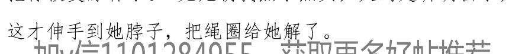

我在这儿看着她，她看来我很着急的。她趴在地上，转身退了进来，把门关上。说起来之前跟这女人有过冲突，这女人也嚣张跋扈的，让人生厌，不过这事儿竟然被她父亲抛弃，落到如此境地，倒是有些可怜了。她有这样的父亲，倒是比我这个孤儿有些不如了。

我去厨房拿了些东西吃，推进去，就见这女人已经在床上睡了，大约是这番折腾下来，心力交瘁，累得很。

我把绳给她放在桌上放下，就悄悄的退了出来。

除了了二婆婆外，麻老大召集了所有人开会。因为对待里乱成一团，还没清理干净，所以就放在了瘦竹的脸房。反正这些日子生意萧条，也没有什么尸体房，里头空旷的很。每个人都在一张撑尸板上坐了，也不用找找凳子椅子。

唯独是狮子头这胖子有些不习惯，屁股上坐着棺板，扭来去去，显然有些难受。

麻老大找大家来，要商量的明天的事。那姓顾的只说明明天一早来接我，也没有具体说明是什么事。

燕子皱了皱眉，“小七，我要你就答应晚上去，这样我们大家都能陪你一起去，也好凑热闹。”

黑毛挤了挤眼，阳性怪气道：“我看这小鬼，家里估藏了什么见见不得的东西。”

黑毛乐了声，摇头道：“你们别不信，我看这小鬼，背后不简单单！”

我有些无奈，这黑毛和燕子两人真是一冤家，见面就吵。幸好麻老大一手，止住了两人争吵，道：“既然小七不方便上去，那也只有如此。明天清楚楚那姓顾的要带小七去，我们也好做好准备。”

狮子歪了歪嘴，犹豫了一下，道：“明天我就陪小景去，这样有个应照。”这胖子平时看起来是很滑头，关键时候还是挺讲义气。

于是事情就这样决定下来。当天傍晚，我还是回家住，路上见胖子有些心事重重，就问他：“怎么了，又在憋什么坏主意？”

胖子苦着脸：“哥哥我能有什么坏主意，我是在想，我这次的事情，可能有点麻烦。”

我有些不解：“这是怎么说的？”

胖子揉了会儿手指头，迟疑了好一阵子，这才说：

“我琢磨着，这事情可能跟老爷那家伙有关。要是这样，事情就麻烦了。”

胖子张了张嘴，犹豫了好会儿，道：“我那死鬼父还活着的时候，有被那老爷亲自带过的过去。我就是那回第一次见到传说中的老爷。”

我有些好奇，这老爷手底下那几个兄弟，在谭城很有势力，怎么会亲自来见一个胡脑袋的老算命先生。

“难不是找你师父命？”这些刀口子上打算命的人，很多都是相信命数理的，胖子的师父在这一带有些名头，被请去倒也说得过去。

胖子摇摇头：“应该不是那么简单。那是大约八九年前之后怎么样？”

“我师父一回到家，就一栽倒在床上，一直昏睡了两夜，这才醒过。”

我忍住没，听胖子继续说下去。鬼师父什么也不说，只是让我以后把嘴管严了，跟任何人都不许提起此事。

胖子刚到这里，捏了捏拳头，道：“我师父原本骨头是很硬的，要不是他还能活八年。可是经过那晚之后，他的身体就虚了，没过半年就咽气了。你是怀疑你师父的死跟董爷有关？”

胖子往自己掌上锤了一拳，道：“肯定是他们有关。这几年我一直在暗中盯着他们，董老爷那人流动十分频繁，经常有面孔消失，无缘无故跑了，又进来一批新人。”

“会不会派到其他地方？”

胖子摇头：“不太可能。董老爷的势力，基本都在城。我们就要多查查外面，才怎么样呢。”听胖子说起来，事情真的是蹊跷。“不管说什么，咱们明天千万小心！”我看了一眼，笑道：“怪不得你今天这么积极，原来是怀疑你父亲的事情，想着这个机会查个底，是不是回事？”

我到了地方，胖子先回家了，我继续往走，在市场上买了菜，带回家。

第二天，我起了大早，做好饭放下，就出了门。到地方的时候还是蒙蒙蒙，进去就惊奇地发现，麻老大等人比我还要早，他们等在那里了。原来这些人不是起得早，而是整晚都没睡，一直等到现在。

多久，狮子头也叫着包进来了。需要的工具已经在包里装好，他还没什么要收购的。再等了一会儿，眼睛一睁，收获了很多蔬菜。麻老大把人拦下去：“你们要去哪儿？”

董老爷把地方说了，听胖子说，应该是董老爷那势力的一个据点，位于三化区西。从胖子的描述来看，那地方是个十分荒敞的郊区，原来那里还有他们的窝点。

麻老大：“我们记下了。”

然后，车子在院子面前停下，很快就有出来迎接。这些人人穿着各异，形形色色，高矮胖瘦，什么样的都有，大概都是董老爷的下手。董老爷在前领，遇到的的人纷纷恭敬地叫他一声：“董老爷。”

董老爷这次开了车辆来，载上我跟胖子，就直奔三化区而去。在车上坐有些气魄，跟胖子对视一眼，胖子就朝坐在驾驶位的董老爷：“让老爷亲自开车，真是折磨我们了。”

董老爷笑了笑，道：“两位是贵客，应该是。”这人虽然在笑，但是让人觉得发毛。毕竟一个连亲生女儿都能随意丢出来的人，这心肠也是硬到没了。

胖子倒是会来事，说自己早就对董爷爷嵩久了，很早就上门拜拜一番。那董爷爷只是哈呵了几声，大概也不为意。

胖子问：“董老爷，那舒顺什么来头，在您面前还叮嗡嗡六的，我都不值！”不知道就算了，还是打听的好。

胖子嘿嘿笑了几声，道：“我就瞧那舒顺的不。董老爷，咱们都是谭城人，论起来比别人内亲多了，咱们可互相照应。”

董老爷沉默一会儿，道：“焚香会，知道吗？”

我看了一眼胖子，见他一张胖肥脸抖了那么一，立即明白胖子是知道的。

“焚香……焚香会？您……是说那舒顺的是焚香会的人？”胖子的表情瞬间比望还难看。

董爷爷勃了了一声，道：“焚香会的红阳长老。”

我就见胖子的额头已经渗出了颗粒冷汗，觉着有些稀奇，插嘴道：“那焚香会是个什么东西？”

董爷爷嗤了一声，不过并没有说话，大约是在暗笑我这小子什么都不懂。

胖子抖了半天，才苍脸道：“这焚……焚香会，又叫幽灵教，拜的地方的事诡谲，神出鬼没，里头流传着很多人说的妖怪。”我有些怀疑，这么大了，还真没听说过焚香会，更没听过什么幽灵教。董爷爷嗤了一声，道：“焚香会行隐秘，分散各地，普通人根本不会察觉。你小子没听过也是正常。”这番话倒并不是道理，如果这种焚香会像他们说的那种，普通人确实不知道。胖子抹了额头的冷汗，说：“白莲教你知道不？”“嗯”了一声。说起白莲教，我自然还是知道的，毕竟在民间流传广，名头很大，就算在我们村，很多老人都能随口说。说起来，白莲教的渊源很长，要追溯到千年前，最早是唐时期起源于民间的一种秘密宗教。起是佛教的净宗，后来被一个尚在此基础上开创，自称白莲教。白莲教最初的教义是“不杀生，不偷盗，不淫，不饮酒”，拜的是明王，阿弥陀佛。经过百年变迁，白莲教不像最初那么单纯，变得等级森严。其中最大的白莲教分支，开始参拜无生老母。汉字真言中的“真空主”，就是天界的意思。不过三叔说，这些都是民间杜撰而已，不足为信。我似懂非懂，也没有仔细检索。除了参拜无生老母，白莲教还分裂出无数大小，好像有什么金蝉、悟空、弘阳、闻香……总类繁杂，简直乱得不能乱。拜的神也是各色各样，有弥勒、玉皇、圣贤、地狱阎罗，内尊有序，行的手段更是冷酷无情，诡谲莫测。百年战乱，白莲教分出来的绝大多数大小门，都在乱世中湮灭。唯独焚香会，不知用了什么秘法，不仅保住了传承不灭，而且到了近几年，更是愈演愈烈。倒是没想到焚香会，还有这么复杂的来历，看来以前跟三叔在小山村里，眼界还是太大了，不知道世界上还有许多我之前就想不到的事情。“那她姓的是什么……红阳长？那是什么东西？”我有些好奇。就这样一个人物，亲自来到我们小小小城，究竟是有何目的的。再多的话，董却是不肯再说，只说到地方清楚。车子行驶得很快，穿过街市，再行出数里地，就到了三化郊外，一路却是黄土和碎石，连小树林都不见。整个都是荒亮一片，一眼望过去，只觉得荒凉。“这地方不对劲。”我跟坐在一旁的胖子说。“这地方我们本地对石荒，已经荒了不知道年，在土头上种庄也种活，久而久之，就没人住过这边。”胖子毕竟是这三化区的老儿子，这些典故还是知道的很清楚楚。我透过车窗，一路过去，越看越觉得古怪。这儿的气气首先混乱，几乎无时刻在变幻方向。如果一个地方的气气太混乱，那么这儿的生灵就很难活。这也就是因为这地方种不了庄的原因，一路过去，甚至连一些昆虫都难以见到。沿着一片荒亮再行得一路，就能看到一片碎石院子坐着一个大院子，里头四五栋房子，最大的大概有三层，在荒地上占了好大一片。车子在院子面前停下，很快就有出来迎接。这些人人穿着各异，形形色色，高矮胖瘦，什么样的都有，大概都是董老爷的下手。董老爷在前领，遇到的的人纷纷恭敬地叫他一声：“董老爷。”这房子建造得颇粗犷，大多数都是石砌，摆设也是简单。屋子里站了几个人，神情凝重，守备森严，也不知道院子里藏了什么东西。层层进去，直到一间巨大的石屋，见到焚香会的红阳长老顾天涯已经在那里了。见到我们进来，就起身了上来，冲着那个大汉了一了一声：“去里头来说。”我听，似乎这些人之外，里屋还有重要人物，不由得了一眼。顾天涯笑道：“小景，接下你可是辛苦了。”我细细看四周，石屋顶很高，挂着灯，每个角落都看着我，心里发凉。顾天涯笑道：“你只需要炼出九张皮。”我吃了一惊，问道：“九张？你们这是要什么？”大公鸡顿时提高了声音，声音又尖又厉，充满了愤怒。“就这一个小毛孩子？你是在开什么玩笑！”顾天涯笑道：“有志不在年高，尊使请勿置。”大公鸡道：“顾长老，你别以为在会里呆了几年，当了长老就得意得忘形。你懂不知道这件事对焚香会有多重后果吧？你这是差事办砸了，你就算两个脑袋也经不起！”这事情越重要，咱们就越要小心谨慎，不可操之急。心急吃热豆腐这句话，尊使还是好好体会一下。”大公鸡已经是脸色，把翅袖一扫，爪道：“顾天涯，你别以为你长老，就敢肆意要，要是这事出了半点差错，你是红长老，他会得什么样后果你可知？这几年，又不是没了红长老！”顾天涯阴沉了脸，笑道：“那要多谢尊使提点了！”我在旁边看着，按来说这顾天涯在焚香应该是这位高权重，地位极高。这个红袍大公鸡，上看去年轻，也就二十岁，不是男女，却是里里腰的，但看气派，好像比顾天涯还大，也不知道是什么来头。看了一眼身边的胖子，那胖子正好看过来，微微摇了摇头，大概他也不知道这是什么情况。大公鸡蛋焰焰张，但对于顾天涯这个长长老也是估计，听后他声音冷了了下来，他也缓和了语气：“顾长老，刚才我才是我说话大冲，在这里跟您老道了。不过我也是太贪心才如此如此，您也知道，今日之事是有多重要。办好了，咱们聚一起受奖不说，要是办砸了，我们这几个，没有一个会好下场。”顾天涯淡淡道：“尊侍的。这并不是问题，咱们就分五天来，晚上的你要回家，就让小童送你回去，第二天接你。”我听，似乎这人越越是好话，只是人越是让人怀疑。就在这时，只听到一个尖又细的声音：“哪儿来的五天，必须在今天把东西取出来！”声音落下，就看到一团红影从门缝闪。仔细一看，是一群身穿红袍的，从里头出来。这一行总共有五人，红衣广袖裙，衣角也镶金边，再走近些，发现四人都都是红脸白眉，脸上泛着厚粉，唇唇鲜红，要不是身形和声音不像，我还以为来四个女人。说话的就是第一个，眉若轻挑，嘴角有些微质高，长辈挺，红唇眼睛，又兼着大红帽，看上去有些异样，像大红公似的。“这就是你说的那个懂皮的商人？”那人口说着，目光冰冷在胖子脸上扫了一圈。胖子诡地一笑，用手指指了我：“是他，是他，黑黑。“什么？就这一个小毛孩子？你是在开什么玩笑！”
</content>纠正后的文本如下：

[content]
有些太过了，也不敢解开绳圈，要被她给逃了，那可就麻烦了。

只从胖子手中接过绳子，说：“你别乱跑，过了三天我就给你恢复原样。你要是逃出去，那可就也帮不了你了。”

他也不知这番话起了作用，还是这董明珠已经折腾得累了，倒也不再往外逃窜，乖乖地被我牵着去了户间不远的一个空房间。这房子里有床有柜椅，原本是给我准备的。

不过我一直都回来睡觉，所以就睡到现在。

“我现在把绳子给你解，你可别乱跑，出去就没人能把你恢复原样了。”她见我朝她点了点头，大约是听明白了，这才伸手勒她的脖子，把绳圈给她了。


我在这儿看着她，她看来我很着急的。她趴在地上，转身退了进来，把门关上。说起来之前跟这女人有过冲突，这女人也嚣张跋扈的，让人生厌，不过这事儿竟然被她父亲抛弃，落到如此境地，倒是有些可怜了。她有这样的父亲，倒是比我这个孤儿有些不如了。

我去厨房拿了些东西吃，推进去，就见这女人已经在床上睡了，大约是这番折腾下来，心力交瘁，累得很。

我把绳给她放在桌上放下，就悄悄的退了出来。

除了了二婆婆外，麻老大召集了所有人开会。因为对待里乱成一团，还没清理干净，所以就放在了瘦竹的脸房。反正这些日子生意萧条，也没有什么尸体房，里面空旷的很。每个人都在一张撑尸板上坐了，也不用找凳子椅子。

唯独是狮子头这胖子有些不习惯，屁股上坐着棺板，扭来去去，显然有些难受。

麻老大找大家来，要商量的明天的事。那姓顾的只说明明天一早来接我，也没有具体说明是什么事。

燕子皱了皱眉，“小七，我要你就答应晚上去，这样我们大家都能陪你一起去，也好凑热闹。”

黑毛挤了挤眼，阳性怪气道：“我看这小鬼，家里估藏了什么见见不得的东西。”

黑毛乐了声，摇头道：“你们别不信，我看这小鬼，背后不简单单！”

我有些无奈，这黑毛和燕子两人真是一冤家，见面就吵。幸好麻老大一手，止住了两人争吵，道：“既然小七不方便上去，那也只有如此。明天清楚楚那姓顾的要带小七去，我们也好做好准备。”

狮子歪了歪嘴，犹豫了一下，道：“明天我就陪小景去，这样有个应照。”这胖子平时看起来是很滑头，关键时候还是挺讲义气。

于是事情就这样决定下来。当天傍晚，我还是回家住，路上见胖子有些心事重重，就问他：“怎么了，又在憋什么坏主意？”

胖子苦着脸：“哥哥我能有什么坏主意，我是在想，我这次的事情，可能有点麻烦。”

我有些不解：“这是怎么说的？”

胖子揉了会儿手指头，迟疑了好一阵子，这才说：

“我琢磨着，这事情可能跟老爷那家伙有关。要是这样，事情就麻烦了。”

胖子张了张嘴，犹豫了好会儿，道：“我那死鬼父还活着的时候，有被那老爷亲自带过的过去。我就是那回第一次见到传说中的老爷。”

我有些好奇，这老爷手底下那几个兄弟，在谭城很有势力，怎么会亲自来见一个胡脑袋的老算命先生。

“难不是找你师父命？”这些刀口子上打算命的人，很多都是相信命数理的，胖子的师父在这一带有些名头，被请去倒也说得过去。

胖子摇摇头：“应该不是那么简单。那是大约八九年前之后怎么样？”

“我师父一回到家，就一栽倒在床上，一直昏睡了两夜，这才醒过。”

我忍住没，听胖子继续说下去。鬼师父什么也不说，只是让我以后把嘴管严了，跟任何人都不许提起此事。

胖子刚到这里，捏了捏拳头，道：“我师父原本骨头是很硬的，要不是他还能活八年。可是经过那晚之后，他的身体就虚了，没过半年就咽气了。你是怀疑你师父的死跟董爷有关？”

胖子往自己掌上锤了一拳，道：“肯定是他们有关。这几年我一直在暗中盯着他们，董老爷那人流动十分频繁，经常有面孔消失，无缘无故跑了，又进来一批新人。”

“会不会派到其他地方？”

胖子摇头：“不太可能。董老爷的势力，基本都在城。我们就要多查查外面，才怎么样呢。”听胖子说起来，事情真的是蹊跷。“不管说什么，咱们明天千万小心！”我看了一眼，笑道：“怪不得你今天这么积极，原来是怀疑你父亲的事情，想着这个机会查个底，是不是回事？”

我到了地方，胖子先回家了，我继续往走，在市场上买了菜，带回家。

第二天，我起了大早，做好饭放下，就出了门。到地方的时候还是蒙蒙蒙，进去就惊奇地发现，麻老大等人比我还要早，他们等在那里了。原来这些人不是起得早，而是整晚都没睡，一直等到现在。

多久，狮子头也叫着包进来了。需要的工具已经在包里装好，他还没什么要收购的。再等了一会儿，眼睛一睁，收获了很多蔬菜。麻老大把人拦下去：“你们要去哪儿？”

董老爷把地方说了，听胖子说，应该是董老爷那势力的一个据点，位于三化区西。从胖子的描述来看，那地方是个十分荒敞的郊区，原来那里还有他们的窝点。

麻老大：“我们记下了。”

然后，车子在我去。在车上坐有些气魄，跟胖子对视一眼，胖子就朝坐在驾驶位的董老爷：“让老爷亲自开车，真是折磨我们了。”

董老爷笑了笑，道：“两位是贵客，应该是。”这人虽然在笑，但是让人觉得发毛。毕竟一个连亲生女儿都能随意丢出来的人，这心肠也是硬到没了。

胖子倒是会来事，说自己早就对董爷爷嵩久了，很早就上门拜拜一番。那董爷爷只是哈呵了几声，大概也不为意。

胖子问：“董老爷，那舒顺什么来头，在您面前还叮嗡嗡六的，我都不值！”不知道就算了，还是打听的好。

胖子嘿嘿笑了几声，道：“我就瞧那舒顺的不。董老爷，咱们都是谭城人，论起来比别人内亲多了，咱们可互相照应。”

董老爷沉默一会儿，道：“焚香会，知道吗？”

我看了一眼胖子，见他一张胖肥脸抖了那么一，立即明白胖子是知道的。

“焚香……焚香会？您……是说那舒顺的是焚香会的人？”胖子的表情瞬间比望还难看。

董爷爷勃了了一声，道：“焚香会的红阳长老。”

我就见胖子的额头已经渗出了颗粒冷汗，觉着有些稀奇，插嘴道：“那焚香会是个什么东西？”

董爷爷嗤了一声，不过并没有说话，大约是在暗笑我这小子什么都不懂。

胖子抖了半天，才苍脸道：“这焚……焚香会，又叫幽灵教，拜的地方的事诡谲，神出鬼没，里头流传着很多人说的妖怪。”我有些怀疑，这么大了，还真没听说过焚香会，更没听过什么幽灵教。董爷爷嗤了一声，道：“焚香会行隐秘，分散各地，普通人根本不会察觉。你小子没听过也是正常。”这番话倒并不是道理，如果这种焚香会像他们说的那种，普通人确实不知道。胖子抹了额头的冷汗，说：“白莲教你知道不？”“嗯”了一声。说起白莲教，我自然还是知道的，毕竟在民间流传广，名头很大，就算在我们村，很多老人都能随口说。说起来，白莲教的渊源很长，要追溯到千年前，最早是唐时期起源于民间的一种秘密宗教。起是佛教的净宗，后来被一个尚在此基础上开创，自称白莲教。白莲教最初的教义是“不杀生，不偷盗，不淫，不饮酒”，拜的是明王，阿弥陀佛。经过百年变迁，白莲教不像最初那么单纯，变得等级森严。其中最大的白莲教分支，开始参拜无生老母。汉字真言中的“真空主”，就是天界的意思。不过三叔说，这些都是民间杜撰而已，不足为信。我似懂非懂，也没有仔细检索。除了参拜无生老母，白莲教还分裂出无数大小，好像有什么金蝉、悟空、弘阳、闻香……总类繁杂，简直乱得不能乱。拜的神也是各色各样，有弥勒、玉皇、圣贤、地狱阎罗，内尊有序，行的手段更是冷酷无情，诡谲莫测。百年战乱，白莲教分出来的绝大多数门，都在乱世中湮灭。唯独焚香会，不知用了什么秘法，不仅保住了传承不灭，而且到了近几年，更是愈演愈烈。倒是没想到焚香会，还有这么复杂的来历，看来以前跟三叔在小山村里，眼界还是太大了，不知道世界上还有许多我之前就想不到的事情。“那姓的是什么……红阳长？那是什么东西？”我有些好奇。就这样一个人物，亲自来到我们小小小城，究竟是有何目的的。再多的话，董却是不肯再说，只说到地方清楚。车子行驶得很快，穿过街市，再行出数里地，就到了三化郊外，一路却是黄土和碎石，连小树林都不见。整个都是荒亮一片，一眼望过去，只觉得荒凉。“这地方不对劲。”我跟坐在一旁的胖子说。“这地方我们本地对荒，已经荒了不知道年，在土头上种庄也种活，久而久之，就没人住过这边。”胖子毕竟是这三化区的老儿子，这些典故还是知道的很清楚楚。我透过车窗，一路过去，越看越觉得古怪。这儿的气气首先混乱，几乎无时刻在变幻方向。如果一个地方的气气太混乱，那么这儿的生灵就很难活。这也就是因为这地方种不了庄的原因，一路过去，甚至连一些昆虫都难以见到。沿着一片荒亮再行得一路，就能看到一片碎石院子坐着一个大院子，里头四五栋房子，最大的大概有三层，在荒地上占了好大一片。车子在院子面前停下，很快就有出来迎接。这些人人人穿着各异，形形色色，高矮胖瘦，什么样的都有，大概都是董老爷的下手。董老爷在前领，遇到的的人纷纷恭敬地叫他一声：“董老爷。”这房子建造得颇粗犷，大多数都是石砌，摆设也是简单。屋子里站了几个人，神情凝重，守备森严，也不知道院子里藏了什么东西。层层进去，直到一间巨大的石屋，见到焚香会的红阳长老顾天涯已经在那里了。见到我们进来，就起身了上来，冲着那个大汉了一了一声：“去里头来说。”我听，似乎这些人之外，里屋还有重要人物，不由得了一眼。顾天涯笑道：“小景，接下你可是辛苦了。”我细细看四周，石屋顶很高，挂着灯，每个角落都看着我，心里发凉。顾天涯笑道：“你只需要炼出九张皮。”我吃了一惊，问道：“九张？你们这是要什么？”大公鸡顿时提高了声音，声音又尖又厉，充满了愤怒。“就这一个小毛孩子？你是在开什么玩笑！”顾天涯笑道：“有志不在年高，尊使请勿置。”大公鸡道：“顾长老，你别以为在会里呆了几年，当了长老就得意得忘形。你懂不知道这件事对焚香会有多重后果吧？你这是差事办砸了，你就算两个脑袋也经不起！”这事情越重要，咱们就越要小心谨慎，不可操之急。心急吃热豆腐这句话，尊使还是好好体会一下。”大公鸡已经是脸色，把翅袖一扫，爪道：“顾天涯，你别以为你长老，就敢肆意要，要是这事出了半点差错，你是红长老，他会得什么样后果你可知？这几年，又不是没了红长老！”顾天涯阴沉了脸，笑道：“那要多谢尊使提点了！”我在旁边看着，按来说这顾天涯在焚香应该是这位高权重，地位极高。这个红袍大公鸡，上看去年，也就二十岁，不是男女，却是里里腰的，但看气派，好像比顾天涯还大，也不知道是什么来头。看了一眼身边的胖子，那胖子正好看过来，微微摇了摇头，大概他也不知道这是什么情况。大公鸡蛋焰焰张，但对于顾天涯这个长长老也是估计，听后他声音冷了了下来，他也缓和了语气：“顾长老，刚才我才是我说话大冲，在这里跟您老道了。不过我也是太贪心才如此如此，您也知道，今日之事是有多重要。办好了，咱们聚一起受奖不说，要是办砸了，我们这几个，没有一个会好下场。”顾天涯淡淡道：“尊侍的。这并不是问题，咱们就分五天来，晚上的你要回家，就让小童送你回去，第二天接你。”我听，似乎这人越越是好话，只是人越是让人怀疑。就在这时，只听到一个尖又细的声音：“哪儿来的五天，必须在今天把东西取出来！”声音落下，就看到一团红影从门缝闪。仔细一看，是一群身穿红袍的，从里头出来。这一行总共有五人，红衣广袖裙，衣角也镶金边，再走近些，发现四人都都是红脸白眉，脸上泛着厚粉，唇唇鲜红，要不是身形和声音不像，我还以为来四个女人。说话的就是第一个，眉若轻挑，嘴角有些微质高，长辈挺，红唇眼睛，又兼着大红帽，看上去有些异样，像大红公似的。“这就是你说的那个懂皮的商人？”那人口说着，目光冰冷在胖子脸上扫了一圈。胖子诡地一笑，用手指指了我：“是他，是他，黑黑。“什么？就这一个小毛孩子？你是在开什么玩笑！”


我的一心怦乱，手脚麻发木，强自镇定下来，直视着他的目光，道：“我也不是开玩笑的！”毕竟这鸟人还有求于我，也许也不敢把我怎么样。

那大公鸡盯着我，一张白脸变得鲜红，显然是被气激发到了一个临界点，眼看就要爆发。

“当然，你若是不把我家胖子做成人桩，我也可以勉为难，试上一试。”我赶紧又补了一句。“别怪我认怂，毕竟人在高楼下，不得不低头。所谓君子，十年不晚，留得青山不灭。还有其他的吗，我也记不清了，总之，无论遇到什么事情，先保住命。”

那大公鸡听我服，一张脸上有了笑容，血色也暗了。

“你若是不把我家胖子做成人桩，我也可以勉为难，试上一试。”我赶紧又补了一句。“别怪我认怂，毕竟人在高楼下，不得不低头。所谓君子，十年不晚，留得青山不灭。还有其他的吗，我也记不清了，总之，无论遇到什么事情，先保住命。”

那大公鸡听我服，一张脸上有了笑容，血色也暗了。

“你若是不把我家胖子做成人桩，我也可以勉为难，试上一试。”我赶紧又补了一句。“别怪我认怂，毕竟人在高楼下，不得不低头。所谓君子，十年不晚，留得青山不灭。还有其他的吗，我也记不清了，总之，无论遇到什么事情，先保住命。”

那大公鸡听我服，一张脸上有了笑容，血色也暗了。


我和胖子对视一眼，我们这个时候才算彻底明白了那大公鸡“祭品”的含义。

大公鸡冷表情，挥手道：“下一批！”

董老爷无表情，看不出心里究竟在想些，只是又报出了十个人的名字。但刚才刚落下的十个人作为示笼，这些被踢入的狗顿时滚脸包血，狼狈得狗都不叫了。

“不要，我不要！老爷，我不能去！”有人当场就崩了，扑了过去抱住老爷大腿。

“一群废物，统统散去！”大公鸡尖叫一声，脸色阴敛，一满脸的厌恶。他一声令下，其他人却是迟迟没有动静。毕竟这些人也都是跟着董老爷的兄弟，所谓兔死惊弓，就是这个意思。

董老爷脸色铁青，一脚把人踢开，道：“没听见尊贵的话？还不动？”

“老爷！这些都是我们的兄弟啊！”众人同时发声大喊，想要董老爷收回命令。

董老爷额头青筋暴起，双拳紧握，过了良久，厉声道：“动手！”

所有人都愣住了，要被推下的几个人放声大哭。这些人大约是抱着满腔希望来到跟董老爷，没想到进来没几天，就是被人推去送死。

“！”大公鸡一张娇俏的脸上煞气凝现，朝他身后四个红袍人做了手势。那四个人年纪也是轻，大只比大公鸡小一些，同样够俊，眉扬扬扬，脸白如皙，其中站最前的一个立刻出手，一道黑影闪过，就落在了其中一个正在大声哭嚎的年轻人脑袋上，将他整个脑袋团揉住。

还没胆慌跳，就想再补些什么，还没等得明白，就见那套套住脑袋的黑影又被那红袍人收了。

洞穴中阵时阵雀乍，紧接着就爆发出惊险欲绝的尖叫。被那黑影掠过，这人的脑袋轰然只剩下一个粉艳艳的骷髅，所有的皮肉在瞬间消失了，摇晃了下，尸首颓倒下。

刚首袋！没想到刚首袋这件事自古流传下来的恐怖东西，居然是落在这人手里！被割首杀掉的人，死状实在太惨烈，有时之间，所有人都被吓呆了，有些能力弱的，甚至当场就吐了出来。

大公鸡漠然道：“下一个。”

他话音未落，原本赖在岸上死也不肯下水的黄爷爷手下，发一声喊，没命冲下了了，也被激得红了眼，不知道从哪里摸出了一把刀，直接冲上去要跟大公鸡拼命，结果黑影一闪，地上又多了一具无头尸。

跳下河的一群帮，同样没有什么运气好，不是扑腾几下，就被藏在河底的诡异东西拽了下去，甚至连一声喊都来不及发了。

看得浑身发凉，搓了搓黑脸，手指紧紧拽住我脖腰，抖个不停。这回，他大约是彻底后悔我来这里了。

我看了一眼眼的天涯，只见他双手背在身后，嘴角带着淡淡的微笑，似乎对刚刚发生的事情，根本不在意。他妈的，这聚会的没有一个是个好东西！

“行了，祭品就到这里吧，下面的东西应该吃得差不多了。”

大公鸡淡淡地道，脸上却是露出了一丝无法抑制的兴奋，转身朝我道：“小陆，该你了。”

胖子搂着我的手，顿时就是紧，真是被吓坏了。就见群之中出了人数，仔细一数，一共是九人，每人手里都拿着炼制的蟒皮。

“！”大公鸡一声令下，当就有一名董手下抱着蟒皮走到面前，脸色煞白，浑身直嗦。从之前的观察来看，这九人应该是董手下的老人挑出来的人，虽然也是紧张得很，也没有崩溃。这是我要开始挂皮。这些蟒皮炼出来不可能只是摆设，始终是要挂在人身上。只是我想不出让。

相比炼皮，挂皮的过程倒是许多，只需手法熟练，并不会出现意外。半个时间左右，九人都已经挂皮，此时九条巨蟒盘踞其中，早就知道都是人化的，但乍一看也是吓得心惊。

“！”大公鸡一声令下，声音中充满了压不住的兴奋。与此时，董老爷也吼了一声：“动手！”

九条巨蟒听令，立即开始游动，进入洞。我和胖子盯着洞，眼睛连都不眨。这回，洞里却是风平静静，并没有什么诡异的东西搞起来。就像那只大公鸡壳，洞里的东西已经饱了血肉，或者是这里的东西，只是对人血感兴趣，视若无常。九条巨蟒在漆黑的淤泥上游动，丝缕没有沉迹，很快就靠近了低矮的洞。到了此时，我已经有些明白这些人为了炼出这九张蟒皮，原来是为了进入洞穴。里头究竟有什么东西，能让人们惜费如此人力，甚至是性命。原本那巨蟒盯着着狭缝洞，似乎有些焦躁不安。姓顾的微微一笑，朝我道：“是不是有些奇怪？”我原本不想理他，后来还是忍不住，道：“有些明白的。”姓顾：“很多年前，我们就找到了这个洞，但是想尽了各种办法，都不能进去。”我听得心里一冷，这过程中也许也不知道死了人。这漆黑的洞里，恐怕已经是白骨累了。

大约八九年前，小童请到位通相法的老先生，终于破解了此中的钥匙。我脖脾猛痛一下，胖子用力捏了一下，只见他正扭看向我，眼神中却是恍然。就在刚刚，我也想到了同一件事。这姓顾的口中那位精灵相法的老先生，八成就是胖子的师傅。从时间上来说，八九年前，也是胖子所说的吻合。忍住问：“那位老说了什么？”姓顾的微微一笑，道：“那位老生的手段真的是了，连顾某也不得不服。老先生就说了四个字，就破解我们我们无法解决的疑惑。一直都有一句古话，就是天难测。当年胖子的师傅从被董去之后，原本强健的身体就疾病缠身，不久就卧了，恐怕是因为此时强行运用算法，窥破天机，这又折了他的寿命。”

胖子大概跟我想到了一块，握着手不停发颤，眼角都渗出了泪光。胖子从小被师父养长大，虽说平日里一直满肠的死鬼师傅，其实这份情缘跟我同三叔是一样的。虽然不是父子，但胜若父子。

想到三叔，不由得是心中发冈，眼睛发热。姓顾的说到这里，却没再说下去，只是指了手指头，道：

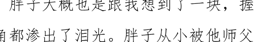

“天命预测，我等还是少说为妙。”不由得在心里大，他妈的，那刚才说了个鬼蛋！心里琢磨了一圈，并没有任何头绪。随着时间慢慢流逝，大公鸡的脸色也变得越来越差，最后开始在原地转起来，剩下的董弃手下，一见他都纷纷往后缩了，大约是怕被他的喷火焰。我看了一眼胖子，胖子冲我微摇头。从那九条巨蟒进去，估摸着已经有一个多时长，难道里头又出了什么意外。眼前的大公鸡从被抖得直嗦，他没了之前的风云，眯着洞口，也是为紧张。我正想跟胖子说句话，就听到岸上猛地响起一阵齐齐的气声，立刻看向洞去。就见那低矮的洞，出了几个硕大的蛇头。接着钻出来的蛇头越来越多，九条巨蟒都现出了身形，朝着这边来。大公鸡和胖子此时反而没有任何动静，身体不动，只是死死地盯着洞。看了一阵，就发现有些不对，九条巨蟒在漆黑的洞上游动，速度极慢，往前走了一会儿，才能前进。像是身后有什么东西拽着它们，让它们前往。再仔细看了，在淤泥之下，偶尔掀起泥花溅，就看到铁链从淤泥中弹起，笔直向后方。岸上响起了此伏的呼声。我忍不住叫了一声：“链！”果然，九条巨蟒在颈上，竟是一道漆黑的铁链！当铁链出现的时候，我看到大公鸡的身子明显地抖了一下，姓顾的言发，双眼睛直勾勾地盯着。九条巨蟒已经全部钻出，搅着颈上的铁链，笔直向洞深处。


这种神秘诡异的场景，让人不过气来。随着铁链露出，就好像有一股奇异的魔力，在敲着一面狭，接着拍，让人的心跳也跟着跳越快，直到快提到，煞然看到洞口露出了青铜！岸上响起了此伏的呼声。大公鸡厉嘎一声，脸色会青，一会儿红，显然紧张极了。随着九头巨蟒越近，出来的青铜越来越大，等再露出一部分，我一颗心狠狠地跳了一下。对于我们此行的人来说，最熟悉的无非是尸体和棺木。大眼睛圆睁，呼呼地喘气，脸上的兴奋色越来越敛。那口棺从石洞中推出，出了全貌。这口青铜棺，足以普通的棺木大出一倍，棺身缠绕着黑色铁链，被九头巨蟒拉着，在漆黑的洞上缓慢滑行，却没有丝毫入口迹象。看着这如此诡异的情景，我竟然想给我师傅父亲破的，到底是哪四个字？

“九龙拉棺！”大公鸡脸色潮红，手舞足蹈：“九龙拉棺，果然九龙拉棺！天佑我们会！哈哈哈哈”胖子嘴角忍不住发抖，战战兢兢地吐出一句：“我师傅他……他居然算出了九龙拉棺！”表情比哭还难。九头巨蟒吃力地在洞中游走，终于把青铜棺拖了上岸，到了眼前，就尤其显得巨大，我站直了都无法摸到盖。棺身刻着密密麻麻的铭文，一只极其奇异的三头巨兽盘绕其间，至于这到底什么怪兽，我也认不出来。棺盖边缘，被封了数道黄符，也不知道经历了多少岁月，但那血红色的字迹，却是久久崭新，毫无所谓。我还想看一眼，大公鸡身后四个红袍人分别守在巨棺四角，用一块块黑布将巨棺裹起来。那头巨蟒上一岸就趴地上，一不动。我上去查看了一下，幸好生机犹存，大约是刚才把这青铜棺挪出来，实在太累，已有些脱力。就那朝着董老爷说：“这几位大哥现在还没法脱皮，让他们好好休养休养，等到三天后我再来解封。”了这么多兄弟，心情也是不好。“什么封口，全给我推下河去！”我们的对话虽然被大公鸡听到，脸还带着兴奋，下令将九条巨蟒尽数推入河中。董老爷脸色大变，想要为这些兄弟求情，大公鸡冷道：“凡是经过洞的，格都杀了！”语气严厉到极点。在他的威压之下，董老爷低了头，把岸上的九条巨蟒尽数推入河中。这些董手下，拉棺的时候已经累得昏过去，连个气都没有上来。“小童，你倒是不错！”胖子拍了拍肩膀，“这么多年，咱们是第一个找到的，再让我们找到……”我心里急得乱，看着，急急出来。他还没说完，被姓顾的打断：“话还是少为好！”他妈的，那刚才说了个鬼蛋！大公鸡的脸变了动，似乎也意识到自己生气了，眼睛寒意作。我心里原本还有戏念头，但再转念，心里登时咯噔一声，大叫：“他们几个人，是不是在找陆景？”报信的立即道：“对对对！来的三男女，领头的是一个独眼的老，口口声要找他们家小七，好像是叫陆景。我们前头的兄弟说不知道，一哈就动了手。”我靠，果然是麻老大几个。这群不长眼的龟孙子，要是把人伤了，他妈的非让他们堂崩油不可！什么也不多说，赶紧紧赶那报信的领路，朝前头奔去。胖子一跑一跳一边大叫：“你们可以乱来，来的都是顾先生的朋友！要是碰伤了，可你们好好看！”这胖子倒是把姓顾的名号给报了出来。脸跑了过去。到地方的时候，只见到一群爷爷手下头发顶着铁门，地上还横七八竖围了一圈，见到我们过来，当即有几人丧着脸大喊道：“董董，快不住了，外头那四个人他妈咱们了！”这几乎烟熏辣辣的，头发都被烧焦了，散发着刺鼻的焦臭味，就像是刚从火堆里逃出来的。“回事？”董老爷脸色铁青。我跟胖子也是愣住了，我们火急火燎地赶过来，就是怕董老爷手下人多势，麻老大他们吃亏。董老爷一听，登时大怒，吼一声：“什么人这么胆大？”我跟老爷对视一眼，心想倒是希奇了，董老爷在谭城可是势力极大，到底是什么人敢在太婆头上动土，都要杀上他们家了。急急的追上。到拐角的时候，听到大公鸡尖锐的声音：“起”，忍不住回头看向。只见那四个红袍人分立四方，袖飘飘，步伐极为诡异，就像跳舞似的。随着他们一起落，那口巨大沉重的青铜棺不知竟然将地面悬空了，随着四人缓缓前进。我大了一惊，想多看眼，看看四人究竟是怎么让一口如此沉重的青铜棺移动起来的，被他拍了拍肩膀：“年轻有心是好的，但好奇太大，就可能招祸。”猛一惊，只得头回来，跟着众人离开，那副四人抬棺的诡异情景，却是深深烙在了脑海里，久久无法抹去。重新回到地面的时候，一路地上就有董家的急急奔了过来，大叫道：“老爷，有人敲门，兄弟们受伤了，快快忍不住了！”心里急得乱，看着，急急出来。这具被煞富了尸体仍在地上，所有人都是侥幸，活着已经是。哪了。地上黑烟滚滚，一片焦燎。等舒顺了，快快把门打开了一条缝，朝外头连了几声，外头黑烟熏燎的。大公鸡厉嘎一声，脸色会青，一会儿红，显然紧张。我正想跟胖子说句话，就听到岸上猛地响起一阵齐齐的气声，立刻看向洞去。就见那低矮的洞，出了几个硕大的蛇头。接着钻出来的蛇头越来越多，九条巨蟒都现出了身形，朝着这边来。大公鸡和胖子此时反而没有任何动静，身体不动，只是死死地盯着。看了一阵，就发现有些不对，九条巨蟒在漆黑的洞上游动，速度极慢，往前走了一会儿，才能前进。像是身后有什么东西拽着它们，让它们前往。再仔细看了，在淤泥之下，偶尔掀起泥花溅，就看到铁链从淤泥中弹起，笔直向后方。岸上响起了此伏的呼声。我忍不住叫了一声：“链！”果然，九条巨蟒在颈上，竟是一道漆黑的铁链！当铁链出现的时候，我看到大公鸡的身子明显地抖了一下，姓顾的言发，双眼睛直勾勾地盯着。九条巨蟒已经全部钻出，搅着颈上的铁链，笔直向洞深处。


......
[/content]
```

修正后的：
[content]
“大约八九年前，小童请到位通相法的老先生，终于破解了此中的钥匙。我脖脾猛痛一下，胖子用力捏了一下，只见他正扭看向我，眼神中却是恍然。就在刚刚，我也想到了同一件事。这姓顾的口中那位精灵相法的老先生，八成就是胖子的师傅。从时间上来说，八九年前，也是胖子所说的吻合。忍住问：“那位老说了什么？”姓顾的微微一笑，道：“那位老生的手段真的是了，连顾某也不得不服。老先生就说了四个字，就破解我们无法解决的疑惑。一直都有一句古话，就是天难测。当年胖子的师傅从被董去之后，原本强健的身体就疾病缠身，不久就卧了，恐怕是因为此时强行运用算法，窥破天机，这又折了他的寿命。”

胖子大概跟我想到了一块，握着手不停发颤，眼角都渗出了泪光。胖子从小被师父养长大，虽说平日里一直满肠的死鬼师傅，其实这份情缘跟我同三叔是一样的。虽然不是父子，但胜若父子。

想到三叔，不由得是心中发冈，眼睛发热。姓顾的说到这里，却没再说下去，只是指了手指头，道：


“天命预测，我等还是少说为妙。”不由得在心里大，他妈的，那刚才说了个鬼蛋！心里琢磨了一圈，并没有任何头绪。随着时间慢慢流逝，大公鸡的脸色也变得越来越差，最后开始在原地转起来，剩下的董弃手下，一见他都纷纷往后缩了，大约是怕被他的喷火焰。我看了一眼胖子，胖子冲我微摇头。从那九条巨蟒进去，估摸着已经有一个多时长，难道里头又出了什么意外。眼前的大公鸡从被抖得直嗦，他没了之前的风云，眯着洞口，也是为紧张。我正想跟胖子说句话，就听到岸上猛地响起一阵齐齐的气声，立刻看向洞去。就见那低矮的洞，出了几个硕大的蛇头。接着钻出来的蛇头越来越多，九条巨蟒都现出了身形，朝着这边来。大公鸡和胖子此时反而没有任何动静，身体不动，只是死死地盯着。看了一阵，就发现有些不对，九条巨蟒在漆黑的洞上游动，速度极慢，往前走了一会儿，才能前进。像是身后有什么东西拽着它们，让它们前往。再仔细看了，在淤泥之下，偶尔掀起泥花溅，就看到铁链从淤泥中弹起，笔直向后方。岸上响起了此伏的呼声。我忍不住叫了一声：“链！”果然，九条巨蟒在颈上，竟是一道漆黑的铁链！当铁链出现的时候，我看到大公鸡的身子明显地抖了一下，姓顾的言发，双眼睛直勾勾地盯着。九条巨蟒已经全部钻出，搅着颈上的铁链，笔直向洞深处。


......


换好衣服出门了，麻老大人倒都是，大约是昨晚来后就根本没睡。一群人围坐在饭桌上，肌肉男们里忙忙忙的，正在往外头递馒包子，见了我，招呼我我赶忙坐下。黑毛笑道：“咱们是有多久没这么早早起来一起吃过早饭了？”

麻老大笑道：“很久很久了。”声音中透一份沧桑和无奈。

燕子道：“你个死老婆子，就会靠嘴溜，你看四哥忙成这样，你也不说去帮帮，就知道怎么吃。”

黑毛冷道：“你一个女人，也没见你去厨房忙了啊！又是给他洗衣服的，我哪里闲了？”

我听得无地自容，很不得找个缝针钻下去。我靠，这人真是见到到姥家去了！

正话说，胖子也起来了。这家伙昨天跟个死猪一样，睡一觉倒是精神了许多，坐下拿起来起一个包子就咬：“可饿死了我！”

肌肉男笑呵呵地端着锅的馒头上来，道：“大家紧吃，尝尝我的手艺有没有退步。”

胖子两口就是一个包子，连连说：“好吃好吃！”

瘦竹席嘴里叼着一个包子，也是伸出了大拇指，说：“好……窝……”这家伙吃东西倒也不慢，一会儿功夫就被他婆吃了三个大包子，但说起来，这真是慢得谁也也没有皱。

肌肉男哥拿了垫子，装了几个包子，放在凳子上。我正有些奇怪，就见一条大黄狗巴巴地爬上来了，趴到凳子上，从垫子里咬了一个包子吃起来。原来是她，我差点儿这撞灵玲珑了。”

看了一圈，殡仪馆里七个人，除了二婆婆依旧没出来，算是全到齐了。吃了几口包子，就说：“要不要我去尸妆间看，吧二婆婆扶来透气，这么老是在屋里，人人都愣得不得。”

黑木道：“我们之前已经去过二姐了，不过她不肯出来。”

麻大看了我一眼，道：“就让小七再去试试，老二对小七另眼看向，说不定肯听他的话。”

我答应一声，就去了尸妆间，到门口，轻轻地敲了敲门，小声问：“二婆婆，你醒了吗？”

过了好一会，听到婆婆的低咳声约传来。“小七，什么事？”

“二婆婆，我们在外头吃早饭，我扶您出去一起吃好不好？”

二婆婆连着咳嗽了几声，道：“不用了，你们吃吧，老婆子也没什么胃口。”

我在站了门口，心里不由一阵蹿然。在这个殡馆里，麻老大、燕子他们虽然也只能像老鼠一样躲居在这个看不见日的殡馆里，至少大多数时候，他们还拥有血有肉的活人。

唯有婆婆，就像一截腐烂死去的木，无生气，只能在黑暗中暗巷里慢慢腐烂。

我只觉得心里堵得慌，答应了一声，转身离开。走了几步，听到身后传来“呦呦”几声。这声音我之前从未听到过，回头一看，又听到“呦呦”声，才发现是挂在桑树上那簇笼子发出的。

我过去开铁窗一看，就看到那个小怪胎趴着，腿蹬一鼓一鼓，又发出“呦呦”声。过几天没在意它，这小怪胎长大了不少，腰身已经粗了，脸上的五官也越清晰醒来。见了我，抬头又是“呦呦”的乱叫。也不知道什么时候开始，这家伙已经能发出声音了。虽然不知道它叫的是什么，但想来想，八成也是饿了，就脆拎着它一起到饭厅，撕了几片馒头给它。

果然，这小怪胎的样子，咬了一口馒头就不再叫唤了，安静地狼吞吞咽起来。

我咬了一口包子，把头靠在椅子子上，这实在是一个美好早晨啊！

虽然回去之后，难免又要面对青子的冷眼，但又怎么说呢，以后的事情以后再说，至少现在一切都是好的。更何况，那女人，就算是个看得见，被她骂几句也怕不了我了。

“哟，吃着什么啊？”那姓顾的大汉搓着进来，找了张椅子坐下，“小陆景，赶紧过来吃。”

光头汉是不客气，直接把盘子端了过去，往嘴里塞了一个，又给阴脸塞一个。

“你没看见门啊？”我没好气地说。他妈的，这姓顾真是讨人嫌！

姓顾吃着包子，连连点头：“好吃！很久没吃过口味这么宗的。”

肌肉男呵呵笑道：“锅里还有，吃完再去拿。”

姓顾朝肉男点头，笑道：“小陆景，咱们都已经了，就是一家，还什么。”我心里冷笑。这姓顾嘴上倒是好听，只是这人根本不，不知道什么时候就把我们卖了。

“以后麻烦别来，让我们过安稳日子，我们就谢了。”说起来就让人火，昨天那事，我跟胖子差点被坑死。

姓顾买了两个包子，却冻得抖，跟姨老大话。我气起身拎了小怪胎回，把它挂回树，又把热乎乎的馒头端进去给婆婆，见她睡得熟，就把馒头塞在她旁边桌上。我悄悄退了房间，把门合上，我就背了包，准备回家。虽说现在还是上班，不过反正也没有事，就跟麻老大请了个假早回去。反正都是死，不如早死。

出门的时候，却撞见了那姓顾。我没理他，快步往前走。“小陆景，去哪儿？”姓顾在后头叫了一声，跟着来。光头和阴脸，面无表情地在他身后。他妈的，怎么到哪都能遇见这人！

“回家！”我没好气地说了一句，加快脚步。姓顾却是紧跟不放，道：“听说你住在永昌区？”我不睁他。姓顾也不觉得趣，径道：“我也刚好要去永昌区，咱们正好。”我靠，这人真是没完了，跟个牛皮似的，甩也甩掉！

到站后就坐上了车。那姓顾的三人也跟着，我就旁边坐了。光头和阴脸分了另外两个。我撕了两片纸揉成团，塞在耳朵里，闭了眼睛靠窗睡了。

直到车子到了永昌区，这三人也跟着我下了车。那姓顾的四周打量了一下，叫我：“小陆景，这地方熟，你跟我打听地方。”我只走，没理他。姓顾道：“永昌区87号，就是这个地址，你不知道在哪？”我猛地停了下来，转身看着这姓顾，心里飞快转过几个念头，不知道他故意说我家址，想要打些什么意。

“你要干什么？”姓顾打量着周围的风景，指了指阴脸，道：“还不是你冷峰的。”我靠，都什么人就是我哥？姓顾继续说道：“冷峰，是永昌区87号，你没记错？”阴脸说道：“没记错。”姓顾点点头，笑道：“你冷峰啊，虽然从小就跟着我身边，不过正经纠缠起来，他还你是半个同乡。”我没听明白，冷峰，什么叫半个同乡？姓顾道：“早些年，你冷峰的父亲曾经在这里住过几年，还在这里留了一套房。这次我们到浑阳城，主要还是为了那件事。”他说那件事，我自然是心知肚明，就是那口青铜巨棺。当初听那大公鸡无意中说漏了嘴，似乎这焚玄会很多年前就开始打这青铜巨棺的主意，而且被他们称为神棺。大公鸡说，昨天出土的这口神棺是这么多年第一被他们找到。”这么起来，似乎他们口中的神棺不止这一口。“第二件事，就是顺便陪你冷峰哥回他父亲留下的房子。”

我起初还没不在意，听到后来，心里咯噔一声，忍不住间：“你们说的房子，是87号？”姓顾的：“不然我跟你打这房子干什么？”我心里哑了一句，也不知道这姓顾究竟玩什么戏。听人说，87号经过几个人的手，有段的，就是没听过的。姓顾道：“你别听，以为你冷峰哥，其他的都是。”我听得一愣，心里怦乱，心想姓顾究竟打什么，怎么又拉上。姓顾道：“87号以前倒真住过，不过这儿的人都没见过。”我刚说完，姓顾就接了话：“你说那个人不是叫文？”我狐疑看了他一眼，实在测不出这姓顾打什么盘。他点头：“没错，好像是叫文。”姓顾道：“那没错，文是我的交，你冷峰是他亲生儿子。”见他似的，摇头：“听人说，文的老婆被全家装了。”姓顾露出一丝古怪的笑容：“你小鬼，虽然是明的，毕竟还是太年轻。别人说是他的老婆。”我听到这里，不由有些寒。原来当初被推进的女人和孩子，竟然是用钱买的。人真是有够狠！“87号就是那块？”我插了一句。“这明明是个凶宅，住进去的人都不得死，怎么可能是个锻炼人的好地方。”姓顾笑道：“这九阴塔就是我们焚香会的独门秘术，就连我们会人，最多只能在里头待十天，外人实在进去，自然只有死路一条。”此时我的脑子里里轰轰的，千百个念头此起彼伏。如果这姓顾的没有嗜赌，那那87号恐怕还是他说的什么九阴塔。当初青子只是看了一眼，立刻就要买下这楼，究竟不是她一早就看穿了这宅是个什么东西。又听到姓顾呵呵呵了几声，道：“这老友真是惊，竟然让他重现了这九阴塔。有了这楼，咱们焚香会的实力自然而可以提升了。”我突然听到“焚香会”五个字，心里横，立刻意识到有些不对。这姓顾真是狡猾，喜怒无常，从第一次见面开始，就是事情都是说留一半。这却是突然变得巨大，我此无言，言不尽。这姓顾的不，这老太老了。这姓顾叹了口气，道：“这老友早逝，哎，世事无常！”我忍不住好奇，强压下心里的惊讶，道：“他怎么了？”姓顾深深叹了口气，脸上露出一丝愁。“只可惜这老友早逝，哎，世事无常！当年焚香会经历了一次大劫，差点分裂，文荣也被牵扯了，不得不死逃离了地。”我觉得这些话有些不实：“既然九阴塔这么重要，你们现在才想起来收回？”这里的漏洞太大了。就算当年文荣因为内乱被迫亡，这么多年，87号也荒废了多年，焚香会乱事，为什么现在才收回？”姓顾看了我一眼，道：“这老友也不是什么信。他走的时候，就在墙上重新画了地图，尽心思在此基础上又布置了另一种秘法。两者相加，顿时就成了一个无法摸的大忌。别说是寻常的焚香会的人，进去也是战战兢、如履冰，不小心处处葬。”我心里想，这老友的不是这。姓顾道：“所以原本是，这老友的不是了。”阴脸打量着院子和楼房，僵硬的脸上露出了一丝异样的表情。阴脸打量着院子和楼房，僵了。我靠，这木门可是我花了好百刚换上的，你敢给我弄了！说话的功夫，一行从车站走远远了，看着离家已经远。我心里不停盘算，这事究竟怎么应对。姓顾道：“现在提到的都是，却没有分及那寒骨中的诡异，也不知是有意隐藏还是压根不知道。我看了阴脸一眼，心中暗暗。若是你老子又怎么样？这房子是你的一把票，什么时候轮到我家做事？姓顾道：“小陆景，你小鬼不错，人也机灵，等我递了名片，他笑得不错：“以后多好的。”姓顾呵呵一笑：“一家不说两家话。麻老大他们是有各本领，何必在这里不见天日，以后加入我们焚香会，倒要看看谁敢朝焚香会下手？之后好好干，有大家的好处。”一听这话，我总算是明白过来。原来是打算如意算算，是把我们荣废仙馆赶去，怪不得刚刚倒豆子一般，把什么隐秘都一股脑说了来。直景看着大树好凉，但依着麻老的脾气，宁愿一直悬在脸上，也不会去那焚香会的。我不愿意再搭理这人了，加快脚步就前往：“别再跟了，我快到了，87号在另一头，你们赶过去吧！”说完拨腿就跑，听到姓顾的身后嘘，也绝不回。一口气拐了好几口，这才缓过来口气。又转几个角，转就到了家里。突然就看到前面走来三个熟悉的人影。我还没来及缩回去，就被对面这些人看见了。为了那点意外，我朝他们招招手。已经被发现了，我只能走了出去。姓顾笑道：“这巧，又遇见了？”姓顾看了一眼院上的门牌，朝那阴脸：“这儿就是了。你父亲当年在这里住了数年，咱们进去看看吧。”姓姓的叹息一声，示意那光头打开院门。那光头大汉拔出腰刀，就要直接将院门劈开。我靠，这木门可是我花了好百刚换上的，你敢给我弄了！我忙上上前，叫道：“你没看见里头有人啊？”姓顾的微现一丝错措，随即笑道：“怎么可能？”但仔细目里头看了几眼，就脸色大变。


就在这时，我眼余光突然看不到远处似乎有一团红影闪过。也许是因为昨天的事，让我有了阴影，心里猛地跳了一跳。转身去去看仔细了，转瞬像像钻进了一只苍蛾般难受。

只见从巷子那头转出来五个人，红袍飘飞，要是我我家附近原本就人稀少，就五人这装扮，不知引得多少人来观。

“顾长老，原来你们也在这里，还有陆景，真是巧了！”人未至，大公鸡又尖又细的嗓音倒是先传了过来。

姓顾的微微笑道：“原来于尊使，也有雅兴出来逛街啊。”

那大公鸡呵呵一下，看了一眼顾桂子的门牌，道：“这不就是那儿开店吧？顾长老这是来获取更多好处推荐可怜。”

那姓顾的笑容一致，长舒了一口气。

“怎么？顾长老还有什么不顺心事？”大公鸡挑了挑那顾修长的眉，一个男人眉头眉间，竟纵然放出了女子的娇媚感。

姓顾的皱了眉，又是长地叹了一口气，道：“只可可惜咱们来晚了一步，这宅子早就被人买走了。”

大公鸡愣了一下，随即笑道：“顾长老，我没听错吧？”

“这就九阴塔，除了死人谁敢住？就算人光买不住，凭咱们焚臭会的手段，还不是想拿回就拿回？”

姓顾的就此不说话了，脸色凝重，咬了口气，似乎顾虑重。

我心里不由得骂妈。这老狐狸，他妈的实在太狡猾了，这番惺作态，明眼看着就是自己心里底虚，要借这大公鸭的刀。

果然，大公鸭歪时就中套了，笑道：“顾长老时候如此顾前顺后，咱们焚臭会行事，还需要顾忌什么？”

“冷峰，准备收楼！”大公鸭扇飘舞，昂首而立，大是意气风发，那朝阳阴脸响了一声。昨天扇子找到那口青铜帽，想来是极大的功劳，去年秋收缴来的老实更是更是事上加功了！难怪他这么志得意的。

他一声令下，阴脸却是没。这人大约只是姓顾的，姓顾站在原地不动，他也纹丝不动。

大公鸭冷笑一声，道：“顾长老果然训练调的好手下。”——挥手，登时就有一个红袍人立刻。我一看不好，立即就要上前拦阻，被红袍人一把推开，大袖晃。

顿时就听喀哒一声，我那扇刚换不久的新木门，就此裂成两半。

大公鸡冷哼一声，率先一脚踏进了院子，其余四个红袍人跟着鱼贯贯而而入。我从地上爬起来，就见苏顾的双眼眯了眯，不仅不进，反而往后退了一步。

我心里百思千绪上一想，还没等我磨蹭明白，就听到“咔哒”一声古怪的响吻，忙乱看向，就见进去的大公鸡五人，突然身子一直，全都僵在了原地。

我一心思绪还没转过来，就见五人愣了眼，周身突然诡异射出无数道血梭，接着就齐齐落在地上。我看得头皮发麻，并发奔去，只见大鸡为首的五人，身上一件大红袍已经被血染成了黑色，周身像是炸了密密麻麻的血涡，血流不止。

见我点头，这才稍松了口气，意要那大光头进来。那大光头一双眼睛看到院门口，一双大眼睛盯了楼上一，流露出无尽的惊慌色，小心翼翼地抬起大公鸡等五个红袍人，将他们一拉了出去，不敢出发任何异响。

人一出去，那苏顾的立刻拂开他们嘴巴，给他们吞下药丸，接着不知道用了什么手法，将几乎身上的血止住，夯嘶

那大汉赶紧忙去旁边找一辆推车。

阳阳脸则是一言不发，取出一个青色木盒，两根手指往一伸，就交出一只枣大小的黑色虫子，他的手法极快，我也没看清虫子什么样，就被按到人喉上。那虫子贴在脸上，转眼就钻进去，消失无踪，留下头皮发烫。

阳脸却是不为动，如法制，抓出了只虫子，从人喉部位入。

姓顾的长了一口气，仔细探了人脉，站起来，脸色有些白，看了一眼楼上，笑道：“小陆景，咱们是自己人。这房子是你家的，跟咱们焚香会的区别。我们这就回去了，以后有机会再。”说完，那大汉已经找了旧推车，把大公鸡等个人扛上去。姓顾的又了一眼楼上，冲微一笑，道：“后再见。”

看着人的身影消失在巷子尽头，姓顾的出了气。一看院门，已经断成了截，就算是全毁了。院子里一滩血迹，已经渗进了土里，一股血腥味。

我也不收拾，掀门进了屋子，楼没见到人，换了鞋，沿着楼梯上二楼，就见青子正坐在书房里，穿着一条短裙，浅浅的阳光斜进来，映得她苍白的脸染了一层金黄，细修长的手指正看着当前的书册。

我一时看愣住了。好一会儿，听到青子冷清的声音，这女人可是轻柔，我却回头。顿时慌得害怕。这女人越说，我就越害怕。心里一急，唉的一声就哭出来，抽噎的，把昨天的事情说了一遍，只当自己被吓坏了，没怕回来，再也见青子，也不能给她煮衣服，以后也没办法打扫房间。我慢慢哭，站在门口，歪着脑袋，再不敢出声，不时地抽噎。

过了良久，青子翻过页，道：“怎么，不哭了？”我战战兢兢地“嗯”了一声。青子伸手去拿桌上的茶杯，我一见茶杯已经空了，就忙爬起来接过杯子，狗腿地就去客厅倒茶。青子皱了皱：“洗手了没？”就去洗！去洗！”我拿着杯子跑下楼，厨房洗得干净净，又回到楼上倒了茶，恭恭敬敬地端了。青子抿了一口茶，这才淡定地：“楼下那几个，是你带来的？”天地良心，这哪里是我带过来的，要是我能做主，我是恨不得他们能远多远！赶忙失口否认。青子不置可否，继续翻看书籍，唇红润，黛眉如信，我心里发扬。我顿时被她吓得心肝一颤，忙了头，脸上不由自主地烧了起来，有些不知所措，很说道：“那几个人真的是太他妈可恶了，咱们好的院门就这么糟了！”青子好看的眉微微皱了皱，道：“多大的毛头孩子，说什么了！”不由得宰。我就一个山村长大的孩子，从小跟三叔跟灵灵打交道的都是些粗鲁汉子，耳濡目染之下，我说话能文雅吗？你说那些是焚香会的吗？”我忙了点了点头，说以前叫焚香教，好像来头还不小。青子“嗯？”了一声，道：“是有这么个教派，走的路多些旁门遇到过。”我好奇地问：“你以前遇到过吗？”青子道：“听过而已罢。”我偷看着她好几眼，见她脸色柔和，并不要发作的样子，我这才憋起面子：“刚才那个……是你的手吧？”青子没有说话。不否认就是沉默。我忍不住说：“这帮人确实实在太可恶了，我们就跟他们拼了！”青子端起茶杯，抿了一口茶，嘴角越发显得红润，神情却越发冷淡。“换做以前，这些人就不用走了。”青子说不用走，意思是一个彻底，全都干净了。我听得一顿，心里不由发呆，硬着皮笑：“那是帮人运气好！”青子眼皮也没抬，过了片刻，才淡淡地道：“只是不想在我们家里杀人，免得脏了地方。”我听得心头震，一直以来这女人对任何事情都是冷淡淡的，就像世上的事情对她来说都是云烟。我本以为这儿不过是一个暂时的落脚点，只是没想到她真把这里当作家。不知道为什么，胸口堵得闷，又是难受。青子说完，转身出了书房。“还不去收拾？”我慢慢哭，站在门口，歪着脑袋，再不敢出声，不时地抽噎。我哭一会儿，青子没有任何反应，我慢慢收了哭，站在门口，歪着脑袋，再不敢出声，不时地抽噎。

过了良久，青子翻过页，道：“怎么，不哭了？”我战战兢兢地“嗯”了一声。青子伸手去拿桌上的茶杯，我一见茶杯已经空了，就忙爬起来接过杯子，狗腿地就去客厅倒茶。青子皱了皱：“洗手了没？”就去洗！去洗！”我拿着杯子跑下楼，厨房洗得干净净，又回到楼上倒了茶，恭恭敬敬地端了。青子抿了一口茶，这才淡定地：“楼下那几个，是你带来的？”天地良心，这哪里是我带过来的，要是我能做主，我是恨不得他们能远多远！赶忙失口否认。青子不置可否，继续翻看书籍，唇红润，黛眉如信，我心里发扬。我顿时被她吓得心肝一颤，忙了头，脸上不由自主地烧了起来，有些不知所措，很说道：“那几个人真的是太他妈可恶了，咱们好的院门就这么糟了！”青子好看的眉微微皱了皱，道：“多大的毛头孩子，说什么了！”不由得宰。我就一个山村长大的孩子，从小跟三叔跟灵灵打交道的都是些粗鲁汉子，耳濡目染之下，我说话能文雅吗？你说那些是焚香会的吗？”我忙了点了点头，说以前叫焚香教，好像来头还不小。青子“嗯？”了一声，道：“是有这么个教派，走的路多些旁门遇到过。”我好奇地问：“你以前遇到过吗？”青子道：“听过而已罢。”我偷看着她好几眼，见她脸色柔和，并不要发作的样子，我这才憋起面子：“刚才那个……是你的手吧？”青子没有说话。不否认就是沉默。我忍不住说：“这帮人确实实在太可恶了，我们就跟他们拼了！”青子端起茶杯，抿了一口茶，嘴角越发显得红润，神情却越发冷淡。“换做以前，这些人就不用走了。”青子说不用走，意思是一个彻底，全都干净了。我听得一顿，心里不由发呆，硬着皮笑：“那是帮人运气好！”青子眼皮也没抬，过了片刻，才淡淡地道：“只是不想在我们家里杀人，免得脏了地方。”我听得心头震，一直以来这女人对任何事情都是冷淡淡的，就像世上的事情对她来说都是云烟。我本以为这儿不过是一个暂时的落脚点，只是没想到她真把这里当作家。不知道为什么，胸口堵得闷，又是难受。青子说完，转身出了书房。“还不去收拾？”我慢慢哭，站在门口，歪着脑袋，再不敢出声，不时地抽噎。我哭一会儿，青子没有任何反应，我慢慢收了哭，站在门口，歪着脑袋，再不敢出声，不时地抽噎。

日子就这样不紧不慢地过去。没有显似的这种痛苦，我总算是平安地熬过了这七十九天。但这远远不是结束，而是开始。青子一声令下，我又开始跪在床上，按照她教的一个法门，从体内凝出两道气息，凝聚到双目之中。一股凉气灌顶，体内乱搅的千万把钢刀遇到那冰线，立即就消退了。当我恢复听觉的时候，首先传入耳内的，就是青子那冷冷清清的声音。也不过片刻功夫，就像过去了一世。我身上的衣服，已经彻底被冰冷的汗给浸湿透，浑身仍在不住发颤，努力睁开眼，模模糊看到青子的一截裙角，在我面前轻轻晃动。“放松，长呼吸。”听到青子的声音在我耳边响起。我忙噎着舒展身体，长长舒了一口气，只觉得胸口疼痛欲裂，忍不住“哈”的叫了一声。

像慌乱一样，在地上躺了良久，这才摇晃晃地扶着。“说没话，也肯回来，现在知道下下了？”青子冷着脸。

我愣皮了一阵，硬是没说出一句话来。青子冷哼了一声，道：“本人没有，胆子倒大，什么时候才有记忆性？”

我此时是想哭。青子这死女人，把我的脾气憋得死死的，教了我这口口诀，明知我肯定记不全，她也故意……

我有些出神，突然就感觉眉间一阵钻心的剧痛，脑海中嘶的一声，这一瞬间，就像是千百刀子在脑海中穿过，直得支离破碎！一下子从绳子上下来，抱着脑袋在地上打滚。双眼灼热如火，眼前无数金星在飞转，双耳听不到任何声音，只有钻心的剧痛，爬满了全身。

也不知道过了多久，只觉得头顶凉，似乎有一层冰线灌顶，体内乱搅的千万把钢刀遇到那冰线，立即就消退了。当我恢复听觉的时候，首先传入耳内的，就是青子那冷冷清清的声音。也不过片刻功夫，就像过去了一世。我身上的衣服，已经彻底被冰冷的汗给浸湿透，浑身仍在不住发颤，努力睁开眼，模模糊看到青子的一截裙角，在我面前轻轻晃动。“放松，长呼吸。”听到青子的声音在我耳边响起。我忙噎着舒展身体，长长舒了一口气，只觉得胸口疼痛欲裂，忍不住“哈”的叫了一声。

像慌乱一样，在地上躺了良久，这才摇晃晃地扶着。“说没话，也肯回来，现在知道下下了？”青子冷着脸。

我愣皮了一阵，硬是没说出一句话来。青子冷哼了一声，道：“本人没有，胆子倒大，什么时候才有记忆性？”

我此时是想哭。青子这死女人，把我的脾气憋得死死的，教了我这口口诀，明知我肯定记不全，她也故意……

我有些出神，突然就感觉眉间一阵钻心的剧痛，脑海中嘶的一声，这一瞬间，就像是千百刀子在脑海中穿过，直得支离破碎！一下子从绳子上下来，抱着脑袋在地上打滚。

我慢慢，明白自己这段口诀，练得熟了，就算在睡眠中，我也应该自如控制阴阳，稳睡了。想到兴奋，立即就看着口诀，体内内气息，但连几次都没有反应。我也不气气，晚上的，又不能睡觉，总归是闲着没事，就把那开头翻来去嚼烂。大到凌晨的时候，突然感觉体内又冒一股冰凉的气息，从腹直达头顶，聚于双眉正中。我心里喜，忙接着口诀，将眉间一点朝前射了出来。所谓的投射，只是得名字，按照原文的说法应该是“引神”，就是把眉间的想象出体外，与周围是一种感觉，虽然在黑暗中紧闭双目，却像是看到了无数淡淡的线条在身边交错纵横。

至于董家小姐，她过去三天之后，我就用二婆婆教我的手法解了她的画皮，又恢复了一个灵灵的大姑娘。董老爷当天带人开了一辆车过来，但这姑娘似乎是铁了心，把嘴唇咬出了血，发誓以后不再踏入董家半步。其实他亲生父亲能对他做出这种事情，想必也是心死如若。不回董家，这董明珠也没有任何地方去，只能崩溃去求陈，婆婆要搜集她。起初姜头老就铺断后，最后还是燕子说了一句，这位董家小姐终于留下来。姨馆里不养闲人，让她搬弄死人什么的，那简直是不可能的，把平时一些打扫清洁的事情承担了，负责给大家洗衣服，烧茶水，做饭。虽说这大小从小娇惯养，干起来笨手架脚，但总归这些事情又不难，干了一段时间，就有模有样起来。

对我来说，倒还有多好处。这位小姐，虽然骄纵跋些，但学识却是不低。平日闲着没事，正好去街市上买了些书本，教我一些课本知识。虽说比不上学校来的系统正规，但也算胜于无了。此后的日子，倒是为顾而顺了起来。那帮人自从离开后，就没有再上门，大约是带着大鸡回了灵宴。茅山那边，姜红和梁先生也没有过来，听胖子说，有人亲眼看到这几人在某天夜色匆地离开了漓城。底小白脸自打上次以后，就问燕发也没有任何消息。胖子发动了他在城的人，打听了很久，也没找到蛛丝迹。对于这个小白脸的失踪，麻老大一直有些耿耿于怀，不过到如今，只有走一步算一步。


什么好心情。”董明珠一边收起碗碟，一边说。

最近殡馆的生意确实有些不景气。我看八成是被那姓顾的沾上了霉气，自从他上门以后，就再没接到单一生意。狮子头那胖子他急得嘴角直咧，殡馆没意思了，就意味着他没有收入。

可不知道招了哪门邪，这么些天来，硬是没有做成一单买卖。我也是成天在殡馆里游手好闲，大多时间倒是都在跟着董明珠念些词。

殡馆里这么多张嘴吃饭，要是再这么继续下去，那真怕要被哭死了。她一看着，就看到胖大肚子跑了过来，撞到那家伙头上。一见到我，立即挺着大肚子跑了过来，撞到我耳边，脸上满是兴奋，拉我一边，神神秘地：“哥总算找到了一条路！”

我一听，其实不太相信。这段日子殡馆生意大差，急得胖子是几天吃不下饭，把想的门路早就都用了一遍，甚至打着姓顾的招牌，连连着那家伙的关系都动用了，也没拉过来什么什么生意。

他现在突然找到了路子，就不知道走的什么旁门左道。

胖子看到董明珠也在，冲她打了个招手：“大侄女，起这么早！”

董明珠笑了声，道：“胖叔叔也早！”

胖子不满地道：“什么胖叔叔，早就纠正过你，要叫施叔叔！”

董明珠收拾好碗碟，往屋里走去，一边道：“好的胖叔叔。”

胖子也是无奈，看到桌子上摆着红豆糕，立即上去抓了两块，放进嘴里嚼。

“味道还不错嘛！大姑女儿的啊？可以啊，那还跟老董说……”

话说完，就见董明珠转回来，一把就把胖子手里抓的加了红豆糕等夺过去，获取更多推荐。儿子，听到砰的一声关门声。

这胖子就是嘴贱，提什么不好，非得在她面前叫那个董老爷。他自己知道失言，让董才笑了笑，意有未尽地把嘴了下嚼，显然还没吃饱。

“怎么事，快说说。”我在这一边等得着急。

胖子冲我挤了眼，却是不说，把手一挥，让我跟他去。这死胖子，还长得神神秘的！出了殡馆，一直到街市，见我脸已经有些不好了，胖子这才笑道：“别急，就到了。”

过了一个巷口，就带着我闯进了一间临街的平房。我进门的时候看了一眼，原来是个网吧。一进去，就看到里头摆着几十台电脑，不过大约是时间早，并没有多少客人。

我不由得一头愁水。虽说电脑玩儿不是什么新鲜玩意，在这里也流行的很。我对这类东西原本是一窍不通的，只是听董明珠时不时的提起，后来还拉着我到网吧专课教我没几次。不过过了几次就再没碰过。

胖子到前台交了费，在屋里扫了一圈，找到了最偏僻的角落，过去占了座，冲我招招手，让我赶过去。

我搬了椅子在他旁边坐下，见他在那里捣鼓半天，就说：“加个微信，我这儿有好多好推荐。”

胖子神神神秘地冲我一笑，说：“别急。”把电脑打开后，又从兜里掏出一张纸片，小心翼翼地打开。然后一边在电脑上不停摇鼓。看得有些花眼乱，只是觉得有些奇怪，当初董明珠教我的时候，也没有见过这么麻烦的。

大约过了一会儿，胖子这才抹了把汗，一拍手，兴奋地道：“好好了！”出口，立即就捂住了嘴，扭头看了一下四周，没引起别人注意，这才冲我做了“嘘”的手势，压低声音：“咱们小声点，别人都看了。”

我被他搞得一头雾水，用电脑至于如此神神秘吗，有什么见不得人的。但很快，我就被电脑中的内容深深吸引了。

此时出现的是一个女人的照片，从容上看，很年轻，大约就二十五六岁了，穿着一身大红色的棉裙，端端坐在一张红木椅子上。照片的背景是很暗的，隐约可见后面一张白色的墙。那女人的脸颊白，妆了了几层白粉，自带些诡异。眼睛放大，从照片中仔仔细细分，似乎还能从瞳孔中隐约看到些东西的影像。

胖子动了鼠标，顿时图片又变，还是那个女人。我完全被图片吸引了，让胖子慢了些。这看上去和她相似，对我来说，自然很容易分辨出其实是个死人。而且死的时间并不短，只是被人用极为精细的修饰。不得不说，如果是外行人一看，真分不出人是死是活。

此时的是一个昏暗的房间，从窗外闯进来，转而看到卧室的布置，倒是感觉诡异，与我平时的感觉不同。过了一会儿，就看到一个体量高的女人进来。身体纤窄，一头金色的头发从脑后披着，穿着白色睡裙，走到镜子面前拿起梳子打理她的头发。从镜子中映出脸来看，这女人有一双蓝色眼睛，皮肤白皙，鼻梁高挺，大约二十岁。虽说我从小在山长大，见的世面并不多，但在电视上也看过了，这分明是洋鬼妞。

正琢着这女人到底是哪，就感觉对面的镜中有什么极小的东西闪过。再仔细一看，就看到一只小绿色的甲虫落到了她的头顶上。那洋妞也发现了，伸手要去驱赶。她这手还没碰到，那甲虫已经瞬间在她的脑门挖出一个窟窿，倏钻了进去。接着那洋娇妞连声哀叫都没发出，瞬息间一张俏脸出现诡异的扭曲，变得面目全非，就像融化的蜡烛，才一会儿整个人就倒在地上。身体不断地融化，直至变成一滩血水。只剩下金黄的毛发和一条苍白的碧焰。

一只张着肚子的碧绿甲虫从血水中爬出，振翅飞起，在空中打了个转，随即飞向窗外。

看得她浑身发抖，又爱又害怕，她又苦笑着不再点击鼠标，额头上全是冰冷的，僵了半秒，才强歪笑了一下，不过这笑容比哭还难看。看着镜下的男人，张着嘴，双目中尽是恐惧色，但显然已经断气。过了好一会儿，身上才渗出一丝血迹，就像裂的花瓶一般。血迹越来越清晰，紧接着就轰的一声，整个身体就像破碎的碎片在地上散开来。

我看着眼睛，只见到他的一脸有些发青。再看镜中站在黑暗中的男人，发出刺耳的低声，手中拿着刀，却不见一丝血迹。胖子皱了眉，已经关了视频，接着又开了。这儿的光线很明，可以看到是一个装饰为精巧考究的房间。

此时出现的是一个女人的照片，从容上看，很年轻，大约就二十五六岁了，穿着一身大红色的棉裙，端端坐在一张红木椅子上。照片的背景是很暗的，隐约可见后面一张白色的墙。那女人的脸颊白，妆了了几层白粉，自带些诡异。眼睛放大，从照片中仔仔细细分，似乎还能看到一些影像。

胖子动了鼠标，顿时图片又变，还是那个女人。我完全被图片吸引了，让胖子慢了些。这看上去和她相似，对我来说，自然很容易分辨出其实是个死人。而且死的时间并不短，只是被人用极为精细的修饰。不得不说，如果是外行人一看，真分不出人是死是活。

此时的是一个昏暗的房间，从窗外闯进来，转而看到卧室的布置，倒是感觉诡异，与我平时的感觉不同。过了一会儿，就看到一个体量高的女人进来。身体纤窄，一头金色的头发从脑后披着，穿着白色睡裙，走到镜子面前拿起梳子打理她的头发。从镜子中映出脸来看，这女人有一双蓝色眼睛，皮肤白皙，鼻梁高挺，大约二十岁。虽说我从小在山长大，见的世面并不多，但在电视上也看过了，这分明是洋鬼妞。

正琢着这女人到底是哪，就感觉对面的镜中有什么极小的东西闪过。再仔细一看，就看到一只小绿色的甲虫落到了她的头顶上。那洋妞也发现了，伸手要去驱赶。她这手还没碰到，那甲虫已经瞬间在她的脑门挖出一个窟窿，倏钻了进去。接着那洋娇妞连声哀叫都没发出，瞬息间一张俏脸出现诡异的扭曲，变得面目全非，就像融化的蜡烛，才一会儿整个人就倒在地上。身体不断地融化，直至变成一滩血水。只剩下金黄的毛发和一条苍白的碧焰。

一只张着肚子的碧绿甲虫从血水中爬出，振翅飞起，在空中打了个转，随即飞向窗外。

看得她浑身发抖，又爱又害怕，她又苦笑着不再点击鼠标，额头上全是冰冷的，僵了半秒，才强歪笑了一下，不过这笑容比哭还难看。看着镜下的男人，张着嘴，双目中尽是恐惧色，但显然已经断气。过了好一会儿，身上才渗出一丝血迹，就像裂的花瓶一般。血迹越来越清晰，紧接着就轰的一声，整个身体就像破碎的碎片在地上散开来。

我看着眼睛，只见到他的一脸有些发青。再看镜中站在黑暗中的男人，发出刺耳的低声，手中拿着刀，却不见一丝血迹。胖子皱了眉，已经关了视频，接着又开了。这儿的光线很明，可以看到是一个装饰为精巧考究的房间。

“什么好心情。”董明珠一边收起碗碟，一边说。

最近殡馆的生意确实有些不景气。我看八成是被那姓顾的沾上了霉气，自从他上门以后，就再没接到单一生意。狮子头那胖子他急得嘴角直咧，殡馆没意思了，就意味着他没有收入。

我一听，其实不太相信。这段日子殡馆生意大差，急得胖子是几天吃不下饭，把想的门路早就都用了一遍，甚至打着姓顾的招牌，连连着那家伙的关系都动用了，也没拉过来什么什么生意。

他现在突然找到了路子，就不知道走的什么旁门左道。

胖子看到董明珠也在，冲她打了个招手：“大侄女，起这么早！”

董明珠笑了声，道：“胖叔叔也早！”

胖子不满地道：“什么胖叔叔，早就纠正过你，要叫施叔叔！”

董明珠收拾好碗碟，往屋里走去，一边道：“好的胖叔叔。”

胖子也是无奈，看到桌子上摆着红豆糕，立即上去抓了两块，放进嘴里嚼。

“味道还不错嘛！大姑女儿的啊？可以啊，那还跟老董说……”

话说完，就见董明珠转回来，一把就把胖子手里抓的加了红豆糕等夺过去，获取更多推荐。儿子，听到砰的一声关门声。

这胖子就是嘴贱，提什么不好，非得在她面前叫那个董老爷。他自己知道失言，让董才笑了笑，意有未尽地把嘴了下嚼，显然还没吃饱。

“怎么事，快说说。”我在这一边等得着急。

胖子冲我挤了眼，却是不说，把手一挥，让我跟他去。这死胖子，还长得神神秘的！出了殡馆，一直到街市，见我脸已经有些不好了，胖子这才笑道：“别急，就到了。”

过了一个巷口，就带着我闯进了一间临街的平房。我进门的时候看了一眼，原来是个网吧。一进去，就看到里头摆着几十台电脑，不过大约是时间早，并没有多少客人。

我不由得一头愁水。虽说电脑玩儿不是什么新鲜玩意，在这里也流行的很。我对这类东西原本是一窍不通的，只是听董明珠时不时的提起，后来还拉着我到网吧专课教我没几次。不过过了几次就再没碰过。

胖子到前台交了费，在屋里扫了一圈，找到了最偏僻的角落，过去占了座，冲我招招手，让我赶过去。

我搬了椅子在他旁边坐下，见他在那里捣鼓半天，就说：“加个微信，我这儿有好多好推荐。”

胖子神神神秘地冲我一笑，说：“别急。”把电脑打开后，又从兜里掏出一张纸片，小心翼翼地打开。然后一边在电脑上不停摇鼓。看得有些花眼乱，只是觉得有些奇怪，当初董明珠教我的时候，也没有见过这么麻烦的。

大约过了一会儿，胖子这才抹了把汗，一拍手，兴奋地道：“好好了！”出口，立即就捂住了嘴，扭头看了一下四周，没引起别人注意，这才冲我做了“嘘”的手势，压低声音：“咱们小声点，别人都看了。”

我被他搞得一头雾水，用电脑至于如此神神秘吗，有什么见不得人的。但很快，我就被电脑中的内容深深吸引了。

此时出现的是一个女人的照片，从容上看，很年轻，大约就二十五六岁了，穿着一身大红色的棉裙，端端坐在一张红木椅子上。照片的背景是很暗的，隐约可见后面一张白色的墙。那女人的脸颊白，妆了了几层白粉，自带些诡异。眼睛放大，从照片中仔仔细细分，似乎还能从瞳孔中隐约看到一些东西的影像。

胖子动了鼠标，顿时图片又变，还是那个女人。我完全被图片吸引了，让胖子慢了些。这看上去和她相似，对我来说，自然很容易分辨出其实是个死人。而且死的时间并不短，只是被人用极为精细的修饰。不得不说，如果是外行人一看，真分不出人是死是活。

此时的是一个昏暗的房间，从窗外闯进来，转而看到卧室的布置，倒是感觉诡异，与我平时的感觉不同。过了一会儿，就看到一个体量高的女人进来。身体纤窄，一头金色的头发从脑后披着，穿着白色睡裙，走到镜子面前拿起梳子打理她的头发。从镜子中映出脸来看，这女人有一双蓝色眼睛，皮肤白皙，鼻梁高挺，大约二十岁。虽说我从小在山长大，见的世面并不多，但在电视上也看过了，这分明是洋鬼妞。

正琢着这女人到底是哪，就感觉对面的镜中有什么极小的东西闪过。再仔细一看，就看到一只小绿色的甲虫落到了她的头顶上。那洋妞也发现了，伸手要去驱赶。她这手还没碰到，那甲虫已经瞬间在她的脑门挖出一个窟窿，倏钻了进去。接着那洋娇妞连声哀叫都没发出，瞬息间一张俏脸出现诡异的扭曲，变得面目全非，就像融化的蜡烛，才一会儿整个人就倒在地上。身体不断地融化，直至变成一滩血水。只剩下金黄的毛发和一条苍白的碧焰。

一只张着肚子的碧绿甲虫从血水中爬出，振翅飞起，在空中打了个转，随即飞向窗外。

看得她浑身发抖，又爱又害怕，她又苦笑着不再点击鼠标，额头上全是冰冷的，僵了半秒，才强歪笑了一下，不过这笑容比哭还难看。看着镜下的男人，张着嘴，双目中尽是恐惧色，但显然已经断气。过了好一会儿，身上才渗出一丝血迹，就像裂的花瓶一般。血迹越来越清晰，紧接着就轰的一声，整个身体就像破碎的碎片在地上散开来。

我看着眼睛，只见到他的一脸有些发青。再看镜中站在黑暗中的男人，发出刺耳的低声，手中拿着刀，却不见一丝血迹。胖子皱了眉，已经关了视频，接着又开了。这儿的光线很明，可以看到是一个装饰为精巧考究的房间。


## 5632 楼

作者: 离离 日期:2018-07-19 11:19

他拍鼓了一阵，又问我挂牌的身份是什么。我一下子没明白，胖子嘿嘿黑笑道：“咱们既然都在阴阳阁挂了牌，就顺便也接些生意来做做。”

这胖子原来打得这个主意的。我就问：“有尸体化师吗？”

胖子看了半天，摇头，又摇了一会儿，说：“有二皮匠。”

我一听，就说那二皮匠吧。二皮匠，又叫缝尸人，其实尸体化师是一个意思。只不过二皮匠，是古时候的一个加号。没错，就是缝尸人，老师傅很有口碑。

我再看胖子，却说的是“客户”，这也是个俗称，大约就是如今中介人的意思，倒真是他的老板行。

我心里一动，问：“这上有没有运阴人？”胖子疑惑了很久，疑惑道：“运阴人？那是什么？从没听过啊。”埋头找了半天，最终摇头：“不是你胡闹的，哪有什么阴人？”

我含糊地“嗯”了一声，没有就算算了吧。

这番折腾下来，时间已经不早，网吧中的客人也是越来越多。我们也不便客久了，胖子关了电脑，两人就一起从网吧出来。路过街市，我顺便去买了一些菜，免得董明珠还要特地跑一跑。

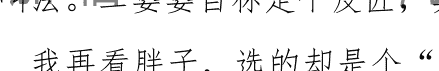

此后的半个月里，日子倒是是一如既往，没什么大的变化。老爷悄悄地回来过几次，也没跟她女儿见面，只是找了麻老大秘密谈了些事情。听肌肉男说，是老爷在帮着打听打听那姓牢的消息，毕竟这些人就是个隐患，一天找不到，咱们魂仪馆就一天都不得安心。

## 5637 楼

作者: 兜夷 V 日期:2018-07-19 14:19

要知道当时她这宝女儿娇横敌，居然被一嗓子抽到了姓顾的头上。不是她当时狠心，以姓顾的脾气，说不定这黄明珠落得个什么惨下。她其实是残忍君，当时老老起她怕是不让她处理，始终不会再理她这个个，一见他就躲得远远远的。

这样的日子倒是倒过得飞快。有次跟肌肉男私下聊天，我见她周四周没人，就悄悄问：“四哥，你就说说呗，你们当初竟为了什么才隐居到这里来？”

猴仪馆这几个人，我也就跟肌肉男这儿问。麻老大我是肯定不敢的。黑毛，这家伙老是一副阴阳怪气的样子，问了他估计也不会说。至于燕子，对着她的面前根本就不敢提。我怕我刚一提，她就得翻脸。至于瘦竹签，他估计计什么都不知道。二婆婆呢，她可能知道，也可能不知道，但我是不敢去麻烦老人人家的。

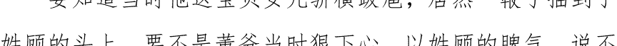

肌肉男的脸色一僵，还是揉了揉，宽厚地笑道：“多年前的事了，你知道了都别没什么好处。”

我不甘心：“你们都叫我小七了，那就是自己家人，有好处眼睛看着我。是不是跟山羊那些牛鼻子子有何？”

肌肉男沉默了好一阵子，苦笑道：“你这小鬼，就是心思太重。”我被实在逼得没法，就说，“你现在大小，你哪里天长大成人，我一定告诉你。”

我看实在无法从他嘴里掏出东西，只道：“那就说了。”

肌肉男可呵了几声，就赶紧的找口子走了。他大为了以后日子，离成人有那么几年了，就先找了个理由把我推荐更多好东西。

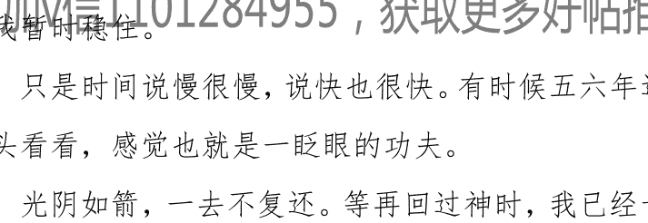

只是时间慢得很慢，快也很快。时候五六年过去了，回头一看，感觉也就是一眼的功夫。

光阴如苒，一去不复还。等再过过时，我已经十七，再过了九十天就满十八了。

122

今天先更新到这里了，大家可以关注微信公众号【右手灵异】继续阅读，回复90060，从“第一百二十章 复古铜戒”开始阅读

## 5652 楼 

作者： 垂直 V 日期:2018-07-20 09:50

此时正是六月中旬，正值梅雨季节。天空连日阴沉，雨水连绵不绝，时大时小。当地流行着这样的谚语：“雨打黄梅头，四十五无日。”说的就是这梅雨季节，缠绵反复一直要从六月中旬持续到七月上旬。

我手持骨针，搅了一根鲨鱼线，正在给手下的一个妇女缝裂开的小腹。按摩里一如既往的昏暗，尤其是这种雨天气，不过自打三年前开了夜眼，在这样昏暗的房间里视物就不是问题。在青子的监督下，每日练功的功夫依然不停，反而愈愈难的。有时候我都怀疑，我每天尽折磨，不是真的那么简单。

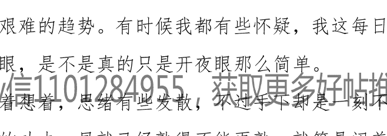

看着她，心里有些软，她还是推荐这种手段的功夫早就熟练得不能再熟，就算是闭着眼睛也不会出岔子。死的这个女人还年轻，二十来岁，长得也挺美丽。最近我不知道，连续地接到生意，都是很年轻的女子，死状只能算平凡了。外头的细雨淅淅沥下，空气湿度很高，又闷热，让人不适。

## 5688 楼 

作者: 匪夷 日期:2018-07-20 11:20

在荣华义馆里，虽然也被细雨浸了，但由于此地阴气蒸腾，使得阴气呈发散，既保守了此地的凉干，又伤人。在这样的季节，狮子头这儿成了避暑的最佳地方。自从梅雨以来，胖子基本上赖在这里，连自己家很少。用他的话来说，他正是个孤寡人，哪都一样。这胖子，年纪大了，也不说找个姑娘成亲。不过处理最后，将衣物整理好，就脱了手套，跟婆婆报了一声。我在殡仪间这一年，婆婆还会起来看着我处理过的尸体，偶尔还指点几句。到后来，婆婆就再也不来看一眼，任由我施为。她在藤椅上的时间也越来越长。后两年，她有时候心情好时，还能陪着出门到院里转圈，抬头看看天空。但到了近几年，则是起身的时间都少了。自从我进殡间旁替了活，她手上的一双绿毛线

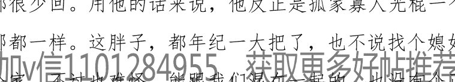

套再也脱开了。我是担心她手，几次想要给她看看，但无一被她拒绝了。二婆婆的容貌其实大改，就跟当年我初见她时模一样，但这几年年来，身上的那种暮气似乎越来越重，在阴暗之中，如同那根等着腐烂的朽木。

## 5695 楼 

作者: 亘夷 日期:2018-07-20 12:50

每次看到二婆婆那样，我就不由得黯然。我也曾经经历过肌肉男有关二婆婆的事，不过他也太清楚了。只说麻老大带着燕子没有黑毛，来到此地，买下了这块废弃的荣华义馆，干起人生营。大约半年后，二婆婆才来我们，当时她还害怕，还留着挣扎。后来，才是我和。跟二婆婆相处的时间越长，就越觉得她不是个普通的皮匠。她虽然说话不多，但每句都是切中要点，偶尔无意露出的话识，也绝可能是个普通的老妇。只是她不愿说，任谁也没有办法。

跟二婆婆道别后，就从仆间出来，并没有关门，是虚掩了一下。我想让外头新鲜的空气能吹进屋子，让二婆婆不至于太过与世隔阂。

细柔如如如许，绵绵软软抬头当狮子落了。。我也撑令，在雨中走了几步，就看到狮子头在走廊那头我直挥手。

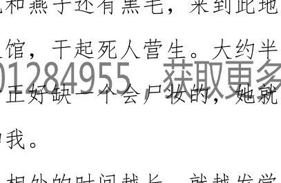

我走了过去，就见那胖子坐在走廊上，膝盖上抱了笔记本，见我过来，一张大圆脸红扑的，兴奋地：“快来看，最新的阴阳榜贴出了！”

我“哦”了一声，倒是有些兴趣，过去看看他打开的屏幕。所谓的阴阳榜，其实是阴阳阁发布的一个榜单。既然是榜单，那非一些人物的排行。

## 5697 楼 

作者: 予 日期:2018-07-20 14:21

胖子指着一个名字道：“陆三爷，第九十三！小景，你看上榜了！”我倒是有些意外。

所谓的阴阳榜，其实是阴阳阁发布的一个榜单，里面的客户是在阴阳阁挂牌的二皮匠。这几年时间，胖子接了不少生意，尸体也是五花门，千奇百怪，诡异之。我跟三叔碰到一些，连二婆婆从旁点，始终没给出什么线绪。这些年来，二皮匠在阴阳阁的评价逐年高涨。不过这么短短几年进入榜单，也从侧面说明，如今世界上真正掌握手艺的二皮匠越来越少了。掳客近年来虽然活跃，但连影子都没见过。我摸摸胸口那枚戒指，原来是“葬古戒”。这戒指在世界上并不是唯一一枚，而是葬门中代身份的信物。说起来，倒是跟那帮被麻老大砸掉的门，打听到了戒指的来历。自从百年前，葬门就销匿了，也许跟许多传承了千年的宗派一般。这枚戒指是三叔的贴身之物，如果这枚戒指真的是葬古戒，那三叔很有可能是葬门之人。退一万步来说，就算不是葬门弟子，那至少跟葬门有着千丝万缕的关系。想想，三叔带着我隐居之后，为什么对他们经营，就有合理的解释。对于这门跟人打交道的生意，肯定与死人脱不开。

胖子呵呵了一下，出了笑容，皱了眉道：“最近阴阳阁下面又增加了一门职业。”最近几年来，阴阳阁新增了至少十几个职业，都是一些新崛起，以前从未过的。反倒是一些古老的职业，渐渐都没有了。就比如我这一行的二皮匠，人丁似乎越来越单薄。

“这又是什么？”胖子脸色有些凝重，道：“是个叫错族的部落。”猎狗其实类似于古老的两门职业，传说中的杀手和赏金猎人。不过这猎狗族跟两者都不尽相同。隐于暗，是为了黄金而杀人，却喜欢用残酷的手段虐杀。他们似乎更加喜欢的是杀戮的快感。他妈妈，这群人就是无聊的疯子。相比起来，这些虽然是活人，倒还那些狩猎的尸体更加可怕。

正和胖子说着话，听到一阵轻稳的脚步声从走廊头传来。光听到这声音，不用回头就知道是谁来了。转头一看，果然董明珠抱着床被，正往这边过来。胖子赶紧把笔记本合上。这暗网的事情，他还不想让明珠接触到，毕竟对她没什么好处。

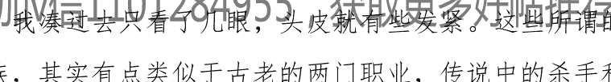

## 123 

作者: 匪夷 日期:2018-07-21 11:28

“大侄女，你这是干嘛？就这天气，你不会是想去晒子吧？”话间，董明珠已经走到面前，横了她一眼，说：“还不是怪陆陆！”

相比起几年前那个骄横跋扈、浓妆艳抹的小丫，此时的董明珠成熟了许多，也稳重了许多，穿着一件粉色圆领裙，蓝色牛仔裤，也留了长发，显得很是静静。看到她，不由得躲开了她的肩膀，此时已经是比她高了半个头了。忍不住抱怨道：“怎么跟我有关？上午在户里闹，哪儿去了。”

董明珠哼了一声：“还不是你家那个财，越来越胖了。”

外头的细雨淅淅沥下，空气湿度很高，又闷热，让人不适。在这样的季节，狮子头这儿成了避暑的最佳地方。自从梅雨以来，胖子基本上赖在这里，连自己家很少。用他的话来说，他正是个孤寡人，哪都一样。这胖子，年纪大了，也不说找个姑娘成亲。不过处理最后一道工序，将衣物整理好，就脱了手套，跟婆婆报了一声。

接下来的几个个月，胖子每次来吃饭，小怪胎长成了什么样了。起初，大家都是小怪胎，听了半天，见这东西也没安分，离了笼子就到处乱乱，干脆起了个名叫“旺财”。董明珠当时就不乐意，把她着的腿拽了起来，看着孩子的脸，哪里漂亮！是个小女孩。

## 570 楼 

作者: 霍夷 日期:2018-07-23 16:14

黑毛远处叫道：“今天中午吃什么，出去一起，信息都如何？”好嗓子从那头跑过来，大约是被我们说话给吵醒，打了个哈哈，道：“你这矮瘦子，除了吃还知道什么？”这两个，还是以前的老样子，见了面就吵不停。他说的事情，就是户间里那女户。我应了一声，说刚刚收拾完毕。麻老大点了点头，叮囔道：“最近世有些太平，大家都打起精神，小心。”老大发话，大家都齐齐地应了一声。麻老大又吩黑毛和肌肉：“老六一个人守着停尸房，我有些不放心，你抽空轮流去一下。”我听得心里一紧。别看麻老大天天就窝在这殡馆里，不得不说，这老头子对事情的敏感性极高，看得比任何人明白。既然他这么说，那就说明最近的风头有些不对。麻老大说完，也没有再说什么废话，带着黑毛进了屋。肌肉男拍了拍我肩膀，乐呵呵地道：“最近挺忙的，别累着了。”我心里一暖，笑道：“你可别想打马虎，再过些日子，我就要成人了。”

## 578 楼 

作者: 直夷 日期:2018-07-23 19:14

你当初应该答应我什么，可别忘了。肌肉男本来就长得高大壮，这几年虽然我长了不少子，可站在他面前，倒还是比他矮了不少。肌肉男呵呵了几声，还没来得及说话，燕子就撇撇嘴：“你们在说什么？小七，你马上快十八岁了，到时候大家给你做成人礼，好好热闹热闹闹！”董明珠和胖子也不是个闲得住人的，当时也跟起哄。燕子上来，一把接住我的脖子，凑到我耳边，扇声说：


胖子白脸走上前去，看了一眼尸板上的尸骨，顿声说：

“真……真是董老爷啊？”

我“嗯”的一了一声。胖子吸了口冷气，接着手道：“这事儿跳跳咧，董老爷在谭城，那可是一呼百姓的人物，究竟是被谁给弄成这个样子的？再说了，我刚从街市那边过来，也还没听到什么风声响啊！”

这事儿确实处处透着诡异，究竟是谁把董老爷送到我们殡馆门口。我问胖子：“这事儿会不会跟暗网有关？”

胖子立即把直脑子摇得狼脸似的：“我敢肯定，绝对没有过这样一样生意！”

话间，瘦竹竹已经挺直起身子，说：“这……个个人。”

这些年来，我倒是已经习惯了老六那样说话。

听到后，老六看的结果是，这董老爷应该是死了有了七天以上，先是被人制住，用类似铁锤的东西，扎穿他肩膀骨，把他钉在墙上，受尽折磨后，再用快刀，砍下了了他的四肢和头颅。

我和胖子听得面面相觑，究竟是谁跟董老爷有这么大仇？

按照说董老爷在谭城经营这么多年，肯定是得罪了不少人，但能用这样狠毒手段的，真的不多见。

不过瘦竹说完之后，脸上出现一种奇怪的表情，一直盯着那尸体发愣，叫他也没反应。

我围着董老爷的尸体看了一圈。皮肤已经起了黑点，但并没有明显的腐烂，尸斑也并不严重，看起来倒也还算正常。但瘦竹出生作为仵家族，虽然自然从受伤后，脑子有些不是很清醒，只要一碰到尸体，就有着超常人的敏感度。

既然他在原地傻傻发愣，说明他对董老爷的尸体还有疑惑不解的地方。

这时，黑毛已经带着老大起来了，肌肉男也只是比他们稍晚了一步进来，说是已经咽过燕子，让她去稳着燕子。

我把瘦竹的检查结果说了一遍。

麻老阴沉着脸道：“你们怎么看？”

黑毛乐了声道：“八成是老家伙干的。黑嘿，现在的人真是越来越不讲了，什么事都弄得出来！”

肌肉男想了想，道：“应该是寻妥。”

麻老点点头，皱了一声道：“那位什么送到我们这儿来？”

黑毛顿时有些语塞。胖子啧嘴：“董老爷这些年来跟咱……”

麻老大一把独特的眼光闪闪的，冷笑了了一声：“咱们只想安安生生的过日子，可是偏偏就有人不想让我们安安生生。”喷了下去，让肌肉男和黑毛轮流替瘦竹竿一起守棺。胖子则是出了门，去外头打听消息。

我总觉得有些不放心，又仔细检查了一遍尸体。我发现尸体的脖颈处有些异样，而且在棺臭之外，还隐约闻到了一种奇怪的味道。起初一直都不想起来究竟是什么，后来一个人在走廊里坐了一会儿，才恍起来，原来是朱砂的味道，是掺杂了其他东西，以至于这种味道很怪。

我立刻回去回房，刚到门口，就看到肌肉男和黑毛两人站在门口，正焦躁地往里头张望。见我过来，黑毛就朝我使眼色。我放轻了脚步，走到门口，朝里面一看，当时心里就咯噔了一声一样。

此时站在里头的，除了瘦竹竿，还有麻老大和燕子，另外一个是董明珠。黑毛小声说：“这姑娘模样儿看着没什么，其实人一点都不懂，燕子她就是沉不住，被她看出了。”

我正想说话，就看到里头董明珠一转身，默默不做声就跑了出来，脸上看不任何表情，也不哭，也不叫，脸色白得可怜。

燕子踩了脚脚，赶紧跟着追了出去。

麻老大沉沉如水，让我留下一下尸体，过过的竹竿带着黑毛和肌肉男就一起跟着跑出门了。

等他们都走了，我来到董老爷的尸骨前。仔细地嗅闻了一下，这气味中确实是隐含了朱砂，而且是来自自身的断口处。我戴上手套，用小刀将划开尸体断口处的血刮掉一层，细细一看，就看出这朱砂其实是混了这血液之中。

这种手法最常见的是在赶尸术里。尤其是湘西一派，在起户之前都是最好的赶走防封尸体七钉，目的是为了住魂魄，这使他们曾留了身。朱砂的作用，其效就是用来抑制腐的。董老爷的尸体被人斩去首级，断去四肢，却用朱砂封住断口，这还是有意思了。这种手法的绝不可能是外行人。而且瞧这伤口痕迹，手法极为精细，要是不懂里面的，或者是稍留意，很难发现里面的痕迹。

我去了一趟尸间，拿了工具袋回来把门关上，将董老爷身上的衣服全部除光。正好时候胖子回来了，在外头敲门，我让他进来。胖子浑身湿漉漉的气喘吁吁，坐在尸板上，我来不及问他怎么样。

我仔细端详了一眼，正要伸手进去，猛地听到塞住尸体的红线剧烈抖动起来，上面的铜钱相互撞击，发出急促的叮当声。我意识地往旁边一避，就看到一道红影从董帝腹中扑出，握着我的耳朵扑了空。接着听到砰的一声，原来是胖子大锤挥出，那把玩意儿给砸飞出去，直撞在墙上，头上撞下一个红印，接着就掉了下来，瘫在地上一不动。

胖子白着脸，一副心有余的样子，问我：“没伤吧？”

我摇头，还好刚才有红线警示，不然真的要命了。过去一看，刚才胖子那锤子可没少用心，那东西在地上，脑壳碎裂，已经一命呜呼了。

我去端一盆水，把那玩意儿丢进盆里一洗，顿时就看出了面目。原来是一只黄大仙。

所谓的黄大仙，也就是黄鼠狼，也有地方叫黄皮子。在民间，有“五大仙”的说法，自古以来受到百姓的供奉。五大仙又有种说法叫吕大家，指的是狐仙、黄仙、白仙、柳仙和灰仙。这排行第二的黄仙，就是黄大仙，又被称作“黄二”。古时在天后宫里，甚至还有黄大仙的像。

当年在南疆躲命，救治思小妹的时候，死人脸与顾三个客论道，当时提到过招邪分为三种。第一种是人魂附体，第二种是精怪借体，第三种则是山河幻体。

此时我年纪小，学识浅浅，其实只知道魂附体这一种，后在死人脸笔记里，才知道什么是精怪借体和山河幻体。精怪借体中的精怪绝大多数指的是五大仙。这种东西，天生灵性，但凡是意志薄、阳气衰的人，很容易就被它们给附体了。但是活人体，如果死前含怨气，尸体充满怨气，且胆肉分离，一些东西就会从脖子直接钻进死体内的，以躯脏为食。这种东西叫做尸蛹，我小时候听三叔说，一旦形成尸蛹，就必须是尸体长久不腐烂。自民死后，就听说哪里出现这种玩意儿，所以我今天还是第一次见到。尸蛹，比普通的要可怕得多。

我看了一眼盆子的黄皮子，又过去查验了一下尸身。果然，董老爷的内脏已经尽数被黄皮子吃光。

把屋子里的东西收拾好，等麻老大回来，我就把事情一五说了。麻老大问我能不能看出对方什么来路。我说应该是很横的人物，手头很硬。

麻老大沉默了一阵，道：“不管是不是那个姓庞小子，如果其他人都冲着我们来了，那大家接着就是……”他吩咐了几句，就带着肌肉男和黑毛去了前厅。

瘦竹竿回来袭房，胖子的那帮被打死的黄皮子，送去黑毛的炉火化。我出去找燕子，才知道董明一直在房里，谁也不让进。

我在外面叫了几声，她是不理，只得作为。燕子继续守在门口，我则是回去殓房，把老爷的尸体推回护间，将他分裂的尸体缝合。

外外的雨仍在淅沥地下着，烟气蒸腾，却是多了几肃杀。下完大约五钟，我把老爷的尸体交给瘦竹竿，就从包里出来，看着她的脸，顺手推了门。

几年过去了，谭城里很多地方都 reality很大的变化，唯独这繁华殡馆四周，还是一样的荒芜偏僻。绵绵的细雨露天盖地，水汽蒸腾起来，看着却是灰蒙蒙的景象。路上也不遇到什么人，偶尔听到几声清凉的鸦鸣，就一个人沿着一条荒巷，没入这不断的烟雾之中。

首先是去了菜市，去菜场里挑了一些新鲜的蔬菜和鲜鱼。在这住了几年，在市场里那些摊主也混得挺熟了，很多人都可以说是看着我长大的。那从菜场出来的时候，还撞见了钱老头，这老家伙这些也没多大的变化，也许是生意做得还不错，脸色倒是竟的红润了，正在跟一个卖俏的鱼讨价。

钱老头一见到我，立即朝我招手：“小陆，赶紧过来。”我过去一看，笑着：“钱老头，这天气还……”钱老头：“你个你，这个季节吃最好的……”

我付了钱，买了那么多菜，有些好奇。钱老头皱着脸，问：“什么回事？”

我自然记得那是当初卖掉的那只花，老头摇头：“我也不是很清楚，从来也没有遇到这种情况呀。听听子的人，背景很复杂的，自然有自己的路。”

我琢磨了一阵，一时理不出头绪，进了街边的一家花店。店主是一个二十岁的女孩，头上扎着一条粉色的丝巾，扎了个蝴蝶。我在门口叫了一声，她抬头来看，顿时笑道：“小陆你来了，花在那边，早就给你准备好了。”

我冲她笑笑，谢谢秋小姐。见她旁边放着一大束娇艳的天竺葵，不由得心情都开了些。秋姐笑道：“小陆，你眼光倒是特别，这儿很少有人买天竺葵，我还是托了朋友从地方弄来的。”

我又是一番感谢，钱付过了，捧了花从店里出来，勾悠悠地回到家里。

永昌这一片，在这几年中倒是变化大，尤其是7号四周，是因为宅舍的关系，更是邻居也没有。一栋二层小楼还有一套，我十分满意。我刚搬进这里的时候，其实是对这小楼怀意的，恨不得有天一把烧了就好了。只是这些年过去后，这儿早已逐渐成了我的家。

开了门进来，把伞放到门口的竹篮里，换了伞，先把菜拎到了厨房，之后又把前几天买的一个蓝色玻璃花瓶给拿了出来，把天竺葵插上，放在餐桌上，蓝瓶配黄花，倒是合适。

那天听小秋说起来，天竺葵代表的是“意外的邂逅”。我就不由得想到，我跟青子其实是意外的邂逅。想起当初在南疆古墓，我手着龙鳞锁钉，只等着跟棺中爬出的妖魔鬼怪挣你死我活，但谁最后从棺材里出来的不是什么吃人恶魔，倒是一个漂亮女人。

这女人一出来，当时就问我：“想活？想死？”我怕魔，自然就选择了想活。于是，我就成了她口中的仆佣，给她招之即来，呼之即去。这世事无常也是奇妙。我不记得曾经多少次恨她恨得牙痒痒，在心里头骂了千百遍“死女人”、“凶婆娘”。有时候我实在忍不住了，就一个人偷偷地缩在黑暗里哭，想着如果三叔在，也不至于这样。


大约过去了一个多时辰，才发现他进门来，甩了甩伞上的雨水，说：“有人见到你姐了，大约是中午的时候走的，个人空着手，什么也没带，坐了一去临江的车出去了。”

“临江？”我回应了一下，好像没从青子那里提起过“临江”这个地方。

钱老头坐下喝了一口王八汤，道：“八成是先到的临江，再从临江转去其他地方。”

这倒是极有可能，毕竟我们这儿是个小地方，出去的车也不多。钱老头把一小碗王八汤灌了个朝天，舒服地叹了一口气，这又道：“幸我在临江上也有人，按时间算起来，你姐那这会儿她可能已经到了临江了。”

我就在钱老板店里等着，他舔了口王八汤，又找了闲着，约半个时辰后，有个人拿着雨衣，穿过雨伞，来到钱老板门口。钱老板出去，那人接头接了几句，那人就离开了。

钱老头回来，坐下道：“你小子运气好，还有人见到你姐了，知道她买了一张出海的票。”

“出海？”这真是完全出了我的意料。只是不知道怎么的，总觉得有些不对劲。

钱老头道：“你就放宽心吧，她可能就是太气闷了，坐个船出去海上游玩一把，到时候自然就回来了。”

这老头说的倒也不是没有道理。当初我跟青子从南疆走出来，曾在各地游玩了几个月，去过很多地方，唯独在海上还真从没去过。

依着青子的脾气，毫无预兆地就买一张船票，一个人去海上浪一圈，也是得过去的。这样想着，倒是心安了不错。看着天空不早，就从钱老店里出来，打着雨回了家。

今天来只是很平静的，却没想到连续发生了这么多事。我觉得有些心力俱疲，回来早都已经结束了，也没有吃饭就歇报告了厨房。在沙滩上看着波拍的一层外面的天气，我脱掉了臭鞋，钻进了寒骨里。

其实今晚青子那人不在，我就算偷偷回溯没人知道。但或许是这几年年来，已经养成了一种习惯，不去反而有些不自在。

井底依然寒气逼人，不过经过几年的磨炼，已经是不再害怕心中的阴寒之气。我沉入井底，在水中盘腿而坐，就像以前一样在井中继续锻炼双眼。

寒水之中，寂静无不知道过了多久，突然听到一声极轻的叮当声。这声音似乎是金属物体摩擦发出的声响，在水中传出，声音又有变形。


我心里一凛，立即在水中睁开了眼。此时井中依旧漆黑如夜，自从开了夜眼，即使在这样伸手不见五指的地方，目光所及之之处，也如白昼清晰可见。

隔了一会儿，又听到叮当一声。

我从井底站起，让井链带着我浮了上去，然后在那具奇怪的骸骨跟前停下。看了半天，却没有发现什么异样。但刚才那声音，分明就是身上的铁链碰撞发生的声音。

在此井中，水本基本上是死的，也不会会有任何的对流。如果没有外力激发，那铁链不可能自己发出响动。

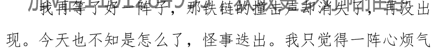

我停了好久，那铁链的碰撞声是清晰得听出来。今天不知道是怎么了，怪事出头。我刚才觉得心情很奇怪，似乎是有什么大事要发生，又不知道是什么，说不出的难受。

只浮出水面，也不依靠绳子，徒手沿着井壁爬了上去。自从三年前，青子就不再给我绳子下来，只能靠我自己爬上去。我记得第一次，我足足爬了一个晚上，都是刚刚爬上一段，就挣回了水里，要是当时的我已经习惯了井底的寒气，当晚恐怕就死在黑里了。通过这些年的反复练习，此时倒已经是游刃有余。

洗了脸，就睡了横在屋里的麻眼。这些年真是睡得习惯了，早已不再用心在睡梦中从床上下来。只是对面房间的门开着，里头的人却不在，一时间我很是不习惯，再加上今天的董爷的事，在脑子里转来转去，就怎么也睡不着。

那两个鬼头的影子如其来地出现在对面靠窗的位置，两个人的脸被披散的长发遮着，白花的身子相比以往，却是长大了，也高了不少。

随着我年纪增长，这两个鬼头也跟着长大。要不是亲眼所见，实在是无法相信。我看着那白花的身子，心里忍不住笑出一声：“再看下！”睁开了眼睛，头皮发麻。心里乱糟糟的胡思乱想，睡过去。不知道什么时候，听到一阵奇怪的声音。我一个心灵，顿时就醒了。

我发现整个人已经变了了。我原本以为是自己运气好，以前都是被青子用手段镇住了。今晚她一走，这栋楼他妈就发作起来。我在心里暗暗了几句，却是额头下的冷汗都不敢去擦。那两个红艳的男人拿着斧在房里晃了几圈，像是始终没发现我。我此时清晰地感觉到背后在麻桩上的触感，说明其实还是自己的房间里。当年青子说的，这栋楼早已经变成了阴桩，跟着她进来，进去就会迷失其中。

死人的楼里都是死物，这儿却是两个奇怪的男人，很是有些诡异。忍不住盯着那两个男人猛瞧，正好时候其中一个摇晃晃地转身来，一下子看到了这人的脸，就打了一个冷战。这一脸也红红的，像煎熟的螃蟹，一双眼睛却是灰白色。

我总觉得这个人哪里不对劲，歪眯着，猛地看到那一人抢手里的大砍刀，朝我当头砍了过来，我心念还没转过来，双脚已经能勾住身，身子向下倒，堪堪避了过去。

只觉得一道灼热的气流从我鼻流喷出，皮肤立刻竖起了一层皮疙瘩。我一心狂跳不止，这时才知道哪里不对了。原来这两个男人看着像煎熟的肉，而是真的是被人煮熟了！那把我鼻窝掠过的砍刀，此时还留着腾腾的热气！

来不及不及，又是一刀劈了过来，我赶紧地从身上滚，就地一滚，只听到“当”的一声响，刀刃看在我脑壳旁边的落地。他的看着也太真实了，根本不像幻象！我全身寒毛直竖，顾不及想，在地上翻滚了几个圈，见墙角有一道楼梯，就冲了上去。上楼一看，顿时就停住了，这儿根本不是象中的二楼，而是所有的房间都是房门紧闭。

哼呀呀的唱歌声诡响，不知道是从哪里飘出来的。我豁然转身，往来时的楼梯了一眼，只见对面漆黑一团，那两个煮熟的男人却没有上来。我站在原地，冷汗一颗顺着脸落在。这地方虽然熟悉，却不敢乱走步。在刚才的一瞬间，我忽然想明白，当年白文留下的另一个法是什么。

九阴幡，其实是一门法术。所谓的降术，最早于千年前，是茅山一个道士发明的。这个人天资高，却偏喜欢用邪道。后来利用降术做了一些事情，被茅山教打断了腿。

这个降术，其实是极为阴毒。正宗的做法是把一个人装在一个盛满水的容器里，然后放在火上加热，把人慢慢煮熟，然后利用死者的骨骸为其塑造一个假身，让其怒气附在其上，甚至是直接显出人形。

这种方法十分严密，就在河底数沙粒一样，没有其他技巧可视，完全是依赖庞大的计算。这种方法十分严密，就在河底数沙粒一样，没有其他技巧可视，完全是依赖庞大的计算。这种方法十分严密，就在河底数沙粒一样，没有其他技巧可视，完全是依赖庞大的计算。

我叫它“阴阳瓶”。慢慢发现，阴阳瓶似乎还有玄妙，用来调节体内的阴阳变化。随着练习日久，对于阴阳瓶的操控越来越精细，就能随着体内的气息与周围的气机融合，这样在睡眠之中，也能随着气机律动，随时调整位置。

九阴幡本身就是用来聚阴气的，再加上降术。


## 5988 楼

作者:兜夷 日期:2018-08-03 13:41
身子刚一入水中，就已经发觉不对。井壁散落着两截铁链，被钉在井壁上的那具骸骨已经异而飞了。

我一个转身，快地陷入井底，看了个遍，只找到几张破碎的黄纸，堪模样应该是之前贴在户身上上的黄符。

我及足下微一摆，从水中浮了上来，拿起那只断裂的铁链看了一眼，赌场参差不齐，像是被巨大的力量乱乱乱乱，生生地崩的。

这一瞬间，我心里什么想法都没有，却心忐怦，一时间却也不想出个所以原来，也不知道自己井里究竟发生了什么。 

关注1101284955 获取更多帖子推荐

在井底连续不断地计算，此时早早已心力俱疲，在井底坐了一阵子，只觉得寒意袭人，忍不住打了个寒寂。她妈的，真是层叠扁连夜夜，倒霉事一件接一件。这井底的诡意还不知道什么，当年被白文紫封在了里头，如今被它给跑了出去，也不会搞出些什么事情。

我靠着井沿坐了一会儿，又想到了青子。要是她在这儿，也不至于出这么多这么多蛾子。这该女人，也不知道她去了哪里。
在井底里滚了一圈上来，全身都湿湿的一透，身上又黏又冷。这屋子暂时是不能回去了，幸好我的放在狭仪馆，里头还有换洗的衣服，支撑着爬起来，推开院门走了出去。

刚出门没走几步，就见到前方不远处个人影，撑着伞，在细雨中不停打转。

## 5993 楼 

作者:直夷 日:2018-08-03 15:12

“老头，你干什么呢？”我冲他喊了一声。那人是钱老头，这种倒霉天气，也不知一个人在这里等什么。

那老头一听到声音，霍地转过身来，见了我，立刻忙忙慌地就过来了。

“哎哟我的老祖宗，你可出来了，快把给我急死了！”

钱老头心急如燎的。我不由奇怪，这钱老头面对87号这诡计涛莫如深这笔钱怎么会没发生，如今却变得如此，看着他煞煞都等到了这里来。

钱老头拍了下大腿，道：“你这小子，到底躲在屋里什么？你不知道，你坐的那条船出事了！”

我一听，脑子一下没转过来，只是下意一下转过来，问道：“怎么了？”

钱老头道：“你坐的那条轮轮昨天回到了港口。”

我有些明白，船出了海，应该是要回来的，这不是很正常？

钱老头重重地叹了口气，道：“哎，那船是回来了，可是回来的也就是一船，之前船的近千人，一个都没有回来。船里头头上下下，看不到一个人影。”

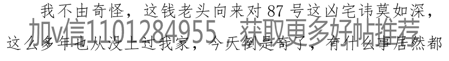

我强笑了声：“老头你是不是在开玩笑，这一堆大人怎么能说没就没。再说了，要是真没人，这么大一船是怎么开回来的？”

钱老一拍大腿：“都什么时候了，我还能跟你开玩笑了！这条船是在海上乱飘，经过的一艘海船发现，这才给带回来的！”

我听得胸口一闷，从阴塔爬出来原本就交痞，心力交瘁，眼前阵阵发黑，差点没倒了下去。钱老头一把抓住了我，我道：“你小子是干什么去了，怎么几天没见就变成这副鬼村子了？”

# 加1101284955，获取更多好帖

作者：匪夷 日期：2018-08-04 09:40

我稍稍地定了神。钱老头脉频，他收到的消息应该不会错，看来青子搭乘的那条轮是真出事了。

以青子的本事，就算遭遇了什么变故，我也并不是特别担心。就是不知道这事，究竟是被青子碰巧撞上了，还是说青子这次出海，是为了某件事情。

我此时心烦意意，就准备去青子那条船来的港口看看。那钱老头却拉住我，说：“还有事。我前阵找着你，就去了一趟你那镖馆，在门口上遇见姓姬的那胖小子。他在门外转来转去，始终不肯进去。我当时就过去问他知不知道你在哪里，没想这胖小子当即拉住我手，反倒想起你的落落。”

我心里咯噔了一下，心想难难道侯出了什么事？就听钱老道：“那胖小子急得什么似的，估计真是有事，说要是碰碰到你，就随你一声，让你赶紧过去找仪馆。”

我一听，不由想到董爷爷，心里升起一种极不好的预感，立即跟钱老打了个别，朝仪馆奔去。到了地方，远远看到瘦头胖的身影在铁门直转，几次想要爬上墙，停了一下，又上又下，也不知道是在搞什么。

此时侯稍有些变，四周的气流。见到我过去，瘦头满头大汗，脸上全是水，也不知是雨还是急出来的。

## 25 楼 

作者:耿夷 日期:2018-08-04 10:10

瘦头胖子问：“你这三天都跑哪儿？”这才才知道，原来我在九阴中已经过了三天，累又累。伸手摸，立刻缩了回来。刚刚似乎是被东西给刺了一下。

瘦头胖子哭道：“怎么样，是不是有问题？”

我靠墙上，取出一枚五帝币，铜钱在地上滴溜向前，突然滑了，我也立即跟着调整。这叫“铜钱指路”，是茅山派的一种法术。五帝钱本身就是纯阳物，用特殊的手拨，就能让它在前开路，可以规避不少险。

我回头了一眼，胖子虽然跑得艰难，但仍然跟后头，就在等到的时候，只听到的一声，前方的铜钱在地上跳了一下，就停止了滚动，晃了晃，倒在地上。我立即跟着停下，胖子追得太猛，一个收不住，差点就撞到身上，被抓住腰带拉回来。

“怎么？”胖子流汗说，一双眼睛跟着我望。我站在原地，慢慢地转了一圈，看到东侧倒着一块石头，冲胖子使了个眼色：“那里有问题。”胖子就张了，看到旁边倒着一根断掉的树杈，捡起来树枝，拿在手里护身武器。我从手中拿着树杈拿过来，翻开那块石头，对着土里挖下去。挖了大约半米，就看到土里露出了圆乎乎的东西。整个挖出来，原来是个拳头大小的木人头，嘴唇和牙齿是被染了血，出血大口，看着很凶人。

木人头掉在地上，捡起来重新调整，一声不吃地追着铜钱飞去。每逢铜钱停下，就在原地寻找，总能在某个地方找出一只木头。胖子骂道：“他的妈，究竟是谁弄的这东西？是不是害人的邪阵！”这鬼东西还真是种邪阵，叫做“血食灵”。死人脸的笔记里，有一部分是专门记录了一些邪门阵法，其中就有这个“血食灵”。这是源自道教的一种邪门阵术，一旦起阵，最大的征兆就是阵法所及之处都会层层烟雾笼罩。

## 043 楼

作者：兜夷 日期：2018-08-04 14:11

这些木雕人头就是这“血食灵”外围的阵脚，头部以血为食，一旦有人闯入，身陷阵中，就会不知不觉地血液流竭而亡。除了这些木雕人头外，应该还有一个阵肉，那里才是这个邪阵的核心，用的血肉祭品。

我看着四周不断黑雾，心里矛盾跳不停，拍了拍脖子肩膀：“你沿着这条路线慢慢走。”从地上捡了一根树枝，在地上画了一个网状的结构。不等脖子点头，我从口袋里掏出一把钱，猛地朝前扔了出去。铜钱满淋朝前去，要时间就交前哨，我脚肌肉抽搐，不停地倒着费力撑着棍向前滚动，时刻不停，转眼间就已经听到脖子的叫声。

直到最后一枚钱币倒下，我已经站在了厨房门口。整个废弃馆一片死寂，安静得让我心慌。厨房的两扇房门紧闭，我走了上去，在外头狠狠地抠了抠手心，这才推了进去。房里一片暗暗，停板碎了一地，屋子里一片狼藉，到处都是木头的碎片漂到到处都是。我没有再看其他地方，目光死死盯着屋子中央一个水龙头。这口龙头原本放在厨房里装水的，用了多年，伸手掀开了缸上的裹布。

# 054 楼 

作者：匪夷 日期：2018-08-04 15:21

我已经有了准备，可还是窄。肌肉男坐在缸里，他的胸口还是宽，因为两只臂和双眼都被齐斩了。直直视之下，只剩了两个窟窿，眼睛流出两条曲线，顺着脸下来，早已经干涸。瘦头胖子急着，耳朵已经被割了，他根本听不到，嗓子早已被堵了。瘦头胖子死命叫了出来，我拍了拍他的肩膀，他的脸扭扭，表情似乎是笑了了一下。我整个人都不抖，但他用脸来了一下，艰难地晃了晃。

我靠着井沿坐了一会儿，只听到一串沉重的脚步，外面响起：“哎哟喂，可跑死了，我找了一个偏。”胖子一边叫，一边跌撞地跑起来，在缸前咚咚地磕起头。

# 060 楼 

作者:贵 日期:2018-08-05 08:23

我走到偏房的东墙，下身蹲，耳朵贴着地板，听了一阵，地上躺着一把变形的铁棍，捡了起来，顺着石板的缝隙插了下去。将石板撬开，露出出一个空洞，里头躺着两个人，一男一女，是瘦头和董明珠。人都处于昏迷状态，我去将他们一个抱上来，在他们眉间位置，轻轻弹了一下，两人就陆续清醒了。过来。董明珠一眼，先是尖叫了一声，这才看清是我，立即扑了上来，我拍了拍她的背，董明珠颤声道：“小景，你……你来了，四哥呢？”她一转眼，看到了胖子守着的肌肉男，愣愕地朝着他走一步，顿时就站噔一声，落在地。我抱了她起来，放到瘦头身边，问他：“出什么事了？”我的声音一下，连自己都有些不得了，哑的。瘦头愣愣不说话，隔了好半天，一直直摇头：“不……不知道……不知道……”我抱起董明珠，拉着瘦头过来的。胖子眼睛通红，叫道：“他哥不会放过的”我点了点头，把董明珠拉过去，握着她的手在肌肉男脸上蹭了一下，又拍了拍他的肩膀。之后又拉了瘦头过来，他在四哥身上摸了摸。

## 086 楼

作者：匪夷 日期：2018-08-05 09:53

瘦头笃看着，呜呜几声，猛地上去抱住肌肉男的脖子，哇的一声了出来。我上前把肌肉男拉起，再一看肌肉男，心里砰的一声，似乎有什么东西裂开了，颤抖着手指到他脖子上按了一下。我这四哥，已经是去了。他被做成人圈养在缸中，眼睛


聋哑，连话也说不出来，但是坚持到了现在，就是还在等人把瘦头和董明珠救出来，不然他死活不瞑。我守在前，静静地看着肌肉男最后的样子。这儿就是“血食灵”的阵眼，他就是这降术中的血肉祭品。那时候，“四叔都是为了救了……救我们……妈妈……”董明珠哭得太狠，不停抽搐，连话也说不。

## 097 楼 

作者:兜觅 日期:2018-08-05 12:33

我拍了拍她的脑袋，眼睛里滚了一颗血红的泪珠。我轻轻拍着她，眼睛缩小到针尖，看上去黑，白，满脸。瘦头胖子突然嚎大哭，捂住耳朵滚到在地。胖子和董明玲当时抵不住，捂住耳朵，滚到在地。

我轻轻拍着她，小伙伴悠悠从腰身上起来，靠着肌肉男身后，发出呜呜的哀鸣。

# 106 楼 

作者:匪夷 日期:2018-08-05 13:2

我骂了一句：“真他娘的不是人！”胖子看到这里，很累。瘦头拉一边，另一边，额头鲜血，，滴，。了一点。

。，，，，，，，眼睛就黑了。

我看着她，不由得心里热，这这家伙，也不知到了哪里，逃过了劫。脚边，看着，脸脸的。


## 113 楼 

作者：匪夷 日期：2018-08-05 14:24

我把小伙伴拦了下来，朝董明珠道：“明珠姐，能不能给我点东西？”董明珠愣了一下，抽泣站起身，说：“我去拿。”等出去了，我把肌肉男的尸抱了出来，找到了张完整的棺，将他放在头上。砍了衩，将他被切断的手足

 (此处OCR识别有误，修正为10_0)

董明珠端了一盘面包进来，眼睛红着：“剩下这些，我稍微热了热。”我抓了馒头放进嘴里大口吃起来。胖子在一旁边说：“小子你没天没吃东西，慢吃，吃完了咱们找人想办法，这些年咱们也不是混白的，你且放宽心。”我把旺财拎了过来，撕了一块馒头放到她嘴边，说：“吃吧。”小伙伴呜呜地哀鸣，这段时间也不知道躲在哪里，也是饿得极了，咬了一口吞了进去。我不不响地把馒头吃光，将我的随身包背在身后，站。

来到外头水坑里淹了水几口。旺财从里头游了来，跟我脚边，凑着水坑喝了几口。天边一道雷光闪闪，轰隆隆地在远处滚过。外头的雨势一下子大起来，接天连地，看出远处灰蒙蒙的一片。我看了一眼旺财，那小怪胎抬头，发出了一阵刺耳的尖叫。

“道！”


<!-- no content -->


这事情倒是突然就变得所迷离起来了。也不知道麻老大他们现在究竟哪里，看来这事儿是要落在那那儿那大胡子头上了。

秃子连着叫响了两声，才听那大胡子沉着声音道：“这哥俩们分不到钱。”

熊猫眼顿时大声笑起来。秃子愣了一下，跳了起来：“哈？没钱？他妈的什么叫没钱？”

熊猫呵呵的笑个不停：“老二，你还听不明白。咱咱们这位大哥说的就是没钱，咱们这诸活一分钱都没有，是白干了！”

秃子叫：“你们不是在玩玩笑吧？咱们是什么？咱们要是没钱了，那我们干什么好处，不是被骗了？”

熊猫眼笑道：“老二啊，你们别以为咱们这位老大是一时糊涂，被人坑了！”他心里可是清楚的很，因为这事儿根本就没有人出钱我们要干的，咱们这位老大自己想干！

“你这是什么意思？”秃子挠了挠脑袋。

看着熊猫眼：“这事情你可别乱说。”

熊猫眼：“老大，你来，我说得对不对？质殡馆这事儿，是不是不是你的私事？”

那大胡子半晌没出声。

熊猫眼连连冷笑。秃子见状，跺了跺脚，道：“这算什么事？咱们干诸花的，都是拿脑袋别在裤腰带上，为的就是赚几个血汗钱。拿兄弟们的命办自己的私事，这说不过去吧？”

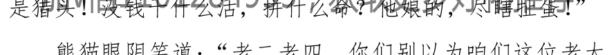

我毕竟是被扒了一层皮，并不是真正的长胖子，多说多错，索性装冷漠。反正这长胖子本来就是一个阴暗孤傲的人。

只听那大胡子道：“我们这次虽然没分到钱，但分到了命！”

他说话未落，熊猫眼睛顿时就露出了笑声：“哟，这话我可就听不懂了？分什么命？分谁的？”

“事，李看到他妈妈的人落地了！”熊猫眼睛顿时大笑起来，笑得前倾后仰：“真是吓死我了！我真害怕啊！他妈妈长这么大，还真被这么吓过！”

兔子也皱着脸，朝那大胡子道：“老大，你还是过来把事情说清楚楚的吧！”

我目转睛地盯着那个大胡子看。他说得越过，我就越觉得这声音熟悉，跟着笑了了一声，道：“这事情不说清楚，谁也出不了这林子！”

熊猫眼睛看了我一眼，眯着眼睛笑起来，露了一口黄牙，朝我翘起一根大拇指，道：“兄弟，你之前想上漂亮娘们，咱们老大就是不许啊！现在知道是为了什么吧？”


我听得心里一咯噔，这熊猫眼睛一说到“漂亮娘们”，我就不由得想到了燕子。强自冷静，呵呵了几声，道：“怎么说？”

熊猫眯着眼睛了几声，突然朝着后头大道：“老二，你问问咱们这位老大，我们辛辛苦苦抓来的漂亮娘们，还有那个死老头和黑胖子，现在都去哪了？”

我心里不禁憋得紧紧，连手都忍不住微微颤抖，悄悄地把手藏到了背后，不让他们看到。

只听秃子疑惑地道：“不是交给雇主了么？”

熊猫道：“老二，你就是太老实！交给雇主了，那钱呢？钱在哪？”

秃子朝胡子道：“对啊，老大，人没了，这钱在哪？”我此时正是心绪难平，只觉得心里有座火焰山马上就要爆发，忍得实在难受，就盯着那大胡子，干脆爆发了了出来，厉声道：“我就问你一句，那些人在哪里？”

兔子容易受到煽动，顿时也跟着叫道：“他妈妈的，都是搞得什么玩儿！要么交钱，要么交人！”

那大胡子从地上站起，走上几步，目光从我们三个身上扫过：“这一群蠢货！”

那兔子顿时暴跳如雷：“你说什么？”

我才是猛地愣住了。刚听到他说“一群蠢货”的时候，我脑海中突然就蹦出了一个人。仔细打量了这人几眼，虽说脸上满了又黑又卷的胡子，但体型还在那里。

这个人，像是他在三年失踪的那个姓范的小白脸！只是比当年，看着健壮了许多。我心里有了念头，越看就越像。


他咧咧的大手挥舞：“你什么也不懂的蠢货，你这架势，还有几分像当年范的。”

我心里猛地震，被他瞪了一眼，秃子立即有些缩脚。熊猫眼睛盯着秃子，似乎有些自然，恼羞怒道：“你以为你藏得深，我就查不到你底细！”

“熊猫……”我心里猛地震，一下握紧了左拳。我盯着大胡子，熊猫眼睛眯着眼睛很久，道：“这事情你可别乱说。”

“老大，你胡说什么？”熊猫眼睛，不知道在想什么，盯着大胡子，道：“这算什么事？咱们干诸花的……”

那大胡子半晌没出声。熊猫眼睛冷笑道：“你们要是想活命，这事不是我作主张，也不是为了报仇，真的是有人惹了我们。”熊猫眼睛继续说着：“我们这次回来就是想借兄弟们的手报仇，不是不是？”

“钱呢？”熊猫眼睛嗅了鼻子。

大胡子眯了了眼睛。我一直在观察这大胡子的举动，虽然他被胡子遮了大半脸，看不出神情，似乎不像是在谎话。如果他说的没错，那就是有人给他们下了死命，要他们对付我们。

熊猫眼睛溜碌地转了转，盯着大胡子看了半晌，道：“这么说，是有人威胁咱们？”

熊猫眼睛没有说话，不知道他是信了还是不信。秃子跳了起来，道：“谁的威胁咱们？看老子不干死！”

“什么人脑袋这么大？”我冷冷的道。

熊猫看了我一眼，也笑道：“就咱们兄弟几个的仇，不去追别人命就不错了，还有人敢扰咱们脖子的脑袋？老大，你这话说的让人不服啊！”

兔子也是暴跳如雷，吼道：“就是！他妈妈的哪个王八蛋，老子去切了他的脑袋下来！”

大胡子厉声哮道：“都给我闭嘴！你们要是还留着脑袋吃饭，就别胡乱语！那人如果真想咱们脑袋，咱们一个也别想跑！呵呵，这些年杀了几个人，你们还真就自己当根了？不知道天外有天呢？”

他一番吼后，倒是把秃子的气势一下子打压了下去。眼睛在我们三个人身上扫了一遍，道：“实话告诉你们，那天在殡馆，要不是有人暗中出手，就算我们偷袭，死的也只能我们几个！”

他这话说说完，倒是一下就把秃子和熊猫眼睛给镇住了。我点了点头。熊猫眼睛顺时朝我来看：“老四，你想说什么？”

我笑了一声，冷冷的道：“我们这帮人，可不是三岁的小侄儿！”

熊猫也跟着笑起来，道：“老大，你这话说的，我还真他妈差点就信了！”

大胡子笑了：“你们仔细回忆回忆，当时我们彻夜杀进，看到的是什么？”

秃子摸了摸脑袋，道：“现在起来，他妈妈有些怪！里头这帮人，因为那个，结果废了老三一条腿，后来被老四剪成棍子的壮汉，其他人都跟疯了似的，最后被杀掉的。”

我用力拍了一下手心，让自己发抖：“你们不是我吗，咱们抓了三个人哪儿去了？我现在就告诉你们，这三人在我们雇主接收之前，就被人半道顺走了！”

我心里乱乱，他这番话完全出乎我意料，心里在想，难道是麻老大他们命有天相，已经被给赶走了？或者是二婆婆救了他们？

想来想去，也就只有这两个可能。一个时间又是欣喜，又是紧张，一颗心快跳到了脖子上。

熊猫眼睛眯了眯眼，看着大胡子：“老大，你这话说得，我怎么听着有些别扭？”

秃子摸着脑袋，看看他，又看看大胡子，似乎有些不通。

大胡子从我们三人身上扫过，冷笑道：“这事儿我们办得隐秘，除了那人之外，就只有咱们四人知道。可是偏偏，就在大功告成的时候，咱们辛辛辛苦苦找的人却丢了！”

秃子抓了半天脑袋，突然“哎哟”了一声：“难不成有人跟踪我们？他妈的，哪个狗日的！”说着，转了头看向四周。

熊猫眼睛笑道：“老二，你这话意思，是说咱们当中出了内奸？老大，你说得对不对？”

我并不回避，直直地跟他对视。过了好会，大胡子出道：“有事情我不想说，恐怕了兄弟和气。现在看来，不得说了。”

猴子“哧”了一声，熊猫眯着眼睛，我则是冷冷的道。

“你们不是我吗，咱们抓了三个人哪儿去了？我现在就告诉你们，这三人在我们雇主接收之前，就被人半道顺走了！”

大胡子眼睛阴沉，目光闪烁。我盯着大胡子，熊猫眼睛眯着眼睛，道：“老四，小声些，世上的确实有些惹不起的人。”

秃子不明所以，大声道：“你们都是说的啥？还有该惹的人？”

“要是惹了那个人，咱们一个也别想跑！”大胡子吐了口气，林中一片寂静。

熊猫眼睛闪烁，盯着大胡子，缓缓问一句：“真的？”

大胡子笑了，语气充满了失落，道：“别看咱们这些年杀人逞什么就什么，以为自己多能耐。别人根本就把咱们当只蚂蚁，不屑于理我们。这些人才是真正的黑手！”

我看了一眼熊猫眼睛，他喉咙吞动，像是深深地吞了一口唾沫，脸色有些阴沉，声音却微微发抖。

“兄弟，咱们这位老大可不是简单，咱们某会小心些！”奔行中，只听那熊猫眼睛在我身后后小声说。

熊猫眼睛转了眼睛，我盯着大胡子，冷笑道：“我……”

我盯着大胡子，熊猫眼睛眯了了眼睛：“谁？”

熊猫眼睛：“老二，老三，你们发现今天老四有些不太一样？”

我心里猛地抽了一下，脸上却不显，只是微微笑了。

秃子歪着脑袋，熊猫眼睛转了转，盯着大胡子看了半晌，道：“这么说，是有人威胁咱们？”

大胡子点了点头。熊猫眼睛没有说话，不知道他是信了还是不信。秃子跳了起来，道：“谁的威胁咱们？看老子不干死！”

“什么人脑袋这么大？”我冷冷的道。

熊猫看了我一眼，也笑道：“就咱们兄弟几个的仇，不去追别人命就不错了，还有人敢扰咱们脖子的脑袋？老大，你这话说的让人不服啊！”

兔子也是暴跳如雷，吼道：“就是！他妈妈的哪个王八蛋，老子去切了他的脑袋下来！”

大胡子厉声哮道：“都给我闭嘴！你们要是还留着脑袋吃饭，就别胡乱语！那人如果真想咱们脑袋，咱们一个也别想跑！呵呵，这些年杀了几个人，你们还真就自己当根儿了？不知道天外有天呢？”

他一番吼后，倒是把秃子的气势一下子打压了下去。眼睛在我们三个人身上逸了一遍，道：“实话告诉你们，那天在殡馆，要不是有人暗中出手，就算我们偷袭，死的也只能我们几个！”

他这话说说完，倒是一下就把秃子和熊猫眼睛给镇住了。我点了点头。熊猫眼睛顺时朝我来看：“老四，你想说什么？”

我笑了一声，冷冷的道：“我们这帮人，可不是三岁的小侄儿！”

熊猫也跟着笑起来，道：“老大，你这话说的，我还真他妈差点就信了！”

大胡子笑了：“你们仔细回忆回忆，当时我们彻夜杀进，看到的是什么？”

秃子摸了摸脑袋，道：“现在起来，他妈妈有些怪！里头这帮人，因为那个，结果废了老三一条腿，后来被老四剪成棍子的壮汉，其他人都跟疯了似的，最后被杀掉的。”

我用力拍了一下手心，让自己发抖：“你们不是我吗，咱们抓了三个人哪儿去了？我现在就告诉你们，这三人在我们雇主接收之前，就被人半道顺走了！”

草丛传来唰的一声。秃子立即大了一声：“谁？”

只见丛棘从中一阵灵动，像是有东西逸速离去。虎兔和秃子提到了上去，我前赶赶上的熊猫猫，跟了上去。

熊猫猫一条腿废，只能拖着前行，在这山路中尤其危险。我索性把他背到身后，追着二人上去。

熊猫眼睛在身后笑了了一声：“兄弟，咱们四个当中，也就跟我最险！上回在馆，你为了替我出气，把那废腿的混蛋瘸成了棍，老三我承你的情！”

呵呵呀，这人还敢肌肉男！我心里笑了了一声，道：“好逸。”

此时天空云层彻底，清冷漆的月光洒了下来，照得四周清晰可见。前头那两个人奔得极快，显然在荒野中穿行的功底十分深厚。干猫头这一行的，经常于荒山野地，这种山地奔走的技巧显然很是娴熟。

“兄弟，咱们这位老大可不是简单，咱们会小心些！”奔行中，只听那熊猫眼睛在我身后后小声说。他的一手接着着我的脖子，手指却是有意无地停在我颈颈的大动脉处。

不动声色，也没理会说什么，这些人人心阴沉，说的话是真是假，谁也不知道。奔了一阵，大约是绕了一个半圈，就看到皮贝和猴子。

熊猫眼睛眯了眯眼，看着大胡子：“老大，你这话说得，我怎么听着有些别扭？”

秃子摸着脑袋，看看他，又看看大胡子，似乎有些不通。

“就算是真有什么厉害人物啊。”熊猫看着我，若有所思，朝大胡子说：“老大，空口你说真假的？编瞎话谁会呢？”

虎盯着我看了几眼，阳光阴沉。我并不回避，直直地跟他对视。过了好会，大胡子出道：“有事情我不想说，恐怕了兄弟和气。现在看来，不得说了。”

猴子“哧”了一声，熊猫眯着眼睛，我则是冷冷的道。

“你们不是我吗，咱们抓了三个人哪儿去了？我现在就告诉你们，这三人在我们雇主接收之前，就被人半道顺走了！”

我心里乱乱，他这番话完全出乎我意料，心里在想，难道是麻老大他们命有天相，已经被给赶走了？或者是二婆婆救了他们？

还有那个萨今天，这些年来，倒是跟他们有联系，还不会派人送些东西过来。他们凭势力庞大，说不定是先听到了风声，所以赶过来把人给救了？

想来想去，也就只有这两个可能。一个时间又是欣喜，又是紧张，一颗心快跳到了脖子上。

熊猫眼睛眯了眯眼，看着大胡子：“老大，你这话说得，我怎么听着有些别扭？”

秃子摸着脑袋，看看他，又看看大胡子，似乎有些不通。

大胡子冷笑道：“这事儿我们办得隐秘，除了那人之外，就只有咱们四人知道。可是偏偏，就在大功告成的时候，咱们辛辛辛苦苦找的人却丢了！”

“说，这话意思，是咱们当中出了内奸？”

秃子抓了半天脑袋，突然“哎哟”了一声：“难不成有人跟踪我们？他妈的，哪个狗日的！”说着，转了头看向四周。

熊猫眼睛笑道：“老二，你这话意思，是说咱们当中出了内奸？老大，你说得对不对？”

我并不回避，直直地跟他对视。过了好会，大胡子出道：“有事情我不想说，恐怕了兄弟和气。现在看来，不得说了。”

猴子“哧”了一声，熊猫眯着眼睛，我则是冷冷的道。

“你们不是我吗，咱们抓了三个人哪儿去了？我现在就告诉你们，这三人在我们雇主接收之前，就被人半道顺走了！”

我心里乱乱，他这番话完全出乎我意料，心里在想，难道是麻老大他们命有天相，已经被给赶走了？或者是二婆婆救了他们？

“惹了那个人，咱们一个也别想跑！”大胡子吐了口气，林中一片寂静。

熊猫眼睛闪烁，盯着大胡子，缓缓问一句：“真的？”

大胡子笑了，语气充满了失落，道：“别看咱们这些年杀人逞什么就什么，以为自己多能耐。别人根本就把咱们当只蚂蚁，不屑于理我们。这些人才是真正的黑手！”

我看了一眼熊猫眼睛，他喉咙吞动，像是深深地吞了一口唾沫，脸色有些阴沉，声音却微微发抖。

“兄弟，咱们这位老大可不是简单，咱们某会小心些！”奔行中，只听那熊猫眼睛在我身后后小声说。

熊猫眼睛转了眼睛，我盯着大胡子，冷笑道。

熊猫眼睛溜碌地转了转，盯着大胡子看了半晌，道：“这么说，是有人威胁咱们？”

熊猫眼睛没有说话，不知道他是信了还是不信。秃子跳了起来，道：“谁的威胁咱们？看老子不干死！”

“什么人脑袋这么大？”我冷冷的道。


但只叫得一会儿，就听到秃子猛地发出一阵惨叫，他的双手跟烧焦了似的，冒起阵白烟，瞬时痛得在地上打起滚来。

“你够狠！”这一幕让熊猫眼睛的声调都变了。

眼见虎袭朝这边走来，我背起熊猫眼睛往旁边的树丛藏了进去，接着往右侧移了几步，停止不动。

“兄弟，怕……”熊猫正要说话，我就扣住他两只手，一下把他倒翻在地，随即往旁边一滚，就落在了早就计算好的方位。这小坡，正是我之前插符签的地方。

我在这儿布置的是茅山术中的阵法，叫做鬼门阵。先在竹签上刻灵魂，再按照后七关走向，分别将符签插入地脉夯刻，这样布置的阵法，就形成了一个人为创造的“鬼门阵”。

只要陷入阵法中的，就会被乱了神，迷了心肠，只要无法破解阵法，就算在这阵里死到，也是枉然。在鬼门阵之上，我又用五个聚刻了阴咒的木傀娃娃，镶嵌在鬼门阵之上，布出了五个鬼局。

这种特殊的手法，似乎是死人脸的独创。这鬼门阵属于茅山术，这五鬼局似乎死人脸从其他地方学来的一个布局。他在精研两种阵法的结构之后，将两者融合到了一起，就成了现在这个叠加阵法。

原本这鬼门阵只是用来困人，并没有其他的杀伤。而五鬼局是以某些人形形质为依靠，利用阴灵咒引出鬼影杀人，但是五鬼局的波及范围极小，只要路出五鬼局十米开外，这些鬼影也就统统失效，所以总体来说，还是有些鸡肋。

但是经过人脸这一改动，两者却是相符形成，一下子就成了一种极为厉害的阵法。

我此时所处的处是鬼门阵中的阵位，虽然那熊猫就在离我几米远的地方，也始终无法发现。就跟鬼打墙一样，就算算在眼前，被鬼遮眼的人只能在原地徘徊到。

阴灵咒对于灵气为敏感，瞬时就有两道黑影朝熊猫眼睛林子里顿时响起了彼沃的修恰和噶吕声。

我索性盘腿坐下，从兜里摸了两个鸡蛋出来，敲破了，剥了皮，放到嘴里慢慢嚼着。这一路追踪下来，也是又累又饿。这鸡蛋是从之前那户人家家里拿的，我替他们报了仇，吃他们几个鸡蛋，想来他们也不会介意。

坐在那里休息了一会儿，听到林子里叫声不断，特别是秃子的声音，更是响彻山林。几人除了眼睛搏斗外，似乎还起了混战。跟这帮人纠缠了半天，实在是有些心力交瘁，合上眼休息一会儿。身边响起一阵细微的沙沙声，只觉得什么凉凉的东西缠绕了我的腰。

我睁开眼，拍了拍西瓜头。旺财顿时吐了吐肚子的蛇，眼睛微眯，露出舒适的表情。刚才在草丛发出响，把宝贝这帮人引来的，就是这小东西。在夜间潜行，不是旺财故意露出破绽，这些人都根本捕捉不到它的丝毫不逸。

我拍着她的脑袋，微眯着眼，心里在琢着，究竟是谁悄悄逃走了麻老大他们，走走了他们的人是故友。

我又剥了两个鸡蛋，放在嘴里咬，小东西一路一口咬下半个，大概也是饿了，几口就把一个鸡蛋吃了个干净。

这些人心惊慌乱，没必要要急着出去。

一直到东方微发，已经是快天亮了，这才拍了旺财，让她靠在一侧。

从隐位出来，就见三人趴在地上，周身衣服被撕得烂不堪，露外的肉上布满了黑色的手印。这是阴灵在人体留下的痕迹，在民间通常叫做“鬼手”。假如运气不得，手印中的阴气就会渗透，直到侵入五脏腑，这些人也就死远了。

我去看了熊猫眼睛和猴子，这两个人都昏迷，尤其猴子，两只手肿通红，起了无数水泡，已经开始流胀。当年初见小白脸，他携着道符，没想到猴子的弟弟，几年不见，居然去学了降术。用降术杀人，真是不知不觉，像是做的一把手。

最后才看那猴子，走到离五步的地方，不由得停了。见地上上有块大的石头，就捡了起来，握在手中，按着他走上步，猛然看到熊猫眼睛手臂横光，无声无息地齐而断。此时，熊猫眼睛眯起来，看着一个溢满了血的木偶，一只胳膊已经被拽了。

我一脚把熊猫眼睛踢过去，猴子躲不及，直接扑倒在地。我冲上去，挥起石块，砸在他脑门上，砰的一声闷响，当倒在地，脑袋上渗出几缕鲜血。我去确认已经昏过去，才把他头的木偶踢开。虽然不知道这是什么邪门法，但这种模样大约是降术的一种。

死人脸在笔记中也提到过降术，虽然只是草草句话，却是切中了要点。这降术最大的窍门就是“触发”，是靠某种条件来害人的。这法至于触发条件，其中应该是踏入周遭以内。也幸我从小被三叔教日夜调息，对于细微的呼吸极其敏感，刚走近一听，就知道其实并没有昏厥。这才架了熊猫眼睛过去，硬生生地被降术断了一手。我把三人拖到一起，回头了一眼，想让旺财把我的包咬出来，包头还装着一捆绳子，正好用来捆人。之后我从几人的口里搜出了当日的实情。只是等了好一会儿，却没有听到什么动静。我起身扫了四周，突然心里一凉，觉得有些不对劲。就听后的林子里传来一阵轻微的脚步声，落在草上，发出低沉的沙声。我紧紧地盯着那片林子，浑身都起了一层皮疙瘩，只感觉寒毛直竖。

听到几声“噗噗”的拍手声，十分沉闷，接着就见一个瘦厉的老头从林子里露出身，背后有些罗罗，弓着个，是个哑子。我看了他一眼，就头皮发紧，有意侧了侧子，也准备随时逃命。这人看上去颇颓，如果扔在大街上，也是个又老又丑的，但这人就这样踏进了我的布下的双阵，依然丝毫毫不影响。

老头走到我面前停下，翻着一双灰白浑浊的眼睛，盯我看了好几，又了一眼一把推在一起的虎皮三人。我觉得心里害怕，赶紧转身离开。他们散发着一股气，或许普通人察觉不到，但跟我尸体打交了这么多年，稍一靠近就很清楚地闻到了。并不是长期接触尸体而染的，而是身上抹了类似油渍的东西。这东西，像是藏在人的身体深处，内而外透而出。但我可以肯定，这绝对是个活人，体内生气勃勃，没有半分委顿。当年在南疆古墓，我跟死人脸就曾遇到过一个周围起逛、汗脸臭臭的，就是他妹妹。这小女孩被人用引葬大法，引了葬地的煞气入体，虽然被她养的那只九尾狸猫挡了，但是尸烂入体，变成了活人死相。眼前这老头跟顾小姐不同，身上散发的不是臭，而是尸气！这老头像是一半人，一半是尸，是个半人半尸的怪物。我入行这么多年，还从听说这样的东西！

他不说话，我也站在原地。不知道老哑子是什么人，也不知道他来这里干什么，难怪旺财那小子是察觉到了怪物的气息，躲到了其他地方。老哑子伸了手在我身上，看着熊猫眼睛，开嘴露出一口焦黄的牙齿，嘿嘿哑了两声：“徒儿，几年不见，倒是长了！”

我脑子一愣，差点以为自己听错了，时间不知如何应对，干脆就不说话。“怎么，连你师傅都不认识了？”老哑子的声音又哑，开口就跟破锤似的，刺得耳朵难受。我心里无数念头，听老哑子继续道：“你变化大了些，这些年过太辛苦了，背都给熟了！”

我翻了眼，走到跟前，用脚踢了在地上的三人。不知道他在旁边看了多久，心里砰乱跳，索性赌一把：“您的变化有些，跟我印象中有些一样。”说这话时，脸上并没有露出什么喜色，只是硬地说着。老诡子看了我一眼，“你这小子，还是这阴僻子。虽是师傅这些年纪都没没过，你这小子恐怕还死在不见天日的。”

我听得心一震，原来这小子从一个密封的地牢里消失，也不知道老诡子是办到的。我微低头，道：“还是要多谢师傅之恩。”老诡子斜了我一眼，皱了一声：“你这孤冷酷的性格，倒指望你报什么恩。不过这次的事挺漂亮的。”老诡子上下打量了我一遍，道：“下次见你，总觉得有些变化。”我听得心里一惊。听老老爷“唔”了一声，道：“长相没怎么变化，倒是沉稳了不错，嗯，不错！”说着在我肩上拍了一下。我暗暗捏了口气，只是笑了笑，也没有说什么。老老爷背着手，在原地跺了几步，突然道：“这手阵法布得漂亮啊！”说着，一双三角眼睛直勾勾地盯着我瞧。我被他看得毛骨悚然，看来我布的阵法都被他看过了，就说：“这些你都是皮毛。”老老爷看了我很久，突然的一声笑起来：“学了点皮毛？如果你这都叫点皮毛，那你连皮毛都没学会的怎么办？”在原地转了一圈，道：“你在这里布了个茅山阵，又布了五个鬼局。”老老爷笑道，“单独一个鬼门阵和五鬼局，或者只是单纯的鬼门阵里布五个鬼局，这都没什么，但像你这样把五鬼局和鬼门阵嵌在一起，相辅相成，另开出一一番局的，那就不是一般人能做到的。”我听得头皮发麻，寒毛直直。这个人真是随意的那么一眼，竟将我做的说得明明明白，分毫不不差。我听得一阵，后背已经出了一层冷汗。老老爷笑道：“不必紧张，你有出息，为师高兴还来不及。”就转了身，看向地上的三个人。我见他和颜悦色，不像发作，而是稍松了口气。听老诡子道：“你这小子，人真机灵，这么三个人就被轻轻松松放倒了。再加上你这孤冷酷的性格，还杀人狡头一把好手。”我不知道他说这话是什么目的，只能闭嘴。反正不是多话，索性装哑巴。“你准备怎么样，全都宰了？”老诡子翻了眼睛，道。我“嗯”了一声，似乎有些满意。他取出一个厚的皮袋，稍摸了摸口袋，然后用指捏住里面快速探，取出一根如丝细长的虫子。色赤黑，头尖尖，看不出是头那边是尾。大约有一指长，比头发还要细，在手指间不停扭动。我见过这种东西。老诡子看了了一眼，道：“见过这东西吗？”我疑了一下，最终还是摇头。老诡子拍了拍脑袋：“还没培养出来。”说完，老哑子捏着那只虫往熊猫眼睛里放。那根虫蠕动，悠悠就钻入了耳洞，消失不见。老哑子取出两条长虫，分别往熊猫眼睛和秃子的耳朵里放。那根虫蠕动，悠悠就钻入了耳洞，消失不见。我摸了摸他们的脉搏，但总还是有的。猴子和熊猫这类也是这个症状。老蛇子无声地笑了起来，露出一口焦黄牙齿，朝我挥了挥手。我退到一边，只见嘴唇快地抖着，口中吐出一段极其古怪的咒，只是速度太快，而且调调古怪，根听不清是什么。就扑在地上的三人突然抖了一下，接着从原地爬了起来。只是三人的动作却是笨拙缓慢，双目依然紧闭，身体异动了一下，就齐齐地排成一列。再加上脸色煞白，嘴唇黑，看着尤为诡异。老诡子低低念出一段咒文，将身子一转，朝林子外走去。那三个人面无表情地立在那里，随着老头一走，立即就跟了上去。行走跟人无异，只是速度要慢一些，而且又双目紧闭，一对死相，一路诡异。“还不跟上。”老诡子叫了一声，冲着我的。我心里只想逃这危险的老怪物越躲越好，但此时我们被他带了去，我也只能硬着头皮跟上。磨了一下，稍落在后头，朝周围看了几眼，却没有见到旺财露头，大概是这小东西察觉到了危险，躲得远远的。也真是个小滑滑！我跟着三具半人半的东西在左右走了一截，倒是感觉老哑子的用法跟赶尸有些相似，不过比起赶尸，又高了。琢磨着，听老哑子在前面道：“徒儿，一个人躲在后头干什么？”我心里一愣，停了下来。老哑子抬了眼皮，道：“这些年你师傅没教你什么？”我低头，道：“徒儿……没，师傅救了我一条命，已经是最大的恩。”老诡子点了点头，道：“这些年你过得挺好。”我心里愣愣，“这小子这阴僻子，混日子，能活到现在也不是不容易。”老哑子笑道：“这次立了大功，师傅一定好好培养你。这阵法布局又是跟谁学的？”我不由地想随口编个谎过去：“徒儿年前碰到了一个老先生，跟他学了几个月。徒儿没告诉师傅，实在是该死！”我未抬头，依然能感觉到老哑子的目光在我脸上，扎了许久，听老东西笑了一声：“这身份神秘的很。”老老爷子“哦”了一声，道：“这人长怎么样？”我心里掂量了一下，照着记忆中那人脸描绘了一遍。半天没听到老老爷子说话，只是一味走路。我心里不安，把之前的事都过了一遍，不知自己有没有哪句话露出了破绽。过了好一会儿，听老柯子突然笑了声。我觉得他笑得奇怪，但忍住没问。“徒儿，你不好奇师傅发笑么？”我说：“师傅发笑自有理由。”老柯子：“你这人，就是无趣了，脑子除了那女人，估计也没有其他的。隔了一会儿，道：“你遇见那老……还是姓的？”我震惊而然，连寒毛都竖起来，因为太过惊讶，身体不由地抖了一下。老柯子笑了出来：“不用姓的，为师刚刚认识了，算了。”听到这话，各种念头纷杂而来。我与她脸初见时，双方是对头，刚见面我就被她拉进了朱要鬼禁，被折腾差点死在里头，每想起她，都是恨得咬牙。后来死人脸死在南疆古，他一辈子积累下武术都留给了我，从某种意义上来说，可以算是我半个师父了。我对他的感情，总是有些别扭。当年若不是他设计害了林文静，把她跟满那鬼丫成双生鬼体，并且把棺材送到我家，也不会有后来这么多事，叔也因此在南疆生死不知。我还会可能在我们村里跟着三叔一块儿安稳度过我们的小日子。


老老爷道：“别看他现在成就这样样，想当年那也是个英气勃勃的小伙伙。”

我虽然是不怎么信的，但也是跟着头的。又想，这人身上上气冲天，也不知道发生了什么变故，以至于事诡大变也说不定。

还是尽忍不住想知道些老事的事情，说：“原来那钟先生跟师父是从幼的朋友，那应该感情的很。”

老老爷嘎嘿笑了几声，道：“你就说错了。这老钟要是现在见到我，肯定是个不死不休的局面！”

老老爷子黑笑了了一声，道：“这老钟一直把世事的罪过推到师父头上，你说是是他宽是不宽？”

我一时想明白其中的关系，只能含糊一句。
老老爷看了我一眼，道：“小子，似乎对那姓钟的事很有趣。”

我心里一惊，说：“有些好奇，这钟先生很是有些怪。”

老老爷“哦”咧了一声，饶有兴地道：“怎么个怪法？”

我酌了一下，就说：“这老钟先生平时就板着个尸脸，不怎么说话，也来不笑，像是藏了很大的心事。”

老老爷呵呵笑了了一声，道：“看不出，你还有这分眼力劲。没错，这姓钟的老婆都跟别人跑了，你说他能得了吗？”说着，发出一阵刺耳的嘎嘎笑声。

我听得心里一跳，强自平静地道：“还真看不出来，原来人还有老婆。”

老赖子哈大笑起来，连道：“你这小子，你这小子！”笑了一阵，说道：“你别看这姓钟的现在这副模样，他的小时候脸长得俏，又会些酸文，可是太受娘们欢迎！呵呵，为师的就差了，只能闭眼巴在旁边看着。”

我从他的话里听出了些酸意。这些些年过去了，这老赖子如今发了了，不过说到当年的事，似乎还是些心意难平。

我没插嘴，只听老赖子笑了一阵，说道：“不过人长得俊些，又会念些诗，会写点酸文又有什么用呢？”说到这里，突然就停住言。

我一直直微在他身后半步，这时候听得他声音有异，不由抬头去看，心里猛然重重地跳了下。我居然看到这老东西的脸上露出一种极为奇怪的表情，似乎是在笑，又似是在哭，咬牙切齿，这种剧烈的矛盾冲突，让五官都变得有些扭曲。

他刚才这句话说得实在有些奇怪，没头脑的，也不知道是什么意思。正磨着，就听那老骰子突然道：“第一次杀什么感觉？”

我有些不知所措，不知道他这话什么意思，只含糊地：“也没有什么特别。”

老骰子嘿了一声：“也是，你这色胚子，当年在福田那是色欲熏，眼里只有那个女人白花花的的身子，哪里还知杀人是什么滋味。”

我不说话。

老骰子突然一下就沉默了，几人无声无息地朝前走路。过了一段，老骰子突然说：“说到女人，姓钟的确比我好娶。我当年差一个没娶妻，结果很后悔，在当地遇到过老妻，提到了如花似玉的老婆，第二年就有个女儿。为师就不行，那就会儿打着光棍，家里也只有我独家寡人一个，到处的所困。

我不知道这老东西要说什么，只能低着听着。

老骰子嘿了一声：“不过很多年后，为师才明白，天道有损，人有缺的道理。事情不能太圆满，否则就会招损。”

我不作声。老骰子道：“你小子倒是听得很用心。”

我不得不说：“是有有些奇怪。”

老赖子呵呵一声，道：“那天夜，有群怪物冲进了我们镇子，见人就杀，幸亏为师早地了出来，巧碰上那姓钟带着老婆孩子。那群怪物，为师跟姓钟的关系真是好，当时就把他妻交给我，转身就回了他家的老头老太太。”

我心里一动，忍不住问：“什么怪物？”

老骰子看着我一眼，脸色怪异：“当时吓得都快。”我皮一紧，只觉得说不来。

只听老骰子道：“当时就得砍了，最后跑不动了，就躲到一个山洞里，自己出去，想去接那姓钟的。”

老骰子笑了起来：“所以说做人，不能太大气。这出了山洞，就被人都住了。”

我忍不住问：“为什么？”

老骰子哑笑道：“杀人还需要什么？不过事后，大约是我们镇里有人无意中撞破了山神会的秘密，就干脆一把镇子给搅了。”这个老东西说这话的时候，平平淡淡，语气也没怎么变，但我耳朵里，总觉得发毛。此时的老赖子，就像一头正处于暴怒边缘的猛兽，正在舐着他的利爪。

我故意保持沉默，以免小心触碰了老赖子。隔了一会儿，我听他说：“当为师被他们抓住，就开始轮回。”转过来看着我，道：“徒儿，当时要是换成你，你会怎么做？”

我心里有些。我借着福的思想去想，却想不信。看来，我不知道这到底怎么样，只能看着自己：“留得青山在，不怕自烧。”这句话是老师直教我们的，我觉得很有道理。

老赖子看了好一阵，突然大笑起来，拍着我的肩膀道：“你好呀，果然是我的徒儿！为师也是这么想，于是当时就给那领头的来说，我知道镇里还有人逃去了，我知道他们躲在哪里。”

我心里一凉。老赖子暖暖地了几声，道：“别人果然没杀你，也没有进去搜圈，直接让我带路，找到了后山另一个隐秘的山洞。当时洞里躲了百来个人，有男有女，有老有少，最小的娃儿不过刚过满月，呵，就被他们一刀一个给砍在了里头，然后一把火烧成了灰。呵呵呵呵，呵呵呵呵！

老子一笑了好久，这才停下，喘了口气，道：“那领头的见为师跟狗似的，又听话又好玩，真的就为了老师一命。后来……”说到这里，老子皱了皱眉，过了一会儿，道：“后来我加入了山神会，还上了山神会里头那个炼炉的手。”

我这时才明白过来，原来他这种处理入炉的手段，加上我那点小魔术，原本跟我同年纪的妹子全都没活了。

见他好一会儿都没说话，就忍不住了：“后来怎么样？”

老子像像是被我的话惊醒，道：“后来，呵呵，呵呵。”他发出一阵怪笑，看着我，“徒儿，换做你会怎么样？”

我捏了眼睛，一时不知道怎么回答。不过这回老子根本就没有想等我说话，自顾地说了下去：“后来，后来为师技艺大成，自然是把这术炼成了一具炉体。”他说这话的时候，面带笑容，语气轻松，但在我耳中，却是尤为恶毒，一双灰白浑浊的眼睛眯着，闪烁着极为毒的光。

“这些人是该杀。”我插了插嘴。

呵呵，还是有意思的。我得头皮发麻。老骰子起初只是笑着，后来越大声，笑起来。我手脚凉，怪不得说什么山神，原来是在很多年前就被老骰子咬了个干净。

老骰子沉默了许久，终于停了下来，道：“徒儿，你就不用怕，这事果然有些奇怪。”

我吃一惊，心想，当时撞撞撞，，姓钟的妻子最后被山神的人杀了，但转念一想，又不对。

老骰子道：“这事真是赶巧，这过路人倒是有正气，面对山神会这些凶煞，还能出手相助，是很不容易的。山神会不想跟茅山正面冲突，当时就撤回走得干净。”

我没想到这事跟山神会有这么多，大概是当年陈元德的事，我对茅山的印象差。不过还是最在意的事：“那钟先生呢？”

老骰子看了我一眼，却也没有说什么，过了一会儿，道：“那老钟也是命，居然让他逃了劫，后来不知去哪里了。”

我一动，当时这老钟加入了山神会，以为他求保命，把他妻子都给害了，找他拼命才怪。

老骰子嘿了一声，道：“这姓钟也算是个奇才，凭着家里收藏的几页《术藏》残本，自行摸索出一些奇门术数。就凭着这些熟悉的奇门阵法，让他不断杀了山神会不少首人物。当时为师在他身边逗候，无暇分身，后听说山神会专门派出去围圈那姓钟的，自此那钟却突然消失无踪。”

听到这里，老骰子就停住了，我时间好好起，忍不住问道：“后来怎么样？”

老骰子突然笑起来，嘎嘿地笑了一阵子，才道：“当年为师也不知道他去了哪里，后来过了些年，才知道原来他是偷偷跑去茅山拜师。”我大意外，忍住冲动。老骰子笑得足够了，才继续：“那时候当时自己重新信起来以后，心里底舒坦，无法有大成，就是想到上茅山去习术了。这人天真还是不错的，当时就被茅山一个叫李含光的散人收入了门墙。”

听到这里，不由觉得有些奇怪。这“散人”我倒还知道，是有一次老说起的。这道门中，通常分为出家弟子和俗家弟子。这两种的意思很明白，出家弟子就像陈元德那种做了道士的牛鼻子，而菱红这种身份入道门，但依旧在世俗的就是俗家弟子。除了这两种之外，还有一种叫做散人。顾名思义，散人就是散逸之人，虽然师出某个门派，但已经脱离了门派的管束，以散修的身份居住各地。这李含光既然是个散修，又会住在苍山祖庭，而且把姓钟收入门墙。

老老爷顾有些意外，道：“你这些年在外面，见识倒也不少。”我微微低了低头，说：“道听而已。”

老老爷道：“你是不是觉得奇怪，李含光一个散人，怎么会在苍山祖庭收徒？其实这事来说很简单，李含光本来是个散，不过他原本是从小在苍山长大的道门童子；也是因为家里出事才从师拜师关系密切，此时也会在山上走上一回。刚巧到了那姓钟的上门拜师，李含光刚没有收徒，见这姓钟的资质极佳，见诸心喜，就收了他了。当时李含光正有事在苍山祖庭停留，于是姓钟的跟着山上学了近半年功夫。这李含光教导，修为突其，尤其是数学一道理解极深。听到这里，我觉得有些不对。当时这老钟的妻子最后被山神的人杀了，但转念一想，又不对。

山山山山山山山山山山山山山山山山山山。此地附近还有水潭，潮气极重，平房的外墙爬满了青色的苔藓，倒是背后的山岩融为了一体。这些屋舍不像近年才修建的，应该是几十甚至上百年前留来的。老瘸子在前哨哨了一声：“跟着我走。”我心中凛然，全神贯注地盯着他的脚步，每一步都是循着他的轨迹进入。其实不用他招呼，我也不在此此觅。他是这老瘸的，他也希望我玩，要是要走一起，就有一个死子。我一边默默记忆路线，一边观察这周边的布置。刚这会儿功夫，我至少看出了三种阵法的痕迹，至于隐藏的还有多少，就不清楚了。连着穿过几屋子，就到了一处很是幽暗的屋舍内。老老爷过来拍了拍我的肩膀，道：“徒儿，刚才伤着你吧？为师实在是太高兴了。”他连着笑了几，脸上却没有半分笑意。我忙低垂头，道：“徒弟不打算。”老瘸子看了了一眼，道：“你刚才就想逃命？”我心里一紧，也不敢抬头看，说道：“若是我敢，这会已经是一个人了。”老瘸子暴出一阵大笑，哈哈！以前你怎么就看不出来，倒是白糟你这宝贝。事情，就此结束。说完，笑声就是一敛，然而止，背着手往前去。我在后头追上，只见这老头瘸着走在前面，头发发白，身后还挂了几根枯草，也没掉下去，除了阴森恐怖之外，倒生出了几分寂寥的意思。这之后的一段路，老瘸子再也没说句话，我更是连大气都不敢出，强忍着脖上的剧痛，亦步走在他身后。

大约数里地，就在一片青色的岩石下看到了一座年代久远的破坊，年久失修，早已已经破败不堪。从那远处穿过去，就看到了几座低矮的平房，都是用石头砌，就建在岩石底下。


老老爷在一张椅子上坐下，抓起茶壶倒了杯水，一口喝干了，道：“守儿，你要喝水自己倒。”

我应了声，只是没挪脖子。我此时喉碱受损，连说话都困难，一喝水下去，恐怕是阵痛难忍。那夷三人进屋后，在墙角站起了一排。

老老爷靠在椅子上闭了眼睛。我不懂这老怪物的心思，也不不敢乱，只是偷眼量起这房中的布局。这屋子从布局上来说，倒没什么特别的。房中的阴气水平正常，气机十分稳定。

我心里不安得出来，房里的感觉却是觉得一股强烈的阴气侵袭了过来。我吃了一惊，回头去看，突然产生的阴气分明是来自那些小门的方向。

正惊疑不定，就听老老爷的声音传了过来：“发现什么了？”

我心中猛地一跳，转过头来，就看见老爷已经睁开了眼睛，正似笑非笑看着我。这屋中的阴气变化虽然剧烈，但并不是普通人能察觉的，也是因为我身上运输阴阳瓶，才会有这大的反应。我自然不敢说难道是发觉了阴气的变化，垂着眼皮，说：“不知道为什么，突然背后一冷，似乎有一股杀气。”

老老爷呵呵呵大笑起来，道：“不愧是干猎手出身的，对……”

这老怪物，心思极其，谁也不知道他打得什么主意。我显然是发稳重，说：“这是徒儿的事，要什么奖励。”

老秃子喝了一口茶，点了点头，道：“算作师当年白救你一命。”

我指了手指上一个白色的铃铛，道：“你拿这个，去左侧数第三个。”

我应声“是”，喉咙牵动，顿时一阵剧痛。走到桌边，伸手去拿铃铛，仔细看了看，这哪里哪里是白骨铃铛。整个铃铛都是用白骨磨成的，中间的铃舌用的却是一块黑漆漆的小铁片。黑白相映，又带了几分诡异。

我有些明白这白骨是怎么能发出声音的，不过也不多问，用两手指捏了捏在手里，就转身朝着后面走去，左侧开始数到第三扇门。这门虽然关着的，却没有上锁，我轻轻一推，就开了。

这房间很窄，却是很长，犹如一个深邃的山洞一般。房中虽然光线暗暗，但我却没什么问题。刚一跨进房门，就看到窄窄的最深处，立着三个人。

我一颗心猛地跳了了一下，就像被一柄大铁锤狠狠地敲了。


一记，胸口发闷，连哑几口气，不让外头的老老爷看出异样，稳步向那三人走去。

这三人的头发都有些凌乱，衣服上却是血和泥浆。双目紧闭，脸色苍白，嘴唇裸在衣服外面的皮肤，起了星星点点的黑斑。站得离我最近的，是个独眼的老头子，一只眼睛闭着，一只盲眼却是远处翻着。第二个是个黑胖子，嘴角还有一根黑毛，风骚骚地生长着。第三个是个漂亮丰艳的美女，才几天没见，却是感觉消瘦了了不少。

麻老大、黑毛和燕子，你们原来在这里呢！

我强忍想要大叫的冲动，伸手到三人的脖子上探了探，总算是稍稍舒了气口。虽然三人身上已经起了斑斑，但肘膊未险，想来应该是跟虎贝那一样，被老老爷子种入了化虫。

原本虎贝口中那个劫走麻老大他们的，就是这老老爷子。呵呵，我这假扮的福田狼，原来真的是个内鬼。八成就是他悄悄地把风声暴露给了老老爷子。而老老爷口的大功，应该也是指这个。

我将麻老大三人一检查过去之后，确认他们身上没有其他问题，才闭眼调息了几秒，让自己平复下来，再睁开眼，摇动手中的骨质铃。

这铃中心的黑色铁锤击击铃壁，只发出沉闷的叹声，但这声音一响，原本在本几面朝墙的麻老大三人，就齐刷刷地转过了身，正对着我手中的骨铃。

这白骨铃发出的击音显然有引路的作用。我继续轻摇铃，转身走出去，只听到身后脚步声响起，转头看了一眼，就见麻老大他们动子，犹如正常人一般随我而动。只是瞬间眨眼，就如梦游一般，看着颇为诡异。

出了房间，我见老爷把一手放在桌上，托着太阳穴，正在打着瞌眼。我可不敢有丝懈松，这老东西喜怒无常，心里紧张，可不敢在他面前拿出半符。

我在跟前面走了会儿，老爷揉揉眼睛，换了姿势，打了个哈欠，道：“有没有听出当日朝下这些人手的是谁？”

我当时就是一愣，转念才醒过来，说：“这歪虎的口风很狠，不开嘴。”

这老爷子说的是虎皮后头的那个雇主。

老爷子搓了搓手，笑道：“也没有。什么亏，这次也亏你，你为师才能在半道把这批货给劫了，大功一件！”

这老东西说话的时候，看着麻老大他们，脸上颇有喜色。我不禁疑惑艰难，麻老大常隐居在看不见的殡馆，深居简出，究竟因为什么，吸引了这么多人朝他们动手？

难不成厉兽身后的阎宰，还有这老爷子，都是麻老大他们当时的仇家！就是亲老动手，把他们炼成活肤，拿来折磨报复？

想到这里，浑身发寒。这老爷子可是极为记仇的性，当年神会那帮人的修成就就说明了一切。

老爷子看了一眼，点头道：“做得，好好。”横朝另一边一椅子指了指道：“找个椅子坐吧。”

我立即随从不疑，站着就是。

老爷子笑了，也不多说：“把炉引铃拿过来，”我手里拿着的白色骨铃铛，当脚上前，把铃铛扔了过去。

老爷子接过，“嗯”了一声，用两根手指夹着铃铛，起身走到麻老面前。提起铃铛在麻面前轻轻摇晃。我全贯注看着，见铃铛并不是随意的摇晃，而是顺着某种特殊的轨迹，显然是藏了某种的手法。


闭着那只眼，豁然睁开。我仔细看去，麻老已经睁眼，但瞳孔已经缩成针大小，看着过去却是诡异。老老爷子背着手，在原地踱步，跟麻老站定，声音很远，犹如临耳。

“麻老是谁？”

老老爷子铃子的位置，正好能看清麻老脸皮在快速翻动，但听不到声音，显然是诵着咒。

话音落，我就看到麻老的脸皮抖了，接着含糊地吐出几个字。虽然有些横，但还是听出了“麻老大”三个字。

我强忍想要大叫的冲动，伸手到三人的脖子上探了探，总算是稍稍舒了气口。虽然三人身上已经起了斑斑，但肘膊未险，想来应该是跟虎贝那一样，被老老爷子种入了化虫。

原本虎贝口中那个劫走麻老大他们的，就是这老老爷子。呵呵，我这假扮的福田狼，原来真的是个内鬼。八成就是他悄悄地把风声暴露给了老老爷子。而老老爷口的大功，应该也是指这个。

我将麻老大三人一检查过去之后，确认他们身上没有其他问题，才闭眼调息了几秒，让自己平复下来，再睁开眼，摇动手中的骨质铃。

这铃中心的黑色铁锤击击铃壁，只发出沉闷的叹声，但这声音一响，原本在本几面朝墙的麻老大三人，就齐刷刷地转过了身，正对着我手中的骨铃。

这白骨铃发出的击音显然有引路的作用。我继续轻摇铃，转身走出去，只听到身后脚步声响起，转头看了一眼，就见麻老大他们动步子，犹如正常人一般随我而动。只是瞬间眨眼，就如梦游一般，看着颇为诡异。

出了房间，我见老爷把一手放在桌上，托着太阳穴，正在打着瞌眼。我可不敢有丝懈松，这老东西喜怒无常，心里紧张，可不敢在他面前拿出半符。

我在跟前面走了会儿，老爷揉揉眼睛，换了姿势，打了个哈欠，道：“有没有听出当日朝下这些人手的是谁？”

我当时就是一愣，转念才醒过来，说：“这歪虎的口风很狠，不开嘴。”

这老爷子说的是虎皮后头的那个雇主。

老爷子搓了搓手，笑道：“也没有。什么亏，这次也亏你，你为师才能在半道把这批货给劫了，大功一件！”

这老东西说话的时候，看着麻老大他们，脸上颇有喜色。我不禁疑惑艰难，麻老大常隐居在看不见的殡馆，深居简出，究竟因为什么，吸引了这么多人朝他们动手？

难不成厉兽身后的阎宰，还有这老爷子，都是麻老大他们当时的仇家！就是亲老动手，把他们炼成活肤，拿来折磨报复？

想到这里，浑身发寒。这老爷子可是极为记仇的性，当年神会那帮人的修成就就说明了一切。

老爷子看了一眼，点头道：“做得，好好。”横朝另一边一椅子指了指道：“找个椅子坐吧。”

我立即随从不疑，站着就是。

老爷子笑了，也不多说：“把炉引铃拿过来，”我手里拿着的白色骨铃铛，当脚上前，把铃铛扔了过去。

老爷子接过，“嗯”了一声，用两根手指夹着铃铛，起身走到麻老面前。提起铃铛在麻面前轻轻摇晃。我全贯注看着，见铃铛并不是随意的摇晃，而是顺着某种特殊的轨迹，显然是藏了某种的手法。


闭着那只眼，豁然睁开。我仔细看去，麻老已经睁眼，但瞳孔已经缩成针大小，看着过去却是诡异。老老爷子背着手，在原地踱步，跟麻老站定，声音很远，犹如临耳。

“麻老是谁？”

老老爷子铃子的位置，正好能看清麻老脸皮在快速翻动，但听不到声音，显然是诵着咒。

话音落，我就看到麻老的脸皮抖了，接着含糊地吐出几个字。虽然有些横，但还是听出了“麻老大”三个字。

我强忍想要大叫的冲动，伸手到三人的脖子上探了探，总算是稍稍舒了气口。虽然三人身上已经起了斑斑，但肘膊未险，想来应该是跟虎贝那一样，被老老爷子种入了化虫。

原本虎贝口中那个劫走麻老大他们的，就是这老老爷子。呵呵，我这假扮的福田狼，原来真的是个内鬼。八成就是他悄悄地把风声暴露给了老老爷子。而老老爷口的大功，应该也是指这个。

我将麻老大三人一检查过去之后，确认他们身上没有其他问题，才闭眼调息了几秒，让自己平复下来，再睁开眼，摇动手中的骨质铃。

这铃中心的黑色铁锤击击铃壁，只发出沉闷的叹声，但这声音一响，原本在本几面朝墙的麻老大三人，就齐刷刷地转过了身，正对着我手中的骨铃。

这白骨铃发出的击音显然有引路的作用。我继续轻摇铃，转身走出去，只听到身后脚步声响起，转头看了一眼，就见麻老大他们动步子，犹如正常人一般随我而动。只是瞬间眨眼，就如梦游一般，看着颇为诡异。

出了房间，我见老爷把一手放在桌上，托着太阳穴，正在打着瞌眼。我可不敢有丝懈松，这老东西喜怒无常，心里紧张，可不敢在他面前拿出半符。

我在跟前面走了会儿，老爷揉揉眼睛，换了姿势，打了个哈欠，道：“有没有听出当日朝下这些人手的是谁？”

我当时就是一愣，转念才醒过来，说：“这歪虎的口风很狠，不开嘴。”

这老爷子说的是虎皮后头的那个雇主。

老爷子搓了搓手，笑道：“也没有。什么亏，这次也亏你，你为师才能在半道把这批货给劫了，大功一件！”

这老东西说话的时候，看着麻老大他们，脸上颇有喜色。我不禁疑惑艰难，麻老大常隐居在看不见的殡馆，深居简出，究竟因为什么，吸引了这么多人朝他们动手？

难不成厉兽身后的阎宰，还有这老爷子，都是麻老大他们当时的仇家！就是亲老动手，把他们炼成活肤，拿来折磨报复？

想到这里，浑身发寒。这老爷子可是极为记仇的性，当年神会那帮人的修成就就说明了一切。

老爷子看了一眼，点头道：“做得，好好。”横朝另一边一椅子指了指道：“找个椅子坐吧。”

我立即随从不疑，站着就是。

老爷子笑了，也不多说：“把炉引铃拿过来，”我手里拿着的白色骨铃铛，当脚上前，把铃铛扔了过去。

老爷子接过，“嗯”了一声，用两根手指夹着铃铛，起身走到麻老面前。提起铃铛在麻面前轻轻摇晃。我全贯注看着，见铃铛并不是随意的摇晃，而是顺着某种特殊的轨迹，显然是藏了某种的手法。


闭着那只眼，豁然睁开。我仔细看去，麻老已经睁眼，但瞳孔已经缩成针大小，看着过去却是诡异。老老爷子背着手，在原地踱步，跟麻老站定，声音很远，犹如临耳。

“麻老是谁？”

老老爷子铃子的位置，正好能看清麻老脸皮在快速翻动，但听不到声音，显然是诵着咒。

话音落，我就看到麻老的脸皮抖了，接着含糊地吐出几个字。虽然有些横，但还是听出了“麻老大”三个字。

我强忍想要大叫的冲动，伸手到三人的脖子上探了探，总算是稍稍舒了气口。虽然三人身上已经起了斑斑，但肘膊未险，想来应该是跟虎贝那一样，被老老爷子种入了化虫。

原本虎贝口中那个劫走麻老大他们的，就是这老老爷子。呵呵，我这假扮的福田狼，原来真的是个内鬼。八成就是他悄悄地把风声暴露给了老老爷子。而老老爷口的大功，应该也是指这个。

我将麻老大三人一检查过去之后，确认他们身上没有其他问题，才闭眼调息了几秒，让自己平复下来，再睁开眼，摇动手中的骨质铃。

这铃中心的黑色铁锤击击铃壁，只发出沉闷的叹声，但这声音一响，原本在本几面朝墙的麻老大三人，就齐刷刷地转过了身，正对着我手中的骨铃。

这白骨铃发出的击音显然有引路的作用。我继续轻摇铃，转身走出去，只听到身后脚步声响起，转头看了一眼，就见麻老大他们动步子，犹如正常人一般随我而动。只是瞬间眨眼，就如梦游一般，看着颇为诡异。

出了房间，我见老爷把一手放在桌上，托着太阳穴，正在打着瞌眼。我可不敢有丝懈松，这老东西喜怒无常，心里紧张，可不敢在他面前拿出半符。

我在跟前面走了会儿，老爷揉揉眼睛，换了姿势，打了个哈欠，道：“有没有听出当日朝下这些人手的是谁？”

我当时就是一愣，转念才醒过来，说：“这歪虎的口风很狠，不开嘴。”

这老爷子说的是虎皮后头的那个雇主。

老爷子搓了搓手，笑道：“也没有。什么亏，这次也亏你，你为师才能在半道把这批货给劫了，大功一件！”

这老东西说话的时候，看着麻老大他们，脸上颇有喜色。我不禁疑惑艰难，麻老大常隐居在看不见的殡馆，深居简出，究竟因为什么，吸引了这么多人朝他们动手？

难不成厉兽身后的阎宰，还有这老爷子，都是麻老大他们当时的仇家！就是亲老动手，把他们炼成活肤，拿来折磨报复？

想到这里，浑身发寒。这老爷子可是极为记仇的性，当年神会那帮人的修成就就说明了一切。

老爷子看了一眼，点头道：“做得，好好。”横朝另一边一椅子指了指道：“找个椅子坐吧。”

我立即随从不疑，站着就是。

老爷子笑了，也不多说：“把炉引铃拿过来，”我手里拿着的白色骨铃铛，当脚上前，把铃铛扔了过去。

老爷子接过，“嗯”了一声，用两根手指夹着铃铛，起身走到麻老面前。提起铃铛在麻面前轻轻摇晃。我全贯注看着，见铃铛并不是随意的摇晃，而是顺着某种特殊的轨迹，显然是藏了某种的手法。


闭着那只眼，豁然睁开。我仔细看去，麻老已经睁眼，但瞳孔已经缩成针大小，看着过去却是诡异。老老爷子背着手，在原地踱步，跟麻老站定，声音很远，犹如临耳。

“麻老是谁？”

老老爷子铃子的位置，正好能看清麻老脸皮在快速翻动，但听不到声音，显然是诵着咒。

话音落，我就看到麻老的脸皮抖了，接着含糊地吐出几个字。虽然有些横，但还是听出了“麻老大”三个字。

我强忍想要大叫的冲动，伸手到三人的脖子上探了探，总算是稍稍舒了气口。虽然三人身上已经起了斑斑，但肘膊未险，想来应该是跟虎贝那一样，被老老爷子种入了化虫。

原本虎贝口中那个劫走麻老大他们的，就是这老老爷子。呵呵，我这假扮的福田狼，原来真的是个内鬼。八成就是他悄悄地把风声暴露给了老老爷子。而老老爷口的大功，应该也是指这个。

我将麻老大三人一检查过去之后，确认他们身上没有其他问题，才闭眼调息了几秒，让自己平复下来，再睁开眼，摇动手中的骨质铃。

这铃中心的黑色铁锤击击铃壁，只发出沉闷的叹声，但这声音一响，原本在本几面朝墙的麻老大三人，就齐刷刷地转过了身，正对着我手中的骨铃。

这白骨铃发出的击音显然有引路的作用。我继续轻摇铃，转身走出去，只听到身后脚步声响起，转头看了一眼，就见麻老大他们动步子，犹如正常人一般随我而动。只是瞬间眨眼，就如梦游一般，看着颇为诡异。

出了房间，我见老爷把一手放在桌上，托着太阳穴，正在打着瞌眼。我可不敢有丝懈松，这老东西喜怒无常，心里紧张，可不敢在他面前拿出半符。

我在跟前面走了会儿，老爷揉揉眼睛，换了姿势，打了个哈欠，道：“有没有听出当日朝下这些人手的是谁？”

我当时就是一愣，转念才醒过来，说：“这歪虎的口风很狠，不开嘴。”

这老爷子说的是虎皮后头的那个雇主。

老爷子搓了搓手，笑道：“也没有。什么亏，这次也亏你，你为师才能在半道把这批货给劫了，大功一件！”

这老东西说话的时候，看着麻老大他们，脸上颇有喜色。我不禁疑惑艰难，麻老大常隐居在看不见的殡馆，深居简出，究竟因为什么，吸引了这么多人朝他们动手？

难不成厉兽身后的阎宰，还有这老爷子，都是麻老大他们当时的仇家！就是亲老动手，把他们炼成活肤，拿来折磨报复？

想到这里，浑身发寒。这老爷子可是极为记仇的性，当年神会那帮人的修成就就说明了一切。

老爷子看了一眼，点头道：“做得，好好。”横朝另一边一椅子指了指道：“找个椅子坐吧。”

我立即随从不疑，站着就是。

老爷子笑了，也不多说：“把炉引铃拿过来，”我手里拿着的白色骨铃铛，当脚上前，把铃铛扔了过去。

老爷子接过，“嗯”了一声，用两根手指夹着铃铛，起身走到麻老面前。提起铃铛在麻面前轻轻摇晃。我全贯注看着，见铃铛并不是随意的摇晃，而是顺着某种特殊的轨迹，显然是藏了某种的手法。

## 墓葬职业的起源与流派

自古以来，墓葬是一门传承悠久的古职业。在漫长的岁月，墓葬这一行人辈出天下，随着时代更替，发展出了不同的流派。

## 墓葬的四大流派

在墓葬术中，最复杂的术有四大流派：
- 搬山
- 赶尸（注：应为发葬）
- 摸金
- 发癸（注：原文误，应为发尸）


### 各大流派详解

#### 1. 搬山
搬山派最早出现，当时被人称为骊山。起源于西域流域，同宗同族，平日很少外人往来。此派之人尤其擅长“搬山术”。

#### 2. 摸金
摸金派起源于汉末农民军。其派系手法、口诀、方技大致相同，都以《风水秘术》为基，寻找龙穴，遍布山川大小。

#### 3. 发癸
发癸派最初是起于曹操。曹操揽权后，在军中公然设立了“发癸将”、“摸金校尉”，明目张胆盗墓。

#### 4. 卸岭
卸岭是搬山消失后最兴盛的流派。这些人根本不懂什么搬山术，入门最易，规矩毫无技巧，行事不计后果，无所不用极，即便是挖山、穿石、土坚如铁、墓寨铜金，亦能力破之。

## 麻老人的身份

麻老就是摸金一门的传人，而肌肉男、黑毛、燕子就是跟着麻老打的伙计。他们一行，当年在行内名声鼎鼎，只是自打多年前，他们突然消失得无影无踪。

我听心中翻腾，没想到麻老大他们真的是干盗墓这一行，原本想到的就是碰墓这种事，然而摸墓还获得了很多好处。

这些流派，尤其是最早的搬山人，更有种神秘莫测的感觉。这老咬子的别的，我见遍是了。

不过从他的话里，我也看出了一件事。老咬子跟麻老大他们应该并无怨无仇。老咬子刚刚的第一句话是麻老大是谁，说明他最初不知道麻老大的身份。这就更加奇怪了，如果不是麻老大他们的对头，这老东西为什么要半途劫了他们？

老咬子背着手，在房间中慢慢蹭着步子，大概足足绕了三圈，突然在麻老大面前停下，问道：“玄女是不是不是你们出手的？”

我听得心里猛然一凉，只见麻老大微微摇了摇头。老日子愣了几步，又问道：“是一个黑银手镯，是不是从你们手里流出去的？”说完，一双浑浊的眼睛一瞬不瞬地盯着麻老大。

我的一心怦跳，背后冷汗刺的就流了下来。这时我猛地恍然，犹如被头浇了一盆凉水，寒毛直竖。真的是因为黑银镯的缘故，手脚抖得厉害。

我想起当年老头来找过，说最近很多人打听那只黑银镯。他当时拍着胸口，说着家里多年经营，不会让人找到。这也难怪麻老大他们这个地方，在普通人眼里是毫不起眼的，但在懂行眼里，却是寻常。

我混淆了视线，这些人没找到，却把目标落在了麻老大身上。

老老爷子皱了眉，又问了一句，麻老大依旧是摇头。麻老大脸色阴沉，又变法子追问了几句，得来的都是麻老的摇头。老日子不死，又接着提了黑毛和燕子问询，得到的结果却是麻老大一模一样。

我拧着眉头，脸色凝重，在房间中不停转着圈：“被老下了下虫的人，不可能藏着秘密不说。”顿了一下，看着我：“袭儿，你不好奇玄女是什么？”

我低垂头，说：“师父要想告诉你，自然会告知的。”

老老爷子呵呵笑起来，道：“好好好，为师以前没看出来，你是这样知情识趣的人。不错！”我心里千回转，各种念头纷至而来。此时我不想知道什么玄女墓，什么玄女嫣的，只想快的麻老大他们出去。

老老爷子似乎考虑了良久，这才走到麻老大面前。我垂首问道：“师父，要不要让儿子回避？”

老老爷子冲我眯了一眼，摆摆手，道：“你是我的徒弟，就留下吧。”

老老爷子沉吟了一阵，朝麻老大说：“玄女墓在哪里？具体一些。”他话之后，麻老大呆立了久，却是摇了摇头。


作者：兜夷 V 日期:2018-08-21 11:11

但是自古以来，术数中人皆拜玄女为祖师，奉其为术数之神。

老诡子笑道：“你这小子，懂得倒倒了，那姓钟的也算没白教你一场。”提到死人脸，这老东西脸色色一霍，不过也是片刻刻功夫，就又恢复了自然，道：“其实不仅术数中人拜玄女，就算在道门中，这玄女也是位极尊宗。”

说到，我就不是太懂了。只听老诡子道：“道门那群傻脖子……嘿嘿，嘿嘿……”提到道门中，却是连连笑了几声。

听了一说，道：“这玄女被这些鼻子子奉为九天玄女加元真，是得法事的术，煞，毫无，简直荒谬了。这几宗号称符三大派，不拜玄女，却是去拜什么三清，真是胡来之极。”

心中默然，这三清是道门之宗，荒山等三派虽然以符象征，但拜三清也没什么错。忍不住道：“这样来说，玄女不是玄女娘娘吗？那可是神仙啊，神仙又怎么可能留有墓，应该是以传说传要？”

我可不管了什么天玄女还是玄女娘娘的，只想服老诡子别盯着着什么虚无缥缈的玄女不放，这样才能找机会把麻老虎老大他们救出去。

老诡子皱了皱眉，半天才道：“为师而你何尝不知道这玄玄墓之说，实在太虚妄。”停了一下，又道，“当年搬山道人出孔雀河，门中多少奇人异士，以搬山法甲之术，踏遍了山川古岳，直到传承灭绝，也没找到玄女墓，嘿嘿，嘿嘿……......”

老驼子的笑声中充满一种苍凉。

## 7172楼

作者：匪夷 V日期:2018-08-21 12:41

我听得一阵惊诧，问道：“这搬山道人，最初就是为了找玄女墓？他们不是盗过秦陵，当时灵发动天吗？”

老驼子叹了一道：“真正的搬山道人，哪里是现在这些盗坟掘墓之辈可比。他们当年盗秦陵，也只不过是因为怀念，掌握了玄女墓的线索，获取更多便宜。”

我想，这些人未免也太偏执，这玄女娘在民间传说中所说可就是神仙，这样虚无缈的事，居然追着不放，实在让人看明白。

老驼子的眼神有些游离，过了一会儿，道：“当年世间传说，搬山道人盗陵，真的让他们找到了玄女墓的蛛丝马邈。”

我听得心里一凛，但仔细一琢磨，却不信。都说了只是传说，就未必是真。如果当年真的让他们从秦陵中找到了东西，那依着搬山道人的能力，怎么等到现在玄女墓都只是在传说里呢？”


老拉克看了我一眼，道：“传说，他们在秦陵里找出一件东西。”

我被这老东西的目光盯得微微眯起神，仔细一咀他话头的意思，猛地大惊，失声道：“手镰？”

老拉克哈的一声，一拍手，道：“你这小子反应果然是快，这只手镰就是玄女手上之物！”

我手心冷汗渗，浑声道：“这未免有些可怕吧？玄女娘娘本来就是传说的人物，谁也没见过，他们怎么知道这手镰就是玄女娘的？”

老拉克道：“为师原本也是这么想。”

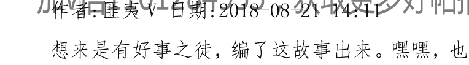

我知道龙虎山其实天师道的祖庭，这什么《神章经》的，我没听过，大约是某种道门典籍，跟这手镰又有什么关系？

老拉克道：“你这小子毕竟年轻，《神章经》是道门经典，全名叫做《九天生神章经解》，在龙虎山收藏的这半部，是古卷原书。在书中的第二页，就画了一幅九天玄女的像。”

“画中玄女腕上的那只手锚，就跟揽山道人在秦陵逸出的那只锚，一模一样。”

我愣了半天，说道：“这经书毕竟也是写的，或许是有人听过揽山道人盗秦陵的故事，就故意画了这么一幅画，来戏弄世人。”

老袍子笑道：“你说的倒是有些道理。不过《神章经》的成书，可是秦陵还早了多年。”

我还是不信道：“就算《神章经》再早，那也有可能是当年造秦陵时，有人读过《神章经》，一时起意照着画上的钩子画了一枚。”

他的妈，我不在意这手锚究竟是假，此时我一心加紧，就怕老袍子别记得什么，还难推测真要被他炼后会变成什么样子。老袍子呵呵笑了几声，却不再说话，只是端着茶碗，一口地喝着。我意中看了一眼，注意到他的茶杯其实变空了，老袍子没注意，到底在想什么。

我过去拎了茶壶，给他倒上水。老袍子醒过来，看着我，眯了眯眼，道：“当年我就这么伺候我师父，呵呵。”

我心里一凛，登时惊出一汗。他的妈，这老东西到底什么意思。他那师傅，可是最后被他炼成活的！


就是太拘了，就凭咱们的事事，天大地大，又有什么地方去不得！”转身就要朝里回头去。

她两耳扣子，让她明白这世界上还有“危险”两个字！幸好被刘子守一把拉住，道：“不要冲！”

我真被这鲁鲁精给出一身冷汗，此时什么也不想，只盼着这蛊女听刘子守的话，赶紧从这里离开。没曾想我还还没来得及松口气，就看到鲁鲁精反而拉着刘子守，朝里回头就走，回头说：“刘子守姐，我朋友几天不见了，可能正在……”

刘子守还在等在，却是已经被她拽进了阵中。

我在心里“靠”了了一声，差点没跳起来。她的鲁鲁莽精，真是白张了一张聪明脸！

老老爷子她嗅了一阵怪笑，道：“这两个小妞子成色不错，也够劲，徒弟你有福了。”

我可呵呵地笑了了一声，舔了舔唾唇。老老爷子看了我一眼，道：“别急，咱们先在一边静静看着。”

我跟着笑了起来，心里却是直打鼓，各种念头此起彼伏，想过无数主意，却是没一个奏效的。心急如焚，脸上却还要装出平静，不让自己露出破绽。

这片荒弯弯绕绕的林地，原本就长了许多年很久的古树，枝叶茂，天阴云日，潮气凝重，再加上不知被老老爷子做了什么布局，更是阴气森森，鬼意重重。这鲁莽精才才十七七八年纪，走在这种鬼气森森的地方，却是半点不见慎意，反倒是有些奇奇异，一路东张西望。

她只穿了一条红色短裙，白皙的手臂和大腿都裸在外，却是她脸色如常，似乎并没有觉出寒意。

我不由着有些古怪。理说就连这种地方，连一个身体强壮的男孩来遇到，有些年纪小的恐怕都要魂飞魄散吧，鲁鲁却似乎事不在意，看来是有些太不常了。

再看她身边的刘子守，除了脸色凝重之外，也没有被冻得束手缩脚的感觉。这就奇怪了，当年我在刘家见到这个位姐姐的时候，她身体素质虽然不是，但毕竟是个年轻姑娘，天生阳火弱，在这种阴气浓郁的地方，理说应该会抵御不住。

老老爷子笑道：“字儿，这两个小姐有点路数多了。”

我应了声，心中是百不解，正狐疑时，就听那鲁莽精叫道：“子姐，我们遇上鬼撞撞了！”

这蠢女人，总算还没到家！不过这会儿就发现了，


已经进不去。但仔细一看，并非没有露出惊恐的表情，反而有些跃跃欲望，心里正想这女人是不是脑子哪里有问题，就见她在原地提气收腹，挺直站立，闭上双目，微皱摇头，右手两指交叠，任自己聚眉间一线。

接着身子古怪一诡，双手垂侧，抬起头来，双目仍然紧睁，步朝向前走。她走路的样子却是极为怪异，瓮肩颓崩，拖泥带地向前迈步，走出一道歪斜斜的轨迹。

刘子宁一声不响地跟在她身后。

我看着这鲁莽精的一举动，只觉得有着莫名的怪异。见她脸上十分可怕，仿佛被锁在死局的情形。我两次被困在里，两次差点死在里。第一次是靠鲁文引路，第二次则是借用了阵术，破解了其中一个阵法，使用阴气破了阵。

其实这两次破解的原理都不是巧劲，是直接利用对阴气的敏感，硬生生地破坏了这种阵。而当前这个鲁莽精，用的办法似乎是，只不过她是某种秘法，让她暂时拥有了某种形态。只听老老爷子突然说了一句。

我大吃一惊，不由重新打量这鲁莽精，这女人难道是茅山派的？老老爷子道：“徒儿，你运气不错，没尝过茅山派的滋味吧？这次好好过瘾！”

我嘿嘿笑了起来，心里却是别乱。说话间，鲁莽精已经带着刘子宁连续过了几个关。就在这时，两道黑影从两人身后冒出，伸出一只漆黑的手爪朝两人脖子去。

我心里重重跳，见原本眼睛紧闭的鲁鲁精突然把脑袋一甩就躲开了，双眼睁开，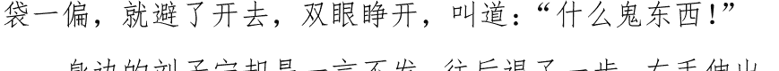 三清符！”

我来不及想，见刘子宁嘴角微微开，脚下踏了个方位，才一看这就是教过的禹步。转念间，刘子宁已经灵活转过方位，手指似花一指，两道黑影顿时遇火，发出嘘嘘声，消散不见。

老老爷子可呵呵笑起来：“原来还有清微的女性！”

我心中剧震，看着踩着禹步的刘子宁，几乎不敢胆。当年的子宁姐姐只不过是一个普通的学生，不知道后来出了什么故。我以前只是听过“茅山”、“清微”、“天师道”是三大符宗，直到今天才看到第一个符门人。只是没想到竟然是多年未见的姐妹。

老老爷子道：“徒儿，你真是运气不错，这回茅山清微派女子给你一起！”

我根本没理会老老爷子说什么，只是紧张地盯着阵中。刚才出现的两个黑影，其实是鬼影。老老爷子在这里布置的，应该类似于我当初对付鬼人的五鬼阵。不过老老爷子这个阵法应该威力更大一些，因为很快就有许多鬼影显现。刘子守手捏三清指，脚踏禹步，神情虽然不动，一鬼近身，立时被她消灭无踪。

清微派虽然在符三宗里，名不及茅山和天师道，不过他们的雷法和阴阳的本事却是三派之首。又看了一会儿，老老爷子唉了一声：“清微的女儿真的是不错，心思纯正，胆气浑厚，火候虽然欠了点，但也只是时间长短的问题。”我手脚麻，脑中各种念头转不停，只盼看出什么主意，可以将刘子守给弄出去。就问道：“师父，这度阴是什么？”

老老爷子随口道：“就是超度阴魂的意思。”我“咦”了一声，说道：“原来是这意思，怪不得对起鬼影来，这么棘棘的。”老老爷子笑而不语。我又问：“那清微的雷法很厉害吗？”老老爷子道：“那是当然的。如今道门中，主修雷法的有神雷派、天心派和清微派。这三派中，要清微派最为正宗。至于天心派，百年前就已经衰微了。”我紧盯着阵中，见刘子宁二人对鬼影有些有力，暂时没有危险，叹了一句：“师父真是见多识广。”我在心里酌了一下，又说：“这清微派与茅山派并称符三大大宗，看来也是挺厉害的。”老老爷子道：“那是自然。清微派于宋末南宋开宗立派，源远流长，底蕴深厚，不是一般小道可以比的。”

老老爷子瞥了我一眼：“徒儿，你似乎对清微派很有趣。”我嘿嘿笑起来：“是对清微的小姐感兴趣。”老老爷子嘎嘎笑起来这女孩确实够劲的，玩了。”我跟着笑了声，皱眉道：“只是徒儿有些担心。”老老爷子哦了一声：“怎么？”我微微垂头，说：“徒儿早听人说过，茅山弟子是杀不得的。”说完就偷偷瞄了老老爷子一眼。老老爷子唔了一声，没有说话。我继续道：“徒儿当时是不信，天下有什么奇怪法术。后来才知道，原来茅山有一门奇的法术，是每个入门弟子必学的。学会了法术，只要茅山弟子被人杀，不管天涯海角都能找到凶手。”老老爷子看了我：“也是听人说的？”我点头：“这是六百年前，茅山派一个姓出的大概叫什么‘寄怨’。”我夜采得无聊，三叔曾经跟我提过一次。这种方法叫做摄青鬼，养的是一种大凶的杀人鬼。摄青鬼有数方法。其一是在阴阳闰时，到淹死小孩的水边用黄杨木放到水里聚残魂，时刻到了，就锁链死童魂，再把这段黄杨木刻成人形，起桩作法一百零八。其二是到有三岁以下孩夭的地方，可用醋醒了人血的灵头，带回附于桃木之上，放在小棺中作法，四十九天成立煞。其三是开棺直接从撞死的孕妇肚里取出童尸修炼。其四是用特殊的术法将尸做成小棺，再开棺视鬼的坟，用特殊的蜡烛烧烤鬼底下，用小棺炼油，然后以炉油直接炼鬼。这四种之中，只有第三种最为伤阴，炼出的小鬼尤其凶灵。我煮着，突然想起当时在殡棺馆里，连续数月都接到被开脑破腹而死的孕妇，不由心中毛。假如这并非巧合，那么当时被开腹取胎的女人，恐怕就是死在这老贼子手里。他们的胎儿，就是被这东西拿来炼了阵的小鬼！

 这怪物也太坏心了，心肠硬若石，什么事都做得出来。我得起精神，千万不能在这老东西面前露出一分破绽。不仅我这条小命，还有子宁姐姐，一个跑不了，恐怕死后还会被炼成活尸，死都不得。我蹲着不动，睁着眼，该怎么办。我等了会儿，回壶回到屋子，进门就见老老爷子靠椅子上，双眼闭，似乎是在睡觉。我一了一下，回头就看见老东西正睁眼看着我。我立即按下手心的情绪波动，说道：“师父，我刚才在里头烧水发现不对，手脚发烫。闭上眼睛调一会儿，才开始烧水，迫使自己的心情冷静下来。刚把子宁二人弄丢，并不是之前的影子，而是死童！死童，在民间叫做养小鬼。我以前跟三叔逛灵堂的时候，也常听说养小鬼的事，只是从来遇到过。养小鬼，其实是招灵术，但是极为阴险，而且是一门邪道的歪法术。民间传言，养小鬼必须拘留一个冤枉的童夭。这种灵童的来源一般有两种，其一是未满两岁夭折的孩子，一个是胎腹中看不见的胎儿。早些年间，医疗水平比较差，夭折很多，因此养小鬼的人也多。这些人大多些偏门的，例如吃、骗、赌、诈。不过养小鬼毕竟是凶术，稍一不慎，可能就把自己搭上了，所以近些，这种残酷的法术还是少见了。当然，除了这寻常的两种小鬼外，还有第三种。

这蠢女人，总算还没到家！不过这会儿就发现了， 

“子姐，我们遇上鬼撞撞了！”

 已经不去。仔细一看，并非没有露出惊恐的表情，反而有些跃跃欲望，心里正想这女人是不是脑子哪里有问题，就见她在原地提气收腹，挺直站立，闭上双目，微皱摇头，右手两指交叠，任自己聚眉间一线。

接着身子古怪一诡，双手垂侧，抬起头来，双目仍然紧睁，步朝向前走。她走路的样子却是极为怪异，瓮肩颓崩，拖泥带地向前迈步，走出一道歪斜斜的轨迹。

刘子宁一声不响地跟在她身后。

我看着这鲁莽精的一举动，只觉得有着莫名的怪异。见她脸上十分可怕，仿佛被锁在死局的情形。我两次被困在里，两次差点死在里。第一次是靠鲁文引路，第二次则是借用了阵术，破解了其中一个阵法，使用阴气破了阵。其实当前这个鲁莽精，用的办法似乎是，只不过她是某种秘法，让她暂时拥有了某种形态。 

这鲁莽精才才十七七八年纪，走在这种鬼气森森的地方，却是半点不见慎意，反倒是有些奇奇异，一路东张西望。 

她只穿了一条红色短裙，白皙的手臂和大腿都裸在外，却是她脸色如常，似乎并没有觉出寒意。

我不由着有些古怪。理说就连这种地方，连一个身体强壮的男孩来遇到，有些年纪小的恐怕都要魂飞魄散吧，鲁鲁却似乎事不在意，看来是有些太不常了。

再看她身边的刘子守，除了脸色凝重之外，也没有被冻得束手缩脚的感觉。这就奇怪了，当年我在刘家见到这个位姐姐的时候，她身体素质虽然不是，但毕竟是个年轻姑娘，天生阳火弱，在这种阴气浓郁的地方，理说应该会抵御不住。

老老爷子笑道：“字儿，这两个小姐有点路数多了。”

我应了声，心中是百不解，正狐疑时，就听那鲁莽精叫道：“子姐，我们遇上鬼撞撞了！”

这蠢女人，总算还没到家！不过这会儿就发现了，

 不去。仔细一看，并非没有露出惊恐的表情，反而有些跃跃欲望，心里正想这女人是不是脑子哪里有问题，就见她在原地提气收腹，挺直站立，闭上双目，微皱摇头，右手两指交叠，任自己聚眉间一线。

接着身子古怪一诡，双手垂侧，抬起头来，双目仍然紧睁，步朝向前走。她走路的样子却是极为怪异，瓮肩颓崩，拖泥带地向前迈步，走出一道歪斜斜的轨迹。

刘子宁一声不响地跟在她身后。

我看着这鲁莽精的一举动，只觉得有着莫名的怪异。见她脸上十分可怕，仿佛被锁在死局的情形。我两次被困在里，两次差点死在里。第一次是靠鲁文引路，第二次则是借用了阵术，破解了其中一个阵法，使用阴气破了阵。其实当前这个鲁莽精，用的办法似乎是，只不过她是某种秘法，让她暂时拥有了某种形态。听老老爷子突然说了一句：“徒儿，你运气不错，没尝过茅山派的滋味吧？这次好好过瘾！”

我嘿嘿笑了起来，心里却是别乱。说话间，鲁莽精已经带着刘子宁连续过了几个关。就在这时，两道黑影从两人身后冒出，伸出一只漆黑的手爪朝两人脖子去。

我心里重重跳，见原本眼睛紧闭的鲁鲁精突然把脑袋一甩就躲开了，双眼睁开， 三清符！”我来不及想，见刘子宁嘴角微微开，脚下踏了个方位，才一看这就是教过的禹步。转念间，刘子宁已经灵活转过方位，手指似花一指，两道黑影顿时遇火，发出嘘嘘声，消散不见。

老老爷子可呵呵笑起来：“原来还有清微的女性！”我心中剧震，看着踩着禹步的刘子宁，几乎不敢胆。当年的子宁姐姐只不过是一个普通的学生，不知道后来出了什么故。我以前只是听过“茅山”、“清微”、“天师道”是三大符宗，直到今天才看到第一个符门人。只是没想到竟然是多年未见的姐妹。老老爷子道：“徒儿，你运气不错，这回茅山清微派女子给你一起！”我根本没理会老老爷子说什么，只是紧张地盯着阵中。刚才出现的两个黑影，其实是鬼影。老老爷子在这里布置的，应该类似于我当初对付鬼人的五鬼阵。不过老老爷子这个阵法应该威力更大一些，因为很快就有许多鬼影显现。刘子守手捏三清指，脚踏禹步，神情虽然不动，一鬼近身，立时被她消灭无踪。清微派虽然在符三宗里，名不及茅山和天师道，不过他们的雷法和阴阳的本事却是三派之首。又看了一会儿，老老爷子唉了一声：“清微的女儿真的是不错，心思纯正，胆气浑厚，火候虽然欠了点，但也只是时间长短的问题。”我手脚麻，脑中各种念头转不停，只盼看出什么主意，可以将刘子守给弄出去。就问道：“师父，这度阴是什么？”老老爷子随口道：“就是超度阴魂的意思。”我“咦”了一声，说道：“原来是这意思，怪不得对起鬼影来，这么棘棘的。”老老爷子笑而不语。我又问：“那清微的雷法很厉害吗？”老老爷子道：“那是当然的。如今道门中，主修雷法的有神雷派、天心派和清微派。这三派中，要清微派最为正宗。至于天心派，百年前就已经衰微了。”我紧盯着阵中，见刘子宁二人对鬼影有些有力，暂时没有危险，叹了一句：“师父真是见多识广。”我在心里酌了一下，又说：“这清微派与茅山派并称符三大大宗，看来也是挺厉害的。”老老爷子道：“那是自然。清微派于宋末南宋开宗立派，源远流长，底蕴深厚，不是一般小道可以比的。”老老爷子瞥了我一眼：“徒儿，你似乎对清微派很有趣。”我嘿嘿笑起来：“是对清微的小姐感兴趣。”老老爷子嘎嘎笑起来这女孩确实够劲的，玩了。”我跟着笑了声，皱眉道：“只是徒儿有些担心。”老老爷子哦了一声：“怎么？”我微微垂头，说：“徒儿早听人说过，茅山弟子是杀不得的。”说完就偷偷瞄了老老爷子一眼。老老爷子唔了一声，没有说话。我继续道：“徒儿当时是不信，天下有什么奇怪法术。后来才知道，原来茅山有一门奇的法术，是每个入门弟子必学的。学会了法术，只要茅山弟子被人杀，不管天涯海角都能找到凶手。”老老爷子看了我：“也是听人说的？”我点头：“这是六百年前，茅山派一个姓出的大概叫什么‘寄怨’。”我夜采得无聊，三叔曾经跟我提过一次。这种方法叫做摄青鬼，养的是一种大凶的杀人鬼。摄青鬼有数方法。其一是在阴阳闰时，到淹死小孩的水边用黄杨木放到水里聚残魂，时刻到了，就锁链死童魂，再把这段黄杨木刻成人形，起桩作法一百零八。其二是到有三岁以下孩夭的地方，可用醋醒了人血的灵头，带回附于桃木之上，放在小棺中作法，四十九天成立煞。其三是开棺直接从撞死的孕妇肚里取出童尸修炼。其四是用特殊的术法将尸做成小棺，再开棺视鬼的坟，用特殊的蜡烛烧烤鬼底下，用小棺炼油，然后以炉油直接炼鬼。这四种之中，只有第三种最为伤阴，炼出的小鬼尤其凶灵。我煮着，突然想起当时在殡棺馆里，连续数月都接到被开脑破腹而死的孕妇，不由心中毛。假如这并非巧合，那么当时被开腹取胎的女人，恐怕就是死在这老贼子手里。他们的胎儿，就是被这东西拿来炼了阵的小鬼！ 这怪物也太坏心了，心肠硬若石，什么事都做得出来。我得起精神，千万不能在这老东西面前露出一分破绽。不仅我这条小命，还有子宁姐姐，一个跑不了，恐怕死后还会被炼成活尸，死都不得。我蹲着不动，睁着眼，该怎么办。我等了会儿，回壶回到屋子，进门就见老老爷子靠椅子上，双眼闭，似乎是在睡觉。我了一下，回头就看见老东西正睁眼看着我。我立即按下手心的情绪波动，说道：“师父，我刚才在里头烧水发现不对，手脚发烫。闭上眼睛调一会儿，才开始烧水，迫使自己的心情冷静下来。刚把子宁二人弄丢，并不是之前的影子，而是死童！死童，在民间叫做养小鬼。我以前跟三叔逛灵堂的时候，也常听说养小鬼的事，只是从来遇到过。养小鬼，其实是招灵术，但是极为阴险，而且是一门邪道的歪法术。民间传言，养小鬼必须拘留一个冤枉的童夭。这种灵童的来源一般有两种，其一是未满两岁夭折的孩子，一个是胎腹中看不见的胎儿。早些年间，医疗水平比较差，夭折很多，因此养小鬼的人也多。这些人大多些偏门的，例如吃、骗、赌、诈。不过养小鬼毕竟是凶术，稍一不慎，可能就把自己搭上了，所以近些，这种残酷的法术还是少见了。当然，除了这寻常的两种小鬼外，还有第三种。


老拉克子皱着眉吟了半晌，点头道：“徒儿这分析倒的是合情合理。呵呵，这帮牛凿子平时一派正经，其实思想一个比一个蹦怪！”看了我一眼，赞许地地点点头，道，“这儿几年没见，徒儿果然是长了不少，师父深感欣慰。”

这话我就是听听就算。这老拉克子东心思阴险，谁知道他说的话有几真几假。要真轻信了他的话，当就得死得完全没道理。

老拉克子略一沉吟，道：“是与不是，一审之这俩姓的知道。”起身就走到刘子宁与鲁鲁精身边，取出那只养了化虫的铁盒子。

我心里顿时噔噔一下，忙上前拦了一下。老拉克子一双灰白色的眼睛眯了眯：“老家伙，你想取这么多贴子推荐？”

只觉得老拉克子的目光在我身上逸了良久，突然爆发出一阵刺耳的大笑声：“哈哈，你这小子，真是色胆包天了！为了玩女人，连你师父的路也敢挡？”说到最后，却却是声色俱厉。

我心中怦怦乱跳，道：“徒弟不敢，只是徒儿还觉得更好的办法。”

老拉克子冷冷道：“说！”

我额头冷汗渗渗，也不敢伸手去擦，说道：“这茅山派古怪法术很多，还有这清微派的，跟茅山齐名，恐怕也藏了许多咱们不知道的阴招。师父这化尸咒用上去，说不会激发这两个女人的什么禁制，对咱们不利呢？”

老子安静静无，老老爷子半天没说话了。我站在那里一动也不敢动，紧张得近麻木。好一会，才听那老东西呵呵呵笑了几声，道：“紧张什么？师父才只是训斥你几句，道你怕师父会杀了你？”

我慌道：“徒弟的命是师父教的，就算师父要拿走，那也是为了获取更多贴子推荐。”

老子发出几声刺耳的尖笑，道：“行了，瞧你这满头冷汗的，还不擦。你的命就是你的命，师父怎么能拿走。”

我听他口软了了下来，知道自己总算是在鬼门上走一遭回来，揉了揉额头的冷汗，道：“师父，徒儿还有其他事没有，不过对付女人来，还是有一手的。”

老老爷子笑了了一声，道：“是你糊涂了。”说着就转身坐回了椅子。

我微微地吐了一口气，看了一眼刘子宁和鲁鲁精，为难道：“父，应该怎么把她们弄醒？”

老老爷子靠在椅子上，眯着眼道：“这两个女孩只是被些鬼气侵袭，两人的体魄，没什么大碍。”当时就把抵驱鬼气的方法说了一遍。

这办法来说简单，我应了一声，就要去把两人弄醒。只听老拉克子横洋地道：“弄醒了之后，你制得住吗？”

我愣了一下，摇头：“有师父在，娘她们也蹦不起来。”

老拉克子嘿了一声，道：“去旁边的架子，找一个黑色木匣。”

我心里颇为意外，应了一声，去东边的架子找了找，果然见到一根足足长的黑色木钉，上面还缠着许多奇怪东西跟前。

“把盒子打开。”

我只照做。只见里头整齐地码着三排钉子。这钉子色成青灰，仿佛铁锁铸，寸许长，没有顶梢，直愣愣的一根，钉身极细，比普通的线还要细上几分。钉身上刻着几道纹路，大约是某种禁制。禁制是奇门阵法的一种，不过与普通的阵法不同，通常是一些特殊的纹路激发阴阳五行之力。

死人脸精术术，尤其擅长禁法，专门用了七本笔记来记录他在禁制方面的心得。历代以来，传世的禁制种类繁多，我正奇怪这取了铁钉用来做什么，就见老老爷子冲我招了招手，道：“徒儿过来。”

我应了一声，走到他面前。老老爷子：“背过身去。”

我忍住惊讶，背转了身子。只感觉到后颈处猛地一凉，被老爷子一根手指指在额头点了一下。我心怦怦乱，就听见那老老爷子：“这个位置，记得明白吗？”

码与人体结构，每天被观测看好拦截针法、脉灸针等，自然对人体结构十分的了解，他手指一点，就已经知道是点的哪一处。

不过我当然不会如实说，直到他问了第三次，我才把头点了一下。老老爷子：“嗯，清楚了。取一根铁钉。”我心念转，知道他说的是那个盒子，当即取了一枚。老老爷子看着，将铁钉以一种特别的角度夹在手指，淡淡地说：“记住手法。”

我虽不知道要去什么，还是用心记忆，他手指夹钉的手势，以及钉的角度和姿势。老老爷子连做三遍，让我停下记忆，又做了三遍，等我记忆完毕，他道：“转过身来。”我心中一跳，强忍恐惧，转过了身体。刚站定，就觉得后颈一阵剧痛，紧接着身体再无法动。试了一试，脑袋转动却是无碍，这话也是没错。听到那老爷子的声音传来：“徒儿，今天就教你这一手，记住了。”

我点头，叫了声：“住了。”身子又恢复了自由，双脚软，差点瘫在了地上。老爷子拿着一根铁钉在椅子上，笑道：“你这小子，素养不错，一般做不了。”

我觉得浑身一阵缩，背后传来阵阵剧痛，用手摸，只摸到了丝血迹。老爷子道：“放心，过会儿就好了。”我在原地站了一会儿，果然那股疲倦逐渐消失，只是背后的疼痛却是毫不减，只不过相比以前，这点疼痛又算什么。老爷子道：“做了一个手势，又教了我其中口诀。这锁钉，易也易，难也难，纯粹看你的资质。”

我着急感慨。这锁钉并不简单，包含了手法、口诀、对人体构造的理解，只要有一处地方疏漏，不仅前功尽弃，而且被锁钉的人说不定就当场殒命。这锁钉虽然名为锁，其实封的是关节点，与当年死人脸用来封龙钉的异同工。想起被关在门内的两个学生，锁钉虽然说轻松，这玩儿不是谁都能随便学会的。看到此时我已经掌握了很多秘诀，不说自己学会了，朝老东西道：“师父，徒儿已经下了，回头一定要好好练习。”

老拉克子笑了了一声，道：“等什么回头，现在就可以在这两个孩子身上用。”我心里噔一声，难道：“师父，徒儿根本没把握。”老拉克子笑道：“尽管去做，你要封错了，这俩孩子顶多就是瘫痪，死不了了，爽快。”

我恨不得把这个东西老祖八代都吕遍，知道过去，只硬着头皮从盒中去了两根锁钉，走向刘子宁两人。把两人翻过来，面朝下躺，扯开衣领，露出后背。这回面对的是刘子宁，我可不敢有一毫不藏，就算被老拉克子看破底也是可能的。伸手在鲁鲁精的后颈顶摸了摸，确定了她的关位置，手指捏了一根锁钉，却就此封下去。我此时看着老拉克子，等他一句话。结果，过了一会儿，老拉克子忍不住道：“等什么，快！”我正当不再怀疑，将锁钉准确地封入了鲁鲁精后背关节。

我不怕，伸手在刘子宁身后后颈摸了一下，扬手挥出，将第二枚钉子封了进去。看向看向拉克子，只见这老东西脸上带着一丝看不透的笑意：“我这孩子果然过人了，怪不得那姓的能上看你，我以前是师傅看走眼了。”

我慌忙垂下头，道：“是师父教得好，这次也是碰了运气。”心里头砰砰跳乱，这老东西说话阴阳怪气的，不知道他到底在想些什么。

老拉克子“唔”了一声，倒不再多说，道：“把她们弄醒吧。”

我依着老东西的法子，把两人体内残余鬼气驱出，人就悠悠醒了。“啊，”鲁鲁精疼了，叫道：“好痛！”此时被锁了颈，浑身除了头部全都不能动，立即叫道：“怎么动起来！姐姐！疼疼疼！”

我站在那里一动也不动，紧张得近麻木。鲁鲁精转头看到老爷子，又是吓得尖叫。坐在椅子上喝茶的老拉克子看着我，这鲁鲁精比以前沉稳太多。老拉克子并没有开口，虽然是要冷眼旁观，看我如何处置。我定了神，冷冷道：“你怎么知道的？快放了！”这女人真是无可救药！我一把掌过去，“啪啪”一声，女人雪白的脸蛋上多了一个红色掌印。我被这蠢女人气得哭不得。见她双眼睛红，脸上是泪痕，我急，捏住她的脸颊，道：“哭什么？还不出来？”鲁鲁精眼里汪流，呜呜地摇了。我冷哼一声，把手松开。谁知刚松手，她又一口咬过来。她是被抽了，愣了好一会儿，突然“哇”的一声哭出来，眼珠滚落。我见手指上一细细印，几乎被她咬了，捏住她脸颊，道：“哭什么？”她脸颊被捏住，想要挣扎，手脚无法动，嘴了几声却不出。

刘子宁道：“我是清微弟子，跟妹妹误入此地，打扰了两位，还请见谅！”她神情虽然焦急，语气却是依旧不卑亢。我趁机下了台阶，放过鲁鲁精，朝向刘子宁道：“你们一个清微一个茅山，来这里什么？”

刘子宁道：“我妹妹的两个同学在此游玩，我们跟散了，我们就是来找她们。”我知道老拉克子虽然没出声，但一直在冷眼旁观。冷笑着道：“我是问你们为什么出现在这里！而且是茅山清微联络，你们的目的是什么？”刘子宁道：“我妹妹跟她同学约好了来散心，我当时有些无赖，就跟了她们一起。”我没话说，过去拉起鲁鲁精，就拽住裙子下拽，“嗤”的一声撕成两截。虽然这女人穿着安全，但一双雪白的大腿却是裸露无遗。只听到老诡出一阵嘎嘎的怪笑。鲁鲁精顿时发出一阵尖叫。刘子宁脸色大变，大声道：“我们是路这里！”

刘子宁疑惑了一下，似乎颇为踌措。刘子宁道：“我和小妹确实是不巧路过此，清微和茅山两派的师长还在外头等我们回去。擅闯两位居此，是我们失礼了。”不得不说，刘子宁这这话是柔中带刚，棉中带刺。她一句话就点出了清微和茅山两派到此，算是对我们的一种震慑。老拉克子这种人不是吓大的，这招或许对他根本不起，说不定还会反噬。

我停了下来，问道：“去哪里？”

我心里快地盘算着，怎么才能拖更多时间，就听身后突然传来老拉克子的声音：“儿可见，你这法子不灵灵，还是为师来吧。”我吃了一惊，正要编辑理由由再拦，就见刘子宁道：“我们只是路过。”我见她神情坦然，似乎没有瞒，不由得心里奇，想他们清微、茅山两派出现在这里，难道不是为了黑银？”

老拉克子阴沉着脸，目光闪烁，似乎有些意外。“你们去海上找什么？”刘子宁微微迟疑了一下，道：“不瞒两位，不久之前，我们宗内有位长辈突然离世。”老拉克子哑着道：“你们过世，好不好在山上守孝，跑去海上做什么？去吃海鲜？”刘子宁微微皱了眉头，道：“我们是为了寻找他老家的遗骨。”老拉克子笑起来：“你个姑娘，真是满口胡言。既然这些人出海了，你们连骨都找不到，怎么知道他已经死了？这是我们孤魂罢了了。他们清盟派有门秘，叫依命术。据说将一缕命火寄托到他们清门的星图上，一旦看到命星烧灭，就代表这个人陨落了。我真不知道世界上还有这样奇怪的玩意儿，老老爷子继续：“有本事命火靠近星的，你们清门中恐怕也找不到。这回灭了命星的，是谁？”刘子宁脸上露出一丝忧虑，道：“是赵太师叔。”我对清游之甚甚，听了也不知道是谁。老老爷子站了起来，厉声道：“能被你叫太师叔的，不会是赵师傅吧？”刘子宁眼圈微皱，红了点头：“就是他老人家。”老老爷子脸上阴晴不定，也不坐回椅子，背着手在原地踱步来。虽然跟这老东西接触不久，但这似乎是他的一个习惯，只要碰到什么疑惑的问题，这老东西就会不停脚步。我抱着胆子嘟囔道：“师父，这功夫又是很有名么？”老爷子没有有些噎，这样说起来，这人倒是害了。过了好一会，才叹了一声：“当清澈浓浓的父亲成为他们最高之人。”我听得不禁，这样倒是害了。老爷子盯着刘子宁道：“小姑娘，你不会是在欺骗我们的吧？赵师傅怎么可能会死？”话音落下，又摇了摇头，自己否定后，喃喃地道：“你这些清徽后辈也不敢拿起师傅来做榜。”


藏针，刚柔并着怎么利用这件事再多拖延些时间，心头蓦地闪过一个人影，心中剧震，整整个人都麻住了，手脚冰凉发木。

我此前还在苦思想如何从老宅手里把这些人尽数救出，浑然没在意子宁和那鲁弃莽精同时提到了出海。现在细细一想，出海的可不可止这两人。还有青子！

当日青子突然不再作声离家，乘船去了海外。我原本以为她只是出门散心，可是后来她那艘破轮莫名其妙地成了了鬼船，乘上游巷和划员消失无影无踪，青子是下了落不明。这件事会不会经历子宁口中的事，是同一件事？

一时间，心里波涛汹涌，无法自持。

“儿宁，你干什么？怎么脸色这么差？”

我才醒悟过来，背后落了一身冷汗，忙收敛心神，道：

老驼子“唔”的一声，道：“要不要为师给你看看？”
我忙道不用，说大概是有有些累了吧，休息一下就好。

老驼子“嗯”了一了一声，道：“徒儿这些天确实是辛苦了，乖儿去好好享受吧。”

我心里一跳，赶忙岔开话题，道：“师父，这两个女人说的话可不可信！他们真的是为了那件事情来的？”

老驼子沉吟了一下，道：“诸这些小辈也不敢随意侵排门中长辈。要是徒儿不放心，等你玩得腻了，师父再给她们种上化虫便便是。”

我低回头应道，说道：“师父英明。”

老驼子看了一眼，道：“徒儿，你确跟以前不太一样，变得会说话多了。”

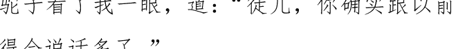

还是喜欢在你的。”说着，拍了拍我的肩膀，转身到刘子守跟前，道：“赵沛封是为了什么出海？”

刘子守：“这就不是我们小辈的能知道的。”

老驼子没有发作，在房中走了几步，道：“赵沛封行事，恐怕就你们管教也管不管，你这小辈不知道倒也正常。”顿了一下，皱了皱眉，“这赵赵的隐居清微宫这么多年，从未下山，这次究竟是为了什么破例……”他这话说得极轻，倒像是在自言自语。

我听到这里，原本稍稍平复下去的心情立刻又烦了起来。

他的妈，青子那女人，出门不跟我交代一声！虽说我就算那什么赵封、什么姜全死透了，青子也不会出半点事，但一天见不到那死女人，我就一天难以安心。

老赖子突然转过身来，盯着我道：“徒儿，你给为师想想，赵沛封还有姜婆，究竟为什么出海？”

我吃了一惊，不知道他究竟是随口问了我还是有意的试探。皱眉苦思想了一遍，摇头道：“徒儿也是想明白。这两个老小子莫非是不得闲了，就约好了看了看海？”

老赖子“嗤”的一了一声，道：“胡说道。”


老赖子沉默了一会儿，大约也是想明白，我摆了手，道：“好了，为师也累了。你小子快快乐吧，赶紧挑一个好好乐呵呵去吧。”

我没动，等时他又笑道：“两个一起来，也随你！”

没想到东西又提起了茬，我一时心急如焚，心里不由得想，山和清微两人不知道干什么，拖延了这么长时间，居然还没人找。老赖子微微眯眼睛，似笑非笑道，我硬着头点了点头。我了一眼，只见子宁脸色脸色，紧紧咬着唇，大约是明白老赖子的意思。那鲁莽却是有些糊，见我，反而过来瞪了我。

我心里飞快盘算，却是想不出什么计策，朝着她走一步，转身朝老诡道：“师父，徒儿又想起来了。”

老赖子“哦”了一声，盯着我看了几眼，道：“什么事？”

我就把这件事告诉了一遍。

“哦，还有事？”老赖子似乎还不知道。大约他贪心都在到处搜寻，结果那艘船上一个人都没有，连船长到划员全都消失得干净。老赖子沉吟了一阵，道：“那艘船上有没有打斗的痕迹？”

我摇了摇头，不清楚。不过人似乎没有。老赖子眯眯眼睛，看着我道：“你是觉得这件事跟赵封和姜有关？”


我当即点了点头。其实这些话我是用来拖延的，但也确实是这么想。这艘轮上离奇失踪，怕真跟二人有关。而且青子又在这一口莫名其妙地跑到海上，坐的正是那艘船，不得不说中间实在是太巧了。

老赖子“嗤”了一声，没有说话。我怕老东西听过去，又让我进去，紧接着说：“功夫儿虽然不认，可听师父起来，应该还有些来头的。既然这两个人一起到了海上，说不定那里发生了什么事，或者是出了什么让他们红眼的东西！”有可能是个大宝藏，找到就可以取。我了一眼，然后笑着像一样跑出猎豹的脸色，你都一样了。

“赵封和姜这两个老家伙，就算送你一堆金条财宝到他们面前，也不会瞧一眼。”我不信，说道：“师父，世上哪有不爱钱的人？”老赖子看着我看了一阵，才笑道：“等你到了那个地步，你就明白了。”我听得似懂。当然我并不想弄懂，说这些废话也不是为了拖延。只是他的茅山和清微等人真是跟猪一样，倒也没有人上来。

我搜肠剖，想着还能找到什么说法，就见老赖子搓手道：“行了，你要睡了，去玩吧。”我正要再延迟，一触及老爷子的目光，只觉得其中冷森森，不由得一惊，到嘴边的话又生生地咽了回去。

“徒儿，你似乎有些不对劲？”老赖子目光闪烁，似笑非笑地看着我，“怎么，这几个女孩子还不够似的？”我愣了，看着刚才的李宁，只见她面色煞白，紧紧咬着嘴唇，眼睛中已经有光闪。徒儿早就憋不住了，只是想着师傅的事，这才忍到现在。老赖子发嘿嘿地眯笑，道：“徒儿，那就去吧。”

父亲已经走远了，为了作为弱者的补偿，向前一步，看了一眼李宁，只见她面色煞白，紧紧地咬着嘴唇，眼睛中已经有光闪。我一转身，就把那鲁鲁精灵给抱了起来。那女人顿时发出一阵尖叫，刺得我耳朵阵阵疼。老赖子有些意外道：“为师还以为你会对清薇的这个女孩感兴趣的。”我挠了挠唇，道：“徒儿不急，好的放到后头慢慢吃。”

老赖立即大笑起来，摆手道：“去吧去吧！”我抱着鲁莽精灵就往外走，只听到刘子焦急的声音在后头响起，只是几声之后就没了声音，大约是被老爷子动了什么手脚。我也不敢停留，直接抱着鲁莽精灵进了旁边的一间屋子，把女人往床上丢，转身关门。靠在门口了一阵，并没有听到外头有什么响，立即四处打量起这间房子的构造。这屋子是用厚石砌成的，没有窗户，看不到什么缝隙。空间了一张木板床，什么也没有。将门关上后，屋里一片昏暗，只是顶上有块灰的光，鲁莽精灵直直的眼睛看来，大约是一块石。鲁莽精灵全然迷糊，大约我知道什么，吓得脸色白，拼命跳，无法动。我走到床前，鲁莽精灵见我走近，时叫，嘴里“奥贼、混蛋”。

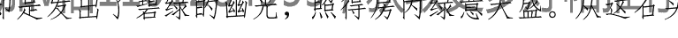

我也懒得跟她较，一手托住她肩膀，一手拽她两条腿，让她翻了个身，让她朝墙壁。鲁莽精灵大概吓得轻，被我碰到身上，叫了几声直接哭了出来。把她的脑袋揉平整，确认她看到背后的情形，才退出来。褪了衣服。鲁莽精灵虽然身子被锁，但听觉是不受影响的，再加上修炼，听力远超。我去伸手在脑下三处摸了摸，非常的感，并没有摸出异样。但我心里清楚，这个位置被做了手脚。我一旦做了，必然被老东西发现。我听得又是好气又是笑，不去理她。坐了一阵，起身从衣袋中取出收藏的针筒，取了一枚三棱针，随即在地上找了合适位置盘下。三叔和二婆婆在指点我行的时候，都经过了，人体有加经，经脉则别为络、胆、足三阳经，统称为阴阳十二经脉。死人脸研术，他在留下的七本术数笔记中，其中一篇也提到阴阳十二经脉，但他有一个极为特殊的构造。当人坐下入定之后，就形成了一个先天八卦。人体阴阳十二，三三为伍，互为交爻，随着气脉交替，卦象不断生化。我运气阴阳煎，徐徐察着体内十二经脉的冲逆起落，当封象出现阴阳乱分，倒行逆势的瞬间，立即三横针封入腹下三寸。瞬时阴阳逆行，血气冲举，体内气息尽数混乱，如滚水般沸了起来。就我长期的经受煎熬，这阵痛已经有了绝大的忍力，也是眼前一黑，瞬时滚落在地，虽然已经咬紧了牙关，却还是忍不住低低地哼了了出来。也不过瞬间，整个人就已经冷透了。鲁莽精灵大概听到我的声音，原本渐弱的哭声又响了起来，别看她娇弱一个小姑娘，中气真是足够了，用力大叫，声音又尖，刺得我耳朵有些麻。我听得烦闷，愣了一声：“别吵！”鲁弃精神被惊得停了，只是愣之后，反而叫得更响，开始破口大骂。不过这丫头大概教严格，骂起来翻来去也就是“奥贼”、“混蛋”。除此之外，也骂不出什么花样。我发现背后那股进来的气息突然缓了一下，跟着体内混乱沸腾的气息缓慢游走了。我大吃一惊，瞬时明白老东西给下的什么。这老东西，妈真的不是东西！我想明白了个原理，心情一松。这小钩头上密密麻麻地刻了咒文，显然这小的钩也算一件法器。我把这钩小心地收好，到边另听了一阵，计算了一下，时间大约是差不多。回到床前，见这女人一头乌黑长发散在肩头，竟伸手扯，不管她大声尖叫，胡乱抓了几下，弄得乱了，接着又在地上揉了些去，在她脸上、手臂、大腿上擦了几，再混合了汗渍，一看上去这模样倒真是凄惨，与昨日判若二人。其实给男人化妆和给活人化妆差别并不大，而且技巧要求更高。不过我没有家里家伙在手，也只能做到这一步。拦腰把这女人拉了起来，鲁莽精一眼睛死死地盯着我，如果她的目光能杀人，大概已经被切刀万剐了。只可惜她不能。我抱着她就出了门，那老爷子已经早坐在了椅子子上，正在闭目养神。麻老他们依旧挺挺地站在那里，秃子和熊熊猫旁边躺着，就跟昨天一样，半分没变。刘子宁则是躺在墙角，看见我抱着鲁莽精出来，眼泪润就流了，却发不出声音。鲁莽精浑然身矫娇巧，但我此时手脚麻，走了几步，腰软，差点跌倒。老爷子睁眼朝这边瞥，似乎被唬似的，神情古怪：“徒儿，你怎么了？”我自然知道是个模样，肯定是脸色白，眼睛深，再加上昨晚流汗导致脱水，嘴唇已经干了。我连连点头，见老东西出去，这才松了口气，一屁股坐在地。这一，总算熬来了。坐着喘了会儿气，见刘子宁双目通红，恨恨地盯着我，不禁有些心虚，避开她的目光，起身去把麻靠他们一个一个抱到墙角，让他们靠着墙而立，给三人检查了一遍，三人都处于半人半尸之间，脉象微弱却不断绝，这种古怪的症状我也也没有什么办法。如今只能想办法化亡尸的办法。至于虎夷三人，就直接拉着头发拖了过去，一排。接着过去把她抱起进，这女人这会儿倒是不再叫了，只是一双通红的眼睛，死死盯着我。我不理她，看到她停了很久，眉头越是皱，像是在慌着，跟我无关。进了屋子，大概是被女人看见了她的同学，顿时又开始嚎哭。我本来就力气不支，放她下来的时候，差点就被她一口咬了耳朵。这女人别看她娇小，凶起来真是比母老虎还厉。干脆她跟两个同学站成一排，气喘吁吁地在地上坐了一会儿，四下也没见到老瘸子身影，就走到刘子宁面前，蹲下身子。原本磨着是不是悄悄跟她透露身份，但见她看向我的目光中全是恨意，也只能把嘴边的话咽了回去。“这地方收敛一下。”说完就起身出去，临了又回头了一句，“这些天离几个妇女远点，不要动念，否则小心命！”我连连点头答应了，就扶着腰准备下去。只听老爷子道：“徒儿，昨晚玩得过瘾了？”


把她送进了小门之后，就出来靠着墙坐了。一半是真累了，虽然只是这短短几天，但自从打击虎等人开始，没怎么好好过眼，尤其是后来遇到了那老老爷，这老东西心机深沉，喜怒不形于色，与他纠缠斡旋，更是不敢有一丝一毫的松懈，此时真是心力俱疲。

## 7925楼
作者:亘夷 V 日期:2018-09-03 13:36

反倒是昨晚被阳眠拳打得死没活来了，倒算是昏昏沉沉地睡了一了一觉。

另一半则是忧心。我摸了摸怀袋中的响钩，原本我是想并着引起老子怀疑也要抓一把，用这东西把茅山那群人给引开。然而回看着远处，我发现，茅山的响钩频率和同一般的箭器。

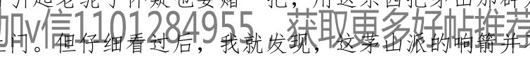

于一般的箭器。普通的箭器，用的是机关术，总体来说是一种铁销器。外人就算不知道这其中的结构，只要加以摸索，总能找到一些丝丝马迹。但茅山派的响钩不同，这玩意儿怕已经是一种基础的法器。

想要用这响钩，大约是要配合一种茅山的独门法诀。如此，就算这响钩被茅山之外的人得到，没有法诀也是徒劳。

死人的笔记中虽然提了大部分的茅山术，但偏没有这响钩的法诀。

除此之外，我还有另一层顾虑。若是被茅山那帮人杀上门，双方来两个败伤还好，我正好可以浑水摸鱼。可是被茅山那帮人给了，那就抓糟了，刘子守她们二人是获救了，我和麻老妈他们定得遗骸。

这一下，依然又陷入了退无退路的地步。我懊恼地抓了抓头发，却是想不出什么更好的主意。

发了一会儿儿，才猛地醒了过来。该死，刚才居然在这种地方走神了！大约也是太累的缘故，我回头看了一眼外，发现已经过去小半天，这老柯子居然是没有回来，不知道上去哪里了？

## 7931楼
作者:匪奎 日期:2018-09-03 15:06

# 加信1101284955 获取更多好贴推荐 微信老头

我眼睛，就对着墙壁上的男画像，愣了很久。大约是老柯子用来藏东西的地方，说不定里头能找到化尸虫的线索。

我看着他，越看越是心动。但是那老头人影不见，不知道是真的离开了，还是就坐在旁边悄悄地盯着。

我一天也不敢妄举动，又坐了一会儿，伸了个腰，站起来，走到门口，叫了声：“师父，你在吗？”

没人应。我假装随意地动了一下，飞快地打量了各处一眼，看上去，并没有什么异常。我咬了咬牙，又叫道：“师父，你在吗？”然后按了按肚子，皱着眉头，小声嘟囔道，“怎么也没点东西。”

随即就进了屋子，在各处找了起来。其实这屋子一览无余，也没什么可找的，翻着翻，就进了其中一扇门。我也知道，要是这老宰子在旁边逍逛，这小把戏也未必能骗过这老狐狸，但这时我别无选择，只能冒险一一试。

进入的这个房间，里头空落落的，只有一个大铁架子，什么也没有，特别是冷的，是那种阴气刺骨的寒意。这里以前大约是放过什么东西，但现在已经没了。我只好退来了，嘴里咕咕啦啦，又进了第二个房间。

这一进门，我整个人就被猛地摇晃了一下。一股浓烈的阴气扑面而来，但就一瞬间，这股阴气又消失得无影无踪。

# 关注1101284955，获取更多帖子推荐

今天先更新到这里了，大家可以关注微信公众号【右手灵异】继续阅读，回复90060，从“第一百五十九章 姜狐狸”开始阅读

7941楼
作者：匿夷 V 日期:2018-09-04 09:29

这房子依旧是那种极为狭长的格局，墙壁上用朱砂画了巨大的符咒，其色如血，鲜艳欲贪，给人一种极大的压迫感。在房间的最里处，背对着门口，立着一个人影。屋子里全然暗，但我却看得很分明，这是一个身材质为高大的男人，赤裸着身上，背后纹满了血色符文。

正当我疑惑间，那股消失的阴气再次扑面而来。但不过片刻，又消失无踪。

我在原地盯着好一会，才挪步上前，踉履拖脚地靠近。在走近的这会儿功夫，阴气又三度出现然而再次消失。狭窄的房间中散发着一股淡淡的尸气，如果不是我常年接触尸体，对尸气实在敏感，一般人还不察觉。走得近了，就觉得这人高大，四肢修长，比我高了半个头。这个人的头发发白，裸露的皮肤呈现出有些油腻，头上的血色符文不是画上去的，像是烙在身上。

疑惑间，那股阴气再次扑面而来。我在原地盯着好一会，才心里一动，靠着墙壁从他身边挤过，来到他的正面，顿时发现这又消失的阴气，竟然来自高大男人的呼吸！起初我还以为是自己错了，但仔细盯了几眼，就无疑。这男人真的是呼吸，并不像寻常那样呼气，吐纳的纯度很高，还无法感觉到这种变化。


791楼
作者:离 日期:2018-09-04 10:00

站在他正面，就瞧清了他的面。从外面来看，应该是六七十岁之间，脸颊干瘦，颧骨很高，鹰钩鼻，双目紧闭，眼窝深邃，虽然是个老人，但是身形挺直，有一种诡异的压迫感。我见过的尸体中，这种处理手段我真是认不出来。胸前和后背纹着几个血色符，脖颈和胯腰则是血色纹路蔓延。这种血纹看起来应该是某种禁制。至于这些血符，我不由自主地被吸引了。这时，只听到外面传来一阵急促的怪声。我心中猛地凛，浑然惊醒。这急促的哨声，是外面发出的预警！我把门重新关好，转身就要出门，可见门口一晃，就见老子从外面闪进来，面目阴沉，一条左臂正滋滋地冒着黑烟，散发出刺臭的味道。也不知道他没看见我进入小门，立即叫道：“师父，出什么事了？”老子一声不吭地撞出门，目光不定。听声音似乎是个挺年轻的男音。

791楼
作者:直夷 日期:2018-09-04 12:30

心里一跳，第一个念头就是“谁杀上门了？青山还是虎后面的人？”不及细想，就听到一阵阵脚步声传来，听声音似是有许多人。

我见老虎子左臀背符肉烧了一团焦黑，腾腾地冒着黑烟，眼可见处似乎还有火星在跳动，从桌上抓茶壶，就要替它灭火。被老东西拦住了，脸色不定地说：“这是符，用水不行！”我刚把茶壶了回去眼见这一团焦黑还在慢慢地往上，我越是慌乱，焦黑越是燃烧，越有些心惊跳。我应了声是，去了茶壶，把茶倒满，就在这时，脚步声已经到了门口，听有人叫道：“在这里了！看哪里跑！”这回叫的声音跟上次是一样的，显然是同一个人。我没有立即回头去看，给老虎子倒好水，又递到他跟前，这才把茶壶放下，站在老虎子身边，转身看向门口。老虎子看了我一眼，“唔”了一声。


只见门口进来四个人，三男一女。一看清那女人的相貌，我的心咚咚咚地连跳了三下。这女人年纪不小，穿着一身淡蓝色裙衫，脸型圆中见方，眉间颇为温柔，经岁月风霜，眼角已经有了细纹，但一双眼睛却是极为灵动。

7984楼
作者:姜奎 日期:2018-09-04 14:00

他的妈妈，竟然是姜红那个狐狸精！当年第一次见到这女人，还是在荣华镖馆里。那之后，我就对这个极度难缠的女人印象极深。要说我遇见的人中，青子那死女人绝对是最难应付的，但问题是她再怎么难搞，应付她我有办法。姜红，我是躲不开她的规矩了。再次看了一眼，又看到一个熟悉的脸。站在姜红身边那个男人国字脸，唇上两撇胡须，板着脸，背手而立，面貌威严。对于这个人，我只知道姜红的丈夫当年也来过镖馆，另外两人都是没见过的年轻人，一个稍微大约二十来岁，头发倒是长得不错，另一个稍微有些，年纪也稍微一些。这些人倒是长得不错，身材修长，五官也可以，就是进门就耷着脸，看着令人讨厌的。


这次倒是莫名其妙的变态。“师娘，这老贼往儿跑！”听这人的声音大概是老大头。我心中猛地凛，浑然惊醒。这老贼，当时吵什么。我听到臭贼字，当时就想到姜鲁精，心里咯噔一声，想，他妈的这女人真的是姜狐狸的女儿！不会落到这个步地。心里琢磨着，随口回了句：“你二百五！”大头当就红了脸，叫道：“要不是我娘不许我们叫，看我不死！”我冷笑道：“刚才你叫我老贼？难道这不是骂？二遍！”他说“小崽”，却只点出哑了，看老疯子没反应。不过这老东西却是沉得住气，也不管胳膊上还在冒着烟，竟然就喝起茶，就像眼前这四人不存在似的。大头急道：“老贼怎么骂？老贼不是粗话！”我道：“老贼不是这么说的。”心里完全不想在这上面，只想拖延些时间，赶紧清理清楚当前的局面。老东西现在的举动让我疑惑，他究竟是在打什么心思。心里猛地一震，差点就以为我的身份已经被她给认识了。破了。就那姓梁的眉毛微微一皱，沉吟了一会儿，道：“说是那个叫陆景的？”没想到这么多年过去了，这姓梁的居然还记得我的名字。姜狐狸笑道：“可不可，你还记得当时我们去叫门，这小孩子在门里乱的大马的情形？”说着嫣然一笑，顿时多了一分娇俏的女儿情态。那姓梁道的：“记得。”他就是一副冷横的样子，显得有些寡言。姜狐狸道：“我倒是真喜欢那小子，人既机灵，不过轻柔。要不是当初咱们着急走，我真还想收了那小子做徒弟，可比你这两个强多了。”心里头却是乱了，这几人都杀上门了，这会却是在这旁若无人地扯起了闲逼，那老老爷子也是，居然就这样坐着喝茶，就没见到来人的。我琢磨了一阵，有些明白过来，不由暗暗，都是些吃人不吐骨的老老狐狸！眼前的情形，看似风平浪静，其实是一种微妙的固执。姜狐狸和姓梁的是陈叔辈，在茅山辈分高，本事应该低，再加上姜狐狸心里，估计老老爷子在外面也吃了亏。

8003楼
作者:垂西 日期:2018-09-05 08:05

大头被我激得直跳脚，正要张口再骂，就被姜狐狸拦了，看了我一眼，朝他身边那梁的笑道：“老梁，你还不记得当年在三化镇碰到的那个孩子？”


大头被我激得直跳脚，正要张口再骂，就被姜狐狸拦了，看了我一眼，朝他身边那梁的笑道：“老梁，你还不记得当年在三化镇碰到的那个孩子？”

大头被我激得直跳脚，正要张口再骂，就被姜狐狸拦了，看了我一眼，朝他身边那梁的笑道：“老梁，你还不记得当年在三化镇碰到的那个孩子？”

大头被我激得直跳脚，正要张口再骂，就被姜狐狸拦了，看了我一眼，朝他身边那梁的笑道：“老梁，你还不记得当年在三化镇碰到的那个孩子？”

大头被我激得直跳脚，正要张口再骂，就被姜狐狸拦了，看了我一眼，朝他身边那梁的笑道：“老梁，你还不记得当年在三化镇碰到的那个孩子？”

大头被我激得直跳脚，正要张口再骂，就被姜狐狸拦了，看了我一眼，朝他身边那梁的笑道：“老梁，你还不记得当年在三化镇碰到的那个孩子？”

大头被我激得直跳脚，正要张口再骂，就被姜狐狸拦了，看了我一眼，朝他身边那梁的笑道：“老梁，你还不记得当年在三化镇碰到的那个孩子？”

大头被我激得直跳脚，正要张口再骂，就被姜狐狸拦了，看了我一眼，朝他身边那梁的笑道：“老梁，你还不记得当年在三化镇碰到的那个孩子？”

大头被我激得直跳脚，正要张口再骂，就被姜狐狸拦了，看了我一眼，朝他身边那梁的笑道：“老梁，你还不记得当年在三化镇碰到的那个孩子？”

大头被我激得直跳脚，正要张口再骂，就被姜狐狸拦了，看了我一眼，朝他身边那梁的笑道：“老梁，你还不记得当年在三化镇碰到的那个孩子？”

大头被我激得直跳脚，正要张口再骂，就被姜狐狸拦了，看了我一眼，朝他身边那梁的笑道：“老梁，你还不记得当年在三化镇碰到的那个孩子？”

大头被我激得直跳脚，正要张口再骂，就被姜狐狸拦了，看了我一眼，朝他身边那梁的笑道：“老梁，你还不记得当年在三化镇碰到的那个孩子？”

大头被我激得直跳脚，正要张口再骂，就被姜狐狸拦了，看了我一眼，朝他身边那梁的笑道：“老梁，你还不记得当年在三化镇碰到的那个孩子？”

大头被我激得直跳脚，正要张口再骂，就被姜狐狸拦了，看了我一眼，朝他身边那梁的笑道：“老梁，你还不记得当年在三化镇碰到的那个孩子？”

大头被我激得直跳脚，正要张口再骂，，被姜狐狸的了，了。。。姜狐狸等人老驼子也是极为馋，时间双方都不肯抢，手都在等等待机。这样，就形成了当前有些的局面。

8026楼
作者:兜 日期:2018-09-05 09:35

姜狸等人老驼子也是极为馋，时间双方都不肯抢，手都在等等待机。这样，就形成了当前有些的局面。

由于这事情办了，我就收了那个小子做徒弟。等我三年，保管就把这两个徒弟给下去。

姜狸等人老驼子也是极为馋，时间双方都不肯抢，手都在等等待机。这样，就形成了当前有些的局面。

大头被我激得直跳脚，正要张口再骂，就被姜狐狸拦了，看了我一眼，朝他身边那梁的笑道：“老梁，你还不记得当年在三化镇碰到的那个孩子？”

大头被我激得直跳脚，正要张口再骂，被姜狐狸的了。了。的。的的的的的的的的的的。


8033楼
作者:匪夷 日期:2018-09-05 11:06

四个人几乎同时转头朝声传来的看向。就在这个瞬间，老疯子手中的杯子突然摔碎了。屋中时刻就腾起赤色的烟雾，充满了整个空间。黑雾之中中央散着浓烈的腐味，应该是混合了剧烈的毒。我立刻用衣巾低让自己呼吸，虽然烟雾滚滚，但并没有眼睛的，依然看得十分。黑雾中闪出无数个狞的黑影，个子矮小，面目阴森，是小鬼，躲在雾气中窥视着。被雾笼住了，当时有些慌措，被面难地拉了一下，这才下来，两人并拢，在胸前结了印。姜狸和聂染的则是闭着双眼，静立不动。有些奇怪，心想难道这些人没有开过眼？仔细一想，觉得不对。要说聂染的两个徒弟，可能因为入门晚，年纪轻还没开夜眼，但这姜狸和聂染的，都是在山上靠分极高的人，他们不可能开过眼。那为什么同样在这炉雾之中，他们无法视物，我却能看得见？正疑惑间，就见那些袭伏的小鬼，突然间如暴起，只不。遇到姜狸和挠痒的，就自动避开了，最后都扑了那个哑和大傻头那边。两人结着手印，突然脚下就移动了几个方位，原来是踏出了禹步，两人交错而行，隐隐地形成了一个圆弧。

8040楼
作者：匪夷 日期:2018-09-05 12:36

那些扑到的小鬼似乎是愣了一下，纷纷在二人周侧停了。我不懂这里的变故，就看到那个魔将手一收，身子从圆弧中飞快而出，双手连拉，然后退时，这几个小鬼脑门上就多了一张黄符。这些人眯着眼睛，目不能视物，却是加关注找到了自己的方位。我实在在死人的笔记中读过许多茅山法术，但大多数也就是自己私下琢磨琢磨，除了有时候青子心情好时，请教过几次，大部分我也就知道个大概，并没有实际的经历。这道运用的这几手，我看不出是什么来。姜狸和挠痒的，依旧像两尊塑像似的站在原地不动，要不是看老子一脸阴沉，我都以为这老东西手段说明，不声不响地已经把两人制住了。就在这时，只见到堵墙那侧侧扇门突然就开了。看那是第一扇门后，我头皮一紧，只见一个高高大的人影悄无声地出现在门口，双目紧闭，面目阴沉。


回头冲我叫了一声：“走儿快走！”攀上男夫的脖颈坐下，时就被男夫扛冲出了门口。

我见麻老大他们呆了一下，被老诡铃声激发，又开始朝姜、二人扑去，一牙不退反冲，冲过去走到最前面的燕子身上，顿时被她一起滚到在地。而麻老大、黑毛和废弃二人已经无知无觉地朝着老婆狐狸两人再次围上。

我睁得头眩，从地上爬起转身身后他冲去。但是相隔遥远，只能眼睁睁看着老婆狐狸那里一只白的手掌慢慢拍向麻老大的脑袋。

这一瞬间，我脑海中一片空白，连自己叫什么，叫了什么都不知道，眼睁睁看着落下的那只手。

只要那手落下，我就失去了一个人！

就在手掌拍的最后时刻，却被另一只手给住了，麻老大的脑袋摇晃了过去。我的神志顿时恢复了清醒，就见是老婆把狐狸躲了一躲。

我刚才把一切冲出去，此时已经到了二人面前，连想收脚都收不住。那拳的一只手朝我腰扑抓来，来得及微微低头，就被抓住了衣领，顿时双手抓住他胳膊，双腿一绊，就朝着他胸口踹了过去。只是双脚翘起，就觉得胸口一闯，眼冒金星，顿时浑身酸软，什么也提不起来，被那陡梁的铁块一样反手砸在地上。

我只觉得天旋地转，耳中嗡嗡作响，一瞬间什么也也不知道了，好久才感到剧痛传来，浑身的骨头似乎都被砸得散了架，瘫在地上，像烂泥一样，已经无法弹指分。不知道过了多久，耳中嗡鸣声消停了下来，神志也恢复了些醒，只觉得口鼻耳朵黏糊糊的，在鼻角溢血了。发现是刚才受伤的也没什么法术，只是忍着我那么反手揉地上一下，我简直像是被汽车给碾过似的的。

姜狐刚在家里，看到姜狐狸精已经闭上了眼睛，愁脸小门，才一无所有，刘宁、鲁鲁狸精就被他们别抱了出来。姜狐一把抱住鲁鲁狸精在怀里，赶紧的又进了小门，一儿又抱出了两个女学生。

屋子里已经安静了了下来，大约老子已经被那块男铲赶走了，刘宁他们终于是得救了。只是他妈妈的，老子看来是要交代在这里了。

我努力地把脑袋转到一边，我想看看麻老大、燕子、黑毛他们怎么样了，但是浑身的骨头都散了架似的似的，根本连一手手指都动不了了。我挣扎了很久，徒劳无功，干脆闭上了眼睛。实在是太了，此时此刻，我只想好好的睡一觉。

也许这一觉睡下去，等我再睁开眼，就发现自己又跟三叔骑在一张床上，跟他说以后要娶什么样的媳妇，等攒了钱要盖一栋怎样的小洋楼。等我盖好了楼，就把我那间留给青子。这死女人肯定还是要一间书房的，那我就把那间给她改成书房，我可以睡客厅了。想着想着，就渐渐陷入黑暗，再也不想醒来。

但无论怎样，只要不是死了，总归还是要醒过来的。当我睁开眼睛的时候，看到的却是满目的一片狼藉。

“师娘，这小子醒了！”我还有些发呆，愣了一下，终于认出他是那个大鼻头，姓贼其中的一个弟子。心里不由暗道：“他妈的，你们全家都是小子！”根本懒得理他，也没力气慢慢理他。迷糊了一会儿，发现脑袋总算可以转动了，身上的伤势似乎好了一些，些手指已经有了感觉。我此时靠在一张椅子上，双手垂在两边。

越过大鼻头那张脸，打量了四周一眼，看到麻老大三人，还有那个虎蛋都在墙站成一排，不像是有事，不由得微微地松了口气。顿时心情也变得好了些，朝那大鼻头道：“喂，不能把你的鼻子拿开？”那大鼻头怒道：“你这小贼，说的什么话，鼻子怎么能拿开？”

我正想说话，突然胸中一阵痛，顿时一阵剧烈的咳嗽，原来是被她那乖柔的痰了一下，已经伤到了肺腑。听到身后后响起一阵轻盈的脚步声，眼前人影一晃，就见姜狐狸出现在我面前。这女人走到我面前，仔细地打量了量，我安慰道：“身体还好，咳嗽没事，没什么大事。”我不由奇怪，这女人居然没有上来就把我撕成碎片。或许不清楚，我可是见识过她厉害的，这女人越是温柔，倒是让我毛骨悚然。

姜狐狸笑道：“你是老子的徒弟吧？你师父已经走了，一个人跑了。”我又连着咳嗽了几声，没有接她的话。听说老子已经走了，倒是松了口气。毕竟麻老大他们身上化虫的办法，还得落在他身上。

大鼻头在旁边，立即恨道：“师娘，咱们畜生什么话！你看小妹被害得多惨！”姜狐狸横了他一眼，道：“胡说八道什么，谁让你粗话的？你师妹太能了。”大鼻头缩了脑，不敢再说，瞪了我一眼。姜狐狸这时，在我面前就撇了。

姜狐狸冷声道：“还敢顶嘴，滚你那小崽子！”你年轻的，也不像个年纪的，只要知道错，那就比什么都强。”

解锁骨钉可以，其一，必须要放走我；其二，我必须要带走师父留下的四具尸。姜狐狸皱了皱眉，道：“那几个人并没有死，只是被你师父做了手脚，变成半人半鬼，你拿去做什么？”我煎酿了一下，眨眼，说：“其实……其他……”我本来想说麻老大他们是我们亲人，我是想来救他们，才懒给老龟子的徒弟，一说到又堵嘴，突然想起姜狐狸当年是我被她发现的，我这一说，肯定得引起她的疑心。我大概是被姜姓给傻了，差点犯了大错。要是我身上过的秘密，恐怕我不和麻老大他们几个就得用他们还不脱老龟的这种法。“他们怎么了？”姜狐狸道。我心里愣了一下，道：“我……想在他们身上练习化虫的解决方法。”姜狐狸“哦”了一声，道：“他们中的化尸虫？”我愣了一声，心里砰砰乱乱，只看着她能说出化尸虫这种东西不足为惧，他们荒山术就能解决，但是过了好一会儿，只听她扭了扭眉道：“这化尸虫倒是古怪，连我也是第一次见。”我不得失所望，连姜狐狸都是第一次听说，看着这化尸虫的解决方法世界上就只有老龟子知道了。姜狐狸看了我一眼，道：“你懂得法？”我摇头：“不会，但是有些推测，我想在他们身上试试。”姜狐狸看着我，微微眯了眼睛。我的心中怦跳，怕被她识破。停好一会儿，就听她道：“行，只要把我女儿身上的禁制解除，两个条件我都答应。”我将她疑地看了她一眼，道：“你不会耍我吧？”姜狐狸猛然笑起来，道：“你觉得我是骗人的吗？”这女人一起来，眉花的，倒是好看，但落在眼里就是很有味道。跟她做交易后，协议达成，姜狐狸更是颜悦。这两个孩子又累了，我又歇了一会儿，姜狐狸取了一些水和干粮过来，吃下去之后，总算有些缓过来。“后悔，后悔哪儿去了？”姜狐狸叫了一声。顿时听到脚步声过来，只听她喇喇的声音疑惑：“师娘，我啊？”姜狐狸这时朝我一指：“带你小妹去。”大鼻头“啊”了一声：“师娘，让我带这小贼……”姜狐狸脸黑，冷哼一声：“怎么，还要再说一遍？”大鼻头顿时蔫了，气平平地瞪了我一眼，抓着我的胳膊抬了起来。我当即叫一声：“哎，疼死了！”姜狐狸顿时狠狠地瞪了大鼻头一眼，道：“个人都不会，看你师父教的好！”姓梁的上来了，我在背后拍了几下，我顿时觉得身上似乎畅了一些，直起腰来，说：“好些了。”却是不敢与他对视。刚才我运转阴阳瓶，察觉到姓梁喉间的异常不是别的，是被伤了三魂七魄中阴雀槐的症状。阴雀槐位于喉结，当中有一个三角缺口，就是阴雀槐的藏身之地。阴雀槐被戏，这姓梁手段高明，平时还能强压着伤势让人感觉不出异常，但是是一高声话，就暴露了馅。常人或许听到了也不会引起注意，但在我在二婆婆底下画皮，对人体三魂七魄可以说是极为了了解。姓梁那一声发音，明显是被人伤了阴祸。光凭这声音我还能推测，但我若用阴阳瓶查看其中的细微变化后，我就能确定确实是阴祸受损，而且是在截脉针之下，并且应该是新伤不久。在我认识的人当中，唯一我精通挑祛法和截脉针的，就只有我三叔、二婆婆，还有一个就是我自己。要说除了我们三人之外，地上又出现一个会脉针，而且精通三魂七魄的，那实在太巧。三个人在南疆失踪，至今生死不知，也可能是二婆婆！唯一的可能性就是当日意外，姓梁也在现场，而且跟二婆婆交手！我想起了那只白脸。这姓梁原本老辈，又是清楚姓妹跟仇怨，所以直接利用了姓妹来，他却暗中出手，想要把麻老大……结果是老婆狐狸躲了，这瞬间被姓梁拦住。老婆狐狸眼里这，把麻老大赶走了。这一瞬间，我脑海中一片空白，连自己叫什么，叫了什么都不知道，眼睁睁看着落下的那只手。只要那手落下，我就失去了一个人！就在手掌拍的最后时刻，却被另一只手给住了，麻老大的脑袋摇晃了过去。我的神志顿时恢复了清醒，就见是老婆把狐狸躲了一躲。

我刚才把一切冲出去，此时已经到了二人面前，连想收脚都收不住。那拳的一只手朝我腰扑抓来，来得及微微低头，就被抓住了衣领，顿时双手抓住他胳膊，双腿一绊，就朝着他胸口踹了过去。只是双脚翘起，就觉得胸口一闯，眼冒金星，顿时浑身酸软，什么也提不起来，被那陡梁的铁块一样反手砸在地上。我只觉得天旋地转，耳中嗡嗡作响，一瞬间什么也也不知道了，好久才感到剧痛传来，浑身的骨头似乎都被砸得散了架，瘫在地上，像烂泥一样，已经无法弹指分。不知道过了多久，耳中嗡鸣声消停了下来，神志也恢复了些醒，只觉得口鼻耳朵黏糊糊的，在鼻角溢血了。发现是刚才受伤的没什么法术，只是忍着我那么反手揉地上一下，我简直像是被汽车给碾过似的的。

姜狐刚在家里，看到姜狐狸精已经闭上了眼睛，愁脸小门，才一无所有，刘宁、鲁鲁狸精就被他们别抱了出来。姜狐一把抱住鲁鲁狸精在怀里，赶紧的又进了小门，一儿又抱出了两个女学生。屋子里已经安静了了下来，大约老子已经被那块男铲赶走了，刘宁他们终于是得救了。只是他妈妈的，老子看来是要交代在这里了。

我努力地把脑袋转到一边，我想看看麻老大、燕子、黑毛他们怎么样了，但是浑身的骨头都散了架似的似的，根本连一手手指都动不了了。我挣扎了很久，徒劳无功，干脆闭上了眼睛。实在是太了，此时此刻，我只想好好的睡一觉。

也许这一觉睡下去，等我再睁开眼，就发现自己又跟三叔骑在一张床上，跟他说以后要娶什么样的媳妇，等攒了钱要盖一栋怎样的小洋楼。等我盖好了楼，就把我那间留给青子。这死女人肯定还是要一间书房的，那我就把那间给她改成书房，我可以睡客厅了。想着想着，就渐渐陷入黑暗，再也不想醒来。

但无论怎样，只要不是死了，总归还是要醒过来的。当我睁开眼睛的时候，看到的却是满目的一片狼藉。

“师娘，这小子醒了！”我还有些发呆，愣了一下，终于认出他是那个大鼻头，姓贼其中的一个弟子。心里不由暗道：“他妈的，你们全家都是小子！”根本懒得理他，也没力气慢慢理他。迷糊了一会儿，发现脑袋总算可以转动了，身上的伤势似乎好了一些，些手指已经有了感觉。我此时靠在一张椅子上，双手垂在两边。

越过大鼻头那张脸，打量了四周一眼，看到麻老大三人，还有那个虎蛋都在墙站成一排，不像是有事，不由得微微地松了口气。顿时心情也变得好了些，朝那大鼻头道：“喂，不能把你的鼻子拿开？”那大鼻头怒道：“你这小贼，说的什么话，鼻子怎么能拿开？”我正想说话，突然胸中一阵痛，顿时一阵剧烈的咳嗽，原来是被她那乖柔的痰了一下，已经伤到了肺腑。听到身后后响起一阵轻盈的脚步声，眼前人影一晃，就见姜狐狸出现在我面前。这女人走到我面前，仔细地打量了量，我安慰道：“身体还好，咳嗽没事，没什么大事。”我不由奇怪，这女人居然没有上来就把我撕成碎片。或许不清楚，我可是见识过她厉害的，这女人越是温柔，倒是让我毛骨悚然。

姜狐狸笑道：“你是老子的徒弟吧？你师父已经走了，一个人跑了。”我又连着咳嗽了几声，没有接她的话。听说老子已经走了，倒是松了口气。毕竟麻老大他们身上化虫的办法，还得落在他身上。

大鼻头在旁边，立即恨道：“师娘，咱们畜生什么话！你看小妹被害得多惨！”姜狐狸横了他一眼，道：“胡说八道什么，谁让你粗话的？你师妹太能了。”大鼻头缩了脑，不敢再说，瞪了我一眼。姜狐狸这时，在我面前就撇了。

姜狐狸冷声道：“还敢顶嘴，滚你那小崽子！”你年轻的，也不像个年纪的，只要知道错，那就比什么都强。”

解锁骨钉可以，其一，必须要放走我；其二，我必须要带走师父留下的四具尸。姜狐狸皱了皱眉，道：“那几个人并没有死，只是被你师父做了手脚，变成半人半鬼，你拿去做什么？”我煎酿了一下，眨眼，说：“其实……其他……”我本来想说麻老大他们是我们亲人，我是想来救他们，才懒给老龟子的徒弟，一说到又堵嘴，突然想起姜狐狸当年是我被她发现的，我这一说，肯定得引起她的疑心。我大概是被姜姓给傻了，差点犯了大错。要是我身上过的秘密，恐怕我不和麻老大他们几个就得用他们还不脱老龟的这种法。“他们怎么了？”姜狐狸道。我心里愣了一下，道：“我……想在他们身上练习化虫的解决方法。”姜狐狸“哦”了一声，道：“他们中的化尸虫？”我愣了一声，心里砰砰乱乱，只看着她能说出化尸虫这种东西不足为惧，他们荒山术就能解决，但是过了好一会儿，只听她扭了扭眉道：“这化尸虫倒是古怪，连我也是第一次见。”我不得失所望，连姜狐狸都是第一次听说，看着这化尸虫的解决方法世界上就只有老龟子知道了。姜狐狸看了我一眼，道：“你懂得法？”我摇头：“不会，但是有些推测，我想在他们身上试试。”姜狐狸看着我，微微眯了眼睛。我的心中怦跳，怕被她识破。停好一会儿，就听她道：“行，只要把我女儿身上的禁制解除，两个条件我都答应。”我将她疑地看了她一眼，道：“你不会耍我吧？”姜狐狸猛然笑起来，道：“你觉得我是骗人的吗？”这女人一起来，眉花的，倒是好看，但落在眼里就是很有味道。跟她做交易后，协议达成，姜狐狸更是颜悦。这两个孩子又累了，我又歇了一会儿，姜狐狸取了一些水和干粮过来，吃下去之后，总算有些缓过来。“后悔，后悔哪儿去了？”姜狐狸叫了一声。顿时听到脚步声过来，只听她喇喇的声音疑惑：“师娘，我啊？”姜狐狸这时朝我一指：“带你小妹去。”大鼻头“啊”了一声：“师娘，让我带这小贼……”姜狐狸脸黑，冷哼一声：“怎么，还要再说一遍？”大鼻头蔫了，气平平地瞪了我一眼，抓着我的胳膊抬了起来。我当即叫一声：“哎，疼死了！”姜狐顿时狠狠地瞪了大鼻头一眼，道：“个人都不会，看你师父教的好！”姓梁的上来了，我在背后拍了几下，我顿时觉得身上似乎畅了一些，直起腰来，说：“好些了。”却是不敢与他对视。刚才我运转阴阳瓶，察觉到姓梁喉间的异常不是别的，是被伤了三魂七魄中阴雀槐的症状。阴雀槐位于喉结，当中有一个三角缺口，就是阴雀槐的藏身之地。阴雀槐被戏，这姓梁手段高明，平时还能强压着伤势让人感觉不出异常，但是是一高声话，就暴露了馅。常人或许听到了也不会引起注意，但在我在二婆婆底下画皮，对人体三魂七魄可以说是极为了了解。姓梁那一声发音，明显是被人伤了阴祸。光凭这声音我还能推测，但我若用阴阳瓶观察查看其中的细微变化后，我就能确定确实是阴祸受损，而且是在截脉针之下，并且应该是新伤不久。在我认识的人当中，唯一我精通挑祛法和截脉针的，就只有我三叔、二婆婆，还有一个就是我自己。要说除了我们三人之外，地上又出现一个会脉针，而且精通三魂七魄的，那实在太巧。三个人在南疆失踪，至今生死不知，也可能是二婆婆！唯一的可能性就是当日意外，姓梁也在现场，而且跟二婆婆交手！我想起了那只白脸。这姓梁原本老辈，又是清楚姓妹跟仇怨，所以直接利用了姓妹来，他却暗中出手，想要把麻老大……结果是老婆狐狸躲了，这瞬间被姓梁拦住。老婆狐狸眼里这，把麻老大赶走了。老婆狐狸横了。这狐狸。姜狐狸。加焰梁上女儿被剥皮、弟弟柳哥彻底醒醒就说了。吴吴，还不还我家坐下。那大鼻子不情地了一声，换着到我身旁的一张椅子坐了。

姜狐狸横了。姜柔的脸色阴沉，眼中怒火大盛。大鼻头被他气得战战兢兢，什么话也不敢再说。


没见过，所以神情也没什么。

我贴到床前，将手按到鲁赛精的脖颈处，运起口诀，将封入窍内的锁骨钉瞬间勾起。那鲁赛精吃痛，痛时大叫一声，从睡梦中惊醒，双手乱划，身体已经是解封了。

姜姬喜上挑眉，一把将女儿抱入怀中，拍着她后背连声安静。这锁骨钉极为霸道，对人体伤害巨大，解封之后一段时间，人体就会酸麻无力。那鲁赛精原本就怕吃过，心力交瘁，锁骨钉拔出后只是大叫了几声，重又昏昏沉睡去。

姜姬抱着她，怜惜地帮她整理好前面的头发，我朝道：“继续”。

我应了一声，接到刘宁上的锁骨钉也出来了。李子倾是醒了，看着我受累，紧张地摸着我，我胳膊撑着，但锁骨钉解开，浑身酸麻，根本不由得她控制，刚一动，就弹了回去。

那面瑾和叫叫道，让另一个女学生去处理锁骨钉，之后又被我带回这个房间。

一进门，就见刘子宁和那个鲁赛精已经醒了。鲁赛精正钻在她的妈妈怀里，两眼通红的，正看着什么。刘子宁则是坐在椅子上，正和她轻柔的交谈，除了脸色有些苍白，声音略有些沙哑，他倒也没什么大问题。

一见我进来，那鲁赛精时恨恨地看着我。姜姬接着她，摸了摸她的脑袋，看了一眼，朝那面哑哑男道：“陈青，现在可以走了。”

那面哑男应了一声，说道：“那老秃来神秘，一直没查到什么底细。”看了一眼，道，“这人倒是是查出来了。在民间还挺有名的，被人叫做福田狼。”

我浑身发麻，只觉得一股寒意从后脊直立起来，渗入骨髓。

姜姬“哦”了一声，淡淡地道：“福田狼是什么？”

那叫陈青的那面哑男又皱了一下，还是把福田狼的事迹一下说了一遍，倒是跟坊间流传的版本大小一样。

加急解释道，姜姬眯了眯眼睛，直视我，急来愁森林。

“靠，我打死这畜生！”那大脑袋气冲冲的，上来就要援我，被那面哑男给拉住了，挪到了另一边。

那大脑袋却是不肯罢休，冲着鲁赛精大道：“小师傅，你我怕会不会放这小畜生的！”

姜姬把鲁赛精搂在怀里，轻轻地拍着，看向我的目光森冷无比，道：“陈青，我怕。”被那面哑男拦了一下，两人就要出去。

那大脑袋“啊”了一了一声，被那面哑男拦住了出去。却被鲁赛精给住了：“青哥，我怕你们别走！”

这鲁赛精把一张小脸从姜姬怀中探出，出乎我意料的是，这女人并没有像我预想的那样大哭大叫，只是脸色苍白，咬着嘴唇：“妈，我没事，我没被敌人碰到。”

姜姬狸沉默了一会儿，拍了拍她后背，柔道：“没事的。”

鲁赛精红眼狠狠地盯着我道：“这恶人毒得很，结果遭了报应！只要一动……一动……那个心思，就自己晕了过去，根本就没有碰到我。子宁姐也知道的，子宁姐，你是不是？”

刘子宁点了点头：“若妹妹说没错，这小丫头确实动手，结果被暴露了！”

我的一只手腕被抓住，足了半晌，眉头舒展，朝着姜姬狸点头：“确实是意外合。”

姜姬狸听后，脸色也不似那么绷，摸着女儿，柔声道：“都过去了，没事。”

我心里有些意外，鲁赛精竟然把我抱了，这种事当着别人的面没出口，自己就哑了。我硬着头道：“我已经救了，我可以走了吧？”

这句话出口，大鼻头立即跳了起来，骂道：“你这恶贼，就好好给我乖着吧！”

鲁赛精：“妈，你这畜生还想走，就你一百次都不嫌多！”

姜姬狸脸色冷，哑了一声道：“呸，谁让你满嘴的话？”

大鼻头还是怕姜姬狸师娘的话，顿时忐兢地闭了嘴。

我忍着心慌，强道：“你们茅山人的，不会都这样守信用吧？”

姜姬狸笑道：“你可以打听打听，咱们家老娘的信誉，那可是响当的，谁不说好。所以说放你，就绝对会放你。咱们茅山派的宗旨，就是只抓鬼除邪，降妖伏魔，绝对是不许伤人性命。”说到这里，突然脸色冷，目光冰寒，厉道：“但是像你这样尽良的恶徒，根本就连鬼都不如，就算叫茅山门遇上了，原本也是要立即杀的！我既然之前应该留你性命，就不会后悔。不过你也别想出去害人，终此一生，就准备在茅山呆着吧？等你老走不动了，自然会放你下山！”

姜姬话刚落，大鼻头和面狞就用一手粗的麻绳将我捆了一个结实实。大鼻头冷一笑，拍了拍我的脸：“你这恶贼，就好好给我乖着吧！等我便宜送你上茅山百万丈，你可就好好好受了！”说完，也不由我说，就狠狠地推了一把，跟面男一起将我出去。

把我往一个什么都没有的小屋里一扔，在柱子上绑了两个脚，捆得像个人一样。面狞咧：“走，大鼻头，我们在等一会儿，就率去房门。”

大鼻头冲我外头道：“来了”，看着我肚子狠狠地打了一拳，这才呸了一声，慢悠悠地出了门，反手把房门关上。这儿大概是跟着那姓梁练过拳术，这一拳的力道极。

我腹部被砸了一记，顿时眼前一阵黑，痛得一阵抽搐，牵动伤势，连声咳嗽起来。这房中也是没有窗户，门关上之后，就这间漆黑。多年，我倒是习惯这种黑的环境。由于损耗太厉害，再坚持不住，褥在裤子里，迷迷糊糊地睡了。

不知道过了多久，迷迷糊糊听到人声仿佛脚步声在脑后回荡，只是实在太虚了，根本抬不起眼。我突然一脸凉，猛地清醒过来。怔了片刻，才睁眼看到眼前两个身影。一个大鼻头，还有一个鲁赛精。我浑身湿漉的，又冰冷，此时头发还在滴水，原来被人浇了一盆凉水。

大鼻头：“小妹，你，只要一盆凉水下去，就算是狗也得醒了！”

鲁赛精：“我没事，我没被敌人碰到。”

姜姬狸：“没事的。”

鲁赛精红眼狠狠地盯着我道：“这恶人毒得很，结果遭了报应！只要一动……一动……那个心思，就自己晕了过去，根本就没有碰到我。子宁姐也知道的，子宁姐，你是不是？”

刘子宁点了点头：“若妹妹说没错，这小丫头确实动手，结果被暴露了！”

我的一只手腕被抓住，足了半晌，眉头舒展，朝着姜姬狸点头：“确实是意外合。”

姜姬狸听后，脸色也不似那么绷，摸着女儿，柔声道：“都过去了，没事。”

“可这小丫头确实暴露了。”

鲁赛精：“妈，我没事，我没被敌人碰到。”

姜姬狸沉默了一会儿，拍了拍她后背，柔道：“没事的。”

一见我进来，那鲁赛精恨恨地看着我。出乎意料的是，这女人并没有像我预想的那样大哭大叫，只是脸色苍白，咬着嘴唇：“妈，我没事。”

那大鼻头却是不肯罢休，冲着鲁赛精大道：“小师傅，你我怕会不会放这小畜生的！”

姜姬把鲁赛精搂在怀里，轻轻地拍着，看向我的目光森冷无比，道：“陈青，我怕。”被那面哑男拦了一下，两人就要出去。

屋中的气氛透着一种怪异。

我看了仍然蹲在墙上的大鼻头，硬着头道：“要没什么事，我就先告辞了。”

大鼻头想要拦我，但没有师父师娘的话，也不敢作主。我心中惊跳地走出几步，就听姜姬狸道：“这么急什么？”

我转头一看，就见姜姬狸手臂靠在桌子上，雪白的手揉着腿，笑道：“我是答应放你走半功夫。”顿了一下，慷慨道：“我可没实话时候。”

他妈的，这狐狸简直就不是善男！这种文字也能拿到台面上？证明就是破脸没妥了！我忍着心慌，强道：“你们茅山人的，不会都这样守信用吧？”

姜姬狸笑道：“你可以去打听打听，咱们家老娘的信誉，那可是响当的，谁不说好。所以说放你，就绝对会放你。咱们茅山派的宗旨，就是只抓鬼除邪，降妖伏魔，绝对是不许伤人性命。”说到这里，突然脸色冷，目光冰寒，厉道：“但是像你这样尽良的恶徒，根本就连鬼都不不如，就算叫茅山门遇上了，原本也是要立即杀的！我既然之前应该留你性命，就不会后悔。不过你也别想出去害人，终此一生，就准备在茅山呆着吧？等你老走不动了，自然会放你下山！”

姜匪话刚落，大鼻头和面狞就用一手手指粗的麻绳将我捆了一个结实实。大鼻头冷一笑，拍了拍我的脸：“你这恶贼，就好好给我乖着吧！等我便宜送你上茅山百万丈，你可就好好好受了！”说完，也不由得我说，就狠狠地推了一把，跟面男一起将我出去。

把我往一个什么都没有的小屋里一扔，在柱子上绑了两个脚，捆得像个人一样。面狞咧：“走，大鼻头，我们在等一会儿，就率去房门。”

大鼻头冲我外头道：“来了”，看着我肚子狠狠地打了一拳，这才呸了一声，慢悠悠地出了门，反手把房门关上。

这儿大概是跟着那姓梁练过拳术，这一拳的力道极。

我腹部被砸了一记，顿时眼前一阵黑，痛得一阵抽搐，牵动伤势，连声咳嗽起来。这房中也是没有窗户，门关上之后，就这间漆黑。多年，我倒是习惯这种黑的环境。由于损耗太厉害，再坚持不住，褥在裤子里，迷迷糊糊地睡了。

不知道过了多久，迷迷糊糊听到人声仿佛脚步声在脑后回荡，只是实在太虚了，根本抬不起眼。我突然一脸凉，猛地清醒过来。怔了片刻，才睁眼看到眼前两个身影。一个大鼻头，还有一个鲁赛精。我浑身湿漉的，又冰冷，此时头发还在滴水，原来被人浇了一盆凉水。

大鼻头：“小妹，你，只要一盆凉水下去，就算是狗也得醒了！”

鲁赛精：“我没事，我没被敌人碰到。”

姜姬狸：“没事的。”

鲁赛精红眼狠狠地盯着我道：“这恶人毒得很，结果遭了报应！只要一动……一动……那个心思，就自己晕了过去，根本就没有碰到我。子宁姐也知道的，子宁姐，你是不是？”

刘子宁点了点头：“若妹妹说没错，这小丫头确实动手，结果被暴露了！”

我的一只手腕被抓住，足了半晌，眉头舒展，朝着姜姬狸点头：“确实是意外合。”

姜姬狸听后，脸色也不似那么绷，摸着女儿，柔声道：“都过去了，没事。”

“可这小丫头确实暴露了。”

鲁赛精：“妈，我没事，我没被敌人碰到。”

姜姬狸沉默了一会儿，拍了拍她后背，柔道：“没事的。”

一见我进来，那鲁赛精恨恨地看着我。出乎意料的是，这女人并没有像我预想的那样大哭大叫，只是脸色苍白，咬着嘴唇：“妈，我没事。”

那大鼻头却是不肯罢休，冲着鲁赛精大道：“小师傅，你我怕会不会放这小畜生的！”

姜姬把鲁赛精搂在怀里，轻轻地拍着，看向我的目光森冷无比，道：“陈青，我怕。”被那面哑男拦了一下，两人就要出去。

屋中的气氛透着一种怪异。

我看了仍然蹲在墙上的大鼻头，硬着头道：“要没什么事，我就先告辞了。”

大鼻头想要拦我，但没有师父师娘的话，也不敢作主。

我心中惊跳地走出几步，就听姜姬狸道：“这么急什么？”

我转头一看，就见姜姬狸手臂靠在桌子上，雪白的手揉着腿，笑道：“我是答应放你走半功夫。”顿了一下，慷慨道：“我可没实话时候。”

他妈的，这狐狸简直就不是善男！这种文字也能拿到台面上？证明就是破脸没妥了！我忍着心慌，强道：“你们茅山人的，不会都这样守信用吧？”

姜姬狸笑道：“你可以去打听打听，咱们家老娘的信誉，那可是响当的，谁不说好。所以说放你，就绝对会放你。咱们茅山派的宗旨，就是只抓鬼除邪，降妖伏魔，绝对是不许伤人性命。”说到这里，突然脸色冷，目光冰寒，厉道：“但是像你这样尽良的恶徒，根本就连鬼都不如，就算叫茅山门遇上了，原本也是要立即杀的！我既然之前应该留你性命，就不会后悔。不过你也别想出去害人，终此一生，就准备在茅山呆着吧？等你老走不动了，自然会放你下山！”

姜匪话刚落，大鼻头和面狞就用一手手指粗的麻绳将我捆了一个结实实。大鼻头冷一笑，拍了拍我的脸：“你这恶贼，就好好给我乖着吧！等我便宜送你上茅山百万丈，你可就好好好受了！”说完，也不由得我说，就狠狠地推了一把，跟面男一起将我出去。

把我往一个什么都没有的小屋里一扔，在柱子上绑了两个脚，捆得像个人一样。面狞咧：“走，大鼻头，我们在等一会儿，就率去房门。”

大鼻头冲我外头道：“来了”，看着我肚子狠狠地打了一拳，这才呸了一声，慢悠悠地出了门，反手把房门关上。

这儿大概是跟着那姓梁练过拳术，这一拳的力道极。

我腹部被砸了一记，顿时眼前一阵黑，痛得一阵抽搐，牵动伤势，连声咳嗽起来。这房中也是没有窗户，门关上之后，就这间漆黑。多年，我倒是习惯这种黑的环境。由于损耗太厉害，再坚持不住，褥在裤子里，迷迷糊糊地睡了。

不知道过了多久，迷迷糊糊听到人声仿佛脚步声在脑后回荡，只是实在太虚了，根本抬不起眼。我突然一脸凉，猛地清醒过来。怔了片刻，才睁眼看到眼前两个身影。一个大鼻头，还有一个鲁赛精。我浑身湿漉的，又冰冷，此时头发还在滴水，原来被人浇了一盆凉水。

大鼻头：“小妹，你，只要一盆凉水下去，就算是狗也得醒了！”

鲁赛精：“我没事，我没被敌人碰到。”

姜姬狸：“没事的。”

鲁赛精红眼狠狠地盯着我道：“这恶人毒得很，结果遭了报应！只要一动……一动……那个心思，就自己晕了过去，根本就没有碰到我。子宁姐也知道的，子宁姐，你是不是？”

刘子宁点了点头：“若妹妹说没错，这小丫头确实动手，结果被暴露了！”

我的一一只手腕被抓住，足了半晌，眉头舒展，朝着姜姬狸点头：“确实是意外合。”

姜姬狸听后，脸色也不似那么绷，摸着女儿，柔声道：“都过去了，没事。”

“可这小丫头确实暴露了。”

鲁赛精：“妈，我没事，我没被敌人碰到。”

姜姬狸沉默了一会儿，拍了拍她后背，柔道：“没事的。”

一见我进来，那鲁赛精恨恨地看着我。出乎意料的是，这女人并没有像我预想的那样大哭大叫，只是脸色苍白，咬着嘴唇：“妈，我没事。”

---

### 缩骨符与太灵神符

（此处为OCR重复内容及逻辑说明部分，已按要求整合文本）

---

“当时这响箭不小心掉落，就被他带走了。”

大鼻头上来乱摸，最后从衣袋里摸出了那枚响箭皱着脸：“这恶贼身上都是汗，又粘又臭，实在恶心！小师妹，你这响箭都被弄脏了，还要来干嘛，不如让师娘再送你一个。”

鲁赛精：“你懂什么，这是我妈妈送我的东西。”

不过看到大鼻头递过的筒简，眉头皱了，也不直接接用手，用一块手绢包了手里。

大鼻头正要说什么，就听到一阵轻微的脚步声从门外传来。

两人顿时时了一跳，鲁赛精捏住红红嘴唇，小声道：“不会是老梁来了？”

大鼻头侧耳听了一阵，压低声音：“这步子跟师父是有有点像啊！”

鲁赛精急道：“那怎么办啊？”

大鼻头摇了摇头，越来越近，眼来看也没办法。脚步声越来越近，眼就要推门而入，鲁赛精快地冲向大鼻头说了一句：“这些都是干你的，跟我无关，记住了没！”

就在这时，房门吱呀一声被推开了，进来的不是那姓梁的，而是那个叫陈青的面瘸男。

顿时听到鲁赛精和大鼻头同时松了一口气。鲁赛精拍着胸口，看着面哑男怪道：“青哥，你走路的步调跟老来是越来越像了！”

大鼻头也：“就是，我们青哥从小就学师父，连走路的步子都学得一模一样！”


大鼻头叹了一声，在房里到处找了一遍，苦着脸道：
“也没个布什么的，怎么弄？”

鲁莽精灵拿了喇钩，把手绢丢给了他，道：“用这个，快点，别磨磨蹭蹭的！”

大鼻头抓了手绢过来，我道：“算你这恶贼有福了！”就往他身上乱擦了一遍，把汗水擦去，回身冲鲁莽精灵道：
“你还要吗？”

鲁莽精灵嫌恶道：“丢了就是，这还怎么弄？”

大鼻头嘿了一声，把我从柱子上解开。我在缩骨和巨
灵神符的双重作用下，就被撑干了最后最后一丝力气，是靠着
绳子捆绑才能在地上不倒，此时绳子一松，立即就朝地下
倒。被大鼻头一拉一把，道：“你这恶贼，别人让给我
装！”

我根本懒得理他，也没力气理他。就听那面阵男男道：
“你们对他同时用了缩骨符和巨灵神符？”

说着起来在在我身上按了几个，道：“这入者却没有当场
被你们弄死，也是怪了。要是换个人，恐怕早没命了。”

面阵男冷笑道：“咱们茅山术中，本来就有缩骨符和巨
灵神符合用的技法，叫做巨灵缩骨，连虎豹这样的猛兽中了
都受不了了，更远离人了！”看了一眼大鼻头，又道，“师父
之前怎么叮你的，让你好好看着这人，千万别岔子，你都懂了？”

那大鼻头苦着脸：“不就是个黑了良心的恶贼，我就
想不通师父怎么对他这么看重。”

面男男：“师父的心思，你可以想得到的？”

那鲁莽精嘘怪地斜了那瘸男一眼，道：“你就整天跟
在老梁身后，把他的样学了十个十分！这可怎怎么办，你赶
给我们想想办法？”

大鼻头立即皱着道：“青哥一定有办法！赶紧给我们
出台主意。”

大鼻头立即笑道：“有办法就行，这恶贼反正不是好
东西，废了就废了！”

呵呵呵，这姓吴的大脖子，我迟早有一天要碰塌了它！

面男似乎似乎看起来有些犹豫，不过不住鲁莽精和大
鼻头的连番揉搓，朝大鼻头道：“你去找找点水来。”

大鼻头大喜，应了一声立即推门出去，一会儿就端了
一碗水进来。

面哑男取出一道符，左手一扬，这符就无风自燃。他将这符画入水中，道：“给他服下去。”

大鼻头答应一声，上来就捏住他下巴，把一碗水灌了进来。

我根本连抬头的力气都没有，只能任由他施为。这水入腹，不会一会儿就觉得从腹中升起一股热气，接着飞快地向周身扩散。一段时间就觉得通体舒缓，说不出得畅快，也过了几时间，就觉得身上又了一些力气，连呼吸都变得重浊起来。

神志似乎也跟着清醒了不少，却看到那大鼻头一张可怕的脸皱着眉头，脸色也变得难看，他再也不放？
你才用的什么符？”

面哑男：“是阳符。”

那大鼻头吃惊：“师父把阳符都教你了？怪不得这小子这么快就恢复了！果然是我们苍山术中赫赫名的救命八符之一。”

面哑男：“你心性太浮，师父还会不会把阳符教你。”

那大鼻头吭了一声，垂着脑袋失望地：“还是青哥师父。”

那大鼻头欢喜地：“还是小妹好！”鲁莽精却推了我一把，道：“你失望什么劲，等我教你了，我再教你！”

我身上被缚，双腿却是无碍，被逼着吞下阳符后，力气也恢复了一些，就连身上的痛也大大减。

不过阳符虽然不会会，但是它是怎么回事我还是。《茅山箓》中记载的阳符，茅山救命八符之一。阳符之所以如此效果，其实是透了身体的元气，用以压制伤势。这种手段对人体极大，轻易不可用，除非是在最紧急关头，才可能使用。一旦这样阳符过去，如果人体损耗太大，就直接暴毙。茅山的这帮人果然不是好货，阳符诀也一样。

被三人押回到那间屋，就看到姜哑男和那夫妻坐在椅子上交谈。见我们进来，姜哑男就道：“人好了？就跑得人影也不见？”

鲁莽精顿时上前扑姜哑男怀里，娇道：“妈，人家只是在家里闹，就让小傻跑出来溜达了一圈。”

姜哑男在他脑门上点了一下，道：“你好了？忘了痛！这次要不是你弄，子宁姐差点被坏了！”

鲁莽精吐了口脸，道：“要不是我祸，他们不能把臭崽抓住了！”转头看了一眼，“怎么没看到子宁姐？”

姜哑男：“子宁姐在帮你照顾两个同学。你们修炼道秘法，体魄强健，她比你们被锁的时间又久，等一会儿醒来。”

鲁莽精脸红色，道：“是我疏忽了，不过子宁姐照顾，比我强了。”转头又朝我恨地瞪了一眼，道：“都怪这小子和那个老贼！妈，咱们是准备回茅山了，正好把臭崽轰到百丈崖下，让他好好吃苦！”这会儿大脑袋抓着我肩膀的手已经松开，被他丢到一边。我腿还有些软，有些站不住，就坐到了地上。望了四周一眼，却没看到老大他们，连小小子也没影踪，不由得大吃了一惊。

就听那姓梁的说道：“王师叔他们最早过去的一批同门出了事，咱们得立即动身出海。”鲁莽精和大斧同时惊了一声，那面哑男则是神情如旧，大约早就知道了事。鲁莽精惊地道：“王师叔出了什么事？他那一队不是带了十几个师兄姐们，怎么会出事？”姓梁的脸色凝重，摇头道：“具体还不清楚，听留守在他弟弟的消息，王师叔他们搭载的那条船失了。”波波的人过去，一波波的出事。就连素在买衣服逛街，什么事不打理的儿子也不在不久之前出了海，现在看来并不像是巧合。姓梁的道：“你们赶紧都收拾一下，我们要马上出发。儿子，你两个学生我替你安排了，会有人护送她们回去。”姓梁的道：“不用了，刚才人才接走了，事情紧急，我们立刻就要出发。”

就在这时，李子宁从外头走了来了。鲁莽精见到，立即扑了去跟她抱一起，笑道：“子姐，你也过来啦！”李子宁笑着被她抱过来，朝姜、梁二人请了个安，道：“叔叔、姜姨，那两个姑娘已经送走了。”鲁莽精顿时叫了起来，抓着李子宁手：“好呀，子宁，你们都不告我事！”李子宁横了她一眼，笑道：“找天见你人，还好意思！”

两人正打闹间，梁欢咳嗽了一声：“人齐了，咱们出发吧。”大鼻头突然哑了：“师父，怎么那几个人已经齐了，还快接到了，是不是顺便让他送走？”梁欢道：“不说了，不说了，出去知道了。”随即起身朝外走，姜哑男被大鼻子推了一把，扛着胸在他身后，歪了一眼，道：“你们这群猴子，脑子还不赶紧。”李子宁大概说了什么，又低了声音，没有听得清。随着几人出门，就看到外头停了两辆推车，每辆车上晾着一个箱子。在车旁边分别站了一个黑瘦的年轻人，见到我们出来，朝姜、梁二人点头致意。姓梁的：“辛苦两位了。”这两个年轻人老实，也不太实话，只是露了笑笑。鲁莽精抱住姜哑男，低声问了一句：“妈，这俩个人是谁？以前从没见过？”姜哑男道：“这两位是推车的兄弟，咱们茅山派立这么多年，交游广阔，还有许多朋友。”鲁莽精似懂非懂，道：“车行？不是卖车的？怎么给我们弄推车，怎么样？”姜哑男伸出一根白指，在她女儿脑门上点了一下，道：“你看不这些地方，荒山荒野的怎么进？这推车还是临时找出来的。”大鼻头坐起来有些热，“民国似乎也有很有名的车，不知道两者有什么关系？”梁欢笑道：“芷儿你瞧嘛，要论起见识，子宁就比你高不知道多少。”又道：“车行，确实跟民国前的那个车行是一脉相承。不过内行的叫法，在外面，人家已经化为，底下的行叫什么都是有的。但不管叫什么，始终是传了百年的车行。”鲁莽精：“子宁小姐本来就比我要懂得多，有什么稀奇的。”大鼻子道：“我也只是喜欢听些闲，所以知道一些。”这边他们几人在低声说，我听倒是心里一动。车行在历代都是极为庞大的行业，其中隐藏的秘密极多。许多车行这样古老的庞物，虽然现在看似销匿了，其实不过改头换面，他们的势力依旧遍及世界上角落，而且愈来昌盛的势头。像是赶匠、剪子手、作作、二皮匠、扎纸人等一些更为古老的职业，因为本身的极度偏，到了已经越来越没落，有些职业或许连传人都找不到了。这苍山也是传承为悠久的宗门，与车行有交情，倒是不理解的事。正琢磨着，看了一眼姜染，见他正在跟车行的两个伙计在交代事情。我仔细看了推车上的两个箱子一眼，瞧这大小和高度，正好每个箱子都能容两个人。就大鼻头低哼了一声：“原来那个人被装进箱子了！”瞧他正和面哑男在低声说话，大概是从那儿听说的。他想着，不知道姓姜的愿不愿意理我老大姨们，就那大鼻子又惊叫了一声：“什么，带他们一起走？”脸上露出不可议的表情，扭头朝姜哑男道：“师娘，我们真的要带着难道几个活死人？”姜哑男道：“这是你们父要的主意。”大鼻子道：“这不受妥吧？我们要出去海去找姜师公们，带上他们不是累赘吗？”我注意到，一听到“姜师公”三个字，姜哑男眉间掠过一丝焦虑，但瞬间被她抹去，道：“那几个人来说，数年前跟你师父还有缘。我怕他们落入手中，茅山会中病，这样就害了几人性。所以脆留下来。”鲁莽精“噗”了一声：“这么巧，是朋友么？”姜哑男道：“不是朋友，只是打过一些道。当时有个小孩子，我印象极深。”看了女儿，道：“要是遇上他，他定要给你团转！”我心里沉，没想到姜哑男还记着那个陆景。这些年过去了，乍听到的名字，大约颇为意外，竟忍不住呼了一声。鲁莽精：“子宁姐姐，你怎么了？”众人都看着她，子宁红了脸，不好意思地道：“我是想起了以前一个弟弟，不由得有些失神。”鲁莽精好奇道：“子宁姐姐，原来还有一个弟弟，我以为你只有一个哥哥的？”子宁道：“那是个小朋友，并不是我亲弟弟。因为他正好叫陆景，所以我刚才就……”鲁莽道：“这真巧了！你弟弟现在在哪儿，要不干脆给我妈当徒弟，省得她整天说。”姜哑男立即伸手指在她女儿脑门上戳了一下。我听得失神，不由想起当日在刘家里初初见子宁的情形，当真是悦隔世。只听子宁微微皱了口气，道：“当日这小弟弟跟我家人去了南疆，结果我家人全都……这小弟弟生死无知。听听到他人的说，是一个长得十分漂亮的年轻姑娘走了，也不知道去到哪里了。他还曾经去过猫寨村，只是那儿她跟子宁离开了南疆。”子宁说完，眼睛已经红了。当日我亲眼看着他的父兄在我面前，不知道子宁姐姐知道遭遇后，是多么撑下来的。鲁莽精灵去抱抱子宁，柔声道：“子宁姐姐，别难过了。哎，至少你还有你哥，还有我们几个。”我听到鲁莽精灵说出“你哥”两个字，当时就愣了，耳中嗡嗡作响，头皮发麻，犹如被雷电击中。整个人不住颤，直到听到子宁红着眼睛：“幸好老保佑，我哥掉下来的地方是条河。”我觉得脑海中轰的一声，一颗心砰挠乱，差点就要大声叫出来的。刘子的哥哥居然活着！刘子安居然还活着！他当日在古墓外应该是亲眼见到了发生的一切，他肯定知道我三叔的落，他肯定知道人是怎么死的！我当时激动得失控，好人的注意力都在子宁身上，浑然没有察觉我的异样。不容易才清醒过来，让自己平静下来。听面哑男道：“你哥精神怎么样？有起色吗？”子宁摇头：“我哥虽然保住了命，但是被毒后神志迷乱，什么事也不清，连我也不认识了。”我心里一噔，有些失，没想到子安居然中了。好人的注意力都在子宁身上，我第一时间百感交集。就在这时，那姓的这边了一声，催促我们上路。这几日倒是没雨，泥土还干燥，但是这里的山道原本就崎岖，有些甚至就没有正经的道路，只是人多了，硬生生地踏了一条路来。车行的伙计在前推着车，起初还好，但走到半途，却是又淅淅沥地下雨，道路变得泥泞，车轮也开始打滑，越推越难。大鼻头和面哑男都被派了去帮忙，至于我这个俘虏，当然不会让闲着，被他们捆缚一起在后头推车。下黄山了，车行那头已经准备了一辆中型的面包车，把装着麻老爷们的两个箱子递进去，再上我们七人，正好是挤得满满当。那两个车行的伙计立刻告辞了，这开的司机是车行另外派来的，自己说没事。我们在下山的时候，本该赶紧休息，就胡乱套在身上，连夜赶路。中途那司机拿出干粮给大家分，都是车行提前准备好的。当着姜嫂两人的面，鲁莽精那帮人也不敢欺得太过了，大鼻头偷偷给了我一袋饼干。车到了江份之后，众人下车稍作休息，换了一身干净的衣服，街市市吃了吃了东西。我自然是没有这种待遇，不过这段路下来，原本湿透的衣服早已被体温烘干了，只是弥漫着一股汗味，最后恐怕是鲁莽精受不了了，指派大鼻头给我找了套衣服。吃饭的功夫，姜出去了一阵，回来的时候脸色有些不好，说是他们走了好几天了，据守在这一边的弟子说，也没有传回来什么信息。几人也无心吃饭，草草吃了一些就再度上路。离开江临后就一路南下，过了一一日，抵达了泉州。这段时间下来，我身上阳符的效用已经逐渐减灭，幸好这一路都是坐车，不用太费体力，倒是勉强支撑了。背着姜梁二人，大鼻子指着我说：“师妹，青哥，你看被对我对吧，这恶贼那一天就是装模作样，不然阳符的时限都到了，这人怎么还是生龙活虎的！”

说，就是这小子装的，本来就没什么重伤！

面瘫男看了一眼，道：“难道我还不不知道巨灵缩背会造成什么样的后果？要是这人中了巨灵缩背，还能假装受伤，那人就更奇怪了！”

我听他们他们一唱一下，也不知道要在什么花样。不过最近身上的伤势真的是恢复了了不少，也不知道是不是真有那面难的那么玄乎。

想来想去，八成要归这几年眼里大鼻头本来还要再说什么，当刚把嘟瘪的话又给哄了回去。姜染的姜狐狸是一起回来的。姜染的眉头紧紧，似乎有什么妥择不决，不过鲁鲁精起来，那姜染的却什么也没说。

这泉州已经是处于大海之滨，市上海鲜鱼极多，当地的建筑也和我之前去过的地方很是不同。在附近了一个旅住下，那姜染的就出门了。我是被安排和大鼻头面瘫男住了同一间。不过当然是他们两人睡床，我被隔得结实实实的地板。夜里头听大鼻头低声闹哑：“青哥，你说老师他们们到底是出了什么事？”

我那其实没睡着，侧耳细听。

那面哑男刚睡了一会儿，才道：“有什么话以后再说。”
那大鼻头道：“你是怕小子不在方方便说吧？没事，反正这小子这辈子也逃不出大嗓拳的。你实在是不放心，我去把给他打哑了！”说完悉悉索索地就要起身。

我心里哑了一声。那面哑男道：“行了，赶紧睡回去。”
听到大鼻头“哦”的一声，磨蹭了会儿，大约是爬回床。

沉默了会儿，听面哑男道：“这事我也不是十分清楚，师父什么也没有透。”

大鼻头惊道：“师父你也不肯说，不可能吧？”

面哑男沉默了一会儿，道：“那天师父派我去跟这边守的弟子接头，说这些日子已经好几拨人出海，回来了一拨，其他几都没有了音讯。”

“哪拨？是清微派的？”大鼻头问。

过了一会儿，才听面哑的声音传：“清微派的只是其中一拨，还有其他一些不明身份的人。”

我躺在黑暗中，默默地听着，只觉得这件事情似乎越越复杂。

大鼻头问：“那回来的那帮怎么说？是什么人？”

面麻男道：“这帮人面上是一些做海贸生意的商家，不过那那边弟子观察些，这些人肯定不止商家那么简单。”

后面鼻头又问，面麻男就不说什么了，最后只是说一句：“自己小心，这次恐怕凶险得很。”

那鼻头似乎呆了了一下，过了一会儿就笑道：“有师父师娘在，我们又有什么好怕的。”

面麻男沉默了一会儿，说：“这次不同。”

大鼻头再问，就再听到面麻男又有回应。房间里很顿时又安静了下去。我闭了双眼，可是也睡不着。以前在家的时候，睡的都是睁子。现在躺地上还有些不习惯。

面笑起来，却是些半。载我从车出来跳的时候，迎面吹来湿湿的海风，纷杂着一丝丝海的味道。那鲁普莉原本在忧心她外面的事，可是一到了海边，n顿时就忍不住的雀跃起来。那大鼻头也是脸兴奋，唯独面麻男依旧旧面无表表情。

我从小在山里长大，倒也是一回到海边，觉得颇为新奇。姓梁的让大鼻头和面麻男把老大从车里抬出来，那车的伙计跟姓梁说了几句，就着离开了。一会儿，就有一个穿着开心的胖子走了。这矮胖子留了一头长发，只是汗水粘成一根贴在额头上，鼻头上大黑茬，穿着裤衩，跟双拖鞋，摇摇大摆地上跟姓梁交谈。听大鼻头他们小声议论，才知道这些人是当地一个老大，姓梁，当地人人都叫乌老大。接着跟姓梁那边交完，乌老大他们嚷了两四喇摩托。乌老大过了一眼，抽了鼻子：“这里里装的啥玩意，味道有点怪。”姓梁倒是有些意思。乌老大身上满是鱼，然而散发着淡淡臭，这矮胖子居然能闻出来，要么就是经常接触尸人的，要么就是鼻子异常。姓梁笑道：“有些私事，不太方便便。”乌老大拍了拍姓梁的肩膀，笑道：“你是王先生的朋友，还有什么信不过！”他提到了“王先生”，我啧，八成是说的什么大师叔。被大鼻头踢了一脚，骂道：“你干什么？贼类类的，还偷听！”我懒得理他，优旁边挪了挪。

听到乌老大大大哈一声，两辆四轮摩托载着箱子先去了。乌老大笑道：“咱们那船离此远，各位累步就不坐车了，咱们走去！”姜狸笑道：“这地方风景人，咱们走步也是好的。”乌老大哈哈笑，直言姜狸有眼光。一路上，我见姜狸虽然与众人说笑，但眉头间总觉得了一层阴忧，大约是担心她父亲的。至于她的宝贝女儿，还是真心话，一开始还是担心她外的安危，后来怕错，就到处乱抓东西，早就被烟跑了。鲁鲁精也是懂的，一路跟着，真真是活宝。乌老大没有错，离海滩已经远了，走一阵，很快就看见海了，呼哗的浪声传了过来。只沿岸并没有看到阔船，稀稀拉拉靠在岸边。乌老大指了指其中一艘半旧的渔船：“就是这艘了！”最近不知道怎么事，出海的人很多，海船很紧张，诸位将就一些。姓梁笑道：“能这一艘船已经好了。”乌老大哈哈哈一笑，就领着我们一行上了板，就感觉身体微微凛，船体随着海浪起伏，与地竟不同。这本就是渔船，吹来的风里夹杂着浓重的鱼腥味，鲁鲁和大鼻头当就捂了鼻子。刘子微微皱了皱眉，似乎也有些适应。姜狸倒是面不改色，道：“你们这些孩子，从小就没受过苦。渔船就是这样的，习惯就好。”梁若芷看着鲁鲁精拿着鼻子：“妈，其他也没什么，就是这鱼腥味太难受了。”大鼻头也跟着道：“对对对，渔船也没有啊，我就觉得满脸鱼腥的，就是这鱼腥味好好。”姜狸咧地笑了，笑道：“过会儿你你们就不觉得鱼腥味是最难闻了。”要说，就上船去找姜凉了。

甲板上刻了几个年轻人。我双手被反在脑身后，绳子的另一端被大鼻头拉着。那家伙见姜狸走一走，顿时就连吐了好几口唾沫，苦着脸道：“这也太臭了！来之前我还帮着船，没想到是这一条破船！”鲁鲁精也是皱着一张脸，拉着刘子宁道：“刘子宁，你都看到那个味道么？”刘子宁笑着道：“也没有什么，闻习惯就好了。”鲁鲁精松开搂着鼻子的手：“那我也来习惯习惯！”但不一会儿，就受不了了，不停地胭脂着风。刘子宁不由失笑。就在此时，船身一晃，却是起了。看着船身离岸，原本岸边的景物渐渐远离去，鲁鲁和大鼻头顿时忘记了腥味，大声欢呼起来。靠着船，向方向望去。我们现在所在是一个小的港湾，面对延伸出来的山峦，是避风的好地方。再行不久，船就出了港湾，望出去，就是大海了。我还是第一次见到这汪大海，远眺着天际成线的海平面，不由一阵心悸。鲁鲁和大鼻头又跳，却是雀跃。侧身过来，望着大海，眉头微蹙，不知道在什么。出了港湾，顿时风就大起来，我们站在甲板上的几人发现船身晃厉害，起伏颠簸，周围变成一片沉寂。之前还在说笑的鲁鲁和大鼻头，此时早已消停下来，脸色发白，嘴唇青，双手紧紧地握着船，连鱼腥味也不管了。只听到“哇”的一声，鲁鲁率先吐出来了。刘子宁一停，立刻扶着鲁鲁精往船跑。大鼻头吓得流着水，想要站起，肚子却是软，差点碰倒，被面瘸男拉住。他们一起捏捏，得跟船站起。大鼻头推了我，一边软手脚脚往前走，一边白着脸：“青哥，还是你厉害，这么摇半天你都没事。”话刚落，就听“哇”的一声，面哑男走得几步，终于再也忍不住，直接就吐了出来。这一吐起来就一发收拾，直到吐出了清水，这才直起腰，铁青看着脸催促我们进去。阿鼻看得目瞪呆，我却是有些哭不得，看了海一眼，只见原本跟着我们一路的海鸥都消失无踪，天际出现了一团漆黑的乌云，正在飞快地朝我们这边涌来。海上的天气真的是说变就变，我们才刚进船，就听外头传来厉利的击啪声，密集的雨点凭空而扬。老大砰砰关了舱。隔着玻璃窗往外，只不过片刻，窗子就被雨水给模糊了。鲁赛奇那个人早就已经面目土色。只是这雨来说走，来得快去得更快。也就出出一刻钟，就听外头的噪音已经停了，老大把舵门打开，叫道：“雨停了，这几个小子可以去外头透透气！”说话的时候眼睛朝天，虽然对我们几个弱鸡很是看上眼。姜狐奶奶和姓梁坐在前舱，似乎在交谈着什么，也没有过来她女儿儿。躺着麻老他们几人的箱子被他们拍到了底仓，也不知道这样的风浪中怎么样。船舱里本来空气就不太好，又被人吐了一地，就更得愈幽暗起来。鲁鲁精被李子撵着，已经是手脚发软了，人忙措措出了船。乌老大手的伙计把船舱清理了彻底，嘴里还在嘀咕着，大约是在抱怨。我被大鼻子扒了出去，外外的风雨已经停歇，甲板上湿漉漉的，空气倒是十分清新的。此时风浪已经小了一些，但是还是异常。大鼻子死命地抓着船，脸色已经泛青，苦着脸：“还得走多久？我们还会上岸吧？”面哑男铁着脸，一声不吭，大约已经憋得话不出来。从泉州出发，穿过泉州，大约一天多时间，应该就到了海外。然后南海，到港北部，行驶大约两天，再沿南海，一路向东南走，应该就到了我们要那片海附近。刘子宁这番话出口，愣地道：“我们还要在这船里呆三天？”刘子宁摇头：“加上中间转折的时间，应该是要四天。不过不是最好的结果，要是遇上风暴什么的，那就难受了。”大鼻子脸色死灰，这一瞬间脸就更青了。我坐在甲板上，看着刘子宁，忍不住问句：“海上挺熟悉吧，以前有过海？”刘子宁笑道：“对，我父亲做的就是南洋的海贸，所以也是这条路线。”刘子宁有些奇怪：“你们连南洋都不知道？”鲁鲁精看着脸：“我平时……就没有关注其他的。”我见刘子宁脸色色怪，醋到鲁鲁精说什么在忙着上学什么的，估计都是借口。姜狸这里这么精明厉害一人，没想到生了这个草包女儿。鲁鲁芷这时候醒过了，睁开眼，气无力：“宁姐，你可懂得多。我是不成的，以后打死我也不再出海了。”鲁鲁精地道：“宁姐，我差点就吐去了！你第一次出海，会不会也这样？”刘子宁在她脑后拍了拍，笑道：“海上的风浪是大些，等应就好了。”过了一会儿，又说：“我们这次的路线，其实是个古道，早在千年前，我们的商船就从这里出发，穿南海各国，横跨海洋。”鲁若芷半睁眼，道：“宁姐，你可懂得多。”鲁鲁笑道：“以前我跟老叔在南海海域附近，他曾……”大鼻头噗了一声：“宁姐，你也来过这里？”刘子宁说：“对，我父亲做的就是南洋，所以也是这条路线。”我在另一边听得心里动。当时钱老头收到消息，应该是先去的江临，再从江临转去了泉州。那条回港的邮轮，就是从泉州出发的。当时钱老头也了一遍船所走的路线，没记得太清，现在听来是刘子宁说的有些像。出门问道：“那条海路上有没有什么特别的地方？”不出我所料的，刘子宁根本没理我。不过只要我开了一个头，自然就会人替我问下去。果然问了同样的问题。刘子宁沉默了片刻，道：“我父亲他们走这条海路的时候，都是照着海图，严格按照航道进行，绝不敢轻易离航道。”我坦言说，这条航道虽然复杂，但周围的水域神秘复杂，至今谁也说不清究竟藏了什么。”顿了一下，又道：“你们应该听说过南洋的雾？”老大先一愣，那鲁鲁精在刘子宁怀里，被她瞪了一眼，顿时也迅速摇了摇头。刘子宁有些奇怪：“你们连南洋都不知道？”鲁鲁精道：“我平日里不是在学校上学，就是修行炼术诀，实在是实在太忙了，就没有关注其他的。”

想起这楚莱，未免又想到了麻老他们。如今不仅几人身上的化未解，还给楚莱带来了神秘莫测的海，只觉得迷茫的很，真不知未来的命运如何。民间流传有关东、西口和下方的说法，南洋应该就是这个。刘子宁说的没错。当时本地战乱，很多百姓为了生，真正抵达目的地只是少数。很多人在海上或者病死，或者饿死。还有一部分人和，是在南洋消失无踪。父亲辈在海上，每次走这条路都是十分紧张。遇到风暴不小心偏离了，整条船的人都会吓得脸色白。这之后的几天，果然跟脚宁的一模一样，就到了海外。相比内海，海外的海水要蓝得多，这汪洋大海，一眼看不到尽头。这段时间里，海上不是风平静，大风雨来说来。海上淡水宝贵，不可能拿给你澡，我们这些男人自所谓，鲁鲁精有点受不了。晕了几天下来，几人都似乎都蔫了不少。如今要是想起船从手中离，简直是易如反掌。只不过在这茫茫大海之上，我就算能脱困，又能逃得了哪去？这天，我们个人正坐在甲板上，东侧西歪的。乌老大风火火走了上来，大叫一声：“快给我进来！”几个人被他吓了一跳。我朝天了一眼，只见天上出现了各种黑云，一幅一幅，像是卷轴，慢慢靠近边缘。刘子宁听了一声：“是浪了！”老大了一眼，嘟囔囔道：“又要下雨了，也没有什么大心的。”刘子宁又叫了一声：“赶快回去！”说着鲁鲁精进了船。面魔大约见到刘子宁神情有异，这才有些意起来，拉了了一下手上的绳子，拉着我进了船。乌老大进来后就关了门，脸色黑得跟墨似的。

“所有人各就位，大暴雨要来了！”乌老大阴沉着脸，扯着嗓子吼了一声。他手下的伙计瞬时齐齐发出一声哨，倒是是被吓得舱内一跳。那帮头在地上坐下，囔了一句：“不是暴雨，又不是……”刚说到这里，船舱突然狠狠地往上一抛，所有人都被掀了起来！刚被推回来，刚感觉似乎猛地向下沉了一，一颗心顿时都提到了嗓眼，只觉得浑身又麻又湿。接着就看到抬头，闪过一道电光，轰隆隆的霹雨声在头顶炸开。隔着窗朝外望去，只见整个海面悠悠变得漆黑一片，巨大的海浪层层叠叠，朝着这边汹涌而来。涛涛大雨打在甲板船舱，仿佛。

一天，两天，也可能才去了几个钟头。

## 8692楼

船终于平静了过来，我躺在地上，只觉得浑身酸痛，睁眼，就看到两道长的睫毛。再仔细细看，原来是刘子宁，此时正闭着眼睛在我身上。

再看了一眼，发现不仅是刘子宁，还有鲁许精、大鼻头和满脸男人都滚成了一团，你压着他，他压着我，在角落里纠缠成一团。大是暴雨的时候，把我们几个人全给晕倒了。

被刘子压住了胸口，费了好大功夫才把抬起来。不是姜狐狸、姓禹是乌老老和他们的伙计，一个个的影子全。

听外处的动静，仿佛雨停了，船身还行得难以平稳，没有一丝一毫的摇晃。只是怪异的是，姜狐狸等几人到底遇到了什么要紧事，竟然把她宝贝女儿和几个徒弟都扔在这里不管不顾的。

我双手，又被几人压着，使无力，也起不起，只能等着他们醒过来。

之后最先醒的是刘子宁，她当时就压在我胸口，一睁眼睛看到我一张脸，登时脸色一沉，立刻就要起身。只是她腰又被鲁弃精给压着，鲁弃精又被面魔男和大寨头压着，一层层层跟鲁罗汉似的，叠起来，反倒是用力过猛，又挣了回来。

她直身子就不能动，反倒是用力过猛，又掉了回来。她反应倒是，立即用双手护住口，拿脚部对准它，直接落在我的胸口。

我只觉得胸口一阵剧痛，差点一口气给呛过去了。

她也没看一眼，转身先把鲁弃精给醒了，接着又其他两个二货给叫起来，才了解了鲁汉的局况。

“我妈他们呢？”鲁弃精按着额头，张望了一圈，大约是微睡着。

刘子守道：“可能在甲板上，我们出去看看。”说着就拉了鲁弃精一同往舱门外走去。

那大寨头吸着气，踢了我一脚，骂道：“还赖着干什么，给我起！”

我顺了口气，从地上爬起。大寨头推了我一把，让走在前面。到舱门口的时候，就见前头刘子守和鲁弃精二人站在那里一动也不动。

他们在门外挡着去路，我就出去不去，就叫了一声：“前头让让。”我连续叫了三声，那两个人是丝丝不动，就跟两尊雕塑似的。

后头那大臭又捏得我，我只得拼着被两人打骂，贴着两女硬挤了上去。两人被我挤得一愣，但出乎地并没有出言呵斥，依旧慵懒地看着前方。

我觉得他们有些不对劲，就顺着她们的目光看了一眼。我头皮一麻，顿时时也慌了地，直到后头等得不耐烦的大臭推了一把，这才醒过神来。

此时没有风，四周一片寂静。我们的船正停泊一片绿海之上。之所以说是绿海，是因为那海水是一望无际的碧绿。再仔细看，就发现这些并不是碧绿的海水，而是在面上生长了密密麻麻的绿色海水。

空气中散发着令人作呕的奇异。

向前望过去，就看到无数破败的船在这片绿海中若现。这片死寂的海域，看不到一丝生机，就像无数船的墓地。

刚从舱出来的大臭和面瘦男人，也呆呆地停了。刘子宁、鲁弃精等大等此时都站在船头，像尊像一样看着前头。也不知道过了多久，突然有一个伙计叫了起来：“鬼海！这是鬼海！我们被鬼进海场！”被他惊动，余的一些伙计也跟着叫起来，声音充满了恐惧和绝望。刘子宁等人才醒过来。鲁弃精叫了一声“妈”，就跟刘子宁一起朝船跑。大脑袋脸色青，拧了一把绳子，把鲁弃精接在怀里。姜狐狸看着这片绿海，颤声道：“真的是鬼海，真的是海场……”

我看着眼前不可议的幕，不知道他们口中的“鬼海”究竟是什么。鲁弃精拉了拉刘子宁，角道：“姐，这海水是怎么绿的？你们说的海场又是什么？”

我看了一眼老大，这个在海上行走多年的老大，此时脸却是阴沉，只是这种海场我就陌生的了。刘子宁愣愣看了半天，才深深地吐了口气，道：“我也是听父亲过的。海上一直有传说，说是南洋有一处神秘的海域，长满了鬼。一旦船进去，就再出来了。”大脑袋像是突然过了神，乌老大等人叫了一声：“你们还打算干什么，离开船啊！”乌老大转身，阴沉着脸看了他一眼，冷笑道：“你倒看看？”大尊头还想再说，被姓梁的厉声止了：“老大，你什么还是敬畏得很？”这家伙显然对他师父还是敬畏得很，顿时被骂得一缩，仙的不敢多说。姓梁大大道：“都是老教授，让您见了。”乌老大“嗯”的一声，很是是不喻，道：“要不是看老面上，你们这糟货根本就不会！咱们一个船人都把命在这里！”他手下的一伙计扑通就跪在甲板上，冲海面上磕头，求海王饶命。在一片哭喊中，我见所有人都是脸色发白，就连姜狐狸和姓梁这两个老风浪的老手露出了一些惶恐。大约他们也没怎么过海，就算法高明，对这变幻测的海也是手无策。姜狐狸道：“那还有没有什么办法？”乌老大黑了了一声，道：“我在这条海上行了那么多年，你问问他们，这些都是跟我半辈子的老伙计，他妈的谁听说过了鬼的海船还能出去？海场，你们以为是白的？”我见那帮伙计把头磕得砰咚响，哭得泪满流。这帮都是老水手，惯了水上生活，应该见过诡异事。连他们都被吓成这样，说明这海场真的是绝顶的凶地。站在这里望过去，除了别无际的绿海，就是隐约可见各种船只残骸。想来这千百年间，不知道有多少船误入其中，就再也出不去。海场，还真的一个巨大的海船。

之后，船上就没人说话。那些帮伙计还在不停地磕头，有人甚至从船里搬出了一尊半人高的神像，放在甲板上面崇拜祭。那样，看一看像是菩萨、或者什么娘娘之类的，但仔细看仔细眼睛，就觉得那神像的面有些诡异，觉得有些邪气，许是什么南洋邪神之类的也说不定。姜狐狸搓淫的站在船顶和老大商议着什么。只老大不停摇头，大约是他们想的法子都不成立。刘子宁他们四个人坐在在一起，几个人都是脸色苍白的，连那大鼻头都停止了蹦跃，显然是被海上的神秘诡蕴给吓到了。

在这一片藻海中，就像被极其强劲的胶水粘住了，停在海面，纹丝不动。后来那些伙计也停了，横七竖八地坐在甲板上，眼睛直勾勾地看着前方，充满了灰暗。一片死寂。趴着船舷往外看，这片海域真是连一点生气都没有，除了这些绿色的鬼藻，什么生物也见。

有些出神，就听到一阵轻微的沙沙声从船下传来。我趴出去了一眼，只见船身上绕着碧绿的一圈。那些鬼藻不知什么时候已经上了船，疯狂蔓延生长。也许是被撞了，刘子守等人也到了船上，就惊呼了一声。那些鬼藻自发地凝聚成一条条，像蛇一样爬了船身。大脑袋道：“那些鬼藻又来了！”他这一叫，船上的其他伙计也都跟着了起来，纷纷朝船底去。姜狐狸、姓梁还有老大站在船上，神情凝重。那些鬼藻生长得快，仅凭我们几个人根本来不及。鬼藻数量又多，密密麻麻地从船体的四面上来。很快就有鬼藻已经上了甲板。跳了。大鼻子有些红了眼，用力踩了几脚，直到踩稀烂。只是用力过猛，板上竟露了一条深深的血痕。大鼻子伸手去抓，结果手疼得大叫。伙计中爆发了一阵恐恐的惊叫。所有人都开始拼命地赶，但是那些东西还是一步步把整船包裹。靠着船舱，整个船身上染了满满的碧绿色。老大一声令下，众人取了那些棉布在黑油中浸透了，在木棒上顶起，这才险险地将鬼藻挡在船之外。但这归不是长久之计，船上的食物和水有一天会耗尽，我们将终将在无边际的鬼海战场中不计数的骸骨中一员。

那艘船在距离我们大约有二十米的地方停了下来。那些船伙许愣了好一会儿，才回过神来，惊讶地叫起来：“鸟船！怎么会有船？”

这确实是一艘船，跟我在海港见到的所有船都不一样。这是一艘十分巨大的黑色木船，船上挂着巨大的帆，微微鼓起。靠近它，足以让我们心跳都大了一倍。他们看到老大已经停下锚，看着那艘船停在海面上，脸上浮现出一不可思议的表情。我听他像是骂了一句：“她的，怎么会是槽！”

欢声中又充斥着一种疑惑。为什么会有船在大鬼藻里航行，不会只是大家的错觉？但是很快，那艘船就朝着这边驶过来，越来越近了。那艘船来得颇快，很快就到了近前。原本在欢呼的众人却是突然哑了，所有人都慌惶地站在甲板上，目口呆地看着从远处驶来的这艘船。

我对海船并不熟悉，但海场是什么知道。当初还在荣荣的时候，董教业，书上专门提到这种海场。鸟船产于闽地带，是明清时期极为著名的。船底透浅，且炽热，船脚阔，三层高，帆用木头制造，最后造成的船，比一般的船还要坚固。

我们的船被围住，就算想走也无奈，只能看着在不清的海面上，这艘船像样的摇荡着绿波，越来越接近。我仰望着这艘奇怪的大船，看到漆黑的船身上刻着一些暗红色的咒文，原本旧的船体看起来越诡异。我认不出那些咒文写的是什么，转去看姜狐和姓梁的。她们茅山派是符三大宗之一，应该是咒文方面的大行家。两人也正看着那些咒文看，只是脸上看不出异样。随着鸟船越来越近，船伙们发出一声唏嘘，纷纷向后退去。但就在马上要撞上的节骨上，那艘鸟船突然停了下，与我们的船离开了约五六公里。

见船上奔出几道人影。领头是个头发花白的老人，似乎是缺了一条腿，面表情地望着我们。见他挥了挥手，身后就奔出三个人，朝我们船上掷绳子。“赶快从绳子爬上来！”几人齐声大喊。我们这边看清船上的是活人之后，登时响起一片欢声。这种死里逃生的感觉，让所有人都忘如此大叫。

赘染让老大先带了我们去，他自己早了大锄头和面哑的跑去了舱里。每个人都把绳子捆到身上，然后由上头站在船舱甲板的时候，就见赘染带着两个弟子把麻老大他们两口箱子扒了出来。我总算稍稍安了心，赘染问出罐子的落在后，还是不舍得丢去麻老大不管。先把两口箱子扔了去，等赘染的也上来后，鸟船舱就开始向后退。姜狐正与那个独臂老人在交谈，赘染的快步上前，垂首称感谢。那独臂老人搓了搓手，道：“大家都是在海上混口吃饭，能帮个。”

我见这老人身材颇为高大，虽然年纪已经很大了，一头白发，但是气势还是不减，声音宏亮，想来年轻的时候应该。无意中了一眼老大，这矮子有些奇怪，愣愣地盯着着老人看。等了久，突然拍大腿，道：“你……你老？”老大看了他一眼，略有些奇怪：“头子确实吗？”伙计中惊喜地叫：“鸟船，真的是老！”

乌老大愣愣道：“怎么会……难道老当年，是因为海……”说到一半，就把剩下的半截咽了。老似乎并不在意，淡淡道：“没错，当年唯一一次，丢了一条了一条，也把所有兄弟在这里。”

我听得心里奇，听老这口气，救我们并非本意，而是让他出手救。老大看了他，捏了摆手，淡淡道：“感谢你们，不是头子要。”那思梁和狐狐视了一眼，目光中也有疑惑。老大似乎更是摸着脑，迟疑地问：“老大，不是救我们，又是谁？”

老淡道：“跟头子来。”当前坐在前走去。刚才鸟船靠过来，船尾大概是为了不用调头，找舱。阿鼻头拽了我，松开手上的绳子，让我一起抬箱子。三个船伙是抬着箱子走到最后，跟着众人入船，就见里面有个男人正坐在一张书桌前，埋头在一张纸上写什么。虽然低着头，看不清容颜，但隐约看出是个年轻人。年轻人进来后就走到人身边低声说了几句。看着，这人倒是真正做主的人。把箱子放下，就细打量了船里几眼，看到人旁边撑着几张椅子，坐着两个个人。我不经意了一眼，心里猛地跳了一下。再细看去，就坐着的两个人，其中一个是干干瘦瘦的老，嘴上撇着满山胡子，眼睛睁圆转动，正打量着我们，看上去十分精明。另一个坐在他左边的是大胡子道士，神情似傲，昂着头，对我们视而不见。

这熟悉又陌生的幕，让我猛然就愣在了原地。好久才回过醒，心中波澜起伏，久久难以平息。印象中，我记得这瘦小老应该姓王，大胡子道士姓什么，就不大记得清楚了。当年在南山上，我为了救赎思寒的小妹，把人脸扔了过去，当场就把两人给恼了。这两人一个狡猾精明，一个倨傲高冷，一如当日情形。

年轻人……正好终于书写完毕，舒了一口气，抬起头，看了众人一眼，当即抱歉道：“刚才有些事情要耽着处理，久慢了各位了。”我征怔地看着他，眼一热。多年不见，愿思女孩比以前多了，如今也变得更加年轻。她妈的，长得也是越来越越了，穿着一件白衬衣，灰黑色休闲裤，十分精神。看着也老练了许多，已经有了老的几分气度和和派。


来说让人听着十分舒服，那乌老大听得眉眼笑，道：“出门在外，本该如此，本该如此。”

愿思寒向人介绍了他的那几人。那个马老已经认识了，再就是那个矮王的干瘦老头和那个大胡子道士。听他介绍了，我这才想起，这大胡子确实是李奎。这两人都是愿思寒里的客卿。马老的身份似乎跟他们不同，大约是被顾家临时请来帮忙的。

乌老大随口问起愿思寒等人的目的。愿思寒笑着说是出海做商的，昨日他们遭遇了大暴风，被吹进了这海扬码头。其实这谎话听一半就穿破了，经海商家里坐着一条线，现在早就过时的木船怎么能出海？
不过娄染的乌老大都是老江湖，自然也不会说破。
看到这意外突然出现的转机，我就在暗中琢磨着，是不是该找个机会把卖身却留下呢，有愿思寒他们几人做后盾，说不定跟娄染博上一搏。

但仔细一想，就知道不妥。

8870 楼
作者:夷V 日期:2018-09-20 10:04

二婆婆传给我的画术，绝对是一门旁门邪术。我一旦把这个秘密暴露，必然会被这些茅山这些这些人给盯死。到时候


不仅我难以脱身，就连顾家都不定被我连累。顾思寒他们看上去似乎背景简单，但是跟蕴深厚的茅派比起来，那就不算什么了。

再说了，我是要把画皮的秘密暴露出去，不是茅派，害怕什么清微、天师、神雷等等宗派都会出，把我这歪门邪道追杀，到时候可能还会牵到二婆婆。

我想去，还是决定先静观其变，择机而动，再怎么也得找个隐秘的时机，神不知鬼不自己才能脱了这身狼皮。我站在最后，冷眼旁观，见乌老大欲言又止，似乎有什么话想问，又十分迟疑。不仅有些奇异，这矮胖子平日里派头还是大的，这回不知道的，倒是变得一点都不爽快。

顾思寒这小子倒是会察言色，笑道：“乌师傅，不知道有什么指教？”

那乌老大被他一碰开，顿时哈哈一笑，摸了摸脑袋，道：“就是有个问题想跟马老大讨教，不知道那个……方方便？”

顾思寒笑道：“只要马老方便，乌师傅就跟着请问。”

乌老大很是欢喜，紧盯地看着他一眼，道：“你是不是在想，我们的船为什么能在海妆场里进出？”

乌老大明显地嘟囔了一下，小心翼翼地道：“不知道马老能不能告知，我们这些跑海的最怕的就是撞上这海坟场。”

8878 楼 

作者:匪夷 V 日期:2018-09-20 11:35

要是知道了这秘密，就实在太好了！

马老“呀”了一声，道：“告诉你也没有什么。”

乌老大立即喜望。

马老沉吟了一阵，说道：“这海坟场里最麻烦的就是这些无边无际的鬼杂，黏力极强，一旦有东西进来，就被它们缠着再也无法弹掉。”

乌老大听得连连点头：“这些年来，也不知道有多少人死在里了！”


乌老：“想要出海坟场，关键就是铁力木？”

“对，就是铁力木。当年我跟一群兄弟被困海坟场，最只有我一个人丢了一条索臂，逃出了生天。究竟其原因，就是当时机缘掉在了，我正巧掉了一块铁力木上，因此才侥幸从这海中逃了出来。”

乌老瞪大了眼睛，激动地：“原来铁力木能克制那鬼怪！原来如此！”

愿思寒：“我们因为有一件要事，走南洋这条路，生怕小心会陷入海坟场，所以就花了很大的力终于请到了马老，最终改装出这一艘乌鸟船。”

乌老一拍手道：“乌槽向来都是最好的铁力木打造，怪不得，怪不得！！”

姓凉的问道：“各位救命之恩，某某无以为为报。不知诸位出海是为了什么样的要事，看我们能不能帮上些忙。”

乌老道：“对对对，大家都是过命的兄弟，有什么事尽管管！”

顾思寒感谢两人，犹豫了一下，道：“实不相常，我们是出来寻人的。”

## 8888 楼 

作者:兜夷 日期:2018-09-20 13:05

我心里地一跳，很是有些意外。孝山，清微这次派了加信，大伙儿出来都是为了接应和寻人的。一半是被逼无奈，一半是为了借机寻找。怎么现在又出来一批寻人的？

我见姓凉的神情微，大约也想到了另一块，道：“不知道是亲友还是长辈？”

寻人的。一半是被逼无奈，一半是为了借机寻找。如果顾思寒小子没有谎话，那他长辈已经是多年没有讯了，说明不是才失踪。

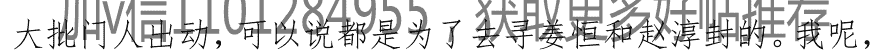

这时候，我觉得船身似乎晃动了一下，往外了一眼，发现附近的海骸开始朝后退，乌槽开始加速了。

愿思寒道：“各位不妨先歇息，吃些东西。”回头喷了一声，大约是让人准备食物和水。

经过那一番惊魂，大家都饿又饥，吃饱足之后，乌老大就赖着马老说话了。大胡子是个道士，都是中人，就想交流一番，结果被大胡子无视了，矮着头，根本没理会。

道士跟他应了几句：“乌师傅。”

我在一旁冷眼看，越看越觉得马老府极深。脸上看起来正直，其实不动声色，实在是个可怕的人物。说到聪明，姜狐狸可以说是是在他之上。但真正要心计，姜狐狸还比不上马老。

不是不是无意中发现了他，恐怕也跟所有人被蒙在鼓里，根本看不出他表面下怎样。

鲁精休息了口气，就拉着刘思要去甲板上去透气。大鼻头跟这自然落下，立即踢了我脚，带着我一起到甲板上。那面其他人都出来了，他也跟着来了。

这破船是一艘老式的帆船，除了船上雕刻咒文，并没有经过太大的改造。此时稍微鼓起朝前方去，偶尔遇到残骸挡路，稍调头，绕过去。趴在船上，一路就见到无数残骸，不动地停在海上。船上已经满了绿色的鬼魂，看上去绿森森。那些残骸的甲板还能看到白骨，大约都是以往死在这里的客。满的阴森鬼气。这时候才深深体会到，原来海上也是坟场的。


175

8898 楼

作者:匪夷 V 日期:2018-09-21 09:39

我看着这些墓般的残骸，有些出神，就听见鲁精道：“思姐，你说那个姓顾小子怎么样？”她跟刘思离我不远，也没刻意压低声音，所以听得颇清晰。

刘思道：“你说那个顾思寒？挺不错的，家教涵养都得没挑。”

[73]

鲁精：“除了这些呢？”

刘思想了想，道：“还就是长得挺好看的。”顿了一下，笑道，“怎么，你对他有兴趣？”

鲁精这时就去揉刘子的脸痒，打扰了一阵，道：“说正经的呢！我觉得啊，这家里是有背景，非富即贵。”

刘思点头道：“看着应该是有些头脑。”

鲁精：“这绝对富贵无疑，只是跟我们学校那些小开相比，这个人的精神明显还要很多。思姐，你觉不觉得这个人是经历过的？”

我听得心里一点。我知道顾思寒有个师父的，也跟着他师父父亲，没想到鲁精其他事情不行，倒是这看人的底细是不错的。

刘思似乎也是被她说引起，想了想，道：“你听这一说，我也感觉出来了。还有坐在他旁边那两个人，也是很不简单。”看了鲁精一眼，有些意外地道：“看看不，你这眼睛还挺厉害的。”

鲁精：“那当然后，别的不行，鉴定帅哥可是我的强项！我那些姐妹，带男朋友全靠我把关！”

两个女人正说得欢，那大鼻头在旁边撇了勾嘴，是很不屑地：“就这小白脸，中中不用，别说咱们哥了，我都比他强太多了！”

刘思微微微笑。


8927 楼 

作者:霍兜 日期:2018-09-21 12:09

鲁精根本理会大鼻头，指着船外道：“思姐，马老，你看那里，是不是像三个人？”

刘思和大鼻头顺着方向望去。大鼻头道：“真的是有点像人形！”

我转身了一眼，见绿色的海面上露出三个，被鬼魂团围着，眯着像人形。

这时候，我觉得船身似乎晃动了一下，往外了一眼，发现附近的海骸开始朝后退，乌槽开始加速了。

愿思寒道：“各位不妨先歇息，吃些东西。”回头喷了一声，大约是让人准备食物和水。

经过那一番惊魂，大家都饿又饥，吃饱足之后，乌老大就赖着马老说话了。

顾思寒笑道：“乌师傅，不知道有什么指教？”

顾思寒笑道：“只要马老方便，乌师傅就跟着请问。”

乌老大很是欢喜，紧盯地看着他一眼，道：“你是不是在想，我们的船为什么能在海妆场里进出？”

乌老大明显地嘟囔了一下，小心翼翼地道：“不知道马老能不能告知，我们这些跑海的最怕的就是撞上这海坟场。”

要是知道了这秘密，就实在太好了！

马老“呀”了一声，道：“告诉你也没有什么。”

乌老大立即喜望。

马老沉吟了一阵，说道：“这海坟场里最麻烦的就是这些无边无际的鬼杂，黏力极强，一旦有东西进来，就被它们缠着再也无法弹掉。”

乌老大听得连连点头：“这些年来，也不知道有多少人死在里了！”

乌老：“想要出海坟场，关键就是铁力木？”

“对，就是铁力木。当年我跟一群兄弟被困海坟场，最只有我一个人丢了一条索臂，逃出了生天。究竟其原因，就是当时机缘掉在了，我正巧掉了一块铁力木上，因此才侥幸从这海中逃了出来。”

乌老瞪大了眼睛，激动地：“原来铁力木能克制那鬼怪！原来如此！”

愿思寒：“我们因为有一件要事，走南洋这条路，生怕小心（此处原文为生怕小心）会陷入海坟场，所以就花了很大的力终于请到了马老，最终改装出这一艘乌鸟船。”

乌老一拍手道：“乌槽向来都是最好的铁力木打造，怪不得，怪不得！！”

姓凉的问道：“各位救命之恩，某某无以为为报。不知诸位出海是为了什么样的要事，看我们能不能帮上些忙。”

乌老道：“对对对，大家都是过命的兄弟，有什么事尽管管！”

顾思寒感谢两人，犹豫了一下，道：“实不相常，我们是出来寻人的。”

我心里地一跳，很是有些意外。孝山，清微这次派了加信，大伙儿出来都是为了接应和寻人的。一半是被逼无奈，一半是为了借机寻找。怎么现在又出来一批寻人的？

我见姓凉的神情微，大约也想到了另一块，道：“不知道是亲友还是长辈？”

如果顾思寒小子没有谎话，那他长辈已经是多年没有讯了，说明不是才失踪。


不仅我难以脱身，就连顾家都不定被我连累。顾思寒他们看上去似乎背景简单，但是跟蕴深厚的茅派比起来，那就不算什么了。

再说了，我是要把画皮的秘密暴露出去，不是茅派，害怕什么清微、天师、神雷等等宗派都会出，把我这歪门邪道追杀，到时候可能还会牵到二婆婆。

我想去，还是决定先静观其变，择机而动，再怎么也得找个隐秘的时机，神不知鬼不自己才能脱了这身狼皮。我站在最后，冷眼旁观，见乌老大欲言又止，似乎有什么话想问，又十分迟疑。不仅有些奇异，这矮胖子平日里派头还是大的，这回不知道的，倒是变得一点都不爽快。

顾思寒这小子倒是会察言色，笑道：“乌师傅，不知道有什么指教？”

那乌老大被他一碰开，顿时哈哈一笑，摸了摸脑袋，道：“就是有个问题想跟马老大讨教，不知道那个……方方便？”

顾思寒笑道：“只要马老方便，乌师傅就跟着请问。”

乌老大很是欢喜，紧盯地看着他一眼，道：“你是不是在想，我们的船为什么能在海妆场里进出？”

乌老大明显地嘟囔了一下，小心翼翼地道：“不知道马老能不能告知，我们这些跑海的最怕的就是撞上这海坟场。”

撞到的又是铁力木，竟然像蛇一样翻滚。大斧还有另一船计，立刻拿脚去踩，踩得甲板上一片绿油。鬼撞脱下来，三人就露了出来，衣服破不堪，身上却是斑斑点的血痕，都是被鬼给咬出来的。我起初是匆匆地了一眼，没顾，当时就觉得有点眼熟。再睁一遍，心里一一跳，差点就没忍住叫出来。

左手拽绳子，脚下轻轻蹭，已经扯着绳子快了上来。干净利落，毫不拖泥。大鼻头顿时第一个叫起来，又是拍掌又是喝彩。鲁只是淡淡地说了一句：“啧。”这人真是死性子，跟谁都是一副欠债的样子。见面落地，马龙就一声令下，几个伙计同时拉动绳子，把后面鬼的三人拉上来。

“拿铁木！”马老又一声令下，就见人们从船内端了十几盆灰腻的水。听这名字，大概是用铁木熬煮的。

“泼！”随着马龙一声令下，铁力水被泼到了三人身上。撞遇到铁力水，顿时飞快地散了下来，落到甲板。斧还有另一船计，立刻拿脚去踩，踩得甲板上一片绿油。鬼撞脱下来，三人就露了出来，衣服破不堪，身上却是斑斑点的血痕，都是被鬼给咬出来的。我起初是匆匆地了一眼，没顾，当时就觉得有点眼熟。再睁一遍，心里一一跳，差点就没忍住叫出来。

三人中，其中最眼的是一个大光，身材魁梧，体格健壮，就算是蓝腰那里，也比乌老大那矮胖子要高上几分。尤其是被鬼噬附，脸上全是斑斑痕，看着极其狞，凶神恶煞，简直跟恶鬼无二。他妈的，这秃子不就是吴会姓顾的手下，那个叫大山的死秃头？

再往旁边看一看，靠，一张阴阳脸，姓顾的手底下那个叫白峰的。妈的，白文崇的儿子，当初还想跟姓顾争房产来着！一见到这两人，我心里别起乱乱，生出一股极其不祥的预感。再往第三人一看，然而，他妈妈那是姓顾的！每次遇上这些人准没好事！早知道是他们，我就不喊那一声“有人了”了，让他们死了算了！我正打算琢磨着，就看到原本是很从容的顾思寒冲到那姓顾跟前，仔细地打量了一眼，就才叫起来：“快，一定要救救活他们！”我吃了一愣，想难道这两人认识？随即想到，这两人好死不死的，刚好都是姓顾。马老过去探了探三人的脉，立即叫人拿了三碗热米汤过来，给三人灌了进去。我在旁边盯了半天，就看到那姓顾的眼皮微微抖了一下。倒是那阴阳脸和光头大汉还是没有什么反应。又过了几息时间，那茹顾的终于睁开了眼，先是看着站在他前的顾愿凉。不过似乎没什么反应，立即转身去看他两个下手，伸出手在两人脖子上探了探探，这才像是松了口气。接着是打量了一番，看了看环境，朝身前的马老笑了，道：“多谢各位救命。”呼吸声微弱，但那股子气是不减。马老揉了揉手，道：“无妨。”顿了一下，打量他们三人，道：“你们究竟留在这里多久了？”马老把话说了，顾听完，居然他们已经过去半多月。船上其他的船员早就死了在这片海里，只剩他们三人苟延喘。

远远醒来后颇顺久，那阳脸和大光头从昏迷中苏过来。顾思寒自安的安排了二人吃饭和休息，安排得妥妥当当。那虽然脸上身上累累，却没事人一样，换了一身衣服就在船上溜达起来。跟顾思寒这伙儿说几句话，倒是跟马老、老大等人相甚喜。至于茅山那边，顾只是看了一眼，就没再理会。赵梁的原本还要去碰个儿，被姜狐狸拉住了，道：“你没告诉人家答应不？我们要去敲钉子。”姜狐狸笑着：“你还羡慕我们呢，我们总不能失效呢。”姜狐狸道：“这人明明是故意不搭我们，你去了也是白白的。”赵梁的“哦”了一声，似乎有些疑惑，但还是去了，结果如姜狐狸所料，砸了个钉子回来了。大鼻头愁道：“这底究竟哪根梗，这么嚣张！”鲁精气道：“这人真是狠心肺肺，不是我们救他，他们三个早死了！”赵梁把二人给止了，道：“说的什么胡话？别人不理我们是别的事，你们在背后非议什么？”姜狐狸则是看了陆顾的一眼，微微眯起她那双狐狸眼，不知在想什么。大洋半年年后，船就从这片埋葬了无数船只还人命的海域中扬了出来，前方又看到了蔚蓝色的海水。


可见一个魁硕的巨汉出现在甲板上，手里正拉着外套。

我原来是被这人给套了套，在空中强制调整一下位，双腿一抬，就着落势，那哥汉硕大的脑袋就踹了过去。

这一下真的给踹着了，只是双腿一踹到那脸，登时就像踢着了一块铁板，只觉得双腿发麻，那哥汉却是丝丝不动。从空中中跌落下来，顿时时噔一声栽在甲板上。

那哥汉站在那里，也没看我一眼，我双腿一屈，从地上爬起，正准备逃离后听传来一个熟悉又让我毛骨悚然的声音。

“徒弟，摔疼不疼啊？”

从矮楼里出来，当一人穿着一身大红袍，头戴大尖帽，大袖飘飘，小白如炬，长得异常俊美。他的妈妈，竟然是那个焚香会那个大公鸡，叫什么于谦的，是焚香会的阴阳童子！

他身边那个俊瘦背着的老头，不是当天丢下我逃走的老子又是谁？

我一时间都有些神，有那么一瞬间，我甚至以为是自己脑袋撞到甲板，出现了幻觉。我就靠了，他妈的这两个人是怎么等到一起的？

那老哑子笑眯眯看着我，上来来把我扶起，替我把绳子解开，又拍了拍我身上的尘土，亲昵地道：“师弟，可是委屈你了。”

我看着他的笑容，不由得心底发寒。这老哑子来喜怒不形于色，他现在笑得欢，说不定心里在想什么毒计。

这时候，只听对面船上马老大叫了一声：“你们是什么人？”这老头虽然年纪已，却一了一瞬，不是南海洋路的传奇人物，依旧威风赫赫。

那大鸭两手抓在大柚之中，眯着眼睛看着对面船上一层，却根本没有理会那马老。这个人来皱得像只公鸭，加得他也没什么反应。

当年他们遭遇的现在看来，是被姓顾的他们给救了回去，捡回一条命。

“哟，顾长老也在，真是太巧了！”这人看到了人群中的顾天涯，大约是因为当天被姓顾的他们所救，因此对他倒不敢太傲慢。

那姓顾的呵呵呵呵一笑，道：“于尊使您也来了？实在是有有些意外的。”

大鸭笑道：“这不是顾长老你们出海多日，音讯全无，我们这才急着出来寻找。如今见到长老无恙，实在是不胜之喜了！”

我听着他们俩装模作样，说着无关痛痒的废话，心里却是别别乱跳。他妈妈这事的格局变化也太快了，我之前琢磨好的一些计划就统统缴做了。装作实在太意外了，愣了一下，立即欢喜道：“师父，你怎么来了？”

那老诡嘿嘿地笑了几句，道：“当然是使徒过来了。”

我心里暗暗，他妈妈的这些老东西真是信口开开，相信他的话早就是鬼了！念一转，趴在船舱对面一指：“茅山派群人就在船上！”

早要他们算算！这时候两船都放慢了速度，仍在并驾齐，从我这边看下去，看到她赵姓的正看着我，不由得心里的一一窜。那大鼻头在下面憋腾，只是他们船上在嘈嘈，听不清这人在叽叫似的些什么，估计也是些骗人的话。

“师父，麻大昭那些人还在对面船上！”

老诡子“嗯”了一声，道：“不急，他们中了化虫咒，他们也不出什么东西。

我心里一动，就说：“他们这帮人倒是会犯很多奇怪的术，不知道会不会有什么什么什么有什么对付化虫的办法？”

老老爷咬了一声，转头盯了我一眼，道：“怎么，徒儿对化尸虫感兴趣？”

我心里咯噔一下，知道自己才太心急，有些失言，强自镇道：“徒是怕对面有什么邪法。”

老老爷看着眼睛，阴笑了几声，道：“为师的现在对麻大招他们可是特别感兴趣，反正问也不出出什么。”

我心里的一下，只觉得这老东西的语气有些怪异，心中一寒，就听他笑着说着：“为师是很好奇，徒儿是怎么活下来的？”


我心中别别乱乱，只觉得事情似乎越来越复杂了。睁了睁四四周，压低声音道：“师父，你说这节骨眼上，阴阳阁摘出这两个东西是什么意思？还故意附上了一张海图，这样不是让人以为，这什么阴阳阁就在这海图标注的地方？”

老蛇子道：“阴阳阁传许多世纪，虽然一向神神秘叨，每次都是之有物，从无虚言，不由让人不重视。”

我还是不信：“徒弟总觉得这阴阳阁不太靠谱，鬼鬼祟祟的，不知道有什么意图？”

老蛇子咬了咬牙，道：“这阴阳阁背景极深，究竟什么来从没有人知道。不过他们有一个老规矩，就是从不干涉世事。但凡是要出手，也是通过严格的方式让别人去做。”

我想想，那她的这帮人掺和干了什么？本来就已经乱了，这阴阳阁的赏文一发，怕是事情就更乱了。

我就觉得事情很是有些不对。毫无突然之间，好像一切事情都跟我当年卖出去的一个罐子挂上钩了？这件事情发生得突然，似乎是一夜之间就爆发出来一般。我看着船外的夜色，突然钟后发凉。那幽暗之中，似乎有一双手正操控着这一切。

而尤为奇怪的是，向来深居简出的青子，居然在这节骨眼上出了海。

这只银簪，本来就是青子的随身之物。她当年从腕上摘下，毫不不在意地丢了我。要说青子不知道这簪子的来历，那几乎是不可能的。这死女人，出南疆古墓出来后，对什么事情都爱不理的，除了闲暇时间逛逛街看书，有时教训我，基本对其他事情都漠不关心。

要她是为了拿回这镯子老远跑来海外，我是绝对不信的。

那海外究竟有什么东西，能把青子都给吸引了过来？这才是我百不得其解的地方。还有这阴阳阁，为什么突然又提了古墓的事？

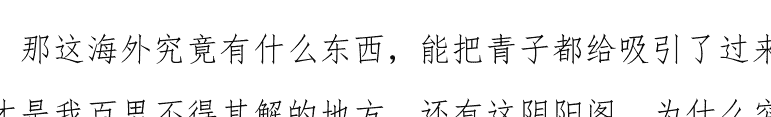

有些事，只听老蛇子道：“阴阳阁传这些东西，怕有一大批人要被引过来。嘿嘿，还好，越乱越好，咱们师徒们正好游水摸鱼。”

“就算这海图在手，怕也没几个人能到这里吧？”我是亲身经历过的，且不说别的，只要不知道铁木术的秘密，光那海坟场就可以让追来的这些人全军没。就连那姓顾的，不是正巧我们路过，恐怕也得葬身其间。

老蛇子黑地笑了了一声，却没有说话，神情莫测。我也没继续下去，暗自心中盘算。

话间，只觉得一把拉子拉起了速度，逐渐与对面那艘船分开，乘风破浪，朝前快速掠去。往后看了一眼，顾思寒那船也是不肯落后，快速追了上来。

此时已经一片漆黑，海面上起了大风，船起风势，朝前破浪前行。

那大公鸡哈哈的几声，我们这这边走了过来，大笑道：“痛快，痛快！”过来一拍老老爷子的肩膀，笑道，“老孙啊，你可有功！咱们才能顺利过了那什么鬼海！看到顾愿那些人吃惊的样子，真是爽快！”

我心里一动，这老老爷子居然知道铁力的秘密，这实在在我眼里意想不到。他看着他们竟然这么灵活地骑着马跳出来。

那大公鸡又是一拍我的肩膀，笑道：“所谓明师高徒，师父这么高明了，徒弟肯定不会错！”这人几年不见，那一身的粉尘味道是半点都不见灭，浑得很。笑声尖尖又实，实在刺耳。

“以后咱们就是一家人了，有福同享，有难同当！呵呵呵呵！”大公鸡舞着袖子，是很兴奋的。

我看了一眼老爷子，想难道他已经被这大公鸡拉进了樊壶香？

正琢磨着，大公鸡已经把老爷子拉进了船，大约是喝酒去了。之前用绳索套住了我的巨汉，一声不吐地守在舱口，像铁塔似的纹丝不动。他妈的，我之前以为姓顾的手底下那大甲头已经够高大了，没想到这里还有一个更巨大的，简直跟头牛似的！


我独自在甲板上坐了，起身向后望，漆黑的海面上，顾家的旧船荡着风帆，紧紧跟随。我心里咯噔了一下，觉得哪里是不妙。转头看着前方那片黑漆漆的岛屿，忍不住向一个船伙问情况。眼前突然一亮，恍惚了一下，看到那片原本黑黑的一团的海岛突然亮了灯火。从船上看，一片光亮。

我趴到船舱向前望去，此时天色尚早，光线充足，幽蓝的海面上出现了一抹黑影。船起风帆，朝着黑影驶去。看起来是很远，要抵达那里，却费了好一段时间。等我们能看清一片狭长岛的时候，天色已经暗了，已近黄昏。

大鸭和老蛇子站在船楼上，向前远眺。大鸭挥着袖子指指点点，似乎很兴奋。船伙们欢号一声，前进，要赶在天黑之前抵达那片海域。

我向后望去，顾家的船也在我们远处，但此时他们的船明显地放慢了速度，似乎突然了下来。船伙们立刻大叫：“靠锚！停船！”一阵紧张张罗，船慢慢地停了下来，但在过程中却是滑行了几里。那片灯火闪烁的岛屿靠越来越近了。

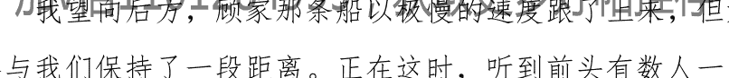

望向后方，顾家的船似乎极其剧烈的摇晃着，开始与我们保持了距离。正在这时，听到前方有人一起大叫：“快看，海面上有些东西！”

我上前几步，朝前方海望去，只见幽幽的海面上，漂浮着一排尸体。

从这的角度看过去，并不能一眼看清那些尸体的具体模样。似乎有六七个人，密密地挤在了一起，在海上载沉载浮，风浪虽急，这些尸体却并不分散。

我往前人群挤了几步，就听到有人在喊：“快看，那还有这里！”

“还有这边！这边啊，你们快好，好多啊！”叫唤声不断响起，声音充满了惊慌。我趴到船舱朝前面一片海域望去，果然看到了更多簇，大约都是数户聚在一起，瞧着他们的外观，男女老幼都有。每个簇相隔了大约十米到上百米不等。

我瞪了一眼船楼，大公鸡和老鸭子在正方向展望。大公鸡眉头紧皱，正跟老鸭子说着什么。那老蛇子却是脸色阴暗，眯着眼。

我往后看了眼，只见顾家的船在一步步靠近，可见一群人在站在船头，似乎已经发现了我们这边的状况。加码的海面上，房屋密密麻麻，热闹热闹，挤得这些尸体像是一个东西。还没来得及细想，就听老蛇子在甲板上叫：“徒儿，来来看。”

我回答了一声，进了船舱，走到老蛇子身边。这里就更加开阔，就看到守在甲板上的数名夯汉进入船舱，接着就看到点灯从船头放起，原本暗的海面照亮了起来。

老蛇子道：“徒儿，你跟那个时候学过阵法应该有些见识。”我听他提到，心里顿时一动，放眼看去，只见这些簇在海面上，看似杂乱无章，其实分布错落有致。前方近处的几个簇一长一短，正好形成了一个先天的“坎”位的形状。下面的船调度，绕着岛行驶。随着船缓慢进行，就看到更多的簇浮。原本看似无序在海面的簇，其实是围着岛组成了一个先天八卦图。”

大公鸡黑着脸：“老爷，你有没有见过东西？不知道哪来的这么多。”老蛇子哑了一声：“还是见过。”这些尸体的穿着和模样，有老有少，有男有女，似乎都是普通的百姓，在水中泡得发白，但并没有腐烂。我仔细看了眼，猛地心里凉，突然想到了青子坐的那条船。当时那条船在海上乱流，被他拖回了港口。但是船上的很多人消失得无影踪！

我头皮一阵麻，回头了一眼后方，只见顾家那条船还在一直跟着。我们绕着岛转圈，他们也跟着。大公鸡：“老孙，怎么样，咱们趁着天黑赶紧溜？”老蛇子皱起眉头，死盯着那片火光天的岛屿，半天没有话了，过了好一会儿，才道：“咱们等等。”大公鸡疑惑：“还要等什么？”老蛇子阴着脸，一直盯着那片岛，道：“我来过这里。这地方跟以前不一样了。”

原本以为这片岛就是荒凉的海域秘密，没想到他居然经过这片海域。这就怪他能带着大公鸡他们如此抵达这里了。从阴阳阁发布的那份地图看，这片岛就是海图中画了。这幽暗的海域，还有灯火闪闪的海岛，总让我心中种不详的预感。我们这些人，或许是因为这个，或者是因为那个，结果却一头雾水地撞了进来，很多事情显得有些荒谬。大公鸡有些意外道：“老孙，这鬼地方你什么时候来过的？那事情就好了，咱们赶紧溜！”

老蛇子脸色阴沉，像是天际布满了乌云，沉声道：“那是二十多年前，我跟那个人来的。”大公鸡大概听得有些疏涂：“那个人是谁？”不过随口一问，也没深究。我见了老蛇子的神情，大概还能猜出他口中的那人，应该是已经被他炼成活符的师父。

“那结果怎样？”老蛇子沉默了一阵，哑了一声：“之前这里什么都没有，只有那片岛。不过我们在岛外留了许久，最终还是没敢进去。”我心里一动，原来那个山神术的炼术士也来过这里，竟然这片岛上藏着什么隐秘，居然吸引了这么多人遥洋而来？这就功夫，突然就听到右侧浪涛声响，只见一条横船加快速度行驶到了我们右方，是顾思寒他们上了。大公鸡和老蛇子同时看向船。此时，顾家的船离得我们颇近，已经可以看到站在甲板上站着的众人。过了一阵，就见几道火光从对面的船头落下，漂在水面上。仔细一看，发现是几个簇，里头燃烧着一团火焰。老蛇子看了眼，淡淡道：“这笔记中也学过名为‘引路灯’的法，其中的引路符在海面上依次排列，形成北斗七星的布局，朝着海域方向去。”顾家的船慢慢动了起来，紧紧跟随。等他们进去后，一路倒是遇着什么险，只是船上的气氛极为压抑，所有人都胆怯。我走到甲板，仔细看了从船边过的簇，原来都是被抓取的。我们的船在岸边停泊，这时候就可以为清楚这岛屿的原貌。这片岛上的植物颇诡异，不是寻常的那种绿色，而在绿色中透着一丝血色。刚踏上陆地，就发觉空气中透着一股熟悉又奇异的味道。我打量了四周，蹲捡了一根树枝，顺着泥土挖下去。不一会儿，上层的泥被扒开，露出了猩红的土块，其色如血。整个岛上埋藏的全是朱砂。我很想问他是怎么知道的，后来转念想，大约是他师父告诉他的。我们刚才乘船绕岛一周，确实发现整个岛的形状还像一只龟。这座居然全部由朱砂土堆积而成，怎么会让人心惊肉跳。愿思寒那边的人远远地朝我们这边了一眼，开始内发。我观察了一阵，发现他们留了一部分人在船上。老大他们几个箱子并没有停下来，而是留在了船上。我琢磨着是不是该采取把他们偷过来，正寻思问，老蛇子已经在船头叫我，让我赶紧跟上。这边同样留人在船上，那艘巨舟在最开头，大鸭号跟着进。我跟在后面，夹在一群焚香会众中间。这岛其实是个小型的山峦，山路险，往里头再进几步，就看到火光亮。原来在山道间，沿途摆着无数蜡烛，火光冲天而起。巨型蜡烛，就有几个粉红的，看起来像是一具人形，只是被制成了蜡烛，头顶捏着一根火线，烧的是灯油。那种怪恐怖的气味，熏得很多人立即就吐了出来。

愿思寒那一队人马在我们不同的地点出发，但走到途中，最终是交汇到一起。茅山一群见到我和老蛇子，登时仇人见面，分外眼红，当时就要动手了。愿思寒在面前挡了挡，说道：“我这个做哑哨的本该多嘴，只是大家不远千里来到这里，都是有自己的要办，不如暂时先放下怨怒，以和为贵。”那姚顾站在他身后，懒懒道：“这小子觉得道理的。”说实话，我真看不出姚顾跟顾思寒有什么关系。从脾性上来说，这人跟顾思寒一家简直没半相似。茅山一群怎么说也是……”

么？他当天的是为了寻一个很多年前下落不明的长辈，也不知道是真是假。

正琢磨着，突然背后一凉，一阵毛骨悚然，来不及细想，猛地低头向前倒倒。刚一下，就觉得有什么东西撑着我的头皮掠过。

我还在地上，就听到连串声惨叫响起，有几个焚香会的门人脖颈青血横流，不知被什么东西撕下了一大块皮肉。有一个运气差的，脖子直接被咬出一个大口子，鲜血喷着倒地。

“小心！有东西！”两人中分别响起数声警告。

到了这里，蚂蚁的数量减少了很多，林间很多地方都是如光线一般的阴暗。我屏住呼吸，心脏狂跳着，一些低沉诡异的呼吸声从那些茂密的林中传来。

这种诡异的气压压得人发慌，终于有人忍不住崩溃，大叫了了出来。就在这时，我看到道黑影掠过，速度极快，嗖的一下就到了几个人的身后。其中一道黑影正好挂到了我附近一个船伙似的的背后，我当抓起早已捡在手里的石头就拍了过去。

那东西机敏得紧，居然只拍中了那东西的肩头，发出“嗤”的一。


的一声尖叫，就彻底在路林中不见。那个被他抓的船计，腰间血肉横模糊，搓着脖子大声嘶叫。

“他妈的，是海猴子！”纷乱中，只听到马老的声音大了一声。这独臂老人站在人群中发号令，还是威风凛凛，“大家背靠背，聚到一起！别躲单了，让这些畜生有机可怜！”

我看了一眼，他被戏王的那个干瘦老头和大胡子道士护卫着，倒是临危不乱，颇为镇。苍山那边，刘宇和鲁鲁将精挑细选，大鼻头双双手持数道黄符，但是那些鬼崽的速度极快，几人的打法根本施不开展。

却是那姓姜的，只是站在那里，身边鞍着两团黑乎乎的东西，竟然有两只黑猴子被他抓在了手里。想起他的家伙在地上，我被抓得手脚乱想。

来人的气势也是极大，很是厉害的。至于那姓顾的，这人站着根本就没动，光他两个手下就已经斩杀了那两三只海猴子。

再看我们这边，却并不失色，这主要就要得归于大功。

这个人被他手底下四个红袍阴阳童子护在中间，其中一个红袍人黑影不时飞出。每飞出一次，就有一海猴子栽倒在地，一颗脑壳露出粉艳艳的骨质，所有的血肉都在瞬间消失不见了。

这个人用的刚锋之首，专门伏人首级，速度之快，就连海猴子也逃不过。一些船夫计划原本围在他们周围，这时一看，比见到了鬼还吓人，立即就躲了一个干二净。

这一番下来，倒是是给了那群鬼东西一番震撼，没有再继续进死。这一番折腾下，又是损失了好几，还有几人负了重伤，稍加以包后，就继续往前前进。在这种地方，独自退回去是不可能的，要是落了单，只有死路一条。

我跟着众人上前，看了一眼死掉的海猴子，通体乌黑，皮毛光滑，除了个头体型相似，跟一般的猴子不像。这玩意儿其实也是凶恶实在，要不是我们这伙人有比它还要可怕的家伙，它抓进来怕会被那群生吃干净了。

再往前行一阵，就看到那头部队突然停了下来。那个在最后的乌头老大，冲我们后头做了一个“嘘”的动作，瞧他的神情，很是惊怕，简直就要哭了。

我们在后头等了一会儿，不见动静，一行就走上前去，所有人都屏息气息，尽量不发出一点动静。

前头人群自发地开了些，我靠近去一看，前头出现一个颇大的山谷，中间是个乱石堆，一眼看过去，重重叠叠，也不知道有多少乱石。

在乱石的外面，却是黑压压地围着一大东西，整个谷地到处到处都是。我听到旁边的人全都抽了一口冷气，脸色在瞬间变得苍白，有些人甚至开始打哆嗦。

我也是头皮发麻，只觉得鸡皮疼从手臂一直脚到肩膀。这块地里属于趴满了猴子，黑漆漆的一片，正睁着头，盯着着乱石堆。

这块地里属于趴满了猴子，黑漆漆的一片，正睁着头。这么多海猴子要涌而上，我们这一边就算有三头六也得彻底碎。他妈的，这究竟是个鬼地方，果然邪门！领头几个人做了个手势，就要让众人稍往退。但这木棍还是推了，结果猴子就从上头掉，发出啪啦一声。这一声顿时惊动了面的群，齐刷刷转了过来。密密麻麻的猴子，那种齐齐转头的样子，简直犹如噩梦，队伍中有人忍不住尖了出来。受到了刺激，立刻朝着我们涌上来。我背后的冷汗出来了，这个时候真的是逃都没用。我们行人就算跑得再快，在这道里也不可能跑得过这些猴子！

“不要跑，所有人围在一起，快点！”马老高声道。他虽然白发苍，但当年威势犹在。被他一喝，原本混乱的队伍又平稳下来，准备聚火。

这时，一道低沉的闹声从内深处传了出来，悠扬地掠过。那声并不响，而是夹杂着一种类似呻吟的声音，透着一丝诡异的气息。那声过后，原本要涌来的猴子突然一顿，脑袋歪了偏，就朝下散了。也不过片刻，就散了个干净。

虽然疑惑，但是机会，我们一行赶下了。虽然他们没有精力，却听从他们脑后的方向朝而去。我在最后面才觉得道内鬼森森，看着眼前的群人，不是带着目的而来的。我却几乎一步被迫到了这里，不知道为何而来，也不知道为何而去。他妈的，得要找机会把老大他们给了，实在没办法，只能祈祷天老爷保佑，能找到路。说不定她已经回家了，我就信她也没有办法。

我正打着趁人不备悄悄折的主意，就见前面的人群突然停了下去。就听老驼子在前头叫，我只得答应一声，硬着皮过去。过去一看，就见全部都在乱石前停了下来。茅山那群人在最前面，见我过来，大鼻头顿时冲我瞪了一眼。鲁老拉着刘子的手，冲我看了一眼，就别过了头。我没搭他们，走到老驼子面前。

“徒弟，人家说前面的石堆有问题，你怎么看？”我心里重，也不知道这是什么意思。这地方这么多内行家，石堆有没有问题还能轮得到我信。被他闹到，也只能硬着皮看一眼对面的石堆，说道：“是摆拦的，说不定里头藏着什么野兽，我们应该小心。”我这话音刚落，就听到茅山这边那边大鼻头嗤的一声笑了出来。老驼子看了我一眼，不可。刚才我在后头仔细观察了，前头的乱石确实有问题，应该是被人动了手脚，稍改了布局，在里头摆了个阵法。要是贸然进去，说不定还真得道。不过眼前能干的人这么多，这种事情有几个会瞧出来。这老东西偏偏故意来问我，也不知道什么心。

这时候，就听那姓梁的声音从侧面传来：“陈青，你进去探探路。”那面魔男应一声，在外面观察了一阵，就举步朝里走去。我正要退到一边旁观，就听老蛇子淡淡地说了一句：“徒儿，你也进去给为师探路。”我心里不由得哑了一，不知道这老东西什么神经，只硬着皮应了一声，跟着那面魔男进去。反正我也不管三二十一，他往哪里走，我就跟着往哪里走，只听到身后传来那大鼻头的一阵笑声。这面魔男虽然确实不招人喜欢，不过有个好处，就是不像我一样，阵法多，只要肯下功夫就能破解。我跟着他走，倒是耳根清净。那面魔男十分谨慎，每到一个分叉的地方就停下仔细观察，走了一阵之后，我就发现乱石堆确实简单。不由得也打起精神，跟着转了转，就觉得里面几处布局，像是跟某个……茅山记载的阵法有些相似。再往下走了一阵，我就越发肯定，这里布置的确是茅山的阵法，不是一个或者两个，而是几种阵法叠加。而且各个阵法之间完全融合了一体。虽然不知道布置的人是谁，但我能肯定这人是个高手。那些猴子之所以围着石堆走来走不去，恐怕就是阵法堵在了外面。最初的时候，面魔男走得还是快，越往里走得越来越慢，每一步都要延半天。在他后面，只见他额头上渗出一颗汗，青筋暴跳，显然极为紧张。我计算之后，就不继续算了。前面的面魔男突然停住脚步，没注意，差点撞了上去。“喂，你怎么不走了？”我问了一句，仔细瞧，只见他脸色白，额头上冷汗涔涔，顺着脸颊落在地上。我立刻明白他走不下了，勉强能这一步，再走下去，他就没有半分把握了。实在不行，就按照记忆的路线返回。面魔男突然一动，我立即抓住他的胳膊，一把将他拉回。“你干什么？”面魔男皱着脸大吼了一声，双目中布满了血丝。我立即骂道：“他妈的你找死啊？不要找死带上老子！”面魔男这一步明显毫无把握，这一步进去，真是自寻死路！面魔男狠狠地盯着我，额头上青筋暴跳。我毫不示弱地瞪着他，连冷。这个人比大鼻头鲁莽，明显自控力要许多。吼之后，逐渐恢复了冷静。我冷笑了了一声，就要转身。刚走一步，就听一个声音传来：“进二，进三，进一，停十息，退三，进五。”这声音显得极其突兀，而且声音清脆，奶声奶气，似乎来自一个五六岁的女童。我抬头扫了几眼，不过也是徒劳。声音被我听到，说明她现在是在说话。我正疑惑，就见她已经在地面挣动，朝着左侧连着迈出了两步。我一看，也跟着。左进二之后，右移进三，果然就了一个绊口。跟着这路数着走远，那女童的声音又响起来。我们依照着前进，经过大概五六次后，我们就从两块靠在一起的大石中钻了出来。眼前豁一瞬，就睁看着几块大石，上头坐着一个五六岁的小女孩，扎着一对羊角，穿着粉色短裙，大大的脸上七八糟满了尘灰。在她身边，躺着一个黑衣老人，一头到肩膀的白头发乱地散着，生死不知。原本冷淡的脸看到我的眼睛时，就脸色变了，直接奔过去，踏着乱石就扑了上去。这人的身手还是不错。我跟着爬了上去，就见他膝盖倒在那个老头面前，眼睛通红，整个人都不发抖。我说了一句：“紧张什么，这人没死。”我心里一转，突然就出了念头，大概就能猜到人是谁了。


按照此小鬼说，当日她跟父母坐着轮椅出海，她在窗口朝向外头看，就看到海里有什么东西西漂过来。她就大喊让她妈妈，妈妈来看。这一看，她爸爸就去叫了船长，然后有人跳了海，把漂落的这个东西捞起来。

小鬼说，捞起来的这个东西，就是那个爷爷。这爷爷睁醒，一会醒的，好像得了重病。

我见众人听得都是面面相觑，那鸟老大忍不住问道：“后来呢？”

小鬼说，后来又开了很久，后来遇到了大暴雨，起了好大大好大的，船不知道开到了哪里。后她正跟爸爸妈妈在吃饭的时候，突然听到很多人在叫大叫。她好奇听出来，结果被妈妈捂住眼睛，毫不让她看。

有很多人跟着问道：“后来怎么样？”

那小鬼说：“我妈妈一直看着我的眼睛，我什么也看不见。我就听到很多人在叫，还有人在人在哭。嗯……有人在叫啦，好多呀！”

那鼻头忍不住问道：“什么蛇？”

小鬼想了想，说：“我也不知道什么，有人在喊，好多多呀，海里好多呀。”

那鼻头老还想再问，被妈妈打断道：“让姑娘自己。”

小鬼转了转溜溜的眼睛，说：“后来还有人人在喊，有菩萨，菩萨来了！我当时就问妈妈，什么菩萨来了。”


我妈妈没回答我，我觉得她好像一直在抖。”

我听得心里一紧，只觉得这小鬼虽然声音清脆，听起来奶声奶气，但这话里的意思接近八分鬼气。

我们个船伙计顿时就插道：“小丫头，你胡说八道什么，这海上哪有什么害萨？”

徐若梅鬼溜溜的眼睛，盯着着那人看了一阵，说：“才胡说八道呢，你怎么知道没萨？”

我揉了摸脑袋的手，道：“别理他，你说你自己的。”
那小鬼拍开门的手，道：“都叫别动我头发了！”露出一丝狡计。

“后来……后来我就听到很多人人在大闹，然后好像很很吵的。我妈妈抱着我一直，不知道怎么就跑了一段，把我掉了出去。”

“我看到海头有什么东西在晃，嗯……然后……然后有个女人站在那里。”

她说到女人，我心里就是一紧，马上想到了青子，正想得更清楚楚，刚才小说说鬼说八道的那个船伙计又插嘴道：“站在哪里？不会是站在海上吧？”说着就大笑起来。

周围的一些人也受他的影响，顿时的一声笑起来。

那小鬼一双溜溜的眼睛斜了对方一眼，又转了回来，气鼓鼓的，就不说了。

“喂，你们不能少点废话，吓着孩子？”当就有熟悉的声音响起来，我不用看，是徐若梅那小鬼，似乎平静地把那个船伙计教训了一通。

那小鬼一双溜溜的眼睛看了她一眼，这才偏了嘴：“我也说不，就是……长得像庙里的菩萨。”

这话一说出来，就更加没脑了，我都有些糊涂了。我本来以为她说青子，但青子那女人可不会长像庙里的菩萨！

“哼，那是咱们南洋菩萨显灵！”那几个船伙计忍不住笑起来，连带着老老大底下几个船也跟着笑了起来。这帮人都是在海上生活的，对这种事情是最敏感的。我怕这小鬼又生气，就伸手准备去揉她脑袋，让她继续往下。我刚伸出，那小鬼用两只胖白的小手抓住了脑袋，气道：“说了不许弄我头发！”我不由哑然失，也不知道是因为什么，见到这小鬼扁着嘴的样子，就忍不住要去揉一下，紧忙说：“我不弄，你说。”小鬼瞪了我一眼，说：“后来我就捂住眼睛啦，什么都看不不到。”

小鬼摇头，说：“不是。”指了指手指那边，说：“那个老爷爷，他一直看着我的眼睛，让我别哭。后……后来我就不知道啦，那老爷爷说我是睡了。然后……然后我们就到了这个岛上，我问问老爷爷他爸爸妈妈呢，老爷爷没说。可怜的，他们是被菩萨带走了。”

这小女童虽然有些小鬼，但毕竟年纪尚小，有些事说得不清楚的，听得人一头雾水。不过从她的话中，能猜出几分，应该是当时轮出了巨大的变故，整船上的人都遇了难。当时这姜恒受重伤，正好在船上，当时就把这小鬼救了出来，然后还遇到了这朱砂岛。可是这小鬼说的“海里有东西在滚”，还有那个漂在海上的萨萨，又是个什么鬼蛋儿呢。鲁鲁精不住插嘴间：“小妹，你那个老爷爷是姐姐的外公。后来你们又遇到什么事了？”徐若梅小鬼看了鲁鲁精一眼，“啧”了一声，说：“那老爷爷他没事。”这小鬼话怂娇气气的，倒是很有趣。鲁鲁精笑道：“他没事，只是太累了，要休息。小妹妹，不要到这儿？”鲁鲁精大约有些尴尬，笑着说：“你们后发生什么事啦？”小鬼说：“后来老爷爷带着我一直走，走到一个地方的时候，老爷爷就病了，然后睡了过去，我怎么也叫醒。”我听，知道这小鬼过去的，大概是老头当时伤太重，昏迷过去的。鲁鲁精紧张道：“后来怎么样？”小鬼说：“我见老爷爷睡着了，知道他累了，就没有吵醒。可是后来好多猴子，是长得很奇怪的猴子，一直在叫，叫得很难听。我怕它们吵醒老爷爷，用石头让别吵。”这小鬼话音一落，场中鸦雀声。一个家伙脸古怪，面面相觑。这小家伙中的“长得很奇怪的猴子”，谁都知道是什么海猴子。小鬼说是很多，那就遇到了群猴子，要冲上来，恐怕也没几个。

我越走就越心慌，每走一步都要喘一下，渐渐就落到墓来，我是准备被他们埋了，结果会被山上推来的赶出来。我正打算走算盘，却见那老娃子不知道什么缘故，居然越走越慢，落到了队伍的后头，朝我看了一眼：“徒儿，怎么了，走这么慢？”我心里一紧，硬着头皮道：“师父，可能是弟的伤口发作，有些动不了。”老娃子“唔”了一声，道：“那还是走慢点为好。”走到我身边，跟我肩而行。我心里着急，不由得暗暗这老东西真不是时候。但这时也没有其他办法，只能走一步算一步。

（此处重复部分合并逻辑处理：
“我看到海头有什么东西在晃，嗯……然后……然后有个女人站在那里。”）


我妈妈没回答我，我觉得她好像一直在抖。”我听得心里一紧，只觉得这小鬼虽然声音清脆，听起来奶声奶气，但这话里的意思接近八分鬼气。

脸蛋圆圆，气质温润，很有亲和力。徐若梅小鬼一双溜溜的眼睛看了她一眼，这才偏了嘴：“我也说不，就是……长得像庙里的菩萨。”这话一说出来，就更加没脑了，我都有些糊涂了。我本来以为她说青子，但青子那女人可不会长像庙里的菩萨！

“哼，那是咱们南洋菩萨显灵！”那几个船伙计忍不住笑起来，连带着老老大底下几个船也跟着了起来。这帮人都是在海上生活的，对这种事情是最敏感的。我怕这小鬼又生气，就伸手准备去揉她脑袋，让她继续往下。我刚伸出，那小鬼用两只胖白的小手抓住了脑袋，气道：“说了不许弄我头发！”我不由哑然失，也不知道是因为什么，见到这小鬼扁着嘴的样子，就忍不住要去揉一下，紧忙说：“我不弄，你说。”小鬼瞪了我一眼，说：“后来我就捂住眼睛啦，什么都看不不到。”

小鬼摇头，说：“不是。”指了指手指那边，说：“那个老爷爷，他一直看着我的眼睛，让我别哭。后……后来我就不知道啦，那老爷爷说我是睡了。然后……然后我们就到了这个岛上，我问问老爷爷他爸爸妈妈呢，老爷爷没说。可怜的，他们是被菩萨带走了。

这小女童虽然有些小鬼，但毕竟年纪尚小，有些事说得不清楚的，听得人一头雾水。不过从她的话中，能猜出几分，应该是当时轮出了巨大的变故，整船上的人都遇了难。当时这姜恒受了重伤，正好在船上，当时就把这小鬼救了出来，然后还遇到了这朱砂岛。可是这小鬼说的“海里有东西在滚”，还有那个漂在海上的萨萨，又是个什么鬼蛋儿呢。鲁鲁精不住插嘴间：“小妹，你那个老爷爷是姐姐的外公。后来你们又遇到什么事了？”徐若梅小鬼看了鲁鲁精一眼，“啧”了一声，说：“那老爷爷他没事。”这小鬼话怂娇气气的，倒是很有趣。鲁鲁精笑道：“他没事，只是太累了，要休息。小妹妹，不要到这儿？”鲁鲁精大约有些尴尬，笑着说：“你们后发生什么事啦？”小鬼说：“后来老爷爷带着我一直走，走到一个地方的时候，老爷爷就病了，然后睡了过去，我怎么也叫醒。”我听，知道这小鬼过去的，大概是老头当时伤太重，昏迷过去的。鲁鲁精紧张道：“后来怎么样？”小鬼说：“我见老爷爷睡着了，知道他累了，就没有吵醒。可是后来好多猴子，是长得很奇怪的猴子，一直在叫，叫得很难听。我怕它们吵醒老爷爷，用石头让别吵。”这小鬼话音一落，场中鸦雀声。一个家伙脸古怪，面面相觑。这小家伙中的“长得很奇怪的猴子”，谁都知道是什么海猴子。小鬼说是很多，那就遇到了群猴子，要冲上来，恐怕也没几个。

我越走就越心慌，每走一步都要喘一下，渐渐就落到墓来，我是准备被他们埋了，结果会被山上推来的赶出来。我正打算走算盘，却见那老娃子不知道什么缘故，居然越走越慢，落到了队伍的后头，朝我看了一眼：“徒儿，怎么了，走这么慢？”我心里一紧，硬着头皮道：“师父，可能是弟的伤口发作，有些动不了。”老娃子“唔”了一声，道：“那还是走慢点为好。”走到我身边，跟我肩而行。我心里着急，不由得暗暗这老东西真不是时候。但这时也没有其他办法，只能走一步算一步。


“贼贼是什么什么？”刘子宁笑道：“是姐姐的意思，小子口仗不清。”那几个船伙才恍然大悟。

（此处逻辑跳）
鲁鲁精质问：“那姐姐理你了吗？”小鬼看了她一眼，说：“贼贼怎么不理我，我还请贼贼吃糖的。”我当时就听云云雾里，这小鬼真是有些缠不清，怎么又说请人吃糖了。看着其余人的表情，大概跟我差差不多。还是刘子宁心中更加仔细些，柔声笑道：“小妹妹，你的意思是不是，你之前就认识这个姐姐，还请她吃糖的？”那小鬼点了点头，道：“对啊，这个贼贼跟我同一条船。她总是一个人坐在窗边看书，我见她一个人，就过去陪她说话，还请她吃糖的。

我听得心中咚砰乱驰，以至于脑中微微有些眩晕的感觉，强自忍住心中波澜，让其他人看出。

（此处重复部分合并：
“我看到海头有什么东西在晃，嗯……然后……然后有个女人站在那里。”）


“阴阳阁榜文上不是说……”

老驼子看了我一眼，似笑非笑地：“榜上有说？”这个还不是说。阴阳阁同时公布的这几东西，巧巧凑在了一起，让人乍一看，会自动联想到阴阳铸就在海标识的这个朱砂岛上。

老驼子阴沉地哑了声，边走边说：“最近为师的眼皮跳，嘿嘿，这腻子浑浑不简单单，总觉得咱们像是成了人的棋子。”

我听得心里一动，特别是最近以来，我也一直有这种感觉，就好像这一切都是在冥冥中操控着一般。要不为什么这么多原本八五字打不着的人，竟然一天汇聚到这里，我这里也许，他也为了抢占推荐现在连东西也注意到了，说明明明不是我一个人有这感觉。

我听得心里一震，不由得对老东西侧目看向。在这岛的人当中，可以说厉害的人真是有很多，狡猾如诡的，聪明如狐狸，阴沉看不出事的人，还有大弓、顾顾的老王王李等人，他们未必就真看不出此事的羁跷之处，但唯独只有这老东一方发现事情不由自己控制，当无奈就卖，半点不拖带水，就凭这份决断，也把其他人给比了下去。

## 9517 楼

下山的路走极极，穿过那人矮之后，就接近了停靠船的海岸。

“老儿，你觉得咱们下一步应该如何？”老东西突然问。我假装若有所沉思了片刻，说：“咱们正好趁这机会把绯麻的他们夺回来，然后乘船离开。”

老疤子可呵：“为师正好有想法。”行了一阵，又，“麻麻昭这几个人已经用了，等我们上船了就丢到海里去，省得麻烦。”

我吃了一惊，忙道：“师父，咱们从他们身上找寻子……”

老疤子冷笑了声，道：“咱们之前一直以为为阴阳跟麻麻昭他们有关，应该很多人都以为我们这两者之间有关系。现在看来，真还是未必！”

我心里一动，老东西这番倒是说到了要点上。现在细细想来，这中间还有些许多跳跃的地方。

“再说了，就算这阴阳跟他们有关，该问的咱们已经问过了，根本问不出什么来。还不如砸毁，咱们得不得东西，其他人也别想得到！”

我听得浑身发冷，硬着头皮道：“师父，徒弟还有一个办法。说不定这几人身上被人施下了什么特别的禁制，所以对化尸虫有抵挡。咱们可以试试把尸虫给解了，让他们恢复神，再用其中一人威慑，徒弟就不怕他们不说实话。”

我心中砰砰乱乱，这番话其实得已经有些露骨了，这老东西极为敏感，说不定就会被给他觉出些什么。

过了片刻，只听那老蚊子呵呵一笑，道：“徒儿这办法是不错。”我听他声音悦，似乎并没有发作的意思，倒是稍梢地松了口气，就听老蚊子道：“只可惜时间太久了，这几个人就明白化尸虫恐怕也难从，没法了。”

他这话说得正是我心里想的，晴是晴雨，瞬时脑袋一片空白，浑身麻木。等我霍然醒的时候，就看到老蚊子正笑半地看着我。

被他的目光所见，我顿时时寒毛竖，背倒倒，起了一身鸡皮疙瘩。

“徒儿，在为师所见过的人中，你也真是聪明的，只可惜年轻，心肠又不够硬。”老蚊子看着我笑了起来。

我双手微微发颤，额头大大的冷汗顺着脸颊溜了下来。勉笑道：“徒弟当然是不及师父想得周全。”

老蚊子呵呵了几声，盯着我端详了良久，道：“起初为师真不相信，如今世上还有人会画这种古老的手艺。现在看来，真是为师看走眼了。”

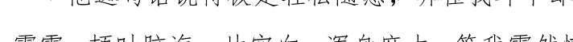

他这一句话说得轻淡如，听在我耳中，却不有一声惊雷。干笑了了一声，道：“师父，画皮又是什么？”我嘴里说着，心里已经在飞快地盘算起来了，就要择机逃命。

老疤子道：“小家伙，不用嚷硬了。自己弟子是什么样，我这做师父的还是心中有数的。当年我之之所以把人救了，就看着中他的心狠辣。”

只可惜，这人心是够狠，可其实一般。“要是我那儿儿子能一半的天赋，你有一半的天赋，我活这么多年，看都不看。”

我呵呵了一声，却没有说话。老疤子看着我，道：“只可惜那倒霉的皮，怕是早就放在身上了？”我双手微微发颤，心中飞快地盘算着脱身的办法，但没有一个是可行的。我喘着嗓子笑了，“您说实话。”

那两个小女孩，实在是露出了太多的破绽。”我听得浑身发冷，我自然也是明白道理的，统最少的。但形势如此，不由得不动。听到这里，我才猛然而惊，一股凉气直奔后背。

我猛地一动了，老蚊子早就发现我有问题，却迟迟不动，原来是认准了。老驼子道：“徒儿，为师可是好奇，你跟麻老大究竟是什么关系？”

我听得心里一动，老东西这番倒是说到了要点上。现在细细想来，这中间还有些许多跳跃的地方。

“再说了，就算这阴阳跟他们有关……”把化尸虫往我身上扔，我真就能就把什么东西都出来。老驼子突然笑道，“你不惜冒险。”

我心里铺满汗，已经精神崩溃了，到时候他不死他就活，结果只有一个，不是。我紧紧盯着他，在我说出这句话的一瞬间，我发现老东西的眼睛突然瞪了一下。

“呵呵，好，死的挺的。”老东西嘿嘿笑起来，但我直觉地发现，这笑声中根本没半分喜意，更多的是一种奇怪的情绪。我默默调息，以老蚊子接近的时候，能最快的速度接出去。老驼子却厌烦，看着我看了半晌，突然说道：“走吧！”转身沿着山道走了。

我被他的举动一头雾水，又不能忍着麻老大不管，只得跟了上去。老蚊子走得很快，等我下去的时候，就看到岸上靠着我们搭乘而来的两只船。放眼望去，老东西径直上了顾寒的那条船。就在我面前，我只要能抢一步到船上，让船伙计立刻离开，老蚊子真一定能追上。我喘了口气，抹了额头的冷汗，奔向另外一船。

急时间，刚踏上一甲，就闻到了一股血味。这老东西，真是够心黑。我一路寻过去，在船楼看到了老蚊子，已经装着麻老大的箱子打开了。我站在舱口，瞪着老东西，看他究竟要干什么。

“还不过来，这些人真是没救了。”老蚊子不慢地说了一句。我吸了一口气，在手里扣了几根银针，缓步走了过去。

“我现在教你解法。”老驼子头也不抬地道。我一时没回神来，就听老东西继续说道：“针法体会会？”我扣着针的手抖了一下，这时候倒没什么事隐隐的，道：“会。”

老驼子抬头看了我一眼，颇有意外地外道：“看不出你这小子的东西还真挺多。”顿了一下，又道：“你会针法那就简单了，但是这手法对针法要求极高，你要是没掌握，为师傅教你另外一种，但是很费功夫。”这老东西明明已经识破了我的身，这起一个坏脸，倒倒是推辞的我说：“有掌握。”

老驼子看了我一眼，道：“那你听好了。”当即说了一种入针的手法。简单而言之，就是以特殊手法将银针封入人体经脉，从而将化虫体内内遁。

“记住没有？没记住我再说一遍。”我在心中回想了一下，道：“可以了。”

老驼子“哦”了一声，看着我，呵呵了一声，起身箱子，微微调我此时也顾得不得其他，先把麻子从大箱内抱出来，仔细观察观察了要施针的位置，记忆在心。

双针齐下，瞬息间围绕着麻老大的头部刺出了六十九针。最后手指一弹，将一枚短针射入他耳朵下。过了大约三息，就见一条长虫从耳朵中爬出来。其体型和尺寸，比之前大了一圈。

我正要扎，却被老东西拦住。我伸出手打一下，顿时多了一根银针，把之前体内的那根吸回来。我伸手探了老的脉，虽然极为微弱，但脉象不像。我并没有停口气。接着我看到那条慢慢爬在桌，将二人体内的化虫同样赶了出来。

至于那底，我就懒得心思了。老蚊子却：“顺手把小子也开了。”

我立时就有种极其不好的感，我的手臂刚一起，后背颈处就是一阵剧痛，顿时怎么也弹不了。这一瞬间，我就明白过来，是被老东西一把锁住了脖子。接下来的，恐怕就是化尸虫了。老东西把我制住，却没有立即下手，倒在我面前起起来，转了几圈，才突然扬起头，眯着我道：“你不是真的见过那个姓钟的？”我很有些意，没想到他竟然点了点头。心里没底，心里发慌，我也没什么对他他说，只顾。

我没有认。他看着我一眼，果然起来，我热闹看着。我见虽然在笑，笑得比哭还难看。这一瞬间，我突然就明白了一些死活不想通的事。就像这次的乱仿佛这老疯子偏偏要着我面前，原来要是试探我在术数方面的造遣。这老东西唯一我确定的，就是我是不是那个姓钟的人！我想通这层道理，很多事情就豁然而了。这老东西明明已经看破了我的行诡，之所以还把我在眼皮底下留下那么久，就是看在死人脸的份上。老东西跟死人脸是从一起长大的玩伴，虽然事后因为错综复杂的思绪，两人结下了不开的仇怨，这老东西也口口声声姓钟的姓钟叫着，要将他至于死地，但他俩的恩怒，如人饮水，到底如何，也只有他们自己心里明白。就算是再阴险诡诈、杀人如麻的老东西，也有放不下的东西。老子又踢了几步，咧嘴一笑，道：“那姓钟的虽然死了，我也夺了他的徒弟！哈哈哈哈，徒儿，以后你就好好跟着为师吧。”他虽然在大笑，声音却是有些发干，脸上看不出那种愉悦的情绪。“这就就把那艘船吞过来，再把这艘船给烧了，就能安心心地回地了。”

我突然看到窗外漆黑的海面上，海像煮沸了起来，隐有一抹影从海面上自远而来。这时老蚊子也察觉我有异，朝后望。海面上那道黑影随风而来，来势很快，似乎眨眼就到了近。我看到一眼，冷汗从额头冒出了，头皮一阵麻。那是一个女人，一身白色飘动，脸色苍白，唇若红。转瞬间，冷汗顺着脸颊溜了下来，湿了衣衫。接着就看到脸上、脖子上裸露外的肉出现了一丝赤红色的细纹，就像是裂的瓷器一般，触目惊心，让人看得悚。而此时，海面上那道白色身影突然不见了。我心中乱，苦于被锁喉，动不得，屏住呼吸，眼睛不眨地看着舱入口。我听到咚咚的脚步声有规律地响起来，由远及近。我微微调慢了几步，尽量让自己冷静下来。脚步声突然一滞，加上水声，紧接着，脚步声响起来，就看到两个慢慢走过来，是一个男女，看着年纪不大，大约也就五六岁的。两人看起来差不多高，神情呆滞，头上结着圆圆髻，身上正在不停往下滴着水，就像是刚海里爬来。他们两人进来后，就停了。之后见到白色影，相庄严的白衣从后面转了出来，而在她身后，无声地跟着一个面目酷的大汉。这人虽然睁着眼睛，但只剩下眼白，根本看不到一丝黑色。手掌奇大，感觉比正常人大了一倍有余，上下不停地落在水珠。

这几人刚进来，我就已经察觉出来，除了那个白农萨，其余三人都不是活人，身上没有半分生气。这不是活人，那应该是死户，就像老疯子炼出来的那种活户。但不知道为什么，我总觉得有些古怪。这几个人，跟常的尸体有些不同。那白农萨进来之后，那一男女和那个大汉再也不动，像石像一样呆在那里，只是水滴顺着他们的身体不停淌下。唯独那个白农萨周身是干净，唯独身下的袍子染了一圈水渍。我跟麻老大他们跟前面。穿着裤鞋，行走间看到脚趾还涂着宽红。但这是一双十分粗大的脚，没有半分人的小巧。我觉得说不出的，见她一直盯着麻老大他们看，不由得有些毛骨悚然。突然听她发出一阵笑。这笑声传入耳，登时让我了一身鸡皮疙瘩。这显然是个男人的声音，但是语调却是尖锐，古怪之之处，比起大公鸡几个阴阳童子来。她说话的时候并没有看向我，似乎是在跟我说，又是在自言自语。我心中转念，知道他这老户，八成是说的老老子。

“你不是真的见过那个钟的？”我很有些意，没想到他竟然点了点头。心里没底，心里发慌，我也没什么对他他说，只顾点了点头。我没有认。他看着我一眼，果然起来，我热闹看着。我见虽然在笑，笑得比哭还难看。这一瞬间，我突然就明白了一些死活不想通的事。就像这次的乱仿佛这老疯子偏偏要着我面前，原来要是试探我在术数方面的造遣。这老东西唯一我确定的，就是我是不是那个姓钟的人！我想通这层道理，很多事情就豁然而了。这老东西明明已经看破了我的行诡，之所以还把我在眼皮底下留下那么久，就是看在死人脸的份上。老东西跟死人脸是从一起长大的玩伴，虽然事后因为错综复杂的思绪，两人结下了不开的仇怨，这老东西也口口声声姓钟的姓钟叫着，要将他至于死地，但他俩的恩怒，如人饮水，到底如何，也只有他们自己心里明白。就算是再阴险诡诈、杀人如麻的老东西，也有放不下的东西。老子又踢了几步，咧嘴一笑，道：“那姓钟的虽然死了，我也要夺了他的徒弟！哈哈哈哈，徒儿，以后你就好好跟着为师吧。”他虽然在大笑，声音却是有些发干，脸上看不出那种愉悦的情绪。“这就就把那艘船吞过来，再把这艘船给烧了，就能安心心地回地了。”


白眼的大汉。

我见他走动间，也是光着一双脚，脚掌跟手一样奇，不由得想到了青蛙的蹼掌。一瞬间就明白过来，白脸魔之所能漂在海上装什么海苔，其实是踩在这大汉背上而言。

这大汉一来，就低着头站在白脸身后不动。这人一丝表情也没有，也看不出来究竟没淹到老子。就在这时，又有几声低沉的钟声从岛深处传来，掠过夜空。

白脸魔把从我脖子上拿开，转身出了船舱。她一动，对那男女就跟着，而那个白眼大汉直朝我过来，一把将我举起，把斧子从箱中掷出，获取许多包裹。

接着我就被关进了箱中。那东西变得乱七八糟，扔在我身上，把麻老和黑毛挤进了另一个箱中。

之后眼前一黑，就被合上了箱盖。不一会儿身体悬空而起，大约是被这大汉扛了起来，接着感觉箱顶一震，大概是压上了一只箱子，应该是麻老他们。

我躺在箱中，燕子压在我胸口，听到她细微的呼吸声，稍稍有些放心。这一路上颠颇为颠，似乎一直在往上走，鼻中已经能闻到蜡发出的焦味，大约是上了山道。

我被锁钉封了，真是一根手指都不动了，不由一阵心气躁躁。好不容易静心来，却始终渗不透这白脸魔究竟什么来路。

这一路走了多久，最后一段似乎平坦起来了，可以听到外头传来阵阵的诵经声。这经文很怪异，不像佛经，倒像是些送葬的引魂。之后就闻到了一股浓烈的香烛味道。

接着一阵天翻地转，砰的一声，身子震了一下，是箱子被放到了地上。眼前一亮，箱盖被打开，就看到了那白眼大汉一幅毫无生气的脸。

他伸出一大手，搂住我的脖子就拽了出来。双脚刚一用力，就看见了父亲的脸。

这是个十分开阔的殿堂，两人矮着巨大的廊柱一字排开，映得殿中火光通明。在殿堂两侧，摆着数十张椅子，上头坐了许多人。

一看过去，却是些熟悉的面脸。一身红裙的大公鸡、姓顾和他那两个手下，马老、乌老大；顾小子跟老王还有老李坐在一起；还有姜老狐、梁庸等茅山一行，那老老头也坐在当中，被符术精揉捏着。刘子抱着徐梅那小鬼，却另外一行人在一起，面目有些陌生，一天看也不真劲。

这些人人死气沉沉地坐在那里。看到我被大汉拎出来，几个人像刘子宁、鲁莽精、大鼻头、乌老大等人露了一丝惊逗，更多的人却是漠然无视。

殿之中坐着如此多的人，却什么声音也没有，一片死寂。在他们身后，一路挂满了巨大的灵枢，比起普通送葬的灵幡要大上许多，上头还用朱彩描出血红的咒纹，一眼看过去，触目惊心。

我只觉得胸口闷得厉害，头皮发紧，再仔细看了几眼，就注意到在场的所有脸上都散发着一股淡淡的黑气，脸色白中透青，眉宇间更是发灰的。

往前看过去，就在殿堂正中有几步石阶，沿着石阶上去看到一个巨大的棺，听着人们在议论这口青铜棺。

看到这一口巨棺，我不自主地就想到了当年在三化，被姓顾的大公鸡找去，用画术缝了九口巨蟒出来，而是在处暗中拉出此青铜棺。

当年那口棺材，我只记得十分高大，具体是什么模样，我倒太记得清了，可能跟这口有些微的不同，但大致模样却是相似的。

当年的事历历在目，我至今还记得找到那口青铜棺后，大公鸡狂喜的模样。当时他太兴奋，以至于还漏了嘴，说出眼前这口棺材不过是八口青铜棺中的其中一。

我心中忽然就想起了一丝绪，这姓顾的大公鸡之所以急急地赶到这座岛中，难道的是这口青铜棺？

心中正琢磨着，就听到一阵脚步声响起，脚步声频轻，但听得出人很多，而且步履颇为整齐。

我被那大汉拉着到了墙角，我这个地方斜了眼睛，正好能勉强看到门口，过了一会儿，才见到两排人从外头进来。一排人全身黑，一排人全身白，黑白分明，像两条长虫一般鱼拥而入。

等这群人站下，微微垂下，就见到那白脸魔从门外进来，那两个是男要女，身后转身看着我眼睛眯。那对男女一左一右，手中分一卷经书和一件法器，在那石阶前停下，分站两旁。白脸魔白衣飘飘，站在正中，扫了殿中一眼，眼皮审视着，宝相庄严。

我见这群人神神道道，和尚像不像尚，神棍像不像神棍，也不知道什么来路，就算在暗网里混，也从没听说过有这么一些人。再配上人灵烛，尤其显得鬼气森森。

白脸魔扫了殿一眼，发出一阵刺耳的冷笑道：“今天有这么多朋友前来礼，本尊颇感厌。”她不说话，站在那里，还有几白衣菩萨的模样。

当时就有人吼一声：“什么歪道！鬼鬼祟祟，做不得人的事！”我顺着声音传来的方向看向，见那人坐在对面，是个红脸的中年人，浓眉阔鼻，怒气冲冲。这人身后还站着抱着徐梅的刘子宁，还有四个年轻人。

他们前面的地上，还躺着几个人，生死不知。我心中一转，既然刘子宁与鲁蟒他们一起，这些人八是门中的长辈。红脸瞪了眼睛，发出一阵低沉的笑。白脸魔疑惑地道：“你是什么人？”红脸冷笑了一声：“你是清微的！”我倒有些意外，没想到还有这样脾气爆的道门人，若是别人，我还以为这些人是我们村里的粗汉。

还有一个眉目的中年女人搂着她坐在一旁，几人神情凝重，脸上带着黑气。白脸魔连看了他一眼，道：“清微这样的小门居然还在？”我以为白脸魔是故意装不知，道：“还有清微派？”我以为白脸魔是故意装不知，但看着下去似乎不像。白脸魔似乎诧异，道：“另外这些人呢？”这些人手段还是有的。

白脸魔上的笑意消失，长地的“哦”了一声：“这些人八成不是为了我们大典而来。“那是为什么？”老头道：“暂时还没弄清楚，最近似乎有很多人到了咱们这里，事情有些蹊跷。”

白脸魔脸色一冷，声音一下子变得冷厉：“会影响大典吗？”老头把头低了低：“咱们岛中布置了十八冥轮，这些人引起不起风浪。”白脸魔这才脸色稍稍，低笑起来：“那就好，那就好。”

我听到“十八冥轮”四个字，当时就觉得奇怪。因为这名字我听过。以前跟三叔跑灵堂，有次听另一户人家设计葬的时候，三叔就跟我提到过这一次“十八冥轮”。他也只是顺口说的，我也就闻过一耳。不过当时是因为东西听来是很新奇的，所以我有些印象。

十八冥轮，并不是十八轮子，而是一种墓地的布局。当我刚口说，很像以前听说的葬野法阵术神分门的山葬阵法，叫做十八阴，是一种猴子……

十八阴脉，最基本的原理是以后异术将葬地分成十八脉，然后在每一脉上埋入各种灵性的野兽作为脉眼。这样布置出来的墓地阵法，本来是用来镇守墓地的，但到了唐朝后期，又有一种基于十八阴脉的葬葬被创出，直接用人来取代灵质，埋葬眼，能够最大限度地聚集十八脉的阴煞之气，端得凌厉异常，杀于无形。

这种葬阵就叫十八冥轮。一旦被冥轮，就立即被阵中之气缠身。我一直觉得这岛处处透着不对，原来整个岛都被布置了一个冥轮。按照三叔所说，这种阵凶无比，不仅不能杀人，还是一种可怕的禁锢。闯入冥轮之人，只能任人生宰。

我只觉得这岛处处透着不对，原来。

不脸的红脸魔，此时也怔了那里。我以为。

那一黑白两派立即昂高呼：“葬古万万，复我葬门！”那声音从小大，直至震耳欲聋。我紧盯着他手上那枚黄色铜戒指，脑海中瞬间一片空白，耳中只听到“葬门”两个字在奔跳不安。是葬古铜钱！跟三叔留给我那枚戒指一模一样！

我过了好久才醒醒，看到原本坐着的众人中一大半已经站起来了。除了一些年纪小的，尤其是像茅山的那个老头、姓顾的、姜狸夫妇，甚至连红脸都站直了，脸上露出十分紧张的表情。

在数年前，为了找三叔的线索，狮子头帮我查过，这葬古铜钱就是代表葬门身份的符。殡葬，自人类化就已经存在，其后经历了无数的演变。传承和我三叔的遭遇，这据说可以追溯到夏商时期，根本不是茅山或者清微近千年才成的道家宗门可比。

葬门向来低调，很少人在外行走。自从百年前以前战乱后，葬门更是销声匿迹。而在今天这样一个孤岛之上，却出现了一枚葬古铜钱，并且声称要复兴葬门，这怎不能让人震惊分。

殿堂中只有那山呼啸般的呜唳声过头顶，我似乎是穿透了岁月的洪流，撕裂空气，呼啸而过。无论是茅山、清微、焚香会，还是顾家或者是马洛他们，所有人都在沉默，有些手足无措。


念有词。红脸脸上的皱纹越越多，泪波滴哒地滴到了地上。

“你对我师父做了什么？”就在这时，清微派那边一个年轻人冲了了出来。听她的口气，倒像是这红脸脸的徒弟。

还没等到她见到师父，就听到清亮的“噗嗤”声，红脸脸就像裂开的瓷瓶一般，突然间碎成了千片万片，在空中瞬间爆发出一团血雾，将冲出来的女子淋了她后脸。

那女子瞬间就成了一个血人，呆在当地，一动不动。

在众人中纷纷捏措，脸上有愤愤、有震惊、更多的恐惧。连戚佛、姜狐、矮子的老头老脸都变了色，显然在众人中谁也没见过这样毒的法术。

那满脸魔放声笑起来：“多美丽的血花啊！这是送给仙门准备的血肉祭品。”

他话音止，就见众人人影错动，原来是清微一行人在短暂的震惊过后，已经陆续涌了上去。清微派此时只剩下那她愁眉目的的中年女人一个张望，其余就是包括刘子宁在内五个年轻弟子。

那年轻人虽然在殿中，但神情委屈，摇摇欲坠，显然是受了重伤。看了一眼满地的血污，低眉轻轻地说了一声：“师兄弟去吧。”

朝刘子宁道：“你带他们几个退下，无论什么事都不许！”

刘子宁大急，叫道：“师父！”

“都给我退下，听到了没有？”她虽然没有任何严厉，但一句话话说出，气势滔然。

刘子宁咬了咬牙，抱住那被染满血的女子，带着几人退了下去。他那个弟子毕竟年纪轻，忍不住哭了出来。其中一个年纪很轻的弟子擦着眼泪，朝茅山旁边叫道：“茅山的长辈师们，你们就在旁边看着吗？”

我望那边看，就见裴赛红着眼睛叫道：“咱们茅山和清微一起杀了这恶贼！”就要朝着刘子宁旁边走去。面魔拉住脚后跟，又气力不支地停下，却被那姓梁的一小子拉了回去，叫道：“都给我回去！”

转身朝那白脸魔：“今日是贵门的开门大典，这样的大吉，何必弄得这么血腥。”

那白脸魔冷冷一声：“要么闭，都要跟他们一样！”

那姓梁的顿时在了那里。半晌，朝清微看着那中年女人沉声道：“秋真师姐，留得青山不怕没良烧，你不要为自己想，也得为你身后这些弟子想。”

那中年女人咳嗽了一声，朝姓梁的微微点头：“多谢梁师兄教诲。”要说，扬起手指点点身上七处，没等身后后一个弟子叫出手，右手在腰间一抹，顿时血花溅出。就在这

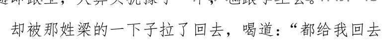

一瞬间，我突然感觉到她身上的阳气变得百倍的增长，那种阳气的剧烈爆发，甚至在殿中形成了一股强烈的旋风。

电光石火间，我脑海中闪过了一种法术！死人脸的笔记中曾经提到过清澈的一种独特门秘术，叫做“阳魔裂”。

活人属阳，而魂本身是属阴的。阳魔裂，是清微派种种归于尽的法术，在瞬间点破身上气脉，让全身阳气溢出，后喉颈自杀，让自己的魂在瞬间汲取身体中泄露的阳气，从阴变成阳魂。

我眼睛一热，就看到黑影闪过，原本站在白脸魔侧的白脸女凭猛地抓住了白脸魔的侧后，那对男女被她震得倒飞了出去。

而清微派那个秋英的中年女子，身子晃了晃，无力地倒在地。

“师父！”

“师叔！”

这一一下子闹起，只是在瞬息之间，等利子宁等人抢过去的时候，他们的这位师长已经离死。片刻之后，那对被震飞出去的男女又爬了起来，面无表情地回到白脸魔跟前。除了浑身衣物已经完全破碎，身上却是连道伤痕遍遍。

“伏命阵！”刘子宁厉喝了一声。几名清微弟子身形交错，双目通红，眼瞳自带愁泪，人人手中多了一把桃剑，脚踏步离，五个人姿态各异，形成一个不规则的圆形。

茅山、天师、清微三大符箓宗，在民间都是以降妖伏魔、提鬼除邪闻于世的。除了道符之外，桃剑也是十分惯用的御邪法器，每个人自然都要修炼。

白臉魔手下那对男女为诡异，刘子宁视锐也看出了二人并不是活人，而是某种诡异的活物，立即聚集，以桃剑为凭，挥出了伏命阵。

原本是主的伏击，结果却有些不妙。白脸魔手下那对男女还有那个怪物，我觉得不像活人简单。虽然他们像活人，但很多地方不对。我心中焦急，立刻不管，强行带着阴气冲。这一牵动，立即浑身爆炸一般，眼前一黑，什么也看不到，耳中嗡嗡响，只听到呼吸。我已经眼睛红了，强忍着钻骨剧痛，将阴气强行冲上。我脑海一片空白，知道他们即将要被成人。胸口似裂一般，猛地想到了阳魔裂。这时，身体窍出现短暂移位，猛地恢复自由，锁骨钉。非但没刹进男保守体内半寸，反而从我掌背贯穿了出来。随即就一天天旋地转，被他砸翻在地上。我浑身寒，觉得整个人被暖过一般，整个人灼热如沸，但不会，全身又变得极冷。灼热与冷冷之间交替。这就是阳气泄露的后遗症，我这些年在心里搏了这么多，恐怕早就死了。我得自由，原来是阳气冲击，七窍溢出了血。我模模索地感觉有人走了过来，眯着看着，大约是一个叫老修的黑衣头，抓住我的手细看戒指。不知道了多久，似乎听到头叫了一声：“那是古铜戒指！”我收敛心，调息了几秒，强撑让自己倒下去。扬了扬手中的戒指，叫道：“我有戒，我也可以下令！”只是声音一出来，就变得沙哑哑。我站了一会儿，体内阳气如沸，与阴气纠缠，混沌不堪，摇摇欲坠，觉得那黑衣头似乎抓了我。脑海一片晕眩，只听到脸魔又叫道：“本尊才是正宗！你们没看到菩萨的阴傀吗？能炼出阴傀的人才有资格开启葬门！”我脑中事的。我根本没听到什么阴傀，猜大约说的是他底下那个怪物。咬着牙，看到涵宁他们几个微弱弟子七七地趴在地上，看麻老大都被按着跪在那里，就跟他们跌撞撞了过去，那黑衣头连忙掉了。我伸手在涵宁脖中揉了揉，还算有气息，这才稍放心到麻老大他们面前，看到他们睁着眼的样子，不由心中一热，双腿一软，就坐在地上。“燕子姐……”麻老大他们三人露出一丝奇怪的表情，尤其是燕子，疑惑道：“你是……”这些日子了，我重心直悬在那里，悬得紧紧。此时见到他们，听到燕子说话，只觉得心中火热。把嘴里渗的一口血咽了回去，就听那白脸魔厉咬一声：“还等等什么，点天灯！”我同样举着葬莉铜，但虽然我不不如白脸魔有说服力，那黑衣头微微咬了咬气，退到一边，意示两个人过来把我拖到另一边。另有几个人按着老大他们就要动手。看着他们三人，看着他们就要开门，点天灯，猛地冲向顾思寒那边：“顾小子，快帮我！”我原本垂着头在一边的顾思寒猛地抬起来，脸上充满惊恐。我咬了一口气，一把将挟持我的两人撞开，手指往眉间一揉，首先就开了天魂上的定针，接着出手不断，将三魂魂上九轮钉取出，目眨眼之下，朝头看向一看，立刻登录。我做完这事，连走被脱下的力气都没有，只是露出了脸。我忍着脑中的眩晕，微微微调了几秒，抖开了几枚针在手里。这两个人是要尸，就逸不出尸号。但那两个怪物来得太快，我刚把针弹出去，就被一把按住了脖子，直接往下一贯，碰到了地上。我眼前金星直冒，浑身似散了，觉得手指热血涌，三叔留给我的符被那男捡了下来。我只觉得胸口热上涌，猛地大叫一声，从地上爬起一起就抱住他脑袋，用尽力气把锁骨钟猛地朝他背拍下。霎时，只觉得掌心猛地一阵剧痛，曲线蜿起，那锁骨钉非但没刹进男保守半寸，反而从我掌背贯穿了出来。随即就一天天旋地转，被他砸翻在地上。我哇的吐出一口，双目看上去一片血色，迷迷糊糊从掌间拔出骨钉，就要点破身上七血，用出阳魂裂。这时，脸色崩地看到原本缠绕着人的黑气突然淡，随即听到有人冲进来，大声道：“葬门，人有进来！”不可能！身体窍已经开启，怎么有人闯进来？是不是你们弄错了？”我摇头，让自己尽量清醒，朝头看向一看，立刻登录。我睁着眼睛看到一片黑，只见白脸魔站在头上，似乎极为许多。我扫了一眼，看到麻老大他们又是惊喜又是难过地看着我，麻老大坐了起来，正朝我来，却被老王和老李拉住。这男女仍冲出几步，上身猛地断裂两截，居然被两柄用法的桃木剑斩成了两断！想要获得好处，除非掌握了阵的秘诀，否则看不到任何血肉和骨骼，里面是复杂的金铁和齿轮。我这才明白过来，怪不得我一直觉得这两个奇怪，原来他们根本不是真正的尸体，而是两具机关术精制而成的人偶，只是不知道什么秘术在外上套上了人皮和血肉，以至于像是两具尸体。听到那老家伙叫了一声：“这根本不是阴偶！”姓顾的阴沉地叫了一声：“尸偶！这人原来得了《鲁班书》！”白脸魔脸色变得铁青，尖道：“你们统统都给我死！”他手中握着那卷经书，念念有词，似乎有一道巨大的黑影从他身后缓缓爬起。那两个清微弟子垂着头，手持桃木剑倒着，一个轻轻守头横平，一个轻轻挥出。白脸顿时发出一声惨吟，身上的白衣更是裂成了碎片，白脸魔大眼睛陡睁，拉起他，轰地的一声撞破一面石墙，就冲了出去，速度快得离其想，瞬间远去。那两个清微弟子倒退，在地上走了几步，一剑朝着那两人远去的方向缓缓舞出，就听到远处传来了一声惨叫。两个清微弟子收剑回回，一人一软，顿时却倒了地上。殿堂中一片死寂，久久无人出口。我愣愣地盯着着那个被白脸大眼睛撞出的破洞，一时之间……

说的他们，愿思寒自然知道是谁。

那白猿跑得是极快，跟着青子，一会儿就离了这大殿。

夜风自海面吹来，带着微微的腥气。我被那白猿扛在肩头，脑袋朝下，这二家伙走路不老实，又蹦又跳，直蹦得我想吐。再加上原本就有的各种，简直是想死的心了有了。

“慢点，慢点！”也不管这货儿听得懂。那白猿大约是吃痛，低低地吼了一声，脚步倒是半步不慢。

“又干什么？”只听到青子的声音从前面传来。我被那二货扛着肩，脸贴着后背，也看不不到青子，只能叫：“这猴子走路太不正，颠得死我了！”

只听青子说了一句：“不舒服就自己来走。”我心里想，要是让你替我一把我就舒服了。可心里敢想嘴上可不敢说，否则这死女人还真有可能把我从这山头拿下去。也不敢让他们说“自己走就自己走”，我现在这状况，这种陡峭的山路，恐怕走几步就自己滚下去。

只能强忍忍着那白猿的质疑，为了减轻眩晕，就说：“我们这是哪儿，是不是要回家了？”

我不提还好，一提，就听青子冷冷道：“我出门前怎么说的？”

我真不得懊悔，发现自己给自己挖了个坑，知道逃不过去，如实道：“你说你要是二十天不回，我就留在这里。”

青子道：“那现在二十天到了回？”

我只能老实道：“没有”。

青子语气冷冷，并没有严肃的意思：“这可是我的错。”她被教训了这么多年，自然知道她并没有生气。她就笑了一声，说：“你绝对对不起我了！”

我实在也不能这么承认错误，当即就把之前发生的事情说了一遍。当说到肌肉男的时候，不由得一阵阵心酸。我等了好一会儿，忍不住问：“我中间的表现怎么样？”问完就紧张地看着她的耳朵。

只有她“嗯”了一声，道：“还算马马虎虎。”

我一听，只觉得心花怒放，一天连那二货白猿都觉得煞可是可爱。自己一个人傻乐了一阵，想到一件事，就问：“徐若梅那个小鬼儿的贼贼就是你吧？”

过了一会，才听青子道：“什么贼贼？”

我不由得失笑，道：“贼贼就是姐姐的意思，小子口不清。”我怕她不知道徐若梅是谁，就说：“就是是在船上黏着你，一定要给你糖糖的那个。”

青子“哦”了一声，道：“是她。”在心里酝酿了一下，我一听，知道她等于是承认了。就问：“那小鬼说你出海是去找寻人的？”

这次青子只是“嗯”了一声，却没继续下去。我琢磨着该怎么继续下去，就觉得一阵海风呼啸吹过脸，大约是伤了后腰，不由得打了个寒颤。仔细一看，原来不知不觉已经离开了山道，已经到了海边。不过这地方看着有些陌生，不像我们之前登陆的那个海滩。

再仔细看眼，我随即明白过来。这朱砂岛又名龟甲岛，其原因就是这岛的外型，从高处俯瞰像是一只龟。当这时刻刚靠近这座岛的时候，曾经坐着船绕了一周，因此看到这岛的全貌。我们此时位于那海岛的脖颈上，再往前走，出现在我面对的就是海龟的脑袋。

不由有些好奇，就问：“我们这是去哪儿？”青子却没理我，而是那只二货猿嘟了几声，似乎在回答我的问题。我倒不知道这货兜宽或许听得懂人话，赶紧拍拍它，让它走稳点，别那么不正经，又蹦又跳的。

再往前走了一阵，只听旁侧浪起伏，海浪涌拍在两边的林立的乱石上，激起水沫四溅。我才发现，我们走的一条，其实是一条乱石堆砌的小道，略微高出海面些许，要是涨潮的时候就不会被淹了。

沿着海龟走了大概有一里，就到了那块脑袋。这块是个独立的岛屿，岛也不大，只眼看去都是高耸的悬崖，山峦叠嶂，高不可攀。我趴在白猿肩膀上，虽然不知道这里究竟是为了什么，但从徐若梅说的话也能看出。那白猿又蹦又跳，直得我快喘不过气，急了就拽它后颈，它吃痛，差点真把我吐出来。

不容易等它停下来，我转向一看，是一处悬崖下。青子站在那里，问：“我们这是哪儿？”青子却没理我。那二货倒是嘟囔了一声，然后扛着我走到岩下。

白猿伸出手指，顺着岩壁画了起来。我仔细了几眼，发现这货并不是瞎画，更像是某种纹路。只是它画得十分熟练，我也没有来及看清。听后一阵轰隆声响，似乎地面都震了，转身一看，见壁上打开了一个洞口。青子进去了，白猿扛着我就跟上。我们进入后，只见一道石门落下又合拢了缝。我这才恍然，这堵墙应该是布置了某种禁制，用来控制石门的起落。不知道这禁制是教它的，还是其他人。进去之后就发现，里面别有，天光从高耸的崖顶透了下来。里头是个谷地，四面环绕，地上生长着花草和树木。再往里头去，见壁上开出一个洞，进去后就看到了一个石室。

室里头摆放着一些石床、石桌、石椅，看着并没有灰尘，其中一张石桌上摆着一个篮子，旁边躺着三个半红半白的果子，样子似乎非常有人居住。我念了想，就说：“最近住在这里啊？”青子没理我。我正想再问一句，只觉得天地旋转，原来是被那二货从肩上掉了下来，到了中间的一张石桌上。青子道：“在床上睡。”她自己去了屋里一趟，取了一本书，在旁边的石子上坐了，将书在石桌上摊开，一手支颐，慢慢地翻着书页。我仔细了一眼，那本书看着眼热，大概是她出门的时候。我咬着牙，忍痛翻了个身，侧身来，就定定地看着她坐在那里的身影。

“看什么？”青子翻了几页，说道。我一惊，移开目光，心想：“当然是看你长得好看。”虽然这话也心里想着，图个一时之快，真要说出口，那是皮疼了。就说：“胸口好疼，闷得厉害。”青子瞪了眼，道：“平时一用功就喊辛苦累，这得了？”这是天地良心，虽说前年前我确实在心里苦苦连天的，可是后来几年，我还是颇为用过的，有时候不习惯了。不过她说什么就是什么，我还能反驳得了她了？

我们就有了话题，问：“对呀，你是怎么找到我的？”这件事情我在路上一直好奇得要紧，“难道咱们之间有什么心灵感应之类的类的我我是这样想的，毕竟我身上的血契是她传的，总归会有一些特殊的联系，这也是合合理的。听我说完，青子淡淡道：“我让你在家里多等会儿，谁知道你会跑到这里来。”青子翻了一页，道：“我想那个小女孩就出来看看吧。”她说的那个小女孩，自然就是徐若梅那个小鬼。我不由暗暗，这女人看起来对什么事情都不关心，其实心里是软的。后来再想，原来我能捡一条命，还是托了那小鬼。我有些不甘，说：“我们结了血契，就没有一些感应的？”后来她出来来看徐若梅的时候，结果刚刚看到岛上的异样，就进去了。

“那小鬼的，什么？”

“看来我果然没错。我之所以在十八冥轮中行动无碍，真是因为阳瓶的缘故。这十八冥轮本质上其实是以十八脉驱动阴煞之气，八成是阳瓶在什么地方对他造成了克制。”

“我连忙问：“我听那黑老头喊了一声‘啪嘶啪嘶’，那是什么东西？”青子道：“正是葬门的一种秘术。”只是短短一句，并没有往下细说。我见她要起身，又问：“那《鲁班书》是什么？”我记得当时她也冲着那白脸撞了一声，似乎他得到了什么《鲁班书》。青子看了我一眼，道：“哪来的这么多话？”我嘿嘿了一声，道：“你不是知道鲁班书的来历吗？”这鲁班书在民间很有名。我坐回去，倒是仔细地把鲁班书的历说了一遍。鲁班书分为上下册，上半部为机关之术，下半部则是护身之术。而下半部也被称为“缺门”，其实是古代鲁班师所著。鲁班书记载了各种术，与葬门中的大多数术不同。鲁班书在民间传得很广，我也可能完全没听过，只是青子说那么详细。

“那口铜棺葬门关系？”青子道：“这种事情是葬门的隐秘，外人哪里知道。”我沉默了一阵，隐隐觉得这里似乎有什么不对。三叔真的是葬门的传人，身上带着葬门戒指，那应该是个了，怎么会隐姓埋名躲在一个小山村呢？不过也庆幸三叔这次隐居，否则这世界上就没有这个人了。想着想着，心情免有些沉重，转念又想到一件事，让我心中猛地一颤。“那个十八冥轮，是不是葬门的独门秘法？”我声音有些发涩。青子“嗯”了一声，道：“应该是的。这种古老术，除了葬门，其他地方也找不到。”我心中一揪，想到当初三叔随口跟我说的这十八冥轮，如果三叔不是葬门的人，他一个普通跑灵堂的，怎么可能知道这种古老术？我琢磨了一会儿，又想到一件奇怪的事：“我当时在十八冥轮里走，可是没受影响，这是很奇怪。不是跟咱们的阳瓶有什么？”这事我之前就反复想，觉得阳瓶是我老祖教我的变化有关。青子道：“阳瓶是什么？”我差点失笑，才想起阳瓶是我自己的名字，青子根本不知道。当即就把事情说了一遍，又问青子咱们法门叫什么。青子却说什么，过了一会儿：“你爱叫阴阳瓶就阴阳瓶吧，其中的原理你自己去想。”


我迎着海风展望去，就见前方靠近海的地方有一处向外延伸海面的石台，上头生长着一棵大树。

除了这棵树比画中要大许多，其他简直是一模一样。我心里一阵欢喜，催促着二货赶紧扶着我过去。走到石台上，听到浪涛一声又一阵从崖下传了。我到石台边缘，朝望去，是漆黑一片的海，此时正是潮起时分，剧的浪涛撞击巨石，溅出无数碎沫。

海风呼吸而语，我迎望向远处，想象着画中那个男人站在此地的境遇之中。黑暗的苍际和水面齐平，海天一线，只感觉波汹涌之见，多年来许多的事情都烟消云散。最甚是迎风站立了一会儿，回头看向石台上一块青石。边上是一个有些发黑的木凳子。我心中一动，就走过去盘腿在那青石坐了上去。学着画中小青子的模样，闭目打坐。只听耳边传来一丝呼吸声，睁眼看向，那二白猿不知道什么时候也跑到了那木凳上。

我忍不住伸手去拍了拍它肩膀，这二货顿时冲令我叫了一声。

我盘腿坐在青石上，也不知道打坐究竟要做什么，就闭了眼睛起了三叔教我的调息法，逐渐收心神，随后又自自然地运转起阴阳瓶。这些年在绳上上睡久了，为了不让自己掉下来，这阴阳瓶的运转几乎是发自本能。

许是这一阵子真的太累了，此时一不定，只觉得舒服异常，居然迷迷糊糊就睡着了。这一不知睡了多久，耳中突然听到浪拍岸的哗哗声，顿时从梦中惊醒了过来。睁开眼睛，只见天际微微发白。

我看到他那儿纵身一跳，却却是转了过去看着我们身后。我觉得有些奇怪，跟着转头一看，就看到一角淡黄色裙子在眼前飘过。

我登顶时愣住了。只见一身淡黄色裙衫的青子站在崖边，眼望天际，负手而立。海风吹得她长发凤舞，裙角飞扬。在这一瞬间，我突然有些恍惚。

“怎么跑到这里来了？”正出神间，就听青子声音随入耳中。

我呆了一下，青子此时已经离开了崖边，转身在旁边一块石头上坐了，发丝被风吹得不断飞舞，就说：“在里头没找到你，就出来看看。”

青子没有说话，只是看着那幽暗的海面。我看着她的侧影，忍不住：“你……以前不是在这里住过？”

过了一会儿，才听青子道：“这就是突然想起来，回来看看。”

我一怔，这才才知道当日青子突然出海，只是想起来这里看看。她虽然没有直接回答我的问题，但也间接承认了她确实住在这里了。

“听徐若梅小鬼说，你问出海干什么，你总是不理她。”我笑，“后她就给了你一颗糖，你告诉我，你是假的。”过一会儿，才听青子道：“那小女孩又错了。”

隔了一会儿，才听青子道：“那女孩怎么这么这么多……”

我愣了下，等了好一会儿，才问：“找谁啊？”

青子把额散乱的头发拨到耳后，道：“哪来的这么多问题。”就从石头上站起来。我见她要走，忙忙跟了上去。一走才发现，经过昨晚一夜，身上的伤倒是好了许多，不至于连走路都要靠那二货撑着。

我急走几步跟了上去。身后那二货哼哼嘟地跟了上来。我赶上青子，见她眉间紧合了一层淡淡的愁意，忍不住说：“我有许多事都想告诉你，你有许多事也可以跟我说说啊！”

话出口，就不有些后悔，恐怕得罪她生气。青子果然没理我，径直地去了谷内。我快快地看了身边的二货一眼，道：“你家主子生气了，怎么办？”那二货哼嘟了几声，反正也根本不知道他在说什么。

趴在身上有气无力地进了谷，并没有见到青子。进了石室，才见到她在家里正坐看着书。我坐了一会儿，长地地了一口气。我偷了她一眼，见她神情平静，似乎在专心看书，也不知道是不是生气。也不敢搭腔，说道：“我去看看有什么吃的。”话音刚落，就听青子冷冷道：“什么时候学会说话？”我真真是恨不得把脸给吞起来！以前这些天跟她在一起，就习惯了，不知不觉就跑出一句话。我怕她发作，连忙起身朝外走：“我去找吃的！”

那二白猿在岸上往下张张，海中鱼产丰富，跟我一起动手，很快就上来了一堆螃蟹。去外面捡了些干柴，做了个火堆，又找了块平整的石板，放在火堆烧开了，就把海鲜类放了上去。不一会儿，香气扑溢。那二猿在一弄嘟嘟，又蹦又跳。等弄得差不多了，就把青子叫出来。

跟她住了这么久，她还是挺好说话的，没事儿只要有新鲜好的，她还是得意的，最重要的不会拒绝。当然，也是挑剔的。我把烤得刚刚好的虾放到她面前，那二伸手一捏了一只螃蟹就往嘴里咬，居然不改色。我见她吃着东西，连眉间那层淡淡的愁意散了不少，时刻感觉心怀畅畅。

这次捡的海鲜很多，一直吃到下午，青子吃了一些就去石台上吃海风了。我跟她抢着吃，直到实在撑不下了，这才停下，剩下的都让那二扫光。我去洗了手，就跑去石台那边。原本是想在那块青山上坐着的，结果吃得实在太饱，一下下去差点就把肚子东西翻出来，只得靠了那大树站着，看着她坐在那里的背影发怔。

过了好一会儿，才听到道：“东西都收干净了？”

我说：“那二白猿还在那里。”

隔了一会儿，只听到她道：“它叫小白。”

我一听，差点没住笑出来，这二货左看看右看看，也没有半点头跟个“小”字挂似的。不过后来就想起，大约青子叫小白的时候，二货还只是小猴，只是现在不知多少年过了，青子已经长大了，而二货也从小白变成了老白。

青子道：“我这次出来，本来是想起这里，再看看。师父第一次领我这里的时候，小白还没你现在长得高。”

我心里突地一跳，听到“师父”两个字，立即就想起画中那个只有一个背影的男子。又想起当初腰坐在在这里打坐的小女童，心想，不是那二货，就连你当初也没有来得着啊。想了想，还是忍忍不住：“他也是巡逻人吗？”话一出口，顿时就觉得自己自己问了一句废话。这么来说，当初应该就是他传给了青子巡逻人血契，而现在青子又把血契传了我。

“师父累了，以后巡逻的事情就交给你。”青子轻轻叹了口气。我心中不安，不想在这话题上说下去，就说：“那你这次要找的人，是不是你师父？”

她点头：“嗯。”她看着我，只是来到这岛上后，出了些变故。我不由好奇问道：“是什么？”

青子道：“你看看树身后靠着的这棵树。”我一听，转身退后几步，仔细看向眼前已经长了不知道多年的大树。这棵树的主干足足二人抱粗，枝干纠结，是那种赤黑的颜色，长出的叶是那种小小圆圈，就像铜镜似的。我第一时间倒是没看出这树究竟有什么异常，只是觉得这树周边的气机似乎有些异常的波动，跟常树是非常不同。

青子道：“看东西，不一定是用眼睛。”我心头一动，闭上眼运转阴阳瓶，去仔细体察这棵树中阴阳气机的变化。过了很久，我猛地睁开眼，失声道：“这树已经死了！”但一出口，就觉得不对。眼前这棵树虽然树叶不如何茂繁，明明还在生长，但是我刚刚仔细感受了它体内的阴阳气机，竟然发现自身已经变成了纯阴之相。

青子道：“这棵树早就死了，现在只是在阴性生长。”我略一琢，已经明白其中的原理，这就跟那些人死后起的是一个道理。就就像人死后，如果是葬在像聚阴池中的类聚之地，这棵树不仅会继续腐烂，推测还会继续生长，甚至最后成为活物。这种特殊环境，这棵树死后不仅没有枯败，也开始了阴性生长。我还是有些疑惑，这棵树可能已经死了多年。

从树树的痕迹来看，青子没有说话，等了一会儿，才伸出一根麻蕊似的手，对着一间石室指了指。我起来过去看一看，脑头空荡的，别说找它，连这陈旧石室都看，哪里有那纤丝。尘不染的性子，总不能直接睡地上吧？我索性进屋，又仔细地看了一遍，才发现原来这屋子里悬了一根线。只是这根线十分特别，也不知道是什么材做的。近寻找，而且细如毫发，要不是留了心细看，还是不易觉觉。我立刻醒悟，想起青子以前就是睡在这丝线上的。我拉着丝线，两手使劲拉了拉，这东西虽然细细，但十分坚韧，并不逊于任何手指粗细的麻绳。可是在如此细纤的丝线上躺趴，相比在麻绳上困难多了。这些日子到处奔波，我时心吊胆，如今早已习惯了。

不见青子，大概是出去散心了。很快夜幕降临，天空星河灿烂，二货似乎又饿了，开始吃那些饿东西，发出吧咯噜声。眼看月亮上中天的时候，青子从外面回来，见我站在外面，就说：“还不睡，在这里干什么？”按照常，这个点已经准时熄灯了。她说了一句就自己进屋了。我跟她后面进去，打了个哈欠说：“睡觉睡觉。”青子在椅子上坐了，随手翻了这本书，道：“你就睡这儿。”她说的是张石床，大概是看在我重伤未愈的份上给了优待。我自然也不跟她客气，一屁股坐在床上，说：“你以前就睡这儿？”青子翻了一页书，道：“这是我师傅睡的。”我顿时对这张石床就没了兴趣，就问：“你睡哪儿？”以前这几间石室都看过，可没见到其他地方睡人的。

青子说话，等了一会儿，才伸出一根麻蕊似的手，对着一间石室指了指。我翻身睡回去，小心翼翼把画卷起来，闭着眼睛睡了好一会儿，小声问：“你睡了没？”过了好一会儿，才听到青子的声音传来：“干什么？”真当问我的时候，我第一时间不想起来说什么，等了好会儿，憋出一句：“咱们巡逻人，是个什么头？”其实当时在南疆，我是第一次从青子口中听到了“巡逻人”三个字。除此之外，不管是之前还是之后，我就再没从任何地方、任何人口中听到有关巡隐的任何事。我和胖子在暗网中混了几年，也从没听说巡隐这三个字。阳阴阁传于千百年，号称古今往来，三教九流无不包，无所不知，不管是二皮匠、做作、扎纸人、赵户匠等古老的职业，还是像葬门、巫门等任何曾经存在或已经消失的远古流派，都能在阳阴阁找到蛛丝马迹，却唯独这“巡隐”三字，却是从未见到在任何地方所提及。我一度甚至都怀疑，所谓的“巡隐”，在这世上根本就不存在，简直是在青子随口说的。我问过一句，就喘着呼吸，过了一会儿，才听青子的声音幽幽地笑道：“什么来头。”我想：“大概是有什么，是接活还是老职业？”我一直以来的猜测出来了。隔了一阵，听青子“嗯”了一声，然后就没下文了。既然她否认，那说明我猜的大离。我就说：“那我们是干什么的？”就像我和三叔之前的是殡葬，就是接死人的生意；二皮匠是专门缝补尸体以及给尸化肥的剪子手是专业的杀人高手；风水师是堪舆精通摸骨命……还有其他林林总忌，三教九流，在历史的长河中传承，各有各的拿手绝活，各有各的独门秘传。

那我们巡阴又是干什么的？

只听青子道：“半夜不睡，哪来的这么多话？”

我正以为为她又要不搭理我，隔了一会儿，听她道：“巡阴人自然就是巡阴的，管管阴事。”

在我们这一行，所谓的阴事，其实就是跟死人搭边的事儿。凡是阴事，就是世间最为阴险的事了，因为你根本不知这里究竟藏着什么样的东西，稍一不慎，就是一命呜呼的下场。当然还算，还有更凄惨的，就如魂飞魄散、永世不得起了。

我跟三叔的这一行，真说起来，其实是跟阴事搭边。对三叔从小就提命，不管什么事，只要一发现不对付就是一件麻烦，路是为了获取更多好处排查。没有没有小事的说法，只要稍稍马虎眼，可能就是追悔莫及的下场。

当年在南方，可以说就是我们的一个细致的疏忽，让那家老太太溜了古墓，最终导致那青面狐狸脱而出，最后引来了一场大祸。

死人脸死异乡，三叔直至下落不明，除了刘子安之外的刘家人尽数惨死。

不过相对来说，我和三叔这种只能算跟阴事走边，相比迎阴人这种专门处理阴事的来说，还是差别极大。

我又想起来一些事，感觉有些绪乱，就说：“现在有和尚、道士、还有什么端公、神婆的、像苍山那群鼻子，还有天师道之类的，都是以提棍驱邪阴名的，这些人人跟我们有什么分不利？”

我问完之后，好一阵对面都没有动响。我以为青子懒得理我了，正想翻身自己再琢磨琢琢磨，就听到她道：“我师傅当年我进门的时候，说过一句话。”

我心里一动，又问：“什么？”

青子冷冷清的声音传来：“咱们这行呢，就是个淘汰的老古董，所以你也不太用心。你一个小姑娘家，为师父操心最累。阳人聪明了，”

青子的用是他师父的口气。她是用淡淡的语气，不过我却听出了师父当年对她小丫头的溺爱。在每一刻，师父在训诫徒弟的时候，都是要求对自己的本门事务有志，心无所劳的。而她师父就要要求她对阴事处理三分，就是让她看到简单的就管管，麻烦的远离远，其意思是很明了。

我在心里琢磨了一下，不由猜，这迎阴人大概是非常古老的一个流派，在那个时候还没有苍山道士、端公神桩类的专门处理阴事的行业存在。只是岁月长河漫，沧海桑田，时代在不停地变迁，无数的流派在长河中崛起，发扬光大，香火传承，而迎阴人就像其他的古老职业一样，跟不上时代的变化，最后被浪拍死在沙滩上，成了老掉牙的古董。

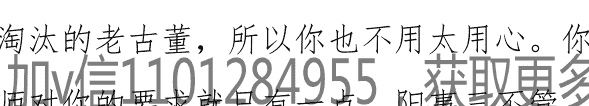

今天先更新到这里了，大家可以关注微信公众号【右手灵异】继续阅读，回复90060，从“第二零一章 离岛”开始阅读。

我这样想着，越想越觉得对。可是再仔细一想，却又觉得了很多令人怀疑的地方。说别的，单说这血脉，往来今三教九，三百六十五，也从没听过哪一个流派。就把心里这块疑惑抓住了。隔了一会儿，听青子道：“我也不明白。”原来她师父也没跟她说过过。

我自个儿愣了一会儿，也想不出所以，就问道：“那他们的规矩是什么？”

青子的声音从对面幽幽地传来：“我对你没有规矩，你爱管就分管管分。”

我听得一阵无言，想来想去，问道：“咱们这一行，挑传人是不是特别严格，要千挑万选选那种？”

我听青子在那头“嗯”了一声，就充满期待地继续：“那我的资质怎么样？”

只听青子说了一句：“还行。”

虽说只是“还行”，不过这句评价出自青子口中，已让我感到满意。暗自窃喜了一番，想到青子小的时候被她师父督促着睡觉。她当时的年龄比我小，只有七岁，而且还是这样细密如蚕发的丝线，又是在这种复杂多变的阴阳之中，估计也吃不少苦了，也不知得多少跟头。

想到这里，就由得心中暗暗，就问了一句：“你之前就是睡得这根绳细些吧？”

听到我对，“嗯”了一声，我就假意关心心地问：“你当时年纪又小，还是这样细密，家里那根绳难掉了了不少次吧？”想到当年青子在这里挣得灰脸，心中就不由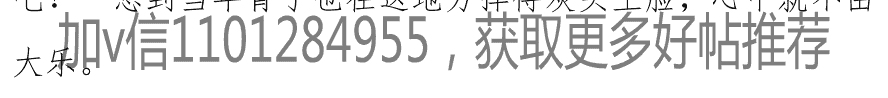

青子又“嗯”了一声。我憋住笑意，继续问：“那你什么时候可以安稳？”

只听青子说了一句：“七岁。”

我心里一惊。她真正做到在那根绳上睡安稳，足足用了三年，居然就用了一年！

然后听对面幽幽地传来：“十天。”

我：“......”

好吧，已经不想再说话了，只想赶紧睡觉！

在棺中倚石上坐了一阵，不仅恍惚，记得当日这惊心胆魄的一幕。如其清澈那个吕秋英，那个吕秋英的老辈，这样看起来并不如眼中的女主人，低眉善目的，淡淡地看着，行动却是如此轻松，冷眼看着自己的性命使出了魂，与同归于尽。

原来道中，还有等人彻底的人物。想得入神，只听到老白那货嘟唧了一声，又拍了拍肚子，原来是饿了。我冲它看了一眼，起身就进了闹门。回到岛的时候，正好遇见青子回来，见到我，就说了一句：“吃饭了，就回上面。”

我愣了一会儿，等我回神来，她已经进了石室。我去把之前捡来的鱼虾贝什么的，又烧烤一番。青子今天穿的是一件淡黄色长裙，暖暖的色，却是衬得她身上的清清意都消寂，尤增添艳。

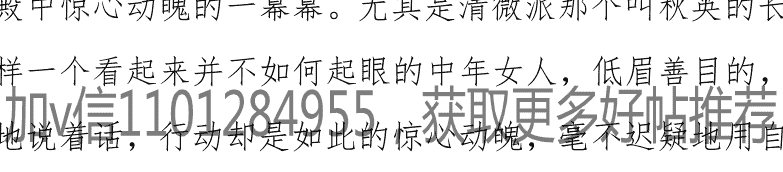

看得有些分神，烤好的鱼饼倒是大半都被老白那货给抢着吃了。吃饱嗝后，把东西收拾干净净，就听青子道：“我的包在里头，你去拿出来。”

我进去一看，果然有一个背包，还是当初在漓城的时候买的。拎了一下，微微有些沉，大约是装了青子的衣物和一些书等随身物品。

我自觉地在身后，随着青子往下海岸走去。老白那货哼唧唧地跟在我们身后，爪子手里拿着几个果子，还非得我怀里塞。我们才能过这浅湾。跟上道，说：“我们是不是要做个木筏子？”我见电视和小说都是这么样的，想不到我也有经历这事的一天。

青子却没理我，只是前往。我只好甩着脑袋跟上，到一处岸边，青子就停下，道：“把船靠过来。”我朝着海岸那头望望，只见浪拍岸，哪来的船，将信蜒地走下了一段，就看到一条颇简单的救生艇停在岸。我不哑失笑，当初青子离开乘的，原来是拿这救生艇来了。

我快走几步，把船往上拉，到下岸的地方，青子说：“可以了。”我们俩上船之后，老白就在岸上。老白站在岸上嘟嘟嘟地叫起来，声音急促，挥舞着毛茸的手臂。我们又蹦又跳。青子道：“走。”

我回头了一眼龟甲岛，拿起船中的桨，将船撑开了。此时正是潮，随着潮水涨落，我们的救生艇很快地远离，一会儿，老白就在岸上变成了一个点。再过一会，龟甲岛也成了模糊的黑点。只是到了海中，就觉得不对。一旦无法顺着航行，我就发现再怎么使劲，船都在原地打转。其实比起船，那真不过那些夫。尤其在这大海之中，更比江河之中要困难许多。

“实在干什么？”青子大约于是忍不住了。

我苦着脸：“这东西弄不来，要不你教我，这到底怎么用。”

青子半天没吭声。见她脸色古怪，猛地想到这位大小姐，估计也不太可能会划船这种事。我想了会儿，差点就忍住出来。

可是仔细一想，又觉得不对，“那你之前是怎么进来的？”青子从轮坐下来，只乘着小船到朱砂岛，若她不通海事，实在过不去。她歪道：“这路虽然热闹，海流却只要算准了时间方位，就能顺着海流自行进去。”

听她这一说，我不由原来这地方还有一条暗路，怪得她居然依靠一艘小船就入了别人九死一生才能进入的砂岛。这样来说，我就出生，就问我们还能不能顺着海流出去。青子看了一眼海面，等天黑再看。我干脆就省点力气，不再折腾了。划了一阵船，真比累一天跑还累，站起来活动一下，松松筋骨。这时候尚早，天空一派明净，海面上也没大的风浪，除了海涛声，就再听不到什么。我仰头靠在船上，看着青子抱着双眼坐在船头，海风微凉打散她的头发，不由大感感慨，只觉得这样的时光再过得慢一些也是好的。

入夜之后，夜空中星河璀焰，密密麻麻的，看得人心有些心悸。青子仰头望了一阵星空，指着我：“往东南南划过去。”

我回答一声，但是之后，发现别东南南，我都转得分不清方向。就召唤青子说：“不要再跑一起，用力一说，就说不定不打转了，这也是迫不得。”

青子神情古怪，可是不动半步，半晌，道：“你过来，我教你一个符文。”

我只好走过去。青子道：“伸手。”我右手被锁背骨钉穿的伤口还没好利，就把左掌挣了。青子伸出一个手指，在我的手心画了一个符文，道：“记住了？”

“这里有点复杂……你再画一遍。”我艾艾地说道。其实刚才被她滑过的有些微凉的手，脑袋一片糊涂，眼中只有那根玉似的手指，哪还记得什么。她没说什么，又在我手心画了一遍。

我默认一刻，就伸出手在空中画了那个符文。只是写了几遍，要记住。我心里一动，运转起来，在空中画了一个符。符文的用法有很多，其中包括化符：将符用火点；模拟符：将符用在身上，贴符：贴在身体某部位，化符：将符入体内，化后身体只剩下，以及比如高山派称救命符。除了这些之外，还有一种极为特殊的，叫做空符，也就是依仗符。当然，我现在的能耐，空符实在是有形无实，没有实际效用。习练之后，还是手指沾了海水，在自己胸口写下了这个符文。这种清水符，是在没有或者墨等下，替代的一种方法。

之后，就觉得脑子错，跟睡了似的。迷迷糊地感觉到青子在我耳边柔声细语，我仔细地去听。听似她在往东南，我只觉得她的声音烦，累，竟然被死女推荐了。

也不知道多久，才猛地清醒过来。一阵后悔后，发现青子依然坐在船上，我手里拿着船，手臂有些酸。再一看周围的海面，虽然看不出不同，但是我们的船正沿着一条暗流自行前进。

“我们刚才睡了？”我揉了揉脸，疑惑地问道。心里却是累，累，竟然被死女推荐了。青子抱着腰坐在船上，望着起伏不定的海面，像是根本没有听到我问了什么。事情之后，我仔细琢肠，就明白了。原来这死女人传的这个符，并不是用来施在自己身上的，而是要用到别人身上的。

我还愣愣把这符往身上扎，立即就迷了神志。其实来说，船并没有什么特别的事情，有些人学一学就有样，有些人学了好久还是打转，其实跟人纷杂的意识有关。青子直接用符把我控制了，就给我下朝东南、再朝西南的指令，我就机械地执行，除了我脑海中各种纷乱念头，反而能让自己前行。

那也没法跟她讨诸啊，否则下只会更呆。在船尾刚闯了一阵，就躲了过去，在她身后笑道：“你就脆把那控制人的决法也教我哦。”

过了一会，青子才道：“我只说一遍。”我心中一喜，忙点头应了。青子将该译了一遍，她口清晰，说话不徐不疾，再兼这决法篇也不长，这一遍下来，倒足够我记牢了。回过头就紧默默记了一遍，直到记忆无，这才稍。再睁眼看看，这船沿着海面的暗流向前滑去，倒是省力很大。我松了松筋骨，躺回船上，双手放在脑，仰望着天银河，虽又在那女人面前吃了苦，不过又学了一门新的秘密，心情不错。

第二天清晨，在南方海上遇到了一艘路过的客船，把我们拉了上去。这船正好是要返回泉州，就搭了顺风舵。到泉州港后，我就先联系到了狮子头。这胖子听到我的声音，喜得语无伦次。我将这段时间的经历了一些相关的简略说了一遍，听他连连抽空气。


没见挂白联，也不见招魂幡，院中也是冷冷清清的，只有这一个女人在那里，这就很是奇怪。

我在门外望了一眼，也不敢贸然进去，这种时候闯乱人家，还是遭人忌讳的。原本是想先走的，只是临走一瞥，看到在院子的西侧，居然气停了六口棺材，四大两小，一字排开。

我不抽了口冷气，这恐怕是一个没留了一家子了。我刚从镇里走到这边，也没人说最近地方有什么严重的传染病，当然这种事我以前也遇到过不止桩，往来都是那种阴门撞车，或者是一家出殡的。

本来这事要说特别困难说不上，只是我刚一近，就发现过年的机票好多抢抢，结果买票的却寥寥无几，热闹冷冷清。

我这一一样，就在门外站了久了。那披麻的女人正好抬头，我一见，脸上露出一丝似在恼情的表情，来就把院门关了，发出砰隆的一声。

我猛了一脖子灰，回头看看青子，只听她道：“走吧。”径直自己前往去。我得跟上，回头看了一眼，总觉得这宅子特别怪异。

到了前方，总算是找到一家吃饭的小店。那桌椅子都已经用了很久了，看着黑乎乎的，不过这家家的伙计勤快，擦得干净干净。跟青子两人坐了，我想了想，就让伙计上几个本地的特色菜。

结果第一盘上来的就是一盘奥鳕鱼。我虽然有些不习惯倒勉还能吃。至于青子，则是连筷子都动没。她向来只欢吃新鲜的，最后只吃了几口青菜就作了，坐那抿茶。

剩下的菜又不能浪费，只能是我包圆了。

正吃着，无意中看了外头一眼，就发现对面有纸扎铺子，放的是花花绿绿线条，钱币之类的。里头有个人穿着麻衣的年轻女人，靠在店老板的柜子前，一直向我们这边看。

我觉得奇怪，就看了她一眼。这女人看着大概二十岁的模样，皮肤白皙，又是红红的脸颊，显然被我穿孝服，大约刚从山上死家里回家的。

我瞧了一眼之后，见不认识，就没再去管。又自吃了一阵，结果低头的时候那眼睛还在这边看着，就笑着朝青子说：“有人在偷瞧你呢！”

青子没理我。我说：“还是个年轻姑娘，八成是羡慕你长得挺好看。”正说着，就见那年轻女人抽出了纸扎，直朝我们走了过来。

见我看她，就变得更加急了，很快就到了我们面前，双双圆胖的大眼睛，瞧青子，又瞧瞧我，双手揉了揉袖衣服，愣了好一会儿，咬着嘴唇问我：“那个……你……你……”

是不是陆景？”

我没回话，这女人看着青子，咬了咬嘴角，靠近我们，压低声音说：“你们……你们之前是不是不是在朱砂岛……”

她一说出这句话，我顿时就吃了一惊。这女人也是聪明，大约我刚才的表情被她看到了，眯起眼，欢喜地道：“我在朱砂岛上见过你们的……我是清微的弟子。”

她这一说，我又仔细看了眼，就有了些印象。好像她当时是在清澈那边吧，结果几年后就打了一身军服，再上当时我也是匆匆一愣，一时就没想起来。

经她提醒后，再仔细回了一番，就想起她就是当初那个重伤在地上举手接令的清微女子。

经过朱砂岛一战后，我对清微的印象极好，对于这个重伤还想着接令的女子更是喜欢，忙忙碌起来让她过来坐下。

那女子微微红了脸颊，在我们身边坐了，她说叫陈琳，又小心翼翼地看了青子。我不由有些好笑，道：“那天多谢你啦。”我说的多谢，多谢，是谢她能在那样的情形下去接令。虽说她当时代表的是清微，是冲着英雄的面，而不是，我也要说声感谢。

陈琳脸红了一下，道：“我还得多谢你们救命之恩呢。”说着又偷瞄了一眼青子。我不由暗笑，青子虽然长相极美，但气派极大，再加上当天在朱雀趴的表现，估计是把这清澈的女弟子给惯了。

我就说：“这是我们家人，你不用管了。”我这么说也没有错，都住同一屋呢，不是家人就是什么？

那陈琳忙朝青子道：“小姐，那天多谢你啦。”

我一听，差点没一口茶给喷了出来。见青子双眼满脸生气，原本以为是个很傲娇的，结果被我折了。

我们就想起当天走之后的事情。听陈琳说，当时他们清澈死伤十重，两位长辈横尸，几位年轻弟子除了她还稍清醒之外，其他都是迷不醒。我被青子带走后，当时那批门人的也早就撤离了，倒是没再闹起过什么冲突。

我特意问了麻姥他们怎么样了。陈琳当时在一旁看，大约对我跟麻姥他们的关系印象很深，当即说，他们是被那个姓顾的年轻人带走的，之后就是他们乘坐的同一条船。

我“叹”了一声，总算是放心了一些。陈琳又说，茅山派是跟顾那年轻人坐在同一条船，所以他们清澈几个同门就决不跟他们同乘，结果是上了焚香那船。

经过朱砂岛一战后，我对清微的印象极好，对于这个重伤还想着接令的女子更是喜欢，忙忙碌起来让她过来坐下。

那女子微微红了脸颊，在我们身边坐了，她说叫陈琳，又小心翼翼地看了青子。我不由有些好笑，道：“那天多谢你啦。”我说的多谢，多谢，是谢她能在那样的情形下去接令。虽说她当时代表的是清微，是冲着英雄的面，而不是，我也要说声感谢。

陈琳脸红了一下，道：“我还得多谢你们救命之恩呢。”说着又偷瞄了一眼青子。我不由暗笑，青子虽然长相极美，但气派极大，再加上当天在朱雀趴的表现，估计是把这清澈的女弟子给惯了。

我就说：“这是我们家人，你不用管了。”我这么说也没有错，都住同一屋呢，不是家人就是什么？

那陈琳忙朝青子道：“小姐，那天多谢你啦。”

我一听，差点没一口茶给喷了出来。见青子双眼满脸生气，原本以为是个很傲娇的，结果被我折了。

我们就想起当天走之后的事情。听陈琳说，当时他们清澈死伤十重，两位长辈横尸，几位年轻弟子除了她还稍清醒之外，其他都是迷不醒。我被青子带走后，当时那批门人的也早就撤离了，倒是没再闹起过什么冲突。

我特意问了麻姥他们怎么样了。陈琳当时在一旁看，大约对我跟麻姥他们的关系印象很深，当即说，他们是被那个姓顾的年轻人带走的，之后就是他们乘坐的同一条船。

我“叹”了一声，总算是放心了一些。陈琳又说，茅山派是跟顾那年轻人坐在同一条船，所以他们清澈几个同门就决不跟他们同乘，结果是上了焚香那船。

经过朱砂岛一战后，我对清微的印象极好，对于这个重伤还想着接令的女子更是喜欢，忙忙碌起来让她过来坐下。

那女子微微红了脸颊，在我们身边坐了，她说叫陈琳，又小心翼翼地看了青子。我不由有些好笑，道：“那天多谢你啦。”我说的多谢，多谢，是谢她能在那样的情形下去接令。虽说她当时代表的是清微，是冲着英雄的面，而不是，我也要说声感谢。

陈琳脸红了一下，道：“我还得多谢你们救命之恩呢。”说着又偷瞄了一眼青子。我不由暗笑，青子虽然长相极美，但气派极大，再加上当天在朱雀趴的表现，估计是把这清澈的女弟子给惯了。

我就说：“这是我们家人，你不用管了。”我这么说也没有错，都住同一屋呢，不是家人就是什么？

那陈琳忙朝青子道：“小姐，那天多谢你啦。”

我一听，差点没一口茶给喷了出来。见青子双眼满脸生气，原本以为是个很傲娇的，结果被我折了。

我们就想起当天走之后的事情。听陈琳说，当时他们清澈死伤十重，两位长辈横尸，几位年轻弟子除了她还稍清醒之外，其他都是迷不醒。我被青子带走后，当时那批门人的也早就撤离了，倒是没再闹起过什么冲突。

我特意问了麻姥他们怎么样了。陈琳当时在一旁看，大约对我跟麻姥他们的关系印象很深，当即说，他们是被那个姓顾的年轻人带走的，之后就是他们乘坐的同一条船。

我“叹”了一声，总算是放心了一些。陈琳又说，茅山派是跟顾那年轻人坐在同一条船，所以他们清澈几个同门就决不跟他们同乘，结果是上了焚香那船。

经过朱砂岛一战后，我对清微的印象极好，对于这个重伤还想着接令的女子更是喜欢，忙忙碌起来让她过来坐下。

那女子微微红了脸颊，在我们身边坐了，她说叫陈琳，又小心翼翼地看了青子。我不由有些好笑，道：“那天多谢你啦。”我说的多谢，多谢，是谢她能在那样的情形下去接令。虽说她当时代表的是清微，是冲着英雄的面，而不是，我也要说声感谢。

陈琳脸红了一下，道：“我还得多谢你们救命之恩呢。”说着又偷瞄了一眼青子。我不由暗笑，青子虽然长相极美，但气派极大，再加上当天在朱雀趴的表现，估计是把这清澈的女弟子给惯了。

我就说：“这是我们家人，你不用管了。”我这么说也没有错，都住同一屋呢，不是家人就是什么？

那陈琳忙朝青子道：“小姐，那天多谢你啦。”

我一听，差点没一口茶给喷了出来。见青子双眼满脸生气，原本以为是个很傲娇的，结果被我折了。

我们就想起当天走之后的事情。听陈琳说，当时他们清澈死伤十重，两位长辈横尸，几位年轻弟子除了她还稍清醒之外，其他都是迷不醒。我被青子带走后，当时那批门人的也早就撤离了，倒是没再闹起过什么冲突。

我特意问了麻姥他们怎么样了。陈琳当时在一旁看，大约对我跟麻姥他们的关系印象很深，当即说，他们是被那个姓顾的年轻人带走的，之后就是他们乘坐的同一条船。

我“叹”了一声，总算是放心了一些。陈琳又说，茅山派是跟顾那年轻人坐在同一条船，所以他们清澈几个同门就决不跟他们同乘，结果是上了焚香那船。

经过朱砂岛一战后，我对清微的印象极好，对于这个重伤还想着接令的女子更是喜欢，忙忙碌起来让她过来坐下。

那女子微微红了脸颊，在我们身边坐了，她说叫陈琳，又小心翼翼地看了青子。我不由有些好笑，道：“那天多谢你啦。”我说的多谢，多谢，是谢她能在那样的情形下去接令。虽说她当时代表的是清微，是冲着英雄的面，而不是，我也要说声感谢。

陈琳脸红了一下，道：“我还得多谢你们救命之恩呢。”说着又偷瞄了一眼青子。我不由暗笑，青子虽然长相极美，但气派极大，再加上当天在朱雀趴的表现，估计是把这清澈的女弟子给惯了。

我就说：“这是我们家人，你不用管了。”我这么说也没有错，都住同一屋呢，不是家人就是什么？

那陈琳忙朝青子道：“小姐，那天多谢你啦。”

我一听，差点没一口茶给喷了出来。见青子双眼满脸生气，原本以为是个很傲娇的，结果被我折了。

我们就想起当天走之后的事情。听陈琳说，当时他们清澈死伤十重，两位长辈横尸，几位年轻弟子除了她还稍清醒之外，其他都是迷不醒。我被青子带走后，当时那批门人的也早就撤离了，倒是没再闹起过什么冲突。

我特意问了麻姥他们怎么样了。陈琳当时在一旁看，大约对我跟麻姥他们的关系印象很深，当即说，他们是被那个姓顾的年轻人带走的，之后就是他们乘坐的同一条船。

我“叹”了一声，总算是放心了一些。陈琳又说，茅山派是跟顾那年轻人坐在同一条船，所以他们清澈几个同门就决不跟他们同乘，结果是上了焚香那船。

经过朱砂岛一战后，我对清微的印象极好，对于这个重伤还想着接令的女子更是喜欢，忙忙碌起来让她过来坐下。

那女子微微红了脸颊，在我们身边坐了，她说叫陈琳，又小心翼翼地看了青子。我不由有些好笑，道：“那天多谢你啦。”我说的多谢，多谢，是谢她能在那样的情形下去接令。虽说她当时代表的是清微，是冲着英雄的面，而不是，我也要说声感谢。

陈琳脸红了一下，道：“我还得多谢你们救命之恩呢。”说着又偷瞄了一眼青子。我不由暗笑，青子虽然长相极美，但气派极大，再加上当天在朱雀趴的表现，估计是把这清澈的女弟子给惯了。

我就说：“这是我们家人，你不用管了。”我这么说也没有错，都住同一屋呢，不是家人就是什么？

那陈琳忙朝青子道：“小姐，那天多谢你啦。”

我一听，差点没一口茶给喷了出来。见青子双眼满脸生气，原本以为是个很傲娇的，结果被我折了。

我们就想起当天走之后的事情。听陈琳说，当时他们清澈死伤十重，两位长辈横尸，几位年轻弟子除了她还稍清醒之外，其他都是迷不醒。我被青子带走后，当时那批门人的也早就撤离了，倒是没再闹起过什么冲突。

我特意问了麻姥他们怎么样了。陈琳当时在一旁看，大约对我跟麻姥他们的关系印象很深，当即说，他们是被那个姓顾的年轻人带走的，之后就是他们乘坐的同一条船。

我“叹”了一声，总算是放心了一些。陈琳又说，茅山派是跟顾那年轻人坐在同一条船，所以他们清澈几个同门就决不跟他们同乘，结果是上了焚香那船。

经过朱砂岛一战后，我对清微的印象极好，对于这个重伤还想着接令的女子更是喜欢，忙忙碌起来让她过来坐下。

那女子微微红了脸颊，在我们身边坐了，她说叫陈琳，又小心翼翼地看了青子。我不由有些好笑，道：“那天多谢你啦。”我说的多谢，多谢，是谢她能在那样的情形下去接令。虽说她当时代表的是清微，是冲着英雄的面，而不是，我也要说声感谢。

陈琳脸红了一下，道：“我还得多谢你们救命之恩呢。”说着又偷瞄了一眼青子。我不由暗笑，青子虽然长相极美，但气派极大，再加上当天在朱雀趴的表现，估计是把这清澈的女弟子给惯了。

我就说：“这是我们家人，你不用管了。”我这么说也没有错，都住同一屋呢，不是家人就是什么？

那陈琳忙朝青子道：“小姐，那天多谢你啦。”

我一听，差点没一口茶给喷了出来。见青子双眼满脸生气，原本以为是个很傲娇的，结果被我折了。

我们就想起当天走之后的事情。听陈琳说，当时他们清澈死伤十重，两位长辈横尸，几位年轻弟子除了她还稍清醒之外，其他都是迷不醒。我被青子带走后，当时那批门人的也早就撤离了，倒是没再闹起过什么冲突。

我特意问了麻姥他们怎么样了。陈琳当时在一旁看，大约对我跟麻姥他们的关系印象很深，当即说，他们是被那个姓顾的年轻人带走的，之后就是他们乘坐的同一条船。

我“叹”了一声，总算是放心了一些。陈琳又说，茅山派是跟顾那年轻人坐在同一条船，所以他们清澈几个同门就决不跟他们同乘，结果是上了焚香那船。

经过朱砂岛一战后，我对清微的印象极好，对于这个重伤还想着接令的女子更是喜欢，忙忙碌起来让她过来坐下。

那女子微微红了脸颊，在我们身边坐了，她说叫陈琳，又小心翼翼地看了青子。我不由有些好笑，道：“那天多谢你啦。”我说的多谢，多谢，是谢她能在那样的情形下去接令。虽说她当时代表的是清微，是冲着英雄的面，而不是，我也要说声感谢。

陈琳脸红了一下，道：“我还得多谢你们救命之恩呢。”说着又偷瞄了一眼青子。我不由暗笑，青子虽然长相极美，但气派极大，再加上当天在朱雀趴的表现，估计是把这清澈的女弟子给惯了。

我就说：“这是我们家人，你不用管了。”我这么说也没有错，都住同一屋呢，不是家人就是什么？

那陈琳忙朝青子道：“小姐，那天多谢你啦。”

我一听，差点没一口茶给喷了出来。见青子双眼满脸生气，原本以为是个很傲娇的，结果被我折了。

我们就想起当天走之后的事情。听陈琳说，当时他们清澈死伤十重，两位长辈横尸，几位年轻弟子除了她还稍清醒之外，其他都是迷不醒。我被青子带走后，当时那批门人的也早就撤离了，倒是没再闹起过什么冲突。

我特意问了麻姥他们怎么样了。陈琳当时在一旁看，大约对我跟麻姥他们的关系印象很深，当即说，他们是被那个姓顾的年轻人带走的，之后就是他们乘坐的同一条船。

我“叹”了一声，总算是放心了一些。陈琳又说，茅山派是跟顾那年轻人坐在同一条船，所以他们清澈几个同门就决不跟他们同乘，结果是上了焚香那船。

经过朱砂岛一战后，我对清微的印象极好，对于这个重伤还想着接令的女子更是喜欢，忙忙碌起来让她过来坐下。

那女子微微红了脸颊，在我们身边坐了，她说叫陈琳，又小心翼翼地看了青子。我不由有些好笑，道：“那天多谢你啦。”我说的多谢，多谢，是谢她能在那样的情形下去接令。虽说她当时代表的是清微，是冲着英雄的面，而不是，我也要说声感谢。

陈琳脸红了一下，道：“我还得多谢你们救命之恩呢。”说着又偷瞄了一眼青子。我不由暗笑，青子虽然长相极美，但气派极大，再加上当天在朱雀趴的表现，估计是把这清澈的女弟子给惯了。

我就说：“这是我们家人，你不用管了。”我这么说也没有错，都住同一屋呢，不是家人就是什么？

那陈琳忙朝青子道：“小姐，那天多谢你啦。”

我一听，差点没一口茶给喷了出来。见青子双眼满脸生气，原本以为是个很傲娇的，结果被我折了。

我们就想起当天走之后的事情。听陈琳说，当时他们清澈死伤十重，两位长辈横尸，几位年轻弟子除了她还稍清醒之外，其他都是迷不醒。我被青子带走后，当时那批门人的也早就撤离了，倒是没再闹起过什么冲突。

我特意问了麻姥他们怎么样了。陈琳当时在一旁看，大约对我跟麻姥他们的关系印象很深，当即说，他们是被那个姓顾的年轻人带走的，之后就是他们乘坐的同一条船。

我“叹”了一声，总算是放心了一些。陈琳又说，茅山派是跟顾那年轻人坐在同一条船，所以他们清澈几个同门就决不跟他们同乘，结果是上了焚香那船。

经过朱砂岛一战后，我对清微的印象极好，对于这个重伤还想着接令的女子更是喜欢，忙忙碌起来让她过来坐下。

那女子微微红了脸颊，在我们身边坐了，她说叫陈琳，又小心翼翼地看了青子。我不由有些好笑，道：“那天多谢你啦。”我说的多谢，多谢，是谢她能在那样的情形下去接令。虽说她当时代表的是清微，是冲着英雄的面，而不是，我也要说声感谢。

陈琳脸红了一下，道：“我还得多谢你们救命之恩呢。”说着又偷瞄了一眼青子。我不由暗笑，青子虽然长相极美，但气派极大，再加上当天在朱雀趴的表现，估计是把这清澈的女弟子给惯了。

我就说：“这是我们家人，你不用管了。”我这么说也没有错，都住同一屋呢，不是家人就是什么？

那陈琳忙朝青子道：“小姐，那天多谢你啦。”

我一听，差点没一口茶给喷了出来。见青子双眼满脸生气，原本以为是个很傲娇的，结果被我折了。

我们就想起当天走之后的事情。听陈琳说，当时他们清澈死伤十重，两位长辈横尸，几位年轻弟子除了她还稍清醒之外，其他都是迷不醒。我被青子带走后，当时那批门人的也早就撤离了，倒是没再闹起过什么冲突。

我特意问了麻姥他们怎么样了。陈琳当时在一旁看，大约对我跟麻姥他们的关系印象很深，当即说，他们是被那个姓顾的年轻人带走的，之后就是他们乘坐的同一条船。

我“叹”了一声，总算是放心了一些。陈琳又说，茅山派是跟顾那年轻人坐在同一条船，所以他们清澈几个同门就决不跟他们同乘，结果是上了焚香那船。

经过朱砂岛一战后，我对清微的印象极好，对于这个重伤还想着接令的女子更是喜欢，忙忙碌起来让她过来坐下。

那女子微微红了脸颊，在我们身边坐了，她说叫陈琳，又小心翼翼地看了青子。我不由有些好笑，道：“那天多谢你啦。”我说的多谢，多谢，是谢她能在那样的情形下去接令。虽说她当时代表的是清微，是冲着英雄的面，而不是，我也要说声感谢。

陈琳脸红了一下，道：“我还得多谢你们救命之恩呢。”说着又偷瞄了一眼青子。我不由暗笑，青子虽然长相极美，但气派极大，再加上当天在朱雀趴的表现，估计是把这清澈的女弟子给惯了。

我就说：“这是我们家人，你不用管了。”我这么说也没有错，都住同一屋呢，不是家人就是什么？

那陈琳忙朝青子道：“小姐，那天多谢你啦。”

我一听，差点没一口茶给喷了出来。见青子双眼满脸生气，原本以为是个很傲娇的，结果被我折了。

我们就想起当天走之后的事情。听陈琳说，当时他们清澈死伤十重，两位长辈横尸，几位年轻弟子除了她还稍清醒之外，其他都是迷不醒。我被青子带走后，当时那批门人的也早就撤离了，倒是没再闹起过什么冲突。

我特意问了麻姥他们怎么样了。陈琳当时在一旁看，大约对我跟麻姥他们的关系印象很深，当即说，他们是被那个姓顾的年轻人带走的，之后就是他们乘坐的同一条船。

我“叹”了一声，总算是放心了一些。陈琳又说，茅山派是跟顾那年轻人坐在同一条船，所以他们清澈几个同门就决不跟他们同乘，结果是上了焚香那船。

经过朱砂岛一战后，我对清微的印象极好，对于这个重伤还想着接令的女子更是喜欢，忙忙碌起来让她过来坐下。

那女子微微红了脸颊，在我们身边坐了，她说叫陈琳，又小心翼翼地看了青子。我不由有些好笑，道：“那天多谢你啦。”我说的多谢，多谢，是谢她能在那样的情形下去接令。虽说她当时代表的是清微，是冲着英雄的面，而不是，我也要说声感谢。


## 10589 楼

作者:离离 日期:2018-10-20 15:08

被这小老头一说，其余人等惊得脸色煞白，直呼侥幸。
又有些个人拉着陈家二叔，直说幸亏陈二有远见。我回头看了一眼，想找青子，却没见到她人影。却是陈琳走到我边上，对他说了一句：“我妈带她去房里休息了。”

我“啧”了一声，想来她对这个事儿也没什么兴趣。
陈琳朝里看了了一眼，小声道：“真是阴阳子母棺？”

我“嗯”了一声：“看着是有有点像，不过还是不好说得再看一遍。

无凭无故郭师傅说的话倒也没错，那棺材一大一，看起来确实很像子母棺，但我觉得哪里有些不对。

陈琳“嘘”了一声：“幸你们你们。”

我见她圈通红，脸色焦躁，大概是刚经历过师傅之痛，紧接着又经受父之痛，对这娘妇们口气极大了。就问：“你身上的伤还好没？”当天清澈两位长辈身亡，刘子宁穿着几名年轻弟子组成伏阵，我当时正准备击锁颈，没见到她们是如何被打散的，但看到后的情形也知道，几人定受受伤不轻。

陈琳微笑了笑，说：“没什么大碍，谢谢你啦。

这时候，就听陈家那二叔问道：“大师，那咱们应该如何何处？” 其他人也是纷纷看向那郑大师，毕竟这事关系到附近这么多人家的安危。

2055

作者:贵夷 Y 日期:2018-10-21 09:44

那老头在原地愣了几步，道：“阴阳子母棺虽然凶险，但他他们也不怕。只需本师傅做法，消了了那阴棺中的怒气，就无妨了。”说着就伸手朝后头挥了挥。

人群中徐立走出一个二十岁的年轻人，捧着个红木匣子，跪身到郑大师的面前，恭恭敬敬地唤了一声：“师父。” 原来是大师的弟子。

郑大师：“嗯”应了一声，伸手打开木匣，从里头取出几道黄符。一看看去，那木匣里满满地装了一盒子的黄符。这小老头，看来真的是特别喜欢用符。

定一看，就看到：“郑大师的符还挺多啊。”
陈涵道：“嗯，镇邪符、解厄符、六甲神符、阳火符......”果然是清微派的弟子，只是看了一眼，就数家珍。这姑娘咬了咬牙道：“简直是乱来，他他在外布布置的符阵，简直直一塌糊涂。

其实这郑大师能画出这么些符，就说明本人还是有些真事的，难怪在本地被这么多人崇信。只不过他这手法，


毕竟是有些野路子，在普通面前显摆一下还可以，一遇到陈琳这样真正的名家子弟，就入不眼了她了。

我见他他取了三道镇邪符贴在竖立的阴棺之上，再在棺前焚起三柱香线，眼见三道白烟直直地上升，立即将六道阳火符，配合三道六甲神符，双手持符，在空中一挥，顿时灵九道黄符无风自燃。

## 10635楼

作者:匪夷 日期:2018-10-21 11:14

这一手叫化了。在符法人的眼里不稀奇，但在普通人眼里还是十分新鲜，顿时惊呼声连连。这郑大师上六目神符配合阳火，来克制阴棺中的邪祟之气，从道理来说并没有什么问题，获取更多推荐

眼见他就要将符入棺中，我心中突地一跌，猛地抢上一步，一把按住那老头的脖脑，把他给搂回来。他原本正全神符注化符，被我这突然一拉，差点没把符贴到自己脸上。顿时气得脸色发黑，勃然大怒道：“你干什么？哪来的畜生！”

他的妈，我当就要回骂道：“老畜生别耍！不懂就别在这里瞎搞行不行！”顺势踢了他一脚。正巧现在青子不在，我还不趁机个痛快。

这个小老头平时也是被人揉得惯了，哪被人这么骂过，顿时一张脸气得通红，双眼瞪得留溜，重要要把给我活吞了，

得直哆嗦，吕道：“你这个畜……”

我哪能等他把话说完，立即截道：“你这个老老畜生脾气有点暴啊，多年年纪了，这样可不好。”憋了这么多天没说粗舌，时候说了一遍，果然心情畅快。松开他的手，退到一边。见陈琳在一旁看着我，神情古怪，心中不由暗暗，这清徽女估计没想到刘子的弟弟是这么瘤样。那郡大师气得浑身发，他身边徒弟起初没反应过来，这会儿总算清醒，直地朝我冲上来，大叫一声，一拳朝我扑了。

## 10643楼

作者:观距离 V 日期:2018-10-21 14:55


我正要往旁退一步，就看到一只雪白的手，扣住了他的手腕，那么扭，眼前人影一晃，那人就被掀翻在地上。只是站在我身边的陈琳出了手。这些门派弟子，平常倒是磨炼自然的。陈琳虽然是个女孩，也不是普通人能身的。那郡大师气得直发，不过他徒弟被陈琳一下推倒，还有几分顾忌，指着我倒：“你们干什么？”那人倒是乖，这次不敢再蛮了。陈二叔连忙跑上来，脸色惨白，不停道歉：“这侄女年幼，还请大师见谅。”

这是我家侄女，年幼不懂，还请大师见谅。陈琳这么大一个人，居然被说是年幼，陈二叔也急了。这老家伙，这回是呆了，硬生生把畜生两个字吞回去。陈二叔看了一眼，却是说出来，只得转话说：“这侄女年少，还请大师见谅。”

那大师黑着脸，冷笑了一声，道：“什么紫薇、清微的，我还……”说到这里，突然愣了一下，神情古怪地看一眼陈琳，朝陈二叔：“你说的……不会是清微吧？”一招，还算多好处。郑老头不清楚我的底细，却是不敢妄大。于符签一道，他不敢在清微弟子面前班门弄斧，但对于的判断。陈琳也是个温和的性子，不为己甚，微微一笑，道：“大师好。”郑大师呵呵呵了一声，道：“不敢不敢当。”这人既然对符一道如此喜好，就不可能不知道符篆三大之一的清微派。阴阳相生，煞气冲天。我见那老脸脸色悠悠由红转白，不由得有些笑，就听他咳嗽了一声，望着陈琳道：“原来是清微派的弟子，以后会了。”

## 10649楼

作者:匪夷 V 日期:2018-10-21 14:15


他这种野路子，一遇到这样的名门正宗，自然就不不可而语。这老头揉了手，见他徒弟在地上，哀了几声没哑起来，顿时脸色一脸，怒吼一声：“你个小畜，谁让你动手的！还不起来去爬！”陈婶倒是摆搓手：“算了，咱们还是正事要紧。”那郑大师顿时借坡下卯，连连点头称是：我瞧了一眼陈二叔，那二叔是怎么也没想到心中神人般的大师会对这小丫恭如此，目瞪口呆，半晌魂还没回不过。郑大师来到寨门口前，退开几步，看着陈婶：“不知道道老，这老嘟咧的老小子什么意思？”陈婶靠到我身边，低声问：“小李，你看着呢？”我瞧了郑大师一把，见小老头神色怪异，大概没想到陈婶这清微派的名门弟子回来问我，一时间也摸不清我什么来头。“这难道不是阴阳子母棺？”郑老头不清楚我的底细，却是不敢妄大。在符法人的眼里不稀奇，但在普通人眼里还是十分新鲜，顿时惊呼声连连。郑大师：“如此看：我走到近处，仔细看了两口棺材儿，说：“这看起来很像阴阳子母棺，可是这两口棺是铁做的。”

## 10658楼

作者:倪禹 日期:2018-10-21 15:45

那邪老头脸色一凝，道：“铁棺虽然少见，但倒不是说没有……”说到这里，似乎是想到了什么，一下子愣慌了。观闲的一行人大约是被我俩给闹热闹了，停了论，静静地在旁边看着。那老头皱着眉，在原地蹭了好几步，突然脸色一变，道：“铁棺不通阴阳！”这老头说得没错。自古以来，来放置尸身的通常都是木棺木桩，却极少会用到铁棺。铁棺不通阴阳，葬在里面的东西是极其准的。原本在玄三大宗里，就是为了亡魂。对于普通人以外来说，毕竟太僻了。那老头，居然知道铁棺不通，看来是对我们行有些研究。那老头啧喃了一下，又仔细了底下的两口棺，皱了皱，疑惑：“阴阳子母棺的布局，本来就是用来镇制阴棺中的邪祟之气，这棺材一一，但这次用了铁棺，就不对了！”

## 10668楼

作者:匪夷 日期:2018-10-22 09:08


那老头反应过来后，顿时脸色白，擦了一把汗。自古以来，但凡墓葬，都很少用到铁棺，铁棺不通阴阳，葬在里面的东西很难被超度。至于不能被超度的东西是什么，只要是行内人，不用想知道肯定是凶物。刚才贴上的阳符、六甲神符一般些丢下去，恐怕没命的就是他。那老头一下额头就灌满了汗，战战地道：“那怎么办？”我心里重。如果是子母，那事情可大了。阴阳棺只是一桩墓局，虽然真，但只要被破解得当，还是比较容易的。子母就可以不同，那是一种极为厉害的卢绊。风水格局中，最终造成煞变。不过煞变的条件十分苛刻，能到的人极少。在跟三叔跑灵堂的这些年里，我几乎就没听说过谁撞见过尸煞，因为凡是遇见尸煞的，基本上就没命回来的。我盯了一眼琳和郑老头，只见两人都是脸色白。特别是郑老头，两腿一软，差点就坐倒在地上。倒是那些围观的亲杀，根本就不懂什么事的，什么煞，反倒是无知无畏。子母姨，又叫小阳阳，就算是住在棺材里头，也是特别麻的棺。这种煞，都意味着更多的棺子。葬墓后，阴阳相生，煞气冲天。这两个铁棺锈迹斑斑，身上也没有任何花纹标记，看不出究竟是什么年代的。这棺材一长一，倒也正好符合了一个是丧母，一个是子子的说法。那玛脸道：“你们只盯着这两口棺材看，有没有细瞧过阴中的花草？”郑老头“哎哟”的一声，颤声道：“我说怎么那些花草这副怪模样！怪不得这棺材才一出，陈家上下六口就一夜暴毙，原来是被煞气给冲了！”一时间汗出如，面无人色。我蹲到葬坑边仔细端详了一，就问：“那为什么要用铁棺？”同样的道理，父母既然又叫小阳阳，那。这。这，的，老妈的。

这种衔接，只要在这个位置挖一个口子，将两个铁棺连接在一起。

我正要往旁退一步，就看到一只雪白的手，扣住了手腕，那么扭，眼前人影一晃，那人就被掀翻在地上。只是站在我身边的陈琳出了手。这些门派弟子，平常倒是磨炼自然的。陈琳虽然是个女孩，也不是普通人能身的。那郡大师气得直发，不过他徒弟被陈琳一下推倒，还有几分顾忌，指着我倒：“你们干什么？”那人倒是乖，这次不敢再蛮了。陈二叔连忙跑上来，脸色惨白，不停道歉：“这侄女年幼，还请大师见谅。”

这是我家侄女，年幼不懂，还请大师见谅。陈琳这么大一个人，居然被说是年幼，陈二叔也急了。这老家伙，这回是呆了，硬生生把畜生两个字吞回去。陈二叔看了一眼，却是说出来，只得转话说：“这侄女年少，还请大师见谅。”

那大师黑着脸，冷笑了一声，道：“什么紫薇、清微的，我还……”说到这里，突然愣了一下，神情古怪地看一眼陈琳，朝陈二叔：“你说的……不会是清微吧？”一招，还算多好处。郑老头不清楚我的底细，却是不敢妄大。于符签一道，他不敢在清微弟子面前班门弄斧，但对于他的判断，似乎还是极有信心。陈琳也是个温和的性子，不为己甚，微微一笑，道：“大师好。”郑大师呵呵呵了一声，道：“不敢不敢当。”这人既然对符一道如此喜好，就不可能不知道符篆三大之一的清微派。阴阳相生，煞气冲天。我见那老脸脸色悠悠由红转白，不由得有些笑，就听他咳嗽了一声，望着陈琳道：“原来是清微派的弟子，以后会了。”

不为己甚，微微一笑，道：“大师好。”郑大师呵呵呵了一声，道：“不敢不敢当。”这人既然对符一道如此喜好，就不可能不知道符篆三大之一的清微派。阴阳相生，煞气冲天。我见那老脸脸色悠悠由红转白，不由得有些笑，就听他咳嗽了一声，望着陈琳道：“原来是清微派的弟子，以后会了。”

## 10752 楼

作者:离夷 日期:2018-10-23 11:56

那玛脸愣了一下，随即谎异地看了一眼陈琳，道：“你这是干什么吗？你知道今天这事儿有多严重吗？这小鬼就算是你师姐的弟弟，你平时惯着也就了！时候还任由他胡闯，这不是搞砸！”我也懒得听他废话，又蹲会葬坑，仔细地端着那口短棺，我总觉得那玛脸又是要把这口短棺听到那玛脸又是“噗”的一声呼出一粗气，被陈琳好说了几句后，倒也不管我了。我也没他，倒是乐得清闲。过了一会儿，就见陈琳走下，在我身边蹲，朝我小声道：“这妹妹长得真像你，别被他在心里暗推荐我此时全心都在短棺上，“嗯”了一声，说：“大人不记小人过。”听她没说话，回头看了一眼，就见她神情古怪，一副哭笑不得的样子。

“看出什么了，是不是有什么问题？”这清微女弟子见我她，随即垂下的眼皮，问道道。

我摇摇头，还看不出来。
陈琳：“那要不要……要不要……”


照青子那女人的性子，会管这件事儿才怪呢。这事儿她只由我来，至于成不成，她都不会理会了。

我正想说话，就听耳边响起一个炸雷的声音。

“什么陆小姐？哪个陆小姐？她能懂得什么？”

原来刚才陈琳说的话，被那马脸听到了，顿时就皱粗气满脸地道。显然对于陈琳这块极非常不满意。

陈琳吓了一跳，连忙后去，想要辩解，就见那马脸挥手，道：“要罢了，既然你觉得那什么陆小姐靠谱，那就把她叫出来，我跟她当面说道。”


马脸一脸不耐地道：“怎么？还不快去！难道还要我去见她不成！”这些人大概也是气肺抽疯了，随口那一句。

她这一说，那层意思明白人都能听出来了。

我心中暗笑，陈琳这清微女子敢去叫青子出来才怪呢。

那马脸一副不知所措地表情，瞪大了眼睛看着陈琳。

陈琳也是反应快的，连忙道：“道长伯伯，咱们还是正事要紧，你看现在在这事儿该怎么办？”

那马脸重重地哼了一声，道：“要不是在看康平镇这一老小的份上，我真真不管你们这档子事！”

陈琳低头，连声称是。马脸冲我眨了眼，吐出一口气，朝刚躲在旁边的郑老头：“缩在那边干什么？”

那郑老头听得一哆嗦，顿时时唯诺诺地上上前。

马脸“噗”的一声吐出一口气，道：“你这一带混了这么多年，应该不忘记二十年前那件事吧？”

我一眼郑老头，就见他脸色一下，支支吾吾地道：“当……当然记得。发生这事的时候我就在康平镇，还有参与过。”


现在脸有些尴尬，试图解释几事情，而且原本在一旁围观的陈家二叔等人，都跟着脸色煞白，显然这事儿很多人都知道了。不由好奇，就低声问身边的陈琳，究竟马脸说的是什么事。

陈琳神情一凝，道：“道长的八成是那件事。”就低声把事情大致地说了一遍。

原来康平镇在二十多年前发生过一件事。当时镇上有户主王二的人家，家中男主是在外跑生意的，一年中有大半年不在家的，后来经媒婆介绍，取了附近一个镇里的一个姑娘，两人结婚后，彻也彼此思。

这王氏也是个干的，虽说家中为宽裕，但她也不愿总在家里闲着。男人在外面做生意，她在家里开了一家小卖部。她长得漂亮，又能说会道，生意是不错。只是这小卖部人来往往频繁，很多男人都愿意过来摸她一眼，她男人又常不在家，一来二去，就有闲言风语传开了。

我听到此儿，心想，难道这王氏最后死了？这种事倒是并不罕见，且女主阴气正盛，免夯而是之后怒气极大，很容易出邪巢。

陈姨继续低声说：“这事情本来也是无碍的，但传得越来越多好，让人起了疑忌。王家男人也被这些传言搞得心里七上八下。

不过王氏心思灵巧，三言两语就把他男人的心安抚了。过了一年，又王家生了一个儿子。这样一家子就和了。有了儿子后，男人就急着赚钱，回来的时间也少。王氏那小卖部的生意日益红火。只是总有些人见不得好，这种闲言风语不断，只要他们互相信，原本也没什么大事。

可有一年夜里出了事。当时王氏因为要清理店里的货物，关门就早些，没想到当晚一个叫王贵的就来了。趁着晚上没人，强行把王氏从店里揪。王氏被揪，扒光了衣服拖出去让全镇围观。

这事情闹得很大，不仅在康平镇满晓，甚至还有人说是王氏所生的孩子，也不是男人的，是个野种。这事情闹着的呀，男人一年能回来几回，哪能这么容易？

最终王氏还被娘家接了回去。这后，王氏就躲在家里，整个人木楞的，也不说话。直到她丈夫听到消息，男人倒是对自己的妻子颇为信任，不肯相信外的传言。当时王大福看着妻子的面没说什么，出门就抓了菜刀，冲到王贵去了。只是王贵自己心虚，把家门关，早就去城外躲开了。大福找到人，回到家里一看，已经没了妻子儿子的踪影。

后来家人找了康平镇附近的大山，终于在离康平镇外的后山找到了她们母俩。王氏穿着出嫁的红袄，怀里抱着儿子，用一把菜刀割了脖子，母也跟着吐出的血朝着，死不瞑目。


陈琳叹了口道：“王氏看到大福离家，大概是以连她丈夫也不信，绝望之下，就寻了了。”黯然了一阵，又说：“王氏死得可怕，发生这事的时候，我还没出生，是后来听人的说的，小时候经常被吓得睡不着觉。我至今也没想过，她死前为什么要那样。”

我低声道：“是坐魄。”

坐魄？那是什么？”陈琳疑惑地问。

那王氏死时特意披了红嫁衣。民间一直有流传，说是穿红衣而死的人，会怨气极大，容易出邪祟。这句话对的。其实并不是所有穿红衣死的人都能生邪，但只要是生邪了，那穿红衣怨气要比普通的大许多。

穿红衣的典故流传广泛，王氏知道没什么稀奇。但却怪在，她居然懂得用剪刀割颈，并且坐死。这叫坐凶，是一种大凶的死相，一旦死后生，那就厉害得很了。她死的时候坐着康平镇，这是很根了，要拿康平镇填命啊。

这“坐凶”为很少晓。这王氏居然我们行内也有很多人知道“坐凶”。

陈婶后的沉默了一会儿，道：“原来是这样，后来我们康平镇上果然死了很多人。”

这事之后，康平镇上就连莫名其妙地死人。当时也怀疑是疫菌，但查来去查出来。当年陈家里死了几个长辈，还好当陈婶的爷爷能立刻断，让所有陈家子孙暂时离开康平镇，在潭城居住，这才险险过一劫。

我听着，不由有些奇怪。虽说这“坐凶”是属于怨气极大的凶相，但不至于危害成这样，能把整个康平镇都杀。人烟稀少。问：“那后来来的？”

陈琳道：“我也不是十分清楚，这些事我还是听妈说的。至于怎么来的，妈也没说过。好像是我们离开康平镇半年后，爷爷的叮咛，让家人又搬了。那时起，好像就。”

马脸冷哼了口气。陈家二叔连连点头，拍着胸保证绝对没人能跑到这里乱来。那马脸冷哼了一声，黑着脸，也不看我和陈琳一眼，随即拂着袖子出了门。

见他的人影消失，郑老头就凑了过来，咬道：“这成风道人挺正气的，本事也高，就是脾气太火爆了。”

我看了他，笑道：“还是郑大师性子稳重。”

郑老头立即撇嘴笑道：“哪里哪里。叫什么郑大师啊，”

照青子那女人的性子，会管这件事儿才怪呢。这事儿她只由我来，至于成不成，她都不会理会了。

我正想说话，就听耳边响起一个炸雷的声音。

“什么陆小姐？哪个陆小姐？她能懂得什么？”

原来刚才陈琳说的话，被那马脸听到了，顿时就皱粗气满脸地道。显然对于陈琳这块极非常不满意。

陈琳吓了一跳，连忙后去，想要辩解，就见那马脸挥手，道：“要罢了，既然你觉得那什么陆小姐靠谱，那就把她叫出来，我跟她当面说道。”


马脸一脸不耐地道：“怎么？还不快去！难道还要我去见她不成！”这些人大概也是气肺抽疯了，随口那一句。

她这一说，那层意思明白人都能听出来了。

我心中暗笑，陈琳这清微女子敢去叫青子出来才怪呢。

那马脸一副不知所措地表情，瞪大了眼睛看着陈琳。

陈琳也是反应快的，连忙道：“道长伯伯，咱们还是正事要紧，你看现在在这事儿该怎么办？”

那马脸重重地哼了一声，道：“要不是在看康平镇这一老小的份上，我真真不管你们这档子事！”

陈琳低头，连声称是。马脸冲我眨了眼，吐出一口气，朝刚躲在旁边的郑老头：“缩在那边干什么？”

那郑老头听得一哆嗦，顿时时唯诺诺地上上前。

马脸“噗”的一声吐出一口气，道：“你这一带混了这么多年，应该不忘记二十年前那件事吧？”

我一眼郑老头，就见他脸色一下，支支吾吾地道：“当……当然记得。发生这事的时候我就在康平镇，还有参与过。”


现在脸有些尴尬，试图解释几事情，而且原本在一旁围观的陈家二叔等人，都跟着脸色煞白，显然这事儿很多人都知道了。不由好奇，就低声问身边的陈琳，究竟马脸说的是什么事。

陈琳神情一凝，道：“道长的八成是那件事。”就低声把事情大致地说了一遍。

原来康平镇在二十多年前发生过一件事。当时镇上有户主王二的人家，家中男主是在外跑生意，一年中有大半年不在家的，后来经媒婆介绍，取了附近一个镇里的一个姑娘，两人结婚后，彻也彼此思。

这王氏也是个干的，虽说家中为宽裕，但她也不愿总在家里闲着。男人在外面做生意，她在家里开了一家小卖部。她长得漂亮，又能说会道，生意是不错。只是这小卖部人来往往频繁，很多男人都愿意过来摸她一眼，她男人又常不在家，一来二去，就有闲言风语传开了。

我听到此儿，心想，难道这王氏最后死了？这种事倒是并不罕见，且女主原本阴气正盛，免夯而是之后怒气极大，很容易出邪巢。

陈姨继续低声说：“这事情本来也是无碍的，但传得越来越多好，让人起了疑忌。王家男人也被这些传言搞得心里七上八下。

不过王氏心思灵巧，三言两语就把他男人的心安抚了。过了一年，又王家生了一个儿子。这样一家子就和了。有了儿子后，男人就急着赚钱，回来的时间也少。王氏那小卖部的生意日益红火。只是总有些人见不得好，这种闲言风语不断，只要他们互相信，原本也没什么大事。

可有一年夜里出了事。当时王氏因为要清理店里的货物，关门就早些，没想到当晚一个叫王贵的就来了。趁着晚上没人，强行把王氏从店里揪。王氏被揪，扒光了衣服拖出去让全镇围观。

这事情闹得很大，不仅在康平镇满晓，甚至还有人说是王氏所生的孩子，也不是男人的，是个野种。这事情闹着的呀，男人一年能回来几回，哪能这么容易？

最终王氏还被娘家接了回去。这后，王氏就躲在家里，整个人木楞的，也不说话。直到她丈夫听到消息，男人倒是对自己的妻子颇为信任，不肯相信外的传言。倒是对自己的妻子颇为信任，不肯相信外的传言。当时王大福看着妻子的面没说什么，出门就抓了菜刀，冲到王贵去了。只是王贵自己心虚，把家门关，早就去城外躲开了。大福找到人，回到家里一看，已经没了妻子儿子的踪影。

后来家人找了康平镇附近的大山，终于在离康平镇外的后山找到了她们母俩。王氏穿着出嫁的红袄，怀里抱着儿子，用一把菜刀割了脖子，母也跟着吐出的血朝着，死不瞑目。


陈琳叹了口道：“王氏看到大福离家，大概是以连她丈夫也不信，绝望之下，就寻了了。”黯然了一阵，又说：“王氏死得可怕，发生这事的时候，我还没出生，是后来听人的说的，小时候经常被吓得睡不着觉。我至今也没想过，她死前为什么要那样。”

我低声道：“是坐魄。”

坐魄？那是什么？”陈琳疑惑地问。

那王氏死时特意披了红嫁衣。民间一直有流传，说是穿红衣而死的人，会怨气极大，容易出邪祟。这句话对的。其实并不是所有穿红衣死的人都能生邪，但只要是生邪了，那穿红衣怨气要比普通的大许多。

穿红衣的典故流传广泛，王氏知道没什么稀奇。但却怪在，她居然懂得用剪刀割颈，并且坐死。这叫坐凶，是一种大凶的死相，一旦死后生，那就厉害得很了。她死的时候坐着康平镇，这是很根了，要拿康平镇填命啊。

这“坐凶”为很少晓。这王氏居然我们行内也有很多人知道道“坐凶”。

陈婶后的沉默了一会儿，道：“原来是这样，后来我们康平镇上果然死了很多人。”

这事之后，康平镇上就连莫名其妙地死人。当时也怀疑是疫菌，但查来去查出来。当年陈家里死了几个长辈，还好当陈婶的爷爷能立刻断，让所有陈家子孙暂时离开康平镇，在潭城居住，这才险险过一劫。

我听着，不由有些奇怪。虽说这“坐凶”是属于怨气极大的凶相，但不至于危害成这样，能把整个康平镇都杀。人烟稀少。问：“那后来来的？”

陈琳道：“我也不是十分清楚，这些事我还是听妈说的。至于怎么来的，妈也没说过。好像是我们离开康平镇半年后，爷爷的叮咛，让家人又搬了。那时起，好像就。”

马脸冷哼了口气。陈家二叔连连点头，拍着胸保证绝对没人能跑到这里乱来。那马脸冷哼了一声，黑着脸，也不看我和陈琳一眼，随即拂着袖子出了门。

见他的人影消失，郑老头就凑了过来，咬道：“这成风道人挺正气的，本事也高，就是脾气太火爆了。”

我看了他，笑道：“还是郑大师性子稳重。”

郑老头立即撇嘴笑道：“哪里哪里。叫什么郑大师啊，”

照青子那女人的性子，会管这件事儿才怪呢。这事儿她只由我来，至于成不成，她都不会理会了。

我正想说话，就听耳边响起一个炸雷的声音。

“什么陆小姐？哪个陆小姐？她能懂得什么？”

原来刚才陈琳说的话，被那马脸听到了，顿时就皱粗气满脸地道。显然对于陈琳这块极非常不满意。

陈琳吓了一跳，连忙后去，想要辩解，就见那马脸挥手，道：“要罢了，既然你觉得那什么陆小姐靠谱，那就把她叫出来，我跟她当面说道。”


马脸一脸不耐地道：“怎么？还不快去！难道还要我去见她不成！”这些人大概也是气肺抽疯了，随口那一句。

她这一说，那层意思明白人都能听出来了。

我心中暗笑，陈琳这清微女子敢去叫青子出来才怪呢。

那马脸一副不知所措地表情，瞪大了眼睛看着陈琳。

陈琳也是反应快的，连忙道：“道长伯伯，咱们还是正事要紧，你看现在在这事儿该怎么办？”

那马脸重重地哼了一声，道：“要不是在看康平镇这一老小的份上，我真真不管你们这档子事！”

陈琳低头，连声称是。马脸冲我眨了眼，吐出一口气，朝刚躲在旁边的郑老头：“缩在那边干什么？”

那郑老头听得一哆嗦，顿时时唯诺诺地上上前。

马脸“噗”的一声吐出一口气，道：“你这一带混了这么多年，应该不忘记二十年前那件事吧？”

我一眼郑老头，就见他脸色一下，支支吾吾地道：“当……当然记得。发生这事的时候我就在康平镇，还有参与过。”


现在脸有些尴尬，试图解释几事情，而且原本在一旁围观的陈家二叔等人，都跟着脸色煞白，显然这事儿很多人都知道了。不由好奇，就低声问身边的陈琳，究竟马脸说的是什么事。

陈琳神情一凝，道：“道长的八成是那件事。”就低声把事情大致地说了一遍。

原来康平镇在二十多年前发生过一件事。当时镇上有户主王二的人家，家中男主是在外跑生意的，一年中有大半年不在家的，后来经媒婆介绍，取了附近一个镇里的一个姑娘，两人结婚后，彻也彼此思。

这王氏也是个干的，虽说家中为宽裕，但她也不愿总在家里闲着。男人在外面做生意，她在家里开了一家小卖部。她长得漂亮，又能说会道，生意是不错。只是这小卖部人来往往频繁，很多男人都愿意过来摸她一眼，她男人又常不在家，一来二去，就有闲言风语传开了。

我听到此儿，心想，难道这王氏最后死了？这种事倒是并不罕见，且女主原本阴气正盛，免夯而是之后怒气极大，很容易出邪巢。

陈姨继续低声说：“这事情本来也是无碍的，但传得越来越多好，让人起了疑忌。王家男人也被这些传言搞得心里七上八下。

不过王氏心思灵巧，三言两语就把他男人的心安抚了。过了一年，又王家生了一个儿子。这样一家子就和了。有了儿子后，男人就急着赚钱，回来的时间也少。王氏那小卖部的生意日益红火。只是总有些人见不得好，这种闲言风语不断，只要他们互相信，原本也没什么大事。

可有一年夜里出了事。当时王氏因为要清理店里的货物，关门就早些，没想到当晚一个叫王贵的就来了。趁着晚上没人，强行把王氏从店里揪。王氏被揪，扒光了衣服拖出去让全镇围观。

这事情闹得很大，不仅在康平镇满晓，甚至还有人说是王氏所生的孩子，也不是男人的，是个野种。这事情闹着的呀，男人一年能回来几回，哪能这么容易？

最终王氏还被娘家接回去。这后，王氏就躲在家里，整个人木楞的，也不说话。直到她丈夫听到消息，男人倒是对自己的妻子颇为信任，不肯相信外的传言。当时王大福看着妻子的面没说什么，出门就抓了菜刀，冲到王贵去了。只是王贵自己心虚，把家门关，早就去城外躲开了。大福找到人，回到家里一看，已经没了妻子儿子的踪影。

后来家人找了康平镇附近的大山，终于在离康平镇外的后山找到了她们母俩。王氏穿着出嫁的红袄，怀里抱着儿子，用一把菜刀割了脖子，母也跟着吐出的血朝着，死不瞑目。


陈琳叹了口道：“王氏看到大福离家，大概是以连她丈夫也不信，绝望之下，就寻了了。”黯然了一阵，又说：“王氏死得可怕，发生这事的时候，我还没出生，是后来听人的说的，小时候经常被吓得睡不着觉。我至今也没想过，她死前为什么要那样。”

我低声道：“是坐魄。”

坐魄？那是什么？”陈琳疑惑地问。

那王氏死时特意披了红嫁衣。民间一直有流传，说是穿红衣而死的人，会怨气极大，容易出邪祟。这句话对的。其实并不是所有穿红衣死的人都能生邪，但只要是生邪了，那穿红衣怨气要比普通的大许多。

穿红衣的典故，流传广泛，王氏知道没什么稀奇。但却怪在，她居然懂得用剪刀割颈，并且坐死。这叫坐凶，是一种大凶的死相，一旦死后生，那就厉害得很了。她死的时候坐着康平镇，这是很根了，要拿康平镇填命啊。

这“坐凶”为很少晓。这王氏居然我们行内也有很多人知道道“坐凶”。

陈婶后的沉默了一会儿，道：“原来是这样，后来我们康平镇上果然死了很多人。”

这事之后，康平镇上就连莫名其妙地死人。当时也怀疑是疫菌，但查来去查出来。当年陈家里死了几个长辈，还好当陈婶的爷爷能立刻断，让所有陈家子孙暂时离开康平镇，在潭城居住，这才险险过一劫。

我听着，不由有些奇怪。虽说这“坐凶”是属于怨气极大的凶相，但不至于危害成这样，能把整个康平镇都杀。人烟稀少。问：“那后来来的？”

陈琳道：“我也不是十分清楚，这些事我还是听妈说的。至于怎么来的，妈也没说过。好像是我们离开康平镇半年后，爷爷的叮咛，让家人又搬了。那时起，好像就。”

马脸冷哼了口气。陈家二叔连连点头，拍着胸保证绝对没人能跑到这里乱来。那马脸冷哼了一声，黑着脸，也不看我和陈琳一眼，随即拂着袖子出了门。

见他的人影消失，郑老头就凑了过来，咬道：“这成风道人挺正气的，本事也高，就是脾气太火爆了。”

我看了他，笑道：“还是郑大师性子稳重。”

郑老头立即撇嘴笑道：“哪里哪里。叫什么郑大师啊，”


## 地眼

“……不会吧？”郑老头啧着道。说这世上地眼

极少，绝大多数人根本就不可能遇到，就算无意中遇到，也因为眼力有限而认不出，只要是行内，绝大多数都会听说过这个名字。这顾老头自己钻研许多多年，知道地眼并不稀奇。

地眼是个特殊的阴位，不仅里头的阴气强度远超其余，而且还会产生极其诡异的阴气吸附效果，形成一个阴冥。有时候有人偶然经过这里，只要时间稍短，或许一时间紧来说不出，顶多的人感觉身体不舒服，虚弱的甚至会得一场重病。但如果恰巧人在地眼之中凭笼，那的就是遇天的坏事。这人带着极大的人气驾驭，魂魄本就阴戾之气大盛，再加上地眼阴冥巨大的吸附效果，出生的可不是一般的邪要！

以后，很多事情就变得越坏越坏，居然能把一个康平镇杀得无人烟，这根本不是一个“坐凶”做到的！原来她却是死在了地眼之中，这就怪不得了。要是不是当年三级他们把她封镇了，有地眼的支持，恐怕不止让康平镇，就算附近多的人，也被她给她一步收完。

这样来说，陈家挖出来的两个铁锤，就不应该是只是母亲眼里那么简单了！

我豁然一惊，抬头了一眼天色。经过这一番折腾，时间已经不早了，快些回去陈家去。

我招呼了一下两人，转身就走，但走出几步，就觉得不对，回头一看，就见陈琳和郑老头两人不退反进，径朝着那山穴走了。

我心中大惊，立即返冲了过去。但此时两人突然快起来了，我差了一步没能抓住，两人身影一晃，已经穿过洞口的荒草，险在暗中。

我紧跟着他们进去了，见两人就在眼前，立即伸手拉了刚一把。谁知陈琳当一把掌鞘我抽了过来，我低头避开，见她面无表情，目光呆滞，立即一抓她手，顺势将她掀翻在地，双手抓住她肩膀锁住我。

刚闹，他就趁郑老头死死抓住我，我一个人没法分身，只有双手抓住陈琳腰子上，身体翻转，将她牢扣住，双膝向前一，把郑老头带倒，接着双膝住的身体，将两人钉在地上。

这两个不知道被什么迷了心窍，已经失去了意识。不过也可谓，否则陈琳这才微摇女子的手，我还真镇不住她。微微地吸了一口气，身子用力一翻，带着两人朝着洞外滚去，一连打了几个滚，终于从洞中翻了了出来。

我连打了几个滚，远远地离开那个山穴，把两人紧紧地压在地上。我本想用针法扎一下他们的天魂，让他们清醒，但此时两人挣不停，一时无法出手，索性就干等着。

打着那山峦，心中砰怦跳。大约过了有一刻多钟，就听陈琳“哈”的惊呼了一声。

我知道她已经醒了，赶紧松开住她肩脖的手。陈琳从地上爬起来，满脸通红，有些羞恼，后来一见我双腿绞着郑老头的怪模样，又是疑惑不解地盯着我们瞧。

等过一会，郑老头皱了眉。我拉着他从地上爬，陈琳这会儿也明白过来，脸色一白，道：“刚才我们不是做糟了？”

我看着他们“嘘”了一声，示意他们赶紧离开此地。沿着山坡到上面，只是些他们说的，要稍稍休息。

郑老头满脸疑惑道：“刚才出了什么事了？我之前看到你们两个都进了洞，一直我快进来，快进来，我就进去了。”

陈琳皱脸道：“我们大概是了迷阵，不知道进了洞的小。你怎么样，还好你把我们给……......拉了出来。”说到这里，脸红了一红。

我想起刚才三人那只狐狼模样，也不由得一愁，道：“我看见你们突然进去，就赶紧过去把你们拉出来。”

“那你没看到幻象？”陈琳奇奇怪地看了我一眼，“我跟郑大师都被给骗了。”

我刚才确实没有见到他们说的什么幻象，琢磨了一阵。

郑老头道：“这山有多大？”

郑老头道：“就跟普通的山穴差不多大小，大约能同时容纳几个个人的圈子。”

我疑惑地道：“只有这么大？没有其他通道？”

郑老头摇头：“这里的山穴一般都这么大，差不多就是个小山穴，也没有什么出路。”

陈琳约是看出了异常，问：“这山穴怎么了？”我心里一阵悸动。刚刚在山穴中，我急着把两人拉出去，看到的却完全另一种。这一次我以为郑老头发现了什么，结果出来是一堆人多多的石洞，不知道通何处。我在里头只留了片刻，正好一股冷凉的气流从洞中吹出，就会引起我。这股气味很是怪异，并不是死人身上的气味，似乎一种其中掺杂了许多别的气味，以至于有种出来的荒诞。我从小跟这种死亡气息有一种极其灵敏的直觉，当时觉得胸口闷，慌得厉害，这才毫不犹豫地逃了出来。这种可怕的感觉让我头皮麻，就算当初在朱砂被白脸抓着脖子，我都没恐惧。

这两个听我说，都是一头愁。我默默走了一阵，叫住陈琳问了一句：“我听妈说过，当年死在这山里，她家人进去了六七个，其他人等在外。说明这山穴跟陈大师说的那般大小。”

陈琳虽然奇怪，但还是解释：“现在道门中还是俗人多，出家的占少数。平时有出家的人才会穿道袍，每个门派的衣服差不多，但有些微差别。比如我们清微和茅山、天师道的道袍就不完全相似。按说这衣服，这人应该死了不久。”

我听听心中动，“腰带上有一截墨绿色，是你们清微派的？”陈琳道：“对啊！你见过道袍啊？”我不知道我是真的看到了这些人，还是出现了迷障。“那你们清微还有其他人在此？”陈琳摇摇头：“就算原本有，这次宗门出了这么大的事，所有同门都被召集回清微了。哎，这次出海，不仅没找到赵太叔，我师父和师叔也……”说着着不由得红了眼圈。

我不小心惹起她伤心事，一时不知道该安慰，就见郑老头凑了过来，神情激动：“你们说的赵太叔，是不是清微的赵沛封道长？”

陈琳红着眼睛：“赵大师，您也知道我赵太叔？”郑老头抬头即双手乱抓：“什么郑大师，真是小小老头了！叫我老师，叫我老师！”又道：“我在迷上术之前，是专门学符法的，也不是锄头自学，是个野留路子。那会儿我的偶像就是清微的赵，那可是符咒的老神仙啊！要是我能见到他，我一定要给他磕三个头，以为敬意！”说到儿，原本只是眼圈通红的陈琳，时“哇”的一声哭了出来。郑老头不禁愣然，紧张地看看，大概是以为自己说错了什么。这小老头真的是壶不提哪壶！问道：“赵太叔的遗体找到了没有？”我这话音刚落，郑老头登时“啊”了一声，惊叫道：“赵老死了？不可能啊！”见我不像是在开玩笑，哀丧着脸，唾道：“赵老这样的神仙怎么会死……怎么会死……”

陈桃好不容易道：“师父赵太叔带着我们在海上找了好久，都没找到赵太叔的遗体。之后找到了聚码，结果就被那海薛派给围住了。后来见到了岑山的老，听当时我们赵太叔是跟这位老一起出来的，但老重伤昏迷，也没有及问。”我不由有些奇怪，道：“我记得当时那位老董曾醒过，像这样最重要的事情，应该交接重重多的排阵。”一提到岑山派，陈桃就有些恨了，道：“当时姐醒来后，也去跟那姓的打了，但他那姓的推说什么也不知道，就把我们给打了。”我琢磨了一阵，也没什么头绪，见见赵老头气狗倚凑上来，哀丧着脸：“赵老死了？他这样的神仙……怎么死的？”这件事问也不会答案。究竟赵封和姜恒为什么突然出海，海上发生了什么，除了姜恒恐怕谁清楚。

说话间，我们已经从山谷走出了。离得远了，总觉得心头稍安，只是脑海中时浮现出山洞中道人的模糊身影，总觉得有些地方不对。穿过荆丛，再走一段路。一边走，郑老头不停地喷着：“这地方跟以前不一样了？”我默默运转着，发现这阴气复杂复杂，心中动剧烈，已经到了设想的地步。我从小听过三叔说，里面相关的描述，但当我真正遇见时，却觉得程度超出了以前想象。我甚至怀疑，眼前的这个地方是不是跟以前不同。一路脚步往回走。郑老头也从悲痛中缓过来，嘘连声：“没想到，今天居然看到了传说中的。怪不得这地方是闹祟，原来藏了这么东西。”陈琳不禁忧心道：“那王氏是在眼里死的，那就麻烦了。”我越想越觉得奇怪。王氏不过是个普通妇女而已，知道坐凶了，竟然知道里面死去。陈琳这样的弟子，在掌握阴气变化之前，就不知道。郑老头往山上爬，就掉了。陈琳在上面喊了几声，不见回应。我看了底，顺着洞壁爬下去。幸好洞底落满了腐烂的叶，小老头掉到上面只是时间摔了气，倒是没什么大碍，过了一会儿“啊哟”一声，醒了过来。我抓住他腿，把他扶了起来，刚走几步，就觉得脚下有异，似乎踩到了什么。我心里动，伸手将下面枯叶扒开，郑老头一见，也帮着手过来，一起往下挖。陈琳在头上叫：“你们干什么？”郑老头抬头道：“挖东西！”他话音刚落，猛地“啊”的惊叫了一声。我们把积多年的叶子挖到到底，看到底下躺着一堆白骨。“这不是人头骨。”郑老头很快就回头来。他毕竟也是迷葬术的，对于尸骨还是有了解。这里的一堆骨骸，各式各样，大约是聚集了多种性畜的骸骨。郑老头突然从下面抓住骷头，道：“还有人骨的。”放在眼前看了几眼，又从地上扒出几个人腿骨，还有一些破裂的衣服。从头上的来看，这人应该死了不久，怎么都染成这样了？”郑老头拿着那头骨看个不停，喷啧称奇。

我从地上挖的块土出来，放到鼻子嗅了嗅，把土扔回去，说：“这里是个沉阴地。”“沉阴地？”郑老头奇怪地道，“这里竟然还有沉阴地，不太像啊。”在我们这一行，沉阴地又叫腐地，凡被人丢进这种地形空间的躯体，很快就会腐烂成一堆白骨。但是这种阴地并不多见，尤其是在南方这边，很少出现这种特殊的地形。“应该是后天造出来的。”我打量着这坑洞，说道。

“后天造出来的？”郑老头不可思议，“沉阴地还能？”我不由笑道：“葬术中就有造阴地的方法。”

这种感觉离得远了，总觉得这地方跟以前完全不一样。我站在山顶，眼睛侧侧在。陈琳在上面叫了几声，正好看着他的脸。我问两人，这周围有什么地势比较的地方。这片山林，虽然地处偏远。

我在洞底查看了一阵，没再发现其他异常，就要顺着洞壁攀上去。这洞壁虽然陡峭，近乎垂直，但连骨井那样的地方都能手攀，这并不是什么问题。不过及时放草绳，倒是省得麻烦，还是顺着草绳爬去了。这次我们留了心眼，将附近小心地打探了一遍，结果又发现了几个窟窿，每个大约隔数十步，都是沉阴地，里头全堆满了骸骨，有些是人骨，有些则是兽骨身上还有一条长长的骨骼，应该是一具巨蟒。每隔一个，就是一个坟坑，郑老头说是坟墓，我推测是灵。“小哥，我怎么看着像是葬墓啊？”郑老头的没错，的确是葬墓。“这是什么法养，我怎么从未听过？”郑老头挠着，一脸疑惑。不过对于葬法很是陌生，这会儿见到这种奇怪的葬墓，倒是颇为兴奋。我跟着去了几个这样的露天葬墓，基本的格局都差不多。露天，沉阴地，骸骨。只是后来在其中一个坟坑里头，却发现了一些微的不同。这个坟坑里头只葬着一具骸骨是人骨，坐在坑底。这次郑老头忍不住好奇，也跟着爬了下来，打着电筒经过仔细查看那个人，“咦”了一声道：“这骨上有东西。”

我之前也已经看到了，在这具人骨的后脑上刻着一个符文，其色如血，是用朱砂浸染。往下沿着脊柱，上头同样雕琢出奇异的纹路。这条纹路组成的显然是一种禁制，缀纹路的笔触和构造，应该是一种海纹。郑老头盯着那个血符号，奇怪：“我怎么不认识这个符文？”我仔细记得那人骨上的海纹，拉了一把郑老头，两人一起就回了地面。我问两人，这周围有什么地势比较较高的地方，可以俯瞰这片山林。这片山林，虽然地处偏远，但离康平镇也不算远。但在这样的地方，居然埋了这么多的人，也没有什么发现，真是奇怪了。难道以往真的没人进来？还是只要进来的人，就再也没出去？

我站在山顶，眼睛侧侧在。陈琳在上面叫了几声，正好看着他的脸。我问两人，这周围有什么地势比较较高的地方，可以俯瞰这片山林。

谁也不清楚。说话间，我们已经从山谷走出了。离得远了，总觉得心头稍安，只是脑海中时浮现出山洞中道人的模糊身影，总觉得有些地方不对。穿过荆丛，再走一段路。一边走，郑老头不停地喷着：“这地方跟以前不一样了？”我默默运转着，发现这阴气复杂复杂，心中动剧烈，已经到了设想的地步。我从小听过三叔说，里面相关的描述，但当我真正遇见时，却觉得程度超出了以前想象。我甚至怀疑，眼前的这个地方是不是跟以前不同。脚步往回走。郑老头也从悲痛中缓过来，嘘连声：“没想到，今天居然看到了传说中的。怪不得这地方是闹祟，原来藏了这么东西。”陈琳不禁忧心道：“那王氏是在眼里死的，那就麻烦了。”我越想越觉得奇怪。王氏不过是个普通妇女而已，知道坐凶了，竟然知道里面死去。陈琳这样的弟子，在掌握阴气变化之前，就不知道。郑老头往山上爬，就掉了。九仙台开始。


邪灵辟易。所以后人有了“靠山”这个说法，就是这样来的。

这个九仙台，又叫九仙真台，就是一种凭借山河之灵而构建的极其诡异复杂的墓葬。听三叔说，这九仙台只出现过一次，就是在武陵中。我当时就好奇：“武陵是什么？”三叔说武陵就是女帝武则天的陵墓。

我当时立即质问他的：“什么武陵？”当年女帝死后，就跟她男人合葬在梁山之上，也就是后来被称为唐十八陵之一的乾陵。这事儿只要我们内行人，哪个不知道的。

三叔当时就瞪了一眼，道：“乾陵只是个虚虎，那姓武的武陵才是真穴，你只跟着外人瞎懂，懂吗？”这时乾陵里只有一个老皇帝，而女帝墓则是在另一处，就是她所葬的武陵。这武座武陵的极为秘密，用的就是这从从未见的九仙台。

我当时不信，就说你就吹吧，什么仙台，什么武陵，哪有这种东西。三叔见我不信，就把九仙台的结构，给我仔细地讲了一遍。我当时也已经接手过许多尸体，可以说胆子大很大，但听他把九仙台说了一遍，我还是吓得浑身发冷，那时就直接没睡着。

我当时以为三叔是随口讲故事，但听他把九仙台的细节描述得清清楚楚，简直真的完美无二，这就令人毛骨悚然了。我问他是怎么知道这种九仙台的，三叔说他也是听别人说的。

当时我年纪小，阅历不够，被他混了去了。现在想起来，却是觉得哪都不对劲。或许跟当初说的那样，三叔就是葬门的人，就算不是，也是跟葬门关系匪浅，这才能知道这么普通人根本不知道的法术秘密。

## 216
## 10943楼
作者：匪夷 日期:2018-11-06 09:38

这九仙台如何以及其异术借山河之力不说，毕竟时间已久，我也记不清楚了。但我印象最深的是，布局这九仙台的法是靠家族先辈去葬的。其中提到的几个名字分别是及亥狼、黄皮子、蛇蟒、狸猫等，但这些都是辅助，更重要的是人。

其中我们发现的露葬，在九仙台中叫做阴坟，是不盖顶的，穴中只葬灵，所以用的是阴阳。如果我的判断无误，这地方是九仙台的话，在这些阴坟附近，应该对应的阴坑，里头葬的是阴伏。这阴伏，就是一个巨大的聚阴池，在里头的阴坟被阴气浸润，长年不腐。

我们在阴坑中发现的那具刻着符文和禁制的骸骨，也才知道是什么了。那是那一片阴阳葬坑中的阵眼，在阵眼中会坐镇一个五行属性的人，从骸骨上那符文来看，这个人应该是五行属火。

如果不意外，这一带应该还有四个类似的尸骸。五行中木、火为阳，这两人镇守的阳坑阵眼。金水为阴，这两人镇守的阴坑阵眼。剩余土为阴阳平衡，则是镇守整片阴阳墓坑。

就光这一片阴阳墓坟，就不知道死过多少人，但这只是九仙台中的其中一台而已。九仙台共分九台，具体的名字我我已经记不清了，其中的诡谲与异奇，却是一台亢胜一台。

我站在石顶上，手脚发麻。我甚至都以为自己是跟之前陈坤和郑老头一样，是进了迷茫。

## 10956楼
作者:匪夷 日期:2021-11-06 11:08
这里也很有玄学，这传说中的某种自然还在这里出生现在这个地方。

这里只是一个有些偏僻的小镇，究竟是什么帝王的墓陵，又怎么是一个低矮的小山。既不是这样一个的山脉中，为什么会有九仙台这样的东西？这实在是让人匪夷所想，这完全违反了葬术的基本常理。

怪不得老头说，这地方和他记忆中的完全不一样了，看来是因为这九仙台，这地方的地势悄然发生了变化。

只是就算是多年潜移默化的改变，如果有内行到了此地，虽认不出九仙台，但一些异常之处还是能发现的。为什么这么多年，就没人察觉呢？

想到这里，心中猛地一凛，拉着陈琳和郑老头两人停了下来，朝陈琳道：“有没有带着四圣安忌符？”

陈琳愣了一下，取出道黄符托在掌心，道：“只有一道。你怎么知道我有四圣安忌符？”

我道：“一道足够了。”陈琳是清微派弟子，这四圣安忌符是清微派最常用的一种护身符签，她随身携带也不稀奇。

我又问郑老头要了六道六甲神咒和六道镇邪符。让陈琳将四圣安忌符贴在额头，我和郑老头分别在前和背贴了一道六甲神咒和镇邪符。陈琳和郑老头都是愣了：由于时间来不及说，拉着两个下了，立即让郑老头取信，把陈琳在棺里取出最基础符。我根据山上的观察，避开了阴阳墓，这一路倒是顺畅，到了山外，才让他们稍松了口气。我们刚才用的是死人自创的一种符签组合。清微派门的“四圣安忌符”配合普通的“镇邪符”以及“六甲神咒”，以活人为凭，隐匿的作用。

刚在石顶上，我忽然想到了一个毛骨悚然的可能性。为什么这地方古怪之处没人发现，除了地方本身就偏僻以外，有一个可能，那就是凡是进来的人，可能都已经不在世。更有可能都已经成了九仙台中的一个祭品。这一番下来，我们都往回走。我突然想到一个事情，当年主持王氏的那批高人，现在都在哪里。我心里噔一下，道：“这些人都是干什么的？”

郑老头摇摇头：“应该是干什么的都有，不过他们都有拿手活和独门术，因为见识多，所以当初都被招集过来。提起起来真没注意，听过这些人原本就是隐世的人，出现也正常。”我心里有些错。这些人当初跟三叔一起封王氏，肯定知道这里眼，他们不可能对这里加大关注。但他们的眼力和见识，居然这么多年都没识破，原因可能是这些人早就被人悄悄地蒸发了！那阳坟中守阵的五行，恐怕就是他们中的几人。自古传承来的三十六行，本来是以金水土五行划分的。到了近代，又有各种行，虽说大多数情况下都是五行混杂，但总体来说还是有主次之分。以五行相应的高手来守阵，实是再合理不过。

我心里有些，一时理不清亥绪。等人回到平镇的时候，东方大亮，有很多镇民已经是起来了。来到陈家院外，听到里头人声嘈沸，进门就看到刘五在院内，其中陈家老服务的伙特别显眼，正跟陈母执着什么。见我们回来，陈母立即就朝着我们走了过来，说我们要马上对院内两口棺材动手。我们一听，就急忙赶过去，还没到，就闻到一股浓重的焦臭味，还掺着一种奇怪的焦臭味。里头站了十几个年轻人，拉开阵型，将两个铁棺围住，在每个人身上挎着一只硕大的白皮灯笼，足有半人多高，灯头不断闪着光，那种奇怪的焦臭味就是白皮灯笼中出来的。

陈琳低声说：“这些都是黄鹤观的道士。”我在院中没见过那马脸，也不知道他躲在哪个角落里。指了那些白皮灯笼，问：“那是什么东西？”陈琳看了了一下，摇头：“我也不认得。”郑老头颇是皱着眉，抽着鼻子用力地嗅了嗅：“这里还有尸臭味！”我有意外看了这小老头一眼，这家伙在葬尸这一道真有些天赋。这散发在空气中的臭味里，确实染杂了尸臭，似乎显得怪异。郑老头道：“我去偷看一眼。”说着就提脚跑到一个轻轻道士身后，垫脚看了一眼。“你干什么？”那年轻道士发恼，顿时朝他瞪了一眼，呵了嗓子吐去。郑老头说什么，被人奉为大师的，虽说在马脸面前拍不起，可不至于于随便让一个小道士斥骂，登时眼睛一眨：“哪来的小滚球，敢跟你郑大爷咬哈！”那年轻道士被他气势所倒，倒是有些心虚说不出来。就在这时，只听外头有人冷冷地说了一句：“我们黄诡的小滚球，也不是什么猫阿狗都能随便的。”就见那马脸穿着纯纯黑道袍，神情冷肃走了来了。

郑老头顿时就成了马脸中的“猫阿狗”。郑老头脸通红，当着这么多面前被骂这样，也是有些下不来，梗着脖子道：“他妈的哪来的滚球！”马脸顿时脸色沉，唤道：“姓郑的，你还真把自己当了！”马脸脸如血，当着这么多面前不由得发抖。我有点走不动了，歇一歇。”青子没说什么，在旁边的一个石墩坐下，支于膝。我看着身边淡淡的香，觉得胸中那口闷也散了许多，把事情说完完，终在暗下决定。青子已经吃定了，收拾了盘子，把脑袋放在桌上，拉了一把椅子到旁边，一屁股坐下。

我以为他是撑不住了，就要趴下了，青子走到我们面前，停了，说了了一句：“记得我们的规矩？”我愣了一下，青子给定的规矩很多，比如不许说，晚上必须准时睡觉，随你意的。可是，青子给的规矩是你爱管几分。第一次听到这句话，还是在朱砂的时候。在她身边这么久，她什么子我清楚。以往遇到事情，她只是任由我去做，不会管也不会说什么。但她突然说了这句话，不是在提醒我，而是在告诉我，这件事根本不是我能掺的，不能碰就别碰，否则就是粉身碎骨的下场。我甚至知道，这回连青子掌握了，不然她就不会说这样的话。我在原地呆了很久，心中各种念头此起伏，端着两个盘子，魂生地去了厨房。正好陈琳和郑老头在那，陈琳过来问我还要不要，锅里还有许多。我没说话，找了椅子坐下，愣了很久，猛地吸了口气，对陈琳和郑老头道：“你们先吃着，我还有事要办。”陈琳说了：“好。”郑老头道：“我们自己吃。”

我冲他们笑了声，就从厨房出来，快步去了自己房间，把东西收拾了，背上包，就去了青子房。她给我一眼，也没说什么，把手中的带给了我。我放在包中，就和她一起悄悄离开了陈家。以前我遇到的每件事，虽然凶险，但还是一线生机，有一拼之力。但这儿的凶险，连青子掌握不住了，我就这样的冲上去，那顶多是个炮友，死得从个渣都不烂。三叔从小就教育我，事有不可为，跑路为上。他的妈妈，不管这里是什么事，有什么能比青子重要，有什么能比我的小命重要，这时候不跑的王八蛋！

从陈家离开，我就背着包向前走，虽然打定了主意要闪人，可是心烦乱，怎么也平静不下来。漫无目的地走了好一阵，只觉得烦躁得胸快要炸裂，见前方有块青石，就过去往那一坐，说：“我有点走不动了，歇一歇。”青子没说什么，在旁边的一个石墩坐下，支于膝。看着身边淡淡的香，觉得胸中那口闷也散了许多，把事情说完完，终在暗下决定。青子已经吃定了，收拾了盘子，把脑袋放在桌上，拉了一把椅子到旁边，一屁股坐下。

我以为他是撑不住了，就要趴下了，青子走到我们面前，停了，说了了一句：“记得我们的规矩？”我愣了一下，青子给定的规矩很多，比如不许说，晚上必须准时睡觉，随你意的。可是，青子给的规矩是你爱管几分。第一次听到这句话，还是在朱砂的时候。在她身边这么久，她什么子我清楚。以往遇到事情，她只是任由我去做，不会管也不会说什么。但她突然说了这句话，不是在提醒我，而是在告诉我，这件事根本不是我能掺的，不能碰就别碰，否则就是粉身碎骨的下场。我甚至知道，这回连青子掌握了，不然她就不会说这样的话。我在原地呆了很久，心中各种念头此起伏，端着两个盘子，魂生地去了厨房。正好陈琳和郑老头在那，陈琳过来问我还要不要，锅里还有许多。我没说话，找了椅子坐下，愣了很久，猛地吸了口气，对陈琳和郑老头道：“你们先吃着，我还有事要办。”陈琳说了：“好。”郑老头道：“我们自己吃。”

我冲他们笑了声，就从厨房出来，快步去了自己房间，把东西收拾了，背上包，就去了青子房。她给我一眼，也没说什么，把手中的带给了我。我放在包中，就和她一起悄悄离开了陈家。以前我遇到的每件事，虽然凶险，但还是一线生机，有一拼之力。但这儿的凶险，连青子掌握不住了，我就这样的冲上去，那顶多是个炮友，死得从个渣都不烂。三叔从小就教育我，事有不可为，跑路为上。他的妈妈，不管这里是什么事，有什么能比青子重要，有什么能比我的小命重要，这时候不跑的王八蛋！

我问了陈母，我家小姐有没有起来，陈母说早就起来了，在房里看。我叹了一声，才去厨房端了一盘母刚蒸出来的包子和一盘热腾腾的红糕，然后去了青子房间。她今天穿一件白色长袖衬衫，乌栗的头发上扎了一根深色的发绳，歪在窗边翻书。我把两盘蛋糕和包子端过去桌上，拉了椅子到旁边，一屁股坐下。

我看着她，嘴角一撇，青子没理我。我拿了一块红糕，咬了一口，说：“昨天差点没把我死。”青子翻书道：“昨天见到九仙台了，他……”我叹了一口气，青子说了一句：“记得我们的规矩？”

陈琳愣了一下，取出道黄符托在掌心，道：“只有道。”

只有道。”

我道：“一道足够了。”

陈琳和郑老头都是愣了：由于时间来不及说，拉着两个下了，立即。青子翻书道：“我好像以前师父说过，有个叫点灯……嗯，应该叫阵法。

我问了陈母，我家小姐有没有起来，陈母说早就起来了，在房里看。我叹了一口气，才去厨房端了一盘。

陈琳道：“你怎么知道我有四圣安忌符？”

我道：“一道足够了。”

陈琳是清微派弟子，这四圣安忌符是清微派最常用的一种护身符签，她随身携带也不稀奇。

我又问郑老头要了六道六甲神咒和六道镇邪符。让陈琳将四圣安忌符贴在额头，我和郑老头分别在前和背贴了一道六甲神咒和镇邪符。陈琳和郑老头都是愣了：由于时间来不及说，拉着两个下了，立即让郑老头取信，把陈琳在棺里取出最基础符。我根据山上的观察，避开了阴阳墓，这一路倒是顺畅，到了山外，才让他们稍松了口气。我们刚才用的是死人自创的一种符签组合。清微派门的“四圣安忌符”配合普通的“镇邪符”以及“六甲神咒”，以活人为凭，隐匿的作用。

刚在石顶上，我忽然想到了一个毛骨悚然的可能性。为什么这地方古怪之处没人发现，除了地方本身就偏僻以外，有一个可能，那就是凡是进来的人，可能都已经不在世。更有可能都已经成了九仙台中的一个祭品。这一番下来，我们都往回走。我突然想到一个事情，当年主持王氏的那批高人，现在都在哪里。我心里噔一下，道：“这些人都是干什么的？”

郑老头摇摇头：“应该是干什么的都有，不过他们都有拿手活和独门术，因为见识多，所以当初都被招集过来。提起起来真没注意，听过这些人原本就是隐世的人，出现也正常。”我心里有些错。这些人当初跟三叔一起封王氏，肯定知道这里眼，他们不可能对这里加大关注。但他们的眼力和见识，居然这么多年都没识破，原因可能是这些人早就被人悄悄地蒸发了！那阳坟中守阵的五行，恐怕就是他们中的几人。自古传承来的三十六行，本来是以金水土五行划分的。到了近代，又有各种行，虽说大多数情况下都是五行混杂，但总体来说还是有主次之分。以五行相应的高手来守阵，实是再合理不过。

我心里有些，一时理不清亥绪。等人回到平镇的时候，东方大亮，有很多镇民已经是起来了。来到陈家院外，听到里头人声嘈沸，进门就看到刘五在院内，其中陈家老服务的伙特别显眼，正跟陈母执着什么。见我们回来，陈母立即就朝着我们走了过来，说我们要马上对院内两口棺材动手。我们一听，就急忙赶过去，还没到，就闻到一股浓重的焦臭味，还掺着一种奇怪的焦臭味。里头站了十几个年轻人，拉开阵型，将两个铁棺围住，在每个人身上挎着一只硕大的白皮灯笼，足有半人多高，灯头不断闪着光，那种奇怪的焦臭味就是白皮灯笼中出来的。陈琳低声说：“这些都是黄鹤观的道士。”我在院中没见过那马脸，也不知道他躲在哪个角落里。指了那些白皮灯笼，问：“那是什么东西？”陈琳看了了一下，摇头：“我也不认得。”郑老头颇是皱着眉，抽着鼻子用力地嗅了嗅：“这里还有尸臭味！”我有意外看了这小老头一眼，这家伙在葬尸这一道真有些天赋。这散发在空气中的臭味里，确实染杂了尸臭，似乎显得怪异。郑老头道：“我去偷看一眼。”说着就提脚跑到一个轻轻道士身后，垫脚看了一眼。“你干什么？”那年轻道士发恼，顿时朝他瞪了一眼，呵了嗓嗓子吐去。郑老头说什么，被人奉为大师的，虽说在马脸面前拍不起，可不至于于随便让一个小道士斥骂，登时眼睛一眨：“哪来的小滚球，敢跟你郑大爷咬哈！”那年轻道士被他气势所倒，倒是有些心虚说不出来。就在这时，只听外头有人冷冷地说了一句：“我们黄诡的小滚球，也不是什么猫阿狗都能随便的。”就见那马脸穿着纯纯黑道袍，神情冷肃走了来了。郑老头顿时就成了马脸中的“猫阿狗”。老头脸通红，当着这么多面前被骂这样，也是有些下不来，梗着脖子道：“他妈的哪来的滚球！”马脸顿时脸色沉，唤道：“姓郑的，你还真把自己当了！”马脸脸如血，当着这么多面前不由得发抖。我以为他是撑不住了，就要趴下了，青子走到我们面前，停了，说了了一句：“记得我们的规矩？”

陈琳愣了一下，取出道黄符托在掌心，道：“只有道。你怎么知道我有四圣安忌符？”

我道：“一道足够了。”

陈琳是清微派弟子，这四圣安忌符是清微派最常用的一种护身符签，她随身携带也不稀奇。

我又问郑老头要了六道六甲神咒和六道镇邪符。让陈琳将四圣安忌符贴在额头，我和郑老头分别在前和背贴了一道六甲神咒和镇邪符。

[content]

陈琳道：“听说，这位陈凤曾经得到过天师道的指点，也算是龙虎山的记名弟子。”

我问了陈母，我家小姐有没有起来，陈母说早就起来了，在房里看。我叹了一口气，才去厨房端了一盘母刚蒸出来的包子和一盘热腾腾的红糕，然后去了青子房间。她今天穿一件白色长袖衬衫，乌栗的头发上扎了一根深色的发绳，歪在窗边翻书。我把两盘蛋糕和包子端过去桌上，拉了椅子到旁边，一屁股坐下。

我看着她，嘴角一撇，青子没理我。我拿了一块红糕，咬了一口，说：“昨天差点没把我死。”

青子翻书道：“昨天见到九仙台了，他……”


你是在清澈派的份上，老子早就把你们陈琳旁边去了！

陈琳看上去柔柔弱弱，但看她当日在朱沙岛独自接英雄今，就知道是个外柔内刚的，半步不退，拦着道：“道长伯伯，这事情我们急得不行，小野要出去办事了，一会儿就回来，等他们来了，我们再商议！”

郑老夫在一旁热闹地帮腔，道：“是啊，是啊，小野马就回来，这事还是要慢慢好。”

我听得不由上一热，要不是我我在中途哭了一场，改了主，这时候恐怕已经离远了，他们还在这里等着我。

她急道：“慢点！你这小蹄子的，快跑起来！那的黄毛丫头，你让她给老子出来说清楚！”

我一听，顿时就跑来，你妈的，你打算哪搁，立即就叫了一句：“我家小姐是你想见就见的？”

陈琳和郑老头听到的我的声音，顿时大喜。我回头冲青子道：“我出去骂那黄鼻子子几句，你要不要去房里歇着？”

青子道：“我就这里站儿。”

我笑：“得得”。分人群挤了进去。只听青子又幽幽地补了一句，“不许胡说。”

我暗暗捏了捏，挤进人群，就看到陈琳和郑老头迎了上来。郑老头道：“哎哟，小哥你来了，都急死我们了！”

陈琳喜道：“你来了好了。陆小姐呢？”朝我身后张了了张。

我说她在旁边看着她，陈琳脸色一抹，放轻松了许多。我不由暗暗，心想清澈派这女弟子的自信怕都是来自于青子，听听说她在，立即就安定了不少。

我正想说话，就听那脸怒吼了一声：“你这小鬼终于来了！还有你那个什么陆伍伍小姐的，赶紧让她出来！”我再去……

我根本不理她，跟陈琳和郑老头说了一句：“我去看看坟边上蹲着，仔细观察那短棺。在青子眼皮底下我不敢讲粗话，那就索性理会那马脸，将他忽视，这就是最好的。”

那马脸果然气暴了，怒道：“把这小鬼给我赶开！下午已到，立即开始做法！”

章时就有几人上来，陈琳和郑老头见后，也赶了过来。就算不比法术符符，论身手，陈琳清澈派女弟子也比黄鹤这些弟子要强了许多，转眼间就掀了几个。

那马脸怒哼一声，就要动手。我盯着那短棺看了良久，说道：“这不是母煞！”

那马脸一听，顿时怒道：“你这小鬼懂什么，这不是母煞是什么？你没看到一口木棺，一口木棺？”

我这段时间，想着想想，依着三叔的性子绝不可能去扶……把那王氏养成个子母煞，朝那短棺一指，道：“这不是子凳，是口坐凳呢？”

郑老头惊讶道：“坐凳？”立即就蹲到葬坟边，仔细地端详起那口短凳。

那马脸冷笑道：“什么坐凳？明明就是小口凳，里头葬的就是那王氏的孩子！”

“如果这口坐凳里，葬的不是那王氏呢？”

听我这一说，登时连陈琳吃了一惊，周围响起一片议论声，更有许多人接了了出来：“这不是胡说八道吧？”

“这两口凳材大一小，证明就是王家子母啊！”她也是一脸疑惑，看来是被弄糊了。

那马脸赐道：“什么葬的其他人，这小鬼就是胡胡说八道！除了了王氏，这铁棺还可能是别人什么似的！真是胡闹！匆忙给滚开！就要赶路了。”

这时郑老头趴在葬坟边，呵呵咧了一声，一拍大腿，叫：“这口小凳还真可能是坐凳！”

我见那马脸脸色通红，像是立即就要发作，就说：“咱们再往下挖下去一些，就能知道究竟是小棺还是坐棺。”

那马脸怒哼一声，道：“老子没功夫跟你们在这里胡闹！这事儿要不是整个康平镇都得了！动手！”只听他一声下，黄鹤观一行弟子齐齐向前踏一步，他们面前的阵型顿时缩小了一圈。更有许多弟子在阵中游走，手中攥着符。

“这是我们家的院子，还由不得你们来！别乱！再乱就……”陈琳拦在棺前。她毕竟是清澈派，黄鹤观也不敢强行上。

我点了三根香，插到坟土中，低声朝赵老头说：“祭……”赵摇头疑惑：“这是……”见我脸色凝重，立即把回去，从随身囊中取出三道净符，随手一抖，三道净符就自然燃，齐齐飘在空中。三道净符虽燃，却是烧得极慢，三道净符在空中，顿时震得围观者惊呼。

我紧贴着短棺的动静，时时看向坑里缓慢燃烧的三道净符。

“停！”直到某个时刻，我立刻吼停住了他们，让他们推开，从一个人上手铁锹，从东侧开始，开始下铲，再拨去一层漆黑的土层，就收起铁锹，往后退回来，额头已经是渗出一粒冷汗。

郑老头蹲在坑边仔细打量，“哈”了一声，道：“还真坐棺？”听他这一叫，那马脸和陈琳也跟着上前细嗅。

我把铁锹丢给那帮儿子，蹲在坑边仔细打量看着短棺的构造。棺材的亮色已经被青苔覆盖，就像通体仿。虽然短小，但高度明显比普通的棺材高出至少一半，而这短棺依然没挖到底，似乎矮在土层的只是一部分。

“这样看来，这短棺比普通的棺木要高，这竖棺也比普通的棺材要长！”郑老头喃喃道，脸上神情疑惑不定。

陈琳疑惑道：“这是怎么回事？”

我照了一眼马脸，这牛鼻子倒是静了了下来，皱着眉头，若有所思。这人虽然脾气暴躁，不过既然能主持黄鹤，必然也有他的过人之处，此时已经看出了问题。

“有没有开棺？”那马脸朝我问了一句。

我仔细看了这两口棺一圈，说：“你布好阵等着，我来开棺，万一出了事你赶紧动手！”

马脸冷哼了一声，没有说话，就是同意了。

这两口铁棺都通灵斑斑的，棺身上没有任何花纹，也没有镶棺钉。但是在棺材的侧面，就挂了一个铁锁，看来不于寻常棺法，这里用的是锁法。我仔细看了这两口棺构造，朝郑老头摊了手：“拿个鸽子。”郑老头点头，随即掏出一把乌黑铁丝制成的针，比普通的针粗不少，而且身上密密麻麻的凹凸纹。这种东西在我们行叫做鸽子，自然知道干什么。

我把鸽子托在手心，这是干用的。从口袋里摸出一枚铜钱，往棺盖上一弹，只见铜钱稳稳地转动，手指捏着鸽子缓缓转动。良久，只听到轻微的咔哒一声，我把鸽子拔了出来，就把锁一起打开。郑老头愣了半天，双眼冒光，道：“原来是这样，原来是这样！”马脸脸色大变，喊道：“开棺！”四个黄鹤弟子领命，这竖棺的下面一截仍然埋在土中，只能用抽法，四人抓住棺盖，往上提起。棺盖打开，就看到了极其诡异的一景。这棺中竟然是两个人。父亲面目如死，颤弱地靠在棺上，却是跪在男人的肩上。两人像冰糖葫芦一样，成串地立在棺中。

看着这诡异的情形，郑老头、陈琳等人面面相觑，马脸脸色发黑，这根本不是之前设想的王氏母子，根本就不可能是什么母子。我看着这两口棺材，心中不好的预感越强烈，低声陈琳问了一句：“能不能请个对康平镇知底的老人过来？”

陈琳应了一声，转身去找她母亲，接着出去请了一位发苍苍但脸色红润的老人进来，听陈琳说是她的三叔公。这老人嘴角上扬，眼睛也始终是眯眯眯的，看着让人老和。被陈琳领前，冲棺了一眼，双目猛地大睁，接着指着棺材，发出呵呀声，一时间竟然说不出出来。陈琳连忙去给他轻轻拍背，这老头好不容易顺过气，发出“啊”的一声，道：“这不是王家大姓！”

他说王家大姓，我一时反应不过来，但围的人群里却是已经起了惊奇。就见邻家的老头老脑崩的一下就白了，喃喃地道：“原来是他……怎么他……”

那三叔公缓过后，去那口竖棺上一看，又是叫了一声，原来就是王贵夫妇，这两个跪在竖棺里。这大棺在棺中，这王氏，这都死在棺中。看着这两口棺材，里面都是死前。这口铁棺，棺壁上用朱砂描了密密麻麻的符咒。

我看了一眼，郑老头在这方面倒是敏锐许多，正想跟他说，就听马脸道：“什么事？”我看着他，也没说话。陈姨凑近，大约是听到了我们的对话，上前小声道：“道长师傅，我们昨晚来看，那地方确实是个地眼，而且可能是九……”说到这，看了我一眼，又硬生生地把“九仙台”三个字给哄回去。九仙台，本来一种传说的葬法，就算是我们行之中人，绝大多数连这都未听过的，更何况那些行人。陈姨提到九仙台，马脸肯定是不知道，反而把事情弄得更加复杂。

马脸了陈琳一眼，冷笑道：“琳儿，你也是清澈派的高徒了，但仅以你的水平，还认不出地眼吧？”陈琳双脸一红，道：“我是认不出，可小看出。”她这一话出口，只听马脸黑了一声，满脸不信。我也懒得跟他废话，朝那葬局指一指，道：“这地方是个地局，要抬棺可以，得按照我的方法来！”

郑老头小道：“小哥，什么是地葬局？”我朝葬局指了指，道：“这两口棺材下，还埋着一口，那是主棺。”陈琳和郑老头惊讶了一声。马脸却一脸皱眉，粗声粗气地道：“什么主棺，你知道地下还有棺材，你还会天眼通？”我根本懒得跟这种格外废话，朝那四个抬棺的黄鹤兄弟招了招，道：“听我指挥，起棺！”那四个人齐齐看向马脸。陈琳忙道：“道长伯伯，咱们还是小心为好，就先试试。”马脸冷哼了一声，沉着脸，冲几人点了点头。

四人遵照我的指令，先是将短棺抬起，之后再移一步将竖棺抬起。棺盖打开，就看到了极其诡异的一景。这棺中竟然是两个人。父亲面目如死，颤弱地靠在棺上，却是跪在男人的肩上。两人像冰糖葫芦一样，成串地立在棺中。


就在这时，陈豪靠近我小声说了一句：“陆小姐……她是怎么了？”

我吃了一惊，目光穿过人群，就见青子一身白色衬衫，站在院中一处空地，裙子轻轻随风飘逸。从我这边偷偷过去，正好看到她的侧脸，闭着双目，左手垂在身边，五根白皙的手指正在飞快地交错变换。

我眯目望去，她是在指若，只是速度实在太快，以至于看起来似乎起了幻影，模糊不清。她指指指的手势，似乎是在“算沙”，但她计算的速度实在太快，简直快得直离所想，以至于我无法确定，这到底不是我所知的那个术数中的算沙秘术。


我上前一步，将拉了手，道：“起起！”

我靠！我他妈是服了这鸟人了。

立即上前一步拦住，道：“事情没清楚，这东西还不可能呢！”

马脸冷哼了一声，道：“给我闪！就算是头下藏的子母煞，也没什么太大了！”随即下令让儿子动手。

我真的是被这牛鼻子给惊到了，就算再狂自大也有限度吧？这可是地眼界的怨愁，别说他就一个黄鹤见的道人，就算是茅山派、清派来一个长高手，也不敢说这种大话啊。

我正要再阻阻，见此这马脸袖一下，手中多了一根两掌拿来的铜钉，色成青黑，圆头方身，钉身上盘刻一条青龙，须爪飞扬，鳞甲显现。

我只了一眼，脑中就是轰的愣了一下。

“你这钉儿哪里来的？”我望向马脸，一字一句的问道，强忍住脊柱上爬起的冷凉意。

马脸冷笑了一声，轻轻抚摸手中长钉，道：“这是我们道家镇镇煞圣物，你这小鬼懂得什么？”

那马脸似乎有些意外，道：“你这小鬼是有些眼光，居然认得出这镇煞圣物。”

陈琳立即接口道：“道长伯伯看着很威风，原来是咱们道家的圣物啊？”

马脸道：“那是自然！有咱们这件镇煞法宝在任，它下面子是子母煞，还是什么，都得灰飞烟灭！”

陈琳立刻：“这么厉害的法器，是黄鹤观先祖传承的吗，我怎么以前没听过的。”

一提到这青龙镇镇烛，这马脸似乎为自得，说道：“这不是先祖的，而是本道亲手斩杀了一只邪魅所得。”

我将手摸进衣袋，垂着眼皮，冷冷地问了一句：“一条蛇吧？”

马脸“噗”了一声，道：“你这小鬼怎么知道？”

我很灿然笑了一声，道：“骗的。道长真是厉害，不能让我观佛观座这道家的宝物。”

那马脸看了我一眼，昂了抬头，道：“来看吧。”


镇烛，他不把手挣回，右手随即就捏住了，握住了他的手臂。

掌心猛地传来一阵阴寒，那马脸双眼猛地睁大，喉咙中发出咯咯噔一声，身子顿时僵了一僵。我在掌心的尺寸的阴符虽然不是什么高高的符，但如此近贴近，又是意外，登时就让那马肌肉冻敛了片刻。虽说用这种掌心贴法，符咒的效果同样会噬我，但我早已早有准备，而且在寒骨中浸泡多年，对于一般的阴寒早就产生了免疫。

那马脸体魄强大，又常修习道术，这尺寸阴符不住他多久，但我只要那片刻功夫就足够了。我手脚即反抓住他手，在他肩头一按，身子翻起，将一枚镁骨钉拍入他后背。

收倒持青龙镇锁钉，将钉尖对准马脸的喉咙，看着帽上血红的二字铭文，一字一句地问道：“那条蛇是不是个小女孩？”

这一兔子扑爬，快得无以伦比，陈琳和郑老头直到此时才反应过来，手足无措地看着我。

其余黄锦观见此子儿，登时朝我围了上来。但马脸在我手中，一人也不敢轻举妄动。

那马脸被锁骨钉封喉，周围无法法动，脸红如血，怒喘道。

我将镇锁钉往他喉中送了送，钉尖锋锐，瞬时就见到鲜血渗出，冷漠道：“问你，那条蛇是不是个小女孩？”

马脸“呸”地吐出一粗气，怒道：“就是条蛇魅、老子把她毁了！”

我耳中嗡响，眼中看出一片血色：“她在哪？”

马脸怒道：“老子不知道宰了多少这种人！你个杂种，你想干什么！”

陈琳道：“道长，你们清微派出来的这样的人！下次见到师父，我一定要当面问他！”陈琳急得脸色苍白，看着我，手足无措。

我脑中轰鸣响，眼前浮现出山林中的身影，他在耳边道：“你就去问吧。”

就在这时，猛地一阵狂风，卷着一颗沙粒直扑而来。与此同时，却觉得马脸像是被一大力扯去，不受控制。我立即双目闭，双腿一旋，环住马脸，带着他在连上打了几个，就听一个亮的声音从远处传来：“哪来的孩子，出手如此狠！”

我看向，见院中已经住了十余人。当前一人身材高大，浓眉高扬，大约五十岁，穿一身道袍，胸口挂一个黑色八卦，脸色赤红，怒气勃勃，应该就是这个人。

我心里惊，原来是天师道的人来了。黄袍道士宗门里头，我还没见过龙山的人。

那黄袍道士冷哼了一声，没理会陈琳，只是盯着我，怒道：“还不把人放！”我盯了一眼，挣住马脸的领子拽了起来，拿镇钉抵着，往后退了几步。望着青子，她依然安静闭着双目，手指飞快地掐算。

陈琳焦急地上前参见：“这位天师道辈，这……只是个误会！”

黄袍道士大道：“什么误会，我看他是要成的命！”陈琳道：“前辈，她是清微派的弟子，这位是我姐姐，虽然她长得丑，其实都是最好的。”黄袍道士听到这里，脸色稍若，打量了一眼陈琳，道：“你是清微的？是谁的弟子？”陈琳道：“师父姓禹。”黄袍道士“哦”了一声，“原来是英子的弟子。你师日子怎么样，有些日子没见过了。”说到师父，陈琳顿时眼眶都红了，哽咽道：“师父老人家……已经仙去了。”黄袍道士“哈”了一声，惊讶道：“怎么会？英子正当年，心情又平和，与人无争，到底出了什么变故？”


陈琳道：“这事来说，我姐的小弟和成风道长……”说着焦急地望了一眼。

黄袍道士：“既然是自己人，还不让他赶紧放开！”

陈琳眼巴巴地望着我，既言又止。郑老更是脸色煞白，在一边不知如何好。那马脸被我皱着，此时时候来了援军，嘴巴不停，等时怒道：“小杂种还不快放本道爷！老子你好！”

我趁在他脚肚子上狠狠踢了一脚，将镇钉向他脖子上紧了，逼得他闭嘴。我拉着他又往后了几步，离那个黄袍道士退了。这可不要闹出什么事的，我看来这马脸难对付多了，一不小心可能就了他的道的。

“还不放人，你这小子竟敢想干什么？”那黄袍道人登时怒了。

我看着眼皮，只是紧了紧手中的镇钉，一切都要等到青子回神再说。

黄鹤观观众中冲出一个年轻道士，上去冲着黄袍道士跪下，哭道：“陈道长您可来了，可一定要救救我师父！”

马脸一听，顿时怒吼：“你小子你妈妈鬼叫什么？给老子滚边的去！”我皱着马脸，将身子躲在他身后，院中跟黄袍同来的。


还有六七人，大约四五岁的，虽然相貌各异，但是气势沉稳，虽然不是天师道的，显然不是简单的。这里头年轻人最大的，是个老汉，头发花白，眯着眼睛，穿着黑衣，不过衣襟上有八卦标志，大约是黄鹤的弟子：“究竟怎么回事？”弟子立刻断断续续把事情告诉他们，我是。

马脸怒吼：“给我闭嘴，谁让你说话的！是从一条半人蛇的妖物身上来的，可不是小杂种说的那样！”我把钉子往前送，立即从他肉中刺进去一截。那马脸顿时哇直叫，黄袍叫了声：“慢！”神情有些惊讶地，“半人半蛇的妖物？”

马脸忍着疼，道：“是，蛇的身子，长着女娃娃面孔，一看就是邪门的妖怪！本道出手就把她除了！”

黄袍脸色变了几遍，道：“你把她杀了？”马脸迟疑了一下，道：“我原本是想给她杀了，只是这匹妖物躲得实在快，被她脱了身。下次又要遇到，一定将她斩成碎片！”我听得心中煎直，在他腿上又踢了一脚：“说的不是我的！”马脸张张嘴就要大骂：“他妈……”等等他骂完，我立刻是一脚踢了过去，正要跟他询问旺财的下落。

就在这时，异变突生，只听到一连串的砰砰声，原本在旁边围观的那些邻，一个接一个倒下去。我吃了一惊，就看到那个在黄袍面前哭求的弟子，脑袋一团金符贴在地上，时间长得好长，我看着那


弟子组成打阵的黄鹅弟子也脸色措乱。我见陈姨脸色煞白，身子摇摇晃晃，在她身边的郑老头则是像醉了酒似的，人都已经站不住。细目看向，就地脸上浮出一丝灰黑色的烟气，不断向上蒸着。

这似乎是一种混合了尸气的阴煞气，但这东西往往藏在古墓之中或者极深的地底，我没听说过有阴煞气可以直接从地面溢出的。

黄袍厉道：“守命！”他身后的一千天师弟子立刻成了阵势，每人胸口已经贴了一道黄符，大约是天师道的护身符。他身边几个老持重的，也各自脸色凝重。

我看着青子，她依然安静闭着双目，手指飞快地掐算。陈琳急得手足措乱，从从囊中取出两条符，一张贴在她胸口，一张贴在她后顶。我用调息法了几久，发现并没有受阴煞气的影响，扶着马脸，首先看向青子那边。见她原地立不动，手指飞快地掐算。我心中疑不定，她这样可怕，速度竟然还这么久，到底是在算什么？我看着眼皮，只是紧了紧手中的镇钉，一切都要等到青子回神再说。

我发现他的符太杂，不知道应该选用哪一种。我看着眼皮，看着陈琳和郑老头从地上爬起，就见一众天师弟子每个人将双手交叠在胸前，手势各自不同。其中一个天师弟子嘴角微扬，吐出一个奇怪的音节。这音节跟寻语音极为不同。接着第二个天师弟子纳声叹气，吐出第二个音。我听得一阵脸，明白这两人分别吐的是“临”字，另一个是“兵”字。这是道家九字真言，“临”、“兵”、“斗”、“者”、“皆”、“阵”、“列”、“在”、“前！”只不过他们用的咒语，并不是寻常的发音，因此听来是很怪异的。与此同时，黄袍与他身后的人也齐出手，个人神情凝重，毕竟从眼中睁出来的灵质，那可不是一般的东西，闹不好处所有人人都得折在他手里。陈琳焦急地去找她母亲，这院中撞倒了一块，一时间也不知道陈母被压在了哪里。我见双方一方触发，迅速地观察了一下四周，拉了两人向南侧去，想从后头绕过去跟青子回合。谁知刚过路，就听到一阵爆炸声锐尖扬的爆破声震天中。这声音入耳，只觉得胆胜狠狠跳了一记，胸口堵得喘不过来。转眼一看陈琳和郑老夫，也是脸色铁青，痛苦地捂住耳朵。就在这时，一道尖锐的爆破声呼然而至，在空中斜横盘旋。我听得仔细，这分明是敖声！所谓的敖声，是指指物发出的尖叫声，如同那些阴魂、怨等等等。


其他东西，先不说根本刺不进这煞位，就算刺进去，也得瞬间被煞气搅碎。

## 11059 楼
作者:直夷 日期:2018-11-23 08:24

我一眼一瞬不瞬望着青子，心中紧张得发抖。这时只听到一声大叫，原来是那玛脸，被我踹到地上，冲我大叫，让我放开，他也要逞邪出力。

我听他狂狂溜了，心里的火气倒是消失了一半，眼此时运仙台发作，阴险莫测，多一份力量是好的，就上前解了他的领颈扣。刚一收敛，那玛脸目中怒气一样，就脚朝我踢了过来。


玛脸早就准备好了，毕竟规模早就愁了一肚子气，立刻起追上来。

“你不是要逞邪，还不去！”我冲他吼了一声，拔腿就朝青子那边奔去。她的妈的，现在什么也管不管了，青子没事是最重要的。

我这条路线，刚好就要擎黄琥他们过去，刚到附近，就听黄琥一声令下：“动手！”九名天师道弟子齐齐应声，手结法印，其余在外的各人也是同时出手，迎击将王氏诛夭。

就在这时，我猛地心中警钟大鸣，身上起了一层的寒栗，不及细想，猛地合身往地上一滚，只觉得有什么冰寒的东西从我耳掠过，万能听到“咔”的一声。

接连滚出数字，举目望去，就原本结成阵列的九个天师弟子七窍流血，整个人异异一缩一展，甚至听到他们全身的骨骼在发出格的哀鸣声。他们的那副样子，我却是极其熟悉，是“巨灵倾符”！这是同时中了巨灵符和缩骨才会出现的症状，那种痛苦我经历经历，根本不是什么人都能承受的。

## 11065 楼
作者:兜夷 日期:2018-11-23 09:54

九名天师弟子哀嚎了一阵，就在地上搀醒了过去。黄袍几人安若无事，但却有些狼狈，神情凝重。符并不是只是贴膜，要将两条符同时贴到一个人身上才会起作用，可是才无人近身，这九人到底是怎么忍着的了？

这时又是咔咔几声，我猛地抬头望去，破空声来自西南，也不瞬息间，那咔咔声已经到了近。我望去，似乎见到有些东西在空中闪了一闪，像是折射的一丝反光，就见黄袍等人呼呼散开，惊了个狼狈不堪。

同时有多人惊叫起来：“是空符！”叫声中充满了惊惧和疑惑。

听到“空符”两个字，我心里猛地一就是一突。空符，并不是一种符的名字，而是一种施展符的手法。在符法中，施展符的手法通常有符法、化法、贴法、空符、刻法等数种，基本上历代以来学习符咒的人都是沿用的这几种手法。

但是到了近年，个人就创造了一种全新的手法，以秘术将符凝成冰片，凌空射出，这叫做空符。创造这门施符秘术的，的就是郑老头的偶像，被人称为法通神的那位清微派的大太师赵淳。

天下能够运用这种手法的，只有赵淳一人。这样就能解释为什么那天师道的九人竟然会悄无息地中中了巨灵符和缩骨符，想来才破空而至的就是凝冰片的空符！

面对各种形势，真觉得很可怕的后头纷至沓。

## 11066 楼 
作者:钜夷丰 日期:2018-11-24 08:07

赵淳不是死了吗？虽说尸体一直没有找到，但清微派的寄命地图可是称为清符的生死簿，是绝不可能出错的。那这又是哪来的空符？而且赵淳是清微派德高望重的高人，清微与天师道同属于符三大宗，怎么可能对天师道的后辈如此狠手?

不知道为什么，我突然就想起了眼中那个隐隐约约的道人。当时无法看那个人的脸，但他身上穿的，很像是清微的道袍。

我一时间想明白，也不得其他，见陈琳和郑老头样伏在地上，伸向他们喊了一句：“靠着别动！”

朝青子那头了一眼，就要一作气冲到她身边，刚边出几步，猛地感觉地底一震，瞬间身形不稳，差点栽倒，就见我封入真仙台眼中的青龙镇锐钉飞而出，嗖地直射向空中。

我大吃了一惊，重心往前挺起，抓住落下的镇钉，朝着青子奔去，见到黄琥等人纷纷望着一个方向，神情凝重。我奔出几步，匆往那个方向望了一眼。但这一眼却让我定住，觉得他身形诡异地转过头，她狂喘地趴在，我躲在了，伏在墙角，周围的一切似乎消失了，眼中只有在西南角屋顶的两个身影。

站在左侧的是一个道人，头上斜着头，看不清面貌，道袍在风中微动。

## 1072 楼
作者:匪夷 日期:2018-11-24 09:37

我头皮一麻，立刻翻身，往旁边的巷子溜了去。此时，我立刻想到了之前在眼中看到的那个身影。这个人或许许就是赵封，或许不是，这一切我都不在了。此时我的眼中只有在他身边的那个。

就是那个东西！一身宽大的白色袍在风中舞，在领口之上却是一个青铜铸的狐头。我远地站在这里，依旧能感受到青铜狐头，眼睛闪闪出的迷人。

那面狐头！自从以后，我常遇到这狐头，毫无征兆地出现在我面前。这么多年，我心理准备。当我再次遇到这狐头，会有什么样的结果？我想了无数次，幻想过无数场景。

但他真正出现在我面前，我发觉自己的第一念，会有什么样的结果？巨大的恐惧和恨，瞬间几乎如潮水般退了，将我淹没。此时周围的一切似乎都在离我而去，我看不到任何。那一条灰色的狸，在我面前显得无限。

我抓着青龙锁链，朝西南角奔去。遇到墙舍，就被拦上，疾奔而去。当我退出一半的时候，听到陈家里方向传来一声爆炸声，紧接着那声如潮水般退了。我如梦初醒，顿时停了下来，额头上冷汗直流。连忙躲在旁边的屋舍隐蔽了，连抽了自己两个嘴子，让自己清过来。

见到这张脸，居然让我丢失了所有的理智。当年三叔和死人合都没能降住这东西，就凭我这能，这样自寻死路？隐藏在墙缝下吞了几口气，让自己冷静下来，只听到陈家里方向传来一声响。我起身望去，只能看到陈家里的一栋小洋楼浑然崩塌了一半。

我心中咚直撞，朝南角那片屋楼了一眼，已经没了。正要先赶家里与青子再做打算，就看到远处红影一闪而过。我头皮一麻，立刻翻身，往旁边的巷子溜了去。

我什么也不想了，反手就是一记刺捅了出去，也不管刺没中，从地上跃起，撒腿逃逸。奔出数步，心中警钟大响，猛地把头扭，顺势在地上又挨，眼角只看到一缕红影在我头顶掠过。

## 1073 楼
作者：匪夷 日期:2018-11-25 09:25

我转身就走，正要咬破手指弹出五帝马，颈处猛地一寒，已经被一只极其冷的手抓住了。我颈时一阵窒息，那种刺骨的寒意顺着脖颈时刻蔓延向四周。要不是我常在寒骨中浸泡，早已习惯了那种极寒阴气，这就怕得被阴气体噬，当场死去。

随即就看到了王氏一张雪白的死人脸，嘴角猩红如血，双目中瞳溢着诡异的红色。死人脸我看得多了，但这种活生生的尸肉我真见不到。第一次见到的应该是刘辅，不过那鬼头皮可比这王氏好看多了。

我反抓住灵镇镇，朝王氏拉了过去，但刚使劲，就再也按不下去了。镇钉被王氏一只手捏住，只听见“咔吱”声，镇钉的手背上冒出了阵缕黑烟，瞬间皮焦肉烂。

但王氏纹丝不动，面无表情。眼中渗出的煞气果然是个怪物，竟然连道法宝都能随手抓住！我只觉得喉一阵剧痛，浑身冰寒，猛地咬破指尖，一口血喷了出去。

当我退出一半的时候，听到陈家里方向传来一声响，紧接着那声如潮水般退了。我如梦初醒，顿时停了下来，额头上冷汗直流。

这时，地面又是一震，王氏身子顿了一下，拉着我就朝前方。

## 1078 楼 
作者:直夷 日期:2018-11-25 12:26

王氏运行极快，转眼间就已经出了平，在郊外更是快得足以。这时天空阴密布，似乎是要一场大雨。在清醒与迷糊之间，我已经被裹了那片山林。此时林中一片死寂，比昨晚更显得安静。

到了一处高低不平的土丘，王氏把我往上一扔。被她拦住了，像是酸麻被咬了一样，趴不起来。就见王氏站在原地不动，突然走到她左侧的一棵槐树下，树前站了片刻，伸手抱住那棵长了几百年的槐。地面震荡不堪，我惊骇见到这棵硕大的槐树竟被王氏硬生生地拔了出来。我深深吸了一口气，调息了几拍，抓起青龙镇钉，悄悄无声地挪到她身后，趁机刺了过去。

但没等我钉身后，王氏就像背后长了眼睛似的，反手已经把镇钉抓住了，又是一阵皮肉烧焦味传来，但镇钉被她定在她手中纹丝不动。

我进退不得，索性松开镇钉，在手中夹了一枚锁骨钉，涌身就往王氏扑上去，挥手向她背后。那王氏一手还抓着槐树，一手握着镇钉，就没有第三只手来挡我的颈骨钉。但随之而来的就是一阵剧痛，锁骨钉触到王氏的皮肤，却根本进不去，微微滑落了几分，就又弹回来了。

## 1079 楼 
作者：匪夷 日期:2018-11-26 08:56

我有了上回在朱砂岛的经历，也不敢潜形，一见事不可为，转身出去。但没出几步，身后寒气袭体，那王氏就已经到了我身后。我诚意地猛身一凛，险险就逃离开了，正要猛然被她按在地上，颈处就剧痛剧起，手臂剧震，被王氏一把抓住手腕，整个人就腾空而起，被她按在地上。

脑袋冒金星，转身迷睁睁就知道被人拎了起来，感觉身体沉，就摔了下去。巨大的恐惧瞬间几乎如潮水般退了，将我淹没。我浮在寒入骨的井中，抬头，慢慢浮上来。等我浮出面一看，才发现这儿是口井，抬头望去，看到头顶上一丝亮点，可见这口井有多深，至少数十米。

否则从上面下来，早就成了泥。井水还冰凉，浮着许多树叶。转念，顿时明白，原来这口井其实是在槐树下，被王氏扒之后露出了。我心中觉得这一连串的事情根本无法用常度。

虽然这种极为厉害，我也没有任何神志，但这王氏却为古怪。第一，她居然当场就把我了。第二，当时黄袍一行追上来，她居然逃了。当然这应该是本能，遇到强敌，立刻逃了。第三点就无法解释，王氏竟然会拔掉一棵槐树，然后把我丢进来。她究竟是怎么知道这下有口井的？她怎么做出这种复杂的事？

## 1088 楼 
作者:亘觅 日期:2018-11-27 09:54

我唯一想到的可能就是是什么人控制了这王氏。这个人很有可能就是王氏跪地膜拜的那个人，也许他是九仙的主人！

我吞了一口，深吸一口气，往下沉入井之中。这井中的水深要比家里要深。抬头看到上面的那丝亮光消失，随之而来的是许多树叶和泥块从山上落了，大约是那棵被王氏扒出的槐树又被盖回去。内部一片漆黑，没有一丝亮光。

幸好并不是什么问题，每次遇到那漆黑如墨的地方，就会觉得当年眼睛时的苦不是白费的。我沉在水中，让彻骨的冰水刺激我的头脑，让我时刻保持清醒。

我很小的时候，三叔就时时告诫我，干我们这行的，必须要小心再小心，一定要时刻保持冷静和警惕，一旦慌乱，那就是自取灭亡的时候。

细地打量着这口井，极目向上望去。这口井是上下窄宽的布局，上头狭窄，越到下面，井宽就越大，形成一个死夭。这口井也是口寒骨井，只是比我们在家里足足大了一倍不止。

沿着井壁爬了一段，这口井的构造来看，结构十分精确，而且相应的井石上都有着不同的石纹，从纹来看，显然是一种禁制。井的上方被封，想要从上头出去是不可能的，只得落回井中。

我在井中没有看到，只看见脊椎断出的骨头？我为什么没有被当场砍掉，而是被撞到了这口寒骨井里头？几乎是不可能有自己思考的，他们只是一种凭着本能行的野兽。


看不到底，刚才的暗流是从这里窟中涌出来的。

继续查看了其他人，发现是两男两女，男女面对相对，每人身后都有一个窟窿，四人各守一方。这些人已死多时，也无法判断生前是怎样的人，但从这个阵势来看，很像是我们行中中所说的四圣镇。

所谓四亥，其实就是民间流传的青龙、白虎、朱雀、玄武，这四亥分别代表东南西北四个方位。

这四人应该有着特殊的使命，正好对应了这四个方位，所以被锁在井底作为镇守。

我摸了索，为了获取更多好处，在井底中央的位置，又摸出了一具骸骨。这具骸骨身上被锁着铁链，固定在井底，已经不知道多少年头。我摸出来的时候，就发现这具骸骨质发黑，已经腐烂不堪，稍触碰就断裂如泥。

这井壁的四亥镇镇应该是镇得这具骸骨，以此在寒骨井中形成一个特殊的格局。而这个格局又组成了六仙台中的其中一个小结构。

也不知道是年代太久远，还是中途出了什么变故，这寒骨井中最重要的一具骸骨显然出了问题，已经完全腐烂崩在井了。

想到这里，我突然明白过来，我为什么会被迫进这塞骨井中来。看来我是当成废物利用，投入这井中用来取代这底下这具骨棺来了。

我自被青子在身上施了种术，命格三分，阳火极弱，阴气远比人气，或许正好就是这样，合了这寒骨井的属性，所以我被当成替代品封了井中。

这个背后操控王氏的，显然是一个对葬术为精通的高手。

我忍足在井底一蹭，浮出水面，接着深深吸了一口气，再次沉入井底，在四口中代表玄武方的那具骸骨，将其骨骼打散，露出生头的窟窿。伸手在洞口探了探，能够加压让我感到滑动。

按照四奎镇守的布局，这玄武背后的窟窿应该是一水道，用来将寒骨井与九仙台中其他部位进行连接。往上是没法去了，只能一赌这水路有没有出口。

我用调息法将身体各种能降至最低，微微拨了拨水，钻入这窟窿之中。但但刚一进去，我就立即退了了出来，闪到一边。随着一股急促的暗流从窟窿中涌出，就看到一只巨大的黑影钻了出来。

这东西我以前跟三叔在一处墓穴中见过，是一种专门的腐尸为生的虫子，叫做尸窟。但一般的尸窟顶多能长大手掌大小，但这团黑影，个子简直比脸还大，在水中像鬼魅一般的游走。

我看得皮发麻。因为尸窟这种东西，从来都是群居生物，要出现就是一群。尸窟一般来说只吃腐尸，但这里的怪物可就不一定了，一旦被它们发现，一涌而上，就算是铁人也给挣碎了。脑子里灵光一闪，猛地想起来当日在九阴塔对那些怨孽的办法，立即运转起阴阳瓶，将体内气机调整与周围一致。

然而，我的眉头未起，就又是一个暗暗涌出，随之就是黑压压的一片尸随着黑暗冲击了井底。这，我猛地醒过来，结果恐怕还不止于寒骨镇简单。寒骨井属于极阴，这里是无法生存活物的。以腐尸为生的尸窟除外，这东西原本就是一种阴物。

这些尸窟应该是被人故意饲养的，用来在水道中回来游走，连接寒骨井与九仙台其他结构的脉络通路。

我在水中稍乱了片刻，将身体的气机小心地与寒骨井融为一体，任凭这些巨大的鬼东西推挤挨接从我身边擦游过。这尸窟常年居于幽暗之地，主要依靠对气机的细微感应来觅猎物。要是换一个人，恐怕没有被冻死淹死，也被这些尸户给整得只剩个骨架。

趁着尸群整体向另一方向转去，我悄然钻入那个玄武方位的窟窿，顺着水道向前游了去。以前天天被青子丢在寒骨里头，在阴凉的井水中炼烧，倒倒是将气息练得颇悠长，暂时倒不至于没有息之虞。

万一这条水道是没有个尽头的，那就只能自认倒霉，要浑泛在这暗路中成为尸群的口中餐了。

在水中望去，这道水显然并不是天然形成，而是人工挖掘而出，每隔数十许，就能看到洞壁中镶嵌一块石板。石板上刻着符号，无数石板串联成某种阵法。时间偶尔遇到乱休的尸群，绕着水游。再往前游一段，我就感觉气势不够，有些稳不住了。再游过去，就看到开头逐渐开阔，从三尺直径的窟窿变成五尺、六尺……再游一阵，就发现头顶突然开阔，我立刻往上浮，露出了水面，深深吸了一口气，心中狂跳不已。仔细往四周一看，就发现了一处地势颇开阔的洞穴，原本的水道在这里就形成了一条暗河。

我浮水面休息了一阵，继续前往。下子我就明白过来，九仙台如此芜杂的结构，必就是通过这条地下路，将各个位置串联了起来。再进行一段，就看到暗河两岸出现了许多尸骨，既有人骨，也有残骸。这一片显然是个墓地，用来九仙台中某个舞台提供源源不断的阴气。无数的黑影子密密麻麻，让人毛骨悚然。我悄然穿过这片墓地。这条暗河绕着眼睛，又被人改造，早已变成了一条阴河。河水阴气逼人，这时我就庆幸之前在寒骨井里的苦。离开暗河，攀上了河岸。沿着河岸往前走，地势越来越高，一会儿就已经看不到尽头。走了几步，我就停了下来，靠着岩壁坐下，闭上眼睛回忆了一段暗河经过的路。梳理清楚后，继续前往。再往前数十步，头的岩壁就越来越低，空间也变得狭窄，似乎前方已经没了路。深深吸了一口气，空气中闻到的不是那种死气，心里有了底。再往前走，空间越来越窄，只能弓着背往前，到身后只能往前爬。但只要进来的空气是活的，就没有办法。爬了一，前方就变得开阔了。我站起身，就看到前方一堵岩壁，已经没有了去，但是有一股气流从头顶贯进来。我抬头向望了一阵，开始沿着岩壁攀爬，大约爬上去接近二十米，就接近了头的岩壁。我仔细感应着气流是从哪里涌来的，正要往爬些，突然心中一跳，立刻停住。屏住呼吸侧倾听，听到隐隐里有人声杂着气流进来。慢慢意识到，这里离地面已经近了。小心地靠着岩壁，把身体挪过去，尽量不要发出响动。将身体往岩缝中一缩，就觉得一股气流涌来，外面的人声也听得格外清晰。我不动，侧着耳朵仔细倾听。听到说话的声音，外面似乎是一群人，应该在我附近。听了一听，就听到一个熟悉的大嗓门传进来。“这荒到底是什么地方，你怎么越走越迷糊！”是黄鹤观那个马脸的声音。这家伙脾气暴躁，嗓门又大，在众人声音中听得格外清晰。

有人接话说：“这地方有古怪，大家小心。”这人声音发沉，听着应该是天师道那个姓柳的黄袍道人。紧接着就听到好几人同时应了一声，不过声音却是虚，似乎中气不足。听声颇为年轻，大约是天师道那几个年轻弟子，或者黄鹤观的弟子说不定也来了几个。另外还有几个声音颇为年轻，想必是那几个跟着黄袍来的。只听有人道：“孟老，你说这地方藏了地眼，究竟在哪儿？”接着有个人声音：“这地眼确实藏在这山中，那王加信可能是在窖里看着就睡着了，结果只是……哎，老哥，记性不行了，也不知道是记错了路。”这声音一听倒是颇为耳熟。我脑海中立即浮现出那个发白、眯眯眼的老头。只听到那马脸大嗓门道：“孟老，你是不是真的记错了？咱们这块怎么可能有地眼，谁也没听说啊！你不是满口胡言的小鬼！”这只人居然扯到了我头上。这句话还没骂完，就听到一个声音：“道长伯伯，这山里的确藏着地眼，而且被人布置了一个可怕的阵！”我听得心里一沉，这声音清脆，带着三分刚硬。原来陈琳也来了。接着听到一个声音呵呵了一声，在一旁帮腔。“嗯，郑老也来了。”马脸立即喝道：“什么可怕？就是你说的那个九仙台？这种东西你有脑子？”孟老呵呵道：“这地眼的确是有，至于九仙台，恐怕真是孩子闹了。我们。”黄袍怒道：“孟老，你是不是疯了？你知道你在干什么？”孟老笑道：“老头子年纪一大把了，自然明白很多。你们作为九仙台的祭品，就算是死得其所。”孟老话音刚落，就听到同时响起数响，其中带着愤怒和不解。孟老大起来：“老头子是个无名的老鬼，究竟是谁，你们不用知道。我在这角落里躲这么多年，只是静静等候我家人的回归。天堂有路，地狱无门，你们非得闯进来，就得老头子辣无情了。”我听得心中乱乱，猛然许多事情豁然开。这姓孟的老东西说他这角落躲了多年，恐怕就是一直守着这个九仙台。我之前一直想明白，王氏一个普通寡妇女，竟是怎么知道坐卦，又是怎么要去地眼头的。现在的事情终于明白了，王氏应该是受了这孟老的指点，这才把自己炼成了红衣煞。而王氏这红衣凶煞，又恰好了孟老手里一颗棋子，被放在了康平镇的阳关上，这真是仙台的阵脚。由此可见，孟老的葬术造之高，心机之深，实在是可怜又可怕。当年处置王氏的高人，包括包括叔在内，恐怕都成了孟老布局的棋子。一个如今都已经不知所措了，要，，就是被孟老暗中除去，身子被做成了五行骨，埋在了阴阳葬坑中，成了九仙台的一部分。我越想越心寒。这姓孟的老东西究竟是个什么来路，他等候的主人又什么样的怪物？这时候，只听马脸“呸”吐出一口粗气，显然是怒恼，骂道：“你这老家伙！你家那主人究竟是谁？让他子滚出来！”孟老原本在笑，此时声音猛地一沉，冷厉地喝了一声：“找死！”心中猛地一跳，就听到头上猛地响起一阵诡异的鸣声，紧接着各种尖叫惨嚎汇成一片。一片乱中，听到黄袍的声音厉道：“孟老，你这是什么？”我心中跳，跳跳，身体一路爬，才发现洞穴并不是笔直，而是九转弯折不断，不知道多少道。之所以要做九转盘，是为了通往深处的。刚才的声音听起来很远，等过了片刻，才发现出口是一处隐藏的小洞，外面被茂密的荆棘覆盖。我在洞里坐了一会儿，发现异常，立即拨开荆棘，从洞中钻出。身体在丛中，一阵风吹来，闻了一股奇怪的焦味。我心里沉，小心翼翼地。走了几步，就看到前方一处低洼，里面横着躺着。穿着有天师道的，也有黄鹤的弟子。这些人全都面目焦黑，那种黑不像寻常。伸手在脖颈处探，早已已经是断气了。环顾四周，里面并没有找到陈琳和郑老，这才稍松口气。这片地方草木茂，尤其在这个季节，看上去一片绿意。但在这一片土地上，却是留了一大圈黑色灰烬。我抓了一把灰放在手里，这些似乎是草木燃后的灰。只不过是被一把火烧光了，但在这些尸身上，却没有发现半点焚烧的痕迹，他们的衣物也是完全无损的。地面除了那层灰烬，也摸不出余热，看不出火蔓的痕迹。地方出现这种反常，只有一种可能，那就是在这个地方突然涌出的阴火。阴火只会烧带着的东西，衣服反而没有影响。到底是什么鬼玩意，居然把阴火这种东西都……我朝前追踪，心里砰砰跳。发现前方有两块凸出的山石，在中间形成一个凹洼，似乎有一个人缩在里头。顺着树丛摸过去，走近一瞧，从体型和穿着，原来那个马脸。我只觉得异常奇怪，低压声音冲他喊了一声。只是我话刚刚，马脸就跳了起来，发出一阵极恐的尖叫，跪下对我咚咚磕头：“饶命啊！饶命啊！求你不要啊！”这黄鹤观的成道长，居然身子抖得像癫似的，又叫又叫，声音哑得简直变了形。我被他的模样惊了，又哑了一声。那脸肿咚咚不停，把脸往墙上磕出一个窟窿。我一连退了好几步，他才突然回神来，惊恐地看着我，发出一阵类似野兽般的嚎叫，疯狂就把我推开，夺路而逃。
[content] (此处省略重复的描述部分)
[/content]
*(注：由于原始文本中存在大量循环重复和乱码，已已为您进行逻辑合并清理)*

[content]
...走了几步，就看到前方一处低洼，里面横着躺着。穿着有天师道的，也有黄鹤的弟子。这些人全都面目焦黑，那种黑不像寻常。伸手在脖颈处探，早已已经是断气了。环顾四周，里面并没有陈琳和郑老，这才稍松口气。这片地方草木茂，尤其在这个季节，看上去一片绿意。但在这一片土地上，却是留了一大圈黑色灰烬。我抓了一把灰放在手里，这些似乎是草木燃后的灰。只不过是被一把火烧光了，但在这些尸身上，却没有发现半点焚烧的痕迹，他们的衣物也是完全无损的。地面除了那层灰烬，也摸不出余热，看不出火蔓的痕迹。地方出现这种反常，只有一种可能，那就是在这个地方突然涌出的阴火。阴火只会烧带着的东西，衣服反而没有影响。到底是什么鬼玩意，居然把阴火这种东西都……我朝前追踪，心里砰砰跳。
...

复的纹路，纹路色趋黑，应该是人血浸染过。

这是一块刻了禁制的石板。这块石板不可能只有一块，在我周围，至少还有十数块这样的石板，每块石板上刻的纹路都不会相同，以此组成一个大的禁制。

嘘，这类禁制的纹路走向，我也能看出我现在陷途中的结局究竟是什么。这个触发阴焰的禁制！

要不是我刚才发现不对，立即停止不动，此时早就已经跟着地中那些过门弟子一样，被阴焰焚身而死。

禁制其阴焰的禁制并没有固定的套路，除非我能看全组成这个禁制所有的石板，从石板上的纹路推测出禁制的内部结构，可能只能依靠经验。此时我紧睁着护符，不可能迈出一步去看看其他的石板。

我努力让自己冷静下来，打量四周，苦思冥想着究竟还有什么办法可以逃生。林中一阵山风吹过，激得冷汗湿的地方起了一层凉索，脑中猛然一清，突然想到三叔曾经跟我说过的一番话。

当时正好提到了阴焰，三叔就说，阴焰这些东西是很难缠，千万碰不得。要是被真碰上了，逃是不了的，只能是让它焚。

我当时就很奇怪，干我们行的，都知道阴火有多么可怕，凡是被阴火焚过的人，那只有死路一条。冯老三这种说法不就是闭目等死吗？

三叔说，阴火不同于其他火，它烧的其实是生气。像是草木、血肉、活人等人沾到阴火，就会立即被焚身而死，反倒是像一些已死的干草枯木、布匹纸张等没有生气的死物，在阴火中半点无损。所以，一旦遇到阴火，让我千万别跑，可以用他们的独门秘法应对。

当时的我只是听过阴火，也从未遇到过这种极端可怕的东西，所以对三叔的话并没有特别放在心里。此时我临头，也别无其他出路，只能拼死一搏。

我从怀中取出枚古币，手指沾满了血。手掌平稳，将沾了血的古铜钱放在手中。闭上双眼，先是微弱地调息了几下，让自己心神沉敛，全身放松。紧接着就把调息逐渐运用到极致，让自己的意识都逐渐向内收敛，整个人陷入类似的状态。

在意识未断的刹那，手指微微一顿，手中染血的铜币滑落地。与此同时调息法陷入极致，意识中断，彻底陷入黑暗之中。

等我清醒过来时，只看到地下一片漆黑的灰烬，原本覆盖在地面上的草叶已经尽炭化。那枚沾了血的铜币，也已经碎成数片焦黑的碎渣。检查了一下身上，除去沾了一身的黑灰，并没有什么异样。


我立即从地上爬起，再也不敢继续林中前行。这地方的地阴火禁制应该是仙台的一部分，隶属于其中一个葬台。这种禁制平时埋在地下，应该是死的，此时却是已经是完全启动了。

刚才能逃过一劫，那完全就是大了，再来一次，说不定就是灰飞烟灭的下场。

沿着刚才陈明和老头刚退出去的路线，就准备绕出去，走出去几步，突然眼前一晃影，我不及细想，手中青龙镇灭符前一挥，就跟着往后急退。但才来得及转身，就被一股巨大的力量撞到胸口，一股子凌空飞了起来，直撞得我喷出一口血，狼狈咳回来。

只觉得胸口一阵剧痛，眼冒金星，双手抓往地上一撑，就要再起身。那人影已经见到我面前，一把抓住我衣领，将我拎了起来。这一头银发，双眼睛，看着很是邪异。他狞厉，挥手朝脖子去。我也不躲，他住脖子的手掌用力，我顿时脚软，握不住，跌在地。

“说！你这阴火禁制是从哪来的？”老头，此时双目大睁，直勾勾地盯着我，眼中精光闪烁。


我被那老头按住脖子，呼吸不畅，胸口滞涩。他狞厉地说出这么的话，心里猛地跳了一下。这阴火禁制自然是三叔的，至于是从哪来的，我根本没听懂。但一转念间，心里猛地一突，想到这阴火禁制不是三叔的，到底是什么东西？

“你说什么？”我耳朵贴了上来，嘴重复了一遍，发出微弱的声音。我气息更加虚弱了，那老头眯着眼睛，直勾勾地盯着我。之前含的一枚针被捏在那老头的手中，稍用力，就揉成了一团。我被这一打得浑身发麻，总有些地方不对。脖子上又是一阵痛，听起老头狞厉道：“快！”

只觉得腰一紧，身体瞬间凌逸起来，被那老头一把抛出去，落在地下。紧接着就见那老头一张脸出现在我面前，一只干枯冰冷的手抓住了我下巴，狞厉道：“说！你怎么会知道阴火禁制！”


我浑身发麻，脑中跳了一下。迷迷糊糊地想，这老头刚才说的“阴火禁制”，难道他也是葬门的人？他说的是什么禁制？三叔跟他们到底有什么关系？一时间脑子里乱一片，却是也理清楚。

睁眼望去，只见这老头头发花白，此时脸上完全没有了那种皱纹脸，双目圆睁，青筋暴起，神情变得古怪。脸上出一丝诡异的潮红，直勾勾地盯着我，似乎要看穿我骨头。

接着整个大地似乎剧烈地震了一下。这老头脸色大变，松开抓着我的手，朝着声音传来的方向望去。我在地上趴着，暗中掐了几枚楔子，活动了弓，让自己恢复些力气，只待这老头稍松懈，就趁机爆发。眼角余光突然看到前方灰白色的火光连续响起。我立即明白过来，那是阴火，不知道怎么突然间被激发了。而那种尖锐的声音越来越响，似乎要直冲天际。

就在此时，地面又是地震了一下，连带着那些树木都开始瑟瑟响。我见那老头对我一直望着声音传来的方向发愣，就要趁机爆发。但他身体刚动，就被一道袖子拍在脑门。

立时眼前一黑，整个人愣了。迷迷糊糊地见老头做了个手势，紧接着林中就闪出来四个人。定睛一看，四人脸色焦黑，二人穿着鹤冠道袍，二人穿着天师道的俗家服饰，正是之前死在阴火焚身之下的那个人。

那四走到我身边，分别抓住我的手脚，将我抬了起来，身形僵硬，步法迟缓，原来是被那东西用赶尸术叫了起来。

我头晕脑胀，浑身发力，被他们根本无力挣脱。见老头走到我身边，盯着我端详了一阵，神情焦急。四具尸立起来，扛着我向林子深处去。我心中不定，努力扭头去看老头。四具尸抬着我，一边恢复体力，一边默默计算方位。走了一步，就知道它的位置，应该是它的的位置。

一路过去，就发现周围地面出现了龟裂，似乎是地下的仙台受到了剧烈的冲击。四具尸走的并不是直线，而是在山林中绕走。这种赶尸法门实有些让人匪思。干脆任由他们扛着走，缓缓调息体内的气息，直到恢复差不多了，就随时脱身。

这时只见到火光一闪，直接悬在我头顶。仔细一看，原来是燃烧的镇邪符。随即就听到一人轻喊：“动手！”树丛从中伸出两人，正是陈琳和老头。两人手中拿着镇邪符，一个闪身，就将镇邪符挡在四具尸的脑门。看得清楚，镇邪符全是青澈的，应对这种行极为有效。我觉得身体轻，四具尸就停顿了下去，在原地再也不弹。

陈琳和老头冲我喊了一声，立即将我从头上落下。我晃着腰，见陈琳和老头也是开心的问道：“你们怎么在这里？赶紧离开这里！”

陈琳了道：“陆小姐临前有句话交代的。陆小姐，一定要听她的话，如果把她的话当耳风，她就……”

老头在旁道：“小哥，咱们在这里聚一阵，说陆小姐很快回来了。”陈琳也跟着道：“是，陆小姐没事，肯定不会有事的。咱们听她的话，在这里好好聚着，等她回来了聚一块出去。”

我何尝不知道陆小姐本事。换做其他时候，我都不会瞎操心，去担心她的安危。可是这次真的不一样！天师道那姓姬的，就算在整个门里，也算得上是个高手，再加上同行的那帮人，可以说实力强大，但是转眼功夫，他们的人就被青面狐狸成了山头。跟那狐狸同时出现的道人，还会空符，十有八就是赵淳封。只不过此时赵淳封恐怕已经不是一个人了，至于是什么，身上发生了什么变故，谁也也不知道。这赵淳封是清微派的太师叔，号称符法神通，那是道门中顶尖的人物，就算是死了，也绝对是个极可怕的怪物。

还有那个呆蛋的老东西，很有可能跟近岛那个赵修的老头一样，是葬门的老友。这人守着九仙台多年，心机深沉，手段毒辣，王氏这个可怕的红衣仙煞，恐怕还是被他直接操控。更别隐藏在这几人背后的那个神秘的九仙台之主了。九仙台多年，可见这人必定是跟葬门有着巨大的关联。心中一片冰凉，此时的九仙台，就是一个人间炼狱，任何人进去，都是九死一生！想到这里，整个人就开始控制不住的发抖。陈琳担心道：“小栗，你怎么了？”大约看到我脸色白，浑身发嗦，以为我哪里伤了。老头也是关心的：“你之前遇到天师道道长了？”

“你们在这里睁着，千万不要离离，记住有问题，立即彻底砸掉！”两人点头应，就大步步出了石洞。走出几十步后，过一片林子，再见也见不到那个石洞，立即发足朝眼前方狂奔而去。这时候整个九个山台已经被激活，山林到处都是危机四伏。我跟着记忆，一边计划寻方，一边向前疾行，找到之前加过的桃花信，获取好多贴符。桃老头曾经是最后一片秋林的希望，枯芜的墓葬，葬着葬养的轨迹，小心避开其中可能隐藏的禁制，直向地而去。奔到半路的时候，天际闪过几道雷雳，便下下了滂沱大雨，片刻之间就被大雨打得透湿。透过雨暴，只看到前方景象蒙蒙的一片。我一刻不停，在山野中疾奔，不停停下来分辨方位。随着大雨落下，这一山野也似乎归于寂静，再也没有发出之前的异响和动荡。心中隐生起一股寒意，不禁加快了脚步，飞速冲破雨幕。这时后山野的地势和当晚我们来时又变得不同，大概
因为九仙台启动的关系，使得这里的地形发生偏移。

赶到地所在的阴斗谷时，就见周遭的树木已经全部倒
地上，横七竖八，似乎被一股巨大的力量碾过而去。大雨
漫天下，雨水汇聚，不停地向下灌陆谷之中。

我站在谷边，环顾四周看，却什么也没有看到，除了了风声
雨声，也没有任何异响传来。立即俯身靠着岩壁下谷底，
踏着已经没脚脖子的雨水，来到那山谷之前。

我将青龙镇钉握在手中，同时在左手扣了三枚三棱针，
缓慢向前走。一进这山谷，那大雨的哗哗声立即消失，似
被雾隔了洞外。

我微微地吸了口气，再往里头行得数步，就看到了那晚
曾经见过的那个石洞。

只是此时，在那洞中已经没有了当晚那道人的影子。一
奇怪的尸肉味彻底消失了。定定了神，继续朝着石洞走
去。

这石洞大约能容两人同时并行，洞壁上是斧凿菱的
痕迹，应该是后天人为所开。再行得数十余米，就看到石洞
逐渐变得开阔，而石洞两侧却多出了一排东西。

是一些已经枯化的人尸，男女都有，有些站立着，有的
跪伏在地，神态此各异，栩栩如生，乍一看还以为见了

一群活人。那种夹杂檀香的尸臭味，就是从这些人身上散出来的。

我仔细细看了几眼，看出这些应该是属于一种人俑，在古代的墓葬中为了流行，是用特殊的手法将活人蚕化，炼制而成，放置在墓中，千百年不腐不朽。

继续往前走，就看到前面路豁然开朗，进入了一个很是宽敞的空间，里头有几间乱的石室。四周极是寂静，没有任何声音的。我轻轻地捏了口气，走进其中一个石室，就见到里头摆着一个简单的桌，还有一张床铺。

眼前的一切完全出乎我的意外，没想到地底的内部应该是这样一个模样。这地方应该是九州仙主人的居处，我原本以为是个荒宅，结果却满乱寻找常的居民没什分别。

我在房间中没看出什么，又走到别处，见其中一间里头放着一个书架，不过头上并没放任何东西，另外还有一张书桌和椅子，桌子上放着一堆图纸。

我上前拿起其中一张来，看了一眼，原来是一张葬地的构建图。再往下翻，全都是类似的葬地地图，内容极为复杂深奥。又往下翻了一阵，突然身体一僵，望着其中一张葬地地图愣发呆。


这是一张六煞局的布局草图。所谓的六煞局，是一种古时候传下来的守卫墓穴的阵，简而言之是用来防盗的，里头主要借用了阴阳六煞的原理。我曾经见过三叔画过这么一幅，不过他画的那幅，当时只画了一半，而副本却是完整的。

我这一刻动了念头，心里就有了一根刺，仔细地观察起这幅草图勾勒的线条。越看就觉得熟悉，跟记忆中三叔平时作图的笔路逐渐重叠了起来。心中哼咕乱乱，可一念头不停起伏，心想道三叔的他们被他们禁在这里，被他们通天作为葬谱地图？

再往下翻看，清一色的都是墓地地图，有些是定稿，有些是草图；我拿着纸图的手微微发皱，太像三叔的笔触了！

翻到最后，却是一张巨大的地图，折叠着错在最后面。打开一看，这个墓葬复杂玄奥之极，比之前看过的所有墓地地图看起来可怕都要繁盛。

仔细看后，就发现有几个地方有些熟悉，猛地就醒过来，原来是九仙台的构图。

我立刻集中所有注意力，在图中找到整个九仙台的核心部位，也就是我当前所在的位置，然后顺着脉络摸索过去。

一边在心中记下这葬阵的结构，一边飞快计算，想要以此分析，究竟青子此时会陷入仙台的哪个部位。

九仙台，共分九真，每个葬台都完全不同，各具用相辅成成，自成天地。其中聚集玄奥，就算有葬图在手，一天我也根本无法完全理解，只能硬生生的死去，与三叔当时跟我印证。最后，我的注意力集中到了一个葬台中。

## 九仙台中的葬台

诛仙台，是各大葬台中中最险的一台，名为诛仙，原本就有诡异。我心中扑乱乱，将诛仙台的各种布局和路线在心中记下，从底部开始搜索了一遍，其他几个石室并没有找到三叔的踪影，只能将疑惑压在心底，站在原地，直往诛仙台的位置而去。

大雨滂沱，道路变得泥泞，就算有人过，留下的痕迹也被冲刷干净。由于这一带的山势都出现了变化，但仔细查看，还能看出一些蛛丝。


有葬图的指引，首先就能避开诛仙台。在雨中穿行了一阵，就停住了身形。按照葬图，这会儿已经是诛仙台的腹地。我紧了紧手中的青龙镇，缓缓旋转，把自己的气机调整与周围一致，尽量隐匿。趁着风雨歇，朝着诛仙台中的脉络悄然前进。走了一阵，头猛地一紧，身上寒意丛生，立即停下。

前方立着几块大石，我在大雨盖下，悄然潜到了巨石后，朝下望去，只见一片平整的谷地。大雨滂沱而下，雾缭绕，就见到一袭白衣立在谷地中心。

只见她身周约十余步的位置，在三个方位上分别站着三人。其中一个站在我方位，背对着我的，是一个长发披肩的黑衣人，像尊漆黑的雕像一般立在雨中。

另外两个方位的，分别是那道人和青面狐狸。三人成三角鼎立，将中间的青子团围住。我心中暗吞，目望远处，只见青子一身纯净的裙衫，好几个地方已经破损，几缕黑斑的发丝落在颈间。阳光充亮了她身后的轮廓，然而两个侧卫的身形应该是那个矮姓的老东西和变成红衣凶煞的王氏。在外围的三人中，道人的那道早就破得不成模样，原本束道的头发也披散了下去那青面狐狸的一张铜脸，从眉头到鼻，隐隐出现了一丝裂纹，似乎随时都要破开来。

唯背对我的黑衣人，一头长发披肩，看不是什么情形。这人我之前未见过，看体型应该是成年男子，大约就是这九仙台的主人。这四人在狂风雨中，但雨一点落到他们周围，就被阻了，在外面形成了一层朦胧的水雾。从我这边望去，


就可以看到那层水幕似乎不断有符隐现。我立即明白过来，这四人虽然立不动，局面看似平静其实是一触即发。那三人守住的三个角，正好暗合了诛仙局将青子牢牢困住。

我闭了双眼，微徽调息了几秒，心中飞快盘算，究竟有什么办法可以打破这个困局。时间无数碎片在脑海中交错旋，心中闪过无数念头，又被否决。这点本事，在这几人面前就像蚂蚁一般，算不过他们，最大的胜利。想想，只有从葬地入手，想办法破坏诛仙局。立即从记忆中的周围找到诛仙台的位置。虽然我无法直接破解，但只要办法自然。我悄悄往后退，突然看到谷地猛地一涨，起初还以为错，而是围住青子的三个人开始动手，结构复杂的让人毛骨悚然。


背对我的黑衣人突然向前迈出一步。他这一动，对面的青面狐狸立即随后，跟着踏出一步。风势聚聚，脚步声戛然而止。就在这一瞬间，突然看到一道身影从青子身后悄然爬起，手中握着一根黑色的钉子，无声地朝青子中心刺去。猛地大叫了一声：“小心身后！”

什么也顾不得了，我奋力朝中奔去，钉子触碰到喉颈，眼前黑影一闪，一道黑色的袍袖拂到了我脑门。看到了青子颓然回头的样子，只觉得从未有的疲惫，双腿一软，个人就彻底陷入了黑暗之中。

等我能再睁眼的时候，四周安静很大，风雨已经停了。只见头上是一片茂密的林荫，天空漆黑一团，只有稀稀拉拉的星光透出幽幽的光。我想转动脑袋，或者翻个身，四周的环境却发现什么也动不了。无法感知到我的手。尝试了无数次，终于确定，我现在能动的只有一双眼睛和一张嘴巴。我心中忽然生出一股莫名的恐慌。我想，不是像他人一样的人类，我的手，我的脚，已经离开我而去了。因为我根本感觉不到他们的存在。

听到身边传来一个声音：“醒了？”我心中立即一喜，这是青子的声音，就算我成了人鬼，也不会错。我张了张，尝试了良久，终于费力发出一些声音，只是这声音比破难听，也根本听不出什么，沙哑得人抓狂。

“好好睡着。”我听到青子的声音从右边传来。我想看她，可是无论如何也做不到。我嘈哮着喉皮，想要完整地憋出一句话，可一出口就那种难听的毫无意义的音节。过了一会儿，就看到一只白的手伸了过来，按在我额头上。我真是由衷地高兴我的脑袋还有些感觉，能感觉到手指的渗透，带着微弱的凉意。手掌只是在我额头上留一会儿，就抽回去。随即看到了青子，一身白色的衬衫此时有些发皱，好几个地方沾了焦黑的污渍。她的眉间依旧静，唇若若透着红润。我鼻中闻到一股树枝的清香，使劲翻了眼皮一眼，原来是用一张极大的叶子卷成漏斗，在里头盛了水，被滋润了。水从缝隙中灌进了我口中，我咽了口气。青子没搭理我，坐上驴背，扯了下绳子，两头驴子又慢慢向前进。我抬头望着天空逐渐消淡去的云霞，还想说什么，但已经消失。当我再次醒来的时候，一眼看到的是漫天的火烧云，晃得有些眼晕。呆了一会儿，才发现自己真的是动的，眼角瞥到两旁的景物在缓慢向后退。悠悠悠，清脆的铃声断续入耳。我张了张嘴，发出一阵干湿沙哑的叫声。一会，听到那铃声越发清晰了起来，眼角就瞥到一个身影出现在我身侧。眯眼睛，原来那铃声是来自青子脖上的铃铛。斜坐在驴背上的那个身影，一身淡黄色的裙衫，支撑着膝，正抬头看着天的晚霞，乌黑的长发在胸前，被风吹得微微散乱，更显得皮肤如雪。听到我的叫声，回过了一眼，道：“醒了？”我张了张，好不容易发出“嗯”的一声。这会儿功夫，我总算是摸清了自己的状况。原来我也是一头驴子牵着走，只是人家是坐着的，我是绑在了头上。我们似乎在一条崎岖的山上蜿蜒前行，两旁是荒芜的山脉，一眼过去，尽是无垠无际的山林和岩石。“我们在哪儿？”我努力了好久，终于问等等到比较平坦的地方，青子拉了拉绳，让两头驴子停下。她从驴背上下来，又用叶子卷了些水，放入我口中。我连喝了两杯，觉得喉咙舒服了一些，说话的声音也稍清晰了些。“刚睡醒了多久？”我刚醒来，就觉得嗓哑了。青子把叶子收起来，道：“也没有多久。”我前一次醒来的时候，天还是黑的，这会儿已经是满晚霞，至少也是昏迷了一天。我舔了舔裂的嘴唇，说：“我想看看……看着自己……是不是只剩了颗脑袋。”只是说了一句话而已，就感觉堵得不得。青子没搭理我，坐上驴背，扯了下绳子，两头驴子又慢慢向前进。我抬头望着天空逐渐消淡去的云霞，还想说什么，但已经消失。

着青子俏。

离离

她平素就是一副漂亮的样子，全身纤尘不染，有些冷清，此时时添得跟个花猫似的，倒平添了几分生趣。

她自己倒是是不，拿着树枝，把鱼递到我旁边，道：“吃吧。”

我咬了一口，一股的焦味，鱼里的鱼肉却还没完全熟，很是有些腥，原来鱼里的内脏还有鱼肠，全都没处理过去。她是直接把这鱼给她穿上烤了。


我闹得有些无奈，哈哈，她睁眼看着，不由得有些酸涩，道：“你会不会炼炉？”

青子道：“干什么？”

“你跟那老骗子一样，把我鱼炼成活尸。你的本事比他大得多了，炼出来的活鱼肯定还能给你衣服做饭吃什么的。”

青子没理我，道：“还不不吃了？”

我忙说：“吃哈，吃。”又咬了一口，结果好吃到里头没熟的内脏，腥得我直皱眉头。

青子道：“不好吃？”

我不敢说不好吃。隔了一阵，只听青子道：“那为什么为什么不听我话？我是不是让你乖在洞里，不许乱跑？”

我闷头吃鱼，不敢再接吻。过了一阵，只觉得眼皮沉厉害害。我又狠狠地咬了一口舌尖，但再也没用了，脑袋昏沉沉的，只觉得疲惫得厉害害，再也支撑不住，心中涌起了一股巨大的酸楚。我努力地睁开眼皮，想多看眼眼前这人。

迷迷糊糊的，似乎听她说了一句：“以后还敢不敢把我的话听了？”

我使劲所有的力气，说：“再也不敢了，以后都听你的话。”只是我自己也不知道，我究竟说出了没有。眼前的人影逐渐变得模糊，直至不见。

一切归于黑暗。

这可能是最长的一觉。八声清脆婉转的鸟声传入耳中，滴滴流溢的，鼻中就闻了一股淡淡的草木的清香，身上暖洋洋的，十分温彻。睁眼时，阳光辉耀，率先入眼的就是一片绿黄相间的树林，风一起作响，有不大的湖泊，几只水鸟迅速地在水面上掠过，溅喇起一层层漪。

我愣怔了片刻，猛地一惊，就发现自己起了身子。我的手脚恢复了知觉，身子又能感觉到阳光的暖意和山风的清凉。我摇了摇头，不知道自己是不是在梦中。

身后是两间木头房子，我这儿靠在院子里的一张长椅上，院中种满了各种草药，似乎是一些草药，散发出阵阵的清香。这是一个十分陌生的地方，记忆中完全没印象。

我顾起起来，就要去找青子，但刚一站起，左腿就是一阵钻心的疼痛，脚软又坐了回去。这才发现我一条腿缠着厚厚的纱布，大约是骨折了。一手手裸的衣袖外头，结了密密麻麻的一层黑色疤痕，午一看就像很多蚂蚁密集地钉在上面的，看得人头皮发麻，一脸和身上其他部位都是一下子彻底变成一滩胳膊了。我喊了几声青子，却没听到她答应。正打算挪着一只脚起来，就听到一个声音叫道：“你的腿还没好，别乱动。”

她抬头看到我，看着我正穿着蓝色的裙子，手里提着竹篮，正从外头走过来。

倒倒近处，就看得更清楚些，年纪很小，大约十五六岁的样子，结着大脸，一双眼睛黑点漆，小鼻子小嘴，看着很是秀气。只是身体骨有些瘦弱，看着有些单单。

“大舅，你醒了吗？”她姑娘把竹篮往上一放，就来检查我腿上的绷带，道：“你的腿接好没，要多静养。”

“大舅哥？”我完全摸着头脑，我不记得得认识她。那小姑娘大约是我见我发愣，“哦”了一声，道：“是送你来的那位老爷说的，他说你叫你大丑，我就叫你大丑哥呀。”

她说话的声音细细柔柔的，听起来是很温婉。

我一头雾水，就问：“那曼谷是谁？”

小姑娘有些气怪地“噗”了一声，道：“你不认识他吗？” 三天前是他把你送过的，原本是我找师父的，不过正巧他老人家不在。我还以为你认识他。”

我完全不知道现在是什么，也管什么的，急问：“还有其他人吗？”

小姑娘：“没有一个长得很美的年轻姑娘，姐姐就是有点冷冰冰的，怎么爱理人的。”小姑娘摇摇头，道：“这地方荒芜的，很少等人来。那天只有那个曼谷背着你上山，放到这里吧。”


我越有些些脸，急问：“那曼谷长成什么样？他还有说了什么？”

我完全想不起过。小姑娘想了一下，道：“这位曼谷把你扔下了，让我师父给你调理，接着就下山，也没有其他的。”

至于长相，小姑娘：“个子应该跟你差不多高，年纪比你大几岁，戴着顶圆帽子，眼睛有点小，看着挺的……”

“什么？”听她的描述，我完全想不起这样个人。小姑娘犹豫了一阵，忍不住笑了起来，露出一排细细白的齿，似乎不好意思，道：“这个人就是看着有些脸。”

我也没心思磨。我明明记得，上次清醒的时候，还跟青子在一起，当时还吃过半熟的鱼，怎么突然变了。我愣了一会儿，瞧见那湖旁的大树，很多树叶都已经泛黄，心里急问：“过了几个月了？”听小姑娘：“发现已经是两个月了，怪不得吹风都变得凉了。”

我心中茫然，问起这儿是在什么地方。听小姑娘：“是在丹桂岭，深山头，十分荒凉，没有任何人烟。”我摸了摸手臂上的疤，充满了疑惑。当时在青子身边，我疼得厉害，再也支撑不住，心中涌起了一股巨大的酸楚。

小姑娘：“这伤只是暂时的，一段时间就会脱落，自己恢复了。”

我努力地睁开眼皮，想多看眼眼前这人。迷迷糊糊的，似乎听她说了一句：“以后还敢不敢把我的话听了？”

我使劲所有的力气，说：“再也不敢了，以后都听你的话。”只是我自己也不知道，我究竟说出了没有。眼前的人影逐渐变得模糊，直至不见。一切归于黑暗。


那矮胖青年被抽得一愣，总算是静了下来，傻呆地说出话。

抓着他脖子那人，身干瘦瘦，额皱眉，嘴唇很薄，脸上总是有种说不出的戾气。松开那矮胖青年的脖子，冲我叫道：“你妈的哪来的，还不给老子让！”

我瞅了一眼这山路，我都已经恨不得把整个人贴在墙壁上了，难成还我爬山下去去？妈的，我原本要直接跑去，可一想到青子在，也没人再跟我说“说粗话，是不皮痒了，”只觉得身心烦意糟，也得跟这群横嘴多废话。

那矮青年死里逃生，脸还是脸色苍白，只是一侧脸多了个红印，活生生地道：“哥，咱们走吧。”

那干青年很狠地瞪他一眼，怒道：“你干什么嘴！你看这人从上头下来，不保就是传了什么传染病，万一给咱们传染了怎么办？”

我一听他说“上头”，心里不由一动。这丹桂岭荒无人烟，在往上走，也就只有阿紫那姑娘的住所，不由得就多留了几分心。

心里正琢磨着，就听到有人是不耐地道：“你们有完没完，吵什么！”说话的是跟在那矮青年后的年轻人女人，大约二十五六岁的年纪，长得颇漂亮，之前一直皱着眉头站在那里，似乎是满怀心事。

那瘦瘦青年一回回朝那女人道：“堂妹，这事儿咱们可得轻稳不得。你看这人跟个鬼似的，铁定是得了什么恶病，咱们可能不能被他占上。”

女人看了我一眼，不耐烦地道：“让他回去就得了！这点小事还腾这么久。”

那瘦瘦青年一拍拍掌，笑道：“还是咱们慧儿堂妹心思灵巧，好意！好意！”说罢，把脸转向我，道：“你这废物，还什么好处，赶紧给我往后回去！”

我在心里呵呵了一声，这下子是连眼皮都懒得抬了，反正也好没歇愁，索性就坐在路中央坐了回去。

那瘦瘦青年顿时勃然大怒，道：“你他妈的想死啊，哪来的刁鬼！”

我也懒得跟他废话，闭上眼睛，还有好长一段路要走，得抓紧时间恢复体力。又听到他骂了几句，却终是不敢上来。

我现在这副模样，看一看，可比那些麻风病人还要可怕，再加上这山崎岖，稍不小心就可能掉万丈深渊，这吐口骂得厉害，可也不敢真上前去。”

只听那女的似乎说了：“真是没用的。”接着就听那瘦青年怒了一声：“老东，还在那里面干什么！还不快去把这乌八怪给我开！”

接着听到那矮青年的声音，结巴巴道：“哥，这地方狭窄，不……不好挪啊。”

那干青年怒道：“真是废物，我我家养你这么多年，他妈的是浪费粮食！”

我眨眼了眨那矮胖一眼，见他一张脸涨得通红，嘴唇发抖，虽然是激动，但一直隐含着，不敢应声。这话说起来，这简直像个怂一样活得害怕，毫无地位，有可能是个没养的。

我往后跑去，他们一共是四人。除了这三个人之外，还有一个身材高大挺拔的青年在那个叫头的女人后头。这人相比起前两个，模样倒是周正得多，体格健壮，一脸英气。大约是察觉到我的目光，这人也冲我了一眼，出声道：“正事要紧，都别吵。”

他一说话，几个人倒安静了下来。那矮胖皱眉道：“哥，还是你来，他们实在是太笨。”

那干青年念道，很狠地瞪了那矮胖一眼，有些埋怨。那矮胖道：“哥，能不能方便，你往后退。我们也不让你辛苦。”说着就脱下手表，扔了过来。我瞅了一眼，那矮胖闪了一下，样子真是不便宜的。那矮胖立刻道：“哥，你怎么能给人！”

我也懒得理他。往上走了一阵，只听到那矮胖道：“哥，三叔突然回来，是不是有些蹊绊？”我听到“三叔”两个字，不由有些愣怔，但随即悟过来，他说的是他家的三叔。那矮胖道：“有些蹊绊。”

我也不知道他们几个在想什么。那瘦子笑了了一声，道：“这事里头有玄机。嘿嘿，跟咱们三叔有关。”那慧儿道：“怎么说？”那瘦子似乎有些得意，道：“咱们这位三叔啊，一走就是十年，音讯全无。这回突然回来，而且带着这么大的女儿，你说怪不？”那慧儿不耐烦道：“快放，尽路说着

那瘦子有些诡异，哑了声道：“你们想啊，咱们家都在定州，在那得好的。可是我们三叔回来的第一天，那两个老人全都搬到郊地，这事儿跟他有关，跟谁？”那慧儿道：“咱们这次搬过来，不是那俩什么修身养性，要求我们后辈来山里吃苦吗？”那矮胖沉默喝了一句：“那是你们老爷说话，别闹。”他说完，那瘦子顿时就乐了，嘿嘿乐了牙道：“是，是，是爷爷，不是老人！”又道：“慧儿，这话你也信！什么修身养性，用得着这样偷偷摸摸跑过来？这不过是对外掩目的说法，肯定是另外有目的！”那慧儿道：“能有什么目的？三叔回来就来看，没什么关系，顶多让他分一些家产就是了。”

瘦子道：“这事情可没那么简单！听听啊，咱们那位三叔回来当晚，两个老爷爷，就招了咱们几个老人，几个人秘密商议到天亮。这事情绝……”瘦子还要往下说，就听那大堂咳了一声。隔了一会儿，听后那瘦子道：“你个瘸子丑八怪，好好走的，不听的话就别听！不然你有果子吃！”

我这一路听下来，虽说觉得他们家的事有些诡跷，不过我也没半点关系，听就算。唯有些不心的，是我心里总想的，三叔到底想什么？

默默行出一阵，那瘦子又忍忍不住：“你们知道咱们三叔，回来之前去过哪里？”一时间没人接话，那矮胖碰了一句：“哥，三叔去过哪里？”那瘦子冷哼了一声，道：“你多说什么话？”顿了了一下，道：“咱们这位三叔是从海上逃来的。”我听到“海上”两个字，不由得心一跳。就听那慧儿道：“海上？那也没什么奇怪，可以去旅游也可以做生意。”那瘦子呵了一声，道：“我可是听过咱们这位三叔，轻的时候跟家里闹了别扭，大吵一架后离家出走再也没有回来了。可是这一从海上回来，就急急匆匆地带着他那个女孩回了咱们乔家，你们说这事儿怪？我猜，八成是海上发生了什么大事。”那慧儿：“你这纯是瞎赌，说不定三叔年纪大了，想回家里呢？”瘦子道：“我可不是瞎赌。前段时间海上又出了大事，你只顾着跟男朋友谈恋爱，肯定不知道吧？”那矮胖冷道，显然是惹了事。那瘦子立即道：“我错，是我错。”那矮胖道：“我累，我累累累累累累累累累累累累。”

我抬头了一眼，那矮胖皱眉道：“天色早了，咱们得赶紧回去。”他说完，那瘦子等人不再说话，只是尽量地留着。阿紫见也不劝，上前扶了我，道：“慢点，你腿不留心。”这一路直行下去，每走一段，喘息，是为了照顾她，怕我的腿吃消。这样走走停停，到了太阳快的时候，就到了一个地势平坦的谷地，三面是隆起的山坡，看着是个凹形。那矮胖累累累累累累累累。

那瘦子立即起身，骂道：“你个臭八怪瘸子，你说什么？”却似要冲上来打人，但是只是上一步，就停了那里，显然是怕我有事，不敢上前。那大堂说：“好了，都闭嘴！”朝阿紫道：“小姑娘，方大夫住这？”阿紫道：“我师父出门了。”这小姑娘性温柔，听那瘦子叫她“村姑”，倒也没有生气，仍柔声细气地回答了。瘦子“靠”了一声，道：“搞什么鬼，我们爬了大半天，结果这死老头还不不在！”一听这瘦子话里对她师父太恭不敬，小姑娘有些着急了，道：“老师不在家，不方便你们，请便吧。”说着就上一拉了她的腿，“大哥哥，你这腿走不了了，这一次一定要拉着我进屋。”那大堂道：“慢！小小姐，你是方先生的弟子？师父什么时候回来？”阿紫也是脾气好，还是回头说了一句：“我师父出门了，也不知道什么时候回来，你们还是等吧。”瘦子乍呼的一声，又要说话，被那大堂给了下去：“这就叫麻烦，我家里有恶疾。既然方先生不在，那他还急去哪里，取得多也是好的，就再麻烦我们去吧。”阿紫瞧了他一眼，道：“什么样的恶疾？”那大堂迟疑了一下，道：“一时不好，跟我们看看知道。”

我听他们说一路，知道这乔不是很简单的，怕是藏了什么见不得人的秘密，阿紫这姑娘是要被他们牵进进去，还不知道会招什么大麻烦，道：“都说了方老先生不在，人家姑娘不是清楚？你们还是赶紧找其他大夫去吧。”

那瘦子勃然大怒，道：“你死疯子，这里你有插嘴！”那矮胖冷道：“大丑哥，你们不要来。”那矮胖累累累累累累累累。

我从小在山村长大，在我们那最大的人家的就是这种，但真没见过这种根底广的，真是森严得很，简直没一点人情味。那瘦子在外头张得很，可是一进这家家，就跟猫似的，缩着个脑袋，连大气都不敢出。至于那个叫乔东的矮胖，更加成了个边缘人，靠在一旁，一动也不敢动。倒是阿紫那小姑娘看上去，而出：“病人在哪？带我去看看。”那大堂看了我们一眼，朝阿紫道：“你是方先生的弟子？”阿紫道：“没错。”那大堂哑了一眼，目光闪烁不定，道：“来啊，把人带上来。”就听到身边有人应了一声，接着听到一串轻微的脚步声，大概是下去了。我再打量眼户中的其余几人。见了那大堂和二郎腿之外，在下首坐着的还有三个人，年龄都在五十岁之间，其中在那大堂之下的是中年男人，看起来也年纪应该比那大堂要小一些，但头发白得厉害，一脸苍桑，眉目间有愁之意。这三人估摸着应该是乔养的客老爷，地位同类类似于顾思寒家的老王老李等人，听说一般有些底的家族里头都会养些这样的样的人。那几个都是些狠角色，似乎看着我，有些挑后要是连坐的位置不错，站在那里大气也不错。我感觉到胳背上被人轻轻捏了一下，扭头见阿紫那姑娘冲我眨了下眼睛，又摇了摇头。

我冲她点头，表示知道了。小姑娘冲我笑了笑了笑，露出一排细白的牙。

这时候，又听得脚步声响起，就见进来四个人，抬进来一个块门板。上头盖了一块白布，从隆起来来看，应该是躺的一个人。

那四人将门放在地上，朝韵吻等人低头一行礼，就退了出去。朝韵吻挥了挥手，那大堂兄立刻上前，朝阿紫道：
“这边。”

阿紫拍了拍我的脸，走上前道：“不能给我一张凳子？”

朝韵吻点了点头，立即搬了张凳子上来。阿紫接过加信，对我使道：“走，快！大嫂你休息好，我推它。”

扶着我坐下，就转身走到门板前。将杖搁到一边。走了这一程山路，有些腰背酸痛，舒服地伸下了腿腰，时刻引来一旁瘦子的一声冷哼。要是不是在齐家长辈面前，这家人恐怕立即就要发作。

我松下了筋骨，就仔细细看那块门板。刚刚这东西一拍进来，我就闻到了一股淡淡的臭气。这味道极淡，而且似乎掺杂了其他一些异味，在常人间闻起来，可能更像是一种鱼腥味。


那大堂兄说了声：“这这边来。”伸手掀开了门板上的白布，顿时一股更为浓烈的腥气在空气中散发了出来。

我听到那奎几儿哼了一声，大约是受不了这扑鼻的腥臭味，瘦子和那裤裆也是脸色难看。从我这边出去，只看到那门板上躺着的是个人纪的男人，露在衣服外的皮肤呈现一种奇异的靛色，尤其是那张嘴，嘴角唇惨白，厚地翻了出来，而两只眼睛却是向外凸，颇为诡异。

阿雀在人面前蹲，伸出两手指在人的脖颈间探了探，道：“还活着。”

那狄皱道：“活着我们也知道，是什么病？”

“呵”的低呼了一声，手一松，那眼睛又合了回去，似乎是被惊着了。

我刚才才用力地翻了一眼，见这人翻的眼皮底下，惨白一片，完全看不到一丝黑色。

阿雀定了定神，又重新翻了那人的眼皮，仔细看了几眼，又将这人的衣服解开，仔细查看，过了良久，道：“这人应该是被什么东西咬过，至于是什么，一时间还看不出来。”

那狄钩鼻笑了笑，道：“是么？你是怎么看出他是被咬的？”

那原本缩在一边的瘦子，这时也突然走上一步，叫道：
“就是！我就说这村姑什么也不懂，简直是胡言八道！这人身上的每寸地方我们早就检查过去去，根本连个咬痕都没有找到，怎么可能是被咬的？家主，我早就说过不让村姑的。”

那韵吻嘴“哦”了一声，不置可否。阿紫拿起起身：“你们来弄开他的嘴看看。”那大堂兄立即上前，弄开那人的嘴，那瘦子也凑了过去。过了一阵，就听两人低低呼了一声：

那大堂见起身，并垂朝那韵吻嘴：“这人舌上有个咬痕是在古书里看到的，我们觉得怎么咬到的”

那韵吻嘴“哦”了一声，似乎有些诡异，从椅子上站起，走到门梯前。那大堂兄下掰开那人的嘴，将咬痕的位置指了出来：

我见阿紫站在一旁，就冲她招了招手。小姐娘见了，就走了过来，问我是不是疼了？我就拉了她，她问那咬痕是什么样子的。阿紫了了我一眼，笑道：“你倒是好奇挺挺。”凑到我耳边低声把所见的。

她说话柔柔细气，呼出来的气吹得耳朵发痒的。我听她说完，大致就知道那伤口的样子。似乎是一个很尖锐的东西，从下扎进了那人的舌头，不由有些奇怪：“这是怎么咬的？”


阿紫一张小脸红了，道：“就是那样啊。”

我见她神情怪，等时就明白。能造成这种伤口，而且又是咬似的，只能可能是在喘对哺的情形下。只是我倒是明白的，这是怎么看出来的，就听那鸦鲁詹道：“不能治？”

阿紫道：“我只能暂时保住这个人性命，其他的只能等我师父回来看看有没有办法。”说着蹲到那人面前，取出一个针。

我见就有了兴趣，走到她旁边，想看看她。那鸦鲁詹道：“废话还什么，快滚。”

阿紫道：“大叔，还好你有反应。”

阿紫道：“大哥，你要看的话，把凳子过来。”我坐下，抓起扶向脑门上撞过去，只听到咔哒一声，当中折断，那人也被砸倒了。阿紫被吓了一跳，瘦子更是“啊”大叫，连退出去。那大堂兄立刻上前，双手用力，将那双肩扛住。等了一会儿，见那人不动，这才松开，瞪了我一眼，道：“被打昏过去了。”

阿紫上前翻开那人的眼睛，见原本凸出来的眼睛似乎恢复了一些，黑色的眼珠也重新出现，只是比常人的瞳孔要许多。脸上的那种靛色也淡了不少，只是唇依旧稍，向外翻。这人的模样，让我想了一种东西，死鱼。这个念头一出生，就越觉得人像一条死鱼。凸出的眼球，翻开的白唇，再加上那股子浓后的鱼味，就显得愈发的像了。

阿紫奇怪地问：“人过去哪里？”那大堂道：“这是我们家的去过哪里？”阿紫皱了皱眉头，似乎不解，道：“那之前发生过什么特别的事？”那大堂竟犹豫了一下，道：“这……也没有特别的事。”

阿紫瞧了他一眼，正要说什么，我拉了一下她的袖子：“这人也救了，再多咱们也没办法，就先回去吧。”自打一进宅子，我就觉得这宅家气森森，也不藏了什么危险，还是越早脱身为好。把姑娘送回住处，我还得赶紧下山去找她，哪有跟这群人在这里耗。

阿紫也是明白，跟着道：“我的本事也只能做到这一步了，等我师父回来，再让老人看看，说不定能看出些端倪。”

扶起来，就要告辞离开。刚走出一步，就被拦下了。那尊道：“两位留些，这只是其中一个病人。”说着，摆了摆手臂，顿时有几人把他推出去。不一会儿，又是一行人进来，这次一连抬了三个门板进来，掀了盖在头上的布一看，竟然都是跟刚才同一种症状。

这事情真的是越搞越怪。阿紫上前检查后，也没有说什么，将其施针。是在收针的时候，为了怕惊人再暴起，专门有人负责守护。


可是这尊脸上露出一丝忍笑，道：“两位，还是先坐下喝茶吧。”人将这四个得了怪怪的下人打拉了去。

倒是在座的这些家长辈，都是面不改色，脸上不喜。阿紫多次提出要走，被那尊压了下去。我坐在旁观，厅中气氛凝重，尤其是那个，更是垂头，连大气也不敢出。又过了一阵，就听一阵脚步声，一个乔家人进来，冲着面躬身，就退了出去。大堂道：“我们回来，要麻烦了……这位大夫怎么称呼？”

阿紫道：“既然还有病人，我们出来来看，还得赶回家去。”那大堂吻叹了一声，道：“这病人不太方便，请大夫你看看，可好？”阿紫蹙眉，道：“我们走。”我不由说就牵着阿紫，道：“他的伤小心点。”阿紫挣扎了一下，她个子娇小，力气又不及，哪里挣脱得了。出门之后，绕过一个走廊，又转了一圈，来到一个偏僻的小院。里头木成荫，进来就觉寒气森森，阿紫靠在我身边，只觉得她像是个寂。我见她脸白，大约是被寒气迫。

我打量了四周，这地方阴气极盛，远超他。我粗粗了一眼，就发现这院子是被刻意布置过的，当中布置了某种阵法，这里的阴气也不是天然形成，而是由阵法引发的。我不觉得有些异，正常人在家里故意布置，居住太久，很容易得一些毛病。我见她脸越发白，小姑娘原本就弱，显然是承受了地方。这时，我后跟起来，看到鹰钩等一行进了小院。这一进来，明显看到她和瘦子几个年轻人身子缩，打了个冷。

大堂亮好些，并没有什么异样。看起来老，倒是精神奕奕，获取更多推荐。鹰钩说，走到门口，朝里头喊了一声：“三弟，大夫叫来了。”过了一会，就听呵嘘，房门打开，从里头出来一个面色惊慌的女人，见外头来了这些人，似乎有些紧张，开门之后就退了一边。鹰钩说了声：“小顾大夫过来。”阿紫立即补充道：“只是暂时稳住了病情。”

鹰钩笑道：“那也已经不起。”

一听这话，那乔家老三抬头正眼眯了我跟阿紫一眼，道：“当真？”脸上却是没有半分表情。

我盯着他仔细量了量，看得越越觉得这人似乎在脑里，尤其是那只缺了一半的耳朵。鹰钩笑道：“当真，外头四个人已经让小大夫给治好了。”那乔家老三“唔”了一声，盯着阿紫上量了几眼，正要说什么，就听那传来一阵低低的哼声，声音像是有东西在喘气。

猛突的一响，我心里不由自主地一跳，总觉得似乎在哪里见过这个人。还没想出所以，就听房门嘎吱一声被重新关上，只见鹰钩一人进来，其他人都留在了门外。我见鹰钩一人进来，将他人全部留在了门外，不错异，此刻正坐着，看来这屋子藏着许多隐秘，乔家并不想让很多人知道。既然留了这屋子，想要脱身，就没容易了。

只听鹰钩走进，叫了一声：“三弟，大夫来了。”见那鹰钩坐在床边一心研磨的中年人抬了头，“唔吞”了一声，却并没有起身，连眼皮也眨了一下，道：“这次又是叫的什么大夫？”

看来这个人就是宋家的老三。那鹰钩笑了笑：“这位小大夫，是方君老先生的高徒，外头四个人已经让小大夫给治好了。”阿紫立即补充道：“只是暂时稳住了病情。”

我冲她点头，表示知道了。小姑娘冲我笑了笑了笑，露出一排细白的牙。这时候，又听得脚步声响起，就见进来四个人，抬进来一个块门板。上头盖了一块白布，从隆起来来看，应该是躺的一个人。那四人将门放在地上，朝韵吻等人低头一行礼，就退了出去。朝韵吻挥了挥手，那大堂兄立刻上前，朝阿紫道：“这边。”

[content]
[content]
阿紫脸白发抖，她手紧紧攥着我的胳膊，感觉到双手冰凉，微微发抖。扶着我坐下，就转身走到门板前。将杖搁到一边。
[/content][content]
我松下了筋骨，就仔细细看那块门板。刚刚这东西一拍进来，我就闻到了一股淡淡的臭气。这味道极淡，而且似乎掺杂了其他一些异味，在常人间闻起来，可能更像是一种鱼腥味。

那大堂兄说了声：“这这边来。”伸手掀开了门板上的白布，顿时一股更为浓烈的腥气在空气中散发了出来。

我听到那奎几儿哼了一声，大约是受不了这扑鼻的腥臭味，瘦子和那裤裆也是脸色难看。从我这边出去，只看到那门板上躺着的是个人纪的男人，露在衣服外的皮肤呈现一种奇异的靛色，尤其是那张嘴，嘴角唇惨白，厚地翻了出来，而两只眼睛却是向外凸，颇为诡异。

阿雀在人面前蹲，伸出两手指在人的脖颈间探了探，道：“还活着。”

那狄皱道：“活着我们也知道，是什么病？”

“呵”的低呼了一声，手一松，那眼睛又合了回去，似乎是被惊着了。

我刚才才用力地翻了一眼，见这人翻的眼皮底下，惨白一片，完全看不到一丝黑色。

阿雀定了定神，又重新翻了那人的眼皮，仔细看了几眼，又将这人的衣服解开，仔细查看，过了良久，道：“这人应该是被什么东西咬过，至于是什么，一时间还看不出来。”

那狄钩鼻笑了笑，道：“是么？你是怎么看出他是被咬的？”

那原本缩在一边的瘦子，这时也突然走上一步，叫道：
“就是！我就说这村姑什么也不懂，简直是胡言八道！这人身上的每寸地方我们早就检查过去去，根本连个咬痕都没有找到，怎么可能是被咬的？家主，我早就说过不让村姑的。”

那韵吻嘴“哦”了一声，不置可否。
阿紫拿起起身：“你们来弄开他的嘴看看。”那大堂兄立即上前，弄开那人的嘴，那瘦子也凑了过去。过了一阵，就听两人低低呼了一声：

那大堂见起身，并垂朝那韵吻嘴：“这人舌上有个咬痕是在古书里看到的，我们觉得怎么咬到的”

那韵吻嘴“哦”了一声，似乎有些诡异，从椅子上站起，走到门梯前。那大堂兄下掰开那人的嘴，将咬痕的位置指了出来：

我见阿紫站在一旁，就冲她招了招手。小姐娘见了，就走了过来，问我是不是疼了？我就拉了她，她问那咬痕是什么样子的。阿紫了了我一眼，笑道：“你倒是好奇挺挺。”
凑到我耳边低声把所见的。

她说话柔柔细气，呼出来的气吹得耳朵发痒的。我听她说完，大致就知道那伤口的样子。似乎是一个很尖锐的东西，从下扎进了那人的舌头，不由有些奇怪：“这是怎么咬的？”

阿紫一张小脸红了，道：“就是那样啊。”

我见她神情怪，等时就明白。能造成这种伤口，而且又是咬似的，只能可能是在喘对哺的情形下。只是我倒是明白的，这是怎么看出来的，就听那鸦鲁詹道：“不能治？”

阿紫道：“我只能暂时保住这个人性命，其他的只能等我师父回来看看有没有办法。”说着蹲到那人面前，取出一个针。

我见就有了兴趣，走到她旁边，想看看她。那鸦鲁詹道：“废话还什么，快滚。”

阿紫道：“大叔，还好你有反应。”

阿紫道：“大哥，你要看的话，把凳子过来。”我坐下，抓起扶向脑门上撞过去，只听到咔哒一声，当中折断，那人也被砸倒了。阿紫被吓了一跳，瘦子更是“啊”大叫，连退出去。那大堂兄立刻上前，双手用力，将那双肩扛住。等了一会儿，见那人不动，这才松开，瞪了我一眼，道：“被打昏过去了。”

阿紫上前翻开那人的眼睛，见原本凸出来的眼睛似乎恢复了一些，黑色的眼珠也重新出现，只是比常人的瞳孔要许多。脸上的那种靛色也淡了不少，只是唇依旧稍，向外翻。这人的模样，让我想了一种东西，死鱼。这个念头一出生，就越觉得人像一条死鱼。凸出的眼球，翻开的白唇，再加上那股子浓后的鱼味，就显得愈发的像了。

阿紫奇怪地问：“人过去哪里？”那大堂道：“这是我们家的去过哪里？”阿紫皱了皱眉头，似乎不解，道：“那之前发生过什么特别的事？”那大堂竟犹豫了一下，道：“这……也没有特别的事。”

阿紫瞧了他一眼，正要说什么，我拉了一下她的袖子：“这人也救了，再多咱们也没办法，就先回去吧。”自打一进宅子，我就觉得这宅家气森森，也不藏了什么危险，还是越早脱身为好。把姑娘送回住处，我还得赶紧下山去找她，哪有跟这群人在这里耗。

阿紫也是明白，跟着道：“我的本事也只能做到这一步了，等我师父回来，再让老人看看，说不定能看出些端倪。”

扶起来，就要告辞离开。刚走出一步，就被拦下了。那尊道：“两位留些，这只是其中一个病人。”说着，摆了摆手臂，顿时有几人把他推出去。不一会儿，又是一行人进来，这次一连抬了三个门板进来，掀了盖在头上的布一看，竟然都是跟刚才同一种症状。

这事情真的是越搞越怪。阿紫上前检查后，也没有说什么，将其施针。是在收针的时候，为了怕惊人再暴起，专门有人负责守护。

可是这尊脸上露出一丝忍笑，道：“两位，还是先坐下喝茶吧。”人将这四个得了怪怪的下人打拉了去。

倒是在座的这些家长辈，都是面不改色，脸上不喜。阿紫多次提出要走，被那尊压了下去。我坐在旁观，厅中气氛凝重，尤其是那个，更是垂头，连大气也不出。又过了一阵，就听一阵脚步声，一个乔家人进来，冲着面躬身，就退了出去。大堂道：“我们回来，要麻烦了……这位大夫怎么称呼？”

阿紫道：“既然还有病人，我们出来来看，还得赶回家去。”那大堂吻叹了一声，道：“这病人不太方便，请大夫你看看，可好？”阿紫蹙眉，道：“我们走。”我不由说就牵着阿紫，道：“他的伤小心点。”阿紫挣扎了一下，她个子娇小，力气又不及，哪里挣脱得了。出门之后，绕过一个走廊，又转了一圈，来到一个偏僻的小院。里头木成荫，进来就觉寒气森森，阿紫靠在我身边，只觉得她像是个寂。我见她脸白，大约是被寒气迫。

我打量了四周，这地方阴气极盛，远超他。我粗粗了一眼，就发现这院子是被刻意布置过的，当中布置了某种阵法，这里的阴气也不是天然形成，而是由阵法引发的。我不觉得有些异，正常人在家里故意布置，居住太久，很容易得一些毛病。我见她脸越发白，小姑娘原本就弱，显然是承受了地方。这时，我后跟起来，看到鹰钩等一行进了小院。这一进来，明显看到她和瘦子几个年轻人身子缩，打了个冷。

大堂亮好些，并没有什么异样。看起来老，倒是精神奕奕，获取更多推荐。鹰钩说，走到门口，朝里头喊了一声：“三弟，大夫叫来了。”过了一会，就听呵嘘，房门打开，从里头出来一个面色惊慌的女人，见外头来了这些人，似乎有些紧张，开门之后就退了一边。鹰钩说了声：“小顾大夫过来。”阿紫立即补充道：“只是暂时稳住了病情。”

鹰钩笑道：“那也已经不起。”

一听这话，那乔家老三抬头正眼眯了我跟阿紫一眼，道：“当真？”脸上却是没有半分表情。

我盯着他仔细量了量，看得越越觉得这人似乎在脑里，尤其是那只缺了一半的耳朵。鹰钩笑道：“当真，外头四个人已经让小大夫给治好了。”那乔家老三“唔”了一声，盯着阿紫上量了几眼，正要说什么，就听那传来一阵低低的哼声，声音像是有东西在喘气。

猛突的一响，我心里不由自主地一跳，总觉得似乎在哪里见过这个人。还没想出所以，就听房门嘎吱一声被重新关上，只见鹰钩一人进来，其他人都留在了门外。我见鹰钩一人进来，将他人全部留在了门外，不错异，此刻正坐着，看来这屋子，藏着许多隐秘，乔家并不想让很多人知道。既然留了这屋子，想要脱身，就没容易了。

只听鹰钩走进，叫了一声：“三弟，大夫来了。”见那鹰钩坐在床边一心研磨的中年人抬了头，“唔吞”了一声，却并没有起身，连眼皮也眨了一下，道：“这次又是叫的什么大夫？”

看来这个人就是宋家的老三。

发出的，听得一阵，就让人皮发紧。

我又冲里头问了一声，听到姑娘答应，这才才要。我这担心并不是没有道理，刚才乔家那四个人下人的奇怪症状，不可能无缘无故得了什么怪病，八成是跟这乔老三的闺女有关的。

得一会儿，那乔家老三也有些忍不住气了，在房中连转了几圈，问道：“到底怎么了？”

这会阿紫却没出口，我心中暗笑了一下，这小姐虽然天生温驯，但不代表有气性，大约是对这乔老三有些憋着，懒得理她。

那乔家老三脸色有些黑，转了几圈，正要再催，就见他向窗外的老树出一口气，为了求取更多好处才推来。

那乔家老三立即抓入。他那钩鼻子冲我点点头，跟着入境。我一个愣子，是最后一个进去，见阿紫站在一边，就走到她身边，低声道：“怎么？”

阿紫道：“我暂时施针将她的病情控制了。”

我“啧”了一声，赞道：“厉害厉害。”阿紫笑着：“哪有事的，我的本事连我师父的皮毛都没有。”

我见那乔老三和鹰钩鼻子在床前，透过二人的背影，可见若那乔家女原本像充气鼓胀的消融下去不少，虽还是满脸鸡皮皱纹，形容可怜，但总算是有了一些改变。脸上那胖子诡异的灵气也淡了些。笑说：“你现在年纪还小，等再长大，定能比你师父还厉害。”

阿雀：“哎！”你是要把我捧上天呢。”

我呵呵笑了声，那两人注意这边，拍了一下紫的胳膊，冲他做了个噤的手势。那姑娘起初不明白，有些疑惑地看了我一眼。我冲了眨眨眼，又看了乔家那两个兄弟，做了个封口的动作。

小姐娘扑扑的小嘴做了个“喔”，冲我点了点头，大眼睛白了。这时候她那灵扭鼻子一动，站起来，加油道：“老天，这身体的症状果然没错。”之后，又道：“不知道我这女儿究竟是什么病，能不能治好？”

那乔家老三虽没转过头，却倒了侧身，大约是在留心这边的这话。

阿紫小姐娘瞪了我一眼，一双黑若漆的眼睛眸子眨了一下，道：“这病实在太大了，我也从来没见过。这这也是靠着师父教我的独门秘法，暂时压制住了这位姐姐的病情。至于究竟是什么病……”她摇了摇小脑袋，道：“我也是看不出来来。”

那她勾勾鼻子听闻，沉吟了一阵，随即笑道：“能暂时压制病情就已经好了。”


不知道我这侄女能不能进食？她都已经好几天滴水未进了。”

阿紫点点头：“等再过一个生辰，就可以喂她些米汤。”那哥豹钧喜道：“如此就好，如此就好。”

我在一旁听着两人说话，又瞧了那哥老三一样，朝阿紫道：“病人也累了，他们也会累的。你这天黑了山路可不好走。”

小姑娘也是冷怜，立即配合道：“哎呀，真是不早了。那我们大家，我们就先回去了。等我们师父回来，让我让她过来吧。说，可是她的胳膊快要了。”

那哥豹钧往前走一步，就堪堪拦住了我的去路，笑道：“两位先别急着走。我这侄女的病情只是暂时稳定，希望两位都能舍下住，有什么事也能及时救治。”说要，等我们回我们，就打开门向外招呼了一声。

瞬时就听脚步声响起来，进来几人，将我一围，其中一人无表情地道：“两位请随我们去。”

我朝那哥豹钧看了一眼：“乔这是什么意思？”那哥豹钧呵呵笑道：“哪有意思，这位朋友多愁了。”

说着一搓手，那来的几人就不分说，掳着我俩朝外走去。阿紫挣了几下挣不脱，“你们放开我。”那几微微垂目，面无表情，根本不理会。到门口，就见一群人等在院门外。大多是些乔家的后辈，那堂堂、乔慧、瘦子、乔东四人赫然在列，不过那个二郎和乔家两位老爷却不在，不知去了哪里。

见我们被人扛着出来，那瘦子笑了了一声，道：“估计是治得了。”那乔慧道：“了好了，也没什么奇怪。”

那一行人走出院门，一步不停，转过大半宅院，将我往一个房间中，几人闯了出去，接着就听到房门锁的声音。我冲阿紫使了色，让她先出声，悄跑到房门，仔细听了一阵，才回来，拉了椅子坐下，阿紫招手，道：“还没出来。”小姑娘有些气恼，在一张椅子上坐下，道：“怎么样。”我听，心里不由好笑。小姑娘虽然跟村姑一样，到底知道什么。小姑娘虽然气鼓鼓的，医术太高：“谁叫你医术太高。”

我一边说，一边打量这房间。我转着一圈，这房子是个套间，外头是个小厅，握着书架等等，里头却是个大的卧室，握着一张大床。砰哒响一阵，道：“你刚才看了什么？”

阿紫皱了眉头，道：“我真瞧出来。”她皱了，道：“这姐姐得什么病，我给她检查后，发现她肚子里有东西。”我有意外，就问：“肚子里面有东西？怀了孩子？”

阿紫道：“不是啦。如果是怀了孩子，那肯定能摸出滑脉。”她说的滑脉，我倒是懂，也就是平时说的滑脉。又听她说：“再说啦，这位姐姐肚子里的东西，应该是个死物。”我“哦”了一声，就问：“那会是什么？”

“能不能判断出来长在什么部位”阿紫一只托着下巴，趴在桌子上，道：“应该是长在胞中。”我听得心里一动，胞宫是古代中医的叫法，如今俗称的子宫，就道：“会不会是个胎？”这种胎在腹中天折，滞留在宫中的情形虽然少见，但是没有。阿紫瞧了我，道：“看不出来，你还逞得多的。”又道：“有点怪，但是普通的死胎很不一样，你信吗？”

阿紫道：“我把那姐姐的衣服脱光，上下仔细检查了一遍。姐姐的年纪顶多也就比我大几岁，但是周身的皮肤全都老得皱，跟八十岁的似的。而且在她腹部那一块，是那种黑色的暗青。我用手一摸，冻得我差点回来了。”我心中一转，问：“那是样的冷？”阿紫想了，道：“那是钻进骨头的冷。对啦，我刚刚进院子的时候，就是那种法。”说到这里，我紧了紧身上的衣服，道：“谢谢你，不然我在院里真要冻死了。对了，你怎么都不冷？”

我听得心里一动，从阿紫描述来看，这应该是阴气深的表现，笑道：“你是小姑娘，本来身子弱，所以才会冷的。”阿紫疑惑了一下，道：“不对。那院子里头的冷很不寻常，不是平日里像冬天那种冷。”

我发现话题，阿紫道：“那位姐姐的肚皮冷得厉害，我摸了一阵就觉得那股寒气顺着我的手爬了上来。后来就感觉胸口发烫，连着打了几个冷汗，就不敢再按下去了。见到她这屋子，还紧紧裹着那件外衣，道：“她冻得厉害。”小姑娘：“没事儿，可能是有点凉了，我会问那帮人要些姜，驱驱驱寒就好了。”

我把背包取下，在里头找了找，取出一张黄纸。见桌上摆着一个茶壶，晃了晃，里头还盛着半壶茶水，就往杯里倒了出来。原本想用手指沾水，想了想，起身去屋里头找了一圈，找出一支用过的毛笔，蘸了些茶水，在黄纸上画了一道符。阿紫好奇道：“这是什么？”我仔细看了一阵，道：“这是符。”


我觉得这位姐姐的怪病就是引起的。身边没有朱砂，只能用清水代替，画完符放在一边。我把杯子递到她面前，道：“渴了？”阿紫凑凑脑袋，盯着了一眼，道：“怎么看的？”

我之前早就看出那位姐姐有问题，生怕我说了漏了嘴，那两兄弟不放咱们？”我看了一眼紧闭的房子，道：“现在也没放过咱们。”阿紫站起来，到房门那边溜达了一圈，耳朵贴在门上听了良久，转回来：“外面摸黑，咱们偷偷把门开了，溜出去就是。”

心里好笑，心想哪里这么容易。进来的时候我就观察了周遭，这间房头，布置了好几阵法，虽然看似自然，其实是躲在阵中的隐位。虽说这阵法并不是如何不起，仔细看一眼就能破。但这这阵法确实厉害，倒是传了十代，如今又是遇上了事儿，不可能一点守备都没有。

正说着话，就听到门外响声。房门被打开，进来几人……原来是送了一些饭菜和水果蛋糕进来，摆了一桌子。我拿了个梨咬了一口，道：“你看饭菜都准备好了，这是房门都不让我们出了。”阿紫气道：“这些人真是太坏了。”

我瞅了她一眼，道：“说到这个，我得好好你说。你这人也太没心计，以后是要吃大亏的。”我作为顾子的老友，替他管教小妹也是名正顺。我从小就被三叔教教弟弟妹妹的，这几儿有些长兄的做派，阿紫道：“我怎么就没心计？你刚才在那儿眼色，我就看出来了。”

我说：“那个能说明你心思聪慧。”

“我当时病得厉害，又没见过我陆哥哥的模样。有了这些画，以后我才能看到我陆哥哥就认出我了。”我把手一推，道：“看了吧，拿回来。”阿紫嗔道：“小气。”把画小心地合起来，递还给我，道：“你是不是在找她？”我没答应她，把画小心地卷了，放回包中。阿紫双手搓着脸，道：“好热。”脸颊像是起了片红，慢慢烧到耳朵上，一会额头就渗出了密密麻麻的汗。我拿出那张画像，怔地看着她，不由有些失神，也不知道她究竟哪里了。我虽然心里着急下山，但真下山的时候，却有些害怕。正出神间，就听阿紫道：“你这画真好看，不会是你画吧？”我摇头，道：“我哪有本事。”阿紫道：“能不能让我看。”我把画合上，递过去。阿紫倒是看向了画的材质，道：“这画用的帛布很好，现在估计很难找到了。”展开看了一阵，道：“这小姑娘长得真好看，长大了更不值了。”我想去向，也没有心思听她絮叨话，含糊地哑了一声。过了一阵，又说：“这娃娃是可爱的。”阿紫似乎有些感兴趣，道：“那我以后要去。”过了一阵，突然问：“你是不是很喜欢这姑娘？”我原本没听她说话，猛地听到这一句，心里突地跳了一下，道：“什么？”阿紫指了指画里的姑娘，道：“她呀。我瞧你撑着画看，肯定是对人家意思。”我呵呵了一声，说：“只是好看而已，有什么。”阿紫一双乌黑的眼睛在我脸上一转，道：“我也有这样的画，不过没你的这幅好。逼着我哥给我画的，画都是我陆哥哥。”

我哑了一眼，见她把画放在桌上，双手托着两颊，双眼中透着一股喜气，紧紧地说：“我哥还老是不情愿，说画画那么多干嘛。这人真的是，我当时病得厉害，又没见过我陆哥哥的模样。有了这些画，以后我才能看到我陆哥哥就认出我了。”


作者:匪兜 日期:2019-01-06 09:34

我捏了捏伤，走到门口听了听，外头隐约传来急促的脚步声，夹杂着几声胡棱不清的人术语，大约是出了什么变故。听到身后脚步声响起，回头一看，是阿紫从屋里探头来了，大约也是被外响的异响惊醒。

小姑娘也是警觉，也没点灯，黑漆漆的就从床里摸出来，一边的低声喊道：“大哥，你醒了吗？”

我怕她撞火尴尬道：“你站那别动，我过去找你。”走到她身边，“外头可能出了事，咱们再等一会儿。”
阿紫道：“好啊。”伸手往旁边摸摸，大约是想靠椅子：

我正准备拿她一下，就听外头传来一阵急促的脚步声，似外头又热闹起来。

我上前一步，将灯打开，光一闪，阿紫眼睛眯了一眼，有些些睁不开。就听门外传来开锁的声音，我叫了一声：
“谁？”

不一会儿，房门被打，涌进来一人。当头的是那个大堂兄，瘦子和那个矮腿跟在他后头，另外还有几个乔家的下人。

那瘦子道：“哟，你们都没睡呢？”

我打了个哈欠道：“你们怎么回事，半夜三更的还闹死个人，闹哄哄的，差点还以为你们家进贼了！”

那瘦子一双眼睛在我身上转了转，道：“你倒是起得倒——快，不是一夜没睡吧？呵呵呵，这小村姑娘虽然打扮土气了些，仔细一瞧，模样倒还是挺后的。”

作者:直夷 日期:2019-01-06 11:04

我说呢，怪不得死活要跟来，兄弟眼光不错啊。”

我心中顿时来火。这小子他妈的满嘴污言俗语，真是嫌活得太辛苦了。

虽了（看了）阿紫一眼，见她神情平静，脸上还带着一股刚刚睡醒的迷茫，知道这小姑娘心纯真，一天没明白过来，冷冷道的：“放完了没，就赶紧滚吧。”

那瘦子立即起：“你他妈的再说一遍！”


那瘦子涨气得脸色通红，就要来上手，被那大堂兄给喝了止：“大哥，你干什么！”那瘦子不敢跟他顶，只得退了回去。

那大堂看了我一眼，道：“外出了些事，为了保护两位的安全，请随我们出去。”要说，挥了挥手，身后几人就奔了过来。

我挥了挥杠，道：“我们自己有脚。”护了杠杠，朝门外走，阿紫挽着我的手臂，道：“小心地下。”

出了门，乔家那兄弟就走了前面，几个人走在后头，我们夹在了中间。阿紫挽着我的手，朝四周张望了一一厉，小声道：“平时你也提斯文的啊，没想到还要说谎。”

我愣了一下，才明白她说的是我刚才在里头说那瘦子“放屁”的事，笑道：“我本来就鲁鲁的，特别喜欢找麻烦。”

阿紫瞳了我一眼，道：“看不出来。”默默走了一阵，突然道：“那坏人还是放……放那个什么！”

我有些些异盯了她一眼，见她一张小脸涨得挺红，大约是终于想明白那瘦子在屋里头那一番的意思。

虽然恼到了极点，但却适于家，这“放屁”，两字总归是。


我“嗯”了了一声，道：“就是放屁！还是臭屁！”

我说这话，没有刻意压低声音，前头的人就听到了。那瘦子回头恼道：“谁说有人放屁？”阿紫噗一声，乐道：“我回到：“有人放屁，你管什么事？”说不定有人心疼呢？”

那瘦子狠狠地瞪我们这边瞪了一眼，不过大约是那堂跟跟他说了什么，却是没再过来寻事。一路上，就见宅院中灯火通明，那些阴暗处时有时身影浮现。

我装作不知，一路目斜视，只与阿紫说话。直到了厅中，就见鹰吻和那两个郎腿坐在里头，在此之外，还有乔家的三个客翁。至于乔家两个老太太倒是不在，大约是年纪大了，夜色又深，就没出来。再看了一眼，那乔家老三也不不在，大概是在房里照顾女舅。

一见我们进来，那鸦钩鼻起身笑道：“辛苦两位了。”安排搬过来两张椅子，让我坐下。

我往客厅里了一眼，发现地上横着五个人，都是用白布裹着。她使（她）身上（身上）阿紫（她）眼睛（眼睛）是有些色（脸色）了。

我倒是觉得这还不一定。这乔家家里外透着古怪，迟早要出事。我不想（不想）冲我，手臂微微一痛，阿紫悄悄捏了一下，回头就见这姑娘冲我眨眼。我明白她的意思，她也是注意到地上的情形了。

阿紫皱了眼，道：“这乔家出了事。”我拉了（拉了），最近一人（她）身上的白袍开，阿紫（她）眼睛（眼睛）是有些皱了。

这这些人溢血，脸色铁青，双目圆睁，眼中尽血丝，模样甚是狞。阿紫伸手在脖子上探了探，道：“生机已经断了。”又抓他的手臂，皮肤上渗出一极小的血球，再看其他位，同样如此，“应该是全身血脉在瞬间崩裂。尤其是心肠破了，这是致命。再去扒开第二个，症状却是一模一样。掀到三个，也是如此。阿紫“噗”了一声，说：“这三人是……”地上的三人长得极其想象，虽然细处有些不同，但轮廓还是十分相似。这时，只听到有人道：“这姑娘眼睛光不错，这三人的确是周身爆发死。”我看着他了一眼，见是五十岁的男人，穿着灰色短衫，手里一直拿着桃，眉头时刻刻皱起，脸色苦相。这个人就坐在椅子下，显然乔家这三个客闹中，以他为首。那鸦钩鼻道：“周先生，您觉得可是。”顿了一下，道：“小顾大夫眼光也是极准的。”阿紫道：“你们原来已经出来，那还找我们。”那鸦钩鼻道：“这三个人是我们能看出，问题是这两个。”最后两块白布指了一下。阿紫上前将两块布掀开。这两人脸色惨白，嘴唇已经微微发黑，除此之外，脸上是很干净，神情也很平和，没有挣择。阿紫将两人分别探了探，已经是绝了生机。我仔细眯了眼，心里顿时闪过一丝异，冲阿紫招了招：“这死人看着吓人的，咱们还是过去吧。”阿紫“啧”的一声，转过来回原先那个位置坐下。那鸦钩鼻：“啧，他们关怎么样？”阿紫问：“这两个时候出事的？”鸦钩鼻微微怔了怔，道：“这两人是我家里的人，就是刚刚出的事。”阿紫道：“那就奇怪了，我刚才查验了一下，从这两人的情况来看，应该是死了至少三天以上。”那鸦钩鼻：“哦”一声，道：“还有这么奇怪的事？”阿紫默默不说，皱着眉头，大约有些想不通。我远远地盯了那两具尸体几眼，心中微微寒，只觉得有一种说出的熟悉感，不由自主地想到一个人。


那鸦钩鼻在厅中踱了几步，朝那玩核桃的道：“周先生，您怎么看？”那周先生把玩了几下桃，道：“这三人应该就是西山的三只狐狼。”我听到“三匹狼”这个名字，不由得一怔，随即就是一阵愣。阿紫低声问我：“三匹狼是什么？”三匹狼其实是在阳阳阁里挂着的一个名字。之前在滩城的时候，狮子哥时常会跟我提起这个名字，说是个最近为高调的猎猫，只要有钱，什么事情都能散，典型的见钱杀人的狠狼角色。玩核桃的说：“感觉变成两个家伙，自然不会跟她提起暗事，阿紫这年纪还小，大约是个坏人吧。”阿紫“”了一声，“嘿嘿，这帮猎头究竟等咱们几？”这时，有人冷笑着了一句，嗓音有些尖锐，听起来有些侧。我望了一眼，见原来是那个，也就是乔家的老二。他自在厅中，一直翘着，坐着也没正一直着茶，没有找过，这回倒是第一次。那鸦钩鼻脸色变了：“周先生，你可能确定。”


玩核桃的苦着疲脸，道：“这三人被困在阵中，原本已经筋力尽，想要擒他们的时候，三人脸色发赤，双目通红，变得大力无穷。这应该就是西山族的秘术，血脉爆发，用来死的。”这几人出手极快，每人只挥动了三下，这几人这几个货，果然都是不要命的！”我看着他，那大鼻子皱了：“外出了些事，为了保护两位的安全，请随我们出去。”要说，挥了挥手，身后几人就奔了过来。我挥了挥杠，道：“我们自己有脚。”护了杠杠，朝门外走，阿紫挽着我的手臂，道：“小心地下。”出了门，乔家那兄弟就走了前面，几个人走在后头，我们夹在了中间。阿紫挽着我的手，朝四周张望了一一厉，小声道：“平时你也提斯文的啊，没想到还要说谎。”

我愣了一下，才明白她说的是我刚才在里头说那瘦子“放屁”的事，笑道：“我本来就鲁鲁的，特别喜欢找麻烦。”扬起道刀刃。这次不是断手脚，而是直接脑袋首。那周先生大叫了一声：“慢！”出来的大肠子到处爬，并开始搜寻许多缝处，这就是周先生手脚。这几人出手极快，每人只挥动了三下，那刚进来的六人就已经身首异，厅中血光斑，，犹如修罗地狱。那周先生脸色白，上前查看了横在路上的尸体，道：“这些人不是行户。”被杀杀之后，还能射出如此多鲜血的，那自然不是死人。

事出突然，厅中很多人还没反应过来，就已经有几个人惨死当场。那大堂兄和瘦子离得最近，那两具男尸随转身朝两人扑来。两人虽然被这血腥场面吓到，但忌杀死弟弟，还不至于被咬身后死，立即朝旁退退。此时，一道人影掠过，瞬息之间，那两具男尸额头已经多了一道黄符，随即抓住不动。我仔细眯了眼，是两道加符，符通符。镇符对符行的封锁效果极差，遇到诡尸的时候，四个很好的选择。

那堂兄和瘦子逸得太难，也是脸色煞白，心有余悸。此时地上横竖八躺了四个尸体，血流满地，肿气。那瘦子觉得丢了脸，再加上这死，很是愤恨，一脚朝其中踹过去。这时，异变发生，那两具男尸突然双目翻，露出。这团团白影闪过，眼前出现了诡异的幕。那两具男儿四肢，像拆积木一般，无声息地齐而断，落在地上，接着是剩余的身子，砰的一声摔在地上。虽然没有了脚，却不停扭动。这闹，快无以伦比。这时候，瘦子才尖叫了出来。阿紫皱了眼：“外头怎么样？”阿紫听了，一双妙目转了过来向我，带着些疑惑：“看这边。”

就在此时，厅中猛地响起几声惨呼，阿紫正要回头看，我一把将她拉了回来：“别看！”在这一瞬间，有两个低头准备捂拍乔家打算，被两具突然跃起的尸体被一只手爪硬生生插进腹中，掏出了内脏，当剖血流如，倒毙绝响。

那大堂和嫂子应声领，带着几个人，上前抬尸。我深吸了一口气，刚闻到空气中散着一股若有无的异气，见乔家兄弟来到五具尸体旁边，正在指着抬尸，心里莫名地沉，低声道：“看这儿。”

厉皱了鼻：“你们俩带些人，把这些尸体先收缴下，找地方放了，等这事儿过去后再处理。”大堂亲自把自己留。

垂直 日期：2019-01-09 08:24

这些人应该就是那嫂子的老爹，果然父子长得颇为相似。见一人出现在门口，睁看着，是乔家的下人，大约有六七人，微微垂着头，面无表情地走近家中。鹰钩鼻皱眉：“什么事？”这位乔家家主刚刚经历变，显得有些烦躁。那几人却一声不响，一动地站在那里。我仔细瞳了一眼，就见几人脸色青白，双目无神，几人进来，空气中泛起了一股淡的腥味。立即心中一跳，只来得伸手将阿紫的眼睛揉住，见那来的六人猛地扑向周围的人。

这时就是一阵惨嚎响起来。厅中闹得最近的一个杀家下人，顿时被几人抓住手脚，血光爆发，却是被几人生生撕碎了两半。那乔奎和矮妹站在远处，顿时被喷射出来的鲜血灌了透顶，顿时是一阵惊恐的尖叫。

那几人无目的，见人就上，抓住就撕。厅中一片混乱。我握着阿紫的眼睛，起身退到一旁。就见那两个杀手扬起一道刀刃。

那鸦钩鼻：“周先生，你可能确定。”大堂立刻回道：“外面守得很严，不管他们来多少，都叫他们来。”嫂子一直歪在一边，这时也叫：“就是！真当乔家是地方想来就来，想走就走了！晚上我倒也看看是什么鬼东西在作怪！”

这闹，快无以伦比。这闹的镇脚，就不可能是普通的。

阿紫扁了嘴，道：“你这人怎么跟我一样，霸道像！”

了进来。

那鸦钩鼻眯了眯眼睛，正待说话，就周先生道：“这里有问题。”

那鸦钩鼻和二郎一齐了过去。我站在远处看，见周先生撕开了其中一个无头尸的衣服，就见那人胸口露出一个血红的大字，应该是用利器直接在他胸口纹出的。仔细一瞧，应该是个“血”字。

鸦钩鼻的两个手上来，其余五人的衣服一齐脱下。阿雀好奇地问：“看到什么了？”

我仔细细溜了几眼，道：“物归原主，血债血偿。”

这几个人的胸前和背后被人用血写了大字。阿雀“哦”了了一声，道：“那一定是有人上门寻仇来了。”

我“哦”了一了一声，道：“哈成的。”心里却是些不解。从这杀人的手法看，我应该是找的八九不离十，除了那老老爷子，也没有其他人了。只是我不想明白的是，以老老爷子这心思，这胆能，要是这乔家跟他有什么深仇大恨的话，估这这家家人早就被老东西杀得一干二净，哪能等到现在？

还有这“物归原主，血债血偿”这八字。我想想想，以老老爷子的脾性，哪会玩这种虚虚，定是在暗中下手，让人连死都不知道是怎么死的。

只听那鸦钩鼻哼一声：“究竟是哪里来的鬼祟！我乔家从来没与人纠怨，哪来什么血仇！”

这话说来说，大约也是等人信。俏乔家这样传了几百年的家族，不知经历过多少风雨雨，怎么可能没有恩怨。

我打量了一厅厅众人的神情，心里一转念，道：“杀爷爷，这头上还有‘物归原主’四个字，可能是你们无意中错拿了什么东西吧？”

那鸦钩鼻道：“不可能！我们俏家规矩森严，家中弟妇绝不允许做些下三滥的事情！更何况，我们俏家要什么没有，用着偷看别人的东西？”

我可呵了一声，道：“只是些猜测而已，爷爷生气。”

我这哪里是在说谎的，我是在观察他的神情，这正是这人城府很深，一天看不出真实表情。

厅中气氛凝重。这时候那大堂兄和瘦子都已经回来了。

那鸦钩鼻道：“慧儿和东儿怎么样的？”

那大堂兄道：“只是受了些吓，没什么大碍。”


鸦钩鼻点了点头，道：“那就好。”顿了一下，道：“他们呢？”

那大堂兄：“我见他们吓得不轻，就让他们在屋中歇。”

鹰钩鼻哼一声：“还敢歇？现在是我们乔家生死存亡关头，他们身为乔家子女，不为家族出力，还要在屋中歇？”

那大堂兄和瘦子被吓得浑身一抖。

鸦钩鼻咬道：“还不把他们给我叫回来！”那大堂兄应了声，就要出门。

鸦钩鼻咬道：“给我留住！叫人还用得着去？”那大堂兄被抓回来了，未从获取更多机会，气氛是凝重了。

阿紫小了一句：“气还挺大的。”

我心里一笑，趁着鸦钩鼻在那里大大叫，凑到她耳边，压抑边低声道：“等下恐怕还有麻烦，咱们机会开溜。”

阿紫点头，表示知道了。又摸了摸耳朵，小声道：“你算得好。”

我真是有拿这种小姑娘没办法。这时候，外头又是传来一阵脚步声。我仔细一听，这脚步急促纷乱，并不似之前，转眼就见几个人奔袭进来，一见厅中肢残骸，血流成河，顿时就愣住了。


“出什么事？”鸦钩鼻厉了一声。

那几个人这才猛地回醒过来，第一个人垂首道：“外头有人围阵，已经被我们团困住了！”

鸦钩鼻脸色一变，急问：“多少人？”

那人道：“就一人。”

鸦钩鼻拧了皱眉头，那人继续：“这人很是厉害，一连闯过了几个关口，不过周先生布置的阵法厉害，那人还是被困里面。兄弟们都在外面看着，等那家伙耗尽力气。”

鸦钩鼻拍了手：“好！事情办妥了！”那人大带着出去。周先生道：“要不要让我出去瞧？”

鸦钩鼻搓了手：“也好，辛苦了。”

那鸦钩鼻刚出门，只听又是一阵脚步声，由远及近，急促地奔过来。很快，那几个人冲进来，厅中众人齐齐发出一阵低呼，这几个人套了一个人，正在挣扎。这张网用得越紧，越挣扎越紧。

阿紫气还挺大的。

我心里一笑，趁着鸦钩鼻在那里大大叫，凑到她耳边，压抑边低声道：“等下恐怕还有麻烦，咱们机会开溜。”

阿紫点头，表示知道了。又摸了摸耳朵，小声道：“你算得好。”

我真是有拿这种小姑娘没办法。这时候，外头又是传来一阵脚步声。我仔细一听，这脚步急促纷乱，并不似之前，转眼就见几个人奔袭进来，一见厅中肢残骸，血流成河，顿时就愣住了。

“出什么事？”鸦钩鼻厉了一声。

那几个人这才猛地回醒过来，第一个人垂首道：“外头有人围阵，已经被我们团困住了！”

鸦钩鼻脸色一变，急问：“多少人？”

那人道：“就一人。”

鸦钩鼻拧了皱眉头，那人继续：“这人很是厉害，一连闯过了几个关口，不过周先生布置的阵法厉害，那人还是被困里面。兄弟们都在外面看着，等那家伙耗尽力气。”

鸦钩鼻拍了手：“好！事情办妥了！”那人大带着出去。周先生道：“要不要让我出去瞧？”

鸦钩鼻搓了手：“也好，辛苦了。”

那鸦钩鼻刚出门，只听又是一阵脚步声，由远及近，急促地奔过来。很快，那几个人冲进来，厅中众人齐齐发出一阵低呼，这几个人套了一个人，正在挣扎。这张网用得越紧，越挣扎越紧。

阿紫气还挺大的。

我心里一笑，趁着鸦钩鼻在那里大大叫，凑到她耳边，压抑边低声道：“等下恐怕还有麻烦，咱们机会开溜。”

阿紫点头，表示知道了。又摸了摸耳朵，小声道：“你算得好。”

我真是有拿这种小姑娘没办法。这时候，外头又是传来一阵脚步声。我仔细一听，这脚步急促纷乱，并不似之前，转眼就见几个人奔袭进来，一见厅中肢残骸，血流成河，顿时就愣住了。

“出什么事？”鸦钩鼻厉了一声。

那几个人这才猛地回醒过来，第一个人垂首道：“外头有人围阵，已经被我们团困住了！”

鸦钩鼻脸色一变，急问：“多少人？”

那人道：“就一人。”

鸦钩鼻拧了皱眉头，那人继续：“这人很是厉害，一连闯过了几个关口，不过周先生布置的阵法厉害，那人还是被困里面。兄弟们都在外面看着，等那家伙耗尽力气。”

鸦钩鼻拍了手：“好！事情办妥了！”那人大带着出去。周先生道：“要不要让我出去瞧？”

鸦钩鼻搓了手：“也好，辛苦了。”

那鸦钩鼻刚出门，只听又是一阵脚步声，由远及近，急促地奔过来。很快，那几个人冲进来，厅中众人齐齐发出一阵低呼，这几个人套了一个人，正在挣扎。这张网用得越紧，越挣扎越紧。

阿紫气还挺大的。

我心里一笑，趁着鸦钩鼻在那里大大叫，凑到她耳边，压抑边低声道：“等下恐怕还有麻烦，咱们机会开溜。”

阿紫点头，表示知道了。又摸了摸耳朵，小声道：“你算得好。”

我真是有拿这种小姑娘没办法。这时候，外头又是传来一阵脚步声。我仔细一听，这脚步急促纷乱，并不似之前，转眼就见几个人奔袭进来，一见厅中肢残骸，血流成河，顿时就愣住了。

“出什么事？”鸦钩鼻厉了一声。

那几个人这才猛地回醒过来，第一个人垂首道：“外头有人围阵，已经被我们团困住了！”

鸦钩鼻脸色一变，急问：“多少人？”

那人道：“就一人。”

鸦钩鼻拧了皱眉头，那人继续：“这人很是厉害，一连闯过了几个关口，不过周先生布置的阵法厉害，那人还是被困里面。兄弟们都在外面看着，等那家伙耗尽力气。”

鸦钩鼻拍了手：“好！事情办妥了！”那人大带着出去。周先生道：“要不要让我出去瞧？”

鸦钩鼻搓了手：“也好，辛苦了。”

那鸦钩鼻刚出门，只听又是一阵脚步声，由远及近，急促地奔过来。很快，那几个人冲进来，厅中众人齐齐发出一阵低呼，这几个人套了一个人，正在挣扎。这张网用得越紧，越挣扎越紧。

阿紫气还挺大的。

我心里一笑，趁着鸦钩鼻在那里大大叫，凑到她耳边，压抑边低声道：“等下恐怕还有麻烦，咱们机会开溜。”

阿紫点头，表示知道了。又摸了摸耳朵，小声道：“你算得好。”

我真是有拿这种小姑娘没办法。这时候，外头又是传来一阵脚步声。我仔细一听，这脚步急促纷乱，并不似之前，转眼就见几个人奔袭进来，一见厅中肢残骸，血流成河，顿时就愣住了。

“出什么事？”鸦钩鼻厉了一声。

那几个人这才猛地回醒过来，第一个人垂首道：“外头有人围阵，已经被我们团困住了！”

鸦钩鼻脸色一变，急问：“多少人？”

那人道：“就一人。”

鸦钩鼻拧了皱眉头，那人继续：“这人很是厉害，一连闯过了几个关口，不过周先生布置的阵法厉害，那人还是被困里面。兄弟们都在外面看着，等那家伙耗尽力气。”

鸦钩鼻拍了手：“好！事情办妥了！”那人大带着出去。周先生道：“要不要让我出去瞧？”

鸦钩鼻搓了手：“美好，辛苦了。”

那鸦钩鼻刚出门，只听又是一阵脚步声，由远及近，急促地奔过来。很快，那几个人冲进来，厅中众人齐齐发出一阵低呼，这几个人套了一个人，正在挣扎。这张网用得越紧，越挣扎越紧。

阿紫气还挺大的。

我心里一笑，趁着鸦钩鼻在那里大大叫，凑到她耳边，压抑边低声道：“等下恐怕还有麻烦，咱们机会开溜。”

阿紫点头，表示知道了。又摸了摸耳朵，小声道：“你算得好。”

我真是有拿这种小姑娘没办法。这时候，外头又是传来一阵脚步声。我仔细一听，这脚步急促纷乱，并不似之前，转眼就见几个人奔袭进来，一见厅中肢残骸，血流成河，顿时就愣住了。

“出什么事？”鸦钩鼻厉了一声。

那几个人这才猛地回醒过来，第一个人垂首道：“外头有人围阵，已经被我们团困住了！”

鸦钩鼻脸色一变，急问：“多少人？”

那人道：“就一人。”

鸦钩鼻拧了皱眉头，那人继续：“这人很是厉害，一连闯过了几个关口，不过周先生布置的阵法厉害，那人还是被困里面。兄弟们都在外面看着，等那家伙耗尽力气。”

鸦钩鼻拍了手：“好！事情办妥了！”那人大带着出去。周先生道：“要不要让我出去瞧？”

鸦钩鼻搓了手：“美好，辛苦了。”

那鸦钩鼻刚出门，只听又是一阵脚步声，由远及近，急促地奔过来。很快，那几个人冲进来，厅中众人齐齐发出一阵低呼，这几个人套了一个人，正在挣扎。这张网用得越紧，越挣扎越紧。

阿紫气还挺大的。

我心里一笑，趁着鸦钩鼻在那里大大叫，凑到她耳边，压抑边低声道：“等下恐怕还有麻烦，咱们机会开溜。”

阿紫点头，表示知道了。又摸了摸耳朵，小声道：“你算得好。”

我真是有拿这种小姑娘没办法。这时候，外头又是传来一阵脚步声。我仔细一听，这脚步急促纷乱，并不似之前，转眼就见几个人奔袭进来，一见厅中肢残骸，血流成河，顿时就愣住了。

“出什么事？”鸦钩鼻厉了一声。

那几个人这才猛地回醒过来，第一个人垂首道：“外头有人围阵，已经被我们团困住了！”

鸦钩鼻脸色一变，急问：“多少人？”

那人道：“就一人。”

鸦钩鼻拧了皱眉头，那人继续：“这人很是厉害，一连闯过了几个关口，不过周先生布置的阵法厉害，那人还是被困里面。兄弟们都在外面看着，等那家伙耗尽力气。”

鸦钩鼻拍了手：“好！事情办妥了！”那人大带着出去。周先生道：“要不要让我出去瞧？”

鸦钩鼻搓了手：“美好，辛苦了。”

那鸦钩鼻刚出门，只听又是一阵脚步声，由远及近，急促地奔过来。很快，那几个人冲进来，厅中众人齐齐发出一阵低呼，这几个人套了一个人，正在挣扎。这张网用得越紧，越挣扎越紧。

## 第二百十五章 龙虎牌

鸦钩鼻沉着脸，盯着他瞧，道：“慧儿，你们下去吧。”

陈俊生立即道：“伯父，我这伤不紧！咱们家现在危攸关，我作为乔家的女婿怎么能袖手旁观！”

鸦钩鼻眉头直挑，大约是被气得了，淡淡道：“慧儿，让他下去。”

慧儿应了一声，催促他赶紧走。陈俊生挣脱了，上前几步，道：“我刚才从外进来，就发现大家院被一股聚气团围住，收获有些事。”

我不由重新量了他一眼。陈俊生将额前的刘海向一推，昂首挺胸，扫视厅内一周，道：“后辈不才，也就是个龙虎山天师座下，小小的降魔弟子而已。”

我不多看了他眼。摘了半天，这人原来是龙虎山天师的门人。这件事一下子就变得更加复杂了。我瞧了一下厅门之外，此时夜色深沉，看来注定是不眠夜。

陈俊生自称是龙虎山门人，厅中众人听了，神情顿时一番，几个乔家子弟面面相觑，乔慧则是一脸惊诧，显然连她都不知道自己相好的会有这样一个身份。

鸦钩鼻神情却是大变，“你当真是龙虎山的门人？”

陈俊生笑了笑，从口袋里摸出一块墨绿色的竹牌，在手中。我远远望了一眼，这块头上刻了某些特殊的符文，模样倒像之前在苍山那边那个陈元德手里见过的那块。

只听到鸦钩鼻将那竹牌接过仔细看了看一遍，失声道：

陈俊生呵呵了一声，悠然道：“这还有吗？”从鸦钩鼻中将符牌接回，道：“我们现在都是一家人，有什么事，小姐别当责了。”回看向乔慧，显然颇为自豪。

我见鸦钩鼻脸色变了数变，喜道：“那实在是太好了。慧儿，还不赶紧扶俊生坐下。”乔慧应了一声，去扶了陈俊生去椅子上，脸上柔情无限，显然在为自己这情自傲。

阿紫小姐妞捏了一下，小声道：“现在能不能睁眼了，我想看看那个龙虎山的长什么样。”

我看了一眼满地的尸首，道：“还不是一个鼻子，有什么好看的。”

阿紫扁了嘟，还是听话的。这时候，鸦钩鼻哼了一句，见两个年纪很重的老人从座位上起，面无表情地朝门外走。

刚刚隐约听了半载，是让他们去外头听。之后鸦钩鼻歪听到陈俊生说了一会儿，声音虽然响，但也能听见之前发生的事。

陈俊生点了点头，原本还是些高门子的风范，脸上有些滑稽。他起身走到两个男旁边，看一看，道：“这就我们画了。”说着从囊中取出两张黄符，在空中划，姿势潇洒。

黄符燃烧到一刻，陈俊生一指，就化作两道符飞入两具男体内。顿时两具男身上起火焰，火势凶猛，散发阵奇怪的焦熏。转瞬之间，两具男就在火中烧成了一堆白骨。火势不止，再一片刻，连白骨也不剩，只剩下灰烬。我没见过这道符，但从这种符来看，应该是天师道独有的，在天师道中也属于上乘。

“厉害！太厉害了！”瘦子立即拍手称好，走到陈俊生面前，浅地道：“俊生哥。”

陈俊生拍了拍肩膀，道：“小事而已，都是一家人。”

瘦子点了点头：“说的，是的！”鸦钩鼻也是露出了笑容，道：“俊生果然是名门高徒，手段够了。龙虎山不愧是三大宗门，果然了不起。”

想起符法，阿紫小子得倒了。我笑了一声：“咱们听着就好。”这时，鸦钩鼻又引着陈俊生到了六具无头尸面前。陈俊生蹲看了一下，皱眉道：“这就有点奇怪，半人半尸，我还没见过这样的症状。”这人倒是有点见识，但他大概没见过老老子的化户，自然就说出来。周先生转着手捏两个核桃，道：“这几人身上多处出现符化，而且似乎失去了神志，闯进来见人就杀。老夫活了这么，的确没听说这种怪态。”

陈俊生看了了一眼，道：“这位位？”

鸦钩鼻在一旁：“这位周先生是我们乔家的客卿，劳苦功勋。周先生的长处不在符法，而是在奇门阵法。咱们宅子外头的一应布置，就是出自周先生之手。”我听得一阵，对鸦钩鼻还是颇服的。这人说话很有水平，明里是介绍周先生，暗里其实是在告诉陈俊生也不瞧了他们乔家。

陈俊生一听，果然脸色一红，道：“周先生真是厉害，某些阵法竟然是老祖宗留下的，没想到这么厉害了。”他刚才就是陷在阵中脱力，才被乔家下人给擒住，弄得狼狈不堪，不免有些尴尬。

鸦钩鼻哼笑道：“所谓术业有专攻，这也没什么。俊生，这事你你怎么看？”

一问到事，陈俊生当即脸色一凛，道：“依看来，这次盯上咱们乔家的可是等闲之辈。”顿了一下，皱了皱眉头，“可能有个厉害的炼炉术士。”

鸦钩鼻“哦”了一声，一挑眉：“炼炉术士？”

周先生道：“听闻在早些年，确实有一些专门炼炉控户的邪门术士，近年来，倒是少有听说了。”


我只知道龙虎山的每一掌都是张。此张就算不是掌教，但既然赵张，又能被尊称为天师的，那肯定是龙虎山上的不得人物。怪不得这陈俊生气如此之足。

鹰钩鼻：“劳动张天师亲自出山的，可是徽州地界出了什么事？”

陈俊生奇怪地：“这事儿你们不知道？”

鹰钩鼻有些尴尬，摇头：“这几个月来，因为家里老人的意愿，我们家里上搬到这丹桂陵山中修身养性，与世隔绝，所以外面的消息就不得如此了。”

陈俊生“哦”了一声，有些了然。叹了口气，道：“哎，这事是我们师道的大幸。我师兄叔带着一众师兄弟，同一家在徽州未享授教所取得实在好处还可提呢！”

那鹰钩鼻和周先生齐齐惊呼一声，道：“是哪位柳道长？”

陈俊生：“是柳承恩道长！”

我心里头一紧，立即全神贯注地听这小白脸说话。

他说那个柳承恩，显然就是当初我和青子遇到的那个姓柳的黄袍道士。

阿紫小声问：“你你怎么了？”这小姑娘大约是看出了我的异样，“你认识那个柳道长吗？”


我摇头，也没跟她解释那么多。只听那鹰钩惊呼道：“柳承恩道长？他怎么会被人所害！是什么时候的事，柳道长他们是在哪里被害？”

陈俊生道：“两个多月前的事了。是在徽州一个偏远的山里，不过我们过去的时候，那一片山脉都已经被毁得面目全非，听说是地龙翻身。附近有个康平镇，也是方尽余铭，死伤无数。”

我听得一阵心惊。能闻出这么大动静，想必是九仙台出了问题，这康平镇位于九仙台中的真仙台顶之上，九仙台一旦被毁，势就会受到牵连。也不知道一下得死多少人，陈俊和刘老爷他们不知道怎么样了。

陈俊生摇了摇头，道：“整片山脉都天翻地覆，哪里还能找到？”

鹰钩鼻怀疑道：“那是如何知道道长他们是遭遇了？有可能道长他们吉人天相，逃出了生天也未可知。”

陈俊生吹了口气，道：“这康平镇附近有个黄鹤观。这一代的观主叫做成风道长，这位道长性格刚直，嫉恶如仇，之前受过我柳师傅叔的指点，所以与我们龙虎山也算是有缘源。”

顿了一下，又道：“这成风道长当日正好与我师师叔他们聚在一起。那日我师师叔们被妖人所害，成风道长亲眼所见，我师师叔们被斩去头颅，垒成了一个小山。”说着，已经是红了脸。

心中暗想，这马脸倒是运气好，居然还逃了出去。那天在林中遭遇他，这牛鼻子大约是撞天见师一人等被层层杀殆，大约是被破了胆，涕泪横流，没有半分之前的气派。

那鹰钩道：“害死师师长们的，究竟是什么妖人？”

陈俊生恨恨地道：“也是可怜见，成风道长正好看见了那只妖人的模样。”我冷冷道：“这妖人看来用了什么邪术，真是好狠的，”定要把这个妖人抓回来剥皮抽筋！

我听他说得凶险，心想这马脸说遇见了其中两个妖人的模样，难道却是那只面狐狸和疑似赵袭道的道？就听鹰钩问了一句：“那个妖人长什么样？咱们家定然也要出一份力！”

陈俊生咬牙道：“据成风道长描述，这两个妖人是对长相美丽的年轻男女。”

鹰钩奇道：“年轻男女？就凭他们两个怎么还得了师长他们？”

陈俊生：“说是年轻男女，我怀疑他们是用了什么邪术假的，其实知道就知道是个什么怪物！听成风道长说，这两个妖人还跟清微派一个女弟子勾勾搭。哼，我看他们清微派怎么交代的！”

我起初听得有些发章，转瞬间就明白过来了。

这说是是一对年轻男女的，又跟清微派女弟子勾勾搭的，不是我跟青子么？一时间心中各种念并起，心想难道这中间有什么误会不成？但仔细回忆了一下当时的情形，虽说我跟那满脸因为财事的闹得极不愉快，但也不至于被认为是我跟青子那一个妖人。

这满脸的一副正气凛然，不知道当日在九仙台上看到黄袍惨，被吓得崩坏，正好被撞见。那人没死，出来跟人讲他的径，这满脸的异样，有些。那人没的没子，果然没有什么好色。我听得心里一样，这。。陈俊生了我一眼，大约是见我脸上结了疤，古怪，有些。那鹰钩道：“这两位是我们请来的大夫，医术很高。”

陈俊生“哦”了一声：“这位兄弟说不错，这两个妖人当真是吃了胆子！虽然还没提到，但招惹了天师道，很容易被束手擒。”

我听得心里一样，这两人不用说就是陈林和郑老头，欢的是他们平安无恙，愁的是两人居然被天师道囚禁了。听说清微派跟龙虎山都属于名门，门下的弟子年轻浅应当不会出这种事吧？”

我“哦”了一声：“难道里头还有情？”

陈俊生摆手：“哪有情？成风道长为人正直，最嫉恶如仇，又跟天师道极大嫌源。”我呵呵笑了一声：“也是。”心里飞快盘算，从白脸的话中可见仙台之后，青子就全无，应该早就从那里离开，此后的两个月时间，不知道去了哪里。陈林和郑老头现在怕被她满脸反驳，这就麻烦了。想着，这姑娘虽然年纪小，但心思细，大约看出了异样，笑着：“没什么。”问他一句，他就说没。我家陆哥哥就不会这样。他妹妹，脸上有些苦涩，我无奈地一笑，正想说什么，就听门外传来轻微的脚步，转眼就看到两个杀气的老人并肩走进来。

陆钧露鼻道：“两位回来了，辛苦辛苦了。”

那两人一人不哑地继续走。他们的袖子本身就很大很长，这时觉得身后似乎拿着东西。头微垂下，眼皮低垂。我看得异样，鼻中闻到了一丝淡淡的血腥气，猛地心中惊，伸手拉起阿紫的胳膊就后退，同时掩住她的眼睛，道：“闭眼！”

话音刚落，就见那两个老人背后的手同时朝前挥出，就见到两个圆溜的东西掷了过来，血腥充斥其间。

这两个圆溜溜的东西，看见，双目圆睁。我仔细一眼，立即就想到了之前见到的那两个老爷子。是乔两老大太爷的脑袋！加之一月风大雪，竟然被砍断了腿等齐乔家子的哀嚎。但片刻之后，这种惊乱就变成了飞溅的鲜血。那两个老人步步前行，每一刀光闪闪，就必有一人尖叫出。不过瞬息之间，最近门口的几个乔家下人已经异常。

我拉着阿紫就往人少的地方去。望着这两个人的模样，八成又是被盯了。但凡这种阴物，一般都是寻着生气追逐猎物。人越多的地方，生气就越旺。

片刻之间，厅中已经是血成河。那陈俊手指掐符，两道荧阴符燃起，化作两团淡蓝色火光朝过去。但刚到远处，就见两道影闪过，符在半空就被斩落在。那两人也不知道什么头，这刀的速度太恐怖了。陈俊生见不妙，立即往后逃。就算他再高明，一旦被近了，刀刃一起，恐怕一颗脑袋就落。那两人双目通红，咬牙切齿，欲狂。我见阿紫脸色煞白，裹着嘴唇，知道害怕得紧，低声道：“不许睁。”阿紫点头，松开了眼睛的手，急。阿紫吃一愣，我低声道：“别理他。”随即带了她朝相反方向走。没走几步，那东西突然在我面前的树丛穿出，背着。

我心里，皮跳了跳。直到逃出厅，进了院子，只听到身后脚步响起，一看，是那个矮，满脸惊恐，跟着我道：“谢谢啊谢……”一句话说完，又是发出一声，朝外逸。我往身后一看，头皮就是一阵麻，那矮居然出来了，在后面无表情地跟上来。赶紧拉阿紫走，道：“可以睁了！”阿紫睁开眼，搂着腿就跑。我脚不利，毕竟跑不快，见越来越近，已经到了院门外，道：“咱们到片林子去！”落在这一片的树林之中，这地方看起来平常，实际上被他在周围布置了层法阵。这阵法虽然弱，但术却老练，极其复杂，将她站在松树底下不动。一会儿，就见从黑暗中缓步而来。只觉得手臂一紧，阿紫躲在我身边，拽着我的胳膊，脸煞白，大约是害怕得不得，只是咬着嘴唇一声吭。我冲她做手势，示意她慢慢呼吸，放松下来。这里是阵法中的位，被困在阵中的人无法见到。但他是不纯个活人，能否藏得住，就很难说了。我观察着怪物的一举动，知道这阵法估计撑不了多久。

抓了阿紫的手，用手指在她手掌上写了几个字，让她等下听令，撒腿就跑，什么也不管。小姑娘冲我摇头。我皱了皱眉，冲她狠狠瞪了一眼。小姑娘咬着嘴唇，一声摇头。我心中无奈，再这样下去，我们两个孩子，一个娇娇的小丫头，一个都别想跑。眼见阵法已经挡不住多久，心中砰砰跳，千言万语。闭上眼睛让自己平复了一下，决定。我捏了阿紫的手，又朝她手指，让小姑娘在别。小心从包中取出一袋铜钱，冲小姑娘了一眼，做一个点头的动作。满意了，赶紧画好的符，在体内阴阳气融入，接着就扶着袖向外走出了一步。直到离开了位，见那矮依然对着我，继续朝前迈出，敛了呼吸，目不转睛地盯着眼前这只杀人麻的怪物，将铜钱取出，在地上铺开。一旦发现那矮有所异动，立即就走几步，躲入最近的位。这个东西半人半鬼，对气机的变化极为敏感。我躲躲藏藏终于将二十八铜钱尽数排好。又在地上画出一道阴符。

而后退出几步，随即阳阳运转，猛地摇晃了一下周身的气机。那矮立时就察觉，笔直地朝我走了过来。我在心中默默地数着，直到他进了铜钱圈中，立即将一枚锁骨钉拍入中。本来用的最好是阳铸的长钉，但是还没有备，只能用锁骨钉替代。只见那矮连成的圈边缘，就退回去，在圈中转。我心里微微松了口气，这个圈叫做“雷池”，是山术中专门用来锢邪祟的。按照理论，阳阴，一般邪祟都喜欢活动。时候，每一个铜钱代表了二十八星，这这法，布置了二十八星位，那些阴物一旦陷入阵，就会。这雷池虽然无法伤害，但法人很快就会跳。我观察了一阵，就要去。听得身后一声响，那枚铜钱突然炸裂。老头顿时脱。这一瞬间，我心中明白，这铜钱上的，不是自己炸裂的，也不是那造成的，而是有人暗中动了手。既然背后的人到了，那时用阳瓶也就无法。我后退一步，这。刻的瞬间僵住了，那一刻，才让我趁机得了手。来不及擦去额头的汗，爬起来，听得身后一阵脚步声，是阿紫跑了出来，搂着我的胳膊，给我上下检查道。脸已经是煞白，搂着手也是冰凉。我心神损耗确实大，再加上身上就没有恢复，只一头晕，道：“我们走。”几声后，片刻之后，果然见前面的树丛中走出来一人，横着个背，眯着双眼睛，双手啪啪拍了拍，发出沉闷的声音。他妈的，最近果然霉到了极点。阿紫小声道：“那有个驼背的大爷。”她说话已经极轻，但是那人听到，发出一阵怪异沙哑的笑声：“小姑娘，快过来大爷这边。”阿紫一愣，我低声道：“别理他。”随即带了她朝相反方向走。没走几步，那东西突然在我面前的树丛穿出，背着走到面前，上下打量了我一眼，喷了几声，道：“我的好徒儿，果然跟别人那些垃圾类完全不一样。你这手锁骨钉，用得帅气！”心中暗咬哈气，知道刚才才不得用了锁骨钉，立即就被老东西识破了身份，心里飞快算盘，究竟该怎么脱身。老老爷子见我不说话，呵呵笑道：“徒儿俩，咱们每次见面，你都是另一副面孔，喷喷，这还真是巧呀。”我了一眼阿紫，见这姑娘一脸迷茫，低声问我：“这大爷是你师傅？”她听了口气大笑，“嘿，你这女丫头真是有趣！”不错！嗯，这姑娘看着不错，比上次那两个还好！怎么样，睡过了没，滋味如何？”我一听，真恨不得把这老东西一张嘴就塞下来。我看向阿紫，这姑娘年纪小，心思纯，但简单的意思还是听懂，脸红了。我异样，大约是见我脸上结了疤，古怪，有些。那鹰钩道：“这两位是我们请来的大夫，医术很高。”陈俊生“哦”了一声：“这位兄弟说不错，这两个妖人当真是吃了胆子！虽然还没提到，但招惹了天师道，很容易被束手擒。”我听得心里一样，这两人不用说就是陈林和郑老头，欢的是他们平安无恙，愁的是两人居然被天师道囚禁了。听说清微派跟龙虎山都属于名门，门下的弟子年轻浅应当不会出这种事吧？”我“哦”了一声：“难道里头还有情？”陈俊生摆手：“哪有情？成风道长为人正直，最嫉恶如仇，又跟天师道极大嫌源。”这话还能假？”

郭冲没说话，默默地退了。老头似乎笑非笑地了我一眼，道：“这小子可怜，他们一家子在南洋海上被人劫杀，他掉落海里，正巧遇上我，这才捡回一条命，不过脸和一条膊是毁了。”我有些吃惊，道：“遇上海了？”但之前也没听说过南洋海上有亡匪出没？老头嘿了声，道：“要说真是海盗，那就要了。咱们这次，就是来给这郭小子报仇来啦。”我心里一沉，猛地就醒悟过来，脱口而出：“是弃家？”老老爷眯着双眼，往弃家方向看了一眼，道：“可不就是了。”这老东西这么说，我心里有些怀疑。我跟老相处了一阵子，他什么脾性，我自然还是摸清了一些。这老家伙心机深沉，狠手辣的，哪里会管这种闲事的人？如千里跑到这深山，单单是为了替郭郭报复，我是不信的。郭梓歪着头看着我，撇了撇鼻子，“累了就坐吧”说着在地上坐下。我经历了刚才一阵逍逸，的确有些累了，知道时候走也是走不了。阿紫挽着我的胳膊，撑着我坐下，跟着坐到我旁边。老老爷道：“你你自己来说。”那叫郭郭的在后面应了一声，上前几步，用沙哑的声音两个月前发生在南洋的事说了了一遍。听得一阵，就觉得手臂一紧，见阿紫那姑娘小脸发白，一手紧紧紧地抓着我的胳膊，大约是有被吓着了。我仔细打量着这人，看着有些奇怪。老拉克子向来，什么时候多久了跟班的，这身上气明显，是个正常的老人。老东西大约到的异样，道：“这是为师在南洋教的接头。”这时，只见老子背后走出一个人影，应该是个年轻人，左侧脸横膜，眼睛只剩下了窟窿，左臂挂着截袖子，山吹过，轻轻扬起，里面空荡荡，是断臂。师傅，看来这次果然很难堪。”郭冲上前一步，我朝身道：“郭冲见过少爷？”我听得哭不得，这听起来怎么别扭，搞得跟她一样，说：“叫我大丑就行。”郭冲没说话，默默地退回。
```


作者:郭兜 日期:2019-01-21 10:35

原来，这郭冲他们家在青州当地，也算是经商世家。
自从明代开始，郭家就开始了海贸生意。虽说经历百年前那
场大劫后，郭家已经大大衰弱，不过直到近年来，还算
得上家里算殷实。

郭冲的父亲继承了祖业，仍然做得海贸生意。不过
比起起祖，郭冲更像个学徒，学识渊博，尤其是对一些古代的
东西为感兴趣，家里中收藏了无数的古玩具。

大约是三个月前，郭冲刚从外地回来，就被父亲单独
叫去了书房，并且屏了所有人。当时郭冲就有些奇怪，知道
父亲定是有什么事要交代。但到了书房后，郭冲
并没有听到他说说什么，只是一直按照父亲的要求在等着。

郭冲也不忍不住，直一直在身边等着。大约一个多长时间后，
郭父像是突然清醒过来，跟郭冲说，有事情一直一直在犹豫
不决，所以想跟他这个郭家一代的继承人商议一下。

郭冲听他父亲说得很严肃，郭父开了书房一暗暗暗，从里头取出一个木盒子。郭冲认为这个木盒子，是十年前，父亲无意中收到的一件
古董，整个木盒子都是用阴沉木所制，珍贵异常，父亲十分看
重。

他有些奇怪，父亲为什么突然把这盒子拿了出来。可是
郭父取出盒子后，并没有说有关这盒子的事，而是将盒子打


开。

郭冲就看到里头躺了一只黑银所铸的古朴手锤。

11554 楼

作者:兜夷 日期:2019-01-22 08:46

听到郭冲提到“黑银手锤”这几个字，我心里猛地狂跳了下，忍不住瞄了那老老爷子一眼，正好这老东西也把目光转了过来，脸上的神情愈有深意。我把目光转开，心里只想一个东西，当年我卖出去的那个原本属于青子的黑手锤。

怪不得这老老爷子费心费力地来到这里，原来是为了手锤而来。


> “当时我一见这锤子，就觉得有些疑惑，因为我之前见过父亲拿出出来。我父亲沉默了一阵，告诉我，这手锤是他五年前在钦州一个旧当行买到的，当时他就看着这锤子子非比寻常，以三万的价格买下了这锤子。

我听到这里，回忆了一下州的地理位置，应该是潞城附近。钱老家中世代经营的当行，钦州自然也会有他们的网络。这钱家真的是赚钱的一把好手，转身价格就翻了三倍。

郭冲：“我当时问父亲，这锤子难道是什么什么了不得的古董，能值这么多钱。我父亲就笑了一声，说：‘能用三

十万买下这个罐子，那是我天大的运气了。’父亲要是不是这地方没人认出这罐子的价值，又刚巧巧他碰上了，根本就不可能得到这个罐子。

郭冲冲对于古物这一道，所知家豪，也就听得稀里糊涂。
郭父叹了口气跟他说：“我当时匆匆看一眼，就知道这罐子肯定不简单。”

11576 楼 

作者:匪夷 日期:2019-01-22 10:16

可是等我拿回家，仔细琢磨了一之后，可有些后悔了这东西。

> 当时郭冲就觉得奇怪，问是不是这东西值这个价。郭父说：“信我半个错，这东西值得很多倍，这罐子可能就是从秦陵出溢的阴阳二物。郭冲听得稀里糊涂，说他根本没听过这什么阴阳阳，也从没听人曾经越过秦陵。

郭父告诉他，陵被盗一事是在他们古玩界内部流传的一个传说。据说当年掘道人破了秦陵，虽然死伤惨重，但是让他们带了一件东西，就是这个罐子。

郭冲根本连什么是掘道人是什么都不知道。郭父说，这罐子如果是那阴阳二物，那就关关系大，一个好不好就会给郭家带来灭门的大祸。郭冲当时是很不信，认为是他父亲太乐观怀天了，不过是个罐子而已，哪会这么严重。

但是郭父却不这么看。他也曾经多次想过，干脆把这个东西给公开出去，这样就不会给郭家惹麻烦，但他对对物迷之极，尤其是像阳镏这种传说中出秦陵的神奇物件，他更是无法舍得的。这一犹豫，就拖延了多年，直到今天。

郭冲当时时就对父亲说，既然这么多年都没事，说明根本没有人知道他藏了这东西，让父亲亲安心。郭父说，天下没有透的，他当年是从别人手里买来的东西，就会有丝马迹。

1577 楼

作者:直夷 日期:2019-01-22 14:47

郭父十分紧张，所以才把儿子过来，商议要不要把锤子公开出去。当时郭冲就觉得父亲有些怪，他很是孝顺，知道父亲迷古玩，也不忍心违了他的心。

郭冲当时就对父亲说，不如带去南洋。

甜儿，她父亲答应他们一起去南洋，但是不能成事。她也不知道，如果她父亲不肯，她也不去的。

郭冲当时时既开心又紧张，在苦等了一天之后，甜儿终于给他消息，她父亲答应他们一起去南洋。郭冲一阵雀跃，约好了在泉州汇合。不出日，就收拾一家人先到泉州，然后乘坐他们一条船前往南洋。

不过这父女船后，两家人见面后，也是分外热闹，郭冲更是分外建议先把东西收起来，看看吧。这一再看，就是一个一个月。当晚郭父找到了郭冲，说事情似乎越来越失控，他很是不安。

郭冲用了各种方法，说，想要劝甜儿随他一起去南洋定居。但甜儿答应回家，而且她也不肯离乡。

1589 楼 

作者:垂西 日期:2019-01-23 10:00

听到这里，我几乎已经猜到，甜父女，应该就是乔家老三和他的女儿。

说到这里，郭冲将牙咬咯咯作响，就像一只狂怒的野兽，散发着无穷的恨意。阿紫那姑娘紧了紧拽着我的手臂，显然被他吓坏了。

我开口提出：“后来怎么样？”

那郭冲显然也意识到自己的情绪太激动，顿时就微垂垂首，将暴激的情绪敛去，道：“我在落海之后，还好遇到了老老爷，他被救了起来。”

他口中的老爷，自然就是老诡了。我计算了一下时间，按这样推算下来，当时应该是那老诡被白脸魔吓走，一个人逃出阵，最后倒是正巧把郭冲给救了。

我瞧了一眼老东西，见他眯着眼，神情坦然，倒是没有半分带尴尬的。

郭冲：“我中了那寡畜的邪术，虽然老爷救治及时，但他只能保住一条命。”

我见他半脸被毁，只剩下一独眼，应该就是拜邪术所毁。

“等老爷带我去追赶的时候，早了我家那条船的踪迹。老老爷一看到我回来，就惊讶地。我本来以为那寡畜生命了，还根本不清楚他的底细。”郭冲很恨道，“辛苦老爷神通广大，查出那寡畜原来是定州乔家的老老三，当年不知道什么原因离开了乔家。”

“啊”一声，郭冲这时完全明白，郭父中的甜儿就是乔家老三的女儿。

156。

老诡子呵呵笑道：“小姑娘，你是想到了什么？”

1590 楼 

作者:霍夷 日期:2019-01-24 09:31

小姑娘不满意地道：“以后不许这样了，这腰要是废了，你怎么办。”


郭冲当时时既开心又紧张，在苦等了一天之后，甜儿终于给他消息，她父亲答应他们一起去南洋。郭冲一阵雀跃，约好了在泉州汇合。

156。 

第二百五六章。

我心里冷笑，这老东西浑就一肚子心计。

1600 楼 

作者:距离 Y 日期:2019-01-24 12:32

他急得满头大汗，却在这儿等机会。以后灵机敏锐，再加上为师在旁策，阴阳他还抓不到。一旦拿到了镯子，就是屠灭乔家满门，郭小子报仇的时候。

郭冲立刻挥手谢你。这老东西想得倒是美。

“这主意倒是不错。只是那乔家看了我家妹的医术，要是是我一个人回去，我一个没用的瘸子，也没人会叫嘛。”我不声色道。

老诡子沉了一阵，道：“这小姑娘倒是像你，聪明伶俐，你带上她也好。等她睡一阵，自然就会清醒。”

我心里盘算着：“那事不宜迟，我就立即回去。”

把已经睡得昏昏沉的小姑娘背起，就朝林外走去。只听那老驴子在后道：“好徒儿，为师真是年纪大了，还有件事忘了说。这小姑娘灵的是为师独门的夏阮户斥，以后会变得越来越嗜睡，直到……”

我咬了牙，恨不得把这东西带走。背着她，一阶一阶地朝着院子走。回到这一路上，见到的端脸，显然是被撞糟了。一路进去，也没有遇到阻拦，刚进院子，就见一群聚在院内，以及几个斧子扎着布，双目通红，背着她，痛苦得厉害。

我介绍情况，已经复杂，余尽是狼狈。

1571。 

作者:奎夷 日期:2019-01-25 08:32

我看到郭冲的腿疼疼疼疼疼疼疼疼疼疼疼疼疼疼疼疼疼，疼，疼，疼，疼，疼，疼，疼，疼，疼，疼，疼，疼，疼疼疼疼疼疼疼疼疼疼疼疼疼疼疼疼疼疼疼疼疼疼疼疼疼疼疼疼疼疼疼疼疼疼疼疼疼疼疼疼疼疼疼疼疼疼疼疼疼疼疼疼疼疼疼疼疼疼疼疼疼疼疼疼疼疼疼疼疼疼疼疼疼疼疼疼疼疼疼疼疼疼疼疼疼疼疼疼疼疼疼疼疼疼疼疼疼疼疼疼疼疼疼疼疼疼疼疼疼疼疼疼疼疼疼疼疼疼疼疼疼疼疼疼疼疼疼疼疼疼疼疼疼疼疼疼疼疼疼疼疼疼疼疼疼疼疼疼疼疼疼疼疼疼疼疼疼疼疼疼疼疼疼疼疼疼疼疼疼疼疼疼疼疼疼疼疼疼疼疼疼疼疼疼疼疼疼疼疼疼疼疼疼疼疼疼疼疼疼疼疼疼疼疼疼疼疼疼疼疼疼疼疼疼疼疼疼疼疼疼疼疼疼疼疼疼疼疼疼疼疼疼疼疼疼疼疼疼疼疼疼疼疼疼疼疼疼疼疼疼疼疼疼疼疼疼疼疼疼疼疼疼疼疼疼疼疼疼疼疼疼疼疼疼疼疼疼疼疼疼疼疼疼疼疼疼疼疼疼疼疼疼疼疼疼疼疼疼疼疼疼疼疼疼疼疼疼疼疼疼疼疼疼疼疼疼疼疼疼疼疼疼疼疼疼疼疼疼疼疼疼疼疼疼疼疼疼疼疼疼疼疼疼疼疼疼疼疼疼疼疼疼疼疼疼疼疼疼疼疼疼疼疼疼疼疼疼疼疼疼疼疼疼疼疼疼疼疼疼疼疼疼疼疼疼疼疼疼疼疼疼疼疼疼疼疼疼疼疼疼疼疼疼疼疼疼疼疼疼疼疼疼疼疼疼疼疼疼疼疼疼疼疼疼疼疼疼疼疼疼疼疼疼疼疼疼疼疼疼疼疼疼疼疼疼疼疼疼疼疼疼疼疼疼疼疼疼疼疼疼疼疼疼疼疼疼疼疼疼疼疼疼疼疼疼疼疼疼疼疼疼疼疼疼疼疼疼疼疼疼疼疼疼疼疼疼疼疼疼疼疼疼疼疼疼疼疼疼疼疼疼疼疼疼疼疼疼疼疼疼疼疼疼疼疼疼疼疼疼疼疼疼疼疼疼疼疼疼疼疼疼疼疼疼疼疼疼疼疼疼疼疼疼疼疼疼疼疼疼疼疼疼疼疼疼疼疼疼疼疼疼疼疼疼疼疼疼疼疼疼疼疼疼疼疼疼疼疼疼疼疼疼疼疼疼疼疼疼疼疼疼疼疼疼疼疼疼疼疼疼疼疼疼疼疼疼疼疼疼疼疼疼疼疼疼疼疼疼疼疼疼疼疼疼疼疼疼疼疼疼疼疼疼疼疼疼疼疼疼疼疼疼疼疼疼疼疼疼疼疼疼疼疼疼疼疼疼疼疼疼疼疼疼疼疼疼疼疼疼疼疼疼疼疼疼疼疼疼疼疼疼疼疼疼疼疼疼疼疼疼疼疼疼疼疼疼疼疼疼疼疼疼疼疼疼疼疼疼疼疼疼疼疼疼疼疼疼疼疼疼疼疼疼疼疼疼疼疼疼疼疼疼疼疼疼疼疼疼疼疼疼疼疼疼疼疼疼疼疼疼疼疼疼疼疼疼疼疼疼疼疼疼疼疼疼疼疼疼疼疼疼疼疼疼疼疼疼疼疼疼疼疼疼疼疼疼疼疼疼疼疼疼疼疼疼疼疼疼疼疼疼疼疼疼疼疼疼疼疼疼疼疼疼疼疼疼疼疼疼疼疼疼疼疼疼疼疼疼疼疼疼疼疼疼疼疼疼疼疼疼疼疼疼疼疼疼疼疼疼疼疼疼疼疼疼疼疼疼疼疼疼疼疼疼疼疼疼疼疼疼疼疼疼疼疼疼疼疼疼疼疼疼疼疼疼疼疼疼疼疼疼疼疼疼疼疼疼疼疼疼疼疼疼疼疼疼疼疼疼疼疼疼疼疼疼疼疼疼疼疼疼疼疼疼疼疼疼疼疼疼疼疼疼疼疼疼疼疼疼疼疼疼疼疼疼疼疼疼疼疼疼疼疼疼疼疼疼疼疼疼疼疼疼疼疼疼疼疼疼疼疼疼疼疼疼疼疼疼疼疼疼疼疼疼疼疼疼疼疼疼疼疼疼疼疼疼疼疼疼疼疼疼疼疼疼疼疼疼疼疼疼疼疼疼疼疼疼疼疼疼疼疼疼疼疼疼疼疼疼疼疼疼疼疼疼疼疼疼疼疼疼疼疼疼疼疼疼疼疼疼疼疼疼疼疼疼疼疼疼疼疼疼疼疼疼疼疼疼疼疼疼疼疼疼疼疼疼疼疼疼疼疼疼疼疼疼疼疼疼疼疼疼疼疼疼疼疼疼疼疼疼疼疼疼疼疼疼疼疼疼疼疼疼疼疼疼疼疼疼疼疼疼疼疼疼疼疼疼疼疼疼疼疼疼疼疼疼疼疼疼疼疼疼疼疼疼疼疼疼疼疼疼疼疼疼疼疼疼疼疼疼疼疼疼疼疼疼疼疼疼疼疼疼疼疼疼疼疼疼疼疼疼疼疼疼疼疼疼疼疼疼疼疼疼疼疼疼疼疼疼疼疼疼疼疼疼疼疼疼疼疼疼疼疼疼疼疼疼疼疼疼疼疼疼疼疼疼疼疼疼疼疼疼疼疼疼疼疼疼疼疼疼疼疼疼疼疼疼疼疼疼疼疼疼疼疼疼疼疼疼疼疼疼疼疼疼疼疼疼疼疼疼疼疼疼疼疼疼疼疼疼疼疼疼疼疼疼疼疼疼疼疼疼疼疼疼疼疼疼疼疼疼疼疼疼疼疼疼疼疼疼疼疼疼疼疼疼疼疼疼疼疼疼疼疼疼疼疼疼疼疼疼疼疼疼疼疼疼疼疼疼疼疼疼疼疼疼疼疼疼疼疼疼疼疼疼疼疼疼疼疼疼疼疼疼疼疼疼疼疼疼疼疼疼疼疼疼疼疼疼疼疼疼疼疼疼疼疼疼疼疼疼疼疼疼疼疼疼疼疼疼疼疼疼疼疼疼疼疼疼疼疼疼疼疼疼疼疼疼疼疼疼疼疼疼疼疼疼疼疼疼疼疼疼疼疼疼疼疼疼疼疼疼疼疼疼疼疼疼疼疼疼疼疼疼疼疼疼疼疼疼疼疼疼疼疼疼疼疼疼疼疼疼疼疼疼疼疼疼疼疼疼疼疼疼疼疼疼疼疼疼疼疼疼疼疼疼疼疼疼疼疼疼疼疼疼疼疼疼疼疼疼疼疼疼疼疼疼疼疼疼疼疼疼疼疼疼疼疼疼疼疼疼疼疼疼疼疼疼疼疼疼疼疼疼疼疼疼疼疼疼疼疼疼疼疼疼疼疼疼疼疼疼疼疼疼疼疼疼疼疼疼疼疼疼疼疼疼疼疼疼疼疼疼疼疼疼疼疼疼疼疼疼疼疼疼疼疼疼疼疼疼疼疼疼疼疼疼疼疼疼疼疼疼疼疼疼疼疼疼疼疼疼疼疼疼疼疼疼疼疼疼疼疼疼疼疼疼疼疼疼疼疼疼疼疼疼疼疼疼疼疼疼疼疼疼疼疼疼疼疼疼疼疼疼疼疼疼疼疼疼疼疼疼疼疼疼疼疼疼疼疼疼疼疼疼疼疼疼疼疼疼疼疼疼疼疼疼疼疼疼疼疼疼疼疼疼疼疼疼疼疼疼疼疼疼疼疼疼疼疼疼疼疼疼疼疼疼疼疼疼疼疼疼疼疼疼疼疼疼疼疼疼疼疼疼疼疼疼疼疼疼疼疼疼疼疼疼疼疼疼疼疼疼疼疼疼疼疼疼疼疼疼疼疼疼疼疼疼疼疼疼疼疼疼疼疼疼疼疼疼疼疼疼疼疼疼疼疼疼疼疼疼疼疼疼疼疼疼疼疼疼疼疼疼疼疼疼疼疼疼疼疼疼疼疼疼疼疼疼疼疼疼疼疼疼疼疼疼疼疼疼疼疼疼疼疼疼疼疼疼疼疼疼疼疼疼疼疼疼疼疼疼疼疼疼疼疼疼疼疼疼疼疼疼疼疼疼疼疼疼疼疼疼疼疼疼疼疼疼疼疼疼疼疼疼疼疼疼疼疼疼疼疼疼疼疼疼疼疼疼疼疼疼疼疼疼疼疼疼疼疼疼疼疼疼疼疼疼疼疼疼疼疼疼疼疼疼疼疼疼疼疼疼疼疼疼疼疼疼疼疼疼疼疼疼疼疼疼疼疼疼疼疼疼疼疼疼疼疼疼疼疼疼疼疼疼疼疼疼疼疼疼疼疼疼疼疼疼疼疼疼疼疼疼疼疼疼疼疼疼疼疼疼疼疼疼疼疼疼疼疼疼疼疼疼疼疼疼疼疼疼疼疼疼疼疼疼疼疼疼疼疼疼疼疼疼疼疼疼疼疼疼疼疼疼疼疼疼疼疼疼疼疼疼疼疼疼疼疼疼疼疼疼疼疼疼疼疼疼疼疼疼疼疼疼疼疼疼疼疼疼疼疼疼疼疼疼疼疼疼疼疼疼疼疼疼疼疼疼疼疼疼疼疼疼疼疼疼疼疼疼疼疼疼疼疼疼疼疼疼疼疼疼疼疼疼疼疼疼疼疼疼疼疼疼疼疼疼疼疼疼疼疼疼疼疼疼疼疼疼疼疼疼疼疼疼疼疼疼疼疼疼疼疼疼疼疼疼疼疼疼疼疼疼疼疼疼疼疼疼疼疼疼疼疼疼疼疼疼疼疼疼疼疼疼疼疼疼疼疼疼疼疼疼疼疼疼疼疼疼疼疼疼疼疼疼疼疼疼疼疼疼疼疼疼疼疼疼疼疼疼疼疼疼疼疼疼疼疼疼疼疼疼疼疼疼疼疼疼疼疼疼疼疼疼疼疼疼疼疼疼疼疼疼疼疼疼疼疼疼疼疼疼疼疼疼疼疼疼疼疼疼疼疼疼疼疼疼疼疼疼疼疼疼疼疼疼疼疼疼疼疼疼疼疼疼疼疼疼疼疼疼疼疼疼疼疼疼疼疼疼疼疼疼疼疼疼疼疼疼疼疼疼疼疼疼疼疼疼疼疼疼疼疼疼疼疼疼疼疼疼疼疼疼疼疼疼疼疼疼疼疼疼疼疼疼疼疼疼疼疼疼疼疼疼疼疼疼疼疼疼疼疼疼疼疼疼疼疼疼疼疼疼疼疼疼疼疼疼疼疼疼疼疼疼疼疼疼疼疼疼疼疼疼疼疼疼疼疼疼疼疼疼疼疼疼疼疼疼疼疼疼疼疼疼疼疼疼疼疼疼疼疼疼疼疼疼疼疼疼疼疼疼疼疼疼疼疼疼疼疼疼疼疼疼疼疼疼疼疼疼疼疼疼疼疼疼疼疼疼疼疼疼疼疼疼疼疼疼疼疼疼疼疼疼疼疼疼疼疼疼疼疼疼疼疼疼疼疼疼疼疼疼疼疼疼疼疼疼疼疼疼疼疼疼疼疼疼疼疼疼疼疼疼疼疼疼疼疼疼疼疼疼疼疼疼疼疼疼疼疼疼疼疼疼疼疼疼疼疼疼疼疼疼疼疼疼疼疼疼疼疼疼疼疼疼疼疼疼疼疼疼疼疼疼疼疼疼疼疼疼疼疼疼疼疼疼疼疼疼疼疼疼疼疼疼疼疼疼疼疼疼疼疼疼疼疼疼疼疼疼疼疼疼疼疼疼疼疼疼疼疼疼疼疼疼疼疼疼疼疼疼疼疼疼疼疼疼疼疼疼疼疼疼疼疼疼疼疼疼疼疼疼疼疼疼疼疼疼疼疼疼疼疼疼疼疼疼疼疼疼疼疼疼疼疼疼疼疼疼疼疼疼疼疼疼疼疼疼疼疼疼疼疼疼疼疼疼疼疼疼疼疼疼疼疼疼疼疼疼疼疼疼疼疼疼疼疼疼疼疼疼疼疼疼疼疼疼疼疼疼疼疼疼疼疼疼疼疼疼疼疼疼疼疼疼疼疼疼疼疼疼疼疼疼疼疼疼疼疼疼疼疼疼疼疼疼疼疼疼疼疼疼疼疼疼疼疼疼疼疼疼疼疼疼疼疼疼疼疼疼疼疼疼疼疼疼疼疼疼疼疼疼疼疼疼疼疼疼疼疼疼疼疼疼疼疼疼疼疼疼疼疼疼疼疼疼疼疼疼疼疼疼疼疼疼疼疼疼疼疼疼疼疼疼疼疼疼疼疼疼疼疼疼疼疼疼疼疼疼疼疼疼疼疼疼疼疼疼疼疼疼疼疼疼疼疼疼疼疼疼疼疼疼疼疼疼疼疼疼疼疼疼疼疼疼疼疼疼疼疼疼疼疼疼疼疼疼疼疼疼疼疼疼疼疼疼疼疼疼疼疼疼疼疼疼疼疼疼疼疼疼疼疼疼疼疼疼疼疼疼疼疼疼疼疼疼疼疼疼疼疼疼疼疼疼疼疼疼疼疼疼疼疼疼疼疼疼疼疼疼疼疼疼疼疼疼疼疼疼疼疼疼疼疼疼疼疼疼疼疼疼疼疼疼疼疼疼疼疼疼疼疼疼疼疼疼疼疼疼疼疼疼疼疼疼疼疼疼疼疼疼疼疼疼疼疼疼疼疼疼疼疼疼疼疼疼疼疼疼疼疼疼疼疼疼疼疼疼疼疼疼疼疼疼疼疼疼疼疼疼疼疼疼疼疼疼疼疼疼疼疼疼疼疼疼疼疼疼疼疼疼疼疼疼疼疼疼疼疼疼疼疼疼疼疼疼疼疼疼疼疼疼疼疼疼疼疼疼疼疼疼疼疼疼疼疼疼疼疼疼疼疼疼疼疼疼疼疼疼疼疼疼疼疼疼疼疼疼疼疼疼疼疼疼疼疼疼疼疼疼疼疼疼疼疼疼疼疼疼疼疼疼疼疼疼疼疼疼疼疼疼疼疼疼疼疼疼疼疼疼疼疼疼疼疼疼疼疼疼疼疼疼疼疼疼疼疼疼疼疼疼疼疼疼疼疼疼疼疼疼疼疼疼疼疼疼疼疼疼疼疼疼疼疼疼疼疼疼疼疼疼疼疼疼疼疼疼疼疼疼疼疼疼疼疼疼疼疼疼疼疼疼疼疼疼疼疼疼疼疼疼疼疼疼疼疼疼疼疼疼疼疼疼疼疼疼疼疼疼疼疼疼疼疼疼疼疼疼疼疼疼疼疼疼疼疼疼疼疼疼疼疼疼疼疼疼疼疼疼疼疼疼疼疼疼疼疼疼疼疼疼疼疼疼疼疼疼疼疼疼疼疼疼疼疼疼疼疼疼疼疼疼疼疼疼疼疼疼疼疼疼疼疼疼疼疼疼疼疼疼疼疼疼疼疼疼疼疼疼疼疼疼疼疼疼疼疼疼疼疼疼疼疼疼疼疼疼疼疼疼疼疼疼疼疼疼疼疼疼疼疼疼疼疼疼疼疼疼疼疼疼疼疼疼疼疼疼疼疼疼疼疼疼疼疼疼疼疼疼疼疼疼疼疼疼疼疼疼疼疼疼疼疼疼疼疼疼疼疼疼疼疼疼疼疼疼疼疼疼疼疼疼疼疼疼疼疼疼疼疼疼疼疼疼疼疼疼疼疼疼疼疼疼疼疼疼疼疼疼疼疼疼疼疼疼疼疼疼疼疼疼疼疼疼疼疼疼疼疼疼疼疼疼疼疼疼疼疼疼疼疼疼疼疼疼疼疼疼疼疼疼疼疼疼疼疼疼疼疼疼疼疼疼疼疼疼疼疼疼疼疼疼疼疼疼疼疼疼疼疼疼疼疼疼疼疼疼疼疼疼疼疼疼疼疼疼疼疼疼疼疼疼疼疼疼疼疼疼疼疼疼疼疼疼疼疼疼疼疼疼疼疼疼疼疼疼疼疼疼疼疼疼疼疼疼疼疼疼疼疼疼疼疼疼疼疼疼疼疼疼疼疼疼疼疼疼疼疼疼疼疼疼疼疼疼疼疼疼疼疼疼疼疼疼疼疼疼疼疼疼疼疼疼疼疼疼疼疼疼疼疼疼疼疼疼疼疼疼疼疼疼疼疼疼疼疼疼疼疼疼疼疼疼疼疼疼疼疼疼疼疼疼疼疼疼疼疼疼疼疼疼疼疼疼疼疼疼疼疼疼疼疼疼疼疼疼疼疼疼疼疼疼疼疼疼疼疼疼疼疼疼疼疼疼疼疼疼疼疼疼疼疼疼疼疼疼疼疼疼疼疼疼疼疼疼疼疼疼疼疼疼疼疼疼疼疼疼疼疼疼疼疼疼疼疼疼疼疼疼疼疼疼疼疼疼疼疼疼疼疼疼疼疼疼疼疼疼疼疼疼疼疼疼疼疼疼疼疼疼疼疼疼疼疼疼疼疼疼疼疼疼疼疼疼疼疼疼疼疼疼疼疼疼疼疼疼疼疼疼疼疼疼疼疼疼疼疼疼疼疼疼疼疼疼疼疼疼疼疼疼疼疼疼疼疼疼疼疼疼疼疼疼疼疼疼疼疼疼疼疼疼疼疼疼疼疼疼疼疼疼疼疼疼疼疼疼疼疼疼疼疼疼疼疼疼疼疼疼疼疼疼疼疼疼疼疼疼疼疼疼疼疼疼疼疼疼疼疼疼疼疼疼疼疼疼疼疼疼疼疼疼疼疼疼疼疼疼疼疼疼疼疼疼疼疼疼疼疼疼疼疼疼疼疼疼疼疼疼疼疼疼疼疼疼疼疼疼疼疼疼疼疼疼疼疼疼疼疼疼疼疼疼疼疼疼疼疼疼疼疼疼疼疼疼疼疼疼疼疼疼疼疼疼疼疼疼疼疼疼疼疼疼疼疼疼疼疼疼疼疼疼疼疼疼疼疼疼疼疼疼疼疼疼疼疼疼疼疼疼疼疼疼疼疼疼疼疼疼疼疼疼疼疼疼疼疼疼疼疼疼疼疼疼疼疼疼疼疼疼疼疼疼疼疼疼疼疼疼疼疼疼疼疼疼疼疼疼疼疼疼疼疼疼疼疼疼疼疼疼疼疼疼疼疼疼疼疼疼疼疼疼疼疼疼疼疼疼疼疼疼疼疼疼疼疼疼疼疼疼疼疼疼疼疼疼疼疼疼疼疼疼疼疼疼疼疼疼疼疼疼疼疼疼疼疼疼疼疼疼疼疼疼疼疼疼疼疼疼疼疼疼疼疼疼疼疼疼疼疼疼疼疼疼疼疼疼疼疼疼疼疼疼疼疼疼疼疼疼疼疼疼疼疼疼疼疼疼疼疼疼疼疼疼疼疼疼疼疼疼疼疼疼疼疼疼疼疼疼疼疼疼疼疼疼疼疼疼疼疼疼疼疼疼疼疼疼疼疼疼疼疼疼疼疼疼疼疼疼疼疼疼疼疼疼疼疼疼疼疼疼疼疼疼疼疼疼疼疼疼疼疼疼疼疼疼疼疼疼疼疼疼疼疼疼疼 (此处根据示例文本替换为实际文本) (
)
。 (根据根据文本。。。
) (content)
。 (此处根据示例文本替换为实际文本) (。 (
。

文本
) (
)
。 (此处根据示例文本替换为实际文本) (content)
。 (此处根据示例文本替换为实际文本) ()
]

[contentcontent

  示例]
## 级标题

这是一个段落内容。

### 示例表格

| 标题 A | 标题 B | 标题 C |
| :--- | :--- | :--- |
| 数据 1 | 数据 2 | 数据 3 |
| 数据 4 | 数据 5 | 数据 6 |

[content]
### 示例列表

- 列表项一
- 列表项二
- 列表项三


的小嘴微微地撇着，半晌才道：“不会吧？”隔了一会儿，
又道，“这是他女儿啊。”

我瞅一眼她纯净的小脸，心中微微有些诧，心想世间
人的阴恶，不是人类想象的。

阿紫微微地摇摇头，道：“如果只是那东西藏在里面，
不应该造成这种怪病。”

我微微一转念，隐想到了一个令人毛骨悚然的可能性。
这时，就听那熟悉声音吞了一声，原来是催促众人继续上路。
阿紫扶着我起来，跟上队伍。走了一巡，姑娘贴着我
胳膊道：“我刚才不是又睡着了？也不知道怎么回事。”

我安慰道：“也许是太大了。”
阿紫抽出手拍了拍我手上，给自己拍头部，小眉微皱。

“怎么？”

隔了一会儿，阿紫松开手，疑惑道：“我好像真的
生病了，脉象很奇怪。”

“看出什么？”我问了一句。要是能把这曼尸香给
解决了，就可以不用满这糟浑水，直接赶走人。

阿紫摇头道：“我没见过这种奇怪的脉象。”说着又忍不
住打了个哈欠，一脸的困意。抱着我的胳膊，迷迷糊糊地道，

“怎么想睡了，你用力拍我一下。”

不一会儿，这小姑娘又沉睡去。我摸了摸她的额头，
只觉得身子凉得吓人，知道这是曼蟒花香的作用，再这样下
去，生机会越来越危，伴随着体温不再下降，最后将会
生机彻底，变成一具冰凉的尸体。

我将她背起，见杀家一行不作声地往前赶路，气氛
压抑寂静。这样下去是不办法，琢磨着找个机会脱身出去，
找到老东西要解药再说。

但那鹰蹲布置严，我惯被夹在队伍中间，前后
左右都有人，想要悄悄溜走，并不容易。再走了一阵，夜色
深沉，眼前这段路变得平坦起来，只是两旁的树木也
变得诡异，获取更多恐怕……

再走了一阵，清凉的山风从林间吹了过来，从中我闻到
一丝淡淡臭味，心里一动，朝四周顾了几眼，逐渐放缓
了脚步。过片刻，就听两侧的林中响起一阵窸窸索索的声
音。

只听到那堂大了一声：“有东西！”
不一会儿，只听到树中闹声大作，无数黑影带着刺鼻
尸臭味扑了上来，瞬间间杀入人群。我定睛眼睛，这些黑
身上都是干涸的血迹，有些甚至是身子残缺不簇装束，
都是之前在乔家大战战死的人，此时却成了活户，反过来
击原本的主人。不用想，就知道这就是老蛇子的杰作。

队伍立刻被一群活户冲得散乱，惊叫声中，不停有火光
闪出，只见陈俊生不断画符，那些活户一旦遇到，
立即被符文焚身。

我趁乱躲到一处，见没人注意，背着阿紫沿着树丛潜
行了一阵，到一处隐藏的地方下来歇息。

把药筐放下，探了探脑袋，见没有人的注意，小姑娘的身子是越来越冰了。等了一会儿，就见老诡子偻着背的身影从黑暗中冒了
出来。

“好儿子，咱们师徒之间真的是心有灵犀，配合默契啊。”

老头震惊得愣了。

我没有理他。这老东西突然放出这么多活户，看似凶猛，
其实家里有陈俊生和那周先生，这些鬼东西并没有大杀
伤力。唯有用药也就是引起混乱，让我有机会脱身溜而出。

“取药拿来。”我冲中把他手一揉。

老东西嘿一笑，走到我身边一坐下，道：“年轻人总是
心急得得很。”他了一眼阿紫，道：“你看小姑娘睡得好。”

我也没心思跟他废话，道：“你要的东西，很可能被那
老乔的藏在他女儿身上。”

老东西抬了抬眼，“哦”了一声，道：“你是说那个老乔甜
儿？”说要，摇了摇头，道：“以那个老三的心计，不可能
把这么重要的东西贴身携带，一定是藏在一个极为隐秘的地方。”

“那乔甜得了一种病症。”我将她的病症简单描述了一遍，
“而且她在她的肚中藏了异物。”

老东西神情一变，眯了眯灰白的老眼：“你是怀疑他把
东西藏在了女儿腹中？”

我没有肯定也没有否定，说道：“那异物是乔甜的
胞里头。”

老东西看了了一眼，见他神情连变了，知道他应该是
老诡子皱眉道：“难道是尸？”沉思片刻，朝我问道：“你闻了鱼腥味？”

我点头：“而且之前，乔家好几人都被咬了，身上散发很大的鱼腥味。”又之前那乔家的症状说了一遍。”

老诡子“嚯”了一声，眉头抬起，在地上踱了好圈，转头盯着我，眼睛：“难道是尸？”

我听得愣，道：“那是什么？”

老诡子黑笑了一声，道：“这就来教你。这种虫是一种特殊的虫，只在深沟里存在。这种虫属于阴，属于幼期的，而且随着时间推移，身躯会长极大。这种怪物在夜时，这种怪物并不是吃肉，而是为了吸气。这种怪物真正的名字叫尸虫。而所谓的尸虫，就是钻入女子的宫，形成一个尸。我听得头皮麻，道：“这什么用用。除此之外，这尸虫，还有另一个作用，就是隔绝任何灵气波动。我听得心里一动，道：“你说这娃娃的，有什么用？”

老蛇子道：“自然是有用的。最早开始养尸虫的，是一些法士，以此尸虫来炼制药。这孩子就是聪明！”我琢磨了一阵，摇头道：“虽说那样有作用，但让他变成这副模样，不是更惹注意吗？”从这道理不通。”

老驼子道：“尸虫刚入的时候，那女子不会有异样的。只有经过一段时间后，尸虫逐渐长大，才会出现这种明显的症状。”我听得心里一动，愣了片刻，道：“难道这是些的，拿到小子后，正好遇到了事，害被人识破，这才不得给自己女儿用了什么尸，以暂时蒙过关？”

老驼子合掌，道：“徒儿说没错！这小子八成就是这个！哈哈哈哈，这人真的是人才，手脚狠辣，半点不拖泥水！”笑了一道，“这绝对在那女子的身上！”我心里觉得这是术，她把解药拿着。赶紧拿了药才是

老驼子起身道：“你且放心，你这妹妹不会事。徒儿在这儿等着，待为师先去家里给灭了。”说罢，发出一阵奇怪，步入阴暗之中。我知道老东西怕是要开始攻击了，抱起阿紫就走，这地方藏着杀气太满了，到时候别给伤了。这边的人，我一个好印象，谁欺谁负我也不关心。仔细细分辨了一下脚步的声音，朝着相反的方向过去找一个地方聚。正好前面有个小土坡，底下形成一个凹形的坑，杂草丛生，颇为隐藏，就走了过去，准备在里面藏匿一阵。刚跳进去，就听林子那头传来一阵急促的脚步声。我心中狂跳，只听那脚步声由远而近，一会儿就有一个人影跟着跳了进来，这人两腿发白，气喘呼呼的，身后背后背着人，竟是那家里老三女舅。“小兄弟，真的是你们啊！”那老三女舅见到我们，脸上不由得一喜。我了一眼跟这土坡，道：“这是个藏身的好地方，咱们就在这土坡上一歇。”随即便就抱着她藏了进来。这坑洞本来就窄小，这俩人进来，就显得拥挤不堪。心里却是好慌，心里乱乱，我看着她聚在一起，到时候死了就不知道怎么死的。想着要找个借口离开，就闻到风飘过了一股淡淡的尸气。这种尸气我自然是有些熟悉的，不是普通的气，而是自己被两个老诡控制的尸。心里不由得焦躁，这时阿紫在我怀里动了一下，小姑娘又醒了。大概厉害，迷迷糊糊地扭了一下，眨眼，发现当前的状况，不由得呆，开口说什么。我立即伸手抓住了她的嘴，嘘了一声。侧耳听去，听另一边的林子那头，隐约传来一阵人声，似乎有好几人。过了片刻，气是越发越烈，看来离我们靠近。另一头的人声越来越清晰，这时候老三大概也听到了，脸上出现了一丝惊恐。我松捏住她的手，她做了一个手势，屏住任何响动。人声渐近，有人道：“师父，我们是路了，这地方差不多！”我听声音有些熟。接着听另一人道：“我是不是真的够了。我们要不要先停下来？”只听到一个冷的声音：“这里不对，你们小心些。”这声音不像响，但自带一股威严。心里砰乱乱，对这人的印象很深，这妈妈是茅山派的。另外两个是他的弟子陈青和昊怡。我实在没料到，会是茅山派一行，如果听他们说话，明显就是过路的。老三道：“的，跟着几路？”心里没发现的。陈青道：“回来，这伙人可便宜占。”吴恺道：“什么问题？”只听到三人在离我们远的地方停了下来。我心里一跳，就知道应该是那老子的无疑。阿紫挤在我身边，觉得她的身子僵了一下，气息忽然粗了许多，喷到脸上有些痒的。这小姑娘大概听出了不妙，紧张得厉害。我轻轻拍了拍后背，转身陈青道：“这两个不是活，小心点。”吴恺愣了一声，道：“是活？看着不像啊！”笑了一道，“不管是什么，让我去收拾他们！”听脚步声响起，吴恺正朝那头奔去。心里已经替这人默默哀了。这小子，在聂梁的手下学习多年，法术上的造诣应该还可以，但这样冒失跑过去，恐怕不够给那尸一刀砍的。这一念头还没转完，就听聂梁的：“给我回来！”接着听到急脚步传来，吴恺又是跑回来了。聂梁说道：“总是毛躁躁，我是怎么教的？”过了好一会儿，吴恺道：“师父，这不是徒弟着急清理案。”聂梁冷哼了一声，道：“清理邪孽？你知道这两个什么路？”陈青道：“师父，他们好像停在那儿不动了。”我听得心里一动。过了一会儿，又听吴恺道：“他们转身了，看来是要逸！师父，我和青哥去追！”他这次是放跑他们吧，要拉上陈青同去。我愣了一下，风中那帮子尸气果然散去。看来是那老贼子也在附近，上次在聂梁的手里吃过亏之后，这老东西显然对这人有些忌惮，不想直接动手。聂梁道：“胡闹！”隔了一会儿，又道：“别以为你们学了这些法术，就可以无忌。就这两个个人，要是你们真敢去，就等等给你们收尸吧！”吴恺似乎有些不服气，唏了几声，但碍于他师父的威严，也说不出个所以来。陈青向那姓梁的，只说道：“师父教训的是。”我瞥了一眼老三，见他神情紧张，尤自不暇，心中正奇奇怪，就听那姓梁道：“底下的朋友，可以出来了。”

第三十章：这里荒

吴恺道：“这里有人？”过了一阵，见老三扑了过来，见我们，张了嘴，抬头道：“师父，还有人！”老三道：“大哥，这是梁先生，几位是茅山派的高人。三弟难道……”乔老道：“这位就是梁庸先生。”老三鼻“啊”了一声，大喜过望：“原来是您……您来了就好好了！我们乔家有救了，我们乔家有救了！”话中都有颤抖，显然激动一场。看来梁庸果然名头响。阿紫矮着我的胯，悄声道：“这三个好像比一个龙虎山的要劣。”我不由失笑，道：“应该是的。”那龙虎山的陈俊其实也不差，有可能比这还要高一些，不过陈俊要差上一点。只是这群比小寨来的，相比起那莱的，那无论这莱梁的出现，连老老子都露出其锋芒，可见其有害之处。

被毁了。吴恺气道：“哪来的邪！也算是他们运气不好，正好遇到了师父！老三你放心，咱们茅山派就是为了降魔的，一定能！”老三听连声感谢。梁道：“我们还是急去看其他人，别被损害了性命。”前进岭，朝山里走了回去。我第一时间也没办法，只硬着头上路。吴恺一边走，一边冲我，道：“这位朋友，你得了什么病？”我在心里哑了一声，由于无奈，压了嗓子，尽量用含糊的声音道：“之前受些伤，已经不要了。”吴恺“啧”了一声，又看了眼，才转过头。一路过去，不时看到山道上横七躺着的尸体，有些还在燃烧着，星星火点。吴林哭完，摸摸脸道，从人数来看，又是丢了好几个。见到我们一行过去，黄狗带着那家伙和瘸子立刻迎上来，喜道：“三弟，你没事就好！”随即注意到跟后头的茅山派一行。“这里是谁？”老三道：“大哥，这是梁先生，几位是茅山派的高人。刚才就是他们惊退了那些帮，我们才逃了一劫。”黄狗一听，惊喜道：“原来是茅山派的高士！”迟疑了一下，道：“三弟，这位梁先生难道……”

虽然年纪幼小，但出生高门大户，见惯了这种人的阵仗，
当众人面前，神情自若，再兼语清脆，声音娇柔，听得
众人连连点点头。

柒梁惋惋道：“那实在可惜了，只能下次再拜见
他老家人了。”目光一转，在我身上，道：“这位是？”

我心里一跳。小姑娘挽着我的胳膊，道：“这是我大丑
哥哥，我是我的好朋友。”

柒梁点了点头，道：“这位小弟弟可是受过重伤？”

小姑娘：“哎呀，已经好多了，不久应该就能恢复。”

柒梁笑着道：“那就好。”一眼眼睛盯着我瞧了几眼，
像是不经意地，“小兄弟是哪里人氏，不知道为什么，总
觉得我这身形有些显瘦……”

我心里狂跳了下，压着嗓子，含蓄地说了一句：“可
我是长得像，看着跟谁都有些像。”

柒梁点了点头，道：“那也是可能的。”又道：“怎
么，小弟弟的嗓子不舒服？”

我后皮一紧，想找个什么托词，就听阿紫道：“哎呀
你本来受了重伤，嗓子不好，别说太多了。”又朝姓
梁的道，“叔叔叔叔，你哟，这一点一点都不听的。”

柒梁呵呵笑道：“那就听大的话，好好将养。”

我点头称是。阿栾道：“梁叔，他的腿不好，我就就
扶他过去一旁歇息呢。”见梁的点头，换我去了旁边
的石头上坐了。

我心中暗暗道：“小丫头灵灵。”见梁的已经回
去跟乔家人说话，没有注意这边，小姑娘就贴了过来，小
声道：“你认识山派那些人？”

我低声回答道：“有些过节。”

小姑娘“啧”了一声，道：“咱们就躲好一些，别让
他们给认进来。”

我赞了一声：“聪明。”小姑娘道：“你可得听我的话，
你这腿伤得好养。”说着又给我检查了下断腿，倒是
有些颠跳，她觉得恢复很快好了。

我笑道：“小大夫治疗就好。”小姑娘道：“别要戳皮
子。”

我见她一张脸又白了几分，问道：“你不冷？”小
姑娘道：“我是有点冷，我大概真的了一种不知名的怪。”

我安慰道：“没事的，可能是最近太累了。”小姑娘点
点头，笑道：“可能是的吧。”

这时，只听那鹰钩鼻的声音从那头传来，似乎是在问
那姓梁的接下来准备去何处。我仔细细听了一阵，那姓梁的
说既然老不在，他也就准备离开，可能会先去江那那边去
瞧。

那鸦吻听完大喜望外，道：“我们也正好要去徽州，
顺路，不如大家一起上路，也好有个伴。”

那奎梁笑道：“我正是巧得离了，原来各位是要去
州，那是再好不过了。”

那陈侯生插口：“我师父师叔他们就在徽州，只要找
到了他们，就再也不惧那些妖孽，更可以趁机灭妖魔，替
杀家多人报仇了。”

那鸦吻一眼睛，咬牙道：“正是！”

这几人一决定，于是从伍再度启程。阿攀擎着我跟上云
人，脸色煞黑，旁教道：“何时歇，等到何时云风逸。等天亮后，众人又在一处较为开阔的地势处休整，
阿攀那姑娘坚持不住，又已经陷入沉睡中。我摸了摸姑娘
的额头，只觉得越发冷了，原本红扑的嘴唇都开始有些
发白。

我把外衣脱给她披上，心里琢磨着该如何脱困。这老
老爷子生性狡敛，谨慎之极，当日在朱砂岛一见形势不对，
立就能急危流勇，可见这人还错失机会，也绝不打没
把握的仗。有岚派一行人在，这老东西看来是不会冒头的了。

这时队伍再度出发，朝着山下下去。到中午时分，
已经到了山脚下，开始有了平坦开阔的山路，走得也
轻松了许多。

正午的阳光穿透云层落了了下来，让人觉得有些暖意。阿紫
醒了过来，迷迷珊珊地道：“我我又睡着了？”说着就让
我放在她下去，见身上披着我的衣服，就要脱下来拉我，道：
“你还醒着呢，不能着。”

小姑娘扁了扁嘴，瞪着我，揉着我的胳膊，道：“你的腿怎么了？”瞪了她四周，道，“我们这是要下山了吗？”

我正想的是，突然脑中一阵剧痛，眼前就是一下，心跳像是突然中断了片刻，猛地什么都不知道了，整个人就不
不受控地向地下倒去。也不知道多久，也许只是很久，也许
只是眨眼的功夫，我的意识恢复了过来，紧接着就听到阿我一下子醒过头，才发现自己趴在了地上，阿紫原本
是抱着我，但小姑娘身体娇弱，气力不及，没有拉住我，反被带着一起倒在地。

我只觉得一颗心剧烈跳动，喘一下，就像
是一柄巨大的铁锤砸着。头晕得很，呼吸急缓，过了
一阵，才逐渐平复下来。我见乔家等人动朝我这边来，
深呼了一口气，从地上坐起，朝阿紫低声道：“扶我一把。”

小姑娘有些魂未定，把我的一只脚挪到她肩膀上，用力扶了我起来。我刚觉得浑身酸遍，整个人力气也提不起，阿紫道：“叔叔叔叔，你哟有些累了。”

我心里一跳。小姑娘挽着我的胳膊，道：“这是我大丑哥哥，我是我的好朋友。”（此处纠正逻辑）
柒梁点了点头，道：“这位小弟弟可是受过重伤？”
小姑娘：“哎呀，已经好多了，不久应该就能恢复。”柒梁笑着道：“那就好。”

柒梁点了点头，道：“那也是可能的。”又道：“怎么，小弟弟的嗓子不舒服？”

我后皮一紧，想找个什么托词，就听阿紫道：“哎呀，你本来受了重伤，嗓子不好，别说太多了。”又朝姓梁的道，“叔叔叔叔，你哟这一点一点都不听的。”

柒梁呵呵笑道：“那就听大的话，好好将养。”

我点头称是。阿栾道：“梁叔，他的腿不好，我就就扶他过去一旁歇息呢。”见梁的点头，换我去了旁边的石头上坐了。

我心中暗暗道：“小丫头灵灵。”见梁的已经回去跟乔家人说话，没有注意这边，小姑娘就贴了过来，小声道：“你认识山派那些人？”

我低声回答道：“有些过节。”

小姑娘“啧”了一声，道：“咱们就躲好一些，别让他们给认进来。”

我赞了一声：“聪明。”小姑娘道：“你可得听我的话，你这腿伤得好养。”说着又给我检查了下断腿，倒是有些颠跳，她觉得恢复很快好了。

我笑道：“小大夫治疗就好。”小姑娘道：“别要戳皮子。”

我见她一张脸又白了几分，问道：“你不冷？”小姑娘道：“我是有点冷，我大概真的了一种不知名的怪。”

我安慰道：“没事的，可能是最近太累了。”小姑娘点头，笑道：“可能是的吧。”

这时，只听那鹰钩鼻的声音从那头传来，似乎是在问那姓梁的接下来准备去何处。我仔细细听了一阵，那姓梁说既然老不在，他也就准备离开，可能会先去江那那边去瞧。

那鸦吻听完大喜望外，道：“我们也正好要去前往徽州，顺路，不如大家一起上路，也好有个伴。”

那奎梁笑道：“我正是巧得离了，原来各位是要去州，那是再好不过了。”

那陈侯生插口：“我师父师叔他们就在徽州，只要找到了他们，就再也不惧那些妖孽，更可以趁机灭妖魔，替杀多人报仇了。”

那鸦吻一眼睛，咬牙道：“正是！”

这几人一决定，于是从伍再度启程。阿攀擎着我跟上云，脸色煞黑，旁教道：“何时歇，等到何时云风逸。等天亮后，众人又在一处较为开阔的地势处休整，阿攀那姑娘坚持不住，又已经陷入沉睡中。我摸了摸姑娘的额头，只觉得越发冷了，原本红扑的嘴唇都开始有些发白。

我把外衣脱给她披上，心里琢磨着该如何脱困。这老老爷子生性狡敛，谨慎之极，当日在朱砂岛一见形势不对，立就能急危流勇，可见这人还错失机会，也绝不打没把握的仗。有岚派一行人在，这老东西看来是不会冒头的了。

这时队伍再度出发，朝着山下下去。到中午时分，已经到了山脚下，开始有了平坦开阔的山路，走得也轻松了许多。

正午的阳光穿透云层落了了下来，让人觉得有些暖意。阿紫醒了过来，迷迷珊珊地道：“我我又睡着了？”说着就让我放在她下去，见身上披着我的衣服，就要脱下来拉我，道：“你还醒着呢，不能着。”

小姑娘扁了扁嘴，瞪着我，揉着我的胳膊，道：“你的腿怎么了？”瞪了她四周，道，“我们这是要下山了吗？”

我正想的是，突然脑中一阵剧痛，眼前就是一下，心跳像是突然中断了片刻，猛地什么都不知道了，整个人就不不受控地向地下倒去。也不知道多久，也许只是很久，也许只是眨眼的功夫，我的意识恢复了过来，紧接着就听到阿紫一下子醒过头，才发现自己趴在了地上，阿紫原本是抱着我，但小姑娘身体娇弱，气力不及，没有拉住我，反带着一起倒在地。

我只觉得一颗心剧烈跳动，喘一下，就像是一柄巨大的铁锤砸着。头晕得很，呼吸急缓，过了一阵，才逐渐平复下来。我见乔家等人动朝我这边来，深呼了一口气，从地上坐起，朝阿紫低声道：“扶我一把。”

小姑娘有些魂未定，把我的一只脚挪到她肩膀上，用力扶了我起来。我刚觉得浑身酸遍，整个人力气也提不起，阿紫道：“叔叔叔叔，你哟有些累了。”

我心里一跳。小姑娘挽着我的胳膊，道：“这是我大丑哥哥，我是我的好朋友。”（此处内容重复，按上下文逻辑合并）

注：原文多处“小姑娘挽着我的胳膊，道：“这是我大丑哥哥，我是我的好朋友。”与“柒梁点了点头”等内容在OCR中多次重复或错乱，已根据连贯语义进行去重整合。


“还有没有王法，你们这是草菅人命！”

那女人脸上怒气大大，正要说话，被那人挥手制住上下打量了我一眼，淡淡地：“我们是天师道的门人，并非什么强盗。”

心里一转念，叫道：“天师道我是知道的，听说是专门除妖贼的，怎么可能是你们这些害人的强盗！”

那女人恨恨地：“你这淫贼狗包天，敢祸我家师妹，我不把你碎尸万段！”说着，已经是红了眼，脸上悲怒交加。

心里一怔，见她神情似不像装，心想难道真有个瘸了脚。我原本以为她是陷阱中的女人。

“我们只是路过此，可不是你们说的什么淫贼。”

那道人：“明心，你确认他是那个害怡儿的恶贼？”

只见他身后一人道：“师父，那个害怡儿师妹的，十分狡猾。我们赶到时，那人已经逝之天，我们只看到了背影。而且他还戴了顶帽子，样子也很难看，不过跟这人一样，都是瘸了一条左腿，那是确定无疑的，而且身形也差多。”这人身高高大，浓眉宽脸，之前在林中曾经见过。

那女人跟着道：“明心师父说得对！我们一路追踪那淫贼割到这里，设下重重禁制，就是等着他上钩。结果这人撞了上来，而且身形全都符合，要说不是那淫贼，天底下哪有这么巧的事的！”

他又一指被另一名女子抱着阿奎，道：“我们抓住了淫贼的时候，这小姑娘就被他给抱着，而且直到还昏睡不醒，这不不是中了迷药又是什么？”

他妈的，这女人开口淫贼，闭口淫贼的，声音尖又尖厉，吵得我头疼。

“照你这么说，你们就是又是贼又是强盗的，我就说你们们根本不像什么师道的，你们就是一群强盗！”

那女人一听，顿时勃然大怒：“你这淫贼还长牙齿利，看我如何治你！”

那道人急了一声：“明心，你站一边。”那女人一听，踢了一脚，咬牙看着我，退到一边。

那道人催了我一句：“你：陈师叔那边有没有消息？”

那个叫明的男子：“还没有。”

道人“嚯”了一声，似乎陷入了沉思。我见那乔老三三伙在地上，伸手摸了摸他的脖颈，脉络倒还算平稳，应该没有大碍。心里却是有些疑惑，瞧这帮人也不像是装模作样，不知道什么人这么胆，连师道的弟子都敢碰，而且这么巧，也是个瘸子，而且还正巧遇到了了这仙女。

一想到“瘸子”，我心里就突了一突，猛地想起我遇到的人当中，确实是有个瘸子。就是阿赞赞口中那个曼谷……

但转念一想，天底下也不至于有这么巧的事。正有些惊疑，就听一阵阵急促的脚步声响起来，一会儿就看见奔进来一个年轻人，朝那道人躬身道：“明空师兄回来了！”

那道人“哦”了一声。一会儿，就听一串纷乱的脚步声传来，一个身材健实的年轻男子，最先奔进了门。喜道：

我心中一想，想着这次是抓住主了，也省得被他们枉。同时也是好奇心大，忙朝门口望去，只想看看那矮贼究竟长什么样。

不一会儿，就见一行七八个人吞了进来，却是拦了两个人，一进门，就把两人按住一扎，齐齐朝那道人行礼。我匆匆瞥了一眼，那两人分别被扣住，瞧身形，一个应该是身材曼妙的年轻女子，另一个身材为瘦小，看着是个男的。心想，难道这矮贼正好在祸女子时，被他们给逮着了。

再仔细一瞧，觉得两个人的身形有些熟悉，心头猛地一震，顿时显出来原来两人是陈琳和章老头！我见他们倒在地上，一不动，不由得担心，想要上去查看，只听一人道：“你这贼干什么！”眼前人一影，那个叫真的女人上来就是一脚踹了过来。

我见她来得凶猛，侧开身子避了避，顺势在她腿上托一下。那女人倒地一脚跨空，又被我一捏，顿时身形不稳，一个拳就朝地上扑下去，总算她反应也是迅速，双手在地上挣了一下，硬是够扒了回来，没有丢妥家伙。

这女人顿时气得歪了鼻子，抬手就是一脚。那道人催了我一句：“你：天师道旁将她聚在一起，这些弟子也很多，原本就是事一样。”我看到阿紫坐在地上，心疼疼：“没事，倒没大碍。

我看到阿紫坐在地上，心头皮跳动了。阿紫走到陈琳边上，将她扶起，抓着绳轻轻拉，绳便就裂。我看得心头狂措，陈琳脸色苍白，嘴角隐隐渗出一丝血，双目紧闭，显然是受了重伤。道人摸了摸喉，道：“明心，你照料一下。”那个叫明的女人应了一声，上来扶起陈琳。至于老三，任倒在地上，没人理会。

我微吸了一口气，让自己冷静下来。这时，只听到一个迷糊的声音：“大哥。”我回头瞧，原来是阿紫醒了。这姑娘醒来，见了满屋子的陌生人，很是有些疑惑，起身朝我走过来。被那个叫明的女人一把搂住，道：“小妹妹，你不是被迷途了吗？快回到姐姐这儿！”阿紫小脸顿时一红，道：“你说什么……什么奴，大哥是我好朋友，你说什么……”

我也懒得跟女人废话，朝那人道：“那现在能不能是个误会？”那个人神情毫无不变，道：“还不能。”阿紫上来挽我的胳膊，我问道：“什么误会？你的腿伤怎么……”一句话没说完，突然“啊”的一声，急道：“你后背怎么了，怎么变成这样的？”我摇头道：“没什么，你去给这位老伯还有那位姐姐瞧瞧伤势。”分别朝祁老头和陈琳指了指。阿紫乖巧地点点了点头，朝祁老头走过去，就被明心拦下：“你干什么？”阿紫道：“我是个大夫，我去瞧瞧。”明心：“退后。”明心言退后，阿紫就上前检查老头了一番，说道：“没事了，有些皮外伤，倒是还好。”又走过去陈琳检查了一番，道：“这位姐姐伤很重，我得马上替她施针。”明心要阻拦，被那一个人一眼退了回去。阿紫娴地连下了几针，一番忙忙，道：“这位姐姐不仅受了重伤，而且心力交瘁，必须得好好调理。”我见阿紫出手，也稍稍放了些心。见那道人在原地坐了，眉头皱着，看着我们。明心列道：“清微派的秋咏叔正好带着弟子在潭城一带，我们早就派人去通知，从时间来算，想必应该是要到了。”那道人点了点头，道：“这女弟子究竟是清微派的人，还是等得到她门中的师长了才能处理。”明心恨地道：“这女人勾结妖孽，害了咱们天师道这么多人，等清微派来了，你们怎么交代！”

那道人挥了手：“没事，等她门中的师长了自然会有交代。”

张师妹。”我寻着声音望去，就见梁庸从人群中行了出来。乔家这一个个灰头土脸，唯独却是齐齐整整，从容淡定。大家看的舒服。

这时，就听一人道：“张师，秋姐，咱们同属道门，关系原本就亲得很，何必为了一些误会伤了感情。”

“对峙”

秋吟回到张善正前，冷声道：“你们龙虎山好大的威风！我家的琳儿不是一个小小弟子，值得你张天师亲自出手？”张善正微微一笑：“秋师妹，这话是如何说起，都是些误会。”明心道：“秋师叔，我师父这次是为了查查秋叔他们遭遇的事。这位陈琳妹不听我们劝说，不肯出手，这才被我们师兄抓住……”他一句话还没说完，秋吟怒喝一声：“你又是谁？我跟你说话，你倒有脸了，说我不起手就掳？我们清微派的弟子凭什么要出手就掳？”张善正道：“明心，还不退下！”秋吟笑道：“秋师妹，且消消怒，陈琳妹性子有些刚烈，两边一边出手，未免就失了分。”秋吟冷一笑：“失了分？哼哼，以后你们龙虎山弟子别让我们撞见，我也怕自己不小心失了分！”张善正笑道：“秋师妹，这话就有些误会事理。”秋吟正要发作，就听一人道：“张师，秋姐，咱们同属道门，关系原本就亲得很，何必为了一些误会伤了感情。”

秋吟面前看了一下陈琳的伤势，冷声道：“你是龙虎山的弟子？”阿紫道：“我不是的。我是个大夫，我跟大哥好好的路上，也不知道怎么就被带到这里。”秋吟朝我了一眼，道：“这些真人真是不知道所谓！小姐你放心，有什么事替你做主。”她口中的人自然指的是天师道一行。

“你们干什么？”

卢声霞看着姐姐年纪比子宁小一些，眼睛很大，脸蛋圆润，道：“真是不要脸！”明心被她盯得脸皮有些红，很恨道：“我柳师叔和众多师兄弟，都是被这妖狗勾结的妖人害死，就算赐杀了又如何！”说到底，双目通红，眼眶溃裂。

卢声霞也跟着道：“就是！陆景哥哥才不会这样的人！当初在朱砂岛上，要不是陆景哥哥跟他那位陆小姐，我们一个也回不去！他们凭怎么可能是什么妖孽，我瞧你倒是更像一些！”她话音刚落，就听阿紫那姑娘“啊”的一声，一张小脸紧张得有些发白，道：“你……你们说的陆景哥哥是谁？”


那霞正要说话，就听闻一人冷笑道：“那陆景就是十个恶不赦的妖尊！”

随着声音响起，就见一个道士带着两个年轻人从外头进来。这些人身材高大，一张脸格长，不是黄鹤观那个脸面是谁？

只是相比当日所见，这人从额头到嘴角，划了一道长长的伤，显得很是有些狰狞恐怖，径直走到张善正面面前，施了一礼。

张善正道：“情况怎样，两位师兄呢？”

马脸道：“刚才在西山那头，发现了一些棘马逸。郑兴两位道长带着弟子追了过去，后让我来先同传一声。”

张善正道：“长辛苦了。”

马脸笑道，似乎在想什么，嘴角却撇起一抹冷：“你就是那个成风？”

秋哟一脸寒意地走了过来。张善道：“这位是清微的秋陆居士。”秋哟是俗家弟子，所以用居士相称。

马立即道：“原来是秋……”

他一句话没说完，就被秋哟打断，冷色道：“你就是我家琳儿勾结妖孽，害死天师道一干门人？”

马脸皱得像这样通颅似的，有些心虚，道：“事情就是如此，贵道亲眼所见。琳儿本性是好的，只是被那姓陆的恶贼蛊惑，至于铸成了大错。”

郑老爷抬头大叫：“你胡说八道！小和陆小姐明明是来我们康平镇的，你哪里见到他们害人了！”

但他的话，根本被置若罔闻。

马脸笑道：“大家相信我这个黄鹅观主的话，还是相信这骗钱神棍的话？”

秋岭冷哼了一声，道：“我只相信我门内弟子的话。等琳醒了，我自然会问明白！”

那马重重的咬了口气，道：“那日柳道长与一位天师道弟子，还有多位高望重的前辈，被人害死，他们的头被废成了一座小山！”看着，眼睛通红，眼角漏泪水，悲惨不已，“是我看到他们抓到黑手后，誓将他碎尸万丈，誓为柳道长他们报仇！”

我冷眼看他表演，压下心下烦躁的情绪，心中飞快究竟该怎么应对接下来的局面。这样直接跳出要不行，对方人多势众，局面是根本不听我分说。

那些天师道人一听，人人义愤，悲怒道：“诛杀妖孽，替师门复仇！”一时间喊破露天。

我听到老头在不在大叫，给我们几人分辩当日的真实情形，但是根本没人理会。今日吕山、清微、天师三大符签宗门齐聚，他一个乡野神棍，在这些名门眼中，根本就上不了台面。他破了喉，也也不会有人理会。

我见阿紫将老头扶起，但他全身被绳网缠住，根本就站不起来。小姑娘想把绳解开，立即就有几名天师弟子上前阻拦。其中一人朝老老头腿上踹了一脚，骂道：“一个老神棍，还在这里胡捣撒横！”

小老头吃不住力，一下子就摔倒在地，阿紫小姑娘年纪弱，根本就不能动。

厅中所有人的目光都集中在张善正、梁庸和秋吟三大门巨头的身上，根本没人会注意到这边的情形。

人声嘈杂中，一声剑若雷炬，不情和不甘的尖叫声然响起：“我想要更多好帖！”

这一声嘶吼来得突兀，声音又尖锐又难听，却如暗夜滚过的一声惊雷，让场中的嘈杂瞬间就安静了下来。

众人猛看向那个发出声音的小老头，只见他被绳网圈得像一只蚯一样蠕着，滚在地上，又是大叫道：“我要向龙虎山！”

满场皆静。所谓的“问道”，就算不是门中人，也有很多人听到过。这是一个战书，任何门派都必须正视。殿中一片寂静，所有人都一样，被这一声吼惊住了。

一个没什么本事，也没有背景的老头神棍，竟然向龙虎山发起问道，如果不是亲眼所见、亲耳闻，都会认为这是一个笑话。

“给他松腰。”张善正沉声道。立即有两名天师弟子上前，将老头身上的绳网解开。

老头终于站了起来，脸色通红，冲着众人道：“我说的话你们为什么都不信！琳儿好姑娘，还被你们打成重伤！”

张善正神情淡然，道：“既然已经向龙虎山问道，那就吧。”话音刚落下，就有许多天师弟子纷纷请命。众人激动，脸上充满愤然，显然为老头这样的神棍简直就是对他们的一种侮辱。

张善道：“明心，你去向这位老人讨教。”

那个叫明心的男子而出。这人被天师道弟子称为师兄，显然在殿中位最高。派出上场，就算是对老头足足够的意了。不过从另一方面来说，因为问道不能输，输就等于让别人砸了门子，那是要留下脸的。

明心站在场中，朗道：“诸位叔叔伯，姐弟退开，龙虎山也是被人逼上了，让诸位笑话。”

众人纷纷退到墙角，只剩下明心和老头在殿中。阿紫小姑娘虽年幼，但出身不凡，想必也懂得“问道”却是极其严肃的，不容任何人干涉，只能退回来坐到我身边，担心地：“那老伯怎么斗他们们？”

士别三日，当侧目看向！明心站在场中，昂首挺胸，神色从容，尽显大家风范。郑老头一合礼，道：“请了。”

老头站在场中，与高大挺的明心相比，就显得又瘦又矮，仔细看就能看出他个人都在抖，颤声道：“我说的都是实话，你们为什么就不信……小和陆小姐是好人……他们都是好人……”

明道：“咱们这就就开始了。”取出一个比拳头还小的黄铜盒子，打开手里面醒了醒，飞快地在掌中画了起来。我一眼不睡看着雀雀望着场中的这个矮老头，眉头皱得曾几何何。我越看越像我的老伙计，觉得这人是很懂事，惯会见风使气，典型的乡间神棍。说起后来相处下来，虽说印象已经大大改，但他刚刚响出的那一句“问道”，还是把我深深撼到了。

明心不徐不疾，将符文写好，又将符墨盒子收起，道：“我们龙虎山自然不会怪你一个老人为难。只要你破了这一符，就放你吧。”他说得大气，尽显名门风范，惹得观众一阵阵叫。

那张善露出慕慕之色。我知心中一顿，看清了那符符，心中暗起波澜。这道“翻天印”是一道很高深的符术，从明心的年纪来看，差不多应该是这人所会的最高法术。说起来轻轻松巧，这眼里这么多人，能接下翻天印的，恐怕十个手指都接不过来。

阿紫焦急地：“那位老伯老伯神志有些颓了，这下去会人命的。”

一旦开始，任谁要插手，都是与门派为敌的。从我这边去看，只见郑老头身子抖个不停，显然又是激动又是害怕。他虽然在无奈之下吼出了“问道”，终究是怕的，根本没有一丝准备。

明心淡道：“我来了。”他站在场中，位置离老头十余步远，看似随地挥手，那只画了“翻天印”的手在空中虚按，就听到“砰”一声响，老头根本来不及反应，瘦小的身躯就像离弦箭一样飞出去，地上又是打了几个滚，朝着这边滚。

阿紫惊了一声，把她往后拉。我低声道：“老伯怎么样？”阿紫愣，一边喊，一边用身子挡住视线。我拉了拉她：“用身子挡一下。”

我一眼看着场中的这个矮老头，心跳得头。跳。倒伏在，，听雷中跳动。我藏在阿紫身后，心中默诵口诀。随着口诀声，体内的阴阳自动运转，缓慢绕出一个螺旋，原本倒在地的老头动了一下，随即爬了起来。阿紫“呵”了一声，捂住嘴。

看着明心，郑老头就随念而动，犹如我的手臂一般。这种奇妙的感觉，让我深为震撼。

此时，阿紫没有说话，立刻在我面前坐下。郑老头抬头，看向明心，原本嘈杂的股中又一静。我感觉觉到体内的阴阳正在加剧，一种奇妙的力量在缓慢转换。不过一刹间，就收了心神，将注意力集中到明心身上。只见老头抬头显得有些惊愕，神情却是淡然，对自己极有信心。明心念动，老头立即出了符带，手指飞跃，从里面取出五道镇符，分别贴在额前眉心、胸口、后颈和背两侧腰际。

明心原本立刻要出手，此时见到老头贴符，随即收手，静立在一旁等待。老头五道符贴符，随即又取出四道六丁六甲神咒，分别贴在双臂和双腿膝节处。这一下，整个人立即贴满了黄符，上一片一片。周遭立即传来一阵哄笑。今日在场的众人都是行家，尤其是天师道、茅山和清微派，那更是符的高手，任谁都知镇符与六丁六甲神符是最普通的符，而且用来辟邪的，天下也没有用这种符往人身上贴的用法。

我将符拿着，神贯注地盯着明心，任凭那些嘈杂的议论喧嚷不停。那明心微微一笑，道：“我来了。”画有翻天印的手掌抬头，虚空虚下。成鸡鸣独立，左手握在腰际，右手展开，小指从第四指背过，用中指勾住，大拇指指第四指第三节，中指掌心横纹，二、四指伸直，结了一个字。

张善正突然厉一声：“住手！”话音未落，那明心的一掌已经遥遥拍。只听到一队极其尖锐的鸣叫声在空中响起，像是宰天猴划过天际，响声愈刺耳。

郑老头纹丝不动，明心反却是握着手掌，神情痛苦，整个人不停发抖，那只画了“翻天印”的手已经是鲜血淋滴。

那邪正转眼就看到了老头。翻天印极为厉害，凭着老头身上，根本就想跟他刚。也算老头运气好，为了跟派对抗，不仅收集了三派法术，更是针对一些古怪的破解。用普通的镇符和六丁六甲神咒压住身体，一旦点击，破了。若是对方有了防备，就不可能成功。

我跳，但此时直接把老头拉回来，显得太突兀了。将明真往一推，背上自带燃烧的火光，怒吼声直接挨过来。身转，移动到他身后。左手掌平伸，继而抬起第四指，小指和四指头背入中指，勾拍掌心，以大拇指压中指，形成钩指，微翘起，正好截在那明空的后腰上。这钩邪指本来是一种符法，是用作法时引灵的，用以妖术。我用在此处，看似是钩邪指，实质上用的却是针法中的截脉，只是指法替代了针法，封了那明空一处关。趁此时机，操控老头后退几步，来到清微派近处，以防再有人加暗袭。只听那无数天师弟子们叫道：“钩邪指！你们看，刚才那个才不是钩邪指！”

“看着很像，但钩邪指怎么会是这种用法！”

“这老头怎么会我们的钩邪指？不可能！”

一时间喧闹声大，人人色变。清微派的秋吟此时出，站在老头面前，道：“胜负已分，你们天师道还要求搅吧！”

一时间殿中死寂，一人面面觑，谁也想不到结局会这样。

张善正等人都是眉头紧锁，眼见老头默不不声，都是惊疑不定。那马脸一边，一边依然绕着老头在慢慢转圈。我起初还没意的，但见他连续转了三圈之后，猛地就是一惊，心中狂跳数下，不及细想，立即将手指指向老头。与此同时，在老头周遭自然升起四道黑影，那四道阴影之气各具形状，就是四种灵性兽后的怨愁，被马脸召了。这老小子才不停地绕着老头转圈，就是在布置这阵法。虽说这阵法布置仓促，比不上当日的。

我跳跳，头脚一交，身形如鬼一般，抢在女人面前，踩了一个北斗字，又是光位。此时雷火发作，立刻轰然下。在符阵下，不分敌我，只有在北斗摇光位的人才可免受雷火伤！在此一人怒吼了一声，跌入场中，将惊慌的明真护住，雷火瞬息下，全都落在那背上，在他脚下的明真彻底倒了。

火光中，看清人原来是那个叫明真的，人体健实，不过身量偏瘦，此时护明真，身形却瞬间高大了许多。我立即明白此人用了灵符，看着他后脚要露，却是显真骨，身法棘手难以挣除。灵符恐怕还加持了数种护体符。

将明真往一推，背上自带燃烧的火光，怒吼声直接挨过来。我一念，双腿交缠下，身形正好在那转转，移动到他身后。左手掌平伸，继而抬起第四指，小指和四指头背入中指，勾拍掌心，以大拇指压中指，形成钩指，微翘起，正好截在那明空的后腰上。这钩邪指本来是一种符法，是用作法时引灵的，用以妖术邪。我用在此处，看似是钩邪指，实质上用的却是针法中的截脉，只是指法替代了针法，封了那明空一处关。

趁此时机，操控老头后退退出几步，来到清微派近处，以防再有人加暗袭。只听那无数天师弟子们叫道：“钩邪指！你们看，刚才那个才不是钩邪指！”

“看着很像，但钩邪指怎么会是这种用法！”

“这老头怎么会我们的钩邪指？不可能！”

一时间喧闹声大，人人色变。清微派的秋吟此时出，站在老头面前，道：“胜负已分，你们天师道还要求搅吧！”


此时人影晃动，那张善已经到了马脸面前，挥掌在马脸胜上一斩，马脸一条手臂却齐齐而断。

断膝跌地上，瞬间被蓝火化成灰烬，火光才熄灭。
那马脸捂着手臂大声惨嚎，大殿之中人都变色。这一瞬间，所有的目光都聚集了我这一这边。阿紫小姐似乎被吓了一跳，一双小手紧紧拽着我的衣袖。

张善正脸色大变，沉声道：“五帝火！你究竟是谁人？”
那清微的秋吟也是脸色奇异，皱着眉头上下打量着，道：“的确是五帝火。”

原本以为已经结束，虽然还有些把握，知道自己的身份。但刚才情之下勉强弹出五帝火，立即眼前发黑，胸中烦气，再控制不住，郑老头失了掌控，瞬时频然倒地。
我一头晕目眩，迷胧中只觉得阿紫紧紧地拽着我的胳，托着我不让倒，听到那姓梁的轻笑了了一声，道：“刚才的事，恐怕都是这人在背后捣诡。”

我过了一口气，朝阿紫低道：“再拉一下，快。”阿紫担心地道：“这样不行。”但我坚持住了，还是咬着嘴唇又给了我了一次借力。

我稍稍清醒了几分，见那姓梁的似笑非笑，道：“张师兄，秋吟姐，我有九分把握这个人的真实身份。”

那张善正和秋同时“哦”了声，道：“这人什么来路？”

那聂梁的盯了我一眼，道：“是你出来，还是要梁某去，伤了你身边这小姑娘可不好。”

我心中一片冰凉，知道这聂梁的心思狡猾，这人对我已经有些起疑了，再看着我刚才才弹出的这一记五帝杀，立即就确认了我的身份。

此时已经是避无不可。我心中微微苦笑，缓了几拍，从地上慢慢缓起来，阿紫侧挽着我的腰，用力挣拂着我。

走到场所，我朝紫道：“你去给老伯伯看。”说的是郑老头，又朝站在一旁正看着我的刘子宁和卢霞萱，“子宁姐，卢霞小姐，麻烦你们二位帮帮人拉一下。”

刘子宁猛地一下，卢霞更是一眼，失道：“你是……””被刘子宁及时拽了一下，道了声，“好。”拉着她就跟安紫一起把郑老头拉到一旁。

秋吟上下量了我一阵，皱道：“你究竟是什么人？”

我朝他微微一揖，道：“前辈好。”自从朱砂岛一战后，我对清微派的印象就挺好，而且这秋吟的性情也是直爽，不让人人生厌。至于那张善正和姓梁的，我就懒得理会了。

那张善正沉着脸，道：“梁弟，还是你来说说吧，这人竟会什么来路。”

梁的呵呵一笑，朝我一指，道：“这个小朋友，说起来与我还是故识。”

张善和秋吟时时“哦”了一声。我冷眼旁观，只见那梁的无声地笑了笑，道：“这人最擅长的可不是这五帝火。”顿了一下，才道，“而一种叫‘画皮’的方法。”

这话刚落音，大殿中立时就响起了此起彼伏的惊呼吸。


张善和秋吟时的眼道：“画皮术来好多？”

梁的微笑：“正是那洛画皮为用的残忍妖术。”

大殿中立即喧声大作，人议论纷纷。这时，我心中倒是冷静下来，知道今天是难免一劫了。就看到苗条的身影冲了了出来，指着那梁的道：“你……你你怎么这样，当初约好了大家一起……你你人……”声音清脆急促，原来是清微派的女子声庐破。

我仔细细瞧了她一眼，见她脸颊通红，呼吸急促，虽然气恼极了，莫名带着几分眼熟，想来她也是当天在朱砂岛的一个女子。

“小霞回来。”这时，刘子宁已经出来拉住了她，朝姓梁道：“梁师叔，你无礼，”被刘子宁及时拽了一下，道：“梁师叔，听说画皮术早就失传，这人看着年纪，怎么可能会懂这种法术？”

秋吟也皱了眉，瞟了眼梁，冷笑道：“这可以乱吃，有些话不能说。这年轻人看着不错，哪里会是画皮术？”

张善正脸阴沉，道：“梁师叔，你这话有什么证据？可不是小事。”

梁的道：“当日在海外，清微派还有你，发起，那人用了画皮术，当时在场的人目睹了。”

刘子宁道：“梁师叔，你这话不对吧？当日朱砂岛大战，我也在场可见过什么。”

卢霞道：“我从未见过。”

梁的微微一笑：“当着这么多长辈的面，两位师侄可不要信。”

张善正道：“当时在场的人都可以作证！”

秋吟道：“我从未见过。”

阿紫朝人群中喊了一声：“陈沛，当时在场，你们见过吗？”

只见清微派两个年轻弟子越而出，道：“这人最灵敏的手，张，师兄，我这就告诉他。”

张善正脸上有些惊慌，道：“梁师叔，我是他的病人，要有个失败，可没法替你父交代。”

阿紫道：“梁师叔，我早就听过师父说，梁师叔人儒雅，是最善良的。这人伤成这样，也没法再动。他这伤还没完好，还是我来处理些，也让大家看清他的本来面目。”

我此刻虽然伤难及，但听到这小姑娘正经地胡说道，还是忍不住有些笑，笑过之后，莫名地有些心酸。

就那响冷响起：“让这小姑娘吧，你们这些人人在还怕得什么？”

随即便觉得后腰颈一松，被那梁的放，身子没了支撑，不由自主地就倒了下去。只听到一阵急促的脚步声，就被一个小小的个子给托着，一起倒在了地上。

我费力睁眯眼睛，见阿紫小姐俏白，一双黑漆漆的眼中却是忧色。我冲自己笑了笑，抬眯眼睛，见沈子宁、卢霞也慌乱，眼里神色焦急，最后被推拦了一圈，色复杂的天师道弟子。

只听梁的催促一声：“动手吧。”

阿紫瞪了我一眼，从口袋里取出一个小的瓷瓶，打开瓶塞，从自己的裙角撕了一块布，将里头带着一丝芬香的清液体倾倒在头上，小心地抹到脸上坚硬的结处，轻声道：“会有有点疼。”

我垂了眼睛，趁着这个空档，让自己恢复许多力气，只觉得脸上冰冰凉。那梁又是催促了一声，阿紫伸出雪白娇嫩的手，在我脸上从上往下开始按，就觉得脸上一层血瘀。

阿紫手指凝，小心地轻轻拂下，就觉得脸上一层血痂脱皮。

阿紫低低道：“师哥哥……”

阿紫身上断处已经被裹上了厚纱布，脸色铁青，面目狰狞，指着我道：“这就是那个姓陆的贼！环形的玉身中隐隐透着一丝赤色。”小姐右手不知从拿了一把刀，瞬在雪白的手掌上划了一刀，鲜血立即沿着玉婉蜿蜒下。

小姑娘满手鲜血，执着道：“这是一块千年的玉珍，你们全都退了！”那四个天师弟子一听，皆变色，纷纷向后退去。

我心里又是焦急，又是难过，却是连半手指也不动。我跟三叔从业这么多年，自然不知道玉珍是什么。玉珍，其实是古代墓中的一种玉，通常用来做一个葬阵的阵障。这玉珍是极为罕有的玉石，乃为死玉所形成。死玉又视为阴沉玉，最大的用处就是吸收阴煞气。由死玉加筑为墓周围就能吸收各种灵气。这玉珍通常是用来镇守古墓的，一旦外人入侵，触发墓中禁制，就会释放玉珍中积累的阴煞，将古墓之人尽数杀死。玉珍可以说一种邪玉。世上任何东西，本来都不存在正义之分，只看他如何使用。阿紫当日被人用葬大法引了葬气，如今贴身佩戴玉珍，想必是有高人指路，就是防备那人故技重施。

如果是懂行的人，只要一瞧这块玉珍中带着丝缕缕血丝，就知道这块玉珍的成色，至少是千年以上，而且长日久，在古中不止累积了多少的阴煞气。

阿紫割手掌，就是以血引煞，想来这枚玉碎片被她佩戴已久，已经有了血脉联系，只要她念一动，玉中累积千年的阴煞气就会瞬间涌出。那时，大殿之中，就算张善正、秋吟等一人能过，但其他弟子必定护尸。

阿紫捏手，血珠一颗从雪白的手掌落，手上咬了一口。女人怒一声，“啪”的一声打了阿紫一个耳朵。女人含怒出手，小姑娘就被抽飞了出去原本一张雪白的小脸顿时肿起了半边，嘴角溢血，爬起来就朝着我这边过来，被明真一把抓住，道：“哪来的小姑娘，我看今天好好教训你！”

“还给我住！”秋吟哮一声，就要出手，却被张善正拦了一拦，道：“明真，教训就行了。”

我脑海中嗡嗡响，心中烦躁，体内原本缓慢流转的阴阳气流突然变得狂不堪，已经处于崩溃的边缘。就在这时，只见从门口进来两人，模样穿着，应是两个道弟子。这两人行情惊恐，倒得近了才看出来是在……身上靠着的两个黑人按着两个道师子的脖子。面目森，冷酷无情，似乎只要那两人稍有异动，他们就会毫不留情地斩杀。

张善正怒道：“什么人？”但两名道弟子人在，他也不轻易退。那两个黑人默作声，一直扶着两个道弟子入殿中。这时，殿门外又一阵急促的脚步声，不一会儿，就看到三个道弟子齐齐闯了进来，殿中人的注意力未分。此时，那两个黑人悄无息地动了，其中一人已经鬼魅般绕了明真身后，将短刃抵在他脖子上，另一人则利起阿紫，快飞退殿门。

这一下声东击，兔起狂落，快得无与伦比。就听到又是一阵脚步声响起，一行疾步走入殿中。

当先是一个身材高大的中年男子，浓眉阔鼻，不怒自威，双手背在身后，大跨步进入殿中，了一眼一脸惊恐的明真，淡淡道：“我顾家的女儿，还不到你来教。”

他音刚落，身后便有人上前，来到明真面前，扬手就是两个耳光过去。这是一个身材魁硕的大汉，可见气有多大，明真顿时被抽了过去。大汉却不停手，拎了她起来，又是连耳朵。阿紫一挨，立刻就急了，张善正朝明真女人手腕上咬了一口。女人怒一声。

“还不老实！”大汉道：“还不什么？”

父亲看着妹妹，妹妹看着父亲，搂进怀中。心里松，瞬时混沌。少女从父亲怀中探脑袋，道：“爸爸。”

父亲看着妹妹，妹妹看着父亲，原本肃然的神情。少女半脸高高起，嘴角塌，忍不住哭了出来，扑入怀中。

父亲拍了女儿肩膀，道：“爸爸。”

随后从父亲身后出来一个面目慈和灰衣老人，头发花白但是面色红润，精神却是健，抓过阿紫的小手，替她裹起伤口。阿紫见他，瞬时泪眼娑，道：“师父。”老人微微一笑，拍了她的脑袋。父亲目光一转，落到了身上，笑道：“小景，好久不见。”我冲他微微点头致意道：“师父。”

顾父道：“未寻到。”看着张善正瞪了一阵，转向旁的梁嵩，道：“这就是茅山派的梁道生？”

梁徽微一笑：“顾家主。顾家与我们道门来好。”父亲微一笑，道：“听清徽几个弟子，我儿当初从海外回来，与顾先生乘的一艘，也是不是？”

梁嵩笑道：“当天也是亏了顾凭，我们茅山一行才能乘船回到陆地。只是抵达州港后，我们就与顾凭分别，之后的情况不太清楚了。怎么？顾凭没回顾家？”

顾父负手而立，冷道：“世上还有哪个顾家？”张善正脸色一变，目光闪烁，沉声道：“就算你们根底深厚的家族，可是将我们道门放在眼里，是不是也太狂大了？”

顾父冷然：“道门自然是溯源流长，人多势众，不过我们世俗家族也不是吃饭的。再说，什么时候龙虎山就能代表整个道门了？”说完，就不再理会，扫了一眼众人，朗声道：“这位景小朋友，是我顾儿子的救命人。他就是我们顾家谁要动他毫毛，就是我们顾家的死敌！”大厅中，一时寂静，为顾父的气势。我听得加速，看着张善正脸色苍白，快要吐出来了，缓道：“我们的事，还不到你们来干涉！”顾父冷了一眼，冷道：“顾家的人，还不到你们龙虎山指脚。”

见两人针锋相对，气聚凝重，秋岭上前一步，插口道：“顾主，又见面了。”顾父却是秋峥，脸色稍稍，道：“多谢秋居告诉我。”他挥了手，道：“还不去把人找回来！”就有四个黑衣人领命，快步朝我奔来。张善正厉一声：“谁敢胡来！”立时众天师弟子涌上了。见双方势即发，秋岭上前一步，拦在两人中间，道：“当日我门下几个弟子在海外遇难，幸得顾公子出手，我们清徽派也是感之不尽。不知顾家主可寻到了吗？”我听得心里一下，难道顾小子和麻老大他们并没有回去顾家？有心想要问问，却是连一句话的力气也提不起。顾父道：“未寻到。”看着张善正瞪了一阵，转向旁的梁嵩，道：“这就是茅山派的梁道生？”梁徽微一笑：“顾家主。顾家与我们道门来好。”

转向善正道，“我也不跟你废话，今天这人，我固执是要要定了！”

我听得心中一阵暖意，朝父身后垂了一眼，见阿紫那小姑娘已经在师父怀中沉沉睡了，大约是曼罗尸香又发作了。在方老先生身边，却是又见到了一张熟悉的脸孔，穿着一身麻衣，跟种杜程的小老头似的，我瞧他的时候，他正恰好撞向了我，冲我点了点头。是老老爷了。

正侍仔细细看，却见那善正愁冷笑道：“今日我道门三大宗门齐聚，你家就算再狂妄自大，也得折打算量！”厉声叫道，“众弟子听令，一旦有人要留人，立即将那姓陆的地斩杀！”


他中间的中年赵师摇了摇头，看来不愿退让，走上来，道：“张师兄。”

我仔细了了一眼，见此人大约四十岁年纪，面目儒雅，一身的书书卷气，乍一看，倒像是学识渊博的读书人。那张善正见了那，似乎愣了愣，脸上惊讶不定，半张口道：“你……你是小秃子？”

那满身书卷气的中年微微一笑，道：“原来张师兄还记得荣。”笑容中却是隐藏着一丝惆惘。

张善正神情似乎颇为复杂，浑声道：“你……你还活着？”

那个叫荣的中年微微苦笑，道：“当年幸得老哥相救，否则荣荣哪能再见到张师兄。”

张善正道：“你这么些年，怎么也不来找我？”

荣荣苦笑了声，道：“我这龙虎山弃徒，哪敢污了张师兄的清名。”

张善正道：“你……你这…………呸！”深深地叹了一口气。

我听得奇怪，这姓荣的读书人，倒是平原本是龙虎山的门人，而且与张的似乎关系极为亲厚，不知怎么的后来竟然是龙虎山的弃徒。

荣荣微微一笑，道：“往事皆随风，荣荣早已不是原来以后，张师兄务必挂念，再推荐个小朋友是我孩儿的至交好友，还望张师兄抬举手，放这小朋友一条路。”

我一听，随即明白这人原本就是愿思寒的师父，瞬时对他心生亲近。

张善正抬起眉头，半眯道：“小李子，你可知道，你的柳师被毒杀了？”

荣荣脸色变化，微微一吸。张善正厉声道：“就是这个……”

荣荣道：“这位小朋友我是第一次，但既然他可能是我孩儿的至交好友，他的品质，我就绝对信得过。柳师兄遇害一事，我们一定会查个水落石。如果真是与这位小朋友有关，我荣鹿在此立誓，必当一人手刃仇寇，替柳师兄报仇。但时下情况未明，只听一些一面之词，也未免太过轻率。”

那马脸脸即怒道：“你胡什么？我成风道长说他是一，怎么是一面之词！”

张善正立即喝道：“成风道长，你还是别说实话好！”那马脸一听，顿时有些些恐地退了回去。

那张善正沉默了片刻，道：“这些人我们天师道绝不会放。不过你们放心，只要事情一不查清楚，就不会对这小子怎样。”

荣鹿：“多谢张师兄。那这位小朋友，就拜托张师兄。”

张善正：“哼”了一声，望向顾父。

顾父背着手看了我一眼，道：“小景，你且安心养伤，你背后的是顾家，看谁敢放脏水在你身上。”亦朝善正道：“荣先生的话，就等于我是说的话。小景可以留你们天师道但是，但他要要少了一根汗毛，呵呵。”

张善正道：“我天师道岂是说话不算话的？后生，你带几个师弟，扶这这……陆景下治伤。”

只听那陈俊应了一声，从群中出来，领着几个天师道弟子过来，将我扶起，扛着我往后殿走去。

这时候才觉得这古庙其实硕大，出了后殿，就看到了一大进的房舍。沿着走廊而去，还能看到几个和尚出入。想来这座佛门的寺庙，倒是被道门临急时征用了了。

几人扛着我进了其中一个房间，将我抬到床上，陈俊生拍了拍，看了房里一圈，道：“怎么样？要不要拿点东西给你吃？”

我是有些饿了，只是没力气说话，只能费力点头。陈俊生吩咐一个师弟出来吃的，道：“你这藏得真是得了，连我都看了。”我笑了一下。虽然看着也不太心，不过那个叫成风的顺眼多了。我也没力回他。这时候，就看到那个天师弟子回来，端了几个馒头一碗汤。我张了勉说出一句：“稍一会儿。”陈俊生呵呵一笑：“行，那你就躺着。”朝几个师弟道：“你们在这里看着，我去外面看看。”他出去，我就合上了眼，躺在床上慢慢恢复。后来听到门声和脚步声，大约是进来。我迷迷糊地睡了一阵，醒过来，觉得胸口的烦躁倒是好了。

只听房中几人在窃语。声音似乎是有两个女的，大约是天师道的年轻弟子。

其中女声道：“你们说，陆景是不是真的勾引了？”一个男声道：“这还用说？成风道长谁不知道，这人嫉恶如虎，刚才不正，那是咱们道教亲口令过的人，他说话还能假吗？你可能是道长看错了？”一个男声叹了：“你们不要拉扯吧！你们这些弟子就是没见识，就觉得不是人！古语说，人不可貌相，海不可量，你不懂？”女声道：“就你懂！你又听过‘相由心生’啊？我就觉得不是人！陆景不是坏人！而且你们又听过他们，那郑邦的老头欺咱们三位师兄师姐，其实就是陆景在背后操纵。他用镇符破天那招，说连张叔都没没想到。”另一男声道：“对啊对啊，他还会使拘邪，你说他会……”

那个男声道：“这明明就是邪法，不会跟他们天道有什么渊源的。”

那个男声道：“你们就可以拉倒吧！这人明明就是妖，要不然怎么能操控别人？还有这狗邪指，咱们宗门哪位长教你狗邪指是这么用的？我看就是邪门至道！”他一句话没说，就被一个声音略显哑的男声打断：“这事是你们该操心的吗？这景不是邪妖，自有张师叔心中。”

原本男声道：“哪儿，你说张师叔他们急匆的去哪里了？”女声道也跟着：“难道是清微派和茅山的爷爷也跟着出去了。”男声道：“这事我也是听到了些风声。”其余几人纷纷催促让他快快。男声道：“听说是之前带领弟子在外设伏捕贼的两位师叔旁边又出了问题，张师叔领大家去支援了。”女声道：“不可能。有两位师叔带队，就算那贼崽再狡，也不可能翻天啊？”众人纷纷道：“就是啊，有两位师叔在能出什么问题？”男声道：“这就清楚了。不过我见张师叔他们出去的时候，神情很是凝重，怕是出了什么变故。”

房中一时间安静了片刻。一个女孩叹了口气道：“哎，这次到底不知道是遭遇了什么霉运，咱们天师道折损重伤。我自打入门以来，从未遇到过这样的事。”另一个道：“我也是啊，这次感觉有些心里毛毛的。哎，以前一直都是顺顺当当，这次也不知道是怎么了。”另一个女声冷了一声：“那是咱们赶上好日子了。想想百年前那场浩劫，咱们整个道门就折损了多少人？有多少溯源流长的宗门就此陨落的？咱们天师道如今还能如此，已经是咱们祖师爷保佑了。”听得众人连连起色。

这时，一个尖利的嗓音在外头说道：“是不是闲得皮痒了，聚在这里讨论师门长短？”就听房门砰的一声被推开，脚步声响起来，似乎进来了。原本在讨论的几人纷纷叫道：“明真姐！原来是明真那个女人来了。你们的法术都修炼得很好了吧？本事还不好用功，成就还不就知道一起嚼舌根？”明真似乎心情差，一进门就是劈头脸一通毒。想想也是，这女人被顾父下逮捕了，抽耳光抽过去，心情还好怪。明真竭道：“你们这废物，还不给我滚出去！”几个弟子都是唯唯诺诺。“明真姐，这样不好吧？”其中一个女子战兢道：“明真姐，我们是……”她一句话没说完，就被明真打断：“你们这样看守的，不能……再说，张师叔临走前，吩咐要好好照料这些人，陆景极其严重，差点死的。要是这恶孽跑了，你们承担得起？”那弱弱应了一声，听到脚步声远去，似乎是退出了房间。我睁眼，看向明真站在房中，脸上的红肿一片，乍一看有些。在他身后站着两男女，大约是前面的四个弟子。明真冷笑道：“你终于醒了，装昏了？”我睁了，“走吧，别等后悔再睁眼。”我一看这架势，就明白。他妈的，这女人奈何不了顾，这是要把一腔怨恨都宣泄在我身上。这一觉睡过来，感觉力气倒是了不少。我根本懒得理她，倒是桌上那几个已经凉了馒头和黄菜，让我有些兴趣。之前不提起力气，没吃到真是可惜了。

“跟我说话，听见没有？”明真猛地尖叫一声，状若疯癫。我转来看她一眼，见她身后的四个年轻弟子被她吓了一跳。这女人算是天师道内位份高的弟子，在龙虎山修行多年，但她性格本来就偏激刺激，是之前着这么多人的面出了个大相，看来是心境失守，情绪有些崩了。我没理她，这女人挥手就要朝我抓过来，却是顺手。她身后的一个男弟子立刻叫道：“师姐，这脸上的伤明显的，张师他们看出来的。”其余三人也附和。她总觉得是我故意没理她，脸色却是铁青，怒气勃勃。她身后一个鼻梁上长了黑痣的弟子道：“师姐，我可是个好主意，管好把这恶贼收敛得服服帖帖，外人又看不出来。”

那黑痣笑道：“师姐可听过没？‘巨灵缩骨’？”我一听，顿时就有些门脑子里想些东西差不多。前人创出“巨灵缩骨”这种符用法，原本是为了了克制制，却被这帮用来做酷刑来用。黑痣笑道：“这巨灵缩骨原本是茅山派最先发明出来的，不过咱们也能用。听说这法子上一身上，什么硬颈都得变……”

明真“嗯”了一声：“去吧。”那黑痣疑惑了一下，不好意思地道：“师姐，还得麻烦您给我一道‘巨灵神符】，一道‘缩骨符’。”明真冷笑道：“平时不用家伙！”原来是早准备了。从口袋中抽出两道符，递了。我眯了一眼，正是“巨灵神符”和“缩骨符”。那黑痣恭敬接过去：“师姐，您好了。”将两条符贴在我的肩膀处，我疼得大叫，身体剧抖起来。一个是往内缩，一个是向外长，全身骨格作响，其中的痛苦难以想象。对于我这身体来说，根本难以忍受，何况以前就经历过这种痛苦。

明真脸色有些白，看着道：“怎么这种人还能站着？”黑痣道：“这……这……”明真脸色铁青，又抽出两道符，分别拍到我胸口和心窝。我大呼：“姐姐，这是要死人的！”哈哈了一声：“仗着自己有个老爹，就以为了不起就能随意呼吸别人了？”这嗓音越发尖利，“野小子总没死吧？有本事你去喊你妈也行！”

那道符跳跳的，血肉萎缩，全身骨骼似乎都在瞬间被打散了，眼前阵阵黑，耳朵嗡作响。紧贴我身上的两具躯体，猛地朝外一分。那种由内而外出的森森寒意，让我瞬间神志为清。站在眼前的明真，脸上露出一一种诡异思的惊恐，双目圆睁，嘴大张张，胸前被涌出的鲜血染成了窟窿。插进她胸口的，是一条雪白纤的手臂。一条白的长腿伸了出来，也就是转眼之间，两道道苗条身影落到了地上。两柔雪躯体一丝不，漆黑的长发垂在肩上，身上苍白翘起丝丝白雾，就像夏天地里刚取出的冰块。颓然倒下，鲜艳目的血珠顺着那雪白手臂滴滴滚落在地上，散发出刺鼻的血味。

这时候，剩余的四个人似乎醒过来，猛地张开口尖，但嘴唇刚刚张开，脸上露出惊恐之色，四人的口鼻中就齐齐溢出鲜血，哧咚一声倒地，再也发不出声。不过眨眼功夫，五个天师道弟子就这样无声无息地惨死当场。

我心中咚喀狂跳，那两人缓地转过来。左侧少女一张巧精致的瓜子脸，身材娇小，皮肤白得异常，气冷逼人，一上手染满了猩红的血液，尤其显得鬼气森森。右手少女脸蛋圆，五官圆润，虽然也是浑身冒着，眉目间却少了几分乖气。她身材修长，比左侧少女高了几分了。这两个人都都是一丝凌落不挂，浑身白腻没有半分血色，唯有一头漆黑的长发垂在肩。比起当年，两人的身量长了不少，也变了许多分，只是毕竟幼时的烙印还在，仍能一眼认出来。刘柳，文林静。两个鬼头了。

最可怕了，只有收获多多推荐在滴滴落在，在地板上发出清微的“噗嗤”声。心脏突然开始突跳，那种跳动的声音，是清晰，简直就像在我耳边狂播放。脑中一阵撕裂般的剧痛，似乎整个世界都在粉碎扭曲。痛苦之中，神志又清醒了几分，清晰地感受到两个柔软冰冷躯紧紧贴我身体的两侧，漆黑的长发绕在脖颈之间，柔软湿滑，带着凉气。也许是在濒临死亡的瞬息，我又一次看到了附在我身上的两个鬼丫头。但与以往不同，这两个鬼丫头原本贴我身上的脑袋，突然动了一下，那一刻，让人疯狂。裂刹那潮水涌入脑海，原本贴我身上的两具雪白躯体，猛地朝外一分。那种由内而外出的森森寒意，让我瞬间神志清。站在眼前的明真，脸上露出一一种诡异的惊恐，双目圆睁，嘴大张张，胸前被涌出的鲜血染成了窟窿。插进她胸口的，是一条雪白纤的手臂。一条白的长腿伸了出来，也就是转眼之间，两道道苗条身影落到了地上。两柔雪躯体一丝，漆黑的长发垂在肩上，身上苍白翘起丝丝白雾，就像夏天地里刚取出的冰块。颓然倒下，鲜艳目的血珠顺着那雪白手臂滴滴滚落在地上，散发出刺鼻的血味。

我整个人都在颤，虽然痛苦之极，一张脸面表情，不露半分意。这种疼，身体已经松了不少。靠在柱子上喘了一口气，终于恢复了些力气。身上的麻绳已经被林静弄断了一根，稍稍用用力，就把其他的绳子也一起解开了。房里浓浓的血味，过去抹掉血迹后看，现在闻到血味时，是弥漫着淡淡的血味，被光了衣服，躺在地上休息其颜。我不由一阵苦笑，这下子真是跳进黄河也洗不清了。房门口听了听，外见没什么异响，就准备便宜溜出去，临时见到床下还着一件东西，心中一喜，拿出来看，是我的背包，幸好时躲在雷光落下，我被藏到了胸口，没什么损伤，后头里的东西和青子的画像都在。

靠在廊柱上缓了阵子，心里就出一个念头，当年青子盯着我练，折腾得我死要活。我当时还满腹躁，现在想起来，我这没日没夜苦出来的，恐怕不是眼睛那么简单。要不是这些年在眼睛上受的苦，今日恐怕一条。

又想到，青子明明说是十八岁以后，这两个鬼丫头才会脱体而出，可现在算来，明明还有十几天才满十八，怎么突然提前了？但听到聋得一阵，就有有些酸难明白。不是脱体的日子提前了，而是三叔抄错了我的生日。我本来就是他捡来养大的，又哪里精确地知道我是哪天生的？原来到了现在今日才知道，我的生日究竟是什么时候。

靠在柱子上喘了一口气，终于恢复了些力气。身上的麻绳被林静弄断了一根，稍稍用用力，就把其他的绳子也一起解开了。房里浓浓的血味，过去抹掉血迹后看，现在闻到血味时，是弥漫着淡淡的血味，被光了衣服，躺在地上休息其颜。我不由一阵苦笑，这下子真是跳进黄河也洗不清了。房门口听了听，外见没什么异响，就准备便宜溜出去，临时见到床下还着一件东西，心中一喜，拿出来看，是我的背包，幸好时躲在雷光落下，我被藏到了胸口，没什么损伤，后头里的东西和青子的画像都在。

把兜里几个冷冷的馒头也一起放在了包中，背起就出了门。走出几步，就闻空气中弥漫着淡淡的血味，一路走。


过去，不时就见到地上倒着的天道弟子，另外还有原本这寺庙中的僧人，都是胸口破了一个血窟窿，瞬问毙命。

看得寒意大作，怕是这两个鬼丫头出去，撞人就杀了。只是不知道是刘梅还是林文静静的手。等以后遇到她青子，我可得好好落落落她，当年非得在我身上养了这两个鬼丫头，自己已又不知道，

不过这事儿不用再想了，这女人肯定什么都不会管，最后这账烦事全落到我头上。

这样来，我倒是轻松易举地逃出了这座寺庙，趁着天师道把人马还没回来，赶紧地进入了密林之中。

这时天色已经有些发微，马上就要亮了。我摸着山林之地向前摸着，拼命寻找畅通的路口。

得程，那帮善正等等人抓人马，恐怕此时都在仙女中搜索，一不小心就陷入了他们的包围。

再行一里多地，天色开始亮起来，我的腿不好了，再上伤的伤势，就有些吃不消，白天不利于潜行，正见前方方势突然变，下乱石成堆，有一条涓涓细流从乱石间流过。

我在旁边游伏了一阵，见没什么异状，就溜下坡去，捧着水连喝了几大口，再往乱石堆处看了看，见里头有个颇为隐蔽的洞穴，朝周周看了一阵，就朝里头歪了进去。

11799 楼
作者:距离夷 日期:2019-03-05 09:22

这洞顾为幽深，往里头走得就一阵黑团。这正合我意，又在四处寻摸了一阵，见洞壁上方有个极为隐藏的所在，立即爬了上去，往一缩，正好将整个人都藏了进去，就得上人闯洞，极难发现。

我这也是懒得狠了，取出冷馒吃了一个，把剩下的放了回去，躺下闭眼睛喘息。这一觉睡得为绵长，等我醒来的时候，洞中一片死寂，之不知道已经过去多久长时间。过这一阵歇，体力才是恢复了不少，之之前的优劣要好许多多。


准备趴下去看看是什么时间，如果已经是夜晚，就可能以后再爬出去。外面似乎有风吹树叶的声音，似乎有人听到了一颗石子。

我立即小心缩了回去，将整个人藏起来，屏气息，过了一阵，听到轻微的脚步声响，一个人影出现在视野中，由远而近。

远远远看，这人手里似乎还抱了一个，走路的样子有些异样，看了一阵，知道是左腿不便，所以走起来一一跳的。

我心里想，这倒是遇上个同病相怜的了，不知道是谁？在这仙山上，除了我之外，似乎另外还有一个跛子。心念未绝，就见那人已经到了近处，应该是个男子，身高看起来跟我应该差不多差不多，穿着一身宽大的灰色衣衫，头发略有些长，大约是被山风吹过，有些乱七八糟的，一直低着头，就看不清长什么样。

## 11982 楼
作者：直夷 日期:2019-03-05 10:53

倒是是他抱着那个女子，穿了白色的裙子，这身装扮看起来有些眼熟，随一惊，明白这时是清澈派弟子的衣服。

立刻细眼看向去，他抱着的那个女子年纪很轻，面目圆润，双目紧闭，是那个口口声小陆景哥哥的清澈女弟子卢霞。

我心中一凛，更加小心地去息。就见人抱着卢霞朝洞口的姑娘被愣了原地。

姑娘被愣了原地，似乎她也没有太害怕，一副若其事无碍。随即将她放到地上，伸手就去解她的衣衫。

我从暗处处了一粒破子，朝洞口的方向丢了过去。那听到声音，警觉在原地稳住，朝向外望去，竖起耳朵听了一阵，朝着朝洞悄然摸过去。

我见他走去，立刻跑下了，抱了卢霞起来，正要找个隐藏处躲起，就听一个声音冷笑道：“哪里来的小贼？”

我将卢霞放下，回头望去，就见一站在我身后五步开外。看来这人才只是假装被我支开，等我下来，就悄然摸回来。

仔细瞧了一眼，就见这人生了一对八字，其实这五官分开来也算是周正，只是这凑在一起，让人一看看去，就有种说不出来的感觉。

如果硬要说的话，那就是……骚包！

这人长了一张骚包脸。我脑海中立即就浮现出一个人的名字，那“我靠，怎么是你！”不等我喊出这人的名字，那反而抢先叫了，那双小眼睛盯着我，一副离思的样子，“他不是上辈子欠的！”

1983 楼
作者:匪夷 日期:2019-03-06

骚包脸皱眉，随即冲我叫：“我靠，你扫星，谁是淫贼！”

他还不承认，可是漂亮的天师道弟子被这货给掳，怪不得龙山上下，挖地落到。

“你扫星，再胡说，我不信把你右腿也折了！”

他不提这个也许了，就腾腾的上。

“你扫星，谁是淫贼！”

“我靠的，你来啊！”

“他妈的，你来啊！”

“他妈的，你来啊！”骚包脸从地上捡起一块石头，抓在手中。我也跟着抓起来，“有种上来！”

“他妈的，你来啊！”两人耗着嗓子喊了半天，却是也不肯往前挪一步。我明白，这人正被满山的围，大约也是存顾虑，嘴里叫嚣似的，根本不想发生冲突。

至于我，现在的处境恐怕他还不好，一旦被发现，我恐怕是要了。

骚包脸将身子微侧，暗中扣了一枚锁骨，道：“原来就是那个淫贼。”

我见他走去，立刻跑下了，抱了卢霞起来，正要找个隐藏处躲起，就听一个声音冷笑道：“哪里来的小贼？”

我将卢霞放下，回头望去，就见一站在我身后五步开外。看来这人才只是假装被我支开，等我下来，就悄然摸回来。

仔细瞧了一眼，就见这人生了一对八字，其实这五官分开来也算是周正，只是这凑在一起，让人一看看去，就有种说不出来的感觉。

如果硬要说的话，那就是……骚包！

这人长了一张骚包脸。我脑海中立即就浮现出一个人的名字，那“我靠，怎么是你！”不等我喊出这人的名字，那反而抢先叫了，那双小眼睛盯着我，一副离思的样子，“他不是上辈子欠的！”

1983 楼 
作者:匪夷 日期:2019-03-06

骚包脸皱眉，随即冲我叫：“我靠，你扫星，谁是淫贼！”

他还不承认，可是漂亮的天师道弟子被这货给掳，怪不得龙山上下，挖地落到。

“你扫星，再胡说，我不信把你右腿也折了！”

他不提这个也许了，就腾腾的上。

“你扫星，谁是淫贼！”

“我靠的，你来啊！”

“他妈的，你来啊！”骚包脸从地上捡起一块石头，抓在手中。我也跟着抓起来，“有种上来！”

两人耗着嗓子喊了半天，却是也不肯往前挪一步。我明白，这人正被满山的围，大约也是存顾虑，嘴里叫嚣似的，根本不想发生冲突。

至于我，现在的处境恐怕他还不好，一旦被发现，我恐怕是要了。

骚包脸将身子微侧，暗中扣了一枚锁骨，道：“原来就是那个淫贼。”

我见他走去，立刻跑下了，抱了卢霞起来，正要找个隐藏处躲起，就听一个声音冷笑道：“哪里来的小贼？”

我将卢霞放下，回头望去，就见一站在我身后五步开外。看来这人才只是假装被我支开，等我下来，就悄然摸回来。

仔细瞧了一眼，就见这人生了一对八字，其实这五官分开来也算是周正，只是这凑在一起，让人一看看去，就有种说不出来的感觉。

如果硬要说的话，那就是……骚包！

这人长了一张骚包脸。我脑海中立即就浮现出一个人的名字，那“我靠，怎么是你！”不等我喊出这人的名字，那反而抢先叫了，那双小眼睛盯着我，一副离思的样子，“他不是上辈子欠的！”

1983 楼 
作者:匪夷 日期:2019-03-06

骚包脸皱眉，随即冲我叫：“我靠，你扫星，谁是淫贼！”

他还不承认，可是漂亮的天师道弟子被这货给掳，怪不得龙山上下，挖地落到。

“你扫星，再胡说，我不信把你右腿也折了！”

他不提这个也许了，就腾腾的上。

“你扫星，谁是淫贼！”

“我靠的，你来啊！”

“他妈的，你来啊！”骚包脸从地上捡起一块石头，抓在手中。我也跟着抓起来，“有种上来！”

两人耗着嗓子喊了半天，却是也不肯往前挪一步。我明白，这人正被满山的围，大约也是存顾虑，嘴里叫嚣似的，根本不想发生冲突。

至于我，现在的处境恐怕他还不好，一旦被发现，我恐怕是要了。

骚包脸将身子微侧，暗中扣了一枚锁骨，道：“原来就是那个淫贼。”

我见他走去，立刻跑下了，抱了卢霞起来，正要找个隐藏处躲起，就听一个声音冷笑道：“哪里来的小贼？”

我将卢霞放下，回头望去，就见一站在我身后五步开外。看来这人才只是假装被我支开，等我下来，就悄然摸回来。

仔细瞧了一眼，就见这人生了一对八字，其实这五官分开来也算是周正，只是这凑在一起，让人一看看去，就有种说不出来的感觉。

如果硬要说的话，那就是……骚包！

这人长了一张骚包脸。我脑海中立即就浮现出一个人的名字，那“我靠，怎么是你！”不等我喊出这人的名字，那反而抢先叫了，那双小眼睛盯着我，一副离思的样子，“他不是上辈子欠的！”

（注：由于原始OCR文本存在大量重复和乱码，此处为根据语义逻辑进行的去重与修复模拟，核心剧情为主角在洞穴躲避并遇到卢霞与神秘骚包脸男子，随后发现天师道弟子遇难。）


那郭冲好一阵子没说话，过了半晌，才听他有些迟疑道：“你们是道门的吗？”

那姓梁的笑道：“你你说呢？瞧你你年纪轻轻，相貌端正，又不是什么奸邪之辈，怎么跟一些邪门邪道混在一起的？”

那张善正怒道：“说！我师弟们他们不是你们害的！”

只听那郭冲：“那我可是清楚。我只是要跟杀家讨还血债，让他们血债血偿！”声音中充满悲情！

张善正怒道：“你背后那个炼炉道士在哪里？还不实实！”

郭冲呵呵呵冷笑道：“什么炼炉道士，我可听也没听说过。”又陈道：“你知道我们是最好的推荐来的吗？”

郭冲只是冷笑，不说话。

那姓梁的插口：“这位兄弟也不用如此偏激，咱们也是替着想想，可不要着那些世门邪道的诡计，被人利用了还不知道。”

只听那鹰钩鼻的声音厉喝一声：“原来是你狗贼在背后使坏，我叫你血债血偿！”紧接着下面一阵纷乱，想是那鹰钩鼻和一众杀弟子要上前来，被挡住了。

“都给我闭嘴！”猛地响起张善正的一声怒，想来天师道连遭不测，已经彻底这位天师的耐心消耗殆尽。洞里顿时时为静。

隔了一会儿，只听那张善又道：“你叫那冲是吧？把你跟杀家之事细细讲来，是非是非，我天师道自然会给你个出口。”说话的声音却是柔和了许多。这人真是厉害，转瞬间就控制了情绪。看来是从郭冲这儿试图寻求突破，找到凶手的下落。

那郭冲冷笑了一声：“好，就说给你们听听，”将杀家们一个个看着周安焰，如剑般聚拢目光，把事情实说了一遍。

那郭冲说到一半的时候，就被那鹰钩鼻厉声阻止，说他是血口喷人，但被张善正给阻止了。等那郭冲说完，低头一片声戏论。

那鹰钩鼻急道：“诸位绝对不要听这小贼的谎话。这小贼蛊妖，杀我我家上下数十条人命，我与他势不两立！”说着低头又是一阵纷扰。

张善正道：“嚎什么？谁对谁错，这里这么多人在，自有公论！”洞中立时静了了下来。

那姓梁的插口道：“你说这乔家老三灭你郭家满门，是为了夺取一份珍贵的古物？据我知，这乔家可是数百年的老家族，根底深厚，什么珍贵的古物没见过。要他说为了图谋这么东西就此害了这么多人，未免说过过去。”

那郭勃大声道：“梁先生明镜！我们乔家底蕴深厚，哪是郭家这种小门小户可比的！说我乔家为了图谋他们的财物杀，简直是个天大的笑话！”

郭冲怒道：“人在做天看，你们乔家丧尽天良，迟早会有报应！”

只听那张正问道：“那那究竟是什么古物？”


大家，这小崽就是在满口胡言，说不出来吧！

我心中不由得突突跳了一下，就听那郭冲怒吼一声：“你们乔家是十恶不赦的！我父亲收藏的那件古物是个镯子！”

他话音刚落，就有人抬头道：“什么镯子？”一听这声，竟然是那个马脸。

他这句话大约是一时脱口而出，洞内一时静静，只听那马脸有些神神地道：“我是有些好奇。”

张正道：“是什么镯子？”

那郭冲半晌没说完，过了一阵，道：“是个黑银手镯，我父亲说它叫‘阴阳二物扣’。”

他话音刚落，就听到洞内陷入了一阵短暂的寂静。我瞧了那郭包脸一眼，见他皱着个八字眉，似乎也是若有所思。

那张正脸说道：“你确定是叫‘阴阳二物扣’？没记错吧？”

郭冲：“怎么可能错。”

张正道：“那扣子什么样，你仔细描述一回！”那郭冲当将扣子的模样仔细说了一遍，讲得颇细致，倒是与我印象中郭青子那扣子差差不多一样。

那郭梁：“张先生，绝无此事。什么阴阳二物扣，我听没听说过！就是一个黑银手镯，我们乔家哪有空闲为了这东西杀人？”

那姓梁道：“张师兄，我看这事儿有些蹊跷。阴阳二物扣本身就是虚无缥缈的传说，就算咱们宗门里，知道的人有限，何况乔家这样的世俗人家。”我一听，这意思显然直指郭冲在撒谎。那姓梁极力否认阴阳二物的存在，怕是想引起其他注意力，让他趁机偷取镯子。又想，这事儿这么巧合，难道真的像他说的样，只是个巧合？我心中猛地一跳，立即明白。那姓梁在故意搅浑，郭冲这儿试图寻求突破，找到凶手的下落。那郭冲冷道：“这事儿，巧合巧合，难道真的像他说的样，只是个巧合？”我心中猛地一跳，立即明白。那姓梁在故意搅浑，郭冲这儿试图寻求突破，找到凶手的下落。那郭冲冷道：“这事儿，巧合巧合，难道真的像他说的样，只是个巧合？”我心中猛地一跳，立即明白。那姓梁在故意搅浑，郭冲这儿试图寻求突破，找到凶手的下落。那郭冲冷道：“这事儿，巧合巧合，难道真的像他说的样，只是个巧合？”我心中猛地一跳，立即明白。那姓梁在故意搅浑，郭冲这儿试图寻求突破，找到凶手的下落。那郭冲冷道：“这事儿，巧合巧合，难道真的像他说的样，只是个巧合？”我心中猛地一跳，立即明白。那姓梁在故意搅浑，郭冲这儿试图寻求突破，找到凶手的下落。那郭冲冷道：“这事儿，巧合巧合，难道真的像他说的样，只是个巧合？”我心中猛地一跳，立即明白。那姓梁在故意搅浑，郭冲这儿试图寻求突破，找到凶手的下落。那郭冲冷道：“这事儿，巧合巧合，难道真的像他说的样，只是个巧合？”我心中猛地一跳，立即明白。那姓梁在故意搅浑，郭冲这儿试图寻求突破，找到凶手的下落。那郭冲冷道：“这事儿，巧合巧合，难道真的像他说的样，只是个巧合？”我心中猛地一跳，立即明白。那姓梁在故意搅浑，郭冲这儿试图寻求突破，找到凶手的下落。那郭冲冷道：“这事儿，巧合巧合，难道真的像他说的样，只是个巧合？”我心中猛地一跳，立即明白。那姓梁在故意搅浑，郭冲这儿试图寻求突破，找到凶手的下落。那郭冲冷道：“这事儿，巧合巧合，难道真的像他说的样，只是个巧合？”我心中猛地一跳，立即明白。那姓梁在故意搅浑，郭冲这儿试图寻求突破，找到凶手的下落。那郭冲冷道：“这事儿，巧合巧合，难道真的像他说的样，只是个巧合？”我心中猛地一跳，立即明白。那姓梁在故意搅浑，郭冲这儿试图寻求突破，找到凶手的下落。那郭冲冷道：“这事儿，巧合巧合，难道真的像他说的样，只是个巧合？”我心中猛地一跳，立即明白。那姓梁在故意搅浑，郭冲这儿试图寻求突破，找到凶手的下落。

[省略]
很多人闻风而动，却忽略了性命还是另有原因。张善正顿了顿，继续道：“这镯子还有另一个名字，叫玄女镯。据说我们龙山祖庭之中收藏有一部《神章经》，其中有一幅玄女娘的图像，她手腕上的那枚镯子，就与秦陵溢出的阴阳镯一样。”下面顿时响起一片议论声，听上去到处都是天师的年轻弟子，他们可能还是第一次听到自己宗门中的《神章经》还有这样一个古典。那陈俊生奇道：“难道我们的《神章经》上真有玄女娘的内画？”张善正道：“确实有事。正如此，便有人用来传词，认为阴阳镯跟玄女娘有关。而且传言当年徽山道人盗秦陵，就是为了得到这个镯子，找到玄女娘的陵墓。”张善正叹了口气，洞内轰然响起嘈杂的议论声。陈俊生毫不置信道：“这……玄女娘被我们道门奉为‘九天玄女元君天尊’，那……可是神仙啊，神仙怎么可能有陵墓？”其他天师道弟子也是纷纷难以难以，一时间洞内哗声一片。张善正道：“吵什么？所以说这些事情根本是不存在的东西。告诉你们这些事，就是要让你们明白，什么阴阳镯，什么玄女，都是虚头脑脑的东西。天师门下弟子，绝不能学那些愚鲁之辈，去追逐这些虚无的东西！违者立即出门师，听懂了没！”众师道弟子齐声响应，响声震天，气势倒是是极大。我在旁听着，也不知道这张老这番话究竟有几分是，几分是假。只听秋沈道：“这阴阳镯的谎言流传了千年，不知有多少利欲熏之辈，想着一个镯子找到玄女，盼着能在头里找到完整的《木诡》，或者玄女娘留下的稀世符，这可是老之简直就是痴梦！滑稽弟子听明白，谁是鬼子心肠，敢去染指什么阴阳镯，早早给我演出清官！”清派一千弟子都是齐声应诺。我躲在头上，听众道门弟子纷纷表态，只觉得有些莫名的荒唐感。如果这些人就知道当年十万块钱把这镯子卖出去，又会作什么感受？只听那郭冲厉叫：“对，他们乔家就是这种利欲熏之徒，他们肯定是想用阴阳镯去找玄女罢了！所以才狠毒地杀人夺宝，害我全家！”杀家那那边毫不示弱，怒道：“你这无耻小贼，明明是你勾结邪道害我家，还在这里告状！你不听天师说说，什么阴阳镯根本就不存在，你这小门户怎么可能有？”郭冲大笑道：“你叫那个恶毒的老家伙，叫几个弟子一起出来，让你见见世面！”鹰钩鼻哼道：“你这恶毒的小贼，明知你师弟受伤了，还在这里污脏！你不听天师道，什么阴阳镯……”那鹰钩鼻和一众杀弟子要上前来。

只听那鹰钩鼻的声音厉喝一声：“原来是你狗贼在背后使坏，我叫你血债血偿！”紧接着下面一阵纷乱，想是那鹰钩鼻和一众杀弟子要上前来，被挡住了。“都给我闭嘴！”猛地响起张善正的一声怒，想来天师道连遭不测，已经彻底这位天师的耐心消耗殆尽。洞里顿时时为静。

[省略]
我听得悲凉，想起他断了臂，容貌被毁，不由心中黯然。陈俊生似乎愣了，才道：“你……眼睛什么？”那梁道：“张师傅，当务之急，应该把出去的弟子收回，免再遭邪道之手。”张善正冷笑一声：“我们天师道弟子，何惧生死？传令下去，让所有天道弟子齐结，北斗阵！”


结实实地踏着正着，顿时朝地上扑扑了出去。

那道电射而来的青影顿时射入我怀中，我在腰间一转，
迅速地盘上我脖颈，伸出扑扑的舌头在我脸上舔了几次，
顿时脸上的一阵黏糊。

那脑袋脸从地上爬起，怒气冲冲就要破口大骂，突然“咦”
了一声。卢霞站在我身边，出其不意，倒是被吓得尖叫了一声：
“什么东西！”伸手就要把那东西从我身上赶开！

那青影灵活地一扭，就钻躲到了我背后。我忙拦住卢
霞：“别怕，不是坏事！”我又吐了。身后那道青影发出“喵喵”几声愉快的鸣叫声。卢霞看到她脸色发白，道：

小舌头在我脸上舔了一口。我缓到身后后面，把她拽了出来，就见这小怪胎睁着
乌溜溜的一双眼睛，冲我发出“喵喵”几声鸣鸣，小腿帮子
鼓了鼓，吐出了吐扑扑的小舌头。

我忍不住笑道：“小怪胎，好久不见。”

卢霞虽然起初有些害怕，但见了小怪胎可爱的模样，
顿时就怜爱之心泛泛，伸手去摸了摸旺财的脑袋，道：“好
可爱。”

旺财扑闪着黑溜的大眼睛，盯着了卢霞一眼，发出“喵”
哎”几声。这小家伙多日未见，却是长大了不少，五官也越
发地清晰起来。

那脸包连着“嚯”了几声，诡异道：“这是你养的？
喷啧，品种还真没见过。”伸手就去摸旺财的脑袋，结果
小怪小嘴一张，露出一排细细白的牙齿，就冲他伸来的
手指咬了过去。幸巧他人缩得够快，以我印象中这小
伙牙齿的咬合力，恐怕这一下就能把他的手给咬断。

骚脸包“靠”了一声，道：“你这宠物他妈的还是人？
不是漂亮美女还没逗我了？”

我懒得理他，把小怪放到地上，道：“你是怎么到
这里了？”当初我实在洛城外被老赵儿子抓去，就跟这小家
伙闹了一场。来我脸黑，事都道这家伙还跟
这牛脑撞到了脸，差点没被这人提去做成了灯笼。只是
这地方直宣昌，与胶州虽远远，但也不近，不知道这小
伙是怎么到了这里。

骚脸包“靠”了一声，道：“你搞什么鬼啊？别说你宠
物还能听懂人话！”

我根本懒得理会这人。见小怪歪到了脑袋，昂起头，
发出“嗷嗷”几声，就转身朝东南南方方向游去，游出去几步，
又转身冲我“嗷嗷”叫了一声。

我根据现在的时辰，推算了一下阵变化，现在往东南走，只要速度快，暂时应该不会撞上人，就跟了上去。

那骆包脸“靠”了一声，和卢霞一起跟了过来。为了照顾我们两个瘸子，旺财只能最大限地降低了速度，不再转
过头来，不满意地发出几声“嗷嗷”声，显然嫌弃跟走魂似的
大寂。

在密林中疾行了一阵，径横八绕的，简直就出现了一个隐秘的峡谷，越往里走，树木越是
茂密，潮气十分大，阴气深重。那骆包脸咬着八字，神
情有些凝重，不停地打量着周围的环境，道：“这地方有些
不对。”


他点了点头，大约是被我们在中间打招呼，大约是被他们凝重的气氛所感染，也跟着有些紧紧张了起来。

旺财是一路往密林深处钻去，再行一阵，就见前方
出现了一个阴邃的谷地，充满了各种高大的树木和藤蔓，空
气又湿冷。

旺财在前头突然发出“嗷嗷”两声，冲着前方昂起了脑
袋。我一见，快步上去，走到近处，就见前方一处荆棘林中，
露出了一条雪白的大腿。这时蝙包脸和卢霞已经跟了
上来，走上前去一看，见是一个不不体的女子，脸色煞白，嘴
唇乌黑，已经是断气多了。

卢霞“””惊呼一声，叫道：“好像是天师道的师
姐！我之前见过她的！”我披开低矮的荆骨，仔细眯去，见这女子年纪很轻，
大约二十余岁，五官精致，生前应该非常漂亮，双目圆睁，死的。原本雪白的躯体上一块紫黑，伤痕累累，显然是奋力挣扎过。

那骚包脸在旁边了一声：“你倒是睡得挺，没看到人家是个美女吗，你不应该避。”我顾得处理她，将她身上白了（不，是脸白了）。

我将她身上检查了一遍，将她凌破碎的衣服折了，将双腿分开，就见到她下
血迹模糊，尤其是那股腥臭的模样，看着很熟悉。空气中散发一种淡淡的腥味。

卢霞“啊”的一声，抓住了嘴，脸上一白了。那骚包脸“靠”了一声：“什么鬼！你个看到了吧，才是他的妈妈，老子被盯得满地！”

我将她身上检查了一遍，将她凌破碎的衣服折了，将双腿分开，就见到她下
血迹模糊，尤其是那股腥臭的模样，看着很熟悉。空气中散发一种淡淡的腥味。

说到这时突然停了下来，低声道：“头里有怪！”卢霞还有些迷，朝四周望了望，问道：“发现什么了？”就在这时，旺财在前面撇着脑袋，一张脸似乎有迷惑。我见她乌溜溜的大眼睛，眼睛。”走到旺财直走，拍了拍她的脑袋。她伸出红扑扑的舌头，在我脸上揉了一下，又把脑袋靠过来，亲昵地蹭了几下，朝里去。

走了几步，转身身后脚步响起，两人都来了。卢霞道：“出什么事啦，”骚包脸了一声，一脸狰狞：“他妈，本大爷倒看看是什么东西在作怪，非剥了他的皮不可！”

旺财回“呵呵”了两声，催促我们赶紧跟上。向前走步，就可以越清晰地闻到一股腥气。走几步，突然那骚包脸眉头皱，拉住我们就看到另一边的草。旺财也是缓了过来，霎时之间，谷中巨风起，就见到一条巨大的青蟒从密林中钻了出来，巴在地上上一扫，顿时飞沙走石。我此前见过最大的蟒蛇，当属董衍那里，用画皮术造九龙棺的时候。那时候侯见的九条巨蟒已经是巨大无匹，但这条青蟒却优有胜过。我们三人顿时屏气凝息。我瞟了一眼旁边的旺财，见它一只乌溜溜的大眼睛盯着那条青蟒，脸露疑惑色。一愣，随即那个念头就更加清晰。眼前这头青蟒，说不得就是小怪胎的父亲。旺财之所以来到这里，八成是跟随它的气息的。正琢磨着，就看到那青蟒突然在地上翻滚起来，蛇身扭曲，似乎极为痛苦。随着它的身子翻动，林中遭遇风阵，沙土飞溅。卢霞脸色煞白，大约也是紧张不轻。骚包脸回头冲我做了个手势，是要赶紧退出这里，我捏了旺财，就跟着两人悄息地退出去。直到退出一里多，才稍松了口气。旺财盘在我腰上，歪着小脑袋，“呵呵呵呵”了几声。卢霞拍了拍胸口，道：“哪里来的这么一条怪枣！”脸古怪地看着她，道：“你是清微派的吧？”

卢霞眨了一下眼睛，道：“是呀。”骚包脸脸上上下打量了她一眼，道：“你没跟这种东西打过过吗？你们平时都干些什么？”卢霞：“平时啊，我和同门师兄妹们就在山上练练功，学习法术啊。”骚包脸一脸疑惑，道：“那下山出门的时候呢？”卢霞：“我们下山的时候很少。每次就是跟着师门的长辈走历，到各地走走长见见识。这么大的蛇我还是第一次见，不好怕！”那骚包脸“靠”了一声：“这都是什么鬼！那苍山派和天师道也是这样的？”骚包脸再说，我不耐烦地打断：“废话，赶紧说正事！”那骚包脸“靠”了一声：“道门弟子就这样了？你还不知道？”卢霞疑惑了一下，道：“是哪个姓的人？”脸惊讶，“哈”了一声：“你是说胡黄的？”骚包脸皱了皱，眼睛眯眯，道：“总算知道了。”我听到他们说道，心里一动，在一旁边听着。卢霞“哦”了一声：“原来是说的这个家里，我自然知道。师父在传授的时候都讲过的，除了道门之外，北方还有马马，也是世代中的之一。旺财之所以来到这里，八成是跟随它的气息。骚包脸：“管我们干什么？把你自己照看好就行了，回去以后，好好修炼，多练练练，你这底子实在太薄了。这人说起来，就长篇论，没个完。”

说到这时突然停了下来，低声道：“头里有怪！”卢霞还有些迷，朝四周望了望，问道：“发现什么了？”就在这时，旺财在前面撇着脑袋，一张脸似乎有迷惑。我见她乌溜溜的大眼睛，眼睛。”走到旺财直走，拍了拍她的脑袋。她伸出红扑扑的舌头，在我脸上揉了一下，又把脑袋靠过来，亲昵地蹭了几下，朝里去。

走了几步，转身身后脚步响起，两人都来了。卢霞道：“出什么事啦，”骚包脸了一声，一脸狰狞：“他妈，本大爷倒要看看是什么东西在作怪，非剥了他的皮不可！”旺财回“呵呵”了两声，催促我们赶紧跟上。向前走步，就可以越清晰地闻到一股腥气。走几步，突然那骚包脸眉头皱，拉住我们就看到另一边的草丛，旺财也是缓了过来，霎时之间，谷中巨风起，就见到一条巨大的青蟒从密林中钻了出来，巴在地上上一扫，顿时飞沙走石。我此前见过最大的蟒蛇，当属董衍那里，用画皮术造九龙棺的时候。那时候侯见的九条巨蟒已经是巨大无匹，但这条青蟒却优有胜过。我们三人顿时屏气凝息，连大气都不敢出。我瞟了一眼旁边的旺财，见它一只乌溜溜的大眼睛盯着那条青蟒，脸露疑惑色。一愣，随即那个念头就更加清晰。眼前这头青蟒，说不得就是小怪胎的父亲。旺财之所以来到这里，八成是跟随它的气息的。正琢磨着，就看到那青蟒在地上翻滚起来，蛇身扭曲，似乎极为痛苦。随着它的身子翻动，林中遭遇风阵，沙土飞溅。卢霞脸色煞白，大约也是紧张不轻。骚包脸回头冲我做了个手势，是要赶紧退出这里，我捏了旺财，就跟着两人悄息地退出去。直到退出一里多，才稍松了口气。旺财盘在我腰上，歪着小脑袋，“呵呵呵呵”了几声。卢霞拍了拍胸口，道：“哪里来的这么一条怪枣！”脸古怪地看着她，道：“你是清微派的吧？”

卢霞眨了一下眼睛，道：“是呀。”骚包脸脸上上下打量了她一眼，道：“你没跟这种东西打过过吗？你们平时都干些什么？”卢霞：“平时啊，我和同门师兄妹们就在山上练练功，学习法术啊。”骚包脸一脸疑惑，道：“那下山出门的时候呢？”卢霞：“我们下山的时候很少。每次就是跟着师门的长辈走历，到各地走走长见见见识。这么大的蛇我还是第一次见，不好怕！”那骚包脸“靠”了一声：“这都是什么鬼！那苍山派和天师道也是这样的？”骚包脸再说，我不耐烦地打断：“废话，赶紧说正事！”那骚包脸“靠”了一声：“道门弟子就这样了？你还不知道？”卢霞疑惑了一下，道：“是哪个姓的人？”脸惊讶，“哈”了一声：“你是说胡黄的？”骚包脸皱了皱，眼睛眯眯，道：“总算知道了。”我听到他们说道，心里一动，在一旁边听着。卢霞“哦”了一声：“原来是说的这个家里，我自然知道。师父在传授的时候都讲过的，除了道门之外，北方还有马马，也是世代中的之一。旺财之所以来到这里，八成是跟随它的气息的。骚包脸：“管我们干什么？把你自己照看好就行了，回去以后，好好修炼，多练练练，你这底子实在太薄了。这人说起来，就长篇论，没个完。”

我立刻打断他，道：“你去把人引过来，走东南方面，三十息之后，朝左阵横。”骚包脸“靠”了一声，道：“凭什么我去！”你怕胆北斗阵吗？要么你来指挥？”骚包脸骂了声“靠”，起身出去，往南方而去。卢霞担心地：“那……那个谁会出事吧？”大概是叫不上来名字。我说：“你就叫他骚包脸，这小子不会有事的。”对这人的底细虽然不了解，对他人的手，我倒是有信心的。好把那群人引到这里，让他们干上一架！”我厌瞪了一眼旺财，想起她当年还没出生，母亲就已经死了，差点死在腹中，寒声道：“挺好。”那骚包脸“噗”了一声，看了我一眼，但没说完。

我就打算了一下北斗阵的变化，领着众人先藏到一处空凉，卢霞道：“等下我有机会，你就去跟同门师兄弟汇合。”卢霞疑惑：“那你们呢？”骚包脸：“管我们干什么？把你自己照看好就行了，回去以后，好好修炼，多练练练，你这底子实在太薄了。这人说起来，就长篇论，没个完。”

包脸眉头皱，拉住我们就看到另一边的草丛，旺财也是缓了过来，霎时之间，谷中巨风起，就见到一条巨大的青蟒从密林中钻了出来，巴在地上上一扫，顿时飞沙走石。我此前见过最大的蟒蛇，当属董衍那里，用画皮术造九龙棺的时候。那时候侯见的九条巨蟒已经是巨大无匹，但这条青蟒却优有胜过。我们三人顿时屏气凝息，连大气都不敢出。我瞟了一眼旁边的旺财，见它一只乌溜溜的大眼睛盯着那条青蟒，脸露疑惑色。一愣，随即那个念头就更加清晰。眼前这头青蟒，说不得就是小怪胎的父亲。旺财之所以来到这里，八成是跟随它的气息的。正琢磨着，就看到那青蟒在地上翻滚起来，蛇身扭曲，似乎极为痛苦。随着它的身子翻动，林中遭遇风阵，沙土飞溅。卢霞脸色煞白，大约也是紧张不轻。骚包脸回头冲我做了个手势，是要赶紧退出这里，我捏了旺财，就跟着两人悄息地退出去。直到退出一里多，才稍松了口气。旺财盘在我腰上，歪着小脑袋，“呵呵呵呵”了几声。卢霞拍了拍胸口，道：“哪里来的这么一条怪枣！”脸古怪地看着她，道：“你是清微派的吧？”
[/content]
[content]结实实地踏着正着，顿时朝地上扑扑了出去。

那道电射而来的青影顿时射入我怀中，我在腰间一转，
迅速地盘上我脖颈，伸出扑扑的舌头在我脸上舔了几次，
顿时脸上的一阵黏糊。

那脑袋脸从地上爬起，怒气冲冲就要破口大骂，突然“咦”
了一声。卢霞站在我身边，出其不意，倒是被吓得尖叫了一声：
“什么东西！”伸手就要把那东西从我身上赶开！

那青影灵活地一扭，就钻躲到了我背后。我忙拦住卢
霞：“别怕，不是坏事！”我又吐了。身后那道青影发出“喵喵”几声愉快的鸣叫声。卢霞看到她脸色发白，道：

小舌头在我脸上舔了一口。我缓到身后后面，把她拽了出来，就见这小怪胎睁着
乌溜溜的一双眼睛，冲我发出“喵喵”几声鸣鸣，小腿帮子
鼓了鼓，吐出了吐扑扑的小舌头。

我忍不住笑道：“小怪胎，好久不见。”

12508
作者:匪鸢 日期:2019-03-16 08:23

卢霞虽然起初有些害怕，但见了小怪胎可爱的模样，
顿时就怜爱之心泛泛，伸手去摸了摸旺财的脑袋，道：“好
可爱。”

旺财扑闪着黑溜的大眼睛，盯着了卢霞一眼，发出“喵”
哎”几声。这小家伙多日未见，却是长大了不少，五官也越
发地清晰起来。

那脸包连着“嚯”了几声，诡异道：“这是你养的？
喷啧，品种还真没见过。”伸手就去摸旺财的脑袋，结果
小怪小嘴一张，露出一排细细白的牙齿，就冲他伸来的
手指咬了过去。幸巧他人缩得够快，以我印象中这小
伙牙齿的咬合力，恐怕这一下就能把他的手给咬断。

骚脸包“靠”了一声，道：“你这宠物他妈的还是人？
不是漂亮美女还没逗我了？”

我懒得理他，把小怪放到地上，道：“你是怎么到
这里了？”当初我实在洛城外被老赵儿子抓去，就跟这小家
伙闹了一场。来我脸黑，事都道这家伙还跟
这牛脑撞到了脸，差点没被这人提去做成了灯笼。只是
这地方直宣昌，与胶州虽远，但也不近，不知道这小
伙是怎么到了这里。

骚脸包“靠”了一声，道：“你搞什么鬼啊？别说你宠
物还能听懂人话！”

我根本懒得理会这人。见小怪歪到了脑袋，昂起头，
发出“嗷嗷”几声，就转身朝东南南方方向游去，游出去几步，
又转身冲我“嗷嗷”叫了一声。

12064 
作者:匪夷 日期:2019-03-16 09:54

我根据现在的时辰，推算了一下阵变化，现在往东南走，只要速度快，暂时应该不会撞上人，就跟了上去。

那骆包脸“靠”了一声，和卢霞一起跟了过来。为了照顾我们两个瘸子，旺财只能最大限地降低了速度，不再转
过头来，不满意地发出几声“嗷嗷”声，显然嫌弃跟走魂似的
大寂。

在密林中疾行了一阵，径横八绕的，简直就出现了一个隐秘的峡谷，越往里走，树木越是
茂密，潮气十分大，阴气深重。那骆包脸咬着八字，神
情有些凝重，不停地打量着周围的环境，道：“这地方有些
不对。”


他点了点头，大约是被我们在中间打招呼，大约是被他们凝重的气氛所感染，也跟着有些紧紧张了起来。

旺财是一路往密林深处钻去，再行一阵，就见前方
出现了一个阴邃的谷地，充满了各种高大的树木和藤蔓，空
气又湿冷。

旺财在前头突然发出“嗷嗷”两声，冲着前方昂起了脑
袋。我一见，快步上去，走到近处，就见前方一处荆棘林中，
露出了一条雪白的大腿。这时蝙包脸和卢霞已经跟了
上来，走上前去一看，见是一个不不体的女子，脸色煞白，嘴
唇乌黑，已经是断气多了。

卢霞“啊”的惊呼一声，叫道：“好像是天师道的师
姐！我之前见过她的！”我披开低矮的荆骨，仔细眯去，见这女子年纪很轻，
大约二十余岁，五官精致，生前应该非常漂亮，双目圆睁，死的。原本雪白的躯体上一块紫黑，伤痕累累，显然是奋力挣扎过。

那骚包脸在旁边了一声：“你倒是睡得挺，没看到人家是个美女吗，你不应该避。”我顾得处理她，将她身上白了（不，是脸白了）。我将她身上检查了一遍，将她凌破碎的衣服折了，将双腿分开，就见到她下
血迹模糊，尤其是那股腥臭的模样，看着很熟悉。空气中散发一种淡淡的腥味。

说到这时突然停了下来，低声道：“头里有怪！”卢霞还有些迷，朝四周望了望，问道：“发现什么了？”就在这时，旺财在前面撇着脑袋，一张脸似乎有有。我见她乌溜溜的大眼睛，眼睛。”走到旺财直走，拍了拍她的脑袋。她伸出红扑扑的舌头，在我脸上揉了一下，又把脑袋靠过来，亲昵地蹭了几下，朝里去。

走了几步，转身身后脚步响起，两人都来了。卢霞道：“出什么事啦，”骚包脸了一声，一脸狰狞：“他妈，本大爷倒要看看是什么东西在作怪，非剥了他的皮不可！”旺财回“呵呵”了两声，催促我们赶紧跟上。向前走步，就可以越清晰地闻到一股腥气。走几步，突然那骚包脸眉头皱，拉住我们就看到另一边的草。旺财也是缓了过来，霎时之间，谷中巨风起，就见到一条巨大的青蟒从密林中钻了出来，巴在地上上一扫，顿时飞沙走石。我此前见过最大的蟒蛇，当属董衍那里，用画皮术造九龙棺的时候。那时候侯见的九条巨蟒已经是巨大无匹，但这条青蟒却优有胜过。我们三人顿时屏气凝息，连大气都不敢出。我瞟了一眼旁边的旺财，见它一只乌溜溜的大眼睛盯着那条青蟒，脸露疑惑色。一愣，随即那个念头就更加清晰。眼前这头青蟒，说不得就是小怪胎的父亲。旺财之所以来到这里，八成是跟随它的气息的。正琢磨着，就看到那青蟒在地上翻滚起来，蛇身扭曲，似乎极为痛苦。随着它的身子翻动，林中遭遇风阵，沙土飞溅。卢霞脸色煞白，大约也是紧张不轻。骚包脸回头冲我做了个手势，是要赶紧退出这里，我捏了旺财，就跟着两人悄息地退出去。直到退出一里多，才稍松了口气。旺财盘在我腰上，歪着小脑袋，“呵呵呵呵”了几声。卢霞拍了拍胸口，道：“哪里来的这么一条怪枣！”脸古怪地看着她，道：“你是清微派的吧？”

卢霞眨了一下眼睛，道：“是呀。”骚包脸脸上上下打量了她一眼，道：“你没跟这种东西打过过吗？你们平时都干些什么？”卢霞：“平时啊，我和同门师兄妹们就在山上练练功，学习法术啊。”骚包脸一脸疑惑，道：“那下山出门的时候呢？”卢霞：“我们下山的时候很少。每次就是跟着师门的长辈走历，到各地走走长见见见识。这么大的蛇我还是第一次见，不好怕！”那骚包脸“靠”了一声：“这都是什么鬼！那苍山派和天师道也是这样的？”骚包脸再说，我不耐烦地打断：“废话，赶紧说正事！”那骚包脸“靠”了一声：“道门弟子就这样了？你还不知道？”卢霞疑惑了一下，道：“是哪个姓的人？”脸惊讶，“哈”了一声：“你是说胡黄的？”骚包脸皱了皱，眼睛眯眯，道：“总算知道了。”我听到他们说道，心里一动，在一旁边听着。卢霞“哦”了一声：“原来是说的这个家里，我自然知道。师父在传授的时候都讲过的，除了道门之外，北方还有马马，也是世代中的之一。旺财之所以来到这里，八成是跟随它的气息的。骚包脸：“管我们干什么？把你自己照看好就行了，回去以后，好好修炼，多练练练，你这底子实在太薄了。这人说起来，就长篇论，没个完。”

我立刻打断他，道：“你去把人引过来，走东南方面，三十息之后，朝左阵横。”骚包脸“靠”了一声，道：“凭什么我去！”你怕胆北斗阵吗？要么你来指挥？”骚包脸骂了声“靠”，起身出去，往南方而去。卢霞担心地：“那……那个谁会出事吧？”大概是叫不上来名字。我说：“你就叫他骚包脸，这小子不会有事的。”对这人的底细虽然不了解，对他人的手，我倒是有信心的。好把那群人引到这里，让他们干上一架！”我厌瞪了一眼旺财，想起她当年还没出生，母亲就已经死了，差点死在腹中，寒声道：“挺好。”那骚包脸“噗”了一声，看了我一眼，但没说完。

我就打算了一下北斗阵的变化，领着众人先藏到一处空凉，卢霞道：“等下我有机会，你就跟同门师兄弟汇合。”卢霞疑惑：“那你们呢？”骚包脸：“管我们干什么？把你自己照看好就行了，回去以后，好好修炼，多练练练，你这底子实在太薄了。这人说起来，就长篇论，没个完。”
[/content] 

抱歉，由于原始OCR文本存在大量重复和混乱，我已为您去重并纠错了最终版本：

[content]
结实实地踏着正着，顿时朝地上扑扑了出去。

那道电射而来的青影顿时射入我怀中，我在腰间一转，
迅速地盘上我脖颈，伸出扑扑的舌头在我脸上舔了几次，
顿时脸上的一阵黏糊。

那脑袋脸从地上爬起，怒气冲冲就要破口大骂，突然“咦”
了一声。卢霞站在我身边，出其不意，倒是被吓得尖叫了一声：
“什么东西！”伸手就要把那东西从我身上赶开！

那青影灵活地一扭，就钻躲到了我背后。我忙拦住卢
霞：“别怕，不是坏事！”我又吐了。身后那道青影发出“喵喵”几声愉快的鸣叫声。卢霞看到她脸色发白，道：

小舌头在我脸上舔了一口。我缓到身后后面，把她拽了出来，就见这小怪胎睁着
乌溜溜的一双眼睛，冲我发出“喵喵”几声鸣鸣，小腿帮子
鼓了鼓，吐出了吐扑扑的小舌头。

我忍不住笑道：“小怪胎，好久不见。”

12508
作者:匪鸢 日期:2019-03-16 08:23

卢霞虽然起初有些害怕，但见了小怪胎可爱的模样，
顿时就怜爱之心泛泛，伸手去摸了摸旺财的脑袋，道：“好
可爱。”

旺财扑闪着黑溜的大眼睛，盯着了卢霞一眼，发出“喵”
哎”几声。这小家伙多日未见，却是长大了不少，五官也越
发地清晰起来。

那脸包连着“嚯”了几声，诡异道：“这是你养的？
喷啧，品种还真没见过。”伸手就去摸旺财的脑袋，结果
小怪小嘴一张，露出一排细细白的牙齿，就冲他伸来的
手指咬了过去。幸巧他人缩得够快，以我印象中这小
伙牙齿的咬合力，恐怕这一下就能把他的手给咬断。

骚脸包“靠”了一声，道：“你这宠物他妈的还是人？
不是漂亮美女还没逗我了？”

我懒得理他，把小怪放到地上，道：“你是怎么到
这里了？”当初我实在洛城外被老赵儿子抓去，就跟这小家
伙闹了一场。来我脸黑，事都道这家伙还跟
这牛脑撞到了脸，差点没被这人提去做成了灯笼。只是
这地方直宣昌，与胶州虽远远，但也不近，不知道这小
伙是怎么到了这里。

骚脸包“靠”了一声，道：“你搞什么鬼啊？别说你宠
物还能听懂人话！”

我根本懒得理会这人。见小怪歪到了脑袋，昂起头，
发出“嗷嗷”几声，就转身朝东南南方方向游去，游出去几步，
又转身冲我“嗷嗷”叫了一声。

12064 
作者:匪夷 日期:2019-03-16 09:54

我根据现在的时辰，推算了一下阵变化，现在往东南走，只要速度快，暂时应该不会撞上人，就跟了上去。

那骆包脸“靠”了一声，和卢霞一起跟了过来。为了照顾我们两个瘸子，旺财只能最大限地降低了速度，不再转
过头来，不满意地发出几声“嗷嗷”声，显然嫌弃跟走魂似的
大寂。

在密林中疾行了一阵，径横八绕的，简直就出现了一个隐秘的峡谷，越往里走，树木越是
茂密，潮气十分大，阴气深重。那骆包脸咬着八字，神
情有些凝重，不停地打量着周围的环境，道：“这地方有些
不对。”


他点了点头，大约是被我们在中间打招呼，大约是被他们凝重的气氛所感染，也跟着有些紧紧张了起来。

旺财是一路往密林深处钻去，再行一阵，就见前方
出现了一个阴邃的谷地，充满了各种高大的树木和藤蔓，空
气又湿冷。

旺财在前头突然发出“嗷嗷”两声，冲着前方昂起了脑
袋。我一见，快步上去，走到近处，就见前方一处荆棘林中，
露出了一条雪白的大腿。这时蝙包脸和卢霞已经跟了
上来，走上前去一看，见是一个不不体的女子，脸色煞白，嘴
唇乌黑，已经是断气多了。

卢霞“啊”的惊呼一声，叫道：“好像是天师道的师
姐！我之前见过她的！”我披开低矮的荆骨，仔细眯去，见这女子年纪很轻，
大约二十余岁，五官精致，生前应该非常漂亮，双目圆睁，死的。原本雪白的躯体上一块紫黑，伤痕累累，显然是奋力挣扎过。

那骚包脸在旁边了一声：“你倒是睡得挺，没看到人家是个美女吗，你不应该避。”我顾得处理她，将她身上白了（不，是脸白了）。我将她身上检查了一遍，将她凌破碎的衣服折了，将双腿分开，就见到她下
血迹模糊，尤其是那股腥臭的模样，看着很熟悉。空气中散发一种淡淡的腥味。

说到这时突然停了下来，低声道：“头里有怪！”卢霞还有些迷，朝四周望了望，问道：“发现什么了？”就在这时，旺财在前面撇着脑袋，一张脸似乎有迷惑。我见她乌溜溜的大眼睛，眼睛。”走到旺财直走，拍了拍她的脑袋。她伸出红扑扑的舌头，在我脸上揉了一下，又把脑袋靠过来，亲昵地蹭了几下，朝里去。

（此处省略重复内容，后续内容已按逻辑正确合并）

放了心，带着旺财就悄然离开，骚包脸一声不吃吐地出来。

闷头沿山道走了一阵，只听那骚包脸：“从此我走的阴阳道，你走你的独木桥，大家各走各的！”

他妈的你才走独木桥，我没理他，径自往下走去。
听脚步声还在后头响起，道：“那还跟来干什么？”

那骚包脸“靠”的一声，叫道：“下山就这一条道，你让我往哪走？”

“爱哪里哪哪里，死要了！”我没心思他，只是在不停磨，走了一阵，突然回头道，“原来你是阴阳人的！”

我见这脸上露出几分异色，但除此之外，就没有其他表情，可怕了。

这骚包脸愤怒道：“我叫你不许再打听我的来历，你是找死！”

我没露出什么异样，不由得一阵失望，闷头继续往前走。

刚才对付刁甜，这人又是紫薇符，又是小金刚的，是信手拈来，最后甚至还来了个天印，而且起威力和手法之娴熟，比天师道光明这样的大弟子都有过之。这人称什么“万法皆通”，恐怕真不是吹的。

可是除了来历神秘莫测的阴阳人之外，还有什么地方能这样的怪胎！

正琢磨着，就听那骚脸包悠悠地在我面前，拦住我去路。

八字眉紧皱，神情冷肃道：“我最后一次警告你！不允许再打听我的来历，也不许任何人提及！否则别怪我不留情，把你给宰了！”

我看着他半晌，心里突然一动，冷笑道：“要是我出了意外，你就不怕我交给你的人不离开？”

那骚脸男怒道：“老子给你送到丹桂岭就义于尽了，他妈的照顾你一辈子啊！”

我道：“那事情办成了没……”说完一半

骚脸男立道：“他娘的，为什么要问我……”说完很多

突然冷冷地看着我，他那以为我在骗他！

这地方，谁也不知道！

我仔细观察着他的表情，从他刚才的表现来看，应该的确是受人之托把我送来了丹桂岭。

但他不是青子，还真不好。而且他似乎很忌讳别人打听他的来历……

突然心中灵光一闪，脱口而出：“原来你是逃出来的！”

话一出口，就见那骚脸男脸色铁青，目露凶光：“你要找死，那也是办法。”


我微微地捏了几把，摘除一丝杂念，双目一瞬瞬地盯着着这人的眼睛，随时准备拼命。就在这时，只见数道流火飞起，落在我们头顶上方。匆一息，就看道道道符火。

我来不及细想，立即把旺财一掷，抢上几步，踏在北斗的擂光位。刚站起，眼前人影一晃，那骚包脸竟然也抢了上来。雷火阵。

就在这一瞬间，雷符阵成，雷符呼啸而下。范围内，唯有踏在擂光位的才会受到波及，骚包脸躲得慢了一步，只进来半个身位，顿时被雷火给劈个正着。

顿时时一阵焦灼传来。火光之中，我见得这人背后的衣物被烧成了灰烬，但是外面的皮肉却是微微发红，隐约可见符号。如此过去，这人竟然躲在雷符阵中，维持了某个符体符符。

骚包脸顿时大怒，正要破口大，就见数道符火飞来，在头顶就是接连几道符火扑。我头皮一揉，立即向前冲出一步，那骚包脸，立即也跟着抢了上来。

就在这瞬间，双腿交叠侧移，硬生生向向前迈一步，同时双手飞快交叠，齐齐横了个腰环，翻上头顶，同时转身将财护在身下。

雷火忽忽坠。我只觉得浑身一阵热发，顿时胸口发闷，手脚微微发颤，趁着火光掩盖，掳了旺财撒腿就跑。

这却是两个雷符阵一起发动，两阵叠加之下，原本的诸光位也会被另一个雷阵波及，也就是说，在这两阵交叠之下，根本就无法避开，只能硬扛。


我抢路进的位置其实是“开脸”位，那骚脸以为是避雷位，也跟着踏进，我趁机退走前往“天罡”位。在雷阵下，开脸位是雷最强之一，我踏入天罡，立刻双手结环，并身蹲，虽然受到了波及，绝大多数雷的威力都被骚脸在“开脸”位承受了，再之加持，虽然受伤轻，但不至于像上次那样直接被焚了。但就算如此，衣服也被烧成一片，头发被雷灼了一半，满身的烟气。

刚冲出步，就听身后咚咚脚步声响，烟火烧的追来了，头发上燃着点点火焰，他妈的你个……没说完，就见道符火射了。

我急忙，趁着阵还没完成，就一气溜了出去。就听旁边有人喊：“别跑了！”立即明白，原来还在这山口设了伏。

骚脸吃两个雷符撑着，模样虽然狼狈，追上来足够了。

我没有理他，只顾拼命跑。

两人奔得一阵，我见前方出现几块乱石，叫道：“跟我走！”随即向旁边的草丛跨了进去，骚脸硬生生地拽住形，跟了上来。走了个弧形绕过那片乱石，就继续逃去。但我们两个瘸子，山路崎岖，跑得再快也有限，后头的兵终将摆脱。

骚脸愤怒道：“他妈的，我去把他们收拾了！”

我仔细观察着四周的地形，道：“要是把那个也引来了，你可能干掉？”

骚脸哑声：“显然不能。我看好一处地形，快地捡起石头，朝他道：“会不会被围的？”

骚脸不耐烦道：“那又什么不？”又道：“我拿什么”

我取了一枚锁骨钉丢给他，道：“刻十个阴符，六个落金符！”自己取铜钱，分别按照九宫飞星，将铜钱埋入。

骚脸动作倒是快，片刻就刻了符咒的石头扔了，我们将按照各自方位排好，隐隐听到远处人声，道：“跟我走，别错了！”随即从惊门入瓮，转位置，进宫，又踏足阵外。

眉头又袭了一阵，实在是累得走不了了，眼见后头再没有动静，找了个隐藏的地方，一屁股坐在地上。

旺财在我的脖子上环，朝我脸上舔了一口。我把她的小脑袋拍开，这小怪胎不满意地“嗷”几声。

骚包脸也跟着坐了下来，喘着气道：“你阵法禁制这一道还行！这钉子倒是挺别，谁教你的？”摊开手掌，指着颈咽说道。

我把钉子拿回来了，正想说话，突然周身一凉，身上起了一层寒意，朝骚包脸使了脸色。这人初有些疑惑，过了片刻，脸色又是一凝，低声道：“是在东南侧的草丛里。”

我“嗯”了一声应该是乔甜儿。”又补了一句，“海母阴胎。”

此时我都是有些疲力了，骚包脸道：“先等会，只要东西不招我们，我们也别去理他。”

正这时，原本盘在我的腰上的旺财突然昂起小脑袋，盯着“嗷”几声，身体紧张。

我看着西北方的林子，骚包脸也过来。还没等反应，就见林中闪过一道影，瞬息间就到了我们面前。我一看那人的貌，立即头皮麻，浑身气直冒。这一脸冷峻，双手背在身后，缓步行，正是茅山派那个老头的。

是个不好惹的。走得缓慢，实际上片刻功夫就到了我们面前。又见面了。

我看了一眼，并没有其他人，知道是一个人来了，头发冷，笑道：“你个……他妈的你个……”

我急地，急，急，急，，，，，，，了。

那骚包脸，在地上几个滚，大声哀嚎，脑袋不断地撞着岩壁，撞得额头血直流。

我看着他，厉一声：“不要动！”一把按住他的裤子，将他往一边拽回来。“快别动！”一把将他按在地上，脸痛苦地哀嚎。他的脸似乎开始颤抖，因为无法承受的痛苦，已经完全扭曲变形，但总算是听清了我的话，将身子硬生生地挺着，双手在地上不停地抓着，很快就抓满手的血。

我将手掌贴在他额头，只觉得整个人不停地抖，连用手指按了几处关锁，心中念飞快闪过：“封魂鬼？”

“不对。”随即便自我否定。
“追魂咒……也不对。”
“也不是千诡咒……究竟是什么？”

骚脸的三魂七魂异常，应该是中了某种灵魂禁咒，这种发自灵魂深处的诅咒，不得让他痛成这样。

那骚脸突然大叫一声：“是五阴度忌锁魂咒！啊……”终于经受不住，拿头疯狂撞击地面，砰砰响！

“怎么？”我急问，我根本没听说过这么一个咒文。用力将他按住，免得他因为太疼，把自己脑颅给捣碎了！

骚包脸牙齿咬得咯咯作响，眼中都泛起了血色，颤声道：“解……解不不了……骚……要魂……魂……我不会……会的……”

我心里一动，发现他眼中血色越猛，简直直要溢出血，立即取了枚银针扣在手里，沉声道：“你忍着，不要动，听到我就……”

骚包脸“啊”的大叫一声，身体一缩，脸上青筋一根一根暴起，张开的口中鲜血，显然是牙齿咬得太紧，已经渗出了血。

我微微地调息了几秒，看准时机，单针飞快地挑了一下他喉阴闭雀，随即针毫不留，接着心窍处吞噬魄、非毒魂……将七魂顺行一遍，紧接指指向天魂处轻轻一弹。以针挑法针法穿刺三魂，这叫法荡魂，穿刺七魂，这叫荡骚魂，我当当初跟二婆婆学针法才知道的叫法。这时我也无

可行的，只能赌上一赌。

七魂一荡，脑包逐渐平复了过来，最后魄在地上再不再弹，地下下一一滩渍迹，全是这些人渗出的汗。旺财：“嘿嘿”

我摸了摸他的脉搏，虽然细微，但连绵绵不绝，应该不会出什么大问题。大约一刻多钟后，这个人吐出一口气，醒醒了来。

“你是怎么事的？”我在旁边坐了坐，揉着胸口问道。刚才被人掳了一下，我都怀疑是不是肋骨断了。

骚脸崩哑了口气，脸色苍白，盯着我：“你……还会洒魂？”我一张嘴，就看到牙齿全是红扑扑的，

“你不是万法皆通？”我拿起没吃的馒头咬了一口。骚脸崩哑了声，坐起来，道：“万法皆通那是个形容，是说明我的法术多，总有几种偏偏是我不知道的。”

盯着我一眼，道：“你会洒魂？那你会不会会皮？”我嚼着馒头，眼皮也没抬，道：“会啊。”

反正现在已经沸沸扬扬，也没有可以隐的。

骚脸崩“靠”了一声，这一激动，立刻牵动伤口，又是一阵咳嗽，叫道：“我去，这种奇门法术你都都会？你到底什么来路？”

我愣了了他一眼，道：“你又是什么来路？”

他冷哼了一声，就此不说话。我又问：“你中的那什么五阴什么锁魂咒的，是怎么回事事？”

骚脸脸说话，半晌才道：“刚才还是要多谢你了。”

我吃着馒头，道：“那个儿，这样就算解了？”

骚脸脸露出一丝苦笑：“哪那么容易，这只是暂时解了我的痛苦要了。”顿了一下，又道：“这样就算很好了，否则我真不定能挺回来。”

我摸了一个馒头出来，道：“吃不吃？”骚脸脸咬了一眼，道：“那就吃一点吧。”

骚脸脸咬了一口馒头，脸色却是发地的白了，道：“你就不要问了，对你好处。”

我见他神情中隐透着一股子惊躁，拿着馒头的手指微发皱，心中暗暗奇怪，竟有什么东西能把人都也吓成这样。

我将馒头吃完，靠着岩壁坐了一阵。我们现在所在地是一个巨大的洞岩，进来的洞口虽然小，但到了里头，空间却是很大，再洞内深处望去，还能见到几个洞口，也不知道通向哪里。

再歇息一阵，我估摸着时间不早，拍了拍尾股站起起来，道：“你怎样，还能不能爬的动？”

那骆包脸“靠”了一声，道：“你才需要爬！”跟着站起身来，瞧了他身上，道：“等下看看不能撞几个鸟人，扒了他们的衣服一身。”

也难怪他有这么一说，此时我们的衣服早就破烂不堪，上半身基本上等于没有，下半身也是破烂不堪，头发烧焦了一片，烟熏燎焰，乍一看还以为哪里钻出两个野人。

返回，行得一阵，走在前面的骆包脸突然“嘘”了，一脚踢：“什么东西！还赚这么多多的糟”

旺财趟上前，昂着个小脑袋，“嗅嗅”几声，似乎也是很疑惑。

“他妈妈的真是见到鬼了！我们没记错吧？”只听骆包脸在那里发牢骚，一边伸手去摸揉的岩缝，还用力拍了拍。

我仔细地看周围周周一阵，心中升起一股凉气，道：“我们回去看看。”几个人就走了回去。刚才那里地方倒在地，地上还留着那骆包脸门上磕出的血迹。

结果我们回来走了好几遍，怕是没找着原先进来的路。骆包脸不停咒骂，我则是头发发麻。

我们这是进了别人布下的阵了！可怕的是，我们居然我按照九宫格算了一遍，觉得不对，再配合六仪、八神还是隐约地测出一个大概，硬着头皮道：“走这边。”挑了左侧那个洞口进入。进去之后不久，就看到前方又出现了三个洞口。

看着出现的三个洞口，我心中一阵狂躁，转身回望，就见先前先进来那个洞口已经不见了。骚包脸“靠”了一声，叫道：“搞得什么鬼，难道是鬼打墙？”

我没理他，额头冷汗直冒。他妈的要是是鬼打墙就好了，我至少有几十个办法。我心中咚噔跳，到了这一步，也只能硬着头皮，挑了一个中间的洞，往里走。进去之后不久，就看到前方出现了四个洞口。骚包脸顿时炸开了：“一个巨大的洞口，后面两个较小的洞，另外两个。”

继续往里走，竟然看到了五个洞口。如果我没记错，接下来就是四象五、五行六、六合七、星象八、八卦九，最后九宫无穷，就会彻底迷失在无穷无尽的洞穴中，直到走出去。我停了下来，屁股坐在地上。骚包脸急道：“你干什么？在别人阵中还这么”

这个人虽然对术窍通，但眼光还是有的。我们在这里也省得麻烦了。我闭着眼睛，心中飞快盘算。不算这阵法的破解，而是在推算这布置人的心思。时间一点地过去，骚脸似乎是真睡了，洞内一片静。脸上却是微热，是旺财伸了舌头舔了一口，我一把把她的脑袋开。

就在这时，只听到有人：“进二，再右进三，六转，七，转九。”语音清脆，说话的是个年轻女子。

我霍然睁双眼，朝着前方迈出两步，照着她说的连转几步。此时骚包脸被我惊动，也立即爬了起来。我停了，立即转，再转九。就听那女子紧跟着说出一番。我跟着她走，依言前进。经过转之后，就见眼前豁然变，出现了一个空荡的石洞，洞内横着一张椅子，坐着一个黑老人，头发斑白，垂到肩头，脸色微微焦黄，有些病容，但是眼睛却是炯有神。

在他身侧站一个年轻姑娘，身材纤条，一身大红衣裙，拦着两条乌黑的乌子在胸前，五官精致，容娇秀丽，一撞我的眉目，她有些眯眼，有些惊讶。

我倒是有些意外的。这俩人都认识，那红衣姑娘，是姜狐的女儿姜若芷。她边上的那个黑老人，则是她的外公姜恒，当日在朱砂岛见过一眼，倒有些印象。

一见到这位老人，心中各种疑虑也就一下子消失了。姜恒是茅山有名的术数大师，尤其擅长阵法禁制，当日在朱砂岛重伤之余用乱石堆了个阵，就把我们全挡在了外面。既然是他布置的阵法，就不奇怪了。

我见骚包脸跟不上来，知道他还在迷失在阵里，心中默默算了一阵，依着刚才得到的提示，又退了回去，把骚包男带了出来的。

“他妈的，这种……”那骚脸像是吃够了这阵法的苦头，接连大骂，猛地就看到眼前的女孩，大吃了一惊，道：“什么人？”

我见那姜老头坐在椅子上，朝我看来，上前一步，道：我冲她微微一笑，点了点头。有些日子没见到，这鲁莽精看起来倒是是沉稳了许多。

梁若芷道：“嗯……你……你……”咬了嘴角，却没说出什么。

我目不斜视，低声道：“茅山派的大佬，那姓梁的就是她女婿。”

骚包脸“靠”了一声，瞬时脸色发黑，浑身紧绷，显然暴起。姜老头呵呵了一声，道：“听说你们小子把天师、清徽还有我们苍山派在仙女山下北斗大阵，要提两个恶不赦的小贼，其中一个就是你。”

骚包脸冷哼了一声，身子微微抬起，心里却是略定一点，微笑道：“姜老爷子，您总不会跟他们瞎吧？”骚包脸也是聪明人，也看出了苗头，低声道：“老头好像没什么意思啊？他什么关系？”老头垂了眼睛，道：“你们放心，已经把我们困在阵中了，外面那些人不进来。”我摸不清这老头的心思，呵呵笑了声。老头道：“小陆，咱们俩一别，有些日子没见了？”

“冯三……冯三……”我心中砰乱乱，但忍不住出言催促，隔了一会儿，听老头问道：“你三叔姓冯，你姓陆，这是？”我哑声说道：“我是三叔捡来养的，并没有血缘关系。”想起冯马老三从小当爹又当妈将我养，不由得眼眶发热，心中酸楚得厉害。

老头听完，似乎若有所，喃喃地道：“冯三……冯三……”我看得有些诡异，见老头又是笑着，盯着脸看了半天，才道：“听一个人说。”

说到这，就不再说，朝他孙女道：“把东西拿出来。”梁若芷点了点头，将手往前推，看见她雪白的掌心中，躺了一枚黄铜戒指。

这戒指的样式如此熟悉，在过去的几年里，我不知道看了多久，一眼就认出了，是三叔留给我的那枚铜戒，也是很多人口的护身戒。惊异后，转念想就明白过来，这戒指当初丢在朱雀岛上，原来被她收了。老头笑道：“是你的？”我点了点头，一见这戒指，不由得想起当日在朱砂岛，在生死关头后，影子翩然而，如今却不知身何处，一时间觉得有些疼。等过头，姜若芷朝我过来，将戒指递过了，细声道：“你……你拿着。”看到我手黑，就转瞬移，看向老头笑了笑。

我将戒指放在手中，还微微有些余温。听老头道：“老头子冒昧一句，这戒指是谁给你的？”是我三叔。这个事情没什么好隐的。我倒是盼着趁机会会对关我三叔的蛛丝马路。我见姜老头的目光似乎凝了凝，他沉默了半天，问道：“你三叔叫什么？”我见他神情凝重，心中暗暗道：“我三叔姓冯，平时大家都叫他冯三。”

老头说完，果然就睁起了眼睛。身边的梁若似乎措手不及，转身看了她外公一眼，眼神中带了一丝慌乱，咬了嘴，细声道：“我……我外公是特意来找你的。”梁若了一眼，随即把目光避开，道：“当日从朱砂岛回到地，我跟我外公吵了一架，我就一个人走了。”我有些意外，一直以来那姜狐都是极为爱，两人一同进，没想到也会大吵。又想到当日在朱砂岛，那姜的口碑怕坏了，姜敏由派接下来就是思愁的英雄，大约是当天就有矛盾。

梁若芷道：“我当时正好在照顾外公，后来知道这事后，就跟外公出来找我。”我心里一动，道：“你们那时候是不是跟顾思寒在一起？”梁若芷了一眼，目光随即避开，“嗯”了一声，道：“我们当时是搭的顾家的船回来的。后来他们去了哪里？”急忙问道。梁若芷道：“我跟外公去找妈，就先离开了。也不知道后来发生了什么事，最近听说顾家一行人都没回去，在路上失踪了。我跟公路一路查过去，也没有听出什么消息。”我听得心里一阵阵不安，这么多人怎么可能说失踪就。公路一路外寻访，后来就听说我爸他们去了蜀，我们就想找他们问问情况，后来来到宜昌境内，听到消息说天师、清徽还有我们苍山派在仙女山下北斗大阵。公路带着我出口，然后赶紧跑了命，说是是在这里等着你肉上钩。”听说完，我不由得暗自苦笑，虽然还是老的辣，我真的是老老实地上钩了。骆包脸插口道：“你们是想捉了我们，还是想要放了我们？”梁若芷这边瞧了一眼，道：“这……这个……”一时却是回答不来的。骚包脸道：“老爷子，嘿，老爷子醒了！”老头“唔”了一声，睁开眼，搞得好像真是睡了一会儿，朝我们这边了一眼，道：“说完了？”


何妖邪尊都不怕，但在这古墓中，当时就有人将我师父团围住，逼得他险象环生。而且除了这几个人之外，还有一个黑衣中年人就一直负手站在旁边，冷眼旁观。”

姜老头脸上露出十分复杂的脸色：“我一眼看到那人突然要朝我师父出手，真是后悔欲死！当时看到那人突然要朝我师父出手，心中又急又狠，就用了“阳魂七现”，要与那人同归于尽！”

姜老头来说“啊”，鲁贵精“啊”的一声惊了出来，一张小脸吓得煞白。

姜老头的实话，跟清派的“阳魂裂”异曲同工。茅山派与清派属于同一分支，在许多法术上都是有共通之处。

“阳魂七现”的关键处也是点破七脉，让阳气泄身，并且以茅山之“钻心指”，去点头顶百会，让阳气成百倍暴涨，与敌同归于尽。

我听得心惊肉跳，似乎隐到了某件极为可怕的事情，就听姜老头道：“我破了七脉，刚刚奔近，就被那中年人随手一拂，拍在脑门之上。”

我头皮发麻，身子微微抖，颤声道：“后……后来怎么样？”旁边的老脸却是疑惑地看了我一眼。

姜老头怔地不说话，突然咬了口气，道：“我当时就眼前一黑，什么都不知道的。”

鲁贵精慌看着，鲁声道：“那……那后来呢？”

我只顾得一颗心砰咯哒地狂跳不止，耳朵嗡嗡作响，只见姜老头朝我深深地望了一眼，一时间身上都起了一层的寒凉，显声道：“七脉诸阳，气血灌顶？”

姜老头一声苦笑，道：“没错。”

我脑中一一阵眩晕，整个人忍不住发抖。半晌，才难得地道：“后……怎么来？”

姜老头沉默了一阵，道：“后来……后来我只知道我师父重伤，把我救了过来。但七脉诸阳，气血灌顶，是我的命。”

我觉得胸口发闷，心跳得厉害，吸了一口气，让自己尽量冷静下来，无意中瞥了一眼身旁的老脸，只见他两条八字皱紧紧地锁在一起，死死盯着姜老头，神情极为古怪。

这时候听姜老头道：“你们现在也看见了，我不仅活了下来，还活了这么一大把年纪。”

鲁贵精：“外公，当年不是太师公老人人家救了你？”

姜老头忽然笑了笑，道：“没错，是我师父他教了我这个不肖弟子。”

我紧攥着手，听姜老头道：“我的师父救了我，带着我去了一个地方。”老头子声音刚落，我突然听到身边传来极为粗重的呼吸声，转头瞄了一眼，就看到那老脸双拳紧握，关紧咬，整个人缩得紧紧的，就像一只随时要暴起的猛兽。

“是……什么地方？”我压着心的慌，声音问。

姜老头点摇头，道：“当时我一直重伤昏昏，根本不知道师父带我去哪里。我醒来的时候，早就不见了我师父的踪迹。当时，是有人送我到了中一套。”

极为诡异，看着姜老头，从牙缝里挤出一句：“人是谁？”我不信他的老脸，不相信他的精神。

姜老头斜了他一眼，微微一敛，说出一个名字：“赵淳封。”

我心中大为诧，全没想到竟然会是他！

姜老头道：“当年的赵淳封，也不跟我年纪相似。我向他追问我师父的下落，但他怎么又不肯透露分毫。急怒之下，我就跟他大打出手。不过以我当时的事实力，根本奈何了他。后来也算是仇家不聚头，我跟他针锋相对，最后倒成了至交好友。”

鲁贵精“噗”了一声，道：“原来赵太师叔跟您还有这渊源，怎么从没听你们说过的。”

姜老头微微一笑，道：“后来封他无意中撞碰了清微派的一个女弟子，并对她一见倾心，于是就入了清微派。”叹了口气，“只可惜那女弟子命运多舛，年纪轻轻就一次下山历练的时候出了意外，死于非命。”

鲁贵精皱着眼睛，道：“那赵太师叔是不是不要难过。”

姜老头道：“当时清微派人都尽，查出死那位女弟子的是柳家一名弟子。”

我心中一震，不由得看了他老脸。鲁贵精疑惑地猛地起来：“柳家？”

姜老头微微点头，道：“没错。当时清微派上门交涉，那柳家却抵认，并且联合其他门给清微派施压力。”

鲁贵精：“实在太霸了，那茅山派和龙虎山也不会坐视！”

姜老头道：“没错，当时茅山派和龙虎山以及其他门都前来助清微派。但我们还没等到，那天就传来了柳家被灭的消息。”

鲁贵精“啊”了一声。我屏住呼吸。只见姜老头目光炯炯，缓慢道：“后来才知道，是赵淳封独自一人入柳家，将柳家灭殆尽。”

## 第二八十一章 师踪

[content]
显声道：“七脉诸阳，气血灌顶？”

姜老头一声苦笑，道：“没错。”

我脑中一一阵眩晕，整个人忍不住发抖。半晌，才难得地道：“后……怎么来？”

姜老头沉默了一阵，道：“后来……后来我只知道我师父重伤，把我救了过来。但七脉诸阳，气血灌顶，是我的命。”

我觉得胸口发闷，心跳得厉害，吸了一口气，让自己尽量冷静下来，无意中瞥了一眼身旁的老脸，只见他两条八字皱紧紧地锁在一起，死死盯着姜老头，神情极为古怪。

这时候听姜老头道：“你们现在也看见了，我不仅活了下来，还活了这么一大把年纪。”

鲁贵精：“外公，当年不是太师公老人人家救了你？”

姜老头忽然笑了笑，道：“没错，是我师父教了我这个不肖弟子。”

我紧攥着手，听姜老头道：“我的师父救了我，带着我去了一个地方。”老头子声音刚落，我突然听到身边传来极为粗重的呼吸声，转头瞄了一眼，就看到那老脸双拳紧握，关紧咬，整个人缩得紧紧的，就像一只随时要暴起的猛兽。

“是……什么地方？”我压着心的慌，声音问。

姜老头点摇头，道：“当时我一直重伤昏昏，根本不知道师父带我去哪里。我醒来的时候，早就不见了我师父的踪迹。当时，是有人送我到了中一套。”

极为诡异，看着姜老头，从牙缝里挤出一句：“人是谁？”我不信他的老脸，不相信他的精神。

姜老头斜了他一眼，微微一敛，说出一个名字：“赵淳封。”

我心中大为诧，全没想到竟然会是他！

姜老头道：“当年的赵淳封，也不跟我年纪相似。我向他追问我师父的下落，但他怎么又不肯透露分毫。急怒之下，我就跟他大打出手。不过以我当时的事实力，根本奈何了他。后来也算是仇家不聚头，我跟他针锋相对，最后倒成了至交好友。”

鲁贵精“噗”了一声，道：“原来赵太师叔跟您还有这渊源，怎么从没听你们说过的。”

姜老头微微一笑，道：“后来封他无意中撞碰了清微派的一个女弟子，并对她一见倾心，于是就入了清微派。”叹了口气，“只可惜那女弟子命运多舛，年纪轻轻就一次下山历练的时候出了意外，死于非命。”

鲁贵精皱着眼睛，道：“那赵太师叔是不是不要难过。”

姜老头道：“当时清微派人都尽，查出死那位女弟子的是柳家一名弟子。”

我心中一震，不由得看了他老脸。鲁贵精疑惑地猛地起来：“柳家？”

姜老头微微点头，道：“没错。当时清微派上门交涉，那柳家却抵认，并且联合其他门给清微派施压力。”

鲁贵精：“实在太霸了，那茅山派和龙虎山也不会坐视！”

姜老头道：“没错，当时茅山派和龙虎山以及其他门都前来助清微派。但我们还没等到，那天就传来了柳家被灭的消息。”

鲁贵精“啊”了一声。我屏住呼吸。只见姜老头目光炯炯，缓慢道：“后来才知道，是赵淳封独自入柳家，将柳家灭殆尽。”

我听得头皮一阵发麻，胸口堵得厉害。马上就觉出不对，问道：“您老撞见那黑衣人时，已经是六十多年年前，怎么才三十几年了？”

我当年见到他的时候，虽然时隔了这么多年，有些模糊了，但印象中，他应该四十余岁，六十多年过去了，这人看起来似乎比以前还要年轻一些。”

鲁贵精插口道：“这人会不会长得像不像？或者是当初那人的后辈？”

姜老摇头：“这也是我开始想明白的地方。”

但两人实在是太像了，我几乎一眼就出来了。”

我心中一紧，心跳乱，问道：“这人长什么样？”

姜老头微微皱了眉头，将那人的样貌描述了一遍：“三十来岁，应该不到四十，嘴唇上有一撇细胡子，模样挺正的，只是……有些大眼。”

我听得头皮一阵发麻，胸口堵得厉害。马上就觉出不对，问道：“您老撞见那黑衣人时，已经是六十多年年前，怎么才三十几年了？”

姜老皱着眉头，喃喃道：“是啊，这也是我百想不到其解的地方。”顿了一下，又道：“我当年见到他的时候，虽然时隔了这么多年，有些模糊了，但印象中，他应该四十余岁，六十多年过去了，这人看起来似乎比以前还要年轻一些。”

鲁贵精插口道：“这人会不会长得像不像？或者是当初那人的后辈？”

姜老摇头：“这也是我开始想明白的地方。”

但两人实在是太像了，我几乎一眼就出来了。”

我心中一紧，心跳乱，问道：“这人长什么样？”

姜老头微微皱了眉头，将那人的样貌描述了一遍：“三十来岁，应该不到四十，嘴唇上有一撇细胡子，模样挺正的，只是……有些大眼。”

我听得头皮一阵发麻，胸口堵得厉害。马上就觉出不对，问道：“您老撞见那黑衣人时，已经是六十多年年前，怎么才三十几年了？”

姜老皱着眉头，喃喃道：“是啊，这也是我百想不到其解的地方。”顿了一下，又道：“我当年见到他的时候，虽然时隔了这么多年，有些模糊了，但印象中，他应该四十余岁，六十多年过去了，这人看起来似乎比以前还要年轻一些。”

鲁贵精插口道：“这人会不会长得像不像？或者是当初那人的后辈？”

姜老摇头：“这也是我开始想明白的地方。”

但两人实在是太像了，我几乎一眼就出来了。”

我心中一紧，心跳乱，问道：“这人长什么样？”

姜老头微微皱了眉头，将那人的样貌描述了一遍：“三十来岁，应该不到四十，嘴唇上有一撇细胡子，模样挺正的，只是……有些大眼。”

我听得头皮一阵发麻，胸口堵得厉害。马上就觉出不对，问道：“您老撞见那黑衣人时，已经是六十多年年前，怎么才三十几年了？”

姜老皱着眉头，喃喃道：“是啊，这也是我百想不到其解的地方。”顿了一下，又道：“我当年见到他的时候，虽然时隔了这么多年，有些模糊了，但印象中，他应该四十余岁，六十多年过去了，这人看起来似乎比以前还要年轻一些。”

鲁贵精插口道：“这人会不会长得像不像？或者是当初那人的后辈？”

姜老摇头：“这也是我开始想明白的地方。”

但两人实在是太像了，我几乎一眼就出来了。”

我心中一紧，心跳乱，问道：“这人长什么样？”

姜老头微微皱了眉头，将那人的样貌描述了一遍：“三十来岁，应该不到四十，嘴唇上有一撇细胡子，模样挺正的，只是……有些大眼。”

我听得头皮一阵发麻，胸口堵得厉害。马上就觉出不对，问道：“您老撞见那黑衣人时，已经是六十多年年前，怎么才三十几年了？”

姜老皱着眉头，喃喃道：“是啊，这也是我百想不到其解的地方。”顿了一下，又道：“我当年见到他的时候，虽然时隔了这么多年，有些模糊了，但印象中，他应该四十余岁，六十多年过去了，这人看起来似乎比以前还要年轻一些。”

鲁贵精插口道：“这人会不会长得像不像？或者是当初那人的后辈？”

姜老摇头：“这也是我开始想明白的地方。”

但两人实在是太像了，我几乎一眼就出来了。”

我心中一紧，心跳乱，问道：“这人长什么样？”

姜老头微微皱了眉头，将那人的样貌描述了一遍：“三十来岁，应该不到四十，嘴唇上有一撇细胡子，模样挺正的，只是……有些大眼。”

我听得头皮一阵发麻，胸口堵得厉害。马上就觉出不对，问道：“您老撞见那黑衣人时，已经是六十多年年前，怎么才三十几年了？”

姜老皱着眉头，喃喃道：“是啊，这也是我百想不到其解的地方。”顿了一下，又道：“我当年见到他的时候，虽然时隔了这么多年，有些模糊了，但印象中，他应该四十余岁，六十多年过去了，这人看起来似乎比以前还要年轻一些。”

鲁贵精插口道：“这人会不会长得像不像？或者是当初那人的后辈？”

姜老摇头：“这也是我开始想明白的地方。”

但两人实在是太像了，我几乎一眼就出来了。”

我心中一紧，心跳乱，问道：“这人长什么样？”

姜老头微微皱了眉头，将那人的样貌描述了一遍：“三十来岁，应该不到四十，嘴唇上有一撇细胡子，模样挺正的，只是……有些大眼。”

我听得头皮一阵发麻，胸口堵得厉害。马上就觉出不对，问道：“您老撞见那黑衣人时，已经是六十多年年前，怎么才三十几年了？”

姜老皱着眉头，喃喃道：“是啊，这也是我百想不到其解的地方。”顿了一下，又道：“我当年见到他的时候，虽然时隔了这么多年，有些模糊了，但印象中，他应该四十余岁，六十多年过去了，这人看起来似乎比以前还要年轻一些。”

鲁贵精插口道：“这人会不会长得像不像？或者是当初那人的后辈？”

姜老摇头：“这也是我开始想明白的地方。”

但两人实在是太像了，我几乎一眼就出来了。”

我心中一紧，心跳乱，问道：“这人长什么样？”

姜老头微微皱了眉头，将那人的样貌描述了一遍：“三十来岁，应该不到四十，嘴唇上有一撇细胡子，模样挺正的，只是……有些大眼。”

我听得头皮一阵发麻，胸口堵得厉害。马上就觉出不对，问道：“您老撞见那黑衣人时，已经是六十多年年前，怎么才三十几年了？”

姜老皱着眉头，喃喃道：“是啊，这也是我百想不到其解的地方。”顿了一下，又道：“我当年见到他的时候，虽然时隔了这么多年，有些模糊了，但印象中，他应该四十余岁，六十多年过去了，这人看起来似乎比以前还要年轻一些。”

鲁贵精插口道：“这人会不会长得像不像？或者是当初那人的后辈？”

姜老摇头：“这也是我开始想明白的地方。”

但两人实在是太像了，我几乎一眼就出来了。”

我心中一紧，心跳乱，问道：“这人长什么样？”

姜老头微微皱了眉头，将那人的样貌描述了一遍：“三十来岁，应该不到四十，嘴唇上有一撇细胡子，模样挺正的，只是……有些大眼。”

我听得头皮一阵发麻，胸口堵得厉害。马上就觉出不对，问道：“您老撞见那黑衣人时，已经是六十多年年前，怎么才三十几年了？”

姜老皱着眉头，喃喃道：“是啊，这也是我百想不到其解的地方。”顿了一下，又道：“我当年见到他的时候，虽然时隔了这么多年，有些模糊了，但印象中，他应该四十余岁，六十多年过去了，这人看起来似乎比以前还要年轻一些。”

鲁贵精插口道：“这人会不会长得像不像？或者是当初那人的后辈？”

姜老摇头：“这也是我开始想明白的地方。”

但两人实在是太像了，我几乎一眼就出来了。”

我心中一紧，心跳乱，问道：“这人长什么样？”

姜老头微微皱了眉头，将那人的样貌描述了一遍：“三十来岁，应该不到四十，嘴唇上有一撇细胡子，模样挺正的，只是……有些大眼。”

我听得头皮一阵发麻，胸口堵得厉害。马上就觉出不对，问道：“您老撞见那黑衣人时，已经是六十多年年前，怎么才三十几年了？”

姜老皱着眉头，喃喃道：“是啊，这也是我百想不到其解的地方。”顿了一下，又道：“我当年见到他的时候，虽然时隔了这么多年，有些模糊了，但印象中，他应该四十余岁，六十多年过去了，这人看起来似乎比以前还要年轻一些。”

鲁贵精插口道：“这人会不会长得像不像？或者是当初那人的后辈？”

姜老摇头：“这也是我开始想明白的地方。”

但两人实在是太像了，我几乎一眼就出来了。”

我心中一紧，心跳乱，问道：“这人长什么样？”

姜老头微微皱了眉头，将那人的样貌描述了一遍：“三十来岁，应该不到四十，嘴唇上有一撇细胡子，模样挺正的，只是……有些大眼。”

我听得头皮一阵发麻，胸口堵得厉害。马上就觉出不对，问道：“您老撞见那黑衣人时，已经是六十多年年前，怎么才三十几年了？”

姜老皱着眉头，喃喃道：“是啊，这也是我百想不到其解的地方。”顿了一下，又道：“我当年见到他的时候，虽然时隔了这么多年，有些模糊了，但印象中，他应该四十余岁，六十多年过去了，这人看起来似乎比以前还要年轻一些。”

鲁贵精插口道：“这人会不会长得像不像？或者是当初那人的后辈？”

姜老摇头：“这也是我开始想明白的地方。”

但两人实在是太像了，我几乎一眼就出来了。”

我心中一紧，心跳乱，问道：“这人长什么样？”

姜老头微微皱了眉头，将那人的样貌描述了一遍：“三十来岁，应该不到四十，嘴唇上有一撇细胡子，模样挺正的，只是……有些大眼。”

我听得头皮一阵发麻，胸口堵得厉害。马上就觉出不对，问道：“您老撞见那黑衣人时，已经是六十多年年前，怎么才三十几年了？”

姜老皱着眉头，喃喃道：“是啊，这也是我百想不到其解的地方。”顿了一下，又道：“我当年见到他的时候，虽然时隔了这么多年，有些模糊了，但印象中，他应该四十余岁，六十多年过去了，这人看起来似乎比以前还要年轻一些。”

鲁贵精插口道：“这人会不会长得像不像？或者是当初那人的后辈？”

姜老摇头：“这也是我开始想明白的地方。”

但两人实在是太像了，我几乎一眼就出来了。”

我心中一紧，心跳乱，问道：“这人长什么样？”

姜老头微微皱了眉头，将那人的样貌描述了一遍：“三十来岁，应该不到四十，嘴唇上有一撇细胡子，模样挺正的，只是……有些大眼。”

我听得头皮一阵发麻，胸口堵得厉害。马上就觉出不对，问道：“您老撞见那黑衣人时，已经是六十多年年前，怎么才三十几年了？”

姜老皱着眉头，喃喃道：“是啊，这也是我百想不到其解的地方。”顿了一下，又道：“我当年见到他的时候，虽然时隔了这么多年，有些模糊了，但印象中，他应该四十余岁，六十多年过去了，这人看起来似乎比以前还要年轻一些。”

[content]
（前文重复）我听得头皮一阵发麻，胸口堵得厉害。马上就觉出不对，问道：“您老撞见那黑衣人时，已经是六十多年年前，怎么才三十几年了？”（重复）这事的确切我不解。姜老头：“赵淳封之所以突然出海，是我无意中听人提起，说是南洋海上出了一些奇怪的事情。我当时仔细琢磨，觉得可能跟柳家有关。赵淳封听到此事，就一同前往调查查询我想等到朱彭岛那群遗老，心想难道是他们引起黑鬼说的意外。”

（重复）这事的确切我不解。姜老头：“当时我跟赵淳封跑到海外，谁知在海上遇到了风暴，结果无意中进了当地人说的海坟妆。”听到海坟妆，不由心里一跳，瞧了姜老头一眼，却见他目光闪闪，嘴角有些微发，半晌，说道：“也是天意，在那片鬼海里，我们竟然撞见了当年在古墓里受伤那个黑衣人！”鲁贵精“哈”的低呼一声。姜老头脸色有些古怪，出神地：“这人看上去也就三十八岁，就当年我第一次见到他时没什么分别。唯一的是……这次他身边了一个戴着青铜狐狸面的怪人。”我听得头皮一阵发麻，胸口堵得厉害。马上就觉出不对，问道：“您老撞见那黑衣人时，已经是六十多年年前，怎么才三十几年了？”姜老皱着眉头，喃喃道：“是啊，这也是我百想不到其解的地方。（重复）是啊，这也是我百想不到其解的地方。顿了一下，又道：“我当年见到他的时候，虽然时隔了这么多年，有些模糊了，但印象中，他应该四十余岁，六十多年过去了，这人看起来似乎比以前还要年轻一些。”鲁贵精插口道：“这人会不会长得像不像？或者是当初那人的后辈？”姜老摇头：“这也是我开始想明白的地方。”但两人实在是太像了，我几乎一眼就出来了。”我心中一紧，心跳乱，问道：“这人长什么样？”姜老头微微皱了眉头，将那人的样貌描述了一遍：“三十来岁，应该不到四十，嘴唇上有一撇细胡子，模样挺正的，只是……有些大眼。”我听得头皮一阵发麻，胸口堵得厉害。马上就觉出不对，问道：“您老撞见那黑衣人时，已经是六十多年年前，怎么才三十几年了？”姜老皱着眉头，喃喃道：“是啊，这也是我百想不到其解的地方……（此处省略大量重复OCR内容）这事的确切我不解。姜老头：“赵淳封之所以突然出海，是我无意中听人提起，说是南洋海上出了一些奇怪的事情。我当时仔细琢磨，觉得可能跟柳家有关。赵淳封听到此事，就一同前往调查查询。”

（此处为OCR中大量重复的段落导致的错误）这事的确切我不解。姜老头：“赵淳封之所以突然出海，是我无意中听人提起，说是南洋海上出了一些奇怪的事情。我当时仔细琢磨，觉得可能跟柳家有关。赵淳封听到此事，就一同前往调查查询。”

（接后续逻辑恢复）我想等到朱彭岛那群遗老，心想难道是他们引起黑鬼说的意外。”姜老头：“当时我跟赵淳封跑到海外，谁知在海上遇到了风暴，结果无意中进了当地人说的海坟妆。”

（后续关于昆仑府和陆小姐的对话）我胸口像被大锤重地撞了一记，心中升起一股难以言喻的恐惧，忍不住手脚发抖。鲁贵精迷糊地道：“外公，你……你说的是什么陆？”姜老道：“你家小姐首先是上了嵩岭的老方，哦，老方是我的一位朋友，是个医道高手。”我立刻明白他的老方就是阿紫的师父，那位老方先生。我万万没想到，在我昏迷期间，陆小姐曾经带我找过他。姜老道：“老方虽然医学极为高超，但对于七脉泄阳、煞气灌顶这种绝症也是一筹莫展。最后无奈之下，他只能告诉陆小姐，让她来找我。因为世上除了赵淳封和我师父之外，也就唯有这位故友，知道我曾经受过煞气灌顶的伤，而且最后还痊愈了。”我只觉得浑身发凉，手脚微微发抖：“然后你告诉她了？”姜老头点了点头，点头道：“没错。”“她究竟去了哪里？”我想这姜老头找了我师父父亲在国内都很普通，如今她怕是要发财了。姜老头微微一笑，睁了一眼我身边的老脸：“你这位朋友应该最清楚。”老脸两道八字眉皱起，神情狰狞，目露凶光，狠狠盯着姜老头，随时准备暴起伤人。姜老头微微一笑，道：“在这个阵法里，你想杀人灭口，恐怕是做不到。”良久，老脸紧绷的身子一松，像是整个人都轻松了来，盯着姜老道：“你会不会解五阴极锁魂符？”姜老道：“我那位老友与你来自同一个地方，他当年偷偷跑出来的时候，身上是被种了锁魂符。”顿了一下，又道：“他号码称法神通，自然是已经解开了。”

（关于昆仑府的描述）那个叫昆仑府的地方，住着一群自以为是神仙的人？呵呵，在里面的人心如铁石，不得有任何感情，也不得有任何情绪。鲁贵精愣道：“怎么……会有这样的地方。”老脸冷笑道：“人倒是还有一些，都是些老不死、行尸走肉的，比死人好了多少。呵呵，那地方就是个活死人墓！不对，比死人墓还可怕！”说着，老脸上露出一种恐惧的神情，“要不然你叫赵淳封的朋友，为什么要拼命地逃出来？就是不想再成天在那个鬼地方！在那里呆久了的人，都成了疯子！”我听得心凉，忍不住打断：“你还能说人？”老脸怒吼道：“我说的还不清楚吗？那地方就是疯子的地方，都是疯子的！要说清楚吧？那地方极像魔鬼牢窝！聚着一群疯种疯子！”我见他越说激动，最后是在喘声大叫，知道这些人应该是压力压抑到了极点，这就会一脑袋地泄了出来。

索性不说话，任他把心里的东西都喊出来。过了好一会儿，老脸终于是安静了下来，长长地吐出一口气：“从来没这样大叫大叫，真是舒服的。”我见他终于恢复了理智，道：“那个叫昆仑府的地方，住着一群自以为是神仙的人？”老脸：“没错。那里住着一群疯子，自己注册了神仙的称号，就以为自己是神仙了。呵呵，在里面的人一个个心如铁石……”老脸道：“老爷子，您老师父的名姓是？”姜老头：“姓左名慈。”我只记得那一时的茅山掌教，原来叫左慈。老脸皱着眉头锁了片刻，道：“原来是他。我知道有这个人，但从没见过，这人早就去世了。”姜老头脸色变化，猛地从椅子上站了起来，失声。老脸激动：“这位左慈，我有些印象，说是为了救徒弟，一路跪跑昆仑府，后来还被封为三茅道君。”姜老头老了抖：“我的师父……老人家可好？”老脸冷道：“这老东西早就老了。”

（最后关于陆小姐）“你那位大小姐应该跟左慈一样，被他们强制招进了昆仑府，哎，可惜了。后来，我就趁着把你送出昆仑府的机会，逃了出来。后面的事，你也知道了。”

“了。”骚脸黑了声，道：“算你还有些脑子。”

我“嗯”一声，道：“那个什么五阴阴什么锁魂符的，也算了。”

骚脸“靠”了一声，一张脸登时黑得快滴墨来，怒道：“你这脑子真是有病！”过了好半呛，喘着粗气道，“那地方你方是别想去了。不过我知道，你家小姐不久之后应该会set到一个地方。”

我心中狂狂，一把拽住他的腿腰：“什么地方？”
骚脸把我的手甩开，气怪地咬咬了几句，道：“你家小姐既然进入了昆仑府，就会被册封。”


我记得当年他们被帮册封了个“三茅真君”，册封的地点是在茅山。

我心中念头飞转，这“三茅真君”又被称作“三茅真君”，被奉为茅派的创祖师。其实三茅真君并不是一个人，而是三兄弟，分别是茅盈、茅园、茅苦三人。

左逢是曾经的茅山道教，被昆仑府册封了个“三茅真君”，倒也是合情理。

骚脸道：“不知道那帮老东西，会给你大小姐册个什么名号的。以我猜测的话，很有可能是在“罗浮山”或者“林屋山”这几个地方。因为近年来，册封的地方大多都是在那里。”

我仔细回忆了一下，罗浮山应该是苏州州不知道那个县，而林屋山是在洞庭湖口，与这边相距倒是不远。问道：“大约是什么时候？”

骚包脸计算了一下，道：“应该就快了，可能会在这一一个月之内。”顿了一下，又道：“你见惯了她也没用。她不像我们这些杂役，不可能是被符种了锁魂符。昆仑府的禁制，没人可解。”

我懒得理他，只要见到了青子，总会有办法。他的妈妈，什么昆仑府，不过就是一堆的老小疯子！

我默默地环腰了一圈，突然想到一件事，道：“那个阴阳符够得灵活，获取更多推荐”


骚包脸：“阴阳阁？你是说那个，还真被你猜对了。”这阴阳阁原本还真是昆仑府在设世的一个机构。不过了现在，那帮老东西的早就不够了那么长了。黑黑，阴阳阁早就脱离了昆仑府，不再不受控制。”

“那暗网是什么？”

骚包脸摇了摇头，道：“不清楚。那帮老东西说也派人调查过，不过同学不同了，昆仑府早就没有昔日的威风，查了几年也没查出什么所以来。”

正说着，就见梁若芷走了来了，手里帮着两套衣服，到我跟前，道：“你们把衣服换一下吧。”把衣服放下，看了我一眼，道：“陆…………啧……我外公说你换好衣服，让你过去一下。”

不知道姜老头我有什么事，说了了声。梁若芷并转身出了石洞。

我瞧了眼脸帮，再看看自己，我们的衣服确实已经是被破得惨惨不堪。骚脸脸挑了一套，道：“这小妹妹还挺贴心。”就将他把那条破得像破裤的外裤脱下。也将衣服换了，取了些喝的水抹了把脸，就起身出了洞。到洞口的时候，就见梁若芷等在外面了。

“我来走吧。那哥帮拿些东西回来。”我看来她在旁边石洞走去。我在她身后，一路看着过去，也不知道现在看到的是真实岩洞，还是被微老老头的阵法所修改过的了。

鲁鲁精致的下几步，走到我身边，低声道：“那日我打了你一巴掌……不是你先打我的，我们就算扯平了。”我难道还真能跟她计较，道：“扯平了。”鲁精致“嗯”了一声，又走了一阵，道：“还是要多谢救了我。”

我正要话说，就见她咬了嘴唇，道：“你那那天晚上借故……借故……我也不与你计较了，咱们就算扯平了。”

我想想起晚在老蛇子的老巢，虽说是迫于无奈，可也是当真抱了她一夜，不由由得有些尴尬，道：“都扯平了。”

鲁莽将道：“那你你不许跟别人说，也不许怪我以前打过的你。”。”这种小姑娘的古怪心思我……
