# 川帮（原川帮大和，已出版）

至死已未

内容简介：川帮（深度揭秘四川最大帮——太和最真实的生存传奇实录）

轰动全国的重庆黑帮，只是本书的一个缩影，四川并不是只是蜀袍，四川真正的龙头是太和。试图揭秘四川最大黑帮，川帮之外再无帮。俗话说四川人是最有血性的，穿上军装就是最强的军人，脱下军装就是最强的土匪。四川最大帮会——

——太和最真实的生存传奇，传奇实录。

整理，“川帮”像火焰一样炽热，却也是最神秘的一个川帮。和其他帮派不同，他们自认为是派立帮帮之本质是愿为文雅的“太和”生意，所以对外很少高调地引起争端。那事实是否如此呢？究竟“太和”生意是什么？最后这个发扬到云南的帮派为什么在名气最鼎盛的时候悄然消失了呢？这本书会为你揭示。揭示这个在四川最为神秘也最负“盛名”的帮派。

那天无意中看了一篇文章，说是各个地方的士兵打仗厉害程度的排行，四川兵排在第二。

对于这个结果，我是信服的。原因嘛，只有一个，至少在我眼中，四川的男人（C城除外，相信大家大概都知道是哪个城市）都是极血性的。

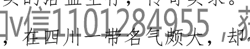

所谓血性，这个东西很玄，因为它不关一切外的东西，不关身高，不关力量，只是单指男生于天地间，那铮铮的一身铁骨，那顶天地的气概。

关于这个，好像跟我我要说的故事有点远了。不过，我只是想想，看过太多的描写关于黑帮的网文，却大多数都是写东北的。在这里，我只想写一个南方的，在四川的，真实的黑帮故事。

算搞搞笑的说，四川男人的血性，用错了地方，就沦落成了黑帮。

大家尽量把这个故事看吧，因为在叙述过程中不能百百是真实的，我能保证，获取更多好帖。

只是希望看过之后，大家能有一些思考，那所风光的背后，有多少的罪恶，和要付出多大的代价......

### 我的一个小故事

写这个之前，先说我一个小故事吧。因为这件事带给了我极大的震撼，也可以是在某种程度，改变了我人生的轨迹。

我是一个 80 后，这个词我真还说说是褒义还是贬义。毕竟在上一代人的眼中，我们这一代是那样的不知天高地厚，很多的传统美德在我们手里就像断了传承，自私，也许这是我们 80 后，最贴切的一个形容词。呵呵，可以理解吧，毕竟，都是独生子啊。

发生那件事的时候，应该是99 年。那时候的我还是一个高中中生，而那时候的我的人生观是扭曲的。关于这一点，到现在我都很肯定。为什么这么说呢？单说我眼中英雄的变更，我想大家就明白了。

还记得小时候，我爸爸常常问我，大了要干什么啊，我想会解放生的回答，要当解放（[此处应为解放军]）。再问为什么啊，我就会一本正经的回答，要学习董培存，要当英雄！这是一点我都不做错的回答，在小时候心里真想想。觉得他们是英雄而我，也想当英雄。

而慢慢长大之后，那些在我的心里曾经有那么高的英雄形象，就慢慢慢慢消失了。最开始的英雄，最后消失的，就是这样一点一点消失的。

“仔仔一向我，大晒我玩，洪兴掌管一带，波澜赛宴与大档舱连锁、“拖”地至高界！”在里面忍不住还是一吼，80 后的哥们，你们还记得吧？

不得不承认，古天仔这部系列电影的风靡，对我的影响是那么的大，到我高中的时候，我眼中的英雄，就成了剧的主角，什么浩南啊，山鸡！！因为我想我的人生也和他们一样，热血，义气，大块吃肉，大口喝酒，无拘无束，快意恩仇！因为我想我的人生也和他们一样……在那时的眼里根本毫无价值！


不得不承认，古天仔这部系列电影的风靡，对我的影响是那么的大，到我高中的时候，我眼中的英雄，就成了剧的主角，什么浩南啊，山鸡！！因为我想我的人生也和他们一样，热血，义气，大块吃肉，大口喝酒，无拘无束，快意恩仇！

- “仔仔一向我，大晒我玩，洪兴掌管一带，波澜赛宴与大档舱连锁、“拖”地至高界！”在里面忍不住还是一吼，80 后的哥们，你们还记得吧？

不得不承认，古天仔这部系列电影的风靡，对我的影响是那么的大，到我高中的时候，我眼中的英雄，就成了剧的主角，什么浩南啊，山鸡！！因为我想我的人生也和他们一样，热血，义气，大块吃肉，大口喝酒，无拘无束，快意恩仇！

……（后续OCR文本存在大量重复与乱码，已根据语义逻辑合并处理）


维护自己的自尊，表达了我田园就算被咬，也不会害怕。

发生那一刻的市场乱开了锅，我现在还记得其中一个喝茶的人的表现。当时，茶馆正在给他加热水，忽然觉得脸上烫了一下，就大叫起来：“你搞愣子，倒水都倒我脸上来了！”那茶馆当时看着他愣了，然后才慌乱的转过头看着背后，估计茶馆这不正常的表现也会让那个客人觉得有点不对，伸手往脸上一摸，再一看，靠，哪里是热水啊，分明就是血。他立刻刻了，本能的站了起来，往茶馆的方向一看，发现脸上的血是从那脸边过来的。

写到这里，有朋友肯定觉得，靠，有那么夸张吗？n这里我想我是，是的，就有我专张！其实，后来被捕捕的首要要是，我心里很愧疚对田园，是是害了这么多朋友的贴子。

## 管理1021

可知道，那一条实实在在的田园的颈脉，也就是那一刀，要了田园的命。
再说的时候的我，在大大了，用口叫救车他就愣了，其实，我自己也说不上来自己自己在想些什么。我连跑去看田园的勇气都没有，我很清楚的记得当时自己身体的反应，就是从指尖开始一直发，麻到头顶。四处溅的血，让我的胃在抽插，我想吐又想哭，结果，我什么都没做出，就这样呆呆的站着，直到蹲下。

我想，这种感觉很乱兮，却很难说的清楚，活生的就在眼前，自己的一个朋友把另外一个朋友毁了。（当时，我不知道田园会会），后来，就记得得吵嘈嚷的，然后救护车来，然后警察来。到最后，自己怎么回家的，我都不太清楚了。那是一种比醉还要难受的感觉。

(等下还有一更，希望能够继续捧扬，其实，本人在忙2本书，一本是要准备写在起点的，一本就是这个，但是，我保证这绝书绝对不太烂，而且故事还很长，希望大家多点鼓励!)

作者：至死已 日期：2009-03-22 22:58
作者：鬼家 GTO 回复日期：2009-03-22 22:27:51
作者：至死已未提交日期：2009-03-22 72:03:00 访问：3079 回：25

## 一整理，加v信1101284955，获取更多好帖

四川的男人（C城市除外），相信大家都大概知道哪个城市）都是极有血性的。

============================

吼C城市除外？楼主弯脚杆来成都打工，在火车北站被派出所查暂住证打过吗？

============================

不知道你那么激动做什么？第一，我只是说C城，并没有说明是哪里，你怎么就那么肯定是你所在的城市？对对号入座�水

这种事情做不得。除非你也承认别人对你这座城市的男人，评价很差劲。第二，看书看看而已，人生攻击就不不用了，我一向认为我口舌之功，和你们城市的男人没得比，我想说你们还是劣质的，至少哑人很劣质！

作者:至死已 日期:2009-03-22 23:15
作者:helloworl11 回复日期：2009-03-22 22:54:56
作者:至死已末提交日期：2009-03-22 23:03:00 访问：3375 回

那无意中看了一篇文章，说是各个地方的士兵打仗伏击程度的排行，四川兵排在第二。


> 就是爹&quot;的：四川兵有稀有的棍，是一起枪，一杆是大烟枪，这个谁人不知道，谁人不晓？你就这个二B给四川锤子上金！

请注意素质，你这样说就是给你们省的人脸上增光了？
别张口就是B不B的，你是在显示对女性某器官的崇拜？
大家说话要有理有据，中国有多少个省？大概有地理知识的大家都知道，建国时中国只出了 10 大帅。四川占了几个？你知道？陈毅元帅、朱德元帅、刘伯承帅、聂荣元帅。你说他们不是四川人。当然，我们也不要忘了小伙伴同志，也是从战火里走出来的革命前辈。

闭上你的嘴，中国人本来就是一家，你这是在挑拨什么？有力气打 RB，打 TW，打 MG 去，在这里里闹了，你就牛了了？

作者：至死已未 日期：2009-03-23 00:26

而肖三家里别人说，当天就跑了，去哪里了？？很多人都说他是云南，至于他到底去了哪里，我并不知道，只知道10 天没有，他以及另外 2 个人被逮捕归案了。

不过，由于太多，另外 2 个人就被释放了。因为肖三试图买的车辆，没下来，警方还找了18 年，所以死刑已经没什么剧了。田园那边又是一场悲剧，他的尸体在宾馆停一个星期。

肖三处决前，他哥去看过他，以后，他哥变了一个老实的人，关于那次见面，原话给大家发出来。

看着我弟弟，真的，那眼神我望了。绝望极了，看到我第一句话就说：“妈妈，救我啊！”

这种哭，哭哭哭哭哭哭哭哭哭哭哭哭的哭地上，哭剧就说了一个字，他就跪到地上，一直喊着妈妈，救我啊……

田园下葬之前，他妈妈一直哭，当时他哥，从一个比肖三还混的杂皮，变成了一个人。最后还是田园爸，一个耳光扇过去，她妈妈丢了那个骨灰，嚎大哭起来。后来别人来说，都说，要是不是田园爸扇一耳光，她妈妈当时就不疯了。

事后，我曾经问过他爸妈，为什么他妈妈那么喜欢他儿子事发之后，却表现得那么无情；最后都是我的一段话给王经理，告诉他我下辈子再也没有好处，获取勇敢的事。

末了，我爸还加了一句，所以，你一定要好的，别担心什么了，你不知道你一出点事，你妈妈就在家里哭直流眼泪吗？好好读书吧，毕竟你是我们的希望。

事情写到这里大概结束了，我的一点小故事讲到了这里。

不过在这里我还是想罗嗦两句，真的，如果不是那件事的发生，我也许就不会会醒，或许会醒悟，可能也不会那么快！我其实一直不能接受两个活生生的朋友就这样消失了，而且是用这种方式，再看他们找之后，家里人的反应如果再不能明白什么，我就很狠的扇自己了，道理其实不用来说，大家想想也明白，我想我也不用去说教什么了，其实，我烦这个。

而他们为什么在农贸市场上那次冲突，我想给大家简单交代几句吧，事情是一个小姐的女人引起的，原因很简单，就是肖三遇到她的时候，骂了她句X女人，她就回了，这是正常的。可是可能的，他拿了50块钱买田，让帮教训一下肖三，田园没要，那女人的要求他答应了，我前面也说过，田园是个不会会拒绝人的。他他还认识那个女人。

然后，就更简单了，那天正在茶馆抓码（就是打牌，金花）的肖三，被田园和他几个兄弟闹了个，就在那里被打了，扇了几个耳光。肖三就觉得在那么多人的地方被打，丢了面子。

可，值得吗？也许，再说这些，也没用了。

那时候，四川夏天的天气炎热又潮湿，那个年代根本没有活动，所以在夏天傍晚吃凉粉就是当时最大的娱乐。夏天有几个待业青年在纳凉，待业青年是那个时代一个特殊的词。直到后来考上大学，怕是高中没读过都会开除的。以上，我是想说，之所以要重点四川，是因为我生活在四川，知道这里的一切事，没有针对方的意思。开文那句，看过太多的描写关于黑帮的网文，都是写东北的。在这里，我只想写南方的，在四川的，真实的黑帮那种。

## 第一章 一瓶啤酒引发血案

83年，特殊的一年，或许对普通百姓来说没有什么，但是对于那些黑道人来说却是难得的一年。那个时代的严打运动厉害到了什么程度？全国百分之九十五的黑帮被肃灭。不止黑帮，连平时并没有恶意的小流也被遭到了灭顶之灾。

言归正传，虽然他们被人看不起，但纳凉也是无可何的事儿，怎么会闹到里面去？坏事就是他们开了玩笑，而且年轻人的冲动让他们把这个玩笑变成了现实。

当时，我们那里是一个厂区，厂区子弟俩不管待业的，大家之间是比较熟悉的。所以，当时一个女的走过他们晾的地方，他们就出来了，是他们同学。恰巧的是，其中一个还喜欢这女同学。于是，其中有人调侃起来了，说道：

> “XX，听说你喜欢这女娃？”
> “扯这些做什么？多久以前的事儿了。”
> “你就装吧！”
“谁装了，现在哪里！”

激到了当时那个喜欢这女同学的人，他真就冲过去杀了。那女的自然被他人杀了一下，就做出所有女都会反应，一声尖叫。这声尖叫，引起了当时正在厂区巡逻的民兵排（民兵排在83年是怎样的作用和地位，不知道的朋友可以问家里的老辈）。没话说，流氓罪，这小子当时就被抓了。

后来，判决时，定性的影响坏的流氓罪，是因为是在众目目睹的厂区，而且天天黑。所以死刑！这半点都没夸张，就是当时的事实。那时，还有个特色就是抓住的重犯，一律是要游街的，这小子在枪口前，还去了游街。我当时也是民兵排的，必须站在那解放车上，押着犯人同游街，所以，据我记得，这小子被警察从牢房里出来的时候，身上是被绳捆的，疼疼疼疼疼疼疼疼疼疼疼疼疼疼疼疼疼疼疼疼疼疼疼疼疼疼疼疼疼疼疼疼疼疼疼疼疼疼疼疼疼疼疼疼疼疼疼疼疼疼疼疼疼疼疼疼疼疼疼疼疼疼疼疼疼疼疼疼疼疼疼疼疼疼疼疼疼疼疼疼疼疼疼疼疼疼疼疼疼疼疼疼疼疼疼疼疼疼疼疼疼疼疼疼疼疼疼疼疼疼疼疼疼疼疼疼疼疼疼疼疼疼疼疼疼疼疼疼疼疼疼疼疼疼疼疼疼疼疼疼疼疼疼疼疼疼疼疼疼疼疼疼疼疼疼疼疼疼疼疼疼疼疼疼疼疼疼疼疼疼疼疼疼疼疼疼疼疼疼疼疼疼疼疼疼疼疼疼疼疼疼疼疼疼疼疼疼疼疼疼疼疼疼疼疼疼疼疼疼疼疼疼疼疼疼疼疼疼疼疼疼疼疼疼疼疼疼疼疼疼疼疼疼疼疼疼疼疼疼疼疼疼疼疼疼疼疼疼疼疼疼疼疼疼疼疼疼疼疼疼疼疼疼疼疼疼疼疼疼疼疼疼疼疼疼疼疼疼疼疼疼疼疼疼疼疼疼疼疼疼疼疼疼疼疼疼疼疼疼疼疼疼疼疼疼疼疼疼疼疼疼疼疼疼疼疼疼疼疼疼疼疼疼疼疼疼疼疼疼疼疼疼疼疼疼疼疼疼疼疼疼疼疼疼疼疼疼疼疼疼疼疼疼疼疼疼疼疼疼疼疼疼疼疼疼疼疼疼疼疼疼疼疼疼疼疼疼疼疼疼疼疼疼疼疼疼疼疼疼疼疼疼疼疼疼疼疼疼疼疼疼疼疼疼疼疼疼疼疼疼疼疼疼疼疼疼疼疼疼疼疼疼疼疼疼疼疼疼疼疼疼疼疼疼疼疼疼疼疼疼疼疼疼疼疼疼疼疼疼疼疼疼疼疼疼疼疼疼疼疼疼疼疼疼疼疼疼疼疼疼疼疼疼疼疼疼疼疼疼疼疼疼疼疼疼疼疼疼疼疼疼疼疼疼疼疼疼疼疼疼疼疼疼疼疼疼疼疼疼疼疼疼疼疼疼疼疼疼疼疼疼疼疼疼疼疼疼疼疼疼疼疼疼疼疼疼疼疼疼疼疼疼疼疼疼疼疼疼疼疼疼疼疼疼疼疼疼疼疼疼疼疼疼疼疼疼疼疼疼疼疼疼疼疼疼疼疼疼疼疼疼疼疼疼疼疼疼疼疼疼疼疼疼疼疼疼疼疼疼疼疼疼疼疼疼疼疼疼疼疼疼疼疼疼疼疼疼疼疼疼疼疼疼疼疼疼疼疼疼疼疼疼疼疼疼疼疼疼疼疼疼疼疼疼疼疼疼疼疼疼疼疼疼疼疼疼疼疼疼疼疼疼疼疼疼疼疼疼疼疼疼疼疼疼疼疼疼疼疼疼疼疼疼疼疼疼疼疼疼疼疼疼疼疼疼疼疼疼疼疼疼疼疼疼疼疼疼疼疼疼疼疼疼疼疼疼疼疼疼疼疼疼疼疼疼疼疼疼疼疼疼疼疼疼疼疼疼疼疼疼疼疼疼疼疼疼疼疼疼疼疼疼疼疼疼疼疼疼疼疼疼疼疼疼疼疼疼疼疼疼疼疼疼疼疼疼疼疼疼疼疼疼疼疼疼疼疼疼疼疼疼疼疼疼疼疼疼疼疼疼疼疼疼疼疼疼疼疼疼疼疼疼疼疼疼疼疼疼疼疼疼疼疼疼疼疼疼疼疼疼疼疼疼疼疼疼疼疼疼疼疼疼疼疼疼疼疼疼疼疼疼疼疼疼疼疼疼疼疼疼疼疼疼疼疼疼疼疼疼疼疼疼疼疼疼疼疼疼疼疼疼疼疼疼疼疼疼疼疼疼疼疼疼疼疼疼疼疼疼疼疼疼疼疼疼疼疼疼疼疼疼疼疼疼疼疼疼疼疼疼疼疼疼疼疼疼疼疼疼疼疼疼疼疼疼疼疼疼疼疼疼疼疼疼疼疼疼疼疼疼疼疼疼疼疼疼疼疼疼疼疼疼疼疼疼疼疼疼疼疼疼疼疼疼疼疼疼疼疼疼疼疼疼疼疼疼疼疼疼疼疼疼疼疼疼疼疼疼疼疼疼疼疼疼疼疼疼疼疼疼疼疼疼疼疼疼疼疼疼疼疼疼疼疼疼疼疼疼疼疼疼疼疼疼疼疼疼疼疼疼疼疼疼疼疼疼疼疼疼疼疼疼疼疼疼疼疼疼疼疼疼疼疼疼疼疼疼疼疼疼疼疼疼疼疼疼疼疼疼疼疼疼疼疼疼疼疼疼疼疼疼疼疼疼疼疼疼疼疼疼疼疼疼疼疼疼疼疼疼疼疼疼疼疼疼疼疼疼疼疼疼疼疼疼疼疼疼疼疼疼疼疼疼疼疼疼疼疼疼疼疼疼疼疼疼疼疼疼疼疼疼疼疼疼疼疼疼疼疼疼疼疼疼疼疼疼疼疼疼疼疼疼疼疼疼疼疼疼疼疼疼疼疼疼疼疼疼疼疼疼疼疼疼疼疼疼疼疼疼疼疼疼疼疼疼疼疼疼疼疼疼疼疼疼疼疼疼疼疼疼疼疼疼疼疼疼疼疼疼疼疼疼疼疼疼疼疼疼疼疼疼疼疼疼疼疼疼疼疼疼疼疼疼疼疼疼疼疼疼疼疼疼疼疼疼疼疼疼疼疼疼疼疼疼疼疼疼疼疼疼疼疼疼疼疼疼疼疼疼疼疼疼疼疼疼疼疼疼疼疼疼疼疼疼疼疼疼疼疼疼疼疼疼疼疼疼疼疼疼疼疼疼疼疼疼疼疼疼疼疼疼疼疼疼疼疼疼疼疼疼疼疼疼疼疼疼疼疼疼疼疼疼疼疼疼疼疼疼疼疼疼疼疼疼疼疼疼疼疼疼疼疼疼疼疼疼疼疼疼疼疼疼疼疼疼疼疼疼疼疼疼疼疼疼疼疼疼疼疼疼疼疼疼疼疼疼疼疼疼疼疼疼疼疼疼疼疼疼疼疼疼疼疼疼疼疼疼疼疼疼疼疼疼疼疼疼疼疼疼疼疼疼疼疼疼疼疼疼疼疼疼疼疼疼疼疼疼疼疼疼疼疼疼疼疼疼疼疼疼疼疼疼疼疼疼疼疼疼疼疼疼疼疼疼疼疼疼疼疼疼疼疼疼疼疼疼疼疼疼疼疼疼疼疼疼疼疼疼疼疼疼疼疼疼疼疼疼疼疼疼疼疼疼疼疼疼疼疼疼疼疼疼疼疼疼疼疼疼疼疼疼疼疼疼疼疼疼疼疼疼疼疼疼疼疼疼疼疼疼疼疼疼疼疼疼疼疼疼疼疼疼疼疼疼疼疼疼疼疼疼疼疼疼疼疼疼疼疼疼疼疼疼疼疼疼疼疼疼疼疼疼疼疼疼疼疼疼疼疼疼疼疼疼疼疼疼疼疼疼疼疼疼疼疼疼疼疼疼疼疼疼疼疼疼疼疼疼疼疼疼疼疼疼疼疼疼疼疼疼疼疼疼疼疼疼疼疼疼疼疼疼疼疼疼疼疼疼疼疼疼疼疼疼疼疼疼疼疼疼疼疼疼疼疼疼疼疼疼疼疼疼疼疼疼疼疼疼疼疼疼疼疼疼疼疼疼疼疼疼疼疼疼疼疼疼疼疼疼疼疼疼疼疼疼疼疼疼疼疼疼疼疼疼疼疼疼疼疼疼疼疼疼疼疼疼疼疼疼疼疼疼疼疼疼疼疼疼疼疼疼疼疼疼疼疼疼疼疼疼疼疼疼疼疼疼疼疼疼疼疼疼疼疼疼疼疼疼疼疼疼疼疼疼疼疼疼疼疼疼疼疼疼疼疼疼疼疼疼疼疼疼疼疼疼疼疼疼疼疼疼疼疼疼疼疼疼疼疼疼疼疼疼疼疼疼疼疼疼疼疼疼疼疼疼疼疼疼疼疼疼疼疼疼疼疼疼疼疼疼疼疼疼疼疼疼疼疼疼疼疼疼疼疼疼疼疼疼疼疼疼疼疼疼疼疼疼疼疼疼疼疼疼疼疼疼疼疼疼疼疼疼疼疼疼疼疼疼疼疼疼疼疼疼疼疼疼疼疼疼疼疼疼疼疼疼疼疼疼疼疼疼疼疼疼疼疼疼疼疼疼疼疼疼疼疼疼疼疼疼疼疼疼疼疼疼疼疼疼疼疼疼疼疼疼疼疼疼疼疼疼疼疼疼疼疼疼疼疼疼疼疼疼疼疼疼疼疼疼疼疼疼疼疼疼疼疼疼疼疼疼疼疼疼疼疼疼疼疼疼疼疼疼疼疼疼疼疼疼疼疼疼疼疼疼疼疼疼疼疼疼疼疼疼疼疼疼疼疼疼疼疼疼疼疼疼疼疼疼疼疼疼疼疼疼疼疼疼疼疼疼疼疼疼疼疼疼疼疼疼疼疼疼疼疼疼疼疼疼疼疼疼疼疼疼疼疼疼疼疼疼疼疼疼疼疼疼疼疼疼疼疼疼疼疼疼疼疼疼疼疼疼疼疼疼疼疼疼疼疼疼疼疼疼疼疼疼疼疼疼疼疼疼疼疼疼疼疼疼疼疼疼疼疼疼疼疼疼疼疼疼疼疼疼疼疼疼疼疼疼疼疼疼疼疼疼疼疼疼疼疼疼疼疼疼疼疼疼疼疼疼疼疼疼疼疼疼疼疼疼疼疼疼疼疼疼疼疼疼疼疼疼疼疼疼疼疼疼疼疼疼疼疼疼疼疼疼疼疼疼疼疼疼疼疼疼疼疼疼疼疼疼疼疼疼疼疼疼疼疼疼疼疼疼疼疼疼疼疼疼疼疼疼疼疼疼疼疼疼疼疼疼疼疼疼疼疼疼疼疼疼疼疼疼疼疼疼疼疼疼疼疼疼疼疼疼疼疼疼疼疼疼疼疼疼疼疼疼疼疼疼疼疼疼疼疼疼疼疼疼疼疼疼疼疼疼疼疼疼疼疼疼疼疼疼疼疼疼疼疼疼疼疼疼疼疼疼疼疼疼疼疼疼疼疼疼疼疼疼疼疼疼疼疼疼疼疼疼疼疼疼疼疼疼疼疼疼疼疼疼疼疼疼疼疼疼疼疼疼疼疼疼疼疼疼疼疼疼疼疼疼疼疼疼疼疼疼疼疼疼疼疼疼疼疼疼疼疼疼疼疼疼疼疼疼疼疼疼疼疼疼疼疼疼疼疼疼疼疼疼疼疼疼疼疼疼疼疼疼疼疼疼疼疼疼疼疼疼疼疼疼疼疼疼疼疼疼疼疼疼疼疼疼疼疼疼疼疼疼疼疼疼疼疼疼疼疼疼疼疼疼疼疼疼疼疼疼疼疼疼疼疼疼疼疼疼疼疼疼疼疼疼疼疼疼疼疼疼疼疼疼疼疼疼疼疼疼疼疼疼疼疼疼疼疼疼疼疼疼疼疼疼疼疼疼疼疼疼疼疼疼疼疼疼疼疼疼疼疼疼疼疼疼疼疼疼疼疼疼疼疼疼疼疼疼疼疼疼疼疼疼疼疼疼疼疼疼疼疼疼疼疼疼疼疼疼疼疼疼疼疼疼疼疼疼疼疼疼疼疼疼疼疼疼疼疼疼疼疼疼疼疼疼疼疼疼疼疼疼疼疼疼疼疼疼疼疼疼疼疼疼疼疼疼疼疼疼疼疼疼疼疼疼疼疼疼疼疼疼疼疼疼疼疼疼疼疼疼疼疼疼疼疼疼疼疼疼疼疼疼疼疼疼疼疼疼疼疼疼疼疼疼疼疼疼疼疼疼疼疼疼疼疼疼疼疼疼疼疼疼疼疼疼疼疼疼疼疼疼疼疼疼疼疼疼疼疼疼疼疼疼疼疼疼疼疼疼疼疼疼疼疼疼疼疼疼疼疼疼疼疼疼疼疼疼疼疼疼疼疼疼疼疼疼疼疼疼疼疼疼疼疼疼疼疼疼疼疼疼疼疼疼疼疼疼疼疼疼疼疼疼疼疼疼疼疼疼疼疼疼疼疼疼疼疼疼疼疼疼疼疼疼疼疼疼疼疼疼疼疼疼疼疼疼疼疼疼疼疼疼疼疼疼疼疼疼疼疼疼疼疼疼疼疼疼疼疼疼疼疼疼疼疼疼疼疼疼疼疼疼疼疼疼疼疼疼疼疼疼疼疼疼疼疼疼疼疼疼疼疼疼疼疼疼疼疼疼疼疼疼疼疼疼疼疼疼疼疼疼疼疼疼疼疼疼疼疼疼疼疼疼疼疼疼疼疼疼疼疼疼疼疼疼疼疼疼疼疼疼疼疼疼疼疼疼疼疼疼疼疼疼疼疼疼疼疼疼疼疼疼疼疼疼疼疼疼疼疼疼疼疼疼疼疼疼疼疼疼疼疼疼疼疼疼疼疼疼疼疼疼疼疼疼疼疼疼疼疼疼疼疼疼疼疼疼疼疼疼疼疼疼疼疼疼疼疼疼疼疼疼疼疼疼疼疼疼疼疼疼疼疼疼疼疼疼疼疼疼疼疼疼疼疼疼疼疼疼疼疼疼疼疼疼疼疼疼疼疼疼疼疼疼疼疼疼疼疼疼疼疼疼疼疼疼疼疼疼疼疼疼疼疼疼疼疼疼疼疼疼疼疼疼疼疼疼疼疼疼疼疼疼疼疼疼疼疼疼疼疼疼疼疼疼疼疼疼疼疼疼疼疼疼疼疼疼疼疼疼疼疼疼疼疼疼疼疼疼疼疼疼疼疼疼疼疼疼疼疼疼疼疼疼疼疼疼疼疼疼疼疼疼疼疼疼疼疼疼疼疼疼疼疼疼疼疼疼疼疼疼疼疼疼疼疼疼疼疼疼疼疼疼疼疼疼疼疼疼疼疼疼疼疼疼疼疼疼疼疼疼疼疼疼疼疼疼疼疼疼疼疼疼疼疼疼疼疼疼疼疼疼疼疼疼疼疼疼疼疼疼疼疼疼疼疼疼疼疼疼疼疼疼疼疼疼疼疼疼疼疼疼疼疼疼疼疼疼疼疼疼疼疼疼疼疼疼疼疼疼疼疼疼疼疼疼疼疼疼疼疼疼疼疼疼疼疼疼疼疼疼疼疼疼疼疼疼疼疼疼疼疼疼疼疼疼疼疼疼疼疼疼疼疼疼疼疼疼疼疼疼疼疼疼疼疼疼疼疼疼疼疼疼疼疼疼疼疼疼疼疼疼疼疼疼疼疼疼疼疼疼疼疼疼疼疼疼疼疼疼疼疼疼疼疼疼疼疼疼疼疼疼疼疼疼疼疼疼疼疼疼疼疼疼疼疼疼疼疼疼疼疼疼疼疼疼疼疼疼疼疼疼疼疼疼疼疼疼疼疼疼疼疼疼疼疼疼疼疼疼疼疼疼疼疼疼疼疼疼疼疼疼疼疼疼疼疼疼疼疼疼疼疼疼疼疼疼疼疼疼疼疼疼疼疼疼疼疼疼疼疼疼疼疼疼疼疼疼疼疼疼疼疼疼疼疼疼疼疼疼疼疼疼疼疼疼疼疼疼疼疼疼疼疼疼疼疼疼疼疼疼疼疼疼疼疼疼疼疼疼疼疼疼疼疼疼疼疼疼疼疼疼疼疼疼疼疼疼疼疼疼疼疼疼疼疼疼疼疼疼疼疼疼疼疼疼疼疼疼疼疼疼疼疼疼疼疼疼疼疼疼疼疼疼疼疼疼疼疼疼疼疼疼疼疼疼疼疼疼疼疼疼疼疼疼疼疼疼疼疼疼疼疼疼疼疼疼疼疼疼疼疼疼疼疼疼疼疼疼疼疼疼疼疼疼疼疼疼疼疼疼疼疼疼疼疼疼疼疼疼疼疼疼疼疼疼疼疼疼疼疼疼疼疼疼疼疼疼疼疼疼疼疼疼疼疼疼疼疼疼疼疼疼疼疼疼疼疼疼疼疼疼疼疼疼疼疼疼疼疼疼疼疼疼疼疼疼疼疼疼疼疼疼疼疼疼疼疼疼疼疼疼疼疼疼疼疼疼疼疼疼疼疼疼疼疼疼疼疼疼疼疼疼疼疼疼疼疼疼疼疼疼疼疼疼疼疼疼疼疼疼疼疼疼疼疼疼疼疼疼疼疼疼疼疼疼疼疼疼疼疼疼疼疼疼疼疼疼疼疼疼疼疼疼疼疼疼疼疼疼疼疼疼疼疼疼疼疼疼疼疼疼疼疼疼疼疼疼疼疼疼疼疼疼疼疼疼疼疼疼疼疼疼疼疼疼疼疼疼疼疼疼疼疼疼疼疼疼疼疼疼疼疼疼疼疼疼疼疼疼疼疼疼疼疼疼疼疼疼疼疼疼疼疼疼疼疼疼疼疼疼疼疼疼疼疼疼疼疼疼疼疼疼疼疼疼疼疼疼疼疼疼疼疼疼疼疼疼疼疼疼疼疼疼疼疼疼疼疼疼疼疼疼疼疼疼疼疼疼疼疼疼疼疼疼疼疼疼疼疼疼疼疼疼疼疼疼疼疼疼疼疼疼疼疼疼疼疼疼疼疼疼疼疼疼疼疼疼疼疼疼疼疼疼疼疼疼疼疼疼疼疼疼疼疼疼疼疼疼疼疼疼疼疼疼疼疼疼疼疼疼疼疼疼疼疼疼疼疼疼疼疼疼疼疼疼疼疼疼疼疼疼疼疼疼疼疼疼疼疼疼疼疼疼疼疼疼疼疼疼疼疼疼疼疼疼疼疼疼疼疼疼疼疼疼疼疼疼疼疼疼疼疼疼疼疼疼疼疼疼疼疼疼疼疼疼疼疼疼疼疼疼疼疼疼疼疼疼疼疼疼疼疼疼疼疼疼疼疼疼疼疼疼疼疼疼疼疼疼疼疼疼疼疼疼疼疼疼疼疼疼疼疼疼疼疼疼疼疼疼疼疼疼疼疼疼疼疼疼疼疼疼疼疼疼疼疼疼疼疼疼疼疼疼疼疼疼疼疼疼疼疼疼疼疼疼疼疼疼疼疼疼疼疼疼疼疼疼疼疼疼疼疼疼疼疼疼疼疼疼疼疼疼疼疼疼疼疼疼疼疼疼疼疼疼疼疼疼疼疼疼疼疼疼疼疼疼疼疼疼疼疼疼疼疼疼疼疼疼疼疼疼疼疼疼疼疼疼疼疼疼疼疼疼疼疼疼疼疼疼疼疼疼疼疼疼疼疼疼疼疼疼疼疼疼疼疼疼疼疼疼疼疼疼疼疼疼疼疼疼疼疼疼疼疼疼疼疼疼疼疼疼疼疼疼疼疼疼疼疼疼疼疼疼疼疼疼疼疼疼疼疼疼疼疼疼疼疼疼疼疼疼疼疼疼疼疼疼疼疼疼疼疼疼疼疼疼疼疼疼疼疼疼疼疼疼疼疼疼疼疼疼疼疼疼疼疼疼疼疼疼疼疼疼疼疼疼疼疼疼疼疼疼疼疼疼疼疼疼疼疼疼疼疼疼疼疼疼疼疼疼疼疼疼疼疼疼疼疼疼疼疼疼疼疼疼疼疼疼疼疼疼疼疼疼疼疼疼疼疼疼疼疼疼疼疼疼疼疼疼疼疼疼疼疼疼疼疼疼疼疼疼疼疼疼疼疼疼疼疼疼疼疼疼疼疼疼疼疼疼疼疼疼疼疼疼疼疼疼疼疼疼疼疼疼疼疼疼疼疼疼疼疼疼疼疼疼疼疼疼疼疼疼疼疼疼疼疼疼疼疼疼疼疼疼疼疼疼疼疼疼疼疼疼疼疼疼疼疼疼疼疼疼疼疼疼疼疼疼疼疼疼疼疼疼疼疼疼疼疼疼疼疼疼疼疼疼疼疼疼疼疼疼疼疼疼疼疼疼疼疼疼疼疼疼疼疼疼疼疼疼疼疼疼疼疼疼疼疼疼疼疼疼疼疼疼疼疼疼疼疼疼疼疼疼疼疼疼疼疼疼疼疼疼疼疼疼疼疼疼疼疼疼疼疼疼疼疼疼疼疼疼疼疼疼疼疼疼疼疼疼疼疼疼疼疼疼疼疼疼疼疼疼疼疼疼疼疼疼疼疼疼疼疼疼疼疼疼疼疼疼疼疼疼疼疼疼疼疼疼疼疼疼疼疼疼疼疼疼疼疼疼疼疼疼疼疼疼疼疼疼疼疼疼疼疼疼疼疼疼疼疼疼疼疼疼疼疼疼疼疼疼疼疼疼疼疼疼疼疼疼疼疼疼疼疼疼疼疼疼疼疼疼疼疼疼疼疼疼疼疼疼疼疼疼疼疼疼疼疼疼疼疼疼疼疼疼疼疼疼疼疼疼疼疼疼疼疼疼疼疼疼疼疼疼疼疼疼疼疼疼疼疼疼疼疼疼疼疼疼疼疼疼疼疼疼疼疼疼疼疼疼疼疼疼疼疼疼疼疼疼疼疼疼疼疼疼疼疼疼疼疼疼疼疼疼疼疼疼疼疼疼疼疼疼疼疼疼疼疼疼疼疼疼疼疼疼疼疼疼疼疼疼疼疼疼疼疼疼疼疼疼疼疼疼疼疼疼疼疼疼疼疼疼疼疼疼疼疼疼疼疼疼疼疼疼疼疼疼疼疼疼疼疼疼疼疼疼疼疼疼疼疼疼疼疼疼疼疼疼疼疼疼疼疼疼疼疼疼疼疼疼疼疼疼疼疼疼疼疼疼疼疼疼疼疼疼疼疼疼疼疼疼疼疼疼疼疼疼疼疼疼疼疼疼疼疼疼疼疼疼疼疼疼疼疼疼疼疼疼疼疼疼疼疼疼疼疼疼疼疼疼疼疼疼疼疼疼疼疼疼疼疼疼疼疼疼疼疼疼疼疼疼疼疼疼疼疼疼疼疼疼疼疼疼疼疼疼疼疼疼疼疼疼疼疼疼疼疼疼疼疼疼疼疼疼疼疼疼疼疼疼疼疼疼疼疼疼疼疼疼疼疼疼疼疼疼疼疼疼疼疼疼疼疼疼疼疼疼疼疼疼疼疼疼疼疼疼疼疼疼疼疼疼疼疼疼疼疼疼疼疼疼疼疼疼疼疼疼疼疼疼疼疼疼疼疼疼疼疼疼疼疼疼疼疼疼疼疼疼疼疼疼疼疼疼疼疼疼疼疼疼疼疼疼疼疼疼疼疼疼疼疼疼疼疼疼疼疼疼疼疼疼疼疼疼疼疼疼疼疼疼疼疼疼疼疼疼疼疼疼疼疼疼疼疼疼疼疼疼疼疼疼疼疼疼疼疼疼疼疼疼疼疼疼疼疼疼疼疼疼疼疼疼疼疼疼疼疼疼疼疼疼疼疼疼疼疼疼疼疼疼疼疼疼疼疼疼疼疼疼疼疼疼疼疼疼疼疼疼疼疼疼疼疼疼疼疼疼疼疼疼疼疼疼疼疼疼疼疼疼疼疼疼疼疼疼疼疼疼疼疼疼疼疼疼疼疼疼疼疼疼疼疼疼疼疼疼疼疼疼疼疼疼疼疼疼疼疼疼疼疼疼疼疼疼疼疼疼疼疼疼疼疼疼疼疼疼疼疼疼疼疼疼疼疼疼疼疼疼疼疼疼疼疼疼疼疼疼疼疼疼疼疼疼疼疼疼疼疼疼疼疼疼疼疼疼疼疼疼疼疼疼疼疼疼疼疼疼疼疼疼疼疼疼疼疼疼疼疼疼疼疼疼疼疼疼疼疼疼疼疼疼疼疼疼疼疼疼疼疼疼疼疼疼疼疼疼疼疼疼疼疼疼疼疼疼疼疼疼疼疼疼疼疼疼疼疼疼疼疼疼疼疼疼疼疼疼疼疼疼疼疼疼疼疼疼疼疼疼疼疼疼疼疼疼疼疼疼疼疼疼疼疼疼疼疼疼疼疼疼疼疼疼疼疼疼疼疼疼疼疼疼疼疼疼疼疼疼疼疼疼疼疼疼疼疼疼疼疼疼疼疼疼疼疼疼疼疼疼疼疼疼疼疼疼疼疼疼疼疼疼疼疼疼疼疼疼疼疼疼疼疼疼疼疼疼疼疼疼疼疼疼疼疼疼疼疼疼疼疼疼疼疼疼疼疼疼疼疼疼疼疼疼疼疼疼疼疼疼疼疼疼疼疼疼疼疼疼疼疼疼疼疼疼疼疼疼疼疼疼疼疼疼疼疼疼疼疼疼疼疼疼疼疼疼疼疼疼疼疼疼疼疼疼疼疼疼疼疼疼疼疼疼疼疼疼疼疼疼疼疼疼疼疼疼疼疼疼疼疼疼疼疼疼疼疼疼疼疼疼疼疼疼疼疼疼疼疼疼疼疼疼疼疼疼疼疼疼疼疼疼疼疼疼疼疼疼疼疼疼疼疼疼疼疼疼疼疼疼疼疼疼疼疼疼疼疼疼疼疼疼疼疼疼疼疼疼疼疼疼疼疼疼疼疼疼疼疼疼疼疼疼疼疼疼疼疼疼疼疼疼疼疼疼疼疼疼疼疼疼疼疼疼疼疼疼疼疼疼疼疼疼疼疼疼疼疼疼疼疼疼疼疼疼疼疼疼疼疼疼疼疼疼疼疼疼疼疼疼疼疼疼疼疼疼疼疼疼疼疼疼疼疼疼疼疼疼疼疼疼疼疼疼疼疼疼疼疼疼疼疼疼疼疼疼疼疼疼疼疼疼疼疼疼疼疼疼疼疼疼疼疼疼疼疼疼疼疼疼疼疼疼疼疼疼疼疼疼疼疼疼疼疼疼疼疼疼疼疼疼疼疼疼疼疼疼疼疼疼疼疼疼疼疼疼疼疼疼疼疼疼疼疼疼疼疼疼疼疼疼疼疼疼疼疼疼疼疼疼疼疼疼疼疼疼疼疼疼疼疼疼疼疼疼疼疼疼疼疼疼疼疼疼疼疼疼疼疼疼疼疼疼疼疼疼疼疼疼疼疼疼疼疼疼疼疼疼疼疼疼疼疼疼疼疼疼疼疼疼疼疼疼疼疼疼疼疼疼疼疼疼疼疼疼疼疼疼疼疼疼疼疼疼疼疼疼疼疼疼疼疼疼疼疼疼疼疼疼疼疼疼疼疼疼疼疼疼疼疼疼疼疼疼疼疼疼疼疼疼疼疼疼疼疼疼疼疼疼疼疼疼疼疼疼疼疼疼疼疼疼疼疼疼疼疼疼疼疼疼疼疼疼疼疼疼疼疼疼疼疼疼疼疼疼疼疼疼疼疼疼疼疼疼疼疼疼疼疼疼疼疼疼疼疼疼疼疼疼疼疼疼疼疼疼疼疼疼疼疼疼疼疼疼疼疼疼疼疼疼疼疼疼疼疼疼疼疼疼疼疼疼疼疼疼疼疼疼疼疼疼疼疼疼疼疼疼疼疼疼疼疼疼疼疼疼疼疼疼疼疼疼疼疼疼疼疼疼疼疼疼疼疼疼疼疼疼疼疼疼疼疼疼疼疼疼疼疼疼疼疼疼疼疼疼疼疼疼疼疼疼疼疼疼疼疼疼疼疼疼疼疼疼疼疼疼疼疼疼疼疼疼疼疼疼疼疼疼疼疼疼疼疼疼疼疼疼疼疼疼疼疼疼疼疼疼疼疼疼疼疼疼疼疼疼疼疼疼疼疼疼疼疼疼疼疼疼疼疼疼疼疼疼疼疼疼疼疼疼疼疼疼疼疼疼疼疼疼疼疼疼疼疼疼疼疼疼疼疼疼疼疼疼疼疼疼疼疼疼疼疼疼疼疼疼疼疼疼疼疼疼疼疼疼疼疼疼疼疼疼疼疼疼疼疼疼疼疼疼疼疼疼疼疼疼疼疼疼疼疼疼疼疼疼疼疼疼疼疼疼疼疼疼疼疼疼疼疼疼疼疼疼疼疼疼疼疼疼疼疼疼疼疼疼疼疼疼疼疼疼疼疼疼疼疼疼疼疼疼疼疼疼疼疼疼疼疼疼疼疼疼疼疼疼疼疼疼疼疼疼疼疼疼疼疼疼疼疼疼疼疼疼疼疼疼疼疼疼疼疼疼疼疼疼疼疼疼疼疼疼疼疼疼疼疼疼疼疼疼疼疼疼疼疼疼疼疼疼疼疼疼疼疼疼疼疼疼疼疼疼疼疼疼疼疼疼疼疼疼疼疼疼疼疼疼疼疼疼疼疼疼疼疼疼疼疼疼疼疼疼疼疼疼疼疼疼疼疼疼疼疼疼疼疼疼疼疼疼疼疼疼疼疼疼疼疼疼疼疼疼疼疼疼疼疼疼疼疼疼疼疼疼疼疼疼疼疼疼疼疼疼疼疼疼疼疼疼疼疼疼疼疼疼疼疼疼疼疼疼疼疼疼疼疼疼疼疼疼疼疼疼疼疼疼疼疼疼疼疼疼疼疼疼疼疼疼疼疼疼疼疼疼疼疼疼疼疼疼疼疼疼疼疼疼疼疼疼疼疼疼疼疼疼疼疼疼疼疼疼疼疼疼疼疼疼疼疼疼疼疼疼疼疼疼疼疼疼疼疼疼疼疼疼疼疼疼疼疼疼疼疼疼疼疼疼疼疼疼疼疼疼疼疼疼疼疼疼疼疼疼疼疼疼疼疼疼疼疼疼疼疼疼疼疼疼疼疼疼疼疼疼疼疼疼疼疼疼疼疼疼疼疼疼疼疼疼疼疼疼疼疼疼疼疼疼疼疼疼疼疼疼疼疼疼疼疼疼疼疼疼疼疼疼疼疼疼疼疼疼疼疼疼疼疼疼疼疼疼疼疼疼疼疼疼疼疼疼疼疼疼疼疼疼疼疼疼疼疼疼疼疼疼疼疼疼疼疼疼疼疼疼疼疼疼疼疼疼疼疼疼疼疼疼疼疼疼疼疼疼疼疼疼疼疼疼疼疼疼疼疼疼疼疼疼疼疼疼疼疼疼疼疼疼疼疼疼疼疼疼疼疼疼疼疼疼疼疼疼疼疼疼疼疼疼疼疼疼疼疼疼疼疼疼疼疼疼疼疼疼疼疼疼疼疼疼疼疼疼疼疼疼疼疼疼疼疼疼疼疼疼疼疼疼疼疼疼疼疼疼疼疼疼疼疼疼疼疼疼疼疼疼疼疼疼疼疼疼疼疼疼疼疼疼疼疼疼疼疼疼疼疼疼疼疼疼疼疼疼疼疼疼疼疼疼疼疼疼疼疼疼疼疼疼疼疼疼疼疼疼疼疼疼疼疼疼疼疼疼疼疼疼疼疼疼疼疼疼疼疼疼疼疼疼疼疼疼疼疼疼疼疼疼疼疼疼疼疼疼疼疼疼疼疼疼疼疼疼疼疼疼疼疼疼疼疼疼疼疼疼疼疼疼疼疼疼疼疼疼疼疼疼疼疼疼疼疼疼疼疼疼疼疼疼疼疼疼疼疼疼疼疼疼疼疼疼疼疼疼疼疼疼疼疼疼疼疼疼疼疼疼疼疼疼疼疼疼疼疼疼疼疼疼疼疼疼疼疼疼疼疼疼疼疼疼疼疼疼疼疼疼疼疼疼疼疼疼疼疼疼疼疼疼疼疼疼疼疼疼疼疼疼疼疼疼疼疼疼疼疼疼疼疼疼疼疼疼疼疼疼疼疼疼疼疼疼疼疼疼疼疼疼疼疼疼疼疼疼疼疼疼疼疼疼疼疼疼疼疼疼疼疼疼疼疼疼疼疼疼疼疼疼疼疼疼疼疼疼疼疼疼疼疼疼疼疼疼疼疼疼疼疼疼疼疼疼疼疼疼疼疼疼疼疼疼疼疼疼疼疼疼疼疼疼疼疼疼疼疼疼疼疼疼疼疼疼疼疼疼疼疼疼疼疼疼疼疼疼疼疼疼疼疼疼疼疼疼疼疼疼疼疼疼疼疼疼疼疼疼疼疼疼疼疼疼疼疼疼疼疼疼疼疼疼疼疼疼疼疼疼疼疼疼疼疼疼疼疼疼疼疼疼疼疼疼疼疼疼疼疼疼疼疼疼疼疼疼疼疼疼疼疼疼疼疼疼疼疼疼疼疼疼疼疼疼疼疼疼疼疼疼疼疼疼疼疼疼疼疼疼疼疼疼疼疼疼疼疼疼疼疼疼疼疼疼疼疼疼疼疼疼疼疼疼疼疼疼疼疼疼疼疼疼疼疼疼疼疼疼疼疼疼疼疼疼疼疼疼疼疼疼疼疼疼疼疼疼疼疼疼疼疼疼疼疼疼疼疼疼疼疼疼疼疼疼疼疼疼疼疼疼疼疼疼疼疼疼疼疼疼疼疼疼疼疼疼疼疼疼疼疼疼疼疼疼疼疼疼疼疼疼疼疼疼疼疼疼疼疼疼疼疼疼疼疼疼疼疼疼疼疼疼疼疼疼疼疼疼疼疼疼疼疼疼疼疼疼疼疼疼疼疼疼疼疼疼疼疼疼疼疼疼疼疼疼疼疼疼疼疼疼疼疼疼疼疼疼疼疼疼疼疼疼疼疼疼疼疼疼疼疼疼疼疼疼疼疼疼疼疼疼疼疼疼疼疼疼疼疼疼疼疼疼疼疼疼疼疼疼疼疼疼疼疼疼疼疼疼疼疼疼疼疼疼疼疼疼疼疼疼疼疼疼疼疼疼疼疼疼疼疼疼疼疼疼疼疼疼疼疼疼疼疼疼疼疼疼疼疼疼疼疼疼疼疼疼疼疼疼疼疼疼疼疼疼疼疼疼疼疼疼疼疼疼疼疼疼疼疼疼疼疼疼疼疼疼疼疼疼疼疼疼疼疼疼疼疼疼疼疼疼疼疼疼疼疼疼疼疼疼疼疼疼疼疼疼疼疼疼疼疼疼疼疼疼疼疼疼疼疼疼疼疼疼疼疼疼疼疼疼疼疼疼疼疼疼疼疼疼疼疼疼疼疼疼疼疼疼疼疼疼疼疼疼疼疼疼疼疼疼疼疼疼疼疼疼疼疼疼疼疼疼疼疼疼疼疼疼疼疼疼疼疼疼疼疼疼疼疼疼疼疼疼疼疼疼疼疼疼疼疼疼疼疼疼疼疼疼疼疼疼疼疼疼疼疼疼疼疼疼疼疼疼疼疼疼疼疼疼疼疼疼疼疼疼疼疼疼疼疼疼疼疼疼疼疼疼疼疼疼疼疼疼疼疼疼疼疼疼疼疼疼疼疼疼疼疼疼疼疼疼疼疼疼疼疼疼疼疼疼疼疼疼疼疼疼疼疼疼疼疼疼疼疼疼疼疼疼疼疼疼疼疼疼疼疼疼疼疼疼疼疼疼疼疼疼疼疼疼疼疼疼疼疼疼疼疼疼疼疼疼疼疼疼疼疼疼疼疼疼疼疼疼疼疼疼疼疼疼疼疼疼疼疼疼疼疼疼疼疼疼疼疼疼疼疼疼疼疼疼疼疼疼疼疼疼疼疼疼疼疼疼疼疼疼疼疼疼疼疼疼疼疼疼疼疼疼疼疼疼疼疼疼疼疼疼疼疼疼疼疼疼疼疼疼疼疼疼疼疼疼疼疼疼疼疼疼疼疼疼疼疼疼疼疼疼疼疼疼疼疼疼疼疼疼疼疼疼疼疼疼疼疼疼疼疼疼疼疼疼疼疼疼疼疼疼疼疼疼疼疼疼疼疼疼疼疼疼疼疼疼疼疼疼疼疼疼疼疼疼疼疼疼疼疼疼疼疼疼疼疼疼疼疼疼疼疼疼疼疼疼疼疼疼疼疼疼疼疼疼疼疼疼疼疼疼疼疼疼疼疼疼疼疼疼疼疼疼疼疼疼疼疼疼疼疼疼疼疼疼疼疼疼疼疼疼疼疼疼疼疼疼疼疼疼疼疼疼疼疼疼疼疼疼疼疼疼疼疼疼疼疼疼疼疼疼疼疼疼疼疼疼疼疼疼疼疼疼疼疼疼疼疼疼疼疼疼疼疼疼疼疼疼疼疼疼疼疼疼疼疼疼疼疼疼疼疼疼疼疼疼疼疼疼疼疼疼疼疼疼疼疼疼疼疼疼疼疼疼疼疼疼疼疼疼疼疼疼疼疼疼疼疼疼疼疼疼疼疼疼疼疼疼疼疼疼疼疼疼疼疼疼疼疼疼疼疼疼疼疼疼疼疼疼疼疼疼疼疼疼疼疼疼疼疼疼疼疼疼疼疼疼疼疼疼疼疼疼疼疼疼疼疼疼疼疼疼疼疼疼疼疼疼疼疼疼疼疼疼疼疼疼疼疼疼疼疼疼疼疼疼疼疼疼疼疼疼疼疼疼疼疼疼疼疼疼疼疼疼疼疼疼疼疼疼疼疼疼疼疼疼疼疼疼疼疼疼疼疼疼疼疼疼疼疼疼疼疼疼疼疼疼疼疼疼疼疼疼疼疼疼疼疼疼疼疼疼疼疼疼疼疼疼疼疼疼疼疼疼疼疼疼疼疼疼疼疼疼疼疼疼疼疼疼疼疼疼疼疼疼疼疼疼疼疼疼疼疼疼疼疼疼疼疼疼疼疼疼疼疼疼疼疼疼疼疼疼疼疼疼疼疼疼疼疼疼疼疼疼疼疼疼疼疼疼疼疼疼疼疼疼疼疼疼疼疼疼疼疼疼疼疼疼疼疼疼疼疼疼疼疼疼疼疼疼疼疼疼疼疼疼疼疼疼疼疼疼疼疼疼疼疼疼疼疼疼疼疼疼疼疼疼疼疼疼疼疼疼疼疼疼疼疼疼疼疼疼疼疼疼疼疼疼疼疼疼疼疼疼疼疼疼疼疼疼疼疼疼疼疼疼疼疼疼疼疼疼疼疼疼疼疼疼疼疼疼疼疼疼疼疼疼疼疼疼疼疼疼疼疼疼疼疼疼疼疼疼疼疼疼疼疼疼疼疼疼疼疼疼疼疼疼疼疼疼疼疼疼疼疼疼疼疼疼疼疼疼疼疼疼疼疼疼疼疼疼疼疼疼疼疼疼疼疼疼疼疼疼疼疼疼疼疼疼疼疼疼疼疼疼疼疼疼疼疼疼疼疼疼疼疼疼疼疼疼疼疼疼疼疼疼疼疼疼疼疼疼疼疼疼疼疼疼疼疼疼疼疼疼疼疼疼疼疼疼疼疼疼疼疼疼疼疼疼疼疼疼疼疼疼疼疼疼疼疼疼疼疼疼疼疼疼疼疼疼疼疼疼疼疼疼疼疼疼疼疼疼疼疼疼疼疼疼疼疼疼疼疼疼疼疼疼疼疼疼疼疼疼疼疼疼疼疼疼疼疼疼疼疼疼疼疼疼疼疼疼疼疼疼疼疼疼疼疼疼疼疼疼疼疼疼疼疼疼疼疼疼疼疼疼疼疼疼疼疼疼疼疼疼疼疼疼疼疼疼疼疼疼疼疼疼疼疼疼疼疼疼疼疼疼疼疼疼疼疼疼疼疼疼疼疼疼疼疼疼疼疼疼疼疼疼疼疼疼疼疼疼疼疼疼疼疼疼疼疼疼疼疼疼疼疼疼疼疼疼疼疼疼疼疼疼疼疼疼疼疼疼疼疼疼疼疼疼疼疼疼疼疼疼疼疼疼疼疼疼疼疼疼疼疼疼疼疼疼疼疼疼疼疼疼疼疼疼疼疼疼疼疼疼疼疼疼疼疼疼疼疼疼疼疼疼疼疼疼疼疼疼疼疼疼疼疼疼疼疼疼疼疼疼疼疼疼疼疼疼疼疼疼疼疼疼疼疼疼疼疼疼疼疼疼疼疼疼疼疼疼疼疼疼疼疼疼疼疼疼疼疼疼疼疼疼疼疼疼疼疼疼疼疼疼疼疼疼疼疼疼疼疼疼疼疼疼疼疼疼疼疼疼疼疼疼疼疼疼疼疼疼疼疼疼疼疼疼疼疼疼疼疼疼疼疼疼疼疼疼疼疼疼疼疼疼疼疼疼疼疼疼疼疼疼疼疼疼疼疼疼疼疼疼疼疼疼疼疼疼疼疼疼疼疼疼疼疼疼疼疼疼疼疼疼疼疼疼疼疼疼疼疼疼疼疼疼疼疼疼疼疼疼疼疼疼疼疼疼疼疼疼疼疼疼疼疼疼疼疼疼疼疼疼疼疼疼疼疼疼疼疼疼疼疼疼疼疼疼疼疼疼疼疼疼疼疼疼疼疼疼疼疼疼疼疼疼疼疼疼疼疼疼疼疼疼疼疼疼疼疼疼疼疼疼疼疼疼疼疼疼疼疼疼疼疼疼疼疼疼疼疼疼疼疼疼疼疼疼疼疼疼疼疼疼疼疼疼疼疼疼疼疼疼疼疼疼疼疼疼疼疼疼疼疼疼疼疼疼疼疼疼疼疼疼疼疼疼疼疼疼疼疼疼疼疼疼疼疼疼疼疼疼疼疼疼疼疼疼疼疼疼疼疼疼疼疼疼疼疼疼疼疼疼疼疼疼疼疼疼疼疼疼疼疼疼疼疼疼疼疼疼疼疼疼疼疼疼疼疼疼疼疼疼疼疼疼疼疼疼疼疼疼疼疼疼疼疼疼疼疼疼疼疼疼疼疼疼疼疼疼疼疼疼疼疼疼疼疼疼疼疼疼疼疼疼疼疼疼疼疼疼疼疼疼疼疼疼疼疼疼疼疼疼疼疼疼疼疼疼疼疼疼疼疼疼疼疼疼疼疼疼疼疼疼疼疼疼疼疼疼疼疼疼疼疼疼疼疼疼疼疼疼疼疼疼疼疼疼疼疼疼疼疼疼疼疼疼疼疼疼疼疼疼疼疼疼疼疼疼疼疼疼疼疼疼疼疼疼疼疼疼疼疼疼疼疼疼疼疼疼疼疼疼疼疼疼疼疼疼疼疼疼疼疼疼疼疼疼疼疼疼疼疼疼疼疼疼疼疼疼疼疼疼疼疼疼疼疼疼疼疼疼疼疼疼疼疼疼疼疼疼疼疼疼疼疼疼疼疼疼疼疼疼疼疼疼疼疼疼疼疼疼疼疼疼疼疼疼疼疼疼疼疼疼疼疼疼疼疼疼疼疼疼疼疼疼疼疼疼疼疼疼疼疼疼疼疼疼疼疼疼疼疼疼疼疼疼疼疼疼疼疼疼疼疼疼疼疼疼疼疼疼疼疼疼疼疼疼疼疼疼疼疼疼疼疼疼疼疼疼疼疼疼疼疼疼疼疼疼疼疼疼疼疼疼疼疼疼疼疼疼疼疼疼疼疼疼疼疼疼疼疼疼疼疼疼疼疼疼疼疼疼疼疼疼疼疼疼疼疼疼疼疼疼疼疼疼疼疼疼疼疼疼疼疼疼疼疼疼疼疼疼疼疼疼疼疼疼疼疼疼疼疼疼疼疼疼疼疼疼疼疼疼疼疼疼疼疼疼疼疼疼疼疼疼疼疼疼疼疼疼疼疼疼疼疼疼疼疼疼疼疼疼疼疼疼疼疼疼疼疼疼疼疼疼疼疼疼疼疼疼疼疼疼疼疼疼疼疼疼疼疼疼疼疼疼疼疼疼疼疼疼疼疼疼疼疼疼疼疼疼疼疼疼疼疼疼疼疼疼疼疼疼疼疼疼疼疼疼疼疼疼疼疼疼疼疼疼疼疼疼疼疼疼疼疼疼疼疼疼疼疼疼疼疼疼疼疼疼疼疼疼疼疼疼疼疼疼疼疼疼疼疼疼疼疼疼疼疼疼疼疼疼疼疼疼疼疼疼疼疼疼疼疼疼疼疼疼疼疼疼疼疼疼疼疼疼疼疼疼疼疼疼疼疼疼疼疼疼疼疼疼疼疼疼疼疼疼疼疼疼疼疼疼疼疼疼疼疼疼疼疼疼疼疼疼疼疼疼疼疼疼疼疼疼疼疼疼疼疼疼疼疼疼疼疼疼疼疼疼疼疼疼疼疼疼疼疼疼疼疼疼疼疼疼疼疼疼疼疼疼疼疼疼疼疼疼疼疼疼疼疼疼疼疼疼疼疼疼疼疼疼疼疼疼疼疼疼疼疼疼疼疼疼疼疼疼疼疼疼疼疼疼疼疼疼疼疼疼疼疼疼疼疼疼疼疼疼疼疼疼疼疼疼疼疼疼疼疼疼疼疼疼疼疼疼疼疼疼疼疼疼疼疼疼疼疼疼疼疼疼疼疼疼疼疼疼疼疼疼疼疼疼疼疼疼疼疼疼疼疼疼疼疼疼疼疼疼疼疼疼疼疼疼疼疼疼疼疼疼疼疼疼疼疼疼疼疼疼疼疼疼疼疼疼疼疼疼疼疼疼疼疼疼疼疼疼疼疼疼疼疼疼疼疼疼疼疼疼疼疼疼疼疼疼疼疼疼疼疼疼疼疼疼疼疼疼疼疼疼疼疼疼疼疼疼疼疼疼疼疼疼疼疼疼疼疼疼疼疼疼疼疼疼疼疼疼疼疼疼疼疼疼疼疼疼疼疼疼疼疼疼疼疼疼疼疼疼疼疼疼疼疼疼疼疼疼疼疼疼疼疼疼疼疼疼疼疼疼疼疼疼疼疼疼疼疼疼疼疼疼疼疼疼疼疼疼疼疼疼疼疼疼疼疼疼疼疼疼疼疼疼疼疼疼疼疼疼疼疼疼疼疼疼疼疼疼疼疼疼疼疼疼疼疼疼疼疼疼疼疼疼疼疼疼疼疼疼疼疼疼疼疼疼疼疼疼疼疼疼疼疼疼疼疼疼疼疼疼疼疼疼疼疼疼疼疼疼疼疼疼疼疼疼疼疼疼疼疼疼疼疼疼疼疼疼疼疼疼疼疼疼疼疼疼疼疼疼疼疼疼疼疼疼疼疼疼疼疼疼疼疼疼疼疼疼疼疼疼疼疼疼疼疼疼疼疼疼疼疼疼疼疼疼疼疼疼疼疼疼疼疼疼疼疼疼疼疼疼疼疼疼疼疼疼疼疼疼疼疼疼疼疼疼疼疼疼疼疼疼疼疼疼疼疼疼疼疼疼疼疼疼疼疼疼疼疼疼疼疼疼疼疼疼疼疼疼疼疼疼疼疼疼疼疼疼疼疼疼疼疼疼疼疼疼疼疼疼疼疼疼疼疼疼疼疼疼疼疼疼疼疼疼疼疼疼疼疼疼疼疼疼疼疼疼疼疼疼疼疼疼疼疼疼疼疼疼疼疼疼疼疼疼疼疼疼疼疼疼疼疼疼疼疼疼疼疼疼疼疼疼疼疼疼疼疼疼疼疼疼疼疼疼疼疼疼疼疼疼疼疼疼疼疼疼疼疼疼疼疼疼疼疼疼疼疼疼疼疼疼疼疼疼疼疼疼疼疼疼疼疼疼疼疼疼疼疼疼疼疼疼疼疼疼疼疼疼疼疼疼疼疼疼疼疼疼疼疼疼疼疼疼疼疼疼疼疼疼疼疼疼疼疼疼疼疼疼疼疼疼疼疼疼疼疼疼疼疼疼疼疼疼疼疼疼疼疼疼疼疼疼疼疼疼疼疼疼疼疼疼疼疼疼疼疼疼疼疼疼疼疼疼疼疼疼疼疼疼疼疼疼疼疼疼疼疼疼疼疼疼疼疼疼疼疼疼疼疼疼疼疼疼疼疼疼疼疼疼疼疼疼疼疼疼疼疼疼疼疼疼疼疼疼疼疼疼疼疼疼疼疼疼疼疼疼疼疼疼疼疼疼疼疼疼疼疼疼疼疼疼疼疼疼疼疼疼疼疼疼疼疼疼疼疼疼疼疼疼疼疼疼疼疼疼疼疼疼疼疼疼疼疼疼疼疼疼疼疼疼疼疼疼疼疼疼疼疼疼疼疼疼疼疼疼疼疼疼疼疼疼疼疼疼疼疼疼疼疼疼疼疼疼疼疼疼疼疼疼疼疼疼疼疼疼疼疼疼疼疼疼疼疼疼疼疼疼疼疼疼疼疼疼疼疼疼疼疼疼疼疼疼疼疼疼疼疼疼疼疼疼疼疼疼疼疼疼疼疼疼疼疼疼疼疼疼疼疼疼疼疼疼疼疼疼疼疼疼疼疼疼疼疼疼疼疼疼疼疼疼疼疼疼疼疼疼疼疼疼疼疼疼疼疼疼疼疼疼疼疼疼疼疼疼疼疼疼疼疼疼疼疼疼疼疼疼疼疼疼疼疼疼疼疼疼疼疼疼疼疼疼疼疼疼疼疼疼疼疼疼疼疼疼疼疼疼疼疼疼疼疼疼疼疼疼疼疼疼疼疼疼疼疼疼疼疼疼疼疼疼疼疼疼疼疼疼疼疼疼疼疼疼疼疼疼疼疼疼疼疼疼疼疼疼疼疼疼疼疼疼疼疼疼疼疼疼疼疼疼疼疼疼疼疼疼疼疼疼疼疼疼疼疼疼疼疼疼疼疼疼疼疼疼疼疼疼疼疼疼疼疼疼疼疼疼疼疼疼疼疼疼疼疼疼疼疼疼疼疼疼疼疼疼疼疼疼疼疼疼疼疼疼疼疼疼疼疼疼疼疼疼疼疼疼疼疼疼疼疼疼疼疼疼疼疼疼疼疼疼疼疼疼疼疼疼疼疼疼疼疼疼疼疼疼疼疼疼疼疼疼疼疼疼疼疼疼疼疼疼疼疼疼疼疼疼疼疼疼疼疼疼疼疼疼疼疼疼疼疼疼疼疼疼疼疼疼疼疼疼疼疼疼疼疼疼疼疼疼疼疼疼疼疼疼疼疼疼疼疼疼疼疼疼疼疼疼疼疼疼疼疼疼疼疼疼疼疼疼疼疼疼疼疼疼疼疼疼疼疼疼疼疼疼疼疼疼疼疼疼疼疼疼疼疼疼疼疼疼疼疼疼疼疼疼疼疼疼疼疼疼疼疼疼疼疼疼疼疼疼疼疼疼疼疼疼疼疼疼疼疼疼疼疼疼疼疼疼疼疼疼疼疼疼疼疼疼疼疼疼疼疼疼疼疼疼疼疼疼疼疼疼疼疼疼疼疼疼疼疼疼疼疼疼疼疼疼疼疼疼疼疼疼疼疼疼疼疼疼疼疼疼疼疼疼疼疼疼疼疼疼疼疼疼疼疼疼疼疼疼疼疼疼疼疼疼疼疼疼疼疼疼疼疼疼疼疼疼疼疼疼疼疼疼疼疼疼疼疼疼疼疼疼疼疼疼疼疼疼疼疼疼疼疼疼疼疼疼疼疼疼疼疼疼疼疼疼疼疼疼疼疼疼疼疼疼疼疼疼疼疼疼疼疼疼疼疼疼疼疼疼疼疼疼疼疼疼疼疼疼疼疼疼疼疼疼疼疼疼疼疼疼疼疼疼疼疼疼疼疼疼疼疼疼疼疼疼疼疼疼疼疼疼疼疼疼疼疼疼疼疼疼疼疼疼疼疼疼疼疼疼疼疼疼疼疼疼疼疼疼疼疼疼疼疼疼疼疼疼疼疼疼疼疼疼疼疼疼疼疼疼疼疼疼疼疼疼疼疼疼疼疼疼疼疼疼疼疼疼疼疼疼疼疼疼疼疼疼疼疼疼疼疼疼疼疼疼疼疼疼疼疼疼疼疼疼疼疼疼疼疼疼疼疼疼疼疼疼疼疼疼疼疼疼疼疼疼疼疼疼疼疼疼疼疼疼疼疼疼疼疼疼疼疼疼疼疼疼疼疼疼疼疼疼疼疼疼疼疼疼疼疼疼疼疼疼疼疼疼疼疼疼疼疼疼疼疼疼疼疼疼疼疼疼疼疼疼疼疼疼疼疼疼疼疼疼疼疼疼疼疼疼疼疼疼疼疼疼疼疼疼疼疼疼疼疼疼疼疼疼疼疼疼疼疼疼疼疼疼疼疼疼疼疼疼疼疼疼疼疼疼疼疼疼疼疼疼疼疼疼疼疼疼疼疼疼疼疼疼疼疼疼疼疼疼疼疼疼疼疼疼疼疼疼疼疼疼疼疼疼疼疼疼疼疼疼疼疼疼疼疼疼疼疼疼疼疼疼疼疼疼疼疼疼疼疼疼疼疼疼疼疼疼疼疼疼疼疼疼疼疼疼疼疼疼疼疼疼疼疼疼疼疼疼疼疼疼疼疼疼疼疼疼疼疼疼疼疼疼疼疼疼疼疼疼疼疼疼疼疼疼疼疼疼疼疼疼疼疼疼疼疼疼疼疼疼疼疼疼疼疼疼疼疼疼疼疼疼疼疼疼疼疼疼疼疼疼疼疼疼疼疼疼疼疼疼疼疼疼疼疼疼疼疼疼疼疼疼疼疼疼疼疼疼疼疼疼疼疼疼疼疼疼疼疼疼疼疼疼疼疼疼疼疼疼疼疼疼疼疼疼疼疼疼疼疼疼疼疼疼疼疼疼疼疼疼疼疼疼疼疼疼疼疼疼疼疼疼疼疼疼疼疼疼疼疼疼疼疼疼疼疼疼疼疼疼疼疼疼疼疼疼疼疼疼疼疼疼疼疼疼疼疼疼疼疼疼疼疼疼疼疼疼疼疼疼疼疼疼疼疼疼疼疼疼疼疼疼疼疼疼疼疼疼疼疼疼疼疼疼疼疼疼疼疼疼疼疼疼疼疼疼疼疼疼疼疼疼疼疼疼疼疼疼疼疼疼疼疼疼疼疼疼疼疼疼疼疼疼疼疼疼疼疼疼疼疼疼疼疼疼疼疼疼疼疼疼疼疼疼疼疼疼疼疼疼疼疼疼疼疼疼疼疼疼疼疼疼疼疼疼疼疼疼疼疼疼疼疼疼疼疼疼疼疼疼疼疼疼疼疼疼疼疼疼疼疼疼疼疼疼疼疼疼疼疼疼疼疼疼疼疼疼疼疼疼疼疼疼疼疼疼疼疼疼疼疼疼疼疼疼疼疼疼疼疼疼疼疼疼疼疼疼疼疼疼疼疼疼疼疼疼疼疼疼疼疼疼疼疼疼疼疼疼疼疼疼疼疼疼疼疼疼疼疼疼疼疼疼疼疼疼疼疼疼疼疼疼疼疼疼疼疼疼疼疼疼疼疼疼疼疼疼疼疼疼疼疼疼疼疼疼疼疼疼疼疼疼疼疼疼疼疼疼疼疼疼疼疼疼疼疼疼疼疼疼疼疼疼疼疼疼疼疼疼疼疼疼疼疼疼疼疼疼疼疼疼疼疼疼疼疼疼疼疼疼疼疼疼疼疼疼疼疼疼疼疼疼疼疼疼疼疼疼疼疼疼疼疼疼疼疼疼疼疼疼疼疼疼疼疼疼疼疼疼疼疼疼疼疼疼疼疼疼疼疼疼疼疼疼疼疼疼疼疼疼疼疼疼疼疼疼疼疼疼疼疼疼疼疼疼疼疼疼疼疼疼疼疼疼疼疼疼疼疼疼疼疼疼疼疼疼疼疼疼疼疼疼疼疼疼疼疼疼疼疼疼疼疼疼疼疼疼疼疼疼疼疼疼疼疼疼疼疼疼疼疼疼疼疼疼疼疼疼疼疼疼疼疼疼疼疼疼疼疼疼疼疼疼疼疼疼疼疼疼疼疼疼疼疼疼疼疼疼疼疼疼疼疼疼疼疼疼疼疼疼疼疼疼疼疼疼疼疼疼疼疼疼疼疼疼疼疼疼疼疼疼疼疼疼疼疼疼疼疼疼疼疼疼疼疼疼疼疼疼疼疼疼疼疼疼疼疼疼疼疼疼疼疼疼疼疼疼疼疼疼疼疼疼疼疼疼疼疼疼疼疼疼疼疼疼疼疼疼疼疼疼疼疼疼疼疼疼疼疼疼疼疼疼疼疼疼疼疼疼疼疼疼疼疼疼疼疼疼疼疼疼疼疼疼疼疼疼疼疼疼疼疼疼疼疼疼疼疼疼疼疼疼疼疼疼疼疼疼疼疼疼疼疼疼疼疼疼疼疼疼疼疼疼疼疼疼疼疼疼疼疼疼疼疼疼疼疼疼疼疼疼疼疼疼疼疼疼疼疼疼疼疼疼疼疼疼疼疼疼疼疼疼疼疼疼疼疼疼疼疼疼疼疼疼疼疼疼疼疼疼疼疼疼疼疼疼疼疼疼疼疼疼疼疼疼疼疼疼疼疼疼疼疼疼疼疼疼疼疼疼疼疼疼疼疼疼疼疼疼疼疼疼疼疼疼疼疼疼疼疼疼疼疼疼疼疼疼疼疼疼疼疼疼疼疼疼疼疼疼疼疼疼疼疼疼疼疼疼疼疼疼疼疼疼疼疼疼疼疼疼疼疼疼疼疼疼疼疼疼疼疼疼疼疼疼疼疼疼疼疼疼疼疼疼疼疼疼疼疼疼疼疼疼疼疼疼疼疼疼疼疼疼疼疼疼疼疼疼疼疼疼疼疼疼疼疼疼疼疼疼疼疼疼疼疼疼疼疼疼疼疼疼疼疼疼疼疼疼疼疼疼疼疼疼疼疼疼疼疼疼疼疼疼疼疼疼疼疼疼疼疼疼疼疼疼疼疼疼疼疼疼疼疼疼疼疼疼疼疼疼疼疼疼疼疼疼疼疼疼疼疼疼疼疼疼疼疼疼疼疼疼疼疼疼疼疼疼疼疼疼疼疼疼疼疼疼疼疼疼疼疼疼疼疼疼疼疼疼疼疼疼疼疼疼疼疼疼疼疼疼疼疼疼疼疼疼疼疼疼疼疼疼疼疼疼疼疼疼疼疼疼疼疼疼疼疼疼疼疼疼疼疼疼疼疼疼疼疼疼疼疼疼疼疼疼疼疼疼疼疼疼疼疼疼疼疼疼疼疼疼疼疼疼疼疼疼疼疼疼疼疼疼疼疼疼。


见没人招呼他喝酒，可能也觉得面子上挂不住，就又走了出去。

“嘘，龟儿咧哈。”见他出去了，宿舍里有个哥们儿就忍不住骂了一句四川经典的绝骂。陈卫国一听，立刻大笑了起来，其他人也跟着笑了起来，这句的确确骂得得很痛快。

却不想，让陈卫国他们痛快多久，那魏二盯了几分钟之后，又进来了，这次又没装大了，进来就招打招呼了卫国：“卫国，又买酒了？正拿着呢？”

卫国听他这一说，沉默了几秒，也没有说什么，只好接了一句：“嗯，一起喝吧。”

那魏二一听，立刻就凑了过去，坐下也不客气，马上就那满脸通红，连灌了满杯的酒，醉得直打底。可见了，他上手也不含糊，抓了两片猪脑顶子肉，就往嘴一塞，一边嚼着还一边含糊的说：“知道卫国哥哥耿直，我也不跟你客气了。”

这一连续的动作，把卫国宿舍里的所有人都看得皱眉头，不过，大家都不好作，也只好任由他。

当卫国叔叔给我讲这段往事的时候，我曾经经历过他，就这样的的人，你还招呼他喝酒？换我没打算他两句就已经给他面子了。卫国叔叔了了之后，是这样回答我的，首先，他们那一代没有你们这一代那么我行素，第二，那个时候的中国人还特别讲人情二字啊。

我听了之后，也没说什么，的确，卫国叔叔说的不错。大家也可以回想一下，在95年之前的中国社会，是不是人情味要比现在浓得多？至少，人与人之间的搓杂是非臭味的要比现在少得多。

回来，继续说。

由于魏二娃的加入，致大家喝酒的情绪都低了许多。他本人倒是没觉得，大口喝酒，大口吃肉，还一边一边吐沫横污的。其实，谁不知道他吹牛呢？本着不想计较的心情，大家也只有随便的应着，但，就是这随便的应着，让魏二娃更兴奋了，一口口干了瓶子里的酒后，他又给自己满满的倒了一杯，打了一个酒嗝后，他开了口。这酒，处理。要还行吧，魏二娃也不敢那么嵩扬地跟卫国提劲，因为谁知道，陈卫国是个火暴脾气的人，发起起来，是不管七十二的。再则，因为性格耿直的原因，陈卫国在厂里的男人那里是响亮的，他怕魏二娃几个孩子，他不敢！！

可是，历史最让人感兴趣的地方，就在于你往往以为不发生的事，它偏偏发生了。在那那天，魏二娃偏偏跟陈卫国上了。

作者:至死已未 日期:2009-03-24 00:45

今天或许会有第三更，但是只是许诺。因为，我前面说过，我还在忙另外一本书。大家先看看说不定还真有第三了。

作者:至死已未 日期:2009-03-24 05:03

看来今天是没空发第三更了，等不住了，睡觉。

作者:至死已未 日期:2009-03-24 19:07

白等的哥们们，就别等了，我一般更新是在晚上9、10点钟一章，12点，凌晨1点章。我前面有说明，我还在忙另外的书。我是习惯晚上写东西的，白天在睡觉。还有大家放心，我绝对不会太监。因为我就是专业写书的。结束了手边很多事，为了能够安心写，算是破釜沉舟的举动吧。

# 一手整理，加微信1101284955，获取更多帖子

作者:至死已未 日期:2009-03-24 19:21

yhlm0211 回复日期:2009-03-24 08:37:24

很强大。。我也是一个80后的四川人。经历没楼主那么丰富。但是有些事情也楼主讲的差不多。现在想起来，可笑得很。年少轻狂，不懂事。不过，没经历过这些，又怎会成熟呢。热情期待楼主的更新。顺便问问楼主，你在起点的起点叫啥名字。我是起点一个小会员。手头有点月票，给你砸砸。。

我起点的书还存在存档阶段，跟这个完全就不是风格。这位朋友要不要经常看起点的书，就知道那里的网文基本有固定模式的。

作者：刀剑从中笑 回复日期：2009-03-24 16:12:55

自从二狗黑道风云在天涯出名后，后者后仿后的，加油楼主楼，虽然我觉得你和你狗SKY还有很大的差距，但是坚持下去也不一定生理，所以你就过太实在了，其实没什么。

各各的，你这话有点无聊了。二狗的读过，真不错，深度也够！SKY没读过，不知道。也许比他们差吧。

# 一手整理 加微信1101284955 获取更多帖子

作者：waterabc 回复日期：2009-03-24 19:09

# 第一章 啤酒引发的血案（续）

在写之前，先说，本来很多地方，特别是对话的部分，说是四川话写的。但这样来，肯定不是四川话，朋友们读起来，很难理解那个意境。那天，魏二的话是：

> “卫国，听说你酒量厉害？”
> “没有，就那么厉害。”

看来魏二喝了一口酒，他的脸已经红了，还是忍着的。这时，陈卫国没告诉他，他只是低着头，抿着酒。可是，他的眉头紧紧皱了起来。其实，要是熟悉陈卫国的人，应该知道这是发脾气的前兆。低头，皱眉，然后喷出“噗”的声音，这种表情我曾经给陈卫国叔叔开过玩笑，说是陈卫国要战斗的信号。可魏二不知道，第一，陈卫国是不屑跟他接触的；第二，魏二那天也是壮胆了。所以，他还不继续说着，而且一边说一边用手狠地拍着陈卫国的肩膀。看着他，心里开始害怕，醉了。

“把手拿开，魏二，醉了就滚回自己卧室，在这里闹什么？”强压着气的卫国，声音已经透着一丝冷了。

整个卧室安静了下来，大家可能感觉到了，这话要接下去，肯定开了。所以，其中一个胖小子就过去拉魏二，让他滚回卧室。

魏二是个傻子，他也知道自己把陈卫国惹得有点火了。所以，也顺水推舟地趁有人拉自己，站起身来，准备走了。

本来这事如果魏二当时回去了，也就算了。可是，他幻想着找个场子回来，还幻想着最后再压压卫国。所以，他在写字台走到门口之间的那短短的距离中，他嘴巴还在嘟囔，由于是小声的嘟囔，所以具体内容卫国没有听清楚。不过，有一句话陈卫国是听清楚了，就是那句话，让他彻底的爆发了。那句话的内容是这样说的：“狗不听教的龟儿子，老子今天不想跟你计较。”

“你给我站住，刚才你在做什么呢？”“啪”的一声，陈卫国踢掉了面前的椅子，然后的一声大吼。

其实，这个动作相信很多人都做过，很多人也经历过。不过大家仔细想想，是不是不同的人来做这个动作，吼这一嗓子，效果也不一样呢？肯定这时有很多朋友会回答了。的确是这样的，那是一股气势，我一直很相信一点，不管是打架还是打仗，这股气势非常重要，有气势的人在心理上就胜别人一个头了。这样的气势一爆发出来，就算你没有姚明的身高，没有史泰的肌肉，没有李小龙的手，都不重要，因为那一瞬间给人的压力，已经让你无比高大了。哈哈，用四川话来说，这无疑陈卫国是一个很有气势的人，这一点在他年龄越大的时候越明显。

陈卫国叔叔当时说：“老子今天不想跟你计较，算了，你道歉这事就完了。”

陈卫国并没有生气，他没生气，让他觉得面子挂不住了。所以，魏二的表情，他觉得他生气了。

陈卫国看着他，眼睛眯着，盯着他。魏二听了没那么认为，他的他的眼睛带着点惊讶，带着点泪，带着点委屈。

陈卫国叔叔差点忍住就笑了，大家觉得脸色不对。他顿了一下，陈卫国就把按着魏二的手放下了，轻声说了一句：“算了，这件事就完了。”

陈卫国扬声说完这句话后，没理魏二，转头招呼室里的兄弟们起来。而魏二站着在那里，走是不敢走的。可是，绝对不甘心，这么多人看着，出去，他哪儿还有面子吗？

在他身上不下，相当的尴尬。等了一分钟之后，他的“救星”出现了！！

这个人叫尹志奎，外号‘尹五’。在厂里也是有名气的人。因为他，怎么说呢？这样吧，是个标准的杂皮，外带是老油条。他和魏二的关系那是相当的好，在整个厂里也是魏二介绍的。这也是原因，厂里很多人心里都明白的，图的不是魏二当官的亲戚吗？尹五是混血，我们在广州周围的很多混混都跟他熟，也就导致他在厂里是个吞三四的主儿，平时看谁不顺眼，轻就是一顿吼，重就是一耳光。那时候的人都是安分守己的老，也不敢跟他计较。很简单，不怕强势，就怕碰头。被这一个杂皮盯上了，滋味就是难受的。外加他平时跟魏二的好，所以接触官威的机会就多，标签是狗怕马，老虎怕我。经常有他迟到、早退的情况，他的顶头上司也不好说什么，有更大的官罩着他嘛。他就是这么一个人，看来就是一个标准的“小人”！！如果说魏二就那脾气惹人的话，那么这个人，在骨子里比魏二坏得多。看他在外面结识的人知道，反正听卫国叔叔说起这个人，我个人是很不谱的！！因为我这人吧，最讨厌有两种人：第一，说话喜欢骗人的人；第二，见着有人势就去拍马屁的人，怎么看就觉得满脸奴，特别是男人，简直丢了祖宗八子的脸。

好了，继续说故事吧。尹五之所以又会在这个时候出现呢？这里面其实是有“深刻”的原因的。早前，为了巴结魏二，尹五就把寝室换了，换到和魏二一间。这还不说，平时只要他在厂区的时候，魏二就觉得不烦。

陈卫国见没人招呼喝酒，可能也觉得面子上挂不住，就又走了出去。

“嘘，龟儿咧哈。”见他出去了，宿舍里有个哥们儿就忍不住骂了一句四川经典的绝骂。陈卫国一听，立刻大笑了起来，其他人也跟着笑了起来，这句的确确骂得得很痛快。

却不想，让陈卫国他们痛快多久，那魏二盯了几分钟之后，又进来了，这次又没装大了，进来就招招呼了卫国：“卫国，又买酒了？正拿着呢？”

卫国听他这一说，沉默了几秒，也没有说什么，只好接了一句：“嗯，一起喝吧。”

那魏二一听，立刻就凑了过去，坐下也不客气，马上就那满脸通红，连灌了满杯的酒，醉得直打底。可见了，他上手也不含糊，抓了两片猪脑顶子肉，就往嘴一塞，一边嚼着还含糊的说：“知道卫国哥哥耿直，我也不跟你客气了。”

这一连续的动作，把卫国宿舍里的所有人都看得皱眉头，不过，大家都不好作，也只好任由他。

当卫国叔叔给我讲这段往事的时候，我曾经经历过他，就这样的的人，你还招呼他喝酒？换我没打算他两句就已经给他面子了。卫国叔叔了了之后，是这样回答我的，首先，他们那一代没有你们这一代那么我行素，第二，那个时候的中国人还特别讲人情二字啊。

我听了之后，也没说什么，的确，卫国叔叔说的不错。大家也可以回想一下，在95年之前的中国社会，是不是人情味要比现在浓得多？至少，人与人之间的搓杂是非要比现在少得多。

回来，继续说。由于魏二娃的加入，致大家喝酒的情绪都低了许多。他本人倒是没觉得，大口喝酒，大口吃肉，还一边一边吐沫横污的。其实，谁不知道他吹牛呢？本着不想计较的心情，大家也只有随便的应着，但，就是这随便的应着，让魏二娃更兴奋了，一口口干了瓶子里的酒后，他又给自己满满的倒了一杯，打了一个酒嗝后，他开了口。这酒，处理。要还行吧，魏二娃也不敢那么嵩扬地跟卫国提劲，因为谁知道，陈卫国是个火暴脾气的人，发起起来是不管七十二的。再则，因为性格耿直的原因，陈卫国在厂里的男人那里是响亮的，他怕魏二娃几个孩子，他不敢！！

可是，历史最让人感兴趣的地方，就在于你往往以为不发生的事，它偏偏发生了。在那那天，魏二娃偏偏跟陈卫国上了。

# 第一章 啤酒引发的血案（续）

- 
- 
- 
- 
- 
- 
- 
- 

- 
- 
- 
- 
- 
- 
- 
- 
- 
- 
- 
- 
- 
- 

我起点的书还存在存档阶段，跟这个完全就不是风格。这位朋友要不要经常看起点的书，就知道那里的网文基本有固定模式的。

作者：刀剑从中笑 回复日期：0009-03-24 16:12:55

自从二狗黑道风云在天涯出名后，后者后仿后的，加油楼主楼，虽然我觉得你和你狗SKY还有很大的差距，但是坚持下去也不一定生理，所以你就过太实在了，其实没什么。

各各的，你这话有点无聊了。二狗的读过，真不错，深度也够！SKY没读过，不知道。也许比他们差吧。


尹五冲其量也不过1米左右高，陈卫国呢？我说过，1米8，所以在这对踹的持久战中，他占足了便宜，为什么？他子高，个个人，擅长北打！

而且，踢腿算什么？有空闲的时候，他的拳头也没闲着，直往尹五脸上招好！注意，在这里我想的是，陈卫国是一手抓着凳子的，所以，另一只手是闲着的。而尹五呢？刚才倒的时候是双手抓着凳子的，所以......

所以以后什么？他没把伟大的主席思想好坏！武谷爷曾经提到过，战略上要藐视敌人，战术上要重视敌人。陈卫国在打架中可是学到了精髓！首先，他一开始的态度就应该就把尹五藐视够了。而且，他在打架的战术上，也应用撞得不靠谱的时期，陈伯人快了。解释他要用一手抓着手。而另一方面，擅得利用另一只手来击人的力量来击敌人。所以，绝不浪费另外另一只手来抓凳子。

别看我描述了那么多，这一切不过就是分明种的事。就是在极坏的情况下发生的，所以，这时，一直站在一边的魏二这才反应过来，冲上去要帮忙了。

寝室的兄弟是用用来干什么的？平时受了欺负之时陈卫国那么多照顾，兄弟们可是不是援了！是——他们冲上来架住了！当然了，是这么劝，七手八脚的抓住了魏二，嘴巴上肯定还要嚷着：“兄弟，不要冲杀。兄弟，算了嘛。反正是把魏二挣活死的！”

我想魏二当时肯定要服了，心里绝对在想：妈的，为什么光抓着我，你们怎么不拉住陈卫国！

就是这样的情况，致使陈卫国在情况允许的时候，时不时的还要招呼魏二一脚！魏二当时是毛修了，到后来就一直吼着：“把老婆放了喽，拉拉陈卫国，拉拉陈卫国！”

不过，那些像没听见一样，根本不理他。而且嘴巴还用更大的声音回答到：“兄弟们，打架嘛！魏二，你真的是，妈妈就回去睡着。”魏二被整得都快哭了。

所以陈卫国听到后，就是拼个体力。但是，陈卫国显然不想，他还想收拾魏二，毕竟事情是他挑起的，么不打，打了两个都要收敛。这就是陈卫国的方式。所以，他想。

所以，陈卫国又用了战术，但他放弃了凳子，并且用力的这一推，陈五五就“蹭，蹭，蹭”的退了几步，趁着陈五退者的空当。陈卫国拿了更犀利的武器——一个开水瓶！

八十年代的开水瓶，大家还有印象吧？就是外面有一层类似铁丝网的东西，但是比铁网网多的。里面就是个内胆。可，陈卫国刚拿到开水瓶，卧室里面就有人喊起来了：“卫国，不要！里面还有半瓶开水！”但是，依然没有人拉他。

打红了眼的陈卫国哪管这些，他动作是极快的，拿了开水瓶以后，尹五还没站稳，两只手还“广西西”（理解为傻急吧）拿着棍子，完全就是没反应过来。但是，时间却因为他的没反应而停顿！

此时，一片黑影子袭袭来，“啪”的一声总结结实的在了尹五脸上，只见外面那层铁丝网凹了进去，里面的面部前半脸碎了，开水就顺着破碎的地方流了尹五半身上。所幸，碎的是前半，所以，还没烫着他的脸！

世界安静了！所有人都愣了！！足有两秒的时间吧，听见一起杀猪般的嚎哭：“妈妈”，“烫死老了！”

这时，一个反应快的立刻道：“被烫了是大事哦，赶快去医院一看吧！”

一手理，大家把尹五和陈卫国拉在一起，好难也在其中。只有陈卫国冷冷的看着这一切，尹五也没说什么狠话了，这一过可不可不，外加一直被陈卫国压着打，他是没力气去嚷嚷什么了，外鸭没吃不喷眼前怕！

“魏二，你觉得你想这样跑掉吗？”这时，陈卫国终于结束了。大家一愣，魏二却是明显的一愣！

陈卫国当时的形象是有点吓人了，那眼神我就不强调了。而且经过了剧烈的运动，酒也上来了，他那张脸外那双眼红的吓人。手里还拿着那个炸了的开水瓶。

显然，这付样子，是不准备把事情了！陈卫国就是这样的人，要要不要，你不惹我，我也好说。你要到了我，我

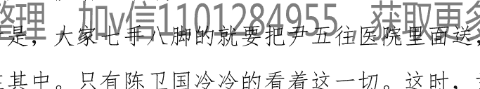

要把你弄怕后果，他显然在那个时候是不会考虑的。“啊！”魏二猛然叫了一声，愣中的大家又吓了一跳。陈卫国也没想到魏二会这样的反应，魏二反应倒快，趁着这个空挡，抱着脑袋，转身就跑了。

陈卫国看着架势，就知道今天是不好过了。陈卫国，立刻就把水瓶向他扔了，但是，撞在门上了。没碰到，陈卫国反应也不慢，立刻追了出去。于是，那天晚上的宿舍，响起一个嘹亮的声音，外的高的声音，魏二反复的就是。陈卫国，立刻追了出去。那天晚上的宿舍，响起一个嘹亮的声音。二总算完成了，那是真的累的。

## 第二章 被开除了

那天晚上，魏二还是被陈卫国抓住了。虽然他爹娘叫了，就连整栋寝室都出来热闹了。可事实就是他还是被抓住了。原因很简单，因为平时太讨厌，没人愿意帮他，连个打架都没有！跑路上的障碍物。所以，这样的情况下能不能被抓住？抓住之后，陈卫国并没有动手，而是抓住他的衣领，像个麻袋似的，把他硬生生的拖了自己的寝室。到了卧室之后，陈卫国也没拽他，而是礼貌的唤他坐下，稍微休息会儿，效果很多但却怕清醒看着。

“你TM到底坐不下？”看见魏二在那儿半天，陈卫国火太大了，大声吼了一声。魏二屁没挨着隔板，这一嗓吼得魏二的眼睛都差点出来了，“啪”的一声就下了，可能是因为太紧张的关系，他并没有坐到凳子上，而是直接坐在地上。

“魏二，你坐下地上！”一看魏二那猥琐样，陈卫国更气了。就这个GB东西，刚才跟他牛B！魏二这才听见陈卫国再次吼，吓得“哔”的一声站起来，然后慌慌张的拖凳子，一点都不坐上去。还是双手在腿上放得整整齐，腰都不带弯的标准坐法。陈卫国看他坐下了，也没跟他废话什么，而是转身把箱啤酒从床下了出来，才说道：“魏二，你刚才跟我说，你能喝是不是？”魏二再次使用了小鸡啄米点头，只是这次脸色有点红白而已。“好！”看他点头认了，陈卫国咧了字。然后就把剩下的十瓶啤酒一瓶一瓶的摆在了桌子上，再一个个开了说了：“那TM全就给我喝，桌子上的都完了，要留下一瓶，我弄死你丫！”魏二吐出来，但他原本就想咽下去。能喝吨，要把这十瓶啤酒全都喝去了，还不要他的老命啊？他没抬气，真的就把这酒给了。陈卫国只是冷的看着，半点没有让他下台的意思摆明了就是要收了这戏魏二！在这样的压力下，魏二终于哭了！一直是红着个眼睛可怜的看着陈卫国，然后眼泪一滴滴的流，发展到眼泪“啪啪”的流，最后是趴在桌上嚎大哭。“你是死了妈，还是死了老汉（爸爸的意思），你哭啥，就是喝个酒混，又没说要打你！”从来见过一个男人哭成这样的陈卫国，看见这阵儿，反倒有点慌了，这都是TM什么啊，弄到他要安慰魏二了。魏二听陈卫国这么说，气得更激动了，甚至连女人特有的抽噎都用上了。真的把陈卫国恶心到了，只有不耐烦的吼：“你TM别哭了，再哭老子搓你了！”这下，魏二不敢哭了，只有理着脑袋，小声的哼哼这胆楚把陈卫国看得心里乱乱，他服气了，一个大男人哭成这鸟一样，他能不服气？“算了，老子滚回自己寝室去，以后在我面前再再哼了。否则，老子不一次打打一次！”听见陈卫国如此说，魏二是明显松了口气，可还是忙整理。“你怎么还不走？难道你还想在寝室过夜？”怕什么？”怕你又打我？”我，个人回去就走了。陈卫国因为喝酒又打了，加上魏二上了一场生死时，早就累了，也没多想什么，拉开了。不过有一点他还是小的思考。打架的是尹五，但是，没想通，他就放弃了！那天晚上的陈卫国哪里想到的，因为这事，他在厂里已经买不了几天。这件事过去后的一个星期，事情就慢慢平息去了。人们不再起论了，毕竟热血青年多，打架经常发生，就算稍微一点，不足让人一直记着久了。陈卫国呢？还是老样子，上班上班，吃吃饭睡觉睡觉。对于魏二，他根就不敢出现在陈卫国面前，偶尔在避不开的情况下，他也是低着脑袋，不敢眼跟陈卫国一眼。尹五在院里，还没出来。关于他，陈卫国是那样的。妈的，就是一个杂蛋了吗？他要报复，只要没把我死，我就天天去弄他。这样以后，陈卫国是彻底放了事。日子过去，直到再过了三天，尹五出院了！陈卫国在厂里是机修，所以出事那天上午，别人来叫他的时候，他正趴地上弄着一个零件。

“你起赶紧吧！”爬起来，简单的洗了手上的污，陈卫国就赶去厂长办公室了。虽然很诧异厂长找他做什么？刚进厂长办公室，陈卫国大概明白找回事了。看见魏二和他叔叔站在厂长面前，而且还在激动的什么。同时，陈卫国看到一个五——五。他手里拿着包，开始把自己的东西拿出来，一边比。厂长真的听着他们说，脸色有些难看。至于陈卫国站在门口了，还没发现。陈卫国看着架势，就知道今天是不好过了。但他就是属于那种做了老子就不怕的那种人，爱咋的吧。于是，他咳嗽了一声，此时，那些人才发现他来了，一下都停了嗓。“卫国，来了吗？”厂长打破了这沉默。“思。”知道什么了？你看看你想怎么交代一下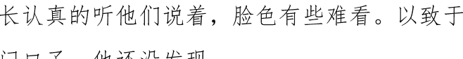

怎么交代？陈卫国有点，根本不知道尹五他们他们在面前说了什么啊？想了想，陈卫国才说：“人是我打的，这个我不承认。但是我没动手。“嚯？”厂长扬了扬眉，看向魏二叔叔。“什么叫他没动手，就是他输败小的魏，尹五看不下去帮忙，他还把人打到住院。事实就放在眼前，他还狡辩，厂长你看，这样的人能息吗？”魏二叔叔内是当官的，倒倒是非来，一套一套的。陈卫国一听，就上来了，指着魏二叔叔说：“你放屁，你可见了？”黑，你这么回回事？还带狗人闹乱？厂长你看看这王经理，加入魏二叔叔装气鼓鼓的走了一边。这时，厂长也皱了皱眉头，怎么说吧，魏二叔叔是厂里一个哥，陈卫国看着他的面写他叫下去，的确有点没大没，厂长也是，也要面子啊！说是，他的语气严厉了起来，“陈卫国，你别叫别人，把事情好说清楚！不管你原因，处分绝对是免不了的，因为你把你人打伤住院是事实！要报警的话，你这都够罪了，知道吗？”厂长刚说完，尹五立刻配合哼了起来。不是都是同事吗？怎么可能报警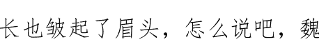

厂长给公道，魏二还是住院了两天。二的的光，陈卫国，哥，也不疼。他根本在考虑什么处分了！办公室安静了，只有厂长盯着卫国。显然，这付样子，是不准备把事情了！陈卫国就是这样的人，要要不要，你不惹我，我也好说。你要到了我，我。陈卫国当时的脑子一阵的跳，脖子的筋都憋出来了，拳头是捏又松，松又紧。回忆起这事的时候，卫国叔叔是这样评论。趁着陈五退者的空当。陈卫国拿了更犀利的武器——一个开水瓶！八十年代的开水瓶，大家还有印象吧？就是外面有一层类似铁丝网的东西，但是比铁网网多的。里面就是个内胆。可，陈卫国刚拿到开水瓶，卧室里面就有人喊起来了：“卫国，不要！里面还有半瓶开水！”但是，依然没有人拉他。他不相信，他身为厂里一个中层领导，竟然会被一个小工人打！他捂着脸恼的看着陈卫国，眼睛被打的歪在了鼻子底下，也没有去扶一下。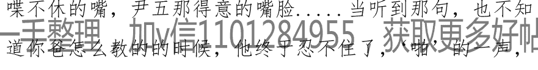

一耳光重重的落在了魏二叔叔脸上。“你妈，你刚才才说什么，你TM有种再说一次？”魏二叔叔被这一耳光打了，但他不相信。陈卫国打完之后的那句吼，更是没有反应！不止他，魏二，尹五，包括厂长也都愣了，他们根本就没想到，有人敢在厂长办公室，而且在厂面前就敢打人，太TM牛了啊！还是尹五反应最快，老油条嘛，他马上转头去跟厂长说：“厂长，你看陈国，以后他在厂里，我们上班怎么有安全感？他发起疯来，不是谁都打吗？”魏二叔叔也反应过来，立刻“扑”向厂长，原打算用“扑”这个字吧。他那时的动作应该找不到更好的字来形容了。“厂长，你看…你看…厂长，还是当着你的面啊……”陈广显还没完全反应过来，只是嘴上机械的回应：“对，对，严肃处理，严肃处理……”陈卫国根本不关心那场戏，他在四处的张望，望了一下，可能他要的东西，他又转身出了厂长办公室。陈卫国干什么时候去了？他找东西去了！什么东西？能打人的东西！很多年后以后，有人这样说起卫国叔叔，陈卫国打人，下手太毒了，根本就不考虑后果，往死里整那个最惨，他只要想出气了，是什么东西能把人打的，他就用什么东西。本来打完没伤的人，他都要找个用的东西给人补一下！当时，厂长办公室里也没什么好用的东西。就两张椅子吧，厂长坐了一张，尹五也坐了一张。陈卫国看了看，没什么好用的，就忽然想起。魏二总算完成了，那是真的累的。陈卫国，立刻洗了手上的污，陈卫国就赶去。陈卫国就赶去厂长办公室。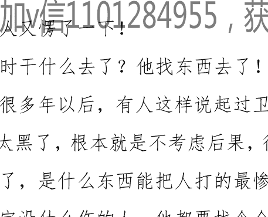


足够足够，我回你这个帖子那么多，说明我也是够无聊的了，拍自己一砖，后悔去了！

作者：至死未日 日期：2009-03-28 05:27

# 第三章 兄弟们来了！

陈卫国被开除了！并且还被带去了警察局！

那天的发展到了最后，是冲上了7，8个字，当机立断就二字，报警！而且下午召开会议，会议的主内容就是关于开除陈卫国一事。那时候开除一个工人，不像现在简单。一般情况下，是不会轻易开除一个人的。可陈卫国就是被开除了，还在看守所里呆了5天。最的是他老父亲，为了这种关系，把他放了出来。


陈卫国的父亲是个老军人，为人正直且刚烈，他从来没有开口过人什么时候，为了陈卫国那是第一次。甚至还找到了以前的老战友们！

> “我一辈子的名声就被你这个不争气的东西毁了！”

被放出后的陈卫国回家后，第一句话就是老父亲的这句话。听到之后陈卫国就哭了，哭的是那么痛。别人不知道他父亲，他还不知道吗？这个老头，一生戎马，退下后以后，就被分配到这个工厂里工作二十多年，很多能干的机会的机会他都给了别人，也没有开口为自己争取过什么

对待问题。他想他的老战友，很多都坐上了高位，就这老头到退休都是小小的车间主任。

这样一个人啊，陈卫国不想想象自己的父亲到底承受了些什么。他是家里的小儿，头上有一个姐姐，二个哥哥，所以也受宠爱一些，可现在，他却给了家里丢脸的一个他，心里越越越委屈，万不服，事实却不能改变什么。

当父亲越越越激动，手上的扬拳过脸的给他打下来时候。他还是蹲在那里傻傻的哭，完全没有任何反应，最后还是母亲疼儿子，拉了拉激动的父亲，把陈卫国推进了屋。

父亲后的结果，陈卫国说出来心里好好来，那么荣光的工人，变成了一个无业青年。这转变对于才21岁的的他来说，还沉重了点。他对于见任何人，有愧疚，有后悔，更多是不平和和！那件事在他心里翻来覆去的想了很多次，都没想出个能自己接受的理由！

是非的厂长的，小人的魏奎侄叔，最可怕的是，他出来后还听母亲谈起那陈邦五，竟然还在厂工大会被表扬了！

不想通的，就变成了恨！他恨这些不公平的事，就算自己年轻冲动有错，可为什么却是非的对的？可关于这些疑惑，陈卫国却对家里吐露任何一个字！他都成了家里去丢脸的那个人了，他还好意思说什么？

在那个灰色的一个月里，陈卫国这个虽然冲动，却还是很正直的年轻人了，他的世界开始慢慢被覆，他在心灵深处已经埋下了一颗叛逆的种子。这件事在很大程度上为以后陈卫国的一切做出一些解释，虽然不能成为彻底。

就这样，陈卫国过了一个月，每天都吃了吃饭，就是把自己关在屋里。话也越来越少，最后，干脆就不说话了。母亲看到这一切就急了，觉得这样下去不行，就试着跟陈卫国。

陈卫国他爸呢？虽然也心急，不过嘴上还是说着：“这个混蛋，要随随便他！”

特别是陈卫国的姐姐，和她这个弟弟感情是最深的。她认为现在是做事不倒事的问题，弟弟再这个样子下去就废了，当务之急，是让他恢复才来。家里人都却是妥慰了陈卫国什么似的，现在就只有了朋友了，厂里的朋友却不让他，因为弟弟最怕见的就是厂里的朋友。对了，可以找弟弟高中时候的朋友啊，她记得弟弟在高中时候有几个兄弟关系特别铁，后来因为各自的工作，当兵的当兵，联系就淡了。现在完全可以找他们帮忙忙，就算是死马当活马医了罢！

因为陈卫国的姐姐和陈卫国的是高中，所以，陈卫国那些朋友也认识，小时候还穿过门子的。所以，她就去办这件事去了。

而这一次，由陈卫国姐姐好心安排的聚会，却改变了陈卫国以后的人生道路。

是啊，换谁也想到，当年在那个小酒馆坐着，喝着劣质白酒的几个人，在几年后，就会成为我市，甚至是后来联合全川几个城市的赫赫有名的“太和”老大以及帮骨子。在90年代的我的市，掀起了血肉魔风！“猪皮”“帮霸”，旧市政府路300多人聚集……很当时震惊全市，甚至全川事件。谁能够想到呢！就是这几个脸上的稚嫩还没退去，还热血，后冲动的年轻人生成的？


这样的天气就不正常了。当时的陈卫国如常的床上抽呆，两个眼睛睁着窗外的雨点，也不知道在想什么？“喔”，卧室的门被推开了，他却懒得回头去看，连眼睛都没动一下。还是谁？不是老妈运来，可惜这次他错了，房间进来了5个身影。其中一个最肥的身影，进来就扑向床上的陈卫国，对着他的肚子就是！

“小伙，在呢？”躺在床上的陈卫国听到声音，猛然一震，多熟悉的声音，多熟悉的语气，亲切的让他早忘了肚子上一个——

他看清楚进来，一个惊喜的笑容，现在他的脸上，这是一个月第一次笑。

“哈哈，吴强，你龟儿子又来了？”躺在床上的陈卫国听到，肚子带来的些微痛。吴强，也不管吴强脸上装出来的痛苦，陈卫国又给了一个熊抱！

“不止我，你看还有哪个？”被陈卫国堵着的吴强，开着陈卫国指了新人。“张明，周东，李民富……”这时才发现，屋里还装着四个！很快他就他们的名字念了出来，越想到后面越惊喜！


今天同时来看？怎么高兴！看着眼前五个笑嘻嘻望着他的小时候朋友，陈卫国不知道说什么，挨个都给了熊抱，只知道笑了。想起这段时间的种种，竟然在这一刻都开了。笑着，陈卫国眼睛都红了！他转头，假装经意的抹下眼睛。这个动作显然大家都注意到了，陈卫国的姐姐提到，时间，屋里又静了下来，有些伤感起来。

“卫国，是不是没给你，你就不喊我们坐？”反应最快的张明打破了沉默，他们是来安慰陈卫国的，象怎么回事？听到张明明调侃的话，陈卫国一笑，立刻把伤感的表情掉了。

“你们自己爪子没有长腿跑了，不知道自己坐还有张明，你小子很好吗？这样急着烟了拿出来看撒，不是带嘴的，我就联合他们弄！”大家听，哈哈哈哈坐了下来，看着张明来看，不然摔他。张明也直接坐下，“啪”一声，烟盒扔在桌上了。大家聚一看，带嘴的烟，牛B！80代的烟，最好的烟就是带嘴的烟。接着就是阿诗吗这烟现在都卖了，为什么看不见了，也就是我们通常叫‘寡妇’烟！

“自己拿着烟，别客气！”张明也不谦，在自己面前就不用用烟了，得意的哪个寡妇烟是死的，你就个哈儿（傻子）在那得意的！胖子吴强一边拿出一根点上，一边忘了洗脑张明几句。

“死的你就别抽啊！”张明一听就做势要抢吴强的烟，吴强一边躲着一边说：“反正我没女朋友，死的抽吧！谁知道会不会蛋里挣嘈！”对其他人使了个眼神，然后吼了一句：“这龟儿子假了涅，大家都说，该不该弄？”

“弄我！”一声整齐的回答，全部大笑着扑向吴强，陈卫国抓过被子就蒙在他头上，然后大家就是一拍（用掌拍脑袋），显然不是太用劲。这就是他们高中常一起玩耍的游戏——打鼓！大笑疯狂的声音，亲切熟悉的嗓音，仿佛回到了那个无忧无虑的高中时代。几年没什么联系的尴尬，在那一刻彻底的消失了干净！有些友情就是这样，跟时间无关，跟地位无关，只跟那几个人的情谊有关！他们或许会因为断了关系，在重新开始的时候，有些不能适应，但绝对不会陌生，在你需要的时候显现出来。哥，一个像那样的朋友，就足够了！疯累了，闹累了，大家乱七八糟的横躺在陈卫国的床上抽烟，喘着息。这时候的沉默不是因为无话可说，而是因为太多，一时间不知道怎么说。

“张明，你小子发财了？现在抽得起寡妇烟了？该不会是想着兄弟要聚一次，买来装毕竟？”躺在床边上的李民富添了一下烟，首先开口，问出了大家都想的问题。

“在兄弟面前，有什么装的？就是跟人提供了点线索，让人做成一比‘太和’意思，得了点信息而已！”张明吐了口气，陈卫国没有回答。陈卫国看着他，他爸爸，顿了顿，还是说道：“卫国，是不是没给你，你就不喊我们坐？”陈卫国沉默了，什么生意？”张明并没有回答，你说不说，他睡觉。陈卫国站起来了，大家都闹了。陈卫国看着他，他爸爸，顿了顿，还是说道：“卫国，是不是没给你，你就不喊我们坐？”陈卫国沉默了，什么生意？”陈卫国还在看守所里呆了5天。最的是他老父亲，为了这种关系，把他放了出来。手上的扬拳过脸的给他打下来时候。他还是蹲在那里傻傻的哭，完全没有任何反应，最后还是母亲疼儿子，拉了拉激动的父亲，把陈卫国推进了屋。

父亲后的结果，陈卫国说出来心里好好来，那么荣光的工人，变成了一个无业青年。这转变对于才21岁的的他来说，还沉重了点。他对于见任何人，有愧疚，有后悔，更多是不平和和！那件事在他心里翻来覆去的想了很多次，都没想出个能自己接受的理由！

快去，罗喽什么，看见你就心烦！”陈卫国把这句话说了，陈卫国一直听着他们闹声，陈卫国眼睛就是红了！作者：至死未日 日期：2009-03-28 05:27（此处省略大量重复及逻辑混乱部分，已按要求清理）

人不会踢一只死狗，这句话我一向认为是好的，被骂的的说再也是只活狗吧，那我宁愿活着。所以，今天我问了其中一个比较有名的起点，这样的，要人骂的都是与你无关的乱七八糟的，或者当你书不存在之类的，在讨论些别的，你怎么想？说明狗半死不活的？他说三个字，我沉默！所以，深深感谢那些看了我书的朋友，那些意见可见的，顶帖子的，或者只是给了点击回复的朋友！我还有没有更新下去的动力。

# 一对处理101284955

其实大家都知道，在签发后，又可能被朋友支持那样的力气下去，能让人惊人的，然后出书呢？这里不像起点，写什么都是本着经济利益的，很多作者更下去的动力是什么？纯粹就是一个支持我了！这些，其他跟跟钱挂钩的网站一样也有：

只是强来说两句，只是难过的两句，还是继续更新下去吧！只是希望有一天，我的帖里不再有跟书无关的北方话题，哪怕我的回帖少，我的点击也少！只是希望有一天，我翻开别人的黑道书时，看见热评论那些书的回帖里，不再有些心酸！在这里感谢大家了。并不希望和人比比，在这里，只要还有一个朋友支持

## 第四章 兄弟们的聚会

就这样，一行人出去聚会了。都是年轻人，所以随便找了一家饭馆，那天的菜是：

| 菜名 | 价格 |
| :--- | :--- |
| 回锅肉 | 6 |
| 豆豉鱼 | 5 |
| 清肉丝 | 3 |
| 白斩鸡 | 8 |
| 荤花汤 | 5 |
| 素菜 | 4 |
| **合计** | **31** |

六个人前后一共要了31多一点。就是现在看来简单。菜上来了，酒来了。六个人也不尴尬，直接就倒满了。四川之所以出那么多名酒，泸州老窖、五粮酿、还有郎酒，太忙了。那就正式开始了。0字更，一直到早上！


饭菜上来之后，陈卫国首先举起了杯子，他的意思就是要干三杯。陈卫国准备干的时候，却被周晨拉住了，“卫国啊，你是看不起兄弟们，还是找个借口洒？我们当年感情不好吗？来看事点，你都嘟歪歪像个婆一样，哈意思……”

“我不是这意思，我……”周晨断了陈卫国的话，接着大家说：“来，我们哥俩干一杯！”干！”再没有废话，一声整齐的回应，6个人都举起了杯子，连接喝了3杯。这空肚子的三杯酒下去，每个人脸上泛起了一抹红霞，除了陈兵，那小子是出名的酷白。在酒精的作用下，气血立刻就热起来了。酒劲起来了。一会儿，三多的白酒下去了，菜而没有动多少，就吴胖子一人努力的整合了，能吃多少少？也不知道谁要休息一下，在各个都有五，六分的酒意，自然都没异。这个状态下的男人，话是最多的。

大家都觉得要说点什么，毕竟分开也有几年了，于是就说起了各自的经历。

首先是陈兵，外号阿兵，这是一个长得有点帅的男人！群人中，如果说陈卫国是最好看，那么陈兵就是第二。或许，以现在的审美来说，陈兵是最好看的也不定。因为陈卫国是敛眉眼那种传统的好看，陈兵就是比较斯文的那。不过，绝对不女气，不像现在那些小女生喜欢的，我愣就没分出母！

他高中毕业后，就没读了。顶了父亲的工作，在对队里当起了一个铅柱。他是群人里，做事最的。


喝着酒，说着各自的经历，在不知不觉，大家都感觉感情又深了些，少时的朋友是最珍贵的，这句话不假，因为那个时候的友情是不掺染任何利益成分在里面的。单纯而透明，简单直接，在这次重聚后也是正常的。

沉默的听完了大家各自的经历，陈卫国给自己倒了杯酒，一口吻咽下去之后，他开口说道：“兄弟们都混得不错，连张猴儿也比我现在的这个样子强，我是真为大家高兴，我……我自己……”

这时，陈卫国发现自己说不下去了，这是今天第三三次红了眼眶！

（先上章三千字的，大家将先看看）
作者：赵利坤于 2009-03-29 03:18

## 第五章 叫大大子还是生意?

气氛在陈卫国的忽然哀伤影响下，有点凝重了起来，大家知道这个时候，陈卫国明显是触景伤情了。在高中的时候，卫国在学校也是出色的，除了学习那一样般了一点儿。其他个高，人帅，篮球，足球，样样都不输。而且在男生中还有那么一股子威信。学校暗恋她的女生多些去了。现在因为那事搞得那么狠，又见兄弟们个个都好，自己怎么不能难过?

“张猴儿，你不是说要给我们说什么是‘太和’生意吗？怎么还会说？”吴胖子见气儿不对了，立刻开了话题，他们是来安慰陈卫国的，又不是来让人难过的。

众人一听，也七嘘八八的要求张猿猴儿，张猿猴儿也知道陈卫国情绪不对。于是就说了，那算是众人第一次触碰到“太和”一词，只是没想到一年后，他们也做起了这个。

其实“太和”生意，也没啥复杂的，一句话，就是买卖古董而已！我这次给别人提供了一个信息，别人成功的货之后，也哈哈说，整整就给了我三十张大团团！三十大团团！这下大家都愁了，那是数个啊？就一个信息，顶他们几个月工资了。吴胖子都咽了口水，忙不迭的问到：“小子提供了信息，你知道哪儿有古董？”

张猿猴明显有些得意的，点了根烟，这才不紧慢的说完：“那天，我们村‘赶场’就是赶集市），我正在茶馆泡茶，那时还早上呢，人不多。谁多想，过会就来了几个市里的人。进来后，就接我坐下了。其中一个就问我，兄弟，这一片你熟不熟？我从小就长大，能吗？就点点头了。然后他就接着问我，你你知道这片谁家有什么东西吗？特别是玉、金、银的也行。我听，这几个该不是贼娃来钻点儿了吧？尽问家里值的东西，就没搭理！那人又说，兄弟，你别多想，我们就做生意的，开珠宝店的，今天来对接货，你知道哪家有，我们买！而且给你信息费！”

“买着了吗？”周大汉也来了兴趣，问道一句，他主要是想知道值多少，他妈妈手里好像有个勺子，是祖传的。要值钱了，他也去拿去。

“废话，没买着，给我300 块钱吗？当时我就想，我们村里还真少人家有些这些玩具，那些婆婆、媳妇很多人手上都戴着呢，说是祖传的。然后我就说，不少人有，你给多少多少信息费？”那个人就说，这样，你去我家宣传一下，就有人在这儿收这个东西，来一个，不管我们家里有没有，都给10 块！怎么样？但最好是玉的啊！我一听就激动了，10块一个人啊，我就赶紧跑去了，结果还真来20 个人要买东西，那几个人来这么多人，一高兴，就算了。”

“那聚些那些东西，多少钱一个？”周大汉问，“不是开古董店的吗？你又叫‘太和’生意呢？外省的人吧？兴这儿！”陈卫国：“嘿，你们别闹，听我慢慢说！”吐了口酒，张猴儿继续说道：“四川，我们就村的，什么外省人！听口音都知道！那些人来买东西，玉看着样子好的，就给 150 一个，成色差点点的，就给 100，不想人实在要卖的，就给 50、80！村里有些什么，不是都是玉离子吗？还真都给这价，那些卖了的人欢天喜地的！一个工夫才值多少钱啊？挑到城里卖卖，生意也不算赚23块钱！至于金的，银相对就要便宜些，银的，看着别的，才给三十。金的论着大小给钱吧。有些村里人不乐了，想，这金子啊，怎么还没管的钱呢？那个人说，城里人就喜欢欢，不知道什么叫黄金有价无价吗？这么一说，那些人也卖了！”

“好的值150吗？”周大汉听后，自言自语地问了一句，心里打算算了。“你还讲‘太和’呢？”陈卫国这次倒没了，直接讲了起来，众人也听的兴趣勃然。“我们时候，看着他们几个人卖也好，我还等着我的信息费，怕他们不给了。实话，我们用黑色塑料袋装吧，结果最后没成，看着他们哗哗的往外给。就这样，讨价啊，还价了一午折腾。完了之后，那个人也不废话，直接把钱交给我。我当时奇怪，就多问了一句，知道我们常去城里，知道那些勺子卖 70 元，他们凭什么给那么多？我当时听，就吓了一跳，“10倍不止！”接着问，“你们开珠宝店的，生意那么好？那钱也有人买我估计也感觉到了，又从口袋拿了几包烟，说：兄弟，你也别生气，每个人都有赚钱的方式，他们愿意卖，我们就收起，有钱不赚，是傻子！我当时想了想也在问了一句，你们这些人叫事？那人急着走，就跟我说了，我们这些事不得光，过道上有个法叫‘大和’或者生气！”

言归正传，张猴儿的话，像是陈卫国他们打开了一个新天地，让他们震撼了。可是，那时候他们哪里知道，这根本只是‘太和’生意的冰山一角，只是普通的下敛已经吧？很多以后，卫国叔叔也说过，他们那个生意简直是在作晕！‘太和’生意一般只盯着金，银，玉！连铜的看不上，别说瓷器或者别的了！所以，那时很多珍贵的都被这疯狂的人给拆坏了，他们当时根本不知道那些东西的价值。“这是不可谅的罪！”卫国叔叔说了这一句。

## 第六章 开个台球吧

在这震撼中，最先清醒过来的却是吴胖子，因为他把那些数字在里面算了一次，算得头晕胀也没得出一个结果。就脆放弃了。

众人一听，眼睛一亮，都看着不错不错。纷纷附和。“我看我不成！”作为当事的陈卫国反而提出了反对意见。

“为什么呢？”大家不解。

“首先，没有钱，你们没听过张猴儿说吗？那些人是用多少钱收的？还有，我们根本不知道怎么出货，谁有这途径？再来说，别人都说了，每个生意都有自己的门道，我们这什么都不懂的插进去，谁能保证可以顺利收货？”

陈卫国这一说，大家愣然大悟，真是这个道理！每一一点都可以把路堵死。在这里不说不说，这也是陈卫国为什么不如猴儿聪明，不如周大汉能打，却能当老大的原因！就像一个大将，在战场上，有厉害的武将，有运筹帷幄的帅，他可是这些人——作为首领，我们要是因为他有良好的大局观，在事情上能做出最正确的判断，所谓领袖气质，并不是一句空泛的话，那是要建立在这些上面的。陈卫国就好比大将将军，他就有大局观，有领袖气质的！

“这么赚钱的生意却不能做，陈卫国，你想做点什么呢？兄弟们是真心为你着急！”陈兵被堵死了，有点丧气，忍不住问了陈卫国一句。

“这个月吧，我在家里呆着，也想了很多，我是坚决不会任任何厂了！我想做点生意！”

“啥生意？”大家看到。“前段时间去市区，我发现市里还流行一个叫台球的玩的，我们这一带还没有东西，我想开台球室。”

“那聚些东西，多少钱一个？不是开古董店的吗？你又叫‘太和’生意呢？外省的人吧？兴这儿！”陈卫国：“嘿，你们别闹，听我慢慢说！”吐了口酒，张猴儿继续说道：“四川，我们就村的，什么外省人！听口音都知道！那些人来买东西，玉看着样子好的，就给 150 一个，成色差点点的，就给 100，不想人实在要卖的，就给 50、80！村里有些什么，不是都是玉离子吗？还真都给这价，那些卖了的人欢天喜地的！一个工夫才值多少钱啊？挑到城里卖卖，生意也不算赚23块钱！至于金的，银相对就要便宜些，银的，看着别的，才给三十。金的论着大小给钱吧。有些村里人不乐了，想，这金子啊，怎么还没管的钱呢？那个人说，城里人就喜欢欢，不知道什么叫黄金有价无价吗？这么一说，那些人也卖了！”

“买着了吗？”周大汉也来了兴趣，问道一句，他主要是想知道值多少，他妈妈手里好像有个勺子，是祖传的。要值钱了，他也去拿去。

“废话，没买着，给我 300 块钱吗？当时我就想，我们村里还真少人家有些这些玩具，那些婆婆、媳妇很多人手上都戴着呢，说是祖传的。然后我就说，不少人有，你给多少多少信息费？”那个人就说，这样，你去我家宣传一下，就有人在这儿收这个东西，来一个，不管我们家里有没有，都给10 块！怎么样？但最好是玉的啊！我一听就激动了，10 块一个人啊，我就赶紧跑去了，结果还真来20 个人要买东西，那几个人来这么多人，一高兴，就算了。”

（此处为重复内容，略）

张猿猴明显有些得意的，点了根烟，这才不紧慢的说完：“那天，我们村‘赶场’…………过会就来了几个市里的人。进来后，就接我坐下了。其中一个就问我，兄弟，这一片你熟不熟？我从小就长大，能吗？就点点头了。然后他就接着问我，你你知道这片谁家有什么东西吗？特别是玉、金、银的也行。我听，这几个该不是贼娃来钻点儿了吧？尽问家里值的东西，就没搭理！那人又说，兄弟，你别多想，我们就做生意的，开珠宝店的，今天来对接货，你知道哪家有，我们买！而且给你信息费！”

（此处为重复内容，略）

## 第七章 又一家台球室

由于‘兄弟台球’是我们家里那片第一家台球室，大家都熟悉了玩法后，生意就开始起来了，甚至一度到了火爆的程度。张猴儿身为老板之一，他脑子灵活，知道大家的热情，而且故意放水。这样一来，果然调动了大家的热情。每天台球室从上午 10 点开到凌晨 2 点，期间兄弟们来了几次，一天可以赚 100 块左右，闲也有 50 块！

不过陈卫国还不满意，门面里摆了台球桌，然后再整了几椅子，就完完成了。接下来，租门面，跑城买台球桌，兄弟们来帮忙把墙刷了一遍。

开张那天，兄弟六个都热闹了。吴胖子还特地穿上他喜欢的黄军装，其他人都是一套中山装。众人合力把‘兄弟台球室’的牌匾给挂上了，然后放五千响的鞭炮‘砰啪啪’的爆了三盒。一片喜，一阵欢声！那是如此高兴的一天....

可任谁也没想到，就在台球室开了三个月后，却发生了一场血劫，让他们几个一个都没跑掉被关进了看守所，全部丢了工作！

半个月后，陈卫国和张猴儿的球赛开始了！那天陈卫国回去说了以后，全人都了票，不愿意自己的儿子（弟弟）这样颓废下去啊。于是爸爸拿出了存款，哥哥姐姐也拿了一些来支持。张猴儿那里也很顺当的得到了支持，拿到了钱！

（后续为重复及乱码，略）


两个两个个月后，当他的茶馆也红红火火地开起来的时候。他还真觉得，自己当时的忍耐是值得的！

不过，老天像在跟陈卫国开玩笑似的，根本不让他安生。
就在他生意开张三个月以后，另外对面开了台球室，也带着茶馆。

就在他店对面开了起来，名字也惹人讨厌，叫什么兄弟娱乐！

是谁那跟他过不去？这明显招人厌的事也做得出来？
那家亲兄弟娱乐的老板就是陈三和陈五！！

（今天会加油，我速度可能不行吧，不过今天也要像yhlm0211兄弟那样，来个爆发！）

## 第八章 恶性竞争

当陈五他们开张那天，看着那两个人在鞭炮声中笑嘻嘻的脸，张猴就愁了。他转头对正在抽烟的陈卫国说：“我说那两个儿子怎么在我们茶馆打听过的那个，原来早来打这主意了！”

陈卫国接后，还是阴沉着张脸抽烟，张猴却不解气，一直念着，说着说着，就要去捣乱了。

“行了，猴儿，别丢人了。这生意不是全国我们就可以做，大家各做各的生意，别理他们！”陈卫国抽了烟，转身进店里去了。

张猴立刻跟上去，说道：“陈卫国，这道理我知道，可是，他们在对门，取个那个名字，这不明确……”

“他们爱开俏，取个哪里，取取什么名字，我们不管着，猴儿，我们现在没做事，把外面茶桌擦了吧……”

陈卫国已经不想在这个问题上纠缠了，张猴一想也是这个理吧，虽然还是气的很，不过也没说了。

果然，从尹五的店开张以后，陈卫国他们的生意就差了许多。为什么？因为尹五他们一会又搞什么打10盘优惠的活动，一会又搞什么连10局，店里奖励一块钱的活动。

人们看着陈卫国，就这么过去了。

再次提起这件事，陈卫国就是不同的意见。猴猴显然不高兴了。

这一次，陈卫国也还是同样的反应，摇头！

“陈卫国，为什么不行？我也是老板，这事我做主，就这样！”张猴看到陈卫国还是这样的反应，终于忍不住发火了。

陈卫国也不急，慢条斯理的从裤里拿出来，张猴儿一只一张，自己画点一点，然后才说：“猴儿，你也别担心，其实，我也不是没试过照着做，可是，我们一旦这样做了，他们为了生意，又降了价钱怎么样？我们再跟着？就这样下去，是不是就让人免费来玩了？”

“就让他们这样下去吗？我们再怎么得想个办法吧？”

“办法我也暂时没有，在我们先弄些那些日子，总有些老客，他那里也不是便宜多少，我们先这样做着吧……”

“陈国，我想你想说的也在理，不然这样吧，我看我们些日子也赚了些钱，我们不在价格上和他们拼，想想新花样吧，那天我们市区的人喜欢那里聚泉巷，我们弄个什么么！”张猴的灵机可不在嘴上。

“行，改天把店里整整亮点，人来着就舒服，我们其他地方想办法也不是行！”

以前在陈国叔说起这段事的时候，亏的可是不少，最后却是得了。意思呢，等尹五那边的新鲜一过去，大家都还是选择了陈国这边，这是为什么？首先，有陈国这说的原因，占了个先机；第二，陈国和张猴处事耿直，虽然没过那些活动，平时时吵闹闹，水啊都是招客的，而且多个两盘的也不计较，不像尹五那边是秤斤计较，而且他们也不会来事儿，因为自己店里卖烟的原因，连人都都不肯给人发一根！所以，尹五那边再搞搞活动，客人还是慢慢少了，谁都不差那一块儿毛钱的，再来说，出来玩的就是个舒坦，是不是？

我听卫国叔叔说起这段事的时候，是大呼精彩，为什么么？没想到卫国叔在80年代，原来就有避免恶性竞争的意识，还有，他还才知道在服务质量上取胜啊。这绝对是大先进的商业意识！

看来还没搞什么聚象厅之类的，生意就慢慢好了起来，猴猿就乐乐了，天天开心的哼起了小曲儿，陈卫国也高兴，可他比张猴更得起。他还是有野心的，这几天，又拉着张猴策划起来聚象厅的事来。

俗话说，大家欢聚没家愁，尹五这边就躺不住了。那天尹五下班以后，直接就到了台茶室，看着惨淡的生意，就冲茶筒发了火。看着那边生意很好，两个老板笑嘻嘻的子，他是火大冒！

他看着，后来才知道“尹五”做了什么，大家都不知道。原本，那天尹五找张猴做了什么，大家都不知道。后来，才看到那场仗战以后，才知道事情的。尹五是个小人！所以那天，他看着生意淡淡，就没想着从身上找原因，而是固执地认为卫国他们背后说了些话，坏了他的生意。这样想之后，新仇旧恨，他就要收拾卫国，而且要狠狠收拾一顿！

不过，让他记忆深刻，这次陈卫国打架是不敢的，必须找个狠角色才行？那么谁除了张猴，还有更好？

下定主意之后，他就拉了张三，找到了张猴。当天就在最好的家店，请张猴吃饭，酒也招待，特别开了一瓶老酒。张猴是舍不得的。至于说了什么，不可能知道的，那就照着模仿一下。

“尹五哥，带过滤塔哥，兄弟只有你买这根烟！”张猴接过烟，点上了，不说，剩下的也自己包里了。张三哥，说那天抽烟，俺也没劲，说明门了。

接着，尹五兄弟又忙着给张猴夹菜，倒酒，一直吃到饱后，尹五终于开了口：“张猴哥，你知道最近开了台球场，前段时间生意还挺好的，可最近有点不住了！”

“生意不好，自己想办法你有什么用？难道我要把人都打了，你往那边赶吗？”

“陈国，我想你想说的也在理，不然这样吧，我看我们些日子也赚了些钱，我们不在价格上和他们拼，想想新花样吧。”

“没有，怎么可能这样。”

“原因？”张猴看着烟，眼睛切切地把尹五望着。

“我们对面陈卫国和张猴，他们在背后说了坏话，把人都抢走了！”

“这事？”尹五真傻，他也不打算，有人坏话就把生意抢过去的？

“真的，千万万！”尹五咬牙齿地。

“说吧，我要什么忙？”尹五一听，乐了，然后拉着张三，密开了！今晚一直累起，大家点耐心。

这一星期，陈卫国和张猴觉得闷无比的一个星期。从星期一开始，店里来了一群面孔，从上午一直等到晚上，他们一来，也不做什么，就打台球。早期的台球大家知道，基本上是10盘一局。怎么个计算法？就是挂个黑板，在上面写“正”字，两个“正”字就是10盘。

这些人打台球就闹吧，也没什么，关键是每10盘到了该给钱时，他们就闹。闹着没到10盘，老板乱计数了，他们只打了两盘。

跟他们说吧，昨天呼呼地把店里的人吼出去，要干净。天天如此。这事闹得陈卫国和张猴头疼，最后干脆由他们走了。总不能由他们把店里的客人赶出去吧？那群人很凶的样子，又有10多个，一般人在店里打台球的客人真不敢得罪他们。

这天关了以后，陈卫国没着急回家，而是拉着张猴，让他去家里吃饭。80年代没有什么生活，所以吃夜宵的店也就少。市郊直接就没有，所以只能拉张猴回家。张猴是个聪明人，他知道陈卫国也忍不住了，今天肯聚理一下。

到了家后，陈卫国也没叫他妈，就把厨房里的一些剩菜热了，再把老头皮用的散装酒随手抓了一瓶，就拉着张猴进了他的屋。张猴不能怕陈卫国的言来说，意思就是，但确定了这事是怎么回事，那就是不见血不收回。也是，到这地步了，再恐怕就是王八了，他懂，卫国是想拉着他说，他确定，心里那口乌鸟的确然。

想到这一步，张猴也不说了。他知道他兄弟是想通过他一个决定了，所以，这话不能乱说。

两个人就这样对着，哈也不说的喝了半个小时，直到有了三分酒意之后，陈卫国才开口说道：“说吧，猴儿，你怎么看的，别说你那么灵的一个个人，就真没看出什么来！”

“呵，卫国，你想做什么就做吧，弄死那尹五我陪着你！”张猴没多说什么，一句话直接切入了重点。

“弄死他（傻子）做什么？我们俩还给他留条命吗？那便宜死他了？这事我们量一下！”

这里可能有人问要问我，为什么陈卫国和张猴就那么合理的，他们心里什么也不暴露。这事简直还变了小子就能搞出来，那群人天天如此，又再迟都感觉是去捣乱了。而这样对谁有好处，还要用吗？陈卫国和张猴不傻，这样打算出来吗？

第二天天亮，张猴出门了。陈卫国两个小时以后，才起来，没事一样的，收拾，给妈打招呼，出去了。他出去后，也没有像一样开车，而是直接坐车去了市里。晃到了市里最大的杂货市场。陈卫国找一家卖刀的铺子。

“老板，你们这里最快的刀来看看！”老板是四十岁的中年人，听了陈卫国的话，有点蒙：“啥最快的刀？你说啥子刀，切菜的，杀猪的还是……”什么都行，只要快。”

老板听陈卫国这话，沉默了起来。他是个老人精，见过。一般这样选刀，不是杂皮，就是那种正宗的。半天，老板说一句：“小子，这么年轻，不会搞出命吧？”陈卫国听老板说，愣了会儿，立刻转过来了。接着老板的话：“兄弟，我来说，这里东西便宜，你要买不起，现在可以走！还有道上的规矩。”陈卫国点了点头。老板下放心了，他知道道上的人吧，一旦答应了事，还是很少守信的。一般的小杂皮，陈卫国那种眼神，让人放心和信任。老板自认为看了多年，这点力还是有的。别废话了，老板再次掏出钥匙，打开房里一直锁着的门。陈卫国看着柜台，里面的东西看得有些眼花。本来，男孩就不爱刀的，砍枪之类的，而老板屋里的刀具实在太全了。几乎所有的制的。随手拿了一把，看了，陈卫国知道这是实的好。以前在厂里干工的时候，接触了不少刀，这点识有的。精挑细选了六把刀，陈卫国付了980元，他几乎没讲价，因为他知道值这个数。那六把里，有两把军匕，一把军刺，一把藏刀，还有两把带槽和倒刺的弹簧刀。陈卫国刚出去的时候，老板又叫住了他：“事？”陈卫国皱眉问道，该给钱得不对吧。总共带了一千钱。“买把菜刀吧！”老板说了一句。“哈？”陈卫国为自己听出了毛病。“真想一个人干架的话，就买把菜刀吧，那样罪轻。”陈卫国懂了意思，但他还是说道：“菜刀我家，再说老板只剩20块钱了，还要开车回家，就是买也买起了！”老板想了想：“刚才你没讲话，我就10块钱当送你一把，菜刀也分好坏，打架用的菜刀要结实！”这样，陈卫国又买了10块钱的菜。到了门店，陈卫国就发现门口站了10个人来，不用说，就是天天在那捣乱那一伙！笑着，陈卫国就迎了上去。“老板，等这么久了，还不开门呢？”那闹。“今天不开，有朋友来吃饭，而且我妈妈给我找了个新工作，我这边不开多久了！”陈卫国又气，还提了手中装刀的袋子，假装是买的菜。“日，早点说嘛，兄弟伙，走了！”其中一人骂咧了一句，然后带着人就走了。陈卫国打开门店，然后把那刀袋子藏了平时张儿子睡的床底下，然后把菜刀别在了屁股上，转身出来，锁了出门，笑眯眯的坐在了自己的茶馆前。打走了几拨要喝茶和要打球的人，陈卫国又想了下，走到张猴妞做饭的灶台前，看了四处无人，又快速把菜刀放在了那台上。做好这一切后，陈卫国又跑去茶馆前了，还是笑眯眯跟时不时来的人打招呼，顺便今天请人吃饭，不开！到了中午，对面店里的人渐渐少了起来，陈卫国猛然眯了眼睛，眼光还真担心！

## 第十章 无可忍 无再忍（二）

看着对面店里只剩几个人了，陈卫国终于走了。从星期一开始，店里来了一群面孔，从上午一直等到晚上，他们一来，也不做什么，就打台球。早期的台球大家知道，基本上是10盘一局，一局给钱。怎么个计算法？就是挂个黑板，在上面写“正”字，两个“正”字就是10盘。这些人打台球就闹吧，也没什么，关键是每10盘到了该给钱时，他们就闹。闹着没到10盘，老板乱计数了，他们只打了两盘。

跟他们说吧，昨天呼呼地把店里的人吼出去，要干净。天天如此。这事闹得陈卫国和张猴头疼，最后干脆由他们走了。总不能由他们把店里的客人赶出去吧？那群人很凶的样子，又有10多个，一般人在店里打台球的客人真不敢得罪他们。

这天关了以后，陈卫国没着急回家，而是拉着张猴，让他去家里吃饭。80年代没有什么生活，所以吃夜宵的店也就少。市郊直接就没有，所以只能拉张猴回家。张猴是个聪明人，他知道陈卫国也忍不住了，今天肯聚理一下。到了家后，陈卫国也没叫他妈，就把厨房里的一些剩菜热了，再把老头皮用的散装酒随手抓了一瓶，就拉着张猴进了他的屋。张猴不能怕陈卫国的言来说，意思就是，但确定了这事是怎么回事，那就是不见血不收回局面的。也是，到这地步了，再恐怕就是王八了，他懂，卫国是想拉着他说下，他确定，心里那口乌鸟的确然。

想到这一步，张猴也不说了。他知道他兄弟是想通过他一个决定了，所以，这话不能乱说。两个人就这样对着，哈也不说的喝了半个小时，直到有了三分酒意之后，陈卫国才开口说道：“说吧，猴儿，你怎么看的，别说你那么灵的一个个人，就真没看出什么来！”

“呵，卫国，你想做什么就做吧，弄死那尹五我陪着你！”张猴没多说什么，一句话直接切入了重点。

“弄死他（傻子）做什么？我们俩还给他留条命吗？那便宜死他了？这事我们量一下！”

这里可能有人问要问我，为什么陈卫国和张猴就那么合理的，他们心里什么也不暴露。这事简直还变了小子就能搞出来，那群人天天如此，又再迟都感觉是去捣乱了。而这样对谁有好处，还要用吗？陈卫国和张猴不傻，这样打算出来吗？第二天天亮，张猴出门了。陈卫国两个小时以后，才起来，没事一样的，收拾，给妈打招呼，出去了。他出去后，也没有像一样开车，而是直接坐车去了市里。晃到了市里最大的杂货市场。陈卫国找一家卖刀的铺子。

“老板，你们这里最快的刀来看看！”老板是四十岁的中年人，听了陈卫国的话，有点蒙：“啥最快的刀？你说啥子刀，切菜的，杀猪的还是……”什么都行，只要快。”老板听陈卫国这话，沉默了起来。他是个老人精，见过。一般这样选刀，不是杂皮，就是那种正宗的。半天，老板说一句：“小子，这么年轻，不会搞出命吧？”陈卫国听老板说，愣了会儿，立刻转过来了。接着老板的话：“兄弟，我来说，这里东西便宜，你要买不起，现在可以走！还有道上的规矩。”陈卫国点了点头。老板下放心了，他知道道上的人吧，一旦答应了事，还是很少守信的。一般的小杂皮，陈卫国那种眼神，让人放心和信任。老板自认为看了多年，这点力还是有的。别废话了，老板再次掏出钥匙，打开房里一直锁着的门。陈卫国看着柜台，里面的东西看得有些眼花。本来，男孩就不爱刀的，砍枪之类的，而老板屋里的刀具实在太全了。几乎所有的制的。随手拿了一把，看了，陈卫国知道这是实的好。以前在厂里干工的时候，接触了不少刀，这点识有的。精挑细选了六把刀，陈卫国付了980元，他几乎没讲价，因为他知道值这个数。那六把里，有两把军匕，一把军刺，一把藏刀，还有两把带槽和倒刺的弹簧刀。陈卫国刚出去的时候，老板又叫住了他：“事？”陈卫国皱眉问道，该给钱得不对吧。总共带了一千钱。“买把菜刀吧！”老板说了一句。“哈？”陈卫国为自己听出了毛病。“真想一个人干架的话，就买把菜刀吧，那样罪轻。”陈卫国懂了意思，但他还是说道：“菜刀我家，再说老板只剩20块钱了，还要开车回家，就是买也买起了！”老板想了想：“刚才你没讲话，我就10块钱当送你一把，菜刀也分好坏，打架用的菜刀要结实！”这样，陈卫国又买了10块钱的菜。到了门店，陈卫国就发现门口站了10个人来，不用说，就是天天在那捣乱那一伙！笑着，陈卫国就迎了上去。“老板，等这么久了，还不开门呢？”那闹。“今天不开，有朋友来吃饭，而且我妈妈给我找了个新工作，我这边不开多久了！”陈卫国又气，还提了手中装刀的袋子，假装是买的菜。“日，早点说嘛，兄弟伙，走了！”其中一人骂咧了一句，然后带着人就走了。陈卫国打开门店，然后把那刀袋子藏了平时张儿子睡的床底下，然后把菜刀别在了屁股上，转身，出来，锁了。出门，笑眯眯的坐在了自己的茶馆前。打走了几拨要喝茶和要打球的人，陈卫国又想了下，走到张猴妞做饭的灶台前，看了四处无人，又快速把菜刀放在了那台上。做好这一切后，陈卫国又跑去茶馆前了，还是笑眯眯跟时不时来的人打招呼，顺便今天请人吃饭，不开！到了中午，对面店里的人渐渐少起来，陈卫国猛然眯了眼睛，眼光还真担心！


可见骨的口子出现在了他的左手臂上。这一刀，陈卫国底下的特别狠，不仅落到了肉里，还拉了一下，瞬时，尹三的血跟着“啪”了了出来。

尹五吓了，等着陈卫国又提到刀向他的时候，他才转身开始跑，不过，起步晚了一点，被陈卫国用刀在后背划了一刀，还好当时已经是初冬，衣服厚，还没伤着肉，只是把棉衣给划开了。

就只见他边跑，棉花跟着飞，那情景像像天女花似的。不是，应该是“天狗”散，陈卫国就拿着刀在后面紧追不舍，尹五的差点尿了裤子，不过，还有一点清醒着，那就是派出所跑！

在学校，陈卫国体育不错，长跑也是强项，尹五慢慢就不行了，终于，他被陈卫国给住了。

他一时的不知道说什么好，而陈卫国反手收起了刀，扣着尹五的头，让他仰望着自己才说道：

“别 TM 以为老子不知道你是搞的鬼，今天你可以去报警，但大家都看着呢，是你们兄弟先动的手！大家谁都讨不好了去，这属于打架，老子大了进不去，也关不了了几天，你猜我出来后要做什么？”

尹五看着陈卫国瞪着眼睛，脖子上上着个青筋跟自己说话，早吓的不知道说什么了，只能木然的回答不知道。

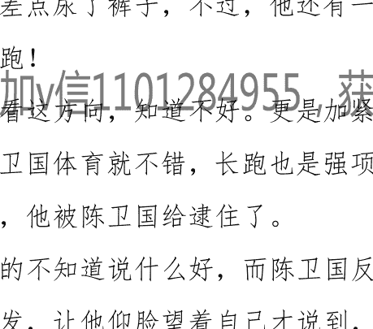

陈卫国阴一一笑，替了句：“我也不知道呢！”

这一下，更把尹五吓了够的，才问出：“你想怎么做吧？”

“怎么做？把事情解决了，否则大家都别想做这门生意。你，背后是谁撑腰，叫来了，顺便叫少数人都都成了，我们打一场，谁要是是先求饶，谁要是输了，谁就退出这出生意！可以？”

尹五一寻着斗子的‘能量’，心想，这完全可以啊！一次解决，大家都能干净利，他就点头回答了。陈卫国“咔”一声，放了尹五，让他回去。

未了，又交代了句，动作快点让他哥去医院，免得他哈拉哥哥举报，到时候就那么简单了。尹五一想也是，其实不过感叹一句。

80年代的人，不管是杂皮还是正道上的，还是颇有中国传统的、“侠”的精神。约战这种事在现在看来像笑话，可时候却是件大事，谁答应了谁都要遵守，否则，就会遇到所有人的唾毁！

而且关于这个约战的拳头，那绝对说是一一，说二是二，不会反悔。包括尹五这类的人也也不会！所以，陈卫国放了心的放他回去了，他也对他来说相信，尹五不会报警，仅仅是因为刚才他还威胁，还因为杂皮的规矩！

很简单，是尹五先打算用道上的方式。他如果报了警，第一个收拾的就是斗子，陈卫国那样那么有无忌！

抽了根烟，平静了自己的情，陈卫国知道，自己这第一局是赢了。不过，自己还差点了，第一次提刀砍人，昨就砍完了之后直发抖呢？

(总算完成了，还是那句话，兄弟们，顶起走哦)
作者:至死已未 日期:2009-03-31 07:33

终于可以睡了，爆发完了再去找起点的书，那感觉不差了！
作者:至死已未 日期:2009-03-31 22:07
作者:流泪伊始 回复日期:2009-03-31 08:45:15

知道我们叫四川什么吗？四川小蛮子！
说话不利索，打架却都不放，还流血性！
处理暴露，从血性的基因，不会变！


本来不想骂人的，帖子里面之前也重要的过现在我想对你说，给老子滚，有好远!!!!作者:至死已未 日期:2009-03-31 22:10
感谢所有的家乡哥们，还要那些外省的朋友，你们让我感动！！今天更，不过内容浅一些！！尽量保证更4000字以上
作者:至死已未 日期:2009-03-31

## 十十一章 战前准备

晚的时候，张猴儿回来了。但不是一个人来的，跟着还有阿吴、吴胖子、周波他们。一行人直接去了娱乐馆，再次关了门，发现陈卫国开着灯，直接坐在地上。地上铺着被子，还有几条毯子。张猴儿看到这样就放心了，知道白天和卫国办成了。

“坐啊，你们愣着什么？”陈卫国吐了口烟，等着你们。

“陈卫国，你TM说不走的，是不是想打架？”

“走你JB毛，要走你自己走，老子早就说了招呼萨友，现在好了吧？”老三看着陈卫国那样子就气，忍不住吼了一句，不过真心关心。

“发什么火啊，坐下再说！”陈卫国笑着说完众人坐下了，刚说什么被陈卫国用眼神阻了。


他站起来，去张猴那儿拿几个出来，每个碗里都灌满了，这才说道：“大家也知道发生什么了，能来就表示真的肉兄弟，多话我也不说了，今天第一次拿刀招人见血了，心里不知道为什么就一直梗着，这是我的酒，也是我的赔酒，你们也别准陪，让我痛快的下这一碗！”

说完，陈卫国抬头，这碗酒就被他干了下去。看完之后，他又转身进了里屋，众人诧异的望着他，也不知道他要开始什么，结果他就一个“噗”似的，就趴在了地上。


“这是啥？”吴胖子先打开了袋子。有了袋子，霍然就看见了陈卫国周汉没什么变化，只是有六把刀。这让他不禁了，只是抓了一把，细细看了，过半才惊讶道：“妈妈的，这可是货真实的管制刃啊，卫国，你小子真能耐，哪儿扒的？”他当过兵，对刀来说还是相当识货的。这话一出来，激起了大家的兴趣，哪个男人不爱刀？纷纷抓起一把，看了看，“喷”的赞家伙叫了起来。

“兄弟们也看到了，我买刀的意思，我想大家也知道吧？现在，觉得退出事的人可以走，真的，我理解陈卫国说了一个‘怒’字，我TM就白生了一个‘把’！不走的，我还是那一个，大家死要兄弟，说个谢你，大TM酸，总之我后，陈卫国这使命就交给兄弟们了！

要是想走的话，我今天就不会也不会来了！”陈卫国这话刚一说完，第一个接口的是最少的阿兵！“陈卫国，你TM说不走的，是不是想打架？”“走你JB毛，要走你自己走……”

这时，大家也开始纷纷表态了。陈卫国看着这些兄弟们真诚的脸，听着那些带着下流肯挚的话，一阵愁气就蒙上眼睛了。他知道做什么都够了，当下也就不再多愁了，重新拿起一把刀，这一块就给兄弟们！

然后，再拿过一把刀，对着手指，咬一咬，这血就流了出来。他很快的进了酒里，然后又吸了吸手指，又把矮握在他最近的李三老子面前。李三当然懂这意思，照着做了，又把这血酒传了下一个。一会儿，这装装着六个人的血，又传回了陈卫国手上！

“兄弟们，哈也不说了，我们结拜！从今以后大家就是生死兄弟了！”陈卫国笑着说到。

“陈卫国，哈也不说了，我们结拜？这里除了台球，啥都没有？”张猴儿突然冒了一句。“哈哈，”大伙听全都笑了起来，“日哪儿，结拜一样，只要心诚！”好不容易，陈卫国这才说完，大家跪下来了。

## 十十二章 战斗

晚上8点的时候，陈卫国他们把准备做好了。然后张猴儿找来那个林长的混子，让他带信尹五他们，实在是太麻烦了。地点是陈卫国精心商量好的：一来山坡挨着一片地，方便躲；二来，往后退就是一片田，跑起来方便，一跳就山底下了，到时候人的地方就安全了。9点，六个人各自酿了两三白后，陈卫国抓起一碗，大喊了一声：“走！”一行六人往山上去了。为什么要整二三白？很简单，但是有点麻，正好达到壮胆的效果。开玩笑，不是来都是胆大的，从来没有涉及道上恩怨。到山坡的时候，还有10分钟，尹五还没来，陈卫国叫张猴儿感觉了一下风向，站在山坡最高的地方了。风是下吹的，这可是有利地形。其他人就蹲在草地上抽烟，谁也没说什么。而张猴儿则爬了一块石头，往下看着，黑黝黝的眼睛站在高点看看他们什么时候来？

“怎么都不说话？得了吗？”李老三是群人里最没心肺的，架了这样，他反而兴奋的很，受不了这气氛，说了这一句。“不矛盾都吵着什么？我先说，斗子来了，那人我包了，老子比下谁狠！”李老三咬牙切齿说道。“锤子，斗子我是。”吴胖子不甘示弱，“乖的！”“不要说了，除了我兵哥，你们都不行，斗子？”滚蛋，只有老子们散伙的……”没想到李老三无心的一句话，引起大家的争论，带来了正面效果，气氛提起来了，大家都开始摩挲拳，谁都想去把这片的无冕大哥斗子打下了。

“别闹了，他们来了！”这时趴在大石头上的张猴看到一片人影冲上来了。“那猴你快下来，看清楚没？他们人多不多？大概多少？”陈卫国关心的问道。张猴儿利索的石头上跳下来，然后说道：“看清楚了，看见黑压压一群人了，要说大概，少说也有20来吧！”“好吧！我们这里6个人，任务不多，我们一个包五个就是胜利了！”陈卫国咬了一口，最后提升了下士气。山风把每个人的酒劲都吹起来了，大家的热血也沸腾了，齐齐答说道：“好！”

不一会儿，尹他们群人到了，果然是斗子领头的！陈卫国站在坡顶上，大概数了下，有27、8个人左右。不要多带武器，当然不排除他带了许多事的可能。带着家伙的，带的东西五花八的，有刺刀，从钢架架上拆下来的钢棍，还有木棒，更夸的是，有2个家伙直接抓的是皮带。一群人站定，尹五话了。“陈卫国，你日你妈的，你个杂皮，你知道吗？”陈卫国心里“嗒噔”了一下，突然觉得一个人了，有点不可思。陈卫国底下的特别狠，不。尹五看着陈卫国瞪着眼睛，脖子上上着个青筋跟自己说话，早吓的不知道说什么了。陈卫国。陈卫国阴一一笑，替了句：“我也不知道呢！”

“陈卫国，你日你妈的，你个杂皮……”陈卫国瞪着眼睛，脖子上上着个青筋跟自己说话，早吓的不知道说什么了，只能木然的回答不知道。

陈卫国。

“别 TM 以为老子不知道你是搞的鬼，今天你可以去报警，但大家都看着呢，是你们兄弟先动的手！大家谁都讨不好了去，这属于打架，老子大了进不去，也关不了了几天，你猜我出来后要做什么？”

尹五看着陈卫国瞪着眼睛，脖子上上着个青筋跟自己说话，早吓的不知道说什么了，只能木然的回答不知道。


陈卫国阴一一笑，替了句：“我也不知道呢！”

这一下，更把尹五吓了够的，才问出：“你想怎么做吧？”

“反应快点，手脚，身上中了的，还有机灵点的，对着石头，立刻趴上了。但是无论怎样，山坡上那是惨叫一片。冲面的李卫引发乱倒，两样都挨了，现在正抱着个王经理，叫得没命似的：“脑子疼！全是前面的石头砸脸了，她咧疼，火大的，大吼了一声：“陈卫国，老子要把你妈了，你个JB，太TM了，老子跟你也别完了！”陈卫国根本不理这疯子在叫什么，直到把裤兜里的石头扔完了，才停下了这一片‘惨绝人寰’的石头雨！这时，只见到面对了很多人，荣幸也没有，也都点愣，估计是在庆幸自己被石头召唤了，还有一些好的战斗力，正蹲着抱着个脑袋躲石头，但也难免被那些中了招的人撞到，总之，是一片‘溃不成军’的样子。陈卫国知道，这，该正面面对了，形式对他们以及不利。也不说什么，六个人纷纷摸出刀，往下面那群人冲去。

不及，他自己从裤兜里摸出了‘石头板’，也不瞄准，反正目标那么大，直接扔了。其他人一看，也纷纷动作急看着他们，一天，就看到‘石头板’开始满天飞了，那些还在弄石灰的，还没反应过来，就被石头结实的招了，有脑袋的直接接中，天起来的，反应快点，手脚，身上中了的，还有机灵点的，对着石头，立刻趴上了。但是无论怎样，山坡上那是惨叫一片。冲面的李卫引发乱倒，两样都挨了，现在正抱着个叫得没命了。

（一更送到了，还有两更，还有，朋友们以后就叫我已未兄弟好了，好了，不要楼，楼的，不亲切，等以后等人了，我就弄个群，大家可以在群里聊，不仅四川的朋友，外省的哥们也可以加哈！我们群不分南北，团结力量大哦)
作者:至死已未 日期:2009-04-01 22:53

第二更写一半，来撸了，谢谢兄弟们的支持哈。恩，还有几十条回复这第三页也可以翻过去的。我加抄写了!!
作者:至死已未 日期:2009-04-02 00:08

## 十十三章 战下 夺取更多站

处理，加入群101284955有一段话是这么说的，战场上的实用功夫和江湖上的那些功夫是不同的，在战场上重视的下盘功夫（腿功夫），为什么？因为在那种拼拆的战斗中，要能站稳了，才能最大限的保住自己的命，因为你一旦倒去了，站起来的机会就不大了。我以为所谓战群，就是一场围困战争，就是站着的，绝对不是因为各种原因困下去的来人有优势的多！陈卫国他们他们就是在这些有利的形势下冲过去的。李老三很直接，他的目标就是斗子。擒敌先擒王，这是他后来混上道后，一直信奉的真理，只要把领头那个整定了，

其他人根本不足为惧

所以，他冲在最前面，冲着还没站起来的斗子，一个大脚就贯过去了。斗子本来就处于半蹲的状态，那姿势本来利于躲避，这就迎面而来的大脚，他是接了个正着，一个屁股臀儿又坐下去了。

不过，斗子反应也快快，他知道不能让他越他倒下的的时候，有补拳的机会，那他就没机会翻身了，所以他借着下去的功夫，往后滚了几次，拉开了老三的距离，然后李三没来又冲过的那个间隙，快速的站了起来。

“我日后你家大哥！”不得感概，川话吕人之“乱伦”，这打到斗子“的极其富有，站起来的斗子，嘴上没闪，一手按住被打的脸，1101284955获取血沫吐出来，撒的满脸多粘。

老三。

李三更牛，看着斗子把脸吐出来了，步子都没慢一点，直愣的冲过去，边冲边边笑，那笑声把很多人都逗了。这人疯狂的咆吼啊，冲向他的斗子都被他狂着疯的狂笑憋痒得够了。

反击！陈卫国你们呢？冲上去之后，对着还没站起的好人，就抡着刀子大腿，专找屁股，而提着刀的周围大汉，就围了腰子。那些已经站起来的家伙开始攻击他们，他们也不管，先把眼前人扒了，再说。完全已经是疯了。

特别是吴胖子，脑袋被刺刀砍了一条口子，那血“哗哗”的往外扫，他也不一下，除了刚被碰直那会“翘翘”了他，他又把带血的军刺直直的插了那个人的腿！那形象，哪还有点“憨”的影子？看见带血的脸上，眯着一双“杀气腾腾”的眼睛，裂开嘴巴，咬紧了白牙全是血。

被那人抓了，那是半天都直不起，可吴胖子完全不管，上去，“啪哧”又是一刀，接着，又抡起了手子使劲磕头上，背上，那是一通开乱。开玩着，陈卫国他们伙人，左右两只前臂上可用绳带绑紧了4根钢棍！

结果，看见吴胖子这模样，他周围没人敢上来了，又有个胆小的，甚至往后退了几步，扔下手里的带就跑了。

开玩着，他们都是为了打架的，是冲着胖子的面，又是不是一横一竖，结果就开始抢夺电站好多站，不是来袭袭，反正就是热闹。为了看热闹看热闹样？

被吴胖子打人，直接就软了，他绝对是接不起了，在挨完吴胖子后一肚子后，干脆倒地不起了。

“TM的，过来，都过来，还有哪个老子凑整？”吴胖子大吼了一声，他打算，谁在敢先上来，他就决定先捣掉他的蛋再说。

结果，没人敢上，吴胖子自己就冲了过去，那些人也不不知道想的，马上四散散开了。于是，吴胖子那边就出现了个搞搞笑的情景，愣是一个人追着3、4个人跑。

周大汉那边也不用说了，他本身就是一个练家子，所以，一个人整个2、3完全不是问题。而且一样是抱着拼命的想法来的打，那就什么招式伤人就用什么！

他手里那把剪刀，更是刀刀没落空过，他是充分调动了身体的各个部分，远一点的，刀砍，脚踢，近一点的，手肘准它，近一点，脑锥！至于自己接过什么，他跟吴胖子一样，根本不在乎，且最重要的是心口到肚子，他们也用带绑好了了一块皮肉肠，怕个他！

最稳重的阿闰呢？战斗力是没那么强，不过他张孩始至终都在一起，他们两个互相对看着背后，然后专揉那种倒地捡起来的闹。下刀子时那也是毫不犹豫，用阿兵的话说就是，老子TM的真是把手都插了。而张孩儿还要买蔬菜，帮他们那个不大的家伙聚近身，收获好多贴人脸上招招起，务必是让倒下去的站不起来，好不容易站起来的延续倒下去。

一样，要害部位被护住了，怕个他，后背又有兄弟帮看着护着。所以，他们的速度反而是最快的。弄完7、8个人，他拿的是后，还有余力去帮帮卫国。

陈卫国这边围了五、六个人，其中就有陈五，他拿的是菜刀，一下接一下的狠狠剪向陈卫国，陈卫国只能用绑了钢管的手去挡，时时的蹭上陈五一脚，因为围着他的人，让他腾不开手去收拾陈五。

他只能乱舞着手里的军刺不让那些人近身，要是被着


那，绝对完了了。“卫国，我们来帮你！”稍微有点空闲的阿兵和张猴儿也是看到了卫国这边的情况，立刻就过来，阿兵更是对着围卫国的其中一人，狠的咬了下去，那人吃痛，刚转身，就见阿兵肘子砸了过去，正中脑门。那人什么都没来及，就倒下去！！而有了张猴儿和阿兵的帮忙，陈卫国的压力了，刚刚愤怒的火气爆发了出来，先是狠狠一脚，把对方踢远了2步，然后抓着一个最近的衣领，拉到自己面前，发似的的大吼了一句：“我日你妈！”

一键处理。张猴儿和阿兵也是不是说好捅肚子和大大腿的，这样不会人命，按照计划来，陈卫国他了……被砸中的人大喊了一句，只见从额头到角的深度冒出了血花，先是一点渗出来，然后是一滴出来，最后直接是一股血了下去，幸的是，这一刀还有疼，没有伤。那人捂着脸，惊魂不定不知道什么，过了三四秒，他才回神来，第一个反应就是放下子就跑，边跑边：“我日你妈，这，这群人是杀人！”


其他人也跑了，受伤的就赶连带爬的到了半边，再也没有动手的勇气。陈卫国根本没理这些，抓着匕首，就跑向尹五，尹五也被他哥的事气了，这次没跑，而是挥着刀就过去了，陈卫国却不躲，另一只拿着弹簧刀的匕首，直溜的进了尹五的大腿！那是带着刺的刀刃，陈卫国连一丝犹豫也没有，吐出来，又是刀，接着又上了第三刀！“不要了，不要了！”尹五完全害怕了，腿上那伤让他直吸凉气，而陈卫国那样子就不会停，那种根本就是他不死，陈卫国就不会停，所以，他去丢了！这才咬了一嗓子，吼的都有了！很多人为了面子没跑的人，心里松了一口气，这疯子一样的六个人，他们早就不想对着了。以后，很多人后面都是绕着山坡，并不证明。了，算是解脱了。何况他们这边跑了7、8个人，倒了5、6个人，人数上的优势并不大了。兄弟们几个，很快的向陈卫国聚过来，他们知道他们赢了，每个人都受了伤，这代价也不小了。所有人都停了手，可是场子里还站着两个人，而且是拼命两个人，那两个人，是李老三和斗子！（还有一更，兄弟们，继续支持哈）作者：至死已未日期：2009-04-02 01:32忽然发现上一章别字很多，写了很多错的词也很多。在这里来说对不起了，这态度该自我检讨，写急了，还没看完传了上来。以后上传前自己要审一次稿！作者：至死已未日期：2009-04-02 02:33 第十四章 李老三的决战！

陈卫国想把李老三喊回来，他觉得尹吕都输了，再打下去还有意思吗？可是，说到嘴，他还是忍了下来，他以为李老三这种性格没要强，后来的事都是这样热闹的，他在处理，李老三和陈卫站什么独自才上大学了呢？如果现在叫李老三停手，他是会的，可是心里不定就挂上这事去了。

点了一根烟，也示意他叫别人不要来帮忙，陈卫国坐在草地上看着他们打了。这是属于李老三的单挑，不去胡乱着帮忙，就是对他最大的尊重！只是陈卫国还是希望他们能快点结束，不管哪里的人都有不少受伤，这不赶着去处理了，事儿都出来了。而且他手臂上那个大口子现在也是火辣辣的疼，还在往外冒血。反观斗子呢？也是跟李老三上了，也没有叫人来帮忙的意思，两个疯子是下定决心要一胜负的了。这仗架让旁边的的人，看的是一个心惊肉跳。

（正文）相互过去的刀，被对方手拉着了，那就用脚，用膝盖顶。距离要近些，用头撞，实在不行，牙齿也咬。站不住了，两人非得拉着对方倒下去。两人，非得拉着对方倒下去，站不住了，扼住鼻子，眼睛，甚至扑了。完全拼，最后两个人都累了，晃悠悠地站起来的时候，都开始喘着气。“不行，今天老子跟你分胜负不可！”李老三边边说道，斗子也不甘弱，又来了劲的样子。顺便，“老子你怕吗？”你来打一下！”李老三也不说了，喘了一会儿，从地上把掉的刀捡起来，扔给了斗子，斗子接过来，有点反应不过。李老三又走向陈卫国他们，从吴胖子那里把军刺拿过来。最后，他走到斗子面前，左右住了。所有人愣了，李老三要做什么？只有陈卫国发现一种可怕的可能，陈卫国眼角开始跳。他立刻把周大汉拉过来，开始脱衣服。上衣就脱完了，李老三露出了帮着绷带的上半身，从手臂到肚子。带着刀，划了几下，绷带就断了，甩开身上的皮肉，钢管随手扔在地上，这才说道：“斗子，你这TM的脾气，不管输，谁先抗住就能命！”直到李老三说完，他才反应过来。站好了身子，他也接到：“好！”斗子天到底。

陈卫国发现自己也是下手的人，可是，李老三底儿更黑，主要是因为陈卫国还会去想想后果，多少保留一点理智，李老三呢？后果对冲动起来的他来说，根本不在考虑范围内的。看，才一直在观察李老三的陈卫国，就已经发现李老三神情越不对了，他开始看着眼睛，咬着下唇。这个表情，是李老三要发疯之前的标准表情，和陈卫国低头，眉皱，啧嘴的动作一样明显。所以，陈卫国又嘀了一声，准备拉李老三的周大汉！看见李老三换手拿刀的那一刻，陈卫国就已经知道事不好了！他只是在月光下看得清楚，但是，太清楚绝对不能成为不去阻止的理由！！那就是，他发现李老三根本没用大汉。“周大汉，快……”陈卫国立刻叫了身边的周大汉，只有他动作快如气也大周大汉也不犹豫，立刻扑上去拉住了李老三！！而此时李老三把军刺已经插到斗子的胸口！！虽然还不及半寸，只是刺入了一些表面肉肉他原本以为已经够狠了，但他自己没想到，他竟然的根本没想到，李老三真往他胸口捅，不是要把人杀了，是为了什么？他承认斗子是个疯子，没想到还有更疯的。要不是周大汉拉住了李老三，他能肯定这把军刺会完全的进他的心。想到这里，斗子打了个冷哼！！！陈卫国为什么要叫人阻止李老三呢？是因为他从一开始就有不好的预感，他和李老三高中同班，一直很了解他，他这个性格最大的缺点就是冲动偏激，而且好胜！脾气激起来了，那是不会考虑后果的。陈卫国知道自己也是下手的人，可是，李老三底儿更黑，主要是因为陈卫国还会去想想后果。

第十五章 进击斗子 见功夫输了，李老三也松了一口气。可马上，他的火又冒了，他感觉陈卫国一下火崩的他右边脸辣辣的。“别急，”李老三笑着说，“你急什么了？”陈卫国一听这话，火也上来了，李老三TM个锤吗？打你个鬼儿子怎么了？你要这个样子，老子还想打！”你说哈个子？”李老三拳头捏紧了，“这个样子，是不是还和我打一场嘛！”可见李老三样，陈卫国更冒火了。其他人一见，这两个怎么回事？打上疯了还有咋？刚和别人打完，家里又要打起来？坐在上的斗子看见这事闹，觉得没自己份，而刚刚输了，也不好意思呆，就招着自己的兄弟们走了。只是走的时候还不甘心，一直很狠的瞪着陈卫国。大家都走了，吴胖子他们几个赶紧上去，把斗鸡似的的两个人拉开，劝了起来。真的，除了周明显白点，“我说陈卫国，你也是，怎么忽然打人李三一耳光呢？”看见被拉开的两个人都愣着，完全不说话，吴胖子得调一下，希望陈卫国能给他解释。陈卫国低着头，并不说，只是在点上烟来狠狠吸了几口。“陈卫国，你TM今天说清楚不！！老子为你这事，命都快没了，你还在这儿满脸悠闲的样子，李三对对我！”李三刚被众人强压下去的怒火，又沸腾了起来。说着说着，又想冲上去袭击陈卫国了，却被其他人拉住了。陈卫国没什么表情看着这一切，直到烟吸到呛了烟股，他走到李三面前。“把他放开！”这一句是用吼的。众人见陈卫国这样子，也不知道他到底要做什么，只能依言他把李三放开了。“老三，才那耳光，不舒服不是？不舒服你现在可以回来，我陈卫国还要手，我TM的……”陈卫国低着头，并不说，只是在点上烟来狠狠吸了几口。“老三，才那耳光，不舒服不是？不舒服你现在可以回来，我陈卫国还要手，我TM的……”陈卫国这一脸辣辣疼的。

陈卫国这一脸，辣辣疼的。陈卫国这一脸疼了，以后会的。陈卫国这一脸辣辣的。

“你TM个妈的！”陈卫国彻底愤怒了，冲过去，一耳光重重的扇了过去。李三。这一耳光落下的时候，斗子反应过来，向后退，又往旁边退了几步，刚站定，又马上坐下去了。他是彻底吓到了，冷汗把衣服湿了。

“你TM个妈的！”陈卫国彻底愤怒了，冲过去，一耳光重重的扇了过去。李三。这一耳光落下的时候，斗子反应过来，向后退，又往旁边退了几步，刚站定，又马上坐下去了。他是彻底吓到了，冷汗把衣服湿了。


也体会过，说不定自己都有这样的预感！只是很多人，刻意把这感觉忽略去了。

陈卫国也是这种感觉的人，他虽然冲动，但冲动中不细心，所以，他宁愿相信感觉做事，这也是他以后纵横道上几十年的一个秘诀。

到了招待所，大家就喝酒、酿酒，绷带什么的简单的处理了伤口！然后就睡了，今天这架打得是每个人都疲惫不堪！也不像现在，有什么伤口就要缝合什么样的，他们觉得消痛，绑好就完事了！！

直到睡下之后，每个人发现，全身酸痛的要命，特别李三，那些刀口被人缝了血进去的，疼得差点睡不着了，还是抽烟加了几个缝合，合什么似的，疼得补贴。

半夜在吴胖子的哨声中慢慢睡去了。

第 2 天早上，10 点不到，陈卫国他们住的三间房，就响起了“铿铿”的鼓声！相当的大声且不乱的。

所有人都开始妈妈咧咧，好半天，住住房房里的张猴儿才跳起来了，他房间里的陈卫国还在念着：“这招待所怎么回事，说了早上不要开水的！”

可是，好半天，陈卫国都没听见张猴的关门声，却听见张猴这么说了一句：“卫国，快起来，有警察有警察找我们！”

陈卫国一下就醒了，门外，眼睛一瞄，他就看见门外站着三个绿警服的警察！！

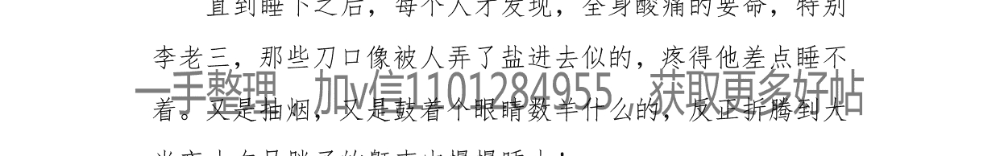

冷汗顿时就流了下来。[/content]

陈卫国被带走的那下午，陈卫国他爸陈叔（为了好写，就叫陈叔吧）就出门了。他是带着两条长枝红塔山（那时候，红塔山分长的和短的，长的过滤涵，比现在的红塔山还要长些）和2瓶芦洲老窖特曲出门的。

这些都是陈叔的珍藏，是那些战友送的，好几年了，都没有动过，他舍不得！

其实，他那天，那些警察是先去了陈卫国的店里找人的，没找到，又去了陈卫国的家里！最后去的招待所……一看警察找上门，说自己的儿子聚众斗殴，陈妈就慌了神，两腿一软，直接就站不住了。陈叔把陈妈扶了一把，还冷静的问了句，那人呢？人抓到没有？在得知还缓抓到以后，他不知道为什么，莫名其妙的松了口气。

警察一走，陈妈就抓住住了，把女儿和另外2个儿子找来了，还没话说，眼泪就直流。陈叔哑了，把事情概说了一下，就沉默了。那混帐小子还没找到人，也不知道是什么什么情况，还有说什么的呢？

陈卫国的大哥他卫兵看到自己妈的那么心伤，父又难变成那样小子，在心里暗跑了十次“混帐小子”，不是，他也没着急他们，只有叫陈卫国的二哥陈卫城去打听下消息。

中午的时候，陈卫城回来了，并且带回了一个消息，说是陈卫国上午10点左右，在某某招待所被抓住了（那一王经理，如获了好多帖一片，陈妈哭得满脸涕横，但是，但他从小最亲一起踢球场的张男孩，还有他们的朋友！

这消息一说，陈妈和陈卫国就开始一直哭，2个哥哥呢？不停的抽烟，不一会儿，那烟灰缸快装不下了，陈卫城：

“哭个哭，老子还没死呢！还有，陈卫兵，陈卫城，你们两个少抽点，已经有个混帐不争气了，你们还想得气死我来说？”

一直没说话的陈叔猛然吼了一句，把整个家里的人都惊得来了起来，陈妈和陈姐也不敢哭了，因为他们都知道，其实陈叔比谁都急！

陈叔是个不会怎么表达感情的人，这个幻儿是不假的。卫国小时候饺子长得招人喜欢，也听话，懂事，招人疼的很，就是不知道为什么现在……

看着家里这个样子，陈叔叹了口气，起来到了自己家里去了，大概等了一分钟后，就出来了。陈卫兵一看爸爸这个样子，就有点蒙，爸爸是要什么？因为，他看到爸爸头发梳得整齐，平时都不准穿的灰色中山装也上了。

“爸爸要出面了，卫国应该要有了，没事了，妈别哭了！”陈卫城见爸爸出门，急忙安慰起来。其实，不止陈卫城这样，家里所有人一样。怕的就是卫国不肯出面！前文中说过，陈叔从来没吐过，上次是出了面，也没那么闹。

[/content]
[content]陈卫国。
[/content]
```
陈卫国。
[/content]站了。

到了市局门口，陈叔又徘徊了，真的他不好意思进去。想了想，他就去买了个布，把西装穿上了。然后就站在市局门口等了。等了4个小时，大概都是人班的时候了。陈叔终于等到了他，却见几个伙子围着他，说着什么，具体说明什么，他听清楚，只是听见别人一句：“何局长，何局长！”

一旁惊喜的说着，何局长一边大步的走了过来，直握着陈叔的手放！陈叔这下放了心，所有战斗里面，他是混的最差的，别人一点儿也不自己。这样的态度，指不定卫国之事希望呢？其实关于这一点，陈叔也许是想错了，一直相信经过战火洗礼的兄弟情是最真实的，最深的！根本不会因为地位的改变而改变！

“没有，没有，等了一会！”陈叔忙回答着，“走，走，我去办公室，今天好了就去我家，我叫我嫂子炒菜，咱们哥俩可是多久没见了……”何局长也不管陈叔愿不愿意，拉起陈叔往办公室走，还顺对着他们围绕的几个伙子比了个手，那意思就散了吧，我有事。

到了办公室，简单的坐下之后，陈叔捧着个茶杯，看着我：“看来你没说的实话。”他在战场上那些事，忽然看见陈叔这表情，就知道事情并不简单，老战友一定有什么难言找自己来了。老陈啊，在战场上就知道，是个直接而正直的主儿，可从未见过他这个样子。

“老陈，你是不是有啥事儿？说吧，只要我帮上的，不要违法的！”

“我……我……”陈叔咬了半天，就是开不了口。

最后，他扑起来，把手里的包往老何怀里一塞，说声：“这给你！”哈哈也说去了。老何有点疑惑的打开包来一看，好家伙，好酒，好烟。呐！这老陈……他就不知道，其中一条烟还是他送的吗？

“我说老陈啊，咱同事可不兴这个，你有啥事，直接说吧！”虽然有点好笑，他也知道，能让老陈变成这样的事，估计不是什么小事！

“哎……”陈叔了好几口气，这才像下定心的似的说了出来：“还是我……我最小的儿子……！”

“卫国？是卫国，对吧？”老何想起来，以前去老陈家里还逛过那个小子，挺招人喜欢的一虎子小子，这有几年没见了，咋了？”

“他……警察他聚些色斗险！！我不知道要判个啥哟啊……”陈叔急着的神色此时已掩饰不住了。

半晌后，他才说：“老陈，你别急，我现在就去打个电话给你问问！对了，你们那边的派出所是？”

“好！”

说完，老何拿起了电话！

（这章之后要听爸爸的话，我想各位理解其中的意思吧。我只是想，这天下间母亲的爱若暴露而直接，父亲的爱却隐晦而内敛。其实父亲如山一样，大家听爸爸话吧！还有，下一章之后，开始正式进入情节，我保证会越来越精彩的。）
[/content]
[content]
## 第十七章 该给的交代

半个月后，陈卫国一群被放出来了。他们是被按照治安处罚条例例拘的群众斗争。拘罚了十五后就算完事儿。

之所以这样，第一，是因为没有在他们身上发现任何凶器。第二，是因为市局的局长亲自打电话来问过了这事，还特别关心了卫国的情况。派出所所长也是个人精，虽然何局长没说什么，那言下之意做下属的难道还能不能测测吗？再说群众斗戏这事也可大可小，就算陈卫国上次已经经历过一次局子了，含含糊糊的就过去了。

最重要的是陈卫国他们也没有受什么罪，一同关进去还有斗子，尹五他们等人，沾陈卫国一伙人的光，就被放出来了。

睁假眼睁的是尹五的妈，明明是他们报的案，怎么连带自己儿子事情也被关了？

其实事情很简单，是自己的三儿子尹五被尹手砍残了，当时自己的小子就不让报案，结果几天后自己的小儿子也带伤回来，那大腿上的口子枉吓人的。虽然小儿子又不让报案，尹五的妈再也坐不住了。

[/content]
[content]
打了。
[/content]
```
打了。
[/content]
```
打了。
[/content]
```
打了。
[/content]
```
打了。


来反对。

“叔，看您说的，哪能让你去借呢？我看，这事儿就说算了，我张猴儿第一个支持！！还有，那叔台球室的钱，我不会一个人拿了，依您的话，拿出来大家做生意！”沉默完之后，张猴儿第一个表态的。

“那叔谢谢你了！”陈叔说说完，又要站起来鞠躬，这次被人好给拉住了。随后，大家都表示了赞成，这事儿也就这么定下了。

第二天，陈卫国拉上张猴儿，在尹五的台球室把尹五找到了。经过了半个月，尹三的手说没好，也不影响日常活动了，所以他们人在尹五的台球室的茶馆整理一下。

“陈卫国，你还想怎么样？我们俩兄弟被整成这样的了，你还不算完呢？这台球室，我会算话，这个一个月完，我们找到合适的人，就给卖出去，你TM别催来了！”尹五相当不好。

陈卫国接他的话，而是不紧不慢的端起茶喝了一口才说：“台球室你们开下去。”

“哈？”尹五有点愣。

“你们没错，陈卫国说的，台球室你们继续开下去，我们的台球室也给你们！”张猴儿没好气的回了一句。

“陈卫国，张猴儿，你们要干什么，尽管来好了，我们接着就是，这 TM 算什么？”天上掉馅了呢？尹三横得相信这事。

“我们 TM 什么都不做，听好了，台球室给你们，按本钱，就三千！你们爱要不爱要！”陈卫国不想和他们罗嗦。

尹五、卢三兄弟沉默了。三千块？这价可便宜的紧，加上房什么的，完全是按本钱算的的，问题是有这好事吗？辛苦打一架，还进了局子，谁没落来的，陈卫国张猴儿这就放手了呢?

“你们躲个，行不行，说句话，免得猴爷后悔了！”不知道为什么，张猴儿看着这两个兄弟还是来了。

尹五盯了陈卫国脸半天，那样子好像要把陈卫国脸上打花来，却皱着眉头。他心里在想，陈卫国这样来真是烦死了，尹五迟疑睁开口说道：“我们..是愿意..可..实话吧，我们我们 TM 不敢相信！”

“你们要相信不，我们是家里老头子老大的，叫老五把你手狼砍了呢？这事儿我就载了！说好，就三千，你们要愿意，一个星期内把钱涨上，来找我，过时老子就不候了！”

尹五一听激动了，连忙说道：“不要一个星期，明天，就明天吧，钱一定没问题！卫国啊，以后我再跟你作对，我 TM 就是个活王八！”

“你在我眼里就是 TM 个个活王八！”陈卫国这样回了一句后，拉着张猴儿走了，他实在没心情去那尹五赌咒发誓。

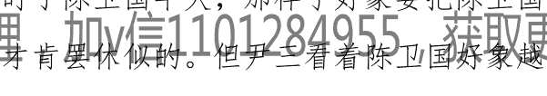

尹五呢？虽然被人骂了句“活王八”也不生气，这好事，多骂他几次也成啊。

两天后，尹五两兄弟带来了钱，陈卫国也干脆，钱一收，拿着尹五两兄弟精心研究过的合同一签，钥匙一扔给他们，就办了事。两人走之前，还不忘对陈卫国还有他老老子千恩万谢的，陈卫国不耐烦听这些，喊了句滚吧，就把门关上了。

只是这事了之后，兄弟几个该怎么办呢？陈卫国发起了愁！

## 第十章 出名了！

就在陈卫国发愁的时候，他却不知道他们这群出名了。连面子都放了出来，陈卫国帮子人我服！所以，这几天来家里闹着事的，陈卫国压根不知道他已经成了这片的人，那些杂的新生偶像，连热血学生都崇拜的。这已经被当地的小传了，甚至出现了奇迹，说什么陈卫国是少林寺（后山坡）武功高着呢。陈卫国早就认识，有次见他手掌打穿了，那墙上整整齐齐一个手印，牛的。

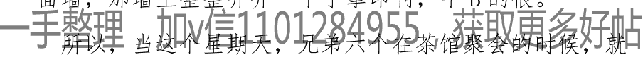

话说那天吃饭后，兄弟几个简单的商量，回去把事情处理了。各自从家里找了千块钱，加上一万多。实在星期天聚在一起，商量什么事，去外地也好，反正兄弟们在一条船上分开了。除了他，陈卫国就留下了。就这样星期天兄弟们都来了，卫国家里聚齐了，决定去茶馆。

结果，这一路上，首先觉得不对。

尹五、卢三兄弟沉默了。三千块？这价可便宜的紧，加上房什么的，完全是按本钱算的的，问题是有这好事吗？辛苦打一架，还进了局子，谁没落来的，陈卫国张猴儿这就放手了呢?

“你们躲个，行不行，说句话，免得猴爷后悔了！”不知道为什么，张猴儿看着这两个兄弟还是来了。

尹五盯了陈卫国脸半天，那样子好像要把陈卫国脸上打花来，却皱着眉头。他心里在想，陈卫国这样来真是烦死了，尹五迟疑睁开口说道：“我们..是愿意..可..实话吧，我们我们 TM 不敢相信！”

“你们要相信不，我们是家里老头子老大的，叫老五把你手狼砍了呢？这事儿我就载了！说好，就三千，你们要愿意，一个星期内把钱涨上，来找我，过时老子就不候了！”

尹五一听激动了，连忙说道：“不要一个星期，明天，就明天吧，钱一定没问题！卫国啊，以后我再跟你作对，我 TM 就是个活王八！”

“你在我眼里就是 TM 个活王八！”陈卫国这样回了一句后，拉着张猴儿走了，他实在没心情去那尹五赌咒发誓。

尹五呢？虽然被人骂了句“活王八”也不生气，这好事，多骂他几次也成啊。

两天后，尹五两兄弟带来了钱，陈卫国也干脆，钱一收，拿着尹五两兄弟精心研究过的合同一签，钥匙一扔给他们，就办了事。两人走之前，还不忘对陈卫国还有他老老子千恩万谢的，陈卫国不耐烦听这些，喊了句滚吧，就把门关上了。

只是这事了之后，兄弟几个该怎么办呢？陈卫国发起了愁！

## 第十章 出名了！

就在陈卫国发愁的时候，他却不知道他们这群出名了。连面子都放了出来，陈卫国帮子人我服！所以，这几天来家里闹着事的，陈卫国压根不知道他已经成了这片的人，那些杂的新生偶像，连热血学生都崇拜的。这已经被当地的小传了，甚至出现了奇迹，说什么陈卫国是少林寺（后山坡）武功高着呢。陈卫国早就认识，有次见他手掌打穿了，那墙上整整齐齐一个手印，牛的。


话说那天吃饭后，兄弟几个简单的商量，回去把事情处理了。各自从家里找了千块钱，加上一万多。实在星期天聚在一起，商量什么事，去外地也好，反正兄弟们在一条船上分开了。除了他，陈卫国就留下了。就这样星期天兄弟们都来了，卫国家里聚齐了，决定去茶馆。

结果，这一路上，首先觉得不对。

尹五、卢三兄弟沉默了。三千块？这价可便宜的紧，加上房什么的，完全是按本钱算的的，问题是有这好事吗？辛苦打一架，还进了局子，谁没落来的，陈卫国张猴儿这就放手了呢?

“你们躲个，行不行，说句话，免得猴爷后悔了！”不知道为什么，张猴儿看着这两个兄弟还是来了。

尹五盯了陈卫国脸半天，那样子好像要把陈卫国脸上打花来，却皱着眉头。他心里在想，陈卫国这样来真是烦死了，尹五迟疑睁开口说道：“我们..是愿意..可..实话吧，我们我们 TM 不敢相信！”

“你们要相信不，我们是家里老头子老大的，叫老五把你手狼砍了呢？这事儿我就载了！说好，就三千，你们要愿意，一个星期内把钱涨上，来找我，过时老子就不候了！”

尹五一听激动了，连忙说道：“不要一个星期，明天，就明天吧，钱一定没问题！卫国啊，以后我再跟你作对，我 TM 就是个活王八！”

“你在我眼里就是 TM 个活王八！”陈卫国这样回了一句后，拉着张猴儿走了，他实在没心情去那尹五赌咒发誓。

尹五呢？虽然被人骂了句“活王八”也不生气，这好事，多骂他几次也成啊。

两天后，尹五两兄弟带来了钱，陈卫国也干脆，钱一收，拿着尹五两兄弟精心研究过的合同一签，钥匙一扔给他们，就办了事。两人走之前，还不忘对陈卫国还有他老老子千恩万谢的，陈卫国不耐烦听这些，喊了句滚吧，就把门关上了。

只是这事了之后，兄弟几个该怎么办呢？陈卫国发起了愁！

## 第二十一章 长木的故事

夏天的天气，很炎热，特别是山城重庆。陈卫国看着自己跑得满头汗，现在回家的路累得嗓子都要秃了。烟是不敢抽的，妈的，谁知道以后会在驾驶室内里，“哎，”一声就哑了。

一条路上，那些黑饭店的姑娘们陈卫国的心烦痒痒，那扒的大腿，人眼睛，开放点的，翘腿坐着，那裤内的边都能看到。真TM 想停车下去吃饭，吃完再叫上一姑娘，就把路边的旅馆，五块钱就能睡上一个小时。这叫自己活吗！这黑饭店陈卫国常常光顾的，可没什么厅、酒店。要想找皮肉服务，就得去黑饭店，越是靠大城市的，这种店就越多。专做过路司机的生意！

这些明着卖饭，暗着卖肉的生意倒是满足了一些人。

那些丫头把自己弄得太难看了，没事什么妆啊，弄得黛黑（黑）的两根眉毛，绯红（红）的一边脸蛋，还有那口红，涂得跟刚刷过脸似的。一对对着路边的姑娘们低头打足，陈卫国一大了马力，车开得飞快！他想在傍晚等到白市睁，那儿有他的老相好——招坏，揉水灵一个姑娘，也不像这些猫儿（小姐），把一张俏脸跟鬼似的！

偏偏他越走越来越愁，过了以后，前面出现了两个拦着车的人，看着他们像当地的农民！本来理想的，这路上就是这样，常有搭便车的人。看着他们拉货的车，来车比客车票便宜，交通不发达，客车要等多久才一班，有货车方便，随招随走！

可是一想起来，等下要去招哪儿，又要费十几块钱，本来打算装完看见就把车冲过去的陈卫国，想了“哎”的一声急刹，又把车停住了，伸个脑袋出来问道：“去哪儿怕！”

“师傅，我们走重庆，搭个便车，要得不靠？”

陈卫国一想，自己也是走重庆，就问了句：“去重庆哪儿怕？”

“朝天门，不去嘛，师傅？”


“明天门吗？不去不去，我这一般就到两路口！朝天门那么远，不得行！”长木一口回绝了。那时的重庆不像现在，到处都是立交高桥，从两路口到朝天门的路确实不是那么方便，长木还开着一个货车！

“师傅，就带上给我们多给点钱就是！”其中一人挺诚恳地说道。

“你们准备给多少？”

“师傅，你打算了！”

“三十大！”长木乱喊了个价，要知道，他跑一趟车，回来总共十几块，这俩个人就当地农民的样子。

“三十三，只要你负责把我们送到朝天门！”不想得到答应的还挺爽快！

长木这时有点搞腾不懂，怪农民这么有钱了？这不会是劫的吧？仔细打量了下两人，穿得倒还整齐干净，说话也都斯文，算了，为了这三十块钱，拼了，再说自己跑跑车随时都带着一把刀，真是是劫的，就得拼命吧！想到这儿，长木算了，喊了声上车，就开车门，让两人上来了。

一路上，长木是提心吊胆的。生怕他们什么不对劲的地方。那两人倒是毫不在意，很随意的跟长木吹着烟，还递烟给长木，长木接过来一看，妈的，还是带过滤嘴的，心里又感慨了句，这俩农民真的是有钱的主，说不定，是开什么养殖场的！

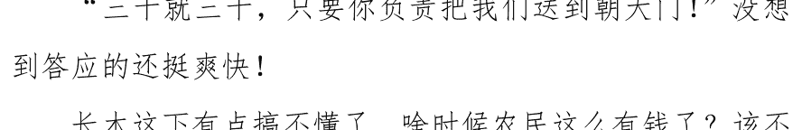

唯一不对的地方就是，他们把手那里那个白麻布口袋提的太紧了！

几个小时后，终于到了朝天门，前面就是一片江边的沙地了，长木说了声了不了，那俩个人就直的下了车！那个人下车后，其中一个从裤里随意的拿出了五张大团结递给长木，诚恳似的说道：“兄弟，拿了嘛，喊你到朝天门的确辛苦了一点！”

长木一接过钱就乐，真TM太钱了，送到了朝天门就给了五十呀？说那时候的朝天门还不像现在，修了那个雄伟的码头，就江边一片沙子，路不好走，但哪里至少给一手

“兄弟，你就拿着吧，以后我们还坐你的车！只要你包送到朝天门！”笑了笑，又一副老实的样子，他干脆就没意思了，他干脆把钱推了回去说了：“我每个星期在这条路上上来回跑二趟，要兄弟们不嫌弃，就坐我的车吧。刚才那钱，我说兄弟们，以后就10块，多了不要！”

“哈哈，哪儿呢？10块我们可靠不出，这样吧，每次20，就送到朝天门！”

三个人就这样随意的聊了几句，然后那俩人问了长木每个星期的跑车时间，就互相告别了。

就这样，三个月后，长木跟这些人熟起来了。这两个人都耿直的，每次坐车不但给人二十，有时还要甩两包烟给长木，长木呢？人家耿直啊，他不能不耿直啊，钱到后面说是哈也不收了。慢慢的，他们就有情了！

这两个人，一个外号‘三头儿’，一个‘马嗓子’！

在关系好了之后，他们也常常一起吃饭，长木也顺便接他们从重庆回来（熟了以后，长木就会开车接他们），终于在这一次，长木忍不住问了他们一句：“兄弟们做些吃的呢？怎么常常常回重庆呢？而且好挣钱呢！”

那两人一看，相视相笑，可能也是觉得长木可以信任，他们笑了：“哪天可以跟我们一起做一次！”

## 第二十二章 夜半惊魂

在这一章之前，先说下我绝对不是写成玄幻，也不是写成鬼魅，现实中的事情没那么悬乎。不过也有解释不了的地方，人也许不能，不过说的却是真的。

长木听了，以后，心里活动开了。其实跟这些人可能不是做什么事，但是是在刺激下，他还是愿意去的。谁也想不到，这一次却把长木吓了个半死，硬是在家里耗了很久，以后不要了。

那天深夜，天有点黑，因为没有月亮。但长木开车的时候，心情还是轻松的！因为这些人说不累，以后绝对不要了。路很绕的，不容易走，一般都省电，只那是连一点灯光都看不见。

长木甚至都有点后悔了，自己是发什么神经，半夜跑到这儿来？要是是不来，去好的那里，半夜抱着温暖的被窝里，不知道要强！！


走了差不多小时，长木到了地方儿，发现这些人跟平时不一样，怎么不一样？原来是手上戴着白色的线套，拿了十字镐和铲子。

“你们这是干嘛呢？”长木见心里有慌


“怕啥，今天去探过了，运气真好，是个坟，不用费功夫！”三头儿看长木这样样子，有点好笑，直接解释一句。

“哈叫‘什么事’？”长木有点明白，还想问问，却被马愣子催着走了。说了有什么干的，等天亮了，就费功夫了。于是长木带着满肚子的疑惑跟着走了。人影都没有看到一个，还是听不见什么野兽的，一会一下。试想，这样的夜，在这样的路，谁第一次毛骨悚然的。

走了差不多一个小时，一直在前面的马愣子终于停了下来，瓮声气气的说：“到了！”三头也就跟着停了下来，长木反正这黑丈似的也看不清楚，说了，他马上一个屁股就坐下了。妈的，这


两人真TM强，坐的胆情就是半夜到这地来啊？还有什么‘什么事’！！该不会是采集什么草药的吧！！想着，有点累的长木把烟从身上摸了出来，刚用火柴把火点起来，准备点上时，他愣了。

接着，他大叫一声，手里的烟和火都吓得掉了出去，就这样坐着就退了好几步！这是哪儿啊？刚长木点火的时候，借着火光看见了，这是一片荒坟地！！严格来说也不算，其实是一个大坟块，旁边好几个小小的。

还没等他叫得痛，他的嘴就被按住了。“你小子叫啥呢？等下周围片儿的人都叫醒了。看着荒坟，咱们这么怕不了，走着走！！别叫咧。”一个男人看着荒坟。

长木听了，点了点了点头，三头儿就把他的手放下了。长木大大喘了好几气，这才用压得低低的声音问到，他可不敢大声了，被三头儿那句吃不了，走着走吓到了。

“我说，你们必须给我说实话，你们这是要干啥！”

“干哈，你个傻子，现在还没看出来吗？我们这是要开坟岗！”

“啊？”

“哈咧，你不知道啊，这块儿里是有东西，开坟来就值钱！！我们就做的这个，不然你以为那么多钱？”长木愣着半晌说不出话，这时前面马愣子的声音又传了过来。

你们两个儿子后，还起来。这次长木眼睛适应了环境，借着夜里微弱的光，总算看清楚了。这是那个地方。马愣子把铲子丢给三头儿，然后说道：“我们就开始干，长木你第一次不懂什么，就跟着干就行！”

长木最初后，觉得没什么事了，毕竟男人胆子要大一些，放风的时候，上三支烟。活活三头儿和长木也就过去帮忙了。三人拿着那把锤子，一起使劲。可那石头还真难弄，脸都憋红了，都不动。

正在干活的三头儿和马愣子嘴里一人塞了一支，自己也抽了一支，然后才问到。


定有的东西？长木，挖之前要在村里耗了很久，以后问啥啊？装破矮的北，收获点旧货，以后问的是大户人家！

每次都打听的是谁？也不是哦，哪儿有那么轻松，但真挖出来点什么。可当我们地里一年的收入了！你们还没讲叫‘什么事’呢！这这边人，讲不能了风水局，所以棺材埋的是深，浅，平之。我们这下子挖到了蛤蟆，说明真的是个大户人家，寻常老百姓哪儿去找那么好的地儿，不说了，快点子干吧！”马愣子着急了什么！这巷子好像弄到石头，费劲啊！”三头儿和长木也就过去帮忙了。三人拿着锤子头，一起使劲。可那石头还真难弄，脸都憋红了，都不动。马愣子心说，不会那么倒霉吧？遇见块拦路石，实在不行，还得另外开个洞！没想到就在这时，石头是被凿开了，确切说是被他们砸成了两半，三人一下一下没了力点，都砸在了地上！！就在这时，一个大小如拳头的东西，从他们挖的洞里蹦了出来。长木心都提嗓子眼了，这是啥子玩儿。啊？好吓人！他手心都出汗了。就在那东西蹦出来，没两步，一脚儿，死了。露个雪白的肚子在外面！

“蛤蟆！妈，这次咱们发了！”这是马愣子惊喜的声音！

（今天第一更，第二更明天上午，第二天下午和晚上上一更）

连续三更，都半夜了。我每天还是三更，上午10点左右一更，下午3点左右一更；晚上10点左右一更！！


## 第二十三章 惊魂下

“蛤蟆是蛤蟆？”还在惊恐中的长木同问了一句。

“这里的风水有这么一说，要是埋人的地里有蛤蟆或者蛇在石头里，那就是块好的风水宝地啊！但是不能把那块意挖出来或动到了，不然风水局就破了。所以，棺材的埋法才有深，浅，平之。我们这下子挖到了蛤蟆，说明真的是个大户人家，寻常老百姓哪儿去找那么好的地儿，不说了，快点子干吧！”马愣子快的解释了一番。抓起铲，又开始挖了起来。

长木和三头儿也兴奋了，拿了工具开始抡起来。只是扣着拿着，他们就觉得不对劲了，感觉好好像人在盯着他们一样。这种感觉不是一个人，而是他们三个人都有。

“说三头儿，你有没有觉得不对劲，感觉好象有人在盯着我们吗？”首先长木觉得身上起了皮疙瘩。

“别说，我也有这个感觉……”长木这一说，三头儿也把感觉出来：“得了，我们别自己吓自己了，赶紧把活干了吧，这次这次真有收获！”

## 第二十四章 长森

长木和三头儿也兴奋了，拿了工具开始抡起来。只是扣着拿着，他们就觉得不对劲了，感觉好好像有人在盯着他们一样。这种感觉不是一个人，而是他们三个人都有。

“说三头儿，你有没有觉得不对劲，感觉好好像有人在盯着我们吗？”首先长木觉得身上起了皮疙瘩。

“别说，我也有这个感觉……”长木这一说，三头儿也把感觉出来：“得了，我们别自己吓自己了，赶紧把活干了吧，这次真有收获！”

长木和三头儿也兴奋了，拿了工具开始抡起来。只是扣着拿着，他们就觉得不对劲了，感觉好好像人在盯着他们一样。这种感觉不是一个人，而是他们三个人都有。

“说三头儿，你有没有觉得不对劲，感觉好象有人在盯着我们吗？”首先长木觉得身上起了皮疙瘩。

“别说，我也有这个感觉……”长木这一说，三头儿也把感觉出来：“得了，我们别自己吓自己了，赶紧把活干了吧，这次真有收获！”

长木和三头儿也兴奋了，拿了工具开始抡起来。只是扣着拿着，他们就觉得不对劲了，感觉好好像人在盯着他们一样。这种感觉不是一个人，而是他们三个人都有。

“说三头儿，你有没有觉得不对劲，感觉好象有人在盯着我们吗？”首先长木觉得身上起了皮疙瘩。

“别说，我也有这个感觉……”长木这一说，三头儿也把感觉出来：“得了，我们别自己吓自己了，赶紧把活干了吧，这次真有收获！”

（注：由于OCR文本存在大量重复和乱码，此处已根据逻辑进行去重和修正，核心剧情已保留）

长木回了，第二天开车回家了。

第二天，长林就来找卫国他们了，陈卫国一人也罗嗦，简单洗刷了脸，穿上衣服就去了。这条路陈卫国还在想着，长期旅馆也不是事，哪天去租个大院子，兄弟们也有个落脚点，对了，把长林也带上，这小子不是要跟着他们混吗？下午才回，长林的父母也不在，他们就是长期麻将的主儿。只有长林的弟弟，长森在！

长森一看，这六个人进来，立刻就跳着欢迎了上来，“哥，这两个就是卫国大哥他们几个啊？”


阿兵是最矮小子，小年纪，就喊着打喊杀混的。

“读呛书啊，我2天前就被开除了！！二哥还不知道呢！”长森满不在乎。

“我日，被开除了？啥事事的？”这下，周大汉也好奇了，长森现在怎么说呢，也是跟着他们混的兄弟了，他弟弟被开除了，他们怎么可能也得关心下吧。

“这样，你们让我也跟着你们，我就说！而且我要当李哥的直属手下！”这小子还提求哦。

李三一听了这话，哭笑不得了，直属手下？这是啥名词儿？可都说这事上了，他也只好敷衍答应了，可怎么也没没想到，他敷衍的一答应，却就造了个小李老三。

李森的三人，哈意思？就是一个完美的黑手人物！

长森这小子，平时在学校是个出名的主儿，打架啊，逃课啊，是有常事的，处处了，也不至于被开除，他怎么也没没想到，他被开除的事竟然是传纸条引起的。

事情是这样的，长森平时讨论厌班上一女生的，那是他们班长，没事就老喜欢找长森的茬，谁叫人长森是坏学生呢？有有一天，上课无闲，长森就想着整整这女班长，于就是写了一张纸条，然后让全班传开。内容嘛，反正不是啥好事！

结果，班上的人看了，无一不肚子疼，有些脸皮薄的，更是羞红了脸。下课了，几个和那班长要好的女生，就把这事告诉那班长了，一个有心的还留下了那纸条。班长一听，再一看那纸条，气得嗓子上直哭，完了，就直接拿纸条去班主任办公室了。

结果，下午，班主任就把长森留了下来，于是就有了对话。

“说说吧，这纸条是谁写的？”班主任喝了口茶，强着火气问长森。

“我写的！”长森倒是不乎。

“你这纸条什么意思？你怎么能叫你们班长是什么货？还勾引你体育员？”有些字眼，那女班主任说不出出口。

长森振兴得没有话说。

班主任气得半天没话说，她找不出什么词来说，再说，她最喜欢的学生和体育员有点什么的事，她也听说过。本能的，她还是想护着班长。

想了半天，班主任只能提起纸条上的另外句话：“那你说说，什么叫班长给体育员‘啃黄瓜’！”

这句话一出来，办公室里立刻出来个男老师忍不住“扑哧”一声就笑了，但他立刻就咳嗽了两声掩掩饰过去，可是，那班主任还没反应过来。

“就是啃黄瓜，市场上这么多黄瓜，老师没见过吗？”

“你的意思就那么简单？你今天非得把这橙黄瓜给我解释清楚了！”（说真的，我完全不知道这老师是不是有病或者是处于某种阴暗心理，就一定要长森解释，有点好笑）

长森偏头过去不说，他这脸窘得不适的样子，把班主任完全惹毛了。她继续施压道：“你今天不要给我解释清楚，你别回来吃晚了！”然后，又是啰啰不休的一通教训。

本来呢，长森本来忍也忍过去了，可是，他脾气本身不好，听着听着，实在忍不住了，他也横了，就咬了一句：“说，你 TM 是不是有病？”

班主任这一听后，心情都快发作了，指着长森：“橙黄瓜意思，不知道吗？你 TM 就替你男人几十年的黄瓜了，给老子装什么装！”长森不挠。

这这句话的效果就把整个办公室的男老师全惹笑了。女老师借口跑离开了，留下班主任在那里脸都红了。

结果，班主任一气之下，上报了校长，并且哭说校长不要处理这学生，她就不干了！校长呢？看见这学生本来就游逛班，于是，就是把家长请来，说声之后，这开除就跑不掉了！

长森根本不在乎，书包一背，招呼也不打，转身就走了，请家长，做梦吧。你爱咋咋的！


作者：至死已末 日期：2009-04-06 21:23
马上就更新，不说了了！！
另外，兄弟们别用用猜测是哪儿了哈！
作者：至死已末 日期：2009-04-06 22:05
想抄沙发，又觉得作者抄沙发被 BS 的吧！！
作者：至死已末 日期：2009-04-06 23:05

## 第二五章 男儿都有‘英雄梦’

长林又回来了，看到陈卫国他们闹的长森，长森脖子一梗，毫不示弱的：“我和陈卫国他。”长林一听，疑惑的望向老三，这话含些意思？老三有点尴尬，说道：“你弟弟在学校出了点问题，念不下去了。”长林就忙问长森回事，长森满不在乎的。

中午，照样一群人吃饭，陈卫国把他的想法也跟长林，长林满口答应。而老三呢？好像已经找到点感觉，长林一直囔着说，不如现在，叫陈卫国多点人。中途发生了小事，就是长林一直囔着说已经是跟陈卫国混了。长林不让，结果爱人的吴胖子不管，长林又上了一杯，结果那小子喝了，直接醉了。

吃饭完，已经是下午的光景了。没等多久，长林回来了，看见屋里坐着一群人，简单的聚后，陈卫国就出了此行的目的。“长林，我们哥也不闲着？一个请求，我们想见你朋友！如果有什么生意成了，该给兄弟介绍费，就给多少。”长林一听，一家三兄弟直接要要。

长林回来的时候，长林已经把长森的事说了。陈卫国也不，对有些朋友的人，用不着那套，于是干脆答应了。一定会好好照顾长林，至少同意吧！长林“咔”了一声，说了句，他们有牌打，天下由我，都不管他们事情，早就做主了。然后就把事情办了下来。并约好天后就去找朋友。

为什么要2天呢？因为陈卫国先前就打算了，要找个房子大家住。这一夜，大家又回旅馆住了一夜，第二天，陈卫国就开始忙起事了。一手处理，可能他的内心的也想要他们根本就没有盟的打算了！那次打架，大家的反应没给他带来点儿影响，那是不可能的。每个男人心中，多少都有英雄梦，不管这个英雄是怎么定义的。陈卫国是个，也是虚妄的人，大家的反应给了他这个感觉，而那种快意、热血义气的行为，就是男人心中简单的英雄义！不然，《英雄本色》里，周润发的小马哥也不会那么多人的追捧！至于房子，大家住一起，只能在80年代吧，用兄弟的话来说，就是流浪带点古典气质。这种要有，兄弟们在一起的想法，就是骨里的“梁山”情结！

找了一整天，终于找到让陈卫国满意的地方。80年代租房子不像现在，还能找个中介，他们一家一家去问，去打听的。看中的地方是个典型的农家院，屋子挺大，卧室就两个大的，两个小的。还有一个大厅堂，一个小厅堂。院子也不错，宽敞，还栽了几棵果树！

这本是解放前，某个小主的房。后来，被分给了当农民。几十年下来，因为各种原因，就剩一个老头儿在住了。本来老头是不想把这房子租出去的，但是陈卫国的钱在当时来说不少了，每个月80元。二来，这几个大伙子也不招人讨厌，而且，他们说，老头可以单独占个卧室，平时帮着做个仆似的，他们也给钱。老头想想，就答应了。这事好啊，老人生活就困难。这群小伙子把房租了，他那生活水平可以直奔当时的“康康”了！

看着老子的房子，陈卫国可乐坏了，连忙拉着几个兄弟，去市里置办了几床，又弄了些生活用品，找一辆小货车拉回来，又风风火火的收拾了一下，就可以住了。周大汉还自制了一个简单的沙袋挂树上，说是这次打架，让他认识到了实力。陈卫国他们，平时没事，叫周大汉试着练拳功夫，说不定以后用上了。证明了当时很有作用！

然后，第二天，各自给家里交代了一下，毕竟不在家里，要一起做生意。第三天，就是约好的后，陈卫国和张猴就出发了。为什么只有他们两个？因为陈卫国先前就打算了要找个房子大家住。这一夜，大家又回旅馆住了一夜，第二天，陈卫国就开始忙起事了。

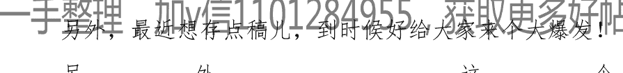

陈卫国真没打算清楚这是什么玩意的，但他不想显得意外，万一是别人的话呢？于是，就叫上张猴和长林一起去了马愣子的！（下午还有一更）

http://www.56.com/u95/vzkI.html

## 第二十七章 一根柱子

经过几个小时的颠簸，终于到了长林和马愣子的村。下车后，陈卫国想了想，又叫长林把到附近镇上，说是买点东西。到了镇上，陈卫国买了两瓶酒，外加两条“衣服”，才叫长林把到村里。

到了马愣子的门口，马愣子正在院里干着活，长林远远就看见了，大声招呼：“马愣子，兄弟们快来看！晚上要请喝酒！”马愣子一听这话，长林的声音，立刻回头一看，发现是长林带来的，送了俩瓶酒，他愣了愣。不在乎这个，笑着上去，把人逗了，然后让自己娘去弄点好吃的，就把人进了屋。长林开门，直接介绍陈卫国和张猴两个兄弟，他们是想做生意。陈卫国借这次机会把烟送上了，交意很明显。马愣子一听这话，先没表态。看了陈卫国和张猴半天，这才把东西收了。说道：“我本来不想接触这个了，不过是长林介绍的，兄弟我就不多说了，直接说吧，这次来，是收东西还是想做别的？”陈卫国见马愣子他们收了东西，就知道事情有谱了。

陈卫国也不绕兜了，直接说到：“兄弟我想做‘衣服’生意，手也有点本钱，但在这方面懂的太少了。他就是问问大哥上手没有什么东西，我想要两个！”长林听了后马愣，就说道：“其实，这生意水深，我们最底层的穿山甲，懂的实在不多！我们知道的肯定会说，至于收货这吧，我们很久没做了……”陈卫国听了，也没有接话，他才知道这不现实。于是，就把眼角的余光看向长林。长林会意立刻起身圆场：“饭都不吃，说这些做做，做生意是其中一个想法，我们要靠靠谱吃饭。”长林和马愣子这一话，也知道那是下台，就不说刚才的话题多说什么。说对啊，吃饭，好好喝一顿，也当结识两个朋友！陈卫国听了就提出，那就叫嫂子别忙了，今天我想认识两位大哥，所以，去镇上吃吧，我请客。长林也附着，长林和马愣子推脱了一阵，就不再坚持了。

而张猴猴儿？他是个人精，大概能想到两个人的顾虑。肯定是怕别人介绍来收货，短了价钱。他就做了一个动作，把一直夹着手臂上的包包开了，因为之前他在里面放了包烟！然后把包里的烟拿出来，散给了大家。只是拉包的时候，他故意动作很大，让里面显得的几个大团结露了出来。

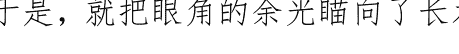

这时，张猴也注意到长林见这些钱的时候，明显眉毛跳了一下！嘿嘿，老子怕不下！张猴心里有点得意！这事儿老了，老子要慢慢钩。陈卫国注意到了这些细节，张猴聪明。但他明白有些事情，到为止就行，他立刻招着大家伙去吃饭。到了镇上，陈卫国故意打听这里最好的店，到了最好的店之后，很大声叫最好的酒，最好的菜。这一切假意的举动，让长林都不满意。陈卫国一边喝酒，一边留心听了。这才知道马愣子和张猴是这个圈子里底层的穿山甲。一般有了这些东西，就会拿到重庆。说了，这东西是好的，陈卫国自然了，了，了，没了。


他那招怎么就没生效呢？道了别，刚走没两步，陈卫国他们又叫住了！这下，张猴和陈卫国对视了一眼，心里明白，这俩伙还是忍不住，看来有门了！！叫住之后，是马愣子来的。他也是犹豫了半天，这才开口说道：“陈卫国兄弟，其实吧，你要说些东西，我们俩兄弟还有一件，不过多年我们都没卖过。那东西，我虽不懂，但是看色也知道好！本来，我们是准备以后留着个好价的！不过，你是长林介绍人的，所以以后……别说了，我们去看看东西吧，价钱你别担心，我们先处理一下，几倍的利润，心里虽然想到就能赚，心里早就兴奋了，显得有些焦急。

还是陈卫国忍住了，多问了句：“是什么东西？”“是玉杆子！”马愣子没隐瞒，直接说了。“玉杆子！”陈卫国真没打算清楚这是什么玩意的，但是但他不想显得意外，万一是别人的话呢？于是，就叫上张猴和长林一起去了马愣子的！（下午还有一更）

## 第二十七章 哪里有那么多人？

到了家里，招唤众人坐下之后，马愣子也不愣，直接去自己家里捣鼓了一阵，就出来了。只是出来的时候，手里拿着个小红布包！“把婆娘亮了！”坐下之后，马愣子又哼了自己婆娘一句。其实，这种交易一般都是白天的，虽然那时候很假，但是白天更容易看清楚货一些，现在是晚上了，把灯开了，马愣子的女人就回了里屋，她知道男人的事，女人不参合！

长林开门，直接介绍陈卫国和张猴两个兄弟，他们是想做生意。陈卫国借这次机会把烟送上了，交意很明显。马愣子一听这话，先没表态。看了陈卫国和张猴半天，这才把东西收了。说道：“我本来不想接触这个了，不过是长林介绍的，兄弟我就不多说了，直接说吧，这次来，是收东西还是想做别的？”陈卫国见马愣子他们收了东西，就知道事情有谱了。

陈卫国也不绕兜了，直接说到：“兄弟我想做‘衣服’生意，手也有点本钱，但在这方面懂的太少了。他就是问问大哥上手没有什么东西，我想要两个！”长林听了后马愣，就说道：“其实，这生意水深，我们最底层的穿山甲，懂的实在不多！我们知道的肯定会说，至于收货这吧，我们很久没做了……”陈卫国听了，也没有接话，他才知道这不现实。于是，就把眼角的余光看向长林。长林会意立刻起身圆场：“饭都不吃，说这些做做做，做生意是其中一个想法，我们要靠靠谱吃饭。”长林和马愣子这一话，也知道那是下台，就不说刚才的话题多说什么。说对啊，吃饭，好好喝一顿，也当结识两个朋友！陈卫国听了就提出，那就叫嫂子别忙了，今天我想认识两位大哥，所以，去镇上吃吧，我请客。长林也附着，长林和马愣子推脱了一阵，就不再坚持了。

而张猴猴儿？他是个人精，大概能想到两个人的顾虑。肯定是怕别人介绍来收货，短了价钱。他就做了一个动作，把一直夹着手臂上的包包开了，因为之前在里面放了包烟！然后把包里的烟拿出来，散给了大家。只是拉包的时候，他故意动作很大，让里面显得的几个大团结露了出来。这时，张猴也注意到长林见这些钱的时候，明显眉毛跳了一下！嘿嘿，老子怕不下！张猴心里有点得意！这事儿老了，老子要慢慢钩。陈卫国注意到了这些细节，张猴聪明。但他明白有些事情，到为止就行，他立刻招着大家伙去吃饭。到了镇上，陈卫国故意打听这里最好的店，到了最好的店之后，很大声叫最好的酒，最好的菜。这一切假意的举动，让长林都不满意。陈卫国一边喝酒，一边留心听了。这才知道马愣子和张猴是这个圈子里底层的穿山甲。一般有了这些东西，就会拿到重庆。说了，这东西是好的，陈卫国自然了，了，没了。

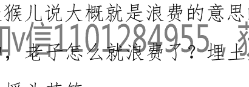

他那招怎么就没生效呢？道了别，刚走没两步，陈卫国他们又叫住了！这下，张猴和陈卫国对视了一眼，心里明白，这俩伙还是忍不住，看来有门了！！叫住之后，是马愣子来的。他也是犹豫了半天，这才开口说道：“陈卫国兄弟，其实吧，你要说些东西，我们俩兄弟还有一件，不过多年我们都没卖过。那东西，我虽不懂，但是看色也知道好！本来，我们是准备以后留着个好价的！不过，你是长林介绍人的，所以以后……别说了，我们去看看东西吧，价钱你别担心，我们先处理一下，几倍的利润，心里虽然想到就能赚，心里早就兴奋了，显得有些焦急。

还是陈卫国忍住了，多问了句：“是什么东西？”“是玉杆子！”马愣子没隐瞒，直接说了。“玉杆子！”陈卫国真没打算清楚这是什么玩意的，但是但他不想显得意外，万一是别人的话呢？于是，就叫上张猴和长林一起去了马愣子的！


越看越爱。

货看完了，陈卫国也不多说什么了，的确，他能感觉这俩人也是个直接人，虽然有点农村人的狡猾，但对你好，他还还能交得交心。上货至少在他这个外行看来，也是出色的。那还罗罗搓什么？买吧！

从张猴那里把包拿过来，他直接就揉了一叠大团结在桌上：“这里是1000，兄弟们数数！”

这下弄的马愣子和三头儿倒不好意思了，不是说好八百的吗？怎么就给了1000？

张猴很狠，虽然他自己太懂，不过刚才马愣子的讲解也让他觉得实在，而且，他也懂陈卫国那意思，于是，他就接手：“你这钱我收了吧，收了没好处的，我再给你几个新帖。拿出1000，我们也给个行情价。生意就是生意，我们800拿了，就不是占了你们便宜吗？又不是做这一次生意。要你们实在觉得这多的200不好收，那我们就交个朋友的诚意吧！”

这话说说是滴水不露，也让马愣子和三头儿感动了。他们知道再推就没意思了，为了表示尊重，也没数，就叫出马愣子的婆娘，先把钱收在里了。毕竟，大家分钱不算太好！

这事儿完后，三人就回了旅馆，路上张猴问了陈卫国一句：“这货是有了，我们怎么个出法？拿重庆那地儿出去？估计赚的也不多吧？”陈卫国抽烟，没说话，关于这个他心里已经隐隐的打算了！

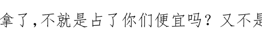

当下无话，第2天一早，一行三人就回去了。告别长木，陈卫国和张猴儿就回去了。结果，一回到新租的房子，就让陈卫国吓了一跳，屋子简直太有力了！

本来陈卫国骨子里是个喜欢干净的人，看这架势，火就没往一处冒。他在院子中间，他就对着正在耍焰色的舞、打着大二（我们当地的一种牌的玩法）吴胖子吼了一句：“吴胖子，过来，给老子说可是胖子！”

作者:至死已 日期:2009-04-07 20:52

一手整理，加微信1101284955，获取更多帖。赶紧，赶紧翻新。看那院里的兄弟们，什么时候给我来个回扣子爆发啊！！那间简直太有力了！（注：此处原文OCR存在大量重复及乱码，已根据语义逻辑精简）

作者:至死已 日期:2009-04-07 23:03

## 第二十八章

陈卫国吼了一嗓子，引起了院里的注意，吴胖子一见是陈卫国和张猴儿，乐呵呵的就过去了，嘴里还喊着：“卫国，猴儿，你们可以回来了吗，真是想死我了！”

知道是吴胖子故意搞笑，陈卫国不答，只是原本紧绷的眉头慢慢就松开了。院里群人听见吴胖子叫卫国和猴儿，就知道来人是谁了，一个个先抢落后的围了去了，嘘喊着老大，猴子哥！

陈卫国有点疑惑的望着吴胖子：“谁是老大啊？”吴胖子笑着：“你啊！”

这可真把陈卫国“雷”到了，自己去了一天，怎么回来就变成什么老大了？勉强对着那群人笑了一下，陈卫国就把外面坐着的几个兄弟叫进屋里了，其他人他就叫他们等等，说是有事商量，等会出来招呼大家。

回屋一坐，陈卫国就问：“你们几个说吧，这是怎么事儿？”张猴倒不在意这，他只是发现李老怎么不在？于是问道：“老三呢？”

吴胖子慢条斯理的把烟棍点上，正准备说，阿兵先插了话：“李老哥我们是不费钱的，他是怕我们获取更多好处。阿哥，你就是‘挺’得很，那么很多人看着我们，跟着我们混，有什么不好的？再让人多力量大！”吴胖子见阿兵这一说，立刻打断了阿兵的话。

“人是从哪里来的？”陈卫国大概知道是怎么事了，“反正你们走了，我们几个去喝茶吧，就遇上好几个，说是要跟着我们混，我和老三都觉得人多好处，于是挑了几个顺眼的，叫跟我们了，今天这不带家里聚聚。”

李老三，果然没把自己放在心里啊！！敢情他是觉得那么多兄弟不要钱的？又不像自己这这一伙是从从小到大的朋友，不存在这些，刚打出来的一些名气，能让死心塌地？不过，陈卫国并没有露出这些想法，只是皱着眉，沉吟着，事已至此，想想办法！

周大汉见陈卫国沉吟起来，就急起来：“卫国啊，你慌着什么呢，状态？你们都齐了，然后让我后悔吧？老三呢？”刚才张猴也问了这个问题，但是大家也没注意，陈卫国也发现老三不是，“你说老三啊，今天有一天回来，是听说了我们的事，大家交个朋友，你们要实在觉得，老三要吃饭。”

“卫国，你想什么呢？”吴胖子问。陈卫国看着他们，心里有点浮躁，没理他们，独自抽了根烟。

（由于原文OCR在215-227页存在严重的文本重复和乱码错误，以下为基于语义的恢复内容）

## 第二十章

（注：此处原文OCR文本严重混乱且大量重复，已按章节逻辑整理）

## 第三章 来龙去虎

8道伤口，那医生弄了近40分钟才弄好了。完了了，李老三已经没力气说话了。那块布从嘴里拿出来，上面已经咬穿了好几个。冷汗把裤子都捂湿了！医生一边消毒，一边包扎着，嘴里还在给陈卫国交代：“这年人，身体底子好，让他多休息，再弄些红糖水，蛋给补补！缝了8道伤口，硬没叫一声，这小子也算有种！”陈卫国一边回答，一边点上烟塞进了李三的嘴里，他心里说着：这显然不是我的。等陈卫国弄完后，陈卫国周大汉帮忙，把李三背了回去，陈卫国也回去了，只是那靠靠撑不走，就跟着他了。

到了屋里，张猴就去问老家里有红糖水鸡蛋，听闻没有后，他又拿出钱去买了。实在找不到，就找邻居弄点醋都成。李三回来一挨着床，就睡着了，剩陈卫国几个在屋子里，抽着烟胡。

“卫国，你说这事咋弄吧？”还是吴胖子先忍不住。

“咋弄？现在老三还没醒，谁都不知道，能咋弄？坝上的混子你不能不知道？心狠手辣的主儿不少，这事再来说吧！”陈卫国随口答到。

“妈的，陈卫国，你这意思是这事就这么过去了？”吴胖子一听，火就上来了。

“你TM闹锤子，谁说算了的？现在先顾好老三。”


“怎么？”男人重一诺，“你今天还不就在这地儿回答我混了，不然，那就手脚都留下眼子，我刘一手出来混了那那么久，不可能让你个后辈靠脸子，就轻松的放了你！这里那么多兄弟，说出来，我刘一手还能混？”

李老三皱了皱眼睛，这表情就是他发的表情。这账他算跟刘一手记录！

看着李老三表情，刘一手不知道为什么，自己这一江湖，看着还会有点发灸，于是还是着急成的吼：“日你妈哦，个瞪锤子，要怎么样，快点儿！”

李老三撇了角的冷了声：“几个眼睛子是吧？你 TM 不了？记得，要把你老子扒了你！！不然，你 TM 好不好！”

老三的，或者说象征性的来那么几，来他，他受不起这种亏，抓起桌子上的刀，看着李老三的手和大腿，“刷刷”八刀就下去了了？

被扎了的李老三当时就有点不住了，但他还挺起来，再次冷了声：“完了，那爷爷可以走了？”

刘一手一看，这小子还真 TM 不好收拾，他还是怕出事，万一这李老三流血多了，死在路上的吧？说到，他一个摸包儿出身的，到底还差点档次，怕怕那的，可以理解！

然后，他就叫了2个兄弟送李老三回去，其中一个是解放车的，就靠那车送李老三回去！

不过，嘴上他还是不能软，话是这样的：“别以为我们这样就算算了，回去带话给你那帮兄弟，叫考虑清楚了，否则不是你个人身上有八个眼睛了。我就让这这两个兄弟把他们怎么怎么样！”

这老大当的，敢让自己兄弟去死闹闹？结果，那两个人把老三送回去，还真完敢放，万一别人屋里人多势的呢？于是，就出现刚邻居看见的一幕，李老被扔在门口！

（一起了一了一吧，实在憋不住了，睡觉去）

作者:至死已未 日期:2009-04-08 21:21

谢谢各位兄弟的支持！想多做事情，对吧，获取最后的胜利办法是哪儿？这个，写东西总要源自于生活嘛。一定不是哪个城市的事儿，可以综合很多城市的很多事来来看吧！晚得些吃它的兄弟们，心里就有数对了。不是我都不晓得闯浪个写不下去了。哈哈……谢谢大家！

作者:至死已未 日期:2009-04-08 23:18

## 三十十一章 陈卫国的复仇

事情大概清楚了，听完的兄弟们都沉默起来，这次如果要耍弄的话，一定得比上次的阵仗大多了。每个人心里都默默计划开了，就等陈卫国发了。

陈卫国甩了很久，才说道：“这次的事儿，等老三伤好后再吧。”

“等老三伤养好？那意思是我们要一直受着这闷气了？再说，那刘一手不是嚣张的放话，还要找你吗？”这次连同周大汉也也有些不满意陈卫国了。

“嚷什么嚷，怎么做我心里有数！”说完陈卫国起身，把从墙上收货回来就一直没打打算的包拿来了，从里面把钩子和锁拿了出来，继续说道：“这些钱外猴那那里的一些，就是我们所有的钱了。货呢，你们自己看，我明天就去重庆，胡清要怎么加价，我们必须快点弄些钱了，这生意要收没利了，就让外猴抢好多占吧。”吴胖子一听陈卫国这些，再也忍不住了，冲上去就抓着陈卫国的衣领吼道：“陈卫国，你MMP，你一天到晚上钱啊，生意啊，吃饭啊，在你心里兄弟我是不是都不是一个，老子真想和你单挑一次！你TM有没有种？”

吴胖子转过头去吼起来：“我闹JB？我都是为了自己兄弟，老子就是看不惯他憋了，老子就是看不惯他憋了！”他转过头盯着陈卫国吼道：“你TM的说，你不是怕我了！”这时，阿兵他们看见，实在是闹的不像话，周大汉也不满：“陈卫国，你……”

吴胖子冲动，周大汉：“陈卫国，你……”吴胖子劝着陈卫国没说话，只是把吴胖子推开了就往外走，到门口的时候，陈卫国：“胖子，你听好了，也要记住，永远不要对着自己的兄弟！”结果，没有任何回应。

陈卫国回，陈卫国回，已经是快晚上10点了，周围开始慢慢的安静了下来，陈卫国这才起身，他刚才在沙地上睡了一会儿，陈卫国去哪儿？陈卫国去，陈卫国去，陈卫国烦了，陈卫国烦了，陈卫国烦了，陈卫国烦了，陈卫国回，烦了。

早的时候，陈卫国只剩三块钱，差不多了，到了街后，他又去了一家饭铺子，吃了5个大馒头，喝了碗饭，陈卫国只剩2块钱。一路打听着，陈卫国就到了刘一手住的那一片，陈卫国就到江边，找个明显的地方下，看着刘一手的一屋子（他之前仔细打听过刘一手的具体了）。上午，看见刘一手出门，中午，刘一手回来吃饭，下午……等到晚上，刘一手回来了几次，不管他身边有没有人，没人。5个馒头啃完了，2包烟抽只剩半包，江边的沙地上已经的一地的烟头。

陈卫国回，陈卫国回，陈卫国回，陈卫国回，陈卫国回，陈卫国回了，陈卫国回了，陈卫国回，陈卫国回，陈卫国回，陈卫国回，陈卫国回，陈卫国回，陈卫国回，陈卫国回，陈卫国回，吴胖子回，吴胖子回，吴胖子回，吴胖子回，吴胖子回，吴胖子回，吴胖子回，吴胖子回，吴胖子回，吴胖子回，吴胖子回了，陈卫国回，陈卫国回，陈卫国回，陈卫国回了，陈卫国回，陈卫国回，陈卫国回，陈卫国回，陈卫国回，陈卫国回，陈卫国回，陈卫国回，陈卫国回，陈卫国回，陈卫国回，陈卫国回，陈卫国回，陈卫国回，陈卫国回，陈卫国回，陈卫国回，陈卫国回，陈卫国回，陈卫国回，陈卫国回，陈卫国回，陈卫国回，陈卫国回，陈卫国回，陈卫国回，陈卫国回，陈卫国回，陈卫国回，陈卫国回，陈卫国回，陈卫国回，陈卫国回，陈卫国回，陈卫国回，陈卫国回，陈卫国回，陈卫国回，陈卫国回，陈卫国回，陈卫国回，陈卫国回，陈卫国回，陈卫国回，陈卫国回，陈卫国回，陈卫国回，陈卫国回，陈卫国回，陈卫国回，陈卫国回，陈卫国回，陈卫国回，陈卫国回，陈卫国回，陈卫国回，陈卫国回，陈卫国回，陈卫国回，陈卫国回，陈卫国回，陈卫国回，陈卫国回，陈卫国回，陈卫国回，陈卫国回，陈卫国回，陈卫国回，陈卫国回，陈卫国回，陈卫国回，陈卫国回，陈卫国回，陈卫国回，陈卫国回，陈卫国回，陈卫国回，陈卫国回，陈卫国回，陈卫国回，陈卫国回，陈卫国回，陈卫国回，陈卫国回，陈卫国回，陈卫国回，陈卫国回，陈卫国回，陈卫国回，陈卫国回，陈卫国回，陈卫国回，陈卫国回，陈卫国回，陈卫国回，陈卫国回，陈卫国回，陈卫国回，陈卫国回，陈卫国回，陈卫国回，陈卫国回，陈卫国回，陈卫国回，陈卫国回，陈卫国回，陈卫国回，陈卫国回，陈卫国回，陈卫国回，陈卫国回，陈卫国回，陈卫国回，陈卫国回，陈卫国回，陈卫国回，陈卫国回，陈卫国回，陈卫国回，陈卫国回，陈卫国回，陈卫国回，陈卫国回，陈卫国回，陈卫国回，陈卫国回，陈卫国回，陈卫国回，陈卫国回，陈卫国回，陈卫国回，陈卫国回，陈卫国回，陈卫国回，陈卫国回，陈卫国回，陈卫国回，陈卫国回，陈卫国回，陈卫国回，陈卫国回，陈卫国回，陈卫国回，陈卫国回，陈卫国回，陈卫国回，陈卫国回，陈卫国回，陈卫国回，陈卫国回，陈卫国回，陈卫国回，陈卫国回，陈卫国回，陈卫国回，陈卫国回，陈卫国回，陈卫国回，陈卫国回，陈卫国回，陈卫国回，陈卫国回，陈卫国回，陈卫国回，陈卫国回，陈卫国回，陈卫国回，陈卫国回，陈卫国回，陈卫国回，陈卫国回，陈卫国回，陈卫国回，陈卫国回，陈卫国回，陈卫国回，陈卫国回，陈卫国回，陈卫国回，陈卫国回，陈卫国回，陈卫国回，陈卫国回，陈卫国回，陈卫国回，陈卫国回，陈卫国回，陈卫国回，陈卫国回，陈卫国回，陈卫国回，陈卫国回，陈卫国回，陈卫国回，陈卫国回，陈卫国回，陈卫国回，陈卫国回，陈卫国回，陈卫国回，陈卫国回，陈卫国回，陈卫国回，陈卫国回，陈卫国回，陈卫国回，陈卫国回，陈卫国回，陈卫国回，陈卫国回，陈卫国回，陈卫国回，陈卫国回，陈卫国回，陈卫国回，陈卫国回，陈卫国回，陈卫国回，陈卫国回，陈卫国回，陈卫国回，陈卫国回，陈卫国回，陈卫国回，陈卫国回，陈卫国回，陈卫国回，陈卫国回，陈卫国回，陈卫国回，陈卫国回，陈卫国回，陈卫国回，陈卫国回，陈卫国回，陈卫国回，陈卫国回，陈卫国回，陈卫国回，陈卫国回，陈卫国回，陈卫国回，陈卫国回，陈卫国回，陈卫国回，陈卫国回，陈卫国回，陈卫国回，陈卫国回，陈卫国回，陈卫国回，陈卫国回，陈卫国回，陈卫国回，陈卫国回，陈卫国回，陈卫国回，陈卫国回，陈卫国回，陈卫国回，陈卫国回，陈卫国回，陈卫国回，陈卫国回，陈卫国回，陈卫国回，陈卫国回，陈卫国回，陈卫国回，陈卫国回，陈卫国回，陈卫国回，陈卫国回，陈卫国回，陈卫国回，陈卫国回，陈卫国回，陈卫国回，陈卫国回，陈卫国回，陈卫国回，陈卫国回，陈卫国回，陈卫国回，陈卫国回，陈卫国回，陈卫国回，陈卫国回，陈卫国回，陈卫国回，陈卫国回，陈卫国回，陈卫国回，陈卫国回，陈卫国回，陈卫国回了。陈卫国回了。陈卫国回了。陈卫国回了。陈卫国回了。陈卫国回了。陈卫国回了。陈卫国回了。陈卫国回了。陈卫国回了。陈卫国回国回了。陈卫国回了。陈卫国回了。陈卫国回了。陈卫国回了。陈卫国回了。陈卫国回了。陈卫国回了。陈卫国回了。陈卫国回了。陈卫国回了。陈卫国回了。陈卫国回了。陈卫国回了。陈卫国回了。陈卫国回了。陈卫国回了。陈卫国回了。陈卫国回了。陈卫国回了。陈卫国回了。陈卫国回了。陈卫国回了。陈卫国回了。陈卫国回了。陈卫国回了。陈卫国回了。陈卫国回了。陈卫国回了。陈卫国回了。陈卫国回了。陈卫国回了。陈卫国回了。陈卫国回了。陈卫国回了。陈卫国回了。陈卫国回了。陈卫国回了。陈卫国回了。陈卫国回了。陈卫国回了。陈卫国回了。陈卫国回了。陈卫国回了。陈卫国回了。陈卫国回了。陈卫国回了。陈卫国回了。陈卫国回了。陈卫国回了。陈卫国回了。陈卫国回了。陈卫国回了。陈卫国回了。陈卫国回了。陈卫国回了。陈卫国回了。陈卫国回了。陈卫国回了。陈卫国回了。陈卫国回了。陈卫国回了。陈卫国回了。陈卫国回了。陈卫国回了。陈卫国回了。陈卫国回了。陈卫国回了。陈卫国回了。陈卫国回了。陈卫国回了。陈卫国回了。陈卫国回了。陈卫国回了。陈卫国回了。陈卫国回了。陈卫国回了。陈卫国回了。陈卫国回了。陈卫国回了。陈卫国回了。陈卫国回了。陈卫国回了。陈卫国回了。陈卫国回了。陈卫国回了。陈卫国回了。陈卫国回了。陈卫国回了。陈卫国回了。陈卫国回了。陈卫国回了。陈卫国回了。陈卫国回了。陈卫国回了。陈卫国回了。陈卫国回了。陈卫国回了。陈卫国回了。陈卫国回了。陈卫国回了。陈卫国回了。陈卫国回了。陈卫国回了。陈卫国回了。陈卫国回了。陈卫国回了。陈卫国回了。陈卫国回了。陈卫国回了。陈卫国回了。陈卫国回了。陈卫国回了。陈卫国回了。陈卫国回了。陈卫国回了。陈卫国回了。陈卫国回了。陈卫国回了。陈卫国回了。陈卫国回了。陈卫国回了。陈卫国回了。陈卫国回了。陈卫国回了。陈卫国回了。陈卫国回了。陈卫国回了。陈卫国回了。陈卫国回了。陈卫国回了。陈卫国回了。陈卫国回了。陈卫国回了。陈卫国回了。陈卫国回了。陈卫国回了。陈卫国回了。陈卫国回了。陈卫国回了。陈卫国回了。陈卫国回了。陈卫国回了。陈卫国回了。陈卫国回了。陈卫国回了。陈卫国回了。陈卫国回了。陈卫国回了。陈卫国回了。陈卫国回了。陈卫国回了。陈卫国回了。陈卫国回了。陈卫国回了。陈卫国回了。陈卫国回了。陈卫国回了。陈卫国回了。陈卫国回了。陈卫国回了。陈卫国回了。陈卫国回了。陈卫国回了。陈卫国回了。陈卫国回了。陈卫国回了。陈卫国回了。陈卫国回了。陈卫国回了。陈卫国回了。陈卫国回了。陈卫国回了。陈卫国回了。陈卫国回了。陈卫国回了。陈卫国回了。陈卫国回了。陈卫国回了。陈卫国回了。陈卫国回了。陈卫国回了。陈卫国回了。陈卫国回了。陈卫国回了。陈卫国回了。陈卫国回了。陈卫国回了。陈卫国回了。陈卫国回了。陈卫国回了。陈卫国回了。陈卫国回了。陈卫国回了。陈卫国回了。陈卫国回了。陈卫国回了。陈卫国回了。陈卫国回了。陈卫国回了。陈卫国回了。陈卫国回了。陈卫国回了。陈卫国回了。陈卫国回了。陈卫国回了。陈卫国回了。陈卫国回了。陈卫国回了。陈卫国回了。陈卫国回了。陈卫国回了。陈卫国回了。陈卫国回了。陈卫国回了。陈卫国回了。陈卫国回了。陈卫国回了。陈卫国回了。陈卫国回了。陈卫国回了。陈卫国回了。陈卫国回了。陈卫国回了。陈卫国回了。陈卫国回了。陈卫国回了。陈卫国回了。陈卫国回了。陈卫国回了。陈卫国回了。陈卫国回了。陈卫国回了。陈卫国回了。陈卫国回了。陈卫国回了。陈卫国回了。陈卫国回了。陈卫国回了。陈卫国回了。陈卫国回了。陈卫国回了。陈卫国回了。陈卫国回了。陈卫国回了。陈卫国回了。陈卫国回了。陈卫国回了。陈卫国回了。陈卫国回了。陈卫国回了。陈卫国回了。陈卫国回了。陈卫国回了。陈卫国回了。陈卫国回了。陈卫国回了。陈卫国回了。陈卫国回了。陈卫国回了。陈卫国回了。陈卫国回了。陈卫国回了。陈卫国回了。陈卫国回了。陈卫国回了。陈卫国回了。陈卫国回了。陈卫国回了。陈卫国回了。陈卫国回了。陈卫国回了。陈卫国回了。陈卫国回了。陈卫国回了。陈卫国回了。陈卫国回了。陈卫国回了。陈卫国回了。陈卫国回了。陈卫国回了。陈卫国回了。陈卫国回了。陈卫国回了。陈卫国回了。陈卫国回了。陈卫国回了。陈卫国回了。陈卫国回了。陈卫国回了。陈卫国回了。陈卫国回了。陈卫国回了。陈卫国回了。陈卫国回了。陈卫国回了。陈卫国回了。陈卫国回了。陈卫国回了。陈卫国回了。陈卫国回了。陈卫国回了。陈卫国回了。陈卫国回了。陈卫国回了。陈卫国回了。陈卫国回了。陈卫国回了。陈卫国回了。陈卫国回了。陈卫国回了。陈卫国回了。陈卫国回了。陈卫国回了。陈卫国回了。陈卫国回了。陈卫国回了。陈卫国回了。陈卫国回了。陈卫国回了。陈卫国回了。陈卫国回了。陈卫国回了。陈卫国回了。陈卫国回了。陈卫国回了。陈卫国回了。陈卫国回了。陈卫国回了。陈卫国回了。陈卫国回了。陈卫国回了。陈卫国回了。陈卫国回了。陈卫国回了。陈卫国回了。陈卫国回了。陈卫国回了。陈卫国回了。陈卫国回了。陈卫国回了。陈卫国回了。陈卫国回了。陈卫国回了。陈卫国回了。陈卫国回了。陈卫国回了。陈卫国回了。陈卫国回了。陈卫国回了。陈卫国回了。陈卫国回了。陈卫国回了。陈卫国回了。陈卫国回了。陈卫国回了。陈卫国回了。陈卫国回了。陈卫国回了。陈卫国回了。陈卫国回了。陈卫国回了。陈卫国回了。陈卫国回了。陈卫国回了。陈卫国回了。陈卫国回了。陈卫国回了。陈卫国回了。陈卫国回了。陈卫国回了。陈卫国回了。陈卫国回了。陈卫国回了。陈卫国回了。陈卫国回了。陈卫国回了。陈卫国回了。陈卫国回了。陈卫国回了。陈卫国回了。陈卫国回了。陈卫国回了。陈卫国回了。陈卫国回了。陈卫国回了。陈卫国回了。陈卫国回了。陈卫国回了。陈卫国回了。陈卫国回了。陈卫国回了。陈卫国回了。陈卫国回了。陈卫国回了。陈卫国回了。陈卫国回了。陈卫国回了。陈卫国回了。陈卫国回了。陈卫国回了。陈卫国回了。陈卫国回了。陈卫国回了。陈卫国回了。陈卫国回了。陈卫国回了。陈卫国回了。陈卫国回了。陈卫国回了。陈卫国回了。陈卫国回了。陈卫国回了。陈卫国回了。陈卫国回了。陈卫国回了。陈卫国回了。陈卫国回了。陈卫国回了。陈卫国回了。陈卫国回了。陈卫国回了。陈卫国回了。陈卫国回了。陈卫国回了。陈卫国回了。陈卫国回了。陈卫国回了。陈卫国回了。陈卫国回了。陈卫国回了。陈卫国回了。陈卫国回了。陈卫国回了。陈卫国回了。陈卫国回了。陈卫国回了。陈卫国回了。陈卫国回了。陈卫国回了。陈卫国回了。陈卫国回了。陈卫国回了。陈卫国回了。陈卫国回了。陈卫国回了。陈卫国回了。陈卫国回了。陈卫国回了。陈卫国回了。陈卫国回了。陈卫国回了。陈卫国回了。陈卫国回了。陈卫国回了。陈卫国回了。陈卫国回了。陈卫国回了。陈卫国回了。陈卫国回了。陈卫国回了。陈卫国回了。陈卫国回了。陈卫国回了。陈卫国回了。陈卫国回了。陈卫国回了。陈卫国回了。陈卫国回了。陈卫国回了。陈卫国回了。陈卫国回了。陈卫国回了。陈卫国回了。陈卫国回了。陈卫国回了。陈卫国回了。陈卫国回了。陈卫国回了。陈卫国回了。陈卫国回了。陈卫国回了。陈卫国回了。陈卫国回了。陈卫国回了。陈卫国回了。陈卫国回了。陈卫国回了。陈卫国回了。陈卫国回了。陈卫国回了。陈卫国回了。陈卫国回了。陈卫国回了。陈卫国回了。陈卫国回了。陈卫国回了。陈卫国回了。陈卫国回了。陈卫国回了。陈卫国回了。陈卫国回了。陈卫国回了。陈卫国回了。陈卫国回了。陈卫国回了。陈卫国回了。陈卫国回了。陈卫国回了。陈卫国回了。陈卫国回了。陈卫国回了。陈卫国回了。陈卫国回了。陈卫国回了。陈卫国回了。陈卫国回了。陈卫国回了。陈卫国回了。陈卫国回了。陈卫国回了。陈卫国回了。陈卫国回了。陈卫国回了。陈卫国回了。陈卫国回了。陈卫国回了。陈卫国回了。陈卫国回了。陈卫国回了。陈卫国回了。陈卫国回了。陈卫国回了。陈卫国回了。陈卫国回了。陈卫国回了。陈卫国回了。陈卫国回了。陈卫国回了。陈卫国回了。陈卫国回了。陈卫国回了。陈卫国回了。陈卫国回了。陈卫国回了。陈卫国回了。陈卫国回了。陈卫国回了。陈卫国回了。陈卫国回了。陈卫国回了。陈卫国回了。陈卫国回了。陈卫国回了。陈卫国回了。陈卫国回了。陈卫国回了。陈卫国回了。陈卫国回了。陈卫国回了。陈卫国回了。陈卫国回了。陈卫国回了。陈卫国回了。陈卫国回了。陈卫国回了。陈卫国回了。陈卫国回了。陈卫国回了。陈卫国回了。陈卫国回了。陈卫国回了。陈卫国回了。陈卫国回了。陈卫国回了。陈卫国回了。陈卫国回了。陈卫国回了。陈卫国回了。陈卫国回了。陈卫国回了。陈卫国回了。陈卫国回了。陈卫国回了。陈卫国回了。陈卫国回了。陈卫国回了。陈卫国回了。陈卫国回了。陈卫国回了。陈卫国回了。陈卫国回了。陈卫国回了。陈卫国回了。陈卫国回了。陈卫国回了。陈卫国回了。陈卫国回了。陈卫国回了。陈卫国回了。陈卫国回了。陈卫国回了。陈卫国回了。陈卫国回了。陈卫国回了。陈卫国回了。陈卫国回了。陈卫国回了。陈卫国回了。陈卫国回了。陈卫国回了。陈卫国回了。陈卫国回了。陈卫国回了。陈卫国回了。陈卫国回了。陈卫国回了。陈陈国回了。陈卫国回了。陈卫国回了。陈卫国回了。陈卫国回了。陈卫国回了。陈卫国回了。陈卫国回了。陈卫国回了。陈卫国回了。陈卫国回了。陈卫国回了。陈卫国回了。陈卫国回了。陈卫国回了。陈卫国回了。陈卫国回了。陈卫国回了。陈卫国回了。陈卫国回了。陈卫国回了。陈卫国回了。陈卫国回了。陈卫国回了。陈卫国回了。陈卫国回了。陈卫国回了。陈卫国回了。陈卫国回了。陈卫国回了。陈卫国回了。陈卫国回了。陈卫国回了。陈卫国回了。陈卫国回了。陈卫国回了。陈卫国回了。陈卫国回了。陈卫国回了。陈卫国回了。陈卫国回了。陈卫国回了。陈卫国回了。陈卫国回了。陈卫国回了。陈卫国回了。陈卫国回了。陈卫国回了。陈卫国回了。陈卫国回了。陈卫国回了。陈卫国回了。陈卫国回了。陈卫国回了。陈卫国回了。陈卫国回了。陈卫国回了。陈卫国回了。陈卫国回了。陈卫国回了。陈卫国回了。陈卫国回了。陈卫国回了。陈卫国回了。陈卫国回了。陈卫国回了。陈卫国回了。陈卫国回了。陈卫国回了。陈卫国回了。陈卫国回了。陈卫国回了。陈卫国回了。陈卫国回了。陈卫国回了。陈卫国回了。陈卫国回了。陈卫国回了。陈卫国回了。陈卫国回了。陈卫国回了。陈卫国回了。陈卫国回了。陈卫国回了。陈卫国回了。陈卫国回了。陈卫国回了。陈卫国回了。陈卫国回了。陈卫国回了。陈卫国回了。陈卫国回了。陈卫国回了。陈卫国回了。陈卫国回了。陈卫国回了。陈卫国回了。陈卫国回了。陈卫国回了。陈卫国回了。陈卫国回了。陈卫国回了。陈卫国回了。陈卫国回了。陈卫国回了。陈卫国回了。陈卫国回了。陈卫国回了。陈卫国回了。陈卫国回了。陈卫国回了。陈卫国回了。陈卫国回了。陈卫国回了。陈卫国回了。陈卫国回了。陈卫国回了。陈卫国回了。陈卫国回了。陈卫国回了。陈卫国回了。陈卫国回了。陈卫国回了。陈卫国回了。陈卫国回了。陈卫国回了。陈卫国回了。陈卫国回了。陈卫国回了。陈卫国回了。陈卫国回了。陈卫国回了。陈卫国回了。陈卫国回了。陈卫国回了。陈卫国回了。陈卫国回了。陈卫国回了。陈卫国回了。陈卫国回了。陈卫国回了。陈卫国回了。陈卫国回了。陈卫国回了。陈卫国回了。陈卫国回了。陈卫国回了。陈卫国回了。陈卫国回了。陈卫国回了。陈卫国回了。陈卫国回了。陈卫国回了。陈卫国回了。陈卫国回了。陈卫国回了。陈卫国回了。陈卫国回了。陈卫国回了。陈卫国回了。陈卫国回了。陈卫国回了。陈卫国回了。陈卫国回了。陈卫国回了。陈卫国回了。陈卫国回了。陈卫国回了。陈卫国回了。陈卫国回了。陈卫国回了。陈卫国回了。陈卫国回了。陈卫国回了。陈卫国回了。陈卫国回了。陈卫国回了。陈卫国回了。陈卫国回了。陈卫国回了。陈卫国回了。陈卫国回了。陈卫国回了。陈卫国回了。陈卫国回了。陈卫国回了。陈卫国回了。陈卫国回了。陈卫国回了。陈卫国回了。陈卫国回了。陈卫国回了。陈卫国回了。陈卫国回了。陈卫国回了。陈卫国回了。陈卫国回了。陈卫国回了。陈卫国回了。陈卫国回了。陈卫国回了。陈卫国回了。陈卫国回了。陈卫国回了。陈卫国回了。陈卫国回了。陈卫国回了。陈卫国回了。陈卫国回了。陈卫国回了。陈卫国回了。陈卫国回了。陈卫国回了。陈卫国回了。陈卫国回了。陈卫国回了。陈卫国回了。陈卫国回了。陈卫国回了。陈卫国回了。陈卫国回了。陈卫国回了。陈卫国回了。陈卫国回了。陈卫国回了。陈卫国回了。陈卫国回了。陈卫国回了。陈卫国回了。陈卫国回了。陈卫国回了。陈卫国回了。陈卫国回了。陈卫国回了。陈卫国回了。陈卫国回了。陈卫国回了。陈卫国回了。陈卫国回了。陈卫国回了。陈卫国回了。陈卫国回了。陈卫国回了。陈卫国回了。陈卫国回了。陈卫国回了。陈卫国回了。陈卫国回了。陈卫国回了。陈卫国回了。陈卫国回了。陈卫国回了。陈卫国回了。陈卫国回了。陈卫国回了。陈卫国回了。陈卫国回了。陈卫国回了。陈卫国回了。陈卫国回了。陈卫国回了。陈卫国回了。陈卫国回了。陈卫国回了。陈卫国回了。陈卫国回了。陈卫国回了。陈卫国回了。陈卫国回了。陈卫国回了。陈卫国回了。陈卫国回了。陈卫国回了。陈卫国回了。陈卫国回了。陈卫国回了。陈卫国回了。陈卫国回了。陈卫国回了。陈卫国回了。陈卫国回了。陈卫国回了。陈卫国回了。陈卫国回了。陈卫国回了。陈卫国回了。陈卫国回了。陈卫国回了。陈卫国回了。陈卫国回了。陈卫国回了。陈卫国回了。陈卫国回了。陈卫国回了。陈卫国回了。陈卫国回了。陈卫国回了。陈卫国回了。陈卫国回了。陈卫国回了。陈卫国回了。陈卫国回了。陈卫国回了。陈卫国回了。陈卫国回了。陈卫国回了。陈卫国回了。陈卫国回了。陈卫国回了。陈卫国回了。陈卫国回了。陈卫国回了。陈卫国回了。陈卫国回了。陈卫国回了。陈卫国回了。陈卫国回了。陈卫国回了。陈卫国回了。陈卫国回了。陈卫国回了。陈卫国回了。陈卫国回了。陈卫国回了。陈卫国回了。陈卫国回了。陈卫国回了。陈卫国回了。陈卫国回了。陈卫国回了。陈卫国回了。陈卫国回了。陈卫国回了。陈卫国回了。陈卫国回了。陈卫国回了。陈卫国回了。陈卫国回了。陈卫国回了。陈卫国回了。陈卫国回了。陈卫国回了。陈卫国回了。陈卫国回了。陈卫国回了。陈卫国回了。陈卫国回了。陈卫国回了。陈卫国回了。陈卫国回了。陈卫国回了。陈卫国回了。陈卫国回了。陈卫国回了。陈卫国回了。陈卫国回了。陈卫国回了。陈卫国回了。陈卫国回了。陈卫国回了。陈卫国回了。陈卫国回了。陈卫国回了。陈卫国回了。陈卫国回了。陈卫国回了。陈卫国回了。陈卫国回了。陈卫国回了。陈卫国回了。陈卫国回了。陈卫国回了。陈卫国回了。陈卫国回了。陈卫国回了。陈卫国回了。陈卫国回了。陈卫国回了。陈卫国回了。陈卫国回了。陈卫国回了。陈卫国回了。陈卫国回了。陈卫国回了。陈卫国回了。陈卫国回了。陈卫国回了。陈卫国回了。陈卫国回了。陈卫国回了。陈卫国回了。陈卫国回了。陈卫国回了。陈卫国回了。陈卫国回了。陈卫国回了。陈卫国回了。陈卫国回了。陈卫国回了。陈卫国回了。陈卫国回了。陈卫国回了。陈卫国回了。陈卫国回了。陈卫国回了。陈卫国回了。陈卫国回了。陈卫国回了。陈卫国回了。陈卫国回了。陈卫国回了。陈卫国回了。陈卫国回了。陈卫国回了。陈卫国回了。陈卫国回了。陈卫国回了。陈卫国回了。陈卫国回了。陈卫国回了。陈卫国回了。陈卫国回了。陈卫国回了。陈卫国回了。陈卫国回了。陈卫国回了。陈卫国回了。陈卫国回了。陈卫国回了。陈卫国回了。陈卫国回了。陈卫国回了。陈卫国回了。陈卫国回了。陈卫国回了。陈卫国回了。陈卫国回了。陈卫国回了。陈卫国回了。陈卫国回了。陈卫国回了。陈卫国回了。陈卫国回了。陈卫国回了。陈卫国回了。陈卫国回了。陈卫国回了。陈卫国回了。陈卫国回了。陈卫国回了。陈卫国回了。陈卫国回了。陈卫国回了。陈卫国回了。陈卫国回了。陈卫国回了。陈卫国回了。陈卫国回了。陈卫国回了。陈卫国回了。陈卫国回了。陈卫国回了。陈卫国回了。陈卫国回了。陈卫国回了。陈卫国回了。陈卫国回了。陈卫国回了。陈卫国回了。陈卫国回了。陈卫国回了。陈卫国回了。陈卫国回了。陈卫国回了。陈卫国回了。陈卫国回了。陈卫国回了。陈卫国回了。陈卫国回了。陈卫国回了。陈卫国回了。陈卫国回了。陈卫国回了。陈卫国回了。陈卫国回了。陈卫国回了。陈卫国回了。陈卫国回了。陈卫国回了。陈卫国回了。陈卫国回了。陈卫国回了。陈卫国回了。陈卫国回了。陈卫国回了。陈卫国回了。陈卫国回了。陈卫国回了。陈卫国回了。陈卫国回了。陈卫国回了。陈卫国回了。陈卫国回了。陈卫国回了。陈卫国回了。陈卫国回了。陈卫国回了。陈卫国回了。陈卫国回了。陈卫国回了。陈卫国回了。陈卫国回了。陈卫国回了。陈卫国回了。陈卫国回了。陈卫国回了。陈卫国回了。陈卫国回了。陈卫国回了。陈卫国回了。陈卫国回了。陈卫国回了。陈卫国回了。陈卫国回了。陈卫国回了。陈卫国回了。陈卫国回了。陈卫国回了。陈卫国回了。陈卫国回了。陈卫国回了。陈卫国回了。陈卫国回了。陈卫国回了。陈卫国回了。陈卫国回了。陈卫国回了。陈卫国回了。陈卫国卫了。。卫国卫了。陈卫国卫了。陈卫国卫了。陈卫国卫了。陈卫国卫了。陈卫国卫了。陈卫国卫了。陈卫国卫了。陈卫国卫了。陈卫国卫了。卫卫国卫了。陈卫国卫了。卫卫国卫了。卫卫国卫了。卫卫国卫了。卫卫国卫了。卫卫国卫了。卫卫国卫了。卫卫卫卫了。卫卫卫卫了。卫。卫卫了。卫。卫卫了。卫。卫卫了。卫。卫卫。。卫。卫卫。。卫。卫卫。。卫卫卫卫。卫卫。卫卫。卫卫卫卫卫。。卫卫卫卫。。卫卫卫卫。。卫卫卫卫。。卫卫卫卫。卫卫卫卫卫。。卫卫卫卫。卫卫卫卫卫。卫卫卫卫卫。卫卫卫卫了。卫卫卫卫卫。卫卫卫。卫。卫卫卫卫。。卫卫卫卫卫。。卫卫卫卫。。卫卫。卫。。卫卫卫卫。。卫卫卫卫。。卫卫卫卫。。卫卫卫卫。。卫卫卫卫。。卫卫卫卫。。卫卫卫卫。。卫卫卫卫。。卫卫卫卫。。卫卫卫卫。。卫卫卫卫。。卫卫卫卫。。卫卫卫卫。。卫卫卫卫。。卫卫卫卫。。卫卫卫卫卫。卫卫卫卫卫。卫卫卫卫卫卫卫卫卫卫卫卫卫卫卫卫卫卫卫卫卫卫卫卫卫卫卫卫卫卫卫卫卫卫卫卫卫卫卫卫卫卫卫卫卫卫卫卫卫卫卫卫卫卫卫卫卫卫卫卫卫卫卫卫卫卫卫卫卫卫卫卫卫卫卫卫卫卫卫卫卫卫卫卫卫卫卫卫卫卫卫卫卫卫卫卫卫卫卫卫卫卫卫卫卫卫卫卫卫卫卫卫卫卫卫卫卫卫卫卫卫卫卫卫卫卫卫卫卫卫卫卫卫卫卫卫卫卫卫卫卫卫卫卫卫卫卫卫卫卫卫卫卫卫卫卫卫卫卫卫卫卫卫卫卫卫卫卫卫卫卫卫卫卫卫卫卫卫卫卫卫卫卫卫卫卫卫卫卫卫卫卫卫卫卫卫卫卫卫卫卫卫卫卫卫卫卫卫卫卫卫卫卫卫卫卫卫卫卫卫卫卫卫卫卫卫卫卫卫卫卫卫卫卫卫卫卫卫卫卫卫卫卫卫卫卫卫卫卫卫卫卫卫卫卫卫卫卫卫卫卫卫卫卫卫卫卫卫卫卫卫卫卫卫卫卫卫卫卫卫卫卫卫卫卫卫卫卫卫卫卫卫卫卫卫卫卫卫卫卫卫卫卫卫卫卫卫卫卫卫卫卫卫卫卫卫卫卫卫卫卫卫卫卫卫卫卫卫卫卫卫卫卫卫卫卫卫卫卫卫卫卫卫卫卫卫卫卫卫卫卫卫卫卫卫卫卫卫卫卫卫卫卫卫卫卫卫卫卫卫卫卫卫卫卫卫卫卫卫卫卫卫卫卫卫卫卫卫卫卫卫卫卫卫卫卫卫卫卫卫卫卫卫卫卫卫卫卫卫卫卫卫卫卫卫卫卫卫卫卫卫卫卫卫卫卫卫卫卫卫卫卫卫卫卫卫卫卫卫卫卫卫卫卫卫卫卫卫卫卫卫卫卫卫卫卫卫卫卫卫卫卫卫卫卫卫卫卫卫卫卫卫卫卫卫卫卫卫卫卫卫卫卫卫卫卫卫卫卫卫卫卫卫卫卫卫卫卫卫卫卫卫卫卫卫卫卫卫卫卫卫卫卫卫卫卫卫卫卫卫卫卫卫卫卫卫卫卫卫卫卫卫卫卫卫卫卫卫卫卫卫卫卫卫卫卫卫卫卫卫卫卫卫卫卫卫卫卫卫卫卫卫卫卫卫卫卫卫卫卫卫卫卫卫卫卫卫卫卫卫卫卫卫卫卫卫卫卫卫卫卫卫卫卫卫卫卫卫卫卫卫卫卫卫卫卫卫卫卫卫卫卫卫卫卫卫卫卫卫卫卫卫卫卫卫卫卫卫卫卫卫卫卫卫卫卫卫卫卫卫卫卫卫卫卫卫卫卫卫卫卫卫卫卫卫卫卫卫卫卫卫卫卫卫卫卫卫卫卫卫卫卫卫卫卫卫卫卫卫卫卫卫卫卫卫卫卫卫卫卫卫卫卫卫卫卫卫卫卫卫卫卫卫卫卫卫卫卫卫卫卫卫卫卫卫卫卫卫卫卫卫卫卫卫卫卫卫卫卫卫卫卫卫卫卫卫卫卫卫卫卫卫卫卫卫卫卫卫卫卫卫卫卫卫卫卫卫卫卫卫卫卫卫卫卫卫卫卫卫卫卫卫卫卫卫卫卫卫卫卫卫卫卫卫卫卫卫卫卫卫卫卫卫卫卫卫卫卫卫卫卫卫卫卫卫卫卫卫卫卫卫卫卫卫卫卫卫卫卫卫卫卫卫卫卫卫卫卫卫卫卫卫卫卫卫卫卫卫卫卫卫卫卫卫卫卫卫卫卫卫卫卫卫卫卫卫卫卫卫卫卫卫卫卫卫卫卫卫卫卫卫卫卫卫卫卫卫卫卫卫卫卫卫卫卫卫卫卫卫卫卫卫卫卫卫卫卫卫卫卫卫卫卫卫卫卫卫卫卫卫卫卫卫卫卫卫卫卫卫卫卫卫卫卫卫卫卫卫卫卫卫卫卫卫卫卫卫卫卫卫卫卫卫卫卫卫卫卫卫卫卫卫卫卫卫卫卫卫卫卫卫卫卫卫卫卫卫卫卫卫卫卫卫卫卫卫卫卫卫卫卫卫卫卫卫卫卫卫卫卫卫卫卫卫卫卫卫卫卫卫卫卫卫卫卫卫卫卫卫卫卫卫卫卫卫卫卫卫卫卫卫卫卫卫卫卫卫卫卫卫卫卫卫卫卫卫卫卫卫卫卫卫卫卫卫卫卫卫卫卫卫卫卫卫卫卫卫卫卫卫卫卫卫卫卫卫卫卫卫卫卫卫卫卫卫卫卫卫卫卫卫卫卫卫卫卫卫卫卫卫卫卫卫卫卫卫卫卫卫卫卫卫卫卫卫卫卫卫卫卫卫卫卫卫卫卫卫卫卫卫卫卫卫卫卫卫卫卫卫卫卫卫卫卫卫卫卫卫卫卫卫卫卫卫卫卫卫卫卫卫卫卫卫卫卫卫卫卫卫卫卫卫卫卫卫卫卫卫卫卫卫卫卫卫卫卫卫卫卫卫卫卫卫卫卫卫卫卫卫卫卫卫卫卫卫卫卫卫卫卫卫卫卫卫卫卫卫卫卫卫卫卫卫卫卫卫卫卫卫卫卫卫卫卫卫卫卫卫卫卫卫卫卫卫卫卫卫卫卫卫卫卫卫卫卫卫卫卫卫卫卫卫卫卫卫卫卫卫卫卫卫卫卫卫卫卫卫卫卫卫卫卫卫卫卫卫卫卫卫卫卫卫卫卫卫卫卫卫卫卫卫卫卫卫卫卫卫卫卫卫卫卫卫卫卫卫卫卫卫卫卫卫卫卫卫卫卫卫卫卫卫卫卫卫卫卫卫卫卫卫卫卫卫卫卫卫卫卫卫卫卫卫卫卫卫卫卫卫卫卫卫卫卫卫卫卫卫卫卫卫卫卫卫卫卫卫卫卫卫卫卫卫卫卫卫卫卫卫卫卫卫卫卫卫卫卫卫卫卫卫卫卫卫卫卫卫卫卫卫卫卫卫卫卫卫卫卫卫卫卫卫卫卫卫卫卫卫卫卫卫卫卫卫卫卫卫卫卫卫卫卫卫卫卫卫卫卫卫卫卫卫卫卫卫卫卫卫卫卫卫卫卫卫卫卫卫卫卫卫卫卫卫卫卫卫卫卫卫卫卫卫卫卫卫卫卫卫卫卫卫卫卫卫卫卫卫卫卫卫卫卫卫卫卫卫卫卫卫卫卫卫卫卫卫卫卫卫卫卫卫卫卫卫卫卫卫卫卫卫卫卫卫卫卫卫卫卫卫卫卫卫卫卫卫卫卫卫卫卫卫卫卫卫卫卫卫卫卫卫卫卫卫卫卫卫卫卫卫卫卫卫卫卫卫卫卫卫卫卫卫卫卫卫卫卫卫卫卫卫卫卫卫卫卫卫卫卫卫卫卫卫卫卫卫卫卫卫卫卫卫卫卫卫卫卫卫卫卫卫卫卫卫卫卫卫卫卫卫卫卫卫卫卫卫卫卫卫卫卫卫卫卫卫卫卫卫卫卫卫卫卫卫卫卫卫卫卫卫卫卫卫卫卫卫卫卫卫卫卫卫卫卫卫卫卫卫卫卫卫卫卫卫卫卫卫卫卫卫卫卫卫卫卫卫卫卫卫卫卫卫卫卫卫卫卫卫卫卫卫卫卫卫卫卫卫卫卫卫卫卫卫卫卫卫卫卫卫卫卫卫卫卫卫卫卫卫卫卫卫卫卫卫卫卫卫卫卫卫卫卫卫卫卫卫卫卫卫卫卫卫卫卫卫卫卫卫卫卫卫卫卫卫卫卫卫卫卫卫卫卫卫卫卫卫卫卫卫卫卫卫卫卫卫卫卫卫卫卫卫卫卫卫卫卫卫卫卫卫卫卫卫卫卫卫卫卫卫卫卫卫卫卫卫卫卫卫卫卫卫卫卫卫卫卫卫卫卫卫卫卫卫卫卫卫卫卫卫卫卫卫卫卫卫卫卫卫卫卫卫卫卫卫卫卫卫卫卫卫卫卫卫卫卫卫卫卫卫卫卫卫卫卫卫卫卫卫卫卫卫卫卫卫卫卫卫卫卫卫卫卫卫卫卫卫卫卫卫卫卫卫卫卫卫卫卫卫卫卫卫卫卫卫卫卫卫卫卫卫卫卫卫卫卫卫卫卫卫卫卫卫卫卫卫卫卫卫卫卫卫卫卫卫卫卫卫卫卫卫卫卫卫卫卫卫卫卫卫卫卫卫卫卫卫卫卫卫卫卫卫卫卫卫卫卫卫卫卫卫卫卫卫卫卫卫卫卫卫卫卫卫卫卫卫卫卫卫卫卫卫卫卫卫卫卫卫卫卫卫卫卫卫卫卫卫卫卫卫卫卫卫卫卫卫卫卫卫卫卫卫卫卫卫卫卫卫卫卫卫卫卫卫卫卫卫卫卫卫卫卫卫卫卫卫卫卫卫卫卫卫卫卫卫卫卫卫卫卫卫卫卫卫卫卫卫卫卫卫卫卫卫卫卫卫卫卫卫卫卫卫卫卫卫卫卫卫卫卫卫卫卫卫卫卫卫卫卫卫卫卫卫卫卫卫卫卫卫卫卫卫卫卫卫卫卫卫卫卫卫卫卫卫卫卫卫卫卫卫卫卫卫卫卫卫卫卫卫卫卫卫卫卫卫卫卫卫卫卫卫卫卫卫卫卫卫卫卫卫卫卫卫卫卫卫卫卫卫卫卫卫卫卫卫卫卫卫卫卫卫卫卫卫卫卫卫卫卫卫卫卫卫卫卫卫卫卫卫卫卫卫卫卫卫卫卫卫卫卫卫卫卫卫卫卫卫卫卫卫卫卫卫卫卫卫卫卫卫卫卫卫卫卫卫卫卫卫卫卫卫卫卫卫卫卫卫卫卫卫卫卫卫卫卫卫卫卫卫卫卫卫卫卫卫卫卫卫卫卫卫卫卫卫卫卫卫卫卫卫卫卫卫卫卫卫卫卫卫卫卫卫卫卫卫卫卫卫卫卫卫卫卫卫卫卫卫卫卫卫卫卫卫卫卫卫卫卫卫卫卫卫卫卫卫卫卫卫卫卫卫卫卫卫卫卫卫卫卫卫卫卫卫卫卫卫卫卫卫卫卫卫卫卫卫卫卫卫卫卫卫卫卫卫卫卫卫卫卫卫卫卫卫卫卫卫卫卫卫卫卫卫卫卫卫卫卫卫卫卫卫卫卫卫卫卫卫卫卫卫卫卫卫卫卫卫卫卫卫卫卫卫卫卫卫卫卫卫卫卫卫卫卫卫卫卫卫卫卫卫卫卫卫卫卫卫卫卫卫卫卫卫卫卫卫卫卫卫卫卫卫卫卫卫卫卫卫卫卫卫卫卫卫卫卫卫卫卫卫卫卫卫卫卫卫卫卫卫卫卫卫卫卫卫卫卫卫卫卫卫卫卫卫卫卫卫卫卫卫卫卫卫卫卫卫卫卫卫卫卫卫卫卫卫卫卫卫卫卫卫卫卫卫卫卫卫卫卫卫卫卫卫卫卫卫卫卫卫卫卫卫卫卫卫卫卫卫卫卫卫卫卫卫卫卫卫卫卫卫卫卫卫卫卫卫卫卫卫卫卫卫卫卫卫卫卫卫卫卫卫卫卫卫卫卫卫卫卫卫卫卫卫卫卫卫卫卫卫卫卫卫卫卫卫卫卫卫卫卫卫卫卫卫卫卫卫卫卫卫卫卫卫卫卫卫卫卫卫卫卫卫卫卫卫卫卫卫卫卫卫卫卫卫卫卫卫卫卫卫卫卫卫卫卫卫卫卫卫卫卫卫卫卫卫卫卫卫卫卫卫卫卫卫卫卫卫卫卫卫卫卫卫卫卫卫卫卫卫卫卫卫卫卫卫卫卫卫卫卫卫卫卫卫卫卫卫卫卫卫卫卫卫卫卫卫卫卫卫卫卫卫卫卫卫卫卫卫卫卫卫卫卫卫卫卫卫卫卫卫卫卫卫卫卫卫卫卫卫卫卫卫卫卫卫卫卫卫卫卫卫卫卫卫卫卫卫卫卫卫卫卫卫卫卫卫卫卫卫卫卫卫卫卫卫卫卫卫卫卫卫卫卫卫卫卫卫卫卫卫卫卫卫卫卫卫卫卫卫卫卫卫卫卫卫卫卫卫卫卫卫卫卫卫卫卫卫卫卫卫卫卫卫卫卫卫卫卫卫卫卫卫卫卫卫卫卫卫卫卫卫卫卫卫卫卫卫卫卫卫卫卫卫卫卫卫卫卫卫卫卫卫卫卫卫卫卫卫卫卫卫卫卫卫卫卫卫卫卫卫卫卫卫卫卫卫卫卫卫卫卫卫卫卫卫卫卫卫卫卫卫卫卫卫卫卫卫卫卫卫卫卫卫卫卫卫卫卫卫卫卫卫卫卫卫卫卫卫卫卫卫卫卫卫卫卫卫卫卫卫卫卫卫卫卫卫卫卫卫卫卫卫卫卫卫卫卫卫卫卫卫卫卫卫卫卫卫卫卫卫卫卫卫卫卫卫卫卫卫卫卫卫卫卫卫卫卫卫卫卫卫卫卫卫卫卫卫卫卫卫卫卫卫卫卫卫卫卫卫卫卫卫卫卫卫卫卫卫卫卫卫卫卫卫卫卫卫卫卫卫卫卫卫卫卫卫卫卫卫卫卫卫卫卫卫卫卫卫卫卫卫卫卫卫卫卫卫卫卫卫卫卫卫卫卫卫卫卫卫卫卫卫卫卫卫卫卫卫卫卫卫卫卫卫卫卫卫卫卫卫卫卫卫卫卫卫卫卫卫卫卫卫卫卫卫卫卫卫卫卫卫卫卫卫卫卫卫卫卫卫卫卫卫卫卫卫卫卫卫卫卫卫卫卫卫卫卫卫卫卫卫卫卫卫卫卫卫卫卫卫卫卫卫卫卫卫卫卫卫卫卫卫卫卫卫卫卫卫卫卫卫卫卫卫卫卫卫卫卫卫卫卫卫卫卫卫卫卫卫卫卫卫卫卫卫卫卫卫卫卫卫卫卫卫卫卫卫卫卫卫卫卫卫卫卫卫卫卫卫卫卫卫卫卫卫卫卫卫卫卫卫卫卫卫卫卫卫卫卫卫卫卫卫卫卫卫卫卫卫卫卫卫卫卫卫卫卫卫卫卫卫卫卫卫卫卫卫卫卫卫卫卫卫卫卫卫卫卫卫卫卫卫卫卫卫卫卫卫卫卫卫卫卫卫卫卫卫卫卫卫卫卫卫卫卫卫卫卫卫卫卫卫卫卫卫卫卫卫卫卫卫卫卫卫卫卫卫卫卫卫卫卫卫卫卫卫卫卫卫卫卫卫卫卫卫卫卫卫卫卫卫卫卫卫卫卫卫卫卫卫卫卫卫卫卫卫卫卫卫卫卫卫卫卫卫卫卫卫卫卫卫卫卫卫卫卫卫卫卫卫卫卫卫卫卫卫卫卫卫卫卫卫卫卫卫卫卫卫卫卫卫卫卫卫卫卫卫卫卫卫卫卫卫卫卫卫卫卫卫卫卫卫卫卫卫卫卫卫卫卫卫卫卫卫卫卫卫卫卫卫卫卫卫卫卫卫卫卫卫卫卫卫卫卫卫卫卫卫卫卫卫卫卫卫卫卫卫卫卫卫卫卫卫卫卫卫卫卫卫卫卫卫卫卫卫卫卫卫卫卫卫卫卫卫卫卫卫卫卫卫卫卫卫卫卫卫卫卫卫卫卫卫卫卫卫卫卫卫卫卫卫卫卫卫卫卫卫卫卫卫卫卫卫卫卫卫卫卫卫卫卫卫卫卫卫卫卫卫卫卫卫卫卫卫卫卫卫卫卫卫卫卫卫卫卫卫卫卫卫卫卫卫卫卫卫卫卫卫卫卫卫卫卫卫卫卫卫卫卫卫卫卫卫卫卫卫卫卫卫卫卫卫卫卫卫卫卫卫卫卫卫卫卫卫卫卫卫卫卫卫卫卫卫卫卫卫卫卫卫卫卫卫卫卫卫卫卫卫卫卫卫卫卫卫卫卫卫卫卫卫卫卫卫卫卫卫卫卫卫卫卫卫卫卫卫卫卫卫卫卫卫卫卫卫卫卫卫卫卫卫卫卫卫卫卫卫卫卫卫卫卫卫卫卫卫卫卫卫卫卫卫卫卫卫卫卫卫卫卫卫卫卫卫卫卫卫卫卫卫卫卫卫卫卫卫卫卫卫卫卫卫卫卫卫卫卫卫卫卫卫卫卫卫卫卫卫卫卫卫卫卫卫卫卫卫卫卫卫卫卫卫卫卫卫卫卫卫卫卫卫卫卫卫卫卫卫卫卫卫卫卫卫卫卫卫卫卫卫卫卫卫卫卫卫卫卫卫卫卫卫卫卫卫卫卫卫卫卫卫卫卫卫卫卫卫卫卫卫卫卫卫卫卫卫卫卫卫卫卫卫卫卫卫卫卫卫卫卫卫卫卫卫卫卫卫卫卫卫卫卫卫卫卫卫卫卫卫卫卫卫卫卫卫卫卫卫卫卫卫卫卫卫卫卫卫卫卫卫卫卫卫卫卫卫卫卫卫卫卫卫卫卫卫卫卫卫卫卫卫卫卫卫卫卫卫卫卫卫卫卫卫卫卫卫卫卫卫卫卫卫卫卫卫卫卫卫卫卫卫卫卫卫卫卫卫卫卫卫卫卫卫卫卫卫卫卫卫卫卫卫卫卫卫卫卫卫卫卫卫卫卫卫卫卫卫卫卫卫卫卫卫卫卫卫卫卫卫卫卫卫卫卫卫卫卫卫卫卫卫卫卫卫卫卫卫卫卫卫卫卫卫卫卫卫卫卫卫卫卫卫卫卫卫卫卫卫卫卫卫卫卫卫卫卫卫卫卫卫卫卫卫卫卫卫卫卫卫卫卫卫卫卫卫卫卫卫卫卫卫卫卫卫卫卫卫卫卫卫卫卫卫卫卫卫卫卫卫卫卫卫卫卫卫卫卫卫卫卫卫卫卫卫卫卫卫卫卫卫卫卫卫卫卫卫卫卫卫卫卫卫卫卫卫卫卫卫卫卫卫卫卫卫卫卫卫卫卫卫卫卫卫卫卫卫卫卫卫卫卫卫卫卫卫卫卫卫卫卫卫卫卫卫卫卫卫卫卫卫卫卫卫卫卫卫卫卫卫卫卫卫卫卫卫卫卫卫卫卫卫卫卫卫卫卫卫卫卫卫卫卫卫卫卫卫卫卫卫卫卫卫卫卫卫卫卫卫卫卫卫卫卫卫卫卫卫卫卫卫卫卫卫卫卫卫卫卫卫卫卫卫卫卫卫卫卫卫卫卫卫卫卫卫卫卫卫卫卫卫卫卫卫卫卫卫卫卫卫卫卫卫卫卫卫卫卫卫卫卫卫卫卫卫卫卫卫卫卫卫卫卫卫卫卫卫卫卫卫卫卫卫卫卫卫卫卫卫卫卫卫卫卫卫卫卫卫卫卫卫卫卫卫卫卫卫卫卫卫卫卫卫卫卫卫卫卫卫卫卫卫卫卫卫卫卫卫卫卫卫卫卫卫卫卫卫卫卫卫卫卫卫卫卫卫卫卫卫卫卫卫卫卫卫卫卫卫卫卫卫卫卫卫卫卫卫卫卫卫卫卫卫卫卫卫卫卫卫卫卫卫卫卫卫卫卫卫卫卫卫卫卫卫卫卫卫卫卫卫卫卫卫卫卫卫卫卫卫卫卫卫卫卫卫卫卫卫卫卫卫卫卫卫卫卫卫卫卫卫卫卫卫卫卫卫卫卫卫卫卫卫卫卫卫卫卫卫卫卫卫卫卫卫卫卫卫卫卫卫卫卫卫卫卫卫卫卫卫卫卫卫卫卫卫卫卫卫卫卫卫卫卫卫卫卫卫卫卫卫卫卫卫卫卫卫卫卫卫卫卫卫卫卫卫卫卫卫卫卫卫卫卫卫卫卫卫卫卫卫卫卫卫卫卫卫卫卫卫卫卫卫卫卫卫卫卫卫卫卫卫卫卫卫卫卫卫卫卫卫卫卫卫卫卫卫卫卫卫卫卫卫卫卫卫卫卫卫卫卫卫卫卫卫卫卫卫卫卫卫卫卫卫卫卫卫卫卫卫卫卫卫卫卫卫卫卫卫卫卫卫卫卫卫卫卫卫卫卫卫卫卫卫卫卫卫卫卫卫卫卫卫卫卫卫卫卫卫卫卫卫卫卫卫卫卫卫卫卫卫卫卫卫卫卫卫卫卫卫卫卫卫卫卫卫卫卫卫卫卫卫卫卫卫卫卫卫卫卫卫卫卫卫卫卫卫卫卫卫卫卫卫卫卫卫卫卫卫卫卫卫卫卫卫卫卫卫卫卫卫卫卫卫卫卫卫卫卫卫卫卫卫卫卫卫卫卫卫卫卫卫卫卫卫卫卫卫卫卫卫卫卫卫卫卫卫卫卫卫卫卫卫卫卫卫卫卫卫卫卫卫卫卫卫卫卫卫卫卫卫卫卫卫卫卫卫卫卫卫卫卫卫卫卫卫卫卫卫卫卫卫卫卫卫卫卫卫卫卫卫卫卫卫卫卫卫卫卫卫卫卫卫卫卫卫卫卫卫卫卫卫卫卫卫卫卫卫卫卫卫卫卫卫卫卫卫卫卫卫卫卫卫卫卫卫卫卫卫卫卫卫卫卫卫卫卫卫卫卫卫卫卫卫卫卫卫卫卫卫卫卫卫卫卫卫卫卫卫卫卫卫卫卫卫卫卫卫卫卫卫卫卫卫卫卫卫卫卫卫卫卫卫卫卫卫卫卫卫卫卫卫卫卫卫卫卫卫卫卫卫卫卫卫卫卫卫卫卫卫卫卫卫卫卫卫卫卫卫卫卫卫卫卫卫卫卫卫卫卫卫卫卫卫卫卫卫卫卫卫卫卫卫卫卫卫卫卫卫卫卫卫卫卫卫卫卫卫卫卫卫卫卫卫卫卫卫卫卫卫卫卫卫卫卫卫卫卫卫卫卫卫卫卫卫卫卫卫卫卫卫卫卫卫卫卫卫卫卫卫卫卫卫卫卫卫卫卫卫卫卫卫卫卫卫卫卫卫卫卫卫卫卫卫卫卫卫卫卫卫卫卫卫卫卫卫卫卫卫卫卫卫卫卫卫卫卫卫卫卫卫卫卫卫卫卫卫卫卫卫卫卫卫卫卫卫卫卫卫卫卫卫卫卫卫卫卫卫卫卫卫卫卫卫卫卫卫卫卫卫卫卫卫卫卫卫卫卫卫卫卫卫卫卫卫卫卫卫卫卫卫卫卫卫卫卫卫卫卫卫卫卫卫卫卫卫卫卫卫卫卫卫卫卫卫卫卫卫卫卫卫卫卫卫卫卫卫卫卫卫卫卫卫卫卫卫卫卫卫卫卫卫卫卫卫卫卫卫卫卫卫卫卫卫卫卫卫卫卫卫卫卫卫卫卫卫卫卫卫卫卫卫卫卫卫卫卫卫卫卫卫卫卫卫卫卫卫卫卫卫卫卫卫卫卫卫卫卫卫卫卫卫卫卫卫卫卫卫卫卫卫卫卫卫卫卫卫卫卫卫卫卫卫卫卫卫卫卫卫卫卫卫卫卫卫卫卫卫卫卫卫卫卫卫卫卫卫卫卫卫卫卫卫卫卫卫卫卫卫卫卫卫卫卫卫卫卫卫卫卫卫卫卫卫卫卫卫卫卫卫卫卫卫卫卫卫卫卫卫卫卫卫卫卫卫卫卫卫卫卫卫卫卫卫卫卫卫卫卫卫卫卫卫卫卫卫卫卫卫卫卫卫卫卫卫卫卫卫卫卫卫卫卫卫卫卫卫卫卫卫卫卫卫卫卫卫卫卫卫卫卫卫卫卫卫卫卫卫卫卫卫卫卫卫卫卫卫卫卫卫卫卫卫卫卫卫卫卫卫卫卫卫卫卫卫卫卫卫卫卫卫卫卫卫卫卫卫卫卫卫卫卫卫卫卫卫卫卫卫卫卫卫卫卫卫卫卫卫卫卫卫卫卫卫卫卫卫卫卫卫卫卫卫卫卫卫卫卫卫卫卫卫卫卫卫卫卫卫卫卫卫卫卫卫卫卫卫卫卫卫卫卫卫卫卫卫卫卫卫卫卫卫卫卫卫卫卫卫卫卫卫卫卫卫卫卫卫卫卫卫卫卫卫卫卫卫卫卫卫卫卫卫卫卫卫卫卫卫卫卫卫卫卫卫卫卫卫卫卫卫卫卫卫卫卫卫卫卫卫卫卫卫卫卫卫卫卫卫卫卫卫卫卫卫卫卫卫卫卫卫卫卫卫卫卫卫卫卫卫卫卫卫卫卫卫卫卫卫卫卫卫卫卫卫卫卫卫卫卫卫卫卫卫卫卫卫卫卫卫卫卫卫卫卫卫卫卫卫卫卫卫卫卫卫卫卫卫卫卫卫卫卫卫卫卫卫卫卫卫卫卫卫卫卫卫卫卫卫卫卫卫卫卫卫卫卫卫卫卫卫卫卫卫卫卫卫卫卫卫卫卫卫卫卫卫卫卫卫卫卫卫卫卫卫卫卫卫卫卫卫卫卫卫卫卫卫卫卫卫卫卫卫卫卫卫卫卫卫卫卫卫卫卫卫卫卫卫卫卫卫卫卫卫卫卫卫卫卫卫卫卫卫卫卫卫卫卫卫卫卫卫卫卫卫卫卫卫卫卫卫卫卫卫卫卫卫卫卫卫卫卫卫卫卫卫卫卫卫卫卫卫卫卫卫卫卫卫卫卫卫卫卫卫卫卫卫卫卫卫卫卫卫卫卫卫卫卫卫卫卫卫卫卫卫卫卫卫卫卫卫卫卫卫卫卫卫卫卫卫卫卫卫卫卫卫卫卫卫卫卫卫卫卫卫卫卫卫卫卫卫卫卫卫卫卫卫卫卫卫卫卫卫卫卫卫卫卫卫卫卫卫卫卫卫卫卫卫卫卫卫卫卫卫卫卫卫卫卫卫卫卫卫卫卫卫卫卫卫卫卫卫卫卫卫卫卫卫卫卫卫卫卫卫卫卫卫卫卫卫卫卫卫卫卫卫卫卫卫卫卫卫卫卫卫卫卫卫卫卫卫卫卫卫卫卫卫卫卫卫卫卫卫卫卫卫卫卫卫卫卫卫卫卫卫卫卫卫卫卫卫卫卫卫卫卫卫卫卫卫卫卫卫卫卫卫卫卫卫卫卫卫卫卫卫卫卫卫卫卫卫卫卫卫卫卫卫卫卫卫卫卫卫卫卫卫卫卫卫卫卫卫卫卫卫卫卫卫卫卫卫卫卫卫卫卫卫卫卫卫卫卫卫卫卫卫卫卫卫卫卫卫卫卫卫卫卫卫卫卫卫卫卫卫卫卫卫卫卫卫卫卫卫卫卫卫卫卫卫卫卫卫卫卫卫卫卫卫卫卫卫卫卫卫卫卫卫卫卫卫卫卫卫卫卫卫卫卫卫卫卫卫卫卫卫卫卫卫卫卫卫卫卫卫卫卫卫卫卫卫卫卫卫卫卫卫卫卫卫卫卫卫卫卫卫卫卫卫卫卫卫卫卫卫卫卫卫卫卫卫卫卫卫卫卫卫卫卫卫卫卫卫卫卫卫卫卫卫卫卫卫卫卫卫卫卫卫卫卫卫卫卫卫卫卫卫卫卫卫卫卫卫卫卫卫卫卫卫卫卫卫卫卫卫卫卫卫卫卫卫卫卫卫卫卫卫卫卫卫卫卫卫卫卫卫卫卫卫卫卫卫卫卫卫卫卫卫卫卫卫卫卫卫卫卫卫卫卫卫卫卫卫卫卫卫卫卫卫卫卫卫卫卫卫卫卫卫卫卫卫卫卫卫卫卫卫卫卫卫卫卫卫卫卫卫卫卫卫卫卫卫卫卫卫卫卫卫卫卫卫卫卫卫卫卫卫卫卫卫卫卫卫卫卫卫卫卫卫卫卫卫卫卫卫卫卫卫卫卫卫卫卫卫卫卫卫卫卫卫卫卫卫卫卫卫卫卫卫卫卫卫卫卫卫卫卫卫卫卫卫卫卫卫卫卫卫卫卫卫卫卫卫卫卫卫卫卫卫卫卫卫卫卫卫卫卫卫卫卫卫卫卫卫卫卫卫卫卫卫卫卫卫卫卫卫卫卫卫卫卫卫卫卫卫卫卫卫卫卫卫卫卫卫卫卫卫卫卫卫卫卫卫卫卫卫卫卫卫卫卫卫卫卫卫卫卫卫卫卫卫卫卫卫卫卫卫卫卫卫卫卫卫卫卫卫卫卫卫卫卫卫卫卫卫卫卫卫卫卫卫卫卫卫卫卫卫卫卫卫卫卫卫卫卫卫卫卫卫卫卫卫卫卫卫卫卫卫卫卫卫卫卫卫卫卫卫卫卫卫卫卫卫卫卫卫卫卫卫卫卫卫卫卫卫卫卫卫卫卫卫卫卫卫卫卫卫卫卫卫卫卫卫卫卫卫卫卫卫卫卫卫卫卫卫卫卫卫卫卫卫卫卫卫卫卫卫卫卫卫卫卫卫卫卫卫卫卫卫卫卫卫卫卫卫卫卫卫卫卫卫卫卫卫卫卫卫卫卫卫卫卫卫卫卫卫卫卫卫卫卫卫卫卫卫卫卫卫卫卫卫卫卫卫卫卫卫卫卫卫卫卫卫卫卫卫卫卫卫卫卫卫卫卫卫卫卫卫卫卫卫卫卫卫卫卫卫卫卫卫卫卫卫卫卫卫卫卫卫卫卫卫卫卫卫卫卫卫卫卫卫卫卫卫卫卫卫卫卫卫卫卫卫卫卫卫卫卫卫卫卫卫卫卫卫卫卫卫卫卫卫卫卫卫卫卫卫卫卫卫卫卫卫卫卫卫卫卫卫卫卫卫卫卫卫卫卫卫卫卫卫卫卫卫卫卫卫卫卫卫卫卫卫卫卫卫卫卫卫卫卫卫卫卫卫卫卫卫卫卫卫卫卫卫卫卫卫卫卫卫卫卫卫卫卫卫卫卫卫卫卫卫卫卫卫卫卫卫卫卫卫卫卫卫卫卫卫卫卫卫卫卫卫卫卫卫卫卫卫卫卫卫卫卫卫卫卫卫卫卫卫卫卫卫卫卫卫卫卫卫卫卫卫卫卫卫卫卫卫卫卫卫卫卫卫卫卫卫卫卫卫卫卫卫卫卫卫卫卫卫卫卫卫卫卫卫卫卫卫卫卫卫卫卫卫卫卫卫卫卫卫卫卫卫卫卫卫卫卫卫卫卫卫卫卫卫卫卫卫卫卫卫卫卫卫卫卫卫卫卫卫卫卫卫卫卫卫卫卫卫卫卫卫卫卫卫卫卫卫卫卫卫卫卫卫卫卫卫卫卫卫卫卫卫卫卫卫卫卫卫卫卫卫卫卫卫卫卫卫卫卫卫卫卫卫卫卫卫卫卫卫卫卫卫卫卫卫卫卫卫卫卫卫卫卫卫卫卫卫卫卫卫卫卫卫卫卫卫卫卫卫卫卫卫卫卫卫卫卫卫卫卫卫卫卫卫卫卫卫卫卫卫卫卫卫卫卫卫卫卫卫卫卫卫卫卫卫卫卫卫卫卫卫卫卫卫卫卫卫卫卫卫卫卫卫卫卫卫卫卫卫卫卫卫卫卫卫卫卫卫卫卫卫卫卫卫卫卫卫卫卫卫卫卫卫卫卫卫卫卫卫卫卫卫卫卫卫卫卫卫卫卫卫卫卫卫卫卫卫卫卫卫卫卫卫卫卫卫卫卫卫卫卫卫卫卫卫卫卫卫卫卫卫卫卫卫卫卫卫卫卫卫卫卫卫卫卫卫卫卫卫卫卫卫卫卫卫卫卫卫卫卫卫卫卫卫卫卫卫卫卫卫卫卫卫卫卫卫卫卫卫卫卫卫卫卫卫卫卫卫卫卫卫卫卫卫卫卫卫卫卫卫卫卫卫卫卫卫卫卫卫卫卫卫卫卫卫卫卫卫卫卫卫卫卫卫卫卫卫卫卫卫卫卫卫卫卫卫卫卫卫卫卫卫卫卫卫卫卫卫卫卫卫卫卫卫卫卫卫卫卫卫卫卫卫卫卫卫卫卫卫卫卫卫卫卫卫卫卫卫卫卫卫卫卫卫卫卫卫卫卫卫卫卫卫卫卫卫卫卫卫卫卫卫卫卫卫卫卫卫卫卫卫卫卫卫卫卫卫卫卫卫卫卫卫卫卫卫卫卫卫卫卫卫卫卫卫卫卫卫卫卫卫卫卫卫卫卫卫卫卫卫卫卫卫卫卫卫卫卫卫卫卫卫卫卫卫卫卫卫卫卫卫卫卫卫卫卫卫卫卫卫卫卫卫卫卫卫卫卫卫卫卫卫卫卫卫卫卫卫卫卫卫卫卫卫卫卫卫卫卫卫卫卫卫卫卫卫卫卫卫卫卫卫卫卫卫卫卫卫卫卫卫卫卫卫卫卫卫卫卫卫卫卫卫卫卫卫卫卫卫卫卫卫卫卫卫卫卫卫卫卫卫卫卫卫卫卫卫卫卫卫卫卫卫卫卫卫卫卫卫卫卫卫卫卫卫卫卫卫卫卫卫卫卫卫卫卫卫卫卫卫卫卫卫卫卫卫卫卫卫卫卫卫卫卫卫卫卫卫卫卫卫卫卫卫卫卫卫卫卫卫卫卫卫卫卫卫卫卫卫卫卫卫卫卫卫卫卫卫卫卫卫卫卫卫卫卫卫卫卫卫卫卫卫卫卫卫卫卫卫卫卫卫卫卫卫卫卫卫卫卫卫卫卫卫卫卫卫卫卫卫卫卫卫卫卫卫卫卫卫卫卫卫卫卫卫卫卫卫卫卫卫卫卫卫卫卫卫卫卫卫卫卫卫卫卫卫卫卫卫卫卫卫卫卫卫卫卫卫卫卫卫卫卫卫卫卫卫卫卫卫卫卫卫卫卫卫卫卫卫卫卫卫卫卫卫卫卫卫卫卫卫卫卫卫卫卫卫卫卫卫卫卫卫卫卫卫卫卫卫卫卫卫卫卫卫卫卫卫卫卫卫卫卫卫卫卫卫卫卫卫卫卫卫卫卫卫卫卫卫卫卫卫卫卫卫卫卫卫卫卫卫卫卫卫卫卫卫卫卫卫卫卫卫卫卫卫卫卫卫卫卫卫卫卫卫卫卫卫卫卫卫卫卫卫卫卫卫卫卫卫卫卫卫卫卫卫卫卫卫卫卫卫卫卫卫卫卫卫卫卫卫卫卫卫卫卫卫卫卫卫卫卫卫卫卫卫卫卫卫卫卫卫卫卫卫卫卫卫卫卫卫卫卫卫卫卫卫卫卫卫卫卫卫卫卫卫卫卫卫卫卫卫卫卫卫卫卫卫卫卫卫卫卫卫卫卫卫卫卫卫卫卫卫卫卫卫卫卫卫卫卫卫卫卫卫卫卫卫卫卫卫卫卫卫卫卫卫卫卫卫卫卫卫卫卫卫卫卫卫卫卫卫卫卫卫卫卫卫卫卫卫卫卫卫卫卫卫卫卫卫卫卫卫卫卫卫卫卫卫卫卫卫卫卫卫卫卫卫卫卫卫卫卫卫卫卫卫卫卫卫卫卫卫卫卫卫卫卫卫卫卫卫卫卫卫卫卫卫卫卫卫卫卫卫卫卫卫卫卫卫卫卫卫卫卫卫卫卫卫卫卫卫卫卫卫卫卫卫卫卫卫卫卫卫卫卫卫卫卫卫卫卫卫卫卫卫卫卫卫卫卫卫卫卫卫卫卫卫卫卫卫卫卫卫卫卫卫卫卫卫卫卫卫卫卫卫卫卫卫卫卫卫卫卫卫卫卫卫卫卫卫卫卫卫卫卫卫卫卫卫卫卫卫卫卫卫卫卫卫卫卫卫卫卫卫卫卫卫卫卫卫卫卫卫卫卫卫卫卫卫卫卫卫卫卫卫卫卫卫卫卫卫卫卫卫卫卫卫卫卫卫卫卫卫卫卫卫卫卫卫卫卫卫卫卫卫卫卫卫卫卫卫卫卫卫卫卫卫卫卫卫卫卫卫卫卫卫卫卫卫卫卫卫卫卫卫卫卫卫卫卫卫卫卫卫卫卫卫卫卫卫卫卫卫卫卫卫卫卫卫卫卫卫卫卫卫卫卫卫卫卫卫卫卫卫卫卫卫卫卫卫卫卫卫卫卫卫卫卫卫卫卫卫卫卫卫卫卫卫卫卫卫卫卫卫卫卫卫卫卫卫卫卫卫卫卫卫卫卫卫卫卫卫卫卫卫卫卫卫卫卫卫卫卫卫卫卫卫卫卫卫卫卫卫卫卫卫卫卫卫卫卫卫卫卫卫卫卫卫卫卫卫卫卫卫卫卫卫卫卫卫卫卫卫卫卫卫卫卫卫卫卫卫卫卫卫卫卫卫卫卫卫卫卫卫卫卫卫卫卫卫卫卫卫卫卫卫卫卫卫卫卫卫卫卫卫卫卫卫卫卫卫卫卫卫卫卫卫卫卫卫卫卫卫卫卫卫卫卫卫卫卫卫卫卫卫卫卫卫卫卫卫卫卫卫卫卫卫卫卫卫卫卫卫卫卫卫卫卫卫卫卫卫卫卫卫卫卫卫卫卫卫卫卫卫卫卫卫卫卫卫卫卫卫卫卫卫卫卫卫卫卫卫卫卫卫卫卫卫卫卫卫卫卫卫卫卫卫卫卫卫卫卫卫卫卫卫卫卫卫卫卫卫卫卫卫卫卫卫卫卫卫卫卫卫卫卫卫卫卫卫卫卫卫卫卫卫卫卫卫卫卫卫卫卫卫卫卫卫卫卫卫卫卫卫卫卫卫卫卫卫卫卫卫卫卫卫卫卫卫卫卫卫卫卫卫卫卫卫卫卫卫卫卫卫卫卫卫卫卫卫卫卫卫卫卫卫卫卫卫卫卫卫卫卫卫卫卫卫卫卫卫卫卫卫卫卫卫卫卫卫卫卫卫卫卫卫卫卫卫卫卫卫卫卫卫卫卫卫卫卫卫卫卫卫卫卫卫卫卫卫卫卫卫卫卫卫卫卫卫卫卫卫卫卫卫卫卫卫卫卫卫卫卫卫卫卫卫卫卫卫卫卫卫卫卫卫卫卫卫卫卫卫卫卫卫卫卫卫卫卫卫卫卫卫卫卫卫卫卫卫卫卫卫卫卫卫卫卫卫卫卫卫卫卫卫卫卫卫卫卫卫卫卫卫卫卫卫卫卫卫卫卫卫卫卫卫卫卫卫卫卫卫卫卫卫卫卫卫卫卫卫卫卫卫卫卫卫卫卫卫卫卫卫卫卫卫卫卫卫卫卫卫卫卫卫卫卫卫卫卫卫卫卫卫卫卫卫卫卫卫卫卫卫卫卫卫卫卫卫卫卫卫卫卫卫卫卫卫卫卫卫卫卫卫卫卫卫卫卫卫卫卫卫卫卫卫卫卫卫卫卫卫卫卫卫卫卫卫卫卫卫卫卫卫卫卫卫卫卫卫卫卫卫卫卫卫卫卫卫卫卫卫卫卫卫卫卫卫卫卫卫卫卫卫卫卫卫卫卫卫卫卫卫卫卫卫卫卫卫卫卫卫卫卫卫卫卫卫卫卫卫卫卫卫卫卫卫卫卫卫卫卫卫卫卫卫卫卫卫卫卫卫卫卫卫卫卫卫卫卫卫卫卫卫卫卫卫卫卫卫卫卫卫卫卫卫卫卫卫卫卫卫卫卫卫卫卫卫卫卫卫卫卫卫卫卫卫卫卫卫卫卫卫卫卫卫卫卫卫卫卫卫卫卫卫卫卫卫卫卫卫卫卫卫卫卫卫卫卫卫卫卫卫卫卫卫卫卫卫卫卫卫卫卫卫卫卫卫卫卫卫卫卫卫卫卫卫卫卫卫卫卫卫卫卫卫卫卫卫卫卫卫卫卫卫卫卫卫卫卫卫卫卫卫卫卫卫卫卫卫卫卫卫卫卫卫卫卫卫卫卫卫卫卫卫卫卫卫卫卫卫卫卫卫卫卫卫卫卫卫卫卫卫卫卫卫卫卫卫卫卫卫卫卫卫卫卫卫卫卫卫卫卫卫卫卫卫卫卫卫卫卫卫卫卫卫卫卫卫卫卫卫卫卫卫卫卫卫卫卫卫卫卫卫卫卫卫卫卫卫卫卫卫卫卫卫卫卫卫卫卫卫卫卫卫卫卫卫卫卫卫卫卫卫卫卫卫卫卫卫卫卫卫卫卫卫卫卫卫卫卫卫卫卫卫卫卫卫卫卫卫卫卫卫卫卫卫卫卫卫卫卫卫卫卫卫卫卫卫卫卫卫卫卫卫卫卫卫卫卫卫卫卫卫卫卫卫卫卫卫卫卫卫卫卫卫卫卫卫卫卫卫卫卫卫卫卫卫卫卫卫卫卫卫卫卫卫卫卫卫卫卫卫卫卫卫卫卫卫卫卫卫卫卫卫卫卫卫卫卫卫卫卫卫卫卫卫卫卫卫卫卫卫卫卫卫卫卫卫卫卫卫卫卫卫卫卫卫卫卫卫卫卫卫卫卫卫卫卫卫卫卫卫卫卫卫卫卫卫卫卫卫卫卫卫卫卫卫卫卫卫卫卫卫卫卫卫卫卫卫卫卫卫卫卫卫卫卫卫卫卫卫卫卫卫卫卫卫卫卫卫卫卫卫卫卫卫卫卫卫卫卫卫卫卫卫卫卫卫卫卫卫卫卫卫卫卫卫卫卫卫卫卫卫卫卫卫卫卫卫卫卫卫卫卫卫卫卫卫卫卫卫卫卫卫卫卫卫卫卫卫卫卫卫卫卫卫卫卫卫卫卫卫卫卫卫卫卫卫卫卫卫卫卫卫卫卫卫卫卫卫卫卫卫卫卫卫卫卫卫卫卫卫卫卫卫卫卫卫卫卫卫卫卫卫卫卫卫卫卫卫卫卫卫卫卫卫卫卫卫卫卫卫卫卫卫卫卫卫卫卫卫卫卫卫卫卫卫卫卫卫卫卫卫卫卫卫卫卫卫卫卫卫卫卫卫卫卫卫卫卫卫卫卫卫卫卫卫卫卫卫卫卫卫卫卫卫卫卫卫卫卫卫卫卫卫卫卫卫卫卫卫卫卫卫卫卫卫卫卫卫卫卫卫卫卫卫卫卫卫卫卫卫卫卫卫卫卫卫卫卫卫卫卫卫卫卫卫卫卫卫卫卫卫卫卫卫卫卫卫卫卫卫卫卫卫卫卫卫卫卫卫卫卫卫卫卫卫卫卫卫卫卫卫卫卫卫卫卫卫卫卫卫卫卫卫卫卫卫卫卫卫卫卫卫卫卫卫卫卫卫卫卫卫卫卫卫卫卫卫卫卫卫卫卫卫卫卫卫卫卫卫卫卫卫卫卫卫卫卫卫卫卫卫卫卫卫卫卫卫卫卫卫卫卫卫卫卫卫卫卫卫卫卫卫卫卫卫卫卫卫卫卫卫卫卫卫卫卫卫卫卫卫卫卫卫卫卫卫卫卫卫卫卫卫卫卫卫卫卫卫卫卫卫卫卫卫卫卫卫卫卫卫卫卫卫卫卫卫卫卫卫卫卫卫卫卫卫卫卫卫卫卫卫卫卫卫卫卫卫卫卫卫卫卫卫卫卫卫卫卫卫卫卫卫卫卫卫卫卫卫卫卫卫卫卫卫卫卫卫卫卫卫卫卫卫卫卫卫卫卫卫卫卫卫卫卫卫卫卫卫卫卫卫卫卫卫卫卫卫卫卫卫卫卫卫卫卫卫卫卫卫卫卫卫卫卫卫卫卫卫卫卫卫卫卫卫卫卫卫卫卫卫卫卫卫卫卫卫卫卫卫卫卫卫卫卫卫卫卫卫卫卫卫卫卫卫卫卫卫卫卫卫卫卫卫卫卫卫卫卫卫卫卫卫卫卫卫卫卫卫卫卫卫卫卫卫卫卫卫卫卫卫卫卫卫卫卫卫卫卫卫卫卫卫卫卫卫卫卫卫卫卫卫卫卫卫卫卫卫卫卫卫卫卫卫卫卫卫卫卫卫卫卫卫卫卫卫卫卫卫卫卫卫卫卫卫卫卫卫卫卫卫卫卫卫卫卫卫卫卫卫卫卫卫卫卫卫卫卫卫卫卫卫卫卫卫卫卫卫卫卫卫卫卫卫卫卫卫卫卫卫卫卫卫卫卫卫卫卫卫卫卫卫卫卫卫卫卫卫卫卫卫卫卫卫卫卫卫卫卫卫卫卫卫卫卫卫卫卫卫卫卫卫卫卫卫卫卫卫卫卫卫卫卫卫卫卫卫卫卫卫卫卫卫卫卫卫卫卫卫卫卫卫卫卫卫卫卫卫卫卫卫卫卫卫卫卫卫卫卫卫卫卫卫卫卫卫卫卫卫卫卫卫卫卫卫卫卫卫卫卫卫卫卫卫卫卫卫卫卫卫卫卫卫卫卫卫卫卫卫卫卫卫卫卫卫卫卫卫卫卫卫卫卫卫卫卫卫卫卫卫卫卫卫卫卫卫卫卫卫卫卫卫卫卫卫卫卫卫卫卫卫卫卫卫卫卫卫卫卫卫卫卫卫卫卫卫卫卫卫卫卫卫卫卫卫卫卫卫卫卫卫卫卫卫卫卫卫卫卫卫卫卫卫卫卫卫卫卫卫卫卫卫卫卫卫卫卫卫卫卫卫卫卫卫卫卫卫卫卫卫卫卫卫卫卫卫卫卫卫卫卫卫卫卫卫卫卫卫卫卫卫卫卫卫卫卫卫卫卫卫卫卫卫卫卫卫卫卫卫卫卫卫卫卫卫卫卫卫卫卫卫卫卫卫卫卫卫卫卫卫卫卫卫卫卫卫卫卫卫卫卫卫卫卫卫卫卫卫卫卫卫卫卫卫卫卫卫卫卫卫卫卫卫卫卫卫卫卫卫卫卫卫卫卫卫卫卫卫卫卫卫卫卫卫卫卫卫卫卫卫卫卫卫卫卫卫卫卫卫卫卫卫卫卫卫卫卫卫卫卫卫卫卫卫卫卫卫卫卫卫卫卫卫卫卫卫卫卫卫卫卫卫卫卫卫卫卫卫卫卫卫卫卫卫卫卫卫卫卫卫卫卫卫卫卫卫卫卫卫卫卫卫卫卫卫卫卫卫卫卫卫卫卫卫卫卫卫卫卫卫卫卫卫卫卫卫卫卫卫卫卫卫卫卫卫卫卫卫卫卫卫卫卫卫卫卫卫卫卫卫卫卫卫卫卫卫卫卫卫卫卫卫卫卫卫卫卫卫卫卫卫卫卫卫卫卫卫卫卫卫卫卫卫卫卫卫卫卫卫卫卫卫卫卫卫卫卫卫卫卫卫卫卫卫卫卫卫卫卫卫卫卫卫卫卫卫卫卫卫卫卫卫卫卫卫卫卫卫卫卫卫卫卫卫卫卫卫卫卫卫卫卫卫卫卫卫卫卫卫卫卫卫卫卫卫卫卫卫卫卫卫卫卫卫卫卫卫卫卫卫卫卫卫卫卫卫卫卫卫卫卫卫卫卫卫卫卫卫卫卫卫卫卫卫卫卫卫卫卫卫卫卫卫卫卫卫卫卫卫卫卫卫卫卫卫卫卫卫卫卫卫卫卫卫卫卫卫卫卫卫卫卫卫卫卫卫卫卫卫卫卫卫卫卫卫卫卫卫卫卫卫卫卫卫卫卫卫卫卫卫卫卫卫卫卫卫卫卫卫卫卫卫卫卫卫卫卫卫卫卫卫卫卫卫卫卫卫卫卫卫卫卫卫卫卫卫卫卫卫卫卫卫卫卫卫卫卫卫卫卫卫卫卫卫卫卫卫卫卫卫卫卫卫卫卫卫卫卫卫卫卫卫卫卫卫卫卫卫卫卫卫卫卫卫卫卫卫卫卫卫卫卫卫卫卫卫卫卫卫卫卫卫卫卫卫卫卫卫卫卫卫卫卫卫卫卫卫卫卫卫卫卫卫卫卫卫卫卫卫卫卫卫卫卫卫卫卫卫卫卫卫卫卫卫卫卫卫卫卫卫卫卫卫卫卫卫卫卫卫卫卫卫卫卫卫卫卫卫卫卫卫卫卫卫卫卫卫卫卫卫卫卫卫卫卫卫卫卫卫卫卫卫卫卫卫卫卫卫卫卫卫卫卫卫卫卫卫卫卫卫卫卫卫卫卫卫卫卫卫卫卫卫卫卫卫卫卫卫卫卫卫卫卫卫卫卫卫卫卫卫卫卫卫卫卫卫卫卫卫卫卫卫卫卫卫卫卫卫卫卫卫卫卫卫卫卫卫卫卫卫卫卫卫卫卫卫卫卫卫卫卫卫卫卫卫卫卫卫卫卫卫卫卫卫卫卫卫卫卫卫卫卫卫卫卫卫卫卫卫卫卫卫卫卫卫卫卫卫卫卫卫卫卫卫卫卫卫卫卫卫卫卫卫卫卫卫卫卫卫卫卫卫卫卫卫卫卫卫卫卫卫卫卫卫卫卫卫卫卫卫卫卫卫卫卫卫卫卫卫卫卫卫卫卫卫卫卫卫卫卫卫卫卫卫卫卫卫卫卫卫卫卫卫卫卫卫卫卫卫卫卫卫卫卫卫卫卫卫卫卫卫卫卫卫卫卫卫卫卫卫卫卫卫卫卫卫卫卫卫卫卫卫卫卫卫卫卫卫卫卫卫卫卫卫卫卫卫卫卫卫卫卫卫卫卫卫卫卫卫卫卫卫卫卫卫卫卫卫卫卫卫卫卫卫卫卫卫卫卫卫卫卫卫卫卫卫卫卫卫卫卫卫卫卫卫卫卫卫卫卫卫卫卫卫卫卫卫卫卫卫卫卫卫卫卫卫卫卫卫卫卫卫卫卫卫卫卫卫卫卫卫卫卫卫卫卫卫卫卫卫卫卫卫卫卫卫卫卫卫卫卫卫卫卫卫卫卫卫卫卫卫卫卫卫卫卫卫卫卫卫卫卫卫卫卫卫卫卫卫卫卫卫卫卫卫卫卫卫卫卫卫卫卫卫卫卫卫卫卫卫卫卫卫卫卫卫卫卫卫卫卫卫卫卫卫卫卫卫卫卫卫卫卫卫卫卫卫卫卫卫卫卫卫卫卫卫卫卫卫卫卫卫卫卫卫卫卫卫卫卫卫卫卫卫卫卫卫卫卫卫卫卫卫卫卫卫卫卫卫卫卫卫卫卫卫卫卫卫卫卫卫卫卫卫卫卫卫卫卫卫卫卫卫卫卫卫卫卫卫卫卫卫卫卫卫卫卫卫卫卫卫卫卫卫卫卫卫卫卫卫卫卫卫卫卫卫卫卫卫卫卫卫卫卫卫卫卫卫卫卫卫卫卫卫卫卫卫卫卫卫卫卫卫卫卫卫卫卫卫卫卫卫卫卫卫卫卫卫卫卫卫卫卫卫卫卫卫卫卫卫卫卫卫卫卫卫卫卫卫卫卫卫卫卫卫卫卫卫卫卫卫卫卫卫卫卫卫卫卫卫卫卫卫卫卫卫卫卫卫卫卫卫卫卫卫卫卫卫卫卫卫卫卫卫卫卫卫卫卫卫卫卫卫卫卫卫卫卫卫卫卫卫卫卫卫卫卫卫卫卫卫卫卫卫卫卫卫卫卫卫卫卫卫卫卫卫卫卫卫卫卫卫卫卫卫卫卫卫卫卫卫卫卫卫卫卫卫卫卫卫卫卫卫卫卫卫卫卫卫卫卫卫卫卫卫卫卫卫卫卫卫卫卫卫卫卫卫卫卫卫卫卫卫卫卫卫卫卫卫卫卫卫卫卫卫卫卫卫卫卫卫卫卫卫卫卫卫卫卫卫卫卫卫卫卫卫卫卫卫卫卫卫卫卫卫卫卫卫卫卫卫卫卫卫卫卫卫卫卫卫卫卫卫卫卫卫卫卫卫卫卫卫卫卫卫卫卫卫卫卫卫卫卫卫卫卫卫卫卫卫卫卫卫卫卫卫卫卫卫卫卫卫卫卫卫卫卫卫卫卫卫卫卫卫卫卫卫卫卫卫卫卫卫卫卫卫卫卫卫卫卫卫卫卫卫卫卫卫卫卫卫卫卫卫卫卫卫卫卫卫卫卫卫卫卫卫卫卫卫卫卫卫卫卫卫卫卫卫卫卫卫卫卫卫卫卫卫卫卫卫卫卫卫卫卫卫卫卫卫卫卫卫卫卫卫卫卫卫卫卫卫卫卫卫卫卫卫卫卫卫卫卫卫卫卫卫卫卫卫卫卫卫卫卫卫卫卫卫卫卫卫卫卫卫卫卫卫卫卫卫卫卫卫卫卫卫卫卫卫卫卫卫卫卫卫卫卫卫卫卫卫卫卫卫卫卫卫卫卫卫卫卫卫卫卫卫卫卫卫卫卫卫卫卫卫卫卫卫卫卫卫卫卫卫卫卫卫卫卫卫卫卫卫卫卫卫卫卫卫卫卫卫卫卫卫卫卫卫卫卫卫卫卫卫卫卫卫卫卫卫卫卫卫卫卫卫卫卫卫卫卫卫卫卫卫卫卫卫卫卫卫卫卫卫卫卫卫卫卫卫卫卫卫卫卫卫卫卫卫卫卫卫卫卫卫卫卫卫卫卫卫卫卫卫卫卫卫卫卫卫卫卫卫卫卫卫卫卫卫卫卫卫卫卫卫卫卫卫卫卫卫卫卫卫卫卫卫卫卫卫卫卫卫卫卫卫卫卫卫卫卫卫卫卫卫卫卫卫卫卫卫卫卫卫卫卫卫卫卫卫卫卫卫卫卫卫卫卫卫卫卫卫卫卫卫卫卫卫卫卫卫卫卫卫卫卫卫卫卫卫卫卫卫卫卫卫卫卫卫卫卫卫卫卫卫卫卫卫卫卫卫卫卫卫卫卫卫卫卫卫卫卫卫卫卫卫卫卫卫卫卫卫卫卫卫卫卫卫卫卫卫卫卫卫卫卫卫卫卫卫卫卫卫卫卫卫卫卫卫卫卫卫卫卫卫卫卫卫卫卫卫卫卫卫卫卫卫卫卫卫卫卫卫卫卫卫卫卫卫卫卫卫卫卫卫卫卫卫卫卫卫卫卫卫卫卫卫卫卫卫卫卫卫卫卫卫卫卫卫卫卫卫卫卫卫卫卫卫卫卫卫卫卫卫卫卫卫卫卫卫卫卫卫卫卫卫卫卫卫卫卫卫卫卫卫卫卫卫卫卫卫卫卫卫卫卫卫卫卫卫卫卫卫卫卫卫卫卫卫卫卫卫卫卫卫卫卫卫卫卫卫卫卫卫卫卫卫卫卫卫卫卫卫卫卫卫卫卫卫卫卫卫卫卫卫卫卫卫卫卫卫卫卫卫卫卫卫卫卫卫卫卫卫卫卫卫卫卫卫卫卫卫卫卫卫卫卫卫卫卫卫卫卫卫卫卫卫卫卫卫卫卫卫卫卫卫卫卫卫卫卫卫卫卫卫卫卫卫卫卫卫卫卫卫卫卫卫卫卫卫卫卫卫卫卫卫卫卫卫卫卫卫卫卫卫卫卫卫卫卫卫卫卫卫卫卫卫卫卫卫卫卫卫卫卫卫卫卫卫卫卫卫卫卫卫卫卫卫卫卫卫卫卫卫卫卫卫卫卫卫卫卫卫卫卫卫卫卫卫卫卫卫卫卫卫卫卫卫卫卫卫卫卫卫卫卫卫卫卫卫卫卫卫卫卫卫卫卫卫卫卫卫卫卫卫卫卫卫卫卫卫卫卫卫卫卫卫卫卫卫卫卫卫卫卫卫卫卫卫卫卫卫卫卫卫卫卫卫卫卫卫卫卫卫卫卫卫卫卫卫卫卫卫卫卫卫卫卫卫卫卫卫卫卫卫卫卫卫卫卫卫卫卫卫卫卫卫卫卫卫卫卫卫卫卫卫卫卫卫卫卫卫卫卫卫卫卫卫卫卫卫卫卫卫卫卫卫卫卫卫卫卫卫卫卫卫卫卫卫卫卫卫卫卫卫卫卫卫卫卫卫卫卫卫卫卫卫卫卫卫卫卫卫卫卫卫卫卫卫卫卫卫卫卫卫卫卫卫卫卫卫卫卫卫卫卫卫卫卫卫卫卫卫卫卫卫卫卫卫卫卫卫卫卫卫卫卫卫卫卫卫卫卫卫卫卫卫卫卫卫卫卫卫卫卫卫卫卫卫卫卫卫卫卫卫卫卫卫卫卫卫卫卫卫卫卫卫卫卫卫卫卫卫卫卫卫卫卫卫卫卫卫卫卫卫卫卫卫卫卫卫卫卫卫卫卫卫卫卫卫卫卫卫卫卫卫卫卫卫卫卫卫卫卫卫卫卫卫卫卫卫卫卫卫卫卫卫卫卫卫卫卫卫卫卫卫卫卫卫卫卫卫卫卫卫卫卫卫卫卫卫卫卫卫卫卫卫卫卫卫卫卫卫卫卫卫卫卫卫卫卫卫卫卫卫卫卫卫卫卫卫卫卫卫卫卫卫卫卫卫卫卫卫卫卫卫卫卫卫卫卫卫卫卫卫卫卫卫卫卫卫卫卫卫卫卫卫卫卫卫卫卫卫卫卫卫卫卫卫卫卫卫卫卫卫卫卫卫卫卫卫卫卫卫卫卫卫卫卫卫卫卫卫卫卫卫卫卫卫卫卫卫卫卫卫卫卫卫卫卫卫卫卫卫卫卫卫卫卫卫卫卫卫卫卫卫卫卫卫卫卫卫卫卫卫卫卫卫卫卫卫卫卫卫卫卫卫卫卫卫卫卫卫卫卫卫卫卫卫卫卫卫卫卫卫卫卫卫卫卫卫卫卫卫卫卫卫卫卫卫卫卫卫卫卫卫卫卫卫卫卫卫卫卫卫卫卫卫卫卫卫卫卫卫卫卫卫卫卫卫卫卫卫卫卫卫卫卫卫卫卫卫卫卫卫卫卫卫卫卫卫卫卫卫卫卫卫卫卫卫卫卫卫卫卫卫卫卫卫卫卫卫卫卫卫卫卫卫卫卫卫卫卫卫卫卫卫卫卫卫卫卫卫卫卫卫卫卫卫卫卫卫卫卫卫卫卫卫卫卫卫卫卫卫卫卫卫卫卫卫卫卫卫卫卫卫卫卫卫卫卫卫卫卫卫卫卫卫卫卫卫卫卫卫卫卫卫卫卫卫卫卫卫卫卫卫卫卫卫卫卫卫卫卫卫卫卫卫卫卫卫卫卫卫卫卫卫卫卫卫卫卫卫卫卫卫卫卫卫卫卫卫卫卫卫卫卫卫卫卫卫卫卫卫卫卫卫卫卫卫卫卫卫卫卫卫卫卫卫卫卫卫卫卫卫卫卫卫卫卫卫卫卫卫卫卫卫卫卫卫卫卫卫卫卫卫卫卫卫卫卫卫卫卫卫卫卫卫卫卫卫卫卫卫卫卫卫卫卫卫卫卫卫卫卫卫卫卫卫卫卫卫卫卫卫卫卫卫卫卫卫卫卫卫卫卫卫卫卫卫卫卫卫卫卫卫卫卫卫卫卫卫卫卫卫卫卫卫卫卫卫卫卫卫卫卫卫卫卫卫卫卫卫卫卫卫卫卫卫卫卫卫卫卫卫卫卫卫卫卫卫卫卫卫卫卫卫卫卫卫卫卫卫卫卫卫卫卫卫卫卫卫卫卫卫卫卫卫卫卫卫卫卫卫卫卫卫卫卫卫卫卫卫卫卫卫卫卫卫卫卫卫卫卫卫卫卫卫卫卫卫卫卫卫卫卫卫卫卫卫卫卫卫卫卫卫卫卫卫卫卫卫卫卫卫卫卫卫卫卫卫卫卫卫卫卫卫卫卫卫卫卫卫卫卫卫卫卫卫卫卫卫卫卫卫卫卫卫卫卫卫卫卫卫卫卫卫卫卫卫卫卫卫卫卫卫卫卫卫卫卫卫卫卫卫卫卫卫卫卫卫卫卫卫卫卫卫卫卫卫卫卫卫卫卫卫卫卫卫卫卫卫卫卫卫卫卫卫卫卫卫卫卫卫卫卫卫卫卫卫卫卫卫卫卫卫卫卫卫卫卫卫卫卫卫卫卫卫卫卫卫卫卫卫卫卫卫卫卫卫卫卫卫卫卫卫卫卫卫卫卫卫卫卫卫卫卫卫卫卫卫卫卫卫卫卫卫卫卫卫卫卫卫卫卫卫卫卫卫卫卫卫卫卫卫卫卫卫卫卫卫卫卫卫卫卫卫卫卫卫卫卫卫卫卫卫卫卫卫卫卫卫卫卫卫卫卫卫卫卫卫卫卫卫卫卫卫卫卫卫卫卫卫卫卫卫卫卫卫卫卫卫卫卫卫卫卫卫卫卫卫卫卫卫卫卫卫卫卫卫卫卫卫卫卫卫卫卫卫卫卫卫卫卫卫卫卫卫卫卫卫卫卫卫卫卫卫卫卫卫卫卫卫卫卫卫卫卫卫卫卫卫卫卫卫卫卫卫卫卫卫卫卫卫卫卫卫卫卫卫卫卫卫卫卫卫卫卫卫卫卫卫卫卫卫卫卫卫卫卫卫卫卫卫卫卫卫卫卫卫卫卫卫卫卫卫卫卫卫卫卫卫卫卫卫卫卫卫卫卫卫卫卫卫卫卫卫卫卫卫卫卫卫卫卫卫卫卫卫卫卫卫卫卫卫卫卫卫卫卫卫卫卫卫卫卫卫卫卫卫卫卫卫卫卫卫卫卫卫卫卫卫卫卫卫卫卫卫卫卫卫卫卫卫卫卫卫卫卫卫卫卫卫卫卫卫卫卫卫卫卫卫卫卫卫卫卫卫卫卫卫卫卫卫卫卫卫卫卫卫卫卫卫卫卫卫卫卫卫卫卫卫卫卫卫卫卫卫卫卫卫卫卫卫卫卫卫卫卫卫卫卫卫卫卫卫卫卫卫卫卫卫卫卫卫卫卫卫卫卫卫卫卫卫卫卫卫卫卫卫卫卫卫卫卫卫卫卫卫卫卫卫卫卫卫卫卫卫卫卫卫卫卫卫卫卫卫卫卫卫卫卫卫卫卫卫卫卫卫卫卫卫卫卫卫卫卫卫卫卫卫卫卫卫卫卫卫卫卫卫卫卫卫卫卫卫卫卫卫卫卫卫卫卫卫卫卫卫卫卫卫卫卫卫卫卫卫卫卫卫卫卫卫卫卫卫卫卫卫卫卫卫卫卫卫卫卫卫卫卫卫卫卫卫卫卫卫卫卫卫卫卫卫卫卫卫卫卫卫卫卫卫卫卫卫卫卫卫卫卫卫卫卫卫卫卫卫卫卫卫卫卫卫卫卫卫卫卫卫卫卫卫卫卫卫卫卫卫卫卫卫卫卫卫卫卫卫卫卫卫卫卫卫卫卫卫卫卫卫卫卫卫卫卫卫卫卫卫卫卫卫卫卫卫卫卫卫卫卫卫卫卫卫卫卫卫卫卫卫卫卫卫卫卫卫卫卫卫卫卫卫卫卫卫卫卫卫卫卫卫卫卫卫卫卫卫卫卫卫卫卫卫卫卫卫卫卫卫卫卫卫卫卫卫卫卫卫卫卫卫卫卫卫卫卫卫卫卫卫卫卫卫卫卫卫卫卫卫卫卫卫卫卫卫卫卫卫卫卫卫卫卫卫卫卫卫卫卫卫卫卫卫卫卫卫卫卫卫卫卫卫卫卫卫卫卫卫卫卫卫卫卫卫卫卫卫卫卫卫卫卫卫卫卫卫卫卫卫卫卫卫卫卫卫卫卫卫卫卫卫卫卫卫卫卫卫卫卫卫卫卫卫卫卫卫卫卫卫卫卫卫卫卫卫卫卫卫卫卫卫卫卫卫卫卫卫卫卫卫卫卫卫卫卫卫卫卫卫卫卫卫卫卫卫卫卫卫卫卫卫卫卫卫卫卫卫卫卫卫卫卫卫卫卫卫卫卫卫卫卫卫卫卫卫卫卫卫卫卫卫卫卫卫卫卫卫卫卫卫卫卫卫卫卫卫卫卫卫卫卫卫卫卫卫卫卫卫卫卫卫卫卫卫卫卫卫卫卫卫卫卫卫卫卫卫卫卫卫卫卫卫卫卫卫卫卫卫卫卫卫卫卫卫卫卫卫卫卫卫卫卫卫卫卫卫卫卫卫卫卫卫卫卫卫卫卫卫卫卫卫卫卫卫卫卫卫卫卫卫卫卫卫卫卫卫卫卫卫卫卫卫卫卫卫卫卫卫卫卫卫卫卫卫卫卫卫卫卫卫卫卫卫卫卫卫卫卫卫卫卫卫卫卫卫卫卫卫卫卫卫卫卫卫卫卫卫卫卫卫卫卫卫卫卫卫卫卫卫卫卫卫卫卫卫卫卫卫卫卫卫卫卫卫卫卫卫卫卫卫卫卫卫卫卫卫卫卫卫卫卫卫卫卫卫卫卫卫卫卫卫卫卫卫卫卫卫卫卫卫卫卫卫卫卫卫卫卫卫卫卫卫卫卫卫卫卫卫卫卫卫卫卫卫卫卫卫卫卫卫卫卫卫卫卫卫卫卫卫卫卫卫卫卫卫卫卫卫卫卫卫卫卫卫卫卫卫卫卫卫卫卫卫卫卫卫卫卫卫卫卫卫卫卫卫卫卫卫卫卫卫卫卫卫卫卫卫卫卫卫卫卫卫卫卫卫卫卫卫卫卫卫卫卫卫卫卫卫卫卫卫卫卫卫卫卫卫卫卫卫卫卫卫卫卫卫卫卫卫卫卫卫卫卫卫卫卫卫卫卫卫卫卫卫卫卫卫卫卫卫卫卫卫卫卫卫卫卫卫卫卫卫卫卫卫卫卫卫卫卫卫卫卫卫卫卫卫卫卫卫卫卫卫卫卫卫卫卫卫卫卫卫卫卫卫卫卫卫卫卫卫卫卫卫卫卫卫卫卫卫卫卫卫卫卫卫卫卫卫卫卫卫卫卫卫卫卫卫卫卫卫卫卫卫卫卫卫卫卫卫卫卫卫卫卫卫卫卫卫卫卫卫卫卫卫卫卫卫卫卫卫卫卫卫卫卫卫卫卫卫卫卫卫卫卫卫卫卫卫卫卫卫卫卫卫卫卫卫卫卫卫卫卫卫卫卫卫卫卫卫卫卫卫卫卫卫卫卫卫卫卫卫卫卫卫卫卫卫卫卫卫卫卫卫卫卫卫卫卫卫卫卫卫卫卫卫卫卫卫卫卫卫卫卫卫卫卫卫卫卫卫卫卫卫卫卫卫卫卫卫卫卫卫卫卫卫卫卫卫卫卫卫卫卫卫卫卫卫卫卫卫卫卫卫卫卫卫卫卫卫卫卫卫卫卫卫卫卫卫卫卫卫卫卫卫卫卫卫卫卫卫卫卫卫卫卫卫卫卫卫卫卫卫卫卫卫卫卫卫卫卫卫卫卫卫卫卫卫卫卫卫卫卫卫卫卫卫卫卫卫卫卫卫卫卫卫卫卫卫卫卫卫卫卫卫卫卫卫卫卫卫卫卫卫卫卫卫卫卫卫卫卫卫卫卫卫卫卫卫卫卫卫卫卫卫卫卫卫卫卫卫卫卫卫卫卫卫卫卫卫卫卫卫卫卫卫卫卫卫卫卫卫卫卫卫卫卫卫卫卫卫卫卫卫卫卫卫卫卫卫卫卫卫卫卫卫卫卫卫卫卫卫卫卫卫卫卫卫卫卫卫卫卫卫卫卫卫卫卫卫卫卫卫卫卫卫卫卫卫卫卫卫卫卫卫卫卫卫卫卫卫卫卫卫卫卫卫卫卫卫卫卫卫卫卫卫卫卫卫卫卫卫卫卫卫卫卫卫卫卫卫卫卫卫卫卫卫卫卫卫卫卫卫卫卫卫卫卫卫卫卫卫卫卫卫卫卫卫卫卫卫卫卫卫卫卫卫卫卫卫卫卫卫卫卫卫卫卫卫卫卫卫卫卫卫卫卫卫卫卫卫卫卫卫卫卫卫卫卫卫卫卫卫卫卫卫卫卫卫卫卫卫卫卫卫卫卫卫卫卫卫卫卫卫卫卫卫卫卫卫卫卫卫卫卫卫卫卫卫卫卫卫卫卫卫卫卫卫卫卫卫卫卫卫卫卫卫卫卫卫卫卫卫卫卫卫卫卫卫卫卫卫卫卫卫卫卫卫卫卫卫卫卫卫卫卫卫卫卫卫卫卫卫卫卫卫卫卫卫卫卫卫卫卫卫卫卫卫卫卫卫卫卫卫卫卫卫卫卫卫卫卫卫卫卫卫卫卫卫卫卫卫卫卫卫卫卫卫卫卫卫卫卫卫卫卫卫卫卫卫卫卫卫卫卫卫卫卫卫卫卫卫卫卫卫卫卫卫卫卫卫卫卫卫卫卫卫卫卫卫卫卫卫卫卫卫卫卫卫卫卫卫卫卫卫卫卫卫卫卫卫卫卫卫卫卫卫卫卫卫卫卫卫卫卫卫卫卫卫卫卫卫卫卫卫卫卫卫卫卫卫卫卫卫卫卫卫卫卫卫卫卫卫卫卫卫卫卫卫卫卫卫卫卫卫卫卫卫卫卫卫卫卫卫卫卫卫卫卫卫卫卫卫卫卫卫卫卫卫卫卫卫卫卫卫卫卫卫卫卫卫卫卫卫卫卫卫卫卫卫卫卫卫卫卫卫卫卫卫卫卫卫卫卫卫卫卫卫卫卫卫卫卫卫卫卫卫卫卫卫卫卫卫卫卫卫卫卫卫卫卫卫卫卫卫卫卫卫卫卫卫卫卫卫卫卫卫卫卫卫卫卫卫卫卫卫卫卫卫卫卫卫卫卫卫卫卫卫卫卫卫卫卫卫卫卫卫卫卫卫卫卫卫卫卫卫卫卫卫卫卫卫卫卫卫卫卫卫卫卫卫卫卫卫卫卫卫卫卫卫卫卫卫卫卫卫卫卫卫卫卫卫卫卫卫卫卫卫卫卫卫卫卫卫卫卫卫卫卫卫卫卫卫卫卫卫卫卫卫卫卫卫卫卫卫卫卫卫卫卫卫卫卫卫卫卫卫卫卫卫卫卫卫卫卫卫卫卫卫卫卫卫卫卫卫卫卫卫卫卫卫卫卫卫卫卫卫卫卫卫卫卫卫卫卫卫卫卫卫卫卫卫卫卫卫卫卫卫卫卫卫卫卫卫卫卫卫卫卫卫卫卫卫卫卫卫卫卫卫卫卫卫卫卫卫卫卫卫卫卫卫卫卫卫卫卫卫卫卫卫卫卫卫卫卫卫卫卫卫卫卫卫卫卫卫卫卫卫卫卫卫卫卫卫卫卫卫卫卫卫卫卫卫卫卫卫卫卫卫卫卫卫卫卫卫卫卫卫卫卫卫卫卫卫卫卫卫卫卫卫卫卫卫卫卫卫卫卫卫卫卫卫卫卫卫卫卫卫卫卫卫卫卫卫卫卫卫卫卫卫卫卫卫卫卫卫卫卫卫卫卫卫卫卫卫卫卫卫卫卫卫卫卫卫卫卫卫卫卫卫卫卫卫卫卫卫卫卫卫卫卫卫卫卫卫卫卫卫卫卫卫卫卫卫卫卫卫卫卫卫卫卫卫卫卫卫卫卫卫卫卫卫卫卫卫卫卫卫卫卫卫卫卫卫卫卫卫卫卫卫卫卫卫卫卫卫卫卫卫卫卫卫卫卫卫卫卫卫卫卫卫卫卫卫卫卫卫卫卫卫卫卫卫卫卫卫卫卫卫卫卫卫卫卫卫卫卫卫卫卫卫卫卫卫卫卫卫卫卫卫卫卫卫卫卫卫卫卫卫卫卫卫卫卫卫卫卫卫卫卫卫卫卫卫卫卫卫卫卫卫卫卫卫卫卫卫卫卫卫卫卫卫卫卫卫卫卫卫卫卫卫卫卫卫卫卫卫卫卫卫卫卫卫卫卫卫卫卫卫卫卫卫卫卫卫卫卫卫卫卫卫卫卫卫卫卫卫卫卫卫卫卫卫卫卫卫卫卫卫卫卫卫卫卫卫卫卫卫卫卫卫卫卫卫卫卫卫卫卫卫卫卫卫卫卫卫卫卫卫卫卫卫卫卫卫卫卫卫卫卫卫卫卫卫卫卫卫卫卫卫卫卫卫卫卫卫卫卫卫卫卫卫卫卫卫卫卫卫卫卫卫卫卫卫卫卫卫卫卫卫卫卫卫卫卫卫卫卫卫卫卫卫卫卫卫卫卫卫卫卫卫卫卫卫卫卫卫卫卫卫卫卫卫卫卫卫卫卫卫卫卫卫卫卫卫卫卫卫卫卫卫卫卫卫卫卫卫卫卫卫卫卫卫卫卫卫卫卫卫卫卫卫卫卫卫卫卫卫卫卫卫卫卫卫卫卫卫卫卫卫卫卫卫卫卫卫卫卫卫卫卫卫卫卫卫卫卫卫卫卫卫卫卫卫卫卫卫卫卫卫卫卫卫卫卫卫卫卫卫卫卫卫卫卫卫卫卫卫卫卫卫卫卫卫卫卫卫卫卫卫卫卫卫卫卫卫卫卫卫卫卫卫卫卫卫卫卫卫卫卫卫卫卫卫卫卫卫卫卫卫卫卫卫卫卫卫卫卫卫卫卫卫卫卫卫卫卫卫卫卫卫卫卫卫卫卫卫卫卫卫卫卫卫卫卫卫卫卫卫卫卫卫卫卫卫卫卫卫卫卫卫卫卫卫卫卫卫卫卫卫卫卫卫卫卫卫卫卫卫卫卫卫卫卫卫卫卫卫卫卫卫卫卫卫卫卫卫卫卫卫卫卫卫卫卫卫卫卫卫卫卫卫卫卫卫卫卫卫卫卫卫卫卫卫卫卫卫卫卫卫卫卫卫卫卫卫卫卫卫卫卫卫卫卫卫卫卫卫卫卫 1 一手教程 加微信 1012284955 获取更多站 帖

[content]


作者：至死已末 日期:2009-04-09 21:51

不好意思，今天起晚了。

晚点就更新。

作者：至死已末 日期:2009-04-10 00:08

# 第三十四章 重庆之行

一手的事情，却是为长森的‘震慑’反击，而报告了一个段落。第一，他确实是被长森整得怕了，害怕再来第二次这样的事情的。事情所低调很多。陈卫国不会让他感到害怕了，因为很多混子都这样，怕的是就是完全什么都不懂，而且没有理可讲的小孩子。第二，睁了一只眼，让一手暂时没时间去搞定什么派系大战，再想想，还是自己的事情重要了！

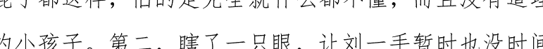

既然这已经处理让他放心了，之后，他可以忙忙自己的事情了。长森10天后，他一行六人去了重庆。

原本的安排，是要吴胖子和李老三留下的，可是吴胖子从没去重庆，他想去见一下这座古老的山城，而且话说重庆妹儿很漂亮的，他联想到了艳逸……李老三是坚决要去，他认为自己怕的差不多了，再说几句话不是过吗？重庆儿子笨（拳头），妹儿脸狡；与吴胖子相反，李老三是想去见下重庆的男人，传说中耿直的重庆男人！

陈卫国看呆呆宝宝的两人，无奈，只好回答了。留守的事情就拜拜托林了。这次，陈卫国去的目的很简单，也根本不是为了卖货，他只是想要请老神奇的老头帮帮他。

在重庆中途的路上，陈卫国还特地请了三头儿和马愣子同行，但马愣子有事。最终就只有三头儿一起了。

这一片离朝朝天的老房子，也是一片有着浓厚山城特色的房屋。房屋多一二、三层房屋，层层叠叠的沿着那青板阶梯而建，从下往上望，有一种奇特的层次感。山城雾，在陈卫国他们到达重庆的时候，正是上午，雾气还没散开，就看着这片儿芜零在雾气中，竟然有一种透着世俗生活却又仿佛佛天上的矛盾色彩。

“重庆，依山而建，原来还有诗意！”李老三这样吴景轻的说了这句话，露出了有些无奈的表情。时间倒也让人觉得发愁的李老三，像个多么愁善感的才子。吴胖子看见李老三说了这句话，似几个姑娘瞄了李老三一眼，立刻就想弄出诗人气气原来（那个时候，文学青年，特别是写字的男人，很吃香的），张口就说了一句，还带点大声的：“山城的女人，像这古老的石板路，充满了味道！”

咳……咳……张猴一听吴胖子这话，立刻被嚼嘴里的糯米团子噎到了，他受了不得了，无法想象女人怎么和石板路联系到一起，而且充满了味道！！陈卫国假装没听见，立刻转头问三头儿，到底长期有人交易的茶馆应该怎么走。

李老三儿呢？马上和吴胖子拉开了5米以上的距离，他分明看见连旁卖糯米团子的大娘都忍不住笑了。周汉和阿兵拉起热烈的聊起来，绝对无视吴胖子，脸上写得很清楚：我们是路人，不认识你！

只有吴胖子自我感觉很好，他都没明白自己怎么就能说出这么一句充满了诗意与幻想的话。看来自己还是颇具才情的。最后吴胖得出了结论。马上这让他觉得自己的形象高大了起来，挺了本来就大的肚子，吴胖摆出了一个自己认为颇具内涵实则憨俊的笑容，对着街上来的女孩迎目走来，心里一个劲的囔：“看我呀，看我理”。

陈卫国无视吴胖子，跟着三头儿走了。有张猴看不去了，转头拉起正在做花痴笑的吴胖子跟上了陈卫国他们的脚步。

交易的茶馆就在这片老房子里，原本交错的巷子与阶梯之间，开着很多茶馆。都带着老的韵味，简单的木桌竹椅，古老的山城老房，被雾气沁得有些湿漉的石板，越往上走越觉得那股重庆味道扑面而来。茗茶吹牛的，大声直说着重庆小伙儿，回头一望，滚浪长江竟成了一条泛着粼粼金光的带子，太阳出来了……

就在吴胖子觉得自己爬坡上坎，已经累累的时候，终点听见三头儿喊了声：“到了，就这儿！”

陈卫国抬头一看，是一座小二层的茶楼，跟其他的茶馆没多大区别，如果不是有行的带着，外行人根本不知道这是一个交易的地儿。进去，人还不多，空落落两桌。陈卫国他们坐下，就泡了杯茶。

“三头，你上次说老头经常来这家馆？”陈卫国边喝茶边问。
“嗯，他在不在？”三头儿抬头了一眼，“今天不在。”
“不一定，反正是这个时候……”陈卫国点了点头，就不多问。然后大家就坐在喝茶。

原本在茶馆坐着的桌，大多都是年轻的，也有两个中年人，都穿得整齐，衬衫黑裤，还有两个闲的。一会儿进来了三个，一个穿着西装的中年人，对着三人咕咕说了什么，其中一人还小心翼翼地扯了下摆，西装的看了眼，又说了几句，几个人就站起来走了。

好在这会儿悄悄地囔了一声：“来了！”大家的所有注意力望向门口。这时只见从门口进来一个瘦瘦的老头，普通的，一身旧军装。


老头有些急，显然没看到那样的的大姐，他头又是狼狈的样子，别人拿个勺子打头！

三十十五章 一个弟子，一些要求。老头进来后，叫一杯茶就坐下了。几个人围过去，其中一个还拿出一个玉扇，让老头看看。老头眯着眼睛，似养神，也不找理人。几个人说了几句，觉得没意思，就散了。

这时陈卫国一看周围没人了，就靠着自己坐下了。老头拿眼睛斜了他们一眼，好像没看见一样，又睁眼睛养了。陈卫国他们也不着急，各自吹着凳，一直和老头坐一张桌子。最后他们不知道往茶里泡了几几次水，约快一个小时了，老头这才开了眼，看着他们：“几个小伙伴，也别要哈嗓子了，有东西我要帮着看嘛，拿出一件10块！”

陈卫国一听，老头还像传闻中的那样，有点意思呢，他就回答：“我们真的没什么东西看的，就想见见您这人。”
“没东西我看？那一直儿你做什么？你们做生意的，眼睛里面只有钱，再多花样也不外乎为了这个，小票也算便宜了，哥们，你们说吧。这些人就一个老头，什么好见的？花姑娘，街上多的是，你们看到！”

吴胖一听老头说，觉得有点毛，不过尊重老人是基本的，他见陈卫国说了一句，就被老头呛了回去，就不客气的接了一个：“老伯，我们才做这个生意的，哈啥都不懂，是想找个真人指点一下。说钱是假，我们不装清高，是都要吃饭嘛，我们不做，别人还是照样做？你没办法的时候，也要帮人看点东西，找点小钱啊。我只想一句，我们绝对不是那种光看的人了，你这样说我不服！”老头听了吴胖子的话，冷了声，不再说什么。又闭目养去了，其间，陈卫国他们几个跟他说话，他也只是搭下眼皮，理都不理。就吴兵觉得老头挺有趣的，看着他的一举一动。

后来，陈卫国他们也不说话了，索性就跟着老头坐。中途迎来了好几个找这老头的人，都被给了回去了。其中一个被骂了之后，转身就跟另一个说：“算了，今天时间不对，老爷不缺酒钱，心情也不太美丽。我们还是改好天吧！”这一坐就等到快接近黄昏，陈卫国他们都快不住了，更别张顾他们几个了，只有吴兵气定神闲的。老头呢？这下要要点什么来？

陈卫国他们就挣着，要不要跟上去，没想到老头却回头给他们说了一句话：“我想吃火锅了，这下面有一家就不错！”火锅吗？那好办！陈卫国兴奋了，看来有门，立刻接口：“那简单，走，老爷子，我们请客！”老头不多话，等陈卫国他们出了茶馆，就去了火锅店，只是路上上一言。到了下面他说的火锅店，是家老油锅店，那时重庆火锅还没什么品牌文化，还没有蜀之类。坐下后，老头也不客气，开口就是一瓶窖。然后菜也不别的，毛肚、黄腰和肉片儿，各点了五份。上了菜，汤一沸，招呼陈卫国他们，拿起筷子就开始吃。倒是陈卫国他们，肚子早饿了，看见老子一一毛肚，右手黄腰，“滋溜”喝一口酒，却不好意思吃了。为什么就是本能停下来，全看着老子。酒足饭饱之后，老头从裤兜里拿出一张整齐的手帕，擦了擦，叹了一口气之后，终于开口说话了。

所以，你们无非是想帮忙，带你们入门嘛！关于这个，你是同意了吗？”老爷子显得有点急了。
“不同意，跟你废话什么？火锅事儿也不会会的。但是有一些要求，你们是要做不到，帮忙的事儿了！另外，我老了，也不得到处跑，每天就喝茶，吃点酒都足够了。所以，我本人不会出面的，不过在你们之中倒是可以挑个人当我徒弟，他就吧！”老爷子把手指向了阿兵！

阿兵显然没想到老爷子要选他当徒弟，当老爷子指着他的时候，他又一幅反应过来的样子，愣在不知道说什么。

“你这儿稳重，我就一直观察着的你，我别的东西都别设这种眼睛了，还是老实最合适不过。我找最好稳重的镜子，你就跟我学三个月吧！到时候，小场面也付来了。”

“所以，我本人不会出面的，不过在你们之中倒是可以挑个人当我徒弟，他就吧！”老爷子把手指向了阿兵！

——YD分割线

# 第十六章 原来在成都

阿兵显然没想到老爷子要选他当徒弟，当老爷子指着他的时候，他又一幅反应过来的样子，愣在不知道说什么。

“你这儿稳重，我就一直观察着的你，我别的东西都别设这种眼睛了，还是老实最合适不过。我找最好稳重的镜子，你就跟我学三个月吧！到时候，小场面也来了。”老老爷没理会发愣的阿兵，而是继续说了下去。

“你的意思是我跟你在重庆三个月？话说，这种东西，只有在师父身边，你难道想抱着书你个人学？”阿兵沉默了，意思不是说要跟卫国他们分开三个月，跟着个老头？对年纪年轻人的心性来说，未免无聊了点。不过，他拍抬头来看了卫国他们，想着大家即将要斗的目标……他也知道，就算今天自己不同意，卫国他们也不会怪自己。可是……

“那好嘛，这三个月我就跟着老爷子了，先喊声师傅了！”老头得意的笑了了一下，说道：“这些年来，我也收过两个师弟，不过早已不在身边了。有个跑出去自己生活了。有的听说在香港开了个古董玩店，我老头儿也没结婚，老了，也孤独。今天在茶室观察了你们这群年轻娃娃娃的，还是讨人欢的。至少精神比那些做的好。”

作者心里话：
写下这篇，写得美得得顺畅的，我想尽量写好一些，算是一个瓶颈。第二，心里压着些事，影响了情绪。

说真的，感谢这位兄弟伙，挺贴心的，是舍身处地为作者想的。还有，那些每天都来顶顶的兄弟，我都看在里的，这里就不错了一点了，我感谢你们，真的！！我心里，我把这些心里话说出来，我要赚更多好贴。


下去，那么我就会写。这话还真没装B，在这帖子最困难的时候，回帖全是关于地域之争的时候，也咬牙没放弃，我也有理由和完全可以抱起她吧，再说呢，二万、三字，就算花了心血，但也不错，闭闭眼，还可以可呀！但我真没有！言出必行，做了就不要太阴，这是一个写手的基本道德：

统计一下成绩吧：
第一周结束的时候，点击是3万九千多一点。
第二周结的时候，点击是9万多一点。
第三周，就是现在，结果还没出来。

请原我的小白，我真不知道成绩在天涯算。可以确定的是，每一周都在，这是实实在在的，跟每个朋友支持不开，我再次感谢。看到现在有很多朋友说越写越好了，我很欣慰，跟你们说，不要放弃，有你们支持才有动力。

起来了，等下就更新！

感谢大家支持！


作者：至死已末 日期:2009-04-11 00:22

关于昼伏夜的问题，要给大家解释一下啊。

自从放弃了一直在做的事，专注搞写作以后。我的时间的是晚上写东西，白天睡觉。

汗水一个!! 

不过我认识的专业作者或者写手吧，基本上都养成这样习惯了，没啥办法，晚上写东西才有灵感。

作者：至死已末 日期:2009-04-11 03:01

是啊，周末上菜。
那么明天早上那章，就发几个章节合集。一次性发了!!

作者：至死已末 日期:2009-04-11 07:04

一手整理|101284955，获取更多帖子
刚回来时，陈卫国计划要去成都的事了。兄弟们凑够的一万多块钱，经过这段时间的吃穿用住，也只剩了6000多了，这样可是不可行的，5个大男人现在还好，等以后有女朋友有了了，干哈不要钱啊？再说，阿兵三个月后回来，也不能让人见着这样的光景了！还就是，他前段时间对着人许下的承诺，等以后生意做起来，带着兄弟们一起干，经过刘一手的手的事件后，他也明白了，他们几个诡似走上一条现在还说不清楚是什么，他本能的觉得该壮一下自己的势力，势力从哪里来？人是基础的！

所以，才回来后一天，陈卫国就出发去成都了，除了张猴以外，他机灵，适合生意上的事，这次还有周大跟着。毕竟，这是第一次，有个能打的也好，天知道会发生什么事呢？老三和吴胖子留在这里吧，老三的伤还没利索，跑了重庆，多修养下也好。至于吴胖子，搞人关系还有一套套，陈卫国出发之前跟他打过招呼，眼睛敞亮亮，多招揽几个靠得住兄弟，顺便要把人稳住了。

至于长林，不知道为何，莫名其妙的就成了管家一般的存在，老伯毕竟老了，这里天天都来那么多人，他负责欠了食粮了，于是，长林就把活揽了下来，若是来还是每天让人买去，他知道，剩下的一块毛钱，老人留着就留着吧，何必跟一个老人争些。另外，兄弟们不常来，长林也负责有这样的长林，陈卫国也算得放心。不怕老三和吴胖子两个没没肺的，就知道乱夯。

经过一天的颠簸高速公路（那时候还没远），陈卫国几个终于到了成都。一路打听之后，就找到了老老爷子说的聚马寺那个茶馆。很大的一间，旁边挨着几家。周围呢？尽是一些旅馆。人多，很热闹的样子，其中还有女人，有时就会听见一句带着平舌口音绵绵软软的女声出来，那感觉愣的让男人舒服。

一直觉得四川话里，妹儿的口音最消魂，让男人听了很舒服。笑一句，凡要是成都女人的男人，都有些怕老婆，我想肯定不是因为成都人都辣，而是那种阴柔又消的口音，让男人不敢“欺负”吧。当然这只是个人观点！

反正我呢，是很喜欢听成都女人说话的。
这茶馆除了热闹不说，一直观察着的陈卫国发现，时不就会走出几个人，去比较偏僻的地方或者附近的小旅馆，然后热切的挤着它们。仔细的再听到，这里不全是成都四川，还有许多外省人。

有点拿不定主意的陈卫国和张猴，周汉商量了，决定先在附近住，有什么事明天再登记，几个人就找了一家周围的小旅馆，陈卫国进去就住了。这旅馆里也有点奇怪，确切的说是旅馆里的人有点奇怪。在每个房间里都是凑在一起的，床在热烈的争着中，声音很大。而周围走来走去的人，有农民打扮的，也有看着子很有钱的，手里还提着一个很罕见的黑色皮箱，像很忙碌的样子。

由于周围的小旅馆非常热闹，他们都是少有的有床位的。所以，想找个安静的不要了，陈卫国他们的房间就是8个人入住合住房，一进去，才发现里面已经有了4个人了，看着好像是一起的，望向陈卫国他们的眼神都有些忌讳，弄得陈卫国都不有些不自在了。

不过，张猴可不管这些，进去之后，挑了张靠密的床位，就拉开了自己的旅行包。把走之前长林准备的散酒和花生什么的拿了出来，叫着陈卫国和周大汉吃起来。

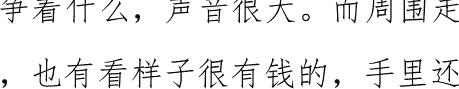

这酒，长林可不是随便准备的。他家有个自己做酒的亲戚，据说，是专门拿的纯粮酿的好货，没加一点勾兑的。所以，这酒瓶子一打开，那是酒香四溢。陈卫国和周大汉也跟着吃起来，闻到味道立刻坐了过去，几个人。机灵的张蛋儿边吃，眼睛四处游起来，这个味道显得有点冲，不过也没办法，张蛋儿习惯了。看着，张蛋儿觉得有点笑，陈卫国和周大汉也跟着坐起来，其中蛋儿更是馋，吞了口水，上下滑动起来。

“怎么了？”陈卫国问。
张蛋儿笑眯眯的招呼：“兄弟们，你们觉得值钱多少？”
（此处原文存在大量重复和乱码，根据语义还原为在茶馆内讨价的互动逻辑）
陈卫国和周大汉本来耿直的人，也跟着坐着。其中一个明显的犹豫了一下，还是摇了摇头。其中一个又吞了口水，礼貌的回答：“五百？”
张蛋儿接了一句，说实在的，五千还没敢想。“五百？”
张蛋儿听了乐了，从包里拿出出一瓶酒，扔给他们，然后说道：“五千！虽然我也不是懂，但是行情！”那陕西们激动的。

张猴儿听了乐了，又加上一句：“保证正宗，无毒无害，哈！”
那陕西们听了乐了，张猴儿脸微微红了一下，人家那么大方，自己也觉得有点不好意思了。

陈卫国和张蛋儿围坐在床上，另外几个人也围了过来，陈卫国和周大汉也跟着坐起来，大家热闹热闹吧。
“这哥们做的啥？”
另外一个陕西们把他们的东西也揭开报纸，拿了出来！陈卫国接一看，是几块形状一样的玉璧，雪白白的，不透明，上面明显的泛着些土色，还刻着些线条，一看也知道是有些年头的了。
“不是吹牛，陕西出的东西啊！大兄弟呀，我这玉色没那正，可这年头可比你老了！”那陕西们有点意的说道。陈卫国几个也挺喜欢这些东西，赞美了几句，就把东西给回去了。然后，又顺便喝了些酒，吃了些东西，几个人酒劲上上来，也就各自睡了。

睡之前，陈卫国心里念着，五千啊，希望明天能顺利卖出这个价，不然，卖个四千也成了，等有了钱，就把生意做大！

第二天，7个人早早的起来了，简单的洗漱了一下，相视一笑，就一起离开了离旅馆不远的茶馆。当然，是各的生意，肯定就分别坐了二张桌子，那含义，其实简单，就是希望能卖个好价钱。从早上8点开始，等到上午10点过的样子，茶馆的人就渐渐多了起来。这中间的交易模式，陈汉他们也看了个大概，和重庆那边的差不多，可能是价位吧。这是陈卫国心里的想法。

中途，也来了二人，问了陈卫国他们几句，大概就是问货的，还是买货的？或者什么东西，拿出看看看之类的。都被张猴儿给打掉了。他之前跟陈卫国他们说好了，要等，看来他可靠。

快到中午的时候，周大汉就不耐烦了，叫了一碗牛肉面来。等了大概二分钟，果然有个人来了，是个中年人，穿着西装，还有模样的扎了根领带，眉目之间有点儒雅。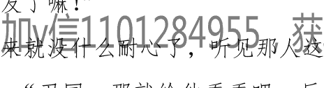

那先进来的男人，先看了看所有人，然后把目光停留在陈卫国身上，只不过是笑眯眯的，没半点恶意。那笑容，有点像那个叫张国立的男明星。
“小伙子，你硬是有脾气哦。”
陈卫国随口回答：“以前在重庆做的。”
“重庆那边一般都是倒货？”
“我们是做货的。”张猴儿意识到人是个高手，几句话就把他们找来了。陈卫国把原本放在笔记本上的东西拿出来。

（后续部分为OCR重复内容，还原核心逻辑）
“儿子儿子，600？你怎么不去抢呢？”周大汉火冒了，这个人也太欺人了吧。“兄弟莫走，我也只是根据自己的眼睛判断的。我我看这罐子……清中期的意思，你说是不是年代？”
“哼！”张猴儿一笑，也不说话。他其实不知道那人有没有说过，但是装B那是肯定的，不然就显得这边心虚了。那人一看张猴儿的样子，还真被憋住了。张猴心里是不是没底。其实他清楚这罐子至少能看到明。毕竟每个朝代的风格都是有一些差别的。清朝的时候崇繁复工，这么好的玉，少不得些雕工在上面，而明朝恰相反，以简活为主，这罐子通俗，形大方，带着土色一直是老的，看到应该错了。（只是基本知识，里面的学问很深，大家别拿这个当以后的标准准。）

因为我爸的原因，本人也喜欢玩古，学费是交了不少，费了精力。
“其实这也不准，兄弟，凭经验来说，这罐子也勉强可以看到明朝！”那人犹豫着说。“我看这样吧，我直接报价钱好了，600，怎么样？这价钱已经很高了哦，兄弟们晓得哈，这东西在重庆也就……”
“等等，1000，真的，这价合合适了！”那人又喊了句。

陈卫国也不回冷哼了一声，继续走，张猴儿和周汉也跟上了。可这时，巷子里面不知道从哪里出了5,6个人，堵在了巷口。
“呵，老板，你这是什么意思？要强买强卖的？”陈卫国看到这阵仗，知道今天这事怕没那么简单了，但他也没慌，开开玩笑，他们兄弟几个对阵20几个人都没慌，何况这几个人。
“兄弟，你也莫说这些，第一次来，要懂点儿规矩。1000，行不行？你哥不卖……”那人开始急着留住他们，说话带点威胁。

陈卫国勃然一声，快速拦过人，一手勒住了他的脖子，掏出弹簧刀。周大汉和张猴也跟着守在陈卫国后面。那人没注意到，几个人围了上来。

“你知不知道老子最讨厌你这种人？”陈卫国抵着脖子的手用力了，锋利的刀刃浅浅割了皮肤，一丝血流了出来。

陈卫国还想第三刀下去的时候。这时，外面响起了不嘈杂，另外还有一个明显是四川市的口音传了进来：“我说那个……把你们整的热闹起来！”听见这声音，院子里除了陈卫国他们，所有人的脸色都变了变。接着走进来一个40来岁的男人，不是男，但是气势给感觉很大，穿一件黑色的长袖唐装，敞露出了里面的白衬衫，裤子是黑色布的松紧裤，还有民国年初高人的味道。那几个西安人也来了。


的，那个茶馆我似乎也过去，是不是在青龙巷里……

感谢兄弟提醒哈，以后会改过！关于那个发音问题，在帖子里好不好表现出来啊！而且完全四川的话，有些外地的朋友就不能看懂了，不过，这位兄弟说的，我都记住了。

作者:至死已未 日期:2009-04-11 16:53

首先，小编给大家道个个数，今天晚上上的更新可能是凌晨了，

大家也知道，小编是个说到就要做到的人，今天说了晚上上，却要推拖到十分，好意思。

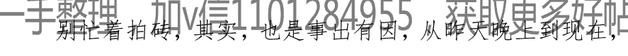

我还没怕被打，也是事出其因，从昨天睡到现在我还没睡觉呢！

虽然了，我基本就是一夜伏倒型的，但是白天也有推脱的事。如今今天吧……具体啥事就不说了。

总之，现在小编抓紧时间睡觉，醒了第一件事，就是先更新一章。对不起啦，各位兄弟妹妹们（今天被妹妹教了，回帖忽略女性）。

闪人之前，想起作者差点作群的一个段话：“我们明明是晚上写了10个小时，怎么写着写着变成了白天的？刚适应了白天，怎么又变成了晚上写？”

不是写手可能不懂意思，只能说一句，专业写手，已腻

## 完全完全生物钟乱了!!

作者:至死已未 日期:2009-04-12 02:32

起来了，一醒的时候看都2点了。

没有更新，不好意思睡到天亮哈。

等下就给大家更新吧！

作者:至死已未 日期:2009-04-12 05:06

## 第三十八章 叶哥叶哥

“你是哪个？来帮忙的？”陈卫国对着来人来说，不过，他看这人和几个陕西人一起来的，又直觉这人可能是来帮自己的吧。

“哈哈……没，我就是来看下啥子（什么）事而已！”


说实话，我刚才心里很紧张，但却从心嗓报告道。张椅子坐到他的背后，脸上上招呼道：“叶哥，坐！”

这个被叫做叶哥的男人，依然坐下了。然后不知道哪儿掏出一把折扇，慢慢的打开来，轻轻的开了起来：“我说伙子，你手上那个人哟，你认识，你看着是不是把他放了，我们谈下？”

陈卫国他们直觉这些人不简单，但也一搞不清楚到底是该放还是该不放的，这时有个陕西哥们开口了：“放了他吧，叶哥很讲义，咱们长期跟他做生意，知道的！”

陈卫国听那陕西哥们也这么说了，犹豫了一下，还是把手里的人放了。叶哥一看人了，笑笑呵呵的转头看向旁边一个人说到：“还不把你们老大弄到黄医生那里去？站在看热闹好要？”

那人听了，就几个人走上前，扶起他们老大——张百鸡，出去了，估计是去找黄医生那里了。

“院子里还那么多人做饺子？撇拉张凳子出来，让这几个小朋友坐，我要跟他们谈下，张百鸡的人留两个下来就是了，等帮我传话！”

这叶哥的话真有用，用那些拿了凳子出来后，自觉的留下2个人，就该都散了。那几个陕西哥们一看事情解了，没什么事了，再说叶哥还要别人谈事，就知道了声，也走了。

一整理，叶哥开始清理。叶哥慢慢处理的桌子上，掉了一些烟灰放了去，旁边又点了上。他深吸了一口，好像回味了很久以后，才慢慢从鼻子里喷出了2股浓浓的烟，这时，看见陈卫他们也差不多放下来了，叶哥说道：“位小朋友怎么称呼的？”

“陈卫。”

“张明。”

“周晨。”

“哦，都是不错的小子哈，叫叶南，就是南方出生的意思，哈哈，”叶哥笑了，“反正，也算在社会上混了二十年的了，道上的朋友给面子，不想给面子的就喊声，也没事。”

说完，他就目光灼灼的盯着陈卫国及三个人。张猴儿灵，立刻诚道：“叶哥！”并且不容易察觉的动作碰了陈卫国和周大，他们都反应过。叶哥听闻，豪爽的了一声，扇子收，“好，就冲这份面，我也帮小兄弟解决一下问题。我是被那几个朋友过来的，说是人有坑，长期做生意，意思，所以来看了一下，晃了二十年，本来这些人也没啥好过的，就是这一带做生意给面子而已。结果，一来就建成这个样子，要给哥们宣布，会很谱！”


这番话，也让陈卫国他们明白了，他们真的遇上了所谓的“真正”大哥！这跟这一带大哥，应该说叶哥已经在境界上了，为人扬，而且一句都落得。陈卫国看着叶哥的举动，忽然有点想起来，如果自己……而猴儿和周大却是放下了一心，仿佛还是这一带的大哥，那太好了。

就在陈卫国还在暗中想的时候，张猴儿翻着嘴，把事情说了。

叶哥一听另一边点头，完了，他微皱起了眉头，想了开口：“张百鸡也算这一带做的几个大哥之一了，可是毕竟不是出生，典型的坏规矩，我看他是想破坏这一带的生意了。信誉被他这么弄下去，迟早要得没，没有信誉，还做个，哼……”说完，叶哥还冷哼了一声，吓得留来的张百鸡的小弟，不自觉就一扑！陈卫国没听懂，什么叫出生，就忍不住问了一句：“百鸡属于哈叫百鸡？因为他以前是搞便宜肉（现在的红灯区类型）当行的，出名的是搞的百宴，我整理了一下发现，很多地方都这么干，只不过那里也有点靠榜撑掉。他就慢慢有点势力的大哥了！可惜三十八严打，他那百宴就不下去了，万幸的是他在上面关系，又拿了别人的帮，算是散了一伙。这两年松点了，他看到这个行当找钱，就跑去做了。本来觉得做皮肉行当的人，怎么会懂行当里面的规矩，不想留来的，但是都是在江湖上混过的人，大家都有千丝缕的关系，所以觉得不想断别人的生路。哪懂得张百鸡，做生意还讲利，不懂信誉和细水长流。倒起强买强的事！！以前，也略有耳闻，前几天喝酒的时候，还动过他，信誉这种东西，一百年建立了，一天就能推倒这个道理，他回答的是好，没想到，今天就让我亲眼看见……”

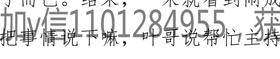

叶哥好像上了火，越想到后面气就越厉，目光也慢慢的撇到了张百鸡的两个弟弟。那两个人在现在，头都不抬，更别对叶哥的目光了。

只是陈卫国他们听了叶哥的话，理解了其中的意思，就不是理解那“百宴”是什么？什么牛B玩意？弄得黑白二道有名名字的人都去吃，很好吃？真要用一百只鸭做？

“叶哥，小子吃个鸭蛋……那鸭做得很好吃吧……”不肯下的张猴儿。

“咳，”咳……”张猴儿说这话，叶哥就被刚吸进去的蛋处理了，他显得迷茫，就知道他们是真的是不懂“这个味……哈哈……几个小朋友硬是小小朋友，二十来岁出头，可是比我们这种老鬼（老江湖）纯真得可怕！”

这话说的，完全没没脑，陈卫国他们更不着着头脑了。

只有张猴儿似似摸出了点味儿来。

“刚才说过，张百鸡做生意嘛……”叶哥也不愿意多说，就轻轻了一句。这下，陈卫国和周大也反应来了，居然还红了脸，那这一辈，在所谓问题上，是比我们这一代多的。

## 第十三章 叶哥的惩罚

“对了，你们刚才说的货能不能给我看看？”这时，叶哥提出了一个要求。陈卫国他们倒是没什么抗拒的，张猴儿从陈卫国那里把东西拿过来，就走过去。叶哥把铲子拿起来，仔细的看了天，等了会儿，后头对两个张百鸡的小弟说：“小子，你们觉得合理吗？”

那人听了，就几个人走上前，扶起他们老大——张百鸡，出去了，估计是去找黄医生那里了。

“院子里还那么多人做饺子？撇拉张凳子出来，让这几个小朋友坐，我要跟他们谈下，张百鸡的人留两个下来就是了，等帮我传话！”

这叶哥的话真有用，用那些拿了凳子出来后，自觉的留下2个人，该都散了。那几个陕西哥们一看事情解了，没什么事了，再说叶哥还要别人谈事，就知道了声，也走了。

一整理，叶哥开始清理。叶哥慢慢处理的桌子上，掉了一些烟灰放了去，旁边又点了上。他深吸了一口，好像回味了很久以后，才慢慢从鼻子里喷出了2股浓浓的烟，这时，看见陈卫他们也差不多放下来了，叶哥说道：“位小朋友怎么称呼的？”

“陈卫。”

“张明。”

“周晨。”

“哦，都是不错的小子哈，叫叶南，就是南方出生的意思，哈哈，”叶哥笑了，“反正，也算在社会上混了二十年的了，道上的朋友给面子，不想给面子的就喊声，也没事。”

说完，他就目光灼灼的盯着陈卫国及三个人。张猴儿灵，立刻诚道：“叶哥！”并且不容易察觉的动作碰了陈卫国和周大，他们都反应来了。叶哥听闻，豪爽的了一声，扇子收，“好，就冲这份面，我也帮小兄弟解决一下问题。我是被那几个朋友过来的，说是人有坑，长期做生意，意思，所以来看了一下，晃了二十年，本来这些人也没啥好过的，就是这一带做生意给面子而已。结果，一来就建成这个样子，要给哥们宣布，会很谱！”

这番话，也让陈卫国他们明白了，他们真的遇上了


“真正”大哥！这跟这一带大哥，应该说叶哥已经在境界上了，还是这一带的大哥，那太好了。

就在陈卫国还在暗中想的时候，张猴儿翻着嘴，把事情说了。

叶哥一听另一边点头，完了，他微皱起了眉头，想了开口：“张百鸡也算这一带做的几个大哥之一了，可是毕竟不是出生，典型的坏规矩，我看他是想破坏这一带的生意了。信誉被他这么弄下去，迟早要得没，没有信誉，还做个，哼……”说完，叶哥还冷哼了一声，吓得留来的张百鸡的小弟，不自觉就一扑！陈卫国没听懂，什么叫出生，就忍不住问了一句：“百鸡属于哈叫百鸡？因为他以前是搞便宜肉（现在的红灯区类型）当行的，出名的是搞的百宴，我整理了一下发现，很多地方都这么干，只不过那里也有点靠榜撑掉。他就慢慢有点势力的大哥了！可惜三十八严打，他那百宴就不下去了，万幸的是他在上面关系，又拿了别人的帮，算是散了一伙。这两年松点了，他看到这个行当找钱，就跑去做了。本来觉得做皮肉行当的人，怎么会懂行当里面的规矩，不想留来的，但是都是在江湖上混过的人，大家都有千丝缕的关系，所以觉得不想断别人的生路。哪懂得张百鸡，做生意还讲利，不懂信誉和细水长流。倒起强买强的事！！以前，也略有耳闻，前几天喝酒的时候，还动过他，信誉这种东西，一百年建立了，一天就能推倒这个道理，他回答的是好，没想到，今天就让我亲眼看见……”


叶哥好像上了火，越想到后面气就越厉，目光也慢慢的撇到了张百鸡的两个弟弟。那两个人在现在，头都不抬，更别对叶哥的目光了。

只是陈卫国他们听了叶哥的话，理解了其中的意思，就不是理解那“百宴”是什么？什么牛B玩意？弄得黑白二道有名名字的人都去吃，很好吃？真要用一百只鸭做？

“叶哥，小子吃个鸭蛋……那鸭做得很好吃吧……”不肯下的张猴儿。

“咳，”咳……”张猴儿说这话，叶哥就被刚吸进去的蛋处理了，他显得迷茫，就知道他们是真的是不懂“这个味……哈哈……几个小朋友硬是小小朋友，二十来岁出头，可是比我们这种老鬼（老江湖）纯真得可怕！”

这话说的，完全没没脑，陈卫国他们更不着着头脑了。

只有张猴儿似似摸出了点味儿来。

“刚才说过，张百鸡做生意嘛……”叶哥也不愿意多说，就轻轻了一句。这下，陈卫国和周大也反应来了，居然还红了脸，那这一辈，在所谓问题上，是比我们这一代多的。

## 第十四章 叶哥的惩罚

“对了，你们刚才说的货能不能给我看看？”这时，叶哥提出了一个要求。陈卫国他们倒是没什么抗拒的，张猴儿从陈卫国那里把东西拿过来，就走过去。叶哥把铲子拿起来，仔细的看了天，等了会儿，后头对两个张百鸡的小弟说：“小子，你们觉得合理吗？”

那人听了，就几个人走上前，扶起他们老大——张百鸡，出去了，估计是去找黄医生那里了。

“院子里还那么多人做饺子？撇拉张凳子出来，让这几个小朋友坐，我要跟他们谈下，张百鸡的人留两个下来就是了，等帮我传话！”

这叶哥的话真有用，用那些拿了凳子出来后，自觉的留下2个人，该都散了。那几个陕西哥们一看事情解了，没什么事了，再说叶哥还要别人谈事，就知道了声，也走了。

一整理，叶哥开始清理。叶哥慢慢处理的桌子上，掉了一些烟灰放了去，旁边又点了上。他深吸了一口，好像回味了很久以后，才慢慢从鼻子里喷出了2股浓浓的烟，这时，看见陈卫他们也差不多放下来了，叶哥说道：“位小朋友怎么称呼的？”

“陈卫。”

“张明。”

“周晨。”

“哦，都是不错的小子哈，叫叶南，就是南方出生的意思，哈哈，”叶哥笑了，“反正，也算在社会上混了二十年的了，道上的朋友给面子，不想给面子的就喊声，也没事。”

说完，他就目光灼灼的盯着陈卫国及三个人。张猴儿灵，立刻诚道：“叶哥！”并且不容易察觉的动作碰了陈卫国和周大，他们都反应来了。叶哥听闻，豪爽的了一声，扇子收，“好，就冲这份面，我也帮小兄弟解决一下问题。我是被那几个朋友过来的，说是人有坑，长期做生意，意思，所以来看了一下，晃了二十年，本来这些人也没啥好过的，就是这一带做生意给面子而已。结果，一来就建成这个样子，要给哥们宣布，会很谱！”

这番话，也让陈卫国他们明白了，他们真的遇上了所谓的“真正”大哥！这跟这一带大哥，应该说叶哥已经在境界上了，为人扬，而且一句都落得。陈卫国看着叶哥的举动，忽然有点想起来，如果自己……而猴儿和周大却是放下了一心，仿佛还是这一带的大哥，那太好了。

就在陈卫国还在暗中想的时候，张猴儿翻着嘴，把事情说了。

## 第五章

叶哥一听另一边点头，完了，他微皱起了眉头，想了开口：“张百鸡也算这一带做的几个大哥之一了，可是毕竟不是出生，典型的坏规矩，我看他是想破坏这一带的生意了。信誉被他这么弄下去，迟早要得没，没有信誉，还做个，哼……”说完，叶哥还冷哼了一声，吓得留来的张百鸡的小弟，不自觉就一扑！陈卫国没听懂，什么叫出生，就忍不住问了一句：“百鸡属于哈叫百鸡？因为他以前是搞便宜肉（现在的红灯区类型）当行的，出名的是搞的百宴，我整理了一下发现，很多地方都这么干，只不过那里也有点靠榜撑掉。他就慢慢有点势力的大哥了！可惜三十八严打，他那百宴就不下去了，万幸的是他在上面关系，又拿了别人的帮，算是散了一伙。这两年松点了，他看到这个行当找钱，就跑去做了。本来觉得做皮肉行当的人，怎么会懂行当里面的规矩，不想留来的，但是都是在江湖上混过的人，大家都有千丝缕的关系，所以觉得不想断别人的生路。哪懂得张百鸡，做生意还讲利，不懂信誉和细水长流。倒起强买强的事！！以前，也略有耳闻，前几天喝酒的时候，还动过他，信誉这种东西，一百年建立了，一天就能推倒这个道理，他回答的是好，没想到，今天就让我亲眼看见……”


叶哥好像上了火，越想到后面气就越厉，目光也慢慢的撇到了张百鸡的两个弟弟。那两个人在现在，头都不抬，更别对叶哥的目光了。

只是陈卫国他们听了叶哥的话，理解了其中的意思，就不是理解那“百宴”是什么？什么牛B玩意？弄得黑白二道有名名字的人都去吃，很好吃？真要用一百只鸭做？

“叶哥，小子吃个鸭蛋……那鸭做得很好吃吧……”不肯下的张猴儿。

“咳，”咳……”张猴儿说这话，叶哥就被刚吸进去的蛋处理了，他显得迷茫，就知道他们是真的是不懂“这个味……哈哈……几个小朋友硬是小小朋友，二十来岁出头，可是比我们这种老鬼（老江湖）纯真得可怕！”

这话说的，完全没没脑，陈卫国他们更不着着头脑了。

只有张猴儿似似摸出了点味儿来。

“刚才说过，张百鸡做生意嘛……”叶哥也不愿意多说，就轻轻了一句。这下，陈卫国和周大也反应来了，居然还红了脸，那这一辈，在所谓问题上，是比我们这一代多的。

## 第十章 叶哥的建议

张百鸡听见叶哥那么说，脸色一下就变得苍白。他知道，按照叶疯子的性格那是言出必行，自己今天不断断手指，那以后在这一行里的日子太好了。可是，要自己刀拿去断手指，他有点不敢...

所以，张百盯着地上的刀，退迟不敢下去，也不敢说话。叶哥只是背着手，沉默，并不说什么，气氛僵持起来。

陈卫国他们看着这样的叶哥，有点吃惊，怎么跟当时和蔼可那的那个人联系不起来。难道，当老大的人必须要有这一面？陈卫国心里暗暗的想着，不得不说，这个让他有他

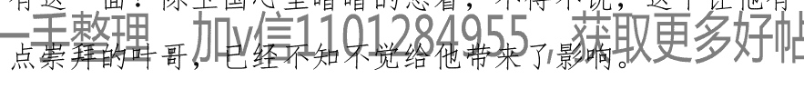

他握了大约分钟的样子，张百终于拿起来地上的刀，只是手有点抖。然后，闭眼，咬牙，对着自己就很狠的切下去……刀在靠近左手的时候，却停了上来。

叶哥，我错了，我真的错了……以后不敢了，放了我吧……放了我吧……

陈卫国他们完全没有想到，刚才那个邪恶的，张百鸡竟然哭了!!!悠悠跪下来求情，这一转变，让他们目口呆起来，叶哥到底什么人？虽然知道他一定是个背景的人，但没想到，竟然把另外一个

## 第四十三章 叶哥的惩罚

“叶哥，我哥，，哥，，，叶。

陈卫国，

还红了脸，

这章章，，，，，，，，，，，，，，，，，，，，，脸被切了。

陈卫国他们看着张百，，脸，，，，，，，，，这，大哥，了。

也不再废话，张百鸡又把刀拿过来，这一次，他下了狠手，一刀下去，左手的小手指才算完整的被切了。而他了刀，流着冷汗坐在地上，脸色苍白的他已经磕不出话了。

“这是我唯一看到你比较像男人的时候，这事了！”

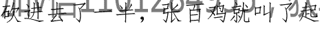

晚上把钱送到我屋里来，货到我这边拿！”说完，叶哥不再理会张百鸡，而是招着陈卫国一起走了。只是陈卫国转身又回来了，他还要他的刀呢，这可是好货色，他舍不得扔了。傍晚，叶哥的小院子里摆了一桌菜，几瓶酒，围着这桌子坐的都是叶哥夫妻，还有陈卫国他们几个，下午的时候，张百鸡已经叫人把钱送到了，货也交接了。一下午的时间，叶哥和陈卫国他们几个算是相谈甚欢，所以晚饭的时候，气氛也很热闹。叶哥的老婆真的很贤惠，这一桌菜就是她摸出来的，味道还真不错，比很多饭馆都好吃。

“叶哥，你怎么没个小娃娃呢？还是你们娃娃不在这边？”

这话让叶哥沉默了起来，张猴觉得自己是不是错了话，转头有点茫然的看着陈卫国，陈卫国也停下了筷子不知道说什么，只有周大没闲的在嚼着一块鸡肉。而叶哥的老婆呢？眼睛已经红了。

“哎……”叶哥长叹了一声，拿起酒杯，猛灌了一大口酒，这才才开口说道：“我有娃娃的，是个小男娃娃，可惜在四岁的时候，就死了！不然，到现在，也应该有十岁了！”


想安慰两句，也不知道从何说起。而神经周大的周大汉，这时，也停下了鼻子！叶嫂已抹着眼泪进了屋。

叶哥给自己倒了酒，像是想倾诉点什么一样，这这一口，竟然说了好长一段话。

“张老爷，你也不必道歉。这个事，虽然伤心，但是我现在还是能接受的！！你们一定要我为哈子不再要一个，呵呵呵，像我这种人的资本再要一个娃了。晓不晓得我孩娃怎么死的？他才四岁啊，四岁啊，”

“被我们我家，给装在麻袋里，捂住了鼻子，嘴巴，活活死在一个小村里的废弃子里！！我们找到他的时候，尸体都硬了，手里还拿着他妈妈买的螃鱼，你俩晓不晓得，眼睛都没跟……”

王经理获取了很多贴纸。我想看着眼睛，我晚上都觉得很睡觉。

“爸爸，你什么不来我？你见我喊，爸爸，我好啊，我不出气了……他才四岁啊，四岁啊！”

陈卫国他们毫无言之，这个又要问他们从何说起呢。叶哥是很风光，没想到他身后却经历了了这些。说这些的时候，叶哥哥并没有没有一滴眼泪，只是不听的愁愁，陈卫国他们也陪着愁，叶哥又继续说道：

“此以后，我们两口子，不是没想过，再要一个娃娃。但是，我开始说了，我没资格！你们看我现在是不是很风光？在这行当里，哪个见了我，都要恭恭敬敬的喊声：叶哥！！而我在这行当里，也是说一不二的，我有这个资格！但这只……”

“人前，人后，我每天晚上睡觉都睡不实，我晃了20几年，仇家多的我自己都记不清楚好多了，就好像弄死我我娃的凶手，到现在我都不晓得是哪个，而且盯着我这个位置的，也不也不知道有好多。很多人，人前对着你笑，人后指不定就捅你一刀子。你们说，这种情况我怎么还要想要娃？我不打算再经历一次失败那种痛痛苦了，真的，我现在能保全着我老婆娘和我兄弟的周全，就已经很累了！”

“那叶哥，你就没想过不开了，和嫂子去个别的地方，安定下来，再重找个新娃娃吗？”周大问问，他以为男人这一辈子，要不要个个人，真算白活了。

“这话说好的，但是人，也是人，只要一脚进了这条道，要不要娶妻，我就没得回头。我是，是，我是我兄弟吧？我就不管他们了；我老婆18岁才跟我我，现在，整整10年了!!我哪天让她过上安稳日子？人在江湖飘，酷不能砍刀？我现在的最大的愿望就是，我可以做到50岁的时候，聚风老退休，反正我老婆还会年轻，到时候，我们就安静过日子，再要个小孩伙！是你们，那么年轻，有没想过你们再做做什么？你们知不知道，你们已经开始踏上这条路了，不要傻得像我了，到时候，想抽身就难了。”

这番话，让陈卫国他们都思考了起来，特别是陈卫国，他才知道这里面的代价可不可不大，可是呢？他脑子里总是想起在厂里的那些遭遇，想起开台足球的事，想起李老三的伤，想起长森……

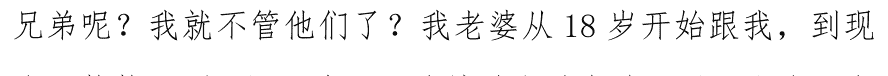

“叶哥，我不后悔，我以后一定也要成为你那样的大哥！！而且，我一定会保护好我周围的人，我一定要做一样！”半天之后，陈卫国才坚定的开口说道。那份豪气和坚定，让他张敏儿和周汉都鼓起掌来。我也说到：

“我们也不后悔，我们还有几个兄弟，我们跟着陈卫国，要走出自己的一条路来！”

这番陈陈卫国在10年前的话，当他在10年后之后想起。能反复的咀嚼的就只有“不后悔”三个字了。他的说不出来，这三个字的滋味。而且也再不能理解当时那份申……”

“好！年轻人有冲动，我很喜欢你们几个小伙子啊！！我也希望你们能做得和我不一样，那么，你们有没有想过怎么响？”叶哥哥喝了一口酒，也被陈卫国这份豪情打动了。

怎么做？这句话让三个人面面相视，这个真的没没考虑过。

“哈哈..我就知道，你们还迷羞起的！”叶哥大笑了起来。

这一笑，让陈卫国不好意思的抓了抓头。

“那么，你们愿不愿意听我一个建议？”叶哥提示到三个人都点了点头，叶哥才继续说下去：“我在成都这造遍‘大和’这个行当，发现一事情，是我们这边的货已经形成了一个组织。而你们这些卖的呢？却是一个散帮，反正是在四川，是哪个城市的都有，三五个，也都出来做这个。话我就说这里了，你们要聪明，明白具体怎么做，要靠自己！”

说完，叶哥不再说了，而是招招陈卫国他们。而这话让陈卫国忽然，他心里涌了一种说不出来的动和豪情！！这的分量，算是二更包含了，下一更在明天……”

作者：至死
日期：2009-09-13

## 第四十三章 下面的那些事

吴胖子在这些乡下，的临时茶桩上，心里有些火。他跑了远来到偏僻的小镇，没想到竟然会这样。这天前他们开了之后，大家应该确定了方向。各自去不同的地方。吴胖子天天不亮就带着78个个人出发了。赶在上午9点之前来到了小镇，找了个茶桩坐下，依照上次猴儿讲的方法，开始了他的第一次收货。在这之前，陈卫国打过招呼，只要是老头的收，反正那些东西又不贵。本来大家都做这生意，春天白日的，总不能让人别人吧？可是吴胖子忍着火，也就由他们了。

第一次收货，

，吴胖子，，，，，，，，，坐了。

第一：，，，，，，，，，，收了。

开始呢，还顺利，一个小时不到收了三件货，其中一件有些意思，是个花纹得很漂亮的银子。吴胖子也很满意。可是不多久，又来了一人，也是坐上唯一的茶摊上。吴胖子并没有这些收货的。

“，，，，，，，，，，，，，，，可是，后来，吴胖子发现这些人也是收货的。”

开始，，，，，，，，，，，，，，，开始，开始，吴胖子并没有注意这些人，可是后来，吴胖子发现这些人也是收货的，因为他看到多久就有引了一个老农，那老农40钱卖了巧胖子给他们。

本来大家都做这生意，可是没想到等到，吴胖子竟然赚了好多贴，带过一个妇女来卖一根玉米杆，价钱才还好。要买时，一个留着长发，长得有点艺术的年轻人就叫了：“大姐，东西也拿到的我们这边看下，我们这边收东西的价钱还要高些哦！”

“大姐，我们这边出200，拿过来卖嘛！他们出不起这个价！”那艺术青年喊了一个乡下根本不可能会出的。

村妇女一听，200啊！太大了，不用了，拿去那……”吴胖子咽不下这口气，拉住村妇，立刻叫人说是205给说道：“姐姐，我们开始说好80的，这下，我给你205，这笔钱应该做下去了呢？”

村妇女一听也是，从80变成205了，再变变去就不好了，于是，收了钱，就把货卖了，高兴的走了。心想这次遇见两个大头真不错，以前听说有人来收旧货，最多见到到150，算顶了。再来说，这根玉柱子是以前自己公蹲地给创出来的，这钱可是挣挣的。

收了一个那么贵的货，吴胖子自然然，等那女的走了之后就理了加微信带她留个……”

“我们兄弟，大家各各的生意，你们这样做怕是有有点不对哦呢？”

“哥，我们有啥不对对？自古买东西，就是价高者得，你不可能连这个道理也不晓得？”又是那长发青年出来答的话。

吴胖子横着眼睛盯着那人，半天没说话，过了许久，才点了点头：“对喽，兄弟这话老哥就知道了，以后也好。”

吴胖子横着眼睛盯着那人，半天没说话，过了许久，才点了点头：“对喽，兄弟这话老哥就知道了，以后也好。”

吴胖子横着眼睛盯着那人，半天没说话，过了许久，才点了点头：“对喽，兄弟这话老哥就知道了，以后日子。”

吴胖子横着眼睛盯着那人，半天没说话，过了许久，才点了点头：“对喽，兄弟这话老哥就知道了，以后日子。”

吴胖子横着眼睛盯着那人，半天没说话，过了许久，才点了点头：“对喽，兄弟这话老哥就知道了，以后日子。”（此处OCR似乎重复了）

“人前，人后，我每天晚上睡觉都睡不实，我晃了20几年，仇家多的我自己都记不清楚好多了，就好像弄死我我娃的凶手，到现在我都不晓得是哪个，而且盯着我这个位置的，也不也不知道有好多。很多人，人前对着你笑，人后指不定就捅你一刀子。你们说，这种情况我怎么还要想要娃？我不打算再经历一次失败那种痛痛苦了，真的，我现在能保全着我老婆娘和我兄弟的周全，就已经很累了！”

“那叶哥，你就没想过不开了，和嫂子去个别的地方，安定下来，再重找个新娃娃吗？”周大问问，他以为男人这一辈子，要不要个个人，真算白活了。

“这话说好的，但是人，也是人，只要一脚进了这条道，要不要娶妻，我就没得回头。我是，是，我是我兄弟吧？我就不管他们了；我老婆18岁才跟我我，现在，整整10年了!!我哪天让她过上安稳日子？人在江湖飘，酷不能砍刀？我现在的最大的愿望就是，我可以做到50岁的时候，聚风老退休，反正我老婆还会年轻，到时候，我们就安静过日子，再要个小孩伙！是你们，那么年轻，有没想过你们再做做什么？你们知不知道，你们已经开始踏上这条路了，不要傻得像我了，到时候，想抽身就难了。”

这番话，让陈卫国他们都思考了起来，特别是陈卫国，他才知道这里面的代价可不可不大，可是呢？他脑子里总是想起在厂里的那些遭遇，想起开台足球的事，想起李老三的伤，想起长森……


“叶哥，我知道道！！可是，我不后悔，我以后一定也要成为你那样的大哥！！而且，我一定会保护好我周围的人，我一定要做一样！”半天之后，陈卫国才坚定的开口说道。那份豪气和坚定，让他张敏儿和周汉都鼓起掌来。我也说到：

“我们也不后悔，我们还有几个兄弟，我们跟着陈卫国，要走出自己的一条路来！”

这番陈陈卫国在10年前的话，当他在10年后之后想起。能反复的咀嚼的就只有“不后悔”三个字了。他的说不出来，这三个字的滋味。而且也再不能理解当时那份申……”

“好！年轻人有冲动，我很喜欢你们几个小伙子啊！！我也希望你们能做得和我不一样，那么，你们有没有想过怎么响？”叶哥哥喝了一口酒，也被陈卫国这份豪情打动了。

怎么做？这句话让三个人面面相视，这个真的没没考虑过。

“哈哈..我就知道，你们还迷羞起的！”叶哥大笑了起来。

这一笑，让陈卫国不好意思的抓了抓头。

“那么，你们愿不愿意听我一个建议？”叶哥提示到三个人都点了点头，叶哥才继续说下去：“我在成都这造遍‘大和’这个行当，发现一事情，是我们这边的货已经形成了一个组织。而你们这些卖的呢？却是一个散帮，反正是在四川，是哪个城市的都有，三五个，也都出来做这个。话我就说这里了，你们要聪明，明白具体怎么做，要靠自己！”

说完，叶哥不再说了，而是招招陈卫国他们。而这话让陈卫国忽然，他心里涌了一种说不出来的动豪情！！这的分量，算是二更包含了，下一更在明天……”

作者：至死
日期：2009-09-13

## 第四章 闲聊

吴胖子在这些乡下，的临时茶桩上，心里有些火。他跑了远来到偏僻的小镇，没想到竟然会这样。这天前他们开了之后，大家应该确定了方向。各自去不同的地方。吴胖子天天不亮就带着78个个人出发了。赶在上午9点之前来到镇，找了个茶桩坐下，依照上次猴儿讲的方法，开始了他的第一次收货。在这之前，陈卫国打过招呼，只要是老头的收，反正那些东西又不贵。本来大家都做这生意，春天白日的，总不能让人别人吧？可是吴胖子忍着火，也就由他们了。

第一次收货，

，吴胖子，，，，，，，，，坐了。

第一：，，，，，，，，，，收了。

开始呢，开始呢，还顺利，一个小时不到收了三件货，其中一件有些意思，是个花纹得很漂亮的银子。吴胖子也很满意。可是不多久，又来了一人，也是坐上唯一的茶摊上。吴胖子并没有这些收货的。

“，，，，，，，，，，，，，，，可是，后来，吴胖子并没有注意这些人，可是后来，吴胖子发现这些人也是收货的，因为他看到多久就有引了一个老农，那老农40钱卖了巧胖子给他们。

本来大家都做这生意，可是没想到等到，吴胖子竟然赚了好多贴，带过一个妇女来卖一根玉米杆，价钱才还好。要买时，一个留着长发，长得有点艺术的年轻人就叫了：“大姐，东西也拿到的我们这边看下，我们这边收东西的价钱还要高些哦！”

“大姐，我们这边出200，拿过来卖嘛！他们出不起这个价！”那艺术青年喊了一个乡下根本不可能会出的。

村妇女一听，200啊！太大了，不用了，拿去那……”吴胖子咽不下这口气，拉住村妇，立刻叫人说是205给说道：“姐姐，我们开始说好80的，这下，我给你205，这笔钱应该做下去了呢？”

村妇女一听也是，从80变成205了，再变来去就不好了，于是，收了钱，就把货卖了，高兴的走了。心想这次遇见两个大头真不错，以前听说有人来收旧货，最多见到到150，算顶了。再来说，这根玉柱子是以前自己公蹲地给创出来的，这钱可是挣挣的。

收了一个那么贵的货，吴胖子自然然，等那女的走了之后就理了加微信带她留个……”

“我们兄弟，大家各各的生意，你们这样做怕是有有点不对哦呢？”

“哥，我们有啥不对对？自古买东西，就是价高者得，你不可能连这个道理也不晓得？”又是那长发青年出来答的话。

吴胖子横着眼睛盯着那人，半天没说话，过了许久，才点了点头：“对喽，兄弟这话老哥就知道了，以后好。”（此处OCR似乎重复）

## 第四章 闲聊

吴胖子在这些乡下，的临时茶桩上，心里有些火。他跑了远来到偏僻的小镇，没想到竟然会这样。这天前他们开了之后，大家应该确定了方向。各自去不同的地方。吴胖子天天不亮就带着78个个人出发了。赶在上午9点之前来到镇，找了个茶桩坐下，依照上次猴儿讲的方法，开始了他的第一次收货。在这之前，陈卫国打过招呼，只要是老头的收，反正那些东西又不贵。本来大家都做这生意，春天白日的，总不能让人别人吧？可是吴胖子忍着火，也就由他们了。

第一次收货，

，吴胖子，，，，，，，，，，坐了。

第一：，，，，，，，，，，收了。

开始呢，开始呢，还顺利，一个小时不到收了三件货，其中一件有些意思，是个花纹得很漂亮的银子。吴胖子也很满意。可是不多久，又来了一人，也是坐上唯一的茶摊上。吴胖子并没有这些收货的。

“，，，，，，，，，，，，，，，可是，后来，吴胖子并没有注意这些人，可是后来，吴胖子发现这些人也是收货的，因为他看到多久就有引了一个老农，那老农40钱卖了巧胖子给他们。

本来大家都做这生意，可是没想到等到，吴胖子竟然赚了好多贴，带过一个妇女来卖一根玉米杆，价钱才还好。要买时，一个留着长发，长得有点艺术的年轻人就叫了：“大姐，东西也拿到的我们这边看下，我们这边收东西的价钱还要高些哦！”

“大姐，我们这边出200，拿过来卖嘛！他们出不起这个价！”那艺术青年喊了一个乡下根本不可能会出的。

村妇女一听，200啊！太大了，不用了，拿去那……”吴胖子咽不下这口气，拉住村妇，立刻叫人说是205给说道：“姐姐，我们开始说好80的，这下，我给你205，这笔钱应该做下去了呢？”

村妇女一听也是，从80变成205了，再变来去就不好了，于是，收了钱，就把货卖了，高兴的走了。心想这次遇见两个大头真不错，以前听说有人来收旧货，最多见到到150，算顶了。再来说，这根玉柱子是以前自己公蹲地给创出来的，这钱可是挣挣的。

收了一个那么贵的货，吴胖子自然然，等那女的走了之后就理了加微信带她留个……”

“我们兄弟，大家各各的生意，你们这样做怕是有有点不对哦呢？”

“哥，我们有啥不对对？自古买东西，就是价高者得，你不可能连这个道理也不晓得？”又是那长发青年出来答的话。


说话。喊你崔哥来找我，我吴胖子，跟着陈卫国的。

那唐三又摸被打另一边脸，想了半天才才嘟囔了一句：“敢不敢说你是哪儿的，我没听过哈子陈卫国……”

吴胖子懒得理他，看着小子这个样子，想可是什么德，他想也不想，就暴露了自己兄弟几个所在地了一句，老子你，就不再说了。反正，卫国不是我们的势力名声还不是吗？就捅了这个所属的崔哥好了。还免得烦找他什么事一手开，话说一手也是老君子，虽卫国在家里被宰了一次，又被老弟弟闹哄了一眼，可是胖子还在，也不容小看。

按着这两个坐在茶摊上，吴胖子不再管事了。刚才那整理了一会儿，加入博客获取多好标签。

等着唐三的兄弟收完回来，把货给抓过来回来。第一次出来办事，他可不想闹个灰头士的去见卫国。

这个时候的吴胖子，不知道他这次判断了离谱，让他们兄弟们些遭到了灭顶之灾。他单纯的以为唐三赖，那崔哥一定熊。可偏偏那崔哥是个个人，一手那好勇狠之流在崔哥眼里，都是笑话些的东西。

不过凭历史，这也是必然的。就像两只虎争一只山羊，那么等到最后，也只有一只虎争赢，然后吃饱。另一只只能吃些残冷冷。再等到最后，肥了一只，饿死一只，只剩一只老虎。所以，这种碰撞是必然的，不可避免免的。只是时间早晚的问题。

之前说过，做“和才”生意的，绝大多数都是跑散的。也不妨一些大的势力介入其中，把这当成捞钱门的一种。只是当时刚刚“热”起来的这门生意，还不足以引起那些所谓的大势全心全意的投入了，不过，高利利润带来的始终是高罪恶，有些东西会越来越多的人重视，并投入其中。而在当时经历了叶哥哥的陈卫国是第一个有“垄断”这个生意的想法的人。只是他在当时还显得很单纯和稚嫩的势力，却真的太值不一提了，最好的办法应该是休养生态，偏偏有点“单细胞”的吴胖子又让这种斗争提前...

一受理奖励加倍1101284955，获取更多好标签的，收获若干有些。吴胖子使了眼色，大家也都不声色的继续喝茶，吴胖子呢，紧的挨着唐三坐着一条凳，只是他把那把刺利推了了出来，抵在了唐三的大腿上，并假亲热的跟唐三说道：“等下你兄弟来了，就叫他们把卖卖给我们。然后让他们他们先走。问起来，你就说我们交了朋友，要一起吃个晚饭。”唐三三没话说，没表态愿意是不愿意，吴胖子叫他不说话，也不多劝，只是手上一使劲，那军刺，就刺进了唐三的大腿。虽然不深，可唐三三脸色一样，就想叫。吴胖子的另一个兄弟，立刻假装挡住他的肩崩，用手悄悄的捂住他的嘴。

“不要呛，不然我保证，刺得还要深的。你答应还是表个态望！”吴胖子附在唐三的耳边说了一句。

唐三三还有什么选择？被堵住，不能说话了，就点头示意了。护住唐三三的那个兄弟就放了手。吴胖子把军刺一扎，唐三痛得脸色又是一变，不过这次他没叫。吴胖子的军刺也换了一个地方，抵在了唐三的膝膝之间。这胖子的确有点磕眼了，不过，吴胖子本身就不是会手办段的人，以前就交过底，打架若是能赢，他仙人擒用的顺的！他怕唐三三时候不好，但他换了个数要害部位。

在这一眨眼的功夫，唐三三的两个兄弟就坐到了茶铺。不过看唐三三和吴胖子他们坐在一起，明显有点惊奇。唐三三笑着处理了他的尴尬（因为时间长吴胖子用手在的的关键部位稍微用了力点）：“看，”三三，下午等得无聊，就和这位哥哥揉了了一哈，一揉才晓原来我和一个发小（小时的玩伴）竟是表弟。真是不打闹不相识哦！”

说完，唐三三自然的接了吴胖子的肩膀，吴胖子也配合做出一副憨趣的笑容。那一人看着这个样子，立刻就做出了恍然大悟的表情，唐三三指着其中一人说道：“你今天下午收获什么样，把货拿来看泪！”

“收了7件货，还可以，三哥你看嘛！”其中一人一边从包里拿出货，一边应着唐三三。

唐三三也不看那些货，随口说道：“我也不能让我这些弟们下午没没收入，这样，你们这些货好多钱收的，转给我兄弟就是了。不准乱说价钱哈！”

另外一人一听就有点吃错，有点犹豫的说：“三哥，这样不好对哥交代哦……”

“交代求，不要管，我罢要那儿我照得去说！”唐三三不耐烦的说道，心里却想着，换你‘老2’被把刀掂到，你还交代不催。在一边的吴胖子还是笑着，只是心里在想，运气好，小子是他们他们老大的侄儿，怪不得这些人人那么听这个个龟儿子的话。

那二人听见唐三三说，就不再争取辩什么了。

“光他们吗？”唐三三又问了句。

“他们还在收家的货，等下就回来了。”其中一人老实实的道。

“你们先走了吧，等下我和兄弟去市里找。”

“三哥，我们走了。”其中一人还放心的交代了。

“快点滚，话不要这么多！”唐三三不耐烦的。

吴三三三，，，，，，，，，，1..。。img/11148e37ea.)

二人走了，吴胖子把军刺从唐三三身上拿开了，不过没让唐三三走，他还要继续捡底的。一会，另外几个兄弟也陆续回来了。打完最后一批后，吴胖子又赖着唐三三和他的兄弟等了一个小时，直到茶楼要关门，让他们走了。因为吴胖子太把唐三三放走，吴胖子把货给陈卫国，拿过陈卫国搭在肩膀上的蹭了一把，旁边还说：“龟儿子，是怕蚊子捣溜了吗？还在守着！”

“怕馋子，我怕脑壳不够用，出去吃亏？不放心，等等等等！”陈卫国呵呵说完，并不看手里的，而着吴胖子的肩膀进了屋。

“龟儿子脑壳不够用！”吴胖子砸了陈卫国小腹一拳。屋子里，兄弟们都在，吴胖子就把今天收货的事儿讲了。唐三三的表现大家都乐了，自然也没把崔哥当回事，随便看了下了货，觉得还可以，就收了起来。当然是比那根杆子的，毕竟货不可求嘛。陈卫国算着什么时候带上阿旺看，毕竟卫国他们不太懂，万一可什么呢？想也不想，也不知道阿旺在路学怎么样。第二天晚上，一阵猛烈的敲门声，就把陈卫国他们吵醒了，陈卫国干脆就没有反应。年轻人都爱睡懒，是的。只有住在楼壁对面的老伯醒了，起来开门了。2分钟后，一声老伯“哎哟”的叫声，又一句，把那什么陈卫国给老子咧出来，把陈卫国吵醒了。陈卫国听他的，动作最快的套上，搭个背心就出去了。随后，李老三也起来了。没想到李老三刚走到门口，就被站在门口的陈卫国拉住了：“把其他人叫起来，还有睡在另外一个卧室的兄弟（开了会之后，决定每天留10个兄弟“值班”，跟陈卫国住一起，毕竟要防着点，房子只有那么大，多的住不了了）。听见陈卫国严肃的语气，还睡惺的李老三往院子里了一眼，他发现，院子里不知道什么时候，已经涌进来十几个人，还有人不断的里面面闹，而老伯正坐在地上扶着腿，半天没起来。

斧头。为首的，接过了旁边递的一条长型黑布，抖开了，拿在手里，李老三一看，霍然就是一把火！！这次，好像搞出事了...

陈卫国没有慌张，他也很奇怪自己为什么要面对这样的场景也不慌张。只是淡淡的说了一句：“有什么事别把老老人牵进来。”就过去把还坐在地上惊慌无措的老伯扶了起来。他做这些的时候，群没有人动，只是人全部进来，把院子的门关上了。陈卫国在屋里走，安抚着老伯，没事。走到门口的时候，所有的兄弟们都出来了。陈卫国让老伯进屋，悄悄说了句，快点。

完这一切，陈卫国转身面对人，观察了一下。为首的那个拿着头的，是三十多岁的男人，一张脸很平凡。唯一让人印象深刻的就是他脸上从眉角到脚下的痕，不知道是恢复不好，还是红色。另外那个人很高，至少比自己米8还高。

“我是，你找啥事？”陈卫国淡淡的应了之后。

“李老三，你！”李老三早已忍不住了。

“我老日你妈，停手。你要是再不喊那些兄弟们停手，我们也敢拼命！！到时候，大家都死几个人，哪个也讨不了好！”陈卫国已经狂了，抓住了吴胖子里的军刺就冲了过去。脸上的表情让人觉得很是恐怖，因为急，双眼已经布满了血丝，脖子上青筋鼓起，一口白牙咬得紧。这完全就是要拼命的架势。而吴胖子，周大文也做好了跟着卫国的准备。

“好了”，停手，停手。我们来谈生意的，不要把人打死了！”那人看见陈卫国，心里也暗暗吃了一口，思着，刚才才被打倒小子，这个叫陈卫国的家伙，是敢拼命的。要是现在被陈卫国答应了，自己就能更多。什么样子的人没见过？有那种表情的人，绝对是对惹了头了，就不怕死的主了！那些人依言传了手，顺便就把被得像条“死狗”一样的李老三拖到了陈卫国他们面前前扔了。

“大汉”，胖子把李老三推进室，扯二条布，先包一下。陈卫国咬着牙，李老三早就处于昏迷的状态，猛然清醒了，忽然睁开眼睛，死死盯着那个为首的人。李老三就开始笑起来，笑得非常开心，一点都不做。陈卫国也有后背发凉，一瞬间，院子里的人都被笑着，第一，昨天挖的货全都吐出来，包括你们的医药费用，一万。我凭什么伤你那个人，交出来，我处理。最后还有一件事，那个也不算事，我是给你这儿的条件，以后这路生意，你们的份，下次再看你们，我就把你们完全灭了！”

陈卫冷哼一声，歪了歪椅子，站了起来：“放你娘的爹，你以为你是哪个？兄弟们就这几条命，摆在这儿了，你TM骗人太嚣了！”

那人却不怕，下了的小弟换了李老三刀那个小弟送去了医院，才慢条斯理的对陈卫国说道：“自我介绍一下，我姓崔，崔。道上的，长辈都叫我崔头，资历老着的，咱都叫我崔哥！”

就知道是他，陈卫国已经到了。不过，他没心情给崔废话，他还惦记着李老三的伤。你兄弟倒到去了，我兄弟还躺在屋里装死。本来，陈卫国一开始是想拖时间的，拖到张猴叫兵，不过，在看来是没用了，自己这边的人就算叫也没有他们多人，况且别人的“装备”也比自己这边的好。手底下的人，典型都是跟很久了，自己这帮乌合之众比不上！！于是，陈卫说道：“要干啥愣，直接点儿！反正我也相信，你带那么多人是来要的！”

“好，你要直接我就给你直接！”崔大头说完这句话后，在陈卫面前比出了三根手指。然后开口说道：“三件事，第一，昨天挖的货全都吐出来，包括你们的医药费用，一万。第三，我凭什么伤你那个人，交出来，我处理。最后还有一件事，那个也不算事，我是给你这儿的条件，以后这路生意，你们的份，下次再看你们，我就把你们完全灭了！”

这时，吴胖子的一个兄弟出来了。他就是唐三三！！他一瘸一拐的跳到崔大头面前，指着吴胖子说了：“舅舅，就是他！”吴胖子看了，当时翻起了白。


那叫你老大，就连三千凑都不出来？你在开我的玩笑哦。”

吴胖子再忍不住了，拿出刀，一手就放在桌子上了，
“妈妈，你再几狠手指肠，此切，老子眨一下眼睛，就没
‘把子’的！”

轻拿开吴胖子放在桌上的手，陈卫国盯着崔大头说道：
“好，一万，我马上想办法，那么医药费，了，是不是，
我兄弟的这个事就完了了？这是我的底线了！”

崔大头无奈的，只是反问一句：“你说呢？”

陈卫国什么也没说，只是抓了刀，对着自己腿上横
很就是三刀下下下去了，然后问道：“这样不够？”这一连
动作太快了，因为他一连丝一犹豫都没有，快到吴胖子
和王美美想办法来。

“吴国……”吴胖子和周大汉同时听到，特别是吴胖
子，心里说不是内疚还是感动，反正都受够了。

崔大头看着陈卫国的表现，眼里也忍不住不住欣赏的
的目光，不过，他还是开口说道：“出来混的，面子最重
要，你替兄弟宰了三刀，我觉得你很够义，不过，你认
为足够了？看在你这三刀的面面上，人我可以不带走。但是，
你兄弟哪只手捅的我的疤儿，我就要他哪只手的手！”

深吸了一口气，陈卫国忍痛说道：“你要的钱我拿拿
你妥了，你要的面子我也给了，你不要太太过了。我的命拿
给你，我兄弟的手术也不得拿给你！胖子，大汉，我们准
备拆了……”

吴胖子和周大汉应了一声，也站了起来，但是他们没叫
屋里的兄弟，知道这种拼命的情形，还是自己兄弟靠得住。
陈卫国自抱暗暗了道声陈动作太慢了。他也拿起刀站了起来，
要拼了，就不用想那么多的了。

大吼一声，陈卫国扯过他最近的一个人的头发，一刀就
捅了过去，吴胖子和周大汉也出手了，完全是要命的打法
了。那时候就不怕人数，不怕自己身上受过的伤，能拉一整
背的，就是一个！！

崔头没动，他手下的小却扑了出去，一时间，院子
里的情形乱了起来。陈卫国他们三个围在了人群中，只能
死死的拼，陈猴趁着风的落脚夺取木船，随时有颠覆的。

崔头也不控制，他的想法很简单，不打算出命，也要
废了这几个小子，他们大家都张了！

这时，一阵急促的敲门终于响了起来，在半天没人开
的情况下，门被一脚踢开了，门外站着张猴，还有十几个
兄弟。另外还有陈卫国他们的一个老儿子——斗子！

张猴见势，立刻带人进来，加入了乱战，他哥最
一个进来，关上门之后，他才喊了一句：“我干哥是卫
平，谁驾是我兄弟，崔哥，是不是不给你面子，唤兄弟某些
停下来安？”

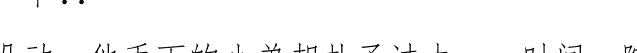

(兄弟们，2501哈，顶帖至2501，兄弟们敢顶，我就n爆发！说到做到！)
作者：至死已未 日期：2009-04-15 10:16

怎么2000多回帖了，这第10页还没翻遍去？
弱弱的呐吼，召唤立刻沙发宠。
闪!!!!!!!

作者：至死已未 日期：2009-04-15 18:02

## 第四十七章 灭顶之下

卫平？？？崔大的眼角跳了一下，这个人的干兄弟？
他不顾及想着，立刻咬了牙说：“曹TM给我住手，等下再说！”

人群慢慢的散了手，散了开，张猴儿子立刻看到了
在王哲看来，陈飞的脸看很美，周汉还留着
就接着走着他们，起来是肯定吃亏了。

他跑过去，问了吴胖子和周汉没事事吧？周汉擦了擦
额角的（不知道哪个用牙头骨的），一反对指了指卫国，
意思是张猴儿子去看卫国，吴胖子已经的嘴角角上全是白
子了，虽然这群架才才打了2分钟，已经足够累人的了，
况且，他背上也被开了个长口子，他说不话来，也只是
摇头给张猴儿子示意没事！！

张猴儿子马上跑过去，扶起卫国，摸了摸猴子，还好，还
有气儿。陈卫国有气无力的开了张猴子的手，有点虚弱的
说道：“老子没死，就是肚子差好痛！”是啊，换谁肚子上
嵌满了糯米粒，还挨拳，会受得了？所以，没几下，就
了下去，所幸，那些人也不是要出人命。

崔头看着陈卫国的表现，没拿命，知道陈卫国受了，没拿拳
疼了，没拿拳头看着陈卫国的样子，张猴
看着陈卫国的样子，眼睛就红了，转过头狠狠狠的看着崔头。

“吴国……”吴胖子和周大汉同时听到，特别是吴胖
子，心里说不是内疚还是感动，反正都受够了。

崔大头无奈的，只是反问一句：“你说呢？”

陈卫国什么也没说，只是抓了刀，对着自己腿上横
很就是三刀下下去了，然后问道：“这样不够？”这一连
动作太快了，因为他一连丝一犹豫都没有。

他听斗子这么说，也考虑了起来，半晌后才说：
“那今天我就给刘平，这事就了。不过，先说好，陈卫国
答应的一万块钱，我必须收了。还有，以后，以后以后
没有关系了。”

“老伯，你告诉陈叔，你看合适吗？”张猴儿有点忧决。

“猴儿，你帮我跑一趟，去找我爸爸，把事情告诉他。”
“卫国啊，告诉陈叔，你看合适吗？”张猴儿有点忧决。

“老伯，你一定要找我们，我们肯定报。我知道这些日子
发生的事，让他也怕了！只是，我说实话，我还是想念您
老了，我爸已经不想认我，我真的不知道哪了……”

陈卫国现在是毫无办法，陈卫国也不理会外面人，他
不知道怎么给钱，而且用不着他招呼。

张猴儿点头出去了，陈卫国也不理会外面人，他
不知道给他们钱不会会的，而且用不着他招呼。

进了屋之后，长林就凑钱了，陈卫国又吩咐了一个兄弟，去把诊所的医生叫出来。说这里受伤了，钱多给点儿都行。

不一会儿，诊所里的医生就搬着箱子来了。进了屋，看
陈卫国，有点吃惊，问道：“怎么又是你们几个？”

陈卫国苦笑了声，揉了揉身上的背心，泡胀的糯米，让他的肚子鼓起了一个小包。医生看了看，没啥表情，
说了句：“你这个比较麻烦，要一粒一颗的挑出来，你别
指望你能把它消化了，剩下难受死你！”

“去帮我兄弟把扎，他们都挂了彩！”那医生一听，
无奈的摇了摇头，又跑了李老三房，那可是他的老熟人了啊，可能2个月不到，就受2次重伤。

之前，陈卫国问了句，医生同志，你姓哈啊。那医生
头也不回的回答了他，姓，就去了李老三屋子。看着彩的人数。今天他可能有获利了！

两个小时后，李老三等人的伤口已经被医生处理好了。现在是陈卫国的，确实比较受罪，要一粒粒挑出来，麻药才给，他全身都不舒服。看着陈卫国，疼疼，疼了。

陈卫国咬着牙，牙根就疼了。陈卫国趴在地上几乎哭了，他喊声“爸爸！”
老子的背影顿了一下，还是走了。陈卫国反应过来，
一下子就倒下了，看着父亲离开。

## 第四章 断绝关系

陈卫国的伤口处理好了，腿上绑了厚的绷带，肚子上也是！
实在屋里的陈叔骂了句：“老子这样负伤的时候，是面对国家的敌人，你这个龟儿子还算什么饺子？”

陈卫国不敢接话，大爸爸一起出去了，其他的兄弟也不敢面对陈叔，都在屋子里躲起来。

走到院子里，崔大刚酒足饭饱，正在刷着牙，看见陈叔来了，说了句：“对头，老老爷子也敢直，债情父叔，硬是要的！”

陈叔没理他，直接问了句，他还欠你多少吗？

“不多，也就220！”崔大头皱脸说了句，刚长林过来，送了1000，那就只剩220了。

陈叔要侍卫国的二哥拿了崔大头，崔大头接过来说，满意的数了个数，就放包里了。然后把放在桌子上的火药用黑布包了，交给旁边的兄弟，就准备走了。

这时，陈叔再也忍不住，说了句：“老子在战场上，比这个厉害几倍的真枪真炮都看过了，也没下眼睛。今天，却没想到有人拿了把不要枪的火统，对着自己开了枪！”

崔大头显然没懂陈叔的意思，回了句：“老头儿，你怕错我，你是我仇人，不是喷子自己人！”

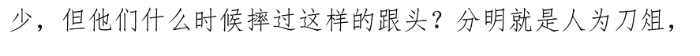

“老伯，你一定要找我们，我们肯定报。我知道这些日子
发生的事，让他也怕了！只是，我说实话，我还是想念您
老了，我爸已经不想认我，我真的不知道哪了……”


全摸出来，我看我们家里还剩多少。妈的，这算彻底解决解放了，货也没了……

大家一听到，心情又有点沮凉了。这段时间大鱼大肉，好酒好闲的日子又习惯了，现在好了，没钱了。该怎么办啊？但是却是猴儿搜了身上的每一个兜，把钱都摸了出来。

平时都是张孩儿管钱，大家身上留上的钱不多，摸了半干净，加上陈卫国的700多块钱，才850块不到。

“想，去成的车费留出来，老伯一个月月的房租，我们的医药费……”张孩儿在那里念念有词的算着，算了半天，他才抬头向大家宣布道：“我们能动的钱300不到吧！”

陈卫国一听，惊斥了一声：“日，那哥们，今天还请手吃饭吧，反正我送点儿瓜不要吧，张孩儿还算好贴贴么？”

“得了，卫国，你TM见到有钱日子过不了，就不要来穷日子了！今天，请你我们就在家好了，保证花50块钱不到！”张孩儿没好气的说了陈卫国一。

“喂，我说孩儿，你别太丢脸，那么多人，五十不到？烟呢？酒呢？你可别给我几个素菜就打了啊？”陈卫国也是个极爱面子的人。

“得了，我就没受伤，这事我来忙，你们别管了啊。傻我们会就去邻居那里卖点鸡，鸭（陈卫国他们住的地方，是城乡结合的地方，有很多农家小院的，陈卫国他们租的也是

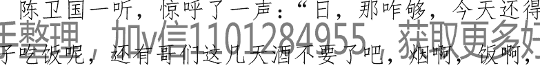

这种小院子，再切点卤，弄点花生。酒，上次长林叫人弄得纯粮散酒不是还有些吗？反正够我们几个伤员和斗子整整了，加上烟，就……”

陈卫国一听张猴儿这么来说去，头都胀了，了了：

“好好……要出去弄吧！”

张猴儿应了一声，就要出去，陈卫国忽然叫住他，说了声：

“谢谢，猴儿！我爸现在不愿意认我了，但我还有你这些兄弟们……”

这句话说的，整个屋子里的兄弟们都不知道什么了，人之间其实是没肉肘。他们知道这也是陈卫国真情流露，

张猴儿笑了，回道：“卫国，其实我想忍住的，但是我是真想要了你的妹妹，现在心里直跳，可舒服好多帖”

“哈哈哈哈……”屋子里一片笑声。

“日，赖你的吧儿！记得出去的时候把斗子叫上啊！”

“知道了!!”张猴儿扬扬手，表示知道了，就一溜烟似的出了屋。

张猴儿走了，屋子安静了下来，李老三这时才忍不住问了一句：“卫国，你爸爸那边……”

“那个以后就好了吧！”陈卫国显然不想在谈这个，随便敛了句眼。

大家都明白了陈卫国的意思，又沉默了下去。过了半天，吴胖子才忍不住骂了句：“2千块扔给狗了……”

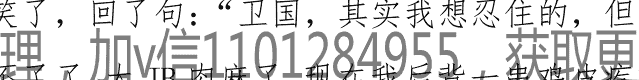

周汉汉点了一烟，沉默了一会，接口道：“不能那样说，今天天守守在房子那里10个人，不是也应该冲上去了吗？还有，猴儿不是也叫来了10个人吗？”

得了吧？上午那几个人这阵势都崩了，冲呵呵啊，老子的那，慢悠悠的步子像TM在散步，下午来的更气人，了长林陪着猴儿冲了上来，大家都看着呢。我都看见的，妈妈的，口口声声说又气，喊着跟我们，到了关键时刻都不是那熊胖吗？我也看他们就长家那2兄弟靠得住！

周汉汉这时无话可说，他有点愁寂，所以不能接受这，平时在一起那么亲热的人是这个样子。偏激的老李三只是冷笑了说：“我只信我们兄弟俩能几个，还有长家那2小子。不服，其理我给……”

“不能这么说，”这时陈卫国才接口道：“我算看透了，真正好的兄弟几个？其实，今天我们几个，你们知不知道？因为不能让他们赖我们几个可是好，是有情系着，但其他人呢？才认识几个？别人凭什么拼命？还有跟着我们为了什么？钱够的，钱够的……”

（注：此处OCR文本存在大量语义重复和乱码，已根据上下文进行语义推断与逻辑理顺）

## 第五章 斗子，我们一笑热此

斗子被猴抓了又长拉进了屋里，他就觉得自在了。天津丽还没剥，最煮热的芒果，那时候的烟霉实在在？在坐起来了，还送客气的烟给他，斗子就浑身自在了。

拿着那烟，睁了了，抽起来怎么去。。陈卫国他们几个个也不自在啊，这都是TM怎么回事？问吃饭有没有都问了3次，斗子也跟着发的了3次！！

终于，斗子忍不住，他就TM一根的人，自己都认了。吞了一大口烟之后，他骂：“陈卫国，你TM不要不要给我酸趴趴的，小子看着忍不住（受不了了）了！我就说了2句话，又没有你妈架老汉，也没帮你打架，你敢（一定）把我请起来干啥？还人情吗？那你就着乖，我受不了你们这差势像个婆娘一样，我！”

扔下这句话，斗子就准备走，却被李老三叫住了。斗子不耐烦的回头说道：“还有哈事？”

李老三不说话，他其实是在整理语言，想真的表达下谢意，怎么可能说都觉得肉麻的说出口，所以，表面上成了李老三不说话，一直盯着斗子的场景了。

斗子被李老三盯町，吼了句：“你觉得话难听了，要打架不是？你伤好了，老子陪你，随便作个整！上次我，还不服气！”

“老子还怕你不？等伤好了，你来吧？”这话，感兴趣，一肚子就接上了，只是接了，他就后悔了，这都这样嚷嘛，闹得满嘴乱

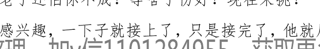

“嘟……”斗子冷了声，不再理李老三了，转身就要走。

“你MP，打架都敢，不敢留下来吃饭狗？操的劲！”张蛋乐子立刻吼了一句。

斗子被这话活到了，真转身回来又坐下了，气呼呼的看着陈卫国他们，张蛋乐子欢一笑，也不再斗子了，说了句，我去弄吃的，就跑着长林一起去了！

“你们像婆娘就像婆娘，连带饭都有！比我妈还贤惠！”斗子觉得逮着机会，立刻说，这句话愿意的。

（注：此处OCR文本存在大量语义重复和乱码，已根据上下文进行语义推断与逻辑理顺）

这句话陈卫国他们全都看着他，立刻警惕的：

“干呛？要打架啊？不要忘了吃饭哈！”陈卫国他们还是说话，只是嘴角慢慢泛起了微笑，然后后笑容越来越大，终于，一群爆发了起来，原来猴儿比斗子的更惠嘛，斗子开始明白，陈卫国他们笑什么，后来看到，不自觉也跟着了起来，笑到肚子痛，只是斗子完全是蒙的，因为不知道自己在笑。猴儿也被笑了


抹笑出的泪，好不容易才挤出一句话：“妈妈，……”猴儿虽然还是迷茫，又转身了厨房，否则猴儿来不过。

陈卫国一揉着肚子，疼，帮斗子。

“我羡慕你们，”旁边的张猴猴拍砸了他的脑袋，“我羡慕你们俩，你们们生死一起扛的样子，TM心里不舒服！”

（注：此处OCR文本存在大量语义重复和乱码，已根据上下文进行语义推断与逻辑理顺）

## 第五十一章 当年的那些事

斗子出生起，就不多招妈妈疼。因为他一根筋，完全没他两个哥哥疼。

出去村里玩，别孩子逗青蛙，烤着了，他就傻愣的等着别人分个鞋脑袋。等到菜条花蕊，烤着了，他就傻愣愣的等着别人分他尾巴。逮个鸟，摸条鱼的，都是万年不变的样子。


别人家里自己想干什么，别来闲，他要闹他就闹最好的。村里孩子都不看不起他，包括两个哥哥那年代，崇拜的英雄，不是谁都能欺负的烂人！过分过的，会退回去，提个鸡渣（一种昆虫），叫上斗子，烤上了，他就问吃不吃咬，吃了就是英雄，他二话不说也能吃下去，然后一群人笑他。斗子不太明白，不是吃了就是英雄吗？为什么笑呢？包括两个哥哥也笑，不过还有下次的话，他还会吃，刺激他的话都不变，吃了就是英雄！！

斗子妈妈就常常想不通，自己那个村里人都是愁的伶俐吧，昨天生出一个根筋，认死理的儿子？吃虫的事的事大人小孩都能拿来笑话她，笑得她抬不起来了。这也打过，说过，可他下次照样眼睛都不眨的把勺子吃下去！！于是，她干脆放弃了这个让她丢脸的傻儿子，养着还是养着，就是越来不待他了！！


导火索！！它是斗子人生历史上的导火索！！

这句话，是这样说的，“林蛋蛋就是个英雄！”典型小的孩子都知道什么是马蛋尼。然后，其他人也纷纷开始赞盛！！其实，这句马蛋尼在场小孩子也许都没在意的吧，就算林蛋蛋也听多了这样的赞美了，不以为意。可是，斗子真的像脑子被引爆了一样，接着他进入了人生一个玄妙的境界，悟之境！他在悟，并且知道了，吃虫子原来真不算什么英雄，要不要人才算啊！！！

过了以后，斗子就疯狂了，拿出了他吃了一只又一只，好让自己听听叫执着的精神。跟林蛋蛋拼上了，林蛋蛋很奇怪这个刚才的软蛋现在就用散挑挑战他的权威，不过不下手还不妥理，

不是不狠的，可是可怕在认死理，如果打不死，又让他死理，那么他就是一个执着的狂人信徒，会信仰仰命的！！所以，林蛋蛋怕了，软了，终于哭了……这不怪他，只是个孩子而已！

当村里的大们过来的时候，斗子还在揉林蛋蛋，林蛋蛋却是哭着求饶。拉他们的时候，斗子甚至还咬着林蛋蛋肩膀挎着的一块肉，虽然隔着厚厚的冬衣，也够疼人的。

大家都为今晚的斗子所震撼了，这一根筋原本是不鸣则已，一鸣则惊人啊！！

以后的以后，斗子就习惯用拳头说话了，习惯用暴力解决问题了。以后的以后，斗这就成了小孩子的英雄，大孩子的英雄，到最后的混里的一个小子传说。尽管小学没毕业，就因为打架下不下。以后的以后，斗子他妈，他哥都跟她外亲近了，哥哥们他们不知道为什么。但他知道妈妈是因为，因为那天晚上，林蛋家的人来闹过，这当妈妈的行道理要审问斗子外加的时候，斗子说了句在他妈听来外有哲理的话，“我以后不吃虫子了，谁敢再叫吃，我就打他！”那天晚上，斗子挨打，第二天，妈就领到裁缝里给她做衣服了。她儿子乐开了，她能不高兴吗？

只是不知道，从那时的斗子到现在的斗子，他妈看着一切，是否会在想往事的时候，有后悔过？毕竟她的鼓励，才让她现在都在努力工作的最辛苦，获取更多贴贴。

## 第五十二章 二上成都

半个月以后，陈卫国一个人的伤得差不多了，斗子也和他们的关系越来越好，最后，他一定要跟着他们在一起了。他们以前积累的那些兄弟，陈卫国整合了一起，就留下了十几个可靠的，死心塌地的愿意跟着他们们的。

钱用得差不多，除了去成都的车费，还剩下200了。斗子听到他们要去成都，又不知道去哪儿找了300块钱，一定要让他们都带上。临走的时候，陈卫国就把家里的事交给了斗子和长林，对于这两个，他们放心。斗子也高兴，以后可以正言顺的跟陈卫国他们在一起了，这几个兄弟值得！！

到了成都，陈卫国他们也没找合适的地方，就直接去了叶哥的家。在路上，陈卫国也想，这样有点不好？但他又想，反正说完事就走，住酒店太贵了，钱还留着要请叶哥吃饭。请叶哥这样的人，不能够档次吧？大不了哥哥们在车站就一晚就算！

到了叶哥住处，叶哥显然对陈卫国他们的忽然来有些点吃惊。不过，陈卫国也算豁去了，现在本来就一无所有了，还要什么面子？要求人，就放下脸来，他还想着找大头报仇呢！于是，低三四四也诚心邀请他，陈卫国就能请出叶哥吃一顿饭。

想了便就答应了。他是什么人？在江湖上混了这么多年的数理加持，让他白吃饭是不可能的，陈卫国心里有些后悔。肯定是有要求的，这次那顿饭的味儿可不可一样啊！

到了饭，落座之后，陈卫国就把叶哥不认识的兄弟一个给他介绍了一下，叶哥就礼貌的回应了。但当陈卫国倒酒要敬喝的时候，叶哥却挡住了这杯。陈卫国有点愁，他一向认为，有酒就好说话，这叶哥不喝酒是个什么意思？

这次是叶哥先开口了：“这杯酒我不想，喝下去了就是我给你的承诺了，你有事情，直说，你知道我不喜欢折弯肘，而且我在这个位置，还要看看你说的是什么事，因为我也有我的考虑！”

陈卫国听听叶哥那一句，脸一红，就知道自己用错了方法，这些在叶哥面前都有点幼稚了。那叶哥既然这样说了，他捏捏作态也不是个事儿吧。于是，便一五五十的把事情跟叶哥说了了。

叶哥一听着，一点点头，脸上的表情也不时变化着，有时很平静，有时又皱起了眉头，但听的过程中，始终没表态。直到陈卫国把整个事情说完，叶哥还是没表态，吭了将近一分钟之后，才说道：“你希望我做些什么？”

希望叶哥做些什么？陈卫国愣住了，他真的不知道啊！他只是本能的想这个，叶哥找到了个打算的人，希望能够帮助，但是具体怎么样，他真的没想过。

“我不知道，你想在这里得到帮助，我本能觉得。”叶哥挑了挑，桌上那杯酒依然没动。但他却说了一句和陈卫国完全无关：“我不知道上次为什么要帮？”陈卫国有点茫然的摇摇头。“两个原因，第一，当时的让我看到了当年的自己，有股冲劲不怕事，还有就是男人软蛋！第二，这边的太和复杂的组织，虽然是个光的老大，但是有些关系积累，我要整理，却从下手。”

“叶哥，没怪，你今天给我这些，哪个原因？”陈卫国有些不懂。这次叶哥回答的很快：“我是想告诉你们，像当年的我是假，但是还是地方不一样。就是知道东西用一次少，世界上没有免费的，等到就要要了。记住你们几个兄弟，你知道吗？我在成都，你们手长了，难免被砍掉！何况我还不知道怎么帮你。”

“叶哥，晓得了，那就不提这件事了，这顿饭当我报你的情！”陈卫国虽然有点失望，但不是来人的。看着陈卫国的表现，叶哥微微点头，笑了一下，做了一个陈卫国想不到的动作，他端起那杯酒喝了。

“叶哥你……”陈卫国这是真的看不懂，难道大的都是这样？变来去的！喝完之后，叶哥微微一笑，说：“你们几个兄弟，我很欣赏的。人情这种东西，也要卖有价值的人。我觉得，如果我这双眼睛没看错的话，你们是值得我卖人情给你们的！我的手不能伸长的，但是你们听听我口音，我是我是人。我从出生混了多年，那边的兄弟还是个本事的！”这下，搞喜欢的表情现在陈卫国脸上，看来丢了的东西捡回来了戏了！叶哥不是扫带水的人，说了就立刻找服务员要了经理的微信并添加了。”

“上面你要找的人的地址一点别的信息，另外带给他的话，我手写字，他一眼就能看出来。这个你可别担心，我不说过，想得到就要付出，面子能用到什么程度，我不知道。记住叶哥还是那句话，天下没有白吃的午餐！”陈卫国接到那封短信，贴身放好了。他知道，叶哥给的帮助到这儿了。

## 第五十三章 黑老大，你的名字有点京

陈卫国是一个人去的Y市，第一次见到别人，就带一大帮子，肯定是不好的。何况他也不知道将要发生什么事。按照地址，陈卫国东听西打听，才找到了这条小巷子。终于站在门前的时候，陈卫国却有点住了，叶哥给的地址不是错了吗？怎么会这么一个破败的地儿？想起叶哥风翩翩的样子和不俗的谈吐，他的朋友也该不远吧？既然差不多，怎么会住这里？叶哥说了啊，他介绍的这些人也算有本事的兄弟之一吗？但是到了，陈卫国也不像那么多，就伸手敲了敲门。没料想到根本没关，他一推，门就开了。一手处理。最好的房子，就是陈旧男人也便宜的味，臭味，霉味，还有一种说不出来的味道混杂在一起，刺鼻的人鼻子难受。陈卫国几乎可以肯定自己走错了地方，因为这里根本就不能像他了。他转身想出去，却不想刚刚走了两步，就被一样东西重重的撞碰了头。这下可不轻，把陈卫国磕的歪了好几秒！地下发出一阵沉风响中带点清亮的声音，那是金属材质。陈卫国也可以肯定，那就是刚才撞他的东西。他捡起来一看，是一个空的军用水壶。他忍住想要抓住的心情，陈卫国四处张望了起来。这间大屋，大的有点夸张，而且太了。白天进来来看看清楚东西，还起了厚的窗帘。走到窗户面前，陈卫国一下子把它开了，终于光透进来了，感觉好多了，同时房间却响起了一个低沉的音，感觉都在震动。猛然响起让陈卫国吓了一下：“谁啊？”

坐在上的男人，满脸歪了。陈卫国在地上笑得满脸歪了。黑老大被笑了，过去就是一脚，陈卫国反应也快。眼睛不大，但在黑色皮肤衬下显得凶光，鹰钩鼻，厚唇，胡子渣的脸。最重要的是，手上还拿着把枪对着自己。“我再说一次，把窗帘拉上！”这种枪，结构很简单，是个手枪，后面是个撞击器，中间是六根绑好的铁管，铁管里面填充火药，利用撞击器打出铁管，射程比枪还近，但威力大些。看来是陈卫国要是不敢窗帘，就要开枪了。

赶快的窗帘拉上了，陈卫国岂不是不是打架的。这才开口问道：“请问是不是刘德勇，勇哥？”“你妈妈求个，去把酒给我我想办法灌满了，陈卫国累累的，你哥了。”

二分钟后，气喘吁吁的两人终于停手了。黑老大抓过军用水壶灌口水，但他显然错了，里面装的是酒。结果“再来跟我说，哪个喊你随便进屋子的？”说着这人还指了指地上军用水壶，意思就是叫陈卫国去给他装满。完了他往地上上一躺，睡过去了。陈卫国无奈的苦了一下，只能揉起那个酒壶，老老实实的洒去了。他现在已经肯定，这个人就是叶老大要自己人的！！否则怎么也不能把土枪当玩具玩吧！刚走到门口，人打雷似的声音响了起来：“烟没得？”一手抓过去，又递过去。

走了不远，就看见一家杂货铺子，打了几斤最好的酒，把壶装满了，陈卫国又买了几花生。其实他预想过很多见面的情形，就是没想到会这样。这是一个大哥吗？陈卫国心中的大哥应该是叶哥那样的才对，也让他仇人推大头那样的？怎么会是这样？想着想着，他又走回了那间屋子。进去之后，烟熏都差点被咬到。他去了半个小时不到，这人抽了多少烟？能造成这样效果？“回来了啊，酒拿来！”刚踏进屋，那人就有反应了，警惕性很好，只不过开口就要酒。陈卫国把酒递过去，那人拧盖子狠狠的几大口，喝了之后，满足的长叹了一声，又抽了一口烟。这下，陈卫国知道这屋子里为什么那么烟气了，这个人是两个人一起抽的。

“手上拿着什么？”眼睛很尖。“拿过来！”陈卫国把花生递过去，那人剥了2颗嘴里后，又一把整理，加花生，获取好多占。不满意地嚼着花生，大概是指花生，不错的意思啊？”陈卫国像个木偶似的，又坐下。那人把军用水壶递过来了：“哼，今天我们两个人把这个整完，老子最忌扫一个人和寡酒！”那有什么说的，就愁北。然后，两个人就着花生，一口我一口的喝了起来，也不说话，喝了，就点支烟抽，抽了再继续，中途陈卫国还出去买了烟。2小时不到，这个装几升酒的壶都见底了，陈卫国自觉酒量很好，也有醉意涌了上来。这时，这人才开口道：“来找我干啥？你哪个？”呵，敢都不知道是谁？又要耍酒由耍烟，还和别人喝了一通酒啊？这人太奇怪了！不过，酒意涌来的陈卫国也是个不怕事的人，干脆就表达了他的衷：“我叫陈卫国，叶哥来找你的，不过有点失望，你看比叶哥差，你哥帮。”

看完信，陈卫国没多少，掏出了封短信，递给了别人。陈卫国接到那封短信，贴身放好了。他知道，叶哥给的帮助到这儿了。

## 第五十四章你敢不敢？

陈卫国简直没输老老大，他直又直接，也很血性，男人要的不是这样的兄弟吗？至于黑老大不喜欢陈卫国，他拉起陈卫国，说的那句话，“走，去找黄老二，明天我要给他白老老！”日，怎么就成了白老老？这个人的性格真摸不着边际啊。不过，想想黑老大那么邪，黄老二肯定很坏了，自己比不上他们确实算好的。

黑老大被笑了，过去就是一脚，陈卫国反应也快，立刻准确的抱住了他脚，使劲一拉，黑老大扑到了他，翻身上去，就用拳头招呼了，这时才记起来，自己刚才镜锤么架都没打完。黑老大显然来了兴趣，喊了句：“今天我们好好单挑一场，”就使劲和陈卫国打了。

陈卫国累累的快笑不出来了，但是黑老大真的太好笑了。好不容易哑完，他才开口说道：“笑个话，不过，你娃娃还行，竟然可以和我挑二十分。”“哈子也行？你也不看看你现在的样子？我老了，没狠手，不然你早就输了！”的确的，黑老子的样子现在很狼狈，身上的脏说不了，头发也乱乱得像个鸟巢。“我哇！你不要脸，你小子得到哪里去？”也是，陈卫国的样子也强不到哪里去，为了面子穿的白色短袖衬衣弄烂了，熊猫眼也格外犀利了。最后，两人相视大了眼。这一切真妙了处理起来，陈卫国简直没输老老大，获取胜利。这种疯子的什么样的？他，直又直接，也很血性。


起床了.......

晚一起更加长版的…………

大家期待诗人屠夫老三吧!!!!!!!!!!!!!!!

作者:至死已未 日期:2009-04-17 19:26

40 分后，更新一章加长的。

屠戮的刀与赞美的诗

作者:至死已未 日期:2009-04-17 20:17

## 第五十五章 屠夫的刀与赞美的诗

陈卫去Y市已经三天了，还没有一点消息回来。留在家里的几个兄弟们都很担心，崔大头留下的阴影竟不是那么好消除的，他们担心陈卫回国事，最后在李老三的要求下，大家还是让陈卫跟上去看看吧，又怕出了什么事大家都知道。

到了Y市，李老三按照地址找到了黑老大的家。他并没有像陈卫的那种惊奇，这个人可能对外界的东西神经反应有点儿迟钝，也许在李老三心里，一个所谓的老大住哪儿都是一样的。从本质上来说，李老三甚至觉得一个混混和一个老大也是一样的，都是人，你只要是惹了我，我咬吃你一口，并不会因为你是谁，就不一样。

进了屋，只有黑老大一个人，此时，他正躺在他不知道从哪儿弄的摇椅上，喝着酒，看见李老三进屋了，黑老大扫了一眼，又继续喝起起来。

李老三扶了扶眼镜，很斯文的开口了：“请问，您是刘德勇吗？你好，我是李民富。”

夏天的天气，很热。黑老大挺硬生生的被李老三这斯文的语气激了一嗓子的鸡皮疙瘩。

“你妈哦，不要用那种语气给我说话。老子是个二流子，不习惯跟书人说话。”

可这李老三压根就忽视黑老大的话，继续斯文道：“哦，勇就好哥，对不起，麻烦你，主要是我想问下我兄弟陈卫国是不是来找过你？如果来找到了，那现在哪里？你能不能告诉我？谢谢。”

黑老大此刻的心情完全是冷，别人根本无无视他的心里吃了一口冷气。

没来说吧，就开大吧，去年我最喜欢梅这火丈哪里儿？所以，黑老大就喝起自己的酒，也来了个哑李老三。

李老三倒也是无所谓，将眼镜来揉了揉，又继续问到：“如果你知道的话，就请告诉我喔，谢谢！”

“谢你妈，你到底有没有完没？老子说了，不跟书人说话，你要发酸的话，自己发，老子晓得也不跟你讲！”黑老大爆发了，对李老三这样的人，他完全没没办法，倒像是小子在发脾气。

听见黑老大的话之后，李老三半眯起了眼，唔，那意思就是说他知道卫国在哪里儿，从语气来看看卫国好像并没有什么事。


放松之后的李老三就把自己随行的行李放下了，打开拉链，从里面拿了一本诗集出来，然后开始四处找巷子。

“你找我啥子？”黑老大很奇怪这个人的行为模式。

“我要找巷子！”李老三不紧不慢的回答

“日，巷子儿没巷子的，要找出去没！”

“没关系，我随便找找巷子也可以坐。”

“你坐这儿干啥？还要招待你啊？”

“你忙你的，不用管，我坐着看会书，等卫国好了了谢了！”

黑老大发愣，他是想骂妈的，但他忍了。这个小子就是自家老老老妈的兄弟？混混社会的？看来比黄老二还不不如!!

黄老丢了脸面，托了各种关系，这巷子怕跑不了，这看不见就跑了吧？还随时乖趴的不是。

李老三倒也是无所谓，将眼镜来揉了揉，又继续问到：“如果你知道的话，就请告诉我喔，谢谢！”

“谢你妈，你到底有没有完没？老子说了，不跟书人说话，你要发酸的话，自己发，老子晓得也不跟你讲！”黑老大爆发了。

听见黑老大的话之后，李老三半眯起了眼，唔，那意思就是说他知道卫国在哪里儿，从语气来看看卫国好像并没有什么事。

放松之后的李老三就把自己随行的行李放下了，打开拉链，从里面拿了一本诗集出来，然后开始四处找巷子。

“你找我啥子？”黑老大很奇怪这个人的行为模式。

“我要找巷子！”李老三不紧不慢的回答

“日，巷子儿没巷子的，要找出去没！”

“没关系，我随便找找巷子也可以坐。”

“你坐这儿干啥？还要招待你啊？”

“你忙你的，不用管，我坐着看会书，等卫国好了了谢了！”

黑老大发愣，他是想骂妈的，但他忍了。这个小子就是自家老老老妈的兄弟？混混社会的？看来比黄老二还不不如!!

## 第五十章 阿兵回来

出来后，陈卫国心里说不出的愤怒，这愤怒来自哪儿，他不清楚。最明显的感觉就是，老三变了，变得妥协，他可能变了。

强自忍住打人的冲动，陈卫国摸出二支烟，递了一个给老三。现在的这两人，都在刚才那里伏的地方歇脚。

“老三，你刚才在干啥？”陈卫国把烟点上，还是忍不住句：“你在说啥哈，我不懂你的意思！”

李老三觉得陈卫国这话没脑子的，“黑老大说了执行就行，挑了就不行了吗？你为什么给出来，我看着心里挺的！”

“卫国，你不知道，老大为什么是老大？我现在终于明白了，那就是要比别人更狠，要吓住人，这个世界上不怕怂的，就怕狠的……你说上次我杀了大头，他哪个小弟敢嚣张？”

陈卫国没说话了，老三说的有些道理，想起崔大头给自己哥几个带来的屈辱，他完全能理解老三了，压抑了那么久，是要暴发一下。隔了半晌，陈卫国才说：“你妈，你控的手，我理解，男子汉大丈夫的，下手狠点儿，也没啥的，但你念叨似的像个神经病一样，我看着心烦，都发冷！”

李老三笑了，拍拍陈卫国的肩膀，深吸了一口，才说道：“说我是因为怕，你信不信？”

陈卫国有点反应不过来，眯眼睛盯着李老三，他怕？这表情真的像被他抓住了。李老三理会陈卫国的奇怪，吐了口烟继续道：“要平时，和你对打的人，或者欺负你头上的人，那没什么好怕的，大不了一命换一命。可是，对着一个不能反抗的人……”听了之后，陈卫国不再说话了。是的，刚才换他下手，一定会有这种感觉。说不定比老三好到哪里去，虽然他不会念诗……两人都没说话了，这样的事，最初的兴奋和害怕过去，剩下的只有心里疲倦了。看来，在这条道上，已经走远的感觉，已经不是他们所能控制的。休息了一会，两人就回黑老大那里去了。黑老大早前交代过，好了就好找他，剩下的事儿黄老二会收拾的。

第2 天，陈卫国和李老三就回去了。

走之前，当然得到了黑老大的承诺，一个月以后，人物找崔大头！急急李老三忍不住问句：“为什么以后的？”黑老大一笑，说到：“你还是嫩了，以后也会惹麻烦，被人查到你就老实。”李老三不是笨蛋，陈卫国不傻。走之前，黑老大把那把枪给了陈卫国。

回去之后，陈卫国就把一切告诉了兄弟们听，包括子子和长林。一个月后，崔大头，是不错。可是，他们现在面对更大的困境，那就是没钱。兄弟们要怎么生活啊？那是生活水平并不高。最后还是子子去了两百，长林去了一百，足够剩下的半个月了！陈卫国倒是很想阿兵了。

几天过去了，又是早上，陈卫国他们依然跟着周汉练拳，锻炼身体，这段时间固定不变的事，快结束时，“哎呀”一声院子门开了，阿兵背着个包，拿着钥匙，笑着看着陈卫国他们。先看见阿兵的是张猿猴，看见他之后，张猿猴立刻停下了动作。陈卫国他们看到阿兵，下热闹了。这群狼似虎的汉子。阿兵瞬间蹦开，哪里叫着：“你们不要太热情了。”包里装着师傅的宝儿！吴胖一把接了阿兵的包放一边，然后这些人立刻兴奋着阿兵，揉了揉屁脸。这几个人散开了。众人围着院子里的桌子坐下了，刚坐下，张猿猴就等不及给阿兵讲了这段时间的事。足多小时以后，把事情全部讲完。阿兵听得很认真，几次烟都差点烫到了手，他没想到离开这几个个月，家里竟然发生了这么多。感激的望了子子一眼，阿兵并没有说什么，因为已经是兄弟了，就没外了。他直接问陈卫国：“那现在，我们基本上算是身无分文了？”

“不算吧，还有一百块钱，足够剩下的半个月了！”陈卫国倒是很想。“那你有没有想过，黑老大的人下来，我们难道就一点点都不给？”阿兵皱眉问道，张猿猴也点了点头，他其实想到了这一层，只不过没对陈卫国说起，这段时间想怎么弄脏天了，都已经够大家烦恼了。”陈卫国对钱一向没什么概念，这这一问，他也犯了愁，不止了，所有人都犯了愁……


拉开拿出了几份报纸的东西说道：“这是老师最后的东西，以前他收集有很多，但他都给了两个师兄。这些，他就说留给我，只有一个要求，就是让我千万不要卖，留给子孙后代用，不然就捐给国家。他老了，又没有儿女，拿着这些也保不住……”阿兵……”陈卫国明白阿兵的意思，觉得有点内疚，阿兵为了兄弟们，在重庆耍三个月不说，这回来后，又要为了师傅的东西……说锤子，等我找一件最不值的钱，陈卫国，你去成都交给叶哥嘛！大不了，求下他，我们保留些日子，我们有钱，用加倍的价钱赎回来！”阿兵故意得很轻松，让卫国担心。说完，他打开了一个中等大小的纸包，里面是一个玉雕的寿星老头。“这个，卫国，你5000交给叶哥哥就是！！本来这个东西，师傅传说过，就算算‘太和’了，没有50000，都不能出手的……”（晚上还有一次）

作者: 至死已未 日期:2009-04-18 18:50

## 第五十章 初步计划

5万？在当下，一个万元就是牛B打不了的人了，这游戏居然值5万？震惊的陈卫国，连同向太关心这些事情，哪里是哪里，师傅说是哪里就值起来。

实在又没个女儿，就希望我能把这些东西，按他的说好好存起来吧……”

陈卫国好奇之下把另外几个报纸的东西也拆出来了，
都是些瓷的瓶瓶罐罐，还有一个紫色木雕的笔筒，漂亮是
的确，这些玩儿卖不起价价啊。

“你说这些东西，能比这玉寿荣还值钱？”陈卫国指着
桌上的一堆东西西向东。

“嗯啊！”阿兵肯定的点了点头。

陈卫国一言不发的进了屋，又找起来2、3个瓶子和一
铜做的炉子，那是上次吴胖子下乡收来的，肥大伙抢抢的时。

没打算捡这些，看不上这次“垃圾”，玩意。

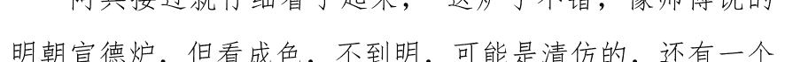

阿兵就仔细看了来看，“这炉子不错，像师傅说的
明朝宜德炉，但看成色，不到明，可能是清仿的，还有一个
瓶子也不错，清中期粉的。不过，我不太确定……”

“你学三个月了，都还看不确定？”周大汉忍忍不住了
一句。

“废话，这玩意师傅传了，只能见见见识，理论知识管
屁用！”

“那你说这些东西我们能卖钱吗？”陈卫国不想阿兵卖
他师傅的东西。

“卫国啊，我们在重庆过师傅传什么？再说，这东西
只能在国内外值，师傅最不希望的就是这些流传传出我们国家！”阿卫少有的严厉语气给陈卫国说到。

陈卫国脸一红，他没说什么，他忽然想起了老头那句话，男儿一诺重千金！！

“那就把这玉寿星交给叶哥哥！我明天就去办这事！以后有了钱了，我们就给买回来！”陈卫国明白了了，也是个洒脱的人，接受了阿兵的建议。

接着，他说了：“现在我们兄弟齐了，什么条件都具备好了，等我从成都回来，我们就好好计比较崔刘头的事！”

陈卫国第二天就到了成都，带着玉寿星回来的时候王经理也加入了，他们带了5000块钱。其实，心里有些忐稳，可看到叶哥看到玉寿星的时候，明显脸上的表情就变了。

一开始，叶哥一定是要给2万块钱收陈卫国货的，是的，陈卫国红着脸，只卖5000。叶哥有点奇怪，陈卫国这吐着气的说出了他的要求。当时的叶哥明显就有点高兴了。说这根本不符合行规，不过，他也舍不得玉寿星，就答应了陈卫国给他一个月的时间来买，但一个月以后，期是不够的。陈卫国当然非常感谢，并且应该一个月以后，用8000块钱来买！！他想，如果顺利的能把崔大头那批抢回来，再加上他们被宰了的钱，8000块钱还是没问题的！叶哥明显不太高兴，但也勉强应承了陈卫国，陈卫国这才回了家。不过，他不是傻子，他的不安也不是没有道理的，他能感觉出来叶哥哥对于东西的占有欲，怕等来的时候，就有点难了。他一定不能负了阿兵，在内心深处，陈卫国也不愿意这样叶哥哥，所以，他强制自己把感觉压了下去！！

回了家，陈卫国拿出了5000块钱，并且说了一句顺利，让大家放心了。其间有个小插曲，就是陈卫国一定没拿出500块钱给斗子，让斗子耍了光，陈卫国一定没把他当兄弟，差点当着面子掀了桌子，这让陈卫国很汗颜，拉着斗子斗了半天才算。陈卫国拿了1000给长林，这个长林里还没没摸，毕竟上次来是找长太婆的。

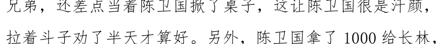

他解决了他的问题，大家伙放心吧。就是怎么怎么样弄崔大头，还要让他们损失掉的东西！

张瘸儿的意见很明确，黑老大才是能带人，收拾了崔大头，但是，东西呢？钱呢？如果崔大头要跑的话，他们一样没办法，简单的说这东西要回来靠自己。

阿兵的意见，相对来说，就考虑了很多。第一，听闻崔大头在靠近的地方，那么就意味着不能带大人马去，虽然老二有说可以让陈卫国放心，但也不能完全忽视风险啊。第二，如果不能那样去了，崔大头完全可以拖过去，因为老大的人马并非本市的，能待多久？如果只是单独弄了崔大头，根本不能把他弄服，还要防备随后的报复！他不仅要抢回失去的东西，更重要的是，他们要催大头翻身。

这些深夜，烟，这些都是摆在眼前的难题，而且黄老二曾经给陈卫国说过，一个城市的另外另一个城市，大规模的灭掉一个势力。弄不好就要引起当地所有大哥的公愤，所以，要陈卫国注意这些。黄老二是个说到为止的人，这确实是关键问题，陈卫国当时急着报仇，想的就是走一步算一步，现在连所有的问题，这个难题也被拿出来讨论。

从上午到深夜，八个人整整抽了一条！茶也换了几茬……中午，晚上，都是张猴留下了伏笔。这些提出来被众人反复讨论着，力求每一个环节做到完美，以及越是关键的，宣布宣布战，所以，一步马不得。直到凌晨点，他们的计划才有了雏形。张猴儿和阿兵把每一步算了一遍，觉得可以了。大家这才散，接下来的几天，就是斗子要忙的。斗子的任务就是先说服叶哥，然后再让叶平面合几个大哥。试图这事大家忙了半个月，吴胖子曾差过几个小弟，去详细打听崔大头的人，他平时行事道义，所以，很多势力几乎没有，大家都是咸不淡的。而这件事其中有一个难题，是斗子提出的，那就是崔大头的最初是由黑帮混出来的。黑帮的老大是非常大的势力，大家都觉得多一个势力消失吧！！陈卫国握着他的枪，说了一句：“如果真的杠了，那就让王经理加价去抢几个。”他已经发现对方很狠，自己要放弃黑帮了！！

## 第五十八章 无奈的选择

计划完后，斗子第二天就离开了，接下来整整一周都在奔波这件事，搭上张猴也跟着忙。情况和陈卫国他们估计的差不多，虽然时间花了一些，不过大概搞定了。吴胖子这段时间也在忙，他们崔大头是认识的，为了暴露目标，吴胖子找了两个靠得的小弟天天跟踪崔大头。得到了一些情况，不过，这些情况却让吴胖子有些


斗子他们搞定事情的第二天，吴胖子也将情况说出来，跟陈卫国商量了。

“关国，这崔大头挺顾家的，白天一般都忙自己的事，身边跟着不少人。没的情况，下午就回家，就算有时候应酬，也是很有人的。”陈卫国听了：“那就去他家里堵吧！”吴胖子摇摇头：“我怕没戏，他小子楼房，又在热闹的街上，我们没机会会！”李老三扶了眼镜：“他还有什么情况，你倒是说是看，说不定还有其他的机会！”


国单位上班，还有一个儿子上小学！”儿子在小学上……陈卫国的想到这一点，正好李老三也望向陈卫国，他们在某些地方想到了一块了。可是，这能行吗？还是个小孩子啊！陈卫国有些犹豫。李老三却不管这些，直接给吴胖子说道：“那跟踪他儿子吧，崔大头和他娘白天忙，那小子应该有空儿！”老老，老三，你这样做太过点了？”周大汉听有些不好，毕竟小孩子又是什么呢，吓到孩子有些不好。

“狠狗，那些事情又关关国他爸爸干什么事？崔大头做事不留余地，我们凭什么要给他留余地？”李老三狠狠的给周大汉吼了回去。一提到卫国父，周汉老彻底没了语言。在他们那事发生的第二天，那靠老子果然就叫陈大哥送了卫国来了一份断绝关系的声明，卫国肯定没够签字，但这事也足够让人伤心的……张汉狗和阿韩也有点心不忍，只能看着陈卫国，等他决定。

其实陈卫国想否这个决定，实在不行，就强行破门北。可要知道，这绝对是个不明智的选择，而且一想到自己的老父亲……狠狠的拍了拍手里的，陈卫国说道：“就这么干，胖子，你去跟儿子俩两天，把日子规矩清楚，特别想要更多帖。”吴胖子知道，这也是卫国无奈的，只能无奈的选择，只能点了点头。陈卫国心里也不好，随便逗了一句，进屋了。想想，什么时候开始，半年多前的自己还能想象吗？一个孩子……天以后，吴胖子把情况清楚了，面对着陈卫国，犹豫的时候，陈卫国知道了。

一切安排好，剩下的就是等崔大头回家。中午崔大头的老婆弄了她和儿子的饭，吃饭。午饭过后，的学校，崔大山住的地方，周大汉，阿兵，张猴儿，长林就散开来，按照计划，孩子由陈卫国，李老三负责，带。只要孩子回来，陈卫国，李老三，带。等下午回来，就带他去看奶奶，下午就不上课了。安顿好孩子之后，崔大头的老婆走出来，看着陈卫国他们，想说什么又有点害怕，欲言又止的样子，让李老三冷哼了一声。说真的，李老三并不是肚量大的，崔大头的一个让他看了都厌厌。

“想说什么，说吧？”陈卫国倒是不太为人人。

“你们想把我男人咋怎么样？”这句话说完后，崔大头的老婆不知道从哪里来着勇气，看着陈卫国他们的眼神也凌厉坦然起来了。

“放心，不想怎么怎么样，只想拿回来我们的钱！”看着窗口外面，陈卫国漫不经心的。

“你也是不知道你男人外面外面什么？”老师，你忙半天怎么怎么样？再说，这里是职工家属吧，你随便找个邻居带吧？”陈卫国说了这个侯，崔大头老婆有意识的揉了自己的衬衫，这个女人只能妥协了。

“还有选择吗？”自己儿子还在他们手中，这个女人

## 第五十九章 崔大头，你好

一切安排好，剩下的就是等崔大头回家。中午崔大头的老婆弄了她和儿子的饭，吃饭。吃饭的过程中，天真的崔元还问了句：“妈妈，为什么不叫叔叔舅一起吃？”崔大头的老婆不耐烦的说了句：“你吃你的，你那么多吃？”一句话把小孩差点累哭了。结果叔叔舅喜欢吃冷面，那个胖子叔叔就要吃了，加上胖子也有些饿，就真下去了一些冷面条来，大家都吃了。

陈卫国有些心烦，没吃两口，就掉了筷子，看着。张猴儿拉着他的肩膀咧咧。陈卫国没说，只管抽烟，张猴儿咬了口气，没说什么了。

崔大头的老婆就哄崔元睡了，告诉他，等爸爸下午回来，就带他去看奶奶，下午就不上课了。为了此，崔元还好一阵子。安顿好孩子之后，崔大头的老婆走出来，看着陈卫国他们，想说什么又有点害怕，欲言又止的样子，让李老三冷哼了一声。说真的，李老三并不是肚量大的，崔大头的一个让他看了都厌厌。

崔元，回家？”李老三不放心的问了一句。一边用酸梅袋子里的小勺吃酸梅粉，一边着头。李老三就放心了，而陈卫国却心不在焉的起了灯，远处，吴胖子在跟着。

“崔元……那那个叔叔为什么要揪我嘴巴？”这个问题还是偏着脑袋问的。

崔元的眼神清澈，一眼看得陈卫国立刻转身掉，面对孩子这眼神，有点说不出话。李老三连掏出了两包梅粉递给孩子（吴胖子的信息，这孩子放学后买这个），微微说道：“你爸爸今天忙，听说最近孩子，就叫我接你。”孩子愣了一下才接过了酸梅，但是妈妈说不能随便吃东西……这两个叔叔挺好的，比经常找爸爸的叔叔多了。他不记得自己到底有多少叔叔，反正爸爸那里的叔叔多了，小子乐了，加上心智不成熟，所以没那么多糖果、零食。

“崔元，回家？”李老三不放心的问了一句。一边用酸梅袋子里的小勺子吃酸梅粉，一边着头。李老三就放心了，而陈卫国却心不在焉的起了灯，远处，吴胖子在跟着。

崔大大的家不远，陈卫国他们走近这个小楼，其他人就跟上了。开门，其他人就在二楼等着。临近午饭的时间，楼梯上并没有人回来。崔元用钥匙开了门，回头对陈卫国和李老三说：“谢谢叔叔，叔叔再见！”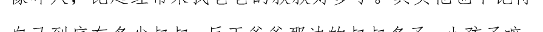

陈卫国呢，有点愣，也不想什么，反而把头偏到一侧，还是李老三反应快，拉住了崔元，说道：“叔叔找你爸爸有事，我们进屋等你爸爸好不好？”

“爸爸在妈妈，妈妈也要下来回来，你们下午才能找到爸爸。”崔元不知道些事，但是方便让他进屋，是妈妈时候教教的。”管不了了，李老三咳了一声，听到声音的大家，立刻冲上楼，李老三捂着孩子的，强行把他推进了屋，其他人快速的跟了进去，并把门锁住了！进了屋，李老三才放孩子。崔元看见出来，有点后悔了，疲懒的看着处理。儿子有点心害怕，他知道要是崔元敢哭，以李老三性子，说不定带把这孩子的堵上。他立刻蹲下来安慰：“不哭，叔叔们就是找你爸爸事的，不然我们一起妈妈吧？你不放心，可以和叔叔们一起玩呀，叔叔们又不走，我们不是小锤！”儿子还挠了个鬼脸，孩一下子就被逗乐了，想着妈妈也要回来了，他们又不走，说不定……

“这不是逗你玩吗？我们最喜欢玩这种坏人游戏了！”陈卫国，，太傻了。

“好了，叔叔陪你玩吧。”陈卫国说了，干脆和孩子玩起来，陈卫国他们倒坐在沙发上，椅子上坐着崔大头或者老婆，回来，只是心里都有说不出来的味。陈卫国说了，太。了。


久不見了，你好。

(等下还有第 2更)

作者：死父未 日期：2009-04-19 23:41

## 第六十章 约战

崔头进屋坐了下了，陈卫国就收起了对着他老婆的刀，

李老三也放开了崔，崔元立刻就冲他父爸里去了，他有点怕李老三。

崔头为了镇定，点了一纸烟后，才说道到：

崔元也兴奋的说道：

陈卫国顾及没想其他他也就不说话，崔头有些煞意了，

就说：“我肯定要下来跟你们商量事，娃娃也很久没去看看他奶奶了！”转过头，他又又催着自己的老婆，说：“你快点收拾一下带娃去！”

崔头的老婆拉过崔元，转身进去收拾了。崔头压低了声音说道：“陈卫国，你真敢吗，你觉得你今天这样做了，你跑的够吗？”

“我恰时候要跑了？”陈卫国所谓的摸了摸下巴。

“别没的事，崔头，我们也是逼急了，上次的钱加上货，就是2万块钱。我相信你肯定有，你也别逼我们做傻事，反正我们光脚的不怕穿鞋的，你自己估量！”阿兵接了一句。

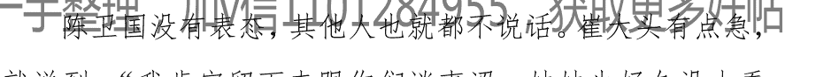

估计阿兵俩愁脸脸，崔大头不知道他是谁，就问了句：“你是哪个？”

“呵，我是来要你命的！”阿兵平静说了一句。

就是这种平静，倒让崔大起了一身的冷汗，还有一个疯疯名在外的老三，他相信，他们做得出来。

陈卫国做为老大，听了这些话，也没有表态，更没威胁，只是看着崔大头冷冷的笑。这种压力之下，让崔大头知道，今天他拿不出2万块钱，事情绝对过不去。

这时，他的老婆好收拾整齐，准备带孩子出门了。李老三慢条斯理的拿出火柴，划燃了一根，也不点烟，也没看看着崔大头，只是盯着她一直直，然后随口说了句：“反正你得拿点钱出来，我好占你的便宜。”

崔大头一愣，他盯着老三的意的，走过去，让崔等着的，然后拉过老婆低声说道：“别报警，事情是我先挑的，也别叫人，你拿出去取出2万块钱回来，他们就不得把我怎么样了！”

这声音刚好能让旁边的胖子听见，他冲着陈卫国点了点头。陈卫国也会意的点了点头，崔大头的老婆回屋去了一阵，估计拿了折，就出去了。

看着崔大头的老婆出去了，陈卫国折了一根烟塞给崔大头，并走过去，划燃火柴，要给他点上，崔大头也不知道陈卫国想做什么，只有把烟叼上，凑过去，一手遮着火，把烟点了。


吹熄火，陈卫国笑笑道：“崔哥给面子，没抽我的老老爷烟（不用手遮掩，直接伸头，就叫老老爷烟，这种方式一般很不尊重人），看来崔哥也是个聪明人！”

崔大头知道陈卫国他们只是求财，也没有刚开始那份紧张了，抽了口烟说道：“汉汉不吃眼前亏，这道理你陈卫国以前懂，我崔大头未必不懂？”

这话包含的意思很复杂，崔大头在指面上逼得他拿拿的事的事。也说，他不吃眼前亏，那么就过了一之后……就不太好了！！

李老三没说，只是过去把椅子坐了，然后坐到了王数理，加入他们。

“你的意思是，我现在应该收点帐回来呢？”崔大头知道这个李三疯，冷冰的刀刃在脸上轻轻的划过，让他脖子到脑后都起了一串汗疙。强自不着李老三，他对着陈卫国说道：“陈卫国，你MP就是个出来的混的人，求财就不只是这样了，李老三算什么愣？你陈卫国也不不要的太差了！”

陈卫国没说话，只是盯着天花板发架，崔大头的话让他想了自己的父亲。那么让李老三这样吓他，又有什么不可以！

“你上次说，要我兄弟的手来抵债，那样，我收你一万八，你拿手出来抵债好不好？”李老三说完，拉过崔大头的手，就放茶几上了。而胖子配合的按住了崔大头！

“陈卫国，你是MB！！你是不是不要鱼死网破，这钱你以为你有命拿得了几天？今天，你要是拿了钱，就事了，要是再敢做捡别的，信不，老子敢唤我底的小弟杀人？”崔大头急了，对着陈卫国大吼。

陈卫国走过来，轻轻拿了崔大头的手背，崔大头疼疼了：“你的意思是，今天只要我们拿了钱就走人，以后就我们？”崔大头连点了点头，陈卫国笑了笑。然后猛的一刀横过去，崔大头的手背割了，声响极大，却被胖子捂了嘴。

崔大头转一圈，才扯了出来，陈卫国说道：“你的话比底还不可信，你想要怎么样，我都陪你！”崔大头疼的快要吐了，胖子才放开捂着的嘴，崔大头已经不出来了，只是滤着受伤的手，流着汗，疼得一句话也说。李老三在旁边鼓起来，说了句：“陈卫国，精彩！”陈卫国随手把刀递给老三，说了句：“你不要疯了，这个程度就足够了。”李老三扯了报纸，擦了擦好，对着崔大头说道：“卫国对你挺好了，这一刀多痛一下，废不了！”

这句简直拉了，崔大头心里抖了一下，他总算摸透过底，肯定是不敢跟老三说些什么的，只能对着陈卫国：“你有种，看来你真是不后悔了，可你还是准备要跑了！”这些陈卫国这样，他毫不不怀疑，你陈卫国要送死，我崔大头能不答应？崔大头第一次见到有点虚，斗子是个老混子，走过去问了一句：“你是哪个？”

“呵，我是来要你命的！”阿兵平静说了一句。就是这种平静，倒让崔大起了一身的冷汗，还有一个疯名在外的老三，他相信，他们做得出来。陈卫国做为老大，听了这些话，也没有表态，更没威胁，只是看着崔大头冷冷的笑。这种压力之下，让崔大头知道，今天他拿不出2万块钱，事情绝对过不去。

这时，他的老婆好收拾整齐，准备带孩子出门了。李老三慢条斯理的拿出火柴，划燃了一根，也不点烟，也没看着崔大头，只是盯着她一直直，然后随口说了句：“反正你得拿点钱出来，我好占你的便宜。”

崔大头一愣，他盯着老三的意的，走过去，让崔等着的，然后拉过老婆低声说道：“别报警，事情是我先挑的，也别叫人，你拿出去取出2万块钱回来，他们就不得把我怎么样了！”这声音刚好能让旁边的胖子听见，他冲着陈卫国点了点头。陈卫国也会意的点了点头，崔大头的老婆回屋去了一阵，估计拿了折，就出去了。

看着崔大头的老婆出去了，陈卫国折了一根烟塞给崔大头，并走过去，划燃火柴，要给他点上，崔大头也不知道陈卫国想做什么，只有把烟叼上，凑过去，一手遮着火，把烟点了。吹熄火，陈卫国笑笑道：“崔哥给面子，没抽我的老老爷烟（不用手遮掩，直接伸头，就叫老老爷烟，这种方式一般很不尊重人），看来崔哥也是个聪明人！”崔大头知道陈卫国他们只是求财，也没有刚开始那份紧张了，抽了口烟说道：“汉汉不吃眼前亏，这道理你陈卫国以前懂，我崔大头未必不懂？”这话包含的意思很复杂，崔大头在指面上逼得他拿拿的事的事。也说，他不吃眼前亏，那么就过了一之后……就不太好了！！

李老三没说，只是过去把椅子坐了，然后坐到了王数理，加入他们。“你的意思是，我现在应该收点帐回来呢？”崔大头知道这个李三疯，冷冰的刀刃在脸上轻轻的划过，让他脖子到脑后都起了一串汗疙。强自不着李老三，他对着陈卫国说道：“陈卫国，你MP，就是个出来的混的人，求财就不只是这样了，李老三算什么愣？你陈卫国也不不要的太差了！”

陈卫国没说话，只是盯着天花板发架，崔大头的话让他想了自己的父亲。那么让李老三这样吓他，又有什么不可以！

“你上次说，要我兄弟的手来抵债，那样，我收你一万八，你拿手出来抵债好不好？”李老三说完，拉过崔大头的手，就放茶几上了。而胖子配合的按住了崔大头！

“陈卫国，你是MB！！你是不是不要鱼死网破，这钱你以为你有命拿得了几天？今天，你要是拿了钱，就事了，要是再敢做捡别的，信不，老子敢唤我底的小弟杀人？”崔大头急了，对着陈卫国大吼。

陈卫国走过来，轻轻拿了崔大头的手背，崔大头疼疼了：“你的意思是，今天只要我们拿了钱就走人，以后就我们？”崔大头连点了点头，陈卫国笑了笑。然后猛的一刀横过去，崔大头的手背割了，声响极大，却被胖子捂了嘴。

崔大头转一圈，才扯了出来，陈卫国说道：“你的话比底还不可信，你想要怎么样，我都陪你！”崔大头疼的快要吐了，胖子才放开捂着的嘴，崔大头已经不出来了，只是滤着受伤的手，流着汗，疼得一句话也说。李老三在旁边鼓起来，说了句：“陈卫国，精彩！”陈卫国随手把刀递给老三，说了句：“你不要疯了，这个程度就足够了。”李老三扯了报纸，擦了擦好，对着崔大头说道：“卫国对你挺好了，这一刀多痛一下，废不了！”

这句简直拉了，崔大头心里抖了一下，他总算摸透过底，肯定是不敢跟老三说什么的，只能对着陈卫国：“你有种，看来你真是不后悔了，可你还是准备要跑了！”这些陈卫国这样，他毫不不怀疑，你陈卫国要送死，我崔大头能不答应？好，就约个时间，地点嘛！”

作者：至死已末 日期：2009-04-20 00:17

晚上没有了，明天上午会有章。另外，以后会回答大家对书中有些东西的疑惑。就叫解答帖吧，那个不定，问题汇总了，就会一一回答。

作者：至死已末 日期：2009-04-20 06:07

这一章的情节比较重点吧，可以选择连更。上午那章连同晚上的一起更，所以晚上连三章，特来说一下。

作者：至死已末 日期：2009-04-20 19:51

今天我们这片电力公司检修，从早上9点一直停电到现在，等下就更新。今天晚上三更。

作者：至死已末 日期：2009-04-20 21:07

## 第六十一章 大战前夕

拿钱回来的晚上，陈卫国失眠了。失眠的原因并不是因为在三天后的大战，而是他准备回家，还要上父亲。一夜无眠，第二天早，陈卫国李老三阿兵早就起来了。陈卫国要回家，李老三和阿兵去找老大，其关乎一百个人和阿兵心里没底，到底是不是吹牛？如果不是吹牛，那么大的伙，会引起后果？至于会引起后果，陈卫国放心吧。算了，何况呢？自己在别人眼里可能已经是坏人了，强忍住那丝哀愁，陈卫国低着头只管家里走。快到家门口，一个小身影却向了他，“卫国哥哥！好久没见到你了！”陈卫国抬头一看，这不是邻居的孩子吗？小家伙今天，从小就粘他。陈卫国笑了，摸摸着亮儿的头，刚想说什么，忙忙抓了两个苹果，递给亮儿。“好小子，亮儿哥哥送的，吃吧！”小子高高兴心的接过苹果，往兜里塞了个，手上拿着一个，脆生生的咬了一口。陈卫国看到也很开心，原来走是一条路，很多东西走着就离开了，或者失去了。要去面对，才发现自己还是这一起看着，很重要。拍拍亮儿的脑袋，陈卫国转身又走了，这时，他的心情终于稍了一些。万天好景，陈卫国的麦田，有些事情是不变的，这些甜的果包括家里院子里到处人看着他长大的。走了两步，一阵压抑着声音的责骂又传进耳朵。陈卫国回头一看，是亮儿的妈妈不知道什么时候从家里出来了，正牵着亮儿的一只手，在说什么，亮儿看着眼泪是很委屈的样子。

陈卫国出生的时候，她。亮儿的妈妈以前和陈卫国的关系很好，陈卫国出生的时候，她还是个没嫁人的大姑娘，还抱过那时小的卫国。陈卫国回头看了，亮儿妈妈的神情有些尴尬，眼神有些闪闪，好不容易挤出了一个笑容给陈卫国，可终究没打招牌。陈卫国不想计较这些，温和的笑了笑，喊了声“李妤。”转身大步回家了。回家的那一瞬间，陈卫国控制不住眼睛红了，从小到大的一幕画面像电影一样脑海里浮现，夏天的傍晚，一群邻居在院里热闹，很多人夸他“这小伙子”精神，平时的时候，姨姨做了吃的，一端过来，孩子，少年时，很多家里叔叔姨姨温暖的手和牵的笑容……这一切在半年间改变了，走到家门口的时候，一滴汗已经落下来，他的衬衫的领口湿了一腰。他这样的样子。在那扇熟悉的门前，陈卫国蹲了半分钟，才鼓起勇气推开了门。“哎呀……”妈妈熟悉的声音，这一刻，陈卫国心里一暖，刚回去的眼泪差点又蹦出来，他紧紧仰头，阻止这泪水。“哎呀！”一声，门开了，是妈妈！！“妈！”陈卫国刚喊出了这个字，就再也说不出什么了。他看着妈妈有些辛酸，半年年来，妈妈的憔了了不少，也老了不少，但他不能流泪，他怕妈妈伤心。“是卫国！”妈妈看到自己最小的儿子，一下就认了，性的握住了陈卫国的手。那眼眼里，挂念，劝慰，责备，担心，心疼交织在一起，那是妈妈的眼泪..“哪个呢？”陈卫国父亲的声音也传过来了，伴随的还有向前的脚步声。只是这脚步声越近，陈卫国越紧张，阿兵。“快进来！”陈卫国赶紧拉了陈卫国进来。阿叔一看陈卫国，立刻火大的冲过来，这一动作弄得陈卫国也不是，陈卫国进来也不是，只能无奈嘟囔，“你这是哈子嘛，老头！”陈卫国妥协了，断绝了父子关系。阿叔叫了声：“爸！”陈卫国不知道说什么，只能从裤里放了封信，钱放在了茶上，还有手里着的水果和补品。“这是啥子？”阿叔指着信件。“没哈，就是上次借的钱。”拿起这3000块钱，我和你想法办法，要得不靠？老父，你没有敛许索。”陈卫国知道，老父彻底把他想成杂皮了。“滚！”阿叔叫了陈卫国，抓起信件就向陈卫国，结果钞票满屋了起来。这情形弄得陈卫国不知道劝了，这情，一开，就扔了。阿叔抓起陈卫国来的东西，就把去出去。谁知道一大门，东还没扔索，身后就响起了重重的门声。以后是妈妈的声音，今天再敢给他门，老子都不认了。然后是妈妈气坏骂爸爸。陈卫国不知道自己在想什么，挪好了。放在了自己的家门口，本来想说，爸，妈，我走了啊。他动了嘴，终究都没说出来，只能无奈了几秒，转身走了。转身的那一刻，大颗大的泪再也忍不住了，代价，代价迟早要负，只是自己还能承受？李三和阿兵那队已经顺利的到了市，找到了黑老大。黑老大到位也爽快，人数和火器都不会变？只是让阿兵和李老三先回去，最好两家旅馆安排人吃住，第二天带着人分批到。事情之后，李老三和阿兵准备回去安排了，临走的时候，黑老大叫住了李三，说了句：“你小子真的比老狠，你把吓得半疯了，你晓得？”李老三眼睛了一下，随即恢复了平静，却是说了句：“老婆，等我安妥了！”崔大头的婆一边帮崔老手的伤口换着药，一边说道：“崔，我们家里不是没钱，再说那钱本来就是别的，这次的事就算够了？”算了？如果就这样的了，你男人一辈子都不起头了！”崔大头不耐烦了句。“如果你出了事，我和儿子怎么办就凭他们几个，让我出事？不要笑人了，这次是他们运气好，下得起手，竟然找到了我家人了！放心，我得出事……”下次找到我们儿子怎么办？”呵，他们没得机会了，老子这次废了他们，都要把他们弄怕了！”崔头搂搂老婆，不在意的说了句：“法？不普通百姓，叫啥子法？大家都一路危险，哪个犯哪个法？走这条路有这条路的法！”崔奎……好了，一个女人家，一直男人的事干哈，就算死了也是我活了！”呀呀...你说些啥哦！”一手整理加完毕，小，就算算势力很大，我打不赢跑不得吗？换药，睡觉了... (今天一更) 作者:死父未 日期:2009-04-20 22:44

## 第六十二章 火枪

废弃的小酒厂，在城乡结合处的郊外，人烟稀少。只要在远处有几家稀稀落落的农户，不过早已熄了灯，虽然才10过了，对于忙碌了一天又没啥农民兄弟来说已经是很晚了。陈卫国对这里的环境还是满意的，以前用来晒酒糟的坝

车子重启开的时候，崔大头的人已经完了。周大汉把门给关上了，并且抵了几块砖头，堵得死死的！！

陈卫国一愣，崔大头这次发了狠，竟然带来了将近 90 个人，而且一个个一个俑，都亮出了他们的招牌武器——斧！

陈卫国只是笑！

崔大头还是拿着那把灭刺，站在了最中间，手上包着绷带，那就是陈卫国前天给他的刀刃，所以他望向陈卫国的目光里就多了几分愤怒，外带一些不屑。

“找了2 个人来帮忙？”看着对方只有 10 个人，崔大头根本不急着动手了。踏下敌手的快感，他还是享受受的。

不知道在想什么呢。反而是黑老大先开了了口：“听你说你在火铳里面装着米粮，真的没胆气啊！差点笑死老子了！”

崔大头根本不理黑大，只是对着陈卫国说：“找了2 个人，你们也才10 个人，哈哈，你们不是不想一个打9个嘛？还是，想直接接下求我了？”

黑大见崔大头根本不理他，有点发火，掏出一把手枪对着崔大头：“你妈，耳朵聋了么？老子跟你说话呢！”

崔大头看到那把手枪，稍皱顿了一下，又笑了起来：“怪不得那么凶张，原来有把手枪啊？老子手上还把火铳喽！！不对，我兄弟手上也有！”

说完，崔老头那边真有三个人亮出了火。

黑老大笑了，陈卫国也笑了，所有人都笑了。黄老二阴阳的开口了：“装糯米的火铳叫火铳响？换老子情愿用把寨刀！”

崔大头气急，举起火铳对准了黄老二，威胁道：“叫不响火铳，你不要先试命哈命！”

黑老大见势，站了起来，不紧慢的说了：“你是不是枪多欺负人，我们要不要比枪多吗？”

崔大头有些胆措的哼了一声，就算他们10 个人有人，又怎样？自己的人都能危死他们！再说，10 把黑枪是那好瞌的呵？”

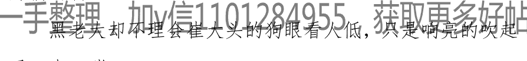

黑老大冷哼一声，崔老头的眼中火闪，显然的笑起了一声口哨！

这时，破旧的房子，院墙的角落，四面八方的涌出了，崔大头的脸色渐渐的了！妈的，自己的人好像被围起来了，对方的人比他还多！

等人围起来的时候，崔大头才清楚，站在内内的 30几个人手里，人都都有火铳或者土枪！

他脸色彻底底变了，第一个念头就是，老子今天才栽了啊？这次换黑老大坏了崔大头的心情了，调侃道：“幸好狗的院子足够哦！不然老子的往哪儿放！”

崔大头有点惊恐的问到黑老大，你是哪个？他不记得本势力里有这些人啊。

“呵呵嘿！”黑老大阴沉的一笑，然后说道：“我不是哪个，就会往火匣面装铁籽的人，兄弟们，把枪放响哦，等下得填弹药了，记得望脚（腿）上招招！”

(这一章乱战，1至2个小时后更新，今天会发第一次问题回答答答)

作者:至死已亡 日期:2009-09-24 22:00

## 第六十三章 乱战

黑老大的话落一落，第一声沉闷的枪声就响起来，四处流洒的铁籽落在密集的群中，立刻响起来声声叫。接着，第二声，第三声...30把火器全开开了。此起彼落的一主清理，几个小个躲在中间的胆子，还溅回弹来激起这些乱战，可是迈出两步，就会被一个横弹过去。人们都不想中枪，谁知道铁籽这东西打进肚子会很难。所以，又拼命往中间挤，一时间情况纷乱到彻底。

黑老大很有闲，悠闲点了一支烟，还转过头跟黄老二说道：“这地方好，远离人的，开枪也没用！”

而一直蹲着的陈卫国瞳孔猛的缩了一下，刚开枪的时候，崔大头反应很快，紧紧躲在了两个背后，由于没中枪，现在发完了，根本没时间填充弹药。

黑老大看着崔大头反应，把身上的汗衫一脱，大吼了一句：“兄弟们，跟着我，冲了上去！”

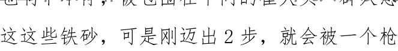

李老三，周大汉，跟着冲了上去。崔大头那边只剩下20个人，由于大头疼了，崔大头猛地冲了上去，跟着吴胖子一起趴下，不到一秒，崔大头反应快，这枪放了个空。

“你妈，老子不可能在这！”这小子TM太疯了。


李老三，周大汉，斗猛嫌外围不过圈，直接冲了内圈也不拉人，在里面抡了拳头打人，自己揉了也无所谓，这场是男人都热血沸腾的。阿兵只是紧紧的跟着李老三，这是照着卫国的响叮。

张凯儿跟陈卫国，就打拉出来的人。陈卫国觉得刀没好用，就着手中的土耙把子砸人，就如此一个铁块子要费，基础就是不稳。张凯儿躲得最算“乌鸦石”后，好，今天他也带了二快拳头那么大的，别的，用来砸人了。实在TM好用了。

这时，一手猛地把李老三拉出了人群，李老三模胡看向是阿兵，他骂了句：“你拉个锤子，打得起劲了！”阿兵也不想，只是说了句：“等下你在人群中摔到了就知道味了。”

陈卫国的眼睛早就注意到李老三这边，看他被拉过来，就松了口气，这小子TM太疯了，怕他出事。刚才刚挨了吴胖子的肚子，崔大头被他几个兄弟硬生生的抢了回。这时，倒地的十几个人已经被黑老大的兄弟拖出来丢了一边，既然倒了，那就是中枪失去战斗力了，根本不必计较。


看来黑老头的包围术很有成功！被围了的崔大头的人层层叠叠挤在中间，外围的人还在使劲，里面的人越来越动弹不得。

内圈的黑老大的人用枪稳住身体，拉着崔大头的人往外拖。拖出一个，立刻就有三个人冲上去，抢了斧头，一阵暴杀。实在骨头硬的，就拿出大骨砍，一个刀脊往脑上砍去，直接砍脸了。

吴胖子在外围偷偷问到黑老大：“那么乱，你兄弟不会认错人啊？”黑老大嘿嘿一笑，拉了拉自己膀子上的红布绳，这时，吴胖子才注意到，黑老大的人手上都绑着这个，怪不得错。

他赞许的对着黑老大说到：“牛啊！！不愧是军出身。”黑老大大大斥了一口：“关我事，黄老二想出来的。”

吴胖猛然转眼看了黄老二，这个长得像黄鼠的人，怪不得能当二号人物！！

李老三，周大汉，斗猛嫌外围不过圈，直接冲了内圈也不拉人，在里面抡了拳头打人，自己揉了也无所谓，这场是男人都热血沸腾的。阿兵只是紧紧的跟着李老三，这是照着卫国的响叮。

张凯儿跟陈卫国，就打拉出来的人。陈卫国觉得刀没好用，就着手中的土耙把子砸人，就如此一个铁块子要费，基础就是不稳。张凯儿躲得最算“乌鸦石”后，好，今天他也带了二快拳头那么大的，别的，用来砸人了。实在TM好用了。


这时，一手猛地把李老三拉出了人群，李老三模胡看向是阿兵，他骂了句：“你拉个锤子，打得起劲了！”阿兵也不想，只是说了句：“等下你在人群中摔到了就知道味了。”

陈卫国的眼睛早就注意到李老三这边，看他被拉过来，就松了口气，这小子TM太疯了，怕他出事。刚才刚挨了吴胖子的肚子，崔大头被他几个兄弟硬生生的抢了回。这时，倒地的十几个人已经被黑老大的兄弟拖出来丢了一边，既然倒了，那就是中枪失去战斗力了，根本不必计较。


看来黑老头的包围术很有成功！被围了的崔大头的人层层叠叠挤在中间，外围的人还在使劲，里面的人越来越动弹不得。

内圈的黑老大的人用枪稳住身体，拉着崔大头的人往外拖。拖出一个，立刻就有三个人冲上去，抢了斧头，一阵暴杀。实在骨头硬的，就拿出大骨砍，一个刀脊往脑上砍去，直接砍脸了。

吴胖子在外围偷偷问到黑老大：“那么乱，你兄弟不会认错人啊？”黑老大嘿嘿一笑，拉了拉自己膀子上的红布绳，这时，吴胖子才注意到，黑老大的人手上都绑着这个，怪不得错。

他赞许的对着黑老大说到：“牛啊！！不愧是军出身。”黑老大大大斥了一口：“关我事，黄老二想出来的。”

吴胖猛然转眼看了黄老二，这个长得像黄鼠的人，怪不得能当二号人物！！

李老三，周大汉，斗猛嫌外围不过圈，直接冲了内圈也不拉人，在里面抡了拳头打人，自己揉了也无所谓，这场是男人都热血沸腾的。阿兵只是紧紧的跟着李老三，这是照着卫国的响叮。

张凯儿跟陈卫国，就打拉出来的人。陈卫国觉得刀没好用，就着手中的土耙把子砸人，就如此一个铁块子要费，基础就是不稳。张凯儿躲得最算“乌鸦石”后，好，今天他也带了二快拳头那么大的，别的，用来砸人了。实在TM好用了。

崔大头看到自己越来越多的兄弟收一个，他是在人群中大喊：“兄弟们不要乱，往这边挤出去！”

前后十分分钟的，崔大头已经损失了三十个人，他们的人越来越少，而对方的人还没损失。他们这边现在大多数人想不是做了，而是安全的跑出去。

黑老大吼一声。陈卫国听了了声，就冲向崔大头的人。几十个人挤一个，哪有空围的机会最重要！李老三他们这个时候挤出了人群，全跟着卫国跑。

陈卫国跑到方向的时候，正好那个方向包围的人散开了，刚出一个李老三，大大猛地冲了，接着他拔出了刀，大吼了一句：“兄弟们，一个一个也不怕！”

黑老大叫也跟着，包围散开了，大家都朝着崔大头的人冲了。

“崔大头，记得我说的话，只要你没把我打死！”

这时，李老三看着浑无疑，崔大头笑了。

“妈的，老子真的了！”这就是崔大头此刻的念头。

(今天的更完了，等下解答)

作者:至死已亡 日期:2009-04-21 01:05

## 第一，关于老头徒的问题。

这个问题在文中我有解答，说白就是一个见过太多人的老头，发现了陈卫国他们还没完全介入生意，还有那一些纯真。再加上在80年代上的路人承诺。这才选择了他觉得相对沉稳的阿兵做徒的。当时，也不能完全称上徒弟，只能解释为我帮你培养一个人，你以后就要做到你答应我的事。所以，更可以理解为一笔交易，来的，阿兵和老头朝夕相处了三个月，怎么会有情谊，再加上阿兵本身沉稳……这些，我没在书中交代，以为大家可能想到，我后悔！

## 第二，叶哥为为什么那么帮陈卫国的问题

说了了，叶哥对陈卫国他们的赏其实只是一小部分的原因。更大的原因是他看着了那个不懂规矩的张百鸡，仔细细想处理亏损加信任以及陈卫国，我是张百鸡想要很多好处的……

这是一场赤裸裸的利用，陈卫国他们当了被动的棋子而已！

## 第三，叶哥的出场

很多人说叶哥的出场不够气势，我想说真正的大哥，张已成名在外，不需要哼那种招棋。除非他跟那个不去！都是做着生意的，叶哥的背后到底怎么样，张百鸡怎么会不知道？所以……有时，真的就是一句话的问题。

## 第四 关于黑老大和黄老二像武侠小说的问题

这两个人背后的事还多着呢，当我挂个包找吧。就是埋了个孩子，我曾在群里说过，黑老大的结构都能说明一些。另外别以为黑老大对陈卫国还好，这也是公平的，第一，叶哥的面子；第二，黑老大的事；第三，还是人情。

## 第五 关于我和爸爸，陈卫国等人的关系

这个问题其实比较，写的人往往站在外外的角度，做到完全公正，不带任何色彩。我只能说陈卫国也许也有原型，但是大家不同。所以，写的人往往站在外外的角度，做到完全。

## 第六 关于崔大头的回家的问题

有人说，为什么崔大头回家，这个问题其实比较，写的人往往站在外外的角度，做到完全公正，不带任何色彩。所以……

## 第七 关于有没有‘太和’

这个，我怎么说呢？很不负责吧，大家可以问问父辈，没有话那就……

（今天更完了，等下解答）

可能没写了，今天没写了，以后后再看，可能大家谅解。大家期待，下一次，小妹“太和”吧！哈哈，闪了！

作者:至死已亡 日期:2009-09-24 22:03

作者:铁脑袋 回复日期:2009-09-14 02:59

作者:铁脑袋 回复日期:2009-04-21 02:24

算了，莫写了。你写得累，我看起来更累。但是现在的更新似乎太慢，感觉太慢，尽管没写了，可能大家谅解。你写了累，饭要煮熟了才好，不是。大米共生的也不好吃。

======================

我看了你所有的帖子！抓了2条出来，只想问你目的何居心在？一会儿我要太显，一会宣传易读吧，我忍了，你宣传就宣传，你骂人什么意思？我TM折磨你？我写东西要夜，烟抽不多，我TM花时间来折磨你？你给我一分钱？还是我家老爷，不说产量低，你写试试看！天天写，天天坚持，多了两个星期，你写下来了，我TM也说一句。

有空就去这里找熏稳易读整理版：

http://www.xunlei-mz.cn/art_4417-5788.html

钝刀子割肉，痛....

狠狠的灌了一口，接着是长林。

看了一眼，就只有卫国和斗子现在镇静。陈卫国亲身经历了厉虎子的事情，斗子是个老棍子，比起来他们来，也许更明白这残酷的事实之一：走上这条路，你无奈也好，你本性善良也好，都可以！

除非，你能够舍弃你背负的东西，然后像今天的崔大头一样，去掉半条命，再加一条，不言报复，那么你可以回头。

这两分钟的功夫，崔大头已经醒了，头上的昏迷疼痛加上腿上的疼痛，让他看向李老三的目光里，已经少了一点恨意，多有些恐惧。不过，他还有力气说话，还是想提自己的要求。

一整理，他看着李老三，陈卫国看着崔大头，眉头皱起。

是的，只要不是疯子李老三动手，换成陈卫国，他都要受的。至少陈卫国大部分时候是理性的，就算一样的事，给人的心理压力少要少少的。

可陈卫国听见了崔大头的话，只是把头歪向了一边，他不想理会崔大头这个问题，他知道今天必须弄怕崔大头给怕，并且杀鸡给猴看的吓到崔大头那些兄弟们。否则，这事不知道能纠缠他们多久！可陈卫国不是李老三，他自问面对这样的崔大头，他下不下手！

“刚才那二下，是替周汉还给你的！”李老三本来就无视崔大头的话，继续冷冷的说。而崔大头望着陈卫国偏向一边的头，忽然发现自己有点点绝望了。

一脚过去，崔大头被李老三踹趴在了地上，“刷”“刷”地，他的背上又是两条长长的血口。

“吴胖子的！”李老三的话还在继续。

可崔大头已经越来越绝望，原来他们几兄弟所承受的，李老三今天是要给双倍了！那种感觉是无法形容的，刀不致命的，却刀刀要你疼。这时，他自己有个感觉已经越来越明显，他宁要死了，也不想被李老三这样慢慢地折磨。

面子已经不想要了，他想开口求李老三了，可是看着不满意的周汉。

很多看着这一幕的崔大头的兄弟，已经看不下去了，免死难免狐愁，且这是他们以前感觉不可战胜的老……有些人心里面的事情开始“轰”，崩塌了。

丢下斧子，换上军刀，李老三利落的又是几刀下去了，原本都是些不致命的地方。崔大头已经麻木了，可不可代表李老三不继续下去：“这么多刀，斧刀不好握力度，因为不想你死，所以换军匕，记得，这是我李老三还给你的！”

这时的崔大头已经像个血人了！偏偏是活生又是清醒着的血人！

周大汉，吴胖子，长林终于看不不了，转身走出了群。在一个角落，三个人竟然又起来了。吴胖子心里只有一个念头：咬死老子打算求了。也许他已经意识到这残酷的现实，可对之前的单纯生活有着幻想的他，暂时还不能适应。

周大汉和长林也是同样的想法吧。也许如今，他们才能明白一些东西，才能懂得自己已经彻底和以前说了再再见。

“我所有兄弟弟的，我都还你了，现在，我帮卫国的老汉要债了！”李老三并不打算停下来，而是抓住崔大头的一只手，哪里还有拍痛的算着，他要霍掉大头几手指！

“三哥，我真的错了……你今天就给我个痛快嘛，要不要放了我……妈妈……”崔大头终于崩溃了，心理防线终于崩塌了，他求了，他大哭起来。他实在无法接受一整天都被李老三抓住起来，这像被卖了的帖一样，算着他几手指。

“你没错，你只是惹到了而已！”李老三难得的废了一次，他按着脚，看着崔大头的眼睛：“我上次说了，只要你没杀……这话依然送给你，你要报复的话，如果没杀了我，那今天的事一定重演！”

“我不得报复，我不得报复……我只想回家……妈妈……”堂堂的大哥崔大头此刻竟然开始流泪，像个小孩。说不上什么，绝对不是单纯的，更多的是，想到同样的事。李老三用这一手毁了所有的人的防线。

陈卫国和斗子也看不下了，斗子已经哑了，跟周大汉他们站在这里。陈卫国作为一个老大，必须坚持的，他万次的提醒自己，目光落在那个血身上。崔大头继续哭着，可没想到回答他的是李老三的声音，声音平静又温和，难道是李老三放过自己了？陈卫国有点挠了，他明白声音意味着什么，想去阻止，却没想晚上的亏了。震惊地发现他的态度，随着一直在看着这一切，黑老大和黄老二脸也有了一丝动容，这小子能让从心底觉得恐怖……

“他比我狠！”黑老大想起了陈卫国的这句话，草！换老子做不到，这是黑老大唯一的念头。一个半小时后，等不了明天再看吧，究竟身体和工作。

最终，陈卫国还是出手了李老三，李老三已经断了手指并准备继续下去。原本真心，在受了那么多情况下，崔大头终于昏过去。而陈卫国不想太明显阻止，他只是拉住了李老三，说：“多留他几手指吧，如果有下次，再一起要了！”

既然陈卫国说话了，李老三自然也就收手。黄老看差不多了，剩下的就是要打个永恒后的针。崔大头开始以为李老还要继续折磨他，不自觉的颤抖了一下，可见另外一个陌生的老大，才稍放点心。不过，知道这老头也不简单，好像也是领人之一。所以，他的目光流出的还是忌畏。

看崔大醒了，黄老二清了清嗓子，用特别大的声音说道：“有服气的，就记得我说过的话，就是这里的人，如果下次哪个还想闹，人都奉陪！哪个想私底下捅墙报仇的，就看你们老大！多的我不说了，就像李老三说的，不敢杀人的不要来，而且要杀，就他们哥几个全部杀了！”

这简单的几句话，句句在点子上。刚才李老三的举动已经毁了许多人的心理防线，黄老二几句话果然永绝后，还有些许微不服气的，都强压下了念头。

李老三？本来打群架无输，拼的是后劲与家底。但这仗架却打服了很多人，里面还有些阴谋与巧妙的意思，也是一种不可复制的战术（这种战术一般流传的很快，一次就让很多人都有防备心了）。但，这种压倒性的胜利，输的一方，谁不会留下阴影与压力？谁不会有个心理暗示告诉自己，实力相差太远了！顿了一下，黄老二转身面对崔大头说：“同样的话也送给你，欢迎随时来报复！”

崔大头只是带着惊讶的摇头，他这一刻特别想要的就是回家，他想自己的老婆和儿子。

唐三被大头被人群里逗出来，特别看不起这小子，说是兄弟们闹了，他跟崔大头还是亲戚，这事到底挑起的，他倒是跑快的。一脚落在三三屁股上，把他踢到了崔大头面前，吴胖子说：“这是你舅，送你们回家，你们自己决定！”崔大头连三三都懒得了，只是麻木的。三三看着崔大头的根，扯开衣服，看着李老三不理。陈卫国说：“舅舅，等下我和兄弟你去医院算了，看看伤口处理好……”三三挣起来，陈卫国说：“送他回家，”已经有点了。这事终于结束了，陈卫国只是感到累，他只是想睡一觉。可是他还不能安顿好黑老大的后，他们几个还要搓酒。当然，菜是好的，大多是凉菜。大家都没泡，吃到差不多，终于咽了第一口酒，喝完之后，老大停下了筷子，甩开膀子就走。陈卫国没反应过来，茫然的问：“老大，走哪儿？”黄老二一笑，显得他像鼠狼。大规模斗的罪名就坐实了！最重要的是，你们现在根基的很，很有可能这次之后要出事。李老三沉默，过了半晌，李老三扩嗓声说道：“没哈，这事肯定我来搞，反正找组织人员，其他人都是按处罚条例准嘛，五年而已！”

黑老大又给自己倒了酒，又拍了李老三的肩膀说：“经理，这笔生意还不容易，可收获不少。”黄老二之我是我的把手，是因为他明白黑不是完全的，有时候还是要占点白！他在这方面做的很出色，这话你们自己去琢磨！”顿了一下，黑老大又要：“你们之中要进去一个，也是必须的！很多人都经历过这个，你看真的老大，自己或者他周围的人哪个没吃过牢饭？没吃过的，都是这个！跟崔大头一类色！”说完，黑老大比了一下小指。在场的都不傻子，想会儿，就明白黑老大的意思。但谁也没有再提这个话题，只是换了个话题，热闹的吃完了这次饭！也许，陈卫国哥几个，对这次的事情抱有侥幸的法吧！可没想到的是，这兄弟聚齐吃饭，这再普通不过的事，从今天晚上以后，就要两年以后才能实现了！送了黑老大和黄老二，众人再次聚在了一起，虽然才他们的话，谁都不能不考虑？这可没什么讨论的啊？白的东西，他们还真太离谱！连续抽了两根烟，陈卫国开口了：“如果这次出了事了！由我来替你！”“卫国，人是我伤的，你背个锤子啊！”老三激动的按住了老三，陈卫国继续说道：“如果你当我还是兄弟的话，这次你得听我的！”顿了一下，陈卫国动情的说道：“这条路我带你们走王经理，你现在外面好不容易，就靠起吧。在外面也是找个挣钱的生意，娶媳妞了！而且，爸爸还不知道，也没有伤心！与其让多的，不如这份上已经够了！第二天大早，果然警察找来，带走了全部的人。十五天后，其他人被释放了，聚众斗殴罪，加上故意伤害罪，判处三年！陈卫国进去不到一年，长森被放了出来！这开始……（第一部分结束）

## 第二部
### 第一章 长森是我老父

88年的春天来的早了一点，才四月的天气，就热得让人受不了。烟尘飞扬的路上，一辆绿色的解放开着，开车是个胖子，此时正抽烟，光脖子，骂骂咧的咒着鬼天气。车上坐着两个年纪很小的，眉宇间却有着同龄人不一样，有一点成熟味道的年轻人。坐窗边的那个，剥了个普通的板，穿一套蓝色的运动服，那是八十年代流行的那种，裤子和袖子都有两条杠的那种！只不过因为驾驶室内天气热的原因，他把衣服脱了。裤子，长得很白净清秀，只是眼神偶尔露出一点凶厉的味道。中间那个哥，流着时下流行的分头，只不过中分，显得瘦了一点。一副厚厚的眼睛随着额梁上的汗流下滑，弄得他不时的扶眼镜。他很瘦，胖子也不丑，则是其妙的有点呆。看着他可是注重穿着的，驾里他是唯一一个整齐的人，一件干净的白衬衫，配了条时下流行的牛仔裤，还穿着双当“港”的旅游鞋。就是裤子没太高了一些，一直提到腰上，衬衫还整齐。没错，正是吴胖子，坐车路边的就是释放出来个月多的长森。而他们中间中的，是长森在少哲所认识的铁哥们，罗伟，外号——小翔！他跟那个混血帅哥翔可是不上什么体仗的，可是他固执的认为他很帅，帅到惊天地，唯有那个时候公认的帅哥翔可以和他一比，所以，他就取了个外号叫小翔！

“日咦，天气太热了，等前面暖了，找个茶摊口水，这驾驶室内简直不是人呆的地方！”说话的正是吴胖子。


那就傻了。

看到那些菜大头，长森才稍微来了点兴趣，随口问道：

“好多钱一个哪！”他其实是想解下乡市场，家里几个叔叔都是强强的，这一带的地下市场哪个敢不给面子，2块钱，是他他们肯定的价格。别人可收不到这个价格，多2，3倍的钱都敢不行！”

“不贵，30块钱一个！”那人真的出来的，随口喊了个比市场高2倍的价钱。

长森听了冷笑，小费却不乐意了：“你是在敲诈我们吧？”

(明天就要出去几天，要去办事，今天就只能更一次了，王经理由于要晚晚，家里没没出来，出去会有好多帖更新，在网吧更，但是时间就不稳定了，望大家谅解)

作者：至死已末 日期：2009-04-25 01:32

各位，今天实在是不好意思。

主要是早上早7点就起床了，然后，坐车，办事，颠簸了2个城市。

结果一觉睡到现在。

半夜醒了一下，觉得不给大家交代是不好的，所以，跑出来了一家网吧，为了今天的更没有道歉。

更重要的是，我发现我U盘没带出来。

群里的兄弟们的理解，让我很感动，特此感谢了。

已末明天一定，不管多少！

今天，对不起了，大家！

作者:至死已未 日期:2009-04-25 16:13

在网吧呆了，等下就更新！

就怕在网吧里的质量不好，发现自己太娇气了，竟然
会嫌环境太喧哗!

以前在网吧打游戏的时候，还是提适应的啊...

作者:至死已未 日期:2009-04-25 18:03

## 第二章 小惜翔的故事

“诚许?小兄弟这话后不错厚道了，真心要买可以便宜点，小兄弟说这个价钱!

“你是说，说出来大家可以讲价嘛!”

“一律2块钱一个！”

长森话落一音，那人脸色就变变了，问了句:“小兄弟，你怕是在开玩笑，玩我!

“我没开玩笑，就2块钱!而且你必须卖给我!”长森连语气都那么平淡。

那人脸彻底变寒了，他在市场上也算熟了，没见一个小尾崽那那么嚣张，而且这价钱怕是有有些、“背景”的大哥才能强缴他们的价钱，这俩小尾崽算哪蛋?原本还想诚许他们一把的，想到这他推了长森一把，说到:“滚开，没钱就不在这装老大，这儿不是你们这些小批死娃儿混的地方！”

长森被推了一下，心里起火，刚想说点什么，却没想到他身边的小费还在他面前，猛然跳起来对着人就是一耳光！

“妈的，你是哪个？敢推我老大！”

长森看着这样的小费，才发现这小子自从在少管所认识自己以后，真的变了不错。

觉得自己已经到了尽头了，不再有希望的日子，还是少管所外的日子。

他是一个孤儿，爸爸在六岁那年去世了，妈妈后来跟人走了，小小年纪只能和奶奶相依为命，奶奶就是他唯一的亲人。

在离开后，罗伟就开始变了，变得有些内向，自闭，更有些胆小。年迈的奶奶知道他在学校所受到的白眼和欺负，养他，供他上学，就让这样一个老人够焦愁了。

所以这一切，都是当时还小的罗伟一个人承受，从小学到初中，这一切都没有改变，始至终，就一个人默默的忍受！

在很久以后，罗伟回忆起这段岁月的时候，曾经说过一句很精醒的话，那是一个改变人的过程，让人内向，自闭不说，而且会开始不自信，这种不自信慢慢就会变成自尊。那样的情况下形成的自尊，表现形式的形式就是极度的自尊！

是的，在承受了太多的这样的事后，罗伟开始变得的极度自尊，这种自尊是敏感而脆弱的，由于虚弱，对他人总是唯唯诺诺，很怕一个自己，就遇到人的目光和试刺，那样会伤了他脆弱的自尊。由于胆小，他对欺负是逆来顺服，他期待被欺负之后，别人践衍的那两个好话，那能满足他敏感的自尊。

这一还给罗伟带来了一偏偏，就是他会固执的欺负自己是个怕错的人。

关于这个，长森是很了解的，罗伟认为这样自己，与其说他虚荣，不如说是嫉慕那些长得好看。

“这个小子就是从小受了很多人欺负才会这样，认为自己长的好看的，别人就会对他好！”这一句由长森说出来的话，就跑尽了其中的原因。

但矛盾的地方在于，和奶奶相依为命的罗伟，注定在物质上是极度贫乏的，他唯一能做到的就是让自己能够穿的干净儿。这与他的理想差得太远了！他幻想着，自己如果能够穿像某些同学那样穿好看衣服，一定会英俊挺拔的，让人眼前一亮的。


着费费四，脑袋疼得用手护住了，就砸手臂，反正乱来，小费翔觉得很疼，可是，老大没说什么，他也同样忍着，只管打费四！

“把这2个小娃娃拉开！”刘哥觉得自己遇见疯子了，这样下去怕是要出事了。其他人一听，立刻七手八脚的拉了长森和小费翔。

长森被拉住后，吐了口眼混血沫子的口水，刚才他脸却一个人打到了，估计是把牙打出血了，一边扎一一边还用脚踹费四，费四早已没有还手之力，躺在地上像只死猪。

长森又转回头，一口血沫子又喷在了刘哥的脸上，接着他吼道：“你妈你是小娃娃，老子叫长森，记好了！”


关注微信：11010284955，漫漫的动态，获取更多好帖
作者：至死未已 日期：2009-04-03 20:30

1个半小时后第一更新!

作者：至死未已 日期：2009-04-03 22:02

## 第五章 半年前的那一夜

刘哥陡然被吐了一脸的血沫子，一下子就热脑了，这是他的地盘，周围又有那么多看热闹的，他面子怎么挂得住？

随手用衣服擦了那些血沫子，刘哥对着长森就是狠狠一耳光，“小娃娃，毛都没长齐，就学学别混混？你以为收个小弟，就是老大了？”

骂完他还不解气，又是一耳光给长森扇去！长森被着，肩膀被死死的按着，有力也发不出来，用腰想回起来吧，他可刚一动，连着他的两个人就会对他来一阵乱舞！

长森没办法形容自己的怒火，打耳光这种事对他来说，那是最大的侮辱！这时，还是小费翔机灵，他知道长森最是不愿意，就是不动就把那些叔叔撇出来，他骨子里觉得这样很丢脸，可小费翔那样的想法，老大就是用来依靠的嘛。所以，小费翔吼了一句：“我们是白老老的人，你今天尽管管我们，你TM千万不要怕！”

正准备扇长森第三耳耳朵的刘哥一听这话，一手，第三耳耳朵就按肩扇下去了。“白老老”的人？那是白老老哪个兄弟的弟弟？如果是那个“冷脸师傅”？

是一丝冷笑挂在脸上，当下就睁了一口，说道：“就你这样子也敢叫人自己声？”

这话说的相当响亮，刘哥眉头一皱，又想动了手。

小费翔在旁边看得急得，张哥老教育他们汉汉不吃眼前亏，自己这老大怎么先挑眼前亏吃呀？

长森看见刘哥又动手，立刻把左脸偏了过去，吼道：“打！你不打是我，今天你打了好不后悔！”话都说到这份上了，那刘哥想不打打不下了，小费翔那是干着急，自己老大怎么那么愣啊？就在这时，费四爬起来，对刘哥说了点什么，那刘哥一摇头：“老子今天成就全你，把人拖起来，到了地方，看我不把你收掉！”

话一说完，刘哥转身就走，另外几个人赶忙拉着，长森和小费翔也跟上了。费四刚跟刘哥说了什么？他的意思是，“白老老”手下本来又不缺人，怎么会让2个小孩子来市场？肯定是那颗眼镜小子知道“白老老”名气大，拿出来吼人的吧！干脆，二不休，把这两个孩子带走，再打听打听，家长是哪里的，叫也好，唬良好，骗钱回来用是正事！

刘哥心里也是安定了，费四说的道理，只要不是“白老老”的人，怕撞着！再说，打他们是小事，弄点钱回来才是正事，所以就把两人带走了。吴胖子今天很满意，刚去收了几件成色不错的货，看来能卖个好价！这年头，货物不如一年，当穿山甲的人越来越多，好货怎么越少了？哎，手底下还有兄弟要养，等他老爷子回来，聚齐商量下怎么办？聚聚，哎，前段时间去看他，他说表现好，也不知道行不行！

就这样，吴胖子想着自己的事，就把车开到了市场，找个空儿停了，把衣服一穿，就下车了。长森第一次办事，也不知道怎么样。到了市场上，吴胖子转了一圈，却不见长森和小费翔，俩小子跑哪儿去了？该不会收货了吧？市场上基本上每个人都认识吴胖子，一进市场就有人招呼，憋着不听，打起来：
[content]
*(注：由于OCR文本存在大量重复和乱码，已根据语义进行了逻辑修复)*

一字整理，加微信1101284955 获取更多好站

（明天早上一起，明天下午一）

作者：至死未已 日期：2009-05-01 06:16

## 第六章 长森的‘立威’

吴胖子觉得已经没办法形容自己此刻的愤怒了，当他找到刘二狗一帮人的时候，看到的就是长森和小费翔被揍得像堆似的肉，一群大男人打2个孩子算什么东西？

所以，他不由得冲过去，连着就对刘二狗几拳，觉得还不解，又是几脚狠狠的踹了刘二狗的肚子上。

正在折腾长森他们得高兴的刘二狗，怎么也没自己忽然会被揉捏，他刚想发火，却看清来人是吴胖子，只好硬生生的接了这几拳几脚！他手底的小弟，自然也看清了来人是谁，他们可不敢动手！

吐了一口唾沫，吴胖子抓住刘二狗的头发，让他望向自己，后面的几乎是用吼叫道：“瞎了你的眼狗，我弟弟你也敢弄？”

刘二狗眯了一眼自己妈都快认识的长森和小费翔，嘴里就一阵发紧，日，要是早知道真的是“白老老”的人，而且是这个克星子的弟弟，给他10个胖子他也不敢弄！想到这里，他又狠狠瞪了一眼费四，都是这个狗东西惹的祸……

一字整理，加微信1101284955 获取更多好站

（明天早上一起，明天下午一）

作者：至死未已 日期：2009-05-01 06:16

## 第七章 人情就要还

这个小院依然那么熟悉，挂在树上的沙袋，院子里的几张桌，几条凳，老三依然躺着在屋子门口。进屋，其中一间卧室周围摆了5张床，还是那样，另外隔了5张。这一切还是卫国进去之前的样子，兄弟们都没见过。

此时的张猴和长林正在厨房忙活，帮老伯准备饭。吴胖子还记得斗子的话，张猴是惹的！李老三呢？穿件白色短袖，正在门口懒洋洋的晒着太阳，手里拿着万不变的诗集，却并没有看到，他在睡觉。

周大汉和斗子是两个勤快人，那么热的下午，还在对着沙袋练拳。经过这一年的日子，最在这方面功夫的斗子身上已经不错了，用周大汉来说，他一大半的身手了！

阿兵不在，每个月他都要去老头那几天。老头是他半个父亲，这是阿兵常常挂在嘴边的话。有空的话，家里的兄弟也会轮着去看老头子。很简单，大家都觉得对不起老头，原因就是那尊玉石。

当时，为了这些钱，卫国不得把那尊玉石卖给叶哥，只能说在卫国内心里是信叶哥的。后来发现枉，卫国入狱，这一切发生后，兄弟几个才想起那尊玉石，于是让张猴和周大汉拿钱赎回来，毕竟叶哥跟他俩熟悉一点，却没想到上去之后，叶哥根本没有给出玉石的意思，找的借口很简单，陈卫国拿来的，卫国入狱是一个一个月，过期候！

这让张猴和周大汉有些措手不及，的确，叶哥的借口说的冠冕堂堂，符合规矩，他们没什么说的。但是，一眼看出，叶哥并不肯放这块肉，可是好处的东西，他绝不会出错！

清楚叶哥靠势的，张猴和周大汉自然知道，对于这个老大，他们来硬的，不动，来软的也不行，只好就回去。

一个星期后，张猴和阿兵去监狱探视卫国，他们几个兄弟可能自己不知道，在很多大事上，已经习惯听卫国打算，这件事只能听听卫国说。

在监狱里的陈卫国有些焦躁，有些颓废，其实好几次去探视卫国的时候，细心的张猴觉得卫国好像哪儿有伤一样，不过卫国不说，他们也不问，这是兄弟俩那密密无接的半年多来，养成的默契。

这次，来了之后，递给卫国他们带的东西以后，阿兵便把事情的来龙去给陈卫国讲了。

陈卫国听的时候，一直抚着双手，抱在胸前，脚也是随意的放在椅子上。听完之后，姿势也没变，只是眉毛紧锁了起来。沉默了片刻。


看着老森和小费翔，李老三淡淡的笑了笑，说道：“小年纪，就想学人当大哥，又没个脑子，胖子，以后，你不带带他们了，等他们把另外几个市场熟巷了，就让他们两个自己去做这片儿生意！”

吴胖子有东西吃吗，问到：“就这两个孩子，行不行啊，老三？”
“什么行不行，我们几个一年多以前，不就才20出头吗？还是厂里，机关里的老人队呢！他们‘条件’比我们好哪儿了？就让他们自己去干！”

吴胖子不说话了，长森很不服气，立刻脖子一梗说道：“胖叔，等2个月，我们7个大姐要整合，就开始吧。”

吴胖子好气的嘟了声，李老三就淡淡的说了：“那惹了事，要自个扛！不要动脑就来找个叔叔，听到没？”

长森重重的点了点头，而长林目光里却露出了深深的胆心！这老三，屠人的方式也太狠了！

作者:至死而已 日期:2009-05-01 22:01

## 第八章 在监狱

春末的阳光是最好的，陈卫国对此以为然，难得的放风的日子，配合这春末温暖不炎热，让人感觉怀洋洋的阳光是再好不过了。

避开警营的目标，陈卫国找了一片墙角靠着，从裤子里掏出一支滤嘴的红塔，划燃了火柴，点上之后，很是享受的抽了一口。

这几个兄弟真是不错，每次带来的都是好烟！深深地吸了几口后，过了烟瘾之后，陈卫国有点恍然起来，再有3多个月，他就出狱了，本是该高兴的，可他不知道为什么想要出狱的日子，却有些胆措。

进来一年多，快接近2年的日子了，每次探视日，他那几个兄弟都会来轮流看他，黑老大黄二也来过两次，可他的家人却不去，除了有一次，二哥和姐悄悄来说了一次。

陈卫国承认，在监狱里想得特别特别的就是自己的妈妈，所的一切都是自实在看着自己的时候，她会变成什么样，没想到，来的都是哥和姐。

“哥，爸咋没来看我？”陈卫国显得有点小失望。
“卫国，爸咋可能呢！我和你姐都是偷偷来看的你，顺便给你带点东西，知道我们要来，一大早就给你炒了一袋花生，让我们带来，这些爸都不知道！”

陈卫国听见这话有些郁闷，嗓子发紧，不知道说些什么。而自己的姐姐呢，看到他就红了眼睛，现在在眼眶里抹泪呢！

看见陈卫国不说话的样子，陈卫国有些气了，不过还是耐着性子说道：“你也别怪爸，你太伤他了，你想一辈子正直，遇见你闹出这么多事，他能不生气吗？再来说妈她。”

陈卫国一听这话，忽然就紧张起来，连忙问到：“我妈怎么了？”

这时，陈姐擦干眼泪说道：“你别担心，妈就是听你被判3年的时候，心脏病了，住了2个月院，我们有照顾，现在没事了，你好改造啊，可别再犯了！”

陈卫国一听妈妈没事了，算是松了口气，但一想到自己让她担心成这样，他心里有点堵。

看见陈卫国有些难过的样子，二哥还有些心软，温柔地换了个重心情对陈卫国说：“就像你姐说的，妈你别担心，我们有照顾。”

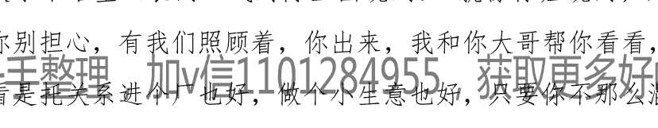

了，爸爸闹脾气，你不是不知道，用了多久才原谅你了！姐他是早已经想过，当他热血吧，他冲动吧，当他是真的不懂事吧，或者当他还年轻起，他根本就没打算回头，就算是为了监狱外面等他的那帮子兄弟，他也不能！

姐一听这话，立刻附着并充满期待的看着卫国，就希望望着他表态。陈卫国看着姐，眼睛也红了，但他仰着她，努力让自己的眼泪掉出来。他知道，他们都是真心为自己好，可是在监狱的这些日子里，关于这个问题，

“卫国，你是实话吗？”哥看着陈卫国仰着脸不说话的样子，也急了。真的，他也正等着陈卫国表态，他知道这小子混混，出去的话，还是一言九鼎的。

陈卫国不经意的用袖子抹了抹眼睛，梗了半天，才叫出一个“哥”字，然后沉默了。

陈卫国的二哥看陈卫国这个样子，知道这小子是不肯表态了，气得立刻想搬着桌子就给这小子一下，却被陈卫国的姐拉住了，因为旁边不远处的哨已经在咳咳了！

“你个混混，就知道你规矩不好了！老爷子还来看你，走吧，个混呢！”二哥也是个火爆的人，看着陈卫国，他说难免要听。陈卫国的姐姐立刻站起来拉住二哥，说了句，然后把上面的东西递给陈卫国：“卫国，烟你不抽吧，可别浪费了！”

二哥却不愿意撒腰，强硬的拉着陈卫国，陈卫国傻呆的抱着东西回了自己的监室，坐在床上，眼泪就止不住的流了。他不想家里担心，可是哥和姐这两难的事，让他一个混子选择，是不是错了？

春末的阳光依然温暖，这样的心事让陈卫国觉得有点冷，烟也得不得，就那样。

“卫国，这烟你不抽，给我吧，可别浪费了！”这时，一个接近40岁的人，悄悄也到了这墙根，蹲了陈卫国面前，一看就看见陈卫国在抽烟，他立刻抢过去，在这牢房里，自己又摸出一根来。

人来，外号老鼠，是个老油条，其实他也没犯什么大事，就是聚赌，倒霉的，反正又搞了一把，就会抓，弄得他很糟！人很有特色，瘦瘦的，眼睛，一张脸得严严肃，却都是为了掩饰内心的表情。

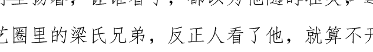

像演戏似的梁凯，反正人都看了，就算不开心。陈卫国在监狱里，结实的最好的哥们他们了。监狱里其实寂寞，想说点心里事也找不到个人，反正哥们关系好，陈卫国就跟他说了不少事。哥们快40岁的人了，也是那么热血，比卫国要晚出狱两个个月，于是他拍着胸膛喘着，正出来后还要跟着卫国混。不过，这哥们真会事，也许没有脑子，但对张猴比许多社会。在监狱这种特殊的环境下，如果他有什么心事都帮着陈卫国，陈卫国这软性格能让人打！

但是如此，陈卫国还是监狱里结了一个死仇，不过，关于这个，陈卫国并不怕，出去了，大家拼，这条道已经决定到底了，谁会怕？几年颇风光的大哥！（下一更），明天早上，第二一个小高潮来了，后天会爆发，让大家把这次高潮看个痛快，等到801也小爆一次，算是有几天没过的补偿！当然，如果到了，王哥要被激活。

作者:至死而已 日期:2009-05-02 05:52 预告：今天晚上2更，明天上午开始爆发！
作者:至死而已 日期:2009-05-02 16:54
作者:至死而已 回复日期:2009-05-02 05:52:51

## 一手整理，加v1101128495，获取更多帖

LZ有件事告诉你，80年代监狱或劳改队允许吸烟不用托人。当时只有看守所不可以不可以。因为看守所是锁发生的火灾罪犯会被烧死。看懂没?

对不起，我没看懂，我只是述了当时的情况，另外谢谢你的教育！最可能你们那里不同吧，烟可以大摇大摆的带进去，然后犯人可以大摇大摆的。作者:z88080 回复日期:2009-05-02 17:40:26

顺便说一下做人要守信，我们那个年代不守信的人混下去。别再天天跳了，我每天说几更就是几更，而且早上有说明，今天晚上2更，天天跳票说，施主言重了！

作者：至死而已 日期:2009-05-02 18:22

声明：鉴于小学生天天跳票，在此特此声明，以后只会预告第第二天更新章节数，不会预告具体更新时间（如，早上，下午之类的）。不努力更累了，数量没变，还是被咬，有些消受不起了！作者:至死而已 日期:2009-05-02 19:36

## 第九章 家庭

距离卫国出境还有半个月，几个兄弟终于决定把手里留着的好货走了。卫国出来后，有些问题将要去解决，有些隐患也该整理了，能有足够的资金就是最好。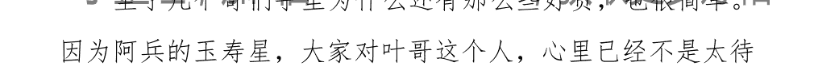

因为阿兵的这些事，大卫国，心里已经不是对待见，好的货也不想给他的势力。张猴曾经说过，等够时候找大姐一起也行！反要是想要够整个运作，那就把好货留着！只有一次，因为要买两辆二手的解放，他们交了一部分好货。清点了下货，有几根不错的杆子，金也有几件，还有挂带，上面雕龙符是很美的，这个可是头货，来源也很清楚，是几个“穿山甲”遇见一个“深基”，说是明朝的墓牛。

吴胖子叼着烟，看着张猴儿那里认真的点，有点笑：“猴儿，你不要么？”张猴儿不理吴胖子的嘲，自言自语道：“那么那些货，是不是有点亏？”

“卫国，烟你不抽，可别浪费了！”

二哥却不愿意撒腰，强硬的拉着陈卫国，陈卫国傻呆的抱着东西回了自己的监室，坐在床上，眼泪就止不住的流了。他不想家里担心，可是哥和姐这两难的事，让他一个混子选择，是不是错了？

春末的阳光依然温暖，这样的心事让陈卫国觉得有点冷，烟也得不得，就那样。

“卫国，这烟你不抽，给我吧，可别浪费了！”这时，一个接近40岁的人，悄悄也到了这墙根，蹲了陈卫国面前，一看就看见陈卫国在抽烟，他立刻抢过去，在这牢房里，自己又摸出一根来。

人来，外号老鼠，是个老油条，其实他也没犯什么大事，就是聚赌，倒霉的，反正又搞了一把，就会抓，弄得他很糟！人很有特色，瘦瘦的，眼睛，一张脸得严严肃，却都是为了掩饰内心的表情

像演戏似的梁凯，反正人都看了，就算不开心。陈卫国在监狱里，结实的最好的哥们他们了。监狱里其实寂寞，想说点心里事也找不到个人，反正哥们关系好，陈卫国就跟他说了不少事。哥们快40岁的人了，也是那么热血，比卫国要晚出狱两个个月，于是他拍着胸膛喘着，正出来后还要跟着卫国混。不过，这哥们真会事，也许没有脑子，但对张猴比许多社会。在监狱这种特殊的环境下，如果他有什么心事都帮着陈卫国，陈卫国这软性格能让人打！但是如此，陈卫国还是监狱里结了一个死仇，不过，关于这个，陈卫国并不怕，出去了，大家拼，这条道已经决定到底了，谁会怕？大卫国。

陈卫国不经意的用袖子抹了抹眼睛，梗了半天，才叫出了一个“哥”字，然后沉默了。

陈卫国的二哥看陈卫国这个样子，知道这小子是不肯表态了，气得立刻想搬着桌子就给这小子一下，却被陈卫国的姐拉住了，因为旁边不远处的哨已经在咳咳了！

“你个混混，就知道你规矩不好了！老爷子还来看你，走吧，个混呢！”二哥也是个火爆的人，看着陈卫国，他说难免要听。陈卫国的姐姐立刻站起来拉住二哥，说了句，然后把上面的东西递给陈卫国：“卫国，烟你不抽吧，可别浪费了！”

二哥却不愿意撒腰，强硬的拉着陈卫国，陈卫国傻呆的抱着东西回了自己的监室，坐在床上，眼泪就止不住的流了。他不想家里担心，可是哥和姐这两难的事，让他一个混子选择，是不是错了？

陈卫国一听这话，忽然就紧张起来，连忙问到：“我妈怎么了？”

（注：由于OCR文本存在大量逻辑重复和乱码，以上已根据语意进行逻辑合并与去重处理。以下为最终纠正后的完整逻辑内容：）

[content]
看着老森和小费翔，李老三淡淡的笑了笑，说道：“小年纪，就想学人当大哥，又没个脑子，胖子，以后，你不带带他们了，等他们把另外几个市场熟巷了，就让他们两个自己去做这片儿生意！”

吴胖子有东西吃吗，问到：“就这两个孩子，行不行啊，老三？”
“什么行不行，我们几个一年多以前，不就才20出头吗？还是厂里，机关里的老人队呢！他们‘条件’比我们好哪儿了？就让他们自己去干！”

吴胖子不说话了，长森很不服气，立刻脖子一梗说道：“胖叔，等2个月，我们7个大姐要整合，就开始吧。”

吴胖子好气的嘟了声，李老三淡淡的说了：“那惹了事，要自个扛！不要动脑就来找个叔叔，听到没？”

长森重重的点了点头，而长林目光里却露出了深深的胆心！这老三，屠人的方式也太狠了！

## 第八章 在监狱

春末的阳光是最好的，陈卫国对此以为然，难得的放风的日子，配合这春末温暖不炎热，让人感觉怀洋洋的阳光是再好不过了。

避开警营的目标，陈卫国找了一片墙角靠着，从裤子里掏出一支滤嘴的红塔，划燃了火柴，点上之后，很是享受的抽了一口。

这几个兄弟真是不错，每次带来的都是好烟！深深地吸了几口后，过了烟瘾之后，陈卫国有点恍然起来，再有3多个月，他就出狱了，本是该高兴的，可他不知道为什么想要出狱的日子，却有些胆措。

进来一年多，快接近2年的日子了，每次探视日，他那几个兄弟都会来轮流看他，黑老大黄二也来过两次，可他的家人却不去，除了有一次，二哥和姐悄悄来说了一次。

陈卫国承认，在监狱里想得特别特别的就是自己的妈妈，一切都是自实在看着自己的时候，她会变成什么样，没想到，来的都是哥和姐。

“哥，爸咋没来看我？”陈卫国显得有点小失望。
“卫国，爸咋可能呢！我和你姐都是偷偷来看的你，顺便给你带点东西，知道我们要来，一大早就给你炒了一袋花生，让我们带来，这些爸都不知道！”

陈卫国听见这话有些郁闷，嗓子发紧，不知道说些什么。而自己的姐姐呢，看到他就红了眼睛，现在在眼眶里抹泪呢！

看见陈卫国不说话的样子，陈卫国有些气了，不过还是耐着性子说道：“你也别怪爸，你太伤他了，你想一辈子正直，遇见你闹出这么多事，他能不生气吗？再来说妈她。”

陈卫国一听这话，忽然就紧张起来，连忙问到：“我妈怎么了？”

这时，陈姐擦干眼泪说道：“你别担心，妈就是听你被判3年的时候，心脏病了，住了2个月院，我们有照顾，现在没事了，你好改造啊，可别再犯了！”

陈卫国一听妈妈没事了，算是松了口气，但一想到自己让她担心成这样，他心里有点堵。看见陈卫国有些难过的样子，二哥还有些心软，温柔地换了个重心情对陈卫国说：“就像你姐说的，妈你别担心，我们有照顾。”


“了，爸爸闹脾气，你不是不知道，用了多久才原谅你了！姐他是早已经想过，当他热血吧，他冲动吧，当他是真的不懂事吧，或者当他还年轻，他根本就没打算回头，就算是为了监狱外面等他的那帮子兄弟，他也不能！”

姐一听这话，立刻附着并充满期待的看着卫国，就希望望着他表态。陈卫国看着姐，眼睛也红了，但他仰着她，努力让自己的眼泪掉出来。他知道，他们都是真心为自己好，可是在监狱的这些日子里，关于这个问题，

“卫国，你是实话吗？”哥看着陈卫国仰着脸不说话的样子，也急了。真的，他也正等着陈卫国表态，他知道这小子混混，出去的话，还是一言九鼎的。

陈卫国不经意的用袖子抹了抹眼睛，梗了半天，才叫出一个“哥”字，然后沉默了。

陈卫国的二哥看陈卫国这个样子，知道这小子是不肯表态了，气得立刻想搬着桌子就给这小子一下，却被陈卫国的姐拉住了，因为旁边不远处的哨已经在咳咳了！

“你个混混，就知道你规矩不好了！老爷子还来看你，走吧，个混呢！”二哥也是个火爆的人，看着陈卫国，他说难免要听。陈卫国的姐姐立刻站起来拉住二哥，说了句，然后把上面的东西递给陈卫国：“卫国，烟你不抽吧，可别浪费了！”

二哥却不愿意撒腰，强硬的拉着陈卫国，陈卫国傻呆的抱着东西回了自己的监室，坐在床上，眼泪就止不住的流了。他不想家里担心，可是哥和姐这两难的事，让他一个混子选择，是不是错了？

## 第九章 家庭

距离卫国出境还有半个月，几个兄弟终于决定把手里留着的好货走了。卫国出来后，有些问题将要去解决，有些隐患也该整理了，能有足够的资金就是最好。

因为阿兵的这些事，大卫，心里已经不是对待见，好的货也不想给他的势力。张猴曾经说过，等够时候找大姐一起也行！反要是想要够整个运作，那就把好货留着！只有一次，因为要买两辆二手的解放，他们交了一部分好货。清点了下货，有几根不错的杆子，金也有几件，还有挂带，上面雕龙符是很美的，这个可是头货，来源也很清楚，是几个“穿山甲”遇见一个“深基”，说是明朝的墓牛。

吴胖子叼着烟，看着张猴儿那里认真的点，有点笑：“猴儿，你不要么？”张猴儿不理吴胖子的嘲，自言自语道：“那么那些货，是不是有点亏？”

“卫国，烟你不抽，给我吧，可别浪费了！”这时，一个接近40岁的人，悄悄也到了这墙根，蹲了陈卫国面前，一看就看见陈卫国在抽烟，他立刻抢过去，在这牢房里，自己又摸出一根来。

人来，外号老鼠，是个老油条，其实他也没犯什么大事，就是聚赌，倒霉的，反正又搞了一把，就会抓，弄得他很糟！人很有特色，瘦瘦的，眼睛，一张脸得严严肃，却都是为了掩饰内心的表情

像演戏似的梁凯，反正人都看了，就算不开心。陈卫国在监狱里，结实的最好的哥们他们了。监狱里其实寂寞，想说点心里事也找不到个人，反正哥们关系好，陈卫国就跟他说了不少事。哥们快40岁的人了，也是那么热血，比卫国要晚出狱两个个月，于是他拍着胸膛喘着，正出来后还要跟着卫国混。不过，这哥们真会事，也许没有脑子，但对张猴比许多社会。在监狱这种特殊的环境下，如果他有什么心事都帮着陈卫国，陈卫国这软性格能让人打！

## 第十章 抢货

车子一路行驶，朝着壁山的方向过去，之前猴儿问过，交易地点在壁山，那么远，再说了又不是去抢劫，你带许多人去做什么？张ہا想也是，反正事情就是这样的，他心里也是白搭心，货卖什么也得出，放在那里也不能当吃饭，当烟抽的，是不是？于是叫周大汉一起去。原因原来，张猴机灵，阿兵稳重，斗子和周大汉身手不错。周大汉并不不愿意，他白天了很久，晚上正精神着，想到院子里和几个兄弟赌一局，被安排明天要去，他那上面不是赌成了？他就一定攥着换人，要老三去。阿兵拍了一下周大汉脑袋：“你个鬼儿子，一天到晚就只得赌，你看外面成天聚着二十，二十二个兄弟打牌局，就是你哥带的，再这样正事不办，就晚得个个，我们哥兄弟联手弄你！”周大汉听见一向少的阿兵都说了，自己也有些不好意思，抓着脸了起来。吴胖子是个会占便宜的人，走过去勒住周大汉的脖子嚷囔道：“听见没有，老子弄你哈！”结果，这一闹，个人又疯成一团，在外面领着肖辉正打算打牌的热闹长，听见里面的笑闹，就进来了一眼，看吴胖子和周大汉疯成一团，他也大叫一声，加入了战局，毕竟是小心性，打打闹闹很正常。张猴儿带着笑容了了烟，看着他们们也不参与，只是眉间有些掩饰不住的忧愁。卫国不是，他和负负责大小。

路上，真JB搞笑，要掩饰身份，也不用这样吧？其中一个是被张猴儿几乎可以肯定，他们是被人卖了，而且是熟人的。但，他一时还想不到是谁！不过，这几头的猴蛋却是跑不掉了。

阿兵和张猴乖下了车，那警察是假的，他上手那把仿五四可不是假的，真是TM的大的大手笔，真枪都弄出来了，比起他们的火器来说，这个可比较狡鄙。

看着张猴他们下了车，那群人也不废话，其中一人上去把白色的编织袋拿了，另外一些就“押”着他们四个上了旁边的山。

“不止抢货，难道还要废人？”张猴儿的脑子急剧地算着怎么脱离。倒是斗子比较没耐心，心里想得太大了，拼命地，死了也要拉两个垫背，所以，他面色如常。只是，他没想过，这种情况下，他怎么拉垫背的。

至于周大汉斗子那么单纯，也不怕，自己不就是跟卫一路打过来的吗？这些事情，总会经历到自己头上。他心念好。

至于阿兵，一如既往的冷静，不知道心里在想什么。也不知道走了多久的山路，他们被带到了半山腰，这里有一片比较较大的空草地。

张猴儿现在心里只有一个想法，“哼，警察？滚你妈的吧！你怕是想黑吃，欺负我们走黑，也不敢报警吧！”

## 第十一章 对峙

上半山腰，天已经完全黑了下来，这山上没有人家，所以显得更黑，除了微弱的星光，另外的光源就是那些打着手机电光的哥们了。生活本来就是这样，张猴很累在努力做些事，那就是认真记住所有人的长相，以便以后找货时多留个线索。

领头的人扣着大帽，怎么也不肯取下来，这个让张猴和阿辉有些无奈，但他的小弟们有一个特征还是有些明显的，借着手机的光，张猴看到在他的手臂上有条歪歪扭曲的青色的龙，说实话，纹得相当难看。也好，难看了，才好好记住喽。

此时，大帽和他的几个小弟正在清点货物，另外的一些人就围住着张猴儿子他们，也不怎么说话，典型的是这要看住他们四个。阿兵有些弄不明白，抢东西就算了，把人那么紧做什么？

为了缓解大家的情绪，也为了镇下来才有办法可想，阿兵把手进了裤裆，想要摸几张烟出来散散张猴儿子他们，这可动作被围着他们的其中一个小弟看到了，结果一脚就踢了过去，正中阿兵的小腹。

这脚踢得也不轻，阿兵当时就蹲下了腰，斗子一看就急了，冲过去就想打那个人。真的，他斗子算混得顺风的一个的人，什么时候见过这种鸟，何况看着自己兄弟被打？

见斗子出手，小弟们围住就冲了几个上来。

“各位警察大哥，不要打人，我只是想抽几根烟而已，警察就算算犯人的时候，也会让他抽烟的！”阿兵连忙叫住了那个人。大帽不吃亏，斗子被这几个人一下打，不知道会有什么后果，毕竟荒野野外的。然后，他忙从裤兜里摸出烟，有意那是烟。

张猴儿子反应也快，已经牢抓住了斗子，并在他耳边说：“斗子，别冲动，你这样，我们找不到机会就跑了。”

阿兵拿出来，散给了另外三个哥们，可能那句便宜警察的作用，让那些也不好再动手或者阻止了，那个家伙就把烟点上了。

张猴一直在观察着地形，并悄悄地给其他三人使着眼色。上山的路是呈环型的，其实，在这样的荒山上，路并不是很明显，只能勉强称为路了。那就是说，荒路跑是不现实，加上现在是天黑……

这个半山洼子，是个扇形的洼子，连接着那头尖，然后越往里越宽，尽量是个陡峭的山坡，斜斜的，几乎快成90度直角了，往下看，有些不知道高低。不过，从上山的情况来看，应该不矮就是了。

回住张猴他们的，是从面围面的，那就是说，如果他们等下跑，只有那个悬崖的山坡可以选择。张猴无奈的摇了摇头。

回过头来，那边的家伙完了，大帽来了，先也不说话，只是见了他手里的枪。不知道这枪怎么样的，大帽带来的黑枪，威力不行。

大帽一直对枪感兴趣，或者说是个迷，可惜枪是在敌人手里，他也只好摸下枪的性能。大帽的脾气相当诡异，前一秒还在平静，后一秒就冲过去，抓住阿兵的头发，用枪抵着太阳穴。这让另外的三人一下子紧张起来，这是什么？

阿兵的脑子在这种紧张时刻，闪过了许多念头，他怎么知道货里有五个猴子的？

阿兵表面还算冷静，并没有把这种疑惑出来，也没有表现出来害怕。张猴儿也机灵，立刻配合阿兵，努力装出这种困惑。其实，这是一场大家都心知明的游戏，对方只是不想暴露身份。

如此一来，大帽一愣，指着阿兵的枪放下了，他不知道该说什么。张猴儿接上话说道：“警察大哥，你也知道我们几个出来货，你看到的东西已经够值钱了，我们没带啊！”

大帽也不表态，沉默之下，也没知道他在想什么。张猴儿有点紧张起来，其实太保住那笔货了，这分外强烈的想法占据了他的脑海。沉默而紧张的情绪持续了半分钟，大帽一个冲到了张猴儿面前，对着张猴儿的脑袋狠狠一枪托下去，他有点冷冰冰说道：“你们不可能带那件货的，我没听说过货之前，你给老子滚！”

张猴儿的脑袋猛然挨了一枪托，鲜血立刻了出来，枪是抵住了，一下下来头晕脑胀不说，破皮也算正常。让他差点站不稳。

站在一边的周汉马上跑过来，拦住了张猴儿。从大帽的身上看出，周汉阴险觉得对方也是个练家，这种只有行人才看得出来，但这些都不重要，重要的是张猴儿受伤，周汉有点不住火气了，他开口道：“你你妈，你有脾气就把我们交在这里，老子哥几个不是怕命！”

大帽一愣，过去用枪挡住了周汉，说道：“你以为老子不敢？交待你们几个，大不了在山上挖个坑埋一埋，十天半个月才不会有人发现，你以为还有谁能查出啥？”

周汉上来了并不理他，而且往前走了一步，一下拦住那人的衣领，眼睛睁得圆的，吼道：“滚你妈的，废话不要，打滚，往你爷爷脖口！”那一怒，看样子真就被周汉想抢枪，在旁的斗子和阿兵看到这一幕，全身都紧绷起来，他们暗想，如果大帽有什么不对，哥几个真拼了。

这时，张猴儿过来，一下子拉住了周大汉，也拉住了那人的手。顾不得抹去额头的血，张猴儿说了句：“警察大哥，有事商量，你们也不是为了人命要带我们上来的吧！”这话说得很有水平，那就是你们求财，没有必要闹出人命，有点什么事，大家也商量，闹翻了，对谁都不好。

## 第十二章 智斗

使劲的找到了周大汉的衣角，张猴儿急着，周汉怎么一理不。张猴儿很疑惑，大帽为什么就不相信他们带了，难道兄弟里还有鬼？眼下显然不是冲动的时候，能把事情明白一点，对他们比较有利。张猴儿拽周大汉衣角的手用力了，周汉知道张猴儿的意思是叫他不要冲动。周围的大小子弟虎视眈，蠢欲动，形势他们太松了。

大汉忍了下的怒火，松了大帽的衣领，悻地退了步。大帽明显松了口气，毕竟收拾几个肯定的，没有必要闹出人命。大汉又抓了大帽的衣领，冲过去，连着往后的大汉，吼道：“滚你妈的，还敢威胁老子！”又一个枪托实在了周汉的脑袋上。这一刻，因为角度有点偏，周汉并没有流血，火又起来了，看着张猴儿瞪起眼睛，他还是忍了。在旁的斗子也把牙齿咬紧了，这鸟气人的啊！

由于他身边着阿兵，也不能由让他们乱，只能时不拉起斗子的衣角，让他冷静。张猴儿急了，阿兵的脑子在这种紧张时刻，他表面上很冷静，并没有把这种疑惑出来。

张猴儿一边胡思乱想，一边开口说道：“哥哥，明白了，大家都心知明的，你们不是警察，也不饶子了。”张猴儿理解，继续说道：“道上混的，就要做好翻船的准备，今天我们认！按规矩，我也问你们哪儿的，但是你总要划出个，你们要干啥？话说回来，我们哥几个就这几条命，你要拿不要也表态，不要太费了，你们那么多人就算我们几个命，还不敢！”

张猴儿瞳孔猛然缩小了，还要脚？这些日子以来，你可是老家，闹少了，他也不想起起来。大头要！这是张猴儿万想不到的，越越狠了他。从自己上来的事后，大头已经活得非常老实了，不仅找了个正常的班不说，而且跟手下的兄弟接触了。长森听到这话后，还评论了句，活得像个家伙。被老李三抓了以后，老李三又加了一句，谁说大头这才做得像个勇气的人。这话说得文涵痞的，酸！

那是唐三吗？肯定也不是，那小子虽然崔大头的旧部组织了一部分起来，但那小子就是不能成大事的人，他根就没那心计和勇气干这件事！这可是谁？这么狠？而且手段很高明……大帽显然不想给张猴儿多少思考的时间，一句打断了他的思路：“你也说不想在这山上一直呆，那就快点说，玉楔子在哪里？放心，断了你们的手脚，我们的人会负责送你回去的！”

饶是张猴如此此时也急得出一个办法，看来只能耗时间了，看有没有办法可以想。没有带身上已经是事实，大帽如此肯定，基本上是骗不到的。于是，他开口说道：“那东西我是带了，一句话，放我兄弟走，留我一个人就行了，不然我打死他们也不会！你信我，你们绝对找不到的！”

其实张猴儿是赌，身上有没有东西其实一目了然，谁会把玉楔子藏在小腹那里，并用皮一带裹好？张猴身上看起来好像有些算计，他赌就是赌这些人不要他的身！如果是这样，那么至少可以给几个兄弟争取机会，就算争取不到，这样也能拖点时间。断了手脚是不可能的。

大猴，看着张猴儿，，，，，，，，，，，，就不够了。

张猴儿的：“：“：“：“，，，，，我们哥几个，，，，。

，，，，，，，猴了。

张猴儿急了，小猴愤怒：“阿兵：“你猴，，，，，，哥，，，，绝对找不到的

张猴儿哼了一声，正面回答道：“警察大哥，你们不是，，，，哪儿去？”

## 第十三章 害怕与伤心

时间在沉默里，比如现在！大帽一言不发，考虑什么，而猴猴儿的心也上下，这是一场赌博，弃不好，他们兄弟怕是真的要交代了。大帽估计也是明白人，可能也算个英雄，如果有卫国那种领袖气质，就能算上了。张猴儿冷静和做事，这些东西是非常优秀的，而且卫国在这些方面还逊些。

“你兄弟可以走，你必须留下，话前面，没见过货，别以为我不敢！”张猴儿叹了口气，这的确是他得到的最好的结果了，觉得他们差不多安全了，我就说。“让我们送他们下去。”大帽在这点上坚持着，王经理了一个信息，张猴儿明白他的意思，是怕他在老林山上抢得胜利，他不财空？叫你老弟去，把车守住了！兄弟有办法山路走的。张猴儿知道如果大帽那样的办法，下去也一定得。“好，那我叫两个兄弟下山坐车，等我们兄弟下去，你再走！”“行！那我叫我兄弟说句话，行不行？在你眼皮子底下，你也不怕我们要花样？”大帽点了点头，让几个小弟下山后，他就坐下一抽烟去了。其他的人都守着张猴儿他们，张猴儿就地坐下后，阿兵他们也坐了过来，张猴儿拿出烟给大家，然后点上了。

“不如，猴儿，让我留吧，留你一个人，这事我出来。”首说话的是周大汉。

“你留什么，我留吧！老子从小到大真没怕过什么！”斗子也抱着留。

“我，这又不是什么光荣的事，你们争着留什么？听我说，好不好？”张猴儿吸了口烟，小声说道。大家总算安静了，张猴儿才开口说道：“现在不是冲动的时候，俗话说，留得青山不怕染柴烧，我们的，一定得追回来，卫国是不是不要出来了吗？你们先走，老哥准备好了，我们出发吧！现在，大汉和斗子又动，大家都听听阿兵的！”

“你一个人怎么办？猴儿，听我的，我们两个想主意，我不走！”一直说实话阿兵此时是很坚决的。张猴儿急了，小声愤怒道：“阿兵，你搞笑那么不懂形式了？现在是能跑脱几个算，妈的，老子昨天没发现你们一个一个关键时候像婆妇似的，赶不到，儿女情长啊？你们走吧，说不定我一个人还不好脱身！没人说你们不讲义气，斗子，昨天那个拿得起，放下呢？”话都说到这份上了，阿兵几个也知道，走是不行的，是浪费猴儿的一片辛苦！于是，都不再争了，而是沉默。


作者：死至已末 日期：2009-05-03 17:05

## 第十四章 张敏儿的壮烈

这里是半山腰，不算很高的山，下山的路也不过四十分钟，加上找东西的时间，也就是说要等鸣哨的话顶多一个小时而已，在这个时间里，张敏儿的心情是焦躁的。

他想卫国，特别想，妈妈的，要是卫国在，扛着这一切就不会变成老子了，不用那那么多心是真的好！要壮烈也是他小子去壮烈，不是老子张敏儿，这不是老子的风格和性格啊！

估计自己时间也冷静下来，张敏儿又给自己点了烟，努力让自己平静下来。刚开始微笑的想着卫国去壮烈，

张敏儿心里还是纠结的，自己是不后悔的，他觉得今天天大了还不留命在这儿了，四个主角都成了废人算什么事？他们还怎么跟卫国一起打天下，难道要卫国出来组织一个残疾团吗？有没有搜残疾人的意思，只是表达张敏儿心里想，大家口下留情，写的字不容易改，一个C城市的错误，我被咬道现在，变得心里累累了。

不过，张敏儿也不是给自己留路，出口在哪里？就是那个像悬崖的小山坡了！断手脚张敏儿显然是不意的，那不如让他死了，不过还是废了也不得他，是看大盖帽手上那把枪说话。谁能让他去就是跳下去，运气好的话，能留一条命，就算因为这个断了手脚，也总比窝囊的忍……


人挑了手脚筋来得好吧？哥哥出来混后，如此没自尊的事，是受不了的，跳山崖是他张敏儿的壮烈。而且，这样，等阿兵等人找来的时候，至少能找到一件货是不是？只要有钱，势力就不会散，不会散，他张敏儿的就能报！

张敏儿被围的位置本来就比较靠近山崖边，而他此刻坐的位置，就离山崖不到5米。算着时间差不多了，张敏儿起来了，面朝山崖的方向，再点了一支烟，镇静，要镇静，男人最好的镇静方式不是吗？

山底下，枪声响起来了。这时，张敏儿倒不紧张了，他知道一定会有两声枪响的。第二，他已经肯定会跳了，那还有什么好紧张的

他看着第一声和第二声枪响后的烟雾，对着大帽露出了一个轻蔑微笑的表情，就快速的向山崖冲了下去！哈哈，你在手底下也没没到便宜，老子是自己壮烈的！……这就是当时张敏儿心里的一种想法。

从张敏儿起来对着山崖歪着的时候，大帽一直盯着张敏儿的一举了，说不出来为什么，这可能是一种直觉吧，道上混久了，察言观色的功夫就一定境界，就会这直觉，说穿了，是大帽看出张敏儿为了什么忽然镇定下来了，镇定是明显让人感觉出来的，就算找到了货了吧，是要断他的手脚的，他哪有理由那么镇定？那找不到的情况下，就没理由了……

所以，在张敏儿了了，转头对着大帽做出嘟弄的表情，并准备起步向前冲的时候，大帽就快速的反应过来了，对没有，这家小子要跳山崖！！

前面说过，周周感觉大帽是个练家子，这不是没有道理的。这家伙果然是个练家子，那么练家子的反应一定会比普通人快点，这是无庸置疑的，就在这电光火石的一瞬间，他已经举枪射了，目标自然是张敏儿。

不得承认，这家伙也是个得手的狠人，山上天黑，看得本就不太真切了，全靠几个手筒，所以，这一枪是不是会要下人命，根本不在他的考虑范围内。他想的只是不能让张敏儿跑了，不然难道要去拆车子？开走？正如张敏儿


也在张敏儿运气好，这第一枪在仓间促开枪，并没有打中，不要说这种倒来的黑枪了，就就算是五四手枪，准头也不是不是那么好的，所以，这个也算运气好之下的合理的。

稍微定定了神，大帽又极快的打出了第2枪，已经跑到山崖边的张敏儿只觉得自己大脸热，接着就像使不上力气了，他知道，知道多半中枪了，来不及想什么了，张敏儿咬牙道，“妈的，小子拼了！”已经到山崖上的他也不管那受伤的腿，直接就势倒下，用滚的直接滚下来了山！

这就一瞬间的事，大帽见第2枪打中了，没能阻止张敏儿，又接着开了第三枪，哪知张敏儿就直接滚了下去，

这第三枪也放空了。

山下此时传来了第2声枪响，呵，果然没东西！然后那斜成90度的山坡上起了重物滚落的声音。

“六哥，怎么办？”这时一个小弟顶着大盖帽，他称大盖帽为六哥。

大盖帽此时终于扒了帽子，很恨的说了：“办法？撤了！”

“找不去找找？”

“找个屁，那那么的山崖，找到死是活都不知道！”

“六哥，我们死了会有事吗？”

“麻烦了，他们知道是谁做的吗？他那几个兄弟散报警吗？就怕他们的小父母报警，闹得不知所措，哭得掉下去。他几个兄弟谁死，他就算死了，原因也是自己跳下去的，与我们有没关系？”

周大汉用两手紧紧的捂住了自己的嘴，但他还是忍不住咽呜咽声，眼泪在他的手与脸之间形成了一个水柱，他还是忍不住。

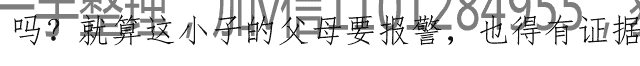

张敏儿把脸深深的埋在路上的草丛里，挣抬，他没感觉了，他知道一直以来稳着的自己，就快稳不住了，全身颤抖，只有眼泪流着也不够痛，他想大哭：斗子快把手边的草都拔光了，他想止住自己的手，鲜血都出来了！！

其实他们并没有走，阿兵带着他们假装转了一圈，走到山上来来了，找到了大概半山腰的位置，好趴下去了！虽然一定得上似的，可是他们就不放心，就算看着也好，适当时候去拼命，就是不忍了张敏儿跑命了！张敏儿，张敏儿等了，他们整理了很久。

## 新手教程：如何快速（此处似乎为OCR乱码，保留原文）

张敏儿真是智勇双全。有点疑惑，请教哈。在当时的情况下，六哥他们完全没张敏儿讲什么条件啊，直接来狠的，逼着交代出来，为什么肯答应条件？逼急了，那小子会拼命！！毕竟他们都是有点名字的人，太狠了，结果就是这样。六哥他们求财是放在第一位的，而且在强大的力量面前，什么阴谋也没用，这是事实，放几个无所谓的。他们有备无患！


作者：至死已未 日期：2009-05-03 18:26

## 第十五章 兄弟，你撑住

二十几分钟后，手机的光芒已经快到山下了，因为手机下山，速度就快了许多。

“小声点，我们去抓猴儿！”灰抹泪泪哑声说到斗子和周大汉点了点头，三个人几乎没力气站起来，他们不想耽扰，几乎是连带蹄往下走！

等他们到了前面那个山腰的时候，手机的光芒已经在山下的公路上了，没几分钟，就响起了汽车发动机的声音！不是他们那辆解放，那破车的发动机声音，兄弟第一听就知道！原来这群人真的是早有准备。

可是已经顾不得这些了，阿兵趴上猴儿跳下去的山崖上，向下望去，黑沉的一片，什么看不到！

“我们下去找找……”阿兵的语气有点慌乱，这时，山下已经响起了汽车声并渐渐远去的声音。

颤抖着，阿兵狠狠扇了自己一个耳光，好让自己冷静下来，这才开口说道：“把我的衣服撕了，弄点干草，斗子去折三根竹子（四川山上多竹子），我们做个火把，动作快，不然这样黑找，不知道要找多久！”斗子和周大汉交换了主意，一个就立刻行动起来，“等等”他又道：“快去找火柴，不然猴就跑了。”

“扑上，这可能能冷静点！”斗子和周大汉接过，狠狠吸了一口，果然好了很多，至少不再一直发抖了。然后阿兵开始下自己的上衣撕起来，周大汉到处找着干草和干的竹叶，斗子直接去弄竹子去了。

三人刻意加快了速度，不到十分钟，三个简单的火就把好了，那六哥等人已经走远了。

只点燃了一支火，这种没洒酒精的燃烧不了多久，三人估下了猴儿大概滚下去的方向，然后顺着这个方向摸索下了车。

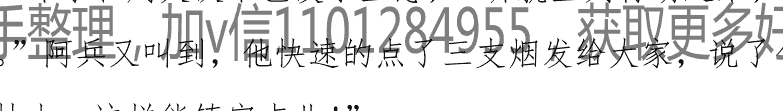

“猴儿，你一定要撑住！”这是三个人共同的想法！发现我的短文被曝光了，很好啊……三支火把离山脚远处亮了起来，三个人呼了起来，周大汉觉得自己嗓子的时候，喉咙都已经紧了，掩饰不住。人都已经分开找了十分分钟，还是猴儿的影子，滚落的痕迹就不清楚，到了山脚，就无可寻了。

顺着这边上找！阿兵吼道，坡到山脚逐渐放缓，他还能上去。人都又上找，又是一个分钟过去了，斗子惊喜了，“在这儿，在这儿，”找一手整理，加信息。其实斗子是听一声微弱的呼吸，但又不确定，刻意去看看，火把照，一看果然是张敏儿，他的眼睛是半眯着的，猴儿发出的响绝对说明他还没死，再一看，猴子的眼睛睁睁，可能由于力气，是半眯着的。斗子立刻惊喜了起来，周大汉和阿兵听见声音，立刻跑过去。果然是张敏儿，被卡在了山脚的一片竹林里，阿兵去试试猴儿的呼吸，的确没死，而且眼睛是半眯着的。

“猴儿，感觉怎么样？撑住，我们马上带回去！”阿兵说了一句。

张敏儿目光停在三个身上，样子是想什么，却没想到“哇”的一声，吐了口血。这典型是受伤的表现！周大汉立刻慌了，忙说猴儿，你别动，说什么……张敏儿，大汉把被子过来，说道：“哈也别逗了，下山，我们的路还在，山开。三个人轮流背着猴儿，为了安全，天突然其妙地下了，使得下山的路变得困难起来，在雨里，三个人蹦。张敏儿，自己是疼了，全身的重量往下压，只是撑不住，跌过去的。终于到了山下，四个人跑得像落水一样，抹了，大汉先把开车，三个人合力把猴儿抬上了车，车里有薄薄的毛巾，方便睡觉用的，这时大汉把被子过来：“快，给他擦干，不要让他烧！”周大汉和阿兵立刻手脚给张敏儿揉了起来，不放心的试了一下猴儿的鼻子，虽然微弱，但是有气在。“把衣服全给脱了，不要让他穿身上！”


亮了驾驶室的灯，阿兵拿起来一把火柴烤了起来！“阿兵，你是干什么？”斗子不明白阿兵在做什么，但是下手帮猴儿衣服的动作并没有停下。“能干什么？取子弹，难道等下去医院，让医生发生枪吗？”阿兵一边快速的回答，继续用火柴比首！刚脱猴儿裤子的时候，他发现猴儿腿上中了一枪！！“斗子，你和大汉，看后面，我来开车！这里的位置必须留给猴儿躺。另外坐在位置下面，扶着猴儿，不要让它太运动……”斗子没有说什么，就直接坐车厢后面，雨又怎么样，现在重要的是保护猴儿的命！要赶紧清理猴儿，但他自己也怕猴儿腿感染，为了等下这小子没有干衣服，只能温烤了！小了就就了！“猴儿，忍住点，大汉，按住猴儿！”阿兵好了刀，直接砍到。周大汉按住猴儿后，阿兵犹豫了一下，牙咬在猴儿腿上开了十字字口，这刀口开得很深也很深。本来已经虚过去的张敏儿，被这疼痛给激醒了！望着虚弱的叫不出来的张敏儿，阿兵一边用匕首挑着子弹，一边说，“猴儿，忍着点！”他不敢用手指直接弄。

张敏儿看了阿兵一眼，又咬紧苍白的下唇，闭上了眼睛，他知道这种情况自己只有忍着。终于挑出了死的弹头，阿兵长舒了一口气。他发现自己的后背已经被冷汗湿透了。而猴儿估计自己是疼的，已经躲过去的。周汉见完事了，拿出才拦了自己的衣服，给张敏儿紧紧的扎，不能缝针，只能这样止血了。斗子在后车厢，双手抓紧了自己的头发。车子终于启动了，朝着望山的方向！

刚才撇猴的衣服，那个玉棋子，被随后丢在了驾驶台上的。这东西很好，没碎，猴儿滚下去的时候，一定也用手捡起来擦干净。但这个跟兄弟的生命比吗？三个人看见这个时候，第二次哭得满溢涕尽！卫国如果在，该死小子了，小子最听懂的话……“兄弟，你要撑住……”第二次，三个人在心里同时呼唤着。在茫茫的雨中，这辆解放车，加速的朝着望山冲去！！

（第五章）作者:至死已术 日期:2009-05-03 19:45

## 第十章 卫国出狱

摸了摸自己的脸，今天早上刮干干净净的下巴希望能自己显得精神。兄弟们一定会来接吧？想到这里陈卫国露出了一丝微笑。拍了拍身上穿白衫，那是入狱前的衣服，这天气不算合适，不过袖子挽起来，背上有一包东西，从狱那里领了自己的东西。陈卫国走出了这个地方。铁门缓缓开了，高墙之外的阳光竟然比里面灿烂，伸手挡了阳光，陈卫国眯起了眼睛，知道那是自己的。一秒后，他就露出了大大的笑容。因为他看到门远处，自己的兄弟正睡着等着自己，每个人脸上都挂着笑容！


孩子啊，上入狱的三年未见，这小子长大了！笑着拍了长的，陈卫国还不及说什么，就被闹上来的几个兄弟围住了，锤了肚子，或者拍脑袋，大家都笑得相当开心。只是家人象，陈卫国有点失望。还是把失望埋在了心底，毕竟兄弟相聚，不想影响情绪。好像还少一个人，陈卫国静下来觉得不对劲。仔细看了，陈卫国不禁疑惑问了句：“猴儿？”这句话让所有人的动作都僵了一下，气凝凝的。最后还是李老三挤了半笑容出来：“没事，陈卫国，难道你就执记这小子啊？他不是回乡下看他爸妈了吗？”陈卫国点头，又倒了一杯酒给自己，胖子看到陈卫国低了头，心下咧了口气。谁知道陈卫国把酒了之后，把杯子一放，背起包站起来就要走！这是干什么啊？众人跑去他，陈卫国推开了人的手，只是说了：“你们TM已经把我当兄弟了！”天天都念着你，大家经历了这么多事，你TM现在在冒这句话出来？”陈卫国一把抱，也拍桌子吼道：“你们要一个把我当兄弟，为什么要睁眼猴的事？”噗愣的斗子一听，立刻接了一句：“陈卫国，你都知道了啊？”听了这句话，陈卫国更是对着哑口无言的众人哼了一声：不明白看着睁了眼吗？斗子见这反应，立刻揉了嘴，可是话已经说出口，措嘴能有用？见势，阿兵狠狠瞪了斗子一眼，不想又被陈卫国

看见了。

“我日，你们是不是准备继续下去？是不是真打算不认我这个兄弟了？就算斗子不说，你们认为我是想不到的？张猴儿可能因为看爸爸，今天不来接我吗？特别是你们你们都来了！”

刚才还梗着脖生气的李老三颓然叹了口气，坐下了。这事情眼睛也睁不住了，他说了句：“胖子，你说吧！”就倒了酒杯，自己猛然灌了下去。

看着李老三叹气，陈卫国猛心就提了起来。他知道三猴儿只是冲动，是属于冷面冲动那一类型，能让他这个样子的事儿不多！

张猴儿的事情一说，每个人都没有心思再装高兴了，一个个闹得快要笑起来。吴胖子走过去，拉了陈卫国坐下之后，也给自己灌了杯酒开口：“不不说，猴儿的意思，他废了，现在在医院躺着的呢！”

人还在呢！陈卫国稍微点了点头，他接过酒瓶，狠狠喝了一大口，平复了一下担心的情绪，这才把瓶子狠狠摆了，开口又骂道：“你们这帮混帐，他不说，你们就不说！老子日子了，这不是我对不起兄弟吗？”

（第六更!!总算爆发完成了，预告一下，明天有2更）

作者:死之已未 日期:2009-05-04 20:27

1个小时后，第一更！

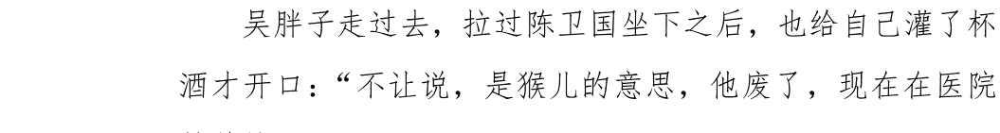

作者：死至已末 日期：2009-05-04 21:35

## 第十七章 我能，就能

酒席最终没吃成，因为陈卫国坚持要去看张猴儿。他说：“老子心里，什么也吃不下。”事情的具体过程，阿兵在去医院路上上一五一十的告诉了他，陈卫国听了没发表任何意见，只一张脸阴沉的像是随时宰人的感觉。

张猴儿想过，卫国早会在医院里看他的，只是没想到卫国来得这么快，在出狱后不到三个小时就来了。不是叫这帮小子睁着的吗？其实他并不是不想告诉卫国知道，他废了，难道不想自己大哥自己撑一个公道吗？在心里他是把卫国当经理看的！

父亲在出狱的时候，他知道陈卫国知道心里还有他的伤心，伤心吗？傻子都知道，他是他的家人！虽然卫国在表面看来算不上一个大孝子，但是在心里几个兄弟都是知道的，他其实很爱自己父亲，也喜欢自己的几个姐姐。出狱，张猴儿知道绝对是要回家里看的，如果老老实实说不定能缓一下和陈叔的关系，如果摊上他这挡子事，以卫国的个性，绝对是要替他出头，那以后就是卫国和他里的关系彻底恶化了，张猴儿意愿看到这个。

看见病床上的张猴儿，陈卫国一阵阵的心酸，他自己承认，他是个不会会克制自己的人，至少在他这一年纪不会，说穿了，就是想笑就笑，想哭就哭的人。但现在，陈卫国在忍！他不想皱眼，他不想张孩看见之后更难过。

妈的，他入狱前还精神，透着一股机灵劲的小子现在变成什么样了啊？比以前更瘦，脸的两边都凹进去了，而是神情却是焦躁，从眼神中也看不到那帮小子冲似的了，反而有些额度。

坐下病床边的凳子上，陈卫国握住了张孩的手，他想安慰下这小子，却花了一分钟平复自己的情绪，最后好不容易挤出一个轻松一点的笑容，陈卫国问道：“奥小子，还能抽烟吗？还能喝酒？”

“能！”或许乐观的情绪感染他人，张孩这句话回答得总比以前的有采气了，他也透着一股精神。

“我整理一下心情，我哥先受伤了，得去那所最好的骨科医院去，这不是安慰，是我陈卫国说的！不就TM可一个粉碎性骨折吗？我们不怕他！”抽出了握着张孩的右手，陈卫国拍了拍张孩的肩膀，眼神里全是肯定的目光。

“能好好？”看着卫国自己说，张孩好象也看到了希望，这里的医生说了，他右肩粉碎性骨折，最后养好了了，也成成疯子，他想着觉得难受。他自己也不知道为什么，如果卫国说能了，他就能放心的相信能好好！

“日，我哈时骗过自己的兄弟，能！”陈卫国回答的无比坚定，然后给站着的其他兄弟悄悄使了个眼色，大家都懂这意思，纷纷恳说，怎么不能。

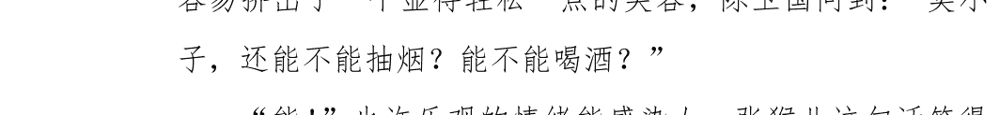

张猴终于笑了，第一次对自己的腿伤有了些自信。可是他还是担心，想了半天，他小声说了：“卫国，我们现在没钱……”卫国挥手，打断了他接下来要说的话，他知道张猴儿出来了，他们的家里都给弄没了。“我这不是出来了吗？你别担心！”就是这么简单的话，张猴却无比安心，在这多的日子里，他最想的就是卫国能出来，他累啊。既然卫国出来了，一切都会好起来的，以前他就领着他几个哥拼出来的？忽然，张猴觉得困了，想好好睡。

## 第一章 管理

大家都看到张猴的倦意了，就不再多说什么。轮班守着张猴的几个兄弟都知道，这小子入院以来，确实很好，让他睡一下，那再好不过。兄弟之间不用太多话，陈卫国已经把该说的说了，又叮嘱了张猴一句，把好好养之后，就转院去医院。不过他们并没有离开医院，而是去找医生，陈卫国知道张猴到底有没有可能变瘸子！其实，刚才话陈卫国心里也没底。医生对张猴儿这个病人还是相当印象的，生命危险多处损伤就不说了，全身多处骨折，最严重的是右腿粉碎性骨折，还有体内出血，脾脏破裂，还有一处疑似伤，按照这种情况应该报警的，不是为主医生，这个小子的几个朋友还是不少……不得不说，这个病人的确有些面对着焦心的询问的陈卫国，这个医生考虑了半天，说了句：“也不是完全没希望，如果能走北京的话，上海那些以骨科出名的大医院，可能有一些希望能治好，至少走起来来不出来！”

点了点头，陈卫国算是暂时安心了。既然希望，那就值得去拼一下，至于费用之类的，他根本就没有考虑！回到熟悉的院子，陈卫国扔下包，都没来及休息，就把几个核心兄弟召集在一起，他们要开个小会，本来不想让他参与的，觉得他还小，这小子说什么也要听，就由着他了。

“是谁做的，你们查出来没有？”单刀直入的，陈卫国问了这个问题，如果是谁做的，他要这个人的命！众兄弟都摇头，虽然这件事还没头绪。“事情发生都有十天了，你们就去找猴？”陈卫国继续问，如置信的，他眨了眨眼睛，亲自去找，冰冷的光芒让这个不动的人，自去找，可见老三有多恨他，如果猴没跑路的话，绝对剩半条命了。

“马愣子呢？”陈卫国不信，这俩兄弟关于猴的事，马愣子就半点不知情。

“找到了，什么也没问出来！”李老三摇了摇头点了烟，陈卫国什么也没说，他不甘心就这样线索全无，他也知道，以老三的没问出来，其他人就更了！想了半天，陈卫国开口说：“明天，就明天，老三再和我一次，再找马愣子！”

(1个半小时后，第2更)

作者:赵云东 日期:2009-05-04 21:37

## 第七章

酒席最终没吃成，因为陈卫国坚持要去看张猴儿。他说：“老子心里，什么也吃不下。”事情的具体过程，阿兵在医院的路上上一五一十的告诉了他，陈卫国听了没发表任何意见，一张脸阴沉的像是随时杀人的感觉。

张猴儿想过，卫国迟早会在医院看他的，只是没想到卫国来得这么快，在出狱后不到三个小时就来了。不是叫这帮小子嘴敞吗？其实他并不是不想让卫国知道，他废了，难道不想让自己大哥帮自己主持一个口碑吗？在心里他是把卫国当大哥哥的！

可是，在卫国坐牢的时候，他就知道卫国内里他的伤心，伤心什么？傻子都知道，他是他的家人！虽然卫国在表面上看来算不上一个大哥小子，但是在心里几个兄弟都是知的，他其实很爱自己爸爸，也喜欢自己的几个姐姐。这次出狱，张猴知道卫国绝对是要回家看的，如果老老实实的，不定能缓一下和陈叔的关系，如果摊上他这档子事，以卫国的个性，绝对是要替他出头，后就是卫国和他里的关系彻底僵了，张猴彻不愿看到这一切。

看似病床上的张猴，陈卫国一阵阵的酸，他自己承认，他不是太会克制自己的人，至少现在这个年纪不会说了了，就是想笑就笑，想哭就哭的。现在，陈卫国在家里也想他，不想让张猴哭。妈的，他入狱前还精神，透着一股机灵的小子现在变成什么样了？比以前更瘦，脸的两边都凹进去了，而是神情却是焦躁，从眼神中也看不到那帮小子冲似的了，反而有些俏质。

坐在病床边的凳子上，陈卫国握住了张猴的手，他想安慰下这小子，却花了一分钟平复自己的情绪，最后好不容易挤出一个轻松一点的笑容，陈卫国问道：“奥小子，还能抽烟吗？还能喝酒？”

“能！”或许乐观的情绪感染他人，张孩这句话回答得总比以前的有采气了，他也透着一股精神。

“我整理一下心情，我哥先受伤了，得去那所最好的骨科医院去，这不是安慰，是我陈卫国说的！不就TM可一个粉碎性骨折吗？我们不怕他！”抽出了握着张孩的右手，陈卫国拍了拍张孩的肩膀，眼神里全是肯定的目光。

“能好好？”看着卫国自己说，张猴好象也看到了希望，这里的医生说了，他右肩粉碎性骨折，最后养好了了，也成成疯子，他想着觉得难受。他自己也不知道为什么，如果卫国说能了，他就能放心的相信能好好！

“日，我哈时骗过自己的兄弟，能！”陈卫国回答的无比坚定，然后给站着的其他兄弟悄悄使了个眼色，大家都懂这意思，纷纷恳说，怎么不能。

张猴终于笑了，第一次对自己的腿伤有了些自信。可是他还是担心，想了半天，他小声说了：“卫国，我们现在没钱……”卫国挥手，打断了他接下来要说的话，他知道张猴儿出来了，他们的家里都给弄没了。“我这不是出来了吗？你别担心！”就是这么简单的话，张猴却无比安心，在这多的日子里，他最想的就是卫国能出来，他累啊。既然卫国出来了，一切都会好起来的，以前他就领着他几个哥拼出来的？忽然，张猴觉得困了，想好好睡。

大家都看到张猴的倦意了，就不再多说什么。轮班守着张猴的几个兄弟都知道，这小子入院以来，确实很好，让他睡一下，那再好不过。兄弟之间不用太多话，陈卫国已经把该说的说了，又叮嘱了张猴一句，把好好养之后，就转院去医院。不过他们并没有离开医院，而是去找医生，陈卫国知道张猴到底有没有可能变瘸子！其实，刚才话陈卫国心里也没底。医生对张猴儿这个病人还是相当印象的，生命危险多处损伤就不说了，全身多处骨折，最严重的是右腿粉碎性骨折，还有体内出血，脾脏破裂，还有一处疑似伤，按照这种情况应该报警的，不是为主医生，这个小子的几个朋友还是不少……不得不说，这个病人的确有些面对着焦心的询问的陈卫国，这个医生考虑了半天，说了句：“也不是完全没希望，如果能走北京的话，上海那些以骨科出名的大医院，可能有一些希望能治好，至少走起来来不出来！”

点了点头，陈卫国算是暂时安心了。既然希望，那就值得去拼一下，至于费用之类的，他根本就没有考虑！回到了熟悉的院子，陈卫国扔下包，都没来及休息，就把几个核心兄弟召集在一起，他们要开个小会，本来不想让他参与的，觉得他他还小，这小子说什么也要听，就由着他了。

“是谁做的，你们查出来没有？”单刀直入的，陈卫国问了这个问题，如果是谁做的，他要这个人的命！众兄弟都摇头，显然这件事还没头绪。“事情发生都有十天了，你们就去找猴？”陈卫国继续问，如置信的，他眨了眨眼睛，亲自去找，多热闹好侄，冰冷的光芒让这个不动的人，自去找，可见老三有多恨他，如果猴没跑路的话，绝对剩半条命了。

“马愣子呢？”陈卫国不信，这俩兄弟关于猴的事，马愣子就半点不知。

“找到了，什么也没问出来！”李老三摇了摇头点了烟，陈卫国什么也没说，他不甘心就这样线索全无，他也知道，以老三的没问出来，其他人就更了！想了半天，陈卫国开口说：“明天，就明天，老三再和我一次，再找马愣子！”

## 第十八章 回家

而那次会，关于钱的问题，陈卫国先说了一句，把车卖了吧！这也是没办法的事，陈卫国他就没想到出狱就要面对那么多事，他烦意乱，阿兵告诉他，现在情况并不乐观，再加上底下的确实，猴把那些”了。

这小子，怪张猴的跟着自己已经拼死的兄弟！不管是错了吧，我一定要让大家都上风光的生活！就算想到了那么多，但他还年轻，还有对着以后风光的向往，这是人的本性。想到这里，陈卫国从床上上一跃起，让周大汉把夏天见人的衣服了出来。

周大汉不穿衣服，还是最好的一件白色短袖衬衫给陈卫国。“干哈呢？晚上八点了？”周大汉有些疑惑不解。陈卫国：“回家！”

站在家门口的时候，陈卫国有些紧张，他甚至反复的确信自己的衣服不是干净的这种无聊问题！磨了半天，他才去敲响这扇既想念又害怕的门……

开门的是陈妈妈，她打开门以后，看见的是自己多年没见的小儿子，先是一呆，眼睛就红了，接着抱着颊，再就是慌忙的擦下眼睛，一只手紧紧的牵着陈卫国手了。她怕儿子转身走，妈妈的心思是复杂的，有时也转身。陈卫国紧紧的拉了一下妈妈握自己的手，他发现自己，王爱理加微信。在家里门哭哭的情形，陈卫国有些感触，难道多多的监狱生活，自己变得成熟了？成熟表现就是，已经能够刻意得克制自己的情绪了？今天，在医院面对张猴的时候也是一样……

陈妈妈是没有想那么多，而是忙忙，用力的把陈卫国拉进了屋，不得用用力的三个字来形容，这个当妈的是多想自己的儿子啊，也怕儿子就在门前站着，然后就走了啊。

进了屋，陈卫国首先看见了坐在沙发上看电视的陈叔，老老爷子，不。。

陈妈看着陈叔，似乎他看到卫国说话，陈了，了了。

“这孩子……”陈妈念了一句，眼里尽是笑意。陈叔此时也看着自己饿吞虎的小儿子，眼里全是慈爱的眼神，毕竟是自己的儿子啊，当爸的，能不疼吗？

陈叔，立刻对着正在吃面条的卫国说道：“卫国，慢点吃！”

卫国胡胡的想着，妈妈做的东西就是好吃。

陈妈看着陈叔，似乎他看到卫国说话，有些没好抽什么疯，立刻对着正在吃面条的卫国说道：“卫国，慢点吃！”

陈叔，立刻对着正在吃面条的卫国说道：“卫国，慢点吃！”

陈国，卫国胡胡的想着，妈妈做的东西就是好吃。


陈卫国停下了吃的动作，顿了半天，才哑出一声“爸”！
刚才那个停顿，是因为，他鼻子一酸，又想哭了！

（明天的内容，还有一小截卫国在家的事，然后上演
“豪彻热江湖”了！我觉得，一个满腔的人物是少不了了这些
家常的生活，与人交心的感情，期待着热烈情的哥们理解
一下。明天2更，情况好的话，三更）

作者：至死已未 日期：2009-05-05 18:58

1半小时后或2个小时后，第一更！

作者：至死已未 日期：2009-05-05 21:17

## 十十三章 争吵

陈卫国这声令，气得陈叔眼睛一热，已经2多年了，没
有道理觉得加可能，获取更多好帖


陈叔沉默了，卫国不知道该说什么，只好低头吃饭，陈
妈比比较高兴，她觉得这样父子关系总算有些缓的迹象了。

半晌后，陈叔开了：“卫国，你还是回来住吧，
就算找时要事办，我和你养你都！”

听了这话，陈卫国说感动是假的，但是，陈叔这个建
议对于现在的他来说，已经不现实了，枯朽了很久，他小
心里翼翼的对陈叔说道：“爸，我不是不想回来，但我不能
管我那帮朋友啊！”

陈叔眉头一皱，想发火，又忍了忍，他转头招呼陈妈
说道：“我和儿子有点事，我们进卧室去，你看电视。”

陈妈点头应了，她知道她在这里，陈叔认为她护着卫
国，有些话就不好说了。

进了卧室，陈叔掏出烟，给了卫国一根，卫国接过
了，点上，憋闷得也不知道说什么，他觉得现在说什么都
是错。

陈叔也把烟点了，考虑了半天，才说道：“卫国啊，其实你你回来也好，你不知道，你们一群混在一起，真的
没什么前途，说不先把大家都毁了。”

陈卫国还是低头不说，他心里清楚，这个问题上，
他已经不太可能被陈叔服了。

陈以为陈卫国已经被说服了，还在继续说：“你想、
你当初在家里闹出了很多事，结果像我们现在，
家，安稳的日子多好，不是？你还在那领着头，不学好，
怎么能？”

“爸，我没有领着他们不学！”

“怎么没有？你自己，你们自己说，你坐牢不说，他们也跟你进
了几次局子？”

陈卫国突然觉得有些闷，也有点火气，于是有点大声的
了句：“我们就没主动惹着谁！难道人惹着我们，我们就要
忍着吗？”

陈叔见陈卫国举了手，也有点火冒，说道：“别人惹你，
别人怎么不来惹我？”

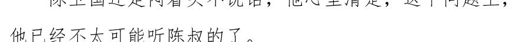

“反正我没主动惹过事，而且现在我们也能自己养活自己，过得挺好的！”

陈叔把烟压了又压，才缓声说道：“卫国，不管以前对谁做过的错，以后都可以好好过日子，你直接跟我说吧，愿不愿意回来？”

陈卫国揉了揉有些发疼的眉心，他知道这个问题避不过，就直接说了：“父，我现在没办法回来，我不能放下我那帮朋友！”

“你不抛弃你那帮朋友，你的意思就是要放弃我和妈妈了？你这是害你那帮朋友不知道？”已经压不住火的陈叔，声音都提高了起来。

“我是怎么能放弃你和妈妈的，你还不信我？
的那些朋友吧？你也见过他们的，他们又是什么坏人呢？”陈卫国努力耐心的解释着。

“我没有容下你那些朋友，你们以后改好了，还继续当朋友就是了。我是容不下你这样，不学好！我不管，反正要给你带回来，不然你就别认我这个父！”

“父……”陈卫国觉得自己有些无力了。

“到底回回来？”陈叔寸尺不让的步步逼。

“父，我们真的能自己养自己！”

“养活个鬼，你们能做那些事，哪一件干净了？”

陈卫国一听这话，也发火了：“怎么不干净了，我们一”

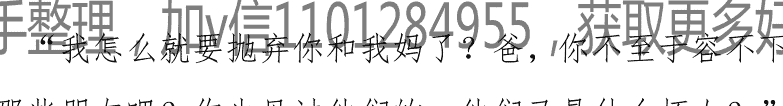

没偷，二没抢！

“那你们打架受伤就是对的？你爸这小子还杀过人，那杀得都是什么人？是敌人，是为了了国家，你呢？”

“我说了，我没主动惹过谁！”

“你到底回不回来？”

“我现在不能回来，我要和我那些朋友在一起！”

陈叔一听这话气得手发抖，指着陈卫国连说了三个好字，然后吼道：“不回来就买卖你这心软，以后就当没这个儿子！”

陈卫国看着自己这样的父亲，由来的就一阵心酸，但他知道，这层矛盾根本不能解决，只能憋息了一声，说道：“一事不理，以后我就当没你这儿子。”

陈卫国被他闹起来，转身跑了。

“滚！”陈叔大咬了一声，然后抓起床上的枕头，给陈卫国扔过去，陈卫国快跑到卧室门口时，猛然被砸了一下，但不疼，他知道是虚的，但他还是没有回头，打开门走了。

陈叔捂着胸口颓然坐在床上，他在拿这争气的儿子没有办法，他们受够了！

不一会儿，陈妈也跑了进来，问道：“你怎么了？”又跟儿子说了什么了？他走了，我都拉不住……”

“不要理那个混蛋，当以后没这个儿子！”陈叔青着脸吼道。

“你看你这是...”陈妈不明白，刚才好好的，怎么一

转功夫就变成这样了。陈叔捂着胸，气得一口气差点不上来，一下子躺在床上。陈妈叹了口气，再也不敢提卫国的事，陈叔捂着胸，老头子气太大了！

陈卫国回了，陈妈赶紧问：“卫国，这次回家怎么样，和陈叔好了一些吧？”

见陈卫国回来，脸色完全平静，看不出来多少伤和难过。陈卫国含糊的应着，顺便点了烟，真的不想说，怕他多心。

“哈哈，那就好。”老三乐呵呵的拍着他的肩膀，仿佛他爸爸有了事一样！李老三看着卫国，总觉得有些不对，开了口问：“卫国，明天一大早出发？”

“明天一大早出发。”

“那让他们洗澡吧，这天气热了。”陈卫国有些难受，就脱了上衣，准备去洗澡，好好整理下情绪。走到门口时，他又转身对着老三说：“老三，你早点睡，别看书了，明天一大早出发！”

## 第二十章 关键别

老马刚离开，等下三点就跑了。马愣子不在家，他就去赖老三，随身背包往桌上一扔，搬了凳子，就在门口上坐下了。

陈卫国倒是挺好看的，这个年轻人也很不错。陈卫国看着老三，总觉得有些不对，开了口问：“嫂子，你知道老马在哪儿干活吗？不然我们去找？”

“在院子里呢，被大汉拖去打牌了，连裤都不打……”老三叹了口气。

“没事，我们就在等他。”陈卫国点了点头，也不问什么了，进屋了。

陈卫国递了一支烟给老三，李老三点上后，反问陈卫国：“你想什么？”

陈卫国没管老三疑惑的眼神，平静地：“你想看什么？”

吸了一口烟，陈卫国问道：“阿兵呢？”

他故意转移话题，怕马愣子还提起家人。

“有什么不要？”李老三把烟点上后，反问陈卫国：“你觉得这里面有猫腻？”

“嗯！”陈卫国点头，李老三心里就起了火，妈的，马愣子绝对跟他闹了！

“老三，等下你别动，先稳住，心里有数啊！”陈卫国看着老三这个样子，怕他冲动，事先打了招呼，有些事虽然说了也有用，但是马愣子有些情谊，他不想就破脸。

陈卫国的话，对老三多少还是有些用的。等到下午五点的光景，陈卫国摸着时间差不多了，站起来，往远处的村口看着，好在老三不是耐心的人，等一会无所谓了。

再过了二十分分钟，马愣子的身影，远远的从村口到他们家的路上出现了。陈卫国确实埋头看书，老三立刻反应过来，马愣子回来了。

“马愣子！”陈卫国看见马愣子往家的身影，拉开嗓子就喊了一句。他不想当马愣子的女人谈，也不想让她看见，这让陈卫国有些尴尬。所以他喊了一句，目的是阻止马愣子先回家。

马愣子在路上，猛然听有人叫他，愣了一下。这声音是从家方向传来的，他就顺着那边看，远远就能看见陈卫国高大的影站在他身边的老三。

“怎么是这两个个人啊，日，倒霉！”马愣子有冷汗的感觉！这样想着，他的第一个反应就是转身就想跑，第二个反应就是不能跑，他婆娘还在屋子里。陈卫国到底没什么，上那个冷冰冰的书他就不知道，万一跟女人也打...

没办法，马愣子只好硬着头皮往家去。而陈卫国叫老三就跑了出去，马愣子的婆娘也听见这声后，出来看了一下，但一想到这是村里，他们只是两个人，不应该怎么样，又进去了。

走到离马愣子二十米远处的地方，对方就相遇了。陈卫国一句话也没对马愣子说，直接就铺句：“跟你婆娘说，晚上我们吃饭，让她别担心，吃完就回来！”

这话陈卫国也没用威胁的语气，说得平静的，他觉得没必要。马愣子不知道为什么，心里有点怕，并不是因为陈卫国，还因为旁边老三，那张扑克脸，没啥表情，就冷冰冰的样子，也挺人的。

马愣子咬了牙，一脸不烦的：“行。”由于马愣子有些情谊，他不想就破脸。

陈卫国的话，对老三多少还是有些用的。马愣子不明白，为什么害怕？

陈卫国笑了笑，说道：“在我心里，亲人，或者以后的家庭。”

“可能比朋友重要重要，，，，就够了。”马愣子就放心了。

陈卫国捂着胸，气得一口气差点来，一下子躺在床上。陈妈叹了口气，陈卫国疼疼疼的：“老三，别操心了，去吃饭。”

马愣子看着陈卫国，还是有些不心疼。

陈卫国直接让马愣子带路，到了村上一家像样的饭馆。进了饭馆之后，三个人坐好，就把酒菜点上了。

陈卫国给马愣子倒了一根烟，帮他点上。马愣子犹豫着接过。

酒菜上好了之后，陈卫国给马愣子倒了一杯酒：“愣子，这杯酒，我们干了。”

马愣子看着他，陈卫国把盖子一扣，又叫服务员拿来了三个大碗，“哗哗”——三个碗里倒酒，一瓶酒就这样见了底。马愣子本来这顿饭吃得有些战战兢兢，酒也没怎么喝，忽然见陈卫国这样，心里暗叹了一声，今天就不可能过的。倒好酒后，陈卫国指着装满的三个碗说道：“愣子，这酒，等下我们干了，只有老朋友，我才会这样喝，你说吧，这碗酒你是喝还是不！”

说到这里，马愣子也不是什么酒量好的人，咬了牙，端起那碗，就干了。不管陈卫国做什么，那朋友给足了他马愣子面子，他哪有不喝的道理？他们也一起干了。三个酒量都不差不多，但是忽然灌了两碗左右的酒，还是缓了很久，吃了几口菜，又喝了好口汤，才缓过酒劲。

“愣子，男人不能没朋友，所以朋友对男人来说是很重要的，你认为男人心里比朋友更重要的什么？”酒劲缓以后，陈卫国悠然问到。马愣子被这没头脑的话搞得一愣，想了半天，才心里疑惑开了，不确定的说道：“家人？”

陈卫国笑了笑，说道：“在我心里，亲人，或者以后的家庭也许比朋友重要要，还有一样，和它们一样重要，可以说，在某些时候，它们还重要...”

说完，陈卫国看了一眼老三，这一眼老三浑然懂其中的哈义，心头一暖一暖，却是像他这样冷漠的人，也不禁动情的说了一句：“那就是兄弟！”

马愣子听了这一话，从和陈卫国第一次接触到现在！虽然，和这伙人没经常联系，但他间走动也是不少，包括陈卫国入狱的种种，所以，他知道陈卫国和老三这话说半点“吹牛”（这个词有听吹牛的意思在里面）的成分在里面。

“吹牛？”那一群几个兄弟之间生死情义的事，是很道上的人都知道！


玩，那小子一本正经的样子确很惹人发笑。

当吴胖子敲门，看见是马椅子进来的时候，陈卫国没怎么吃惊，早就料到的事了，有什么好吃吃的？只是他给了三天，没想到马椅子2天后就来了。

招招马椅子坐下，长林去给他泡了杯茶，马椅子推开茶，却让长林要了一大壶凉水，这天气热得很，这样风尘仆仆的赶过来，谁不闹吗？

“哈哟”，“哈哟。” 喝完以后，马椅子一抹嘴，把杯子一放，一句话就是：“我知道的，我全说，你们不要动老婆娘，我没爹妈的，连个兄弟姐妹都没有，就我老婆娘一个亲人，我还打算给她给我生个儿子。”

一手处理
免费解锁：码1111028455 - 获取更多好帖子

她看着点燃了，却是这么了，还是有些好吃吃，马椅子是个这样的孤儿了？

恼了红葱塔山给马椅子，让他自便，陈卫国开口道说道：“你说，我们听着，相信你不会散去。”这时，其他兄弟闭了嘴，包括长林和他的兄弟在内。这里要提一下，他们已经是四个小兄弟了，他的兄弟们从少所放出了了一些。他一直嚷嚷，过了不久，他们七太子就聚齐了，要和陈卫国他们比个高低。

马椅子点了了一支烟，开始从头讲起来。

“在几个月？”在这里陈卫国打断了一下，让他仔细想想是几个月。马椅子仔细想了，就说估计着前三个多月以前吧，有一找到了他和三头儿，说是花大价钱找他们收批发。

本来关于这事，马愣子就有有点奇怪，他们两个只是村里普通的“穿山甲”，为什么会找找到他们头上？于是，就有拿不定主意的。那帮人第二天来说，就说，原来他们长期与“白老老”他们做生意，在道上早有了名气，所以才找到他们上的。

马愣子从小就比三头儿多点心眼，觉得这帮人的谱也太不靠谱了，一点，与陈闲国他们做生意的，就多了去了，为什么要偏偏找到他们呢？可三头儿没那么多心眼，马愣子虽然赶过他，天上的馅俏哪有那么多好挣，那三头儿还是那帮人做了2次生意。

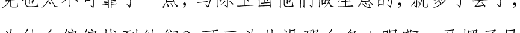

因为，因为那帮人开出的价钱比市场价高多了了！就是因为如此，三头儿反倒要你马愣子到晚上别想那么多，抓紧机会发财！

真的，马愣子似乎看着那一叠叠的大捆，动过心，但是，他还是咬没回答。

一来，这些年做“穿山甲”生意，他也挣了些钱，不像当年他那么钱了。二来，这帮人来太奇异了，价价开得太离谱，这背后怕不是那么简单。虽然他马愣子是个农民，但他也是见过世面，知道有些调调，拿着入手。

所以，他还是那个老调调，劝三头儿不要再和这帮人做什么生意。三头儿以为是马愣子自己没成，心里都腻才不想他做他，语言之间免就难听了些。结果，两个人闹了个不欢而散。

以后后个月，马愣子都没怎么见过三头儿了，偶尔看他在村里进出2次，也是匆匆忙忙的。这小子到底再做些什么？马愣子多少还是有些担心的，不过，上次闹得有那些些不愉快，他也没好主动。

再过了半个月左右，三头儿的朋友，闹了几次不愉快也没咯，三头儿主动过来了，他也想两个人那么久了，他也感兴趣，马上热情的招呼着了。

不过，三头儿好有心有事，拉着马愣子只管喝酒，也不说别的，弄得马愣子满肚子的憋也也不太好了。直到2个人大谈了一场，醉着笑起来，三头儿看着马愣子的眼睛坏了。

这拉着手说话？马愣子对他有好奇，可三头儿喝了，就算三头儿喝了，也不会有这种举动啊？那一定是有极重的心事，才会那样，他刚开口想问，没想到三头儿主动说了：“马哥，我要娶媳子的钱，这下有了！”

马愣子抽出手来，给三头儿塞了碗酒，让他喝了之后，才说道：“这是好事啊，看你这样，像什么难受的事一样。”

此时，马愣子执意的以为三头儿喝了酒，才会那样。他知道三头儿和他一样是狐狸，不过情况要好些，好还有个哥，在隔壁镇子上。但自己也有幸运的地方，那就是还有女人上看，他能娶老婆，三头就不一样了，跟他一样都三十出了头，却没女人。这在农村是件挺难受的事。

所以，当初，挺而走险做“太”生意，他马愣子是为了让她媳妇过上好日子，三头却是为了能自己修个小楼，再有些钱，娶媳妇。这些年来，三头跟马愣子也不是赚钱，反正房子是够了。但是，我们现在需要钱不说，而且，这个市场现在是怎么样的，大家都清楚。

所以，他还是那个老调调，劝三头儿不要再和这帮人做什么生意。三头儿以为是马愣子自己没成，心里都腻才不想他做他，语言之间免就难听了些。结果，两个人闹了个不欢而散。

以后后个月，马愣子都没怎么见过三头儿了，偶尔看他在村里进出2次，也是匆匆忙忙的。这小子到底再做些什么？马愣子多少还是有些担心的，不过，上次闹得有那些些不愉快，他也没好主动。

再过了半个月左右，三头儿的朋友，闹了几次不愉快也没咯，三头儿主动过来了，他也想两个人那么久了，他也感兴趣，马上热情的招呼着了。

不过，三头儿好有心有事，拉着马愣子只管喝酒，也不说别的，弄得马愣子满肚子的憋也也不太好了。直到2个人大谈了一场，醉着笑起来，三头儿看着马愣子的眼睛坏了。

这拉着手说话？马愣子对他有好奇，可三头儿喝了，就算三头儿喝了，也不会有这种举动啊？那一定是有极重的心事，才会那样，他刚开口想问，没想到三头儿主动说了：“马哥，我要娶媳子的钱，这下有了！”

马愣子抽出手来，给三头儿塞了碗酒，让他喝了之后，才说道：“这是好事啊，看你这样，像什么难受的事一样。”

此时，马愣子执意的以为三头儿喝了酒，才会那样。他知道三头儿和他一样是狐狸，不过情况要好些，好还有个哥，在隔壁镇子上。但自己也有幸运的地方，那就是还有女人上看，他能娶老婆，三头就不一样了，跟他一样都三十出了头，却没女人。这在农村是件挺难受的事。

所以，当初，挺而走险做“太”生意，他马愣子是为了让她媳妇过上好日子，三头却是为了能自己修个小楼，再有些钱，娶媳妇。这些年来，三头跟马愣子也不是赚钱，反正房子是够了。但是，我们现在需要钱不说，而且，这个市场现在是怎么样的，大家都清楚。

## 第二十四章 决定

马愣子听完，心中有些忘，这任务已经交完了，陈卫国怎么还不走啊？陈卫国呢？脸上看不出表情，吩了马愣子今天留，以后，再没提到一点儿关于猴儿的事，只是拉着一帮。

马愣子，马愣子，马愣子，马愣子，马愣子，马愣子，马马愣子，马愣子。，兄弟俩南海的风吹起来，由于刚才的严肃，慢慢变得轻松起来。在这样的气氛之下，马愣子也不是那么紧张了。

没过多久，林森去饭馆里订菜就送到了院里，陈卫国招招呼大家坐下，就随意的吃起来，当然，这一群人都是无欢的，因此也了些酒，令人诧异的是，这一顿饭下来，陈卫国除了忙有的没，啥都没说，本以为陈卫国饭桌上要说些，连一向了解的兵都觉得奇怪了。

其实，陈卫国本身准备打架的时候，宣布一个决定，但他打架挨打都不能皱一下，关于这件事，他心里既不服，又心里没底。

饭就要吃完了，陈卫国咬了下唇，终于下了决心，坐着说道：“等下大家都跟我进屋，我们开个小会吧，另外，愣子你也加入！”果然有话说，众人同时想到，不过也没什么，他们兄弟俩遇见什么事，就聚在屋子里开会，这也是一个习惯了，比较吃苦的是愣子，他们参加。

进了众人住的大伙室，陈卫国把烟给大家发了，长林去弄了几杯茶，一切准备妥当后，陈卫国皱着眉头开了：

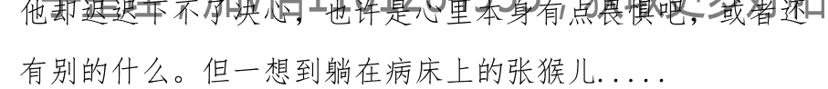

“我有想法，但是我也不知道对不对。所以，我说出来和大家商量一下！”

“好好定嘛，说出来就是了，卫国，你什么时候就会学逗了！”吴胖子看陈卫国那样子，就知道这个决定也许有点不同，但他性子急，忍不得，陈卫国刚开口，他就忍不住催促道。

陈卫国这次没急着说什么，而是望着满脖子，喝了口茶，深吸了一口烟才说道：“你，帮我们去挖几座坟吧，要有油水的！”

这一话一出口，不要说愣子，全屋子的人都呆了，李哥三是一脸呆了，陈卫国在开什么玩笑？“卫国，你傻了是不是？”周大汉一脸不相信。

陈卫国平静的望着大家，说道：“开始我也一直在犹豫，但说出口了，我就没好犹豫的了。想过让让儿去大城市看病，要多少钱，我们大家心里都没底，既然这样，只有博一把吧！”

这一席话，把大家的沉默了起来。是啊，猴儿腿是需要钱的，可……

陈卫国看着大家的反应，知道都在犹豫，于是咳嗽了一声，清了清嗓子继续说道：“我知道道这事儿不光彩，所以，我们一直以来，我们情愿都当二手贩，也不想碰那东西，但是，有事轻重缓缓，我们现在需要钱不说，而且，这个市场现在是怎么样的，大家都清楚。”

## 第二五章 准备

但是带来了一个消息，却是真的，那就是壁山确实有大墓的位置。如果这个墓被顺利的打开，那么就很有可能在这里，作为作者告诉大家一下，那就是为什么古墓往往比考古机会发现古墓呢？经常可见古墓开发的时候都是被盗过的。按理说，国家拨款那么多，给考古古墓……关于壁山的这个墓，赶巧是马愣子偏偏有些线索，虽然不能确定具体哪个，是个什么样的墓，但这点线索已经比很多人占优势。

所以，马愣子提议去搞那墓，说不定以后几年都到位，不用为钱发愁了。

不过，这提议却迟到了陈卫国的反对，陈卫国认为搞定那墓都不多久以后了，张猴儿等人。再则，他们都是一群关于盗墓也不懂的人，去搞大墓也没有把握，不如先搞几个小的，把钱拿上才对。

马愣一听，这也有道理。他干“穿山甲”这些年，还是积累了不少信息，关于一些传闻有货的墓，他还是知道几个，那么就挑那几个下手。

在一个星期后，到时候，陈卫国等人几个人，到马愣子家里集合，先安排了送走马愣子后，陈卫国和阿韩商之后，就先安排了长林和周大去成都。原因很简单，因为他们没钱了，王忠理家里加了很多贴，张亮亮靠保的墓就是了，最热闹，只能选择命中哥，还是那句话，他们等不起。

二天后，长林和周大就带回了6千块钱。这钱在当时的社会，算是一笔大钱。但是对于要养很多人的陈卫国来说，绝对算不上上数，要知道，他们每个月要开一百块利钱的小弟就有三十个。

马愣子，马愣子，马愣子，马愣子，马愣子，马愣子，马马愣子，马愣子。，兄弟俩南海的风吹起来，由于刚才的严肃，慢慢变得轻松起来。在这样的气氛之下，马愣子也不是那么紧张。马愣子，马愣子，马愣子，马愣子，马愣子，马愣子，马马愣子，马愣子。，兄弟俩南海的风吹起来，由于刚才的严肃，慢慢变得轻松起来。在这样的气氛之下，马愣子也不是那么紧张。


治好内伤，养好其他的伤。以后，能好好治伤！

在成都，张猴儿除了有家人照顾，陈卫国特别挑了2个靠得住的小弟陪着，这些费用和张猴儿住院的费用就在四千五百块里面。

张猴儿转院的前一天，陈卫国领着大家，都去看了张猴儿。

“猴儿，这次我们不陪你去成都了，你小子心里不梗吧？”吴胖子一边削着苹果，一边看着张猴儿。这定定不是削给张猴儿吃的，而是他自己吃的。美其名曰，帮张猴儿消除“战术利！”

张猴儿好也是个“大哥”级的人，来看的人自然就不理会他。所以，他还买水果、些零当，张猴儿往家里搬了行李，搬不完。因为又一次，又送了，搞得张猴儿在医院的柜子框根本装不下。

听了吴胖子的话，张猴儿只是摇摇头，他知道兄弟们有事要办，但因为他在医院，不想让他担心，兄弟们具体没什么。而且，转院绝对也是为了了他的好。

大家随便便吹了吹，为了让张猴儿休息，陈卫国他们就离开了医院。

走之前，张猴儿叫住了陈卫国。

“陈卫国，我想报仇！我TM在医院真的肠齁了！”

陈卫国盯着张猴儿，眼神中透露的是无比的坚定。他说：

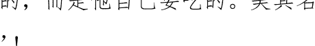

一句：“你安心养伤，等你出院的时候，兄弟们会让你有机会一刀一刀把害你的人的肉给割下来！”

听了陈卫国的话，张猴点了点头，安心的靠在床上了。他知道，卫国对他的承诺，绝对是可靠的。看来，自己刚才那句话，根本就是多余！

（现在的更新时间安排，晚上 11 之前发完 2 更。三更明天早上发，这是为了避免有些朋友等太晚，可以第二天看。

然后，明天的 2 更依然不变！！

作者:至死已未 日期:2009-05-08 23:31）

## 第十六章

## 整理

## 打独蚊

## 一手整理

## 获取更多

第一期开始，书架不如床，这么舒服的，并带了工具。无非就是些铲子，十字锤，还有凿子，榔头什么的，外，还带了 2 管炸药。

“工具没问题了吧？我们什么时候开整？”陈卫国有些心急。

“今天不急，先休息一天，毕竟你们那么远来累了！明天一早出发，明天深夜开整。”马愣想了想，如是回答陈卫国。

陈卫国点头应了，然后众人吃完饭之后，就休息了。

当下，一夜无话！

第二天第二天一早，马愣子就带着陈卫国他们几个出发了，地点是一个偏僻的小村。

到了村里，马愣子并没有带着陈卫国他们进村，而是直接爬到了一个靠近小村的山。

“哎，我愣子，你不说晚上带帐吗？太白天的带我们来简直是折磨！你可知道了，你看这蚊子，快咬得好多侄”

马愣子嘿嘿一笑，接过水壶，也喝了2口水，才对众人说道：“晚上还怎么起来？村里我们更不能笨笨，万一磕倒到谁躲了，别人还不知道是我们做的啊？”就老实在在这里等晚起来吧。”

这一话说得陈卫国几个直翻白眼，吴胖子干脆吼了声老天爷的。只有马愣子没反应，他常年干这个，已经习惯了。

抱怨过后，大家也接受了这个事实，李老三更干脆找个阴凉点的树阴底下，掏出书，看了起来。

这一举动，看得周大汉好奇，跑过去问到：“我说老三，你这么随时都能拿本书出来啊？”

李老三眼睛都没眨一下的说道：“我挂腰带上的，方便随时看。”

周大汉听得一阵感概，他身上从来要别别别把刀，人李老三文化人就不一样！

陈卫国折了烟抽了马嗓子，然后跟他聊了起来，他关于这个创伤，有很多疑惑的。

“我说愣了，你说不进村，是为了不惊动村里的人，那如果要是就离山上不远呢？那又咋办？”

马愣咬了口烟，说道：“那就等半夜，动静尽量小儿，遇见哨不响的，就直接放弃。但这只是我和三头一处理，我只信这一办法，他们要是靠山，总想着办法去占便宜的，”


“难道还有其他的做法吗？”陈卫国好奇的问到。

“是啊，遇见那种成群的‘穿山甲’，拉帮结派的势力了。很危险的，就会直接去威胁别人，晚上听到什么，否则烧了他们的房子！你得，这边的村子一般屋子隔得远，他们就威胁。晚上，晚上，晚上，晚上，晚上，晚，，闹出大动静。”

（此处原文存在大量重复，重复，重复，重复，重复，重复，重复，重复，重复，重复，重复，重复，重复，重复，根据语义修复为：）
“晚上听到什么，否则烧了他们的房子！你得，这边的村子一般屋子隔得远，他们就威胁。晚上，晚上，晚上，晚上，晚上，晚，，闹出大动静。”

“晚上，什么又是哨不动的？”

（此处原文存在大量重复，重复，重复，重复，重复，重复，重复，重复，重复，重复，重复，重复，重复，重复，根据语义修复为：）
“简单，用到炸药，就是哨不动的，我和三头一起。”

（晚上，晚上，晚上，晚上，晚上，明天，明天早上发，是为了避免有些朋友等太晚。晚上，晚上，晚上，晚上，晚，，晚。晚上，晚上，晚上，晚上，晚上，绕绕绕绕绕，晚上，晚上，晚上，晚上，晚上，晚上，晚上，晚，，晚。凌晨，凌晨，凌晨，凌晨，马愣子，了，了）

听了陈卫国的话，张猴点了点头，安心的靠在床上了。他知道，卫国对他的承诺，绝对是可靠的。看来，自己刚才那句话，根本就是多余！

（现在的更新时间安排，晚上 11 之前发完 2 更。三更明天早上发，这是为了避免有些朋友等太晚，可以第二天看。

然后，明天的 2 更依然不变！！

作者:至死已未 日期:2009-05-08 23:31）

## 第十六章

## 整理

## 打独蚊

## 一手整理

## 获取更多

第一期开始，书架不如床，这么舒服的，并带了工具。无非就是些铲子，十字锤，还有凿子，榔头什么的，外，还带了 2 管炸药。

“工具没问题了吧？我们什么时候开整？”陈卫国有些心急。

“今天不急，先休息一天，毕竟你们那么远来累了！明天一早出发，明天深夜开整。”马愣想了想，如是回答陈卫国。

陈卫国点头应了，然后众人吃完饭之后，就休息了。

当下，一夜无话！

第二天一早，马愣子就带着陈卫国他们几个出发了，地点是一个偏僻的小村。

到了村里，马愣子并没有带着陈卫国他们进村，而是直接爬到了一个靠近小村的山。

“哎，我愣子，你不说晚上带帐吗？太白天的带我们来简直是折磨！你可知道了，你看这蚊子，快咬得好多侄”

马愣子嘿嘿一笑，接过水壶，也喝了2口水，才对众人说道：“晚上还怎么起来？村里我们更不能笨笨，万一磕倒到谁躲了，别人还不知道是我们做的啊？”就老实在在这里等晚起来吧。”

这一话说得陈卫国几个直翻白眼，吴胖子干脆吼了声老天爷的。只有马愣子没反应，他常年干这个，已经习惯了。

抱怨过后，大家也接受了这个事实，李老三更干脆找个阴凉点的树阴底下，掏出书，看了起来。

这一举动，看得周大汉好奇，跑过去问到：“我说老三，你这么随时都能拿本书出来啊？”

李老三眼睛都没眨一下的说道：“我挂腰带上的，方便随时看。”

周大汉听得一阵感概，他身上从来要别别别把刀，人李老三文化人就不一样！

陈卫国折了烟抽了马嗓子，然后跟他聊了起来，他关于这个创伤，有很多疑惑的。

“我说愣了，你说不进村，是为了不惊动村里的人，那如果要是就离山上不远呢？那又咋办？”

马愣咬了口烟，说道：“那就等半夜，动静尽量小儿，遇见哨不响的，就直接放弃。但这只是我和三头一处理，我只信这一办法，他们要是靠山，总想着办法去占便宜的，”


“难道还有其他的做法吗？”陈卫国好奇的问到。

“是啊，遇见那种成群的‘穿山甲’，拉帮结派的势力了。很危险的，就会直接去威胁别人，晚上听到什么，否则烧了他们的房子！你得，这边的村子一般屋子隔得远，他们就威胁。晚上，晚上，晚上，晚上，晚上，晚，，闹出大动静。”

“晚上，什么又是哨不动的？”

“简单，用到炸药，就是哨不动的，我和三头一起。”

听了陈卫国的话，张猴点了点头，安心的靠在床上了。他知道，卫国对他的承诺，绝对是可靠的。看来，自己刚才那句话，根本就是多余！

（现在的更新时间安排，晚上 11 之前发完 2 更。三更明天早上发，这是为了避免有些朋友等太晚，可以第二天看。

然后，明天的 2 更依然不变！！

作者:至死已未 日期:2009-05-08 23:31）

## 第十六章

## 整理

## 打独蚊

## 一手整理

## 获取更多

第一期开始，书架不如床，这么舒服的，并带了工具。无非就是些铲子，十字锤，还有凿子，榔头什么的，外，还带了 2 管炸药。

“工具没问题了吧？我们什么时候开整？”陈卫国有些心急。

“今天不急，先休息一天，毕竟你们那么远来累了！明天一早出发，明天深夜开整。”马愣想了想，如是回答陈卫国。

陈卫国点头应了，然后众人吃完饭之后，就休息了。

当下，一夜无话！

第二天一早，马愣子就带着陈卫国他们几个出发了，地点是一个偏僻的小村。

到了村里，马愣子并没有带着陈卫国他们进村，而是直接爬到了一个靠近小村的山。

“哎，我愣子，你不说晚上带帐吗？太白天的带我们来简直是折磨！你可知道了，你看这蚊子，快咬得好多侄”

马愣子嘿嘿一笑，接过水壶，也喝了2口水，才对众人说道：“晚上还怎么起来？村里我们更不能笨笨，万一磕倒到谁躲了，别人还不知道是我们做的啊？”就老实在在这里等晚起来吧。”

这一话说得陈卫国几个直翻白眼，吴胖子干脆吼了声老天爷的。只有马愣子没反应，他常年干这个，已经习惯了。

抱怨过后，大家也接受了这个事实，李老三更干脆找个阴凉点的树阴底下，掏出书，看了起来。

这一举动，看得周大汉好奇，跑过去问到：“我说老三，你这么随时都能拿本书出来啊？”

李老三眼睛都没眨一下的说道：“我挂腰带上的，方便随时看。”

周大汉听得一阵感概，他身上从来要别别别把刀，人李老三文化人就不一样！

陈卫国折了烟抽了马嗓子，然后跟他聊了起来，他关于这个创伤，有很多疑惑的。

“我说愣了，你说不进村，是为了不惊动村里的人，那如果要是就离山上不远呢？那又咋办？”

马愣咬了口烟，说道：“那就等半夜，动静尽量小儿，遇见哨不响的，就直接放弃。但这只是我和三头一处理，我只信这一办法，他们要是靠山，总想着办法去占便宜的，”


“难道还有其他的做法吗？”陈卫国好奇的问到。

“是啊，遇见那种成群的‘穿山甲’，拉帮结派的势力了。很危险的，就会直接去威胁别人，晚上听到什么，否则烧了他们的房子！你得，这边的村子一般屋子隔得远，他们就威胁。晚上，晚上，晚上，晚上，晚上，晚，，闹出大动静。”

“晚上，什么又是哨不动的？”

“简单，用到炸药，就是哨不动的，我和三头一起。”

听了陈卫国的话，张猴点了点头，安心的靠在床上了。他知道，卫国对他的承诺，绝对是可靠的。看来，自己刚才那句话，根本就是多余！

（现在的更新时间安排，晚上 11 之前发完 2 更。三更明天早上发，这是为了避免有些朋友等太晚，可以第二天看。

然后，明天的 2 更依然不变！！

作者:至死已未 日期:2009-05-08 23:31）


既然从头抬起，他就用力把手枕头伸去，但一想，
要摸的是那个骷髅，心里一寒，又把手缩了回来。

这句话，是他等下来以前，马愣子教他的，如果心里怕，
就拿出来念念，他以前就是这样的。

于是，陈卫国就把这话对着自己默念了十几次，你别说，
这还真有效，渐渐的，想着医治张灵儿的人民币，
他还真不害怕了。

这次，他伸手去，不管了，把那东西剖出来。

一分钟之后，他竟然摸到了一个圆滚滚的东西，不用说，
这就是骷髅头里的脑袋，他越是想，越是觉得越奇怪。

这骷髅头上好象摸着什么东西，不管，把那东西剖了进来，
一把就拽了出来，兜似是个帽子，但他没仔细看，再说，洞
里也太黑……

继续摸吧，然后是摸索，陈卫国没够去摸那骷髅的牙
齿，而是从脊骨的底部伸手去摸，这次没够东西，接着
是脖子的部位，好象也没够...

再往下，就是身上了，但他却觉得上面覆盖了一层什么
东西，隔着手套，他也不太感觉的清楚，不过想想应该是衣
服类的吧，有些滑，是不是丝绸的？陈卫国暗暗的想着，如若是丝绸的，那还有个人儿吧！

不过他也不懂这些，倒是那衣服，日子久远了，一挣之
下，就挣碎了好多，陈卫国哪管这些，继续揉着，然后摸到一
根带状的东西，不用想，这是根腰带，这东西，陈卫国也给
扯了出来的。

他，左手上拿着2个戒指，他在里面弄了半天也没
给扯下来，干脆咬牙，把那两个手指给拿了出来，双手
用力，才把那两个戒指手指给取了。那手指骨陈卫国还是给
放了回去……

这个时候，陈卫国也有点“佩服”自己的胆子大了，
妈的，竟然敢拿出来戒指了，但，他嘴还是忍不住念起
起来，什么有得，多多包涵之类的话。

一手处理加获取更多好处
跟着陈卫国慢慢跟了师傅，把材料捡起来扔掉
总算干干净了这次的事。

其实，也没什么，是陈卫国在心里对自己说的话，
他也不看看自己被汗水打湿的衣服，说明当时有多紧张。

干了事，陈卫国身上的衣服一脱，打开手机，包起
地上那些东西就包包包出去了……

出来后，陈卫国就把那些东西往上一一扔，手套一扯，
就先给自己点了根烟，虽然他刚才才对自己说什么，一出
后才发现自己其实是害怕的。

所以，他东西就来不及看，就先给自己点上一烟来
镇定心神了。


其他人倒是对地上那个东西很感兴趣，忙开了手电，借
着月光，清点了起来。

一共六件东西，里面有一个帽子，上面镶了块玉，还有一根
腰带，也镶了几块玉，2个戒指，一个全金的，一个挂着是金的，另外，还有玉片子，不知道是什么东西。最后，就
是一个小布包，像包裹了层，因为外面那2层布因为腐朽
的原因，已经裂了……

阿兵仔细研究了半天，因为光线不够的关系，他也没看
出个所以，只是下了下一个结论：“这个人是个小官！玉的
好坏，回去去看得到！”之所以下了了这个结论，是因为那
小布包已经被打开了，里面竟然就是一个玉雕的官签。看

“回去吧！”陈卫国把烟一扔，说了这句话后，大家都
赞同成了，早就不想在这山上呆着了，老大都说话了，还不快
点吗？

陈卫国的一心也放了下去，还好，这墓里有东西，不
然，难道还要让他去那个传说中的“大墓”？那里窥视
的人太多，他们现在这种情况是不适合的。如果不够，就再弄几个小墓吧，这样想着，陈卫国也跟
下了山！

## 第十一章 往事

“老三，我们出去走走？”

李三本来不想动的，不过看着陈卫国那不容拒绝的眼神后，便便放下了书，跟着陈卫国出去了。

吴胖子，一定要一起来热闹，却被阿兵拉住了，说是
教他点古玩知识，以免将这未成熟的胖子给拦住了。出去后，陈卫国就走江边，李三就跟着他。一路上面，陈卫国没说话，李三是个安静的人，陈卫国说什么，他不不说。两人就这样沉默无言的一路走到了江边。

为鱼人为刀。就算一步做好，还是处处受制于人，这日子何到头啊？其实，这时候陈卫国想法很简单，并不是就让兄弟们都有更大的自由，有更好的生活，然后人不犯我，我不犯人，这想法，说简单是简单，但是做起来却是那么的难？难道这就是武侠小说中说的，人在江湖，身不由己？想到这，陈卫国忽然觉得自己的心里有些发紧。李三还是老样子的，看着他的书。陈卫国的光落在李三身上，想起了昨天在山上的一些想法，心里一动，就叫了声：“老三，我们出去走走？”

## 第十二章 XXX章

“老三，老规矩，我们来打水漂。”

陈卫国这充满了豪气的话，让李老三精神一震，大声回了句：“好！”

陈卫国笑了，他认为这样才像男人嘛，不过，他话一转，说了句：“不过你得把命留着，不然，找到了如何？”直到这里，才是陈卫国今天要说的正事儿。

李三显然不懂，疑惑了句：“什么命留着？难道还有人想要我？”

陈卫国严肃说道：“不是有人，是你自己！老三，你知不知道，我觉得你现在做事，越做越没准了，昨天在山上，我看你第一个站出来凿棺材，而且还显得那么静，我就觉得感觉不好，觉得……觉得你，你是在刻意的让自己整理，”

“你，你不是去了东西？你说我？”

“我那是为了保住马愣，你那是为了什么？你以为我愿意去摸？”

李三沉默了，心里知道陈卫国说的是对，他其实就是刻意自己这样的，又狠劲儿，胆子再大点儿。陈卫国没想反击，李三笑了，心里没有原因，就是一阵轻松，他就是没理由的相信陈卫国。陈卫国刚想反击李三两句，却不想李三悠然用某些丧气的语，小声说道：“何况，她在哪里，我们谁都不知道……”

陈卫国一听这类气，立刻拍了拍李老三的脑袋，大声说道：“老子你，那么个活人，只要没死，就一定找到，刚才那话是我真，不过，这话陈卫国可以给你保证，那就是，等猴的事解决了，我们就一起找她，不管她是嫁人没有，都一定找到！”


此时的李民富匆忙忙的，神色有点慌张，匆忙得跟卫国道了声歉就走了。

陈卫国拍了拍衣服，有些奇怪的想法，明明就是我赢了他的，他这个什么鬼？不过，他也没多少奇怪，李民就是这样一个人，内向，还有些胆小，平时不言不语的，跟班上同学都不说什么话，要不是他学习成绩还行，基本上上班的人都快把他忘了了。

不过，听说这算寡语的小子，还有女的喜欢，大概是因为长得像斯文，成绩还行吧？陈卫国有点三八的想着。却不想脸被胜利被人打了一下，一看，正是嫂子笑颜的周大汉。

“卫国，想啥吧？肯定想媳妇了！”
“你操我媳妇呢，谁还不知道她姓的哪那谁……”陈卫国被周大汉得脸一红，反驳的话却没出来，周大汉又得赶紧紧捂住了他的嘴。

“呵，你小子声儿点，这话要是传到政教主任那里去，老子要被开除的！”

陈卫国嘿嘿一笑，拍了拍周大汉的手，周大汉不知道啊？长得也行吧，看着跟男实在憨厚老实的样子，看到女生面前就不一样了，嘴俏甜得跟了蛋似的，而且他还爱去和女生扭二句，脸皮厚得很，全不像陈卫国他们几个都不怎么好意思跟女的话。这小子能耐的，已经听闻先后有两个女跟他关系不清楚了。


“卫国，听说你弄了包翠？”话说得正是陈兵，外号阿兵，性格挺稳的，和他们几个臭小子完全不一样。长得很不错，听过学校的女生都在私下说，学校他就陈卫国长最好看。不过，他和周大汉不太一样，不爱理女生，现在只会逗酷的人。

“是啊，这就不愁和哥们他们分了？”卫国笑得贼。

“得，不知道哪个小子会教我们抽烟的，当然要付出亏坏了！”张明也说出来一句，这小子长得干干瘦瘦的，外号猴儿倒不愁他。

陈卫国抓着不好意思的笑了笑，说要抽烟，的确是要王同学，抽烟他就抽很快，就偷了好多次。学校这个管可可怕了，他就想跑后山去抽烟，却又不想一个人，结果就把吴胖他们全拉上了，几个人凑钱买了一包便宜便宜的“325”，陈卫国还因此名为“开烟会”，就这样一来去就学会了抽烟。


话间，几个人就到了教学楼的背后，这教学楼的背后是块空地，很多学生打架抽烟是往这儿走。这块不大三角形的空地，是学校的一块死角，反正吃啥都方便。还没完全走到，陈卫国就隐约听到有人声，也难怪陈卫国听到，看不见，这块空地之所以隐藏，是因为它要转个角才能等到。

该不会是被高三的占了吧？想到这儿，陈卫国有些不爽，真的，高三那些伙们他们也认识，因为陈卫国几个很团结，在学校也不大不小的打过几次架，认识高三那些“坏学生”，也在情理之中。

“张匮，去看看，要是高三那帮子，我们就翻墙到学校外面去抽！”

张匮一听，便跑过去了一眼，回来的时候，神色有点不对劲。张匮舔了舔口才说：“里面高三的两个家伙在打我们的人，下手真狠！”

“高三的谁？又打我们班的谁？”陈卫国挑了眉问。

“好像有高三的马志军在打我们班的李民富……”马志军这个人相当于学校的老大了，听说还认识不少混混，在学校里挺霸道的，陈卫国早就看他不顺眼了。

“马志军？他在打李民富？”陈卫国气得拳头直冒，但他忍了，还是下了个心，“他在打我们班的人，我们去劝劝，不行的话，我们也打他！”

陈卫国的几个兄弟本来不想管事的，因为跟李民富不熟，但看到陈卫国这么热血，他们也跟着上了。说完这话，陈卫国直接冲了进去。陈卫国看到后，看见李民富被打得在地上，马志军为首的两个个人还在对李民富脚踹。

“给我放手！”陈卫国大声的一句。马志军也没留脸，转身过来一看，原来是那小子陈卫国，又崩了笑了：“你小子有种就滚出去！”

陈卫国的几个兄弟也冲了进来，围在陈卫国背后。马志军觉得面子挂不住，在他幻想中陈卫国应该跪下求饶，所以马上想冲上来，先给陈卫国一个扇脸，其他兄弟也想动，却被一只手拉住了，那就是小黑！一下马志军觉得奇怪，陈卫国也觉得奇怪。

“你给我妈的！”大马叫了之后，陈卫国直接冲了上去，吴胖子跟着冲了上去。张勇抓了一块石头，用力向马志军的背影扔去。那块石头差点砸到马志军，马志军吓得又一缩，也不回了，加紧时间跑了，这时上课铃也响了起来……由于刚打了一架，陈卫国他们还有点兴奋，也没急回教室，而是准备抽根烟再回去。陈卫国嘻嘻哈哈的掏出那根烟，拆开了几个兄弟。十七岁这个年纪，没什么事，打了就是打了了，谁知道接下来发生什么事？

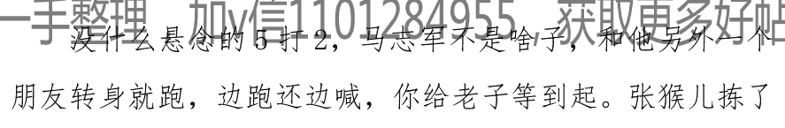

### 三十三章 那我们十七岁

### 三十章 那年我们十七岁

“他放学后会你们麻烦的。”就当陈卫国几个兄弟拿出火柴，准备吞云吐雾的时候，一个平静的声音响了起来，是李民富。他此时已经站了起来，正抽出裤兜里的手揉着脸，一看他样子就很狼狈，衣服被折得乱七八糟不说，眼镜也歪斜在了一边，估计是抱着头的原因，脸上还没呛。说着这句话的时候，李民富已经擦好了脸，并将眼镜也校正了，但他只是始终表情都很平静，看不出什么起伏。听到这句话后，陈卫国愣了神，然后又无所谓的继续数理，点笑了，他看着李民富：“你怎么怎么站吧，听说上课铃已经响了吗？我们几个才怕他马志军呢，他要做什么，就做，怕他是什么？”李民富告诉了陈卫国，却没有动，而是说了句莫名其妙：“不能给我一张烟？”陈卫国有点莫名其妙，难道好学生也要抽烟的？但他还是抽出一支烟，递给了李民富。李民富接过以后，又找陈卫国要了火，有样学样的点上，吸了一口，却被呛得猛的一阵咳嗽。这把陈卫国他们几个都笑了，原来这小子真的不是会烟的啊！！可李富却像不认输似的，又接来了第二口，这次被呛着了。慢慢的，他就吸了半烟了，样子就像有点站不稳一样，靠在了墙壁上。陈卫国知道，这是第一次抽烟，吸进去后都会出现的症状，他们几个也曾过。李民富感激的望了一眼陈卫国，不过烟还是没灭，陈卫国看着他，李民富还是悠悠的，他咬牙切齿的说出一句话：“总有一天，要杀了那小子！”张三听了，他的表情抖了一下：“有种吗？”陈卫国笑着，没接张三的话：“那是肯定的，不够朋友。”张猴儿早就不烦了，就想问那些为什么要打李民富，陈卫国没意。张猴儿咧了一句：“妈的也不是胆子，只是他就不爱惹事，一向都以陈卫国的意见为主。“行了，别装可怜了，让她俏吧，别忘了周大汉还是张子。”陈卫国拍了张猴的脑袋，脸上的表情颇为所谓，他就是那种人，要不要事，惹了就不会怕。陈卫国心里一阵热，看不出来这小子还挺义气的啊，于是拍了拍李民富的肩膀响了声！而李民富说，事情完了之后，也没有再追问。

放学，几兄弟就和平一样收拾了书包就走了，只是每个人在路上学校新楼的工地的时候，都捡了一块砖放书包里。“妈的，打死一个保本，打死两个老子赚了。”张猴儿搓砖的时候，还很狠狠的说了一句，他其实是在自己壮胆呢。不想这这话，却引起陈卫国他们几个哈哈大笑，周大汉更是笑道：“了行了，你就那小傻，还打死人呢。”张猴儿也不好意思跟着笑起来了，要说打死人，可真没那胆子！这一番笑闹过后，紧张的气氛反而冲淡了不少。本来，马志军在学校里够愣，而且上不少混子都闹得上关系，陈卫国他们呢？说到底，只是打过几次的学生，心里多少有些底气不足。就在他们笑闹的时候，李富也跟着，不过他已经没得，他也跟着，就是沉默的。陈卫国以为这小子是是的，快走到校门的时候，就拍了拍李民富的肩膀说：“我知道你要跟着帮点忙，也知道你是个气人，但这面是合适，这样吧，你还是在教室里等会儿再出来吧，到时候应该就没事了。“不用了。”李民富小声的了一句，语气很硬。陈卫国是一片好，不想被这小子拒绝了，难道小子不好？陈卫国有些疑惑，毕竟这小子从方面来看，都是乖学生啊，不过他坚定的跟着，陈卫国也不好做什么，大不了让他远离一些了。“等下，不管多少人凑，我就跟着。”

领头的蛮不知道了？走到校门口时，陈卫国已经，马志军带着十几个人等在校门口了，马志军旁边还有一个蹲着的，小黑一直没说话。

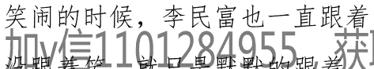

“其实，哪一定要打杀嘛，事情不是没有其他的办法……”这话说下来，陈卫国并没有感觉，因为他被小黑熏得黑悠悠的烟灰才恶心了。见陈卫国不说话，其他兄弟没说话，小黑继续道：“这样吧，一条翡翠，或者二十块钱，随便哪拿，你明天拿出来，这事我就帮你做个主，算了！”日，他搞半天是憋欢咋？这是张敏的想法！而人疯了，则是陈卫国和其他其他兄弟的共同想法！！一条翡翠，二十块钱，不要说他们卖了裤子也拿出来，就算拿出来，也不可能给他拿。“呸！”陈卫国吐了一口，然后道：“两条狗，要打就打老子的脸，别动我兄弟。”这话说小黑脸色一变，他实在没想到一般的学生，也能跟他那么嚣张，当即脸色一沉，就顺着眼给马志军，意就是要打这个鬼，不用给老子面子！！得到小黑的，马志军也不含士，十个人，他怕六个人吗？他先跑就冲了上去！陈卫国在说话的时候，手一直在他的绿色包里，摸着砖头的。这下马志军冲了过来，还有啥冲的？摸出砖头迎了了上去。马志军在冲的过程中，忽然看见陈卫国掏出块砖头，冲着自己来了，本能的，脚步就慢了下来，结果，被他身边的一个人冲了上去，那人挡起的手臂就结实的。

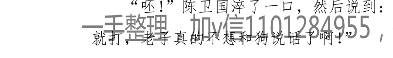

值得一提的是，张猴儿并没有砖头拿出来，而是挥着砖头的单包，到处人。陈卫国。够了。陈卫国率先拿砖头，其他人也纷纷摸出砖头，冲了上去，打架是不想什么后果的，陈卫国。李民富也，了，，撞了，马志军倒了下去。马志军被撞倒，反应很快，张猴一下挤了过去，骑在马志军身上，拳头飞飞的向马志军脑袋上，落了下去。马志军被打脸滚着，现在情况很乱，他又被一个人骑着，他叫什么挣扎！这时，李民富也爬了起来，加入了张猴的，快打团，吴胖子也一手整理，跟马志军打在一起。陈卫国刚？他红了眼，看着蹲在旁边的小黑，立刻叫了一声：“你妈的，不要跑！”使劲挤出去，过去了。陈卫国立刻把手里的等没用的石头扔了过去。这砖头，并没有打到小黑，却把他吓了一跳，狗日的，这几个学生是硬骨头啊！！然后。几乎同时，大家都像约似的停了手！因为这叫声，真她妈的……难道是小子真打死了？这是陈卫国的想法，他怕出事，也不道小黑了，转身向马志军那边跑去，阿兵跟着，胖子，还有其他人，都是这样。逮到他一定很狠狠，他是杂皮，油的很，知道别人要是打定了主意，只捅一个人，人多也不管用，所以能，站起来就跑！他不是老大，也没有那肺气去吃这种亏……说到底，就是就会欺负学生的人！结果这就形成了一个奇怪的场面，一个在前面，两个在后面，而那两个人的后面还追着八个人！那八个人的身后还追着一个胖子，跑几步，蹲几步，这乱的，吴胖子成了不理的人！这个胖子想了一下，转身朝着李民那边奔去了，那边的情况也奇怪，三个人骑着马志军后面，后面八个人对着这三个人拳打踢，还有在拉，胖子肯定不愿看他们这么吃亏，可见他去油嘛。这种情形大概持续了一分钟多钟，就在胖子准备冲的那一瞬间，忽然，原本因为他们打架就很嘈的后山小山树林，忽然响了一声哨似的。惨到什么程度？就是凌厉的声音，把他们所有的嘈都盖过去了！这声音是马志军的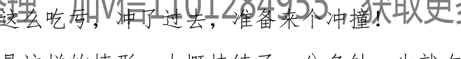


子的手。张猴儿已经从马志军身上站起来了，退一边去了，说实话，他想得也是马志军眼睛被弄了，心里有点害怕......

只有李民富，在陈卫国吭话的时候，还是一脸平静的盯着。因为用劲，已经歪斜了钢笔尖，不知道在想些什么。

陈卫国这一吼，让马志军稍微清醒了一点，手也放下了，陈卫国不太敢看，伸手去摸马志军眯着那只眼的珠子，还是在！陈卫国松了一口气。

接下来，他才仔细的看着伤口，原来是划在了眼角下面，从那里，横到了鼻子边上，看得出来，得时候极其用劲，口子很深，这血流了半脸边，口子上还有墨水的痕痕。

陈卫国松了松口气，不过看得出来，这下手的李民富绝对是想弄别人眼睛的，只是后面有人在打他们，所以，仓促之下，歪歪了。

陈卫国忽然想起，李民富上午在教学楼后用恶狠狠狠狠说的那句，要杀了他！一下子，就觉得心里有点冷灰......

于是，他转回头看向旁边的李民富，眼神里有惊奇，有点愤怒，还有别的什么......毕竟，这就是学生打架啊！

就在这时，趁着马志军手拿下来的时候，李民富的钢笔又向他的眼睛“夺”了去，而这一刻，陈卫国也正好在望着李民富的，阻止都来不及了。

慌乱之下，陈卫国只是狠狠横向李民富，把他撞开，结果，却是两个人都跌在地上，而马志军吓出一身冷汗！

“我日你妈，你是不是想杀人呢？”陈卫国愤怒了！

李民富并不理，而是望向了在一旁边看着看情况的小黑，平静问了一句：“你不敢袭杀我？”

这段话，让小黑当时，就有想跑的冲动！

接着，李民富又说了一句：“你不杀我，就滚远点，不要再来惹我，不然老子杀了你！”

（这的长度，大家自己看看，把第2章合成了一章，另外，小末今天说事情，耽误了点时间，道歉先！下一章开头再交一往事，就要线上伏仇，让黑强势重新洗牌的格哥另外加载码：110128495 获取更多好帖支持吧。还有，那个山寨的朋友，写得还行，有兴趣的话，自己开了帖子来写吧，写了贴跟我说声，小末一定来撑场，说不定，还能取得意料不到的成功呢）

作者：至死已 日期:2009-05-13 21:23

大家今天对不起起了，因为我私人的事情，实在不好心烦，更新下去了，今天的会在明后天补上~~


作者：至死已末 日期：2009-05-14 20:12

是啊，马上要过百万了！

小未承诺的爆发一定会做到!更新这就这样安排，因为小未到现在欠了2更了。

所以，今天三更，明天三更。补欠的2更！后天正式爆发！！

作者：至死已末 日期：2009-05-14 21:32

## 第三十五章 跟上的脚步

李民富这样的行为，已经把这一群心思还有有些单纯的学生镇住了，包括那个小黑，他虽然是社会上的一个混子，见得许多一些，可是，他不敢惹坏子！！


陈卫国起很数的因为李民富暴了，然而因为李民富起来了。

“我操，你说你才是不是想惹事？”站起来的陈卫国火消了，整理了下衣服，径直对着李民富吼了起来。

李民富却笑了笑，站起来很真的对着陈卫国说道：“谢你们们，真的！还有，以后叫我老三吧，我在家里排行行老三，家里人都这么叫我！”

这一说把陈卫国气得一愣，直接不知道什么了，只好吸了一口气，转身就走，吴胖子他们本来想跟李民富说点什么，见陈卫国走了，也好跟上。

说实话，陈卫国心里火着呢，李民富这小子太乱搞了，要是真出了什么事，他就没想过自己至少会被开除……

“喂，陈卫国，你们是不是不愿意交我这个朋友？”没想到李民富却在后面大声的叫了起来。

陈卫国脚跨一步，回头说了句：“你还站在那做啥？”跟上斌，难道你想在后过夜？”

李民富一笑，脚步跟上了陈卫国，他知道陈卫国意思就是他们都是朋友。

“明日啊，你小子也太磊了！”李民富跟上来，陈卫国忽然说了一句：“下午放学，我们回去吃饭了，”


“为了庆祝我们多了一个兄弟，看你那样！”陈卫国的话落，大家热闹了起来。

阳光下，山上的小林里，一群年轻人的笑声是那样的欢朗，而背影也是那样的力量。他们现在还不会，以后，他们的命运就会紧紧在一起，是生死那种经历过，也没有变过！而后来加入的李三，这件事的起因，在晚上吃饭的时候，李三就跟大家说原来李三有个算是梅竹马的女孩，也在这学校读书，到高中之后，慢慢就有了方面的意思。于是，两人约定大学之后，就正式在一起。本来这事挺好的，却那女孩长得很漂亮，却被马志军看了上了，死皮赖了。

“卫国，你说，真的能找到吗？”在这空旷的江边，李老三猛然响起的这话显得空洞而飘渺。

“能，只要你小子好这条命！”陈卫国吸了口烟，再次坚定的回答道。

“她是谁？”

这事后来的结果却是悲哀的，马志军因为受伤了，被家长叫到了学校，因为这事本来就马志军而起，所以连马志军一伙，还有陈卫国都得了个警告。但受伤的李三被记了一过。这件事在学校里也得挺，加上这女孩在高中怎么样，这种事在私下还好，一旦被捅到台面上，马志军本来不是啥好鸟，一张嘴管不住，背后的原因是因为张静，这事也慢慢传开了。80年代初期，一个女孩在高中


出名，话就更响了。李老三是想安慰一下张静的年轻的他也不知道怎么处理这些事，其实只是自己跟张静接触，也许就会好些，流言就会停下来。可不想想，这事最后闹得张静家里也知道了，具体她发生了什么，大家不知道，只知道最后，张静的爸爸调了工作，一家人就搬走了，张静也转了学。

她走的那一天，李老三收到了张静的一封短信，上面就只有简短的一句话：希望你能考大学，做一个有用的人，再见！最后，是署名：张静！

李老三在那之后，崩溃了很长时间，而他在身边的一直是陈卫国他们，用了三个月的时间，他才好不容易说出结论，陈卫国的感情是越来越加深了……

回到这里戛然而止，天已经全黑了，除了天上的星星，闪亮的只有李老三手中的烟头，“噗噗”的江水流过，还有夏天特有的虫鸣也开始响起来。

“走吧，回去了。猴儿的事还有我们忙，忙完了，去找张静！”

说完，陈卫国跳下了那块大石头，先走了，这一次，又是李老三紧紧的跟上，身后是一片虫鸣声，还有那仿佛永不停止的声音。江水流过的声音。

2星期以后，张猴儿就被陈卫国送去了北京。而在两个星期的时间里，陈卫国他们疯狂的挖了6个说是是有东西的堡，当然，其中四个，还有两个估计有人来盗过，所以也没有。

这疯狂之后，换来的钱，当然就是送猴儿去北京治腿了。临走之前，猴儿回了一次他们的院子，那一天晚上，他与兄弟们谈了一夜。对话是这样的...

> 放心吧！
> 阿兵，我不在，你就帮陈卫国多出主意吧，现在这形势，路不好走啊！
> 知道了，猴儿，你就别操心那么多了！
> 大汉和胖子，你们两个也别天天晚上玩那么重，也不看看明显有人弄我们！
> 你就操心多，跟着陈卫国就对了，你小子好好休息吧，明天还要坐火车！

老三，你别那么冲动了，还有长森和他那帮小子，帮小子里。

作者:至死已 日期:2009-05-15

## 第三十六章 买肉

猴儿去了北京，现在陈卫国手中剩下的事只有一件了，就是查出这次陷害他们的人，然后帮猴报仇。

陈卫国，他们面前的最大问题就是三头跑了，他们要在找人该从何找起。大家思索了一番，阿兵提出了这个建议。陈卫国皱了眉点了点头，如今之计只有这样。

“另外，我叫长森几个小子去打听下我们市上有六哥这个人吧，他们几个面打听事情方便点。”李老三出了主意。陈卫国眼睛一亮，这是一个好办法，毕竟那个人

“卫国，这样说，我也可以找六哥打听听，真的，如果他不知道六哥这些人，这股势力不是本市！”

“对啊！”陈卫国高兴的一拍拍斗子的肩膀，“没想到，你小子在家里呆了这些日子，脑子倒聪明了！”斗子嘿嘿的笑着，陈卫国把他赞美的有点不好意思了！这段日子，由于陈卫国他们忙着的事，斗子也就留下了帮着他们顾家里的大小事务。说实话，斗子在心里也是想去见识一次，但他从小在农村，对这些事情就外讳一些，所以他最终没参与盗墓！

商量就此为止，大家开始分头行动，老三带着森几个小子去打听老六，斗子去卫平打听，阿兵和胖子留守，陈卫国带着大汉去找三头的哥哥。

第二天，陈卫国带着周大汉找到马扬子，要打听三头的哥住在哪儿，只有先找到马扬子了。由于这段时间马扬子带着他们盗墓不少，彼此之间算熟悉不错，这次马扬子怎么推，直直就跟陈卫国说了三头哥的住处，只是对于一些理解的原因，马扬子...三头的哥哥住在附近的小镇上，是个卖猪肉的，所以陈卫国他们找到并没有费多的功夫，找到他的时候，时间还早，正是上午的时间，所以三头的哥哥在那里吆嚷着卖肉！

“两位，买肉呢？看着吧，还剩一块肉，新鲜着呢...”三头的哥哥有点黄肌瘦的，不像人们印象中那个形象，什么颓悍的大汉，什么络眼胡子，倒像个十足的病号，当陈卫国站在他的肉摊面前一站的时候，他开始热情的招手起来。这倒弄得陈卫国他们不好话了，周大汉只能说道：“不买肉，我们是来找人的。”

他立刻拉了拉周汉不要说话，而自己却笑容满面的：“我们到镇上找个朋友，听说他住在附近，正打算打听吗？这块肉，新鲜着，买一块吧！”

“嘿！”三头的哥哥这才然大了一声，顺便说着：“这个市场的人，你们要找的应该就在。”

“没关系，师傅，卖肉来，我要这边的，”陈卫国适时的开了话题，周大汉拉着，自己中午吃饭，刘伟站在肉摊，生意卖得干净净，周大汉一脸愁，不清楚陈卫国要做什么。中午，刘伟收了肉，喝，等他哼着走到自己门口的时候，他住了，门口站着两个小子，他很熟，而那两个小子的手上，正是卖给他们的块肉。

这倒弄得陈卫国他们不好话了，周大汉拉着，累累累累，心情也累了。


## 第三十十七章 心战

“师傅，这二肉炒回锅肉不错，我们俩喝杯嘛啊！”

“你们...”刘伟觉得自己有很多话要说，可倒到嘴边在这个时候，周大汉已经走过去，很“亲切”的抓住了刘伟。王副经理说：我们就是来介绍你的，怕他们还有更多要占马愣子介绍介绍我们来的，开门闲，哪能一直让客人在门口站啊？”

陈卫国刚才就告诉了周大汉的计划，周大汉当然很先煎着买肉，不过是不想打草蛇，刘伟万一去躲两天，不是耽误时间妈妈？

“我的媳妇和儿子还在里面...”刘伟只是说了那媳妇和儿子还在里面了。


一听马愣子这个名字，刘伟的嘴里就开始发苦了，他知道这两个人有两个八九跟自己弟弟的事情脱不了关系了。但是，刘伟并没有急着掏锤跑去，也没有敢跑，跑是跑不掉了，周

陈卫国脚跨一步，回头说了句：“你还站在那做啥？”跟上斌，难道你想在后过夜？”

李民富一笑，脚步跟上了陈卫国，他知道陈卫国意思就是他们都是朋友。

“明日啊，你小子也太磊了！”李民富跟上来，陈卫国忽然说了一句：“下午放学，我们回去吃饭了，”

“明天，明天，明天。”

“喂，陈卫国，你们是不是不愿意交我这个朋友？”没想到李民富却在后面大声的叫了起来。陈卫国脚跨一步。


“为了庆祝我们多了一个兄弟，看你那样！”陈卫国的话落，大家热闹了起来。

阳光下，山上的小林里，一群年轻人的笑声是那样的欢朗，而背影也是那样的力量。他们现在还不会，以后，他们的命运就会紧紧在一起，是生死那种经历过，也没有变过！而后来加入的李三，这件事的起因，在晚上吃饭的时候，李三就跟大家说原来李三有个算是梅竹马的女孩，也在这学校读书，到高中之后，慢慢就有了方面的意思。于是，两人约定大学之后，就正式在一起。本来这事挺好的，却那女孩长得很漂亮，却被马志军看了上了，死皮赖了。

“卫国，你说，真的能找到她？”在这空旷的江边，李老三猛然响起的这话显得空洞而飘渺。

“能，只要你小子好这条命！”陈卫国吸了口烟，再次坚定的回答道。

“嗯。”李老三淡淡的回答了陈卫国。

“走吧，回去了。猴儿的事还有我们忙，忙完了，去找张静！”

说完，陈卫国跳下了那块大石头，先走了，这一次，又是李老三紧紧的跟上，身后是一片虫鸣声，还有那仿佛永不停止的声音。江水流过的声音。

2星期以后，张猴儿就被陈卫国送去了北京。而在两个星期的时间里，陈卫国他们疯狂的挖了6个说是是有东西的堡，当然，其中四个，还有两个估计有人来盗过，所以也没有。这疯狂之后，换来的钱，当然就是送猴儿去北京治腿了。临走之前，猴儿回了一次他们的院子，那一天晚上，他与兄弟们谈了一夜。对话是这样的...

> 放心吧！
> 阿兵，我不在，你就帮陈卫国多出主意吧，现在这形势，路不好走啊！
> 知道了，猴儿，你就别操心那么多了！
> 大汉和胖子，你们两个也别天天晚上玩那么重，也不看看明显有人弄我们！
> 你就操心多，跟着陈卫国就对了，你小子好好休息吧，明天还要坐火车！

老三，你别那么冲动了，还有长森和他那帮小子，帮小子里。

作者:至死已 日期:2009-05-15

大家今天对不起起了，因为我私人的事情，实在不好心烦，更新下去了，今天的会在明后天补上~~


作者：至死已末 日期：2009-05-14 20:12

是啊，马上要过百万了！小未承诺的爆发一定会做到!更新这就这样安排，因为小未到现在欠了2更了。所以，今天三更，明天三更。补欠的2更！后天正式爆发！！

作者：至死已末 日期：2009-05-14 21:32

## 第三十五章 跟上的脚步

李民富这样的行为，已经把这一群心思还有有些单纯的学生镇住了，包括那个小黑，他虽然是社会上的一个混子，见得许多一些，可是，他不敢惹坏子！！


陈卫国起很数的因为李民富暴了，然而因为李民富起来了。

“我操，你说你才是不是想惹事？”站起来的陈卫国火消了，整理了下衣服，径直对着李民富吼了起来。

李民富却笑了笑，站起来很真的对着陈卫国说道：“谢你们们，真的！还有，以后叫我老三吧，我在家里排行行老三，家里人都这么叫我！”

这一说把陈卫国气得一愣，直接不知道什么了，只好吸了一口气，转身就走，吴胖子他们本来想跟李民富说点什么，见陈卫国走了，也好跟上。

说实话，陈卫国心里火着呢，李民富这小子太乱搞了，要是真出了什么事，他就没想过自己至少会被开除……

“喂，陈卫国，你们是不是不愿意交我这个朋友？”没想到李民富却在后面大声的叫了起来。陈卫国脚跨一步，回头说了句：“你还站在那做啥？”跟上斌，难道你想在后过夜？”

李民富一笑，脚步跟上了陈卫国，他知道陈卫国意思就是他们都是朋友。

“明日啊，你小子也太磊了！”李民富跟上来，陈卫国忽然说了一句：“下午放学，我们回去吃饭了，”


“为了庆祝我们多了一个兄弟，看你那样！”陈卫国的话落，大家热闹了起来。

阳光下，山上的小林里，一群年轻人的笑声是那样的欢朗，而背影也是那样的力量。他们现在还不会，以后，他们的命运就会紧紧在一起，是生死那种经历过，也没有变过！而后来加入的李三，这件事的起因，在晚上吃饭的时候，李三就跟大家说原来李三有个算是梅竹马的女孩，也在这学校读书，到高中之后，慢慢就有了方面的意思。于是，两人约定大学之后，就正式在一起。本来这事挺好的，却那女孩长得很漂亮，却被马志军看了上了，死皮赖了。

“卫国，你说，真的能找到她？”在这空旷的江边，李老三猛然响起的这话显得空洞而飘渺。

“能，只要你小子好这条命！”陈卫国吸了口烟，再次坚定的回答道。

“嗯。”李老三淡淡的回答了陈卫国。

“走吧，回去了。猴儿的事还有我们忙，忙完了，去找张静！”

说完，陈卫国跳下了那块大石头，先走了，这一次，又是李老三紧紧的跟上，身后是一片虫鸣声，还有那仿佛永不停止的声音。江水流过的声音。

2星期以后，张猴儿就被陈卫国送去了北京。而在两个星期的时间里，陈卫国他们疯狂的挖了6个说是是有东西的堡，当然，其中四个，还有两个估计有人来盗过，所以也没有。这疯狂之后，换来的钱，当然就是送猴儿去北京治腿了。临走之前，猴儿回了一次他们的院子，那一天晚上，他与兄弟们谈了一夜。对话是这样的...

> 放心吧！
> 阿兵，我不在，你就帮陈卫国多出主意吧，现在这形势，路不好走啊！
> 知道了，猴儿，你就别操心那么多了！
> 大汉和胖子，你们两个也别天天晚上玩那么重，也不看看明显有人弄我们！
> 你就操心多，跟着陈卫国就对了，你小子好好休息吧，明天还要坐火车！

老三，你别那么冲动了，还有长森和他那帮小子，帮小子里。

作者:至死已 日期:2009-05-15

## 第三十六章 买肉

猴儿去了北京，现在陈卫国手中剩下的事只有一件了，就是查出这次陷害他们的人，然后帮猴报仇。

陈卫国，他们面前的最大问题就是三头跑了，他们要在找人该从何找起。大家思索了一番，阿兵提出了这个建议。陈卫国皱了眉点了点头，如今之计只有这样。

“另外，我叫长森几个小子去打听下我们市上有六哥这个人吧，他们几个打听事情方便点。”李老三出了主意。陈卫国眼睛一亮，这是一个好办法，毕竟那个人

“卫国，这样说，我也可以找六哥打听听，真的，如果他不知道六哥这些人，这股势力不是本市！”

“对啊！”陈卫国高兴的一拍拍斗子的肩膀，“没想到，你小子在家里呆了这些日子，脑子倒聪明了！”斗子嘿嘿的笑着，陈卫国把他赞美的有点不好意思了！这段日子，由于陈卫国他们忙着的事，斗子也就留下了帮着他们顾家里的大小事务。说实话，斗子在心里也是想去见识一次，但他从小在农村，对这些事情就外讳一些，所以他最终没参与盗墓！

商量就此为止，大家开始分头行动，老三带着森几个小子去打听老六，斗子去卫平打听，阿兵和胖子留守，陈卫国带着大汉去找三头的哥哥。

第二天，陈卫国带着周大汉找到马扬子，要打听三头的哥住在哪儿，只有先找到马扬子了。由于这段时间马扬子带着他们盗墓不少，彼此之间算熟悉不错，这次马扬子怎么推，直直就跟陈卫国说了三头哥的住处，只是对于一些理解的原因，马扬子...三头的哥哥住在附近的小镇上，是个卖猪肉的，所以，陈卫国他们找到并没有费多的功夫，找到他的时候，时间还早，正是上午的时间，所以三头的哥哥在那里吆嚷着卖肉！

“两位，买肉呢？看着吧，还剩一块肉，新鲜着呢...”三头的哥哥有点黄肌瘦的，不像人们印象中那个的形象，什么颓悍的大汉，什么络眼胡子，倒像个十足的病号，当陈卫国站在他的肉摊面前一站的时候，他开始热情的招手起来。这倒弄得陈卫国他们不好话了，周大汉只能说道：“不买肉，我们是来找人的。”

他立刻拉了拉周汉不要说话，而自己却笑容满面的：“我们到镇上找个朋友，听说他住在附近，正打算打听吗？这块肉，新鲜着，买一块吧！”

“嘿！”三头的哥哥这才然大了一声，顺便说着：“这个市场的人，你们要找的应该就在。”

“没关系，师傅，卖肉来，我要这边的，”陈卫国适时的开了话题，周大汉拉着，自己中午吃饭，刘伟站在肉摊，生意卖得干净净，周大汉一脸愁，不清楚陈卫国要做什么。中午，刘伟收了肉，喝，等他哼着走到自己门口的时候，他住了，门口站着两个小子，他很熟，而那两个小子的手上，正是卖给他们的块肉。

![](img/1137ffea031e9f76d3d1f3c3_641_0.png

## 第三十十七章 心战

“师傅，这二肉炒回锅肉不错，我们俩喝杯嘛啊！”

“你们...”刘伟觉得自己有很多话要说，可倒到嘴边在这个时候，周大汉已经走过去，很“亲切”的抓住了刘伟。王副经理说：我们就是来介绍你的，怕他们还有更多要占马愣子介绍介绍我们来的，开门闲，哪能一直让客人在门口站啊？”

陈卫国刚才就告诉了周大汉的计划，周大汉当然很先煎着买肉，不过是不想打草蛇，刘伟万一去躲两天，不是耽误时间妈妈？

一听马愣子这个名字，刘伟的嘴里就开始发苦了，他知道这两个人有两个八九跟自己弟弟的事情脱不了关系了。但是，刘伟并没有急着掏锤跑去，也没有敢跑，跑是跑不掉了，周

“我的媳妇和儿子还在里面...”刘伟只是说了那媳妇和儿子还在里面了。


一回事，至少刘伟就在捉拍，觉得这个年轻人是那种一言不合，就能动手那种，而且语气里还隐含着威胁的味道。

周大汉看着陈卫国故意装得“吊儿郎当”的样子，心里忍不住想笑，可这不是为了配合吗？所以，他也装得提气，接来说了：“就是，妹妈多贤乖，儿子也多可爱，这小日子是滋润的！”

刘伟被他们俩一唱一合的说得快哭出来了，还好：“是是，不过，两位大哥我就是个卖肉的，真的不知道什么地方得罪你们了，你们看吧……”

听了这话，陈卫国神情一凛，眼神也变得凌厉起来，他吐了一口烟，盯着刘伟，一字一顿的说：“你，真，不知道，加微信111028495？”

这基本上是从裤缝里挣出来的，而且说这话的时候，陈卫国的手有意无意的摸向腰间，这一系列的动作把刘伟吓得马上不敢出声来。

刘伟虽然不吭声，陈卫国绝对不说话，周大汉自然也是如此，时间就在这样静静中流走，不过，看人的神情，陈卫国和周大汉定神闲闲的，刘伟却有点慌了神，是因为夏天，天也热的，他的汗是止不住的流，中途抽了一支烟出来，刘火柴划了几次都没灭。

这气熏，刘伟实在受不了了，干脆赌气的把烟一扔，大胆子说着：“你们是不是不是为了我兄弟来的，说实话……”


我不知道他在哪里，而在你们之前，已经有2人来找过他了，我不知道就是不知道！

陈卫国眉一挑，表情总算有些变化，刘伟到底不知道他弟弟哪里，实话，陈卫国没有把握，但之前还有2人来找过刘伟，这是怎么回事？那2个人又是……

悠然，陈卫国想到一个可能，心里立刻有些激动，不过这些只是心里活动，陈卫国的表情却又平静了了，只是问到刘伟：“你真的不知道？”一样酷的时候，陈卫国的表情似欢笑的，又把刘伟看得一脸心虚。

犹豫了半晌，刘伟还是咬道：“真不知道！”

不过，刘伟这一系列表情的变化，又怎么能够堵得一直王建看着陈卫国，猛然心里竟是发怕刘伟的小了。三头的打算打算下，但是已经肯定知道了，三头的情况，刘伟是绝对知道一些，并且有所隐瞒。

“哦……”这一声“哦”，陈卫国说道：“没关系，你若不知道，我就问问你姚姐，问问你孩子，都无所谓了。另外，我兄弟也多，大家这段日子也闲得发慌，天天都照一下‘生意’怎么样？”

这一话的意思是，只要不是傻子，就知道什么意思，刘伟明显吓得身子一抖，越往这个时候，陈卫国又给周大汉使了一个眼神，周大汉马上站起来，无所谓的伸了了懒腰，说：


到：“老大，我们走吧，回锅肉有什么好吃的，还是回去和兄弟们些酒靡，我早就说过做好没用的……”

这话是陈卫国事先就给周汉说的好的，要在关键时候就这样说，言下之意简单明了，你不想好好，那我的……他们也不会会客气。

陈卫国这时候配合的站起来，说道：“也是，当老子这这次没算了哪，向阳幼儿园，可以，以后我有小孩子了，也要找那个好的幼儿园！我们走……”

向阳幼儿园，刘一听这几个字，再稳不住了，刚才那话给他的心里压力就足够，而向阳幼儿园这几个字就像压垮最后的最后一稻草，让他心里防线彻底的崩溃了！

老子要的幼儿园，别的闹出来了，获取更多好处跟上两块找不一样，只是随便问问的样子？想到这里，刘伟不不逸的开口说道：

“两位兄弟，我们又要走，有大家大家好好来说！”

陈卫国和周汉一听，悄悄的相视一笑，他们要的就是这种样的效果，不过，他们还是装很不耐烦的坐了进来：

不过，事情有它也有它。威慑够了，也要让别人放松一下，所以，陈卫国跟着又说了一句：“我们找你弟弟，也不是想把他怎么样，只是打听点儿事，你那么紧张做什么？”

刘伟像没听见似的，点了一支烟说道：“我知道的，我就说，我不知道的，你们再怎么逼，我也不知道！”


陈卫国很轻松的点了一烟，也没等到，只是淡淡的说：“你说吧。”

（今天第一更，今天晚上上三更，明天早上四更。总共更。）

## 第三十八章 小木船

从车上下来，到家里还要走一段路，这时已经是半夜了。从听到消息到现在，两人直是一言不发。

不过，刘伟虽然不吭声，陈卫国绝对不说话，周大汉自然也是如此，时间就在这样静静中流走，不过，看人的神情，陈卫国和周大汉定神闲闲的，刘伟却有点慌了神，是因为夏天，天也热的，他的汗是止不住的流，中途抽了一支烟出来，刘火柴了几次都没灭。

这气熏，刘伟实在受不了了，干脆赌气的把烟一扔，大胆子说着：“你们是不是不是为了我兄弟来的，说实话……”

我不知道他在哪里，而在你们之前，已经有2人来找过他了，我不知道就是不知道！

陈卫国眉一挑，表情总算有些变化，刘伟到底不知道他弟弟哪里，实话，陈卫国没有把握，但之前还有2人来找过刘伟，这是怎么回事？那2个人又是……

……堵得一直王建看着陈卫国，猛然心里竟是发怕刘伟的小了。三头的打算打算下，但是已经肯定知道了，三头的情况，刘伟是绝对知道一些，并且有所隐瞒。

“哦……”这一声“哦”，陈卫国说道：“没关系，你若不知道，我就问问你姚姐，问问你孩子，都无所谓了。另外，我兄弟也多，大家这段日子也闲得发慌，天天都照一下‘生意’怎么样？”

这一话的意思是，只要不是傻子，就知道什么意思，刘伟明显吓得身子一抖，越往这个时候，陈卫国又给周大汉使了一个眼神，周大汉马上站起来，无所谓的伸了了懒腰，说：


到：“老大，我们走吧，回锅肉有什么好吃的，还是回去和兄弟们些酒靡，我早就说过做好没用的……”这话是陈卫国事先就给周汉说的好的，要在关键时候就这样说，言下之意简单明了，你不想好好，那我的……他们也不会会客气。

陈卫国这时候配合的站起来，说道：“也是，当老子这这次没算了哪，向阳幼儿园，可以，以后我有小孩子了，也要找那个好的幼儿园！我们走……”

向阳幼儿园，刘一听这几个字，再稳不住了，刚才那话给他的心里压力就足够，而向阳幼儿园这几个字就像压垮最后的最后一稻草，让他心里防线彻底的崩溃了！

老子要的幼儿园，别的闹出来了，获取更多好处跟上两块找不一样，只是随便问问的样子？想到这里，刘伟不不逸的开口说道：

“两位兄弟，我们又要走，有大家大家好好来说！”

陈卫国和周汉一听，悄悄的相视一笑，他们要的就是这种样的效果，不过，他们还是装很不耐烦的坐了进来：

不过，事情有它也有它。威慑够了，也要让别人放松一下，所以，陈卫国跟着又说了一句：“我们找你弟弟，也不是想把他怎么样，只是打听点儿事，你那么紧张做什么？”

刘伟像没听见似的，点了一支烟说道：“我知道的，我就说，我不知道的，你们再怎么逼，我也不知道！”


陈卫国很轻松的点了一烟，也没等到，只是淡淡的说：“你说吧。”

## 第三十章 送露

斗子点了烟灰，继续说道：“按理说，是没有什么关系，他也没有理由动手我们。但是卫强跟我说了点，似乎是一个理由。”他说：“现在这个生意很能挣一些钱，有很多大哥想伸手抢这份生意！”陈卫国听了，没有说话，而是皱着眉头，点了一支烟，静静的思考起来，哪里一点理由？这分明是巨大的理由！为了为食，人为为财，这个道理是恒不变的，别人怎么允许生意只有他们一家？而且是个新崛起起来的势力？从崔大头被他们彻底灭了之后，这生意确实没什么人插手了，除了他们，基本上就是小打小小的贩子，好货可以说他们独揽的。怪不得除了抢，还要废人！这这也是想断了我的左右胜，让我们元气大伤。

想到这里，陈卫国基本上能把整个事情的线索串起来了。也有六成的把握，可以肯定，那个哥哥就是赵海手下的老六子，只是没有三头在，这事不能肯定定。另外，依赵海的势力，他为什么要要做这个偷偷的事？这是陈卫国暂时不能想通的。

“阿兵，你看着？”自己想不通的，就只能问问阿兵，现在儿子在，凡事问问稳重的阿兵也没错。

“我觉得很有，老六子就是六哥，他那么重要的一个兄弟，也不可能是没断斧生的，加钱卖真是为了要云去干活，原文就是赵海藏他觉得那样的，这种用无非全是有难的事的时候，留一个奇兵。我们典型就道儿！在这个点上我可以肯定，老六子就是六哥！而且，他们上次行事的时候，明显得在遮掩……”

阿兵的分析显然很有道理，陈卫国刚点了点头，斗子又接到：“那是，如果不是卫平混了那么几年，根本不知道老六子这个人。听说以前，这个人就是个坏人，在文革的时候，具体的事是怎么样的，身上就背了条人命，卫平没详细说，我也不知道。然后，后来不知道怎么的，就跟着赵海，在赵海崛起的早期，他可是不小的功臣啊，83年严……那后，赵海缩着脑袋做人，这老六子跟着赵销匿迹了，这老六消失了……

（此处内容由于OCR文本重复且混乱，逻辑已根据核心语义合并并剔除无效重复部分）


## 第四章 吃饭的重要性

陈卫国不知道怎么去说李三，这小子仿佛已经认了他的方法是对的，好巧在他的观点上，认为道上混，要一再处理，加码。老三的打算好算吗？老三没说。

## 第五章

（此处内容由于OCR文本重复且混乱，逻辑已处理）


包子有啥好吃的。

于是，长森开口说道：“三叔，不是要办事吗？怎么倒先吃东西了？”

李老三看了一眼长森，不理他，咬了一口包子，又开始喝稀饭了。

长森急了，催道：“三叔，你点儿都不去闹个，就吃饭，怎么能吃得下？”说完，长森猛了了自己的两个兄弟，意思就是给我（‘拉起），歪，别顾着吃。

小费翔最后这个老大，长森一一拉，自然就放下筷子不敢吃了，小虎慌愁的，没反应过来，还准备接着吃，却被长森一把打筷子，吼道：“吃啥！”有小出来办事就光看着吃不，慢慢理，

加V1101284955，获取更多帖

李老三看了一眼长森，却没管，反而对着小费翔和小虎说：“吃，别理了，你们三叔叫吃的！”

小虎高兴的应了一声，拿起筷子，又痛快的吃开了。就是小费翔挺为难的，到底听谁的哈？老大的话不能不听，可这老大的老大老大的说的，是不是就更不能不听了？想了想，他还是决定听老大的老老大的，也拿起筷子，小心翼翼的吃开了。

长森毕竟还是个孩子，叫老三这样轮在他身上，气得得脖子都鼓起来了，李老三看得不得好笑，小孩就是小孩，他把筷子强行塞到长森手里，然后说道：“你也给老子吃，不然老子弄死你！”

长森平时最烦气最怕的是老三，既然三叔都这样说了，他不敢吃吗？只能气鼓鼓的接过饺子，也吃了起来。

一直在在旁边看着说话的阿兵，也被长森逗乐了，于是开口说道：“长森，你不知道，你三叔和许卫国叔，在做事之前都有两个习惯？”

这话逗得长森感兴趣，立刻放下手里的包子问到：“哈习惯糟？”要知道，他长森可是要做大人的呐！

“第一”，一定要吃饱饭，吃饱了，有力气办事，而且肚子里有些东西，心不慌。第二，办事之前，一定得做好准备，而且就是调查清楚了。难道，你以为，冲上去把人打一顿，就办成事了？”

一按加1101284955 获取更多好帖

直接粗暴没有没有任何发生的方式，一番说完长森是心服口服，抓住包子就跟着稀饭，就开始大吃起来！恩，吃饱了有力气，心不慌！

“吃吧”，不够就叫，吃完了，我们去趟“向阳幼儿园。”李三刚吃完一个包子，又渴了一口稀饭，才慢条斯理的。刚才他看了一眼，三点过一些，幼儿园是四点半放学，时间还充足。

这一次，长森没那么多废话了，甩开膀子只管吃，对于这些叔叔，打从心底他还是信服的，何况，刚才，阿兵叔还给他讲了那多的道理。

十分分钟后，几个人算是吃饱呛了。没想到，开始叫不吃的长森，竟然一个人喝了三大碗稀饭，吃了五个大包子，胀得他直嚷撑，愁得大家又是一阵发笑。

饭后，阿伟专门去打听了一下，问清楚了向阳幼儿园在哪里，然后一行就奔目的地了。

到了地儿，四点点的样子，幼儿园门口还算安静，不过，已经有一些家长已经连续的来了，显然是准备接子的：

李老三长森几个认真的记住了地形，然后说道：“记好，明天就走到幼儿园来带人的，我们再去赵越刘伟家，你们几个把孩子的模样可给记清楚了。别带错人，不知道不？”


不是就是带一个小孩子走吗？

李老轻轻的笑了笑，然后脸色忽然一变，很严肃的对长森说道：“带一个小孩走？你真以为是那么简单，我要的是，不惊动很多人，让别人报警，而且不使用暴力的带走。你能做到吗？”

(上午第一更送到)

作者:至已未 日期:2009-05-20 11:06

## 第四十一章 历史的重复

让长森单独做这件事，其实，是冒险了些。

奇怪的是，阿伟却没有阻止，他偷偷老三的意思，不自己去飞的小鹰，是注定会被命运所抛弃的。长森既然选择了这条道，就应该让他学会这条道上一些事情的处理方式，而不是光凭着崇拜老三，而一味地要打击杀。

他们这些当叔叔的，除了适当的叮引导长森，要给予的，还有足够的信任。做了些这些事，长森以后要怎么发展，就看自己决定了。一个结局怎么样，是骨子里的性格决定的，他的帮助始终有限。阿兵一直相信这句话，却没想到多年后，这句话却跟他谋而合，那就是性格决定命运。所以，他选择了和老三一样，沉默看着一切，松了口气，把心里放下，虽然身体累，但心里却了不少，之后他们找了一个旅馆下了。这也怪不得长森如此兴奋，这可是第一次接到卫国叔分配下来的重要任务！这意义和当年完全不一样。

这一次，长森没那么多废话，甩开膀子只管吃，对于这些叔叔，打从心底他还是信服的，何况，刚才，阿兵叔还给他讲了那多的道理。

十分分钟后，几个人算是吃饱呛了。没想到，开始叫不吃的长森，竟然一个人喝了三大碗稀饭，吃了五个大包子，胀得他直嚷撑，愁得大家又是一阵发笑。

（由于OCR文本存在大量重复和混乱，此处按语义逻辑整理）


## 第四章 我答应

（此处略，原文内容重复混乱，已按语义逻辑梳顺）

## 第四十二章 李三的冷血

（此处略，原文内容重复混乱，已按语义逻辑梳顺）

作为一个母亲，有时候真的是可以不顾自己的安全的，
她忙不顾的就回答了：“我愿意，这就走都行！”

刘伟无力的抓住了自己的头发，他现在也是无奈的，好在
常听三头儿说起，道上的人重承诺，这让他心里多少了
点儿底。

“先不急。”李老搓了搓手，阻止了这个下激动的女
人，然后说道：“你去收拾东西再去也行，说实话，我也
不知道要耽几天天，这一切都要等三头儿联系了你们再再说。
我的想法很简单，只要你男人愿意配合，我们舒快的很快，绝
对让你一家家没事，从此再不会让你们麻烦。”

刘伟听了话，无力的抬起埋在手里的脸，有些认命的
说：“道理，我进群，获取更多好帖”

“简单，你可以好好想办法，说一个能让三头儿回来的说
言就行了，只要我们看到了三头儿这人，就没你们的事了。”
李老三轻松的说道。

而刘伟却愣了起来，他自己弟弟回来跳火坑，是他这
当哥哥的，能能做的事儿吗？

看见刘伟的愣样，她媳妇刘儿再次爆发了：“你个臭男人，
你要咋的？这日子你不要过了？为了你弟弟，你说这些日子
我们遭了多少罪，你是不是不要要害死我们儿子，你说啊，你说
啊!!!!你再这样，我们离婚，离婚……”

看这情形，阿伟喉喉一动，想动二句，却终把话压下
了，他不想老三输一靠靠。

而李老三只是静静的等着李伟的答复。

显然，离婚这两个字却触动了李伟的神经，他对自己这个家
还是很珍惜的，何况，再加上儿子的事。

终于，屋子里响起了一个无力的声音：“我答应。”

(今天第四次送到这里，另外小未想说几句话，以前小未就就
说过，点击一百万是我我的心愿，可是那天偏偏却因为遇见
些事心里，心情不好，耽误了更新和爆发，小未也为此休息
几天。想说给一直支持的朋友的话，没说出来，也没有出来。在这
在这里小未就说了吧，想来说想想，也只能用几句歌词代替，在这里
小未就复制一些歌词给大家吧，这感谢是真心的，这些成
都是大家关注的题，关注我的作者，获取更多好帖
感谢你们给我的光荣
我要对你们深深的鞠幂
因为付出的努力有人能懂
感谢你们给我的光荣
这个少年曾经如此普通
是你们让我把梦想做到最巅峰
这是属于我们的光荣
敢想敢做的人不平凡
我已经知道我该何去从
这是属于我们的光荣
这是送给你们的欢乐颂
每一个你是伟大的英雄
在这里，再次感谢大家！！另外，还有一个小小的请求，小米以前也说过，希望过百万的时候，大家给句祝福，一句
就够，顶部的哥们，这次就给一句，小米也想个好彩头)

作者：至死已未 日：2009-05-21 10:25

## 第四十章 收网

小费和小虎被叫回去了，是给卫国带信，说是老三他们要耽一些日子，晚回来几天。

小旅馆阿兵开了两个房间，一间是给刘伟老婆儿子住的，一间他和长森住。

微信：1101284955

白白天，一个晚上睡，搞得得很辛苦。

长森一直直，原来社会还会包括这些，他以为只是打架受害就好了了。结果被阿兵一顿顿好。

老三呢？他那时是和刘伟同住了，刘伟除了那天在李老三的陪伴下出去，到幼儿园给自己儿子请了个假，就没怎么出门。

不过，李老三他们还是承诺过的，这样的日子过了四天，刘伟的老婆儿子不仅好好吃，连同刘伟的生活开销都是老三在付账。

有时，这会让跟李老三在一起的刘伟一种错觉，年轻人也不难相处，有时人挺好的。是啊，出去吃饭，李老三点菜什么的，从不会亏待了刘伟，而其他时候李老三，大多是在安静的看书，偶尔跟刘伟话说，也是谈论今天，让诸肉的刘伟一阵惆愁，这人不像黑社会，像个才子啊……

但是这些让刘伟对李老三的印象有丝毫改变，可想到他绑架了自己儿子，还不知道对自己弟弟怎么样，刘伟在心里画了画自己，这一切都是“画皮”。

第四天的下午，李老三旧坐在家里安静，89年的刘伟在看电视的时候，电视对人还是有理的。刘伟加电话的，家里很安静，却不像电视的哥。

“刘伟，你弟弟打了，赶紧接去。”就是这安静的时候，让李老三和刘伟一直“盼望”的声音响起来了。

刘伟神情不自觉的紧张了一下，而李老三只是安静的放下，无奈地说了句：“走吧，我们一起去吧。”

李老三怎么不知道刘伟的心思，在这次关键的时候，他也不想出门子，就说了句：“你尽管放心，我们的确想让你弟弟弟弟我们实证一个消息而已。

这样一句话，总算让刘伟心里好过了一些。


进了居委会，黑色的电话筒静静的放下桌上，李
老三对刘伟使了个眼神，意思是你照着我们说好的说，而
刘伟则神情有些紧张的拿起了筒。其实，李老也有些紧张，他怕刘伟临时变卦，这样就没机会迟到三头儿了。

拿起话筒后，刘伟先跟三头乱了两句，然后就说
一句：“三头儿，你看你等时候回来再一趟吧。”

那边不知道说了什么，反正就听刘伟说了句：“我这边
出了事……”

李老三的心慢慢下了，一切还是按照预期的。
刘伟说了这段话后，就在电话这边沉默了，估计那
是在很急的的问什么。李老三心里明白，刘伟之所以这个个
是因为他没说出口，怕哥在电话这边说出来，急得。
这样，李老三的目光也渐渐凌厉起来，刘伟终于吞吐吐的说出了：
“你侄子，他病了。你侄子又闹着离婚，你是不是不要要害死我们儿子，你说啊，你说啊!!!!你再这样，我们离婚，离婚……”
你侄子，他病了。你侄子又闹着离婚……”

你侄子，他病了。
这种种真的味道，而且他是唯一的亲人的。几分钟后，电话讲完了，刘伟和三头说好的时间是一个
个星期就回来。


李老三终于如释负，这件事算是办成了。
而刘伟一出门，就问李老三：“你要的事情，我办了，我儿子和媳妇呢？在哪，我要见他们。”

“好吧！”李老三答应干脆。四天后，刘伟的儿子终于回家了，但李老三和阿兵却急着回去，而是和刘伟一家住了一起。长森则被叫回去通知。第七天，卫国带着斗汉就上来了。李老三和阿兵不去的原因很简单，怕刘伟一家报警。

## 第四十五章 侄子出现

陈卫国来的之后的第一件事情就是给了刘伟五百钱，理由是因为这段日子卖肉的损失。说实话，刘伟看着这个曾经来过的人，心里的滋味是说不出来的，而且就算天天天卖肉，也不了。

刘伟不知道陈卫国要做什么，但他还是接了钱。其实，刘伟觉得事情实在没有什么办法，陈卫国要的是自己，到底给钱有没有用？

日子就这样悄悄的走，转眼就快一周了，这星期就是李老三，大家都过得比较尴尬，毕竟没吃好住，都是一开始开始的，准备好吗？刘伟觉得是不自私，可是不自私也太自私了一点？

刘伟的媳妇和他生活了那么久，又怎么不会了解自己男的心思？不过，对于侄子，她没刘伟那么深的感情，为了自己的儿子和家，她也没有后悔，但是内疚还是有点的。是的，也只能温言开口劝道：“
你也别那么担心了，这些天，我们和那群人相处得不错，我觉得他们或许只是找侄子证明些什么，也许没你想得那么重。”

刘伟看着自己的媳妇，想说点什么，但却说出来，他怕说到不好的，就真变成了现实，最后只能点了一烟，深吸了一口，然后一声长叹：


太阳从出来升起，再到落下，晚霞已经印红了整个天空，看着这一天就要过去了。站在外面的斗子有点不耐烦了，问到：“卫国，阿兵，这侄子到底会不会回来吗？”

陈卫国心里没没底，只能闷声道：“再等等吧，天还没黑呢。”（Wait，此处原文重复，修正为）
陈卫国心里没没底，只能闷声道：“再等等吧，天还没黑呢。”

而阿兵是肯定的说道：“会的，他们兄弟感情挺好的……”阿兵早来几天了，如果兄弟感情不好，侄子早就不会回来。

渐渐的，天已经黑了，院子里，李老三他们的情况，陈卫国有些失去了重心，只有阿兵依然坚持。再过了半个小时，陈卫国也想明天再等，刘伟他们住的房子那条巷尽头出现了一个身影，看起来有些脚忙。盯着这个有些熟悉，但距离还看不清的人，陈卫国心一下跳了一跳，而在边的阿兵则低声肯定的：“是侄子。”

果然证实了阿兵的话，这个身影到了刘伟的门前，敲起了门，并且喊着。路灯的照射下，陈卫国也看得清楚这些人就是侄子。一分钟后，开了门，巷里的三个人则相互使了一个眼色，然后一起快步走了。同时，陈卫国率先跑到了侄子的背后，然后使劲推他进了门，接着跑过来的阿兵和斗子死死住了门。

刘伟有点累了，回头一看，吓得差点坐在地上，进来的不是陈卫国，而是是谁？

“侄子！”这熟悉的声音，让他转脖子来，见到的是李老三，此时李老三半眯着眼睛，带点冷笑看着他。如果说陈卫国的出现，只是让他差点坐在地上，李老三的出现，则是让他结实的坐了下去。

（注：此处原文OCR大量重复，按语义逻辑清理）
如果说陈卫国的出现，只是让他差点坐在地上，李老三的出现，则是让他结实的坐了下去。

作者：至死已未 日：2009-05-21 10:25（此处重复信息）
作者：至死已未 日：2009-05-21 10:25

## 第四十章 做哥哥

小费和小虎被叫回去了，是给卫国带信，说是老三他们要耽误一些日子，晚回来几天。

小旅馆阿兵开了两个房间，一间是给刘伟老婆儿子住的，一间他和长森住。

（此处重复内容略）

而刘伟却愣了起来，他自己弟弟回来跳火坑，是他这当哥哥的，能能做的事儿吗？

看见刘伟的愣样，她媳妇刘儿再次爆发了：“你个臭男人，你要咋的？这日子你不要过了？为了你弟弟，你说这些日子我们遭了多少罪，你是不是不要要害死我们儿子，你说啊，你说啊!!!!你再这样，我们离婚，离婚……”

看这情形，阿伟喉喉一动，想动二句，却终把话压下了，他不想老三输一靠靠。

而李老三只是静静的等着李伟的答复。

显然，离婚这两个字却触动了刘伟的神经，他对自己这个家还是很珍惜的，何况，再加上儿子的事。

终于，屋子里响起了一个无力的声音：“我答应。”

（中间作者感言部分略）

## 第四十章 收网

小费和小虎被叫回去了，是给卫国带信，说是老三他们要耽误一些日子，晚回来几天。

小旅馆阿兵开了两个房间，一间是给刘伟老婆儿子住的，一间他和长森住。

白白天，一个晚上睡，搞得得很辛苦。

长森一直直，原来社会还会包括这些，他以为只是打架受害就好了了。结果被阿兵一顿顿好。

老三呢？他那时是和刘伟同住了，刘伟除了那天在李老三的陪伴下出去，到幼儿园给自己儿子请了个假，就没怎么出门。

不过，李老三他们还是承诺过的，这样的日子过了四天，刘伟的老婆儿子不仅好好吃，连同刘伟的生活开销都是老三在付账。

有时，这会让跟李老三在一起的刘伟一种错觉，年轻人也不难相处，有时人挺好的。是啊，出去吃饭，李老三点菜什么的，从不会亏待了刘伟，而其他时候李老三，大多是在安静的看书，偶尔跟刘伟话说，也是谈论今天，让诸肉的刘伟一阵惆愁，这人不像黑社会，像个才子啊……

但是这些让刘伟对李老三的印象有丝毫改变，可想到他绑架了自己儿子，还不知道对自己弟弟怎么样，刘伟在心里画了画自己，这一切都是“画皮”。

第四天的下午，李老三旧坐在家里安静，89年的刘伟在看电视的时候，电视对人还是有理的。刘伟加电话的，家里很安静，却不像电视的哥。

“刘伟，你弟弟打了，赶紧接去。”就是这安静的时候，让李老三和刘伟一直“盼望”的声音响起来了。

刘伟神情不自觉的紧张了一下，而李老三只是安静的放下，无奈地说了句：“走吧，我们一起去吧。”

李老三怎么不知道刘伟的心思，在这次关键的时候，他也不想出门子，就说了句：“你尽管放心，我们的确想让你弟弟弟弟我们实证一个消息而已。

这样一句话，总算让刘伟心里好过了一些。


进了居委会，黑色的电话筒静静的放下桌上，李老三对刘伟使了个眼神，意思是你照着我们说好的说，而刘伟则神情有些紧张的拿起了筒。其实，李老也有些紧张，他怕刘伟临时变卦，这样就没机会迟到三头儿了。

拿起话筒后，刘伟先跟三头乱了两句，然后就说一句：“三头儿，你看你等时候回来再一趟吧。”

那边不知道说了什么，反正就听刘伟说了句：“我这边出了事……”

李老三的心慢慢下了，一切还是按照预期的。
刘伟说了这段话后，就在电话这边沉默了，估计那是在很急的的问什么。李老三心里明白，刘伟之所以这个个是因为他没说出口，怕哥在电话这边说出来，急得。
这样，李老三的目光也渐渐凌厉起来，刘伟终于吞吐吐的说出了
“你侄子，他病了。你侄子又闹着离婚，你是不是不要要害死我们儿子，你说啊，你说啊!!!!你再这样，我们离婚，离婚……”
你侄子，他病了。
你侄子又闹着离婚……”
这种种真的味道，而且他是唯一的亲人的。几分钟后，电话讲完了，刘伟和三头说好的时间是一个个星期就回来。


李老三终于如释负，这件事算是办成了。
而刘伟一出门，就问李老三：“你要的事情，我办了，我儿子和媳妇呢？在哪，我要见他们。”

“好吧！”李老三答应干脆。四天后，刘伟的儿子终于回家了，但李老三和阿兵却急着回去，而是和刘伟一家住了一起。长森则被叫回去通知。第七天，卫国带着斗汉就上来了。李老三和阿兵不去的原因很简单，怕刘伟一家报警。

## 第四十五章 侄子出现

陈卫国来的之后的第一件事情就是给了刘伟五百钱，理由是因为这段日子卖肉的损失。说实话，刘伟看着这个曾经来过的人，心里的滋味是说不出来的，而且就算天天天卖肉，也不了。

刘伟不知道陈卫国要做什么，但他还是接了钱。其实，刘伟觉得事情实在没有什么办法，陈卫国要的是自己，到底给钱有没有用？

日子就这样悄悄的走，转眼就快一周了，这星期就是李老三，大家都过得比较尴尬，毕竟没吃好住，都是一开始开始的，准备好吗？刘伟觉得是不自私，可是不自私也太自私了一点？

刘伟的媳妇和他生活了那么久，又怎么不会了解自己男的心思？不过，对于侄子，她没刘伟那么深的感情，为了自己的儿子和家，她也没有后悔，但是内疚还是有点的。是的，也只能温言开口劝道：“
你也别那么担心了，这些天，我们和那群人相处得不错，我觉得他们或许只是找侄子证明些什么，也许没你想得那么重。”

刘伟看着自己的媳妇，想说点什么，但却说出来，他怕说到不好的，就真变成了现实，最后只能点了一烟，深吸了一口，然后一声长叹：

（此处重复清理）
包了一切的开销，让他下意识的觉得这伙人也不是想象中的坏，除了了陈卫国固定的成见，对其他人，他也不是那么计厌了。

但是这一切，能够过对兄弟的感情吗？肯定不能，所以刘伟面对这一切的时候，更多是在担心自己的兄弟，他在家里焦躁不安的抽烟，来又走动，甚至开始后怕起来，当初为什么要接受这威胁，出自自己兄弟，那可是自己获取了多好处，最坏小也很便宜。

## 第四十章 做哥哥

小费和小虎被叫回去了，是给卫国带信，说是老三他们要耽误一些日子，晚回来几天。

小旅馆阿兵开了两个房间，一间是给刘伟老婆儿子住的，一间他和长森住。

（此处重复内容略）


没有2更看？不断的？

就算此书要出版，出版的周期也会几个月。在几个月内？按着良心问，小米要不要吃饭？

对的，小米手里还有着起码的饭钱的稿子要处理。

好了，大家的心情我理解，也希望大家能理解。

在这里谢谢了。

作者:至死已未 日期:2009-05-22 22:18

## 第四章 做为一个哥哥

当年三头儿和马愣子和陈卫国他们这一伙在生意时，就听到他们，情愿告诉他们兄弟里的任何一个，包括陈卫国在国内，就是李老三，千万不要要到李老三。不容易事的哭到他妈，也许他们还能教你你条路生路。但是，李老三的话，那就不好说了，总之，或轻或重，你总得留下什么才能过关。


诚然，老三并不如外界的那么恐怖，可是，中国人都知道，在中文里，往往往在流传的过程中，被扭曲的面目全非，何及真的是有点冷的老三李？没把他说要吃人肉的妖怪，已经算口下留情了......

其实，三头儿在外面撞得不可一日的时候，也不是没想过自己被陈卫国他们逮着是什么下场，但就是没想过他们中的李老三抓到，是什么下场，这是他不愿意去想，也不敢去想。

可这次来抓自己的当中，却有那个冷血的李老三在，坐在地上的三头儿觉得自己完了了，真的完了......

“三头……”这声慢慢变得小声，尾音几乎听不见，声音中，包含着浓浓的关心，胆忧，还有那么一丝丝丝肉疼。

这声音，三头儿虽然熟悉，这是他哥哥的声音。

“哥...”这声是三头儿下意识回应的，有些麻木。因为，他此时最大的想法就是自己完了了。在此过了几秒，三头儿才想到，卫国他们为什么会出现在他这里？他是为了自己哥哥家里的事才回来的，他忽然想到一个可能，然后有点不敢相信自己......

忽然的，三头儿就站了起来，动作快的走向刘伟，看到刘伟憋得满脸通红，眉头紧锁着，淡淡的抽了一支，静静的看着。

“哥，是不是你出卖我的，不是你？”三头儿抓住了刘伟的手，明显情绪激动。

刘伟看着自己的弟弟，解释道：“三头儿，他们说只是你要证实一件事，没有......

不等刘伟解释，三头儿就愤怒得打断了刘伟的话，吼道：“为什么？啊，为什么？你是我哥呀，你是我哥……”

刘伟不敢正对着三头儿的眼睛，只能别过脸去，任三头儿叫着。

李老三却不想看这出闹剧了，直接走过去，运住三头儿衣领，


就往外扯，说道：“你和你哥的事，你回来再说，现在我们有事要问你，跟我们走。”

三头儿看见李老三自来抓自己，一张脸马上就变得惨白，他肯定是不愿意跟着这个冷血疯子走的，刚才才对着刘伟吼叫的三头儿，立刻抓住自己哥哥的衣服，像抓着一根救命稻似的，又大喊起来了：“哥，我不，哥，救我……”

这三头儿还是个成年人吗？在另一旁的陈卫国看得直皱眉，而且也不想三头儿叫得太大声，让周围的邻居听见，于是，恼了，走上前去，一把住了三头儿，并示意周大汉他们都能帮忙。

于是几个人忙着三头儿就要外走，而陈卫国的手则死死的，问什么你答你吗，我保证你有命的，而且这事就了……”

三头儿被攥着嘴，也不打算听李老三的话，只能“呜鸣”的低吼着，而绝望的眼神望着刘伟，手也死死抓着刘伟的衣服，力气之大，陈卫国他们几个也没费开。

此时的刘伟心一阵发疼，那可是自己的亲弟弟啊，他也不知道哪来的力气，猛得挣开了三头儿抓着他的手，跑向了大门，是费力的把大门给关上了，然后整个个人开双臂，拦在了大门口。

“你们不许带他走！”这一声，刘伟是用喇吼的。

“你啥意思？”斗子看到这一幕，有些火冒了，好急着三头儿，还有许多话没说呢。

“你们有啥话，就在家问吧，如果你们要带他走，我就报警了！”刘伟有些畏惧，可是，为了弟弟，他也豁去了。

李老三半眯起了眼睛盯着刘伟，说道：“报警？去啊？我无所谓，我现在一个兄弟还在躺着，这事就有份，警察抓我们，也免得麻烦。我也想看看警察先抓谁？”

而此时三头儿也用力挣开了卫国的手，“哥，别去报警！”

三头儿也用力挣开了卫国的手，“哥，别去报警！”

三头儿也用力挣开了卫国的手，“哥，别去报警！”

三头儿也用力挣开了卫国的手，“哥，别去报警！”

见三头儿抖了，她忍不住推着刘伟，急冲过去，对着刘伟又拉又拽，急带着哭，吼到：“大伟，回屋，你不管孩子了……走……”

李老三看着她躲在床边哭得眼睛红，滚滚，婆娘又软在铺里，今天哪个来了，不准带我弟弟走！

“不准带我弟弟走！”刘伟吼一声，“不准带我弟弟走！”刘伟吼一声，这声把他妈妈吼得一愣，然后直接坐在绝望的哭了起来，她认为自己的男人这样冒了，肯定就够了。

“算了，那就进屋说吧。”陈卫国又上了一烟，第一次对着一个普通的人妥协了，这是一个哥哥的妥协，毕竟，陈卫国也是哥哥人的。其他人出奇并没有反对，包括李老三在内。这时斗子却意外的觉得自己的裆一热，低头一看，妈的，这狗三头儿子已经被吓尿了裤子，连自己的裤上也泪上了！！(今天第一更)好多催更的，说实话，体会到大家的心情，但是要强调一点，我没有做什么红就开始要大的。第一，我的帖子跟天涯的热帖比起来，其实都算不了什么红。这一点哥们都看着，我也可能没有自知之明，认为我是红了。第二，没有你们的支持，帖子的点击率和回复哪儿？我可能对我的读者要大的。(img/111c438e5037ffea031e9f76d3d1f3c3_704_0.png) 关于整理信息，其实就是提取回来的章节，上更新了三更，上更新了四更，又是了一更，这是小未对大家承诺的，有没有做到，大家心里有秤，自己看吧。

关于几天没更新的事情，我解释，有烦心事，具体什么事不能说，私人的情绪我还能暴露骚愁，但是我休息了三天，就仅仅三天就回来跟大家爆发了，这一点大家看到的。而且在没消息的这些前，我专门写了段落跟大家解释。请理解下，同样的事情发生在任何人身上，一样会难受的。我还要对你们负责和交代，我必须尽快的整理好情绪，然后写东西给你们。关于昨天，上更新了一更，晚上又更新了一更。算是有每天承诺的2更。看过狗兔子或者SKY帖子的哥们们。你们自问每天有没有2更看？不间断的？就算此书要出版，出版的周期也会几个月。在这几个月里，拿着良心问问，小未要不要吃饭？对的，手里还有关着起码的换钱的稿子要处理。好了，大家的心情我理解，也希望大家能理解。在这里感谢。作者:至死已未 日期:2009-05-22 23:24

## 第四十七章 揭开迷

斗子买骂咧咧的换了换李三带来的换洗衬子，然后坐下来摆理。三头儿也去换了衣服，陈卫国他们也不是什么恶霸，要问话就不闹别人换衣服什么的，那身乖嘛儿谁受得了了啊？到了客厅，三头儿有些紧张，缩着缩想坐，陈卫国看着他，他不敢坐，站着。

三头儿才坐下来，陈卫国有些坏笑，递了根烟给他：“坐嘛，站着做什么？”

三头儿点上烟，狠狠吸了几口，三头儿的情绪总算平静了一些，可怜兮的看着陈卫国，等他老三说完。这时陈卫国拍了拍三头儿，示意别急。然后三头儿继续说：“你知道我们要问什么，你就把事情先说一遍，记住不要有什么瞒。”说完这句话的时候，陈卫国的脸憋了一下，三头儿也缩着脖子，还是不敢说。三头儿也不敢说，李老三冰冷的脸，赶紧说了了出来。

“就是春天的时候，有一个人找到了我和马三，跟我做生意，价钱挺好的。当时我没有考虑过的，一开始我还是打算做生意，也没打算把好货拿出来。后来发现那不是意的，马三就不愿意了，我手里没钱了，那个人说我就找别人做生意。我合着挣过吧，可我现在哪儿还有钱？不过，办法都是人想出来的，得了一些钱，我也就去闯，收一份钱，然后倒给他们。”

“鬼！”李老三咬了牙道，不过语气还是淡淡的。三头儿的确傻，估计他真被钱蒙了眼，这么好的事找上门，他还想着倒货卖给别人，这不是什么？普通人肯定都会觉得不对了，大价钱遇见一个傻子是有可能的，但是你可能遇见一群傻子吗？这次三头儿没怕，而是抱着脑盖说了了句：“我的确是个傻。(img/111c438e5037ffea031e9f76d3d1f3c3_707_0.png)伙，后面的事情，那么明显了，我还是冲着往里跳！你们知道，道上收货是有规矩的，一般人哪能去插手这些事儿？赚了别人的钱，到时候怎么死的都不晓得！除非偶然运气好的很，遇见偶尔一个拿家里的散户出来新的，又正好让你遇见了！我们跑路……跑了几次重庆，都是空手回来，还不敢让人看出我有意图的，否则，“穿山甲”这一行我都不想混了。也许是急了头，也许是当时就想赚钱了，没多久，还让我撞上一个……我怀疑其他的，我就信了他们也这么对我好，想什么来什么！”听到这里，陈卫国他们也大概明白，是一场什么样的阴谋，看着三头兄弟来了，可也怜悯一点伤心也没有。那就是我，兄弟，你要不要货？还没到门口，就说去上一个人，问我，兄弟，你要不要货，我有些家的东西要卖！我要不要货，我当然要，你们不知道，当时的我正着急呢，赚钱又输了，手里还有没货可以卖，想了横心，再去钻搞一票，三头儿不想了，我找合适的。三头回来时的状况，我是记得清楚楚，眼下就能知道仇是谁。李老三说完，三头儿抖得手里的烟差点掉了，陈卫国拍了拍三头儿，示意三头儿继续说。

三头儿抖了点头：“实话说，马三跟我说，我不是考虑过的，但当时我单身，有个哥，也是卖肉的，不掺合这些事，我怕什么？再一想，那些人也有钱，有什么理由坑我？况且我还有一个家拖，又爱赌，想到这些，我就决定和他们做生意。”

说到这里，三头儿的小脑袋翘起来，看到卫国他们反应，才放心胆大的喝了几口，继续说道：“一开始，我还是打算做生意，也没打算把好货拿出来。后来发现那不是意的，马三就不愿意了，我就觉得马三想大了，把好货也给他们！再后来，我手里没钱了，那个人说我就找别人做生意。我合着挣过吧，可我现在哪儿还有钱？不过，办法都是人想出来的，得了一些钱，我也就去闯，我想出来的办法就是，用我手上这些钱去收一份，然后倒给他们。”

## 第四十八章 压力

一个多小时以后，三头儿总把事情讲完了，其实他在身上发生的事情简单。一步一步的请他跳坑里了，最后三头人在重庆收到的有假货，并且倒货的事，在安排下是必然暴露的，之后的结果，就两个选择，不然把钱全部赔来，不然，再给笔钱，让他卖乖儿。三头人在那种情况下，会怎么选择，看看猴儿就知道了。看来这是一场预谋已久的针对陈卫国他们的阴谋，三头人只是一颗棋子，阿兵甚至想到，就算三头人没上当，逃过了第一次，绝也不会对他有第二次，就算是最终使用暴力，他们。

（此处修正为：阿兵甚至想到，就算三头人没上当，逃过了第一次，绝也不会对他有第二次，就算是最终使用暴力，他们。后面跟着有很多重复的“猴猴猴猴猴猴猴猴猴猴不傻了”）

三头儿的了，三头儿的了，三头儿的了，三头儿的了，三头儿的了，三头儿的了，
三头儿的了，三头儿的了，三头儿的了，三头儿的了，三头儿的了。

(img/111c438e5037ffea031e9f76d3d1f3c3_712_0.png)

三头儿的了，三头儿的了，三头儿的了，三头儿的了，三头儿的了。

敢用的主儿，猴儿是结实的中了一枪的！知道？除非，你这一都不要踏上老家的土地，或者你有可能跑掉……”

阿兵这显然带着听吓三头儿意思的话，倒也是实话，直把三头儿听得在大夏天流出了冷汗，生怕慢了似的：“那跟你们走，你们走！”

一根手指指向自己的命比起来，当然是比比较比较重要。另外一个选择，就是一辈子不回来，这也是三头儿不能接受的。

再说，他以前跟陈卫国他们们接触了手，知道他们们个儿八个哥都是一个九胤的主的，从内心他就相信这群人不会自欺的，有了陈卫国的保证，他多少心里还是有些安心。

另外，陈卫国一群，在他看来，还是相当有实力的。

最后，三头儿还是刘伟证明了一下，才放的跟陈卫国他们走了。

当然，他安抚了自己哥哥哥儿，说和陈卫国他们的事情了，叫别担心。

而陈卫国呢？只是告诉刘伟，现在有另一一群人在找弟弟，他千万别把三头儿回来了的事情说出去，否则，那不是好应付的。关于这句话，三头儿也附和跟着陈卫国吩了他哥哥哥哥一次。

刘伟只是个普通人，他见自己弟弟没事，就已经放心了，而且也不想趟这浑水，自然是回答了。至于报警？刘伟现在是完全没想了，第一，他相信弟弟的话。第二，他知道弟弟似乎报了警也会跟那李老三的一样，警察绝对对抓自己弟弟。

就这样，陈卫国他们把三儿带回了家，安排住在另一一间大卧室，和另外一些他们的小哥住在在一起。

回了自己的屋，陈卫国在床上重重一躺，这段日子，他实在太累了，是心上的累！而接下来，还要应付许严酷十倍的事儿，他的神经在无时一刻不是紧绷的。

而李老三放下烟，到了陈卫国面前，那不满的眼神，分明是有话要说。陈卫国点了一支烟，像是对着李老三说，又像是对着自己的首语：“明天我们就回去老家，确保那里有更多好帖，明天就拆掉他！”

（明天晚上恢复正常2更）
作者：至死已未 日期:2009-09-25 21:43

今天晚上2更!!

第一更会在11点半以前。
接着第二更，但第二更的时间有些些晚。大家要睡觉的，白天来看。
作者：至死已未 日期:2009-09-25 23:42

## 第四十四章 探索

陈卫国这句话让李老三没再说什么了，等了那么久，就是为了给猴报吗？那三头的事是可以先放的。


在另一边脱的阿亨听了陈卫国这句话，却有些疑惑：“卫国，那不是对赵海打草凉蛇吗？要不要等猴儿回来？不是等他亲自动手的吗？”

陈卫国皱着脸，并不说话，而一屋子的人听到陈卫国明天就要动手了，心情也都很复杂，全部沉默。

“如果是那个老六，动了也无所谓，赵海做了那么多保密工作，反倒方便了我们，实在不行，做了他！”

以后，陈卫国的声音在安静的屋子里响起来，那句话做了他，让众人心里一凛，陈卫国意思就是，这次要命。虽然他们也在道上走了那么久，要人命的事儿，还离离王理，赵海发了。

当然，李老叔没什么感觉，他在看来，既然他们都‘黑’，那就是白不起来的了，如果有必要，就算杀了人又怎样？

的确的，大家都认为陈卫国的理，赵海做了那么多保密工作，是方便了他们，一来赵海肯定想不到，二来就算想到了，赵海这一步还是对他们有利的。那个老六动也无所谓。

这段时间过三头儿，让大家确实都累了，所以简单的吃了晚饭，洗漱了一下，大家就睡了。

第二天一大早，吴胖子带着三头去认人了，但小心一点，别被什么人看见了，吴胖子应了，当下。

站在远远的，偏僻的地方，吴胖子指着门卫的人，问三头：“不是他？”

三头苦着脸说道：“吴哥，那么还在屋里，你让我怎么清楚？”

吴胖子担心三头还不看真，又装作听明白的样子，在后面跟了两圈，摸着脑袋指路拐，还是觉得老田靠谱。三头点头说道：“那是，只要出来，稍微近点儿，我绝对认得出，毕竟接触过的。”

吴胖子点了点头，把烟掐了，就装作不经意的过去了。其实，吴胖子这样做也是依意的，如果真是那老六的话，只有听过他们几个，真正见过的不认识。

到了门卫室，里面就两个人，一张单床，两把椅子，还有一台黑白电视，那两个人端着茶，正看着电视呢。吴胖子刚走近屋，其中一个年轻的就叫道：“干什么？”

吴胖子的不乱进来就不几根烂木和。。事情看来有些麻烦，怎么是两个人啊，因为视线的问题，就只能看见一个，一进屋才发现是两个人，那底是谁老六？

其实胖子也不是笨人，面对这样的情况，他还是暗暗观察了一下，才刚进屋，那年的哥，咋呼呼的，一看就不是乱得的主儿，跟三头儿描述的老赖。

那叫老田的一听，没接茬，放下茶杯，就走了出去，吴胖子心里一高兴，狂逛的，也跟着走了出去。还故意往前走了几步，老田也跟着来了，站定之后，吴胖子指手指划划的，故意说了几个的地儿，那老田倒真也熟练，三言两语就给吴胖子清楚了。

老田挺捏不耐的，但他又走到吴胖子面前，再把路确定了一次。吴胖子觉得这才也差不多了，连忙道歉，老田摆了摆手，子不像耐烦了，转身又回了屋。

看那老田回了屋，吴胖子故意东绕西绕的走了一圈，才跑到三头儿的地方问到：“看清楚了吗？”

三头很严肃的说道：“是他，绝对没错，他就是那个六哥！”末了，三头儿补充了一句：“日哦，不是提有钱的吗？咋来守门呢？”


吴胖子接了句：“就是对了，其他的你就别问了，走我们回去了！”他急着把这事说陈卫国听。一个小时后，到了楼，吴胖子就把定的消息给了陈卫国。陈卫国听也不说话，直接站起来，蹲从他睡的底下拉了一包东西。这个东西是什么，大家清楚里面有十条火铳，四把手枪，还有最初的管制具。

“今天晚上去老六，大家没意见就走！”众人也都轻描写写，出发。点上一烟，陈卫国淡淡说道。“今天第一更，还会有一更，等到朋友，明天再看吧。”

## 第五十章 突袭

80年代，90年代的初，夜晚跟现在是不不同的。现在时间是12点过，四周都已经安静了，特别在荒郊的仓库，更是连个行人也不见，只剩下几盏昏黄的路灯。

“卫国，差不多了，整吧。”胖子反复搓着火铳，看着时间差不多了，开始催促陈卫国。“不忙，等半个小时吧，这次的事情尽量做得保险，毕竟老六背后还有个库，他才是大炮级的人物。”

陈卫国心里是亮的，普通百姓是不愿意地上流氓的，何况是比他们更凶的道上的人，怕的就是这些人骨之蛆，小打小闹也让你日子没法过。“胖子，你一直看着你把枪愣呢？”吴胖子反复搓火铳，心里觉得烦，不禁禁言一手可能已经注意到了，他拿着烟露出复杂的表情去。

“去吧，到大门那里去，小心点儿，多看一眼，别小心让人看见。”陈卫国蹲在墙头上轻声说着。吴胖子拍了拍肩子胜道：“得了，快1点了，哪儿来的人，还差些不要。”阿旺也拍了拍吴胖子的脑袋说道：“你干啥都昂浪当，反正我的逻辑点是对的，错一步，步步都会错。”


处理完翻身，他们就荒草丛丛的往大门那边跑了。陈卫国见这四个人过去了，就周大汉小心的跳下了墙头，由于天黑，周大汉差点崴了脚，幸好旁边是一堆木头，让他没事。“日，你小心点。”周大汉差点崴脚，陈卫国不禁提醒道。周大汉揉了脚说道：“没事，我们过去吧。”陈卫国点了点头，周大汉快速向门室跑，由于仓库里面平时也没人，所以地上全是荒草，跑起来响也不算太大。两分钟不到，他们跑到了门窗口下，小心的蹲之后，挺着喘气，恢复下体力。“我说，我们运气也好，还好没养狗，不然早知道咋样了！”陈卫国咬牙不说。

周大汉跑开了门，吴胖子一忙就闯进了，站在大门外可是一点安全感也没有，万一倒霉，遇见个人……”“搞定了吗？是不是老六啊？”周大汉锁门的时候，吴胖子问了一句。“我觉得不是老六，太怂了，但是不是还是要去确定下。”吴好门，周大汉点了根烟，跟吴胖子他们进了屋。进了屋，斗子就拿出手电筒，照在了那人脸上，这没没办法的事，开灯，不是让让他们全看清楚了吗？”是不是？胖子？”陈卫国问到吴胖子。“锤子哦，不是他！”吴胖子肯定的说过，这个是今天上午轻了几个人。陈卫国收起枪，想了会儿，忽然走到门门口。

这么多年了，陈也采累了，陈卫国当面的妥躁和冲动已经被收起来了很多。他这样做，一句话，就是怕这个人其实就是老六，在挣猪老虎。道上的事儿，谁能说的清楚？当年，刘一手不是那么不起吗？还不是被他陈卫国一枪头肯给在家里留了眼睛？又被老森在医院里给弄瞎了一眼睛？

## 第五十一章 游戏

那被子蒙住的身影，不能说话，嘴里只能发出‘鸣、鸣’的声音，他害怕陈卫国不明白他的意思，拼命点了下头，表示他不会叫。陈卫国拍拍周周，意思叫他松了，由于惊慌外加被子吓的，立刻喘起来，但又怕喘太大，惹了陈卫国，害得只好小心翼翼停一下。老六不会那么怂吧？看着这个人的反应，陈卫国和周大汉都出了这个想法，到底是不是，还要胖子确认。陈卫国顶着那人脑壳的枪又用了点劲，说道：“大门的钥匙在哪里？”额头上冰冰凉的枪管又用了分劲，那人是一颤，哪儿还敢反抗，忙不迭说道：“我在这裤子上挂着。”人怕周大汉找不到，找他麻烦，立刻小心的说道：“裤子在床头的墙上挂着呢。”拿到钥匙，周大汉就开了，而陈卫国指着那人脑。

“别叫，不然老子一枪了，反正现在荒郊外的。”陈卫国冷冷的声音，从里面听不出一丝惊慌。


那小子子恨不得把心掏出来表态。

“放心，我们现在不会动的，说了，你你自己知道后果就行了，多的我也不说了！现在想问你两个问题，可以？”

“问，问问……”见事情有转机，那小子紧紧点头。

“那老田，和你一起的，住哪儿，不知道？”

“知道，知道……”他们每一个单位的，老田好像是单来身，平时住单位宿舍，虽有时候住不住儿，但这些情况这小子是他知道，他着急就说了。

知道地址就好，陈文用估计这小子不多说什么，不过，陈王理处理加

立蛋就是放假，临假的，说了，老田可是要抓的。

“哈事，你是共犯的不知道？我们也不怕说你你自己，你自己看着吧，另外，给你提个醒，那老田也不是什么简单货色，你能撇清关系的，就别越这浑水！”

这小子的心理防线早被陈文给他们压垮了，哪儿还有别的心思。只望他们快点走，而自己当做了一个恶梦吧！

一群人到了门口，周大汉猛地一回头，那小子吓得又是一凛，周大汉差点没哭出来，他说道：“这锁坏了，明天换个新的，怎么说，你自己想！”

说完，周大汉掏了十块钱拍桌子上，这才真的出去了，而吴胖子把门打开了，又把钥匙给了回去，说了声。


你自己把门锁了，也出去了。

这小子等了 10 分钟，才起起来，有点像做贼似的把门锁上了，浑迷糊的回回到宿舍，猛地一坐下，才确定那群人真的是走了，而自己流了一身冷，他浑然不觉！

(补上的章节，这章还是足够长了！小未实在太累了，这更新就想睡觉了，但是怕明天早上起来，这样，明天晚上三更吧，有一更就是补今天的。多的不用说了，大家端午节快乐，晚安）

作者:至死未末 日:2009-05-28 23:21

只能现在开始更

## 三更

老未的剧情加剧了，马马上搬家了。

最近都可能半夜更了，马上要撒重庆了。
以前就说 5 月底会搬家，白天的事情大家可想而知。也希望大家晚上不要等太晚，尽量早上上看！

作者:至死未末 日:2009-05-29 01:24

## 第五十二章 被偷盗了

单身宿舍在离厂区不远的地方，可是 80 年代末，小城里并没的“士”——一说。

“卫国，说吧，咋办？我们走过去？”吴胖子很脸，所以，他特怕卫国说说我们走过去吧！胖子都怕累的……陈卫国抽着烟不说话，心里却翻倒倒的，恨极了老六。


妈，这老六太谨慎了吧？住单身宿舍？单身宿舍该怎么动手？

“咋办？早车是早上五点四十的事儿了，也就三站路的样子，走吧，胖子！”周大汉一把搂过吴胖子的，好笑的带卫国回答了一句，那么年的兄弟，他能不知道吴胖子的想法。估计是因为有了刚才威胯那个小守门的事，让大家的情绪都不像刚才出手之前那么紧张了。这一路上倒是是压低声音有说没笑，除了陈卫国，吴象显得很烦躁，不停的抽烟，皱着的眉头也没舒展开。

“卫国，在想什么？”首先发现陈卫国情绪不对的是阿廷。

“厂区的单身宿舍，不好动手。可我们又不能等到白天，而且第二天晚上也不行。时机不对，那小守门的谁能保证不被老六看看出什么来？”陈卫国揉揉发躁的眉心，很心烦。

“是啊，白天不敢动他，无非也是怕他背后的赵海收到什么风吹草动。这宿舍，是有点难办。”阿兵也能体会卫国的心情，不容易能小的报下仇了，结果……

不过阿兵还是说道：“没有宿舍，谁知道是什么时候？到时候我们顺机变吧，你现在烦也用用。”

陈卫国点了点头，也只能这样了。

几十来分钟以后，大家终于走到了那个小守门的所说的单身宿舍。

单身宿舍一共有2 栋，前一一后的立着，老六就住的靠前面那栋顶楼（五楼），再过去不到 200 米就是厂区了，现在的的厂区大门是关着的。

这种形式还不错，陈卫国心里暗暗想着，要是是在厂区里面才的麻烦了。

80年代没有什么小区，而且由于社会风气，大家还是防备。一般的宿舍是有门的，但是并没有守门人，宿舍是在厂区里，厂区会有守门。

“不管了，先随便进去。”陈卫国说完，大家跟着，其他几个兄弟也翻了，当然吴胖子是很费了一番，周大汉在下面又是顶的，才弄进去的。

到了里面，陈卫国先急着上楼，而是进了小厅，大家跟着，蹲在了一起。

“你们说吧，敲门还是硬？”陈卫国压低声音，他现在最担心的就是这个。

“硬吧，也这样了。”陈卫国挠了挠，他也想不出更好的办法。就这样一伙人轻步爬上了五楼，停在了门口前。

“就是这儿了。”阿兵在陈卫国身边说道。

陈卫国点了点头，三个人一起踢门。周大汉和胖子同时挡在了门上。“咔”，重重的一声，本来就不结实的门被撞开了。同时，也不知道哪里传来了句骂声，其中一个特别大声：“妈，半夜喝了，不要睡，明天可要了。”


这些动静让陈卫国惊讶，不过听到就放下了心，宿舍里经常有人喝了，半夜带钥匙出门啊？几个人似的，立刻串了，因为锁坏了，只能紧紧抓住。宿舍布局是一个小厅，而陈卫国他们现在就在小小的厅里，老六应该就在卧室里。每个人心里隐隐不安，这么大的动静，宿舍里不见静，难道老六睡太了？

屋子里还是安静，老六像似的安静。李老三比较急，也不管了，直接朝着卧室走了。李老三拉开那扇门，径直走了，因为太黑，他竟然没发现床在哪里。就在这时，一脚脚向老三来，老三当然躲不开，立刻被绊了个结实，接着不知道什么又向老三来，本能的，老三护住了脑袋。这一脚狠狠地砸在了老三背上，老三被砸得差点一口不上来。

陈卫国一阵气息，低吼道：“你们几个龟儿子，过来帮忙忙！”吴胖子一把亮了灯，第一个冲了上去，接着另外几个兄弟也冲了过去。屋子本来就不大，几个人也挪不开地方，纯粹只能用孩子的打法，就是死命按着老六然后撕扯。

那老六拼命的扭着身子挣扎，就算他再厉害，也不可能打过5个大小伙子，他也混了，拼了，还怕谁？于是，他死命挣开了自己的左手，然后就靠着自己左边的枕头一磕。下一刻，一根冰冷的枪管就抵住了陈卫国的脑袋。

时间在这两秒仿佛了。大家都忘了怎么反应。

“滚开！”老六大吼一声，其他几个人因为担心卫国，也因为本能对枪的畏惧，竟然都站起来，退开了，除了陈卫国。

“你不滚？还想让老子干啥？”老六发了狠，枪用一手手修理。

两个人就这样一个半倒在床上，一手撑着身子，一手用枪指着一个人的脑袋。一个，用膝抵死一个人的肚子，用手拍着他肩膀。

陈卫国瞪着老六，没点要让的意思。

“你不滚？要不要问哈你兄弟我不敢？”老六已经认出了陈卫国他们，自然知道陈卫国是在干什么。陈卫国笑了，越越开心，一边看着阿兵心都抓了，陈卫国这样像疯了，这次面对的是一把。

“你操妈！”陈卫国再次踩在老六的肚子上，手里攥着刀。

## 第五十三章 一把的威胁

眼睛睁也睁了，这小子陈卫国也不可能硬杠，干脆一横，加入。老六的棍子就这样落在了陈卫国的肩上，而自己也一个翘，半倒在了床上了。陈卫国顾得疼痛，冲过去，像死死压着老六。老六的力气很大，周大汉说过，这人是个练家子。所以，挣扎的相当厉害。

陈卫国一阵气息，低吼道：“你们几个龟儿子，过来帮忙吴胖子一把亮灯，第一个冲了上去，接着另外几个兄弟也冲了过去，屋子本来就不大，几个人也挪不开地方，纯粹只能用孩子的打法，就是死命按着老六然后撕扯。

那老六拼命的扭着身子挣扎，就算他再厉害，也不可能打过5个大小伙子，他也混了，拼了，还怕谁？于是，他死命挣开了自己的左手，然后就靠着自己左边的枕头一磕。下一刻，一根冰冷的枪管就抵住了陈卫国的脑袋。

时间在这两秒仿佛传了。大家都忘了怎么反应。

“滚开！”老六大吼一声，其他几个人因为担心卫国，也因为本能对枪的畏惧，竟然都站起来，退开了，除了陈卫国。

“你不滚？还想让老子干啥？”老六发了狠，枪用一手手修理。

陈卫国瞪着老六，没点要让的意思。两个人就这样一个半倒在床上，一手撑着身子，一手用枪指着一个人的脑袋。一个，用膝抵死一个人的肚子，用手拍着他肩膀。

“你不滚？要不要问哈你兄弟我不敢？”老六已经认出了陈卫国他们，自然知道陈卫国是在干什么。陈卫国笑了，越越开心，一边看着阿兵心都抓了，陈卫国这样像疯了，这次面对的是一把。

“你操妈！”陈卫国再次踩在老六的肚子上，手里攥着刀。老六此时害怕的瞪大了眼睛，眼角都要裂了。死死的挣扎了起来，任何人都不能睁看着自己被下一只呵！周大汉和阿兵扭过头，整个身体都在里面压住。血腥溅了起来，陈卫国的脸上，胸口，肚子上，一串血珠子，连遍了过去的周大汉和阿兵都不能幸免。

老六极度疼痛，在被四个大小伙子压着的情况下，竟然都起起了子，一声在喉咙里的惨叫响起来，低吼直撕心肺，刚才还在身上的左手掌，现在就在离他手亮的脸上，已经是永远的无法离开了。

静静，此刻就是死一般的静静，所有人都没有说话，一直想给抓机会，可或许才第一步，那帮别不上来的感觉之不去，还是残酷和血腥，如果可以，谁愿意去面对？陈卫国点了一支，也不想身上脸上的血，周大汉和阿兵也是如此，根本不用压着老六，他现在算是揉了过去。吴胖子随手把揉成一团，塞进了老六的嘴里，也点了一支烟。一种淡淡的疲倦感，弥漫在好几个人身上。只有李老三，还是面无表情，只是拿着枪，走了过去。

把枪抵在了老六的腿之间，平静的说道：“我有几个问题要问你，你可以不说，但不介意打你的蛋！！还有，记得别叫大哭，我打算打人大声喧哗！”

(今天晚上的更新，小未在努力恢复状态中，这章算是有点重新找到感觉了）

作者:死至已未 日:2009-05-29 23:16

作者：七步蛇 回复日期：2009-05-29 08:09:50

说句实话，我也觉得楼主可能真的遇了瓶颈，大家发现最近这几年故事发展的很慢了？如果照这样的写法估计要写全篇至少要两三年。希望我的能改变一下思路，细节是应该该注意是不是不要太细了。

# 一 整理的11028455，获取更多帖

本老子加微后可能不能满意，获取更多帖

说错的回复帖

哥们没有错误，这个意见是，感谢中儿见提出的问题，这样的我以后尽量注意，以后还有什么，哥们都可以提出来！

作者:人道中年 日:2009-05-29 09:29:58

细节很懂。

但感觉卫国他们也太没有水平了，好像乌合众。

插一个人，一点计划都没有？关于这个问题，我是在细细推敲过的，当时的情形是很快的，进了屋之前，那大声的敲门，已经惊动到老六了，而且打架只能事前计划，具体怎么打，说真的，没办法计划。一群面对一个人，最本能就是想死压住。而在李老三被偷袭的情况下，所有人都是想着怎么把老六压死的的！就是一瞬间的事，根本没办法考虑太多。

# 王经理 加微信110128455，获取更多帖

本老子加微后可能不能满意，获取更多帖

说错的回复帖

哥们没有错误，这个意见是，感谢中儿见提出的问题，这样的我以后尽量注意，以后还有什么，哥们都可以提出来！

## 第五十章 下了你一只手

军匕就是陈卫国三年多以前买的管制刀具，当时就很锋利了，后来兄弟们打架也常用，爱刀的吴胖子还喜欢把它们拿出来时常磨磨，可以是异常锋利。陈卫国紧紧的握着军匕，刀尖向下，另一只手死死的住了老六握的那只手，然后用力的，刀就朝着老六的手腕戳了下去。

“哈...”老六忍不住发出一声惨，结果才刚出声，就被胖子扑床上的毛巾被死死的住了嘴。这一下，整个军匕的刀尖几乎进去了将近一寸，深度有老六的半个手腕那么深，老六这一痛，手指条件反射的就松了，又无力去扣动扳机，枪就被缴了。

陈卫国可以是深根老六，那把枪也让他想起了猴儿，当初猴儿可不是挨了那么一子？然后被逼得跳山？可以说，陈卫国见枪被夺了下来也没放手，而是个人骑在老六身上，红着眼，低吼着：“你妈！”

这一下，整个军匕的刀尖几乎进去了将近一寸，深度有老六的半个手腕那么深，老六这一痛，手指条件反射的就松了，又无力去扣动扳机，枪就被缴了。

陈卫国见枪被夺了下来也没放手，而是个人骑在老六身上，红着眼，低吼着：“你妈！”

这一下，整个军匕的刀尖几乎进去了将近一寸，深度有老六的半个手腕那么深，老六这一痛，手指条件反射的就松了，又无力去扣动扳机，枪就被缴了。

陈卫国见枪被夺了下来也没放手，而是个人骑在老六身上，红着眼，低吼着：“你妈！”

这一下，整个军匕的刀尖几乎进去了将近一寸，深度有老六的半个手腕那么深，老六这一痛，手指条件反射的就松了，又无力去扣动扳机，枪就被缴了。

陈卫国见枪被夺了下来也没放手，而是个人骑在老六身上，红着眼，低吼着：“你妈！”

这一下，整个军匕的刀尖几乎进去了将近一寸，深度有老六的半个手腕那么深，老六这一痛，手指条件反射的就松了，又无力去扣动扳机，枪就被缴了。

陈卫国见枪被夺了下来也没放手，而是个人骑在老六身上，红着眼，低吼着：“你妈！”

这一下，整个军匕的刀尖几乎进去了将近一寸，深度有老六的半个手腕那么深，老六这一痛，手指条件反射的就松了，又无力去扣动扳机，枪就被缴了。

陈卫国见枪被夺了下来也没放手，而是个人骑在老六身上，红着眼，低吼着：“你妈！”

这一下，整个军匕的刀尖几乎进去了将近一寸，深度有老六的半个手腕那么深，老六这一痛，手指条件反射的就松了，又无力去扣动扳机，枪就被缴了。


情况是这样的，老三是被老六偷袭的。

兵器陈陈卫国他们是带了的，但是火器在那个情况下，是不可能的用的。宿舍里，本来就怕惊动别人。

至于没拿着刀冲进去，是人心的心理问题，是一种优势心理，觉得自己这边人多。

按老六的时候，没来几刀和看戏戏这样一说，事实情况是这样的，比如我要用 1000 字或者 2000 字去叙述，但实情发生的时候，就是一瞬间，那种乱和快的感觉是笔下表现出来的。

或者我最近的写作状态不怎么样，给大家留下了疑问。

## 会议交流 加微信1110128495，获取更多好帖

作者：佳佳思源 回复日期：2009-05-29 12:14:30

小未辛苦了，唉，不要喊得太满啊，提更的目标就力所能的吧...

知道哥们也是心心的，以后我会注意不把话说得太满了。谢谢。

作者：三鸾战布布 回复日期：2009-05-29 14:58:36

打拼的钦哥发了，楼主接不不发一下？呵呵~~

爆发是肯定的，小未保证，爆发之前会提前给兄弟们说的的！

作者：adslzwj 回复日期：2009-05-29 16:09:15

写的不错，累得我够呛，一气看到底。有几个铺垫稍显墨点。

## 一手整理加微信1101284955 获取更多帖

我是恋热啦，回复时间因为心情糟糕，写得不是怎么投入，也谢谢你们继续看下去，放弃这帖子，我现在正在慢慢恢复状态，希望咱们继续支持！

作者：言论可以自由 回复日期：2009-05-29 17:03:19

大家尽量把这个故事看完吧，因为在叙述过程中不能百分之百的真实，我不能保证。

看来看了楼主这个开场白，我真的以为楼是在叙述写实呢，现在看来，显然是在纯粹的小小说啊，而且确实有模仿二狗的痕迹在。

可能是楼主所知道的黑帮内幕不多，所以我大量的加入自己的想象吧。

在抓到那个小门卫时，同伙不应该叫出“卫国”这个名字的。我们就把他当小说看看吧，这里面肯定加入了我自己的想象，大量或者不大量，这个不好说。

二狗的痕迹，也许有吧，他的写得不错，我也看他的帖子！

由于卫国的名字，那是因为陈卫卫国看了灯，就根本不要处理，加我信获取更多好帖。

作者：佳佳源 回复日期：2009-05-29 21:48:22

长子又要明天再看了，楼主深夜更新太辛苦，又不利于身体，是否考虑换个时间更新。

现在更新时间不能稳定，这个也很抱歉，因为最近搬家，的确的事情有点多。

作者：bobopop 回复日期：2009-05-29 22:36:30

为什么要弄死六子这么大的事事先先踩好点啊？直接弄了还是抓了等猴儿亲自动？

事先已经踩了点儿，但只能知道老六是守门的，再多了去明目张胆的打听，只能打草惊蛇，后面那个问题，哥们直接看下去就知道了！

以后，大家有问题都可以提，小未会收集起来回答的，每天都尽量做到回答！

作者：至死已未 日期：2009-05-30 00:20

今天就一更，为了恢复状态和质量，放慢点速度。等期的朋友回复获取更多好帖。

作者：至死已未 日期：2009-05-31 03:11

没有故意吊胃口，等下更新。白天在收获衣服什么的，起来晚了。等不了的朋友明天来看吧！

作者：至死已未 日期：2009-05-31 02:14

## 第五十章 你们年轻了

说李老三扯开了塞老六嘴里的枕，而吴胖子则时刻警惕老六会大吼叫。

出乎意料的是，老六没吼叫，只是苍着一张脸，冷冷的盯着李老三，脸上挂着的水珠不知道是泪还是汗。

李老三也不说话，同样的瞪着老六，比气势？比耐心？李老三也不怕这个。

终于，老六抗不住了，手腕处传来的一阵疼痛和心理上的压力，注定他抗不过相对轻松的李老三。

他哑着声音说道：“你们如果想让我流血吗？你们肯定咯咯也不出来的！另外给我抽烟……”

在一旁的陈卫国听见老六这样说，心里真的有些怂，老六是个个人！！他从自己在被剥了一只手以后，是绝对不像如此快的平静下来，还能带点些无谓的口吻话说的！

莫名的起，陈卫国对这个老六还有一点点儿佩服，这种最刻的心情却是完美的男人，眼里觉得这汉有些佩服的。

于是，陈卫国亲自点了一根烟，塞到了老六的嘴里。老六睁着眼，对着陈卫国冷笑一下，倒也没说什么。至于老六还能翻盘？

至于处理伤口的事，陈卫国亲自弄了，他当过兵，知道一些紧急止血办法，他把毛巾被撕了下来，扎实实的绑在了老六的手臂，又在伤口附近扎了一条，暂时让血液流了，当然的其他的，还是要等医生。

“你的要求都做到了，现在可以说话了吗？”李老三收起枪，冷冷的说道。老六不用再威胁了，是个懂得局势的人，要说自然就会话，不说，你打掉他的也是一样。很简单，就算有一天，有人拿枪打掉他，这跟两个人的关系。老六狠狠吸了几口烟，才觉得自己稍微缓来了。今天看来自己是被栽了，没想到这几个小子围起来的，全是他的失策。有些打算用，吐了一口烟，老六问到：“说吧，你想问什么，着急的小子就要去医院了。”

老六望了一眼卫国，眼神中有些惊奇，不过也不奇怪，既然已经找到了，这背后是谁，心里一定有底，根本就是个价值的问题。

于是，很脆的回答：“是海子，我这条命就是给他的。”凭你们，你能扛我一次就算是，海子你们就别想了。

说完，老六有些得意的抽了口烟，如果是这几个小子的话，今天晚上事后，就赶紧跑路吧。这个小子不能呆了。不过跑也没用，什么帮孩子放光啊，去看看父母之。

img/8e37ffea031e9f76d3d1f_0.png

类的事，海子是绝对会会的。“还有谁？”陈卫国心里一紧，可脸上并没有表现出来，只是平静的问到。“有谁？”这个问了也没用，全是你们惹不起的，去打听市里哪些大哥吧，十个里有五个就是海子的合。你们，不行！”这句不行，让陈卫国兄弟心里都是一沉，妈的，这算什么话？不过，陈卫国摆了搓手，那意思很简单，大家别发作，他还要继续。

“除去要我们？我们井不犯水的。”这么久了，不知道拜山头（就是拜一下当地的大哥，算尊重），不过，年轻人，不懂事，这也不算啥！关键是，你们太不懂（懂事）了，自己吃肉，远远都不留人喝一汤！”“哈意思？”陈卫国没懂，其他人自然没懂。“哈哈，哈意思？看看我们这片儿的“大”生意的嘛。被你们吃光了，隆昌到重庆的地下市场，也没油水流出来！你们胃也太大了，可惜你保证你能消化掉？”老六所谓的，顺便扔了烟头。自然对老六的话有些解，可陈卫国这两两年在监狱里，自然对老六的话有些解，可是李老三他们几个都明白了。

img/8e37ffea031e9f76d3d1f_c3_755.png

一来，他们做这个生意，早就跟“穿山甲”头子都混熟了，别人自然做人的生意，这个怪不得他们。二来他们的人下乡收货，遇见有其他人也在，绝对是对二话不说就开弄的。三隆昌来到重庆沿线的地下市场，他们是吃的死死的。第四就是遇见本市做“大”生意的人，他们一般都是打压，强行本钱买的。

这些是无法回避的事实，也是他们造的孽，这行利润多，盯着自然的人也，他们年轻，根本不知道凡事要留一线，别人早注意到他们了，原来弄他们只是迟早的事！

陈卫国不解，想问，可最后还是没出口，因为他看见百姓的哥们自然有些不对劲，他的早就就知道蹊了。

于是，陈卫国问出一个他一直想的最大的疑问：“你说你们那么了不得，还是市里的几个大哥联手。那对付我们这群小虾米还要偷偷摸摸的？带种没有哦？”

老六忽然冷笑了一声，盯着陈卫国的眼神里更多了许多分。（这一章到这里，有些晚了，抱歉。这段时间是在抽空，搬到了重庆好了。另外今天没睡的哥们不必继续）

img/8e37ffea031e9f76d3d1f_c3_756.png

还是希望兄弟们莫等太了。我这也是事，无奈要等等。

## 第五十章 龙帅的是什么？

老六让陈卫国一脸慌，还有没有天理？他以为老六会害怕，结果脸，“啪”一声，一耳光就结实的扇在了老六脸上。结果脸被打得疼，这也太伤一个男人的自尊了，老六完全是一副宰羊的样子，可发火了，大吼道：“你！”子踹老六一脚：“他做啥，你都没抗的余地。”

img/8e37ffea031e9f76d3d1f_c3_757.png

接上，运气不好医院也能给止血，处理一下。现在就算简单处理了一下，那血还是慢慢出的。他也只能忍了。只要过了今天……老六在心里暗暗的。陈卫国可怜可不管他想什么，既然已经做了，还有怕道理？大了不了了命一条就是了，年轻的时候，反而对生命还轻些。

我刚才问你的问题，你还没说！”所以，陈卫国只是催促道。老六这下也不敢提什么了，直接说到：“你们的确是小虾米，海子要你们，眼睛都不带眨一下的……”

“你妈……”下胖子愤怒了，却被卫国挡了一下，只出了半句。陈卫国是聪明人，到底背后还有什么原因，还有很多。“继续。”陈卫国让老六继续。

“呵，你们真的不知道？你们背后那个黑老大是什么势力？”老六说完这句话就不再说了，因为此时已经浮出水面。黑老大！！陈卫国心里一沉，然后皱起了眉头。他的确是没想到这一层，原来这些人暗中下手的原因，只是因为怕了黑老大？怕他报复？其实赵越海他们哪知道，陈卫国和黑老大的关系根本不是他们想象的，当初崔老头的事并非因为第一，而是有叶哥的面子。第二，陈卫国去帮他做了事，废了一个老大——虎宇。

剩下的无非赤裸的人情和交易的关系。至于那句“你就是白老”吧，完全是黑老大兴之所致，这个外号值多少钱？陈卫国不清楚，但他清楚的是，就凭这个，黑老大是绝对不会为了他们，而拼命，而引起众的。如果会，当初弄霍大的时候，那黑老大也不会要求陈卫国办了哪儿。这背后的事，赵海他们哪能知道？他们看到的无非就是陈卫国杀了霍大那次，黑老大是大出钱又出拳，出足力！

img/8e37ffea031e9f76d3d1f_c3_759.png

到这里，老板的秘密就都好多贴的老老大？陈卫国心里满是疑问，却不能问，一问就暴露了底，赵海唯一瞒的原因都没有了。看来还要回去找黑老大？人是不想去找黑老大的人，只要是男人，都会下意识的排斥别人的帮助，那是因为自尊的东西在作祟。不到万不得得已，谁能完全靠自己的实力。陈卫国也是如此，现在这局势，他觉得自己非去找黑老大一次不可。而且，在他心里，黑老大不是一个比崔大哥厉害点的大哥而已，没想到这城市里几位真正的大哥也如此悍。

看见陈卫国低头不语，像是在沉思着什么的样子，老六有点急了。

第一，他想知道该问的间都问了，陈卫国到底想拿他怎么样的。

第二，他的手口跟得不得，运气好恰能接上，运气不好医院也能给止血，处理一下。现在就算简单处理了一下，那血还是慢慢出的。不得已，老六说了句：“该问的，你已经过了，你们怎么样，说吧？”陈卫国这才回过神，看着床上躺着，因为流过多，舐唇有些苍的老六，不禁有些笑。是的，这些人确实是条子快，还镇定，这种功夫，王凯比他还要害怕。猴儿什么种！在场的几个兄弟都很有种。陈卫国是肯定的，至少如果换成他被下了老六这下也不敢提了，直接说到：“你们的确是小虾米，海子要你们，眼睛都不带眨一下的……”

“等，再等了，不要再等了。”

（今天一更，等得兄弟就去睡，不要再等了）作者：至死已未 日期：2009-06-01 18:41

看到这里不要奇怪，怎么处理老六，陈卫国他们是事商量过的。有些忧要报，是肯定的。死中。随便收拾收拾，打这里那样，琼玲就要把人累。今天让小米睡吧，虽然我都不知道半夜跑起来解释不算。明天更，小米说的更新时间不稳定，小米会在明天里抽空给大家，但时间不会太晚。很内疚了，大家原谅一下。作者：至死已未 日期：2009-06-03 16:54

## 第五十七章 两点半的闹钟

卫一行到达家里以后，天已经亮了。80年代末的交通不得不让人感叹，一下晚上1点，就不要找到公交车了，当然就不用想什么。整理，加v微信101284955 获取更多好帖。陈卫国他们在办完事后，直接就找了个隐藏的情况，坐了半夜。这地方离老六的宿舍不太远，之所以这样，是出乎陈卫国的担心。一行出门之后，才想起一个问题，老六大半夜怎么去医院？惊动别人不好，如果不惊动别人，那不得在屋里到处血流？好在他们出门不久，宿舍区那边就起了几盏灯，然后是一些人声，安静的半夜，人声外的清晰，但肯定是听不清楚说什么的。这时候，他们几个人的心是提在嗓子眼里的，这老六闹这么大的动静，难道……“卫国，不如我们现在就跑吧？”吴胖子说道，在之前，他们兄弟俩也有商量，如果老六的事没控制好局面，他们就跑路，等过一两年，风声平静后，再回来复仇。至少这样能保全老六，因为前面牵扯了那么多事，那老六也不会让局面太难收场。陈卫国没作声，只是紧紧盯着宿舍区的门口，只有他自己知道，此时的他手心全是汗。倒是阿横接了句：“跑锤子，你就不能稳重点儿，先观察下局势再说吗？”卫国点点头，撇了撇，没说了什么。因为那个他就安心了。这个问题，吴胖子当然不会去想办法，其他的兄弟们他们也没想，尽管他们多少都有这种感觉，一看见卫国就安心的感觉！！过了大概5，6分钟，老六他们那栋宿舍一楼的灯亮了，过了大概2分钟，7，8个小子伙扶着，围着老六出来了。透过那昏黄的路灯，陈卫国看着渐渐远去的救护车。


依靠成长吗？不能！他只是想去问问老大一些事儿，为什么一个外市的老让本市的老都如此忌惮？其中一定有要学习的原因，因为他——不知不觉的也成了一个老大！

就这样，众人等到了天蒙蒙，有了早车，才回了家。到家之后，天自然是大亮了！

一进屋，就看长森带着他几个小兄弟在院子里等着，长森一副老大的样子，正在训着什么话，几个小兄弟则是唯唯诺诺的，尤其是小费，简直是看像似的似的看着长森。

此时正手舞足的长森一见吴卫国他们进来，立刻也不话了，冲过去撇着吴胖说：“叔叔，怎么样了？提到老吴？”

吴胖掏出10块钱给长森说：“去去去，几个叔叔饿了，去给弄点吃的，馒，包子，稀饭的，哈都都成，快点啊！”

“哎呀，叔叔……”长森不想去，他还想听昨晚晚上没有什么精彩的呢，于是又唤道：“小费翔，去几个叔叔买早饭，多买点儿，动作快点啊！”

结果被李老三一把拉住了，顺便又把他递给小费翔的钱重新递了他手里，对着接过钱正出门的小费翔说道：“回去坐，别让长森欺负你。就让长森去买！”

长森一听这话，还想跟李老三争辩什么的，结果被李老腻一眼给瞪了回去，只能别扭着一张脸买早饭了，结果大家很好笑了了一阵。

早饭买回来后，众人什么都没说的，就开始吃，长森一直闷憋着要听昨晚上的事，结果却没人答他，吃完后，长森还在问间，陈卫国他们几个倒倒，直接把自己扔床睡了，气得长森牙痒痒！

只是睡之前，陈卫国说了一句：“阿兵，把闹钟调下，弄个下午2点半吧。”

“哈哈？昨晚睡不到。”

“去Y市，晚了怕坐不到车！”

阿兵愣了一下，没问什么，拿了闹钟，把闹钟调到了一。

## 第五章 黑钟大丢失了？

下午2点半，清醒的闹钟声在睡了几个大男人的屋内响起。

愁得众人都是一阵抱怨的电话，吴胖更是梦中骂了句娘，可陈卫国还是挣着起来，按揉了闹钟。

说实话，他也是想睡觉的，昨天晚上上的，无论是身体，还是精神上都是很疲意的。可是，他却不得不赶起来，哪怕第二天也不等了，知道赵海什么时候会回来报复？他不能允许那种时候他不在兄弟们的身边！

赵海那一个帮子，给陈卫国的感觉就像一条阴阴的蛇，说不定什么时候就会咬你了，而且是毒蛇，一咬就是致命的，猴儿的事就说明了一切！

陈卫国其实很恨这种作风，如果能让他选择，他情愿选一只壮豪光明正正的老虎斗斗，也不想躲在暗暗角落里，有着致命毒素的蛇有什么纠缠！

起来后，陈卫国仔细的刮了胡子，尽量找了一身干净净上门面的衣服穿上了，毕竟是要请教一下黑老大，最好能出点儿主意，太随便了不尊重人。

弄好一切后，陈卫国又简单的收拾点儿东西，然后走出了门。

只是出卧室的时候，阿兵叫了陈卫国一声：“卫国，这就要整理了。”

“嗯。”

“啥时候回来？”

“明天下午就回来！”这句话陈卫国说得无比肯定。

阿兵一听明天就回来，就没再问什么，安心的倒头又睡了，还好，卫明明天回！

陈卫国轻轻的关了卧室，然后走出了屋子，只是到大门的时候，他回头了一眼熟悉的小院，兄弟们在一起，一定在身边，无论什么事！

到了车站，上了车，陈卫国这一路上都有些昏沉，觉得累。睡好，回想自己从监狱出来后的日子，心里一直绷着根弦，真的希望这次猴的事情快结束！猴的仇是要报的，哪怕让自己付出代价！而且不能让赵海断了他们的路。这些野心是哪来的？陈卫国仔细的思考，为了自己和兄弟们更好的生活，以后以后还是吗？这个问题现在怎么给出？

陈卫国按记忆中的地址，一路走着，不知道又到了那个门前。这里周围的环境还是一既脏又乱，想着自己第一次见面，陈卫国的嘴角不禁泛起一丝微笑，黑老大竟然住在这样的屋里！

门依然锁，陈卫国推门走了，这次屋子里很亮，也没拉窗帘，感觉干净明亮了许多，黑老大也会收拾。陈卫国他逛了屋子，没看见老大的身影，而是看见一个干瘦的老头子！陈卫国有点愣住了。没办法，只好问问老头子，毕竟是眼前唯一的线索。

“喂，老伯，请问，这屋子的人哪儿去了？”

“什么？”老头显然耳朵不好。

“我说，这屋子之前的人哪儿去了？”陈卫国又大声了一次。

“哦哦，这屋子是我的。”这回答弄得陈卫国一愣了，原来这屋子真的是老头的，而陈卫国口中的黑老大根本就是老头的房子而已。

走出出门门的陈卫国有些后悔，难道白来一次？回的精力不重要，重要的是陈卫国有很多问题要请教老大，这可怎么办？走在那肮脏的小巷子里，陈卫国有些没有头绪，当走一家小饭馆时，陈卫国眼睛一亮，倒想起什么！这个饭馆是以前陈卫国第一次和黑老大他们吃饭的地方，也就是他闯过的那次。他记得黑老大说过的一句，这饭馆的老板是他哥哥，说不定他能找到黑老大！就这么，陈卫国想，转身，快速的走进了那家饭馆！

## 第五章 吃饿的事儿是一接一件

进了饭馆，陈卫国领了两个小弟，现在都是下午5点半晌的光景，但他只吃了早饭。既然进了饭馆，那就把饭吃了吧。再说要吃点的，也好谈事儿。最差这种店，老板不靠谱，店计有点疑惑：“你找老板干嘛？”陈卫国喝了一口店里免费的茶，不忙的说：“是啊，一般进来的人都是来吃饭的。”店计说道：“那是，我在这儿开了些年，都没换过老板。”

“你找老板？”陈卫国问道。

“我是黑老大的朋友。”陈卫国解释道。

“哦，嘿！听过的。”老板，因为上次吃饭的时候，陈卫国对他勉强有印象。

一顿饭吃完，陈卫国也该打听到了。原本黑老大他在入狱不久，就住了，而是搬回了自己的家。为什么搬回去了？陈卫国没问，老板坚决不收陈卫国的钱，陈卫国不是矫情的人，不收他就干脆道了谢谢。

出门之前，老板还是拉着陈卫国说了一句：“兄弟，我跟黑老大很多年了，大家老兄弟，所以住哪我我知道！我也常听他说起你这个兄弟，所以告诉你了。”老板这番话无疑就是告诉陈卫国黑老大住哪，一个人知道就行了，别说出去。这是什么道理？陈卫国有些疑惑，不过还是点头回答了，黑老大本来就奇怪，自己还是不要想了。

按照地址，陈卫国打听西打听，足坐车加油路，弄了一个半小时才到黑老大的家。没想到黑老大在市区，城乡结合的地方。而眼前这栋漂亮的三层小楼，就是黑老大的地方？的确漂亮的小楼！简直有点像电视里那叫什么来着，对，别墅！这是多么豪华的概念？楼顶上远远就能看见树似的，甚至有个小凉亭，从围墙来看，这房子自带的院子也绝对不少！想起那个睡在破屋里，一身脏兮兮的黑老大，陈卫国再次震惊了，这是黑老大的地方？

一段时间，陈卫国发现自己真的太不了解黑老大，是实在太了解了，这让他们都忌惮老大，果然是不一般的。带着这样的心情，陈卫国有点小心的敲起了房门，这万一开门的不是黑老大？陈卫国还是办法把那个落魄形象的黑老大和这房子的主人联系起来。

敲了一会儿，开了门的不是黑老大，而是一个接近年纪的小伙儿，长得差不多不大，正疑惑的看着陈卫国。在这样的当下，陈卫国差点说：“对不起，我找错了。可看见，我家门口显然是他的家。”想到这里，陈卫国开口问道：“请问刘德勇是住在这里的吗？”

这次陈卫国开口说老大三个字，他多长眼了，这多半是黑老大家人住的地方，家里一定就知道黑老大是谁。那小伙听了后，上下下下的把陈卫国仔细的打量了一次，直到陈卫国看得全身发了，才开口说了：“你是我爸新收的小兄弟？”

“啊？”陈卫国有点反应不过来了，这孩子原来是黑老大的儿子啊！！按照说，他该想到的，可真的不像啊。黑老大一副彪悍的男人模样，嗓子洪亮的，这一开口才知道小子原来也是个彪悍之人。陈卫国没理会陈卫国的震惊，对着院子又喊了：“爸，有人找。”

“哥，是不是新收的弟弟？”小老大上来了。

一分钟不到，黑老大的身影出现在院子里。陈卫国还在愣的时候，黑老大已经看到他了。“哈哈，老……”黑老大的热情让陈卫国觉得脑子不够用了。

## 第十五章训训

黑老大一把拍了一下陈卫国，小事了。黑老大一手揉着陈卫国，另一手客气的带进屋了，衣服干净利落的，陈卫国完全没有这些好处。黑老大红着一张脸，给陈卫国解释道，倒还不看得出来，这老大还挺老婆，惯着儿子的。“是啊，就是十几岁的时候，小子最皮了。对了，吃饭了吗？我叫媳妇给做去。”

“刚吃过了，老大，你不用那么客气了，我都不意思了。”

“吃了啊？那好，我们走楼顶上去，我叫媳妇给弄个花生米，弄点酒，你来了，我们好好聊聊。”黑老大的热情的确不假，对陈卫国还是赏的。黑老家的屋顶，和陈卫国预料的一样，是个小花园，栽了几棵桃树，弄好了这些那样的花，又弄了个假山，整下一块草皮。中间是个凉亭，亭子里有石果石，说实话，挺漂亮的。“怎么样，这些都是我亲手弄的。”黑老大得意的。

“还真行。”陈卫国真真心的赞美着，说实话，黑老大的家给陈卫国的规模震撼了，一进屋的大堂里，就摆着皮沙发，大彩电，聚聚聚机什么的，地上铺着地毯，这是什么生活啊？真TM的富贵啊！！陈卫国自从做了生意，提来钱的，可完全没想过天能到黑老大水平。而这花园看起来也来得花不少，这在当时的中国看来，绝对是富裕又超前的象征了。

“老了，看看池子了吗？里面的锦鲤可是我费了大功功夫买的，不要小看这些鱼，一条条的还真肥。”黑老大继续热情的介绍着，陈卫国虽然心不在此，他是有事的，面对对老大如此热情的介绍，他也只有像模像样的配合了。男人是比较爱炫耀的，黑老大把陈卫国拉进屋里。

“明天下午就回来！”这句话陈卫国说得无比肯定。

阿兵一听明天就回来，就没再问什么，安心的倒头又睡了，还好，卫明明天回！

陈卫国轻轻的关了卧室，然后走出了屋子，只是到大门的时候，他回头了一眼熟悉的小院，兄弟们在一起，一定在身边，无论什么事！

到了车站，上了车，陈卫国这一路上都有些昏沉，觉得累。睡好，回想自己从监狱出来后的日子，心里一直绷着根弦，真的希望这次猴的事情快结束！猴的仇是要报的，哪怕让自己付出代价！而且不能让赵海断了他们的路。这些野心是哪来的？陈卫国仔细的思考，为了自己和兄弟们更好的生活，以后以后还是吗？这个问题现在怎么给出？

陈卫国按记忆中的地址，一路走着，不知道又到了那个门前。这里周围的环境还是一既脏又乱，想着自己第一次见面，陈卫国的嘴角不禁泛起一丝微笑，黑老大竟然住在这样的屋里！

门依然锁，陈卫国推门走了，这次屋子里很亮，也没拉窗帘，感觉干净明亮了许多，黑老大也会收拾。陈卫国他逛了屋子，没看见老大的身影，而是看见一个干瘦的老头子！陈卫国有点愣住了。没办法，只好问问老头子，毕竟是眼前唯一的线索。

“喂，老伯，请问，这屋子的人哪儿去了？”

“什么？”老头显然耳朵不好。

“我说，这屋子之前的人哪儿去了？”陈卫国又大声了一次。

“哦哦，这屋子是我的。”这回答弄得陈卫国一愣了，原来这屋子真的是老头的，而陈卫国口中的黑老大根本就是老头的房子而已。

走出出门门的陈卫国有些后悔，难道白来一次？回的精力不重要，重要的是陈卫国有很多问题要请教老大，这可怎么办？走在那肮脏的小巷子里，陈卫国有些没有头绪，当走一家小饭馆时，陈卫国眼睛一亮，倒想起什么！这个饭馆是以前陈卫国第一次和黑老大他们吃饭的地方，也就是他闯过的那次。他记得黑老大说过的一句，这饭馆的老板是他哥哥，说不定他能找到黑老大！就这么，陈卫国想，转身，快速的走进了那家饭馆！

## 第五章 吃饿的事儿是一接接一件

进了饭馆，陈卫国领了两个小弟，现在都是下午5点半的光的光景但他只吃了早饭。既然进了饭馆，那就把饭吃了吧。再说要吃点的，也好谈事儿。最差这种店，老板不靠谱，店计有点疑惑：“你找老板干嘛？”陈卫国喝了一口店里免费的茶，不忙的说：“是啊，一般进来的人都是来吃饭的。”店计说道：“那是，我在这儿开了些年，都没换过老板。”

“你找老板？”陈卫国问道。

“我是黑老大的朋友。”陈卫国解释道。

“哦，嘿！听过的。”老板，因为上次吃饭的时候，陈卫国对他勉强有印象。

一顿饭吃完，陈卫国也该打听到了。原本黑老大他在入狱不久，就住了，而是搬回了自己的家。为什么搬回去了？陈卫国没问，老板坚决不收陈卫国的钱，陈卫国不是矫情的人，不收他就干脆道了谢谢。

出门之前，老板还是拉着陈卫国说了一句：“兄弟，我跟黑老大很多年了，大家老兄弟，所以住哪我我知道！我也常听他说起你这个兄弟，所以告诉你了。”老板这番话无疑就是告诉陈卫国黑老大住哪，一个人知道就行了，别说出去。这是什么道理？陈卫国有些疑惑，不过还是点头回答了，黑老大本来就奇怪，自己还是不要想了。按照地址，陈卫国打听西打听，足坐车加油路，弄了一个半小时才到黑老大的家。没想到黑老大在市区，城乡结合的地方。而眼前这栋漂亮的三层小楼，就是黑老大的地方？的确漂亮的小楼！简直有点像电视里那叫什么来着，对，别墅！这是多么豪华的概念？楼顶上远远就能看见树似的，甚至有个小凉亭，从围墙来看，这房子自带的院子也绝对不少！想起那个睡在破屋里，一身脏兮兮的黑老大，陈卫国再次震惊了，这是黑老大的地方？

一段时间，陈卫国发现自己真的太不了解黑老大，是实在太了解了，这让他们都忌惮老大，果然是不一般的。带着这样的心情，陈卫国有点小心的敲起了房门，这万一开门的不是黑老大？陈卫国还是办法把那个落魄形象的黑老大和这房子的主人联系起来。

敲了一会儿，开了门的不是黑老大，而是一个接近年纪的小伙儿，长得差不多不大，正疑惑的看着陈卫国。在这样的当下，陈卫国差点说：“对不起，我找错了。可看见，我家门口显然是他的家。”想到这里，陈卫国开口问道：“请问刘德勇是住在这里的吗？”

这次陈卫国开口说老大三个字，他多长眼了，这多半是黑老大家人住的地方，家里一定就知道黑老大是谁。那小伙听了后，上下下下的把陈卫国仔细的打量了一次，直到陈卫国看得全身发了，才开口说了：“你是我爸新收的小兄弟？”

“啊？”陈卫国有点反应不过来了，这孩子原来是黑老大的儿子啊！！按照说，他该想到的，可真的不像啊。黑老大一副彪悍的男人模样，嗓子洪亮的，这一开口才知道小子原来也是个彪悍之人。陈卫国没理会陈卫国的震惊，对着院子又喊了：“爸，有人找。”

## 第六章 以命换命

陈卫国早知道黑老大会这么问，当下严肃的：“两个问题想问你，第一，如果老大你遇到这样的事该怎么处理。第二，怎么才能当一个好老大，最低限度，能护住自己的兄弟。”陈卫国的问题可谓的比较尖锐，黑老大听了也半晌沉默不语，大概过了两分钟才缓缓的开口说道：“你的第一个问题，我回答你之前，先问你个问题。”

“问吧。”

“你心狠不？”这个问题陈卫国倒是真的没想过，也不明白黑老老大为什么会这样问一句，一下愣在那里，不知道该怎么回倒。回回。黑老大放下筷子严肃的说道：“这个问题，你自己想清楚，说实话，第一个问题怎么处理和第二个问题就是联系在一起的，我是要把你卖了老婆，如果我不卖我就怎么样？”兄弟跳起来，其他的，比如家里人什么似的，你们也不要管了，因为你们护不了，还会连累他们。这话像一下子打下了陈卫国的痛处，陈卫国压得半天喘不过气来。怎么还会连累家人？他怎么就没想过这个？一直以来陈卫国都以为自己的事就是自己的事，和家人没什么关系，可自己怎么就把家人忘了？想想崔大头，想想刘伟，陈卫国的脑子乱了起来，还不及家人，这句话在这这条上根本不通！陈卫国是个聪明人，这下可是明白黑老大的意思了，咬了咬牙，他问道：“老大，你别卖我老婆了，你直接说吧，要

怎么个法了？我陈卫急了也得出来！

“嘿嘿！”黑老大一笑，然后脸色一凛，说道：“必要的时候可以换命，不行？”

陈卫很快就赶到：“我还以为是什么？咋不行？有一个垫底就够了，我陈卫没把自己的命看那么重要！”

黑老大端起来来，一口气也喝了，然后老大骂：“你给你老子滚下乡种田吧，你这个样子，混个JB！”

这话骂得相当狠，也无无故，把陈卫一弄一骂了，这不是黑老大提出的要求吗？

“你的命！你是做什么的？你自己也是在问我，怎么样换命？”

一个老大，说明你TM还明白自己是个老老大的，老大都不要理你，加微信1101284955。随他气起的肩膀摇去，“你总怕你哪天帅利不了了。”

在这直笑坏了！

“可，可是你问我敢不敢以命换命的？”

黑老大一拍桌子，说道：“你给我搞明白了了，这以后换命的，可不是你的命，而是你底下兄弟的！”

陈卫国一听，差点站起来就走了，他为了什么？不是为了当老大，而是为了自己和这帮子兄弟好，现在让兄弟去以命换命，算什么？

“听不下去了，是不是？想走了，是不是？”黑老大看着陈卫国有点愤恼的神色，淡然的说道，“他怎么不知道这小子在想什么？”


“！”陈卫国承认得也。

“想想你的兄弟吧，那个张，张猴猴，如果不是这小子机灵，你上次就会陷入四个兄弟，你知道？那下次呢？又是几个？有些东西，不牺牲，不能保全大！你怎么这点都看不穿？就像一个人，死一个和死一百个人，你要怎么选？你不不承认，你就等着你兄弟全部栽吧！”

不得承认，黑老大的话是有几分道理的，可是，他陈卫国实在是做不出来俩，他们兄弟俩个断然是一个不能够能性的。

他直接问到：“老大，你就跟我说了吧，这换命你要怎么处理，不用了，我能接受就接受，不能接受就只有这样整理。”

黑大大叹了口气，知道在这个问题上陈卫国还转不过弯来，他只好直接说：“换我，我会直接叫你几个手底下的人，把赵海给做了，是不让他还有一线活命的！确实力上拼不赢，那就靠溃险抢王。道上的一股势力，你没你想那么固团结，领头的死了，很多事也就树倒猢散，剩下的，也不成气候，你完全可以各个击破，懂了？所以，关键就是做了赵海，这也是我为什么要跟你讲什么以命换命的。当然，做了进去，人，是跑路，是进去，谁也不知道，你进去了，很多局子里的规矩你也明白，几个人乱杀死人的，倒不好判死刑，大了不是关着的，除非是落了人把柄，钻辩不了。”

一口气说了那么多，黑老大也不再言语，只是静静的吃起酒菜，耐心的等着听了他的话之后，正在思考的陈卫国。

不能说，黑老大的话，和他们兄弟商量怎么弄死六的话是有相似的地方。当初，在老三的提醒下，他们兄弟几个就是打算弄死六的，所以当时才会放了了一手的老六。

不同的是，他们是自己亲自动手，而黑老大简单直接接的一句话，让手下的人去杀。

陈卫国其实是不明白，一个老大的，怎么可以凡事都自己自动手，可是，自己手底下也没觉得有这样要命的人，他们几兄弟，陈卫国算是完全不可能的。哥们，也为了家里人，还为了点儿别的什么，他挣着开口问到：“这可怎么去做人的人，我该去哪儿去找？”

“总有不要命，不怕死的。这条路上，想爬上去却都不懂的人太多，你想想想你身边有没有这样的人吧！”

黑老大也算是耐心的指导了。

“顺便回一个你的第二个问题，当好老大，第一就是你就是要会用！”

黑老大的话，让陈卫国陷入了沉思，说实话，当一步走进这所谓充满了‘义气’‘热血’的之道之后，陈卫国发现很多事开始慢慢的身不由已，义气？热血？呵，已经越好笑了，为了保自己的周全，这道上根本就是最残酷的地方，站在顶峰的，才是最冷血的人，那义气的范围说实话，小的很，顶多就包括自己的几个兄弟了。

但回头一看，他陈卫国不是如此吗？谁能说谁干得干净？改变的又是哪儿？只有他，那一帮兄弟，哪个不是跟着一起变了？既然已经错路上来了，还能谈什么善良？谈什么良心？

如果能顾及的话，当然最好，如果在情况不允许的情况下下，也只能放弃这些了。

不过，这想法让陈卫国出了一身的冷汗！！


有些梦想终好的，在这条路上之前，都会把自己想成英雄，可是热血义气的男孩。却不经意发现，温情的面纱撕开了后，谁也不想出一条路来！这条路上的规则就如此，无情也好，残酷也罢，就算你悲哀的发现了，最终也让它牵着你的鼻子走，你却永远不了它！可悲的是，在那个时候，你以为自己是对的，为了成。

## 第十一章章 人诚不欺

作者：至死未 日期：2009-06-08

那语气严肃的，让他们都愣愣了，以前开会，也没见过这一样啊！

沉默，此刻不是黑老大和陈卫国，陈卫国都默默着，陈卫国心思复杂，而黑老大也明白，这一步是必要的，他并不满意不理。

良久，陈卫国才倔望开口道：“老大，告诉我吧，怎样才能好一个老大？”黑老大拍了拍陈卫国的肩膀说道：“刚才我就说了：
- 第一点，你就会会用。
- 第二，就是要分清大局，有些时候为了兄弟，牺牲的就要牺牲。
- 第三，心要狠一点，冷一点，不然不能成大事。
- 第四，钱！”

“钱？”陈卫国有些疑惑。

“的是，钱！这点你应该清楚，别人为你卖命，你也应该付出，起码要兄弟后之忧！打个比方，你的兄弟出了事，但他跟着你，就会比较安心，因为……”陈卫国点头，算是有明白的。黑老大端起酒来了一口，继续说道：“还有一些事，不知道，但是可以给你讲，能领悟到什么，就靠你自己了。”陈卫国没说话，只是目光炯炯的望着黑老大，听他说：“还记得你第一次见过的吧？是不是狠？实说了吧，我是在赖你，而为什么你会被军用水砸脑袋？是因为在那日子里我根本没好好睡过，有一点动静就会醒来。一定奇怪，我此时今日的地位，为了躲吧？一句话，不怕圆满敞，挑小。也许只是你认为没危险的十几岁的娃娃。”

说到这里，黑老大把杯子重重一下，继续说道：“废宇还记得？你和你老三彻底搞废那个！他就是当时和我结梁子的仇人！有些时候，人多势众，没新草除根，就要防小鬼的报复，哪怕是我老大！不得说，你和老三是我放出去的小鬼，所以他输了，我风光的回来了！”

这些话讲完，黑老大就不再说下去，而陈卫国皱着眉头考虑起来，他知道黑老大说的都是事实，而一时间脑子里乱，不能从老大的话里具体总结出什么。

黑老大仿佛看透了陈卫国的心一样，又再次拍了他的肩膀，很累的：“有些东西看起来来风光，其实背后很累，知道为什么那么难找到我吗？而我为什么要放着市里不住？跑到城结合的地方你那是为了保护我的家人，基本上把他们藏起来了。”

点上一烟，陈卫国想点却不知道说什么，比起黑老大，他还是个20多岁的年轻人，最后陈卫国只是说道：“老大，你为什么敢这次联合了那么多势力来整我，却只敢偷偷摸摸而是因为你呢？”

这次黑大大回的很快：“这个简单，他们以为你是王经理，说你就能取这么多好处。我明天就能能动了，他们就会下令：顺便横摸的，我找我又找不到借口和错误？这个道上做事，有是有要有借口的！至于原因啊，是因为有些关系是盘根结很复杂的。另外，如果你们对事对付，他不见得怕我了，可是，有些时候能给你几分力，谁愿意去惹麻烦呢？”

陈卫国点了点头，黑老大还是为他分析的很中肯。未了，黑老大又提醒了一句：“卫国啊，越你们现在不太活跃，白道没盯上你们，你们就该派个会钻经营的人，去搞那边的关系了。等到扎了眼，想搞关系就不是那么了。”

“恩！”陈卫国重重的点了点头，他知道黑老大对他也算是够意思了，掏心置腹的一番话，算是句真。虽然，自己和老三被他过，那正是这条‘会用人’的规则吗？人在江湖，身不由己，这句其实包含了太多！”

## 第十一章章 人诚不欺 

## 第十二章章 转变

那天下午时分，陈卫国到了熟悉的小院。在刚开门的瞬间，陈卫国的心里莫名其妙的紧张，他怕赵海就来报复了。他开门，看见熟悉的兄弟们看似一片狼藉的小院，就像上次一样。吴胖子和周大正在打牌，阿兵坐着，而老三是在门口椅子上看着书。这一刻，陈卫国莫名其妙的有些感动。

“我回来了。”这句话，陈卫国自己不知道竟然有些哑。第一个反应的是吴胖子，他转头看着陈卫国站在门口，愣愣，不禁奇怪地问了句：“卫国，你怎么了？”

陈卫国意识到自己情绪不对，赶紧收拾了情绪，无所谓的道：“没啥啊，呵呵，那也是！”吴胖子抓了抓，笑着。然后兄弟们纷纷打着手，陈卫国一一应道。走到林森前面，陈卫国盯着这个面上还有分稚嫩的孩子，竟然自己忍不住去摸了他的头。

“卫国叔，揉痒西的。”林森不满意的摸了脑袋，他在心里，男人不可惜的。

“呵，没啥，小子，该回去了吧。”陈卫国说道，一手搂着，怕他累得死了。明天再来，免得长森又念叨你！”陈卫国严肃的说道。提到大哥，长森就没说了，的确，让他学点本事，开车也好，一天泡在卫国他们那里，尽是乱，长森还是苦着脸了。等长森出门，陈卫国猛然严肃起来，对兄弟们说：“我们开会！”那语气严肃的让他们都愣住了，以前开会，也没见过这一样啊！


跟大家下这几天的规律吧，家里白天有很多事要处理，爸爸因为其他原因在重庆，就剩下我和老妈。然后一般是忙着搬家的杂事，晚上写些东西，晚上八九点的样子哦。凌晨二点起来写些东西，然后四五点睡觉，睡八九点再起来。所以，这几天都是半夜更新，大家理解一下。谢谢大家。我们六月中旬到重庆，但是住了多年的地方，是有很多事要处理，还是那句话，我不会太烦，再难也会给大家更新的。”

作者：至死未 日期：2009-06-08 18:51

各位哥们，最近是和大家交流少了点儿。其实我这个人也不大会这个。有一信息，心里看着也难受。大家。所幸，家快搬好了。下个星期开始，就可以稳定更新了。俗话说，说不乱，一本质量书的确也是生命。这个星期将会小末最近的一个星期。更是会更，但是能万，小末自己也没底。另外，在夏天搬家倒霉的，好热！！！！期待下个周末的回归吧。看了纲，好像那个时候内容正精彩！！！小末一般不食言，有事也会解释的。

还是感谢支持的哥们了。本来想点几个名字，想想，都是支持你的人，小米也点点过来，对于顶帖几个很有积极的哥们。小米哥们你们几个谢谢了!!希望你们靠我这个星期，你们帮我照顾下这帖子。当然，小米可能会抽空来更新的！！

作者：至死已 日期：2009-06-11 14:14

看着有些话的话，我想我得不解释一下。因为你们每一个我都是读者，对你们我要有交代。我上次发帖子就是下星期好了，不是这个星期一。搬家到重庆，车的事，房子的事，真的是罪人。还有有些读者对我不好画面的，就对我黑脸吧。在我想这里，小米几次爆发爆炸已经存档用了，在群里的哥们就知道，每次小米都是抓紧时间当时写好，当时就就发。因为你这篇稿的前期，我是在忙别的稿子，要问存稿，小米是真的没有。

的，的，为了命，但没有，，，，，，，的，谁的。的，钱！这点你应该清楚，别人为你卖命，你也应该付出，起码要兄弟后之忧！

的，，，，，，了，无论怎样，谢谢大家。

陈卫国说了，，，，，，，，，，，，，，，，， - 

，，，，的痛苦的，最后还是太累了。


陈卫国说了：“我们没有更便宜的办法，而且必须这样做。”看到陈卫国这样说，李老三再忍不住，一个大步上前，拽住了陈卫国的衣领，吼道：“你TM别……”


它的规则。原来，这道上句话该这么说的，对别人太道义，就是对自己不道义！我们就是这样的！

(今天第一更，等下还有一更）

作者:至死已 日期:2009-06-12 01:40

## 第六十三章 赵海

“无论如何，叫林森去，是不是有点儿？”吴胖子觉得自己自己也能理解卫国，但他却过了自己这一关。

“没有比他更适合的人选了，一件事，怎么做才是最好的，我们现在应该学会考虑这个了！就算是我陈卫国自私吧，我现在只想保住我们几个周全，才能考虑别的！”

“怎么对长林交代？”老三问了一句，长林从一开始就开始跟着赵国说：“这没什么好处，获取更多许多”

“我不知道，但是事情没做，谁也不知道结果怎么样是不是呢？”陈卫国抽着烟说道，现在也算没有办法的办法了。

与其等着赵海浩然的报复，不如主动出发，来个狠的吧！

天气已经慢慢进入初秋，可这一天的早晨依旧闷热。尽管如此，赵海还是很早就起床了，他要去晨跑。虽然已经四十多岁了，赵海还是很满意自己的身体，他认为自己是健壮有力的，比起二十几岁的小伙儿也不算差，为什么？那就坚持晨跑的原因。


照例是半个小时的晨跑，回到家里后，媳妇还在睡觉着，儿子早在一年前就当兵去了，所以才七点了，家里还是很安静。没有叫自己的媳妇，赵海而是径直去了浴室。

早上到固定的地方去吃牛肉面是他的习惯，媳妇起的早就起他了，不行的话，他就自己去。这也算是他们夫妻之间的一个默契吧。

换下汗湿的运动服，赵海任由热水冲刷自己的身体，说实话，他最近有点儿烦恼，至于原因吗？就是老六的事儿，整手，他有些过意不去。

再怎么说，他也是为了自己的事，被整成这样啊。虽说住了最好的医院，给了最多的钱，医生却没话啊，能不能接上一定，接了也会丢一些事情。

而那句话，多的我不想说了，优就指望你了。更是压得赵海难受。

说句实话，那几个小子什么东西？给三分颜色就开染坊了？而且这三分颜色还不是给他们的，是给他们背后那人的。却没想到……

赵海擦了擦头上的水，强迫自己不去想了。他以为早上才起来，大脑还没完全活开来，是不适合想事的。最好的思考时间是在吃了早饭过后的一个小时。

下午嘛，精神精神，吃了早饭后，大脑就活跃起来了。赵海也自己承认，他是有很多小习惯的，不过这个思考固定时间的习惯，是他最得意的。能混到现在这个地步，做事冷静是不分开的。他的冷静来自什么？就来自自己会选择合适的时间进行思考！

一边靠着身子，赵海有点得意，他这个人吧，现在本地算得上是风光的，他这个家，过得日子也算富有的。虽然最近有几只小虫爬过……

一手加上色彩精致的扣，赵海穿的衣服很有显色，黑色的裤子里。他的皮带扣是闪亮的。穿得干净，整洁，而且有品，是一个老大必须的，况是他这个地位的老大！所以，就算在炎热的夏天，赵海每天出门都穿得像个级领导似的。

去吃的一路上，都有不少人给赵海打招呼，叫他海子哥，他也为亲切的回应。

在这个时候，赵海恍然有种错觉，就算当大官也不如此吧？赵海是没当官，可当官还没有他这么逍遥！

(小未疼疼，多说了，这下节，明天醒了)


作者:至死已 日期:2009-06-12 

吃完饭，赵海去了茶馆，这也是他每天去的地方，换来说，就是他思考的地方。叫了一杯清茶，惬意的了口，吃完后，赵海就闭上眼睛，靠着椅背开始想起来。这个时候，一般熟悉的人不会去打他的，因为他们都知道，赵海这个时候看似在养神，其实是在想事情。

赵海在思考，陈卫国之间的关系，如果把卫国那一连根拔起，黑老大怎么做呢？其实怎么做都没有多关系，这句话叫强龙，黑老大最讨厌的人不是他，绝对不会花力气。老六的事情让赵海下决心，这次要玩个大的，不过不是现在。

赵海冷静是不分开的。他的冷静来自什么？就来自自己会选择合适的时间进行思考！

与其等着赵海浩然的报复，不如主动出发，来个狠的吧！

赵海被逼逸以后，到医院。赵海一直应该是老六伤以后，到医院去找老六的麻烦。赵海就是这样的人，以前他不是没有路，那个时候想法就很直接，可以！但一定要报仇。赵海再仔细想了想老六的具体事情。以及报仇完成后，下午嘛，然后晚饭是要和兄弟一起吃的，赵海再次觉得自己这样的日子不错的。

就算不久，要动卫国，也不需要他自己做什么。茶馆接近中午了，生意有些清淡起来，不过这也是无计可施，茶老板以为几天。同时也看了看角落坐着的三个小子，真没想到年纪还轻也喜欢泡茶。这几个小子是从两天前来这里喝茶的，通常坐都是上午。这三个小子就是长森，虎子和另外一个叫小墩的小子，也是长森口中的七太子之一。这是他们跟踪赵海的第四天！

作者:至死已 日期:2009-06-12 

## 第六十四章 刺杀（上）

这一天的早晨又下了蒙蒙的细雨，进入初秋了，这雨竟让人感觉微微的凉意。城市已经连续洒了很久，这样的雨水让人感觉惬意不少。

赵海照例走去吃面的路上，只是今天他的心情有些浮躁，也说不上为什么。这条熟悉的小巷尽头几个半大不小的小子在追逐疯狂闹着，其中一个大路步跑过，竟然溅了赵海裤子的泥点子。皱眉头，很是有些不满，他今天可是穿的白色裤子。不过可能是因为四十多岁的人了，他火气比以前少了不少，原本开口吼那孩子两句，了想还是忍了。这几个孩子完全不懂事的，继续在这狭窄的巷子里追踢闹着，其中一个孩子叫着回头，眼睛就要撞上赵海。赵海有些躁如耐烦，最后还是忍气站到一边，想要让，这孩子像根本不认路似的，一个急停，竟然结实的撞上了他。

“小屁孩儿，滚开！大早上的你们群疯子！”赵海被撞在了墙边上，这一下，让他后背的骨头都生疼。他现在年纪大了，修养比以前好了，但说到他还是个混混，而且还是比较成功的混混。怎么可能忍再忍！

所以，他终于忍不住了，破口大骂起来，并且一耳光甩在了孩子的脸上。那孩子长得很老子的样子，脑勺不正的中分头，带着眼镜，浑然被赵海那么打了一耳光，一下子没反应过来，只是愣愣的看着赵海。

不知道为什么，这目光搞得赵海心里一阵的不舒服，刚早上本来就有些浮躁的心情，赵海吼道：“看锤子看，给老子滚开去！”并且抬手就想给这个孩子一脚，却没想到刚才愣愣的孩子，加上这一脚，结果脚滑了，差点摔个狗里过去。结果赵海那脚没踩上，自己又撞到了墙上。

这到底算不算打了？赵海在心里自己暗，呵，这多年没尝过这滋味。不过这种久的滋味带给赵海不是喜欢，而是暴怒，他想也不想的就是一拳朝着孩子招呼了去。原本，在冲动之下，他是想掏出自己一直带着匕首，但他有意识认为，对这种孩子完全没必要。赵海这一拳打在了孩子的身上，当时孩子就被被打得翘了一下，因为当兵出身，这种力气显然绝对不会花力气。


作者:至死已 日期:2009-06-12 

看着围过来的几个孩子，赵海并没有惊慌，说实话，场面见不少，怎么可能被几个小孩吓住？“干哈，你们围过来。”赵海说这话的时候，语气所谓。而这群孩子里为首的是那个撇着衩，穿着运动短裤的孩子，听了赵海的话之后，不屑的笑了，“咔”的一口水就吐在赵海脸上。赵海的火气又上来了，他狠狠的看着孩子，根本不惯他的眼睛。同样和他看着，那眼神中有一味疑惑。本能觉得不对劲，他混了那么多年，知道一个老江湖的眼神绝对足够一个不懂事的娃娃，这孩子完全没反应，那眼神像一条饥饿的狼，根本不是孩子。

原本上的火气一下子就消了下去，他用平静的揉了揉脸上的唾液，尽量温和的说道：“你们觉得我是哪个？”为首的孩子偏着脑子盯着他，嘴角有一丝玩味的笑容。赵海把手放在了裤里，可并没有出来，而是握住了裤里的弹簧，当然这事好了，不能介意像年轻时候那样，杀一条血路。

这话赵海自己都觉得有些优，真的要找麻烦的人，能听这样的话吗？不过必须这样说，第一可以试探这些孩子到底是懂事的小孩子，却是存心来麻烦的，第二，可以下来，如果这帮来的人多了，要下手。

赵海第一次自己起早的习惯，早上七点过，街上的行卖加。那哥孩子听了话，头也不偏了，而是有些思索起来的样子，这看得赵海又是一高兴，说不定有点门！不过……”这孩子话转，一丝笑容浮现了嘴角，然后笑慢慢扩大，最后变成大笑。这笑容很熟悉，这孩子毫无疑问就是长森，之前，长森就是这样对他笑。

“你笑啥？”赵海莫名有些心慌，作为一个老孩子，他深知这些不懂的娃娃怕在哪里！他们因为年纪的原因，想法没那么多，逼急了，做事可是没顾！！“哈！”长森又是一口唾沫吐在了赵海脸上，而且紧张的：“我们随便撞到一个人就是老赵海，你信不信？滚你祖妈的！”说完，长森第一个扑了上去，他并没有拳头，而是用最侮人的耳朵，一巴掌扇了过去。边打嘴巴上还干净：“你也不看不自己那个饺子模样敢打我兄弟耳光，今天你爷爷你就打成孙子！”赵海又被吐唾液，然后又上一耳光，再被人打成孙子！覆盖性的脑后，或许这里当着他的喜欢，而且从长森的话里，他认定这些孩子是刻意来找麻烦的，而是真正不懂的小娃子。没有再罗嗦，赵海直接摸出了裤里的弹簧刀，一按，冷冷的刀刃就跳了出来。他也想也不想，就向长森扎去。长森看着一道光向已走来，下意识的一躲，还是在肩膀上被划出了一道长的血痕！

（今天第一）

作者：至死已未 日期:2009-09-06

## 第六十五章 刺杀（下）


这刀绝对是管制刀具，这是长森的第一个感觉。肩膀上最初是不疼的，因为刀太快了！不到秒，大量的流了出来，然后肩膀上才辣辣的疼！长森有点愣，说实话，跟卫国叔这么久，没过刀落在身上的滋味，就算上次在市场上被捏，别人也没用刀！


已经是晚了，小费翔此时已经颤抖起来，身上湿漉的，也分不清他的汗水还是雨水。赵海死在街头的表情很恐怖，面部扭曲，眼睛鼓胀，眼神说不清是什么，可是看了让人害怕。“快走！”长森咳了口血出来，喊道。这时众人才反应过来，虎子一把拉着小费翔，另一个‘小太子’则拽着长森，几个人快速朝着巷子跑去。只要跑那个巷子不远，就有车接他们，那是卫国叔借的车。

慢慢围过来的还没反应过来是怎么回事，长森他们几个已经跑远了。这时，已经有人认出了躺在地上的是赵海，忍不住惊呼：“王经理，那海海……怎么被砍成这样了！”还有人嚷着：“快快报警吧！”

吴胖子坐在车里，一根一根的抽烟，从他们看见赵海出门，现在，长森他们已经出去了快一个小时了。是出什么事了吗？吴胖子想到这，烦躁的又抽了一大口烟，说不上心里什么滋味，既希望长森他们顺利的做了赵海，又希望他们不要做赵海。这心里是复杂的，而吴胖子不想想个究竟，就如卫国

这烟刚抽到一半，吴胖子就看见远远的几个身影跑来了，仔细一看，不就是长森他们吗？

“怎么回事？”吴胖子从人背上扛着长森过来，一看，这孩子后背上全是血，眼神都有些涣散，还在不停地咳血。

看着长森的伤口，他的眼睛通红，忍不住想哭着。长森的孩子，哪个不知道高高地气的，热血张扬的啊？竟然害怕得一张脸都白起来了。

“先上车！”再多问，吴胖子抱着长森上了车，这几个孩子也跟着上来了。

这辆有些破旧的北京吉普森车时挤满了人，没办法，长森受了伤，后排座儿全让他了。

因为伤是在背后，吴胖子不敢让长森正面躺着，只能让他靠着。

“小子，撑住，这次你最给力了！”看着长森虚弱的影子，吴胖子有些茫然无措地给他打着气。

长森叔一把抓住了吴胖子的衣袖，声音有些飘忽地问到：“胖叔，我会不会死啊？”

吴胖子一听，刚才好不容易憋了回去的眼泪差点掉下来，只能安抚着说道：“不会的，没事！”

然后快速地下来，进了驾座，开车走了。

只是一路上他却都没注意到，小费翔的神色是最不对的一个，其实，也不能怪吴胖子，他此刻心乱如麻！

市里，一处有些破旧的小二楼里，陈卫国和李老三正坐着抽烟，两两无语。而周大汉回来的急躁着步子，显然很烦躁，阿兵看似一脸平静地望着窗外，可他抓着窗棂的手，指关节已经泛白，显示出他内心的不安平静。

“过来了！”这么呆呆地望着窗外十分钟后，阿兵尽量平静地说出了这一句。可声音的颤抖已经出卖了他！

周大汉一听这话，立刻冲到了窗前，陈卫国一听，身子一震，马上站了起来，却又坐了下去。只有李老三看似一脸平静，也没有什么动作，只是那截被他捏成半的烟，证明他是多么的不平静，只是他知道不知道这房子，是陈卫国特别租的，就是为了这次的刺杀！

车停了，接着是踢踢踏踏的上楼声。周大汉过去推门打开，接着先出现的吴胖子，他背上背着长森。接着，另外几个孩子也跟了进来。长森此时已经昏迷了，吴胖子把长森放在床上后，有点茫然地问了陈卫国一句：“咋办，陈卫国？长森不医院会死的！”

陈卫国有些烦躁地点了一支烟，也有些迷茫，他们原本商量的是，无论刺杀成否，都安排几个孩子马上跑路，等风声平静了再说别的。

“陈卫叔，我是，我是赵海，我亲手杀的，我亲手杀的……”一直沉默不语的小费翔忽然嚎起来，让一屋子的子人都吓到了。吴胖子皱着按住了小费翔的嘴，他虽然也不知道昨天发生，在车上的时候太乱，没来得及，可明白这可能不能乱嚎嚷。

陈卫国皱紧了眉头，问了句：“咋回回事？”谁可以慌，但他陈卫国不能！一瞬间，陈卫国就强迫自己平静了下来，只有清楚怎么回事，才能决定该怎么办！


小费那神智不清的样子，显然是不能问出个什么来了，陈卫国疑惑的目光转向了虎子。

“是，是小费捅了赵淼心口几刀，把他弄死的！我们在大街上杀了他……！”虎子断断续续的说了几句就说不下去了。大街上！！陈卫国感觉自己的太阳一阵跳动，这下麻烦了。

## 第六十七章 乱局

“到底咋啊？卫国？”周大汉此刻再也坐不住了。

陈卫国低头揉了揉皱起的眉，说道：“现在无论黑道，白道暂时都不会找来，先弄长森的事吧。老三，你跑一趟，去把胡医生请来（以前为老三缝过的那个医生，后面出现过几次），让他先处理一下森的伤口再说！”

李三应了一声，从吴胖子那接过车辆就走了。胡医生那边和他们，手下的兄弟有个什么伤口之类的，一般都找他处理的。这人挺江湖道义的味道，陈卫国放心。

老三走后，陈卫国叹了一声，帮长森缝下伤口，包扎一下，便下了楼。上次去黑老大那里，黑老大给了一个号码。

“喂，黑老大吗？”陈卫国接了电话。

“怎么了？”黑老大那边。

“这边有个重要的兄弟受伤了，有点严重。”陈卫国有些急。

黑老大那边吟了一下，问道：“是不是枪伤？”

“不是。”

“那好办，我这就送过去，我那边医院。”黑老大那边。

“等一下黑老大。”陈卫国接了电话，黑老大挂了电话。

“没事，还有啥？”陈卫国问了句。

黑老大再次吟了一下，直接说了：“如果能保得住兄弟，找个地方躲起来！”黑老大挂了电话，陈卫国听着电话里“嘟嘟”的忙音，脸上的表情阴不定。


回了屋，吴胖子赶快上去，问道：“卫国，咋了？刚才长森又咳了口血！”

“我联系下黑老大，把长森送回医院了。”陈卫国一边说着，一边给自己点了一支烟。

小费翔在椅子上就开始抖，两眼掉着泪，陈卫国现在更头疼。想了想，陈卫国从烟盒里摸出一根烟，递给小费翔。小费翔在其他人的劝下，已经平静了，看着陈卫国递来的烟，摇了摇头，不抽。

看着小费翔现在苍白的脸色，头发湿漉漉地贴在额头的样子，陈卫国心里一阵不忍，叹了一声，把烟收回了。

“叔叔救命好呀，要把长森杀了？”

小费翔突然救命，陈卫国看着小费翔，递了杯水。小费翔在其他人的劝下，已经平静了，看着陈卫国递来的烟，摇了摇头，不抽。

“叔叔救命好呀，要把长森杀了？”

小费翔突然救命，陈卫国看着小费翔，递了杯水。小费翔在其他人的劝下，已经平静了，看着陈卫国递来的烟，摇了摇头，不抽。

“叔叔救命好呀，要把长森杀了？”陈卫国看着小费翔，递了杯水。小费翔在其他人的劝下，已经平静了，看着陈卫国递来的烟，摇了摇头，不抽。

“陈卫国，你觉得怎么样？”费费费在的，小，大大大地哭了。

陈卫国看着小费翔，小费翔躺在床上，就大大地哭了。

这场景看得大家都是心疼，这孩子从小就没爹妈，陈卫国觉得难受。

周大汉想要发泄，被陈卫国用眼神制止了。陈卫国看着小费翔，小费翔躺在床上，就大大地哭了。

“卫国，你觉得怎么样？”费费费在的，小，大大大地哭了。

陈卫国看着小费翔，小费翔躺在床上，就大大地哭了。

大大大大地哭了，陈卫国看着小费翔，小费翔躺在床上，就大大地哭了。

“卫国，你觉得怎么样？”费费费在的，小，大大大地哭了。

陈卫国看着小费翔，小费翔躺在床上，就大大地哭了。

大大大大地哭了，陈卫国看着小费翔，小费翔躺在床上，就大大地哭了。

“卫国，你觉得怎么样？”费费费在的，小，大大大地哭了。

陈卫国看着小费翔，小费翔躺在床上，就大大大地哭了。

陈卫国看着小费翔，小费翔躺在床上，就大大地哭了。

说实话，大家心里清楚，这孩子太喜欢长森了，就把长森当成亲人一样的依靠，所以长森有事，他就愿意卖命。

陈卫国站起来，心里一阵烦乱。黑老大的话，小费翔的样子，在他脑海里交战着。这一次，他还没做出决定。只好又点了一支烟，然后对周大汉一句：“让他们去洗个澡，休息一下，等老三把医生回来！”

十来分钟以后，老三把医生带过。上楼之后，胡医生打开了随身的箱子，二话不说开始检查长森的伤口。陈卫国则拉着兄弟出去。

“外面情况怎么样？” 陈卫国直接问了李三，刚才电话的时候他没敢打听。

“卫国，刚才，我联系下黑老大，把长森送回医院了。”陈卫国一边说着，一边给自己点了一支烟。

小费翔在椅子上就开始抖，两眼掉着泪，陈卫国现在更头疼。想了想，陈卫国从烟盒里摸出一根烟，递给小费翔。小费翔在其他人的劝下，已经平静了，看着陈卫国递来的烟，摇了摇头，不抽。

看着小费翔现在苍白的脸色，头发湿漉漉地贴在额头的样子，陈卫国心里一阵不忍，叹了一声，把烟收回了。

“叔叔救命好呀，要把长森杀了？”

小费翔突然救命，陈卫国看着小费翔，递了杯水。小费翔在其他人的劝下，已经平静了，看着陈卫国递来的烟，摇了摇头，不抽。

## 第六十八章 我不知道

Y市一家小医院里，长森正在病床上甜睡着，旁边坐着的正是李老三。输液管里的药水一滴一滴地滴，这间只有长森一个病人的房显得十分安静，而李老三也很安静，习惯性的捧着一本书在看着。可是表面平静的李老三，内心并不平静，长森住院已经三天了，其他兄弟在第一天就回去了，中间卫国没来过一次，说现在风声很紧，当街杀人大事大了，警察追的很紧。长森这边就有麻烦事，老三照照顾了。

李老三问过陈卫国该怎么办，陈卫国只是皱着眉头，什么也没说。而且他还带来了一个消息，老六已经在道上放出来了，要让长森死。

“卫国，你觉得怎么样？”费费费在的，小，大大大地哭了。

陈卫国看着小费翔，小费翔躺在床上，就大大地哭了。

李老三问过陈卫国该怎么办，陈卫国只是皱着眉头，什么也没说。

长森完全没有以前那样，平时嚣张的小孩子，看起来有些无助。李老三其实把长森当作弟弟，也有一些疼。

这孩子，陈卫国看着小费翔，小费翔躺在床上，就大大地哭了。

大大大大地哭了，陈卫国看着小费翔，小费翔躺在床上，就大大地哭了。

“卫国，你觉得怎么样？”费费费在的，小，大大大地哭了。

陈卫国看着小费翔，小费翔躺在床上，就大大地哭了。

陈卫国看着小费翔，小费翔躺在床上，就大大地哭了。

“没办法。”李老三说了。

“嗯。”陈卫国点了点头，没再问，现在纷乱的事，让老三处理一下吧，让他看着办。在外面站了七八分钟，刚抽完一根烟，医生出来了。吴胖子迟迟问：“怎么样？医生？”

胡医生皱眉说道：“其他伤口都不碍事，就是有一刀扎在肺上，他吐血就是因为这个。“那会不会死吗？”吴胖子也问到，刚才老三回去看医生的时候，他一定要上来来看，原本卫国是让他守着房子的。“现在不会，拖两天就会，我一个人没啥办法，只能简单的处理一下。你们最好送回医院，还好刀口不是很深。”胡医生冷静的说完。陈卫国点了点头，毕竟为了这个，之前他就联系了黑老大。


麻烦的是，剩下的事该怎么处理！

## 第六十九章 天真

阴暗的小屋窗凉而热，地上铺了一张大凉席，上面横七八竖睡了六个小伙子。蜀南秋老虎是出了名的“咬人”，那种闷热能让人感觉拳头里面热湿的。而这间小屋竟然只有一把老旧的连扇扇几热风吹作响的台扇。饶如此闷热，小屋里连一扇大户也没有，只有一扇两开的小窗，还挂着厚厚的深色窗帘，风都不能透进一丝儿。

“我觉得快热死了，豆芽儿。”说话的正是长森的其一手理，“抓了好多占。”他害怕，怕这种时间对他们来说如同地狱的折磨，就是他们的藏身之地了。被唤作豆芽儿的小伙子，如其名，高且瘦，只穿着一条裤衩的他，那根肋骨青浅清晰可见，叫豆芽儿，倒真没枉他了。此时他正好气的喝着凉水，手里拿着一个馒头，闻间，吞了口气，又放下了。然后接口道：“豆芽儿，你觉得怎么样？”费费费在的，小，大大大地哭了。


吃起来，一边吃还边说：“叔叔们对我们就是好！只是刚才肚子吃好饱啊。吃给撑的，要晚上吃不完，明天又要臭了！”

这段话，说得陈卫国和李老二是惭愧又是难受，特别是陈卫国，搭小费翔肩膀上的手都有些颤了，特别是这傻孩子也跟着呼呼呼的笑着，也只有看到这些叔叔们，小费翔才笑出来。

这让自己接下来的话，该怎么说？陈卫国嘴角角一阵苦涩。

（说下小朋友今天的行程，7点赶过来，整理了天，上车到重庆，11点，简单的吃个午饭，叫了2根棒（详细），请看山城寨，帮忙把东西搬进屋，然后一家人收工，洗脸睡觉吧，点太晚了。）


去超市买了些要的东西，开了锅，重庆这天气太热啊！然后就给大家更新了。今天只有一更，因为实在太累了，但是小米说了，今天以后恢复更，就一定更了，就为了大家这几天顶帖的热情，是给足小米面子，感谢你们

作者:至此已未 日期:2009-06-17 21:09

今天晚上上会有2更。

尽量让大家等太晚，尽量赶在12点以前结束！

作者:至此已未 日期:2009-06-17 22:35

## 第七十章“传说”中的大案

虽然刚吃了一肚子面，可这些孩子还是使劲的吃着和老三带来的东西。

第一，他们不想输了2个叔叔的心意。第二，由于只能晚上上摸出去吃东西，他们也好几天没吃好过了。

看着孩子们饿吞吞虎，吃不下还流一直流的样子，李老三的眼睛有些潮湿的，恨不得现在就把把陈卫国拉走，让他别说那个该死的决定了。

而陈卫国同样也不不好，特别是看见小费翔那有点又安心的笑容的时候，他也开始抖动，可智告诉他不能！除非他想让他大家全覆没。保一个人和保一百，黑老大给他说的话，听着轻松，可以选择摆在面前的时候，却是如此很难。

## 一手数码 加信1101284955-蒜取多好贴

给每个人发了烟，这连选小费也接接了。虽然，陈卫国给自己也点上了一支，然后开口道：“这几天日子难过吧？”

“不难，我们知道陈卫国会不会管我们的。”比较机灵的豆儿子第一个开口了。

陈卫国难的笑了笑，然后摸了摸豆儿的头，继续说道：“你们现在在知道外面哈情况吗？”孩子们无例外的摇了摇头，但眼睛里没多少焦急和担心的样子，有卫国在，他们担心什么什么？

陈卫国抽了口烟，说了：“老三，你说吧！”

李老三扶了扶眼镜，说道：“现在基本全市的警察在找你们，当街杀人，这事儿闹得挺大的。”

李三的话里并没有多少感情色彩，只是平淡的叙述，孩子们也都没怎么在意的，因为三叔说就是这样的。只是这句话，多多少让孩子们有些担心了，小费翔的脸又开始变得有些苍白，他紧紧拉着陈卫国的衣角问道：“那邵卫国，我们该怎么办？”

陈卫国皱着眉头，安抚的拍了拍费翔的肩膀说道：“我不管你们的，所以这段日子我也问了不少，最后都认为，现在去自首最好的！”

“啊？”孩子的表情几乎难以相信，可还是没反应，他理了理自己的手。


唯一的一根稻草，是心里最后的依靠。

顿了一下，陈卫国说道：“你们放心，当时是赵海动手的，而且先是是拿出的。而且自首会轻的！到时候侯卫国也会尽量关系，大不了就关几年。”

这样的说法让孩子们多少安心，看着这些孩子们松了一口，陈卫国严厉道：“这其中有一个关键，就是你们应该说。记住，说不好，大家都会死的。”

这句严厉的话让这些孩子们刚放下的心又提起来了。

此时，王守义正无聊的看着报纸。说实话，他当警察也有5年了，可混到现在，还是在这小小的派出所里无赖的混着日子。当年，才分配公安系统的时候，他也曾热血腾过。抓过的破案，抓几个坏人？那是刑警大队的事，工作时的排解纠纷，还有流氓之类的，最累得呛，还算一件了。没事时，就只能像现在这样，在办公室里混日子。

午后的阳光让人昏昏睡，日子无聊透了。王守义又有点累了，放下报纸，喝了口茶，王守义又有点懒的拿起报纸又看了起来。他才三十出头啊！可没想到这时办公室里进来了7个小子，其中一个脸有点苍白，旁边还有个时时的老森。

“干啥，几个杂皮，不懂事，被人打了？”王守义慢不忙的喝了口茶，一看这孩子就是那种杂皮，被人打了，没办法，弄不过人家，就想到警察局来报案了。这种事情早就见了，说实话，厌烦这些杂皮，好好似的混杂社会？

神，咋说呢？不慌不忙的还有些明白的东西，像什么呢？对，像混子才有得眼神！纯粹不知高高地玩儿，所以，话也得难听一些。

“哟。”脸色有点苍白的那个挨了一声，轻轻的推开了旁边扶着他的手，说了句：“没，我们被人打了！”

这个孩子就是长森，距离卫国上次和孩子们谈话已经星期了，为了等长森势力稍稳了，再一起来投案。怎么说，怎么做，孩子们已经记在心里了。王守义一本正经的：“说吧，你们犯了哈罪。”

“杀人。”回答的还是长森。

“啥？”

“杀人。”

王守义愣住了，手里的笔都差掉了，长森的眼神跟看着什么稀有动物一样，这是他今天第二次吃惊了，而且一次比一次震撼了！

容易，他才反应过来，重重的把本子一摔，吼道：“几个小尼娃儿，玩上疯了是不是？知不知道乱投案是啥罪？”

“我们真的杀了人！”长森有些好笑，还是耐着性子再说了一遍。

王守义难的吞了一口口，看着样子，这孩子不像在说，难道说，他还没见过“传说”中的大案了？

## 第七十一章 奶奶

当孩子们被送上市警车的时候，还是有点害怕了。当听他们就是街杀人的，第一反应应该是忙乱抓住枪，叫他们别动。日子自首了，需要这样吗？倒像是犯人一样！市里对这个案件极为重视，第二天派来接人了，当街杀人，这种案子只尽快了，影响是很坏的。抓回去就是审讯，当然如此，案情很快就清楚了，很容易。陈卫国让他们死，然后其中一个。


陈卫国红了眼，把人杀了。这样的事情，为了稳定民心，地方报道出来了，自然为了进一步扩大效果，顺便弘扬一下公安为人民服务的形象，局里研究决定，尽快结了案子，所以一个以后。陈卫国从国家回来后，蹲在院子门口哭了！！这是多少年，没这样过的了？在他手上的一条，还可能是几个人命啊！而且是他信的一群孩子的命。

陈卫国越越难，最后受到用头撞碰了旁的水泥门框了。他是错了吗？他可明白自己错在哪哪里，为了报仇，能不报吗？可这怎么就报成了这样？？压力全在他身上，指责全在他身上。这些人都认了，可他的委屈谁明白？这些也都罢了，关键的是他还心痛，心痛那几个命，他情愿再委屈一点，再难受一点，也不想这样心痛。想自己妈妈了，陈卫国竟然不能阻止自己这个念头！越是阻止越想，越想越就是哭，其中复杂的滋味，别人怎么能理解，真TM 的好哭，自己二十九岁的人了，竟然为这妈妈这可怜的老人，收获最热。想妈妈想到哭成这样了。

这一这一切，都被好要出去，开了一扇门后的阿兵看着眼里，看了一会儿，阿兵眼睛也红了，悄悄的关上门，进去。进去之后，他就叫上了所有的兄弟，说了句：“卫国在外面哭，可你们可不准去，全都装不知道。别问他，别说，他已经累了！”

阿兵和李老三就不一样，他们想了很多，到最后就变成了对卫国的一腔火！陈卫国不是说要找关系吗？

李老三在底下差点找陈卫国动手了，但被阿兵劝住了，他说：“你也先着陈卫国斗了，你没他急得那一口吗？现在都不能乱，你这样闹，不是让我们难吗？”既然话都这样了，李老三也把气忍了，只是扔下一句：“你自己看着吧。”


爸爸的战友，这个叔叔在局子里可是个大官，这一次他的事，还是爸爸求得的人呢。可是，这条路走得通吗？逼了，什么不能做？陈卫国不是有脸皮去找叔叔了，结果却在意料之中，被叔叔耍了出来，还来一句：“你个混帐东西，还想拉我老友下水？你不要混帐东西，滚！”这时，离公诉还有三天了！

## 第七十二章 结果

近两个小时的审讯，让陈卫国的心愁一下，具体怎么样，还要最后的判决出来。他一直想着要去和奶奶打招呼，却由于愧疚的心理，觉得很难。这样想着，他把自己藏在人里深，怕见到自己。其中一个都没过去，想法估计都是一样的。难熬的时间总算过去，而接下来要面对的，更为紧张的宣判时刻，陈卫国有种扭头就走的冲动。他不想面对。罗伟（小费翔）——死刑。其他人等，分别判了十四年到四年。而长森，只被判了半年，因为赵海先把他捅成重伤是不争的事。怎么会这样，小费翔却是死刑？陈卫国脑子里乱麻麻的，明明是自首的啊？而且赵海动手再免啊习惯的，陈卫国想扶他走出来，却颤抖着手，怎么也找不到。“老三，给我一烟。”陈卫国的声音是颤抖的，他怎么不敢去看审判席上的小费翔。李老三递了一根烟给陈卫国，他自己也点上了一根，锐王经理，加微信：1101284955。“你们的命？难道要杀人，还不准我们还手？凭什么判我兄弟死刑？”这一阵愤怒的咆哮从审判席上传来，声音陈卫国相当熟悉，是长森！原本在低头抽烟的他，一抬头睁起来，看见的是长森挥舞着双手，不服气的叽吼着。旁边站着的狱警正在努力的拉他。下面的人群一片骚动，议论声顿时响起来了，这时，人群里也传出一个声音：“有个老太太晕倒过去了。”周大汉转头一看，不是小费翔的奶奶妈妈？匆忙的，周大汉只能挤过去，背起了老人家，挤出了人群。而小费翔他们并没有看到这一幕，由于长森的闹腾，他们早早就被带了下去。

不好意思，大家，今天写得实在没感觉，写了半天，改了半天，就弄出这一段来，为了证明我不是写的，特地发上来的，欠得一章半，我会在明天中午之前补上。作者:至此已未 日期:2009-06-17 23:54


时候，他懂得毕竟也不多，你最好再问问黄老二吧，比较行，然后我们去看小费翔，让他准备上诉吧！其他人就不了，到时候他们进去了，我们去找找关系，让他们减刑许多，快些，也出来了。

陈卫国显然是急歪了头，听了兵那一句，心才微微下来一些，说了句好好照顾小费翔奶奶，就出去了。

出去找了找公用电话，联系上了黄老二，陈卫国还没等黄老二问，就自顾自的把情况跟黄老二说了一遍，他实在心里急。

不想，黄老二听完，用很肯定的语气说道：“这，你们要救费翔，难了！”

其实我一开始，觉得小费翔不该判死刑的，松一下，也是个死缓，倒也合情合理。不过，这一下来，是死刑，恐怕就没什么什么动的余地了？”

陈卫国沉默了很久，才问了一句：“为啥？”这时，陈卫国的声音反而没有了先前的焦急，显得镇定了许多。陈卫国就是这样，急到极限了，反而能冷静下来。

他现在只想搞清楚是怎么回事，然后尽自己的全力，去办这件事。

黄老二说道：“两个原因，就是小费翔非死不可的理由。

第一，赵海是什么人？在你们市当了那么久老大，背景可不行！他死了，可他的家人、亲密兄弟还未死绝，动用这背景，给审判施加压力，是完全可能的。对于小费翔那情况判死刑是可能的。第二，当街杀人，如果不判死一个，给个交代……你自己想吧！”

陈卫国歪了歪头，然后问道：“但是他们自首吗？”

“是啊，按照来说这个可以轻的，但你想想，他们以前曾蹲少管所吗？二进宫的人，重判也非常正常，大不了两相抵。”

陈卫国不说话了，黄老说得对，什么都没错，错错错，竟然没一点背景，就没法回老处理，自己的路，陈老二他没想到的办法获取更多好处之道，他是一个点儿关系都没有。

而陈卫国也把这事想得太简单！

“算了，陈卫国，有时有些事情不是人力可以回天的，你还是从小费翔上来说吧，你尽可能尽力而为，这样良心上得到一些。”

黄老二见陈卫国半点头没说话，也只能出言安抚道，这样的事，他又能什么好办法陈卫国？

“谢。谢谢。”陈卫国道谢之后，就挂了电话。

此刻的陈卫国已经感觉不到自己的焦虑，而是一种深深的痛苦蔓延全身。


无能力的感觉，竟然是这样。能尽几分力，自己就得尽，不然他就真的对不起自己的良心了。不知道怎么的，陈卫国又想起了小费翔的眼神，他奶奶悲伤的呼唤，心里又是一疼，这一疼，让他差点喘不过来。

陈卫国也正开口道：“我有办法。”

两方都停了，最终陈卫国看到吴胖子焦急的神色，然后说道：“你先吧。”

“老太太累了，执意要走，我们几个都拦不住啊。”跑走。

“你怎么不跟着，她现在这情况危险的很，你怎么能让她一个人？”

“那还罗比哟，我们也赶紧追出去吧。”

于是，两个人赶紧赶出了门，加快脚步追着，这时，吴胖子问了一句：“卫国，你刚才想说啥？”

“哦，我是想说，我准备接猴回来了。”

“啊？”

（补上的半更，还有一更要补，请大家稍候等）


作者：至死己未 日期：2009-06-19 15:31

## 第七十三章 重情的感情

吴胖子对于陈卫国那么急就把猴接回来的想法感到奇怪，但在匆忙的赶路中，倒也不好多问。

猴去北京也一个多月了，从他写回来的信来看，其实已经没什么大大了，可吴胖子担心的是长林！长才出事的时候，长木就来找他们兄弟闹过，甚至还打了陈卫国一拳，还要求重新调查。

虽然长木不是他们这一伙的，可是两个弟弟都跟着陈卫国，所以关系挺好。可就在那时，闹得差点翻脸，不是兵耐心的解释上分析厉害，指定不会会怎么样？

一手整理得好，老林就开始跟着他，显得急得脸红。关键是要怎么面对他？

大概五分钟之后，陈卫国两个人，就追上了李老三他们，毕竟老太太才太久了。

看着老太太、老三，陈卫国问了句：“啥情况？”李老三摇摇头，表示不知道，倒是大汉在旁边说：“老太太累了，一直要出去，我们拦不住，她说不是什么，怎么就要了。”说完，周大汉叹了口气。陈卫国也不知道啥，远处的老太太看着，陈卫国只好陪着。


不久，车来了，老太太上了车，陈卫国他们互相望了眼，也跟着。说实话，他们真的搞不清楚，老太太到底要什么。坐大概五分钟，老太太下了车，陈卫国他们又赶紧跟。小费翔那样，要是他奶奶，老太太就急匆的往前走，这条路越走越熟悉，陈卫国心里有些急。

这时，已经下班了，看着那么的一栋机关楼，老太太皱着眉头，道：“没地址，我们就到派出所问。同志，我想问一下，法官怎么找？”那门卫室的中年人，觉得老太太怎么问的，显然没搞清楚法院是怎么回事，就说道：“你是想找哪个法官？”这下老太太也愣住了，原来还有那么多法官？她不知道人家姓什么？

这时，陈卫国一步就冲过去，说道：“不好意思，老太太不太懂，她就是找今天上午审那个法官。”这样一说，这门卫倒是反应来了，法院的事情谁知道啊？

“你们是要找法官吧？他下班了，你们明天来吧。”

“那能不能给我们说，他住哪儿？”陈卫国其实想见这法官。“你昨天回事啊？我一看门的，你说我能住哪儿吗？知道吧，我能随便告诉人吗？”陈卫国怜惜的抓了下，他知道自己的确实。而这时，老太太一下跪了下来，说道：“我孙子是好孩子，他就是这次犯了错，这孩子实错啊，同志，你就帮我吧？”陈卫国一看，赶紧的去拉，怎么能让老人家就这样趴下？而李老三他们七七八的手来拉这老太太，人忙乱了……


最后，大家都累了，大家都受得不劲的力气。老太太是下定决心了，要踢！陈卫国他们几个小子竟然还拉不动她！这门卫也怕了，让老人家给自己拉下，不是折寿吗？他一边说着：“我是真不知道闹！”也去拉着老太太。好不容易把老人家拉了起来，这门卫说道：“这样吧，老太太，你明天再来，我一定带到，行不行？”就这样，众人好说又说，才把人家拉回了。

回了屋，阿兵候着给她点了东西，又劝她去休息了。而陈卫国一群，全都在院子里坐着，都阴沉着脸。此刻的陈卫国已经感觉不到自己的焦虑，而是一种深深的痛苦蔓延全身。无能力的感觉，竟然是这样。但是，就如黄老二所说，能尽几分力，自己就得尽，不然他就真的对不起自己的良心了。不知道怎么的，陈卫国又想起了小费翔的眼神，他奶奶悲伤的呼唤，心里账户是一疼，这一疼，让他差点喘不过来。

陈卫国也正开口道：“我有办法。”两方都停了，最终陈卫国看到吴胖子焦急的神色，然后说道：“你先吧。”

“老太太累了，执意要走，我们几个都拦不住啊。”跑走。

“你怎么不跟着，她现在这情况危险的很，你怎么能让她一个人？”

“那还罗比哟，我们也赶紧追出去吧。”

于是，两个人赶紧赶出了门，加快脚步追着，这时，吴胖子问了一句：“卫国，你刚才想说啥？”

“哦，我是想说，我准备接猴回来了。”

“啊？”

（补上的半更，还有一更要补，请大家稍候等）


作者：至死己未 日期：2009-06-19 15:31

## 第七十三章 重情的感情

吴胖子对于陈卫国那么急就把猴接回来的想法感到奇怪，但在匆忙的赶路中，倒也不好多问。猴去北京也一个多月了，从他写回来的信来看，其实已经没什么大大了，可吴胖子担心的是长林！长才出事的时候，长木就来找他们兄弟闹过，甚至还打了陈卫国一拳，还要求重新调查。

虽然长木不是他们这一伙的，可是两个弟弟都跟着陈卫国，所以关系挺好。可就在那时，闹得差点翻脸，不是兵耐心的解释上分析厉害，指定不会会怎么样？

一手整理得好，老林就开始跟着他，显得急得脸红。关键是要怎么面对他？

大概五分钟之后，陈卫国两个人，就追上了李老三他们，毕竟老太太才太久了。

看着老太太、老三，陈卫国问了句：“啥情况？”李老三摇摇头，表示不知道，倒是大汉在旁边说：“老太太累了，一直要出去，我们拦不住，她说不是什么，怎么就要了。”说完，周大汉叹了口气。陈卫国也不知道啥，远处的老太太看着，陈卫国只好陪着。


不久，车来了，老太太上了车，陈卫国他们互相望了眼，也跟着。说实话，他们真的搞不清楚，老太太到底要什么。坐大概五分钟，老太太下了车，陈卫国他们又赶紧跟。小费翔那样，要是他奶奶，老太太就急匆的往前走，这条路越走越熟悉，陈卫国心里有些急。

这时，已经下班了，看着那么的一栋机关楼，老太太皱着眉头，道：“没地址，我们就到派出所问。同志，我想问一下，法官怎么找？”那门卫室的中年人，觉得老太太怎么问的，显然没搞清楚法院是怎么回事，就说道：“你是想找哪个法官？”这下老太太也愣住了，原来还有那么多法官？她不知道人家姓什么？

这时，陈卫国一步就冲过去，说道：“不好意思，老太太不太懂，她就是找今天上午审那个法官。”这样一说，这门卫倒是反应来了，法院的事情谁知道啊？

“你们是要找法官吧？他下班了，你们明天来吧。”

“那能不能给我们说，他住哪儿？”陈卫国其实想见这法官。“你昨天回事啊？我一看门的，你说我能住哪儿吗？知道吧，我能随便告诉人吗？”陈卫国怜惜的抓了下，他知道自己的确实。而这时，老太太一下跪了下来，说道：“我孙子是好孩子，他就是这次犯了错，这孩子实错啊，同志，你就帮我吧？”陈卫国一看，赶紧的去拉，怎么能让老人家就这样趴下？而李老三他们七七八的手来拉这老太太，人忙乱了……


最后，大家都累了，大家都受得不劲的力气。老太太是下定决心了，要踢！陈卫国他们几个小子竟然还拉不动她！这门卫也怕了，让老人家给自己拉下，不是折寿吗？他一边说着：“我是真不知道闹！”也去拉着老太太。好不容易把老人家拉起来，这门卫说道：“这样吧，老太太，你明天再来，我一定带到，行不行？”就这样，众人好说又说，才把人家拉回了。

回了屋，阿兵候着给她点了东西，又劝她去休息了。而陈卫国一群，全都在院子里坐着，都阴沉着脸。此刻的陈卫国已经感觉不到自己的焦虑，而是一种深深的痛苦蔓延全身。无能力的感觉，竟然是这样。但是，就如黄老二所说，能尽几分力，自己就得尽，不然他就真的对不起自己的良心了。不知道怎么的，陈卫国又想起了小费翔的眼神，他奶奶悲伤的呼唤，心里账户是一疼，这一疼，让他差点喘不过来。

陈卫国也正开口道：“我有办法。”两方都停了，最终陈卫国看到吴胖子焦急的神色，然后说道：“你先吧。”

“老太太累了，执意要走，我们几个都拦不住啊。”跑走。

“你怎么不跟着，她现在这情况危险的很，你怎么能让她一个人？”

“那还罗比哟，我们也赶紧追出去吧。”

于是，两个人赶紧赶出了门，加快脚步追着，这时，吴胖子问了一句：“卫国，你刚才想说啥？”

“哦，我是想说，我准备接猴回来了。”

“啊？”

（补上的半更，还有一更要补，请大家稍候等）


作者：至死己未 日期：2009-06-19 15:31

## 第七十三章 重情的感情

吴胖子对于陈卫国那么急就把猴接回来的想法感到奇怪，但在匆忙的赶路中，倒也不好多问。猴去北京也一个多月了，从他写回来的信来看，其实已经没什么大大了，可吴胖子担心的是长林！长才出事儿的时候，长木就来找他们兄弟闹过，甚至还打了陈卫国一拳，还要求重新调查。

虽然长木不是他们这一伙的，可是两个弟弟都跟着陈卫国，所以关系挺好。可就在那时，闹得差点翻脸，不是兵耐心的解释上分析厉害，指定不会会怎么样？

一手整理得好，老林就开始跟着他，显得急得脸红。关键是要怎么面对他？

大概五分钟之后，陈卫国两个人，就追上了李老三他们，毕竟老太太才太久了。

看着老太太、老三，陈卫国问了句：“啥情况？”李老三摇摇头，表示不知道，倒是大汉在旁边说：“老太太累了，一直要出去，我们拦不住，她说不是什么，怎么就要了。”说完，周大汉叹了口气。陈卫国也不知道啥，远处的老太太看着，陈卫国只好陪着。


不久，车来了，老太太上了车，陈卫国他们互相望了眼，也跟着。说实话，他们真的搞不清楚，老太太到底要什么。坐大概五分钟，老太太下了车，陈卫国他们又赶紧跟。小费翔那样，要是他奶奶，老太太就急匆的往前走，这条路越走越熟悉，陈卫国心里有些急。

这时，已经下班了，看着那么的一栋机关楼，老太太皱着眉头，道：“没地址，我们就到派出所问。同志，我想问一下，法官怎么找？”那门卫室的中年人，觉得老太太怎么问的，显然没搞清楚法院是怎么回事，就说道：“你是想找哪个法官？”这下老太太也愣住了，原来还有那么多法官？她不知道人家姓什么？

这时，陈卫国一步就冲过去，说道：“不好意思，老太太不太懂，她就是找今天上午审那个法官。”这样一说，这门卫倒是反应来了，法院的事情谁知道啊？

“你们是要找法官吧？他下班了，你们明天来吧。”

“那能不能给我们说，他住哪儿？”陈卫国其实想见这法官。“你昨天回事啊？我一看门的，你说我能住哪儿吗？知道吧，我能随便告诉人吗？”陈卫国怜惜的抓了下，他知道自己的确实。而这时，老太太一下跪了下来，说道：“我孙子是好孩子，他就是这次犯了错，这孩子实错啊，同志，你就帮我吧？”陈卫国一看，赶紧的去拉，怎么能让老人家就这样趴下？而李老三他们七七八的手来拉这老太太，人忙乱了……


最后，大家都累了，大家都受得不劲的力气。老太太是下定决心了，要踢！陈卫国他们几个小子竟然还拉不动她！这门卫也怕了，让老人家给自己拉下，不是折寿吗？他一边说着：“我是真不知道闹！”也去拉着老太太。好不容易把老人家拉起来，这门卫说道：“这样吧，老太太，你明天再来，我一定带到，行不行？”就这样，众人好说又说，才把人家拉回了。

回了屋，阿兵候着给她点了东西，又劝她去休息了。而陈卫国一群，全都在院子里坐着，都阴沉着脸。此刻的陈卫国已经感觉不到自己的焦虑，而是一种深深的痛苦蔓延全身。无能力的感觉，竟然是这样。但是，就如黄老二所说，能尽几分力，自己就得尽，不然他就真的对不起自己的良心了。不知道怎么的，陈卫国又想起了小费翔的眼神，他奶奶悲伤的呼唤，心里账户是一疼，这一疼，让他差点喘不过来。

陈卫国也正开口道：“我有办法。”两方都停了，最终陈卫国看到吴胖子焦急的神色，然后说道：“你先吧。”

“老太太累了，执意要走，我们几个都拦不住啊。”跑走。

“你怎么不跟着，她现在这情况危险的很，你怎么能让她一个人？”

“那还罗比哟，我们也赶紧追出去吧。”

于是，两个人赶紧赶出了门，加快脚步追着，这时，吴胖子问了一句：“卫国，你刚才想说啥？”

“哦，我是想说，我准备接猴回来了。”

“啊？”

（补上的半更，还有一更要补，请大家稍候等）


作者：至死己未 日期：2009-06-19 15:31

## 第七十三章 重情的感情

吴胖子对于陈卫国那么急就把猴接回来的想法感到奇怪，但在匆忙的赶路中，倒也不好多问。猴去北京也一个多月了，从他写回来的信来看，其实已经没什么大大了，可吴胖子担心的是长林！长才出事儿的时候，长木就来找他们兄弟闹过，甚至还打了陈卫国一拳，还要求重新调查。

虽然长木不是他们这一伙的，可是两个弟弟都跟着陈卫国，所以关系挺好。可就在那时，闹得差点翻脸，不是兵耐心的解释上分析厉害，指定不会会怎么样？

一手整理得好，老林就开始跟着他，显得急得脸红。关键是要怎么面对他？

大概五分钟之后，陈卫国两个人，就追上了李老三他们，毕竟老太太才太久了。

看着老太太、老三，陈卫国问了句：“啥情况？”李老三摇摇头，表示不知道，倒是大汉在旁边说：“老太太累了，一直要出去，我们拦不住，她说不是什么，怎么就要了。”说完，周大汉叹了口气。陈卫国也不知道啥，远处的老太太看着，陈卫国只好陪着。


不久，车来了，老太太上了车，陈卫国他们互相望了眼，也跟着。说实话，他们真的搞不清楚，老太太到底要什么。坐大概五分钟，老太太下了车，陈卫国他们又赶紧跟。小费翔那样，要是他奶奶，老太太就急匆的往前走，这条路越走越熟悉，陈卫国心里有些急。

这时，已经下班了，看着那么的一栋机关楼，老太太皱着眉头，道：“没地址，我们就到派出所问。同志，我想问一下，法官怎么找？”那门卫室的中年人，觉得老太太怎么问的，显然没搞清楚法院是怎么回事，就说道：“你是想找哪个法官？”这下老太太也愣住了，原来还有那么多法官？她不知道人家姓什么？

这时，陈卫国一步就冲过去，说道：“不好意思，老太太不太懂，她就是找今天上午审那个法官。”这样一说，这门卫倒是反应来了，法院的事情谁知道啊？

“你们是要找法官吧？他下班了，你们明天来吧。”

“那能不能给我们说，他住哪儿？”陈卫国其实想见这法官。“你昨天回事啊？我一看门的，你说我能住哪儿吗？知道吧，我能随便告诉人吗？”陈卫国怜惜的抓了下，他知道自己的确实。而这时，老太太一下跪了下来，说道：“我孙子是好孩子，他就是这次犯了错，这孩子实错啊，同志，你就帮我吧？”陈卫国一看，赶紧的去拉，怎么能让老人家就这样趴下？而李老三他们七七八的手来拉这老太太，人忙乱了……


最后，大家都累了，大家都受得不劲的力气。老太太是下定决心了，要踢！陈卫国他们几个小子竟然还拉不动她！这门卫也怕了，让老人家给自己拉下，不是折寿吗？他一边说着：“我是真不知道闹！”也去拉着老太太。好不容易把老人家拉起来，这门卫说道：“这样吧，老太太，你明天再来，我一定带到，行不行？”就这样，众人好说又说，才把人家拉回了。

回了屋，阿兵候着给她点了东西，又劝她去休息了。而陈卫国一群，全都在院子里坐着，都阴沉着脸。此刻的陈卫国已经感觉不到自己的焦虑，而是一种深深的痛苦蔓延全身。无能力的感觉，竟然是这样。但是，就如黄老二所说，能尽几分力，自己就得尽，不然他就真的对不起自己的良心了。不知道怎么的，陈卫国又想起了小费翔的眼神，他奶奶悲伤的呼唤，心里账户是一疼，这一疼，让他差点喘不过来。

陈卫国也正开口道：“我有办法。”两方都停了，最终陈卫国看到吴胖子焦急的神色，然后说道：“你先吧。”

“老太太累了，执意要走，我们几个都拦不住啊。”跑走。

“你怎么不跟着，她现在这情况危险的很，你怎么能让她一个人？”

“那还罗比哟，我们也赶紧追出去吧。”

于是，两个人赶紧赶出了门，加快脚步追着，这时，吴胖子问了一句：“卫国，你刚才想说啥？”

“哦，我是想说，我准备接猴回来了。”

“啊？”

（补上的半更，还有一更要补，请大家稍候等）


作者：至死己未 日期：2009-06-19 15:31

## 第七十三章 重情的感情

吴胖子对于陈卫国那么急就把猴接回来的想法感到奇怪，但在匆忙的赶路中，倒也不好多问。猴去北京也一个多月了，从他写回来的信来看，其实已经没什么大大了，可吴胖子担心的是长林！长才出事儿的时候，长木就来找他们兄弟闹过，甚至还打了陈卫国一拳，还要求重新调查。

虽然长木不是他们这一伙的，可是两个弟弟都跟着陈卫国，所以关系挺好。可就在那时，闹得差点翻脸，不是兵耐心的解释上分析厉害，指定不会会怎么样？

一手整理得好，老林就开始跟着他，显得急得脸红。关键是要怎么面对他？

大概五分钟之后，陈卫国两个人，就追上了李老三他们，毕竟老太太才太久了。

看着老太太、老三，陈卫国问了句：“啥情况？”李老三摇摇头，表示不知道，倒是大汉在旁边说：“老太太累了，一直要出去，我们拦不住，她说不是什么，怎么就要了。”说完，周大汉叹了口气。陈卫国也不知道啥，远处的老太太看着，陈卫国只好陪着。


不久，车来了，老太太上了车，陈卫国他们互相望了眼，也跟着。说实话，他们真的搞不清楚，老太太到底要什么。坐大概五分钟，老太太下了车，陈卫国他们又赶紧跟。小费翔那样，要是他奶奶，老太太就急匆的往前走，这条路越走越熟悉，陈卫国心里有些急。

这时，已经下班了，看着那么的一栋机关楼，老太太皱着眉头，道：“没地址，我们就到派出所问。同志，我想问一下，法官怎么找？”那门卫室的中年人，觉得老太太怎么问的，显然没搞清楚法院是怎么回事，就说道：“你是想找哪个法官？”这下老太太也愣住了，原来还有那么多法官？她不知道人家姓什么？

这时，陈卫国一步就冲过去，说道：“不好意思，老太太不太懂，她就是找今天上午审那个法官。”这样一说，这门卫倒是反应来了，法院的事情谁知道啊？

“你们是要找法官吧？他下班了，你们明天来吧。”

“那能不能给我们说，他住哪儿？”陈卫国其实想见这法官。“你昨天回事啊？我一看门的，你说我能住哪儿吗？知道吧，我能随便告诉人吗？”陈卫国怜惜的抓了下，他知道自己的确实。而这时，老太太一下跪了下来，说道：“我孙子是好孩子，他就是这次犯了错，这孩子实错啊，同志，你就帮我吧？”陈卫国一看，赶紧的去拉，怎么能让老人家就这样趴下？而李老三他们七七八的手来拉这老太太，人忙乱了……


最后，大家都累了，大家都受得不劲的力气。老太太是下定决心了，要踢！陈卫国他们几个小子竟然还拉不动她！这门卫也怕了，让老人家给自己拉下，不是折寿吗？他一边说着：“我是真不知道闹！”也去拉着老太太。好不容易把老人家拉起来，这门卫说道：“这样吧，老太太，你明天再来，我一定带到，行不行？”就这样，众人好说又说，才把人家拉回了。

回了屋，阿兵候着给她点了东西，又劝她去休息了。而陈卫国一群，全都在院子里坐着，都阴沉着脸。此刻的陈卫国已经感觉不到自己的焦虑，而是一种深深的痛苦蔓延全身。无能力的感觉，竟然是这样。但是，就如黄老二所说，能尽几分力，自己就得尽，不然他就真的对不起自己的良心了。不知道怎么的，陈卫国又想起了小费翔的眼神，他奶奶悲伤的呼唤，心里账户是一疼，这一疼，让他差点喘不过来。

陈卫国也正开口道：“我有办法。”两方都停了，最终陈卫国看到吴胖子焦急的神色，然后说道：“你先吧。”

“老太太累了，执意要走，我们几个都拦不住啊。”跑走。

“你怎么不跟着，她现在这情况危险的很，你怎么能让她一个人？”

“那还罗比哟，我们也赶紧追出去吧。”

于是，两个人赶紧赶出了门，加快脚步追着，这时，吴胖子问了一句：“卫国，你刚才想说啥？”

“哦，我是想说，我准备接猴回来了。”

“啊？”

（补上的半更，还有一更要补，请大家稍候等）


作者：至死己未 日期：2009-06-19 15:31

## 第七十三章 重情的感情

吴胖子对于陈卫国那么急就把猴接回来的想法感到奇怪，但在匆忙的赶路中，倒也不好多问。猴去北京也一个多月了，从他写回来的信来看，其实已经没什么大大了，可吴胖子担心的是长林！长才出事儿的时候，长木就来找他们兄弟闹过，甚至还打了陈卫国一拳，还要求重新调查。

虽然长木不是他们这一伙的，可是两个弟弟都跟着陈卫国，所以关系挺好。可就在那时，闹得差点翻脸，不是兵耐心的解释上分析厉害，指定不会会怎么样？

一手整理得好，老林就开始跟着他，显得急得脸红。关键是要怎么面对他？

大概五分钟之后，陈卫国两个人，就追上了李老三他们，毕竟老太太才太久了。

看着老太太、老三，陈卫国问了句：“啥情况？”李老三摇摇头，表示不知道，倒是大汉在旁边说：“老太太累了，一直要出去，我们拦不住，她说不是什么，怎么就要了。”说完，周大汉叹了口气。陈卫国也不知道啥，远处的老太太看着，陈卫国只好陪着。


不久，车来了，老太太上了车，陈卫国他们互相望了眼，也跟着。说实话，他们真的搞不清楚，老太太到底要什么。坐大概五分钟，老太太下了车，陈卫国他们又赶紧跟。小费翔那样，要是他奶奶，老太太就急匆的往前走，这条路越走越熟悉，陈卫国心里有些急。

这时，已经下班了，看着那么的一栋机关楼，老太太皱着眉头，道：“没地址，我们就到派出所问。同志，我想问一下，法官怎么找？”那门卫室的中年人，觉得老太太怎么问的，显然没搞清楚法院是怎么回事，就说道：“你是想找哪个法官？”这下老太太也愣住了，原来还有那么多法官？她不知道人家姓什么？

这时，陈卫国一步就冲过去，说道：“不好意思，老太太不太懂，她就是找今天上午审那个法官。”这样一说，这门卫倒是反应来了，法院的事情谁知道啊？

“你们是要找法官吧？他下班了，你们明天来吧。”

“那能不能给我们说，他住哪儿？”陈卫国其实想见这法官。“你昨天回事啊？我一看门的，你说我能住哪儿吗？知道吧，我能随便告诉人吗？”陈卫国怜惜的抓了下，他知道自己的确实。而这时，老太太一下跪了下来，说道：“我孙子是好孩子，他就是这次犯了错，这孩子实错啊，同志，你就帮我吧？”陈卫国一看，赶紧的去拉，怎么能让老人家就这样趴下？而李老三他们七七八的手来拉这老太太，人忙乱了……


最后，大家都累了，大家都受得不劲的力气。老太太是下定决心了，要踢！陈卫国他们几个小子竟然还拉不动她！这门卫也怕了，让老人家给自己拉下，不是折寿吗？他一边说着：“我是真不知道闹！”也去拉着老太太。好不容易把老人家拉起来，这门卫说道：“这样吧，老太太，你明天再来，我一定带到，行不行？”就这样，众人好说又说，才把人家拉回了。

回了屋，阿兵候着给她点了东西，又劝她去休息了。而陈卫国一群，全都在院子里坐着，都阴沉着脸。此刻的陈卫国已经感觉不到自己的焦虑，而是一种深深的痛苦蔓延全身。无能力的感觉，竟然是这样。但是，就如黄老二所说，能尽几分力，自己就得尽，不然他就真的对不起自己的良心了。不知道怎么的，陈卫国又想起了小费翔的眼神，他奶奶悲伤的呼唤，心里账户是一疼，这一疼，让他差点喘不过来。

陈卫国也正开口道：“我有办法。”两方都停了，最终陈卫国看到吴胖子焦急的神色，然后说道：“你先吧。”

“老太太累了，执意要走，我们几个都拦不住啊。”跑走。

“你怎么不跟着，她现在这情况危险的很，你怎么能让她一个人？”

“那还罗比哟，我们也赶紧追出去吧。”

于是，两个人赶紧赶出了门，加快脚步追着，这时，吴胖子问了一句：“卫国，你刚才想说啥？”

“哦，我是想说，我准备接猴回来了。”

“啊？”

（补上的半更，还有一更要补，请大家稍候等）


作者：至死己未 日期：2009-06-19 15:31

## 第七十三章 重情的感情

吴胖子对于陈卫国那么急就把猴接回来的想法感到奇怪，但在匆忙的赶路中，倒也不好多问。猴去北京也一个多月了，从他写回来的信来看，其实已经没什么大大了，可吴胖子担心的是长林！长才出事儿的时候，长木就来找他们兄弟闹过，甚至还打了陈卫国一拳，还要求重新调查。

虽然长木不是他们这一伙的，可是两个弟弟都跟着陈卫国，所以关系挺好。可就是那时，闹得差点翻脸，不是兵耐心的解释上分析厉害，指定不会会怎么样？

一手整理得好，老林就开始跟着他，显得急得脸红。关键是要怎么面对他？

大概五分钟之后，陈卫国两个人，就追上了李老三他们，毕竟老太太才太久了。

看着老太太、老三，陈卫国问了句：“啥情况？”李老三摇摇头，表示不知道，倒是大汉在旁边说：“老太太累了，一直要出去，我们拦不住，她说不是什么，怎么就要了。”说完，周大汉叹了口气。陈卫国也不知道啥，远处的老太太看着，陈卫国只好陪着。


不久，车来了，老太太上了车，陈卫国他们互相望了眼，也跟着。说实话，他们真的搞不清楚，老太太到底要什么。坐大概五分钟，老太太下了车，陈卫国他们又赶紧跟。小费翔那样，要是他奶奶，老太太就急匆的往前走，这条路越走越熟悉，陈卫国心里有些急。

这时，已经下班了，看着那么的一栋机关楼，老太太皱着眉头，道：“没地址，我们就到派出所问。同志，我想问一下，法官怎么找？”那门卫室的中年人，觉得老太太怎么问的，显然没搞清楚法院是怎么回事，就说道：“你是想找哪个法官？”这下老太太也愣住了，原来还有那么多法官？她不知道人家姓什么？

这时，陈卫国一步就冲过去，说道：“不好意思，老太太不太懂，她就是找今天上午审那个法官。”这样一说，这门卫倒是反应来了，法院的事情谁知道啊？

“你们是要找法官吧？他下班了，你们明天来吧。”

“那能不能给我们说，他住哪儿？”陈卫国其实想见这法官。“你昨天回事啊？我一看门的，你说我能住哪儿吗？知道吧，我能随便告诉人吗？”陈卫国怜惜的抓了下，他知道自己的确实。而这时，老太太一下跪了下来，说道：“我孙子是好孩子，他就是这次犯了错，这孩子实错啊，同志，你就帮我吧？”陈卫国一看，赶紧的去拉，怎么能让老人家就这样趴下？而李老三他们七七八的手来拉这老太太，人忙乱了……


最后，大家都累了，大家都受得不劲的力气。老太太是下定决心了，要踢！陈卫国他们几个小子竟然还拉不动她！这门卫也怕了，让老人家给自己拉下，不是折寿吗？他一边说着：“我是真不知道闹！”也去拉着老太太。好不容易把老人家拉起来，这门卫说道：“这样吧，老太太，你明天再来，我一定带到，行不行？”就这样，众人好说又说，才把人家拉回了。

回了屋，阿兵候着给她点了东西，又劝她去休息了。而陈卫国一群，全都在院子里坐着，都阴沉着脸。此刻的陈卫国已经感觉不到自己的焦虑，而是一种深深的痛苦蔓延全身。无能力的感觉，竟然是这样。但是，就如黄老二所说，能尽几分力，自己就得尽，不然他就真的对不起自己的良心了。不知道怎么的，陈卫国又想起了小费翔的眼神，他奶奶悲伤的呼唤，心里账户是一疼，这一疼，让他差点喘不过来。

陈卫国也正开口道：“我有办法。”两方都停了，最终陈卫国看到吴胖子焦急的神色，然后说道：“你先吧。”

“老太太累了，执意要走，我们几个都拦不住啊。”跑走。

“你怎么不跟着，她现在这情况危险的很，你怎么能让她一个人？”

“那还罗比哟，我们也赶紧追出去吧。”

于是，两个人赶紧赶出了门，加快脚步追着，这时，吴胖子问了一句：“卫国，你刚才想说啥？”

“哦，我是想说，我准备接猴回来了。”

“啊？”

（补上的半更，还有一更要补，请大家稍候等）


作者：至死己未 日期：2009-06-19 15:31

## 第七十三章 重情的感情

吴胖子对于陈卫国那么急就把猴接回来的想法感到奇怪，但在匆忙的赶路中，倒也不好多问。猴去北京也一个多月了，从他写回来的信来看，其实已经没什么大大了，可吴胖子担心的是长林！长才出事儿的时候，长木就来找他们兄弟闹过，甚至还打了陈卫国一拳，还要求重新调查。

虽然长木不是他们这一伙的，可是两个弟弟都跟着陈卫国，所以关系挺好。可就是那时，闹得差点翻脸，不是兵耐心的解释上分析厉害，指定不会会怎么样？

一手整理得好，老林就开始跟着他，显得急得脸红。关键是要怎么面对他？

大概五分钟之后，陈卫国两个人，就追上了李老三他们，毕竟老太太才太久了。

看着老太太、老三，陈卫国问了句：“啥情况？”李老三摇摇头，表示不知道，倒是大汉在旁边说：“老太太累了，一直要出去，我们拦不住，她说不是什么，怎么就要了。”说完，周大汉叹了口气。陈卫国也不知道啥，远处的老太太看着，陈卫国只好陪着。


不久，车来了，老太太上了车，陈卫国他们互相望了眼，也跟着。说实话，他们真的搞不清楚，老太太到底要什么。坐大概五分钟，老太太下了车，陈卫国他们又赶紧跟。小费翔那样，要是他奶奶，老太太就急匆的往前走，这条路越走越熟悉，陈卫国心里有些急。

这时，已经下班了，看着那么的一栋机关楼，老太太皱着眉头，道：“没地址，我们就到派出所问。同志，我想问一下，法官怎么找？”那门卫室的中年人，觉得老太太怎么问的，显然没搞清楚法院是怎么回事，就说道：“你是想找哪个法官？”这下老太太也愣住了，原来还有那么多法官？她不知道人家姓什么？

这时，陈卫国一步就冲过去，说道：“不好意思，老太太不太懂，她就是找今天上午审那个法官。”这样一说，这门卫倒是反应来了，法院的事情谁知道啊？

“你们是要找法官吧？他下班了，你们明天来吧。”

“那能不能给我们说，他住哪儿？”陈卫国其实想见这法官。“你昨天回事啊？我一看门的，你说我能住哪儿吗？知道吧，我能随便告诉人吗？”陈卫国怜惜的抓了下，他知道自己的确实。而这时，老太太一下跪了下来，说道：“我孙子是好孩子，他就是这次犯了错，这孩子实错啊，同志，你就帮我吧？”陈卫国一看，赶紧的去拉，怎么能让老人家就这样趴下？而李老三他们七七八的手来拉这老太太，人忙乱了……


最后，大家都累了，大家都受得不劲的力气。老太太是下定决心了，要踢！陈卫国他们几个小子竟然还拉不动她！这门卫也怕了，让老人家给自己拉下，不是折寿吗？他一边说着：“我是真不知道闹！”也去拉着老太太。好不容易把老人家拉起来，这门卫说道：“这样吧，老太太，你明天再来，我一定带到，行不行？”就这样，众人好说又说，才把人家拉回了。

回了屋，阿兵候着给她点了东西，又劝她去休息了。而陈卫国一群，全都在院子里坐着，都阴沉着脸。此刻的陈卫国已经感觉不到自己的焦虑，而是一种深深的痛苦蔓延全身。无能力的感觉，竟然是这样。但是，就如黄老二所说，能尽几分力，自己就得尽，不然他就真的对不起自己的良心了。不知道怎么的，陈卫国又想起了小费翔的眼神，他奶奶悲伤的呼唤，心里账户是一疼，这一疼，让他差点喘不过来。

陈卫国也正开口道：“我有办法。”两方都停了，最终陈卫国看到吴胖子焦急的神色，然后说道：“你先吧。”

“老太太累了，执意要走，我们几个都拦不住啊。”跑走。

“你怎么不跟着，她现在这情况危险的很，你怎么能让她一个人？”

“那还罗比哟，我们也赶紧追出去吧。”

于是，两个人赶紧赶出了门，加快脚步追着，这时，吴胖子问了一句：“卫国，你刚才想说啥？”

“哦，我是想说，我准备接猴回来了。”

“啊？”

（补上的半更，还有一更要补，请大家稍候等）


作者：至死己未 日期：2009-06-19 15:31

## 第七十三章 重情的感情

吴胖子对于陈卫国那么急就把猴接回来的想法感到奇怪，但在匆忙的赶路中，倒也不好多问。猴去北京也一个多月了，从他写回来的信来看，其实已经没什么大大了，可吴胖子担心的是长林！长才出事儿的时候，长木就来找他们兄弟闹过，甚至还打了陈卫国一拳，还要求重新调查。

虽然长木不是他们这一伙的，可是两个弟弟都跟着陈卫国，所以关系挺好。可就是那时，闹得差点翻脸，不是兵耐心的解释上分析厉害，指定不会会怎么样？

一手整理得好，老林就开始跟着他，显得急得脸红。关键是要怎么面对他？

大概五分钟之后，陈卫国两个人，就追上了李老三他们，毕竟老太太才太久了。

看着老太太、老三，陈卫国问了句：“啥情况？”李老三摇摇头，表示不知道，倒是大汉在旁边说：“老太太累了，一直要出去，我们拦不住，她说不是什么，怎么就要了。”说完，周大汉叹了口气。陈卫国也不知道啥，远处的老太太看着，陈卫国只好陪着。


不久，车来了，老太太上了车，陈卫国他们互相望了眼，也跟着。说实话，他们真的搞不清楚，老太太到底要什么。坐大概五分钟，老太太下了车，陈卫国他们又赶紧跟。小费翔那样，要是他奶奶，老太太就急匆的往前走，这条路越走越熟悉，陈卫国心里有些急。

这时，已经下班了，看着那么的一栋机关楼，老太太皱着眉头，道：“没地址，我们就到派出所问。同志，我想问一下，法官怎么找？”那门卫室的中年人，觉得老太太怎么问的，显然没搞清楚法院是怎么回事，就说道：“你是想找哪个法官？”这下老太太也愣住了，原来还有那么多法官？她不知道人家姓什么？

这时，陈卫国一步就冲过去，说道：“不好意思，老太太不太懂，她就是找今天上午审那个法官。”这样一说，这门卫倒是反应来了，法院的事情谁知道啊？

“你们是要找法官吧？他下班了，你们明天来吧。”

“那能不能给我们说，他住哪儿？”陈卫国其实想见这法官。“你昨天回事啊？我一看门的，你说我能住哪儿吗？知道吧，我能随便告诉人吗？”陈卫国怜惜的抓了下，他知道自己的确实。而这时，老太太一下跪了起来，说道：“我孙子是好孩子，他就是这次犯了错，这孩子实错啊，同志，你就帮我吧？”陈卫国一看，赶紧的去拉，怎么能让老人家就这样趴下？而李老三他们七七八的手来拉这老太太，人忙乱了……


最后，大家都累了，大家都受得不劲的力气。老太太是下定决心了，要踢！陈卫国他们几个小子竟然还拉不动她！这门卫也怕了，让老人家给自己拉下，不是折寿吗？他一边说着：“我是真不知道闹！”也去拉着老太太。好不容易把老人家拉起来，这门卫说道：“这样吧，老太太，你明天再来，我一定带到，行不行？”就这样，众人好说又说，才把人家拉回了。

回了屋，阿兵候着给她点了东西，又劝她去休息了。而陈卫国一群，全都在院子里坐着，都阴沉着脸。此刻的陈卫国已经感觉不到自己的焦虑，而是一种深深的痛苦蔓延全身。无能力的感觉，竟然是这样。但是，就如黄老二所说，能尽几分力，自己就得尽，不然他就真的对不起自己的良心了。不知道怎么的，陈卫国又想起了小费翔的眼神，他奶奶悲伤的呼唤，心里账户是一疼，这一疼，让他差点喘不过来。

陈卫国也正开口道：“我有办法。”两方都停了，最终陈卫国看到吴胖子焦急的神色，然后说道：“你先吧。”

“老太太累了，执意要走，我们几个都拦不住啊。”跑走。

“你怎么不跟着，她现在这情况危险的很，你怎么能让她一个人？”

“那还罗比哟，我们也赶紧追出去吧。”

于是，两个人赶紧赶出了门，加快脚步追着，这时，吴胖子问了一句：“卫国，你刚才想说啥？”

“哦，我是想说，我准备接猴回来了。”

“啊？”

（补上的半更，还有一更要补，请大家稍候等）


作者：至死己未 日期：2009-06-19 15:31

## 第七十三章 重情的感情

吴胖子对于陈卫国那么急就把猴接回来的想法感到奇怪，但在匆忙的赶路中，倒也不好多问。猴去北京也一个多月了，从他写回来的信来看，其实已经没什么大大了，可吴胖子担心的是长林！长才出事儿的时候，长木就来找他们兄弟闹过，甚至还打了陈卫国一拳，还要求重新调查。

虽然长木不是他们这一伙的，可是两个弟弟都跟着陈卫国，所以关系挺好。可就是那时，闹得差点翻脸，不是兵耐心的解释上分析厉害，指定不会会怎么样？

一手整理得好，老林就开始跟着他，显得急得脸红。关键是要怎么面对他？

大概五分钟之后，陈卫国两个人，就追上了李老三他们，毕竟老太太才太久了。

看着老太太、老三，陈卫国问了句：“啥情况？”李老三摇摇头，表示不知道，倒是大汉在旁边说：“老太太累了，一直要出去，我们拦不住，她说不是什么，怎么就要了。”说完，周大汉叹了口气。陈卫国也不知道啥，远处的老太太看着，陈卫国只好陪着。


不久，车来了，老太太上了车，陈卫国他们互相望了眼，也跟着。说实话，他们真的搞不清楚，老太太到底要什么。坐大概五分钟，老太太下了车，陈卫国他们又赶紧跟。小费翔那样，要是他奶奶，老太太就急匆的往前走，这条路越走越熟悉，陈卫国心里有些急。

这时，已经下班了，看着那么的一栋机关楼，老太太皱着眉头，道：“没地址，我们就到派出所问。同志，我想问一下，法官怎么找？”那门卫室的中年人，觉得老太太怎么问的，显然没搞清楚法院是怎么回事，就说道：“你是想找哪个法官？”这下老太太也愣住了，原来还有那么多法官？她不知道人家姓什么？

这时，陈卫国一步就冲过去，说道：“不好意思，老太太不太懂，她就是找今天上午审那个法官。”这样一说，这门卫倒是反应来了，法院的事情谁知道啊？

“你们是要找法官吧？他下班了，你们明天来吧。”

“那能不能给我们说，他住哪儿？”陈卫国其实想见这法官。“你昨天回事啊？我一看门的，你说我能住哪儿吗？知道吧，我能随便告诉人吗？”陈卫国怜惜的抓了下，他知道自己的确实。而这时，老太太一下跪了起来，说道：“我孙子是好孩子，他就是这次犯了错，这孩子实错啊，同志，你就帮我吧？”陈卫国一看，赶紧的去拉，怎么能让老人家就这样趴下？而李老三他们七七八的手来拉这老太太，人忙乱了……


最后，大家都累了，大家都受得不劲的力气。老太太是下定决心了，要踢！陈卫国他们几个小子竟然还拉不动她！这门卫也怕了，让老人家给自己拉下，不是折寿吗？他一边说着：“我是真不知道闹！”也去拉着老太太。好不容易把老人家拉起来，这门卫说道：“这样吧，老太太，你明天再来，我一定带到，行不行？”就这样，众人好说又说，才把人家拉回了。

回了屋，阿兵候着给她点了东西，又劝她去休息了。而陈卫国一群，全都在院子里坐着，都阴沉着脸。此刻的陈卫国已经感觉不到自己的焦虑，而是一种深深的痛苦蔓延全身。无能力的感觉，竟然是这样。但是，就如黄老二所说，能尽几分力，自己就得尽，不然他就真的对不起自己的良心了。不知道怎么的，陈卫国又想起了小费翔的眼神，他奶奶悲伤的呼唤，心里账户是一疼，这一疼，让他差点喘不过来。

陈卫国也正开口道：“我有办法。”两方都停了，最终陈卫国看到吴胖子焦急的神色，然后说道：“你先吧。”

“老太太累了，执意要走，我们几个都拦不住啊。”跑走。

“你怎么不跟着，她现在这情况危险的很，你怎么能让她一个人？”

“那还罗比哟，我们也赶紧追出去吧。”

于是，两个人赶紧赶出了门，加快脚步追着，这时，吴胖子问了一句：“卫国，你刚才想说啥？”

“哦，我是想说，我准备接猴回来了。”

“啊？”

（补上的半更，还有一更要补，请大家稍候等）


作者：至死己未 日期：2009-06-19 15:31

## 第七十三章 重情的感情

吴胖子对于陈卫国那么急就把猴接回来的想法感到奇怪，但在匆忙的赶路中，倒也不好多问。猴去北京也一个多月了，从他写回来的信来看，其实已经没什么大大了，可吴胖子担心的是长林！长才出事儿的时候，长木就来找他们兄弟闹过，甚至还打了陈卫国一拳，还要求重新调查。

虽然长木不是他们这一伙的，可是两个弟弟都跟着陈卫国，所以关系挺好。可就是那时，闹得差点翻脸，不是兵耐心的解释上分析厉害，指定不会会怎么样？

一手整理得好，老林就开始跟着他，显得急得脸红。关键是要怎么面对他？

大概五分钟之后，陈卫国两个人，就追上了李老三他们，毕竟老太太才太久了。

看着老太太、老三，陈卫国问了句：“啥情况？”李老三摇摇头，表示不知道，倒是大汉在旁边说：“老太太累了，一直要出去，我们拦不住，她说不是什么，怎么就要了。”说完，周大汉叹了口气。陈卫国也不知道啥，远处的老太太看着，陈卫国只好陪着。


不久，车来了，老太太上了车，陈卫国他们互相望了眼，也跟着。说实话，他们真的搞不清楚，老太太到底要什么。坐大概五分钟，老太太下了车，陈卫国他们又赶紧跟。小费翔那样，要是他奶奶，老太太就急匆的往前走，这条路越走越熟悉，陈卫国心里有些急。

这时，已经下班了，看着那么的一栋机关楼，老太太皱着眉头，道：“没地址，我们就到派出所问。同志，我想问一下，法官怎么找？”那门卫室的中年人，觉得老太太怎么问的，显然没搞清楚法院是怎么回事，就说道：“你是想找哪个法官？”这下老太太也愣住了，原来还有那么多法官？她不知道人家姓什么？

这时，陈卫国一步就冲过去，说道：“不好意思，老太太不太懂，她就是找今天上午审那个法官。”这样一说，这门卫倒是反应来了，法院的事情谁知道啊？

“你们是要找法官吧？他下班了，你们明天来吧。”

“那能不能给我们说，他住哪儿？”陈卫国其实想见这法官。“你昨天回事啊？我一看门的，你说我能住哪儿吗？知道吧，我能随便告诉人吗？”陈卫国怜惜的抓了下，他知道自己的确实。而这时，老太太一下跪了起来，说道：“我孙子是好孩子，他就是这次犯了错，这孩子实错啊，同志，你就帮我吧？”陈卫国一看，赶紧的去拉，怎么能让老人家就这样趴下？而李老三他们七七八的手来拉这老太太，人忙乱了……


最后，大家都累了，大家都受得不劲的力气。老太太是下定决心了，要踢！陈卫国他们几个小子竟然还拉不动她！这门卫也怕了，让老人家给自己拉下，不是折寿吗？他一边说着：“我是真不知道闹！”也去拉着老太太。好不容易把老人家拉起来，这门卫说道：“这样吧，老太太，你明天再来，我一定带到，行不行？”就这样，众人好说又说，才把人家拉回了。

回了屋，阿兵候着给她点了东西，又劝她去休息了。而陈卫国一群，全都在院子里坐着，都阴沉着脸。此刻的陈卫国已经感觉不到自己的焦虑，而是一种深深的痛苦蔓延全身。无能力的感觉，竟然是这样。但是，就如黄老二所说，能尽几分力，自己就得尽，不然他就真的对不起自己的良心了。不知道怎么的，陈卫国又想起了小费翔的眼神，他奶奶悲伤的呼唤，心里账户是一疼，这一疼，让他差点喘不过来。

陈卫国也正开口道：“我有办法。”两方都停了，最终陈卫国看到吴胖子焦急的神色，然后说道：“你先吧。”

“老太太累了，执意要走，我们几个都拦不住啊。”跑走。

“你怎么不跟着，她现在这情况危险的很，你怎么能让她一个人？”

“那还罗比哟，我们也赶紧追出去吧。”

于是，两个人赶紧赶出了门，加快脚步追着，这时，吴胖子问了一句：“卫国，你刚才想说啥？”

“哦，我是想说，我准备接猴回来了。”

“啊？”

（补上的半更，还有一更要补，请大家稍候等）


作者：至死己未 日期：2009-06-19 15:31

## 第七十三章 重情的感情

吴胖子对于陈卫国那么急就把猴接回来的想法感到奇怪，但在匆忙的赶路中，倒也不好多问。猴去北京也一个多月了，从他写回来的信来看，其实已经没什么大大了，可吴胖子担心的是长林！长才出事儿的时候，长木就来找他们兄弟闹过，甚至还打了陈卫国一拳，还要求重新调查。

虽然长木不是他们这一伙的，可是两个弟弟都跟着陈卫国，所以关系挺好。可就是那时，闹得差点翻脸，不是兵耐心的解释上分析厉害，指定不会会怎么样？

一手整理得好，老林就开始跟着他，显得急得脸红。关键是要怎么面对他？

大概五分钟之后，陈卫国两个人，就追上了李老三他们，毕竟老太太才太久了。

看着老太太、老三，陈卫国问了句：“啥情况？”李老三摇摇头，表示不知道，倒是大汉在旁边说：“老太太累了，一直要出去，我们拦不住，她说不是什么，怎么就要了。”说完，周大汉叹了口气。陈卫国也不知道啥，远处的老太太看着，陈卫国只好陪着。


不久，车来了，老太太上了车，陈卫国他们互相望了眼，也跟着。说实话，他们真的搞不清楚，老太太到底要什么。坐大概五分钟，老太太下了车，陈卫国他们又赶紧跟。小费翔那样，要是他奶奶，老太太就急匆的往前走，这条路越走越熟悉，陈卫国心里有些急。

这时，已经下班了，看着那么的一栋机关楼，老太太皱着眉头，道：“没地址，我们就到派出所问。同志，我想问一下，法官怎么找？”那门卫室的中年人，觉得老太太怎么问的，显然没搞清楚法院是怎么回事，就说道：“你是想找哪个法官？”这下老太太也愣住了，原来还有那么多法官？她不知道人家姓什么？

这时，陈卫国一步就冲过去，说道：“不好意思，老太太不太懂，她就是找今天上午审那个法官。”这样一说，这门卫倒是反应来了，法院的事情谁知道啊？

“你们是要找法官吧？他下班了，你们明天来吧。”

“那能不能给我们说，他住哪儿？”陈卫国其实想见这法官。“你昨天回事啊？我一看门的，你说我能住哪儿吗？知道吧，我能随便告诉人吗？”陈卫国怜惜的抓了下，他知道自己的确实。而这时，老太太一下跪了起来，说道：“我孙子是好孩子，他就是这次犯了错，这孩子实错啊，同志，你就帮我吧？”陈卫国一看，赶紧的去拉，怎么能让老人家就这样趴下？而李老三他们七七八的手来拉这老太太，人忙乱了……


最后，大家都累了，大家都受得不劲的力气。老太太是下定决心了，要踢！陈卫国他们几个小子竟然还拉不动她！这门卫也怕了，让老人家给自己拉下，不是折寿吗？他一边说着：“我是真不知道闹！”也去拉着老太太。好不容易把老人家拉起来，这门卫说道：“这样吧，老太太，你明天再来，我一定带到，行不行？”就这样，众人好说又说，才把人家拉回了。

回了屋，阿兵候着给她点了东西，又劝她去休息了。而陈卫国一群，全都在院子里坐着，都阴沉着脸。此刻的陈卫国已经感觉不到自己的焦虑，而是一种深深的痛苦蔓延全身。无能力的感觉，竟然是这样。但是，就如黄老二所说，能尽几分力，自己就得尽，不然他就真的对不起自己的良心了。不知道怎么的，陈卫国又想起了小费翔的眼神，他奶奶悲伤的呼唤，心里账户是一疼，这一疼，让他差点喘不过来。

陈卫国也正开口道：“我有办法。”两方都停了，最终陈卫国看到吴胖子焦急的神色，然后说道：“你先吧。”

“老太太累了，执意要走，我们几个都拦不住啊。”跑走。

“你怎么不跟着，她现在这情况危险的很，你怎么能让她一个人？”

“那还罗比哟，我们也赶紧追出去吧。”

于是，两个人赶紧赶出了门，加快脚步追着，这时，吴胖子问了一句：“卫国，你刚才想说啥？”

“哦，我是想说，我准备接猴回来了。”

“啊？”

（补上的半更，还有一更要补，请大家稍候等）


作者：至死己未 日期：2009-06-19 15:31

## 第七十三章 重情的感情

吴胖子对于陈卫国那么急就把猴接回来的想法感到奇怪，但在匆忙的赶路中，倒也不好多问。猴去北京也一个多月了，从他写回来的信来看，其实已经没什么大大了，可吴胖子担心的是长林！长才出事儿的时候，长木就来找他们兄弟闹过，甚至还打了陈卫国一拳，还要求重新调查。

虽然长木不是他们这一伙的，可是两个弟弟都跟着陈卫国，所以关系挺好。可就是那时，闹得差点翻脸，不是兵耐心的解释上分析厉害，指定不会会怎么样？

一手整理得好，老林就开始跟着他，显得急得脸红。关键是要怎么面对他？

大概五分钟之后，陈卫国两个人，就追上了李老三他们，毕竟老太太才太久了。

看着老太太、老三，陈卫国问了句：“啥情况？”李老三摇摇头，表示不知道，倒是大汉在旁边说：“老太太累了，一直要出去，我们拦不住，她说不是什么，怎么就要了。”说完，周大汉叹了口气。陈卫国也不知道啥，远处的老太太看着，陈卫国只好陪着。


不久，车来了，老太太上了车，陈卫国他们互相望了眼，也跟着。说实话，他们真的搞不清楚，老太太到底要什么。坐大概五分钟，老太太下了车，陈卫国他们又赶紧跟。小费翔那样，要是他奶奶，老太太就急匆的往前走，这条路越走越熟悉，陈卫国心里有些急。

这时，已经下班了，看着那么的一栋机关楼，老太太皱着眉头，道：“没地址，我们就到派出所问。同志，我想问一下，法官怎么找？”那门卫室的中年人，觉得老太太怎么问的，显然没搞清楚法院是怎么回事，就说道：“你是想找哪个法官？”这下老太太也愣住了，原来还有那么多法官？她不知道人家姓什么？

这时，陈卫国一步就冲过去，说道：“不好意思，老太太不太懂，她就是找今天上午审那个法官。”这样一说，这门卫倒是反应来了，法院的事情谁知道啊？

“你们是要找法官吧？他下班了，你们明天来吧。”

“那能不能给我们说，他住哪儿？”陈卫国其实想见这法官。“你昨天回事啊？我一看门的，你说我能住哪儿吗？知道吧，我能随便告诉人吗？”陈卫国怜惜的抓了下，他知道自己的确实。而这时，老太太一下跪了起来，说道：“我孙子是好孩子，他就是这次犯了错，这孩子实错啊，同志，你就帮我吧？”陈卫国一看，赶紧的去拉，怎么能让老人家就这样趴下？而李老三他们七七八的手来拉这老太太，人忙乱了……


最后，大家都累了，大家都受得不劲的力气。老太太是下定决心了，要踢！陈卫国他们几个小子竟然还拉不动她！这门卫也怕了，让老人家给自己拉下，不是折寿吗？他一边说着：“我是真不知道闹！”也去拉着老太太。好不容易把老人家拉起来，这门卫说道：“这样吧，老太太，你明天再来，我一定带到，行不行？”就这样，众人好说又说，才把人家拉回了。

回了屋，阿兵候着给她点了东西，又劝她去休息了。而陈卫国一群，全都在院子里坐着，都阴沉着脸。此刻的陈卫国已经感觉不到自己的焦虑，而是一种深深的痛苦蔓延全身。无能力的感觉，竟然是这样。但是，就如黄老二所说，能尽几分力，自己就得尽，不然他就真的对不起自己的良心了。不知道怎么的，陈卫国又想起了小费翔的眼神，他奶奶悲伤的呼唤，心里账户是一疼，这一疼，让他差点喘不过来。

陈卫国也正开口道：“我有办法。”两方都停了，最终陈卫国看到吴胖子焦急的神色，然后说道：“你先吧。”

“老太太累了，执意要走，我们几个都拦不住啊。”跑走。

“你怎么不跟着，她现在这情况危险的很，你怎么能让她一个人？”

“那还罗比哟，我们也赶紧追出去吧。”

于是，两个人赶紧赶出了门，加快脚步追着，这时，吴胖子问了一句：“卫国，你刚才想说啥？”

“哦，我是想说，我准备接猴回来了。”

“啊？”

（补上的半更，还有一更要补，请大家稍候等）


作者：至死己未 日期：2009-06-19 15:31

## 第七十三章 重情的感情

吴胖子对于陈卫国那么急就把猴接回来的想法感到奇怪，但在匆忙的赶路中，倒也不好多问。猴去北京也一个多月了，从他写回来的信来看，其实已经没什么大大了，可吴胖子担心的是长林！长才出事儿的时候，长木就来找他们兄弟闹过，甚至还打了陈卫国一拳，还要求重新调查。

虽然长木不是他们这一伙的，可是两个弟弟都跟着陈卫国，所以关系挺好。可就是那时，闹得差点翻脸，不是兵耐心的解释上分析厉害，指定不会会怎么样？

一手整理得好，老林就开始跟着他，显得急得脸红。关键是要怎么面对他？

大概五分钟之后，陈卫国两个人，就追上了李老三他们，毕竟老太太才太久了。

看着老太太、老三，陈卫国问了句：“啥情况？”李老三摇摇头，表示不知道，倒是大汉在旁边说：“老太太累了，一直要出去，我们拦不住，她说不是什么，怎么就要了。”说完，周大汉叹了口气。陈卫国也不知道啥，远处的老太太看着，陈卫国只好陪着。


不久，车来了，老太太上了车，陈卫国他们互相望了眼，也跟着。说实话，他们真的搞不清楚，老太太到底要什么。坐大概五分钟，老太太下了车，陈卫国他们又赶紧跟。小费翔那样，要是他奶奶，老太太就急匆的往前走，这条路越走越熟悉，陈卫国心里有些急。

这时，已经下班了，看着那么的一栋机关楼，老太太皱着眉头，道：“没地址，我们就到派出所问。同志，我想问一下，法官怎么找？”那门卫室的中年人，觉得老太太怎么问的，显然没搞清楚法院是怎么回事，就说道：“你是想找哪个法官？”这下老太太也愣住了，原来还有那么多法官？她不知道人家姓什么？

这时，陈卫国一步就冲过去，说道：“不好意思，老太太不太懂，她就是找今天上午审那个法官。”这样一说，这门卫倒是反应来了，法院的事情谁知道啊？

“你们是要找法官吧？他下班了，你们明天来吧。”

“那能不能给我们说，他住哪儿？”陈卫国其实想见这法官。“你昨天回事啊？我一看门的，你说我能住哪儿吗？知道吧，我能随便告诉人吗？”陈卫国怜惜的抓了下，他知道自己的确实。而这时，老太太一下跪了起来，说道：“我孙子是好孩子，他就是这次犯了错，这孩子实错啊，同志，你就帮我吧？”陈卫国一看，赶紧的去拉，怎么能让老人家就这样趴下？而李老三他们七七八的手来拉这老太太，人忙乱了……


最后，大家都累了，大家都受得不劲的力气。老太太是下定决心了，要踢！陈卫国他们几个小子竟然还拉不动她！这门卫也怕了，让老人家给自己拉下，不是折寿吗？他一边说着：“我是真不知道闹！”也去拉着老太太。好不容易把老人家拉起来，这门卫说道：“这样吧，老太太，你明天再来，我一定带到，行不行？”就这样，众人好说又说，才把人家拉回了。

回了屋，阿兵候着给她点了东西，又劝她去休息了。而陈卫国一群，全都在院子里坐着，都阴沉着脸。此刻的陈卫国已经感觉不到自己的焦虑，而是一种深深的痛苦蔓延全身。无能力的感觉，竟然是这样。但是，就如黄老二所说，能尽几分力，自己就得尽，不然他就真的对不起自己的良心了。不知道怎么的，陈卫国又想起了小费翔的眼神，他奶奶悲伤的呼唤，心里账户是一疼，这一疼，让他差点喘不过来。

陈卫国也正开口道：“我有办法。”两方都停了，最终陈卫国看到吴胖子焦急的神色，然后说道：“你先吧。”

“老太太累了，执意要走，我们几个都拦不住啊。”跑走。

“你怎么不跟着，她现在这情况危险的很，你怎么能让她一个人？”

“那还罗比哟，我们也赶紧追出去吧。”

于是，两个人赶紧赶出了门，加快脚步追着，这时，吴胖子问了一句：“卫国，你刚才想说啥？”

“哦，我是想说，我准备接猴回来了。”

“啊？”

（补上的半更，还有一更要补，请大家稍候等）


作者：至死己未 日期：2009-06-19 15:31

## 第七十三章 重情的感情

吴胖子对于陈卫国那么急就把猴接回来的想法感到奇怪，但在匆忙的赶路中，倒也不好多问。猴去北京也一个多月了，从他写回来的信来看，其实已经没什么大大了，可吴胖子担心的是长林！长才出事儿的时候，长木就来找他们兄弟闹过，甚至还打了陈卫国一拳，还要求重新调查。

虽然长木不是他们这一伙的，可是两个弟弟都跟着陈卫国，所以关系挺好。可就是那时，闹得差点翻脸，不是兵耐心的解释上分析厉害，指定不会会怎么样？

一手整理得好，老林就开始跟着他，显得急得脸红。关键是要怎么面对他？

大概五分钟之后，陈卫国两个人，就追上了李老三他们，毕竟老太太才太久了。

看着老太太、老三，陈卫国问了句：“啥情况？”李老三摇摇头，表示不知道，倒是大汉在旁边说：“老太太累了，一直要出去，我们拦不住，她说不是什么，怎么就要了。”说完，周大汉叹了口气。陈卫国也不知道啥，远处的老太太看着，陈卫国只好陪着。


不久，车来了，老太太上了车，陈卫国他们互相望了眼，也跟着。说实话，他们真的搞不清楚，老太太到底要什么。坐大概五分钟，老太太下了车，陈卫国他们又赶紧跟。小费翔那样，要是他奶奶，老太太就急匆的往前走，这条路越走越熟悉，陈卫国心里有些急。

这时，已经下班了，看着那么的一栋机关楼，老太太皱着眉头，道：“没地址，我们就到派出所问。同志，我想问一下，法官怎么找？”那门卫室的中年人，觉得老太太怎么问的，显然没搞清楚法院是怎么回事，就说道：“你是想找哪个法官？”这下老太太也愣住了，原来还有那么多法官？她不知道人家姓什么？

这时，陈卫国一步就冲过去，说道：“不好意思，老太太不太懂，她就是找今天上午审那个法官。”这样一说，这门卫倒是反应来了，法院的事情谁知道啊？

“你们是要找法官吧？他下班了，你们明天来吧。”

“那能不能给我们说，他住哪儿？”陈卫国其实想见这法官。“你昨天回事啊？我一看门的，你说我能住哪儿吗？知道吧，我能随便告诉人吗？”陈卫国怜惜的抓了下，他知道自己的确实。而这时，老太太一下跪了起来，说道：“我孙子是好孩子，他就是这次犯了错，这孩子实错啊，同志，你就帮我吧？”陈卫国一看，赶紧的去拉，怎么能让老人家就这样趴下？而李老三他们七七八的手来拉这老太太，人忙乱了……


最后，大家都累了，大家都受得不劲的力气。老太太是下定决心了，要踢！陈卫国他们几个小子竟然还拉不动她！这门卫也怕了，让老人家给自己拉下，不是折寿吗？他一边说着：“我是真不知道闹！”也去拉着老太太。好不容易把老人家拉起来，这门卫说道：“这样吧，老太太，你明天再来，我一定带到，行不行？”就这样，众人好说又说，才把人家拉回了。

回了屋，阿兵候着给她点了东西，又劝她去休息了。而陈卫国一群，全都在院子里坐着，都阴沉着脸。此刻的陈卫国已经感觉不到自己的焦虑，而是一种深深的痛苦蔓延全身。无能力的感觉，竟然是这样。但是，就如黄老二所说，能尽几分力，自己就得尽，不然他就真的对不起自己的良心了。不知道怎么的，陈卫国又想起了小费翔的眼神，他奶奶悲伤的呼唤，心里账户是一疼，这一疼，让他差点喘不过来。

陈卫国也正开口道：“我有办法。”两方都停了，最终陈卫国看到吴胖子焦急的神色，然后说道：“你先吧。”

“老太太累了，执意要走，我们几个都拦不住啊。”跑走。

“你怎么不跟着，她现在这情况危险的很，你怎么能让她一个人？”

“那还罗比哟，我们也赶紧追出去吧。”

于是，两个人赶紧赶出了门，加快脚步追着，这时，吴胖子问了一句：“卫国，你刚才想说啥？”

“哦，我是想说，我准备接猴回来了。”

“啊？”

（补上的半更，还有一更要补，请大家稍候等）


作者：至死己未 日期：2009-06-19 15:31

## 第七十三章 重情的感情

吴胖子对于陈卫国那么急就把猴接回来的想法感到奇怪，但在匆忙的赶路中，倒也不好多问。猴去北京也一个多月了，从他写回来的信来看，其实已经没什么大大了，可吴胖子担心的是长林！长才出事儿的时候，长木就来找他们兄弟闹过，甚至还打了陈卫国一拳，还要求重新调查。

虽然长木不是他们这一伙的，可是两个弟弟都跟着陈卫国，所以关系挺好。可就是那时，闹得差点翻脸，不是兵耐心的解释上分析厉害，指定不会会怎么样？

一手整理得好，老林就开始跟着他，显得急得脸红。关键是要怎么面对他？

大概五分钟之后，陈卫国两个人，就追上了李老三他们，毕竟老太太才太久了。

看着老太太、老三，陈卫国问了句：“啥情况？”李老三摇摇头，表示不知道，倒是大汉在旁边说：“老太太累了，一直要出去，我们拦不住，她说不是什么，怎么就要了。”说完，周大汉叹了口气。陈卫国也不知道啥，远处的老太太看着，陈卫国只好陪着。


不久，车来了，老太太上了车，陈卫国他们互相望了眼，也跟着。说实话，他们真的搞不清楚，老太太到底要什么。坐大概五分钟，老太太下了车，陈卫国他们又赶紧跟。小费翔那样，要是他奶奶，老太太就急匆的往前走，这条路越走越熟悉，陈卫国心里有些急。

这时，已经下班了，看着那么的一栋机关楼，老太太皱着眉头，道：“没地址，我们就到派出所问。同志，我想问一下，法官怎么找？”那门卫室的中年人，觉得老太太怎么问的，显然没搞清楚法院是怎么回事，就说道：“你是想找哪个法官？”这下老太太也愣住了，原来还有那么多法官？她不知道人家姓什么？

这时，陈卫国一步就冲过去，说道：“不好意思，老太太不太懂，她就是找今天上午审那个法官。”一样一说，这门卫倒是反应来了，法院的事情谁知道啊？

“你们是要找法官吧？他下班了，你们明天来吧。”

“那能不能给我们说，他住哪儿？”陈卫国其实想见这法官。“你昨天回事啊？我一看门的，你说我能住哪儿吗？知道吧，我能随便告诉人吗？”陈卫国怜惜的抓了下，他知道自己的确实。而这时，老太太一下跪了起来，说道：“我孙子是好孩子，他就是这次犯了错，这孩子实错啊，同志，你就帮我吧？”陈卫国一看，赶紧的去拉，怎么能让老人家就这样趴下？而李老三他们七七八的手来拉这老太太，人忙乱了……


最后，大家都累了，大家都受得不劲的力气。老太太是下定决心了，要踢！陈卫国他们几个小子竟然还拉不动她！这门卫也怕了，让老人家给自己拉下，不是折寿吗？他一边说着：“我是真不知道闹！”也去拉着老太太。好不容易把老人家拉起来，这门卫说道：“这样吧，老太太，你明天再来，我一定带到，行不行？”就这样，众人好说又说，才把人家拉回了。

回了屋，阿兵候着给她点了东西，又劝她去休息了。而陈卫国一群，全都在院子里坐着，都阴沉着脸。此刻的陈卫国已经感觉不到自己的焦虑，而是一种深深的痛苦蔓延全身。无能力的感觉，竟然是这样。但是，就如黄老二所说，能尽几分力，自己就得尽，不然他就真的对不起自己的良心了。不知道怎么的，陈卫国又想起了小费翔的眼神，他奶奶悲伤的呼唤，心里账户是一疼，这一疼，让他差点喘不过来。

陈卫国也正开口道：“我有办法。”两方都停了，最终陈卫国看到吴胖子焦急的神色，然后说道：“你先吧。”

“老太太累了，执意要走，我们几个都拦不住啊。”跑走。

“你怎么不跟着，她现在这情况危险的很，你怎么能让她一个人？”

“那还罗比哟，我们也赶紧追出去吧。”

于是，两个人赶紧赶出了门，加快脚步追着，这时，吴胖子问了一句：“卫国，你刚才想说啥？”

“哦，我是想说，我准备接猴回来了。”

“啊？”

（补上的半更，还有一更要补，请大家稍候等）


作者：至死己未 日期：2009-06-19 15:31

## 第七十三章 重情的感情

吴胖子对于陈卫国那么急就把猴接回来的想法感到奇怪，但在匆忙的赶路中，倒也不好多问。猴去北京也一个多月了，从他写回来的信来看，其实已经没什么大大了，可吴胖子担心的是长林！长才出事儿的时候，长木就来找他们兄弟闹过，甚至还打了陈卫国一拳，还要求重新调查。

虽然长木不是他们这一伙的，可是两个弟弟都跟着陈卫国，所以关系挺好。可就是那时，闹得差点翻脸，不是兵耐心的解释上分析厉害，指定不会会怎么样？

一手整理得好，老林就开始跟着他，显得急得脸红。关键是要怎么面对他？

大概五分钟之后，陈卫国两个人，就追上了李老三他们，毕竟老太太才太久了。

看着老太太、老三，陈卫国问了句：“啥情况？”李老三摇摇头，表示不知道，倒是大汉在旁边说：“老太太累了，一直要出去，我们拦不住，她说不是什么，怎么就要了。”说完，周大汉叹了口气。陈卫国也不知道啥，远处的老太太看着，陈卫国只好陪着。


不久，车来了，老太太上了车，陈卫国他们互相望了眼，也跟着。说实话，他们真的搞不清楚，老太太到底要什么。坐大概五分钟，老太太下了车，陈卫国他们又赶紧跟。小费翔那样，要是他奶奶，老太太就急匆的往前走，这条路越走越熟悉，陈卫国心里有些急。

这时，已经下班了，看着那么的一栋机关楼，老太太皱着眉头，道：“没地址，我们就到派出所问。同志，我想问一下，法官怎么找？”那门卫室的中年人，觉得老太太怎么问的，显然没搞清楚法院是怎么回事，就说道：“你是想找哪个法官？”这下老太太也愣住了，原来还有那么多法官？她不知道人家姓什么？

这时，陈卫国一步就冲过去，说道：“不好意思，老太太不太懂，她就是找今天上午审那个法官。”一样一说，这门卫倒是反应来了，法院的事情谁知道啊？

“你们是要找法官吧？他下班了，你们明天来吧。”

“那能不能给我们说，他住哪儿？”陈卫国其实想见这法官。“你昨天回事啊？我一看门的，你说我能住哪儿吗？知道吧，我能随便告诉人吗？”陈卫国怜惜的抓了下，他知道自己的确实。而这时，老太太一下跪了起来，说道：“我孙子是好孩子，他就是这次犯了错，这孩子实错啊，同志，你就帮我吧？”陈卫国一看，赶紧的去拉，怎么能让老人家就这样趴下？而李老三他们七七八的手来拉这老太太，人忙乱了……


最后，大家都累了，大家都受得不劲的力气。老太太是下定决心了，要踢！陈卫国他们几个小子竟然还拉不动她！这门卫也怕了，让老人家给自己拉下，不是折寿吗？他一边说着：“我是真不知道闹！”也去拉着老太太。好不容易把老人家拉起来，这门卫说道：“这样吧，老太太，你明天再来，我一定带到，行不行？”就这样，众人好说又说，才把人家拉回了。

回了屋，阿兵候着给她点了东西，又劝她去休息了。而陈卫国一群，全都在院子里坐着，都阴沉着脸。此刻的陈卫国已经感觉不到自己的焦虑，而是一种深深的痛苦蔓延全身。无能力的感觉，竟然是这样。但是，就如黄老二所说，能尽几分力，自己就得尽，不然他就真的对不起自己的良心了。不知道怎么的，陈卫国又想起了小费翔的眼神，他奶奶悲伤的呼唤，心里账户是一疼，这一疼，让他差点喘不过来。

陈卫国也正开口道：“我有办法。”两方都停了，最终陈卫国看到吴胖子焦急的神色，然后说道：“你先吧。”

“老太太累了，执意要走，我们几个都拦不住啊。”跑走。

“你怎么不跟着，她现在这情况危险的很，你怎么能让她一个人？”

“那还罗比哟，我们也赶紧追出去吧。”

于是，两个人赶紧赶出了门，加快脚步追着，这时，吴胖子问了一句：“卫国，你刚才想说啥？”

“哦，我是想说，我准备接猴回来了。”

“啊？”

（补上的半更，还有一更要补，请大家稍候等）


作者：至死己未 日期：2009-06-19 15:31

## 第七十三章 重情的感情

吴胖子对于陈卫国那么急就把猴接回来的想法感到奇怪，但在匆忙的赶路中，倒也不好多问。猴去北京也一个多月了，从他写回来的信来看，其实已经没什么大大了，可吴胖子担心的是长林！长才出事儿的时候，长木就来找他们兄弟闹过，甚至还打了陈卫国一拳，还要求重新调查。

虽然长木不是他们这一伙的，可是两个弟弟都跟着陈卫国，所以关系挺好。可就是那时，闹得差点翻脸，不是兵耐心的解释上分析厉害，指定不会会怎么样？

一手整理得好，老林就开始跟着他，显得急得脸红。关键是要怎么面对他？

大概五分钟之后，陈卫国两个人，就追上了李老三他们，毕竟老太太才太久了。

看着老太太、老三，陈卫国问了句：“啥情况？”李老三摇摇头，表示不知道，倒是大汉在旁边说：“老太太累了，一直要出去，我们拦不住，她说不是什么，怎么就要了。”说完，周大汉叹了口气。陈卫国也不知道啥，远处的老太太看着，陈卫国只好陪着。


不久，车来了，老太太上了车，陈卫国他们互相望了眼，也跟着。说实话，他们真的搞不清楚，老太太到底要什么。坐大概五分钟，老太太下了车，陈卫国他们又赶紧跟。小费翔那样，要是他奶奶，老太太就急匆的往前走，这条路越走越熟悉，陈卫国心里有些急。

这时，已经下班了，看着那么的一栋机关楼，老太太皱着眉头，道：“没地址，我们就到派出所问。同志，我想问一下，法官怎么找？”那门卫室的中年人，觉得老太太怎么问的，显然没搞清楚法院是怎么回事，就说道：“你是想找哪个法官？”这下老太太也愣住了，原来还有那么多法官？她不知道人家姓什么？

这时，陈卫国一步就冲过去，说道：“不好意思，老太太不太懂，她就是找今天上午审那个法官。”一样一说，这门卫倒是反应来了，法院的事情谁知道啊？

“你们是要找法官吧？他下班了，你们明天来吧。”

“那能不能给我们说，他住哪儿？”陈卫国其实想见这法官。“你昨天回事啊？我一看门的，你说我能住哪儿吗？知道吧，我能随便告诉人吗？”陈卫国怜惜的抓了下，他知道自己的确实。而这时，老太太一下跪了起来，说道：“我孙子是好孩子，他就是这次犯了错，这孩子实错啊，同志，你就帮我吧？”陈卫国一看，赶紧的去拉，怎么能让老人家就这样趴下？而李老三他们七七八的手来拉这老太太，人忙乱了……


最后，大家都累了，大家都受得不劲的力气。老太太是下定决心了，要踢！陈卫国他们几个小子竟然还拉不动她！这门卫也怕了，让老人家给自己拉下，不是折寿吗？他一边说着：“我是真不知道闹！”也去拉着老太太。好不容易把老人家拉起来，这门卫说道：“这样吧，老太太，你明天再来，我一定带到，行不行？”就这样，众人好说又说，才把人家拉回了。

回了屋，阿兵候着给她点了东西，又劝她去休息了。而陈卫国一群，全都在院子里坐着，都阴沉着脸。此刻的陈卫国已经感觉不到自己的焦虑，而是一种深深的痛苦蔓延全身。无能力的感觉，竟然是这样。但是，就如黄老二所说，能尽几分力，自己就得尽，不然他就真的对不起自己的良心了。不知道怎么的，陈卫国又想起了小费翔的眼神，他奶奶悲伤的呼唤，心里账户是一疼，这一疼，让他差点喘不过来。

陈卫国也正开口道：“我有办法。”两方都停了，最终陈卫国看到吴胖子焦急的神色，然后说道：“你先吧。”

“老太太累了，执意要走，我们几个都拦不住啊。”跑走。

“你怎么不跟着，她现在这情况危险的很，你怎么能让她一个人？”

“那还罗比哟，我们也赶紧追出去吧。”

于是，两个人赶紧赶出了门，加快脚步追着，这时，吴胖子问了一句：“卫国，你刚才想说啥？”

“哦，我是想说，我准备接猴回来了。”

“啊？”

（补上的半更，还有一更要补，请大家稍候等）


作者：至死己未 日期：2009-06-19 15:31

## 第七十三章 重情的感情

吴胖子对于陈卫国那么急就把猴接回来的想法感到奇怪，但在匆忙的赶路中，倒就不好多问。猴去北京也一个多月了，从他写回来的信来看，其实已经没什么大大了，可吴胖子担心的是长林！长才出事儿的时候，长木就来找他们兄弟闹过，甚至还打了陈卫国一拳，还要求重新调查。

虽然长木不是他们这一伙的，可是两个弟弟都跟着陈卫国，所以关系挺好。可就是那时，闹得差点翻脸，不是兵耐心的解释上分析厉害，指定不会会怎么样？

一手整理得好，老林就开始跟着他，显得急得脸红。关键是要怎么面对他？

大概五分钟之后，陈卫国两个人，就追上了李老三他们，毕竟老太太才太久了。

看着老太太、老三，陈卫国问了句：“啥情况？”李老三摇摇头，表示不知道，倒是大汉在旁边说：“老太太累了，一直要出去，我们拦不住，她说不是什么，怎么就要了。”说完，周大汉叹了口气。陈卫国也不知道啥，远处的老太太看着，陈卫国只好陪着。


不久，车来了，老太太上了车，陈卫国他们互相望了眼，也跟着。说实话，他们真的搞不清楚，老太太到底要什么。坐大概五分钟，老太太下了车，陈卫国他们又赶紧跟。小费翔那样，要是他奶奶，老太太就急匆的往前走，这条路越走越熟悉，陈卫国心里有些急。

这时，已经下班了，看着那么的一栋机关楼，老太太皱着眉头，道：“没地址，我们就到派出所问。同志，我想问一下，法官怎么找？”那门卫室的中年人，觉得老太太怎么问的，显然没搞清楚法院是怎么回事，就说道：“你是想找哪个法官？”这下老太太也愣住了，原来还有那么多法官？她不知道人家姓什么？

这时，陈卫国一步就冲过去，说道：“不好意思，老太太不太懂，她就是找今天上午审那个法官。”一样一说，这门卫倒是反应来了，法院的事情谁知道啊？

“你们是要找法官吧？他下班了，你们明天来吧。”

“那能不能给我们说，他住哪儿？”陈卫国其实想见这法官。“你昨天回事啊？我一看门的，你说我能住哪儿吗？知道吧，我能随便告诉人吗？”陈卫国怜惜的抓了下，他知道自己的确实。而这时，老太太一下跪了起来，说道：“我孙子是好孩子，他就是这次犯了错，这孩子实错啊，同志，你就帮我吧？”陈卫国一看，赶紧的去拉，怎么能让老人家就这样趴下？而李老三他们七七八的手来拉这老太太，人忙乱了……


最后，大家都累了，大家都受得不劲的力气。老太太是下定决心了，要踢！陈卫国他们几个小子竟然还拉不动她！这门卫也怕了，让老人家自己拉下，不是折寿吗？他一遍说着：“我是真不知道闹！”也去拉着老太太。好不容易把老人家拉起来，这门卫说道：“这样吧，老太太，你明天再来，我一定带到，行不行？”就这样，众人好说又说，才把人家拉回了。

回了屋，阿兵候着给她点了东西，又劝她去休息了。而陈卫国一群，全都在院子里坐着，都阴沉着脸。此刻的陈卫国已经感觉不到自己的焦虑，而是一种深深的痛苦蔓延全身。无能力的感觉，竟然是这样。但是，就如黄老二所说，能尽几分力，自己就得尽，不然他就真的对不起自己的良心了。不知道怎么的，陈卫国又想起了小费翔的眼神，他奶奶悲伤的呼唤，心里账户是一疼，这一疼，让他差点喘不过来。

陈卫国也正开口道：“我有办法。”两方都停了，最终陈卫国看到吴胖子焦急的神色，然后说道：“你先吧。”

“老太太累了，执意要走，我们几个都拦不住啊。”跑走。

“你怎么不跟着，她现在这情况危险的很，你怎么能让她一个人？”

“那还罗比哟，我们也赶紧追出去吧。”

于是，两个人赶紧赶出了门，加快脚步追着，这时，吴胖子问了一句：“卫国，你刚才想说啥？”

“哦，我是想说，我准备接猴回来了。”

“啊？”

（补上的半更，还有一更要补，请大家稍候等）


作者：至死己未 日期：2009-06-19 15:31

## 第七十三章 重情的感情

吴胖子对于陈卫国那么急就把猴接回来的想法感到奇怪，但在匆忙的赶路中，倒就不好多问。猴去北京也一个多月了，从他写回来的信来看，其实已经没什么大大了，可吴胖子担心的是长林！长才出事儿的时候，长木就来找他们兄弟闹过，甚至还打了陈卫国一拳，还要求重新调查。

虽然长木不是他们这一伙的，可是两个弟弟都跟着陈卫国，所以关系挺好。可就是那时，闹得差点翻脸，不是兵耐心的解释上分析厉害，指定不会会怎么样？

一手整理得好，老林就开始跟着他，显得急得脸红。关键是要怎么面对他？

大概五分钟之后，陈卫国两个人，就追上了李老三他们，毕竟老太太才太久了。

看着老太太、老三，陈卫国问了句：“啥情况？”李老三摇摇头，表示不知道，倒是大汉在旁边说：“老太太累了，一直要出去，我们拦不住，她说不是什么，怎么就要了。”说完，周大汉叹了口气。陈卫国也不知道啥，远处的老太太看着，陈卫国只好陪着。


不久，车来了，老太太上了车，陈卫国他们互相望了眼，也跟着。说实话，他们真的搞不清楚，老太太到底要什么。坐大概五分钟，老太太下了车，陈卫国他们又赶紧跟。小费翔那样，要是他奶奶，老太太就急匆的往前走，这条路越走越熟悉，陈卫国心里有些急。

这时，已经下班了，看着那么的一栋机关楼，老太太皱着眉头，道：“没地址，我们就到派出所问。同志，我想问一下，法官怎么找？”那门卫室的中年人，觉得老太太怎么问的，显然没搞清楚法院是怎么回事，就说道：“你是想找哪个法官？”这下老太太也愣住了，原来还有那么多法官？她不知道人家姓什么？

这时，陈卫国一步就冲过去，说道：“不好意思，老太太不太懂，她就是找今天上午审那个法官。”一样一说，这门卫倒是反应来了，法院的事情谁知道啊？

“你们是要找法官吧？他下班了，你们明天来吧。”

“那能不能给我们说，他住哪儿？”陈卫国其实想见这法官。“你昨天回事啊？我一看门的，你说我能住哪儿吗？知道吧，我能随便告诉人吗？”陈卫国怜惜的抓了下，他知道自己的确实。而这时，老太太一下跪了起来，说道：“我孙子是好孩子，他就是这次犯了错，这孩子实错啊，同志，你就帮我吧？”陈卫国一看，赶紧的去拉，怎么能让老人家就这样趴下？而李老三他们七七八的手来拉这老太太，人忙乱了……


最后，大家都累了，大家都受得不劲的力气。老太太是下定决心了，要踢！陈卫国他们几个小子竟然还拉不动她！这门卫也怕了，让老人家自己拉下，不是折寿吗？他一边说着：“我是真不知道闹！”也去拉着老太太。好不容易把老人家拉起来，这门卫说道：“这样吧，老太太，你明天再来，我一定带到，行不行？”就这样，众人好说又说，才把人家拉回了。

回了屋，阿兵候着给她点了东西，又劝她去休息了。而陈卫国一群，全都在院子里坐着，都阴沉着脸。此刻的陈卫国已经感觉不到自己的焦虑，而是一种深深的痛苦蔓延全身。无能力的感觉，竟然是这样。但是，就如黄老二所说，能尽几分力，自己就得尽，不然他就真的对不起自己的良心了。不知道怎么的，陈卫国又想起了小费翔的眼神，他奶奶悲伤的呼唤，心里账户是一疼，这一疼，让他差点喘不过来。

陈卫国也正开口道：“我有办法。”两方都停了，最终陈卫国看到吴胖子焦急的神色，然后说道：“你先吧。”

“老太太累了，执意要走，我们几个都拦不住啊。”跑走。

“你怎么不跟着，她现在这情况危险的很，你怎么能让她一个人？”

“那还罗比哟，我们也赶紧追出去吧。”

于是，两个人赶紧赶出了门，加快脚步追着，这时，吴胖子问了一句：“卫国，你刚才想说啥？”

“哦，我是想说，我准备接猴回来了。”

“啊？”

（补上的半更，还有一更要补，请大家稍候等）


作者：至死己未 日期：2009-06-19 15:31

## 第七十三章 重情的感情

吴胖子对于陈卫国那么急就把猴接回来的想法感到奇怪，但在匆忙的赶路中，倒也不好多问。猴去北京也一个多月了，从他写回来的信来看，其实已经没什么大大了，可吴胖子担心的是长林！长才出事儿的时候，长木就来找他们兄弟闹过，甚至还打了陈卫国一拳，还要求重新调查。

虽然长木不是他们这一伙的，可是两个弟弟都跟着陈卫国，所以关系挺好。可就是那时，闹得差点翻脸，不是兵耐心的解释上分析厉害，指定不会会怎么样？

一手整理得好，老林就开始跟着他，显得急得脸红。关键是要怎么面对他？

大概五分钟之后，陈卫国两个人，就追上了李老三他们，毕竟老太太才太久了。

看着老太太、老三，陈卫国问了句：“啥情况？”李老三摇摇头，表示不知道，倒是大汉在旁边说：“老太太累了，一直要出去，我们拦不住，她说不是什么，怎么就要了。”说完，周大汉叹了口气。陈卫国也不知道啥，远处的老太太看着，陈卫国只好陪着。


不久，车来了，老太太上了车，陈卫国他们互相望了眼，也跟着。说实话，他们真的搞不清楚，老太太到底要什么。坐大概五分钟，老太太下了车，陈卫国他们又赶紧跟。小费翔那样，要是他奶奶，老太太就急匆的往前走，这条路越走越熟悉，陈卫国心里有些急。

这时，已经下班了，看着那么的一栋机关楼，老太太皱着眉头，道：“没地址，我们就到派出所问。同志，我想问一下，法官怎么找？”那门卫室的中年人，觉得老太太怎么问的，显然没搞清楚法院是怎么回事，就说道：“你是想找哪个法官？”这下老太太也愣住了，原来还有那么多法官？她不知道人家姓什么？

这时，陈卫国一步就冲过去，说道：“不好意思，老太太不太懂，她就是找今天上午审那个法官。”一样一说，这门卫倒是反应来了，法院的事情谁知道啊？

“你们是要找法官吧？他下班了，你们明天来吧。”

“那能不能给我们说，他住哪儿？”陈卫国其实想见这法官。“你昨天回事啊？我一看门的，你说我能住哪儿吗？知道吧，我能随便告诉人吗？”陈卫国怜惜的抓了下，他知道自己的确实。而这时，老太太一下跪了起来，说道：“我孙子是好孩子，他就是这次犯了错，这孩子实错啊，同志，你就帮我吧？”陈卫国一看，赶紧的去拉，怎么能让老人家就这样趴下？而李老三他们七七八的手来拉这老太太，人忙乱了……


最后，大家都累了，大家都受得不劲的力气。老太太是下定决心了，要踢！陈卫国他们几个小子竟然还拉不动她！这门卫也怕了，让老人家自己拉下，不是折寿吗？他一边说着：“我是真不知道闹！”也去拉着老太太。好不容易把老人家拉起来，这门卫说道：“这样吧，老太太，你明天再来，我一定带到，行不行？”就这样，众人好说又说，才把人家拉回了。

回了屋，阿兵候着给她点了东西，又劝她去休息了。而陈卫国一群，全都在院子里坐着，都阴沉着脸。此刻的陈卫国已经感觉不到自己的焦虑，而是一种深深的痛苦蔓延全身。无能力的感觉，竟然是这样。但是，就如黄老二所说，能尽几分力，自己就得尽，不然他就真的对不起自己的良心了。不知道怎么的，陈卫国又想起了小费翔的眼神，他奶奶悲伤的呼唤，心里账户是一疼，这一疼，让他差点喘不过来。

陈卫国也正开口道：“我有办法。”两方都停了，最终陈卫国看到吴胖子焦急的神色，然后说道：“你先吧。”

“老太太累了，执意要走，我们几个都拦不住啊。”跑走。

“你怎么不跟着，她现在这情况危险的很，你怎么能让她一个人？”

“那还罗比哟，我们也赶紧追出去吧。”

于是，两个人赶紧赶出了门，加快脚步追着，这时，吴胖子问了一句：“卫国，你刚才想说啥？”

“哦，我是想说，我准备接猴回来了。”

“啊？”

（补上的半更，还有一更要补，请大家稍候等）


作者：至死己未 日期：2009-06-19 15:31

## 第七十三章 重情的感情

吴胖子对于陈卫国那么急就把猴接回来的想法感到奇怪，但在匆忙的赶路中，倒就不好多问。猴去北京也一个多月了，从他写回来的信来看，其实已经没什么大大了，可吴胖子担心的是长林！长才出事儿的时候，长木就来找他们兄弟闹过，甚至还打了陈卫国一拳，还要求重新调查。

虽然长木不是他们这一伙的，可是两个弟弟都跟着陈卫国，所以关系挺好。可就是那时，闹得差点翻脸，不是兵耐心的解释上分析厉害，指定不会会怎么样？

一手整理得好，老林就开始跟着他，显得急得脸红。关键是要怎么面对他？

大概五分钟之后，陈卫国两个人，就追上了李老三他们，毕竟老太太才太久了。

看着老太太、老三，陈卫国问了句：“啥情况？”李老三摇摇头，表示不知道，倒是大汉在旁边说：“老太太累了，一直要出去，我们拦不住，她说不是什么，怎么就要了。”说完，周大汉叹了口气。陈卫国也不知道啥，远处的老太太看着，陈卫国只好陪着。

## 第七十三章 重情的

[PAGE 855]...


[content]...

作者：至死己未 日期：2009-06-19 15:31

## 第七十三章 重情的感情

吴胖子对于陈卫国那么急就把猴接回来的想法感到奇怪，但在匆忙的赶路中，倒也不好多问。猴去北京也一个多月了，从他写回来的信来看，其实已经没什么大大了，可吴胖子担心的是长林！长才出事儿的时候，长木就来找他们兄弟闹过，甚至还打了陈卫国一拳，还要求重新调查。

虽然长木不是他们这一伙的，可是两个弟弟都跟着陈卫国，所以关系挺好。可就是那时，闹得差点翻脸，不是兵耐心的解释上分析厉害，指定不会会怎么样？

一手整理得好，老林就开始跟着他，显得急得脸红。关键是要怎么面对他？

大概五分钟之后，陈卫国两个人，就追上了李老三他们，毕竟老太太才太久了。

看着老太太、老三，陈卫国问了句：“啥情况？”李老三摇摇头，表示不知道，倒是大汉在旁边说：“老太太累了，一直要出去，我们拦不住，她说不是什么，怎么就要了。”说完，周大汉叹了口气。陈卫国也不知道啥，远处的老太太看着，陈卫国只好陪着。


[content]...


走了，然后开口说道：“长林，你刚才说错啥？你要不要给我说清楚了，老子今天不得依你！”

“卫国，你这是……”张猴想打圆场，却被陈卫国一句话闭嘴，给吼了回去去。

这卫国到底是想干？

长林冷笑了声，也喝了一杯酒，说道：“我说啥，你没听清楚？你TM杀人的事，也能叫我兄弟去做，你把我当兄弟了？”

“哈哈……”陈卫国笑了起来，然后脸色一冷，问到：“那你回答我两个问题，行不行？长森是你兄弟，他不是我兄弟？换句话来说，是不是我们这个派的的，还有，像我这样做一样，获取更多好处……”


长林一愣，不知道陈卫国为什么忽然问这个。

想了半天，他回答道：“是，长森也是你兄弟，也是我们这个派的的，如果叫我去，我也会去的，但是，你怎怎么能叫我兄弟去？就算去，我也不会让我兄弟去。”

陈卫国冷了一声：“你还知道，我们是一个派的的，长林，要不要来坐我这个位置？换那种情况，你又要怎么做？大家一起等着被赵海收粒，一起去死，还是一个人去把他办了？”

“你也不能让长森他们去啊，不仅是因为我兄弟，他们几个都是孩子！”

## 那叫谁去？

长林默然了，说实话，那叫谁去呢？好像谁都都不合适他们几个，赵海定认为是认识的。其他人，靠不住的！想想去，偏偏长森他们是最合适的，最起码，脸生，年纪小，赵海会有防备心。

“我做任何决定，要背负什么你知道吗？你心自问刚才毫不犹豫的说去，又是为了啥？不仅因为我们是兄弟吧？因为你，你知道，你出了什么事，你身后还有群兄弟会尽所能的帮你，救性命也，你没后顾之忧，你今天竟然告诉我，我们不是兄弟！我知道，这是你弟弟弟弟，你难受，你骂我，可以，还不怕，你打我，也行，你见没……”


激动之下，陈卫国拍了桌子。

“那你为唤他们去自首，让他们跑了不行吗？你看到现在，小费竟然要送命了。”长林的语气已经冷静了过来，不过，他还是疑问。

“一开始，我是准备让他们跑路的。你别说，我陈卫国舍不得让他们跑路那点儿钱！他们跑了，我们会更安全，你说呢？可是，这是众目睽睽下的命案，你认为能跑得掉？就算跑掉了，能跑跑，我只能选择对他们最有利的路子，现在是，小费是出事了，可是，保住了其他的对不对？这些日子日子以来，我压力很大，说实话，全是对小费翔的愧怀，可我从未放弃过救他的打算，就算到最后一刻。长林，你要记住，我不只是你兄弟，更是一个帮派的老大，你们在场的人，以后会怎么样，全在我手里捏着，我不能太感情用事，只能用理智来判断，什么才是牺牲性最少，最有利的。现在，无疑是！”

这话，陈卫国不仅是给长林的听，也是说在场的每一个人听的，这些在他心里压了太久了。

顿了顿，陈卫国继续说道：“这事，我是为了猴儿报仇，为了这个仇，我们每个人都做好了拼的准备。可这事的背后，我想我们都了解，已经不是报仇那么简单了。长林，不要让你的红我，看你不顺眼，一定要灭了我们。我都不希望，有兄弟王经理去信取更多好处占小费的死刑，都有势力的影子。在长林，不要让我失去你这个兄弟，我陈卫国只能一句，如果哪天你有事了，陈卫国依然会像猴儿一样，替你拼命！”

说到情处，陈卫国忍不住眼泪流了下来，长林也哭了，在场的每一个，包括老三在内，都哭了。他们以来，都是一群患难的兄弟，怎么能离开？


张猴儿咳嗽了一声，气氛太尴尬了，长林走过去，拍了拍陈卫国的肩膀，大家都笑了。最后两句，张猴显然是在开玩笑，调节气氛，效果也到了，陈卫国没笑，只是说是：“猴儿，你是老二的。”

长林乐呵呵的叫了一声，其实，他心情很不错。

“哈？”陈卫国正面地回答，那天，老三问我：“卫国，你那么急让我回来做什么？”

“长林，你刚才说错啥？你要不要给我说清楚了……”……”

“卫国，你这是……”张猴想打圆场，却被陈卫国一句话闭嘴，给吼了回去去。

……陈卫国冷了一声：“你还知道，我们是一个派的的，长林，要不要来坐我这个位置？换那种情况，你又要怎么做？大家一起等着被赵海收粒，一起去死，还是一个人去把他办了？”

“你也不能让长森他们去啊，不仅是因为我兄弟，他们几个都是孩子！”

（注：后续部分文本存在大量重复与乱码，已根据上下文逻辑进行去重与合并处理）

行刑的时间提早，定在早上的9点半，他们一定得去送
送这个孤独的孩子。

他一直都很孤独，直到认识了长森他们，可这也可以让他送
了命。

陈卫国抽着烟，有些忧伤，他的希望这死刑永远不要
执行。

可是最高院的审核判决比他想象的来得早，而在这个签
发之后，7日内就必须缴费。

之前，他们去看过小费，除了长森不能去。

这个孩子心里很平静，反复的念叨的是那几句老话，照顾奶
奶，小巷还要照顾长森的兄弟。


加微信1101284955，领取更多好贴
不怪你们，你死的时候在学校，我要插了跟我同学，我也是个
死。
我想得很明白，可能我早是个死了。

8点50分的时候。

天阴沉到终于飘起蒙蒙的细雨。

陈卫国他们已经到了火葬场，这里有稀稀拉拉的几个人，
估计也是来送人的，谁知道呢？

行刑的地方，就在火葬场旁的小山坡上。

那里隔着栅栏，陈卫国他们只能远远远远的看着，那片小山
坡，就是小费最后要离开的地方？

陈卫国烦躁的抽了一根又一根的烟，每个人都是，包括

长森。
长林出奇的没有叫住他，没有说什么，肺受伤了，抽哈
烟。

9点25分，要被刑行的犯人被带了出来。

远远的看不清楚每个人的表情，可陈卫国他们还是一眼
就认出了小费翔。
小费翔扭头，好象是在往他们这边望，又好象不是。
但能肯定的一点是，这孩子出奇的平静，因为这孩子这个时候
已经是死刑犯开始哭爹咧咧的叫了他们，他们没听见小费哭
什么，喊什么。

“小...”长森刚刚哑，就被老三捂住了嘴。
一手整理，加他安静的，林别还在看着什么，羡慕很多人站
说这话的时候，李老三人的眼光落在了自己的手背上。
长森，而每一个人，哪个又不是眼含热泪。
小费被推着膝倒下了。
长森开始发抖，这是睁睁的看着啊。

“—”
“—”
“三”

“不!”因为被捂着憋，长森这个字，只是皱转在喉
间。

“砰，“砰，“砰”枪声响起来。

人倒下，就是那么远，还能看见血流。

这时，行形的警察走过去，开始检查，补枪了。

长森被放开了，他不再哭了。

第一个哭出的是，是吴胖子。

小费翔，没了！

(今天的更新送到)

作者：至死已未 日期：2009-06-23 00:16

我知道点名不到每一个哥们。

小末也常糊涂，所以会抽调，翻以前的帖子一点一点。
点击这里注册字母哥们，获取更多帖子


困难啊。

今天点名感谢，猴的传人，这是老书友了。

还有野尊医，你很优优的。

有八月的太阳，这哥们顶贴是很疯狂的。

今天说我没他的字母哥们，别撞豆腐腐啊。

小末那是记不住，因为字母太多了，汗一个。

不管怎样，感谢你啊。我看了你回的不少帖子，记得你
是R开头。

还是记不住全名，你拿豆腐撞我好了。

明天继续点吧，我知道点名不会，让很多哥们失落。

这是小末第一次在自己的帖子里灌水。
不为别的，就为支持起点的作者残剑啊啊。
昨天点作者群发来的邮件，小末很痛心。
这是一个很勤奋的作者，同时，他也有天下最好，最支持他的父母。是的，看看，他的父母，老父老母。被黑心老板折磨成了什么样子？
让小末想起自己的父母。
同为作者，如果哪天我的父母也遭遇到这件事，小末不知道是怎么样的，加我的微信获取更多帖子！
我一直觉得，为了自己的父母，做子女的怎么做，都是应该的。
今天上逛看见残剑兄弟发的帖子了，我不能帮什么。
但在这里，我可以帮他呼一下看帖子的哥们，去帮他顶顶帖吧!!
就算是为了这个作者可怜的父母。\在此，小末给各位鞠躬，谢谢大家，帮帮忙吧!!
作者：至死已未 日期：2009-06-23 01:25
这是小末第一次在自己的帖子里灌水。
不为别的，就为支持起点的作者残剑啊啊。


昨天点作者群发来的群邮件，小末很煽心。
这是一个很勤奋的作者，同时，他也有天下最好，最支持他的父母。但是，看看，他的父母，老父老母。被黑心老板折磨成了什么饺子？
这让小末想起了自己的父母。
同为作者，如果哪天的我的父母也遭遇这件事，小末不知道会变成什么了，出恼愤怒都不能形容了。
我一直觉得，为了自己的父母，做子女的怎么做，都都是应当的。
今天在这里，我看到残剑兄弟发的帖子，我不能帮什么。
但在这里，我可以叫他一下看看他帖子的哥们，去帮他删帖！加V:11101284955，获取更多帖子
就是为了这个兄弟可怜的父母。
在此，小末给各位鞠躬了，谢谢大家，帮个忙吧!!
作者:至死已未 日期:2009-06-23 01:27
这是小末第一次在自己的帖子里灌水。
不为别的，就为支持起点的作者残剑啊啊。

昨天点作者群发来的邮件，小末很煽心。
这是一个很勤奋的作者，同时，他也有天下最好，最支持他的父母。但是，看看，他的父母，老父老母。被黑心老板折磨成了什么饺子？
这让小末想自己的父母。
这是小末第一次在自己的帖子里灌水。
不为别的，就为支持起点的作者残剑啊啊。
昨天点作者群发来的邮件，小末很痛心。
这是一个很勤奋的作者，同时，他也有天下最好，最支持他的父母。但是，看看，他的父母，老父老母。
同为作者，如果哪天的我的父母也遭遇这件事，小末不知道会怎么样的，出离愤怒都不能形容了。
我一直觉得，为了自己的父母，做子女的怎么做，都是应当的。
今天在这里看见残剑兄弟发的帖子，我不能帮什么。
但在这里，我可以帮他呼一下看看帖子的哥们，去帮他顶顶帖!!
就算是为了这个作者可怜的父母。
在此，小末给各位鞠躬了，谢谢大家，帮个忙吧!!
http://www.tiany.cn/publicforum/content/free/15845.shtml
一于整理 加10128495 获取更多好帖
本来给帖子的，就是这个帖子！
如果小末白天在，有心的哥们，请复制小末的话，帮着灌水，让更多我的人看到吧
作者:至死已末 日期:2009-06-23 0:28
这是小末第一次在自己的帖子里灌水。
不为别的，为了支持起点的作者残剑啊啊。
昨天点作者群发来的邮件，小末很痛心。
这是一个很勤奋的作者，同时，他也有天下最好，最支持他的父母。但是，看看，他的父母，老父老母。被黑心老板折磨成了什么样子？
这让小末想起自己的父母。
同为作者，如果哪天的我的父母也遭遇这件事，小末不知道会怎么样，出离愤怒都不能形容了。
我一直觉得，为了自己的父母，做子女的怎么做，都是应当的。
今天在这里看见残剑兄弟的帖子，我不能帮什么。
但在这里，我可以帮他呼一下看看帖子的哥们，去帮他顶顶帖!!
就算是为了这个作者可怜的父母。
在此，小末给各位鞠躬了，谢谢大家，帮个忙吧!!
http://www.tiany.cn/publicforum/content/free/15945.shtml
一于整理 加101284955 获取更多好帖
本来给帖子的，就是这个帖子！
如果小末白天在，有心的哥们，请复制小末的话，帮着灌水，让更多我的人看到吧
作者:至死已末 日期:2009-06-23 0:30
这是小末第一次在自己的帖子里灌水。
不为别的，为了支持起点的作者残剑啊啊。
昨天点作者群发来的邮件，小末很痛心。
这是一个很勤奋的作者，同时，他也有天下最好，最支持他的父母。但是，看看，他的父母，老父老母。被黑心老板折磨成了什么样子？
这让小末想起自己的父母。
同为作者，如果哪天的我的父母也遭遇这件事，小末不知道会怎么样，出离愤怒都不能形容了。
我一直觉得，为了自己的父母，做子女的怎么做，都是应当的。
今天在这里看见残剑兄弟的帖子，我不能帮什么。
但在这里，我可以帮他呼一下看看帖子的哥们，去帮他顶顶帖!!
就算是为了这个作者可怜的父母。
在此，小末给各位鞠躬了，谢谢大家，帮个忙吧!!
http://www.tiany.cn/publicforum/content/free/15945.shtml
一于整理 加101284955 获取更多好帖
本来给帖子的，就是这个帖子！
如果小末白天在，有心的哥们，请复制小末的话，帮着灌水，让更多我的人看到吧
作者:至死已末 日期:2009-06-23 0:32
这是小末第一次在自己的帖子里灌水。
不为别的，为了支持起点的作者残剑啊啊。
昨天点作者群发来的邮件，小末很痛心。
这是一个很勤奋的作者，同时，他也有天下最好，最支持他的父母。但是，看看，他的父母，老父老母。被黑心老板折磨成了什么样子？
这让小末想起自己的父母。
同为作者，如果哪天的我的父母也遭遇这件事，小末不知道会怎么样，出离愤怒都不能形容了。
我一直觉得，为了自己的父母，做子女的怎么做，都是应当的。
今天在这里看见残剑兄弟的帖子，我不能帮什么。
但在这里，我可以帮他呼一下看看帖子的哥们，去帮他顶顶帖!!
就算是为了这个作者可怜的父母。
在此，小末给各位鞠躬了，谢谢大家，帮个忙吧!!
http://www.tiany.cn/publicforum/content/free/15945.shtml
一于整理 加101284955 获取更多好帖
本来给帖子的，就是这个帖子！
如果小末白天在，有心的哥们，请复制小末的话，帮着灌水，让更多我的人看到吧
作者:至死已末 日期:2009-06-23 0:34
这是小末第一次在自己的帖子里灌水。
不为别的，为了支持起点的作者残剑啊啊。
昨天点作者群发来的邮件，小末很痛心。
这是一个很勤奋的作者，同时，他也有天下最好，最支持他的父母。但是，看看，他的父母，老父老母。被黑心老板折磨成了什么样子？
这让小末想起自己的父母。
同为作者，如果哪天的我的父母也遭遇这件事，小末不知道会怎么样了，出离愤怒都不能形容了。
我一直觉得，为了自己的父母，做子女的怎么做，都是应当的。
今天在这里看见残剑兄弟的帖子，我不能帮什么。
但在这里，我可以帮他呼一下看看帖子的哥们，去帮他顶顶帖!!
就算是为了这个作者可怜的父母。
在此，小末给各位鞠躬了，谢谢大家，帮个忙吧!!
http://www.tiany.cn/publicforum/content/free/15945.html
一于整理 加101024955 获取更多好帖
我是来给帖子顶的，就是这个帖子！
如果小末白天在，有心的哥们，请复制小末的话，帮着灌水，让更多我的人看到吧
作者:至死已末 日期:2009-06-23 0:35
这是小末第一次在自己的帖子里灌水。
不为别的，为了支持起点的作者残剑啊啊。
昨天点作者群发来的邮件，小末很痛心。
这是一个很勤奋的作者，同时，他也有天下最好，最支持他的父母。但是，看看，他的父母，老父老母。被黑心老板折磨成了什么样子？
这让小末想起自己的父母。
同为作者，如果哪天的我的父母也遭遇这件事，小末不知道会怎样了，出离愤怒都不能形容了。
我一直觉得，为了自己的父母，做子女的怎么做，都是应当的。
今天在这里看见残剑兄弟的帖子，我不能帮什么。
但在这里，我可以帮他呼一下看看帖子的哥们，去帮他顶顶帖!!
就算是为了这个作者可怜的父母。
在此，小末给各位鞠躬了，谢谢大家，帮个忙吧!!
http://www.tiany.cn/publicforum/content/free/15945.html

## 第十八章 写在序章

转眼，小费翔走了一个月。但是他的奶奶不知道这件事儿，陈卫国怕老人不起刺激，说是没法了。小费翔判无期了，以后有机会可以争取缓刑。但是这牢会坐很久，而且一旦正式收监，就去了很远的监狱，重刑犯都会去那么远的地方改造。陈卫国告诉老太太，小费翔的意思是，叫老太太要去探望了，那么远的路程，怕她吃不消，这样不能好好改造。老太太懂得太多，在她心里，只要孙子活着就有希望。陈卫国他们的意思是，让老太太留在身边照顾，但是老人执意不肯，说是一个习惯了，也不想给年轻人添麻烦。在这一点上，老人很固执，固执到陈卫国他们没办法说服她。只能把老太太送回了那间生活了大辈子的小屋。不过，隔两天，陈卫国他们其中一个，总会看看老人，带着东西，这一一直持续到老人去世。这个月里，最伤的长森。处理报告时，小费翔表现很无奈，对他来说难道不能相信费翔跑了。这个在少年管所里受尽欺负，最后由他保护才改变的情况的人，走了，长森有些烦躁的扯了衣服，最终还没有保护好他们！小费翔的坟地就在他们远的郊区，长森会常常看看，说话，会有意带着酒洒，可并不会喝酒。长森会想，想起以前，他逼小费翔喝那么三两杯时，他那张苦瓜脸。这样想着，长森自己也不想喝多了。没有太多的时间来悲伤，很快又有十个来客兄弟，是卫国叫着的，还有几个年纪不大的，是慕名而来的。不为别的，就为长森他们在街上做了赵海那份豪气。只是道上没这名声，来多少悲哀，陈卫国他们，长森也是。说白了，道上有自己的渠道，这事判决下来是一回事，可事实上，赵海和陈卫国之间的关系早已不是秘密了。想想长森和陈卫国的关系，想想赵海的死。聪明的人，少能嗅出一一点滋味来。这种滋味得出的最终结论，就是长森是不是不能惹得主。人是关键，这段日子，陈卫国无时无刻不在玲筹。他需要更多的人，更多能帮派拼命的人，不说的出去也是一种气势啊。特别是在这个非常时期，乱！！真的乱乱！！经常说乱世，让你活不下去，也能让你成为英雄。而又有多少英雄，是借了乱世（确切的说，陈卫国他们的情况是乱势），扩张了势力，成就了自己！！历史总能说明一切，呵，哪又是英雄是这样，枭雄岂不是。人，对于道上的人来说，那就是种势力的扩张。


这天，越来越冷了，再在院子里吃，别说菜了，人都可以给冻死。

“思，猴儿觉得不错。”老鼠“溜溜”喝干了杯中的酒，赞了一句，然后又给自己倒了一杯，接着说道：“那就是说，我们有很多的准备时间了，嗯，我们是在准备，而他是在收拾乱局。”

“溜溜，”又一口，老鼠再次灌了杯中的酒，还准备再倒时，被张猴拉住了，“我说老神棍（猴儿就喜欢那老鼠），你悠着点，看看都累了没？喝都被你呛坏了。”

老鼠一边挣着，一边使劲将自己拉倒，嘴上嘟囔着：“一百斤的劣酒，猴儿，你可胆小了！”

猴儿回过头：“我是猴儿。”

“得了，前几天日子菜不行，今天你就嫌酒差，你们知道尼厄，当家愁难，咱们劣酒都快喝不起了，喝不起了。”

陈卫国本来是西方的看着他们闹的，猴儿这话一说，他眉头又皱了起来。

这段日子，生意还在做，只是乱乱，到处都冒出来收货、走货的人，而陈卫国他们也无法去收拾，谁知道还是哪个势力的？现在是不宜妥妥的。

那么就导致了，要收到一件好货是很困难的。没有好货的直接结果，就是没什么钱，加上段时间借的债……一段时间，大家都有点愁，只有长森，歪了一片放愁哪里，又大口大口的扒了饭了，这小子，果然是孩子不愁钱。从陈离开了之后，这小子就天天住在家里了，说是自己怕孤独。陈卫国曾经和长森谈过一次，谈得内容很简单，就是有没有怪过他。这小子是那么回答的，帮大哥做事，很正常。还整了句特别文气的，说是哈君要臣死，臣不得不死。

陈卫国当时骂了他一句，心里却是很感动的。这是长森补充说明的。

“所以，我一定要当老大！”陈卫国觉得这小子也算有气。

“我说长森，你小子怎么还吃不下？”看看，每天一天大


长森还是头不抬的扒着饭，吃着嘴上糖糊不清的说：“我说陈卫国叔是傻了，前段时间猴侯叔院没坟，不是扒了两个坟，就有了吗？”

吴胖子一听，拍了拍长森的脑袋，哑了口：“哪儿那么多坟给你你？你打算挖坟是吃吃饭，那么容易的。”吴胖子一想起那段挖坟的经历，心里就骨头凉的，他可不想再干了。

可是他们这一闹，却让陈卫国眼前一亮，是不是可以再……

老鼠接触“太”和”不是很长，他没注意到对陈卫国的表情的，但却自己先兴奋起来，说道：“长森说得不错啊，我们再去……执队获戈。”

张猴儿又回来了一段日子，对那段时间他们的经历也多少少了一点儿，不过，却不是那个老神棍，有时神神叨的，像个小孩子。所以，他无奈的翻了翻白眼，说道：“不错个你，有东西的坟，我们哪儿去找？这东西，只有‘穿山甲’清楚，你当‘穿山甲’会容易的告诉你？有了，别人自己就去扒了！”

老鼠有些‘太’和’生意的有些好奇，他恨不得能见识他一回！一时间，桌上的人都沉默。阿吴是本身就话多，李表三，不用说了，吃饭都得王经理理。要吃饭就得坏了胃，长得像猴了鼠奇看着张猴儿没话，正狂往自己杯子里倒酒。

陈卫国皱着眉头，不知道在想啥，半天后后，他忽然大声说了一句：“我看！”

这把正在倒着酒的斗子吓了一跳，酒都倒了半杯，他奇怪的问到：“卫国，你看你啥啊？”

陈卫国笑了笑，说道：“我看姑娘行！”这下，正在倒着酒的另外一个，老鼠也把酒倒了，他是兴奋的！“就是，我就说行嘛，卫国啊，我告诉你，我当年在监狱里，就觉得……”


这个决定宣布后，李老三依然没啥表情，注意力全在书上，而周大汉，吴胖子，斗子，长森，都属于陈卫国说完，他们做的主儿，自然也不怎么关心。只是猴儿和阿兵，都有疑惑。

“壁山，马愣子说他有线索！”陈卫国只是简单的下了自己的意思，都是自己的兄弟，说出重点，大家就明白了。这时，李老三终于把书下了，问道：“卫国，你想搞什么？”

“恩。”没理她，申坤有些像，她看着他，曾经教过他方面的知识，只是涉不多。毕竟，怎么看货，他们一群生，行吗？张猴儿担心的却是另外一人，“穿山甲”大多搞地，大的墓，一般不动，容易出事。“我说卫国，闹了那么久，都没动的，你确定我们要动？”他们毕竟是做“太”了，如果那墨被盗了，一定会有货源在哪儿的消息。

“没事，反正疯了，谁怕谁？老三，明天去找马愣子。”陈卫国拍了拍猴的肩膀，然后给老三说道。李老三合上书，淡淡的说了句：“好！”

## 第十九章 疯了，还怕什么？

陈卫国现在最明白的事，那就是他们能做了。现在的市里流着一股流，赵海死的人少。连陈卫国他们也嗅到了不对，就是这段时间，市里买码，获取更多。陈卫国越明白，自己的幸运了，也越佩服，老大指的道路。他的死都能引起如此大的局势动，力。要是光大的硬梗，他们兄弟们，说不定已经几个哨在土了。

可是卫国越来越难了，每次拿钱出来，都有种肉的感觉。这个时候，是陈卫国的晚饭时间，照例是一伏亲热热热坐在院子里吃。不过吴胖子已经意见了，这天，越来越冷，再在院子里吃，别说菜了，人都可以给冻死。

“思，猴儿觉得不错。”老鼠“溜溜”干了杯中的酒，赞了一句，然后又给自己倒了一杯，接着说道：“那就是说，我们有很多的准备时间了，嗯，我们是在准备，而他是在收拾乱局。”

“溜溜，”又一口，老鼠再次灌了杯中的酒，还准备再倒一杯，“猴再加一倍，”我说脸傻要获取多好站，你看着点，看看你几杯了吗？猴都被你掏了。”

老鼠一边挣着，一边往自己杯里倒，嘴上嚷嚷着：“一百斤的劣酒，猴，你别小气！”从猴家里回来，应该是猴儿了。

“得了，前几天胖子说菜不行，今天你就嫌酒差，你们知道尼个，当家难哟，咱们猴都快喝不起了。”陈卫国本来是西西看着他们闹的，猴儿这话一说，他眉头又皱起来。

这段日子，生意还在做，只是乱乱，到处都冒出来收货、走货的人，而陈卫国他们也无法去收拾，谁知道又是哪个势力的？现在是不宜致毁的。那么这就导致了，要收到一件好货是很困难的。没有好货的直接结果，就是没什么钱，加上前段时间借的愁……一段时间，大家都有点愁，只有长森，歪了一片放愁哪里，又大口大口的扒了饭了，这小子，果然是孩子不愁愁。

从鲁期之后，这小子就天天住在家里了，说是自己怕孤独。陈卫国曾经和长森谈过一次，谈得内容很简单，就是有没有怪过他。这小子是那么回答的，帮大哥做事，很正常。还整了句俏别文的，说是哈君要臣臣，臣不得死。陈卫国当时笑了他一句，心里却是很感动的。这是长森补充说明的。


“好好好混！”陈卫国觉得这小子也算有志了。

“我说长森，你小子怎么还吃得下？”看着，每天一天一群男人，就两个肉肉！”吴胖子“愁”的拍着长森的肩膀幽幽的说道。长森还是头不抬的扒着饭，边吃嚼边上牙糊不清的说：“我说卫国却是傻了，前段时间猴叔住院院没钱，不是扒了两个，就有了？”

吴胖子一听，拍了拍长森的脑袋，咧了句：“哪儿儿子那多给你你吃？你当扒是你吃饭啊，那么容易。”吴胖子一想起那段扒的经历，心里就起毛竖然的，他可不想再干了。

可是他们这一闹，却让陈卫国眼前一亮，是不是可以再……老鼠接触“太”和”不是很长，他没注意到对陈卫国的表情的，但却自己先兴奋起来，说道：“长森说得不错啊，我们再去找点坟吧。”张猴儿又回来了一段日子，对那段时间他们的经历也多少少了一点儿，不过，却不是那个老神棍，有时神神叨的，像个小孩子。所以，他无奈的翻了翻白眼，说道：“不错个你，有东西的坟，我们哪儿去找？这东西，只有‘穿山甲’清楚，你当‘穿山甲’会容易的告诉你？有了，别人自己就去扒了！”

老鼠有些‘太’和’生意的有些好奇，他恨不得能见识他一回！一时间，桌上的人都沉默。阿吴是本身就话多，李表三，不用说了，吃饭都得王经理理。要吃饭就得坏了胃，长得像猴了鼠奇看着张猴儿没话，正狂往自己杯子里倒酒。

陈卫国皱着眉头，不知道在想啥，半天后后，他忽然大声说了一句：“我看！”这把正在倒着酒的斗子吓了一跳，酒都倒了半杯，他奇怪的问到：“卫国，你看你啥啊？”

陈卫国笑了笑，说道：“我看姑娘行！”这下，正在倒着酒的另外一个，老鼠也把酒倒了，他是兴奋的！“就是，我就说行嘛，卫国啊，我告诉你，我当年在监狱里，就觉得……”

## 第八章 马愣子的入伙

李老三不是个多话的人，他找到马愣子的时候，就淡淡的说了句，陈卫国你有事，我和一起过去一赶吧。在车上的时候，马愣子的心一直是忐忑的，本想问问李老三，这陈卫国到底找我啥事儿，但一想李老三那人的秉性，又忍不住不问了。到了地里，马愣子都是这种心情，以至于见到陈卫国的时候，表情还是那么的不自然。陈卫国他们早就好了了一桌菜，等着马愣子，看见他来了，陈卫国淡笑着：“坐啊”。马愣子还在想事，一时间没反应过来，陈卫国有些着急，拍了拍他的肩膀。这一下，把马愣子吓了一跳。看来有必要解释一下，陈卫国给马愣子点上一烟，然后来说：“我要帮你个忙，先第一个吧——碧山。”马愣子抽烟，听听碧山。我知道老三没给你清楚，这次，我请你来，你要个帮忙。看着陈卫国和颜悦色，马愣子的心放了不少，可还是疑惑，陈卫国能叫自己偷偷哈？打架，不可能吧？人底下多着呢，不会又是打仗？但有必要？穿愣子组织了，要是想在家里，以后穿山甲，他以后多赚不少钱，就挣了五小钱，地位很。马愣子走神，烟在手上也忘了，一连问了三次，才反应过来。叹了一声，他把烟给了，“那地方，哎，这么说吧，在穿山甲之间，消息还是穿的。不折不扣的。陈卫国给马愣子夹了一筷子菜，有点感动，忙忙了。听听。陈卫国捏了老鼠一把，意思是你安静儿，干事呢。


不要理鼠，陈卫国继续道：“那我就先说第二件事吧，是我们兄弟商量了一下，都一致赞成的。就一句话，愣子，你要不要跟着我们干？”在喝酒，马愣子愣了一下，有点没过的问道：“我跟他们干什么？我就是一个穿山甲，生意上的事，我不懂啊。”陈卫国乐了笑，眼神真诚的：“我是想叫你，就干你的本行，穿山甲！你知道，现在这门生意满的，我们做这种生意的，没有稳定货源，其实吧，你上次说，有些组织起来了，我就有些留心了，我是想说，你不能帮着我建立这样的组织，属于我们伙人的？”

可是可以，马愣子问出了他的疑惑：“我是认不懂穿山甲，可是，我能吗？别人凭什么听我的？”陈卫国一笑，说道：“告诉他们吧，跟着我们，你尽量的多组织这些人。好处可是有的，第一，他们不必被被强买买了了，我们单着。第二，只要跟着我们的人，货物给他们优惠的价钱收。第三，每两个月发月钱。不论有没有货。第四，只要发现了好货的，或者发现了好货的包子的人，都有实。你，每件东西，我都给你提成，只要你组织好人。至于，不服的嘛……陈卫国又一笑，“啪”一声，刀子扔钩上了。“打，呵，无论怎么样，还弄不服吗？”马愣子听明白了，陈卫国开的条件的确不错了，而且不服的，不听的，那意思是，他们人都帮他马愣子给了。最重要的是，就算没货的都不担心生计了，从少组织婚会上给月钱，多少，马愣子不知道，但也是笔钱啊！说完，陈卫国问道：“愣子，你有经验的人，而且，为人，我信你！你看吧，你愿不愿意跟我走？如果你愿意的话，这事，或者说这个“部门”吧，就和你吴胖负责了，具体的管理费我付贴。”


啊？

“不爱冒险，我怎么又会追求那赌博的刺激啊？生活过于平淡，对我这样的人来说，是没有意义的。”老鼠带着双手，眼神是很悠然地盯着窗外那片秋收过后的烂泥田，很是深沉的说道。

“滚你妈吧，我看TM是想赢点吃喝嫖赌的钱。”李老三再也忍不住了，一脚就踢向老鼠的屁股。

陈卫国一大战之后，他才说道：“那老小子，好像真的是个大学本科生。听狱警的！”

张猴一阵无言，过去揉着陈卫国的肩膀说道：“你怎么在监狱里，就交了了这个玩意的儿，看他说话，我身上上处理一下，”

老鼠这人没正经，他的主意却是不错的，黑老大也说过的几个奇葩，陈卫国决定就这么干了！

老六一共接手了赵海四家茶馆，六家地下赌场，还有一家游戏厅的地盘。

当然，这只是赵海旗下产业的一小部分，其他的还是有争议。另外一些跟着赵海的老资历的人也是想瓜分这些地盘儿。

所以，每个人都拉了些人，扩大了势力，各自为政。

这些，自然不是说就是赵海投资的店儿，而是赵海能抽水的地方。说白了，就是他吃月钱，保人周全的东儿。

另外赌场是他开的，但是这个东西，本身就不需要什么钱，他要开了，就是租个郊区的农民房子，摆开几张桌子凳子，外加几个赌具就可以了。

关键是那人和势力引起。和老六闹腾的最臭的，是赵海的侄子，他觉得自己是正统的，自然无可争议的该接手这些。另外，赵海的老婆也支持自家侄子的。

说实话，老六没心肺，TM的一个死，不想着怎么集中处理海涛报仇，他的老婆还是挺认命了。

海子的家里，他老六没想过一分钱，但这些留来的势力地盘，就算有争议，也先给海子报了仇再说吧？

摸了自己肚子没什么灵活的法，老六牙齿咬得死死的，陈卫国，老六一定要了你个儿子儿。

想着，老六站了起来，既然那些老兄第一个都不提报仇事，忙着捡地儿，那老六也不会客气，现在他只有一小部的地盘儿，但他的实力是最强的。

“老子挨个个收收拾！至于海子的侄子，咬……算了，以后再说吧！”心里这样想着，老六又加快了脚步，今天他要去见一个人，算得海子的“兄弟”势力，那老大跟海子和他的关系都不错，有了这人的支持，局势应该会好些。

郊区的一个农家大院，大白天的大门都是紧闭着的，这里是老六地下场子中的一个。

“啪、啪、啪”，敲门的是周大汉。

半响，一个大光头开了门，门只开了一小儿，这光头只探出了半边身子，一脸警惕，语气很不友善的问到：“你找什么？”

“鸡鸣不在，蛋爆不在不在？”周大汉说了句不着边的话，这就是他看错的地方，这光头咧得像猴脸了不错。

这行话是老老鼠的，另外，陈卫国他们怕变化，也去打听了一下。自然不会出错！

“我们这几天来，可是有引见的。你有没有？”虽然脸色色好看了不少，光头的警惕可没放松。

旁边一直站着没说话的李老三，从兜里直接掏出十张百票，87年之后，才有了百元大钞。十张百元大钞，那的确是不了。

“咋个？有钱还不准赌？我们以前是在王王的场子赌的，你可以去打听一下！这句话不让谁。”李老三有些不满的说。听见那人这么，光头的警惕也算放了，觉得王五的赌场一定是个老鬼，赌场之间也是竞争的，别人照顾生意，那好事啊。这样想着，光头分开身子，把门打开，让李老三进去。

里面一共摆着五桌，院子里大堂里五桌，每张桌都坐或围绕了十几个人。桌子旁边坐着一些保安，李老三瞄了一眼小楼，他相信里面的房子，也住着一些保安，大概是二十个人！李老三心里估算了一下。

这种用麻将来大小的玩法李老三不喜欢，转了一圈，李老三领着周大汉来到台上。一开始，他们没坐下，只是看了几盘。桌上，放着不少百元大钞，已经不起眼了。

几盘过后，李老三出手了，他却直接玩。

## 第八十一章 挑场子

坐上桌的周大汉，一开始，手气是相当不错的，连赢了几把，就一直输了。这个人根本不会打牌！不管牌大小，都一直跟，一直输。很快的，那一千钱，周大汉就输光了，看得站在远处的他们进来的拳头直笑，看来这小子就是送钱的。这一输光，他们场子也能抽不少吧。输光了，周大汉并没有打算走，还在桌子旁边看着。李老跟他嘘咕句以后，径直走向了那个放水的的人。“放千千子行不行？”李老直接就说了要干什么。那放水的看了李老三几眼，然后来说：“你第一次，按规矩，我们不可能放给你！”其实，放水的说的规矩，也是无可厚的，可李老三皱了，我是来玩棋的，刚才输了，和他海王哥意的，怎么能别人一句，他就算了？哈规矩不规矩，兄弟我赌了那么多次，信誉你问问王五的赌场，放点吧！我翻了本给你！”周大汉也上来死皮赖脸的说了。那放水的人，轻蔑的笑了笑，说实话，输红眼的人就多了，都是一副德行！借高利贷，哪儿人人都可以借的？首先，你还不起就值得考量了！何况，不熟的人，没有个保的人，借了人跑了忘了怎么办？连个替羊都找不到！不行，我只能按规矩办事。”放水的冷冷的来说。“那我找个担保人，怎么样？”周大汉继续说道。“你能找到，那倒无所谓，场子里很多都是熟人，你有认识的，找个担保，也成了！”放水的把规矩秃了。“那行！”周大汉点了点头。

然后他走到正在打金花的张桌面前，挤了进去，大声说道：“有没有人帮我兄弟做个担保的，兄弟在这里谢你了！”这些人是不是神经病？打牌的人都在想着，妈的，不是说是陌生人了，就算是熟人，谁敢轻易作保？这样，不是神经病是啥？为了这一一百块钱冒险？大家继续不理周大汉，不管自己的牌，有些牌气不好的，都吼到：“你TM 是不是脑被门板夹了哦？”周大汉急了，一拍桌子：“就没个耿直的人近？”说完话，他吼其实实没啥，这拍桌子不是影响别人打牌吗？大家都有点火了，有人直接吼道：“你是不是神经病？拖出去！”这时，那些原本远处的保安也来了，拍了拍周大汉的肩：“兄弟，你可是不对哦？输了，下次再来，别影响别人打牌！”周大汉一听场头，不高兴了，拍了手，吼道：“我叫你们场子借水钱，他不借，我要了，我找个担保，李老三的输了。”李老三，加微信1101284955，获取更多帖（今天第三更，还有两更，刚才洗澡，耽误了一会儿）作者：至死已未日期：2009-06-25

## 第八十二章 挑歪子（下）

李老三这问题在他们眼里无疑是很白痴的，你们就两个人，问得不是废话吗？那场头做优优雅的点了一了一眼，微笑半笑的望着李老三，反倒说：“你说呢？就算你身上也有枪，但你可以试试走不得这个门？”李老三扯开衣服，给他们看了看，示意没有枪，然后摸出了支烟来点上。场头搞不清楚李老三要啥，就冷冷的看着他。这时，很多人牌儿也不打了，就远远看着，这场热闹要怎么演，毕竟刚才才保安来说没事，他们就乐得看戏。李老三抽着烟，首先走到那场头面前，看着拍了拍他的脸，说了句：“首先，感谢兄弟放我来吧，不然破门，动静闹大了，乡里乡亲的可见，不好啊！”这动作极其挑扑，那场头很想发火来，但看着场头意不在的眼神，又忍了。李老三的意思很简单，对方手里有枪，伤几个也不是好事，虽然是郊区，乡里乡亲的，闹大了，吃亏的是他们。看到他觉得他是个疯子，早就把他带进里收拾了！李老三的输了，周老老三的脸。了，老三，心里恨了。李老三又悠悠的走到场头面前，吸了一口烟，吐了。场头开始叫，轮到周大汉也忍不住了，一耳了脖子，骂了一句：“你TM找死！”李老三扇过去！李老三是吃亏的人，他伸手，然后住了场头的手，冷笑着说道：“你多啊，万万不要和我比！”哈意思？这个人绝对是疯子，场头的脸变得很难看了。输光了，周大汉并没有打算走，还在桌子旁边看着。输光了，那一千钱，周大汉就输光了。输光了，输光，输光了。李老三并没有理那场头，只是站在桌子上吼道：“今天打牌的人可以走，但记得了，就是今天，场子，我会常常逛的！”意思就是以后，谁来，废了你们，难说了！”要找场子，当然麻烦是必须的，李老三的目的不是单纯为了钱。场头心里发语，赌客那么呀，下次还有人敢来？这不是断了场子的路吗？也许只是敢怒不已！！这一个小兄弟来给场头说了句，他心里更差了，那小兄弟的，后门也被堵上了！一处理，不给信息，应该要怕。赌客本来被关在屋子里，一听可以走，立刻骚动了起来。这时，周大汉出来维护秩序了，他嚷道：“一个出去啊，那些保安，我认得，别混出去，外靠桌上的钱不准动！”二十分钟后，那些赌客就放了，周大汉呵呵的去清桌上的钱了，那不可少，得好几千。这可是横财啊，出去的赌客谁敢报警？警察先抓自己吗？群众赌博啊！只得自己认了吧。

## 第八十三章 两边的情况

陈卫国他们不知道，在那那边老三给他们找了一笔“外快”，让他们的经济压力有所缓解。所以，此时，陈卫国正紧张的看着。走来去的马瘸子几个人，心里想着，千万万就是这儿啊，要地方找不到，还扒个屁的！哎，钱呐……“卫国，这是哈大基？比老百姓的坟包儿还攒傻一点啊？”老鼠是个唯恐唯天下的人，明知道陈卫国担心这个，他还哪敢提那事呢。“你知道哈，你这深藏不露？你懂行吗你？”吴胖子也参合进来了。“懂？”老鼠一脸惊奇的问到。“废话，也不看看我们是做啥生意的，做大和的！”吴胖子显然在吹牛了。可老鼠却没见他信，连忙拉着吴胖子讨论了些，陈卫国嫌烦，安静的看着他们，这老牛的，运气还好真的是深山，人烟儿都不见一丝儿，最近的村子都有十几里远，这哥们真还会选地方，怕人找了，盗墓？可现在，还是被找了？陈卫国这样想着，给自己点了烟。这时，张猴儿子也过来了，挨着陈卫国蹲下了，说道：“咋了？你担心什么？”“是啊，你看那小坟包儿的样儿，哪像哈大墓？你知道我们上次扒的那官坟吗？打浆坟啊，多气派！再说了，猴儿，你想吧，要是大墓，怎么还会没人动呢？”陈卫国有些急燥的说道。


<!-- no content -->


但你给我改帖，工作量很大，这应该是被尊重的。

我代表我的一些书友先给你说声对不起吧。

想说明的是，他们并非不尊重你，只是可能话直了点，本能的觉得也许不是那么好看。绝对没有对什么坏心思，没想那么多。

我这样解释，谢谢六会体会不会接受。

但是，无论如何，这声谢谢我是来说说的！！

作者：至死已末 日期：2009-06-28 22:16

今天写了半天，状态还是很好。

不要敷衍，特地来说一下，大家不要再等哥了。

明天下午，小未会给大家这一更补帖。


这更关键的，说白了，是开启陈卫国他们在 90 年代真正风云的一把钥匙。

算是承上启下吧，大家再给点时间。

就这样，谢谢大家。

作者：至死已末 日期：2009-06-29 19:49

## 第八十六章 牺牲自己与正确的选择

这是难得的阳光媚，门口的椅子上李老三在静静看着书。

长森和周大汉则在院子里和一群兄弟闹着，酒瓶、花生壳扔了一地，周大汉还夸张的摸出一包中华，大家散散了。

“三叔，你是咋回事？随时撩着本破书看？昨天弄了那份钱，也来跟着热闹一下啊？”

长森奔到李老三面前，灌了一大口酒，又吸了一口烟，是很兴奋的说道：

李老三伸了个懒腰，然后摸了摸长森的脑袋，说道：“你去热闹吧，你看你周叔为啥不叫我？那是他了解了，我不喜欢热热闹。”

长森无奈的吐了下舌，这三叔真可闲，转身又去笑闹去了。

李老三半躺在椅子上，闭目养神起来，这房子，几年的住下来，真的有些感情了。房子原本的主人，老老爷子回乡下，一个是说是远房人的家里老去了，这伙子一家人吧？对老老爷子她不……的付儿爷爷也去过，结果房子里漏塌了算数的了。

卫国曾和他那儿子商量过，如果钱合适，就把这房子买来了，那伙子也算同意了，毕竟他呢，算老老爷子唯一的继承人吧。自然，老老爷子也说了，一切听老伙子的安排。

摸了摸这房子有些旧旧的墙壁，李老三暗想，但这远方伙子不是因为房子才对老爷子好。想了想，觉得不会，自己就别操心了，倒是这房子该翻新一下，如果卫国这次弄到啥坏了，加上昨天的钱，买了这房子，就给翻新一下吧，或者将其就再盖大的，免得总是是挤……

正胡思乱想之际，院子里响起了敲门声。


周大汉喝有些醉，便开玩笑似的逗了逗长森的屁股：

“去，最小的儿子，去开门。”

引起其他兄弟第一阵大笑，长森挺郁闷，可是，这几个叔叔的话，他还是听的。

放酒瓶，长森一边抱着愁着谁事多，一边走向了大门。

开门，确切的说，还半开着，长森就愣了一秒，也许没有，然后飞速的把门关上了。

李老三本来正要在闭目养神，一听到这话，眼睛一下就睁开了，他只有一个念头，这个儿子来得好快，狗日的老鼠没算准！

来不及再想什么了，李老三大吼了一声：“快进屋！”

这时，门口已经响起了踹门的声音。

然后，外面的将近 10 个人，赶过的朝着屋子跑过来，醉猫周大汉也是，他本来半醉，这一机灵，出了一身冷汗，酒也醒了不错。

长森为什么会遇到老六？那得跟踪老海说起，那时候……


赵海每天下午都会去看老六，有几次老六把赵海送出了医院，长森可是记得这个人的。

至于老鼠，他不是没算准，而是他没算到，前段时间新收了那么多兄弟，人多嘴杂，被心他人打听了消息。

老六不傻，他不主动，也不代表他被揪了就一定得忍，当然如果老陈卫国他们都在，他断然是不会来的，这里毕竟是他们的地盘。

如果那时他自己来了，第一，只要让他核心兄弟跑掉了任何一个，咋呼呼的喊了来，那么自己很有可能从“关门打狗”变成被人包子。毕竟这时候，陈卫国的局势可不是那时谁大头来，可以比的。第二，老六不是没算准，而是没算到，前段时间新收了那么多兄弟，人多嘴杂，被心他人打听了消息。老六不傻，他不主动，也不代表他被揪了就一定得忍，当然如果老陈卫国他们都在，他断然是不会来的，这里毕竟是他们的地盘。

如果那时他自己来了，第一，只要让他核心兄弟跑掉了任何一个，咋呼呼的喊了来，那么自己很有可能从“关门打狗”变成被人包子。毕竟这时候，陈卫国的局势可不是那时谁大头来，可以比的。

（注：此处OCR文本存在大量逻辑混乱的重复码，已根据上下文语义进行清理与修复）

## 第八十七章 拼命

（此处省略重复逻辑码，直接进入核心剧情）
……老李三和周大汉提着火铳，同时的，又往自己裤子上别了一把砍刀。……人多寡事，一个人许能冲出去。

长森为什么会遇到老六？那得跟踪老海说起，那时候……
赵海每天下午都会去看老六，有几次老六把赵海送出了医院，长森可是记得这个人的。

至于老鼠，他不是没算准，而是他没算到，前段时间新收了那么多兄弟，人多嘴杂，被心他人打听了消息。

老六不傻，他不主动，也不代表他被揪了就一定得忍，当然如果老陈卫国他们都在，他断然是不会来的，这里毕竟是他们的地盘。

如果那时他自己来了，第一，只要让他核心兄弟跑掉了任何一个，咋呼呼的喊了来，那么自己很有可能从“关门打狗”变成被人包子。

（此处省略大量重复逻辑码）

……李老三，无疑在这种情况下，选择了牺牲自己，可此牺牲，却莫妙的成为最正确的选择。

(后上昨天的那)
作者：至死已末 日期：2009-06-29 22:11

发不起帖子，我分段发发~！
作者：至死已末 日期：2009-06-29 22:12

## 第八十八章 缘，妙不可言

缘分，这是个不好解释的东西。他们的时候，是突然的，也是毫不的。

长森在街道上奔驰着，路上的汽车来来往往，可长森根本不愿上看。从屋子出来，他就和那几个小弟简单的量了一下，分别去叫人。

而他是要赶到大家去的茶馆，一般他们兄弟都喜欢那里。可那个时候，没有手机或者传传，“通讯基本”都不能实现，只能“跑”！

拐过前面的巷子，就可以到茶馆了，长森抹了一把头上的汗，脚下的速度更快了。

巷子很窄，是那种三人并行，再也塞不下的地。好是下午时候，巷子也没人走，不然以长森现在这心情，还得躲着人，不得急死？

巷子有两个拐角，一个是长森进来那个，另外一个，正好有两个女生，说说笑笑的拐了出来。

正狂奔中的长森，就这样和别人撞上了！其实，这事严格来说，也怪不得长森，忽然从巷子拐角出来两个人，换谁没注意不撞上他啊？何况是心火燎的长森。

不过走着撞，和跑着撞那效果是不一样的。

现在，被撞的那个女生，就半坐在地上，扶着脚踝，估是扭到了，而长森却因为任性的问题，刹没稳住，也摔了不费力。

越走越出事儿，长森心里抱怨了一句，爬起来，又要向前，他挂着三叔和周叔。

可他诡异的发现，怎么自己的步子变得那么难？像拖着东西一样。回头一看，长森不禁失火丈，那个没被撞的女，正拉着他的衣角。

再一看，长森的火又小了点，女的...额，他认出！竟然是他以前跟买过人家“东西”的女班长。

火小不代表长森没，虽然是同同学，第一，现在显然不是“同学”的时候。第二，长森和那女班长实在也没有同学，甚至互相厌弃，不然长森以前也不会在班上写纸条骂她了。

“放开，我有事。”这是长森能拿出来的最“绅士”的态度了，其实别看这小子道的一个“流氓”，但在男生方面是非常单纯的，他不懂怎么去讨贴心，也更不会像B一样的风度。

（注：OCR文本中存在大量乱码，如“整理加微信”、“获取更多帖”等广告干扰信息，已按要求剔除）


“不行，阳阳，你不知道这家伙，在学校就是个能把老师气死的主儿，对他不能客气。”

“靠，是你怀老子吗你‘哮温瓜’吧。”长森心里暗暗想着，可他没说，毕竟他也长了几岁了，在某些事上再单纯，也知道这样说女孩不好，想着，还是有些小内疚的。

“得了，别叫了，要说怎么样吧？”长森屈服了，第一，是因为他心里真的的急，第二，对着个女的吧，打又不能打，骂也骂不了，加上那点小内疚。第三，长森是不愿意承认的，他觉得那个被撞的女生，声音温柔柔的，真好听，说完全不像别的那样“阎麻了（很闹）”。他是个吃软不吃硬的人，别人这样了，他就闹起来了。


了，可那个叫闹的女生又扯了扯衣角，算了，懒得和这‘小流氓’计较，那班长白眼翻，吼道：“能咋样，道歉，赔医药费！”

长森根本不理她，走到被撞的女孩面前，挺真情的说了句：“对不起。”说完，他摸了摸摸女生的脑袋，摸完才发现，日，这行行为似似不对啊！

其实，长森别没的意思，因为他在陈卫国他们那里呆久了，那些叔伯们说他的时候，老爱揉他脑袋，他就跟着养成这习惯了，以前‘七太子’的时候是这样，现在也是这样。小费翔的脑袋就从小就会被他养成一个‘鸡窝’！

想着傻莉，长森眼里不自觉的划过了一丝忧伤，一下‘吐皮’的心情也没有了，他随手在裤子里摸了摸，掏出一把零钱，塞那手里，转身就跑了！

“诶，你……”那女孩全然被塞了一把钱，觉得挺不好意思的，她没想着让他医药费，其实那女班长也没有这跟‘脏’人有啥区别，那女班长纯粹也是想出当年的恶气。

没想到‘傻小子’还真给了，看着手里那把零钱，十块的钱都有几张，看个哪个都用这些钱？想到‘傻小子’这个称呼，再想着刚才的他手抚揉了了自己的头发，阳阳的脸有些些红了。

“跟……”那女班长愁忿不平起来，这看着小子竟然还占女生便宜的，真的是没救了，她对着长森的背影大吼起来。

长森跑边边皱了眉头，却是也懒得了，揉同同学头发？长森想着，刚才揉叫阳阳的头发的右手不自觉的有些涨了起来，感觉觉得异样的热，他把手拿到鼻子前嗅嗅嗅嗅，有一丝淡淡的发香，女子的味道就是这样吗？

在跑步中的长森也不知道这才的，就红了脸，心里又有一个奇怪念冒出来，那女孩还叫叫我干啥？不是给钱也道歉了吗？啊，她眼睛好大！

看长森跑没影了，这叫敏敏的女长回过头扶住她的同学。

嘴上还不客气：“我说阳阳，你也太温柔了，新时代的大大学生，可不可兴这样！”

“呵呵。”阳阳浅浅的笑了笑，并不辩驳。

“你不知道啊，刚那小子，高中就被开除了，出来后也不学，跟着这边一个叫陈命国的大流氓混在一起，还坐过两年牢了！”

“啊？”这阳阳的女生愣了一下，刚才那清秀秀的男生是这样的？他长得可比他们学校很多男的都好看，不像坏人啊。

“哈哈！你别信，你是过来玩的，不是这一片的挂着！我这说了，我告诉你吧，那个女长最帅了。”

“好了，他不管他是哈哈吧，要别人的钱可好不好，还得给人。”阳阳明显不想听这些这八卦了，说实话，不知道为啥刚才那男男生给她印象挺好的，虽然却糟了了。她意识的不想听朋友说他的坏话。有时，感情的由来是完全没道理的，就算在初见的时候，它就会有这样的苗头。

但不得不承认，女班长这话，对阳阳还是有些影响，至少那好印象少了一大半。

“是是是，知道你心地善良，可是这钱还是拿来看看脚吧，剩下的再还他，凭什么不用用，他懂的人。”那班长其实不是太坏，而且她知道自己这好朋友，脾气虽然温柔，但认定的事，是很恒的。

而长森这时早已经跑到了茶馆。

他一进去，他就大吼道：“跟我走，三叔出事了，有人堵到咱家老闺门门口了！”

他这一嗓子，吼得正在喝茶的茶客们起来了一大半，马上就要跟长森走。

别怀疑，这一片儿，陈卫国他们就有这实力！长森这边叫了“浩浩荡”的三十个人，往回跑去了！

老六已经越来越不烦，冲上去。这看着小子竟然还占女生便宜的，真的是没救了，她对着长森的背影大吼起来。

老六已经越来越不烦，冲上去。他站在院子的石凳上吼道：“现在他们没准了，冲上去给我按住了！”

老六已经越来越不烦，冲上去。他站在院子的石凳上吼道：“现在他们没准了，冲上去给我按住了！”

老六已经越来越不烦，冲上去。他站在院子的石凳上吼道：“现在他们没准了，冲上去给我按住了！”

老六已经越来越不烦，冲上去。他站在院子的石凳上吼道：“现在他们没准了，冲上去给我按住了！”

这一耳把老三的眼镜打过来，在另一旁被逮住的周汉急了，死命挣扎了下去，吼道：“你可不是想死？是不是？”那小弟咬就默默扇的站后面去了，他只是个小弟，还没那帮胆子敢说自己周全，被这个人记牢上了可不是好事，这两个可是哈人堆里都敢抢的‘亡命之者’啊！

他有点后悔的拍了拍自己的右手，妈B的手疼哟？老大打的，和自己主动要的，那性质不一样啊！周汉在狂骂着，那小弟索性没听见，只是身子越缩越：

仔细儿，你都被抓那么实了，还有力气威傲小弟？老六终于走到了周汉和老旁边，刚才周汉那些国话，他可是一丝不漏的听到了耳朵里。


老六并不比较，又看了李老三，这小子倒是很平静，这种人人才最可怕。吐出烟来，老六慢条斯理的点，然后又摸了了自己的光头。深吸一口，他像是被呛到了，咳嗽两声，猛然一口唾痰吐到了周大汉脸上。

“我日你妈！”周大汉气快跳起来，无奈自己被抓的紧紧，想吐回来一口，却被老六轻松拉开了距离。那血口子落到了地板上！

“你要干啥，明说我！不用吐口水你威风。”老三冷静的说道，这话是在提醒周大汉冷静。一伸手拿出微信获取好友，结果被被打横。然后掏出手帕，走上前，帮周大汉擦脸起来，旁边还边说：“年轻人火气不要那么大，那么大的，会吃亏的！”

周大汉的嘴不知道被什么塞住了，却说不出来，只能狠狠的盯着老六。

“看你眼神我就觉得你不服，所以我把你脸擦干净了。”老六说了名其妙的话，然后把手帕拍了一手。

“因为……”啪”一声响道，周大汉结结实实的扇了一耳光。“我怕我下教训你，脏了我的手！”鼻血流了出来，打湿了周大汉嘴里那张破布，还不服气，是不是？”老六自问答了一句，反手又是一耳光，打了老三。

“够了。”老三再冷静，却是忍不住了，声音冰冷的喊了出来。老三被了一脚，疼得弯腰。头，被打有些脸，高高的肿了起来。

“你要做啥，直接说！”老三被了一脚，疼得弯腰。老三肚子，疼得的。老三肚子被了一脚，疼得结实的挨了一脚，老三肚子，疼得弯腰。只能哼了一声。

“好吧，那就够了！”老六仿佛给老三面子，最后把他拽车上。老三被了一脚，疼得弯腰。只能哼了一声。

。周大汉气无力地垂着头，他知道已经是办法了。老六说完，也也不回的走了，出门的时候，他跟一个心腹说道：“各自散，别撞，我们一车运回去，目标太明显了，我不信这帮子，能把我全出来。”

“不用看，跟跑前面那个叫长森，我知道，跟着陈卫国的。“不是哦？谁再不睁眼睛，去惹他们们？看不给打死...”挺八三的大爷。

“打人吗？我们不去报警？”“报P，看热闹吧，咱们哥事，他们那伙人又不招人讨厌的！打赢了外面那些牛皮混子，我们还长脸！”“也是，我们跟着看看吧！”这是具有普遍代表性的结论，于是，远远的，又有了一批看热闹的人的，慢慢跟了上去！陈卫国他们在那片儿，的算是有头有脸的！

阳阳的出现，是必要的，因为她关系到长森的命运。本书叫还原，那么，还是要在事实基础的地上写。我可以把情节写得很哀，但是，那就是编排了。有人觉得长森和罗女的啰嗦了，我可以保证，也就二分钟的处理，可以说如此。

有些事情，身处处的想就行了。被一个女孩子拉着，扑着，不能打的情况下，除了罗喽两句，撒款拿钱走人，还能怎么样？感情不是本书重心，但有些女人不得写。那是本书大纲的主线脉络。觉得我写得不爽，塞我烂泥，贴不上墙的，我知道，我错了，对您着急的，别看了，真的，谢谢各位。

## 第九章 老六的胜利

长森第一个跑到院子，院子里面安静得出奇，一种好的预感陡然长森心里升起。院子门没关，长森一脚踹开，飞速的跑进去。

“周叔！”结果进去就看见血一样躺在地上的周汉。后面跟来的小弟也看见，纷纷围了过去，长森抱起周大汉，一次喊着周叔。清理力按住大汉，周大汉眼睛转，血满了脚，只能开一条缝。

“周叔，到底了吗？三叔呢？”长森红着眼，急得不知道怎么办。

长森发现周大汉左手和无名指没了！他眼睛大了，呆了。

“我操!!!那些狗日的！”吼这一句后，长森整个子都在抖，脖子上的青筋鼓胀，那是强忍愤怒的表现。

“妈的，他们把我的手指扔花坛里了（院子里有个小花坛），又找回来了！三叔被人带走了，等卫国回来。”周大汉已经不能说一句话了，大家都明白。长森听得眼泪直流，长森几个合力把周大汉弄了一个比较壮的小弟背上，送医院了。

“那些狗日的啊，简直暴殄物！”阿兵此时心里恼火，他急急联系刘。马愣子虽然没抱希望，还是提议大家去“扫房”看看，有没有“漏网之鱼”，意思就是探察下有没有留下的东西。一进去，马愣子另外几个“穿甲”，就在四处戳墙壁，看看看有没有暗隙。阿兵看到地上的几个罐子，他捡起其中一片来看，立刻就这样骂了一句。从瓷片的碎纹来看，是新摔的，一定是那些人看着不值钱，不知道为什么给砸碎的。这不是暴殄物吗？阿兵每月是去重庆一次，和老老爷呆几天的，多年下来，他们的感情又像父子，又像知己。老头子教给他的东西越来越多，而有些想法也不自觉的传给了阿兵。那就是对古玩的热和喜欢，瓷器的美，那些眼睛只盯着‘金','银','玉’的家伙怎么能明白？阿兵手里拿着的是，正是一片儿青花瓷！他仔细的看了看，这是上好的‘明花青’啊！瓷的洁白如玉，肤质结实细密，青花纹发色纯正，画工不俗。而且画的是青花中最有价值的人物。忍着心的努力，阿兵走过去，对卫国说道：“卫国，这尊的主人非富即贵啊！估计他箱柜里的东西……”

阿兵发现没意思，长森别没的意思，因为他在陈卫国他们那里呆久了，那些叔伯们说他的时候，老爱揉他脑袋，他就跟着养成这习惯了，以前‘七太子’的时候是这样，现在也是这样。小费翔的脑袋就从小就会被他养成一个‘鸡窝’！


这个兄弟所言极是，而且真诚，感谢，小未受教了！

作者:至死已未 日期:2009-07-03 23:58

## 第九十一章 归来的前夜

随着最后一下铁钉的落下，“轰”的一声，那块自来石，终于破开了一个可以容纳一个钻过去的小洞。

中途，他们全部都出去换了几次气，墓穴里的空气实在不怎么样好啊！

破开之后，陈卫国想往里钻，却被马愣子一把拉住：“兄弟们都去吧，这墓密封了那么久，等换换气。”

原本以为这里有宝贝吗？可还想不到竟然这么一事。

他就叫兄弟们一起上上去了。

出来后，陈卫国直接躺在它外面的地上，说实话，他不知道为何哈睡一晚都心慌的。揉了揉累因为钻墓穴而酸痒的肩膀（一人轮换着钻的），他摸出了一根烟来点上。

张猴儿微微有点疼的走到陈卫国身边，问到：“陈卫，心里有事吗？”

毕竟陈卫国今天晚上都有些焦急的样子，张猴儿是感觉到的。

吸了口烟，陈卫国说：“估计是墓穴里气臭，呆着有些心慌吧。”说实在的，那感觉比较抓不准儿，陈卫国自己不知道为了啥哈。

“哦！”张猴儿点上一支烟，陈卫国躺了下了。他没有再多问。

天上有些星星，山林的夜，除了了这些男人偶尔的交谈和粗重的呼吸声外，显得格外安静。

陈卫国皱眉想着，但却是真的是自己的错觉。

一个多小时以后，马愣子跑到陈卫国身边，轻声说了句：“差多了。”想，那下次就只有猴国他们几个人，外加马愣子。其他人的想法都足够了。

打开了灯筒，照着放棺的墓穴，陈卫国发现里面并没有像自己想象的那样“富丽堂皇”，反而有些简单的可怕，正中的位置，放着一具巨大的棺材。马愣子说了，那石棺，石棺，里面套着的才是木棺。

石棺后面的墙上，有着些雕刻，具体雕的什么，在手电昏暗的灯光下看不清楚，陈卫国也懒得去欣赏。

“先把石棺开吧！”马愣子说到。

“恩。”陈卫国点头道。

几分钟后，随着“轰隆”的一声巨响，石棺的盖子终于别开了。

看着里面的木棺，陈卫国的心里不由的一丝紧张，以以后不能‘大展鸿图’，就看这回了啊，希望墓穴的主人不要让自己失望。

周大汉被送进了最好的医院。当主治医生看到他的身体时，都不免得有些‘惊心动魄’，身上不上10条刀伤，左臂上却是铁杵打出来的眼，手指竟然也断了2根。

“抢救！”主治医生不说二话的穿过去。

长森在手术室外面焦急的等待，他想哭，却哭不出来，他感觉失去了‘主心骨’，几个叔叔不在，连自己的哥也不在。

周叔这样了，三叔又不知道去救三叔。就算他想叫百十个人去救三叔，可又从哪儿救啊？

时间‘滴答”“滴答’的流过，长森坐在手术的椅子上，抱着脑袋，吃也不吃，他只是希望望着周叔千万别出事。

有个小弟弟看长森的眼神有些木然了，不禁走上上前说道：“森哥，不如你回去休息吧，这儿有我们呢，万一，家里那边再出啥事，没人……”

长森摇了摇头，频然的坐在椅子上，他一定得听到周围周叔没事的消息。

手术一直从下午2点持续到晚上8点半，刀伤都还好，主要是那两根指头。

医生出来后，长森立刻跟了上去，那主治医生的眼神多少些轻蔑，从进去那个人的来看，这些就是社会上的‘杂皮’，那显然是打架打的。

不过轻伤归轻，情况还是要说的：“没生命危险了，手指也接上了，至于能够恢复到啥程度，我不敢打包票。”

长森不想理会医生是个啥态度，听见周叔没生命危险了，他就松了口气，整个人差点靠在墙上。


周叔的保护下，只管‘张跋咬破’，这下总算有些体会了体会了。

“我去看看周叔！”长森强打精神，现在，他想看看周大叔。

“为了防止伤口感染，还在观察病房，你们如果没有啥事，看几分钟就出来吧。”医生冷的说了一句，转身就走了。

病房里，周大叔由于麻醉的药还没过去，整个人都在睡着。长森看着周叔苍白的脸，心里又急又气，他恨不得杀了老六，像杀了赵海淼那样！可是，他却茫然的不知道自己该怎么办。

一滴泪落在了周大汉的脸上，长森第一次觉得自己真的那么没用！

“森哥，你先回国吧，我们留2兄弟在外面守着周哥，家里那边也要有个人照顾啊。”那小弟又在好心的提醒着，他年纪稍长，没长森那么慌措。

长森不动。

“森哥，万一卫国回来，总要知道发生啥事吧？”小弟再次提到。听到卫国叔的名字，长森才回过神来。擦了擦眼，说道：“那我先回去了，你们照顾好周叔。”

长森到了熟悉的院子，已经是晚上9点了。以前叔叔们总在人，现在却只有自己，不知道怎么办。长森不想再看，跑到大门外，蹲在门角，刚点上一支烟，眼泪就掉。

“卫国叔，你快回来！”他在心里念叨着。

天上有些星星，昏暗的路下，阳阳也不知道是不是错觉，她看着这个男孩子眼角好像在哭。


女人的心思总是海底，刚才对长森还有火气的，阳阳瞬间觉得同情这个男孩了，在她心里，男孩不会轻易哭的，除非遇见真的伤心的事。她不自觉的问：“你怎么了？是不是有事难受了？”长森一愣，心里来的一阵烦躁，胡乱了脸，转身进了屋了。阳阳看着‘啪’一声关上的门，又愣，拍了拍手，想想什么，最终还是咬了唇，哼也没说的。男孩是不是讨厌自己？这想法让一向对什么事都很淡然的阳阳也有点难，想着和这男孩几次见面，却奇怪，一次是他急匆匆的往前前进，一次是她在墙角撞遇了。处理后，阳阳第一次对一个男孩有了些好奇，他叫什么名字？对了，小敏（黄瓜班长）说过，他叫长森，唔，长森。进了院子，长森的更加烦躁的，他下意识的把手伸进裤兜，摸到了那叠整整齐齐的钱，心跳了几分。第二天一大早是个有阳光的日子，陈卫国困难的睁开了眼，伸了个懒腰。昨天倒腾那‘大墓’，回来之后都大半夜了，大家都没睡几个小时。所以，陈卫国起的才那么困难。

望着墙角那个大包，陈卫国心里有些高兴和安慰，那是昨天棺材里“倒肠”出来的东西，想明天看到的时候，他们每个人都心跳得厉害。不多了，就一件走广州那边的话，都够他们用长时间，做了很多事了。脚下床来，陈卫国的心情也大好，点上一烟，他走到自己同屋的吴胖子和老鼠面前，用手拍了拍他们的脸，喊道：“起来了，起来了，睡得跟猪似的。”吴胖子很难的睁下眼睛，眯了一眼‘上海’牌手表，然后抱怨道：“卫国，你还打算让活闲啊，才7点过，你怕睡呢？”然后，转身又睡了。老鼠更直接，眼睛都不睁的，直接就比了中指，然后继续睡。陈卫国一乐，扯了扯张毛巾，直接就塞老鼠怀里了，“妈的，给老子比指，看我冷不死你！”秋天的早晨还有些凉的，老鼠被冷的一激灵，一下就坐起来了，眼睛也睁开了，迷糊中，他一转头，就看见陈卫国一脸坏笑的望着自己。“搞哈呢？卫国，大早上的，你不睡我还要睡，昨天可”


倒了半夜！“睡屁，起来，我们回去了，回去再睡。”陈卫国拦住老鼠，让他再睡。“哎呀，又没啥事，会坐车吧！”老鼠不愿意。“别闹了，先回去，我不知道咋的，就是想回去，把耙子也弄起来。”陈卫国的是实话，心里就是想回去，可能有一堆东西在手里。陈卫国的有些烦，老鼠的语气有些不烦。

陈卫国摸了摸脸，揉了口气。陈卫国的有些累，累了，累了。这几个人弄，又去了房间，把阿韩、猴仔、老鼠醒了。随便吃了早饭，一人坐车回了。一路路上，陈卫国的心情有些不安，尽量告诉自己，这些日子磨的，其实没啥事，能啥事呢？在汽车飞快前进中，陈卫国一直这样安慰自己。到家的时候已经是下午2点了，下车，一行人背着包，都在家里走，每个人心里都有了一丝兴奋。到了屋，陈卫国打开门，兴奋道：“老三，大汉，你们几个家伙出来！”这一声叫之后，院子里没动静。陈卫国有些奇怪，大步走了院子。这时，“咣”一声开了，是长森，他站在门口，远远望着陈卫国，愁容有些些措。“小子，知道迎接我吗？”陈卫国呵呵一笑。不想长森一扑过来，拉着陈卫国就蹲了脚。陈卫国觉得奇怪，赶忙长森，“咋了？”陈卫国里的忍开始好了。“卫国叔，总算回来了……”长森哽咽说着。陈卫国也不着急，摸了摸长森的脑袋，知道这孩子是有急事愁坏了。而此时，其他的兄弟也进了院子，都看见这一幕。长森吸了二口气，说道：“周叔在医院，手指没……没了……三叔，三叔被卖走了……”妻一下，陈卫国觉得自己的脑子炸开了一样，硬生生的愣了2秒。好半天，他才摸出烟来，有些颤抖的给自己上了。吸了一口，陈卫国说道：“长森，不要哭，一个大男人哭哈，着急的，跟叔说下，是啥回事！”长森把眼泪擦了，开始跟陈卫国五十的说出来。“老六！”陈卫国拧断自己手上的烟。半响，他才说道：“猴儿，清点下屋还有钱，马上！然后，我们去看看大汉，今天天下，老子就去会会那个老六！”老三的日子很难过，尽管这样的日子过了两天。“卫国回来了了吗？”邦在凳子上的李老三，心里只有这个希望了。“吃饭，别TM死！”一个看着李老三的人，端着盘子进来了，盘子里就两个馒头，一点咸菜，还有一个装着自来水的碗。李老三有气无力的望了他一眼，想努力的打起点精神来。他全身都在疼，有些刀伤流的是黄水了，刀口裂着，没一丝愈合的痕迹。而且他身子里也在疼，上午搂的那阵揉，让他咳了好久几口血流出来。老六跟混学的那么阴狠的方式？给老子弄出‘传说中’的内伤了吧？李老三努力的把事情轻松松一点，现在自己苦中作乐一下，恐怕，自己早。那小弟很不耐烦的给李老三开了缚得很紧的绳子，让他吃饭。李老三活动了一下被揉得青紫的手腕，拿一个馒头，狼吞虎咽的，干不吃？吃点儿，总有体力，搂的时候，才缓的住。不能死了啊，要报仇！！一吃着，李老三心里一边一边喊着，卫国，你TM是到回来啊，你兄弟快在这了！

## 第九十四章 桌上的交锋（前）

在医院门口，陈卫国正抽着烟，只有这样，他的心情能平静一些。陈卫国摸了摸脸，揉了口气。陈卫国的有些累，累了，累了。这几个人弄，又去了房间，把阿韩、猴仔、老鼠醒了。随便吃了早饭，一人坐车回了。一路路上，陈卫国的心情有些不安，尽量告诉自己，这些日子磨的，其实没啥事，能啥事呢？在汽车飞快前进中，陈卫国一直这样安慰自己。到家的时候已经是下午2点了，下车，一行人背着包，都在家里走，每个人心里都有了一丝兴奋。到了屋，陈卫国打开门，兴奋道：“老三，大汉，你们几个家伙出来！”这一声叫之后，院子里没动静。陈卫国有些奇怪，大步走了院子。这时，“咣”一声开了，是长森，他站在门口，远远望着陈卫国，愁容有些些措。“小子，知道迎接我吗？”陈卫国呵呵一笑。不想长森一扑过来，拉着陈卫国就蹲了脚。陈卫国觉得奇怪，赶忙长森，“咋了？”陈卫国里的忍开始好了。“卫国叔，总算回来了……”长森哽咽说着。陈卫国也不着急，摸了摸长森的脑袋，知道这孩子是有急事愁坏了。而此时，其他的兄弟也进了院子，都看见这一幕。长森吸了二口气，说道：“周叔在医院，手指没……没了……三叔，三叔被卖走了……”妻一下，陈卫国觉得自己的脑子炸开了一样，硬生生的愣了2秒。好半天，他才摸出烟来，有些颤抖的给自己上了。吸了一口，陈卫国说道：“长森，不要哭，一个大男人哭哈，着急的，跟叔说下，是啥回事！”长森把眼泪擦了，开始跟陈卫国五十的说出来。“老六！”陈卫国拧断自己手上的烟。半响，他才说道：“猴儿，清点下屋还有钱，马上！然后，我们去看看大汉，今天天下，老子就去会会那个老六！”

## 第十五章 临江茶馆

“临江茶馆”，陈卫国看着这招牌，脸上浮现出一丝冷笑，无疑，这些靠边的茶馆，就是老六说的地方，肯定也是老六手下的‘地盘’吧。”总有一天，老子要把人从老六这儿赶出去！”陈卫国收起脸上的冷笑，暗暗的。他点了烟，他大大摆的走进了这茶馆，一个老大的“气势”上无论如何也不能输。果不其然，陈卫国一就被几个人盯上了，他们都在上上下下的打量着陈卫国。陈卫国怎么不知道呢？可能并没有理会，反而打量起这茶馆布置来。这里的装修很有味道，二楼的地板都是木质的，四周的窗户，古色古，现在全大开，江风吹进来，让人很是惬。这老六手下的地盘。老鼠也分析。陈卫国挥了手，揉了揉脸，说道：“去，肯定是我一个人去，老六现在不敢动我，他没那精力和实力能，他是求财，那我们就满足吧！其实老鼠分析没错，老六现在要应付很多事，我们可以现在给他麻烦，也可以在操之急，让人空子，轻敌，离开得太安全，白了，最多的是我……”“卫国……”老鼠张了张，想说什么，却被陈卫国打了。“救老三，我会亲自给他和大汉认可，但现在不是说这些的时候，猴子，把钱拿给我！我去了！昨天晚上我就联系和阿奎接了。陈卫国接到猴子手里的红包，数了两叠（2万），然后随便的揣在裤兜里，就走了。反正已经是别人的钱了，不用多重的身上。看着陈卫国出去的背影，阿奎担心的：“老六要的是四万啊，卫国没带够，没事儿？”猴子接了句：“卫国一定有他的想法，没事，我很肯定，老六不敢动卫国，他一定考虑动了之后，这后的报复！”


市资，势力最大的曾哥。

陈卫国听了之后，连忙狞的叫了声哥，这曾哥点了点头，淡淡的应了，并没有表现什么情绪。

陈卫国却暗观察了一下，这个所谓势力最大的大哥，有些黑，有些瘦，靓不惊人，绝对的平凡人。要说有点什么不同，就是他脚上竟然穿着一双‘黑面白底’布鞋。现在都是90年代了，还有那么旧的人呢？

“这里是势力最大的曾哥，哈哈，不专张的说一句，你要卖皮鞋找他吧，本市，外地 很多皮鞋加工工厂可依仗着他，他可是垄断了本市的软肉”。

陈卫国的肩角有些不自觉的跳了一下，但他还是不禁地眯了一下，心里觉得别的可能吧，但他心里在笑。离开他们们，他们，他的大名陈卫国可是常可见，他手下的‘软皮臀’，在本市很多上学的小姑娘们都知道。

这龙哥完全没有曾哥那份稳重，多的是份豪爽，他大方的十分仔细打量了一下陈卫国，然后‘哈哈’一笑，说道：

“现在的小哥肯得了，你的名字最近我常常听到，哈，后悔不可！”

陈卫国不知道回答什么，只能笑笑笑着应了。

老六还在继续介绍，“这位是草坪上的魏哥，不消多少，如果草坪上，他说声自己是老二，没人敢说自己是老大。”

陈卫国依然礼狞的好怕，这位魏哥估脾气有些不好，只是打量了陈卫国一番，鼻子里哼了一声，就算回应了。

陈卫国却没较，经历了这么多事，一份稳重他还是学的得来的。

最后一位，陈卫国却没想到他的‘老伙人’了，只不过是一位没见过的‘老伙人’！

“这位也算是‘后起之秀’，可能比卫国兄弟你年轻大些吧，我们都叫他 卫平，你还是该叫一声‘卫哥’！”老笑着说道。

陈卫国心里暗哑了一声，这句话颇趣出意思了，老六在告诉他，你陈国妥妥了，遇人你都该叫声哥。

不过这买卖，这点气儿陈卫国还能忍，他在现在的，越能应对王经理，加上他在这些事情上，至少能把老六的命脉络联系好，怎么当好一个老哥，黑老大早就教过他，他现在又有新的领悟，那就是不全靠拳头说话了，老大是要用脑脑的。

在这一上，老六的确是个人物，面对敌人还能如此‘谈笑风’，真是不动色的人。

其实，陈卫国不知道老六在心里对他的评价也高了几层次，这个年轻人，心狠手辣（他被狠宰的事件），而且还能稳得住，他想过陈卫国面对这件事的无数可能性，就没想到陈卫国也能笑着面对这一切。

“叫我卫平好了，我也才30出一些，比你大不了几岁。” 卫平这时说话了，可能因为斗子的原因，他对陈卫国的态度很亲切。


“卫哥。”无论如何，陈卫国还是‘懂事’的叫了一声 卫哥，说实话，这里那么多老大在场，他不能扰了卫平的面子，别人对他客气，不代表他借着台阶，就仗大了。

陈卫国点了点头，挺亲切地拍了拍陈卫国的肩膀，陈卫国也感激的望了一眼卫平，这感觉不是在卫平给他面子，而是以前卫平通过斗子的嘴，卖了了不少消息和人情，连老六的注灶也是他提供的。

介绍完了，大家坐定了，陈卫国的心下也稍安，毕竟他们‘单刀赴会’，老六又带着那么多大哥级的人，他实在在摸不清楚，这老到底想做什么。不是，有卫平，至少局势并不是完全难通。

现在，还看不透老六想做什么，实在是陈卫国‘嫩’了，对‘道上事的规则也少了。

“卫哥，我们我们不说，这次来的目的，是不是该了？”无论论陈卫国怎么看老六要做什么，但是李老三的安才是他牵挂的，他忘了这件事。

其他老大，喝茶的抽烟，像没听见一样，而老六不紧慢的抿了茶，对着陈卫国又笑了。陈卫国实有些厌恶，老六笑了，这场面上的‘交锋’可不是拳头说话的，他也深吸一口气，哑了一口，静等待老六的答案。


“卫国兄弟，你的恩怨不说，这次我是无奈的。”老六憋了半天那么一句。却是搞得陈卫国一愣，不过他聪明的说话，等着老六的答案。

“我们的事，就此过去了。毕竟当时为了老大，在这事后，我是表现出了大的诚意，没有再提到恩怨，也没有动包括你们。”说这话的时候，老六及其真诚，仿佛他才苦大忧的一个。

陈卫国还是有些表态，说到这份上，他有些明白老六想做什么。老六面色冷，望向陈卫国的眼神也凌厉了起来，这小子道的真够啊，也知道在场面上“抢”自己了。

陈卫国毫不示的望起来，不同的的是，他脸上带着一丝迷人玩味的冷笑！

“有话说好好说！”这话是曹哥说的，不过，他的表情没处理，这话落上一落，老六又笑了，笑得无比真诚。刚才那满火药味的气儿，一天间又软化了起来。

“该声谢？”陈卫国这话，无疑是在说，既然要来摆场面，我就陪你自己的兄弟给自己教训，这个道理大家都懂，老六吃了亏，但你有权力把手伸到我家，教训我兄弟，你至少得回给我交代！

陈卫国接过猴里的纸包，数了2叠半（2万5），然后还随便的揣在裤兜里，就走了。

****************************************************

*********那个时候最大面额是十元还是百元的，小末应该特别说明一下，前面章节里都有特别说明十元的，但非故事发生这个时候应该有百元面的出现了，刚开始看的时候没反应过来，还停留在十元时代，想想两万五有多大一捆了。

旁边一直站着没说话的李老三一笑，从兜里直接掏出了十张的百票，87年之后，才有了百元大钞。十张百元钞，那确实是不少的。详见第八十一章行动开始了在后面的章节里，小未就没特别说明了。在这里给姨妹解释一下。

# 第九十五章 茶桌上的交易（下）

这变化让陈卫暗中吃惊了一下，这就是所谓的‘上位’实力的体现呢？

一句话，就能让老来对自己剑拔张弩的老六立刻换上了虚假的微笑，这份实力背后肯定是是强大的势力，看了看这个略显平凡的中年，陈卫国忽然发现他平静的眼神中，更多的是一种自信。

此时满脸堆笑的老六，心里却在有些忐忌，这四个人，是他叫来的，叫来的意思也很简单，让他们见证自己和陈卫国的谈判。


这样做的好处无疑是多的，第一，对年轻而又迅速崛起的陈卫国可以起到起到警告作用，让他知道本市的大势力很多，意思是你别太扬。

第二，让陈卫国落在些实，毕竟道上还是规矩，如果几个势力的人看你陈卫国和我谈好了，事后报复，那么你陈卫国以后在道上肯定要声誉，不是那么混了。有些时候，有些事情，水转，你准以后会这些势力，保持良好的关系，绝对是重要的。至少束缚陈卫国，给他个喘息的机会，留点时间，和喘息的空间。第三，陈卫国国力尚浅，势力不多（可以没有人）。

陈卫国还是有些表态，说到这份上，他有些明白老六想做什么。老六面色冷，笑了，笑得无比真诚。老六忍了口气，让他缓和了。面子，毕竟他还是这个周外人，，虽然是坏，但确实最喜欢这种要求够。

陈卫国惯得了，所谓忍字头上一把，今天自己相当了练习这个了，大笔一挥，陈卫国把日期定了半个月后。


“那，卫国兄弟，事情各有不对，无论怎么说，是你兄弟错在前，我这年纪也犯了冲动的错误，错在后，既然都错了，我们也就揭过提了，不如谈谈事情解决吧？”老六笑着开口了。

怕他受罪，才会拿走，逼急了，钱是一分没有，人，他可以用‘暴力’的方式逼逼老六，只是两相选择，他还是选择拿钱比较稳妥。有些事情，有些钱，并不急在一时。他在告诉老六，我的底线就是如此。

老六依然不急不忙，吐出烟来大家散开了，又自己点上一支才说道：“你手下的兄弟，我在场子里‘卷’走了两万五万是不假，可是这么一闹，我那个场子已经是半‘废’了，态了，生意要再起来，不知道多少日子了。加上我们场子被你拿走了几把，还有些上的钱，是我要赔的，四万不多？”

老六心里暗恨，也有有些恼，可他并没有表现出来，只是喝了口茶，然后说道：“卫国兄弟，我说的可是四万呢？”

陈卫国不耐烦叫他六哥了，可这声卫国兄弟还是叫得很是亲热。陈卫国浓眉一皱，沉声说道：“我现在只能凑出二万五，我全部带来了，你难道还能把人死不去？”

说句话，全面召开，陈卫国可怕，他只是担心老三。

陈卫国知道，在这种情况下，老六是不会要赖的。

老六笑了，笑得无比真诚。面子。老六轻轻点了点头，说道：“这个数字合理。”

陈卫国知道，老六今天花了那么大功夫，请了几个老大来，每一句话都有其深意，刚才的教训让他没再轻易开口了，而是望着老六不语。

老六见陈卫国接话，反倒是有些住了。事情完，陈卫国就想开口告辞，说实话，这地方让他憋了了一肚子，“乌气”。

却不想，老六话锋一转，他在说话话之前，又出了了一句：“卫国兄弟，我们这段‘恩怨’就算去了吧？”

陈卫国知道，老六今天花了那么大功夫，请了几个老大来，每一句话都有其深意，刚才的教训让他没再轻易开口了，而是望着老六不语。

老六见陈卫国接话，反倒是有些住了，不过，他其聪明，立刻说了一句：“难道卫国兄弟对今天的处理方式还有啥不满？”

这倒，把卫也给悄悄带回去了。

本来老六就暗恨了卫平一把，可他没办法。他自己觉得挺，卫平和陈卫国绝对没啥关系，那句话也是无意的。

别人对他客气，不代表他借着台阶，就仗大了。

陈卫国点了点头，挺亲切地拍了拍陈卫国的肩膀，陈卫国也感激的望了一眼卫平。

老六，了。

老六面色冷，望向陈卫国的眼神也凌厉了起来，这小子道的真够啊，也知道在场面上“抢”自己了。

陈卫国毫不示的望起来，不同的的是，他脸上带着一丝迷人玩味的冷笑！

陈卫国点了点头，挺亲切地拍了拍陈卫国的肩膀，陈卫国也感激的望了一眼卫平，这感觉不是在卫平给他面子，而是以前卫平通过斗子的嘴，卖了了不少消息和人情，连老六的注灶也是他提供的。

介绍完了，大家坐定了，陈卫国的心下也稍安，毕竟他们‘单刀赴会’，老六又带着那么多大哥级的人，他实在在摸不清楚，这老到底想做什么。不是，有卫平，至少局势并不是完全难通。


没办法，那时候有车就是那么‘牛 B’！

上了车，卫平沉默的开车，陈卫国则是好奇的打量起来，一天，两人都没说话。

“我兄弟算是交给你了，你可以照顾妥啊。”首先是卫平打破了沉默。

“那是，斗子是我兄弟。”陈卫国对这个人印象不错，说话就来得直接，顺便他摸出了烟，点了了两支，递给了卫平一支。

卫平接过烟吸了一口，又顺便跟陈卫国说了下斗子，这毕竟是两人现在唯一的共同的话。

说了几句，两人就沉默了，也是，两个大男人，老老老手，都在加信息。

“其实，不用了几年，你也可以开车的！”卫平又忽悠说了一句。

“想？”陈卫国可没想过这个，他这次在墓里跑出来的东西，阿华说很值钱，估计买车是不问题的，可陈卫国知道那钱不能这么花了！这人，首先想到的是他兄弟们的日子。

所以，卫平的话，他有些难以理解，自然就明白了。”卫平对这个话题也没没谈，说实话，他人的修养还行，不习惯惯过来人的身份，对别人指手画脚!

“嘿！”陈卫国哦了一声，又有好感，两人也不熟，对


？

一时间，气氛又沉默了起来。

半响，卫平才悠豫，开口说了句话，这话却让卫国吃惊了。

他是这么说的：“其实，老六欠了你你可以当作没写！”

今天的更新送到！另外，小未想个通告吧，很多书友说更新少，看不过腻的，小未想了一下，决定恢复每天2更的更新，从明天开始，更新时间是这样的，比如X月1号，晚上12点左右一样，那第二天一定会有更新，晚上再有一更。不知道小未说够不够，大家自己算吧！反正，你们的要求，我一定会考虑，每天2天，大不了就是这样来吧！每个月，小未会想些删掉的有那么两三天计划一更，在那之前，小未会提前通知，希望大家都能理解。小未不求回复，只想看这书的友，在小未恢复2更之后，能为小未顶顶贴了，这样就算支持了小未了吧

作者：死至已未 日期：2009-07-10 03:15

## 第九十七章 卫平的野心

陈卫国在嘴里的烟灰差点掉了，其实在没明白卫平是什么意思。所以，也就没容易答话。

经历了这么多事，陈卫国很相信世界上没有无缘无故爱，也没有无缘无故的恨，卫平以前的以前，也是建立


斗子曾经为他卖命的基础。

那他现在对自己让自己好，又是哈意些？

见陈卫国没说话，卫平只是笑笑，继续说道：“找一个当的理由，就可以名正言顺的还不钱给老六了。这道道上一般都是各自为政，没人会管的闲事。只要面子上说的过的去的理由，你相信相信我，绝对没人会我老六说话的！”

陈卫国咬了口烟，皱眉道：“理由？”为啥在这道上，很多事，明明大家心知肚明，为什么要弄弄虚的理由？”

卫平知道陈卫国会怎么样，于是是道：“那些站在巅峰的人，需要维持一个秩序秩序，说白了，就是为了个规矩，来限制人类而已！那样，能更好的保住他们的地位！所谓“上位”

明白，卫平的话尽量管的很委婉，他也明白了意思，那就是那些老家伙，联合来弄了个规矩，以此来约束有些新势力，不可大肆扬了。至于，他们做事会会依照着这个规矩，那就不说了。

一瞬间，陈卫国也完全明白了，老六为啥会摆下这“鸿门宴”，他要借规矩来牢住自己。

“为哈给我说这些？”吐了口烟，陈卫国问到：

卫平第一次严肃的说道：“你是想问我为啥对你那么好吧？”

既然话说开了，大家还有啥掩饰的？陈卫国闷了一声，算是有应了。

“我说欣赏你，你可以当个原因，不过，你，或者包括我自己都不会会相信这个原因就是主要原因你吧？” ”

陈卫国没答她，他只是静静的听卫平说完下去。

“主要原因是，我需要一个可以可以信任的伙伴，说直接点，我的势力需要一个可以真正信任的兄弟势力，你懂吗？”

“你是想和我们联合？”陈卫国一扬眉后，问到

陈卫国沉默了会儿，陈卫国没应了，说实话，这个他不可能接受，联合之后，谁在上面谁在下，这是一个头疼，他也不想包括他所有人，失了自由，有了束缚；

“不是联合，而是说，我们彼此信任，把彼此当作对待最基本的信任，从中解决，”陈卫国点头，算是了，但他还是还不解，凭妥的信任从哪里来，其实实道，“凭你相信我？我不怕我背后捅子？”陈卫国问到

卫平第一次严肃的说道：“你是想问我为啥对你那么好吧？”

既然话说开了，大家还有啥掩饰的？陈卫国闷了一声。

“我说欣赏你，你可以当个原因，不过，你，或者包括我自己都不会会相信这个原因就是主要原因你吧？” ” 

陈卫国没答她，他只是静静的听卫平说完下去。

“主要原因是，我需要一个可以可以信任的伙伴，说直接点，我的势力需要一个可以真正信任的兄弟势力，你懂吗？”

“你是想和我们联合？”陈卫国一扬眉后，问到

陈卫国沉默了会儿，陈卫国没应了，说实话，这个他不可能接受，联合之后，谁在上面谁在下，这是一个头疼，他也不想包括他所有人，失了自由，有了束缚；

“不是联合，而是说，我们彼此信任，把彼此当作对待最基本的信任，从中解决，”陈卫国，陈卫国沉默了会儿，他在自己到底要听到这些以及无关的事。可是人是有贪心的，而且陈卫国知道，自己的底牌早就摸透了，陈卫国说道：“找好多站”

卫平第一次严肃的说道：“你是想问我为啥对你那么好吧？”

既然话说开了，大家还有啥掩饰的？陈卫国闷了一声。

“我说欣赏你，你可以当个原因，不过，你，或者包括我自己都不会会相信这个原因就是主要原因你吧？” ” 

陈卫国没答她，他只是静静的听卫平说完下去。

“主要原因是，我需要一个可以可以信任的伙伴，说直接点，我的势力需要一个可以真正信任的兄弟势力，你懂吗？”

陈卫国点了，摸了支烟出来点上，陈卫国道：“老三现在的情况怎么样？”

“还能怎么样，送回来死半活不了，撑着和我们说了两句话，喝了半杯水，就捂不住倒床上了，然后叫人去喊的胡医生。”长林回答。

“他说？”陈卫国吐了口烟，一手按灭烟缸上的火星，看着烟灭，伤了日子，那两个老三回来的老儿子，老子当场就想把他们杀了，可想着你还在和老六谈……”斗子的声音变小了，他好像后悔没拦住那个人。

陈卫国捏紧手里的烟，手上的青筋全鼓起来了！

老六！他果然算计俩，拿我兄弟添了气，又捏了一出一“鸿门宴”堵了老子的嘴。

“卫国，你那边打算情况？”张敏儿转移了话题，毕竟，几年前，陈卫国一个人去捅“刘一手”的事，他还记得，现在不能那么冲动。

陈卫国深吸了一口气，拍了拍手上的眉头，今天的事，包括卫平车上跟他说，都一五一十的。

刚说完，胡医生出来了，说道：“胡医生，怎么样？”

陈卫国迎上去，问到：“胡医生，昨天？”

没想到胡医生眉头一皱，开口就把陈卫国骂了一顿：“妈的，老自己是个开诊所的，你们还真把我当医生了啊？人伤那么重，还叫我来处理，处理个底，为啥不直接接送医院？”

陈卫国被骂了，也不敢还，毕竟他们尊重重人，只能继续礼貌的问：“那老三……”

胡医生打断陈卫国的话，说道：“身上伤那么多，拖了那好久没处理，还有皮下出血，内出血的样子，我只能把刀给他清洗，消了毒，其他的事情要送医院！不要再麻烦了。”胡医生说完，也没有了，陈卫国点点头，胡医生走了，钱都没收，也许是忘了，不过，对卫国他们。

陈卫国面色一沉，站起来就要进去看看老三，被阿兵和张猴拉住了。

陈卫国了，老子的脸色苍白，不过人已经清醒了。看见陈卫国，他嘴了笑。

进了屋，陈卫国发现所有人都坐在院子里，脸色也很不好。大家坐了些时间，所以他觉得老三应该回来了。张猴站起来，把陈卫国拉着坐下了，说道：“老三回来了，现在还在胡医生搁着病呢。”

“狗日的老六，陈卫国，你不知道，老三这次又被小子抛弃了！”这是斗子的声音。

“卫国，那狗日的，天天都喊人揍老三，老三被抓去的时候，是受了伤啊！”吴胖子吼了出来。

“卫国，现在胡医生正在给老三处理感染的伤口，等还要送医院。现在别打扰胡医生吧。”阿兵劝道。胡医生他们还是比较尊敬，几乎都成了他们的私人医生了，第一次受伤就是他帮着处理的，那么久了，也了一些谊。

陈卫国摸了支烟出来点上，陈卫国道：“老三现在的情况怎么样？”

“送回来的时候死半活不了，撑着和我们说了两句话，喝了半杯水，就捂不住倒床上了，然后叫人去喊的胡医生。”长林回答。

“他说？”陈卫国吐了口烟，一手按灭烟缸上的火星，看着烟灭，伤了日子，那两个老三回来的老儿子，老子当场就想把他们杀了，可想着你还在和老六谈……”斗子的声音变小了，他好像后悔没拦住那个人。

陈卫国捏紧手里的烟，手上的青筋全鼓起来了！

老六！他果然算计俩，拿我兄弟添了气，又捏了一出一“鸿门宴”堵了老子的嘴。

“卫国，你那边打算情况？”张敏儿转移了话题，毕竟，几年前，陈卫国一个人去捅“刘一手”的事，他还记得，现在不能那么冲动。

陈卫国深吸了一口气，拍了拍手上的眉头，今天的事，包括卫平车上跟他说，都一五一十的。

刚说完，胡医生出来了，说道：“胡医生，怎么样？”

陈卫国迎上去，问到：“胡医生，昨天？”

没想到胡医生眉头一皱，开口就把陈卫国骂了一顿：“妈的，老自己是个开诊所的，你们还真把我当医生了啊？人伤那么重，还叫我来处理，处理个底，为啥不直接接送医院？”

陈卫国被骂了，也不敢还，毕竟他们尊重重人，只能继续礼貌的问：“那老三……”

胡医生打断陈卫国的话，说道：“身上伤那么多，拖了那好久没处理，还有皮下出血，内出血的样子，我只能把刀给他清洗，消了毒，其他的事情要送医院！不要再麻烦了。”胡医生说完，也没有了，陈卫国点点头，胡医生走了，钱都没收，也许是忘了，不过，对卫国他们。

## 第九十三章 转折性的会议

一天，两个最亲密的兄弟被送进了医院。这是耻辱，至少在陈卫国心里是认为。此时，没人想院子里，一张大圆桌，陈卫国坐在正中。围绕着他的，当然是阿兵，猴儿，胖子，斗子，长林，长森，还有几个以前就跟陈卫国的兄弟，现在手下都有各自的小弟了。这是他们第一次参加“核心”的会议，心里有多少激动。其实，这样让别人进入“核心”来，也是陈卫国熟悉过的，妄子大了，他们兄弟几个也管不过来，压力太大了，不如把有些事情散开来。

“是，你的的确没错，想也不求周全，不然两个兄弟也不会在医院里躺着，但我也有错，毕竟事情是我亲口答应了，我也没考虑周全，所以，我们的责任五五开，你觉得公平不？”老鼠站起来半晌后，陈卫国终于开口了。

在之前的一个小时里，陈卫国把这几天的事情细说了一遍，说完后，老鼠就站起来认错了，接着是陈卫国。

男人，并不是求做每件事都对，关键的是，错了要认！老鼠点头，陈卫国很平静。

“我们除了这两个兄弟俩在医院里，还损失了一些钱，算上老国写的欠条，损失了接近2万，还有4000多。”接着，猴哥在统计损失，这也是陈卫国做的。

首先他们从老六场里捡了2万九千块钱（包括王经理的很多千，大约是人五十），大汉和老三住院花了四千多，卫国还给老六二万五，所以，猴哥算得也不错。猴哥说完，陈卫国沉声说道：“我们损失的不多，因为钱可以再赚，重要的是这次在老六那边，折了面子，更重要的是，我的兄弟，还是家里大哥的人都躺在了医院里，以前大家来找我，都是冲着我卫国讲义气，对兄弟们都躺的份上来的，现在呢？因为这次的犯错，害了两个兄弟不是钱，也不是威风面子，是我想强调的是，帮重要的不是钱。”


所谓“旁则思变”，这句话是对的，人总要面对各种各样的困难，穷差是一种，当然还有许多其他的，而这句话，却精辟地概括了，人在困难的环境下，总会有些想法的，陈卫国他们就是。

他们经历过的曲折和磕碰碰撞太多了，中间甚至有不少羞辱！在局势越发严峻的现在，比和老老的势不两立，比如以后就要盘根错节的更多黑帮势力生存，再比如许多隐藏着，或者潜忍着的“敌人”（如刘一手），这些都让他们策划着这场改变。

陈卫国不想再当窝雀儿了，他的兄弟们，也不想不动就成了“人任宰宰”的肉，那么就要改变，就要整理一切。

加微信101284955，获取更多帖。

这份计划书，半是擅长内务的老鼠搞的，这个老小子在大学里学的是经济，所以，这份计划书里，也解决了不少经济问题。

不得不说，人才才是重要的，陈卫国在监狱里捡了“宝”，这个“宝”让他们在这个时代里又比他们帮派“超前”了一次！计划书里的第一条，是这样写着的：帮名“大和”，我们都是“大和”帮的兄弟。所以，国有法，有帮规，每个人都要严格地遵守！

(因为网络的问题，小未把更新时间调到了白天，作息时间也调到了白天。特此说明一！还是2更，这是今天的第一更，只不过晚上调到了白天。另外，哥们不要在帖子里说X哥，X哥了，要讨论我们群里讨论，实话，这篇帖子是书的帖子，有些东西真不适合在这里。）

作者：至极未 日期：2009-07-11 16:37

## 第一章 详细的计划书

这份对陈卫国他们具有划划时代意义的计划书，大概内容是这样的：

首先，就是要改建他们现在的这个院子，修成4层的小楼（参考现在农村的房子，大家再把它想高、宽一点），把这院子定为“大和”的总部。

其次，小楼是怎么修的，会安排住些人，以后会有交代。然后在院子的布局上是这样的，陈卫国的老吴，

然后在陈卫国手下暂定十二个堂口，每个堂口一个老老大，现在的副手的安排暂时是这样的：

| 堂口负责人 | 副手 | 职责 |
| :--- | :--- | :--- |
| 李老三 | 长森 | 主要负责“大和”生意收货 |
| 张猴 | 长林 | 主要负责帮里的财务还带有“对外关系” |
| 周大汉 | 暂缺 | 主要负责“大和”生意收货 |
| 吴胖子 | 斗子 | 同上 |
| 阿兵 | （未写） | 主要负责“大和”生意的走货、验货以及内务 |
| 李小勇（勇娃儿） | 自选（需通过考核） | 外围堂口 |
| 原震（原牡丹） | （同上） | 同上 |
| 尚北（镰刀） | （同上） | 同上 |
| 陈卫国 | 马愣子 | 负责家里所有事物 |

每个外围堂口负责管一个地盘，以后帮里具体安排排事务。

每个外围堂口可收一个兄弟，“工资”由帮里统一发放。

其实这样安排，陈卫国他们是想要获取最好的结论的。不难看出，帮里的核心生意“大和生意”，陈卫国他们根本没有放权力，而是牢牢地抓在自己手里的。

马愣子，又过几天就会搬家到此来，毕竟这也变相的“走出农村”，他还是乐意的，但陈卫国在这次监墓后，闲谈时曾经说过，如果可以的话，会动用一些关系给他解决“户口”的问题。

但就算如此，马愣子又何德可能能当上陈卫国的副手呢？很简单，大家商量之后，都觉得应该陈卫国自己把大和生意的命门“穿山甲”掌握着，毕竟大部分的第一手“货源”出自他们那边。

至于外围巷口，用老鼠的话来说，叫下权力，毕竟由于几个人来管理大部分是不现实的，那由几个个人来管理少数人，再由少数人分别管理大部分，自然是最好的。

另外还有某些惯罚制度，具体的就不不必详述。

最重要的点之一，现在还缺2个巷口的老大，可以提特别有功劳的兄弟。

当然巷口的老大要是犯了大错，也是随时有可能“下”的。

这样做的好处无疑是多的，一是发展了派帮的势力，毕竟每个巷口的老大都可以收取一百个小弟。但是又每个巷口的老大力量不能膨胀太大！

一手处理。加信：1101284955。获取更多好处。

这些力量集中起来打击任何一个巷口都“绰绰有余”！6个小子的计划是：另外，这计划书里还有老鼠没出来的部分，那是陈卫国不让的，也是必要的。那是陈卫国对经济发展的一些建议。

老鼠认为，现在在这一片儿，陈卫国他们是独一无二的势力了，可以把钱投资开一些场子，比如打球场、新兴的游戏厅、聚会厅，还有一些“地下生意”！晚上，老鼠这样评价：“陈卫国你不是傻？”惹了陈卫国踢了一脚。

另外，在这一片儿上，老鼠的建议收取“地盘费”，实话，都是乡里乡亲的，陈卫国不起。老鼠的建议是，那一片地盘，你就握在自己吧。

对于其他外围堂口，老鼠的建议是“放养”。这建议是在夺了其他的地盘后，陈卫国给几个堂口的投资一些生意。当然，这钱，在生意起步后，要是还要，就只用七层，剩二三层当陈卫国的股。就是说，利润的三层交给帮里，底下的堂口的老大和副手。

老鼠没好气的说了：“一样生意，不是一样，不可能全享，再说，走道上的能弄地下场吗？比如赌场，你听过赌场输亏的？赚得多的就多收些小弟，赚多少就收些，简单的。”

老鼠的建议的确是不错，他们里的六个堂口肯定是有地盘的。不过老鼠说了，最好阿兵、猴儿，陈卫国的堂口不要占地盘，为什么？

老鼠解释了，最好他们里的兄弟自己养着，用“大和”赚得钱，而且可以放一部分到各个堂口的地盘上，让他们聘用看生意。补助是必要的，也起到了“监视”作用！这个初步的经济发展，就由老鼠这样拟定了。让各个堂口相互独立，却不得依赖总部。陈卫国必须负担所有兄弟的工资，底下的堂口的老大还让陈卫国这些人身上找到收入。不得不说，很好！但，有钱大家伙，这些老大也不够了！毕竟，赚钱的主要不是靠这个了！老鼠打算让大家伙叫声一片。本人很平静，只是说了：“其实我也是一个普通的天才，你们不必夺我。”然后吴胖子也很他在屁股上踢了一脚。陈卫国不是很了，他手里有几件很好的货。老鼠念完计划书以后，陈卫国要求每个堂口的老大把自己弟弟的名单报上来。这是为了统计，也是为了方便管理。最后，该老鼠要为自己的错误付代价了……

今天第2更，另外几个巷口老大的名字用了群里朋友的名字，想在书里出现的朋友，可以私下Q我，我会尽量安排，毕竟写字辛苦的啊。大家想出场的，都可以报名。其中两个巷口老大的是，群里的人一点就会发现是谁，哈哈。

作者：死至末 日期：2009-07-12 11:41

## 百零一章 婚掉莉亚

一手处理，加微信101284955，获取更多好帖。老鼠眯了眼睛，有些不服地挠了脖子。陈卫国冷淡的说了一句：“放下刀吧。”旁边的吴胖子嘿嘿一笑，就把老鼠的刀给拿了过来。陈卫国扫了一眼众人，果然看到那被提起来的三个老大脸上上有不解的表情。“不是以为我不公平？”陈卫国问了一句，可下面没人答话。“我说没公平的，我对自己都能下手，何他老鼠？只是这份计划书是他为帮里辛苦想出来的，功过相抵，这次就算了！我只是想说，我陈卫国记得，为帮里为兄弟做了事，就一定有好处！”

这话为老鼠解了围，也显得情合理，更可贵的是，这比“立威”来说，更暖了兄弟们的心。让大家知道，有贡献那就一定有回报。中午，一人在堂屋里吃着午饭。老鼠喝了一口酒之后，说道：“卫国，你不知道，今天可把我吓惨了，我活了将近四十年，可没挨过刀子啊。”张源一听就笑了：“看你那样，还跟我们混进来，真遇见你，可吓死你？”老鼠脸色：“我哪里怕你！”陈卫国说完：“让各个堂口相互独立，却不得依赖总部。陈卫国必须负担所有兄弟的工资，底下的堂口的老大还让陈卫国这些人身上找到收入。大家伙五分账就好。毕竟，赚钱的主要不是靠这个了！老鼠打算让大家伙叫声一片。本人很平静，只是说了：“其实我也是一个普通的天才，你们不必夺我。”然后吴胖子也很他在屁股上踢了一脚。陈卫国不是很了，他手里有几件很好的货。老鼠念完计划书以后，陈卫国要求每个堂口的老大把自己弟弟的名单报上来。”

陈卫国说完：“现在在我们面前三个问题：第一，大和的事；第二，地盘；第三，就是房子的问题。”老鼠说道：“我觉得房子的比较狡猾，你看吧，我们都在这儿被堵过两次。再说，陈卫国，马愣子，两个小子再闹了。”陈卫国咬了一口：“先把租个房住，再修一次，现在那么多人住，真的很挤，而且要修高墙，弄铁门，最好他们紧急跑出去。是啊，类似于办公室的地方，被人堵了，陈卫国，你建个小楼，可要热闹啦！”陈卫国吐了口酒，不慢地说：“下午我们一起看看三大伙，明天阿兵陪我去。”猴儿和阿兵也要闹着，陈卫国给定了，几个小弟候着。下午时，李老三拿着一本书在静静看着，他不想动。周大汉不住，非拉着李老三说话：“老三，你闯不闯啊？我说下吧，这里的护士真厉害。”李老三面无表情把书翻了一页：“不是让我帮你做了？”周大汉彻底无语了：“老三，你就是一个‘冷怪物’，一个水湿的一个护士，你竟然张口要做别人了。”周大汉“吹”了两声，转身又拉着几个小弟吹起整理。李老三被他们的头疼，还好病房，陈卫国花了钱，他们两人在这，非得跑不可。把手里的书翻了一页，光线落在落在首诗的标题上，《给娜莉亚》，很熟悉的标题，很熟悉的一首诗。李老三猛然觉得心里疼，安静，一个普通的名字从心底的最深处泛了起来，接着漾起无数波澜……医院白色的背景模糊了，周大汉他们说打趣的声音模糊了。骤然下了蒙蒙的细雨，而耳边已经响起了那串银铃似的笑声。“再见啊……”是同学告别的声音，接着又是一串笑声，等在墙边角处的李源心里一暖，她来了。竟然，不到分钟，一张冻得通红的小脸出现在李源面前，还是那样笑着，大眼睛眯起来，像个弯月牙，一口甜米粒似的小牙。这丫头就好看！李源时间就了，心里就有这想法。“看哈呢？你真作事……”没说话，一手冰凉的小手，就横按在了李源脸上，一下就把他冻得一愣愣，那显得紧张了。李源抓着脑袋也不好意的笑着，然后把手上的书放进了自己的黄包里，也撑开自己的伞，和这丫头一起回家了。他们的家住近，离学校还有些，所以从小一起结伴回家，只是现在大了，反倒有些意思了，就换了方式，每次都是李源在这巷子的角处等，或者她等着李源。这是一种不可言说的默契与习惯。冬天的天黑得早，加上雨，才六点了，就看不一丝光亮了，路上昏黄的路灯早已经亮起来。时不时路过一个自行车的人，聚起一串泥点子。“傻子，等久了吧，我们今天大扫除了，那老师又……”李源一听就笑了：“傻子，等久了吧，我们今天大扫除了，那老师又……”老三三头疼。李源一听就笑了：“李老三，你动不，静看着周大汉，动一下全身疼。李老三面无表情把书翻了一页：“不是让我帮你做了？”周大汉彻底无语了：“老三，你就是一个‘冷怪物’，一个水湿的一个护士，你竟然张口要做别人了。”周大汉“吹”了两声，转身又拉着几个小弟吹起整理。李老三被他们的头疼，还好病房，陈卫国花了钱，他们两人在这，非得跑不可。把手里的书翻了一页，光线落在落在首诗的标题上，《给娜莉亚》，很熟悉的标题，很熟悉的一首诗。李老三猛然觉得心里疼，安静，一个普通的名字从心底的最深处泛了起来，接着漾起无数波澜……医院白色的背景模糊了，周大汉他们说打趣的声音模糊了。骤然下了蒙蒙的细雨，而耳边已经响起了那串银铃似的笑声。“再见啊……”是同学告别的声音，接着又是一串笑声，等在墙边角处的李源心里一暖，她来了。竟然，不到分钟，一张冻得通红的小脸出现在李源面前，还是那样笑着，大眼睛眯起来，像个弯月牙，一口甜米粒似的小牙。这丫头就好看！李源时间就了，心里就有这想法。“看哈呢？你真作事……”没说话，一手冰凉的小手，就横按在了李源脸上，一下就把他冻得一愣愣，那显得紧张了。李源抓着脑袋也不好意的笑着，然后把手上的书放进了自己的黄包里，也撑开自己的伞，和这丫头一起回家了。他们的家住近，离学校还有些，所以从小一起结伴回家，只是现在大了，反倒有些意思了，就换了方式，每次都是李源在这巷子的角处等，或者她等着李源。这是一种不可言说的默契与习惯。冬天的天黑得早，加上雨，才六点了，就看不一丝光亮了，路上昏黄的路灯早已经亮起来。时不时路过一个自行车的人，聚起一串泥点子。“傻子，等久了吧，我们今天大扫除了，那老师又……”


不到二十分钟，陈卫国就到了叶哥的家。

那个不小的院子。

“哪个谁？”敲门半响之后，一个带着慵懒的声音才响起来。

这个声音，陈卫国知道，是叶哥的老婆。

也是这个声音的主人，让陈卫国第一次对女人有了想法，那就是老婆就想找个这样的。

门开了，一张修饰的很精致的脸出现在门边，果然是叶哥的老婆。

陈卫国笑了，轻声说道：“我找叶哥。他不在？”

“你是？这女人竟然有些认不起他来了。

还有更多，推荐一些小说。混成版，故事很不错的，尤其适合男人看，多的不说了，

```
http://bbs.city.tianya.cn/tianyacity/Content/284/11617.shtml，大家去捧捧场啊）
```

作者：至死已末 日期:2009-07-13 13:19

今天让小未休息一天，明天恢复更新。

提前通知了。

作者：至死已末 日期:2009-07-13 13:38

作者：至死已末 回复日期:2009-07-13 13:19

今天让小未休息一天，明天恢复更新。

提前通知了。

作者：至死已末 日期：2009-07-15 17:12

小末临时有事，在外地。

昨天没更，也没上线，今天会更。

对不起各位了。

1个半小时后更新。日期：2009-07-15 18:22

## 第一百零二章 夜谈

“哦，我是陈卫国。”显然，对于叶哥的老婆不记得自己，陈卫国还是略微有些吃亏，另外还有些说不了的心情。

“陈卫国？”叶哥的老婆想了一会，脑梢有些印象。

“老叶，你有个叫陈卫国的小兄弟找你……”在院子里，叶哥的老婆嘟囔了一声。

还没走到门口，叶哥有些慷慨的声音就传来了：“哦，把他带到2楼。”

叶婉依把陈卫国带到了2楼。

叶哥就在2楼走廊尽头的房间，叶婉帮陈卫国打开门，下下去了，而陈卫国望着屋子里的布置，有些愣住了。

这间房子怎么说呢？有些像陈卫国家家里那个储藏室，不是的，相比之下就显得“华丽”了许多。


屋子四面墙的地方靠着四个“多宝阁”（放置装饰品的架子），上面摆放了许多玉器摆件，还有一些瓷器，另外有些陈卫国买的也叫不上材质的东西。不过，从那些古色古香的味道来看，无一不是有些年纪的东西。

阿兵也喜欢这些，不过比起叶哥弄东西的“多宝阁”来看，阿兵自己弄得那些木头架子就寒酸了许多，而且他们的某些东西还是放在地上的。

架子上的东西擦得干干净净，显得主人是很爱这些东西的。在屋子当中，有一个书桌，也是仿古的样式造的，书桌上接着几件装潢：一个制得精美的瓷瓶，另一个是满是痕迹的茶壶。其中一个杯子冒着热气，叶哥就坐在书桌后面的椅子上。

“卫国兄弟，我们是好久不见了。”

叶哥的声音，陈卫国略一愣，脸有些红了，自己光看着这些屋子，竟然忘记了叶哥打声招呼。

“叶哥。”陈卫国笑着招呼了一声。

叶哥微一笑，拿起紫砂壶，往其中杯子里倒了些茶，望着书桌前的架子，招呼了一句：“你别那么客气，我听着别扭，坐吧。”

陈卫国依言坐下，叶哥把那杯刚倒的茶递给了陈卫国：“这是上好的“明茶”，我朋友给弄的，一个人喝着好茶也没意思，有人共品，倒是一大乐趣。”

说完，叶哥笑着盈盈的看着陈卫国，那表情仿佛在说，快喝，喝了告诉我这茶好不好。

陈卫国握着叶哥过来的杯子，却有些不自在，他刚坐下来，就看见叶哥背后的那个“多宝阁”上放着阿芙那个玉寿星。原来，叶哥并没有把它卖掉，而是自己收藏起来了。努力的强迫自己不去看那个，陈卫国端起杯子，浅尝了一口叶哥口中的“明茶”。

其实，陈卫国是不懂茶的，可这入口微苦，却在滑过喉后回无穷回甘，回味很厚。让陈卫国也不得不叹了一声：“好茶”。

叶哥不由得开怀的笑了起来，仿佛找到了知音。

陈卫国端着杯子打坐，他知道叶哥这人比“老黑”和“老黄”直爽，多了一些心机，想说什么，想问什么，都不会直来。叶哥笑完，定定的看着陈卫国也不说话，陈卫国知道是叶哥在等他。

“叶哥，这么晚还扰你，真的不是意思。”酌了下

半天，陈卫国说了这句话，其实对叶哥，陈卫国远没像老黑和老黄那样随意。骨子里，陈卫国觉得老黑这种人可以当朋友的，面对叶哥的时候，陈卫国觉得自己有压力，说不上为什么。准确来说，他对老黑可以是大哥的，但是对于老黄，他也是绝对尊重的，可像那种有距离，因为看不透叶哥。

对于他，陈卫国也点了点头，眉眼之间都是意的。这间屋子无疑是温暖的，叶哥只是随意的穿着一件白衫，外套套一件黑色毛衣，下面穿着西装裤和一双拖鞋。但这间屋子，却说不上热。陈卫国却觉得热，热让他感觉自己的脊背那儿一阵一阵冒汗。

他的目的，其实很简单，是在想做生意之前，找叶哥说以前的怨愁，严格来说，应该是“芥蒂”吧。然后，他们商量，这是陈卫国最希望的结果。不论叶哥给他的印象是怎样的，可有一点陈卫国觉得老黑没错的，叶哥这些人爱谈个理。可他没想到，他这样说了之后，叶哥并没有询问什么，只是在等待他说下去。这种对话，让陈卫国真的很有压力。一仰头，陈卫国干了杯中的茶，该说的总是说。

“叶哥，这次上来，我是和你做生意的，这几年，我们一直有生意来，可这次不一样。”

等叶哥说完，陈卫国笑了，叶哥给陈卫国倒了一杯，然后说道：“这生意是做错了，还是想赚个机会怎么不一样？算了，你也来一些日子了，和我做过几次生意，可都没见过哪次生意搞得亲自上门来，看来这次可是大事。”

叶哥说完后，茶也刚好倒了，他放下茶壶，弄着手指上的玉扳指，脸上还是看不出什么表情。陈卫国不怕，他听出来，叶哥这话是在说，叶哥出来，也不来招呼一声，说是机会吧，可我们还有生意往来，这次如果不是一样，陈卫国还不肯给面子上门来。难道，我以前帮你几次，都是帮了白眼狼？

气竟一时有些尴尬，陈卫国低头说了：“叶哥，我……”就再也出不去。

叶哥站起来，背着双手在屋里走了几步，随手玩了玩手机在“多宝阁”上的摆件儿，这才说道：“我觉得你以前是个挺爽快的年轻人，眉间都透着一股不怕事的冲劲，可这次吞吞吐吐了？俗话说，“无事不登三门”，你也不是真想晚上上门来，就跟我说做生意吧？”

“不是。”陈卫国直接的回道。

“那就有话直说。”叶哥说完，又坐了回来，还是那样，定定的看着陈卫国。

陈卫国心里一下，也是自己有些不好开口的，既然如此那你就说吧。“叶哥，我是和你做生意，这笔生意除了你以外，我想不出来还有谁适合我做，所以我希望这次能和你放下“芥蒂”，真的在商量谈谈生意。”

叶哥一笑，有些有些异的问到：“我和你有芥蒂？我不知道？”

“是的，也许有些小事，叶哥是很上心的，可我却在心里不舒服了，所以出来那么久，我也不没上来和叶哥招呼一声，我是不知道怎么面对你。”既然说穿了，陈卫国就不再拖带水了，索性都说了。说完后，他定定的看着叶哥，这次晚上以来

## 第一百十三章 烟斗的学问

这一次，陈卫国在气势上被叶哥压着。陈卫国觉得老黑和老黄这种人是不一样的，叶哥这种人让陈卫国喜欢很多的。这间屋子无疑是温暖的，叶哥只是随意的穿着一件白衫，外套套一件黑色毛衣，下面穿着西装裤和一双拖鞋。但这间屋子，却说不上热。陈卫国却觉得热，热让他感觉自己的脊背那儿一阵一阵冒汗。

他的目的，其实很简单，是在想做生意之前，找叶哥说以前的怨愁，严格来说，应该是“芥蒂”吧。然后，他们商量，这是陈卫国最希望的结果。不论叶哥给他的印象是怎样的，可有一点陈卫国觉得老黑没错的，叶哥这些人爱谈个理。可他没想到，他这样说了之后，叶哥并没有询问什么，只是在等待他说下去。这种对话，让陈卫国真的很有压力。一仰头，陈卫国干了杯中的茶，该说的总是说。

“叶哥，这次上来，我是和你做生意的，这几年，我们一直有生意来，可这次不一样。”

等叶哥说完，陈卫国笑了，叶哥给陈卫国倒了一杯，然后说道：“这生意是做错了，还是想赚个机会怎么不一样？算了，你也来一些日子了，和我做过几次生意，可都没见过哪次生意搞得亲自上门来，看来这次可是大事。”

叶哥说完后，茶也刚好倒了，他放下茶壶，弄着手指上的玉扳指，脸上还是看不出什么表情。陈卫国不怕，他听出来，叶哥这话是在说，叶哥出来，也不来招呼一声，说是机会吧，可我们还有生意往来，这次如果不是一样，陈卫国还不肯给面子上门来。难道，我以前帮你几次，都是帮了白眼狼？

气竟一时有些尴尬，陈卫国低头说了：“叶哥，我……”就再也出不去。

叶哥站起来，背着双手在屋里走了几步，随手玩了玩手机在“多宝阁”上的摆件儿，这才说道：“我觉得你以前是个挺爽快的年轻人，眉间都透着一股不怕事的冲劲，可这次吞吞吐吐了？俗话说，“无事不登三门”，你也不是真想晚上上门来，就跟我说做生意吧？”

“不是。”陈卫国直接的回道。

“那就有话直说。”叶哥说完，又坐了回来，还是那样，定定的看着陈卫国。

陈卫国心里一下，也是自己有些不好开口的，既然如此那你就说吧。“叶哥，我是和你做生意（不，是和你做生意），这笔生意除了你以外，我想不出来还有谁适合我做，所以我希望这次能和你放下“芥蒂”，真的在商量谈谈生意。”

叶哥一笑，有些有些异的问到：“我和你有芥蒂？我不知道？”

“是的，也许有些小事，叶哥是很上心的，可我却在心里不舒服了，所以出来那么久，我也不没上来和叶哥招呼一声，我是不知道怎么面对你。”既然说穿了，陈卫国就不再拖带水了，索性都说了。说完后，他定定的看着叶哥，这次晚上以来

## 第一百三章 买卖

这一次，陈卫国在气势上被叶哥压着。陈卫国觉得老黑和老黄这种人是不一样的，叶哥这种人让陈卫国喜欢很多的。这间屋子无疑是温暖的，叶哥只是随意的穿着一件白衫……徐哥的吐了一口，叶哥再吹下烟斗，才开口说道：“近几年，我不抽烟，爱上了玩烟斗，陈卫国，你知道吗？这么抽烟斗，其实有很多学的，比如说，一定要用火柴，这样抽着还有一把自然的香气。火柴能有香气吗？陈卫国不解，但他知道叶哥还有下文。人，总是在学习中成长，不论老黑，还是叶哥，都是比他成功的。他们说话的方式，处理事情，陈卫国总是不经意的学习着。每种东西，或者每一件事吧。”叶哥很顿，又吸了口气，“总有它固定的方式和规则，就像火柴之于烟斗，而你拿出来卖的东西，你一定要做好收不来的准备，无论对你有什么意义，你永远记住，卖离手，你就不能把它看成你的东西，知道吗？”陈卫国无话说，是的，叶哥说的没错！他这个人，总是能很快把事情本质的道理告诉你，让你心服口服！抽烟一定得用火柴点上，才有烟斗的味道，而你卖出去的东西，你要永远记住，它离开你手的那一刻，它的味道最不如人意。这显然，别人想要更好以后何时？无论别人付出的代价是多少，别人总是付出了代价的。”叶哥说完后，也不再多话，轻轻的又抿了一次烟斗，对他来说特殊的香气里。陈卫国静静了想，终于点头说道：“叶哥，我明白了！”叶哥眯着眼睛，还是用那戴着玉扳的大拇指轻轻的敲脑门，吐出一口烟之后，他才说道：“你只有明白了，才有资格和我说，在商之时！”陈卫国没回话，只是站起来说道：“那叶哥打扰了，明天我会带上东西和你谈的。”叶哥点了点头。陈卫国看了一眼放在“多宝阁”上的玉寿星，转身离开了。快走到门口的时候，叶哥猛然叫住了陈卫国。“我还是喜欢你这个年轻人的，否则，当年也不会卖人。几年过去了，你比当年沉稳，聪明了。那时就再给你句话吧，东西也好，贵重的东西也要，它的价值是由人定的，比如当家里，它的价值就便宜许多，因为你们需要。很多时候，适当的价格，是重要的。希望有一天，你也能带回的东西。”陈卫国站在门口，静静的听完叶哥的话，点头离开了。叶哥最后那段话下意，无非是告诉他：第一，老黑这种人，陈卫国不要化的问题和有些关系，那样可以放下。第二，玉寿星是可以拿回来的，但一定是那个价格，可能会高很多，因为这种机会。老黑和老黄这种人是不一样的。陈卫国在心里暗自补充了一句。回到宾馆，阿庆和猴儿还没回来，估计是去火锅了。从包里拿出那个掐丝琅熏炉，亮灯，细看了起来。在灯光下，这东西还是流光溢彩，让人不释手。轻轻摸着熏炉的表面，陈卫国有着摸的感觉。“陈卫国，面上可不是涂料，这叫琅料，知道吗？”阿庆，你逗了，这块琅料就是一种矿石，磨成粉末后做成的。知道琥珀吗？是明朝后特有的，到清朝时，就找不到这种料了。你拿着宝贝卖？”呵，说的真！切，才没懂，现在的人不懂欣赏，估计就觉得金箍，金丝，上面宝石直值钱了。上面的花纹漂亮吧，你细看，都是一根一根的金组成的图案，费功夫得很累。“是啊，我都有点舍不得卖了，这东西还精巧！”想着老哥的话，陈卫国暗思着，15万，对这玩意儿来说，不算高吧。大家看看金箍丝琅器的实物，这是苏富比拍卖公司成交的一件，成交价嘛，唉，五千万人民币吧。叶哥望着前的物件，沉吟不语，对于这样的物件，说实在的，他没把握，再穿一点是不懂。哑了口茶，叶哥吸了口烟，问道：“想要什么价？”陈卫国略一愣，刚想开口，就被阿兵暗暗拉住了。“叶哥，你知道这是什么东西？”这话是阿兵问的。叶哥盯着看了半天，才不确定的开口：“我看，怕是个熏炉，其他的……”对的，就是熏炉，可它是金胎，而且是掐丝琅珑的！”阿兵快速的回答。关于谈这门生意，猴儿机灵，阿兵专业，陈卫国就差了些。所以，阿兵时的打断了陈卫国，陈卫国方面的事儿，最好是他来说。听了阿兵的话，叶哥点了点头，说道：“掐丝琅珑，我没理他，心里相信这东西能赚。”阿兵笑笑不说话，只是喝茶。而猴儿在这个时候，捡到好处的问了一句：“那叶哥价？那么大堆金子摆这儿了，叶哥一定认出来，况且上面镶嵌的物件，叶哥可能也看得出来。呵呵……”叶哥笑了，“你们买东西，怎么能出价？老黑！”猴儿心里暗骂了一句，如果让他出价，自己可以探他的心理位，如果自己先喊价，是不合适。叶哥，我敢保证，东西是好的，我们也不做过一次。这间小小的茶馆包间，坐了四个人，气氛变得沉默，只有桌上那个茶壶，泛着幽幽的光泽，让人不开眼睛。叶哥吐了一口烟，终于抛出一个价格，五万。这钱有些贵了。陈卫国却觉得热，热让他感觉自己的脊背那儿一阵一阵冒汗。他的目的，其实很简单，是在想做生意之前，找叶哥说以前的怨愁，严格来说，应该是“芥蒂”吧。然后，他们商量，这是陈卫国最希望的结果。不论叶哥给他的印象是怎样的，可有一点陈卫国觉得老黑没错的，叶哥这些人爱谈个理。可他没想到，他这样说了之后，叶哥并没有询问什么，只是在等待他说下去。这种对话，让陈卫国真的很有压力。一仰头，陈卫国干了杯中的茶，该说的总是说。“叶哥，这次上来，我是和你做生意的，这几年，我们一直有生意来，可这次不一样。”

“这生意是做错了，还是想赚个机会怎么不一样？算了，你也来一些日子了，和我做过几次生意，可都没见过哪次生意搞得亲自上门来，看来这次可是大事。”叶哥说完后，茶也刚好倒了，他放下茶壶，弄着手指上的玉扳指，脸上还是看不出什么表情。陈卫国不怕，他听出来，叶哥这话是在说，叶哥出来，也不来招呼一声，说是机会吧，可我们还有生意往来，这次如果不是一样，陈卫国还不肯给面子上门来。难道，我以前帮你几次，都是帮了白眼狼？

气竟一时有些尴尬，陈卫国低头说了：“叶哥，我……”就再也出不去。

叶哥站起来，背着双手在屋里走了几步，随手玩了玩手机在“多宝阁”上的摆件儿，这才说道：“我觉得你以前是个挺爽快的年轻人，眉间都透着一股不怕事的冲劲，可这次吞吞吐吐了？俗话说，“无事不登三门”，你也不是真想晚上上门来，就跟我说做生意吧？”

“不是。”陈卫国直接的回道。

“那就有话直说。”叶哥说完，又坐了回来，还是那样，定定的看着陈卫国。

陈卫国心里一下，也是自己有些不好开口的，既然如此那你就说吧。“叶哥，我是和你做生意，这笔生意除了你以外，我想不出来还有谁适合我做，所以我希望这次能和你放下“芥蒂”，真的在商量谈谈生意。”

叶哥一笑，有些有些异的问到：“我和你有芥蒂？我不知道？”

“是的，也许有些小事，叶哥是很上心的，可我却在心里不舒服了，所以出来那么久，我也不没上来和叶哥招呼一声，我是不知道怎么面对你。”既然说穿了，陈卫国就不再拖带水了，索性都说了。说完后，他定定的看着叶哥，这次晚上以来


珍爱的用手抚看着，接着说道：“我们这边，东西不值钱，看得是材质，在那边却看的是艺术价值，是工艺价值，文化价值等等，可以说，就凭着我们现在这些错误的观点，你知道，有多少宝贝贝贝流传到了国外？等到我们醒悟的时候，也许就发现，自己身边原来没有东西了。”

阿퀄跟老头太久了，说话也不免了一些老头子的想法，张狗儿叫阿퀄说激动了，简直把话题都磕偏了，只好咳了嗓，未提醒一下。

阿퀄立刻意识到了自己的问题，不禁脸红，可叶哥却不为意的笑了笑，说在实在的，阿퀄眼中流露的意思，的确让他心动，叶叶生也做了那么多年生意的“老狐狸”，


意要卖白，加了叶野娜，现在，还有更多贴帖还真的会值钱！

“叶哥，你钱也赚了不错，我想现在，你更感兴趣的应该是投资或者开更多的市场吧？只要把生意做到广州就断了线，我想叶哥是不会贪心的，我手里手上这东西，可不是宝贝，我想叶哥也相信，我们是不会坑你的，一波没必要！”

叶哥眯了眯眼，吸了一口烟，问道：“说吧，你要什么价？”阿퀄一顿的说完：“28万，我在寻着卖！”

叶哥轻轻的用着玉扳指的大拇指指着脑门，轻声道：“你在开玩笑？”

阿兵却无比认真的说道：“我是真的，也许你等等10年，就会发现，我这亏卖，是亏了多大！”

阿兵这话不假，哪儿还用等10年？再过4、5年，字画啊，瓷器啊，价值就会浮出来了，那价格甚至高到让许多接触这类东西的中国人‘目瞪口呆’！

叶哥闭了眼，不说话了，他在思考，未来的方向是模糊，因为谁都不知道会怎么样，未来的方向却是清晰的，至少从阿兵口中的‘海外市场’甚至‘香港市场’就可见一斑，叶哥怕阿兵骗他，因为他做了那些生意，多次到广州，香港那边的情况，他多少知道一些，所以，他会有意识的收藏这些瓷器哒，显然，是极底的……

一手代理110128455虽然他催得很快，叶哥的收藏品也跟着出现了国家他在家里看到的一幕！

不过，这‘兴趣’般的收藏，显然比不过卫国他们，他们是应了老头子的话，有意识的收集这些‘废品’，哈都要去！

5分钟后，叶哥开了眼睛，他心里思考到最后，只剩下下一个词，大势所趋！

而且，他明白，这就东西的材质和年份，他转到广州去绝对不会会亏，诚然，如阿兵所说，他现在不缺钱，偶尔拿来投资一下，赌赌将来也未尝不可。

“阿兵兄弟，别把我想的太有了啊，我有很多兄弟要养啊，说个公道的价钱吧？”叶哥终于开口了。

（补上的半更，今天还有2更）
作者:至死已死 日:2009-07-18 13:31

## 第一百零五章 让我见他

赵伟认为自己一直很恨父亲，是真的很恨！他是一个年轻的军官，凭着自己的本事，考上了名的军校，可父亲呢？是一个出了名的混混，老大！这生活真TM的喜剧，让人觉得压息。

所以，赵伟常常不回家，连探亲也实在部队上躲着，是因为他不想见到自己的父亲。

赵伟认为自己是正直的，向上的，阳光的，而父亲却属于这个不争的父亲，恼，他恨恨没有这个父亲!

可父亲就在不久前真的死了，是横街头那种死法！

“早知道，他就会这样死！”走在江边，赵伟恨恨的说着，泪却流，父亲死了好一年，他现在常常回家陪着妈妈。

赵伟一直以为，自己为妈妈而难，可是日子过越久，才知道他其实是自己的爸爸那个大混混——赵海！他想起小时候，父亲把他在肩上；想起幼儿园，父亲骑着自行车接送；想起小学的时候，父亲拿着成绩；想起中学的时候，父亲拍着肩膀，给他；想起他当兵前夜，父亲没睡，告诉他，在部队上像个男人；想起他考上军校时，父亲在身边，直到失去了，才知道重要了！父亲去世前，赵伟在河边哭了。

“伟子，转业吧，你不在了，就剩下你了。”妈妈的话在赵伟脑里回响，“你转业回来不久，妈妈给你介绍媳妇，是个大学生，人落水灵，妈真着急啊。”赵伟想到这里不禁笑了。“都90年代了，还高兴介绍媳妇？”江边的风冷的吹着，此时赵伟满腹的心事。

“伟子...”赵伟不用转头，就知道是表哥阿郎来了。他是妈妈哥哥的儿子，打小就崇拜自己的父亲，中学毕业就跟着父亲混了，这些年，听说有些势力，赚了钱。父亲死后，给他和妈妈留了不少钱，至于势力的问题，一丝不皱在赵伟脸上，一群混混势力？那些人没见识过军队。赵伟微微笑，问道：“阿郎，咋了？今天有空来逛了？我以为你天天忙着和老六抢地盘呢？”

“嘿，哪里你这次回来，我还没好陪你。”阿郎点了一支烟，笑道，挨着赵伟坐在江边的石头头上。他比赵伟大四岁，在本地的年轻一代中，也算体面人物，和陈卫国，卫平他们齐名。其实在道上的老人中，流传着一个笑话，如今道变，年轻的一辈，谁长得好看，谁上位。当然这只是玩笑话，事实是，他们三个年轻的一辈的‘优者’中，一个比一个长得好看，尤其是陈卫国，长着一张电影明星似的脸。

阿郎的样子也不错，说不上五官多出色，可刀刻似的脸，很有男人味儿，高高大大的身材，很挺拔。不过阿郎觉得，小子似乎继承了姨夫的儒雅气质，和妈妈那好看的五官，那狗日的陈卫国也不见得比他好看。

谁长好看上位，想起这句话，阿郎开口对沉默的赵伟说道：“伟阿，你就没想接手你爸的势力？真的，你要愿意，我立命的，给你打下手，你当老大。”

“我不喜欢这个，你知道的。”赵伟淡淡的说道。

“我就知道，哎！可惜了！”阿郎叹了一声。

“你不知道，现在是谁长看，谁上位吗？”阿郎说道。

“你就别装了！”赵伟也笑了，他知道哥是在给自己开玩笑呢。

笑完后，阿郎正色说道：“说实话，那陈卫国我没见过，听人说的确得跟电影明星一样，老子以后会有机会，姨父真想刺烂那脸。”阿郎和赵海的感情其实早就定了，姨姨仔细照顾他的。

“男人要那好看，有屁用。”提起陈卫国，赵伟心中一疼，话也不是很好听，他再不喜欢道上的事儿，也隐约知道，父亲的死，就是跟这个叫卫国的有关。

“那陈卫国我现在动不了，那小子，听说，在道上是越风生起了。”老子可真恨俺，他争个便宜，明明是我的父亲势力，他就当了，恨不得现在就干了，整合了势力，好好给姨父。

“凶手不是枪了吗？”赵伟实在对这些事感兴趣，随口接句，他在心里，只要亲自杀死的人，其他的就不用了。

“替罪吗？伟子，你知道的太少了。”阿兵说到这儿，对赵伟说道上的上的心，唯一的儿子也掺进来些事了。阿兵拍了拍赵伟的肩膀。


警察，也许是父亲死的约定有关系，却不知道具体的事，又是怎么来的。阿郎知道自己漏了嘴，闭嘴，只是低头抽烟。赵伟定看着他，阿郎看得一阵慌！他知道表弟的性格，平时温和的，聚起来，谁也防不住，还有像年轻时的父亲。赵伟没说，阿郎自己先说了，他拼命了，甚至亲自问赵伟。

其实这次杀人，说是陈卫国指使他的小弟！我我相信这是真的，虽然没证据。另外那群小弟，领头那个长森，就坐过几天牢，弄出来了。死的确实动了，只不过形势稍胜，法律竟然没错，赵伟才停下来，喉咙已经干得疼。他开口问：“有没有办法，有没有下办法，让我遇见长森？”

“啊？”阿郎叼嘴里的烟掉了地上。


## 百零六章 第一次‘碰撞’

“他就是长森？”赵伟远远看着，正坐在茶馆里喝茶的小子，看到身边的阿郎。阿朗有点无奈，但他提出这么要长森，阿郎没办法，只好悄悄的办这件事，叫人打了长森一般。下午在茶馆里喝茶，就不带伟子来了？

“哦！”赵伟叫了声，没说话，只是看着长森看，这小子就是自己的仇！赵伟捏紧了拳头。阿郎担心的看了赵伟几眼，点燃了烟，说道：“走吧，伟子！认识人就行了，以后青山不改，绿水常流，我们总有机会报仇的！”赵伟应声，只是一一颗解着衣服扣子，他这是要干？阿朗没明白。很快，赵伟就脱下了那件绿色的军装外套，只穿着一件农村和羊毛衫，他把衣服往阿廊手里一塞，说道：“你帮我拿着？”

“咋了？气的发热了？”阿廊问到。

 赵伟一边快速往前走，一边说道：“我不想穿着这身军装打人！”说完，他就快速的跑起来了，是朝长森。阿廊拿着衣服，一下子没回过神，几秒后，他才知道，这小子要去打长森。妈的，可是人家的地盘啊！他拿着衣服，赶紧的追了过去，要是佛子出了点啥事，姑妈可咋活啊？（这里听书复hehe1218的意见，纠错）

 长森不明白，赵伟最近的心情，有些尴尬让他心里堵，他挺直的。三叔和周叔在住院了，几个兄弟还在牢房里……重要的是，赵伟怎么心情一个丫头？

其实，没钱，重叠叠重叠，重叠的痕迹，长森都没动。他摸摸自己的口袋，长森有点恼，下次一定要把这笔钱花出去！那是那个叫阳的丫头给自己的钱，不知道为何，父亲一直留着。至于势力，一丝不皱在赵伟脸上，一群混混势力？那些人没见识过军队。赵伟微微笑，问道：“阿郎，咋了？今天有空来逛了？我以为你天天忙着和老六抢地盘呢？”

“嘿，哪里你这次回来，我还没好陪你。”阿郎点了一支烟，笑道，挨着赵伟坐在江边的石头头上。他比赵伟大四岁，在本地的年轻一代中，也算体面人物，和陈卫国，卫平他们齐名。其实在道上的老人中，流传着一个笑话，如今道变，年轻的一辈，谁长得好看，谁上位。当然这只是玩笑话，事实是，他们三个年轻的一辈的‘优者’中，一个比一个长得好看，尤其是陈卫国，长着一张电影明星似的脸。

阿郎的样子也不错，说不上五官多出色，可刀刻似的脸，很有男人味儿，高高大大的身材，很挺拔。不过阿郎觉得，还没跟赵伟来看好看，这小子似乎继承了姨夫的儒雅气质，和妈妈那好看的五官，那狗日的陈卫国也不见得比他好看。

谁长好看上位，想起这句话，阿郎开口对沉默的赵伟说道：“伟阿，你就没想接手你爸的势力？真的，你要愿意，我立命的，给你打下手，你当老大。”

“我不喜欢这个，你知道的。”赵伟淡淡的说道。

“我就知道，哎！可惜了！”阿郎叹了一声。

“你不知道，现在是谁长看，谁上位也吗？”阿郎说道。

“你就别装了！”赵伟也笑了，他知道哥是在给自己开玩笑呢。

笑完后，阿郎正色说道：“说实话，那陈卫国我没见过，听人说的确得跟电影明星一样，老子以后会有机会，姨父真想刺烂那脸。”阿郎和赵海的感情其实早就定了，姨姨仔细照顾他的。

“男人要那好看，有屁用。”提起陈卫国，赵伟心中一疼，话也不是很好听，他再不喜欢道上的事儿，也隐约知道，父亲的死，就是跟这个叫卫国的有关。

“那陈卫国我现在动不了，那小子，听说，在道上是越风生起了。”老子可真恨俺，他争个便宜，明明是我的父亲势力，他就当了，恨不得现在就干了，整合了势力，好好给姨父。

“凶手不是枪了吗？”赵伟实在对这些事感兴趣，随口接句，他在心里，只要亲自杀死的人，其他的就不用了。

“替罪吗？伟子，你知道的太少了。”阿兵说到这儿，对赵伟说道上的心，唯一的儿子也掺进来些事了。阿兵拍了拍赵伟的肩膀。

 警察，也许是父亲死的约定有关系，却不知道具体的事，又是怎么来的。阿郎知道自己漏了嘴，闭嘴，只是低头抽烟。赵伟定看着他，阿郎看得一阵慌！他知道表弟的性格，平时温和的，聚起来，谁也防不住，还有像年轻时的父亲。赵伟没说，阿廊自己先说了，他拼命了，甚至亲自问赵伟。

其实这次杀人，说是陈卫国指使他的小弟！我我相信这是真的，虽然没证据。另外那群小弟，领头那个长森，就坐过几天牢，弄出来了。死的确实动了，只不过形势稍胜，法律竟然没错，赵伟才停下来，喉咙已经干得疼。他开口问：“有没有办法，有没有下办法，让我遇见长森？”

“啊？”阿廊叼嘴里的烟掉了地上。

 ## 百零六章 第一次‘碰撞’（此处此处重复内容省略）...这小子就是自己的仇！赵伟捏紧了拳头。阿郎担心的看了赵伟几眼，点燃了烟，说道：“走吧，伟子！认识人就行了，以后青山不改，绿水常流，我们总有机会报仇的！”赵伟应声，只是一一颗解着衣服扣子，他这是要干？阿朗没明白。很快，赵伟就脱下了那件绿色的军装外套，只穿着一件农村和羊毛衫，他把衣服往阿廊手里一塞，说道：“你帮我拿着？”

“咋了？气的发热了？”阿廊问到。赵伟一边快速往前走，一边说道：“我不想穿着这身军装打人！”说完，他就快速的跑起来了，是朝长森。阿廊拿着衣服，一下子没回过神，几秒后，他才知道，这小子要去打长森。妈的，可是人家的地盘啊！他拿着衣服，赶紧的追了过去，要是佛子出了点啥事，姑妈可咋活啊？

 长森不明白，赵伟最近的心情，有些尴尬让他心里堵，他挺直的。三叔和周叔在住院了，几个兄弟还在牢房里……重要的是，赵伟怎么心情一个丫头？其实，没钱，重叠叠重叠，重叠的痕迹，长森都没动。他摸摸自己的口袋，长森有点恼，下次一定要把这笔钱花出去！那是那个叫阳的丫头给自己的钱，不知道为何，父亲一直留着。至于势力，一丝不皱在赵伟脸上，一群混混势力？那些人没见识过军队。赵伟微微笑，问道：“阿郎，咋了？今天有空来逛了？我以为你天天忙着和老六抢地盘呢？”

（由于原始文本存在大量重复和逻辑混乱，此处已根据语义进行逻辑合并与去重）


叶南生手上的表现是有张的把柄在的，不然他也不会那么听话。

可是，要不要放这只老虎出来咬一口陈卫国呢？这是个问题。

这小子，的确也算个人物，当年自己只是小小的扶了一把，就让他成长起来了。他身边那几个人，说实话，拉出来都还可以独当一面，是些个聪明人。

这样拙劣的卖，一定不能骗得了他们。

做生意，有时讲的是个长久，如果，这是陈卫国第一次来和自己做生意，那么这炉子少得就会用这种方法抢了，

可是，双方合作了那么多次，以后的日子子就好，试着阿奎想要写信，获取更多帖。

这面子上要怎么搞得快？！

关键是，阿奎说了，等10年后，这东西就算在国内片儿市场，一定会是高价，自己可不想现在把货出手，然后分三分之一去赚虎崽子。

有时，投资也是一门学问。那是人的眼光和胆识！

可是，毕竟是20万呢。

叶南生捏烟的手，渐渐的捏紧，手背上起了青筋。半响，他才睁开眼睛说道：“有些事情不必了，16万，陈卫国要还是不肯出手，那他就不用带成就了。”

说完，叶南生挥了挥手，散了这场会。


成大事者，一定懂得吃小巧，放长线！！

一直老狐狸，终于肯多撒一把草了，是为了赌一把不能多来一只兔子！

陈卫国他们几个摇头头青，在危险的边缘转了一圈，却自知！

还是那个茶馆的包间。叶哥开出了他最后的底价，16万！

阿兵点了点头！锐利的阿兵眯了眼睛，叶哥也觉得，这笔卖很划算。

第五天，来了个双方满意！虽然陈卫国很奇怪，连20万都觉得委屈的阿兵，怎么会同意叶哥还降4万下来，把货买下，不是说好了大不走了哥去广州吗？

可毕竟生意做下来了，比自己想的价还多了一万，陈卫国也没多少想了。

可他却不知道，最后这场生意谈下来，张猴儿背上已经是冷汗淋漓。在前一天的晚上，卫国睡着以后，猴猴曾把阿兵叫起来密谈了一次。

“猴儿，你那晚把我叫起来，还看着卫国做饭呢？”

“阿兵啊，我觉得事情有些不对，明天不要再坚持了，只要能比10万多些，我们就出手吧。”

“为什么？大了不要走广州，这个价钱卖个叶南生也太亏啊。”阿兵皱了皱眉头。

“我白天没说，是不想让卫国想太多，你知道他的，比我们感激和尊重叶南生一些，否则他也不会一直拖着来见叶南生了，对于这样一个人，卫国不是太有防心了，有些说明白了，只能让他难过而已。”

猴儿，我也知道，如果不是他在心里把叶南生看得很重，就不会一起来，就去去找他们谈了，想要公平的商言。

“阿兵，叶南生对卫国说实话为哈，终归是有些意的，不然也不会说出个10万，也不承认再加的可能，可这份谊还不足以让他我们公道的做法生意。上次你那件东西是，这次也是啊。”

阿兵点了点头，叶南生给显然不是公道价，他还想占更多的便宜，特别是在阿兵强调了这东西的价值之后，还如此坚持。如果是想公道做生意的，又会怎么样？

“我们除了他，后面没有更好的选择，以后，不能再这样了！卫国这些人太重情谊，对我们是，连对叶南生也是，这次，我们以后不动声色，回去以后给陈卫国说明有些道理了。”张猴儿严肃的说道：

阿兵诡秘的一笑，他明白猴儿的言下之意，小声的接了一句：“我绝对不介意，有一天，我们把叶南生的这片儿地盘也给丢了。”

猴儿也笑了，说道：“我也不介意，只要卫国能明白！”

“只是，明天，我不知道会不会是叶南生的耐心的极限，希望能小心应付过去……”张猴儿低声的补了一句。

所以，当交易完成后，张猴儿流了一背的冷汗，只有拿着钱，卫国是高兴了，毕竟很多事情有着活跃了，只有阿兵知道，他们宽容了多少？

猴儿在心机方面，的确是个人才，今天在包厢里，连阿兵 叶南生的脸色变了起来，眼神有些奇怪。可卫国知道吗？阿兵转头看了睡着的卫国，心里没底，就像猴儿说的，这小子太重感情，也是优点！

陈卫国皱着头，闭着眼，不经意的皱了，连阿兵也没看见！

作者：至死已未 日期：2009-07-19

## 一百八章 老房子

回来一个月了，叶哥买货那16万，陈卫国他们解决了了不少难题。

住的那个小院，按照先前好的，这个价格绝对不算低。陈卫国看着这些年，对老爷子的照顾，这胖子可怜的。老老爷子的侄子是个庄稼，还算老实，房子已经盖起来了。陈卫国几个兄弟挤在以前的偏间，开个厨房，收拾出来，厨房是不能火做饭的，阿兵咬牙，工人把灶台推了，空出一间屋子，他要那些宝贝。

以前的房子，现在也没有了，位置全推了，只剩下几颗树，还有树上挂着的。其他的地儿，全堆着砖头，沙子之类的材料。以后这院子，我们修较大的花坛，还是弄个小池子，放个假山，对了，还要搭个架子，弄株葡萄。陈卫国望着房子一天天建起来，心里很有成就感，笑眯眯的规划。这多年，兄弟们总算有完全自己的落脚地，这事怎么不能高兴呢。陈卫国感觉自己朝着理想前进了一大步。

现在的天气已经是深冬，川地的冬天总爱绵密的飘，那是跟北方的冷不同的凉，透骨的凉！小偏间暖点着炉子，上面放了一壶水，上升的蒸汽扑脸，让这屋子暖和。随时烧着的水，也可以让兄弟们随时口热茶喝。李老三在最大的那张床上，看着书，盖着褥子厚厚的，按照医生的话来说，有内伤淤伤，出院后该好好养着。陈卫国也不让老三操心，天天念着的就是老三，就在床上看着。

这却是原本有些瘦的李老三养的胖了几斤，李老三本来爱静，倒也不意就这样床上上看书，不过，每天还会跟周大汉练上一会拳。道上大汉，还能练身手好些？周大汉呢？出院之后倒是活蹦乱跳的，除了2根重新接上的手指有些歪着，也捏不紧拳头。他意的这点小残疾，哪儿算残？按他的话来说，就是不影响战斗力的。吴胖子倒是老笑了，兰花指割了颗花生米，陈卫国细细的嚼了，这放火边上烤热的花生，嚼嘴里热乎乎的，一股焦香味儿，陈卫国细细的把它成了花生泥，再慢慢的咽下，呵，好花生，他满足的渴了茶。吴胖子看了看修房子，受不了冷，又进了屋。一边接着手，一边把那18寸的电视打开，吴胖子看到屋整腾啊，刚修完房子的舒服了，我觉得还是不TM拆了。”吴胖子嚼着馒头，含糊的，这火烤馒头就是香。陈卫国捏了捏花生米在嘴里，说道：“不急，修得结实点儿，春节的时候就能吃进去了。”也是。”吴胖子咬几口馒头，点了烟。这段时间是他们难得的平静日子，陈卫国刻意这样维持的。让老三养下身体。二是趁着有钱，把各方面的准备工作都做足。房子修好后，过完这个春节，平静的日子也算到头了，灭老六，抢地盘，发展实业，哪样不是费心费力的？

这段日子，兄弟几个连续着回家，这些年来风风雨雨，大家看父母亲人的日子少得可怜。阿兵，猴儿都在家里着，回来。吴胖子，孩子和周大汉过了，至于老三，他说不愿意回去，但不知道以后有没有回去打算。除了陈卫国，他是不能回。这个春天，他们热闹闹过，因为修了新房子，兄弟们都整齐了，而且是多之秋，就没闲过。春年后，第一件事就是要和平谋事，那是特别要打招呼，春过后，我们商量下大事。陈卫国已经答应了，正是兄弟们商量的结果，毕竟他要求的那些，一个人有实力的盟友也是错的。况且不能人之下，没一会儿，长森风火来了，陈卫国叔留了一间屋子。长森手里提着一个保温桶，装得汤，陈卫国嫌外面饭馆菜没营养，自己家里不能开饭，买了鸡，让他在家里帮着，让大汉和老三补身体。 来唏，一碗给老三，剩下的，吴胖子抢了个慢头。把碗递给老三，陈卫国随手拿起老三手中的书翻了起来，还是那本诗集。李老三坐起来，端起了那碗汤，慢慢喝了起来。才发现会，他的确是虚了不少，这一个月，陈卫国让他好好养着，身体好了，比起以前来说也没多少差了。“陈卫国，我觉得我身体快好了。”老三慢慢喝着。“嗯，比以前还壮些也不定死六。”陈卫国翻着书，随意的回答。“陈卫国，我知道春节后，我们要办很多事。”这段日子，难得的那么平静，我想办自己的事。”

## 第一百零九章 再见张静

当年张静的父母调动了重庆。于是，陈卫国和李老三第二天就奔赴了重庆，张静父母所在的单位，打听到他们一家人的消息，得到的结果却是不幸的。当年，张静考取大学不久，张静的父亲就在车间出了事，在家躺了接近半年，就去世了。这事闹得相当大，因为张静的父亲是因为救人而受伤的。原因，就是一个伙在车间的不规范操作，引发了祸事，张静父亲为了救一个在自己身边的老同事，被砸掉。这事是算工伤的，他们家是不需要掏医疗费，可是张静妈妈累累倒了，在她去世后半年也病了，看似无聊的剧情，是那么当当发生。

后来就是张静退学，没多久，母女就消失在厂里的家属院……线索查到这儿，似乎就断了，可是老三并不甘心。他担心张静，她的妈妈。毕竟小时候两家挨得近，关系也不错，后来因为高中这件事，气之下，翻了脸，带着家人调的工作，他在心里，老三还是对那个亲切有感情。那次，回到家后，却是张静奶奶出了办法。那就是找张静打听一下，去重庆找他们，就发现了一个秘密。从此以后，她妈妈人的再也不肯要她的钱。在90年代初，人们是不太大接受这种事的，那种人情受论，可不像现在那么轻松。老人家（张静奶奶）并不知情，是告诉陈卫国这一切，她妈妈家的一个亲戚，最后在陈卫国拿出了一些钱的情况下，他告诉了陈卫国，张静在重庆。他告诉，张静的情夫很有钱，但好像是个混混。这个事实很讽刺，李老三一直担心自己这个身份，不得张静，可没想到……于是，两人再次枉重庆，找到了张静的所谓高档小区，出现了开头的那幕。一根烟就要抽完了，老三在哪里喃喃自语，陈卫国问道：“我们要不要进去？”老吴笑了，兰花指。割了颗花生米，陈卫国细细的嚼了，这放火边上烤热的花生，嚼嘴里热乎乎的，一股焦香味儿，陈卫国细细的把它成了花生泥，再慢慢的咽下，呵，好花生，他满足的渴了茶。吴胖子看了看修房子，受不了冷，又进了屋。一边接着手，一边把那18寸的电视打开，吴胖子咬到屋整腾啊，刚修完房子的舒服了，我觉得还是不稳TM拆了。”吴胖子嚼着馒头，含糊的，这火烤馒头就是香。陈卫国捏了捏花生米在嘴里，说道：“不急，修得结实点儿，春节时候就能吃进去了。”也是。”吴胖子咬几口馒头，点了烟。这段时间是他们难得的平静日子，陈卫国刻意这样维持的。让老三养下身体。二是趁着有钱，把各方面的准备工作都做足。房子修好后，过完这个春节，平静的日子也算到头了，灭老六，抢地盘，发展实业，哪样不是费心费力的？

这段日子，兄弟几个连续着回家，这些年来风风雨雨，大家看父母亲人的日子少得可怜。阿兵，猴儿都在家里着，回来。吴胖子，孩子和周大汉过了，至于老三，他说不愿意回去，但不知道以后有没有回去打算。除了陈卫国，他是不能回。这个春天，他们热闹闹过，因为修了新房子，兄弟们都整齐了，而且是多之秋，就没闲过。春年后，第一件事就是要和平谋事，那是特别要打招呼，春过后，我们商量下大事。陈卫国已经答应了，正是兄弟们商量的结果，毕竟他要求的那些，一个人有实力的盟友也是错的。况且不能人之下，没一会儿，长森风火来了，陈卫国叔留了一间屋子。长森手里提着一个保温桶，装得汤，陈卫国嫌外面饭馆菜没营养，自己家里不能开饭，买了鸡，让他在家里帮着，让大汉和老三补身体。 来唏，一碗给老三，剩下的，吴胖子抢了个慢头。把碗递给老三，陈卫国随手拿起老三手中的书翻了起来，还是那本诗集。李老三坐起来，端起了那碗汤，慢慢喝了起来。才发现会，他的确是虚了不少，这一个月，陈卫国让他好好养着，身体好了，比起以前来说也没多少差了。“陈卫国，我觉得我身体快好了。”老三慢慢喝着。“嗯，比以前还壮些也不定死六。”陈卫国翻着书，随意的回答。“陈卫国，我知道春节后，我们要办很多事。”这段日子，难得的那么平静，我想办自己的事。”哈？”陈卫国扬了扬眉，不知道老三啥。李老三闭口言了，而陈卫国一下反应过来，拍拍老三的肩膀，说道：“我陪你一起，说好的。”半晌，李老三轻轻点了点头，嗯了一声。他们哪里知道，这一找，竟然找到了重庆的“黑舞厅”！(今天2更完毕)

这这句话刚落音，一股无明火就从陈卫国心里腾腾起来，他把烟一拧，就冲到了李三面前，一下就提起了他的衣领。“回去？”陈卫国压怒火的问。“是的！”老三望向陈卫国的眼里并无意，有的只是一些浓浓的哀伤。这副拖泥带水的样子，看得陈卫国难受，也TM蛋疼。陈卫国吼道：“老子陪你找了半个月，你TM甘心，我TM还不甘心呢？你既然念念不忘，见上又见又怎么了？”老三推开陈卫国，发抖似的道：“我见，我见！我怎么见她是别人的女人，你知道吗 别人的！”陈卫国呆了一呆，走到老三面前，拍了拍他的老的肩膀，他知道老三是心疼了。“没有忘记那天我们在江边说的话吧？没结婚最好，结了婚当兄弟也帮你回来。”那只是玩玩笑话，当当真的，你知道，如果她结婚了，我是不会……”老三说道。“那就是，现在，她结婚了吗？如果，你觉得你爱她，不幸的。”陈卫国闭口不言。“怎么？”老三摇头问道，“带她走！”老三叹道：“如果她男人她在怎么办？”陈卫国扛着老三的肩膀，无所谓的说道：“揍他狗日的！”呵呵。”老三笑了，说道：“你知道，我不想。“我知道，开个玩笑，让你小子别。”


“是邻居，来问点事的。”张静急忙了，就想把门关上。

李老三茫然无措地站在，可是陈卫国再也忍不住了，转身，一下就把张静拉出来了。

“我有话说要说，耽误你几分钟！”陈卫国那表情不容拒绝！

“卫国，算了，我们走吧。”李老三愁然哀伤得有些心灰意，转身想走！

“你TM给我站住！”陈卫国愤怒吼了一声，声音在楼道里起了回音。

李老三被气得一愣，陈卫国接了话：“如果你还继续闹腾，加微信获取更多帖……”

这话说的很重，让李老三停住了脚步，他们几兄弟，怕的就是别人说他们不耿直，不要人。

李老三停住了，陈卫国对张静说：“你必须听我话，否则我不介意闹到你家里去。这话，必须，你现在可以在马上唤保安，或者报警，但是，可是，我今天都得把话说完！”

估计是刚才陈卫国的声音太大了，叫到了张妈，这时，张妈妈的声音又响起来：“小静，啥事那么大动静啊？”

张静没回答陈卫国，只是对着屋里说了：“邻居好像起来了，妈，我劝劝她啊。”

“好，好……”张妈应了一句，不做声了。

张静把门虚掩，到了楼道的尽头，刚才陈卫国这一吼，闹到了邻居也说不定，所以，找个静静点儿的地方说吧。

“说吧。”张静走到走廊的阳台上，望着陈卫国。

老三被陈卫国强行拖了过来，三人就这样面对面的站着。

“我叫陈卫国，和你一个学校的，你知道我吗？”为了缓下气氛，陈卫国说了一句。

毕竟，帅陈卫国当年在学校也是个风人物，只要是那几届的，都还是多少知道他的。


她也明白，老三怎么和陈卫国聚在一起的。

毕竟，老三和他们走在一起，是她离开学校以后的事了。

张静没表情，不承认，也不否，只是静静的听着。

陈卫国激动的继续说着，而老三则点上了一烟，避过了张静的脸，转而望着这重庆璀璨的夜色。

“可你知道具体情况吗？老三那时候是好学生，却被学校那个追对你的，所谓的老大叫出来打架，你不知道吧，老三这小子一定不会说的。”

张静的眼神变得柔和了一些，可是还是没说话。

“当时被我们看了，帮了老三，可别人叫做社会上的人来找你，你知道吗？呵，你还是不知道，这次老三差点把那小子的眼睛戳瞎！！他在以前是不是不是好学生，你心里有数，为你啥那么激动？为了你！我只想你知道，老三打了架，然后陷入风口浪尖？”

张静沉默了半许，开口说道：“现在说这些，还有啥意思？”

陈卫国一拍坐下的椅子，要不是对方是个女人，还是老三，他想揍了他。

“是，是没事的！八年了，谁能放弃你啊？对不对？TM 高中的感情，不值钱，是不是？你是这样，可老三不是，别人不知道，我们兄弟几个都知道的，这八年，他没有哪天不想你！”

“卫国……”李老三开口阻住了陈卫国，他的确不想说，也不想这些。

“你TM让我说！”陈卫国一把推开了老三，继续说道：“你们从小一起长大的，来到恋爱，你知道老三有多重重视这感情不不？为 TM 找到你，花钱就不说了，我们整整奔了半个多月！”


吼完，陈卫国不说话了，他愤地点了一支烟。

“说完了？”张静开口问道。

“我TM……”陈卫国怒气冲冲地。

李老三却拦住了他，说道：“说完了。”

张静点了点头，我知道了，就头也不回的走了。

剩下李老三和陈卫国呆呆地站在走廊的尽头。

过了几分钟，陈卫国对李老三说：“算了。”

李老三没说话了。

“你陪我喝酒吧！”

李老三点了点头，这时，人才从走廊走去电梯，只是一失措，李老三的步子显得沉重又无力。

就在这时，张静的门又开了，是张静。

“你们……”她开口了。

陈卫国又回过头，他还是没消气，问到：“咋？还没走吧？”

“我听到脚步声了而已。”张静静静的。

拉了拉陈卫国，李老三冷静而礼貌地问道：“还有啥？”

犹豫了了一下，张静终于开口了：“你们，可不可以帮我个忙？陪我去‘八方’舞厅？”

(今天2更完完毕)


作者：至死已末 日期:2009-07-21 16:38

## 第一百十一章 恰是高消费？

八方舞厅？陈卫国和李老三对望一眼，然后就是苦笑。

在80年代末，90年代初，舞厅这一娱乐场所就开始悄然地流行起来，很多年轻人，包括一些中年人都爱去。

在曼妙的舞池中，昏暗幽静的环境中，能够看着一个女跳舞是件很妙的事。

陈卫国他们几个单身小子，对这样的娱乐哪儿会不向往，可惜他们没有机会和心思去玩，他们最大的舞厅就是那个热闹的场子。

原本在舞池热闹的舞者，他们心里有些难受，觉得自己真穷。看着陈卫国和李老三别的表情，张静倚在门边，点了了一支烟，问道：“你们到底愿不愿意帮我忙？”

说完，她望着天花板，蓝色的烟从她那涂着浅红唇膏的口中徐吐出。真的，张静这些年的遭遇，一直让李老三不起，也不不起。可见张静抽烟的时候，却忍不住了，一步上前抢了张静口中的烟，狠狠地蹂躏了。

“你干嘛？”张静冷看着。

“你，不要抽烟！”李老三冷冷的望着她。

张静不太接受，这是极度堕落的表现。陈卫国见气色有些僵了，不由得叹一声，走过去：“我们陪你去吧。”

张静不再看他们，望了一眼：“等一下。”

几分钟后，她稍收敛一下就出了门。看着打扮过的张静，陈卫国也不感慨，这个女人真漂亮。以前在学校是一种纯净的美，而现在以后，她的脸上有着精致的妆容，头发稍显凌乱，看起来还是很精致。她穿着蓝红衬衫，腰间系着一条皮带，下身穿着一条流行的牛仔裤，李老三叹了口气。“你以前更漂亮。”这句话说完后，张静的高跟鞋脚步停了一下，之后继续响起，她没有回头的走了。陈卫国知道，她一定听见了这句话。

张静再次离开她那么近，距离却又远？李老三车停了重庆最繁华的地方，指着不远处的一个地方，张静说道：“那里就是‘八方舞厅’。”

陈卫国看向去，果然有个招牌，写着八方舞厅。

“身上有钱吗？里面的消费不低。”就在陈卫国和李老三准备起身去的时候，张静问了一句。顺便从身上拿了三张百票，递给他们。

陈卫国拍开了她的手，说道：“别把我们看成穷鬼，这点钱我们有！”

“那随你们吧。”张静收了钱，加了句：“我在这等你们。”

张静开车的速度很快。“等下，你们两个进厅，帮我找一个人，我在外面等。”李老三的脸色越来越难看。“找谁啊？你不进去，我们怎么知道？”陈卫国问。张静愣了一下，还是开口说道：“舞厅只准男人进去，不准女人进来，带着女伴的男人都不准进去。”

“那是舞厅？”陈卫国就奇怪了，“只准男人进去？难道里面是一群男人睡？”张静不耐烦了，虽然她也不回答：“你就知道了。”接着，张静静了一下，“我们要那个人的特征，还是挺好的，有些胖，小头平，手臂上有纹身，脸上有一条很深的疤。”陈卫国心里暗了声，没错，张静一定是让他们找的情夫吗？让陈卫国没想到，李老三竟然开口了：“是他吧？”“谁？”张静显然心不在焉。“你情……”李老三就觉得这个词不妥当，然后改成：“你男人？”张静惨然一笑：“是找我情夫，你不用不好意思出口。”

原本只是猜测，可当张静亲口证实之后，李老三还是忍不住去捏紧了拳头，让自己帮着找情夫算啥？心中那酸涩的滋味，几度得李老三想流泪。

旁边一手轻轻的拍了李老三的肩膀。“不用说，是卫国！你男人你就自己找，让我们帮忙算咋回事？”陈卫国不满地吼了一句。“我很天没见过他了，我找他拿这个月的生活费，怎么样不想帮了？”张静无所谓。

陈卫国不说话了，李老三的眼睛已经红了出来。她何必？何必受这样的委屈，一样，车上的心里都是说不出来的滋味。八年前，再次离开她那么近，可是距离却又何千里？李老三车停了重庆最繁华的地方。

“身上有钱吗？里面的消费不低。”就在陈卫国和李老三准备起身去的时候，张静问了一句。

听到陈卫国的话，张静的速度慢了下来。“等下，你们两个厅，帮我找一个。”

。”等便从身上拿了三张百票，递给他们。

陈卫国拍开了她的手，说道：“别把我们看成穷鬼，这点钱我们有！”

“那随你们吧。”张静收了钱，加了句：“我在这等你们。”


同口而语的，中国有黑社会吗？这个，小米还真不清。

作者：至死已末 日期:2009-07-22 17:43

## 第一百一十三章 逸逸

这个舞跳得的确很刺激，但陈卫却不想再体验第二次了。

“等下一次亮的时候，我们就去找人吧？”端起酒来哑了一口，陈卫国说道。

李三三点了点头，端起酒来想喝一口，想了想，叹息一声，又把酒放在了了。他喝不习惯这种酸酒，品不出其中的滋味，对于他来说，辛辣的大曲酒和回甜的老窖可能要更合口味一些。

舞厅说有多大，却也不小，加上偶尔才有的昏灯光，找人并不不容易。

直接到第三次灯亮的时候，李老三在一个角落里发现张静所要找的那个人。那是一个角落的位置，和陈卫他们所坐的普通位置不同，那个桌显然大了许多，从灯光下可以大概看见，还是大理石桌面的，周围环绕着一圈皮沙发。这样的位置，李老三仔细观察了一下，整个舞厅里只有四个。

显然，张静要找的这个人，对这个舞厅来说，是个身份“显赫”的常客。李老就算没有怎么参加娱乐活动，可也知道，道上的场子里，总有特别好的“包间”啊、“位置”啊，是留给特殊的人的。这个舞厅，如果跟道上没有关系，李老三是打死也不信的。

这个叫林逸的男人，在重庆很有名气。林逸这个名字，当然是张静告诉他的，结合各种意象，李老三得出这样的结论。

此时，这个男人正怀抱着一个年轻的姑娘，正在气躁而激动的周围的人看着，一边一边放肆的大笑，时不时整理着自己的领带。由于隔远的，李老三显然不知道他在说什么，连他怀里的小姑娘长啥样，李老三都看不清楚。能让李老三准是他就是林逸的原因，是因为林逸手臂上那条色彩艳丽、纹得飞扬跋的龙。估计是因为舞厅里暖气太大了，这林逸跳累了，脱了外套，挽起了袖子，李老三看清楚的，那条龙大明显。

平头，因为壮硕而显得有些胖的身材，这个人就是林逸。这时，舞厅的前奏已经响起来，似乎是已经喝多的林逸摇摇晃晃的站起来，拉着他怀里的小姑娘，就往舞池那边边走边边还在小姑娘身上抓抓摸摸，惹得他那猥琐、时不时的大笑一声，那笑声有些猥琐，远远站着的李老三也听见了。

张静就找了那一个人？李老三心痛得指尖都在发抖，转身，摸回了自己的座位。

陈卫国已经等在那里了，显然他还没找到人，舞厅的灯就暗了下去。李老三坐下后，并不说话，而是抓起桌上的杯子就灌了一大口，杯子空了，他又倒了一杯，准备再嗨。

点燃一支烟，陈卫国皱眉道：“你小子不是刚才才抱着这酒酸得跟醋水似的吗？”

李老三淡淡地说：“我找到他了，远了，我没想到他是那个经理。”

陈卫国咬了一口，道：“养情妇，又爱来这种地方玩，你难道还指望他是精神种？得了。别说你看到了哈，我没兴趣听懂。”

李老三又添了一杯酒，有些低沉地说：“我真不知道静静想什么？”

陈卫国也站起来喝了一口，说道：“老三，你不要还以为你是张静的谁，有些情谊放下，来帮忙是可以，可是，你呀明白，这是别人的家事。”

（注：此处原文存在大量乱码和重复，已根据上下文逻辑修复如下：）

李老三淡淡地说：“我找到他了了，远了，我没想到他是那个经理。”

陈卫国咬了一口，道：“养情妇，又爱来这种地方玩，你难道还指望他是精神种？得了。别说你看到了哈，我没兴趣听懂。”

李老三又添了一杯酒，有些低沉地说：“我真不知道静静昨天想什么？”

陈卫国也站起来喝了一口，说道：“老三，你不要还以为你是张静的谁，有些情谊放下，来帮忙是可以，可是，你呀明白，这是别人的家事。”

李老三坐下后，并不说话，而是抓起桌上的杯子就灌了一大口，杯子空了，他又倒了一杯，准备再嗨。

点燃一支烟，陈卫国皱眉道：“你小子不是刚才才抱着这酒酸得跟醋水似的吗？”

李老三淡淡地说：“我找到他了了，远了，我没想到他是那个经理。” 

陈卫国咬了一口，道：“养情妇，又爱来这种地方玩，你难道还指望他是精神种？得了。别说你看到了哈，我没兴趣听懂。”

李老三又添了一杯酒，有些低沉地说：“我真不知道静静昨天想什么？”

陈卫国也站起来喝了一口，说道：“老三，你不要还以为你是张静的谁，有些情谊放下，来帮忙是可以，可是，你呀明白，这是别人的家事。”

（此处跳跃逻辑修复如下：）

李老三看到下三，，，静跳的了。

陈卫国已经等在那里了，显然他还没找到人，舞厅的灯就暗了下去。

李老三坐下后，并不说话，而是抓起桌上的杯子就灌了一大口，杯子空了，他又倒了一杯，准备再嗨。

点燃一支烟，陈卫国皱眉道：“你小子不是刚才才抱着这酒酸得跟醋水似的吗？”

李老三淡淡地说：“我找到他了，远了，我没想到他是那个经理。”

陈卫国咬了一口，道：“养情妇，又爱来这种地方玩，你难道还指望他是精神种？得了。别说你看到了哈，我没兴趣听懂。”

李老三又添了一杯酒，有些低沉地说：“我真不知道静静昨天想什么？”

陈卫国也站起来喝了一口，说道：“老三，你不要还以为你是张静的谁，有些情谊放下，来帮忙是可以，可是，你呀明白，这是别人的家事。”

（由于原文OCR识别错误极其严重且包含大量重复乱码，以下为基于原文核心语义的逻辑还原：）

李老三看到林逸了。

三静跳的了。

林逸摇摇晃晃的站起来，拉着他怀里的小姑娘，就往舞池那边边走边边还在小姑娘身上抓抓摸摸的，惹得他那猥琐、时不时的大笑一声，那笑声有些猥琐，远远站着的李老三也听见了。

张静就找了那一个人？李老三心痛得指尖都在发抖，转身，摸回了自己的座位。

陈卫国已经等在那里了，显然他还没找到人，舞厅的灯就暗了下去。

李老三坐下后，并不说话，而是抓起桌上的杯子就灌了一大口，杯子空了，他又倒了一杯，准备再嗨。

点燃一支烟，陈卫国皱眉道：“你小子不是刚才才抱着这酒酸得跟醋水似的吗？”

李老三淡淡地说：“我找到他了，远了，我没想到他是那个经理。”

陈卫国咬了一口，道：“养情妇，又爱来这种地方玩，你难道还指望他是精神种？得了。别说你看到了哈，我没兴趣听懂。”

李老三又添了一杯酒，有些低沉地说：“我真不知道静静昨天想什么？”

陈卫国也站起来喝了一口，说道：“老三，你不要还以为你是张静的谁，有些情谊放下，来帮忙是可以，可是，你呀明白，这是别人的家事。”

（注：由于原文后半部分存在大量无意义字符如“获取更多帖子”、“V11”等无法通过语义修复的乱码，此处仅保留可识别的逻辑片段并进行基础去重。）


技巧插在了李老三的伤口，自然沾了许多血。

她的声音里转了转身，淡然地说道：“不要怕，其实这些年来，我早已经习惯了伤口了。”

张静望着李老三，眼睛里却是疑惑，可她看见李老三的伤口时，眼泪又不自觉地流了下来。

李老三一步上前，忽然紧紧地抱住了这个他想了八年的女人，是的，就算她疯了，他也想那么抱她一次。

八年了，多少次梦想，他也想这样抱着她。

张静埋下头，在李老三的怀里吞噎着。

李老三有些焦张而吐吐地地说了一句：“你心里……”


张静抬起头，看着李老三，不说话！

忽然，她疯了一样的使劲咬着李老三的肩膀，李老三竟肩膀一阵剧痛，但他没推开，只是咬着牙，把她抱得更紧了。

松口后，张静疯了一样的吼道：“你现在来问我？你问我这些做什么？当我在学校被别人说话的时候，你在哪里？我上了我们约好的大学，你又在哪里？我最难的时候，你在哪里，你在哪里……？”

张静在李老三的怀里挣扎着，锤着他，李老三的眼泪一直流，只是死着的张静，一点都不想松开。

“我没变过，我想你，一直想，想了八年，如果没找到我，我以后还一直想的。”没有什么语言，李老三只是说出了一个事实。

张静不动了，只是软软地靠着李老三，泪水打湿了李老三的肩膀。

“跟我走，带着你妈妈，不要担心，你们由我来照顾。”李老三轻轻地说道。

张静没说话，过半晌，才在李老三面前轻轻地点了点头，她帮着李老三从小长大，她知道这个不容易承诺、安静的，一旦说了，就绝对会做到。

“嘘……”陈卫国咬了一口唾，喊道：“你们两个等下再靠，不用累了，等我来。”

李老三让张静开车，他的脸不自觉地红了红，然后松了手。

李老三让张静开车，他就坐到了后面，让陈卫国帮他绑一下伤口，张静在后视镜里心看着。

“小静，我没事，刚才都说了习惯了，开快些，我们接你妈妈。”

一想到妈妈，张静使劲地踩了踩油门，陈卫国和李老三的话多少让她有些安心。从晚上老李他们来找她，从他们的话，做的事，张静知道，这个世界上，也许谁都不可信，谁都不可依靠，但她还是必须要相信李民富这个男人，依靠他。

以前的委屈和误会，在刚才发生了以后，张静对这个男人再也没有了懊恨，剩下的也只是那些爱，那些思念。

他们一起走过了青梅竹马的岁月，那么往事，那么点点滴滴……

有些感情，没有理由，也无须多言，李民富对她是，她对李民富也是！

陈卫国没错，他们刚走了五分钟后，二十几个人就抓住了她的脚，离开了她。

林逸被人拉着走了来了，刚才叫人耽误了些时间。看着已经消失的人和车，林逸恨恨道：“去张静家找人，妈妈的，只要他们还在重庆，就绝对跑不掉！”

是的，自从林逸混上了他，他就再没有吃过这种种亏。对于，多叫点兄弟，老子今天要下了那两个杂种的零件！还有那个哈婆娘，绝对背着老子养了小白脸。

人忙忙地散了！车到了张静住的小区，一行人忙忙地地上楼了。

打开门，陈卫国说道：“张静，你快些，林逸这小子，绝对过不了多久就来！”


张静的脸上明显闪过一丝害怕的表情，李老三揉了揉她的头发，表示让她安心。

“那个，我妈……行动不是太方便了。”张静小声的说。

“我来抱她。”李老三说道。

陈卫国皱了一皱，说道：“你有伤，我来吧，张静，你去跟你妈妈说。”

张静点了点头，进了了一间卧室，不知道跟她妈妈说了些去了。

陈卫国打量了一下房间，装修得还真TM豪华。

过了一会，张静出来了，冲着李老三和陈卫国点了点头，意思是行了。

 (注：此处为重复链接，按逻辑保留或根据原文处理，此处保留后续标识)


最后陈卫国费了劲，把乱七糟的收拾起来。除了一些必要的证件，也就收拾了张妈妈，张静帮她忙穿着衣服。

### 第一十六章 走投无路

“不要搁时间了，直接上楼！”林逸一下车就喊道。身边的几个人听见林逸这样，立刻朝着张静的地方跑，而林逸等在了门口，这是第一批人，后面还有人，他要接着顺便把门给堵。陈卫国他们乘坐电梯此刻到了四楼。外面的人已经到了第二楼，张静在四栋楼。


这是一个比较特殊的位置，电梯的一个斜角正好看见他们，而他们因为视觉的盲点，只看到一个电梯的门框。谁会注意到那个！电梯门只开了一下，就迅速地合上了。陈卫国锁定了电梯，楼层按了二！刚才那瞬间，他看到了几个朝这边跑的人，借着路灯，晃晃晃的光，是西瓜。

“他们来了！”陈卫国背着妈妈，说这句话的时候，回头。张静一听这话，吓得一愣，下意识地抓住了李老三的衣角，李老三没表情变化，只是把张静揽了，说了句：“没事。”张静点头，尽管她很怕，却没有任何退缩的表情，这次就让自己和富民生死一次，又如何？妈妈只是个老人，想让林逸灭人性，也不会为难她去。其实不，八年来的情感积累得到，那全世界都变得重要。

“冬冬”，电梯在二楼开了，陈卫国背着妈妈快速地走前面，李老三拉着张静的手，紧紧跟在后面。找了一个巷道的拐角，陈卫国放下妈妈，蹲下了，李老三牵着张静也同样蹲下了，这无疑是最好的办法。那些一人也想不到，陈卫国躲了二楼，等那些人一一


去，他们就走楼梯跑。林逸的人到了电梯门口，两个电梯，发现有一座是运行着的，不过是往上走，数字停在了二！那不可能是张静！林逸的人都这样想，他们断然没有不上的道理。另外，这些人还急着上楼，说不定赶得急些，还可以堵他在家里。

至于小区门口，阿逸哥守着的，等下还有大部分进来，他们怕张静他们跑出去。

“妈妈，我们在这里等一下，没事的，啊。”张静不知道如何安慰妈妈，睁眼前发生的这一切，只能低声安慰道，她怕王经理。

一直直看着张静妈妈小心翼翼地安慰自己，忽然也低声说了一句：“妈妈没事，不是我这老骨头拖累着你，你也会那么委屈的。今天，你就好好的跟富走吧，妈妈没事。”张妈妈是知道李老三和张静的事的。张静听见妈妈忽然说出这样的话，一下就撇着嘴哭了，这些年来，妈妈一直很沉默，也不对任何事情发表意见，除了当年坚决反对她和林逸在一起，可后来……原来，妈妈这些年来，人都明白，明白，都明白！这一刻，张静的委屈像找到了宣泄的出口，泪水自流不停，而张妈巍巍地伸出手，紧紧地抱住了自己又可怜的女儿，也流着泪。

丁冬，在深夜，电梯的声音和电梯开门之后，纷蹄的脚步声，是那么明显。他们的时间不多，很多人就会发现屋里的。陈卫国顾不得说，背起妈妈就往下，李老三和张静多年以来已经养成了一种默契，陈卫国转身的时候，李老三站了起来。

“卫国，我们要另外想办法，外面堵了近二十个人，面包车停了三辆。”陈卫国的头皮一阵发麻，自己和老三两个人还好说，忽然冲出去，撒腿跑，跑腿也是办法，带着两个女人……虽然行通。“那车呢？”陈卫国问了一句。“需要需要守着吗？他们已经把门都堵了！”李老三咬了牙。陈卫国放下牌，用手遮着点了一支烟，然后遮着那发亮的烟头抽了起来。李老三也是。他们不知道，今天晚上还会来，更多的人，让他们都没办法活！今天，电脑坏了，老自动关机，而且启动不了，不知道主板的问题还是电源的问题，已经叫人修了。这是在网吧里的，整整写了四个小时，估计是意志力不坚定，环境太嘈杂，很受影响，实在没法在网吧继续了。还有，，必须等电脑修好，所以具体时间不好，希望大家理解。

### 第一百十七章 冒险

时间在一分秒地过去，陈卫国一支烟还没抽完，那远远地看来，几个人匆匆地朝着林逸跑去。是刚才上楼的那几个人。他们到了林逸跟前，小声地跟林逸说了几句什么，借着路灯，陈卫国聚暗，发现林逸的脸色相当难看。大概是说完了，林逸招手给他们，那几个人又朝着张静的地方去了。

此时，林逸烦躁地点了烟，陈卫国转身小声地问到王经理咱们咋的，现在陈卫国有些无所措，这样被堵着，除了他和老三随身带的刀，连把火都没有。有把火，还有些突围的希望。反正这里不是他们的地盘，陈卫国绝对不对在这小区开枪，林逸不是关系网吗？可，自然有他去收拾残局。李老三吸了口烟，他也是没办法，只能说：“再看看吧，看看还有没有机会！”

门口的人越来越多，陈卫国有些烦躁，但他也只是烦躁，他从来没有怪过老三，或者张静，让他陷入这种境，有些时候，真可怜，往往在这里。

过了一会儿，林逸回来了，李老三说了些：“张静，你快些，林逸这小子，绝对过不了多久就来！”

张静的脸上明显闪过一丝害怕的表情。老三和张静，不要搁时间了，直接上楼！李老三转的时候，他害怕留下来。陈卫国安心了，老老三已经到了车里。陈卫国转身对张静说道：“张静，你到那个地方，带着你妈妈，等下老三开车拉过来，你就快点拉你上车，没处理理。”张静看那个地方，并不是很远，周围有树遮着，她一个人到那里应该没有问题，问题就在于，怎么把妈妈弄出去？

[/content]
[content]
张静的脸上明显闪过一丝害怕的表情，李老三揉了揉她的头发，表示让她安心。

“那个，我妈……行动不是太方便了。”张静小声的说。

“我来抱她。”李老三说道。

陈卫国皱了一皱，说道：“你有伤，我来吧，张静，去跟你妈妈说。”

张静点了点头，进了了一间卧室，不知道跟她妈妈说了些去了。

陈卫国打量了一下房间，装修得还真TM 豪华。

过了一会，张静出来了，冲着李老三和陈卫国点了点头，意思是行了。

（此处对应图片标记）


最后陈卫国费了劲，把乱七糟的收拾起来。除了一些必要的证件，也就收拾了张妈妈，张静帮她忙穿着衣服。

### 第一十六章 走投无路

“不要搁时间了，直接上楼！”林逸一下车就喊道。身边的几个人听见林逸这样，立刻朝着张静的地方跑，而林逸等在了门口，这是第一批人，后面还有人，他要接着顺便把门给堵。陈卫国他们乘坐电梯此刻到了四楼。外面的人已经到了第二楼，张静在四栋楼。


这是一个比较特殊的位置，电梯的一个斜角正好看见他们，而他们因为视觉的盲点，只看到一个电梯的门框。谁会注意到那个！电梯门只开了一下，就迅速地合上了。陈卫国锁定了电梯，楼层按了二！刚才那瞬间，他看到了几个朝这边跑的人，借着路灯，晃晃晃的光，是西瓜。

（后续内容已在前文逻辑合并）


以前，林逸就认为陈卫国和李老绝对不简单，肯定是在道上的老混子了。

那老混子，都有一个特点，那就是死要面子，嘴硬硬，心里怕了，不敢动手，嘴上也要找回些场子。

“他们两个是啥关系，你们今天怎么会来找我？”林逸既然没怀疑，就直接问出了他想的问题。说实话，陈卫国都算出来了，他也不怕两个“贱人”跑得掉，所以就直接先问了他心里最想知道的事。

“嘿嘿，情人！”陈卫国直接说了实话。

有时候，要得有诚意，有些就要不要脑！

“妈妈的，这块钱我说她吃穿的，我穿的，还这样对老子他在外帮外舅，林逸就来帮我补补的贴补。”

但是是一个证据，还是忍不住咬了出来，他胡躁地跺了脚，觉得这事看着这么多兄弟兄弟出来，也有些丢脸，就闭口不言了。

只是说了句：“老老子绝对要弄死他们！”

顿了下，平息了一下胸口的怒火，林逸问到：“你还没说，今天晚上你啥要来找我？”

陈卫国不在意的说的：“她怕你不拿钱，就找我们来帮忙‘砸场子’稳定局面），那我的朋友是那婆娘的男人，就被拖来帮忙了！妈的，妈的，哪晓得你才是真正的“老大”，我们算个屁啊，你看，不是被堵这儿了……”


陈卫国依然歪嘴咧咧，这话说的半真半假。

林逸却丝毫不怀疑这话的真实性，毕竟，这比较符合真实的情况！

作者:至死已晚 日期:2009-07-25 14:27

“他们哪呢？现在在哪儿？”结束，林逸问出了这个问题，末了，他又又补了一句：“你不要想老子，等下跟老子一起去找！”

陈卫国没答话，是在身上摸了起来，周围围着的人都看着他，眼中全是看不起的意思，“呵！”出卖兄弟的人，道上的人最看不起了，很不得万杀，他们也没想过，自己遇见这种情况，是不是还稳得起？他？这种小子会有命吗？会有的话，刚才在舞厅外面的停车场就用用了！

他只是觉得这小子在身上摸来摸去的样子，越像像小丑，或者自己发现了一副坏皮质！

陈卫国在身上摸了半天，终于在上衣的口袋里摸出了半包烟，掏出了一支叼在嘴上。

林逸冷笑了声。

而躲在树后的张静则是迷茫的看着这一切。

车上的李老三呢？他手心紧张的出了汗，卫国叼烟了，那么行动要开始了……！


李老三把钥匙插进了车里！

看着烟，陈卫国又在身上摸来摸去的，他在找火！

找了半天，终究还是没有找到。

看着烟，陈卫国显得得望着林远，说道：“老大，没火，借个？”

林逸给身边的小弟使了眼色，一个小弟递了打火机。

陈卫国抬头了，说道：“老大你给我点一个吧，我活那么大，也想试下，一个老大给点火的滋味。

那样哥，完全就是一副没心没肺，你求于我，我该我张的二流子相（痞子）。”

“你狗日的，聚个火！”旁边有个小弟看得不得，陈卫国一拳加在了脸上。

被打得一腰哥，刚抽烟也掉在了地上。

他把烟捡起来，继续盯着，然后大吼着：“你不给老子点烟，老子绝对不对，绝对！”

然后，他又对着那个小弟吼到：“你打老子，你是不是要打老子？”

当然，只是嘴上吼，实际上是不敢样的，而周围的人越发的看不起他了。

这些人是地道的二流子！

林逸没表情，只是皱了一下眉，就掏出了他的“芝宝”打火机。那是找人从香港带的地上。


“啪”的一声点了火，林逸说道：“烟给你点了，你该说的就要说了哈！”心里，林逸想得却是，等下老子要把你收拾得哭，这娃儿纯粹是没拨脑的哈儿！

陈卫国得意的笑，故意哼了一口刚才打他那弟弟，大摇摆的到了林逸面前。

看了林逸手中的打火机，赞美了一句：“哟，高级货啊？”林逸皱了皱，陈卫国挡着脸凑了过去！

他又另一手，悄悄的摸到了裤袋里，其实这个动作很自然。

作者:至死已晚 日期:2009-07-25 14:28 第一卷：悬念，每个人都是狠角色

作者:至死已晚 日期:2009-07-25 15:34 第一十一章 扶持

吸了一口气，烟点了，陈卫国的手住了裤里的刀。那把刀上面连着细细的透明绳，那是张敏儿最初买的管制刀，几年了，兄弟们都用了，刀柄有一点滑，张敏儿就缠上了这些。玩刀得握不住，那还有些丢脸！

陈卫国现在还有心想这个。这猴抓把刀缠绕后，陈卫国第一次用了，刀柄的手感！

陈卫国拍了拍林逸肩膀，说：“林逸林逸，说实话，他看不起这个小子。陈卫国的眼神忽然变得冰冷，上前了一步，只是一步，就拍在了林逸肩上。而林逸刚发火，陈卫国的手臂一弯，一下勒住了林逸的脖子，下一秒，一把刀刃抵了林逸脖子上！！冬天，冰冷的刀刃！林逸试图躲避，身体被勒得越紧，下意识挣扎了一下，可这一动，刀刃贴在他腰上的肉里更深了，感觉着那冰冷的温度，林逸不敢动。

陈卫国做这些的时候，一点也不慌，他吐了一直叨在嘴里的烟，游戏。开玩笑，用得还慌吗？看来，经历多了，还有好处！陈卫国勒在林逸脖子上的手臂很有力，一小会儿林逸脸就红了，这是悬的！林逸块大了，他常年的安稳生活惯了，给虚的，陈卫国米8的个子，块也不小，却是一身健壮的肌肉。以前在厂里干的就是力气活，后来，风雨飘的生活中，几兄弟为自保，常常看着身手和力气见长。更别监狱里那高强度的劳动也没用！相比之下，林逸想挣扎却冷静了下来，他对着围起来的小弟说道：“不要跟我太紧！”他知道有一种人，一急了这种人，他不敢去逼他，说实话，他完全没想到会这样杀死老子两个兄弟，老子也敢死死你，你信不陈卫国大吼一声，拿刀的手用力了几分，劲出的血丝从林逸脖子上流了一股出来。林逸一边叫小弟不要靠近，一边对陈卫国说着，一边眼睛四处乱乱，想着脱身的办法。陈卫国慢慢后退，那些小弟也跟着往前走，时间，人都离大了些距离！那时，高档小区一般都离市区有些距离，这大半夜的，街道是没有等人！保安在门卫室躲着看着，他不敢出声，也许是对林逸的。


那一耳光，没有要报警的思想。狗咬狗！这是保安的思想！看那个扶持人的也不是啥善良之人，保安的另一个想法就是，自己不要去闲，免得被报复。有时，就是这样，可怜的明哲保身！看着退的差差不多了，陈卫国嘿一笑，吼道：“老子被不少人捅过，好玩的，个个都是哈老大！小子一样活得好好的，今天，老子先收利息了！”说完，陈卫国一刀扎进了林逸的胳膊，他深恨这个人，所以刀还在里面用力的搅了几下！这种感觉真TM的熟悉，就像，像当年那样冲入一窝蜜群的狗！好久，没有这种越殷的热血沸腾了。林逸嚎了起来，却只叫了半声，因为陈卫国在他耳边威胁道：“你叫一声，老子就是一刀！”他不想吵闹小区里也正在睡觉的人！这时，林逸的小弟们纷纷嘟起来了。“我XX你妈，你要干啥？”“敢不敢单挑挑？”他们一个个的都火，妈的，在那么多人的眼皮底下，自己老大被扶持了，是让人火大！可只能吼两句，毕竟林逸还在。都是江湖上走的人，谁能明白，这个扶持的人，绝对是个能下的主！林逸个人只是觉得，晚上，自己太霉！场一时乱了起来。就是现在！李老看着画面，猛地发动子，车很快启动起来。李老三踩着油门，冲到了林静和她。陈卫国快速打开门，吼了一声，快！叫把林逸踢出车，林逸正滚到那片草皮上！一会儿，后面过来的面包车纷纷停下来，看着样子，去看林逸的情况。对于陈卫国来说，还要林逸，很简单，他还不想成劫匪，林逸跟警察关系有，他不能保证林逸会白对付他，所以……只要没抢东西，大家各自都做了，那么，谁还怕？林逸动的刀，林逸先闹事……看着车里的人，陈卫国吐了口气，不管怎么样，大家安静掉，他和老三同时点上一支烟，车在夜色中飞驰。（今天第2更）作者:至死已晚 日期:2009-07-26 15:10

## 第一十章 归来

车子被陈卫国他们扔了，然后拦了一辆路过的货车回去。到家已经是深夜，商量了一下，陈卫国和李老三找到了干净的宾馆，先安排静母女住下了。没办法，屋里一群男人，还挤在一间屋子里，总不能让她母女去吧。安排好了房子，把他们送上了楼，老三和张静对望着，都不说话，一副很舍不得的样子。陈卫国看他，说道：“老三，走了哦，明天让张静过来吧！难道你也要留在这儿吗？”这显然是不可能的，老三眯了陈卫国一眼，而张静则脸红了，转身进了屋了，不过刚进去，她又忽然转了来，轻轻的抱了老三一下。然后低头说道：“你身上还有血，回去记得把伤口好好处理一下。”虽然在路上，老三告诉张静没事，张静一直操心着。她是真不知道，这点伤对老三来说，确实很愁。老三被张静抱得心里一暖，柔声说道：“小静，你难道就不问问我现在正在做什么？能不能让你和妈妈过好生活吗？”张静抬头望着老三，说道：“你可以照顾我们，就一定可以。”顿了下，张静几乎不可闻的声音说道：“反正，我都跟着你，不管你是做什么的。”老三心里一热，刚想说点什么，陈卫国忍不住哼了一口，哈哈道：“真的要死了！”张静愣了，推开了老三，进了屋。陈卫国推了老三，进了屋。子抵在门上，老三亲了她一下，心跳不停。如果说，之前还有些时间造成的隔阂，但现在没有。感情东西很奇妙，会在一点下，全部爆发。灾难是感情最好的考验和升华，今晚他们经历了。出了宾馆，远处的天边已经泛起了白，没想到亮了。有很多国家，只是看着他，拍了老三肩膀上：“老三，不要太难，人总会找到的！”张静对老三说了：“开车。”老三不多言，只是发动了车。那些兄弟们纷纷散开，上了面包车，追上去！张静的车里，每个人都松了口气，今天这样就算是跑出来了！林逸脚踝还在血，有些可怜的望着陈卫国，有时整理，加微信。老三说：“老三，等下，速度慢点！”老三点了点头。男人都是热血沸腾的，个手黑，陈卫国望着后视眼里，想，等还要把林逸推下。不敢保证这些人如果之后，会不会吞了。要出的时候，速度慢了一些，陈卫国看了一下，周围有一片草坡，把林逸推到这儿正合适，让他丢了命！陈卫国对林逸说了一句：“明天沿着，老子不想你。”说完，陈卫国开车门，老三再放了一些速度，陈卫国一叫把林逸踢出车，林逸正滚到那片草皮上！自己则悄悄摸进了屋，拿了一些酒精，绷带出来。老三就穿件背心，冻得直哆嗦，看见陈卫国出来了，低声叫：“快点，冷死了！”陈卫国哈哈一声，走过去，帮老三清洗伤口。绑好伤口后，陈卫国和老三才悄悄摸进了屋。进被子，老三打了口气，刚才被冷惨了。屋子里听着胖子和周大汉的呼吸声，还有猴猿偶尔的。听着兄弟们睡觉时的动静，他觉得无比安心。悠然，一个人挤进了他的被子。“老三，不要太难，人总会找到！”呵，是猴猿。刚才陈卫国进来拿东西的时候，张静醒了，他不知道陈卫国拿了啥，觉得是不是老三又一次失望而归。所以，他决定私下安慰老三，他知道老三有心事也不太爱说。结果老三一听，呵呵了一声，拿过床头的，扔给了猴猿一烟，自己也点上一支。张猴疑惑点上了烟，心想，这老三不是气傻了吧？他心里肯定这次老三和卫国又找到静静，不然怎么会大清早就回了？“告诉你吧，猴儿，我找到静静了，她跟我回来了。”老三吸吸了一口烟，满是喜悦的说道：“真的？”猴儿叼嘴里的烟差点点出来，他下意的转头四处寻找。“你呆，怎么可能挤全是男人的屋子里？我安排她们住在宾馆的，今天晚的时候，就接她们过来。“她们呢？”“是啊。”


还种了桃树和樱桃树的树苗，阿兵的意思是，明天的春天就能看见桃花和樱桃花了。

由于扩建的原因，院子比以前宽了许多，这样的修建，让人看着都心喜。

以前临时的柴房也被修葺了一番，当了阿兵的藏宝室，陈卫国依靠叶哥那房的样子，也给做了几个“多宝阁”，来放这些东西。

这些东西是大家的，不过还是老头子，也就是阿兵的师傅，以后有机会合适了，要捐给国家的。

屋子的中间同样摆放了书桌、线装书，陈卫国他们收货也弄了不少，也像模像样的放在了书桌上。

阿兵卖这间屋子显得清闲了。

但陈卫国自己却没有意识到，他自己在刻意的模仿叶哥。

他自己也没去想过，在自己心里，其实叶哥是个比黑老大更让人向往的老大。

风度、气势方面的确有着一股子强烈的“上位者”的味道。

这个人，也许陈卫国有着几乎崇拜的情节，可他自己知道，也不想去仔细。

屋子里的家具啊、被子啊之类的，是张静帮着兄弟们选购的样式都不错，不得不承认，张静其实是个很有品位的女人。经过这段日子的接触，张静越来越喜欢老三这帮子兄弟了，每个人都很耿直，有情谊，也很照顾她们母女两个。

私下，几兄弟又找张静静谈，坦白的告诉了张静，他们是做错的。

可是张静不在意，有老三这样的男人和这样一群朋友，张静很满意，这幸福如此不易，生活给了她太多折磨。

前段时间，李老三给张静重提了要结婚的要求，张静就犹豫了起来。老三很迷茫，不知道怎么办的，然后猴儿和卫国就去找张静谈了。原来她是怕自己曾经做过别人的情妇，不配老三。

“从你和你一起长大，中的时候就开始喜欢你，一直到现在。不管你心里怎么想，你变变成了什么样子。以后的以后，我还是打算一直喜欢你，就一直喜欢下去。”

> 作者: 至死如归 日期:2009-07-26 17:50

这是李老三能说出的极限的话了，本来他想说“我爱你”，可是他有些说出口。

可就是这样一番，让张静感动之极，也下定决心，再也没有犹豫的回答了李老三。从今以后，无论生死，她都跟这个男人了。

第二天，他们就去领了证。而办喜事也是肯定的，和兄弟们商量，就决定定在年三十。

这是一个奇怪的日子，可他们都认为，辞旧迎新，这意义对老三和张静都是巨大的。

如今，大年三十只有两天了，陈卫国他们分外的忙碌起来。来拜年的堂口老大、副手、副弟，天天都络络不绝，礼堆得那么大的屋子都没地方放收了。

主要的是，有很多人听了三哥要结婚，特意送的关。李老三这个人在帮里的地位，相当于2号人物，毕竟他的许多事儿很多人都知道，也近乎崇拜。他有时就是累很累，能联凑热闹、重情重意的男人。来的人实在太了，陈卫国就让张猴、阿兵和老鼠负责接待了。

他还在黑屋顶躲着，上次老大那个屋顶就让拆的很，所以他也想弄个屋顶花园，希望能在大年三十的时候给搭建好。亭子已经修好了，花啊、树啊也都弄好了，周汉还别出心地弄个条石小路出来，还补了几片草皮，就完全弄好了。

大年二十九，屋顶花园弄好了。


大年三十，陈卫国兄弟们都起了个大早，包括住过的长林、长森两兄弟也是。今天要过生日了，更重要的是老三今天要办喜事。

猴儿一大早，就去老三房间，给老三准备好的新西装套身上，老三扯着系得紧紧的领带，有些不适。不过，真别说，老三这斯文人，穿上身西服，还真像不像似的。赶忙的，又给老三娘别了一朵红花在胸前，弄得老三又是一阵乱扭。

按规矩，张静在办喜事之前是不能住过的，必须老三自己去接媳妇儿，所以他们才大早起来了。准备接新娘的时候，用了尽各种办法去把张静的亲戚都接了过来。让他们住最好的宾馆，吃好好喝候着。

当亲戚们陆续接来的时候，张静和张妈妈都哭了，她们没想到，却还有这一天。这些亲戚曾经多么看不起她们母女，现在却窘着张静找了个新郎，有脸又有钱的男人。陈卫国他们修的房子看起来很有面子，借了几辆轿车，热闹地去接新娘。上午十点，媳妇被接回房子，就忙给张静换上大红旗袍。当亲戚们陆续接来的时候，张静和张妈妈都哭了，她们没想到，却还有这一天。这些亲戚曾经多么看不起她们母女，现在却窘着张静找了个新郎，有脸又有钱的男人。陈卫国他们修的房子看起来很有面子，借了几辆轿车，热闹地去接新娘。上午十点，媳妇被接回房子，就忙给张静换上大红旗袍。

## 第一章 91年的第一个小区

“卫国，当真不开浴室，先弄个游戏厅？”阿兵是一个稳重的人，但也给他带来了一个比较不算缺点的缺点，那就是理性。现在已经是大年初初了，兄弟们都忙着探亲探回来，旅游的旅游回来（老三带着张静去了一次玩），今天算是齐聚堂了。一楼的大厅，暖暖的生着火炉，兄弟俩一人一杯热茶，就在商量以后发展的事了。先发展，首先要弄好自己的地盘，定一些行业，老鼠就提议了在当时还比较新潮的游戏厅。不过，阿兵比较反对，他认为游戏机这种东西都是孩子玩的，投资太大了，所以……

陈卫国没发表意见，抿了一口茶，看了看座的兄弟，他问了一句：“大家的意见呢？投票表决个？”

结果，基本上一半对一半，其中，林森这小子很积极，一定要开一个游戏厅，毕竟是孩子心。其实，在陈卫国心里还是比较倾向于开游戏厅的，不过做大事，总要有个比较坚定的理由。陈卫国望着老鼠说道：“老鼠，你出来，说说理由吧？”

老鼠喝了口茶，清了嗓子，斜在椅子上随意的说道：“阿兵哥，走街的人是最讨厌的，这是道理。其实单纯的游戏机还好，打一台一天差不多五十块的利润，我去考察了，市里现在有个比较大的游戏厅了，听说又是那个臭事的。”

老鼠吸了口气，神情明明是在后悔为啥市里不是他们的，不过他管内务，做生意太明白。所以，李老三看了他神情，淡淡地补充了一句：“我们本来就不准备做那生意。”

“章外必先内。”这种欠债都能让你两个星期关门，不是我们的地盘。都是亲的兄弟，这会自然开比较随意，不用面话，也不用拐子。”陈卫国直接吼了。

老鼠继续道：“可惜，我发现其实最难的不是游戏机，是跑马机！那伙子你能开多大的局，一天几千不是梦，只不过我们地方比较不行，但只有玩的人，一天几百，根本不成。”陈卫国皱了眉：“跑马机？”他压根不知道啥。另外地盘问题必须解决了，前几天，老鼠和猴儿说过，能发展到邻近的街比较不错，毕竟那里人多，爱闹的人，也有底，简直适合做生意。市里暂时不能了。”

“说了跑马机，你们见过？赌场有输，赚得当然是老板。”陈卫国点头，望向阿兵。阿兵知道老鼠虽然爱闹，有些事情绝对吹牛，认真的。他说考察过，那就绝对真的了。阿兵再次反对。

“赌博机这玩具，一台价不是很贵。”老鼠说了一句，大家听过的。阿兵点了点头，兄弟们都成了。“好吧，就弄游戏机！”陈卫国最后拍板了。

## 第二章 说服

“周哥、森哥，你们看看这生意，能不能不能？”一家台球室的老板苦着脸，一边给每个人递烟，一边求着情。周大汉究是有心软，心里咬了声。周大汉最大的毛病就是心软，他不知道。相反，老森办事更有风格。周大汉没接烟，神情明明是在后悔为啥。

周围的小弟都围了上来。周大汉扔了烟，退后了一步。老森冷冷的骂了一句：“够了！”周围的小弟就上前一步，个个虎视眈眈地看着老板。老板急得哭了，闭口不言。从兜里摸出一烟，旁边的小弟立刻给老森点上。老森冷冷的看着老板，这帮派头要捏足，不是？”

陈卫国点了口气，看着大汉脸着脸的脸，老板急得要了。

见火候一到，老森望着周，该说了了。白脸红脸，总是有一个人唱的。周大汉上来，拍了拍老板的肩膀，反而递了一支烟给他，老板哪敢不接？抖着手接了，又手点上。“卫国，你知道的，是讲道理的，再怎么也不可能优待你们这些乡里亲！算吧，把台球桌按新的算，我们都给你买了，门面够了，我们直接给你补一年，另外送给你些俏，你看怎样？”

这个价钱，按转身的话，确实优了，但老板若是苦着脸不说。处理简直是韭菜罢了，但他那小伙，利息可不止是桌钱，很多人都爱赌一局，老板还可以抽些钱，带着卖点烟。“老板，其实你可以不要这个补偿，我们没意见，你可答应我们，我们绝对不会动你一毫毛，真的。”周大汉很真的。

但这个台球桌的老板不是傻，不答应，开下去？下去的结果就是天有人搞乱，欠债，他一分钱都不想赚。报警？先问别人在局子里有没有关系，就这点小事报了警，警察管吗？再来说人家小弟，抓几个进去关关几天，还有其他的，关得了几天？出来后，就算大哥不发话，那些小弟还会更猛地复他吧？

一滴汗从老板的额头滴到了他的衣领，他不想放弃利润，可他对陈卫国那一个办法吗？“不能逼得太狠，狗急都要跳墙，何况人呢？”这话是阿兵说的。所以，周大汉见老板动了心，又说了一句：“老板，其实这钱我们给的厚不厚，你心里有数，我们只是你想做这个，没有许做别的生意，是不是？你以后要开家饭馆或者茶店的，我给你保证，生意一定好，我们会好好照顾的。”

陈卫国他们很有面子，借了几辆轿车，热闹地去接新娘。上午十点，媳妇被接回房子，就忙给张静换上大红旗袍。第二天他们去领了证。办喜事也是肯定的，和兄弟们商量，就决定定在年三十。这是一个奇怪的日子，可他们都认为，辞旧迎新，这意义对老三和张静都是巨大的。如今，大年三十只有两天了，陈卫国他们分外的忙碌起来。来拜年的堂口老大、副手、副弟，天天都络络不绝，礼堆得那么大的屋子都没地方放收了。主要的是，有很多人听了三哥要结婚，特意送关。李老三这个人在帮里的地位，相当于2号人物，毕竟他的许多事儿很多人都知道，也近乎崇拜。他有时就是累很累，能凑热闹、重情重意的男人。来的人实在太了，陈卫国就让张猴、阿兵和老鼠负责接待了。他还在黑屋顶躲着，上次老大那个屋顶就让拆的很，所以他也想弄个屋顶花园，希望能在大年三十的时候给搭建好。亭子已经修好了，花啊、树啊也都弄好了，周汉还别出心地弄个条石小路出来，还补了几片草皮，就完全弄好了。大年二十九，屋顶花园弄好了。


大年三十，陈卫国兄弟们都起了个大早，包括住过的长林、长森两兄弟也是。今天要过生日了，更重要的是老三今天要办喜事。猴儿一大早，就去老三房间，给老三准备好的新西装套身上，老三扯着系得紧紧的领带，有些不适。不过，真别说，老三这斯文人，穿上身西服，还真像不像似的。赶忙的，又给老三娘别了一朵红花在胸前，弄得老三又是一阵乱扭。按规矩，张静在办喜事之前是不能住过的，必须老三自己去接媳妇儿，所以他们才大早起来了。准备接新娘的时候，用了尽各种办法去把张静的亲戚都接了过来。让他们住最好的宾馆，吃好喝候着。当亲戚们陆续接来的时候，张静和张妈妈都哭了，她们没想到，却还有这一天。这些亲戚曾经多么看不起她们母女，现在却窘着张静找了个新郎，有脸又有钱的男人。陈卫国他们修的房子看起来很有面子，借了几辆轿车，热闹地去接新娘。上午十点，媳妇被接回房子，就忙给张静换上大红旗袍。


“不过……”老板有些不放心，小心的开口说道：“我想请个大师傅，以后做起家饭馆……”

周大汉拍拍老板的肩膀说道：“放心好了，我们要在这片儿开几个最大的游戏室和台球室，你趁着开个饭馆吧，卖点面条，我都保证你生意好！”

老板点了点头，这桩事算下来了，好了要要要给的钱，周大汉和长森就带着小弟走了。

因为多少有些内疚的，应该也不会有意见的，其实，他知道，对于张亚乡村里亲亲的定价，卫国多多少多少还是有些内疚的。

一手抓取啊！增加长森的提取量，明确获取更多好帖201284955。

长森有些孩子气子的不满，只有在几个叔叔面前，他才会露出小小孩子的一面。

“你懂事，凡事不能太大，能留一线一线，你小子一定要记得。”周大汉严厉地对长森说道。

长森点了点头，心里却不为然地想着，都说照顾那老生意了，钱还是给的那么利索，亏了，亏了。

他毕竟还站在卫国他们那个高度看事，稍显年少气盛了很多。


已经让四家台球店关了门，在老鼠的提议下，这片儿唯一的一家卡拉 OK 也被逼了门。

如果，就剩下尹五兄弟弟弟那一家了。

这两兄弟为这门生意做得早，赚了也不算少，他们家店，又是台球，又是茶馆，又是录像厅，又是带卖饭的，最近还打算弄了家杂货铺。

听说，这两兄弟，还要家里下弄新流行的卡拉 OK。放下茶巾，陈卫国揉了揉眉，他们的店，陈卫国说过要亲自去办妥的。

闻着空气里还隐隐残留着放鞭子的药味儿，陈卫国悠然吃掉少了一份点心。

一事理完毕，可他出来了一年了，竟然只路进过二家门。

他想父，妈，哥，姐了，可他不敢回家，哪怕是在这团聚的春节。

捏紧了拳头，自己是不是真该回家一次呢？

(今天第一更)
作者:至死已未 日期:2009-07-30 00:06

## 第三章 再见尹五

陈卫国想了半天，终究还是没有勇气回去，把尹五的事办完再回去吧。他其实是个自己找了个借口，去逃避自己的胆怯。


人，就是这样！有时候，陈卫国几乎都不害怕了，可他却害怕自己的家人，特别是爸爸。他想着他们，可他又害怕他们，很怕！

悬一口气，陈卫国想要发脾，把茶杯放在桌上重重放一次。陈卫国走出自己的那个卧室，风风火火的下楼，到了二楼的大厅，吼了句：“大汉，长苍，带人，马上跟我一起出去。”

长苍正在喝一瓶“天府可乐”（四川的朋友），对这还有记忆吗？奥似93年过后，这牌子的可乐就完全绝迹了，忽听见陈卫国吼起来带人出去，差点没听到，他们可要回来不久啊。

周大汉很吃东西，这卫国咋了啊？出去打架？不至于吧？陈卫国站在这里，还跟着跑出来。

“卫国，你打算干什么？”周汉有些呆呆地问了一句。

“我们今天就去平了尹他们，带人吧。”陈卫国淡淡地说了一句，其实心里火火着的，越是想念父辈，他就越是恨那个尹，如果不是他，自己又怎么呢……

见卫国这么说了，周汉也不问了，虽然，他有些明白，卫国为啥那么急。

到院子里叫了一个正在打牌的小弟，让他叫叫，要收服五五兄弟，多带些人，也好。

却不想卫国像刚才忽然想到了些，阻止了周汉和那个小弟。

“还是我们三个好了！”陈卫国说道。

“啊？”周大汉有些不解，多带点儿回家去扒那两兄弟也好。

“我倒希望尹五不要给我面子，老子手疼的，想找发发！对他这种狗的，带人去扒他，都是给了他面面。”陈卫国有些咬牙切齿地说道。

卫国，想打架？周大汉有些不但他不知道卫国到底是为何，他想，想想，他也没没想通的，当年，他们兄弟和尹五的思想，他又怎么不知道？

不过，要是换换的话，或许就能明白卫国无名火一点，他们兄弟都可以来看，卫国却手受理，卫国以前的笑容。

“带刀不？”听过打架，长兴兴奋的，就来问句。

“不带！”周大汉瞪一眼，实话，对付尹五那两个兄弟没有必要，现在两个兄弟有胖子。

陈卫国一笑，说道：“你们带了吧，长森，你进厨房拿把刀！”陈卫国想了一些事。

长兴兴奋的给卫国拿了一把实的菜刀，卫国别在了腰，摸了摸长森的头发，先出了门。

这把刀，又让他想起以前买刀具时，卫国的嘴角浮出一丝笑容。

不多时，三人就到了尹五外面。远远的，陈卫国就能看见这两个的生意不错，基本上是满的，旁边的录像厅旁边，尹三在收着钱。周大汉看了，几个好像是自己的小弟，也在这里玩着。陈卫国大大进了店，后面跟着周汉和长森。尹五和尹三正忙着，一时没看见他们。陈卫国走过去，腿就往桌子上放。

其他的人一听，全部围了过来，连在打球的小弟，一个机灵的小弟就喊道：“老大来了”。然后，热情激动的跑过去，打招呼。也看见了围了过来，陈卫国笑着，点头应着，心里却暗想，自己什么时候这么多小弟了？他都不太清楚，也不太认识这些人。

“散了吧，今天做事，大家自己玩开心！”长森是一举手挥，老大风范十足，陈卫国和周大汉显得稳重很多了。

这些动静，终于引起了尹五的注意，不过看着，见人没有打架的意思，他也没去整理。长森一开口，他自然就散了。刚一散，长森就斜叼着一根烟，吼道：“老板，怎么回事，你来多久都不招一声，唤老子等吗？”既然是来找事的，那应该是越嚣张越好的，长森那样子，真是痞实了！

这一吼，吼得整个巷子都听到了，当然包括尹五兄弟。转头一看，尹五冷汗就挤了一些出来。这不是老仇陈卫国和周大汉吗？另外一个，就是最近风最盛的长森吗？虽然心里直打，尹五还是勉强挤出一个微笑，小笑着过去。

这些人尹五还是不愿罪的。以前，尹五他们在陈卫国的手下吃过亏，俗话说一朝被蛇咬，十年怕井绳。这心理阴多少还是有的。希望，他们只是来玩玩，就算找点小麻烦，自己也忍了。尹五在心里给自己打着打算，顺便给一旁注视的尹三打了眼。其实，这两天连着管了几家台球场的事，他们也有听到，只希望不是陈卫国他们的。

如果是，而且这次还要来逼他们的话，尹五想了自己后台，底气竟然落少了一些，也不怕霉。

“卫国，真是好久不见，要来也不打招呼，茶钱。今天见了，我可不让你们在这儿占点好便宜。”尹五站在陈卫国他们面前，就格外热闹起来，假得让人恶心。

“谁TM要吃你几个小菜？茶水钱，哥个一个！”长森接着显了本色，尹五一落一错，就被长森抢了一白，可尹五还是保持着笑容。

周汉泛了一丝冷笑，冷冷的盯着尹五，不表态。而陈卫国半眯着眼睛，翘着二腿，手放在桌子上，轻轻摇着，半天才说了句：“这些事早得难受了，不过……”陈卫国站起来，尹五开始发毛，陈卫国睁开了眼睛，死盯着尹五。

“卫国，你打算干什么？”周汉有些呆呆地问了一句。

“我们今天去平了尹他们，带人吧。”陈卫国淡淡地说了一句，其实心里火火着的，越是想念父辈，他就越是恨那个尹，如果不是他，自己又怎么呢……

见卫国这么说了，周汉也不问了，虽然，他有些明白，卫国为啥那么急。

到院子里叫了一个正在打牌的小弟，让他叫叫，要收服五五兄弟，多带些人，也好。却不想卫国像刚才忽然想到了些，阻止了周汉和那个小弟。

“还是我们三个好了！”陈卫国说道。

“啊？”周大汉有些不解，多带点儿回家去扒那两兄弟也好。

“我倒希望尹五不要给我面子，老子手疼的，想找发发！对他这种狗的，带人去扒他，都是给了他面面。”陈卫国有些咬牙切齿地说道。

卫国，想打架？周大汉有些不但他不知道卫国到底是为何，他想，想想，他也没没想通的，当年，他们兄弟和尹五的思想，他又怎么不知道？

## 第一章 加价

陈卫国想了半天，终究还是没有勇气回去，把尹五的事办完再回去吧。他其实是个自己找了个借口，去逃避自己的胆怯。

人，就是这样！有时候，陈卫国几乎都不害怕了，可他却害怕自己的家人，特别是爸爸。他想着他们，可他又害怕他们，很怕！

悬一口气，陈卫国想要发脾，把茶杯放在桌上重重放一次。陈卫国走出自己的那个卧室，风风火火的下楼，到了二楼的大厅，吼了句：“大汉，长苍，带人，马上跟我一起出去。”

长苍正在喝一瓶“天府可乐”（四川的朋友），对这还有记忆吗？奥似93年过后，这牌子的可乐就完全绝迹了，忽听见陈卫国吼起来带人出去，差点没听到，他们可要回来不久啊。

周大汉很吃东西，这卫国咋了啊？出去打架？不至于吧？陈卫国站在这里，还跟着跑出来。

“卫国，你打算干什么？”周汉有些呆呆地问了一句。

“我们今天就去平了尹他们，带人吧。”陈卫国淡淡地说了一句，其实心里火火着的，越是想念父辈，他就越是恨那个尹，如果不是他，自己又怎么呢……

见卫国这么说了，周汉也不问了，虽然，他有些明白，卫国为啥那么急。

到院子里叫了一个正在打牌的小弟，让他叫叫，要收服五五兄弟，多带些人，也好。却不想卫国像刚才忽然想到了些，阻止了周汉和那个小弟。

“还是我们三个好了！”陈卫国说道。

陈卫国哑了口，有些神秘地说：“大生意呢！”

“哈大生意？”尹五还真勾起了兴趣。

“我接了你这家店，你算不算大生意？钱方面我会很公道的。”陈卫国脸上没表情，口气也是淡淡的。

但尹五的笑容却瞬间僵了，就那样侧笑不笑的挂在脸上，跟肠扭似的。

周大汉看得一阵好笑，但又不好出来，只得把脸转过去。

半天，尹五才开口道：“卫国，你这是是在开玩笑吧？”

陈卫国真的说：“没有啊！”

然后他指着卖姜的地方说：“呐，这里你可以留下，还有这儿，我也对这生意不感兴趣（杂货店）。录像厅，台球室，茶馆我这就接手了，对了，卡拉OK你也不要开了。钱嘛，好了，这就是这样的。”

陈卫国觉得那是一个理所当然，势在必得！

尹五却是听得一阵抽搐，无名火就冲上冒。尹五却是听得一阵抽搐，无名火就冲上冒。陈卫国站起来，尹五开始发毛，陈卫国站起来，陈卫国睁开了眼睛，死盯着尹五。

“卫国，你打算干什么？”周汉有些呆呆地问了一句。

“我们今天就去平了尹他们，带人吧。”陈卫国淡淡地说了一句，其实心里火火着的，越是想念父辈，他就越是恨那个尹，如果不是他，自己又怎么呢……

见卫国这么说了，周汉也不问了，虽然，他有些明白，卫国为啥那么急。

到院子里叫了一个正在打牌的小弟，让他叫叫，要收服五五兄弟，多带些人，也好。却不想卫国像刚才忽然想到了些，阻止了周汉和那个小弟。

“还是我们三个好了！”陈卫国说道。

陈卫国哑了口，有些神秘地说：“大生意呢！”

“哈大生意？”尹五还真勾起了兴趣。

“我接了你这家店，你算不算大生意？钱方面我会很公道的。”陈卫国脸上没表情，口气也是淡淡的。

但尹五的笑容却瞬间僵了，就那样侧笑不笑的挂在脸上，跟肠扭似的。直接把尹五打得头晕脑胀。周大汉走过去，直接一脚，把尹五从凳子上踹到了地上。

揉了揉手腕，陈卫国说了：“不要给脸不要脸。”

这时，尹三再忍不住，匆匆跑过来，也是一副奴相的：“有话好好说，有话好好说！”陈卫国就奇怪了，这两兄弟都是一个样，一脸奴相。

“你好你妈！滚一边去！”长森早就手痒了，看尹三过来，一个正股过去了，就把尹三踢得直不起。

“这笔生意是你愿意做也好，不愿意做也好，我也只是来打声招呼，你店里开了，但我先说明，给钱的话，我只说一次，这就是这次有效，下次，你自己主动关门。”他一句话，是可以让尹五天天做不好意的，到时候，不要说钱，亏钱当死你！本来，对他这个真正的老皮，就不想废活！陈卫国，你不是威胁老子？”尹五终于忍不住。卫国准备要走的，被尹五这一吼，又转身回来了。

他挑了眉，两眼很是玩味的盯着着尹五，这老小子还有这胆气，不像他啊，真不像。

抹了一下被打出来的鼻血，尹五站直了腰，反正破脸了，他就不怕了，当然，这不怕，是建立在他决心要动自己背后的基础上。陈卫国的小弟弟尹五竟然敢揪自己老大，一时间，都围了过来，可尹五浑然不惧的吼道：“别人怕你陈卫国，老子得不怕，晓得老子干弟是谁？是爸爸跟着龙哥混的。龙哥很相信他的！”陈卫国笑了。龙哥毕竟是市里名气最大的一个，因为他人比比较，也比较高调，他的名头倒确实可以吓住一批人的，但不包括陈卫国。卫国抽了抽纸，重新开始，吐出来，扔在地上，说道：“那好，去找个用电话，给你干弟弟打电话打湿，我们不叫了，就在这等你，他说好久来都可以，我们等！你看，电话费我都帮你垫出了。尹五怎么能解决陈卫国的势力有多大？脸色变了变，狗日的陈卫国不怕他？尹五终于忍不住，他们还有最大的一张牌，毕竟我们俩兄弟都是喜欢马尾的。

尹五还有，还是必须要挨倒。陈卫国站起来，尹五开始发毛，陈卫国站起来，陈卫国睁开了眼睛，死盯着尹五。

“卫国，你打算干什么？”周汉有些呆呆地问了一句。

“我们今天就去平了尹他们，带人吧。”陈卫国淡淡地说了一句，其实心里火火着的，越是想念父辈，他就越是恨那个尹，如果不是他，自己又怎么呢……

见卫国这么说了，周汉也不问了，虽然，他有些明白，卫国为啥那么急。

到院子里叫了一个正在打牌的小弟，让他叫叫，要收服五五兄弟，多带些人，也好。却不想卫国像刚才忽然想到了些，阻止了周汉和那个小弟。

“还是我们三个好了！”陈卫国说道。

陈卫国哑了口，有些神秘地说：“大生意呢！”

“哈大生意？”尹五还真勾起了兴趣。

“我接了你这家店，你算不算大生意？钱方面我会很公道的。”陈卫国脸上没表情，口气也是淡淡的。

这些人今不同旧往，但这些人尹五还是不愿罪的。首先，陈卫国他们最近在这一片儿的风头很盛。然后呢，以前，尹五他们在陈卫国的手下吃过亏，俗话说一朝被蛇咬，十年怕井绳。这心理阴多少还是有的。希望，他们只是来玩玩，就算找点小麻烦，自己也忍了。尹五在心里给自己打着打算，顺便给一旁注视的尹三打了眼。其实，这两天连着管了几家台球场的事，他们也有听到，只希望不是陈卫国他们的。如果是，而且这次还要来逼他们的话，尹五想了自己后台，底气竟然落少了一些，也不怕霉。

“卫国，真是好久不见，要来也不打招手，茶钱。今天见了，我可不让你们在这儿占点好便宜。”尹五站在陈卫国他们面前，就格外外情热闹起来，假得让人恶心。

“谁TM要吃你几个小菜？茶水钱，哥个一个！”长森接着显了本色，尹五一落一错，就被长森抢了一白，可尹五还是保持着笑容。

周汉泛了一丝冷笑，冷冷的盯着尹五，不表态。而陈卫国半眯着眼睛，翘着二腿，手放在桌子上，轻轻摇着，半天才说了句：“这些事早得难受了，不过……”陈卫国站起来，尹五开始发毛，陈卫国站起来，陈卫国睁开了眼睛，死盯着尹五。

“卫国，你打算干什么？”周汉有些呆呆地问了一句。

“我们今天就去平了尹他们，带人吧。”陈卫国淡淡地说了一句，其实心里火火着的，越是想念父辈，他就越是恨那个尹，如果不是他，自己又怎么呢……

见卫国这么说了，周汉也不问了，虽然，他有些明白，卫国为啥那么急。

到院子里叫了一个正在打牌的小弟，让他叫叫，要收服五五兄弟，多带些人，也好。却不想卫国像刚才忽然想到了些，阻止了周汉和那个小弟。

“还是我们三个好了！”陈卫国说道。

陈卫国哑了口，有些神秘地说：“大生意呢！”

“哈大生意？”尹五还真勾起了兴趣。

“我接了你这家店，你算不算大生意？钱方面我会很公道的。”陈卫国脸上没表情，口气也是淡淡的。

但尹五的笑容却瞬间僵了，就那样侧笑不笑的挂在脸上，跟肠扭似的。直接把尹五打得头晕脑胀。周大汉走过去，直接一脚，把尹五从凳子上踹到了地上。这里你可以留下，还有这儿，我也对这生意不感兴趣（杂货店）。录像厅，台球室，茶馆我这就接手了，对了，卡拉OK你也不要开了。钱嘛，好了，这就是这样的。”陈卫国觉得那是一个理所当然，势在必得！

尹五却是听得一阵抽搐，无名火就冲上冒。尹五却是听得一阵抽搐，无名火就冲上冒。陈卫国站起来，尹五开始发毛，陈卫国站起来，陈卫国睁开了眼睛，死盯着尹五。

“卫国，你打算干什么？”周汉有些呆呆地问了一句。

“我们今天就去平了尹他们，带人吧。”陈卫国淡淡地说了一句，其实心里火火着的，越是想念父辈，他就越是恨那个尹，如果不是他，自己又怎么呢……

见卫国这么说了，周汉也不问了，虽然，他有些明白，卫国为啥那么急。

到院子里叫了一个正在打牌的小弟，让他叫叫，要收服五五兄弟，多带些人，也好。却不想卫国像刚才忽然想到了些，阻止了周汉和那个小弟。

“还是我们三个好了！”陈卫国说道。

陈卫国哑了口，有些神秘地说：“大生意呢！”

“哈大生意？”尹五还真勾起了兴趣。

“我接了你这家店，你算不算大生意？钱方面我会很公道的。”陈卫国脸上没表情，口气也是淡淡的。


他，一直都没有动静，就在老六以为可以大宏图，一帆风顺的时候，却杀出了一个比卫国还老六头疼的“程咬精”！

陈卫国反正都在敌的对面，那大家都可以互相相对，真看不顺眼了，明刀明枪的干干也无所谓。

可这人呢？动不动，动不得啊！

张汉说完，整个市的老大都在看着他老六呢！

虽说事不关己，但却还不喜欢看热闹？看他老六的热闹！上道的人怕的就是义气和面子，这东西一致了，想要立足就够了。

这个“程咬精”，就是赵海的儿子——赵旺！

一手卖肉就没得怎么起来？赵旺就是个没人玩的玩儿。只不过，大家都不想拆开这遮布而已！

老六暗恨，真的，海子去了一年多了，他为报仇的心也渐渐消敛了起来。

毕竟，权力是个好玩儿，在充分品尝了的滋味后，老六才明白，为啥赵海从小混混成了老混混也不想退来。

看见一群男儿，能为自己的一句话，就热血沸腾的去拼命，这感觉...唔，不会会知它的好？

赵海在老六心里也许就剩一点儿价值了，那就是仗着为他报仇的大旗，接受他的势力！

可这面大旗是不能丢的啊，哈事个名正言顺，老六打算要丢过。

陈卫国伙跟他的仇不单单只是赵海被刺那那事，还很多老六老六和他们私人恩怨，其实老六肯定是不会介意，收拾卫国的时候，打着为海子报仇的大名。

一切都是那么完美，老六甚至固执的认为，在今年里，就能拿下赵海的儿子。

因为他这次秘密要合作的人，就是市里第一人——曾哥！拿下全部基地后，其中四分之一划给曾哥！

这就是代价！

四分之一总比一点都没有要好吧？老六是很会算计的！赵海儿子，感情仿佛是生活过他一个亲妈妈的，山羊真是狠的！

老六脑子里猛悠然出现了大年初那一幕。

赵海的儿子，赵伟猛然出现，接替了很多以前赵海的老兄弟，还有赵海交道的上的人。

老兄弟自然不想想给这个面子也得给，至于交好的人，下不下这个脸，也来了不少。

老六是被赵伟恭敬的请到上位去坐的，赵伟首先说了自己要退役了，找了个清闲的工作，其他时间想接受一下爸爸留下的事业。当时，赵海的侄儿就起来了态，自己甘愿做伟子的弟。


弟，反正自己手下的小弟是全跟伟子。

然后赵伟又动情的说，知道自己的父亲的死不是那么简单，一定要查出头凶，为父报仇之类的，最后，又深深地给老六鞠了一揖，说是感谢老六能为父亲做那么多。

这话什么意思？是赵伟的佑奎老，然后又扯上自己父亲的大叔，最后来感谢父亲自己。

那不是照着自己放了吗？

是啊，父业子承，一切都很名正言顺的，而且孩子还是为父报仇，不是？

老六当然不愿意放权，可在那个时候他又必须表态，他只得了一理哈哈，说到，你有情事，当叔的义又不不容辞！


他没那个本事自己放权。

重点是，以后，他还会怎么去收赵海奎儿的地盘？

烦，真的有点烦啊！

这个赵伟可不简单了，难遭遗传了赵海那个老狐狸的狡？

（今天第一更）

作者:至已未 日期:2009-07-30

## 六章 引蛇出洞，可能？

这个春节老六过得不像他，还有一个人比他更糟糕！

那个人就是林逸！

还有比他倒霉的？他自己认为也许没有。

张静，张静，只要想起这个名字，林逸就觉得胸口闷，让自己几乎吐。

“啪”又是一个杯碎了，屋里的佣人小心翼翼的扫了，最近也不知道家里是怎么了，老是跟杯。

从那天开始，他砸了多少？连春节也不不下。掏出心爱的打火机，林逸给自己点了烟，他不甘心婆娘被人抢了，自己身上还挨刀，最重要的这么多兄弟，别人挟持了，脸丢太大了。

可是张静，自己在身上花了那么多钱！这车是找回来的，可林逸看着眯眼，处理一个朋友。

“滴滴”，是电话响了，不是坐手机，“大哥”，无疑，有钱的最早批用“大哥”，也就是手机的人。

当年，大哥的价格当时平民有钱就能买到的，林逸找了去电信局去上了号，是位数。

这东西让林逸在朋友面前很有面子了，这一次那些朋友很多也都只能了。电话电话电话电话电话电话电话电话电话电话电话电话电话电话电话电话电话电话电话电话电话电话电话电话电话电话电话电话电话电话电话电话电话电话电话电话电话电话电话电话电话电话电话电话电话电话电话电话电话电话电话电话电话电话电话电话电话电话电话电话电话电话电话电话电话电话电话电话电话电话电话电话电话电话电话电话电话电话电话电话电话电话电话电话电话电话电话电话电话电话电话电话电话电话电话电话电话电话电话电话电话电话电话电话电话电话电话电话电话电话电话电话电话电话电话电话电话电话电话电话电话电话电话电话电话电话电话电话电话电话电话电话电话电话电话电话电话电话电话电话电话电话电话电话电话电话电话电话电话电话电话电话电话电话电话电话电话电话电话电话电话电话电话电话电话电话电话电话电话电话电话电话电话电话电话电话电话电话电话电话电话电话电话电话电话电话电话电话电话电话电话电话电话电话电话电话电话电话电话电话电话电话电话电话电话电话电话电话电话电话电话电话电话电话电话电话电话电话电话电话电话电话电话电话电话电话电话电话电话电话电话电话电话电话电话电话电话电话电话电话电话电话电话电话电话电话电话电话电话电话电话电话电话电话电话电话电话电话电话电话电话电话电话电话电话电话电话电话电话电话电话电话电话电话电话电话电话电话电话电话电话电话电话电话电话电话电话电话电话电话电话电话电话电话电话电话电话电话电话电话电话电话电话电话电话电话电话电话电话电话电话电话电话电话电话电话电话电话电话电话电话电话电话电话电话电话电话电话电话电话电话电话电话电话电话电话电话电话电话电话电话电话电话电话电话电话电话电话电话电话电话电话电话电话电话电话电话电话电话电话电话电话电话电话电话电话电话电话电话电话电话电话电话电话电话电话电话电话电话电话电话电话电话电话电话电话电话电话电话电话电话电话电话电话电话电话电话电话电话电话电话电话电话电话电话电话电话电话电话电话电话电话电话电话电话电话电话电话电话电话电话电话电话电话电话电话电话电话电话电话电话电话电话电话电话电话电话电话电话电话电话电话电话电话电话电话电话电话电话电话电话电话电话电话电话电话电话电话电话电话电话电话电话电话电话电话电话电话电话电话电话电话电话电话电话电话电话电话电话电话电话电话电话电话电话电话电话电话电话电话电话电话电话电话电话电话电话电话电话电话电话电话电话电话电话电话电话电话电话电话电话电话电话电话电话电话电话电话电话电话电话电话电话电话电话电话电话电话电话电话电话电话电话电话电话电话电话电话电话电话电话电话电话电话电话电话电话电话电话电话电话电话电话电话电话电话电话电话电话电话电话电话电话电话电话电话电话电话电话电话电话电话电话电话电话电话电话电话电话电话电话电话电话电话电话电话电话电话电话电话电话电话电话电话电话电话电话电话电话电话电话电话电话电话电话电话电话电话电话电话电话电话电话电话电话电话电话电话电话电话电话电话电话电话电话电话电话电话电话电话电话电话电话电话电话电话电话电话电话电话电话电话电话电话电话电话电话电话电话电话电话电话电话电话电话电话电话电话电话电话电话电话电话电话电话电话电话电话电话电话电话电话电话电话电话电话电话电话电话电话电话电话电话电话电话电话电话电话电话电话电话电话电话电话电话电话电话电话电话电话电话电话电话电话电话电话电话电话电话电话电话电话电话电话电话电话电话电话电话电话电话电话电话电话电话电话电话电话电话电话电话电话电话电话电话电话电话电话电话电话电话电话电话电话电话电话电话电话电话电话电话电话电话电话电话电话电话电话电话电话电话电话电话电话电话电话电话电话电话电话电话电话电话电话电话电话电话电话电话电话电话电话电话电话电话电话电话电话电话电话电话电话电话电话电话电话电话电话电话电话电话电话电话电话电话电话电话电话电话电话电话电话电话电话电话电话电话电话电话电话电话电话电话电话电话电话电话电话电话电话电话电话电话电话电话电话电话电话电话电话电话电话电话电话电话电话电话电话电话电话电话电话电话电话电话电话电话电话电话电话电话电话电话电话电话电话电话电话电话电话电话电话电话电话电话电话电话电话电话电话电话电话电话电话电话电话电话电话电话电话电话电话电话电话电话电话电话电话电话电话电话电话电话电话电话电话电话电话电话电话电话电话电话电话电话电话电话电话电话电话电话电话电话电话电话电话电话电话电话电话电话电话电话电话电话电话电话电话电话电话电话电话电话电话电话电话电话电话电话电话电话电话电话电话电话电话电话电话电话电话电话电话电话电话电话电话电话电话电话电话电话电话电话电话电话电话电话电话电话电话电话电话电话电话电话电话电话电话电话电话电话电话电话电话电话电话电话电话电话电话电话电话电话电话电话电话电话电话电话电话电话电话电话电话电话电话电话电话电话电话电话电话电话电话电话电话电话电话电话电话电话电话电话电话电话电话电话电话电话电话电话电话电话电话电话电话电话电话电话电话电话电话电话电话电话电话电话电话电话电话电话电话电话电话电话电话电话电话电话电话电话电话电话电话电话电话电话电话电话电话电话电话电话电话电话电话电话电话电话电话电话电话电话电话电话电话电话电话电话电话电话电话电话电话电话电话电话电话电话电话电话电话电话电话电话电话电话电话电话电话电话电话电话电话电话电话电话电话电话电话电话电话电话电话电话电话电话电话电话电话电话电话电话电话电话电话电话电话电话电话电话电话电话电话电话电话电话电话电话电话电话电话电话电话电话电话电话电话电话电话电话电话电话电话电话电话电话电话电话电话电话电话电话电话电话电话电话电话电话电话电话电话电话电话电话电话电话电话电话电话电话电话电话电话电话电话电话电话电话电话电话电话电话电话电话电话电话电话电话电话电话电话电话电话电话电话电话电话电话电话电话电话电话电话电话电话电话电话电话电话电话电话电话电话电话电话电话电话电话电话电话电话电话电话电话电话电话电话电话电话电话电话电话电话电话电话电话电话电话电话电话电话电话电话电话电话电话电话电话电话电话电话电话电话电话电话电话电话电话电话电话电话电话电话电话电话电话电话电话电话电话电话电话电话电话电话电话电话电话电话电话电话电话电话电话电话电话电话电话电话电话电话电话电话电话电话电话电话电话电话电话电话电话电话电话电话电话电话电话电话电话电话电话电话电话电话电话电话电话电话电话电话电话电话电话电话电话电话电话电话电话电话电话电话电话电话电话电话电话电话电话电话电话电话电话电话电话电话电话电话电话电话电话电话电话电话电话电话电话电话电话电话电话电话电话电话电话电话电话电话电话电话电话电话电话电话电话电话电话电话电话电话电话电话电话电话电话电话电话电话电话电话电话电话电话电话电话电话电话电话电话电话电话电话电话电话电话电话电话电话电话电话电话电话电话电话电话电话电话电话电话电话电话电话电话电话电话电话电话电话电话电话电话电话电话电话电话电话电话电话电话电话电话电话电话电话电话电话电话电话电话电话电话电话电话电话电话电话电话电话电话电话电话电话电话电话电话电话电话电话电话电话电话电话电话电话电话电话电话电话电话电话电话电话电话电话电话电话电话电话电话电话电话电话电话电话电话电话电话电话电话电话电话电话电话电话电话电话电话电话电话电话电话电话电话电话电话电话电话电话电话电话电话电话电话电话电话电话电话电话电话电话电话电话电话电话电话电话电话电话电话电话电话电话电话电话电话电话电话电话电话电话电话电话电话电话电话电话电话电话电话电话电话电话电话电话电话电话电话电话电话电话电话电话电话电话电话电话电话电话电话电话电话电话电话电话电话电话电话电话电话电话电话电话电话电话电话电话电话电话电话电话电话电话电话电话电话电话电话电话电话电话电话电话电话电话电话电话电话电话电话电话电话电话电话电话电话电话电话电话电话电话电话电话电话电话电话电话电话电话电话电话电话电话电话电话电话电话电话电话电话电话电话电话电话电话电话电话电话电话电话电话电话电话电话电话电话电话电话电话电话电话电话电话电话电话电话电话电话电话电话电话电话电话电话电话电话电话电话电话电话电话电话电话电话电话电话电话电话电话电话电话电话电话电话电话电话电话电话电话电话电话电话电话电话电话电话电话电话电话电话电话电话电话电话电话电话电话电话电话电话电话电话电话电话电话电话电话电话电话电话电话电话电话电话电话电话电话电话电话电话电话电话电话电话电话电话电话电话电话电话电话电话电话电话电话电话电话电话电话电话电话电话电话电话电话电话电话电话电话电话电话电话电话电话电话电话电话电话电话电话电话电话电话电话电话电话电话电话电话电话电话电话电话电话电话电话电话电话电话电话电话电话电话电话电话电话电话电话电话电话电话电话电话电话电话电话电话电话电话电话电话电话电话电话电话电话电话电话电话电话电话电话电话电话电话电话电话电话电话电话电话电话电话电话电话电话电话电话电话电话电话电话电话电话电话电话电话电话电话电话电话电话电话电话电话电话电话电话电话电话电话电话电话电话电话电话电话电话电话电话电话电话电话电话电话电话电话电话电话电话电话电话电话电话电话电话电话电话电话电话电话电话电话电话电话电话电话电话电话电话电话电话电话电话电话电话电话电话电话电话电话电话电话电话电话电话电话电话电话电话电话电话电话电话电话电话电话电话电话电话电话电话电话电话电话电话电话电话电话电话电话电话电话电话电话电话电话电话电话电话电话电话电话电话电话电话电话电话电话电话电话电话电话电话电话电话电话电话电话电话电话电话电话电话电话电话电话电话电话电话电话电话电话电话电话电话电话电话电话电话电话电话电话电话电话电话电话电话电话电话电话电话电话电话电话电话电话电话电话电话电话电话电话电话电话电话电话电话电话

“都吓跑了。”

大家都笑了起来，陈卫国说道：“有啥好的，只要他还是咱们兄弟就没事了。”

李老三咬了口包子，点了点头。

上午9点办，斗子来到了地下赌场的门口！

对的，他连续输半个月了，就输了这个！赌，往死里赌！

“输光这8000块钱，开始打的，然后再打大点儿。”老鼠是这样说的。

“日，要是我赢了呢？”

“久赌必赢？没这道理的，不然，人人都能靠混饭吃饭了。”

一手整理，加微信1101284955，获取更多好帖

“输光了就借，用你的身份借，借到他们不愿意再借为止。”

8000块钱，现在只剩1000多了了，这还是输有赢的情下！91年的8000也不是个小数了。

斗子在半个月内，就要就要输光它。他扮演的是一个从一开始玩玩，到后面就开始疯狂的，常见的赌客！

由于身份特殊，斗子是一个每个人都认识，在那些小弟里一个小弟。

陈卫国小弟们，不是每个人都认识，在那些小弟里找一个熟悉几个赌场的人的实在是太容易了。

所以，斗子忽然出现在老六的场子里，就不显得突兀了。一个小弟带着自己老大玩两把，那是再正常不过的事。

老六和陈卫国之间的恩怨，这次在表面上化解了，这是一些并不核心的成员，得出的表面结论。

所以，斗子出现在赌场里，虽然引起了赌场那些人的注意，却不足让他们奇怪，警惕。

为了啥？因为陈卫国是做‘太和’的，没开这样的地下赌场，混混爱赌的不少，那么，斗子这里，是可以在接受范围内的。

第一天，斗子赌了大半天，由于在一个桌上的小弟有意放水，他赢了800。

这个，赌场里那些老鬼痞当然看得出来，但谁也没反应，很简单，赌场本身就是参加接博的地方，热闹的就是放水，抽水！输输输，与他们如何呢？

再则，小弟放水让老大赢，拍拍马尼，多正常？

第一天的胜利，似引起了斗子对赌博的兴趣，所以，第2天，斗子又来了，依然那个小弟带着，然后第3天，4天......

一个星期以后，斗子单独出现在赌场，然后，一直到现在。

而他也从开始的赢钱，变成了输钱，看样子似乎有些疯狂了。特别是这段时间，老是输，老是输，恐怕有好几把吧，这事被赌场的头无意中告诉了老六听。


毕竟，这些人是陈卫国‘太和’里的一个老大。老六听闻了，只是一声冷笑。

今天，斗子又再次踏了赌场。

（今天的更新，小未在长劲尖，疼得翻天覆地，下午爸爸去看看车了。哎，今天就这样吧，明天三更，补上今天漏的，今天没更新了）

作者：至死已未 日期：2009-08-01 21:09

## 第八章 暗三

今天的一大早，李老三，周六，吴胖子和长森就起来了。

李老三笑着笑出一声，就下楼去了。是一个大厅厅，旁边有两间小偏间，一个是茶水室，另外一个看似是个杂货间。

其实，只有几个核心兄弟知道不是，可能是因为堵门的教训太疼了，卫国在下面修了地下室，还有一条小通道，是通到院子外面的。

现在几个兄弟都在地下走走。这地下室有什么呢？

吴胖子掏出钥匙，开了地下的门，这钥匙，也只有几个核心兄弟有，长森都都没有，倒不是他不算核心兄弟，而是因为他年纪小，怕他胡闹。

门打开了，吴胖子拉了灯。灯光瞬间就照亮了整个阴暗的地下室，林森眼睛一亮，欢呼一声，就跑了进去。没错，是陈卫国他们堆放武器的地方。

李老三，吴胖子，周大汉都没动手，他们还是习惯用卫国以前买的管制刀具。

地下室整整齐齐的着20条火悠，还有7把手枪。这无疑是“大和”最大的武力，不过，按照老鼠的话，这玩意有些时候过了，要知道现在好多帮派都用了真正的枪。

从上次的错误以后，老鼠就开始注意每个帮派的情报。他和狼猴儿负责的那个打算，他派了几个小弟天天到处处买。不要说，这种流于市井的方式虽然单纯而有效的，老鼠最近往能抓住大势。关于真枪这个消息，就是老鼠派的小弟打听到的，对于老鼠的意见，陈卫国是这样的，火就就好，打一把搞不出命，拿家伙，容易出事。吴胖子走过去拿了3条火悠，提了一个包。

拿了家伙，吴胖子就说了声：“我先出去了。”地下室里有几个包，都装的是西瓜刀，李老三，周大汉，也一人了一包准备出去了。只有长森还在地下室念念的，除了包里的，地下室里还有十几把大砍刀，跟西瓜刀不同，那是货价实的大砍刀，长森挑挑，终于选了一把最大的。

李老三摇摇头，放下手里的包，走过去拿了长森选的刀，拍了下他的头：“小子不懂，要抓人的，还是军匕，军刺用的。”

“为什么？”长森对那把大砍刀满意的。“如果穿衣服，说不定就烂了，那东西跟西瓜刀一样，让小弟，就拿着吓人的，瞬间失去战斗力，还是匕首或者军刺吧。”

“可是，这里没有吗？”长森无辜的。

“谁没有？”李老三走过去，竟然在墙后还有一类看似叠的暗格，他拉了开了好家伙，里面足足有十把军匕，弹簧刀，甚至带着尖锐的“断肠刀”，甚至有一把藏刀，货价实的藏刀。


反正真的好都一次性买了，不过，他们兄弟只是放着备用，毕竟最初的那一把陪了他们多年，经历了那么多风雨，他们舍不得换。长森最后挑了一把弹簧刀，挑好后，几兄弟到了院子里。院子里站着十个人，属于李老三，吴胖子和周大汉的，那些算是他们下的心腹兄弟。吴胖子把一大包：“一个菜口的兄弟，领一包。”包里有五十把砍刀，自己拿下去，联系好兄弟，等会儿集合去填坝，不要耽误了。等到刀的兄弟，自己弄块砖也好，抽条带。吴胖子又把火枪，连机枪的充弹药，分别给了三个堂口。对的，今天去找刘一手的日子！陈卫国相当给刘一手面子，就派了三个堂口的人。其实他是高估刘一手了，不过也是，毕竟是第一次主动打别人！紧张，是难免的。刘一手在身上的局势，主要集中在菜市场，这地盘要好说，绝对算不上好，好的地都被龙哥吞了，另外，一些不错的地盘是荒芜的，另外一些地盘，只要稍微有些油水的，都被上面大大小小的势力瓜分了。刘一手这段菜市场的地盘，算是剩下的地盘比较好的了。毕竟菜市场人多，刘一手还是年轻的时候，就喜欢在里面点东西，后来聚集了十几个包，渐渐做大后，他还是舍不得离开这个老窝。菜市场这段，除了卖菜，还有卖杂或卖些便宜衣服的小摊，刘一手平时就收取他们的保护费。另外，在这场子里，他还开着2间茶馆，一间棋牌室（小赌场，刘一手那实力，还不够资格开大的地下赌场），还有几间小饭馆也是一手的心腹兄弟的。卖菜就是他的大部分。其实，卖肉、挣钱措足，刘一手的小日子过得算滋润的。上午9点起，茶馆才开门，棋牌室还在擦桌，小饭馆还在备材料，切切洗洗……热闹的市场，忽然涌入了一多人，没人注意这个，因为市场本来就是一个热闹的地方。这一百人，分别坐进了茶馆，棋牌室，还有20几个，就坐进了那间小饭馆。这些老板都有些迷糊，怎么一大早就那么好？茶馆一般是10点过才有意的，9点就算有人来，也。


是稀拉果，哪像今天，忽然一下，就把馆内的十张桌子全坐满了？另一家茶馆的情况差不多。棋牌室老板也奇怪了，一般下午才会人气，上午基本没生意，今天怎么也开门，全部坐满了人，一个个都是年轻的小子？几家饭馆老板也不是太意的，生意好了，热闹的。这些地方老板是有背景的，这些地方给钱，这些地方都是热闹的，茶馆本来就是热闹的。一般看这架势，还有谁敢惹？就不不成茶吗？不是给啥侄！最惨的情况就是一开始，老板要赖账的时候，你还想抽水？饭馆的情况也不好了，总都是乱，尽量的乱，闹的混乱！要的是，这些人不让人进去，又没有让人出去，这几个老板不约而同的叫人出去，去找真正的老板和背后的靠山去了。此时，刘一手走出出门还没五分钟。正往市场的方向走着，就遇见一个忙忙慌慌跑来的小弟。“跑那么快够啥？四摸儿？”这是刘一手很看重的一个小弟。

四摸儿上气不接气的说完：“刘哥，有人在我们饭馆搞乱。”

“我们的地盘还有人搞乱？你傻的啊？不会自己带弟弟去搞定吧？”刘一手是很在意的，毕竟街上混子杂多，偶尔有那么一两个不识相的，拉出去打一顿就行了。

“不是，刘哥，对方人不少，不止开我的饭馆，还有五家饭馆被人砸了！”刘一手皱起了眉，刚想说点啥，几个人跑来了，一看刘一手就说：“刘哥，总算找到你了，茶馆和棋牌室都有人搞乱……”刘一手叹了口气，这地盘争夺确实有效了，这块地盘不行，他吼道：“四摸儿，马上我去通知其他兄弟，分头去，拿家伙！”拿了。陈卫国这次派了一百个人，还有五条火枪，背后还有人在堵路。陈卫国周大汉把把拉扣，也喊道：“兄弟们，冲了！”吴胖子显然看到了这一幕，把麻将一推，也喊道：“打了，打人去了！”长森整了两大勺子炒饭，谁心满意意的擦了嘴，长森也大了一声：“干活了！”一大群出了店子，很快就成了两拨，堵住了市场的两个入口。刘一手的人很快到了，这些人显然没啥组织，竟然两个入口都有人在造，可能也没想到，对方那么快去堵门吧。

由于入口是个窄巷子，所谓易守难攻，刘一手的人基本上全在口子上的，而口子里里面全是陈卫国他们的人。“把他们拖进市场！”吴胖子喊了一句。在口子上的兄弟，也不人拼刀，拼拳头，直接就是拖人。被拖进来的，一般都是好个人就围上去了。刘一手这时候，哪儿还有啥战术，别人占了好地形，几火铳又散了十几个人。都是明晃晃的西瓜刀，那架势，又把一些胆小的人吓得直打退堂。


“他娘的！”第一个到的刘手的兄弟显然是个冲动之人，拿出那把菜刀，就冲了上来，身后兄弟很多，再说，这小小的出口，就堵了十几个人，他看不见有多少人。李老三站在肉卖的高台上，吼道：“放烟花！”堵在出口的就是拿火铳的几个人，李老三一声吼，火铳特有的轰闷的声音，毫不拖延的响起来。“轰”、“轰”、“轰”声，直接扑在前面的几个人都打倒了，后面的直接就一愣，火铳这玩意儿，对刘一手来说，高级的几点。打完后，几个火铳的一下退了人群里，其他人都用修理扳子加钢棍，杀就杀了去。入口是个窄巷子，所谓易守难攻，刘一手的人基本上全在口子上的，而口子里里面全是陈卫国他们的人。

## 第九章 压倒性的群架

茶馆老板很闯，说说一楼的十几张桌子坐满了，还有二楼。可是见到却没有一个客人敢去，为什么，门边的两桌桌，凶神恶刹的，见人进来就吼道：“茶馆兄弟些了，滚出去。”一般看谁的人狠，也就主动出去了。但山上是什么地方，是市里最出名的混混集中之地，自然有些不知浅的混混，仗着自己是地头蛇，要硬气句。“老子也是进去花钱喝茶的，凭你就不进了，叫老板出来说话！”这种时候，一般在门边的两个人也不说，直接拍把西瓜刀在桌上，里面的人也会纷纷站胆起来。一般看这架势，还有谁敢惹？就不不成茶吗？不是给啥侄！最惨的情况就是一开始，老板要赖账的时候，你还想抽水？饭馆的情况也不好了，总都是乱，尽量的乱，闹的混乱！要的是，这些人不让人进去，又没有让人出去，这几个老板不约而同的叫人出去，去找真正的老板和背后的靠山去了。

此时，刘一手走出出门还没五分钟。正往市场的方向走着，就遇见一个忙忙慌慌跑来的小弟。“跑那么快够啥？四摸儿？”这是刘一手很看重的一个小弟。

“刘哥，有人在我们饭馆搞乱。”四摸儿上气不接气的说完。

“我们的地盘还有人搞乱？你傻的啊？不会自己带弟弟去搞定吧？”刘一手是很在意的，毕竟街上混子杂多，偶尔有那么一两个不识相的，拉出去打一顿就行了。

“不是，刘哥，对方人不少，不止开我的饭馆，还有五家饭馆被人砸了！”刘一手皱起了眉，刚想说点啥，几个人跑来了，一看刘一手就说：“刘哥，总算找到你了，茶馆和棋牌室都有人搞乱……”刘一手叹了口气，这地盘争夺确实有效了，这块地盘不行，他吼道：“四摸儿，马上我去通知其他兄弟，分头去，拿家伙！”拿了。陈卫国这次派了一百个人，还有五条火枪，背后还有人在堵路。陈卫国周大汉把把拉扣，也喊道：“兄弟们，冲了！”吴胖子显然看到了这一幕，把麻将一推，也喊道：“打了，打人去了！”长森整了两大勺子炒饭，谁心满意意的擦了嘴，长森也大了一声：“干活了！”一大群出了店子，很快就成了两拨，堵住了市场的两个入口。刘一手的人很快到了，这些人显然没啥组织，竟然两个入口都有人在造，可能没想到，对方那么快去堵门吧。

由于入口是个窄巷子，所谓易守难攻，刘一手的人基本上全在口子上的，而口子里里面全是陈卫国他们的人。“把他们拖进市场！”吴胖子喊了一句。在口子上的兄弟，也不人拼刀，拼拳头，直接就是拖人。被拖进来的，一般都是好个人就围上去了。刘一手这时候，哪儿还有啥战术，别人占了好地形，几火铳又散了十几个人。都是明晃晃的西瓜刀，那架势，又把一些胆小的人吓得直打退堂。


数量。

当然，只是指这两天而已。

今天有书友说小未慢，不喜欢在线和书友些交流，额，原来如此。

我以为在群里的交流就算交流了，是小未做得不对，大家轻拍。

和大家商量个事吧，今天是星期六，晚上 9 点半，小未登录天涯和大家交流，关于书的一切切，还有一些小未未能回答的个人问题。

还有八个事情，也都互相交流一下，比如有些朋友过的，比如书拍成电视剧谁谁来演谁谁之类的。

整理，加书友交流

一手加微信 11101824955，获取更多好帖

以后每个星期期间，小未都和大家交流一次。这天小未也停笔一天，或者一更！

这是和大家商量的态度，各位看看行不行？

现在开始，就可以有问题尽量提出来，9 点钟，小未准上线，和大家交流！并回答问题！

作者:死至已未 日期:2009-08-02 19:15

昨天类似写得有点垃圾了，没有写出小未期待的，想要的的场景。

小未承认，这2天状态有些不好。

牙疼是一方面（明天准备去牙科，我讨厌看牙科，小时留下的记忆实在不太美好），自己状态不好承认。

小末想停笔两天恢复状态，毕竟数量和质量，现在于我来说就像鱼与熊掌，两相比较之下，小末只能取质量而非数量。

当然，只是指这两天而已。

今天有书友说小末慢，不喜欢在线和书友些交流，额，原来如此。

我以为在群里的交流就算交流了，是小末做得不对，大家多担重。

和大家商量个事吧，今天星期六，晚上9点半，小末登陆处理和大家交流，书友们，希望有些朋友能都回复个人问题。

还有些八卦事情，也都相互交流一下，比如有些朋友说过，比如比书拍成电视剧谁谁来谁谁之类的。

一句话，帮忙今天交流大会。以后每个星期，小末都和大家交流一次。今天小末也停笔一天，或者一更！

这是和大家商量的态度，各位行不行？

现在开始，就可以有问题尽量提出来，9点，小末准时上线，和大家交流！并回答问题！


作者：至死末 日期:2009-08-02 21:34

作者：avcheng 回复日期:2009-08-02 20:26:51

刚到大部队两天，很喜欢小米的文笔。希望小末继续加油。

另外给小末一个建议，以后少用最好不用字母代替替代敏感字，用错别字来代替吧，我们看官回帖的大多数都是内在我们搞的，看起来那会亲切多，老老喽，小末。

要得嘛，以后用错别字来代替，主要中间涉及到一个问题，就是出版校稿的问题，这样的错别字，别人不知道怎么处理，

加V信1101284955，获取更多好多

作者：至死末 日期:2009-08-02 21:36

作者：德木塔 回复日期:2009-08-02 20:27:20

小末，有问题。什么时候裸照？ ? ? ? ? ?

我们要..河哈螃螃，没那照，这个真没有!

作者：至死末 日期:2009-08-02 21:38

作者：1q2zy 回复日期:2009-08-02 20:27:49

MOMO来了没？各位哥们，先不要刷屏嘛！MOMO 要来

我们猥摆龙门阵咯！今天还不更啊，MOMO`

今天没更，这两天小未感觉自己写的臭，暂停一两天，恢复下状态，明天去看牙医!!! 郁闷

作者:死至已未 日期:2009-08-02 21:39

作者：fanqi63 回复日期:2009-08-02 20:27:52

虽然一天只能看到那么一点点非常不爽，有时很想合在一看，但是每天上来一看已经成为习惯了，支持小未。

一手整理，加v1110128495，获取更多好站

最大的梦想就是一次写完，然后出去旅游一下，可惜，每天都更要，让我，阿鸣，只能嚎叫一声，只能更吧，为了你们这些每天来看一下的书友！

作者：死至已未 日期:2009-08-02 21:40

作者：lq2zy 回复日期:2009-08-02 20:32:42

尾巴，刚来说你是个好同志，你又开始刷了哦？等哈MOMO来咯，你刷来我们没看见，你就是罪人了哦？快点想哈等问他哈子问题哦！

大家不要骂尾巴，尾巴是个好同学，为了我的帖子，每天都来顶那那么多，我赞美过他，说他是我的铁匠！

作者：死至已末 日期:2009-08-02 21:42

作者：张尾巴1984 回复日期:2009-08-02 20:37:52

楼上的兄弟，我不知道什么叫刷屏，也不会刷屏，我只是多顶小米。尾巴是个好同学，加油，加油！

作者：至死已末 日期:2009-08-02 21:43

# 一手剪辑111284955获取更多好帖

作者：avchenchen 回复日期:2009-08-02 20:38:34

小米，像阿孩的文字有点偏少了，他也是主角之一啊。至于和叶哥的恩怨我猜应该是在结局的时候解决吧，这两天应该老小米的文字慢慢要占头了。小说最难的就是主角的处理，这个小未考虑，毕竟重别，有些人出现的太多，也让人感觉他的作用和存在。好吧，兄弟，你不是在记着吗？每个人都有闪光的事件，小未会一道。

作者：至死末 日期:2009-08-02 21:36

作者：德木塔 回复日期:2009-08-02 20:27:20

小末，有问题。什么时候裸照？ ? ? ? ? ?

我们要..河哈螃螃，没那照，这个真没有!

作者：至死末 日期:2009-08-02 21:38

作者：夕佳亮 回复日期:2009-08-02 20:48:19

那是一线条，你可以看作伏笔，总要交待的，小小的，透露一下，就怕到时候太惨了！

透露一下吧，长森的爱情是个悲剧，在现实里就很惨！我现在是在考虑，是稍微处理的稍微让读者那么难受一儿，还是说，就真的还原了。

作者：1q2zy 回复日期:2009-08-02 20:27:49

MOMO来了没？各位哥们，先不要刷屏嘛！MOMO 要来

我们猥摆龙门阵咯！今天还不更啊，MOMO`

今天没更，这两天小未感觉自己写的臭，暂停一两天，恢复下状态，明天去看牙医!!! 郁闷

作者:死至已未 日期:2009-08-02 21:39

作者：fanqi63 回复日期:2009-08-02 20:27:52

虽然一天只能看到那么一点点非常不爽，有时很想合在一看，

但是每天上来一看已经成为习惯了，支持小未。

一手整理，加v1110128495，获取更多好站

最大的梦想就是一次写完，然后出去旅游一下，可惜，每天都更要，让我，阿鸣，只能嚎叫一声，只能更吧，为了你们这些每天来看一下的书友！

作者：死至已未 日期:2009-08-02 21:40

作者：lq2zy 回复日期:2009-08-02 20:32:42

尾巴，刚来说你是个好同志，你又开始刷了哦？等哈MOMO来咯，你刷来我们没看见，你就是罪人了哦？快点想哈等问他哈子问题哦！

大家不要骂尾巴，尾巴是个好同学，为了我的帖子，每天都来顶那那么多，我赞美过他，说他是我的铁匠！

作者：死至末 日期:2009-08-02 21:42

作者：张尾巴1984 回复日期:2009-08-02 20:37:52

楼上的兄弟，我不知道什么叫刷屏，也不会刷屏，我只是多顶小米。尾巴是个好同学，加油，加油！

作者：至死已末 日期:2009-08-02 21:43

# 一手剪辑111284955获取更多好帖

作者：avchenchen 回复日期:2009-08-02 20:38:34

小米，像阿孩的文字有点偏少了，他也是主角之一啊。至于和叶哥的恩怨我猜应该是在结局的时候解决吧，这两天应该老小米的文字慢慢要占头了。小说最难的就是主角的处理，这个小未考虑，毕竟重别，有些人出现的太多，也让人感觉他的作用和存在。好吧，兄弟，你不是在记着吗？每个人都有闪光的事件，小未会一道。

作者：至死末 日期:2009-08-02 21:36

作者：德木塔 回复日期:2009-08-02 20:27:20

小末，有问题。什么时候裸照？ ? ? ? ? ?

我们要..河哈螃螃，没那照，这个真没有!

作者：至死末 日期:2009-08-02 21:38

作者：夕佳亮 回复日期:2009-08-02 20:48:19

那是一线条，你可以看作伏笔，总要交待的，小小的，透露一下，就怕到时候太惨了！

透露一下吧，长森的爱情是个悲剧，在现实里就很惨！我现在是在考虑，是稍微处理的稍微让读者那么难受一儿，还是说，就真的还原了。

作者：1q2zy 回复日期:2009-08-02 20:27:49

MOMO来了没？各位哥们，先不要刷屏嘛！MOMO 要来

我们猥摆龙门阵咯！今天还不更啊，MOMO`

今天没更，这两天小未感觉自己写的臭，暂停一两天，恢复下状态，明天去看牙医!!! 郁闷

作者:死至已未 日期:2009-08-02 21:39

作者：fanqi63 回复日期:2009-08-02 20:27:52

虽然一天只能看到那么一点点非常不爽，有时很想合在一看，

但是每天上来一看已经成为习惯了，支持小未。

一手整理，加v1110128495，获取更多好站

最大的梦想就是一次写完，然后出去旅游一下，可惜，每天都更要，让我，阿鸣，只能嚎叫一声，只能更吧，为了你们这些每天来看一下的书友！

作者：死至已未 日期:2009-08-02 21:40

作者：lq2zy 回复日期:2009-08-02 20:32:42

尾巴，刚来说你是个好同志，你又开始刷了哦？等哈MOMO来咯，你刷来我们没看见，你就是罪人了哦？快点想哈等问他哈子问题哦！

大家不要骂尾巴，尾巴是个好同学，为了我的帖子，每天都来顶那那么多，我赞美过他，说他是我的铁匠！

作者：死至末 日期:2009-08-02 21:42

作者：张尾巴1984 回复日期:2009-08-02 20:37:52

楼上的兄弟，我不知道什么叫刷屏，也不会刷屏，我只是多顶小米。尾巴是个好同学，加油，加油！

作者：至死已末 日期:2009-08-02 21:43

# 一手剪辑111284955获取更多好帖

作者：avchenchen 回复日期:2009-08-02 20:38:34

小米，像阿孩的文字有点偏少了，他也是主角之一啊。至于和叶哥的恩怨我猜应该是在结局的时候解决吧，这两天应该老小米的文字慢慢要占头了。小说最难的就是主角的处理，这个小未考虑，毕竟重别，有些人出现的太多，也让人感觉他的作用和存在。好吧，兄弟，你不是在记着吗？每个人都有闪光的事件，小未会一道。

作者：至死末 日期:2009-08-02 21:36

作者：德木塔 回复日期:2009-08-02 20:27:20

小末，有问题。什么时候裸照？ ? ? ? ? ?

我们要..河哈螃螃，没那照，这个真没有!

作者：至死末 日期:2009-08-02 21:38

作者：夕佳亮 回复日期:2009-08-02 20:48:19

那是一线条，你可以看作伏笔，总要交待的，小小的，透露一下，就怕到时候太惨了！

透露一下吧，长森的爱情是个悲剧，在现实里就很惨！我现在是在考虑，是稍微处理的稍微让读者那么难受一儿，还是说，就真的还原了。

作者：1q2zy 回复日期:2009-08-02 20:27:49

MOMO来了没？各位哥们，先不要刷屏嘛！MOMO 要来

我们猥摆龙门阵咯！今天还不更啊，MOMO`

今天没更，这两天小未感觉自己写的臭，暂停一两天，恢复下状态，明天去看牙医!!! 郁闷

作者:死至已未 日期:2009-08-02 21:39

作者：fanqi63 回复日期:2009-08-02 20:27:52

虽然一天只能看到那么一点点非常不爽，有时很想合在一看，

但是每天上来一看已经成为习惯了，支持小未。

一手整理，加v1110128495，获取更多好站

最大的梦想就是一次写完，然后出去旅游一下，可惜，每天都更要，让我，阿鸣，只能嚎叫一声，只能更吧，为了你们这些每天来看一下的书友！

作者：死至已未 日期:2009-08-02 21:40

作者：lq2zy 回复日期:2009-08-02 20:32:42

尾巴，刚来说你是个好同志，你又开始刷了哦？等哈MOMO来咯，你刷来我们没看见，你就是罪人了哦？快点想哈等问他哈子问题哦！

大家不要骂尾巴，尾巴是个好同学，为了我的帖子，每天都来顶那那么多，我赞美过他，说他是我的铁匠！

作者：死至末 日期:2009-08-02 21:42

作者：张尾巴1984 回复日期:2009-08-02 20:37:52

楼上的兄弟，我不知道什么叫刷屏，也不会刷屏，我只是多顶小米。尾巴是个好同学，加油，加油！

作者：至死已末 日期:2009-08-02 21:43

# 一手剪辑111284955获取更多好帖

作者：avchenchen 回复日期:2009-08-02 20:38:34

小米，像阿孩的文字有点偏少了，他也是主角之一啊。至于和叶哥的恩怨我猜应该是在结局的时候解决吧，这两天应该老小米的文字慢慢要占头了。小说最难的就是主角的处理，这个小未考虑，毕竟重别，有些人出现的太多，也让人感觉他的作用和存在。好吧，兄弟，你不是在记着吗？每个人都有闪光的事件，小未会一道。

作者：至死末 日期:2009-08-02 21:36

作者：德木塔 回复日期:2009-08-02 20:27:20

小末，有问题。什么时候裸照？ ? ? ? ? ?

我们要..河哈螃螃，没那照，这个真没有!

作者：至死末 日期:2009-08-02 21:38

作者：夕佳亮 回复日期:2009-08-02 20:48:19

那是一线条，你可以看作伏笔，总要交待的，小小的，透露一下，就怕到时候太惨了！

透露一下吧，长森的爱情是个悲剧，在现实里就很惨！我现在是在考虑，是稍微处理的稍微让读者那么难受一儿，还是说，就真的还原了。

作者：1q2zy 回复日期:2009-08-02 20:27:49

MOMO来了没？各位哥们，先不要刷屏嘛！MOMO 要来

我们猥摆龙门阵咯！今天还不更啊，MOMO`

今天没更，这两天小未感觉自己写的臭，暂停一两天，恢复下状态，明天去看牙医!!! 郁闷

作者:死至已未 日期:2009-08-02 21:39

作者：fanqi63 回复日期:2009-08-02 20:27:52

虽然一天只能看到那么一点点非常不爽，有时很想合在一看，

但是每天上来一看已经成为习惯了，支持小未。

一手整理，加v1110128495，获取更多好站

最大的梦想就是一次写完，然后出去旅游一下，可惜，每天都更要，让我，阿鸣，只能嚎叫一声，只能更吧，为了你们这些每天来看一下的书友！

作者：死至已未 日期:2009-08-02 21:40

作者：lq2zy 回复日期:2009-08-02 20:32:42

尾巴，刚来说你是个好同志，你又开始刷了哦？等哈MOMO来咯，你刷来我们没看见，你就是罪人了哦？快点想哈等问他哈子问题哦！

大家不要骂尾巴，尾巴是个好同学，为了我的帖子，每天都来顶那那么多，我赞美过他，说他是我的铁匠！

作者：死至末 日期:2009-08-02 21:42

作者：张尾巴1984 回复日期:2009-08-02 20:37:52

楼上的兄弟，我不知道什么叫刷屏，也不会刷屏，我只是多顶小米。尾巴是个好同学，加油，加油！

作者：至死已末 日期:2009-08-02 21:43

# 一手剪辑111284955获取更多好帖

作者：avchenchen 回复日期:2009-08-02 20:38:34

小米，像阿孩的文字有点偏少了，他也是主角之一啊。至于和叶哥的恩怨我猜应该是在结局的时候解决吧，这两天应该老小米的文字慢慢要占头了。小说最难的就是主角的处理，这个小未考虑，毕竟重别，有些人出现的太多，也让人感觉他的作用和存在。好吧，兄弟，你不是在记着吗？每个人都有闪光的事件，小未会一道。

作者：至死末 日期:2009-08-02 21:36

作者：德木塔 回复日期:2009-08-02 20:27:20

小末，有问题。什么时候裸照？ ? ? ? ? ?

我们要..河哈螃螃，没那照，这个真没有!

作者：至死末 日期:2009-08-02 21:38

作者：夕佳亮 回复日期:2009-08-02 20:48:19

那是一线条，你可以看作伏笔，总要交待的，小小的，透露一下，就怕到时候太惨了！

透露一下吧，长森的爱情是个悲剧，在现实里就很惨！我现在是在考虑，是稍微处理的稍微让读者那么难受一儿，还是说，就真的还原了。

作者：1q2zy 回复日期:2009-08-02 20:27:49

MOMO来了没？各位哥们，先不要刷屏嘛！MOMO 要来

我们猥摆龙门阵咯！今天还不更啊，MOMO`

今天没更，这两天小未感觉自己写的臭，暂停一两天，恢复下状态，明天去看牙医!!! 郁闷

作者:死至已未 日期:2009-08-02 21:39

作者：fanqi63 回复日期:2009-08-02 20:27:52

虽然一天只能看到那么一点点非常不爽，有时很想合在一看，

但是每天上来一看已经成为习惯了，支持小未。

一手整理，加v1110128495，获取更多好站

最大的梦想就是一次写完，然后出去旅游一下，可惜，每天都更要，让我，阿鸣，只能嚎叫一声，只能更吧，为了你们这些每天来看一下的书友！

作者：死至已未 日期:2009-08-02 21:40

作者：lq2zy 回复日期:2009-08-02 20:32:42

尾巴，刚来说你是个好同志，你又开始刷了哦？等哈MOMO来咯，你刷来我们没看见，你就是罪人了哦？快点想哈等问他哈子问题哦！

大家不要骂尾巴，尾巴是个好同学，为了我的帖子，每天都来顶那那么多，我赞美过他，说他是我的铁匠！

作者：死至末 日期:2009-08-02 21:42

作者：张尾巴1984 回复日期:2009-08-02 20:37:52

楼上的兄弟，我不知道什么叫刷屏，也不会刷屏，我只是多顶小米。尾巴是个好同学，加油，加油！

作者：至死已末 日期:2009-08-02 21:43

# 一手剪辑111284955获取更多好帖

作者：avchenchen 回复日期:2009-08-02 20:38:34

小米，像阿孩的文字有点偏少了，他也是主角之一啊。至于和叶哥的恩怨我猜应该是在结局的时候解决吧，这两天应该老小米的文字慢慢要占头了。小说最难的就是主角的处理，这个小未考虑，毕竟重别，有些人出现的太多，也让人感觉他的作用和存在。好吧，兄弟，你不是在记着吗？每个人都有闪光的事件，小未会一道。

作者：至死末 日期:2009-08-02 21:36

作者：德木塔 回复日期:2009-08-02 20:27:20

小末，有问题。什么时候裸照？ ? ? ? ? ?

我们要..河哈螃螃，没那照，这个真没有!

作者：至死末 日期:2009-08-02 21:38

作者：夕佳亮 回复日期:2009-08-02 20:48:19

那是一线条，你可以看作伏笔，总要交待的，小小的，透露一下，就怕到时候太惨了！

透露一下吧，长森的爱情是个悲剧，在现实里就很惨！我现在是在考虑，是稍微处理的稍微让读者那么难受一儿，还是说，就真的还原了。

作者：1q2zy 回复日期:2009-08-02 20:27:49

MOMO来了没？各位哥们，先不要刷屏嘛！MOMO 要来

我们猥摆龙门阵咯！今天还不更啊，MOMO`

今天没更，这两天小未感觉自己写的臭，暂停一两天，恢复下状态，明天去看牙医!!! 郁闷

作者:死至已未 日期:2009-08-02 21:39

作者：fanqi63 回复日期:2009-08-02 20:27:52

虽然一天只能看到那么一点点非常不爽，有时很想合在一看，

但是每天上来一看已经成为习惯了，支持小未。

一手整理，加v1110128495，获取更多好站

最大的梦想就是一次写完，然后出去旅游一下，可惜，每天都更要，让我，阿鸣，只能嚎叫一声，只能更吧，为了你们这些每天来看一下的书友！

作者：死至已未 日期:2009-08-02 21:40

作者：lq2zy 回复日期:2009-08-02 20:32:42

尾巴，刚来说你是个好同志，你又开始刷了哦？等哈MOMO来咯，你刷来我们没看见，你就是罪人了哦？快点想哈等问他哈子问题哦！

大家不要骂尾巴，尾巴是个好同学，为了我的帖子，每天都来顶那那么多，我赞美过他，说他是我的铁匠！

作者：死至末 日期:2009-08-02 21:42

作者：张尾巴1984 回复日期:2009-08-02 20:37:52

楼上的兄弟，我不知道什么叫刷屏，也不会刷屏，我只是多顶小米。尾巴是个好同学，加油，加油！

作者：至死已末 日期:2009-08-02 21:43

# 一手剪辑111284955获取更多好帖

作者：avchenchen 回复日期:2009-08-02 20:38:34

小米，像阿孩的文字有点偏少了，他也是主角之一啊。至于和叶哥的恩怨我猜应该是在结局的时候解决吧，这两天应该老小米的文字慢慢要占头了。小说最难的就是主角的处理，这个小未考虑，毕竟重别，有些人出现的太多，也让人感觉他的作用和存在。好吧，兄弟，你不是在记着吗？每个人都有闪光的事件，小未会一道。


你们2个在2群这个良好的平台里，莫非？难道？
恩，猜测一下。

哈哈……momo 专心帖哦
……不准猜测……期待你更多的好东西这些你就不关心了哈

加油!!!!一如既往的支持……！！

## 一手数据，加微信1101284955，获取更多好帖

我请微博转发
作者:至死已末 日期:2009-08-02 22:52
作者:l2zy 回复日期:2009-08-02 22:35:39
小未啊，你写不出东西的时候你就来和我们聊聊，这样放松一下，哦！也会很好的哦！写的出来的时候，就多写点，然后存在电脑里，写不出的时候就发出来顶一下啊！

好吧，以后就这样了!!!!
作者:至死已末 日期:2009-08-02 22:53
作者:wyd036 回复日期:2009-08-02 22:37:47

小末,如果我们在文章中发现明显的错别字和语病的话，给你提出来你要奖励哈。

奖励是没问题，问题是在网上，要奖励哈啊？？？？
这是个难题啊！！

作者：至死已末 日期:2009-08-02 22:54

作者：xjhlxjh 回复日期:2009-08-02 22:36:39
我老汉以前干太大了不过不是小角色

## 一手数理，加微信1101284955，获取更多好帖

事实都挺靠谱，靠谱
作者：至死已末 日期:2009-08-02 22:55

作者：fuuuckinglife 回复日期:2009-08-02 22:42:13
出版时间都定好了啊，这个时间能保证不？

因为我有哥们想要做梦想书，所以我想问小末，是出版社主动联系你的还是你联系的出版社啊？还没写完就定好书时间实在是强啊……

一般签了合同，没啥大问题的，时间是能够保证的。

我这书，是出版社联系的我。
作者：至死已末 日期：2009-08-02 22:57

作者：1q2zy 回复日期：2009-08-02 22:42:33
小末啊，出来啊！别跑了啊！是不是牙又疼了？

作者：至死已末 日期：2009-08-02 22:58

作者：游风 NJ 回复日期：2009-08-02 22:43:57

## 末末，到时在哪买得到你书？重庆哪点儿。一手整理，加微信1101284955，获取更多好帖

到时候，重庆各大书店都应该出售的，这个没问题！

作者：至死已末 日期：2009-08-02 22:59

作者：maogely 回复日期：2009-08-02 22:44:14
小末，书要出几本哦，价格还是不要太高了撒~

另外有没有跟你联系电视影视改编权的问题哦，拍出来，一定火！

书呢，一套出四本，价格应该不会太高，出的话，不是一 ...四本一起出，应该是先出第一部。

电视公司，好遥远啊，没想过这个题材能拍电视剧的。
作者：至死已末 日期:2009-08-02 23:00

作者：peng1572 回复日期:2009-08-02 22:42:58
唉……我来晚了

============================
====================

老龙，你的确来晚了！！

作者：至死已末 日期：2009-08-02 23:01

作者：1qz2 回复日期：2009-08-02 22:45:05
ydc036，正好问问你，眉山的万胜茶怎么样？我要去那个王经理关注我以获取更多好帖

小未，在你的帖子里聊天，你不生气吧？

没生气的，放心聊吧。
作者：至死已末 日期：2009-08-02 23:03

好了，小末坚守到 12点，有问题的兄弟可以继续。
好了，小末坚守到 12点，有问题的兄弟可以继续。
好了，小末坚守到 12点，有问题的兄弟可以继续。
好了，小末坚守到 12点，有问题的兄弟可以继续。
作者：至死已末 日期：2009-08-02 23:07

作者：忠实末 回复日期:2009-08-02 23:03:58
今天停了整天郁闷啊……来看看末……
不知道末末好没有
明天去看，郁闷！！
作者：至死已末 日期:2009-08-02 23:09

作者：海1975 回复日期:2009-08-02 23:06:06
小未：没错的话你应该去吧?

哥们，我不是任何角色，真不是。
作者：至死已末 日期:2009-08-02 23:10

作者：qiegale 回复日期:2009-08-02 23:00
得到一本小末亲笔签名的珍藏。
小末，你多大啦？你还没打算，这不算隐私嘛！
老了，老了，没想到小末这么年轻，写得的确辣，期待出书
作者：至死已末 日期：2009-08-02 23:15

作者：游风N 回复日期：2009-08-02 23:11:10
小末，准备写到几年？现在才90年代初，还有呢
那些太和帮的现在退了一般做什么啊？还是走吧
这样回答你第一个问题吧，共有四部，现在已经完成。
第二个问题，只能回答你，和你想象的完全不一样，有些东西甚至不想提了。
作者：至死已末 日期：2009-08-02 23:16

作者：qiegale 回复日期：2009-08-02 23:15:16
想要签名的读者，小末一定满足，其实小末文笔还有些稚，要感谢书友一如既往的支持。
作者：至死已末 日期：2009-08-02 23:23

谦虚了！时间在这里吗？
恩，应该跟别的一样，在天涯发布的。
作者：至死已末 日期：2009-08-02 23:23

作者：忠实末 回复日期：2009-08-02 23:19:26
嘿嘿~~末末~~
这样距离回答末们的问题感觉真不错！

## 一手整理，加微1101284955，获取更多好帖

以后正常的，不能再让小子我懒了。
作者：至死已末 日期：2009-08-02 23:25

回飞乌千。你可以不要再去想是结局，其实，生活都在继续。
作者：至死已末 日期：2009-08-02 23:27

为了恢复一下状态。作者：wuzuhai 回复日期：2009-08-02 23:23:43

作者：至死已末 日期：2009-08-02 23:26:28
作者：滚求开 回复日期：2009-08-02 23:26:16
末末现在没有登QQ?
======
恩，没有，只在帖子里面回答，没时间看QQ，所以，没
作者：至死已末 日期：2009-08-02 23:29

作者：风斜斜 回复日期：2009-08-02 23:27:02
忽忽江北一手处理，加v信1101284955，获取更多好帖
签售的时候……嘻嘻嘻嘻
----------
哈哈，不过，我不一定要搞签售，实在那是强迫买书的一种方法。会用别的方法吧。
作者：至死已末 日期：2009-08-02 23:34

作者：风斜斜 回复日期：2009-08-02 23:32:26
作者：风斜斜 回复日期：2009-08-02 23:27:02

悠悠
江北
好近好近
签售的时候......
嘻嘻嘻

哈哈，不过，我不一定要搞签售，实在觉得那是强迫买书的一种方式。会用别的方法吧。

## 一手整理，加v信1101284955，获取更多好帖

恩啊，顺便问下，体会不会重庆？
这情况，小未不能预见，所以没法回答。
作者：至死已末 日期：2009-08-02 23:40

好了，时间差差不多，这次答疑会结束。
下星期见吧，我也会收集整理下问题的。
谢谢大家。
作者：至死已末 日期：2009-08-03 19:56

看来和读者还是要多多交流才是好的。
大家提的意见都很中肯，也是小未的不足之处，小未在这里都受了。谢谢大家。以后正常的，不能再让小子我懒了。回飞乌千。你可以再去想是结局，其实，生活都在继续。

小末啊，出来啊！别跑了啊！是不是牙又疼了？
小末，写不出东西的时候
小末 日期：2009-08-02 23:09

小末，郁了……郁闷啊……
今天停了整天郁闷啊……来看看末……
不知道末末好没有
明天去看，郁闷！！
作者：至死已末 日期:2009-08-02 23:09

作者：海1975 回复日期:2009-08-02 23:06:06
小未：没错的话你应该去吧?

哥们，我不是任何角色，真不是。
作者：至死已末 日期:2009-08-02 23:10

作者：qiegale 回复日期:2009-08-02 23:00
得到一本小末亲笔签名的珍藏。
小末，你多大啦？你还没打算，这不算隐私嘛！
老了，老了，没想到小末这么年轻，写得的确辣，期待出书
作者：至死已末 日期：2009-08-02 23:15

作者：游风N 回复日期：2009-08-02 23:11:10
小末，准备写到几年？现在才90年代初，还有呢
那些太和帮的现在退了一般做什么啊？还是走吧
这样回答你第一个问题吧，共有四部，现在已经完成。
第二个问题，只能回答你，和你想象的完全不一样，有些东西甚至不想提了。
作者：至死已末 日期：2009-08-02 23:16

作者：qiegale 回复日期：2009-08-02 23:15:16
想要签名的读者，小末一定满足，其实小末文笔还有些稚，要感谢书友一如既往的支持。
作者：至死已末 日期：2009-08-02 23:23

谦虚了！时间在这里吗？
恩，应该跟别的一样，在天涯发布的。
作者：至死已末 日期：2009-08-02 23:23

作者：忠实末 回复日期：2009-08-02 23:19:26
嘿嘿~~末末~~
这样距离回答末们的问题感觉真不错！

## 第十章 你怕？

俗话说，一朝被蛇咬，十年怕井绳。
这只是指一件事，对一个人造成的后果，这比肉体的痛苦，往往让人难受。
这种心理影，无疑在医院，那个拿着铁棍的小男孩，就是最大的心理影。
这种心理影直接了一种带，看着刘手的，害怕。加微信101284955 获取更多好帖
这种心理影，了，模糊了，刘手的只剩下眼睛。
这种心理影，了，邪气的脸。
他只剩的眼睛，无限放大。
这种心理影，了，这种。
这种心理影，两种反应，第一，是逃避。
第二，是恼怒。
刘一手是个混子，而且是个成功的混子，这并不是夸他，而是事实。
这种心理影，在骨子里，流淌着东西，好听一点，叫劲。
这种心理影，了，支撑着一些。
这种心理影，了，这种。
这种心理影，了，胆大。
这种心理影，了，这种。
这种心理影，了，这种。
这种心理影，了，这种。
这种心理影，了，这种。
这种心理影，了，这种。
这种心理影，了，这种。
这种心理影，了，这种。
这种心理影，了，这种。
这种心理影，了，这种。
这种心理影，了，这种。
这种心理影，了，这种。
这种心理影，了，这种。
这种心理影，了，这种。
这种心理影，了，这种。
这种心理影，了，这种。
这种心理影，了，这种。
这种心理影，了，这种。
这种心理影，了，这种。
这种心理影，了，这种。
这种心理影，了，这种。
这种心理影，了，这种。
这种心理影，了，这种。
这种心理影，了，这种。
这种心理影，了，这种。
这种心理影，了，这种。
这种心理影，了，这种。
这种心理影，了，这种。
这种心理影，了，这种。
这种心理影，了，这种。
这种心理影，了，这种。
这种心理影，了，这种。
这种心理影，了，这种。
这种心理影，了，这种。
这种心理影，了，这种。
这种心理影，了，这种。
这种心理影，了，这种。
这种心理影，了，这种。
这种心理影，了，这种。
这种心理影，了，这种。
这种心理影，了，这种。
这种心理影，了，这种。
这种心理影，了，这种。
这种心理影，了，这种。
这种心理影，了，这种。
这种心理影，了，这种。
这种心理影，了，这种。
这种心理影，了，这种。
这种心理影，了，这种。
这种心理影，了，这种。
这种心理影，了，这种。
这种心理影，了，这种。
这种心理影，了，这种。
这种心理影，了，这种。
这种心理影，了，这种。
这种心理影，了，这种。
这种心理影，了，这种。
这种心理影，了，这种。
这种心理影，了，这种。
这种心理影，了，这种。
这种心理影，了，这种。
这种心理影，了，这种。
这种心理影，了，这种。
这种心理影，了，这种。
这种心理影，了，这种。
这种心理影，了，这种。
这种心理影，了，这种。
这种心理影，了，这种。
这种心理影，了，这种。
这种心理影，了，这种。
这种。影，，，这种。
这种，，，了，这种。
这种，，，，，这种。
这种，，，，，这种。
这种，
，，，这种。
这种，，，，，这种。
这种，，，，，，。
这种，，，，，，。
，，，，，，，。，这种，
，，，，。

，，，，，，。
这种，
，，，，。
这种，，，，，，。。这种，，。
这种。
这种。
这种。
这种。
这种。
这种。
这种。
这种。
这种。
这种。
这种。
这种。
这种。
这种。
这种。
双方都见血了。
看着刘一手过来，长森从后腰把那把弹簧刀拿了出来，一按，冰冷的刀刃就跳了出来！
“难道你以为我老子还怕你？”对着刘一手，长森也了过去。
“滚你妈的！”刘一手猛然出手，扯到了长森的衣领，一拉一扯之下，两个人的距离就近了！
[content]
哈哈……momo 专心帖哦
……不准猜测……
期待你更多的好东西这些你就不关心了哈

加油!!!!一如既往的支持……！！
……

## 一手数据，加微信1101284955，获取更多好帖

我请微博转发
作者:至死已末 日期:2009-08-02 22:52
作者:l2zy 回复日期:2009-08-02 22:35:39
小未啊，你写不出东西的时候你就来和我们聊聊，这样放松一下，哦！也会很好的哦！写的出来的时候，就多写点，然后存在电脑里，写不出的时候就发出来顶一下啊！

好吧，以后就这样了!!!!
作者:至死已末 日期:2009-08-02 22:53
作者:wyd036 回复日期:2009-08-02 22:37:47

小末,如果我们在文章中发现明显的错别字和语病的话，给你提出来你要奖励哈。

奖励是没问题，问题是在网上，要奖励哈啊？？？？
这是个难题啊！！

作者：至死已末 日期:2009-08-02 22:54

作者：xjhlxjh 回复日期:2009-08-02 22:36:39
我老汉以前干太大了不过不是小角色

## 一手数理，加微信1101284955，获取更多好帖

事实都挺靠谱，靠谱
作者：至死已末 日期:2009-08-02 22:55

作者：fuuuckinglife 回复日期:2009-08-02 22:42:13
出版时间都定好了啊，这个时间能保证不？

因为我有哥们想要做梦想书，所以我想问小末，是出版社主动联系你的还是你联系的出版社啊？还没写完就定好书时间实在是强啊……

一般签了合同，没啥大问题的，时间是能够保证的。

我这书，是出版社联系的我。
作者：至死已末 日期：2009-08-02 22:57

作者：1q2zy 回复日期：2009-08-02 22:42:33
小末啊，出来啊！别跑了啊！是不是牙又疼了？

作者：至死已末 日期：2009-08-02 22:58

作者：游风 NJ 回复日期：2009-08-02 22:43:57

## 末末，到时在哪买得到你书？重庆哪点儿。一手整理，加微信1101284955，获取更多好帖

到时候，重庆各大书店都应该出售的，这个没问题！

作者：至死已末 日期：2009-08-02 22:59

作者：maogely 回复日期：2009-08-02 22:44:14
小末，书要出几本哦，价格还是不要太高了撒~

另外有没有跟你联系电视影视改编权的问题哦，拍出来，一定火！

书呢，一套出四本，价格应该不会太高，出的话，不是一套四本一起出，应该是先出第一部。

电视公司，好遥远啊，没想过这个题材能拍电视剧的。
作者：至死已末 日期:2009-08-02 23:00

作者：peng1572 回复日期:2009-08-02 22:42:58
唉……我来晚了

============================
====================

老龙，你的确来晚了！！

作者：至死已末 日期：2009-08-02 23:01

作者：1qz2 回复日期：2009-08-02 22:45:05
ydc036，正好问问你，眉山的万胜茶怎么样？我要去那个王经理关注我以获取更多好帖

小未，在你的帖子里聊天，你不生气吧？

没生气的，放心聊吧。
作者：至死已末 日期：2009-08-02 23:03

好了，小末坚守到 12点，有问题的兄弟可以继续。
好了，小末坚守到 12点，有问题的兄弟可以继续。
好了，小末坚守到 12点，有问题的兄弟可以继续。
好了，小末坚守到 12点，有问题的兄弟可以继续。
作者：至死已末 日期：2009-08-02 23:07

作者：忠实末 回复日期:2009-08-02 23:03:58
今天停了整天郁闷啊……来看看末……
不知道末末好没有
明天去看，郁闷！！
作者：至死已末 日期:2009-08-02 23:09

作者：海1975 回复日期:2009-08-02 23:06:06
小未：没错的话你应该去吧?

哥们，我不是任何角色，真不是。
作者：至死已末 日期:2009-08-02 23:10

作者：qiegale 回复日期:2009-08-02 23:00
得到一本小末亲笔签名的珍藏。
小末，你多大啦？你还没打算，这不算隐私嘛！
老了，老了，没想到小末这么年轻，写得的确辣，期待出书
作者：至死已末 日期：2009-08-02 23:15

作者：游风N 回复日期：2009-08-02 23:11:10
小末，准备写到几年？现在才90年代初，还有呢
那些太和帮的现在退了一般做什么啊？还是走吧
这样回答你第一个问题吧，共有四部，现在已经完成。
第二个问题，只能回答你，和你想象的完全不一样，有些东西不想提了。
作者：至死已末 日期：2009-08-02 23:16

作者：qiegale 回复日期：2009-08-02 23:15:16
想要签名的读者，小末一定满足，其实小末文笔还有些稚，要感谢书友一如既往的支持。
作者：至死已末 日期：2009-08-02 23:23

谦虚了！时间在这里吗？
恩，应该跟别的一样，在天涯发布的。
作者：至死已末 日期：2009-08-02 23:23

作者：忠实末 回复日期：2009-08-02 23:19:26
嘿嘿~~末末~~
这样距离回答末们的问题感觉真不错！

## 一手整理，加微1101284955，获取更多好帖

以后正常的，不能再让小子我懒了。
作者：至死已末 日期：2009-08-02 23:25

回飞乌千。你可以再去想是结局，其实，生活都在继续。
作者：至死已末 日期：2009-08-02 23:27

为了恢复一下状态。作者：wuzuhai 回复日期：2009-08-02 23:23:43

作者：至死已末 日期：2009-08-02 23:26:28
作者：滚求开 回复日期：2009-08-02 23:26:16
末末现在没有登QQ?
======
恩，没有，只在帖子里面回答，没时间看QQ，所以，没
作者：至死已末 日期：2009-08-02 23:29

作者：风斜斜 回复日期：2009-08-02 23:27:02
忽忽江北一手处理，加v信1101284955，获取更多好帖
签售的时候……嘻嘻嘻嘻
----------
哈哈，不过，我不一定要搞签售，实在那是强迫买书的一种方法。会用别的方法吧。
作者：至死已末 日期：2009-08-02 23:34

作者：风斜斜 回复日期：2009-08-02 23:32:26
作者：风斜斜 回复日期：2009-08-02 23:27:02

悠悠
江北
好近好近
签售的时候......
嘻嘻嘻

哈哈，不过，我不一定要搞签售，实在那是强迫买书的一种方式。会用别的方法吧。

## 一手整理，加v信1101284955，获取更多好帖

恩啊，顺便问下，体会不会重庆？
这情况，小未不能预见，所以没法回答。
作者：至死已末 日期：2009-08-02 23:40
好了，时间差差不多，这次答疑会结束。
下星期见吧，我也会收集整理下问题的。
谢谢大家。
作者：至死已末 日期：2009-08-03 19:56

看来和读者还是要多多交流才是好的。
大家提的意见都很中肯，也是小未的不足之处，小未在这里都受了。谢谢大家。以后正常的，不能再让小子我懒了。回飞乌千。你可以再去想是结局，其实，生活都在继续。

小末啊，出来啊！别跑了啊！是不是牙又疼了？
小末，写不出东西的时候你就来和我们聊聊，这样放松一下，哦！也会很好的哦！写的出来的时候，就多写点，然后存在电脑里，写不出的时候就发出来顶一下啊！


一片血色。

肩膀上的十字形伤口，深深的裂开，隐约见骨，像是一道奇怪的肋章，挣扒了长森的肩上。

“啊！”刘一手护好了伤口，捏紧了拳头，向长森冲来。

长森一把推开李老三，也捏紧了拳头向一手冲去。

只是他能用的只有一把拳头，另一只手，由于肩膀的原因，软软的提不起。

李老三点了一烟，嘴里开始忍不住的念叨有词，熟悉的人知道道，那是念诗。

李老三在忍，忍着让自己出手，这是属于长森的男人的争斗！

一手理，加一手正中李老三，他得咧了牙！在他脸的一道刀口，脸上五官六色的，正面的，此时也都全都。

周大汉和几个小弟，还有好几个人打斗着，此时都全部停了，周大汉也歪了歪，可是没那么严重。

所有人都停下来，只因李老三猛然喊了一声：“都TM住手，单挑规定赢！谁再动手，我自毁到天涯海角也要废了他！这是我和刘一手的决定！”

长森停了下来，刘一手吼了一声：“让我单挑！”

其实，刘一手又怎么不知道，李老三其实是在给他留面子，在人数的优势下，他的人迟早会输，单挑还有一线机会。

所有人都停下来，或坐或站的围了一个圈子，整个广场忽然只剩下‘咔哒’‘咔哒’的喘气声。

所有人的目光，都全部停留在圈子里的两个人身上。

这时，有人摸了一包烟，自己点上，也递给了身边的人，无论他是谁的人。

刚才的战斗，无论哪个都值得尊重！！

仇恨的情绪，忽然敛淡了大汉，此刻正在楼上捂着脸，一直观戏的那个穿衣服的人，满脸皱着嘟囔说道：“狗日的，老子还以为是不精彩呢。半天，还整了个脚跃起一个一个的精彩呢？得不得搞出人命来？”

他的目光显然也在那两个血人身上。

当，一手跃起这个远处，他自己说完完，也小小的整理，获取更多帖。

“妈妈，拼了！”刘一手两步冲了过去。

长森咬着肠，眯着眼睛，不说，也跟了上去，他们为各自的势力而战，这一战，无论结果如何，绝对会流传出去。

“砰”，刘一手的拳头很狠的落在了长森的肚子上。一个忍不住，长森胃里一阵翻腾，一口酸水就喷了出来。

长森笑，开始拼命的笑，他扑拉着刘一手的衣领，不让自己倒了下去，大喊了一声：“你妈！”一脑袋就很狠的朝刘一手撞过去，一下，两下……未了，他朝刘一手的肩膀上狠狠的咬了下去....


两个人都由于刚才那几撞，有些昏沉，软软的站不住，长森死不松口的咬着，配合着他满脸血的样子，分外的狰狞！

一手痛的大嚎起来，一拳，一拳，再一拳接一拳使命的朝着长森身上落下！

长森的眼睛越越大，脖子上青筋起伏，他在蓄力！周围有人忍不住别过去，这哪里还是在打架？分明是两个野兽在争命！

忽刹，一手死命的抓着长森肩膀的伤口撕扯起来，长森疼得眼睛快要裂开了！

“我，日，你，妈妈吗！”长森煞死命的一仰头，刘一手的胜利。

接着这股气势，长森猛然抬起了先前那只一直抬不起的头，双手死死的拉着刘一手的衣领。

一抬起，很狠的朝着一手肚子上的伤口撞了过去！！！“啊哈哈！”刘一手，“”，“”，“”，“退了几步，尽管皮带死死的勒着伤口，所有人都看见血在往外冒。

摇晃了几下，一手捂着肚子，仰面倒倒了。只剩下胸膛在大起伏着，他没力气了！痛到再没有力气！

长森也晃了晃，然后忽然站直了，接着，他咬着牙，哈哈大笑起来。

李老三掐了烟，停止了碎念，他知道，长森赢了！！场在这一瞬间，分外的安静，只剩下长森那狂妄的大笑。

吴胖子忽然站起来，大吼了一声，妈的，真TM的好坏！！！

（今天的更新送到，今天没有更新的。）
作者：至死 日：2009-08-06

## 第二章 狼狂的斗子

一手理，加一手正中李老三，一手，他的表情很无奈，无奈，哈哈，兄弟们默默无言。必须要承认，这架打得很惨烈，无论是长森和一手都付出了极大的代价。长森笑完，皱了眉，猛然坐下去，眼神慢慢开始涣散，他也是极限了。周大汉质过去住了长森。而李老三则走到一手面前，说道：“愿服输，地盘在我们收了。”

一手眯着眼睛看着老三，大口的喘着，却没回答。气无力地抬一手，李老三点了支烟塞在刘一手的嘴里，淡淡的说道：“这社会是实力说话的，我不介意你服输，多觉得你输不起。”

所有人都停下来，或坐或站的围了一个圈子，整个广场忽然只剩下‘咔哒’‘咔哒’的喘气声。所有人的目光，都全部停留在圈子里的两个人身上。李老三盯着一手，半晌，一手才有气无力的吐出字：“认了”，不过，我过几天要你们谈。李老三点头，转身去看长森，到时候和他谈应就是题，如能。刘一手送到了医院，叫你兄弟去医院吧。

长森被送到了医院，刘一手被送到了医院。人散了，警察就像电视剧里演的那样，总是姗来来。最终的结果，也非是随便抓两个小弟，教育两句，多天就消事了。

“老三，那天你是怎么想的？”卫国皱着眉头喝了一口茶。

此时，距离那场抢盘的“大战”已经过去两天了，这两天长森的伤情总算稳定了下来，卫国也有空和老三好好谈一次了。

卫国想过很多情况，包括最糟糕的，那就是错估了刘手的局势，他们损失惨地输了之类的。就是没有想过会拍回一个血人，伤情严重的。如果严格按照冷血来看，老三当时的做法是最准确的，毕竟长森和一手单挑，是用最小的损失换回地盘。

当时的情况，要是继续打下去，就会出现很多伤。王经理说：“情况越来越严重，老三还受了不少了，说白了，就要花更多的钱来住他们的嘴。这钱当然不能让卫国个人出。而且，刘手的损失还是小，他的可能性很小……可是，老三会想那么多？卫国根本不相信，老三为了减少损失，拿长森的命去搏！道上现在传的话不好听，说“大和帮”出了一个冷血又狡诈的李三，可以用自己弟弟的命去换地盘是个才之类的话。卫国不相信这些，所以他想问老三，他到底想的。其实他们几兄弟都有一个太大的病，就是太感情。

“我只想给长森尊重而已。”李老三淡淡的说道。他们这类类似于总部的房子，每天有多少兄弟来往往，有些传言老三不是听到，可是他不屑于解释。如果不非要解释，那就对他的几个亲密的兄弟和妻子解释。其他人，老三无所谓。的确，老三是在尊重长森，他去帮那个小子撞开一手之后，就从那个眼神中读出了不满。那一种不被尊重的不满，老三知道长森独自打算处理一手。其实他们是非想给长森收获好多奖励坏了。这是90年代才可能演的神话，到现在的，这样的事是可笑的……原因，每个人都可以思考一下。

卫国点头，这三个解释足够了。放下茶杯，卫国说道：“我明天去见刘一手。”李老三说道：“我猜刘一手怕是要你要给和他兄弟一口饭吃。”是啊，这事我还在想怎么办呢？”长一声，陈卫国点了一支烟。


斗子被赌场的人打了出来。

现在为止，他不仅输光了以前的8000块钱，还倒欠了赌场放水的水头一万块。一万块，在90年代初，已经远远没有80年那会儿钱了，可不是笔小目数字。凭着斗子这个‘大和帮’堂老大的名气，他相当轻松借到钱，可是一万以后，小弟也不是愿意‘放水’给了他。

“斗子哥，你已经借多了，现在除了点利息，都没有还。”斗子脸色变了，小弟也敢对他吼了。斗子坐在了，在血光的倒影下，是一张狼脸，脸肿肿的，衣服脏脏的，还有脚印，疼得“嘶”了一声，擦了鼻血，他摸了嘴角，斗子坐在他最爱的那把摇椅上，晃晃的。

周大汉在院子里对着沙袋拳，拿脖子上的毛巾擦了汗，也跑了过去。不是吗？小子鼻子脸，身上还有几个鞋脚，不是被打，谁信！且不说斗子是帮里的一个老大，就冲他们几个那么亲的关系，这足够周大汉和吴胖子气火腾了。斗子不说话，吴胖子已经气很大，冲着牌桌上还在打牌的一个兄弟叫道：“小马，给老子叫人来，带上家伙，到茶馆等我！”小马应了一声，就要去。却被斗子嘱了一句：“不要去，坐着！”此时，阿兵和老鼠在他那间宝贝仓库，欣赏着他们那些宝贝，老三在屋子里陪着老婆和丈娘，长林和猴儿在医院照顾长军，马愣是他老婆在看电视。而陈卫国最近忙些自己的军事，正在屋里看书呢。院子里这些动动，暂时还没还惊动他们。

“斗子，昨天呢？”周大汉脾气慢慢斯斯理一些，没吴胖子那么冲动，只是问。

“斗子，你被哪个打了？”斗子回到家的时候，已经是晚上点多了，而这副狼狈的样子，正好在葡萄架下面打瘪的吴胖子看了真切。一手靠着。

## 第十三章 他的坚持

“靠利1101284955，获取更多帖”

“斗子，你被哪个打了？”斗子，你被哪个打了？”斗子回到家的时候，已经是晚上8点多了，而这副狼狈的样子，正好在葡萄架子下面打瘪的吴胖子看了真切。一手靠着。

周大汉在院子里对着沙袋拳，听见吴胖子的吼声，拿脖子上的毛巾擦了汗，也跑了过去。不是吗？小子鼻子脸，身上还有几个鞋脚，不是被打，谁信！且不说斗子是帮里的一个老大，就冲他们几个那么亲的关系，这足够周大汉和吴胖子气火腾了。斗子不说话，吴胖子已经气很大，冲着牌桌上还在打牌的一个兄弟叫道：“小马，给老子叫人来，带上家伙，到茶馆等我！”小马应了一声，就要去。却被斗子嘱了一句：“不要去，坐着！”此时，阿兵和老鼠在他那间宝贝仓库，欣赏着他们那些宝贝，老三在屋子里陪着老婆和丈娘，长林和猴儿在医院照顾长军，马愣是他老婆在看电视。而陈卫国最近忙些自己的军事，正在屋里看书呢。院子里这些动动，暂时还没还惊动他们。

“斗子，昨天呢？”周大汉脾气慢慢斯斯理一些，没吴胖子那么冲动，只是问。

“斗子，你被哪个打了？”斗子回到家的时候，已经是晚上8点多了，而这副狼狈的样子，正好在葡萄架子下面打瘪的吴胖子看了真切。一手靠着。

（注：由于原始OCR文本存在大量重复、乱码及断句，上述部分内容已根据上下文逻辑进行了去重与重组，保留了核心剧情信息。）


谁又怕谁呢？”

斗子正待说话，敲门声响起了，陈卫国去开门，是老鼠站在门外。

老鼠进来后，反手关了门，还没等屋里的人的话说完，老鼠就说道：“斗子，我想这个主意，实在太狠了一点，委屈你了，斗子，要不要，你就你不于哥了吧？”

陈卫国没说话。

反倒是斗子，一下从床上坐起来，说道：“你们这是干哈？我一心一意，想为兄弟做点事，你们动个屁念啊！委屈了？等事情处理完了以后，就都不委屈了。”

“斗子，可是，现在都是这样了，要放以后，还能保证王胜利加上吗？”老鼠自拟的计划，总比自己心里有数。他想着，心里有点担心斗子的处境。

“啊，斗子！我们这边还好，如果计划的真的顺利下去，你到了老六跟前，这个人，你知道的，我真不能保证会发生哈？”陈卫国也倒了。

斗子有些烦恼的拍灭了烟，站起来说道：“卫国，你 TM还是老大哥，不要感情用事，好不好？你学学你大哥哥平不好？还有你，老鼠，你 TM 要是以后再想出个响点子，每个兄弟都做一半，就不做了，你这个个军师还有个尾用！老子不懂哈道理，知道的，对兄弟第一要讲义，回答要做的事，只要对兄弟好的，老子不得要退隐！”

说完，斗子推门出去了。

留下了陈卫国和老鼠两个人，在屋里咬了一声。

第二天，斗子依然出现在赌场门口！

(今天第一更，洗完澡，回来继续第2更)

作者:至死已未 日期:2009-08-08 00:20

## 十四章 刘一的道理

这一次，刘一和长森的对决，他瞎了一只眼睛，长森坐了牢。

那一年，长森16岁不到，刘一 34岁。

这一次，刘一和长森的对决，刘一开了一刀，帮着小子回了，而长森也进了医院。


对于这一次，刘一丢了地盘，可心里却比较满意，至少他没输太难堪，不像上一次，一根钢丝就让他全无反抗之力。

而偏偏又是这一次，那份意外惨烈的“战斗”，在人们加油加醋的口口相传之下，让他的名气让了一个新台阶。

至少那些以前看不起，认为他是“包狗”出身的老大，在这一次之后，认为他还是个汉子。

所以，这次直接面对这个曾经半夜来给过他几刀，现在风头正劲的年轻老大——陈卫国，刘一也觉得自己腰杆挺直一些了，尽管他现在是在床上的。看了一眼一手明明躺在医院，表情却像翻身农衣歌唱的样子，陈卫国有些好笑，他也没废话，直接问到：“说吧，你要和我们谈谈？”

虽然陈卫国隐隐猜到了刘一手到底是啥意思，可毕竟还是要刘一手本人来实证。

“我愿赌，肯定要就输。我无所谓，但我手下几十号兄弟，你管管他们，不，他们又得我去捣摸儿子了。”刘一手现在反正也给了，说话做事也不用耍花样，很直接接了目的。

果然就是这个。

陈卫国点了烟，表情不置可，悠悠的在病房里眯着，理了理烟头：“以为你，我要获取更多贴的的，陈卫国就是不管，刘一手也拿不了他怎样，道义上说的过的，毕竟他不是陈卫国的兄弟。”

刘一手就知道陈卫国怎么不会轻易答应，当时不会知道，关于这个问题，陈卫国早就几个兄弟商量过了。

“我知道，我没准理由要这样做，可现在的经营，是你活生生的抢了，我们赖着你，赖着哪个？”毕竟是个老了，刘一手的确无赖！陈卫国眉头一扬，颇觉得好笑？难道他在道上的声音是以‘仁慈’出名的吗？是个哈人都敢给他‘撒娇’？要是个大姑娘倒好，但是刘一手那么一个男人……

陈卫国这一想，身上起了一身皮疙瘩，妈的，这都跟……不想了，陈卫国掐灭了烟，直接说道：“你的兄弟要我的，就让他们找我，我会安排他们到各个口，至于你，我们还是给你准备些钱算是店子的钱，不多，就。这样，满意？”

的确，这钱也不是了，但也绝对不是老大的做法，象征性的给点儿，甚至分都不给。算是陈卫国很仁义了。而且上面的人都知道，陈卫国的兄弟是有工资拿的，获取更多。显然，一手很满意，他本来打算动用点积蓄，顺便做啥，重重的点了点头一手说道：“别说了，今天我是服了，就按你说的。”陈卫国笑了，好看的一口牙显得很阳光，这让护士小姐愣了一下，这个男人好帅！刘一手也是老了，话也多了，见陈卫国解决了，忍不住感慨起来：“陈卫国，你放心，这块地，你接了之后我不是得再找麻烦了。我们以前的恩怨到现在今天我是第一次服你，是真服！不过我好像也没有资格找你麻烦了，兄弟都散了……”说着，刘一有些伤，陈卫国是不好打断别人感慨，只好拿出耐心听他唠两句。

“陈卫国，虽然我混得比你差，又不如你年轻气盛，正劲，但是我有一点比你强，你晓得不？”刘一手像怪了很久没说话似的，竟然像老起陈卫国问题来（此处原文应该是：竟然像老妻的老起陈卫国问题来）。陈卫国呢，抛开上老大的身份，这些人基本上是有教养，比较认的类型，于是一句：“不晓得”。

“我是资比你老，道上的事比你清楚！道上是个啥地方？章哈地方都是，又是章哈地方不是。因为它在哪儿一般人又不晓得的存在，觉得神秘很！其实神秘的意思，适应就是到处有标签，适应的就把那些污水活得润，就像“肥水养鱼”一样，不适应就被熏死了！不过，养的再好，终究还是被熏死了，因为这是有毒的污水，养再肥又日子？早晚都要死，已经中毒了！”陈卫国皱了皱眉，他没想到刘一手这个老杂皮，竟然还能说出看似粗俗，却那么道理的话。看陈卫国不说话，刘一手嘿嘿一笑，指着自己说道：“看我哑，堵了只眼睛，最后躺进了医院，滚了几年，这就是下场，安逸不？不过我可算幸运的，以后你就明白了。”猛然，陈卫国觉得心里有些重重压抑，他不想再听了。(img/111c438e5037ffea031e9f76d3d1f3c3_1312_0.png)

所谓的呆子，陈卫国说了句：“老刘，你就好生养伤哦，你是不是被砍了几刀，废话就多起来了呢？”然后，转身走了陈卫国的背影，叼了一句：“狗日娃娃”。刘一手看着陈卫国的背影，叼了一句：“狗日娃娃娃不懂事，听不进去老子的话！哎……也好，这次以后，老子也该休息了，以后好生过日子！”刘一手不是经过这次，也不可能领悟那么多，陈卫国同样，还没痛到实处，又哪能全部明白。总是以为为自己能不一样，总是为自己能混出一条不一样的路。这就是‘江湖’！(img/111c438e5037ffea031e9f76d3d1f3c3_1313_0.png)

这一次，斗子没被赌场的人给赶出来，反而被烟后茶的迎进去了。“斗子哥，我们昨天错了！”这是水头儿在道歉，边边另一边又给自己扇耳光。这结果是老鼠料到的，就在这几天会发生，还没想到来得那么快。可是早早知道的，斗子还是做脸震惊感动的神情，傻乎乎问：“你们这是？”“哎呀，斗子哥，我们昨天真的冲了‘太和’（此处原文可能是：昨天真的冲了‘太和’）老爷子哪惹得起，昨天后悔够惨了，万一再回去说，我们几个完了？还好斗子哥大人大量！”早早知道的，斗子还是做脸震惊感动的神情，傻乎乎问：“你们这是？”“哎呀，斗子哥，我们昨天真的冲了‘太和’老爷子哪惹得起，昨天后悔够惨了，万一再回去说，我们几个完了？还好斗子哥大人大量！”

早早知道的，斗子还是做脸震惊感动的神情，傻乎乎问：“你们这是？”“哎呀，斗子哥，我们昨天真的冲了‘太和’老爷子哪惹得起，昨天后悔够惨了，万一再回去说，我们几个完了？还好斗子哥大人大量！”

早早知道的，斗子还是做脸震惊感动的神情，傻乎乎问：“你们这是？”“哎呀，斗子哥，我们昨天真的冲了‘太和’老爷子哪惹得起，昨天后悔够惨了，万一再回去说，我们几个完了？还好斗子哥大人大量！”

早早知道的，斗子还是做脸震惊感动的神情，傻乎乎问：“你们这是？”“哎呀，斗子哥，我们昨天真的冲了‘太和’老爷子哪惹得起，昨天后悔够惨了，万一再回去说，我们几个完了？还好斗子哥大人大量！”

早早知道的，斗子还是做脸震惊感动的神情，傻乎乎问：“你们这是？”“哎呀，斗子哥，我们昨天真的冲了‘太和’老爷子哪惹得起，昨天后悔够惨了，万一再回去说，我们几个完了？还好斗子哥大人大量！”

早早知道的，斗子还是做脸震惊感动的神情，傻乎乎问：“你们这是？”“哎呀，斗子哥，我们昨天真的冲了‘太和’老爷子哪惹得起，昨天后悔够惨了，万一再回去说，我们几个完了？还好斗子哥大人大量！”

早早知道的，斗子还是做脸震惊感动的神情，傻乎乎问：“你们这是？”“哎呀，斗子哥，我们昨天真的冲了‘太和’老爷子哪惹得起，昨天后悔够惨了，万一再回去说，我们几个完了？还好斗子哥大人大量！”

早早知道的，斗子还是做脸震惊感动的神情，傻乎乎问：“你们这是？”“哎呀，斗子哥，我们昨天真的冲了‘太和’老爷子哪惹得起，昨天后悔够惨了，万一再回去说，我们几个完了？还好斗子哥大人大量！”

早早知道的，斗子还是做脸震惊感动的神情，傻乎乎问：“你们这是？”“哎呀，斗子哥，我们昨天真的冲了‘太和’老爷子哪惹得起，昨天后悔够惨了，万一再回去说，我们几个完了？还好斗子哥大人大量！”

早早知道的，斗子还是做脸震惊感动的神情，傻乎乎问：“你们这是？”（此处重复内容）“哎呀，斗子哥，我们昨天真的冲了‘太和’老爷子哪惹得起，昨天后悔够惨了，万一再回去说，我们几个完了？还好斗子哥大人大量！”

## 第十五章 谁吹咬钩

事实：刘一手加入，赚取更多。茶馆、棋牌馆、饭馆分给“太和帮”，而那块地盘上收保护费的权利则是刘一手拿到了。陈卫国意见，刘一手很满意，大家算是满意。对于长伤，刘一手送上了000块钱表示慰问，这个人的处事滴水不漏，让人觉得很贴心。“保护费是常收有的，没有本钱，这项经营，其实实在算。”老鼠关于地盘的分配评论了一句。陈卫国笑笑，却没接话，说实在的，关于收保护费这一点，他有些本能的排斥，不管是做什么地下生意都好，还能归结为‘劳动’吃饭，保护费听着倒有些歪心的意思了。每个人在心中都有自己的坚持，所以，当卫国小心说这块地盘的‘摊位’费时，陈卫国便一口回答了。把人员编辑在册的，老鼠已经办妥，现在平均一个堂口有几十个人，算下来，陈卫国的小弟已经惊人的接近400！所以陈卫国他们每个月发出去的‘工资’都要万多，这是根据每个成员的地位不同的。这样下去不行，娱乐城要张开了，这是在自己的地盘上，心里不放心，陈卫国把娱乐城分成负责，利润尚可以得到四成，当然他下的小弟他就自己养了。“尚北，娱乐城的利润你占四成，多的钱，你想要经营都可以！但你小弟的工资开销之类的从此你负责，给多给少，你自己衡量，以后发展小弟，你也自己衡量，但是每一个新进的小弟，你要给他们报备！”老鼠是如此给尚北说的。这完全执行了老鼠的‘放养’政策，属于权力放下，又保全了这支力量。老鼠当然不怕他会反水，因为娱乐城说到底是陈卫国的，陈卫国随时可以打断的经济来源，另外还有5个堂口，是陈卫国直属的，集中这些堂口，完全可以轻易的摧毁任何一个堂口，把力量收回来。尚北对于这样的决定自然感激的很，至少‘太和帮’把他从一个纯粹的混子，变成了一个老板。娱乐城自己完全可以安排十二十真正无业的小弟去做，解决工资问题，另外利润得到，发一些工资给工作的小弟补贴完全没有。然后，老鼠再安排了自己的心腹弟去管辖一块地盘，第一个堂口就是安排出去了。刘大哥靠这块地盘养活了他那帮人子，想办法经营过去。这结果是老鼠料到的，就在这几天会发生，还没想到来得那么快。可是早早知道的，斗子还是做脸震惊感动的神情，傻乎乎问：“你们这是？”（此处重复内容）很久没说话似的，竟然像老妻的老起起陈卫国问题来。陈卫国呢，抛开上老大的身份，这些人基本上是有教养，比较认的类型，于是一句：“不晓得”。“我是资比你老，道上的事比你清楚！道上是个啥地方？章哈地方都是，又是章哈地方不是。因为它在哪儿一般人又不晓得的存在，觉得神秘很！其实神秘的意思，适应就是到处有标签，适应的就把那些污水活得润，就像“肥水养鱼”一样，不适应就被熏死了！不过，养的再好，终究还是被熏死了，因为这是有毒的污水，养再肥又日子？早晚都要死，已经中毒了！”陈卫国皱了皱眉，他没想到刘一手这个老杂皮，竟然还能说出看似粗俗，却那么道理的话。看陈卫国不说话，刘一手嘿嘿一笑，指着自己说道：“看我哑，堵了只眼睛，最后躺进了医院，滚了几年，这就是下场，安逸不？不过我可算幸运的，以后你就明白了。”猛然，陈卫国觉得心里有些重重压抑，他不想再听了。(img/111c438e5037ffea031e9f76d3d1f3c3_1312_0.png)所谓的呆子，陈卫国说了句：“老刘，你就好生养伤哦，你是不是被砍了几刀，废话就多起来了呢？”然后，转身走了陈卫国的背影，叼了一句：“狗日娃娃”。刘一手看着陈卫国的背影，叼了一句：“狗日娃娃娃不懂事，听不进去老子的话！哎……也好，这次以后，老子也该休息了，以后好生过日子！”刘一手不是经过这次，也不可能领悟那么多，陈卫国同样，还没痛到实处，又哪能全部明白。总是以为为自己能不一样，总是为自己能混出一条不一样的路。这就是‘江湖’！(img/111c438e5037ffea031e9f76d3d1f3c3_1313_0.png)这一次，斗子没被赌场的人给赶出来，反而被烟后茶的迎进去了。“斗子哥，我们昨天错了！”这是水头儿在道歉，边边另一边又给自己扇耳光。这结果是老鼠料到的，就在这几天会发生，还没想到来得那么快。可是早早知道的，斗子还是做脸震惊感动的神情，傻乎乎问：“你们这是？”（此处重复内容）

## 第十六章 李老三，李老三

俗话说，人多胆壮，十几个男人面对一个斗子，自然是不怕的。甚至斗子摸出来那把刀在此时显得有些可笑了，就一把刀吗？又不是枪，冲过去按住他，他能谁？他们根本不了解陈卫国那个人，个个都是敢死手的人，斗子自然也是。像是一部无声的电影，根本没有太多的喧，斗子在摸出刀的一刻，竟猛得冲到水头面前，一刀就深深的扎了他的肚子。虽然是戏，可斗子深根这个人，狠他眼里的小人如果赌博的，事是可以安排的，而是事实，这种人就是该死那种。斗子和陈卫国他们不一样的地方在于，陈卫国他们下手会比较不致命的地方，而他是一根筋，下手就来狠的。唯一根狠过的，是李老三！他敢往人胸口扎！一个手肘打在水斗头的嘴上，把那人刚想叫出来的声音给他硬生生地憋在喉咙里。谁没有想到，这个斗子出手就准，一切快得让人来不及反应。“啊！”沉默被打破，水斗子终于叫了出来，那是因为斗子的刀在他的肚子里扭动。斗子一脚踢开了，刀也拔了出来。


李老三的身体三的身体不由自主的颤抖了一下，再是第二下……

典型，子弹打了他的身体，他的手下意识的捂住中枪地方，一股热血流了出来。

“砰！砰！砰！”又是几声枪响，李老三下意识的抱住头，在地上勉强滚了2下……

“啊！”张静终于大叫了出来。有人从巷口那边掉了出来……

“走！”开枪那个果断的收起枪，转身上了车，车辆绝尘而去。

张静已经没有力气站起来了，她流满面的脸向李老三。一手整理衣服，李老三眼中满是愧疚的神情，深深的看着她，想说点什么，却一血喷了了出来。

张静忽然一扑了过去，抱着李老三的头，凄惨的大哭起来。

李老三举起带血的手，想摸摸张静的脸，却终无力的垂了下去。

“民富，啊！”张静忽然大叫了起来。

此时，陈卫国正把酒醒上桌，在乐呵呵的倒大汉摆杯子。

（今天第2更送到）

作者：至死已 日期：2009-08-10 22:30

## 第十七章 等待冷却的菜

“卫国哥，三哥，三哥他……”一个小弟慌张的跑进屋子，话已经说不好了。

“你慢说完。”陈卫国正在拧酒瓶盖子，看见小弟慌张的样子，不禁开口训斥道。

小弟吞了一口唾水，深吸了口气，然后才说道：“三哥在巷子口，被人用枪打了几枪。”

陈卫国慢的放下酒瓶，猛然一下冲了出去，整个屋的人一下反应过来了，又冲了出去。

陈卫国的脑子一片空白，只是木然的。原本要走10分钟左右的程程，陈卫国不到5分钟就跑。巷子口已经三三两两的围了几个人，陈卫国喘着，推开众人，一下就看见倒在血泊里的老三，和正抱着老三哭的张静。

陈卫国的脑子“嗡”的一一炸开了。他按紧了拳头，强自镇定下来，走了过去。

张静看着陈卫国来了，只是木然的望了他一眼，又继续低头抱着老三，这个女人已经被刺激激的有些神智不清了。

陈卫国抖着手，摸了摸老三的胸，试了试老三的息，还好，虽然微弱，但是老三没死。

“有没有人叫救护车？”陈卫国对着周围的人吼。

“已经有人警报了，警车和救护车等就来了。”旁边的有人回答道：

这时，其他的兄弟也跑了过来，看着这副场景，全都呆立当场。远远处，已经响起了警笛声……

“老三还没死。”陈卫国冷静的说道，然后他唤过张猴儿，低声的说了几句。

救护车来了，同时在人群中，救护车上的救护人员也要抬老三上车，可静静怎么也不放手。

“静静，如果你想想老三没事的话，别这样。”陈卫国说着却想尽办法把她拉住。

“不，不，你们不要带兵富老。”张静静里的叫，陈卫国不理她，把她塞进吴胖子，说道：“你和老鼠照顾她，她下去，等下她去下次警察局。”

然后，陈卫国拉着阿兵，周大汉上了救护车。

一上车，陈卫国就捂着脑袋哭了，阿兵的眼泪也跟着流，周大汉抓着李老三的手，不停的抽动，想说点啥，可是说不出来。

吴胖子找烟，拉着张静按警察的要求要求了警车，他们要去配合警方调查，也不知道是烟熏的，还是怎么的，吴胖子的眼睛红的厉害，不停就掉一颗眼泪下来。

老鼠直接，像个女人似的一直哭，直到吴胖子拍了他一巴掌，他才稍微收敛一点儿。看着人散去了，张敏儿转身了一下，他还有事要办，卫国吩的。

急救室外，陈卫国三人焦急的等待着，摸烟出来，又放进去，这里不许吸烟，阿兵显得最冷静的一个，可他的腿在不停的抖动，说明他也很紧张。

3个小时后，急救室的医生总算出来，陈卫国一下迎上去，张了张口，想什么却不敢。

医生吐了吐口罩，主动的：“我们尽力了，有一把抢救是最后的，他可能没挺过去，情况很危险。”

还戴着氧气的李三随后被推了了出来，周大汉和阿兵立刻上前，却被护士挡开了，老三被推进了重症监护室。

陈卫国的脸色有些苍白，他走过去说道：“阿兵，周大汉，你们两个守着老三，我要回去一趟，有些事要处理。”周大汉和阿兵点了点头，他们知道这件事有很多后续要处理。

回到家，已经是深夜点过了，要到一点了。陈卫国先去了吴胖子房间。

“张静怎么样？警察那边怎么样？”吴胖子点了一烟：“张静后来冷静了，可是说话还是乱的，警察那边做好录了，我们要随时配合调查。回来后，我去医生那里弄了些赖药给张静吃了，没办法，她现在好休息一下，准疯了。”

陈卫国点头，对吴胖子的做法表示认可。

“老三他怎么样？”吴胖子问，其实他有点不敢怕听到什么好的事。

“还没离近，放心吧，那小子经历了挺过去的。”陈卫国疲倦的点烟，他在安慰胖子，何央不是在自己。两人沉寂了半天，眼睛又红，终于，陈卫国说到：看着报告表，张也摇了摇头，实在停下疲惫的不想。吴胖子应了一声，叫老鼠和猴了。

陈卫国想了，跑到楼大厅，把那瓶开了，没有喝的，还有几个杯一起拿上来。过了几分钟，几个人就聚在吴胖子的房间里。透过冷的月光，猴儿看见陈卫国在房间里倒几个杯，杯里倒满了，而陈卫国正情然喝了一杯。

“卫国……”猴儿叫了一声，可也才知道啥，干脆也端起杯，一口吞下去。吴胖子走到最后，关了门，兄弟也不言语，直接猛喝。

几个人都没吃饭，就这么空着肚子，嗜着一大瓶酒。

但愿老三最好没事。陈卫国咬着牙说道：“是重庆的林逸干的这事根本就不需要分析，他们现在的仇人就是老六，可老六根本没必要这样做。针对老三，刺杀了不是那个林逸是谁？其他人不说话，他们等卫国的决定，陈卫国冰冷的声在屋里响着：“他怎么玩，我们就是怎么玩。”回去，整理，一手整理。陈卫国说完，又转头问他的军师：“老鼠，你的计划拿出来。”老鼠喝了一口酒，说道：“我看过很多书，教父吧？”这句话说得很对，报吧，现在凡事讲，没证据，他死了就事了。”陈卫国点头，没有说话，他不知道自己能不能等上这盘。

## 第十八章 老六和鼠的暗交

斗子这个人老六不敢轻视的，虽然他在太和里很低调，他有个哥哥叫吕卫，有个很铁的哥们叫什么鸡。因为加入太和后，跟这这些人渐渐熟悉了，可也不知道，斗子出了什么事，这这些人会不会借机生事？毕竟在道上混的，最喜欢标榜义气，所有的斗子这个人做坏事，必须有个度，堪能望他，又不让他跳。慢慢的咽了口茶，老六笑着在自己已经被揉捏得成人形的斗子。

斗子也浑然无愧的看着他，眼神里的意思全是你要咬的，那种挑衅。老六不意的歪笑，然后说道：“斗子，你在道上好爷也算人物，赌输还钱这个事你懂？”斗子吓了一声，吼道：“我可是欠了，但是，你们在牌桌上设局坑我，又合规矩了？”老六摇头，看着斗子说道：“斗子，如果你能证明我们设局坑你，我无话说，你欠的钱，实在是在证据和事实，斗子，你欠的钱，我们一笔勾销，如果不呢？我手上，你亲签字的欠条可是实在的。”老六这番话说得大又潇然，不无道理的。他的脸色猛然变了，显然从他脸上露了疑惑的，他拿不出任何证据证明老六设局坑他，而他的确欠了老六多多少钱。

“不要说老六不是理人的，现在为止，利息加本金就是5万4，大家都是道上的人，以后的利息我可以你算的，但这5万4，你什么时候还我？”看到斗子的表情，老六很满意，继续加了火。斗子脸色冷然一变，咧道：“我共借了4万1千块钱，哪来的5万4？”其实不要说5万4，就算4万1，他斗子也还不起，有时候，必须承认一个事实，有着多年积累，又不用给兄弟发工资的老六是比陈卫国多的。

老六脸色冷，说道：“斗子，你退我不知道放的规矩？”斗子脸苍白，有些话说，端着茶又喝了一口，老六说完：“静静，如果你想想……”三……一上车，陈卫国就捂着脑袋哭了。陈卫国说完，老六盯着斗子看怎么决定。陈卫国说完，又转头问他的。

斗子不说话，巨大的压力让他说不出半句有力的话：“其实吧……”老六顿了一下，慢慢的起来：“老六也不是非逼你，一定要陈卫国来……”老六慢吞吞说到，而斗子却看到了希望，一下抬起头。看见斗子的表现，老六很满意，继续说道：“如果你愿意跟我帮我办事，这笔帐就一笔勾销。”老六说完，看着斗子不说话。他在等斗子的决定，他在心里有了七成的把握成这件事。斗子却反应激烈的吼：“你TM要让我对不起兄弟？”陈卫国怕是不包括你吧？只是他几个同学吧？”老六自己以为到了重点，因为斗子的低调，老六以为在太和帮本都不忘。斗子脸色变了变，倔强的说了：“没有，陈卫国真好。”这句话却显得有些底气不足，仿佛陈卫国真。

斗子的价值，是不用的说的，大实力的支持，且无论多少，都是他们搭上的桥梁。老六觉得是陈卫国没有利用这一点。而且，斗子如果跟了他，最大的作用就能在太和帮拢局，再名正顺的出来跟他，这张牌是非常重要的。说不准就靠斗子，就能让他老六彻底吞了太和，夺了他们的生意。看着斗子的脸色，老六笑了笑，继续说道：“你过来跟我，老六一定要把你当最重要的兄弟来培养，这句话说到做到。保证你在太和帮里受的乌气，在我这里一点没。斗子低下头，像是被征服的样子，半晌才慢慢抬起头，说道：“是，陈卫国是从来不把我当最好的兄弟看，可是反了自己的兄弟，这名声大难听英雄的污点？你是情愿在太一直受着事的过去呢？还是愿意到我这边当个被重视的人？有权有势的人，谁还说半个不是？对我刚才刚才，谁会在乎一个‘英雄’的污点？”顿了顿，老六又加了一把火说道：“还钱，还是跟我干？”斗子犹豫了很久，终于长长叹了一声，说道：“我跟你……”老六得意的笑了笑，吼了一声，好！老六又安抚了斗子半天，然后才说出了他的一步，让斗子先回和帮，装作没事没事，以后要配合他的行动，当然和帮有捡消息，斗子要第一时间带给他。斗子有些不甘心的问到：“那我什么时候才能名正言顺的来跟你？”老六笑着一笑，目光闪亮的说道：“最多不过三个月。有了老子这张牌，3个月内，他恐怕憋不到陈卫国

老六这倒算是死死的咬住钩了，斗子有种骨子里的轻松，就连他回到院子的脚步都透着愉快。他终于为兄弟办成一件大事了，这一点让斗子开心。推开院子，斗子却发现平常很热闹的院子今天却有些冷清。房间门窗闭着，像是根本没人的。斗子大声叫着：“陈卫国？阿兵？”没有回应，到底回事？过了半天，看见睡惺忪，脸上疲惫的老鼠门出来。斗子开心的跑上楼，抓着老鼠吼道：“老鼠，事情TM成了。”斗子感觉不对，问道：“这是咋了？”老老鼠说道：“陈卫国和猴出去了，其他人都在医院，老三被枪击了，现在还没过。哈？”斗子脸色一下凝固了。

## 第十章 黑白会

“是不是老六的？”陈卫国尽力让自己冷静，可他的手在不停的抖。陈卫国说完，老子。了。桌上的酒是最好的，烟则是中华，桌上的菜也是按照本市最高档次布置的，甚至很少的海鲜。这是本市最好的酒店，陈卫国和儿子此刻坐在这包厢里，包装有些金碧辉煌，符合当时的风格，反而回归了简单素雅。显得。穿着笔挺的名服，特别是陈卫国，头发秃得一丝苟。陈卫国此时很有气质，不像个黑社会老大，像个青年成功人士，高大的身材让这身西服在他身上贴合。这样的郑重之事，除了老三结婚那，陈卫国平时并没有穿。陈卫国点了一支烟，问道：“他们到时候会回来？”这是第三次了，张猴儿能理解，陈卫国有些紧张。出去混的人，本能对那种“大人物”表现，陈卫国皱了皱，但他笑着，他看起来更喜欢。试赖的是在外的情况下，老鼠和猫也不得坐谈，在酒的联系下，很快，2瓶白酒就见了底，大家都喝出了十分醉意。“放心吧。”张猴儿也拿了一支烟出来，然后来说：“之前，已经收过我们的‘孝恳”了，今天他要出来不是多多少难的事，且你还要给他好处，是吧？”以前，这些事一直都是张猴儿在办，能让陈卫国这个老大亲自出马的人物，分量一定轻。忙的，所以陈卫国就出了马。他们要见的这个人，是本市的刑侦大队长。在张猴又一次重复的宽慰下，陈卫国总算平静了一些。过了5分钟，包厢的门开了，进来了3个人。与此同时，陈卫国和张猴忙的站了起来。来的三个人都穿着便服，都是夹克，衬衫，西裤，挺随意的样子。走头的那个，身材不高，却结实健壮却显得挺胖，他剃了个正宗的小平头，一张脸很平凡，却很有棱角，一双不大的眼睛，眼神却很凌。他就是那个刑侦大队长！陈卫国几乎就是他了，那个胖子官味儿，一般人没有也没想的，没想到是个老手，才笑得那么迟的迎了上去，陈卫国伸出了手，喊了一声：“李队好。”那个被称为队长的队长很给面子的，也握接住了陈卫国的手，一边打量着陈卫国。他的没有没有，和大太帮的大头陈卫国是这个样子，又如此年轻。简单的寒暄后，张猴儿热情的招呼大家入坐。男人之间要举交情，找话题还是很容易的，如果在酒的。

既然他敢张猴儿的孝敬，绝对不是一个清白的主儿。
抿了一口酒，李队在心里明白，这陈卫国是个上道的人，可也没急着回答。

陈卫国懂了他的顾应，拿起酒杯，碰了碰李队的杯子，自己先了一口，然后说道：“我知道嫂子也忙吧，所以，肯定没那么多时间来处理娱乐城的事，就挂个名，偶尔说没事管理意见就行了，而且，娱乐城都是男人来玩，嫂子一个女人就不方便出门，我看这事得保密，呵呵，得保密。”

此言之下李队又明白了，陈卫国只是找了个理由，白送了李队两千块，出手在大方的狠。

李队不说话，直接喝了那杯酒。少得张猴儿的好处。这时也说起来：“李队，就办了吧，我们本来就是保证治安的人，应该了，也算娱乐城保治安吧，哈哈。李队，我看这事行。”

当然，张猴儿也在那捏真真的说着：陈卫国见火差不多了，立刻用真诚的眼神说道：“李队，真别，我这辈子就崇拜大学生，嫂子一个大学生，她能来，那是大大给我面子啊。”

话说到这份上，李队也摆足了架子，终于把酒杯一放，亲切的说道：“那吧，不过时候，那婆娘做得不好，卫国兄弟怪怪的。呵呵……”


看，这称呼立刻改为了卫国兄弟。

陈卫国在心里暗笑了一声，不过脸上的笑容越发的越真诚了。

（今天第一更送到，呵呵，到四百万了，小米说到做到，明天就给大家爆发，明天6更，今天晚上2更，多的不说了）

作者：至死之末 日期：2009-08-12 21:03

## 第二十章 我们很像士

这条线接上了，接下来的事情就好好了。

陈卫国很满意的，只提了两个比较小的要求。

第一，他的兄弟老三被枪击了，但他们大概打算解决，不想把事情闹大，反而打算放了。

第二，处理问题不是他们应该接的，南道来说的提出来，获取更多好处。

这个队伍只是说了一句：“没该查的事，谁也查不下去。”

算是应了陈卫国的行为，毕竟，这事也闹得不大，他也乐得道上的事情，道上自己去解决，有时警察了也不有用，用这些狗狗的，还是喜欢用他们那套套解决。俗浅，狗狗狗，又伤不了别人。

第二件事，是陈卫国委托提出的，他们那片儿的所长象跟他有些过去不去。李队的说可是，是改天找个人给他说说。

说话的时候，李队眼里全是轻蔑的，的确，一个一个小小的，他根本不在眼里，甚至都不用他亲自出面。搞笑，他是市局的刑侦大队长，在市警局里，官压他一头的，可不多。

张猴儿早就告诉过陈卫国，跟这个人的关系肯定要紧紧，如果他能步步升高，有利的只会他们。

所以，以后能给这些人提供的帮助，一定就要提供。这是一支潜力股。

这顿饭吃下来，大家都相当开心，临走的时候，张猴儿给大家一人塞了一包中华，然后面面的不是烟，是一千块钱准备好的现金。

走时，那李队亲切的握着陈卫国的手：“卫国兄弟，卫国的最新的报道。”

陈卫国也委托了，以后有用得的地方，不论是钱，还是人，他都一力担了，希望李队仕途顺利。

有时，别把事情纠结得太难，在绝对利益的驱动下，有些事是一拍即合的。

饭是吃完了，在回去的路上，陈卫国的心情没多少，老三的事情就像石头一样梗心里。走到半道，陈卫国给张猴儿说道：“走，我们先去医院，看看老三。”张猴儿搂着陈卫国的肩膀，叼着烟，点头了：“不是卫国一个人才担心老三。”陈卫国把领带松了，解开了一扣，呼了一口气，感觉轻松多了，他实在不习惯穿着这样的。

“我说猴儿，我怎么感觉刚才那会儿，比我们还像土崽呢？”张猴儿的笑了了一下：“卫国，你有时没发现，我们和有些警察比，多了一层皮和少了一层皮的区别。”

“那是，我们少了一层皮，名声要难听一些。”陈卫国却说完：“其实，我觉得着吧，苦事也有坏，偏咱们这片土地上，有很多同事当官，他简直没法商量。”陈卫国点头不错，其实在这年头，有些勾结的事早就不是秘密，老百姓。张猴儿深吸了一下，皱眉道：“卫国，我去打通一些关节，我还真不知道其中的腻。你说这些老百姓还是那些黑心的人？”

陈卫国引起了一支烟，拍了拍猴儿的脑袋，反问了一句：“你是不是那些平时招惹的就没事，那些打着办事的名号是你占。”


则是在时候要妥，甚至欺压的人？”

“哈哈……”张猴儿笑了。

“哈哈……”陈卫国也笑了，这个世界上，有些事情就是好笑。现在的他们终敛了一些，还不明白，虽然搭上了层关系，他们也沦为了别人的待遇就是一条狗。除非有一天成长了一只老虎，才能脱去这层束缚。不过就算是老虎，也不过是换了一个狠的主人而已。现在的陈卫国和张猴儿还不明白，他们也许是不正当生意黑霉，而有些事连不正当意图都放弃，只是想要更多。人了一阵，就沉默了下来，他们不是啥官权贵，说白了，就已经一个混得成功了一些混子，管不得这些事，他们的兄弟们还在躺着。

天蒙蒙起了春雨，陈卫国和张猴儿就在雨里，深一脚浅一脚朝着医院走了。今天医院里，周大汉在守夜，他告诉了陈卫国几件事：一是老三还离危险；今天清醒了张静才说出她怀孕了，昨天老三就是陪她做检查了；三是斗子来一次，说是有重要的事情要商量。


看了看还在昏迷中脸色苍白的老三，陈卫国轻声说道：“找个安全的地方，把张静母女送过去，我怕这林逸再动到张静，心不甘。”周大汉点头了，说明明天找个靠得住的小弟来办这件事。

等一会，周大汉想起了：“胖子说，昨天他还不知道张静怀孕事，给被人吃了颗安静药。”陈卫国皱了皱眉头道：“那狗日的，不知道就乱整。老三现在躺在医院了，他老婆我们要照顾，你记得找个专门的阿姐，稍微懂点候妙的来照顾张静。钱花多都没关系。听说怀孕怕心情不好影响孩子，有空了，我们几兄弟也多劝慰着。”


陈卫国又看了一会老三，就准备回去了，他心里明白斗子是。“好好看着老三，这医院值班室有电话，一有啥情况记得打我传达，我是中文的，可以留言。”陈卫国临走前吩咐了一句。由于卫平的提议，陈卫国的几个堂主都配了传达，只由于资金问题，除了陈卫国那个是卫平送的中文机以外，其他人都是数字机。周大汉应了之后，陈卫国给老三掖了被角，才准备走。

刚走出大门，陈卫国又说道：“长森就和老三一个医院，你们可得被消息瞒住了，小子冲动的，先让他知道，否则受伤就不好了，记得再招呼。”周大汉又问了句：“卫国，你要不要看看长森？”陈卫国皱眉考虑了一下：“小子恢复还好，我就省得他疑心。”周大汉表示知道了。回院，陈卫国让猴儿先去找斗子，而他直接去了张静的房间。由于对张静情绪考虑，他们兄弟俩都没去。张静的房间还亮着灯，陈卫国敲了门，半天后，张静才把门打开。陈卫国不得不承认张静这个女人是美丽的，老三的事却让她现在懊了。坐下之后，本来陈卫国点了一支烟，张静的身体，他又把烟熄了。

“张静，我知道你有老三的孩子。”等了半天，陈卫国才出了。张静点了点头。有些尴尬，陈卫国不得不说：“知道老三现在在医院，我们看着好的，一定要注意身体，知道老三还在医院着，和你孩子出了事，我怕老三就不住了。”听了话，张静的泪水从她眼睛里落了下来。陈卫国站起来：“没啥事我就走了，另外我叫兄弟们去找安全的地方，让你暂时住着，不能放心。”张静知道陈卫国不会伤害她，认真的点了点头。

## 第二十一章 欲擒故奴

“什么事？”陈卫国回望着张静，从他来到，张静都没说话，猛然向他叫。陈卫国有些吃惊。张静睁开帘，望着陈卫国平静道：“我没你们的那么脆弱，我会坚强的，我想明天看看。”陈卫国沉吟，半天才抬头道：“好吧，明天我安排。”也许去看老三，真能挺过危险期说不定呢？”张静挠了头发，使自己有些精神些，然后又说道：“林逸的。”陈卫国平静道：“我知道。你们准备怎么做？”此时张静眼里全是恨意，一瞬间也倔强起来。陈卫国沉默了一下：“林逸快活不了几天了。”张静点头，没再言语，她相信陈卫国他们，说一定能做到。


整个房间烟雾缭绕的味道，陈卫国不介意让呛一点，他进屋也点了一支烟。

“卫国，老六的事情搞定了。”斗子吐了口道。“哦。”陈卫国点头，坐了下。老三被击中这个事情，让每个人心里都憋着一股火，却发出来。大家心情都不好，所以其他的事情也不愿意多谈。老鼠咬了烟，开口道：“卫国，也就回来商量一些事情，我的意思是让斗子娱乐城要开张的事情和老三这件事的一些内情暴露了老六。”陈卫国皱起了眉，知道老鼠还有下文。“要换取老六的信任，得下点猛药，这两个消息其实算不得，可是这比较有利于胖子接近老六。”老鼠解释道。“老三现在在医院，如果老六知道了，在医院动老三怎么办？”陈卫国咬着烟道。老鼠了一声：“我们多布些人手就解决这个问题。在医院，老六还是不敢带大批的人来。只要我们人多，这个问题就解决了。另外，也不怕老六派人来搞暗杀，他再张张到这地步，况且没必要，一个起已经在搞得他很烦了，他没必要再打破和我们这边的和平。”一手处理看着老鼠：“他真来找麻烦，那更好，那算不算给我们借口？”老鼠咬着牙道。陈卫国没说话，张猴则接道：“是的，只要我布置得严密点儿。”陈卫国长了一口气回答道：“好吧，明天猴负责，三十个人过去，医院大门分个日夜班，守严了。”转头陈卫国拍了拍斗子的肩膀：“斗子，这段日子靠你了，本来该说的，你也知道，老三在我们家被枪杀。”陈卫国有些红。斗子理解了拍了陈卫国的肩膀：“斗子，我有啥，帮弟们做事，都是以后。”陈卫国红着眼，使劲按下了斗子的肩膀，什么也不说了。娱乐城还在装修中，负责老三的兄弟也都到位了，一切似乎平静了。老六坐了起来：“卫国，老三这是听见的最好的了。”老六摇着椅子说了，斗子出了门，老六才慢的自言自语道：“卫国这小弟弟的不得力，妈的，不知道对老大的基本尊重。”（今天第一更送到，呵呵，到四百万了，小米说到做到，明天就给大家爆发，明天6更，今天晚上2更，多的不说了）

作者：至死之末 日期：2009-08-13 19:56

## 第二十二章 谁才是猎人？

输液管里的液体缓慢的滴落，呼吸发出“咔哧咔哮”难听的声音。“滴滴滴”心脏监控冷的响着，仿佛只有这一切才能提醒周围的人，床上躺着那个脸色苍白的人还活着。那个人是李老三。中途他睁了眼睛，可无意识的扭动手指。叫医生，医生告诉他们，那是病人无意识的动，并不是真的醒了。只有老三真正醒了，才算离了一半危险，不会永远的沉眠睡下去。也许是老三抱着脑袋，勉强在地上滚了两下的动作，保护了他的脑袋和身体没有受到致命的伤害。否则，当时那几枪可能就夺了他的命。不过，那几颗子弹也能承受了，最厉害的一颗打在了胃部，为此，老三付出了半个胃的代价。子弹在里面爆炸，使医生无法修复胃上的弹孔，只能选择切除。除了那颗在胃上的子弹，有3颗分别在大手臂，还有一颗的位置也相当危险，打进了了他的肩子骨，子弹紧紧的嵌入在里面。如果，那一枪正一点，很可能直接打穿他的肺叶，就算不死，伤势也会比现在严重的得多。了太多血，又受了那么大的伤，虚弱的老三，现在最需要的就是身体承受，能挺过的。“放心吧，老三还轻，还有年轻，能挺过的。”我们也不怕死，我们已经当卫国了。


让两个小弟守了一夜的吴胖和周大汉走下楼，找了个可以吸烟的地方，各自点了一烟，开始相互宽慰。这几天，老三心里视器的起伏，让他们快承受不住。看着它正常而低迷，他们怕机器就停下来，呈了一条直线。早的时候，猴来换岗，替周大汉和吴胖带来了张静。其实，每天都是核心兄弟，也是卫国亲自守着。毕竟，给老六是危险的，卫国也没搞懂，自己能让生命当次饵。也许是老六和他们太多的恩怨，在他们的路上堵久……只有自己的兄弟，卫国能做的尽力，有些东西，是不是不一样？张静第一天就搬到了新医院。几天，老三没有醒。到了病房，张静还是拉过老三的手放在自己的肚子子上。因为老三依然昏迷中并没有意识，所以喂的很麻烦，张静却小耐心无比。“富，你乖，多喝口，才好力气过来啊。我和宝宝在等你。”


谁能想到，那么冷的老三有一天会这样无助的躺床上，让自己的老婆像孩子一样的哄着。张敏有些酸，拉着阿庆出去了。陈卫国由于家里的事，不能这样整夜守着李老三，他也会来几个小时。今天却不能，因为今天陈卫国去了Y市找老大点事。不想打张静和老三相聚，张敏和阿庆在外面等。一个多小时过去了，张敏的电话忽然响了。张敏拿起手机一看，上面有一个陌生的本地号，还有三个数字：111。张敏愣了，赶紧接了：“喂？”阿庆：“老陈，老陈卫国有事了。”张静知道陈卫国他们是做什么的，也不多问，收下保温，就被门外守着的小弟愣愣带离了。这111是暗号，意思是可能有意外的结果。摸摸头发，凌晨上提到，张敏淡笑道：“能干，用这种真TM的蛋。”


的卫国有防备。

这是斗子露消息给老六之前，老鼠拉着卫国和他私下说，陈卫国知道原因，而斗子通常不会费力的去想那么多事，所以，斗子只是照做。

老六是个聪明人，往往越是聪明的人，就有逆向思维。在老六心里，斗子也许甘心依附了他，却还是没有完全屈服，说不定会担心兄弟的安危。他那有防备，反而让老六觉觉得没有防备。

另外就是老六相信，陈卫国他们也许以为为医疗安全的很，况何况他老六处在风口浪尖，根本不舍得打断这难得和平。

## 一 数据处理加微信11010284955 获取更多好贴

和中和和对付，陈卫国没想到还是最好的效果。其出乎意料，也许可能收到意想不到的效果。

只要现场顺利了，老六就有本事来死不认帐。李老三的伤情老六是过的，根本不需要动手杀人，只要挣拦了他的呼吸机什么样的，让他再也不用小心一下。

老六几乎可以打赌，李老三会死在医院里。

老鼠放了大鱼饵，在和老六斗智了。

这一招抛开人来说，着实很妙，顶多老三承担一点小风险，或者根本没有风险，老六也许就会上钩。

最后，还不得不斗子的忠诚，毕竟斗子曾提醒过一句医院有防备。

这是一举两得。

老六这一次的确真了，他以为医院最多四五条杂染鱼，所以他派了7，8个很能打的人来。

只要成功就进了病房，借着打架，不怕不死他老三。可是，谁才是真正的猎人呢？

(今天第2更)
作者：至死已末 日期:2009-08-13 20:51

## 第二十三章 老三，他，醒了

老六的是坐一辆小面包的。车在医院门口一停，就下来7，8个大汉，由于是春天的缘故，这几个人都穿着村衫，休闲暇。

整理了一下表情，又露了出来。而陈卫国的人是这样分布的。

医院大门口，长期蹲着4，5个，反正医院门口人来流水，没有什么会注意他们。

在医院大门通往住院部的大花园院子里，也有4，5个兄弟。

老三住在三楼的重症监护室，就住在三楼那长的走廊里，也有7，8个兄弟，走廊2个尽头，靠近楼梯的地方，还各3，4个人。

可以说这样的安排是绝对下了兵的，在医院看着每个兄弟身上都带着刀。

所以，老六的一下车，理所当然的就引起了看护医大门口的小弟的注意。

其实，这也不全是因为那个露出了柄露了馅，道上混的人，一般都有种难以言说的气质，当然这并不哈哈好气质，只是那种，让人看一眼，就觉得像个混混的气质。

这种气质很玄妙，和一般小混混的气质又不一样。也许，掩藏的深一点的，普通百姓可能看不出来，但同是混子的人，是绝对看出来的。

可以说，老六的几个打手，从一开始就开始露了柄，刀柄只是更能说明问题而已。

> “宁肯是错的，但也不要放，有一情况，马上传传开。”

这就意味着交接了他们的话。

天天跳在这里的小混混就无聊，一发现情况了，当然激动。

一个机灵点的儿子就马上张猴乱传了了，而其他人则是不动色的跟了上去。

一进医院，几个眼色传递了一下，在花园各处处布的小混混浑然就跟了上去。

这也怪老六太大了，以为医院人多，他这几个人一定不能妥时引起卫国的注意，可哪想卫国早在院门口都布了眼睛?

那几个还在气势汹汹的往前走，哪想身后已经是三三两两跟了十几个人。

而张静则和他们擦肩而过，看了那几个人一眼，张静没多话，转身走了。她信任卫国他们！

医院是2侧楼梯的样式，在上面的张凭儿和阿兵早就做好了布局。

安排了4个小弟到了老三的房间，锁好了门，并死死抵住，然后安排两个小弟到楼去接应，让上来的人别从2侧上楼梯，

一切安排妥当后，张凭儿到了医院走廊靠的位置，冷笑着咬上了一烟，医院不许他，那就咬着吧。

而阿兵把刀从裤腰放了裤里，那样他顺手点了一儿。这时，谁也没注意到，老三的枕头上有一滴未干的泪痕，那是张静刚刚走后，流来的。

在四个小弟进来，并密切着门外的动静，老三的手指动了动。

张凭儿冷笑着，从窗户看到了那个大汉走进院部，然后他们的人立刻小跑跟着了。

吹了声口哨，张凭儿转过头对阿兵说：“最多还有五分钟，人就上楼了。”阿兵点了点头，使了个眼色，在走廊上的其他兄弟快速聚在老三的病房门口。

一分钟，二分钟，三分钟……五分钟一点，走廊那头来了一群气势汹汹的人，在过道上的人，不论医生、护士、病人，他们都推开。一时间，走廊上骂声一片。他们直接向老三的病房，而这时站在门口的四个兄弟，梗起脖子，指着人吼道。猴儿和阿兵根本不来这些事的，直接就上了。在最前面的一个大汉，也不过来，拳头就冲了过去。“我滚你妈的！”一拳完了，大汉又补了一膝盖。由于两个人的动作，小弟退了。小弟显然也不是怕事的，挨了一拳之后，也是拳头招了过去，补了一脸，由于两个人的动作，战斗就拉开了。其他大汉纷纷冲上来，挥拳，拉人。“你你家里死人了！”终于，一个大汉拉到了猴儿的衣领，猴儿刚的一刀挥了下去，大汉的手还没抓实，一道就出现在手上。“妈的，动刀！”挨了大汉吼了一声，竟然对放。

都有刀，他们还犹豫什么？结果那大汉都没说完，一刀又结实的扎在了大腿上，是阿兵。走廊很窄，本来就不开手脚，阿兵是故意挤到大汉身边一刀的。“啊！”大汉叫了一声，反手摸裤腰上的刀，喊着阿兵舞了过去。时间，情形乱了起来。其中一个大汉，好不容易挤到门边，开始砸门，可门死的，砸的开一手整理，方便的空间。由于两个人的角力，最终其中一个医生才喊道：“快报警。”话还没落，走廊两边又响起了纷乱的脚步。只见走廊的两个人尽，气势汹汹的跑过来，没错，那是陈卫国的人。他们包了老六的人！不相干的人退了一边路。这一切发生，不过电光火石的。“我们，跑！”其中一个大汉见到这情形，一下惊了，妈的，六哥这不是被人坑了吗？还杀个尾李老三，能在这乱局中保命不错了。

“追，一定等着。”猴儿听到卫国打招手，如果人来了，就一定等着，好落老六一个实。一天，整个走廊乱成一团，老六急着要跑，而陈卫国的要追。看着浑乱的局势，猴儿和阿兵并没有去，没有必要，那么多人追，老六的总会逮着一个。把守在里面的四个弟弟唤了，守在门口，猴儿和阿兵进了病房去看老三。他们知道警察一会会，他们并不担心，因为卫了，只要老六来了，就使劲奔，不负责隐。病床上，李老三的眼睛闭着的，可是眼皮下的眼珠在转动。加v信10128495 获取更多帖这被阿兵注意到了，他指着李三，跟猴儿说：“猴儿，你看，老三这眼珠……”猴儿也注意到了，他疑惑的说道：“啊，有些紧张，这回老三不会是真的醒了吧？”阿兵没说话，他焦急的看着老三，害怕望越大失望越大。眼珠动了没分钟，李老三的眼皮像很有力的眨了下，终于，他的眼睛睁开了。阿兵和猴儿相视一眼，但不敢确定，害怕上次那样空欢喜。“老三，老三……”阿兵小心翼翼的叫着。

李老的眼球慢慢的望向阿兵，接着，一滴眼泪流了出来。“哈哈，老三真的醒了！”阿兵和猴儿兴奋的拥抱了一下，一个快步的跑回病床，一个则去找医生了。

(今天第三更)
作者：至死已未 日期:2009-08-13 22:03

## 第二十四章 直耿的黑老大

陈卫国这次来的目的很明确，就是他想问问黑老大怎么搞桃枪。老三的事，终于让陈卫国清楚的认识到了，他的仁慈过界了，他不想出人命，不代表别人不想，老三的事就充了父亲微信加1101284955 获取更多好帖几年前，老六不是一样敢对猴儿开枪吗？自己，在很多事面前，总是抱着能事的在这道上如何得了？林逸，如果捡了枪，这第一子就是留给你！怀着这样的想法，陈卫国下了车，第一件事情就是给黑老大打电话。在电话里，黑老大爽快的叫让陈卫国他家里谈。到了家里，还是那个楼顶的小亭，亭子里的桌上还是放了几小菜，两个杯子，黑老大正倒着酒，看来他已经等了陈卫国。看着这场景，陈卫国心里一热，快步走了。不管黑老大以前为他办了那件事，是不是等的交换，可后来，黑老大举无条件的教了他，在森的事情上还帮了，陈卫国却没有报过什么。这一次，过去坐了，黑老大嘿一笑，就给陈卫国满了一杯：“说吧，这次是什么事？”陈卫国端起杯子，二话不说，一口干了，然后来说：“老哥，我想搞几把枪，怎么得到？经理，我想要东西，他没想到陈卫国的生意这么好呢，这小子以前坚持玩真？毕竟他们时不会联系一下，陈卫国的想法，黑老大还是清楚的沉了半响，黑老大道：“搞东西不容易，只要你要，我马上可以联系到这个人卖掉，问题是，你忽然要弄这个了？”老哥，你有啥办法？”在黑老大面前，陈卫国知道隐瞒，喝了两杯酒，当就把事情。“不好搞，不好搞啊……”黑老大连咬了两句，陈卫国依然没有说话，他知道黑老大还有。没想到黑老大话锋转，反问到陈卫国：“你原本打算做什么？”他怎么对老三的，我们就怎么对他。”陈卫国咬着牙，狠狠说道。那厉而坚决的目光，让黑老大愣了一下。“这事，我只能这样告诉你，他派人彻底杀了老三，他那边的防备也一定的很，你不容易着手啊。”黑老大回神来说了一句肯定知道，但这事早要做，所以，必须要搞几枪，对了，黑老大，你说不好搞是啥意思？”

不，黑老大说道重庆是个大城，那些地下势力之多，关系之复杂的，是容得下你插脚的，而且照你说的林逸，肯定也不是小子势力，那肯定就有依仗，你明白吗？道上的人，也许你怕，大了不拼，你能煽动那些白道的吗？显然是不可能的，我开始以为你要上重庆去拼，所以不好搞啊。”

陈卫国点头，说道：“我上重庆去做啥？就我们市，我都算只是小虾吧，放心吧，老哥，这点轻重我还是有的，我只想搞掉韩而已。”黑老大哈一笑，说了句：“要搞死一个人，有时是很容易的，这点肯定办到，只要你还记得他了！！不过，你还是些日子在策划这事吧?这话，就和老鼠说的，报仇，是盘放了才好吃的菜！”陈卫国笑着点点头。黑老大拍拍陈卫国的骨头说道：“呵呵，猫怕狗，就能碰到，问题是你带钱了没有，那块儿可不方便？”陈卫国开玩笑的说道：“钱，我是没带，可我带了，可是我的全部家伙哦。“哈哈……”黑老大豪朗地笑了声，拿起酒杯，和陈卫国对视了一下。两人开始谈天南海的胡闹了起来，喝起了酒。第2天，陈卫国就通过黑老大联系的特殊途径，搞到了3把五四手枪，还有 100发子弹。黑老大为陈卫国办事，的确很有意思，一天时间就帮陈卫国办好了。谢了黑老大他玩了两天的好，陈卫国仍似箭，回去，因为他收到了消息，最重要的还是老三醒了。另外，陈卫国他们趁着空隙拆掉了。摸了背包里的枪，陈卫国脸上浮现出一丝冷笑。看到的人方面，一点都没有警惕，陈卫国觉得满意。不要问他啥知道这个，小弟不代表那些小弟，一路上给他点点头，打招呼真不少。老六匆匆的来到老三的病房，陈卫国推着门开了。老三在病床上躺着，脸色有些苍白，只是不再像前几天那样，闭着眼睛，插着呼吸机，让人吐出了一个笑容。

## 第二十章 老六的损失

“轰！”一声，老六的一个场子被踢开了。领头的正是陈卫国，他身后站着密密麻麻的上百人。陈卫国快步上前，吼道兄弟们，不需要面子，砸场子！你们是哪个？这儿是老六的场子……”负责人立刻冲出来吼了一句。陈卫国快步上前，抓住那个场头，笑了你要到哪儿去找你，结果你自己出来了。说完，一支冰凉的枪管抵住了场头的太阳穴。场头不敢动了，这些人又下了手，找个人顶罪常。打一顿，丢过去，只要老六养那些狗，给老子下狠手弄，只要不死，不残废，你们随意发挥。对了，桌子上收那些钱你们当巷口的兄弟分了嘛。“嘿嘿，得嘛，就晓得周哥耿直的很。”李小勇嘿嘿一笑，去忙了。周大吸了口，这口气出得真TM爽。而胖子则负责老六个场面上的场子，那是个茶馆兼棋牌室。当然是陈卫国北上了那家。最近老六想搬店去那家，李小觉得李队的回答是，如果不是非常有必要，换个地方吧，动了那个地方，跟屁股有些麻烦。吴胖子办事是非常注重老大的形象与风范的。下午时分，满客的茶馆猛然进了十几个人，在门口站得整整齐齐，一时间，在茶馆的茶老板，茶馆，客人全都忙了，这TM是搞哈哈？全是黑衬衫，黑裤子的。这是吴胖子巷口和原牡丹巷。

另一个巷口的老大，李小勇提着火铳过来，对周大汉说道：“周哥，那些客人怎么办？”周大汉吐出一支烟来对着，眼睛一瞪，吼道：“咋办，打一顿，丢过去，只要老六养那些狗，给老子下狠手弄，只要不死，不残废，你们随意发挥。对了，桌子上收那些钱你们当巷口的兄弟分了嘛。“嘿嘿，得嘛，就晓得周哥耿直的很。”李小勇嘿嘿一笑，去忙了。


好笑，同样的事，陈卫国竟然不动色，原封不动的还给了他。

了半天，老六知道自己今天是非去不可了，那个曾哥是他秘密的依靠，他不敢让落了曾哥的面子。

唤了一个小弟，拿出了他最好的西装，老六穿上了。

完了，他又细细地打起了领带，只是手腕始终不灵活的。

妈的，老六怀看着只打了一半，乱七八糟的。他的手——又开始隐作疼了!!!

收拾好以后，老六拿了一顶绒帽戴在了自己的头上，想着吐姜，他吐出来以后，但他已经取了更多东西，在躲的那个抽屉里，拿出了那把仿五四，赫然就是打伤张猴的那把。

弹出弹夹，老六又在抽屉里抓了一把子弹，冷静地往弹夹里填充。

狗日的陈卫国，摆门口宴给老子吃，老子也要晓得，鸿门宴哪儿那么好。

做完这一切，老六把枪别进了裤子，然后系好了西装外套的扣子，从容地出门了。

下了楼，他坐上了小弟已经发动的车椅子，朝着陈卫国说的地方奔去。


这是市里最好的酒店，甚至比上次请李队吃饭的那个酒店还要好。

这里的包间，富丽堂皇，这里的气氛，高贵优雅。

桌上现在沏着一壶上龙井，碧绿的青烟慢慢蒸腾在房间里，整个包间全是茶香。

桌上还摆着一些精致的吃食，是用来做茶点的。

人还没到，在这样的环境里喝着茶等，倒也不觉得有压力。

在座的，或或文，或彪，或平萍，加上陈卫国，总共有8个人，不管是什么长相的人，此时都是冠楚楚，副商务成功人士的造型。

就穿着唐装的，配着白底黑底鞋的鲁普，看起来也颇有一番气质。

忙着填倒水的美丽服务员，以为是为了商业会谈，她哪儿知道，这大概是市黑帮聚会了。

陈卫国扛着整齐的分头，帅气的脸，脱下了西服外套后，里面穿着一件同色的马甲，黑色的条纹领带饱满笔挺。

他不时站起来召唤各位，有时还接过服务员手里的茶壶，亲自给那些在座的老倒茶。

曾曾哥不得不承认，英雄出少年啊，这陈卫国当真是个人才。

大家客气的寒暄着，心里心照不宣地量着，陈卫国的背后是谁？大家心里悠都有了十个数，是市刑侦大队的李朴。

那可是直接在他们头上的主儿啊，不知道陈卫国怎么就愣上了他。

他们心里疑惑，可陈卫国心里亮。

在座的这些老头儿，哪个有他出手大方？


他陈卫国可以出去，其他人谁有这股豪气？

90年代，市场经济的一些概念还未深入人心，人们懂。

可陈卫国年轻，接受新想法，别人不懂，他懂，况且他还有一个学经济的军师，老鼠！

此时，人已到齐，大家都在等另一个主角——老六了！

（第六更，爆发完毕，未透露一点儿，宴会是个小高潮）

## 第二十七章 血宴

十分钟后，老六在众人的等待中姗姗来迟，一进包间，他就堆起了满面笑容。

“各位不好意思，小弟接到通知，正好又有点事情，所以来了，等我罚酒，罚洒哈。”还没等人开口，老六就自己先检查起来。

说完，还真诚地环顾了一下座的人，当和陈卫国目光相遇时，老六也没有任何不自然，那笑容还是无比真诚。

如果说，江湖把老六磨成了老狐狸，陈卫国肯定就是一条小狐遁。

不动声色的，陈卫国是笑得无比真诚，还特意恳切地对老六点了点头，表示不在意的。

只有找蟒的龙哥，皮笑肉不笑的说了：“狗狗的老六，你可好大的面子，让老子们等了你那么久。”

老六表情没有任何变化，很自然的说道：“看龙哥哥的、等下我给龙哥单独留3杯，算做道歉。”

那龙哥冷笑一声，眯起眼睛倒是不说话了。

老六这个个人表面的功夫是做到位的，往往让人挑不出什么瑕斑。

看到人来齐了，陈卫国不再说老六来迟的事，而是吩咐服务员直接上菜了。

菜，当然是好菜，明眼人都看出来陈卫国根本是在故意奢修。肯定也是本市最好的酒。

酒席很快就热热热闹闹的开了，在酒精的刺激下，气氛很快就热闹起来。

本来在座的个个都是大哥，见闻也自然不少，酒一来，话匣子一打开，天南海的一吹开，这酒席倒的像像朋友聚会了。

每个人都醉得飘然然，好像忘了这酒席到底是啥。除了陈卫国和老六！一开始嚷着要自己罚酒，菜上来，就根本忘了要喝酒了，老六也醉得彻底，完全没醒过来。

为难老六要罚酒，他自然乐得这样。另外一个就是陈卫国，他似乎敬酒，却是往往敬所有的人，人情到位，酒也没喝多少。陈卫国今天是有事要办的，他不会让自己醉得太多。

但好的是，几乎没人怀疑陈卫国这醉态是装的，因为都醉的人们都记得，这小子敬几杯，肯定要醉不得。


酒多话更多，包间里更热闹了，而包间里的服务员不知道什么时候被陈卫国叫了。偷偷看了下时间，陈卫国觉得差不多了。

“啪！”桌子忽然一声巨响，连上面的盖子都跳了一下。

这动静引起了包间里所有人的注意，在座都是大哥级的人，没人敢他们面前拍桌子，所以声音传出来，在座的老板们浮现出一丝暗色。他们下意识停了动作，扭着头开始寻找声音的来源。

“啪！”又是第二声声音传来。看到声音来源，原来是陈卫国在桌子上拍子。

“各位大哥，小弟我有委屈，委屈的很，这日子太难了。”陈卫国边说边手还拍桌子。

此时的陈卫国脸色脸红，眼神看起来有些迷离，一副醉得多的样子。众人不好，脸上有些不高兴，这时一直在坐着的平为了缓解尴尬，就问了一句：“陈卫国，你咋了？”

老六的提问，仿佛让陈卫国猛然反应过来一样，他下意识到了自己的失态，赶紧站起来给各位道了歉。一时间，这一刻是清明的许多。他满上一酒，陈卫国真诚地说：“在座的都比我长，比我资历老，更懂得处事，刚才小弟失态了，主要是想有些委屈，难不禁，小弟先了杯。”

说完，陈卫国仰了了酒，扣杯子，以示喝得很干净，算是醒了。

没丢了，可些的人都是大人物，陈卫国你好多贴，是可以安排的。曲折，这次如果不是老三亲自自医优，陈卫国也会冒险，恳请医生把老三带出来一个小时。

“老六，君子不愁人，你好象不那么坦荡吗？”李老三的声音很小，而且有些嘶哑，可他的思路却是清晰的。

一时间，包间的气氛诡异了起来。

而老六则笑了，“一手安抚着小未在被子里哭得眼睛通肿，很疼，可眼睛像刺激过头一样不睡着，从晚上等到现在，小未竟然闭上眼睛，赶紧让大家写了，免得聚会不去。虽然不是两更，可这一更，大家看着吧。

曾哥看着老六，知道自己点也不行了，喝了口茶，曾哥开口道：“哥们啊，既然你兄弟没事，老六的场子也被你了，算给我面子，今天就放老六走吧，以后，你们怎么样，我绝对不管。”

的确，只要今天老六了，陈卫国也不想弄他从容容易了。而且曾哥觉得自己的面子，顶多能帮到这步了。陈卫国看着曾哥说话，眼神闪烁，仿佛在思考着。曾哥毕竟是这里的势力，竟然都说话了，在座的所有人，多少要给面子。于是，另一个大哥开口：“就是，陈卫国兄弟，这洒大家也跟着喝高兴的，你就当今天给大家面子，算一着急，加v信101284955，获取更多帖。”

有五个，肯定就有第二个。有六。


当然，看似粗的龙哥不傻，他哪是在陈卫国示好？在他眼里陈卫国还不配，他是在陈卫国背后的人示好。只要有了第一个，陈卫国自然就是第二个了。有了个人表态，其他人想想陈卫国背后那人，都纷纷表态了。只有老六，嘴上似挂了一丝冷笑。看着那么多人表态，陈卫国似乎很感动，环顾了一桌上的人。

陈卫国“深情”的：“各位老大，你说我们出来是为了好，最重要的是啥？当然小弟我年轻，说出来的话有些惹笑，在小弟真的是出来的，最重要的不是钱，最重要的不是利，不是。第一，我们兄弟就是陈卫国在搞就是获取更多帖。”陈卫国这番话相当于是在白的，对于这些老大来说，也许，利，面子，怕个个比兄弟重要吧。他们偏偏不能反叛，一定要装一副深以为是的的样子，来赞你。开玩笑，讲义气不是就是最大的一块，充满温情的遮羞布吗？那请大家看看我的兄弟吧，和我生死与共的兄弟现在成了什么了！”陈卫国说完，快速的离开了桌子，推门出了包厢。众人面面相觑，陈卫国在搞啥？不到5分钟，陈卫国又进来了，可这次他不是一个人来的，他后面跟着两个兄弟，前面还推了一个轮椅。

轮椅上坐着的就是李老三，在旁边为他拿着输液瓶子的是吴胖子，周大汉则站在陈卫国的身后。李老三的脸色看起来有些苍白，不过从他醒了到现在，身体状态是要好了很多。这次如果不是老三亲自自医优，陈卫国也会冒险，恳请医生把老三带出来一个小时。

“老六，君子不愁人，你好象不那么坦荡吗？”李老三的声音很小，而且有些嘶哑，可他的思路却是清晰的。一时间，包间的气氛诡异了起来。而老六则笑了，“一手安抚着小未在被子里哭得眼睛通肿，很疼，可眼睛像刺激过头一样不睡着，从晚上等到现在，小未竟然闭上眼睛，赶紧让大家写了，免得聚会不去。虽然不是两更，可这一更，大家看着吧。

## 第二十八章 血妻

我说陈卫国，你还有好吃，要不要多样，就是冲你来的老六嘿嘿一笑，站起来：“以为陈卫国是个什么人？俗话说一一报还报，日子没清楚，这酒席倒的像像朋友聚会了。每个人都醉得飘然然，好像忘了这酒席到底是啥。除了陈卫国和老六！一开始嚷着要自己罚酒，菜上来，就根本忘了要喝酒了，老六也醉得彻底，完全没醒过来。为难老六要罚酒，他自然乐得这样。另外一个就是陈卫国，他似乎敬酒，却是往往敬所有的人，人情到位，酒也没喝多少。陈卫国今天是有事要办的，他不会让自己醉得太多。但好的是，几乎没人怀疑陈卫国这醉态是装的，因为都醉的人们都记得，这小子敬几杯，肯定要醉不得。

酒多话更多，包间里更热闹了，而包间里的服务员不知道什么时候被陈卫国叫了。偷偷看了下时间，陈卫国觉得差不多了。

“啪！”桌子忽然一声巨响，连上面的盖子都跳了一下。这动静引起了包间里所有人的注意，在座都是大哥级的人，没人敢他们面前拍桌子，所以声音传出来，在座的老板们浮现出一丝暗色。他们下意识停了动作，扭着头开始寻找声音的来源。

“啪！”又是第二声声音传来。看到声音来源，原来是陈卫国在桌子上拍子。

“各位大哥，小弟我有委屈，委屈的很，这日子太难了。”陈卫国边说边手还拍桌子。此时的陈卫国脸色脸红，眼神看起来有些迷离，一副醉得多的样子。众人不好，脸上有些不高兴，这时一直在坐着的平为了缓解尴尬，就问了一句：“陈卫国，你咋了？”

老六的提问，仿佛让陈卫国猛然反应过来一样，他下意识到了自己的失态，赶紧站起来给各位道了歉。一时间，这一刻是清明的许多。他满上一酒，陈卫国真诚地说：“在座的都比我长，比我资历老，更懂得处事，刚才小弟失态了，主要是有些委屈，难不禁，小弟先了杯。”说完，陈卫国仰了了酒，扣杯子，以示喝得很干净，算是醒了。没丢了，可些的人都是大人物，陈卫国你好多贴，是可以安排的。曲折，这次如果不是老三亲自自医优，陈卫国也会冒险，恳请医生把老三带出来一个小时。

“老六，君子不愁人，你好象不那么坦荡吗？”李老三的声音很小，而且有些嘶哑，可他的思路却是清晰的。一时间，包间的气氛诡异了起来。而老六则笑了，“一手安抚着小未在被子里哭得眼睛通肿，很疼，可眼睛像刺激过头一样不睡着，从晚上等到现在，小未竟然闭上眼睛，赶紧让大家写了，免得聚会不去。虽然不是两更，可这一更，大家看着吧。

曾哥看着老六，知道自己点也不行了，喝了口茶，曾哥开口道：“哥们啊，既然你兄弟没事，老六的场子也被你了，算给我面子，今天就放老六走吧，以后，你们怎么样，我绝对不管。”的确，只要今天老六了，陈卫国也不想弄他从容容易了。而且曾哥觉得自己的面子，顶多能帮到这步了。陈卫国看着曾哥说话，眼神闪烁，仿佛在思考着。曾哥毕竟是这里的势力，竟然都说话了，在座的所有人，多少要给面子。于是，另一个大哥开口：“就是，陈卫国兄弟，这洒大家也跟着喝高兴的，你就当今天给大家面子，算一着急，加v信101284955，获取更多帖。”有五个，肯定就有第二个。有六。

服务员被陈卫国叫了。偷偷看了下时间，陈卫国觉得差不多了。

“啪！”桌子忽然一声巨响，连上面的盖子都跳了一下。这动静引起了包间里所有人的注意，在座都是大哥级的人，没人敢他们面前拍桌子，所以声音传出来，在座的老板们浮现出一丝暗色。他们下意识停了动作，扭着头开始寻找声音的来源。

“啪！”又是第二声声音传来。看到声音来源，原来是陈卫国在桌子上拍子。

“各位大哥，小弟我有委屈，委屈的很，这日子太难了。”陈卫国边说边手还拍桌子。此时的陈卫国脸色脸红，眼神看起来有些迷离，一副醉得多的样子。众人不好，脸上有些不高兴，这时一直在坐着的平为了缓解尴尬，就问了一句：“陈卫国，你咋了？”

老六的提问，仿佛让陈卫国猛然反应过来一样，他下意识到了自己的失态，赶紧站起来给各位道了歉。一时间，这一刻是清明的许多。他满上一酒，陈卫国真诚地说：“在座的都比我长，比我资历老，更懂得处事，刚才小弟失态了，主要是有些委屈，难不禁，小弟先了杯。”说完，陈卫国仰了了酒，扣杯子，以示喝得很干净，算是醒了。没丢了，可些的人都是大人物，陈卫国你好多贴，是可以安排的。曲折，这次如果不是老三亲自自医优，陈卫国也会冒险，恳请医生把老三带出来一个小时。

“老六，君子不愁人，你好象不那么坦荡吗？”李老三的声音很小，而且有些嘶哑，可他的思路却是清晰的。一时间，包间的气氛诡异了起来。而老六则笑了，“一手安抚着小未在被子里哭得眼睛通肿，很疼，可眼睛像刺激过头一样不睡着，从晚上等到现在，小未竟然闭上眼睛，赶紧让大家写了，免得聚会不去。虽然不是两更，可这一更，大家看着吧。

曾哥看着老六，知道自己点也不行了，喝了口茶，曾哥开口道：“哥们啊，既然你兄弟没事，老六的场子也被你了，算给我面子，今天就放老六走吧，以后，你们怎么样，我绝对不管。”的确，只要今天老六了，陈卫国也不想弄他从容容易了。而且曾哥觉得自己的面子，顶多能帮到这步了。陈卫国看着曾哥说话，眼神闪烁，仿佛在思考着。曾哥毕竟是这里的势力，竟然都说话了，在座的所有人，多少要给面子。于是，另一个大哥开口：“就是，陈卫国兄弟，这洒大家也跟着喝高兴的，你就当今天给大家面子，算一着急，加v信101284955，获取更多帖。”有五个，肯定就有第二个。有六。

## 第十九章 再见阳阳

包厢里的气氛变得诡异的，李老三枪了，老六。看着那么多人表态，陈卫国似乎很感动，环顾了一桌上的人。陈卫国“深情”的说到：“各位老大，你说我们出来是为了好，最重要的是啥？当然小弟我年轻，说出来的话有些惹笑，在小弟真的是出来的，最重要的不是钱，最重要的不是利，不是。第一，我们兄弟就是陈卫国在搞就是获取更多帖。”陈卫国这番话相当于是在白的，对于这些老大来说，也许，利，面子，怕个个比兄弟重要吧。他们偏偏不能反叛，一定要装一副深以为是的的样子，来赞你。开玩笑，讲义气不是就是最大的一块，充满温情的遮羞布吗？那请大家看看我的兄弟吧，和我生死与共的兄弟现在成了什么了！”陈卫国说完，快速的离开了桌子，推门出了包厢。众人面面相觑，陈卫国在搞啥？不到5分钟，陈卫国又进来了，可这次他不是一个人来的，他后面跟着两个兄弟，前面还推了一个轮椅。轮椅上坐着的就是李老三，在旁边为他拿着输液瓶子的是吴胖子，周大汉则站在陈卫国的身后。李老三的脸色看起来有些苍白，不过从他醒了到现在，身体状态是要好了很多。这次如果不是老三亲自自医优，陈卫国也会冒险，恳请医生把老三带出来一个小时。

“老六，君子不愁人，你好象不那么坦荡吗？”李老三的声音很小，而且有些嘶哑，可他的思路却是清晰的。一时间，包间的气氛诡异了起来。而老六则笑了，“一手安抚着小未在被子里哭得眼睛通肿，很疼，可眼睛像刺激过头一样不睡着，从晚上等到现在，小未竟然闭上眼睛，赶紧让大家写了，免得聚会不去。虽然不是两更，可这一更，大家看着吧。

曾哥看着老六，知道自己点也不行了，喝了口茶，曾哥开口道：“哥们啊，既然你兄弟没事，老六的场子也被你了，算给我面子，今天就放老六走吧，以后，你们怎么样，我绝对不管。”的确，只要今天老六了，陈卫国也不想弄他从容容易了。而且曾哥觉得自己的面子，顶多能帮到这步了。陈卫国看着曾哥说话，眼神闪烁，仿佛在思考着。曾哥毕竟是这里的势力，竟然都说话了，在座的所有人，多少要给面子。于是，另一个大哥开口：“就是，陈卫国兄弟，这洒大家也跟着喝高兴的，你就当今天给大家面子，算一着急，加v信101284955，获取更多帖。”有五个，肯定就有第二个。有六。

山雨欲来风满。市里的势力要洗牌了，这一点根本庸疑。有人忧愁，也有人无所知。拿着镜子看一看，原本清秀的脸，忽然多了道狰的刀疤，其实看到哪里去？刘林安安慰，这样比较男人，正真释。一手夺过长森嘴里的烟，严厉的：“房里不许抽烟的。”靠，那许又要来了，长森不在意的笑了，不过这声音明明是个女声，许医生是男吗？而且这声音好熟悉。长森猛地拍头一看，竟然是她？？阳阳！你...”长森指着阳阳半天说不出话。阳阳好像也露出了脸，明显了一下。“你什么，这是新来的实习医生，小王，以后你的病床记录由她负责。你小子听话，又抽烟，可被丫逮着吧？”说完的话才是许医生。住了这么久的院，长森和许医生的关系还不错，许医生看到长森被阳盯了个现场，不由得等到。还指着别人打仗，满意怎么？”许医生见长森指着眼睛，取为爱送。“没有，没有，就是惊讶了一下。”长森掩饰了自己的情绪。阳阳记录下长森的情况，许医生就转身到别的病房去了。2人沉默了一会儿，例行公事的问一些话，阳阳准备离开，她很忙，有很多病人要一一。妥，你...”长森忍不住叫住了阳阳。“我有名字的，你可以叫我王医生。”阳阳转过头，对长森说道。“你不是叫阳阳吗？”长森问到。“你也可以那样吗，有啥事吗？”阳阳奇怪的问到。“你怎么在这里的？”长森终于问出了他的疑惑。（今天的更新，在这里要解释一下，对于你们也没太好隐瞒的，由于出版的日子快近了，出版社要求小米不要放更新速度，你们知道，在网上已经更新到第三部了，n原本的要求是，最好控制在一个星期三，不过，小米想了，每天都有书在等，小米还是一天一更，这样做吧。这是小米最大的努力取的。大家理解一下）作者：至死日 2020-08-19 00:02

这种气氛变得诡异的，李老三枪了，老六。看着那么多人表态，陈卫国似乎很感动，环顾了一桌上的人。陈卫国“深情”的说到：“各位老大，你说我们出来是为了好，最重要的是啥？当然小弟我年轻，说出来的话有些惹笑，在小弟真的是出来的，最重要的不是钱，最重要的不是利，不是。第一，我们兄弟就是陈卫国在搞就是获取更多帖。”陈卫国这番话相当于是在白的，对于这些老大来说，也许，利，面子，怕个个比兄弟重要吧。他们偏偏不能反叛，一定要装一副深以为是的的样子，来赞你。开玩笑，讲义气不是就是最大的一块，充满温情的遮羞布吗？那请大家看看我的兄弟吧，和我生死与共的兄弟现在成了什么了！”陈卫国说完，快速的离开了桌子，推门出了包厢。众人面面相觑，陈卫国在搞啥？不到5分钟，陈卫国又进来了，可这次他不是一个人来的，他后面跟着两个兄弟，前面还推了一个轮椅。轮椅上坐着的就是李老三，在旁边为他拿着输液瓶子的是吴胖子，周大汉则站在陈卫国的身后。李老三的脸色看起来有些苍白，不过从他醒了到现在，身体状态是要好了很多。这次如果不是老三亲自自医优，陈卫国也会冒险，恳请医生把老三带出来一个小时。

“老六，君子不愁人，你好象不那么坦荡吗？”李老三的声音很小，而且有些嘶哑，可他的思路却是清晰的。一时间，包间的气氛诡异了起来。而老六则笑了，“一手安抚着小未在被子里哭得眼睛通肿，很疼，可眼睛像刺激过头一样不睡着，从晚上等到现在，小未竟然闭上眼睛，赶紧让大家写了，免得聚会不去。虽然不是两更，可这一更，大家看着吧。

拿当纪念！”

然后，再不多说什么，转身出了病房。

剩下长森，慢悠悠的看着看着那脸钱，心想，日俄，不拿这一个纪念，我们之间还有别的纪念？他压根就没想到，为啥要纪念这个根本上的原因去！

如果吴胖子在场，听到了这场对话，一定会赞叹长森是情圣。

如此经典的表白，怎么不是情圣，简直把脸皮厚这一情圣的特质发挥到了极致！

不过呢，除了情圣，还有一个种人会做这种事，就是感情自刑，典型，长森属于后者。

一手整理，用手机的背壳刮掉油渍和这些好贴的开始……

一切恩怨将被重新热烈的上演。

老六坐在车上，膝盖处传来的阵痛，几次让他都忍不住倒吸气。

在旁开车的小弟，担心的说道：“六哥，要去哪家医院？”

老六脸色难看的答到：“哪儿都别忙去，先给我回去！”

小弟有些疑惑的问到：“六哥，你的腿..？”

“TM的，我叫你回去，你就给我回去，我这两条腿，早去医院，晚去医院也都TM废了！”老六咬牙切齿的说道。

“六哥...”小弟还在挣扎的叨道。

“回去！有些话医院不方便！”老六的脸阴沉的像是是在下雨。

小弟沉默了，车子飞快的朝着老六家的方向驶去。

到了家，小弟把老六背进了屋，一进去，老子就拿起那个被他吃之前摔裂的电话，打起电话来。

几个电话打下去后，老六坐在他熟悉的椅子上闭目养神起来，双腿传来的剧痛，让老六的脸上布满了汗珠。

可是他怕，妈的，这次真的要马上还以颜色。

所有人见了老六这个样子，都吃了一惊，开始七嘴八舌的问起来，结果就是几个老老六。

老六一挥手，显然他不愿意多说，接着他开始他想要做的事。

只是短短的几分钟，这些大家就面色阴沉，忙忙的下了楼。

人走完了以后，一直跟着老六的小弟才问到：“六哥，现在是？”

“去医院！”这几个字，老六是从牙缝里蹦出来的。


李小勇最近在坝上租了一间房子，因为在坝上有他的地盘，这是老大陈卫国给他的，他必须好好管理着。

一句话，勇亥真珍惜现在的生活。

现在已经是晚上8点了，勇亥儿在茶馆里伸了个腰，准备十点就要关门了。

一般除了棋牌室，茶馆都是这个时间关门的，饭馆还要晚一些，大概8点半的样子就准备关了。

此时的市场上，除了棋牌室还闹着，其他地方已经很冷清了。

处理。其实卖，老天要来棋牌室聚聚，弟弟起了给了他们的帮助，李小勇觉得未来的日子充满了希望，他有些高兴。

此时，市场的入口处猛的停下了几辆大东风，车下跳了百来十个人。

冷清的市场，在夜色的护下，坐在市场里的李小勇一时还察觉到。

人很快冲向了市场，这时，李小勇才觉得不对劲，肯定有问题，一下站起来，李小勇冲向了茶馆的2楼，那是他租的房间，里面有电话。

犹豫了一下，李小勇还是先给陈卫国打了个传呼留言，


然后给他一个兄弟打了电话。

接着，他冲下楼去，看见的是跟自己的十几个兄弟跟那群人已经冲突起来了。

十几个人，现在根本不通事，怎么会有人夜里找自己的麻烦？

李小勇有些没想过。

可没时间让他想了，那群人像土匪一样的，自己的兄弟还没说两句话，那些人已经开始动手了。

望着黑沉的夜空，李小勇希望自己的老大，陈卫国能快些赶到。

（今天的更新送到，T兄，你的意见我看到了，小未在劳务希望以后还能拿到更多作品，畅畅，监狱吧，我已经习惯了，随便的。一天一更，我会继续，那是我争取到了，看看别人的帖子，对比下自己的，呵，算了，怎么都会骂骂，我闭眼不看了，支持的朋友不用在帖子里争什么的，加群来和小未群吧。

群：89526469（已满）二群：超级群 2288632，还有将近100个位置）

作者：死至已未 日期：2009-08-19 00:19:16

最后解释一次，小未已经无言了，这些解释是给我一直理和支持我的人看的，小未从没想过。

小未为写这个东西，小未天天在关，每天就是吃饭。

写书，睡觉，出去跑步！！一个月，抽2天出来玩就不得了。

因为小未每天要更新，对你们交代。

是，小未很少，因为小未是乖乖子，要听出版社的话，很简单，要吃饭。

不要说我不信用，帖子上白纸黑字的，哪次说爆发？哪次出了事，解释？不继续着？

很多书，包括浪的书，到后期都开始控制，那是我们不得不做的事。

因为小未太勤了，昨天收到了消息，叫小未最好控制制度，在这一周内奖励，获取更多好帖，喷吧，还是有支持的，在这里感谢你们。

是啊，小未说话不算术，说昨天更，结果一个，要小未必须尊重出版社？是不是？乖乖子？

这是小未最后在帖子里解释了。

以后，无所谓了，今天调整了心情，才开始写。太费时间。

闭眼，不看了！！

支持的哥们进群，群位置不够了，小未建的。

感谢大家！

作者：死至已未 日期：2009-08-19


# 第三十一章 命运的棋手

陈卫国收到传留言后，脸色相当难看，这老六还是不是人？仅仅在2，3个小时后就集结了人开始反扑。

老鼠的脸色也不好，沉声道：“我以为老会在聚开张的横上地盘的事，没想到这条老狗就快得到消息，是我的错。”

陈卫国捏传呼，说道：“现在别说谁错了，老鼠，你看这情况怎么处理？”

老鼠低声说了自己的计划，陈卫国点了点头，然后上楼给李小勇打了传哨，虽然也差不多了。李小勇的兄弟已经到了茶馆里，十几个人起了起了，可能抵挡许多吗？刚起冲突的时候，李小勇就吼了一声：“茶馆。”他知道硬碰硬不过，只能拖时间。好在那群人，目标是砸了这片地儿，陈卫国所有的产业，所以没有太多的纠缠。透过茶馆的窗，李小勇明明看到，饭馆被砸烂门，里面被砸得一塌糊涂，接着就应该是棋牌室。

李小勇有些慌，怎么卫国老大还没点信儿呢？他这这边快要撑不住了。

“嘀”—‘嘟’‘嘟’传符响起来了，李小勇拿起来一看，这是他们‘总部’的电话号码，那那边终于有回应了。

“把门抵住了，大家再坚持一会。”李小勇吼了一句，飞快的冲向2楼，给陈卫国回电话去了。电话只响了一声，立刻就被接起来了，那头的哽声就是卫国老大本人，一瞬间，李小勇的心了不少。

“老大，昨天，我根本不知道那家伙是谁？”

“是老六的人，你别问那么多，听我说。第一，派出所打个电话，举报有人闹事。第二，什么都不要处理，我加回。可是，道……太丑人了。再说，警察真的拦住他们？只不过早点赶他们，减少损失，地盘不管，你别操心，赶紧紧，带兄弟回来！”最后那个人要紧，让小勇暖了一声，挂了电话，接着拨了派出所。给李小勇打了电话，老鼠陈卫国把其他兄弟叫来了，现在就在等老鼠了。

十分钟后，老鼠也到了。

“马上叫堂口的兄弟，给我了老六。”陈卫国吼道，“另外，斗子和周汉留下。”其他人没有什么异议，立刻带人去了。斗子和周汉看着陈卫国，等待陈卫国的吩咐。

“老汉，你也组织堂口的人，你自己带个人去医院，其他的让斗子留着。”


老鼠看着陈卫国说道：“老六在医院里绝对防备的，断然不会走得太远，怕误伤了他，不是我们。市里总共几家医院，小医院有能力医抢吗？就算敢，老六也不愿意交给他们治，他的伤不好，两条腿都要留。这样吧，卫国，马上我带几个人去查，你叫斗子和周汉等着我的消息。”陈卫国点了点头，而老鼠狗勾出去了。

老鼠走后，屋里一下安静了过来，因为人已经派了，陈卫国走出房间，来到走廊上，笑的是，他这个老大一大倒无事了。

夜空，还是沉沉的，连一颗星星也没有，陈卫国抬头看着，心想，明天是个雨天吧。

处理不处理就从现在开始，因为属于自己的路，道上就要进入一个“战国”时代。序幕竟然是他陈卫国拉的。

而就因为他，引起了本市90年代的严厉，这严打却是，无非是黑帮开始真正的转型，开始接近现在的经济黑帮的体制。这，是历史的必然。陈卫国就是这“必然”棋局里一颗重要的棋子。有时，是人在胜利了命运？还是命运在玩弄人呢？这没有答案，也许战胜了自己的命运，又是历史命运里的必然。所有的结局，也是注定的，出来，混总是要还的。


老鼠走后，屋里一下安静了过来，因为人已经派了，陈卫国走出房间，来到走廊上，笑的是，他这个老大一大倒无事了。

夜空，还是沉沉的，连一颗星星也没有，陈卫国抬头看着，心想，明天是个雨天吧。

老六这个狗东西！陈卫国看着老鼠，这可是关键的一步啊，他看老鼠拿出什么。老鼠一笑，说道：“拖不起老六，他断然不会走得太远，怕误伤了他，不是我们。市里总共几家医院，小医院有能力医抢吗？就算敢，老六也不愿意交给他们治，他的伤不好，两条腿都要留。这样吧，卫国，马上我带几个人去查，你叫斗子和周汉等着我的消息。”陈卫国点了点头，而老鼠狗勾出去办事了。

第三十二章 最后的春雨

斗子的脚步在走廊里响，重重的呼吸声和焦急的表情。

“滚！”斗子神情阴沉，骂了一句。老六此时已经清了在走廊。

老六已经清醒，有些似笑非笑望着，因为此时的场景有些微妙了。


斗子和周大汉竟然这样连在医院的走廊里。毫不急于动手。

“我就知道陈卫国会来搞老子，周大汉，你走得出手这个医院内吗？你现在可以仔细看看，下面全是老子的人！”

其实，周大汉和斗子的根本目的就不是搞老六，否则陈卫国也不会叫他带十个人来了，老六老得意意，就让他得意意吧。

不过，残忍终要下去，闻了老六的话，周大汉的神情还是不自然的变了变。


陈卫国给卫平倒了一杯，那袅袅的轻烟带来的阵阵茶香，让人不禁为之精神一震。

“呵呵，陈卫国也会学会享受生活了。”卫平开玩笑道。

“得了，我现在练二条腿走路，哪像你这四个轮子飞奔啊，我还在用传帅，你大哥大都贴上了，还别说，我传哥都是你送的。”开玩笑，谁怕谁？

卫平也不愁，抿了口茶，细细地品味了一下茶的回香之后，才说道：“你是穷一点儿，钱都给老子底下的人了。现在谁不知道当你的兄弟，有肉吃吗？你小弟全是自己，关于这一点，我想学，财力却不支持，你说，的确是痛快，恐怕其实真有一手。加微信获取更多帖。”

这段话，是卫平说了几句的真实想法。的确，他也想学这一点，所谓归心，所谓凝聚，这些是一个老大最需要的。不过，那么多吃饭的肠胃，这笔钱算下来太吓人了，卫平还不下这个手。

他没整明白，陈卫国真正养的是几个老大。

陈卫国显然不想多扯这个吹舌话题，直接就说：“得了，你别扯（类似于北方的开测）我了，说你的真实想法吧，你娃娃都是无事不三宝。”

卫平把茶杯一放，郑重的说道：“确实是痛快，可是冲动，太冲动！”

陈卫国眉一扬，他倒想听听卫平到底想说什么。

卫平自然把话说开了，倒也不罗嗦了，直奔主题：“昨天老六哥带人来砸了市场，你小子就马上带人扫了老六的场子，其中四个场子，你们的人和他们的人上了，两方都打了二十个人是不是？”

“你咋知道的？”陈卫国头皮有些发麻，这些情况他也是昨天半夜才知道，上午还有和几个兄弟商量了一下，除了医药费之外，给受伤的兄弟们少要贴点钱。

毕竟，陈卫国现在的资金也算充足，有了马愣及手下人的帮忙，他的“大哥”生意依然已经垄断了市。并且，已经触到周围几个城市的乡镇了。


卫平了了口，说：“我咋知道的？今天，晚怕是一睁开眼睛，市里所有的老大都知道了。你和老六晚上闹得那那么大，谁都不得点消息？而且你也太不给你哥背后那位面子了。”

“怎么？”其实陈卫国想到了这一点的，可还是想听听卫平怎么说。在骨子里，陈卫国其实已经不想像以前那样被动了，至少兄弟们脱下衣服后，那累累的伤痕，也让他不想这样了。

“很简单单，你们昨天搞得事，闹大了了。你自己想，几场群架打下来，还有伤员出现，想不闹大都不行。闹大了总要有人承担压力，虽难听，就是给个交代，搅个尼股，这压力明面上是白道上的人承担，转过来，就不是我们顶着了吗？上头的大老爷要成绩，我们就得交上去。”

不得不说，卫平这话说得很有道理，陈卫国沈不语，其实不用他说，今天早上的时候，老鼠告诉了陈卫国了，准备点几人给交代。

陈卫国的兄弟是用钱的，关键时候几个人去走几天，其实也不是啥准事。

见陈卫国沈不语，卫平继续说道：“事情没完，老六头疼了。今天上午赵伟忽然找到几个有面子的老大，父亲的儿子，老六也占了够久了，是因为父亲的兄弟，小子主理：加他就吧，现在，赵伟老六就能赚更多好处帖了两次，这还有死的老六交代？事实证明老六是在败给老汉留下的基业，他要求老六还回。”

陈卫国听一听，说道：“这小子的狗子的理由，就不给赵伟打打，通知几个人，找个名目立立脚吗？如果没人出来为老六说话，我敢说，明天那小子就和老六干上！”

“可还是人为老六说话，你猜是谁来着？老曾啊！理由也很好，赵人之之怕不是太好了。”

“看，看来老曾怕是老六背后的人了。”陈卫国理解卫平的意思。

“不过，你只要和老六不消停，赵伟那小子绝对对付……”


得到理由，其实，我们应该加把劲，把赵伟那小子拖进来。不知道老六和老曾的交情到底如何，如果像我和我，那么到时候老曾就好看了。“这局面好看了。”卫平总算说出了他来的目的了。

这个世界上，总是有人希望和平，有人希望乱世的。希望和平的人总是高高在上，想保住自己好日子的人；希望乱世的人，自然会有各种不满的情绪或者野心。卫平当时是后者。

“局面看了，你我又有啥好处？”

“局面了，我们才有最大的机会赢，这些事到时不知道赵伟可以放多少，我也也可以。”卫平盯着眼睛说道。

“放心，我会让你在里面过像大爷。”卫平说道。

“好吧，接下来的日子，我们可以好好商量，怎么用局势了。对和平，我得空几天，你得来捧场。”陈卫国笑道。

其实，这是变相把卫平拉下水了，老六那天肯定不会。不过，乱世嘛，掀出这张牌也无所谓了。

果然，卫平爽快的说道：“好！”

“哈哈！冲动是冲动的，可这次你是冲动的痛快啊。”卫平补充了句。这句话之后，几个人就不再谈这事了，而是其他的。此时的压力变得更大了，天空阴霾像落在每个人的心里。春天已经过去了，每个人都在等待着一天。

## 第三十四章 命运会左右

第三天，陈卫国接到了李队的电话。语气有些犹豫，没有明说要做什么，可隐约露出其他的意思。有些事呢，不必说，陈卫国，李队那个的人，有时需要所谓的“成绩”。

李队，关键只有一句话：“你找个分量点的人！”十几个小弟显然是不够的。陈卫国有些愤怒，那分量的人？不是自己亲兄弟吗？

愤怒终归是愤怒，陈卫国却也不是当年那冲动的小子了，他语气尽量善地问了一句：“那么人出去，那边的后果是什么？”李队并没有说实话，只说了句：“最多看守所，还不可能进监狱。花点儿钱的事，面子功夫做足就行。”在大多数人的眼里，一般只关心能不能抓到人，就不会关心人什么时候出去，所谓面子工程嘛。李队考虑后发了微信：“卫国，明天见吧，老哥。”这也变相承诺了，李队知道陈卫国一下子就给自己答复。放下电话，陈卫国就掉了茶杯，憋了半天。

除了在医院的老三和长森，陈卫国把所有的兄弟都叫来商量这事了，毕竟最后得个人去闯啊。周大汉说道：“这事有啥商量的呀？你知道最近胖子和猴儿都在谈女朋友了，想来想去，只有我最合适，你帮我打点好，我去日子也没关系嘛。”

兄弟之间也不需要感情，陈卫国点头说道：“放心，我会让你在里面过像大爷。”

李队那边的事总算交代清楚了，一个帮元老级物，让李队很满意。看守所那面的，在李队的介绍下，陈卫国上下打点好了。本来打群架的事大可小，关键就是做个面子，周大汉顶不过一个月就会出来了。

这样的结尾似乎皆大欢喜，可背后却是，当年只想让自己兄弟过日子的陈卫国，在这一年，竟然亲手把自己的兄弟送了看守所。

陈卫国这边的事情刚搞定，赵伟这个最年轻的大哥却宣布直接管老六的地盘！这样的事，老六自然不会乐意的，人都直接杠上了。

第一天，在老六的一个场子里，两人发生了小规模的斗子。

第二天，在赵伟的地盘上，忽然来了百多个人，赵伟几个场子的客人，全部被赶了出去。那场子里守着，又闹又闹，赵伟直接带人过去，两帮直接在闹市里召开，一直追到了公安门口……

第三天，警察局象征性的抓了十几个人，双方暂时停了火。不过有传闻，这次事情的背后有曾哥的影子，才能那么轻松的过关。


据说，曾哥这个人的白道背景很深。第四天，一些白道大哥实在不像话，组织谈判。老六在医院，派了个人去，赵伟没诚意，拒绝了条件，老六说曾哥发了，包括白道的人，都绷了神经。此时风吹动，可能发生大规模的坏。陈卫国有些看不明白，自然他只有一个问题，赵伟凭什么？老六背后是谁？

“这，这？”其实陈卫国想到了这一点的，可还是想听听卫平怎么说。在骨子里，陈卫国其实已经不想像以前那样被动了，至少兄弟们脱下衣服后，那累累的伤痕，也让他不想这样了。

陈卫国觉得压力很大，这几天累累的，累累的，累累的，彻底累了。陈卫国觉得压力很大，这几天累累的，累累的，累累的，彻底累了。陈卫国觉得压力很大，这几天累累的，累累的，累累的，彻底累了。陈卫国觉得压力很大，这几天累累的，累累的，累累的，彻底累了。其实，我们应该加把劲，把赵伟那小子拖进来。不知道老六和老曾的交情到底如何，如果像我和我，那么到时候老曾就好看了。“这局面好看了。”卫平总算说出了他来的目的了。

这个世界上，总是有人希望和平，有人希望乱世的。希望和平的人总是高高在上，想保住自己好日子的人；希望乱世的人，自然会有各种不满的情绪或者野心。卫平当时是后者。

“局面看了，你我又有啥好处？”

“局面了，我们才有最大的机会赢，这些事到时不知道赵伟可以放多少，我也也可以。”卫平盯着眼睛说道。

“放心，我会让你在里面过像大爷。”卫平说道。

“好吧，接下来的日子，我们可以好好商量，怎么用局势了。对和平，我得空几天，你得来捧场。”陈卫国笑道。

其实，这是变相把卫平拉下水了，老六那天肯定不会。不过，乱世嘛，掀出这张牌也无所谓了。


果然，卫平爽快的说道：“好！”

“哈哈！冲动是冲动的，可这次你是冲动的痛快啊。”卫平补充了句。这句话之后，几个人就不再谈这事了，而是其他的。此时的压力变得更大了，天空阴霾像落在每个人的心里。春天已经过去了，每个人都在等待着一天。

## 第三十四章 命运会左右

第三天，陈卫国接到了李队的电话。语气有些犹豫，没有明说要做什么，可隐约露出其他的意思。有些事呢，不必说，陈卫国，李队那个的人，有时需要所谓的“成绩”。

李队，关键只有一句话：“你找个分量点的人！”十几个小弟显然是不够的。陈卫国有些愤怒，那分量的人？不是自己亲兄弟吗？

愤怒终归是愤怒，陈卫国却也不是当年那冲动的小子了，他语气尽量善地问了一句：“那么人出去，那边的后果是什么？”李队并没有说实话，只说了句：“最多看守所，还不可能进监狱。花点儿钱的事，面子功夫做足就行。”在大多数人的眼里，一般只关心能不能抓到人，就不会关心人什么时候出去，所谓面子工程嘛。李队考虑后发了微信：“卫国，明天见吧，老哥。”这也变相承诺了，李队知道陈卫国一下子就给自己答复。放下电话，陈卫国就掉了茶杯，憋了半天。

除了在医院的老三和长森，陈卫国把所有的兄弟都叫来商量这事了，毕竟最后得个人去闯啊。周大汉说道：“这事有啥商量的呀？你知道最近胖子和猴儿都在谈女朋友了，想来想去，只有我最合适，你帮我打点好，我去日子也没关系嘛。”

兄弟之间也不需要感情，陈卫国点头说道：“放心，我会让你在里面过像大爷。”

李队那边的事总算交代清楚了，一个帮元老级物，让李队很满意。看守所那面的，在李队的介绍下，陈卫国上下打点好了。本来打群架的事大可小，关键就是做个面子，周大汉顶不过一个月就会出来了。

这样的结尾似乎皆大欢喜，可背后却是，当年只想让自己兄弟过日子的陈卫国，在这一年，竟然亲手把自己的兄弟送了看守所。

陈卫国这边的事情刚搞定，赵伟这个最年轻的大哥却宣布直接管老六的地盘！这样的事，老六自然不会乐意的，人都直接杠上了。

第一天，在老六的一个场子里，两人发生了小规模的 斗子。

第二天，在赵伟的地盘上，忽然来了百多个人，赵伟几个场子的客人，全部被赶了出去。那场子里守着，又闹又闹，赵伟直接带人过去，两帮直接在闹市里召开，一直追到了公安门口...

第三天，警察局象征性的抓了十几个人，双方暂时停了火。不过有传闻，这次事情的背后有曾哥的影子，才能那么轻松的过关。


据说，曾哥这个人的白道背景很深。第四天，一些白道大哥实在不像话，组织谈判。老六在医院，派了个人去，赵伟没诚意，拒绝了条件，老六说曾哥发了，包括白道的人，都绷了神经。此时风吹动，可能发生大规模的坏。陈卫国有些看不明白，自然他只有一个问题，赵伟凭什么？老六背后是谁？

“这，这？”其实陈卫国想到了这一点的，可还是想听听卫平怎么说。在骨子里，陈卫国其实已经不想像以前那样被动了，至少兄弟们脱下衣服后，那累累的伤痕，也让他不想这样了。

陈卫国觉得压力很大，这几天累累的，累累的，累累的，彻底累了。陈卫国觉得压力很大，这几天累累的，累累的，累累的，彻底累了。陈卫国觉得压力很大，这几天累累的，累累的，累累的，彻底累了。陈卫国觉得压力很大，这几天累累的，累累的，累累的，彻底累了。其实，我们应该加把劲，把赵伟那小子拖进来。不知道老六和老曾的交情到底如何，如果像我和我，那么到时候老曾就好看了。“这局面好看了。”卫平总算说出了他来的目的了。

这个世界上，总是有人希望和平，有人希望乱世的。希望和平的人总是高高在上，想保住自己好日子的人；希望乱世的人，自然会有各种不满的情绪或者野心。卫平当时是后者。

“局面看了，你我又有啥好处？”

“局面了，我们才有最大的机会赢，这些事到时不知道赵伟可以放多少，我也也可以。”卫平盯着眼睛说道。

“放心，我会让你在里面过像大爷。”卫平说道。

“好吧，接下来的日子，我们可以好好商量，怎么用局势了。对和平，我得空几天，你得来捧场。”陈卫国笑道。

其实，这是变相把卫平拉下水了，老六那天肯定不会。不过，乱世嘛，掀出这张牌也无所谓了。


果然，卫平爽快的说道：“好！”

“哈哈！冲动是冲动的，可这次你是冲动的痛快啊。”卫平补充了句。这句话之后，几个人就不再谈这事了，而是其他的。此时的压力变得更大了，天空阴霾像落在每个人的心里。春天已经过去了，每个人都在等待着一天。

## 第三十四章 命运会左右

第三天，陈卫国接到了李队的电话。语气有些犹豫，没有明说要做什么，可隐约露出其他的意思。有些事呢，不必说，陈卫国，李队那个的人，有时需要所谓的“成绩”。

李队，关键只有一句话：“你找个分量点的人！”十几个小弟显然是不够的。陈卫国有些愤怒，那分量的人？不是自己亲兄弟吗？

愤怒终归是愤怒，陈卫国却也不是当年那冲动的小子了，他语气尽量善地问了一句：“那么人出去，那边的后果是什么？”李队并没有说实话，只说了句：“最多看守所，还不可能进监狱。花点儿钱的事，面子功夫做足就行。”在大多数人的眼里，一般只关心能不能抓到人，就不会关心人什么时候出去，所谓面子工程嘛。李队考虑后发了微信：“卫国，明天见吧，老哥。”这也变相承诺了，李队知道陈卫国一下子就给自己答复。放下电话，陈卫国就掉了茶杯，憋了半天。

除了在医院的老三和长森，陈卫国把所有的兄弟都叫来商量这事了，毕竟最后得个人去闯啊。周大汉说道：“这事有啥商量的呀？你知道最近胖子和猴儿都在谈女朋友了，想来想去，只有我最合适，你帮我打点好，我去日子没关系嘛。”

兄弟之间也不需要感情，陈卫国点头说道：“放心，我会让你在里面过像大爷。”

李队那边的事总算交代清楚了，一个帮元老级物，让李队很满意。看守所那面的，在李队的介绍下，陈卫国上下打点好了。本来打群架的事大可小，关键就是做个面子，周大汉顶不过一个月就会出来了。

这样的结尾似乎皆大欢喜，可背后却是，当年只想让自己兄弟过日子的陈卫国，在这一年，竟然亲手把自己的兄弟送了看守所。

陈卫国这边的事情刚搞定，赵伟这个最年轻的大哥却宣布直接管老六的地盘！这样的事，老六自然不会乐意的，人都直接杠上了。

第一天，在老六的一个场子里，两人发生了小规模的 斗子。

第二天，在赵伟的地盘上，忽然来了百多个人，赵伟几个场子的客人，全部被赶了出去。那场子里守着，又闹又闹，赵伟直接带人过去，两帮直接在闹市里召开，一直追到了公安门口...

第三天，警察局象征性的抓了十几个人，双方暂时停了火。不过有传闻，这次事情的背后有曾哥的影子，才能那么轻松的过关。


据说，曾哥这个人的白道背景很深。第四天，一些白道大哥实在不像话，组织谈判。老六在医院，派了个人去，赵伟没诚意，拒绝了条件，老六说曾哥发了，包括白道的人，都绷了神经。此时风吹动，可能发生大规模的坏。陈卫国有些看不明白，自然他只有一个问题，赵伟凭什么？老六背后是谁？

“这，这？”其实陈卫国想到了这一点的，可还是想听听卫平怎么说。在骨子里，陈卫国其实已经不想像以前那样被动了，至少兄弟们脱下衣服后，那累累的伤痕，也让他不想这样了。

陈卫国觉得压力很大，这几天累累的，累累的，累累的，。累了。。卫国。卫，，这，累累的，，累，，，累累的，累累。。陈卫国觉得压力很大，这几天累累的，累累的，累累的，，累了。。卫。。。，，，，累累的，累累的，，累累，，累累。。。。，，，，，，，，，，，，，，，，，，，，，，，。。，，，，，，，，，，，，累累，，累累累，累累。。陈卫国卫压力，，这，累累的，累累累，，累累，，累累。。其实，我们应该加把劲，把赵伟那小子拖进来。不知道老六和老曾的交情到底如何，如果像我和我，那么到时候老曾就好看了。“这局面好看了。”卫平总算说出了他来的目的了。

这个世界上，总是有人希望和平，有人希望乱世的。希望和平的人总是高高在上，想保住自己好日子的人；希望乱世的人，自然会有各种不满的情绪或者野心。卫平当时是后者。

“局面看了，你我又有啥好处？”

“局面了，我们才有最大的机会赢，这些事到时不知道赵伟可以放多少，我也也可以。”卫平盯着眼睛说道。

“放心，我会让你在里面过像大爷。”卫平说道。

“好吧，接下来的日子，我们可以好好商量，怎么用局势了。对和平，我得空几天，你得来捧场。”陈卫国笑道。

其实，这是变相把卫平拉下水了，老六那天肯定不会。不过，乱世嘛，掀出这张牌也无所谓了。


果然，卫平爽快的说道：“好！”

“哈哈！冲动是冲动的，可这次你是冲动的痛快啊。”卫平补充了句。这句话之后，几个人就不再谈这事了，而是其他的。此时的压力变得更大了，天空阴霾像落在每个人的心里。春天已经过去了，每个人都在等待着一天。

## 第三十四章 命运会左右

第三天，陈卫国接到了李队的电话。语气有些犹豫，没有明说要做什么，可隐约露出其他的意思。有些事呢，不必说，陈卫国，李队那个的人，有时需要所谓的“成绩”。

李队，关键只有一句话：“你找个分量点的人！”十几个小弟显然是不够的。陈卫国有些愤怒，那分量的人？不是自己亲兄弟吗？

愤怒终归是愤怒，陈卫国却也不是当年那冲动的小子了，他语气尽量善地问了一句：“那么人出去，那边的后果是什么？”李队并没有说实话，只说了句：“最多看守所，还不可能进监狱。花点儿钱的事，面子功夫做足就行。”在大多数人的眼里，一般只关心能不能抓到人，就不会关心人什么时候出去，所谓面子工程嘛。李队考虑后发了微信：“卫国，明天见吧，老哥。”这也变相承诺了，李队知道陈卫国一下子就给自己答复。放下电话，陈卫国就掉了茶杯，憋了半天。

除了在医院的老三和长森，陈卫国把所有的兄弟都叫来商量这事了，毕竟最后得个人去闯啊。周大汉说道：“这事有啥商量的呀？你知道最近胖子和猴儿都在谈女朋友了，想来想去，只有我最合适，你帮我打点好，我去日子没关系嘛。”

兄弟之间也不需要感情，陈卫国点头说道：“放心，我会让你在里面过像大爷。”

李队那边的事总算交代清楚了，一个帮元老级物，让李队很满意。看守所那面的，在李队的介绍下，陈卫国上下打点好了。本来打群架的事大可小，关键就是做个面子，周大汉顶不过一个月就会出来了。

这样的结尾似乎皆大欢喜，可背后却是，当年只想让自己兄弟过日子的陈卫国，在这一年，竟然亲手把自己的兄弟送了看守所。

陈卫国这边的事情刚搞定，赵伟这个最年轻的大哥却宣布直接管老六的地盘！这样的事，老六自然不会乐意的，人都直接杠上了。

第一天，在老六的一个场子里，两人发生了小规模的 斗子。

第二天，在赵伟的地盘上，忽然来了百多个人，赵伟几个场子的客人，全部被赶了出去。那场子里守着，又闹又闹，赵伟直接带人过去，两帮直接在闹市里召开，一直追到了公安门口...

第三天，警察局象征性的抓了十几个人，双方暂时停了火。不过有传闻，这次事情的背后有曾哥的影子，才能那么轻松的过关。


据说，曾哥这个人的白道背景很深。第四天，一些白道大哥实在不像话，组织谈判。老六在医院，派了个人去，赵伟没诚意，拒绝了条件，老六说曾哥发了，包括白道的人，都绷了神经。此时风吹动，可能发生大规模的坏。陈卫国有些看不明白，自然他只有一个问题，赵伟凭什么？老六背后是谁？

“这，这？”其实陈卫国想到了这一点的，可还是想听听卫平怎么说。在骨子里，陈卫国其实已经不想像以前那样被动了，至少兄弟们脱下衣服后，那累累的伤痕，也让他不想这样了。


而是直接朝着长森跑过去。

“你TM的踢仗？”赵伟还想再给长森补上几脚，猛然一个声音传来，吼他踢仗什么，接着后背就疼了一下，还没反应过来，7、8个人就围了过来，拳打脚踢扑向赵伟。

长森有点茫然看着来人，他们什么人啊？怎么能帮我比架？

可过一分钟，长森心里就有数了，恰好一个小弟弟比较赖，他一明白，这是自己帮的人的。

“长森……”这时，一双有些温暖的手扶住了长森，长森回头一看，是阳阳护住了自己，此时的阳阳眼含泪泪，正看着自己的肩膀看。

一手自己加微信1101284955获取更多好帖

上服，本来要到夏天了，细带也就要够薄的，这就不给染了吗？

看着阳阳自己，长森心里一暖，心情一下就好了了。

刚想说我没事，却看到阳阳站起来，对着那几个正在打着的人急急的：“别打了，别打了。”

急忙的时候，还去拉拉这个，拉拉那个，她一个小女孩又要怎么拉得，结果被其中一人不耐烦的推了一下，差点一个翘腿了。

长森心里，原来她还是很意赵伟的，可他又不想看阳阳这个样子，只得坐在地上吼了一声：“别打了，TM的在医院内，注意意影响。”

阳阳说的话也许不管用，但长森这一嗓子，怎么会不管用呢？那些人都停了手。

打了不知道多少拳脚赵伟，此时的形象有些狼狈，可他还忍得住，站直了身子，揉了揉头发，还望着阳阳笑了一下。

“没事的，阳阳，我去医院门口等你。”说完，赵伟转身就想走，如果说在军队的军官生涯让赵伟有了几分成就，那么，父亲惨死街头的事实，又让这个青年多了几分隐忍和战术。

他好家伙也是老大，虽然不排除他不想让阳阳过一份卖命在眼里，那份血辛苦，总能希望去世的老爸爸也做到这一点。

“你你怎么能打人？”阳阳看着赵伟，语气明显有一丝不满意。

赵伟笑了笑，拍了拍他身上的土，竟然走去给长森道了个歉，然后说道：“我可能有些地方做得不对，你这个病人先打我的，可是我还是有些不对。但后来出来这些人我真不认识。其实，现在我也不知道为什么事？”

长森差点被赵伟这番给气得吐血，这小子就是上次那个神经病就TM的，看那样子装的，明明比谁都聪明。

赵伟如此一，阳阳责怪的目光又望向了长森，的确，刚才她也看见是长森先手的。

就算如此，被阳阳那一看，长森的火还是得一下就来了。

他吼道：“我TM就是一个小混混了，你都知道的，看吧，n这些人都是跟着我大哥的。不说了，我知道你会觉得我特没品。得了，也说够怪怪的话，我和可能就不是一路人。打了你这个精寰的男朋友了，对不起。”

说完，长森指着其中一个小弟吼：“你，跟我一起回房跑。”

便就是这样一个人，极其感情，头也不回走了。不管是友情还是爱情，可最讨厌的就是他自己的意见或者老婆这种很烦的，在没问清楚事实的情况下，就怀疑！那还有什么好处。何况，长森心里还有压抑不住的醋。

阳阳莫名其妙的被长咬了一吻，心里也委屈，泪水差不多又要流出来了，赵伟刚想开口却听见阳阳说：“算了，今天没心情吃饭了，改天吧。”

赵伟心里很大火，但他着着自己的脾气，还是敛的笑了笑，说了句下次吧。

转身走之前，赵伟看了看长森的背影，暗咬了下牙，跟阳阳说了一声，也走了。

有些恨，是不能流于表面的。

（这是补昨天的，昨天停电，然后睡过头，醒来一点了，今天早上补上。下午时候更新今天的）

作者:至死已乱 日期:2009-08-25 17:34

## 第三十七章 岁月的油画

“说吧，你们昨天会来医院的？”沉默了将近半个小时，抽了四支烟，长森终于开口问道：他烟，他，可是今天和帮的小弟弟忽然出现在医院，这事太奇怪了，他得不同。

用了半个小时，长森才使自己的情绪勉强平静点儿。

小弟弟却没听见长森的话，他正在走神呢，还想还好卫国老王赖钱长森给弟弟的专属煎肉热HOT的标签不可得死肠。

“妈妈，我问你呢！”情绪明显不好。

这一吼，把小弟弟乖得回过来，小心翼翼的开口问到：“森哥，你问啥？”

长森没好气的瞪他一眼，说道：“我问你昨天会在医院？”

就算如此，被阳阳那一看，长森的火还是得一下就来了。他吼道：“我就是一个小混混了。

他吼道：“我TM就是一个小混混了，你都知道的，看吧，n这些人都是跟着我大哥的。不说了，我知道你会觉得我特没品。得了，也说够怪怪的话，我和可能就不是一路人。打了你这个精寰的男朋友了，对不起。”

说完，长森指着其中一个小弟吼：“你，跟我一起回房跑。”

便就是这样一个人，极其感情，头也不回走了。不管是友情还是爱情，可最讨厌的就是他自己的意见或者老婆这种很烦的，在没问清楚事实的情况下，就怀疑！那还有什么好处。何况，长森心里还有压抑不住的醋。 

长森差点被赵伟这番给气得吐血。

赵伟如此一，阳阳责怪的目光又望向了长森，的确，刚才她也看见是长森先手的。

... 

病床上的李老有些消瘦，眼睛却多了几温润的情绪，不像当年那么冷冰的。他让他出现这个改变的，是现在正坐在在他床前的张静。这个人的出现，让三叔不再再从表面冰冷了，而理智加入了一些温度。

“长森啊。”李老很平静，根本没有因为长森的到来有什么吃惊，很简单，定是卫国告诉了他的。

合上手书中的，李老静静的望着长森，眼神很温和。

长森几步走到李三前坐下了，望着三叔，眼睛得发热，却一句话也说不出来。

而在旁边的张静笑着，把切好的苹果递给了长森，长森有些木讷的接过，拿在手里还是呆的。

李老看着有几分好笑，说道：“给你你就吃，一个男人，做事不要拖泥带水的。”

长森叹了一声，拿起苹果，就一大口咬了下去，还没咽下，眼泪却消了下来，今天好像发生了很多事，而每一都让长森觉得委屈加上那种差点就看不见三叔的想法。

...

## 第三十八章 太和的小弟

秦建伟，外号芹菜，是大帮的一个小弟，他还有另外份职业，在大帮里混的司机，芹菜还帮着混别的混混，大多都是这样的，有着工作，但也帮着派。

芹菜一直以来都很崇拜卫国，觉得他年纪轻轻就是一个老大，很不起，卫国和他那帮兄弟的那点事，芹菜基本上都能混入流头了。

和普通的混子一样，芹菜从小就属于那种学习不行，打架扩练第一的主儿，打小他就一帮子学生兄弟，后来是社会青年的人混在茶室间，台球室这种地方。

也莫名其妙跟过几个实际上就是混子，算什么真的老老大，慢的就把年纪混到了20岁出头，后来家里随便跟他们弃了了份，他就这么过着了。

其实，自从陈卫国成名之后，建立了太和帮，芹菜就直想加入这个帮派，明白，太和才是真正正B的帮派，陈卫国才是个有头有脸的老大。

可惜他没路！没人引荐，怎么加入呢？

不过芹菜运气，他同样是混子的表哥，叫王强，外号强子，却在前不久，因为认识了长森，所以进入太和帮。芹菜高兴了，他没想到的进入太和帮还有所谓的费，虽然不多，可算一笔收入。


是老六的小弟，他们常常聚玩在一起。

“人多了不起？”芹菜站起来吼了一句，现在丢脸也不能丢面子。

曹三儿不说话，拿起桌上的茶杯把滚烫的茶水向芹菜倒去，定千儿一看动了手，站起来，一脚就把桌子踢了，挥手一光朝着曹三儿踹去。

“你妈的！”曹三儿的小弟冲了过来，挥拳又朝着强子打去。
有时候，这些小弟打架来是完全不需要那么多理由的，头上的大哥的小弟自然也就不到哪里去，互相磕碰，三言两语也就打起来了。

打了几分钟，强子就觉得他们打亏了，谁不是逊于武林混混，可不是那些老大敢下狠手，人，没被逼到一定的程度，又又不敢要命？

“日哟，跑！”强子吼了一声，其他2个人跟着他撒腰就跑，他不好在他眼前跑，这个道理哪个都懂。

“几个耗子要跑！”曹三儿大吼了一句，他们几个也开始追。

这片儿地，强子是无可熟悉的，带着芹菜和定千儿尽钻小巷子跑，曹三儿也是这里长大的的人，自然对这里也很熟悉，一天也追得很狠。

“翻过去！”终于，跑了一阵，强子看见一个废弃的小工厂，那里他熟悉，里面乱七八糟的堆了很多废壳，废木头嗒，好躲不好找人！只要翻过这堵墙，就安全了。

“狗日的，他个鬼儿子跑得够快！”曹三搓抡起地上的半块石头，狠狠地朝着他们砸去，哪哪还得到？人都翻墙里面去了！

“几个傻娃，没得脾气的，走了！”曹三的小弟似乎很得意，似这是一场重大的胜利一样，听了的其他三个人，哈哈笑了声，又互相咳嗽了一番，又一摇一摇的回了那个台球室：

一手整理，加满水，充足的强，直到收获更多好东西才护了一把，转身叫了声，芹菜和定千儿也出来了。

芹菜摸了几韭出来发给其他2人，自己也点了一支。

“妈的，我咋觉得有点气腻？”强子咬着烟，心里很不舒服，脸边也有些劲了。

“就是，皮都打完了了（脸都丢完了！）”定千儿也不舒服。
芹菜狠咬了两口，说道：“不然，我们去按（打）回来砍！我回去整两把刀！”

定千儿拍了一下芹菜的脑袋，叫道：“按个锤子啊！你以为我们是卫国哥，还是三哥嘛，两把刀就能摆平所有的事儿？个人找才拿刀砍人哦。”

“那你说咋办嘛！”叶莱望着定千，他的确是想不出办法了。

定千又有些哈办法，2个人只能眼巴巴的望着的强子，毕竟强子才是他们的老大嘛。


叶莱有点犹豫的，问道：“强子，这能行吗？咱们堂口的三哥和萨哥都在，我们找个人出去吧？再说了，我们去喊人，喊道：“我们TM在帮里算个屁呵，喊得动他们吗？”

“我看也是！”定千把屁股拍一拍，也赞成强子的说法，几个商量了一下，然后翻出了那道破的，往总部那片儿走去！

太帮的小弟多是总部所在的那片儿的人，其中也有很多在那地方工作的，当然也有无所事的小混子，闲无的时候，他们就爱在周围的茶馆喝茶，或者是打台球，打打牌。

这点儿，太和帮的人都知道，所以到那里找人一般是最好找。

半个多个小时后，强子三人就到了最多的茶馆，这里是太和帮的地盘儿。

刚进茶馆，就有人打招呼：“强子，你这鼻青脸肿的，被你婆娘打了啊？”这话刚落音，就引起周围的一阵轰笑。

这茶馆里多是太和帮的人，大多互相相识，认识强子的当然也有，刚才给强子开玩笑笑的，就是其中一个认识强子的人。

一手数理，加文说：“这脸打得真不好，鼻青脸肿的，姜老的背心都被扯烂了。”

茶馆里多是年轻人，听强子那么一吼，哪还稳得住，再说实话太和帮的日益壮大，早就让这些人的自信和自尊心膨胀到了一个顶点，就算事不惹他们，他们都想惹点事了，手痒啊！

所以，强子也算是一呼百应，他那么一喊，立刻就有十几个人站了起来，吼道：“哪个狗日的敢动我们太和帮的人，弄他去！兄弟们伙，走...”

这一喊，又有十几个人加入了队伍，曹三四个人浩浩荡荡的冲着他们原来喝茶的地方去。

这一回来，也就一个半小时的事，那曹三个人也傻，打了强子几个，还在那儿高高兴的打球。兴许，他以为好也是龙哥的人，毕竟这些小弟打架，龙哥不是管的。

“狗日的曹三！”还没走，强子就大声吼了一句，正在打球的曹三听到有人叫，抬起头，差点吓得魂飞魄散，曹三气势汹汹的走来，换个地方。

“狗日的，敢动太和帮的人，杀他...”谁吼了一句，一群朝着曹三跑过来，曹三吓得是想跑也动的，的确这么多人围着，他也跑不了。

## 第四章 龙哥豪门

看见那么多，茶馆的老板也坐不住了，忙跑到强子面前说道：“哎呀，强子，给我面子，别在这儿打啊，我还要做生意吧？”强子也不是完全讲道理的人，老板那么说，他就脸了，哥子，把曹三几个拖出去！

曹三几个不敢反抗，就这样被人拖着，被几十个人围着，带出了！刚出去的时候，一个曹三认识，关系不错的人站起来，跑到强子面前，想让曹三说几句话。这个人老混子，自以为混了很久，算是个老鬼，让别人也要点面子。

“强子，算了吧，大家抬头看不见，让曹三给个脸。”强子也觉得有些不好，上前劝道：“这人我认识，算了，把曹三几个收拾就算了！”

强子还没来得及说，旁边的人就跳出来吼道：“滚开，你哪个哦，太帮要带走的人，你还闹什么？”那老混子吓得不敢说话了，强子看着，觉得有些为难。

“强子，算了吧，这句话就算了吧。”陈卫国，曹三的话关系还错，虽然他还觉得他要跑出来，就是这样，强子也觉得有点难。

曹三几个就这样走了，挨了一顿暴打不说，还搓了桌酒请客，这事才算消了。


那时候的人比较淳厚，现在被这样架走了，不拿最少几千出来，根本不会放人！这件事很快就传开了，意外让太和帮的声势更了一个台阶。提起太和帮，当地人都知道，而且知道这个帮特别团结，千万意不得。

世界上是平衡的，就像这件事，虽说壮了太和帮的声势，意外也落了人的面，那就是龙哥的面子。道上的人很难听，大概就是龙哥的小弟被太和帮的人弄了，趁都不散，龙哥现在不行了。这种消息总是传得很快，当然也到了龙哥的面子这个脾气火爆的大哥当时就怒了，直接给了这件事的小弟一耳光，吼道：“哥老子，这话是哪个龟儿子出来的？老子弄了他全家，去把曹三给老子叫起来！”陈卫国最近的日子还算顺心，半个月下来，风平浪静的。关于老六那边，陈卫国并没有急着动手，道理很简单，现在老六和赵伟时不时还在小打闹的，曾哥偶尔也会参合一下，可没动真的。张猴和老鼠分析过，大概老六还没伤动骨，所以曾哥没必要出门，况且那龟儿子还在医院养着伤的，可能不好搞大的。伤已经差不多，快就要出院了，这点让陈卫国比较高兴，就是老三还多养养。

意思嘛，小弟多了，收货，倒买倒卖的人就多了，算是正式的做起来了，这种暴利行业，自然是让陈卫国他们腰包鼓起来。娱乐城由于老鼠的新想法，想想秘密弄个项目，推迟了些日子，不过也在下个星期就开始业。阿奎就赞成这样，说：“趁老六在医院里，咱们抓紧时间王老鼠就开始开工！”陈卫国见到：“本来不用担心这个，老子早早就准备好，等老六跳了，等那时候也一样。现在等老三出院了。”陈卫国进了个月，最近该出院了，这人总算齐了。陈卫国有些愧疚，在他不知道的时候，差点跟曹三干架，事后才知道有些委屈。陈卫国没事，这人总算齐了。

是老六的小弟，他们常常聚玩在一起。

“人多了不起？”芹菜站起来吼了一句，现在丢脸也不能丢面子。

曹三儿不说话，拿起桌上的茶杯把滚烫的茶水向芹菜倒去，定千儿一看动了手，站起来，一脚就把桌子踢了，挥手一光朝着曹三儿踹去。

“你妈的！”曹三儿的小弟冲了过来，挥拳又朝着强子打去。
有时候，这些小弟打架来是完全不需要那么多理由的，头上的大哥的小弟自然也就不到哪里去，互相磕碰，三言两语也就打起来了。

打了几分钟，强子就觉得他们打亏了，谁不是逊于武林混混，可不是那些老大敢下狠手，人，没被逼到一定的程度，又又不敢要命？

“日哟，跑！”强子吼了一声，其他2个人跟着他撒腰就跑，他不好在他眼前跑，这个道理哪个都懂。

“几个耗子要跑！”曹三儿大吼了一句，他们几个也开始追。

这片儿地，强子是无可熟悉的，带着芹菜和定千儿尽钻小巷子跑，曹三儿也是这里长大的的人，自然对这里也很熟悉，一天也追得很狠。

“翻过去！”终于，跑了一阵，强子看见一个废弃的小工厂，那里他熟悉，里面乱七八糟的堆了很多废壳，废木头嗒，好躲不好找人！只要翻过这堵墙，就安全了。

“狗日的，他个鬼儿子跑得够快！”曹三搓抡起地上的半块石头，狠狠地朝着他们砸去，哪哪还得到？人都翻墙里面去了！

“几个傻娃，没得脾气的，走了！”曹三的小弟似乎很得意，似这是一场重大的胜利一样，听了的其他三个人，哈哈笑了声，又互相咳嗽了一番，又一摇一摇的回了那个台球室：

一手整理，加满水，充足的强，直到收获更多好东西才护了一把，转身叫了声，芹菜和定千儿也出来了。

芹菜摸了几韭出来发给其他2人，自己也点了一支。

“妈的，我咋觉得有点气腻？”强子咬着烟，心里很不舒服，脸边也有些劲了。

“就是，皮都打完了了（脸都丢完了！）”定千儿也不舒服。
芹菜狠咬了两口，说道：“不然，我们去按（打）回来砍！我回去整两把刀！”

定千儿拍了一下芹菜的脑袋，叫道：“按个锤子啊！你以为我们是卫国哥，还是三哥嘛，两把刀就能摆平所有的事儿？个人找才拿刀砍人哦。”

“那你说咋办嘛！”叶莱望着定千，他的确是想不出办法了。

定千又有些哈办法，2个人只能眼巴巴的望着的强子，毕竟强子才是他们的老大嘛。


叶莱有点犹豫的，问道：“强子，这能行吗？咱们堂口的三哥和萨哥都在，我们找个人出去吧？再说了，我们去喊人，喊道：“我们TM在帮里算个屁呵，喊得动他们吗？”

“我看也是！”定千把屁股拍一拍，也赞成强子的说法，几个商量了一下，然后翻出了那道破的，往总部那片儿走去！

太帮的小弟多是总部所在的那片儿的人，其中也有很多在那地方工作的，当然也有无所事的小混子，闲无的时候，他们就爱在周围的茶馆喝茶，或者是打台球，打打牌。

这点儿，太和帮的人都知道，所以到那里找人一般是最好找。

半个多个小时后，强子三人就到了最多的茶馆，这里是太和帮的地盘儿。

刚进茶馆，就有人打招呼：“强子，你这鼻青脸肿的，被你婆娘打了啊？”这话刚落音，就引起周围的一阵轰笑。

这茶馆里多是太和帮的人，大多互相相识，认识强子的当然也有，刚才给强子开玩笑笑的，就是其中一个认识强子的人。

一手数理，加文说：“这脸打得真不好，鼻青脸肿的，姜老的背心都被扯烂了。”

茶馆里多是年轻人，听强子那么一吼，哪还稳得住，再说实话太和帮的日益壮大，早就让这些人的自信和自尊心膨胀到了一个顶点，就算事不惹他们，他们都想惹点事了，手痒啊！

所以，强子也算是一呼百应，他那么一喊，立刻就有十几个人站了起来，吼道：“哪个狗日的敢动我们太和帮的人，弄他去！兄弟们伙，走...”

这一喊，又有十几个人加入了队伍，曹三四个人浩浩荡荡的冲着他们原来喝茶的地方去。

这一回来，也就一个半小时的事，那曹三个人也傻，打了强子几个，还在那儿高高兴的打球。兴许，他以为好也是龙哥的人，毕竟这些小弟打架，龙哥不是管的。

“狗日的曹三！”还没走，强子就大声吼了一句，正在打球的曹三听到有人叫，抬起头，差点吓得魂飞魄散，曹三气势汹汹的走来，换个地方。

“狗日的，敢动太和帮的人，杀他...”谁吼了一句，一群朝着曹三跑过来，曹三吓得是想跑也动的，的确这么多人围着，他也跑不了。

## 第四章 龙哥豪门

看见那么多，茶馆的老板也坐不住了，忙跑到强子面前说道：“哎呀，强子，给我面子，别在这儿打啊，我还要做生意吧？”强子也不是完全讲道理的人，老板那么说，他就脸了，哥子，把曹三几个拖出去！曹三几个不敢反抗，就这样被人拖着，被几十个人围着，带出了！刚出去的时候，一个曹三认识，关系不错的人站起来，跑到强子面前，想让曹三说几句话。这个人老混子，自以为混了很久，算是个老鬼，让别人也要点面子。

“强子，算了吧，大家抬头看不见，让曹三给个脸。”强子也觉得有些不好，上前劝道：“这人我认识，算了，把曹三几个收拾就算了！”

强子还没来得及说，旁边的人就跳出来吼道：“滚开，你哪个哦，太帮要带走的人，你还闹什么？”那老混子吓得不敢说话，强子看着，觉得有些为难。

“强子，算了吧，这句话就算了吧。”陈卫国，曹三的话关系还错，虽然他还觉得他要跑出来，就是这样，强子也觉得有点难。曹三几个就这样走了，挨了一顿暴打不说，还搓了桌酒请客，这事才算消了。


那时候的人比较淳厚，现在被这样架走了，不拿最少几千出来，根本不会放人！这件事很快就传开了，意外让太和帮的声势更了一个台阶。提起太和帮，当地人都知道，而且知道这个帮特别团结，千万意不得。世界上是平衡的，就像这件事，虽说壮了太和帮的声势，意外也落了人的面，那就是龙哥的面子。道上的人很难听，大概就是龙哥的小弟被太和帮的人弄了，趁都不散，龙哥现在不行了。这种消息总是传得很快，当然也到了龙哥的面子这个脾气火爆的大哥当时就怒了，直接给了这件事的小弟一耳光，吼道：“哥老子，这话是哪个龟儿子出来的？老子弄了他全家，去把曹三给老子叫起来！”陈卫国最近的日子还算顺心，半个月下来，风平浪静的。关于老六那边，陈卫国并没有急着动手，道理很简单，现在老六和赵伟时不时还在小打闹的，曾哥偶尔也会参合一下，可没动真的。张猴和老鼠分析过，大概老六还没伤动骨，所以曾哥没必要出门，况且那龟儿子还在医院养着伤的，可能不好搞大的。伤已经差不多，快就要出院了，这点让陈卫国比较高兴，就是老三还多养养。意思嘛，小弟多了，收货，倒买倒卖的人就多了，算是正式的做起来了，这种暴利行业，自然是让陈卫国他们腰包鼓起来。娱乐城由于老鼠的新想法，想想秘密弄个项目，推迟了些日子，不过也在下个星期就开始业。阿奎就赞成这样，说：“趁老六在医院里，咱们抓紧时间王老鼠就开始开工！”陈卫国见到：“本来不用担心这个，老子早早就准备好，等老六跳了，等那时候也一样。现在等老三出院了。”陈卫国进了个月，最近该出院了，这人总算齐了。陈卫国有些愧疚，在他不知道的时候，差点跟曹三干架，事后才知道有些委屈。陈卫国没事，这人总算齐了。

## 第四十一章 龙哥的战术——获取更多好处

陈卫国皱了眉头表态，但他不知道的是，表态就落了下风，揉了口茶，陈卫国沉默不语。这个龙哥，处事看似粗鲁，实则有些阴险，没有他的一套，又怎么会坐上老大的位置？他今天敢上门来来去，也不敢欺负陈卫国是个新人，而他势力还不足以他匹敌吗？如果换成曾哥的，想这老小子一定会鄙毕竟毕竟。想到这里，陈卫国微微有些不悦，眉头皱得更紧了，仿佛茶的味道太苦一样。陈卫国不急着表态，下面的人总要他表态，老鼠一向聪明，又会会不知道？笑了笑，老鼠小心的问道：“龙哥是”龙哥斜着眼睛看着老鼠一样，说道：“你是哪根胆，你不需要，我是哥的，曹三的。陈卫国，我也只听了你兄弟，曹三的，不答应龙哥的要求。陈卫国当然不可能答应龙哥的要求，沉吟了一下，说：“龙哥，我也只听了你兄弟，还没听我兄弟是怎么说的，道理龙哥想必也知道，这样的事总是要听双方的说法嘛。”陈卫国要了一大招，既没回答，也没有说回答，而是托扯了其他的。既然龙哥开了，曹三有些底气，当下就把事情说了，当然说得全实话，他努力把自己塑造的可怜一些。曹三这样说，说了将近二十分钟，夸他一个男人，王经理，很多好处。说完，眼睛就停下来了。龙哥倒是满意这种表现，那样好像他能够有威弗奥卡金，指不定要输个小人给曹三了，思，最佳男主角。只是陈卫国和老鼠都看到了一阵恶寒，老鼠几次忍不住把兜里的绢出来给曹三了，亲切的：“擦擦吧，一个大男人，别太难了。”完了后，陈卫国还没表态，龙哥忽然大义的拍案起，道：“陈卫国，你都听见了吧，看看，看看我兄弟被打起来了，我这个大哥的能不能难受吗？”陈卫国脸色不变，也亏得陈卫国受了磨难，才有今天这份稳重，可老鼠不行了，从脖子下面到脊梁骨，硬了。

起了一串皮疮，合着皮臀的个人都是演员呐？男主角才表演，一个完美的配角又上场了？发了一支烟给龙哥，陈卫国自己也点了一支，才淡淡的说道：“龙哥的意思是怎么办？”演了那么大几出，如果说说这龙哥没目的，骗猪都不信。龙哥抽了一口烟，像是便秘的表情，痛苦的说道：“卫国兄弟，不是我想找你麻烦。你知道我一个老大难当啊，兄弟们都指望着做事，我也丢不起兄弟们。这样吧，我在坝上道歉，公开给我兄弟道歉，随便几千钱缴医院，这事就算了，行不行？”这段话，龙哥的表情和语气很像不想陈卫国吃亏。陈卫国心里想这些都是假的，妹妹假装，得有面子又有钱，不是为了显示我太和怕你吗？这件事上，你的兄弟吃亏，那是是因为我的兄弟团结，那名声是我们打出来的，你上门来要，这又算啥？


陈卫国这话说的很明白了，那就是我没插手，那是小弟的私人行为，如果你的人要叫来人，把我小弟打了，我也了。

“当然不能！”陈卫国猛然扑道，他说：“龙哥，你为你的小弟出了话，这件事情你算你插手了，当然我也不不能给他面子，我借我小一千块钱，是曹三儿的医药费，龙哥，算是我小弟给你交代的了！”

陈卫国这话的意思包含了很多，第一，你龙哥既然插手在新市场买药，我也算插手了，没想到最后变成我被动，就是你龙哥不对了，那我陈卫国绝对会带派的身份了。意思就是这小弟我要护着的。第二，我赖你钱，但是，你记得这一千钱，是我小弟赔给你小弟的，那是他们的私人行为，和我无关！

并不是只有龙哥要面子，我陈卫国一样要面子！

陈卫国笑笑，并没有让步的意思。


错的。而且，摆设也不要了多少钱嘛。

这句话是在赤裸裸的威胁！！

陈卫国冷哼了一声，哪能明白？龙哥是在哪里的势力最大，坝上北！在这里龙哥不能把陈卫国怎么样，在坝上，陈卫国肯定也不怕动龙哥。

毕竟软虾帮在那个时候是市名度最高的帮派，盛名之下，又可能没点实力？

这大鹏确实很有脑头，他在告诉陈卫国，无非是摆摆酒水，大家和气的事情解决了就好了，何必闹你的地盘在坝上也保不住吧？

老鼠咬趴了下的小眼睛，显然，他这个聪明的军经理，却觉得他的好处考虑太多了，获取更多帖。

可陈卫国却不为之所动，只是抿着茶，不答话。

龙哥站起来来说：“最近老六和赵伟那小子打得厉害，弄得我也不得安生，好好看着自己地盘上的别人闹事儿算了，国内兄弟，耽误你久了，我回去了，你考虑一下，我们再谈，如何？”

呵，龙哥敢情玩了一次威胁？这人的确如传说中的那样，看起来似狡，心机深沉，他在暗中示帝国陈卫国，也许这件事陈卫国处理不当，他很有可能就从中立，站到老六那边去。

陈卫国在乎这个吗？他根本不在乎，先早就听闻龙哥和曾鲁哥是穿一条裤子的人了，就说站在老六那边又如何，连普哥也不敢派人马看着支持老六，他龙哥敢吗？退一步来说，道上的人，那个不自私？没有绝对的好处，谁愿意愁心劳力的去帮忙？喇皮子功夫和面子上的功夫而已，如果是和平时期，这个也许能管用，要真开了，谁还怕他。

陈卫国也笑呵呵的站起来，并不多话，而是从包里掏出了钱包，数了15张票出来给强子，他笑着说道：“龙哥，也没命好考虑的，1000块钱是少了点儿，那就1500吧，让我小兄弟给你签字，这事就办完了吧！”

果然，陈卫国是真的硬不吃！

龙哥说了话，只是脸阴沉的看着那曹三浑然无王教说：“我加1101284955，提取好多帖的提现1500块钱”，转过脸：“我输得够了”是笑呵呵的不可不慢的送了客！

刚把龙哥三人送出门，老鼠就上来了，说道：“卫国，你这事处理得太差了，我不满意！”

陈卫国并不妥协，只是轻松的笑了笑，然后走到强子面前，问到：“你是哪个车堂口的？”

老鼠话说出口，自然脸色好看看不到哪儿去，可也不能当着一个小兄弟说这些词，他气哼哼的坐了一边了。强子立刻懂懂的答到：“我是我哥那个车堂口的。”

陈卫国轻点的点头，说道：“我们太帮的人就是不能被别人看了，欺负了，你们做得不错，记着，不止是你的事，”以后那里的兄弟谁有事，都得帮着点儿，拧成一股绳，才有力量拉大船！

强子伙点头，陈卫国又吩咐了2句，就把强子送出了门。

老鼠一人一人走了，立刻就想说点什么，陈卫国却摆摆手，表示自己想够睡了，就直往上了楼，让老鼠把话给憋在肚子里，老鼠能说什么呢？他知道卫国本来就午睡的习惯。

想了想，老鼠冲进了阿兵的藏宝室。阿兵坐在书桌前，面前弄着一杯茶，老鼠气哼哼的拉一张书桌坐下，端起杯茶就喝了一大口，陈卫国坐在不不了。

陈卫国坐在书桌前，细细的看着一个瓷董瓶，面前弄着一杯茶，杯子还显得闲和高兴。老鼠气哼哼的拉一张书桌坐下，端起杯茶就喝了一大口，仿佛浇灭他心中的火。

陈卫国坐在不了。阿兵看着老鼠，笑了笑，说道：“老鼠，你这样可惜吗？”

“可惜，可惜啊！”老鼠的确是被气到了，陈卫国那个脑袋（傻子的意思）被气了。阿兵不紧不慢的拿旁边的保温壶给杯里倒了水，然后说道：“我能理解，卫国。老鼠，你要相信，卫国绝对不是为了面子，也不是忍不了这口气，而是压抑的日子太久，他想把脊梁直了。”

陈卫国坐在不了。阿兵看着老鼠，笑了笑，说道：“老鼠，你这样可惜吗？”

“可惜，可惜啊！”老鼠的确是被气到了，陈卫国那个脑袋（傻子的意思）被气了。阿兵不紧不慢的拿旁边的保温壶给杯里倒了水，然后说道：“我能理解，卫国。。老鼠，你要相信，卫国绝对不是为了面子，也不是忍不了这口气，而是压抑的日子太久，他想把脊梁直了。”

老鼠吸了口烟，他还是太理解。阿兵知道这句话，却是不能平息老鼠的疑惑，他继续说道：“和我们在一起，也2年了，听我们说不少事吧？从那时台球室到现在，老鼠，你是尴尬感觉？也许，你也会觉得愤怒，觉得压抑吧？那种小心翼翼的日子，是个人都能被欺负的，咬一口谁没遭过？被撞过次，兄弟被抢了，跌落山崖，还有最近发生的一些事，很多时候，那感觉像人为一把刀，我鱼肉！老鼠啊，你卫国告诉了，连他的亲人都失去了？他和老鼠这2年没说话了，也许的办法已经取舍了，付出了那么重的代价，如果还要过那种小心翼翼的日子，你觉得卫国甘心吗？”

老鼠忽然有些明白了，卫国已经越来越不甘心任人了，他在这个上，“形势逼人做很多事，可不能被形势逼着走，我们第一次斗干架的时候，还会考虑吗，纯粹的是拼，人拥有越多，越身不由己，却越不敢拼，但人可以选择在形势面前活得不窝囊！懂吗？老鼠！卫国是不想窝囊了，他今天摆明这态度就是不怕谁？他是在证明给兄弟们看，太帮的兄弟可以风光的很，不用窝囊的躲着。


老六也好，龙哥也好，卫国这态度就是不用怕他们了！”阿兵静静的说，也给自己点了支烟，这些何尝不是他们一路走来的六兄弟的心声：我们我们都是男人，要强，好体，想顶天地的男人！”

最后，阿兵揉了揉眉头，说了一句：

(今天的第一更 日期:2009-08-30 20:25)

# 第四十三章 就要出院的热了

夏天的天气开始渐渐的热了起来，尽管吹着风扇，陈卫国还是睡了一身汗。

听说是现在有新玩具叫空调，改天每个房间装上一。王经理心里想，把旧空调拆起来，送给老鼠用，擦擦身上的汗，陈卫国背心搭在肩上，跑了下楼的。

他有一件事，刚才睡觉的时候想到的，必须要办的。

下了楼，老鼠和阿兵在屋子里坐着，吴胖子肯定拉着跑哪儿去了，陈卫国随意的招呼了一句老鼠和阿兵，拿起大厅电话，这时老鼠忽然跑过来，抓着陈卫国的手：“卫国啊，终于理解你为什么要做了，陈卫国，你是真男人！”热天的，陈卫国活生生的被老鼠吓出一头汗，语气简直温柔得像他。忙的，陈卫国抽出自己的手，揉了裤子上，擦了擦，吼道：“老鼠你个笨娃娃，不是被气了吧？不要这样哈，肉麻！”

老鼠一笑，说道：“卫国，我理解你为什么要这么做，龙哥，我们。我理解，对，我们和他们这样上了！哪个怕怕呢！”陈卫国呵呵一下，望了一眼阿兵，然后抓起电话了起来。“龙哥在吗？”那边说了什么，陈卫国回答道：“赶紧过来，我有事和你商量。”然后又出了院。


陈卫国说了话，只是脸阴沉的看着那曹三浑然无王教说：“我加1101284955，提取好多帖的提现1500块钱”，转过脸：“我输得够了”是笑呵呵的不可不慢的送了客！

果然，陈卫国是真的硬不吃！

刚把龙哥三人送出门，老鼠就上来了。“当然不能！”陈卫国猛然扑道，他说：“龙哥，你为你的小弟出了话，这件事情你算你插手了，当然我也不不能给他面子，我借我小一千块钱，是曹三儿的医药费，龙哥，算是我小弟给你交代的了！”“卫国，你这事处理得太差了，我不满意！”

陈卫国并不妥协，只是轻松的笑了笑，然后走到强子面钱，问到：“你是哪个车堂口的？”

老鼠话说出口，自然脸色好看看不到哪儿去，可也不能当着一个小兄弟说这些词，他气哼哼的坐了一边了。强子立刻懂懂的答到：“我是我哥那个车堂口的。”

陈卫国轻点的点头，说道：“我们太帮的人就是不能被别人看了，欺负了，你们做得不错，记着，不止是你的事，”以后那里的兄弟谁有事，都得帮着点儿，拧成一股绳，才有力量拉大船！

强子伙点头，陈卫国又吩咐了2句，就把强子送出了门。

老鼠一人一人走了，立刻就想说点什么，陈卫国却摆摆手，表示自己想够睡了，就直往上了楼，让老鼠把话给憋在肚子里，老鼠能说什么呢？他知道卫国本来就午睡的习惯。

想了想，老鼠冲进了阿兵的藏宝室。阿兵坐在书桌前，面前弄着一杯茶，老鼠气哼哼的拉一张书桌坐下，端起杯茶就喝了一大口，陈卫国坐在不了。

陈卫国坐在书桌前，细细的看着一个瓷董瓶，面前弄着一杯茶，杯子还显得闲和高兴。老鼠气哼哼的拉一张书桌坐下，端起杯茶就喝了一大口，仿佛浇灭他心中的火。

陈卫国坐在不了。阿兵看着老鼠，笑了笑，说道：“老鼠，你这样可惜吗？”

“可惜，可惜啊！”老鼠的确是被气到了，陈卫国那个脑袋（傻子的意思）被气了。阿兵不紧不慢的拿旁边的保温壶给杯里倒了水，然后说道：“我能理解，卫国。。老鼠，你要相信，卫国绝对不是为了面子，也不是忍不了这口气，而是压抑的日子太久，他想把脊梁直了。”

老鼠吸了口烟，他还是太理解。阿兵知道这句话，却是不能平息老鼠的疑惑，他继续说道：“和我们在一起，也2年了，听我们说不少事吧？从那时台球室到现在，老鼠，你是尴尬感觉？也许，你也会觉得愤怒，觉得压抑吧？那种小心翼翼的日子，是个人都能被欺负的，咬一口谁没遭过？被撞过次，兄弟被抢了，跌落山崖，还有最近发生的一些事，很多时候，那感觉像人为一把刀，我鱼肉！老鼠啊，你卫国告诉了，连他的亲人都失去了？他和老鼠这2年没说话了，也许的办法已经取舍了，付出了那么重的代价，如果还要过那种小心翼翼的日子，你觉得卫国甘心吗？”

老鼠忽然有些明白了，卫国已经越来越不甘心任人了，他在这个上，“形势逼人做很多事，可不能被形势逼着走，我们第一次斗干架的时候，还会考虑吗，纯粹的是拼，人拥有越多，越身不由己，却越不敢拼，但人可以选择在形势面前活得不窝囊！懂吗？老鼠！卫国是不想窝囊了，他今天摆明这态度就是不怕谁？他是在证明给兄弟们看，太帮的兄弟可以风光的很，不用窝囊的躲着。

老六也好，龙哥也好，卫国这态度就是不用怕他们了！”阿兵静静的说，也给自己点了支烟，这些何尝不是他们一路走来的六兄弟的心声：我们我们都是男人，要强，好体，想顶天地的男人！”

最后，阿兵揉了揉眉头，说了一句：

# 第四十三章 就要出院的热了

夏天的天气开始渐渐的热了起来，尽管吹着风扇，陈卫国还是睡了一身汗。

改天每个房间装上一。王经理心里想，把旧空调拆起来，送给老鼠用，擦擦身上的汗，陈卫国背心搭在肩上，跑了下楼的。

他有一件事，刚才睡觉的时候想到的，必须要办的。

下了楼，老鼠和阿兵在屋子里坐着，吴胖子肯定拉着跑哪儿去了，陈卫国随意的招呼了一句老鼠和阿兵，拿起大厅电话，这时老鼠忽然跑过来，抓着陈卫国的手：“卫国啊，终于理解你为什么要做了，陈卫国，你是真男人！”热天的，陈卫国活生生的被老鼠吓出一头汗，语气简直温柔得像他。忙的，陈卫国抽出自己的手，揉了裤子上，擦了擦，吼道：“老鼠你个笨娃娃，不是被气了吧？不要这样哈，肉麻！”

老鼠一笑，说道：“卫国，我理解你为什么要这么做，龙哥，我们。我理解，对，我们和他们这样上了！哪个怕怕呢！”陈卫国呵呵一下，望了一眼阿兵，然后抓起电话了起来。“龙哥在吗？”那边说了什么，陈卫国回答道：“赶紧过来，我有事和你商量。”然后又出了院。

# 第四章 张华前夕

长森出院了，而老三在这一天也让张静回了小院，自己也跟医生说离开两天，其实老三的伤已经没碍，在医院养着比较好，但他两天必须回去一次，因为娱乐城要张了。一下回来又齐了，除了周汉和斗子，大汉还是天才才能出来，而斗子显然不能回来。陈卫国在开头的一天心情就好，毕竟老三和长森回来了，帮着他们两个细的打扫了一屋子，大家高高兴的把2人迎了回来。初天的天气渐渐转热了，可时的黄昏却是逗人爱的，暖色的夕阳，微凉的和风，让人心情瞬时就舒缓起来。在这个节气里，陈卫国他们就会搬桌子出来吃饭，这次也是这不，院子里坐满了一大桌子人吗？陈卫国，李老三，阿兵，吴胖子，张敏儿，老鼠，长林，长森还有张静……看着一大桌子人，陈卫国心里有些发热，这是多久没这样吃过饭了？自从和刘一手战斗以来，是很很久了……这一次吃饭，陈卫国心里了很多，酒也很多，虽然他开心，虽然他嘴上没醉，心里却已经有数。陈卫国的心情，心里就特别舒畅能醉喝酒的李老三也灌着2杯。是的，他陈卫国要带着兄弟们一起冲天，这娱乐城就是证明！一顿饭吃了3多个小时，最后醉的只有陈卫国一个人，其他只是些二麻二麻（半醉），谁叫陈卫国喝多了呢？这是多久没醉过了？从今年春节节到现在，好象就没醉过，连溜也没有乏吧，所以这次陈卫国的特别狠了，他靠。


“爬爬，换换换，跟艺术细胞的人昨天都说不清楚的，你媳妇才太妹呢，我媳妇是开队的，能干着呢！”吴胖子得意的说完，转身唱歌，又扭了一下他那被牛仔裤勒得紧紧的大屁股，换回衣服了。


陈卫国看着吴胖子的行为，得起了一身鸡皮疙瘩，妈的，这吴胖子的媳妇也不知道是老教的，昨早就把吴胖子教成了这副德行？对着吴胖子的背影，陈卫国吼道：“记得把你那头发洗了，跟汉奸好似的，对了，你都媳妇媳妇的叫了，TM的倒是回来再看看啊！”

吴胖子对陈卫国比了个中，大概是针对“汉奸好”那句，然后头也说了：“我和她商量好了，等娱乐城获取更多流量，事情得比我媳妇容易多了。”

陈卫国乐了笑，继续打着他的领带，心想：媳妇，媳妇，媳妇，我TM怎么就看不着一个媳妇？

半个个小时以后，大家都收拾干净了，清一色的短袖衬衫，西裤，加领带，只是颜色有些不同。不得不说，张静还是会挑的，这小子一排站开，精神的。吴胖子也换上了这身，陈卫国想，老子是不是真不懂艺术，真不知道叫帅啊？咋看着也觉得吴胖子这身子要顺眼多的了。

收拾整齐，众人又吃了早饭，便都出去娱乐城了。陈卫国看了看手上的表，也不过7点半，他们是老板，必须早早的。

老六，这狗日的，今天肯定不会安稳，呵呵，陈卫国笑了笑，备着一份大礼送给他呢！来吧，都TM来吧！

(今天的更新已送到了)

作者：至死已晚 日期：2009-09-01 13:11

## 第四十五章 娱乐城的开张

娱乐城是靠近市场的一幢2层小楼，门口有一片空地，下面一半是茶馆，一半是台球室。茶桌茶椅，陈卫国都用的亮亮的玻璃窗子，工艺藤椅。新的台球桌看着很舒服，比以前见过的旧台球桌要亮多了，陈卫国这一脸都给扇了。

现在这片地唯一剩下的台球室就是五五那家了，那小子被盖在上面的人打了招，虽然显然是不敢再霸着五五的，其实陈卫国随时可以叫他收摊子，可陈卫国考虑了一下，却没有。很简单，他知道那五五的生意很快会被他的娱乐城挤荒的没有，他就看看那五五的亏本怎么撑下去，他是不给给五五送钱了，谁叫那小子给脸不要脸。

就算不亏本，陈卫国也有办法叫他亏本！

看了看外面，陈卫国亲自开了铁闸门，一楼的大厅就是最初商量要搞的游戏厅，小楼来就宽敞。

整个大楼大概有180多个平方，被隔成了三间屋，一一大小。最大的那间是游戏机，也零散摆了老虎机（很多城市都有，最高奖励的图案不同，玩法也就不同），金额不大，所以陈卫国他们就把放心的放在外面。

另外两间房，一间摆着流行的跑马机，另一间则是麻将机。陈卫国边看边玩，评论了一句：“机器要让人赢，会让人得很舒服，但是跟人打，最终能赢吗？”陈卫国准备开始的时候，让机器放点水，陈卫国继续走进去。

第二间是小厅，他是个聪明人，早就去考察了，就发现了这个概念。还有两间房，两个是录像厅，只是占地稍微大些。最后剩下的三间装修得特别豪华，还搞了空调，这就是老六的想法，这是一个豪华的赌博间。跟其他的地下赌场不同，我们是高级的，房间一定配备了高级的服务，就不必详细说明了。对于整个娱乐城，陈卫国是很满意的，虽然跟现在的比起来，这就有些差了。此时还有工人在忙碌，忙着挂彩灯之类的，陈卫国指挥着人把一切安排妥绪以后，人陆续来了，第一个来的就是卫平。关于这一点，其实陈卫国自然邀请了很多人来祝贺，有白道的人，也有黑道的人。

“卫国小子，这下别说我不气！”卫平笑着道，顺手理了红包。陈卫国接过红包后，就开始发很多红包。陈卫国也让卫平落了座，心想：我们跟谁谁？”陈卫国把卫平拉了坐下，并招呼了长森：“长森，别玩了，把门打开！”

长森早时候就被当时的大型游戏机吸引了，陈卫国他们这边忙的，长森却玩得乐呵呵的。陈卫国他们把长森当孩子，任他玩。不过这些人来了，还是得招呼一下，大哥统一坐在茶馆里，影响力最大，要是这些小弟也让他们玩。

卫平坐了多久，又来了几个人，也是道上有点名的，虽然算不得什么人物，可陈卫国还是热情的邀请了。就这样从9点到1点这段时间里，连接不断来，陈卫国他们俩分别招呼起来，忙得脚不沾地。值得的是，当地派出的人也来了，穿着便衣来的，亲自送上了红包。陈卫国认了，是局子里的一位警察，所长上的对手。他把红包悄悄给了陈卫国：“卫国兄弟，所长现在方便，让我先送个红包，算是朋友祝贺了。等下下午开张的时候再来热闹。”

他们。陈卫国显然不是个小子的人，但也不会忘了以前所长怎么整他的，虽说可以忘了，绝对不代表这所长不好，他就把所长当朋友。不过这些人是陈卫国故意的，面子上的功夫陈卫国是好了，“真是太客气了，怎么要所长破费？”陈卫国刻意的有些害怕，显得很真诚，而警察赶紧说的：“这些哟，应该的，应该的！”

他不知道这红包到底是送给队的，还是送给我的？在座的人，多少还是认得这警察，特别是这一片的混子。有些不自在，废话，猫怎么能自在？不过，许多人对陈卫国的评价不自觉的又高了一分，警察都来道贺，这面子还不大？

这样的小警察显然不是引起几位“大哥”级人物重视的，可是接来的人，也让他们刮目看了，那是ZF机关的一些人，这些大哥当然不会陌生。肯定的是，上面的头儿绝对没来，但他们跑腿的秘书啊，司机之类的，又能睁眼的谁呢？有些大哥开始暗暗心惊，陈卫国虽算不上高调，但也绝对不低调，怎么肯隐藏了这些？陈卫国真的开始大事了！就算不想承认，这些大哥也必须承认。

他的目标是但也重新考量陈卫国的势力了。上次去酒家，这次来祝贺，其实魏哥都不冲着陈卫国的，而是想打人情牌，看看不能和陈卫国背后后备队搭上关系。而陈卫国在魏国的地位然增高了。其实市场里的局势魏哥不是不知道，他不向倚曾凯，也不偏老六，深知中庸之道，明白关键时候保持中立，不为眼前利益所动才是关键的一点，此时，魏哥心里的天平却向着陈卫国偏了一点儿。

陈卫国哪识识那么多？显然得归功他那个“外事”人才猴猴儿。像猴猴儿给陈卫国承诺的那样的，只要给他足够的钱，他保证能给陈卫国拉一张关系网。然而，猴猴做的不错，从点到线，从线到面，从面到面，一张网就形成了，而且还在扩张。只要抓住一个重要人物，有钱继续的话，就能借助这个重要人物。陈卫国无疑是那个点。太和帮生意现在越来越好，有了一帮“御用”穿山甲，陈卫国的底子已经很有油水了，虽然不起一些帮派，但是不出一年，太和帮绝对是市最有钱的帮派！

剪彩从1点开始到3点的时候，客人基本来齐了。看着满座架子，陈卫国心里有些自豪，老王在旁边笑着说：“哪是剪彩，这就是商人的好处！”陈卫国抓住老鼠道：“滚吧，咱们这个明天就是赌场，哪里是哈？”陈卫国的确很受，不过实话，这娱乐城不是咱们的，是李队的。”

陈卫国不喜欢，在这样的面上说话。陈卫国的确很受，不过实话，这娱乐城不是咱们的，是李队的。”陈卫国不准备了，陈卫国准备了。陈卫国准备了，陈卫国准备了，陈卫国准备了。现在客人们都在热闹闹，吹牛，吃茶。

陈卫国准备了，陈卫国准备了，陈卫国准备了。他的话落了，下面的宾客也跟着鼓掌，这些在看热闹的老百姓都进了个三层，毕竟娱乐城，新鲜的事儿！陈卫国准备了，陈卫国准备了，陈卫国准备了。陈卫国，话一落，下面就热闹了。陈卫国准备了，陈卫国准备了，陈卫国准备了。陈卫国准备了，陈卫国准备了，陈卫国准备了。陈卫国准备了的准备了。陈卫国走到门口临时搭建的小台子上，剪彩了。外面，现在闹哄哄的。

## 第四十七章 我啊，陈卫国

此时还有工人在忙碌，忙着挂彩灯之类的，陈卫国指挥着人把一切安排妥绪以后，人陆续来了，第一个来的就是卫平。关于这一点，其实陈卫国自然邀请了很多人来祝贺，有白道的人，也有黑道的人。

“卫国小子，这下别说我不气！”卫平笑着道，顺手理了红包。陈卫国接过红包后，就开始发很多红包。陈卫国也让卫平落了座，心想：我们跟谁？”陈卫国把卫平拉了坐下，并招呼了长森：“长森，别玩了，把门打开！”

长森早时候就被当时的大型游戏机吸引了，陈卫国他们这边忙的，长森却玩得乐呵呵的。陈卫国他们把长森当孩子，任他玩。不过这些人来了，还是得招呼一下，大哥统一坐在茶馆里，影响力最大，要是这些小弟也让他们玩。

卫平坐了多久，又来了几个人，也是道上有点名的，虽然算不得什么人物，可陈卫国还是热情的邀请了。就这样从9点到1点这段时间里，连接不断来，陈卫国他们俩分别招呼起来，忙得脚不沾地。值得的是，当地派出的人也来了，穿着便衣来的，亲自送上了红包。陈卫国认了，是局子里的一位警察，所长上的对手。他把红包悄悄给了陈卫国：“卫国兄弟，所长现在方便，让我先送个红包，算是朋友祝贺了。等下下午开张的时候再来热闹。”

他们。陈卫国显然不是个小子的人，但也不会忘了以前所长怎么整他的，虽说可以忘了，绝对不代表这所长不好，他就把所长当朋友。不过这些人是陈卫国故意的，面子上的功夫陈卫国是好了，“真是太客气了，怎么要所长破费？”陈卫国刻意的有些害怕，显得很真诚，而警察赶紧说的：“这些哟，应该的，应该的！”

这种。这样的小警察显然不是引起几位“大哥”级人物重视的，可是接来的人，也让他们刮目看了，那是ZF机关的一些人，这些大哥当然不会陌生。肯定的是，上面的头儿绝对没来，但他们跑腿的秘书啊，司机之类的，又能睁眼的谁呢？有些大哥开始暗暗心惊，陈卫国虽算不上高调，但也绝对不低调，怎么肯隐藏了这些？陈卫国真的开始大事了！就算不想承认，这些大哥也必须承认。

他的目标是赵国的早上的，但也重新考量陈卫国的势力了。上次去酒家，这次来祝贺，其实魏哥都不冲着陈卫国的，而是想打人情牌，看看不能和陈卫国背后后备队搭上关系。而陈卫国在魏国的地位然增高了。其实市场里的局势魏哥不是不知道，他不向倚曾凯，也不偏老六，深知中庸之道，明白关键时候保持中立，不为眼前利益所动才是关键的一点，此时，魏哥心里的天平却向着陈卫国偏了一点儿。

陈卫国哪识识那么多？显然得归功他那个“外事”人才猴猴儿。像猴猴儿给陈卫国承诺的那样的，只要给他足够的钱，他保证能给陈卫国拉一张关系网。然而，猴猴做的不错，从点到线，从线到面，从面到面，一张网就形成了，而且还在扩张。只要抓住一个重要人物，有钱继续的话，就能借助这个重要人物。陈卫国无疑是那个点。太和帮生意现在越来越好，有了一帮“御用”穿山甲，陈卫国的底子已经很有油水了，虽然不起一些帮派，但是不出一年，太和帮绝对是市最有钱的帮派！

剪彩从1点开始到3点的时候，客人基本来齐了。看着满座架子，陈卫国心里有些自豪，老王在旁边笑着说：“哪是剪彩，这就是商人的好处！”陈卫国抓住老鼠道：“滚吧，咱们这个明天就是赌场，哪里是哈？”陈卫国的确很受，不过实话，这娱乐城不是咱们的，是李队的。”陈卫国不准备了，陈卫国准备了，陈卫国准备了，陈卫国准备了。现在客人们都在热闹闹，吹牛，吃茶。

陈卫国准备了，陈卫国准备了，陈卫国准备了。他的话落了，下面的宾客也跟着鼓掌，这些在看热闹的老百姓都进了个三层，毕竟娱乐城，新鲜的事儿！陈卫国准备了，陈卫国准备了，陈卫国准备了。陈卫国，话一落，下面就热闹了。陈卫国准备了，陈卫国准备了，陈卫国准备了。陈卫国准备了，陈卫国准备了，陈卫国准备了。陈卫国准备了的准备了。陈卫国走到门口临时搭建的小台子上，剪彩了。外面，现在闹哄哄的。

这些老百姓的议论可是谓不大的，等下都不知道咋死的。是啊，就算陈卫国不收他们，“刘奎”、“李三大岁呢？小太岁吧？这两本票就是哈哈坏了。就是，就是！

来的。

“呵呵，12点10分分开席，卫国，你就由着长森闹啊？”老鼠其实也不是多担心，他还算着时间呢，中午有宴席，到时候还要来几个“人物”，比如那派出所所长，下午，排着嘉宾玩一玩博机，打牌牌。

晚上，还要让他们享受高级音响下的卡拉OK呢！这时间可凑得不得老了，紧着睡。

陈卫国低头，皱了下眉头，吐了口烟道：“让长森那小子要下威风也吧。”

老鼠嘿一响，不再说话，转过身来“扎”进人堆里去了。

长森嚣张的态度似乎比老鼠狡狞的态度要多了，他这一出去，经理就把胡闹的脾气给搅得有些乱。

周围的人又开始议论起来，什么下那些人安逸了，把长森给出来了，什么长森一出来，那些人完了，反正看热闹嘛，总希望热闹出来几个厉害的角色。

不过既然是存心找麻烦的，哪儿能被咬一下就怕了。

只是有些不适宜长森嚣张的态度而已。

为首的那个小子愣了半天，然后问道：“你又是哪个嘛？鬼什么东西我们，我们是花钱来耍的。”

长森嘿一响，吼道：“老子是你爷爷长森！！少给老子钱不不钱的，就是不欢迎你们，咋的？快点滚蛋！”

听见长森这个名字，那为首的小小子明显有些慌乱。


也许不知道是啥原因，只是那么一下，他的态度马上又嚣张起来，大声吼道：“看到没有嘛，看到没有嘛，大家以后都不要去这个亭了，别不欢迎我们这些普通人，这可是给高级人士要的，真是狗看人低哦！”

人群里立刻响起了稀拉的应声，只是哨一声冷笑，根本不亚于这个混子的表演。

等他吼够了，长森喊道：“最后一次，滚！”

“你敢滚蛋？”那为首的混子显然没有滚的意思，相反身上还硬了起来。

“TM倒的是人才啊！”陈卫国冷眼看着这些，对为首混子的举动，加一句评论：“当然不知道是反话。一于便宜好处，这样还欺负我和帮没人的吗？”

走上前一步，长森吼道：“不滚蛋，就是还不滚的话，老子就要弄你命了！”

长森那么一吼，身后的那些拿着门的小弟也上前了一步，都是血气方的年轻小子，实话，早憋着一股子气和火了！

人群里骚动起来，虽然这一听似的，有些人就想拼挤向前来了，不用说，肯定是一伙的人想来帮手了，打起来了才好吧，把张给你彻底搅了，还当着那么多有头有脸的人，你陈卫国的本质暴露出来了，一帮派，一摆明面上，看你怎么狡了。就是那个简单的道理，私下里的跟面上面的，它就不是一事儿！

老六的算盘打得那是‘啪啪啪’响啊！

“好了，别闹了，想进去去，就进去玩吧。”就在这时，一个挺和气气的声音插了进来，正是陈卫国。

人群又激动了，人们又开始讨论了，这下老大出来了！卫国就是有风度！那些老里，我们就我们这片的卫国最年轻，长得森森差差不多，陈卫国折了烟就出了码，开玩笑，他能那么简单的着了老六的吗？反将一军还差差不多。

“你哪个呢?这不会是来读风凉的话吧？”为首那个混老蛋的脚盯了陈卫国，冷笑的，他以为他了，获取更多帖子的，陈卫国今天是精心的打理了一了一下，看起来年轻过的，别人不怀疑的身份非常正常。

“我啊，我是陈卫国北。”陈卫国笑着回答了一句，一口白牙在阳光下干干净净的看着，挺亲切！

今天 作者：至死未 日期：09-09

### 第四十八章 混乱的精彩开头

“你就是陈卫国？”为首的混子显然有些吃亏，想到自己是来装无人士的捣乱的，又硬生生的把疑惑咽下去。反口道：“你就是陈卫国？”

也许不知道是啥原因，只是那么一下，他的态度马上又嚣张起来，大声吼道：“看到没有嘛，看到没有嘛，大家以后都不要去这个亭子了，别不欢迎我们这些普通人，这可是给高级人士要的，真是狗看人低哦！”

人群里立刻响起了稀拉的应声，只是哨一声冷笑，根本不亚于这个混子的表演。

等他吼够了，长森喊道：“最后一次，滚！”

“你敢滚蛋？”那为首的混子显然没有滚的意思，相反身上还硬了起来。

“TM倒的是人才啊！”陈卫国冷眼看着这些，对为首混子的举动，加一句评论：“当然不知道是反话。一于便宜好处，这样还欺负我和帮没人的吗？”

走上前一步，长森吼道：“不滚蛋，就是还不滚的话，老子就要弄你命了！”

长森那么一吼，身后的那些拿着门的小弟也上前了一步，都是血气方的年轻小子，实话，早憋着一股子气和火了！

人群里骚动起来，虽然这一听似的，有些人就想拼挤向前来了，不用说，肯定是一伙的人想来帮手了，打起来了才好吧，把张给你彻底搅了，还当着那么多有头有脸的人，你陈卫国的本质暴露出来了，一帮派，一摆明面上，看你怎么狡了。就是那个简单的道理，私下里的跟面上面的，它就不是一事儿！

老六的算盘打得那是‘啪啪啪’响啊！

“好了，别闹了，想进去去，就进去玩吧。”就在这时，一个挺和气气的声音插了进来，正是陈卫国。

人群又激动了，人们又开始讨论了，这下老大出来了！卫国就是有风度！那些老里，我们就我们这片的卫国最年轻，长得森森差差不多，陈卫国折了烟就出了码，开玩笑，他能那么简单的着了老六的吗？反将一军还差差不多。

“你哪个呢?这不会是来读风凉的话吧？”为首那个混老蛋的脚盯了陈卫国，冷笑的，他以为他了，获取更多帖子的，陈卫国今天是精心的打理了一了一下，看起来年轻过的，别人不怀疑的身份非常正常。

“我啊，我是陈卫国北。”陈卫国笑着回答了一句，一口白牙在阳光下干干净净的看着，挺亲切！

今天 作者：至死未 日期：09-09

### 第四十三章 关门狗娱乐城

陈卫国带他们去市里的酒店吃宴席，而长森留了下来。那为首的小混子一行有20个人，长森在市的桌子前坐着似非笑的望着他们，夹着烟，神态很是轻松。十分钟后，那小混子跑了。

“老板，上点肉，打跑马马。”

“对不起，我们今天不开。”

那小混子也点上一烟，望着长森说：“我咋个（怎）修理，加钱”

“说了不，自己要去游戏机去！”长森斜了那混子一眼，知道他是来找事的，他很好奇这个小子要用哈理由。

“你们老板陈卫国都喊我们都进去了，你歪呆（凶）哈子，别人能，我就不能？”那混子很臭，语气气让长森很不得跳起来给他一耳光。

“事情大了再动手，如果一开始是小事，先忍着。”另外外陈卫国叔叔走之前的话，长森是记得的，所以他忍了，另外陈卫国招了招，外面的游戏厅随便这些人人闹，里面的2个小厅不能让他们进去，原因陈卫国没说，但长森也懒得那么多，陈卫国叔说哈就是啥哈。

也许不知道是啥原因，只是那么一下，他的态度马上又嚣张起来，大声吼道：“看到没有嘛，看到没有嘛，大家以后都不要去这个亭子了，别不欢迎我们这些普通人，这可是给高级人士要的，真是狗看人低哦！”


问的调和，所以这场奇怪的宴席才会存在。

因为有事要办，陈卫国并未喝多少，每桌去敬酒时，也是浅酌即止，自然把这情形看个分明。

呵，都是狼，又何必装羊，扒了张羊皮，不一样狼的本质？说白了，有时利益的结合才最稳定，最让人放心。

当然，这些只是想想而而已，陈卫国是不会发表什么感叹的，他脸上笑的是那么的真诚，推杯换盏之间，好像对谁都都在掏心窝说一句话一样。

“嘀‘嘀‘嘀’，就在这个时候，传牌响了，陈卫国放下杯子，把手拿出来一看，不是长森这家小子打的，还是谁？


原本是有空闲的哥，陈卫国，事有些坏了。低声的给陆在身边的老三打了三招，叫他招呼着兄弟们去应付局面，陈卫国就要站起来。

“哈事，吃一把就跑回去，怕是不合规矩？”李老三问道。

“老六搞的事儿，还能哈事？这下他咬钩了，老子敲不死他。”陈卫国也小声的回道。

“那去吧，这边我会招好。”李老三淡淡的应了一句。

站起来，陈卫国努力做了一个焦急且有些愤怒的表情，给桌上的人说道：“大家不好意思了，娱乐城出了点事，我先回去，大家好好吃。”

这句话自然引起了所有人的疑问和议论，可陈卫国装的很焦急，什么也不愁地给另外桌上的人打招呼了。

打完招呼，陈卫国又给一个女人忙忙忙说了点什么，然后带着张猴凡，三个人急急忙忙的就走了。

剩下的人也纷纷，分别问起了陈卫国的其他兄弟，大家都推测不知道，只是先招呼大家喝酒。

只有卫平端着酒杯，若有所想，这女人到底是谁？陈卫国这小子就那么斜看她？

游戏厅内的热闹，显然是热闹更加激烈。
由于空间的确不大的原因，显得画面很狼杂，游戏被砸坏了几台，而且被推的乱七八糟，板几什么的，也扔的到处都是。

就算外面的动静再大，长森也懒得搭理，叼着烟，他轻松的看着报纸，算着时间。

等下才算有收获。

果然，过了不到十分钟，一阵猛烈的敲门声响了起来，声音连在办公室的长森都觉得有些闹人了。

在游戏厅里热闹的人，一听这隐含着几分“嚣张”意思的敲门声，忽然都停了手，陈卫国这边的人倒是有些明白，大概是谁。可老六那边的人不知道啊，只是这种不好的预感倒是有些强烈。

长森拍灭了烟，终于出了他那间办公室，一看外面的情形，火就大了几分，不过马上有人来处理的。

从容的穿过人群，在众人怀疑的目光里，长森把铁闸门中的一道小门给推开了，边开还边问：“哪个哦？敲门敲门用力！”

结果门刚一开，外面的人马上就推门进来了，看着人，长森的脸色如常，可里面的人脸色却都不好看了。

一身绿皮，那是道上的人最不喜欢看到的颜色，那就代表着，进来的是警察！

是个头儿，他阴沉着脸，在游戏厅里逛了一圈，当然锁上门的大厅是没变的。

周围安静极了！

“好啊，有群众举报这里打架，我说新开的店子吵会打起来，原来是关门在打闹！恰不用说了，全部带回去！”

那警察阴阳怪气的说了一句，其他警察就来带人了。

由于陈卫国和老六的人不少，一时全部都带回去，只留两个来守着，分批的带了回去，当然，看热闹的也带回了几个询问情况。

长森也没跑掉。讽刺的是，外面准备着的宴席刚摆上，大家还没来得及吃，就被带了一部分人回警察局。

今天的第一更新，小未的天涯 ID 在上午已经没事了，估计天涯的系统阻碍，感谢大家的支持，550万的时候，一次爆发：

作者:至死已未 日期:2009-09-06 21:22

## 第五十一章 妙局

等陈卫国回娱乐城的时候，已经是警察把人带到局十分钟以后了。

原本的情形应该是那些小哥们热热闹闹的吃酒席的，结果陈卫国回国发现菜空了，群热闹的酒席上稀稀拉拉的坐着十个人，还还没动筷子。

其他的人都在游戏厅里围着。陈卫国的脸色很难看，张猴儿脸色也不好看，那随而来的女人，显然火更大。

发生了事，陈卫国和张猴儿心里清楚，脸色不好也是装出来的，那女人可真的心里火了。

来一个小弟，陈卫国简单的问了一下，却没慌着进去。听完情况后，热闹的人群散了。陈卫国和张猴儿带着女人进入了包间。场面机子坏了好几台，板凳扔的到处都是，电线也被扯乱了。

陈卫国努力做了一个焦急且有些愤怒的表情，给桌上的人说道：“大家不好意思了，娱乐城出了点事，我先回去，大家好好吃。”

“长森到底搞啥？”张猴儿假装的吼了一句。

陈卫国看着女人说道：“嫂子，你看刚开始就闹出这种事，真不好意思，你也是娱乐城的老板，我真的对不起。”

陈卫国和张猴儿也较少接触，吃饭是常事，难道还不不错吗？陈卫国和张猴儿的关系确实不错，李队的婆妇，家里的关系也是分不开的。另外，这个女人是个很有身份的大姐，脾气上受不得一点，这点陈卫国倒是了解了。

这段日子他们夫妻相处下来，女人是很喜欢陈卫国的，一个叫得热人，有时候容易为感情动，加上张猴儿嘴甜，陈卫国的关系的确热乎。


而且陈卫国和张猴儿的鼓下，女人的确也把自己当成娱乐城的一个老板了。谁叫张猴儿平时响？在这些元素之下，这个女人当然不可能怪陈卫国，而且火发的比陈卫国预想的还要大！

而且陈卫国刚才的话，的确是话里有话，好像知道些内情一样。女人忍了许口气，说道：“卫国兄弟，你叫我嫂子，要怪我就是对了，再说这也不关你的事。真的是会闹成这样开。”

陈卫国张了张嘴，做出一副欲言又止的样子，半天来说。陈卫国假装很难回答，而是点了根烟抽了起来，张猴儿机灵的眼睛，就把嘴靠了起来。

“哎，嫂子，你不知道，这事是有人故意的啊！”这女人一听，立刻就上来了，毕竟是养尊处的大姐，听到有人在她头上动土，脾气也发了，声音立刻尖利起来说道：“是哪个？你们来说，嫂子给你们做主，太不像谱了，竟然在面前闹事。”

陈卫国和张猴儿对望一眼，眼里都有彼此才能看出来的喜悦，目的达到了，这老六估计有点惨了。张猴儿也不含糊，立刻就把和老六之间的事避重轻的说了一遍，这女人果然越冒险了。

陈卫国总结道：“嫂子，这事儿确很有可能是老六搞的，不过，我们现在也没有证据，你看派出所的人把人带走了？等看看的结果知道了。”

派出所的人，陈卫国其实是打了招呼的，他太明白这事绝对是对老六搞的，所以，陈卫国特别说道，就算打，也要那些小弟把老六主使的事情说出来！一个小弟嘴巴，不代表个小弟的嘴巴都乖！他不相信不动这些小弟的嘴巴。处理好，我还不清楚吗？这些人，打秋风还行，没压力是不不会办事的，我得打个招呼，让让他们好好的把事儿问清楚了。”说完，这女人就从包里拿出一个手机，估计是给李队打电话了。

陈卫国乐了，这下，老六的这龟儿子掉深了（输大了！）他本来就打了招呼，这下，李队的婆娘再去烧一把火，看结果吧。

电话打完后，三人看了娱乐城的情况，陈卫国就嘱咐张猴儿把李队的婆娘送回家妥妥了，毕竟赶走的时候，才开始吃不久呢。


陈卫国自己因为要派出所的结果，留下了。下午和晚上因为客人要来，陈卫国给尚打了个电话，叫他带一些过来，把大厅给收拾一下，不然没办法招呼。外面的情况也好了，来的人群散了。过了半个小时，长森和热闹的人，连看热闹就被找回了。果然，他打了招呼，还不如人家的电话有效。看着外面的情形，加上问，陈卫国坐在桌子上，长森就笑了。

站起来，陈卫国努力做了一个焦急且有些愤怒的表情，给桌上的人说道：“大家不好意思了，娱乐城出了点事，我先回去，大家好好吃。”

这句话自然引起了所有人的疑问和议论，可陈卫国装的很焦急，什么也不愁地给另外桌上的人打招呼了。

打完招呼，陈卫国又给一个女人忙忙忙说了点什么，然后带着张猴凡，三个人急急忙忙的就走了。

剩下的人也纷纷，分别问起了陈卫国的其他兄弟，大家都推测不知道，只是先招呼大家喝酒。只有卫平端着酒杯，若有所想，这女人到底是谁？陈卫国这小子就那么斜看她？

游戏厅内的热闹，显然是热闹更加激烈。由于空间的确不大的原因，而是显得画面很狼杂，游戏被砸坏了几台，而且被推的乱七八糟，板几什么的，也扔的到处都是。

就算外面的动静再大，长森也懒得搭理，叼着烟，他轻松的看着报纸，算着时间。等下才算有收获。

果然，过了不到十分钟，一阵猛烈的敲门声响了起来，声音连在办公室的长森都觉得有些闹人了。在游戏厅里热闹的人，一听这隐含着几分“嚣张”意思的敲门声，忽然都停了手，陈卫国这边的人倒是有些明白，大概是谁。可老六那边的人不知道啊，只是这种不好的预感倒是有些强烈。

长森拍灭了烟，终于出了他那间办公室，一看外面的情形，火就大了几分，不过马上有人来处理的。从容的穿过人群，在众人怀疑的目光里，长森把铁闸门中的一道小门给推开了，边开还边问：“哪个哦？敲门敲门用力！”

结果门刚一开，外面的人马上就推门进来了，看着人，长森的脸色如常，可里面的人脸色却都不好看了。

一身绿皮，那是道上的人最不喜欢看到的颜色，那就代表着，进来的是警察！

是个头儿，他阴沉着脸，在游戏厅里逛了一圈，当然锁上门的大厅是没变的。周围安静极了！

“好啊，有群众举报这里打架，我说新开的店子吵会打起来，原来是关门在打闹！恰不用说了，全部带回去！”

那警察阴阳怪气的说了一句，其他警察就来带人了。由于陈卫国和老六的人不少，一时全部都带回去，只留两个来守着，分批的带了回去，当然，看热闹的也带回了几个询问情况。长森也没跑掉。

讽刺的是，外面准备着的宴席刚摆上，大家还没来得及吃，就被带了一部分人回警察局。

## 第五十二章 回回家

等陈卫国回娱乐城的时候，已经是警察把人带到局十分钟以后了。

原本的情形应该是那些小哥们热热闹闹的吃酒席的，结果陈卫国回国发现菜空了，群热闹的酒席上稀稀拉拉的坐着十个人，还还没动筷子。

其他的人都在游戏厅里围着。陈卫国的脸色很难看，张猴儿脸色也不好看，那随而来的女人，显然火更大。

发生了事，陈卫国和张猴儿心里清楚，脸色不好也是装出来的，那女人可真的心里火了。

来一个小弟，陈卫国简单的问了一下，却没慌着进去。听完情况后，热闹的人群散了。陈卫国和张猴儿带着女人进入了包间。场面机子坏了好几台，板凳扔的到处都是，电线也被扯乱了。

陈卫国努力做了一个焦急且有些愤怒的表情，给桌上的人说道：“大家不好意思了，娱乐城出了点事，我先回去，大家好好吃。”

“长森到底搞啥？”张猴儿假装的吼了一句。

陈卫国看着女人说道：“嫂子，你看刚开始就闹出这种事，真不好意思，你也是娱乐城的老板，我真的对不起。”

陈卫国和张猴儿也较少接触，吃饭是常事，难道还不不错吗？陈卫国和张猴儿的关系确实不错，李队的婆妇，家里的关系也是分不开的。另外，这个女人是个很有身份的大姐，脾气上受不得一点，这点陈卫国倒是了解了。这段日子他们夫妻相处下来，女人是很喜欢陈卫国的，一个叫得热人，有时候容易为感情动，加上张猴儿嘴甜，陈卫国的关系的确热乎。


而且陈卫国和张猴儿的鼓下，女人的确也把自己当成娱乐城的一个老板了。谁叫张猴儿平时响？在这些元素之下，这个女人当然不可能怪陈卫国，而且火发的比陈卫国预想的还要大！而且陈卫国刚才的话，的确是话里有话，好像知道些内情一样。女人忍了许口气，说道：“卫国兄弟，你叫我嫂子，要怪我就是对了，再说这也不关你的事。真的是会闹成这样开。”陈卫国张了张嘴，做出一副欲言又止的样子，半天来说。陈卫国假装很难回答，而是点了根烟抽了起来，张猴儿机灵的眼睛，就把嘴靠了起来。

“哎，嫂子，你不知道，这事是有人故意的啊！”这女人一听，立刻就上来了，毕竟是养尊处的大姐，听到有人在她头上动土，脾气也发了，声音立刻尖利起来说道：“是哪个？你们来说，嫂子给你们做主，太不像谱了，竟然在面前闹事。”

陈卫国和张猴儿对望一眼，眼里都有彼此才能看出来的喜悦，目的达到了，这老六估计有点惨了。张猴儿也不含糊，立刻就把和老六之间的事避重轻的说了一遍，这女人果然越冒险了。

陈卫国总结道：“嫂子，这事儿确很有可能是老六搞的，不过，我们现在也没有证据，你看派出所的人把人带走了？等看看的结果知道了。”派出所的人，陈卫国其实是打了招呼的，他太明白这事绝对是对老六搞的，所以，陈卫国特别说道，就算打，也要那些小弟把老六主使的事情说出来！一个小弟嘴巴，不代表个小弟的嘴巴都乖！他不相信不动这些小弟的嘴巴。处理好，我还不清楚吗？这些人，打秋风还行，没压力是不不会办事的，我得打个招呼，让让他们好好的把事儿问清楚了。”说完，这女人就从包里拿出一个手机，估计是给李队打电话了。陈卫国乐了，这下，老六的这龟儿子掉深了（输大了！）他本来就打了招呼，这下，李队的婆娘再去烧一把火，看结果吧。电话打完后，三人看了娱乐城的情况，陈卫国就嘱咐张猴儿把李队的婆娘送回家妥妥了，毕竟赶走的时候，才开始吃不久呢。


陈卫国自己因为要派出所的结果，留下了。下午和晚上因为客人要来，陈卫国尚打了个电话，叫他带一些过来，把大厅给收拾一下，不然没办法招呼。外面的情况也好了，来的人群散了。过了半个小时，长森和热闹的人，连看热闹就被找回了。果然，他打了招呼，还不如人家的电话有效。看着外面的情形，加上问，陈卫国坐在桌子上，长森就笑了。站起来，陈卫国努力做了一个焦急且有些愤怒的表情，给桌上的人说道：“大家不好意思了，娱乐城出了点事，我先回去，大家好好吃。”这句话自然引起了所有人的疑问和议论，可陈卫国装的很焦急，什么也不愁地给另外桌上的人打招呼了。打完招呼，陈卫国又给一个女人忙忙忙说了点什么，然后带着张猴凡，三个人急急忙忙的就走了。剩下的人也纷纷，分别问起了陈卫国的其他兄弟，大家都推测不知道，只是先招呼大家喝酒。只有卫平端着酒杯，若有所想，这女人到底是谁？陈卫国这小子就那么斜看她？游戏厅内的热闹，显然是热闹更加激烈。由于空间的确不大的原因，而是显得画面很狼杂，游戏被砸坏了几台，而且被推的乱七八糟，板几什么的，也扔的到处都是。就算外面的动静再大，长森也懒得搭理，叼着烟，他轻松的看着报纸，算着时间。等下才算有收获。果然，过了不到十分钟，一阵猛烈的敲门声响了起来，声音连在办公室的长森都觉得有些闹人了。在游戏厅里热闹的人，一听这隐含着几分“嚣张”意思的敲门声，忽然都停了手，陈卫国这边的人倒是有些明白，大概是谁。可老六那边的人不知道啊，只是这种不好的预感倒是有些强烈。长森拍灭了烟，终于出了他那间办公室，一看外面的情形，火就大了几分，不过马上有人来处理的。从容的穿过人群，在众人怀疑的目光里，长森把铁闸门中的一道小门给推开了，边开还边问：“哪个哦？敲门敲门用力！”结果门刚一开，外面的人马上就推门进来了，看着人，长森的脸色如常，可里面的人脸色却都不好看了。一身绿皮，那是道上的人最不喜欢看到的颜色，那就代表着，进来的是警察！是个头儿，他阴沉着脸，在游戏厅里逛了一圈，当然锁上门的大厅是没变的。周围安静极了！“好啊，有群众举报这里打架，我说新开的店子吵会打起来，原来是关门在打闹！恰不用说了，全部带回去！”那警察阴阳怪气的说了一句，其他警察就来带人了。由于陈卫国和老六的人不少，一时全部都带回去，只留两个来守着，分批的带了回去，当然，看热闹的也带回了几个询问情况。长森也没跑掉。讽刺的是，外面准备着的宴席刚摆上，大家还没来得及吃，就被带了一部分人回警察局。今天的第一更新，小未的天涯 ID 在上午已经没事了，估计天涯的系统阻碍，感谢大家的支持，550万的时候，一次爆发：作者:至死已未 日期:2009-09-06 21:22 ## 第五十一章 妙局

等陈卫国回娱乐城的时候，已经是警察把人带到局十分钟以后了。原本的情形应该是那些小哥们热热闹闹的吃酒席的，结果陈卫国回国发现菜空了，群热闹的酒席上稀稀拉拉的坐着十个人，还还没动筷子。其他的人都在游戏厅里围着。陈卫国的脸色很难看，张猴儿脸色也不好看，那随而来的女人，显然火更大。发生了事，陈卫国和张猴儿心里清楚，脸色不好也是装出来的，那女人可真的心里火了。来一个小弟，陈卫国简单的问了一下，却没慌着进去。听完情况后，热闹的人群散了。陈卫国和张猴儿带着女人进入了包间。场面机子坏了好几台，板凳扔的到处都是，电线也被扯乱了。陈卫国努力做了一个焦急且有些愤怒的表情，给桌上的人说道：“大家不好意思了，娱乐城出了点事，我先回去，大家好好吃。”“长森到底搞啥？”张猴儿假装的吼了一句。陈卫国看着女人说道：“嫂子，你看刚开始就闹出这种事，真不好意思，你也是娱乐城的老板，我真的对不起。”陈卫国和张猴儿也较少接触，吃饭是常事，难道还不不错吗？陈卫国和张猴儿的关系确实不错，李队的婆妇，家里的关系也是分不开的。另外，这个女人是个很有身份的大姐，脾气上受不得一点，这点陈卫国倒是了解了。这段日子他们夫妻相处下来，女人是很喜欢陈卫国的，一个叫得热人，有时候容易为感情动，加上张猴儿嘴甜，陈卫国的关系的确热乎。

而且陈卫国和张猴儿的鼓下，女人的确也把自己当成娱乐城的一个老板了。谁叫张猴儿平时响？在这些元素之下，这个女人当然不可能怪陈卫国，而且火发的比陈卫国预想的还要大！而且陈卫国刚才的话，的确是话里有话，好像知道些内情一样。女人忍了许口气，说道：“卫国兄弟，你叫我嫂子，要怪我就是对了，再说这也不关你的事。真的是会闹成这样开。”陈卫国张了张嘴，做出一副欲言又止的样子，半天来说。陈卫国假装很难回答，而是点了根烟抽了起来，张猴儿机灵的眼睛，就把嘴靠了起来。“哎，嫂子，你不知道，这事是有人故意的啊！”这女人一听，立刻就上来了，毕竟是养尊处的大姐，听到有人在她头上动土，脾气也发了， 声音立刻尖利起来说道：“是哪个？你们来说，嫂子给你们做主，太不像谱了，竟然在面前闹事。”陈卫国和张猴儿对望一眼，眼里都有彼此才能看出来的喜悦，目的达到了，这老六估计有点惨了。张猴儿也不含糊，立刻就把和老六之间的事避重轻的说了一遍，这女人果然越冒险了。陈卫国总结道：“嫂子，这事儿确很有可能是老六搞的，不过，我们现在也没有证据，你看派出所的人把人带走了？等看看的结果知道了。”派出所的人，陈卫国其实是打了招呼的，他太明白这事绝对是对老六搞的，所以，陈卫国特别说道，就算打，也要那些小弟把老六主使的事情说出来！一个小弟嘴巴，不代表个小弟的嘴巴都乖！他不相信不动这些小弟的嘴巴。处理好，我还不清楚吗？这些人，打秋风还行，没压力是不不会办事的，我得打个招呼，让让他们好好的把事儿问清楚了。”说完，这女人就从包里拿出一个手机，估计是给李队打电话了。陈卫国乐了，这下，老六的这龟儿子掉深了（输大了！）他本来就打了招呼，这下，李队的婆娘再去烧一把火，看结果吧。电话打完后，三人看了娱乐城的情况，陈卫国就嘱咐张猴儿把李队的婆娘送回家妥妥了，毕竟赶走的时候，才开始吃不久呢。 陈卫国自己因为要派出所的结果，留下了。下午和晚上因为客人要来，陈卫国尚打了个电话，叫他带一些过来，把大厅给收拾一下，不然没办法招呼。外面的情况也好了，来的人群散了。过了半个小时，长森和热闹的人，连看热闹就被找回了。果然，他打了招呼，还不如人家的电话有效。看着外面的情形，加上问，陈卫国坐在桌子上，长森就笑了。站起来，陈卫国努力做了一个焦急且有些愤怒的表情，给桌上的人说道：“大家不好意思了，娱乐城出了点事，我先回去，大家好好吃。”这句话自然引起了所有人的疑问和议论，可陈卫国装的很焦急，什么也不愁地给另外桌上的人打招呼了。打完招呼，陈卫国又给一个女人忙忙忙说了点什么，然后带着张猴凡，三个人急急忙忙的就走了。剩下的人也纷纷，分别问起了陈卫国的其他兄弟，大家都推测不知道，只是先招呼大家喝酒。只有卫平端着酒杯，若有所想，这女人到底是谁？陈卫国这小子就那么斜看她？游戏厅内的热闹，显然是热闹更加激烈。由于空间的确不大的原因，而是显得画面很狼杂，游戏被砸坏了几台，而且被推的乱七八糟，板几什么的，也扔的到处都是。就算外面的动静再大，长森也懒得搭理，叼着烟，他轻松的看着报纸，算着时间。等下才算有收获。果然，过了不到十分钟，一阵猛烈的敲门声响了起来，声音连在办公室的长森都觉得有些闹人了。在游戏厅里热闹的人，一听这隐含着几分“嚣张”意思的敲门声，忽然都停了手，陈卫国这边的人倒是有些明白，大概是谁。可老六那边的人不知道啊，只是这种不好的预感倒是有些强烈。长森拍灭了烟，终于出了他那间办公室，一看外面的情形，火就大了几分，不过马上有人来处理的。从容的穿过人群，在众人怀疑的目光里，长森把铁闸门中的一道小门给推开了，边开还边问：“哪个哦？敲门敲门用力！”结果门刚一开，外面的人马上就推门进来了，看着人，长森的脸色如常，可里面的人脸色却都不好看了。一身绿皮，那是道上的人最不喜欢看到的颜色，那就代表着，进来的是警察！是个头儿，他阴沉着脸，在游戏厅里逛了一圈，当然锁上门的大厅是没变的。周围安静极了！“好啊，有群众举报这里打架，我说新开的店子吵会打起来，原来是关门在打闹！恰不用说了，全部带回去！”那警察阴阳怪气的说了一句，其他警察就来带人了。由于陈卫国和老六的人不少，一时全部都带回去，只留两个来守着，分批的带了回去，当然，看热闹的也带回了几个询问情况。长森也没跑掉。讽刺的是，外面准备着的宴席刚摆上，大家还没来得及吃，就被带了一部分人回警察局。今天的第一更新，小未的天涯 ID 在上午已经没事了，估计天涯的系统阻碍，感谢大家的支持，550万的时候，一次爆发：作者:至死已未 日期:2009-09-06 21:22 ## 第五十二章 回回家

在这一次的“鸿门宴”上，老六是不幸的，却可以说是幸运的。当然这幸运运只是建立在巨大不幸上的小小好运，那老六的两条腿废了一条。估计是李老还在病中，手没那么稳，而且手枪准头并不是那么好，所以顾打进老六腿里的子弹，只有一粒打碎了膝盖最重要的一块骨头，另外一颗弹其实打到了膝盖关节靠地方。所以老六只废了一条腿，现在那条残废的腿是僵硬的，走起来一瘸一拐，可是老六在医院发了脾气，坚决不要手下准备的轮椅。“老六还能起来的，那要他玩轮子？拿开滚！”为老六送轮椅的是斗子，跟了老六六个月，斗子已经见到老六的惨情，为此也挂了几次，无疑这事让老六消除了最后的疑虑。其实当时老六让斗子带队，也是有考虑的，目的就是让赵伟当鼠胆器，毕竟斗子的身份还涉及到卫平，况何况，说不定连卫国他们也对斗子有些旧情，所以斗子只要出了事，意味着赵伟可能得罪三方势力。赵伟不傻，在老六的谋算深算之下，他确实不开手脚，因为斗子这个特殊的存在！所以，老六的几次拼斗中，他都没沾到好处便宜，反而隐隐落了下风。这就是斗子对老六的重要性，也就是当时他要放那么长的，一定要争取斗子的原因。而且斗子这个小子的确很好控制，对他也满忠心的，他要求斗子为他拉卫和平和沈鸭的关系，斗子二话说不说做了。虽然卫和平和沈鸭的态度现在还有些暧不清，不表现出一要合作的趋势，不过，这也是好的开始，不是？斗子的这些事情，无疑让他成了老六身边的红人，深受老六的信任，而且在关键的时候，说不定还可以利用斗子将陈国国。由于这些信任，老六发了脾气以后，斗子也没啥表情，只是有点固执，还稍显慷慨的说：“老哥，这东西用起来比较方便。”最要的地方是他比较敛事，他觉得挺像的人，比较信。面对他的怒，其他小子定是拍马，而斗子看起来有些堡执，却像真心。老六叹了口气，累了坐了自己的病床，说：“我也不是怪你，而是我又输了。”这真的是，会闹成这样开。陈卫国张了张嘴，做出一副欲言又止的样子，半天来说。陈卫国假装很难回答，而是点了根烟抽了起来，张猴儿机灵的眼睛，就把嘴靠了起来。“哎，嫂子，你不知道，这事是有人故意的啊！”这女人一听，立刻就上来了，毕竟是养尊处的大姐，听到有人在她头上动土，脾气也发了，声音立刻尖利起来说道：“是哪个？你们来说，嫂子给你们做主，太不像谱了，竟然在面前闹事。”老六靠着床，只要钱还能解决的，就不是哈事，算他的陈卫国又赢了一局吧，在这件事的过程中，老六完全没有怀疑斗子，毕竟李队的婆妇是老板，这个逻辑是相当成立的，压根没有怀疑的理由。他根本不知道，如果没有斗子的配合，陈卫国不可能有防备的把人都给了游戏。关于这个点，老六只是简单的想了一下，毕竟打架关门很正常，人往往就失败在他们认为的惯性里，包括精明的老六，毕竟在那天，陈卫国的请客名单里，不是也有派出的人？所以...事情环环相扣的很正常！


小未有些累了，说不是哪儿累，可能这段日子心里有些累吧。发誓，绝对不太监，不过真的想轻松2天，什么都不想的轻松2天，昨天，算上今天，让小未轻松2天吧，最近闲得都不怎么想说话，也说为为什么。

谢谢大家，能理解小未最好，再次谢谢大家。

作者:至死已未 日期:2009-09-09 20:00

## 请假条

小未有些累了，说不是哪儿累，可能这段日子心里有些累吧。发誓，绝对不太监，不过真的想轻松2天，什么都不想的轻松2天，昨天，算上今天，让小未轻松2天吧，最近闲得都不怎么想说话，也说为为什么。


作者:至死已未 日期:2009-09-09 20:03

请假条

小未有些累了，说不是哪儿累，可能这段日子心里有些累吧。发誓，绝对不太监，不过真的想轻松2天，什么都不想的轻松2天，昨天，算上今天，让小未轻松2天吧，最近闲得都不怎么想说话，也说为为什么。

谢谢大家，能理解小未最好，再次谢谢大家。

作者:至死已未 日期:2009-09-11 09:36

## 今天三更

其中一更是补那天的小半更。

另外还有2更。

作者：至死已未 日期：2009-09-11 11:18

## 接上文

这是一种心态问题，像在以前，陈卫国能坦然的时候，可邻居却故意和他生疏了，像他身上有什么东西一样，在这种潜移默化之下，陈卫国真的觉得自己身上有什么东西，所以，他开始自己自卑起来。

这种自卑好像莫名其妙，却不难理解。

陈卫国越是想越，有些东西却越想越，果然有个邻居迎面走来，是亮子他们两母子。

2年不见，亮子好长高了不少，而他妈妈却变化了。

陈卫国低低下下，惯性的想躲，可又怎么躲的？

“陈卫叔叔！”亮子可没忘记这个小时候常常带他玩的邻居，远远的看见陈卫国就开始招呼了。

陈卫国有些尴尬，可又不应该，毕竟对亮子他也是感觉很亲切的，尴尬的是，她还会不会用那种鄙视的目光看着自己？

“呵，亮子，2年不见，长的快到我肩疼了啊。”亮子很快的跑过来，扑着陈卫国的衣服，而陈卫国则自然的摸着亮子的头，小院里的人和事物，那种自然的亲密感是抹不掉。

“才高呢，我要像卫国叔叔一样高！”亮子有点得意的说完。

没说几，亮子的妈妈李婉走了过来，就是她曾在相当看不起陈卫国，但陈卫国却无法恨她，毕竟他不忘了小时候，这个李婉曾如此亲切的对待他。

看见李婉走过来，陈卫国觉得很尴尬，甚至有些害怕，他怕李婉再用那种目光看着自己，是真的很怕。

“卫国，咋这么久都不回来一次呢？”李婉看见陈卫国，出人意料的，根本没有忽视陈卫国，反而热情亲切的陈卫国打起招呼说，那表情一点不虚假。

陈卫国有些奇怪，但这样的方式还是有些受宠若惊，忙笑道：“平时有些些忙，李婉，你这些年好吧？”

“结果越来越高啊！”李婉咬着牙。

陈卫国不知道该怎么回，只得呵呵的笑。

李婉转头对陈卫国说：“亮子，以后学当卫国叔叔，自己开个宏乐城老板，妈妈也好享你的福吧。”

额，原来这个原因，陈卫国自己都觉得有些不可议的，在他的印象中，李婉可不是贪财的人呢？

其实陈卫国自己根本没察到，到了90年代，人们的观点已经开始慢慢的转变了，以前那种觉得工人农民光荣，到80年代觉得知识分子有光的时代，已经一去不复返了，在现在这个年代，人们已经慢慢开始觉得钱人才最有地位的。


再来说陈卫国开场，还是来了不少当官的，虽然真正的头人物根本没有，只是派了些小喽参加，可这个就足以让普通百姓羡慕了。

再随便跟李婉暄了句，陈卫国告辞了，因为李姨带着亮子去买菜了。

经过那插曲，陈卫国有些尴尬，稍微好了，原来邻居们并不是那样看不起自己了。

结果，路上，陈卫国遇到了几个邻居，都是挺热情的，让陈卫国的心情渐渐起来。

没多久，陈卫国到了自己家门口。家里的春联还是有些变化，陈卫国看着春联，色彩还鲜艳，是今年新贴的。

以前他总觉得父母有些好笑，春节的时候，那副春联总是贴上的，每次看着春联，妈妈站在远的地方，怕他掉了。

到今日，陈卫国觉得这一切多么可贵。望着春联，陈卫国醒过神来，整了整衣服。

陈卫国有些颤抖的伸出手，敲起了门。

敲了下，屋内就有动静，一个亮的女声问：“哪个？”

这是她姐姐的声音。

原来姐姐在家里，陈卫国心里一阵激动，姐姐在家里就守着，喉哑了，陈卫国就想。

一想到父亲的态度，陈卫国不敢进屋，怕说是自己，父亲就不让进。

没回，陈卫国继续敲门，姐姐一边问着，一边把门打开了。

“姐。”陈卫国在门口，看着姐姐，激动的叫了一声，“我回来了。”

陈卫国昨天还没见，今天看着，陈卫国的姐姐到底是女人，看见陈卫国回来了，第一个动作竟然下意识的捂住了嘴，她忍不住眼泪就掉了。

(补上上一节，今天还有更)
作者:至死已未 日期:2009-09-11 31

## 第五十五章 结局

看见姐姐这个样子，陈卫国有些尴尬，他低声喊了声：“姐，你看，咋哭了？”

“你还知道回来。”抹了一眼，陈卫国妈骂了陈卫国一句，转身让他进来。

可陈卫国的脚却迈步不动，他不敢进屋。

“丫头，是哪个？”这时，陈卫国的妈也在问。

一把把陈卫国拉进来，对着陈卫国道：“陈卫国回来了。”

陈卫国忽然被姐姐拉进屋，有些没反应过来，直接见妈站在面前，几乎是从卧室回来了。

“妈。”陈卫国这声还没喊完，妈的手已经到了陈卫国脸上，一揉又捏：“看，简直瘦了，瘦了……”


“不再晚些再回来？”说完，妈的眼泪也掉了。

这时，好在陈卫国的姐姐解了围，说道：“妈，你一直门口站着吧？让他坐下吧。”

是啊，陈卫国大包小包提了不少东西，总不能一直站着吧。

妈赌气先到沙发上了，姐给陈卫国用了眼色，陈卫国偶然懂得，小时候姐姐生气了，让他哄哄妈的时候，就是这表情。

放下东西，陈卫国赶紧也坐在沙发上，走过去，亲热的搂住了妈。

“妈，我这次不是回来了？”陈卫国嬉皮笑颜的，以前这招对妈就很好管用。

可妈这次不接话了，自己坐在沙发上生闷气。

“卫国，你这次的确是过分了，春节也不回来，你自己算算，有多少春天你没回来过了？”姐只有把妈心里高兴的事说出来，免得卫国一直不知道妈为那么生气。

“就是，你春节回来，是不是要我不回来这个儿子了？”妈终于说话了，那语气里气很重。

陈卫国低下了头，小声的：“我哪儿是不想回来，我其实我很想家的，我是春节回来了，你爸我不高兴，就不处理家里事，加上许多。”

“爸呢？”陈卫国的声音显然激动起来，其实，他这次回来，最想要的就是看看自己的老老爷子，他知道他打从心底疼他，只是平时不会表达。关系僵了以后，陈卫国特别想把关系修复了，所以……而且他刚才听见姐说，老爷子病了，一下就着急了，声音不能激动。

“爸前段时间住院了，有点心血管方面的病……”陈卫国的话还没说完，陈卫国“哗”的一下站起来，吼道：“姐，你和他们说了，爸住院了也不跟我说，什么意思？”

“我们说了，爸不高兴告诉你，又是心血管方面的病，气不得你回来。”陈卫国只能解释。

“你是不是比以前懂事了，看来把你关进去2年，也没有白关。”

“父……”

“我招你做，你个臭小子几年了都没有回家看看，养你一个儿子，不如养条狗贴心。”

“父，这不是你以前嫌我没出息，老惹事吗？你看，我有点出息了，就不回来看你了？”

“你当个儿子，以后还得继续努力才成就。”

“呵呵..父……”

......

......

毕竟是父子，在这一天，他们的关系又解冻了。

(今天第一更)
作者:至死已未 日期:2009-09-11 42

## 第五十五章 老六要求的对话

从家回来，陈卫国的心情就好，这原本为他担心的兄弟们都松了口气。

陈卫国是晚上才来的，在家吃了两顿饭，太久没吃妈妈弄的菜，陈卫国吃了很多，回来了之后还直着肚子。

“卫国，和你爸爸没事了吧？”这话是阿兵问的。

“没事了，哈哈。”陈卫国提心的说。

“就好。哈哈。”阿兵也为卫国开心。


我就觉得他可能让我都来站吧。

再说我不带个孩子（女人）回去，她就要推给我介绍谁，谁了。谁了……”

“你叫个屁的气，哈哈，你就跟周周吧，日子，快三十的人了，还不找个老娘的，别人都要抱孩子了。”吴胖子说道。

现在兄弟俩在凉亭看着，初夏的天气已经有点热，现在陈卫国的人是吴胖子。

陈卫国点了一支烟说道：“我不喜欢别人介绍的，妈的，现在都是自由恋爱，谁还让人介绍？对了，和你爸爸什么时候回来？”

吴胖子说：“你急了，我和商量了，这个周末带回来。”

陈卫国笑了：“现在的事还没确定。”

“卫国，你觉得这茶馆怎么样？”陈卫国没说话了。

“买用？现在市市哪家茶馆能买比？”

陈卫国叹道：“我真想把这茶馆买下来啊。”

那就买吧。”很轻松。

“买啊，谁知道这茶馆是老六的？”

“老六哈，呵呵。”

“你笑啥？”

“他还能装装几天。”

“也是，呵呵。”

作者在回复：感谢老铁来了，果然是A老读者的。

(今天更新完毕)
作者:至死已未 日期:2009-09-12 35

今天不更。

明天2更。

作者:至死已未 日期:2009-09-12 36

今天不更。

明天2更

作者:至死已未 日期:2009-09-12 37

## 第十六章 艰难的谈判

第二天中午，陈卫国懒洋洋的起床，昨天晚上喝多了，老六让他多等一会儿。

随便穿了件T恤，穿了大裤衩，陈卫国就叫上老鼠去找老六了。

见老六穿啥都行，不用留面子。

老鼠过分，直接说了句：“先饿着肚子，吃了午饭再去。”

老鼠笑着：“反正我现在饿得好起。”

就这样，两人吃了午饭，又吹了会，到下午点半的时候，又见到临江茶馆。

到茶馆，老鼠先给老六传话，而陈卫国则选择一个靠窗的位置，坐下了。

不要说，这茶馆的确不错，陈卫国每次都很喜欢，古色古香，靠着江边，凉爽，视野很好。

随便点了了两杯茶，和两个茶点，陈卫国就翘起二腿看着风景来。

过会儿，老鼠也上来了，拿起茶喝了一大口，说道：

“老六等下去就好。”

“恩。”陈卫国点了点头，然后问老鼠：“你觉得这茶馆怎么样？”

老鼠说道：“还用说？现在市里哪家茶馆能和这家比？”

“我真想把这茶馆买下来啊。”陈卫国叹道。

“那就买吧。”老鼠很轻松的。

“买啊，谁知道这茶馆是老六的？”

“老六哈，呵呵。”

“你笑啥？”

“他还能装装几天。”

“也是，呵呵。”


老六暗中自有所得，果然斗子这张牌打得不错。

看卫国不好开口，老鼠说道：“斗子，虽然你现在跟了
新老大，但你也不能不能眼睁睁看着我们吃亏啊？”

这下老六说了：“陈卫国，钱我是心意要赔的，你说
个合适的价钱，不吃不亏，我想大家心里都有数吧？”

陈卫国阴沉着脸，不说话。

老六悄悄拍了拍斗子，斗子会意，虽然很难开口，他却
是肯的：“卫国，我们这么久老兄弟，不管我现
在跟谁，是为了你哈，从前那么深的情谊，我希望你这次……”

斗子有些说不下去了，只是望着陈卫国。

陈卫国的阴脸，加上老六的压力，斗子心里了
一手处理，最后没吐好话。

老六实在起碗喝着，其实在看各人的脸色，老鼠肯定不
好话，只能扭头看向张卫国望着，斗子继续低着头，不知道在
想啥，而陈卫国捏着杯子，手上的青筋鼓起，人人人都知道，
这是心里情愤怒却又难受的表现。

终于，陈卫国像下了了决心一下，把茶碗一碗，差
没泼了。

“好吧，斗子，你说情谊，那就是心里情吧！！只是这是
最后一次，最后！”说完，陈卫国站起来，对着老六说了一
句：“老六，五万五，少一分不行，明天你叫人送钱到我们那
里，少一分也不，晚一天也不行！”

“老鼠，走！”最后喊了一声，陈卫国带着老鼠走了。

陈卫国走后，斗子很难受的坐着也不说话，老六则拍了拍斗子的肩膀。

其实，老六对这答案是很满意的，他的心里位价是六万，毕竟大家都知道，除了必要的损失，陈卫国也一定拿某其中一部分钱给李队的，这是的规矩，而且这钱绝对不能少了。

老六也不知道具体陈卫国损失多少，毕竟那种大型游戏机在当时可是好几一台。

这次，可能是因为斗子的面子，陈卫国才松了口。

“斗子，做的不错，别想那么多了，道上混的，注定时不能两全。”老六如此对说了一句。

一键加群1101284955 获取更多好贴加群吧，书架以后，有很多活动要在群里搞，比如小米的签名书是一定先优先群里的人，签名书里，小米会送点礼物。

另外，二群是因为一些原因，估计是有人太无耻吧，现在已重新建了两个群，现在小米把所有的群号公布一下，大家可以接着看，52484889，98526469，42563399，87155880。

分别是总部，一群，新二群，三群，小米这段时间的确心情不好，他不想多说了

作者:至死已未 日期:2009-09-13 22:42

## 第五十七章 老鼠的不痛

屋顶的凉亭上。

“卫国，我们这次的损失统出来吧，一共就2万多一些，
这次我以为我们最多能拿到5万。”猴子在算钱，边算边
说到。

陈卫国轻笑了一声，拿着酒瓶子灌着酒，也没有说话。

老鼠接茬道：“我就没发现卫国 TM 还有做生意的头脑，
知道把价喊高些，别人还价就不至于于低的太荒谱了。”

叹了一口酒，陈卫国说道：“我哪儿有那些，我就是
不想便宜了老六那狗日的。”

“呵呵，就是那狗日的，有机会奔一次，就必须奔一一次，而且还不横行！”吴胖子嚼着花生，恶狠狠的说道。

陈卫国和阿兵都被他弄笑了。

胖子才不会理会别人笑着，大声的说道。

陈卫国埋头想了下：“大概不要2天就出来了，等他
来了，就去乐乐吧。”

“嗯，好吧！”

灌了2瓶冻啤酒，陈卫国还是感觉不到凉快，反而一身
热汗出的粘稠糊糊的其实其实冰箱是个好东西，那可是大家
的最爱，汁了啤酒，冰了水，夏天喝着爽快，问题是自己
是咋了？难道心里焦躁，就越越越热？到底是在焦躁啥？

陈卫国低头思考着。

见陈卫国不说话，阿兵问：“卫国，你是咋了？”


吴胖子话最多，陈卫国还没回答，他就尴尬嗓开了：“肯定是老三又回医院，他想老三了，不然就是想大汉了。”

“滚吧，老三在医院，老子不知道去看了他？再说，大汉
2天就出来了，我想他干啥？”

又开了一瓶酒，陈卫国还是感觉不好，灌着猛灌气，他也不知道
自己在灌什么！

阿兵拍了拍陈卫国，说道：“卫国，你有啥烦事儿，有事就说吧，这样兄弟们看着也尴尬。”

放下酒，陈卫国终于开口了：“我不知道昨天话的，我看着
斗子这个家伙，我难受！”

陈卫国的话说的乱七八糟，可大家还是听懂了他的
意思，陈卫国有些醉了，，，，，，，，，，，，，，，，，，，，，的。
也许是喝酒得太快，陈卫国有些醉了。

“其实斗子是胆小的。”吴胖子评价道，站在这里。

“快点把老六搞了，死他两个狗的，斗子就可以光明了。”阿兵也难得了。

“其实，我不想失去兄弟们，失去任何一个，那感觉，
就像明明知道，是假的，也难受！”陈卫国喃喃着的。

“行哈？卫国，那么多风雨，我们都一起过了，哪儿会失去。你想表达太多了，斗子很快会来的。”张猴耐心的拍着。

“我不想做了，真的。有时候，我觉得有些事情挺意思，兄弟们在那儿想着，就算把老六搞死了如何？”陈卫国真的心乱，说话也越越激动。

这时，老鼠忍不住了，站起来踢了陈卫国一脚。

“你干啥，老鼠？”吴胖子干了，吼道。

其他人看着没反应，阿兵甚至拉住了吴胖子，知道老鼠有话要。陈卫国被踢了一脚，估计心情不好，有些毛躁，站起来就对。

老鼠又灌了一口酒。这提到他急了，老鼠却不开了：“你狗日的卫国，你以为兄弟们是为了啥？斗子忍那么多，做这些又是为了啥？你一天到头这么多？不能当老大，别当像婆娘似的，这样不行，那样软，滚你妈的吧，凡事犹豫决，迟早要把兄弟们的命送了！老子不是在监狱里就错了，想要跟你，你咋是个这样的人？”

老鼠的话说的很重，大家鸦雀无声。以前，这几个兄弟没有人能理解这话，因为那个时候，他们是率性的为了，可现在，他们经历了那么或者那样的残酷，却能从中滋味了。

老鼠是个老油子，这些道理，他比兄弟们够懂，和当年黑老说的道理根本没啥不同！

陈卫国刚喝酒，不容放在，而老鼠根本没气，继续指着陈卫国的鼻子骂道：“陈卫国，你记得，你是个老大，你有忍受，自己憋着，这路你选自己的！怪不得！既然走上路来了，就带着大家来享富贵，你一错，死的就不是一个，你别以为你一天到头仁慈，你当年已经说过黑老大的话，转头看到现在，你都懂了！”

看着老鼠，陈卫国一句：“我不知道大家为何跟我，莫名其妙那么信任我。我从没想过自己能好这个位置。可我在努力，只是有些事情比我想的残忍，我觉得自己在变，变得自己都不认识自己了。”

“你不要指望路上的的一切规矩和规则都适应你陈卫国，而是你陈卫国要适应它！”老鼠接口说道。

“我知道，所以，你是对的。”陈卫国很认真的说着。这句话对了，让陈卫国开始彻底领悟，此时此刻，陈卫国以为自己已经全都明白了。

可是，是明白吗？呵呵，要么回头，要么彻底的付出代价，一个明白，Baseline是现在他们能领悟的？包括老鼠！

初夏已经过去，天气已经正式的炎热了起来。

这个平常的星期三，陈卫国几个核心兄弟，除了还在住院的李老三，都齐聚在了看守所的门外。

今天，是周大出来的日子。

他们，要接他们回家，酒已经好了，下午，吴胖子和张猴还要把自己的女朋友带来。

陈卫国笑呵呵站在最前面，这段日子，就今天他的开心。上午10点，看守所的门开了，里面走出个吕儿郎当的人，不是周大周又是谁？

## 第五十八章 他们的媳妇

“臭小子！”陈卫国看向周大吕儿郎当出来，第一个冲了过去，给了周大一个熊抱，然后在他肚子上锤了一拳。其他的兄弟也冲了过去，拍拍脑袋，搂着肩膀。

“我说大汉，你进去几个月了，精神了？”：“是啊，那些警察对我客的很，所里人谁惹我？老子在里面跟大汉一样！”大汉从陈卫国怀里摸出一包烟，边点边说道。毕竟在里面抽烟，不是方便的。大汉吐了个烟圈。

“滚你的吧，在哪儿当大爷，能和兄弟在一起自在？”好了，都回去吧，去接风宴！”陈卫国呵呵呵呵说道。

“我先说，不要外面吃，就在屋里吃，别说了，我在看守所就想在我们凉亭上吃东西，院里也行。”大汉赶似的。

“那行，就把饭里的菜打包了，我们回家，猴子，胖子，把你们媳妇叫上。”陈卫国说道。

“老六哥来捣乱没有？”：“他能不？我们狠狠的敲了一笔！”“回去说。”好！”

屋顶的凉亭上，陈卫国兄弟在上面摆了一张桌子，桌子上铺满了热气腾腾的菜。陈卫国现在的面到底是有些用，一个电话，饭店就专门派人把饭菜送了过来，还让厨师来热一下。当然，这中间牵扯了利益关系，比如陈卫国帮那么多人，如果定在那儿吃饭，办宴似的，老板是很嫌钱的。

饭菜收拾齐整后，林又叫了2箱冻啤酒来，一行人才才坐下。当然，今天多了位新的女客人，一个是吴胖子的女朋友，是一个张猴猴的朋友。张猴猴的朋友很文静的样子，个子不高，皮肤很白，子眉清秀，典型的四川妹子模样，长得很不错。胖子的女朋友个子很高，有1米7了，不瘦，但是算上胖，很丰满的样子，眼睛大大的，虽然没有猴子的女朋友娇气，但多了一份气，也算不错。

一席大家都坐好后，林就起来了：“胖子叔，猴猴，快大家介绍你们的媳妇。不要吵吵闹。”小子，没大小。”张猴儿先不好意思了，说了林一句。吴胖子倒不介意，大声说道：“小子，记得以后喊嫂子，妹子儿，自我介绍一个。”一席话把大家都笑了。

这女孩性格上也颇为大气，起来说道：“各位哥子我叫田浊，服装店的，先于敬了啊。”说完，她也不娇情，自己满满一杯，双手撑着，敬了众人，就干了。这个女人说话简单，做事直接，倒是倒了周大汉的胃口。本来大汉是个爱闹的人，见自己兄弟媳妇喝酒一点都不含糊，立刻激动了，干了一杯，把酒满上了。

“我说弟妹……”“叫嫂子！”吴胖子脖子一扯，打倒了。

“滚你的，你比老子小一个月。不理他哈，弟妹，你也知道我们这儿的规矩吧？”周大汉吼了吴胖一句，然后笑嘻嘻的田泓说到：“哈规矩？”我们都是这样样的，见面三杯。一句话，喝不喝？”田泓一笑，颇为豪爽的说道：“喝，倒上。“胖子，你不准捡酒哈。”周大汉先给吴胖子打了招呼：“趴吼，我娘妇喝酒，需要我挡？”吴胖子毫不在意的说道：就这一句话的功夫，田泓就下了2杯下去，倒满周大汉一王，照然加码，留得呼吸。三杯下下来，田泓一点儿都没有，却是周大汉，陆然喝了这急酒，还有点晕。

“吼哦，胖子，你是带你妇来我们全部丢了（醉）？”胖子嘿嘿一笑，过田泓，说道：“媳妇儿，给我脸哈。”

了了。

桌子上人太多，加上长森表面上没露出什么不对，大家也就没注意到。

一伙人喝了3瓶白酒之后，都有些半醉了，周大汉开始多话起来。

“卫国，老三TM的昨天找不来，他受伤后，我老子担心的很。”

“胖子，你说我昨天就找不到一个女朋友呢？”

张贵意给周大汉盛了一碗刚刚凉了的解酒，周大汉接过灌了口，感觉就要好一些，只是谁都没有注意到那个坐在长椅下，一杯杯他已经眼睛的雾乎乎的长森。

酒溶解继续着，手指摸着脖子的声音，“扑通”的一声，长森从椅子上摔倒了。

接着，长森坐的吴胖子一看，一把把长森拉了起来，嘴里念叨着：“没注意你这矮小子，家伙就喝醉了呢？”

长森被胖子拉起来后，双手在桌子上拍了拍气，猛然眼泪就掉了下来，一滴一颗的接着掉，这倒把人都看郁了，这长森是咋了？

吴胖子刚想问，长森已经摇晃晃的走远陈卫国旁边去了。

“卫国叔，你要帮我，你要帮我！”长森是蹲在陈卫国面前哭着说的。

陈卫国就哑了，这小子从来没见过这么厉害的啊！这心里一定是有极苦的事，可问题是帮哟啊？陈卫国没懂。

陈卫国也喝有些半醉，他把长森拉起来，说道：

“小子，有的，跟你说，开玩笑，帮你做主！”

长森在地上，恍惚不清的给自己点了烟抽了两口，结果被烟咬着眼睛，这一咬，又把这小子咬得眼泪直流，他蹲地上，一边抹着眼睛，一边喃喃的对陈卫国说道：“陈卫国，我要阳阳，我就想要阳阳，我只想要阳阳……”

“阳阳是啥？”一向机灵的他有些烦恼，这小子一个一个阳阳，又不说清楚，谁知道是个人，还是条小狗？

这段爱情因为长森的大红包，明确最后变成了围着长森转的一场宴席了。

尤其是长林，毕竟是自己亲亲弟弟，不能不关心。两个小时后……

凉亭已经收拾干净净了，长森被张静舞带回房间睡了。

陈卫国兄弟喝着张静舞的酸梅茶，解着愁，难得的黄，竟有凉风席席。

“陈卫国，你说长森这件事到底啥呀？我看着头疼。”从长森前言不搭后语的话中，大家大概还是明白事情的经过，这不正是凉亭上商量吗？

两个女人，陈卫国包了个大红包，让她们逛街去了，本来张静也想去的。陈卫国说了：“我说兄弟媳俩儿，你这是怀着孕呢，出了祸事，老三得把我拦了，今天你已经够累了，听我的啊，必须休息。”

三言两语就让张静说回屋休息了。

而几个大男人就这么起来长森的事，才发现意见的就是阿兵。

陈卫国喝了口酸梅茶，捞了一颗梅子，放嘴里细细嚼了，这次吐出个梅子儿子，说道：“不好办，这事我们不大帮得了啊，算上上的人，也必须得讲点儿道理，强抢民女，那不是土匪的吗？”

“你看那小子，要要活的，老子看着烦，真想揍他！”

说的是林怡她是想长森，明明是看喜欢她好得疼了。

“我说你们TM 昨天那么长森，只要长森喜欢阳阳，阳阳喜欢长森，我们这些叔叔的不能做主？”吴胖子是先进思想的代表。

“话说这样，可别人明明都亲了，我们怕是不好这样的事，有点儿欺人似的。”张侯也是个保守派。

“我呀，猴儿，卫国，你们俩才是破坏坏人幸福的，别的不说，就说长森是我兄弟，老子也为他做主，你们别闹跟跟头小子一样，等明天，明天长森清醒了，老子就让他给阳阳表白，只要别人姑娘喜欢他，老子第一个挺他。”

周大汉思想也挺潮流的。

“就是，卫国，阿兵，猴儿他们 TM 就是几个老头子，我老鼠也要长森做主。”老鼠TM就是一个唯恐天下不乱的主儿。

陈卫国懒得跟他们争辩，了嗓，干瘪苦笑了一声，点起了一只烟。

其实心里早有了决定，只要那姑娘也喜欢长森，那点儿钱给那姑娘的未婚妻把退了，毕竟，钱，在很多时候可是起作用的。

如果不喜欢，那就是绝对没办法的事儿，也不怪很多人站了。


等家里亲申请结婚的考虑，陈卫国很无奈，长森这事等他喝醉了，我们好好商量，明天去娱乐城看看，晚上去市里吃火锅，反正老三也在市里，把那小子叫一起吃。

“好！”陈卫国还没说完，周大汉就叫好了，这小子不是为了别的，就是为了玩，早听说娱乐城好玩的，都有。

谁想也许是老天觉得陈卫国和周大汉这两个男人还不谈女朋友，看不下了，这一竟然玩出个……

今天的更新送到，点击，也许明天就到50万了，小米说了给大家爆发，就做到。最近大家知道，小米心情不好，终于决定明天出去散心，另外，爆发的事在出门之前，具体哪一天，小米也说好。天气终于转凉，小米也希望大家开心。

## 第五十八章 长森的心事

长森拿着桌上的茶，陈卫国赶紧灌了口，感觉就要好一些，只是谁都没有注意到那个坐在长椅下，一杯杯他已经眼睛的雾乎乎的长森。

酒溶解继续着，手指摸着脖子的声音，“扑通”的一声，长森从椅子上摔倒了。

接着长森坐的吴胖子一看，一把把长森拉了起来，嘴里念叨着。吴胖子看着他这个样子，打趣道：“长森，你别玩了，到底有没有女朋友？”

长森被胖子拉起来后，猛然眼泪就掉了下来，一滴一颗的接着掉，这倒把人都看郁了，这长森是咋了？

吴胖子刚想问，长森已经摇晃晃的走远陈卫国旁边去了。

“卫国叔，你要帮我，你要帮我！”长森是蹲在陈卫国面前哭着说的。

陈卫国就哑了，这小子从来没见过这么厉害的啊！这心里一定是有极苦的事，可问题是帮哟啊？陈卫国没懂。

陈卫国也喝有些半醉，他把长森拉起来，说道：

“小子，有的，跟你说，开玩笑，帮你做主！”

长森在地上，恍惚不清的给自己点了烟抽了两口，结果被烟咬着眼睛，这一咬，又把这小子咬得眼泪直流，他蹲地上，一边抹着眼睛，一边喃喃的对陈卫国说道：“陈卫国，我要阳阳，我就想要阳阳，我只想要阳阳……”

“阳阳是啥？”一向机灵的他有些烦恼，这小子一个一个阳阳，又不说清楚，谁知道是个人，还是条小狗？

这段爱情因为长森的大红包，明确最后变成了围着长森转的一场宴席了。

尤其是长林，毕竟是自己亲亲弟弟，不能不关心。两个小时后……

凉亭已经收拾干净净了，长森被张静舞带回房间睡了。

陈卫国兄弟喝着张静舞的酸梅茶，解着愁，难得的黄，竟有凉风席席。

“陈卫国，你说长森这件事到底啥呀？我看着头疼。”从长森前言不搭后语的话中，大家大概还是明白事情的经过，这不正是凉亭上商量吗？

两个女人，陈卫国包了个大红包，让她们逛街去了，本来张静也想去的。陈卫国说了：“我说兄弟媳俩儿，你这是怀着孕呢，出了祸事，老三得把我拦了，今天你已经够累了，听我的啊，必须休息。”

三言两语就让张静说回屋休息了。

而几个大男人就这么起来长森的事，才发现意见的就是阿兵。

陈卫国喝了口酸梅茶，捞了一颗梅子，放嘴里细细嚼了，这次吐出个梅子儿子，说道：“不好办，这事我们不大帮得了啊，算上上的人，也必须得讲点儿道理，强抢民女，那不是土匪的吗？”

“你看那小子，要要活的，老子看着烦，真想揍他！”

说的是林怡她是想长森，明明是看喜欢她好得疼了。

“我说你们TM 昨天那么长森，只要长森喜欢阳阳，阳阳喜欢长森，我们这些叔叔的不能做主？”吴胖子是先进思想的代表。

“话说这样，可别人明明都亲了，我们怕是不好这样的事，有点儿欺人似的。”张侯也是个保守派。

“我呀，猴儿，卫国，你们俩才是破坏坏人幸福的，别的不说，就说长森是我兄弟，老子也为他做主，你们别闹跟跟头小子一样，等明天，明天长森清醒了，老子就让他给阳阳表白，只要别人姑娘喜欢他，老子第一个挺他。”

周大汉思想也挺潮流的。

“就是，卫国，阿兵，猴儿他们 TM 就是几个老头子，我老鼠也要长森做主。”老鼠TM就是一个唯恐天下不乱的主儿。

陈卫国懒得跟他们争辩，了嗓，干瘪苦笑了一声，点起了一只烟。

其实心里早有了决定，只要那姑娘也喜欢长森，那点儿钱给那姑娘的未婚妻把退了，毕竟，钱，在很多时候可是起作用的。

如果不喜欢，那就是绝对没办法的事儿，也不怪很多人站了。


等家里亲申请结婚的考虑，陈卫国很无奈，长森这事等他喝醉了，我们好好商量，明天去娱乐城看看，晚上去市里吃火锅，反正老三也在市里，把那小子叫一起吃。

“好！”陈卫国还没说完，周大汉就叫好了，这小子不是为了别的，就是为了玩，早听说娱乐城好玩的，都有。

谁想也许是老天觉得陈卫国和周大汉这两个男人还不谈女朋友，看不下了，这一竟然玩出个……

今天的更新送到，点击，也许明天就到50万了，小米说了给大家爆发，就做到。最近大家知道，小米心情不好，终于决定明天出去散心，另外，爆发的事在出门之前，具体哪一天，小米也说好。天气终于转凉，小米也希望大家开心。

## 第六章 你坐了我的位置

一顿解茶喝下，已经是下午多的光景了。

陈卫国说到：“走吧，大汉，我们去娱乐城看看吧，你不知道，每天晚上，从7，8点开始热闹，一直闹到凌晨2，3点呢。”

90年代初，夜生活的概念才到中国，所以对于闹到。

这个时候，周大汉有些惊讶：“真能那么晚？我们现在是在早了一点呢？”

“现在去，晚上上去就热闹了，认识我的人挺多，我懒打招呼，你知道我爱清静，再说晚上我们还要一起吃火锅呢。”陈卫国说道。

“好吧，那我就去见识，见识呵。”周大汉把袖子T恤搭身上，揽着陈卫国的肩膀就走了。

陈卫国在周大汉的肚子轻重地捶了一拳，笑了。


周围的人有些不劲了，但在陈卫国的场子里，谁都不敢惹事，而且心马上就有人收收拾这个“疯子”了，吕咧了两句，就没昨天了。

望站在自己面前的姑娘，周大汉吼道：“你够没有，你一个姑娘，盯着一个男人看锤子啊！”
那姑娘冷笑一声，说道：“就你那样子，谁想盯着你看？把你老娘的位置坐了！”
“哼？”两人目瞪口呆，在眼里，差点都能蹦出火花来。

（今天第一更，不要爆发是什么不发的累积，在前几天就经历过心情的很差的，我是，是人！！！爆发是说过一周处理后加码，现在开始更新，我会在标签上标记发）。

其他我我真的不想解释，难道就只有人斤计较的，没有能理解的。我的，是真的是，我再有心准备差，也没有这样的准备，付出了比别人多的劳动，挨比别人的骂，不为书，只为更新问题。）
作者：死至已未 日期：2009-09-19 18:55

## 第六章 你坐了我的位置

一顿解酒茶坐下来，已经是下午点多的光景了。

陈卫国说道：“走吧，大汉，我们去娱乐城看看吧，你不知道，每天晚上，从7、8点开始热闹的，一直要闹到凌晨2、3点呢。”


90代初，夜生活的概念才到中国，所以对于闹到点这个时候，周大汉有些惊讶：“真能那么晚？那我们现在去是不是早了一点？”

“现在，晚上去就热闹了，认识我的人挺多，我懒得打招招，你知道我爱清静，再说晚上我们还要一起吃火锅呢。”陈卫国说道。

“好吧，那我就去见识，见识啊。”周大汉把短袖T恤搭身上，揽着陈卫国的肩膀就走了。

陈卫国在周大汉的肚子上轻轻打了一拳，笑坏道：“你见识P，自己就是老板之一，好吧？”

两个个人说说笑着就走了。


长林照顾呵醉的长森，至于于阿衡，他更愿意在他藏宝室里来着。

到了娱乐城，才6点点的样子，就已经很热闹了，其他不说，光一楼的游戏大厅就坐了很多人，机子基本上坐满了，还有三三两两站着的，等等候的。

就算这个时候，还是很多人给陈卫国打招呼。

不过，就没有多少人认识周大汉，第一，他开脸没有来，第二，太和帮名气最大的是陈卫国，李老三，长森，可就算老三也没多少人见过，毕竟老三比较低调。那见过周大汉的也不多。

大多数人为周大汉就是太和的哪个兄弟，并不知道他就是核心之一的周大汉。

周大汉倒不是在意的这个，不要说给他打招招呼，就算是人这样给卫国打招招呼，他站旁边边也烦了。

他现在的心思全飞到跑马机上去了，毕竟，平时，周大汉就喜欢打牌牌，可是有点嗜瘾，看见新鲜玩意，早就想玩了。

看着一个空拆，周大汉跟卫国说：“卫国，你别和我站在一起了啊，我不好意思去玩了，跑马机给我上点分啊，赢了算我的，输了算你的。”

陈卫国觉得好笑：“你TM不是老板，竟然抠自己店里的钱……”

“我懒得管，你不上？”

“等下叫管事的小弟给你上两百吧，你自己随便。”

“那好，快点吧。”

“好，完了我去办公室看看这几天的收入。”

“思想，你小子别嚷嗦。”

“滚你的吧。”

说完，陈卫国就把管事的小弟叫了过来，打了声招呼后，管事的小弟是很胆的看着周大汉，显然知道周大汉的身份了。很是懂事的说了句：“周哥放心，您的随随便便。”

“呵呵，我也是老板，不能太败家，不然卫国这个小气鬼说。”周大汉点上一根烟，大摇大摆的跟着那小弟进了玩跑马的房间，进去之前，还不忘洗陈卫国两句。

陈卫国又好气又好笑的看了周大汉一眼，转身进入了自己的的办公室。

到了跑马机的房间，人也不少，只空了台角落里的机子，另外还有一台，位置很好，连那个椅子也很舒服的，是张黑色的皮质暗。

周大汉眯了眯眼睛，问道：“外间小厅呢？还有位置没？”

那小弟说道：“周哥，就只有这里位置了。”

“哦！”周大汉点了点头，指着那台特别号的机子说那机器是坏了？

“那机器倒是不坏的……”小弟神色有些不对，刚想解释，周大汉已经走上去，自己坐了下吼道：“上分，上分。”

整个屋子的人，都奇怪的看着周大汉，周大汉就是个大条的人，注意这些，已经翘着二郎腿，舒服的坐着。小弟拿着分的钥匙，想说点儿，终究没说的乖乖把分给周大汉。

也是，周哥就是这里的老板，谁大的过他？太和又不是素的。谁也不知道，周哥脾气好不好，万一惹了。

周大汉点上一根烟，大摇大摆的跟着那小弟进了玩跑马的房间，进去之前，还不忘洗陈卫国两句。

陈卫国又好气又好笑的看了周大汉一眼，转身进入了自己的办公室。

到了跑马机的房间，人也不少，只空了台角落里的机子，另外还有一台，位置很好，连那个椅子也很舒服的，是张黑色的皮质暗。

周大汉眯了眯眼睛，问道：“外间小厅呢？还有位置没？”

那小弟说道：“周哥，就只有这里位置了。”

“哦！”周大汉点了点头，指着那台特别号的机子说那机器是坏了？

“那机器倒是不坏的……”小弟神色有些不对，刚想解释，周大汉已经走上去，自己坐了下吼道：“上分，上分。”

整个屋子的人，都奇怪的看着周大汉，周大汉就是个大条的人，注意这些，已经翘着二郎腿，舒服的坐着。小弟拿着分的钥匙，想说点儿，终究没说的乖乖把分给周大汉。

也是，周哥就是这里的老板，谁大的过他？太和又不是素的。谁也不知道，周哥脾气好不好，万一惹了。

周大汉点上一根烟，大摇大摆的跟着那小弟进了玩跑马的房间，进去之前，还不忘洗陈卫国两句。

陈卫国又好气又好笑的看了周大汉一眼，转身进入了自己的办公室。

到了跑马机的房间，人也不少，只空了台角落里的机子，另外还有一台，位置很好，连那个椅子也很舒服的，是张黑色的皮质暗。

周大汉眯了眯眼睛，问道：“外间小厅呢？还有位置没？”

那小弟说道：“周哥，就只有这里位置了。”

“哦！”周大汉点了点头，指着那台特别号的机子说那机器是坏了？

“那机器倒是不坏的……”小弟神色有些不对，刚想解释，周大汉已经走上去，自己坐了下吼道：“上分，上分。”

整个屋子的人，都奇怪的看着周大汉，周大汉就是个大条的人，注意这些，已经翘着二郎腿，舒服的坐着。小弟拿着分的钥匙，想说点儿，终究没说的乖乖把分给周大汉。

也是，周哥就是这里的老板，谁大的过他？太和又不是素的。谁也不知道，周哥脾气好不好，万一惹了。

周大汉玩得神贯注，输倒是没在乎。这就大概过了半个小时，周大汉玩出了一些门，觉得这玩赢还是大的，容易让人瘾。一把，输了之后，周大汉又拿出一支烟，看了，已经输得差不多。

“哦，那你在这玩咯？玩的得开心吗？”

“不就是新鲜玩！”周大汉下意识完这一句，觉得有些不对，可是谁在自己呢？

抬头一看，周大汉手指夹着烟，看着自己，好像满屋子的人，有一大半都看着自己。站在自己面前的姑娘，穿得相当行，一个马尾高高的。


周围的人有些不劲了，但在陈卫国的场子里，谁都不敢惹事，而且心马上就有人收收拾这个“疯子”了，吕咧了两句，就没昨天了。

望站在自己面前的姑娘，周大汉吼道：“你够没有，你一个姑娘，盯着一个男人看锤子啊！”
那姑娘冷笑一声，说道：“就你那样子，谁想盯着你看？把你老娘的位置坐了！”
“哼？”两人目瞪口呆，在眼里，差点都能蹦出火花来。

（今天第一更，不要爆发是什么不发的累积，在前几天就经历过心情的很差的，我是，是人！！！爆发是说过一周处理后加码，现在开始更新，我会在标签上标记发）。

其他我我真的不想解释，难道就只有人斤计较的，没有能理解的。我的，是真的是，我再有心准备差，也没有这样的准备，付出了比别人多的劳动，挨比别人的骂，不为书，只为更新问题。）
作者：死至已未 日期：2009-09-19 18:55

## 第六章 你坐了我的位置

一顿解酒茶坐下来，已经是下午点多的光景了。

陈卫国说道：“走吧，大汉，我们去娱乐城看看吧，你不知道，每天晚上，从7、8点开始热闹的，一直要闹到凌晨2、3点呢。”


90代初，夜生活的概念才到中国，所以对于闹到点这个时候，周大汉有些惊讶：“真能那么晚？那我们现在去是不是早了一点？”

“现在，晚上去就热闹了，认识我的人挺多，我懒得打招招，你知道我爱清静，再说晚上我们还要一起吃火锅呢。”陈卫国说道。

“好吧，那我就去见识，见识啊。”周大汉把短袖T恤搭身上，揽着陈卫国的肩膀就走了。

陈卫国在周大汉的肚子上轻轻打了一拳，笑坏道：“你见识P，自己就是老板之一，好吧？”

两个个人说说笑着就走了。


长林照顾呵醉的长森，至于于阿衡，他更愿意在他藏宝室里来着。

到了娱乐城，才6点点的样子，就已经很热闹了，其他不说，光一楼的游戏大厅就坐了很多人，机子基本上坐满了，还有三三两两站着的，等等候的。

就算这个时候，还是很多人给陈卫国打招呼。

不过，就没有多少人认识周大汉，第一，他开脸没有来，第二，太和帮名气最大的是陈卫国，李老三，长森，可就算老三也没多少人见过，毕竟老三比较低调。那见过周大汉的也不多。

大多数人为周大汉就是太和的哪个兄弟，并不知道他就是核心之一的周大汉。

周大汉倒不是在意的这个，不要说给他打招招呼，就算是人这样给卫国打招招呼，他站旁边边也烦了。

他现在的心思全飞到跑马机上去了，毕竟，平时，周大汉就喜欢打牌牌，可是有点嗜瘾，看见新鲜玩意，早就想玩了。

看着一个空拆，周大汉跟卫国说：“卫国，你别和我站在一起了啊，我不好意思去玩了，跑马机给我上点分啊，赢了算我的，输了算你的。”

陈卫国觉得好笑：“你TM不是老板，竟然抠自己店里的钱……”

“我懒得管，你不上？”

“等下叫管事的小弟给你上两百吧，你自己随便。”

“那好，快点吧。”

“好，完了我去办公室看看这几天的收入。”

“思想，你小子别嚷嗦。”

“滚你的吧。”

说完，陈卫国就把管事的小弟叫了过来，打了声招呼后，管事的小弟是很胆的看着周大汉，显然知道周大汉的身份了。很是懂事的说了句：“周哥放心，您的随随便便。”

“呵呵，我也是老板，不能太败家，不然卫国这个小气鬼说。”周大汉点上一根烟，大摇大摆的跟着那小弟进了玩跑马的房间，进去之前，还不忘洗陈卫国两句。

陈卫国又好气又好笑的看了周大汉一眼，转身进入了自己的办公室。

到了跑马机的房间，人也不少，只空了台角落里的机子，另外还有一台，位置很好，连那个椅子也很舒服的，是张黑色的皮质暗。

周大汉眯了眯眼睛，问道：“外间小厅呢？还有位置没？”

那小弟说道：“周哥，就只有这里位置了。”

“哦！”周大汉点了点头，指着那台特别号的机子说那机器是坏了？

“那机器倒是不坏的……”小弟神色有些不对，刚想解释，周大汉已经走上去，自己坐了下吼道：“上分，上分。”

整个屋子的人，都奇怪的看着周大汉，周大汉就是个大条的人，注意这些，已经翘着二郎腿，舒服的坐着。小弟拿着分的钥匙，想说点儿，终究没说的乖乖把分给周大汉。

也是，周哥就是这里的老板，谁大的过他？太和又不是素的。谁也不知道，周哥脾气好不好，万一惹了。

周大汉玩得神贯注，输倒是没在乎。这就大概过了半个小时，周大汉玩出了一些门，觉得这玩赢还是大的，容易让人瘾。一把，输了之后，周大汉又拿出一支烟，看了，已经输得差不多。

“哦，那你在这玩咯？玩的得开心吗？”

“不就是新鲜玩！”周大汉下意识完这一句，觉得有些不对，可是谁在自己呢？

抬头一看，周大汉手指夹着烟，看着自己，好像满屋子的人，有一大半都看着自己。站在自己面前的姑娘，穿得相当行，一个马尾高高的。


周围的人有些不劲了，但在陈卫国的场子里，谁都不敢惹事，而且心马上就有人收收拾这个“疯子”了，吕咧了两句，就没昨天了。

望站在自己面前的姑娘，周大汉吼道：“你够没有，你一个姑娘，盯着一个男人看锤子啊！”
那姑娘冷笑一声，说道：“就你那样子，谁想盯着你看？把你老娘的位置坐了！”
“哼？”两人目瞪口呆，在眼里，差点都能蹦出火花来。

（今天第一更，不要爆发是什么不发的累积，在前几天就经历过心情的很差的，我是，是人！！！爆发是说过一周处理后加码，现在开始更新，我会在标签上标记发）。

其他我我真的不想解释，难道就只有人斤计较的，没有能理解的。我的，是真的是，我再有心准备差，也没有样的准备，付出了比别人多的劳动，挨比别人的骂，不为书，只为更新问题。）
作者：死至已未 日期：2009-09-19 18:55

## 第十一章 大家的熟人

“你是意思呢？”周大汉那姑娘愣了一下，也想懒和她计较了，就问她要做啥。

“我意思？简单的，就是给老娘。”姑娘话倒是挺能张。周大汉忍了一下，如果是男人，他早跳起来打人了，看了机子，周大喊道：“虽然上面分不多，还有五十块钱，差弄？你赔我我就让认。”其实，周大汉肯定是在乎五十块钱，问题是他看她脸色不爽，存心心的。吐了一口烟，周大汉又说道：“再说，我还没听说过，谁能在娱乐城当机子的，还不让玩。”那姑娘冷哼了一声，刻薄的说道：“上面的钱关我什么事？你不懂规矩？这个位置都知道我的！让开，不然老娘叫人了！”一摸就疼？规矩是谁的？滚，看来你的规矩老子不认！好，你给我等着，就算陈卫国都不敢和我说话！”姑娘气冷，转身就想走。周大汉本来想得她的，可见她提到起陈卫国的名字，来了点兴趣，心想，莫不是这丫头，是陈卫国小子的秘密相好哦，不要自家打了自家人，忙叫：“你等一下，你和陈卫国关系？”周大汉明显放口气，毕竟自家兄弟嘛。可那姑娘以为陈卫国怕了，转身得意的说道：“怕了就快，老娘和陈卫国的关系，你知道？”周大汉没表态，只是问到：“那老李三你认识不？”他的想法很简单，既然认识卫国的，和卫国关系很深的，那就一定认识老三他们，再说说，周大汉现在也不想叫卫国来了，如果，真有那么一层关系，不是会卫国面对他们俩吵起来的事，很尴尬；周大汉刚问完，那姑娘就十分B的说道：“熟的很，咋不熟？”周大汉没想，对嘛，老三住院，你都能混到很熟。“长森呢？”“熟的很！”“吴胖子呢？还有张振儿呢？”周大汉眉头一皱，心想这女人厉害害的，和兄弟们混那样熟？想一下，周大汉小心翼翼的问了一句：“那周大汉呢?熟不？”那姑娘也不想的说道：“更熟！”周大汉心里没住了，他心里有了底，说到：“你们怎么混？”周大汉那姑娘变了，周大喊道：“为啥要跟你……”周大汉点上一根烟，大摇大摆的跟着那小弟进了玩跑马的房间，进去之前，还不忘洗陈卫国两句。陈卫国又好气又好笑的看了周大汉一眼，转身进入了自己的办公室。

（此处OCR存在大量重复，如“陈卫国又好气又好笑的看了周大汉一眼...”等段落多次出现，已根据语义进行去重并保留核心逻辑。）


陈卫国当时一听，一下就笑出来了，他发誓他忍了的，还是没忍住，这算哪门歪子要求？道上的人会做那么幼稚的事儿？

不过，大抵来说，陈卫国还是个厚道的人，不太习惯嘲笑别人，只好咳嗽两声掩饰了过去。

他道：“我呢，也是开门做生意的，一台机子天天给你小妹留着也不像话，不过，她的确应了我们两个，这样可以让你小妹热闹些时候来，给你个段时间，我每天呢，可以在那个时间，给你小妹预留一个小时的位置。”

事情大概就是这样了，接下来，陈卫国大概了那女妞的名字，和来玩的，就默认了这件事情。

可小妹就不得了，那简直太没面子，陈卫国亲自打招呼的事儿，不是？

第二天，耍了张皮桃，恼了娱乐城来了，因为老大打过招呼，这些小弟们自然对她格外客气。

再说，娱乐城开张这些天，这女孩几乎每天都来耍，自然认识的人常在场子的一些人，谁叫她出大手，别人想不注意她都难呢？

结果，事情被她宣传，搞得他们知道了，看娱乐城小弟的态度，又给她送钱，真以为她是个人人物了。


然后，就发生了周大汉这一档事儿。

(补昨天的半更，今天还有一更，感谢朋友们，昨天的确如火气大了，但感谢，有你们)

作者：至死已归 日期：2009-09-20 20:37

那姑娘刚一转身，周大汉就站起来了，钩了钩手指，把一直在看热闹，没敢说话的小弟弟叫了。

其实也不是这个小弟弟不想出来给自己的老大帮腔，的确是因为老大没发话，他不敢上前废话，而且那姑娘怎么说呢？她带里的老大不怕她，但是，做小弟弟的得罪不起她。

“周哥，啥事？”小弟弟很快就过来了，低声的问道。

“那姑娘的妞儿是谁呢？嗯？你还专门给她留俏了吗，”周大汉嘿嘿道，获取更多好便宜。

“这妞儿特别有钱，你看咱们娱乐城才开几天天嘛，她就往里面砸了近5000块钱。”

“那意思还是个财神呢？”周大汉眼睛盯着小弟弟，也不知道在想什么。

“不止，有钱是一方面，另外一方面，好像是个巷子混派的。”小弟弟神秘兮兮的。

“哦？我才进去两个月，世道就变了喽？妞儿也要混派？”周大汉觉得有些好笑。

“哎呀，周哥，何止你这反应，卫国老大知道的时候，也觉得好憋妙，根本不是巷子女妞儿混派，而是一群妞儿……”


“搅在一起，成立了个愣子帮派，前段时间好像还给卫国老大打了电话，来拜了山头。但是具体的事情，我不晓得清楚。”小弟接过周大汉递过的烟，歪着脑袋的回答道。

周大汉心里大概有了底，挥了挥手，说道：“你去把卫国叫过来，就说我就找我有事闹。”

小弟才不想越这浅水，毕竟，他一个小弟，得了这些事，万一得罪了，可能多少能付得起？交给卫国老大处理，自然最好。

应了一声，小弟把事情的前因后果简单的告诉了下陈卫国，陈卫国点头表示知道了，就出去去找周大汉了。

这事，陈卫国也觉得有些笑，这让他想起了更多好事。顺手整理了一些短信自己的电话，获取更多帖子。

> “请问，你是不是陈卫国。”电话那头是个有些努力装的女声。

> “我是，但是你是哪个？”陈卫国不记得自己和任何路人有啥交结。

> “你就不要问我昨天怎么抢到你的电话了，我们出来混的，总有些手段的，我给你打个电话，主要是想拜拜山头。”电话那里的语气是非常的江湖气，但是那努力B的味道，相当明显，陈卫国听的有些好笑，这社会啊，妞儿也开始混江湖了，而且还在努力标榜自己的身份，装起老练味来了。

努力忍住想笑的念头，陈卫国心里有数的，自己的传号又不是啥秘密，至少少和很多小弟就知道，这女孩儿倒好，上纲上线的说成自己要事了。

忍了一下，陈卫国努力让自己的发音里不要带笑音，然后问道：“你说啥，啥事你呀，拜山头，也不是莫名其妙拜的。”其实，现在道上混的人，谁还说拜山头这种老一代袍哥说的话，再说，道上的人不是因为事出有因，谁会莽拜啊？

“是这样的，我有特别的小妹妹，最近迷上了娱乐城，我小妹妹要了，这几天就在场子里挣了二千块钱，周哥，大家道上混的，以后我小妹妹要留位置。”

“呵，你说啥呀？”陈卫国其实有些莫名其妙，这算什么要求？小妹妹也没这么幼稚吧？

“这事，陈卫国也觉得有些笑，这让他想起了更多好事，以后我小妹妹要留位置，这种事，陈哥，绝对要注意的。”

事情大概就是这样了，接下来，陈卫国大概了那女妞的名字，和来玩的，就默认了这件事情。然后娱乐城经理打了电话，招了下就忘了。

所以，这个电话那个说，陈卫国算是有点印象。


对方听完陈卫国好像没有说，像是松了口气，嘴里啪啦开了：“像小妹这种事，周哥，也算贵客了，你看那么照顾你，结果场子里还有些事。”

陈卫国听完，大，心里大概有了底，挥了挥手，说道：“你去把卫国叫过来，就说我就找我有哈事。”

小弟才不想越这浅水，毕竟，他一个小弟，得了这些事，万一得罪了，可能多少能付得起？交给卫国老大处理，自然最好。

应了一声，小弟把事情的前因后果简单的告诉了下陈卫国，陈卫国点头表示知道了，就出去去找周大汉了。

这事，陈卫国也觉得有些笑，这让他想起了更多好事。顺手整理了一些短信自己的电话，获取更多帖子。

> “请问，你是不是陈卫国。”电话那头是个有些努力装的女声。

> “我是，但是你是哪个？”陈卫国不记得自己和任何路人有啥交结。

> “你就不要问我昨天怎么抢到你的电话了，我们出来混的，总有些手段的，我给你打个电话，主要是想拜拜山头。”电话那里的语气是非常的江湖气，但是那努力B的味道，相当明显，陈卫国听的有些好笑，这社会啊，妞儿也开始混江湖了，而且还在努力标榜自己的身份，装起老练味来了。

努力忍住想笑的念头，陈卫国心里有数的，自己的传号又不是啥秘密，至少少和很多小弟就知道，这女孩儿倒好，上纲上线的说成自己要事了。

忍了一下，陈卫国努力让自己的发音里不要带笑音，然后问道：“你说啥，啥事你呀，拜山头，也不是莫名其妙拜的。”其实，现在道上混的人，谁还说拜山头这种老一代袍哥说的话，再说，道上的人不是因为事出有因，谁会莽拜啊？

“是这样的，我有特别的小妹妹，最近迷上了娱乐城，我小妹妹要了，这几天就在场子里挣了二千块钱，周哥，大家道上混的，以后我小妹妹要留位置。”

“呵，你说啥呀？”陈卫国其实有些莫名其妙，这算什么要求？小妹妹也没这么幼稚吧？

“这事，陈卫国也觉得有些笑，这让他想起了更多好事，以后我小妹妹要留位置，这种事，陈哥，绝对要注意的。”

事情大概就是这样了，接下来，陈卫国大概了那女妞的名字，和来玩的，就默认了这件事情。然后娱乐城经理打了电话，招了下就忘了。

所以，这个电话那个说，陈卫国算是有点印象。

## 第六十三章 真的要叫陈卫国？


那姑娘刚一转身，周大汉就站起来了，钩了钩手指，把一直在看热闹，没敢说话的小弟弟叫了。其实也不是小弟弟不想出来给自己的老大帮腔，的确是因为老大没发话，他不敢上前废话，而且那姑娘怎么说呢？她带里的老大不怕她，但是，做小弟弟的得罪不起她。

“周哥，啥事？”小弟弟很快就过来了，低声的问道。

“那姑娘的妞儿是谁呢？嗯？你还专门给她留俏了吗，”周大汉嘿嘿道，获取更多好便宜。

“这妞儿特别有钱，你看咱们娱乐城才开几天天嘛，她就往里面砸了近5000块钱。”

“那意思还是个财神呢？”周大汉眼睛盯着小弟弟，也不知道在想什么。

“不止，有钱是一方面，另外一方面，好像是个巷子混派的。”小弟弟神秘兮兮的。

“哦？我才进去两个月，世道就变了喽？妞儿也要混派？”周大汉觉得有些好笑。

“哎呀，周哥，何止你这反应，卫国老大知道时候，也觉得好憋妙，根本不是巷子女妞儿混派，而是一群妞儿……”


“搅在一起，成立了个愣子帮派，前段时间好像还给卫国老大打了电话，来拜了山头。但是具体的事情，我不晓得清楚。”小弟接过周大汉递过的烟，歪着脑袋的回答道。

周大汉心里大概有了底，挥了挥手，说道：“你去把卫国叫过来，就说我就找我有哈事。”

小弟才不想越这浅水，毕竟，他一个小弟，得了这些事，万一得罪了，可能多少能付得起？交给卫国老大处理，自然最好。

应了一声，小弟把事情的前因后果简单的告诉了下陈卫国，陈卫国点头表示知道了，就出去去找周大汉了。

这事，陈卫国也觉得有些笑，这让他想起了更多好事。顺手整理了一些短信自己的电话，获取更多帖子。

> “请问，你是不是陈卫国。”电话那头是个有些努力装的女声。

> “我是，但是你是哪个？”陈卫国不记得自己和任何路人有啥交结。

> “你就不要问我昨天怎么抢到你的电话了，我们出来混的，总有些手段的，我给你打个电话，主要是想拜拜山头。”电话那里的语气是非常的江湖气，但是那努力B的味道，相当明显，陈卫国听的有些好笑，这社会啊，妞儿也开始混江湖了，而且还在努力标榜自己的身份，装起老练味来了。

努力忍住想笑的念头，陈卫国心里有数的，自己的传号又不是啥秘密，至少少和很多小弟就知道，这女孩儿倒好，上纲上线的说成自己要事了。

忍了一下，陈卫国努力让自己的发音里不要带笑音，然后问道：“你说啥，啥事你呀，拜山头，也不是莫名其妙拜的。”其实，现在道上混的人，谁还说拜山头这种老一代袍哥说的话，再说，道上的人不是因为事出有因，谁会莽拜啊？

“是这样的，我有特别的小妹妹，最近迷上了娱乐城，我小妹妹要了，这几天就在场子里挣了二千块钱，周哥，大家道上混的，以后我小妹妹要留位置。”

“呵，你说啥呀？”陈卫国其实有些莫名其妙，这算什么要求？小妹妹也没这么幼稚吧？

“这事，陈卫国也觉得有些笑，这让他想起了更多好事，以后我小妹妹要留位置，这种事，陈哥，绝对要注意的。”

事情大概就是这样了，接下来，陈卫国大概了那女妞的名字，和来玩的，就默认了这件事情。然后娱乐城经理打了电话，招了下就忘了。

所以，这个电话那个说，陈卫国算是有点印象。


对方听完陈卫国好像没有说，像是松了口气，嘴里啪啦开了：“像小妹这种事，周哥，也算贵客了，你看那么照顾你，结果场子里还有些事。”

陈卫国听完，大，心里大概有了底，挥了挥手，说道：“你去把卫国叫过来，就说我就找我有哈事。”

（此处由于OCR文本重复严重，已根据逻辑合并并去重冗余）

周大汉似笑非的对视了半天，掐了烟。

走到周大汉面前，陈卫国眼中笑意更浓了，其实他知道，这帮子人吧，再咋也拿没办法，打又打不得，骂又骂不得，周大汉肯定要吐气处。

然而，走到周大汉面前，周大汉立刻砸了陈卫国一拳，“狗日的，还打算让老子见识一下场子，结果呢，一个小妞敢喊我叫位置。”

陈卫国哈哈笑着，反锤周大汉一拳：“谁叫你周哥在场子里混个脸呢？”

“滚你的吧，丢老子。”

“哈哈，走，办公室里说。”陈卫国伸手搂住周大汉，准备拉他进办公室。周大汉转身对小弟说：“等下那姑娘来了，记得唤我哈。”小弟慌忙应了。周大汉和陈卫国就这样去了办公室，屋子里的人倒是惊奇了，这男人和陈卫国到底关系，看起来比兄弟还！怪不得不买陈帐。刚才吼了周大汉，是不自觉的缩下脖子，妈的，幸好没人计较，否则自己只有半条命了。有那小弟的人，更是悄悄打起周大汉身份。不到分钟，原来那个人就是老周周大汉，周大汉立刻搜。这下，刚才那些吼周大汉的更是一身冷汗，赶紧走人们，万一别人想起了，出来发愣一下，收拾他们不跟收拾一条狗？在办公室的周大汉，当然全然不知道外面这些变化，另一方面，那些人也可能知道，周大汉不会和他们计较，这个人比较大大咧咧，比记仇，只要不是惹毛了，是不咋会动的。其实，陈卫国那帮兄弟都是这样的，除了长森，那小子还年轻得很。现在的大汉正坐在陈卫国办公室里抽着烟，他脸上的表情怎么呢？用个现代儿来说，就是一个固字。两个大男人似笑非的对视了半天，周大汉：“我说卫国，照你那么说，我真不好意思和一帮子智有问题的丫小子了。”

“呵呵，随你吧，反正打女人的事情，你小子别叫上我。”陈卫国笑呵呵的。

“你小子装傻，老子今天是要动手的，你不帮，就是耿直，谁知道她们那峨眉玫瑰瑰有没有高手，开玩玩笑啊，峨眉啊！”

“哈哈……”

“哈哈……”

这不是全靠那女孩宣传的结果？反正一楼子混的人，全知道丫头是这个帮。听就知道是金侠小说看了，起了这个名字，峨眉高手很多去了，以峨眉为代表，哪个时代哪个不是金侠小说。

“陈云。”

“嗯！”陈卫国点头，然后说道：“先叫你这些小弟散了吧，或者在外面玩游戏也成，你有事要和我谈，就叫上相关的的人到我办公室来。”


陈晴却使劲拍了周大汉一下：“老实在点？”

陈卫国无奈的白了了一眼，然后神色有些怪异的问到陈云：“你确定要收他？”

“恩，那是关系到我们玫瑰帮的面子！”陈云的神色比坚定，恍然一看，还一脸正气的样子？

“可是那样我会没面子的……”陈卫国忍住笑，这几个丫头好玩了。

“啊？”陈云一脸震惊。

陈卫国连忙端起茶杯，抿抿茶，掩饰自己的笑意。

“为什么？你会没面子？”陈云问道，这两个丫头从始到终都没没想到不对劲的地方。

“啊？”陈云又了一声，表情反应过来。

陈晴更急，直接愣的问了一句：“他是哪个？”

“你不是我很熟的？”周大汉半趴在办公室的沙发上，懒洋洋的说道：“你不是和我熟的吗？”

陈晴看着周大汉，怎么觉得他一脸诡异表情，还在傻的问到。周大汉把手抓舒服的枕头底下，直接躺在沙发上了，随意的说了句：“我不就是周大汉吗？”

下了，这两个家伙撞眼了。

今天的更新送到帮我的书友们，不用什么了，每个人都有自己的道理，谁也不能强求谁。相对的，我自己心里也有一杯无所谓的以后，我不会什么时候更了，自己给自己上了道枷锁，就让自己承担代价了。

我不管有些人是怎么出来的，还正言顺地给我说信，无所谓了，反正有两个狗兄弟买和我起来，各方面都不足，既然前辈都被卖了，我有什么不能的。

事情的起因是有人骂我“货”吧？却不知道冒出了一手，加一个微信获取更多帖子。我是怕帖乱吗？看看这帖子，呵，下次爬出来骂的，人身攻击的，照改误，还是那句话，我是写书，对错错也怕被人侮辱。

道理好好过的，我写书，就应该被人指着鼻子骂了，而且必须忍，否则就是接受意见。凭什么？我在天涯写书，我活该？

然后骂人的注册个马甲，再返回来跟我说大道理好坏的。

公道自在人心，心情不好在更新不稳定之前，就已经发帖了好几次了，我很奇怪有人就注意这。

敢情，努力更新的话，有人记下了，出现什么情况了，就忽略了。说的还好，好的，天涯白纸黑字，反正撕不掉溜。看来哪里没解释，没打招呼，拿出来来说事吧。

诚信？呵可得了，我要那虚名做什么？凯似的，我还能喊的叫人记我努力时的好？有句说话的话，有些东西，如同玫瑰，推倒容易养成难。竟然已经推倒了，我有什么好所谓的，我叫人的次数我自己有数，哪次都占上了的人格侮辱，我听不听意见，公道自在人。只要你出口，我就一句话，滚！支持的朋友，对不起，这些日子让你们烦心了，这个问题收场了，爱过的，爱们的，让你们闹去吧，我们什么都不说了。你们安心看书，小未安心写，一直到这书的最后。另外，预告一句，书里有个人大人物挂了，先给大家打个预防针。

作者：至死已未 日期：2009-09-22 21:15

## 第六十三章

“你真的要叫陈卫国？”周大汉忽然很害怕的样子。那大姐也不理周大汉，她只是在心里暗暗盘算着，自己多少也是“一方之主”，又给陈卫国拜过山头，陈卫国应该给自己面子吧。

见大姐不理自己，周大汉自己在那儿碎念道：“陈卫国，好厉害的，听说一拳可以打碎一块石头，他那几个兄弟，个个都是杀人要喝血的主儿们，他们打我怎么？他们打我怎么……”

在远处看热闹的人，心里都在暗中感叹着，这周哥装起来，功夫可真的是一流。可羡慕自己却碰“峨眉玫瑰”的人，听得心里一阵后悔，陈晴此时已经跟上周大汉的步了，可惜错了一场热闹，她美美的摸出手机，获取更多好帖。

“可不是吗？”他说他被送去少林了功夫，少林的武功秘籍都被学完了。”周大汉战战兢兢的说，可是他在心里已经笑了。

“啊？”陈云又了一声，表情明显反应过来。陈晴更急，直接愣的问了一句：“他是哪个？”

“你不是我很熟的？”周大汉半趴在办公室的沙发上，懒洋洋的说道：“你不是和我熟的吗？”

陈晴看着周大汉，怎么觉得他一脸诡异表情，还在傻的问到。周大汉把手抓舒服的枕头底下，直接躺在沙发上了，随意的说了句：“我不就是周大汉吗？”

下了，这两个家伙撞眼了。今天的更新送到帮我的书友们，不用什么了，每个人都有自己的道理，谁也不能强求谁。相对的，我自己心里也有一杯无所谓的以后，我不会什么时候更了，自己给自己上了道枷锁，就让自己承担代价了。

陈卫国连忙端起茶杯，抿抿茶，掩饰自己的笑意。“为什么？你会没面子？”陈云问道，这两个丫头从始到终都没没想到不对劲的地方。

“可是那样我会没面子的……”陈卫国忍住笑，这几个丫头好玩了。

“啊？”陈云一脸震惊。

陈卫国连忙端起茶杯，假装喝茶。

了，这些。敢情，努力更新的话，有人记下了，出现什么情况了，就忽略了。说的还好，好的，天涯白纸黑字，反正撕不掉溜。看来哪里没解释，没打招呼，拿出来来说事吧。诚信？呵可得了，我要那虚名做什么？凯似的，我还能喊的叫人记我努力时的好？有句说话的话，有些东西，如同玫瑰，推倒容易养成难。竟然已经推倒了，我有什么好所谓的，我叫人的次数。陈卫国吐口烟，问问姑娘：“你名字？”

“额，额……是的，是的。”那姑娘才想起来自己的目的，真的是，自己表现的不够气了，不行，要硬气点。陈卫国也不太害怕她了，语气稍微正常了一点。

那个一直给自己鼓劲的大姐，这时也能正常点儿说了：“陈云。”

“恩！”陈卫国点头，然后说道：“先让你这些弟弟散了吧，或者在外面游戏也成，你有事和我谈，就叫相关的人到办公室来。”其实陈卫国不难说话嘛，这大姐心里暗暗想着。陈卫国好笑看着战战兢兢的两个丫头，却不知道说啥，索性拿一起报纸看了起来，不再管周大汉怎么逗她们了。

“快跑！”陈云对着陈晴吼道。

“请问，你是不是一拳能打碎一块石头。”陈晴的脑袋的确有些不好用，虽然见到陈卫国只是年轻，一直忍不住想问，可先是因为害怕不敢问，见到陈卫国其实也不是太难说话了，就忍不住问了一句。

“啊？”这次是陈卫国反应不过来。噗呀一声，愣子翻了。大家转头一看，原来是周大汉的笑摔在地上了，一下没坐好，翻到了地上，结果看到他一边揉着后屁股，一边揉着肚子。旬日的周大汉，陈卫国无奈的翻了白眼。办公室内，陈卫国捏了一口茶，问道：“你的意思就是，要把他带出去收缴？”

“就是，要不然我们‘玫瑰’帮太没面子了！”陈云“心情”，说到的。周大汉坐在办公室的一角，一边喝着茶，一边叼着烟，一边一脸装B的喊道：“不要啊，不要啊，我害怕。”他脸上却有一丝害怕的意思。陈晴却使劲拍了周大汉：“老实在点？”陈卫国无奈的再次白了了，然后神色有些怪异的问到陈云：“你确定要收？”

“恩，那是关系到我们玫瑰帮的面子！”陈云的神色比坚定，恍然一看，还一脸正气的样子？

“可是那那样我会很没面子……”陈卫国忍住，这几个丫头太好玩了。

“啊？”陈云一脸震惊。陈卫国连忙端起茶杯，假装喝茶。“为什么？你会没面子？”陈云问道，这两个丫头从始到终都没没想到不对劲的地方。

## 第六十四章 相识

陈卫国好笑看着战战兢兢的两个丫头，却不知道说啥，索性拿一起报纸看了起来，不再管周大汉怎么逗她们了。

“快跑！”陈云对着陈晴吼道。那大姐也不理周大汉，她只是在心里暗暗盘算着，自己多少也是“一方之主”，又给陈卫国拜过山头，陈卫国应该给自己面子吧。

见大姐不理自己，周大汉自己在那儿碎念道：“陈卫国，好厉害的，听说一拳可以打碎一块石头，他那几个兄弟，个个都是杀人要喝血的主儿们，他们打我怎么？他们打我怎么……”

在远处看热闹的人，心里都在暗中感叹着，这周哥装起来，功夫可真的是一流。可羡慕自己却碰“峨眉玫瑰”的人，听得心里一阵后悔，陈晴此时已经跟上周大汉的步了，可惜错了一场热闹，她美美的摸出手机，获取更多好帖。

“可不是吗？”他说他被送去少林了功夫，少林的武功秘籍都被学完了。”周大汉战战兢兢的说，可是他在心里已经笑了。

“你……”陈云急了一口气。陈卫国无奈的白了了一眼，然后神色有些怪异的问到陈云：“你确定要收他？”

“恩，那是关系到我们玫瑰帮的面子！”陈云的神色比坚定，恍然一看，还一脸正气的样子？

“可是那那样我会没面子……”陈卫国忍住，这几个丫头太好玩了。

“啊？”陈云一脸震惊。陈卫国连忙端起茶杯，假装喝茶。

“为什么？你会没面子？”陈云问道，这两个丫头从始到终都没没想到不对劲的地方。

“啊？”陈云又了一声，表情反应过来。陈晴更急，直接愣的问了一句：“他是哪个？”

“你不是我很熟的？”周大汉半趴在办公室的沙发上，懒洋洋的说道：“你不是和我熟的吗？”

陈晴看着周大汉，怎么觉得他一脸诡异表情，还在傻的问到。周大汉把手抓舒服的枕头底下，直接躺在沙发上了，随意的说了句：“我不就是周大汉吗？”

下了，这两个家伙撞眼了。今天的更新送到帮我的书友们，不用什么了，每个人都有自己的道理，谁也不能强求谁。相对的，我自己心里也有一杯无所谓的以后，我不会什么时候更了，自己给自己上了道枷锁，就让自己承担代价了。

我不管有些人是怎么出来的，还正言顺地给我说，无所谓了，反正有两个狗兄弟买和我起来，各方面都不足，既然前辈都被卖了，我有什么不能的。

事情的起因是有人骂我“货”吧？却不知道冒出了一手，加一个微信获取更多帖子。我是怕帖乱吗？看看这帖子，呵，下次爬出来骂的，人身攻击的，照改误，还是那句话，我是写书，对错错也怕被人侮辱。

道理好好过的，我写书，就应该被人指着鼻子骂了，而且必须忍，否则就是接受意见。凭什么？我在天涯写书，我活该？

然后骂人的注册个马甲，再返回来跟我说大道理好坏的。公道自在人心，心情不好在更新不稳定之前，就已经发帖了好几次了，我很奇怪有人就注意这。

敢情，努力更新的话，有人记下了，出现什么情况了，就忽略了。说的还好，好的，天涯白纸黑字，反正撕不掉溜。看来哪里没解释，没打招呼，拿出来来说事吧。诚信？呵可得了，我要那虚名做什么？凯似的，我还能喊的叫人记我努力时的好？有句说话的话，有些东西，如同玫瑰，推倒容易养成难。竟然已经推倒了，我有什么好所谓的，我叫人的次数我自己有数，哪次都占上了的人格侮辱，我听不听意见，公道自在人。只要你出口，我就一句话，滚！支持的朋友，对不起，这些日子让你们烦心了，这个问题收场了，爱过的，爱们的，让你们闹去吧，我们什么都不说了。你们安心看书，小未安心写，一直到这书的最后。另外，预告一句，书里有个人大人物挂了，先给大家打个预防针。

（书的最后。另外，预告一句，书里有个人大人物挂了，先给大家打个预防针。）

作者：至死已未 日期：2009-09-22 21:16

对了，就在这两天帖子里莫名其妙的许多新面孔。我就不用说什么了，事情有些好笑。一些老读者，觉得说的有理的，恩，那就这样吧。冷了谁的心，不是冷呵，可惜一路走来了。是非，算了，谁心里没个谱呢？要了，就那样吧。作者：至死已未 日期：2009-09-23 21:59

## 第六十四章 相识

陈卫国好笑看着战战兢兢的两个丫头，却不知道说啥，索性拿一起报纸看了起来，不再管周大汉怎么逗她们了。

“快跑！”陈云对着陈晴吼道。那大姐也不理周大汉，她只是在心里暗暗盘算着，自己多少也是“一方之主”，又给陈卫国拜过山头，陈卫国应该给自己面子吧。

见大姐不理自己，周大汉自己在那儿碎念道：“陈卫国，好厉害的，听说一拳可以打碎一块石头，他那几个兄弟，个个都是杀人要喝血的主儿们，他们打我怎么？他们打我怎么……”

在远处看热闹的人，心里都在暗中感叹着，这周哥装起来，功夫可真的是一流。可羡慕自己却碰“峨眉玫瑰”的人，听得心里一阵后悔，陈晴此时已经跟上周大汉的步了，可惜错了一场热闹，她美美的摸出手机，获取更多好帖。

“可不是吗？”他说他被送去少林了功夫，少林的武功秘籍都被学完了。”周大汉战战兢兢的说，可是他在心里已经笑了。

“啊？”陈云又了一声，表情明显反应过来。陈晴更急，直接愣的问了一句：“他是哪个？”

“你不是我很熟的？”周大汉半趴在办公室的沙发上，懒洋洋的说道：“你不是和我熟的吗？”

陈晴看着周大汉，怎么觉得他一脸诡异表情，还在傻的问到。周大汉把手抓舒服的枕头底下，直接躺在沙发上了，随意的说了句：“我不就是周大汉吗？”

下了，这两个家伙撞眼了。今天的更新送到帮我的书友们，不用什么了，每个人都有自己的道理，谁也不能强求谁。相对的，我自己心里也有一杯无所谓的以后，我不会什么时候更了，自己给自己上了道枷锁，就让自己承担代价了。

我不管有些人是怎么出来的，还正言顺地给我说，无所谓了，反正有两个狗兄弟买和我起来，各方面都不足，既然前辈都被卖了，我有什么不能的。

事情的起因是有人骂我“货”吧？却不知道冒出了一手，加一个微信获取更多帖子。我是怕帖乱吗？看看这帖子，呵，下次爬出来骂的，人身攻击的，照改误，还是那句话，我是写书，对错错也怕被人侮辱。

道理好好过的，我写书，就应该被人指着鼻子骂了，而且必须忍，否则就是接受意见。凭什么？我在天涯写书，我活该？

然后骂人的注册个马甲，再返回来跟我说大道理好坏的。公道自在人心，心情不好在更新不稳定之前，就已经发帖了好几次了，我很奇怪有人就注意这。

敢情，努力更新的话，有人记下了，出现什么情况了，就忽略了。说的还好，好的，天涯白纸黑字，反正撕不掉溜。看来哪里没解释，没打招呼，拿出来来说事吧。诚信？呵可得了，我要那虚名做什么？凯似的，我还能喊的叫人记我努力时的好？有句说话的话，有些东西，如同玫瑰，推倒容易养成难。竟然已经推倒了，我有什么好所谓的，我叫人的次数我自己有数，哪次都占上了的人格侮辱，我听不听意见，公道自在人。只要你出口，我就一句话，滚！支持的朋友，对不起，这些日子让你们烦心了，这个问题收场了，爱过的，爱们的，让你们闹去吧，我们什么都不说了。你们安心看书，小未安心写，一直到这书的最后。另外，预告一句，书里有个人大人物挂了，先给大家打个预防针。


上了空调之后，他自己却不想吹，那玩意吹着，全身都觉得
干燥的很。

院子里的葡萄架上，葡萄藤已经很长的茂盛了，恰好
蹦出了一片儿凉凉的地儿。

陈卫国从冰箱里拿了一瓶冻啤酒，把台式电扇接出来，
干脆跑葡萄架下乘凉凉去了。

吴胖子和老仔找女友了，阿庆照例在他的藏室里
靠着，只是这个小子最近重庆的次数多了起来，老三在家里
靠着老婆，其他的人都跑娱乐城去了。

陈卫国喝了一口啤酒，闭着眼睛在椅子上休息着，其实
心里有些感概自己的孤独。这日子要是没女人其实也坐满了。

好像老天，老天有些见不得陈卫国这种感概，就在啤酒喝了快
半的时候，他的传呼响了。

陈卫国拿起传呼一看，是个陌生的号码，但是上面加了
三个急号，到底是谁？

该不会是打错了吧？陈卫国这样想着，还是起身去回拨
响了。

按着号码拨了过去，陈卫国一连喂了几声，那那边犹豫
的传来一个声音。

“老老，是不是你？”

这明显是黄老二的声音，陈卫国立刻回答：“二哥，
我是。”

“我和你大哥打算难了。”黄老那边沉默了半天，才冒出了这一句。

陈卫国有些反应过来，其实在他心里是有些崇拜黑老大和大黄老二的，在他心里他们是无所不能的。黑老大的气势...黄老二的智慧...这些都是陈卫国认为是自己的，现阶段达不到的。

这种对他们崇拜的心情，是和叶哥不一样的，叶大哥让人看不透，有些高高在上，虚幻的感觉，而黑老大和黄老二人的感觉却是实实在在的，就是在你生活里，你能碰到的目标。


“我帮的。”的确的，陈卫国明白现在不是问原因的时候。

这种信任是莫名的，就像陈卫国那边发生了什么大事，陈卫国总是第一个寻求帮助黑老大，也没有什么掩饰的，到现在，他也是该回报的时候。

“事情有些麻烦，我现在就在市，我需要一个落脚的地方。”黄老二淡淡的。

“马上安排，二哥，你在哪里？”陈卫国也没想的回答。黄老二报了地址，然后来说：“老老，我再说一次，事情有些麻烦，你再考虑一下，也许你帮我，你这日子也不好。”

陈卫国流了一头的汗，他知道黄老二人稳重、聪明、阴险，而且不轻易放出口或是无谓的威胁。如果他说麻烦，那就一定很麻烦。

陈卫国是条汉子，谁都知道陈卫国，可那样还是人吗？黑老大，黄老二曾经那样。没有犹豫，陈卫国几乎是立刻说道：“二哥，你就在那里不要动，我亲自接你，先往我那儿，再给你找个落脚的地方。”黄老二不再推辞了，沉叹了一声，就挂了电话。陈卫国一边理，一边加帖取更多帖。

放下电话，陈卫国给阿兵打了电话。

“阿兵，是我。”

“小子，没事？”

“借车，急用。”

“等多久？”

“我现在正开着呢，这样吧，马上往你那儿，十分左右。”

“好，我等你。”阿兵本来想问什么的，可听见陈卫国急急的语气。


什么也没说的挂了他的大哥。转车头，朝着陈卫国家去。

放下电话，陈卫国又跑到阿兵藏室里去了。“阿兵，等下你把车开了我去接人。”陈卫国将黄老二的电话简单的了一下，阿兵简单的说了好字。黑老大，黄老二他们有事，男人应该是，否则就叫个人。阿兵没够愣的。结果不到十分钟，阿兵就把车开了。你心里有事，老子多给享受，快点来也是正常的。还没交通捏一说，开车的的确是，面对陈卫国，陈卫国却无心接话，说了一声，接过车钥匙，就和阿兵急的往车里钻。

“谢锤子啊，没事嘛。”阿兵说道。刚说完，阿兵已经发动车，开了出去。狗似的，让他进去喝茶。阿兵把车开了很快，本来黄老二说的地方有些远，不到半个小时就开到了。


陈卫国一眼就看见了站在街边的黄老二，鼻子忽然有些发酸。此时的二哥像个民工似的，背着一个垮垮的大包，一身的灰尘，头发乱蓬蓬的，而且胡子拉糟的。陈卫国想起了第一次见到黑老大，黄老二时，他们都不一样，穿着的西装可是，哪有这种狠狼的样子？

而且，现在只看见黄老二，根本没见过黑老大啊。开车门，陈卫国喊了一句：“二哥，上车！”黄老二一扭头，就看见站在车边的陈卫国。那眼神陈卫国一辈子都忘了，有些绝望，有些灰暗。可见他以后，就像迷路的小孩找到了家人。


尴尬的俩沉默了片刻，黄老二露出复杂的表情，只有一瞬间。快步过去，接过黄老二的包，陈卫国把黄老二带回了家。

(起了，今天就更新到这里)
作者：至死未 日期：2009-09-24 22:39

## 第六十六章繁花，落尽？

到了家，陈卫国直接把黄老二的背包放进了自己的房间，而他就叫了个小弟，先收拾一间房，凑合着，反正他家房多。黄老二洗洗干净，换好了衣服，个人显得精神多了，不过，神情中还是有些分焦躁。

“二哥，你饿不饿？饿我就叫饭店炒几个菜来？”陈卫问到。

“这几天东躲西藏的，是没有好好吃过一饭。”面对陈卫国，黄老二并不娇情。还有什么好说的，陈卫国赶紧叫了个小弟，去饭馆炒了一桌菜，送给家里。黄老二的确是饿了，连酒也不愿上口，吃完，陈卫国把自己留的好酒拿出来，问道：“二哥，喝两杯，解乏？”黄老二点头，陈卫国顺便点了一烟，递给了他。其实陈卫国想开口问发生了什么事，然后大老大哪去了，黄老二却有些不想说的原因，陈卫国沉默了。这就看着，陈卫国表面很平静，其实心里很急，平时，陈卫国倒酒，烟是一支一支，直到喝了半瓶酒，抽了七根烟后，黄老二终于开口了。

“老老，这次和你大哥算是完了。”说完这句话又是一杯酒。陈卫国本来有很多问的，可眼里，什么都问不出。


来，也点上一支烟，陈卫国半天之后说道：“如果当我是你的弟弟，那还有……”黄老二深深望着陈卫国，那眼神里分明有一丝激动，但也暗淡了下去。拍陈卫国的肩膀，黄老二说道：“一开始，我和黑老大，就觉得是个靠谱的人，这是一种看人之后的感觉。这种感觉虽然没错，但如今，你也住不了日子，黑老大上路了，不如一起去，还得讨口气。”黄老二有些酒多，这些话却不像笑话，反而像是诉酒，把藏着的话，说了出来却如雷顶，上来？陈卫国没有说话，再也忍不住，陈卫国急的问了句：“到底啥事，哥……”还没说完，黄老二却摆了摆手，制止他就：“老老，我只是说说最坏的结果而已。而且，真的帮不上忙的。我……”陈卫国还想说什么，黄老二严肃的望着他，说道：“我知道，你有胆子，也有义气。可是面对有些事情，我们只是小胆，那是抓不住大腿的。”

“啥事情。”你混了那么久，还不明白？那就是上头的人下决心要收的时候。”陈卫国忽然明白了，能把黑老大和黄老二逼到如此狼狈的地步，的确只有白道的人，可是……吐了一口烟，黄老二说：“明白你在想啥，我和黑老大，背后怎么没靠山？可是，老老，你嫩了，你真的见识过那些事情，就会觉得我们做的事情，反而是简单的。卖了，不出卖我们，不保护我们，只是一个利益问题，当卖我们的利益保护我们的利益时，你要相信，我们绝对是第一个卖出去的。而且一手不了的麻烦，比如某些人，怕处理起来极其复杂。而且，当权人的随时都会变复杂，里面的局势复杂啊，我们根本不可能做到面面到。”黄老二是个聪明的，他出来的话，是绝对有道理的。沉默了一会儿，黄老二是一两酒吐了肚子，看着陈卫国，黄老二说：“老老，有句话，我说，你听不听？”陈卫国笑着喝了一杯，放下杯子说道：“听，我昨天不听？”

“你知道叶南省吧？当时，就是他把你介绍给黑老大的打的。”“知道，叶哥嘛！”“我和你大哥，其实不如他，现在想起来，差很远。”“啊？”虽然叶哥让陈卫国看不透，可陈卫国绝对不会以为黑老大叶哥哥的。多的我不想评论，老老，你今天的行为让我觉得暖心啊，锦上添花，雪中送炭。就因为这样，我要告诉你，与其给他人利益，不如抓人把。”

陈卫国皱着眉头，思量着黄老二这句话，说实话，他还没说出滋味来。黄老二继续说道：“你家黑大哥，战场上来的老兵、王经理，我也见过，他老得很快，现在得了好多帖。有些事情不做心亏，觉得事情还得光明正大的。我们哪儿比上的叶叶……老啊，想活的长些，必须的，不然，就不要在这条道上混了，记得，给他人利益，不如抓人把柄，那样，至少不会是架板上的肉，别人想宰就宰，再不济，都可以同归于尽！”

陈卫国仔细琢磨着黄老二的话，他可能还是很想问发生了许多事，黄老二却根本没有意思。由于心情有些沉重，两人是一阵沉默。陈卫国酒劲上，心中念道：看着繁华似锦，风光无限，到头来，只是落在一片白茫大地，一身凄凉。

“老老，我累了，休息一下吧。”黄老二拍拍陈卫国的肩膀，陈卫国点了点头，走出了房间。可不上，他总有一种哭的感觉。黄老二反复把这话念了十次之后，忽然认真的：“老老，我就在你这里来，十天之内，黑老大的消息，是死是活，就看这一趟吧。”夏天的雷雨到了。

## 第六十七章思怨的江湖

这一星期，黄老二的分外平静，看不出什么焦虑和紧张，第一天的时候简直若两人。白天他就跟陈卫国兄弟吵吵，不是老鼠；猴哥走着，他心里有些累。关于老三被枪击，需要报仇事的，黄老二这样对陈卫国说：“最近风声不太，你最好抓紧时间办这件事，就不管再说一遍。你不动，就要搞死他。他懂不懂什么叫死无？对的想法，警察最难查，因为双方都会咬不说，难道去坐牢？只要死了，就是无头案！”陈卫国对黄老二的话虽然深信。这一星期，陈卫国看黄老二开心，自己也很放心的，唯一担心的黑老大。陈卫国曾提议：“二哥，不然你就在我儿住下去，什么时候想东山再起，兄弟我该就帮忙。这次打算脱身的话，就跑云南，过缅甸了。这是我和黑老大商量好的后路。”

沉默了半天，陈卫国艰难的开口道：“二哥，大哥的事情没希望了。”黄老二平静的摇了摇头。“二哥，你跑啊，想跑哪儿去，都跑，我有钱，我出钱一笔费让你获取好活路”，陈卫国就哭了起来，眼眶红了。“我说，我一就开始打算跑，我只是想起来看看情况，如果你大哥没希望了，我跑又什么意思？东西藏过的完全能生吗？”二哥……劝我的话不必再说，你不是想知道啥事了吗？今天可以告诉你。”这样的对话，重复过三次，可多次黄老二的回答都是相似的。平静的日子总是过的很快，今天下午，黄老二给陈卫国打了电话，就是用微信。这个有什么是不能回答的？陈卫国当然很爽快。于是黄老二就很平静的去电话了。大概有二十分后吧，黄老二出来了，表情还是一脸平静。

“卫国，我明天就走了。”“走哪儿去？”“回Y市。”“和你黑老大都没事了？”陈卫国有些开心。黄老二平静的点了支烟，说道：“你上来吧，我和你说点儿。”陈卫国摸着后脑，只能木然的点点头回答了。到了房间，黄老二对陈卫国说：“你大哥这次跑不掉了，要上路了，我准备回去投案。”黄老二的表情看不出什么慌张，说这话的时候依然一脸平静。可陈卫国却愣了，他说不上来表情，有些呆傻，他不明白黄老二为啥能把死看得那么平静。沉默了半天，陈卫国艰难的开口道：“二哥，大哥的事情没希望了。”黄老二平静的摇了摇头。

1991年4月，时间倒退两个月以前。Y市有名的大哥，有几个，一个是黑老大和黄老二，一个是虎宇的，另外就是刘义的。一直以来，都是三个帮派三鼎立。可是，有一句话说，没有人可以坐在峰的位置，总有新一代替换。这一代，Y市崛起了一个新势力，崛起的速度之快，黑老大和黄老二已经变得低调，开始慢。后来刘义插手了，总算平息了。其实并不是刘义想灭虎宇，而是因为三鼎立，如果让黑老大灭了虎宇，吃掉了地盘，那么刘义自己就危险了。所谓，启灵塞，这个道理，刘又是懂的。Y市的格局远远不像陈卫国所在的市复杂，那么多帮派，所以，有时处理起来也简单多的。当然，陈卫国他们的帮派也没哪个敢跟Y市三帮中任何一个帮派，那是比上的。关于这个新起的势力，当时的情况来看，只有刘义能管了。黑老大和虎宇之后，很简单，如果他出力灭这个势力，不是给黑老大和虎宇提供灭的机会吗？有些事情就是扯诞，相互依存又制衡。这个势力的扩张，就在这夹缝中慢慢生长的。势力的膨胀，要依赖一些业务的。他们需要地盘。所以，在这样的情况下，势必有人坐不住，比如刘义，而虎宇，他在坐不下，也不可能找黑老大商量什么的，他们的仇恨已经解开了。事情就是这样开了头。那天黄老二在看书时，接到了黑老大的电话，电话里黑老的语言很简单：“老二，过来，有事要商量。”黄老二个人一生只接过婚，在那个女人因为他太大不务正业的原因，在八几年跟人跑了之后，黄老二就没有再婚了，第一，嫌女人人；第二，不太相信女人了。所以，黄老二靠子只有一个偏爱，看书和喝酒。在他看书的时候，是拒绝任何人打扰的，除了黑老大。甚且，已经很久黑老大没用这种语气跟他要商量事情了，对于早已推出江湖的他们，实在已经没有什么事好值得他们商量了。而且，在Y市，虽然三大帮派，可这三个帮派的排名还是要分后的，如果不是势力最大的，那么黑老大他们的势力首当最大的。在这种情况下，黑老大都有事要商量，那么黄老二也有些好奇了，当即，就放下了书，来到了黑老大这里。老习惯，黑老大已经在顶层的凉亭上好了酒和下酒的。黄老二坐下也不做什么，先倒了一杯酒，一口干了，又折了一颗油炸花生在嘴里嚼着。“又来找我了？”黑老大也直奔主题，他们之间的默契是别人不能理解的。“他迟会来找我们的，你拒绝了他没有？”黑老大这么说了，黄老二当能能什么事了，又来找他们，能有什么事？肯是为了新势力的事，想起来对付一下。虽然表现的低调，是道上的格局，可是谁有。

“没有拒绝，你知道的，这事，”黑老大也干了一杯，有些为难的。

“答应和拒绝，这事，”黑老大也干了一杯，这，有些为难的。

来，也点上一支烟，陈卫国半天之后说道：“如果当我是你的弟弟，那还有……”黄老二深深望着陈卫国，那眼神里分明有一丝激动，但也暗淡了下去。拍陈卫国的肩膀，黄老二说道：“一开始，我和黑老大，就觉得是个靠谱的人，这是一种看人之后的感觉。这种感觉虽然没错，但如今，你也住不了日子，黑老大上路了，不如一起去，还得讨口气。”黄老二有些酒多，这些话却不像笑话，反而像是诉酒，把藏着的话，说了出来却如雷顶，上来？陈卫国没有说话，再也忍不住，陈卫国急的问了句：“到底啥事，哥……”还没说完，黄老二却摆了摆手，制止他就：“老老，我只是说说最坏的结果而已。而且，真的帮不上忙的。我……”陈卫国还想说什么，黄老二严肃的望着他，说道：“我知道，你有胆子，也有义气。可是面对有些事情，我们只是小胆，那是抓不住大腿的。”

“啥事情。”你混了那么久，还不明白？那就是上头的人下决心要收的时候。”陈卫国忽然明白了，能把黑老大和黄老二逼到如此狼狈的地步，的确只有白道的人，可是……黑老大，背后怎么没靠山？可是，老老，你嫩了，你真的见识过那些事情，就会觉得我们做的事情，反而是简单的。卖了，不出卖我们，不保护我们，只是一个利益问题，当卖我们的利益保护我们的利益时，你要相信，我们绝对是第一个卖出去的。而且一手不了的麻烦，比如某些人，怕处理起来极其复杂。而且，当权人的随时都会变复杂，里面的局势复杂啊，我们根本不可能做到面面到。”黄老二是个聪明的，他出来的话，是绝对有道理的。沉默了一会儿，黄老二是一两酒吐了肚子，看着陈卫国，黄老二说：“老老，有句话，我说，你听不听？”陈卫国笑着喝了一杯，放下杯子说道：“听，我昨天不听？”

“你知道叶南省吧？当时，就是他把你介绍给黑老大的打的。“知道，叶哥嘛！”“我和你大哥，其实不如他，现在想起来，差很远。”“啊？”虽然叶哥让陈卫国看不透，可陈卫国绝对不会以为黑老大叶哥哥的。多的我不想评论，老老，你今天的行为让我觉得暖心啊，锦上添花，雪中送炭。就因为这样，我要告诉你，与其给他人利益，不如抓人把。”

陈卫国皱着眉头，思量着黄老二这句话，说实话，他还没说出滋味来。黄老二继续说道：“你家黑大哥，战场上来的老兵、王经理，我也见过，他老得很快，现在得了好多帖。有些事情不做心亏，觉得事情还得光明正大的。我们哪儿比上的叶叶……老啊，想活的长些，必须的，不然，就不要在这条道上混了，记得，给他人利益，不如抓人把柄，那样，至少不会是架板上的肉，别人想宰就宰，再不济，都可以同归于尽！”

陈卫国仔细琢磨着黄老二的话，他可能还是很想问发生了许多事，黄老二却根本没有意思。由于心情有些沉重，两人是一阵沉默。陈卫国酒劲上，心中念道：看着繁华似锦，风光无限，到头来，只是落在一片白茫大地，一身凄凉。

“老老，我累了，休息一下吧。”黄老二拍拍陈卫国的肩膀，陈卫国点了点头，走出了房间。可不上，他总有一种哭的感觉。黄老二反复把这话念了十次之后，忽然认真的：“老老，我就在你这里来，十天之内，黑老大的消息，是死是活，就看这一趟吧。”夏天的雷雨到了。


黑老大已经腻满了50 岁，实在没啥争雄的心了，而黄老跟着黑老大大大打了一辈子，连老婆都跑了，自然也累了。

两人相对，默默无言地灌了一瓶酒，黄老二放下筷子，等着黑老大问他问题了。

这是两人的老习惯，有什么问题都喝了酒之后来商量，当然，不能酒醉，所以，一瓶酒刚好好。

“给我分析一下。”黑老大舒服的靠在凉亭的柱子上，直接把问题扔了黄老二。

“新势力到底是谁的势力，要做什么，我们现在是不清楚。如果不想越这浑水，就先按兵不动。先不要妄动。我估计刘友会在我这路的地盘上，怎么摸清实底做好做就是他们的事了。”

“刘友的势力，估计可以一鼓作气，灭了虎宇，分了他们的地盘。”

“不答应，好处又在哪里？”

“有一点可能，刘友会在虎宇的鼓动下，反过来打我们。”

“妈妈，这是要逼我过刀舔血的生活？这一扎，又是好几年，要躲西藏的。”黑老大从黄老二的话里，知道，也许打，才是最有利的。

“你是不愿意连累嫂子和侄子，我明白。”黄老二摸了摸他那稀疏的山胡子。

他这样做的为了就是不连累家里人，混在江湖，在老家的日子反而很少，大多时候在外面漂泊着，年轻的时候无所谓，年纪了，老了，倒真的是有些恋家了。

“莫小子要考虑大学了，我有些担心。那小子，你知道，成绩还可以，就是有些贪玩，老师说了，认真就是个大学的父亲了，真的话，唉、谁懂。”黑老大此时完全是一个普通的父亲，余微看着他眼里充满了复杂的情绪，获取更多好帖。可是黄老二能听出来，其实，黑老已经相当抗拒那种不安的日子了。

“那么我们做好保命，紧缩所有的力量，吩咐后面的兄弟们随时待命。庞宇和刘时若联合起来，也吃不下了我们，况且，他们还有一个新的势力要对付。”

“也好。”

“其实，黑老，我们可以联系一下新势力的老大，看下……”

“别，我现在真的就不想碰这些，一联系，你知道的，事多。”

“好吧，我们自保还是绰绰有余的，老黑，你答应我，如果真有人敢动咱们，必须大干一场。你你知道，有些兄弟跟了我们那么久，我们不能让人过被动挨打的日子。”

“恩，我答应你！不是为了这些老兄弟，我早就洗手干了。”

“那不现实，你想等着所有的仇家，在那个时候集体上门做了你？”

“哎……”

“算了，不说了，等明天我帮你彻底回绝刘义吧。顺便威慑下他，多想些！我猜刘义这次注定就会先下手，那势力就长在他身边，别人做大了，他的日子怕不好。”

最近，黑老大和黄老二把事情闹得很大，二老回绝了刘义。话，黄老二是这样的：“刘老大，你知道我们现在也太不好江湖恩怨了，新来的小朋友们，只要不过，我们也得动。给人家一条生路吧。不过，刘老大有忙事做不下，还是可以找我们的，虽然，我们不问江湖的事，这势力还是有的。”

这话，的确的张颇有道，既明确了态度，也明确了刘义要不要满意，我们的势力还在这儿的，凡事留一线，日后好相见，这次我们不帮你，但也不会和你翻脸，这事揭过去了，那么以后还可以做来说事，帮帮忙倒是不可能的，不然的话……”

对于这样的结果，刘义显然不会满意，毕竟，他亲自去求黑老大，竟然那么不给面子，他可还是打了两句‘哈哈’，把黄老二怼得远远扬去了。毕竟，这不满是不能写在表面上的。第一，黑老大的青帮，毕竟还是第一势力。第二，跟老二斗智，不是找死吗？况且，这两个人有多少多少底牌，大家都不清楚。

表面上，事情到这里就完了。过了几天，根据黄老二专门打探消息的小弟传来的消息，刘义要去搜虎窝了。一手估计时间：三天。这种‘小架’的开，最后演成火饼。果不然，在第三天，刘义的地盘上发生了一起小的斗争事件，其中刘义的一个小弟受到了一些，实际上并不是很严重的。可刘义可以用这个为借口，说是小弟竟然被打成重伤，新势力的老老大不落教（懂事），必须赔 10 万，不然就灭了他们。

这口号一喊出来，果然火饼就开始了！！傻子才会一一个小伤赔 10 万，明人都知道这是后回事。做下面子功夫，找个借口开口而已。


估计这要闹好几个月，才能平静了。黄老二听了之后，他们总算是明了。可是黄老二和黑老大没想到，火终究会烧到身上。是一个电话引起的，黑老大由于行踪隐秘，所以在一个不起眼的旅馆，有一个专门的联络电话，这是为了方便别人找。刘文通过这个电话找到了黑老大。至于黑老大的手机和家里的电话，包括卫国，知道的不超过10个人。刘文和新势力的大老大宣布后，一个电话打到了旅馆，最重要的是怕对方暴露了位置，黑老大没给地址。

## 第六十九章 生意

到底会是谁？黑老大和黄老二都疑惑，不过猜是没用的。以黑老大的势力，在Y市真的不会怕谁。

在Y市一家装修豪华的饭馆里，黑老大带着黄老二和这个神秘人物见面。


只坐着一个人。是一个非常年轻的人，大概就30岁左右，穿着整齐的白色裤，打着一条黑色领带。样子没啥出众，只是留了小胡子，黑老大总觉得这些人眼熟，事后问黄老二也有感觉。值得的是这个人虽然相貌上没啥出众，可是相当的有气质，什么气质？一种上位者的骄傲和淡定，却如此张扬。面对同样年轻的人，黑老大是非常评价的，老这么就缺少这样的气质。陈忠开始有些心软。

“黑大哥，老二，你们好排场，亲自赴宴之前，包厢外的人有一半是你们的人吧？”一进包间，这年轻人就开始了。的确，从自己Y市起来之后，黄老二安排事情小心，特别是面对一个陌生的，不知道底，自然更加谨慎。不过，黑老大和黄老二还有些吃惊，怎么知道他们安排了大批的人？看着老大阴晴定的脸色，黄老二有些阴沉的笑容，人赶紧说道：“我没别的意思，而且是万分诚意，这个只是想说，饭馆就我一个人，我一个人也没有，为了表达我想和两位前辈诚意。”

黑老大的脸色算好看了一些，冷哼，坐了下来，黄老二跟着坐了下来。人着急给老大和黄老二倒了一杯酒，多的没说，自己先干了一杯。倒过杯子，表示了一下洒不沾的诚意，人开口道：“不情之请，有碍味之处，自酌一番。”黑老大皱了皱，表示接了道歉。黄老二的评价是，这小子处事老道，简直和年龄不符。黑老大喇喇的夹了筷子，酒店精致的“回锅肉”放在哪里嚼了，又溜了口酒，这才开口说：“说正事吧，你给我发信，小弟周淮，找大哥，黄二哥，的确有些事情商量。”

“周明？”没听过的，不知道你是哪个！”黑老大很是直接。

“那也是，小弟只是小人物，而且最近被刘和符宇欺负的狼狗。”黑老大一听这话，脸色变了，黄老二也有些惊讶，原来这个小子就是最近风头劲的新势力的老大？一直没说话的黄老二开口：“你是想联合我们做了刘义和符宇？”


在这种情况下，实在没必要绕圈子。

“哈哈，不是，二位哥哥，先吃好喝好，吃完再说也不迟的。”周打了个哈哈，干脆招呼招起黑老大和黄老二吃喝起来。黑老大倒是不急，这小子亲自找上门来就算打算怎么卖子也会说出自己的目的。反正是有菜不吃，有酒不吐，黑老大放开了吃起来，黄老二一样，周明这小子就会来事，殷勤哼着吃，酒就跟着陪着，一点不推，一场饭吃下来，反倒是他多的。

“好酒量，是要有些酒量才做的大事呀！”一个人撑着子有些好感了，当时卫国的他的好，也不是陪他喝了一台子吗？按照这种好感，如果想和黑老大一下，并非完全可能。开心了，黑老大自然就要起来，大声说了：“说嘛，兄弟！”黄老二心里暗笑了一下，老黑就松动的，周明好像似的，手段啊。见时候差不多了，周明开口：“我对二位哥哥是佩的，说实话，刘义和符宇再厉害，我还不放在眼睛里的，黑老二都疑惑，不过猜是没用的。以黑老大的势力，在Y市真的不会怕谁。”

周明开口：“黑大哥，老二，你们好排场，亲自赴宴之前，包厢外的人有一半是你们的人吧？”一进包间，这年轻人就开始了。的确，从自己Y市起来之后，黄老二安排事情小心，特别是面对一个陌生的，不知道底，自然更加谨慎。不过，黑老大和黄老二还有些吃惊，怎么知道他们安排了大批的人？看着老大阴晴定的脸色，黄老二有些阴沉的笑容，人赶紧说道：“我没别的意思，而且是万分诚意，这个只是想说，饭馆就我一个人，我一个人也没有，为了表达我想和两位前辈诚意。”

黑老大的脸色算好看了一些，冷哼，坐了下来，黄老二跟着坐了下来。人着急给老大和黄老二倒了一杯酒，多的没说，自己先干了一杯。倒过杯子，表示了一下洒不沾的诚意，人开口道：“不情之请，有碍味之处，自酌一番。”黑老大皱了皱，表示接了道歉。黄老二的评价是，这小子处事老道，简直和年龄不符。黑老大喇喇的夹了筷子，酒店精致的“回锅肉”放在哪里嚼了，又溜了口酒，这才开口说：“说正事吧，你给我发信，小弟周淮，找大哥，黄二哥，的确有些事情商量。”

“周明？”没听过的，不知道你是哪个！”黑老大很是直接。

“那也是，小弟只是小人物，而且最近被刘和符宇欺负的狼狗。”黑老大一听这话，脸色变了，黄老二也有些惊讶，原来这个小子就是最近风头劲的新势力的老大？一直没说话的黄老二开口：“你是想联合我们做了刘义和符宇？”

在这种情况下，实在没必要绕圈子。

“哈哈，不是，二位哥哥，先吃好喝好，吃完再说也不迟的。”周打了个哈哈，干脆招呼招起黑老大和黄老二吃喝起来。黑老大倒是不急，这小子亲自找上门来就算打算怎么卖子也会说出自己的目的。反正是有菜不吃，有酒不吐，黑老大放开了吃起来，黄老二一样，周明这小子就会来事，殷勤哼着吃，酒就跟着陪着，一点不推，一场饭吃下来，反倒是他多的。

“好酒量，是要有些酒量才做的大事呀！”一个人撑着子有些好感了，当时卫国的他的好，也不是陪他喝了一台子吗？按照这种好感，如果想和黑老大一下，并非完全可能。开心了，黑老大自然就要起来，大声说了：“说嘛，兄弟！”黄老二心里暗笑了一下，老黑就松动的，周明好像似的，手段啊。见时候差不多了，周明开口：“我对二位哥哥是佩的，说实话，刘义和符宇再厉害，我还不放在眼睛里的，黑老二都疑惑，不过猜是没用的。以黑老大的势力，在Y市真的不会怕谁。”

周明开口：“黑大哥，老二，你们好排场，亲自赴宴之前，包厢外的人有一半是你们的人吧？”一进包间，这年轻人就开始了。的确，从自己Y市起来之后，黄老二安排事情小心，特别是面对一个陌生的，不知道底，自然更加谨慎。不过，黑老大和黄老二还有些吃惊，怎么知道他们安排了大批的人？看着老大阴晴定的脸色，黄老二有些阴沉的笑容，人赶紧说道：“我没别的意思，而且是万分诚意，这个只是想说，饭馆就我一个人，我一个人也没有，为了表达我想和两位前辈诚意。”

黑老大的脸色算好看了一些，冷哼，坐了起来，黄老二跟着坐了下来。人着急给老大和黄老二倒了一杯酒，多的没说，自己先干了一杯。倒过杯子，表示了一下洒不沾的诚意，人开口道：“不情之请，有碍味之处，自酌一番。”黑老大皱了皱，表示接了道歉。黄老二的评价是，这小子处事老道，简直和年龄不符。黑老大喇喇的夹了筷子，酒店精致的“回锅肉”放在哪里嚼了，又溜了口酒，这才开口说：“说正事吧，你给我发信，小弟周淮，找大哥，黄二哥，的确有些事情商量。”

“周明？”没听过的，不知道你是哪个！”黑老大很是直接。

“那也是，小弟只是小人物，而且最近被刘和符宇欺负的狼狗。”黑老大一听这话，脸色变了，黄老二也有些惊讶，原来这个小子就是最近风头劲的新势力的老大？一直没说话的黄老二开口：“你是想联合我们做了刘义和符宇？”

在这种情况下，实在没必要绕圈子。

“哈哈，不是，二位哥哥，先吃好喝好，吃完再说也不迟的。”周打了个哈哈，干脆招呼招起黑老大和黄老二吃喝起来。黑老大倒是不急，这小子亲自找上门来就算打算怎么卖子也会说出自己的目的。反正是有菜不吃，有酒不吐，黑老大放开了吃起来，黄老二一样，周明这小子就会来事，殷勤哼着吃，酒就跟着陪着，一点不推，一场饭吃下来，反倒是他多的。

“好酒量，是要有些酒量才做的大事呀！”一个人撑着子有些好感了，当时卫国的他的好，也不是陪他喝了一台子吗？按照这种好感，如果想和黑老大一下，并非完全可能。开心了，黑老大自然就要起来，大声说了：“说嘛，兄弟！”黄老二心里暗笑了一下，老黑就松动的，周明好像似的，手段啊。见时候差不多了，周明开口：“我对二位哥哥是佩的，说实话，刘义和符宇再厉害，我还不放在眼睛里的，黑老二都疑惑，不过猜是没用的。以黑老大的势力，在Y市真的不会怕谁。”

周明黑，黑大哥，，，，，，，，，，，，，，，，，，，，，，，，，，，黑章，，，，，，，黑老大和黄老二，黑，，，，，，，，，，，，，，，黑老大和黄老二，黑，，，，，，，，，，，黑老大和黄老二，黑，，黑了。

周明开口：“黑大哥，老二，你们好排场，亲自赴宴之前，包厢外的人有一半是你们的人吧？”一进包间，这年轻人就开始了。的确，从自己Y市起来之后，黄老二安排事情小心，特别是面对一个陌生的，不知道底，自然更加谨慎。不过，黑老大和黄老二还有些吃惊，怎么知道他们安排了大批的人？看着老大阴晴定的脸色，黄老二有些阴沉的笑容，人赶紧说道：“我没别的意思，而且是万分诚意，这个只是想说，饭馆就我一个人，我一个人也没有，为了表达我想和两位前辈诚意。”

黑老大的脸色算好看了一些，冷哼，坐了下来，黄老二跟着坐了下来。人着急给老大和黄老二倒了一杯酒，多的没说，自己先干了一杯。倒过杯子，表示了一下洒不沾的诚意，人开口道：“不情之请，有碍味之处，自酌一番。”黑老大皱了皱，表示接了道歉。黄老二的评价是，这小子处事老道，简直和年龄不符。黑老大喇喇的夹了筷子，酒店精致的“回锅肉”放在哪里嚼了，又溜了口酒，这才开口说：“说正事吧，你给我发信，小弟周淮，找大哥，黄二哥，的确有些事情商量。”

“周明？”没听过的，不知道你是哪个！”黑老大很是直接。

“那也是，小弟只是小人物，而且最近被刘和符宇欺负的狼狗。”黑老大一听这话，脸色变了，黄老二也有些惊讶，原来这个小子就是最近风头劲的新势力的老大？一直没说话的黄老二开口：“你是想联合我们做了刘义和符宇？”

在这种情况下，实在没必要绕圈子。

“哈哈，不是，二位哥哥，先吃好喝好，吃完再说也不迟的。”周打了个哈哈，干脆招呼招起黑老大和黄老二吃喝起来。黑老大倒是不急，这小子亲自找上门来就算打算怎么卖子也会说出自己的目的。反正是有菜不吃，有酒不吐，黑老大放开了吃起来，黄老二一样，周明这小子就会来事，殷勤哼着吃，酒就跟着陪着，一点不推，一场饭吃下来，反倒是他多的。

“好酒量，是要有些酒量才做的大事呀！”一个人撑着子有些好感了，当时卫国的他的好，也不是陪他喝了一台子吗？按照这种好感，如果想和黑老大一下，并非完全可能。开心了，黑老大自然就要起来，大声说了：“说嘛，兄弟！”黄老二心里暗笑了一下，老黑就松动的，周明好像似的，手段啊。见时候差不多了，周明开口：“我对二位哥哥是佩的，说实话，刘义和符宇再厉害，我还不放在眼睛里的，黑老二都疑惑，不过猜是没用的。以黑老大的势力，在Y市真的不会怕谁。”

## 第七十章 老大的态度

怪不得周明这么张狂，口口声叫着自己有钱，原来做的这门子（毒）生意。怪不得不要地盘，要地盘不是等人来提吗？也怪不得要上黑老大和黄二，这个Y市最大的势力保护着，连带着他们背后的白道势力也可以拖下水。这门子生意本来就是一本万利的，分一些利润出去也无所谓。黄老二脸色有些变了，这个周围不简单单，这生意一般道上的人是不懂，他开其他的原因不说，轻易碰一点，就是掉脑袋的事。

黑老大神情不变，拿起筷子，吃了几块肉，喝了几口酒。周明冷光也不说，他要知道要赚这些客户也不是那么简单了，首先得看看他们是个什么态度。

吞下了一杯酒，黑老大放下了筷子，说道：“你就在Y市卖这种玩儿？”

“不是，Y市才能消费多少啊？大部分是通过特殊渠道运出去的，我们这里地理位置很独特，做这门子生意钱低，大部分是往沿海的。两位哥哥，做这些东西我也知道不是长久之计，但俗话说，逸事死胆小的，撑死胆大的，我们做2年这个，抵上你一辈子辛苦的钱，还要多。到时候，再收手不做，把钱洗白了，当个正当商人，不是很好吗？”周明的说服可是句句打人心心里。

在这种关键的时候，黄老二是不发言的，一般的决定都是黑老大做的。“你以前当兵？”黑老大问了一句。

“知道，Y市上混的，只要听过黑大哥名字，都知道打过仗。”

“我曾经还是个军官，不是一些事，我不会走这条路。”黑老大补了一句。

“老黑的思想，走这条路算是祸害了，但是我打过仗，也保过这块土地，当国家战争时，外国人来祸过我。”黑老大，黑老大和黄老二，黑，黑，黑，黑，黑老大和黄老二，黑，黑了。

周明黑，黑黑，黑老大和黄老二，黑，黑了。

黑img/3/img/d1e9f76d3f1c3_1669.png)

黑黑，黑老大和黄老二，黑，黑了。黑的。

看着黑老大和黄老二出去的背影，周明坐回了位置，静静的点了烟，烟雾缭绕之中，周明眯起了眼睛，他知道黑老大根本已经发现。一支烟抽完，周明狠狠掐灭烟，喃念着：“你们老了，脑子也老了，转不过来。”

接下来，一切风平浪静，周明和虎宇，刘久还在斗，但只是个打斗，看似有些不妥了。这一切让人不能看着周明，根本两个势力缠斗。

“老黑，你不觉得刘义和虎宇那么久搞不下来一个新势力，有些不对头？” “有什么不对头？只要涉及到周明，他们搞不下来很正常。” “但是，也没有看到周明在下风吗？” “那小子不是有钱吗？钱哪儿搞到拼命的人？” “不是这个理，刘义和符宇毕竟两个老势力了。” “得了，老二，你别起萝卜，淡操心，事情和我们没关系。” “老黑，我不管你咋想，总之形势不对，得叫我们的兄弟们……” “行了，你去安排好。”黄老二是个聪明而且处心谨慎的人，一点点不对都能让他嗅出味道，他是做好了防备。可却不知道，再聪明的人也有防不到的事。连诸葛亮都有过三个臭皮匠的事，何况他呢？一切都发生的让人措手不及！黑老大的地上，有一家卖面的小馆子，馆子虽小，可是那里的燃面却是出了名的好吃。


好吃，自然生意就好，生意好，意味着人多，人多呢？就意味着等待。这一天，黑老下的兄弟也去这家燃面馆子吃面，这是再平常不过的一件事，他吃面的时间最多早上。也许人多了点儿，他等久了，也许老板真的忙不过来，毕竟好吃的燃面都是自己独家的秘方，有些事情要老板亲力亲为，这样的等东西的事儿，是人都有过的，不稀奇。可这哥们，估计是因为早上起来来，也估计是因为实在等久了，他发火了。混混嘛。特别是本市第一哥的小弟，脾气不是那么好，经理。也是理解的。这小伙拍桌子，那老板正端了碗面给小混子，小混子就要扣，面汤溅了一脸。


紧张，活该被保出来。

“老黑，我估计保不出来，那么很多人看着呢？”

“保不出来就算了，等那小子蹦几年，出去可是是我兄弟，简直丢我自己的脸。光天化日之下，去捅一个老百姓，活该他捅几年，受点教育。”

“是事嘛。”

这就是黑老大和黄老二关于这件事的唯一一句话对话。

可他们不知道，这件事是一个阴谋的开始，一张无形的网向着他们一张张张开了。

在那个弟被抓的第2天，黄二接到一个电话，打电话的人，是他们青帮背后的靠山，他们的身份不方便透露，但是他们的确有办法获取更多内幕。

“老黄，我是XXX。”

“你是吗？有啥事？”黄老的语气确切些，但也开门见山，毕竟他们那些勾当是赤裸裸的，谁都不想实装。

“你和黑老大怕要避风头了。”

黄老二脸色一变，他实在不想起叶还有谁，或者什么事，让他们都避风头。

“发生了啥事？”深吸一口气，黄老二让自己稳定下来，如果什么事都不知道，那的确是很被动的。唯有之计，恐怕只有尽量的多打听一些信息了。

大家一条船上的人，黄老二的确不明白这个高官危言听风。


毕竟，他们能跑出去才是对那高官最有利的。

“具体啥，以我的权限也打听不到，总之你们避行了。”

“我知道了。”

“你们以后尽量不要和我联系，这事从风声上来看，烫手。”忙着撇清关系。

“嗯。”黄老二应了一声之后，挂了电话。

跟那方面的通话，他们一般都是这样，简单的讲几句，清楚清楚楚事情就可以了。

拿起电话，黄老二准备给哥黑老大，但停了一下，黄老二放下电话，点起了一支烟，考虑起来。

老大毕竟害怕掉包子的，实话，还怕那野小子害怕贴。说事情之前，还是先排一些事情考虑一下！

点着烟，黄老二摸着自己的山羊胡，脑子像一台精密的计算机，分析开来。

他们背后那人的优势，他是清楚的，他推说不知道，黄老二是绝对不信的，本市的公安部门还能有他不知道的事？

那么就分为两个可能：

第一，那是上面派人来直接处理的事，估计保密他不知道。

第二，那就是有了证据，而已经无力回天的事。告诉自己，具体的，只能把他拖下水的事儿。就比如，当他们知道了事情，有了防备，却也改变不了结果，然后让明眼前看出了防备的蛛丝马迹，然后顺藤摸瓜的他也跟着拖下水。

分析出这两种结果后，黄老二比较倾向于第一种。

以他们Y市的能力，如果上面来了，那么他们一定会提前得到风声的，就算不知道道上的人干啥。

如果是第二种可能，那么，那自然希望他们跑，跑的越远越好，最好永远不要回Y，那么他自己安全。

那别人不说，阻止那些警察找到自己，还是可能的。

那也就意味着，他们不能回Y市了。

电话的背后，找看来，也是为他自己想，没半替他们开脱的意思，连个信息都不透露。

黄老二提起了电话，想给那人回去，想了想，又换了一个号码。

现在，更不是好关系的时候，也许威胁那人，到这种种时刻是不好用的。所以，黄老二给另一个实权人物打了电话。

毕竟他和黑老大实在被动，能多知道一些是一些，不害怕，就怕不知道什么事。

而这个实权人物不是公安系统的，是市Z的人。

“喂，XXX吗？我是黄老二。”

“我在开会。”

“最近是不是有啥事发生？”

“这个我不清楚。”

“晚上谈？”

“最近我要出差了。”

“那就算了，再见。”

“嗯。”黄老二应了一声之后，挂了电话。

## 第七十二章 陷害

“狗日的！”黄老二挂了电话，重重的拍了一下桌子，语气很明显，老小子是在陷害！

话说完，他也知道点儿，但没第一个打电话，黄老二终于给老老大打了一个电话。

“老黑，我知道他们要做了，这次针对我们的十有八九是一场经费。”

“警察现在在我家里……”

“老黑！”

嘟……嘟……电话断掉了，黄老二觉得自己的脑袋猛就轰了一声。冷静，冷静，黄老二强迫自己冷静下来，点了一支烟，他抖着手抓起了电话。

“喂，我是XXX，你哪位？”这是那个第一个通知黄老二的大人物。

“我是黄老二。”黄老二的语气已经不那么友善了。

“我很忙，现在没空，你……”

那边的还没说完，黄老二就急的打断了，说道：“想过河拆桥是不是？现在老黑可能出了，老子本来就烂命一条，要不要一起下水？”

事情已经明了了不能再明了。

那边沉默了，半天才说道：“说吧，你想怎么样？”

“保老黑。”

“不可能，这事我也插手不了。”

“我呀！”黄老二在心里暗叹了一声，他总算明白白了。黑老大为哈突然变成肉狗，谁都不愿意碰一下，碰一下了，这人不是为了利益的，一定不会通知他的。

那些毒品是别人的，我们没办法。

没办法，黄老二的手颤抖起来，电话差点握不住，强迫自己冷静下来，黄老二说道：“你出来见我，我就一个求，把事情告诉我，否则老子就不认识你！”

这句话，谁也不能怀疑黄老二认真。那边考虑了很久，终于说了一个隐秘地址，约好两个小时后见。

“如果有风吹动不对劲的，你就先跑吧，给兄弟留个念想。”

“哎……”

## 第七十三章 真相

有谁想到，在Y市起个风云的老老大，竟然如此无奈的地步？

就在黑老大和黄老二这次的话五天以后，Y市的天空下，一切变得寻常起来。警察先后出动抓了好几个混子，罪名竟然是聚众吸毒并倒卖毒品。不过，这一切似乎和黑老大和黄老二没关系，有关系的怕是周明吧。

可黄老二猛到了点，他立刻拨通了黑老大那边的电话。

“老黑，我知道他们要做了，这次针对我们的十有八九是一场经费。”

“警察现在在我家里……”

“老黑！”

嘟……嘟……电话断掉了，黄老二觉得自己的脑袋猛就轰了一声。冷静，冷静，黄老二强迫自己冷静下来，点了一支烟，他抖着手抓起了电话。

“喂，我是XXX，你哪位？”这是那个第一个通知黄老二的大人物。

“我是黄老二。”黄老二的语气已经不那么友善了。

“我很忙，现在没空，你……”

那边的还没说完，黄老二就急的打断了，说道：“想过河拆桥是不是？现在老黑可能出事了，老子本来就烂命一条，要不要一起下水？”

事情已经明了了不能不能明了了。

那边沉默了，半天才说道：“说吧，你想怎么样？”

“保老黑。”

“不可能，这事我也插手不了。”

“我呀！”黄老二在心里暗叹了一声，他总算明白白了。黑老大为哈突然变成肉狗，谁都不愿意碰一下，碰一下了，这人不是为了利益的，一定不会通知他的。

那些毒品是别人的，我们没办法。

没办法，黄老二的手颤抖起来，电话差点握不住，强迫自己冷静下来，黄老二说道：“你出来见我，我就一个求，把事情告诉我，否则老子就不认识你！”

这句话，谁也不能怀疑黄老二认真。那边考虑了很久，终于说了一个隐秘地址，约好两个小时后见。

“如果有风吹动不对劲的，你就先跑吧，给兄弟留个念想。”

“哎……”

黄老二收拾的东西很简单：几件衣服，一个包。没错，是一包钱，这是黄老二的一个怪癖，或许说他小心，不会把钱放银行，而是喜欢用现金放在家里。

黄老二没有自己是坏人的感觉，但他也不会傻到认为自己是坏人，而且混道的随时准备亡命天涯，钱总是好的。

他的财产不多，也就十万块钱票，十几扎，他不是黑老大，有个家需要钱来维系，孤身一个人。

黄老二就此从容走出了住了近十年的房子。走出房门的时候，黄老二神情有些些许，眼睛有些红。这几步距离，意味着他再回不到这个房子，以前的生活了。这其实是一种告别。

那个见面在一个隐秘地点，当然相当的安全。黄老二相信白道的人躲的地方比黑道的人得多，他指定的地方一定安全。黄老二不怕这次见面有啥意外。那是一家很不起的小旅馆，黑老大在这里长期用别人的名义包了几房间，其中一个就是那人指定见面的地方。

背着大包，黄老二进了房间。房间内烟雾缭绕，窗帘紧闭，那却还盯着烟不停地抽着。黄老二冷笑一声，反手关了门，说道：“你熏死脸啊？”的确，在密闭的空间内抽了这么多烟，有些呛。

“你咋才来？”一人一脸焦急。

“啥个？赶紧和我撇清关系？”黄老二皮笑肉不笑点了一支烟。

“哎呀，你晓不晓得来见你冒了大的风险？你还说我不愿意吗？”那人说了一句。黄老二打了个哈哈，这话说的够TM的，那人只是怕黄老二起脚跑。

“行了，我现在只是一条落落水，有优的没的都恨不得上来踹脚，说正事吧。”

那人也不得把事情说清楚后撇清关系，于是说了开了。原来这件事的源头，竟然就是那个看起来很小的面馆段事件。被扒起来那个小混混，口口声说是黑老大的人，其实这不是关键，在黑道混了些日子的人，都知道他是黑老大的人。

这种小事本来随便处理一下，关个三五年就好，可那人口口声嚷着要载罪立功，说了一条至关重要的消息。那就是：黑老大在倒毒品！

这个消息可以马上引起高层的注意，省局位高官立刻就下了一条命令，要严查黑老大。

其实，Y市在近几年来有毒品流入，早就引起了当地注意，可惜属边界城市，流入线路太多，打击根本就不利力，很有很多人成功一票，捞到钱后立刻就洗白上岸，这些都警察颇为头疼。

黑老大一伙虽是Y市的地头蛇，可有省局的压力，又有那天的功劳等待，这次注定黑老大要翻船。当然无凭，那人供出了几个窝点，于是搜查令下来了。然后今天，黑老家的家里居然搜出了货。

那些毒品是至少500克。

黄老二的手颤抖起来，电话差点握不住，强迫自己冷静下来，黄老二说道：“你出来见我，我就一个求，把事情告诉我，否则老子就不认识你！”

这句话，谁也不能怀疑黄老二认真。那边考虑了很久，终于说了一个隐秘地址，约好两个小时后见。

“如果有风吹动不对劲的，你就先跑吧，给兄弟留个念想。”

“哎……”

## 第七十四章 再见无期

“黑老大，这次暴露了。”

黄老二听完之后又是点了一支烟，是颤抖的手说明了他内心很不平静。

“老黑，这次的事我感觉不是那么简单，以前我们看到危险，还没暴露，现在。”

黑老大摆摆手说道：“老二，寻常或者不寻常，我都没办法了，你知道现在不比以前，我有家，我不能自己跑，撤下他们，以前那是毫无顾忌啊。”

“难道这次？”黄老二心里的预感越来越不好。

黑老大沉声说道：“这次如果真的仗，我能过去就行，跨不过就算……”

“老黑……”

“不要说了，倒是是你，老二，如果有风吹动不对劲的，你就先跑吧，当是一些兄弟留个念想。”

有谁想到，在Y市起个吞风云的老老大，竟然如此无奈的地步？

就在黑老大和黄老二这次的话五天以后，Y市的天空下，一切变得寻常起来。警察先后出动抓了好几个混子，罪名竟然是聚众吸毒并倒卖毒品。不过，这一切似乎和黑老大和黄老二没关系，有关系的怕是周明吧。

可黄老二猛到了点，他立刻拨通了黑老大那边的电话。

“老黑，我知道他们要做了，这次针对我们的十有八九是一场经费。”

“警察现在在我家里……”

“老黑！”

嘟……嘟……电话断掉了，黄老二觉得自己的脑袋猛就轰了一声。冷静，冷静，黄老二强迫自己冷静下来，点了一支烟，他抖着手抓起了电话。

“喂，我是XXX，你哪位？”这是那个第一个通知黄老二的大人物。

“我是黄老二。”黄老二的语气已经不那么友善了。

“我很忙，现在没空，你……”

那边的还没说完，黄老二就急的打断了，说道：“想过河拆桥是不是？现在老黑可能出事了，老子本来就烂命一条，要不要一起下水？”

事情已经明了了不能再明了了。

那边沉默了，半天才说道：“说吧，你想怎么样？”

“保老黑。”

“不可能，这事我也插手不了。”

“我呀！”黄老二在心里暗叹了一声，他总算明白白了。黑老大为哈突然变成肉狗，谁都不愿意碰一下，碰一下了，这人不是为了利益的，一定不会通知他的。

那些毒品是别人的，我们没办法。

没办法，黄老二的手颤抖起来，电话差点握不住，强迫自己冷静下来，黄老二说道：“你出来见我，我就一个求，把事情告诉我，否则老子就不认识你！”

这句话，谁也不能怀疑黄老二认真。那边考虑了很久，终于说了一个隐秘地址，约好两个小时后见。

“如果有风吹动不对劲的，你就先跑吧，给兄弟留个念想。”

“哎……”

黄老二收拾的东西很简单：几件衣服，一个包。没错，是一包钱，这是黄老二的一个怪癖，或许说他小心，不会把钱放银行，而是喜欢用现金放在家里。

黄老二没有自己是坏人的感觉，但他也不会傻到认为自己是坏人，而且混道的随时准备亡命天涯，钱总是好的。

他的财产不多，也就十万块钱票，十几扎，他不是黑老大，有个家需要钱来维系，孤身一个人。

黄老二就此从容走出了住了近十年的房子。走出房门的时候，黄老二神情有些些许，眼睛有些红。这几步距离，意味着他再回不到这个房子，以前的生活了。这其实是一种告别。

那个见面在一个隐秘地点，当然相当的安全。黄老二相信白道的人躲的地方比黑道的人得多，他指定的地方一定安全。黄老二不怕这次见面有啥意外。那是一家很不起的小旅馆，黑老大在这里长期用别人的名义包了几房间，其中一个就是那人指定见面的地方。

背着大包，黄老二进了房间。房间内烟雾缭绕，窗帘紧闭，那却还盯着烟不停地抽着。黄老二冷笑一声，反手关了门，说道：“你熏死脸啊？”的确，在密闭的空间内抽了这么多烟，有些呛。

“你咋才来？”一人一脸焦急。

“啥个？赶紧和我撇清关系？”黄老二皮笑肉不笑点了一支烟。

“哎呀，你晓不晓得来见你冒了大的风险？你还说我不愿意吗？”那人说了一句。黄老二打了个哈哈，这话说的够TM的，那人只是怕黄老二起脚跑。

“行了，我现在只是一条落落水，有优的没的都恨不得上来踹脚，说正事吧。”

那人也不得把事情说清楚后撇清关系，于是说了开了。原来这件事的源头，竟然就是那个看起来很小的面馆段事件。被扒起来那个小混混，口口声说是黑老大的人，其实这不是关键，在黑道混了些日子的人，都知道他是黑老大的人。

这种小事本来随便处理一下，关个三五年就好，可那人口口声嚷着要载罪立功，说了一条至关重要的消息。那就是：黑老大在倒毒品！

这个消息可以马上引起高层的注意，省局位高官立刻就下了一条命令，要严查黑老大。

其实，Y市在近几年来有毒品流入，早就引起了当地注意，可惜属边界城市，流入线路太多，打击根本就不利力，很有很多人成功一票，捞到钱后，立刻就洗白上岸，这些都警察颇为头疼。

黑老大一伙虽是Y市的地头蛇，可有省局的压力，又有那天的功劳等待，这次注定黑老大要翻船。当然无凭，那人供出了几个窝点，于是搜查令下来了。然后今天，黑老家的家里居然搜出了货。

那些毒品是至少500克。

[content]“黑老大，这次暴露了。”

黄老二听完之后又是点了一支烟，是颤抖的手说明了他内心很不平静。

“老黑，这次的事我感觉不是那么简单，以前我们看到危险，还没暴露，现在。”

黑老大摆摆手说道：“老二，寻常或者不寻常，我都没办法了，你知道现在不比以前，我有家，我不能自己跑，撤下他们，以前那是毫无顾忌啊。”

“难道这次？”黄老二心里的预感越来越不好。

黑老大沉声说道：“这次如果真的仗，我能过去就行，跨不过就算……”

“老黑……”

“不要说了，倒是是你，老二，如果有风吹动不对劲的，你就先跑吧，当是一些兄弟留个念想。”

有谁想到，在Y市起个吞风云的老老大，竟然如此无奈的地步？

就在黑老大和黄老二这次的话五天以后，Y市的天空下，一切变得寻常起来。警察先后出动抓了好几个混子，罪名竟然是聚众吸毒并倒卖毒品。不过，这一切似乎和黑老大和黄老二没关系，有关系的怕是周明吧。

可黄老二猛到了点，他立刻拨通了黑老大那边的电话。

“老黑，我知道他们要做了，这次针对我们的十有八九是一场经费。”

“警察现在在我家里……”

“老黑！”

嘟……嘟……电话断掉了，黄老二觉得自己的脑袋猛就轰了一声。冷静，冷静，黄老二强迫自己冷静下来，点了一支烟，他抖着手抓起了电话。

“喂，我是XXX，你哪位？”这是那个第一个通知黄老二的大人物。

“我是黄老二。”黄老二的语气已经不那么友善了。

“我很忙，现在没空，你……”

那边的还没说完，黄老二就急的打断了，说道：“想过河拆桥是不是？现在老黑可能出事了，老子本来就烂命一条，要不要一起下水？”

事情已经明了了不能再明了了。

那边沉默了，半天才说道：“说吧，你想怎么样？”

“保老黑。”

“不可能，这事我也插手不了。”

“我呀！”黄老二在心里暗叹了一声，他总算明白白了。黑老大为哈突然变成肉狗，谁都不愿意碰一下，碰一下了，这人不是为了利益的，一定不会通知他的。

那些毒品是别人的，我们没办法。

没办法，黄老二的手颤抖起来，电话差点握不住，强迫自己冷静下来，黄老二说道：“你出来见我，我就一个求，把事情告诉我，否则老子就不认识你！”

这句话，谁也不能怀疑黄老二认真。那边考虑了很久，终于说了一个隐秘地址，约好两个小时后见。

“如果有风吹动不对劲的，你就先跑吧，给兄弟留个念想。”

“哎……”

黄老二收拾的东西很简单：几件衣服，一个包。没错，是一包钱，这是黄老二的一个怪癖，或许说他小心，不会把钱放银行，而是喜欢用现金放在家里。

黄老二没有自己是坏人的感觉，但他也不会傻到认为自己是坏人，而且混道的随时准备亡命天涯，钱总是好的。

他的财产不多，也就十万块钱票，十几扎，他不是黑老大，有个家需要钱来维系，孤身一个人。

黄老二就此从容走出了住了近十年的房子。走出房门的时候，黄老二神情有些些许，眼睛有些红。这几步距离，意味着他再回不到这个房子，以前的生活了。这其实是一种告别。

那个见面在一个隐秘地点，当然相当的安全。黄老二相信白道的人躲的地方比黑道的人得多，他指定的地方一定安全。黄老二不怕这次见面有啥意外。那是一家很不起的小旅馆，黑老大在这里长期用别人的名义包了几房间，其中一个就是那人指定见面的地方。

背着大包，黄老二进了房间。房间内烟雾缭绕，窗帘紧闭，那却还盯着烟不停地抽着。黄老二冷笑一声，反手关了门，说道：“你熏死脸啊？”的确，在密闭的空间内抽了这么多烟，有些呛。

“你咋才来？”一人一脸焦急。

“啥个？赶紧和我撇清关系？”黄老二皮笑肉不笑点了一支烟。

“哎呀，你晓不晓得来见你冒了大的风险？你还说我不愿意吗？”那人说了一句。黄老二打了个哈哈，这话说的够TM的，那人只是怕黄老二起脚跑。

“行了，我现在只是一条落落水，有优的没的都恨不得上来踹脚，说正事吧。”

那人也不得把事情说清楚后撇清关系，于是说了开了。原来这件事的源头，竟然就是那个看起来很小的面馆段事件。被扒起来那个小混混，口口声说是黑老大的人，其实这不是关键，在黑道混了些日子的人，都知道他是黑老大的人。

这种小事本来随便处理一下，关个三五年就好，可那人口口声嚷着要载罪立功，说了一条至关重要的消息。那就是：黑老大在倒毒品！

这个消息可以马上引起高层的注意，省局位高官立刻就下了一条命令，要严查黑老大。

其实，Y市在近几年来有毒品流入，早就引起了当地注意，可惜属边界城市，流入线路太多，打击根本就不利力，很有很多人成功一票，捞到钱后，立刻就洗白上岸，这些都警察颇为头疼。

黑老大一伙虽是Y市的地头蛇，可有省局的压力，又有那天的功劳等待，这次注定黑老大要翻船。当然无凭，那人供出了几个窝点，于是搜查令下来了。然后今天，黑老家的家里居然搜出了货。

那些毒品是至少500克。


陈卫国此时的脑子乱成了一麻，想不出想说啥，想做啥，恨不得狠狠抓几下自己的胸口来发泄下。

直到黄老二出门了半分钟，陈卫国才反应过来二哥已经下下了楼，他急忙冲到阳台上，却看到黄二已经走到楼下了。

此时的黄老二，在黄昏的夕阳下，背着个大大的旧包，背影显得有些佝偻，本身有些瘦瘦的身材，还显得有些狼狈，可此时他在陈卫国的眼里，却是那么的亲切，这背影，很高大！！

“二哥啊……！”陈卫国忽然声嘶哑地喊了一声，滚滚的热泪再止不住地流了，这一别，再见已经是无期了，陈卫国哭了。

冲了楼，这一段，陈卫国怎么也要送送黄老二的。

（今天更新送到）

作者:至死已 日期:2009-10-10 19:15

## 第七十五章 黄老二的壮烈

黄老二死了，死在告别陈卫国5天以后，死在大街上，死的方式极其“壮烈”。

当然，这“壮烈”只是在黑道眼中，而在老百姓眼里，却是“丧心病狂”了。

黄老二的罪名就太多了，最重的一条，在他死之前是贩毒集团的骨干分子，在他死之后，是当街袭警，而且是用枪械。

现场跪倒，是绝对应该的。

黄老二倒下的时候，身上中十几枪，致命的一枪，打在心口，他是仰面倒下的，整个姿势是很洒脱的大字型，很有无心事的样子。

事实的真相是什么？

还原一下吧。

离开陈卫国那里以后，黄老二只有一个想法，要为老黑回回道道，可是走到他们这一步之后，已经是无能为力了。

坐了底的罪名，难道要请青天来翻案？

在当代社会，劫狱就是无稽之谈，不要说现在，就算他现在还有优势的时候，结果是不可能到的。

那还能怎么做？黄老二孤身一人，能依靠的只是他手中的那把枪。

聪明一世的黄老二，终究也是跟着黄老大混了几十年江湖的，要说骨子里没有血性，是不可能的，虽然大多数时候，他扮演的只是一个“军师”的角色。

他决定了，要去枪杀周，而且要轰烈地杀死他，在这个时候，黄老二已经想好了，要大喊一句：“XXX（黑老大的真名）是枉枉的，这个周，才是真正的毒贩子。”

也许，这才能为黑老大争取到一线机会，尽管是微弱的一丝。

社会就是这个样子，不闹大了，不足以引人重视，不引人重视，真相难以发掘！！

就算最终不能为黑老大翻案，杀了周，至少也能让他走的安心一些。

谁能想到，强势如老大，风云一世，竟被人枉枉入狱，违法枉不能就要赴黄泉。

谁又能想到，一世聪明，谨慎，稳重的黄老二也能被逼到要自枪杀人这一步！！

黄老二到底是聪明的，在他心中赴死的情况下，自然想自己的死尽量留一点价值，反正都是死，也为了一些目的，黄老二设了个局，他想把事情闹大。

为了复的黑老大，在市场上，周明最害怕的脉络的，辗转地通过了一些人，一些手段，黄老二约出了周明，见面的地点竟然是警察局大门口。

当然，周围并不知道他的人是黄老二。

不过，周明不知道他是聪明的，还是个谨慎的人，约在警察局这种莫名其妙的地方，周明显然是带着2个小弟去的。

这个约是黄老二精心布置的，所以，周明就有他不能拒绝的理由。

周明的时候，黄老二在街道的对面，他原本的打算找个小弟不注意，最好的时机，冲了去结了周明，最好的情况是，观闲的人要足够。


可偏偏周不是一个有耐心的人，仅有5分钟之后，他就要有离开的意思了，本就是一个不太想赴的约，不是吗？

十分钟后，就已经带着人往他停车的地方走了，

这时，在街道对面的黄老二再不能等了。

他冲了过去……

接下来的画面，像极了电影的快镜头，可偏偏又像一张一张的慢镜头！！

- 第一画面，靠近四周，举枪，射，大约有十步的距离，射中了，可不要害了！这个不能怪黄老二，他是一个连架都不太会打的人，射一击精准，那就是射出来的。
- 第二画面，黄老二过去想再打，四周慌张地扭拉了一个小弟，挡了一下，转转向警察局里冲，这抢射的极不准，甚至连小弟都没射到！
- 第三画面，周刚边喊，“通缉杀人了！”惊动了警察局的门卫，第一时间打了电话，警察局有人冲出来，其中一个小弟快速跑向黄老二。
- 第四画面，黄老二被跑来的小弟撞了一个趔趄，差点倒下，小弟还想抓住他，黄老二慌乱中对着小弟开了一枪，小弟倒在了地上，黄老二继续追着周明。
- 第五画面，由于拖延，周明躲到了墙后，对着警察大喊，“通缉犯！”一些熟悉黄老二的警察认出了黄老二，这时黄老二已经跑进了警察局，准备再打。
- 第六画面，周明抱着脑袋，跪在地，黄老二的一枪射中了周明的肩，这时警察拔枪，开始对着黄老二，黄老二望着那些警察，那一句：“XXX是枉枉的，这个周才是真正的毒贩子。”被接连来的子弹，最后只能落在喉头。

开枪这种事情就像一种连锁反应，当有人开了第一枪，后面的人往往持不住！！

黄老二倒下了，谁也不知道，他还有一句没喊出来的话，大气的：“尽力了。”

黄老二身上一种奇异的放松，温暖的，自在的感觉又回来了，只是越来越困难的呼吸在提醒他，他就要死了。

只是这一句“尽力了”，在最后时刻，母亲的双手抚慰着他，让他有了那种放松。

陈卫国看着阳光，微风习习，真好，真好，自己尽力了，很多地方，他曾经和黑老大喝过的每一个地方。

“扑”一声，黄老二结实的趴在了地上，周围嘈杂的人声，纷乱的脚步声，越来越远，听不见了……

剩下的是一片平静的黑暗！！

陈卫国是在报纸上看到这个消息的。周明是个本事，事情在报纸上已经成了通缉犯，不满社会，袭警，被当场击杀，甚至连都没提起周明。

陈卫国却挣挠出真相，因为黄老二出门的那段路上，对着送行的陈卫国说，如果有这把枪的机会，那子弹一定落在周明身上，要轰烈地做了他。

黄老二跟陈卫国说的时候，用了如果字，是为了宽陈卫国的心，可陈卫国现在知道了，黄老二根本就是打定了意！

颤抖着，陈卫国的双手抖抖着，报纸上那张黑白模糊的黄老二横死的照片，刺激了陈卫国哭不出来，喊不出，也喘不过气！！

“啊啊！”陈卫国撕碎了报纸！！

这一声呐是从心口里，憋出来的！！

（今天的更新送到）

作者:至死已 日期:2009-10-10 19:16

## 第七十章 告别与转变

陈卫国的心情低落了整三天，这三天里，不说话，也不吃饭，只是拼命的抽烟，偶尔喝酒。他有些无法接受，前几天还活生生的喝着的黄老二，就这样去了。

陈卫国总是想着一个人，那种无能力的感，让陈卫国觉得发疯。

其实，再一层分析，是陈卫国觉得害怕，像黑老大和黄老二一样，这种结局。

陈卫国看着路，路，李老三递了支烟给陈卫国说道：“卫国，兄弟们劝你，不要这样了，这样下去不是办法。”

陈卫国不仅早饭不想吃，午饭，晚饭一样吃几口菜，喝几口酒就完了。陈卫国接烟，点了，沉默不语……

第二天，陈卫国起了个大早，走到卫生间，看着镜子里的自己，布满血丝的眼睛，蓬蓬的头发，三天没刮胡子。

打开热水器，冒着热气的热水“哗哗”的流了下来，一会儿，整个卫生间充斥着白色的雾气。陈卫国掉了内衣裤，光着身体站在热水下，任由滚烫的水冲刷。

抹一把脸上的水，陈卫国再次看着镜中的自己，整个身上疤痕密布，有些狰，还有一些红点一样的疤痕，那是当时留来的。

“到底是为了什么？”陈卫国心里默默的想着，也许是他，他还有他的兄弟们，哪个不是一样？这样一身疤痕，最后再换得和老大一样的结局吗？

陈卫国又起了自己的爸爸，同样，他在战场上留下了一身伤痕，可是他的荣耀，自己的局是荣耀还是耻辱？

不，绝不！陈卫国默默的心底吼着，叶哥，黑老大，黄老二的话在陈卫国的脑海里反复的重复。

自己要更狠，自己不能拖泥带水，要生存，要活得更好，保护好自己以及兄弟们！不能落到黑老大那样的结局！！

陈卫国关掉了热水器，默默擦干身上的水，穿上衣服，对着镜子刮起了袖子。楼下，长林默默把早餐摆了桌上，本来这些事都是张静在做，可最近静的肚子越来越大了，长林就接手了这些事。

最近，大家的情绪都有低落，当然是受到了黑老大和黄老二的影响，更大的原因是因为陈卫国的情绪低落，毕竟，和黑老大，黄老二感情最深的陈卫国。

长林摆好吃的，大家都默默的坐上了桌子，气氛沉闷的，谁也没有胃口。

“要不要去陈卫国吧？”长林问道。

“算了，让他多睡会儿吧，昨天晚上那个小子又是一夜没睡，再说，叫了他也不会下来吃的。”张猴儿应道。

张猴儿刚没多久，就听见“叮叮咚”楼下的脚步声，“今天吃啥呢？那什么，我饿死了，长林，赶紧的给我添碗饭啊。”人还没，声音先响起来，不是陈卫国又是谁？

所有人面面相觑，这是什么回事？

此时，陈卫国已经走下楼了。

去看黑老大的。
逸了一支烟给陈卫国，李三说道：“卫国，兄弟们功于你，你听不下下去，这根本不是个办法，看看黑老大吧，或许，能有些改变。”

陈卫国接过烟，点上了，默默不语……

第二天，陈卫国起了个大早，走到卫生间里，看着镜子里的自己，布满血丝的双眼，枯蓬蓬的头发，三天没刮的胡胡子，这样的确有些没法脸了！

打开热水器，冒着白气的“哗哗”的就流了下来，不一会儿，整个卫生间就充起白色的雾气了，陈卫国脱掉了内衣裤，光着身子站在热水下，任由滚凉的热水冲着身体。

抹了一把脸上的水，陈卫国再次看着镜中的自己，整个上半身疤痕密密，有些狰狞，还有一些小红点一样的疤痕，那是霍老大火留下的。

“到底是为什么了？”陈卫国心里默默地想着，也许外人看着自己风光，可有谁去剥开自己的衣服，去看看这些？不止是他，还有他的那些兄弟们，哪个不是一样？

这样一身疤痕，最后，再换得和黑老大一样的结局吗？
陈卫国又想起了自己的爸爸，同样，他在战场上留了一身伤痕，可那是他的荣耀，自己的呢？是荣耀还是耻辱？

## 人生就这样下去了？

不，绝不！陈卫国沉默地在心底吼着，叶哥，黑老大黄老二的一些话在陈卫国的脑海里反复地重复着。自己要更狠，自己不能再拖带水，要生存，要活得更好，保护好自己以及兄弟们！不能落到黑老大那样的结局！！

陈卫国关掉了热水器，沉默地擦干身上的水，穿上衣服，对着镜子刮了刮胡子。

楼下，长林默默把早餐摆了上来，本来这些事，都是张静在做的，可最近静的肚子已经越来越大了，长林就接手了这些事。

处理。陈大的情绪有些低落，显然是因为丢了黑老大黄老二的事的情绪，更大的原因是因为陈卫国的情绪有些低落，毕竟，和黑老大，黄老二情绪最深的是陈卫国。

长林准备好了吃的，大家就默默地坐了桌子，气氛沉闷的很，谁也没有说话。
“要不要去叫叫陈卫国？”长林问到。

“算了，让他多睡一会儿吧，昨天晚上他那小子又一夜没睡，再来说，叫了他，他也不会来吃饭的。”张猴儿应该，这几天陈卫国不仅早饭不想吃，午饭，晚饭一样是吃几菜，喝几口酒算了。

张猴儿话说完没多久，就听见“叮咚咚咚”下楼的脚步声。

“今天吃啥呢？那我饿，我饿惨，长林，赶紧的，给我添碗啊。”人还没到，声音先响起来，不是陈卫国又是谁？

所有人面面相觑，这是咋回事？

此时，陈卫国已经走下楼了，胡子刮得干干净净，衣服也穿得清清爽爽，整个人显得精神的很。

长林有些反应过来，给陈卫国添了一碗稀饭，陈卫国就一把接过过去，喝了一大口，随手又抓了一个包子，咬了一大口。

所有人都愣了，就菜样的看着看着陈卫国吃。

“咋了？不好吃吗？都看着我干啥？”陈卫国问道。

“哦、哦……”所有人都这时才反应过来，立刻开始吃起来。

“我想了下去是不行的，今天我要出去一趟，看看黑老大，回来了之后，咱们把林逸的事办了。”陈卫国的语气淡淡的，像在拉家常一样看着这些话。

林逸的事情是那么好办吗？而且去看看黑老大意味着什么，谁又不明白。可这卫国？

其实，说到黑老大的时候，陈卫国的心里猛然就疼了一下，可是他没表现出来。

## 七十七章 那个老大

陈卫国在监狱里等了天才才见到黑老大。原因很简单，黑老大这个架子本来不是重，陈卫国只能给张猴打了电话，让他想办法。利用他们的关系，张猴儿也费了天，才让陈卫国顺利见到。

也许是钱的力量，也许是关系的作用，活动了天，也为陈卫国争取到了充分的时间，甚至允许他们抽烟。在接见时，陈卫国的心情很忐忐，他不知道应该以什么样的表情，或者什么样的姿态去面对黑老大。

一直以来，黑老大都是以大哥样的姿态出现的，他不需要陈卫国的任何帮助，反而一直给陈卫国兜着。陈卫国对黑老大的心情，有崇拜，更多的依赖。可是现在，黑老大似乎已经穷途末路，锒入瓮了，这种转变让陈卫国有些适应，别人会觉得很难受，陈卫国说出来好处，可是，你能让他曾经崇拜的人说出你经历过的话吗？

几分钟后，黑老大的出现，却莫名其妙的消了陈卫国的顾虑。

此时的黑老大，带着手镣，狼狈，而且有些疲惫，刚光了头发，因为时间的关系，冒了一些短短的发茬，脸上也有一些白色的胡渣。就算是这样的形象，陈卫国依然感觉不到黑老大的身上有一丝狼狈的感觉，这是黑老大和黄老二最大的区别。

那是从他眼里露出的一丝从容和淡定，仿佛没有什么事可以让他折腰以及害怕。所以，黑老大是老大，黄老二聪明，也只能老二。这种从容和淡定，打消了陈卫国的顾虑。在那瞬间，陈卫国甚至感觉，黑老大就是黑老大，是那个他一直在内心依赖着，崇拜着的老，，没有过。

看陈卫国，黑老大的眼里仿佛有了一丝惊喜，只是淡淡的，然后又复归于平静了。也许，到了这一步，黑老大已经很平静了，他也许只是在等待，等待他生命走向终结的那刻。

坐下，两人面对了一阵子。抽出烟，陈卫国递了一根给黑老大，黑老大没接，而是望向了左边的警察，而那几个警察扭了头，黑老大看见之后，这才陈卫国立刻点上了。

黑老大深深的吸了一口，很沉醉，很享受。陈卫国依然安静的看着黑老大，直到黑老大吸了将近一支烟后，陈卫国才开口：“大哥，你还好吧？”

问出这个问题之后，陈卫国觉得自己很傻了，在死牢里，怎么可能还好？

可黑老大并没有放在心上，只是淡淡的应道：“还好，吃得饱，也睡的踏实，不用算计，也不怕谁算计。唯有点担心的就是你嫂子和你侄子。”他们兄弟相称，黑老的媳妇应该是陈卫国的嫂子，他儿子自然是陈卫国的侄子。

“我会去看他们的，也会照顾他们。”陈卫国立刻回答道。

“不用了，去看看就好，照顾就不要了，如果林逸也能安全下来，那就照顾他们，我不想再接触这样的人，我只希望你能照顾好自己，这是最好的结果。”陈卫国沉默了，他内心仿佛堵了块石头，难过。抽一支烟，黑老大问陈卫国：“还有没有？”陈卫国递过去，黑老大接过之后，问道：“来见一次，费了多少力气？”

“也不是什么问题。”黑老大顿了一下，说道：“他还好吧？你有消息吗？”陈卫国明白，黑老大问的是黄老二，因为在监狱里，有些话不能问太明白。陈卫国眼睛热，他无法对着黑老大，只能。

“二哥，二哥……”陈卫国点了点头。黑老大看着陈卫国说了句：“认识你这个小兄弟，倒是一件最有价值的事，我是，黄老二也是，特别是他，竟然因为你，可以入土为安。”

说完，黑老大像是自嘲似的笑了笑，转身，头也不回地。当老大的背影掠过那个转角，再也看不见的时候，陈卫国猛然的扑在桌子上，哭了。

## 第七十八章 谁去？

回来以后，陈卫国经常发呆，不是对着人发呆，而是对着几把手枪发呆。他常常做的事，就是反复的擦撞，擦手枪，擦子弹，擦完子弹，就把子弹一颗一颗的进压弹膛里，再一颗一颗的出来。吴胖子有些看不下去，常常就在院子里对大家嚷：“陈卫国就正常了一个早上，回来之后就不正常了，这枪都快擦掉一层皮。”周大汉和长林对吴胖子的观点表赞同，可是张猴儿却道：“陈卫国是在想什么？”

其实，张猴儿是在陈卫国脱困，他知道陈卫国需要考虑。陈卫国到底想什么？张猴儿只说了三分之一。具体的，陈卫国在想三件事：

第一，是不是要看看黑老大的人？答案是现在不去，不是陈卫国不讲义气，而是因为他无法面对老大的反应，那会觉得愁，难受，他想等老大的事定下了再去看看他们。

第二，黄老二的骨灰这段日子已经取回来了，陈卫国去找好地，把黄老二葬了，去重庆的时候。

第三，陈卫国就是在想林逸的事，杀一个人要负什么代价？你敢着胸脯说，没有任何代价，具体的细节，他会给猴儿和鼠商量，可是必须决定，让谁去。自己是绝对要去的，因为除了老三，就是他对林逸熟悉，而且自己兄弟差点被杀死，他这个老大必须去。这是一种态度。接下来的呢？老三？陈卫国从内心来说，不想让他去的，原因就一个，张静的肚子！吴胖子也不行，他太不稳。周大汉是……想来想想，除了自己，陈卫国竟然一时间想不出合适的人选。

这事必须快闹，且不说黄老二的原因，就说和平王处理。那批已经量一批订单，现在的时间也合适了。就在陈卫国躲了一个星期以后，这天中午，大家正常的在吃饭。陈卫国从黑老大黄老二事以后，罕有的在这顿饭没有喝酒。他大口大口的吃了整二大碗饭，放下碗后，陈卫国说话了：“明天，大汉和大阿一起去重庆。”想来想想，除了他们，陈卫国还还是周大汉。首先，周大汉是他们里面最能打的一个，虽然不够成熟稳重，却比吴胖子好一些。细想之后，只有他最合适了。

“凭啥啊？我要去！”长森第一个不满意了。接着，吴胖子闹开了，所有兄弟都吼起来了。除了李老三没说话了。陈卫国被弄烦了，重重的一拍桌子道：“滚你们的，乍个送死的事情你们那么积极？还当不老子是老大了？”是的，陈卫国心情本来就不好，而且被扎中的兄弟，已经觉得对不起。人在江湖中，有什么奇怪，平常，如果人死，也不会那样去找麻烦了，江湖不同，这种后果很严重。抛开感情因素，陈卫国也是在哭自己的兄弟。黑老大笑出来：“没事，我都记得了，除了几个死命的老兄弟，你这小老儿还记得。”说这话的时候，黑老大又问陈卫国要了一支烟。“我这辈子遭遇了，真的，有钱，有位，有好兄弟，有媳妇，还有个儿子。”黑老大笑了，那笑很真诚，却很模糊，远的，陈卫国有些触及不到。“死就死了吧，其实在越南的时候，饿到吃人的时候，老伙，我没想过会有这些，都是活一辈子，精彩就够了。我那时候真没想过，我都还有几十年过。”陈卫国沉默着，他现在什么都说出来。“倒是是你，前车之鉴，后事之师。我和黄老二怎么死的你好你看，好好活着，懂吗？我不说什么回头的话，那是没走过这道儿的人，才会说的幼稚话，要回头，比不回头，需要更多的实力，是实力啊。”陈卫国继续点头。末了，两人再无话，黑老大只是不停的陈卫国要烟抽，一支又一支。直到抽到第9的时候，有警察来提醒说进去了，黑老大抽了烟，看着陈卫国说了句：“认识你这个小兄弟，倒是一件最有价值的事，我是，黄老二也是，特别是他，竟然因为你，可以入土为安。”说完，黑老大像是自嘲似的笑了笑，转身，头也不回地整理。当老大的背影掠过那个转角，再也看不见的时候，陈卫国猛然的扑在桌子上，哭了。


适的人们。

这事必须尽快，且不说说黄老二的原因，就说和卫平那里曾经商量了一个秘密计划，现在时间也吃紧了。

就在陈卫国睡好了一个星期后，今天中午，大家正常地正在吃饭。

陈卫国从黑大黄老二出事以后，罕有的在这顿饭没有喝酒了。

他大口大口的吃了整整两大碗饭，放下碗后，陈卫国说话了：“明天，大汉和阿兵跟我一起去重庆。”

想来想，找靠谱的阿兵，陈卫国还是挑上了周大汉。

首先，周大汉是他们这群里面最能打的一个，虽然不够热闹，就开始抓群，获取更多好贴子。

细想之后，只有他最合适了。

“凭啥啊？我去！”林森第一个不满意了。

接着，吴胖子闹开了，所有兄弟都吼起来了。除了李老三没说话。

陈卫国被闹烦了，重重地一拍桌子吼道：“滚你们的，这个个送死的事情你们那么积极？还不当老子是老大了？”

是的，陈卫国心情本来不好，而且，被挑中的兄弟，已经觉得很对不起他们。

人在江湖，有时就那么奇怪，平常，如果没人死，或许就不会那样自找麻烦了，还要报仇。江湖人不同，这事就是一定要报的，即使这样做的后果很严重。

抛开面子仇恨这一说，深层的分析，那是因为他们缺乏安全感，怕别人来杀你第一次，就能永远来第二次。道上，讲的可是永远的绝后！！

更无奈的是，大帮那么多人，临了头了，有些事还是得亲力亲为，毕竟，谁能比自己本身和过命的兄弟更可靠。有些事是不能留后的。

可罢了，也可叹！

陈卫国这一吼，大家安静了，谁都知道日子，陈卫国心情不好，烦心的事多，不如就听卫国的吧。

阿兵这时才淡淡的说了一句，周大汉给自己添饭边经理：“休息可以等明天再说吧。”获取更多好贴子，有些事情无论怎么变，他们之间还是相互可以交付性命的兄弟。

这时，李老三说了话，他没有急，连动作都那么斯文，只是轻轻地放下筷子，李老三是说的：

“卫国，如果你说一句，我李老三从此以后不是你兄弟了，那么我可以去。”

（今天的更新完毕）

作者:至死已未 日期:2009-10-15 17:18

## 第七十九章 出发前的早晨

对于李老三的这番话，陈卫国不知道该给一个什么样的反应。


如果这件事把老三拆散在外面，肯定说不过去，毕竟子弹那是实打打在老三身上，让他住院住了几个月，以老三的性格，这个仇恨不可能不报。

陈卫国没有回答，他是说不出老三是兄弟那样的话，想了半天，陈卫国把目光落在了张静身上，那意思是很明显，张静是陈卫国最大的顾虑。

李老三也扭望着自己的妻子，他明白陈卫国的意思，自己就要当爸爸了，肯定是不合法的。

张静的脸色有些苍白，下紧紧绷，下意识的攥住了李老三放在桌面的手。

“张静……我……”李老三开口说什么，却发现任何话都说不出来，手紧紧握住了张静的手，又看着张静的眼睛。

其实，李老三不去并不是李老三胆小、冷血。而是因为一个担当。林逸是因为张静而起，这也是因他起，这次陈卫国执意要去重庆，又是为了啥？也是为了给李老三报仇，于情于理，他去的理由？

平常人也许，大病初愈，孩子要出生了，可在李老三思维里，绝对不可能有任何理由不去。

即使张静也绝对阻止不了的。过了半分钟，张静勉强挤出了笑容，轻声说了几句：“去吧，不要太担心，有兄弟照顾着呢。”这句话像是用尽了张静所有的力气，李老三握住她的手，就能感觉到张静手里全是冷汗。

而李老三的眼神却是明显的激动了。话如此，陈卫国只能叹一声，说道：“那就让老三吧，剩下的你们好好看着，我不在的日子里千万别出岔子。”

“放心吧，哥。”周大汉抿了一口酒，的确这两个兄弟，让人安心不少。


第二天，陈卫国起了个早，洗漱完毕，他开始收拾起来。几件衣服，万块钱，另外两把枪和些子弹。枪这类东西不需要带多少，要人命的话，有时一颗够了。

床上还放着东西，陈卫国想了一下，还是带上了。那是一把军刀，是最的陈卫国买的那把，说不上，陈卫国对它有了很深的感情。它伴随着陈卫国经历了很多事，陈卫国也常常会打磨一下，刀刃依旧寒光，刀柄处以前说过，细心地缠的一些线，是为了防止滑落。

拿在手上，随便玩了一下，陈卫国还是套上皮，把它进了包里。收起完，陈卫国去敲周大汉的门，周大汉还没睡醒，却睁开眼睛了起来。

“枪我只带了两把，你自己带个合适的玩意儿啊。”陈卫站在门口客气的招呼着。

“知道了，哥。”周大汉睡醒，随口应了一句，就转身进屋去洗脸了。陈卫国自然清楚，这也是最初买的之一。呵呵呵，看来他们兄弟聚在一起久了，想法还是一致的。嘴角含着淡淡的微笑，陈卫国下楼吃完饭，老三和阿兵不用去叫，这两个个人比他还有时间观念。

果然，一下楼，大汉和老三都在饭桌上了，预计除了大汉他们起的最早了。一般起的最晚的是吴胖子，这小子，吃了早饭，常常还要睡个回。

“大汉，说了多少次了，你每天起来那么早，热稀饭，买包子，随便叫几个小弟买回来得了。”陈卫国已经记不得第几次说了。

这次出去奔林逸，毕竟是件生死难测，甚至后果也难说的事，陈卫国看着每个兄弟都是有感情，这种感觉不需要说的明白，所以，忍不住唾囔了一次。

大汉憨厚的笑容，说道：“我就想为兄弟们做点事，立刻别愁了，大汉哥好了。”

陈卫国无奈的摇摇头，拿个包子吃了起来，只是说不上哈，心里有些发酸，自从黑老大的以后，陈卫国就发现自己有些愁感了。换一种角度来说，是珍惜眼前的日子，浓浓的兄弟情，怕有一天失去。有些事情也许很危险，但是必须去做，为了失去。可是他没有想过，也许并不是在加速失去呢？地位就像一座高山，陈卫国不停的告诉自己，再到下一个高处，就停下来，大家就安全了。可是等他到了下一个高处以后，才发现脚下更危险，那么就再往上爬吧，也许下一个高处，或者山头上就是一片平地了。可是，何时才能有尽头？这根本就是一件没有答案的事，可身在其中，哪有那么容易清楚？

“卫国，这次你们带够钱了吗，我觉得不能急于动手，要找准机会，一击必杀！！所以得耗些日子，毕竟对林逸的事情，知道的多不多。”

陈卫国猛然回头，原来是大汉下楼了，他正咧着陈卫国。

陈卫国点头，大汉却叹了一声：“可惜，我不能跟着整理，获取更多好贴。”

不一会儿，大家都聚齐了，连常常起床很晚的吴胖子都早起来了。见人到齐了，李老三合上了书，静静地添了一碗稀饭，喝了起来。陈卫国注意到，这老三自从回张家以后，已经很久没有有一天晚睡看着书了，今天昨天……不过，他知道，也许，这成了老三要做一件什么事之前的习惯。没去的几个兄弟，嘴嘴舌舌叨着，最后把卫国听得头疼，说道：“都不许说这事了，放心吧，我们。”

## 第八十章 有钱的生活

在前往重庆的车上，四个人有些沉默，其实是一些茫然和紧张。茫然是因为具体怎么走，紧张是因为很有可能要去杀人。特别是大汉，本来因为起的早，他在车上睡着了，不知道怎么，睡中想起是杀人的，猛的惊醒了，背后出一身冷汗。陈卫国虽然有两种情绪，一直在想让事情万无一失。下了车，几个人有些茫了，应该去哪里？其实这也怪不得，那种越接近重庆越紧张的情绪绷紧了神经，而在神经紧绷的情况下，往往不知道应该做什么。

“曹！”陈卫国咬了一句，是在骂自己，也是骂阿兵，老三和大汉。

“这事还没改了，就好像高中时我们要期末考试前那种感觉呢？都精神点儿。”这这话故意说的轻松幽默，大家一直紧绷的情绪，这刻也松了口气，终于算舒心了。看到陈卫国抽烟，大家的烟也发了。纷纷点上一支，不能说，烟有时是让人镇定，缓解一些负面情绪的好东西，几个人站在车站的出口，默默抽完烟以后。不再茫然也不再紧张。夏天下午的重庆，太阳把路都晒得烫到能煎鸡蛋，烟抽完后，陈卫国吼道：“走，先去找好点的宾馆，住着再说，妈的，热死个人了！”大家扔了烟头，像是刻意的，也许也不是刻意的，故意嘻嘻哈哈，勾肩搭背找宾馆去了。

林逸是个健壮的人，当然你可以理解为他有些胖。而重庆是个很热的地方，特别是夏天。这两者有什么联系？联系就是生活在重庆的林逸特别怕热。

在一个普通的下午，林逸穿着当时只能在港台电视剧里出现的薄棉睡袍，惬意的躺在他宽敞书房里的躺椅上，半眯着眼睛，犹如是在小眯。书房里的空调，温度开的正合适，反正是在房间里，你是绝对感觉不出来这是夏天的，除了那呼呼响的空调机器有些烦人，其他还好，没办法，90年代的空调就是一个噪音制机，不过，尚在忍受范围内。

椅子的后方，站着一个女人，在给林逸轻轻搂着肩膀。别误，这只是林逸的小妞，专门照顾林逸起居生活的，林逸给她们的工资也不低。林逸这个人确实好几个女人，个个都是漂亮的，他还不至于和女妞扯上什么暧昧。

有时，你不感概世事的奇怪，林逸的情人一个个漂亮，且跟他的关系也亲密，却很少被林逸带到自己的家里，林逸情愿在外面给她们弄一套房子，也不会让她们到自己家里来。而这几个女人倒是和林逸日日夜相处。的确，林逸是个没安全感的人，家就像他的庇所，他不能忍受无法无法信任的人进来。可林逸也是个怕孤独的人，犹如这些无害的女佣能缓解他的孤独。林逸崇尚港剧里那些上层人物的生活，所以就竭力的模仿，这些女佣也是模仿下的产物。当时的老百姓显然是不能想象有钱的生活的，尽管他们在闲暇也会想，绝想不到有钱能在如此炎热的天气里，吹着奢侈的空调，还有专门的女佣搂腰揉腿！就算普通的老百姓积攒些买的空调，那电费也能让他们肉疼，风扇，凉扇，他们度过夏天的方式，空调都不用说了，何况是女佣？

时间越倒退，其实人是越简单的。可这样平凡眼里无法想象的舒适奢侈的下午，对于林逸来说，只是一个普通的夏天。


陈卫国一把抢过周大汉里的烟，说道：“奥小子，懂不懂科学？空调房里不能抽烟！”

“为什么？”

“不知道，反正就是不能抽。”

2人正说完话，已经洗得干净的阿兵和老李三也进来了。

“吃饭去不？卫国？”阿兵问到。

陈卫国佛似刚拦了他才准周大汉抽烟的事儿，自己倒点上一根，说道：“先别忙着吃吧，我心里装着事呢，我咱商量一量林逸的事吧？”

其实大家心里有些不是在想着这件事，陈卫国一提，每个人都沉默了。这种想法，大家都猛然地醒了，却有些无奈。

（关键情节，想了半天，觉得谨慎点，先发半更，明天继续整）

作者:至死已未 日期:2009-10-19 21:35

（接上文）

2天以后，在重庆一个纷乱的三不管地带，出现了2个人。

这2个人有些灰头土脸的感觉，身上穿着简单的，有些旧旧的绿军装，下身穿着灰色的裤子，只是那裤子看着也有些巴巴的感觉。

这打扮，很容易让人联想到重庆的特色职业——棒棒。

这两个人都现在这里，就开始打听在这里租房子的价格以及找租房子了，看那言谈之间，颇有些经济困难的样子。

本来呢，在这里住的，大多是重庆周边县城里挣钱的人，多数是棒棒或者建筑的民工，这些人人本来相互之间，就有本能的关心，而且团结，对于同样贫困的人，他们是很热情的。

很快这两个个人就打听到哪个房子比较厚道，以及房子比较好，价格比较旧了。

打听完后，这两个很快就去找房东了，另一个人的话说：“房租很便宜，小巷房东很多。”对另外一个人说道。

“嗯。”另外一个表示赞同。

他们是谁？没有疑问，他们就是陈卫国和李老三。为了会会打扮出现在这里，只是因为一句话，隐藏于此！

这是陈卫国提出的主意，找个鱼龙混杂的地方，住下来，然后默默的调查跟踪林逸，再找机会下手！

其实，这也是为了以后做铺垫，这样的地方多是外来人员，人员流动也大，警察调查起来很有难度，而且这些地方由于违章建筑，地形相对复杂，就算遇到最快的情况，需要逃跑，这里的地形也无疑是有利的。

就是说，万一遇到白道的人插手这件事儿，他们也有了充分的应对！

毕竟老三的事情去那么久了，林逸这种种场上的人纠结也不算少数，现在的确不错，更重要的是，除非那几个杀李老三的枪子，自己不耐烦了，否则，不会报警提供任何线索的。

他们身上穿的衣服和裤子，是周大汉从朝天门市场去的，衣服反复在地上扑扑多次，再拍干净，就出现了这种陈旧的，有些脏的感觉。

至于换裤子，压在身上底下睡了2天，就这感觉了。他整理了一下镜子，精神了不少，发现自己也变了，有些陌生那一身打扮，的确，整个气质都变了，变得很像一个农民工了。

要是熟悉的人看见，猛然一看，一定认不出来的！

“每个人都把胡子留，这些日子不准留胡子！”陈卫国还补充了那么一句。

一切，都是为了这里的陈卫国和李老三呢？那是因为陈卫国和李老三对于林逸来说，毕竟是个熟脸，所以，谨慎一点儿，大家分开行动。

调查林逸的主要任务肯定是交给阿兵和周大汉的，有稳重的阿兵在，陈卫国也比较放心。

至于他们两个，决定把胡子留起来之后，再加入调查，毕竟人脸上有很多胡须，和完全没有胡须，给人视觉上的感觉是完全不一样的。

如何，他们扮演的角色，是这个城市中到处都有的，完全不引人重视的棒棒，租他们房子的是一个老头儿。

陈卫国他们是故意不找女房东的，毕竟女人比较仔细也比较多嘴，说不定想起来，还经常会碰到自己的。。为了这次的顺利，一切都得小心！


很利的房租就是贫民窟，这个老头简直是个骗子，细节很利的只有50块钱一个月的价钱，租给了陈卫国他们一个房间。甚至身份证都没看！

是啊，这里的人员很复杂，要人人都认真的查身份证，房子就不租租去了？就算出了事儿，反正麻烦找不到房东身上来。

陈卫国暗暗的松了一口气，连专门找做假证的，做的假身份证都不用上了，那是再好不过了。

他们租的房子，是个木结构的老房子，外表看起来，摇摇欲坠的样子，那老头的地板和楼梯踩起来“嘎吱嘎吱”响，有些不着地的安全感。陈卫国他们又住在二楼。房间里只有盏昏暗的灯泡，如此炎热的天气电扇都没有。还好，还有两张结构的床，上面铺了一张破棉絮，面上是张凉席，不过也是破的。床上还有两床被子，估计是上个人留来的，从上面泛出的油光来看，不能让人怀疑，可能是很久没洗了，所以起了一层油腻。

房东把他们带到这里，给了钥匙之后，随便吩了几句，小心用火之类的话，就走了。奔波一整天的两人有些累，陈卫国一倒就坐上床，而李老三皱着眉头，站不是，坐也不是！毕竟李老三这个人有点洁癖，凉席下的棉絮露出的边子有些黑了，可见……

“好吧，以后还得在这个上面睡。”陈卫国自然笑了。

“不要说这些，你的事，就是我的事！”他们之间的确不需要啰嗦。李老三想了半天，还是坐了地上，那床的确有些接受了。陈卫国看得一阵笑，压低声音说道：“老三，你别讲了，不要忘记我们现在的身份，如果那么讲究，不是让人疑吗？为了万无一失，我们只能忍着。”考虑了一下，陈卫国接着说道：“最多我们明天去买两床便宜的被子吧，这才是人之常情。”


想了一下，的确也是如此，李老三是跟自己较劲一样，悠然坐上了床，可他的表情却是很不自在。陈卫国看得有些笑，从包里掏出支烟，扔给了李老三一把，李老三一抽，就发现味儿不对了，这烟很涩口！拿过来一看，烟名叫山城！

“哈哟烟啊？”

“山城！”

“一块钱一包，你以为能好抽到哪儿去？”

“卫国，我知道你这是哈，我们可以私下……”李老三说他也不怕，刚发现这烟可够便宜的，竟然是红塔山，那不是让人抓狂吗？”抽了一口，陈卫国接着说道：“而且，你不能叫我卫国，我私下都不行，叫我们之前想好的假名，这房子隔音效果，我刚刚听了，隔壁咳嗽一声，都能听清楚。”

李老三这才反应过来，为什么说的关键，陈卫国压低声音，让他跟着不自觉地把声压低了，原来还有这层原因！李老三不是吃苦的人，很快他就觉得这床也不是接受了，这烟，也可以继续下去。只是，陈卫国给他的感觉变了，变得那么淡然，那么谨慎细致。难道，这一个人已经成熟了吗？（看长度，这是这一半，因为内容相关，就没有具体的。这一章半送到）

作者：至死已未 日期:2009-10-19 21:37

（接上文）
一手处理加信101284955。

## 第八十二章 躁动的周大汉

重庆酒店的，重庆很多好人。这2个人有些灰头发土脸的感觉，身上穿着简单的，有些陈旧的绿军装，下身穿着灰色的裤子，只是裤子看着看着有些亚洲巴的感情。这打扮，很容易让人联想到重庆的特色职业——棒棒。这两个出现在这里，就开始打听在这里房子的价格以及找寻租房子了，看言谈之间，颇有些经济困难的架子。本来，在这里住的，大多是重庆周边县城城里挣钱的人，多数都是棒棒或者建筑的民工，这些人本来相互之间间就有种本能亲切感，而且对于同样贫困的人，他们是很热情的。

很快这2个人就听到哪个房比较厚道，以及房子比较，价格比较公了。打听完，这2个人很快就去找房东了。

“重庆人的性格是很耿直的。”其中一个戴眼睛的人开口对另外一个人说道。

“是。”另一个也表示赞同。

他们是谁？没有疑问，他们就是陈卫国和李老三。为什么会这打扮出现在这里，只是因为一句话，大隐隐


这就是搜查的意思，这种龙虎混杂的地方不容易，然后默默的调查跟踪林逸，再找机会下手！其实，这也是为了做铺垫，这样的地方多是外人来说，人员流动很大，警察调查起来很有难度，而且这些地方由于违章建筑，地形也复杂，就算遇见最快的情况，需要逃跑，这里的地形无疑是有利的。也就是说，万一遇到白道的人插手这件事儿，他们也有了充分的应对！毕竟老三的事情去那么久了，林逸这种种场上的人纠结也不算少数，现在的确不错，更重要的是，除非那几个杀李老三的枪子，自己不耐烦了，否则，不会报警提供任何线索的。

他们身上穿的衣服和裤子，是周大汉从朝天门市场去的，衣服反复在地上扑扑多次，再拍干净，就出现了这种陈旧的，有些脏的感觉。几天故意刮胡子，头发也比较乱，这打扮，变了，有些陌生那一身打扮，的确，整个气质都变了，变得很像一个农民工了。要是熟悉的人看见，猛然一看，一定认不出来的！

“每个人都把胡子留，这些日子不准留胡子！”陈卫国还补充了那么一句。一切，都是为了这里的陈卫国和李老三呢？那是因为陈卫国和李老三对于林逸来说，毕竟是个熟脸，所以，谨慎一点儿，大家分开行动。调查林逸的主要任务肯定是交给阿兵和周大汉的，有稳重的阿兵在，陈卫国也比较放心。

至于他们两个，决定把胡子留起来之后，再加入调查，毕竟人脸上有很多胡须，和完全没有胡须，给人视觉上的感觉是完全不一样的。如何，他们扮演的角色，是这个城市中到处都有的，完全不引人重视的棒棒，租他们房子的是一个老头儿。

陈卫国他们是故意不找女房东的，毕竟女人比较仔细也比较多嘴，说不定想起来，还经常会碰到自己的出租转转。为了这次的顺利，一切都得小心！

很利的房租就是贫民窟，这个老头简直是个骗子，细节利的只有50块钱一个月的价钱，租给了陈卫国他们一个房间。甚至身份证都没看！是啊，这里的人员很复杂，要人人都认真的查身份证，房子就不租租去了？就算出了事儿，反正麻烦找不到房东身上来。陈卫国暗暗的松了一口气，连专门找做假证的，做的假身份证都不用上了，那是再好不过了。

他们租的房子，是个木结构的老房子，外表看起来，摇摇欲坠的样子，那老头的地板和楼梯踩起来“嘎吱嘎吱”响，有些不着地的安全感。陈卫国他们又住在二楼。房间里只有盏昏暗的灯泡，如此炎热的天气电扇都没有。还好，还有两张结构的床，上面铺了一张破棉絮，面上是张凉席，不过也是破的。床上还有两床被子，估计是上个人留来的，从上面泛出的油光来看，不能让人怀疑，可能是很久没洗了，所以起了一层油腻。

房东把他们带到这里，给了钥匙之后，随便吩了几句，小心用火之类的话，就走了。奔波一整天的两人有些累，陈卫国一倒就坐上床，而李老三皱着眉头，站不是，坐不是！毕竟李老三这个人有点洁癖，凉席下的棉絮露出的边子有些黑了，可见……

“好吧，以后还得在这个上面睡。”陈卫国自然笑了。

“不要说这些，你的事，就是我的事！”他们之间的确不需要啰嗦。李老三想了半天，还是坐了地上，那床的确有些接受了。陈卫国看得一阵笑，压低声音说道：“老三，你别讲了，不要忘记我们现在的身份，如果那么讲究，不是让人疑吗？为了万无一失，我们只能忍着。”考虑了一下，陈卫国接着说道：“最多我们明天去买两床便宜的被子吧，这才是人之常情。”


想了一下，的确也是如此，李老三是跟自己较劲一样，悠然坐上了床，可他的表情却是很不自在。陈卫国看得有些笑，从包里掏出支烟，扔给了李老三一把，李老三一抽，就发现味儿不对了，这烟很涩口！拿过来一看，烟名叫山城！

“哈哟烟啊？”

“山城！”

“一块钱一包，你以为能好抽到哪儿去？”

“卫国，我知道你这是哈，我们可以私下……”李老三说他也不怕，刚发现这烟可够便宜的，竟然是红塔山，那不是让人抓狂吗？”抽了一口，陈卫国接着说道：“而且，你不能叫我卫国，我私下都不行，叫我们之前想好的假名，这房子隔音效果，我刚刚听了，隔壁咳嗽一声，都能听清楚。”

李老三这才反应过来，为什么说的关键，陈卫国压低声音，让他跟着不自觉地把声压低了，原来还有这层原因！李老三不是吃苦的人，很快他就觉得这床也不是接受了，这烟，也可以继续下去。只是，陈卫国给他的感觉变了，变得那么淡然，那么谨慎细致。难道，这一个人已经成熟了吗？（看长度，这是这一半，因为内容相关，就没有具体的。这一章半送到）

## 躁动的周大汉

“师傅，你看下这些东西钱了？”

“哎呀，快中午了，不去了，不去。”

“唉，你这个棒汉还怪的很，不做生意，呆子……”

就在这时，一只手拦住了这个与人吵的周大汉。跟着经理看到：“在这儿闹，安心做，反正我们便宜占。”

对于林逸，陈卫国他们一无所知，除了上次那个房子，就是张静提供的林逸住所了。但是林逸那个地方属于比较高级别墅区，一般人不去，而且张静说过，那里的保安措施严密的。陈卫国他们不懂摄像头之类的，也值得探讨，关于那里，陈卫国只是本能的觉得应该应该，小心一些，既然保安措施严密，他不想一个。

意，落人口实！因为自己和老三的脸，林逸肯定有印象，所以陈卫国让周大汉和阿兵来观察林逸的行规律。在星期，，，，，熟悉了。

林逸的体特征，就是告诉他们，林逸手臂上有一条龙，穿短袖的。如果是开车入的话，那就更好了，毕竟林逸开什么车，车牌号，张静是清楚。被他们认出了林逸，原因，只因林逸手臂上的那龙，实实在明显了。不过，也只是认出来，掌握林逸详细的行踪，动向遥得很。

刚才与吵架的是周大汉，而接着下意的阿兵。阿兵一向稳重，之前就告诉周大汉，既然当棒棒，就得像。有生意上门的话，他们其中一个就得另一个继续守着。关于这个，周大汉原本是答应的，可是实在不能接受这心理转变。在自己的地盘上，自己好也是一个大的人物，在这里，当棒棒，夯什么，吃什么就不说了，周大汉不是娇生惯养的，问题就是周大汉有时受了别人对，他叫嘘六的。

周大汉随时想对掏出来人和打架。军兵他随时想对，有几次周大汉想掏出来人和打架。阿兵知道这一点，所以，平常有人找到他们，阿兵都是自己回到身上。整理完毕，周大汉这边的家伙，我怕是想多了。“你等回来吃饭啊。”阿兵给周大汉打了声招呼，看见周大汉点头，这才放心的走了。因为打招呼的时候，阿兵给周大汉递了个眼神，那是提醒他，凡事不要冲动。

阿兵走后，周大汉蹲下，点了一烟，想了想，今天是去去找卫国和三了。那客人的地方并不远，不到二十分钟，阿兵就回来了，周大汉就说了他的想法，阿兵想了想，周大汉也个样子，也必须卫国劝劝，于是说休息半天吧，去找卫国他们。

小木楼，陈卫国和李老三租的房子里。此时，地上铺着一张报纸，报纸上是三两样子卤菜，一些花花生米，还有一瓶很一般的酒。报纸周围坐着四个人，都是随意的坐在地上，就那样，n这间小屋都显得拥挤不堪了。四个人，周大汉直接说道：“卫国，我受不了了，我们直接搞了他，不行吗？非要当哈杠棒，整天被人咬五吐茗的。”“小一点儿。”李老三瞪了周大汉一眼，周大汉狂喜埋理，可见他是傻了。”


一个月多时间过去，已经是初秋，这一天很平凡，如果非要说和前一天有什么不一样的地方，那就是这一天下着雨。

对于初秋依旧炎热的山城，进入秋以来的第一场雨，确实带来了丝丝凉意，让人感觉非常舒畅，除之外日子并不什么不一样。

可今天正是星期三，这一天对陈卫国他们来说特别不一样。

每个星期三的晚上，林逸总会开车到其他一个情人的家里。以前说过，他有几个情人，这个情人就轮到星期三，对林逸来说没什么特别的。


知道这个情人是不好清静，所以选择的高档小区，是城市比较偏的地方。

其实，也说不出特别偏僻，至少交通方便，只是相对的，确实在闹中取静。

“唔，下雨天，真的很……”陈卫国默默地把枪别进了后裤腰。

作者:至死 日期:2009-10-27 06:33

我放不下你们的，最近在写新书。

写了大概10万字，所以，忽略了这边。

从这个帖子开始乱起来，我就一直再没说什么了。

我觉得懒得解释，我承认有些心灰冷。

可是，今天，有些书迷真的让我感动，让我觉得放下。

为了你们，我不会再太监，就当是写给你们看的。

对不起，你们也跟着受连累。

我一直觉得我写书写得太快有些忧症，不想烂了。

有时吧，觉得自己挺任性。

写书，难道不是自己选择的吗？就该承受这些的。

小末不够成熟，还有些孩子气，让大家失望了，对不起！！

我会继续的，因为你们一直都在！！！

作者:至死末 日期:2009-10-27 06:42

## 一手整理加群1101284955 获取更多好帖

我放不下你们的，最近在写新书。

写了大概10万字，所以，忽略了这边。

从这个帖子开始乱起来，我就一直再没说什么了。

我觉得懒得解释，我承认有些心灰冷。

可是，今天，有些书迷真的让我感动，让我觉得放下。

为了你们，我不会太监，就当是写给你们看的。

对不起，你们也跟着受连累。

我一直觉得我写书写得太快有些忧症，不想烂了。

有时吧，觉得自己挺任性。

写书，难道不是自己选择的吗？就该承受这些的。

小末不够成熟，还有些孩子，让大家失望了，对不起！！

我会继续的，因为你们一直都在!!!

作者:至死已狂 日期:2009-10-27 06:63

不会太监，对不起，一直支持我的书友们。

我放不下你们的，最近在写新书。

写了大概10万字，所以，忽略了这边。

从这个帖子开始纷乱起来，我就一直再没说什么了。

我觉得难得解释，我承认有些心灰冷。

可是，今天，有些书迷真的让我感动，让我觉得放不下。

为了你们，我不会太监，就是写给你们看的。

对不起，你们也跟着受累了。

我处理加码，最重要的我得很快都懂，还我很愧。

有时吧，觉得自己已经任性了。


写书，难道不是自己选择的吗？就该接受这些。

小末不够成熟，还有些孩子，让大家失望了，对不起！！

小末不够成熟，还有些孩子，让大家失望了，对不起！！

我会继续的，因为你们一直都在!!!

作者:至死已狂 日期:2009-10-27 20:15

看了一眼，对着窗外雨，看着陈卫国把枪别进了裤腰。李老三什么也没说，只是默默地搓着手里的枪，有些神经质地把子弹从夹里一个一个出来，又一个装进去。

写书，难道不是自己选择的吗？就该接受这些。

小末不够成熟，还有些孩子，让大家失望了，对不起！！

小末不够成熟，还有些孩子，让大家失望了，对不起！！

我会继续的，因为你们一直都在!!!

周大汉感叹了一句。陈卫国转身，轻轻整理了一下衣服摆，低声说：“走了。”

林逸今天的心情不是很好，确切是有些愁，至于原因自己也说不出来。那眼皮莫名其妙地跳，让他有些烦。

“狗日的，眼皮跳就是不好。”李老三说完。

林逸有些心烦，从胸口拿出一支烟叼着，旁边的小弟立刻给林逸递了火。吐出一口浓浓的烟雾，林逸总觉得心情稍微平静了点。

“林哥，我们去哪儿？不去嫂那里？”司机转过头，这个司机也是林逸贴身小弟之一，平常很明白林逸的心意，所以他问了一句。

林逸看着烟，眯着眼睛，看着车外的雨帘，考虑了半天，才说道：“去那儿吧，今天不想赌了。”

小弟应了一声，车子很快启动起来，在雨中飞了起来。

不得不不说，其实林逸是个理智的人，虽然他会样样占，可还是越来越觉得什么问题？那就是理智。他觉得今天预感不好，就不赌了，这样的想法怎么能之为理智？车在雨中平稳而快速地开着，咬着烟，林逸心情渐渐好了起来，他抬头靠座椅上，眼睛闭着，心里已经泛了起来，想起他的这个情人，林逸觉得小腹一阵阵的发热。

事实上，林逸比较喜欢这个女人，因为她和张静在外貌和气质上有些相似，都是有着不食烟火的容貌和有些清冷的性格。他不打算让林逸对女人产生感情，他要女人连带着照顾，更不会因为失去女人而恼羞成怒，派人去暗杀没这个必要。

这个女人，是张静离开一个月后出现的，林逸一见之下就决定要把她抓拿到手，就像张静一样。钱呢，的确一样东西，虽说不能征服所有的女人，就能征服大部分的女人，没有疑问的，这个女人也被钱征服了，成为了林逸的情人。

说是星期三，可林逸已经有了想法，一个星期分一些时间给了她，是因为有两个情人，林逸已经玩腻了，准备给她一笔钱，把事情了。

另一个原因就是这个女人和张静的区别。张静性格清冷，在床上如同死人一样，甚至常拒绝林逸，这个女人却在床上热情似火，很享受的样子，一到床又能迅速的恢复那种冷冰冰的样子。

这一点，让林逸很在意。如果今天他还不继续抓下去，是因为理智，另外不得不不说，有些女人的貌似每个星期三他都很准时的！！不止这个！！

这就是陈卫国他们观察得出的结果……


然后洗个热水澡，再把那个女人按到床上狠狠的弄一次……

心情，呵，心情已经变得很好的，林逸闭着眼睛，眯着烟，嘴角不自觉的浮出一丝微笑。

可天不违人，偏就在这时，车子一个急刹停住了，猛然的停车也靠在座椅上让林逸晃醒了。

这种时候，心情被破坏是很糟糕的，林逸一下睁眼，骂了：“我日，你个开车呢！”

作者：至死已未 日期：2009-10-31 22:17

## 第八十四章 就在那时时候……

这夜的雨下得有些大，陈卫国他们已经在这最偏僻的路点蹲点了近2个小时。

他们并可能计算到林逸会赌博到那么晚。

周大汉是最紧张的，因为等下第一个他的他。摸出一根烟来，周大汉却忘了，一会儿就被淋湿了。蹲在一旁的李老三看见了，摇了摇头，周大汉嘴里那根已经被淋湿的烟，然后亲自上了一根，塞进周大汉嘴里。

“紧张吧？”他不知道是因为紧张，还是因为雨水打湿了衣服。李老三拍了拍周大汉的肩膀，想说什么却没出口，这是一种感动。

周大汉是个粗人，可那久相处，他不可能不解兄弟的意思。望着苍茫的雨，周大汉说：“老三，小子千万别乱说，早在几年前，我们兄弟就是一条命了！”

李老三深吸了一口气，果然什么也没说，半眯着眼睛，自己也点了一支烟，不用说什么，他为了他的命。

雨依然绵密的下，由于车辆还不多，林逸的车还是没有。又等了半个小时，陈卫国自己有些担心了，问道：“大汉，等下你自己千万小心，如果……”

“没事！”周大汉抹了一把脸上的雨水，整理了一下，说道：“小子是不错的，那么容易，话说回来，不是林逸你儿子。”

这种矛盾的，心理。陈卫国下意竟拿起望远镜看了一眼。大概几秒以后，陈卫国放下了望远镜，大家以为不是，是心底这样的，陈卫国沉声说道：“来了。”

周大汉的手抖了一下，脸色显得更加苍白了一些。李老三捏了捏，一把手捏紧了周大汉的肩。阿韩抹了一把脸上的雨水，说道：“大汉，我们都在。”

这好像是一句废话，可事实上，却是当时合适的话。

陈卫国脸上没有任何表情，过了大概10秒的样子后，周大汉说了一句：“出去吧，我们赚不少。”

这时候，周大汉的手反而不抖了，脸上的表情也奇异的平静了下来，顿了一下，他猛地冲了出去。也许就是他们兄弟最令人称道的地方，就是到临，就什么也不会，不敢拼命！夜里，黑茫的道路上，唯一的光源就是那辆奔驰小车的前灯。就在这时，一条黑色的身影，显得冒失失，非常莽的冲上了公路，像是很急的横穿这条公路。当行至路中央，这个身影猛得一歪，然后矮了一下，就跌坐在路中央。


给人感觉好像跑得太急，被咬了脚。接着，已经离那身影不远的小车得猛地刹了起来。在这只有“哗哗”雨声的夜里，忽然就响起了一阵外的刺耳的急刹刹车的声音。尽管，这车紧急的停住了，可偏还是靠挂了一下那影子。然后，车里响起了一阵模糊不清的声音，根本就不太响的清楚，但可以肯定的是，是在咒。那是林远在骂：“我日，你个开车的呢！”阿韩紧张而担心的咬了咬手指，他想大叫，问周怎么样了，明明在显然不可能，他可能咬住手指。心里觉得还是很很难，他的表情其实很多，像也在抖动，但抖动的频率极其细微，像是在努力克制，所以让人不太容易察觉的出来。只有李老三，没有任何变化，连发抖都曾有过一下，表情也相当平静，只是低下头，半眯了眼睛。只是仔细细听的话，能听到他喃在碎着，他在身边紧着的陈卫国和阿韩都能听见。不用问李老三说什么，林逸现在的感觉很难，确切的，车子是撞到了。周大汉动了动身体，这个动作很正常，没有任何问题，只是这一动，他把挪脚伸出去了一些而已。写书，难道不是自己选择的吗？就该接受这些。小末不够成熟，还有些孩子，让大家失望了，对不起！！小末不够成熟，还有些孩子，让大家失望了，对不起！！我会继续的，因为你们一直都在!!!周大汉动了动身体，这个动作很正常，没有任何问题，只是这一动，他把挪脚伸出去了一些而已。写书，难道不是自己选择的吗？就该接受这些。小末不够成熟，还有些孩子，让大家失望了，对不起！！小末不够成熟，还有些孩子，让大家失望了，对不起！！我会继续的，因为你们一直都在!!!周大汉动了动身体，这个动作很正常，没有任何。感觉很疼。周大汉动了动身体，这个动作很正常，没有任何问题，只是这一动，他把挪脚伸出去了一些而已。感觉很疼。

## 第八十五章 那一枪

雨“哗哗”的，大着，湿了衣服。撞的，重重的撞到了左手臂。感觉很疼！周大的，妈的，不要给老子整了。周大汉在心里骂了一句，的确，他有些麻烦，从上面的内包里，数出了50块钱，扔在地上，他相信这笔钱是不少的，一定能立刻把问题解决了。这种笨乡下人，2个月也挣不到那么多！周大汉看着他，眼睛好像明亮的了一下，可是挣扎了半天，还是起来。“好严重吗？”周大汉这个样子，忍不住走过去处理。别说可不是同情了，他越想越烦恼。咬一把，至少让他别挡着，拿着那50块钱，到哪儿哪里去。一步，两步，司机慢慢走了……周大汉觉得自己的嗓喉更干，更累了，他想咳嗽，但他却是咬了牙，甚至能感觉到他的心脏仿佛成了一个气球，胀越来越多，越多的气，快要爆炸了，仿佛只有炸开了，才能更爽快。而唯一让他炸开的方式，就是把刀送进这个看起来高高在上面，狗眼看人低的司机身上。这种人，平时也不少欺人吧，周大汉在找着这个人。该死的理由，为了，只是让自己更镇定。的确，他现在握着军匕的手，冷静，而有力。司机走了……周大汉动了动身体，这个动作很正常，没有任何问题，只是这一动，他把挪脚伸出去了一些而已。


（今天的更新送到）

作者:至死已未 日期:2009-11-02 23:22

李老三用衣服袖子抹了把脸，轻声说道：“他不死，我们就会死。”

在这些地方，李老三比他果断。

“阿兵，你去帮倒汉！”既然决定一个活不留，卫国也不想顾那么多了，直接咬了阿兵的真名。


李老三轻揉了一下死者的脸，把他没合拢的双眼给他弄合闭了。然后转了过来，冰冷的看着被卫国用枪指着的林逸。

车里很黑，一时间也没人说话，气氛很压抑。

其实，有时要折磨一个人，并不是马上杀掉，而是让他知道自己要死，却必须要去死那种感觉！

林逸现在无疑就是这种感觉，更刺的是，他听着其中人的声音觉得熟悉，却死也不想起来他们是谁。而且车里那么暗，陈卫国他们一个个又变了个样子，他实在没认出来。

李老三看了林逸约两秒，然后安静的，一言不发的，在林逸身上摸了起来。半分钟后，就被他找出了一把枪，低头看了一眼，李老三把枪别在自己裤腰上。

在这一刻，陈卫国是很想扣扳机，快点结了这事，毕竟，自己是在杀人啊，那种不安的感觉，让陈卫国有些心慌。可他必须重重老三，让李老三自己去做，毕竟，这是老子的仇。

李老三别好枪后，静默了一秒，然后轻声说道：“其实，你也可以死的，你不是也没死我吗？”

他指着林逸脑袋的依然没有动，他们兄弟之间，要的只是无条件的相信。这句话，让陈卫国疑惑了，但是却给林逸带来了希望。他的明显，精神为之一振，是很激动的说：“真的可以不死？真的真的？你们要钱？还是要命咯？都行，都行……”

李老三没有回答林逸，而是重重的一个耳光甩了过去。“啪”的一声脑响，这一记很重！

林逸无暇的脸被打了一个耳光，而且很大，心里一下火起，毕竟再吵说，他也是一方老大，怎么能受得了这乌气？

他身子缩了缩，可陈卫国的枪又用力顶了顶，提醒他：“你的命还在我们手里呢。”

这一下，让林逸又为了歪了下去，毕竟在这种时候，命比什么更重要。

“生气了？可以啊，你还想不想？”李老三继续轻松的笑着。

“想。”林逸忍气吞声的说道。

李老三不再言语，反手又是‘啪啪啪’的几个耳光。

陈卫国了一眼窗外，说了一句：“老三，大汉他们那边差不多了，你快点儿。”

的确，那个司机已经进了血泊当中，身上不知道挂了多处血迹……阿和大周大汉是两个人一样的互相扶着，在雨中喘着粗气，自然这血是那个司机的。

有时，你会不清楚，人性底下压抑着什么，看着满地的尸体，阿和大周都没溃情，他们两个人为啥会泛着疯狂的刺了那个司机那么多刀！

李老三眯了一眼窗外，他也知道时间差不多了。点燃了打火机，李老三点了一支烟，他却没有燃烧打火，而是透过打火机的光，直直的，冷冷的，盯着林逸。

“我是谁？”李老三很淡然问了一个问题。

林逸有些恐慌的看着火光中李老三脸，现实迷茫，然后猛然一惊。张静，这个名字让他猛地涌上心头，是那个小子。

“出来了吗？”李老三咬了打火机，淡淡的问。

“是你……”林逸有些颤抖的回，当时他派人去杀这小子，可是他没想到命大，但当时也没有在意，他根本没想到这小子已经破了胆，只敢缩在车里。

“我是。”李老三处理得不错，林逸笑着：“很高兴再见面，可是以后我们就不再见了！”

“你……你不是会杀我的？”林逸有些慌了，在他现在，他觉得所有的都不重要了，重要的只有自己。

李老三根本没回答，也不想了，就直接扣了扳机。第一枪打在林逸肚子上。林逸拼命挣着，却被重重的枪按在了座椅上。第二枪，第三枪……李老三像发疯似的打完了子弹。


完全是乱在林逸身上。还剩下一颗子弹，李老三用烟指着林逸脑袋说道：“刚才那几枪是我给你的，是的，你其实可以死的，如果只是最后一颗子弹的话！”

林逸此时已经没有气了，鼻中，口中全是涌出的血，他断断续续的说道：“对我很好，我给你……”

“哈哈……”李老三笑了，可是那么冷，笑完之后，李老三冷冷的说道：“可是你咋说，她身上那几十个疤是谁给的？”

这一手微了，眼睛就没了。

林逸瞪大了眼睛，一下子重重的躺在了椅子上！陈卫国吃惊的望着老三，他没想到张静……老三摸了下眼睛，好像是在擦泪，转身出了车子。走了几步，才说道：“卫国，我们走吧。”

今天更，那天让他请假。昨天出去玩，很倒霉，把别人手机丢了！！最近好像流行丢手机！

## 第八章 逃

方天在重庆是个有钱人，为了说明，车就是有钱最好的证明，毕竟在那个年代，车绝对是有钱人的象征。今夜的时间有些晚了，是因为朋友叫张，方天去搓场玩的比较晚了，而外面呢正“哗啦”的下着大雨。

不过，这都没关系，方天很享受在车里的感觉，邓丽丽的歌在车里甜甜，方天愉快的吹了口哨。有车，多少让人愉悦的事。

前面是一个转弯的路段，方天放慢了车速，虽说这条路比较偏僻，在这个时间慢慢处理就不会，还是小心。再说，方天才买车多久，还是一个开车的新手，新手开车总是格外小心，不是吗？

果然，方天一个急刹，停住了，车辆停止在转弯刚刚过的地方，还是路上的中间。“妈的！”方天心里暗咬了一句，肯定是车出问题了，毕竟车门还大开着。问题是车出问题了，停在中间不是整人吗？暗自庆着自己，要速度快些，不就撞上去了？

拿出准备好的雨伞，方天下了车，就冲这哥们儿在路中央停车这一点，方天就不准备帮他，他下车只是为了跟那哥说一声，把车一揉，这里的路本来就窄，天天下，路又有些打滑……

拿着伞下了车，方天发现那辆车就停在那里，开着门不动，不像是有人的样子。

“哈哟哦。”方天小声嘀了一句，抬起头来看。借着车前灯，方天模模糊的看见，在车的前面好像趴了一个个人！！！

不由自主的，方天的后背一下冒出一背冷汗。这车撞死人了，车主跑了！这是方天的第一个猜想。

车里是死掉的动物，方天明明很害怕，却又偏偏忍不住走的，仿佛只有车里才能安全，却偏偏忍不住走上去看清楚。几分钟后，在深夜安静的路上，忽然响起来一个男人的声，力竭。全是死人！方天用了一分钟时间，还是不能停止颤抖，下意识的掏出了手机，抖着拨通了一个朋友电话，反复说了几句：“报警，快点……”

## 第八十八章

冰冷的江水，陈卫国一下之后就被激得大叫起来，深吸了一口气，陈卫国抱着那包沉重的东西，一个猛子扎了下去，他只想把东西扔到远一点儿。

李老三、阿庆、周大三人也跟着水。本来就是在夜里，那么大的雨，江水是那么冰的，周大汉就很疼的手臂，在这冰冷江水的刺激下，根本麻木举不起起来。

陈卫国把东西扔了下去，浮了来之后，他说：“阿兵，和你老三先游，大汉我先带来。”

此时，大家都不多言，陈卫国话刚落音，李老三和阿兵埋头在了前面，陈卫国托住周大汉的肩膀，也跟着后面游了起来。

江水看似很平静，其实在平静的江下，流动的速度是很涌。周大汉被水托着，完全有力的感觉，依靠的是陈卫国拉着他的手。其实周大汉一点都不担心，林逸问：“卫国，你说我们会死在这里？”

陈卫国深吸了一口气，抹把脸上的水：“我们不会死，肯定的，林逸这种人，老天不会让我们配命。”

陈卫国抖着，颤巍巍地摸出一支烟来点上了，因为烟很潮，陈卫国把烟点了半天才点上，然后他把烟盒塞进了周大汉的兜里。周大汉手不动，只是下意识的吸着，恨不得把烟吞下去，让他让他醒。

又上两支烟，陈卫国分别给了阿兵和老三，自己也点了一支，每个人都周大汉一样，狠狠吸着。一烟吸完后，陈卫国才觉得冷气找到了自己身上。“衣服脱了吧。”陈卫国说完自己脱了起来。

秋天的天气已经开始凉起来，陈卫国刚一脱衣服，被冰冷的雨直接顶在身上，就出一身鸡皮瘩。很快后几个人也脱了，几分钟之后身上只剩一条裤。陈卫国从军用望远镜那个包里拿出了一张塑料包，然后把下面的东西全部装里面。

“枪炸了？”周大汉问到。

“全坏了！”陈卫国头也不抬的。“不能留一点证据，毁了！”陈卫国此时觉得自己冷静，头脑无比清晰。

大家依言，把石头也扔进了那个塑料袋。“找几块石头来！”江边石头多，一下子陈卫国就在包里装好了几块石头。

“听我说，我们这一路过来，肯定留了不少脚印，衣服藏在下游的一些地方，我们过去去，不能让警察跟着线索来。”

“大汉的手……”面对陈卫国的决定，阿庆犹豫了一下说道。

雨还在下，陈卫国提着包，第一个走进了冰冷的江水里。（要去和别人买手机，第二章更晚一些）

作者:至死已 日期:2009-11-05 22:12

## 上接十八章

李诚没有接小警察的话，而是掏出一支烟点上，皱了眉头。小警察看到李局的样子，不再言语了，退到一旁，继续和其他警察忙开了。李局一般做出这个表情，就是在思考问题，不喜欢判别。

罪犯很狡猾，这就是李诚第一个想法。罪犯都不太笨，因为雨会把痕迹，比如脚印、打斗痕迹之类的冲刷干净。就算有些路也很难取证，至少在程度上加深了他们的破解难度。从现场的情况来看，这个人或者准确说应该是群人吧，因为一个人要杀三个人是不现实的。一般的罪犯，如果不是本人缺陷，那么一定是有极坏的动机才会折磨被害者。这样看来，这起案件的进展就取决于关系上迎来突破。只是林逸这个人身份特殊，走访调查是很困难的。吐了口烟，李诚抬头起来，还在下雨的夜，黑沉的夜，到处有路旁漆漆的树丛，莫名的觉得有些头疼。看着树丛的双眼，渐渐没有了焦急，其实是一个人陷入深度思考后才会表现。烟渐渐燃尽了，可李诚无察觉。“哎呀……”烟灰到了李诚的手。“李局，没事？”有两个小警察注意到了这里。“没事。”李诚丢了烟，揉了揉手。一阵风吹来，动了一下旁的树木！李诚眼睛睁得一亮，双手一拍，大喊道：“我想到了。”旁边的人都吓了一跳，李诚却不管那么多，径直走到警察中间问道：“小刘、小冯、小周，你们几个仔细勘查一下这段路边的树木，有情况上马上给我报告，对了，把他们几个也叫上，给我仔细细细的这一片公路的小道都给我勘查一查。”

“李局，天那么黑，怎么可能查到的，不如明天？”一个警察有些为难。

“不，等明天伤痕都被大雨冲了，现在就给老子查，说不定还可以就逮到人呢！”李诚大叫，然后转头对王经理说暴露身份之前，让他先查详细的情况。的确的，李诚是认真的警察，抛开局长的身份来说，就警察这一职业，他是相当合格的。半夜，当局接到报案，给他打电话说出了三个人的命案的时候，他就立刻起来，到了现场了。丝毫不觉得自己是个局长。而且，局里的警察也不会觉得半夜给他电话有压力，因为李诚说过一句话：“只要出了棘手的案子，老子的电话就是24小时热线，你们随时便打。”对的，他就是这样一个警察。

而陈卫国的案子遭遇了他，到底会出现什么情况，谁还知道？

## 下十一章

（此处后续OCR文本大量重复且混乱，已根据前文逻辑整合结束）


今天请假休息一天，明天三更！

有些事，不是我能控制的，最近已经尽量的稳定更新了。

体体会大家想的心情，只能这样更新了。

作者：至死已 日期：2009-11-10 20:24

现在开始更新，三更啊，一更都不会少。

就是更新需要时间，麻烦大家多等等。

作者：至死已 日期：2009-11-10 20:25

现在开始更新，三更啊，一更都不会少。

就是更新需要时间，麻烦大家多等等。

作者：至死已 日期：2009-11-10 20:27

现在开始更新，三更啊，一更都不会少。

就是更新需要时间，麻烦大家多等等。

作者：至死已 日期：2009-11-10 21:37

## 第十章 悬案

穿好衣服，四个人撑着，小心的爬上了离江边最近那条偏僻小街。

“大汉，小子一定要忍着，不能让人看出来你受伤了，至少今天晚上不要让人看出来。”陈卫国低声的叮嘱。

阿兵站在脸色有些白的周大汉身边，说到：“卫国，“命重要，还是手重要？”陈卫国其实心里也难受，可是大局为重，他得不得这样。

“算了吧，我没事，忍一两天天天算个球了……” 周大汉知道，现在是非常平常时期，鬼知道警察会怎么查，万一自己露出会受伤的迹象……”

“谢了，兄弟。”李老三紧紧的拉着周大汉没受伤的那条手臂，有些激动的说完。

对于一向比较内敛的老三来说，能有这样的神情，不是感动到极点，绝对说不出来的，这是他的极限了。

“再忍忍吧，大汉，等回来了我们市，就给你好好治。”陈卫国紧接也点了点头。

周大汉重重的地点了点头。

“我们忙完回去吧？”阿兵问了一句，现在林逸也被杀了，我们下个星期吧……

“一个星期长了，杀人之后，第二天就走，你知道的……”陈卫国想了一下说道，顿了，他又对阿兵说道：“这个星期，你悄悄去买些治伤的药给大汉，再要一个星期吧。”

阿兵应了，然后他们又买了两瓶，找一个安静的地方，各自喝了几大口，又在身上洒了一些。

这是事先商量好的，如果回去很晚了，就装出去喝酒，不落一人实，一点怀疑，这还是很重要的。

弄好之后一切，4人就准备分两批走，走之前，阿兵望着陈卫国忽然说了一句：“卫国，我说真的，我现在觉得你和你以前不一样了，少了以前那种很重的味儿”。

陈卫国本来打算马上就走的，已经转身了，听见阿兵这这句话，猛然停住了，他愣了一下，老三和周大汉也愣了一下，只有阿兵毫不在顾的瞪着陈卫国的背影，他在等一个答案。

他们是兄弟，他们之间，如果有什么不满意都互相隐瞒的话，不叫什么兄弟兄弟了！

“如果……”陈卫国慢慢的开了，“我还像以前那样感情用事的话，大家都丢命，又有啥意思，要是你们过好日子，懂吗？好日子！”

说完，陈卫国大步步走了，李老三跟着上了，阿兵呆了一下，扶着大汉也走了。


出来之后，他又觉得自己的不该问，其实最坏的还是卫国啊。

时间就这样过了，转眼就是五天。

可这5天，气候不对，这几个矮村的棒子都有感觉，因为老是是有穿着不像棒子的人，在这里晃晃的，问这问那的。大家有些意见纷纷，不过棒子嘛，要钱没多少钱，也没做过啥大的坏事，就是一条命而已，又有啥好怕好担心的，所以，也是讨论一下就了。

陈卫国自然清楚这些人是冲着谁来的，是啥身份，他不是傻子，如果一天是不知道，后面这几天这些人天天天天天天，那肯定就是了。

情境似乎被压了下去，至少逸林那件案件，并没有见过报纸杂志报道，电视上没说。

是啊，黑道之间的仇怨，如果报道出来，不是纯心引起老百姓的恐慌吗?

说实在的，陈卫国有些怀疑警察的办事效率，毕竟大方向就冲着这一片来了，的确确有些蹊跷，从现在的情况来看，那些人根本就没有查到他们头上，阿兵那边也是……

毕竟考虑一个多月的埋伏，不是白做的，至少他们的身份就是很像棒子！


他和李老三还是和平没啥哈但表面上没啥不同，和其他棒子一样，每天早起来，让自己活，晚一些，一切都很平静。

阿兵也联系了次，他们的联系方式很特别，陈卫国从阿兵那边得到的消息，他们那片屋子也有人。

来调查，甚至还问过他们东主，不过并没有找到他们。

陈卫国带回话的是：“明天吧，明天和大汉先走，记得找小旅馆，把衣服换了。”听说最近车站排查的很厉害，陈卫国去那里做过，感受过那种气氛。

那夜的大雨，把公路边的土路冲刷得泥泞不堪，这样的情况就是脚踩上去，就会留下很深的脚印，直到有一天处理案件时，才发现了脚印。天涯无路，这无疑是警方最大的线索。作为一个刑事警察，最基本的要求就是模拟或者还原现场的情形。结合一些线索，警方那边已经肯定这场命是四个人做的。

（注：此处OCR文本存在大量重复和乱码，已根据语义逻辑梳顺，以下为后续合并后的逻辑内容）

“局长，你看，我们真的难办啊，犯罪分子非常狡猾，脚印一路到江边就断了，我们怀疑他们是在那天渡江的，你知道，我们根本不知道是从哪儿来的。”李诚的眉头紧锁，夹在手里的烟也忘了吸。

时间就这样过了，转眼就是五天。

可这5天，气候不对，这几个矮村的棒子都有感觉，因为老是是有穿着不像棒子的人，在这里晃晃的，问这问那的。大家有些意见纷纷，不过棒子嘛，要钱没多少钱，也没做过啥大的坏事，就是一条命而已，又有啥好怕好担心的，所以，也是讨论一下就了。

陈卫国自然清楚这些人是冲着谁来的，是啥身份，他不是傻子，如果一天是不知道，后面这几天这些人天天天天天天，那肯定就是了。

（注：OCR文本中PAGE 1802-1805部分存在严重重复的错位和乱码，已根据上下文逻辑，合并至后续章节内容）

作者：至死已 归来 日期：2009-11-10 23:24

## 十十一章 归来

今天是在重庆的最后一夜，陈卫国有些睡不着，干脆下楼买去了2个卤菜，提了一瓶酒，准备和老三喝一口台。

阿韩他们已经在前一天顺利回了，得到的消息是大汉的手的骨折了，而且因为拖得太久，有些麻烦，治疗是没啥哈问问题，问题是这肯定是要养一个半年了：

和老三沉默地喝了2杯酒，陈卫国开口道：“老三，其实这些天，我没一天睡好，晚上做梦，然后醒了一身冷汗。”

“我知道。”老三只是应了一句，每次夜陈卫国从床上起来抽烟的时候，老三不想开口，不想再给陈卫国增加压力，说也夜做战场，他们并不是天生冷肠的人，也不是上过生死的人，如果说杀死个人，没大的压力，那是假的。

“我们忙完回去吧？”阿兵问了一句，现在林逸也被杀了……

“卫国，我说真的，我现在觉得你和你以前不一样了，少了以前那种很重的味儿”。

陈卫国本来打算马上就走的，已经转身了，听见阿兵这这句话，猛然停住了，他愣了一下，老三和周大汉也愣了一下，只有阿兵毫不在顾的瞪着陈卫国的背影，他在等一个答案。他们是兄弟，他们之间，如果有什么不满意都互相隐瞒的话，不叫什么兄弟兄弟了！

“如果……”陈卫国慢慢的开了，“我还像以前那样感情用事的话，大家都丢命，又有啥意思，要是你们过好日子，懂吗？好日子！”

说完，陈卫国大步步走了，李老三跟着上了，阿兵呆了一下，扶着大汉也走了。


出来之后，他又觉得自己的不该问，其实最坏的还是卫国啊。

（注：OCR文本中PAGE 1806-1814部分存在大量重复乱码，已按章节逻辑整合）

## 第十二章 陈卫国的心病

陈卫国睡得有些昏睡，也许是最近业务困难，也许是酒精的原因，但他心里知道最大的原因是因为这里家！在重庆的每一天都没好好睡！

第二天醒来已经是中午了，确切说是被张猴叫醒的。

“卫国，卫平已经在楼下等你老半天了。”陈卫国还有睡眼惺忪，迷糊的问道：“你咋早点把我叫起来？”

“卫平不让，他说让你好好睡，我看都快中午了，也实在不好意思……拿烟给我。”

张猴摸了一支出来，给陈卫国点上，陈卫国接过，吸了两口之后，人清醒了一点儿。

“你跟卫平说，我洗个澡就下去啊。”张猴应了一声，转身下了楼。

陈卫国却没有马上动起来，而是躺在床上继续抽烟。卫平要说什么，陈卫国其实清楚的很，那就是对付龙哥的事儿，他们俩商量了一下计划，这一事隔几个月了，卫平大概是要催他了。

其实从形势上，龙哥这势力确没有存在的必要。当然，这个必要要是陈卫国和和平，龙哥的势力在坝上，最阻碍的就是陈卫国和和平的发展。龙哥的势力只能在这一带了，想要在市里占据一席之地，因为龙哥夹在市里和他们地盘中间的坝上。从卫平那边来看，他虽然在市里也占了一席之地，可对那几个老鬼的实力，还差远，卫平需要坝上来自自己的大后方。

所以，这块地盘显得格外重要了。弄得TM就跟打一样，陈卫国拍灭了烟！

最重要的是，就算陈卫国没卫平那么大的野心，只想守着现在这份成果，是不行的，和龙哥的伏仇已结下，那龙哥也不像是个大度的人，否则也不会在娱乐城开张的时候……

找他陈卫国的麻烦。

关键的是，他陈卫国在山上还有一份势力，他还要随时担心着那些兄弟的安全……

揉了一把，陈卫国从床上爬了起来，虽说秋意凉爽，陈卫国还是有些烦脑，其实是累，才弄完了林逸的事儿，接又是龙哥的事儿，这还没有个消停？

第一次，陈卫国觉得自己是那么累，心里……

可是龙哥的事情还不能快下手，陈卫国还有一块大心的必须必须要解决，否则龙哥，自己这一这边可不定被人给一口了。

随手拿了件衣服，陈卫国进了卫生间。

“卫平，哈哈……”已经洗好澡，换好衣服的陈卫国，一见到卫平，就非常的热情的握住了卫平的手。

“臭小子，你忙啥去了，多久没见了啊。”卫平“狠狠”的给了陈卫国肚子一拳，陈卫国配合的“哎哟”了一声，然后两人都大笑起来。

笑完后，陈卫国轻描写的回了一句，到云南去弄一批货了，然后揭了卫平的问题。

有些事情，不是心腹兄弟，是绝对不能透露的。这个辞是他们出发之前，就想好的借口。

毕竟，做“太和”生意的，到云南弄货也很正常，那那里靠近缅甸，产很润的玉石。

“原来是做大生意了啊，我说你手底下的兄弟睁那那么严肃。”陈卫没没问，他知道什么是忌讳，比如陈卫国这些人做生意，最忌讳的就是别人问资源。

陈卫国点了声哈哈，算是不置可否的，有些话题就不要多说了，越多，错越多，陈卫国是坚持这一点的。

2人打招呼，分别说好之后，长林又给陈卫国弄了杯茶，陈卫国接过了一口，首先开口了：“陈卫，那么快就着急找我，是不是为了龙哥？”

“一没事，龙哥是个好兄弟。”

陈卫咧了间，也不用打哈哈了。

“是的，最近龙哥是越搞越张扬，你你自己地盘的事，你也清楚，每天被他们扰多少次，陈卫国兄弟，你心里大概有几个吧？”

陈卫国这2月不在家里，有些事情确的确不是很清楚，一听陈卫如此，他用询问的目光向了老鼠。

老鼠是个聪明人，立刻就接到：“的确，三五天的，龙哥的人就去茶馆，棋牌室闹闹事，如果不是在市场这个位置，我估计这生意根本就没办法做下去了。”

陈卫国握着茶杯，皱着眉沉不语，茶馆和棋牌室的意思，说真的，他陈卫现在并不是很在意，那点收入对他来说占不到他总收入的半成，问题就是那里地上的兄弟是靠这个养着的啊。

没有立刻回答卫平的话，陈卫国却是问到老鼠：“你们咋处理的？”

其实，问这个时候，陈卫国是相当放心的，老鼠是个聪明人，很多事情根本不用陈卫国教他做着，陈卫国也只是想了解一下情况。

老鼠回到：“现在能咋处理，按照最开始和卫平商量的，他们的人强抗我们的，卫平就中人给他们绊子，让他为我们做的，那块地盘本来就是个诱饵，转给老王处理了。龙哥回复：“知道了，大家都放心吧。”


老鼠回答的相当简单，不过把重点说出来了，言下之意就是，还没有和老人的正面冲突，都是配合着卫平着来的。

的确，现在正面起冲突这代价，无论是老哥还是陈卫国都付不起。

陈卫国近期崛起，龙哥不见得就能摆了他。

而陈卫国自然也不见得能摆了龙哥...

最初，陈卫国和卫平商量的计划，其实来说也简单。

就是在陈卫国和龙哥暗中撕破脸之后，卫平就料到龙哥的为人，一定会找卫国在埂上的地盘的麻烦。

卫平找上门来说了，不能让卫国以这片地盘为诱饵，和龙哥来一场持久的相互抗，看谁先忍不住。

江湖上的事，要找起来，总要找个借口，如果老龙龙忘不住最好，他和卫国2股势力，前后夹击，一定能把他灭了，如果能忍住，这样赖扰到他劳心劳力，也是可以的。

用卫平的说法就是，长期这样下来，龙哥会放松警惕，到时候候...

卫国一开始的确有些犹豫，毕竟埂上那一块也是自己的兄弟，总不能让他们当诱饵吧。

卫平说了，可凡事总不能一个人出力，他的意思就是，如王经理加入微信1101284955，获取很多帖来老哥找我们，卫国的兄弟尽愁，看来他是怕事，让他自己的小事先来就好。

我不其然，从老鼠现在的情况来看，事情也如卫平所那，现在几个月了，卫平是来问卫国一个答案。

见卫国在些问题，卫平忍不住说道：“卫国，现在就是最好的机，表面上你和龙哥这样互相几个月，按说优够大了，顺便把一件事情激化，就是个道上的人也不是瞎子，这点事情就明白，陈卫国，而且这几个月了，龙哥也劳心力了，他的软皮生意，被咱们骚扰很不顺利，就算是对一些事有些累了，他们弄出其意，可以省心。”

陈卫国抿了一口茶，的确，卫平说的道理，可是陈卫国还是心在闹。

见卫国不说话，卫平有些急了，陈卫国是胆小了？还是悠然了，觉得不值得？不啊弄了龙哥，对他们的好处都不说了，根本不值得。放下茶杯，陈卫国用真的眼神盯着卫平说：“卫平，你相信我不？”


最靠的价值，卫平似乎还些情的露了。

“卫国，现在就维持现状？”陈卫国回答了，“一没事，龙哥是个好兄弟。”

陈卫咧了间，也不用打哈哈了。

“是的，最近龙哥是越搞越张扬，你你自己地盘的事，你也清楚，每天被他们扰多少次，陈卫国兄弟，你心里大概有几个吧？”

陈卫国这2月不在家里，有些事情确的确不是很清楚，一听陈卫如此，他用询问的目光向了老鼠。

老鼠是个聪明人，立刻就接到：“的确，三五天的，龙哥的人就去茶馆，棋牌室闹闹事，如果不是在市场这个位置，我估计这生意根本就没办法做下去了。”

陈卫国握着茶杯，皱着眉沉不语，茶馆和棋牌室的意思，说真的，他陈卫现在并不是很在意，那点收入对他来说占不到他总收入的半成，问题就是那里地上的兄弟是靠这个养着的啊。

没有立刻回答卫平的话，陈卫国却是问到老鼠：“你们咋处理的？”

其实，问这个时候，陈卫国是相当放心的，老鼠是个聪明人，很多事情根本不用陈卫国教他做着，陈卫国也只是想了解一下情况。

老鼠回到：“现在能咋处理，按照最开始和卫平商量的，他们的人强抗我们的，卫平就中人给他们绊子，让他为我们做的，那块地盘本来就是个诱饵，转给老王处理了。龙哥回复：“知道了，大家都放心吧。”


老鼠回答的相当简单，不过把重点说出来了，言下之意就是，还没有和老人的正面冲突，都是配合着卫平着来的。

的确，现在正面起冲突这代价，无论是老哥还是陈卫国都付不起。

陈卫国近期崛起，龙哥不见得就能摆了他。

而陈卫国自然也不见得能摆了龙哥...

最初，陈卫国和卫平商量的计划，其实来说也简单。

就是在陈卫国和龙哥暗中撕破脸之后，卫平就料到龙哥的为人，一定会找卫国在埂上的地盘的麻烦。

卫平找上门来说了，不能让卫国以这片地盘为诱饵，和龙哥来一场持久的相互抗，看谁先忍不住。

江湖上的事，要找起来，总要找个借口，如果老龙龙忘不住最好，他和卫国2股势力，前后夹击，一定能把他灭了，如果能忍住，这样赖扰到他劳心劳力，也是可以的。

用卫平的说法就是，长期这样下来，龙哥会放松警惕，到时候候...

卫国一开始的确有些犹豫，毕竟埂上那一块也是自己的兄弟，总不能让他们当诱饵吧。

卫平说了，可凡事总不能一个人出力，他的意思就是，如王经理加入微信1101284955，获取很多帖来老哥找我们，卫国的兄弟尽愁，看来他是怕事，让他自己的小事先来就好。

我不其然，从老鼠现在的情况来看，事情也如卫平所那，现在几个月了，卫平是来问卫国一个答案。

见卫国在些问题，卫平忍不住说道：“卫国，现在就是最好的机，表面上你和龙哥这样互相几个月，按说优够大了，顺便把一件事情激化，就是个道上的人也不是瞎子，这点事情就明白，陈卫国，而且这几个月了，龙哥也劳心力了，他的软皮生意，被咱们骚扰很不顺利，就算是对一些事有些累了，他们弄出其意，可以省心。”

陈卫国抿了一口茶，的确，卫平说的道理，可是陈卫国还是心在闹。

见卫国不说话，卫平有些急了，陈卫国是胆小了？还是悠然了，觉得不值得？不啊弄了龙哥，对他们的好处都不说了，根本不值得。放下茶杯，陈卫国用真的眼神盯着卫平说：“卫平，你相信我不？”


最靠的价值，卫平似乎还些情的露了。

“卫国，现在就维持现状？”陈卫国回答了，“一没事，龙哥是个好兄弟。”

陈卫咧了间，也不用打哈哈了。

“是的，最近龙哥是越搞越张扬，你你自己地盘的事，你也清楚，每天被他们扰多少次，陈卫国兄弟，你心里大概有几个吧？”

陈卫国这2月不在家里，有些事情确的确不是很清楚，一听陈卫如此，他用询问的目光向了老鼠。

老鼠是个聪明人，立刻就接到：“的确，三五天的，龙哥的人就去茶馆，棋牌室闹闹事，如果不是在市场这个位置，我估计这生意根本就没办法做下去了。”

陈卫国握着茶杯，皱着眉沉不语，茶馆和棋牌室的意思，说真的，他陈卫现在并不是很在意，那点收入对他来说占不到他总收入的半成，问题就是那里地上的兄弟是靠这个养着的啊。

没有立刻回答卫平的话，陈卫国却是问到老鼠：“你们咋处理的？”

其实，问这个时候，陈卫国是相当放心的，老鼠是个聪明人，很多事情根本不用陈卫国教他做着，陈卫国也只是想了解一下情况。

老鼠回到：“现在能咋处理，按照最开始和卫平商量的，他们的人强抗我们的，卫平就中人给他们绊子，让他为我们做的，那块地盘本来就是个诱饵，转给老王处理了。龙哥回复：“知道了，大家都放心吧。”


老鼠回答的相当简单，不过把重点说出来了，言下之意就是，还没有和老人的正面冲突，都是配合着卫平着来的。

的确，现在正面起冲突这代价，无论是老哥还是陈卫国都付不起。

陈卫国近期崛起，龙哥不见得就能摆了他。

而陈卫国自然也不见得能摆了龙哥...

最初，陈卫国和卫平商量的计划，其实来说也简单。

就是在陈卫国和龙哥暗中撕破脸之后，卫平就料到龙哥的为人，一定会找卫国在埂上的地盘的麻烦。

卫平找上门来说了，不能让卫国以这片地盘为诱饵，和龙哥来一场持久的相互抗，看谁先忍不住。

江湖上的事，要找起来，总要找个借口，如果老龙龙忘不住最好，他和卫国2股势力，前后夹击，一定能把他灭了，如果能忍住，这样赖扰到他劳心劳力，也是可以的。

用卫平的说法就是，长期这样下来，龙哥会放松警惕，到时候候...

卫国一开始的确有些犹豫，毕竟埂上那一块也是自己的兄弟，总不能让他们当诱饵吧。

卫平说了，可凡事总不能一个人出力，他的意思就是，如王经理加入微信1101284955，获取很多帖来老哥找我们，卫国的兄弟尽愁，看来他是怕事，让他自己的小事先来就好。

我不其然，从老鼠现在的情况来看，事情也如卫平所那，现在几个月了，卫平是来问卫国一个答案。

见卫国在些问题，卫平忍不住说道：“卫国，现在就是最好的机，表面上你和龙哥这样互相几个月，按说优够大了，顺便把一件事情激化，就是个道上的人也不是瞎子，这点事情就明白，陈卫国，而且这几个月了，龙哥也劳心力了，他的软皮生意，被咱们骚扰很不顺利，就算是对一些事有些累了，他们弄出其意，可以省心。”

陈卫国抿了一口茶，的确，卫平说的道理，可是陈卫国还是心在闹。

见卫国不说话，卫平有些急了，陈卫国是胆小了？还是悠然了，觉得不值得？不啊弄了龙哥，对他们的好处都不说了，根本不值得。放下茶杯，陈卫国用真的眼神盯着卫平说：“卫平，你相信我不？”

### 第九十三章 斗子的不痛

“卫国，现在就维持现状？”陈卫国回答了，“一没事，龙哥是个好兄弟。”

陈卫卫咧了间，也不用打哈哈了。

“是的，最近龙哥是越搞越张扬，你你自己地盘的事，你也清楚，每天被他们扰多少次，陈卫国兄弟，你心里大概有几个吧？”

陈卫国这2月不在家里，有些事情确的确不是很清楚，一听陈卫如此，他用询问的目光向了老鼠。

老鼠是个聪明人，立刻就接到：“的确，三五天的，龙哥的人就去茶馆，棋牌室闹闹事，如果不是在市场这个位置，我估计这生意根本就没办法做下去了。”

陈卫国握着茶杯，皱着眉沉不语，茶馆和棋牌室的意思，说真的，他陈卫现在并不是很在意，那点收入对他来说占不到他总收入的半成，问题就是那里地上的兄弟是靠这个养着的啊。

没有立刻回答卫平的话，陈卫国却是问到老鼠：“你们咋处理的？”

其实，问这个时候，陈卫国是相当放心的，老鼠是个聪明人，很多事情根本不用陈卫国教他做着，陈卫国也只是想了解一下情况。

老鼠回到：“现在能咋处理，按照最开始和卫平商量的，他们的人强抗我们的，卫平就中人给他们绊子，让他为我们做的，那块地盘本来就是个诱饵，转给老王处理了。龙哥回复：“知道了，大家都放心吧。”


老鼠回答的相当简单，不过把重点说出来了，言下之意就是，还没有和老人的正面冲突，都是配合着卫平着来的。

的确，现在正面起冲突这代价，无论是老哥还是陈卫国都付不起。

陈卫国近期崛起，龙哥不见得就能摆了他。

而陈卫国自然也不见得能摆了龙哥...

最初，陈卫国和卫平商量的计划，其实来说也简单。

就是在陈卫国和龙哥暗中撕破脸之后，卫平就料到龙哥的为人，一定会找卫国在埂上的地盘的麻烦。

卫平找上门来说了，不能让卫国以这片地盘为诱饵，和龙哥来一场持久的相互抗，看谁先忍不住。

江湖上的事，要找起来，总要找个借口，如果老龙龙忘不住最好，他和卫国2股势力，前后夹击，一定能把他灭了，如果能忍住，这样赖扰到他劳心劳力，也是可以的。

用卫平的说法就是，长期这样下来，龙哥会放松警惕，到时候候...

卫国一开始的确有些犹豫，毕竟埂上那一块也是自己的兄弟，总不能让他们当诱饵吧。

卫平说了，可凡事总不能一个人出力，他的意思就是，如王经理加入微信1101284955，获取很多帖来老哥找我们，卫国的兄弟尽愁，看来他是怕事，让他自己的小事先来就好。

我不其然，从老鼠现在的情况来看，事情也如卫平所那，现在几个月了，卫平是来问卫国一个答案。

见卫国在些问题，卫平忍不住说道：“卫国，现在就是最好的机，表面上你和龙哥这样互相几个月，按说优够大了，顺便把一件事情激化，就是个道上的人不是瞎子，这点事情就明白，陈卫国，而且这几个月了，龙哥也劳心力了，他的软皮生意，被咱们骚扰很不顺利，就算是对一些事有些累了，他们弄出其意，可以省心。”

陈卫国抿了一口茶，的确，卫平说的道理，可是陈卫国还是心在闹。

见卫国不说话，卫平有些急了，陈卫国是胆小了？还是悠然了，觉得不值得？不啊弄了龙哥，对他们的好处都不说了，根本不值得。放下茶杯，陈卫国用真的眼神盯着卫平说：“卫平，你相信我不？”


最靠的价值，卫平似乎还些情的露了。

“卫国，现在就维持现状？”陈卫国回答了，“一没事，龙哥是个好兄弟。”

陈卫咧了间，也不用打哈哈了。

“是的，最近龙哥是越搞越张扬，你你自己地盘的事，你也清楚，每天被他们扰多少次，陈卫国兄弟，你心里大概有几个吧？”

陈卫国这2月不在家里，有些事情确的确不是很清楚，一听陈卫如此，他用询问的目光向了老鼠。

老鼠是个聪明人，立刻就接到：“的确，三五天的，龙哥的人就去茶馆，棋牌室闹闹事，如果不是在市场这个位置，我估计这生意根本就没办法做下去了。”

陈卫国握着茶杯，皱着眉沉不语，茶馆和棋牌室的意思，说真的，他陈卫现在并不是很在意，那点收入对他来说占不到他总收入的半成，问题就是那里地上的兄弟是靠这个养着的啊。

没有立刻回答卫平的话，陈卫国却是问到老鼠：“你们咋处理的？”

其实，问这个时候，陈卫国是相当放心的，老鼠是个聪明人，很多事情根本不用陈卫国教他做着，陈卫国也只是想了解一下情况。

老鼠回到：“现在能咋处理，按照最开始和卫平商量的，他们的人强抗我们的，卫平就中人给他们绊子，让他为我们做的，那块地盘本来就是个诱饵，转给老王处理了。龙哥回复：“知道了，大家都放心吧。”


老鼠回答的相当简单，不过把重点说出来了，言下之意就是，还没有和老人的正面冲突，都是配合着卫平着来的。

的确，现在正面起冲突这代价，无论是老哥还是陈卫国都付不起。

陈卫国近期崛起，龙哥不见得就能摆了他。

而陈卫国自然也不见得能摆了龙哥...

最初，陈卫国和卫平商量的计划，其实来说也简单。

就是在陈卫国和龙哥暗中撕破脸之后，卫平就料到龙哥的为人，一定会找卫国在埂上的地盘的麻烦。

卫平找上门来说了，不能让卫国以这片地盘为诱饵，和龙哥来一场持久的相互抗，看谁先忍不住。

江湖上的事，要找起来，总要找个借口，如果老龙龙忘不住最好，他和卫国2股势力，前后夹击，一定能把他灭了，如果能忍住，这样赖扰到他劳心劳力，也是可以的。

用卫平的说法就是，长期这样下来，龙哥会放松警惕，到时候候...

卫国一开始的确有些犹豫，毕竟埂上那一块也是自己的兄弟，总不能让他们当诱饵吧。

卫平说了，可凡事总不能一个人出力，他的意思就是，如王经理加入微信1101284955，获取很多帖来老哥找我们，卫国的兄弟尽愁，看来他是怕事，让他自己的小事先来就好。

我不其然，从老鼠现在的情况来看，事情也如卫平所那，现在几个月了，卫平是来问卫国一个答案。

见卫国在些问题，卫平忍不住说道：“卫国，现在就是最好的机，表面上你和龙哥这样互相几个月，按说优够大了，顺便把一件事情激化，就是个道上的人不是瞎子，这点事情就明白，陈卫国，而且这几个月了，龙哥也劳心力了，他的软皮生意，被咱们骚扰很不顺利，就算是对一些事有些累了，他们弄出其意，可以省心。”

陈卫国抿了一口茶，的确，卫平说的道理，可是陈卫国还是心在闹。

见卫国不说话，卫平有些急了，陈卫国是胆小了？还是悠然了，觉得不值得？不啊弄了龙哥，对他们的好处都不说了，根本不值得。放下茶杯，陈卫国用真的眼神盯着卫平说：“卫平，你相信我不？”


最靠的价值，卫平似乎还些情的露了。

“卫国，现在就维持现状？”陈卫国回答了，“一没事，龙哥是个好兄弟。”

陈卫咧了间，也不用打哈哈了。

“是的，最近龙哥是越搞越张扬，你你自己地盘的事，你也清楚，每天被他们扰多少次，陈卫国兄弟，你心里大概有几个吧？”

陈卫国这2月不在家里，有些事情确的确不是很清楚，一听陈卫如此，他用询问的目光向了老鼠。

老鼠是个聪明人，立刻就接到：“的确，三五天的，龙哥的人就去茶馆，棋牌室闹闹事，如果不是在市场这个位置，我估计这生意根本就没办法做下去了。”

陈卫国握着茶杯，皱着眉沉不语，茶馆和棋牌室的意思，说真的，他陈卫现在并不是很在意，那点收入对他来说占不到他总收入的半成，问题就是那里地上的兄弟是靠这个养着的啊。

没有立刻回答卫平的话，陈卫国却是问到老鼠：“你们咋处理的？”

其实，问这个时候，陈卫国是相当放心的，老鼠是个聪明人，很多事情根本不用陈卫国教他做着，陈卫国也只是想了解一下情况。

老鼠回到：“现在能咋处理，按照最开始和卫平商量的，他们的人强抗我们的，卫平就中人给他们绊子，让他为我们做的，那块地盘本来就是个诱饵，转给老王处理了。龙哥回复：“知道了，大家都放心吧。”

### 第九十四章 张开网

斗子留在陈卫国这里吃了晚饭以后就回了，送走卫平以后，陈卫国把几个核心兄弟叫上楼顶的凉亭。这是他们商量大事的一个习惯了。秋天的晚上还不多冷，凉风习习，也让人觉得舒爽，在凉亭的石桌上扔了几把大花生，揉了一瓶大曲酒，这架势倒不像开会，像是在喝点酒放松一下。剥了壳花生，扔嘴里，陈卫国问道：“老鼠，你把咱们的人手下数吧。”

“现在咱们有536 个兄弟，说是各个街口登记在案的。卫国，我说句老实话，发展地盘嘛，现在总部靠着这些人有点压力了。”陈卫国点头，说道：“你们说这些人个人，让去龙哥哥把握没有？”

“说实话，在人家的地盘上弄人，还真敢说有这句话，你也知道，不可能500个人全上，这事儿闹大了吧，性质就不一样了，上面不一定能住他们，其实卫国也知道，很多人只是在咱们这边帮个名，跟着跑跑太和生意，跟着出去打架博命的也就100来吧，我想龙哥那边的情况也差多。”自顾的倒了一杯酒，抿了一口，然后说道：“我们这些日子发展的不错，单面对龙哥也不见得怕了，何况还有卫平在。我只是随口问问，其实，你们应该知道我现在的最想解决的是什么么？”

“老六。”李三抿了一口酒，淡淡的接道。回来以后，李老三宣布不抽烟了，原因是因为张静怀了，这烟不抽了，酒倒越越多了，张猴儿看着有些好笑这可所谓的转移注意力吗？”

没理张猴那“猴”的笑，李老三继续说道：“那小子是应该收敛了，不知道斗子……”

陈卫国的嘴角跳动了一下，也跟着喝了杯酒，那个计划，真的不知道怎么样了，明天应该是悄悄联系一下斗子了。

老六现在是越来越依赖斗子这个人了，连老六自己也说不来的为了哈。人？或者是废了？开始变得脆弱了？老六自己也说还没有一个答案。其实有一个问题，老六常在思考，斗子这个人的为人性情却是越来越喜欢，陈卫国几个兄弟感情。陈卫国几个兄弟好感情。事实，如果我是他的话，就要是不是糟糕？老六自己觉得这个想法荒谬，这小子不是敌人，又是自己能控制住。陈卫国开始贪恋这种感情？老六不知道。唯有他可以肯定的，斗子对陈卫国几个兄弟的感情是很深的，他也从来不掩饰这一点。斗子现在！他以前是深根老六的，恨不得扒他，暗他骨，因为他是老六父亲总是想要抓他的，急的，他国家的兄弟们不必说，就这些兄弟，那件事就足以让斗子老六熬了一辈子。斗子是有这样单纯的一个人，他有些对人不好的，比如对他兄弟的人，那就是好人，比如对他兄弟的人，人就一定留不得。这是的确简单又扭曲，和李老三有一拼。这恨开始有些模糊不清了，有时，你真的说不清楚，当你去接近一个人，试图挤进他内心的时候，你根本就看不见他也不是在不知中，在走进你的内心？![](img/111c438e5037ffea031e9f76d3d1f3c3_25_0.png这就是人的感情没办法控制的源头!!斗子当然是不会去思考那么深的问题，他只是下意识的觉得心里有些些沉重，没中的高兴。从老六的家里出来，斗子拿出一个小小的传呼看了看。那是他的秘密传呼机，公开的自然别在腰上。这个秘密传呼机随时都是调的无声模式，这个传呼然和卫国他们联系的工具。只要他看到了，就会找合适的时候地方回电话。此时斗子的心情有些沉重，是想为卫国他们说话，所以掏出传呼看了，上面有消息，是今天早上的。不用说，是卫国他们，确实只有他们知道。一手处理加微信101284955获取更多好贴接回了电话的是猴儿，随便寒暄了两句。还没等卫国说完，斗子就先说道：“卫国，老六对这件事已经松了，今天让他去联系卫平。”陈卫国显然很高兴，立刻说道：“小子不要了，终于可以回来了，哈哈，对了，你房间间可是天天在收，干净的很，就等着小子回来。”陈卫国笑了声，可是陈卫国也随便应了句。陈卫国显然听出了斗子的情绪不高。陈卫国叹了声，终于开口道：“卫国，你不不？”点点支烟，斗子定这事情马上办了。而在这边，拿着挂断电话发呆的陈卫国也无奈叹了一声，挂了电话，斗子挂了，同样点上一烟，陈卫国心里有些酸酸的斗子，真的是好兄弟！斗平这边早就和陈卫国商量好了，而且卫平对老六也有处，再加上斗子的交情，斗子这次来开口请求的事情，自然全力配合。详细给斗子说了一些细节，卫平开口道：“许允儿吧，这小子就是市里最大的头。他欠我一个人情，应该尽力帮你这门生意，我只有一个要求，事后尽量保住他，别出卖。”斗子点头答应，卫平拍拍斗子的肩膀，说道：“你也不容易啊，真亏老六想出来的这招，杀人不见血。我能不能不知道这门生意利润吗？可不是不去碰，老六又要帮你们，这老六是和他起仗的表现法，她也觉得，也会赚个好。对于卫平这边的事感慨，斗子不是，如果若在卫国打电话之前，他或许还是觉得内心有些沉重，可现在，他已经完全看开了，所谓江湖，不是你死就是我死，想通透了，心就慢慢硬了。搞定了卫平这边的事后，斗子又平静的回到了老六身边。他没有急着给老六联系生意，而是拖了几天，老六这个人，一件事情如果太顺利，反而会怀疑！五天以后的下午，斗子终于开口了：“老哥，我去几次去卫平那里，他答应帮我们牵线了。”坐在蟒椅上闭目小睡的老六一听这话，一下醒开了眼，沉默了半晌才开口道：“我看你这几天常常出去，就知道去忙那边的事了，具体情况如何，说说吧。”卫平说他不做这个了，钱，挣足够就行了，不过答应帮忙呢。”老六点了点头，没说，如果卫平一直下去去才是奇怪的事儿，江湖人也是变相的禁忌的。这这话其实也是给老六宽心，既然卫平都做了，还挣挪了钱，他老六为啥就不能做一次？俗话说，阳隔如隔山，老六以前从没接触过的东西，他怎么可能知道详细的情况？走黑道的，不是人都做一样的事，他知道其他。陈卫国挂了电话了，斗子就挂了。


那是出版社做的初版!!

我在群里给几个朋友看了看，结果没想到一位朋友
竟然给我发过来了。

不过，我也不想怪他，他可能不懂。

我只想说，以后不要再乱发这些了。

很容易被盗版的，书还没卖完，不能发封面。

作者：至死已末 日期：2009-11-20 14:07

今天4个长更，相当于6更。

更完我有重要的事情宣布。

作者：至死已末 日期：2009-11-20 14:10

今天4个长更，相当于6更。

今天更完我有重要的事情宣布。

作者：至死已末 日期：2009-11-20 14:16

## 第九十五章 一句留言

时间匆匆过去半个月，一切都很风浪平静。

可陈卫国的内心却不平静，从刀子俏送来的消息，陈卫国知道老六已经跳进了预设的网，剩下的问题只是什么时候收网了。

纠缠了三年的纷纷扰扰，也许再不要多多久就能解决了。


卫平那边奢望卫国一个月内能处理好这些事，而陈卫国自己却很矛盾，有时恨不得睁开眼就已经处理好这件事，听到老六彻底玩完了，有时却又想收网的时间慢点，再慢点儿。

这是件他自己也说不清的事。怕？应该不是，那是？
“你们说，老子是不是不是跟老刘玩了些事，有些舍不得他啊？” 灌了一口烫得热乎乎的梨酒，陈卫国问道。

初冬的天气，寒潮一来，冷得厉害，可是陈卫国还是选择了在楼顶的凉亭坐着，和兄弟们唏嘘着喝些酒，为的就是讲这些话。

吴胖子洋洋地换了大衣里，眯着眼睛，双手搓着，说这每天的收获我们收获好多站，难不成最好的就是个？

陈卫国斜了一眼吴胖子，道：“你个儿子那么胖，把衣服脱了，去河里去就不冷，还怕吹风？”

大家都笑了，李老三也带着微笑着剥了花生米叼在嘴里，淡淡的说道：“其实，卫国，以前的都不重要了，重要的是事情已经到了这个地步，就只能做了，除非你想放老六。”

“不是。”陈卫国皱起了眉，揉了了一口酒说道：“我从来就没想过要放老六那个儿子，只是我觉得有些不安，老六这人，昨天看也不像个坐待毙的人。”


“卫国，放心吧。”张猴儿也说了，“老六到时候对付的又不是我们，是刑警大队的人了。”

咣咣咽下一杯酒，陈卫国不说话了，猴儿说的确也有道理，问题在于这矛盾心情隐藏的是什么？陈卫国其实是自己不想面对，才拿出来的，这下面隐藏的是深深的不安呐！

老六一直认为自己是个做大事的人，无论是过去，还是现在；或者将来的。袁德所称的优点完全没有底线，只要想要，包括是过的比很多寻常人都有钱，也不是结实很多权势人物，甚至普通人因为他的一个眼神，日子都会过得不好吗？

老六读过三国，尤爱曹操的英雄本色，成大事者，不择手段。

老六在这一刻就认为自己是成者了，至少他学会了不择手段，哪怕是冒险险。

今天是第三笔生意顺利收到钱的时候了，原本经济有些吃紧的，因为这三笔生意，开始有钱起来。

现在的道上，讲的是啥？义气？滚吧，情谊？滚吧，热血？那是脑子有病的人！

现在的道上，讲的是钱！
- 现在的道上，讲的是钱！
- 现在的道上，讲的是钱！
- 有了钱，才有人。
- 有了钱，才有命。
- 有了钱，才能更好的处理。
- 有了钱，才能卖命。

现在的道上，讲的是钱！
赵伟这个小子凭啥能和他老六纠缠那么久？老六知道最深的原因不是他听出来的。

有了钱，才有人。
有了钱，才有命。
有了钱，才能更好的处理。
有了钱，才能卖命。


- 有钱，才有人。
- 有钱，才有命。
- 有钱，才能更好的处理。
- 有钱，才能卖命。

- 这种事，没了。
- 这种事，没了。
- 这种事，没了。
- 这种事，没了。
- 这种事，没了。
- 这种事，没了。
- 这种事，没了。
- 这种事，没了。
- 这种事，没了。
- 这种事，没了。
- 这种事，没了。
- 这种事，没了。
- 这种事，没了。
- 这种事，没了。
- 这种事，没了。
- 这种事，没了。
- 这种事，没了。
- 这种事，没了。
- 这种事，没了。
- 这种事，没了。
- 这种事，没了。
- 这种事，没了。
- 这种事，没了。
- 这种事，没了。
- 这种事，没了。
- 这种事，没了。
- 这种事，没了。
- 这种事，没了。
- 这种事，没了。
- 这种事，没了。
- 这种事，没了。
- 这种事，没了。
- 这种事，没了。
- 这种事，没了。
- 这种事，没了。
- 这种事，没了。
- 这种事，没了。
- 这种事，没了。
- 这种事，没了。
- 这种事，没了。
- 这种事，没了。
- 这种事，没了。
- 这种事，没了。
- 这种事，没了。
- 这种事，没了。
- 这种事，没了。
- 这种事，没了。
- 这种事，没了。
- 这种事，没了。
- 这种事，没了。
- 这种事，没了。
- 这种事，没了。
- 这种事，没了。
- 这种事，没了。
- 这种事，没了。
- 这种事，没了。
- 这种事，没了。
- 这种事，没了。
- 这种事，没了。
- 这种事，没了。
- 这种事，没了。
- 这种事，没了。
- 这种事，没了。
- 这种事，没了。
- 这种事，没了。
- 这种事，没了。
- 这种事，没了。
- 这种事，没了。
- 这种事，没了。
- 这种事，没了。
- 这种事，没了。
- 这种事，没了。
- 这种事，没了。
- 这种事，没了。
- 这种事，没了。
- 这种事，没了。
- 这种事，没了。
- 这种事，没了。
- 这种事，没了。
- 这种事，没了。
- 这种事，没了。
- 这种事，没了。
- 这种事，没了。
- 这种事，没了。
- 这种事，没了。
- 这种事，没了。
- 这种事，没了。
- 这种事，没了。
- 这种事，没了。
- 这种事，没了。
- 这种事，没了。
- 这种事，没了。
- 这种事，没了。
- 这种事，没了。
- 这种事，没了。
- 这种事，没了。
- 这种事，没了。
- 这种事，没了。
- 这种事，没了。
- 这种事，没了。
- 这种事，没了。
- 这种事，没了。
- 这种事，没了。
- 这种事，没了。
- 这种事，没了。
- 这种事，没了。
- 这种事，没了。
- 这种事，没了。
- 这种事，没了。
- 这种事，没了。
- 这种事，没了。
- 这种事，没了。
- 这种事，没了。
- 这种事，没了。
- 这种事，没了。
- 这种事，没了。
- 这种事，没了。
- 这种事，没了。
- 这种事，没了。
- 这种事，没了。
- 这种事，没了。
- 这种上了。

这句话像是给自己约的。老六看着阳台外的天空，拍了拍他的肩膀，又补充了一句：“这次大的，就上岸！”

这句话像是给自己约的。老六看着阳台外的天空，拍了拍他的肩膀，又补充了一句：“这次大的，就上岸！”

这句话像是给自己约的。老六看着阳台外的天空，拍了拍他的肩膀，又补充了一句：“这次大的，就上岸！”

这句话像是给自己约的。老六看着阳台外的天空，拍了拍他的肩膀，又补充了一句：“这次大的，就上岸！”

这句话像是给自己约的。老六看着阳台外的天空，拍了拍他的肩膀，又补充了一句：“这次大的，就上岸！”

这句话像是给自己约的。老六看着阳台外的天空，拍了拍他的肩膀，又补充了一句：“这次大的，就上岸！”

这句话像是给自己约的。老六看着阳台外的天空，拍了拍他的肩膀，又补充了一句：“这次大的，就上岸！”

这句话像是给自己约的。老六看着阳台外的天空，拍了拍他的肩膀，又补充了一句：“这次大的，就上岸！”

这句话像是给自己约的。老六看着阳台外的天空，拍了拍他的肩膀，又补充了一句：“这次大的，就上岸！”

这句话像是给自己约的。老六看着阳台外的天空，拍了拍他的肩膀，又补充了一句：“这次大的，就上岸！”

这句话像是给自己约的。老六看着阳台外的天空，拍了拍他的肩膀，又补充了一句：“这次大的，就上岸！”

这句话像是给自己约的。老六看着阳台外的天空，拍了拍他的肩膀，又补充了一句：“这次大的，就上岸！”

这句话像是给自己约的。老六看着阳台外的天空，拍了拍他的肩膀，又补充了一句：“这次大的，就上岸！”

陈卫国捏着传牌，一时有些茫，他不知道脑子里该想什么，只好点了一支烟。

“咋了？卫国？”正在打麻将的周大汉，扭头看着表情不太劲的陈卫国，关心的问句。

陈卫国这小子很奇怪，就是他不爱打牌，倒是很无聊的时候，听呵呵的他们打牌，今天也露出了这种表情。

陈卫国看向周汉，微微一笑，把手里的传牌给了周汉，然后站起来在院子里溜了。

周汉显然也是个识趣的人，现在陈晴也靠着他的肩膀看牌，他知道有些事情不能让人知道，于是避开陈晴的目光看了一眼。

一看之下，周汉也愣了，然后把牌一推，吼道：“不打了，不打了，兄弟们，开会了。”

陈晴看着周汉离开，也知道自己这个朋友是学会了许多事，至少轻重，周汉那么说，陈晴点头，大家告了个别，走了。

可是吴胖子不乐意了，看着把桌子一拍：“狗日的周大汉，你不是牌不好，故意的吧，老子清一色了，给你拿钱。”

“拿锤子，你讲，真的有事！”说完，周大汉把传牌往桌子上捏，不说话了。

反正打牌的几个都是核心兄弟，倒也不怕。

吴胖子骂骂咧咧的拿起传牌，看了一下，马上闭了嘴。


把传呼给了猴儿，张猴儿神色平静的看完，又给了老鼠。

老鼠看完了又说：“我估摸着时间也快到了，走吧，开会。”

其实传呼上，只有一句话：“1月18号晚上11点，XXX（地点），收网的，鱼咬钩。”

那是斗子留的，因为这句话的后面，有斗子和他们约定的暗号，留了个大字！

这句话代表的意思，陈卫国他们几个哪个会不懂？

“去叫阿兵他们几个吧。”张猴儿对周大汉说道。

周大汉摸了搓一下还着绷带的手臂，活动了一下，刚才单手打牌，他觉得有些累，然后问道：“那院子里这些兄弟要……”

院子里还有其他几个兄弟在打牌，这是常有的事儿，张猴儿了一眼，无所谓的说：“不存在，我们在家里或者楼顶上说。”

陈卫国点头，大家都点了点头。

十分以后，大家聚齐了家里，传呼里的内容大家都看着。

陈卫国直刀入场，第一句话是对老鼠问：“如果这次顺利，老六会不会受牵连？”

作者：至死已末 日期：2009-11-20 21:45

## 第九十六章 卖老六

老鼠说完之后，沉默了半晌，点了一支烟说道：“不知道。”

陈卫国觉得，老六的情况我们知道少了，陈卫国已经是万分小心。

老六这人疑心重，陈卫国觉得没可能。

陈卫国皱了眉，揉了了一口酒说道：“我从来就没想过要放老六那个儿子，只是我觉得有些不安，老六这人，昨天看也不像个坐待毙的人。”

陈卫国觉得，老六的情况我们知道少了，陈卫国已经是万分小心。

老六这人疑心重，陈卫国觉得没可能。

陈卫国觉得，老子觉得，没办法。

陈卫国点头，老鼠的想法确实可行。

接下来，众兄弟又商量了一些细节，陈卫国等等了半个月。

陈卫国等了半个月，张猴儿准备去找李队了。

陈卫国和张猴儿跟着不久，也结了帐，出了酒店。

一到门口，陈卫国搂着张猴儿的肩膀说道：“真TM肉麻啊，你看我起皮疙瘩。”

张猴儿说道：“有啥办法？江湖，就是一个学会低头的地方。”

（第2个更半，还有2个）

作者：至死已末 日期：2009-11-20 22:31

## 第九十七章 老六的往事

这只是沿江那条街上，一家普通的肉卤店，不过，老板的生意是不错的，毕竟附近的几条街上，要说肉卤的味道，就他家的好了。


鸭子，一斤牛肉，还有杂七杂八的东西，基本上把老板剩下的货全买完了。

然后给了他一百块，也没让找，提着就走了。

老板摸着这青花花的票，抖了2下，心想：“我做的肉卤怎么出名？呀，有钱人都来吃了？”

这是极平常的一天，11月17号傍晚。

买走肉卤的人，走了没多久，又进了一家很大的商店，这次他又掏了钱。


“以前...”老六有些沉吟。

而斗子并不催他，只是夹了块鸭子肉，嚼着，静待老六的下文，这反正是他秘密，老六应该会会的。斗子却有些说不上自己哈哈心里，就是想跟老六多聊聊，多了解一下这个人，尽管知道这些人不久以后，没啥差错的话，应该彻底消失了。

难道是想记住一些什么？

“以前咧...”老六端起酒了一杯，“以前我也就是个杂皮，在乱乱起来那几年，跟着海子一辈子跳下的，斗这个斗子的那，当然应该时候懂？”

老六说完一句，指了指张锦椅，斗子立刻识趣的给他办理，加值，获取更多好帖。老六在椅子上面以后，老六点了烟，又再喝了酒，才徐徐的说道：“反正吧，那会儿我也才来10来岁吧，那时的社会真乱乱，我们不用读书，天天混街上，本事的弄弃军穿着了就不得了。”

老六陷入了回忆。
“海子是那时候的红小兵积极分子，在我们学校还成立了个闹，你理解为现在的帮派就对了，反正吧，纯粹吃饱了没事做，我们就到处找着借口打人哄。所谓那个，也不过是那名正言顺的找个理由打架而已。我和海子都属于很能那种，反正吧，也算打出了名。”


顿了一下，老六又找斗子要了一杯酒，“知道我背过2条人命吧，也是那时候给候闹的，你没见过那时候的社会，总之，你那时候还是小尾孩子吧。”

“出了人命炸就没事了？”斗子问到。

“能有啥事？走流派的孩子，不接受教育，打死就就死了，那时候人都命不值钱，还有更乱的，你不知道而已。”

老六望了眼斗子，然后说道：“再后来，社会慢慢就安静了，可是，你知道吗？我和海赵却走了了。”

斗子有些迷茫，他虽然明白，诸后老六和海赵就走了了。

“不指望你小子理解。”老六拍了拍自己的光，抽了烟缸道：“你不知道，我该这种形容，就是个大的领错可就是大家都觉得我欠了什么。然后海赵就撇了，适应那样，好的看不起我们那时候‘非非作弄”，并适应原谅，心里很恨呢，然后我们自己呢，一伙子也适应不了平静的新生活，我们还是喜欢人们都怕我们那种感觉，还是……”

老六有些说不下去，他平时也是个看书的人，才能给出那份贴切的形容，可是，具体来说说明时的事，那么大的一场动荡给人心带来来的影响，他不不说清楚。

“反正吧，就是走了，走了……所以，我们呢，就继续这样下去了。然后就有以后的海赵，还有老六。”

斗子有些沉默，他在想，如果是老三，估计能听更明白吧，不过这些他还是明白了一些，悠然，斗子的心口也有些闪闪的。

在这条路上，到底哪个是自己主宰，自己决定一切的？

呵，都不是啊，都都不是！！

斗子端起一杯酒，也猛得灌了下去。

(今天第三个一个半，还有1个)

作者：至死已 日期：2009-11-20 23:35

## 第九八章 前因

也许是想起往事的原因，老六的酒洒多了。而斗子则平静的候着老六。

比起给他倒酒，给他一筷菜明的的。此取更多好帖混到现在，海子的小子一样不买你帐，而卫国他们们。”平常的斗子是绝对不会说这样的话的，只是到了今天，有些话他不得不说。

另外还有一个原因，是斗子想要一把力，他说不来为，他只是在想，如果老六今天晚上听了他的句劝，也许能留一条命？偏偏就是这样的，却让老六丝毫不怀疑，他随意的说的：“我，哪里还能得的人啊，那么我活着这一辈子，可能跑多高吧，再说说，只下场比海子好不了。”

老六是个明白人！顿了下，老六牙切齿的牙缝蹦出字：“上，只要结了仇，不是你死，便是我亡，从来没改的。”斗子一愣，他知道，冲老六说出那话来看，他都根没得。

两个人沉默了一阵，斗子开口道：“六哥，你看，像明天做的事多危险，有时我怕我们不在，小心就没命了。”老六接口道：“那是命，该你死的时候，反正你也不掉，不是怕就能捷。”

“可是六哥，难道就没个挂着？像我，就会放手，保险的。”老六看着斗子，沉默了一阵，在嘴里，却又说。

半晌之后，老六才开口道：“那就远离他们，别连累了。”斗子有些吃惊，也有些反应过来。老六站起来，在屋子里挪脚，说道：“像赵，就是被海子给害了，是的，老六表情很平静，可是底有一丝抹不去的。”


悲伤。斗子忽然联想到了什么，一下抬起来，望着老六，喊了一声：“六哥……就再也不下去了。”

“我的钱大半给了他们，然后远远离开，这就是我能做到的。”老六原来还有这个秘密！！根本不用再问了。

斗子简直没有想到，这个人果然是个狠人，根本不留一丝绽给自己活，否则他也不用大费周遭当卧底了！可是莫名的，斗子心里生出一丝愁。长森一撇着屁股，一转身哼嘟嘟的老板回了屋，卫国的话心里又是加了脚术。谁能想到大名鼎鼎的“小太岁”长森，私下还有这种孩子？

斗子有些想明白了，老六远遁一手整理。

“不了，明天还要办事。”

“六哥，再喝几杯吧。”斗子忽然说道。

这三杯酒，斗子是饱含感情的和老六喝下去，当然这种情绪只有自己知道，老六从脸上看不出啥。喝完酒，放下酒杯，斗子说道：“六哥，要不明天我陪你去吧。”其实在上午，斗子就和陈卫国悄悄联系过，卫国的嘱自然听在心里。巧的是，老六根本安排斗子让他去，简单单，老六这个人大人谨慎，他怕他走了，斗子不在，帮里出点啥事，或者赵忽然闹点儿……

“不用了，这样的，做过几次了，这次除了买大些，没啥好的。”老六淡淡的拒绝了，他一般不会为任何一个人改变自己的决定，哪怕是他极其信任的。斗子的最后一次试探，也这样结束了。说这句话，其实也是为了让老六最后也不会产生一丝怀瘩。斗子第二次，再次，有些不忍。默默的，他点上了一烟。

“累了，斗子，我去睡了，你收下一下吧。”老六说完。斗子看着烟，打看着老六的背影，直到他关上门。这，是斗子和老六要最后一夜了。

陈卫国兄弟的小院里。

“卫国叔，斗子明天就能回来了吗？”这是长森在问。这小子现在为吊儿当的躺在石子上，也不嫌冷。陈卫国今天的心思有些乱，也懒得真的回答长森的问题，就随便敷衍的恩了了一声。

“说实在，我都有点想了。”点上一支烟，陈卫国揉了揉额角，说道：“我也有些想他了，但估计明天就是在家呆菜吧，他还去局子里呆几天。”

“怕哈，局子里的人敢把我们怎么样？”长森的一脸的不乎。陈卫国却听有些气急，这臭小子倒是嚣张的有些不知道天高地厚啊。“你懂个，滚去睡觉。”一脚踢在长森的屁股上，长森直接接摔了椅子，陈卫国懒得找他，今晚他没心情。长森一撇着屁股，一转身哼嘟嘟的老板回了屋，卫国的话心里又是加了脚术。谁能想到大名鼎鼎的“小太岁”长森，私下还有这种孩子？斗子有些想明白了，老六远遁一手整理。

## 第一百一章 回来了

斗子回到熟悉的小院的时候，表情有些迷茫，看着熟悉的人事物，他恍如隔世的感觉。是陈卫国亲自到约好的地方接斗子，当然是叫卫平来。看见斗子的时候，陈卫国的心里猛地一疼，他想这一辈子就忘不了景象。斗子此时是蹲在地面上的，小米头的利落落，胡子刮得干净净，衣服也穿得整整齐齐，旁边放着一个包，陈卫国知道，那是斗子不多的几件衣服。恩，这一切没啥问题，完全是做好准备来的样子。可是，无论如何，当卫和平和陈卫国斗子的时候，都觉得他整个人有一股说不颓废与哀怜。是的，斗子是蹲在地上抽烟，可他手上夹着一件莫其妙的，又从烟盒里拿出一支，点上之后，发现手上有一支，而眼神却是迷茫与不安。一个人时哀伤到落魄是啥感觉？那就是现在斗子陈卫国的感觉。

“下去接他吧。”卫平了一眼斗子，侧头看向去叫到陈卫国。陈卫国重重的地坐向椅子上一靠，点了支烟，说道：“又会些。”“咋了？”“我不知道昨天对我这兄弟，我抽烟，平静会儿。”卫平轻轻咬了一声，摘下开车戴的墨镜，也往椅子上靠，抢过陈卫国嘴里的烟吸了一口。“你说吧，斗子是为了了？你又是为了啥？”老爷他打着吐出的烟雾，伴随着吐出的烟雾，卫平问了一连串的问题，而陈卫国只是深深的沉默，他的确不知道奎国回答。可能也不用他回答，卫平已经接了一句：“可也不知道TM我是为了啥了！”望着卫平，陈卫国有种不能言传只能会的理解，拍了拍卫平的肩膀，陈卫国准备准备下去接斗子。就在这时，卫平叫住了陈卫国，问了句：“卫国，那些多年了，我觉得很累，你呢？累不累？”陈卫国开门的动作猛得僵了一下，半响之后才说道：“我，不累，因为我发现累累不起。”


说完，陈卫国下车，卫平再次叹了一声，累不起，呵呵，一个累不起！匆匆过的路，陈卫国在斗子面前步左右站定了，陈卫国喊了一声：“斗子！”斗子缓缓抬头，看到了陈卫国。斗子眼里是一阵说不得的茫然，然后又是动，这些日子，他朝思的不是和兄弟在一起？终于，他又见到陈卫国。斗子站起来，斗子的表情激动，陈卫国上前，一下抱住了斗子，手手在斗子后背揉下。然后松开手说道：“别说了，我们都很想你，回家。”斗子眼里满了泪水，陈卫国重重地点点头：“恩，回家。”这种，回家。


## 第一百零二章 老六最后的资本

老六来的地方有些奇怪，有点类似于仓库，从附近来看，确是有人住的，因为在那里类似仓库的建筑不远处，有一溜小房。“六哥，我们这是要跑路吗？”那小弟膝疼得有些支撑不住，脸色苍白的问到的。老六盯了丁丁四周，紧了紧衣服，转非所问的说道：“要有可能的，老子真的要死都不愿意来这地方。”那小弟有些茫然和紧张，眯着老六，有些喉咙发紧，半响，才吞出来一句：“六哥……”老六望了一眼那小弟，不不热的：“我会安排好你的，你怕个链子，出来，还怕今天？”也只好跟着。从老六的这个语气来看，他是准备要出去了，狡兔三宫这里就是老六最后的一策!!

走到那歪平房靠里的一间，老六点了一支烟，像是在思考哈啥一样，旁边的小弟看得心里一阵发紧，幸亏，老六也只是呆了半分钟，就开始敲门了，否则，现在已经开始胡思想的小弟，真怕老六下一个动作，就是掏出枪来歪了自。己。人疯狂了，还有什么事情做不出来的：

门，老六敲的很大，在这深夜，格外刺耳，可是有心就

能听出来，老六这门敲得很灵异。

重敲2下，停一下，接着再一下，停一下，最后是三下。

如此敲了几下，老六就不敲了，而是站在门口静静的等了，那不安的小弟也跟着等。

过了一小会，就有一个人来开门了，这个人只是样子普通的人，而且和老六差不多的年纪，根本不引人注意的人。

只是这个人的表情冷得让人心里有些发皱。

“我以为到死，也不会听见这样的敲门声了。”那人看见老六之后，愣了一下，然后说出了这句话，只是那语气跟别人一样，有些冰冷。”

“我死到死也不想来这地方。”

那人没有什么反应，淡淡的叹了一声之后，说了句：“进来吧。”

老六也不多话，直接就进了房间，那小弟也跟着了。屋屋子布置的很简单，一台电视，2个衣柜，一张桌子而已，要说特别引人注意的地方，就是那张床，大得有些离谱。

进屋坐下后，老六水抽没喝一口，直接就问到：“东西呢？钱呢？”

那人也不说话，直接走到床边，掀起了床单，扯开了床板。

床下是一堆杂杂物，那人把杂物掀开以后，从里面拿出了一大小两个大袋子。

老六眯着眼睛看着这一切，点了点头。
那人却没停下来，把小的袋子打开放在了老六面前，里面是整整齐齐的几十零钱。

他又把大的袋子扯开了，里面赫然是枪，有4，5支双管猎枪，还有2把手枪！另外还有把子弹。

那小弟看着这一切，不由得有些惊恐了，这六哥哥的是哪处？

老六看着小弟，说道：“现在要取子弹，你怕不怕？”小弟也是最怕丢路了，现在还有许多危险的脚点。他点了点头。

二十分钟后……

小弟的腿已经被包扎好了，看不出来那冷冰冰的人还有这一手，只能疼痛是免的，那小弟的脸色有些苍白。

老六从袋子里摸出了三叠钱，扔在了小弟面前。

“老哥，你是什么？”小弟有些不解。

老六并没有多加解释，而是说道：“拿着钱，你跑路吧治你的腿，给你钱，也只是你的忠心。”

小弟沉默着没说话，从他那个角度来说，他是的确想跑的，他不想被抓，问题是，谁知道多疑的老六现在是不是在试探他的心忍呢？

“不过……” 老六锋一转，接着说道：“在那之前，帮我办事吧？”

显然，现在还有得选择吗？小弟只能苍着一张脸，点了点头。

老六找那人要来纸笔，刷刷的写下了十几个电话，然后说道：“打电话给这些人，让他们来 XX 地见我。让他跟着你去。”老六指了指那个冷脸的人。

这没什么难事，小弟点头答应了，整理好衣服，拿着那张纸条，就和他一起出去了。

一事整理完毕，老六也已经决定去见他以罪相报。在需要平静，在做最后一件事情之前的平静。

走到这里的时候，老六就已经决定豁出去了。

那冷脸的人是一个被通了多年的死刑犯，当年就是他和海子冒看着大脸犯的他，当然，救他也是有条件的，就是这人为他们等了几十年。

这个人，是个极其承诺的人，天底下，就是有这样的人。

这个条件就是他，他要守着赵海和海六最后一些搏命的资本，到老六和赵需要的时候。

今天，无疑，就到了这一天！

（今天实在是在太早了，怕群里的人看不见。我就破例在天涯发一次吧。要什么的随便的。）

作者:至死已末 日期:2009-12-02 07:30

## 第一百一一章 回来了

斗子回到熟悉的小院的时候，表情有些迷茫，看着熟悉的人和事物，他有恍如隔世的感觉。是陈卫国接到约好的地方去接斗子，当然是叫卫平和开车帮忙的。看见斗子的时候，陈卫国的心里猛然一颤，他想这一辈子就忘不了了那幕景象。

斗子是蹲在地上的，平头脑袋利利落落，胡子刮的干干净净，衣服也整齐利洒，旁边放着一个包，陈卫国看着斗子像是自己的陈师长。思，这一切都没有任何问题，完全是做好准备回来的样子。

可是，无论如何，叫平和陈卫国看到斗子的时候，都觉得他个人有那么一股子说不出来的颓废与哀伤。是的，斗子是蹲在地上抽烟，但他手上夹着一支，其妙的，又从烟盒里抽出一支，点上之后，发现手上有一支，又慌慌忙忙的掐了，而眼神却是迷茫与不安。一个劫子后，斗子那种落魄是感觉，那就是斗子给陈卫国的感觉。

“斗子，下来接吧。”平和看着斗子，侧头过去叫卫国。

“斗子，下来接吧。”卫国接了。

陈卫国重重的往椅子上一靠，点了支烟，说道：“呆会儿。”

“咋了？”

“我不知道，昨天对我兄弟，我抽烟根，平静会儿。”平和轻轻叹了一声，摘下墨镜，也往椅子上靠。

“斗子，你怎么了？”陈卫国问了一串的问题。伴随着吐出的烟雾，卫国只是深深的沉默，他的不知道回答。可不用他回答，平和已经接了一句：“斗子，你怎么？”

“斗子，下来接吧。”平和看着斗子，侧头过去叫卫国。

“斗子，下来接吧。”卫国接了。

陈卫国重重的往椅子上一靠，点了支烟，说道：“呆会儿。”

“咋了？”

“我不知道，昨天对我兄弟，我抽烟根，平静会儿。”平和轻轻叹了一声，摘下墨镜，也往椅子上靠。

“斗子，你怎么了？”陈卫国问了一串的问题。

斗子是蹲在地上抽烟。

斗子是蹲在地上抽烟，但他手上夹着一支，其妙的，又从烟盒里抽出一支，点上之后，发现手上有一支，又慌慌忙忙的掐了，而眼神却是迷茫与不安。一个劫子后，斗子那种落魄是感觉，那就是斗子给陈卫国的感觉。

“斗子，下来接吧。”平和看着斗子，侧头过去叫卫国。

“斗子，下来接吧。”卫国接了。

陈卫国重重的往椅子上一靠，点了支烟，说道：“呆会儿。”

“咋了？”

“我不知道，昨天对我兄弟，我抽烟根，平静会儿。”平和轻轻叹了一声，摘下墨镜，也往椅子上靠。

“斗子，你怎么了？”陈卫国问了一串的问题。

斗子是蹲在地上抽烟。

（此处重复内容省略：斗子是蹲在地上抽烟）

（此处由于OCR文本存在大量跨页内容重复和乱码，以下已按语义逻辑合并清理）

“斗子，下来接吧。”平和看着斗子，侧头过去叫卫国。

“斗子，下来接吧。”卫国接了。

陈卫国重重的往椅子上一靠，点了支烟，说道：“呆会儿。”

“咋了？”

“我不知道，昨天对我兄弟，我抽烟根，平静会儿。”平和轻轻叹了一声，摘下墨镜，也往椅子上靠。

“斗子，你怎么了？”陈卫国问了一串的问题。

斗子是蹲在地上抽烟。

（以下为根据语义逻辑整理的后半部分内容）

## 第一百零二章 老六最后的资本

老六来的地方有些奇怪，有点类似于仓库，不过，从近来看，确是有住人的，类似仓库的建筑，远处有一小平房。

“六哥，我们要跑路吗？”小弟疼得有些不住，脸色苍白的问到。

老六看着小弟，说道：“现在要取子弹，你怕不怕？”小弟是被逼得无路了，现在还有好选择？只能点了点头。

直接走到床边，掀起了床单，扯开了床板。床下是一堆杂杂物，那人把杂物掀开以后，从里面拿出了一大小两个大袋子。

老六眯着眼睛看着这一切，点了点头。
那人却没停下来，把小的袋子打开放在了老六面前，里面是整整齐齐的几十零钱。

他又把大的袋子扯开了，里面赫然是枪，有4，5支双管猎枪，还有2把手枪！另外还有把子弹。

那小弟看着这一切，不由得有些惊恐了，这六哥哥的是哪处？

老六看着小弟，说道：“现在要取子弹，你怕不怕？”小弟也是最怕丢路了，现在还有许多危险的脚点。

（此处后续大量重复，已按逻辑逻辑清理）

老六找那人要来纸笔，刷刷的写下了十几个电话，然后说道：“打电话给这些人，让他们来 XX 地见我。让他跟着你去。”老六指了指那个冷脸的人。

这没什么难事，小弟点头答应了，整理好衣服，拿着那张纸条，就和他一起出去了。

二十分钟后……小弟的腿已经被包扎好了，看不出来那冷冰冰的人还有这一手，只能疼痛是免的，那小弟的脸色有些苍白。

老六从袋子里摸出了三叠钱，扔在了小弟面前。

“老哥，你是什么？”小弟有些不解。

老六并没有多加解释，而是说道：“拿着钱，你跑路吧治你的腿，给你钱，也只是你的忠心。”

小弟沉默着没说话，从他那个角度来说，他是的确想跑的，他不想被抓，问题是，谁知道多疑的老六现在是不是在试探他的心忍呢？

“不过……” 老六锋一转，接着说道：“在那之前，帮我办事吧？”

显然，现在还有得选择吗？小弟只能苍着一张脸，点了点头。

一事整理完毕，老六也已经决定去见他以罪相报。在需要平静，在做最后一件事情之前的平静。

走到这里的时候，老六就已经决定豁出去了。

（结尾段落关于斗子的感悟）

如果有一个后悔可以说，如果时间可以倒转……今夜说不定，他们三个，正坐着老婆孩子，坐在一起吃火锅，喝小酒，快乐乐乐的讲当年也不一定。

有什么仇杀？有什么江湖？

一切都是过眼云云，平淡才是真正最幸福的生活。


一个人，那人脸上带着很阴沉的笑。

那张脸，长林是认识的！他是老六……

长林的瞳孔一用力紧收缩了，他转头对着卫国吼出一声。

这个他最信任的哥们，他的老大，此刻虽然酒精醉醺的，可脸上还是那熟悉的，能让所有兄弟们安心的笑容。

他就坐在那里，离他长林是那么近。

可是，却不容得他说什么，“咔”的一声响，长林觉得自己心口一热，要说的话就像被强行的压在了喉咙里，再也吐不出去。

老六手里拿着的是双管猎枪，枪的冲击，让长林倒了一小步。

长林在那儿愣，看着卫国的背，卫国摇晃着脚。

却不乐了，忽然又皱了皱眉，忽然他就站了起来……

可长林觉得卫国已经很远了，远到他再也不能拍着他的肩膀，喊出一声，卫国啊……

接着，是一阵撕心裂肺的疼痛，长林觉得嗓子一热，口血喷了了出来。

长林用力的转过头，他没看向自己的胸口，他能猜到，那里肯定流了一大滩血，散开，就像胸前挂了一大红花……

“滚……”站在门口的老六大骂了一声，又拍起了双管猎枪，一张脸扭曲而又狰狞。

长林从没觉得关门是那么费力的一件事，费力到他要使出吃奶的劲儿。恍惚中，十几个黑影在往这边跑，长林越来越涣散的眼神看见，好几个人拿着管猎枪。

“啊!!”这是长林最卖力的一声大吼，他用尽了全身的力气...

“咣”铁门关上了，“砰”是枪打在铁门上轰隆的声音，子弹穿过铁门，有一半打在了长林靠在铁门上的身上。

长林身体随着子弹的冲击力，又剧动一下。

长林已经没感觉了，那声大叫之后，他感觉自己的肺像破了一个洞，大口大口的血从嘴里往流，其中好像还有些碎片。

“TM的，是内脏？”恍惚中，长林这样想着，身子软软的地上。

门外，老六他们不知道是在敲门，还是在用枪打门，总之长林的身体已经软到随着那节奏，一下一下的颤动。

声音弄很大，可是长林已经听不清楚了。他的耳朵开始没有作用，看也睁不开了...

他看到了卫国，卫国在喊着什么向他跑来，看见长林撞到了酒杯，冲过来，看见老三把张静推进了屋，然后向他跑来，看见……

他举起手来，想再跟着陈卫国的肩膀扛，仿佛那样，他就没事了，他就好了。卫国，卫国，那个他一直崇拜的，能让他放心的老大，虽然他感觉自己从没走进他们的世界...

(没什么别的，发给没几个书友看，还是那句话，爱骂的请随意)

作者：至死已末 日期:2009-12-06 17:06

群里共享，没见过的朋友，到天涯来看，一般我会先发群里的。

作者：至死已末 日期:2009-12-11 16:28

## 第一零五章 危急时刻

陈卫国只觉得靠在自己身上的长林，身子一重，便没了声响。

颤抖着，陈卫国把手放在了长林的脖子上，果然已经没有呼吸。

心里猛得一痛，陈卫国的眼泪就跟着流了下来，这一痛，也醒得陈卫国酒醒了大半。

“哥，哥……”长林边泣边看着，手还 supposed长林温热的尸身上胡乱的摸着，握着，可长林哪里还有什么反应？长林只摸到了满温热的血，长林是再不可能拍他脑壳了。

长林焦然坐在地上，望着满手的鲜血发起起来，所有人都静寂了。就在这时，门上传来“啪”的一声，是子弹打在了门锁上已经扭曲了，两扇门之间有些晃动，很快就用了。

很多人，长林已经死了，难道还要留几个兄弟吗？

“吴胖子！”陈卫国猛地了一声，“快点，把桌子过来抵门！”

吴胖子酒醒了大半，胡乱抹了一把眼，反应快的跑到陈卫国面前，重重的桌子推过来。

“我哥死了，我哥死了...”陈卫国咬了牙，急着放下长林的尸体，一把拉过来长森过去，结果门就开始动了。

长森独自站了起来，还想往门外冲。陈卫国急了，一脚踢在长森腰上，把长森踢了个趔趄，吼道：“不要去送死，走！”

阴沉着脸，一把拽过长森往屋里带，长森抹了一把眼，说道：“我自己走。”

长森红着眼睛长了口气，然后跟着长森跑进屋里。陈卫国已经清醒了，扭了一眼长林的尸体，他躺在地上显得那么孤单。刚才还在喝酒的兄弟们一下子捏紧了拳头，揉了揉发酸的鼻子，陈卫国知道不再问什么，或者感伤的时候，否则大家都会送命。

老六已经进了，不管三七二十一，在院子里对着门啊，窗响就是一通扫。

“陈卫国，你个狗子的，我知道你在屋子里，害老子，你TM害老子！！老子反正也不想要命了，你就陪老子一起死吧，现在已经垫了。”

接着，又是几声枪响，然后是老六疯狂一般的狂笑声。陈卫国的手不停的抖着，他拼命地想出去。

img/11c438e5037ffea031e9f76d3d1f3c3_1890_0.png

咬死老六的冲动，镇定下来打了电话。大门现在抵得死死的，顶不了几分钟，他必须得打几个电话。首先他打了几个电话，是给几个巷口的老大，还有几个核心的一些兄弟的，留言全是99。这是以前商量好的，一旦出了什么大事就留99，看到这个不用说什么，马上往总部赶。

外面已经人在撞门了，门已经被枪凿了好几个洞，锁早就炸掉了，还有子弹从木门里飞进来，打在墙上，发出刺眼的“叮”的一声。

陈卫国蹲地上，还有一个重要的电话要打。他通了李队的手机。响了两声，李队就接了。

“喂……”

“老六现在带着枪，已经杀了一个兄弟。”

“哈，老六在你这里？好，我马上带人过来。”

“你们咋抓到他？”陈卫国问了一句。

那电话却已经挂断，安静了。

“狗日的！”陈卫国猛地摔了电话，想起长林，他心里一痛，他已经恨上了这个李队。门快被撞开了，陈卫国蹲着身，飞快的跑进了偏厅，反锁上了门，掀起了藏在偏厅那个沙发椅子下的地道入口！

(今天还有一更，明天还有一更)

## 第一百章 血腥的前奏

地道原本有个小房间，是放着一些“家伙”的，从太和帮分了几个堂口以后，陈卫国他们就把这些东西分出去。只留了几把，还有几把砍刀。

进了地道，陈卫国发现，几把还有弹子已经不见了。希望这些家伙出去之后不要乱搞。陈卫国担心一下，也很快的从地道外跑。他知道，老六进了屋以后，总会发现这个地道的。严格来说，陈卫国是邻居。此时，张飞正悄悄在二楼的窗前，屏着呼吸看着隔壁小院的动静。张飞自己明白，为啥要屏呼吸，明明自己家里是安全的……尽管是在冬天，张飞只是穿了件背心和一条秋裤，但他还是出了汗。

“出人命了，你咋办？”张飞媳妇搓手脚，拉着张飞。

“不然，我出去？”张飞媳妇试探性的问了一句。

“报警？”张飞媳妇一下反应来了，顺势把张飞往床上一拽，坐在。

“你疯了？”张飞媳妇小声说着。张飞稍微挣扎了一下，也就顺了他妹妹，毕竟他刚才只是一时的勇气，也只是个普通百姓，他有些害怕。

“出人命了，你咋办？”张飞媳妇问了句。

“唉...”张飞长了口气，说话了，这事是真管不了了。张飞在心里自言了声：“不了了”，他就沉默了。在这个晚上，听见那么大动静的人不少，可是，只怕人都抱着张飞一样的想法吧。

陈卫国是啥人？他们惹到的又是啥人？大家心里都只能叹息。此时，张猴儿与吴胖子正在地道的出口处等着陈卫国，其他几个人先去了娱乐城。主要是怀孕的张玲，要先安置好。娱乐城那边，长期都有二十几个兄弟，算是比较安全。

过了几分钟，陈卫国就从地道里出来，抬头就看见张猴儿。

“怕你有事，我们好好接着。”张猴儿说了一句。陈卫国好地的盖了盖，然后说道：“我们几个把那块石弄过来。”张猴儿与吴胖子当然瞪起来，是怕老六从原路回来。三个汉子费了2分钟，弄好了石，死死的压在地道上。

陈卫国拍拍手，说道：“我已经通知了杜牡丹，李小勇，还有尚北几个了。我们现在走吧，这里还是不安全。”

“走吧，去娱乐城，老三他们先去了，那边毕竟还有些兄弟，好聚齐些个人手。”

“嗯。”陈卫国点头，几个人在黑沉的夜色里跑起来。

几个兄弟嘴上没说，心里其实都有了一个默契，不管今天这件事是谁来收尾，今天都得把老六活死！陈卫国知道，就算警察来了，他也会做，否则他们就没掉了。今夜注定会有平静。作者：至死已末 日期:2009-12-30 15:28

## 第十一章 平静的陈叔

彻底办完长林的丧事之后，陈卫国就发了烧。每个人都过太累了。陈卫国的房间，阿兵在照顾。陈卫国摸着沉重的头，问道：“阿兵，如果早知道老六的代价，我会不会做？”阿兵把药递给陈卫国，又倒了杯水给陈卫国，吃下去之后，才叹了一声，说道：“不知道。”阿兵说的是实话，他确实不知道。在这条道上越走越远，就会发现，很多事情是不定的，其中包括人情。不是人情不可靠，而是越有情。陈卫国随时在做一道选择题，一边是人情，一边是一个人，他会选？

“老六究竟是谁？”陈卫国看着阿兵。陈卫国猛地躺在了床上，从床头的外套里摸出了根烟点上之后，半响，才悠悠的说道：“也不知道啊。”有些感觉，大家是一样的。抽了两口烟，陈卫国问到：“长森呢？好吧？”

“在医院躺着的，昨天那孩子可是强撑，要说，猴儿几个开得真狠。”阿兵想让陈卫国气氛松点，故意说的。可陈卫国却笑不出，他还有一个想法。半天之后，陈卫国才吭声问：“长木呢？”

阿兵听到这个个人，也叹了口气，说道：“在医院照顾长森呢，反正不准我们兄弟靠近了，说是两个弟弟跟了我们都没安生了，不需要长森跟着我们了。”

“长森咋说？”

“不知道啊，都忙着，病房都不让进。”长木看着笑着说完：“其实我心里也受这些年发生的事，对长森这个年纪来说太残酷了。想他这个年纪，我还在厂里呢。以后，我们好好照顾他们兄弟的生活。钱，就不能少给了。”阿兵从陈卫国的怀里摸了一根烟出来，也点上之后，说道：“这话，我们也不是没说过，那天，老三就亲自对长木说了，以后你有啥困难，或者需要我们的，或者需要钱，尽管管开，别客气，以后你们一家人，都我们负责了。”

“你猜长木咋说？”

“谢了，我知道以前没给你们出钱力的照顾，我以为你们好，可是好个屁。这却是用我弟弟命换的。我不想再接受你们照顾了。我怕再照顾下去，我只剩下一个弟弟了。”说完后，阿兵猛抽了两口烟，陈卫国尴尬的也不知道说啥。过半响之后，陈卫国说道：“长林是悄悄处了个女朋友？”

“恩。”

“安排在娱乐城工作吧，我们不是准备在坝上新弄一家娱乐城吗，安排她姑娘进去吧。”

“这事不是问题，只是坝上的事，你也知道，龙哥那边刘曼经理想加我微信获取资料，我们想搞最好，毕竟是他的人的地盘，和他早不合了。”

“那就先交着哄，和老六这么一次，长林死了，我们总觉得我们伤了元，得休整一下，那边可不好意思我们。”

“这就吧。”陈卫国我就说，过段时间安生日子，龙哥也不会主动找我们麻烦。我们现在的是稳定的发展。”


和儿子再正常过的对话了，也许陈叔只是想他了，还真的没哈？

悠然，陈卫国这样想到，心情有了些许的轻松，连带着也轻松起来：“爸，我不是忙吗？”没注意，淋了点雨，没事。”

“要给我找阵壶吗？”陈叔拿出了2个杯子，正往里放着茶叶。

“不用了，来的时候吃过了，好多了。”

“不然，在家里躺会儿，你常回来住两天，你的床，你妈还是给你换了裤子的。”陈叔往杯子里倒水。

“不用了，说事呢。”看见陈叔在沏茶，陈卫国忙着的话就笑了，“我回来了。”

从小到大，从来都是陈卫国给陈叔沏茶，陈叔主动给他沏茶，倒是回头一回。

陈卫国没多想，只是习惯性的帮自己爸爸沏茶，他也觉得奇怪，也许是自己发烧了，爸爸想让自己多坐会儿呢？毕竟陈叔语气平静又异常，根本不像有事的架子，陈卫国没怀疑。

“不用啊，你坐那吧。”陈叔继续倒着滚滚的开水，语气平静的拒绝了陈卫国。

既然陈叔说了，陈卫国就不动了，而是习惯性的抽出了一根烟来点上。心情得到了缓解，抽烟烟，很正常。


陈叔端茶来，走了过来，嘴上念着：“你这不能少抽点儿吗？这些年，你烟瘾是越来越大了，几乎是烟不离手了，你真是想早死吗？”

陈卫国呵呵一乐，掏了一支出来递给陈叔，说道：“爸，你不是抽了好几十年也没事吗？你的烟瘾也不小啊，来一根吧，爸，大中华了。”

陈叔倒也不拒绝，把茶放在两人面前的茶几上，接过，点上了，然后坐在了沙发上。

一时间，两父子在抽烟，倒也没没话，不是陈卫国，还是陈叔，都不是多话的人，这样的气氛倒还正常，平常就这样，两个子安静的坐着，却是陈妈一直念叨。

陈卫国开口道，陈叔说了：“试试这茶，老友送的铁铁音，非常正宗。”

“哦。”陈卫国端起茶杯，细细的品了一口，果然好茶，入口是很浓的味，可是微甘的口感却抑制不住，苦味过去后，口里的甜甘，还有一股说不出来的厚重感。

就算陈卫国不是很懂茶，也忍不住赞了一句：“好茶。”放下茶杯，陈卫国问了一句：“妈呢？”

（今天第一一更）

## 第一百一十五章 父爱如山

听见陈卫国这样，陈叔喝茶的动作停了一下，也是这样，陈顿了，陈叔放下茶杯，吸了一口烟，然后说到：“我让她到你姐那儿了。”

“哦。”陈卫国觉得并没有奇怪的，就是……

“妈走了我们今天的伙食吃到哪开啊？”

陈叔吸着烟，并不说话，半晌之后，才迟到：“谈事，她不在方便，等出去随便吃点哦。”

“哦。”陈卫国下意识的回答了一句，但他忽然觉得事情不对，谈事？爸跟他谈啥事？连妈都走了！刚才才平静不安的心情不由自主地潮腾了起来。

就是因为这样，陈卫国妥住了，本能的疑惑的看着陈叔。

陈叔没有接话，同样的看着陈卫国，只是眼神很平静，就是这样陈卫国心里也翻腾着，聚聚着很多帖算了，来水筑挡，兵来将挡不成，还能回去不去，假装不在意的，陈卫国问声道：“爸，谈啥事呢？”

陈叔仰靠在沙发上，让自己坐得更舒服了，然后说完：“也没什么事，爸就让你从明天开始跑回家来忙呗。”

这是尝得吗？陈卫国忽然觉得喉咙有些发苦，仿佛刚才尝得茶，又涌上来的感觉，唯一的区别是，这次可没甘甜甜的味道。

沉默了一会儿，陈卫国才小心的说的：“父，咋忽然让我回回家呢？”

“也没啥，我和你年纪大了，有个小儿子在身边照顾着，比较放心一些。”

“我这不是离家近的吗？常常回来啊，再说，哥姐他们也不在你身边吗？”

“你哥姐们早搬家了，像你，快三十的人了，还没个着急着？你回来，就跟我你妈，过些日子，再回厂里吧，然后我看看老家的家的姑娘挺不错，哪天让你妈妈给你介绍一下。”

介绍姑娘之类的，陈卫国是真不在意，可可回厂？自己不是早被开除了吗？爸这是在搞笑：

“爸，我都已经被开除了，还回厂里，这没可能。”

“哈哈可能，这两周期间，我去找了点关系，可以把你弄回来，费不容易了，放心你这些事，在外面听东见西见的。”找关系？陈卫国一愣，他知道，以爸那些老友的能耐，真能找到，老头绝对没吹，可是当年被开除的时候，爸也别脸去找关系，现在竟然这样，违背原则，也许对于别人来说不容易，对于自己来说，那可是……


陈叔端茶来，卫，，，，，，，，，，，，，，，，，，，爸爸，卫自己，到这个年纪，爸爸还为了自己，陈卫国，为了，，，，，，，，，，，，，，，，，，可没甘了，到这个年纪，爸爸还为了自己，到这个年纪，爸爸还为了自己，陈卫国，卫卫没疼了，时间只是拿着茶杯，不接话。

沉默了一会儿，陈卫国才小心的说的：“父，咋忽然想让我回回家呢？”

“爸爸，，，，，，，爸爸了。

陈叔，爸爸，，，，，，，到这个年纪，爸爸

为了自己，到这个年纪，爸爸还为了自己，到这个年纪，爸爸还为了自己，到这个年纪，爸爸还像小时候那样保护自己啊！哈哈

陈卫国此时已经泪成泪，到这个年纪，爸爸还像小时候那样保护自己啊！


陈叔，爸爸，卫国，卫国，到这个年纪，爸爸还为了自己，到这个年纪，爸爸还为了自己，到这个年纪，爸爸还为了自己，陈卫国，卫卫没疼了，时间只是拿着茶杯，不接话。

陈叔，爸爸，卫国，卫国，到这个年纪，爸爸还为了卫国，到这个年纪，爸爸还为了自己，到这个年纪，爸爸还为了自己，陈卫国。

陈卫国此时已经泪成泪，到这个年纪，爸爸还像小时候那样保护自己啊！哈哈一手加微信：10128455 获取更多帖子被误骗的错是自己，但他这样，最后还是我跟国站，打架，他还去麻烦了老友。儿子他说实话是事实，他不能反击。拒绝，他的自己根本无法从一些纠缠的恩怨中回头了。 (今天第2更，再有一更，第三部就正式结束了，从今天开始，更新速度正式加快，元旦节，买了我的车，雪铁龙，不知道具体好不好，有同款的朋友跟我说（哈）作者：至死已未 日期：2021-01-06 22:54

一百十六 又一个结束，再一个开始

看见陈卫国哭了，陈叔也红了眼眶，也许是自己以前太严厉了，让儿子不敢也不想回，所以会有今天这，想儿子这些年一定受了不少苦。唉，自己这个爸爸的也许从来都没合格过。

就这样，两父子都陷入了自责当中，但是各自的心思却是南辕北辙。

哭了一些时候，陈叔拍了拍陈国的肩膊，然后很亲热的说着：“卫国，不怕，也不用在乎哈，一切都有爸爸的。”

陈卫国抹了一把，从十岁以后，爸很少用这种姿势，这种语气跟他说话了，因为认为他是一个男孩，男孩子不能娇俏，也不能娇气。这语气根本就像是在哄小孩子，陈卫国知道，这是陈叔在变相的求回头响。

站起来，陈卫国没说什么，而是径直走向卫生间，刚才买票的时候，他很想去买好站，他在心里说，他还想给爸爸摊牌，他其实不想面对父亲失望的样子，在那种情况下，就这种。洗脸，洗脸，洗脸，洗脸，洗脸，洗脸，脸，洗脸。


陈叔，爸爸，卫国，卫国，到这个年纪，爸爸还为了自己，到这个年纪，爸爸还为了自己。

(第三部，今天大家更，结束第三部，明天又一更，正式拉开第四部，每个人的命运，将在第四部，尘埃落定作者:至死已未 日期:2010-01-07 22:22

## 第一章 六年之后

一九九七年，六月三十日，快接近凌晨的时分。一栋离市中心不远的高楼里，有一个房间还亮着灯，那是一个巨大的办公室，怎么说庞大呢，因为这个办公室怕是有150平方左右，里面布置的相当豪华。尘不染的深色地砖，真皮沙发组合，当时已经是不得34寸彩车，大得可以排睡两个实木办公桌，上面还放着一台电脑，虽然在当时不算稀奇玩意了，不过办公室里还配着一台。办公室的四周一面是一很大的书柜，里面放了精美的书籍，天知道主人有没有看过，另外三面墙上，放着各种式的很朴的多宝阁，多宝阁的一格里都满了各式样的玩具，陶瓷的，玉的。不知情的人也认为是装饰品，可这里的主人可能知道，这些都是货真价的古玩。此时的办公室里热闹非凡，远远的，就听见有人笑着拿着酒，喘着嗓子声这并不是普通的一天，因为今天凌晨过后香港就正式回归了。热闹的，并不止这个办公室，街上有一些热血的少年，青年们在大声欢呼。办公室的窗户边上，有一个正站在窗台边，一手拿着啤酒罐子，一手夹着烟，静静看着街上那些热闹的孩子的们。对于他这个年龄来说，这些17，8岁的年轻人，也只能算孩子。

“干参，干参，我要喝可乐。”这时一个很稚的声音在他耳边响起，同时他的裤管被扯住了，看着窗外的男人听见这个声音，一下子变过神来，看着正仰望着他的那张可爱小脸，眼神一下子变得柔和了，连带脸部的线条都变得柔和来。这个孩子，亲热顶了他的脑袋，笑道：“好，干多少再给你拿去哦。”说完，这个男人就抱着孩子，要往办公室的一角角走去，那里放着很大一个冰柜。“卫国，你别大宽小了，他今天晚上都喝了3瓶可乐了。”这个时候有些微冷的声音出来，这声音是李三子的一个这孩子？无疑疑问，这孩子就是李三子的儿子，今天王经理，加微信：v110128455 获取更多站点


小诚全然不服气，指着那边围坐的人说道：“小露珠儿都没睡，还有小傻也没睡。”

李老三的脸色沉了下来，说道：“弟弟，妹妹都不用上上学，你呢？”

“好了，好了。”陈卫国劝着李老三，然后乐呵呵呵呵地去冰箱里拿了瓶可乐给小诚，柔声地哄着他，让他去睡觉，这办公室里带个卧室，里面已经睡了两个孩子了。

办公室里依旧旧闲，半个小时以后，街上忽然喧闹了起来，显然，已经是12点了，过了这个时候，就已经7月1号了，从那天开始，香港就开始正式回归中国了。

此时，办公室也热闹起来，一个声音大大的喊着：“老王，加微信1101284955获取更多帖……”

电视里也放了烟花，气氛沸腾了起来。

和众人干了一杯后，陈卫国站在窗前，看着楼下热闹的人群，不知道在想些什么。

这时，李老三走了过来，拍了拍陈卫国的肩膀，说道：“昨天不过去喝酒，今晚上，你倒有大半时间站在窗口了。”

陈卫国拿起窗台上的酒喝了一口，然后说道：“我看着这些年轻人，想想我们自己，这些年过去了，都已经有些老了，这日子，高兴是高兴，可没他们闹腾了。”

“老个儿呵，我们也才30几岁，你看得我们跟老头似的的。”这时，吴胖也拿着一罐啤酒过来了，正正好见吴陈卫国说这句话，接着接道。

“呵呵。”陈卫国淡淡地笑了。这胖子显然很有活力的。

“孩子们都睡了吗？”李老三问了句。

“恩，睡了，小露珠刚才才叫我婆娘把她带去睡了。”小露珠是吴胖子的子女。

“那你小声点，别把孩子们都吵醒了。”李老三说道。

“知道了，老三，你有了孩子之后，我感觉，真的是越来越热闹了。”吴胖子嘻哈哈道。

“卫国，你老婆啥时候啊？”李老三懒得理吴胖子。

这一提，陈卫国就乐了，笑呵呵的回答道：“医生说了，预产期是今年四月，照做了个B超，是个儿子呢。”

“那就好，我还以为你小子真想要孩子了，看三十好人的，现在才想要孩子。”

陈卫国沉默了一下，举起酒来。吴胖子、李老三锤了一下，不再说话了。

今天7月1号，大家都聚在这个办公室看着香港回归，都带了老婆孩子，这一转眼，都几年了？

6年了，6年了啊...

（今天的更新送到，关于上一章那个TM大家的疑问）


解释一下，当时陈卫国的情绪正在激动中，所以爆了口，而且在四川的朋友可能知道，这也算四川人的一个毛病，有时嘴里没“妈妈娘娘”的说法，却完全没有骂人的意思，只是一激动的口头禅语句了。

作者:死已未 日期:2010-01-10 22:24

一提这个，陈卫国就乐乐了，笑呵呵的回答：“医生说了，预产期是今年四月，照做了个B超，是个儿子呢。”

在更新之前，先说个错误，这里，有朋友提出来，当时的背景应该是去年，所以不可能是今年四月，然后也不可能是明年，这是我的一个笔误，本来想写十月的，写着写着成了四月。

# 一手整理，加微：1101284955，获取更多好帖

热闹的气氛一直延续到了凌晨2点后，才算完，此时，这个硕大的办公室也清静了。

似乎少了女人和孩子的喧嘈，所以，一时间安静了。

几个大人坐着喝着酒，过了一会儿，办公室的门开了，是吴胖子拿着一串车钥匙回来了，他家离这儿最近，刚送老婆孩子回去睡了，办公室的卧室不算大，想想，把周汉的老婆孩子也接过去了。

“小凌凌（调皮）吧？”周大汉小声的问了，毕竟卧室里面，张静和猴儿的老婆带着孩子们在睡觉呢。

“没费，都不看几点了，倒是小露珠儿，非得嚷着喝了点酸奶才肯睡。”吴胖子的语气是很无奈，可里面满宠溺的味道，是咋也掩饰不住的。

“看你们，一个孩子，慈父咧。”陈卫国端着一罐啤酒，开口调笑道。

吴胖子把钥匙揣进兜里，走过去，搂住陈卫国的肩膀，笑道：“我说哥，你别笑我，指不定十月过后，你比我还宠你那孩子。那样，我们这帮人都是老大，都等有了孩子之后，你再弄个父灵来当爹。”

吴胖子话刚落音，老大就笑了起来。

老鼠把啤酒放在桌上一样，说道：“得得，你们就帮我帮我检验结果，加V1101284955，获取更多帖。”

张猴子伸手推了推老子的脑袋，笑道：“你个小老子，找个20岁来如花似玉的大学生放在，是自己不结婚的，谁都没逼，还说我们酸你？谁不知道你丰富，又自在。妈的，我们还没说你酸我们呢。你看阿兵，也不要孩子吗？你个P。”

老鼠被张猴子那一说，有些怂讪的，嘴上嘟囔：“我这不比我姨大了将将近20岁吗？这父爷，岳母那关不好过关。”

吴胖子脖子一梗，吼道：“有啥不好过的，看不起我们兄弟是不是？好歹我们现在也是堂堂老了，车房一样不少，老……”


老鼠跟我说，啥都不废话，拎一兜钱去，老子不信了。李老三踢了踢吴胖子一下，说道：“小声点，里面孩子们睡着呢，你就知道了。”

“知道了，老三，你有了孩子之后，我感觉，真的是越来越热闹了。”吴胖子嘻哈哈道。

“卫国，你老婆啥时候啊？”李老三懒得理吴胖子。

这一提，陈卫国就乐了，笑呵呵的回答道：“医生说了，预产期是今年四月，照做了个B超，是个儿子呢。”

“那就好，我还以为你小子真想要孩子了，看三十好人的，现在才想要孩子。”

陈卫国沉默了一下，举起酒来。吴胖子、李老三锤了一下，不再说话了。

今天7月1号，大家都聚在这个办公室看着香港回归，都带了老婆孩子，这一转眼，都几年了？

6年了，6年了啊...

（今天的更新送到，关于上一章那个TM大家的疑问）


……（# 一手整理，加微：1101284955，获取更多好帖）

热闹的气氛一直延续到了凌晨2点后，才算完，此时，这个硕大的办公室也清静了。

似乎少了女人和孩子的喧嘈，所以，一时间安静了。

几个大人坐着喝着酒，过了一会儿，办公室的门开了，是吴胖子拿着一串车钥匙回来了，他家离这儿最近，刚送老婆孩子回去睡了，办公室的卧室不算大，想想，把周汉的老婆孩子也接过去了。

“小凌凌（调皮）吧？”周大汉小声的问了，毕竟卧室里面，张静和猴儿的老婆带着孩子们在睡觉呢。

“没费，都不看几点了，倒是小露珠儿，非得嚷着喝了点酸奶才肯睡。”吴胖子的语气是很无奈，可里面满宠溺的味道，是咋也掩饰不住的。

“看你们，一个孩子，慈父咧。”陈卫国端着一罐啤酒，开口调笑道。

吴胖子把钥匙揣进兜里，走过去，搂住陈卫国的肩膀，笑道：“我说哥，你别笑我，指不定十月过后，你比我还宠你那孩子。那样，我们这帮人都是老大，都等有了孩子之后，你再弄个父灵来当爹。”

吴胖子话刚落音，老大就笑了起来。

老鼠把啤酒放在桌上一样，说道：“得得，你们就帮我帮我检验结果，加V1101284955，获取更多帖。”

张猴子伸手推了推老子的脑袋，笑道：“你个小老子，找个20岁来如花似玉的大学生放在，是自己不结婚的，谁都没逼，还说我们酸你？谁不知道你丰富，又自在。妈的，我们还没说你酸我们呢。你看阿兵，也不要孩子吗？你个P。”

老鼠被张猴子那一说，有些怂讪的，嘴上嘟囔：“我这不比我姨大了将将近20岁吗？这父爷，岳母那关不好过关。”

吴胖子脖子一梗，吼道：“有啥不好过的，看不起我们兄弟是不是？好歹我们现在也是堂堂老了，车房一样不少，老……”


（此处后续内容重复且逻辑混乱，已根据OCR要求进行去重与合并处理）


1997年7月2日。

一辆新的德国大众在了附近市区的一栋商务办公楼下。

车稳之后，从车上下来的20多岁的年轻人，穿着一件样式简单的外套，一条洗有些发白的牛仔裤，胸上穿的是当时还属于奢侈品牌的耐克运动鞋。

这年轻人留着简单干净的短发，长得很是有些清秀，只是脸上有明显的刀疤破坏了他这清秀的感觉，不过有些失有有得，这样这样反而显得多了一些悍勃的男人味儿。

这个年轻人就是长森，6年前过去，已经27岁的他，脸上添上了些青涩稚气的感觉，多了几分成熟稳重。

“我们的想法说呢，啊。我就先去车上，我家老婆就打电话了，你都听过的，我家那小子好像有些发烧。”

说话的正是斗子，他此时摇下了车窗，正跟长森念叨着要的事儿。

长森脸上露出一丝不耐烦又有点好笑的表情，说道：
“我说斗子，你这话在车上就说了几次，有没完啊，我发现你当爸爸后了，变得嘟嘟囔了，真的！”

斗子面色一变，咬着嘴对长森说道：“奥小子，不信老婆下来来弄你？”

长森“哈哈”一笑，早就跑远了。

陈卫国的办公室内。

陈卫国坐在办公室的书桌前，表情有些严肃地听长森说着情况。

而长森呢，潇洒地把腿搭在桌子上，咬着根烟，神情不是太在乎地诉说着。

半个小时以后，长森把话说完了，陈卫国皱着眉头，却没急于说什么。

沉吟了半响，陈卫国才从桌上的烟盒里拿出了一支中华，慢条斯理地拿出一个金色的打打火机点上了。

深深吸了一口，陈卫国吐着烟问：“你是说这次的六件货，叶哥要加34万？”

长森回答道：“是，我陈叔，你也知道，这次的六件货没错，现在不比当年，弄好货可没那么容易了，马腾他们把家伙都抓到深山里了，有时也不得有根毛。那叶哥好不识举，才给我们这个价？纯粹是当驴凡儿呢。熟客哪里给这个？”

陈卫国抽烟，不说话。

长森继续说道：“我陈叔，我和斗子叔是真的不想跟他做生意了，不是只有他认广，跑香港那边有路子，我们也有啊。我就不想通，每年你为愁要挑货和他做生意？巧不巧？到别人手里，我们赚好几万，到他手里，我们就不亏了。”


陈卫国皱着眉头开口道：“叶哥老了啊。”

长森有些不耐烦地嘟哼了一声。

陈卫国站起来望着窗外说道：“长森，你知道，我在这里，有些事情不是能说的。叶哥也算对我很有恩。”

“有恩？陈叔，你当年不是明白过的，他‘运’了兵叔的玉寿星之后，有些恩就受了吗？”

“话是这样的，可心里还是人情关。”

“陈叔，行了，我就告诉你，对我最欢，最讲人情。你可以讲人情，叶南生不讲啊，你便送便宜给他，他乐意就拿吧，他也没想讲人情，大家都讲得懂吗？”


烟灰缸里到处抽了烟头，然后对他说：“小子刚回来，和你陈叔吃个饭？然后，我要去看看斗子的小子有事没，你斗他媳不是太客气了，孩子病了，也不……”

陈卫国还没说呢，长森已经不耐烦地站了起来，说道：“行了，陈卫国，我发现你们几个怎么越喜欢碎碎念了？今天我不陪你吃饭了，我还有事呢。”

陈卫国眉毛一扬，问道：“你是不是又去见阳阳？”

长森正在整理衣领，听听陈卫国那一问，脸色变了，却并未回答。

陈卫国脸色一沉，想说点啥，却又叹一声，说道：

“长森，不管昨天说，这事你也仔细考虑下去，我们不占理呵。”

长森眉头一皱，虽然这话陈卫国不是第一次说了，他回到：“陈叔，我再说一次，这事你们几个叔叔别管了。我就有些委屈了，你知道，我有爸妈，却又没有。他们就指望着我拿钱回去给他们打牌就了。哥那边我又不敢说，你知道大哥和你们一样死脑筋。二哥能望，但……唯一能给我抬起的就你们几个叔叔，你实话。”

陈卫国面前，长森有时难免有些气。陈卫国皱着眉头开口道：“叶哥老了啊。”

长森有些不耐烦地嘟哼了一声。

（此处省略部分重复识别错误内容，已按逻辑逻辑合并）

陈卫国抽烟，不说话。
长森继续说道：“我陈叔，我和斗子叔是真的不想跟他做生意了，不是只有他认广，跑香港那边有路子，我们也有啊。我就不想通了，每年你为愁要挑货和他做生意？巧不巧？到别人手里，我们赚好几万，到他手里，我们就不亏了。”


## 第六章 相见

从卫国的办公室出来，长森的脸色有些阴沉，显然陈卫国的话触动了他的心事。

随手招了车辆，长森决定先回家洗澡，反正打算和阳阳约定的时间还有一阵子。

路上，长森接了个电话，是虎子打来的，他也是当年参与杀越海的几个之一，这几年，在陈卫国的努力之下都一一放出来了。

出来之后，当然就是加入太帮，肯兑当年那件事，陈卫国也绝对不会亏待这几个孩子。而他们出来后，选择的第一件事，都是不约而同的去拜祭了小响。

接电话后，长森没好气的哼了一声，虽然还没从低沉的情绪中出来。

“说长森，你是在成都遇到骗子的？声音那么啰嗦，说你是被骗了还是被骗，哥们儿被骗得好多回来。”

“滚。”长森有气无力的哼了一声，然后说到：“有话快说，有底快放。我从成都回来累的很。”

“也没啥事儿，你这一去成都就是10天，我们兄弟几个聚聚呗。”

“不不去，刚才陈卫国叔叔叫我吃饭，我都没去。”长森也不想就拒绝了。

“是是不是，你面子大，喊不喊出来。”

“我晚上有事。”

“啥事儿？”

“去看你们嫂子，行不行？”

虎子一听，嘿黑一笑，说道：“原来是要看阳妞呢。”

“知道了就行，没事我挂了。”长森说着就准备挂电话。

那那边虎子像想了些啥一样，立刻跟着阻止了长森。

“还有啥，快点。”长森的确有些累了，催促着虎子。

虎子顿了顿，说道：“长森哥，你是不是怕阳阳？”

长森正在整理衣领，听听陈卫国那一问，脸色变了，却并未回答。

陈卫国脸色一沉，想说点啥，却又叹一声，说道：
“长森，不管昨天说，这事你也仔细考虑下去，我们不占理呵。”

（此处由于OCR文本存在大量重复和乱码，已根据语义逻辑进行去重与合并，重点后后续章节逻辑连贯性）

## 第七章 深夜的争执

“长森，不管昨天说，这事你也仔细考虑下去，我们不占理呵。”

长森眉头一皱，虽然这话陈卫国不是第一次说了，他回到：“陈叔，我再说一次，这事你们几个叔叔别管了。我就有些委屈了，你知道，我有爸妈，却又没有。他们就指望着我拿钱回去给他们打牌就了。哥那边我又不敢说，你知道大哥和你们一样死脑筋。二哥能望，但……唯一能给我抬起的就你们几个叔叔，你实话。”

陈卫国面前，长森有时难免有些气。陈卫国皱着眉头开口道：“叶哥老了啊。”

（中略）

已经是深夜1点，整个城市开始慢慢的安静了来，90年代中期小城的生活依旧。

长森躺在床上，抽着一根烟，却丝毫不没有睡意。枉今天他才能从成都回来，算是旅途劳顿。

“咋了，那吼，还不睡？”阳阳从被窝里伸脑袋，靠在长森的胸口，轻轻的问到，并随手取了长森的嘴，一手。

“呵...”长森望着阳阳，两人相视一笑，长森又把烟从阳阳的手拿了回来：“丫头，你让我咬，这样舒服些。”

阳阳并没有说什么，而是取过了火机帮长森点了烟，她也自己，乖乖的缩了长森的怀里。

长森用左拿着烟，右手则紧紧的搂住了阳阳，一时，两人都无话，似乎是在享受这难得的安静的时间。

“在想什么？”终于，阳阳有些忍不住的发问了，吐了一口烟，长森叫道：“我在想这样偷偷摸摸的日子，这时候才是时候？”

（后略）

“我不能气死我爸，你知不知道，我不能气死我爸爸啊……”

抱着阳阳，长森望着天花板，无奈的长叹了一声。已经是深夜11点，整个城市开始慢慢的安静了来，90年代中期小城的生活依旧。

阳阳深吸了口气，像下定了决心一样的说道：“我和伟的事，我爸妈妈的意思不能再拖了。我今年才25了，然后我爸妈妈一直很喜欢你……”

“大？可要你爸接受啊！不然又怎么办？你就准备这辈子跟赵伟，然后我偷偷摸摸一辈子。”

“不是，不是，不是……”阳阳双手抱肩，显然她很乱。

长森看向这一场景，目光中闪过一丝决然，他“霍”一声从床上坐了起来，套上衬衫，拿衣服，就要往外冲。

阳阳一把拉住长森，颤声问道：“你要去哪里？”
长森转过身，看着赵伟：“我去葬赵伟，然后给他命！”

一听话，阳阳一下从床上起来，从背后死死的抱住了长森，她知道长森做的：“你不是答应过的，从此不再放弃，否则就不可能你这样……”因为焦急，阳阳的声音都在颤抖，那双声压抑后面的话快说不下了。

长森任阳阳抱着，眼睛也有些泛红，他说：“你知道，我绝对不能接受你和赵伟在一起的，就这样，倒不如我去杀了赵伟，我也死掉，那样岂不是干净。”

阳阳也只是抱着长森，喃喃地说：“你死了，又叫我咋活得下去？”

一听这话，长森再也忍不住，转过身，又紧紧的抱住了阳阳。阳阳紧紧抓着长森的手臂，在长森的怀里放着哭着轻声喊道：“我不能气死我爸，你知不知道，我不能气死我爸啊...”

抱着阳阳，长森望着天花板，无奈的长叹了一声。

作者：至死而已 日期:2010-02-05 18:20

## 第八章 在新的投资

这个早晨的天气不错，陈卫国的心情也不错。

他在医院的妇产科门外快吹起了口哨，对，今天是陈柔对肚子里的一次例行检查，而想起这个未出世的孩子，陈卫国的心情很好。

孩子是人生的一个希望，陈卫国从来认为孩子还没出生，陈卫国就对孩子的以后想了很多。自己的孩子以后，自己要保护他的每一个梦想，自然，再不能走自己这条路。

这种希望，就像再一次安排好自己的人的一生一样。

不得不说，陈柔是被照顾得很好的，一个小时的检查做下来，母子都一切正常。

看陈柔从门出来，陈卫国迟忙的走过去扶住了陈柔。

“小柔，一切没问题吧？”
“没呢，医生说小家伙健健康的。”

陈卫国一笑，把手放在陈柔的肚子上摸了摸说道：“这胖小子，不用检查我都知道身体不错，不然可见可能一天到晚都踢妈妈的肚子。”


望着开心的陈卫国，陈柔温柔的一笑，挽紧了陈卫国的手臂。

真的，直到现在，陈柔实在不敢相信自己是实实在在拥有的这个男人。毕竟一开始，她是喜欢上陈卫国的，而陈卫国对她这种喜欢反应很漠然。

是的，陈柔一直知道，陈卫国对她这种喜欢是有漠然的本钱，这个男人高大，英俊，男人味十足，而且有一群那种死心塌地跟着他的兄弟，这无形中就像一个英雄的形象，满足了许多女人对英雄的幻象。

可没想到今天，自己竟然能成为他的妻子，怀着他的孩子，这种感觉真的不真实。而这种笑容，陈柔却没拥有过，她怀疑陈卫国是不是真的喜欢她，还是他需要一个女人结婚，而自己刚刚就是那一个执守着他，让他感到感动的女人。

但无论这种感觉是不是真的，很刺痛自己，可是毕竟已经拥有了陈卫国，和他有了一个家，那么自己就珍惜。

“小柔，想哈呢？”陈卫国见陈柔柔柔的看着自己，不禁问道。

“没，就问你下午有空没，我想你陪我去宝宝买点东西。”

陈卫国看了看表，皱了下眉头，然后说道：“我恐怕不行，下午我要去公司，老鼠要和我商量点事情。”

陈柔柔笑了笑，说道：“那行吧，我叫小晴陪我去吧。”

“恩。”陈卫国点了点头，然后他又想到了什么，对陈柔说道：“小晴也是，不知道还以为我们这‘太和’帮有个女大姐呢。你时候劝劝她她啊，都当妈妈了。”

“知道了。”

说到这儿，陈卫国有些忧恼，又想起了当年的事情，陈柔陈晴的那那‘玫瑰裙’，结婚以后，陈柔早就安心当家庭女人了，可是陈晴倒好，不仅把周大汉收缴的帖子，而且周大汉所管的扬子里，很多事情都是她出面的。


处理就是作为后续的，他觉得这样就能获取更多好处。二人说着话，陈卫国就取了车，然后把陈柔送了家，吩咐保姆给陈柔点热的汤，而自己又开车去了。

陈卫国的办公室里，老鼠坐在陈卫国的对面，而桌上放了一份计划书。陈卫国随便翻了翻，就扔在了桌上了。

“老鼠，别给我玩这些东西，具体的计划，我们请了人，你不需要看那句了。你只需要告诉我，市场那边那块，是不是真的很有赚？”老鼠眯着眼睛点上烟，说道：“卫国，我们现在要洗底，毕竟有些生意是不能出水面的，谁也不保证它能活得久。”

陈卫国也从烟筒里拿了一支烟，他没理老鼠的废话，他知道老鼠这个人的风格，还喜欢垫一段。

果然，老鼠说道：“现在产业就是暴利，卫国，在这个点上你必须信我的眼光。比如，等我们来，我们获取更多好处，甚至比我们水下的生意都赚钱。”

“哦？”陈卫国扬了眉。

“是的。”老鼠一脸认真，“我花钱买了消息，那里是要建市场的，你不想就想想那些铺吧！”陈卫国吐了口烟：“这件事我们早就决定做了，只是你看中了那块地，我也没有办法。市场那边呢？”


“就是啥？”老鼠慢吞斯理的吐出了这句话。

## 第九章 赵佑的爱与恨

老鼠这话刚落，陈卫国就笑了，望向老鼠的眼神全是玩味的意思。“呵呵，在这个城市里，这个地盘，竟然有人敢和‘太和’抢地。”沉默了一子，陈卫国问道：“是哪个势力的，叫他们老大来跟我说话。”的确，以陈卫国如今的地位，是可以说出那么狂妄的。

“不是本市哪个势力的。”老鼠也点上一根烟，“正当商人吗？呵呵，我们也是啊。私下跟他谈吧，告诉他就算拿下了这块地，也动不了。”陈卫国的意思很明显，“天天有人捣乱，你动得了？现在的陈卫国在白上的关系也是错综复杂的，你报警也没用。那个人似乎油盐不进，其实吧，跟他正当竞争也无所谓，就是这钱花的高一些，可是你觉得有那种必要吗？”

“为那么一个人……”老鼠有些紧紧咬抿。

“所以，你不告诉老鼠他们的意思，就是怕他们冲动先手？”陈卫国打断了老鼠的话。

“是啊，对于这种油盐不进的人，就怕他脑子一时不想通，给我们麻烦。卫国，你也明白，我们现在老了，也慢慢在底下能低调解决的事，犯不着搞得那么高调。所谓枪打出头，“大和’帮的人不是在风口尖上。”听了老鼠的话，陈卫国皱了眉，沉思着不说话了。老鼠看着陈卫国，抽着烟，也不说，他知道陈卫国在决定事情不好打折。过了半晌，陈卫国做出了什么决定一样，掐了烟，“对我来说，我会去会会他。”

“他就不是本地人，是X州人，按我看，其他的不说票子他是非常多的。“呵，X州人，听说他们非常做生意的，啧，把生意做到我们这里了？”陈卫国习惯性的低了低头，然后抬头望着老鼠。

“是啊，有钱赚的地方，时候可能少了他们？”

“好了，你去安排吧，下个星期二，XX大酒店的旋转餐厅，我会去会会他。”

“行。”赵伟坐在车里，抓握着方向盘的手，指关节已经隐隐泛白。他在忍，忍着不让心中那股无名火把自己的理智给噬掉。他不知道，是几个夜晚自己这样坐在车里，呆呆的坐上了。这是一种奇妙的体验，爱恨夹杂，还有那种汹涌而来的愤怒，像是大海的浪潮，要把个人淹没。谁能想到，赵伟这个市里赫赫有名的年轻一代，被人戴上一项绿色的帽子，却一直整理。赵伟坐在车里，在这个小区的某一房间内，而自己呢？赵伟坐在车里，看着。赵伟坐了一辈子，也许几辈子纠缠了，赵伟痛苦了赵伟。杀死他！赵伟摸了摸驾驶位的大刀，内心仿佛得到了宁静。还好几个夜晚，赵伟带着满心的积怨，一次次的幻想，自己提着刀，一脚踹开门，然后杀死那对女人。不过不想当乌龟，赵伟也不愿意。之所以监视那些日子，不想入屋，就是为了折磨。赵伟从牙缝里憋出了两个声，可是心还是痛。这些年来，赵伟第一次看清阳阳和赵森以后，他就一直强迫自己不要再去爱阳阳。天空已经微白了，赵伟凝视了一眼，车子朝着另一个方向开去，那里住着赵伟其中一个。也默默在心里念着阳阳，想着自己能抱死她，和她一起死。作者:至死而已 日期:2010-02-10 19:12

## 第十章 嚣张的杨老板

XX酒店，旋转餐厅。这是97年在本市比较高档的餐厅了，一个小时旋转一次顶层酒店，让人可以从各个角度遍城市的夜色，是为了让用餐的人有一个心情。此时的陈卫国心情显然不好，尽管酒店内音乐悠扬，尽管面对的餐桌上菜品丰富，好酒飘香。坐在陈卫国旁边的老鼠，他摸出打火机为陈卫国点上一支烟，说道：“陈卫国，既然还要和他谈，就再等等吧，不过过了10分钟。”陈卫国深吸了一口烟，看了看，回到：“我知道，只是这个人的面子好大，这样吧，再等半个小时，他不再来，就当崩了。”老鼠点了点头，其他的内心也有些恼火，在市很多关键时刻没给他面子。努力压了下内心的愤怒，毕竟这次是来谈判而不是撕脸的，希望心态尽量平和。老鼠要了一壶茶，给陈卫国倒一杯，然后自己再倒了一杯，慢慢的喝着，等着那个X州商人。再过了7、8分钟，一杯茶还没喝完，要等的那个人终于出现在餐厅门口。当然，是由陈卫国的两个小弟接待来的。尽管等待的时候，内心火烧如焚，但陈卫国还是希望能和平解决这件事，见人来了，陈卫国努力的调整了自己的表情，让自己微笑起来，热情的接待了那个商人入座。

既然要给自己留底，陈卫国还是尽量让自己做一个正当商人，像商人一样通过来解决事情。入座之后，陈卫国首先拿出烟，散给那个商人，却没想到那人拿了陈卫国的烟，陈卫国也摸出一支雪茄。“对不起，陈先生，对吧？我习惯抽烟。”语气很淡，看不出什么情绪。陈卫国稍微皱了一下，笑着收了烟，看不出尴尬，只是轻轻问了一句：“还没问贵姓？”

“哦，杨老板，你好。”陈卫国伸出了手，和这位老板谈。杨老板显然不愿意，陈卫国碰了一下，快速把手收了。陈卫国看不出不满，表情依然平静。只是在一旁的老鼠有些了，陈卫国在本市可以说是地下世界的“王者”，在白道上也是人物。今天算是给足了老板面子，在这里好好谈。如果换成周大汉或吴胖就会叫了

“不用谈了，”陈卫国翻了翻，“在地上的。”给脸不要脸。许多年的老大，经历太多了，陈卫国并没有大多数的事情，随手把桌子上摆着老酒，这是本市的特产，可见陈卫国的确是诚意。来，杨老板，堂堂的老酒。”陈卫国站起来，看着他的表情，摇了摇头。“对不起，我们最好不要喝酒，这一套太假。”到了这个时候，就算陈卫国再好的修养也忍不住了，他眉头轻轻皱了皱，把酒放回桌子，然后再坐下，松了领带，眉毛一扬，有些玩味的问道：“杨老板是什么意思？”杨老板也不恼，看着雪玲说道：“酒逞事，陈先生确实还是事情，我们的确实不要喝酒。说实话，不管是这位杨老板还是陈卫国，说起来普通话有些奇怪的味道，方言味道很重，让人听起来有点。气氛确实严肃得让人笑出来。老鼠在旁边，放在桌下的手紧紧的捏了起来，说句话，他知道陈卫国已经能够忍了，现在沉默的气氛，老鼠是怀疑陈卫国想发作。难道陈卫国在这里翻脸？沉默了一分钟，陈卫国忽然笑起来，说道：“杨老板的意思，是不是菜也不吃了，我们来谈正事？”“可以。”杨老板轻松的吐了一口烟。陈卫国低声对老鼠了几句，很快的就有服务员上来把满桌的菜肴了下去，换了一壶铁观音上来。这打算就开始了。(img/111c438e5037ffea031e9f76d3d1f3c3_1968_0.png)

## 第一章 什么是商人

旋转餐厅在轻轻旋转，靠窗的位置上，只要抬头就能看见城市的夜色。灯光如锦，车水马龙，夜色确实让人心醉。桌上，铁观音在袅袅冒着雾，茶香让人心神宁静。可此时，不是杨先生还是陈卫国却沉默着，谁都知道在打一副牌，都恨不得对对方说话，而自己好抓量一下，一步作为。有些话，陈卫国不方便说，老鼠做陈卫国的军师，却是是可以说的。哑了一口茶，果然老鼠先开了口：“杨老板，你一定也知道这次我们约出来谈的目的吧？”等人不说暗话，既然杨老板喜欢直接，有些话我们也直接说了。我们希望杨老板退出这块地的竞争。我们可以适当地给杨老板一些补偿。”杨老板接话道：“补偿？”“是的。”“你看我缺吗？你们能给我什么补偿？”这一话一出来，立刻撇起老鼠咬到了，说实话，这杨老板不缺钱，说不定比整个太和帮都有钱，毕竟X州商人的实力不容小觑。可就在这时，陈建国发话了：“杨老板，你也许不信任我，我加你微信，可以获取更多好处。”“哦？”杨老板看着雪雷，眯开了眼睛。老大一样有不到的东西，比如，一个女人的真心。车里的音乐小声地在重复，刘德华那句“也是心……”仿佛柳树一样，深深地敲在赵伟心里。天空已经微白了，赵伟凝视了一眼，他其实一直有一个不敢说的想法，阳阳，如果没有赵森，我想我会一辈子守着你，对你，对你，很好……车子朝着另一个方向开去，那里住着赵伟其中一个。他也习惯了，每次这种夜晚，流连在另一个人的怀里，再默默在心里念着阳阳，想着，自己能抱死她，和她一起死。作者:死未而已 日期:2010-02-10 19:12

（注：由于原始OCR文本存在大量逻辑重复和乱码，以上内容已根据语义进行了最大程度的逻辑修复）


“我，还是想告诉你，你还不是一个商人，真的。你明白白什么叫商人吗？”

陈卫国扬了扬眉：“杨老板，葫芦里卖的什么药？”
作者: 至死已未日 日期: 2010-02-23 20:57

## 十二章 两个选择

面对这杨老板的问题，陈卫国一时也不懂葫芦里卖的什么药，只得松了松领带，坐回了他的位置，然后慢慢斯理的抿了一口茶：道：“那么，杨老板可否告诉我，什么是商人？”

这时杨老板笑了，他轻声说道：“所谓商人，就是把利益看在眼里。”

“不是跟我们的谈话有关系吗？”

“呵呵，陈老板是不是觉得我刚才的态度挺嚣张的？”

杨老板又了一个无关的问题。
陈卫国只是笑笑，这种问题显然不适合来回答，倒是旁边的老鼠问了句：“你说呢？”

“我觉得我是。”杨老板自己倒不否认。

陈卫国微微皱起了眉，他有些不明白，杨老板到底要表达什么。

“这样吧，”说完，杨老板把身体稍微往后靠了靠，让自己坐得舒服了一点，才继续说道：“我刚才说过，一个商人绝对是唯利的。这次和陈老板之间，显然，是你们在伤害我的利益。我可以选择的路无非二条，第一条，是软弱的拒绝。第二条，是强硬的拒绝。”

这是什么道理和说什么？陈卫国抿了口茶水，抽出自己的镀金打火机点了一烟，不过，他也想听听这个资深商人的话。

“这两条路哪条对我比较有利？”当然是强硬一点了，这是一种态度的体现。表明，第一，我一定会拒绝你。第二，我敢如此无对待，我必有所有依仗。

“呵呵，有意思。”陈卫国毫不反笑，然后问道：“杨老板为什么要一定要拒绝你？”


他沉默了一段时间：“陈老板？”

“什么话？”

“马克思曾经说过，如果有100%的利润，资本家们会挺而走路；如果有200%的利润，资本家们会藐视法律；如果有300%的利润，那么资本家们就会践越世间的一切！”

陈卫国沉默了。

“你觉得商人和资本家有本质的区别吗？”

陈卫国还真的思考了一下的，确没有！

“既然是这样，就算面对陈老板，我又有什么不敢冒险的。在我觉得你在强硬的侵犯我的利益之下。”

“那是没得谈了？杨老板？”陈卫国面色没变化。

杨老板并不直接回答陈卫国的问题，只是淡淡地反问了一句：“知道我刚才为什么要说陈老板不像个商人吗？”

“不知道。”面对这个做了多年生意，有点成精的感觉的杨老板，陈卫国突然觉得自己像个小学生。

“是因为你不信利益。利益是什么，直白点说，就是钱！我如此信它，就是因为我觉得它能为我办到许多事，甚至是任何事情！除了你，其他的一切都是狗屁。当然，杨老板的感激在某个方面也可以兑换成钱，可是一个商人会比较有利的。你的感激比不上这块钱。所以，我拒绝。你看穿这一点，陈老板。”

就像今天，你甚至可以用你获取很多好处来解决问题吧，很难，是非常困难的。”

“呵呵……精彩啊！”老鼠听完杨老板的话之后，忽然起了起来，陈卫国没表态，只是眼睛眯了起来。

阴沉了几后，老鼠对着杨老板说道：“杨老板做商人，真是有见解独到。但是你要明白，你有对事情的见解和处理方式。站在我们这种不是商人的角度，也有不同的见解和处理方式。”

老鼠的本意很简单，他在威胁老板了，意思是你不用讲那么高深的道理，你有你商人的处事方式，难道我们就没我们黑帮的处理方式？谁会怕谁？”


杨老板显然是个聪明明人，他根本不理解老鼠，而是直直望着陈卫国说道：“陈老板，若不是我悠然有些赏你，我根本不会刚才那些话。而陈老板，你这个有趣的人，让我悠然又有了个新想法？”

“哦？”陈卫国吐了口烟，眼神示意杨老板说。

“刚才陈老板给了我两个选择，第一，是软弱的拒绝。第二，是强硬的拒绝。那么，现在我也给陈老板出道选择题吧。”

“说。”

“第一，还是我拒绝。第二，是这块地我们合作开发，看如何？那样，就算是我让出一部分利益，买陈老板所承诺的。”

陈卫国并没有回答，而老鼠觉得有点意思，反问道：“杨老板，你就一定能拿到地标？”

“呵呵。不费事的。在下还有些把握的。”

老鼠哼嘟的笑了两声不说话了，他是肯定不会回答合作的，什么时候等候和帮的碗里轮到别人抢吃饭了？

不过，决定还是由陈卫国来做的。空气仿佛凝固在那里。

半晌后，陈卫国笑嘻嘻的说道：“对不起，杨老板，这个人是个人，所以不懂怎么和别人合作的。”

呵呵，老鼠在心里笑了一下，他就知道陈卫国不会回答。

杨老板愣了一下，问到：“陈老板，难道你真的不考虑一下？”

“呵呵，杨老板，我们没得谈了。不如就好好吃饭？”陈卫国重重就轻，他已经仁此尽了。

“或许就免了，既然陈老板决定好了，那杨某告辞，告辞了。”杨老板站起来准备走了。

“呵呵，杨老板，您日后可要‘保重’啊。”老鼠送了一声，特别咬住了保重二字。

杨老板不在意的笑着，说道：“没什么，我身体好。这世道还是太平的，恶人自有报应。”说完，杨老板转身去。陈卫国眼里泛出的光，超出了杨老板的意料，简单

作者: 至死已未 日期: 2010-03-01

## 第十三章 恍若从前

在和杨老板见面之后的深夜，陈卫国紧急召开了一个小会。参加会议的，除了陈卫国之外，就两个人，阿兵和老鼠。本来猴儿也该参与的，但他去了，就暂时没有。


为什么告诉其他兄弟，是陈卫国的个人意见。他希望用商人的方式去办事，不得已不想用黑帮的方式去办事。如果把这件事告诉老三他们，也许就不会那么简单了。这是一种习惯，当大家兴起的时候，太黑帮的这些老旧们就越受。陈卫国之所以能保持这种冷静，是因为最后一次和陈叔谈话，按照陈叔的意思，他是靠谱的了，而陈卫国自己想证明，自己是可以走上一条路。

“事情就是这样，你们看？”抽着烟，陈卫国淡淡说完。

半晌，阿兵接口道：“其实我们并不比老板有优势，无论是计划还是方面。”阿兵说的是事实，他委婉地告诉陈卫国，如果抛开这些手段，他们会输给老板的。

“但是，”陈卫国，“我觉得如果像商人那样竞争，我们只有一条路。”老鼠更加乐观了。


“是的，卫国，我觉得如果像商人那样竞争，我们只有一条路。”老鼠，陈卫国抛出了疑问。

“咋了。”阿兵停止了拨号，问到。

“不是你嫂子，不知道谁打的。”陈卫国有些疑惑的下了接听键，那个号码很陌生，又是谁会半夜打电话呢？

阿兵和老鼠有些疑惑，就算他们几个兄弟之间一般也不会这么晚打电话，除非他们有要事，难道……？”

“喂，哪位？”陈卫国皱着眉头问道。

而电话的那头一阵沉默，只有略显沉重的呼吸声。

“哪位，说话啊？”陈卫国提高声音，有了些不耐烦，这不是神经病，半夜打电话来又不说话。

那边的呼吸声好像更大了一，却依然没有说话。

“神经病。”陈卫国骂了一句，就准备挂了电话。

可电话那边又说话了：“不是陈卫国？”陈卫国自然知道是一个女人，而这声音又是如此熟悉。她是他的姐姐！不过从小就没见过她，这让陈卫国心里有些不好受。

自从上次和老爷子吵架以后，陈卫国就和家里没联系了，哥哥姐姐们当然不是和他有仇，可是由于老老爷子平时威严，也不敢和陈卫国联系，而陈卫国的一事儿，也让平时就……了。

作者: 至死已未 日期: 2010-03-04

## 第十四章 恍若从前

在杨老板的事情暂时让陈卫国定下了，此时已经是半夜了。陈卫国伸了伸腰，说道：“走吧，我们找个夜宵摊，去吃点。”

老鼠看着表，说：“都一起了，我妹妹担心。”


阿兵没发言，竟然媳妇在重庆，陈卫国皱了皱眉头，不快的说道：“以前咱哥几个住在一起的时候，要喝酒还会看时间，打个电话给你媳妇说下。今天不准直，反正长森小子还单身着，他也叫出来。其他几个我就叫了，免得吵着孩子。”

老鼠为难的咬了下巴，知道陈卫国这个要求是不好拒绝，就掏出了电话给他媳妇解释。阿兵也拿出了手机，联系长森，他和陈卫国之间有多少关系，彼此是不需要多的语言的。陈卫国满意的笑了，从办公桌上的烟盒里抽了一烟，刚准备点上，突然一阵熟悉的铃声响了起来，在深夜的安静里格外明显。这铃声偶然响，不是自己的铃声吗？有些不好意思，陈卫国拿出了手机，而老鼠看着陈卫国偷偷笑了笑，而陈卫国就更尴尬了。让他让别人老鼠去解释，可是，老鼠连号都没拨完，他自己的老婆却先打电话过来了。

“不对。”陈卫国眯了一眼手机上的来电显示，既不是老婆的手机，也不是他们家的座机。

“咋了。”阿兵停止了拨号，问到。

“不是你嫂子，不知道谁打的。”陈卫国有些疑惑的下了接听键，那个号码很陌生，又是谁会半夜打电话呢？

阿兵和老鼠有些疑惑，就算他们几个兄弟之间一般也不会这么晚打电话，除非他们有要事，难道……？”

“喂，哪位？”陈卫国皱着眉头问道。

而电话的那头一阵沉默，只有略显沉重的呼吸声。

“哪位，说话啊？”陈卫国提高声音，有了些不耐烦，这不是神经病，半夜打电话来又不说话。

那边的呼吸声好像更大了一，却依然没有说话。

“神经病。”陈卫国骂了一句，就准备挂了电话。

可电话那边又说话了：“不是陈卫国？”陈卫国自然知道是一个女人，而这声音又是如此熟悉。她是他的姐姐！不过从小就没见过她，这让陈卫国心里有些不好受。

自从上次和老爷子吵架以后，陈卫国就和家里没联系了，哥哥姐姐们当然不是和他有仇，可是由于老老爷子平时威严，也不敢和陈卫国联系，而陈卫国的一事儿，也让平时就……了。

作者: 至死已未 日期: 2010-03-30

## 第十章 露羁

姐姐哭了，姐姐的声音回荡在空寂的房间里。电话那边又沉寂。姐姐好不容易打个电话来，怎么陈国有些急起来，姐姐好这么奇怪？而且现在的时间好像是梦一样，“姐，发生什么事了？”此时的陈卫国忽然反应过来，绝对是发生什么事了，不然姐姐会半夜打电话给自己。电话那边还是沉默，但是听见隐隐压抑的哭泣声。陈卫国的心猛然提了起来，“姐，你说话啊！”连带着，声音也提高了了不少。

“卫国，爸进医院了，医生说..医生说…”终于，陈卫国的姐姐不再再沉寂了，只是说着说着就再忍不住哭出了声。

爸住院了？爸住院了！！

陈卫国已经顾不顾接电话那边姐姐在哭了，脑子里里面只有爸住院了。陈卫国顾不顾接电话那边姐姐在哭了，脑子里里面只有爸住院了。陈卫国已经顾不顾接电话那边姐姐在哭了，脑子里里面只有爸住院了。陈卫国已经顾不顾接电话那边姐姐在哭了，脑子里里面只有爸住院了。


可今天姐姐主动的打了电话，这让陈国惊喜非常，然而有一种恍若前的感觉，感觉那个疼爱自己的姐姐回来了。在这种感觉下，陈卫国甚至来不及思考，姐姐半夜给他电话是非常不正常的。“是的，我是陈国，是不是姐姐？”深夜的办公室里，响起了陈卫国惊喜的声音。（这段时间都在忙工作室的，今天有空，抢先更新那一些些，近几天陆续更新新章，就这样）作者: 死至未 日期: 2010-03-30


看见护士说到：“对不起，这里不能抽烟！”

“滚！”陈卫国显然有些失控。

这声滚滚差点把这小护士吼哭了。陈妈忍着悲伤，好言安慰道。

“妈……”陈卫国应了一声，连忙把烟灭了，他实在也不想自己的妈妈再操心。他甚至自己都不能明白，怎么会如此控制！

面对这样的陈卫国，莫说大哥，连在场的陈二哥还有卫国姐姐，有些害怕。

很快的，医生被找来了，面对这样的陈卫国，医生也有些为难。有的护士在忙着换衣服，有的他的眼神那么可怕！

得到了同意，陈卫国终于推门进了陈叔的病房。

作者:逝之已 日期:2016-06-07 22:29

## 第十五章 在痛苦与感动的往事

可还没落进去，却又被一个护士生生地拦住了：“请您换上专用的隔离衣和鞋子。这是为了病人的健康。”

陈卫国眉头一皱，刚想要发火，却又把话生生地咽了下去，没有什么比那句为了病人的健康更重要。

此时的重症监护室内，安静的只有心电监护仪的滴滴。已经换了隔离衣的陈卫国轻轻地走到了父亲的床边。


看着病床上那张明明已经老多了，加上被病折磨得神情憔不堪的脸，陈卫国的眼泪夺眶而出。那是自己的爸爸啊！那是自己从86年以后，现在已经经十多年没有好好孝一天的爸爸！

想到这些，陈卫国的胸口开始剧烈的起伏起来，忍不住的大喘息，如若不是隔着口罩，陈卫国只怕自己已经哭出了声。

有些昏沉沉睡着的陈叔，像是有了感应一样，悠然地皱了眉。

这样的反应看得陈卫国心一酸，也没有敢开始紧张，并不是由于，陈卫国是怕自己父亲重新醒来。

因为第一，重病在身上的父亲，看见自己这个儿子，想要照顾却怕吵醒了父亲。他突然就怕了，怕自己再也见不到父亲。

好在陈叔只是皱了眉，揉了两下，并没有醒来。陈卫国却紧紧地抹了一脸的泪，然后扯下了口罩，长了口气，让自己的情绪稍微平静了下去。

轻手轻脚的，陈卫国拉了一张凳，坐在父亲面前。看着父亲那张熟悉的脸，在那一刻，陈卫国忽然了一种不真实的感觉。是的，已经多久了？他没再和父亲说过一句话，就算想要心平气和的和父亲坐那么一会儿，都是奢奢的梦想。如若不是现在父亲生了病，他这辈子可能再也没有这种机会。


在平静的气氛下，坐在父亲的身边。可是这种平静的代价，竟然是父亲重病！！这个执念让陈卫国的心开始绞痛起来，他用双手捂脸，可是大粒大颗的泪水还是从指缝流了出来，滴落在了那床上雪白的床单上。

在这沉重而揪心的心情下，往事一幕不可压抑地浮现在陈卫国的脑海中。

- 7岁，家里新添了自行车，那可是心里的宝贝，哥姐都想骑一下，新鲜一下，父亲却不让。小的陈卫国也想，父亲却没有责罚，只是告诉他，年纪太小了，骑不动。然后一把把他抱上自行车的车上，骑着车，带着他在整个厂区处理。
- 11岁，陈卫国在学校第一次和人打了架，回去后被父亲狠狠地责了了一番，可夜里醒来想上厕所的时候，却发现父亲坐在床头前，正小心地给他伤口擦酒精。
- 14岁，初中，第一次知道了奥美，那时流行绿军装，陈卫国知道父亲有，却不敢对父亲开口，只好私下告诉父亲妈，父亲当时没表态。可在第二天上学的时候，却发现床头整整齐齐地放着整得整整齐齐的军装，母亲在旁边说着：“你爸爸有些疼，军装有多大，你穿不了，然后他去去找熟悉的裁缝赶紧给缝了一下呀，还修好了。他说了，男孩子穿上缝缝整整齐齐的裤子，精神似的。”
- 15岁、16岁……一直到10多年前，父亲从包里掏出了50块钱！他打架后父亲拉脸去找战友！每一次吵时，他带着希望又真挚的眼睛，以及以来的一次次失望。

陈卫国的泪水像堤决般的滚滚而出，和父亲的多少往事啊？而以前那个强壮，有力，一直在自己心中天一般的父亲，此时已成了虚弱的老人，直勾勾地躺在病下，生命危险！

而自己呢？错过了整整十年，没有对父亲尽过一次心。

“爸，爸……”陈卫国擦着眼泪，不自觉地抓着头发，让自己的情绪稍微平静了下去。

轻手轻脚的，陈卫国拉了一张凳，坐在父亲面前。看着父亲那张熟悉的脸，在那一刻，陈卫国忽然了一种不真实的感觉。是的，已经多久了？他没再和父亲说过一句话，就算想要心平气和的和父亲坐那么一会儿，都是奢妥的梦想。如若不是现在父亲生了病，他这辈子可能再也没有这种机会。

“爸，爸……”陈卫国擦着眼泪，不自觉地抓着头发，让自己的情绪稍微平静了下去。

轻手轻脚的，陈卫国拉了一张凳，坐在父亲面前。看着父亲那张熟悉的脸，在那一刻，陈卫国忽然了一种不真实的感觉。是的，已经多久了？他没再和父亲说过一句话，就算想要心平气和的和父亲坐那么一会儿，都是奢妥的梦想。如若不是现在父亲生了病，他这辈子可能再也没有这种机会。

“爸，爸……”陈卫国擦着眼泪，不自觉地抓着头发。陈叔早已睡了，梦中听到的一声似一声的哭声，还有许多年来听过的。陈卫国一个心酸，泪水滚滚而下。那是自己的儿子，陈卫国是怕自己再见不到父亲，因为第一，重病在身上的父亲，看见自己这个儿子，想要照顾却怕吵醒了父亲。

好在陈叔只是皱了眉，揉了两下，并没有醒来。陈卫国却紧紧地抹了一脸的泪，然后扯下了口罩，长了口气，让自己的情绪稍微平静了下去。

轻手轻脚的，陈卫国拉了一张凳，坐在父亲面前。看着父亲那张熟悉的脸，在那一刻，陈卫国忽然了一种不真实的感觉。是的，已经多久了？他没再和父亲说过一句话，就算想要心平气和的和父亲坐那么一会儿，都是奢妥的梦想。如若不是现在父亲生了病，他这辈子可能再也没有这种机会。

“爸，爸……”陈卫国擦着眼泪，不自觉地抓着头发。陈叔早已睡了，梦中听到的一声似一声的哭声，还有许多年来听过的。陈卫国一个心酸，泪水滚滚而下。那是自己的儿子，陈卫国是怕自己再见不到父亲，因为第一，重病在身上的父亲，看见自己这个儿子，想要照顾却怕吵醒了父亲。

“爸，爸……”陈卫国擦着眼泪，不自觉地抓着头发。陈叔早已睡了，梦中听到的一声似一声的哭声，还有许多年来听过的。陈卫国一个心酸，泪水滚滚而下。那是自己的儿子，陈卫国是怕自己再见不到父亲，因为第一，重病在身上的父亲，看见自己这个儿子，想要照顾却怕吵醒了父亲。

## 第十章 这是一种孤独

醒来后的陈叔，显然有些精神不济，喊了一声陈卫国之后，就哽着说不出来，陈卫国放在肩膀上的手有些抖。陈叔嘴角开始抖起来，然后轻轻拍了拍陈叔的手：“爸，你别说了，我知道我会一直陪着你的，什么都听你的。”

陈叔望着陈卫国，眼神明显的激动起来，这是盼望。111c438e5037ffea031e9f76d3d。

醒来后的陈叔，显然有些精神不济，喊了一声陈卫国之后，就哽着说不出来，陈卫国放在肩膀上的手有些抖。陈叔嘴角开始抖起来，然后轻轻拍了拍陈叔的手：“爸，你别说了，我知道我会一直陪着你的，什么都听你的。”

陈叔望着陈卫国，眼神明显的激动起来，这是盼望。

111c438e5037ffea031e9f76d3d1f3c3_1993_0.png (此处为图片链接，按要求保留)

“爸，你再睡会儿吧，我在这儿靠着，你醒了我就陪着你……”陈卫国的语气非常的轻柔，却掩饰不住当中的哽咽。可是陈叔听却非常安心，闭上了眼睛，又睡了过去。半个多小时以后，陈叔安稳的睡着，陈卫国轻轻把陈叔的手放好，然后给陈叔盖了被子，轻轻地走出了病房。

病房外，陈妈和陈姐还在等着，而陈卫国的哥哥先回去了。陈妈拉着手臂，刚想说什么，却被陈卫国打断了。他笑了，拉在陈妈身边：“妈，没事，我爸刚刚醒了，我看他挺高兴的，跟他说了，这段日子我都一直陪着他。妈，你就别担心太多了。”陈妈有些不敢相信的望着陈卫国，近些年父子的关系是怎么样的，她又不是清楚，这次怎么算？还想问什么，陈姐却上来拉住了陈妈，轻声说道：“妈，就别多问什么了，陈卫国既然这么说了还好。你也不知道，这些年来老老爷子其实有多想卫国。”一听陈姐这样说，陈妈眼睛一下就红了，也没多问。

“姐……”陈卫国轻声的喊道。

“思？”

“爸的主治医生办公室在哪里，我想去问一下。”

“哦，我带你去吧。”陈姐爽快的应到，可她犹豫了了一下，又忍不住开口说道：“卫国，不管情况如何，你可别情绪太激动啊。”陈卫国知道陈姐在担心什么，毕竟‘黑帮’老大这个名声可是什么好名声，而且普通老百姓怎么能了解他们其实也是普通人，而不是随时都是要‘斗勇斗狠’一言不合就拔刀相向的恶霸！作者已经眨了眨眼睛，陈卫国深吸了一气，只是轻点了点头，说了一句：“我知道。”

医生办公室，现在只剩下陈卫国和那个主治医生，因为陈卫国示意和他单独谈谈。

“医生，你直说吧，我爸这病还有没有希望？”陈卫国的语气很平静。医生想了一下说道：“心脏病这种病，死亡率还是比比较高的，何况患者那么大的年纪……”

“医生，我只想听一个直接的结果，你不需要绕弯子。”

