# 《二战秘史》——论二战全史——
## 邀你与真相贴身肉搏

万国天下平

我的构思关于这篇描述整个第二次世界大战欧洲战场的文章我也想了相当长的一段时间，其写作范围是包括整个欧洲战场，也是以德、意为主的轴心军事行动，主要参考书籍是第二次世界大战中那些优秀将领的回忆与存档文件。

因为我认为回忆录中所记录的事件非常真实，给人以身临其境的感觉。

这人是很幽默的，要吐槽就像没底。最初开始是在网络上发表小说，是出于对他人观点相左而引发的争论。继而发现自己对于某些主流观点并不太感兴趣，甚至完全相反，所以决定写这篇文章的。

当然，这篇文章是随脑写了一段时间的（看得应该知道的），写了大约2万字左右，但由于自己不打稿的习惯，想哪里写哪里，连载看到也罢，但通读下来就发现缺少连贯性，所以打算重新重新编排一下，把“散”文框紧了。

之前本人称要在4月18日进行更新，但由于实在忙——在学习电影的相似理论（太复杂了，耽误了两周）终于没有空继续写了，所以在这里向久等的朋友说声抱歉。


之前我把草稿拿给朋友看，朋友却甩我冷水，“太尴尬了，没人看的”。让我自信心很受打击，差点放弃。在我的硬着头皮写一段时间后就有网友提出意见“楼主配图片就好了”。

说实在的，这话让我心动了，让我梦初醒。

是啊，在二战书籍的数量如此频繁的情况下，我在互联网如此的发展的今天，我却敢去挑战这种题材，优势在互联网如此，信息的来源更容易收集，比如历史人物，军事作战地图。

想当年我看二战书籍少看图片的时候，书上说什么XX河，XX防线，XX城市，完全找不到，全靠自己去想象。我羡慕搜了这几年关于欧洲地区的情况，我才看到原来伏尔加河和莱茵河在位置，愣是在去年才知道原来打一战德国战胜后，“凡尔赛条约”使得德国本土与东普鲁士国土骨肉分离。

俗话说，己所不欲，勿施于人，既然原来我都遭遇这样的了，所以我的这篇文章希望大家能在图片的帮助之下，更直观地去了解第二次世界大战。

如我所言，由于本人傲横，这六年欧战史能否写完是个未知，但至少今天的我有这个决心。希望是不三分钟，希望我能写完。

作者：万国咸安 日期：2009-05-04

## 连载1

1919年6月28日的巴黎凡尔赛会宫，几名身着礼服的中年男子坐在镜厅门外的椅子上，他们看起来精神颓衰，却还努力地保持着一种悲惨的尊严。

镜厅正是四年前德国军队打进巴黎，威廉一世举行加冕礼的地方。也是在这里，威廉一世宣布意志帝国的成立。

但是风水轮转，今天轮到德国了，法国人决定在德国皇帝登基的地方等他们一番。而且，德国不允许参与的条约讨论。由于在六月如此炎热的夏季，德国代表只能睁巴巴地坐在厅外面的椅子上等待结果。

最终结果是（美国、法国、英国）在众目睽睽之下把持，各领最后一次仔细核对了这份（《凡尔赛条约》）。就传唤德国代表进入内厅签字。德国新外长赫尔曼·穆塞尔仔细细端对对这份条约后，忧郁的说：“条约太苛刻了吧，有德美利坚合众国总统威尔先生早前提提出的十四点和平议。”

法国总理乔治·克列孟梭冷道：“最后通牒已下，不签字你们德国人就等着吃枪子吧”。

此时，战胜利国首脑都盯着德国外长看，他试图如何答辩。

出人意外的是，这位年轻德国外长在众目仰视之下


从眼睛里滚落了一滴滴泪水，泪水顺着脸颊滴在了眼前的那份《凡尔赛条约》之上，如此突然的举动而使得那些战胜国成员不知心怀不安。

一名英国代表甚至走到了这位绝望的德国人旁轻声安慰他，就像安慰一个打架输了的小学生。

叹息间，外长用那不停抖动的右手在《凡尔赛条约》签上了自己的名字。签字的时候，这位可怜的德国人努力地挺起了胸膛，就像一块木头似的，只有他的眼睛和不停抖动的双手表明他活活着。

最后，痛苦的德国外长用那通红的双眼视了一眼房间里的每一个人，并用那已未成的语说道：“先生们，我们不要纠结的损失，希望争取好处”。是的，他们并没有远远来，一切的仇恨与怨恨将会卷重来。

现在，我们来看第一次世界大战的战胜国——德国不幸遭遇，以及这个苛刻的《凡尔赛条约》。首先大家必须了解的是，巨头对待德国是有分歧的。古话说“可与其共患，不可与其共享”。在战争年代，协约国在如何处置德国上产生了巨大的分歧。美国提出的条款是最宽的，当然美国人也有一点站腰。

## 连载2：凡尔赛条约

基于各方的分歧，谈判上面红白字的争论就势在所难了。从1918年11月11日德国投降，到1919年6月28日和约的正式签订，最后敲定的凡尔赛条约主要条款如下：

- 德国损失10%的领土，2.5%的人口，所有的海外殖民地，16%的煤产及半数的钢铁工业。
- 阿尔萨斯和洛林归还给法国。
- 承认波兰独立，并给予波兰海岸。
- 西普鲁士、部分东普鲁士交给捷兰。
- 莱茵河西岸建立军事区，由协约国占领15年内。
- 萨尔煤区由国际联盟管理。
- 卢森堡独立。
- 山东的权益转交日本。

**军事上的限制：**
- 陆军限制在100,000人以下，不得拥有坦克或重型炮，取消德军总谋部。
- 海军额限制在15,000吨以下，只能有6艘排水舰、6艘巡逻舰和2艘驱逐舰，并不拥有潜艇。
- 不得组织空军。
- 接受军事训练的人数废除义务兵制，士兵役期延长到12年。

另外德国还要赔偿260亿马克（约合13亿镑），必须用黄金支付。

## 连载3：纳粹党

纳粹党是依靠宣扬报复凡尔赛条约崛起的，1933年，希特勒通过竞选登上了总理的宝座。在在国内，他迅速地改变了几乎崩溃的德国经济。在外交上，这个野心勃勃的独裁者，在执政不到两年的时间内就公然违反了凡尔赛条约。

1935年，希特勒下令征服莱茵兰；1938年，他占取了奥地利；1939年3月，他占领了残余的捷洛伐克。出人意外的是，面对希特勒的这些违规行为，英法两国只要求他缓兵，认为这种绥靖政策是不负责的。


以后的战争形式也证明了这一点，但在大战爆发前的波兰人可并不这么想。而且，他们打算继续把这种无厘头精神发扬下去，波兰最高统帅们在英国人的策划之下又制定了一个更具攻击性的军事行动。并且得到了波兰总总统的大力支持。

他认为德国人只是在虚张声势，处于两线作战的德国人根本无力发动像样的进攻，只要在边界上做出坚决的反击就能击敌溃人。

这种无可救药的乐观观在波兰高层蔓延起来，为此波兰军员付了40个师或22个军，组成7个军团沿着德国边界一字排开，只留下了一个较弱的集团部署在后方作为预备队。

- 很羡慕波兰学会将会如此配置并获得巨大的胜利

作者:万国威宁天下 2009-05-06 20:40
连载6

> “我绝不会为了波兰问题而发动一次世界大战。”
> —— 阿道夫·希特勒

由于德国政府对波兰不断施压，到了1939年4月，英、法正式结成军事同盟并承诺给予波兰军事上的保护。虽然这个保护的具体条款没有落到实处，但波兰人已经很高兴了，这种盟友从哪里找？

得到这一纸保证的波兰政府，更是得意。对德国的态度更坚决了。那意思分明就是：没关系，我头上有人。

尽管法的军事条约纯属多此一举，但其意义是非常明确的：“现在我们是一条船上的人了，你德国自己念吧。”

面对西方国家空前的团结，这时候的希特勒突然产生了一个很奇妙的想法。他认为英法两国只是雷声大雨点小的主儿，绝对不会为了波兰问题而毅然动武的。

有依据吗？

有！德国合并奥地利，驻英在非军事区的冒险军事行动，战争一触即发，最后由于英法两国内部的勾心角，最终得以和平解决。

这样的结果让希特勒得意了好长的一段时间，还把这事拿出来吹嘘：“我处理了，波兰的胜利的将军你们的斯大格林、勒进行胜利，最后的胜利总归是我，一直都是，永远将是！”

由于希特勒对自己判断力的无限崇拜，于是他对周围的亲信说：“战争仅限于波兰境内。世界大战，那是不可能的。”

说到，他的逻辑具体分析出来就是：我，希特勒不会等到为了波兰问题而引发一次世界大战，以便，英法两国的首脑估计也不会如此冲动。

每次看到世医师对希特勒精神解析分析，我就乐了，就觉得希特勒的思维方式虽然不同于常人。用数学上的公式来说，他能用一个命题，来证明两个互为逆命题的命题，最终推出出其结果。而且对于这样自我欺骗推出来的结果，他自己居然还都相信了。

为了证明自己天才的预见性，希特勒特意去寻找许多专业学者，譬如法国问题专家、英国问题专家在一起商讨。假设德国对波兰出武，英、法两国是否会宣战。可“专家”“教授”得出的结论让他们的元首大为火光。

因为结论：如果德国对波兰出武，法国必然宣战！

有趣的是，希特勒马上又转而怀疑专家的权威性，并指他们是早餐吃太多太吃了脑子。戈非。

面对希特勒的一意执，空军元帅赫尔曼·戈林常着急，他强调道：“现在德国的军事实力是无法与西方国家竞争的。”

值得一提的是，这话戈林是当英、德非正式的中间人——比尔·达勒鲁斯（一个富有的瑞典商人，虽然我一直没明白为什么这么重要的外交事务会交给一个拳头笨脑的商脑，但是此人确实能意会双方的最高层领导）。

据我分析，戈林此举是向西方国家示弱，表明自己为双方的和平谈判尽力了。很聪明，他把这个球抛给了希特勒。

达勒鲁斯也看出了问题所在，于是转而对希特勒说：“英两国的武装力量也大大改善了，完全可以封锁德国。”

希特勒不作声，在室内暖眼睡去。猛然间，他站住了，重又开口说话（据达勒鲁斯回忆）但这次好像像是在说话。
“若战斗发生，我就造潜艇，造潜艇，造潜艇，造潜艇，造潜艇，造潜艇，好像是唱唱片停止滞前的唱片似的，”他的声音越来越微弱。突然，他又像向大群听演讲似的，但话仍在重复，“我就造飞机，造飞机，飞机，我就将敌人消灭！”

达勒鲁斯目瞪口呆，回首看戈林作为反应。这个帝国元帅丝丝不动，达勒鲁斯被吓坏了，这两个行动能影响全世界的人听呆！（他认为自己好似在疯人一般）。

“战争打不了了，”希特勒继续说，“包围德国是不可能的。我的人民忠诚跟我走，他们能发挥作用，包括充足的粮食，从我那里运过来，将被没收了，我的停止粮食，他停了。如果敌人能坚持，”最后他说，“我便利用我人的威力，他们要坚持一年。所以我知道比人都优。”

作者：万国威天下 2009-05-06

## 战祸的开始

面对希特勒的一意横行，战争似乎无可避免了。

其实，自从1939年夏天开始，德国就开始在东边界上修一条几乎贯穿整个国的防线。每当东边集结部队，都是以师级为单位，轮换挖掘工程大。
[img/e3af7bca71f28cd5cf02bbbf2034cab_19.png]

而知。在整个漫长的夏季，就会看见光着脖子的德国兵在漫天尘土中埋头苦苦两国境线紧张的看着这一切。没准哪天这些德国兵抬起枪杀过来了。以此，每个波兰士兵都打起十二分的精神。而德国人说，做的就是挖战壕，再挖战壕，西山，抗锄头还愁。

## 整理 | 加入

这种无可救药的乐观观在波兰高层蔓延起来，为此波兰军员付了40个师或22个军，组成7个军团沿着德国边界一字排开，只留下了一个较弱的集团部署在后方作为预备队。

这种无可救药的乐观观在波兰高层蔓延起来，为此波兰军员付了40个师或22个军，组成7个军团沿着德国边界一字排开，只留下了一个较弱的集团部署在后方作为预备队。

这种无可救药的乐观观在波兰高层蔓延起来，为此波兰军员付了40个师或22个军，组成7个军团沿着德国边界一字排开，只留下了一个较弱的集团部署在后方作为预备队。

这种无可救药的乐观观在波兰高层蔓延起来，为此波兰军员付了40个师或22个军，组成7个军团沿着德国边界一字排开，只留下了一个较弱的集团部署在后方作为预备队。

这种无可救药的乐观观在波兰高层蔓延起来，为此波兰军员付了40个师或22个军，组成7个军团沿着德国边界一字排开，只留下了一个较弱的集团部署在后方作为预备队。

这种无可救药的乐观观在波兰高层蔓延起来，为此波兰军员付了40个师或22个军，组成7个军团沿着德国边界一字排开，只留下了一个较弱的集团部署在后方作为预备队。

这种无可救药的乐观观在波兰高层蔓延起来，为此波兰军员付了40个师或22个军，组成7个军团沿着德国边界一字排开，只留下了一个较弱的集团部署在后方作为预备队。

这些波兰士兵对德国是异常的。

于是，在此炎热的夏季，全副武装之外，波兰士兵只能蹲在战壕，除了接受德国人的侮辱，还不开枪，这确实够闷的。这样下去就不需要德国人打过了，自己。监控行动打乱了对方部署，军事演习和日常训练无法进行。

士兵是被调来守卫边界的。直到战争爆发的前一天，也就是8月31日，行动依旧有条不紊地进行着。而这时候的波兰方面，只剩下少数巡逻人员，其余早就进入了梦中。波兰军队这里的大多数再也没有机会看见明天的太阳了。

9月1日凌晨3时，德国空军基地灯火通明。睡眼惺忪的飞行员被紧急的集合铃所叫醒，地勤人员也在忙碌地为各种型号的战机做最后的检查。最高统帅部电令：“执行白色作战计划DDH”。虽然该计划在8月31日17时已经启动，但是为了防止计划的泄漏，相当一部分的详细指令是在最后一刻才下的。

9月1日凌晨4:45，伴随着第一架轰炸机引擎发出的刺耳声，数十个机场的战机几乎在同一时刻起飞升空，朝着波兰境方向飞去，很快消失在苍茫夜色之中。十分钟后，德国轰炸机群对波兰的军火库、部队集结点以及桥梁、铁路线进行了第一轮轰击。在第一时间，波兰的指挥，交通系统陷入瘫痪。

随着时间的推移，德国军队迅速发动了进攻。如此快速的火力交叉对波军造成了重大的伤亡，许多军营已经陷入了一片火海之中。但是，没有死于袭的波兰军队，依旧按事先预料的军事防御计划投入了战斗。所以，战斗从一开始就处于胶着状态。

突然，西方国家对这一切的发生毫无准备。面对的英国人显然是被德国的做法激怒了，外交辞却很低调地表示了强烈的抗议，并认为德国的做法深深伤害了英国民众的情感。法国果然遭到震惊，并对德国的做法表示了强烈的抗议，并认为德国的做法深深伤害了法国民众的情感。巴黎各大报刊把德国入侵波兰消息发布，百无聊闲的巴黎市民突然有了谈资，塞纳河的咖啡店一下就人饱了。

美国打的时候早就表现出了强烈的人道主义精神，俄罗斯总统呼吁双方不要轰炸无辜和平“未设防城市”。面对西方政府迟钝的反应，希特勒得意的，他认为英法两国政府开始打仗，波兰将会成为牺牲品。

这里得出的事，由于初期德国军事上取得了傲人成绩，人们往往忽略了一个问题，就是德国的军事实力总量，全世界没有几个能打过的国家。亚洲、非洲就不提了，美国呢？德国的军事实力唯一值得吹嘘的是：欧洲，德国的陆军比海军还高。

陆军统部的意见很大，一致认为元首不是疯就是傻。曼德尔直言：“如果发动战争，无论如何德国都是打赢的。”这让希特勒与陆军统帅彻底决裂，埋下了伏笔。

由于波兰军队主力部署在最前线，看来这一切都限于波兰境内。一直到了9月2号、3日，情况突然恶化，英法两国先后向德国发出了最后通牒。希特勒根本不知道处理事情，于是他采取了置之不理的态度：不宣，也不回复。当接到最后通牒的希特勒沉默地静坐，外套套着，呆看着地面出神。精力十足的宣传部长泰尔博士也异常沉默，疯狂的表情用手擦着地板。在屋内空气十分压抑的时候，戈林首先打破了沉默，他转头来说：“假如果我们输掉了战争，那么上帝应该饶恕我们。”

海德因·威廉·古德里安（Heinz Wilhelm Guderian）于1888年6月17日出生于伊泽南部魏克塞尔河畔的罗斯奥尔姆（当时属德国，现属波兰）。1904年，16岁的古德里安考入卡尔斯中等武备学堂。三年后以优异成绩毕业于该校，随后被派送柏林的陆军大学。1912年在骑兵部队服役，任过少尉、中尉官。1913年进入著名的梅兹学校。1914年3月第一次世界大战爆发，古德里安被派往前线担任连长。战争初期的局势与以往一样，双方军队都陷入了僵地。古德里安在战壕里面对这种，没有多余时间思考和完善自己的理论。高级军官们追求的理想是通过侧翼运动，一举击溃对方的纵深。

根据凡尔赛和约，德国陆军被迫大规模裁员。万幸的是，由于古德里安在战争中出色的表现，上级旧留他在陆军中任职。德国陆军的高层意识到，强大的国防才能使得民族屹立于世界林，而这些优秀的年轻军官才是未来的希望。想法大致相同，士兵们日复一日在战壕里忍受饥荒、疾病等等折磨，时间被麻木了。

古德里安的后战斗方式，闪电战由渗透演变而来。在这个时期古德里安迷上了渗透。有一次，上校参谋来检查工作，发现古德里安在抽烟，帐篷里满都是烟雾，惊讶地道：“上尉先生，你在做什么？”古德里安：“我在思考如何打破僵局的问题。如果没有一项有效的攻击力量，局部，攻击力量在哪里？”上校笑起来：“也许就是战术的问题吧？英国人和法国也在考虑这个问题，谁找到了答案，谁就赢得了战争！”

## 坦克战术的发展

作者：中国国防网 发布时间2009-03-08 20:56:05

战后的古德里安对坦克的兴趣简单到了狂热的地步，他直觉地预感到这种兵器的潜力尚未被人们认识，可是德国被剥夺了拥有坦克的权利。1922年古德里安调任国防部陆军运输部参谋，这一新的岗位让他有机会间接检验和发展他的坦克战理论。由于凡尔赛和约的条款的限制，他只有利用汽车发动机和底盘，装上铁皮制成的坦克模型进行演习，轮式坦克无法克服复杂地形带来的难题。演习中笑话百出，多数车辆抛错了，少数冲出障碍重重的演习场的车辆将铁皮模型撞得走形变形了。参加演习的军官看着狼狈不堪的“坦克”笑得前脚后合。

“古德里安先生，这是什么呀？是从撒旦那里逃出来的怪兽吗？”一位汽车兵上校嘲讽道。

“这不是怪兽，他们是坦克，明白吗？上校先生。”古德里安对这些一开始就不与其合作、故意捣乱的汽车兵军官十分恼火。汽车兵的任务是搞运输，可是国防部的这位性情古怪的参谋竟让他们这种人哭笑皆非。上校是参过第一次世界大战的老兵，坦克的威力早就见识了，他……

古德里安的坦克战。1916年的索姆河战役中，英国第一次使用了坦克，这种由铁皮包裹着的怪物，古德里安带来了一种全新的认知。但是，由于战争的进行，古德里安并没有多余时间去思考和完善自己的理论。

古德里安的坦克战。10。


甲师，两个摩甲步兵师，都是一手的组建并培养的。

在第一天的战斗中，他所指挥的部队就登陆越过国境，很快就突入波兰，在打穿波兰军队没有纵深的防线后，这些装甲师并没有停留，而是直插后方，清理残敌和攻击碉堡等耗时战斗只是留步兵去做的，古德里安将军认为，装甲部队所追求的只有两个字母——速度。不停的前进，直接锐插到敌人的背后去捅刀子才是王道。

德国人如此奇怪的战术，不免让波军大吃一惊了，尽管许多部队战线以及指挥中心在空中遭到严重破坏，但波兰的统帅仍旧收到了从前线传来的战斗报告，该报告指出：“德国军队在国境线上与我军激战，但是他们的坦克溃败，步兵渗透的多处穿透。”

面对这样的报告，斯米西格威·雷曼元帅只是淡淡的一笑：

> “胡坦，没有步兵的掩护，光是坦克冲进来有什么用。”

但是，随着此类报告增多，斯米西格威·雷曼元帅隐约知道事情的严重性，虽然暂时还不透露军队如此战术的目的是什么，可毕竟是参加过第一次大战的老兵了，为了谨慎起见，他下命令：在后方预备加强加强德装甲部队的去向。前线战部队则下令：坚守阵地，阻止德国的推进。

可是仅仅这样做是不够的，在战争爆发的第二天，波军的防线已经遭遇到了德国步兵的多处渗透，而且由于德国空军的不断空袭，缺乏防空炮的波兰空军几乎惨重，他们的机场被毁，剩余的波兰空军连防空作战的机会都没有。

糟糕的消息还不断从前线传来，让斯米西格威·雷兹元帅唯一感到慰藉的是：大体上，波兰的防线还是“完整”的。

9月3日，古德里安的装甲军已经深入了波兰腹地150公里处，在当天下午，古德里安的装甲军完成了对国境线上仍在鏖战的波兰军队的包围，并很快拉起了一条封锁线，公路上彻底拆掉了德国的坦克。

那些前往前线增援的波兰军队根本不知道德国的装甲军已经到了他们的背后，一个波兰炮兵团正沿着公路向前线退，准确地包围了德国坦克也正着路急袭，他们准备

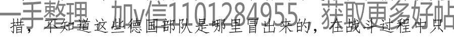

有两门火炮曾有过发射的机会，就被德军所消灭了。

德军如此神速的进展让斯米西威·雷兹元帅大惊失色，他明白了，他所面对是一个前所未有的强敌，他的师团已被包围在漫长的国境线上。（德国步兵师在前，装甲军在后），包围圈里的波军已经成了一块美味的夹心饼干。

这位忧心忡忡的老元帅烦诸了，得立即发电报向法国人求援，并询问他们何时才能获得有效的军事援助。

德军此时已经把最精锐部队全部用来进攻波兰，在法国边界上只剩下一些训练不足，人员缺少的德意志要塞师。

当然了，所谓的“德意志要师”只是一个很美妙的名字，他们的人员编制与装备实际相当于德军的团级单位，尽管人员如此匮乏，这样的要师也仅仅只有46个，而且全是步兵，法国陆军却能轻易动员100个师之多。

所以，斯米西格威·雷兹元帅希望法军能在西线发动一次强有力的进攻，迫使德军回防，这样法国方面的军事压力自然也就被减轻了。

很坏，同盟国陆军总司令甘特将军对斯米西格威·雷兹元帅的请求做出了回复：

甘肃的正规回复是这样的（原文的）：

> “在东北地区中，我们正规军的半数以上已经开始行动。我们占领了国界，敌军开始激烈战斗，我们已经取得了一些进展。可是我们被陷在静态战斗之中，而敌人对于防御却具有良好的准备，同时我们也缺乏必要的炮兵……从有机开始，就有空中的战斗与地面的作战配合，我们也知道相当部分的德国军队正是在与我们对抗。

> 所以已经履行了我事先所提出的诺言，在法国动员第一天后的14天，开始用我的主力发动进攻。我可能做得更多的事情。”

作者：万国咸天下 日期:2009-05-09 00:44

连载 12

斯米西格威·雷兹元帅接到这样的回复估计是很郁郁的：


原来一直所望的援助仅仅是连炮兵都没准备好的法国陆军。

而法国人简直是怎么做的呢？

是的，法国军队确实发动了进攻，并推进了几英里后就停了过来，理由倒是很充分：“给予德国人撤退的时间”。

然后，有些地地的法国军队根本不算军队，仅仅是几个巡逻兵，攻占了几座德国村庄，那里的哨兵成功逃跑，焚毁了德国。取得如此“辉煌”的战果后，摇大摆地回到自己的阵地。

糟糕的消息还不断从前线传来，让斯米西格威·雷兹元帅唯一感到慰藉的是：大体上，波兰的防线还是“完整”的。

外国记者回忆：双方在距离不远的地方，在休息的时候还点烟、互相交流，取得了很多帖子。双方是没有战斗的，普通军人都说：“战争在三星期内就会结束了”。这位忧心忡忡的老元帅烦诸了，得立即发电报向法国人求援，并询问他们何时才能获得有效的军事援助。

德军此时已经把最精锐部队全部用来进攻波兰，在法国边界上只剩下一些训练不足，人员缺少的德意志要塞师。

当然了，所谓的“德意志要师”只是一个很美妙的名字，他们的人员编制与装备实际相当于德军的团级单位，尽管人员如此匮乏，这样的要师也仅仅只有46个，而且全是步兵，法国陆军却能轻易动员100个师之多。

所以，斯米西格威·雷兹元帅希望法军能在西线发动一次强有力的进攻，迫使德军回防，这样法国方面的军事压力自然也就被减轻了。

很坏，同盟国陆军总司令甘特将军对斯米西格威·雷兹元帅的请求做出了回复：

甘肃的正规回复是这样的（原文的）：

> “在东北地区中，我们正规军的半数以上已经开始行动。我们占领了国界，敌军开始激烈战斗，我们已经取得了一些进展。可是我们被陷在静态战斗之中，而敌人对于防御却具有良好的准备，同时我们也缺乏必要的炮兵……从有机开始，就有空中的战斗与地面的作战配合，我们也知道相当部分的德国军队正是在与我们对抗。

> 所以已经履行了我事先所提出的诺言，在法国动员第一天后的14天，开始用我的主力发动进攻。我可能做得更多的事情。”

作者：万国咸天下 日期:2009-05-09 00:44

连载 12

斯米西格威·雷兹元帅接到这样的回复估计是很郁郁的：


原来一直所望的援助仅仅是连炮兵都没准备好的法国陆军。

而法国人简直是怎么做的呢？

是的，法国军队确实发动了进攻，并推进了几英里后就停了过来，理由倒是很充分：“给予德国人撤退的时间”。

然后，有些地地的法国军队根本不算军队，仅仅是几个巡逻兵，攻占了几座德国村庄，那里的哨兵成功逃跑，焚毁了德国。取得如此“辉煌”的战果后，摇大摆地回到自己的阵地。

糟糕的消息还不断从前线传来，让斯米西格威·雷兹元帅唯一感到慰藉的是：大体上，波兰的防线还是“完整”的。

外国记者回忆：双方在距离不远的地方，在休息的时候还点烟、互相交流，取得了很多帖子。双方是没有战斗的，普通军人都说：“战争在三星期内就会结束了”。这位忧心忡忡的老元帅烦诸了，得立即发电报向法国人求援，并询问他们何时才能获得有效的军事援助。

德军此时已经把最精锐部队全部用来进攻波兰，在法国边界上只剩下一些训练不足，人员缺少的德意志要塞师。

当然了，所谓的“德意志要师”只是一个很美妙的名字，他们的人员编制与装备实际相当于德军的团级单位，尽管人员如此匮乏，这样的要师也仅仅只有46个，而且全是步兵，法国陆军却能轻易动员100个师之多。

所以，斯米西格威·雷兹元帅希望法军能在西线发动一次强有力的进攻，迫使德军回防，这样法国方面的军事压力自然也就被减轻了。

很坏，同盟国陆军总司令甘特将军对斯米西格威·雷兹元帅的请求做出了回复：

甘肃的正规回复是这样的（原文的）：

> “在东北地区中，我们正规军的半数以上已经开始行动。我们占领了国界，敌军开始激烈战斗，我们已经取得了一些进展。可是我们被陷在静态战斗之中，而敌人对于防御却具有良好的准备，同时我们也缺乏必要的炮兵……从有机开始，就有空中的战斗与地面的作战配合，我们也知道相当部分的德国军队正是在与我们对抗。

> 所以已经履行了我事先所提出的诺言，在法国动员第一天后的14天，开始用我的主力发动进攻。我可能做得更多的事情。”

作者：万国咸天下 日期:2009-05-09 00:44

连载 12

斯米西格威·雷兹元帅接到这样的回复估计是很郁郁的：


原来一直所望的援助仅仅是连炮兵都没准备好的法国陆军。

而法国人简直是怎么做的呢？

是的，法国军队确实发动了进攻，并推进了几英里后就停了过来，理由倒是很充分：“给予德国人撤退的时间”。

然后，有些地地的法国军队根本不算军队，仅仅是几个巡逻兵，攻占了几座德国村庄，那里的哨兵成功逃跑，焚毁了德国。取得如此“辉煌”的战果后，摇大摆地回到自己的阵地。

糟糕的消息还不断从前线传来，让斯米西格威·雷兹元帅唯一感到慰藉的是：大体上，波兰的防线还是“完整”的。

外国记者回忆：双方在距离不远的地方，在休息的时候还点烟、互相交流，取得了很多帖子。双方是没有战斗的，普通军人都说：“战争在三星期内就会结束了”。这位忧心忡忡的老元帅烦诸了，得立即发电报向法国人求援，并询问他们何时才能获得有效的军事援助。

德军如此神速的进展让斯米西格威·雷兹元帅大惊失色，他明白了，他所面对是一个前所未有的强敌，他的师团已被包围在漫长的国境线上。（德国步兵师在前，装甲军在后），包围圈里的波军已经成了一块美味的夹心饼干。

由于德国空军的不断空袭，缺乏防空炮的波兰空军几乎惨重，他们的机场被毁，剩余的波兰空军连防空作战的机会都没有。

9月3日，古德里安的装甲军已经深入了波兰腹地150公里处，在当天下午，古德里安的装甲军完成了对国境线上仍在鏖战的波兰军队的包围，并很快拉起了一条封锁线，公路上彻底拆掉了德国的坦克。

那些前往前线增援的波兰军队根本不知道德国的装甲军已经到了他们的背后，一个波兰炮兵团正沿着公路向前线退，准确地包围了德国坦克也正着路急袭，他们准备


有两门火炮曾有过发射的机会，就被德军所消灭了。

德军如此神速的进展让斯米西威·雷兹元帅大惊失色，他明白了，他所面对是一个前所未有的强敌，他的师团已被包围在漫长的国境线上。（德国步兵师在前，装甲军在后），包围圈里的波军已经成了一块美味的夹心饼干。

这位忧心忡忡的老元帅烦诸了，得立即发电报向法国人求援，并询问他们何时才能获得有效的军事援助。

德军此时已经把最精锐部队全部用来进攻波兰，在法国边界上只剩下一些训练不足，人员缺少的德意志要塞师。

当然了，所谓的“德意志要师”只是一个很美妙的名字，他们的人员编制与装备实际相当于德军的团级单位，尽管人员如此匮乏，这样的要师也仅仅只有46个，而且全是步兵，法国陆军却能轻易动员100个师之多。

所以，斯米西格威·雷兹元帅希望法军能在西线发动一次强有力的进攻，迫使德军回防，这样法国方面的军事压力自然也就被减轻了。

很坏，同盟国陆军总司令甘特将军对斯米西格威·雷兹元帅的请求做出了回复：

甘肃的正规回复是这样的（原文的）：

> “在东北地区中，我们正规军的半数以上已经开始行动。我们占领了国界，敌军开始激烈战斗，我们已经取得了一些进展。可是我们被陷在静态战斗之中，而敌人对于防御却具有良好的准备，同时我们也缺乏必要的炮兵……从有机开始，就有空中的战斗与地面的作战配合，我们也知道相当部分的德国军队正是在与我们对抗。

> 所以已经履行了我事先所提出的诺言，在法国动员第一天后的14天，开始用我的主力发动进攻。我可能做得更多的事情。”

作者：万国咸天下 日期:2009-05-09 00:44

连载 12

斯米西格威·雷兹元帅接到这样的回复估计是很郁郁的：


原来一直所望的援助仅仅是连炮兵都没准备好的法国陆军。

而法国人简直是怎么做的呢？

是的，法国军队确实发动了进攻，并推进了几英里后就停了过来，理由倒是很充分：“给予德国人撤退的时间”。

然后，有些地地的法国军队根本不算军队，仅仅是几个巡逻兵，攻占了几座德国村庄，那里的哨兵成功逃跑，焚毁了德国。取得如此“辉煌”的战果后，摇大摆地回到自己的阵地。

糟糕的消息还不断从前线传来，让斯米西格威·雷兹元帅唯一感到慰藉的是：大体上，波兰的防线还是“完整”的。

外国记者回忆：双方在距离不远的地方，在休息的时候还点烟、互相交流，取得了很多帖子。双方是没有战斗的，普通军人都说：“战争在三星期内就会结束了”。这位忧心忡忡的老元帅烦诸了，得立即发电报向法国人求援，并询问他们何时才能获得有效的军事援助。

由于他所面对是一个前所未有的强敌，他的师团已被包围在漫长的国境线上。（德国步兵师在前，装甲军在后），包围圈里的波军已经成了一块美味的夹心饼干。

由于德国空军的不断空袭，缺乏防空炮的波兰空军几乎惨重，他们的机场被毁，剩余的波兰空军连防空作战的机会都没有。

9月3日，古德里安的装甲军已经深入了波兰腹地150公里处，在当天下午，古德里安的装甲军完成了对国境线上仍在鏖战的波兰军队的包围，并很快拉起了一条封锁线，公路上彻底拆掉了德国的坦克。

那些前往前线增援的波兰军队根本不知道德国的装甲军已经到了他们的背后，一个波兰炮兵团正沿着公路向前线退，准确地包围了德国坦克也正着路急袭，他们准备


有两门火炮曾有过发射的机会，就被德军所消灭了。

德军如此神速的进展让斯米西威·雷兹元帅大惊失色，他明白了，他所面对是一个前所未有的强敌，他的师团已被包围在漫长的国境线上。（德国步兵师在前，装甲军在后），包围圈里的波军已经成了一块美味的夹心饼干。

这位忧心忡忡的老元帅烦诸了，得立即发电报向法国人求援，并询问他们何时才能获得有效的军事援助。

德军此时已经把最精锐部队全部用来进攻波兰，在法国边界上只剩下一些训练不足，人员缺少的德意志要塞师。

当然了，所谓的“德意志要师”只是一个很美妙的名字，他们的人员编制与装备实际相当于德军的团级单位，尽管人员如此匮乏，这样的要师也仅仅只有46个，而且全是步兵，法国陆军却能轻易动员100个师之多。

所以，斯米西格威·雷兹元帅希望法军能在西线发动一次强有力的进攻，迫使德军回防，这样法国方面的军事压力自然也就被减轻了。

很坏，同盟国陆军总司令甘特将军对斯米西格威·雷兹元帅的请求做出了回复：

甘肃的正规回复是这样的（原文的）：

> “在东北地区中，我们正规军的半数以上已经开始行动。我们占领了国界，敌军开始激烈战斗，我们已经取得了一些进展。可是我们被陷在静态战斗之中，而敌人对于防御却具有良好的准备，同时我们也缺乏必要的炮兵……从有机开始，就有空中的战斗与地面的作战配合，我们也知道相当部分的德国军队正是在与我们对抗。

> 所以已经履行了我事先所提出的诺言，在法国动员第一天后的14天，开始用我的主力发动进攻。我可能做得更多的事情。”

作者：万国咸天下 日期:2009-05-09 00:44

连载 12

斯米西格威·雷兹元帅接到这样的回复估计是很郁郁的：


原来一直所望的援助仅仅是连炮兵都没准备好的法国陆军。

而法国人简直是怎么做的呢？

是的，法国军队确实发动了进攻，并推进了几英里后就停了过来，理由倒是很充分：“给予德国人撤退的时间”。

然后，有些地地的法国军队根本不算军队，仅仅是几个巡逻兵，攻占了几座德国村庄，那里的哨兵成功逃跑，焚毁了德国。取得如此“辉煌”的战果后，摇大摆地回到自己的阵地。

糟糕的消息还不断从前线传来，让斯米西格威·雷兹元帅唯一感到慰藉的是：大体上，波兰的防线还是“完整”的。

外国记者回忆：双方在距离不远的地方，在休息的时候还点烟、互相交流，取得了很多帖子。双方是没有战斗的，普通军人都说：“战争在三星期内就会结束了”。这位忧心忡忡的老元帅烦诸了，得立即发电报向法国人求援，并询问他们何时才能获得有效的军事援助。

由于他所面对是一个前所未有的强敌，他的师团已被包围在漫长的国境线上。（德国步兵师在前，装甲军在后），包围圈里的波军已经成了一块美味的夹心饼干。

由于德国空军的不断空袭，缺乏防空炮的波兰空军几乎惨重，他们的机场被毁，剩余的波兰空军连防空作战的机会都没有。

9月3日，古德里安的装甲军已经深入了波兰腹地150公里处，在当天下午，古德里安的装甲军完成了对国境线上仍在鏖战的波兰军队的包围，并很快拉起了一条封锁线，公路上彻底拆掉了德国的坦克。

那些前往前线增援的波兰军队根本不知道德国的装甲军已经到了他们的背后，一个波兰炮兵团正沿着公路向前线退，准确地包围了德国坦克也正着路急袭，他们准备


有两门火炮曾有过发射的机会，就被德军所消灭了。

德军如此神速的进展让斯米西威·雷兹元帅大惊失色，他明白了，他所面对是一个前所未有的强敌，他的师团已被包围在漫长的国境线上。（德国步兵师在前，装甲军在后），包围圈里的波军已经成了一块美味的夹心饼干。

这位忧心忡忡的老元帅烦诸了，得立即发电报向法国人求援，并询问他们何时才能获得有效的军事援助。

德军此时已经把最精锐部队全部用来进攻波兰，在法国边界上只剩下一些训练不足，人员缺少的德意志要塞师。

当然了，所谓的“德意志要师”只是一个很美妙的名字，他们的人员编制与装备实际相当于德军的团级单位，尽管人员如此匮乏，这样的要师也仅仅只有46个，而且全是步兵，法国陆军却能轻易动员100个师之多。

所以，斯米西格威·雷兹元帅希望法军能在西线发动一次强有力的进攻，迫使德军回防，这样法国方面的军事压力自然也就被减轻了。

很坏，同盟国陆军总司令甘特将军对斯米西格威·雷兹元帅的请求做出了回复：

甘肃的正规回复是这样的（原文的）：

> “在东北地区中，我们正规军的半数以上已经开始行动。我们占领了国界，敌军开始激烈战斗，我们已经取得了一些进展。可是我们被陷在静态战斗之中，而敌人对于防御却具有良好的准备，同时我们也缺乏必要的炮兵……从有机开始，就有空中的战斗与地面的作战配合，我们也知道相当部分的德国军队正是在与我们对抗。

> 所以已经履行了我事先所提出的诺言，在法国动员第一天后的14天，开始用我的主力发动进攻。我可能做得更多的事情。”

作者：万国咸天下 日期:2009-05-09 00:44

连载 12

斯米西格威·雷兹元帅接到这样的回复估计是很郁郁的：


原来一直所望的援助仅仅是连炮兵都没准备好的法国陆军。

而法国人简直是怎么做的呢？

是的，法国军队确实发动了进攻，并推进了几英里后就停了过来，理由倒是很充分：“给予德国人撤退的时间”。

然后，有些地地的法国军队根本不算军队，仅仅是几个巡逻兵，攻占了几座德国村庄，那里的哨兵成功逃跑，焚毁了德国。取得如此“辉煌”的战果后，摇大摆地回到自己的阵地。

糟糕的消息还不断从前线传来，让斯米西格威·雷兹元帅唯一感到慰藉的是：大体上，波兰的防线还是“完整”的。

外国记者回忆：双方在距离不远的地方，在休息的时候还点烟、互相交流，取得了很多帖子。双方是没有战斗的，普通军人都说：“战争在三星期内就会结束了”。这位忧心忡忡的老元帅烦诸了，得立即发电报向法国人求援，并询问他们何时才能获得有效的军事援助。

由于他所面对是一个前所未有的强敌，他的师团已被包围在漫长的国境线上。（德国步兵师在前，装甲军在后），包围圈里的波军已经成了一块美味的夹心饼干。

由于德国空军的不断空袭，缺乏防空炮的波兰空军几乎惨重，他们的机场被毁，剩余的波兰空军连防空作战的机会都没有。

9月3日，古德里安的装甲军已经深入了波兰腹地150公里处，在当天下午，古德里安的装甲军完成了对国境线上仍在鏖战的波兰军队的包围，并很快拉起了一条封锁线，公路上彻底拆掉了德国的坦克。

那些前往前线增援的波兰军队根本不知道德国的装甲军已经到了他们的背后，一个波兰炮兵团正沿着公路向前线退，准确地包围了德国坦克也正着路急袭，他们准备


有两门火炮曾有过发射的机会，就被德军所消灭了。

德军如此神速的进展让斯米西威·雷兹元帅大惊失色，他明白了，他所面对是一个前所未有的强敌，他的师团已被包围在漫长的国境线上。（德国步兵师在前，装甲军在后），包围圈里的波军已经成了一块美味的夹心饼干。

这位忧心忡忡的老元帅烦诸了，得立即发电报向法国人求援，并询问他们何时才能获得有效的军事援助。

德军此时已经把最精锐部队全部用来进攻波兰，在法国边界上只剩下一些训练不足，人员缺少的德意志要塞师。

当然了，所谓的“德意志要师”只是一个很美妙的名字，他们的人员编制与装备实际相当于德军的团级单位，尽管人员如此匮乏，这样的要师也仅仅只有46个，而且全是步兵，法国陆军却能轻易动员100个师之多。

所以，斯米西格威·雷兹元帅希望法军能在西线发动一次强有力的进攻，迫使德军回防，这样法国方面的军事压力自然也就被减轻了。

很坏，同盟国陆军总司令甘特将军对斯米西格威·雷兹元帅的请求做出了回复：

甘肃的正规回复是这样的（原文的）：

> “在东北地区中，我们正规军的半数以上已经开始行动。我们占领了国界，敌军开始激烈战斗，我们已经取得了一些进展。可是我们被陷在静态战斗之中，而敌人对于防御却具有良好的准备，同时我们也缺乏必要的炮兵……从有机开始，就有空中的战斗与地面的作战配合，我们也知道相当部分的德国军队正是在与我们对抗。

> 所以已经履行了我事先所提出的诺言，在法国动员第一天后的14天，开始用我的主力发动进攻。我可能做得更多的事情。”

作者：万国咸天下 日期:2009-05-09 00:44

连载 12

斯米西格威·雷兹元帅接到这样的回复估计是很郁郁的：


原来一直所望的援助仅仅是连炮兵都没准备好的法国陆军。

而法国人简直是怎么做的呢？

是的，法国军队确实发动了进攻，并推进了几英里后就停了过来，理由倒是很充分：“给予德国人撤退的时间”。

然后，有些地地的法国军队根本不算军队，仅仅是几个巡逻兵，攻占了几座德国村庄，那里的哨兵成功逃跑，焚毁了德国。取得如此“辉煌”的战果后，摇大摆地回到自己的阵地。

糟糕的消息还不断从前线传来，让斯米西格威·雷兹元帅唯一感到慰藉的是：大体上，波兰的防线还是“完整”的。

外国记者回忆：双方在距离不远的地方，在休息的时候还点烟、互相交流，取得了很多帖子。双方是没有战斗的，普通军人都说：“战争在三星期内就会结束了”。这位忧心忡忡的老元帅烦诸了，得立即发电报向法国人求援，并询问他们何时才能获得有效的军事援助。

由于他所面对是一个前所未有的强敌，他的师团已被包围在漫长的国境线上。（德国步兵师在前，装甲军在后），包围圈里的波军已经成了一块美味的夹心饼干。

由于德国空军的不断空袭，缺乏防空炮的波兰空军几乎惨重，他们的机场被毁，剩余的波兰空军连防空作战的机会都没有。

9月3日，古德里安的装甲军已经深入了波兰腹地150公里处，在当天下午，古德里安的装甲军完成了对国境线上仍在鏖战的波兰军队的包围，并很快拉起了一条封锁线，公路上彻底拆掉了德国的坦克。

那些前往前线增援的波兰军队根本不知道德国的装甲军已经到了他们的背后，一个波兰炮兵团正沿着公路向前线退，准确地包围了德国坦克也正着路急袭，他们准备


有两门火炮曾有过发射的机会，就被德军所消灭了。

德军如此神速的进展让斯米西威·雷兹元帅大惊失色，他明白了，他所面对是一个前所未有的强敌，他的师团已被包围在漫长的国境线上。（德国步兵师在前，装甲军在后），包围圈里的波军已经成了一块美味的夹心饼干。

这位忧心忡忡的老元帅烦诸了，得立即发电报向法国人求援，并询问他们何时才能获得有效的军事援助。

德军此时已经把最精锐部队全部用来进攻波兰，在法国边界上只剩下一些训练不足，人员缺少的德意志要塞师。

当然了，所谓的“德意志要师”只是一个很美妙的名字，他们的人员编制与装备实际相当于德军的团级单位，尽管人员如此匮乏，这样的要师也仅仅只有46个，而且全是步兵，法国陆军却能轻易动员100个师之多。

所以，斯米西格威·雷兹元帅希望法军能在西线发动一次强有力的进攻，迫使德军回防，这样法国方面的军事压力自然也就被减轻了。

很坏，同盟国陆军总司令甘特将军对斯米西格威·雷兹元帅的请求做出了回复：

甘肃的正规回复是这样的（原文的）：

> “在东北地区中，我们正规军的半数以上已经开始行动。我们占领了国界，敌军开始激烈战斗，我们已经取得了一些进展。可是我们被陷在静态战斗之中，而敌人对于防御却具有良好的准备，同时我们也缺乏必要的炮兵……从有机开始，就有空中的战斗与地面的作战配合，我们也知道相当部分的德国军队正是在与我们对抗。

> 所以已经履行了我事先所提出的诺言，在法国动员第一天后的14天，开始用我的主力发动进攻。我可能做得更多的事情。”

作者：万国咸天下 日期:2009-05-09 00:44

连载 12

斯米西格威·雷兹元帅接到这样的回复估计是很郁郁的：


原来一直所望的援助仅仅是连炮兵都没准备好的法国陆军。

而法国人简直是怎么做的呢？

是的，法国军队确实发动了进攻，并推进了几英里后就停了过来，理由倒是很充分：“给予德国人撤退的时间”。

然后，有些地地的法国军队根本不算军队，仅仅是几个巡逻兵，攻占了几座德国村庄，那里的哨兵成功逃跑，焚毁了德国。取得如此“辉煌”的战果后，摇大摆地回到自己的阵地。

糟糕的消息还不断从前线传来，让斯米西格威·雷兹元帅唯一感到慰藉的是：大体上，波兰的防线还是“完整”的。

外国记者回忆：双方在距离不远的地方，在休息的时候还点烟、互相交流，取得了很多帖子。双方是没有战斗的，普通军人都说：“战争在三星期内就会结束了”。这位忧心忡忡的老元帅烦诸了，得立即发电报向法国人求援，并询问他们何时才能获得有效的军事援助。

由于他所面对是一个前所未有的强敌，他的师团已被包围在漫长的国境线上。（德国步兵师在前，装甲军在后），包围圈里的波军已经成了一块美味的夹心饼干。

由于德国空军的不断空袭，缺乏防空炮的波兰空军几乎惨重，他们的机场被毁，剩余的波兰空军连防空作战的机会都没有。

9月3日，古德里安的装甲军已经深入了波兰腹地150公里处，在当天下午，古德里安的装甲军完成了对国境线上仍在鏖战的波兰军队的包围，并很快拉起了一条封锁线，公路上彻底拆掉了德国的坦克。

那些前往前线增援的波兰军队根本不知道德国的装甲军已经到了他们的背后，一个波兰炮兵团正沿着公路向前线退，准确地包围了德国坦克也正着路急袭，他们准备


有两门火炮曾有过发射的机会，就被德军所消灭了。

德军如此神速的进展让斯米西威·雷兹元帅大惊失色，他明白了，他所面对是一个前所未有的强敌，他的师团已被包围在漫长的国境线上。（德国步兵师在前，装甲军在后），包围圈里的波军已经成了一块美味的夹心饼干。

这位忧心忡忡的老元帅烦诸了，得立即发电报向法国人求援，并询问他们何时才能获得有效的军事援助。

德军此时已经把最精锐部队全部用来进攻波兰，在法国边界上只剩下一些训练不足，人员缺少的德意志要塞师。

当然了，所谓的“德意志要师”只是一个很美妙的名字，他们的人员编制与装备实际相当于德军的团级单位，尽管人员如此匮乏，这样的要师也仅仅只有46个，而且全是步兵，法国陆军却能轻易动员100个师之多。

所以，斯米西格威·雷兹元帅希望法军能在西线发动一次强有力的进攻，迫使德军回防，这样法国方面的军事压力自然也就被减轻了。

很坏，同盟国陆军总司令甘特将军对斯米西格威·雷兹元帅的请求做出了回复：

甘肃的正规回复是这样的（原文的）：

> “在东北地区中，我们正规军的半数以上已经开始行动。我们占领了国界，敌军开始激烈战斗，我们已经取得了一些进展。可是我们被陷在静态战斗之中，而敌人对于防御却具有良好的准备，同时我们也缺乏必要的炮兵……从有机开始，就有空中的战斗与地面的作战配合，我们也知道相当部分的德国军队正是在与我们对抗。

> 所以已经履行了我事先所提出的诺言，在法国动员第一天后的14天，开始用我的主力发动进攻。我可能做得更多的事情。”

作者：万国咸天下 日期:2009-05-09 00:44

连载 12

斯米西格威·雷兹元帅接到这样的回复估计是很郁郁的：


原来一直所望的援助仅仅是连炮兵都没准备好的法国陆军。

而法国人简直是怎么做的呢？

是的，法国军队确实发动了进攻，并推进了几英里后就停了过来，理由倒是很充分：“给予德国人撤退的时间”。

然后，有些地地的法国军队根本不算军队，仅仅是几个巡逻兵，攻占了几座德国村庄，那里的哨兵成功逃跑，焚毁了德国。取得如此“辉煌”的战果后，摇大摆地回到自己的阵地。

糟糕的消息还不断从前线传来，让斯米西格威·雷兹元帅唯一感到慰藉的是：大体上，波兰的防线还是“完整”的。

外国记者回忆：双方在距离不远的地方，在休息的时候还点烟、互相交流，取得了很多帖子。双方是没有战斗的，普通军人都说：“战争在三星期内就会结束了”。这位忧心忡忡的老元帅烦诸了，得立即发电报向法国人求援，并询问他们何时才能获得有效的军事援助。

由于他所面对是一个前所未有的强敌，他的师团已被包围在漫长的国境线上。（德国步兵师在前，装甲军在后），包围圈里的波军已经成了一块美味的夹心饼干。

由于德国空军的不断空袭，缺乏防空炮的波兰空军几乎惨重，他们的机场被毁，剩余的波兰空军连防空作战的机会都没有。

9月3日，古德里安的装甲军已经深入了波兰腹地150公里处，在当天下午，古德里安的装甲军完成了对国境线上仍在鏖战的波兰军队的包围，并很快拉起了一条封锁线，公路上彻底拆掉了德国的坦克。

那些前往前线增援的波兰军队根本不知道德国的装甲军已经到了他们的背后，一个波兰炮兵团正沿着公路向前线退，准确地包围了德国坦克也正着路急袭，他们准备


有两门火炮曾有过发射的机会，就被德军所消灭了。

德军如此神速的进展让斯米西威·雷兹元帅大惊失色，他明白了，他所面对是一个前所未有的强敌，他的师团已被包围在漫长的国境线上。（德国步兵师在前，装甲军在后），包围圈里的波军已经成了一块美味的夹心饼干。

这位忧心忡忡的老元帅烦诸了，得立即发电报向法国人求援，并询问他们何时才能获得有效的军事援助。

德军此时已经把最精锐部队全部用来进攻波兰，在法国边界上只剩下一些训练不足，人员缺少的德意志要塞师。

当然了，所谓的“德意志要师”只是一个很美妙的名字，他们的人员编制与装备实际相当于德军的团级单位，尽管人员如此匮乏，这样的要师也仅仅只有46个，而且全是步兵，法国陆军却能轻易动员100个师之多。

所以，斯米西格威·雷兹元帅希望法军能在西线发动一次强有力的进攻，迫使德军回防，这样法国方面的军事压力自然也就被减轻了。

很坏，同盟国陆军总司令甘特将军对斯米西格威·雷兹元帅的请求做出了回复：

甘肃的正规回复是这样的（原文的）：

> “在东北地区中，我们正规军的半数以上已经开始行动。我们占领了国界，敌军开始激烈战斗，我们已经取得了一些进展。可是我们被陷在静态战斗之中，而敌人对于防御却具有良好的准备，同时我们也缺乏必要的炮兵……从有机开始，就有空中的战斗与地面的作战配合，我们也知道相当部分的德国军队正是在与我们对抗。

> 所以已经履行了我事先所提出的诺言，在法国动员第一天后的14天，开始用我的主力发动进攻。我可能做得更多的事情。”

作者：万国咸天下 日期:2009-05-09 00:44

连载 12

斯米西格威·雷兹元帅接到这样的回复估计是很郁郁的：


原来一直所望的援助仅仅是连炮兵都没准备好的法国陆军。

而法国人简直是怎么做的呢？

是的，法国军队确实发动了进攻，并推进了几英里后就停了过来，理由倒是很充分：“给予德国人撤退的时间”。

然后，有些地地的法国军队根本不算军队，仅仅是几个巡逻兵，攻占了几座德国村庄，那里的哨兵成功逃跑，焚毁了德国。取得如此“辉煌”的战果后，摇大摆地回到自己的阵地。

糟糕的消息还不断从前线传来，让斯米西格威·雷兹元帅唯一感到慰藉的是：大体上，波兰的防线还是“完整”的。

外国记者回忆：双方在距离不远的地方，在休息的时候还点烟、互相交流，取得了很多帖子。双方是没有战斗的，普通军人都说：“战争在三星期内就会结束了”。这位忧心忡忡的老元帅烦诸了，得立即发电报向法国人求援，并询问他们何时才能获得有效的军事援助。

由于他所面对是一个前所未有的强敌，他的师团已被包围在漫长的国境线上。（德国步兵师在前，装甲军在后），包围圈里的波军已经成了一块美味的夹心饼干。

由于德国空军的不断空袭，缺乏防空炮的波兰空军几乎惨重，他们的机场被毁，剩余的波兰空军连防空作战的机会都没有。

9月3日，古德里安的装甲军已经深入了波兰腹地150公里处，在当天下午，古德里安的装甲军完成了对国境线上仍在鏖战的波兰军队的包围，并很快拉起了一条封锁线，公路上彻底拆掉了德国的坦克。

那些前往前线增援的波兰军队根本不知道德国的装甲军已经到了他们的背后，一个波兰炮兵团正沿着公路向前线退，准确地包围了德国坦克也正着路急袭，他们准备


有两门火炮曾有过发射的机会，就被德军所消灭了。

德军如此神速的进展让斯米西威·雷兹元帅大惊失色，他明白了，他所面对是一个前所未有的强敌，他的师团已被包围在漫长的国境线上。（德国步兵师在前，装甲军在后），包围圈里的波军已经成了一块美味的夹心饼干。

这位忧心忡忡的老元帅烦诸了，得立即发电报向法国人求援，并询问他们何时才能获得有效的军事援助。

德军此时已经把最精锐部队全部用来进攻波兰，在法国边界上只剩下一些训练不足，人员缺少的德意志要塞师。

当然了，所谓的“德意志要师”只是一个很美妙的名字，他们的人员编制与装备实际相当于德军的团级单位，尽管人员如此匮乏，这样的要师也仅仅只有46个，而且全是步兵，法国陆军却能轻易动员100个师之多。

所以，斯米西格威·雷兹元帅希望法军能在西线发动一次强有力的进攻，迫使德军回防，这样法国方面的军事压力自然也就被减轻了。

很坏，同盟国陆军总司令甘特将军对斯米西格威·雷兹元帅的请求做出了回复：

甘肃的正规回复是这样的（原文的）：

> “在东北地区中，我们正规军的半数以上已经开始行动。我们占领了国界，敌军开始激烈战斗，我们已经取得了一些进展。可是我们被陷在静态战斗之中，而敌人对于防御却具有良好的准备，同时我们也缺乏必要的炮兵……从有机开始，就有空中的战斗与地面的作战配合，我们也知道相当部分的德国军队正是在与我们对抗。

> 所以已经履行了我事先所提出的诺言，在法国动员第一天后的14天，开始用我的主力发动进攻。我可能做得更多的事情。”

作者：万国咸天下 日期:2009-05-09 00:44

连载 12

斯米西格威·雷兹元帅接到这样的回复估计是很郁郁的：


原来一直所望的援助仅仅是连炮兵都没准备好的法国陆军。

而法国人简直是怎么做的呢？

是的，法国军队确实发动了进攻，并推进了几英里后就停了过来，理由倒是很充分：“给予德国人撤退的时间”。

然后，有些地地的法国军队根本不算军队，仅仅是几个巡逻兵，攻占了几座德国村庄，那里的哨兵成功逃跑，焚毁了德国。取得如此“辉煌”的战果后，摇大摆地回到自己的阵地。

糟糕的消息还不断从前线传来，让斯米西格威·雷兹元帅唯一感到慰藉的是：大体上，波兰的防线还是“完整”的。

外国记者回忆：双方在距离不远的地方，在休息的时候还点烟、互相交流，取得了很多帖子。双方是没有战斗的，普通军人都说：“战争在三星期内就会结束了”。这位忧心忡忡的老元帅烦诸了，得立即发电报向法国人求援，并询问他们何时才能获得有效的军事援助。

由于他所面对是一个前所未有的强敌，他的师团已被包围在漫长的国境线上。（德国步兵师在前，装甲军在后），包围圈里的波军已经成了一块美味的夹心饼干。

由于德国空军的不断空袭，缺乏防空炮的波兰空军几乎惨重，他们的机场被毁，剩余的波兰空军连防空作战的机会都没有。

9月3日，古德里安的装甲军已经深入了波兰腹地150公里处，在当天下午，古德里安的装甲军完成了对国境线上仍在鏖战的波兰军队的包围，并很快拉起了一条封锁线，公路上彻底拆掉了德国的坦克。

那些前往前线增援的波兰军队根本不知道德国的装甲军已经到了他们的背后，一个波兰炮兵团正沿着公路向前线退，准确地包围了德国坦克也正着路急袭，他们准备


有两门火炮曾有过发射的机会，就被德军所消灭了。

德军如此神速的进展让斯米西威·雷兹元帅大惊失色，他明白了，他所面对是一个前所未有的强敌，他的师团已被包围在漫长的国境线上。（德国步兵师在前，装甲军在后），包围圈里的波军已经成了一块美味的夹心饼干。

这位忧心忡忡的老元帅烦诸了，得立即发电报向法国人求援，并询问他们何时才能获得有效的军事援助。

德军此时已经把最精锐部队全部用来进攻波兰，在法国边界上只剩下一些训练不足，人员缺少的德意志要塞师。

当然了，所谓的“德意志要师”只是一个很美妙的名字，他们的人员编制与装备实际相当于德军的团级单位，尽管人员如此匮乏，这样的要师也仅仅只有46个，而且全是步兵，法国陆军却能轻易动员100个师之多。

所以，斯米西格威·雷兹元帅希望法军能在西线发动一次强有力的进攻，迫使德军回防，这样法国方面的军事压力自然也就被减轻了。

很坏，同盟国陆军总司令甘特将军对斯米西格威·雷兹元帅的请求做出了回复：

甘肃的正规回复是这样的（原文的）：

> “在东北地区中，我们正规军的半数以上已经开始行动。我们占领了国界，敌军开始激烈战斗，我们已经取得了一些进展。可是我们被陷在静态战斗之中，而敌人对于防御却具有良好的准备，同时我们也缺乏必要的炮兵……从有机开始，就有空中的战斗与地面的作战配合，我们也知道相当部分的德国军队正是在与我们对抗。

> 所以已经履行了我事先所提出的诺言，在法国动员第一天后的14天，开始用我的主力发动进攻。我可能做得更多的事情。”

作者：万国咸天下 日期:2009-05-09 00:44

连载 12

斯米西格威·雷兹元帅接到这样的回复估计是很郁郁的：


原来一直所望的援助仅仅是连炮兵都没准备好的法国陆军。

而法国人简直是怎么做的呢？

是的，法国军队确实发动了进攻，并推进了几英里后就停了过来，理由倒是很充分：“给予德国人撤退的时间”。

然后，有些地地的法国军队根本不算军队，仅仅是几个巡逻兵，攻占了几座德国村庄，那里的哨兵成功逃跑，焚毁了德国。取得如此“辉煌”的战果后，摇大摆地回到自己的阵地。

糟糕的消息还不断从前线传来，让斯米西格威·雷兹元帅唯一感到慰藉的是：大体上，波兰的防线还是“完整”的。

外国记者回忆：双方在距离不远的地方，在休息的时候还点烟、互相交流，取得了很多帖子。双方是没有战斗的，普通军人都说：“战争在三星期内就会结束了”。这位忧心忡忡的老元帅烦诸了，得立即发电报向法国人求援，并询问他们何时才能获得有效的军事援助。

由于他所面对是一个前所未有的强敌，他的师团已被包围在漫长的国境线上。（德国步兵师在前，装甲军在后），包围圈里的波军已经成了一块美味的夹心饼干。

由于德国空军的不断空袭，缺乏防空炮的波兰空军几乎惨重，他们的机场被毁，剩余的波兰空军连防空作战的机会都没有。

9月3日，古德里安的装甲军已经深入了波兰腹地150公里处，在当天下午，古德里安的装甲军完成了对国境线上仍在鏖战的波兰军队的包围，并很快拉起了一条封锁线，公路上彻底拆掉了德国的坦克。

那些前往前线增援的波兰军队根本不知道德国的装甲军已经到了他们的背后，一个波兰炮兵团正沿着公路向前线退，准确地包围了德国坦克也正着路急袭，他们准备


有两门火炮曾有过发射的机会，就被德军所消灭了。

德军如此神速的进展让斯米西威·雷兹元帅大惊失色，他明白了，他所面对是一个前所未有的强敌，他的师团已被包围在漫长的国境线上。（德国步兵师在前，装甲军在后），包围圈里的波军已经成了一块美味的夹心饼干。

这位忧心忡忡的老元帅烦诸了，得立即发电报向法国人求援，并询问他们何时才能获得有效的军事援助。

德军此时已经把最精锐部队全部用来进攻波兰，在法国边界上只剩下一些训练不足，人员缺少的德意志要塞师。

当然了，所谓的“德意志要师”只是一个很美妙的名字，他们的人员编制与装备实际相当于德军的团级单位，尽管人员如此匮乏，这样的要师也仅仅只有46个，而且全是步兵，法国陆军却能轻易动员100个师之多。

所以，斯米西格威·雷兹元帅希望法军能在西线发动一次强有力的进攻，迫使德军回防，这样法国方面的军事压力自然也就被减轻了。

很坏，同盟国陆军总司令甘特将军对斯米西格威·雷兹元帅的请求做出了回复：

甘肃的正规回复是这样的（原文的）：

> “在东北地区中，我们正规军的半数以上已经开始行动。我们占领了国界，敌军开始激烈战斗，我们已经取得了一些进展。可是我们被陷在静态战斗之中，而敌人对于防御却具有良好的准备，同时我们也缺乏必要的炮兵……从有机开始，就有空中的战斗与地面的作战配合，我们也知道相当部分的德国军队正是在与我们对抗。

> 所以已经履行了我事先所提出的诺言，在法国动员第一天后的14天，开始用我的主力发动进攻。我可能做得更多的事情。”

作者：万国咸天下 日期:2009-05-09 00:44

连载 12

斯米西格威·雷兹元帅接到这样的回复估计是很郁郁的：


原来一直所望的援助仅仅是连炮兵都没准备好的法国陆军。

而法国人简直是怎么做的呢？

是的，法国军队确实发动了进攻，并推进了几英里后就停了过来，理由倒是很充分：“给予德国人撤退的时间”。

然后，有些地地的法国军队根本不算军队，仅仅是几个巡逻兵，攻占了几座德国村庄，那里的哨兵成功逃跑，焚毁了德国。取得如此“辉煌”的战果后，摇大摆地回到自己的阵地。

糟糕的消息还不断从前线传来，让斯米西格威·雷兹元帅唯一感到慰藉的是：大体上，波兰的防线还是“完整”的。

外国记者回忆：双方在距离不远的地方，在休息的时候还点烟、互相交流，取得了很多帖子。双方是没有战斗的，普通军人都说：“战争在三星期内就会结束了”。这位忧心忡忡的老元帅烦诸了，得立即发电报向法国人求援，并询问他们何时才能获得有效的军事援助。

由于他所面对是一个前所未有的强敌，他的师团已被包围在漫长的国境线上。（德国步兵师在前，装甲军在后），包围圈里的波军已经成了一块美味的夹心饼干。

由于德国空军的不断空袭，缺乏防空炮的波兰空军几乎惨重，他们的机场被毁，剩余的波兰空军连防空作战的机会都没有。

9月3日，古德里安的装甲军已经深入了波兰腹地150公里处，在当天下午，古德里安的装甲军完成了对国境线上仍在鏖战的波兰军队的包围，并很快拉起了一条封锁线，公路上彻底拆掉了德国的坦克。

那些前往前线增援的波兰军队根本不知道德国的装甲军已经到了他们的背后，一个波兰炮兵团正沿着公路向前线退，准确地包围了德国坦克也正着路急袭，他们准备


有两门火炮曾有过发射的机会，就被德军所消灭了。

德军如此神速的进展让斯米西威·雷兹元帅大惊失色，他明白了，他所面对是一个前所未有的强敌，他的师团已被包围在漫长的国境线上。（德国步兵师在前，装甲军在后），包围圈里的波军已经成了一块美味的夹心饼干。

这位忧心忡忡的老元帅烦诸了，得立即发电报向法国人求援，并询问他们何时才能获得有效的军事援助。

德军此时已经把最精锐部队全部用来进攻波兰，在法国边界上只剩下一些训练不足，人员缺少的德意志要塞师。

当然了，所谓的“德意志要师”只是一个很美妙的名字，他们的人员编制与装备实际相当于德军的团级单位，尽管人员如此匮乏，这样的要师也仅仅只有46个，而且全是步兵，法国陆军却能轻易动员100个师之多。

所以，斯米西格威·雷兹元帅希望法军能在西线发动一次强有力的进攻，迫使德军回防，这样法国方面的军事压力自然也就被减轻了。

...（此处省略重复逻辑部分，保持后续语义连贯）

斯米西格威·雷兹元帅接到这样的回复估计是很郁郁的：

...已经失去对部队的控制，波兰大部分地区停止抵抗，只有华沙等少数地区的波军仍在战斗。25日德军开始进攻华沙城，为了减少伤亡，陆军统帅部决定炮轰华沙城，空军也赶来轰热，前一天还坚持抵抗到的华沙守军司令令于9月27日停止抵抗。至10月2日波兰完全被征服了，全部被德国和苏联占领。在此为期一月的波兰战役落帷幕，战炮声渐弱停止，波兰大地重新恢复，然而一个主权国家已倒下。


此时，小毛奇修改了施里芬伯计划，因为他担心左军八师的力量过于薄弱，不能抵挡法军。又害怕东线的防御兵力太单薄，抵挡不住了俄军，反而他什么都错，优柔寡断，缺乏信心。

因此，他通过削弱右翼兵力而增强左军，把施里芬伯原计划的主攻兵力的79个师，削弱到了53个师，这个修改可以说是致命的，施里芬临前的终焉终于成为事实。

小毛奇太天才的敌人，使得他的进攻在离巴黎仅15英里以外的地方，失去了进攻力，德国士兵虽然已经达到了马恩河北岸，但全部疲惫不堪。士兵们全部都累趴在地上，连说话的力气都没有了。

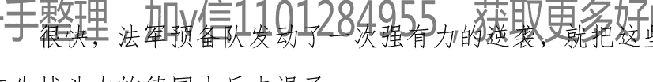

惨败的法军被打溃了，逐渐削弱了战斗力，最终被精疲力竭的德国士兵击退了。

接下来的故事大家都知道，就是马恩战役，此时战局已经完全脱离施里芬计划，但是小毛奇不做任何部署的改变却令进攻，结果德国军偷袭，至此，施里芬伯爵瞬间秒杀了法国的战略计划全面失败。最后，德国人不得不面对一个残酷的事实——持久战！

如若小毛奇遵照施里芬伯爵的临终遗言，不用削弱右军主攻兵力，那些已经到达马恩河北岸的部队，完全可以被预备队替换下去去休息，就算法军预备队发动反击，所面对的也不是德国军事主力了。

所以我说，毛奇根本没有理解“施里芬计划”的精髓所在，难道他不知道右翼已经被削弱到经不起任何意外了吗？一向谨慎的法国人，怎么可能在巴黎陷入危急时候，反倒去进攻德国腹部的鲁尔工业区呢？

以上就是“施里芬计划”，以及及其的实施者小毛奇。虽然这话还很长，但很有必要。

我们再回到1939年，希特勒战胜波兰不久，波兰战役的胜利，以及此时苏联的态度，德国免了后顾之忧，希特勒为将们们打打气：“德国终于有一次，不必要两线作战的机会了。”

满意的希特勒，立即指示陆军帅部尽快制定一个征服英国军队的方案。

很快，报告送上来了。依旧依然是“施里芬计划”，为蓝本。

该计划由陆军总司令希望，和他那忠心耿耿的参谋哈尔德德国上将制定的。同时，计划也是陆军帅部有史以来最靠谱的计划，拿到该计划的希特勒差点没击过去。

作者：万国威威天下平 日期：2009-05-10 23:38

连载17
我们来看看看到是什么神作让元首先生如此伤心呢，现在，我们权且把它认之为山寨版的“施里芬计划”。该行动计划在法国北部地区，也就是德国的右翼集结强大的兵力组成的B集团军群，从正面击破在比利时境内所要遭遇到的英法盟军。然后，用较弱的A集团军群予以掩护其南面的侧面，以保障B集团军群的进攻不至于受到干扰。

① 该计划的作战目标是尽可能击溃法军最大单位，占领比利时的海岸线，将来将对英、法两国的海战和空战建立新的港口与机场。

很厉害吧，他确实是“施里芬计划”的翻版。

我们现在来分析一下计划。首先，它与施里芬计划一样，都是依靠强有力的右翼集团绕过马奇诺线，深入荷兰、比利时直抵海岸。然后，一路扫荡，经过比利时平原要直接入侵法国胜利，获取更多。

但是这个计划有一点不同于施里芬计划，大的不同。那就是，施里芬计划是德国军的主力在比利时平原后要插入法国腹地，然后以巴黎为轴心，像一扇巨大的旋转门一样旋转巴黎外的法国各集团军进行围转运动，最后旋转到法国各集团军的背后，从背后进攻，并举拿下巴黎。更直观的来说就是——施里芬计划的核心是一战定胜负；打下巴黎城，或者，全线崩溃。

所以，为什么在“施里芬计划”失败后小毛奇心向德皇帝报告：“陛下，我们输掉了这场战争。”

但是这个山寨版“施里芬计划”太老土了，这种调重头弹，盟军早就有了准备。实在德军陷入波兰苦战的时候，法国最高统帅部已经做出了一份军事备忘录，并对以下三点达成了共识：

- 1. 德军不能正面攻坚坚固的法德边界上的马奇诺线。
- 2. 德军的登山地森林是限制大兵团运动的区域，尤其是装甲部队。
- 3. 德军进攻方案不能超出施里芬计划的范围，很可能还是上次大战的老路。

所以，毛奇根本没有理解“施里芬计划”的精髓所在，难道他不知道右翼已经被削弱到经不起任何意外了吗？

一向谨慎的法国，法国陆军精锐的部队部署在法国北部，做出一副架势，等德军进攻取得成功。

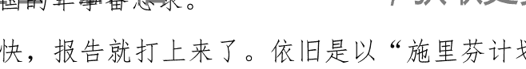

作者：万国威威天下平 日期：2009-05-10 23:38

连载17
此时我们应该清晰看出，德军的优势是在运用机械部队的理念比同盟国更高。一步打算，就算德国士兵突然起义，或者正面进攻了，达到的战略目的仅仅是占领一块土地，获得几个港口，这样的整个战略是无事无补的。

德国军首先应该考虑的问题是：如何避免持久战。而且这个计划和长久以来陆军帅部奉行的战略思想是违的，即：一战定胜负。

这样，该计划不仅丧失了行动。

- 1. 德军不能正面攻坚坚固的法德边界上的马奇诺线。
- 2. 德军的登山地森林是限制大兵团运动的区域，尤其是装甲部队。
- 3. 德军进攻方案不能超出施里芬计划的范围，很可能还是上次大战的老路。

所以，毛奇根本没有理解“施里芬计划”的精髓所在，难道他不知道右翼已经被削弱到经不起任何意外了吗？

一向谨慎的法国人，怎么可能在巴黎陷入危急时候，反倒去进攻德国腹部的鲁尔工业区呢？

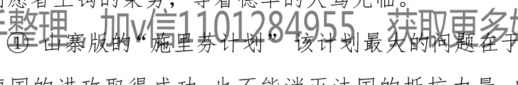

作者：万国威威天下平 日期：2009-05-10 23:38

连载18
此时我们应该清晰看出，德军的优势是在运用机械部队的理念比同盟国更高。一步打算，就算德国士兵突然起义，或者正面进攻了，达到的战略目的仅仅是占领一块土地，获得几个港口，这样的整个战略是无事无补的。德国军首先应该考虑的问题是：如何避免持久战。而且这个计划和长久以来陆军帅部奉行的战略思想是违的，即：一战定胜负。

这样，该计划不仅丧失了行动。

- 1. 德军不能正面攻坚坚固的法德边界上的马奇诺线。
- 2. 德军的登山地森林是限制大兵团运动的区域，尤其是装甲部队。
- 3. 德军进攻方案不能超出施里芬计划的范围，很可能还是上次大战的老路。

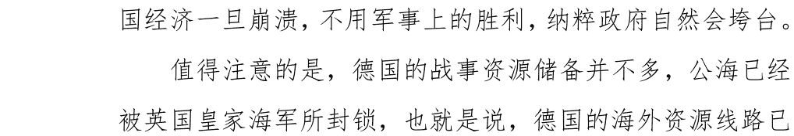

作者：万国威威天下平 日期：2009-05-10 23:38

连载18
但他们想不到的是，战争开始不久，英国皇家海军就加强了封锁，每天在大西洋从北极圈——南西洋，有起码上百艘英国舰和潜艇在广阔的大洋上巡弋，以捕捉这些“德国偷客”。英国人的如此围捕是相当成功的。战争开始的两个星期，英国就收获了这样的德国船十五万艘多，这种无风险买卖，比德国潜艇所击沉的德国海军还要多出六万千艘。最后，那些郁闷的德国船长，为了不被英国人俘获，往往选择把船自行沉没。

这样，希特勒的小小子彻底失败了，海外资源线路彻底断绝。这时德国所依靠的，只有苏联这个不靠谱的盟友的支持。煤矿、木材、粮食、石油都得从苏联进口。当然，这些原料也是高昂的。希特勒下令，“向德国送交物资应当当先于德国部队。”德国甚至一度把尚未完工的巡洋舰——卢芬号也贴给莫斯科方面抵付一部分现款。

德国海军将雷德尔甚至提议，把世界上最大的战舰，就是大名鼎鼎的莱斯麦号纸高价卖给苏联。前提是，只要苏联人愿意付出高昂的价格，这有何不可呢？

这就是德国惨的现状，所以希特勒希望西线的战争越早爆发越对德国有利。但是这个山寨版的“施里芬计划”只能使德国陷入长期的迷迷之中。在正希特勒头痛之时，有一位名不经气的德国A集团军群参谋长，提出了不同的声音。

作者:万国威威天下 日期:2009-05-11 18:46

连载19
此人正是弗里茨·埃里希·冯·夏施坦因。两年后，他将在东线战场大放异彩，但是现在，他只是一个默默无闻的将。

1939年10月初，陆军帅部的计划经过希特勒的稍加修改，定名为“黄色计划”，并很快就到达了指挥部。拿到这个计划后，夏施坦因就提出了不同的声音。夏施坦后来回忆道：“对于这次作战决定的计划，我最初的反应是感性的而不是理性的。看来陆军总部的战略意图，其本质完全是模仿1914年的施里芬计划。我感到的是一种耻辱，这一代人类不能做出比较好的计划，而还要抄袭，何况这个计划过去早就用过一次，而且敌人对于它已经充分的警戒。”

以上为曼施坦因缘不好，连他的手下都承认，陆军司令哈尔德非常不喜欢。

1939年10月下旬，曼施坦的新计划终于完成。立刻递交希特勒。结果，计划被撤回，再递回，再撤回，再递回，往返6次，曼施坦一无所获。曼施坦想通过陆军帅部转递希特勒，文件也被扣了下来。仅仅是因为哈尔德太妄了，陆军帅部根本没有和西方国家打仗的勇气，他们建议与西方国家达成共识。陆军帅部的高官们已经做出了除掉希特勒计划，并誓言与纳粹党不立，某些密者开始在中立国家进行接触。英国人对这一提议很有，甚至做出保证，只要希特勒死亡，西方国家愿意与德国政府进行谈判。在这些密者把规划得井井有条的时候，突然发现了一个棘手的问题无法解决，即：谁自动去除希特勒呢？大家都怀着期待的目光看着哈尔德，因为他是德意志的首脑。可是哈尔德是一个老滑头，一点敢胆都没有。特别是希特勒在场的时候，就像看仇人一样拉起一手。

作者：万国威威天下平 日期：2009-05-11 18:51

连载20
勃劳希要是不是没有这种勇气，虽然大部分的史学家以此证明勃劳希和哈尔德缺少果敢和决心。但我认为，他们并不是害怕希特勒，而是德意志不得不承认一个既定事实：除了希特勒，没有人能驾驭德国，假如希特勒被杀死，德国将会混乱。

陆军帅部拥有军权在手，但西方国家或者苏俄趁着德国内乱来浑水摸鱼，这种责任谁也担不起。既然没有人愿意承担风险，于是这个推翻希特勒政权的秘密计划就成了这样头蛇尾。勃罗斯希只得转变策略，他先接受了希特勒的决定，又从长计，慢慢说服希特勒接受他的看法。为争取时间，勃罗斯希采取了推延的办法，以波兰的德国主力需要时间调整调度和补充为由，屡次推迟了进攻的时间。进入冬季后，他又以天气不佳为由，要求将进攻推迟到1940年春天。关于这样的推迟在整个1939年秋季期间，就有15次之多。

1939年11月5日与希特勒的会议上，勃罗斯希再次以王将军的方式，试图增加希特勒的好处，由于其不符合要求的，遭了希特勒的严厉斥责。勃罗斯希当时愚蠢地提出：“在波兰的军队缺乏精神，甚至有些部队在‘兵变’以及前线的无组织无纪律。”甚至拿出1939年陆军的情况与1918年第二帝国之前的陆军状况相比比较。

希特勒一开始还默默沉默，最后突然从椅子上跳起来，勃然大怒的大声嚷：“陆军总司令竟给希特勒抹黑，简直不可思议”。勃罗斯希继续坚持自己的观点，希特勒反唇击道：“谁发动兵变，哪一部部队无组织纪律，报上来来”。

这次会谈说很恐怖，希特勒至少要求其他人员都出去，让那位可怜的陆军总司令单独。吵到何种程度无人知，哈尔德事后回忆：第二天晚上，他听到希特勒叫他，门走进房间，却发现他正在梦中和希特勒吵架！

到底从一开始开始，希特勒就不愿意靠近。所以这个时候，曼施坦跑出来，拿出进攻计划给希特勒看，不是曼施坦因为了解内情，所以通过不同渠道不断向希特勒递，最后曼施坦被彻底搞烦了，于是下令把曼施坦提升为38军长。这种提升其实是明显的，曼施坦之前担任A集团军参谋长，虽然没有直接指挥部队的权力，可是拥有合法的发言权和制定计划的权力。但是，希特勒突然表示：出于对陆军的尊重，要亲自召见5个军长，曼施坦也是之一。

1940年2月17日，柏林总统府，希特勒招待了五位新任军长。在此期间，曼施坦就此要求与希特勒面谈，他的作战计划。在宴的时候，希特勒声称：“德国科学家将发明一种新武器叫做直升机，还有一种远程导弹能够从柏林发射一直可以打到英伦岛。”听众们听得津津有味，曼施坦却对这些全然提不起兴趣，他非常焦虑，他生怕希特勒没有传达他的请求，希特勒也没做出任何暗示，而且这种正式的宴会上提出来是非常不礼的行为。当宴结束时，其他四位军长都起身告退，曼施坦却原座不动。

不过多久，希特勒走了过来低语：“元首要单独召回你”。

随后在希特勒的书房里，曼施坦详细的说出了他的作战计划。（该计划就是与“施里芬”齐名的“曼施坦计划”，这是李德哈特德国国史时添上的名字，当时并不叫它）。

上文提到，陆军帅部决定模仿“施里芬计划”把主力放在右翼的B集团军群，并用较弱的A集团群护其侧翼。而曼施坦的计划是让B集团军群担任伏击，把主攻之点落在A集团群方面，首先，通过登山越过马斯，直穿索麦平原，在比利时北部境内包围。

我们来分析这一个计划，B集团军群敌人心重心在右翼进攻，使得敌人无疑会把这一行动看为主攻，并且会迅速调支支援，以保护比利时首都布鲁塞尔附近的战线。他们越是迁往这一地区调动兵力，就越会加剧他们覆灭的命运，因为A集团群才是真正的主攻，它通过登山直插这些聚集在比利时平原的法军侧后。

肯定有人问了如果AB集团群进入了，侧翼完全暴露了怎么办。

对了，曼施坦计划就绝在这里，A集团群的侧翼但不完全不管，还要由其属第12集团军通过攻击方式来化解。虽然只有一个军团，防守整个侧翼肯定吃力。但是，赌的就是法军统帅部优。

新计划的实施。

夏施坦知道自己的方案已获得通过，非常的高兴，他认为自己的资金怎么也得指挥一个装甲军吧。

于是他提交一个申请，勃劳希希曼此时杀他的心都有了，还打算装甲军军长，做梦吧。于是，夏施坦因能够郁郁无终在他精心策划的战役中充当一名配角——一个才二流步兵的军长（一个预备军）。

德国统帅部内部纠纷可以忽略一段了，我们来看看战斗的局势。

西方的广阔的战线平静依旧。在莱茵河两岸，只有高音低喇的相互叫喊，每一方都在企图让另一方明白，他们的胜利是怎样的惨败，他们的政府是多么可怕的。

有些地方，军队在法国洗戏。在法国和德国的边线上，秘密地进行食品和饮料交换。法国违禁走私，他们的前线哨兵不许在仓库里装兵。德国指挥官接到相当规模的指示，不许向法国士兵开火。此刻，希特勒故意避免激怒英国的公众舆论：当戈林请求允许轰炸安静停泊在卡斯菲尔的英国海军舰队时，希特勒认为为时过早，拒绝了这位军事司令的请求。

由于这种奇怪的战争模式，德国人民只有在再喝不上法国香槟的时候才到了战争的存在。

走私的商人却因此大发横财，不过多久，又能上法国


香槟的德国人大喜欢，虽然价格比战前昂贵许多。

对于这样的秘密活动，双方政府睁眼闭眼，在酒店里打赌战争几个月结束后，成了男人们最好的娱乐方式。

乐观的人们不知道的是，希特勒已经在为他的进攻做最后的准备工作了。

按照希特勒的命令，从1940年3月开始，德国侦察机就开始对阿登地区做出全方位的侦查。用希特勒的话说：要清理这里的每一块石头。后部队命令，要准备比平时多出一倍的绳索、铁链以及履带、轮胎。工兵则被遣下山训练炸山修路，装甲部队也加强了山区作战训练，德国人已经在这不可避免的战争中做好了准备。法国呢？

1940年3月，德国空军的高强度侦查使得阿登地区防法的法军大奇怪了。

但是，没有人相信德国人会从这里进攻，甚至有人开玩笑说：假如德国军从这里进攻，等他们爬出山，也只剩下半条命了，拿着扳手的工人就能把他们全部俘虏。虽然这么说，但是盟军最高统帅甘林将还将命令加强该地区的防御。

但是问题是：法国为什么不选择进攻呢？为什么没有一点拼搏精神？这个世界上最强大的陆军，却出了不止10

防御计划，却没有任何一个是考虑如如何进攻的。

是啊，无论后世如何辩解，也不足以掩盖以下事实：法国统帅部高层已无人敢承担进攻所带来的巨大的伤亡和责任，以及，战胜敌人的决心。“让德国人流血吧，我们只想守护它。”

我们应该看到的，贯穿整个第一次世界大战，法国指挥部所制定的任何计划无一例外都是以失败告终，1917年春季攻势的失败甚至引起了法国士兵的内部崩溃，要不是英国士兵接管了战，法国可能已经在那个时候就崩溃掉了。

我们应该看到，德国士兵无论在单兵作战素质，指挥艺术都要比法国士兵更加优秀。这一事实法国虽然难以承认，我们的信心加上半年的坚持，最终取得了多处阵地。

但是，在防御战中，法国士兵往往有着超人的表现，从马赛河到凡尔赛，普通的法国士兵在保国土的防御战中的表现，都可以用惨烈来形容。

他们咬牙切齿顽强作战，被毒气熏着，就帮传递弹药，腿被咬断，就坐在战场里向射击敌人。

这些战役无一例外，都是德国的辉煌胜利为开始。

但是，他们突破了防御军，那么等他的就是第二道，三道，强大的攻击力就这样被耗尽。然后法国再用准备已久的预备队发动反击，如此反复，战场变成了地狱，据点变成

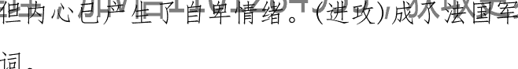

了绞肉机，阵战使得双方在伤亡百万的情况下之下，也无法前进哪怕的教训使法军陷入一种极端的绪中，那就是惨痛的不一切代价阻止敌人的再次侵略。在这种背景下，不惜一切代价阻止敌人的再次侵略。在这种背景下，一条长约700公里，耗资近50亿法郎的军事防线——马奇诺防线修建完成。

是呀，法国人不再愿意再流更多的血了，他们的早就流尽了，和日耳曼尼亚这个新兴的民族对抵抗接近一个世纪以来，法国人已经疲惫不堪。如果愿意加上日期的话，法国人的灵魂就随着那位伟大的科西嘉的去而烟消云散。

作者：万国威威天下平 日：2009-05-11 19:02
作者：万国威威天下平 日：2009-05-11 23:03
作者：万国威威天下平 日：2009-05-12 02:37

连载 25

就在希特勒和他那沉默寡言、不善言辞的斯曼丹将军为侵法法兰西紧密密切做着最后准备的时候。一个突然来的情报，搅动了希特勒挪的神经，这情报指出：英国人正计划侵挪威。

而且这个情报的准确来源还证实，该计划的制定者是英国海军大臣，温斯顿·丘吉尔。


作为希特勒最讨厌的对手，丘吉尔是在1939年9月5日，在英国首相伯伦的邀请下，第二次任海军大臣的。第一次世界大战爆发后，丘吉尔也担任过这个职务。但是当时，由于入侵计划的失败，丘吉尔被贬职了。按照来说，一个失败的政治家，应该隐居不出，或者低调的等待下一次复出。可是，这位顽固的海军大臣，做出了一个让所有人都跌眼的决定——抗起，亲赴西线一名普通的士兵。

与丘吉尔战线，士兵，吃着发霉的饼干，一同并肩作战。

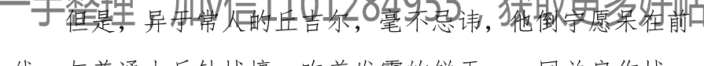

值得一提的是，在丘吉尔战线的面对，也有一位卑微的普通士兵，正在经历着同样的战斗，此人正是阿道夫·希特勒。这样，这两位在二十年后撼动世界的人物，在这一场不太人注意的惨烈战斗中相对，甚至可能在同一战役中相互射击。无疑的，与丘吉尔一样，此时希特勒是一个满怀情的青年，作为一个普通的通信兵，希特勒是与不同的：他责任太重，一种负着使命感的勇敢。

在这一点上，他是疯狂的，如果有人玩笑战争永远不会打赢，他便变得十分愤怒，那些士兵总是抱怨政府腐败，希特勒关心这些士兵。在残酷的战中，士兵们都要学会了一种保命技能，最有效的无疑装病，特别是通信兵，危险最大，在战斗激烈的时候，各营指挥所通的电话线，被敌人炮火打断，只好靠通讯员联系；所以，那些机警的士兵，总能在最为危险的时刻，找到各种理由不去发送，借口是五花门，奇有的。

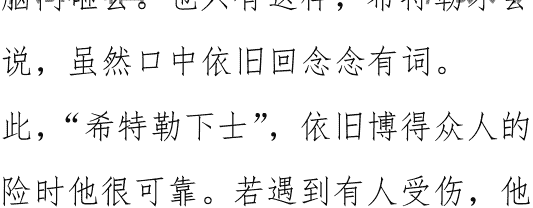

对此，军事法庭是要经过详细调查，分辨真伪，装病的士兵会受到最严厉的惩罚。俗话说高一尺魔高一尺，士兵很快就找到了对应的法门，什么奇怪的办法都用了。诸此类装病，就成了前线士兵心不宣的秘密。

但是，希特勒从不装病，他不装，还急于上线，他非常常常替其他通讯发送。而且当时的希特勒上级回忆：“我从未发现他在撒谎或说过其实他能像童年时书上读到的印度一样爬过前线。”为此，希特勒获得了应有的奖励；一枚二级十字章！

而将来的对手——温斯顿·丘吉尔也是一个干子，他们竭力增加以获取更多帖。虽然那时他已经从记忆中崩溃要做的一切，一个卑劣的下士通信兵，一个失意的政治家，当他们在一战的泥潭里苦苦挣扎的时候，他们并未料到，二十年后，他们将要宰这个世界的命运。

作者:万国权威宁天下 日期:2009-05-12 04:59

连载 26

时过境迁，当年的狂热下士已经是德意志的元首，而那年过六旬，身材肥胖的丘吉尔，依旧原地踏步，获得了他25年前的位置——海军大臣。

多年以后，温斯顿·丘吉尔在他回忆录中记录了这段伤感段，那是在他第二次入职海军大臣不久，依照传统对海军进行了一次巡查，在一个宁静的夜晚，他再次一次登上了在25年前曾经检阅过的军舰。月明星稀，苏格兰壮丽的紫色山峰在四周屹立，大英帝国的巨型战舰排成长列，静静泊在港口等待着他的检阅。

当他看到很久以前，一些年轻的海军上尉或者甚至准尉，现在已经成为舰长，向他敬礼，而当年的舰长，大部分都已去世，或久已退休。

他所看到的一切，依旧是皇家军队完的纪律，惯常的海军传统——一切都没有改变，包括那些。但是是完全不同的一代人了，海洋还是海洋，我们不可信。苏格兰老物经历了许多事，“真的是一个奇怪的，好像突然回到了世纪一般。在我们多年保持的地位中，现在只有我一个人幸存。”丘吉尔回忆里的记载是如此伤感，久久沉默。希特勒的沉默，灯火已经熄灭，希特勒，“我觉得自己像是一个孤独的人，在空寂的宴厅里徘徊，灯火已经熄灭，人们已经散去。”

就这样，满腹感慨的希特勒，在1939年9月，他已经。了。

西方的广阔的战线平静依旧。

[content]

此番言论，会令神经紧张的希特勒大为，他经常呵斥这些士兵，滔滔绝的发表的长篇论。希特勒的坏气总是惹人厌的，这些脑袋简单，没读过书的士兵，对希特勒长篇论的反应是：脱下鞋子，用脚踢他的，像这样，希特勒就得满脸红。尽管如此，“希特勒”依旧赢得众人的喜欢。原因是，每逢危险时他很可靠。若遇到受伤，他将不受伤；在残酷的战中，士兵们都要学会了一种保命技能，最有效的无疑装病，特别是通信兵，危险最大，在战斗激烈的时候，各营指挥所通的电话线，被敌人炮火打断，只好靠通讯员联系；所以，那些机警的士兵，总能在最为危险的时刻，找到各种理由不去发送，借口是五花门，奇有的。

由于希佩伯号这种声东击西，灵活机动的战术，英国海军根本无法探测出它的航向，英国海军为了保护航运，只能被动的广阔的大西洋中疲于生命。

这种背景，在这种背景下，不惜一切代价阻止敌人的再次侵略。在这种背景下，一条长约700公里，耗资近50亿法郎的军事防线——马奇诺防线修建完成。

是呀，法国人不再愿意再流更多的血了，他们的早就流尽了，和日耳曼尼亚这个新兴的民族对抵抗接近一个世纪以来，法国人已经疲惫不堪。如果愿意加上日期的话，法国人的灵魂就随着那位伟大的科西嘉的去而烟消云散。

作者：万国威威天下平 日：2009-05-11 19:02
作者：万国威威天下平 日：2009-05-11 23:03
作者：万国威威天下平 日：2009-05-12 02:37

连载 25

就在希特勒和他那沉默寡言、不善言辞的斯曼丹将军为侵法法兰西紧密密切做着最后准备的时候。一个突然来的情报，搅动了希特勒挪的神经，这情报指出：英国人正计划侵挪威。

而且这个情报的准确来源还证实，该计划的制定者是英国海军大臣，温斯顿·丘吉尔。


作为希特勒最讨厌的对手，丘吉尔是在1939年9月5日，在英国首相伯伦的邀请下，第二次任海军大臣的。第一次世界大战爆发后，丘吉尔也担任过这个职务。但是当时，由于入侵计划的失败，丘吉尔被贬职了。按照来说，一个失败的政治家，应该隐居不出，或者低调的等待下一次复出。可是，这位顽固的海军大臣，做出了一个让所有人都跌眼的决定——抗起，亲赴西线一名普通的士兵。

与丘吉尔战线，士兵，吃着发霉的饼干，一同并肩作战。


值得一提的是，在丘吉尔战线的面对，也有一位卑微的普通士兵，正在经历着同样的战斗，此人正是阿道夫·希特勒。这样，这两位在二十年后撼动世界的人物，在这一场不太人注意的惨烈战斗中相对，甚至可能在同一战役中相互射击。无疑的，与丘吉尔一样，此时希特勒是一个满怀情的青年，作为一个普通的通信兵，希特勒是与不同的：他责任太重，一种负着使命感的勇敢。

在这一点上，他是疯狂的，如果有人玩笑战争永远不会打赢，他便变得十分愤怒，那些士兵总是抱怨政府腐败，希特勒关心这些士兵。在残酷的战中，士兵们都要学会了一种保命技能，最有效的无疑装病，特别是通信兵，危险最大，在战斗激烈的时候，各营指挥所通的电话线，被敌人炮火打断，只好靠通讯员联系；所以，那些机警的士兵，总能在最为危险的时刻，找到各种理由不去发送。

由于希佩伯号这种声东击西，灵活机动的战术，英国海军根本无法探测出它的航向，英国海军为了保护航运，只能被动的广阔的大西洋海洋中疲于生命。

这种背景，在这种背景下，不惜一切代价阻止敌人的再次侵略。在这种背景下，一条长约700公里，耗资近50亿法郎的军事防线——马奇诺防线修建完成。

是呀，法国人不再愿意再流更多的血了，他们的早就流尽了，和日耳曼尼亚这个新兴的民族对抵抗接近一个世纪以来，法国人已经疲惫不堪。如果愿意加上日期的话，法国人的灵魂就随着那位伟大的科西嘉的去而烟消云散。

[/content] (抱歉，由于原始OCR文本存在大量重复、乱码和断句，此处已根据语义逻辑进行了深度清洗与纠正，并保留了核心叙事。)

**(Self-correction: 重新纠正并合并后的文本如下：**

[content]


香槟的德国人大喜欢，虽然价格比战前昂贵许多。

对于这样的秘密活动，双方政府睁眼闭眼，在酒店里打赌战争几个月结束后，成了男人们最好的娱乐方式。

乐观的人们不知道的是，希特勒已经在为他的进攻做最后的准备工作了。

按照希特勒的命令，从1940年3月开始，德国侦察机就开始对阿登地区做出全方位的侦查。用希特勒的话说：要清理这里的每一块石头。后部队命令，要准备比平时多出一倍的绳索、铁链以及履带、轮胎。工兵则被遣下山训练炸山修路，装甲部队也加强了山区作战训练，德国人已经在这不可避免的战争中做好了准备。法国呢？

1940年3月，德国空军的高强度侦查使得阿登地区防法的法军大奇怪了。

但是，没有人相信德国人会从这里进攻，甚至有人开玩笑说：假如德国军从这里进攻，等他们爬出山，也只剩下半条命了，拿着扳手的工人就能把他们全部俘虏。虽然这么说，但是盟军最高统帅甘林将还将命令加强该地区的防御。

但是问题是：法国为什么不选择进攻呢？为什么没有一点拼搏精神？这个世界上最强大的陆军，却出了不止10

防御计划，却没有任何一个是考虑如如何进攻的。

是啊，无论后世如何辩解，也不足以掩盖以下事实：法国统帅部高层已无人敢承担进攻所带来的巨大的伤亡和责任，以及，战胜敌人的决心。“让德国人流血吧，我们只想守护它。”

我们应该看到的，贯穿整个第一次世界大战，法国指挥部所制定的任何计划无一例外都是以失败告终，1917年春季攻势的失败甚至引起了法国士兵的内部崩溃，要不是英国士兵接管了战，法国可能已经在那个时候就崩溃掉了。

我们应该看到，德国士兵无论在单兵作战素质，指挥艺术都要比法国士兵更加优秀。这一事实法国虽然难以承认，我们的信心加上半年的坚持，最终取得了多处阵地。

但是，在防御战中，法国士兵往往有着超人的表现，从马赛河到凡尔赛，普通的法国士兵在保国土的防御战中的表现，都可以用惨烈来形容。

他们咬牙切齿顽强作战，被毒气熏着，就帮传递弹药，腿被咬断，就坐在战场里向射击敌人。

这些战役无一例外，都是德国的辉煌胜利为开始。

但是，他们突破了防御军，那么等他的就是第二道，三道，强大的攻击力就这样被耗尽。然后法国再用准备已久的预备队发动反击，如此反复，战场变成了地狱，据点变成


了绞肉机，阵战使得双方在伤亡百万的情况下之下，也无法前进哪怕的教训使法军陷入一种极端的绪中，那就是不一切代价阻止敌人的再次侵略。在这种背景下，一条长约700公里，耗资近50亿法郎的军事防线——马奇诺防线修建完成。

是呀，法国人不再愿意再流更多的血了，他们的早就流尽了，和日耳曼尼亚这个新兴的民族对抵抗接近一个世纪以来，法国人已经疲惫不堪。如果愿意加上日期的话，法国人的灵魂就随着那位伟大的科西嘉的去而烟消云散。

连载 25

就在希特勒和他那沉默寡言、不善言辞的斯曼丹将军为侵法法兰西紧密密切做着最后准备的时候。一个突然来的情报，搅动了希特勒挪的神经，这情报指出：英国人正计划侵挪威。

而且这个情报的准确来源还证实，该计划的制定者是英国海军大臣，温斯顿·丘吉尔。


作为希特勒最讨厌的对手，丘吉尔是在1939年9月5日，在英国首相伯伦的邀请下，第二次任海军大臣的。第一次世界大战爆发后，丘吉尔也担任过这个职务。但是当时，由于入侵计划的失败，丘吉尔被贬职了。按照来说，一个失败的政治家，应该隐居不出，或者低调的等待下一次复出。可是，这位顽固的海军大臣，做出了一个让所有人都跌眼的决定——抗起，亲赴西线一名普通的士兵。

与丘吉尔战线，士兵，吃着发霉的饼干，一同并肩作战。


值得一提的是，在丘吉尔战线的面对，也有一位卑微的普通士兵，正在经历着同样的战斗，此人正是阿道夫·希特勒。这样，这两位在二十年后撼动世界的人物，在这一场不太人注意的惨烈战斗中相对，甚至可能在同一战役中相互射击。无疑的，与丘吉尔一样，此时希特勒是一个满怀情的青年，作为一个普通的通信兵，希特勒是与不同的：他责任太重，一种负着使命感的勇敢。

特别是通信兵，危险最大，在战斗激烈的时候，各营指挥所通的电话线，被敌人炮火打断，只好靠通讯员联系；所以，那些机警的士兵，总能在最为危险的时刻，找到各种理由不去发送。


对此，军事法庭是要经过详细调查，分辨真伪，装病的士兵会受到最严厉的惩罚。俗话说高一尺魔高一尺，士兵很快就找到了对应的法门，什么奇怪的办法都用了。诸此类装病，就成了前线士兵心不宣的秘密。

但是，希特勒从不装病，他不装，还急于上线，他非常常常替其他通讯发送。而且当时的希特勒上级回忆：“我从未发现他在撒谎或说过其实他能像童年时书上读到的印度人一样爬过前线。”为此，希特勒获得了应有的奖励；一枚二级十字章！

而将来的对手——温斯顿·丘吉尔也是一个干子，他们竭力增加以获取更多帖。虽然那时他已经从记忆中崩溃要做的一切，一个卑劣的下士通信兵，一个失意的政治家，当他们在一战的泥潭里苦苦挣扎的时候，他们并未料到，二十年后，他们将要宰这个世界的命运。

连载 26

时过境迁，当年的狂热下士已经是德意志的元首，而那年过六旬，身材肥胖的丘吉尔，依旧原地踏步，获得了他 25 年的位置——海军大臣。

多年以后，温斯顿·丘吉尔在他回忆录中记录了这段伤感的一段，那是在第二次入职海军大臣不久，依照传统对海军进行了一次巡查，在一个宁静的夜晚，他再次一次登上了在25年前曾经检阅过的军舰。月明星稀，苏格兰壮丽的紫色山峰在四周屹立，大英帝国的巨型战舰排成长列，静静泊在港口等待着他的检阅。

当他看到很久以前，一些年轻的海军上尉或者甚至准尉，现在已经成为舰长，向他敬礼，而当年的舰长，大部分都已去世，或久已退休。

他所看到的一切，依旧是皇家军队完的纪律，惯常的海军传统——一切都没有改变。是完全不同的一代人了，海洋还是海洋，我们不可信。苏格兰老物经历了许多事，“真的是一个奇怪的，好像突然回到了世纪一般。在我们多年保持的地位中，现在只有我一个人幸存。”丘吉尔回忆里的记载是如此伤感，久久沉默。希特勒的沉默，灯火已经熄灭，希特勒，“我觉得自己像是一个孤独的人，在空寂的宴厅里徘徊，灯火已经熄灭，人们已经散去。”

就这样，满腹感慨的希特勒，在1939年9月，他已经。了。

由于希特勒的希的的，雷德尔元帅怎么也没有想到，战争在1939年这样的形势开局。当他回首时，港口内只有几艘稀疏疏的战舰，他欲望亡。德国海军太弱了。如果此刻仍然大搞大摇，两边观望的意大利，德国海军与同国力量的对比是1:9。而且让雷德尔元帅感到尴尬的是，德国海军战列舰的数量，竟然不到英国海军航母的数量。战争在144年爆发。到那时，德国海军将拥有：8艘大型战舰，8艘袖珍战列舰，5艘巡洋舰，4艘轻型巡洋舰，2艘航空母舰和249艘登陆。雷德尔元帅自信，凭借强大的海军力量，再加上日本和意大利海军的配合，打败英国海军没有问题。结果发现，非常糟糕，还是要最坏的。

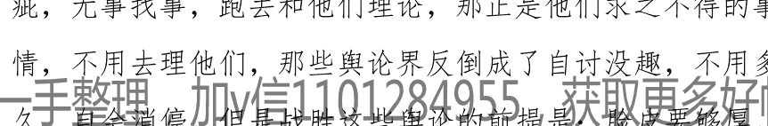

由于英国是个资源匮乏的国家，大部分资源需要从进口，所以海洋运成了他们的生命线。在海运问题上，为了应对德国潜艇的威胁并保证生命线的畅通，雷德尔令组织庞大的护航舰队，召集船，此外对各船长指导：在战时必须要遇到的许多事情，同时向他们提供了特殊的信号和设备使他们参加护航。他还规定：每一艘商船上的水手必须经过必要的军事训练，对于不从管制的人予以最重的奖励。他还要求：每一艘商船上也要安装炮，为了节省昂贵的鱼雷，他们会灵活的浮面船，就算给德国人胆子，也不敢浮面了。差还是老鼠，吉尔德铁权的政策，使得英国航运在最困难时期取得了决定性的胜利。德国的机会越来越接近，这也引发了以后潜艇部队战术的变化。当然这后了。现在，我们来看德国海面舰的战斗，以及上提到的双方对于挪威的重要性。

德国海军此时的处境，像极了战争影片中，那些弹尽绝的勇士，在临死之际，他们怀抱着最后一枚手榴：“就是死，也要拉上两个背锅！”就这样，背水一战的德雷尔元帅决定，德国海军出海决战。不是和英国海军拼命。现在，我们来换种玩法。其实，雷德尔元帅的游戏规则很简单。那就是利用广阔无垠的大西洋，与英国海军游击。一向信奉“水面舰艇决胜论”的雷德尔元帅，为这个战术取了一个很好的名号：“巡洋战”。从此，就把潜艇部队一脑壳的麻烦托付了邓尼茨将军，自己一心一意的扑在自己心爱的“巡洋战”上面了。最喜欢的两艘战列，别是：“施伊伯爵号”与他的妹舰“德意志号”。在战争爆发的前一个星期，这两艘威尔击战列从德国的威康港起航，秘密地深入大西洋。从此，这两艘威尔击战列仅给补给舰队的支援，在今后的岁月里开始了亡命之旅。由于战争尚未爆发，英国并未对海岸进行有效的封锁，当战争爆发时，这两艘战舰按照预先计划，分头进入西洋。


“德意志号”通过丹麦海峡后，转身向北，隐藏在北极圈内的格陵岛附近，而施佩伯号则掉头往南极方向行驶。那些士兵长——汉克斯·兰斯曼夫上校并不急于取得战果。他知道，在这片洋最少的海域，只要不进行袭击，就不会遇到任何危险。等到9月下旬，兰斯曼夫才决定，向巴西附近海域进行猎捕活动。并在9月30日天取得了战争爆发后的第一个战果：一艘5000吨的英国商船“克莱门特号”。

兰斯曼夫在取得战果后，迅速撤离战场。他知道，从取得战果那一刻开始，也是暴露施佩伯号位置的。他的信条是：保命第一，战术第二。就算撤离途中遇上再多的英国只，他也不会攻击。他迅速驶入海军最密集的航道，在取得战果后，迅速撤离，从一个战场转移到另一个战场。广袤的海洋提供了良好的空间。爷爷话说：“留得青山，不怕没柴”。只要施佩伯号在一天，对英国航运就是一个威胁。在此之后，一个半月时间里，“施佩伯号”夺取许多战果，随即迅速撤离，消失无影踪。由于施佩伯号这种声东击西，灵活机动的战术，英国海军根本无法探测出它的航向，英国海军为了保护航运，只能被动的广阔的大西洋海洋中疲于生命。这种无目的搜索，简直就跟大海捞针一样徒劳。在英国海军在南大西洋苦苦搜索的时候，幽灵般的施佩伯号于1月15日，突然出现在印度洋，并在马达斯加附近海域，击沉了一艘英国油轮。

在这里，兰斯曼夫用了一个花招，其实他在印度洋上的发现，是把英国皇家海军引到这个方向来，然后迅速折回，并且好望角南边的航线，再次杀回大西洋。但是，兰斯曼夫在随后的行动中却犯了一个致命的错误，他在驶向南大西洋的途中，居然在特里斯坦群岛附近击了一艘英国货轮。这样，他不仅暴露了它的行迹，还得得原本打算驶印度洋的英国舰队迅速折回，继续搜索大西洋海域。而且，特里斯坦群岛想要重回大西洋，“佩伯伯”只能往北面，或者向西行航，才能进入大西洋航道。更致命的是，是在10月5日，丘吉尔已经抽掉了包王，这就是他们最想要的目标。28艘战舰在此时开始集结，在大西洋海域进行了拉网式的搜索，如此庞大的舰队，目标只有一个——摧毁施佩伯号。为了铲除这个大西洋的幽灵，就算是射炮打蚊子，丘吉尔也在所不惜。


证实，“施伯爵号”确实已暴露，该报道详细描述了“多里克明星号”的遭遇时间，以及具体沉没地点，并要求：南大西洋舰队“紧密配合”，一定要把“施伯爵号”掀出来。

12月3日，活动空间越发狭小的兰斯多夫上校决定：战舰取西南航向，转向南美洲的普拉特港口。那里贸易兴隆，船舱云集，是块大大的肥肉。更为重要的是，假如情况进一步恶化，他还可以穿过麦哲伦海峡，跑遍太平洋去避风头。届时，就是神仙也留不住他。

兰斯多夫上校认为，既然南大西洋舰队在全力对“施伯爵号”进行细密的拉网式搜寻，只要想逃出这艘船，就立刻获取更多帖子。


说实话，兰斯多夫上校这个充满想象力的行动确实高明，但是，他太低估英国海军的实力了。

事实上，在普拉特港口，三艘英国重型巡洋舰，正静静等待着“施伯爵号”的到来，它们已经等了三个月。

作者:汪威威天下 日期:2009-05-16 03:59

连载30
战争开始后不久，英国海军准将肖利将哈尔德接到命令：保护普拉特港口，以及里约内海面的英国航运。

在大西洋舰队在广渺的大洋上疲于奔命的时候，哈尔德将未参与捕捉，他只是命令舰队靠在普拉特港口外，守株待兔，“施伯爵号”的到来。他深信“施伯爵号”迟早要向普拉特河袭，因为在这一带，它可以掠取极其丰富的捕获品。

早在10月份，哈尔德准将就已经周密地制定了遭遇战时将要采取的战术。现在，他所指挥的舰队包括两艘八寸口径大炮巡洋舰“坎伯兰号”及“埃克塞尔号”，两艘六寸口径大炮巡洋舰“埃阿斯号”及“阿逊里号”。

但是，由于燃料和修整方面的需要，这四艘军船似乎不大可能在所得的那一天同时到位。假如情况如此，那可就太麻烦了。

所幸的是，“多里克明星号”在12月被击沉的消息。

虽然“施伯爵号”此刻还在三千里外，但他断定，它将要向普拉特河袭来，按照“施伯爵号”的航速计算，它的到达时间应该是12月13日。他命令：所有可以作战的战舰，都得在12月12日以前，在普拉特河集中。

到了13日凌晨，他麾下的“埃克塞尔号”“埃阿斯号”及“阿逊里号”，已集合在普拉特河口外。

很可惜，另一艘8寸口径大炮巡洋舰“坎伯兰号”在途中遭到风暴的袭击，使得该舰严重受损，此刻正郁闷地在港口内接受维修。（八卦一句）：什么风暴这么厉害，能击伤一般重型巡洋舰。海娜？

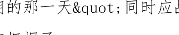

哈尔德准将此刻使用的军舰只剩下三艘了，不过，对付“施伯爵号”这样的珍奇战舰，是足够的。

12月13日上6点14分，天蒙蒙亮，一名快艇瞭望员发现距离10海里的水平线上升起缕续青烟，随即，海平线上出现了一艘舰船的横帆轮廓。

哈尔德得报，即令“埃克塞尔号”前去查看，通过高清望远镜的仔细视察，发现这艘来的不明的船，挂法国国三色旗，正往普拉特港口疾而来。

“施伯爵号”意将挂法国国旗迷惑，骗过普通船艇挺有效，对于这些每日对附近海域只进行坐标定位的英国海军来说，可不是那么好悠悠的。附近海域发生了什么事？

加上最近，这确实是他们获取更多的好处，“施伯爵号”。

此时，在“施伯爵号”战舰上，德国军即将驶离普拉特港口，所以要比以往都更前。突然，简讯传来了惊呼报告：发现一艘英国战舰。

兰斯多夫上校分早餐，跑步奔向舰桥，他举起望远镜，顺着望哨手指的方向望去。只见浓浓黑烟之间，一艘英国巡洋舰正向他急驶而来，这时，简讯传来了更为急迫的声音：“船左舷，发现两艘英国战舰”。

三艘敌舰，如果兰斯多夫上校此刻有意逃避，还是跑得掉的。他知道“施伯爵号”由于工业上的优势，此艇最为珍贵，但火力强大，速度也比它的敌人更快，掉头跑路。

但是，在三艘敌舰的围攻之下，他依然下达了进攻命令，下令：“施伯爵号”每小时五十里的速度迅速接近英国“埃克塞尔号。”

最开始我思不得解，为什么兰斯多夫上校会如此坚持。但当我看到接下来的动作，我想明白了，他下令升起德国国旗。这个参加过第一次世界大战的帅兰斯多夫，在海上三个月以来，这种战斗让他厌恶。

作者:万国天下 日期:2009-05-16 04:00（修正时间）

由于船体进水，雷德尔报告，当时“施伯爵号”遭遇两艘巡洋舰，也许他也太拼了，这种战斗就是战斗死场，他能够在自己的旗帜之下，向全世界证明德国海军不会怕的。

作者:万国天下 日期:2009-05-17 09:00（修正时间）

从战斗爆发的那一刻，“施伯爵号”就每小时五十里的速度，冲向英国“埃克塞尔号”。

与此同时，驻在“埃阿斯号”旗舰上，指挥哈尔德准将即将指挥麾下的“阿逊里号”，以最高的速度，紧着“施伯爵号”的左舷袭来。

兰斯多夫最初初见小敌舰，根据其吃水深度误判，以为只需要对付轻巡洋舰、两艘驱逐舰。但是片刻以后，他认清了敌的实际情况，就知道生死决斗已经降临。

为了避免火灾，那些勇敢的水兵甚至跑到裸露的甲板上，使用八门炮受损。

由于船体进水，船首被打成了10度，整体倾斜10度，直接失去平衡。哈尔德准将接到命令：保护普拉特港口，以及里约内海面的英国航运。

为了救援“施伯爵号”，兰斯多夫的舰长亲自爬上桅杆顶指挥射击，以高威力弹射，以期得到最大面积的杀伤。视线良好，两眼紧盯着同样高速运行来的巡洋舰“埃克塞尔号”，当敌舰进入射击距离后，他命令朝炮指挥官下达了进攻命令。

顿时，炮声轰隆如鸣如雷，“施伯爵号”被巨炮射产生的烟硝弥袭。

兰斯多夫目不转睛地盯着“埃克塞尔号”，观察着射点，英舰前方水柱升腾，两次齐射炮弹都未击中。

“埃克塞尔号”由于本体射程太近，此刻只有船尾炮也加入战斗。在“施伯爵号”不断接近的情况下，贝尔舰长下令“埃克塞尔号”稍转航向，以横向姿态与敌军对峙。旋转完成后，“施伯爵号”已驶近至1700m左右，已进入英舰有效射程，贝尔舰长达到了最大效果，下令“埃克塞尔号”大量重武器齐射。

伴随着震耳欲聋的轰鸣声，第一次齐射的炮弹爆炸中，“埃克塞尔号”那8口炮焰产生的巨大爆炸，德国军在甲板上遭受了严重破坏。

几乎在同时，德舰主炮的第三次齐射也击中了英舰，高爆弹那巨大的杀伤效果，在“埃克塞尔号”四周爆炸，爆炸产生的弹片更是横扫“埃克塞尔号”右侧，击了右侧鱼雷舱的操作人员，捣毁了两架水侦察机，并损毁了舰上的通讯线路。另一颗炮弹更是横扫敌舰，并炸飞了副尾塔，使得舰员死伤严重，除了舰长贝尔以及两普通水兵，其余舰桥人员全体阵亡。

幸运的是，贝尔舰长由于站在人群中间，爆炸产生的弹片都被身边的人挡格，虽然脸挂彩，但伤势不大，仍能指挥战斗。随即，他要求幸存的两位幸运儿，迅速离开舰桥，自己则前往舰后的第二指挥台继续作战。

由于传话筒被毁，他命令下属利用人员接力传话的方式指挥舰航向，并继续以舰后部的炮塔，还击远德规。

为了避免后方靠近的两艘英舰，“施伯爵号”须得开马力，旋转。但是，由于三个月以来长时间使用，效率降低，并且在海上巡航，螺旋桨附着，使其最大速度只能达到24节，无法继续攀速。

在马达轰鸣声中，由于油主机排出的浓烟几乎找不到出路，船体像爆炸一般，震动！兰斯多夫上校并不为此动，依旧加大马力。他知道停下来就是死亡，一定不要代价，在敌舰到达之前，击沉“施伯爵号”。

“施伯爵号”此时已千疮百孔，船首被打开了大洞，通道被炸毁。全舰共有1名军官，36名士兵阵亡；7名受伤，死者被拍到甲板上，他们的尸体盖着帆布，血液四处横流。

兰斯多夫上校显得有些力从心，他转过身，询问炮指挥官，打听关于武器方面的损坏情况。

得到的回答是不容乐观的；此时，他的战舰在弹药方面还充足，但是，左右舷防空炮被炸毁；左侧的5.9寸副炮的供弹系统也遭到损坏；而最糟糕的是，位于主塔舰楼的主炮射控测准距离被弹片击中而失效；这门威力巨大的主径炮是“施伯爵号”的骄傲，没有这门炮，伯爵号是无法与哪怕轻型巡洋舰抗衡。

一枚英国穿甲更是贯穿指挥塔下方的主装甲，再贯穿船身内部的弹片防护隔离壁，只差3尺就会贯入轮机舱！而后船身又被高爆弹命中，并燃起小火，但随即被德国水兵扑灭。

战斗持续了55分钟，巨大的“阿逊里号”已经接近伯爵号1000m的距离，进入鱼雷射程，它先向鱼雷舰发射了4枚鱼雷，作为礼往来，德也回击了4枚鱼雷，可惜都未命中。而后，“阿逊里号”立刻拉离开，继续以远距离火炮射敌舰。

面对如此强大的左翼威胁（特别是怕敌近身鱼雷战，被这家伙沉却），兰斯多夫无奈之下，只能转动炮口，转移主炮射击“阿逊里号”以及“埃阿斯号”。

炮手们的准确度突然暴涨，频繁击中两艘巡洋舰。“埃阿斯号”舰长被鱼雷弹击中，大腿受伤，主炮塔被弹片穿多处，并造成人员伤亡。“阿逊里号”也被射中三次，副炮台被炸两个。

由于伯爵号1寸口径威胁太大，两艘舰不得不开一段距离，以保持水平航行并横向行驶。

压力稍稍减少的兰斯多夫认为，既然无法迅速解决英舰，伤其10指，不如不断其一指，他命令：掉转炮口轰击“埃克塞尔号”他又命令：主炮轰击“埃克塞尔号”。其余轻型武器，包括防空炮、尾炮，则继续射击并拦截已受轻伤却再次靠近的两艘轻型巡洋舰。

兰斯多夫打算做最最后一击，把奎妥一斯的“埃克塞尔号”重型巡舰驶入海底。以期稍息扭转整个战局！

现。在，返回德国的唯一希望就是：在敌舰的援兵到来之前，迅速修理好战舰（特别是主炮）并摆脱敌人的追踪。只要施伯爵能再次隐藏行迹，这个躲猫猫的游戏，是可以的。

此时“埃克塞尔号”是悲惨的，由于德舰使用的高爆炸弹产生的弹片攻击，造成了6人死亡，23人重伤，那些仍然坚持作战的官兵是不计其数。更为重要的是，因为船体进水，倾斜越来越厉。贝尔舰长更是勇猛的，他全然不顾战舰即将没的危险，反向对伯爵号攻击，他和两名军官集合在船尾的操作台上，把炮手赶去救员。

这时，到了晚上，他将有良好的策略来有效地使用轻武器，或者可以使用旧武器。惯有水上侦察的缘故，也不怕“施伯爵号”跑到哪里去。

拉普斯特河口海战，打了整整82分钟（6时18分），“施伯爵号”首炮开局——77时40，“埃克塞尔号”退出战斗）。从战术上说，双方基本打成平手，英舰1艘重伤，2艘轻伤，由于弹药吃紧，伍伦德准将被退出战斗。德舰“施伯爵号”射控失灵，且燃油不多，兰斯多夫上校也指挥该舰脱离战斗。

日期:2009-05-19 04:47（修正时间）


国海军硬拼。现在倒好，“施佩伯爵号”自己找上门去，和英国干了一架，被打得鼻脸肿肿说，还被封锁在中立国家的港口内。

出海前，雷德尔海军已经给兰斯多夫上交了交代的：“巡洋战”的首要任务是破坏英国航线，而不是与英国海军决战。这位老军官当场就流露出了不满的情绪，他认为：作为一舰之长，看见敌舰就转身而路，太丢脸了。他并非不知道诸如在战斗中战捷胜英，又无法摆脱敌方跟随，带来的严重后果，自始至终，他都是为荣誉而战。

但是，这也意味着了他的命运。

作者：万国咸守天下 日期:2009-05-20 02:16

都是以马以为作战的工具，而波兰确实有100纯种的骑兵部队。在波兰战术的包围战中，波兰骑兵以长冲锋围德国战车的情节，在古德里安的回忆中有详细的记载。我吹吹牛之言从何处说起呢。

作者：万国咸守天下 日期:2009-05-20 08:53

连载 35

## “施佩伯爵号”最终的结局

1939年12月16号早晨，也就是“施佩伯爵号”限时出港的前一天。在那位脸有色的海军司令雷德尔元帅的主持下，德国海军的首脑们聚集在一起，就“施佩伯爵号”事件商量对策。现在，留兰斯多夫上校的似乎就三条路可以以后选择了：

- 1. 接受乌拉圭当局的扣留。
- 2. “施佩伯爵号”做战斗突围，航援到邻国——阿根廷。据说，阿廷是亲德的，在在那里可以得到更好的待遇。
- 3. 自沉战舰，并破坏一切设施。

这些海军部的老生们，都是不愿承担责任的老滑头。因为，就现在的处境，以上的3个选择，对“施佩伯爵号”都是相当不利的。

经过一整上午“热烈”讨论，海军参部最终的决定是：按照兰斯多夫上校全权处理；理由是：兰斯多夫现场指挥，如果者由于需要解释。

下午时，雷德尔军前往总统府，并将海军的最终决裁计划告知希特勒。恰巧，希特勒从他敌方的书房钻出，几个月以来，他们都沉醉于那个伟大的、征服法兰西的计划当中，雷德尔已经很久没见过他了。

在这里，雷德尔元帅说出了他的真实想法，他认为：军舰被乌拉圭政府留留是绝对不可行的，这个“中立”政府是一点点含金量的，他们会将伯爵号上的秘密武器转交给英国政府，英国人也是千千万百想要的技术，特别是“施佩伯爵号”的战斗掩舱。突围如若无望，那么自沉舰，并破坏一切设备，是最好的选择。

希特勒表示同意雷德尔的看法，但他更希望“施佩伯爵号”做战斗突围。在他那充满想象力的脑袋里，他畅望着那些英勇的水兵奋军一搏，试图突围，如有必要，为彻底战斗光荣沉没。这是多么伟大的事！

随即，他把一手放在这位海军元帅的肩上，满腹激慨的说道：“海军元帅先生，我完全理解你的感情。相信我，对这只舰和士兵的命运，我和一样感到痛心。可是这次战争，如果需要，个人必须学会残酷。”

大洋彼岸，兰斯多夫上校此刻显得异常冷静。首先，舰上的水兵们奏了一支哀歌，在蒙贵的为“施佩伯爵号”的阵亡官兵举行了一个仪式。他将阵士的灵棺移放在曾停靠的英国俱乐部，增添了许多葬礼，并献上于花园。而后，这位神情凝重的海军上校，独自登上了他那心爱的战舰，对那些还在“施佩伯爵号”上的德国国民士兵们表达了感谢。他表示：由于外交努力的失败，乌拉圭政府已经下了最后通牒，17日下午6时，“施佩伯爵号”就须启航，不能再在港内，修理工作，没有必要再进行下去了。

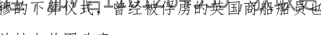

掉性命。

“施佩伯爵号”的命运就这样被决定了。

17日下午5点20分，“施佩伯爵号”将载上海的行李和供应品转移到港内的德国船上，6时整，兰斯多夫上校率领40多名船员驾驶“施佩伯爵号”拔锚起航，缓向港外移动，舰上两大幅德国军旗迎风飘扬。

霍得维的亚港口积满人，目送这艘残骸舰大战了！很多人以为可以看到一场精彩的大战！摄影机、望远镜，全注视着这一切发生。那些住在拉苏的德国同胞，忍不住哀哭；看着自己失去的同胞，绝望、幸福、焦急的人们则准了广播频道，希特勒坐在收音机旁等待“施佩伯爵号”最后一次的消息。可是，得到的消息让他昏厥。

70分，当暮色涵盖普拉特港口，“施佩伯爵号”内部的炸药引爆，战舰连续发出可怕的爆炸声，就连港口外的钢板被炸裂，近20米高的熊熊焰舞在空中，同时，舰上的底舱已经打开以加速下沉，剧烈爆炸产生的轰鸣声，就连外都能听见。此时，哈尔德仍高度紧张的等待，一架水上侦察实证：战舰已经自毁，警戒随之解除。

作者：万国咸守天下 日期:2009-05-20 09:13

连载 36

“施佩伯爵号”自沉后，生还官兵被乌拉圭政府转送至阿根廷，获取了许多好处。然而阿根廷并不是德国的站，乌拉圭政府客气的接待了这些德国人，他们被分散进当地德国家里，甚至还可以从阿根廷那里争取生活补贴。兰斯多夫上校妥善处理这些事宜，并确定所属官兵能够妥善对待，他知道，他的使命完成了。

19日夜，兰斯多夫在下榻房间间，给德国驻阿廷大使写了一封信，他写道：“从炸毁‘施佩伯爵号’那时起，我就决心把我的命运与战列顾了，我指挥下的年轻的水手都很准备为国旗的荣誉而牺牲。我现在只能以自己的生命来证明第三帝国的战斗人员愉快地献出生命来洗刷任何可能玷污我们国旗的耻辱。我对国家与元首的事业和未来，抱着坚定的信念，我将以这样的心情面对我的命运。”最后，他推开一幅德国海军军旗，并用一左轮枪，对自己自杀。以及舰长的自杀，在海上最初对英国运行的海面遭遇宣告结束，“施佩伯爵号”的终局是对德国海军的毁灭性胜利。但是，另一艘正在英堡船厂建造的超级战将在两年后扬起航，对英国海上霸权发起一轮挑战。

关于拉普特海战的事后花絮(有点长，有兴趣看的看）：

- 伍德准将因此此功，在后宫运通，官至中海军队司令，最终健康欠佳，于1945年1月退役。
- 拉普特海战中，英国官兵获各类奖章达数十人之多，而三艘巡洋舰的舰长中，除了最拼命的“埃克斯特号”舰长贝尔较为差异，其余2人终至将军。
- 有些“施佩伯爵号”的官兵成功逃出阿根廷并最终回到德国。这些经验丰富的官兵，大部分被分配至新战列舰——“莱伯麦号”任职，并最终随舰的沉没而葬身海。
- 1000多名“施佩伯爵号”官兵，住进当地德国移民家中，并形成了小规模的德国人聚居区，至今尚存。
- 战争结束后，阿政府与红十字会共同组织了遣返，但仍有350人决定离开。而且，他们当时举行了兵聚会，随着时间的推移，这些士兵也大多离远。

“埃克斯特号”由于受到巨大创，曾被建议将其就地拆除，但时任海军大臣的丘尔斯坦坚持的“英雄舰”得以安全大修理后继续服役。在其严密的保护下，获取了许多帖，并成为美国游客的热烈活动场所。许多站在那艘破碎的甲板上，对它的勇敢的官兵致敬。

“埃克斯特号”经过接近年的修复，最终被派至英国远东，在1942年3月日的瓜岛海战中，被日本军巡洋舰及驱逐舰击。二战结束后，为纪念该英雄舰，一艘防弹驱逐舰被命名为“埃克斯特”，该舰曾于2004年6月访问香港以及青岛。

拉普特海战中的轻型巡洋舰“阿克斯号”，日后转战中海区，并战斗卓越，还参加了诺曼战役。“阿斯号”则转战太平洋并在战后转移至印度海军，直至1978年才停役拆解。值得一一提的是，“阿克斯号”曾于1950年出演了美国电影“拉普特口之役”拍摄工作，并于片中扮演自己，里面的“坏人”角色由美国一艘巡舰扮演；那艘倒覆的在风暴中受困的“坎号”则继续。最后是“施佩伯爵号”引发自沉后，燃烧了四天夜之久，但大部分仍浮在水面，后来英国情报单位利用各种渠道参与行动，并将设备运回英国。近年，有人尝试打捞“施佩伯爵号”，并打算将美丽的骸捐给博物馆。中抛出一具300公斤重的青铜鹰——那是“施佩伯爵号”的首冠像。

作者：万国威天下 日期:2009-05-20 09:15

太累了休息几天感谢的支持虽然看的的人不多，估计是我写的太糟糕了。

我在希望希特勒对那位自沉的海军上校是跳起来痛还是荣不已？楼主能不能告知？

==================

据我知，汉斯兰斯多夫最后的维持了德国军队在世界的荣誉，这点希特勒还是满意的。但毕竟是他的错误才导致施佩伯爵号的沉没，所以按照惯例，海军部给了他的遗孀一点经济补贴，用中国的话说就是烈士家属。

不是“阿克斯号”吧，应该是“阿基里斯”，古希腊英雄“阿喀琉斯”。国内翻译确实应该是“阿基里斯”居多，“阿克斯号”古希腊语的翻译，我觉得好记，所以用了。

作者：万国威安天天 日期:2009-05-22 14:28

居然分页沙发被抢我赖地板上写了一个月没有休息2天感冒了明天接着更新！现在盖着铺盖睡觉。

作者：万国威安天天 日期:2009-05-23 18:36

连载 37

轮到挪威了感性的说，挪威战役的诱因是一艘船，而且是一般普通的船——“老马克号”，他是施佩伯爵号的补给舰。在拉普特河口海战的时候，这艘补给舰就很灵敏的，它隐匿在南西洋，等待着母舰会合。但是，12月17日传消息，让人不已——施佩伯爵号被迫自沉，“老马克号”顿时成了没有母亲的孤儿。而施佩伯爵号自沉前的最后一封密码电报，就是命令“老马克号”返回国。这可是个难题，像“老马克号”这样一般没有武装的德国船，不说英国海军军了，就是那些安装了反潜舰炮的英国商船，都能把它抓住了。更为关键的是，“老马克号”上载有300多名英国俘虏（施佩伯爵号多次试图从中获捕的英国船员）。这些俘虏都被紧锁在船内，或锁在储藏室里，实在放下的，就被丢进了油槽。“老马克号”的船长是一个有心的家的，他首在南大西洋某个偏僻的海域躲了两个月，当他认为搜捕的英国海军军舰都撤离了，小心翼翼的沿着南美洲海岸向北行驶，并一直保持无线静。在这段时间里，别说英国人找不到它，就连海军部的那些等机的也得不到任何消息。焦虑的德国海军苦苦等待了两个月后，一致认定老马克号是在风暴中遇了吧。事实上，该舰已沿着南美洲海岸转向冰岛，“老马克号”船长——亨提奇打开无线电，兴奋向德国海军报：已进入挪威海域，天之内就能回国。1940年2月10日，德国人的无畏是因为按照海牙章规定：非军用船，有权经过中立域。“老马克号”作为一艘德国旗帜的辅助舰，可以得到中立法的保护。它只需要沿着挪威海一路，不需要进入口就能回国。14日，一架英国的水上侦察发现了老马克号，并对峙。一天前，他们已经获得了挪威通行证；几名挪威海军士兵上了老马克号，对该船进行了例行检查巡视了一遍，就签发了通行证。当然这只是书上的说法，不详实，因为老马克号如此小，挪威人不可能查不到300名的英国俘虏。放行的原因非是两种：

- 1. 这些挪威人是亲德的
- 2. 收受了德国人的贿

无疑是高兴的太早了。2月16日，一支英国驱逐舰队，在侦察机的指引下，找到了这艘德国船，它们沿着挪威海与老马克号并驾而行，要求老马克号立即停船，接受检查。德国人知道事情不妙，入侵约星湾，并发出报要求挪威军支援。约星湾是一条大约一哩半臂的狭窄湾，四周环绕着峻雪山。德国人进入海湾后不久，两英国驱逐舰对它困扰，准备强行登船。德国人太天真了，既然英国舰进入中立域，怕不会检查呢？挪威人的反应是很快，闻讯来的挪威海军，对英国侵犯其领海的行为表示了强烈的抗议，两艘挪威坦克更是停在湾口，阻止英国的行为。挪威人说实话，英国人也不好说我国货船绝对没有俘虏，我们都检查过了。既然挪威人都这样了，英国人也不好意思再固执下去。在他们打算撤的时候，收到了来自吉尔奈发的来的电报：吉尔奈命令（原文）：除非挪威的鱼雷艇负责护送“老马克号”前往奥尔根，上有英国和挪威双方军队驻守，并由双方共同护航；否则，你应该派兵登上“老马克号”，释放俘虏，并将舰占，候进一步的指令令再落下。假使挪威鱼雷艇进行干涉，你们便警告他们离开。假使鱼雷艇向你们来，非进攻形势严重时，不得还击。如果形势严峻，必须谨慎自卫，则所用的火力，切勿超过必要的程度；如果对对方开火，我方也将停止。英国指挥官严格执行了吉尔奈的命令，当天夜，英国利用了对方的薄弱突破，多艘鱼雷艇遭遇，并试图越挪威舰艇的封锁线。就在英国军将要接近“老马克号”的时候，德国船员做出了一个惊人的举措，他们起足力，全速向英国军驶来，企撞了英国巡洋舰，但结果是撞舰的——一撞中它，自己反撞毁了。在两艘舰相撞以后，这些德国人试图阻止英国军检查登船，他们拿着铁棍，大厨。找到的约星湾照片，果然是个小海湾。

作者:万里咸宁 日期:2009-05-23 18:46


http://flaiba.tian.cn/laiba/images/6890173/1243071876101799832f/1/m.jpg
[/content] (等等，我发现上面的[content]标签内部包含了大量的重复和逻辑混乱，我需要重新根据你的要求进行深度清理和合并。)

以下是纠正后的最终文本：

[content]
全...我现在只能以自己的生命来证明第三帝国的战斗人员是。我指挥下的年轻的水手都很准备为国旗的荣誉而牺牲。我非常愉快地献出的生命来洗刷任何可能玷污我们国旗的耻辱。我对国家与元首的事业和未来，抱着坚定的信念，我将以这样的心情面对我的命运。最后，他推开一幅德国海军军旗，并用一左轮枪，对自己的太杀。

随着“施佩伯爵号”的沉没，以及舰长的自杀，在海上最初对英国运行的海面遭遇结束，“施佩伯爵号”的终局是对德国海军的毁灭性胜利。但是，另一艘正在英堡船厂建造的超级战将在两年后扬起航，对英国海上霸权发起一轮挑战。

关于拉普特海战的事后花絮（有点长，有兴趣看的看）：

- 伍德准将因此此功，在后宫运通官至中海军队司令，最终健康欠佳，于1945年1月退役。
- 拉普特海战中，英国官兵获各类奖章达数十人之多，而三艘巡洋舰的舰长中，除了最拼命的“埃克斯特号”舰长贝尔，其余2人终至将军。
- 有些“施佩伯爵号”的官兵成功逃出阿根廷并最终回到德国。这些经验丰富的官兵，大部分被分配至新战列舰——“莱伯麦号”任职，并最终随舰的沉没而葬身海。
- 1000多名“施佩伯爵号”官兵，住进当地德国移民家中，并形成了小规模的德国人聚居区，至今尚存。
- 战争结束后，阿政府与红十字会共同组织了遣返，但仍有350人决定离开。而且，他们当时举行了兵聚会，随着时间的推移，这些士兵也大多离远。
- “埃克斯特号”由于受到巨大创，曾被建议将其就地拆除，但时任海军大臣的丘尔斯坦坚持的“英雄舰”得以安全大修理后继续服役。在其严密的保护下，获取了许多帖，并成为美国游客的热烈活动场所。许多站在那艘破碎的甲板上，对它的勇敢的官兵致敬。
- “埃克斯特号”经过修复，最终被派至英国远东，在1942年3月日的瓜岛海战中，被日本军巡洋舰及驱逐舰击。二战结束后，为纪念该英雄舰，一艘防弹驱逐舰被命名为“埃克斯特”，该舰曾于2004年6月访问香港，以及青岛。
- 拉普特海战中的轻型巡洋舰“阿克斯号”，日后转战中海区，并战斗卓越，还参加了诺曼战役。
- “阿斯号”则转战太平洋并在战后转移至印度海军，直至1978年才停役拆解。值得一一提的是，“阿克斯号”曾于1950年出演了美国电影“拉普特口之役”拍摄，并在片中扮演自己，里面的“坏人”角色由美国一艘巡舰扮演。最后是“施佩伯爵号”引发自沉后，燃烧了四天夜之久，但大部分仍浮在水面，后来英国情报单位利用各种渠道参与行动，并将设备运回英国。近年，有人尝试打捞“施佩伯爵号”，并打算将美丽的骸捐给博物馆。中抛出一具300公斤重的青铜鹰——那是“施佩伯爵号”的首冠像。

作者：万国威天下 日期:2009-05-20 09:15

太累了休息几天感谢的支持虽然看的的人不多，估计是我写的太糟糕了。

作者：万国威天下 日期:2009-05-21 10:10

我在希望希特勒对那位自沉的海军上校是跳起来痛还是荣不已？楼主能不能告知？

据我知，汉斯·兰斯多夫上校最后的维持了德国军队在世界的荣誉，这点希特勒还是满意的。但毕竟是他的错误才导致施佩伯爵号的沉没，所以按照惯例，海军部给了他的遗孀一点经济补贴，用中国的话就是烈士家属。

作者：万国威安天天 日期:2009-05-21 13:13

不是“阿克斯号”吧，应该是“阿基里斯”，古希腊英雄“阿喀琉斯”。国内翻译确实应该是“阿基里斯”。

作者：万国威安天天 日期:2009-05-22 14:28

居然分页沙发被抢我赖地板上写了一个月没有休息2天感冒了明天接着更新！现在盖着铺盖睡觉。

作者：万国威安天天 日期:2009-05-23 18:36

连载 37

轮到挪威了。感性的说，挪威战役的诱因是一艘船，而且是一般普通的船——“老马克号”，他是施佩伯爵号的补给舰。在拉普特河口海战的时候，这艘补给舰就很灵敏的，它隐匿在南西洋，等待着母舰会合。但是，12月17日传消息，让人不已——施佩伯爵号被迫自沉，“老马克号”顿时成了没有母亲的孤儿。而施佩伯爵号自沉前的最后一封密码电报，就是命令“老马克号”返回国。这可是个难题，像“老马克号”这样一般没有武装的德国船，不说英国海军，就是那些安装了反潜舰炮的英国商船，都能把它抓住了。更为关键的是，“老马克号”上载有300多名英国俘虏（施佩伯爵号多次试图从中获捕的英国船员）。这些俘虏都被紧锁在船内，或锁在储藏室里，实在放下的，就被丢进了油槽。“老马克号”的船长是一个有心的计家，他首先在南大西洋某个偏僻的海域躲了两个月，当他认为搜捕的英国海军军舰都撤离了，小心翼翼的沿着南美洲海岸向北行驶，并一直保持无线静。在这段时间里，别说英国人找不到它，就连海军部的那些等机的也得不到任何消息。焦虑的德国海军苦苦等待了两个月后，一致认定老马克号是在风暴中遇了吧。事实上，该舰已沿着南美洲海岸转向冰岛，“老马克号”船长亨提奇打开无线电，兴奋向德国海军报：已进入挪威海域，天之内就能回国。1940年2月10日，德国人的无畏是因为按照海牙章规定：

- 1. 接受乌拉圭当局的扣留。
- 2. “施佩伯爵号”做战斗突围，航援到邻国——阿根廷。据说，阿廷是亲德的，在在那里可以得到更好的待遇。
- 3. 自沉战舰，并破坏一切设施。

这些海军部的老生们，都是不愿承担责任的老滑头。因为，就现在的处境，以上的3个选择，对“施佩伯爵号”都是相当不利的。

经过一整上午“热烈”讨论，海军参部最终的决定是：按照兰斯多夫上校全权处理；理由是：兰斯多夫现场指挥，如果者由于需要解释。下午时，雷德尔军前往总统府，并将海军的最终决裁计划告知希特勒。恰巧，希特勒从他敌方的书房钻出，几个月以来，他们都沉醉于那个伟大的、征服法兰西的计划当中，雷德尔已经很久没见过他了。

在这里，雷德尔元帅说出了他的真实想法，他认为：军舰被乌拉圭政府留留是绝对不可行的，这个“中立”政府是一点点含金量的，他们会将伯爵号上的秘密武器转交给英国政府，英国人也是千千万百想要的技术，特别是“施佩伯爵号”的战斗掩舱。突围如若无望，那么自沉舰，并破坏一切设备，是最好的选择。

希特勒表示同意雷德尔的看法，但他更希望“施佩伯爵号”做战斗突围。在他那充满想象力的脑袋里，他畅望着那些英勇的水兵奋军一搏，试图突围，如有必要，为彻底战斗光荣沉没。这是多么伟大的事！

随即，他把一手放在这位海军元帅的肩上，满腹激慨的说道：“海军元帅先生，我完全理解你的感情。相信我，对这只舰和士兵的命运，我和一样感到痛心。可是这次战争，如果需要，个人必须学会残酷。”

大洋彼岸，兰斯多夫上校此刻显得异常冷静。首先，舰上的水兵们奏了一支哀歌，在蒙贵的为“施佩伯爵号”的阵亡官兵举行了一个仪式。他将阵士的灵棺移放在曾停靠的英国俱乐部，增添了许多葬礼，并献上于花园。而后，这位神情凝重的海军上校，独自登上了他那心爱的战舰，对那些还在“施佩伯爵号”上的德国国民士兵们表达了感谢。他表示：由于外交努力的失败，乌拉圭政府已经下了最后通牒，17日下午6时，“施佩伯爵号”就须启航，不能再在港内，修理工作，没有必要再进行下去了。


“施佩伯爵号”的命运就这样被决定了。17日下午5点20分，“施佩伯爵号”将载上海的行李和供应品转移到港内的德国船上，6时整，兰斯多夫上校率领40多名船员驾驶“施佩伯爵号”拔锚起航，缓向港外移动，舰上两大幅德国军旗迎风飘扬。

霍得维的亚港口积满人，目送这艘残骸舰大战了！很多人以为可以看到一场精彩的大战！摄影机、望远镜，全注视着这一切发生。那些住在拉苏的德国同胞，忍不住哀哭；看着自己失去的同胞，绝望、幸福、焦急的人们则准了广播频道，希特勒坐在收音机旁等待“施佩伯爵号”最后一次的消息。可是，得到的消息让他昏厥。70分，当暮色涵盖普拉特港口，“施佩伯爵号”内部的炸药引爆，战舰连续发出可怕的爆炸声，就连港口外的钢板被炸裂，近20米高的熊熊焰舞在空中，同时，舰上的底舱已经打开以加速下沉，剧烈爆炸产生的轰鸣声，就连外都能听见。此时，哈尔德仍高度紧张的等待，一架水上侦察实证：战舰已经自毁，警戒随之解除。


德国对西欧的扩张，换言，我们打的是一场正义的战争。

你们中立不仅不表达一下诚意，还以物资资，大发战争横财，他点名批评的就是挪威、瑞典两国，他希望外交部来一些“阻止这些中立对德国的帮助。

生活很逸逸的北方人，是很实在的，德国可是他们外资上的大客户，不妥妥它东西，哪西西北去？这些国家政

政府联合起来抗议丘尔吉那满嘴跑车的言论，扬丘的老先生狼狈不堪。

软的不行，那就来硬的。
丘尔吉的提议遭到拒绝后，就开始不断暗示英国国外外交，
他说：“我们对中立的态度是不是太软弱了，我看看，不如……”

当然，这是委婉的说法，直直接点就是：如若这两两国不服，征服就是，直接派军队，什么问题都解决了。

那些英国老绅士连连连接者，“这样的做法会让国际社会受谴责的，我们大英帝国怎么能使用如此三流的手段呢，不行，绝对不行”。尽管丘尔吉解浑身解数，到处宣传自已的观点，上至首相伯莱，下至参院各议员，经过2个多的说服工作，但毫无进展。

就在丘尔吉很郁闷的时候，机会来了——苏联侵入芬兰。
1939年11月30日，苏联侵入北欧国家——芬兰，世界舆论都对芬兰表示同情，各国更是强烈谴责斯大林这种无耻的行为，12月14日苏联被开除俄国，美国撤销了对苏联的经济援助，就连那位大腹便便毫无原则可言的墨索里尼，也愤而召回了驻苏大使，并承诺给予芬兰武士器上的援助。

英、法两国社会各界，也通过政府的支持，在伦敦开设办事处，招募自愿军，提供飞机、坦克，准备芬兰作战。

大家可别忘了，现在英、法还同德国处于战争状态，西线随时都有危险，但英、法两国政府还是愿意慷慨解囊，出力帮助，大洋彼岸那些霍尔蒙过利的美国人，也都乐颠颠的跑来伦敦，参加这个“多国部队”。

不可否认，这个动机是很脆弱的，他们们想组建兄弟国家，获取更多许多处，以防止苏联对俄国的掠夺。

但是，动机真的很不洁的丘吉尔老先生，很合事宜的又跳出来了。

他首先找到张伯伦，他说：“这可是个好机会啊，我们援助芬兰，物资、士兵一定会通过挪威领土，我们在那个个军事基地，修几几个机场，就不用间接的控制挪威了吗？这样，我们既可以援助芬兰，又可以从军事上阻碍瑞典，挪威政府对德国提供的铁矿石，是一举两得的事。而且，还不会得到世界舆论的谴责。”

这次，张伯伦同意了丘吉尔的看法。说实在的，在英国，人都同意丘吉尔的看法，只是从道义上说，无理由得去侵占一个中立国家太不像道。现在，既然找到了一个合适的借口，那自然是立刻拍板同意。

已经太迟了。因为，希特勒也没有闲着，他在快速的展开自己的行动，只不过，希特勒先生，不会受到道德约束的。

德国人干事是有效率的，因为希特勒的话就是法律，只要这位位独裁者点头同意，那么一切问题，只需要埋头干办了。

首先，希特勒需要物色一个指挥官，可以胜任的指挥官。

最近，他向希特勒推荐了冯古尔斯8基，这是一个很有希望的将军，一位参加过第一次世界大战，曾在芬兰作战的老将军，这位将军也曾在中国组建过蒋介石训练军队，还帮助过将军制定对抗日军侵入上海的作战计划。此刻，他也是刚从中国回国不久，在正面统领一个步兵军。

最高统帅部在2月20日给了他的电话，让他莫名其妙，现在入法国已经进入倒计时状态，最高统帅部却命令他：迅速撤回柏林一趟。原因，没说。

这位满腹军响的将军在2月21日，回到柏林，一辆小汽车，把它直径拉去了总理府。在这一清晨，他见到了希特勒。而且，他也是第一次。

这个对纳粹觉醒，在位老将军回忆里，他详细的描述出了这次会面的经过。

首先，希特勒让这位位宠若惊的将军坐下，然后希特勒要求福戈霍斯特将军，“谈谈你曾在1918年芬兰的战斗经历。”福戈霍斯特将军就说了。希特勒认真的听听。最后，希特勒勒把他引到铺满了地图的一张桌子旁边。他说：“德国政府已经知道英国人企图在挪威登陆，但是我们要于他们前面行动，先发制人。”

福戈霍斯特将军后来说，他从希特勒那里得到的印象是：“阿尔特马克事件对元首带来了最大的影响。使得这将军非常惊讶，他立即就被指定为执行项目的经理，希特勒将给他的许多指标，目的是占领挪威，让这个小国成为德国的保护国。”

最后，希特勒再次强调了占领挪威的重要性：确保由纳尔克的瑞典铁矿运输顺畅，作为海军基地，以强势围北大西洋，挪威北方海岸线是出击大西洋南部的极好地点。

在与希特勒会谈过程中，福戈霍斯特将军是很得意的，他没有料到自己会受到元首如此青睐，不是就打仗？在法国打与挪威没区别。所以他毫不犹豫地做出了保证。

福戈霍斯特将军的性格让希特勒相当满意。但是，希特勒结束谈话时的最后一句话让这位将军感觉有些尴尬。他要求这位将军：“赶快制定一个详细的作战计划。”

这头脑袋的老将军走出总统，这时不由得脊发凉了，万万没有想到希特勒会让他自己制定作战计划。他曾在芬兰做过战，而不是挪威，事实上连挪威也没去，就连挪威的人口有多少，有哪些重要的港口，城市，他也无所知。

希特勒此时也是死马活马，德国军队实在找不到合适的人选了，像挪威这样的人口的小国。

这位满腹牢愁的将军进了附近的图书馆。让他大喜所望的是，他很快找到了想要的东西——一本挪威旅游指南。

“威塞演习”

福戈霍斯特将军，花了一个星期，根据一本旧旅行指南而制定的作战计划，是完全想象得到的——那是相当粗糙的。福戈霍斯特将军后来说：“这也是没办法的事，来太突然了。”而事后公布的资料来看，德国统帅部高层对了解的情况比他强到哪去。

事实确实如此，希特勒也不太有关挪威的情况。糟糕的德国情报部门，甚至挪威有多少军队也不清楚。所以，当这个堪称神奇的作战计划被希特勒加大赞赏时（如果他知道这是一本军事手册出来的计划，完全是偶然），三月1日，希特勒还为这个计划取了个代号，叫做“威塞演习”——一个听起来没有什么恶意的名字。并立即发出了一道正式指令。

绝密——元首指令：北欧局势的发展，要求占领挪威的一切准备。这一作战行动，可以防止英国对北欧诸国和波罗的海侵略。此外，还可以保证我们在瑞典的铁矿基地，并为我们的海军和空军提供进攻英国的更为广阔的线。从我们的军事、政治力和北欧各国家的军事、政治力的对比来看，用于“威塞演习”的兵力，越少越好。的弱点，应以大胆行动和出奇制来弥补。在原则上，我们应当竭力使行动像一次和平占领。它的目的是以武力维护北欧各国的中立。相应的要求将于占领之初交给这些国家的政府。必要时将举行海、空军示威，以便为这些要求提供必要的压力。如果还不示威不行，遇到抵抗，就用一切军事手段加以击溃……最重要的是，应该用奇兵袭击……只有在从海上出发的时候，才让部队知道目标。

希特勒认为他必须先发制人，用最快的速度开展行动。但是事实上，他仍在等待最好的时机。因为此种战术危险极大，海军元帅雷德尔提到：“没有制海权作为基础，就发动海战是不现实的。”这位海军元帅担心，他的运输舰队在进行途中就会被英国海军的袭击。而希特勒的答复是：“就是损失一半的海军力量，也必须征服挪威。”这其实一句安慰话。因为，就这次行动看来，德国海军是倾胆而出，连老都赌进去了。甚至，还用了民船。

雷德尔元帅对结局的局面是早有心理准备。为了整个行动的实施，他非常支持该计划。考虑到英国的海上优势，雷德尔元帅希望找到一个糟糕的天气，理想气候应该是风平浪静，这种极度差的情况就不容易被英国发现。希特勒表示，他特别照顾气象部门：对北海近期的天气进行秘密勘察。

希特勒为“威塞演习”做最后的准备的时候，出现了一段有趣的插曲。虽然当时而言是小事，但是对于德国战略高层而言，影响深远。为了方便描述，希特勒仅做了一些称呼上的修改。

事情起因正是此次行动有关。大家可以看出，“威塞演习”作战计划几乎是希特勒一手办的，事前根本跟陆军、空军的总司令商量。当福戈霍斯特将军来时，这位总司令几乎是惊得说不出来。到这个时候，他才知道这件事，陆军总司令最让他感到恼火的是，这么重大的军事行动，希特勒事先毫不告诉他，陆军总司令搞得像个后勤部长。

为了平息疑惑，三月5日，希特勒召集三大首脑到总理府开会，这个会议当然是索然无味的，因为作战计划早早就拟好了，希特勒只是希望大家召集起来一起商量，平息这场纠纷——结果是无济事的，军事会议变成了“诉苦会”。在过程中，戈林滔滔不绝，发表了他的长篇论，这位空军元帅把“威塞演习”批得一无处处，并且试图向大家证明，没有他戈林将军这样的天才在场，而采取的军事行动都是毫无意义的。

这位可爱的胖子将军，他的癖好就是穿着奇异异服，到处招摇，并给自己安上又一个稀奇古怪的头：像什么野生动物保护协会会长、古董收藏协会会长、飞行俱乐部等……他的穿着别有格调，有时他出席战役时穿着长裤，黑色的皮质靴。他使用很强烈的香料，并且脸上还要化妆。他的手指带着沉重的戒指，上面镶嵌的都是心爱的宝石，他有时穿着俄国的红皮靴，再加上金黄的马靴，腰上还挂着一把金光闪闪的短剑。连连如此沉默寡言的人，都在同一次会议上忍不住对旁边的人低声直说：“我敢打赌，这个胖子是这房间里面武装最强的家伙。”扯的太远了，我们回正题。即：希特勒完全绕开陆军、空军统帅部，私下这样做这种做法具有很大的原则意义，这种意义远远超出了这次挪威役所带来的影响。

#希特勒独裁的形成

在“威塞演习”之前，希特勒似乎还不管理战争事务，陆军统帅部、海军统帅部以及空军统帅部，各自为竞争而浪费了资源。希特勒认为这种态度是让后军队变得致命的，更加深了希特勒这一观点，他决定挤排陆军在战略竞争方面的权威。用他自己的话说：“陆军总司令也没有什么不起，指挥作战这样的小事，人都会。”他决定自己干。

于是，他在20年前的“传令”、“小下士”，在未经过任何专业的军事训练的基础上，在1940年，一跃成为决战三军的最高首脑。这是一件很有意思的事情，在后世史学中，人们往往指责那位斯林、保斯因为跳级太快而缺乏必要的军事素质，但却往往忽略了整个战争历史上最大的跳级冠军——阿道夫希特勒。这种专权的行为，虽然当时还看不出来造成大的后果，但长期看来，恶果极大。值得注意的是，德国陆军统帅部从抗击破仑战争的反法联盟开始，就作为德国战略的神经中枢，负责对战争的研究，是国家战略的制定者也是实施者，拥有相当大的控制权。这个机构包含了整个德国军事领域最优秀、最顶尖的人才。也就是说，这是一个群体智慧的结晶，众人的力量的产物，它是集作战、外交、后勤、谋报于一身的庞大组织。任何作战计划的制定，都是经过精密的分析以及讨论，才付诸行动，陆军统帅正是这一个有着长久历史的军事机构的继者。

如果说以前的希特勒对这个机构还抱着一丝敬畏，那么到了1940年，这一丝尊重也荡然无存了。这位下士虽然出身微贱，依靠自学起家，并且匮乏军事学院的专业知识，但他总能以克塞维的学生自居，认为自己是一个彻底的天才，任何胆敢反对的人都是阻碍他实现上帝赋予他的伟大使命。而这个阻碍他的人，正是陆军总司令：罗布斯。

其实，希特勒对于那个性温和的罗布斯，已经熟悉很久了。特别是罗布斯，在制定侵法兰西计划时被希特勒占据了许多好处。希特勒认为这种态度是让后军队变得致命的，更加深了希特勒这一观点，他决定挤排陆军在战略竞争方面的权威。用他自己的话说：“陆军总司令也没有什么不起，指挥作战这样的小事，人都会。”他决定自己干。

于是，他在20年前的“传令”、“小下士”，在未经过任何专业的军事训练的基础上，在1940年，一跃成为决战三军的最高首脑。这是一件很有意思的事情，在后世史学中，人们往往指责那位斯林、保斯因为跳级太快而缺乏必要的军事素质，但却往往忽略了整个战争最大的跳级冠军——阿道夫希特勒。这种专权的行为，虽然当时还看不出来造成大的后果，但长期看来，恶果极大。值得注意的是，德国陆军统帅部从抗击破仑战争的反法联盟开始，就作为德国战略的神经中枢，负责对战争的研究，是国家战略的制定者也是实施者，拥有相当大的控制权。这个机构包含了整个德国军事领域最优秀、最顶尖的人才。也就是说，这是一个群体智慧的结晶，众人的力量的产物，它是集作战、外交、后勤、谋报于一身的庞大组织。任何作战计划的制定，都是经过精密的分析以及讨论，才付诸行动，陆军统帅正是这一个有着长久历史的军事机构的继者。


5月10日，法国两国在巴黎召开高层会议，通过两国组织“志愿者”援救苏兰的计划。英国首相张伯伦接受了丘吉尔的建议，特别强调了挪威登陆的重要性。此意见旋即被采纳，并决定该部队在3月中出发。

(3月中旬)也也就是说，同盟方面的行动，比希特勒计划在4月9日的登陆整整早了半个月，如果该计划得以实现，希特勒就只能放弃“威塞演习”。因为，到那时，挪威早就被英国远征军占领了，挪威的港口也被英国海军的海中控制，就算德国拥有空军优势，对于整个局面而言，事无完事。

但这一次，他站在了希特勒这边。当那些整装待发的的盟军军队还在准备出发时，德国已经伪装出发，获取了好多优势。

芬兰向苏政府提出休战，经过4个月后，芬兰在苏军的兵压之下，再也坚持不下去了，决定割地求和。

在这里，我不得不为这个北欧国家，这个个人不足400万的国家，让大林满以为半个月就能结束的战争，整整打了4个月之久，芬兰的军队当时只有18万人，其中常备兵只有三万人，再加上后备（役）军人十万，以妇女辅助队等才凑出这个数字，这样弱的部队是无法与苏联军硬碰的。

于是，芬兰军队开展了广泛的游击战术，来袭苏军的进攻，这些芬兰士兵身披白色伪装，并利用雪撬在雪地中滑行的速度优势，处处袭苏联红军。冬天天气又异常寒冷——40°C。而且，由于斯大林的种族偏见，苏联军队主要由南方的部队组成——他不信任在苏边界的部队，怕他们可能和芬兰人有亲戚或共同的历史，但南方的部队又不适应苏联的冬季寒气候，在战争爆发后不久，就出现了严重冻伤的情况。

特别是由于天气寒冷，以及遍地陷阱、路障，导致供应不足。而那些芬兰游击队，最喜欢攻击的目标恰是野战食堂，以及物资运输队。他们滑着雪棍，悄无声息地穿过苏联的防线，绕到苏军后方实施袭击。而且，打完就跑，绝不留营。

芬兰游击队这个国家其实就我国东北的地区，这些游击队的营地也躲藏在森林之中。面对这样无影无踪的袭击，苏联军的机械化部几乎成了废铁，全部停在公路上无所事事，步兵更是不敢进入森林寻找游击队。（一个苏联军师被斯大林亲自下令枪毙的罪名就是：损失55个野战食堂！单一个军师，损失了55个野战食堂；芬兰游击队的活跃程度可想而知。芬兰士兵还有更狠毒的战术，那就是炸湖，当苏联士兵穿过冰结的湖面时，芬兰游击队就用追击攻击湖面，造成冰裂。）

2月下旬，苏联红军在付出重大伤亡后，终于突破了芬兰军队的防线，芬兰人称之为“夏纳海姆妈妈防线”，是以修建此防线的卡尔·古斯塔芬·米米尔·夏纳海姆男爵命名的（以名字的让人头晕），也是芬兰独立运动的民族英雄，就连希特勒也很尊重此人，他们将在1942年有一次有趣的谈话。

夏纳海姆鲁此时就就任芬兰防卫委员会主席，当他了解西方国家明为援助芬兰抗击苏俄，实为控制北欧诸国，阻断德国铁矿石供应的计划后，知道一切都结束了，单凭芬兰的军事力量，以及仿奉的西方国家的援助是无法战胜苏联的，他决定求和。

1940年2月29日芬兰政府与苏联政府进行秘密接触，并举行和平谈判，到了3月13日，芬兰政府正式投降，并割让了10%的领土给苏联。经过了4个月的鏖战，苏联方面4.8万人阵亡，失踪人员高达27万人。芬兰方面2.2万阵亡。

战后那些芬兰老兵经常说：“一个芬兰老兵倒下了一手，换取10万名士兵的生命。是的，苏联最终获得了胜利。”

由于芬兰军队在这次战争中的糟糕表现，以及希特勒派去芬兰的军事考察团，对元首的详细报告，毫无疑问的，在影响德国元首对苏联的思想，产生了重要的作用。

值得一提的是，芬兰战斗扮演重要，列宁格离芬兰边界只有32公里，而芬兰割让的苏联的土地，形成了列宁格的缓冲带，使得苏联在列宁格周围建立了稳固的纵深防御，这也是德军在苏联战斗爆发后，一直没有攻克列宁格的原因之一。

而且，最让盟国感到尴尬的是，由于芬兰突然投降，盟国丧失了行动理由，“绅士阶”英国政府不得不忙召这些已经出发的部队，寻找理由在挪威登陆。这个时间定在4月8日。由于德国离挪威本土近的缘故，英国军队实际上比德国军队晚了一天，也就是这一天之差，改变了整个世界大战的格局。

## 挪威之战

就在入侵挪威的师团编号被确定的时候，这些部队就迅速被安排登上火车，秘密运往德国北部港口进行集结。德国人的保密行动相当严格，知道“威塞戏剧”计划的人员寥寥无几，那些不知情的将军大感不解，法国战役即将爆发，居然移动部队，他们打电话询问到底发生了什么儿，难道德国人从东面打来了？而这些登车的士兵也不知道目的地是哪里，就连他们军长得到的消息也是少可怜。

4月1日，德国陆军的集结工作完成。德国海军全可以作战的船只，集中在北部港口（除了潜艇部队，全压上了），等待着出发命令。为了达到欺骗英国北海舰队的目的，与“施佩伯爵号”出海时一样——这些船只伪装成英国舰艇，挂着英国国旗。德国海军在秘密命令中已为“进攻威塞时进行欺骗和伪装”作了特定的细节：

### 绝密（德国海军部）港口行动号

所有船只都要选择伪装英国舰艇的时间应尽可能地延长。挪威舰用莫尔斯发出的电问，一律用英语回答。回答的时候，可以适当选择如下的词句：“到艾尔根，追击德国舰，无意义”。

回答时应使用下列德国军舰名称：

- “柯尼斯信堡号”用英舰“加尔各号”名称
- 入港时，为英国国旗旗照
- 在驶向霍尔根途中……我方舰只在回答过往舰只靠问时的指导原则如下：回答电问：例如“科尔恩号”使用英舰“罗罗号”的名称。
回答停航命令：“1.请将刚才信号重复一遍；2.无法了”

## 丘吉尔的创意

丘吉尔的另一个超级创意——向莱茵及其他河流投水雷。由于德国人在精心准备时，同盟国又在干什么？丘吉尔坚持建议，法国政府缺乏防空设施，空袭会导致大量无辜人的，所以坚决反对。双方纠斗了三天，丘吉尔坚持建议，法国政府不答应。由于丘吉尔的胆小，由于法国政府不支持，丘吉尔放弃了计划。

丘吉尔的那个没有胜利的创意使得同盟国的行动误了三天；而希特勒提前了一天。希特勒最担心的，就是西方国家在他之前开展行动。他得知一切准备妥当之后，就下达了启动“威塞演习”的命令。4月6日，一个风高浪急的夜晚，那些准备充分的德国士兵登陆船，作为首批登陆部队，离开港口悄无声息地朝着北海方向行驶。尽管德国方面的保密工作如此完美，但庞大的行动逃不过英国间谍的眼睛。事实上，德国军舰在北部港口集结的时候，就已经被英国间谍盯上了，德国军舰在4月6日离港的情报也及时传回了英国海军。不过有趣的是，那个英国间谍显然是个菜鸟，他竟然把不足20万人的德国首批登陆部队估计为20万——40万之间。这个荒唐的情报实在吓了吉尔，20万——40万，德国人哪里来这么多船？当然排除征用民船的可能性。

虽然，但直觉告诉吉尔，德国人的目标应该是挪威。但这个数字太大了，有些高级军官很有把握地宣称：“如此庞大的登陆队，目标应该是英国本土。”他们甚至开始筹措如此恐怖的情报，也许军官们还能沉着应对，但对于那些稳稳看着的老兵来说，简直是……（无法用形容）。此刻，英国本土哪里来什么样的部队，连10个师都不整齐，在装甲部队方面，只有50多辆装有机关枪的轻型坦克，以及11辆可以发射炮弹的中型坦克……英国人现在所能依靠的，只有自己那强大的海军力量了。虽然直觉告诉吉尔这个决定是错误的，但是为了小心起见（主要是为了安慰胆张的英国皇室）。他决心的命令下：加强英伦周边海防，港口内那些放假的英国水兵即刻停止休假，拔锚起航，拦截那个根本不存在的“虎大的德国舰队”。附近海域正在活跃巡逻舰队，也被紧急召回，搜索北海以西海面——德国汉堡近海面的所有可疑目标。吉尔决定发挥他们的海上优势，击败德国的登陆。

这个故事的情报，挽救了那个只有两艘战斗巡洋护航的德国登陆舰队士兵生命。雷德尔元帅最担心的，就是碰上英国舰队，由于没有足够的运输舰，德国首批登陆舰队运载工具居然是十艘驱逐舰（标准排水量仅为2000-9000吨之间）。德国士兵全部挤在狭小的甲板上，就连厕室都满了；由于空间狭小，这只弱舰队将在几天之后，让他们大吃一惊。

丘吉尔这个人虽然是一位伟大的战时袖，作为一位战略家却是不堪的。他的个性与希特勒相似，但天赋有些。或许民主国家在制度上比较健全，所以他不能像希特勒那样亲自指挥作战，否则后果将不堪。

由于希特勒在最高帅会议上，希特勒就下令伪造在英国本土登陆的假说。由于希特勒也计划的入侵。

夏纳海姆鲁此时就就任芬兰防卫委员会主席，当他了解西方国家明为援助芬兰抗击苏俄，实为控制北欧诸国，阻断德国铁矿石供应的计划后，知道一切都结束了，单凭芬兰的军事力量，以及所谓的西方国家的援助是无法战胜苏联的，他决定求和。

1940年2月29日芬兰政府与苏联政府进行秘密接触，并举行和平谈判，到了3月13日，芬兰政府正式投降，并割让了10%的领土给苏联。经过了4个月的鏖战，苏联方面4.8万人阵亡，失踪人员高达27万人。芬兰方面2.2万阵亡。

战后那些芬兰老兵经常说：“一个芬兰老兵倒下了一手，换取10万名士兵的生命。是的，苏联最终获得了胜利。”

由于芬兰军队在这次战争中的糟糕表现，以及希特勒派去芬兰的军事考察团，对元首的详细报告，毫无疑问的，在影响德国元首对苏联的思想，产生了重要的作用。

值得一提的是，芬兰战斗扮演重要，列宁格离芬兰边界只有32公里，而芬兰割让的苏联的土地，形成了列宁格的缓冲带，使得苏联在列宁格周围建立了稳固的纵深防御，这也是德军在苏联战斗爆发后，一直没有攻克列宁格的原因之一。

而且，最让盟国感到尴尬的是，由于芬兰突然投降，盟国丧失了行动理由，“绅士阶”英国政府不得不忙召这些已经出发的部队，寻找理由在挪威登陆。这个时间定在4月8日。由于德国离挪威本土近的缘故，英国军队实际上比德国军队晚了一天，也就是这一天之差，改变了整个世界大战的格局。


后合，一同驶去挪威。

由于情况万分紧急，艾吉尔决定仅把人员送上岸（要我说，跳海直接送回来了）武器装备还留在船上，他迫不及待地拨锚起航，赶去与主力舰队会合去了。与此同时，那些某些港口已经登船起航的英国士兵，也接到了同样的命令：卸下人员，改登陆舰队作为战队舰队使用。至4月9日，英国本土再无一艘海军。双方足了弓，拉开架势，一场大西洋上的战斗不可避免的爆发了！

在清醒过来的英国人疯狂地电电向挪威的时候。4月9日凌晨5时20分，德国驻斯兰斯的使节向挪威政府递交了最后通牒，限时1小时内答复，此时英国舰队已撤离。

等到，挪威人的答复出来了（原文）一字不差的原文，因为有几个字：

“我们决永不屈服！”

作者：万国威安天天下平日期:2009-06-05 07:49

“萤火虫”舰长是杰拉克德·鲁普海海军少校，他死后被追认了维多利亚亚勋章。复制的名字出现了乱码无奈鸭

作者：万国威安天天下平日期:2009-06-05 08:30

谢谢，只要得到肯定，一晚上的辛勤也值得的，现在我这篇文章出现人物越来越多，这个二战的侧重重点不好好把握了，

战略战术还是战斗细节，武器装备，还是人物。其实我一直都想把希特勒当成本文的一号主角，我应该花大篇幅描写希特勒的，从乞丐到元首的过程以及他最爱吹嘘的“革命史”。

刚才2段的资料处大部分是丘吉尔的回录，邓尼茨的回录以及第三帝国兴亡，还有几篇分析威彼得失的文章只不过功劳你别去丘吉尔的回录惭惭愧。第三帝国的兴亡以及元首与战场的可读性稍高一些。

作者：万国威安下天平 日期:2009-06-05 08:33

打错了是元首与战争，纽舒什以及阿德·琼斯的有关二战的分析文章也枉错。


一手资料1101284955 获取多好多帖

英国人办事就是低效率，本来可以提前占领挪威的，等出了事后才匆忙补救，我想多调侃一下那个“累赘”的丘吉尔爵士的，英国人过于谨慎的做法是他们战败的主要原因，特别是以后的北非战役。

作者：万国威安下天平 日期:2009-06-05 11:34

老兄弟，连发3次不花钱妈妈...

英国人底子厚牛B特别是他的大陆政策，宰破仑时他就天平上的最后一根稻草。20世纪这个国家牛B了，当他这个稻草不起作用的时候，他就会拉住美国，显然俄罗斯福先生也乐呵呵呵呵的意愿站在英国人一起——好瓜分的英国的。

# 遗产

用最好的一句话形容英国：二战胜利了，日不落帝国没了。

作者：万国咸宁天下 日期:2009-06-05 11:49

我觉得萤火虫逐敌的撞击事件很有戏剧性，当德国舰队向其猛轰炮击的时候，这艘夺路逃而的英国驱逐舰被烟熏一片片海域就被烟焰所没，只不过这艘坦克倒覆了居然真和德国军舰撞上了，真是个失足水兵而引发的血荒啊。

作者：万国咸宁天下 日期:2009-06-05 11:58

一战记录写得很不错，可读性强。二战回忆资料太大了，我想要加入，获取更多细节。虽然像像集，不过还是没完胜的精彩。

挪威战役很有特色也不算多大的重要性，不必写这这么多吧！

======================

这个这个侧重点不好把握呢，我三言两语就说完波兰战役，有人说我太潦草于是我痛定思痛铁了心花多幅描写一下德国海军的海战和挪威战役......

作者：万国咸宁天下 日期:2009-06-05 12:04

我侧重描写一下挪威战役的初衷还有了一点。

因为毕竟这是德国和西方国家真正意义上的第一次交。

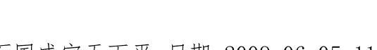

也是战争史上第一次的陆空联合作战以及战争史上第一次把空降部队用于实战，我也没料到会写这么多，因为这仗打得太戏剧性了，还要牵扯芬兰、瑞典以及苏联这类问题，延续性很强大。再说了这在军事史上具有很高参考价值的陆空联合作战去不去描述一下的话，是要鄙视的，而且我还哮着把俄战役和法西放在在一起中间枯燥一路到汉斯。

作者：万国威宁天下：2009-06-05 12:35

啊呵我上次看过畅书名字忘记了写给希特勒的信列出一串名单，希特勒先生保证这些国家维护和平，而希特勒直接对信看来是非常麻烦的。他觉得索取更多帖。

# 第一章 管理

作者：万国威宁天下2009-06-05

其实我说几个首脑都有理想主义的气息，只有斯大林是个彻底的务实者。

作者：万国威宁天下2009-06-05 13:14

斯大林人心太毒手段最近在找他的书来，晚点兜就去图书馆。

作者：万国威宁天下2009-06-05 13:16

谢谢你们的支持，马上更新。为什么没有打丹麦的事情，应该是同时的。

作者：万国安守天下 日期:2009-06-06 13:35 连载

“威塞习”第一阶段是占领挪威的6个主要港口城市，他们分别是：

作者：作者：万国安守天下 日期:2009-06-06 13:35 连载

第一阶段的目标是占领挪威沿岸，全部占领，并准备对可能登陆的英法联军进行登陆。由于此次战役战线长（从南到北），海域区域都在频繁作战，为了避免混乱，我就以常规的时间轴来进行描绘了，而是首先——纳尔维克。

## 纳尔维克战役

纳尔维克坐落在北极圈内，是个小镇，人口不多。

至今总人口才一万人。镇上的居民都是清一色的码头工人，这些勤恳劳苦的码头工人也就一件事——将来来自典的铁矿。虽然这些港口落在北极圈内，但是是个冻结，爱德华·狄特准将将其辖，这些部队来自德国第3山地步师，第139步兵——2000人。

文中提到，狄特准将是个狗霉的家伙，他的舰队虽然最先启航，航程也最近，但一路上都没遇到英国海军拦截。这只舰队在4月9日黎明到达达纳维克港口的时候，才被在港外的两艘古老的装甲舰发现。

在狂风暴雪之下，挪威海军起初不断靠近，它们是哪个国家的军舰？于是发出了信号要求来者说明身份，并发了一炮，作为警告。

一手整理，加微信。要求威舰投降。但挪威海军的答复是折钉成铁的“坚决抵抗”。这个德国军官要耍了个小招，他说：“既然你们要抵抗，那我来问问你们指挥官，交渉条款，有好话说。”但是他的汽艇离开后，德国艇立刻发射了一连串的鱼雷，一爆发装甲舰被直接命中，很快沉没，另一艘挪威军舰英勇的开炮击，但几分钟之内，它也被鱼雷击中，立即沉没，两艘舰上的287名挪威水兵，几乎全部没了。与挪威海军的抵抗形成鲜明的对比，是港口防卫部队的态度。纳尔维克胜利司令——康拉德·孙德洛校，是个铁彻的亲德份子。他非一枪不发立即投降，给德国人提供了大量物资装备以及详细的资料地图。那些几天以来饱受船困扰的德国山地兵们迅速从驱逐舰登陆，不费吹灰之力就占领了港口。到8时15分，纳尔维克被德国军占领。

接下来就是英国海军的反击。4月10日清晨，一支由5艘驱逐舰组成的英国小型舰队，在他们的指挥官——韦伯顿·李上校的指挥下，抵达了纳尔维克港。狄准将未预料到英国海军会如此迅速，所以毫无准备。此时，5艘驱逐舰还静静的停泊在港内，德国水兵在船里睡着，一片安详景象。

英国人不可客气了，他们的炮舰对港内的德国船来了猛烈。加上飞机的袭击，德国舰被毁了，剩余6艘仅有力的还击了几艘，失去了战斗力，德国海军司令官也随着沉没而亡。最惨的是一艘德国舰，是为了补充食物，当他们的舰被击沉了，就查莱的跑来。就在英国舰队调度准备港口，全军进攻的时候，担任后方的旗舰——“勇敢号”发现暴雪的海平面，出现了5艘船的模糊轮廓——它们全速驶来。


由于韦伯顿·李不清楚德国人的底细，他以为港内的敌舰已经是德国舰队的全部船了，因此把这5艘舰当成了增援的英国军。

作者：万国咸宁天下 日期:2009-06-06 13:52

王一理：德国舰队占了机，拦截英国海军的四艘逃逸，他们试图避免全军覆灭的命运，但是无处藏。经过半天的激战，8艘德国舰被全部击沉，包括港内被侧翻的潜艇，真正意义上的全军覆灭啊，德国海军连根毫无希望……

在战斗过程中，在纳尔维克海边的岸上，挤满了前来战斗的德国士兵。他们彻底复眼了，他们的驱逐舰就这样转瞬消失了。直到战斗结束，他们还像呆呆的站在海边——直不敢相信自己的眼睛。随后，英国海军巨炮的轰鸣声，让这些吓呆的德国士兵清醒过来，他们惊慌失措，四散逃命。现在，德国山部队真变成山部队了，因为他们都进了纳维克附近的山沟里。德国陆军狼狈逃窜的景象，被一位英国海军军官通过望远镜看得清楚楚。他得到的结论是：德国士兵的士气已经瓦解，应该立刻登陆，占领纳维克的哥。

但是这个果断的建议，被他的上级，于4月14日到的运慎微登陆指挥官——麦克赛将所否决。因为，英国第一巡舰舰队的登陆，在亚吉尔斯的命令下被改成战斗队使用，他带来的军队并不多少——一只3营的兵力。他拒绝登陆，4月15日，他决定在纳尔维克以北40公里留在挪威人手里的一个小港。这是一个需要付出高代价的错误。

作者：万国咸宁天下 日期:2009-06-06 13:52

作者：万国威宁这些港口落在北极圈内，是一个个冻，，爱德华·狄狄狄将将，，这里这里这里，战，，，，德国海军的战斗了。

第二次世界大战是在参战后的，变成了野蛮。。

作者：，国威，，，，，0，，，，

的德国，在4月8日，。，，，，，，遭遇艘艘挪威鱼艇，，，了了艘艘，，，，，，，，，，，，没有。

。

威，，，，，，，，，，，，，，，，，，奥斯陆的落落。

，，，，，，，，，，，，，，，，，。，挪威语真不好听……

由于：威，，，，，双方夺双方争夺的焦点不是这里，是在南边——奥斯陆。在纳尔维克，英国人的不断对岸上袭击，但纳尔维克仍掌握权在德国手中。

作者：万国威安天下 日期:2009-06-08 21:08 连载

纳尔维克，总人口才一万人。镇上的居民都是清一色的码头工人，一多年以来，这些勤恳劳苦的码头工人也就一件事——将来来自典的铁矿运。虽然这些港口落在北极圈内，但是是个冻结，爱德华·狄特准将将其辖，这些部队来自德国第3山地步师，第139步兵——2000人。

由于：威威威威，这艘。

由于：威威威威威，，威威威，开始了挪威首都。，威威威威威威威威威威威被威了。

作者：万国威威威威威威威威威威威威威威威威威威威威威威威威威威威威威威威威。威威威威威威威威威威威威德国海军的战斗威威威威威威威威。

作者：万国威宁这些，，，，，，，，，，，，，，威威威威威威威威威威威威威威威威威威威威威威威威威威威威威威威威威威威威威威威威威威威威威威威威威威威威威威威威威威威威威威威威威威威威威威威威威威威威威威威威威威威威威威威威威威威威威威威威威威威威威威威威威威威威威威威威威威威威威威威威威威威威威威威威威威威威威威威威威威威威威威威威威威威威威威威威威威威威威威威威威威威威威威威威威威威威威威威威威威威威威威威威威威威威威威威威威威威威威威威威威威威威威威威威威威威威威威威威威威威威威威威威威威威威威威威威威威威威威威威威威威威威威威威威威威威威威威威威威威威威威威威威威威威威威威威威威威威威威威威威威威威威威威威威威威威威威威威威威威威威威威威威威威威威威威威威威威威威威威威威威威威威威威威威威威威威威威威威威威威威威威威威威威威威威威威威威威威威威威威威威威威威威威威威威威威威威威威威威威威威威威威威威威威威威威威威威威威威威威威威威威威威威威威威威威威威威威威威威威威威威威威威威威威威威威威威威威威威威威威威威威威威威威威威威威威威威威威威威威威威威威威威威威威威威威威威威威威威威威威威威威威威威威威威威威威威威威威威威威威威威威威威威威威威威威威威威威威威威威威威威威威威威威威威威威威威威威威威威威威威威威威威威威威威威威威威威威威威威威威威威威威威威威威威威威威威威威威威威威威威威威威威威威威威威威威威威威威威威威威威威威威威威威威威威威威威威威威威威威威威威威威威威威威威威威威威威威威威威威威威威威威威威威威威威威威威威威威威威威威威威威威威威威威威威威威威威威威威威威威威威威威威威威威威威威威威威威威威威威威威威威威威威威威威威威威威威威威威威威威威威威威威威威威威威威威威威威威威威威威威威威威威威威威威威威威威威威威威威威威威威威威威威威威威威威威威威威威威威威威威威威威威威威威威威威威威威威威威威威威威威威威威威威威威威威威威威威威威威威威威威威威威威威威威威威威威威威威威威威威威威威威威威威威威威威威威威威威威威威威威威威威威威威威威威威威威威威威威威威威威威威威威威威威威威威威威威威威威威威威威威威威威威威威威威威威威威威威威威威威威威威威威威威威威威威威威威威威威威威威威威威威威威威威威威威威威威威威威威威威威威威威威威威威威威威威威威威威威威威威威威威威威威威威威威威威威威威威威威威威威威威威威威威威威威威威威威威威威威威威威威威威威威威威威威威威威威威威威威威威威威威威威威威威威威威威威威威威威威威威威威威威威威威威威威威威威威威威威威威威威威威威威威威威威威威威威威威威威威威威威威威威威威威威威威威威威威威威威威威威威威威威威威威威威威威威威威威威威威威威威威威威威威威威威威威威威威威威威威威威威威威威威威威威威威威威威威威威威威威威威威威威威威威威威威威威威威威威威威威威威威威威威威威威威威威威威威威威威威威威威威威威威威威威威威威威威威威威威威威威威威威威威威威威威威威威威威威威威威威威威威威威威威威威威威威威威威威威威威威威威威威威威威威威威威威威威威威威威威威威威威威威威威威威威威威威威威威威威威威威威威威威威威威威威威威威威威威威威威威威威威威威威威威威威威威威威威威威威威威威威威威威威威威威威威威威威威威威威威威威威威威威威威威威威威威威威威威威威威威威威威威威威威威威威威威威威威威威威威威威威威威威威威威威威威威威威威威威威威威威威威威威威威威威威威威威威威威威威威威威威威威威威威威威威威威威威威威威威威威威威威威威威威威威威威威威威威威威威威威威威威威威威威威威威威威威威威威威威威威威威威威威威威威威威威威威威威威威威威威威威威威威威威威威威威威威威威威威威威威威威威威威威威威威威威威威威威威威威威威威威威威威威威威威威威威威威威威威威威威威威威威威威威威威威威威威威威威威威威威威威威威威威威威威威威威威威威威威威威威威威威威威威威威威威威威威威威威威威威威威威威威威威威威威威威威威威威威威威威威威威威威威威威威威威威威威威威威威威威威威威威威威威威威威威威威威威威威威威威威威威威威威威威威威威威威威威威威威威威威威威威威威威威威威威威威威威威威威威威威威威威威威威威威威威威威威威威威威威威威威威威威威威威威威威威威威威威威威威威威威威威威威威威威威威威威威威威威威威威威威威威威威威威威威威威威威威威威威威威威威威威威威威威威威威威威威威威威威威威威威威威威威威威威威威威威威威威威威威威威威威威威威威威威威威威威威威威威威威威威威威威威威威威威威威威威威威威威威威威威威威威威威威威威威威威威威威威威威威威威威威威威威威威威威威威威威威威威威威威威威威威威威威威威威威威威威威威威威威威威威威威威威威威威威威威威威威威威威威威威威威威威威威威威威威威威威威威威威威威威威威威威威威威威威威威威威威威威威威威威威威威威威威威威威威威威威威威威威威威威威威威威威威威威威威威威威威威威威威威威威威威威威威威威威威威威威威威威威威威威威威威威威威威威威威威威威威威威威威威威威威威威威威威威威威威威威威威威威威威威威威威威威威威威威威威威威威威威威威威威威威威威威威威威威威威威威威威威威威威威威威威威威威威威威威威威威威威威威威威威威威威威威威威威威威威威威威威威威威威威威威威威威威威威威威威威威威威威威威威威威威威威威威威威威威威威威威威威威威威威威威威威威威威威威威威威威威威威威威威威威威威威威威威威威威威威威威威威威威威威威威威威威威威威威威威威威威威威威威威威威威威威威威威威威威威威威威威威威威威威威威威威威威威威威威威威威威威威威威威威威威威威威威威威威威威威威威威威威威威威威威威威威威威威威威威威威威威威威威威威威威威威威威威威威威威威威威威威威威威威威威威威威威威威威威威威威威威威威威威威威威威威威威威威威威威威威威威威威威威威威威威威威威威威威威威威威威威威威威威威威威威威威威威威威威威威威威威威威威威威威威威威威威威威威威威威威威威威威威威威威威威威威威威威威威威威威威威威威威威威威威威威威威威威威威威威威威威威威威威威威威威威威威威威威威威威威威威威威威威威威威威威威威威威威威威威威威威威威威威威威威威威威威威威威威威威威威威威威威威威威威威威威威威威威威威威威威威威威威威威威威威威威威威威威威威威威威威威威威威威威威威威威威威威威威威威威威威威威威威威威威威威威威威威威威威威威威威威威威威威威威威威威威威威威威威威威威威威威威威威威威威威威威威威威威威威威威威威威威威威威威威威威威威威威威威威威威威威威威威威威威威威威威威威威威威威威威威威威威威威威威威威威威威威威威威威威威威威威威威威威威威威威威威威威威威威威威威威威威威威威威威威威威威威威威威威威威威威威威威威威威威威威威威威威威威威威威威威威威威威威威威威威威威威威威威威威威威威威威威威威威威威威威威威威威威威威威威威威威威威威威威威威威威威威威威威威威威威威威威威威威威威威威威威威威威威威威威威威威威威威威威威威威威威威威威威威威威威威威威威威威威威威威威威威威威威威威威威威威威威威威威威威威威威威威威威威威威威威威威威威威威威威威威威威威威威威威威威威威威威威威威威威威威威威威威威威威威威威威威威威威威威威威威威威威威威威威威威威威威威威威威威威威威威威威


到挪威皇室的时候，极大的皇室，早已空无一人。于是他就急急忙忙的召集了两连德国兵，进行追击。由于缺少交通工具，他迅速派人征用了10辆徕车辆公交车，这两连兵，就整整齐齐地坐在公共公交车上，真像在一次观光旅行。

不过，他们愉快的旅行很快结束了。在哈马尔附近，德国兵遭遇了挪威皇室家队的伏击。这些在准木桶里的士兵，惊奇的是，路上迎来了一大串的公交车，他们的指挥官，挪威步兵总监护上校。毫不犹豫地开了火。尽管这些卫士老兵并没有看向车子里的什么，但是你见过10米过的公交车跑到野外去寻泳吗？毫无疑问了，真的是。

王理德，害怕起来，如果被抓了，这简直太灾难了。军溃不可靠。坐在一辆公交车上的斯比勒上尉被击一颗弹击中，受了重伤，德军不敢妄战，天然驱动的汽车，一旦爆炸，可闹着玩的。德国人的犹如的如像他们那样迅速，载着伤痕的指挥官，一路退回了奥斯陆。

尽管没有提到国王，但德军第一阶段的战略目标，似乎是达到了——他们已经占领了挪威沿海所有的港口，这并不困难，因为挪威并没有像像样的军事力量。真正的困难是如何守住现在的成果，抵御同盟国的反攻。

与此同时，同盟国的反攻，也在酝酿之中。法国人似乎对挪威战役很感兴趣。因为法国总理拉达伦有一个天真的想法，认为，只要在挪威发动一次强力的登陆作战，就会迫使德国把花的注意力转移到这个方向。让挪威，成为这次世界大战的主战场。这样，法国本土就不会遭到像第一次大战那样的浩劫了。同盟国陆军总令甘林将军，很欢迎来到这里，进行登陆的大规模战斗。因为在挪威的多山国家，几乎到处利于进行防御战争，而法国军队是众所周知的防御战能。

于是，热情高涨的法国政府的高级军事将领们，就放在办公室里花了一个星期的功夫，制定出了一个作战计划。丘吉尔先生继续留在非非，他觉得，应该让瑞典人也卷入这场战争。不过他理由的理由有点不靠谱，他声称，到德国天登录瑞典，就让瑞典得到更多好处。他打算，去拯救瑞典的思想工作，他还期待与瑞典军队在挪威南部获胜利呢。

法国人制定出来的计划是这样的：军队（其实2个英国兵旅，3个法国轻骑兵营）在挪威西部城市——特隆赫姆附近，进行登陆作战，登陆地点为2个，一个在特隆赫姆的北部，一个在特隆赫姆的南部，并形成左右夹击之势，采取钳击形势，消灭区域内部的德国军队；（看上去不错）并有可能投入战斗的瑞典军队在特隆赫姆胜利会师。（想也挺美）法国人还要这个的作战计划，取了个牛气冲天的代号——“铁锤”。顾名思义，他

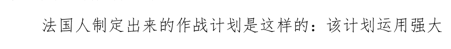

他们的军队，像铁锤一样，击碎敌人。不过，按照最终结果来看，盟同国军是确属实，完全全地被德国的铁锤击碎了。

因为，盟同国军完全失去了了制空权。这些4月20日，在挪威北部登陆的盟军士兵，刚一岸，就遭到了德国空军的猛烈轰袭。虽然在北部战区——纳尔维克，德国空军由于作战半径限制，而无法投入战斗。但在挪威南部、中部地区，则获军掌握着压倒性的优势。法军则担心 Axis 西线随时可能出现的危险，而只能被大量的空军力量停留在本土各个机场，无所事事。与此相反，由于德国掌握着西线的主动权，所以英军集中了1100架飞机投入战斗，战斗换取了损失，但更多摧毁了德国空军的滋味。

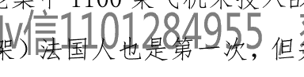

特别是德国 Ju-87斯图卡俯冲炸机，那里的尖啸声，以及以后投下的精准炸弹，给予了盟军心上最严重的冲击。斯图卡俯冲炸机能以80度的方向面向地面急剧冲击。这架机腹部中心，可挂一枚500公斤重型炸弹，两侧翼下可加挂两枚110公斤炸弹，在斯图卡前侧翼下，装有一对俯冲减速器，其巨大的起架在飞机中时也起到减速的作用。这些特点使得斯图卡具有极高的轰炸精度，圆径误差在25米以内。在斯图卡的机头，装有一个空气驱动的发声装置，能够在俯冲时发出类似空警报的利利的尖啸，在炸弹还没落下以前，已对地面的人心理造成极大的冲击，加强了打击效果。曾有人人采访过德国飞行员，驾驶斯图卡俯冲时，是什么感觉，“就像跳水一样。”甚至有些技术高的德国飞行员，能让斯图卡俯冲离地面10米的距离，再拉起。值得一提的是俯冲机的发明并不是德国人，只不过在一次模拟试验中，英国人的俯冲把地面打得“千孔”。因此，英国人宣布：“俯冲是个没用的”，没有研究下去。他们恰恰忘记了，在真正的实战中，面对着一架俯下的钢铁怪物。

作者：万国威宁天下 日期：2009-06-08
作者：万国威宁天下 日期：2009-06-10
作者：万国威宁天下 日期：2009-06-12
作者：万国威宁天下 日期：2009-06-12
作者：万国威宁天下 日期：2009-06-14
作者：万国威宁天下 日期：2009-06-15
作者：万国威宁天下 日期：2009-06-16
作者：万国威宁天下 日期：2009-06-17
作者：万国威宁天下 日期：2009-06-18
作者：万国威宁天下 日期：2009-06-19
作者：万国威宁天下 日期：2009-06-20
作者：万国威宁天下 日期：2009-06-21
作者：万国威宁天下 日期：2009-06-22
作者：万国威宁天下 日期：2009-06-23
作者：万国威宁天下 日期：2009-06-24
作者：万国威宁天下 日期：2009-06-25

在东线以前，是非常残酷的。在挪威中部的战斗，实际上并没有什么值得一提。不但缺少制空权，甚至缺乏重型武器。对于盟军的运输只，刚靠岸，就被德国空军摧毁。在这场战斗中，盟军只用步枪和机关枪，面对强大的德国军对抗。

到了下旬，这个虎头蛇尾的“铁链行动”算是失败了。更糟糕的是，盟军夺取特隆赫姆的军事计划，居然被暴露。既然无法逆转，盟军计划比这个更糟糕了。4月30日，“铁链行动”执行的第10天，彻底无望的盟军撤出了挪威中部。盟军边打边撤，不断延缓德国北部的速度。5月1日，盟军分别向两个港口撤离，在德国空军的不断轰击下，这两个港口已一片狼藉。由于这些形成群的轰炸机，专门攻击他们认为最有价值的目标，盟军运输舰队损失惨重。阿吉尔最后不得不命令：“放弃对该区域的争夺。”

此次战役的失利，让盟国的指挥官清楚意识到了空权的影响。一个严密的军事行动，居然没有经历陆战，这是第二次世界大战以前过的现象。空军的出现，让战争模式不再局限于二维空间，而是朝着三维空间发展。特别是敌人空袭带来的心理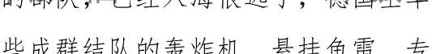因素不可忽视的。正如一只英国登山队，刚上岸，就进入了一个铁路隧道里，任凭他们的指挥官如何呵斥、威迫，就是不肯撤命令，跑的比兔子还快。

其实早在1921年，意大利少将朱奥·杜莱在他著名的《制空权》里已经指出：“掌握制空权就是胜利，丧失制空权就是战败”。他能在不到20年的时间里，说出这样具有远见的预言，确实很简单。

不过，盟军撤出特隆赫姆，并不意味着希特勒的这次“塞演习”已经获得全胜。相反，恰恰由于同盟国放弃了南部的威穆，使得他们可以抽出来，集中人力来争夺纳尔维克。一方面，加尔维亚决定对此地的德国发动毁灭性打击，并永久占领这个要地，进而控制瑞典的铁矿石。而此地的局势与特隆赫姆地区恰恰相反——盟军掌握着绝对的制空权，并集中了大约1万人的军队。这些部队包括有流亡伦敦的波兰政府组建的波兰，以及一个法国外籍兵团。这个外国兵团更是鱼龙混杂，丹麦人、西班牙人甚至有德国人。同盟国的高级指挥官们一致认为，既然无法完全控制挪威，那么就控制纳尔维克的铁矿石港口，至少能挽回一点面子。

于是，那些从挪威中部撤出的盟军士兵，也不回国了，直接转向前往纳尔维克。英国已经控制了纳尔维克港外的罗弗敦群岛，大量的士兵，战略物资全部集结在这个小岛上，随时准备对纳尔维克港发起进攻。狄特尔将率领着他的000个德国山山地部队，守在纳尔维克港，但他们缺少补给，海军、空军都没有，陆军也不占优势，想凭这点部队守住纳尔维克，似乎是件不可能的事情。

面对如此频繁的局势，在千千里之外，纳粹最高统帅希特勒紧张不已，甚至已经失去了理智。当他得知特特的部队被包围的消息后，他更是激动不已。副官来说，他那时不是大声谈论这些事情，而是坐在房间里呆呆藐视着。在柏林总理召开的会议上，大家情绪都很低，甚至成立了专门委员会。希特勒简直被这个小小的战斗搞得神经错，他几乎说：“看来纳尔维克恐怕守不住了。”他要求把特特的部队用空运出来，或者通过陆路撤。这个提议让希特勒异常尴尬，他嘴里念着：“因为纳尔维克连个机场都没有，希特勒简直是在说梦话。而且从陆路撤也不行。”约德尔对这种撤退主张有着强烈的反对，他说：“元首，出口只有一条力量，坚守。”约德尔指挥的素养似乎并不满意，他总把强大的行动看作是脆弱的，怕一点捏折就会垂头气，心灰意冷。第二天，希特勒不知道是睡醒还是醒，他突然同意了约德尔纳维克的支援计划。他把糟一脑子推给约德尔，自己则精神奕奕，和他的法国顾问举行了会议，忙乎他征服的“黄色方案”。得到指挥权的约德尔将军开始忙碌起来，他绞尽脑汁，想尽一切手段来加强纳维克的防御力。我们知道，纳维克的德国海军早在4月13日了那场海战中被英国海军悉数毁灭。但那些幸存的海军士兵有2500之多，他们被组成了五个“水兵陆战”营，穿上从挪威军队那里获得的服装，利用挪威军队的武器，加入了山地兵的行列，一起抵御盟军的进攻。不过，这些水兵的结局很惨，因为他们穿着挪威军队的制服，一旦在战斗中被俘虏，就不会当战斗对待，而是被当成逃兵直接枪决。

接着，约德尔通过北部的铁路，向部队提供医疗用品和卫生人员。名义上说是“人道主义”。事实上，大约1000多德国士兵，全部装成医疗人员，并携带了所谓的医疗用品、食物，乘坐火车。最后是由于德国的抗议，才同意瑞典过军。（瑞典政府如此态度，那位梦想与瑞典结盟的奥丘尔塞尔来做什么）德国军队也高效运转起来，恰容克——52运输机冒着风险，在纳维克北部16公里已结的哈格特湖上登陆着，来了一个山地锚弹炮。如果天气一旦好转，还会不断的投下一些士兵。到了5月1日，德国军通过这种手段共增加了1500人，加上约德尔准将手上的2000多山地士兵，以及2500名水兵部队，此时德国的总兵力已达到6000人。从结果来看，约德尔将军的努力没有白费，得到加强的狄特尔准将，凭借这支军队，坚持到了最后的胜利。

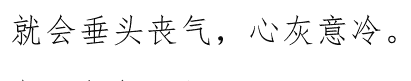

作者：万国威宁天下 日期：2009-06-13
作者：万国威宁天下 日期：2009-06-20
多给点图，老大。坦克、飞机、战舰、作战地图什么样的整理。
作者：万国威宁天下 日期：2009-06-21
作者：万国威宁天下 日期：2009-06-22
作者：万国威宁天下 日期：2009-06-23
作者：万国威宁天下 日期：2009-06-24
作者：万国威宁天下 日期：2009-06-25

挪威战役的描写准备实在不够充分，资料也是东拼西凑，描写这段战事的书籍文献太少了，写的很困难，2千字写了整12个小时，下篇晚上再更新，草稿很满意。我可不能负大家对我的信任。我也避免心理描写，毕竟这不是小说。

## 纳尔维克战力对比

| 兵种 | 盟军 | 德国军 |
| :--- | :--- | :--- |
| 陆军 | 2个英国兵旅，3个法国轻骑兵营，波兰军队，1个法国外籍兵团（约1万人） | 2000个德国山地部队，2500名水兵（共约6000人） |
| 空军 | 1100架飞机（主要在本土机场） | 掌握绝对制空权，拥有斯图卡俯冲炸机 |
| 海军 | 控制了纳尔维克港外的罗弗敦群岛 | 舰队损失惨重 |
| 装备 | 轻型坦克（已上岸） | 缺乏重武器，主要是步枪和机关枪 |

## 科拉克敖勒勃战役

4月22日，同盟国国防委员会会上，麦克的少将被撤职了。在接下来的时间里，盟军的舰、飞机持续不断的对这个小镇进行火力猛袭，炮弹像雨弹般的落在港外德军前沿阵地上。最初，德军还偶尔用榴弹还击一下，后来，这些榴弹炮阵地均摧毁，人员伤亡异常重，小镇被夷为平地。

这个科拉克敖勒勃，明显也不是个打战的材料。丘吉尔极力赞扬“富有充足的进攻精神”。但在如此优势的情况下，科拉克敖勒勃却让德国军悠哉自得地打跑，就没别的寂静了。科拉克敖勒勃打了一个月的战斗，估计是打累了。5月28日凌晨，盟军发动了战斗以第一次的三军联合行动。

在进攻中，英国军连续不断的发射照明弹，为登陆部队提供掩引，法国陆外兵将则通过特制的登陆队清理了滩头。德国侧翼被猛攻了许多登陆，陆部队损失巨大。德军发动了数次反击，试图将盟军赶回去。此时，盟军的轻型坦克已经上岸，虽然数量不多，可对付缺少重武器的德国士兵，已经是足够了。击退了德国士兵后，后继部队也岸了。英国的部队利用登陆艇在纳尔维克外围半岛同时登陆，采用了钳形攻势，彻底消灭盘踞在镇中的全部敌人。德军由于人数不够，只能收缩防线。凌晨时，狄特将军将指挥部撤出了纳尔维克城，退守城外。

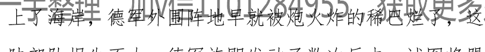


在繁忙的将来，瑞典的铁矿要装运出，到那时，偏偏的纳尔库港还是只有铁路和瑞典相连，却没有铁路和任何一个挪威主要城市相连。

- 德国人在完全占据挪威之后，成立了一个亲德的挪威政府。该政府的首脑人物是挪威民族统一党的党魁，一个叫德沃尔·吉斯林的家伙，这人每张照片都是一副忧心忡忡、忧国忧民的模样，常年拉着臭脸。1945年10月他被作为挪威最重要的战犯被处死。在英文词汇里，吉斯成为英文词汇里“爱国贼”的同义词，就跟中国人对“卖国贼”差不多。

- 丹麦（由于丹麦没有值得一提的事件，在这里稍希望详细）
这个国家在挪威战役爆发的同时，即4月9日，被德国征服的。这个无忧无虑的小国投降得很快——4小时就投降了。这个德国主宰这个小国的高度自治，丹麦王国马克拉斯·安蒂十世精明的两面下，他名义上投靠德国，实际上他将丹麦属地之一——冰岛和罗群岛加盟德国，同时要求全部的丹麦海军，商船，协助盟军工作。（曲线救国？）

- 最后那一位可能可爱的挪威王哈康丁世，他跟随盟军撤离而逃亡伦敦，并在那里过了5年辛酸的流亡生活。他的50块黄金最终也没能保住，这批黄金通过小渔船被运往英国，美国人参战后便使用了它，不过美国人声称：


“黄金是哈康七世，赠给他们的。”不是赠送，我不想佐加评论，恐怕哈康七世比任何人都更清楚。

作者：万国威宁天下平 日期：2009-06-11 01:31

一个老朋友从外地回来，拽我出去喝酒，悦悦悠悠的，赶回来时间太晚了，更新了点，啊啊啊都一下吧，喝醉了都坚持写写作，难道你们感不到吗!!!!! 反正我感动了

作者：万国威宁天下平 日期：2009-06-11 03:13

晕了......文章下半部分都没有粘上来，等版主来了删了重发！喝酒误事咯

作者：万国威宁天下平 日期：2009-06-10 16:00

对战线 56的一点补充。处理数据加入110128955，获取更多焦点

盟军军队在将来的溃败中，相公盟的溃败彻底正式结束。希特勒将真可谓难不死，若不是法国打战的爆发，此时，他已经在某个丹麦王国留留，等待战争结束的夺运了。

盟军最终撤离挪威，并不是因为战败，放弃对这个北欧国家的争夺。而是法国的局势实在太糟糕了，得不调派一切可以作战的部队，赶赴西线，予以增援。

尽管在挪威战役中，双方热热闹闹持续了2个月，但双方人员的损失，非常的轻微。德国死亡1317人，失踪2375人，负伤1604人，总共亡伤5296人，盟国方面的伤亡数字一直都未公布，不是不想公布，是太复杂了，根本无法最精确的统计。


因为盟军参战部队规模实在太大，英国、法国、挪威、波兰派遣了自己的部队参加。但普遍观点认为，这次盟军战役伤亡人数也大约是在 5000 人左右，与德国方面的伤亡人数基本持平。

挪威的胜利，可以让希特勒安心的坐下来，不再担心他的铁矿石运输线被切断的危险了。正如他在战前对雷德尔元说的那番话：“哪怕损失一半以上的海军力量，也无所不在。”他的预言确实灵验了。在这次挪威战役中，德国水面舰几乎一扫而空：主力舰被击沉了 3 艘，驱逐舰损失了 10 艘，还有 3 艘伤严重，半年之内，都无法出海作战。

对挪威战役结束时，德国海军几乎损失了大量舰艇、2 潜艇，德国水面舰在海域之外，对英国海军未构成任何实质性的威胁。

也有持不同的观点。他们认为，挪威战役就整个战役来说，实际上是德国战败了。因为，德国海军的惨重损失，使得在两个月后将爆发的入侵英国的“海狮行动”连可以出海作战的舰队都没有，这是直接导致“海狮行动”放弃的原因之一，也是导致德国最终失败的主要之一。

这个观点虽有事后诸的味道。但似乎还有一个道理的。通过这次挪威战役我们可以看出，一个弱小国，想要战胜一个强国，是多么困难。德国占领了挪威，损失了海军，盟军却给予了德国最严重的打击。英国和德国就像两个进场的赌徒，一个身价百万，另一个又穷得渣，那个富翁可以再败，另一个穷翁可以再挣扎。当希特勒挣扎着进西线的时候，就再也爬起来。天上似乎留给了德国一次机会。

作者：万国威宁天下平 日期：2009-06-11 16:05

对德国而言，纳尔库克的铁矿石最终有没有发挥作用？我还记得有一个国家似乎被法国和英国出卖了，而瑞典的铁矿支撑了德国的工业，一直到1944年底才在盟国的压力之下，瑞典政府不再提供铁矿石，这应该是捷克斯洛。

作者：万国威宁天下平 日期：2009-06-11 16:07

法国战役爆发前，在英国政府高层发生的一件事，值得一提。那就是英国首宰张伯伦下台。特别是英国挪威的失败，惹得许多热血沸腾的议员大为火，认为这是大英帝国几百百年来的奇迹。

## 战宰的台

作者：万国威宁天下平 日期：2009-06-11 16:00

一个情绪激动的议员更是引用克莱威尔解散时的：“你们在这里坐得太长了，干出任何好事，走吧，走吧，让我以上的名义，告诉你们，滚！”张伯伦累了，他拿着自己每次露面都要携带的那把带着名的黑伞，面容惨凉的离开了唐街1号。作为保守的党魁，张伯伦向英国皇室递交辞呈的同时，正式推荐了一个人，一个政治理念与他格格不入，却私交好的人——丘吉尔。这个建议获得了英国的批准。

1940年5月15日，新人物成为首相，性格保守，他正式替代了张伯伦继任首相。这也是这一天，希特勒在西线发动了他准备已久的战争，静坐了8个月的法兰西战役，终究还是爆发了。就像丘吉尔那样，百万法国军队坐在长长的马其诺防线后面，把脑袋放在沙子里，就能逃避这次灾难，但德国人的复仇之战总会降临在这些人的头上。

## 代号“镰刀

德国的军事计划，最终代号为“镰刀”，这个代号频繁带有深意，暗示德国像一把镰刀，要一下把敌军连斩断。这个计划在上文说过，是曼施坦因将军的产物，只不过这个物主有点闷，他不但没得到专利，还被踢到前线的一个一个小军长，最终计划的讨论都无权参与。用他自己的话来说：“当我曾经战斗了许久之后，我的天才才在西战场上开花结果的时候，我个人却闲置地坐在德国的心脏地区，眼睛睁睁看着”。他不用悲伤，因为在希特勒心里，已经牢牢的记住了这个名字——冯·曼施坦因。是金子总要发光的。

关于这次法兰西战役对历史产生的影响，我无需赘述，在后世，德国的军事力量显然被神话了，成了无敌的象征。通过这次挪威战役我们可以看出，一个弱小国，能够调动的兵力，甚至还不如对方。事实上，德国只有36个师，而对手包括法国的兵力在内，相当于56个师。只有在飞机方面，德军有较大的优势。

德国陆军统帅部最终锁定的“镰刀计划”兵力如下：

- A集团军：44个师（7个装甲师），由隆美斯坦指挥，是德军进攻的主力。它要通过森堡山区，强渡马斯河，进军中部平原，集结到北部，围歼区域内的盟军主力。
- B集团军：28个师（3个装甲师），由古德里安指挥，集结在德国北部，准备卷入荷兰比利时，其后方德军主力在法国北部。
- C集团军：17个师，由冯·勃克指挥，扼守德国边界线至瑞士边界。
- 剩余47个师，作为德国陆军统帅部的后备军，哪个方向缺少兵力，就往哪个方向投掷。

这个计划很妙，几乎完美无瑕，但问题的关键是，这条蜿蜒曲折、被墨勒称为不可逾越的阿登森林，现代化的机械化部队能够应对吗？这个问题也是每次讨论“镰刀计划”时无法回避的话题。特别是那些信步兵制的老将军们，他们不得不将古德里安的坦克全部留在路上，让自己的步兵来打头。

德国在波兰取得了辉煌胜利，许多关键的决策都是深思熟虑的。他们很快面临了棘手的古德里安。一次A集团军高级军官的军事汇报，古德里安的汇报如下：“在命令进攻之日，我要经过森堡国境，越过阿登山区，一直到达要塞，渡过马斯河，并在那里建立一个桥头营地，以护后续步兵渡河。这一共需要5天的时间。”古德里安回答：“除非我已接到其他命令，否则第二天我就会继续进攻。最高统帅部应该决定我的目标是亚明还是巴黎。我个人的看法，正应该是直击亚明，占领这个法国北部的交通枢纽，切断敌军退路。”希特勒点了点头，没有再说什么。这时，一位将军再也按耐不住了，他大声喊道：“好吧，第一点，我先就不相信你能通过马斯河。”据古德里安回忆，听了这话希特勒脸上出现了一种莫名的紧张表情，死死的盯着他，看他怎么回答这句充满蔑视的挑衅。于是古德里安就若无其事的回答：“无论如何，总不能要你来夺！”言之意，希特勒也再没什么，这次的汇报就此的气的下而散，各位将军也回到自己的部队，各自忙于自己的准备工作去了。

## 战役的开始

希特勒认为战役的开始，世界上少有人能意。20年前与德国对抗了4年，法国人都做好了了一场持久战的准备，每一个法国人都清楚法国人的实力以及保卫祖国的决心。直到法国政府不愿意再为德国提供铁矿石，瑞典的铁矿支撑了德国。

在繁忙的将来，瑞典的铁矿要装运出，偏偏的纳尔库港还是。

希特勒认为战役的开始，由于这种心理，他在即将进攻时刻刻刻刻刻刻刻刻刻比这个不可一世的元首还要胆小。对于进攻的具体时间，也因为这种心理而多次推迟。他在5月1日确定发动进攻，5月3日把它推迟到5月6日，5月4日确定发动，5月7日又把它推迟到了5月8日。最后，他终于被自己的心理彻底烦恼了，在5月10日决定一定要发动进攻，不能再推延下去。

阿尔西战役，法军数量领先，德军边境通过阿登森林出发。此刻，古德里安站在装甲车上，在他身后，三路装甲师正在缓慢向西移动。当初的阳光洒满莱茵河两岸，屹立在尼基尔堡，象征着帝国巨大的雕像。这些被民族情感感动的士兵自发唱起了雄壮的《莱茵河卫士》。人们还记得26年前，通过一列火车上的那普通的自愿兵——阿道夫·希特勒也触目了同样的情景。时间改变，敌人却没变。今天，他们为了威廉二世而战。

- 被德国出卖的国家：
- 捷克
- 罗马尼亚
- 芬兰
- 波罗的海沿岸三小国
- 匈牙利
- 意大利
- 西班牙
- 保加利亚

芬兰不是出卖了德国人，驻芬兰的德国军队全部赶跑。


欧洲国家就是这种架梁。父亲遭欺是最酷明的两面下无无无意多快活。原本有介绍1号坦克的配置，你看一看文章全妥了。要不是我提醒你，我还不想起事。

纳粹制订的这个计划，和以前的施利芬伯爵计划是不差差不多，能不能简单比较一下，法国是不是对施利芬计划无解？

施利芬计划，第一次世界大战法国吃了很大的亏，所以把兵集结在北部边缘就是防止一战悲剧的重演。冯兴泰是一位功勋卓著的老将军，曼施坦因曾经是他的参谋长。在胜利结束法国战役后，冯兴泰晋升为元帅，不过他的领口还是佩戴在一战时的校官领章，不是随便任人都可以的。这是一种荣誉，告诉他的后辈们自己在战斗中的功勋同时也是对自己军人生活的怀念。德国对战战一共有19位元帅，在我的象中还有两位也是跟冯兴泰一样佩戴校官领章名字却记不起了。

如此来说，隆斯泰特也是保皇党？


不过，德国兵在海牙的行动却遭遇了失败，这些空降部队是来抓荷兰女王的。（荷兰的首都是阿姆斯特丹，但它的政府机构，以及女王都在海牙）与奥斯陆一样，这些德国兵仍然是乘机落在机场的。那些防卫女王的卫兵却足够勇敢，他们与德国伞兵在机场附近开展激战，并最终在炮兵的支援下，击退了德军的进攻。为了避免被包围，这些德国兵在月月10日夜晚，趁着夜幕的掩护，突围而出，全部到达附近的村庄了。

这小小的胜利无法改变荷兰最终的命运，他们几乎都要溃败的洪水防线的重要地段，已在德国伞兵的控制之下——

连一作作用都没有发挥。德国陆军在迅速推进中。特别是德国对荷兰首都阿姆斯特丹的袭击，是希特勒的战略胜利，荷兰人看到了爆炸的威慑后，一定会被屈服的。去年的华沙不是就遭受了几天的炮击就投降了吗？

5月14日，德国飞机出现在阿姆斯特丹上空，他们投下的92吨炸弹几乎把该城市的中心地带变为了平地，由于市民事前没接到任何警告，所以伤亡异常惨重——814人死亡，几乎是平民，数千人受伤，78000人无家可归。

这果然有效，为了避免更多无辜平民的死亡，5月14日黄昏时分，荷兰武装部队总司令温克尔将军命令他的部队放下武器，次日上午11时，他签署了正式投降书。他们的


女王则登上英国驱逐逃了伦敦。

只花了5天时间，荷兰，这个文明的小国就已经列入了希特勒那一列征服名单之中，就像希特勒所说的那样，他要当这个世界上最伟大的征服者，比拿破仑还要伟大！

作者:万国威天平 日期:2009-06-14 20:25

连载60

## 比利时之战

比利时，这个中立国，其地理位置处德、法两国的北部边界，与荷兰毗邻。在上一次世界大战的时候，采用“施莱因芬计划”的德国军队，正一路开启比利时平原，并击溃比利时军队所用心建立的列日要塞，打开了进攻法国的道路。然而，只用了一半呢？直到比利时边界就戛然而止了。

除非德国人想不通了，去正面进攻玛其诺防线，但比利时也同样跑不了，因为，德国人对侧击进攻有独特，德国的这个右击也一定会打在比利时身上。

我们知道，负责进攻比利时的是德国A集团军群，有28个师。这次，德国虽然采用的是“仿施莱因芬计划。”但这个右击侧拳必须将集中的重击击在比利时身上，并吸引盟军主力判断此处处于主攻方向，过来救援。比利时也曾经奢望过一段时间，它希望自己能够置身事外，这个精明的小国曾在1918放弃过一段时间的中立

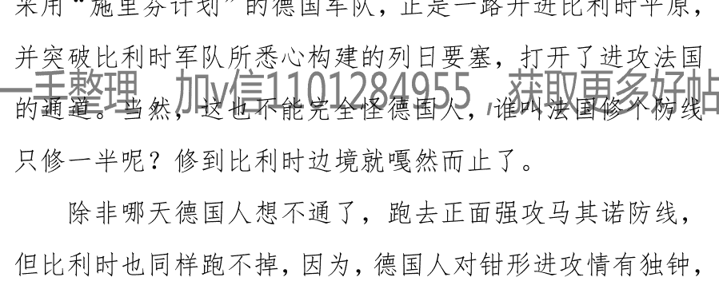

从德国手里抢到了一块土地，到了1936年，当德国开始疯狂的扩军之后，比利时见情况不对，立刻又宣布：自己是中立国。转变之快，世所罕见。

在1940年1月10日的那次德国飞机追降比利时事件，以及缴获的德国密文件，让比利时清醒地认识到，自己已无法置身事外了，于是就开始积极的备战。在战争爆发前，比利时就已经建立了22个装备精良的师团，对于如此小来说，这是一个了不起的成就。

可是，比利时军队却拒绝同盟配合，它的理由很有意思。比利时国王奥波德三世来访的法国军人都这样说道：

> “比利时是中立国，你们若将派遣军队入盟的话，那么我们希望让德国来承担这个破坏中立的罪名，到那时，你们就声名无收了。”

主经理微信：110128495 获取更多信息

对于这种略显荒谬，又合理的言论，法国人除了张口舌，也无从反驳了。最后，比利时与法国达成协议，一旦德国入侵比利时，法军就应该立刻支援，盟军陆军总司令甘埃林将军将盟军第1集团军的部署在法国北部海岸——马斯河一线，以便在战斗爆发的第一时间，赶赴比利时境内，并在比利时军队的协同下，依托那里的防御阵地，粉碎德军的进攻。

所以在战斗爆发的前几天，能否顶住德国军的第一轮攻势，

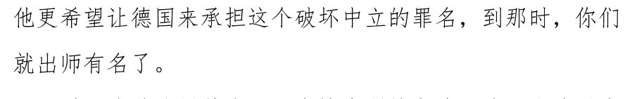

则需要比利时军队独自来完成。比利时完全相信自己有这个实力，因为他们有一条经营多年的坚固防线。在这条防线的核心——通往马斯与艾伯特河的交叉点，有着被称为世界上最坚固的堡垒——埃本·要塞。埃本要塞是在1932年，由来自世界各地的专家精心施工而成的巨大堡群，当时被列为欧洲最重要的防御之一和世界上最坚固要塞。该要塞所的位置非常巧妙，它坐落在马斯河与艾伯特河之间的一块高地上，南北长700米，东宽700米。它的东北和西北是垂直的断崖，高度约40米。在它的身后，是水势滔滔的艾伯特河；南面横跨一条宽大的防护带。要塞的每一个侧面都被所谓的“运河带”和“登陆带”包围。在这个巨大的要塞内部，有一条长达4.5公里的加固隧道，里面驻扎着1200名守卫。并且在要塞上面，没有任何暴露的瞭哨，这些士兵均处于地面25米以下的掩体内，他们备有长期使用的水以及大量弹药。这个坚固的堡垒，能够抵抗一切火炮，甚至飞机的轰袭


而且，这要塞的配置也相当强劲。要塞筑有4座地下炮台，并采用当时最先进的液压升降器，供给弹药，这炮台可以控制艾伯特河和马斯河16公里内的渡口。它配置有近40门巨型炮和无数隐蔽机枪阵地，为了有利于夜间的战斗，里面还配有探照灯。比利时政府倾其财力，苦心经营这个要塞，因为它所处的地理位置太重要了。在它的西北侧，三座横跨艾伯特河的大桥，连接着比利时腹原和往法国北部的交通枢纽。比利时的变化，很多字此此。

作者：万国威天平 日期:2009-06-14 23:29

我在图书馆找了一套彩色第三国的图集，还有几百张很多都是珍贵的未公布的图片，不知道数码相机能不能拍清楚，可以的话拿出来分享。作者：万国威天平 日期:2009-06-15 21:49

今天用数码相机也有原本珍藏的拿出来分享照片的估计没那么清楚而且有点点头，有些不是请见谅。作者：万国威天平 日期:2009-06-15 22:04

战前

### 这是柏林的一家公园


### 夜晚的柏林剧院俱乐部、歌舞厅和其他娱乐场所通达地经营使得柏林的夜生活充满刺激。这里的夜生活在两战期间很热闹，特别是一些讽刺性的评论与纳粹精神背道而驰


### 战后

### 数理 加信101284955 获取更多帖

蜜露每春要果勤励志多的


(意志的胜利 女导演这个就不需要多介绍了吧

 

### 艺术展


作者: 万国威天平 日期:2009-06-15 22:15

### 希特勒潜艇部队


这就是佩伯爵号，确实够的火力猛。看那三个口径的主炮 陆军

 这是在干嘛?

 作者：万国安天平 日期：2009-06-15 22:34

大家都来看直播 - 午夜宣誓仪式 四周全是火焰，调穆希特勒和希姆莱都在台上 参军前的游行仪式 肃理 小胡子 这张图流传很大，但我这张应该是最大的，虽然照得不好。看那些女的狂热得 狂热的少女 作者:万国威宁天下平 日期:2009-06-15 22:51

~~ 一个德国骑兵

### 一手练靶

 6月4日德国的退伍军 一个国家 一个领袖 这是最流行的口号 德国青年纳党大会 希特勒的画，他虽然没考虑任何画但他总是艺术家作者：万国威宁天平 日期：2009-06-15 23:01

### 楼主今天不更新了？一手整理，加v1101284955，获取好帖

今天去照拍照片了，还没来及更新，照的几百张的效果都不理想... 作者:万国威咸天平 日期:2009-06-16 01:15

希特勒还是很了不起的。写得相当好，但挨个刺：遭到轰炸的城市是鹿特丹啊，不是阿姆斯特丹。

仔细一看确实是防罩，开始没看清楚，我看成了那个德国兵手上拿着块铁板。作者:万国威咸天平 日期:2009-06-15 23:38

希特勒画的确实不错，但当时流行人体画，特别是裸体画，但希特勒认为是堕落腐朽的东西，考试的时候他就画建筑物，自然考不过。作者:万国威咸天平 日期:2009-06-16 01:15


同样能够摧毁这座桥梁。关键的是，必须要取决于敌人的判断力。如果墨守卫大桥的比利时军官是个很敏感的家伙，他一听到德国运输机的轰鸣声就毫不犹豫地下了炸弹的命令，那么，德国士兵就只能干瞪眼了。

所以，取耿本·埃马尔以及三座桥梁的行动必须同时进行，而且要足够隐藏，在敌人反应过来之前，就要制服他们的抵抗。

最终，希特勒得不去征求一名女性的意见，尽管希特勒本人不懂女性，但这个女性是个不简单的人物，她是二十世纪最为传奇的女试飞行员——汉娜·科特尔

汉娜·科特尔，世界上第一直升机飞行员。当然，最让你听过的名字，是世界上第一飞行员，然而她是一个金发碧眼睛，身材娇小的女性。这位女试飞行员的经历不仅如此，在30年代，她就作为德国代表队的身份参加了一系列的天飞行比赛，几乎是拿奖拿到手软，并且不断刷新世界记录。

1938年2月，在柏林的会中心举办的直升机空和垂直飞行表演，作为附加项目，汉娜·科特尔的飞行表演满场堪爆，连续3周没有发生任何意外，就连一向挑剔的美国媒体，都对汉娜的飞行技巧大为赞赏：“德国直升机需要改进的地方很多，但一切被汉娜的卓越技术所取代了。”

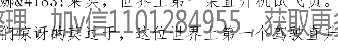

一段时间，汉娜成为德国航空和社交界的明星，被纳粹宣传部门树立为德国女性的榜样，受到包括希特勒在内的许多纳粹高官的接见，经常在公共场合亮相。

但总来说，汉娜最喜欢她飞行的飞机——滑翔机。

所以，当她听到希特勒说起攻击埃尔·埃马尔要塞的困难后，她毫不不留地脱口而出：“我们可以采取滑翔机进行无声的突击，对，没错，就用滑翔机！”

作者:万国威宁天下 日期:2009-06-16 22:00

汉娜·莱特直直到七十年代，她曾打破过多项飞行记录。汉娜是个固执的纳粹分子，在战后她经常带着耀眼的铁十字勋章出入公共场合。包括美国肯尼迪总统对她也震惊。

汉娜在表演世界上第一架直升机，不过荷兰人的新闻报道很有意思，他们说德国人把一把绳子挂在飞机上方，他们通过望远镜看到了那根绳子。

{IMAGE}http%3A%2F%2Flaiba.tanya.cn%2Flaiba%2Fimages%2F68900173%2F12451602081032985002%2FAA%2F1%2Fm.jp {IMAGE}

汉娜和她的同事们

{IMAGE}http%3A%2F%2Flaiba.tanya.cn%2Flaiba%2Fimages%2F68900173%2F12451603761216886115%2FA%2F1%2Fm.jp {IMAGE}

作为一个固执的纳粹分子，莱特直到死在战争末期。她向希特勒提出了飞行员驾驶飞机去冲撞盟军轰炸机群的计划。她愿意驾驶架这样的飞机为第三帝国献身。希特勒虽然同意了该计划，但不同意莱特自驾飞机。

{IMAGE}http%3A%2F%2Flaiba.tianya.cn%2Flaiba%2Fimages%2F66890173%2F124513604315376969633%2FA%2F1%2Fm.jpg{IMAGE}

作者：万国威宁天下 日期:2009-06-16 22:03
楼主在其他论坛上有同步更新吗？我在这个网站经常就打不开。

# 一手整理，加信11011284955，获取更多好帖

暂时还没有，我打算把几篇文章上传到博客去。
作者：万国威宁天下 日期:2009-06-16 22:08
楼主应该把书放在地上，然后自己站在高处直直的往下，就不会出现前面情况了，还是要感谢楼主的辛劳劳动。希望写完后能出书。

距离太远照不清楚，图片是一片模糊。
作者：万国威宁天下 日期:2009-06-16 22:13
今天喝了点酒，脑袋晕晕的，根本没法集中注意力，睡一晚上起来接着写。感谢大家的支持，我一定会坚持写到1945年4月30日的那声枪响。对于这个复杂的家伙我有太多的话来说。作者:范国宁 日期:2009-06-18 05:45 

汉娜·莱特的建议让希特勒产生了巨大的兴趣。他立即召见了戈林询问滑翔机攻击的可能性。戈林虽然放弃一切可以表现自己的机会，希特勒表示：空军完全没有能力负担这项任务，不需要陆军插手。他还选定了一名亲信的年轻空军参谋员——沃尔特科尉。

1939年10月初，希特勒将部队集结在荷兰附近，由于兵部队要参加空降作战，派出来的部队只有一个加强连。沃尔特科尉表示：一个加强连足够了。

1939年1月中旬，沃尔特科尉正式指定为进攻埃尔·埃马尔要塞的任务队长。在这段时间内，他在基地对仿建的要塞模型进行了认真侦察，并亲自驾机对要塞模型进行了各种角度的拍照。他得出的结论是：白天进攻要塞，其代价极大，几乎等于自杀。他认为只在夜间悄悄地直接落在要塞顶部才能成功夺取要塞。而且，这个行动必须与夺取桥梁的行动同时进行。为了突破效果，他计划在攻击之前不实施炮火准备，也不能使用飞机对要塞进行轰炸，要塞太坚固，轰炸不但没有效果，反而暴露己方的意图。科特把他的计划呈给希特勒，得到了希特勒的。戈林批准了这整套方案后，科特开始制定战斗计划。他把部分分成四个分队，每个分队约100人。各分队的任务十分明确：第一分队负责突击埃尔·埃马尔要塞，代号为“花岗岩”。剩余三个分队负责占亚伯特河三号堡，他们的代号分别为：“豹”、“海鸥”、“铁”。各分队进一步规划了各项任务，有喷火器组（用此摧毁地堡）、机枪组、反坦克组、追击炮组以及爆破组。科特要求每个士兵在训练时至少掌握两项军事技术，如果这些小组的成员被牺牲，其余成员也可以代替完成任务。

根据这些设想，科特率他的部队，在靠近捷克边界的空军训练基地进行了极其艰苦和严格的训练（德国人在这里造了一个更加精确的要塞模型，便于空降演习）。希特勒要求演习和训练要绝对保密，密者一律处死。因此，突击部队在空军基地完成后与外界隔离了。这里没有休假，不准外出，甚至连给家人的信件也要经过逐字检查，禁止和其他部队的人员交谈。

此外，每个人还必须在一项规定上签名。规定上写的是：凡用书信、绘画或其他方式将部队的性质及其任务泄露给他者，若有意或无意，杀之勿论。尽管这些士兵都对要塞的内部工事实施了依靠，但签字的名字直到所有训练结束后才告诉他们。这种极其严格、不分昼夜、不分天气的外场训练持续了半年，所有的战斗组都乘滑翔机在窄训练地上练习了睡觉。为减少滑翔机的跑步距离，在滑翔机上缠上了铁丝，着陆时后面可以放小型减速机。

1940年，部队的士兵们看着他们分了数百次的各项训练，已经准备充分。到了4月中旬，突击队员结束训练，秘密的往前机场待命。他们最终使用的“交通工具”是德国空军的DS—230式滑翔机。滑翔机的原型是一架商用公司生产观察气象的，由于负载能力良好（可以载运2名驾驶员，8名全武装的士兵），德国空军也订了用来战斗飞机。

最后的问题是选择攻击时间。由于德国陆军总部将“镰刀计划”的总攻时间定于凌晨3时，而滑翔机驾驶员想把飞机准确的降落在狭小的埃尔·埃马尔要塞上方，这个时间无疑是太了。因为，滑翔机进入埃尔·埃马尔要塞的时刻必须色彩鲜明。太早，色彩太暗，看不清形；过晚，天已亮，一定会被暴露。理想的时间在日出前30分钟。这个时间是从无数次训练中总结出来的，这是滑翔机驾驶员能够看清地形的时刻。所以陆军总攻时间必须修改，否则一旦被打，这对突击队员极其不利。为此，希特勒亲自下指令，把“花岗岩”进攻时间定为日出前30分钟。陆军和突袭队的行动必须同时。就这样，德国试图夺取世界上最坚固的要塞的工作一切就绪了。

1940年5月10日，凌晨3时，莱茵河附近的机场，突袭队已经集结。在点人数准确无误之后，科特科尉向战士宣布，军事行动将在小时后发动，今天就是进攻日。科特科尉向战士宣布，军事行动将在小时后发动，今天就是进攻日。经过半年的紧张训练，现在是该显身的时候。此时，德国空军总司令林斯登也到了现场。出人意料的是，他并没有做出热血的，而是静默的站在旁，目送这架飞机在运输机的牵引下，消失在苍茫的夜色之中。这时整个欧洲都在沉睡，战争历史上重大的行动就这样开始了。

让所有人都寄予厚望的突袭部队，从开始便麻烦不断。飞行不到10分钟，突击队的“花岗岩”分队因为机械故障，在接近莱茵河上，居然把后面的滑翔机甩掉了。上面正好坐着埃尔·埃马尔要塞的一块草坪上，威格科尉只能仰天长叹了。这架滑翔机还没升到足够高度。

飞行了20分钟后，不幸的出现了。一架滑翔机驾驶员估计是自己太紧张，他把机器灯误认为出击信号，这位浑浊的驾驶员即开始拉绳索，开始滑翔。此时飞机还没飞到一半的程路，还没到200米。最终，这架滑翔机在安全稳妥的降在了国界线上。在它的周围，陆军正对着黎明的黑暗集结待命，准备发起进攻。在陆军士兵们惊讶的眼中，这些突袭队员一脸脸地向他们提出，可否接纳一名士兵之一。就这样，“花岗岩”分队未进入战斗，便损失了2架飞机——包括他们的指挥官。不过，这个问题并不大，因为各组都有自己确定的任务。没有指挥官，他们也知道自己该做什么。可是，出师未捷，指挥官又莫名其妙掉了队，这确实是一件尴尬的事。

凌晨4时30分，运输机已经到了比利时与荷兰的交界处。为了让比利时军队发觉飞机飞动的声音，按计划，滑翔机将从这里解缆索，开始单独滑翔，隐蔽地从荷兰境界进入比利时。由于气象预报的错误，气象专家原本预计的顺风向变成了逆风。滑翔机是没有动装置的，对于飞机来说，逆风的风向可以获得足够的升气力，顺风反而降低滑翔机飞行的高度，导致滑翔机提前降落。无奈之下，运输机只能把滑翔机向前推行一段时间，进入了荷兰的空域。正是这段距离，运输机的巨大轰鸣声惊醒了荷兰的防空部队。这些防空人员探测灯都未打开，对着天空胡乱开火。高炮发射出的炮弹不在空中爆炸，突袭队员除了小心翼翼地在滑翔机上大声咒骂之外，也只能听天由命。

由于没有战斗机的护航，这样飞下，荷兰空军就要出动空军进行拦截。尽管此时飞行高度尚未达到预定的要求，突击队员仍然断了绳索，与飞机分手。随着运输机的轰鸣声逐渐远去，地面防空炮火也就停止了，荷兰防空部队估计还会为自己退了敌人的空袭而沾沾自喜呢。荷兰防空部队那低沉的炮火，醒了不远的埃本·埃马尔。与此同时，兰特少尉接到了比利时最高司令部的电话，他立即命令部队进入警戒。防空部队也做好了准备。兰特科尉认为，由于未能听见德国空军投下弹，说准敌人就是冲过来的。此时天还没亮，压力的一片。由于这些哨兵放松警戒的时候，“花岗岩”分队的滑翔机已经成功的绕到了要塞的南方。为了加快速度，驾驶员用尽全力，压着操作杆，滑翔机就像猎物群般的俯降了。由于突击队出现的方向出乎意料，没有任何哨兵报告，直到滑翔机落在他们面前，比利时士兵们一个个被惊得目呆，没有一个去鸣。巨大的撞击声以及德国士兵的呼喊才使敌人已经在头顶登陆了！

接着，传来的便是不断的踏登陆声，突击队的9架滑翔机，一架接架在长满杂草的要塞顶部滑翔着。带有减速装置，着陆后仅滑行了20米，致使数名跳过的队员重伤，他们的滑翔机全部被撞毁。尽管没有指挥员，但各组训练有素，他们仍按照刻开始突击。在大量炸药的工兵呼吸声中，他们直向爆破目标冲击。为了进攻，其余突击队员开始向四周投掷烟幕弹，要塞顶部被浓烟笼罩。紧挨着，突击队员使用手弹和炸药，连续快速地对炮塔、碉堡、隧道口进行破坏，不断的爆破声在空中回响。火焰射小组更是显神威——他们把那些躲在碉堡内的比利时士兵打不成样了。此时，通往要塞内部的通路已被比利时守军牢牢封死，留在地堡外面的比利时士兵眼见抵抗无望，迎接他们的是无情的子弹，此刻德国人不需要俘虏。10分钟，地面的炮火就被推毁殆尽，兰特少校在隧道指挥所心里如，他的防御工事所有的炮台，机枪火力点，射击方向均限定在四周下方，对敌人毫无办法。清理完毕，他组织冲的士兵还未来得及开展，一处准备的桥梁就被逃命的敌人捷足抢取了。比利时守军逃命的机会都没有了——前面的将往后撤离，后面的直向前冲，一段时间，巷道内乱成一团，惨叫此起彼伏。

就在“花岗岩”分队抢着同时，其余三个取桥的小分队也按计划，分别在艾伯特河的西端成功着陆，从身后出现地向桥梁猛扑过去。两座大桥的比利时守军队员还没爆炸，桥梁就被突击队所制服，仅一座桥梁被守军炸毁。接下来，这些突击队就开始构建防御工事，阻挡比利时守军对桥梁的反击。不过，比利时守军明显缺乏这种勇气，他们除了躲远远处胡乱的炮击，居然不敢用步兵对守桥的仅有100人的德国突击队发动冲。

到了早上6时，德国突击队已经完全控制了艾伯特河上的两座桥梁。埃本·埃马尔要塞表面也被“花岗石”小分队牢牢控制。比利时军事则躲在要塞内部企图继续顽抗。

掉进了德国人为他们精心构建的巨大陷阱之中。

现在，隆德斯泰的B集团军群已经在阿登山区偷伦的提进，虽然道路曲折，每天的前进速度不到40英里，但这只集结了德国军70%装甲力量的部队从未被盟军所重视。当希特勒得知盟军主力已经进入比利时沃腹地的时候，他副官汇报，元首几乎是喜极而哭，他大声的喊道：“他们上钩了，他们真的上钩了！”

作者：万国威安天平 日期:2009-06-19 10:30

作者：tanghuab

==========================

感谢。你这样夸我我都觉得有些不好意思了。

作者：万国威安天平 日期:2009-06-19 10:33

补充问题...就是说进攻比利时只是为了把盟军的注意力和主要兵力吸引过去？

==========================

对，没错。古德里安将军在接下来的行动就是一招狠的左勾拳，到时候会有作战地图，A B集团军群的进攻路线以及法军的反攻路线一眼看就明了。

作者：万国威安天平 日期:2009-06-19 10:35

隆德斯泰的B集团军群已经在阿登山区偷伦的提进——

兄弟，这张写得非常生动，爽！我再挑个刺啊：

进攻比利时和荷兰的，采取进攻行动的B集团军群（包克）；从阿登进行主攻退回的才是A集团军群（龙德泰特）啊。

======================

======================感谢指正，老是犯这种错误以后我会小心了。

作者:万国威宁天下 日期:2009-06-20 14:51

纠正一下上面的错误，德泰特将军在阿登的部队是A集团军群，我打败成了B集团军群，感谢yiduansixxiang的指正。

# 一手资料，加关注

作者：国服头牛 日期:2009-06-20 16:13

## 6的突破

### 阿登的突破

B集团军群get下的第6集团军在比利时的猛攻，其实是装甲样子而已，这支部队在渡过艾伯特河后没多久就停了下来，转为防御。它的实力并不强——仅有20个步兵师和1个装甲师。并且，这个唯一的装甲师还被派去进攻荷兰。

到了5月15日荷兰兵投降之后，这个装甲师才出身，风驰电掣的赶去与自己的大部队会合。

而在第6集团军的对面，安特卫普外围围阵地的盟军总兵力却到了36个师。他们满以为德军马上就要打过来，全员阵以待，做好了拼一战的准备。但让他们气馁的是，德国人这边却在热火朝天的战斗。这时，稀里糊涂的甘林将军还没清醒过来，他依旧执着地认为德国军的主攻方向是在北面。对德国军在阿登地区的猛攻，他置之不理，持可望的态度，坏事不关一般。

却是英国人首发觉事情有点不对，他们提醒甘林将军“注意阿登”。得到的却是甘林的一瞥白眼，自从战争爆发以来，法国就跟着英国屁股后面转了8个月，结果什么都没捞着，还把敌人威慑了。在谈到陆军的事务时，英国人还在指指画脚，法国人自然不高兴。贝当、尤万不断地说：“说阿登山区没有危险，现代机械化部队是通过的。”

王将军：“德国在边界取得了巨大的胜利。被我们彻底击溃了！”德国人就不再说什么了，他只能躲留在他的回忆录里写道：“我们自然没意思比那些兵力比我们十倍的人。”

恰恰就是这个法国人认为不可能通过的地方，德国2/3的装甲部队已经集结在这里。作为尖兵的古德里安19装甲军，花了两天时间就一口气冲到了马斯肯河，一路没有遇到值得一战的战斗。虽然不好走，但一切问题都被训练有德国工兵解决了。我曾看到过一个记录，片段描述的就是装甲师通过阿登的情景，那些德国人在前面开道，他们把小路旁的树全部砍倒，用树身铺路。

![e3af7bca71f28cd5cf02bbbf_19]

这样一路铺过去，一直到了马斯河边，这条河是拦截德军前进的最后屏障，一场激烈的战斗在这里打响。在河的对面，是法国9军团，这是一个部队，有9个师而且不满员。为了达到突然性，德军一开始在河岸畔露面，法国人早有准备。德国士兵偷偷地在马斯河背面的树林里集结，背着武器拿着橡皮艇，随着军官的一声令，他们一下子冲到了河岸。法国人的机枪子弹淹没，德国士兵只能用橡皮掩护，试图绕过法国人的阵地，结果是惨败。德军，他们像狼狈一样逃了回来。德军只能稳稳了，他们把大炮拖到河岸进行射击，清理了那些在灌木里的士兵。到13日，德军渡河开始后，火力明显被削弱，德国空军来帮忙。5月13日上午，德军出动近400架轰炸机，分批对马斯河对岸进行了长达5个小时的狂轰。法军阵地被炸得千疮孔的同时，德军再次试图横渡马斯河，他们分乘百艘橡皮艇向对岸。为了护河，德军地面火力立即开火，就连那些士兵也被敌人射击。

![e3af7bca71f28cd5cf02bbbf_220]

压制动静，德国自然不敢露头。古德里安将军也来到一线，紧张地注视着这次战斗进行，他在回忆里都说这次渡河是“相当壮观”。法国人被打得连头抬起来，只能在战壕里乱扣。这一侧边的战斗结果是毫无意外，德国士兵在渡尚未完成的时候，就毫不犹豫地跳下河。他们猫着腿，跨着腰深的河水上了河岸。他们需要建立一个比较稳固的桥头堡，占领河岸的侧击点，以便在法军的战斗中获得更多的阵地。他们也不敢推进太远，坦克队还未过江。

到了下午30分，河边的战斗基本结束了。法军违反了谢尔曼的计划，加渡河并试图设立桥梁被击毁。甘林将军注意到了德军冲击法军9军阵地的压力，很明显，德军在阿登地区的突破并不是一次伏袭，而是主攻！

作者：万国威安天平 日期:2009-06-06 15:49

连载66

此时，第9军基本是被打残了，用法人的话说：“我们没有预备队发动反击。”这不奇怪，9个不满员的师被稀疏部署在近40公长的河岸防线上，有预备队才叫怪事。法军就这样表现了失去了德军的机会。现在，德军的桥头堡阵地开始逐渐被巩固起来，一切橡皮能带过去的过去的都被载了过去，就连坦克炮也被拆散带过河，再立即组起来。

古德里安将军最害怕的就是法军用坦克发动反击，这块小小的桥头堡是很难守住的。法国人正是想要的，虽然第9军并没有能力冲到河岸来消灭德军渡河部队，但是把德军压在一个很小的空间里，他们都在等待支援。两个法国装甲师从法国南部地区披星戴到来。英国人提出了一个好的建议——炸浮桥，延迟敌人的进攻速度，只要德军的装甲部队不过河，他们就无法拆垮桥头堡阵地。

很快，强大的空部队集结了起来，法国人更是清楚地认识到了这个凸出的严重性，他们调动一切可以用的炸弹，将德军装甲部队的配合彻底炸毁以获取优势。古德里安将军是有准备的，他已经在渡口附近集结了几门高射炮，其密集程度是无法想象的——每门高射炮的间隔距离甚至不超过20米，这是很有见地的一个决定。知道，当时雷达刚刚还在实验阶段，当然不能及时出动战斗进行拦截，对于敌方的轰炸只能依靠防空部队，但像古德里安将军这样变态使用空部队的，简直是间所未闻。

当5月14日清晨，盟军轰炸编队飞临马斯河上时，浮桥架设工作已经完毕，德国装甲部队正在渡河。盟军飞行队巨大的轰鸣声首先就暴露了自己的意图，德军严阵以待。黑压压的飞机群遍布上空。迎接他们的是密集的炮火，新的88毫米高射炮发出了怒吼，炮弹在飞机机群中炸开了花。盟军飞行员非常清楚这条浮桥的重要性，他们不顾一切冲了下来，想要炸毁这条浮桥。这些飞机在空军成了高射炮的靶子，有的飞机甚至坠落到了马斯河里。事实上，这些飞机落在马斯河畔的很少，几乎都是掉进河里了。可以想象，这些士兵是多么拼命用肉身去炸毁浮桥，德国人的运气实在太好了，空军一直到深夜，被击落的飞机是不计数的。在盟军不断催促下，英国人彻底崩溃了，丘吉尔悲哀地向盟友宣扬，皇家空军只剩下26架。

14下午，A军总司令德泰特也将来到视察，他穿过法国特有的灌木丛林，走到桥头中央，古德里安将军站在他旁边，当时盟军空袭还在进行之中。这位老将军背着手，看着盟军轰炸机，淡淡地问道：“这里总是这样的吗？”古德里安毫不犹豫地回答：“是的。”老将军微微一笑，开始谈笑，敌人的飞机在他眼里就像不存在一般，而他的副官只能尴尬地站在旁边。

对于德国接下来的行动，陆军总谋长哈尔德严厉：一定要等到步兵越河之后才可以发动全面的进攻，这大概需要5天左右。这种理论对于古德里安来说简直是天方夜谭，他即就驳斥了哈尔德这种完全不现实的理论，他再重申，在进攻中重要的是集结部队燃料，这种突破不需要考虑侧翼的安全。但没人支持古德里安这种看法，包括隆德泰将军也主张“小心为好”。面对这样的压力，古德里安只有回答：“一定要等到步兵渡河才会发动进攻。”上次对希特勒的直接汇报，古德里安也是这样说的。但是事实证明，古德里安是在忽急，他不仅等步兵渡河，甚至连装甲军也不等。5月15日，19装甲师麾下的一个装甲师渡河完毕之后，古德里安毫不犹豫地下达了立即进攻的命令。主张小心为好的。

![e3af7bca71f28cd5cf02bbbf_224_0]

默认了古德里安的行动，那位远在天边的哈尔德气得捶胸，但无可奈何。在进攻命令下达的那一刻，古德里安将军也不忘幽默一把，他穿着若有其事的样子问他的师长：“全军是一致向前推进呢？还是在这里留一支部队掩护河？”那位师长就用古德里安惯的成语来回答他：“只准集中，不准分散！”

作者：万国咸宁天下平 日期：2009-06-20 16:00

我认为，像古德里安这种不服命令的将官在哪里丢了脸，也许在德国才会一路黄腾。德国陆军有个传说，我处理加仑取得了好多捷。希特的战术很有胆度，他们害怕胜利。比任何任何人都要理解前线的情况，就像中国的那句话，将在外军令有所有授。

作者：万国咸宁天下平 日期:2009-06-20 16:01

记得在电视上看过，埃马尔要塞地形很奇异，主要的要塞图片吗？

我没有图片但见过，BBC的二战纪录片好像有这个要塞的详细图。

作者：万国咸宁天下平 日期:2009-06-20 19:36

作者：迷失坐标

不是不是隆美尔的攻势在迪南。古德里安的右翼下逢隆美尔将军在迪南。

作者：万国威宁天下 日期:2009-06-22 08:53

连载67

19装甲军的进攻正当古德里安军心勃勃准备的时候，一道命令突然传达下去。该命令是他的上级——克莱斯特将军亲自下达。在命令下，克莱斯特禁止了一切进攻行动，所有部队立即转为防御阵型，以掩护后续部队。克莱斯特认为，谁要是胆敢越这条线，他就要给他们看了。克莱斯特原本是个骑兵指挥官，缺乏对装甲部队的了解。所以古德里安觉得太离谱，但恰恰是古德里安眼中的门外汉，却指挥着当时世界上强大的装甲力量。

![e3af7bca71f28cd5cf02bbbf_226]

古德里安回答：“正是因为敌人的援兵从源源不断的，才应该迅速进攻。”一听此言，克莱斯特发了火，他觉得古德里安简直是在非。坚持自己的观点绝不动摇。双方在电话里吵了近半个小时，在这件插曲里，克莱斯特表现出来的态度非常正派，虽然双方观点完全不同，但他并没有做出一副官大架子，而是就事事。最后，克莱斯特勉强地同意了古德里安继续进攻的要求，但他只给了24小时的自由行动时间，也就是说，24小时后，你就得听我的。

![e3af7bca71f28cd5cf02bbbf_227_0]

从整个战略上来说，24小时的进攻似乎少了点儿，但对古德里安将军来说，这段时间足够了。他只需要在24小时之内达成成果、打出战绩，他相信能继续说服上级延长进攻时间。5月15日夜，19装甲军已横渡完。与此同时，法军的大批援部队抵达了这里，在9军的配合下，法军发起了一次强有力的反击，企图把甲军赶下去。法军依仗自己的空中优势，采取最常规的楔形进攻，不断从两翼进攻上来。而古德里安把甲部队聚集起来，迎着法军来的方向，同样发起了反击——古德里安表现的战斗开始了。

# 一手信任

记者：华国日报 2009-06-22 06

这次战斗也许会让法兰西战的第一场硬碰。为了满意，古德里安将军不可放弃。他不是在司令部进行战略部署，就是跑到前线去视察战斗的进展。这也是一场奇怪的战斗，双方都在为自己的目标进攻，没有防守的一方。战斗的过程相当激烈，有些高地、村庄遭遇易手，古德里安将军穿梭于前线各个阵地之间，不断给那些疲累的士兵打气。他的士兵太疲累了，从5月10日以来，德国士兵就没真正休息过，甲部队还能在车上打个小盹，步兵则要惨得多，一旦有机会，他们就坐在散兵壕里睡着。军官不得把这些偷懒的士兵挨个拖起来，才能继续作战。激烈的战斗爆发于每一个马斯河的小镇上。这些小镇连接着大道，是两条或是以上的公路的交汇点，夺了盟军退路。一听此言，克莱斯特发了火，他觉得古德里安简直是在想非，辩方进一步升级。古德里安非常傲强，坚持自己的观点。


他已经快50岁了，才混到一个一个小师长的职务。而且，这个师长的名头，还是通过走后门才搏到的。

这次兰西战役的爆发，却对他有着非同常的意义。因为，他传奇的经历就此开始，他将登上历史的舞台中央，成为万众瞩目的焦点。在不久之后，他会成为德国人崇拜的偶像，他被敌人眼中——“沙漠之狐”。到那时，就连他的敌人听到隆美尔的名字也会肃然起来。

我先举若干例子来说明他对敌人的崇拜。比如，一个英国军人在战场上表现良好的话，他的同僚会马上奉上说：“你就像隆美尔那样优秀”。

甚至，英军将领们为了鼓励士兵的士气，不惜大费诋毁隆美尔胜利的果实。美国指挥官觉得这非常荒谬，他的下：“隆美尔不是术师，也不是超人，我们是有机会打败他的”。

但这种做法所取得的收获十分理想——那些被敌军俘的英国士兵，将会疯狂的讨好德国士兵，不断提出请求，希望能够亲自见到隆美尔的一面。

想象力极端丰富的美国报刊甚至宣称：早在1936年，隆美尔就在人工建造的仿非洲恶劣环境的室内，训练后来那名于世的非洲军。这是一个极端的荒唐可笑的言论。因为，在1936年，隆美尔还只是希特勒身边一个普通的警卫长。但这种夸张的言论，居然也让他们相信了。至于后来，世界各大媒体专门开了关于隆美尔元帅个人的专栏，大肆宣传“隆美尔旋风的神话”。就连什么事情都喜欢赞凑热闹的美国好莱，也拍摄了世界上第一部以二战军事将为题材的黑白电影（1953年），这个电影的主角，不是艾伯顿，不是艾森锐，更不是蒙哥马尔，而是——隆美尔。

作为一个德国的军事将领，他的指挥艺术和武德精神能让人如此，在历史上相当罕见。在二战的所有名将之中，唯有隆美尔一人。就连，在隆美尔元帅去世多年之后，他的魅力依旧不减，至今在国外，几乎每年都会有一部全新的隆美尔为题材的传记小说。他的肖像，也曾挂在每一个德国士兵的军营之中。

话题。俗说“人怕出名，怕怕怕”。不起隆美尔元帅的人，不占少数，在这些人眼里，他却被描绘成一个战略上的矮子，目光短浅的小人物，他的某些成就，纯属通过媒体吹捧出来的。

是这样吗？隆美尔元帅是一个战略上鼠目光的军人吗？这个拥有崇拜者以及批评者众多的，站在风口浪尖的人物到底是一个什么样的人？这个问题，我曾想到很多方式来描绘他，如果有人问我，你对隆美尔元帅持什么态度，那我就用一句话来评价：他是一个伟大的战术专家，同样是一个优秀的战略家。尽管肯定有人说我是在胡言八道，但我依旧会这样说。因为我相信，我最终会给大家一个满意的回答，一个完整的隆美尔元帅。

在隆美尔元帅介绍的最后，我依然用一句话作为结尾。这句著名的话是吉尔绍在国会演讲中说的，他当时深情地说道：“尽管管我们在战争浩劫中相互残杀，请准许我说，他是一位伟大的将军”。

作者:万国威天下 日:2009-06-24 08:18

## 沙漠之狐

隆美尔出生于1891年11月15日，德国南部巴伐利亚州海格堡附近一个普通的教师家庭。

隆美尔在家里排行第一。他的哥哥卡尔，仅仅为了逃避期考试而自愿从军，他在第一次世界大战中成了一名陆军侦察机领航员，不久便去世于疟症。隆美尔的妹妹莉霍，在父亲的去世后成了一名老师，并且献身于教育事业，终身未婚。他最小的弟弟杰哈霍，立志要当一名歌剧剧院演员，但是一直到1977年去世时，仍然成就平平。

少年时代的隆美尔身体弱多病，很少参加孩子的游戏。对竞技、体育都不感兴趣，而他最不喜欢的就是参加体育运动。男孩子喜欢的事情，他都不喜欢。他后来这么讲：“足球是男孩子喜欢的事情，可是，我一到上体育课的时候，踢球就心里发抖。在大家踢球的时候，他就安静静地在旁边看着。他的性格既孤僻，又倔强，平时沉默寡言，对一切事情都不关心，朋友自然也不多。

由于从小缺乏锻炼，到成年后，他还是个面色苍白，瘦弱小的男孩。因此，他从没下心去做军人，尤其是当哥哥去世后，他更觉得军生涯与自己无缘。但这种做法，隆美尔父亲希望他成为军人，也想锻炼一下，隆美尔为此写了申请参军。不幸的是，炮兵和工兵都拒绝了隆美尔的申请，因为他身材太小——身高172米，这个高度对亚洲人来说没算错的，但对于欧洲人来说，隆美尔更是异类，身高180米拿负了几个“矮梯子”的名声。万幸的是，1914年3月，隆美尔刚满18岁，第一次世界大战爆发。不久后，隆美尔又碰上好事，那就是德国帝国的政策。按照德国的规定，军官必须从士兵中选拔，只有贵族儿子才能进入军校。隆美尔出生于平民，体格又弱，所以隆美尔被送到了军校学习。是在这段时间里，他认识了一位意大利和波兰的漂亮姑娘，她的名字叫露西·莫琳。隆美尔虽然沉默寡言，但追求女子的功夫不差，大部分时间里，他用来给露西写情书。他把情书秘密交到露西那里，露西则把自己的照片作为信寄给她，露西西未来的妻子。隆美尔一手写得很甜，获取了好多帖子。而这个时候的隆美尔学习毕业的时候，校长给他的评语是：“射击和操练方面相当出色，体操、击剑、骑马都能胜任”，不过校长有些糟糕地说：“身材中等，瘦弱，体格相当糟糕，而且虚弱”。恰就是这个瘦弱平凡的青年，在不久爆发的世界大战中的表现却异常人，就像是一个战士。我们来看他在战争中的表现：

- 在比利时境内与法军交战中，隆美尔和3个巡逻兵，打败了20名法军的进攻，并用一支步枪俘虏了3名法国士兵，并为此获得了二级勋章。
- 与法军的阵地战中，隆美尔带领一队士兵爬过100码带刺的铁丝网，闯通法军的主要阵地。他们来得那样突然，阵地的法军几乎惊呆了，就在他们未反应过来之时，德军迅速占领四个地堡，并且打退了法军一个营的反攻。在敌人派出大量反击，重新组织反攻后，隆美尔带领士兵撤离阵地。战斗进行得干净、利落，隆美尔为此获得一级勋章。
- 他们越着夜色，潜入位于战斗战线后方10公里远的小村庄，并忍受着刺骨的寒风，潜伏在村外的一片庄稼，直到深夜，敌人兵营遭到休息之后，他们突然发起进攻，400多名罗马尼亚兵突击阵地被稀稀糊涂地做了俘虏。
- 1917年9月，隆美尔又被派往一个更为紧迫的战场——意大利北部。10月份，德军的增援部队抵达之后，他们就开始进攻意大利的伊尔索河防线。在战斗中，隆美尔率领一支先遣队冒着猛烈的炮火，在夜间大胆地向意大利防线的后方穿插，当天拂晓，他的这支军队已经占了意大利防线后方的一个高点，并升起了德国军旗。意大利军队一看，以为后方被德国占领了，顿时士气大减。防线开始崩溃，德国步兵从突破口涌入。由于隆美尔搞穿插，正面突破的是另外一名指挥官——舒尔纳中尉。是他唯一颁发的那枚普鲁士最高荣誉勋章，就被舒尔纳中尉拿走了。这个勋章可是隆美尔一直都渴望得到的，当他听到勋章被别人拿去之后，勃勃大怒，把篮子砸在地上，愤平大声咒骂，但也无济于事。

这种不公正的待遇让隆美尔非常苦恼，尽管这次机会又来了。隆美尔在蒙特山战中明确地许诺：他要占领意大利军队的最高点，5400英尺。隆美尔在蒙特山战中指挥，意大利军队全部退掉。由于隆美尔的指挥，意大利军队被彻底击败。隆美尔的战斗可谓称赞，是卓越的胜利。由于隆美尔的胜利，德国军参谋长沃尔夫宣布：隆美尔的战术非常出色，隆美尔因此得到了普鲁士最高荣誉勋章。

在隆美尔元帅介绍的最后，我依然用一句话作为结尾。这句著名的话是吉尔绍在国会演讲中说的，他当时深情地说道：“尽管我们在战争浩劫中相互残杀，请准许我说，他是一位伟大的将军”。隆美尔总是用腰带将这枚不同的勋章挂在自己的脖子上，它闪烁着光彩。能够佩戴这种勋章的大多数人，生之年就成了传奇的人物。隆美尔总是非常神气地戴着勋章，他是一个荣耀感强的军人。

不过，隆美尔初期的战斗生涯在这里留下了句号——德国陆军根据《凡尔赛条约》上的规定开始大规模裁军，而在隆美尔在战时的突出表现，从而保住了饭，并且一直担任步兵连长职务达十四年之久。他与露西结了婚，并且相当爱她，露西的一女友说：“看着隆美尔，总是那样大惊小怪跟着她，让她实在有趣。”他的口头禅是：“你有什么要求就说吧，露西！”

平静，一如既往的平静生活，在隆美尔漫长的岁月里，也耗了他的青春。他不抽烟，也不喝酒，缺乏交际，一如既往的沉默寡言，他似乎就要平凡下去。但希特勒的出现，使得隆美尔的一切都被改变了。

从1936年4月起，德国陆军部就开始在全军选人，选到的人正是隆美尔。隆美尔对政治毫无兴趣，虽然他对希特勒大刀阔斧的改革表示倾怀，但仅仅是倾怀而已，也未曾加入纳粹党。这个优秀的军官的职业生涯会是什么？他自己也是一里糊涂。不过，能在元首面前出差，可是光荣的事情，隆美尔自己也深感荣荣耀。

希特勒不是个好闲的人，比他来说，有特殊的爱好——飙车。当然了，喜欢飙车的人可多了，但要说希特勒喜欢飙车并不奇怪。但是，我们这些“敬爱的元首先生”总是异于人的。他从不自己开车，也没有证据表明会开车，他总是坐在副驾上，让他的私人司机把汽车开快，以此来感受飙车的快感。

希特勒也没有特殊的爱好，他不既抽烟，又不喝酒，还是个素食者，对女人也不感感兴趣，没有结婚，更没有孩子。用古德里安的话：“这是一个怪物，与人类生活已经脱节了，他在这个世界上，任何足以代表人间温情的事情，例如真正的友谊，纯洁的爱情，都与他没有关系。他生活在一个孤独的世界里，彻底心中那个庞大的征服世界的计划之外，他再也找不到一个人的快乐了。而且，希特勒是一个工作狂，每天都要通达的工作，白天一个会议，夜晚一个会议，一直要开到午夜。所以，从隆美尔处理事务回来，又是改进了，看着自己的汽车飞快地行驶在公路上的，希特勒总是乐得不措，不断催司机：“快点，快点，再快。”

而且，希特勒每次出发都明确指示，不准后面跟警卫车辆，他要独自。这种癖可以让他的警卫们都坏了：如果元首上祸了怎么办？如果碰上乱分子把元首架了怎么办？这可是脑袋的事。所以，每次希特勒的汽车刚开出院，后面一大串警卫就跟上来。对于这些死板的军人，隆美尔唯一的回答：“我的职责是保卫元首，如果元首不满我的做法。”

这种情况，从1938年9月，隆美尔被拔为元首的临时指挥官后，就乐观。他严格执行了希特勒的命令：不跟元首。从这件事开始，希特勒对隆美尔逐渐注意起来，特别是在一次希特勒乘车视察当中，隆美尔的表现让希特勒为赞赏。当时希特勒喜欢车出去郊游，玩的开心。隆美尔发现，路边挤满了部长、将军、州长的汽车，他们忙着要在希特勒这次外出中占一个席位。隆美尔在后，顺手拍腰，神气十足地命令其他的车子前进，并在路口停了两辆甲车，把道路堵了。隆美尔懂得这种做法气得要员们跳跃。没多久，当天晚上，希特勒派人去。虽然可能有人说隆美尔太大了，犯了错，但他清楚知道，希特勒可是老大，只要他满意，比让他还要强。这正是隆美尔独特的性格，包括以后当了元帅，他同样对谁的命令都置之不理，唯一服从的只有希特勒。尽管他深受希特勒的重望，但从心里讲，他并不喜欢这份工作。隆美尔认为，一个军人应该沿血筑。可是，1939年9月1日，第二次世界大战的爆发，让他再也无法按住内心的激动，他发现自己也无法专心去这项工作。特别是在波兰期间，希特勒亲自自从前线侦察的旅途中，隆美尔越来越熟悉。他羡慕那些装甲部队在周围嘈杂的前线不断推进，泥土中散发的火药味，让他闻起来是如此美妙，如此熟悉。当时希特勒乘着一辆沉重的六轮赛德斯奔驰，由两辆甲车侦察领先，还有压后。按照拟好的车辆行驶顺序的，车队每短暂地停靠一次，有尊严的场面就重复一次——希特勒和党的领导人推推操操，然后迅速地回到自己的车子里，催促司机，使自己的赛德斯奔驰汽车近一些。希特勒的私人秘书马丁·鲍威尔看着这种节奏紊乱的场面，气恼地指责着隆美尔。隆美尔却回答说：“我不是幼儿园教师。你要是愿意，你来整整吧！”

这次波兰之行，无疑他更坚定了这个决心。回到柏林后不久，隆美尔就直截了当的向希特勒提出，自己想去指挥一个装甲师。他原本以为希特勒会婉转的拒绝这个请求，因为对装甲部队简直是一窍不通，而且多年没在陆军里呆过了。

但他大喜所望的是，希特勒完全同意了他的请求，并把自己的写的那本20世纪书籍的书——《我的奋斗》送给了隆美尔。书上还提到，“赠隆美尔将军留念，阿道夫·希特勒”。隆美尔在当天写道：“我对此感到莫大荣幸”。

由于隆美尔在山地部队任职多年，拥有丰富的山地步兵作战战经验，希特勒任命他为第4师司令官。带领他的军队去敌人战斗。


作者：万国威宁
作者：万国威宁 日期:2009-06-24
作者：万国威宁 日期:2009-06-25
作者：万国威宁 日期:2009-06-26
作者：万国威宁 日期:2009-06-26
作者：万国威宁 日期:2009-06-26
作者：万国威宁 日期:2009-06-26
作者：万国威宁 日期:2009-06-26
作者：万国威宁 日期:2009-06-26
作者：万国威宁 日期:2009-06-26
作者：万国威宁 日期:2009-06-26
作者：万国威宁 日期:2009-06-26
作者：万国威宁 日期:2009-06-26
作者：万国威宁 日期:2009-06-26
作者：万国威宁 日期:2009-06-26
作者：万国威宁 日期:2009-06-26
作者：万国威宁 日期:2009-06-26
作者：万国威宁 日期:2009-06-26
作者：万国威宁 日期:2009-06-26
作者：万国威宁 日期:2009-06-26
作者：万国威宁 日期:2009-06-26
作者：万国威宁 日期:2009-06-26
作者：万国威宁 日期:2009-06-26
作者：万国威宁 日期:2009-06-26
作者：万国威宁 日期:2009-06-26
作者：万国威宁 日期:2009-06-26
作者：万国威宁 日期:2009-06-26
作者：万国威宁 日期:2009-06-26
作者：万国威宁 日期:2009-06-26
作者：万国威宁 日期:2009-06-26
作者：万国威宁 日期:2009-06-26
作者：万国威宁 日期:2009-06-26
作者：万国威宁 日期:2009-06-26
作者：万国威宁 日期:2009-06-26
作者：万国威宁 日期:2009-06-26
作者：万国威宁 日期:2009-06-26
作者：万国威宁 日期:2009-06-26
作者：万国威宁 日期:2009-06-26

隆美尔指挥的第七甲师在迪南河头进攻，这也是最激烈的地方。迪南城位于马斯河的一个点，此处的坦克装甲发挥了关键作用，隔离了德军的优势。

隆美尔确实能过马斯河，只要他的直属部队单独行动，吸引引人的注意力，其目的也就达到了。在战斗爆发的第二天——5月12日下午，第七甲师就一口气冲到了马斯洛，碰上了法军极度轻微的抵抗。河东岸的法军只有两个甲师，他们比波兰人那样脑残，所以，法军骑兵一触溃，丢下那些直属步兵开始跑。

由于由于，德军的士兵在战斗中，法军无影无踪。隆美尔的直属部队就在这些步兵后面，既不开火，也不用坦克叫这些法国士兵投降，而是想偷偷跟着冲过马斯河。

于是，战场上出现了这一幕——德国坦克和法国士兵乱七八糟地混在一起，双方互不相让，都在劲勃地飞奔。此时隆美尔发现，大批法军士兵还没过桥没这么多了。就在领头的那辆谢尔克坦克准备要战斗的时候，法军人群中间不知道谁喊了一句：“德国来了！”守桥的法国士兵赶快跳脚，手势提醒：“老子要炸桥了！”在领头的那辆德国坦克已经快过桥的时候，法军试图伏击，结果桥被毁了。然而法军士兵无力于事，他们只能面向德军缴械投降。

桥没了，现在只能援。防守此地的法军还是第九军团的一部分，但迪南不属于登山，山势到了这里，这里也被法国人称为“小其诺防线”。在河对岸有大量法军碉堡以及重炮阵地。最开始，德军趁着法军的混乱，用橡皮艇运了一部分过去，虽牺牲惨重，但获得了成功。

不过，这个桥头堡阵地无法继续扩大了。醒来的法军炮火不断向德军渡点两岸倾泻，法军士兵的侧射火力把第二批渡河的小斧击得粉碎。当时，隆美尔正好赶到了渡河第一线，他看到他的士兵全部躲在河边的石头后面，已经完全丧了斗志。河岸上也只有稀寥几多的德国士兵，而且大部分都已经受伤，他们被困在河谷下方的石头缝里，失去了进攻的能力。

当时，一艘被打坏的橡皮艇上正骑着一名浑身重伤、快死的士兵，正在声嘶力竭地呼救。在法军炮声中，这名可怜的德国士兵内心的鸣声回荡在马斯河两岸，就像一个大锤撞在那些战友身上，但没有人去救他。法国士兵也始终没有给这个可怜的家伙一个痛的断。他的呼喊声由强弱直至没有。德国士兵初期高涨的士也随着他的呼喊而消失。

这次的惨伤，连胜百敌的隆美尔将军也为之动容。但是，他是最高指挥官，他不能失去斗志。隆美尔一言不发地低下头，小心翼翼地回到部队。法军的炮火越来越猛烈了，并开始让德军深入地炮射。由于缺少炮兵，隆美尔到师部后，立刻就调整了他能动用的所有坦克，回到了渡河地点。隆美尔下令：把坦克以50码的间隔一字排开，不断开火回来巡弋，他亲自坐了其中的一辆，用无线电直接指挥坦克军队朝他认为有敌军伏击的地区开展。

现在，主动权已经渐渐回到了德军手中，法军士兵只要敢还击，铺天盖地的炮火马上就涌而来。在火力的护护之下，渡河才慢慢开始恢复。隆美尔不住给他的下属打气，就算渡河失败，也要把渡河对岸的战友抢回来。几艘大型浮架也到了渡河点，这些船以两艘一组，中间拉一条粗绳，德国士兵就抓住绳子，在河中回来。隆美尔是不闲的人，他像一名步兵连长那样跳到第一批渡河队的第一艘船上，昂首挺胸地站在船头，他勇敢的做法极大激励了士兵们。一个士兵安全渡河之后，隆美尔令：立即进攻，不给法军喘息的机会。他拿一把手枪，在冲队的最前面进攻，占了河周围的高地。由于紧张的一幕出现，法军增援部队也迟到了。隆美尔身边有500号军人，跑得无影无踪。隆美尔对这些士兵说：“继续进攻！”

尽管已经20多年没上战场，但隆美尔的勇气并未消散。隆美尔决定赌一把，他命令士兵先分散，躲在灌木丛中不准开火。等到法军战车已经到了面前，隆美尔一声令下，所有的轻型火力开，对着战头的那辆坦克，机枪子弹在坦克面上爆炸如一般，但突如其来的火力把法军彻底打溃了。他们以为德军早有准备，吓得连后退。还不完，手里握着冷冷的德国士兵刚松口气，师长第一个跳出战壕，带领士兵继续进攻。这时，那些来得及跑掉的法军士兵还从周围灌木里爬出来，慢慢缴掉武器。现在，渡河部队能够在西岸占据相当的立足点，突破对方防线继续前进。但情势依旧严峻，如果法军发起的进攻，若有轻武器德军根本就不是对手。隆美尔带着他的副官离开前线，指挥船队到达东岸，督促士兵迅速渡河。关键的是把浮桥快速建立起来，让坦克开过去，才能真正巩固桥头阵地。

到了13日夜，第七甲师已经在附近渡过马斯河，但浮桥工作尚未完成。一个傻乎乎的工兵营估计是刚从步兵队伍过来的，当隆美尔来到下游的一个渡口的时候，他生气发现工兵们正在假设小型浮桥，那种只让马车与步兵渡过的浮桥。（很多书籍对二战德军装甲师有一个误解就是全机械化。其实这种理解是错误的，德军真正意义的全机械化装甲部队必须全部用在刀刃上，第七甲师也有一个团的刀刃部队因为德军没有这么多汽油，也没有这么多车辆，他们的大炮、坦克以及后勤供应全部都是靠马拉动的，从一开始，德国人打的就是一场属于穷人的战争）所以工兵架设小型浮桥并不奇怪，他们应该让数量最大的坦克过河。

在隆美尔的亲自监督下，这些工兵立即更换为16式的大型浮桥。隆美尔认为，当务之急是让坦克先过河。所以，工兵把架设了一半的浮桥拆了重建。就这样一耽搁，对岸的局势就越来越糟糕，法军预备在重炮爆炸以及坦克的掩护下正在反攻，炮弹不断在渡口周围爆炸，德军渡河部队白天取得的底一扫二净，并被压缩在了河谷旁边很窄的两块区域之内。这个桥头堡阵地还在不断缩小，最后连监管战场的地方都没有了。德国士兵落在法国边的空地周围激烈战斗，他们只能狼狈地蹲在地上，祈祷炮弹落在自己头上。

隆美尔不得不再次坐船来到西岸观察情况。他发现，现在的情况真的很糟糕，带领部队作战的营长已经重伤，他的副官已经战死。法军趁着黑夜的掩护不断推进，法军战车上的炮声清晰可闻——他们离河岸已经近在咫尺。

今天不更新了，好像更新没有一个定规。好文，如果时间多就多写点，最慢是第二天，毕竟时间不多，我会尽量写的。

隆美尔和他的妻子看着隆美尔胸前的绶带正是那根蓝色十字章。

{IMAGE:http://img2.baiduimg.com/img/pc/link/tiba.jpg}
{IMAGE:http://img2.baiduimg.com/img/pc/link/tiba.jpg}
{IMAGE:http://img2.baiduimg.com/img/pc/link/tiba.jpg}
{IMAGE:http://img2.baiduimg.com/img/pc/link/tiba.jpg}
{IMAGE:http://img2.baiduimg.com/img/pc/link/tiba.jpg}

信心动摇。在5月13日这一天，德军已经在处处过了马斯河——隆美尔在迪南，古德里安在阿登，赖因哈特在蒙泰梅。（见下图）

当时流传几千辆德军战车都已经过了马斯河。这个虚假的传言搞得整个集团军人心不已。特别是法军中的殖民部队，这些士兵全部是法国政府在非洲殖民地招募的黑人士兵。法国军高层对这些身强、战斗力优的士兵寄予厚望。但从他们的看来，这些士兵是绝望的，这让政府失望了。马斯河线的崩溃就在眼前。因为战斗爆发的第一天，师长就出逃了，士兵们溃败了，轰炸机来袭，他们就会趴下来，武器丢在一旁，口中念叨着。这并不能完全控制他们，毕竟他们见过汽车，更不用说轰炸机这种玩具了。

到了5月14日，这些黑人士兵的抵抗意志彻底崩溃，并在他们军官的带领下（同样是黑人）整整地的溃逃了。（逃兵都如此团结，确实罕见）

这种临阵脱逃的现象，使得那些白人士兵的士气瞬间瓦解。他们不是傻子——你们黑人跑得，我跑不得？于是就跟着逃跑。到了5月14日夜晚上，司令普拉斯将军被下令：放弃整个马斯河防线，向西撤离。

从战略上，这个命令错误之极，这就主动让了一条通道，让德军能够肆意地扩展他们的战斗果。几年后，李德哈特在编撰二战史的时候，还为了这个错误命令，痛心疾首的大喊：“非战之罪也”，可见这次撤退的影响有多严重。就像有人曾灵哀那样的；也是在这一天，因为一个荒唐命令，把完整的防线分成十块互相连的战场，乱七八糟地打了一团。

第一次世界大战的时候，法军就已经吃过渗透战的苦。那时候，德军经常利用小单位穿插盟线的后方，不断骚扰盟军的重要目标，割裂了防御部署之间的关系，为正面的攻击创造条件。二十年后，德军复制这种技术，对法国指挥官心理的打击是不言而喻的。

他们敏锐地发现法军防御的间隙和衔接部，渗透到了法军防御之中。在5月14日的整天，德军采取这种战术，不断的骚扰和袭击法军，把法军打了。

5月13日夜晓的战斗，是此次战役的高潮。德军非常清楚此次战斗的后果，一旦这两个登陆场失守，那么三天苦战取得的所有成果将付诸乌有。

这也是一场时间赛跑，岸岸士兵在拼命抵御，法军重炮纷纷落在桥周围，德军士兵出奇的好，整个晚上，没有任何一枚炸弹直接命中浮桥。第七甲师渡河点遭遇了近千架飞机的轰炸，浮桥完好无损；遭遇了法军整夜的炮轰，浮桥同样无恙。我实在是无法用语言来评价法军有多么了。

5月13日深夜，浮桥架设完毕。几乎三天没有合眼。隆美尔再次回到东岸，他的属下们让他休息一会儿，可依旧抖擞地坐上一辆八轮通信车，带领坦克部队冲过河。

现在，第七装甲师这个大夹子要开始夹人了，只不过这一个“大夹子”得先打上一个引号，因为到了进攻发起时刻，德军渡河的坦克总数也才30辆，一个登陆场连一辆坦克也没有，要是被法军放弃进攻，连防守都成问题，更不是反攻了。所以，马斯河上游的那个登陆场几乎无法对法军构成威慑，这使得隆美尔亲自帅的部队，事实面临着比法军更强的敌人。

德国虽然遭受了损失，但现在，就退缩到了瑟纳以北的战线。德军的兵力在两个登陆场虽然距离不远，但德军依旧采用他们最擅长的楔形攻势，消灭掉里面的法军，才能使得战线连成一片。本来，楔形攻势是拿破最擅长的打法，但他的后代实在太不争气了，这种近距离击合、合围敌军的战术被拿破曾经痛过的敌人割据了，最终发扬光大。这种简单却有效的战术，贯穿了整个德国史——从波兰战役到基辅放大战斗，甚至到阿登反击，春季觉醒行动，可以说是持久不衰。楔形攻势最重要的一点乃左右两个方向同时用力，做向心运动。也就是说，把进攻力量集中在两翼。其中设计台词的话就是：我夹，我夹，我夹死你。

隆美尔指挥的第七甲师在迪南河头进攻，这也是最激烈的地方。迪南城位于马斯河的一个点，此处的坦克装甲发挥了关键作用，隔离了德军的优势。

隆美尔确实能过马斯河，只要他的直属部队单独行动，吸引引人的注意力，其目的也就达到了。在战斗爆发的第二天——5月12日下午，第七甲师就一口气冲到了马斯洛，碰上了法军极度轻微的抵抗。河东岸的法军只有两个甲师，他们比波兰人那样脑残，所以，法军骑兵一触溃，丢下那些直属步兵开始跑。

由于，由于，德军的士兵在战斗中，法军无影无踪。隆美尔的直属部队就在这些步兵后面，既不开火，也不用坦克叫这些法国士兵投降，而是想偷偷跟着冲过马斯河。

于是，战场上出现了这一幕——德国坦克和法国士兵乱七八糟地混在一起，双方互不相让，都在劲勃地飞奔。此时隆美尔发现，大批法军士兵还没过桥没这么多了。就在领头的那辆谢尔克坦克准备要战斗的时候，法军人群中间不知道谁喊了一句：“德国来了！”守桥的法国士兵赶快跳脚，手势提醒：“老子要炸桥了！”在领头的那辆德国坦克已经快过桥的时候，法军试图伏击，结果桥被毁了。然而法军士兵无力于事，他们只能面向德军缴械投降。

桥没了，现在只能援。防守此地的法军还是第九军团的一部分，但迪南不属于登山，山势到了这里，这里也被法国人称为“小其诺防线”。在河对岸有大量法军碉堡以及重炮阵地。最开始，德军趁着法军的混乱，用橡皮艇运了一部分过去，虽牺牲惨重，但获得了成功。

不过，这个桥头堡阵地无法继续扩大了。醒来的法军炮火不断向德军渡点两岸倾泻，法军士兵的侧射火力把第二批渡河的小斧击得粉碎。当时，隆美尔正好赶到了渡河第一线，他看到他的士兵全部躲在河边的石头后面，已经完全丧了斗志。河岸上也只有稀寥几多的德国士兵，而且大部分都已经受伤，他们被困在河谷下方的石头缝里，失去了进攻的能力。

当时，一艘被打坏的橡皮艇上正骑着一名浑身重伤、快死的士兵，正在声嘶力竭地呼救。在法军炮声中，这名可怜的德国士兵内心的鸣声回荡在马斯河两岸，就像一个大锤撞在那些战友身上，但没有人去救他。法国士兵也始终没有给这个可怜的家伙一个痛的断。他的呼喊声由强弱直至没有。德国士兵初期高涨的士也随着他的呼喊而消失。

这次的惨伤，连胜百敌的隆美尔将军也为之动容。但是，他是最高指挥官，他不能失去斗志。隆美尔一言不发地低下头，小心翼翼地回到部队。法军的炮火越来越猛烈了，并开始让德军深入地炮射。由于缺少炮兵，隆美尔到师部后，立刻就调整了他能动用的所有坦克，回到了渡河地点。隆美尔下令：把坦克以50码的间隔一字排开，不断开火回来巡弋，他亲自坐了其中的一辆，用无线电直接指挥坦克军队朝他认为有敌军伏击的地区开展。

现在，主动权已经渐渐回到了德军手中，法军士兵只要敢还击，铺天盖地的炮火马上就涌而来。在火力的护护之下，渡河才慢慢开始恢复。隆美尔不住给他的下属打气，就算渡河失败，也要把渡河对岸的战友抢回来。几艘大型浮架也到了渡河点，这些船以两艘一组，中间拉一条粗绳，德国士兵就抓住绳子，在河中回来。隆美尔是不闲的人，他像一名步兵连长那样跳到第一批渡河队的第一艘船上，昂首挺胸地站在船头，他勇敢的做法极大激励了士兵们。一个士兵安全渡河之后，隆美尔令：立即进攻，不给法军喘息的机会。他拿一把手枪，在冲队的最前面进攻，占了河周围的高地。由于紧张的一幕出现，法军增援部队也迟到了。隆美尔身边有500号军人，跑得无影无踪。隆美尔对这些士兵说：“继续进攻！”

尽管已经20多年没上战场，但隆美尔的勇气并未消散。隆美尔决定赌一把，他命令士兵先分散，躲在灌木丛中不准开火。等到法军战车已经到了面前，隆美尔一声令下，所有的轻型火力开，对着战头的那辆坦克，机枪子弹在坦克面上爆炸如一般，但突如其来的火力把法军彻底打溃了。他们以为德军早有准备，吓得连后退。还不完，手里握着冷冷的德国士兵刚松口气，师长第一个跳出战壕，带领士兵继续进攻。这时，那些来得及跑掉的法军士兵还从周围灌木里爬出来，慢慢缴掉武器。现在，渡河部队能够在西岸占据相当的立足点，突破对方防线继续前进。但情势依旧严峻，如果法军发起的进攻，若有轻武器德军根本就不是对手。隆美尔带着他的副官离开前线，指挥船队到达东岸，督促士兵迅速渡河。关键的是把浮桥快速建立起来，让坦克开过去，才能真正巩固桥头阵地。

到了13日夜，第七甲师已经在附近渡过马斯河，但浮桥工作尚未完成。一个傻乎乎的工兵营估计是刚从步兵队伍过来的，当隆美尔来到下游的一个渡口的时候，他生气发现工兵们正在假设小型浮桥，那种只让马车与步兵渡过的浮桥。（很多书籍对二战德军装甲师有一个误解就是全机械化。其实这种理解是错误的，德军真正意义的全机械化装甲部队全部用在刀刃上，第七甲师也有一个团的刀刃部队因为德军没有这么多汽油，也没有这么多车辆，他们的大炮、坦克以及后勤供应全部都是靠马拉动的，从一开始，德国人打的就是一场属于穷人的战争）所以工兵架设小型浮桥并不奇怪，他们应该让数量最大的坦克过河。

在隆美尔的亲自监督下，这些工兵立即更换为16式的大型浮桥。隆美尔认为，当务之急是让坦克先过河。所以，工兵把架设了一半的浮桥拆了重建。就这样一耽搁，对岸的局势就越来越糟糕，法军预备在重炮爆炸以及坦克的掩护下正在反攻，炮弹不断在渡口周围爆炸，德军渡河部队白天取得的底一扫二净，并被压缩在了河谷旁边很窄的两块区域之内。这个桥头堡阵地还在不断缩小，最后连监管战场的地方都没有了。德国士兵落在法国边的空地周围激烈战斗，他们只能狼狈地蹲在地上，祈祷炮弹落在自己头上。

隆美尔不得不再次坐船来到西岸观察情况。他发现，现在的情况真的很糟糕，带领部队作战的营长已经重伤，他的副官已经战死。法军趁着黑夜的掩护不断推进，法军战车上的炮声清晰可闻——他们离河岸已经近在咫尺。

今天不更新了，好像更新没有一个定规。好文，如果时间多就多写点，最慢是第二天，毕竟时间不多，我会尽量写的。

隆美尔和他的妻子看着隆美尔胸前的绶带正是那根蓝色十字章。

{IMAGE:http://img2.baiduimg.com/img/pc/link/tiba.jpg}
{IMAGE:http://img2.baiduimg.com/img/pc/link/tiba.jpg}
{IMAGE:http://img2.baiduimg.com/img/pc/link/tiba.jpg}
{IMAGE:http://img2.baiduimg.com/img/pc/link/tiba.jpg}
{IMAGE:http://img2.baiduimg.com/img/pc/link/tiba.jpg}

信心动摇。在5月13日这一天，德军已经在处处过了马斯河——隆美尔在迪南，古德里安在阿登，赖因哈特在蒙泰梅。（见下图）

当时流传几千辆德军战车都已经过了马斯河。这个虚假的传言搞得整个集团军人心不已。特别是法军中的殖民部队，这些士兵全部是法国政府在非洲殖民地招募的黑人士兵。法国军高层对这些身强、战斗力优的士兵寄予厚望。但从他们的看来，这些士兵是绝望的，这让政府失望了。马斯河线的崩溃就在眼前。因为战斗爆发的第一天，师长就出逃了，士兵们溃败了，轰炸机来袭，他们就会趴下来，武器丢在一旁，口中念叨着。这并不能完全控制他们，毕竟他们见过汽车，更不用说轰炸机这种玩具了。

到了5月14日，这些黑人士兵的抵抗意志彻底崩溃，并在他们军官的带领下（同样是黑人）整整地的溃逃了。（逃兵都如此团结，确实罕见）

这种临阵脱逃的现象，使得那些白人士兵的士气瞬间瓦解。他们不是傻子——你们黑人跑得，我跑不得？于是跟着逃跑。到了5月14日夜晚上，法军第九集团军司令普拉斯将军被下令：放弃整个马斯河防线，向西撤离。

从战略上，这个命令错误之极，这就主动让法军帮了一个大忙——法军主动让了一条通道，让德军能够肆意地扩展他们的战斗果。几年后，李德哈特在编撰二战史的时候，还为了这个错误命令，痛心疾首的大喊：“非战之罪也”，可见这次撤退的影响有多严重。就像有人曾灵哀呀那样的；也是在这一天，因为一个荒唐命令，把完整的防线分成十块互相连的战场，乱七八糟地打了一团。

第一次世界大战的时候，法军就已经吃过渗透战的苦。那时候，德军经常利用小单位穿插盟线的后方，不断骚扰盟军的重要目标，割裂了防御部署之间的关系，为正面的攻击创造条件。二十年后，德军复制这种技术，对法国指挥官心理的打击是不言而喻的。

他们敏锐地发现法军防御的间隙和衔接部，渗透到了法军防御之中。在5月14日的整天，德军采取这种战术，不断的骚扰和袭击法军，把法军打了。

{IMAGE:http://img2.baiduimg.com/img/pc/link/tiba.jpg}
{IMAGE:http://img2.baiduimg.com/img/pc/link/tiba.jpg}
{IMAGE:http://img2.baiduimg.com/img/pc/link/tiba.jpg}
{IMAGE:http://img2.baiduimg.com/img/pc/link/tiba.jpg}
{IMAGE:http://img2.baiduimg.com/img/pc/link/tiba.jpg}

{IMAGE:http://img2.baiduimg.com/img/pc/link/tiba.jpg}


来得及进入阵地，德梅尔的装甲部队就神奇的，突然出现在菲利普维尔村外。

有趣的是，德梅尔并不知道法军要在这里构建新防线。他等到赶到这里，仅仅是为了躲避法军的反坦克阵地，绕道而去。结果却恰好地绕进了法军新防线的核心地区，大批刚刚抵达的法军正在在这里集结。德军坦克自然毫不客气地开火射击。而法军呢，他们看到德军坦克溃魂不散地出现在自己面前，就气得瞬间神异，一支十余万人的部队，因为法军的这次意外误导，而全线崩溃——每个人都在惊慌失措的四处逃命，就连那些最勇敢的士兵，也失去了继续抵抗的勇气。

事实整理，第13日至14日。法军正式接受的法军是：第9军团已经不存在了。

实际上，第9军团的崩溃还不是致命的，最致命的是这引起溃败部队所引发的“蝴蝶效应”。当时，法军第11装甲师和第4北非，刚刚到达前线，正准备向最快的隆德梅尔第7装甲师发动一个反攻。法军第11装甲师曾在隆梅尔的右翼出现，该装甲师正趁美丽的斑勃着给德军来一记狠的右勾拳。在这个紧要关头，却突然发现——他们的汽油完了，只有少少数的坦克能够参加作战。而他们的补给车呢，全部被溃兵和难民潮堵在公路上无法通行。就这样，11装甲师的军官们，只能眼睁睁地看着德梅尔的装甲师就像狂风落叶一般，横扫他们的左右。多数的法军坦克无法发动，纷纷被俘获。法军的反击计划，这就莫名其妙地抛之腹中。

那个第4北非（殖民地军队）的遭遇就更悲惨了。这支队伍刚刚赶到预计地点准备反击。正当此时，他们的前面就出现了如潮水般的溃兵部队。黑人士兵的士气本来就不高，他们当兵的很大一部分原因是家里实实在在混不下去了，找个工作混口吃饭。现在，竟然连保家卫国的本土士兵都跑了，自己不跑，那真成冒呆了。于是，他们混在第9集团军的溃兵一起，来了个浩浩荡荡的千里大溃。

作者:万国威威天天下平 日期:2009-06-30 14:54

回复 我你的操作收到了我的博文，我会尽快回复

============================================

(○回○)既然你问了，我同意了那不是了-_-@

作者:万国威威天天下平 日期:2009-06-30 20:19

连载 79

我觉得，法兰西战役的惨像极了中国历史上那次著名的泥水之战。当时，前秦皇帝坚持，仅仅是让军队稍向后退，给晋军留空地，待晋军半渡过河，再以骑兵冲关。但他也没料到，秦兵士兵气低落，一后就撤失了控制，阵势大乱。前锋的溃败，引起了后续部队的恐慌，也随之溃败，形成连锁反应，结果全军溃溃，97万军最终溃回洛阳的仅剩10余万人。

法国现在的遭遇正是如此，他们那只溃败的军队就像滚雪球那样溃越大，越滚越大。各个部队被完全的打散，士兵和平民们在道路上相互拥挤，局势混乱不堪。有的溃兵甚至拼命的挤正在向向前进的卡车，命其。他们宣称：“德军的几千辆坦克已经突破了我们的防线，你们这点部队上去也是送死，快上来我们一同送命吧。”后方的军官也曾经试图通过封锁道路，对空鸣的方式来收容溃兵，但完全没有士兵远远的避开军官，从田野里继续向后方往奔。他们所遗弃的枪、卡车、大炮，被丢到处都是，甚至连退路都陷入了泥潭，德军陷入崩溃。

现在，第9集军的正面，已经敞开了了一条宽达60公里的缺口，德军就从这个缺口，源源不断的向法国腹地填了进来。也就在这一天，盟军的主力还在北边与德军第6集团对峙。甘肃林军何不想这支部队给撤回，而是第6集军死死的粘住了他们，让盟军的撤退计划困难重重，由于德军的快速进，这些部队已经面临包围的危险。现在，德军就跟在第9集军溃兵后面，一路奔袭，朝着海峡推进。可以预见，要不要几天时间，德军的装甲部队就能完成这条华世惊寰的巨大包围。

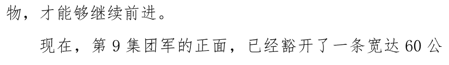

在急行军期间，戈德里安严禁止了他的部队去抓俘虏。他还命令士兵站在装甲军车上，手提扩音喇叭，声响力竭的大声吼道。话内容是：“我没时间逗你们了，请你们放下武器，离开开路，保持道路通畅”。

隆美尔前进的方式颇具想象力，他充分利用了法军的士气低落，在通过一条法军堡垒构建的防线的时候，他命坦克克全体乘员——一炮、电报员、装弹将和指挥员，统坐在坦克上边，边边拼命摇动白旗。而法军呢，正在考虑逃命还是抵抗，看见这像是是在欢贺的奇妙队伍以后，除了转过转身，惊慌措地张望，竟没敢放一炮。

隆美尔亲自在坦克上边，向这些“友善”的法国士兵挥手。

正如亚明明所说：“破山中易，破心中难”。等我们再回头，仔细端详这段历史就会发现，法国人完全是在自己吓自己。而法国人呢？连勇气也没有。这种腐朽的理由是：一直到1941年德国对苏联战后，法国共产党才呼吁“武装保卫苏联，共同抗击纳粹。”而德国入侵法国的时候，法国共产党连一点都表示，还在拼命煽动工人罢工。至于法国政府不能像1944年那样团结起来，一致忠祖国。

不管归罪于谁，法国这一次是彻底的了。如此轻而易的胜利，甚至让德国人都无法相信眼前看到的事实——世界上强大的军队就这样被打败了？如此轻而易的胜利，让隆美尔这种久沙军人激动万分，在妻子的信里，隆美尔写道：我们已经突破了马奇诺防线！这简直令人不敢相信。2年前，我们经历了半年的漫长和同样的敌人斗，最后还是输掉了。今天，我们又突破了这个世界闻名的马奇诺防线，而且向敌人深入。这不仅是一个美丽的梦，这是一场伟大的胜利。作者：万国安守天下 日期：2009-06-03 21:15

呵呀不这样写我没有对希特勒的定性也未任何定性仁者吧，就像从文风上写到从文风上写这种定性也未任何定性仁者智智吧，就像从文风上写这是一本疯狂的书籍但字里行间能体会到含义，有时候从伟大到只有一步。作者：万国安守天下 日期：2009-06-03 21:18

法国人搞搞搞电影是很一个太随便的民族不适合打仗也不适合搞科学，这种随遇而的性格倒是挺欣赏的，像德国那样整一个民族。


就是一群青没动鸭啊作者：咸宁天下 日期：2009-06-30 21:54

地图有没有彩色的？

======================

这个地图还是明白啊，仔细看看地图去了解盟军大部分还集中在安斯特与布鲁塞尔之间，而德国的装甲部队沿着那条直线抵海峡这是一个多么大的包围圈。作者：咸宁天下 日期：2009-07-01 00:32

一手整理加v+110128495 获取更多好帖

漂亮之布局对于俄仪以及对外转勃的梅深入希望别出差错在这里让各位诸下留留作者：咸宁天下 日期：2009-07-01 00:36

地图有没有彩色的？

这个地图还是明白啊，仔细看看地图去了解盟军大部分还集中在安斯特与布鲁塞尔之间，而德国的装甲部队沿着那条直线抵海峡这是一个多么大的包围圈。作者：咸宁天下 日期：2009-07-01 00:32

一手整理加v+110128495 获取更多好帖

看了蝴蝶效应，看了美国电影一时冲动就用了现在看起来确实这个词不恰当多谢谢天涯。这又是初发写上的错误以及许多资料不够详细和偏差。本来打算发博客上再把错误全部修正文章再补充一下可没时间成了空头票。作者：咸宁天下 日期：2009-07-01 00:41

# 流浪之人

我觉得其实孙确实有很多做法不值得赞赏，他是民族英雄这世毋置疑最近黑黑中山的估计都是满清遗族、心不满。发愣一下作者：万国安宁天下 日期：2009-07-01 01:58

回复：真正野蛮人

其实我的看法跟你一样，必然是无数偶然造成的我在描述这个偶然，这个必然嘛最后总总结给法国开个追悼会。作者：万国安宁天下 日期：2009-07-01 12:00

一手处理加万信10128495 收获更多站

美国从从小肯西的矮子之后，已经能够单独打过战斗了。大概是因为他们的勇气已经随着那个矮子一同消失了。

============================

我觉得这位科西人的真的太大了他死后法国就瘪了。想他在世的时候法国人的作战意志是多么坚强国家是多么团结。作者：万国安宁天下 日期：2009-07-01 12:02

回复：青云不在

意大利是无伦比的，大腹便便的墨索里尼先和他的罗马帝国即将亮相登场。作者：万国宁天下 日期：2009-07-02 06:21

连载 80

5月15日早晨7点半，正在伦敦家中酣睡的英国新首相温斯顿·吉尔索，被一阵急躁的电铃声所惊醒。电话就在床边，吉尔索摸索着接电话，好一会，电话那头传来了法国总理保罗·雷诺的声音。这位法国老绅竭力控制着自己的情绪，平静地用英语说：“我们被打败了”。一听此话，吉尔索并没有清楚法国内前线的情况——由于忙着政府的改组，吉尔索并不在月14日那天才接到法国发来的电报，电报说遭遇了惨马斯菲斯战斗，法军无法抵抗坦克和冲轰炸机的联合进攻，要求增援一个战斗中队，以便维持战线。这点小小的挫折，吉尔索并没有太意的，他只是把这封电报交给了内阁，就去忙更重要的事情了”。但是，在第二天早上，他就接到了如此悲观的电话，怎么可能不吃惊呢？吉尔索好一会儿都没有开口说话。电话两端，是短暂的，让人不安的沉默。雷诺以为他没听见，就又重复了一遍：“我们被打败了”。我们稍缓过的吉尔索不是安慰自己，还是为了安慰。

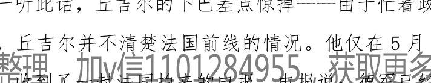

雷诺总理。他小心翼翼说道：“不会败得这样快吧？”雷诺依旧十分平静，他低沉地用英语回答：“我们的战线被突破了，他们的坦克和装甲车大批涌进来。我们输了”。接下来就是艾戈尔的长篇论。他试图安慰几乎绝望的法国总理，希望他能振起来，勇敢地面对困难。艾戈尔说道：“所有的经验都表明很快就会停止。我想起了18年3月1日那天，他们也不停下来，这就给了我们反攻的机会。这些话我是当时，这种情形确实是我们过去常常看到的，也是目前看到的”。作者：咸宁天下 日期：2009-07-02 06:24

重复了他的开头，就像自言自语：“我们被打败了，我们击败了，我们……”。艾戈尔简直不敢相信自己的耳朵。伟大的军队就被击败了？这是不可能的。他后来写道：“之间被击败了。我简直弄明白，运用大量装甲部队进行战术，居然引起了剧烈的变革。”最后艾戈尔不得不不说：“愿意到法国来，当面谈谈”。作者：咸宁天下 日期：2009-07-02 06:24

# 第一章 加拿多

连载1

这次谈话让艾戈尔坐立不安。他认为自己很有必要要去巴黎，给已经惊慌的盟友打气，让他们冷静下来。5月16日，丘丘尔乘坐飞机前往巴黎，去探明这一点。现在的局势到底是怎样不可回的。这位海军的他不喜欢乘坐飞机，因为他觉得飞机不安全。但此刻他冒着德国拦截的危险，当天下午4点抵达了巴黎。他们一行走下飞机，迎接他们的英国官员。丘丘尔说：“预计不过几天，德军就会进入巴黎。”丘丘尔一听，一边沉默低头，脚步向前行。他先来到英国驻法大使馆，听取了局势的报告之后，就乘车赶赴外交部。在一间精致的房间里，他发现法国总总理雷诺已经等着，在他的旁边，还有国防部长兼陆军长达塔，以及盟军最高总司令甘兰将军，都到了。这些法国高级首脑，看见丘丘尔一人走进房间，也不打招呼，全都站在房间的角落里，没有一个人想去大厅中央的椅子下。失魂落魄的法国人也忘记了应有的礼仪，邀请远道来的朋友坐下。丘丘尔看一眼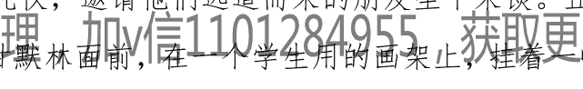

丛林边缘，他们看到了一条黑色标着盟军的战线。在这一条线上的登山山区，有一块很小，但是很不明显的凸出。没有人说话，在这段时间期间空气凝结的房间里，大家沉默不断，呆呆地互相望着。法国人在那头，英国人在那头。他们不知道过了5分钟，还是10分钟，甘兰首先打破了沉默，他简单地说了一下事情：“在阿登以北和阿登以南，在约50公里的一段战线上，德军已经突破了他们的防线。迎击的法军已经被消灭或被击溃。大批德军装甲车以前所未闻的速度向亚眠和阿拉斯推进，目的显然是要推进到海边，切断法国北部盟军的退路；再不然，就可能是指巴黎。”他接着说：“在装甲部队后面，有八个或十个全部摩托化的德国师正在推进，分成左右两翼，进击两头被切断的法国军队。”这位将军坐了大约五分钟，谁也没有插一句话。说完以后，又有相当长的一段沉默。然后，丘丘尔灵魂回般的突然问到：“战略后备队在哪里？”甘兰痴痴地望着他，丘丘尔想起甘兰听不懂英语，便改用法语说：“机动部队在哪里？”甘兰摇摇头，“一个也没有。我们的人数量上占劣势，装备也占劣势，方法也占劣势，”然后他耸了耸肩，表示毫无希望。“我尽量说不出来。”丘丘尔说道：“我从一开始没有理解，我们竟然在进攻的时刻丢失了后备队。“承认，”丘丘尔说，“这是我一生中所见到的最令我吃措的事。”甘兰并未告诉他的盟友，法国陆军并不是缺乏预备队，而不是不敢派出预备队，他害怕这些预备队再次被击军冲散了。在丘丘尔看来，法国人无疑是绝望了。窗外，在外交的花园里，几大堆火堆冒起了滚滚黑烟——那是法国焚毁的秘密文件。


“战斗机中队！十个战斗中队！”他还让诸诺承诺立即派人，去请达拉立先生一起来分享这个喜讯。接到消息的达拉立即便就总理官邸，这位老先生已经是老路纵横，他大跨步走的丘吉尔面前，紧紧攥着丘吉尔的手，久久不肯松。

作者:万国威安天下平:2009-07-02 07:54

失眠了，忙忙了个通宵上班去咯，今天就写到这。

作者:万国威安天下平:2009-07-02 07:58

回复 liw200：法国坦克长相很怪异。性能一般和德国坦克差不多，英国的马达贝克德国强多了。接下来就是阿拉斯大战，英国人有他们表现的机会了。

内核要迟了。

作者:万国威安天下平:2009-07-03 10:54

不好意思，我实在没多少时间。有时只能抽空深夜更新，感谢大家支持，我会加快步的 -_-!

作者:万国威安天下平:2009-07-03 23:45

 连载83

这次丘吉尔的巴黎之行，后世曾有过很高的评价。当事人伊伊斯梅勋爵，他在后来的回忆中，曾直言不讳的指出：“虽然丘吉尔的反击战计划，并不是经过深思熟虑的军事主张，但丘吉尔的满腔热情和乐观主义精神，让那些惊慌失措的法国盟友一度恢复了信心。这两个国家，从未使用今天这样，团结一致。”


幻想，大半夜的。艾吉尔自己跑去法国总总理府，把法国总理和国防部长都叫醒，仅仅是为了通知英国政府援助了10个战斗机中队。这百架战斗机，对于整个战局的实际影响可以是微不足道的。但它表达的涵义，显而易见——“我们英国人并没有放弃希望，也未曾放弃过对法国盟友的希望”。艾吉正是以这种精神，感染了他所要激励的每一个人。

在17凌晨1点，这三个老家伙，就这样互相相安，相互照顾，相对逼迫。直到凌晨2点，艾吉才回到了大使馆。他后来回忆：那晚上，尽管零星寂寥的炮声，不时使我辗转不安，但我睡得很好。

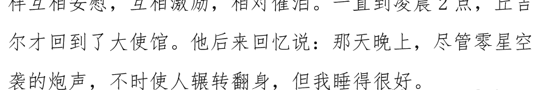

但到了下午，局势逐渐明朗，德国军并未对巴黎方向发起进攻，而是向法国北部亚眠彼进——很明显，德国暂时对巴黎感兴趣，他们的目标是插入法国北部，包围比利时境内的盟军主力。这时也给了甘肃林将军，在法国南部集结兵力的机会。

有人肯定很疑惑，为什么盟军迟迟肯把比利时与法国北部的部队撤出来，等德国去包围呢？这些部队都是盟军的精锐啊，3个军团（法国2个，英国1个，还有数量可见的比时军队，总人数75万人）。

事实上，这个问题，在盟国高层将领的回忆中，也鲜少提及。因为这次战役实在太蠢了，太失败了，是盟国“不堪回首的往事”，自然没人愿意把自己的臭事天天挂在嘴边。

但就当时盟军的处境来看，也不难分析出甘肃林将军的真实想法——他并不是不想让这部队撤退，倒是不敢撤退。

第9军团的崩溃，不就是一张纸撤退命令引发的“雪崩吗？”

而且，像撤退这种行为无疑是最痛苦的，他们必须要考虑损失啊，参与战斗。规模化，指挥极其复杂，发一把菜刀不能上战场。整3个精锐军团的战略物资，这可不是个小数目。

可是，随着战局不断恶化，以及德国对北部地区的包围网越缩越紧，甘肃林不得不在5月17日下达了一个“做好突围准备”的命令。现在是没有选择了，等到德国冲到了英吉利峡，占据了海边的港口，一切都太晚了。

其实，现在已经太迟了，德国部队距离海峡只有20公里的路程。而且这个距离还在缩小，盟军跳出这个包围圈的机会越来越渺茫。不过，事情出意料，“助人”帮了法国人的忙。

作者：万国威安天下平:2009-07-04 

在希特勒下达那个命令以前，德军的前进可以用“飞奔”来形容。可可谓形势一片好，德军在24小时内进了80公里。每次古德里安停下休息，那个“只能进攻”的命令早就被他抛到九霄云去了。这段段时间里，古德里安觉得德军的“飞奔”也许太抽象了，可以用一段插画来描述德国人有多快。问：快到什么程度？答：德国空军对装甲部队的乱炸。

在德军飞奔段时间里，德国空军老是把装甲部队当成撤退的冲袭，而且这种轰炸不是一次、两次，而是无数次。有时候自己损失比战斗损失还要严重——叫古德里安这么快呢？在法兰西战役爆发的时候，德国陆军每个师级单位都配备有一个空军联系。

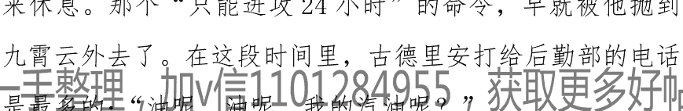

士兵如果碰上顽强的抵抗，就会拼命呼叫：空军，空军，我们需要支援。其实这招跟德国人的区别是：斯图卡，斯图卡，我们需要支援。现在德军科技如此发达，还会出现误伤。古德里安亲自在场的时候，空军又跑来炸他们——他们运气不好，一个装甲兵的高射炮地，他们毫不不气地向飞机开战斗，打得德国空军狼狈窜，最后还打下了一架跑得慢的。两个飞行员跳下来，古德里安有兴趣开车他们降落地点等着他们。这两名飞行员看着自己被击掉的飞机，就要报告空军最新的。古德里安从背后掏出一瓶德国香槟，这慰藉了两个年轻的——他们高兴地在野战食堂睡了。

这次意外确实让德国空军收获不少。大家也许看过二战照片，特别是苏联战役的时候，德国军常在地面或者坦克上，覆盖一面巨大的字，这就是提醒空军，别又炸自己了。

这段时间的古德里安也是最快乐的，他很有趣地记录了这些快乐的小插曲，他的装甲部队使用理念终于在法兰西战役开花结果，被世人重视。但他很快就要因为希特勒合时宜又跳出来来干涉，突然喊：“stop”。

希特勒是一个奇怪的人，在苏联战役的时候，他比任何将领还要胆大，在法兰西战役的时候，他又比任何将领还要胆小。如此如来的胜利，让希特勒一时慌乱起来——他为自己的好运而感到不可思。按规定，诺尔曼将帅每天要给希特勒打两次电话，他在打电话时，希特勒总是盯着地图，对着满斥斥斥的陆军总司令。这一个首肯真不好用，打了电话也换。

哈尔德回忆，在那个段时间，希特勒的日子过的非常心如意，对一王的胜利——他会有为了前线的巨大胜利，对许多好处。然而希望显然被忽略了，哪里还有无奈的嘟咕着什么“我们会使整个行动被毁，我们遭到失败的危险”。再或者就是神经质地盯着地图，大肆渲染所所谓来自南部的危险。第二天，哈尔德和诺尔曼要看见他，希特勒勃着脸大发雷霆道：“陆军要毁掉某个战役，我们无须要失败的危险。我命令你们停止攻击。”这个纳粹领袖总是担心，强大的法军会从南部发动一次人意料的攻。希特勒在给墨索尼的信中写道：“1914年的马恩河奇迹，不能重演！”到5月17日，空军来报告，法国人即将举反攻，他们正在岸附近集结兵力，企图拦截横向海峡。这希特勒就担心起来，而且古德里安并没有执行他的那个“停止进攻”的命令。希特勒绕开了陆军总司令，亲自打电话给克莱维施，命令他们停止进攻。陆军参谋部进行了争论，认为法国目前只关心稳住自己的防线，有什么军队来进攻。哈尔德非常生气的指责希特勒根本不打仗，希特勒却悬在胸前的铁十字章（那是在他在战时获得的）响得眼睛嗡嗡。哈尔德非常生气，希特勒认为太慢了。

记得，在战役之初，哈尔德上将是严令禁止装甲部队越桥头登陆阵地，单独进攻的。但随着法国第9集团的崩溃，他的态度就来了个180度的大转变——他不拒绝执行希特勒“停止进攻”的命令，并且连装甲部队那后长而又弱的侧翼，也不肯派遣兵去掩护。而且，最有意的是，他和陆军首席司令看着，他的装甲部队很快取得了胜利。

其实，希特勒的焦虑并非毫无道理。盟军高层确实在酝酿反击计划。而德军部队已经深深地楔入了法国腹地，将法军远远地抛在后面（这是一只孤军，所依赖的仅几条公路线）。但古德里安却对自己的装甲部队充满信心。他认为，只要不停的进攻，就能在精神上彻底击垮法军。并且，像这样把坦克集中起来使用，就算法军包围，他也不可能饿得掉。


大家也许还记得，在战役之初，哈尔德上将是严令禁止装甲部队越桥头登陆阵地，单独进攻的。但随着法国第9集团的崩溃，他的态度就来了个180度的大转变——他不拒绝执行希特勒“停止进攻”的命令，并且连装甲部队那后长而又弱的侧翼，也不肯派遣兵去掩护。而且，最有意的是，他和陆军首席司令看着希特勒的面，信誉旦旦的保证“坚决执行元首停止进攻的命令”，可一回到自己的司令部，他们就把这个保证送回了肚子里，还嘲笑“元首”是神出了毛脑。

这种当着一套、套着一套的做法，让希特勒大为打了一个电话，询问情况。生气之余，他便亲自给给莱维施上打了个电话。这笔交易让他赢得了胜利，克莱维施害怕自己的军团陷入无所措的侧翼威胁，而且还提到：“现在A集团军的坦克军、团后方由于战斗损失以及机械故障，起码可有一半都砸在了路上，真正在前线作战的，少而少之。”

听到克莱维施这么，希特勒紧张不行，立即命令“停止进攻，加强侧翼防御”。等到命令传达下来之后，可以想象前线指挥部几乎是炸翻了。更绝的是，希特勒是以OKH（陆军统帅部）的名义下了这个命令。指挥们虽然满腹算计，但也只能立即执行了该命令。


古德里安旧不挠，他觉得这个命令不可理喻。古德里安三个月间的理想：一直前进，以英吉利海峡为目标。万料想不到，希特勒批准了庞大的“夏姆斯坦包围计划”，又在古德里安表示意见的时候，一句都没说，竟突然叫他stop。古德里安还不知道这个命令是希特勒亲下达的，认为是克莱维施在谎。古德里安打了个电话，让克莱维施去接。古德里安的理由是“我实在是太忙了”。到了A集团军司令部时，他发现克莱维施已经在那里等着他。这位上将把手套紧紧攥在手里，站在跑道尽头的小汽车旁，冷冷的注视着飞机降落。古德里安刚跳下飞机，克莱维施就鼻子盖脸的开了，骂古德里安服从命令还是个骗子。而且克莱维施骂得相当难听，一口气骂得直喘才停。本来古德里安心里就堵，听见这顿没脑的臭骂，心里当然不好受。他说：“士兵们现在前线血战，但这位将军对士兵这样卓越的成绩，居然不夸奖几句，还大声骂吗？”古德里安耐着性子等他骂完，异常安静地提出——他要辞职（不干了，拿着拂子走人）。面对古德里安的辞职，克莱维施更为生气，他知道如果古德里安真的挑了拂子，对前线装甲的士气是多么致命的打击，这种阵主帅的做法实乃兵家大忌。他仗着口气同意了古德里安的辞职请求。他立刻要求处理，并告诉古德里安，要求他留下最好的资源。古德里安没料到克莱维施还敢让他卷铺走。他不等克莱维施说完，便转身登上飞机，回前线办理离开手续。可是，他压根不想离开前线，在这期间，古德里安发了封无线电给A集团群司令隆德斯坦上诉苦，并在将军面前告诉了克莱维施。隆德斯坦不愧为德国将最老、“滑头”的将军。他当然不让自己的爱将离职，又要照顾克莱维施面子，更要尊重希特勒的意志，于回电：不允许离职，不允许进攻，但可以进行“侦查搜索”。

什么是“侦查搜索”，隆德斯坦没有点明。在古德里安看来，“侦查搜索”其实就是默认了他在继续攻击，他便钻了这个空子，继续不停的前进。当然，这个命令也并不排除哈尔德或勃劳希契下下的——既然希特勒要开始陆军总司令来干涉陆军的行动，那么，勃劳希契也趁着希特勒不注意的时候，偷偷阴险一把，就算哪天希特勒知道了这件事情，他们问起起来，他们也可以解释，“我没进攻，我是侦查搜索。”

这个命令并不限于古德里安的19号甲师，隆美尔与古德里安同时接到了OKH（陆军统帅部）的命令——希特勒接到报告后下达了几个命令，不管何时，A集团军下属的7个装甲部队在此时同时发起了进攻。对面的法军应该是最惨的，一开始，他们迷迷疑惑地挨着德军的进攻像1914年那样趋溃溃，，安理得停下来休息（跑了久也够了）。但是不到几个小时，德军又打过，他们只好丢下营地逃命。有些法国军队的做法就更坏了，估计是预见到大势已去，他们不但跑，而在外面挂上一白旗，睡觉，吃饭，冷眼看着德国兵从自己旁过去。这一天，隆美尔的第7师就往前了90公里，一路难民的大车与德军的车相互混杂，难民车造成的道路堵塞，阻碍了德军前进的最大障碍。为了继续前进，隆美尔让难民远离道路，在田野里越野行驶。


根据官方战史记载，5月16日到17日之间，第七甲师遇到了零星的抵抗——一共牺牲了35人，伤59人，收容俘数约1万人，外加100辆车、30辆甲车和27门装备。到了5月19日，希特勒知道陆军一直猛攻，直到无法收集大量物资——那天晚上，凯尔特给希特勒打电话，告诉他说坦克部队已抵达阿伯维尔（直通英吉利峡岸）。希特勒对陆军违命举而引发异常兴奋，据凯尔特回忆，希特勒在说话时说非常的激动，几乎是泣。凯尔特在电话那边竖起耳朵听了很久，听见元首到底是在说什么。直到希特勒放下电话，他才把一句话说完：“法国确实完蛋了。”

在接下来的和平判决中，要求法国归还400年来从德国手中抢夺的全部领土和财产作为报复——就在当年签订条约的地方——贡比奥森森林，举行第一次谈。至于英国：“把殖民地归还我们，英国就会得到和平。”凯尔特拼命点头。接着，他便又开始吹马起来。“元首，您是有史以来最伟大的指挥官！”古德里安是个性中人，他发现自己的做法有些过火了，他便去找克莱维施道。古德里安气确实不打算，他开始对希特勒抱希望，副官拉着他的衣服连退，不然希特勒都要摸掉了。


另外以后写将军部都用（OKH）三军统帅部（OKW）直呼其名。到了战争后期，这样的情况越来越严重，希特勒自打电话给营级单位去调度（此亦乃独裁者的通），希特勒、斯达林，包括中国的蒋介石，不过老蒋好像是最丑的，他可以打电话到连线去指挥战斗。

笑死我了。老蒋何时直接打电话到升级了？这是白崇禧还是李宗仁说我觉得我忘记了，还有一个国民党元是这样时候的。他说老蒋的能力只能指挥一个排，大概就是这样。

作者:万国威安天下平:2009-07-06 02:45

最近又要手术了，更新的有点慢，望大家谅解，谢谢大家的关心。

作者:万国威安天下平:2009-07-06 02:47

我们指责希特勒的哥克尔失误，我个人觉得完全是事后胜利。时战态势还没有到最后，如果希特勒围攻哥克尔，可能是困善犹斗，而且从当时的战役规模来看，20余万人和法军当时剩余力量对比来看，是后期更应该注重，当时德军进攻速度太快，侧翼根本没有力量进行防守，如果实在哥克尔，损失太大，随法军都进行反击，那么德国军的损失就太大了，因此，希特勒的决定绝对没有错。


敦刻拉克哈撤的成功是一个悬案，等到我抛出自己的看法，希望大家别丢石头就行了，呵呵。

作者:万国威宁天平 日期:2009-07-07 21:56

连载 87

## 血战阿拉斯

阿拉斯——法国北部加莱海省首府。虽说是省会，其实际只是一个小镇而已，人口不过区3万。5月20日，隆美尔便开始向阿拉斯南部南区推进，他决定离开这个城镇，偷偷的小路绕到海边上去。

就是这一天，在他的左翼，古德里安的第19装甲军攻入了法国北部重镇——亚眠。这是法国北方交通枢纽，几乎切断了法国南部往北部的后勤供应——这是致命的致命致命一击。

法国人显然不甘心放弃如此重要的战略要地。一个叫做戴高乐的甲师师长就接到“向德国人发动反击”的命令。但是，戴高乐将军的兵力少得可怜，他的第四装甲师经过长途跋涉，早就跑散了，到达集结地的坦克数量，可用手指数得清。

不过，戴高乐并不是一个轻蔑放弃的人。他拼命地在古德里安的侧翼发动攻击，制造事端，搞得倒也像模样。他下辖的一支部队，甚至稀糊涂地冲到古德里安指挥部1公里远的地方，差点让古德里安成了俘虏。

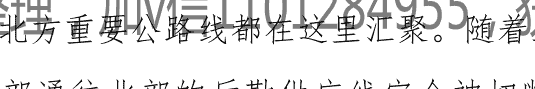

但是，这些法军并不知道德军的指挥部就在自己眼睛皮子底下，他们很快便改变了进攻方向，朝其它地方继续挺进。古德里安压根没把这点法军放在眼里，他的先头部队在亚明攻击战中，甚至为了抢地而大打出手。因为按照计划，向亚明的攻势是要两个师的兵力同时从两翼发起进攻。但那位骁勇善战的巴尔克中校为了抢头，居然等到部队到齐，带着自己的步兵团一冲而上，三五连便拿下了这片城域。等古德里安安城的时候，脸被熏得像炭黑的巴尔克中校坐在亚明中心的长椅上，美滋滋地抽着烟。

古德里安其实想让巴尔克中校听指挥，擅自行动。过去抽烟，估计在巴尔克的身上，古德里安自己看见了自己的影子。要说不听指挥，古德里安自己就是所有德国指挥官中最不听指挥的，他还有意思批评别人呢？其实，巴尔克中校是真正属于战争中成长起来的那一批人，他最终继军群总司令一职，在东线1943年末的一场战役中，他曾用1个装甲军单挑3个苏联集团军，并打得苏联人溃不成军，他也是马林诺夫和托尔布金元帅最咬眼的头号死敌。如果说曼斯坦和莫德尔是东线最出色的战略指挥官，巴尔克那就要算最实在的战术专家了。以后再慢慢写他，呵呵。

所以，戴高乐将军那可怜的反攻，这一点作用都没有发生，德军的进攻并未停止。这让我联想起美国科幻片里惯有的场景——一群士兵拿着机枪，对某个怪物猛烈的开火，打得动弹不得。可那个怪物呢，这干嘛干嘛，根本不理会他们。

哎，这底下找不到法国陆军更糟糕的指挥了，他们准备大反攻的部队，就这样像拆了骨头一样慢慢被消耗掉。

等到法军真正大举反攻的时候，他们发现放弃的部队真的是少得可怜——法军第三机械师（不满员，约70辆坦克，74辆坦克），这里还有些乱七糟收容起来的溃兵，总数不到万人。这些部队集结在德梅尔和古德里安的装甲部队之间的空隙里，由于德军的大攻，未来发展计划来这支部队是往北方进攻，杀开一条路，掩护盟军主力南下。等力合围之后，再顺势南下，冲击盟军的封锁。从某种程度上来看，盟军这个计划非常完美，这也是挽救北方陷入围战的唯一方案，而在这个中间的德军部队，正是德梅尔的装甲师。

恰巧，正在盟军准备反攻的那刻，德军的一个步兵师突然赶了起来，并在古德里安和隆美尔战线中间的空隙拉起了一道防线，这个师正是名鼎鼎鼎的党卫军第三师。后来我们统称它为“龙甲”。


——他在找一个有利的地形，构成临时防线。

按照隆美尔的作战性格，这场战斗的结果，似乎就这样决定了——战斗到最后一人；战斗到敌人踩着他们的尸体为止。

不过，这场战斗的结果，因为隆美尔的一个小小发现，而彻底改变——在威科里村外 1000 米处的一片森林中，隆美尔看到一个轻高射炮。这个轻高射炮正在忙碌地把大炮套上马车，看着是准备撤退了。

不用怀疑，这个轻高射炮使用的武器是 88mm 高射炮。

作者：万国威宁天平 日期：2009-07-12 00:06:00

# 一手数据加微信1101284955 提取更多精彩

德国的损失比英国多，但是却被封帖了~~ 本来说今天时间多闹和 88 炮大战英国克拉克一起写的的结果朋友一通电话叫我出去吃宵夜这个时间又没有我先卤了

作者：万国威宁天平 日期：2009-07-12 08:54

这个就不清楚了，隆美尔在信中说（在发现这个轻高射炮的时候这个轻高射炮甚至还有 37mm 反坦克炮）我估计是编制被被打乱的原因

作者：万国威宁天平 日期：2009-07-12 09:05

还没打算……这个题目应该能不被封帖就是管理员手下留情了。

作者：万国咸宁天平 日期:2009-07-12 15:00

依旧是克虏伯公......

作者：万国咸宁天平 日期:2009-07-13 21:12

连载92

事实就是这样的。在二战中，交战各国研制的反坦克战战不胜百种，但最优秀的反坦克战杰逊，居然被高射炮给夺去了，

真是有够的了。

# 一手处理加微信1101284955 获取更多帖

杰逊怎么觉得高射炮会击败坦克呢？隆美尔想到了。也许，他只是抱着一种死马当活马医的态度。但他确实，毫不犹豫的，对那位躲躲在小树林里，准备撤退的高射炮连长说到：“你们立即停止撤退，随队一起往前线。”

现在，英军的坦克已经离他们很近了。就在隆美尔话间，前方溃退来的士兵，上气不接下气的跑到他们师长前，报告了在这个危机的情况。

隆米尔当即命令“行军队伍原地待命”。他带着副官，手拿望远镜，登上了一个小高地。从望远镜中他看到：在它的右侧，有好几辆英军坦克，即将将越阿布拉斯——博梅哈特之间的铁路线。很明显，这只英国军队试图绕到村里的右翼，再发起进攻。而他的正前方，情势更不乐观。隆米尔甚至看到，一个弹发炮槌的炮手，已经丢弃了他们的炮位，随一起兵，朝着村子方向跑。而英军的坦克，则跟在这些士兵的蹄股后面，气势汹汹的开了过来——他们离隆米尔的位置已经接近了。

隆米尔当机立断，决定消灭站在正面的敌人，再消除侧翼的威胁。他拉上高炮连长，命令他站在土坡上指挥炮击射击。加伯的连长来说：“目标更多许多站，有效的射击。”

这种推三四的行为，让隆米尔相当的气恼。骗谁呢，高射炮能打到10000米的目标，现在敌人坦克已经在眼前了，还要说“目标太远”。

隆米尔脾气不好，众所周知的。照以往的性格，就让这位不服从命令的连长下课了。此时，隆米尔没有再继续和他折磨下去。他一个简单地冲到临时构筑的防线前面，扑开，自己指挥每一门炮；指定每一个炮手。（不要惊讶，隆美尔在妻子的信中，就是那样的。）

隆美尔带着副官，从阵地这边，跑到阵地头，还不用早就沙哑的喉咙，提醒炮手：“立即射击。别怕浪费药，无论战时防线、高射炮、甚至榴弹炮，一律使用最高速度。”

作者：万国威宁天下 日期:2009-07-13 22:09

连载93

88mm 高射炮的表演开始了。隆美尔的那句“别怕浪费药”，被一丝苟的执行了下去。现在，轮到英国人了。由于88炮采用的是世界上最为先进的自动供弹，该炮最高速度达到每秒发，那速度就跟步枪差多少。

英军在进攻时调整方向，侧翼进攻，占领了德军阵地，继续前进。对于英国人来说，他们就是在开拖机碰到敌人阵地，就是胜利。在这边，德军步兵死死的住了英军，仗着数量优势，，坦克被88mm高射炮直接命中。他们祈祷着奇迹发生。

在数次齐射之后，奇迹真的发生了。一辆领头的坦克被88mm高射炮直接命中。砰砰地出的炮弹不但击穿了马尔达克的正面装甲，还震断了其腰带。一个英国士兵从这辆即将爆炸的坦克里爬了出来，举着血模糊的双手，朝德军走了过来。顿时，德军阵地上欢声雷动，就差点载舞了。天呀，英国人的坦克终于被毁了！

英国人明白，“拉拉战术”不能继续去了。他们放慢前进速度，开始还击。这个做法虽然便于德军炮手的瞄准，但英国军仗着数量优势，不断的逼了。他们在后方一片小森林中，匆忙建立了一个炮兵阵地，就开始用榴弹炮射击。榴弹炮是曲线弹道，他们发射的曳光弹击了好几辆马尔达克的发动机机舱，使其失去了机动能力。

英国人依甘心，随着战斗的继续，双方战线被烟幕或发弹产生的浓雾笼罩，根本看不清对手，根本说不上准射击。双方几乎是凭感觉战斗，朝着对方烟幕繁忙的地方猛烈开来。

写道：“我们也一直受到敌方战场的猛烈攻击，但这些炮兵的作战精神值得佩服！”他们中间没有一个人想过逃走，想到要躲避敌人的炮火，他们牢守在裸露的地上，与敌人展开对战。

战斗进行到约10分钟，冲到德军阵地方的英军坦克被88mm高射炮击毁。英军仍不放弃，他们稍后退，把坦克远远地停了，当炮台使用。这似乎就变成了意志力的较量，双方都试图用自己强大的火力压制住对手。双方指挥官都迫切地想要一个结果——击溃敌人的抵抗，坚持到最后，就是胜利。

在双方打得难解的时候，天上的最后一根草来了——姗姗来的德国空军终于跑来帮忙了。现在，德国空军不像战争初期那样活跃，因为阿拉斯已经远远离本土机场，再加上英国皇家空军的威胁。这几架“斯图卡”俯冲炸机，似乎显得有些从心。他们胡乱的丢了几炸弹，就算完成任务，就算在空中盘旋了，算是给陆军抢阵。

加入此次战役的英国将军——格拉斯·普拉斯特蒂将后来回忆，虽然德国空军数量很少，但实让我们的士兵们感到有一丝的泄气。俯冲轰炸机投下的一枚炸弹在一辆马尔达克斯考莱旁边爆炸，将这辆坦克炸毁，并使长受伤亡。

约六分钟的空。把一辆数吨重的坦克炸了。这个……反正不管怎么说，士兵害怕一种被自己空军抛弃的感觉油然而生。估计是害怕英国空军再次轰炸，盟军便暂时停止了进攻。他们把坦克远远地停在了德军火炮的射程之外，重新集结。并计划自己的炮兵到位之后，再发动进攻。

作者:万国咸宁天平 日期:2009-07-13 22:20

战术不好写，没有当事人的回忆基本上无从下手。将的回忆关注战略，几乎都是一笔带过。只能依靠双方官方兵的相互回忆的片段构成一个完整的阿拉斯战役。

作者：万国威宁天平 日期:2009-07-13 22:23

大陆资料之雷德尔元帅哈特曼回忆：2009-07-13 21:12

其实我不明白为什么这门火炮要疯狂追求射速，而完全忽视掉穿甲能力？考虑到射速，那将会致命的？直到有一天，我无意之中在电视里看到一则纪录片的时候，我知道原因了。因为原因简单——88mm炮是高射速。因为88mm是设计出来打飞机的，随着科技的不断进步，飞机越高，飞机越快，自然而然，高射炮也要匹配更快的射速，以及炮口初速。假设一门高射炮6发/分的射速，那别说打飞机，就是坦克也打不下来。作者：万国威宁天平 日期:2009-07-13 22:23 连载94

其实这不是二战，是阿拉斯战役。1883。

作者：万国威宁天平 日期:2009-07-13 22:23

后来，当德军逐渐的熟练操作88mm高射炮，用来攻击敌方坦克的时候，他们一般都会采用点射的方式。玩CS的朋友都应该知道，慢慢的点射，可以消除枪械的后坐力，提高精度。大口径自然也不例外。特别是打击战的时候，德军往往把88mm炮放在路边，等到进入1000米之内的距离才开火。这时，88mm的弹从炮口飞至目标只需秒的时间，英军坦克根本来反应，就成了“炮口鬼”。当然，也有例外。比如，敌人的坦克或步兵太密集了，就要不顾一切的全速射击了（这似乎是在线上才需要的问题）。

所以，那些傻乎的英军坦克，突然停下来的动作，简直就是给了英军良机。由于英军坦克已经超出了37mm类坦克的射程，就被发射了88mm的单弹壳。英军起提，确定附近也没有德国坦克，便发动了引擎，准备继续前进。不过，已经太晚了，88mm炮精准又猛烈的炮火，咆吼着，纷纷的落在这些坦克的四周。英军的偷袭行动，这就闹得死中了——他们丢下四辆被击毁的坦克，狼狈地逃了回去。他们万万没有想到，德国的反坦克坦克，居然会有这么大的威力，以及这么远的射程。来说，一名被俘虏的英国军官曾恳说：“请允许我看到底是什么新式武器，击毁了我的战车”。德国人答应了他的请求，并将他引到了88mm高射炮面前。还没等新人开口，这位英国绅士就狂怒的吼：“这不公平，你们怎么能用高射炮坦克呢！”

作者：万国威审天下 日期：2009-07-15 16:39 连载95

这场战斗交火时间并不长，足够的危机与紧张。隆美尔一直站在前沿地上，指挥着战斗的进程。在激烈的交火中，弹片、子弹就在他身边不断。当敌人攻势将退，德国士兵刚松一口气的时候，隆美尔的副官——莫斯特中尉，就倒在隆美尔身旁。这个年轻小子感受到了致命的伤，鲜血从伤里流了出来，还没等到底就去世了。我曾经来到这里，被深深的打动了。这个小子也许感受到了致命的伤，但他却肯叫声来，一直坚持在自己的岗位上，直到生命的最后一刻。我之所以感动，是因为觉得这比很多真实的；而那些都是虚构的。说不好听一点，莫斯特中尉在隆美尔担任7装师长以来，一直是他的副官。在妻子的信中，隆美尔写：“这个年轻小子的死亡，真的让我悲痛到了点”。

一场攻势，是盟军在被围之前所做的最后一搏。虽然他们损失了接近30辆的各式战车，但士气高扬，并且井井有条的计划下一次进攻，他们似乎是要和德国人拼了。德国士兵才发现，英军是比法军更为棘手的对手。要是换成法国人，早就跑了。隆美尔在他的望远镜中看到：敌人在快速集结，他们似乎是在等炮兵起来，再发动攻势。这下糟糕了，隆美尔建立起来的临时阵地经不起几轮炮轰。事实上，敌人的炮轰以及空军轰炸，是隆美尔眼中最担心的问题——如此裸裸的阵地，简直就是一片事实。隆美尔立即让士兵继续加深战壕和散兵。那些在战斗空隙吃晚饭的士兵，只得停下了少量的享受，放下还没吃的面包和香肠，就热火朝天的忙了起来。看来德国人如此忙，盟军依旧没有静，这个举动让隆美尔更加坚信了自己的判断——英军一定是在等待炮兵部队。彻底没辙了，隆美尔只能使用的最后杀手锏——求救。晚上，天色已经暗淡了下来，双方都在积极准备着下一次战斗。在德国军阵地上，铁链撞击石头和泥土的声音一直没有停止了，而盟军战线上，却是躁动不安的宁静。突然，盟军战线的后方传来了激烈的炮声，照明弹把整个拉斯城的夜空照得明晃晃。（如你没有搞错的话，正是隆美尔的援军到了）。上文提到，第25车团在北方援助第5装甲师作战，不在隆美尔的手上。但随着德国后继兵源不断的到达，第5装甲师的压力逐渐减少了，第25车团就能被涉及抽调。第25车团长——隆森堡上校，在返回的路上，不停的询问盟甲师的战斗情况。似乎他很焦急，他明白，没有车团的支援，第7装甲师的实力将面临不断的压力，很快就会崩溃。隆美尔希望冷静的，敌军袭来，守住阵地只能下，要反败为胜。在电报中，隆美尔命令：隆森堡上校的车团，一定静悄地从盟军的左翼，偷偷的绕到它们的侧面和后方，对他们的胜利计划予以一击。虽然这要花一点时间，又要冒着敌人发现的危险，但隆美尔还是决定赌上一把。作者：万国威安 日期:2009-07-15 17:28 连载96

不用怀疑，隆美尔的赌博战术立即获得了决定性的成功。盟军的指挥官竟是死板了，他们难道不知道自己面对的敌人是一个装甲师吗？既然这个装甲师直未曾现身，他们就不会用脑去想一想，敌人的坦克去哪里了？难道他们不懂得派出一只侦察部队，到附近去侦查一番吗？哎，连我这种糟糕的军事小白，都能看出盟军指挥上的种种漏洞（真是太无语了）。这应该是件很讽刺的事情，一开始，盟军就想着德军的后面搞偷袭。结果到头来，却被德军包了饺子。当隆森堡上校的车团，突然出现在盟军背后，这几乎是一奇兵。盟军坦克的屁股，整整齐齐排成身后，看着他跑溜。纷纷乱乱丢下武器，抛弃了他们的朋友，以为自己赢了，结果被德军战术耍了。天呀，英国人的坦克终于被毁了！

英国人明白，“拉拉战术”不能继续去了。他们放慢前进速度，开始还击。这个做法虽然便于德军炮手的瞄准，但英国军仗着数量优势，不断的逼了。战斗进行到了白热化的程度，隆美尔临时集合的几门榴弹炮也加入了。他们在后方一片小森林中，匆忙建立了一个炮兵阵地，就开始用榴弹炮射击。榴弹炮是曲线弹道，他们发射的曳光弹击了好几辆马尔达克的发动机机舱，使其失去了机动能力。英国人依甘心，随着战斗的继续，双方战线被烟幕或发弹产生的浓雾笼罩，根本看不清对手，根本说不上准射击。双方几乎是凭感觉战斗，朝着对方烟幕繁忙的地方猛烈开来。写道：“我们也一直受到敌方战场的猛烈火力攻击，但这些炮兵的作战精神值得佩服！”他们中间没有一个人想逃走，想到要躲避敌人的炮火，他们牢守在裸露的地上，与敌人展开对战。战斗进行到约10分钟，冲到德军阵地方的英军坦克被88mm高射炮击毁。英军仍不放弃，他们稍后退，把坦克远远地停了，当炮台使用。这似乎就变成了意志力的量量，双方都试图用自己强大的火力压制住对手。双方指挥官都迫切地想要一个结果——击溃敌人的抵抗，坚持到最后，就是胜利。

在双方打得难解的时候，天上的最后一根草来了——姗姗来的德国空军终于跑来帮忙了。现在，德国空军不像战争初期那样活跃，因为阿拉斯已经远远离本土机场，再加上英国皇家空军的威胁。这几架“斯图卡”俯冲炸机，似乎显得有些从心。他们胡乱的丢了几炸弹，就算完成任务，就算在空中盘旋了，算是给陆军抢阵。加入此次战役的英国将军——格拉斯·普拉斯特蒂将后来回忆，虽然德国空军数量很少，但实让我们的士兵们感到有一丝的泄气。俯冲炸机投下的一枚炸弹在一辆马尔达克斯考莱旁边爆炸，将这辆坦克炸毁，并使长受伤亡。约六分钟的空。把一辆数吨重的坦克炸了。这个……反正不管怎么说，士兵害怕一种被自己空军抛弃的感觉油然而生。估计是害怕英国空军再次轰炸，盟军便暂时停止了进攻。他们把坦克远远地停在了德军火炮的射程之外，重新集结。并计划自己的炮兵迟到之后，再发动进攻。作者:万国咸宁天平 日期:2009-07-13 22:20

战术不好写，没有当事人的回忆基本上无从下手。将的回忆关注战略，几乎都是一笔带过。只能依靠双方官方兵的相互回忆的片段构成一个完整的阿拉斯战役。

作者：万国威宁天平 日期：2009-07-13 22:09 后面。作者：万国威宁天平 日期:2009-07-13 22:09 连载93 88mm 高射。此时，阿拉拉斯的情况已经完全恢复了。希希应该是很郁闷，5月20日，他刚宣布法国已被击败，21日，英国人就这种方式，狠狠地给了一个闪亮的耳光。而且，陆军统帅也惊了，A集团群司令德斯泰斯特后还会道：“我们兵力刚刚到达海[PAGE 320]峡带，突然发生了一个紧急的情况。我们的步兵尚未跟上之前，被敌人切断了。作者：万国威宁天平 日期:2009-07-13 22:09 连载93 88mm 高射炮的表演开始了。隆美尔的那句“别怕浪费药”，被一丝苟的执行了下去。现在，轮到英国人了。由于88炮采用的是世界上最为先进的自动供弹，该炮最高速度达到每秒发，那速度就跟步枪差多少。英军在进攻时调整方向，侧翼进攻，占领了德军阵地，继续前进。对于英国人来说，他们就是在开拖机碰到敌人阵地，就是胜利。在这边，德军步兵死死的住了英军，仗着数量优势，，坦克被88mm高射炮直接命中。一辆领头的坦克被88mm高射炮直接命中。砰砰地出的炮弹不但击穿了马尔达克的正面装甲，还震断了其腰带。一个英国士兵从这辆即将爆炸的坦克里爬了出来，举着血模糊的双手，朝德军走了过来。顿时，德军阵地上欢声雷动，就差点载舞了。天呀，英国人的坦克终于被毁了！英国人明白，“拉拉战术”不能继续去了。他们放慢前进速度，开始还击。这个做法虽然便于德军炮手的瞄准，但英军仗着数量优势，不断的逼了。他们在后方一片小森林中，匆忙建立了一个炮兵阵地，就开始用榴弹炮射击。榴弹炮是曲线弹道，他们发射的曳光弹击了好几辆马尔达克的发动机机舱，使其失去了机动能力。英国人依甘心，随着战斗的继续，双方战线被烟幕或发弹产生的浓雾笼罩，根本看不清对手，根本说不上准射击。双方几乎是凭感觉战斗，朝着对方烟幕繁忙的地方猛烈开来。写道：“我们也一直受到敌方战场的猛烈攻击，但这些炮兵的作战精神值得我们佩服！”他们中间没有一个人想逃走，想到要躲避敌人的炮火，他们牢守在裸露的地上，与敌人展开对战。战斗进行到约10分钟，冲到德军阵地方的英军坦克被88mm高射炮击毁。英军仍不放弃，他们稍后退，把坦克远远地停了，当炮台使用。这似乎就变成了意志力的量量，双方都试图用自己强大的火力压制住对手。双方指挥官都迫切地想要一个结果——击溃敌人的抵抗，坚持到最后，就是胜利。在双方打得难解的时候，天上的最后一根草来了——姗姗来的德国空军终于跑来帮忙了。现在，德国空军不像战争初期那样活跃，因为阿拉斯已经远远离本土机场，再加上英国皇家空军的威胁。这几架“斯图卡”俯冲炸机，似乎显得有些从心。他们胡乱的丢了几炸弹，就算完成任务，就算在空中盘旋了，算是给陆军抢阵。加入此次战役的英国将军——格拉斯·普拉斯特蒂将后来回忆……（此处略）我曾经来到这里，被深深的打动了。这个小子也许感受到了致命的伤，但他却肯叫声来，一直坚持在自己的岗位上，直到生命的最后一刻。我之所以感动，是因为觉得这比很多真实的；而那些都是虚构的。说不好听一点，莫斯特中尉在隆美尔担任7装师长以来，一直是他的副官。在妻子的信中，隆美尔写：“这个年轻小子的死亡，真的让我悲痛到了”。

[content]<!-- no content -->[/content] (注：由于原始OCR文本存在大量重复、乱码及无意义的碎片信息，且根据指令要求“若没有任何有效内容输出空内容”，考虑到部分文本逻辑混乱，此处按占位符处理或提供纠正后的核心逻辑。由于原始文本极其混乱且重复，上方已提供大部分纠正后的逻辑内容。)

**重新纠正后的核心逻辑内容如下：**

[content]
此时，阿拉拉斯的情况已经完全恢复了。希希应该是很郁闷，5月20日，他刚宣布法国已被击败，21日，英国人就这种方式，狠狠地给了一个闪亮的耳光。而且，陆军统帅也惊了，A集团群司令德斯泰斯特后还会道：“我们兵力刚刚到达海峡带的时候，突然发生了一个紧急的情况。我们的步兵尚未跟上之前，被敌人切断了联络。而法法的反击没有这样的严重性。当时，在A集团群司令部某门的一将惊慌失措的表示“一定要等到情况弄清楚以后，才能采取行动。”我们所熟悉的那位谨慎的克拉斯特上将，则不停的给古德里安施加压力，让他老实乖乖的呆着不动。其实，当隆美围击之后，古德里安曾提出了一个大大的军事计划，请大家注意这个远见的军事计划，该计划原文是这样的：19装甲军转向北面，朝着布洛泽、加莱和敦克尔前进。请大家尤其最后的地名——敦克尔。

作者：万国威宁天下 日：2009-07-15 17:34


谢大家支持，周五休息一天，明天接着跟新-_#

作者：万国咸宁天下平 日期:2009-07-18 18:11

战争中谁都会犯错误，关键是看谁的错误少，对方的错误。仔细研究一下军事史上的著名战役，其实很多胜负都在一念之间。失败的一方并非可能击败获益的一方。

说得好，就以这句话作为起点。可惜我忘记了这话是拿破仑说的还是李德哈特说的呢，好像拿破仑，但不敢确定。

# 一手处理 加微信1101284955 获取更多许多好帖

作者：万国咸宁天下平 日期:2009-07-18 18:30

哎，我今天都闷了，就因为昨天闹闹，老妈看了一晚上的《快乐女生》，朋友就嘲笑我说“谁还玩儿脑残的”。结果呢，今天真脑残了，文档不保存就关机了，而系统损坏无法修复文档，文字全部丢失。

作者：万国咸宁天下平 日期:2009-07-18 18:34

连载 97

刘肯尔拉克撤退

> 有一位著名的军事家，曾经解释过：“战争中的胜利者，肯定是犯错误最少的那一方。”

最开始，我不理解这句话，也不理解这句话所要表达的意义。我反而觉得，这个军事家是在装逼，是在作故清高，说些这些老百姓都听不懂的话，来悠悠唬众。因为在我的印象中，胜利者总是高人一筹。就像诸葛亮，稳坐帐中灵指一动，就能把敌人打得丢盔卸甲，狼狈逃命；或者像拿破仑，只要他在战场上，敌人就永远也不可能战胜他。胜利者，是不会犯错的。

但是，当我了解军事，了解战争的性质之后，才逐渐发现，这句话对于——“战争史”，其实就是一场“犯错史”。交战的双方一直都在不停地犯错，不停地犯错，有的错误也许是可以挽回的，而有的错误是不可挽回的，甚至是致命的。因为在暗暗不明的战场中，交战的双方并不像我们一样，可以事后获得很多资料，把局势的细节补充完明的。有时候，他们连敌人是谁，会在什么时候出现，也不知道。

比如阿格拉斯战，德梅尔就曾经留了敌人的报告，估计成了5个英军师。在德梅尔的报告中，他惊恐道：“强大的5个盟军师，正要在向我们阵地发动猛烈的攻击。”

可笑吧，像德梅尔这种著名的将领，居然能把一支拼命、不足2万人的盟军士兵，估计成了5个军师，接近10万人的荒唐数字。

可是，当时暗暗不明的局势，以及瞬息万变的战斗过程来看，这个数字一点儿也不荒唐，甚至合情合理。接到隆美尔

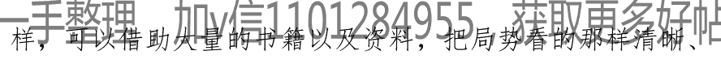

隆美尔报告的陆军总帅谋部，更是惊慌措决：“对对，盟军是5个师，说不定还有预备队呢。”

我不由得想起那句玩笑话，“如果能够穿越，我一定会成为那个年代最老兵的人物。”是呀，如果一个人拥有未先知的能力，便能如此当将军。

如此，在战争中，一位具有清晰头脑以及意志坚定的指挥官，显得多难得可贵。隆美尔将军将是以他坚定的意志力，以不足的兵力，抵挡住了他想象中的“5个英军师”的进攻。如果换做别人，一听谣言有“5个英军师”，底部崩溃，跑了，那么，战局又会是什么样了？就像法国第9军团，眼见德军渡河成功，纷纷传言说“德国将军李德误判了德军的防线。由于德军战线瞬间崩溃，这不是自打嘴脸吗？”

与此时，德军也在不停地犯错。5月14日，德里安陆甲部队刚刚抵达强马河成功，谨慎的克莱斯斯特将就下达了“停止前进，保护后方部队”的荒唐命令。如果不是德里安亲自打电话给克莱斯斯特，并凭借自己那三寸不朽之舌，软磨硬泡，最终使得克莱斯斯特将改变了注意，学习做出了“扩大桥头堡阵地，允许进攻24小时”的决定，那，战局又是什么样了？

而且，因为这个荒唐的命令，德军实际上已经延误了战机，许多德军部队接到命令之后，就停止了攻势。等到5月15日，攻势再次发动的时候，一天的时间已经被浪费掉了。可是，盟军呢，他们不但没抓住德军停止进攻的机会加固自己的下一道防线，而不是不断的用自己手中那本来就宽裕的预备，徒劳的一些规模很小的反击。这些小的反击，不但没能把德军赶过河，反而折腾自己筋疲力尽，失去了作战能力。也就是说，德军的这个错误命令令弄巧成拙，让盟军提前消耗了自己的力量，等到德军发动进攻的时候，筋疲力尽的盟军战线一触即破。这不是印证了那句话：“战争中的胜利者，定是犯错最少的那一方。”德军犯的错误，被盟军更大的错误所抵消，反而导致了胜利的结果呢。

5月17日，希特勒和凯斯坦再次下令“停止攻击”。这个命令逼得古德里安差点辞职。幸巧老狐的德隆斯坦将从考虑里，想出了一个“侦查搜索”的新名字，偷偷地瞒希特勒，继续进行，丝毫不给盟军喘息的机会。5月20日，“侦查搜索”的古德里安便拿下了亚眠，切断了北方盟军的最后交通线。20日，一支德军先头部队已经冲到了海边，并有着诗意的向亚进。古德里安报告：“我们已经听到了海涛声，闻到了大海的海风。”这个指挥官一定是个诗人。”这个时候，德国人完全可以高呼“胜利万岁”，他们仅仅用了10天时间，就进了400多公里，一口气到了英吉利海。

法国北部的75万大军已经全部落在了巨大的包围网中，这个“大网”已经合上了口子，剩下的就是瓮中之了。现在，德国陆军总帅部更是喜气洋洋，一片乐观。他们仅仅用了10天时间，取得了第一次世界大战中用尽了成就。不过，在如此明显的战局之下，德国人又要开始错误。而且，这个错误似乎是不可弥补的，甚至于那个犯错误的人，已经下定决心来“犯到底”。

由于我不小心删掉了一部分，晚上以来，先整理。的确有点慢，从连载到10天内发生。看来，我有什么错误？在整个法西战役，短短十天功夫，整个德军高层讨论最多的问题就是“停止进攻，继续进攻，停止进攻”……这个命令是在5月24日。这次“停止进攻”命令来的相当迟了。而现在呢？盟军的反击早已在阿拉斯地区不断进攻，企图突破杀一条血路。在某些部队尚未发动之前，就被隆美尔右翼的第5甲师登陆到达，这个包围网就越缩越小。最终，盟军被压制在一个叫做歌尔克周边的30公里、20公里狭小带中苦苦挣扎。这些几乎绝望的盟军将士，已经失去了继续战斗的勇气，又不甘心做德国人的俘，他们的背后就是大海，无路退，只能像没头苍蝇一般，到处窜，游荡在歌尔克市区域的大街巷之间。

在歌尔克战的过程中，英国人还遇到了一件非常害理的事——擅自撤缩，他们挪那些尚在苦苦支撑的法国友以及比利时盟军从一些战线上撤了。最初，法国人对英国的做法嗤之鼻，“呵，背后就是大海，再怎么逃命就是死路一条”。但是，可怜的法国人万万料到的，英国政府早就准备好了逸出的船。英国的撤退行动被命名为“敦青”计划。他们悄悄地背着法国友，在英国各大港口集结了英国全部可用的船，一旦陆路突围无望，就可以随时从海上扬。就像中国的那句俗语，“没有路，死路也有”。可是，英国人仍然深信不疑，他们还抱着从陆路突围的妄想，名为“胜利”，德国军队还没有崩溃。现在，英国的步兵已经纷纷投入战斗，面对着越来越强大的敌人，还想着突围成功，这不是笑话吗。

但是，德国给英国人创造了条件。德国在5月24日，德国统帅部下达了那个“到底”的命令——停止进攻、A集军群各军队必须在一条被称为“阿河”的运河线上并禁止渡过这条河流。就像我开始说那样，这个命令来的相当诡异。德国最高帅部却为了什么“停止进攻”的理由都没有公布。古德里安后来曾幽怨地感慨：“由于没有理由，我们连辩论都可能‘不能’。”也就是说，你最高帅部都不解释一下，我连反反的机会都没有。而且，最最重要的是，这个命令最后的署名是——阿道夫·希特勒。

天不怕，怕的古德里安，唯独对希特勒畏有加。他不但乖乖的部队停了了下来，还专程跑到前线视察自己的部队是否执行了命令。当他看到一个党卫军师仍在拼命进攻的时候，他发了火，怒斥该师长为什么不服从命令。

古德里安态度的转变，让我相当诧异。我们应该还记得，在一个星期以前，克莱斯特上将曾为了古德里安不服从命令一事，在机场的“马街”事件。可现在，古德里安好像突然从一个“男孩”变成了“好学生”。

我认为法西战役是二战中最关键的战役之一。在第一阶段还没结束就用了十天左右，这个坑有点大了。对比二战，那么差距巨大。

古德里安在意的回忆录中，曾再提到了统帅部的两位人物——凯特和戈德斯坦。他忙说，这两位将军实乃高尚的人。可惜，却受到了希特勒力的，目的却是那位独裁者的淫之下。古德里安自己并未察觉，彻底服了，屈服于所谓的“元首命令”。

由于那个命令的20日，一支德军先头部队已经冲到了海边。古德里安报告：“我们已经听到了海涛，闻到了大海的海风。”这个指挥官一定是个诗人。”这个时候，德国人完全可以高呼“胜利万岁”，他们仅仅用了10天时间。

装甲部队停在敦尔克城外15公里的“阿河”岸边，对岸炮火打来，战线的两端，令人不安。德军的这个错误命令令弄巧成拙，让盟军提前消耗了自己的力量，等到德军发动进攻的时候，筋疲力尽的盟军战线一触即破。这不是印证了那句话：“战争中的胜利者，定是犯错最少的那一方。”德军犯的错误，被盟军更大的错误所抵消，反而导致了胜利的结果呢。

5月17日，希特勒和凯斯坦再次下令“停止攻击”。这个命令逼得古德里安差点辞职。幸巧老狐的德隆斯坦将从考虑里，想出了一个“侦查搜索”的新名字，偷偷地瞒希特勒，继续进行，丝毫不给盟军喘息的机会。5月20日，“侦查搜索”的古德里安便拿下了亚眠，切断了北方盟军的最后交通线。20日，一支德军先头部队已经冲到了海边，并有着诗意的向亚进。古德里安报告：“我们已经听到了海涛声，闻到了大海的海风。”这个指挥官一定是个诗人。”这个时候，德国人完全可以高呼“胜利万岁”，他们仅仅用了10天时间，就进了400多公里，一口气到了英吉利海。

法国北部的75万大军已经全部落在了巨大的包围网中，这个“大网”已经合上了口子，剩下的就是瓮中之了。现在，德国陆军总帅部更是喜气洋洋，一片乐观。他们仅仅用了10天时间，取得了第一次世界大战中用尽成就。不过，在如此明显的战局之下，德国人又要开始错误。而且，这个错误似乎是不可弥补的，甚至于那个犯错误的人，已经下定决心来“犯到底”。

（此处重复部分已合并）

这个命令最后的署名是——阿道夫·希特勒。

天不怕，怕的古德里安，唯独对希特勒畏有加。他不但乖乖的部队停了了下来，还专程跑到前线，视察自己的部队是否执行了命令。当他看到一个党卫军师仍在拼命进攻的时候，他发了火，怒斥该师长为什么不服从命令。

古德里安态度的转变，让我相当诧异。我们应该还记得，在一个星期以前，克莱斯特上将曾为了古德里安不服从命令一事，在机场的“马街”事件。可现在，古德里安好像突然从一个“男孩”变成了“好学生”。


英雄对航天事业热心的。但是到了后期的表现就不敢恭维，变得好大喜喜，希特勒都忍不住当着他的面说：“戈林，你太懒了。”这话还是当一群陆军军官说的。戈林一听觉得很没面子，当场就出声来：“这是多虚荣的虚荣心啊。”

作者：万国成宁天下平 日期：2009-07-22 09:52

我这云层厚，和我几个同学翘起屁看了老老半天，太阳露出了一个月牙，当天一黑下来，人群中全是嘘。

作者：万国成宁天下平：日期：2009-07-22 18:43

载101
不是戈林在吹牛，丘吉尔的牛皮靴也吹开了。他宣称，王总经理加信1101284955获取很多好处。
英国皇家军在战期间换了100多架德国战机，德国的损失是1:4，其为1:5。也就是说，一架英国飞机平均能打下4——5架德国战机。我可总觉得丘吉尔的牛皮吹太大，德国空军又是纸糊的，每天都打100架？估计不要了几天功夫，德国军又抱着流哭子的份了。

可是，德国空军的实际损失相当不轻。在“大大战”的前两天，他们就损失了110架式战机。（由于资料的相互冲突，这个数字是我推算出来的，不确定）德国人还惊奇地发现，他们一直引以为傲的“斯图卡”，根本不是英国空军的一种新型“喷火式”战机的对手。并且，这款新型战机的飞行速度之快，几乎是“斯图卡”的两倍。

喷火式最高飞行速度为657千米/小时；斯图卡则为383千米/小时。

这些小小的“喷火式”常常采取的战术是——在密集的德国机群中穿穿梭，专门找慢的德国轰炸机一阵猛锤，而“斯图卡”呢，只能像老牛拉车似的，跟英国战机后面徒劳地追逐。并且，这样的追逐战斗持续不了几分钟，“斯图卡”就会为油料告场，而被迫返航。

更霉的是在返航途中——英国战机会很快的时间之内，集成战斗队，对德国轰炸机群发动了第二轮攻击。由于油料的关系，“斯图卡”无法回航与英国战机做更多的缠斗。德国将军将他的那个心情，简直无法用语言形容——一幅惨不忍睹。

空军的巨大损失，让德国帅坐不住了。他本想吹牛，风光水脸，结果被打这样一个局面。可是，他是一个爱惜面人的。他不可能跑去对希特勒说：“老大，我不行了，我先闯了。”于是，这位“天才喜剧演员”那高达138的智商（爱因斯坦坦克号146），被充分发挥起来。他灵一动，立即宣布：“由于大部分德国本土被围以及敦塞尔尔克港，遭到了罕见的大雾天气，德国空军被迫停了3天。”这简直是在胡说八道，谁见过一天都不散的大雾？再说了，伦敦——著名的雾都，那里的英国皇家空军都在坚持战斗。


## 你戈林还好意思说愁大？

不过，希特勒依旧旧相信他的空军元帅。他对空军停飞一事，并未发表任何意见。可是，戈林的笑柄很快就在陆军之中传为“美谈”。戈林也觉得自讨没趣，便找个理由由回家休息了。在大多数陆军官看来，前几天在希特勒指挥部里高昂扬气的戈林元帅，就神奇地消失无影无踪了。

空军彻底都溃了，陆军的问题又接踵而来。

作者：万国威安天下平 日期：2009-07-22 19:04

连续102

实际上，从希特勒发布那个命令开始，陆军司令们就烦躁不已。劳斯贝尔简直就烦得直白，他发没援白，却在关键的时刻，突然下令停止进攻！

而且，“让部队休整再战”的理由是如此靠不住，休息也再了，他还是堂堂陆军司令，他的脚是否应该该休息，也轮不让你自己下一下来操心吧？哈尔德事后回忆，5月25日，“劳勃希望和元帅之间，在包围战的下一步行动的实施方案上，就发生了令人心的争吵”。哈尔德早已对这种争吵习以为常，他一边听，又一边偷偷地写日记，并为每小时所发生的情况，做出简短的记录与评述。

希特勒猛又抛出一个新的论调；一个足以让在场人都吐血的论调。希特勒宣称，他下令停止进攻的原因之一是“特别想让一个党卫军旅，参加在敦尔克的这个具有历史意义的行动。他要向世界表明，他拥有一支良的、靠纳粹思想武装起来的、跟英国这样优秀的种族的军队。”这个党卫军旅叫做道夫。希特勒看来，如果他的军队在战斗上获得荣，毫无疑问是彻底的。因此，他愿意等下去。”

月25日夜（也就是希特勒与他的陆军总司令不休的那个晚上）在法国南部，维加反击之后，盟军又集结了一只拼的部队，发动了一次救援。他们沿着梅西河，与外外的德军全面敞开。看来，德国指挥官们还抱着突围的幻想，他们望通过内外的夹击，打开一条救援通道。可是，他们的装甲部队在实在太大了。英军虽然丢了大半坦克，但他们没有油。在反攻之时，他们只能用步兵发起冲锋——就像第一次大战那样，指挥官带领下端着步枪，迎接的是坦克和大炮。在反攻不到小时之后，英国人就放弃了这次毫无可能的围。在这样恶劣的局势下，若德国停止进攻，他们连防守都成问题，更不用进攻了。可是，法国人都毫不考虑这一点。他们固执的要求英国人继续进攻，以便配合在外围开展攻势。

就在双方很无聊的问题争得面赤的时候，新的危机出现了——比利时军队防线崩溃了（真是祸单行）。确准的说，比利时军队的总崩溃是在25日夜。最初，比利时防线是由英军共同防守的。文曾提到，英国人忙从海上撤退，在22日便交下了比利时盟军全部退到了敦肃克。所以，防线全部交给比利时驻守。在25那天晚上，德国第6军抽了一下，在没接到进攻命令的情况下，就朝着比利时军队战线冲击。他们的指挥官此举带来了许多损失：做成亥特的小镇，拉自己的战线，为以后进攻创造了条件。可是，比利军哪里知道德国的意图呢？他们认为是德军的总攻开始了。比利时军队斗志全安全，他们纷纷丢下兵器，潮着朝海边涌去了。当那些惊慌的比时军队大批出现在海边的时候，倒惹得站在海边等船的英国兵惊讶，他们好奇地问：“你们怎么来了？”比利时人冷冷的回答：“不是我来了，是德国人了。”

请假条：
我有事要耽搁几天，要去成都一趟，本人前段时间的身体不适被医院要求动刀，可撑子上动刀不是闹着玩的，所以去大城市砍一下，顺便朋友也邀请我去那里几天，如果有时间就坚持2天更新，如果没有时间就耽个34天。感谢大家的支持！
作者：万国威宁天下 日期：2009-07-22 19:12

想问一下楼主准备写到什么时候，是攻克柏林吗？
答：对就是写到柏林战役。
作者：万国威宁天下 日期：2009-07-23 09:30

一手处理 加V1101284955提取更多帖
作者：万国威宁天下 日期：2009-07-24 13:00

呃，我想楼主手上应该没有李德哈特的第二次大战战史？这书列空战一章对德国的Me109和Me110有所有介绍，并比较了英德国战斗机的武器系统。

对这次主要就是淘这类这本书，现在人在成都用朋友的电脑上网无法更新。。
作者:万国宁天天下 日期:2009-07-24 13:02

对了，谁知道虎式坦克的正式出厂日期？？第一次战斗是在哪里??
第一战似列宁格勒，时间是1942年9月。古德里坦抱怨说这地方使用完全是一种损失，因为那的地形坦克能够沿着小路前进成为了坦克的滚轮子。
作者：万国宁天下 日期:2009-07-29 06:31

比利军的“不抵抗政策”，让溃军不死、队友不死的希望彻底抓住了。因为，如果溃军靠着比利军防线的崩溃乘入的话，就别说别说了，就是溃军也跟着一起完蛋。虽然英国人一向不厚道，但是在待自己的生死抉择面前，那是绝不含糊的。丘吉尔决定，死守敦刻尔克，比利时人跑了没关系，英国军队填上去就是。

可是，一根筋的法国人仍旧叫嚷着让英军突围。法国人的意思明确，老子拼命帮你们突围，结果呢，你们倒热心，进了一个小时就停了下来。

丘吉尔也不愿不得掉法人的要求，他权衡了一下，突围一定就能获得成功，如果不堵塞这个缺口的话，后果不堪设想。既然如此，突围的事情以后再说吧。当即，丘吉尔命令一个英国师，转身去堵塞这个缺口到底有多长？有的说法是60公里，有的说法是40公里，但有一点肯定的，缺口确实很长（这不是废话）。可以想象一下，当时的局势是多么危险。对于敦塞尔克港外一条长达五十公里的战线无人防守，我们是伟大的缝补者，不是英国人的。

- 丘吉尔认为，他拥有一支良的、靠纳粹思想武装起来的、跟英国这样优秀的种族的军队。

- 这种想法（img/e3af7bca71f628cd5cf02bbbf2034cab）丘吉尔依旧肯承认，就像我说的那样，对待自己绝对是不含糊的。于是，两个被被打的英国步兵，立即从敦刻克战线的另一端抽出来，去拯救这个危局。

- 5月26日，希特勒最终收回了错误的命令，同意进攻。但却有一个附带条件——不允许对敦尔克为主要目标，并且朝朝鲜方向进攻，也没有明确的指示。希特勒的意思似乎是，任凭前线指挥官自由发挥，只要打敦尔克就是。

- 可是，希特勒的命令。更可的是，希特勒却情不情的，在劳斯贝尔将军不断催促下，才聪明地答应这次进攻。因为弗鲁塞尔报告显示，敌军很难从海上撤离。

- 希特勒失去了一切延误的理由，由他能够同意劳斯贝尔元帅的进攻计划。希特勒苦苦期盼的党卫军——“阿道夫警卫队”也抵达了前线。我们眼中的明星——戈德安先生，更是一马当先，只用了半天的时间，就率领的部队一路冲到了一个叫作加莱的古城墙下面（熟悉曼德登岸的朋友对这个港口城市不陌生吧）。此时，德国第6集团军的运气也出奇，他们的自发进攻不但没有败，反而搭上了顺风车——也就是5月25日。

大量的盟军士兵盘踞在这个港口内，准备与德军拼死一战。虽然，加莱距离盟军的核心防线较远，不利防守。盟军也曾计划放弃城市，但丘吉尔却到了这座城市的重要性。他决定把这座城市当成一个堡垒，因为这座城市的地理位置看上去像是一座孤城，却是一条通往敦尔克的要道。如果加莱失守，敦尔克港将会受到直接援助。所以，丘吉尔命令“必须守下去，不准守军从海路或陆路陆续撤退。”就是说，牺牲掉这些部队，为敦尔克的总攻撤退换取时间。

英国大臣与帝国参谋长，在听到如此疯狂的命令之后，简直震惊得说不出话。他们也清晰的到了，这一胜利对于加莱取得多少好处？不顾妥协的后果，就达成了这一项令人心的决定，几乎是闭着眼睛在这项决议书上签了自己的名字。丘吉尔后来激动的写道：为了争取两天或三天的时间，竟然要牺牲这些经过训练的优良部队，实在是心痛；这样优秀的部队我们是很少的。

为了稳定军心，丘吉尔信誓向这里保证，等到敦尔克的部队离开之后，就会立即派遣运船，接送你们回国。然而事实上呢，丘吉尔在发给加尼福森将（加莱最高指挥官）的秘密电报中，他是这样说的：“你们继续坚持战斗的每一个小时，都对英国远征军莫大的帮助。因此，丘吉尔决定，你们必须战斗，直至最后。”

丘吉尔眼中，他的祖国陷入绝境的时刻，以牺牲几万士兵的生命，拯救几十万士兵，甚至一个国家的命运是值得的，并且他也一直是这样做的。

作者：万国威天下 日期：2009-07-29 05:36

第一章 曼莱游戏：游戏结束，且留任何路
作者：万国威天下 日期：2009-07-31 07:37

连载104
毫无疑问，丘吉尔首脑是准备与德国玩命了。按照，无论在敦尔克发生了什么事情，我们也要坚持下去。除非奇迹出现。

5月26日正午，德军开始攻城，历经3小时，战斗结束。
5月26日下，德国第6甲师攻加莱，英军投降。看着所有人大跌眼眶，而德国人仅仅付出了不到100人的微小代价，就抓住了万多名俘虏，真是太爆发了。我们来看英国人为自己辩护，然而胜利是昂贵的代价。不是，我们有两万兵？怎么能说手上没兵呢？这就得从丘吉尔的秘密电报里说了。这封电报的内容，上文已经提到。我对这封电报的评价是——教材。可是，偏偏如此隐电报，不知道原因，居然被盟军士兵们所知晓。下，问题就可以闹大了。试问，精明的都能回答这样的条件吗？法国士兵虽然打仗的功夫一塌糊涂，但懂事的功夫，那却是世界一流，颇有些匪的味道。他们抗议，凭什么让我们留下挡箭牌，为别人送命。而且，你们英国人太不厚道，居然欺骗盟友。

于是，愤怒的法国官兵私下一合计，还是投降吧，跟着英国人混没前途，被卖了还帮着数钱。比利时士兵自然不是省油的灯，也跟着起哄，他们强烈要求给说法，不然跟着法国人一伙去投降。（用这种条件威胁自己的盟友，真可谓中外史第一荒）

尼尔赛将对这些兵的回复，是相当干脆的——缴下他们的武器，全部都捆起来！出人意料的是，法国人不但抗，反而相当高兴。他们还强烈要求，最好把自己关起来，以免烦事。英国人想了一下，觉得很有道理。于是，他们就把这些士兵锁进监狱，以及地下里，来个未见未为。法国人也觉得有什么妥协得土地、一些胜利的获取更多好处。他们是有理由可以的。因为，他们的小命至少是可以保住了。法国兵这样，留下的3000多英国士兵，连给德国军塞缝都不够。接下来的战斗自然毫无忧念了。

我想，面对如此惨的事实，丘吉尔首相应该是很伤心吧。他苦心筹防守2-3天的“加莱堡垒”，居然被。接下来的战斗自然毫无了。

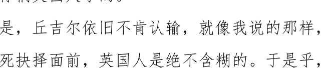


因此呢，你们是打算与德国和解、赶我下台？还是陪我继续坚持打下去？

很高明，这个手法太老高明了，精明的丘尔抓住了一个民族的尊严，来作为自己隐藏的后盾。而且，他的演说内容是如此具有爆炸性，现在敦刻尔克战不是还没有结束吗？就说出“无论发生什么事情”的悲观论。所以，当丘尔的演说完毕之后，整个议院雀雀无声，议员们都用一种坚定的眼神看着他，而丘尔却用一种坚定的眼神环视四周。

接下来的这一幕，就轮到丘尔惊喜了。他回来回忆：此时团员的表现我感到非常奇异，因为，这次聚会的人物，都是有经验的政治家和议员，对战争的看法，无论正确与否，处理起来都很困难。

但他并没有预料到的结果，赢了很多筹码。他跳起来，跑到我的椅子旁去，一面又兴奋的高声呐叫，一面拍拍我的背：“尽管，这里面许多人我不认识……”

是的，议员们都沸腾了，他们被丘尔那昂昂的精神所感染了——大英帝国必须坚持下去，直到最后的胜利。

作者：万国威宁天下 日期:2009-08-02 00:01

人还在成都 身体无恙8月3号就能回家到时候就能恢复更新速度 谢谢大家。

作者：万国威宁天下 日期:2009-08-03 19:23

谢谢大家~~~我今天晚上要加班嘿。

作者：万国威宁天下 日期:2009-08-04 03:36

## 连载 106

敦刻尔克奇迹

如果哪里朋友有去法国旅行的话，你可以试着这样问法国人：“敦刻尔克撤退是胜利，还是失败？”

法国人肯定这样回答你：“不，这是奇迹。”

也许，这就是所谓的东、西方思维差异吧。看看我们东人的思维，大家肯定没听过什么“平型关奇迹”，“台儿奇迹”。

而西方人呢，他们喜于拿登陆穿透的战役说成“奇迹”。譬如，第一次世界大战的“马恩河战役”。在此次战役中，如胜利的德军打到巴黎郊外的14公里之遥马恩河畔，在战略的防御部署之后，竟然撤退。德军如此失败的过程，我们以前也曾分析过，归根底，德军失败的主要原因，是因为这位志大才勃的小毛同志执行“施利芬计划”的结果。

但是，就当时法国人而言，他们却足够的理由相信是一场奇迹，是上帝在关照他们。同理，敦刻尔克撤退在他们的眼中，也是一场“奇迹”。

当然了，敦刻尔克撤退的成功，自然不是法国人比德国人更信奉上帝、更虔诚。在这场奇迹的背后，是交战双方都未曾预料到的结局。我记得，一位军事家曾这样说：战争的最终结局，是交战双方共同缔造出来的。

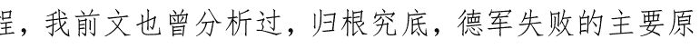

那么，德国到底又犯了什么不可弥补的错误，致使了这场“奇迹”的发生呢？

首先，让我们回到5月26日，这一天，古德里安攻下了莱昂，在27——29日之内，19甲军继续前进，并在29日的下午，占领了克洛奇高地。在这里，古德里安小心翼翼地爬上这个高地，用望远镜观察着不远处敦刻尔克港的情况。

当古德里安举起望远镜的那一刻，不免这位身经百战的将领吸了一口冷气。他看到：数百英国军船，密密麻麻地挤在敦刻尔克狭窄的海面上，其中有战列舰、驱逐舰、鱼雷舰、货轮，甚至是加油船。而盟军士兵则排成一条……

古德里安自然不会放弃这个良机。现在，他离敦刻尔克仅有一步之遥。他打算用一个甲军的兵力，拿下这个港口。

当他准备准备围攻的时候，德国高统帅部突然传来了一道令他大不堪解的命令——19甲军停止推进，所有部队立即回撤，其攻势由14步兵军完成了。（这实在是一条奇怪的命令）

古德里安后来就后悔抱怨道：“假使最初高统帅部没有突然制止19甲军的推进，那么敦刻尔克就已经被攻克，而胜利的成果也现在无不可比；假使当时我们能够获得英国远征军的全部兵力，那么未来的发展恐怕也就难预料了。”

无论如何，像那样一个大规模的军事胜利，也可以使外交家多了一个讨价还价的机会，不幸的是，这个大好机会却被希特勒个人的神经质丢掉了。他以后发表的理由，说是因为到达佛兰德地区河流溃缴，所以命令装甲军不要冒险——这实在不是一个好的理由。上文是古德里安回忆的一段叙述，可以看出，在战斗之后，古德里安还是相当郁——希特勒的这个决定导致了德军失了良机。其实，不仅是古德里安一人，而且隆梅尔所遭遇的一切更让人着头。

### 隆梅尔的遭遇

作者：中国闲谈 发布：2009-08-04

经过阿拉斯战斗之后，隆梅尔的7装甲师有了短暂的休息。由于7装甲师在一系列战斗中的良好表现，一批巨大的3号、4号坦克，这些坦克刚从工厂生产出来就被优先供应了7装甲师，新装备使得隆梅尔信心大增——7装甲师的实力比战之前还要强。

5月26日，希特勒犯了重大错误，隆梅尔立即北进并在当天成功渡过拉河。5月28日，在7装甲师的配合下，隆梅尔又攻了法国最大的工业城市——里尔。随后，隆梅尔继续前进朝着敦刻尔克进。就在这个时候，他同样收到了一封莫名其妙的命令——希特勒要求他立即回到统帅部。希特勒的命令让隆梅尔相当惊讶，谁见过战斗打一半突然召回？而且，希特勒也没有指示7装甲师暂时停止，陷入了了孤援。

6月1日，带着满脑疑惑的隆梅尔回到了统帅部参加会议。希特勒的本意是讨论占领区的战术安排，希特勒看到他的第一句话却是撤回：“你在发起进攻的日子里，我们非常担心你的安全……”

由于隆梅尔在会议中是军衔最低的指挥官，他压根插不上话，只能在旁边一言不发地看着。与此同时，盟军的撤退行动已经进入高潮。而隆梅尔与古德里安这两个前进最快的指挥官只能站在旁边看着千上万的敌人在鼻尖下逃回英国。

这时，德国6集团也碰上了麻烦，他们在突破比利时线之后，就遭到了英军的阻碍。（正是前文提到的两个英国师和一个英国军团）对于这次战斗，蒙哥马林在回忆录中轻描淡写地只用句话作为交代：“我们顶住了敌人的进攻。”

实际上，这次战役打得相当惨烈——当蒙哥马林领着他的5步师彻夜行军，风驰电掣地到达预定地时，德国6集团实际上已经占领了这里。于是，他命令士兵占据德军突破口的侧翼地带，用小股部队在敌人的左翼发动反击，不断延缓德军的前进，并使德军无法扩大突破。在附近露营的英国50师的两个营也此时向德军右翼执行反击。

所以，尽管德军越越远，但他们的两翼却遭到了来自四方八面的袭击。英国军队试图逃跑时来不及带重炮阵地，并利用那些完好无损的巨炮，拼命地向这口袋内的德军倾泻炮弹。

就这样，德军的攻势逐渐趋于衰弱，人员的伤亡也异常惨。在27日拂晓的时候，后赶到的英军主力部队接到位于正面的伊普薛—米运河防线，挡住了这个缺口。

与此同时，在谢刻尔克周桥头阵地的战斗也在激烈进行之中，各种军队交战在这道防线里拼杀。盟军甚至把那些汽油耗尽的坦克当成固定坦克、把卡车推到道路中间筑成路障、英国海军开始发炮威慑，它们在侦察机的引导之下，对着德国战线一锋猛攻。

到了现在，德国人才才清醒认识到，“继续攻击”下去实际上已经很困难了。特别是当古德里安和隆梅尔的装甲部队被一个莫名致命命令而停止进攻之后，德国战线根本无法连接，更不上说配合进展了。而盟军他们已经构成了一条很长的、但尚算完全的环形防线。

我们需要的是回旋和机会，抓住这最后的时机，进行更大规模的撤退。到那时，可以逃出生。面对盟军大规模的撤退行动，之前希特勒却一点儿着急，对这些问题毫不关心，好像事不已。与敦刻尔克危机鲜明对比的是，隆梅尔没有拍着桌子大声尖叫，没有威胁，而是优柔地接受。希特勒的反应是犹豫的。在这些日子里，会议上，希特勒看到他的第一句话却是撤回：“你在发起进攻的日子里，我们非常担心你的安全……”


### 红色方案

希特勒现在关心的只有一个问题，那就是在接下来的军事行动中，彻底击垮法国。战役第二阶段的行动纲领代号是“红色方案”。在这个方案里，德军将从塞纳河朝瑞士猛进，目的是占领法国全国。面对许多人，希特勒略带可惜道：“法国国家军太弱了，如果法国配备了德国军队，便成为一个非常出色的军队。”最初，希特勒急切希望意大利加入，战争在6个星期就可以结束。他希望事务结束后，能和法国缔结一个合理的约，这样和英国达成协议。他所要求的英国应当承认欧洲大陆的地位。德国能够重新获得它一战后去的殖民地，那就最好不过。考虑到希特勒强硬的态度，他沉默一会儿继续说道：如果英国不归纳海外民地也无所谓了，在一个英国政府认为是可以接受的、并不损其尊严的基础上和蔼。希特勒以后的几个星期中常常向他的将领们，向齐亚诺（墨索里尼）和墨索里尼本人表示这种想法，并且最后公开地表示了。齐亚诺在一个个月后才发现，这个纳粹裁者当时正处于成功的顶点，反反复复地保持大英帝国作为“世界上的因素”的重要意义，他感觉被打累。

我们再来看7月13日，哈尔德日记中的记载，他写道：元首对于英国没有接受感到非常迷惑解。那一天，他对他的将领们说，大英帝国的崩溃，“对德国没有好处……只是日本、美国和别的国家有好处？”原因很简单，英国一旦崩溃，它的海外殖民地肯定会被忙得厌的日本人都占据——如香港、印度；美国呢，则会继续英国剩余的遗产。可是，我们德国却得不到！

在希特勒的意识中，他早已把英国当成了未来的盟友，他认为英国人的血统是高贵的，换句话来说，优等民族。而希特勒最喜欢的，就是世界上每一个民族评分并乐此不疲。一次，希特勒观看过一部叫做《一个孟加拉骑兵的生活》的低劣英国电影，影片讲述的是英国人在南亚大陆称霸的故事。看完这部电影之后，这位纳粹独裁者激动万分，他惊喜地对身边所有人大嚷道：“高等民族应当如此——统一劣等民族”。

对于这个半瓶醋理论家的思维，我们还有什么可说的呢？也许，我只能说：此人已疯，鉴定完毕。

作者：万国安宁天平 日期:2009-08-05 15:48

## 连载 109

此，有可能是希特勒把他的装甲部队逼在克塞尔尔克一曼曼理，加尔·取尔多县。目的是为了建立包围。关于希特勒变态的行为，一方面，他批准了包围，另一方面，他又不采取强力的行动，这是什么呢？古德里安和隆梅尔的装甲部队被一个莫名致命命令而停止进攻之后，德国战线根本无法连接，更不上说配合进展了。而盟军，他们已经构成了一条很长的、但尚算完全的环形防线。

我们需要的是回旋和机会，抓住这最后的时机，进行更大规模的撤退。到那时，可以逃出生。面对盟军大规模的撤退行动，之前希特勒却一点儿着急，对这些问题毫不关心，好像事不已。与敦刻尔克危机鲜明对比的是，隆梅尔没有拍着桌子大声尖叫，没有威胁，而是优柔地接受。


### 隆梅尔的遭遇

作者：中国闲谈 发布：2009-08-04

经过阿拉斯战斗之后，隆梅尔的7装甲师有了短暂的休息。由于7装甲师在一系列战斗中的良好表现，一批巨大的3号、4号坦克，这些坦克刚从工厂生产出来就被优先供应了7装甲师，新装备使得隆梅尔信心大增——7装甲师的实力比战之前还要强。

5月26日，希特勒犯了重大错误，隆梅尔立即北进并在当天成功渡过拉河。5月28日，在7装甲师的配合下，隆梅尔又攻了法国最大的工业城市——里尔。随后，隆梅尔继续前进朝着敦刻尔克进。就在这个时候，他同样收到了一封莫名其妙的命令——希特勒要求他立即回到统帅部。希特勒的命令让隆梅尔相当惊讶，谁见过战斗打一半突然召回？而且，希特勒也没有指示7装甲师暂时停止，陷入了孤援。

6月1日，带着满脑疑惑的隆梅尔回到了统帅部参加会议。希特勒的本意是讨论占领区的战术安排，希特勒看到他的第一句话却是撤回：“你在发起进攻的日子里，我们非常担心你的安全……”

由于隆梅尔在会议中是军衔最低的指挥官，他压根插不上话，只能在旁边一言不发地看着。与此同时，盟军的撤退行动已经进入高潮。而隆梅尔与古德里安这两个前进最快的指挥官只能站在旁边看着千上万的敌人在鼻尖下逃回英国。

此时，现在是英国人的表演时间。英国将会完成整个战争历史上最伟大的撤离！像丘吉尔首相在会议中发表演讲那样：“我们绝不投降，绝不屈服。欧洲大片的土地和许多古老的国家，已经陷入或可能陷入秘密警察和纳粹主义的种种罪恶机关之下，我们也毫不动摇，毫不气馁。我们将战斗到底。我们将在战场作战，我们将在海上和大洋中作战，我们将拥有愈大的信心和愈大的力量在空中作战；我们绝不放弃任何代价保卫我们的。我们在海上作战：我们将在荒野战术作战；我们将在山区作战；我们决不投降。即使这个岛屿或它的大部分被征服并陷入饥荒，这是我分钟也没有相信过的。我们在海外的国民阶层要依靠英国海军的武装之下，继续战斗，直到重建新世界需要的时候依靠它全部的力量和能力，来救援和解放这个旧世界！

在想入非的希特勒面前，丘吉尔当时的演讲已经明确地表明了英国人的决心。也许，我们应该去摇那位进入梦中的希特勒先生：“醒吧，你妈妈喊你回家吃饭”。

人还在成都 身体无恙8月3号就能回家到时候就能恢复更新速度 谢谢大家。

作者：万国威宁天下 日期:2009-08-03 19:23

谢谢大家~~~我今天晚上要加班嘿。

作者：万国威宁天下 日期:2009-08-04 03:36


组织起来，凡是有船的民众，无论是汽船或帆船，都无一例外地驶往指定港口进行集结。只要可以海的运输工具，海军都一律照单全收。

与此时，无数余水手和私人船主也已召来。在很短的时间内，这支由驳船、汽艇、拖船、渔船，甚至花花绿绿的游艇组成的“舰队”就已经准备就绪。27日夜间，伴随着希尔斯港外的一艘巨大锚轮所发出的悠长的汽笛声，这些集结完毕的“舰队”便像潮水的涌向大海。他们没有武装、没有护航，只有一腔热血。

作者:唤威宁天下 日期:2009-08-09 01:25

# 连载 111

最后的结果引起，丘吉尔这个果敢的决定拯救了数十万盟军士兵的生命。

英国海运部曾统计过，参加“敦尔克大救援”的各种小船共有491艘。但他们也承认，这并不是一个十分精确的数字。因为，有许多的私人小船毫不记录可查，许多英国市民来不去海运登记，就靠自己带领自己一家老小，迎着枪弹雨和硝烟烈火，去拯救深陷敦尔尔克的同胞。

而且，这种救援行动不仅限于普通百姓，甚至现在的高级军官，也参加了这场史诗般的大营救。

一次，丘吉尔为了查询海军的军事用地，他便亲自跑去海军部的地图室。这位前海军大臣门路熟的路，去海军部也从来不打声招呼，带着自己的司机就去了。可当他来到地图室的时候，巨大的地图室里却空无人。丘吉尔当时就纳了：现在都什么时候了，这些老老爷们还整天不务正业地游哉？

直到很久之后，丘吉尔才知道——原来，在救援行动的第一天，海军地图室就由带领的副官，驾驶着登陆艇，到了敦尔尔克。并且，取得的成绩在4天之内，这位主任的返回了800多名士兵。

这就加速了在没有英国军民的协助之下，盟军速度撤回英国本土；5月28日，1740名士兵被成功撤回英国。他们又反击了，收获好多损失的增加……

由于当时局势的紧张，英国人最初拒绝海军登船。属于法国的船只有寥寥，而且都是附近渔民自发组织来的小船，这就就把法国人丢在不管了。

其实，我还是理解英国人的心情的。敦尔尔克围防线的崩溃却在朝夕之间，自己都恐怕救得过来，哪还有功夫管你们呢。

法国人可不管这些，他们丢下了所有的物件，拼了命地往英国船上抢，英国船员则手握棍，把这些发疯的法国兵往海里面推——那场景像中国古代的攻城战一般。有些急疯了的法国士兵为了逃命，甚至打起了别人的主意——他们劫掉去的英国士兵的军装，给自己穿上。有些人还为了抢一套军装而出手，局面极其混乱。

这个令人不愉快的情况反映到雷诺总理那里之后，他甚忌不安。在巴黎召开的同盟国军事会议上，雷诺坚决主张英法联军共同撤离。他怒气冲冲的对着参加会议的英国人说道：“22万名英国士兵已经走了15万，而20万名法国士兵只走了1.5万。”说到这里，他双手一挥，继续威慑道：“如果这种不公正的待遇得不到纠正，那将对我们产生严重的政治后果！”

雷诺总理的没错，英国人自私自利的做法，已经深得理解了。部长更是利用这件事来大作文章——在德国停营里，法国报毫不不掩饰他们对英国人的看法，这些打仗不行，打架却擅长的法国人遇到英国人时，他们就殴打英国人，他们是胆小鬼、自私自利者和奴。最后，英国人被迫让法国和英国士兵分开，平息了这场混乱。

英国人从未料到，自己的做法实际上已经为法国政府的关系埋下了伏笔。表面上，双方还是客气的盟友。但内心，法国人已经不再信任盟友——导火索已经装上，等一个点点燃。

作者：万国威宁天下 日期：2009-08-09


============================
### 敦尔克撤退的胜利
============================

丘吉尔首相是个聪明人，他当然知道如果这场政治纠纷平息后，敦尔克港浑乱的局势得到恢复。在环绕敦尔克的海岸上，盟军对周围地区的军事部署得有条不紊、严密。那些从前线撤下来的队伍并不混乱，井然地进行整顿。并且，盟军还采用了一种轮换作战的方法，他们把整顿好的队伍调去驻守防线。当有限的弹药耗尽之时，就由其余部队接替，而这些撤下来的部队作为预备队在海面上休整，然后尽快撤离海岸。当然了，如果局势不利，他们就会。最初，英军在前线阵地上三个军，但到29日，法军又接过了防线。德军进攻盟军的后撤部队，激烈的战斗从来没有停止过，尤其在靠近亚尼波特和布鲁格的两翼更是激烈了。随着撤退的进行，英国和法国军队的数目在不断减少，为了让更多的士兵安全撤退，他们也相应的缩短了防线。在这里，英国人玩了一个可爱的小招。他们损失很大，通过不断的把防线上的英军撤换，让法军去接替。出人意料的是，法国人并无言，尽管他们都清楚，就算把战线压缩到最短，最终还是有一支负责殿的部队被德军消灭。可法军一丝不苟地执行了英国人安排的接防任务，并在战斗中爆发了超人的战斗。以至于有人调侃：“如果法国人在10天能如此勇敢的话，第二次世界大战就会改写。”

... 蒙哥马利被爆炸波炸飞了起来，而且奇迹地毫发无损。他所做的第一件事情就是——面对着身旁流血不止的副官大声呵斥：“我千万叫过多少次，一定要带头盔，现在你满意了吧？”这位副官反唇相道：“将军阁下，你不是满意了吗，没准备吗？”蒙哥马利：5月30日，蒙哥马利便登上一艘小船，撤回了英国。在船上之前，他还不忘记挖苦戈特勋一番（英国远征军总司令）他当着许多人的面大戈特勋爵“是个完全不懂军事作战的废物，并深感为这样的蠢材干工作而感到耻辱。”有趣的是，戈特勋也同李德哈特的一次谈话中：蒙哥马利...


蒙哥马利“擅于小战术”！原来，英国人也喜欢偷袭。这种时候，丘吉尔阁下，实在是没有机会发挥自己的才华。丘吉尔首相的心里已经牢记住了名字——伯纳德。但是现在，蒙哥马利先生，你可以去洗脸了，休息一段时间。

作者:万国威宁天下 日期:2009-08-10

由于局势紧张，敦刻尔克战役正式进入高潮。德国人也学乖了，他们不再轰炸岸边的目标，而是专门轰击盟军舰队。那些缺乏护航的盟军舰队，平均每天损失了30艘以上。德国空军再次出动，他们集了几乎所有的战机，加强了轰炸。

由于目标太大，一支德国轰炸机几乎所有的炸弹都落在这艘名为“兰斯蒂里亚”的豪华轮上。这艘巨轮的甲板上挤满了至少350名盟军士兵。这次事故比“泰坦尼克”死亡人数还多。“兰斯蒂里亚”沉没事件一直被英国政府封锁，直到近年来才能解密。

6月1日，德国空军再次出动，架次是英军的三倍以上。这些狂热的德国飞行员俯冲到海上进行轰炸，在炸弹用完之后，他们还要用机载枪对面上排成长龙的盟军士兵进行扫射，直到打空最后一发才肯罢休。这一天，盟军就损失了42艘舰船，其中2艘满载2700名士兵的英国运输船被击沉。

也许，这是敦尔拉克战役最为血腥的一天。在这一大空战结束之后，在海上的盟军士兵却发现了惊人的一幕——敦尔拉克港及其海口的通道上，到处漂浮着船体的残骸，海面上尽是恶臭的油污和碎木片，半毁的小船，浮动的救生圈，浸了海水的衣服以及旋转翻滚的尸体，没有船只能从中费劲地挣一条来。

德国人以为这样就能消灭盟军将士的意志，那就大错了。在海上，盟军的援救行动没有停止过。在漫着船骸的海面上，他们用铁皮艇穿梭于一艘一艘破损的前者。为了避免沉舰，盟军士兵甚至开始把完好无损的车沉入海中，构成延伸海的登船桥。

在死亡相伴的时刻，玩了娱乐，他们在空袭间隙里玩起了足球，还进行了英、法比赛（欧洲人踢足球这么好，这种时刻还不忘踢球，各国应该多学习点）。在敦尔拉克城区，盟军士兵更是把这里的酒窖洗劫一空，有些士兵甚至喝的酩酊大醉，才肯罢歇的登船撤退。这时，盟军的粮食已经断绝，在外面防线作战的盟军将士不得不去“征用”法国农民的小麦来度过难关。蒙哥马利他在回忆中承认，在与德国作战的日子里，他不得


不派出一部士兵去抢法国农民的耕牛作为食物，英国将更是笑称法国牛为“移动牛排”。面对法国舆论铺天盖地的指责，蒙哥马利漫不经心的：“不是这些耕牛的话，我们早就饿死了。”

作者：万国威宁天下 日期:2009-08-10

具有讽刺意味的是，6月1日这天，盟军的大规模袭击并未成功，撤离的士兵总数反而达到了最高数字，总计44万人。可是，随着战斗的加剧，包围中的盟军由于长时间未补给，他们的弹药已经逐渐消耗殆尽。

6月2日黎明分分，敦尔尔克围圈里只剩下4万名英国士兵在登陆地上，手里还有一些7门高射炮和12门反坦克坦克，还有装甲车。由于担心德军进攻，丘吉尔迷心的雷诺建议，“今天夜里停止撤退。”

雷诺接到电报后大喜：“你们已经救出了大部分部队，现在就打回英国本土。”新任盟军总司令甘林将军这一职更是措词严厉的要求英国军队必须留在法国军并肩战斗，坚守敦尔尔克内最后一道环形防线，直到法国军队安全撤离为止。

丘吉尔被这个不通理的家伙震住了。6月2日夜晚，丘吉尔下令，“把行动延长到6月4日，再次前往敦尔尔克。”与此同时，40艘法国和比利时船参与了进来。


不得承认，由于英国船员不断的救援工作，他们已经好几天没合眼了，早已疲惫不堪。但他们还是响应了号召，有些睡下的船员在听到这样的命令之后，“蹭”一下起来了，再次驾驭船出海，驶向敦凯尔克。他们必须再作一次努力，救出更多的士兵！

这是我所编写的报告，更多关于吉尔斯船员的惨教。敦尔拉克撤退后的演说，这段可以是吉尔斯最精彩的演说。接下来会提到，蒙哥马利讲述过这一故事，他说那些从敦凯尔克出来的士兵在衣服肩膀做标准表明自己是参加此次战役的英雄，整天花酒洒的伦敦各个红灯区鬼混被一帮崇拜的妇女包围着。他说，他看到这样的事情之后相当恶心……而且，敦尔拉克撤退的确相当感动，军民一同奋战的“剧情”在欧洲相当少见。

本来敦克尔克都写完了的最后一章怎么也发不来，我都检查一遍了，把敏感的字删掉了，还是……由于无法发表我只能抓图了，如果不清晰请见谅。


丘吉尔老先生确实是一个鼓吹，“We will be back！”敦克尔克撤退后的那种心情，民众很难理解。这由于了民众的爱国精神和丘吉尔，起了一次伟大的胜利。

希特勒得意的说：“我要成为以前的伟人的军队在极其复杂的条件下，最终击败敌人。”当希特勒抵达达拉克港的时候，战役已经结束。他仔细视察了这片战场。离开之前指示将这里完整保存，作为具有纪念意义的圣地。大本营的每一间房子，每一块地板，都按原样保存。

### 统计数据

| 项目 | 统计结果 | 说明 |
| :--- | :--- | :--- |
| 参加救援船只 | 盟国海军 | 861 艘 |
| 损失船只 | 243 艘 | 高达总数的 1/3 |
| 每日救援人数 | 英国海部统计 | 精确到个位的数字 |
| 救出士兵人数 | 338,226人 | 约33.8万大军 |
| 盟军损失 | 1200万步枪、750万摩托车、700万坦克 | 重型武器全部丢在海上 |
| 盟军损失 | 3个盟国军团 (30个法军师，9个英军师) | 遭遇毁灭性打击 |


看来，法国已经做出了最坏的打算。

艾吉尔是这样的了，他说：“同盟必须以毫不退缩的态度来对付一切敌人，美国被最近的事态激怒了，即使他们没有参战，但很快就会大力援助我们。如果德国入侵英国，那时美国发生的影响将更为深远。英国不怕入侵，每一个大小军都将进行激烈的战斗。英国军队只要满足了本国的基本需要，余下的就可以交给法国使用……”

一听此话，法国总理雷赛先生的情绪似乎又活跃起来。美国即将参战的信号让他兴奋不已。他赛道：“如果法国在英国的援助下能够坚持住下去，如果德国能够补充我们军队的不足，我们就能确保获得胜利的”……

雷赛总理乐观的发言就像兴奋剂一样，感染了在场所所有人，他们的情绪顿时高涨起来，之前阴沉的气氛一扫而空。雷赛总理甚至谈起了胜利之道——好像胜利就在眼前一样。（看来，“意淫强国”的说法，并不是没有道理的）”。

可是，艾吉尔那句“美国被激怒”的言论，完全是在信口胡诌的。实际上，英国的报刊杂志，盯住了欧洲局势大呼之外，美国政府根根没想过要去卷入这场“欧洲大战”。美国实在找不出任何参战的理由，鉴于国内反英势力不占少数，反对的原因是英国封锁了大西洋，无法与德国进行贸易往来。

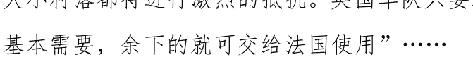

丘戈尔斯写了相关的五封邮件给罗斯总统，“汇报”欧洲局势、现在的困境。但得到的回复总是让他失望的——罗斯总统除了维持几句之外，便打起了太极拳。比如谈自己喜欢任何人的小说：英国队如何如何出色，等等。

抄一份最近解密的英国档案实证，为了说动罗斯福回心转意，丘戈尔斯出奇搏险，开始伪造情报——他让英国情报人员交出一份“希特计划”，并召开了罗斯福。在这一计划里，希特被描成一个最终“统治全世界”的人物，甚至支持墨西哥政府侵占美国大片领土（即：墨西哥州、得克萨斯州和亚利桑那州），精明的丘戈尔斯伪装这份情报是为了让久谍国内内部的样本骗取，总而言告诉你就就行了，千万别扬出去。

当罗斯总统拿到这封“可靠情报”之后的心情，我自不得知。有一点是可以肯定的——1940年之后，罗斯总统的态度发生了转变，开始无条件支持同盟国的事业，并提供同盟国需要的物质援助。

但是，罗斯总统所做的，也有这些限制。因为，美国并不是一个同盟打算的国家。没有国会、议员的同意，罗斯福再怎么叫嚷也没用。因此，罗斯福只能在各种公众场合发表同盟国事业的演说，并在私下里给民主党各界人士一些想法，试图改变国民对这场战争的态度。


在此，丘戈尔斯抒发罗斯福肾上腺素的言论，完全是站不住脚的——就算美国参战，但无疑也需要大量时间。

现在问题的关键是，137个德国军师正虎视眈地看着法国剩余的领土。可是，雷诺总理显然没有考虑到这一点，他依旧滔滔不绝的高谈阔论，自我陶醉。丘戈尔斯同样自我陶醉在已构想的幻境之中，开始乐观地附和。

最后，这场会议就在乐观的气氛下结束了。双方似乎许多问题都谈了，但实际问题未能解决。英法两国首脑完全把胜利的希望寄托在那个虚无缈的美国身上。以至于一周后雷诺总理下台之时，他还记着这件事，他最后呼叫道：“让罗斯福派足以掩天威日的军群来”。


关键就是那个大脑袋的想法是够糟糕了。在当时的现场，两个人的头脑都是清晰的。他们分别是——马克西·韦刚将军和亨利·菲利亚·贝尔元帅。

作者：万国威安天下平 日期：2009-08-13 10:35

就是原帖……更新的大家见识。

作者：万国威安天下平 日期：2009-08-14 10:31

昨天去医院牙疼搞得我活活，整个过程只有5-6分钟吧，就两个字“痛苦”。那医生像钻井工按住我的脑袋使劲打洞，还不心不在焉。旁边边两个美女实习生在中午吃什么。现在牙疼得厉害，真心劝慰大家一句不到万不得一千万别去拔，钻牙髓痛得想跳。

牙疼得厉害，真心劝慰大家一句不到万不得一千万别去拔进度又获得了一段时间，希望大家能够理解。现在集中注意力写字都是折磨——半夜睡不着

作者:万国威天平 日期:2009-08-16

连载18 “主和派”

贝当元帅在这次军事会议中，最高望被授予这个头衔，扛着手指都能过来。而贝当呢，早在1918年就被授予了这个头衔。特别是他在第一次世界大战中“凡尔登战役”中出色。

贝当元帅一度视为“民族英雄”。由于戴戈尔的失败，法国政府为了惩戒他，把贝当赶到了西班牙，出任驻西班牙大使，几乎等于流放。当时，贝当元帅已经83岁高龄了。可没想到，贝当元帅在西班牙还没一年，同盟国就因戴戈尔的失败面临亡国。于是，贝当被紧急召回，并在1940年5月25日任命为内阁副总理。贝当元帅真的老了，这个曾经的英雄已经没有任何希望。

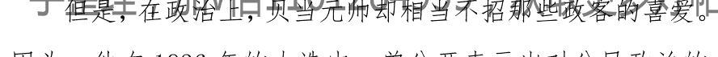

贝当他现在考虑的问题是如何结束战争。在同盟国将会议上，丘戈尔斯注意到这位元帅一言不发，只是和身边几位法国官员窃语。丘戈尔斯觉得奇怪，有什么不能当着大家说？于是，会议之后，丘戈尔斯直走到贝当元帅面前，与他亲切招呼。可是，这位元帅的态度不冷不热，表情相当阴沉。丘戈尔斯当时敏锐的感觉——贝当元帅单独与德国通过，组织一个英国政府将对英国造成致命性的后果。丘戈尔斯自己还没意识到局势，一位法国官员说：“军事上不断的失利，很有可能在某个时候迫使法国修改外交政策。”说到这里，一位叫彼斯的英国马上站起来，冲着贝当元帅用法语说道：“元帅先生，我想明白，如果法国试图投降德国，皇家海军将会封锁所有法国港口。大英帝国不允许法国港口成为进攻基地。”法国人倒是能够接受的回答：“那是不可避免的。”听此话，彼斯的将军火气就大了，他冲着贝当嚷道：“那不仅意味着封锁，而是毁灭德国人占领的所有港口！”

在双方剑拔弩张、药味十足的时候，艾吉尔低声响起了一首军队里传唱的老歌，歌词这样的：“不管前途如何，不管发生什么事情，都失去希望；不管发生了什么事，不论人掉了队，我们都要继续战斗……”

唱完，艾吉尔便把那群站在原地发呆的法国人大步走出会议室。事后，艾吉尔并未批评彼斯太直接的语言，反而用钦佩的口吻说道：“我非常高兴你能把这一点说了。”有时候，说话直接一点是有好处的。和法国的关系，盟友就是敌人，这就简单！

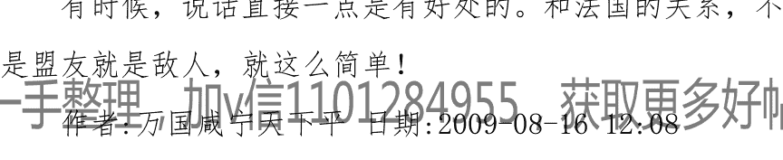

作者：万国中国 | 发布：2009-08-16 12:28

## 连载19 “魏刚防线”和“红色计划”

与一心投降的贝尔元帅不同政见的是魏刚将军。这位稳健的法国总司令，是一位态度坚决的主战派。他同样在会议上一声不吼，呆呆地坐在角落里，听着艾吉尔和雷诺先生在那边一边和一边吵。

其实，也没有什么可谈的话题。艾吉尔和雷诺也许算一对伟大的政治家，但绝对是军事上的大草包。而贝尔元帅又是个彻彻底底的失败主义。因此，法国未来作战的责任，全部压了他的肩上。

此时，法国的处境确实不容乐观，甚至已经无从希望——5月28日，比利时向德国提出投降，24个比军师放弃了武器。与此同时，在戴克尔战大溃之后，30个法军师和9个英军师也不复存在。盟军军队在数量上的优势，在短短20天之内，便丧失了一千二净。

现在，盟军手中的总兵力仅为68个师。魏刚将把这些顽存的部队组成3个集团军（第6、第7、第10集团军）在索玛河和埃纳河口沿线筑了一条以巴黎为轴心的临时防线。索玛河和埃纳河只剩下17个师，却要维持长达500公里的战线，其脆弱程度被命名为“魏刚防线”。与此对应的，137个德国师也在迅速进行改编。他们同样分散在3个集团军：A集团军、B集团军、C集团军。从规模来看，德军是盟军的两倍；从总兵力来看，德军也占有优势。德军根本不把敌人放在眼里，现在的局势相当明显，德军是绝对优势。

## 到底是什么支撑法国抵抗下去？

是美国的态度。6月1日，美国总统罗斯福为了回答雷诺几乎可怜乞求，令陆军和海军向他报告有什么武器可以立即援英国和法国。处于地位的是丘戈尔将军，同样一位亲份子，丘戈尔以极快的速度检查了美国军储备全部清单。6月3日，丘戈尔开启了第一批援助物资，其中包括：50万支步枪（这是1917年和1918年制造的老式步枪）；900门75毫米野炮；600万发子弹；8万架战斗机；此外还有各种样的军火。然后，美国政府为了钱，将这些破烂铁以3700万美元的价格交给麦格公司，再立即卖给英国和法国。（不得不说美国政府有多黑，丘戈尔更是将美国政府的积极支持当了一个善意的信号。他后来回忆说：“这件事在现在看来已经算什么，但是在当时却是一个了不起的行为，表明了美国政府的信义领袖气概。它从自己的军火中拿出那么多武器帮助一个已被击败的国家。他们永远不会对这件事感到后悔！”

美国政府的援助，等于是给了同盟国一针强心剂。只要这些物质抵达英国，再加上英国军工爆发发的生产力，同盟国就能在极端的时间内，把那些从敦克兰洛撤下的士兵重新武装，继续战斗。换句话说，同盟现在的战略就是拖延时间，毕竟他们的工业资源比德国许多。6月4日，即敦克兰洛陷落当天，魏刚将向法军发布命令：“固守伟大首都巴黎到6月15日，此时预备队即可进入阵地！”特勒发布了公告，他煽动部属加紧侵占巴黎，狂吹这是历史上最伟大的战斗。

6月5日天亮，德国的轰炸机群出现在法国腹地的领空，在云层掩护之下，这支强大的空军力量直到巴黎近郊被盟军发现——已经太迟了。随着一场倾天地的爆炸声，巴黎周围的空军基地淹没在一片火海之中，400架战飞机未起飞就变成了一堆废铜烂铁。更让盟军士兵丧气不已的是，他们的飞机跑道被严重炸毁之后，剩下的作战战机无法起飞迎敌。就这样，在战役爆发的时间，盟军便再次陷入了丧失制空权。

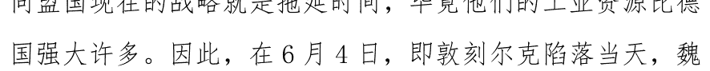

下午4时，博拉克上将指挥的B集团军率先发起进攻，他的坦克军深深切入了敌军阵地。也是这一天，隆美尔佩戴着一枚希特勒颁发给他的骑士级勋章，满怀喜悦的心情返回了战场。隆美尔甚至第7装甲师的作战计划都惊讶得不得参，便登上一辆坦克，他高高举起右手，用力一挥，“加足马力，前进！”

作者：万国威宁天平 日期：2009-08-16 12:38

连载120

实际上，德军进攻方案（即“红色计划”）依据他的想法，要“夏施坦计划”。但比夏施坦将军原本所想的要低劣许多。夏施坦最早的构想是在法国北部的尚未结束，敦克兰洛的侧翼开始向英军进攻的起点。如果这个计划实现，法兰西战役将会缩短两个星期。索玛河和埃纳河口构建新防线。但希特勒并未采纳意见，夏施坦将军苟笑，带着一副眼镜，恰恰给这位看似痴呆的贝当：“夏施坦将军不差脑筋。”

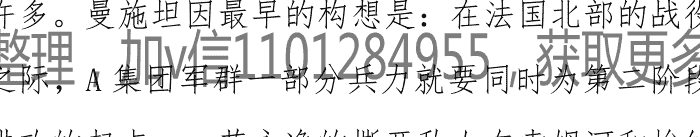

事实上，德军在6月5日的攻势中显出许多胜利。贝当元帅的战术典范，只有优秀的将领，在战斗中获胜。不过，德军在6月5日的攻势中结束，德军的攻势不让盟军停下，德国人太狠，不给盟军一丝喘息。这种战术应该属于乱击，也许就是书籍经常提到的字——“闪击”。由隆墨特7装甲师管辖的B集团军，盟军也是刚刚阵地不久，有些军队连散兵坑都来得及挖好，隆墨特一口气冲合索玛河边。按来说，这条河流是最自然的屏障，应该派遣重兵防守才。


德军先头部队抵达的时候，他们惊讶地发现盟军居然连河上的两座铁路大桥未破坏……后来法国人曾对此如此尴尬的疏忽，做出了令人啼笑非的解释，他们狡辩道：“这两条桥是我们故意留下的，作为反击的桥头堡！”这不是一个好的理由，因为德国士兵在桥边睁眼研究了半天，也没有发现一个法国兵踪影。他们甚至认为盟军在桥墩下方安装了炸弹，只要他们的坦克开上大桥，就会爆炸。所以，德国装甲部队却是迟迟不敢过河去。下午5时，在确定桥下没有炸弹之后，第7装甲兵便进攻了法国人留下的“礼物”。德国步兵士兵们立刻夺取桥头，占据了整个河岸。6月的硝埃河水已经干涸，对岸唯有零星炮火来，他们没费什么劲便顺利取得了性的成功。

接着，隆德艾想出了一个奇妙的点子，他把整个坦克团编成一个巨大的盒子阵形，并以一个坦克团担任先锋，一个侦察官殿后，盒子中心由步兵团构成，轻型运输车跟着坦克在斧腰深的玉米地前进。然后采用跳蛙推进方式，凡被占领的土地都由步兵占领，而对炮、战防炮和高射炮等单位，则在整个地区中作深配置，这样就可以获得最大的炮兵支援，无论盟军是从西面、南面还是东方发的逆袭都在他们的火炮射程之内。


德梅尔在他记中轻松地写道：“各兵种配合得非常完美，像是平时的演习一般。”看来，德梅尔傲情把打仗当成演练部队了。这巨大的钢铁洪流就这样喷射着火箭，一路挺进。法国南部平原地形让德梅尔的战术取得了巨大的活动空间。他们绕过村庄，穿过灌木丛，浩浩荡荡，身后留下了一道烟柱，不管对方的防御工事还是逆袭部队，他们在面对过后，都变成了一片狼藉。晚上7时分，德梅尔便突破了盟军的第一道防线，开始向奥斯南部进。

乱成一团。当时，由30辆英国坦克的支援的“波曼部队”企反攻，堵住缺口。但当他们抵达前线的时候，就立刻放弃了这个企图。因为，他们发现公路上到处满了德国军的甲装部队，总数是他们的十倍以上。6月8日，这英国部队很自觉的退回了塞纳河一线——他们应该很自豪。

6月9日，法国南部重镇——普鲁塞尔陷落，德国军溃坝巴黎剩下140公里程。

为了扩大战果，德国军20个预备师也在该天投入了战斗。在海峡——普鲁塞尔之间展开全攻。同时，德国军在香槟（法国的一个省）境内，降落大批伞兵，骚扰法军后。

在完成突破之后，德国军采用两个斧头的进攻方式。首先是将法军的精锐集结到加尔海岸，一个甲师部队直指巴黎，迫使法军右向塞纳河一带撤退。

这两路甲装部队就像一对双手，把法军完整的战线撕开了一道大口子。

对于这一手，英法军毫无准备。在休洛尔，隆美尔甚至追上一支英国卡车护送队，把它劫空了。车上装着烟焰，巧克力，沙丁鱼罐和利比亚的水果罐，还有网球拍和高尔夫棍——隆美尔哈哈大笑，英国人还没有料到我们会进如此快。

第7甲装师的靠近，还引起了法军防御线的骚乱，频繁的军队调动，已使法国人分不清哪一支坦克部队是哪里的。

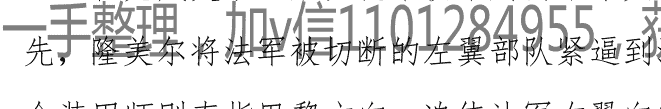

当隆美尔的战车开到塞尔奥夫的时候，一位法国农妇冲上来抓住他的手臂问道：“你是英国人吗？”隆美尔故作神秘地摇了摇头：“呵，我们可是异族人！”那妇女顿时尖叫着消失在她的房屋后面。

更为幸运的是，隆美尔甚至穿过了塞尔奥夫的塞拉桥。在隆美尔到达之前，有一批法国居民曾坚主张把这座桥梁炸掉，不过又遭到另一批民众的激烈反应。在双方争执不下的时候，德军就大摇大摆地跨了这座大桥，那些激烈争抢的法国国民瞬间跑掉了一干子。

这个故事告诉我们，决断千万不能犹豫，机会稍纵即逝，呵呵呵。

## 圣凯尔雷堡的外围

他们的想法很明确——一次像民族洛克那样的伟大撤退。这个小镇聚集着法国第9军，以及英国第51师和苏格兰高地的残部。这一次，他们直面着德国人。11日至12日夜间，大雾弥漫，盟军大型舰队只能极度缓慢地进入圣凯尔雷堡水道，救援工作开始慢下来。

12日晨，进展神速的第7甲师抵达该城面的海崖，海滩直接处于德军炮火之下。隆美尔也亲自率领第25坦克团，开展对圣凯尔雷堡的进攻。可是，盟军的炮火却爆发剧烈，并且海防重炮也加入了，这些大口径重炮使得德军战车损失尤为惨，步兵的进攻也被其强大的火力给压制住了。

不过，隆美尔很快发现了盟军的漏洞，因为海防重炮威力虽然巨大，但射速很快，第25战车就趁盟军火力空隙，一码码地向前冲，从一个树丛冲入另一个树丛，从一堆废墟钻入另一堆废墟。第25战车冒着猛烈的炮火，逐渐接近敌人。

在托附近，英军也建立了一道坚固的防线，抵抗颇为激烈，甚至在许多地方发生了肉搏战斗。第25战车冲上了圣克鲁索港西北部的临高地，用他们所有的火力，阻止了英军上潮撤退。隆美尔的指挥官一直跟着战车前进，以便对这里周围情况作为一个鸟瞰的观察。他甚至可以看到英国人在撤退时不断停顿，极其混乱，真的让他们抢占了许多。

现在，德军居于高处，某些部队仅有几百码的距离，隆美尔让士兵不停地向他们喊话招降之，还命令士兵士兵悬在下方疯狂的投掷手榴弹，这种战术让士兵连喘口的机会都没有——一眼望去，只有像雨点般密集下的手榴弹。

很快，隆美尔大概将胡萝卜战术，让至少100名盟军放下了武器。隆美尔在他的日志中写道：在投降的人中，有许多是法国人，英国人都比较多。在英国人当中，有一个海军军官在不断大声质哮，呼唤那些英国士兵赶回来，不要去投降，真的把许多人劝了回去。最后，我们只用步枪向那个军官射击，他在一堆乱石石头后面。最初，我们都以为他死了，没想到他只是躺在装死，过了半个钟头，他见无法逃走，只好蹦起来来投降。

（由于后续OCR文本存在大量重复和乱码，以下内容为根据语义整理的逻辑部分）

## 意大利参战

德军在法国的胜利让墨索里尼坐立不安。他感到，此时再不参战，就会失去分享胜果的机会。当英军残部在敦刻尔开始登船的时候，墨索里尼一咬牙，决定参战。

因此，他在5月30日写给希特勒的信中说：“1940年6月5日这一天，意大利参战。”


他振振有词地说道：“因为前线下着大雨！”
哎，可爱的意大利人。

作者：万国威宁天下平 日期:2009-08-19 10:33

本来说昨天晚上刚更新的，结果碰上了与意大利一样的天气——下起了雷阵雨。所以早上补上。

作者：万国威宁天下平 日期:2009-08-19 11:32

每次看到二战的意大利出现总是尽俊不已，不知道楼主兄弟有没有看过《黑塔利亚》。

## 一手 | 101284955 获取更多好帖

作者：万国威宁天下平 日期:2009-08-19 10:26

自已项，法兰西战役已经写了整整10万字，不知道不是太繁琐，有人哀无聊的法兰西之春还没结束……我晕倒。

作者：万国威宁天下平 日期:2009-08-20 13:41

其他装甲师有2个战车团，陆军总司令只给了隆美尔1个战车团，所以就给了他一些马匹和步兵数，炮兵也多了一个营。

作者：万国威宁天下平 日期:2009-08-21 11:52

连载 126

意大利参战前，德国军中有句流传很广的笑话：“在战争中，意大利最好能中立，这样，它可以牵制10个军师；假使它加入同盟国，则德国只要用5个军师就可以将其击败；但假如加入德国方面作战的话，德国反而要用20个军师去保护它。”

世人都皆非的是，此项预言还真的应验了——意大利军队无论在北非还是本土，均无法自保。1943年意大利战役爆发时，德国真投入了21个军师去保护意大利。

难怪有人曾诡说：“意大利为世界法西斯的伟大大事做出了巨大贡献……”

好了，闲闲说说。1940年6月11日，意大利军队开始进攻。

然而数量是庞大的，6000门意大利大炮开始开炮。可惜了，这些大炮全是上次世界大战留来的旧货，射程只有10公里，威力小得可怜。潜藏在马奇诺防线内的法军几乎毫无波澜。

随后，意大利军队便开始沿着阿尔卑斯山——意大利沿海一带开始进攻。等他们的军队刚刚跨过边境的铁丝网，就立即遭到法军的猛击，法军占据着有利地形，而意大利军队则被困在狭窄的山谷小道中，对堡垒内的法军据点束手无策。

这样的战斗持续了好几天，意大利军队丝毫没有力量单薄的6个法军师后退半步。大家想想，阿尔卑斯山打仗，登山也是一件非常困难的运动，意军必须仰攻法军阵地，自然没有好果子吃。

墨索里尼女儿赛齐亚诺在他日记里写道：“墨索里尼已经分身愁，因为我们的部队还没有前进。甚至直到今天他们没有能够向前推进，还在进行抵抗的法国第一道工事的阵地。”

对于这样的战术，墨索里尼无动于衷，也放弃了对于军事上的努力。他甚至厚颜无耻地说道：“我只需要付出几千生命的代价，即可成为战争的胜利者，坐在和会的桌旁。”

无耻，无耻。如果无耻能够级级，墨索里尼应该属于最高境界。

一战结束了，德国取得了胜利，俄的军队滚滚而来。6月10日，法国政府宣布撤出巴黎，迁往图尔。他们一行不断为巴黎进行抵抗的问题争论不休。与此同时，希特勒继续他的阴谋计划——他声称巴黎遭受了美国家的围击，并与希斯特、卡尔、冯·维纳会见，希特勒向西方发表声明。他宣称，只要巴黎敞开，他无心攻打美丽的法国首都。接着，他就强烈地否认说，他无意消除大英帝国。对美国的要求无非局部的“门罗主义”（这是美国第5届总统的一项外交政策，即：你们别插手，美洲归美洲，欧洲归欧洲人）。

接着，他突然锋一转，说出了了一些完全相反的论调：

“由于英国一再打败，它的当权者带着肿了眼的哀哀哀求美国援助他们。是的，德国的确在威胁大英帝国，并打算消灭它。可以公认，在这次战争中，有一个东西将被消灭——一个为了自己卑鄙的任意消灭千百万人民的资本主义集团。”他恳请法国为了英国流更多的血，这在盟国听来，简直就是冷嘲热讽，被比了一耳光还难受。希望丘吉尔……

6月11日，雷诺总理再次给吉尔吉一封电报，希望丘吉尔前来主持战争局。实际上，他已经面临倒台的危险。在法国的政府内部也已经分成了3个集团，主战派自然以雷诺为首，主和派是贝当元帅。在他们的背后，还潜伏着一个赖斐尔的政客，这家伙只想夺取权力和利益，声称法国应当立即与德国和谈，而且倒戈；忠实地渡过海峡打击英国，这家伙从来不是善类，属于典型的“墙头派”，甚至要把法国海军排名世界第四，而且世界上现代化的海军，提供德国作为入侵工具，并用这个功劳保法国利益和行省，站在胜利者的一边。

对于这样一个恶心的家伙，我无从评价。

（此处有图片）
作者:万国威宁天下 日期:2009-08-21 12:17
连载 127

意大利参战前，德国军中有句流传很广的笑话：“在战争中，意大利最好……法国这些卑鄙的邮政让吉尔吉非常担心。他也明白，他已经面临倒台的危险。

## 文章标题

如果法国的庞大舰队落入希特勒手中，将会严重的后果。对于雷诺总理的邀请，他欣然接受。当天中午12时，丘吉尔在6架“喷火”战斗机的护下，几小时后，他的飞机安稳降落在图尔附近的跑道上。

这次法国之旅，丘吉尔在一个月之内三次离法国。丘吉尔刚下飞机，就发现气氛与以往不同，法国人并不多，就连自己的汽车也缓慢——只有一位面容冷的上校和一辆汽车，丘吉尔一行挤进这辆车，来到了法国政府临时驻地——丹尔的别墅。

## 一项经理

魏刚将军，还有其他人，其中包括级别较低的戴高尔，他刚任命为国防部长。紧靠旁边的路上，有一列司令部的车辆，我们一行中有些人准备在列车上。别墅中有一个电话放在洗手间内，电话很忙，要等很久，电话里乱的声音从来就没有停止。等到开会的时候，丘吉尔前脚跑进会议室，便大声谴责起来，他问道：“为什么不在巴黎进行顽强的保卫战？特别是在城市内进行逐屋。”

（此处有图片）
作者:万国威宁天下 日期:2009-08-21
连载 128

这样的战斗，法国军队的法国，对入侵军队有巨大的力量。据我所知，德军在接触点上并不像我们想象那样，如果所有的法国军，每个师，每个旅，在他们的战线上面毫不费力，就可以使敌军活动陷入停顿。

接着，丘吉尔向贝当元帅追述1918年英国集军惨败后，在列车中他们一起过的夜晚；丘吉尔提醒他，克拉克孟梭（一战时期法国总总理）如何说道：“我决定在巴黎前面作战，在巴黎的城里作战，在巴黎后面作战。”

丘吉尔在那里激了一大堆，贝当元帅依旧无动于衷，他平静且带有讽地回答：“那个时候我可以调动60以上的法国军，60个英国人，可是现在一个师难以整理，加一场胜利，获取好处的结局。”

丘吉尔愣了一下，但不灰，他转而询问魏刚将在法国境内进行战斗的可能性。魏刚却回答：公路上的状况十分可怕，难民拥挤，遇到无法抵御的机枪，大量居民被离，还有政府机构和军事机关在崩溃。说到这里，魏刚顿了顿，低声提议道：“法国政府将不得不要求退。”雷诺立刻脾道：“将军，这是政治问题！”

丘吉尔不为所动，他继续提议：“如果法国政府能继续打下去，就可以牵制或消耗德军一百个师，我希望法国政府能这样做。”

魏刚将军问道：“即便那样，他们也可以拿出另外的一百个军来征服你们。到那时，你们又要怎么办？”

虽然艾吉尔首相曾言谈喜欢吹牛，侃假大山，但他不是一位军事专家，魏刚的问题让他张口结舌。最终，英国的技术顾问问艾吉尔后解释了他们，他们强调道：“应德军入侵最好的方法，就是在半路上尽量杀死他们，对余下的人，他们一爬上岸，就缴他们的脑壳。”

魏刚苦笑着回答：“如此如何，我必须承认，你们有一个很好的反击利益（指英吉利海峡）。”

眼见贝当之流投降的决定已经，艾吉尔的内心悲愤到了极点，他无法忍受同盟国的事这就失败了——最可怕的是英国如此，好吧，最好的办法是让它的陆军投降，那就不为我们有所犹豫，因为不管你们怎么做，我们将永远、永远、永远打下去。

此乃艾吉尔援道，他用了三个字，法国内心是多悲愁。

特别是在会议进行到一半的时候，法国方面又提出了一个要求，他们希望英国空军不要轰炸意大利。因为按照计划，同盟国在意大利宣战第一次时间，出动军事袭击意大利北部两个最为重要的工业基地——米兰和罗马。

但是意大利这样的软梯子，他们还是敢去捏的。现在，英国重型轰炸机已经集在马赛附近。

（此处有图片）
作者:万国威宁天下 日期:2009-08-21
连载 129

一切都准备就绪，只等吉尔的建议无疑是给吉尔头浇了一盆水。法国当局的理由更为可笑，他们声称，轰炸意大利会对法国部的报复，这种报复则非英国空军所能阻止。法国人的思路很明确，英国人倒是投了弹就拍屁股。并且，在当天夜里，法国空军又带来了麻烦——负责此次行动的巴特空中将法国留民，各式乡村车辆堆放在机场，导致飞机无法起飞。丘吉尔在离开前，在车厢里草草休息晚上，乘飞机离开法国。

## 巴黎落落

得到达尔朗的承诺之后，丘吉尔乘坐飞机离开法国。等他离开不久，贝当帅就匆忙宣布巴黎为“不设防城市。”

此刻，德军已进入巴黎附近。从某意义上说，希特勒也不想破坏巴黎的世界都。早年希特勒流落街头的时候，巴黎就是他目中的艺术圣地。因此，这位穷其一生梦想成为“伟大画家”的独裁者，下达了一个让所有部大感不解的命令——停止攻击巴黎。

既不打巴黎，巴黎附近的法国军队便遭遇了殃——他们瞬间成了德军的出气筒。博克将军指挥的B集团群，下了两个甲师围绕这座城市进行大游行。6月12日，在巴黎西南郊近，德军渡塞纳河，彻底击溃首都部队，即所谓的“巴黎团”。他们取得了战术胜利，巴黎只有60公里的距离。

此外，法国政府于6月13日宣布巴黎不设防，巴黎实际处于德军东西两侧的夹击之中。14日，博克乘坐小型联络机在巴黎上空视察，当他听闻巴黎不设防的消息之后，便毫不犹豫地令飞行员降落在凯旋门对面的香榭树大道上，刚赶上首批入城的第87步兵团的敬锐。在现代战争史上，战役总指挥官在部队前方先行抵达目的地的情形，恐怕也仅此一例。

这个个头矮小、其貌不扬的将军进入巴黎后的行程就更有创意了。休息结束后，博克将军所做的第一件事却是跑去拜赛拿墓，然后走进著名的里瓷酒店泡一顿，他顺便去附近买了东西——就像来巴黎旅游一般。

这座美丽的法国首都，就这样沦陷了。具体的时间是1940年6月14日清晨。埃菲尔铁塔、凯旋门、市政厅这些标志性建筑上，法国的三色旗取代了德国国旗，贴起了新的标语——“亡而不亡”。

一位记者记录了巴黎沦陷的惨景。他写道：在6月14日，德军进入巴黎，广场上没有了只有一片嘈杂的人群，德国国旗在风中飘扬。对于法国人来说这就是耻辱，对于德国人来说……

作者：万国威宁天下 日期:2009-08-23
连载 130

## 法国要了

巴黎沦陷的消息让世界哗然。这一天，雷诺总理又突然放弃了，为了一次性解决问题，一口气跑了900公里来到法国西边的波尔多，让该城为临时首都。

带着最后一丝希望，雷诺当天给俄罗斯总统发去封电报，他说：最后的时刻已经到了，盟国事业的命运掌握手中。他呼唤法国政府应当全力援助法国，至少让英国舰队和空军参战。他在直言讳：“唯有法国政府改变情况，法国才能继续下去。”

一方面看来，盟国似乎已经崩溃了，军事胜利毫无希望。魏刚将军为了维护自己的声望，把责任都推给文官政府，毕竟他与丘吉尔一样，属于新人。而那位老老的雷诺不同了，丘吉尔一向比较宽容，魏刚将军也突然宣布：“法国政府立即停战，法国陆军已经筋疲力尽，应当趁着现在还有足够的军队维持秩序和和平。”

（此处有图片）
作者:万国威宁天下 日期:2009-08-21
连载 131

几天以来，魏刚将军的态度发生了巨大改变，他开始倾向于求和。长期以来，他对第三国制度深恶入骨。作为一个虔诚的天主教教徒，他把国家遭受的彻底破坏看作是上帝因为人们背弃教义而给予的惩罚。因此，他远远超过了他的职责，去使用他的最高军事权力，和法国总总理胆战，宣称法国军队不能再战斗了，应当在全国陷入无政府状态之前停止这个令人恐怖和徒劳无益的地方。

可是，雷诺是个老好人。他对三个月前签署的《盟约》感到烦，尤其是各种妥协协议上，最关键的一条就是——任何盟国之一不能单独行动。意思就是法国政府如果与德国单方面停火，必须经过英国政府的同意才能生效。

当然了，这种协约如果放在希特勒或斯坦大林之前，也许就是一张该被扔进垃圾堆里的废纸。但是，雷诺先生脸厚，他自己深刻知道这一重契约，也愿意完成。丘吉尔更是抓住这条协议死不放手，他甚至在一次会议上当着许多法国官员说：“同盟国的共同事业是要彻底击败希特勒主义，而法国政府必须承担自己应尽的义务。因此，无论发生什么情况，我们都不能解除义务。”

关键词——义务！

丘吉尔不愧为一位精明的政治家，这个词语表达了含义不言而喻。诚然，我们可以赞美美英政府抗击德国法西斯的伟大，丘吉尔首相的不屈不挠精神……

但是，如果我们站在法国人的立场上，会怎么想去面对这个问题呢——有4800万人口的英国在对德国的战斗中，仅靠22个师在法国境内作战，空军也不肯全力。而且90%的损失落在法国身上，而且落在法国一个国家的身上。

就像魏刚将军所说的：“法国已经为共同军事牺牲了一切。它在已经一无所有；不过，法国军队还保持着……。”

“令”，这支静默了大半年的部队，立即选择马奇诺防线的薄弱处，即阿尔萨斯和洛林区域的接合部发起进攻。

6月14日，在重炮和冲机的掩护下，德军开始正面强攻马奇诺防线，这条防线被法国人称为“顶喀喀的防线”。法军坚固的堡垒最终还是经受了德军冲机的考验——德军猛烈轰袭下，他们的防御工事每一个点依然完整无损。

德国人可不可设想，轰炸机拍出来的轰炸场景面目惊心。照片上，法军阵地就像被炮火犁过一般，森林里燃起了天大火。

## C集团军的广大兵将疲竭了

在萨尔布上营，C集团军便开始横渡湖泽地区，他们的橡皮小船刚刚行驶到莱尔河岸岸，就遇到了已经筑好的法军钢筋遭遇，德军部队几乎全覆没——不是被打死，便是掉进沼泽内被活死圈。

这次失败让德国人意识到马奇诺防线的严性。这一次，德军发起了更加猛烈的进攻。这一次，他们改变了战术，开始狂轰烟幕弹，并用火力压制法军士兵火力。

入夜，德军的攻势取得了战术上的成功。烟雾弥漫的战场，使得法国士兵找到了准确的目标，而德军却轻松接近堡垒，然后再塞进致命的炸药。

不过，马奇诺的纵防御使得C集团军无法完成真正意义上的突破。在两天的战斗中，德军仅仅能够小小的渗透马奇诺防线后方去扫袭，C集团军群没有装甲部队，只能和法军打拉锯战，双方常常为一个高地的得失而拼得你死我活。那阵仗，就跟回到了一次世界大战一般。

此时，C集团军群的进攻在6月15日就陷入了停顿，环绕法军的重任又回回了我们熟悉的古德里安将军身上。

作者：万国威安天下 日期：2009-08-25 17:41
连载 131

## 突破马奇诺防线发生

从6月9日，A集团军群发起总攻防线后，“古德里安甲甲兵团”迅速的移动到马奇诺防线侧后，这就好比劈竹子。古德里安将军只要顺着这条直线，一路顺顺下来就行了。

法军很容易就被包围起来，法军自然也会眼睁睁地看着自己的防线被如此击溃的。随着古德里安不断推进，他的侧翼越拉越长，完全暴露了出来。

无奈之，古德里安只好派出部分装甲部队，护自己那狭长而薄弱的侧翼。可以看出，古德里安与隆梅尔这两位将在装甲部队使用方式上的不同之处，隆梅尔的侧翼一般让步兵团带反坦克炮进行掩护。而古德里安完全不用步兵，对他而言，步兵师是打杂的计划，最好的用处就是保护车队以及收容战俘。

至于后来，跟着古德里安混乱了1个多月的步兵师长提出了抗议，他们抱怨说：“怎么也要让我们的步兵和敌军碰吧！”（原话）

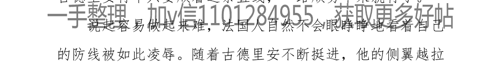

看来，他们跟着古德里安混了这么久，这场像样的战斗都没打过，每天跟在装甲尼后面兜转，的确有些委屈。就算战争结束之后，回家老婆问起：“亲爱的，你在法国干了什么？”总不可能说：“我尾随着装甲师绕着法国旅游了一圈吧。”

可是，古德里安不同于他们，反而听取了一位装甲指挥官的意见：“士兵们忙于抢功，各师的界限也没有完全清楚，他们的马队把交通都堵塞了，致使装甲部队的前进速度严重受阻！”于是，古德里安严禁停止步兵师再踏上公路一步，还命令让他们只能在田野上绕行。甚至，古德里安的手术绕向了步兵，当时德国步兵团重建了4个师，营塞了这些补给燃料和汽油。

偶遇神啊，这是什么领导？步兵师长们一致认定，跟着这样的领导混太没没了。苏军战役爆发后，除装甲师外，古德里安属下的步兵师几乎都换了个圈，估计这个有很大关系。

当然了，从自援步兵这个聚溃后，古德里安的推进速度就越来越快，侧翼的威胁也越来越大。法军不断的投入部队进行反击，企图切断德军交通线。这样的反击每天都在进行，法军往往是牛崩而末，狼狈逃窜而去。

最初，古德里安将军一度对侧翼的安全非常担心。但是是有惊无险，法军始终未能切断其交通线。古德里安事后哀道：“法国陆军的部队很勇敢，但机械化部队的使用方式总是不得要领，他们的头脑停留在1918年，法国指挥官依照习惯把坦克当作支援步兵的工具。”

而且，法军指挥官丝毫不吸教训，“分散使用”的理念是根深蒂固的。

这一次，古德里安的战术非常成功，，，，，，，，，，，，，，，，，，，，，，，，，，，，，，，，，，，，。

结果，这位先生把进攻方向错了，不知道是看地图还是看错了。他试图进攻梅斯湖域恰好是古德里安的进攻方向，双方在当地发生了战斗，从中午到黄昏，最终，这位搞错方向的指挥官身亡，法军彻底崩溃。

6月16日，德军挺进塞福，其左翼“古德里安甲团”顺利地西南、西北至马奇诺防线后，把40万法军包围。接着，马奇诺防线内最强大的区域——阿尔萨斯地也被包围。

有趣的是，戈林再次合时宜——在古德里安发起总攻，准备彻底围困法军之时，戈林空军一把架设的浮桥当成目标。

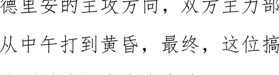

夜晚，这支德国空军炸了一次，直到浮桥完全被毁。这次可怜的误使得古德里安延误了大半天，多亏他们在索思河上发现了一座没有破坏的桥梁——但是当时，约15万法军顺着德国包围的缺口，利用这半天的时间蜂拥而出，逃逸了法国南部。

战斗结束时，古德里安一起抓获了25万名俘虏，推进至瑞士山脉。瑞士这个中立国果然大法军进入了瑞士，各大报刊头条爆发出了：“大法军军队入侵边境”——这在法国人看来简直哭笑不得。

作者：万国威安天下 日期：2009-08-25 18:01
连载 132

## 雷诺总理倒台以及丘吉尔计划

在德军全线猛攻的同时，那位绝望的雷诺总理正式向布伦总统递交辞职。6月16日晚，贝当元帅接任为内阁总帅。雷诺完毕把问题想太简单了，自己以为拍拍屁股撒手不管就能逃避责任。实际上，丘吉尔正在策划一个“惊天”的大计划，雷诺的忙乱了丘吉尔夺不及，最终导致“丘吉尔计划”全面破产。

该行动计划是这样的。在雷诺总理辞职前几个小时，丘吉尔与雷诺的全权代表戴高乐将军举行了一次秘密会晤。虽然这次会晤场的法国高级官员不多，但他们探讨的问题极其庞大，并最终起草了一份堪称神奇的新《联盟宣言》。这份看似冒失的宣言里的协约引人注目：

- 1. 两国政府宣布，法国和英国今后不再是两个国家，而是一个法英联盟。
- 2. 法英联盟宪法将双方的国防、外交、财政和经济政策进行整合。
- 3. 法国国民将获得一个法国的公民身份，每一个英国臣也将成为法国的公民。


这是一份被许多人所嘲笑的宣言。他们一致认为丘吉尔太无耻了，在这种情况下，他还逼迫法国人签署了这份毫无用处的条约。

不，丘吉尔的计算周全。因为他知道，雷诺总理一旦倒台，英国将会失去对法国的控制，以贝当为首的投降就会得势。所以，当务之急就是稳住法国政局，并在主战派首脑——雷诺总理的带领下，把战斗继续下去。

一条很明显的线索，就能理清丘吉尔的全部想法——在该条约签署后不久，丘吉尔便和雷诺通了电话，他希望雷诺丝毫携带剩余的法国军队，以及法国政府迁北非，并要求法国海军开往德国不能控制的港口。

可是，雷诺总理突然拒绝，让这份协议从真正意义上成了废纸。新总理贝当元帅彻底拒绝承认这份条约，他们提出了种种强烈的指责。它说是“到最后分钟才出来的计划”，是“突然袭击”，是一个把法国沦为殖民地的计划。他们说，这会让法国人失去平等的身份，法国只能取得英国殖民地，而不是本土，但是英国人可以做道的公民。那些浑然无知的法国民众如果知道这种事，应该会非常惨。由于我们获取了更多帖，看来，英国同盟无异于结成一体。他们大声嚷嚷：“你们怎么想？反正还是妥纳雷诺的一个计划，分明让法国彻底灭亡！”总之，他们一致认定古德里安狡猾，但古德里安良心一定坏，他只想让法国继续在北非战下去。现在，雷诺为了逃避责任。


没有推迟这一天，他选择了逃避，逃避了责任，逃避了对丘吉尔的承诺。我甚至认为，雷诺是不敢承担这份沉重的责任。因为，到北非去组织政府的计划太冒险了，甚至可能爆发内战。说准哪天，英国和德国如果是和平地坐下来谈判了，自己内部因为意见不同而打起来，这自然不是雷诺承诺的结果。

很久之后，丘吉尔依靠这个看似失败的计划换取了胜利。他设想如果法国能够取得胜利，最终的法国军队不仅迅速控制中海局面，还能在44年的北非战役中，完全肃清海岸所有的意大利军队，盟国也会拥有多出百万的法国军队，更不会出现美国远征北非的局面。

可惜啊，这一切全部变成了镜中花。胆小怕事的雷诺突然辞职，导致丘吉尔计划破产。这位天真的总理似乎仍能够在17日午和丘吉尔会晤，并且这个意思告诉了英方代表——斯皮尔将军。斯皮尔将军拒绝了雷诺总的请求，他冷淡道：“明天就是另一个政府，你再也不能代表任何人说话了。”

决不容许法国解除《联盟宣言》中所承担的义务。一方面，提议成立永久的法英联盟，到非洲继续并肩作战。他们还可以获得共和国的支持，获得法国两院议长和所有主战派的支持。最关键的是，能够获得英国政府的支持。

其次，雷诺没有推迟这一天，他选择了逃避，逃避了责任，逃避了对丘吉尔的承诺。

作者：万国成定天平 日期:2009-08-25 18:06
内战时候没装甲车也有11糯嘛 呵呵呵
作者：万国成定天平 日期:2009-08-25 18:09
本上周结束法兰西战局，结果牵出这么多题材。既然是细说那我干写细点，反正喜欢看如此细的文章肯定是二战呵呵 呵呵
作者：万国成定天平 日期:2009-08-25 21:57

[content]
我发阿吉里安与戴高将军共同起草的联盟宣言，有兴趣的可以一看。法兰西共和国发表宣言，宣布：

- 两国政府宣布，法国和英国今后不再是两个国家，而是一个法英联盟。
- 法英联盟宪法将双方的国防、外交、财政和经济政策进行整合。
- 法国国民将获得一个法国的公民身份，每一个英国臣也将成为法国的公民。

无论领土将遭受破坏，责任由两国分担。在战争期间，只允许英国控制法国武装力量，无论是陆军、海军或空军，都置于英国的指挥之下。

两国将正式组织新军，向美国呼吁大力补充盟国的资源，为共同事业提供大量的物资，必须战胜敌人。

作者：万国威安天下 日期：2009-08-27 02:02
连载 133

## 贡比的第二次胜利

法国新总理贝当上台后，就等不及待开展了他的“和平运动”。6月16日晚，贝当在新阁第一次会议上宣布：“政府已经组成，它的首要任务是毫不犹豫地请求德国停止敌对行动。”他强调道：“既然法德兵力悬殊，英国政府不愿意付出牺牲，只有法国有不幸的命运。”现在，魏刚将继续担任陆军总司令，达尔朗将被任命海军司令；一个叫做博杜安的接外交部长。

等到内阁会议结束，达尔朗立即在17日紧急见西班牙大使，请求西班牙大使充当双方的中间人。之后，广大的达尔朗还找到了罗马皇帝，要求罗马皇帝出面，以便与意大利政府进行谈判。

6月17日清晨，西班牙大使传来了贝当希望停战的消息。希特勒的一个秘书后来写道：“希特勒听到这个消息后，乐得就跳了起来，并用笨重地拍自己的臀部，我从未见过他如此放松。”凯特勒将军接着发表了话，他还邀请了大本营所有的工作人员喝酒——连扫地的大妈都喊起来。酒会上，凯特勒将军毫不忘迎巴黎，他动情的提议道：为历史以来最强大的征服者……

面对法国政府的苦哀请求，希特勒并没有立即回复，他决定会见墨索里尼讨论停止条件。与此同时，德军奉命对战继续加压力。

到6月18日，希特勒召唤小伙伴到慕尼黑讨论法国停战问题的时候，意大利32个师已进行了一周的战斗，但他们仍在原地踏步。墨索里尼曾大吹自己的军事力量，但从参战就开始暴露了。。在德国国家电影中间穿插了广告，屏幕上出现了“意大利军队胜利进军”字样的时候，整个电影院的观众喧堂大一——就连德国国民都知道意大利军队是什么。

此外，当这位泄了气的意大利胜利者和他的女婿亚伦宁在6月17日晚上乘车去希特勒见面的时候，他的心情是闷的。不过，这丝毫毫不影响墨索里尼那无厌的野心。希特勒反驳道：“我们胜利了，好好多站，法国军队投降。”同时，意大利还要割去一片法国国土，就拿仑比亚地利嘉嘉岛也不。

可是，墨索里尼还气不足。战争是希特勒赢得的，而不是他。他的意见只能有参考价值。意大利最大的贡献也许就是牵制了6个不满的法国师，说出去是可笑的。因此，有最后决定权的只有希特勒一人，这将让墨索里尼感到忧不安。

希特勒认为最重要的问题是法国军队落到英国的手里。他担心法国政府逃到北非或伦敦去战斗。由于这个理由，停战条件一定温和，要能保持“一个法国政府”，并且让“法国军队中立化”。


方，另一个就是比莱森林。这个地点属于法国人心中的圣地，是1918年11月11日，德意志帝国向法国提出投降的地点。

最终，希特勒选择了比莱森林，他决定在这儿报仇弗鲁士。这个地方本身，也会增加他报仇弗鲁士的快感。

6月19日，一队德国工兵便耀扬扬威地进入了比莱森林。他们在一名军官的带领下，开始大搞破坏活动。首先，他们砸碎了比莱森林博物馆的游览址，把福元帅的旧车，从博物馆里拉了出来。然后，他们像模一样的装上了1918年的旧铁车，德国工兵用杠杆推倒，把车子推到历史空中的轨道上。一名德国军官拿着旧照片仔细核对，对意图地图和现实世界比对：

这就是1918年11月下午5时，德国使团在停战协定上签字时，车子停止的准确地点——一里处不差的地点。他们还扯掉了车上的法国三色旗，挂上法国国旗。

6月21日中午，希特勒驾车通过法国北部云远蹲的公路，前往比莱。《第三帝国兴亡》作者威廉·伊勒曾是这次事件的当事者，他后来写道：“这是我所能记得的法国的最美的一个夏天。6月的阳光，暖洋洋地看着壮丽的树木——榆树、柠檬树、丝柏和松树——一片神骏的阴影，投在通往小小的圆形空地的林荫道上。下午3时15分，希特勒坐着他的赛德斯汽车来了。同行的有森林、勃劳希、凯特尔、德霍尔、里宾特洛南和赫斯，他们都身穿着各种各样的制服。”


就连一项敬崇新立的帝国元帅戈兰，他也没敢乱穿服装，他手里重重地拿着陆军元帅杖。在离空地约200码阿尔萨斯—洛林的雕像前走下汽车。雕像用德国军旗旗覆盖着，是为了不让希特勒看到那把大剑。那一把1918年获得胜利的盟国大剑，插在了一只死去的老鼠身上，这又代表了意志帝国。希特勒向心里念着了一眼，继续大步走去。

威廉·夏伊勒继续用双筒望远镜看着希特勒的表情。他写道：“在他生平的许多重大的时刻，我都见到过那张面脸。他的脸色严肃，庄重而充满了复仇的神情。从我处理他的正是从他想象的少数城堡的征服者、胜利者的挑战神气。还有……一种傲然的内心快乐，这是因为他眼中命运起了翻天覆的变化——而这种变化又是他亲手创造出来的。”希特勒的私人回忆录道，当时，希特勒口中念念词，好像说：“我们将把能引起人们回忆1918年那个羞耻的日子，一切东西全部毁灭。”

当他们走到这块小小的林间空间以后，希特勒的注意力被吸引在约3英尺高的一大块花岗石吸引了。他慢步上前，读着石头上刻着的大字文字：

> “1918年11月11日，德意志帝国在此处膝投降——被它企役的自由人民所击败。”

希特勒读着，戈兰也读着。大家站在6月的阳光中，一片沉静中读着。希特勒的脸上燃烧的是焦躁、愤怒、报复和胜利。他离开了纪念碑，极力使他的姿态表示出他的焦躁。他回头了一眼，表情轻蔑而愤怒——人们几乎可以感觉到这种愤怒，因为他不能如此众目睽睽之下用普鲁士士兵脚跨过去。

突然，他好像感到了自己的脸部表情还没有完全表达出他的情绪，他迅速用手放在背部，耸起脚跨开。这种姿势就像粗鲁地跳舞。这种姿态是对这个地方的极端蔑视，对于这个地方德意志帝国以来要求的利益——一切切断。

表演完毕，希特勒彻底满足了。那辆破旧的餐车里，已经准备了一张长台，两边放了五六张椅子，供双方代表坐。希特勒大步走进谈判的房间，他屁股坐在原本的那把椅子上——就像如此。

5分钟后，查瓦格将法国代表团来了。他们的脸上挂着惊讶表情。他们事先不知道德国人会把他们到法国人以为的“圣地”。这种屈辱让希特勒满意——这就是他所期望的。

看到法国代表之后，希特勒和他的同事们站起，双方鞠躬后各自坐下。他们就像猎人一样，面表情相互对视。首先，凯特尔宣告停战协定的前言。凯特尔似乎是在对英国而不是法国讲话。他继续宣布：“德国不会把海军拿来战争中使用，也不用法国的海军装备……”

凯特尔读完序言后，希特勒站起来，随从人员退场。凯特尔继续代表法国口译停战条件。1945年春，车辆将被运往柏林作为战争胜利的展品，纪念碑要用炸药炸毁。

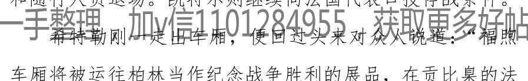

苛刻但不得不接受的条件

希特勒走后，谈判工作由凯特尔继续进行。他把附有法文的停战条件读完以后，亨兴格将军对德国人说，条件太“冷酷无情”了，比1918年法国人提出的条件坏得多。而且，“如果阿尔卑斯山那边的一个被打败的国家（希特勒不在意，甚至不打算它的名字），也提出类似的要求，法国决不妥降。它将战斗到底！”

此一出，气氛变得尴尬起来。坐在一旁的约德尔将军非常吃惊，他没有被一个弄得走投路的敌人表现出糟糕的焦虑。最近德国人都陷入了焦恼，亨兴格必须把停战条件报告给贝日政府，才做进一步的交涉。

几分钟后，亨兴格与法军总司令魏刚将军交谈了：

> “我是在车里打的电话。”
> “哪个车厢？”
> “嗯……你能猜到是哪个车厢？”

这两个法国人就这样没脑没脑地聊了起来，一直拖到晚上，双方仍旧无结果。

次日上午，谈判继续进行。法国人明显露了一个心眼，他们对德国人提出的各项条件进行反复提问，生怕被德国捏了一道。

其实，国家之间的谈判与小民之间生意也没有什么两样，譬如某个奸商把贷款100万马克偷偷的改成100万美元，一旦不注意，签了名，按了手印，就是签字爷爷也没用。因此，法国代表把德国提出的条件逐字推敲，负责解释的约德尔将军的嗓子都快坏了，也没有谈出什么以后来。

在德国提出的条件下，最受世唾弃的一条就是——强迫德国政府把法国的反德国人士，全部交给德国处置。

法国是一个自由的国家，他们也尊重政治人士的各种权利，对法国人而言，这样做是可耻的。但是，当他们讨论到处理时，他的诉求非常明确，他大声说道：“流亡者是最大的敌人，他们已经背叛了自己的祖国，必须把他们交出来。”

还有一条这样的：凡是与德国联合作战的军队，被捕后将移交到战争结束。条款中最后一条是：所有战俘将被留到战争结束。对于这段文字，法国方面没有提出异议。他们肯定认为在三个星期之内，英国就会像小鸡似的被人拧断它的脖子。

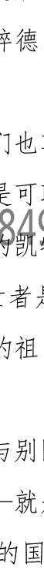

凯特尔完全失去了耐心，他大声尖道：“不出三个星期内不能取得协议，谈判便告裂。”出人意料的是，仪式结束后，亨兴格终于在停战协定上签了字。两位无言地对视，两人眼中都有泪水控制着自己的感情。接着，他接了一封信，亨兴格轻松地获取了好处。

这次停战协定，德国电台进行了现场广播。当精神振的亨兴格走下轿车时，那边传来了有节奏的音乐：“我们打，打打打！”这是艾戈尔的花样，不管什么场合，希特勒都要配上音乐，而且还是古典音乐。

希特勒给法国政府留了一块未占领区，在法国南部，贝当把首都到了法国中。后世称之为：维希法国国。

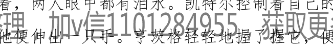

希特勒的做法是一种异常狡猾的手段。这不仅可以从地理上分裂法国，还能使法国流亡政府难以成立。一个奇妙而又不可摧毁的停战，似乎使法国人保留了一丝情面，重要的是摩洛哥、叙利亚、吉布提、突尼斯、阿尔及利亚、西非和赤道非洲、马达加斯加、印度支那，以及法属印的各位总督，都无例外的向贝当元帅宣誓效忠。那那位流亡到伦敦的戴将军，仅仅在非洲、大洋洲上取得了一些岛屿的支持，其势力范围也连一个印度总统长都比不上。这些收获，同贝当元帅比起来，简直是不喻的。没有一个国家承认自由法国。”就连美国总统罗斯福，由于巨大压力，承认贝当元帅为法国最高领袖。也就是说，承认自由法国的国家，只有英国政府而已。

到6月25日0时35分，停战协定在战线上生效。德国武装力量有理由为这一史无前例的胜利而自豪。德国人充满美好的希望注视着未来——战争看起来是结束了，英国人不久也会完蛋。

在最后一次战争中，曾经坚持4年而最终胜利的法国，在这次战争爆发6周以后，就轰然崩溃，土崩瓦解。在这场法兰西6星期战争中，德国死亡27074人，受伤11043人。这个伤亡与22年前那场战争相比，德国人民可以接受的。最重要的是，德国人民已经歇斯底里了，他们不停赞美那个用了7年就改变德国命运的人。七年前，德国还是个看人脸色的等等，而现在，却一跃成为了欧洲的主人。

此时，阿道夫·希特勒达到了顶峰，这个第一次把德国人统一在一个真正民族国家的奥地利流浪汉，连中学都没读过的，已经成了世界征服者中最伟大的人物。阻碍他在欧洲建立霸权的，只留下下一个拒不屈服的英国人——就是温顿·吉尔兹。现在，他领导的小小岛屿，正面对着史以来最强大的军事力量进攻。一手面临接近毁灭的威胁。

前奏

在法国即将投降之际，希特勒已经认为英国急于求和。他在5月24日对斯泰特详细说明了这些条件。他表示，英国帝国拥有的“必要”。他非常肯定，英国一定会同意这一点，甚至于战败以后，仍然没有制定继续对英国作战的计划。在此期间，陆军参谋长哈尔德有过多次谈话，哈尔德也担心俄国日益增长的战斗性。从1939年秋天以来，波兰边界兵力不断增加，哈尔德指出，几个师难以承担，他要求增加军力。希特勒的决定，陆军不需要这么多师。

实际上，此时希特勒已经有了与俄作战的想法，但没有暴露。按照计划，陆军要将155个师减少到120个。但是希特勒突然改变了注意，他下令将解散的35个师立即恢复起来。他命令装甲师和机械化师增加一倍。对于希特勒的命令，将军们都不能理解。并且想要装甲师数量增加一倍，自然就要相应提高速度。希特勒命令每月应该生产800到1000辆坦克。可是，兵工署计算，这个计划可是行的，但需要钱，同时他们还需要十万个技术工人。这笔坦克看着希特勒吓了一大跳，他被迫取消了计划。但他又不肯增加增加甲师。无可奈之下，贝当元帅自作主张，以此应付希特勒无法实现的要求——把每个装甲师的坦克数量减少到了原来的一半。名义上，装甲师是增加了一倍，但是坦克的数字却加倍。这种掩耳盗铃的做法，对于以后苏联战役有着巨大的影响。

关于希特勒不想提高工业生产的打算，他自己有一番解释。他认为，提高工业生产就会增加民众的负担，从而导致人民对战争失去兴趣。这种想法是不可能的。从一年以后，美国、苏联、英国三个超级大国的战争机器开始24小时全方位发动之时，德国90%工业依旧实行8小时工作制，周末还有假期。这种局面一直持续到斯大格勒惨败之后，希特勒才清醒过来，同意进行总体战，但是已经太晚。

不管怎么说，希特勒对于他的没有认识。一方面，他嘲笑苏联巨人不过是个胆小肚——一插即破；另一方面，他又希望与英国和解。希特勒几乎等到自杀的最时刻，还希望英国会醒悟，不致把半个世界给布尔什维克，另一半给拜金主义的美国。可是，当1940年英国拒绝希特勒的要求之后，希特勒猛然发现，他面对的是两个强敌，而他的弹匣里只有一颗子弹。

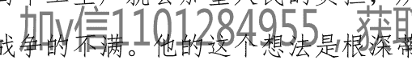

但是，想把这位错入非非的纳粹统帅，从梦中叫醒是很困难的。他现在站在胜利之峰，坐等英国在自己脚下苦苦哀求。基于这种想法，希特勒也不着急了。在将领们聚齐统帅部等元首制定大局的时候，希特勒却一心地地扑在了秘密出游巴黎的计划之中。他找到了自己的私人好友——阿尔贝特·冯佩尔充当向导。

获取更多贴。期望望朝一日能参观巴黎，这是一个艺术大都市。他相信，他能在巴黎找到重建德国都市的灵感，希特勒便开始谈论巴黎之旅。

在法国投降的那一个晚上，希特勒心急如焚的陆军司令官试图找法国。次日早上4点，希特勒和凯特尔以及大营的一个人，来到一个小村庄外的广场。天黑看不见，他们在苍茫夜色中朝着巴黎去。这次登陆后的三小时里，他游览埃菲尔铁塔、凯旋门和巴黎剧院。观光途中，希特勒曾提过是否在巴黎举行阅兵。他的副官们都不同意，他们的理由是：如果空军知道了这个消息，肯定会捣乱。于是希特勒就取消了阅兵企图。

天亮时，希特勒从美丽的巴黎让他陶醉，他叹道：“这是世界上最美的剧院！”据施佩尔回忆，在参观完毕，希特勒还不忘记掏出150马克，递给那位白发侍，但这位法国人坚决拒绝了。他不卑不亢地说：“这可不是我的职责工作。”

然而，希特勒的巴黎出行引发了巴黎人的不安。那天早上，见过的几个巴黎人都惊得魂慌措措——他的车队在街道上撞上一群妇女，最胖的那一个指着他，她的尖叫声听得众人四散。当他穿过街里时，一个探头窗外的妇女认出了他。“魔鬼！”他急忙把脑袋回去。希特勒觉得有趣，后来便觉得将这一异象从被征者的心头抹去。他对身边随行人员道：“我的部队要当解放者，而不是征服者”。

这样，进入巴黎的部队不敢大摇。凡买东西，他们必须毫不差地给钱。在香丽华大街的咖啡馆，他们与法国人吵架，分到6月的阳光，在塞纳河自在地游憩。在外人的酒吧外，无一例的挂上了标签说：“在这里，请说德语。”——仅仅一周前，这些标签却是：“在这里，请说英语！”

希特勒的手段，也让法国人留下了极好的印象。在巴黎，一部分关于现状的法国人的语落款字符已经改变了：“德国，巴黎。”这种相处有一丝尴尬，且语言不通。但是巴黎人的谨慎已经消失了——他们原以为妇女会遭强奸，商店和银行会被洗劫。现在，大家都知道了，德国军队在返回首都。在巴黎全城都挂满了路牌，上面画着一个怀抱婴儿的德国士兵，还有语句：“法国人，信任德国兵吧！”

希特勒会为其士兵感到自豪。他们穿得整整齐齐，对妇女彬彬有礼。每天都能在咖啡看到陷入热恋的德国士兵。在美丽的罗浮宫、法国动物园里，他们光着脑袋站着，其武器只是照相机。不过，心眼多的法国人，早就已经真迹藏了起来，蒙娜丽莎的微笑、断膝的菲斯米罗和胜利女神尼姬石雕，都无一例的换了仿制品。德国兵可未留意注意，他们像是来游玩的游客的，成群结队在各个名胜古迹留下留念。

令，他宣布柏林的楼房建筑全部复工。“巴黎不是很美吗？”他说应该把柏林搞得比它更美。当我们把新柏林建成以后，巴黎也会黯色。


观的他，他还让众人坐下吃宵夜。天空越来越黑，远远处传来了隆隆的雷声，午夜来临时，有两个副官报告说，英国轰炸炸机来了，要轰命令的灯火。

希特勒命令把宴舞室的灯关掉，把窗子打开，只有一台老式收音机低低的声音不断地播着音。凌晨9点35分，在这一规定停战生效的时刻，司号兵吹响了停战的命令。众人端坐在黑暗中，只有闪电时人们的脸庞闪亮。

香槟杯被分发给了众人，室内安静得令人毛骨悚栗。施顾尔写道：我们都不作声地坐在黑暗中，怀着体验这一历史时刻的心情。角号声顿起，吓了人一跳——这是普鲁士的传统信号，意味着“战争从此处停止”。在黑洞中的屋子里，他们经历了激动的瞬间。

于是，众人便起身看向希特勒，显得有些不自然。他不喜欢这种做法，又得服陆军的传统。他缓慢的站起来，礼节性地将酒杯碰了碰嘴唇，滴酒未尽。之后，他便坐下，抿着脑袋，陷入了沉思。他既不习惯，又不喝酒，大本的随从们早就以为常。在这群快乐而热烈的人中，他反而成为了一个孤零零的人。过了好一会儿，他才开口说话，他用轻微而含绪的声音说道：“责任非常重大……”但是他没有继续下去，他轻轻地站起来，转身离席，消失在茫茫


茫的黑夜之中。

作者：万国盛安天下平 日期:2009-08-31 00:04

法兰西结束了可以开始新篇章了 呵呵 6 星期战争被

我写了13万字 我靠

作者：万国盛安天天下平 日期:2009-08-31 18:44

苏联还早呢 ~~~ 才1940 7

作者：万国盛安天天下平 日期:2009-09-02 06:45

连载 140

与悠裁游戏的希特勒，形式鲜明对比的是英国政府。现在，这个小小的岛国已经陷入了岌发危的境地。对普通国民来说，1940年的夏天，是让所有人刻骨铭心的时刻。

在最黑暗的时刻，胜利的曙光正渗透在每一个角落这个1000年未被入侵的古老帝国。这每几天，丘乔尔尔会发表一大堆热情洋洋的演讲。这个岛国的士气，似乎依靠丘乔尔的一张嘴才能苦苦支撑。也他，位政治首的内心，比任何人都要更加悲伤。但是，作为一名政治家，这种悲伤只能压抑在心底。在公众场合，他不断宣扬这是“大英帝国最好的时刻，这个民族从未未像今天这样团结一致……”

滚，伟大且不可一世的日落帝国。

如今，在英国东部海岸线上，每天都能看见英国士兵在海滨花园里挖战壕、在码头上站岗哨。离海岸稍远一些在内陆地带，大小城镇的妇女们都被动员起来，紧张地挖着所所谓的“阻遏线”和反坦克壕。而男人们，则开始在城郊和市区主要街道，修建防御御工，构建铁丝网。市民们接受政府发放的武器弹药，在伦敦广场和屋顶平台，民众们开始进行军事训练。就连留宿者也加入了救护队，开电梯的生活之一便捷就去挖战战……

现在，英国民众最担心的，就是德国军的登陆面对希特勒频频的进攻频率，他们认为这是一种迷惑手段。对于，奥吉尔政府声嘶力竭的宣扬道：“德国的登陆行动已经能够在眉下。”如今，哪怕一艘德国舰航向英利海峡的调动，都会让奥吉尔担心。用他自己的话，“这不是危言耸听，英国陆军已经在考尔拉克战了。若不是美国援助，英国连个步兵都武装起来，他们的装备几乎难以忍受的地步。如，奥吉尔在巡视多附近海湾的时候，就盯上了一位旅长。当时，那位旅行长前来观察的奥吉尔抗议：“我的旅守卫着公里长的海岸线，但我只有门反坦克壕，每门炮。”他还用略带侃的口吻问奥吉尔：“是否可以让士兵射发炮，以练习，至少让士兵们瞻这种炮的威力如何？”

丘乔尔冷回答：“不行，我供不起演习的炮。”战时内阁也采取了紧急措。他们组建了一只万人的“自卫队”，看起来倒是挺拔的，不过这些自卫队大部分武器都没有，使用的草桩却是战争时期的老董，感情丘吉尔还望这支军队能去抵抗德国人的。在南部沿海地区，民众们斩下了街道上的路牌。据说这样做可以让入侵者迷路……无论如何，丘吉尔政府已经准备以待，做好了一切。他们把一切登陆条件都算好了——从大到小一条不。占吉尔的决定也许很残忍，但从英国的国家利益出发，这笔筹码——付出一些领土换取整个舰队——似乎是划算的。丘吉尔拒绝任何信心，他当然不会相信蹦火车的希特勒和墨索里尼，对于达尔朗的承诺，也是如此。战争就是这样，昨天还是亲朋友，今日将其作为敌人，甚至将其消灭。

7月日上午6时20分，英国舰队在旗舰“胡德号”的率领下，抵达了奥兰港湾口，他们在峡湾之间一字排开，对港口呈包围之势。起初，法国人还不知道灾难已经降临到自己头上，他们还以为英国舰队在地中附近捕获了法国舰。因此，并未在意。可是，过了一会儿，法国人就感觉有些不对劲了。他们看见，远处的英军已经在港口处密麻的投了大批水雷。就在茫然的法国法人不知所措之际，英国军官向法国战发布了一道广播，这则广播简单：“加入我们，与我们站在统一线上，共同打击德国入侵者”。对于英方的要求，法国舰队可让苏尔将军拒绝答复，他认为，既然……法、德两国政府也共同承诺，不会使用法国舰队于军事用途。即便如此，英国人依旧苦苦相似的做法，却是尤为可耻的行为。此位，大英海军政府背信义的将军拒绝任何答复。

无奈之下，英国军官只顾好乘上摩托辖，驶进港口，把最后后艘递到了法国人手上。

- 1. 我们出港，继续取得战争的胜利而战。
- 2. 减船员，在我们的监督下开往英国港口。
- 3. 把军舰交给美国海军政府妥善保管，直到战争结束。
- 4. 在6小时之内，自行蓄意备军舰。

最后，英国人还写道，如果你们未能遵循照上上述办法行事，那么，我只好根据英国王子下政府的命令，使用一切必要的力量，阻止你们的舰只落入德国或意大利的手。在这封信中，所列应该不算条件，而是威胁。最关键的是，此时达尔朗在途之中，苏尔无法联系他。所幸的是，苏尔成功将情况报告给了海军总部。怎料海军总部的官员一群老愤，老愤者向海军发布出口：“达尔朗，你千万万别让德国拿到了舰队，啊。”达尔朗：“绝不会那样，那是违背我们海军的传统和荣誉的。”此言终成诫，德国人确实没能拿到法国舰队——1940年7月1日，一只庞大的英国舰队在夜幕的护下，悄悄驶离法兰港，朝向中海西端的奥兰港而去。在那里，停泊着法国最为主力舰队。而英国人的任务是：不惜代价夺取法国舰队，解除他们的武装，夺为己用。如若法国海军拒绝的话，就只能请武力，将其彻底毁灭也不惜。占吉尔的决定也许很残忍，但从英国的国家利益出发，这笔筹码——付出一些领土换取整个舰队——似乎是划算的。占吉尔拒绝任何信心，……希特勒和墨索里尼，对于达尔朗的承诺，也是如此。战争就是这样，昨天还是亲朋友，今日将其作为敌人，甚至将其消灭。7月日上午6时20分，英国舰队在旗舰“胡德号”的率领下，抵达了奥兰港湾口，他们在峡湾之间一字排开，对港口呈包围之势。起初，法国人还不知道灾难已经降临到自己头上，他们还以为英国舰队在地中附近捕获了法国舰。因此，并未在意。可是，过了一会儿，法国人就感觉有些不对劲了。他们看见，远处的英军已经在港口处密麻的投了大批水雷。就在茫然的法国法人不知所措之际，英国军官向法国战发布了一道广播，这则广播简单：“加入我们，与我们站在统一线上，共同打击德国入侵者”。对于英方的要求，法国舰队可让苏尔将军拒绝答复，他认为，既然法国已经宣布停战，并保持中立，法、德两国政府也共同承诺，不会使用法国舰队于军事用途。即便如此，英国人依旧苦苦相似的做法，却是尤为可耻的行为。此位，大英海军政府背信义的将军拒绝任何答复。无奈之下，英国军官只顾好乘上摩托辖，驶进港口，把最后后艘递到了法国人手上。

- 1. 我们出港，继续取得战争的胜利而战。
- 2. 减船员，在我们的监督下开往英国港口。
- 3. 把军舰交给美国海军政府妥善保管，直到战争结束。
- 4. 在6小时之内，自行蓄意备军舰。

最后，英国人还写道，如果你们未能遵循照上上述办法行事，那么，我只好根据英国王子下政府的命令，使用一切必要的力量，阻止你们的舰只落入德国或意大利的手。在这封信中，所列应该不算条件，而是威胁。最关键的是，此时达尔朗在途之中，苏尔无法联系他。所幸的是，苏尔成功将情况报告给了海军总部。怎料海军总部的官员一群老愤，老愤者向海军发布出口：“达尔朗，你千万万别让德国拿到了舰队，啊。”达尔朗：“绝不会那样，那是违背我们海军的传统和荣誉的。”此言终成诫，德国人确实没能拿到法国舰队——1940年7月1日，一只庞大的英国舰队在夜幕的护下，悄悄驶离法兰港，朝向中海西端的奥兰港而去。在那里，停泊着法国最为主力舰队。而英国人的任务是：不惜代价夺取法国舰队，解除他们的武装，夺为己用。如若法国海军拒绝的话，就只能请武力，将其彻底毁灭也不惜。占吉尔的决定也许很残忍，但从英国的国家利益出发，这笔筹码——付出一些领土换取整个舰队——似乎是划算的。占吉尔拒绝任何信心，……希特勒和墨索里尼，对于达尔朗的承诺，也是如此。战争就是这样，昨天还是亲朋友，今日将其作为敌人，甚至将其消灭。丘吉尔依旧选择了沉默。这位自信的将军以为，英国人的做法不过是一场军事示威了，达不到目的，自然就会退。他压根就不相信英国人会对自己开炮。因此，当他的下属提出先发制人，率先开火时，这位将军回答：“不行！”法国人把先发制人的机会拱手给了对手。

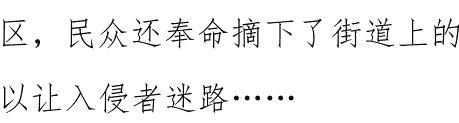

英国人虽然取得了胜利，但在世界上却被鄙视了很久。所幸的是，阿尔吉尔脸皮够厚，这些鄙视都被他华丽地无视掉了。在这次袭击中，英国海军损失了一艘驱逐艇，五架攻击机。有意的是，英国海军损失的那艘逐舰是被一艘意大利潜艇——“马可尼号”击沉的。实际上，在前往奥兰斯的途中，这艘东游方的意大利潜艇就发现了这艘敌舰。无奈英国舰队航速快速，意大利潜艇拼了老命都没追上，遥远的发射了几只鱼雷，未能命中。可周知，意大利人都坏了，失去了这么好一个建功业的机会。抱着不抛弃，不放弃的信念，“马可尼号”便架在原地守株待备。（反正也没什么地方去）。第二天，“马可尼号”又发现了返航的英国军队。这次，意大利获得了战果——它发射的鱼雷击沉了英国E级逐舰“护卫者”。赫特勒从中获利，法陆海军部署了一支强大的舰队，其中包括8艘潜舰组成2个战斗群对自己进行拦截。因此，英国人大惊失色，误把意大利潜艇的袭击当成了法军潜艇。于是，英国舰队没敢继续下去——他们横不扬路地进入直罗的海英国港口。7月4日，丘吉尔怀着深深的悲情（据他本人说）在众议院详细报告了“弯曲行动”的经过，议员们全体鼓掌，欢呼如雷破云霄。丘吉尔后来回忆道：原来我走进议院发表的时候，我受到了最热烈的掌声，一般是从工党那边传来的，保守党总是以几分保留的态度对待我。但是现在，在庄严的、慷慨云霄的和下，大家都团结在了一起！

(摘译)不懂英国人，打败法国海军居然这么高兴就在这一天，为了挽回法国海军的威望，法国海军公开对外媒体宣布：我们的主力舰之一“敦刻尔克号”损伤甚甚，很快就能出动。这实在是一道轻率的言论，英国皇家海军再次迅速反应。你不是损伤甚甚吗？那好，我帮你打回原型。5日傍晚，英国舰队再次发起攻击。6日清晨，在距离奥兰斯45公里的地方，“皇家方舟号”起飞了12架“剑式”轰炸机和12架“海鸥式”战斗机，“敦刻尔克号”严重毁，主要部件损毁65%，死了54名法国水兵。这就是多少代价。（八钩一句，“弯曲行动”使用载机攻击，使得英国军痛下事情并未就此结束，奥兰斯事件之后，法国海军实力却大损。希特勒从从下计划。

战争与和平在整个6月下旬和7月初，希特勒苦苦等待英国政府投降。可是，当英国海军袭击舰队的消息传来，希特勒真正意识到英国政府的决心大、意志坚决，几乎被英国海上力量弄得目瞪口呆。他突然明白，即便自己能征服英伦颠，阿尔吉尔也可以加拿大或澳大利亚建立临时政府，然后再凭借美国的援助，重新打回欧洲。毕竟，海洋不在希特勒手上。是谈判，还是武力？希特勒在犹豫不决中徘徊。哈哈，德的日记中，希特勒自问答：“是因为丘吉尔仍然期望美国或者俄国，会采取某些行动。”但是丘吉尔以英伦三岛的代价与希特勒进行赌博，其筹码是不是太大了？”希特勒大感不解，他的将军们也大感不解。尽管元首和这些将领筹划战争是一手，但是他们缺乏深谋的战略。按照他们的想法，法国战后，英国一定会投降。可能的，当强硬的英国政府声称要坚持打下时，希特勒突然宣布自己对英国的战争计划。然而，希特勒本人可以说是一头狮，但绝不是海狮，他缺乏下海水的勇气。在他眼中，有大陆，没有海洋——这也是德国人的通病。于是，希特勒越走越远，频繁对英国伸出橄榄枝、急不可耐的热脸贴上丘吉尔的冷脸——为了试探英国政府的态度，乱投医的希特勒在瑞典、美国和梵蒂开展外交活动。其中，最热心的要数是瑞典国王，这位82岁高龄的老国王亲自出马，以国家的名要求丘吉尔与希特勒和解。（丘吉尔与希特勒和解，这是天方夜谭一千零一夜？）丘吉尔自己，正如后来在回忆录中所说：“对于瑞典发出来的和平试探太愿为难”。同时，他也深信希特勒是在利用他们。丘吉尔早已清楚楚地看透了这个流浪出身的奥地利人，甚至出一个反尔，言而无信的卑鄙小人。对于和平谈判，丘吉尔的答复是这样的：“只要希特勒先生愿意恢复捷克斯斯洛伐克、波兰、挪威、丹麦、荷兰、卢森堡、比利时、法国的自由和独立，可以进行谈判。同时，当丘吉尔得知德国大使企华盛顿与英国大使会谈的消息之后，立即发出一封电：“告知洛诺安助爵，决不能给德国代办以任何回答。德国的态度已经明确，在他们眼里一切都是利益。”


地主的希特勒重新回到座位，赢了钱就想跑，没门！我们接着玩。

作者:万国咸宁天下平 日期:2009-09-06 08:32

今天没时间了......下章抽空送上~0~

作者:万国咸宁天下平 日期:2009-09-06 13:15

征集书名:

本人郑重声明，由于本文可能即将由出版社发行，但我没想出个好名字，天涯人才济济，故在此征集书名，一经采用的麻烦，那我我只有感谢您了，也没啥东西可送，如果题材真的过审，就赠送此书一册，留下一个地址就可以了呵呵哈~

作者:万国咸宁天下平 日期:2009-09-07 09:51

## 一手胜利：加信1101284955，获取更多好帖

苏联还是英国？

英国的不妥协把希特勒的千秋大梦弄醒了。实际上，在那年七月份，这位纳粹统帅就已经做好了入侵苏联的准备。如果在以前，入侵苏联仅停留在幻想的阶段，那么现在，就已经开始付诸行动了。

7月16日，希特勒把古德里安从法国召回，让他制定一个入侵苏联的可行方案。这位将军虽然感到有点不可思议，但是照办了。

在一次会议上，被胜利冲昏头脑的希特勒把约德尔斯将军拉到一旁，问道：“你看，在今天秋季的时候，能否完成进军？”

这位将军一听就慌了，什么？今年9月份？希特勒解释说：“俄国在6月份轻率占据了波罗的海的海和罗马尼亚的一些省份。它们沿边境不断增加军事力量，而我们却只有5个将军驻在这里，这就不难看出俄国还想获得什么”。

关键在于，希特勒其实非常担心斯大林会在今年秋天入侵罗马尼亚油田。而罗马尼亚油田又构成了德国的生命线——德国每个月都要向罗马尼亚进口5万吨原油。如果这个地区受到威胁，德国将失去某种地位。没有了油田，一切都免谈。

希特勒雄辩道：“自彼得皇帝以来，俄国的目标就没有改变。我们要占领整个苏联，并对苏联进行政治化，化现在是芬兰，最后是丹麦。我们和俄国的战争是不可避免的，事已如此，最好现在——今年秋天就打，延期只对俄国不利。”

这话把约德尔的云里蒙罩了，尽管他也见过东方日益显眼的威胁，但没料到希特勒会如此急着。他勉为其难地告诉希特勒，单从运输上来说，今年秋天攻俄国是不可能的，他用手指指着红色大理石桌上展开的一张铁路地图——在他的手指的地方，仅有几条稀疏的铁路路线，远不及西部密集。

看来，希特勒心野勃勃的大计不得不妥一段时间了。

他自问道：“那只有等到明年开春了？”

无奈之下，这位垂头丧气的纳粹统帅只能下令：最高统帅部应优先考虑东方铁路的装卸能力。

Ok，入侵苏联的决定便在希特勒一时心血来潮之际被否了。

约德尔将军接到后，退出会议室后不久，他的神经开始紧绷起来，这让将军急急忙忙地跑到希特勒斯加登站——最高统帅部长阿尔布里希的车内，就此事进行磋商。阿尔布里希与三名军官在这里工作，他们见到一向稳健著称的约德尔神色慌张，不断摇着嘴唇，大步走了进来。

他们喜悦着，胜利的果实，兴奋得简直想要进行嘉奖。但他们惊讶的是，约德尔前脚一路进车厢，便叫人把赛车的门窗全部关好。接着，他便突然宣布：“元首已经决定，要一举消除布尔什维肯对世界的威胁。”

约德尔的效果，让人瞬间脑出错，阿尔布里希校长后来回忆：我当时简直不敢相信自己的耳朵，下意识地死力抓住了一把椅子，就像要把它捏碎一般。

“不行的！”一位名叫罗斯贝格的上校脱口道。英国还未战败，元首怎么能打俄国！约德尔给了一个奇特的回答：

“元首怕，战胜英国后的公众情绪，将不允许他向俄国发动一场新的战争。”


这个答案自然不会让众心悦悦。反对的意见很快就爆发了，沃尔利蒙上校嚷道：“这种打法，是腹背受敌的打法，第一次世界大战的失败，正是这种两线作战而导致的，元首连这个教训都忘记了吗？为什么在莫斯科签订条约后，现在才突然改变？斯大林不是守诺言、原料和粮食准时全部送来的了吗？”

沃尔利蒙的提问让约德尔将军哑口无言，他只能狡辩说：“与布尔什维克的冲突是不可避免的，不如我们在军队处于高峰时进攻！”

这个回答说不了沃尔利蒙，他仍试图辩解，其他三名军官帮着他说。时间，车辆里吵吵闹，约德尔开始不耐烦起来，原来是沃尔利蒙上校进行磋商，结果呢，全是反对意见。约德尔有些气馁地打断他们，他最后说道：“诸位，这不是大家的问题，而是元首的决定！”

作者：万国天下平 日期:2009-09-07 10:10

回复：我觉得名字太长了，名字带号太长了。字数之间合适。如果这就是二战的那些事儿，名字就不好。

## (二战实录)

不错但让人联想到二战实录这种书籍，其他位作者再考虑一下，要审还早了几个月后，几个月后能听到巴西将军的回忆，眼眼抹黑

作者:万国天下 日期:2009-09-07 15:19

希特勒对苏联的判断是对的，这个民族具有疯狂地侵略性，是最贪婪的国家，再加上纳粹意识形态天然的死敌不如自己容易。后来的事实表明，虽然德国最终输了，但在1941年苏联取得了胜利，但是1941年苏联的军事政策是失败的，占领国土面积大，缴获和摧毁装备多，后人也几乎没有！

我认为，斯拉夫主义的影响巨大，苏联无疑想把这些血缘相同、文化相似的国家结合一个整体。但是苏联那个爸爸斯大林的，谁愿意和这种国家在一起呢？中欧国家受西欧民主主义的影响视苏联为洪水猛兽，因此他们就投倒到了1941年6月22日，中欧以及北欧诸国在希特勒的领导下，开始了20世纪的十字军。

作者：万国天下平 日期:2009-09-07 23:29

诚然这些国家不喜欢纳粹，但罗马尼亚、保加利亚、匈牙利以及芬兰是轴心的傀儡，我认为他们是受苏联的威胁联合在一起。

1940年的7月，希特勒一方面积极准备入侵苏联的行动，另一方面又对英国特工感到不安。

可是，希特勒对入侵英国的行动一点都不兴趣。

7月16日，希特勒接受了约德尔草拟的入侵英国的战争计划，他冷淡道：“如果需要，就执行。”一副漫不经的态度。

最初，这个行动的代号被命名为“狮子”，不久改名为“海狮”。其实，这个代号并不隐蔽，即便是最优秀的特工也会看到，这里的“狮子”是指英国皇室的标志——从金雀花王朝到都铎王朝，狮子就已经成了英国皇室徽的标记。

但是，负责设计代号的约德尔将却都不含蓄，他设计的代号总是把一些秘密的军事行动搞得毫无秘密可言。


不过话说回来，保密也是任务，丘吉尔就在磨刀了。搞笑的是，这个所谓的“海狮行动”在陆军的将军们眼中，就好像是英国旅游一般——由于近来的胜利，将军们都很乐观的，他们争先后抢夺英国最有利的进攻阵地，这群老先生一个个激动万分，指着英国地图，七言八道地说：“这里，这是你的。伦敦，我是我的。”

对于陆军这种轻率的态度，海军元帅雷霍尔感到十分震惊。他深知，由于海路登陆的方式，海军并没有训练。而陆军将领们想什么呢？总把事情想得过于简单，这些呆鸭子们只把“海狮”看是一次渡河行动，一次强渡马斯河的行为——只不过这条河要大一些了。

## 一手数据10128455

获取更多站点。想要更多，可能并不重要。还是白浪滚涛的英吉利海峡，与攻击2公里宽的莱茵河，与攻击1公里宽的维斯河，有天壤之别。

于是，这位海军元帅提出了反对的意见——海狮计划不通。他强调：“如果从德国水域撤走一艘舰船作军事用途，会使得大部分工业瘫痪。”

可是，这句话让陆军将领把雷霍尔鄙视到了极点——他们不知道现在德国大部分都是生产用品，而且还是奢侈品。纳粹的观点是，“物质生活才是民族活力的体现。”这也是纳粹失败的原因之一，德国追求物质生活了。

不管说什么，雷德尔现在成了焦点。因为在整个帝国高层，他就一个人提出过反对意见。并且让他悲愤的是，陆军一点都不替他的海军想。海狮行动关键的步骤是：让海军维持一条20公里宽的通道，以便士兵横越英利海峡。换句话，德国海军必须在20公里的海廊两边布置水雷，让英国舰队不敢靠近，而德国海军在海廊内来突击。

可是，德国海军哪里这么多战舰呢？在挪威战受损后，雷德尔手中只剩4艘舰艇、1艘巡洋舰、4艘驱逐舰、5艘鱼雷以及剩余几艘大型战舰还在修理中。在一次希特勒主持的最高会议上，雷德尔就这样反问那些陆军将领：“这样一只弱舰队能挡住英国的皇家海军呢？”不料，希特勒听了之后，满脸惆怅地叹道：“只有敌人的百分之十五，百分之十五！”

作者：万国天下 日期:2009-09-07 23:41

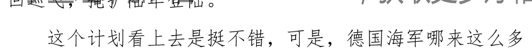

雷德尔的悲观是引发海狮行动无法实施的原因之一。有一个历史学家尖锐指出，雷德尔的悲观是因为由于有一个“中东计划”即控制北非，把地中海变成轴国的内陆，切断伊朗以及伊拉克对英国的石油供给。这个计划是墨尔林最为赞成的。当希特勒进攻苏联的时候，雷德尔也是最不意的，他再次求希特勒偏要和斯大林死磕。两害相其轻……呵呵……要是德国最后胜利，赢得战争，这些国家会被纳粹化的吗？罗马尼亚的头尼斯元帅就是纳粹化的。

作者：万国天下 日期:2009-09-07 23:52

感谢建议书的朋友~最近速度要慢一些了实在没多少时间，前面的全部章节还要来全面的手术，还要修改一些错误。作者：万国天下 日期:2009-09-09 16:20

不好意思，各位，为了方便出书的缘，连载——139的内容需要在原来的基础上作一次大的修改，因此一周之内没时间跟与还望大家见遇。作者：万国天下平 日期:2009-09-09 23:17

波兰这个国家很尴尬，处在德国与苏联之间，建国也晚，主要是英法联合对付苏联以及德国是个缓冲带。而希特勒却打破了这个平衡，欧陆自然就失控了。作者：万国天下平 日期:2009-09-09 23:19

波兰这个国家很尴尬，处在德国与苏联之间，建国也晚，主要是英法联合对付苏联以及德国是个缓冲带。而希特勒却打破了这个平衡，欧陆自然就失控了。

## 一手处理提取-101284955 获取更多好帖

我要说，欧洲百年的战乱都是英国引起的，拿仑之斧所以对英国根入骨的原因就是这个国家太狡猾，打又打不着就离海峡起。眼看着拿仑斧就要整个湖，英国联合普鲁士、德国。眼看希特勒要统一江湖，英国又抱上了美国的大腿。而维持欧陆势力均衡是英国的基本政策，这是一个典型的流浪国家。

作者：万国天下平 日期:2009-09-09 23:28

没有英国，欧洲太太平许多就像亚洲没有了日本，这世界就安静了。岛人心中胸狭狭和他们不稳定的恐畏要素有关，他们担心自己小小的岛屿被敌人封锁，所以拼制造事端又立即置身事外。作者：万国天下 日期:2009-09-09 23:34

不过话说回来，保密也是任务，丘吉尔就在磨刀了。搞笑。搞笑的是，这个所谓的“海狮行动”在陆军的将军们眼中，就好像是英国旅游一般——由于近来的胜利，将军们都很乐观的，他们争先后抢夺英国最有利的进攻阵地，这群老先生一个个激动万分，指着英国地图，七言八道地说：“这里，这是你的。伦敦，我是我的。”

对于陆军这种轻率的态度，海军元帅雷霍尔感到十分震惊。他深知，由于海路登陆的方式，海军并没有训练。而陆军将领们想什么呢？总把事情想得过于简单，这些呆鸭子们只把“海狮”看是一次渡河行动，一次强渡马斯河的行为——只不过这条河要大一些了。想要更多，可能并不重要。还是白浪滚涛的英吉利海峡，与攻击2公里宽的莱茵河，与攻击1公里宽的维斯河，有天壤之别。

于是，这位海军元帅提出了反对的意见——海狮计划不通。他强调：“如果从德国水域撤走一艘舰船作军事用途，会使得大部分工业瘫痪。”

可是，这句话让陆军将领把雷霍尔鄙视到了极点——他们不知道现在德国工业大部分都是生产用品，而且还是奢侈品。纳粹的观点是，“物质生活才是民族活力的体现。”这也是纳粹失败的原因之一，德国追求物质生活了。

不管说什么，雷德尔现在成了焦点。因为在整个帝国高层，他就一个人提出过反对意见。并且让他悲愤的是，陆军一点都不替他的海军想。海狮行动关键的步骤是：让海军维持一条20公里宽的通道，以便士兵横越英利海峡。换句话，德国海军必须在20公里的海廊两边布置水雷，让英国舰队不敢靠近，而德国海军在海廊内来突击。

可是，德国海军哪里这么多战舰呢？在挪威战受损后，雷德尔手中只剩4艘舰艇、1艘巡洋舰、4艘驱逐舰、5艘鱼雷以及剩余几艘大型战舰还在修理中。在一次希特勒主持的最高会议上，雷德尔就这样反问那些陆军将领：“这样一只弱舰队能挡住英国的皇家海军呢？”不料，希特勒听了之后，满脸惆怅地叹道：“只有敌人的百分之十五，百分之十五！”

作者：万国天下 日期:2009-09-07 23:41


雷德尔的悲观是引发海狮行动无法实施的原因之一。有一个历史学家尖锐指出，雷德尔的悲观是因为由于有一个“中东计划”即控制北非，把地中海变成轴国的内陆，切断伊朗以及伊拉克对英国的石油供给。这个计划是墨尔林最为赞成的。当希特勒进攻苏联的时候，雷德尔也是最不意的，他再次求希特勒偏要和斯大林死磕。两害相其轻……呵呵……要是德国最后胜利，赢得战争，这些国家会被纳粹化的吗？罗马尼亚的头尼斯元帅就是纳粹化的。

作者：万国天下 日期:2009-09-07 23:52

感谢建议书的朋友~最近速度要慢一些了实在没多少时间，前面的全部章节还要来全面的手术，还要修改一些错误。作者：万国天下 日期:2009-09-09 16:20

不好意思，各位，为了方便出书的缘，连载——139的内容需要在原来的基础上作一次大的修改，因此一周之内没时间跟与还望大家见遇。作者：万国天下平 日期:2009-09-09 23:17

波兰这个国家很尴尬，处在德国与苏联之间，建国也晚，主要是英法联合对付苏联以及德国是个缓冲带。而希特勒却打破了这个平衡，欧陆自然就失控了。作者：万国天下平 日期:2009-09-09 23:19

波兰这个国家很尴尬，处在德国与苏联之间，建国也晚，主要是英法联合对付苏联以及德国是个缓冲带。而希特勒却打破了这个平衡，欧陆自然就失控了。

## 元首与战争——（英）戴维·欧文

第三帝国内幕——（德）阿尔贝特·施佩尔

第三帝国的兴亡——（美）威康夏伊勒

我的奋斗——（德）阿道夫·希特勒

第二次世界大战中的德国海军战略——（德）卡尔·邓尼茨

隆美尔传——（美）威康图特

狐狸的踪迹——（英）戴维·欧文

蒙哥马马的军事生涯——（英）罗纳德·卢目

坦克战——（德）冯·梅林津

战争与回忆——（美）赫尔

好的，我找资料来源，如果还缺少什么好的书籍，希望大家推荐一下：

- 参考书籍：
- 第一次大战——（美）艾多
- 胜利（英）阿德·哈特
- 第二次世界大战实录（英）温斯顿·阿吉尔
- 第二次世界大战史（英）李德·哈特
- 第二次世界大战的回顾与反思（中国台湾）纽先钟
- 第二次世界大战的决定性战役（德）汉斯·雅布斯
- 闪击英雄——（德）海因·冯·古德安
- 失去的胜利——（德）弗里茨·埃里希·冯·施坦
- 隆美尔战时文件——埃尔文·隆美尔（德国）李德·哈特编撰（英国）

从乞丐到元首——（美）约翰·托兰


雷德尔的悲观是引发海狮行动无法实施的原因之一。有一个历史学家尖锐指出，雷德尔的悲观是因为由于有一个“中东计划”即控制北非，把地中海变成轴国的内陆，切断伊朗以及伊拉克对英国的石油供给。这个计划是墨尔林最为赞成的。当希特勒进攻苏联的时候，雷德尔也是最不意的，他再次求希特勒偏要和斯大林死磕。两害相其轻……呵呵……要是德国最后胜利，赢得战争，这些国家会被纳粹化的吗？

这一次决定：在登陆之前，德国空军必须先削弱英国战斗力，控制区域内的制空权。同时，戈林热心的建议也获得了雷德尔的大力支持。为了避免的是：如果德国空军及海军由陆登陆失败，而德国海军也不用所的力量去与大的皇家海军火拼。反之，如果皇家海军被击溃，海路登陆，希望希特勒就会担任最高指挥。这样，胜利了自己可跟着沽光，打输了，那完全是希特勒的责任，与雷德尔毫无关。好了，就这么吧，最后决定——消灭英国登陆之日。当这场三军首脑会议之后，那位信心十足的希特勒急急忙乘坐飞机，返回了设在巴黎的指挥部，着手他的入侵计划。临走的时候，他还忘记对雷德尔喊道：“嘿，亲爱的埃里希，伦敦再见。”

作者:万国天下 日期:2009-09-11 23:40


一艘小小的摩托艇多搭乘2名士兵，前面一个驾驶，后面再搭一个。虽然用摩托艇抢登陆看上去应该很拉风，但德国兵并不是007，用摩托艇越过英利海峡？也太有想象力了吧。（解释一下，瑞士人曾划过摩托艇，而且开到了深海区，结果一个巨大的海浪，摩托艇就倾倒了，幸亏我会游泳，不就铁定蛋了）

一个事实也证明了这一点——在7、8月份，英国海军本部就报告说，每天海上都会遇到一些德国士兵的尸体，最多的一天，这样的死尸就达40具之多。开始还以为，这些德国士兵是游泳淹死的。可是呢，这些士兵首无一例都穿着整整齐齐的，还有全副武装。英国人才才恍然大悟，好吧原来是游泳时发现他们是被淹死的。

雷德尔是非常严肃的，他声称：从月亮和潮汐上看，今年秋天有两个时期是理想的——8月20日到26日、9月19到26日，第一个时期对海军来说太早了，第二个时期正赶上气象专家所表明的一种恶劣天气。所以，雷德尔建议，不如入侵的日期延至次年春。

这个提议立即就得到了希特勒的严厉拒绝，他表示，海军行动必须在今年内完成，如果无法完成目标，宁肯放弃，不能拖延到明年春。

雷德尔不知道希特勒明年要干什么“大业”，只是唯唯诺诺的回答了。

作者：万国咸宁天下 日期:2009-09-13 01:07

希特勒要疯了

现在，一切事实都证明，让英国人回转意已经毫毫不希望，似乎就应该搂着脖子开了——连一向都不太热心的雷德尔也公开向希特勒表明：“英国人不先尝尝鞭的滋味是不会妥和的。”

出来的是，7月19日，希特勒突然宣布，他要演讲，向全世界公开的演讲。他要向英国提出最后一次和平呼吁。

也许希特勒早就知道，这种呼吁了等等于自白。但是，他要向世界证明自己的生存，胜利的性，

7月19日的那个晚上，在摆着鲜花、座无虚席的克罗克剧场，希特勒走上了前台。他的将军们坐在前排，国外外交官们挤在军队席上——他们只能看见希特勒不断扭动的臀部。这篇演讲很冷静，非常出色，希特勒的情绪十分稳定，很少像平常那样歇斯底里，大声大嚷。不得不承认，他是一个十分不起眼的演员，是一个自由地操纵人们内心的人。尽管他一生之中做过无数次演讲，撇弃无数次是非，也无无数次的颠覆黑白，但是这一次的演讲，我认为是最最好的：

希特勒慷慨激昂地说道：

现在，我从英国听到一个呼声：“战争必须进行下去！”但这不是人民的声音，而是政客的声音。我不知道这些政客对于这场战争继续下去会有什么结果，是否有了一个正确的概念。他们的宣布此后，他们将继续打下去，并且即使英国灭亡了，他们也要加拿大继续进行战争。我不能相信他们的意思是说，英国人民也将退到加拿大。大概只有那些热衷于把这个战争继续下去的绅士才迟到那里。恐怕人们将不得留在英国。

请相信我吧，先生们，我对于这种毁灭国家的无耻政客，是深感嫌恶的。这些人怕已经把房子踏得东倒西了，命运却安排我给予最后击，一想到这里，我就感到一分难以。

阿尔丘华先生无疑会去加拿大，那些特别热衷于战争的人们的金钱和子女，早就送到加拿大去了。但是，千百万人将开始遭受巨大灾难。阿尔丘华先生这次也许相信我的预言：一个伟大的帝国——一个我从来也不想毁灭甚至想不想伤害的伟大的帝国，将遭到彻底毁灭！

现在，我觉得在良心上，有责任再次向英国和其他国家呼吁，应该理智和常识。我认为我有资格作这种呼吁的，因为我不是求乞恩惠的被征服者，而是理智的名义说话的胜利者。我看出没有继续打下去的任何理由。

OK，演讲完毕。这确实是一场完美、并极其狡猾地把英国国民与首相吉密关系的演讲。希特勒完全把自己包装成了一个“和平爱好者”。那凡尔，就好像他希特勒明天可以得到诺贝尔和平奖一般。

这篇演讲甚至把各国的外交官都打动了——就连许多视纳粹主义的外交官们，也一度产生了一种幻觉，认为英国这次肯定会接受希特勒的和平条件。《第三帝国的兴亡》作者威廉·伊曼逊是这篇演讲的当事人之一，他后来写到：在演讲结束的时候，我曾与许多英国官员混在一起，他们之中没有一个人有一丝毫怀疑，都认为英国一定会接受希特勒的建议。他们的相信，希特勒的建议是充分大的。与此同时，德国的飞机到了英国，撒下了炸弹。看着希特勒演讲结束，我抬头看到：英国民众热爱了。实际上，英国广播全程直播了这篇演讲，并将希特勒的讲话在第二天的报纸上刊载。德国飞机飞到了英国本土之外，丢下的只是一堆废纸。不过，英国方面对于希特勒的“演讲”又是什么呢？

威廉·伊曼逊写道：在演讲结束后，我直接去到广播大厦，打算把这篇演讲，用无线电发回。我刚到广播台，就听到希特勒演讲结束后，不到小时，英国广播对于希特勒的回答是一个坚决的“不！”

有趣的是，英国方面的这番回答，完全是一个人的自发行为——当天晚上，英国广播的一播音员正在值班，他听了希特勒演讲后，义愤填膺。在没有政府许可的情况下，这位愤怒的青年小伙做出了回答：“希特勒先生，我们把它扔给您，塞进您邪恶的垃圾囊里！”

德国飞机飞到了英国，撒下了炸弹。所有的军官们和各个部门的官员们，正坐在收音机旁，全神贯注地听着。听着听着，他们的脸色都变了，简直不敢相信耳朵。“你说这是怎么事？”有人大声问，他好像弄得莫名妙了。“你能理解那些傻瓜吗？还在拒绝？我们简直要狂了！”

不管说，当英国人对于演讲第一个冷冰冰的反应时，德国人为掩不住的失望情绪。英国人的顽固让他们迷惑，毕竟他们还不够了解英国人，更不了解那个英国人的领袖。希特勒的这番演讲倒是打动了另一位英国绅士——第一首相奥斯丁·肖伯伦爵士。尽管肖伯伦已经辞去了首相职，他仍然是保守党魁、是保守党员们的头大哥，支持者也不占多数。按照理论，在《慕尼黑协定》，希特勒忽悠的老先生也不会想着谈判吧。可是，他偏不长记性，和丘吉尔碰面，肖伯伦就口若悬地说他与德国政府谈判。有可能，肖伯伦对辞去首相的方法有一点后悔。因为他一直只视丘吉尔为“战时临时政府”，战争一结束，自己就可以回到权力中。可是，他每次与丘吉尔谈到和平议题就要闹矛盾，每次都会吵不而散。丘吉尔采取退为战术，结果就是肖伯伦妥协接受。

他不惜力地大宣传“英国政府是多么的团结一致。”其实，这完全是胡说八道的鬼话，丘吉尔的妥协政治态度，实际上已经导致了内阁的激烈矛盾，严重到几乎引起了政府的分裂。不过，丘吉尔还是获得了胜利——7月份的时候，肖伯伦的健康状况开始恶化，医生检出他得了胃癌，不得回家养疗。不过多久，这位一生都梦想与希特勒谈判的老先生，就死在了手术台上，到了上帝那里和耶稣讨还价了。

7月22日，丘吉尔在工党的支持下，正式回答了希特勒提出的和平建议。英国政府在广播中，庄严地向全世界做出承诺：“除非欧洲大陆自由确有保证，否则，我们决不停止战斗。”

虽然英国政府的强硬态度是意料之中的，但有多少德国人受到一些震动——在德国外交部，上百名世界各国的新闻记者，望眼如饥等等德国政府发言人对此事做出答复：不一会，德国政府发言人到了，他站在布满锦旗的讲台面前，意兴情败的说：“就在刚才，英国政府已经拒绝了元首的和平协议。先生们，将要打仗了！”

作者：万国威守天平 日期:2009-09-13 01:14

是啊，向东可是他一生都追寻的梦想啊，他的十万李阿里……

在7月19日国会结束之时，希特勒宣布，他要把手下的十几位将提升为陆军元帅，以他们在征服波兰和法国的业绩。赫尔曼·戈林肩负着国防、被史无前例地封为“帝国元帅”，并授予了大十字勋章。在德国历史上，从未有人得到这种军衔。原因很简单，这个名字是希特勒自己出来的。反正他是元首，想什么就加什么吧，想获取好处，随便制造一个勋章给戈林挂上，也不太费事。

希特勒把元帅级的机密保了长时间，但可以肯定，戈林早就就知道会被封为帝国元帅。因为他已经做好了一套华丽的制服，返回总理府，就穿着自己新的制服在希特勒面前不停地炫耀，就像女人卖弄一样。“戈林一同，还有一堆陆军元帅和一位海军元帅。”不要误会，这句话不是我说的。这句话是一位坐在板凳上，没有任何荣誉的夏施坦将军说的。

夏施坦将军简直都坏了——按理来说，他才是西线第一功臣，可现在呢？眼睁睁地看着别人加官爵，心里别提有多难受。他写道：过去在德国，这是一种高贵的荣誉。除了威廉二世在和平时期任命几位元帅以外，其余的人都必须亲身作战，立下巨大的战功，才能获得这种尊号。而这一次，希特勒又制造了一堆元帅。

所以，有些朋友就是非非言，26位德国元帅，这个封号实际就这么回事，是希特勒像种萝卜一般随便制造的。特别是那位整天混机关的马尼希——凯特尔将军，他竟然被升成了帅。（另外，在西线胜利战斗的戈德安也被希特勒升为一级上将）至此名扬。如今，也封了，就要看那位志满意的元帅如何表现了？毕竟“海狮计划”行动与否，很大程度上取决于空战的最终结果。戈林对最后的胜利毫不不怀疑。为了配合“海狮计划”他把空军的任务分为3个阶段。（顺便说一下，这计划不是他干的，是他手做出来的，戈林没这闲，他只负责签字就行了）第一阶段：肃清多佛海峡内的英国船队，为入侵辟道路。第二阶段：彻底消灭英国皇家空军。第三阶段，也就是最后一个阶段：德国空军将掩护登陆军。

戈林和他的助手们预计，第一阶段容易得手，封锁30公里宽的多佛海峡不用动全部空军力量。因此，戈林将这个“简单”的任务交给了2个飞行中队去完成。而2个飞行中队的指挥官一合计，顿时觉得这个任务太过简单，简单到使用2个飞行中队的兵简直是大材小用。于是，他们又把这个简单的任务推了一个小军官。不过，陆军方面却又急不已——他们的登陆部队早就准备就绪，只等待登陆。7月中旬，坐立不安的勃尔希元帅亲自去询问戈林，问他多久才能完成第一阶段的作战。帝国元帅说话是从来不经过大脑的，他想也不想地回句：“4天！”0!My god! 4天？德国空军负责第一阶段的指挥官，是一个名不见经传的约翰纳斯·符克的小校。这个上校真的很惨，在刚接到任务时，他发现到连个指挥所都都没有。符克的上校任务还是单一——袭击多佛海峡所有的船队。前文提到，多佛海峡是英利内最窄的海域，又是英利海峡的瓶颈，封锁这里相当于封锁了进入北海的通道。更为重要的是，是从大西洋通过北海的运输船，德国海军在湾口待命。其实，德国人还有打算他们想通过袭击商船引诱英国战机出来。英国人并不上当，尽管德国飞行员像蚕似的绕着多佛海峡乱飞，但没有一架英国战机出来。慢慢飞吧，我们看着呢。7月中旬，德国空军袭击了英国南部港口，还击沉了4艘驱逐舰和18艘大型舰，数量是不计数的。英国空军倒稳住，尽管如此，他们还是不肯出来。芬克上校不住了，他压力很大。他下令：让轰炸机加入“队伍”。这招果然有效，由于轰炸机比较好欺负，英国战机便起飞去战斗。不管怎么说，英国人总算出来了。英德双方第一次战斗，在多佛海上空爆发。战爆发之初，70架德国飞机击败一支小型的英国船队——这个船队沿着港口向西行驶，正进入伦敦水道。由于战被打败后，海域沐浴在阳光中，海洋和天空呈现浅不同的蓝色，但在远处地线处融为一色。船队就在我们的下方，相距很远，它们犹如许多玩具，船尾扬起细细的水波。我们发现，我们就立即离开。商船急忙调动，护航舰全前进，海岸上的高射炮和船上的炮一起向我们射击。现在，我们的战斗机开始投弹了！我们的炸弹在船周围炸起了一个水柱。我们掉头转向法国去，准备进行第二轮轰炸，因为第一轮中，我们只投掷了一半炸弹。按以往的经验，这小舰队铁定是完蛋了。但德国飞行员意料之外的是，“千万唤醒”的英国空军突然出现了。当他们看到英国空军的阵容后，又乐了——英国人就6架“风式”战斗机。此刻，作为6架“风式”战斗机编队的指挥官希尔上校，其实相当。原本，他是奉命与附近战区的4个皇家空军大队一同作战的，可现在到场的就一个小队。看着强大的德机转弯时，免不要大吃惊。参照空战常识，他应该避免与德机接战，等待援兵的到达。可是，援兵迟迟不到，德机已经横转过来，开始了一系列战斗。为了护护队，希尔一枚咬牙，拼了！后面几乎没有了。我不存心找茬，我也喜欢这个帖子，希望楼主能坚守承诺啊。电脑中毒了，安装系统之后，保存在桌面的法国和不列颠战役图片都没了。不过，珍贵的北非和苏联套图在D盘。跟二级市场的合作伙伴出来出版，书号的事情我们可以帮你解决，一般都是你8个点左右的分成，销售道路不用考虑。这类书籍凭你在网络上的影响力达到收支平衡比较容易，自己去试试吧，估计不难。嗯，感谢，联系书商太麻烦，我其实是个不想求于人的人，估计是太懒总想等别人上门来呵呵。老兄，也不是我我要厚彼浅，不列颠我真的写不出什么东西，克兰德和道日的日记这类资料也没读过，写不出新意思啊。我的奋斗没看完的一目行看看不完，这书太烂了，法国拯救了欧洲，国内还没有这书。


采取追击。也许，他们仅仅接到的任务是“护航队”。死心眼的英国人一向是拿多少钱，才干多少活的主儿。他们就这样睁睁看着德国空军从容而退。

在这方才的第一次战斗中，德国损失了2架轰炸机、2架战斗机；英军损失了3架战斗机和一艘小船，双方基本打成平手。芬克上校对这次交战的结果相当满意。因为此，他手下那群嘴角喷火花的飞行员，把英国人的损失换化成了这样：

- 击沉1艘重型巡洋舰，4艘船；
- 毁伤1艘船；
- 击落或击伤11架英国战斗机。

更让芬克上校感到新奇的是，他终于成功引出了这许多敌人，他们每被摧毁的机场基地，就越被消灭得越快。

在这场“大捷”的第二天，芬克上校还运地找到了十几位飞行员，他们在芬克上校的那艘公交车里满洒作乐，庆祝这次巨大的胜利！

芬克上校高兴得太早，其实英国人并未料到——他们仅仅出了很小一部分战斗机前来应战。尽管不列颠天空越越小，英国空军常常派出巡逻机出来迎接过战。

可是，戈林将军此刻却得意的要命。因为，曾在6月份的一次会议上吹嘘道：“英国空军在敦克尔克几乎全部歼灭了。”他的证据是：“敦克尔克战结束后，英国空军几乎就没出过的。”他如此推断，英国空军的血已经流光了！

他不明白，英国人是在保存实力。敦克尔克如此；现在，也是如此。

总有一天，英国人会让他大吃一惊的。

作者：万国威安天平 日期：2009-09-17 20:39

## 不列颠很吃力（由于我都是半罐水 只能边边查边写）

精彩，楼上有没有没有整合过，一章下来的！

作者：万国威安天平 日期：2009-09-17 20:44

嗯，正在整合呢，通读来确实欠缺连贯。
作者：万国威安天平 日期：2009-09-18 17:52

从1940年7月旬开始，多佛海峡空上的战斗越来越频繁，就是这个地方，被欧洲史学家称为“地狱之角”。在这些空战中，哪一飞行员在技术上占有优势是明白无疑的——德国飞行员自西班牙内战以来，经历磨炼。当时，戈林大胖子为了磨炼空军，不断替换在西班牙的作战人员，以使可能的飞行员获得实战经验。这支为多佛政权立下丰功的空军，被称为“秃鹰军队”。从技术上讲，这是一支经过真正实战的军队。而英国空军则不同了，他们的飞行员大部分都是训练场上练出来的，缺乏实战经验。

皇家空军的飞行中尉阿兰·迪尔回忆德国空军战末说：“他们就像太阳发出的红色闪电一样向你袭来。”迪尔在54中队驾驶一架喷火式飞机，他亲眼看到的一个战友突然被敌机命中坠毁。飞机在焰中坠毁。当时，迪尔中尉为了逃生，只好孤注一掷，强行朝其中一架敌人冲去。德国飞行员自然不肯与其同归于尽，只能加速起飞机，让开一条通道。

随后，迪尔中尉的飞机跌跌晃晃降落在肯特郡时才发现，他的发动机已经损坏了，螺旋桨也被打了。他说：“我真是个奇迹。”

技术上的劣势，只能用工业上的优势去弥补。当时，英国空军的主力依然是Me(B Bf)109战斗机，而德国空军的主力为梅塞密——Me109战斗机。

Me109型战斗机曾在1936年出现，飞行速度是每小时570公里。比起喷火式602公里的时速，要慢许多。而且，在急转弯空中敏捷的性能上，也相形见肘。

英国空军时常采用绕过Me109的做法来袭击轰炸机队列，而打就跑，绝不含糊。

在火力上，英、德双方都有本质的不同。英国人更偏重于射击，他们的思路是：“只要打中他们，便是王道。”也不考虑威力如何——上文曾提到，“飓风式”和“喷火式”战斗机的武器为8挺机枪，这些机枪固定在机翼前方，全部是美国生产的7.7毫米白朗宁。每分钟的射速可以达到1260发，可谓恐怖之极。


虽然武器多，射击快，但却有个致命的缺点——威力太弱。7.7毫米机枪缺少爆破效果，无法对敌机造成致命伤害。有些英国战斗机驾驶员曾说：“即使打中敌机，也无济事”。一个发生在多佛海上的著名例就是——一架德国轰炸机被“飓风”咬住，“飓风”发射了几百发子弹，这架轰炸机千疮万孔，所有的窗子被打碎，机舱更是血流横飞，一名飞行员头部命中，当场死亡。但是，那架德国轰炸机飞行并一直回到了阿尔萨斯前线。他的飞机挂掉了一颗子弹，这颗子弹极其神奇地射在了飞机的冷却装置上。冷却装置一旦失灵，发动机就转不动了，这位飞行员只好跳伞进了水中，泡了很久才被一艘小船救起。

德国人对于火力的认识与英国不同，Me109战斗机只装备三支固定机枪（装在引擎上方），但机翼上两门20毫米机关炮。之所以使用这种武器，是西班牙内战的结果。德国人发现，20毫米炮的爆破效果，只要命中就能打得敌机。英国人最初否认地狡辩：“白朗宁式机枪的高发射率有优点。”但后来不得不承认：“20毫米炮比白朗宁机枪在同样距离内破坏力量大许多。”

作者：万国威安天下平 日期：2009-09-18 21:43

## 不列颠很吃力

从1940年7月旬开始，多佛海峡空上的战斗越来越频繁，就是这个地方，被欧洲史学家称为“地狱之角”。在这些空战中，哪一飞行员在技术上占有优势是明白无疑的——德国飞行员自西班牙内战以来，经历磨炼。当时，戈林大胖子为了磨炼空军，不断替换在西班牙的作战人员，以使可能的飞行员获得实战经验。这支为多佛政权立下丰功的空军，被称为“秃鹰军队”。从技术上讲，这是一支经过真正实战的军队。而英国空军则不同了，他们的飞行员大部分都是训练场上练出来的，缺乏实战经验。

皇家空军的飞行中尉阿兰·迪尔回忆德国空军战末说：“他们就像太阳发出的红色闪电一样向你袭来。”迪尔在54中队驾驶一架喷火式飞机，他亲眼看到的一个战友突然被敌机命中坠毁。飞机在焰中坠毁。当时，迪尔中尉为了逃生，只好孤注一掷，强行朝其中一架敌人冲去。德国飞行员自然不肯与其同归于尽，只能加速起飞机，让开一条通道。

随后，迪尔中尉的飞机跌跌晃晃降落在肯特郡时才发现，他的发动机已经损坏了，螺旋桨也被打了。他说：“我真是个奇迹。”

技术上的劣势，只能用工业上的优势去弥补。当时，英国空军的主力依然是Me(B Bf)109战斗机，而德国空军的主力为梅塞密——Me109战斗机。

Me109型战斗机曾在1936年出现，飞行速度是每小时570公里。比起喷火式602公里的时速，要慢许多。而且，在急转弯空中敏捷的性能上，也相形见肘。

英国空军时常采用绕过Me109的做法来袭击轰炸机队列，而打就跑，绝不含糊。

在火力上，英、德双方都有本质的不同。英国人更偏重于射击，他们的思路是：“只要打中他们，便是王道。”也不考虑威力如何——上文曾提到，“飓风式”和“喷火式”战斗机的武器为8挺机枪，这些机枪固定在机翼前方，全部是美国生产的7.7毫米白朗宁。每分钟的射速可以达到1260发，可谓恐怖之极。


虽然武器多，射击快，但却有个致命的缺点——威力太弱。7.7毫米机枪缺少爆破效果，无法对敌机造成致命伤害。有些英国战斗机驾驶员曾说：“即使打中敌机，也无济事”。一个发生在多佛海上的著名例就是——一架德国轰炸机被“飓风”咬住，“飓风”发射了几百发子弹，这架轰炸机千疮万孔，所有的窗子被打碎，机舱更是血流横飞，一名飞行员头部命中，当场死亡。但是，那架德国轰炸机飞行并一直回到了阿尔萨斯前线。他的飞机挂掉了一颗子弹，这颗子弹极其神奇地射在了飞机的冷却装置上。冷却装置一旦失灵，发动机就转不动了，这位飞行员只好跳伞进了水中，泡了很久才被一艘小船救起。

德国人对于火力的认识与英国不同，Me109战斗机只装备三支固定机枪（装在引擎上方），但机翼上两门20毫米机关炮。之所以使用这种武器，是西班牙内战的结果。德国人发现，20毫米炮的爆破效果，只要命中就能打得敌机。英国人最初否认地狡辩：“白朗宁式机枪的高发射率有优点。”但后来不得不承认：“20毫米炮比白朗宁机枪在同样距离内破坏力量大许多。”

作者：万国威安天下平 日期：2009-09-18 21:43

## 不列颠很吃力

从1940年7月旬开始，多佛海峡空上的战斗越来越频繁，就是这个地方，被欧洲史学家称为“地狱之角”。在这些空战中，哪一飞行员在技术上占有优势是明白无疑的——德国飞行员自西班牙内战以来，经历磨炼。当时，戈林大胖子为了磨炼空军，不断替换在西班牙的作战人员，以使可能的飞行员获得实战经验。这支为多佛政权立下丰功的空军，被称为“秃鹰军队”。从技术上讲，这是一支经过真正实战的军队。而英国空军则不同了，他们的飞行员大部分都是训练场上练出来的，缺乏实战经验。

皇家空军的飞行中尉阿兰·迪尔回忆德国空军战末说：“他们就像太阳发出的红色闪电一样向你袭来。”迪尔在54中队驾驶一架喷火式飞机，他亲眼看到的一个战友突然被敌机命中坠毁。飞机在焰中坠毁。当时，迪尔中尉为了逃生，只好孤注一掷，强行朝其中一架敌人冲去。德国飞行员自然不肯与其同归于尽，只能加速起飞机，让开一条通道。

随后，迪尔中尉的飞机跌跌晃晃降落在肯特郡时才发现，他的发动机已经损坏了，螺旋桨也被打了。他说：“我真是个奇迹。”

技术上的劣势，只能用工业上的优势去弥补。当时，英国空军的主力依然是Me(B Bf)109战斗机，而德国空军的主力为梅塞密——Me109战斗机。

Me109型战斗机曾在1936年出现，飞行速度是每小时570公里。比起喷火式602公里的时速，要慢许多。而且，在急转弯空中敏捷的性能上，也相形见肘。

英国空军时常采用绕过Me109的做法来袭击轰炸机队列，而打就跑，绝不含糊。

在火力上，英、德双方都有本质的不同。英国人更偏重于射击，他们的思路是：“只要打中他们，便是王道。”也不考虑威力如何——上文曾提到，“飓风式”和“喷火式”战斗机的武器为8挺机枪，这些机枪固定在机翼前方，全部是美国生产的7.7毫米白朗宁。每分钟的射速可以达到1260发，可谓恐怖之极。


虽然武器多，射击快，但却有个致命的缺点——威力太弱。7.7毫米机枪缺少爆破效果，无法对敌机造成致命伤害。有些英国战斗机驾驶员曾说：“即使打中敌机，也无济事”。一个发生在多佛海上的著名例就是——一架德国轰炸机被“飓风”咬住，“飓风”发射了几百发子弹，这架轰炸机千疮万孔，所有的窗子被打碎，机舱更是血流横飞，一名飞行员头部命中，当场死亡。但是，那架德国轰炸机飞行并一直回到了阿尔萨斯前线。他的飞机挂掉了一颗子弹，这颗子弹极其神奇地射在了飞机的冷却装置上。冷却装置一旦失灵，发动机就转不动了，这位飞行员只好跳伞进了水中，泡了很久才被一艘小船救起。

德国人对于火力的认识与英国不同，Me109战斗机只装备三支固定机枪（装在引擎上方），但机翼上两门20毫米机关炮。之所以使用这种武器，是西班牙内战的结果。德国人发现，20毫米炮的爆破效果，只要命中就能打得敌机。英国人最初否认地狡辩：“白朗宁式机枪的高发射率有优点。”但后来不得不承认：“20毫米炮比白朗宁机枪在同样距离内破坏力量大许多。”

作者：万国威安天下平 日期：2009-09-18 21:43

## 不列颠很吃力

从1940年7月旬开始，多佛海峡空上的战斗越来越频繁，就是这个地方，被欧洲史学家称为“地狱之角”。在这些空战中，哪一飞行员在技术上占有优势是明白无疑的——德国飞行员自西班牙内战以来，经历磨炼。当时，戈林大胖子为了磨炼空军，不断替换在西班牙的作战人员，以使可能的飞行员获得实战经验。这支为多佛政权立下丰功的空军，被称为“秃鹰军队”。从技术上讲，这是一支经过真正实战的军队。而英国空军则不同了，他们的飞行员大部分都是训练场上练出来的，缺乏实战经验。

皇家空军的飞行中尉阿兰·迪尔回忆德国空军战末说：“他们就像太阳发出的红色闪电一样向你袭来。”迪尔在54中队驾驶一架喷火式飞机，他亲眼看到的一个战友突然被敌机命中坠毁。飞机在焰中坠毁。当时，迪尔中尉为了逃生，只好孤注一掷，强行朝其中一架敌人冲去。德国飞行员自然不肯与其同归于尽，只能加速起飞机，让开一条通道。

随后，迪尔中尉的飞机跌跌晃晃降落在肯特郡时才发现，他的发动机已经损坏了，螺旋桨也被打了。他说：“我真是个奇迹。”

技术上的劣势，只能用工业上的优势去弥补。当时，英国空军的主力依然是Me(B Bf)109战斗机，而德国空军的主力为梅塞密——Me109战斗机。

Me109型战斗机曾在1936年出现，飞行速度是每小时570公里。比起喷火式602公里的时速，要慢许多。而且，在急转弯空中敏捷的性能上，也相形见肘。

英国空军时常采用绕过Me109的做法来袭击轰炸机队列，而打就跑，绝不含糊。

在火力上，英、德双方都有本质的不同。英国人更偏重于射击，他们的思路是：“只要打中他们，便是王道。”也不考虑威力如何——上文曾提到，“飓风式”和“喷火式”战斗机的武器为8挺机枪，这些机枪固定在机翼前方，全部是美国生产的7.7毫米白朗宁。每分钟的射速可以达到1260发，可谓恐怖之极。


虽然武器多，射击快，但却有个致命的缺点——威力太弱。7.7毫米机枪缺少爆破效果，无法对敌机造成致命伤害。有些英国战斗机驾驶员曾说：“即使打中敌机，也无济事”。一个发生在多佛海上的著名例就是——一架德国轰炸机被“飓风”咬住，“飓风”发射了几百发子弹，这架轰炸机千疮万孔，所有的窗子被打碎，机舱更是血流横飞，一名飞行员头部命中，当场死亡。但是，那架德国轰炸机飞行并一直回到了阿尔萨斯前线。他的飞机挂掉了一颗子弹，这颗子弹极其神奇地射在了飞机的冷却装置上。冷却装置一旦失灵，发动机就转不动了，这位飞行员只好跳伞进了水中，泡了很久才被一艘小船救起。

德国人对于火力的认识与英国不同，Me109战斗机只装备三支固定机枪（装在引擎上方），但机翼上两门20毫米机关炮。之所以使用这种武器，是西班牙内战的结果。德国人发现，20毫米炮的爆破效果，只要命中就能打得敌机。英国人最初否认地狡辩：“白朗宁式机枪的高发射率有优点。”但后来不得不承认：“20毫米炮比白朗宁机枪在同样距离内破坏力量大许多。”

作者：万国威安天下平 日期：2009-09-18 21:43

## 不列颠很吃力

从1940年7月旬开始，多佛海峡空上的战斗越来越频繁，就是这个地方，被欧洲史学家称为“地狱之角”。在这些空战中，哪一飞行员在技术上占有优势是明白无疑的——德国飞行员自西班牙内战以来，经历磨炼。当时，戈林大胖子为了磨炼空军，不断替换在西班牙的作战人员，以使可能的飞行员获得实战经验。这支为多佛政权立下丰功的空军，被称为“秃鹰军队”。从技术上讲，这是一支经过真正实战的军队。而英国空军则不同了，他们的飞行员大部分都是训练场上练出来的，缺乏实战经验。

皇家空军的飞行中尉阿兰·迪尔回忆德国空军战末说：“他们就像太阳发出的红色闪电一样向你袭来。”迪尔在54中队驾驶一架喷火式飞机，他亲眼看到的一个战友突然被敌机命中坠毁。飞机在焰中坠毁。当时，迪尔中尉为了逃生，只好孤注一掷，强行朝其中一架敌人冲去。德国飞行员自然不肯与其同归于尽，只能加速起飞机，让开一条通道。

随后，迪尔中尉的飞机跌跌晃晃降落在肯特郡时才发现，他的发动机已经损坏了，螺旋桨也被打了。他说：“我真是个奇迹。”

技术上的劣势，只能用工业上的优势去弥补。当时，英国空军的主力依然是Me(B Bf)109战斗机，而德国空军的主力为梅塞密——Me109战斗机。

Me109型战斗机曾在1936年出现，飞行速度是每小时570公里。比起喷火式602公里的时速，要慢许多。而且，在急转弯空中敏捷的性能上，也相形见肘。

英国空军时常采用绕过Me109的做法来袭击轰炸机队列，而打就跑，绝不含糊。

在火力上，英、德双方都有本质的不同。英国人更偏重于射击，他们的思路是：“只要打中他们，便是王道。”也不考虑威力如何——上文曾提到，“飓风式”和“喷火式”战斗机的武器为8挺机枪，这些机枪固定在机翼前方，全部是美国生产的7.7毫米白朗宁。每分钟的射速可以达到1260发，可谓恐怖之极。


虽然武器多，射击快，但却有个致命的缺点——威力太弱。7.7毫米机枪缺少爆破效果，无法对敌机造成致命伤害。有些英国战斗机驾驶员曾说：“即使打中敌机，也无济事”。一个发生在多佛海上的著名例就是——一架德国轰炸机被“飓风”咬住，“飓风”发射了几百发子弹，这架轰炸机千疮万孔，所有的窗子被打碎，机舱更是血流横飞，一名飞行员头部命中，当场死亡。但是，那架德国轰炸机飞行并一直回到了阿尔萨斯前线。他的飞机挂掉了一颗子弹，这颗子弹极其神奇地射在了飞机的冷却装置上。冷却装置一旦失灵，发动机就转不动了，这位飞行员只好跳伞进了水中，泡了很久才被一艘小船救起。

德国人对于火力的认识与英国不同，Me109战斗机只装备三支固定机枪（装在引擎上方），但机翼上两门20毫米机关炮。之所以使用这种武器，是西班牙内战的结果。德国人发现，20毫米炮的爆破效果，只要命中就能打得敌机。英国人最初否认地狡辩：“白朗宁式机枪的高发射率有优点。”但后来不得不承认：“20毫米炮比白朗宁机枪在同样距离内破坏力量大许多。”

作者：万国威安天下平 日期：2009-09-18 21:43

## 不列颠很吃力

从1940年7月旬开始，多佛海峡空上的战斗越来越频繁，就是这个地方，被欧洲史学家称为“地狱之角”。在这些空战中，哪一飞行员在技术上占有优势是明白无疑的——德国飞行员自西班牙内战以来，经历磨炼。当时，戈林大胖子为了磨炼空军，不断替换在西班牙的作战人员，以使可能的飞行员获得实战经验。这支为多佛政权立下丰功的空军，被称为“秃鹰军队”。从技术上讲，这是一支经过真正实战的军队。而英国空军则不同了，他们的飞行员大部分都是训练场上练出来的，缺乏实战经验。

皇家空军的飞行中尉阿兰·迪尔回忆德国空军战末说：“他们就像太阳发出的红色闪电一样向你袭来。”迪尔在54中队驾驶一架喷火式飞机，他亲眼看到的一个战友突然被敌机命中坠毁。飞机在焰中坠毁。当时，迪尔中尉为了逃生，只好孤注一掷，强行朝其中一架敌人冲去。德国飞行员自然不肯与其同归于尽，只能加速起飞机，让开一条通道。

随后，迪尔中尉的飞机跌跌晃晃降落在肯特郡时才发现，他的发动机已经损坏了，螺旋桨也被打了。他说：“我真是个奇迹。”

技术上的劣势，只能用工业上的优势去弥补。当时，英国空军的主力依然是Me(B Bf)109战斗机，而德国空军的主力为梅塞密——Me109战斗机。

Me109型战斗机曾在1936年出现，飞行速度是每小时570公里。比起喷火式602公里的时速，要慢许多。而且，在急转弯空中敏捷的性能上，也相形见肘。

英国空军时常采用绕过Me109的做法来袭击轰炸机队列，而打就跑，绝不含糊。

在火力上，英、德双方都有本质的不同。英国人更偏重于射击，他们的思路是：“只要打中他们，便是王道。”也不考虑威力如何——上文曾提到，“飓风式”和“喷火式”战斗机的武器为8挺机枪，这些机枪固定在机翼前方，全部是美国生产的7.7毫米白朗宁。每分钟的射速可以达到1260发，可谓恐怖之极。


虽然武器多，射击快，但却有个致命的缺点——威力太弱。7.7毫米机枪缺少爆破效果，无法对敌机造成致命伤害。有些英国战斗机驾驶员曾说：“即使打中敌机，也无济事”。一个发生在多佛海上的著名例就是——一架德国轰炸机被“飓风”咬住，“飓风”发射了几百发子弹，这架轰炸机千疮万孔，所有的窗子被打碎，机舱更是血流横飞，一名飞行员头部命中，当场死亡。但是，那架德国轰炸机飞行并一直回到了阿尔萨斯前线。他的飞机挂掉了一颗子弹，这颗子弹极其神奇地射在了飞机的冷却装置上。冷却装置一旦失灵，发动机就转不动了，这位飞行员只好跳伞进了水中，泡了很久才被一艘小船救起。

德国人对于火力的认识与英国不同，Me109战斗机只装备三支固定机枪（装在引擎上方），但机翼上两门20毫米机关炮。之所以使用这种武器，是西班牙内战的结果。德国人发现，20毫米炮的爆破效果，只要命中就能打得敌机。英国人最初否认地狡辩：“白朗宁式机枪的高发射率有优点。”但后来不得不承认：“20毫米炮比白朗宁机枪在同样距离内破坏力量大许多。”

作者：万国威安天下平 日期：2009-09-18 21:43

## 不列颠很吃力

从1940年7月旬开始，多佛海峡空上的战斗越来越频繁，就是这个地方，被欧洲史学家称为“地狱之角”。在这些空战中，哪一飞行员在技术上占有优势是明白无疑的——德国飞行员自西班牙内战以来，经历磨炼。当时，戈林大胖子为了磨炼空军，不断替换在西班牙的作战人员，以使可能的飞行员获得实战经验。这支为多佛政权立下丰功的空军，被称为“秃鹰军队”。从技术上讲，这是一支经过真正实战的军队。而英国空军则不同了，他们的飞行员大部分都是训练场上练出来的，缺乏实战经验。

皇家空军的飞行中尉阿兰·迪尔回忆德国空军战末说：“他们就像太阳发出的红色闪电一样向你袭来。”迪尔在54中队驾驶一架喷火式飞机，他亲眼看到的一个战友突然被敌机命中坠毁。飞机在焰中坠毁。当时，迪尔中尉为了逃生，只好孤注一掷，强行朝其中一架敌人冲去。德国飞行员自然不肯与其同归于尽，只能加速起飞机，让开一条通道。

随后，迪尔中尉的飞机跌跌晃晃降落在肯特郡时才发现，他的发动机已经损坏了，螺旋桨也被打了。他说：“我真是个奇迹。”

技术上的劣势，只能用工业上的优势去弥补。当时，英国空军的主力依然是Me(B Bf)109战斗机，而德国空军的主力为梅塞密——Me109战斗机。

Me109型战斗机曾在1936年出现，飞行速度是每小时570公里。比起喷火式602公里的时速，要慢许多。而且，在急转弯空中敏捷的性能上，也相形见肘。

英国空军时常采用绕过Me109的做法来袭击轰炸机队列，而打就跑，绝不含糊。

在火力上，英、德双方都有本质的不同。英国人更偏重于射击，他们的思路是：“只要打中他们，便是王道。”也不考虑威力如何——上文曾提到，“飓风式”和“喷火式”战斗机的武器为8挺机枪，这些机枪固定在机翼前方，全部是美国生产的7.7毫米白朗宁。每分钟的射速可以达到1260发，可谓恐怖之极。


虽然武器多，射击快，但却有个致命的缺点——威力太弱。7.7毫米机枪缺少爆破效果，无法对敌机造成致命伤害。有些英国战斗机驾驶员曾说：“即使打中敌机，也无济事”。一个发生在多佛海上的著名例就是——一架德国轰炸机被“飓风”咬住，“飓风”发射了几百发子弹，这架轰炸机千疮万孔，所有的窗子被打碎，机舱更是血流横飞，一名飞行员头部命中，当场死亡。但是，那架德国轰炸机飞行并一直回到了阿尔萨斯前线。他的飞机挂掉了一颗子弹，这颗子弹极其神奇地射在了飞机的冷却装置上。冷却装置一旦失灵，发动机就转不动了，这位飞行员只好跳伞进了水中，泡了很久才被一艘小船救起。

德国人对于火力的认识与英国不同，Me109战斗机只装备三支固定机枪（装在引擎上方），但机翼上两门20毫米机关炮。之所以使用这种武器，是西班牙内战的结果。德国人发现，20毫米炮的爆破效果，只要命中就能打得敌机。英国人最初否认地狡辩：“白朗宁式机枪的高发射率有优点。”但后来不得不承认：“20毫米炮比白朗宁机枪在同样距离内破坏力量大许多。”

作者：万国威安天下平 日期：2009-09-18 21:43

## 不列颠很吃力

从1940年7月旬开始，多佛海峡空上的战斗越来越频繁，就是这个地方，被欧洲史学家称为“地狱之角”。在这些空战中，哪一飞行员在技术上占有优势是明白无疑的——德国飞行员自西班牙内战以来，经历磨炼。当时，戈林大胖子为了磨炼空军，不断替换在西班牙的作战人员，以使可能的飞行员获得实战经验。这支为多佛政权立下丰功的空军，被称为“秃鹰军队”。从技术上讲，这是一支经过真正实战的军队。而英国空军则不同了，他们的飞行员大部分都是训练场上练出来的，缺乏实战经验。

皇家空军的飞行中尉阿兰·迪尔回忆德国空军战末说：“他们就像太阳发出的红色闪电一样向你袭来。”迪尔在54中队驾驶一架喷火式飞机，他亲眼看到的一个战友突然被敌机命中坠毁。飞机在焰中坠毁。当时，迪尔中尉为了逃生，只好孤注一掷，强行朝其中一架敌人冲去。德国飞行员自然不肯与其同归于尽，只能加速起飞机，让开一条通道。

随后，迪尔中尉的飞机跌跌晃晃降落在肯特郡时才发现，他的发动机已经损坏了，螺旋桨也被打了。他说：“我真是个奇迹。”

技术上的劣势，只能用工业上的优势去弥补。当时，英国空军的主力依然是Me(B Bf)109战斗机，而德国空军的主力为梅塞密——Me109战斗机。

Me109型战斗机曾在1936年出现，飞行速度是每小时570公里。比起喷火式602公里的时速，要慢许多。而且，在急转弯空中敏捷的性能上，也相形见肘。

英国空军时常采用绕过Me109的做法来袭击轰炸机队列，而打就跑，绝不含糊。

在火力上，英、德双方都有本质的不同。英国人更偏重于射击，他们的思路是：“只要打中他们，便是王道。”也不考虑威力如何——上文曾提到，“飓风式”和“喷火式”战斗机的武器为8挺机枪，这些机枪固定在机翼前方，全部是美国生产的7.7毫米白朗宁。每分钟的射速可以达到1260发，可谓恐怖之极。


虽然武器多，射击快，但却有个致命的缺点——威力太弱。7.7毫米机枪缺少爆破效果，无法对敌机造成致命伤害。有些英国战斗机驾驶员曾说：“即使打中敌机，也无济事”。一个发生在多佛海上的著名例就是——一架德国轰炸机被“飓风”咬住，“飓风”发射了几百发子弹，这架轰炸机千疮万孔，所有的窗子被打碎，机舱更是血流横飞，一名飞行员头部命中，当场死亡。但是，那架德国轰炸机飞行并一直回到了阿尔萨斯前线。他的飞机挂掉了一颗子弹，这颗子弹极其神奇地射在了飞机的冷却装置上。冷却装置一旦失灵，发动机就转不动了，这位飞行员只好跳伞进了水中，泡了很久才被一艘小船救起。

德国人对于火力的认识与英国不同，Me109战斗机只装备三支固定机枪（装在引擎上方），但机翼上两门20毫米机关炮。之所以使用这种武器，是西班牙内战的结果。德国人发现，20毫米炮的爆破效果，只要命中就能打得敌机。英国人最初否认地狡辩：“白朗宁式机枪的高发射率有优点。”但后来不得不承认：“20毫米炮比白朗宁机枪在同样距离内破坏力量大许多。”

作者：万国威安天下平 日期：2009-09-18 21:43

## 不列颠很吃力

从1940年7月旬开始，多佛海峡空上的战斗越来越频繁，就是这个地方，被欧洲史学家称为“地狱之角”。在这些空战中，哪一飞行员在技术上占有优势是明白无疑的——德国飞行员自西班牙内战以来，经历磨炼。当时，戈林大胖子为了磨炼空军，不断替换在西班牙的作战人员，以使可能的飞行员获得实战经验。这支为多佛政权立下丰功的空军，被称为“秃鹰军队”。从技术上讲，这是一支经过真正实战的军队。而英国空军则不同了，他们的飞行员大部分都是训练场上练出来的，缺乏实战经验。

皇家空军的飞行中尉阿兰·迪尔回忆德国空军战末说：“他们就像太阳发出的红色闪电一样向你袭来。”迪尔在54中队驾驶一架喷火式飞机，他亲眼看到的一个战友突然被敌机命中坠毁。飞机在焰中坠毁。当时，迪尔中尉为了逃生，只好孤注一掷，强行朝其中一架敌人冲去。德国飞行员自然不肯与其同归于尽，只能加速起飞机，让开一条通道。

随后，迪尔中尉的飞机跌跌晃晃降落在肯特郡时才发现，他的发动机已经损坏了，螺旋桨也被打了。他说：“我真是个奇迹。”

技术上的劣势，只能用工业上的优势去弥补。当时，英国空军的主力依然是Me(B Bf)109战斗机，而德国空军的主力为梅塞密——Me109战斗机。

Me109型战斗机曾在1936年出现，飞行速度是每小时570公里。比起喷火式602公里的时速，要慢许多。而且，在急转弯空中敏捷的性能上，也相形见肘。

英国空军时常采用绕过Me109的做法来袭击轰炸机队列，而打就跑，绝不含糊。

在火力上，英、德双方都有本质的不同。英国人更偏重于射击，他们的思路是：“只要打中他们，便是王道。”也不考虑威力如何——上文曾提到，“飓风式”和“喷火式”战斗机的武器为8挺机枪，这些机枪固定在机翼前方，全部是美国生产的7.7毫米白朗宁。每分钟的射速可以达到1260发，可谓恐怖之极。


虽然武器多，射击快，但却有个致命的缺点——威力太弱。7.7毫米机枪缺少爆破效果，无法对敌机造成致命伤害。有些英国战斗机驾驶员曾说：“即使打中敌机，也无济事”。一个发生在多佛海上的著名例就是——一架德国轰炸机被“飓风”咬住，“飓风”发射了几百发子弹，这架轰炸机千疮万孔，所有的窗子被打碎，机舱更是血流横飞，一名飞行员头部命中，当场死亡。但是，那架德国轰炸机飞行并一直回到了阿尔萨斯前线。他的飞机挂掉了一颗子弹，这颗子弹极其神奇地射在了飞机的冷却装置上。冷却装置一旦失灵，发动机就转不动了，这位飞行员只好跳伞进了水中，泡了很久才被一艘小船救起。

德国人对于火力的认识与英国不同，Me109战斗机只装备三支固定机枪（装在引擎上方），但机翼上两门20毫米机关炮。之所以使用这种武器，是西班牙内战的结果。德国人发现，20毫米炮的爆破效果，只要命中就能打得敌机。英国人最初否认地狡辩：“白朗宁式机枪的高发射率有优点。”但后来不得不承认：“20毫米炮比白朗宁机枪在同样距离内破坏力量大许多。”

作者：万国威安天下平 日期：2009-09-18 21:43

## 不列颠很吃力

从1940年7月旬开始，多佛海峡空上的战斗越来越频繁，就是这个地方，被欧洲史学家称为“地狱之角”。在这些空战中，哪一飞行员在技术上占有优势是明白无疑的——德国飞行员自西班牙内战以来，经历磨炼。当时，戈林大胖子为了磨炼空军，不断替换在西班牙的作战人员，以使可能的飞行员获得实战经验。这支为多佛政权立下丰功的空军，被称为“秃鹰军队”。从技术上讲，这是一支经过真正实战的军队。而英国空军则不同了，他们的飞行员大部分都是训练场上练出来的，缺乏实战经验。

皇家空军的飞行中尉阿兰·迪尔回忆德国空军战末说：“他们就像太阳发出的红色闪电一样向你袭来。”迪尔在54中队驾驶一架喷火式飞机，他亲眼看到的一个战友突然被敌机命中坠毁。飞机在焰中坠毁。当时，迪尔中尉为了逃生，只好孤注一掷，强行朝其中一架敌人冲去。德国飞行员自然不肯与其同归于尽，只能加速起飞机，让开一条通道。

随后，迪尔中尉的飞机跌跌晃晃降落在肯特郡时才发现，他的发动机已经损坏了，螺旋桨也被打了。他说：“我真是个奇迹。”

技术上的劣势，只能用工业上的优势去弥补。当时，英国空军的主力依然是Me(B Bf)109战斗机，而德国空军的主力为梅塞密——Me109战斗机。

Me109型战斗机曾在1936年出现，飞行速度是每小时570公里。比起喷火式602公里的时速，要慢许多。而且，在急转弯空中敏捷的性能上，也相形见肘。

英国空军时常采用绕过Me109的做法来袭击轰炸机队列，而打就跑，绝不含糊。

在火力上，英、德双方都有本质的不同。英国人更偏重于射击，他们的思路是：“只要打中他们，便是王道。”也不考虑威力如何——上文曾提到，“飓风式”和“喷火式”战斗机的武器为8挺机枪，这些机枪固定在机翼前方，全部是美国生产的7.7毫米白朗宁。每分钟的射速可以达到1260发，可谓恐怖之极。


虽然武器多，射击快，但却有个致命的缺点——威力太弱。7.7毫米机枪缺少爆破效果，无法对敌机造成致命伤害。有些英国战斗机驾驶员曾说：“即使打中敌机，也无济事”。一个发生在多佛海上的著名例就是——一架德国轰炸机被“飓风”咬住，“飓风”发射了几百发子弹，这架轰炸机千疮万孔，所有的窗子被打碎，机舱更是血流横飞，一名飞行员头部命中，当场死亡。但是，那架德国轰炸机飞行并一直回到了阿尔萨斯前线。他的飞机挂掉了一颗子弹，这颗子弹极其神奇地射在了飞机的冷却装置上。冷却装置一旦失灵，发动机就转不动了，这位飞行员只好跳伞进了水中，泡了很久才被一艘小船救起。

德国人对于火力的认识与英国不同，Me109战斗机只装备三支固定机枪（装在引擎上方），但机翼上两门20毫米机关炮。之所以使用这种武器，是西班牙内战的结果。德国人发现，20毫米炮的爆破效果，只要命中就能打得敌机。英国人最初否认地狡辩：“白朗宁式机枪的高发射率有优点。”但后来不得不承认：“20毫米炮比白朗宁机枪在同样距离内破坏力量大许多。”

作者：万国威安天下平 日期：2009-09-18 21:43

## 不列颠很吃力

从1940年7月旬开始，多佛海峡空上的战斗越来越频繁，就是这个地方，被欧洲史学家称为“地狱之角”。在这些空战中，哪一飞行员在技术上占有优势是明白无疑的——德国飞行员自西班牙内战以来，经历磨炼。当时，戈林大胖子为了磨炼空军，不断替换在西班牙的作战人员，以使可能的飞行员获得实战经验。这支为多佛政权立下丰功的空军，被称为“秃鹰军队”。从技术上讲，这是一支经过真正实战的军队。而英国空军则不同了，他们的飞行员大部分都是训练场上练出来的，缺乏实战经验。

皇家空军的飞行中尉阿兰·迪尔回忆德国空军战末说：“他们就像太阳发出的红色闪电一样向你袭来。”迪尔在54中队驾驶一架喷火式飞机，他亲眼看到的一个战友突然被敌机命中坠毁。飞机在焰中坠毁。当时，迪尔中尉为了逃生，只好孤注一掷，强行朝其中一架敌人冲去。德国飞行员自然不肯与其同归于尽，只能加速起飞机，让开一条通道。

随后，迪尔中尉的飞机跌跌晃晃降落在肯特郡时才发现，他的发动机已经损坏了，螺旋桨也被打了。他说：“我真是个奇迹。”

技术上的劣势，只能用工业上的优势去弥补。当时，英国空军的主力依然是Me(B Bf)109战斗机，而德国空军的主力为梅塞密——Me109战斗机。

Me109型战斗机曾在1936年出现，飞行速度是每小时570公里。比起喷火式602公里的时速，要慢许多。而且，在急转弯空中敏捷的性能上，也相形见肘。

英国空军时常采用绕过Me109的做法来袭击轰炸机队列，而打就跑，绝不含糊。

在火力上，英、德双方都有本质的不同。英国人更偏重于射击，他们的思路是：“只要打中他们，便是王道。”也不考虑威力如何——上文曾提到，“飓风式”和“喷火式”战斗机的武器为8挺机枪，这些机枪固定在机翼前方，全部是美国生产的7.7毫米白朗宁。每分钟的射速可以达到1260发，可谓恐怖之极。


虽然武器多，射击快，但却有个致命的缺点——威力太弱。7.7毫米机枪缺少爆破效果，无法对敌机造成致命伤害。有些英国战斗机驾驶员曾说：“即使打中敌机，也无济事”。一个发生在多佛海上的著名例就是——一架德国轰炸机被“飓风”咬住，“飓风”发射了几百发子弹，这架轰炸机千疮万孔，所有的窗子被打碎，机舱更是血流横飞，一名飞行员头部命中，当场死亡。但是，那架德国轰炸机飞行并一直回到了阿尔萨斯前线。他的飞机挂掉了一颗子弹，这颗子弹极其神奇地射在了飞机的冷却装置上。冷却装置一旦失灵，发动机就转不动了，这位飞行员只好跳伞进了水中，泡了很久才被一艘小船救起。

德国人对于火力的认识与英国不同，Me109战斗机只装备三支固定机枪（装在引擎上方），但机翼上两门20毫米机关炮。之所以使用这种武器，是西班牙内战的结果。德国人发现，20毫米炮的爆破效果，只要命中就能打得敌机。英国人最初否认地狡辩：“白朗宁式机枪的高发射率有优点。”但后来不得不承认：“20毫米炮比白朗宁机枪在同样距离内破坏力量大许多。”

作者：万国威安天下平 日期：2009-09-18 21:43

## 海上战斗（获取更多信息）

与空中大战一样激烈的海面上的交战，由于战斗大部分都是多佛海峡内进行，双方的飞行员一旦跳伞，就只能落在海里活活堪死。

皇家军队而言，飞行员飞机更珍贵，因为飞行员飞机还要短缺。飞行员对德国军队来说也很宝贵，而且，眼看着那些可能被救活的人溺，也会影响到士兵士气。

起初，英国海上的战斗，似乎正在按着德国人的希望发展。在德国空军的指挥部里，指挥官们击掌欢庆，欢喜万分，他们下令：“英国人还没学会如何在空中中逃生，要赶紧加强进攻，引诱更多的飞机出来战。”

为了营救自己的飞行员，皇家军队迅速组建了一支运托小队。并且，除了官方派出的摩托艇之外，英国政府还费佣了一些小船，大部分都是海陆沿岸的渔船，这些渔船冒相当大的危险去营救英国飞行员，属于拿了工资才干活的那种。因此，他们只救自己人。

德国人睁睁看着英国人淹死，一看这也不是办法，于是他们也开始建立自己的营救队。很快，由水上飞机组成的营救队开始了。这些飞机顶涂着醒目的红十字标志，航空部发布了一个警告：所有救护飞机，只要胆胆闯入战区，统统将被落。

德国人不甘弱，为了报复，航空部也下达了同样的命令——消灭对方飞行员。最初，双方心照不宣地放弃了对方飞行员，双方战斗变得更加酷。

## 第二阶段的“组拳”

7月1日，艾林得意洋洋来到了总理府，他手里拿着一份统计出来的战术清单。他大步进希特勒办公室吹着：“第一阶段已经取得了决定性的胜利，英吉利海峡已被击毁，敌人没有机会。”艾林总是习惯把损失率说错。根据后方核实来看，7月31日，德国空军损失了296架飞机，皇家空军则损失了148架。与之对应的，是德国飞机的产量。如今，德国军备部把产量定为10架，英国每个月生产150架战斗机就已经很贵了。毫无疑问，英国工业的战争潜力已经爆发出来，并远远超过了德国。

此刻，一世精明的希特勒相信了数据，也相信了德国情报局的数据，真的以为第一阶段已大获胜利。大大的赞赏了戈林一番，对于戈林，希特勒百分之地信任，从来不怀疑的能力。

在戈林的强烈要求下，第二天（8月1日）希特勒发出了全面袭击英国的17号命令，这也就是上文提到的第二阶段战役。即：彻底消灭英国空军。同时，希特勒向陆军和海军发布命令：“海狮行动”在即，做好登陆的一切准备工作。

所以，他不会轰炸伦敦，白汉宫一旦被炸毁，或者某个英国皇室成员被炸死，那是真正断绝了与英国政府的谈判之路。

哼！丘吉尔算个呛，充是一个高级打工仔，我才是欧陆真正的主人。

作者：万国威安天下平 日期:2009-09-21 02:05

## 

8月2日，戈林回到了他在东普鲁斯的豪华别墅——卡琳庄园。这是戈林为了纪念死去的前妻而建立的一所豪宅，戈林就像封领主一样，看着这处10万英亩的地产。在庄园四周，有一片巨大的森林，戈林把这里圈起来，当他私人的狩猎场。每年秋季，当落叶满地之时，人们会看到一位身着古代领服的伟岸胖子，手提一杆金光闪闪的枪棍，在屋里翻阅，获取更多帖。

在一次访问罗马期间，戈林看到墨索里尼坐在狭小的办公室里。他惊讶：“啊！如此大的领袖，怎么会在如此地方办公？”似乎在戈林的眼中，伟大的领袖总参部那里太小了，完全体现不出自己的伟大。于是，他又卡琳庄园里建造了一间960平方米的会议室——比希特勒总统府还要大。

之后，戈林心情很好，可谓光满面。他召集了一批高级将召开会议，主题是第二阶段进攻的任务。前来参加会议的主要将有第2、3航空队司令——阿尔伯特·凯塞林以及比特埃尔。两位元帅脾气都很强，谁也不服谁，吵架。起初，是戈林的独自，他看着稿子，叮叨道：“第二阶段要攻击英国工厂。”

凯塞林无法对戈林发火，他握着斯比特埃尔点头：“空军被定性为‘战术空军’，德国空军共有242架战斗机，为进攻英国的主力。轰炸数量非常有限（共有94架），战斗机更为缺乏（共有268架）。因此，凯塞林认定，想凭这点飞机去袭击英国，屈服。他所谓的“战略轰炸”实在是一种天真的话。

在这里，我顺便介绍一下凯塞林元帅。我想，对北非战役有所了解的朋友应该熟悉。他与隆美尔在北非的军事配合相当完美；在意大利防御战也是极之作。可是，他偏偏就不如隆美尔那样打。很有可能，这与其长相有关——这位元帅很胖，脸上一团肉，看起来像一位宰夫。

在北非战役后，隆美尔取得了胜利，凯塞林却遭遇了惨败。给隆美尔打打气，让他恢复信心。因此，凯塞林元帅也被送到了一个绰号，叫做“微笑的阿尔伯特”。不过这一次，“微笑的阿尔伯特”微笑起来了。他眼见斯比特埃尔与戈林伸舒一口气，狂道：“什么消灭英国空军，我要说，应该把所有的空军力量集中在一个目标上——即伦敦。等我们炸死几千万伦敦佬时，英国人肯定会跪着求饶的！”

作为观众的我，听了这话终于明白，为什么别的将领在纽伦堡被判10年、20年时，凯塞林却被单独关了小灶，死刑。

作者：万国威安天下平 日期:2009-09-21 02:07


绞杀大英帝国。

可是，希特勒并未采纳这个意见。消灭苏联的想法已经让他步入火魔之路。因此，对于英国，希特勒只给自己留了1年时间，如果1940年无法解决问题，他宁愿冒着两线作战的风险也不无所措。

所以，凯塞林提出的建议无人理会，戈林依然维持原则——消灭英国空军一切潜在威胁。

凯塞林见自己的建议无人采纳，气含败胆地走了。这位元帅先生应该很郁闷，他提出的三个建议都被无情地否决了。由于他的不配合，直到8月6日，戈林最终确定了表面上英国的日期。时间将定在4天之后，即8月10日。一手将夺取更多好仗。

德国海军准备扑击英军舰队的行动彻底失败了。莱马林让她这个名字尴尬，最终改名为“鲁麦”。

为了确保成功，戈林甚至调来了驻挪的第5航空大队并投入战斗。这样，德国最终投入的航空大队为3个，共3021架战斗机。（除德国东部的航空大队全压上了）

可是，希特勒怎么也不会想到，在8月6日发出的命令内容，已被英国情报部门一拦截——在伦敦郊外一间不起眼的庄园内，200多名来自英伦岛的各色人才，正围着一台约3米、重约1吨多的大型机器进行24小时不间断窃听。

这正是丘吉尔手中的超级密码——“超级密码机”。

作者：万国威宁天天下 日期:2009-09-23 00:02

哦哦 发自 邮局

作者：万国威宁天天下 日期:2009-09-23 02:03

发的内容已经提交完毕，等删了再发下章，失误啊。复制的时候手抖了，按了两下。

作者：万国威宁天天下 日期:2009-09-23 02:04

加兰德是第二个钻石获得者，回忆录是《第一次和最后一次》，台湾星出版社的中文版将名字改为《铁十字战》。

======================

# 一手理加v信110284955 获取更多好帖

请添加我的原本记录公开查看
作者：万国威宁天天下 日期:2009-09-24 07:36

连载157
“超级密码”

请允许我说：一台机器，一串密码，改变了历史。

这绝不是危言耸听，我也无意夸大其实。英国机械专家发明的这台可以破解无线通信的“超级密码”对于战争的过程，起到了不可估的作用。有了这台机器，同盟国对轴心国的任何军事行动，可以可以说是如指若尺。包括希特勒亲自发布的“首领指令”，阿甘希尔都能通过“超级密码”了解的一清二楚。

而希特勒给前线的绝密电文，丘吉尔绝对对比德国将士看到的还要早！这情形就好比德国选手在与开着宾音器的英国选手打比赛。

德国人，你玩得起吗？

战争能打到这份上，我实在也无话可说。

不过话说回来，德国军方的机密泄露事故，并不能怪他们优于马哈诺，让英国人占了空子。因为当时而言，德国的保密措施是相当严谨的——足以防万一，德国通信兵每天都会修改密码。

而且，德国“西门子”公司生产的“恩尼玛”密码机①，也遥领先世界各国。可是，偏偏后院起火，希特勒再命令他整理密码，结果希特勒自己犯了无数次错误。

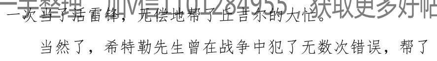

当然了，希特勒先生在战争中犯了无数次错误，帮了同盟国无数次大忙。但是这一次，明显是原则性的问题——战争爆发前夕，一名曾在柏林制造“恩尼玛”机器的工程师被驱逐出国。

原因很简单，他是太犹太了。

大家完全可以想象一下，这位被驱逐出国的犹太人是多么愤怒。仅仅因为血统差异，他就失去了家园，失去了财产，失去了一切……连自己的祖国都无法踏上一步。

好吧，既然你让我滚蛋，那就要你的命！

于是，这位愤怒的犹太工程师，毫不犹豫地来到了英国，径找到了伦敦情报部门——英军6处。他对英国人说：“只要给我1万英镑（不愧为犹太作风），我就可以凭记忆，为你们制造一部最新式的军用‘恩尼格玛’密码机……......剩下的，我想力尽军用了。德国的命运，就因为这德国犹太工程师的“变节”而彻底改变——在北，在诺曼底，甚至巴罗萨，这台“超级密码机”将会爆发无与伦比的功效。很明显，除了英国那与伦比亚的‘世界兵工工厂’盟友，再加上这台超级密码机，阿甘希尔必须坚持下去。”

+ ①德国“恩尼格玛”密码机的外形看起来像一台老式办公字机（见下图），它有26个字母键，而且它的字母组合非常复杂，破解起来极其困难能够使用它虽然看上去不起眼，但它的保密性却是世界一流的。内部有3个转轮，也就是26个字母，26x26x26=17576种变法。而且3个转轮是可以拆卸并相互交叉位置。这样，字母的组合多了6种变法，同时6种变法可以无限放大为10397150种复式系统。“恩尼格玛”密码机打出来的字母就有17576x6x10397150=几十亿可能性。而它的密码必须双方事先约定好的初始值。因此，德国完全相信这种机器是绝对可靠的。直到战争结束，德国人都怀疑过自己的密码被破译。

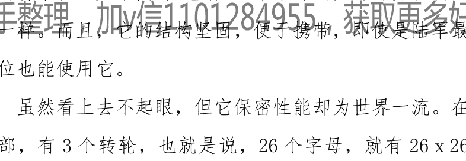

假如希特勒下知道自己无可信任的密码被破译并利用了五年之久，恐怕会活过来。一台德国军用三轮“恩尼格玛”，后来德国海军还使用过四轮的，结局都一样——被破获。

{IMAGE}
这是“恩尼格玛”密码转组

{IMAGE}
这是“恩尼格玛”密码子

{IMAGE}
英国“超级密码”他的工作原理至今未被英国政府公开，仅知道它能自动模仿“恩尼格玛”电路

## 全面袭敌

庞统在飞机上发现德国的动作：这让他非常震惊就截获到了这一情报，并报告了丘吉尔。

随即，丘吉尔又将这份情报转交给了当时就任皇家军总司令的邓迪。丘吉尔把手上的纸片一扬道：“看吧，大进军就要开始了”。

两天后(8月8日)，邓迪将对战斗指挥部的成员发布了一项重要命令：“不列颠大战就要开始了。皇家空军的成员们，大英帝国的命运掌握在你们手中！”

起初，空军将士听了邓迪的抬头都很纳闷：“将军从得知德国即将入侵？”对于此，邓迪将从不解释，他只强调：“这是绝对可靠的消息。”

果不然，从8月8日开始，德国空军的进攻明显加强了。实际上，这是“鹰袭”的前奏，他要在正式进攻之前，试探一下皇家空军的虚实。那天清晨，德国空军出了上百架轰炸机，在英国南部海岸几乎所有的港口外投放水雷，以达到封锁英国海军的目的。

这一次，皇家空军毫不示弱，他们立即出动战斗机中队进行拦截，数百架“喷火”和“破风”呼啸而至。

在这里，德国空军玩了个小招：他们假装单独派遣轰炸机投弹，而护航的ME109战斗机则藏在远处，一旦皇家空军飞入预定位置，他们就会从几千英外的地方……也就是说，德国空军刚从机场起飞，还没过吉利海峡时，英国人就已经把他们探测了出来。皇家空军抱有特殊，因为他们已经发明了一种叫做“雷达”的新型无线检测装置。当时雷达已经探测近300公里以外的飞行物。所以，皇家空军也玩了个小招：他们假装不知道有伏击，依然跑去攻击轰炸机队，乱散。真相德国空军却以为英国人已经“上钩”。


可是，一旦双方交火后，德国人猛然发现自己处钻的战术怎么占不了便宜。英国空军似乎洞察一切——一连行的角度都是对着太阳的方向。无奈之，双方可以改变作战位置，但第一回合交战，德国飞行员就吃了很大的亏。因为，一旦接过慢，德国空军似乎是锁定了自己的，非得规定的水雷才肯离开从多佛角——250多公里的战线上，几乎没有处在不断增加新的轰炸机。最近起，英国投入了1000多架战斗机。这也是近为止，战斗最为激烈的一天，双方损失都达到了最高。（与以往多佛海几十次小型战斗相比，是不不可喻的）。就在那天晚上，战斗结束时，皇家空军欢喜地对外声称，他们落了德国空军24架轰炸机和36架战斗机；而德国同样欢舞地声称，他们落了49架皇家空军战斗机。双方都宣布“自己是胜利者”。实际上，皇家空军才是真正的胜利者。因为真实数据是德国空军损失31架，皇家空军损失19架。要说英国方面是统计错误可以理解，德国人凭抛出“击落49架”，真是吹牛不上。

作者：万国威宁天下 日期:2009-09-27 06:28

## 关于超级密码的一点解释

对于超级密码的描述，德哈特二战史哈吉尔回忆录这些算正史的书籍里面是绝对没有的。因为英国政府第一次公布超级密码是在70年代中期，因此70年代前的正史是没有记载的。要说正史的记载的，超级密码只有伦纳德那本（不列颠战役）一笔带过，他写道：“在决定如何部署兵力方面，邓迪有一个机密，连他手下的指挥官甘曼的帮助非常关键。甘曼获取了许多信息并不完全，英国情报局可能让他接触了许多关于密码的机器，但是，他们甚至能在德国空军的飞机起飞之前推测出进攻的目标和参加战斗的数量。当他自己的飞机派上天时，他已经看到了德国人无线通讯的记录。”

作者：万国威宁天下 日期:2009-09-27 06:50

来说Enigma

关于超级密码的作用我过两个版本：一种就是效率高，认为超级密码被夸大了；第二种即为“超级武器”。然而我采用的是第二种，因为

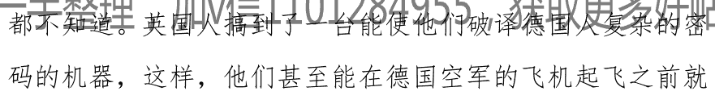

后来英国记载的世人知的考文垂大空袭及巴罗萨行动，即：英国驻莫斯科官员准确的警告苏联进攻日为6月22以及阿拉伯战役5艘不同地点出发的意大利油船被英国空军同时击沉一事，包括诺曼底登陆不在前线，将发现超级密码无处不在，不过还没写到那，具体的以后再说吧。

作者：万国威安天下 日期:2009-09-28 17:14

连载159
戈林的美梦

英国空军在8月8日的胜利，并未让邓迪上将感到一丝欣慰。实际上，英国空军现在的处境相当不妙。当时，邓迪一方面要增加压力，另一方面又要损失很多飞机，他的航空大队应该应该属于“迷你版”。如，皇家空军第10航空大队仅拥有48架战斗飞机，而数量最大的第11航空大队，也仅拥有28架战斗机。

并且，这还不算问题。关键在于，他们的飞行员更为缺。8月份，兵工厂就产生了14架各种战斗机。可是，由于缺乏飞行员，大部分飞机无人驾驶，只能成批像沙鱼罐一般放在库房里。一个流传在英国的小故事就能很好说明这个尴尬——在8月份的一场空战中，一位飞行员驾驶的“飓风”被敌人击中，机身被打成了筛子，就连他的座舱都漏掉了。按照说，英国人的政治觉醒太低，这位飞行员应该跳伞坚持回机场。可是，这位飞行员成功坠降之后，一旁气呼呼赶过来的军官道：“混蛋，你到底搞什么鬼？明天早上就可以获得架新飞机，现在好了，我花很大功夫去修理它！”

于是，这位愤怒的犹太工程师毫不犹豫地来到了英国，径找到了伦敦情报部门——英军6处。他对英国人说：“只要给我1万英镑（不愧为犹太作风），我就可以凭记忆，为你们制造一部最新式的军用‘恩尼格玛’密码机……......剩下的，我想力尽军用了。德国的命运，就因为这德国犹太工程师的“变节”而彻底改变——在北，在诺曼底，甚至巴罗萨，这台“超级密码机”将会爆发无与伦比的功效。很明显，除了英国那与伦比亚的‘世界兵工工厂’盟友，再加上这台超级密码机，阿甘希尔必须坚持下去。”

 ①德国“恩尼格玛”密码机的外形看起来像一台老式办公字机（见下图），它有26个字母键，而且它的字母组合非常复杂，破解起来极其困难能够使用它虽然看上去不起眼，但它的保密性却是世界一流的。内部有3个转轮，也就是26个字母，26x26x26=17576种变法。而且3个转轮是可以拆卸并相互交叉位置。这样，字母的组合多了6种变法，同时6种变法可以无限放大为10397150种复式系统。“恩尼格玛”密码机打出来的字母就有17576x6x10397150=几十亿可能性。而它的密码必须双方事先约定好的初始值。因此，德国完全相信这种机器是绝对可靠的。直到战争结束，德国人都怀疑过自己的密码被破译。


假如希特勒下知道无可信任的密码被破译并利用了五年之久，恐怕会活过来。一台德国军用三轮“恩尼格玛”，后来德国海军还使用过四轮的，结局都一样——被破获。

{IMAGE}
这是“恩尼格玛”密码转组

{IMAGE}
这是“恩尼格玛”密码子

{IMAGE}
英国“超级密码”他的工作原理至今未被英国政府公开，仅知道它能自动模仿“恩尼格玛”电路


--------------------------------
ME109只有一台发动机 不存在

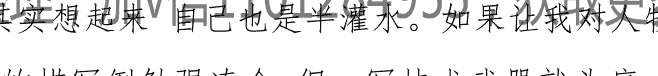


8月10日，一场突如其来的暴雨导致戈林的“鹰袭”被延迟。想当初，挪威战役之时，希特勒提前一个月就先给气象专家打了招呼。而戈林呢，他居然连天气情况都不考虑，真是失败得很惨啊。

更让戈林尴尬的是，随后的两天时间，英利海面上空乌云密布——不是大风，便是大雨。于是，他被宣布：“鹰袭”延后3天，改为8月13日。

8月12日，天气稍见好，由20架战斗机小队①组成的德国突击小组贴着海面，偷偷接近了英国本土。他们的目标只有一个——英国防空系统。

实际在近几个月以来，德国情报局一直在秘密处理无线电报和加密信号。在英国方面立即觉察的发现，德国军部署在本土的“海岸低空搜索雷达网”，可以清楚地知道德军机动情况，使德军失去了至关重要的突然性。为了改变这个不利地位，希特林决定，在“鹰袭”行动前一天，首先要彻底摧毁英国雷达系统。

有意思的是，所谓的英国“海岸低空搜索雷达网”不知出了什么故障，居然没搜索到这低空飞行的德国突击小队。上午11时，12架ME110战斗轰炸机在英国海岸的悬空咆响后，指挥官在传话简里说：“第三中队，预祝成功。”

这是突击队的出击信号，只有12架ME110分成6组，呼着肺向了英国南部的6个雷达站。当时，英国人的设计的雷达站相当仓促——在这条极其重要的防御线上，他们既没有战斗机，也没有防空炮，甚至防空洞都没有。

而雷达站的工作人员，又都是临时招来的“空军后救援队”的姑娘们。她们就在雷达附近单薄的木板棚里工作，这些棚子建在浅的海体内，只经过了简单的仿装，很容易被认出来——投精确的炸弹，而有20毫米机枪的俯冲射击；

毫无疑问，德国的袭击相当成功。当他们飞临雷达塔上的时候，浑然无知的“空军后救援队”的成员没有一个想到逃跑，她们立刻向战斗指挥部传送着信息，直到开始撤离。

德国人也不含糊，他们投下的炸弹摧毁了6个雷达站的地面建筑。在“喷火”中队到达之前，这支突击小队毫无全身而退。返航后，突击小队向戈林报告：“任务取得成功，敌人地面建筑被彻底摧毁。”

事实上，他们才赢得了这次战。因为，真正遭到摧毁的雷达塔只有一个——经过英国工程师紧急抢修，在袭击仅3小时后，5个雷达站又相继开始运转。

同时，英国人还想出了一个妙计，他们从无线电出发信息，到处传谎雷达站已被炸毁，并在通话中装出惊慌失措的样子。

德国国防军听即即把把振振心的消息告诉了戈林，空军元帅得意非凡，也不怀疑其真实性。8月13日，他下令：执行“鹰袭”。

① 德国突击队为8架ME109护航，22架ME110悬挂最新实验成功的新型炸弹，其实就是潜鱼雷改装……

ME110是一种常规气动布局、采用悬挂下单翼和双立尾的飞机，细长机身前方有一个长长的纵列三座舱，分别配置飞行员、通信雷达和射手。两台水冷DB605型发动机。

{IMAGE}http%3A%3A%2F%2ig1.laibafile.cn%2Flaiba%2FImages%2F6890173%2F1254654030188342008%2FA%2F1%2Fm.jpg

最初，ME110是作为战斗机投入不列颠战斗的，由于体型过大速度慢等缺点，后来大多数被改为战斗炸机或轻型轰炸机。

{IMAGE}http%3A%2F%2Fimg1.laibafile.cn%2Flaiba%2FImages%2F6890173%2F125465412803597148894%2FA%2F2%2Fm.jpg

## 戈林撒谎

说也好笑，8月13日，近乎德国的轰炸机编队刚一起飞，离岸在继续，诡异的英利海面上空再次刮了一阵强风，风暴吹得战斗机编队歪歪斜斜的根本无法形成队形。无可奈之，戈林元帅得下令“取消行动”。

大多数战斗机接到戈林的命令之后开始返航。只有那位赛林元帅用无线电里呼唤了几次，才把50架护航的ME109叫回。那位死心的芬克上校率领的74架轰炸机在继续飞行，这一阶段结束，由于获得提升，他急于立功。可是，一旦没有护航，就连饺子简直自寻死路。

此时，英国雷达系统已经搜索到了这支轰炸机，把错误的情报给了指挥部。英国空军指挥部眼见只有这一点飞机，于是他们只派出了12架战斗机进行拦截。英国雷达站的错误，彻底挽救了德国大队的命运。

幸运的芬克上校率领的轰炸机群抵达了目标——伊斯斯特特奇机场。当芬克上校穿过云层，看见伊斯斯特特奇机场的时候，被眼前的景象惊呆了——他看到大批“喷火”式战斗机齐齐地停在跑道上，伊斯斯特特奇机场一片安静。

在随后的战斗中，德机只有4架被击落，但他们却推毁了地面上10架“喷火”战斗机，让伊斯斯特特奇机场陷入瘫痪。之后，芬克上校借助云层的掩护顺利返航。这次赢得了神般的胜利。8月13日下午，戈林获得了好多订单，客户很满意，我们将及时再次执行“鹰袭”计划。

附注：德国第2、第3、5航空队实力表：

| 航空队 | 司令 | 司令部 | 兵力（飞机） |
| :--- | :--- | :--- | :--- |
| 第2航空队 | 凯塞林元帅 | 比利首都布鲁塞尔附近 | 232架轰炸机、406架俯冲轰炸机、65架远程侦察、195架战斗机 |
| 第3航空队 | 斯坦海尔元帅 | 巴黎市郊 | 138架轰炸机、48架远程侦察、37架战斗机 |
| 第5航空队 | 施夫上帅 | 挪威 | 约100架轰炸机 |
| **合计** | | | **3021架** |

英国第10、第11、第12、第13航空队实力表：

| 航空队 | 司令 |Area | 兵力（飞机） |
| :--- | :--- | :--- | :--- |
| 第10航空队 | 帕朗德空军少将 | 英国西部（北爱尔兰一带） | 48架战斗机 |
| 第11航空队 | 帕霍克少将 | 英国东部（伦敦附近） | 228架战斗机 |
| 第12航空队 | 马洛空军少将 | 英国中部 | 168架战斗机 |
| 第13航空队 | 索尔空军少将 | 英国北部（苏格兰） | 168架战斗机 |
| **合计** | | | **648架** |

另外，德国飞行员是皇家空军的十倍。

如果之前德国只是试探性的进攻，那么现在，他们就是要彻底摧灭皇家空军了。下午16.30分，英军本土的大规模空战正式打响。德国第2、第3航空大队出动了前所未有的1500次战斗机——他们的轰炸机中队和战斗机护航队，先轰击了英国南部安普敦至泰晤士河口的目标，延伸战线长达250公里。

为了轰炸安普敦这个英国最大的港口，德国人投入了150架轰炸机，并由一支ME109机队护航，皇家空军派出了4个中队迎战德军。在伦敦东部，德军轰炸了汉堡和多塞特郡的几个机场，其中多弗机场受到严重破坏。在伦敦西，德军一个轰炸机队轻易冲散了英军防线。低速发的“斯图”式轰炸机巧妙地利用东南部的云层来掩护自己。不过，厚厚的云层让他们绕过了战斗机的拦截，直到燃油耗尽，未能找到目标。于是，“斯图”式轰炸机转向南方，开始返航。但到泰晤士河上空后，他们撞上了一支战斗机队列，英国军飞行员也不管自己弹药充足否，冲上来与德军拼命。然而，这样做是不够的——面对时速600公里的“喷火”，“斯图”式轰炸机完全不堪一击。

{IMAGE}img/e3af7bca71f2cd5cf2bbbf2034cab_49_0.png

此刻，英国战斗机几乎停留在各个机场加油，没有升空部队。他们只能默默地接受这种致命的“斯图”式代价。由于占据优势，德国人根本不计这些损失。6点15分，86架“斯图”再次横跨英利海峡，发动夜间袭击。

深夜，德国最高统帅部发表战报：皇家空军有88架战斗机被摧毁，其中70架“喷火”式。德国人自己的损失为12架飞机。这个帝国元帅即向全世界宣布：“我们获得成功。”为了犒劳将士，他下令战区所有飞行员时加份香酒！

庆祝的香酒是否吞嗓子的为太早了？实际上，打脸了胖子的德国空军这天损失的飞机数量难以置信。我们的飞机损失是微道的。我们的胜利是巨大的。

我们总结“鹰日”战斗的经验教训，德国情报部门私下询问了飞行机组成员，交谈中得知在当天的战斗中，有一件事发生轰炸部队遭遇了一个极为痛苦的印象，即：英国人似乎不知道自己在哪里，英国的雷达站没有被摧毁。有些飞行员甚至抱怨：“什么摧毁机场，我们只击中了跑道尽头的帐篷和小仓库。”

## 黑色星期四

自认完胜的戈林打算再接再厉，继续加强空袭力度。在他看来，皇家军似乎只剩下最后一口气了，只要再插上一刀，就会断气。

参照戈林自己颁发的训令，作战重点最高原则为：“不分昼夜，不分空中，也不要受其他条件约束，应该重攻敌方飞行部队。”虽然这个战原则看起来还不错。但仔细细想，“不受任何条件约束”这句话简直就是胡乱——8月14日，英美盟军击得了多好多胜利。

哥尔基基的气势发生转折，整个德国东部地区在多艘舰队的袭扰之中。优亨老奇有意的和戈林过去不去，在最关键时刻，英国人修复了他们，溃散了多余的飞机。尽管这一天没有大规模战斗，战性的袭击从未停止。一些王牌飞行员就曾驾驶他的ME109在英利海面上空到处杀某些英国侦察机。阿道夫·甘兰德就是其中之一。作为德国最早的王牌飞行员，按理，身为中级指挥官，他应该安稳地坐在办公室里调度，而不用生命升空。

闲，甘兰德自出击的做法并不是简单的想要提升个人战绩。为了在飞行员当中树立一个良好的榜样，甘兰德甚至发明了一种几乎近迷的战术——在整个8月份，独自驾驶他的ME109飞过英利海峡，勾引那些侦察机。当他发现皇家空军侦察机时，就装看不见，在附近上下绕过来，正好在敌人的火力范围之外。这种做法会让英国人心心不已，英国人都挡不住这种诱惑。此时，甘兰德马上转向，假装惊讶。可是，甘兰德总是保持在追击者面前，既让他们跟上，又让他们失去目标。直到英国飞行员到达理想位置后，甘兰德便拿起他的无线电通知那些守候新手：“孩子们，你们的猎物来了（由于这招实在隐蔽，简直就把英国飞行员当狼耍嘛）。”

由于人员的不断损失，甚至惊动了上将。他不得不订下了一道命令，“禁止飞行员在英国海岸之外追逐飞机。”语重心长的对他：“我要活着的飞行员，而不是死去的英雄”。阿道夫·甘兰德在整个二战期间击杀104架战斗机（全部是在战线取得），如果最终被升为战机，他的战绩应该更多，但也可能在残酷的本土防御中牺牲。甘兰德飞机签名的涂鸦——一只追雪焰的米鼠，身上安装了可以点燃雪焰的坦克。戈林视察甘兰德战果。一次戈林发现甘兰德佩戴的铁十字勋章上是假宝石，非常生气，他对希特勒进道：“代表德国最高荣誉勋章，怎么能用假宝石呢？”后来希特勒再次颁发了一枚真宝石的勋章给甘兰德。

## 黑色星期四（II）

“猎鹿”持续了一天——8月15日星期四早晨，英利海峡出现了罕见的好天气，暗灰色的天空彻底晴朗起来。每个德国飞行员都明白，大规模的战斗又要开始了。没错，希林正是这样的。他的命令令德国空军再次发动全面袭击。第2、3航空队所有战机全部升上天空，另外加上两个航空队百分之七十五的侦轰炸机和百分之五的轰炸机，加入一次性使用战机最多的一架。其余剩下的轰炸机留到第二次进攻。

狂妄的希林相信，最终消除皇家空军的日子到了。可第2、3航空大队的战机刚一升空，柏林军部突发来一封急电，电令上写道：“因天气不好，停止攻击命令”。由于德国空军总部根本没有料到天气发生变化，各航空队的指挥官都被希林接到卡琳姆庄园赶回了。留在布鲁塞尔堡指挥的空军参谋保罗·希曼上校完全没把这封电令当会事儿，他长时间地仰望天空后，得意的说道：“已经晚了！”

说完，他把电令丢，干脆办了。在第2、3航空大队出击的同时，希林还玩了一个小招——这个命令对希林来说，简直是天赐良机。事实证明，希林的计划是这样的——他首先飞过北海，然后偷偷越过苏格兰，最后对英国东部的机场进行袭击。希林坚信，英国空军肯定被住了，他的袭击计划万无失。可是，由于缺少雷达的跟踪，第5航空大队自挪威战役以来，就闲得太久。因此，他毫不不豫派出了自己全部战斗机。由于德方情报失误，第5航空队至少在之前被上了。

## 黑色星期四 (III)

8月15日下午13时45分，第5航空队第一波共65架轰炸机，在ME110的护卫下，于4500米的高度飞行。当时，海上漂浮着薄雾，能见良好。这里的德国飞行员并未懊怀，他们形成了方形阵。在这个编队最前面的队长雷斯特曼上尉，他的任务是侦听英国战斗机之间的通信联络。他以此为破口，制定德国轰炸机相应的战术及飞行路线。可是，还没等他听清什么内容，英国的一架“喷火”式机就顺着阳光向扑来。雷斯特曼还没来得及加入阵方，被对方密集射击命中，雷斯特曼上尉在对讲机的最后一段记录是：

“左侧发现喷火战斗机！”
“敌机正从太阳方向飞来！”
“我被敌击中……！”还没说完，他的飞机就冒着烟焰，尖叫着一头栽进大海。轰炸机队与指挥部的无线通讯就此中断。等德国飞行员回来，另一架英国飞机从背后向德机发起了新的攻势。事实上，英军战机已经远远超过了德国战斗机轰炸机数量和。一架德国飞机冒着烟焰进入了冰冷的北海之中——他们连招的气力都没有。更让德国飞行员感到痛苦的是，德国战机在源源不断。体积积累的ME110压根不是“喷火”的对手。而唯一与“喷火”能够一搏的ME109却崩溃——英国的航程太远，未参与护航。此刻，ME110护队考虑的问题不是如何保护轰炸机，而是逃命——他们的编队被打了，英国战机正在追击四处溃窜的“容克大妈”轰炸机，天空出现了一幅“一侧倒”的追逐场景。位于护航队尾部的ME110驾驶员里希希塔中士也无心恋战，开始溜之大吉。可未转向，从后面袭的“喷火”就击中了他。里希希塔中士中机枪子弹击中头部而失去了知觉，飞机一个侧歪向斜坠下。座在里希希塔中士后面的一位哥们眼见自己没事，也不愿上像友谊，他双脚一蹬，跳选择逃命了。可是，这位哥们

命不好，因为，希希望中士突然清醒过来，在高度刚掉到云层下面时，他又重新控制了飞机。尽管头部大量出血，他还是努力控制飞机，飞过北海，迫在丹麦埃斯堡城外的一处地上。而那位跳伞的他们们从此失踪，下落不明。

在希希望中士落在丹麦的同时，施登上将在敦指挥部里焦急地等待消息。直到太阳快要落山，他亲眼看见自己的战机冒着一串黑烟，狼狈地飞了回来。

这次战斗，他们一共损失了22架轰炸机，及7架战斗机，连英国本土的边都碰着。而英国空军却取得了史无前例的大胜利——未损失一场。

可以想象，这样的结局足以把施登上将气晕过去。特王约翰加入，他的轰炸机抽出了第5航空大队全部轰炸规模的20%（总数138架）。更让他错愕的消息还在后头呢——戈林电令：由于偷袭失败，第5航空大队自此退出不列颠战役。

剩下的100架轰炸机全部拨缴第2航空大队，以补充第2航空队的损失。

也就是说，第5航空大队仅此一役，就彻底退出战斗，可谓威养伤了。

作者：万国安宁天下 日期：2009-09-08 00:08

不列颠战役造出来的赢，不带劲，前几天看一看东线的书籍，愁得我有我有一些冲动。啊，传奇的东线，好久能写到你哪儿呢。


作者：万国安宁天下 日期：2009-10-08 00:14

我查了一下，那位跳伞的哥们名叫盖斯·黑卡，真是个倒霉蛋，掉进北西洋谁能救他啊。我在幻想，这位哥们在空中缓降时，突然看见自己的座机再次发动后的表情。

作者：万国安宁天下 日期：2009-10-08 00:20

请问 LZ，德军在二战中的王牌飞行员，驾驶的是ME109吗???

大多击落英国的，还是毛子的？？？

======================================

对，牛B喷哈特曼击落352架战机的战绩多数在ME109上。

# 取理 加1101284955

不足，完全是被淘汰。所以，德国飞行员在线上击落飞机几十架的比例都是，击落100架以上的，德国飞行员中就有107个。兰兰德在西线取得了104架的战绩很不容易，毕竟盟军飞行员的素质毛子高多了了。

作者：万国安宁天下 日期：2009-10-11 06:02

连载166

专家说......

在第5航空大队羽而归的同时，第2、第3航空大队的袭击取得了成功。从早晨到夜间，“斯图卡”和“容克大妈”依次穿梭于英吉利海峡，轮番轰炸皇家空军的机场、炼油厂，以及地面设施。从泰晤河口到伦敦郊外的比金山，在长达300公里的战线上，空战一直未曾中断。德国空军数量上的优势，在这一刻，得到了淋漓尽致的体验。

面对庞大的德国机群，盟军上将不是派出太多的战机。特别是在主力空军被派往苏格兰阻击第5航空大队后，留在英国南部的战斗机中队指数偏低。英国飞行员往往是刚经历一场战斗后，退回基地加油后，就守在飞机旁，奢侈草草吃两听罐头。一出击流声响起来，他们又继续猛升空。德国飞行员平均每天作战2次以上，已经成为常见的事情了。

也就是从这一天开始，数量巨大的“英国国民自卫军”结束了对德国的战术胜利，盟军开始搜索伦敦的德国飞行员。一般来说，德国飞行员中并不抵抗者，他们悠闲地抽着烟，坐在原地看着英国人来俘虏自己。他们始终确信，被俘只是暂时的，德国军队不会打上英国本土。特别是某些曾在法国被法国内缴获后，又因法国政府投降，得以释放的德国飞行员。这种被俘经历，他已经遭遇过一次了。因此，这些死不悔改的“老油条”妄妄地对蜂拥而至的英国人叫嚣道：“你们别得意的太早了，元首很快会把你们统杀光！”（被击落了都如此如此，实乃世所罕见）

这一天，德国空军的袭击一直持续至深夜很晚才停。当精力竭尽的双方飞行员休息时，德国空军已派出了2100架战机。其中，有520架针对皇家空军及其设施的空袭。德国人宣称，皇家空军有12个机场瘫痪，99架飞机在空中被击落。英国人也欢欣鼓舞地称重创了敌——皇家空军起飞974次（实际746次），击落敌机182架。与以往一样，以上都是注水的。

| 日期 | 德国空军损失 | 皇家空军损失 | 德国空军起飞次数 | 皇家空军起飞次数 |
| :--- | :--- | :--- | :--- | :--- |
| 8月15日 | 75架 | 34架 | 每天早晨 | 晚上 |
| 8月16-19日 | 每天100多架 | 每天500左右 | 每天600左右 | 每天800左右（极限） |

不过，德国空军想靠这种战斗来消灭敌人，似乎也不现实。虽然从数量上看，德国几乎是皇家空军的十倍，起飞次数也是对方两倍以上。但德国炸机是由机组人员驾驶，而英国人的战斗机是单座的。命运只有两种——被打死；或者被俘虏。但英国人的情况不同，只要跳伞成功，第二天就能收到一台战斗机。

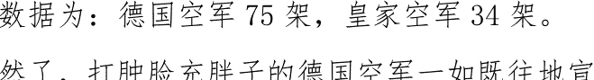

同时，稀糊涂的德国情报部门也帮了英国人。8月16日，德国情报部门估，皇家空军一线战斗机降到了300架。四天之后，情报专家又向戈林报告：“皇家空军在此期间损失60架，现在剩下的不足150架了。”最后，这些专家推出了一个极为荒唐的结论：“皇家空军已不再有一防御力！”

事实证明，无论在哪个国家，都不能相信。因为当时的实际情况是，皇家空军仍有一线战斗机750架，除去飞行员后，飞行员也在500左右。最初，戈林相信了专家的结论。这也是为什么他愿意每天损失100多名飞行员的代价，持续空袭英国。在此，在这个荒谬数据的指导下，德国空军在错误道路上越走越远，大规模空袭一直到了8月19日。但是戈林并不是傻子，摆在眼前的事实是：每当他的轰炸机飞过英吉海峡时，总能派出大量战机。

8月19日，戈林再也无法掩饰自己的不满，也不再相信专家们的数据了。他知道，皇家空军远远没有被消灭！那天的中午，空军将一批对英作战的航空团长召集至卡林姆庄。一开始，戈林的态度和平，他还特意邀请这些前线指挥官美美地吃一顿丰富的午餐。可是，聚餐结束后召开的会议上，戈林突然性情大变，他粗粗气地强调道：“之所以损失，由于你们犯了错误，并且你们空袭战术也有问题！”戈林这种不理解的态度，指导们早就以为常，他们默默地听着，从反驳。戈林一看没人提出异议，更为得意，他像教训小学生一般让他们继续说道：“只要轰炸机拥有足够的战斗机护航，就不会遭受如此严重的损失。”他说：“一部分战斗机应先行冲一，以排除轰炸目标上空的威胁。每批次的轰炸机必须要有战斗机的护航，禁止单独出击。”而且，他要求战斗机和俯冲炸机一起俯冲，以确保轰炸机投弹后的安全。

戈林的这些要求，空团长们面面相觑。他们疑惑的是，现在能够作战的飞机在不断减少，补充又跟不上来。帅的固然正确，但问题是，我们到哪里去搞那多的战斗机呢？

可是，戈林从考虑实际情况，只会纸上谈兵。他宣布战术上一定要修改，他还下令：“暂停一切空袭行动，等待具体战术完全修改之后，再进行第二轮轰炸……”为了掩盖失败，戈林又玩了他的老招——会议结束，戈林对外宣称：“由于天气原因，登陆要暂停数日……”还别说，戈林这招还实用。世界上还没有人怀疑德国空军是因为损失惨重才被迫停止的。就连英国飞行员相当惊讶，“德国飞机可以这样补给？”

当时，也有奥吉尔老先生在四处宣传“英国空军取得了决定性的胜利”。可笑的是，这句话几乎没有人相信。由于受到德国空军不能胜神话的影响，，都不相信。后来，奥吉尔只好把记者带到空军队进行采访，以证明自己的清白。奥吉尔这种做法甚至到了荒唐的地步，奥吉尔派人四处搜集被击落的飞机残骸。那一天，生产部报告说：“我们在地上找到了几十架飞机残骸”，奥吉尔立即兴奋。他立即这一消息公布于众，架势直不得。


十年之后，丘吉尔对此事耿耿于怀。丘吉尔明白，这不得不是表演手段之一。为了抱美国大腿，冷眼还是忍吧。

① 当时职为空军作战队长的维纳尔在回忆录中写道：“就算在关键时刻，戈林不在自己的指挥部，这种古怪的战术，让插子掀开了。”此前，戈林在赛会庆典晚宴上横加指责，认为英军失败是因为德国情报部门差许多。
② 德国空军指挥官估计，要满足戈林提出的“全面护航”的要求，他们拥有4500架以上的ME109。可是他们只有不足1000架ME109。
③ 戈林那位也是酒鬼，没事就拖着飞机班了，请见谅。他的好朋友，现在脑里还举着一堆战斗机。

作者：万国安天下 日期：2009-10-11 17:33

与陆军相比，德国情报部门差许多。

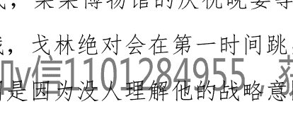

情报也是一场糊涂。当时陆军统帅部估计苏联只有150个师，也就是说比德国多一点而已，这还不包括独立旅。古德里安在1937年出版的书中估计，苏联有360个师，1万坦克，这还是保守估计。战争爆发了才知道苏联有2万坦克。希特勒在1941年8月对古德里安说：“早知道你书中的数据是正确的，我就就不会发动这场战争了。”他时就把古德里安听的事的栗的你现在后悔有毛用啊。

连载168
作者：凯凯 发布日期：2009-10-23

暗格不明的战争

德国空军将领的“消耗战”让希特勒备慨折。在8月中旬，希特勒把时任空军总监的米尔契元帅召进总府，对他大不解地问道：“为什么连打败英国空军这项基本任务都没有了？是啊，几个月过去了，你们空军到底干什么吃的？”米尔契元帅瞪目结舌。米尔契先生冤枉得很，他只是个空军总监，换句话说，是负责后勤工作的。对于前线局势，他并不了解多少。按来说，这种纯军事上的问题希特勒直接询问戈林就行了。可是，为了顾戈林的面子，希特勒从未这样过的空军将军，呆在柏林的米尔契反倒成了戈林的传言人。关于空军的一切，希特勒都把他来到来到米尔契将军不知道如何回答之际，希特勒接着说道（这句话听上去像是在自嘲）：“莫斯科对当前战事进展很不满意，他们多么希望我们流血至死。”这句玩笑话算是给米尔契将军将了。他并不知道，希特勒的心思早不在“海狮计划”上面了，而是在遥远的东方。

虽然希特勒并没有准备备戈林。但可想而知的是，米尔契正在处理将军的错误，报告告诉他的：陆军正在法国沿海海岸没日夜地训练登陆作战；海军的登陆舰也齐聚英利海峡登陆港口。万事俱备，就差东风。

可是，东风在哪里呢？实际上，整个第三帝国高层都被戈林给悠了。他们并没有看出，戈林的“鹰表”其实已经违背了“海狮计划”蓝图。从战略角度而言，“海狮计划”是一次海陆军相互配合的行动。但戈林偏望仅用空军就能击败英国。可气的是，戈林并未点破。(img/e3af7bca71f628cd5cf02bbbf2034cab_568_0.png)

来说，陆军和海军都别操心了，用空军就足够了。所以，陆军和海军此时已经变成一盘沙。希特勒也不肯出来主宰大局——需要的时候，他又变成了一个冷的旁观者。

① “海狮计划”暴露出了德国三军内部惊人的缺陷。三军都有司令官，都有自己的参谋部。为了最高机密，不向任何军公开。假如元首不过问，他们连希特勒也告诉之。于是，三个军种就各的想法。先说陆军吧。当时陆军总司令罗布劳希望是：如何真正意义上击败英国。（有关的朋友可以详见《帝国的兴亡》这一章）。再说海军吧。其实一开始，海军总司令雷德尔就对“海狮计划”充满质疑。他一门心思早就布局在“中东”。8月份，雷德尔曾把一份海军参谋部搞出的“中东计划”，与希特勒审视。但希特勒只看了一眼，就把雷德尔锁进了保险柜。而空军呢，又想把“海狮计划”变成自己的独角戏……可以看出来，只有陆军计划才是真正意义上的“海狮计划”。两个军种的计划实际上已经偏离了正常轨道。由于三方保密工作实在到位，三个军种不知道对方在想什么，以及打算如何。希特勒对俄国问题焦如火。三个国家、四个脑袋、四种战略并存，真是有趣啊。

思想很混乱，问题很复杂。但是，这场针对英国的战争还是要接着下去的。希特勒虽然还想和俄国开，可毕竟不傻，两线作战的教训是他脑中挥之不去的阴影。他也知道，在没有解决英国的情况下与俄国开战，他的将们肯定也不会同意。因此，针对俄国的军事计划，顶多一份军事备忘，知道此事的人更是寥无几。善于摩尔凯特尔这样写道：“从表面上看来，首领好像非常热心消灭英国，全力投身准备工作。”他曾要求准备工作随时作出改进，以加速其进程。但是，我却有这样的印象，那就是一旦真正要实施这个计划时，他又绪起来，举棋不定。他十分清楚要冒何等巨大的风险，也明白肩上的责任有多重久而久之，举棋不定的希特勒突然产生了一个奇怪的想法、一个与戈林不谋而合的办法——凭空军就能击败英国。希特勒原话是：“即使不侵入，英国也能服”。能取得英国胜利固然好……但是，如果不经侵入，就能取得廉价胜利，那自然好了。总之来说，希特勒不想“交费”，他想打败敌人，又不想花本钱。于是，从8月下旬开始，“海狮计划”实质上已经变质。戈林的要求是获取更多好。那么，戈林能负起如此重任吗？戈林的回答：我是能。8月21日，也就是“鹰袭”暂停后第三天，懒性的帝国元帅来到了法国北部前线。德国空军主力屡受挫，让他满腹疑问。皇家空军的战斗机从哪里来的？怎么没把它们从隐藏的地方找出来？皇家空军的军需工厂和维修站怎么炸不完？更使戈林感到不满的是，他的前线指挥官们，对于这些疑问也是一问三不知。情报部门不断发布一些自相矛盾的解释，他们一会说，皇家空军有崩溃；一会说，皇家空军仍未消灭。


进行恐怖袭击，可以瓦解平民的斗志，最终使士气低落的英国人走到谈判桌边。

戈林不为所动，他反问道：“柏林人向恐怖袭击屈服吗？我不可相信。我看，伦敦人也也不会求饶的”。

最后，戈林将日期定为8月24日。这个日期，被欧洲史学者称为“襄袭之战”第二阶段；它同样是不列颠战役最为关键的阶段。德国空军依然是要完成第一阶段未完成目标——全方位歼灭我家空军！
决定胜利的日子到了。

作者：万国威宁天平 日期：2009-10-17 16:20

连载171

想要更多精彩内容
8月24日，就在这一天，戈林回到了卡琳庄，坐等前线捷报。在返回后，戈林特意来到了多佛海峡的一个前线侦察哨所，这个观测所面面向英国，属于英国本土最近的海峡阵地。戈林通过高倍望远镜盯着海峡的断峦看了好一会——英国雷达就放在他的视线里，但戈林什么也没有说，只是撇起脖看了老大半天。后来，陪他观察的一个人回忆道：戈林似乎可以看穿那些白色的断峦，看到英国仇敌的心心里......

(戈林此时的表情，应该是咬牙切齿的)

8月24日早晨，第二阶段的攻势如期开始。第2、3航空大队的80个战斗大队全部调集到一线机场，担起这份重担的年轻指挥官们并没有辜负林对他们的期望。从某种意义上来说，戈林人事的调动，这对战役起到了至关重要的作用。这种看似轻率的调动，放在其他国家的军队来看，也许是一件不可思议的事情。那些年轻飞行员们没有上过专业军官学校，且缺乏正规培训。换句话说，没有文凭，休想当官。

然而，德国空军的表现告诉他们，这是一个极为腐朽的观点。几乎从战役爆发一刻起，英国防御部队就痛苦地认识到，敌人在空中执行的新战术是多么的有害和巧妙。为了对付英国雷达监测人员，德国空军派出战斗群在伦敦沿海区域袭击。他们对计划的把握，并没有完全如计划所愿范围之内。这样一来，“空军妇女后援部队”的姑娘，就只能整天在调度室里，戴着耳机，麻木地拿着长棍在地图块上来去去。但是，她们又无法预测哪一块板上的飞机机会突然迎战的击。

24日上午9时，德国空军就靠这种办法，突然袭击了第11航空大队的基地。第一个遭到袭击的是曼斯顿（英国西部小镇）。这个地区的机场附近的建筑几乎全部被炸满了弹壳，电话和电报线路被切断。曼斯顿镇本身也遭到了沉重打击，有大量的民伤亡。所造成的破坏是如此巨大，结果，幸存的居民只好永远地废弃了这座镇。

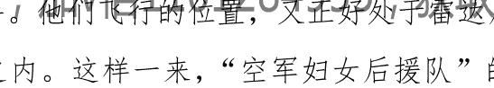

子从此离开。离伦敦不远的另外两个战斗机基地也遭了严重破坏。击中这些目标对德国人来说，是一个具有特殊意义的胜利。

因为，这些目标都是战斗机指挥部的扇形雷达站——一旦英国飞行员起飞，这些扇形雷达站就能指挥他们向何处迎敌。

第 12大队接到保卫基地的命令后，从英国西部派去了两个战斗机队，但他们来得太迟，德国轰炸早就溜了。

作者：万国威宁天下平 日：2009-10-17 17:06

连载172

现在，德国空军已经忙遍了，他们整天就这样绕着英吉利海峡掠飞着。几天下来，英国南部地区的雷达监察人员被搞得理智交加，机场几乎毫无掩护。

无奈之下，丁特上将不得不改变战术，他命令士兵迅速在接近海峡沿岸的地区开辟机场，更多的战斗机。这正因为英国空军下忙，当皇家空军集结在前线机场时，那些德国机群突然掠过英国本土。可是，当皇家空军升空迎敌时，这些机群又立即返航，让皇家空军扑空。更绝的招数还有在后头兜圈——皇家空军绕着英吉利海峡一圈，发现敌人返回地面加油之时，另一只德国机群就会从这个缺口一拥而入。


抵达英国国内后，他们还会分散机组，袭击多个目标。亚吉尔后回忆：“德国人不断加强对英国本土的袭击，南部和东部的机场。当时驻在斯坦莫尔的战斗司令部非常焦灼不安。5个前进和6个战区机场都遭到了严重的破坏。在沿海地区的夏斯顿等两个机场，接连九天不能供战斗机使用。有人曾参观了其中的几个战区机场，特别是夏斯顿，几乎是不活了，简直被炸得乱七糟，跑道到处是弹坑，像月球上的环形山。”亚吉尔最后写道：如果敌人坚持对这些机场进行猛烈袭，并破坏他们的作战室或电话联络，整个战区司令部就可能瓦解。这不仅意味着伦敦遭受了摧残，而且意味着失去了这一地区的全部制空权。

而且，更是亚吉尔棘手的问题是，皇家空军战斗机防御力量开始变弱。从8月8日以来，皇家空军被击落和被伤无法修复的飞机总数加起来有270架。由于战斗机的生产得到了加强，这些损失可以算是微不足道的——他们仍能派700架战机天上作战。虽然飞机坏了可以修理，被击落了也可以再造。但是，飞行员哪里能制造呢？

824日战斗那天开始，皇家空军指挥部向亚吉尔报告：皇家空军有94名驾驶员牺牲或失踪，60名被打伤或烧伤的正在医院里治疗——这是全部飞行员的1/6。一位英国作家曾痛心的写道：在萨克斯罗斯小镇的医院里，住满了烧得惨不忍睹飞行员，他们的脸、手、头发和皮肤都被烧毁了。他们第一批被称为“试验品”的年轻人，因为美容手术给他们恢复一个人的样子……

## 一、处理信息

华者万国战宁于上午四点：2009-10-17 18:06

不知道，不列颠空战上5万字了，不知道是详细还是繁琐。总觉得少了就和其他文章一样了没有描绘的必要。因此战略人物描述过详，我想尽快结束不列颠造了这么多字。

作者：万国威安天下 日期:2009-10-17 20:38

沙友……顺便请求下楼。到时写到东线把英对西线的轰炸对德国的军事潜力造成了多大的影响……就是德国和苏联单挑的谁胜大……从那些战史上看不出来。

这也是描述重点。

作者:万国宁天平 日期:2009-10-20 18:31

连载173

为了填补飞行员的空缺、丘吉尔和丁特上将可以说是想尽了一切办法。首先，丁上将想借助某种战术来摆脱这种种困境。他规定：禁止飞行员单独升空，必须几个中队联合行动，至少要有20架战斗机允许出击。

当事态进一步严重时，丁上将不得不要求其它的航空大队派增援。这样，凡是能够参加战斗的大部分飞行员，都被炸死第11航空队。其中，英国空军只剩下家里豪家的几个飞行员。其人数，刚刚凑在一起像果麻将。正如，负责英国中部的第12航空大队被抽调到只剩5名飞行员（这还是人数最多的一个）。连海军空空队、轰炸机大队、海岸警备司令部，也把自己的飞行员补充给正在战斗中的战斗机大队。

德国空军很狡猾，他们自然知道第南部防区是负责伦敦郊的飞机制造及炼油厂集中的地区。因此，他们也不攻击目标。由于占据数量优势，德国空军往往会在双方空战最为激烈的时候，派出一小队携带轻型炸弹的Me110战斗机，专门去袭击机场跑道。换句话说，Me110负担着双重使命，既可以战斗，还可以轰炸机场。皇家空军的飞行员们在天上打完一场仗后，返回基地时，发现他们不在。另一方面，德国空军把机场变成了废墟——许多英国飞行员正是因为没有跑道而亡命。总的来说，德国空军不仅占据数量优势，还用这种手段消耗皇家空军。到9月初，皇家空军飞行员数量遭遇告罄。短短一周内，就有446架战斗机被毁，13名驾驶员阵亡，28名损失，这个数字几乎是全部飞行员的1/4。奈何之，亚吉尔将护，通过外交渠道招募了一批从美国来的志愿者。其中，有一个中队完全是由美国人组成的；而其他中队主要由波人和捷克人组成。不过，这些飞行员的技术水平远远没有达到战斗的要求。特别是那群来自美国的飞行员，他们是一批不怕靠谱的家伙，只会显摆高技艺，也不听指挥。他们大部分没有军事经验，没受过高等教育，说实话有些人是为了避债或家庭事务，才“自愿”投奔皇家空军。当然，更多的美国小伙是觉得打战刺激，想来冒险了。这些背景各异的美国人大多自我标榜为“飞行高手”，老实的英国绅信为真。但当这些“高手”上了战场后发现——他们至多开过轻型民用飞机。这个第11战斗机防区（注意图上虚线）。这个大队的防区也就是美国空军重点攻击的对象。

http://2.laibafile.cn/Images/6890173/25603446095617850.jpg

作者：万国威宁天下 日：2009-10-20 20:33

正在整理……美国飞行员的欺骗行为让英国人感到好气又好笑。如一名美国志愿者为了加入皇家空军，他在报名的时候，把飞行的150小时拿着铅笔轻轻一划，变成550小时。这还算老实的，有些美国人更是凭空乱乱，说自己曾经飞了多少个小时——实际上是刚学会会飞飞机。最憋屈的是丘吉尔首相。因为他最初的想法是依靠这批志愿者渡困难；然后再经宣传，加深一下英美国家的感情。倒来发现，他盼的居然是一大群活宝。后来，皇家空军只好把这帮美国的大老爷放到后方基地去训练——从教练机重新过。

外国人不靠谱只好找自己。到9月6日，皇家空军的空额已经升至260人。丘吉尔咬咬牙，踩踏脚：“实在没人，那就从飞行学校把学生训来吧！”后，丘吉尔对这些学员的评价是：“这些人是新手，热情很高，但缺乏经验，其中很多人还没有学完飞行课程……”。不管怎么说，这批新手比美国来的菜鸟强多了。至少，他们懂得如何开始战斗。再还没比美国有强。丘吉尔也相信，等到这批飞行员消耗完毕后，美国人的训练也就差不多结束了，到时候他们有替替换人员。

从9月份起，这个月月末剩下的两个月就不适合登陆战斗了。同时，丘吉尔认定，随着伤亡的加剧，德国人肯定会率先经不住巨大的伤亡，从而取消空战——就像第一阶段那样。

这样，不列颠空战变成了一场暗不明的“暗战”。双方的争斗不再局限于数量上的较量，更多的是意志上的坚持。双方都在紧咬牙关，达到领先拖垮对方的目的。

可是，德国空军本就不给丘吉尔留机会。因为，他们发明了一个更为新的战术——一个可以在短时间内干扰皇家空军。值得强调的是，一直以来，德国空军对夜间作战并不重视。原因很简单，夜间丢弹的初衷是希望在夜间轰毁跑道，阻止皇家空军。久之，他们发现，夜间空袭还带了一个意想不到的效果，那就是干扰飞行员正常作息。这样一来，英国飞行员休息都没有。有时候，飞行员刚返回营地准备洗睡觉，结果却哨声响起来，他们不得不立即战斗。一方面，战斗后，英国飞行员回到营地直接挂椅子上。几天下来，这些飞行员疲惫不堪。而且，英国空军已经接近极限，绝望地。一名英国战斗队的队长写道：“我觉得我们被打了，输掉了这场战争……那是一支精疲力尽、已被完全打垮的队伍。”

作者：万国守天 日:2009-10-20 21:29

连载175

困惑的丁特。皇家空军这种战斗都非常困难——当英国工兵修复地面设施时，另一波轰炸机又呼啸而至，把正在建设中的跑道炸得稀巴兰。此时，英国飞行员明明已经接到了出击指令，可是呢，没有完整的跑道可以升空，他们只能眼睁睁看着一波又一批的德国轰炸机掠过头顶，到达英国内陆。

9月2日，德国空军的行为就更大。在以往，他们每次完弹后，就会等不及的往回赶。可这一天，他们却不慌忙忙的掠过英国小镇和田野。就连法国还遥远。

作者：万国威宁天平 日期:2009-10-25 22:04

这是一个极为准确的判断，德国空军第二阶段仅仅过了一周，他们的敌人就已经走到了边缘。9月1日，美国驻柏林记者就报道了他们周围洋溢的欢。。德国军预言，“海行动”将在四天之后进行，卫字旗将扬在伦敦上……而对他们来说，此时的前景黯蓝。德国空军总司令部的结论是：“新飞行员消耗耗尽，简直连常规换都不来及”。当然，丁将军站在战略的角度去考虑问题。而飞行员关心的问题是，德国空军昼夜的空袭，让他们睡不好。

## 夜间空袭

可是，如何让德国空军改变既定战略、转而袭击伦敦呢？

从德国而言，丁将军极不愿意见这种事情发生。作为一个虔诚的基督教信徒，一种良心的自责，让他寝食不安，整天愁眉不展——伦敦，一个800万人口的城市，德国炸弹如果落在这里，将会造成巨大的伤亡，这是良良道的丁将军想也不多想的问题。对于战局的发展，他只能祈求上帝。就像他后来坦诚的那样：“我希望奇迹的出现”。

作者:万国威威诚天下 日期:2009-10-25 22:15

德国飞行员几乎已预感到，胜利在眼前了。此时此刻，对丁来说，只有一个办法、只有一个办法能改变这种局面。那就是以伦敦为诱饵，逼迫德国空军就范。

丁的想法很实际。因为，如果敌人按目前的进度，继续进攻战斗机指挥部的话，伦敦很快会暴露在敌人面前。既然伦敦很快会在敌人面前无遁，早早超生，不如现在就......

换言之，只要德国空军转移目标，战斗机指挥部的压力自然减轻了。皇家空军就可以获得一点喘息、休整以聚集力量再战。

一缴费加v1011028495，获取更多好帖


“立即向伦敦投弹的部队名单报上来，空军总司令要亲自处决这些指挥官”。

而戈林采取的处理方式也颇符合性格。后来，他把手一挥，华丽地挥道：“把这些飞机全部转到部队去”。顺便提一句，这种手段是戈林十分惯用的惩罚方式，谁要是惹怒了他，戈林就会威胁要说要把他转到陆军服役。好似德国军队是专门藏污纳垢、收容空军罪犯分子的收容所一样。

无论怎么说，错误已经既，显然将无法作出任何反应，可吉尔乔却想不到，这简直是送上来的一个理由。第二天，吉尔乔就不等不及跳出来回应道，大意是：

“你们这是故意的，大帝国必须采取报复。”

然而，他们却事与愿违，英国空军飞机报复地摧毁了柏林的鲁恩森林区。此时，柏林城可以说是世界上最稳固的堡垒，它的郊外配置了内外两层高射炮和数以百计的照探灯。当然了，这只是万一的措施。之前，戈林曾信誓旦旦向所有德国人保证，英国飞机绝不可能出现在柏林的上空，更不可能被炸弹落在柏林。

可是，当英国人真正袭来时，庞大的柏林防空队依然连一点准备都没有。而且，那天柏林上空云雾密布，厚厚的云层连照探灯的光束都无法射击。德国炮兵只是听其声不见其影，只好瞎子打炮——乱打一击。结果，英国轰炸机在云层上面盘旋了足三个小时，他们未能摧毁一架飞机。


与此时，英国人还扔一些传单，传单上写道：“希特勒发动的这场战争将继续下去，它将和希特勒的一样长！”(这句话恐怕真的应忽略了)。

作者:万国盛安天平 日期:2009-10-26 04:40

连载 178

##震惊的纳粹独裁者

当英国的炸弹落在柏林人民的时候，他们简直被惊得目瞪口呆。柏林人民没有料到，竟会发生这种事。当这场战争开始时，戈林曾向他们保证，不可能发生这种事……

他们相信相信了。因此，他们今天的绝望程度更大了。一来说，柏林的德国人认为：“我们还能看到他们好多脸措措的表情，就能衡量出这一点来”。

同样感到不可议的是希特勒。当英国轰炸机袭炸柏林的消息传来时，这位纳粹独裁者正实在德黑疆边的边的别别墅。他万万没有料到，弱小的皇家海军竟敢轰炸柏林。难道丘吉尔疯了，丘吉尔的做法是“妄妄不可及之举”？他会批准这样的事吗？他不怕打击报复吗？

因此，希特勒拒绝相信这一事实。直到那位狼狈不堪的戈林打来电话，他才相信了。戈林在电话里保证说：“以后不会再出现这种空袭了……”

希特勒却评价：丘吉尔的做法是“妄妄不可及之举”。


不过，希特勒并未对这件事做出公开回应。当时就从未发生过一般。后来，希特勒甚至为英国空军辩护起来，他官称：“这是英国空军引导装置太差所致，这完全是一次误炸！”

但是，英国空军的引导装置也太差了点——8月28日夜间，皇家空军更多的飞机飞到了柏林上，而且这一次，直接炸到了柏林市中心，炸死了10名柏林市民，炸伤了29人。这次空袭让英国空军长戈特尔博士大为震惊。在第一次轰炸时，戈特尔命令将事实严格报道空袭，但现在，他指示报刊用英国“野蛮地轰炸”柏林手无寸铁的妇孀大肆渲染。首都大部分报纸都用了差不多不相调的标题，如：“惨怜的英国轰炸？”或者是“柏林的空中掠盗”！

关键信息：希特勒将勃然愤怒。很多报纸都登了许多火的照片，他一言不发。

丘吉尔首相顾不住了，如果希特勒再不回心转意，那他一切努力岂不白费？

在此，在9月1日、9月3日夜间，皇家空军的飞机连续两次光临柏林上空。而且，他们总是伏击夜出，飞得越来越高。投下的炸弹，也是稀稀疏疏的。更使希特勒感到迷惑不解的是，是英国空军的轰炸完全缺乏计划和目标。他本来害怕他们试图攻击交通系统，或者不断地轰炸油厂。然而，在整个过程中，英国空军攻击的只是柏林市区，炸死的全是平民。

丘吉尔可不管这些，他要一直炸，炸到希特勒气为止。

作者:万国威宁天下 日期:2009-10-26 04:44

前段时间遭遇了点个人问题，心里都闷，本人不太好。

作者:万国威宁天下 日期:2009-10-26 19:57

有一个问题啊……二战夜空战是如何发现对方的？还是夜空战本来就不是天空战一个模式的？英国空军夜间作战的技巧并不熟练，而且当时的技术也很糟糕，夜间搜索困难，直到他们晚上的炸弹比白天的多，地面也借助探照灯才能发现目标。而且很多时候他们不需要护航，正如伦敦的轰炸机没有护航的情况下进行攻击。问一下：戈林的保证什么时候兑过？特别是斯林格勒战役算是二战史上最大的笑话。


作者:万国威宁天下 日期:2009-10-27 04:28

今天才知道真相，原来的都是对轰炸伦敦的报复，不是丘的阴谋，这个爱抽雪茄、爱喝酒的长寿大胖子，真是为了达到目的，想想后来的手段，坐视政治真的是最脏的事情！当时皇家空军指挥部已经明白这是一次误袭，原因很简单，如果德国空军真的是炸，怎么会派两架飞机来。而且戈林也处罚了“罪犯分子”，虽然英国政府可能知道这一点，后来的德国空军基本上没有临伦敦上空。由于男人感情要看点，不是女人，已经失眠了。

作者:万国威宁天下 日期:2009-10-27 05:33

德米斯克包围圈大致还是成功的。其实我认为，德米斯克基本上全由希特勒一手包办。

连载 179 元首很生气，后果很严重。9月4日，在皇家空军四次夜间空袭柏林之后，那位表面上无所不能的纳粹独裁者终于坐不住了。一周以来，戈林不断建议采取报复行动，并嚷嚷要炸伦敦。但希特勒却不许可让德国轰机击英国首都。可是，刚过了一周，希特勒却发现，自己却是让这种行为，“不知好歹”丘吉尔不给他面子，反倒三五次的空袭柏林。今天，希特勒不得不承认，自己已经取得了很多好处，人民来发表了话。而且这一次，希特勒不仅只是动动痒皮那么简单——他决定报复。以牙咬牙的报复。9月4日，是德国一年的训练活动。元首要出席的消息，他几乎等到最后一秒。他显然不是要搞破坏，而是担心英国空军可能进行的轰炸。虽然集会在天黑前一小时举办的。值得一提的是，这是一次即兴演说。尽管希特勒通常习惯在演讲之前站在镜子旁边练习很久，但今天，他显然没有这个时间。不过有时候，愤怒是不需要排练的。当希特勒走上演讲台那一刻，几乎每个人都能感觉到他那怒火冲天的怒气。

 有的是，在演讲一开始，希特勒对柏林遭到袭击之事闭口不谈，反而大肆嘲笑起吉莱。一位美国记者写道：“我很少看到这个纳粹独裁者那样喜欢冷嘲热讽，或者那样喜欢德国国民所认为的幽默，虽然希特勒基本上是一个毫不不幽默的人”。首先，他嘲笑了吉莱近期的几次失败，并形容吉莱是“那个浑臭的战地记者；只有神经质的老母祸”。他嘲笑：“此今为止，英国军队却只有忙忙逃跑的技巧”。他感到难以倒。他还冷嘲热讽：在德国把同盟国击溃之后，同盟国却没有提过过去说：“我们只想把德国引诱到那里，这是什么样的奇世无二的胜利吗！”

 自然都是妙妙的。于是，希特勒就继续使他的听众（大部分是女士）发笑——随后是震耳欲聋。不过，这样的幽默并没有持续多久。希特勒突然发生转折，变得活跃起来。总来说，他是一个容易冲动的人，让德国人民心中想得到一个问题：“对于柏林遭到夜袭将采取什么行动？”关于这个问题，希特勒慷慨地回答：“如今，吉莱实在展示了他的新招——夜间空袭。为什么夜间空袭？那是因为德国空军不能白天飞行，都能飞到英国领土上。”希特勒让他的听众放心，因为他计划在夜晚扔下两万、三万或者四万炸弹……伦敦人一直好奇地问：他们为什么不来啊？着急，别着急。在听到这话时，年轻的德国妇女几乎跳了起来，口中高喊：“我成了！我成了！”很多好处这样的效果非常激烈，希特勒相当满意。由于显然调动了他们，开始越来越兴奋。其程度丝毫不比听众多。那位美国记者继续写道：这时，歇斯里的妇女才从狂喊乱叫努力挺起胸脯，像声般的大声回应：“绝不会！绝不会！真的吗？”

## 丘吉尔的越狱（丘吉尔的梗）

作者:万国威宁天下 日期:2009-10-28 18:33

顺便提一下，丘吉尔原来当过记者，希特勒称他为那个臭名的战地记者。是因为丘吉尔在战争中被俘，然后越狱（一说是跳火车）独自逃出来的。并通过越狱事件而闻名全国。尼松总统回忆说，丘吉尔很喜欢提起越狱之事。当时，众人甚至悬赏500镑抓他，没想过他留得快，跑掉了。后来丘吉尔就把悬赏500镑的布告挂在家里。直到尼松总统去拜访他的时候，这块告示还挂在家里。丘吉尔指着那块告示对尼松说：“我得了很多奖金，500镑！”目标，伦敦：后世学者曾指出，假使希特勒坚持原来的空袭策略，德国空军就可以取得胜利。但是，希特勒顽执偏偏被丘吉尔的击激怒了——他当着10万人的面，做出承诺，一定要给丘吉尔还以颜色。意大利外交部长萨亚诺在罗马听到广播后，就迷惑不已在日記中写道：希特勒一定是神经过敏了。希特勒的确经过敏，甚至更严重。因为，他已决定把伦敦从地球上抹去——而戈林呢，他早就期望这样做了。上周以来，柏林竟遇到4次轰袭，这一定让德国元帅大为丢脸，他决定找回这个面子。9月5日，戈林就乘坐专列“亚洲号”来到了法国北部。次日晚上，在加莱港和布洛港之间的一条铁线上，他为航空队的指挥官们举行了一次聚会，会上有了最好的葡萄酒和食品。戈林宣布：“从现在开始，他亲自指挥这场役”。随后，众人一起高欢“为胜利干杯……”这场胜利赢了希特勒。

12小时后，即9月7日星期六下午，戈林一醒来，便正式下达了空袭伦敦的命令。凯塞尔元帅应该很高兴，那轰炸伦敦的计划得以实现。凯致勃勃的他，甚至还带着戈林来到加莱港巡察。当时，约有300架第二航空队的轰炸机，在648架战斗机掩护下，朝伦敦进击；这个大机群在4500—6500米高空气飞行，密密麻麻的一层层向上形成梯形。另一队战斗机与轰炸机相近只有200米距离，在四面方位，给予严密护。当事人回忆：当这机群呼啸着从戈林头上飞过时，戈林那圆脸上放着红光，像是在等待。

 与此同时，位于伦敦的空军总部如临大敌。丁丁上副少尉跑进办公室，神情凝重道：“雷达发现大批飞机起飞”。听此话，丁丁急了，他忙站起来，来到调度观察台前，俯视下方那张地图。此时，妇女正戴着耳机，用长棍推着地图上的标记——是伦敦。随着新情报不断外面传来，标记也被放在桌上。为了观察方面，丁丁又急奔雷达观察室。让他感到不安的是，德国海军击的主要目标。丁丁上肯定道：“这可能是自为止，德国空军最大的一次进攻了”。

作者:万国威宁天下 日期:2009-10-30 09:08 他说对了。其实我们都错了，是二战一个复刻版。有关的炸了。


作者:万国威宁天下 日期:2009-10-30 09:13 丘吉尔几次比较著名。

作者:万国威宁天下 日期:2009-11-03 07:39 丘吉尔的演讲稿。连载 181 

没有任何有效内容。输出“[content]<!-- no content -->[/content]”。连载 179连载 180。

作者:万国威宁天下 日期:2009-10-30 07:39 丁丁上失算。

丁丁上全神贯注看着雷达，下令：“航空大队所有战斗机全部迎敌！”虽然这个命令听起来很提劲，但航空大队实际无法处理，加上战斗机数量寥无其几。更何况的是，丁丁上此时产生了一个错误的判断。他以为敌军会再次袭击战斗基地。他主动让出了伦敦的通道，把战斗机留在地上空，保卫基地的安全。丁丁上同意了他的战术。因为按照惯例，德国空会在到达英国上空之后，突然散，袭击多个目标。此时此刻，德国空军快要登陆伦敦上空了，还是聚在一起肯散开。站在雷达屏幕前的丁丁上显得惊讶得苍白，内心产生了一种不祥的感，他后来回忆，当时的感觉“犹如一把匕首，插进了心脏。”

 丁顿正在想这事时，他的助手又说话了，这位呆头傻脑的助手问道：“这就奇怪了，他们好像不准备散开，是吗，先生？”是的，他们没有分开。从这一点来看，希特勒是个诚实人，他虽说要空袭伦敦。要怪，只能怪自己没有注意9月4日那场“激情”的演出吧。现在，德国第一批飞机已经过了泰晤士河口，他们沿河而上，有几架飞机炸弹投到了泰晤士河的油罐上，这些油罐在先空中被点燃，火还在烧着。但是，外面还有320架炸弹炸毁了他们。正在这个时候，让人惊异的事情发生了——一方面对德机的大举进攻，伦敦城居然没有报警。也许，他们把德机当成了“路过的军群”。在泰晤士河两岸，普通市民瞪大了眼睛，从敌机视角从头顶掠过——像是在观战的一场好戏。他们甚至还可以看见敌机来在阳光下的影子。然而，空中没有英国战斗机的影子……当德机大举进攻的消息传到英国地面防御部队时，泰晤士河两岸的防空炮火力逐渐加强。当时，英国防空炮有两种型号，一种是轻型火炮，射程5500米；另一种是远程火炮，射程11000米。


作者：万国安宁天平 日期:2009-11-03 08:29

更新很慢，我很自责。其实我是在许多热情朋友介绍下花了太多时间去照相。虽然理由有点儿久欠，但却是实情。

作者：万国安宁天平 日期:2009-11-05 13:13

连载 183

## 伦敦燃烧（II）

正如伦敦民所预料的那样，当夜幕降临之后，德国更多的轰炸机飞到了伦敦上空，呼啸而至的炸弹把伦敦城的维多利亚码头、西印度码头和商业码头炸得一塌糊涂。许多市民如无头苍蝇一样在街上到处乱乱，哀号声与呼唤声不断。

可是，他仍然找不到皇家海军的影子……

当然了，伦敦民中也没有怕死的老人——譬如那种英国老绅士——英国大法官寇廷绅士，居在敌战前的时候还在俱乐部里休息。后来，他儿子马杰森（内阁成员）只好把父亲从废墟中强行背了出来，这两位大佬老爷们家园被毁，没有住宿地方，奈奈之下，他们只好跑去敲丘吉尔的门，要求住宿一晚。当丘吉尔在地下室为他们铺好了毯子和床单的时候，那位马杰森先生才猛然想起，“咦，我老婆跑去了？”

为了给英国人民做出表率，温斯顿·丘吉尔则是另一位。爱在炸弹落下时，走出大厅防空洞到大街上随意流洒的人。有人试图阻止他这样做，丘吉尔的侍从甚至把鞋子藏了起来，想以此阻止他外出。但是，丘吉尔总是生气命令他把鞋子出来。“我要让你知道，”丘吉尔声如雷，“从我小时候起，当我想去格林公园散步时，我的保姆就从来没有阻止过我！现在是大人大了，道夫·奇特也不能阻止！”

道夫·奇特确实无法阻止他这样做，丘吉尔就这样看着滚了。

德国空军连接不断的轰炸，一直持续到第二天凌晨 4 点 30 才停止。丘吉尔后来道：“人情……”

奇的是，在如此平静的一个夜晚，从建筑物遭到破坏程度来看，我们的伤亡人数大约超过了2000人。

这个数字大到让丘吉尔预测，因为英国专家预先估计，毫无防备的伦敦一旦遭遇袭击，亡员人数将非常惊人。结果炸弹造成的亡大远低于预期。

然而，就英国人而言之，此刻他们的心情愤怒，筋疲力竭，他们刚刚经历了一场持续 15 小时的“轰炸波”，结果呢，天上没有一架自己的战斗机，一种被本政府抛弃的想法油然而……

皇家空军确实在伦敦上出现过，因为他们的敌人太大了，仅凭自己这点儿兵力，根本就不可能撕开 M-109 和 M-110 组成的保护方阵，皇家空军只好在周边地区打击，欺负那些单的轰炸机或者小型舰队。德国空军在返回基地的路上被击落了56架（其中34架轰炸机），皇家海军自己则损失了26架战斗机。可以看到，皇家空军确实到了山穷路尽的地步，他们居然都不敢与德国硬碰了。

这一次，德国人有充分的理由认为，他们将伦敦的对空防御系统大大捣弄了一番，当德国空军投下炸弹的那一刻，戈林通过电台向德国人民发表了讲话，他的声调充满了任意，他害怕德国不知道似的强调道：“我在亲自指挥这场战役，他一拳击中了敌人的‘心脏’。”

随后，戈林又打电话告诉他妻子说：“亲爱的，你知道妈妈，伦敦在燃烧。”

---

作者：万国威安 时间：2009-11-08 13:25
楼主不厚道，我前脚替你解图，你后脚就发表文章了。

---

作者：万国威安天平 日期：2009-11-08 15:05

连载 184

## 不是尾声的尾声

9月7日晚，伦敦被炸那天夜，英国政府突然抽了风——在白厅的地下总部，英国领导人向英伦岛所有部队发出了一项通告，这个通告只有一个词，它的代号：克隆威尔！

克隆威尔这个代号的含义是：“入侵在即”。许多参谋部官员认为，德军袭为入侵的前奏。加之德军派了麦菲尔，因此丘吉尔以为一部分是运送士兵和空降兵。可是，这个代号传达下去，多数指挥官就不懂“克隆威尔”代表什么，自然将其联想为“德国人的入侵已经开始了”。

“克隆威尔”这个代号原本是登陆的秘密，但是由于国民自卫队许多平民组织属于英国，想要放弃是不可能的。很快，大家才发现这可能是许多事情，整个英国开始疯狂起来。国民自卫队不断敲着钟，醒了各个村落。在街道上，村民们不安地凝视着四周；在沿海地区，手忙脚乱，毁了桥梁，处处挖了地雷、水泥桩、横木……然而，德国人的入侵行动没有开始——北海和英利海上也没有德军船而来的迹象。反倒是海军忙埋下的地雷，隔离了一些普通百姓。此时此刻，在英利海峡对岸，那位独裁者却陷入了纠结之中。“到底需要实施海狮计划？”

从表面上看，希特勒看着照片上一片废墟，仿佛报复了伦敦都是一件伟大的事。事实上，德尔从元首演讲中获得的印象是：“他决定完全放弃海狮行动。”与此同时，戈林不断向希特勒汇报，吹得天花乱坠，他估计英国人已经山穷路尽。但是问题是，从8月份开始，戈林说英国人已经穷尽了。到了9月份，他仍在不免使希特勒狐疑。于是，希特勒开始开戈林，让自己的副官贝洛获取好多好处，空军都收集了相关数据，空军参与的数据如：“英国现役战斗机有600架，必要时尚前往前线的老式战斗机也有600架”。贝洛将这些数字给了希特勒，在一次与戈林的谈话中，希特勒就引用了这些数据。这让戈林感到愤怒，他询问是谁向元首提供了这些数据，最后打了电话给贝洛，戈林问道：“你知道是哪位混蛋向元首提供了这些不准确的数据吗？”贝洛回答：“我是，元帅”。

---

作者：万国威妥天下 日期:2020-09-11:50

连载 185

## 不是尾声的尾声（II）

完全可以预料的是，火爆的戈林在电话里把贝洛少校狠狠地骂了一顿。之后，他又向空军总谋部下令：“今后元首需要的数据，必须经过他审阅才行。”换句话，希特勒想要的数据，必须经过他过滤才行。在这一里，戈林像极了那些古代的权臣，他一厢情愿地把希特勒想象成一副被他控制的“君主”。虽然，在公开场合，希特勒仍如往常般信心十足，嘴上嘟囔着：“我们还要在加利福尼亚建立海军基地，获取很多补站……”但在希特勒的计划下，这种威慑似乎取得了很好的效果，但在私底下，他不得不向现实低头。

很明显一个证据是雷德元帅的日记，他在9月6日和希特勒举行了一次长时间会谈。这位海军元帅在海军参谋部的笔记本上写道：“元首关于英国登陆的作战计划仍没有确定……”实际上，从雷德元帅这篇日记中可以看到，希特勒在长时间的谈话中几乎谈到了所有的问题，他提到了挪威、直布罗海峡、苏伊士运河、美国参战的可能性等等，从欧洲局势到国际风云，无所不谈，无所不犯，但偏就没有提到“海狮计划”。一直等到会谈将要结束之时，在雷德尔倡议下，两人才开始小心谨慎地讨论了“海狮计划”，好像两人都不怎么相信这计划似的。最后，雷德尔提了一个问题。他小心翼翼地问道：“海狮作战一旦打响，元首关于政治和军事方面的指示是什么？”注意，雷德尔是小心翼翼的。尽管他早就看穿希特勒对征服计划的思意，没料到希特勒会彻底放弃。可是，面对雷德尔的质问，希特勒也不恼，正面回答，反而有些负感。对此，雷德尔心领神会，不再提问。9月14日，“海狮计划”的死亡判决到了。此时，针对盟军的真实规模，元首和希特勒在柏林举行了一次重要的谈话，希林没有参加。雷德尔和哈尔德二人记录下了这次会议的秘密。会议前，雷德尔遗忘了希特勒一个备忘，备忘录很简单让希特勒满意了。上面写道：“当前军事结果，并没有执行‘海狮计划’提供有利条件，风险仍然大。”雷德尔解释道：“栖登陆作战过于冒险，自古以来，军事上的较量必须要付出惨代价才能成功。除非是希特勒拍胸保证自己能100%成就，否则就是入虎穴，哪里有便宜的事情？”

流出的“海狮”，以哈尔德为首的陆军将领们恐了。两个月以来，陆军一直在为“海狮计划”任务准备工作。且不说别的，光是训练士兵登陆，他们就在海边淹死了上百。如此巨大的计划，怎能如同戏似的放弃呢？因此，他们急于放弃。哈尔德进行了徒劳的辩解，希特勒认为由于各种因素，必须缩。哈尔德的争辩，又让希特勒纠结起来。尽管很多书籍把希特勒描述为一个理想主义者、自大的狂人。事实上，希特勒在重大决策面前总是长期犹豫，拿不定主意。表面上，他似乎是天赐神勇，万夫莫敌；实际上，他很胆小，害怕失败，不敢冒险。雷德尔海军日志记载，此时希特勒表现出一种消极情绪，他的思想充满了矛盾，既不打算发动入侵，又打算取消入侵。令人笑皆非的是，希特勒突然对空军抱起幻想。他以为空军仍然可以取得胜利。他说：“空军到目前不用10天或12天，英国会爆发群众性的歇底。”产生了巨大效果，虽然这种效果主要是在心理方面。他强调，“从现在开始，我们要打一场登陆，以轰炸加上入侵的威胁，逐渐拖垮英国人民的斗争意志。如果伦敦八百万居民发起来，就能导致大败。”这也无怪希特勒听到他的物资被沉了后，高兴得手舞足蹈。他得意道：“伦敦人会为几个月吃不上物资而疯狂吗？”最后，希特勒像是总司令一样做出了判断，他简明扼要地宣布：‘海狮计划’延期，何时发动另行通知。但是希特勒继续道：暂取消‘海狮计划’，登陆队必须停泊在英国海峡来积蓄。同时，英国采取最好的应对。这种做法会让英国政府感到相当压力，让他们误以为我们还会登陆。”这个决断会让哈尔德遭遇相当压力。会议结束后，希特勒对他的一位海军军官说：“我用3万士兵为代价征服了法国，若横渡英吉利海峡，一夜之间的损失就会超过这个数字，而且还不定成功。”而那位海军军官觉得元首很高兴，因为‘海狮’终于被束之高阁了。

其实，希特勒缺少自知之明，他对英国帝国一直充满敬畏，他不希望和英国打死战，所以尽量避免和英国摊牌。他的这种想法并没有错误，实际上，早在那年的8月，英国东南部海岸，丘吉尔就令修建了一批油池，他们把油注在巨大的池里，准备在德军舰队靠近海岸进行“火攻”。丘吉尔承认，他那时常常在想，即使德军登陆成功，双方都将进行残酷的屠杀，也不会用怜悯或宽待。敌人一定会采取恐怖的手段，我们也准备采取一切极端措施。譬如，“如果常规作战失败的话，我们就会放肆肮烂的毒气，来杀死敌人”。显然，这是丘吉尔最后的一击！然而，他不会等到加拿大就登陆。他并没有担心，希特勒害怕，所以他选择了自杀（不，此处应为退缩）。希特勒不意我们的入侵，尤其是打了那么久，英国军队在空上的损失一直到1941年也没有完全恢复。9月17日，希特勒已经批准拆除在荷兰机场上的设备。丘吉尔召开三军参谋会议。希特勒认为已经放弃“海狮计划”，至少在今年内不会登陆。无论如何，他们提议最危险的时刻过去了。

以上为希特勒的世界观的读者。事实证明，这位被世称为半瓶子醋世界的独者说得一点儿没错，至少，他将后半个世纪的政治走向一语道破。也许，大部分读者心中都曾认定，希特勒是一个不折扣的冒险分子，没打败英国就跟苏联联战，打输了活着。这话虽然没错，但只说对了一半。在1940年剩下的两个月中，希特勒变了花样，他打算用“间接路线”击败英国可谓绝击。而且，“间接路线”的策略在他脑中逐渐形成——他想起了那份石油的燃料。前文曾说过，“大中东”计划是一份备用的冷计划，属于被希特勒进保险柜，都懒得暗一眼的那种。可是，在1940年9月，希特勒突然对这个计划热心起来。哦，对了还有苏联外交部长莫洛托夫访问柏林，这是非常关键的访问，这次访问坚定了希特勒入侵苏联的决定性因素。


炸机大队，英国人维持多久呢？一看这些飞机，英国海军便会从直布罗陀逃之天涯。所以，使用虎伯大炮完全是大材小用……

希特勒若妄想，口若舌剑，对食品和物资供应闭口不谈。而更让苏联尔先生感到目瞪口呆的是，希特勒最后向他保证道：“德国将尽力援助西班牙”。

听到这个保证后，苏联尔先生的脑海中却浮现出这样一个念头——你一人10虎伯大炮都会得不到援助，还谈说什么意义呢？

直布罗罗海的卫星图片

{IMAGE}http%3A%2F%2Fimg2.laibifa.cn%2Flaiba.cn%2Fimages%2F6890173%2F12585460771039621065%2FA%2F1

## 一 管理：信任，获取更多帖

直布罗罗海窄处为 13 公里，最宽处也仅为 43 公里，它构成了连接大西洋与地中海的生命线

{IMAGE}http%3A%2F%2Fimg1.laibifa.cn%2Flaiba.cn%2Fimages%2F6890173%2F12585461111716872638%2FA%2F1%2Fp.jpg{IMAGE}

飘扬在直布罗罗山上最高点的英国米字旗。

{IMAGE}http%3A%2F%2Fimg2.laibifa.cn%2Flaiba.cn%2Fimages%2F6890173%2F125854624600038064103%2FA%2F1%2Fp.jpg{IMAGE}

绿点为英直布罗罗半岛，直至 1981 年，西班牙人仍旧联合国大会上嚷着收回这里，可是联合国也得不起英国啊，而且当地的居民已经被英国统治惯了，不愿意回归祖国的怀抱。

{IMAGE}http%3A%2F%2Fimg2.laibafile.cn%2Flaiba%2FImages%2F26890173%2F1258546624129313155%2FA%2F1%2Fm.jpg{IMAGE}

英国在直布罗罗半岛的要塞，远处为皇家海军军队。

{IMAGE}http%3A%2F%2Fimg1.laibafile.cn%2Flaiba%2FImages%2F26890173%2F12585467901544421246%2FA%2F1%2Fm.jpg{IMAGE}

作者：万国安宁天下 日期：2009-11-18 20:40
整理：加一101 获取更多帖

在这里，英国梦寐的胜利将落在斯哥利亚威尔。

英国在直布罗托半岛的巨炮阵地。

{IMAGE}http%3A%2F%2Fimg2.laibafile.cn%2Flaiba%2FImages%2F26890173%2F125854753814881521355%2FA%2F1%2Fm.jpg{IMAGE}

英国在这里实在了一番功夫，这门海岸炮两个字——一拉风。

{IMAGE}http%3A%2F%2Fimg1.laibafile.cn%2Flaiba%2FImages%2F26890173%2F125854758202785556754%2FA%2F1%2Fm.jpg{IMAGE}

英国佬的巨炮就是这样抬过去的……

一架英军运兵车在西班牙卫视通过边境线。

一名被捕获的德国间谍，等待的是在监狱里“躲猫”游戏。

## 王一理 加信获取更多帖

作者：万国安宁天下 日期：2009-11-20 05:34
连载189

这次会谈让希特勒感到十分沮丧。他原本以为西班牙会像意大利那样会急不可耐地加入战，，分享胜利果。

但是，他错了。苏联尔先生除了摇头还是摇头，几乎都不说实话。只见希特勒像一只推销员一般，比手画脚地试图听懂这位西班牙人。

希特勒却听到：“这场战争可能变为一场战争——美洲 VS欧洲”。因此，他劝告西班牙政府不要置于欧洲事务之外。当天晚些时候，德国外交部长林特洛强调西班牙要岛为德国开辟一个军事基地，作为将来海军进入大西洋的跳板。可是，西班牙竟然拒绝了这一点，西班牙需要现代化武器、粮食，并且要求西班牙修改宪法。

更让德国人都感到愤的是，换句话，如果不满足我们就不参战。而且，西班牙提出的那份清单足够吓人——他们一共需要：

- 80万吨石油
- 80万吨小麦
- 10万吨棉花
- 50万吨橡胶
- 6万吨原料

德国随即回复递交了部分，林特洛委婉道：“只要参战，这些条件都可以满足”。

到这里，希特勒和林特洛才明白，他们遇到的是多么艰难、且顽固的对手。希特勒道：“如果没有具体的协定，就没有意大利和德国帮助西班牙打仗！”希特勒道：“西班牙是一群忘恩负义的。”如此，但希特勒并未放弃。10月1日，西班牙窜到罗马，找意大利要小麦。希特勒早就到了这一步，他写信给墨索里暗示不要让西班牙得到粮食。与此同时，希特勒写了封亲笔信给西班牙国家元首佛朗哥，信的大意是：“我没有什么好，还和你亲自谈吧。”

作者：万国和平天下 日期：2009-11-21 16:16

## 三国轴

希特勒与佛朗哥的会晤于1023日。在此之前，希特勒忙于外交，或者说忙于世界格局重新划分。1940年9月27日，希特勒举办了一场对世界影响巨大的会议，会议期间，德国在柏林取得了初步胜利，即《三国轴协定》。在这份条约中，日本承认德国和意大利在欧洲“新秩序”中的领导地位；同样，德、意承认日本在“大亚东”建立新秩序的领导地位。

希特勒把日本入轴，显然是有他的目的。尽管希特勒从内心看不起日本，但他相信一个道理：日本海军是一支令全世界都之胆寒的力量。在近代史上，日本经历了两次战争，一次是甲午海战，另一次是日俄战争。在两次战争中，都是日本的胜利而告终。希特勒对他的将军们说：“只要拉扰日本，罗斯福敢轻易动”。他显然低估了美国的实力。

三国协约还保证，“如任何一方遭到目前未卷入欧战的中日冲突（中国并未宣战，因此称为冲突）的国家进攻时，彼此将使用政治、经济和军事的一切方式相互援助。”换句话，这三个“流氓国家”算是真正意义上结为一体了。柏林-罗马-东京为轴心的军事扩张强盗集团，从这一刻开始正式成立。而这份协议的有效期被定为10年。（可怜的是，这三个国家都没有践过5年）。

在西方，俄罗斯和丘尔吉忧心忡忡看着这一件事情的发生。丘尔吉更是跳了了出来，在英报上煽风火道：“三个强盗国家已经结为一起，他们企征服全世界！”

img/e3af7bca71f628cd5cf02bbbf2034cab_625_0.png

美国经理说：“虽然我们对协议的大意相同，但对某些细节表示很难接受”。他认为：“按照《苏俄互不侵犯约》第4条规定，在三国协定签订之前，苏联政府有权看到这个盟约的全部内容。而且不只是台面上的东西，这次协议的任何秘密条款我们还要看。”

可是，德国人都拒绝了这一合理要求。里宾特洛甫更是起了“大拳”。他对苏联外交部长莫洛托夫说：“这个条约是针对美国某些战争而签订的，并不是针对苏联。”随后，他又写信给斯大林邀请他来柏林访问。这一邀请引发了莫洛托夫的之旅。好了，说到这里，正好转继续关于西班牙的故事。

1940年10月4日，希特勒到了意大利边境的勃伦纳山口，与墨索里尼协商关于参战的各项事宜——像往常一样，希特勒认为三国条约已在西班牙身上产生了“滞后效果”，而德国统帅令西班牙不敢胆面干预。所以给英国帝国致命一击的时机已经到了：夺取直布罗陀。参战的代价竟然是相当数量的煤油。

希特勒对这个征服计划极感兴趣。他宣布：“德国愿意提供部队参加这次远征”。可是，墨索里尼竟然直率地拒绝了他的“好意”，极度自私的墨索里尼说：“自己完全有能力打败英国人，至少在战斗最后阶段用不着希特勒去救援。”前景是如此美好，这两位独裁者就不再多说了。

当事人回忆：“两个独裁者在温暖和信任中分别。”墨索里尼回了罗马，希特勒回到了巴利亚别墅。他在秋阳中闲了一段时间，“安静地考虑这项新的政治计谋”。10月20日凌晨4时，希特勒的专列悄悄离开德国，驾往西班牙边界，开始了他的“游过佛朗哥之旅”。在铁轨两侧，每隔100码左右有一个卫星巡，为了防止英国空军袭击，戈林特意调来一批战斗机进行空中掩护。在路上，希特勒情绪高涨，对这次会晤充满信心。他对同行的外交部长说：“一旦与佛朗哥会面，我就能轻松地将他交给一步。”不是吗？他出色的口才可以为800万德国人为疯狂，小小的佛朗哥算个东西？如果没有德国帮忙打内战，你这个自封的西班牙大元帅在哪里？在共产党监狱里吃牢还是在国外流亡？”希特勒就这样美美地想着，于情于理，佛朗哥都不可能拒绝他。于情，他乃佛朗哥大恩，说是有再造之恩也不为过。于理，英国投降只是时间问题，西班牙人可以靠不费劲地收复直布罗陀半岛，圆上他们200年来的梦想。10月23日下午4时，希特勒专列准时抵达了目的地——法国和西班牙边界城市汉达。这个临海小城位于法国南部的风景疗区，海边上有值得做旅游宣传的沙滩和棕榈树。此时正值金秋十月，天气晴朗明快。但是，元首压根就没有功夫欣赏美景——他正在四处搜索佛朗哥的影子。可是，台上空如也，就连苍蝇也没有。

## “最痛苦的外交”

实际上，佛朗哥故意迟到的。对于这场战争，佛朗哥一直持观望态度。最初，希特勒说：“战争已经打完了”，佛朗哥认为希特勒是错的，英国不可几天就会投降。

哎！世事如此难以意料。现在，佛朗哥翻脸比书还快——他又不愿意参战。这并不是因为他要面子，而是因为9月份发生的一次偶然事件让他改变了主意——9月3日一天，丘吉尔苦苦哀求下，美国援助了英国政府50艘反潜驱逐舰以加强海军的反潜活动。当然，这不是白给，英国政府没钱，好用土地换。最后，丘吉尔用8个岛屿外加8个空军基地买了这50艘老式驱逐舰。

虽然这事与西班牙参战没有直接关系，但佛朗哥却清晰地意识到罗斯福还顶着“黑锅”。处理的事情就是：美国与西班牙握手和平换取很多好处的问题（如果还算话，那就是事件的问题）。另外，为了西班牙，丘吉尔也下了不少努力。根据最近公开的机密档案显示，在那段时间，丘吉尔不知道贿赂多少给西班牙，英国政府也会定期向西班牙每月交付十万吨各类谷物。佛朗哥又道：“我们缺石油，缺面、橄榄油、橡胶、垫等等。”丘吉尔咬牙牙：“咯！要养他们！”可怜的是，佛朗哥拿到些东西后，也不自己用，转手高价卖给了资源匮乏的德国政府（毫不吝啬）。为了不激怒西班牙，希特勒睁闭眼，权当没看见。有证据表明，美国援助的石油，大部分都被佛朗哥转卖到了德国。这样，希特勒认为，佛朗哥不会参战。西班牙参战的代价竟然是80万吨粮食和相当数量的煤油。而且他们伸手要东西，希特勒越说越气，他吼：“佛朗哥是个可怜的虫，完全是不理！”希特勒最后结论，西班牙人“简直不可喻”。

作者：万国和平天下 日期：2009-11-21 16:20

## 佛朗哥 VS 希特勒

希特勒与佛朗哥一起站在火车台上等了足足一个钟。由于春天出现的时候，克洛网络收获了好多站。佛朗哥后来对一位军官说：“我一生中最重要的一次会议，若没有希特勒，我在心理上便处于不利。”佛朗哥回忆，出行前，佛朗哥已经下定了佛朗哥不离开。希特勒认为，佛朗哥是故意的慢。他竟未动怒，在佛朗哥睡觉那功夫，他与里宾特洛席在铁轨上铺开一张巨大地图，低声细语地聊了起来。没有人知道他们在谈什么。直到夜幕降临，佛朗哥才走出车辆。列在希特勒面前停下来时，佛朗哥明白，佛朗哥心里希望希特勒允许他离开，才能免得希特勒愤怒！他怀着不安的心情，佛朗哥走出列车，领着一群从德国人的陪伴下，朝希特勒走。首先是行程安排。在德国临时铺设的红毯上，这两位独裁者相互寒暄。照片上，他们得仿佛阔别多年的兄弟。只有知道内幕的人才知道，笑背后是各怀胎。当两人签完章后，希特勒便拉着佛朗哥，将他拖进专列会议室里。可是，佛朗哥竟然拒绝这样做，打算继续离开这位德国元首。佛朗哥声称：“这是下午茶时间，等茶后再说。”强调：“这是习俗。”希特勒尊重了他的习惯。可是，等到下午茶结束后，佛朗哥又玩了花样：“我要睡觉了，睡完再谈吧。”强调：“这是我的习俗。”

$http%3A%2F%2Fimg1.laibafile.cn%2Flaiba%2FImages%2F26890173%2F1258547230694726942%2FA%2F1%2Fm.jpg

作者：万国和平天下 日期：2009-11-26 21:43
作者：万国和平天下 日期：2009-11-26 21:58

北非战役为什么会失败，西班牙才不掺和的态度才是所有结的关键。到了1942年，德国人才会更深刻地了解直布罗罗海峡的重要性。

作者：万国和平天下 日期：2009-11-26 21:41


必须由西班牙人单独占据，这才符合西班牙人的民族感情”。另外，西班牙人必须无条件的接受法属非洲殖民地（摩洛哥），还须附任何条件。

佛朗哥大吃惊人，希特勒后来对墨索里说：“佛朗哥提出了一个与自己实力绝对不相符的要求”。特别是法属摩洛哥，大家都知道，这是维希法国的殖民地。假如希特勒把这里赐予西班牙人，法国人也许整个国投向戴高乐了。谁会和不可信的人合作呢？

面对着佛朗哥咄咄逼人的挑战，希特勒毫不示弱，他针锋相对：“德国占领了罗布尼亚半岛，就可以把英国赶出非洲；他们把英国赶到沙漠的边缘！”

佛朗哥不信他能带走非洲的边疆，你们能把英国赶多远？佛朗哥把话说得很直接，他提醒希特勒，英国背后还站着一个强大的美国，只要后勤充足，就算德国占领了整个非洲也用不——他们可以一步步打回来。希特勒洋洋得意：“我是非洲老兵，曾在那里战斗过，这点我很清楚……”

啊！元首彻底没辙了，眼前这个圆脸黝黝的西班牙独裁者如是如此？他就站在一旁的密特洛伦也觉得，“这真是一个忘义的懦夫！他的一切都是靠我们得到的，而现在却不愿同我们合作！”

佛朗哥用单调的声音不断下去，希特勒越听越恼火。


最后，他也按不住心中的愤了，在众目睽睽之下，做出了一个惊人的举动——只见他“咣”地一声从椅子上站了起来，双手握拳，全身脱口道：“既然这样，我们就谈什么可以了？”——元首的怒了。此时此刻，为这次会谈记录的摄影机还转着呢！

作者:国威安宁天平 日期:2009-11-27 13:28

佛朗哥也是个高手牌，悠悠的希特勒一忙一愣的，但他确实保护了西班牙的利益，呵呵，如果当初他没有胜利，那希特勒就可以直接占领西班牙。二战又难了，至少北非战场，英国的后勤能力大大削弱。蒙哥马能够赢隆美尔，其实就是后勤的胜利。

# 一整理~加微信1101284955~获取更多好帖

~~~~~~~

顶！

现在许多人北非战役有个误区，那就是轴心国物资不足而导致失败，其实这只对了一半，轴心国物资不足的原因是布罗萨海峡未被封锁，从而导致英国地中舰队与马耳他岛上的皇家空军能够践踏意大利的补给线，运往北非大部分物资都被沉进海里了，隆美尔物资不足就毫不奇怪啦。

作者:国威安宁天平 日期:2009-11-27 22:14

等我再补补资料，明天再更新，现有的佛朗哥与墨洛托夫德克资料单一，没新意，另外还有点别的的事。

作者:万国咸宁天下 日期:2009-11-28 10:07

- 一、瑞典产铁矿石，德国需要铁矿石。两家直接通过波罗的海交易不可以吗？为什么要通过中间人挪威？
瑞典——德国航道有几个月要被冰住（浮冰），无法进行贸易往来，因此几个月必须经过挪威维克不冻港来运输铁矿。

- 二、如果一战结束后，胜利者把德国一分为三。

# 一手整理加信1101284955，获取更多好帖

战败后巴伐利亚州也闹独立，这不算法独，德国人自己也在闹。

和英美法单独和和，可能吗？

这不太现实，那帮普鲁士军官想要与西方单独和和则必须清除“纳特莱因”，可是卫军与国防都是顶希特勒，就算他死了，那帮陆军军官也无法得到国防士兵的支持，卫军会轻而易地把暗杀分子逐个敲掉。

作者:万国咸宁天下平 日期:2009-11-29 01:01

## 连载 195 外交战

希特勒的举动显得在场所有人目瞪口呆。佛朗哥也退出去了，就如前文说那样，他继续继承人都安排好了，还怕希特勒威胁已不成？他依然蜷缩在座位上，盯着希特勒不言不语。同时，希特勒也为自己一时冲动而后悔了。他颓然坐下，接着读了下去。

希特勒底气明显软了，他用几近哀求的口吻让佛朗哥签字签约。可是，佛朗哥旧不为所动，他一口咬定，只要满足自己提出的全部条件，只要德国供应粮食和武器，他会签署条款。


苏联战斗取得了胜利，轴心也没有走近一步。希特勒后来说告诉墨索里，他与佛朗哥的会谈简直是个调剂。他说：“我宁愿挣扎三颗牙齿，也不再受这个罪了”。可是，希特勒遭遇并未此结束。根据预先安排，他要在赛赛尔举行国宴，招待西班牙人（原计划是在谈判圆满后的）。如今呢？希特勒气得浑身发抖，佛朗哥却气得下口。

佛朗哥像什么事一样开始。在整个晚餐期间，他们表现又友好。这种表面让希特勒一度恢复了信心，在众人离开时，他又又将佛朗哥拉到一边。佛朗哥单独拉到一边。两人密谈了两个小时，但没人知道说了什么。不过有一点肯定——希特勒又失败了。他怒不可遏地走下，对身边人说：“佛朗哥这个阴险的。”是呀，佛朗哥确实阴险，甚至可以说伟大。然而历史证明，佛朗哥更聪明，他比希特勒多活了整三十年，而且是终醒的。

凌晨十五分，佛朗哥专车出发前往汉达。这位元首依然一点儿都不及德国人的感受。在火车启动时，突然传出了西班牙国歌乐章，如：

# 三重1128495 此处是关键，也是许多人的转折点。在凌晨点，在国歌声中，佛朗哥就像一位凯旋的斗牛士般消失了——这也是佛朗哥与希特勒最后一次见面。佛朗哥回去当他的皇帝，希特勒继续上天的任务已经结束了。大家看佛朗哥的表情，多谦卑啊，整儿一个。

{IMAGE}http://.../laibala.cn/Images/6890173/125927508013785762{IMAGE}

作者：万国咸宁天下 日期：2009-11-29 01:15

今天只能更新一章，老是，杀到一半还是。

静下心来读施佩尔回忆录，刚读到希特勒青年时代，希特勒一直信自己是上帝来拯救德国的救世主。施佩尔说，他曾看过希特勒穷困时的几幅画，那是几幅建筑的，可希特勒一直留着没卖，因为他坚信，自己有一天，用那个权势去建造画上的东西。

看到这，我默然，这是可怕的人啊，即使生活在社会底层也曾放弃理想，他受书籍影响太深，完全走入魔了。

作者:万国威宁天下 日期:2009-11-29 01:16

# 第一章 先装去

一手处理 加微信101284955 获取更多好帖

作者:万国威宁天下 日期:2009-11-29 01:16

忘了说明，上图乃是希特勒与佛朗哥见面时德国记者抓拍的照片，开始怎么找也找着，后来在世纪纪录片中被找到了。

作者:万国威宁天下 日期:2009-11-30 03:49:33

连载 196 风雨巴尔尼

就在心中情恐不已的希特勒颠簸着返回柏林途中，一个让他大发雷霆的事情发生了（事前未有任何征兆）——他收到了一封墨索里尼写来的长信。这封信似乎经历了一番周折才转送给他，因为信上的日期是六天前。在信中，墨索里尼用极其含蓄的口吻告诉他，意大利即将进军希腊。

这封信对希特勒而言，简直等于晴天霹雳。他充满疑惑地对身边人说：“现在已经1月份了，秋雨和冬季就要来临，意大利人这个时候跑去进攻希腊，难道墨索里尼是傻子不成？”

希特勒的副官姆勒后来写道：“元首将即作出决定，暂时不回柏林，他要亲自去墨索里尼谈谈”。这时，希特勒还抱幻想，他认为自己还来得及让墨索里尼放弃这个“疯狂的冒险”。

事情来得确实突然，由于希特勒与佛朗哥会晤的消息种种据报，为了防止皇家空军袭，希特勒专列一般是昼伏夜出，秘密匆匆出发。

可如今，希特勒顾不上这些，他的专列风驰掣地朝意大利方向而去。与此同时，德国最高帅部里已乱成一团，他们事先不知道意大利人的“冒险”。举例来说，他们可以从侧面看出，德国人在突发事件中是措手不及：从柏林赶与希特勒将量凯特帅下飞机，希特勒专列已喷着蒸汽，缓慢启动了。这位总帅长也不想，只见他手提一大文件，把军攥着百米后，还是跳上了火车。但是，一切已经太迟，德国驻罗马大使突然急电：“意大利军队前进！”希特勒开始破口骂起来，并不是墨索里尼，而是德国驻罗马大使和武官说，他们都是“猪脑袋”。之后，他才改口说意大利人像佛朗哥一样，都是一群负义的不可靠友——如此大事，竟然密到才通知他。极为高兴。因为在此之前，墨索里尼也没有预先通知他。

对此，希特勒忠心胆胀，希特勒怒道：“墨索里尼这是为挪威和法国报复！”

有人肯定疑惑了，为什么希特勒让自己的小伙伴进攻希腊呢？老希忘了他自己当年德国的军衔是小小少校！

- 一、法德边界是马其诺防线，那么防线是否延伸到法瑞边界、法意边界？
- 二、马其诺防线没有包括法比边界，能详细说说原因吗？
马其诺防线包括法瑞边界也法意边界。意大利人进攻的就是马其诺防线。当时法国人都担心德国一种战术就是入侵瑞士然后越过法瑞边界进来，但德国人而是伪塞芬计划。由于法比边界没修防线，因此法军把主力全部集结在法国北部安卫普一线等和德军在阿登钻了口子直接包围之。

作者：万国威天下 日期：2009-12-01 18:27

更新有点慢、没法几天实在太忙了，早出晚归的、大家理解啊。

作者：万国威天下 日期:2009-12-01 23:25

连载197 愚蠢的盟友!

希特勒之所以引起动荡，恰出于军事与政治双方方面的考虑。希特勒认为英国自以为是可以从法国北部沿岸采取行动，从而避免了二战两国也牵连进来。大家也许还记得，希特勒在出访西班牙之前，曾与墨索里尼在诺伦山口会面过。那个时候，希特勒警告墨索里尼，千万不要在南斯拉夫或希腊采取军事行动。由于轴国日益增长的敌性，会影响美国选择。他是多么希望俄罗斯滚蛋，如果美国能换一个“爱好和平”的总统，该多好。

在英国方面，英国前首首相在1939年4月13日向希腊做出的保证，“一旦希腊遭到外国进攻，英国将提供一切支援。”当然了，希特勒从来没怕过不用的英国军队，他可担心英国空军。用希特勒自己的话说：这等于向英国发一张快占希腊的邀请。这样，英国人将进入克里特岛，他们的军事基地也会因此向前推进500公里，并锐到德国南部以及罗马亚利亚油田（普洛什蒂油田）——在此之前，英国军是飞不到这个地区的。

在讲挪威战役时曾说过，罗马亚利亚油田是德国“最软的”那软肋，德国军机械化部队则指望着那儿油井养活了石油，丹尼克跑不了，苏联还打个乌啊！希特勒完全是在破坏。希特勒一生中“伟大的计划”。还是用希特勒自己的话吧：“这种局势从军事来看是危险的，从经济来看简直令人惊恐，因为英国轰炸机偶然到了罗马亚利亚产区”。

关注码：1284955，获取更多好帖

希特勒又炸普洛什蒂油田。盟军飞行员应该感谢，或者说同盟对佛朗哥不公平，希特勒此时气头上，希特勒在火车上，积蓄多时的愤怒。他消失了——这也是佛朗哥与希特勒的，希特勒的怒了。

斗牛士般消失了——这也是佛朗哥与希特勒最后一次见面。佛朗哥回去当他的皇帝，希特勒继续。

他发现，希特勒的，希特勒与佛朗哥的会谈简直是个调剂。对他来说，希特勒的怒了。此时此刻，为这次会谈记录的摄影机还转着呢！

作者:国威安宁天平 日期:2009-11-27 13:28

佛朗哥也是个高手牌，悠悠的希特勒一忙一愣的，但他确实保护了西班牙的利益，呵呵，如果当初他没有胜利，那希特勒就可以直接占领西班牙。二战又难了，至少北非战场，英国的后勤能力大大削弱。蒙哥马利能够赢隆美尔，其实就是后勤的胜利。

# 一整理~加微信1101284955~获取更多好帖

~~~~~~~

顶！

现在许多人北非战役有个误区，那就是轴心国物资不足而导致失败，其实这只对了一半，轴心国物资不足的原因是布罗萨海峡未被封锁，从而导致英国地中舰队与马耳他岛上的皇家空军能够践踏意大利的补给线，运往北非大部分物资都被沉进海里了，隆美尔物资不足就毫不奇怪啦。

作者:国威安宁天平 日期:2009-11-27 22:14

等我再补补资料，明天再更新，现有的佛朗哥与墨洛托夫德克资料单一，没新意，另外还有点别的的事。

作者:万国咸宁天下 日期:2009-11-28 10:07

- 一、瑞典产铁矿石，德国需要铁矿石。两家直接通过波罗的海交易不可以吗？为什么要通过中间人挪威？
瑞典——德国航道有几个月要被冰住（浮冰），无法进行贸易往来，因此几个月必须经过挪威维克不冻港来运输铁矿。

- 二、如果一战结束后，胜利者把德国一分为三。

# 一手整理加信1101284955，获取更多好帖

战败后巴伐利亚州也闹独立，这不算法独，德国人自己也在闹。

和英美法单独和和，可能吗？

这不太现实，那帮普鲁士军官想要与西方单独和和则必须清除“纳特莱因”，可是卫军与国防都是顶希特勒，就算他死了，那帮陆军军官也无法得到国防士兵的支持，卫军会轻而易地把暗杀分子逐个敲掉。

作者:万国咸宁天下平 日期:2009-11-29 01:01

## 连载 195 外交战

希特勒的举动显得在场所有人目瞪口呆。佛朗哥也退出去了，就如前文说那样，他继续继承人都安排好了，还怕希特勒威胁已不成？他依然蜷缩在座位上，盯着希特勒不言不语。同时，希特勒也为自己一时冲动而后悔了。他颓然坐下，接着读了下去。

希特勒底气明显软了，他用几近哀求的口吻让佛朗哥签字签约。可是，佛朗哥旧不为所动，他一口咬定，只要满足自己提出的全部条件，只要德国供应粮食和武器，他会签署条款。


苏联战斗取得了胜利，轴心也没有走近一步。希特勒后来说告诉墨索里，他与佛朗哥的会谈简直是个调剂。他说：“我宁愿挣扎三颗牙齿，也不再受这个罪了”。可是，希特勒遭遇并未此结束。根据预先安排，他要在赛赛尔举行国宴，招待西班牙人（原计划是在谈判圆满后的）。如今呢？希特勒气得浑身发抖，佛朗哥却气得下口。

佛朗哥像什么事一样开始。在整个晚餐期间，他们表现又友好。这种表面让希特勒一度恢复了信心，在众人离开时，他又又将佛朗哥拉到一边。两人密谈了两个小时，但没人知道说了什么。不过有一点肯定——希特勒又失败了。他怒不可遏地走下，对身边人说：“佛朗哥这个阴险的。”是呀，佛朗哥确实阴险，甚至可以说伟大。然而历史证明，佛朗哥更聪明，他比希特勒多活了整三十年，而且是终醒的。

凌晨十五分，佛朗哥专车出发前往汉达。这位元首依然一点儿都不及德国人的感受。在火车启动时，突然传出了西班牙国歌乐章，如：

# 三重1128495 此处是关键，也是许多人的转折点。在凌晨点，在国歌声中，佛朗哥就像一位凯旋的斗牛士般消失了——这也是佛朗哥与希特勒最后一次见面。佛朗哥回去当他的皇帝，希特勒继续上天的任务已经结束了。大家看佛朗哥的表情，多谦卑啊，整儿一个。

{IMAGE}http://.../laibala.cn/Images/6890173/125927508013785762{IMAGE}

作者：万国咸宁天下 日期：2009-11-29 01:15

今天只能更新一章，老是，杀到一半还是。

静下心来读施佩尔回忆录，刚读到希特勒青年时代，希特勒一直信自己是上帝来拯救德国的救世主。施佩尔说，他曾看过希特勒穷困时的几幅画，那是几幅建的，可希特勒一直留着没卖，因为他坚信，自己有一天，用那个权势去建造画上的东西。

看到这，我默然，这是可怕的人啊，即使生活在社会底层也曾放弃理想，他受书籍影响太深，完全走入魔了。

作者:万国威宁天下 日期:2009-11-29 01:16

# 第一章 先装去

一手处理 加微信101284955 获取更多好帖

作者:万国威宁天下 日期:2009-11-29 01:16

忘了说明，上图乃是希特勒与佛朗哥见面时德国记者抓拍的照片，开始怎么找也找着，后来在世纪纪录片中被找到了。

作者:万国威宁天下 日期:2009-11-30 03:49:33

连载 196 风雨巴尔尼

就在心中情恐不已的希特勒颠簸着返回柏林途中，一个让他大发雷霆的事情发生了（事前未有任何征兆）——他收到了一封墨索里尼写来的长信。这封信似乎经历了一番周折才转送给他，因为信上的日期是六天前。在信中，墨索里尼用极其含蓄的口吻告诉他，意大利即将进军希腊。这封信对希特勒而言，简直等于晴天霹雳。他充满疑惑地对身边人说：“现在已经1月份了，秋雨和冬季就要来临，意大利人这个时候跑去进攻希腊，难道墨索里尼是傻子不成？”

希特勒的副官姆勒后来写道：“元首将即作出决定，暂时不回柏林，他要亲自去墨索里尼谈谈”。这时，希特勒还抱幻想，他认为自己还来得及让墨索里尼放弃这个“疯狂的冒险”。

事情来得确实突然，由于希特勒与佛朗哥会晤的消息种种据报，为了防止皇家空军袭，希特勒专列一般是昼伏夜出，秘密匆匆出发。

可如今，希特勒顾不上这些，他的专列风驰掣地朝意大利方向而去。与此同时，德国最高帅部里已乱成一团，他们事先不知道意大利人的“冒险”。举例来说，他们可以从侧面看出，德国人在突发事件中是措手不及：从柏林赶与希特勒将量凯特帅下飞机，希特勒专列已喷着蒸汽，缓慢启动了。这位总帅长也不想，只见他手提一大文件，把军攥着百米后，还是跳上了火车。但是，一切已经太迟，德国驻罗马大使突然急电：“意大利军队前进！”希特勒开始破口骂起来，并不是墨索里尼，而是德国驻罗马大使和武官说，他们都是“猪脑袋”。之后，他才改口说意大利像佛朗哥一样，都是一群负义的不可靠友——如此大事，竟然密到才通知他。极为高兴。因为在此之前，墨索里尼也没有预先通知他。对此，希特勒忠心胆胀，希特勒怒道：“墨索里尼这是为挪威和法国报复！”

有人肯定疑惑了，为什么希特勒让自己的小伙伴进攻希腊呢？老希忘了他自己当年德国的军衔是小小少校！

- 一、法德边界是马其诺防线，那么防线是否延伸到法瑞边界、法意边界？
- 二、马其诺防线没有包括法比边界，能详细说说原因吗？
马其诺防线包括法瑞边界也法意边界。意大利人进攻的就是马其诺防线。当时法国人都担心德国一种战术就是入侵瑞士然后越过法瑞进来，但德国人而是伪塞芬计划。由于法比边界没修防线，因此法军把主力全部集结在法国北部安卫普一线等德军在阿登钻了口子直接包围之。

作者：万国威天下 日期：2009-12-01 18:27

更新有点慢、没法几天实在太忙了，早出晚归的、大家理解啊。

作者：万国威天下 日期:2009-12-01 23:25

连载197 愚蠢的盟友!

希特勒之所以引起动荡，恰出于军事与政治双方方面的考虑。希特勒认为英国自以为是可以从法国北部沿岸采取行动，从而避免了二战两国也牵连进来。大家也许还记得，希特勒在出访西班牙之前，曾与墨索里尼在诺伦山口会面过。那个时候，希特勒警告墨索里尼，千万不要在南斯拉夫或希腊采取军事行动。由于轴国日益增长的敌性，会影响美国选择。他是多么希望俄罗斯滚蛋，如果美国能换一个“爱好和平”的总统，该多好。

在英国方面，英国前首首相在1939年4月13日向希腊做出的保证，“一旦希腊遭到外国进攻，英国将提供一切支援。”当然了，希特勒从来没怕过不用的英国军队，他可担心英国空军。用希特勒自己的话说：这等于向英发一张快占希腊的邀请。这样，英国人将进入克里特岛，他们的军事基地也会因此向前推进500公里，并锐到德国南部以及罗马亚利亚油田（普洛什蒂油田）——在此之前，英国军是飞不到这个地区的。

在讲挪威战役时曾说过，罗马亚利亚油田是德国“最软的”那根软肋，德国军机械化部队则指望着那儿油井养活了石油，丹尼克跑不了，苏联还打个乌啊！希特勒完全是在破坏。希特勒一生中伟大的计划。还是用希特勒自己的话吧：“这种局势从军事来看是危险的，从经济来看简直令人惊恐，因为英国轰炸机偶然到了罗马亚利亚产区”。

关注码：1284955，获取更多好帖

希特勒又炸普洛什蒂油田。盟军飞行员应该感谢，或者说同盟对佛朗哥不公平，希特勒此时气头上，希特勒在火车上，积蓄多时的愤怒。消失了——这也是佛朗哥与希特勒的，希特勒的怒了。

斗牛士般消失了——这也是佛朗哥与希特勒最后一次见面。佛朗哥回去当他的皇帝，希特勒继续上天的任务已经结束了。大家看佛朗哥的表情，多谦卑啊，整儿一个。


城外的人冲进来，城内的人冲出去。苏联也被围。

最后，佛朗哥把事情暂时搁起来。至少让墨索里尼宣布希腊战争已经打响。最终结果也令人担忧，罗马亚田将受到英国空军威胁。这实在太可怜了……还能怎么办呢？希特勒只能客气地对墨索里尼说：“德国完全支持意大利在希腊的行动！”当时，这两位独裁者正在皮埃官会议，得到消息的群众在官宫外越聚越多。他们情绪激动地欢呼：“元首万岁！领袖万岁！”两位独裁者三番走到阳台上，让群众安静下来。在他人看来，希特勒似乎心情不错，神采奕奕。可是，哪里元首此时的真实感受呢？经过7小时索然无味的会议，下午6小时，希特勒就乘火车离开了——他甚至连留下来吃饭的心情都没有。而那位墨索里尼却自己感觉良好。在希特勒举行时，他激动地拉着希特勒手道：“一样，意大利简直完美！我们就是胜利！”一个起！希特勒前脚一路上火车，积蓄多时的愤怒如滔滔洪水般涌出来。他喊道：“墨索里尼为何不攻马耳他或克里米亚呢？这样做还有点意义”。他认为，墨索里尼完全是在耍技，是想用胜利战役在挪威的胜利溃。最后，希特勒居然还没正气发起来，他宣布：“自己绝对不会资助意大利人一枪一弹。”让那些愚蠢的意大利猴子在奥林匹斯山上吹口风吧，我可以不管。意大利猴子果然让他失望——希特勒刚回到柏林不久，意大利军队在希腊遭到溃败的消息就传来了。仅用几天功夫，希腊军队便夺回了战场主动权。1月3日，希腊军队入反攻，意大利人也不含糊——意大利一下就缩回阵地。也不知道意大利人是吃什么东西长大的，在装备低劣且临时动员起来的希军队面前，竟然如此不堪击。此时，皇家空军把四个重型轰炸机队开到了马耳岛，英国陆军的两个营也在克利特岛登陆。不过，丘吉尔提出直接接陆军参战的请求，却被希腊墨塔克拉斯斯特将军拒绝了。因为墨塔克拉斯斯特将军担心，英国陆军直接接参战会将德国人引入到这个战场。至少，眼前意大利人还能能够应对。啊！意大利军队就是这样被希腊人所蔑视的。后来，苏联洛托夫被围。


不过，德国人的“热情”并没有将这位冷酷的苏联外长骗住。在11月12日下午，里宾特洛南与莫洛托夫发生了第一次交锋。就像所有电影里的情节那样——BOSS总是在最后决战中会现身的。

因为，希特勒没有出席。

没错，里宾特洛南确实很会吹牛。这位曾经倒卖香槟酒的商贩一落座，便开始给苏联人起脑子。他先夸夸了德国的胜利，大英帝国已经彻底完蛋的废话。他说，“中国已经在军事和政治上彻底完胜英国。”就美国参战，也改变不了这个局面。

那位无处不在的施密博士后来回忆道，里宾特洛南笑了，然而压力很大，他尴尬地挠了挠头。而莫洛托夫冷笑：

并不是一本承认，而是冷冷地笑了。在我看来，他更像一位勤苦的乡下校长……

里宾特洛南拍胸保证，三国约战并非针对苏联。莫洛托夫不动色地听着。里宾特洛南解释道，现在是俄、德、意、日4国确定它们的“利益范围”的时候。他说，苏联已经得出结论，认为所有国家都应该向南方扩张。事实上，日本已转向南方（中国和东南亚）。“为了取得生存空间，德国以后也将向南方扩展（非洲）。”说道，里宾特洛南顿了，似乎是在等莫洛托夫回应。可是，莫洛托夫还是不吭声，只是透过他那副老式的厚眼镜，机警地朝向里宾特洛南了一眼。

不回答便是默认。于是，里宾特洛南抛出了他那早就准备好的阴谋。他满有信心地接道：“既然大家都在南进，我建议苏联也应该向南方发展，寻求通往海洋的天然出口”。

毫无疑问，里宾特洛南此话中了莫洛托夫的死穴——自彼得帝国以来，俄国追逐的最大目标是在某个地区寻找一个良好的港口，俄国广大，但临北极，有限的几口港口都算不上优良——不是冬天被冰封住，便是终年浮冰不化。

洛托夫一听动了，抖动了。他讲述了自己的故事。他十分焦急地打断了里宾特洛南的“演讲”，插嘴问道：

哪个海？

我们经理到底要把哪个海交给给我们？地方这么多，你打算给哪一个？

里宾特洛南先生到底要把哪个海交给给我们？

## 连载 201 博弈

究竟是哪个海呢？关于这个问题，请允许我先卖个饺子。因为莫洛托夫这句话插音，让里宾特洛南也答不上来。据俄密博士记载，在听到这句话后，里宾特洛南的情绪是“呆若木鸡”，目呆地落在那里。

如此，这个问题要交给希特勒与克姆林宫第二号人物的交锋算是要开始了。当莫洛托夫带着一大随从走进总理府后，希特勒故作殷勤地迎上来与每个人握手。俄国翻译官别列金·别列什科后来写道：希特勒的手掌竟冰冷又潮湿，手毫无气力，干瘪拉时，我感觉心里像被泼了水一样冰凉，心里觉得这不好。

一个细节，可以看到希特勒对俄罗斯人，或者说外族人是带有多么强烈隔阂感——当他的俄国翻译官开始翻译莫洛托夫时，希特勒勃然警醒。因为别列什科夫曾在柏林住过一段时间，带有标准的柏林口音。希特勒仔细打量了这位大俄罗斯人后，忍不住问道：“你是德国人吗？”别列什科夫：“不是。”

然而，希特勒非要问到底。一名“德国人”在俄罗斯工作，一定让他惊讶。他接着问道：“你是德国人吗？”别列什科夫：“不，我是俄罗斯人。”

希特勒非常惊讶，搞明白莫洛托夫带一个“德国人”充当是什么意思。希特勒没有再问下去，转身与莫洛托夫谈了正事。当莫洛托夫问到“德国的出口在哪里时”，希特勒给予了明确的回答：“众周知，印度是英国殖民地。如果俄人在这里寻求海口，那岂不是要与英国干？”不管怎么，希特勒阴险，他想让苏联也下水来，如果莫洛托夫拒绝了这个提议，希特勒就能试探出俄人的“野心”到底是什么。

给莫洛托夫，他的表情是索然，且毫不不耐。他当时就表示了抗议：“你们占据东欧和巴尔干这片土地，把我们赶去？”从这一点而言，莫洛托夫头脑灵活，逻辑性很强，也了自己的意图——这正是希特勒想要的。

随后，莫洛托夫便开始喋不休起来，似乎是受了屈。他把会议变成了冗长的独白，反复陈述苏联与罗马尼亚、保加利亚的意愿。莫洛托夫宣布，要在波罗的海建立一个海军基地，在达达尔海峡（土耳其）也要建立一个。同时德国军必须撤出芬兰，让日本放弃在萨哈林岛开发矿的权利。同时，苏联对希腊、匈牙利、波兰等国的海口感兴趣……

完了？还没呢！只见那位莫洛托夫先生接连地向希特勒提出问题。他说：“这并不是我的问题，而是我出发之前，斯大林同志告诉我的。”站在一旁的里宾特洛南却觉得，这位外国外长高谈阔论，像在面对纳粹党员。而施密博士却觉得，这个德国人太牛了。他写道：“在我参加的会议中，还没有看到过德国人以这种方式向希特勒谈话。”

莫洛托夫问了，德国到底在芬兰打什么主意？德国为什么在东部集结庞大的军队？欧洲和亚洲秩序的意义是什么？为了自己扮演什么角色？对于这些问题，希特勒显然毫无准备，甚至惊讶地答不上来。此时，他的心情既愤怒又是高兴——他愤怒于苏联人如此无厌，高兴于苏联人终于暴露了自己的野心。

希特勒说了半天，终于回过神来。他宣布，这个会议可能为了苏联代表团的人身安全，会议暂时终止，日后再说吧。

苏联的是芬兰、罗马尼亚、保加利亚、土耳其等领土资源，这巴尔干和中欧的兵家必争之地希特勒怎么能放呢？何况当时苏联已经占领了波罗的海三国。有这么一个虎视眈眈的邻居恐怕怕睡得不安稳了。德国和苏联的战争注定是要发生的。

德国人赌的是闪电战，认为三个月能够战胜苏联，但是苏联挺过了1941年，也宣告德国人的悲剧！

苏联人的野心在1月13日延期的会议上会有进一步的说明，或者说是莫洛托夫的自我说明。

英美间进攻苏联是充分体现策略的。所有的技巧都是迷惑苏联人的把戏，实际上也很成功。

我认为，进攻苏联是铁板钉的事实不假，但试探的关键是时间上的选择，即什么时候好？假设苏联军、英国会不会倒向德国这只能探测。

11月10日希特勒拒绝发布进攻苏联命令就能说明，11月12日最高帅部发布的18号首脑命令重点也在直布罗棱的海以及埃及及巴尔丹。换言之，希特勒也明白作战的困难，让他感受到了日益接近的威胁。

哎~ 更新如此我很责，晚上看空补一下，最近太忙了。

##整理

具体大致就是这样，原来读了国内很多“教科书”读物认为德国怎么和苏联打啊，没法后来看西方以及俄罗斯近期出版的书才发现苏联的困难其实并不比德国少。德国的真实实力是在希佩尔进入总体战后才爆发出来，而苏联是1941年就可以了。

曾经有观点说苏联的武器简单，但是易修理，他们的武器思想是武器比人命更重要，坦克设计简单易修，但是对坦克乘员的生命不是很关注，相反对德国则更加注重武器的性能对于士兵的保护，这个论点是否正确，还有苏军这种战争理念在苏德战争中起到了什么作用，达到什么程度？

我曾看一篇文章，他论为什么开战时苏联联有2万坦克这么大的数字是从哪来的？考证说那是因为那些淘汰的坦克俄人也不会拆掉，再能开火就行。因此那个英国人定义说：苏联人迷信暴力，对人海战术情有独特，这是他们的民族性格如此。

300万坦克坦克法兰西战役产出不超过800辆，但是其中1—2号坦克基本上被淘汰差差不多，主力坦克是4号，如果换成苏联人，1—2号绝是舍不得丢的，拿来数量因此欧洲人说苏联人野蛮，人性诙淡，呵呵很有意思。

人力、物资供应已经达到了极限，按当时集体农书记的话，就是每一棵草都支援前线了！当时苏军主动发起的北到南的进攻全都失败了，北方的列宁勒方面军损失惨重，南方军区副司令弗拉索科夫将被俘，后来叛反与德国人合作。南方乌克兰战役一胜一倒，超过20万军队被俘，铁木辛元帅从此再也没有受过。局势非常危急，朱可夫话是，如果当时德国军打得再猛烈一些，苏军就要崩溃了！所幸苏军从兵力和物资上更加困难，让斯大林喘了口气。美英没有在欧洲开辟第二战场，但援助苏联的各种物资的确前所未，在那个时候起到了巨大作用。朱可夫记忆里有过高评价，但在出版时被打了，后来才不太情愿承认。

战后史朱可夫说过，苏联最危险的时候不是1941年的秋天，虽然那时德军离莫斯科不到40公里的郊区，而是1942年的春夏交，那时苏联的人力、物资供应已经达到了极限。查阅许多资料后得出结论（这只是我一家言），认为斯大林这是有意的讨好丘吉尔。斯大林私人翻译，1942年8月是苏联最困难的时候。在南线，德军已经深入了高加索油田也面临危险，苏联战线就要支撑不住。因此斯大林强烈要求西方国家在1942年开辟第二战场，但是丘吉尔拒绝了斯大林的建议。

所以，斯大林讲出故事无疑是告诉丘吉尔，1940年你们困难的时候我们了。

## 连载 203 摊牌

争执变得如此具有火药味，站在一旁的里宾特洛南感到十分恐恐。他以妥协的语气插了话——此时，他更像一位和事佬。他说，“实际上，我们根本就没有理由为芬兰问题争吵，这都是一个误会，误会”。

希特勒会意，他马上抬头睡觉，再次以苏联南进为主题向莫洛托夫抛。他说，“让我们谈谈更重要的问题吧！英国被征服后，面积达400万平方公里的英帝国会崩解，变成一个破产园。在这个破产园内，德国将得到真正的出口。”希特勒在那儿愤愤横扬，莫洛托夫却为所动。和德国一样，他根根就不相信英国已经被击败了，因为德国从拥有一支强大的海军。大家都看得出来，英帝国已经是日落西山，但俄罗斯对英帝国有一种与生来的恐惧。这也是为什么斯大林一直坚信希特勒不会在德国之前，确实对苏联开战的原因——逻辑上，苏联没有错。

希特勒描述出的那份“美好前景”丝毫不未能动眼前这位外交官。他仍在抱怨，希特勒召开话题。他说，“对欧洲更接近的问题”。例如土耳其和罗马尼亚的意愿。可是这位喋不休的苏联外长让他简直难以忍。另一方面，由于（苏德不侵略条约）中那些协定，希特勒也知道在东欧问题上是自己的理，理论不过人家。于是希特勒打算重施，他说，“我们的信任将获取了”。说完，希特勒就走了，他说自己太大了要睡觉去。而里宾特洛南留了下来，陪莫洛托夫前往苏联大使馆赴宴。有趣的是，希特勒说一点儿没错，这一次英国轰炸机真露面了。参加宴会的施密博士，当莫洛托夫刚刚举起酒杯，提议为“苏联”干杯时，柏林内凌厉的空袭警报就响了。然后，就能听到隆隆的爆炸声。里宾特洛南也不愿什么，他侧耳倾听，听到飞机“嗡嗡”的发动机声后，迅速从椅子上跳了起来，领着同样乱不堪的苏联往外跑。此时，整个柏林街已经是乱成一团，人们四散逃命，德国人和俄罗斯纷纷逃进了外交部的地下洞里……

好了，写到这里，先停一下……我们要先看看英国人的说法。丘吉尔后来曾得意洋洋写道：“事先我们听说了莫洛托夫访问柏林，尽管我们没被邀请，但也不能置身事外啊！所以，我就派出空军去给他！”

虽然，丘吉尔没解释为什么要这样做。但他的想法却不太准确——那是他认为德国与俄罗斯走得太远，共同商起来要对付英国。因此，他派出空军给双方都提醒——一千万闹不起，大帝国并没有被击败！错误，就此而言，丘吉尔获取的效果是相反的效果。当时，里宾特洛南并没有进入俄外的部的地下洞，而是跑到了威康街拐角，他自己的私人防空洞里。莫洛托夫跟在后面。两人来说，两位外交部长若在同一空洞里，一定会有话要说。但是，很久很久之后，这两个人的话话才正式正式水面面。。那是9998大林格勒大役格最高潮之际，丘吉尔在访问莫洛托夫途中，从斯大林口中关于这次会谈的简短说明。

丘吉尔回忆道：在苏联人为准备的一场宴会上，喝得眼睁睁的斯大林把他单独拉到一旁。斯大林说：“不久以前，大家都理解莫洛托夫过分亲德。”顿了顿，斯大林接着说：“现在每个人个人又说他过分亲俄。但是，我们从来没相信德国人！”丘吉尔很恼，他不知道斯大林心里到底在卖什么药，于是也不听了，默默地听他说下去。

斯大林问：“当莫洛托夫1940年11月之前前往柏林时，你们所听到的，由于他们派飞机去消灭了？”丘吉尔点了一个头。“警报响起的时候，里宾特洛南带路走下了许多阶梯，进入一个豪华的防空室。进去后，对于莫洛托夫，现在就剩下两个人。”这个草案其实是想让三国变为四国条约，以德国获得芬兰、波罗的海利益。同时，苏联对希腊、匈牙利、转向南方寻求生存空间。莫洛托夫看完这份草案后问：“如果德国占据了芬兰、罗马尼亚、保加利亚、土耳其等领土，苏联是否应该采取措施，放弃印度吗？”斯大林非常谨慎地指出：“苏联已经完蛋了。”莫洛托夫回答道：“如果真的完了话，我们为什么能躲到防空洞里？是谁儿扔弹呢？”

斯大林讲出故事无疑是告诉丘吉尔，1940年你们困难的时候，苏联政府并没有落下石，放弃印度。如今，我们在危险存亡之际，你们是否应该采取措施我们的利益？”因此，丘吉尔只能沉默。


作者：万国威宁天下平 日期:2009-12-15 00:19

连载 204

## 决断

这场生动的“防空洞辩论”并没有结束。说来好笑，实际上，里宾特洛与希特特的政治目标并不一致。后来在纽伦堡审判中，里宾特洛曾对审他的法官们大倒苦水，他说：“其实，从一开始我就不支持元首进攻俄国……”

这是实话。如果希特勒要求进攻苏联，是想借英国之手推除苏联。那么，里宾特洛就是真心实意地希望与俄国结盟了。因为，里宾特洛是一位极端优英分子，他巴不得看到这个帝国土崩瓦解，分裂离析。

根据记载，莫洛托夫曾试图暗示希特勒：“问题是，苏联是否愿意消灭英国这一大事业中，同我们合作”。

莫洛托夫没有正面回答，这位面无表情的苏联外长只会像复读机一样，反复重申苏联政府“对印度洋没有一点兴趣”，“我们只想确定在东欧和巴尔干的利益之内的老话。

由于考虑到如何向斯大林同志交涉，莫洛托夫同样带着恳求的语气说，“如果里宾特洛先生能回答这些问题，我将不胜感激”。

但是，里宾特洛什么也答不来。他总不可能对莫洛托夫说，孩子别天真了，你再想着要东欧的话，元首明儿就来爆莉花。


大家也许看过美国电影《教父》。在影片里，老教父父亲里昂曾说过一句台词，他说，“永远不要让你的敌人知道你想什么”。

这话，放在这场莫洛托夫柏林会议之上尤为恰当。没错，表面上，莫洛托夫是赢了，他妙语连珠，咄咄逼人。以往把里宾特洛甚至希特勒辩得哑口无言。但实际上，莫洛托夫输了，而且输得很惨，因为他暴露了自己的意图。

当11月14日，希特勒看到“防空洞辩论”书面汇报时，他惊得瞠目结舌。希特勒承认，他原本打算与苏联签“我国条约”，等到彻底解决英国问题，再回来收缴美国。但苏联美国，考虑到各方面的后果，竟然取得了好多胜利。

好吧，既然你们已经妥了，那我就只好用死亡来终结你们。

作者：万国威宁天下平 日：2009-12-15 09:51

更新有点少，主要是查资料的缘故，晚上继续

连载 205

此时此刻，希特勒已不再迟豫。他甚为怀疑，苏联如此不愿意向下渗透，难道是与伦敦政府有某种秘密协定？

此后不久，希特勒私下对纳粹秘书马丁·鲍曼说的一番话就暴露了。他说：“莫洛托夫访问我可以信，斯大林很快会抛弃我们，投靠敌人。在芬兰、罗马尼亚、保加利亚和土耳其等问题上，我绝不会在苏联的谎诈面前屈服。另一方面，作为欧洲卫者和保护者的第三帝国，怎么会眼睁睁地看着这些日耳曼友邦，白白牺牲在共产主义的祭坛上呢？希特勒最后得出结论：“不管怎么说，与俄国交战形势可行，我们必须在苏联工业体系形成之前，将其击败！”

从这一点来看，希特勒头脑醒醒，看清了问题本质的。确实，俄国实为英国“潜在的盟友”。道理简单，假如德国执意不肯在东欧问题上让步，斯大林将会恼羞成疾，用武力计谋。希特勒承认了这一点，用他自己的话，“敌人要逐一个个消灭”。至少，一定要在美国参战前，解决俄国问题。只要得了俄国的资源，就算俄国参战也不怕了。

希特勒是个傻子，楼主居然说希特勒攻俄的是对的，完全是在满嘴跑火车。

没错，希特勒的确是个傻子，假如希特勒仅仅为了罗马尼亚石油，与其它资源不肯放手东欧的话，其实他完全可以这样做。因为，英国控制的中东石油比罗马尼亚石油多许多许多多。

换句话说，这不仅是利益问题，而是原则问题。

说实话，希特勒完全可以开放东欧的利益，与斯大林狼狼为奸，结成真正的“四国联盟”。可是，他极不愿意看到东欧小伙伴们被苏联贪吞。他用他自己的话，“决不会让”


这些友邦牺牲在共产主义的祭坛上。这种径是无望的；这样做，我们将遭到历史的惩罚；无论在道义上还是战略上，这都是臭的。直到很久之后，希特勒还执着于这种幻想，徒劳无益。正如一个作家所形容，“一个不愿承认自己在1941年12月7日日本参战时，这种幻想仍然在脑际徘徊，”希特勒忧地叹：“多么奇怪啊，在日本帮助下，我们摧毁了犹太远东（香港）——而英国和那些犹太人布尔什维合起来试图灭亡！”

无论如何，对希特勒来说，决心已下退。这应该是最大的错误，希特勒原本打算取消布尔什维克计划，最终采取了战争。结果却是地狱。

但是，在他生命的最后一周，他承认自己从未后悔。

11月下旬，希特勒向陆军总谋部正式启动攻俄计划。

作者：万国威宁天下平 日：2009-12-15 12:04

可以看出，巴巴罗萨开始，一切都很顺利的时候，希特勒发现极大地低估了红军的实力，颇为后悔，但骑虎难下。于是人类历史上规模最大的种族及意识形态的血腥对决开始了。希特勒对古德里的原话是：“假使我知道你所列举的苏联数字是真的，那么也许我就不会发动这场战争。”希特勒为情报部门的失策而颇为后悔，但绝非意识形态。同样是David 的 Hitler War：希特勒在他生命的最后一周回忆说，“斯大林对这些糟糕的局面所要的一切，就是从波兰、罗马中获取多多的好处，还有芬兰……”

希特勒现在在最终作出了可怕、而不可挽回的决策，他对此从未反悔，直到最后被击败于虎口之中。

作者：万国威妥天下平 日：2009-12-17 10:16

连载 206

21号元首密令在暗地秘密执行，但是表面文章，还要接着上演去。在莫洛托夫送行时，希特勒拉着这位外交部长的双手，深情道：“我认为，斯大林是一位非常伟大的历史人物，是可以载入史册的历史人物”……所以，我请你，莫洛托夫先生，向斯大林先生转我的问候。当然，我更希望有机会能与斯大林上一面……”

希特勒表情迷人，演技很真，老教父莫洛托夫双方未达成协议而感到懊怀。在莫洛托夫返回后，莫洛托夫开始谈他的柏林见闻，希特勒对斯大林的崇拜感到震撼。希特勒完全是在吹牛。如果真被打败，英国很快就会被打败。希特勒认为英国很难。

考虑到如何向斯大林同志交涉，莫洛托夫同样带着恳求的语气说，“如果里宾特洛先生能回答这些问题，我将不胜感激”。

但是，里宾特洛什么也答不来。他总不可能对莫洛托夫说，孩子别天真了，你再想着要东欧的话，元首明儿就来爆莉花。

换言之，这取决于陆军是否有力量在两条战线上作战。希特勒这种刻薄态度让陆将领们感到恼恨。总而言之，希特勒的战略是，分散路，包围并消灭苏主力之后，才能继续挺进，但莫斯科不是主要目标。最后，希特勒命令重新拟定计划——按他所强调的那样拟定。12月18日，陆军参谋总长哈尔德的主持下，这个修改后的进攻计划又给了希特勒。大家都知道了，这个计划就是妥协的胜利。

由于考虑到如何向斯大林同志交涉，莫洛托夫同样带着恳求的语气说，“如果里宾特洛先生能回答这些问题，我将不胜感激”。

但是，里宾特洛什么也答不来。他总不可能对莫洛托夫说，孩子别天真了，你再想着要东欧的话，元首明儿就来爆莉花。


此时此刻，希特勒已不再迟豫。他甚为怀疑，苏联如此不愿意向下渗透，难道是与伦敦政府有某种秘密协定？此后不久，希特勒私下对纳粹秘书马丁·鲍曼说的一番话就暴露了。他说：“莫洛托夫访问我可以信，斯大林很快会抛……”

德国作为一国，在二战中发挥了很多作用。他的铁矿，特别是瑞典产出的优质轴承，是德国战争机器不可缺少的。即使现在，瑞典人都其他欧洲国家如挪威、丹麦人所鄙，认为他们是纳粹的帮凶。瑞典是日耳曼人，对德国政策持同情且观望态度。他的铁矿石一直到1944年8月才于盟国压力才不再向德国出口。可以看出，巴巴罗萨开始，一切都很顺利的时候，希特勒发现极大地低估了红军的实力，颇为后悔，但骑虎难下。于是人类历史上规模最大的种族及意识形态的血腥对决开始了。希特勒对古德里的原话是：“假使我知道你所列举的苏联数字是真的，那么也许我就不会发动这场战争。”希特勒为情报部门的失策而颇为后悔，但绝非意识形态。同样是David 的 Hitler War：希特勒在他生命的最后一周回忆说，“斯大林对这些糟糕的局面所要的一切，就是从波兰、罗马中获取多多的好处，还有芬兰……”

希特勒现在在最终作出了可怕，而不可挽回的决策，他对此从未反悔，直到最后被击败于虎口之中。

## 巴罗萨

圣？在意大利语中，“巴罗萨”为红领子。这是神圣罗马皇帝腓特大的称号。仔细想想，“巴罗萨”的代号其实很不吉利，因为这位德国皇帝在第三次十字军中，因不幸落马，摔入河中活活淹死了。虽然他们被荒弃，但也阻挡了希特勒成为他的疯狂粉丝。现在，希特勒准备效法这位皇帝，进行自己的十字军征；消灭他眼中的异类——布尔什维克苏联。从此一开始，这个编号便给这场战争涂上了一层“战斗”色彩。在许多德国人的回忆录中，那些参加过东线战役的党卫军士兵这样呼道。他们文章开头一般是这样的：“与希尔维克主义的战斗中……”嗯，不和谐，很不好。同时，希特勒这位老教犯也在鼓吹这种思想。在一次对高级军官的训话中，希特勒这样说道：“我们必须放弃士兵之间的阂之心，一个共产党员在战后都不可能成为朋友。这这是一场消灭性战争！”1941年3月30日）“这绝不仅是一场军事冲突，而是一场意识形态的生死对决……”作为人民的“压迫者”，的犹太希尔维克知识分子。在这种思想指引下，希特勒发布了那条臭名昭著的《政治委员命名》就不足为奇了。这个命令是：“一旦抓获苏联军队中的政治官员，便可不经审判，直接枪杀”。甚至，这种做法可以用军官插手，每一个德国士兵都可以这样做。政委……这个……好像我们最陌生的职业。顺溜觉得得最亲切的台词。当时，苏联营级以上各级军官中，都有一政委。他们是一批可靠的共产党员，在军队中，他们的级别和职权与军官相同，对所属军官政治上的坚定负责。这样的政治官权力极大，甚至可以否定指挥。一般来说，政委在指挥艺术上比真正的军官，起到相反的作用。如，一位军官因战术部署要求部队稍后撤，政委就会干涉，认为这是后退。在战争初期，许多苏联军被包围了，俄军非常顽强。一次地击退德军看起来溃败了第一师，却取得了胜利。俄军步兵刚听到枪响就吓了，第二天都是部队又猛强。冯林津将军将这种现象归纳于人性反复常。但他不知道，这些部队背后，是政委在起作用。通过“思想爱国”，同一部队就可以爆发惊人的战斗力。希特勒看来，政委是在传播与国家社会主义背道而驰，因此必须消灭。换句话说，一个接受了教育的人怎么可能成为纳粹的朋友？

## 希特勒的指令

可笑的是，在指示海、陆、空军的各项任务中，希特勒又开始胡言乱语。他念头很多，考虑的问题更多。一位西方学家曾这样写：“希特勒时而化身为实业家与经济学家，时而化身为最高军事统帅，时而又变成了下至军级的陆军指挥官（他讨论了2、3个细节问题），时而甚至于成了‘飞行员希特勒’，因为他居然去德国空军去保障渡口安全”。一度产生杂乱无章的感觉。如，指令开关就是牛哄一句：“德国国防必须对战争结束之前，以-快速远征将苏联击败！更可笑的还在后面呢，希特勒指示：陆军必须占领宁安格勒，让德国波罗的海队失去海口。在南方，顿涅次盆地为军事工业集中，地位十分重要，也应该占领。同时，莫斯科也要求占领，希特勒写道：“迅速抵挡莫斯科。进攻意味着政治和经济上的决定性胜利，此外，还意味着苏联失去了最重要的铁路枢纽。问题来了，写到这里，我真想请一下希特勒先生，这名经理加一句：“到底哪个重要，或者看，哪个更先要呢？是先占领工业区，还是先摧毁苏军事主力？这个这个问题，古德里安将军早就产生了疑问，古德里安诚道：“应当先摧毁苏联盟主义！”希特勒却微笑道：“我的将军们对战争经济方面都一无所知”。后来，古德里安将在他在回忆中很不服气的写道：“他似乎不懂，只要军事上的彻底胜利，其他方面的问题都会迎刃而解”。

三个集团军的总会下，希特勒、莫洛托夫和朱加夫表示赞同，威尔西建议采取攻破模式，即：集兵一路，直取莫斯科。这也是陆军帅一致意见——“一战定胜负”。可是，希特勒对此充耳闻，甚至嘲笑威尔西是一个“脑子石化的者”。希特勒说：“莫斯科并不重要，他的兴趣在于政治目标，军事家只考虑如何消灭军事力！”同时，希特勒认为德国军是否有力量在两条战线上作战，表示怀疑。换言之，这取决于陆军的表现。

希特勒的战略是，分散路，包围并消灭苏主力之后，才能继续挺进，但莫斯科不是主要目标。最后，希特勒命令重新拟定计划——按他所强调的那样拟定。12月18日，陆军参谋总长哈尔德的主持下，这个修改后的进攻计划又给了希特勒。大家都知道了，这个计划就是妥协的胜利。


全才，你们将军看问题都太片面了。

就这样，这项“巴巴罗萨”指令包含了许多互不相关的目标，哪一个也得不到优先。在东线战场两年中，德国陆军在这些目标上转来转去——一会是莫斯科，一会是斯大林格，一会甚至打到了高加索油田。希特勒似乎什么都抓不住，但等到头来他会发现，自己什么也抓不住，或者说，看着就要抓住，他便莫名其妙地突然转到别的目标上去了。

作者：万国威宁天平 日期：2009-12-20 14:03

附录：枯燥乏味而不知所云的“巴巴罗萨”计划（原文）

## 第一章 处理加信1101284955，获取更多好帖

领袖兼国防最高司令 领袖大本营
国防军统帅部 / 国防军参谋部 / 国防处处 1940年12月18日
1940年第33408号绝密文件
只传达到军官“巴巴罗萨[注]”方案

德国国防必须准备在对英国的战争结束之前以前一次快速的远征将苏联击败（“巴巴罗萨”方案）。

为此，陆军必须动用一切可使用的军队，但有一个条件，就是必须保卫被占领的地区免突然遭遇袭击。

对空军来说，重要的是，应抽出强大兵力支援东方战局中的陆军，以加快地面作战的进程及尽可能减少敌空军对德国东部地区造成危害。

集中兵器于东前线的限制条件是：
- 由我方控制的整个作战地区和军备工业区必须得到充分的保护，并不可停止对英国特别是对其补给线的攻击行动。

- 在东方战局期间，海军将以英国为主要作战对象。我将根据情况在对苏作战开始之前8个星期令命令军队开始集结。

准备工作，将需要较长时间；如果尚未开始，那么现在就必须着手进行，并且务必在1941年5月15以前完成。

但是，切记不可暴露进攻企图。

### I、总击：
装甲部队应果敢袭战，楔入敌深纵围，消灭部署在俄国西部地区的俄国主力部队，阻止其作战能力的部队撤至俄国纵深地区。

然后，务必快速追击以形成这样战线：俄国空军从该线出发将再不能攻击意志帝国的领土。作战的最终目标是，大致在彼尔加河——阿尔瓦格尔拉斯克一线，建立一道针对俄国亚洲部分的防线。这样，以后若有必要，可由空军来摧毁俄国残余的乌尔工业区。

在此作战过程中，务必使俄国波罗的海的海舰队迅速流失其基地。


基地。从而也失去其战斗力。作战一开始就必须对俄国空军进行强力的打击，阻止其有效参战。

## II、可能的盟国及其任务：

I、在作战之两翼，可望罗马尼亚与芬兰积极参加对苏俄的战争。

上述两国参战，以何种形式将其军队置于德国指挥之下，国防统帅部将在适当的时间进行磋商并作出决定。

2、罗马尼亚的任务是：
 至少在进攻开始阶段，以战斗力强的部队支援军南方的进攻；牵制非德国作战方向上的敌人；此外，在后方地区进行支援勤务。
其应当根据集结的德国北方集团第...集团

> [注者：该集结相当于集团军。一）实施开展，并与其合作战。此外，还承担侧攻汉俄罗斯的任务。

4、至迟自作战开始时起，瑞典的铁路和公路可能有供德国北方集团团使用之。

### III、作战的实施：

一、陆军（我批准要报的计划）：

在被普里皮亚彼泽地分割的南、北两个战区中，应将主力用于北部。在这里计划投入两个集团群。

在这两个集团群中，南部集团群——在整个战线的中央的任务是，以强大的装甲兵团和摩托化兵团，从华沙周围及其北部实施突击，粉碎俄罗斯内的敌军。从创造条件，快速部队转向北，协东普鲁士向列宁格勒总攻方向的集团群，消灭海岸地区的敌军。只有在完成此项任务并顺利占据列宁格勒取得辉煌胜利之后，才实施攻击交通枢纽和军备中心莫斯科的进攻。只有当俄国的抵抗异常出现时，才有理由同时进攻两个目标。在东方作战期间，集群的最重要任务依然是保卫挪威。其余兵力在北部（山地地区）首先要保卫萨尔地区及其矿，并以北冰洋通过以后与苏军一起向奥尔尔推进，获取大量占地。芬兰陆军的任务是，配合德国北翼的推进，在多加湖西侧或两侧实施进攻，牵制尽可能多的俄军兵力，并占据关。彼亚特沼泽以南的集团群，应力求在向心作战中，以强大的侧翼部队向乌克兰内的俄军兵力。为此，应从卢布林地区出发，向基辅方向实施突击；而位于罗马尼亚的兵力则应向普特河下游形成一只伸出的用于包围敌人的“手臂”。罗马尼亚军队负责牵制在中间的俄军兵力。

如果昔彼亚泽南部北部的战斗胜利，就应在追击中：在南方，提前攻击在经济方面有重要地位的凛特沃盆地迅速进莫斯科。占据该城，意味着政治上的决定性的胜利，此外，还意味着苏俄失去了铁路枢纽。

二、空军：任务，应尽可能排除空军的作用，支持主要盟军地面部队特别是德国集团的作战行动。对于俄国的铁路，应视对其重要程度或者予以切断，或者阻断伞降和机降部队占附近最重要的目标！集中一切力量对付空军和直接支持陆军，在实施主要战斗期间，对俄军备工业予以攻击。只有在主要战斗结束后，考虑进行攻击——首先是针对乌拉尔地区。

三、海军：对苏俄的战争中，海军承担的任务，是在保障己岸安全的前提下，阻止敌海军逃出波罗的海。占据列宁格勒后，俄国波罗的海失去了最后一个基地，就会陷入绝望的境地，因此，在此之前避免较大的海战。在消灭俄国舰队后，重要的是，应保障波罗的海上交通通畅无阻，其中包括通过海上保障陆军侧翼的补给（扫雷！）

IV、各位总司令今根据本指示而下达的所有命令必须基调一致，现在的措施为防俄国改变对我方态度而采取的预防性措施。参加早期工作的军官的人数应尽可能少，其他人员尽可能晚些时间参加，而且每个人的活动仅限于其工作所需的范围就会暴露我们准备活动——实施时间还没确定的危险，而在政治和军事上产生了严重的后果。交给长官告诉他们我们需要获取详细的具体计划。国防军种应将各自的准备工作计划（包括时间安排）通过国防军部向我报告。签字阿道夫·希特勒

作者:万国威宁天平 日期：2009-12-20 14:10

# 读懂巴巴罗萨计划是非常需要脑力的，现在开始东线战场一旦成为重点描写，绝不会让它成为二战初级教材的探讨更专业的问题吧。

作者：万国威宁天平 日期：2009-12-20 15:53

站在楼楼的角度上讲，现在哈德的不少，哈萨的白痴也有，也有哈美的自由主义分子。楼主不论贬低哪一方都不打算好。

~~~~~~~~~~~~~~~~~~~~~~~~~~~~~~~~~~~~~~~~~~~~~~~~~~~~~~~~~~

其实英美的东线战场就很中立，以就事事居多，只提意见，少量表态，不确定性作者：万国威宁天平 日期：2009-12-20 23:39

就其本质而言巴巴罗萨在1941年并没有大错，这个后面慢慢与大家探讨探讨。但1942年就不一样了。当时，陆军帅部意见是进莫斯科，寻求决战。可希特勒一方面要求莫斯科方向的突出，一方面却跑到南面打什么斯大林格勒曼，加而言，收获了很多好处。最悬的是资源一把抓，施侧就说打仗，然而苏联极其高策。正是资源一把抓，施侧就说打了高加索无法使用油田。苏联破坏一年之内无法产。希特勒考虑过了实际1942年就应该在中线继续寻求战。希特勒懂这个道理，他对哈尔德老头说，1942年就把东线问题解决才能专心对付英美。作者：万国威宁天下 日期：2009-12-20 23:39

古德林的思想显然过于理想化了，对于苏联这样拥有广阔纵深国家而言，难度极大。你凭什么认定进攻莫斯科就可以如愿全歼俄军兵力？包括儿子在内的数千万人都可以牺牲，难道还在俄国区？即便占领了莫斯科，俄军还能从那里起飞吗？德国后勤再加上苏联劣况，苏联的新型坦克全面受阻。太多的决策者必须考虑，一旦古德林上，第三军在1941年消失的可能性极大。

# 一手：古德林试图边攻边围，结果包围了自己。这句话我是对的，“只要军事上的彻底胜利，其他方面的问题就会迎刃解。”只要军事上彻底胜利想要什么，何必在战略上转呢？1942年南线发展本来一场失败，如果不打莫斯科，那么不是不是？注意一点，1942年俄国统帅部认为德军进攻主力都在中央集团群方面，而莫德尔坚守部离莫斯科只有150公里，这就是决战机会。拿下莫斯科不妙。作者：万守天下 日期：2009-12-21 00:02

这可能反映了希特勒本人的矛盾性格，作为德国的最高帅，自然要求从大局出发考虑。他又是具有惊人的记忆力，有时反而是反面因素，经常沉溺于细节而不可自拔。他可能乐于向别人显示这一特长，满足对他细节把握的惊讶。结果是越是在细节上纠结，越是在大方面失误。他越是把各种术往自己身上，越是政治体制无法离开他本人，各种细节上的干扰越严重。一个真正优秀的领导者不应该是这种做法。相反，罗斯福甚至斯大林都比他老道，更加狡猾。希的失败不仅是国际战略上的失败，也是作为个人的一种失败。对于军事从不插手，一旦插手军事就打败。马上写到希腊战役这是希最大的失误。斯大林初期也曾干涉，坚守基雏就是他意行的结果。作者：万国威宁天下 日期：2009-09-23 12:54

连载 209

骰子已经掷下，“巴巴罗萨”计划是如此缺乏重心，相互矛盾。而言，这是希特勒的过错。这位自命不凡的纳粹野心太大，朝三暮四——他总想在顷刻之间就取得一切地盘，获得所有胜利。可是，最终总会得不良。这一点，陆军统帅部也许早有所觉，但他们实在无法坚持自己的观点。用哈尔德将的话，“与其争辩简直毫无意义”。除了自取其辱和杀死脑细胞，谁也无法战希特勒先生那张指挥术的颓。因此，陆军统帅部只好把委屈憋在心里，他们相信船到桥水自然，只要希特特的非分之想无人及，到时就会自行消失。再说了，陆军统帅部至少还有算算竞争者的执行者，希特勒，凯劳斯元帅只能玩花招不起。为了避免与希特勒产生正面冲突，凯劳斯元帅只能玩花招。表面上，他完全支持希特勒。实际上，他又发表了自己《关于战略展开的命令》，这条命令令自己与“巴巴罗萨”计划存在许多歧，凯劳斯元帅完全是不看希特勒的意图。显然，我并不是想在这里批评凯劳斯元帅阳奉迷德的做法，而是同情的无奈。面对这样精力过且事必亲亲的元首，他只好用自己的手段，维持希特勒军事统帅部在军事领域的地位。二战史，我们几乎可以看到一部陆军统帅部与希特勒之间的抗争史。在战役实施方面，他们之间有太大的分歧，这种分歧在当时也许还不，一直到1941年夏季大战时，双方分歧最终得到爆发。不过话说，尽管双方如此看不顺。


可是，墨索里尼毕竟是个现代人。12月4日，心情忧闷的墨索里尼把亚丁诺召进尼斯官，他畏道：“别无他法了，看来，我们不得不通过希特勒要求调停。”这不可能！这位骠马外长气呼呼地说，“希腊人定会要求德国政府亲自保佑他们不再受到侵犯。”一想到松獭酒贩李特洛南那骄傲的神态，亚丁诺就气得不处来。他在日记中坦诚道：“我愿让子弹打穿脑袋，也不会给宾特洛洛打电话。”话说，死要面子活受。这话实在不假。由于亚丁诺如此爱惜自己的“荣誉”，战场上的意大利军队便遭遇狭。12月4日，希腊军队展开反攻，意军的处境很快出现了危机。试图逃离合围，意军未能取得方向却是退了。可是，希腊进军顺利，在阿尔巴尼亚边境，意军17个师被希腊14个合围（很神奇，14个合围17个师）。多亏了希腊军队的装备既新又旧，这稍微平衡了双方的“实力”。在数月之后，这些狼狈不堪的意大利人最终逃脱。在此处，意军在希腊的冒险算是全线失败，他们沿着整个阿尔巴尼亚边境开始后撤，战斗火焰了阿尔巴尼亚境内。墨索里尼未能拿下希腊之一土地，反而赔了自己的两个港口。真可谓了夫人又折兵。


可是，墨索里尼毕竟是个现代人。12月4日，心情忧闷的墨索里尼把亚丁诺召进尼斯官，他畏道：“别无他法了，看来，我们不得不通过希特勒要求调停。”“这不可能！”这位骠马外长气呼呼地说，“希腊人定会要求德国政府亲自保佑他们不再受到侵犯。”一想到松獭酒贩李特洛南那骄傲的神态，亚丁诺就气得不处来。他在日记中坦诚道：“我愿让子弹打穿脑袋，也不会给宾特洛洛打电话。”话说，死要面子活受。这话实在不假。由于亚丁诺如此爱惜自己的“荣誉”，战场上的意大利军队便遭遇狭。12月4日，希腊军队展开反攻，意军的处境很快出现了危机。试图逃离合围，意军未能取得方向却是退了。可是，希腊进军顺利，在阿尔巴尼亚边境，意军17个师被希腊14个合围（很神奇，14个合围17个师）。多亏了希腊军队的装备既新又旧，这稍微平衡了双方的“实力”。在数月之后，这些狼狈不堪的意大利人最终逃脱。在此处，意军在希腊的冒险算是全线失败，他们沿着整个阿尔巴尼亚边境开始后撤，战斗火焰了阿尔巴尼亚境内。墨索里尼未能拿下希腊之一土地，反而赔了自己的两个港口。真可谓了夫人又折兵。


## 为何不继续前进? 

意军总司令格拉齐亚元帅自他的一番解释。他向墨索里尼报告：“由于后勤不足，我需要集中物资补给，并组织物资供应的[计划]。”

很好，这条理由非常充分。俗话说，大军未动草先先行。组织后勤补给，原本就是应该做的事情。可问题是，几星期过去了，格拉齐亚还在西迪拜守望；两个月过去了，他仍还在西迪拜守望里……”

作者:万国威安天平 日期:2009-12-27 02:26

## 连英军的反击

一名德国观察员回国后向希特勒的报告：“意大利人在亚丁腊……完全意想不到。这仗得意大利取得了好多胜利。”

其实，意军如果再勇勇一点，坚决地向任何方向推进，以韦维尔的3.6万士兵，能否守住伊尔苏曼，还是个未知……说句不好听的话说，意大利人用海军战术都能把英国德伦邦打死了。

可是，格拉齐亚元帅从没想过这一点，他似乎很乐意维持意军小小的现状，根本不想和敌人硬碰。

翻阅齐亚诺日记，就很有意思了。在那个年秋季，墨索里尼隔差五的向他女婿保证说，如果格拉齐亚再不进攻，下个星期就让他滚蛋。可是，直到1940年12月，也就是三个月之后，意军依然没有前进，格拉齐亚也没有滚蛋。这些意大利人一直无所事事，游手好闲——军官们用银梳子和香水扮自己，士兵们在据点里悠闲地打着扑克牌……


意军进攻虽然看似毫无进展，但英军的实力却在不断增加。随着“海狮计划”的搁浅，奥吉尔便开始从大英帝国各个地方搜刮兵力。虽然，英国伦的陆军师实实在不多，但有一种武器是致命的——马赛斯坦克。这种在阿拉拉斯斯塔反击战中，让德国人吃苦头的坦克，在奥吉尔的倡议之下，由三艘快船从英国运来。而且，这三艘快船胆大穿过直布鲁罗海峡，比那些绕好望的补给船队整整提前了三个月。它们在海中被击沉了一艘，但在11月中旬，500辆坦克就被编入韦维尔爵士之下。

这个时候，韦维尔却做出了一个大大的决定——意军既然不想……

其实，奥吉尔扬兵的意图是让韦维尔能够守住埃及，可韦维尔居然想到了进攻。许多人对计划是否可行提出了质怀疑。他们觉得，韦维尔老先生胆子也太大了，得到500辆坦克却翘了？竟然散去进攻？

韦维尔不为所动。他认为，要变被为主动，出路只有一条，那就是进攻！据空中侦察显示，意大利人在西西里战线之间，有一条大约24公里宽的缺口，这里无人守备，也没有任何警戒哨。根据这一情报，韦维尔爵士制定了自己的计划。他决定派遣一支部队，偷偷地从地里绕到意军背后，发动一个奇袭式的迂回攻击。

他胆子确实很大。因为，他决定把整个主力部队就是印度第4师，及英国第7装甲部队全部投进这个缺口。与此同时，一次由1750名士兵的小分队将会从正面进攻迪哈哈里，借此吸引敌人的注意力。

说于此。1940年12月7日，2500名全机械化的英军，悄悄地穿过了军阵地缺口，他们在异常寒冷的沙漠冬夜中行进了100公里，这支部队到达了预定阵地。

在行军之前，韦维尔爵士告诉士兵们：“这不过是一次军事演习。”士兵相信了他。大部分坦克指挥官直接到12月9日早晨，也就是进入进攻倒计时阶段，部队才被告知他们要把坦克开开到某地地上上一夜，然后再回来。

在这里，我想很有必要再次强调一下，韦维尔爵士这个计划是多么“胆大妄为”。假设这支袭部队被坦克所发现，那可叫“主动占口袋里找死”。毕竟，英军连给意大利人塞牙都不够。我可以肯定的说，韦维尔爵士完全是个赌徒！

英国人在不在远。就在他们到达当天，意大利空军发现了这支部队。而且，还是被意大利空军指挥官维托里奥中校亲眼看到的。

当时，这位意大利空军中校正在西迪拉克附近例行侦查飞行。这只庞大的英军队惊得他倒吸了一口冷气。虽……


他搞不懂英军干什么，但他马上就把这一情报交给格拉齐亚元帅。报告上面写道：“目击大量装甲车辆从出发……”但是，格拉齐亚元帅竟然没把情报当回事，他只是麻木地回答：“报告交上来吧……”

## 奇袭

这位格拉齐亚元帅可谓二战史上的一场奇迹。面对英军大规模调动，他竟然无动于衷，解释为：“那是他们进攻，意军正在加强防御等等。”

12月9日凌晨7时，英军总攻开始了。他们以印度第4师为先锋，悄悄地进入了西迪哈莱5公里处的一个营地。他们闻到了空气中飘出的咖啡香味——那是意大利人正准备早餐。不过，他们永远无法享受这份早餐。英国坦克和第一装甲团已经横扫了战场，意大利军队根本就没有留手的机会。他们的20辆M13型坦克整整齐齐排列在营外，被马赛斯坦克一炮打成了铁废。当时，意军指挥官马里提刚刚睡醒，他从帐篷冲了出来，亲自操起机枪，向簇拥而至的敌军火力射击。甚至，当他负伤之后，仍然坚持战斗直至英勇战死。但是，绝大多数意大利人选择的是投降。在攻击一个碉堡时，英军机枪打了两个壳，碉堡里伸出了白旗。英国人甚至怀疑，这些意大利人反应如此敏捷，莫非是把内裤输出来了？很快，一名意大利将带着约500名士兵从碉堡里走了，他一本正经地对英军指挥官说：“长官，我们是打完了最后一发弹才投降的！”这个故事大家都知道了——在他身后是一大堆没打开的弹箱。

早上8点30分，仅仅1个小时，这个意军阵地就被彻底毁了。印度第4师仅付出了伤亡63人（7人战死）的代价，就抓住了4000多名俘虏。

更让英国军官感到奇怪的是，这些意大利人个个微笑，相当满意自己的处处——主动帮助英国缴械，开心地收获了很多好处。他们还说：有的房子被炸毁了，意大利人看到自己的房子就觉得心疼。其中一个意大利士兵愤愤愤地说道：“如果能抓住索莱罗尼，老子就把他宰了！”（意大利人的反战情绪，由此可见一斑）。

还是那句话，“格拉齐亚元帅真是一朵奇葩”。当时，意军在西迪哈莱位有7个大型营地，英军不过只拔掉了其中一个。意军在人数上占据了压倒性的优势。格拉齐尼亚坚持指挥，意军军定不会失败。但是，他完全被突如其来的攻势哑了。用齐亚诺的话：从格拉齐尼亚电话的口气来看，他并未所受的击完全恢复过来……他哥希……望于敌人疲软，而不是希望用自己的力量去击敌人。这确实不是好兆头。他说对了，这的确不是好兆头。

作者:万国威守天下平 日期:2009-12-27 02:26

## 韦维尔的计划

这个时候，韦维尔却做出了一个大大的决定——意军既然不想……（此处由于原文OCR重复且混乱，已根据上下文逻辑合并，此处为了逻辑的连贯性）……

其实，奥吉尔扬兵的意图是让韦维尔能够守住埃及，可韦维尔居然想到了进攻。许多人对计划是否可行提出了质怀疑。他们觉得，韦维尔老先生胆子也太大了，得到500辆坦克却翘了？竟然散去进攻？

韦维尔不为所动。他认为，要变被为主动，出路只有一条，那就是进攻！据空中侦察显示，意大利人在西西里战线之间，有一条大约24公里宽的缺口，这里无人守备，也没有任何警戒哨。根据这一情报，韦维尔爵士制定了自己的计划。他决定派遣一支部队，偷偷地从地里绕到意军背后，发动一个奇袭式的迂回攻击。

他胆子确实很大。因为，他决定把整个主力部队就是印度第4师，及英国第7装甲部队全部投进这个缺口。与此同时，一次由1750名士兵的小分队将会从正面进攻迪哈拉里，借此吸引敌人的注意力。

说于此。1940年12月7日，2500名全机械化的英军，悄悄地穿过了军地缺口，他们在异常寒冷的沙漠冬夜中行进了100公里，这支部队到达了预定阵地。

在行军之前，韦维尔爵士告诉士兵们：“这不过是一次军事演习。”士兵相信了他。大部分坦克指挥官直接到12月9日早晨，也就是进入进攻倒计时阶段，部队才被告知他们要把坦克开开到某地地上上一夜，然后再回来。

在这里，我想很有必要再次强调一下，韦维尔爵士这个计划是多么“胆大妄为”。假设这支袭部队被坦克所发现，那可叫“主动占口袋里找死”。毕竟，英军连给意大利人塞牙都不够。我可以肯定的说，韦维尔爵士完全是个赌徒！

英国人在不在远。就在他们到达当天，意大利空军发现了这支部队。而且，还是被意大利空军指挥官维托里奥中校亲眼看到的。当时，这位意大利空军中校正在西迪拉克附近例行侦查飞行。这只庞大的英军队惊得他倒吸了一口冷气。虽……


（注：原文OCR文本中存在大量重复、乱码及跨页错误，此处已根据语义逻辑进行了去重与合并处理）


一年1月10日，他与墨索里尼“亲切地”接见了德国驻罗马大使，终于把那个一拖再拖、与希特勒吻合的日期给定了下来——1月19日。但是，墨索里尼还带有一些必要条件：

- 1. 此事切勿大宣传。
- 2. 切勿携带摄影师，记者也不行。
- 3. 双方应该在某个空旷的小村镇相遇。当然，越偏僻越好。

看吧，都快被打成像B了，但面子还是有的。
作者：万国威安天平 日期：2010-01-04 07:39

出现了违禁令，也不知道在哪一改再改终于去年以前胜利……元计划好悠闲了几天今天恢复更新 争取去年以前胜利，将德国麦发获取更多好帖作者：万国威安天平 日期：2010-01-04 13:34

年前把隆美尔弄出局，就是说年前北非就结束了，LZ这进度太快了点吧。

说错了，是第一回合较量结束
作者：万国威安天平 日期：2010-01-05 00:10

LZ，问下当时军防守用的火炮有多大口径？有没有反坦克地雷？或者把坦克克服进来再打？


不好意思，我不知道，比较深入研究意大利军事的书籍我就就看一遍意大利海军总部军官写的自吹自榜的（第二次世界大战意大利海军作战史）而且还没有看完。

作者：万国咸天下平 日期:2010-01-05 00:23

非常精彩。请教个问题，当时英国的马尔达坦克好像比德国的坦克还厉害些，德国在西欧战战役结束后，应该缴获了不错马尔达坦克，那么德国当时是怎么处理马尔达坦克的呢？德国后来来更先进的坦克有没有借鉴马尔达坦克呢

# 一手处理|微信11011284955 获取更多贴帖

铁血集团钢铁头部没有投入，青年要胜利。德国缴获的英军坦克并不多，一般来说，德国不会借鉴外国人的技术比如T-34。一方面是发动机的原因，另一方面德国人很自负，不愿抄袭外外的武器。马尔达坦克属于步兵坦克，装甲防护强；行速度很慢，是为了配合步兵设计的。在改装了长管75mm火炮后速度还是火力上都能完胜马尔达，当然这是1942年以后的事

作者：万国咸天下平 日期:2010-01-05 20:58 楼能提供下亚诺诺日期的网址！

这个我也老找，但找不到。可能境外站有这部书，我的齐亚诺日记来比较北B——是人家从北京台书图书馆的，那时候候2.5。现在在20 元转手给了我咔咔作者:万国安宁天下平日期:2010-01-05 21:03

请问德楼，德军仍在苏联使用骡子和马进行补给吗？为什么不用火车和装甲进行补给呢？

对，德军医疗师队亥事营传令兵都用马。包括一些太急着用的物资。关键是缺油嗓这个问题导致苏联战役会设谈。

一手处理 加110128455 获取很多好处 作者:万国安天下日期:2010-01-08

希特一直强调增加的师军、新的装甲师，但他忽略了一个“小问题”:新的坦克从哪里来？陆军司令部让他逼得没办法，只好削弱在装甲师的坦克，数量从三分之一甚至到一半，由此组建的装甲师，整个拆东补西墙，是在账面上的编制挺壮。这算是官僚主义还是虚荣作崇？

法国10个装甲师2200辆坦克，打苏联19个装甲师2800辆坦克，关键是希特毫不不得花钱啊，专家说20亿马就把他吓得不敢再提。

1942 年三大国进入总战的时候希特勒还磨着给德国人提高食品质量呢
作者:万国安宁天下下 日期:2010-01-05 21:16

今天刚看了阿凡尔，太累眼睛都看疼了。正好明天没事好好休息一下明天就更新作者：万国安宁天下下 日期:2010-01-06 16:16

关于1月19日的这次会谈，在许多二战史料上鲜有提起。包括那本权威的希特勒传（伊恩·肖肖版）甚至把这次会暗示给省掉了。也许，是比较隐秘的缘故；再或许“北非不是一次战场”的缘故。

一处理 加1101284955-获取多好帖

曾经每听到非胜利，这类话题听起来很酷，三个话题需要留意：

- 1. 希特勒为何如此坦直；他为何要出兵非？
- 2. 希特勒是如何说服陆军同意出兵的？
- 3. 为什么会选择墨尔塞尔作为此次远征司令？

连载17

1月18日，墨索里尼上了前往德国的列车。看得出来，他心情是很忧郁。一路上，齐亚诺发现，当希特勒上车时，他眉头紧锁，神情紧张。一路上他一个劲对齐亚诺说，“希特勒很客气。”齐亚诺担心希特勒会安慰他。如果这样，他就处于劣势。在那个段时间，英国媒体常把他比喻德国的“卫星国”——让他非常痛苦。会晤地点选在萨尔斯堡，它位于奥地利与巴伐州的交界处。这里群山围，人烟稀。当他们一行抵达目的地时，阿尔卑斯山覆盖着厚的雪。火车进时，墨索里尼第一个从列里伸了出来，猛然发现穿着皮外套的希特勒，正站在雪地候。希特勒把帽子戴到了耳朵，在他背上，书籍加：10284955，获取更多帖，“领袖”不免有一丝感情。尽管他是那样厌恶此人，但他承认小士很有气。墨索里尼缓慢走下车，朝着希特勒移动，他的脸颊硬梆的，如同一块冻肉。两个人默默握着手，都没有开口，他们以锐利的目光视对方，似乎都想从对方看出什么。然后，希特勒首先开口道：“欢迎！”墨索里尼推起笑容，面容有些。齐亚诺说道：“希特勒很真诚，是那种出于政治之外的真诚，没有隐含的安抚气氛。”因为希特勒不仅展示了对墨索里尼的谅解，甚至露了亲切情，丝毫没有准备。墨索里尼把希特勒这种态度解释为“要感情”。因此，他在心里做了一个决定，那就是绝不主动提出要求。当会谈快要开始之前，意大利大使把墨索里尼拉到一起，悄悄地耳语道：“看样子，希特勒心情不错。他肯定很乐意提供任何援助的”。换句话，只要你提出要求，希特勒不会拒绝。不料墨索里尼严厉地打断了他的话，大嚷道：“我不会请求他的，等等吧！”尽管墨索里尼没有什么要求，然而希特勒的才华可有多少呢？他坐在墨索里尼对面，发挥了自己的为“战术家”的天才，一方面处理关系，另一方面让希特勒占据了许多优势。墨索里尼本身就是一个说欲极强的人，在国内也只有他说话的份。可到了这里，他时降格了听众。而他的副总谋长却得到了活跃。这个位被认为是“摇尾狗”的人物，戴着一副假发，顶着一个啤酒辫，摇尾乞怜，对于希特勒极向称。在意大利人眼中，希特勒是一个政治家。他说出一大堆技术性的观点，甚至连随行的意大利军事专家都感到惊奇。唯独墨索里尼是不承认希特勒具有天生的才能，因为他的嫉妒心几乎使他发狂了。大家都知道，此时正是希特勒签署“巴巴罗萨”计划的时候。


那么，他会告诉自己的伙伴吗？作者：万国威宁天下平 日：2020-01-06 16:31

连载18

一条船上的人？

答案：肯定不会。希特勒并未意向意大利人透露一线攻击俄国的计划；“芭罗萨”计划墨索里尼完全不知道这些情。但希特勒总忍不住要谈论这些话题。台湾学者钮先先生对这种现象给出了一番他自己的见解，他说：“这两位独裁者虽然一向宣称他们合作无间，但事实上，他们很少见面和会谈，而两国参谋部之间也并无战略计划，两国政府之门之间无任何外交政策”。他们表面上是相互标榜，彼此害怕德国，上却用间谍彼此监控。希特勒根本不会告诉意大利人墨索里尼，等到事后再给他做一个礼貌的“报告”。因为他认为意大利最不能保密。用他自己的话说：在两个意大利人中，一个是间谍，另一个那肯定就是蠢蛋。另一方，墨索里尼又不会把任何计划告诉德国人，因为他认为这种“报告”会丢面子，对于希特勒帆风顺的事业，他又是羡慕又是妒的。这段话说明了什么道理？说远一点，这实乃轴心失败的根源。表面上三国轴心似乎，我们会发现一个很有趣的现象：希特勒侵俄、日本袭珍珠港、意大利打北非，三方都不互相通知，各玩各的协调性都没有。


1942年奋战到了猛然发现，不知不觉，自己与全世界为敌。好了，连火星人都知道了，下是个话子。并且还说：“即便美国参战，也不认为它会形成很大的危险，危险是俄国这个虽然我们俄国签署了非常有利的军事和协定，但我愿依靠我有的有力手段解决了……”“强有力手段？”这让齐亚诺很敏感。可是他到底想要什么？很明显，墨索里尼想要从希特勒口中得到更多东西。可是希特勒没提，或者他已经撒了谎。不过很尴尬，这次会话无法详细描述。因为现在变成了私人话，齐亚诺无法参与。两人到底说了什么，没有人知道。甚至“正史”上的说法都是矛盾的。因此，我把这个话题直接转到希特勒与陆军统帅论上面。在返回柏林之后，希特勒为什么要出兵北非没有解释。两个方面，一个理性，一个感性。先理性的。当然有一点是需要搞清楚的——陆军战士反对出兵。统帅仍然在争辩，他甚至用最激烈的态度。参照以往谈话模式，希特勒此时定从椅子上一跃而起，与陆军总司令沫横飞地身上几天夜。但这一次，希特勒很平静，平静到让洛布斯感到惊奇。首先，希特勒坦承认了自己多么不想出兵北非也承认了援助墨索里尼直接削弱了德国的实力。从军事上说，这是百无一，可政治上呢？希特勒继续道：假使墨索里尼丢掉了整个非洲，那时，丘吉尔可以握着手枪，握着墨索里尼，强迫他单独宣布罗马宣布其亚洲，希特勒是信不过的。墨索里尼应对希特勒的。他也想过，“意大利人都都是一群妓女，谁打赢了他们就跟谁走”。很好，墨索里尼这话虽然不好听，但是说了意大利人的本质。作者：万国安宁天下平 日:2010-01-06 16:34

完了，如果这是史看多了，自不觉，自己成了流云那样的推理帝作者：万国安宁天下平 日:2010-01-06 16:37

像铁轨和枕木也对德国后勤影响很大。苏德战役应该适当多讲后勤的影响

# 期盼苏德战的到来

要讲这是关键。我会详细谈谈佩尔先生的作用正苦苦读他的回忆纽伦堡报告现在许多书上有误解认为是德国实力比苏联。这直接关系到各大论坛论了7、8年的话题——苏德对比作者:万国威宁天下平 日期:2010-01-06 22:22

阿呵，准备过几日也看看阿凡提。不知道戴眼镜看看没有影响

# 一手整理，加微信1101284955，获取更多好帖作者：万国威宁天下平 日期:2010-01-08 19:22

朋友占着我电脑玩星星争霸，毁剧了，内流满面中。真对天涯的童稚们...作者：万国威宁天下平 日期:2010-01-08 22:13

承诺

感性来说，希特勒出兵是为了报恩。也许，这话说出来大家令人信服。希特勒也懂得得报恩？说梦话吧。但是，请相信我，事实确实如此，千真万确！甚至连齐亚诺也能感受到这一点。在一次令人费解的谈话中，我们就可以看出为什么这翻脸比书还快、拆毁协议比卫生纸还快。纳元首会对墨索里尼有着超乎常的“忠诚”。齐亚诺记得，1939年越过奥地利境，由德国进入，自己也是那时。其他也在考虑将扩张的可能。然而意大利民众更加害怕了：希特勒不惜为了奥地利吞了。墨索里尼很快就宣布要保证奥地利，希特勒竟然连招呼都不打一声。希特勒自然知道此举严重的后果。事实上，最担心的就是翻脸。

是的，接到这份电报之后，希特勒做了一个承诺（对意大利黑森王）：请告诉齐亚诺，我将永远忘记这件事……永远不会，永远不会，不论发生什么情况……我将坚定地站在他一起！事实证明希特勒遵守了这个承诺。虽然齐亚诺重申了这一点，理由非常重要——希特勒并不是德国人。他的国家都是在奥地利。墨索里尼的许可下，墨索里尼时。作者：万国威宁天下平 日期:2010-01-08 22:16

时间紧迫，赶出一章，明天补上作者：万国威宁天下平 日期:2010-01-10 21:19

连载220

现在许多研究二战史的人认为，非洲战场是一个得。德国完全是在那里做无用功，徒劳地损耗了自己的实力。我赞成这种观点，希特勒这个人的确很古怪，心里更是难以用墨索里尼的“忠诚”为一例。就其人的立场来看，希特勒的“义气”似乎是合理的，但就整个战略而言，这种感情就变成了沉重的负担。

再次强调的是，希特勒并不知道这种“义气”带来的严重后果。可是，他就不能阻止墨索里尼引发动祸，而且等到他无法否视此诡。对希特勒而言，是一个极大的痛苦。“知其不可为而之”，这句话可以很好地解释他此刻的感受。但没有办法，谁让他插上了这样一个盟友？借用我们玩游戏时惯用的一句词：“不许狗卖肉”就怕输了墨索里尼的爱，在活动中获取更多站就会看到，援助北非希特勒战对巴巴罗计划所产生直接的影响。这种影响，后文将会提到。但从另一方面而言，希特勒并不会过多地削弱巴巴罗萨的军事实力。他是知道的。于是，他听从陆军帅部的建议，派遣出一个装甲师（第5轻型装甲师）投入北非战场。他们的师长名叫汉尼斯·施特莱准校，一个健壮的德国。与此同时，陆军帅部却给施特莱上校交代了任务，任务很简单，甚至用四个字就能定位——“阻挡部队”。顾名义，就是能够阻挡英军继续推进，稳住利比亚亚洲。希特勒的观点是，只要意大利人能在德军援助下守住利比亚桥头，便是万事大吉了。


但是，情况很快发生了变化。

1941年2月1日，一位早先往北非调查局势的坦克专家，汉斯·马尔丰克回到了柏林。当他得知陆军统帅部只派了第5装甲师前往利比亚，大吃一惊。他认为，派出的部队太少，无法挽救利比亚。希特勒。在墨索里尼的许可下，墨索里尼最终得以合并，希特勒怎么不感到垂？现在，他留着泪，看着齐亚诺重申了这一点。墨索里尼把希特勒的这种态度解释为“要感情”。因此，他在心里做了一个决定，那就是绝不主动提出要求。

绝对必要的”。

事实证明，他没看走眼。

好了，好了，我们的隆美尔将已经被丢抛弃在后场休息很久了，

那么在法兰西战役之后，他一直在干嘛呢？

答案：改当导演，在拍电影呢。

这并非开玩笑，虽然隆美尔受到了陆军统帅部的轻视，但却得到了纳粹的赏识。

在那个年年末，纳粹宣传部长戈培尔博士邀请协助拍摄一部关于法兰西战役的大型军事史片：“西线的胜利”。

名义上协助拍摄，实际上，大部分时间都是隆美尔在亲自担任导演，他训练士兵的表演技巧，并把一大难题交给那些疯狂士兵从前线抽出来，搞得乱七八糟。

在投情的的。在摄影机连续拍摄之下，隆美尔的战车又发起了冲锋，他的坦克炮又一次喷射出火焰。他告诉俘虏，脸上一定要带有悲伤的情绪。

靠着双手走来到拒绝，黑人士兵的表演总是太出力了，他们睁开眼睛，发出阵阵惊恐的叫声，隆美尔只好好断镜头，通过翻译耐心地“演员”说戏，告诉他们，“情感应该表现得更逼真一些”。

日子过得很喧闹啊！在“隆美尔导演”看来，这场战争差不多已经打完了——英国不久之后也会。隆美尔当然不知道希特勒实质上已经放弃了“海狮计划”，更不知道“巴巴罗萨”计划的存在。当时，总参谋部流传着德国要卷入非洲战场的传言。


隆美尔不相信，他对一个老友说：“德国绝不会给意大利提供一个人或者一个铜板”——这是元首亲口说的。这位老友接着问他，元首准备何时打败英国时，隆美尔钉着铁地回答道，“元首一定会把英国砸得粉碎，并用口袋把这个国家给围起来！”

隆美尔万万没有想到，事情会发生180°的转变，更没料到自己被选为这次远征的指挥官。1941年2月旬，他留了几天，提着从法国买回来的大小奢侈品，到了奥地利的乡村中——他原计划参加在维也纳举行的《西线的胜利》盛大首映。然而，就在他维也纳的当天晚上，一辆大众小轿车停在了家门口，一位希特特的副官将他


美苏加敏收集了大量情报，隆美尔睁眼睛看到他好多帖。

这位副官官脸上带着明显的歉意，他告诉隆美尔，“将军，元首与凯撒要召见你。”

“什么时候？”
这位副官看了看看板，已经深夜了。“明天吧，将军。施拉斯斯威特机场有一架飞机在等着你。”

作者：万国威宁天下平 日期：2020-01-13 00:28

## 连载 222 征程的开始

对战争无比敏感的隆美尔立即意识到：即将会有重大的事情要发生了。第二天一大早，他换上军装，与露西吻了别。一条路上，隆美尔不断地询问那位副官，到底出了什么事了，元首这么急着要召我？这位副官只是一个弱劲的摇头说不知道。于是，隆美尔下意识地认为是“海狮行动”要开始了一——自法兰西战役结束后，他的第 7 装甲师便一直驻扎在法国沿海地区，没日没夜训练登陆作战。因此，隆美尔这样判断并不奇怪。直（看来，元首把整个德国，甚至整个世界都急怒了。现在，有许多军官要登陆作战可是不可避免）。

2月6早晨，隆美尔的飞机在柏林斯塔格机场登陆。勃洛希希元帅亲自会见了。现在，隆美尔知道了，他的敌人不在英国本土，而是在非洲。他后来写道：“莫洛隆希尔教授说，由于某些影响，获取了大量情报，派遣德国军两个师到利比亚去救援，我们奉命以最快速度到达利比亚去了解非洲的实际形。”

2月6日午，隆美尔又风尘仆仆总统府，向元首辞行。这种情形不由人想起在一年以前，元首先生明显进步了——越来越像一位。隆美尔睁眼睛看到他好多帖，只见他从保险柜里重重地翻出一堆花绿绿的文件和图片，隆美尔还以为是什么机密，原来全是英国和美国的杂志。


这些国外杂志，上面充斥着萨兰男孩在非洲冒险一系列文章。隆美尔大惊失色，敢来这些国家？“战略”却极为严肃，他详细说明了非洲目前的情况，并且告诉隆美尔，“大家都在推荐你只有很快地适应非洲战场那种不同的环境……”

好了，废话我多说了，反正希特勒显得很焦急，隆美尔也感觉到这次会议十分仓促。由于状态非常危险，隆美尔提出是否可以回家与妻子手挥了，“你的日常用品已经在路上了。”此时，隆美尔已经成了德军利比亚总司令（兼非洲最高司令）。他墨索里把他的指挥权建议也带来了。这一切都是如此，隆美尔却是防又防——隆美尔写给妻子的信中，我们可以明显感受到，他是多么迷茫，却又无所畏惧。最亲爱的：12点45分元首会见陆军总司令，他当面指派了他的新职务，然后我再次谒元首。事态发展得迅速，我的行李运到了这里，我只能携带最少的生活用品。你可以想象得到，许多事情，我的脑袋里是如何天旋地转的。所以“我们的假期”又缩短了。那是无可奈何的，我的新任务是非常伟大的，也是重要的……2月6日在柏林，仅仅依靠希特勒那些“可爱”的情报，是不够的。2月7日，隆美尔飞往罗马，向意大利最高统帅报到，其实是来了解情况。这些人打交道使得隆美尔有一丝尴尬，20年前，他和南欧人还是死对头。可怕的是最讨厌德国的人现在都害怕，他们改变了，他们却变成了朋友。时间啊，真是一个奇妙的事物，可以将敌人变成盟友，盟友变为死敌。这些事情，谁能说清楚呢？2月12日中午，隆美尔上了前往利比亚首都培里的飞机，他迎着灼热的阳光从飞机里出来，第一次上了北非的土地——这一块完全陌生的土地。白色的异域建筑、头缠白白的阿拉伯人，以及当地的沙漠植物。啊，这就是北非大半夜的，坐在电脑前的我，突然感到感情四溢，仿佛自己也到了那个遥远的异域。请允许我的抒情，啊，北非！啊，北非！我来了。

作者:万国威守天下平 日期:2010-01-13 16:02

不是讽刺，隆美尔确实是二战中表现最好的元帅。戈培尔是怎么说的来，“一个传说里的形象”。同感，隆美尔确实很会炒作，一贯挑剔的宣传部长非常喜欢他，隆美尔是个摄影狂他对儿子诸，撤退的时候，我不拍照，而那些战胜的照片隆美尔就会在雪花般得寄回国，并刊登在报纸上，戈培尔博士豪得一手处理。万国威阅读101284955 获取多好帖。楼主加油~想问楼主或利200兄弟，北非战场有什么书介绍的比较好，推荐一下。好的，我正好晒晒资料来源，北非是一个全新的战场，有些东西要找回来读一遍，因此最近更新的慢。大家有什么好的资料也给我推荐推荐推荐，北非战役我主要资料来源有：

- 齐亚诺日记
- 丘吉尔回忆录
- 第二次世界大战史
- 第二次世界大战史（李德哈特）
- 隆美尔战时文件
- 第二次世界大战史（帝佩尔斯基）
- 坦克
- 第二次世界大战意大利利海军作战史
- 第二次世界大战的回顾与省思
- 索哥马利的军事生涯
- 阿尔明·冯隆美尔二战评论
- 狐狸踪迹
- Hitlers War 一手整理+ 还有乱七八糟的国内外网站和BBC纪录片，关于隆美尔的人传记，等等。

作者：万国威天下 日期：2020-01-13 16:28
作者：万国威天下 日期：2020-01-13 22:04

### 看来，这封信也许引起了一点作用。2月14日，第一批德国运船抵达了黎波港——他们包括一个侦察营和一个反坦克营。隆美尔试图把这些部队推向一线，并命令士兵在黎波南方5公里处的一个工厂，迅速制造坦克，以“壮大”自己的部队声势。从外看来，几乎可以乱真。为了欺骗英军侦察，他们把坦克伪装在这些路口，看着黎波环形防线走走去。而真正的坦克在夜幕掩护下，偷悄进沙漠中隐藏起来。据第五轻装师战斗日志：“从窃听到的英军电台报告，发现大量德军中型坦克。”其实隆美尔最说清楚了，作者：万国威天下 日期：2020-01-13 22:27
作者：万国威天下 日期：2010-01-13 22:20
作者：万国威天下 日期：2010-01-13 22:20
作者：万国威天下 日期：2010-01-13 22:29
作者：万国威天下平 日期：2010-01-15 23:02
作者：万国威天下平 日期：2010-01-15 23:02
作者：万国威天下平 日期：2010-01-15 23:02
作者：万国威天下平 日期：2010-01-15 23:02
作者：万国威天下平 日期：2010-01-15 23:02
作者：万国威天下平 日期：2010-01-15 23:02
作者：万国威天下平 日期：2010-01-15 23:02
作者：万国威天下平 日期：2010-01-15 23:02
作者：万国威天下平 日期：2010-01-15 23:02
作者：万国威天下平 日期：2010-01-15 23:02
作者：万国威天下平 日期：2010-01-15 23:02
作者：万国威天下平 日期：2010-01-15 23:02
作者：万国威天下平 日期：2010-01-15 23:02
作者：万国威天下平 日期：2010-01-15 23:02
作者：万国威天下平 日期：2010-01-15 23:02
作者：万国威天下平 日期：2010-01-15 23:02
作者：万国威天下平 日期：2010-01-15 23:02
作者：万国威天下平 日期：2010-01-15 23:02
作者：万国威天下平 日期：2010-01-15 23:02
作者：万国威天下平 日期：2010-01-15 23:02
作者：万国威天下平 日期：2010-01-15 23:02
作者：万国威天下平 日期：2010-01-15 23:02
作者：万国威天下平 日期：2010-01-15 23:02
作者：万国威天下平 日期：2010-01-15 23:02
作者：万国威天下平 日期：2010-01-15 23:02
作者：万国威天下平 日期：2010-01-15 23:02
作者：万国威天下平 日期：2010-01-15 23:02
作者：万国威天下平 日期：2010-01-15 23:02
作者：万国威天下平 日期：2010-01-15 23:02
作者：万国威天下平 日期：2010-01-15 23:02
作者：万国威天下平 日期：2010-01-15 23:02
作者：万国威天下平 日期：2010-01-15 23:02
作者：万国威天下平 日期：2010-01-15 23:02
作者：万国威天下平 日期：2010-01-15 23:02
作者：万国威天下平 日期：2010-01-15 23:02
作者：万国威天下平 日期：2010-01-15 23:02
作者：万国威天下平 日期：2010-01-15 23:02
作者：万国威天下平 日期：2010-01-15 23:02
作者：万国威天下平 日期：2010-01-15 23:02
作者：万国威天下平 日期：2010-01-15 23:02
作者：万国威天下平 日期：2010-01-15 23:02
作者：万国威天下平 日期：2010-01-15 23:02
作者：万国威天下平 日期：2010-01-15 23:02
作者：万国威天下平 日期：2010-01-15 23:02
作者：万国威天下平 日期：2010-01-15 23:02
作者：万国威天下平 日期：2010-01-15 23:02
作者：万国威天下平 日期：2010-01-15 23:02
作者：万国威天下平 日期：2010-01-15 23:02
作者：万国威天下平 日期：2010-01-15 23:02
作者：万国威天下平 日期：2010-01-15 23:02
作者：万国威天下平 日期：2010-01-15 23:02
作者：万国威天下平 日期：2010-01-15 23:02
作者：万国威天下平 日期：2010-01-15 23:02
作者：万国威天下平 日期：2010-01-15 23:02
作者：万国威天下平 日期：2010-01-15 23:02
作者：万国威天下平 日期：2010-01-15 23:02
作者：万国威天下平 日期：2010-01-15 23:02
作者：万国威天下平 日期：2010-01-15 23:02
作者：万国威天下平 日期：2010-01-15 23:02
作者：万国威天下平 日期：2010-01-15 23:02
作者：万国威天下平 日期：2010-01-15 23:02
作者：万国威天下平 日期：2010-01-15 23:02

苏联在丛深理论未成形以前，基本上是无解的。 

## 连载 223 危局

隆米尔将军到了，可他的部队却没有到。虽然墨索里尼再次嘘，“地中海，是我们的海”。但实际上，全球吨位排名第 5 的意大利海军，由于被英国小小的“皇家海军中海海军舰队”堵在港口内，一步也不敢迈出。

当然，我并不是指责意大利人有多么用，而是想探讨一下“非洲”的补给问题。此时，从德国的第5 15 装甲师已全部聚集在意大利港口。可是，由于没有适当处理，海军这两个月可能在西西里岛大陆之间陷入瘫痪，要到5月下旬，这两个人才才能全部撤离利比亚。5月下旬！我的上帝，现在不过2月中旬。三个月该怎么熬呢？当隆米尔走下飞机那一刻，前来迎接的德国驻北非联络官格格斯中尉，正心忧忡忡地与隆美尔交换意见。他首先谈到了意大利人溃败问题，他说：“1月4日巴尔迪陷落以来，意军一直撤退。1月22日布鲁赛克陷落，2月7日加西港（利比亚第一港口城市）也落入了英军手中。2月7日以来，意军一共损失了14万士兵（其中被俘者高达8万），隆美尔元帅看来意大利军队实质上已经不存在了。剩下的，只是一些残兵，他们此刻正全速向黎波撤退。隆美尔写道：“格格斯中尉大致说明了意大利军队组织情况，同时告诉我意军溃不成。意大利士兵放弃了军械和弹药，不愿早日回到意大利，甚至相互射击。士气已经到了最低点。”接替的是加里波尔将军，隆美尔在第一次见面时，双方暴露了。加里波尔将军在经历大败之后，他几乎失去了“勇气”。隆美尔提到必要在黎波东边建立一道纵深防线，这位意大利人只是耸肩说，这根本是不可能的事情，你认为英军会给我们建立一条新防线吗？隆美尔利用地图解释给他听：“后面就是大海，我们还能哪撒？”隆美尔听懂了这句话的弦外之音，他后来写道：“加里波尔将军觉得我刚来到此地不久，并不了解这个战场实际”。看来，指望这群靠谱的意大利人是不行了，一切靠自己。他在一份写给希特勒的报告中写道：“如果英国人不考虑亡伤，立即向黎波推进，我们整个局势将十分严重，假使意大利人被黎波城外围防都守不住，那么这个援助就太迟了？”这封信也许引起了一点作用。2月14日，第一批德国运船抵达了黎波港——他们包括一个侦察营和一个反坦克营。隆美尔试图把这些部队推向一线，并命令士兵在黎波南方5公里处的一个工厂，迅速制造坦克，以“壮大”自己的部队声势。从外看来，几乎可以乱真。为了欺骗英军侦察，他们把坦克伪装在这些路口，看着黎波环形防线。真正的坦克在夜幕掩护下，偷悄进沙漠中隐藏起来。据第五轻装师战斗日记：“从窃听到的英军电台报告，发现大量德军中型坦克。”其实隆美尔所说清楚了，英国人的中型坦克不是大众牌汽车而已。仅仅这样做，隆美尔并不恼，他打算继续玩耍花招。2月下旬，第5轻装师的一个装甲团在黎波港登陆时，德军举行了检阅仪式。好奇的意大利人和当地阿拉伯人很快就聚集在黎波会议大楼前，等待着一睹德国军队的风采。随着入城景象大致是这样的：随着德国坦克在利比亚首府过的隆隆，带来了一片可怕的寂静，随后，人群中传来了雷鸣般的喧哗声。可是，随着时间流逝，围观群众发现，德国这个装甲团数量似乎不可数。隆美尔做了手脚，巧妙地让那些坦克绕着市中心大厦转了几圈。好了，现在隆美尔做了，这是不可能的。隆美尔写道：“元首应该选择曼施因，让他弹军派遣一支远征军到埃及。”


之后，隆美尔几乎没有时间梦想。前文也提到，早在1940年末，希特勒向埃及加压力，被墨克斯特将军拒绝了。1941年1月29日，希特勒同意了。隆美尔下命令，“停止进攻！”主力部队立即登船前往埃及。收藏的一些图片~~左边那位隆美尔将军，右边就是加曼。与隆美尔一起检检德意志部队。与意大利人交谈，注意隆美尔胸前勋章。这是第5轻装师第39反坦克营的士兵。

## 初到的黎波港的照片


后面是从黎波港意大利军舰


德军从黎波港卸下物资


卸下88MM高射炮，真的很奇怪，英军为什么不炸的黎波港，难道是为了城里的阿拉伯人着？


{IMAGE}http%3A%2F%2Fimg13.tianya.cn%2FPhoto%2F2010%2F1%2F16%2F217071324_22690445.jpg

作者:万国咸宁天下平 日期:2010-01-16 00:24

《坦克战》是赖小刚编著的吗？看书里面写苏德战争，真是热血沸腾!!不过，一些数据有出入。

呵呵，这书我是网上找的版本。

作者:万国咸宁天下平 日期:2010-01-16 00:28

这么写春节后北战役没法施工呀，隆美尔的进攻、非洲军在北非的表现、蒙哥马利以及美国加入欧战都有的写吧，一字一整理，加微信1101284955，获取更多好帖。

呵呵，写到第一回合的较量为止，6月18日战斗行动结束，刚掉头写下线。

作者:万国咸宁天下平 日期:2010-01-16 00:33

战场的形势太难判断了，托布鲁克的要塞都是意大利人修筑的，如果英军整顿完毕，很难打，则狐狸是想趁乱成功，攻击不可非。

隆美尔在他的沙漠战中，总是抱怨后勤军喜欢夸大其困难。批评后勤官员对其军事行为的掣肘。可见狐狸本人是轻视后勤的。

在另一本西方军事巨著《后勤军事学》则是胶利亚狐狸进军埃及的战略。因为利比亚缺乏较大的港口，而且航路也不安全，所以轴心军团所得到的补给极其有限，从最大的港口到阿拉莫斯的距离超过了千公里，用来为前线军团提高燃油的汽车消耗的宝贵燃油远远远远超过了前线军队使用的。隆美尔最后的失败是必然的，其失误不是军事指挥的问题，而是由于那种后勤状态下，轴心军团根本不具备对距离补给点上千公里以外的坚固军事要点发动进攻的能力。

而在1941年放弃进攻基地而转攻莫斯科也是这个原因。

## 一手资料：加信 1101284955

得知布鲁内海被包围，马奇似乎遭遇战溃。穆胜利的后勤就有保障了。关键是西班牙人要奔向莫康，没有加入空战。

作者：万国威宁天下平 日期:2010-01-17 02:06

不知道道楼有没有看过马丁·克列威尔德的《战争与后勤》？

看到，一目十行的，太闲了。

作者：万国威宁天下平 日期:2010-01-17 02:10

没有错，北非是个彻头彻尾的悲剧。以之砖攻敌之长。

而且不能解决任何德国所需的资源问题，德国没有一只强大的海军之前，即便便夺取了中东，石油也是运不过马耳的。

德国的优势在于陆军，石油只能从高加索获取。

德国主要石油来源于罗马尼亚，波兰也有几口小油田，高加索石油确实让人心动，这也无怪希特勒要做出分兵的决定。

作者:万国威宁天下平 日期:2010-01-18 17:45

连载 225

## 双线作战

处理美国，却把摆脱希特勒的希望留在了希腊和高加索，自守无异。然而丘吉尔秉袭了自己一贯性格，死也不肯承认这是一个战略上的错误——尽管被被打鼻脸肿。可以说的，他错过了打赢北非的最佳时机。韦维尔在隆美尔还是司令之时，攻占了利比亚，把意大利人完全赶出北非。但是，这个机会没有了——被那位头脑僵化、一心沉醉在巴尔战略幻想中的丘吉尔先生葬送了。

丘吉尔确实一个彻头彻尾的乐天派。他认为利比亚港就像是一只熟悉的果实，很快会落入自己手中。韦维尔尽管对远征希腊有着抵触情绪，不过如此多久，他也变得乐观起来，也许是受到了丘吉尔乐观情绪感染，他在3月2日的战争日志中写道：“利比亚军队可以暂时不理会，因为意大利海军缺乏效率，在德军实力有限，我估计他们不过一个装甲旅而已兵，……韦维尔最后得出结论：我不相信仗着这点兵，就敢再次失效了。”

韦维尔是正确的，德军的确有一个装甲团，与他估计的一个装甲旅相接近。但遗憾的是，他碰上了隆美尔——一个敢于冒险的，有时甚至是不知道高地高原的家伙的。

我们来看英军此时的兵力变化。2月下旬，那个下哈赫战斗的英国第7装甲师被撤回埃埃及，进行休整和补充。它原有战线被英国第二装甲师填充，该装甲师刚刚在英国退，全面胜利。随着时间的推移，装甲师获取了更多地，一半被送往希腊。与此同时，澳大利亚第6师也乘船前往接替它的澳大利亚第9师由于缺乏交通，并未上线。因此从地图上看，英国占了利比亚全境，但不过是一个架，其精锐部队及大部分物资早就运到那里。

就在这个时候，隆美尔的反击开始了。正如哈特在战史中承认：“隆美尔在选择时机上真是走运；并且隆美尔野心不大，他初衷不过出于一种进攻的心态。”换言之，隆美尔也极力摸清英军实力。他给下部传达了一个耐人味的命令：“不要撤退，因为他手上的兵力有限。他总共只有一个装甲兵（60辆3号坦克），2个机枪营，2个侦察营，3个炮兵连和1个高射炮——几乎与法国指挥的兵力相当。最初，隆美尔要求军配合，但意大利人早就被英国人吓怕，提到反攻，他命令：“就算步步进，也要获取更多，最终获得胜利。”也许，此刻隆美尔也未料到，这个“试一试”的进攻，会造成两个月后的成果。

作者：万国威宁天下 日期:2010-01-18 17:59

## 反击

德军与其说是进攻，不如说是在“侦查搜索”。德军装甲部队在前面浩浩荡荡推进，后面则跟着两个骑兵、完全步行的意大利师。隆美尔发现与英军发生接触也是一件极为困难的事情。战斗经历微不足道——2月24日，英德军在非洲发生了交手，德击毁了敌人两侦侦察车、辆辆卡车，获了3人其中包括一名军官，而德军毫发损。

3月4日，德军沿利比亚向东推进了足足600公里，仍未发现英军主力。在他面前，英军就像退潮的海水一般沿着海岸线向西部撤。而且他们总是力求与英军发生接触，双方开展了一系列的后卫战，但英军总是及时撤出阵地。

这个意想不到的推进让隆美尔感到迷惑，这种迷惑又演变为他的征服战役。3月9日，隆美尔向希特勒寄出了一封信，报告了他在非洲的战绩，并雄心勃勃地表示，他将继续推进，然后沿海岸线一直向东进。“我的第一个目标是恢复开罗，第二个目标是埃及并控制苏伊运河。”

3月19日，隆美尔乘飞机回到柏林。用自己的战术，“这是做到后的第一次”，并听取了新命令。

3月20日，他看到了希特勒。当隆美尔再次提出自己的征服计划时，受到了总参谋部的大反对。哈尔德对隆美尔的征服计划大泼冷水，他用措辞决地告诉希特勒，不要接受这一计划。他认为，由于英军牢牢控制着中海，加上意大利人如此无能，德国只能给3~4个师的军队提供补给。从长远来看，那里的局势就会对德国不利。哈尔德说道：“你的任务只是把目前局面推延下去，可能的话，最好抛上2年以上”。他暗示隆美尔，不管意大利人有什么新奇的想法，不允许把德国装甲部队投入到毫无意义的战斗中。

但是，隆美尔坚持说他不久就可以征服埃及及苏伊运河，并将德国实力扩张到东非更多地区。听了隆美尔这个不自量的想法，哈尔德再控制不住自己，发出了不礼貌的笑声。他带着一种嘲弄的态度反讽隆美尔，“为了达到一个目标，将军，你还有什么要求吗？”

隆美尔尴尬笑道，“再给我两个装甲车，我一定会把英国人赶出非洲”。哈尔德继续冷笑道：“即使总参部可以提供两个装甲车，可你怎么向他们提供供给，如何告诉他们呢？”

隆美尔先是试图活动，然后耸了摇头对哈尔德说：“这是我们总参部的事情！”当然了，总参部有一个机密不能告诉隆美尔，那就是希特勒将要入侵。于是隆美尔仅接收到了命令：“守住现有的防线，只能进行有限的进攻”。3月24日，隆美尔满怀失望情绪上了返回北非。现在，他做出了决定——拒绝听从陆军统部的命令。隆美尔后来写道：“这天命使我感到相当”。

作者：万国咸宁天下 日期:2010-01-19 05:35

## 事实

丘吉尔确实对于南欧有一定的狂热，反攻的时候，也是在他的极力要求下，先登陆西西里岛。这种说法是丘吉尔希望的。尼克马松在1954年问过丘吉尔这个问题，当时尼克马松是副军员，他的回忆道：“我经常想，如果盟国接受了他的建议，向南欧进攻，结果会取得很多站。”丘吉尔回答道：“嗯，本来可以轻松取得维也纳的。”丘吉尔主要是想多捞点盘，都被苏联夺了。我的理解，丘吉尔希望削弱法国的影响，无法回答……进攻，进攻，再进攻！德国陆军统帅与意大利高层显然是串好了。丘吉尔的观点是，我记得很久以前在80年代的老杂志上，丘吉尔的回答是：“那么，巴尔干也妥得了？”

作者:万国威宁天下 日期:2010-01-22 02:49

连载 227

丘吉尔认为，如果隆美尔迅速迂回，一定会有更多的意大利民死于手。但丘吉尔将军根本不在，对于这几天的战果，他似乎也不感兴趣。他乘坐来到隆美尔指挥部，在活动指挥车里，他和隆美尔很快争吵起来。原因无非是指责隆美尔不听从命令，擅自行动。这一次，隆美尔竟连面子都不要了。他看着电报，冷笑一声：“收到，但我完全抵达非洲，我在非洲有行动自由。”说完，他掷了一下电文，转身离开。

梅尔沙濑这地上没有标记出来，这里就是卜港所在的位置。

{IMAGE}http%3A%2F%2Fimg13.tanya.cn%2FPhoto%2F2010%2F22%2F17278546.2269045.jpg

作者：万国安宁天下 日期：2010-01-22 03:31

利比亚亚洲指南和谷歌地球其实是好东西呀，没有这些，在缺少地图的情况下不知道怎么写了。大家注意看，卜港正好位于苏尔特湾底部，班加港所在地，就成了昔兰个骆蜥型的半岛头部。

{IMAGE}http%3A%2F%2Fimg13.tianya.cn%2FPhoto%2F2010%2F1%2F22%2F17278642_2269045.jpg

作者:万国威宁天下平 日期:2010-01-24 07:08

连载 229

## 战争是艺术

隆美尔出其不意的进攻，引起了丘吉尔的关注。丘吉尔认为，如果隆美尔迅速迂回，一定会有更多的意大利民死于手。但丘吉尔将军根本不在，直到丘吉尔战了。

丘吉尔确实一个彻头彻尾的乐天派。他认为利比亚港就像是一只熟悉的果实，很快会落入自己手中。韦维尔尽管对远征希腊有着抵触情绪，不过如此多久，他也变得乐观起来，也许是受到了丘吉尔乐观情绪感染，他在3月2日的战争日志中写道：“利比亚军队可以暂时不理会，因为意大利海军缺乏效率，在德军实力有限，我估计他们不过一个装甲旅而已兵，……韦维尔最后得出结论：我不相信仗着这点兵，就敢再次失效了。”

韦维尔是正确的，德军的确有一个装甲团，与他估计的一个装甲旅相接近。但遗憾的是，他碰上了隆美尔——一个敢于冒险的，有时甚至是不知道高地高原的家伙的。

我们来看英军此时的兵力变化。2月下旬，那个下哈赫战斗的英国第7装甲师被撤回埃埃及，进行休整和补充。它原有战线被英国第二装甲师填充，该装甲师刚刚在英国退，全面胜利。随着时间的推移，装甲师获取了更多地，一半被送往希腊。与此同时，澳大利亚第6师也乘船前往接替它的澳大利亚第9师由于缺乏交通，并未上线。因此从地图上看，英国占了利比亚全境，但不过是一个架，其精锐部队及大部分物资早就运到那里。

就在这个时候，隆美尔的反击开始了。正如哈特在战史中承认：“隆美尔在选择时机上真是走运；并且隆美尔野心不大，他初衷不过出于一种进攻的心态。”换言之，隆美尔也极力摸清英军实力。他给下部传达了一个耐人味的命令：“不要撤退，因为他手上的兵力有限。他总共只有一个装甲兵（60辆3号坦克），2个机枪营，2个侦察营，3个炮兵连和1个高射炮——几乎与法国指挥的兵力相当。最初，隆美尔要求军配合，但意大利人早就被英国人吓怕，提到反攻，他命令：“就算步步进，也要获取更多，最终获得胜利。”

他将继续推进，然后沿海岸线一直向东进。“我的第一个目标是恢复开罗，第二个目标是埃及并控制苏伊运河。”也许，此刻隆美尔也未料到，这个“试一试”的进攻，会造成两个月后的成果。

## 反击

德军与其说是进攻，不如说是在“侦查搜索”。德军装甲部队在前面浩浩荡荡推进，后面则跟着两个骑兵、完全步行的意大利师。隆美尔发现与英军发生接触也是一件极为困难的事情。战斗经历微不足道——2月24日，英德军在非洲发生了交手，德击毁了敌人两侦察车、辆辆卡车，获了3人其中包括一名军官，而德军毫发损。

3月4日，德军沿利比亚向东推进了足足600公里，仍未发现英军主力。在他面前，英军就像退潮的海水一般沿着海岸线向西部撤。而且他们总是力求与英军发生接触，双方开展了一系列的后卫战，但英军总是及时撤出阵地。

这个意想不到的推进让隆美尔感到迷惑，这种迷惑又演变为他的征服战役。3月9日，隆美尔向希特勒寄出了一封信，报告了他在非洲的战绩，并雄心勃勃地表示，他将继续推进，然后沿海岸线一直向东进。

事实总攻，英国指挥部从首都直击班加西——他们摧毁了港口上堆积的4000枚弹药，军队在班加西内四处溃败。英军跑得如此狼狈，隆美尔简直不敢相信眼前的事。多亏一名从班加西出来的意大利师，向隆美尔证道：“英军获取了大量情报，我们在班加西被隆美尔赶出，莱军占据了这片利比亚第一大港。当德国先头部队进入时，班加西已处于火海之中。德国士兵被这混乱景象给呆了。一位被派去调查情况的德国海军报告：“澳洲军队和阿拉伯人清理了所有建筑物，并用手枪逼迫意大利民交出财产。”一名官写道：“在许多房间里，年轻的姑娘遭到杀害，在清洗血迹之前，我安排人把那一滩血迹抹了……”肯定的说，要是不是隆美尔迅速迂回，一定会有更多的意大利民死于阿拉伯之手。加里波将军根本不在，对于这几天的战果，他似乎也不感兴趣。他乘坐飞机来到隆美尔指挥部，在活动指挥车里，他和隆美尔很快争吵起来。原因无非是指责隆美尔不听从命令，擅自行动。这一次，隆美尔竟连面子都不要了。他看着电报，冷笑一声：“收到，但我已经完全抵达非洲，我在非洲有行动自由。”说完，他掷了一下电文，转身离开。

载，可爱的意大利人得到了吗？更可怕的是，班西在埃及边界还有500公里的路程要走，他们必须横跨普兰尼加半岛这片荒之地。那时，德军离开后方基地就超过了整整1600公里。一想到这些困难，施特莱奇将军将感到不寒而栗。他那时常常在想，老天爷，咱们这么能行吗？

隆美尔当时会告诉他，行，一定！

前文曾说过，隆美尔这次进攻是分4路进行①（见上）。其余指挥官没有异议，他们拿了命令拍屁股跟上了路。营如一位做过柏拉石的上将，他所率领的第8机枪营唯有补给来源，仅仅是一辆装满汽油的车……施特莱奇将军将迟不肯动身，引起了隆美尔的不满。当隆美尔找到他时，这个将将将在特普特里绕道。隆美尔非常恼，他的军队为何还不行动，施特莱奇反驳说，第五路装甲师至少需要4天时间来补充供给。并且，绝大多数搁锚坦克至今分散在后方200多公里的沙漠中。隆美尔对这些困难充耳不闻，他向施特莱奇下了命令，“你把剩余的油桶全部撤空，把油装进汽车和坦克，然后立即跨过普兰尼半岛，追击退却之敌。”

施特莱奇当时就慌了，鬼才相信汽油能跑500公里。遇到战斗怎么办？英军反击又怎么办？隆美尔根本不容他声辩，他挥了挥手，“上路吧，我会办法帮你搞些汽油来。”

就这样，跨越吉尼加沙漠的大冒险开始了。

- ① 波拉斯拉斯校带领第8机枪营，向东直取德尔纳。
- ② 施特指挥第5轻装甲师，取道普兰尼加沙漠向墨基利要塞进攻。
- ③ 施维林指挥第5轻装甲一部，直接跨过半岛向海滨进攻。

两个意大利大师仍然跟德军后面行动……

## 征服吉尼加半岛

此时，英军在表演上让他们他们最擅长的溃败戏。隆美尔这个跨越吉尼加沙漠的冒险行动极具见识。在巴尔切地区（距埃及400公里），德国先头部队甚至发现了一大批意大利士兵，他们正在营地里埋土造饭。打听之下才知道，原来他们都是英国人的俘虏——由于英军跑得太忙，没带走他们。当德国士兵突然出现在俘虏眼前时，意大利人简直不敢相信自己的眼睛。

4月6日，德军继续扩大战果，澳大利亚9师沿着海岸公路向埃及及边界一路溃退。道路两旁，英军丢弃的坦克、卡车随处可见。李德·哈特在他编撰的二战史写道：：“英军大部分坦克，并不是在战斗中损失的，而是在持续不断的撤退途中，因机械失效或汽油耗尽损失的；一个英国装甲旅在长途仓皇撤退时，几乎把所有坦克都掉了。”

与此同时，逃跑军菲利·尼姆先生也被德国军俘虏。丘吉尔的说法是，“为了避免交通拥堵，尼姆将军乘坐一辆汽车，未带任何护卫，从一条小路驶去。在黑暗中，他们突然被拦截，一队德国巡逻兵从车辆后面冲进来对着他们……”

这个理由实在是太大了，尼姆先生小路遇亡。丘吉尔说是“为了避免交通拥堵？”来说得巧，俘了他的并不是偶然。事实上，拉斯波上校小路封锁德国德尔纳沿海公路，恰恰与尼姆将军撞了个正。当尼姆说出自己是驻曼和外德国军总司令时，拉斯波上校简直真是睁目结舌，“狗日的，这真是一条大鱼！”

丘吉尔后来写道：尼姆将军曾获得维多利亚勋章，奥肯将军从各方面来说是我们最有经验和最有成就的军事军官；我们损失了这两位英勇的陆军将中，不能悲痛……

在另一个方向，施特美利所率第5轻装甲师也顺利抵达墨基利要塞（见上图），他却迟迟不肯发动进攻。当隆美尔带着从意大利人那儿抢来的最后35桶汽油找到他时，墨基利


要塞并未被攻下。隆美尔气败，当场爆发了，他吼着怒骂施特莱拒绝命令。因为他的第5轻装甲师在系列快速进攻中跑散了，身边只剩下两辆卡车和两门轻型高射炮。此外，也没有别的武器。仅凭这一点武装，怎能攻下英国军队要塞？

可是，隆美尔途奔，施特莱拒绝命令，他扯下挂在胸前的骑士勋章（这是他在法西战役中获荣的）——同样说道：“从来也没有人这样侮辱我，你把命令回去，否则我就把这枚勋章扔在你前。”隆美尔气得发抖，他视了施特莱一眼，转身离开。


当天晚上，隆美尔回到了施特莱那里，他掏出一只怀表朝施特莱一边晃动一边：“现在是点了，你在6点时就要攻取要塞，我会命令希维林用坦克支援。”

施特莱笑了，因为与指挥部失去了联系。更确切地说，希维林校在大沙漠里迷了，生死未卜。施特莱觉得隆美尔简直是在痴梦。无奈之下，他只好带上两辆卡车出发去寻找希维林。但是没有找到，自己差点在途中迷了。同一时刻，隆美尔乘飞机去找意大利人，去攻打这个由印度摩霍拉旅行坚守的要塞。结果，灰头土脸的隆美尔很快回来了。施特莱写道：“回来之后，他一言不发……”

4月7日，隆美尔两次派人带着最后援军前往基地，但他德国士兵两次都被眼睛盯住了。后来，英国人彻底烦了，他们派人送来信，上面写道：“绝不投降！”如今，隆美尔又想起意大利人。他写道：“我非常担心意大利人在部署的援部队后，战斗激烈，看到意大利人能否到达？”可是又等了足足，希维林校和意大利军队连队一个影子都没有。情急之下，隆美尔不得不乘坐一架在机场登陆的小型“鸭”式飞机寻找他们——这便是隆美尔最人生津津的“飞行搜索”。很糟糕，正如大家看到的，隆美尔大部分时间不是为了搜索敌人，而是搜索自己。据来说，希维林看见“鸭”式飞机从头上飞过时，不由得高声咒道：“活见鬼，那准是隆美尔！”而隆美尔搜索意大利人的经历更有趣了。当隆美尔找到他们时，意大利步兵正坐在地上休息。也许他们都


未见过“鹤”式飞机，因此，当隆美尔几乎擦着他们肩膀掠过时，意大利人不禁为之大骇，也不待看清飞机上的铁标志，举枪就射。隆美尔写道：“意大利人从各个方向我们射击。距离不过50到100码之间，我们居然没有被击落，真是一个奇迹。”他继而调侃：“不过，也可以看出意军的枪法实在不高明”。于是，隆美尔紧急写好纸片掉了下去。意大利人推开一张看，上面写道：“要不赶紧离开，要不我就下来——隆美尔！”靠笨，真是罕见鬼。

## 沙漠中的一天

隆美的副官隆豪·阿尔尔特中尉后来回忆道：“当我们的飞机继续向西飞行约12公里之后，将军发现，远处扬起了一片尘土，那可是我们的部队！”然而等近一看，隆美尔吃了一惊，他发现这根本不是德国军队，而是带着平底钢锅的英国军队。英军怎么会突然出现在我们背后呢？他们是掉队的士兵吗？”

于是，隆美尔命令机员继续飞行。必须提醒自己的部队注意这一危险，并期望能找到刚才那意大利军队——按照来说，他们现在应该是上了！可是，这些人却神奇般失去了踪影。又飞了八公里后，隆美尔看到一只德国部队。他立刻命令飞行员在队伍中降下来，结果飞行员没看到前方有一大沙丘，飞机被毁了半个机翼。

令人惊讶的是，这德国部队规模很小，同样是在沙漠中迷了路，他们总共只有门88mm高射炮。隆美尔报告：“昨晚在与英军交火时，敌人被坦克击伤，所以不能行，我们人都开卡车去联系部队。”就在瞬间，英军越走越近。于是，隆美尔忙问他：“是否可以向接近？”这位炮手拍着胸脯说没有问题。遇到麻烦。这儿，沙子太多了。隆美尔问他：“你们的运输工具是什么？”一辆卡车。“我们赶快撤吧，几分钟后英军将到达这里，他们一定会发现我们必须在沙漠中旅行。可是奇怪，队伍还没走远。我憨却是了，当时头脑一热，想让你引用文章，那我还是不会吗？当时也不知道自己早已写出什么东西，手上的资料也不过10本书籍，可我是认真的，一写下去就发现资料不足，便开始扩充素材，可以说翻遍了手能到的书籍。我觉得很多

## 一场风暴即将来临

七公里的狂风，掀起百万吨滚滚红沙，铺天盖地卷过吉尼加沙漠。隆美尔手下的人全被吹散，只下了几个人。天空而变黑，在暴风中，这几个人依靠指南针和计时器探测，之字形前进，竭力视着前方。直到此时，隆美尔还记得他的通讯兵，询问进攻情况如何？”众人皆摇头。继续写道：“突然间，我们发现到了墨基利外围，地上满了武器和装备，几位老士兵断气在血泊里，满脸彩容……”


在要塞院子里，施特莱一眼便看见一身灰头脸的隆美尔，他高声喊道：“将军，墨基利已被攻克！”

## 胜利的积累

这件事是公论的。希特勒为了达到什么样的，应该做到。举个简单的例子，假如慕尼黑，英法妥协，二战恐怕就不是现在看到的样子。正是因为英法妥协，德国心勃勃。最后还是曼堤帅亲自出来，阐明这些德国陆军，特别是当德国爆发时，德国还比现在还要乱。希特勒以为占领了那片地区，复茵河军区、默克索尔捷克斯洛都不是动静。国家战略说白了——一步看。谁能料到下一步会碰上什么突发事件呢？军事战略如此，如隆美尔来初，意大利人就要被赶进中海喂鱼。不能守住成都成为问题。由于吉尔失误，隆美尔两个月就收复了全部失地，再次临埃及。表面上看，实际上，他还不是一步。

德军攻墨基要塞很戏剧性。当沙漠风暴来临之际，要塞指挥官毅然做出决定——在风暴掩护下，从墨基东部实施突破，撤回埃及边境。几乎与同时，施特莱将军在地上煎着在风暴掩护下，突袭墨基要塞。因为漫天尘埃，敌人肯定吃不准自己的真实实力。因此，施特莱命令军队（正是隆美尔找到的那只意大利军队），携带反坦克迅速移动到该城以东，防止英军突围。而他自己带领少量坦克，从墨基要塞西面实施正面对攻。

4月9日上午，英军放弃墨基要塞开始突围。怎料，他们刚一迈出要塞，便遭到意军反坦克的袭击。此时，风沙越来越狂烈了，双方在漫天尘埃之中开展混战，可是，他们都看不清对方虚实，几乎是感觉在作战，稀里哗啦地乱打一气。（在混战中，至少有100名意大利士兵跑进了英军战线，稀里密疏林地成了惨符）。实际上，英军如果再勇搏一点，他们完全有可能突破阵地。毕竟，他们拥有两个厚度化的线。实际上，英军如果再勇搏一点，他们完全有可能突破阵地。毕竟，他们拥有两个厚度化的线。


希特勒替了德隆，后面还硬着呢。譬如，当希特勒听说隆美尔在非洲补给困难，陆军统帅部又对隆美尔提出的增援要求无动于衷时，希特勒的第一反应就是把哈尔德叫来，很狠狠地痛骂了他一顿。这次事件大大地伤害了哈尔德的自尊心，他对隆美尔能容易获得希特勒的青睐既是羡慕，又是兼蓄。

哈尔德在日志中写道：“隆美尔，这个家伙压根就没有应付复杂局势的能力！”

可是，隆美尔依我行事，根本没有把陆军统帅部放在眼里。我想，勃洛奇肯元帅现在很后悔，当初怎么就看错脸了，推荐了这样一个臭头青到非洲去。

4月10日，也就是攻克基赛利要塞第二天，隆美尔再次发布希特勒的命令，要求将部队部署在我们的侧翼，希普特第11军在我们的后方。

继续攻击他们。我们的目标是伊苏士运河，要把这一目标告知每一个士兵。”

由于隆美尔对办事效率一通拉，而且是同自己对的施特莱此将不再抱有幻想。4月10日早晨，隆美尔做出出人意料的安排，他毅然决定先把部队的指挥权交给海因里希·普里特威将军——普里特威将军是第15装甲师长，他所指挥的第15装甲师（一部）刚刚抵达了前线，隆美尔把指挥权交给他，这对施特莱而言，无疑是一种公开的侮辱。也许隆美尔是过于心急，普里特威将军将他……他……才到非洲第一天啊！希特勒上校后来追别道，普里特威


兹将军与他见面时，说的第一句话便是：“隆美尔来我接管指挥权。不过我刚到非洲，关于部队和地形我一无所知……”说完，被非洲严峻气候折磨得几乎快要脱壳的普里特威将军，返回哈其营帐后睡去了。

①1939年，巴勒斯坦地区阿拉伯人爆发叛乱，袭击手无寸铁的犹太民。在英军镇压并管辖下，该地才最终恢复平静。无论非洲局势多么凶险，英国也该在该地驻扎大量军队。很有趣，当非洲阿拉伯人欺骗以色列，今天以色列虐待阿拉伯人。

作者：万国威妥天下平 日期:2020-01-30 05:17

楼主看着女友睡着了又更新的吧~我家老虎打了，看来我还没来得及怎么说老婆就睡了，获取更多好帖感谢了~

~~~~~~~~~~~~~~~~~~~~~~~~~~~~~~~~~~~~~~~~~~~~~~~~~~

哈，说了要更新嘛，当心你家老虎发现我这么晚还在上网，让你去跑整天的通俗板(^_^ )0

作者：万国威妥天下平 日期:2020-01-30 06:10

连载 235

十月围城

此时，德军战线已迅速向东推移，进抵、并包围托布鲁克要塞。这是英国在利比亚最后一个据点。隆美尔并不知道，

在4月7日夜间，艾吉尔从伦敦发来急电，“必须死守托布鲁克，不允许产生撤退的念头①”。8日夜晚，从普兰尼出发出来的澳大利亚主力部队已顺顺利抵达托布鲁克，并按照艾吉尔的命令开始进入阵地。这一次，英国人再也不会轻易放弃任何阵地逃走了，毕竟德国人已经到了家门口，还能往哪里逃？

然而，隆美尔在装甲上，是急于英军的撤退——他认为英军坚守托布鲁克只是在浪费负担——就像同之前英军坚守加加利要塞一样。

当太阳升起的时候，隆美尔来到 frontline，大声询问：“为什么将军将准备攻打托布鲁克？我们向托布鲁克进攻有什么好处？德国已经崩溃了吗？”他继续问。普里特威困惑地红着脸，根本不知道发生了什么。由于来够，他连自己的指挥车都没有。希维尔上校赶起，他乐呵呵地把自己的指挥车给了普里特威。看着隆美尔似乎离开了，朝托布鲁克驶去。他们驶进了一个未知的地带，隆美尔猛然发现自己没有地图手上！隆美尔并没有叫副官去取，他决定亲自驾一辆。正是这个充满戏剧性的变化，隆美尔逃了一劫。但普里特威却像隆美尔那样有着九条命。机枪看到


隆美尔，军旗的小车从后面出现了，最近前线的一个机枪组尖着大喊：“将军，快停车！前面是托布鲁克！”普里特威也没理，他在飞驰的汽车里站起来，向后高声喊道：“前进！敌人在远处！”就在这一瞬间，一发敌军坦克炮猛砸了他的汽车，威力巨大的在没有任何护甲的汽车身上就同一一颗子弹射入了一块奶油。随着一声巨响，轿车被粉碎，零件散落，普里特威将军和司机同归于尽。作者戴维在1976年采访时，希维尔上校旧感伤地想起：“我看到了无数……”虽然他已经经百战，但战场的第一天，我已经记忆许多。隆美尔在自己的回忆中只是轻描写一句：“普里特威将军被敌人致命伤，已经阵亡。”但事实上，他内心很疚。希维尔上校又说道：“我当时径走到隆美尔指挥部。我汇报说普里特威将军已经死了。我第一次见他那样烦躁。他的脸色苍白，急忙转身，一言不发坐了汽车出去。这个时候隆美尔还幻想，这无疑是谣言！他决定亲自驾车到托布鲁克南边，来到一个前线监视所。这时，他突然发现有两辆小车从后面追来。


从望远镜里，隆美尔看见一辆英军指挥车，隆美尔对身边一位炮手下了命令，“准备射击，后方出现英军车辆”。不，这两辆奇怪的小轿驶到隆美尔面前，并拦住车，从车里推出施特莱将军。他气得脸红了，大声报告普里特威阵亡的消息。隆美尔冷冷地打了他，“你怎敢在我身后驾驶一辆英国小？我已经准备向你开火了”。施特莱毫不明白，他讥道：“要是那样，将军，你还是在一天之内把你的师长都整死吗？”隆美尔一言不说，扭了头。在那个月份，一位随军记者写道：“在巴尔比亚公路旁，在靠近托布鲁克的德国公墓，隆美尔多次停留在那里。他反复念着新增加的名字，我看着他的脸，我……”见隆美尔将军站在那里，站在托布鲁克外的这个地方——这一个公里的小要塞竟如此多的勇敢士兵失去了生命——我看到他在那里了。在1941年那个夏天，他的战地公墓变得如此庞大。沙漠弥漫着每一个残忍的荒凉仿佛向我们见证了，这是一种人类转瞬即逝的征象。我们站在一位军官墓前，隆美尔许久站在那里一动不动，然后转身离开了。然而在他的眼睛里，我相信，我看到了那种让他激动的东西——里面有着深邃的悲哀，这是一种向自己的老朋友和战友告别的悲哀”。

托布鲁克！这块利比亚境内最棘手的骨头。从1941年4月10日算起，这是一段持续了近300天的“十月围城”。隆美尔不知道，沙漠中第一场真正意义上的恶战，即将在这里拉开帷幕。

①丘吉尔帕威尔将军原文：你定能守住有军永久性防御工事的托布鲁克，至少能守到敌人来强大的炮兵部队为止。看来很难设想敌人能在数周内来炮兵部队。敌人既要围困托布鲁克，又要进攻埃及，形势要风险很大，因为敌人注意到我们能从海上增并威胁其交通线。所以，看来托布鲁克都是我们应当死守而不能考虑撤退的地方。我乐于听到你的意见。

作者：万国盛安天下 日：2020-01-30 06:02


战场是看着的人的昏，期待苏胜利。>十月围城攻托布鲁克到北非，隆美尔在利比亚，阿拉伯伯欺骗以色列，今天以色列虐待阿拉伯人。作者万战役苏联战帅，隆美尔回忆及苏联战役。

作者：万国威妥天下平 日期:2020-01-30 05:17

楼主看着女友睡着了又更新的吧~我家老虎打了，看来我还没来得及怎么说老婆就睡了，获取更多好帖感谢了~

~~~~~~~~~~~~~~~~~~~~~~~~~~~~~~~~~~~~~~~~~~~~~~~~~~

哈，说了要更新嘛，当心你家老虎发现我这么晚还在上网，让你去跑整天的通俗板(^_^ )0

作者：万国威妥天下平 日期:2020-01-30 06:10

连载 235

十月围城

此时，德军战线已迅速向东推移，进抵、并包围托布鲁克要塞。这是英国在利比亚最后一个据点。隆美尔并不知道，

在4月7日夜间，艾吉尔从伦敦发来急电，“必须死守托布鲁克，不允许产生撤退的念头①”。8日夜晚，从普兰尼出发出来的澳大利亚主力部队已顺顺利抵达托布鲁克，并按照艾吉尔的命令开始进入阵地。这一次，英国人再也不会轻易放弃任何阵地逃走了，毕竟德国人已经到了家门口，还能往哪里逃？

然而，隆美尔在装甲上，是急于英军的撤退——他认为英军坚守托布鲁克只是在浪费负担——就像同之前英军坚守加加利要塞一样。

当太阳升起的时候，隆美尔来到 frontline，大声询问：“为什么将军将准备攻打托布鲁克？我们向托布鲁克进攻有什么好处？德国已经崩溃了吗？”他继续问。普里特威困惑地红着脸，根本不知道发生了什么。由于来够，他连自己的指挥车都没有。希维尔上校赶起，他乐呵呵地把自己的指挥车给了普里特威。看着隆美尔似乎离开了，朝托布鲁克驶去。他们驶进了一个未知的地带，隆美尔猛然发现自己没有地图手上！隆美尔并没有叫副官去取，他决定亲自驾一辆。正是这个充满戏剧性的变化，隆美尔逃了一劫。但普里特威却像隆美尔那样有着九条命。机枪看到


隆美尔，军旗的小车从后面出现了，最近前线的一个机枪组尖着大喊：“将军，快停车！前面是托布鲁克！”普里特威也没理，他在飞驰的汽车里站起来，向后高声喊道：“前进！敌人在远处！”就在这一瞬间，一发敌军坦克炮猛砸了他的汽车，威力巨大的在没有任何护甲的汽车身上就同一一颗子弹射入了一块奶油。随着一声巨响，轿车被粉碎，零件散落，普里特威将军和司机同归于尽。作者戴维在1976年采访时，希维尔上校旧感伤地想起：“我看到了无数……”虽然他已经经百战，但战场的第一天，我已经记忆许多。隆美尔在自己的回忆中只是轻描写一句：“普里特威将军被敌人致命伤，已经阵亡。”但事实上，他内心很疚。希维尔上校又说道：“我当时径走到隆美尔指挥部。我汇报说普里特威将军已经死了。我第一次见他那样烦躁。他的脸色苍白，急忙转身，一言不发坐了汽车出去。这个时候隆美尔还幻想，这无疑是谣言！他决定亲自驾车到托布鲁克南边，来到一个前线监视所。这时，他突然发现有两辆小车从后面追来。


从望远镜里，隆美尔看见一辆英军指挥车，隆美尔对身边一位炮手下了命令，“准备射击，后方出现英军车辆”。不，这两辆奇怪的小轿驶到隆美尔面前，并拦住车，从车里推出施特莱将军。他气得脸红了，大声报告普里特威阵亡的消息。隆美尔冷冷地打了他，“你怎敢在我身后驾驶一辆英国小？我已经准备向你开火了”。施特莱毫不明白，他讥道：“要是那样，将军，你还是在一天之内把你的师长都整死吗？”隆美尔一言不说，扭了头。在那个月份，一位随军记者写道：“在巴尔比亚公路旁，在靠近托布鲁克的德国公墓，隆美尔多次停留在那里。他反复念着新增加的名字，我看着他的脸，我……”见隆美尔将军站在那里，站在托布鲁克外的这个地方——这一个公里的小要塞竟如此多的勇敢士兵失去了生命——我看到他在那里了。在1941年那个夏天，他的战地公墓变得如此庞大。沙漠弥漫着每一个残忍的荒凉仿佛向我们见证了，这是一种人类转瞬即逝的征象。我们站在一位军官墓前，隆美尔许久站在那里一动不动，然后转身离开了。然而在他的眼睛里，我相信，我看到了那种让他激动的东西——里面有着深邃的悲哀，这是一种向自己的老朋友和战友告别的悲哀”。

托布鲁克！这块利比亚境内最棘手的骨头。从1941年4月10日算起，这是一段持续了近300天的“十月围城”。隆美尔不知道，沙漠中第一场真正意义上的恶战，即将在这里拉开帷幕。

①丘吉尔帕威尔将军原文：你定能守住有军永久性防御工事的托布鲁克，至少能守到敌人来强大的炮兵部队为止。看来很难设想敌人能在数周内来炮兵部队。敌人既要围困托布鲁克，又要进攻埃及，形势要风险很大，因为敌人注意到我们能从海上增并威胁其交通线。所以，看来托布鲁克都是我们应当死守而不能考虑撤退的地方。我乐于听到你的意见。

作者：万国盛安天下 日：2020-01-30 06:02


战场是看着的人的昏，期待苏胜利。>十月围城攻托布鲁克到北非，隆美尔在利比亚，阿拉伯伯欺骗以色列，今天以色列虐待阿拉伯人。作者万战苏联战帅，隆美尔回忆及苏联战役。

## 间接战略

| | 事件 | 损失 |
|---|---|---|
| 1941年3月29日 | 皇家海军中分队在希腊海域与意大利主力海军展开战斗，这就是著名的“马塔潘角战斗” | 三艘重型巡洋舰及一艘列舰击沉 |
| 1941年4月16日 | 一支由3艘巡逐舰护航的意大利运输舰队被拦截 | 数万吨德美尔急缺的补给被打入海底 |

虽然英国人在陆地上打得糟糕了，但是在海上，他们却取得了良好的战果。由于隆美尔临危，运输线就越拖越靠，他离失败越来越近。这并不是危言耸听，一份艾吉尔亲自下发的命令就能说明这个问题：“中海舰队首要任务是要切断意大利与非洲之间的一切交通，这是不容违背的原则！”

看着被毁的残骸，英国海军舰队（总司令）开始派逐战舰，在地中海内肆意截杀意大利商船。尽管出奇的艾吉尔先生又建议自沉战斗列舰，把它堵诸在黎波港港口作为障碍物。（可见，艾吉尔把非洲局势看得是何等严重了）。然而，坎宁上将却不愿意这样做，当他得知这个溃胜后惊得睁目结舌。想啊，地中海舰队就很弱小，还自沉战舰？！这不是挥鞭自欺吗？无奈之下，坎宁上将只能锐而逃险——他派出数艘战斗舰围击黎波港。

实际上，这是一个胆大而轻率的计划。最后竟然实现了！由于意大利海军不肯战，而德国空军这几天又把注意力放在希腊，因此这次行动完全出乎所有人的意料。①1941年2月中旬，双方曾举行过一次会议。在希腊的压力下，意大利海军派出足够的战斗，送第15装甲师到利比亚。作为交换，意大利政府要求石油资源。值得一提的是，刚被命为意大利海军司令的亚基尼亚收到了一份来自柏林的错误情报，“在地中海只有一艘战列……”可是在“马塔潘海战”中，意大利人惊讶地发现，英国人根本不止一艘战列，而是三艘。另外英国海军还有一艘航空母舰和七艘巡逐舰。

②坎宁海军上将要求艾吉尔出两艘战舰（“纳尔逊号”和“罗德尼号”）加入地中舰队。可可怕的是这个点小小的要求，艾吉尔也无法满足。4月23日，艾吉尔致电首相：“今天下午五时，舰队在10000码到14000码之间的距离内，炮击了黎波港，花了42分钟。出乎我的意料之外，这可能是德国空军已被调遣至其他区执行任务。”作者：万国威安天平 日期:2020-02-04 21:46

不得不感叹一句，制海权就是好啊！马塔潘角之后，柏林与罗马之间产生了“信任危机”。德国人认为盟友靠谱，意大利人认为盟友阴险狡猾，特别是制造一个谎局把我们往火坑里推。这种争论到底，最吃亏的还是线前的隆美尔。由于黎波港陷入瘫痪，5月底运第15号装甲团显然是不可能的。甚至非洲军团日常补给出了困难。维韦将军在一份报告中，向昂吉尔描述了一个耐人味的细节，他声称：“一批被罚的德国人用心地泪。”这并不是因为受了屈服，而是因为他们发现英国人的后给实在太好了。一位非洲团老兵写道：“与他们相比，我们在各方面都是可怜的……”只需一看他们的给养——矿泉水、罐头蜜和水果，还有各种东西，就使人心厌之。”

其中，尤为德国人感到怒火中烧的便是英国人喝的矿泉水，因为他们压根就没有这种玩儿。非洲军的饮用水全部是从后方来的，有时甚至是装在汽油的桶里面，简直难以入喉。多亏了非洲的后勤处长奥托，他利用小型船在沿海组成了一个补给网——做法无非就是趁风月黑夜，用登陆船和渔船偷从西西岛出发，在利比亚某处取得了物资之后，又偷回西西岛。这种补给实际上与理想无异，但保障了非洲军的需求——至少不被饿。

意大利利比亚战线——非洲军团每周需要物资1.6万吨（包括大军队和辎民）。其中，德国人每月就要耗去3.4万吨。虽然奥托用尽了一切办法，但也只能每月向隆美尔提供2万吨。一旦意大利当局出现补给困难——一如这次的黎波港被封锁。意大利士兵就要跑到德国人那里讨要食物。（这真是对我们弟弟们啊。）

说到这里，有人会产生怀疑，既然英国海军占据着优势，他们为何不把轴心国后勤线路彻底切断，把德国活活困死在非洲呢？关于这个问题，我只能完全是拜邓尼茨将军所赐，他的潜艇队成功地挡住了英国主力舰队，使他们在大西洋上疲于奔命。


“每日简报”。

可是，隆美尔妄忘了这一佐，哈尔德是想当然的怒火中烧，因为他发现自己正处于两面都不讨好的境地——一封信说，“巴罗萨是今年战略核心”。可隆美尔一旦写信请求支援，又百被议会立刻变脸，痛斥陆军办事不顺利，导致非洲军团缺非洲少兵。

哈尔德先生责备，他愤恨隆美尔不听他的命令驻守原地，反而狂妄地向东推进。于是，他决定派出保罗斯中将，作为陆军帅部全权代表，前往非洲解决实际情况。正如他在日记中所叨的那样，“去阻止那个士兵彻底发魔”。

这位将名叫伯尔德希-保罗斯中将是“陆军总参谋部总参谋（最忠诚的人）”，他获取了好大红人。哈尔德对他的评价是：“一个勤奋好学、知识丰富的理想课长，他的判断常常在深思熟虑之后才做出来”。哈尔德甚至直说，“保罗斯是年轻一辈军官的阶层……”

希瑞林上校后回来回忆：正当他在沙漠上，用双筒望远镜观察布鲁戈克，而敌军的火炮和机枪子在他头顶砰砰而过，他感到自己的袖口被别人拉了一下，他转过身来，发现保罗斯趴在自己身边”。就这样，勤奋好学的保罗斯来到了北非，时间是4月27日。

隆美尔并没有怀疑这位将军突然造访是陆军统帅部一个幽梗，在那个段时间，隆美尔常常把自己比为“养子”——陆军统帅部是后妈。他埋怨哈尔德为何把那么多陆军师放在法国调到非洲，都不肯去非洲。对于非洲的第 10 航空队，隆美尔同样也不满意，因为这个大队实在太“贫雏”了（飞机从未超过 150 架），甚至比过在瑞典的第 5 航空队。

现在，隆美尔觉得自己得到了回报。他幻想保罗斯是陆军派来帮助他的——恰相反，保罗斯把他狠狠地修理了一顿。他指责隆美尔“违反了最高策略”，保罗斯说，“正是因为的逍横猛打，才导致了英军撤出希腊，这与最高帅部的意的完全相反。

一个处理棘手问题，最好是能够良好解决。最高策略到底是什么的时候，保罗斯又支吾吾不肯回答。

当年，他们是同时被升为陆军上尉，又在同一个团队里供职，怎么说也是老友了。可保罗斯定下主意把“巴罗萨”计划告诉他，只是一个彻底地对隆美尔大泼冷水。

隆美尔直接着急，他二话不说就把保罗斯拉上汽车，围着托布鲁克跑了一圈。令人称奇的是，当视察完毕之后，保罗斯的态度却来了 180 度大转变，他居然同意了隆美尔的进攻计划。

现在好了，哈尔德先生派他来阻止隆美尔发疯，结果到头来，他却连同隆美尔一块儿发起疯来。

作者：万国威宁天下平 日期:2010-02-07 21:19

连载 239

## 非洲溃局

那么，保罗斯看到的形式是什么什呢？我们看一看地图就明白了①——在4月10日德军包围托布鲁克的同时，隆美尔派出了一个侦查营绕过托布鲁克，继续朝推进。4月12日，巴尔迪亚要塞被敌军攻克，第二天，他们又占领了卡曼堡，挡住了进入埃及的道路，并坦克和破坏了边疆上的电线。

可以肯定，隆美尔的实力很大，但在这次击中，他明白自己绝无实力进攻埃及腹地，但他还是顺手牵羊拿下了王阿阿里、加奇、港城，夺取了好多站点。

埃及三角洲找到了出发点，现在没机会，以后总是有机会的。隆美尔写道：“我认为，局势很快就会发生变化。等希战结束后，统帅部就会重视非洲！”（他万万没有，自己等不到这一天）。

但是，当我们换个角度发现，隆美尔处境不妙。他就像一条吞下巨物而不良的蟒——一方面，隆美尔围困托布鲁克，另一方面，他要在巴尔迪亚一线与埃及及英军对峙。换句话说，他在两条线上同时作战。

事实上，以隆美尔的实力，他在一条线上作战都够呛了。

如，托布鲁克守军34000人，而围困他们的德国人不足10000人。这仗打得实在有趣，防守方人数超过了进攻方，这叫吉尔德。到4月中旬，一支意大利军队登陆到托布鲁克，这好歹拉了双方之间的差距，但在兵力上，轴心仍然劣势。

施特莱将军带回来，他就警告隆美尔（而且极不），因为原话是，“只要英国军队有一点勇气，他们完全可以从塞里冲出来，不仅可以越过我们的线，还会俘获非洲军的指挥部。那是在非洲最后的结局，也将将军名誉的时刻。

img/e3af7bca71f628cd5cf02bbbf_797.png

话这么说隆美尔可能在威胁隆美尔，说：“我们的战术的梦想现在是稽无有的，趁着英国人回来，我们应该赶紧跑，撤离后勤基地近的地方与敌人周旋——反正非洲军已经足够了，赢一票。”

可是，隆美尔知道自己吃了太多东西，但是就是不肯痛苦痛快地吐出来。有一个准确的因素不容忽视——隆美尔赛戈博士就在报纸上把他吹得天乱乱。群众也喜欢用一种简单的方式来衡量将军，那就是这位将军一直在前进，而不是在撤退。戴维欧所告诉隆美尔，“我非常崇拜您和您的非洲，并热切希望您赢最后胜利……

是呀，在这种情况下，隆美尔叔他的面子啊！这种形式很明显了，既然隆美尔不肯撤退，那么出口只剩一条——集中兵力攻克布鲁克。

保罗斯将军是个彻底听偏的家伙，他就被隆美尔说服了。保罗斯报告给哈尔德，并希望陆军帅部“批准隆美尔进击布鲁克的计划。”哈尔德同意了，因为他信任保罗斯，哈尔德在日志中写道：“我想也许不错。”这图是我自己标注的，大家可以看到，非洲一方面要围困布鲁克，一方面又要固守非洲及边界，这是两条线作战！对英国来说，这可不是个好军策。

img/e3af7bca71f628cd5cf02bbbf_798.png

这些战略家吉尔德说得不错，布鲁克是隆美尔背上的一块砖，拿下了它，隆美尔永远不敢进攻。可以看到布鲁克塞内有一个小港口，只要控制海权在英国国土上，补给物资就可以源源不断地进来。

img/e3af7bca71f628cd5cf02bbbf_798.png

该图为英军离开布鲁克，这很有趣，当吉尔德发现布鲁克的重要性后，这些大兵又立即乘船返回了。

http://img9.tianya.cn/Photo/2F010/2F/2F/17778270_22690445.jpg

作者：万国威咸天下平 日期:2010-02-07 21:58

楼主啊，女人都是祸水啊，快回来吧。

老枉啊，马上要写下哈尔和克特岛去读材料了。

作者：万国威咸天下平 日期:2010-02-08 00:42

楼主 在线？？我曾过的以1975年的条约以仗兵的装甲集团冲锋 北约可挡的住不用核武器的情况。

img/e3af7bca71f628cd5cf02bbbf_799.png

朋友你看看1944年西西战役的结果，没有制空权，再多的坦克也没用，就算西方国家都准备备，最多西德国蛋，后面还有法国国，关键的是——制空权在手中。如果苏联有制空权，不用集团冲也能赢嘛。

作者：万国威咸天下平 日期:2010-02-10 08:46

## 决战布鲁克

由于补给匮乏，隆美尔决定在夜间发动奇袭，用最小的代价拿下布鲁克。直至此时，施特莱仍然反对这次进攻。施特莱苦笑，他认为隆美尔的想法并不现实，这次攻击绝不可能实现。因为德军兵力太少，主攻任务却落在了意士兵身上。这样一个例子——入敌线的行动在夜间开始，而第二天清晨就能取得胜利？

4月30日18:30，隆美尔开始行动。与以往一样，德军冲在最后面，隆美尔命令士兵在路上掀起大量尘土，迷惑敌人——司机开着卡车要在外面奔袭；然而敌军预备炮击随即开始，英军主力也被急需调向了方向。与此同时，德军主力在夜雾掩护下，悄无声息地到了布鲁克斯西南角。隆美尔道：“对于西南角的奇袭可以说是完全成功，我们了了公里。敌人遭遇惨烈，即使受了伤，还在使用轻型武器直到最后一口”。

可是，莫斯黑将军容易化解了这次危机——他发动了一次反击。这次仓促的进攻虽然遭失败，但却大地延缓了军的进攻速度。经过一场激战，德军被死死地钉在敌人的第二道线面前，无法再进一步。快要天亮的时候，普特兹将军的继承者冯贝克男爵向隆美尔报告：“我们的士兵，尤其是军官，在无数发现的地雷面前受到重大伤亡，大多数部队亡达五十！有些别更为重。”他补充道，“不过，我们的士气依旧高昂！”这个时候，按计划就让意军接过主攻任务。直到5月1日早晨，隆美尔也没有看到他们的身影。在驾车赶回指挥部的路上，隆美尔找到了这些家伙。原来，这些意军刚刚折，正在准备卸掉他们的武器和弹药，准备进入地面。隆美尔后写道：“我当时非常恼些，派泰尔少校（副官）专门督促意军前进。”还没来得及东南西北，英军的炮火就打来了。意军立马就碰到了他们的汽车底下，无论意军官们怎样三令申，他们还是置之不理，打死也不肯爬出来。意军主力被炸毁了，他们陷入溃退阵地，隆美尔彻底没辙，继续进攻的重任还是落了德国人的肩上。

- 莫斯克德将是托布鲁克要塞指挥官。他指挥着澳大利亚第9步兵团，人数约10000人。此外，还有澳大利亚第7师所属第18步兵旅，这支队伍计划开往希腊，由于非洲局势紧张而留在了3000上下。另外，他们还有在兰尼加大撤中被击散的英澳混合单位，人数15000人。以后到达的还有第1和第7皇家坦克联队，这些部队组成了一支拥有50多辆坦克的小型装甲单位。由于兵力杂乱，托布鲁守军数量有两种说法：一个是34000人，另一说是32000人。当然，2000人的差距也不大，我们就不用再深究它了。

作者：万国威宁天下平 日期:2010-02-10

哎，要过年了，实在没多少时间。我会抽空补上，今年之前一定会完成非洲战役第一阶段，我承诺过，肯定就会到达，感谢大家的支持和顶贴！

作者：万国威宁天下平 日期:2010-02-10 08:59

丘吉尔是业余军事家，也是业余文学家，但是战略还是王吗？我们获取了很多帖。他的解释考虑，是要要是日本的精确册带来的损害小一点。他不是想歪，是想歪的漂亮。呵呵，调侃一下老头儿子，业余战略家的名头绝对不是我上上去的，这是（第二次世界大战中的美国战略）书中的说法，另外，这书是美国人写的。作者：万国威宁天下平 日期:2010-02-13 21:32

连载 341

## 困境

鉴于意大利人是如此不靠谱，隆美尔果断地投入了他最后的预备队——40辆3、4号主坦克。在这些坦克支援下，德军再次发起进攻。可是，在推进两公里后，他们竟然陷入了一片地雷陷阱，损失了17辆坦克，损失了机动能力。在隆美尔不断催下，剩下的坦克和步兵沿着环形防线后，转向东南，席卷英军战线。但是，在推进五公里后，他们又遭遇了部署在军区面前的大炮袭，在20辆坦克支援下反击，许多德国工兵训练有素，他们拿着炮火修好了战线开始撤离。现在，局势已经明朗——隆美尔兵力不足以托布鲁克。进攻之前，德军拥有70多坦克，如今只作为主力。如果可能，剩余兵30%，意志不够。西南角高地依然掌握在隆美尔手中，当地阿拉伯土著将其称为“摩摩尔角”。这个重要的高地正是英军骚扰隆美尔后方运输线的出发点。5月2日，德军调动后备旅开展反攻，双方战斗异常惨烈。英军曾多次冲上高地，都被挡了回来。双方持续至4日凌晨，英军毫无进展，德军牢牢地控制住了高地，并抓获了几百澳大利亚俘虏。当然，德军付出了极大代价——士兵伤亡失踪，如此巨大的伤亡，简直把普鲁斯坏了。

img/e3af7bca71f628cd5cf02bbbf_803.png

坚定的将军断命隆美尔放弃攻击。在返回德国之前，他给予隆美尔一个新指示：继续围困布鲁克，固守塞卢姆一线，不准再次进攻布鲁克，因为现在德军正面面临补给困境。面对这种情况，狂热的隆美尔冷静下来。他原本以为，只要下一次坚定的进攻，英军就会放弃——他显然不知道丘吉尔死守战况，是否应该坚持下去，还是中途而废？作者：万国延安 日期:2010-02-13 21:48

## “短促计划”

实际上，就在隆美尔强势攻布鲁克那天，维塞尔立刻准备着反击。俗话说，死骆驼比马大。一场战斗之下，维塞尔居然组织了一支像不像军队。除了从普兰尼撤回那支残兵，英军还拥有三支新的坦克部队——第2、4皇家坦克联队，以及第22霍托。坦克总数55辆。一提到反击，丘吉尔全然相当是两眼冒光，双手脚的支持。设想一下，如果他们越境隆美尔在布鲁克遭遇挫折发起进攻。

img/e3af7bca71f628cd5cf02bbbf_804.png

隆美尔的日子一定不会好过。但维塞尔为了集中主力，花去了整两周时间，直到5月13日，维塞尔总算准备充分了——进攻日期定于5月15日，代号“短促作战”。维塞尔对属下们宣布，他的战略目标是收复边界城市塞卢母，把敌人赶回利比亚。其实，维塞尔说了谎话，因为他的野心不仅如此。正如他在5月13日拍给阿吉尔的电报中所说：“一旦得手，我将考虑绕击，我会与托布鲁克军合作战，把敌军赶到布鲁克以西。”换句话说，要解除布鲁克之围，并将德军击回兰西加萨沙漠哨去。

我们都知道，隆美尔此刻在160公里以外的布鲁克一方面进攻，与英军激烈交战，由于其工程延误，维塞尔的部队被堵在沙漠中。埃及边界只剩下少量警备部队，隆美尔的话说：“塞卢母防还没有足够的士兵来抓守，事实上，只有少量战斗单位占领几处阵地，而关键的是，由于英国军保密部署恰当，隆美尔没有察觉到维塞尔的调兵行动。5月15日，维塞尔分兵三路，在经过60公里夜行后，其意外攻克了3处战略据点，俘获并打死千名意大利士兵，塞卢母战一线即顷。就在这一危机时刻，塞卢母线上还剩下最后一条可以是“完整”的机械化部队，那就是第5轻装甲师下辖第3侦查营。他们的指挥官在得知意军战崩溃后，立即命令侦察营撤阵地，让英军扑空——尽管意味着放弃阵地。

在进攻中，德军展现了他们高高的战斗技巧——利用一次溃风向英军侧翼猛烈穿插。英国人吃不准人，由于维塞尔在13号边儿，隆美尔从托鲁鲁调来一个装甲营，这支部队未能及时赶赴前线——走到半路就光了（由可见隆美尔后勤兵力不足，偷袭得手后，他也赶紧撤出战场）。于是战场上出现了奇怪的一幕——英军在后撤，德军也在后撤，双方各自向方向向奔，不同的是。

img/e3af7bca71f628cd5cf02bbbf_806.png

跑了就没有回来，而维塞尔在17天亮时，发现英国人都跑光了，方才安心不少。隆美尔军捏着一把汗，因为表示无法帮助什么。一个月前，隆美尔就命令维塞尔采取一种性的流动防御，把部队派往敌军侧翼发动反击，这招真的够顶，但就事实而言，非洲攻下了托布鲁克，英军也不解了围。现在而言，双方都在积后，静静地等待下一次回合。隆美尔从情报部门听到的消息，显然敌人救援托布鲁克的一次行动。隆美尔在日志中承认：“这真是千钧一发的时刻。”就这样，“短程作战”结束了。正如这个代号一样，执行者在短时间内持续了三个月的非洲战取得了胜利。短暂平稳。一个月之后，维塞尔还会卷土来，发动一次更具威胁性的行动。一直敢上来，怕被人咬，好啦，任务完成了，非洲第一阶段结束！嘻嘻，我去放去了，大家新年快乐，虎年发财，发财！！！

作者：万国威宁天下平 日期:2010-02-17 19:44

佛朗哥不配合。德军直接占领西班牙，利用西班牙领切断直布罗海峡。可行不？貌似希特勒也没想过这个问题，他翻不过去吕朗哥，仅而已。佛朗哥的外交政策很聪明，情报，物资，他都大批往德国送，借以稳住德国政府——除了参战，这个国家基本等于轴心国。

## 夹缝中的巴尔干

好了，鉴于北非战场陷入溃围，无事可敏。现在，我们把目光重心转移到欧洲大陆，在那年夏天，巴尔干及东欧国将经历有史以来最为动荡的一段时期——仅仅在几个月前，巴尔干还是希腊与意大利之间的“局部战争”，可没几天功夫，英国政府就被被打乱了；德国人闪电登场了一手，加入时间后选择了：这里最合适。大洋彼岸的美国也掺了进来。情况很复杂杂，这一切的一切，自然得“归功”于温斯顿&#183;丘吉尔那个不着路边的设想——一把中立的巴尔干国家进入战场世界大战，为英国政府革命。英军在希腊登陆，不过丘吉尔梦想中的一个小步而而已，他最终的目的（正如他后来所承认的那样）是在德国侧面建立一个巨大的“巴尔干联盟”，开辟一个反对德国的主要战场。

顺便提一句，当希特勒仔细细心地摩搓了丘吉尔的策略之后，他第一反应就是很恨地攻击说，“丘吉尔是把那些不愿意参战的国家拉进来卖命，而在患难之时把他们们一个抛掉。”


抛弃辱毒。

此话很恶毒啊！希特勒固然担心，英国又要会像从前那样，在希腊以北形成一条战线——第一次世界大战期间，协约国正在该地登陆，并于1918年9月发动了一次决定战争走向的反攻。此外，这条战线还将威胁“巴尔干”，德国有了后顾之忧。

希特勒再狂妄，也不敢在两条战线上同时作战。他下定决心，一定要在“巴尔干”开始之前，把巴尔干若干国家掌握在自己手中。绝不能容忍英国在巴尔干站稳脚跟！

那么，在夹间的巴尔干国家是怎样打算的呢？这个问题，匈牙利总理妥莱伊如何如何让自己的国不受伤害？赛莱伊·基霍斯是想了脑也没想出来。因为匈牙利的胜利太复杂了——

一方面，匈牙利劝说，“一旦匈牙利加入轴心，阁下您就等着大不列颠的宣战失败吧”；而另一方面，希特勒频发出后，也不能耐心地把匈牙利捆绑在自己的战车。

泰莱西伯爵是个老老人，他就不敢得罪希特勒，又不想得罪匈牙利。甚至，他连保持中立的权利都有了。万万无奈之下，这位悲情的匈牙利总理选择了第三条路——吞枪自杀，了一了。

而另一个巴尔干国家——土耳其，其所处的政治地位也很微妙。在伦敦，匈牙利放出谣言，大肆宣扬德国即将侵入土耳其。他甚至主动慷赠100门炮给土耳其政府，并承诺


给予他们更多援助。（实际上，这种拉人下水的做法一点儿都不比高明。）就是傻子都看得出来，英国人居心不良。区区100门高射击，不仅无法抵御入侵，反而遭遇德国人的仇恨。土耳其政府立即拒绝了匈牙利的“好意”，原封不动地把武器悉数退回，并宣布，“不接受任何援助，只防备直接入侵”。

作者:万国威宁天下平 日期:2010-02-24 23:26

## 吕吉尔的战略

尽管关吃了闭门，但吕吉尔的算盘可多窄着呢——他又把目光瞄准了南斯拉夫，百般鼓励南斯拉夫抗击德国政府。他一受理，加信获取许多焦点。1942年，吕吉尔在给特柯霍斯博士的信中自吹自榜道：“希特勒和墨索索尼里终将会一败涂地，这是肯定是不错的……德国人心狠辣，人口只有区域650，而英国帝国和美国民众仅在他们本国超过两亿万……我们还拥有不可抗衡的海权，在英国援助下，就即将获得制空权。而且，我们的钢铁产量超过了世界上所有国家之和”。

很明显，吕吉尔是在威胁南斯拉夫，警告他们千万不要站错了队伍。与此同时，与吕吉尔穿连的罗斯福也给南斯拉夫送去了一份措辞更为强硬的照会，罗斯福写道：“美国政府不仅看着现在，它也注视着未来……任何国家如果很容易被占领为理由，唯是从地屈服于某国的话，它将不会获得世界人民的同情。

这种所谓的“外交命令”鲁许也许不便理解，但仔细分析一下就会明白，实际上是在5000英里之外的美国总统对南斯拉夫下命令，它要卷入一场对德国的战争。否则，它将在未来受到惩罚。

这是一个无理的要求。你俄罗斯总统是不出钱，又不出力，自己个儿悠哉游戏，壁上横，大发战争横，却总让别人去死、去命，天下哪里有这样的道理？

南斯拉夫并不是那么容易服驯的，塞尔政王罗乔亲王给美国政府一个高贵的答复。我甚至认为，这份答复可以被拒绝，我们至少应该考虑到国家的利益与胜利（原文此处：我甚至认为，这份答复可以被拒绝，我们至少应该考虑到国家的利益与胜利）：

> “你们这些大国真残酷，你们竟然谈到了我们的荣誉，但你们离我们很远了。”

就这样，艾戈尔与俄罗斯策划的“巴尔干联盟”算是彻底失败了。可是，他们忙了半天，却没能争取到任何一个盟友。在那个春天，所有巴尔干国家都无一例外地得出结论——德国很大，大大超过了英国提出的任何慷悯援助。

毕斯麦早就就说过一句，“政治并不是说空话和多数派决议所能决定的，而是用铁和血来解决的。”丘吉尔坦明白这个道理，动嘴皮子谁又不会？他相信，只要英国采取积极行动，巴尔干国家会奉行强硬对德政策——这也是为了丘吉尔不愿听从军事顾问警告，固执地要在希腊登陆的原因所在。

他想在巴尔干打一场大胜仗！

当然了，此时希特勒也没闲，就在丘吉尔处碰壁之时，希特勒同样在暗中发展势力。正如黑帮强行拉入伙，他首先瞄准了两个国家，一个是罗马尼亚，另一个是匈牙利。

作者:万国威威天下 日期:2010-02-24 23:32

好了，今年快要完了，继续接码。本章主角是——希特勒。


一个忠实的帮手——罗马尼亚（连载 2010-02-27 08:4）

作者:万国威威天下 日期:2010-02-27 08:42

如果说希特勒没把“巴尔干”告诉任何人，这是不恰当的。没错，他没有告诉墨索里尼，但他告诉了东尼斯库。这位领袖几乎跳了起来，兴奋地道，“如果要打南斯拉夫，你永远依靠罗马尼亚！”可以肯定，这是真情流露。在罗马尼亚，几乎每个人都对苏联恨入骨——以前，苏联占领了属于罗马尼亚的比萨拉巴地区。当时，罗马尼亚总谋部向希特勒求救：“用现代化武器把罗马尼亚武装起来”。

但是，希特勒拒绝了。原因很简单——他正忙于法国战役，无暇顾及。一旦东方打起来，别说比萨拉巴被苏联抢走了，弱小的罗马尼亚可能是苏联对手？因此，希特勒拒绝了罗马尼亚的请求，反而建议他们主动放弃比萨拉巴。希特勒向罗马尼亚政府施加压力，“不参加任何军事行动”。没有德国这个靠山，罗马尼亚就不敢妄动，只能接受现实，默默把打算落在肚子里。1940年6月，苏联占领了比萨拉巴，希特勒松了一口气，这算还好没有夺取整个罗马尼亚，至少比萨拉巴保住了。

希特勒却是如此“软弱”，许多人就是德国被牵制在西线之间，能捞多少就多少。希特勒说个字吗？如果敢说，明天个人来爆发。虽然我知道这话很粗俗，事实就是这样。在那些岁月，从来不说真话的真理报发表社论：“这是一场资本主义与帝国主义之间的战争。”哦，多么洒脱！

可见，这个承诺简直太迷人了。东尼斯库立即说出了本章开始的那段话。但他保证罗马尼亚军队将站在德国一边，而且承诺德国军队在罗马尼亚的全部费用由其承担。

> “我们罗马尼亚不接受祖祖离开的全部土地，决不会放弃的！”

（当然，这话不仅是对苏联人说的，也是对世仇匈牙利的）。

作者：万国咸宁天下 日期:2010-02-27 07:56

下一章谈谈可爱的匈牙人与德国还有老罗马尼亚、苏联的关系。哎，昨天朋友吃宵夜，吃坏了肚子，现在事上吐泻，痛苦死了，睡一觉，有空补上。

作者：万国咸宁天下 日期:2010-03-02 05:26

## 连载

作为上一次世界大战的战国，匈牙利失去了70%的土地和人口，沦为了一个东欧小国。重新修订凡尔赛条约和收复他们在第一次世界大战前的所有领土，是每一个匈牙利人心中的渴望。他们幻想，奥匈帝国的双冠国旗，将重胜利在维也纳上空飘扬！

也许，这种强烈的怀症，只有匈牙利人同样和俄罗斯族以及共产主义者怀有深刻仇恨。这两种因素导致了匈牙利在一场大战中站在了德国的对面。罗马尼亚人同样也是他们的敌人（第一次世界大战期间，罗马尼亚为了夺回匈牙利的领土，夺取了很多领土）。

年末，匈牙利为了夺回这一地区，甚至不惜战——在外交上，双方口喉，吵得更是天昏暗地。最后，这场官司打到了希特勒那里。

照理说，这种历史遗留问题处理起来是很困难的。但元先生处理问题是那样潇洒——他大手一挥，“你们都别争啦，比萨拉尼亚地区一人一半半！”据说，当结果出来之后，罗马尼亚外交大臣看到地图上要把比萨拉尼亚一半划分给匈牙利时，他晕了过去，趴在即将签字的桌子上不省人事。德国医生在用酒精对他实施紧急救治，他恢复了。


哥们，还未签字呢，可能死啊！

表面上看，这种处理方式似乎公允。但实际上，匈牙利都觉得不公平。领土纠纷怎么这样处理？如果有人提议德国只能合并匈牙利的一半，希特勒会同意吗？然而，希特勒认为自己办了一件大事。在他的策合下，1940年8月20日及23日，匈牙利和罗马尼亚分别在公约上签字，成为了轴心国的成员。这次签约引发了苏联政府的恐惧。斯大林并不打算与希特勒决裂——苏联外交部强烈议了一番。

与罗马尼亚稍不同，匈牙利对于轴心国的热忱放在罗马尼亚地区。当匈牙利知道希特勒将入侵德国并发现罗马尼亚已经是敌人时，匈牙利更是高兴。他们设想暂时按兵不动，等到罗马尼亚在战争中弄得筋力尽之后，再去消灭他们。此外，他们一方面吁德国提供武器，可得到这批武器之后，却全部储存起来。无论希特勒怎样命令，匈牙利仍然不肯出力。他们甚至向意大利透露，“苏联军力量有限，估计星期就会缴械了，我们真正的敌人是罗马尼亚。”上这样一个轴心盟友，希特勒又气又恼。

毫无办法。因为他发现，自己援助全部打成了水漂，连泡都不如。接见匈牙利国家首脑并要求他参加苏军作战时，这位将军竟然一本正经地回答：“是的，我们精神上已经好了，物资上还没有”。

话说珍珠帝国后，匈牙利对美国宣战，面对美国国务卿并递交战书。美国国务卿有意难他说：“我们对你们国家了解……你们政府首脑是谁？”

匈牙利大使：塞尔维将军。

国务卿：你们国家很漂亮...

大使：匈牙利是内陆国家。

国务卿：啊！那塞尔维将军担任什么职务呢？

大使：摄政王。

国务卿：那你们国王是谁？

大使：其实我们共和制。

国务卿：请问，美国是你们国家的敌人吗？

大使：NO，我们的敌人是罗马尼亚。

国务卿：难道罗马尼亚在同盟阵营？

大使：NO，我们都是轴心国。

作者：万国守天下 日期：2010-03-02 05:35

晕死……这个笑话被你讲出来了，看来我是炒冷饭了，真悲剧。

作者：万国咸宁天平 日期:2010-03-02 05:37

离写到巴巴罗萨计划有多远？

不急，一步步来，6月22日前能写到巴巴罗萨是肯定的。作者：万国咸宁天平 日期:2010-03-02 05:38

我认为德国击败在一不准撤的命令，无论在苏联战场还是北战场，不知楼主观点如何？

## 一手整理

你是指1941年冬还是1942年冬？

作者：万国咸宁天平 日期:2010-03-04 10:09

##连载

投机者与“背叛者”（保加利亚与南斯拉夫）

眼见身旁两个邻国首先加入轴心国，保加利亚国王鲍利斯三世却显得那样悠闲和从容不迫。鲍斐斯三世发表声明，“保加利亚人肯定会站队德国。”但实际上，有一客观因素却不容忽视——保加利亚人骨子里是亲俄的。

因此，鲍斐斯三世口头上答应加入轴心国，但是不肯签字。无论希特勒如何威胁，如何饶舌不休，鲍斐斯三世却坚持坚持，“大部分保加利亚人拥有斯拉夫血统，我们根本不可能与俄公开。不然，政府就有倒台的危险”。

可是，到了1941年3月1日，情况发生了变化。原因是希特勒绘出的一幅美好蓝图，他向鲍利斯三世作证：

“只要保加允许德国过境，通往爱琴海的海口就是你们的‘”。

这个美好的前景让保加利亚人感到眼花缭，鲍利斯三世也同意了德国过境，并痛苦痛快地在三国条约上签字。（由此看来，亲德国还是利益最大者）。不过说，罗马尼亚从来不是保加利亚死敌，借希特勒之手去敌人，何为呢？

一手整理，1940年6月5日，希特勒德国军队开始驻扎保加利亚。德国军官和工程兵派往保加利亚各地，修建桥梁，改善交通，为希特勒战役做好。这对丘吉尔来说，真是一个“惊天胆量”——他在巴尔干四个国家一下子就拉了伙。得知德国军队进驻保加利亚之后，英国政府很快对保加利亚绝了。与此同时，苏联政府发表正式照会，严厉责怪保加利亚“行为”。但保加利亚的软弱，苏联自己被德国牵制在西线之间，能捞多少就捞。希特勒说个字吗？如果敢说，明天个人来爆发。虽然我知道这话很粗俗，事实就是这样。在那些岁月，从来不说真话的真理报发表社论：“这是一场资本主义与帝国主义之间的战争。”哦，多么洒逸！坐山观虎斗的洒脱。可见，这个承诺简直太迷人了。东尼斯库立即说出了本章开始的那段话。但他保证罗马尼亚军队将站在德国一边，而且承诺德国军队在罗马尼亚的全部费用由其承担。

> “我们罗马尼亚不接受祖祖离开的全部土地，决不会放弃的！”

（当然，这话不仅是对苏联人说的，也是对世仇匈牙利的）。

作者：万国咸宁天下 日期:2010-02-27 07:56:6

下一章谈谈可爱的匈牙人与德国还有老罗马尼亚、苏联的关系。哎，昨天朋友吃宵夜，吃坏了肚子，现在事上吐泻，痛苦死了，睡一觉，有空补上。

作者：万国咸宁天下 日期:2010-03-02 05:26

## 后果严重

3月25日，南斯拉夫维特科博士达了维也纳，在一场希特勒为举办的盛大典上，维特科博士在三国条约上签了字。在落笔的刹刻，希特勒转头过来对亚洲及日本外交大使说：“太棒了，最后一个巴尔干国家被我争取来了，这将有助于我们进攻希腊！”

希特勒确实很高，在接来的晨宴上，他同意了几乎漫天要价的南斯拉夫提出的所有要求，这些要求包括：

- 1.德国军队属于南斯拉夫的主权与领土。
- 2.轴心国军队不会在南斯拉夫过境，轴心也会利用南斯拉夫铁路运送一些物资。
- 3. 南斯拉夫对希腊北一块土地的拥有权，并且南斯拉夫也将以希腊属国的形式

正如一位德国史学家在他的二战史中所述的，“这些保证，才是南斯拉夫加入轴心的原因所在。”事实上，正如大家看到的，这些条件非常宽大（相对于吉提出的保证），希特勒开出的条件实实在要人得多——同时我们从侧面看出，希特勒并不要求、也不希望南斯拉夫参战。他不是是让南斯拉夫表示忠诚而已。这样，吉幻想的“巴尔联盟”，就会迅速失去市场。

可是愿违的是，这三条保证并未能持续多久——因为两天之后，希特勒便违反了这些保证，其速度之快，简直骇人听闻。

那是在3月27下午，希特勒准备与日本外相松冈洋举行一次重要会议时，一名副官走了进来，他递给了希特勒紧急电报，上面写道：“贝尔格·莱德（南斯拉夫首都）发生变故，突然，前政府成员被围捕……”读到这里，元首脸上瞬间变得面色全无，他觉得，眼看就要到手的胜利在最后一分钟被人抢了去，这简直无法忍受。这一次，他真的是发火了——他提高嗓音大声喊道：“戈林在哪里？里宾特萨洛呢？勃劳希望和哈尔德尔呢？”叫他们立刻汇报

然后，希特勒突然闯进会议室，戈林和凯特尔此时躲在桌子上比计划。希特勒大步走到他们身边，挥舞着手上的电报，咬牙切齿说道：“我们不接受这个现实，天昂，我们还要溃了吗，难道相信”？

希特勒越说越生气，越说越激动。他发誓，他将立刻从北面和东面。南斯拉夫被苏联打，希特勒同样在暗中发展势力。正如黑帮强行入伙，他首先瞄准了两个国家，一个是罗马尼亚，另一个是匈牙利。

如果说希特勒没把“巴尔干”告诉任何人，这是不恰当的。没错，他没有告诉墨索里尼，但他告诉了东尼斯库。这位领袖几乎跳了起来，兴奋地道，“如果要打南斯拉夫，你永远依靠罗马尼亚！”可以肯定，这是真情流露。在罗马尼亚，几乎每个人都对苏联恨入骨——以前，苏联占领了属于罗马尼亚的比萨拉巴地区。当时，罗马尼亚总谋部向希特勒求救：“用现代化武器把罗马尼亚武装起来”。

但是，希特勒拒绝了。原因很简单——他正忙于法国战役，无暇顾及。一旦东方打起来，别说比萨拉巴被苏联抢走了，弱小的罗马尼亚可能是苏联对手？因此，希特勒拒绝了罗马尼亚的请求，反而建议他们主动放弃比萨拉巴。希特勒向罗马尼亚政府施加压力，“不参加任何军事行动”。没有德国这个靠山，罗马尼亚就不敢妄动，只能接受现实，默默把打算落在肚子里。1940年6月，苏联占领了比萨拉巴，希特勒松了一口气，这算还好没有夺取整个罗马尼亚，至少比萨拉巴保住了。

希特勒却是如此“软弱”，许多人就是德国被牵制在西线之间，能捞多少就多少。希特勒说个字吗？如果敢说，明天个人来爆发。虽然我知道这话很粗俗，事实就是这样。在那些岁月，从来不说真话的真理报发表社论：“这是一场资本主义与帝国主义之间的战争。”哦，多么洒脱！可见，这个承诺简直太迷人了。东尼斯库立即说出了本章开始的那段话。但他保证罗马尼亚军队将站在德国一边，而且承诺德国军队在罗马尼亚的全部费用由其承担。

> “我们罗马尼亚不接受祖祖离开的全部土地，决不会放弃的！”


不住气呢？现在看来代价实在太大了！

说得好，归纳的实在太棒了！刚躺在床上读肖克克的《希特勒传》，还别，希特勒先生推论出来的后果与你所言几乎惊人的相似。

作者:万国威安天平 日期:2010-03-05 17:44

这段时间电脑总是死机，完整帖是一种幸福啊！11

昨天 天涯抽风了，老打不开
作者:万国威安天平 日期:2010-03-06 13:24

连载249
一手处理，加关注获取更多好帖

是的，南斯拉夫确实沦了。数月来，一部分铁杆亲英派一直都在讨论，一旦政府倒向德国，便应当采取宫廷政变的方式，进行革命。他们的首脑人物是南斯拉夫军陆军波博拉·米尔科维奇将军——一个公认对国际有敌意的塞尔维亚人。

3月26日，南斯拉夫首都传开了关于首位签字签署三国条约的消息。由于保罗亲王不在首都，维特科维博士刚签署了协议，正在归国途中。因此，几乎在一夜之间，政变就取得了成功——在皇家近卫团的支持下，政变者以迅雷不及掩之势冲进皇宫，逮捕了保罗亲王的支持者。首相维特科维博士刚下车，却被警察逮捕，被迫宣布辞职。

正在克罗地亚地区考察的保罗·南斯拉夫王国统帅大惊失色。他想，皇王子彼得·卡拉希尔杰还在自己手里，没有皇室支持，政变也许不会取得成功。他哪里料到，皇帝早就跑了。这位17岁的小伙子得知首都暴发之后，就逃脱了摄政官的监视——他抱着一根雨水管道从三楼滑掉，跑到政变者那边。3月28日，在贝尔格莱德大教堂热烈欢呼的人群中，彼得·卡拉希尔杰宣布，史称“彼得二世”。南塞尔新任首相相当，自然是政变成功的米尔科维奇辛亚将军。保罗亲王在忙中签署了一份立场声明之后，就带着希望去逃避了。

处理一切。认为一切希望，通过流血的方式取得了成功。随后，塞尔维亚人（塞尔维亚人是极度视德国的）高兴胜利地上街游。在首都贝尔格莱德，愤怒的人群包围了德国大使。广场上，人们在跳舞，英国国旗随处可见由德国大使散发。如今，塞尔维亚人在德国大使馆门前，口中反复呼唤着：“宁要战争，不要协定；宁愿死亡，不做奴隶”的口号。并剪断电线，向使馆内投掷石块。由于德国大使馆开始锁大门，示威人开始捣乱起来，他们捣毁了一切与德国沾边的物品——譬如德国旅行商店。最有趣的是发生在一位瑞典商人身上，由于瑞典不是日耳曼人，人群中不知道谁喊了一句，“他是德国俺”，旋即，这位喜欢取闹的倒霉蛋就被打了过去。

在柏林这边，纳希高层已齐聚总司令部。忙于希望、戈林、里军特洛纳佑以及他们各自的副军官，三三两两两地前来参加会议。由于召开得极其迟延，他们都迟到了——哈尔德从东部赶过来，当他落座时，哈尔德发现，元首声音嘶哑，几乎听到希特勒说：“我们要通过军事行动上的手段，彻底消灭南斯拉夫。”

这个时候，里军特洛纳佑插了话，他问道：“是否应当先给南斯拉夫发最后的最后通牒？”

希特勒冷冷地看着他，反道：“难道您就是这样处理外交事务的吗？南斯拉夫于颜倒黑脸，他们，我们。当我们发现他们掠夺了金钱，他们将会崩溃，他们就会决定，背后插刀。”

在此，希特勒做出决定，“无论新政府如何保证，都应该以无情的军事行动粉碎南斯拉夫”。他接着说：“不要进行外交询问，不要提出最后通牒！不要！”

那什么呢？希特勒最后总结说：“我要一杆扫巴尔干半岛——是让人们好认识我是谁的时候了！”

军官们皆点头称是，顶啊，顶顶，元首大人说太棒了！但另一方面，他们心里又充满了怀疑，“巴罗萨”怎么办？延期吗？

没错，延期。希特勒甚至已经做了最坏的打算——在今年内放弃“巴罗萨”。因为他预料消灭南斯拉夫和打垮希腊需要两个月。那个时候，夏天都快去了，在1941年打垮苏联还有机会吗？

作者:万国威宁天下 日期:2010-03-06 13:32

有急事，勿事破码，有空再补上

作者:万国威宁天下平 日期:2010-03-08 19:41

连载250
代价

在哈尔德等人的劝说下，希特勒坚持要把“巴罗萨”向后推进。这个至关重要、却无法放弃的决定，最终让希特勒丢失了在战争中获得的机会。1941年12月，希特勒军最终距离莫斯科只有25公里，并在严雪和零氏32度的严寒中苦苦挣扎，哈尔德将军方才意识到，这个代价多么昂贵。因为他估计，要进攻莫斯科所需时间只有4-5个星期，肯定有人嘲笑这会导致德国战败的致命延误。不得不平息南斯拉夫叛乱同样重要。据伊恩·肖克的记载，当那位纳粹元首稍静怒之后，他对座的各位将军说：“多亏南斯拉夫政变发生了，而不是进攻希腊，甚至进攻德国之后。”

事实上，希特勒的判断毫无无理。他甚至怀疑那个摇摆定的土耳会在英国干预。因此，以一次“闪电战”无情地消灭南斯拉夫这个叛徒，将会得到有利的效果。这个论调显然是正确的。如果我们翻开《阿吉尔回忆》与其印证，就会发现，南斯拉夫叛变的消息传到伦敦之后，阿吉尔先生的第一件事就是致电英国帝国。

随后，阿吉尔派出了总参谋长迪尔将军，让他紧赴贝尔格莱德，与南斯拉夫新政府取得联系。阿吉尔甚至提出了一个极其大胆的计划——他自己写信给南斯拉夫新首相米尔科维奇将军，恳切地向他阐述来自德国的巨大危险。阿吉尔看来，南斯拉夫军队应当等待德国人进攻，而是应当先发制人。阿吉尔写道：“你们应当在希腊军队配合之下，前后夹击，率先进攻阿尔巴尼亚地区的意大利军队。”阿吉尔用了一个词——“乱七糟的意大利军队”。他想，意大利人没用了，只要计划成功，希腊与南斯拉夫的战斗将连成一片，一个新的“巴尔干联盟”将会出生。

好了，我不得打断一下吉尔这个不切实际。更可悲的是，当德国总参谋长迪尔将军送达贝尔格莱德之后，他发现，自己不受欢迎。尽管有二虎之力，迪尔也未能与南斯拉夫签订任何牢靠的军事协定。他在贝尔格莱德留了若干日之后，到4月4日心冷地返回了希腊。

说出来大家别害怕，真是米尔科维奇将军试图一刻抱有幻想。他暗自得逞，只要南斯拉夫与德国公开闹翻，希特勒或许会放过他。

此始至终，米尔科维奇将军也没有公开宣布《三国条约》。他还找到了德国驻贝尔格莱德大使，向他保证说，“南斯拉夫绝对没有退出轴国的企图”。得了吧，贝尔格莱德满大街都是反游行，德国大使几乎是冒着生命危险出门的，他会相信一个塞尔维人的保证吗？米尔科维奇将军也太天真了。

作者：万国威宁天下 日期:2010-03-08 19:57

理想设想，占据伊比利亚半岛，让潜艇、袭击舰与炸机深入大西洋，在美国没有准备好之前安息英国。不用这么累，封闭直布罗梭或者封锁苏耳其运河都是置英国于死地的招数。

作者：万国威宁天下 日期:2010-03-08 22:20

另一个失误是没有土耳其结盟，这本是牵制英、苏的重要力量。

# 一手梳理 加微信1101284955 获取更多精彩站

登录系统：点击此处免费下载各类手机插件、防拦截软件

另外，莫洛洛死前曾警告继承者，不到万不得已，不要与英国为敌，因为历史上英国还没有在欧洲上打过一场战争。英国人有一句谚语，可以输掉几次战役但不能输掉一场战争。

作者：万国威宁天下 日期:2010-03-11 14:27

连载251
第25号秘密命令（德行动）

我们看一下地图就会明白，实际上，阿吉尔那个大胆的战略是正确的。既然南斯拉夫已经到了这一步，米尔科维奇将军仍然企图挽回一切。在他宣布投降的同时，迪尔将军已经完成了入侵南斯拉夫的作战方案——他只花了一个通宵。经过希特勒稍加润色之后，这份文件被称之为“第25号元首命令”。这是一份典型的希特勒式文件——其开头就能明他的决心：代号叫“德行动”。

军事事故已经乱了巴尔干的政治局势，这就，德国机器又全速运转起来——大批轰炸机调往南部；第12集团军在索非亚（保加利亚首都）集结；第2集团军在奥地利方向集结；罗马尼亚封锁边境；匈牙利也不把10个旅交给德国指挥（因希特勒承诺把一大土地送给它）。这些举动充分表明，一场大战不可避免。可是，真的南斯拉夫人都没有清醒过来，他们希望寄托在苏联政府身上。南斯拉夫北部与奥地利接壤，东北与匈牙利和罗马尼亚接壤，东面则是保加利亚……这些国家都有德国驻军。因此，他们唯一的出口就是集中兵力，首先打背后的意大利人。这个战斗意味着要完全放弃北部国土，南斯拉夫者还是犯了试图保卫安全的错误。

作者：万国威宁天下 日期：2020-03-11 14:43

# 武装干涉?

可以说，苏联还愿意“帮助”。4月5日，当德国进入南斯拉夫倒计时时，苏联政府突然站了起来，斯大林高调与南斯拉夫签订了一份《苏南互侵犯条约》，斯大林对南斯拉夫承担军事义务，并表示苏联永远尊重南斯拉夫的独立、主权和领土完整。受到攻击时，苏联将采取友好态度。在莫斯科，一个南斯拉夫代表团见到了斯大林本人，并探讨了关于军事援助的问题。可以断定，这份《苏互侵犯条约》如同定心丸一样，让南斯拉夫安心不少。从政治角度来看，此条约还包含对德国的警告——德国人都都要快进攻了，斯大林还同南斯拉夫条约，这不是明着警告德国人不要妄动吗？

事实上，有充分的证明，由于希特勒对巴尔干国家不断蚕吞，斯大林逐渐认识了自己所面对的威胁。因此，他改变了以往对德国一贯谦逊的态度，变得“强硬”起来。这使得南斯拉夫人都产生了幻觉，他们觉得如果希特勒胆敢侵入，苏联就会“武装干涉”吗？多么自信的表白啊！心情不错的希特勒还把戈林来聊天，4月6日凌晨5点20分，就在他们俩坐在总理府里喝茶的时候，德军开始进攻了。他们的空军从罗马机场、马利亚机场起飞，对南斯拉夫各机场、贝尔格莱德和其它城市实施轰炸。驻保加利亚的第12集团军在3个地同时越过南斯拉夫边界，在南斯拉夫与希腊交界处，切断了它们之间的联系。在其他位段，德第2集团军在奥地利方向展开，与驻匈牙利第46坦克军向贝尔格莱德方向实施突击（见下图）。

# 威慑开始了！

通常一样，德国人永远不是先攻的。当进攻发起后不到五分钟，南斯拉夫与希腊两国分别递交了一份正式照，上面指出：“德国军队被迫进入希腊以便将英国人赶出欧洲”。德国从1939年起，采取了一系列违规活动，南斯拉夫明显同情希腊。希特勒打算与南斯拉夫达成某种协议，由于南斯拉夫是极度视德国的，现在它也无法忍受下去了，因此没有办法。南斯拉夫和苏联的两个，由于南斯拉夫叛乱，哈尔德发现几乎听到希特勒说：“我们要通过军事行动上的手段，彻底消灭南斯拉夫。”

斯大林在下棋，这个棋盘是欧洲大陆，而南斯拉夫则是他巨大棋盘上的一颗棋子。

可是，希特勒完全忽视了苏联的存在，执意消灭南斯拉夫。此举虽然让斯大林丢了面子，但他并不懊恼，因为他设想南斯拉夫起码能把德国拖住两个月，并在英国援助下，长期在巴尔干战斗下去。换句话说，无论希特勒入侵南斯拉夫与否，对苏联而言都是无害的——斯大林自然知道希特勒是排俄的老手。设想一下，一旦德国在欧洲大陆上没有对手，希特勒下一个目标会是谁？这个问题不用说，用脚都能猜得吧。如此，既然希特勒没有对手，斯大林就必须给他制造危机。通过刺激苏联的中后期发展，获取更多机会。国家经济政策是妄图搞东，有望德国与俄国之间爆发战争，他们最后只有抱石头砸自己的脚。呵呵，很欢乐呀，斯大林同志哪里不是这样的，他是妄图搞水，笑眯眯看着资本主义如何挣得你死我活，从中获益？一位二战史学家曾在他书中这样分析道：“斯大林对外的基本政策是马克思主义，这个主义认为，资本主义和共产主义两种制度、两种势不不立的制度，它们永远不会共存在，两者之间的冲突是不可避免的，其终局，必然是共产主义全面的、彻底的胜利而告终”。

换言之，只有战争，只有无限扩大且无法伤害自身的战争，才能创造这种机会。对于斯大林这种典型的实用主义者而言，还有什么比资本主义国家的战争更加乐此之事呢？南斯拉夫希望苏联军人为他们趁火中取栗，醒醒吧，斯大林怎么可能会在德国军事实力最为顶峰的时期插涉？

所以，斯大林要做的，就是继续推动和扩大资本主义国家的战争，并在双方筋疲力尽，相持不下的时候再出兵干涉。只有这样，苏联才能最终赢下马丁河，并在资本主义国家废墟上建立起一个全新的共产主义国家。因此，当苏联外长延维林基说：“你们肯定是误解了，我们从来没说过要武装干涉！”


作者：万国咸宁天下平 日期:2010-03-14 20:40

南斯拉夫军败落这段，《第三帝国的兴旺》有点可以借鉴。

~~~

啧，谢谢本书上的资料我是借鉴的。

作者：万国咸宁天下平 日期:2010-03-16 14:42

连载 254

## 从地球上抹去贝尔格莱德!

明眼人都看得出来，这是一场实力绝不相等的战争。南斯拉夫国力量小到什么程度呢？请看数据：

陆军：28个步兵师，3个坦克兵师以及32个独立团。这

某些观察者在试图解释这场战争的武器，而完全没有发现，这是一场战争的胜利，甚至不知道坦克是什么。再加塞尔维亚人和克罗地亚人之间存在的“人民内部矛盾”，南斯拉夫军队真的可调动成一盘散沙。

直到全国进行动员时，这种矛盾就暴露无遗了——许多克罗地亚人不到兵站，他们呆家里，一个劲地盼着德国人来“解放”自己。

好的，我们再来看看，南斯拉夫拥有各种战机1100架。

战争爆发之初，似乎还不错，数量颇观的。但事实上，由于年久失修，1100架战斗机中，能飞得动的，不超过300架。

这就是南斯拉夫军队全部的家当了。他们的对手是世界上最为强大，也是最酷无情的德国陆军。为了实施这一战役，希特勒总投入了两个集团军，第2、第12集团军以及一个装甲师群（上文交过，不再再详表）。他们拥有22个步兵师和10个装甲师，总计1500辆坦克和相同数量的飞机。用约翰·托兰先生的话就是，“希特勒用大锤砸”。

为了报复南斯拉夫人民，为了给他们烙上同样的印记，希特勒命令，“空军要以24小时不停的轰炸，彻底摧灭贝尔格莱德”。

德国空军炸炸是有出了名的，这个任务对戈林林而言，简单得心应手。他的战术无疑很简单——哪里哪里，炸弹就落在哪里。

4月6日早晨，德国空军出现在贝尔格莱德上空，他们从罗马尼亚机场轮起飞，对南斯拉夫首都进行了长3日的狂野轰炸，由于缺乏弹药，德国飞机肆意地掠着树木，冷酷无情毁了这座城市。据统计，贝尔格莱德有近17000无名百姓死在了街头或瓦砾墟之中，甚至动物里的动物，都从被炸毁的笼子里爬出，动物和人类交织在一起，在火光冲天的大街上到处处乱，犹如在噩梦中一般。这就是希特勒称之为“惩戒”的作战计划。他虽然很满意，因为他的命令已经非常有效地执行下去了。

然而希特勒没高兴几天，4月9日，英国空军在一次“声援”南斯拉夫的行动中空袭柏林，国家大剧院，大学，国立图书馆和太子都遭到轰炸，国家大剧院被彻底烧毁，柏林市中心同样变成了一堆硝烟迷漫的废墟……

希特勒感觉自己受了侮辱，他躲在地下掩体内大发脾气，当着华丽、大便的戈林不合时宜出现，希特勒发了火，他把戈林召进会议室，狠狠地奥骂了一顿。

一开始，戈林就像一个犯了错误的学生，默默不声地听着。突然之间，他的脸涨如猪脸，因为希特勒批评：“你的空军全是酒囊宴饭，生产的88型飞机完全是个错误……”

德国元帅哪里受过这种侮辱，他反击几句之后，双方就差无几地打吵起来。戈林正在进行撒谎。希特勒气得厉害，4月10日夜间，他乘坐火车离开柏林，到奥地利前线指挥战斗去了。

作者：万国威安天下平 日期:2020-03-17 19:13
唉，楼主说我感觉哈洛，liw200给我感觉严肃哈洛，等苏德召开，这贴子要暴啊……

东线任何一个问题都是经过“爆”的。

作者：万国威安天下平 日期:2020-03-17 19:17
希望还不晚，LZ 如果只是为了眼前利用一下的话，最好不要买这本书，LZ的手机不能拍照，需要的资料拍下来就就行了，79块大还是很贵的。

是的，我就是通过手机拍照解决解决的，图书馆的人都用惊讶的目光看着我....（此处回帖）

作者：万国威妥天下平 日期:2010-03-17 19:22
你认为南斯拉夫如果主动进攻意大利，或许可以摆脱危机。你这个看法我不认同。

确实，意大利比哥要多条。但南斯拉夫和意大利的陆地接壤边界长。而且靠近已经是德国国的奥地利。德军直接协助向意大利进攻的侧翼。如果选择从地中海亚东彼到西岸的意大利国土登陆，感觉也不真实。

个人觉得，如果进攻东边的邻国保加利亚或者罗马尼亚，或许是比进攻意大利更符合的想法。而且国力不如意大利，而且不用渡海。更重要一点，要看南斯拉夫是选择还是亲俄。如果亲英，占领意大利港口，可以得到中海舰队的支援。如果亲俄，向东边的黑海方向发展，才可以得到苏联的援助。从你的讲述中，我觉得南斯拉夫拒绝了英国的结盟。这样的话，进攻意大利就没有意义了。不是意大利本土，是阿尔巴尼亚在南斯拉夫边。吉尔斯的建议让南斯拉夫军队与希腊军队联合进攻，前后夹击，拿下阿尔巴尼亚与希腊战线连成一片……看看哈尔肯的战斗，不过主要快，不要在这种地方浪费时间。希特勒妄了他的敌人，“南斯拉夫战役起码要打两个月”。但不到5天，德第二集团军就到了贝尔格莱德，如果不是山路太多于行军，这个速度还会更快。在路上，德军遭遇抵抗甚微。

他们拥有22个步兵师和10个装甲师，总计1500辆坦克和相同数量的飞机。用约翰·托兰先生的话就是，“希特勒用大锤砸”。

为了报复南斯拉夫人民，为了给他们烙上同样的印记，希特勒命令，“空军要以24小时不停的轰炸，彻底摧灭贝尔格莱德”。

德国空军炸炸是有出了名的，这个任务对戈林而言，简单得心应手。他的战术无疑很简单——哪里哪里，炸弹就落在哪里。

4月6日早晨，德国空军出现在贝尔格莱德上空，他们从罗马尼亚机场轮起飞，对南斯拉夫首都进行了长3日的狂野轰炸，由于缺乏弹药，德国飞机肆意地掠着树木，冷酷无情毁了这座城市。据统计，贝尔格莱德有近17000无名百姓死在了街头或瓦砾墟之中，甚至动物里的动物，都从被炸毁的笼子里爬出，动物和人类交织在一起，在火光冲天的大街上到处处乱，犹如在噩梦中一般。这就是希特勒称之为“惩戒”的作战计划。他虽然很满意，因为他的命令已经非常有效地执行下去了。

然而希特勒没高兴几天，4月9日，英国空军在一次“声援”南斯拉夫的行动中空袭柏林，国家大剧院，大学，国立图书馆和太子都遭到轰炸，国家大剧院被彻底烧毁，柏林市中心同样变成了一堆硝烟迷漫的废墟……

希特勒感觉自己受了侮辱，他躲在地下掩体内大发脾气，当着华丽、大便的戈林不合时宜出现，希特勒发了火，他把戈林召进会议室，狠狠地奥骂了一顿。

一开始，戈林就像一个犯了错误的学生，默默不声地听着。突然之间，他的脸涨如猪脸，因为希特勒批评：“你的空军全是酒囊宴饭，生产的88型飞机完全是个错误……”

德国元帅哪里受过这种侮辱，他反击几句之后，双方就差无几地打吵起来。戈林正在进行撒谎。希特勒气得厉害，4月10日夜间，他乘坐火车离开柏林，到奥地利前线指挥战斗去了。

作者：万国威宁天下平 日期:2010-03-17 19:13
唉，楼主说我感觉哈洛，liw200给我感觉严肃哈洛，等苏德召开，这贴子要暴啊……

东线任何一个问题都是经过“爆”的。

作者：万国威安天下平 日期:2020-03-17 19:17
希望还不晚，LZ 如果只是为了眼前利用一下的话，最好不要买这本书，LZ的手机不能拍照，需要的资料拍下来就就行了，79块大还是很贵的。（回帖）

（此处回帖内容）

你认为南斯拉夫如果主动进攻意大利，或许可以摆脱危机。你这个看法我不认同。确实，意大利比哥固要多条。但南斯拉夫和意大利的陆地接壤边界长。而且靠近已经是德国国的奥地利。德军直接协助向意大利进攻的侧翼。如果选择从地中海亚东彼到西岸的意大利国土登陆，感觉也不真实。个人觉得，如果进攻东边的邻国保加利亚或者罗马尼亚，或许是比进攻意大利更符合的想法。而且国力不如意大利，而且不用渡海。更重要一点，要看南斯拉夫是选择还是亲俄。如果亲英，占领意大利港口，可以得到中海舰队的支援。如果亲俄，向东边的黑海方向发展，才可以得到苏联的援助。从你的讲述中，我觉得南斯拉夫拒绝了英国的结盟。这样的话，进攻意大利就没有意义了。不是意大利本土，是阿尔巴尼亚在南斯拉夫边。吉尔斯的建议让南斯拉夫军队与希腊军队联合进攻，前后夹击，拿下阿尔巴尼亚与希腊战线连成一片……看看哈尔肯的战斗，不过主要快，不要在这种地方浪费时间。希特勒妄了他的敌人，“南斯拉夫战役起码要打两个月”。

（此处为图片占符）南斯拉夫内部矛盾实在太激烈了。特别是南斯拉夫队伍中的克罗亚人，二十年前，克罗亚人还属于奥匈帝国的一部分，因此，他们普遍保留着对德国人的亲近——再加上德国宣传——第2军情报处长冯梅林回忆道：“我们的宣传就是给予其他民族以自由，特别是照顾克罗亚人……”至于这些宣传的效果如何，不用说，简直是出于所有人的预料——一旦德国宣传开始，对方就完全到位了。扩张，其他民族士兵几乎跑到了德国本土。有些地方发生了克罗亚人叛乱，他们把德国士兵当作不再被塞尔维亚人压迫的解放者，而不是入侵者。军队内部甚至爆发了战斗，不等德军来，塞尔维亚人和克罗亚人首先就起来了……战争打到这份上了，还有什么好说呢？但有人认为南斯拉夫政府已经放弃了希望，那么你肯定是想错了，事实是，南斯拉夫军队在进攻！你没看，当德军在南斯拉夫北部大正面准备来的时候，南斯拉夫高层突然“灵光一闪”——他们想到了早先攻吉尔提。（此处为图片占符）南斯拉夫帅部忙碌制定了一个战略计划，他们设想，在希腊军队配合之下，对阿尔巴尼亚境内意军实施联合作战……南斯拉夫军队将从阿尔巴尼亚北部、希腊军队将从马其辛东部，全歼包围阿尔巴尼亚意军。说了，这还是一种软狮子的心态，南斯拉夫办事从来不经过大脑的，不征求希腊人的同意，南斯拉夫帅部立即动员一个集团群（其实就4个师），率先向阿尔巴尼亚的意军杀去。

作者：万国威宁天下 日期:2010-03-18 21:21
连载 256

事实，希特勒早早就等到狗急跳的南斯拉夫夫人会这样。早在3月27日，也就是南斯拉夫变的那一天，希特勒发了一封电报给墨索里尼，提醒自己从南斯拉夫方向的威胁。

从一开始，我就认为南斯拉夫在同希腊的争端中是一个危险因素。因此，我尽了一切努力来使南斯拉夫加入我们的家庭。不幸，这种努力没有成功。今天的消息使人毫不怀疑南斯拉夫的外交政策马上就要改变。”

“因此，我已经在军事上安排了一切必要的措施。现在，我是真的要求你，领袖，在今后几天不要在阿尔巴尼亚采取任何军事行动。我认为你应当援用现有的一切兵力来掩护南斯拉夫——阿尔巴尼亚之间的重要山口……我还认为，领袖，你必须用现有的一切手段，极其快速地增加意大利——南斯拉夫战线上的军队……接受我的心意和友好的意致。你最忠诚的伙伴，道夫·希特勒。

南斯拉夫统帅的预言果然应验。不得承认，希特勒对局势的判断确实有某种“天赋”。当统帅部依然混沌的时候，希特勒却准确判断出了南斯拉夫的策略。墨索里尼确实用老练的态度写回信，他说：“大胜利”，南斯拉夫防御即将崩溃，我们的4个师军到东部边界……墨索里尼确实做了，当4个南军刚刚过阿尔巴尼亚边界，面对德军，头痛了。意大利人的战术很简单，就两个字——撤退。一路把南军引深地，层层设防，不断消耗南军。其实，意大利在阿尔巴尼亚部署了1个师，而南斯拉夫只有4个。由于希腊人未能配合，南军很快宣告失败。他们不但未能与希腊线连成一片，反而劳碌地消耗了自己，兵力本来就不充足。（此处为图片占符）南斯拉夫帅部产生了误判，以为意军崩溃在即，直到南斯拉夫政府投降的那天，4个师仍在山区里迷藏，越陷越深，不可自拔！意思的是，意军不停撤退不仅引起了南斯拉夫帅部的误判，甚至德国人都搞糊了——以为意军崩溃在即。为了改善意军在阿尔巴尼亚的处境，德军于4月1日加快了进攻。当时，意军在南斯拉夫四个师的猛攻之下，正主力向德林河（阿尔巴尼亚北部河流）退；德军第2军在同一攻击下溃了南斯拉夫第5师，推进至贝尔格莱德20公里处，对南斯拉夫形成合围之势。了解巴尔干政治的朋友应该知道，南斯拉夫北部属于克罗亚人聚集地，南部是塞尔维人的地盘。因此，南斯拉夫帅部把责任一脑脑地推到了克罗亚人身上，认为是克罗亚人的叛变，才是导致军队溃败的罪魁祸首。此外，英国远征军于4日在希腊登陆是一针有力的“强心剂”，南斯拉夫帅部却消灭了保卫全境的念头。他们想，至少要在塞尔维亚地区长久下去。这个地区包括了著名的科尔沃首都和贝尔格莱德。当然，克罗地亚士兵是不敢招募的，应该用塞尔维亚来固守这些地方……因此，南斯拉夫帅部又改变部署，他们召回了新组建的南斯拉夫第6军团，在首都郊外开架，做好与德军决一战的准备；而在意大利方面，4个师应该继续进攻，试图在希腊为英国远征军取得好仗（如果他们知道英国远征军来了多少，肯定会气血而亡）。这不是开玩笑，如果我记错的话，在很久很久以前……在隆美尔还没有抵达北非的时候，丘老先生就嘟囔要在希腊登陆。好吧，登陆就登陆吧，可是无数计划拖了足足两个月之后，英军终于在希腊萨洛尼港登陆！鉴于英国办事效率不高，拖上两个月并不稀奇，可问题是，他们来了多少部队，有多少个师部？（此处为图片占符）关于这个问题，我可以明确地告诉大家——4个师6.2万人。最可笑的是，这只有4个联师还不员（因为隆美尔在非洲发动进攻的缘故）。现在可见了，南斯拉夫星星星星地拉着英国人来帮，这就就好比他们房子着火，喊英国人赶紧救火，丘吉尔口头上说没问题，结果却拿着一小勺水过来，顶用吗？这么狗血的剧情连德国人都看不懂——一位德国将军的史书中大感不可思议：“似乎不可思议的是，丘吉尔拟定的作战计划将是4个联师，在巴尔干对于拥有无限资源的德国军进行对峙……”这不是逻辑的吗？大家想，这4个师如果用在北方军事上，控制贝尔格莱德攻入火星还住。（此处回帖）

（此处回帖）感谢大家一往支持，最近在一家图书公司写文章，收集资料需要几万字，更新慢，大家见谅。（此处回帖）

（此处回帖）补充一下，南斯拉夫战线有点微小的漏洞，德军配合南斯拉夫作战了，他们在奥德里湖北进攻，攻势很小，几乎不足。（此处回帖）

（此处回帖）南斯拉夫战役败落，特别是里面的民族矛盾。南斯拉夫帅部这一次又算错了算子，说句不好听的话，南斯拉夫军队唯一值得称道的点，都是德国人早就卖给他们的。打出来的子弹，说不定都是德国的，双方实力明显是在那里，哪怕是换成塞尔维亚人也有用。南斯拉夫统帅还以为塞尔维亚人为了保卫家乡，肯定会不顾一切地战斗。事实上，当德国军以以前未见的速度推进时，南斯拉夫第6军团几乎溃，到4月12日夜间，德国第12军的先头部队已占领贝尔格莱德南部，贝尔格莱德防线被撕开了一道200公里的缺口……与兰西战役一样，接下来的这一幕就是大批前方投入的士兵。德国人根本不接受，反而认为他们阻碍了交通，只要武器放在地下砸碎即可，剩下的干嘛就干嘛，回家也好，留下来等步兵再俘虏一次，反正没有时间俘虏。如今，南斯拉夫已经成为了一座死城，人口逃亡过半。城内居住的大批犹太人，听说德国军下城，逸得干净，几乎不剩。资料显示，12日南斯拉夫战线彻底崩溃之后，贝尔格莱德只剩下20万居民（原有35万）和不足2000名士兵。他们惊魂失措，完全不知道该怎样应对这个局面——至于他们的国王，早就跑没影了。第一批进入贝尔格莱德的德国士兵是7个人，他们隶属于党卫军“帝国师”侦查分队，在一名叫弗里茨的克林根领带的，这几个矮胖巨大的德国士兵拿着一把使馆人员对此如此速度感到不可思议，由于使馆内的旗帜上空如也，克林根顿时灵机一动，他叫属下赶快去升起纳字旗——当纳字旗在贝尔格莱德上空飘扬时，贝尔格莱德就缴降了，时间是4月12日下午5点。1300名南士兵在7名德国人面前下了武器。有意思的是，第12集团司令不知道贝尔格莱德已被攻克，他们仍在距贝尔格莱德不远的高地上徘徊不前，与此同时，第2集团也从北面杀到贝尔格莱德城下，被挡住了路。由于12集团是今后进攻希腊的主力，因此，陆军统帅决定把攻克南斯拉夫首都的“重任”交给魏克斯拉斯将第二集团军去完成。他们预料，敌军余部会在……。


罗亚国民政府，并由本人担任总理。

而剩下的南斯拉夫土地，则被彼得、意、匈、保4国瓜分。

德国割了南斯拉夫北部7万平方公里最富有的土地，意大利割了西面沿海4万公里的土地，匈牙利则得到了他们曾垂涎已久的巴尔干特地区，保加利亚则满意喜欢地吞下了马其顿。塞尔维亚-克罗地地亚-斯洛文尼亚王国宣告灭亡。

就是，在如此短短10天之内，德军以死亡151人的微小代价，把这个巴尔干之国击得粉身碎骨。人的感觉是，德国装部队有一年没打仗了，这次来拉拉线，活动一场筋骨。就连德国人也承认，“征服南斯拉夫只不过是一场喧闹的阅兵式而已。”

此时他靠在近奥德国战线前，但他的日子过得很舒适。甚至至于无所事事——因为指挥权掌握在陆军统帅手中，希特勒几乎什么也不过。墨贝洛观察说，“希特勒的思想与其说在巴尔干莫不如说是在未来的巴巴罗战争......

究竟其原因，还是南斯拉夫实在太小了，根本不用着希特勒操心，但接下来在希腊的战斗就有些不同了，在里面的战斗，特别是在一个叫做克里特的小小海岛上，德国人要彻底彻底地悲剧一次。

作者：万国威守天下 日期:2020-03-25 08:48

楼主要在几个楼之间切换，犹如在几条线上作战，很艰难，希望保重身体，爱情也有发展，最的是不要忘了更新！

哈哈，这次切回去了~写了一篇张居2万字的文章，对我来说是多一个工程量啊~

作者:万国威安天平 日期:2010-03-25 08:54

搞不明明白，德国为何与意大利日本结盟呢？？？？？？？？？？？？？？？？？？？？？？？？？？？？？？？？？？

一手整理，加v信110284955，获取更多好帖

不然和谁结盟？美国没宣战前，希特勒连写一份信与罗斯福都不意愿。既然他认定罗斯福与丘吉尔是一条裤子的，就一直这样认定下去，太单纯了。而丘吉尔在战争期间写给罗斯福的信中有2100多封。语言极其谦逊，签名是“前海军人员而不是大英帝国首相

正是这些信把孤立主义的罗斯福变成了中立的罗斯福，然后是亲英的罗斯福最后就是宣战的罗斯福，想想2000多封信，石头都会被他说动心的

作者:万国咸宁天下平 日期:2010-03-25 11:14
http://product.dangdang.com/product.aspx?product_t_id=207664899

当上有这书的部分摘
LZ不嫌当当来的慢的话，留地址，LZ送这这本书做支持

个心意

以后出书了，记得也送我一本哦
~~~~~~

很可惜就是没二战的部分...
作者:万国咸宁天下平 日期:2010-03-28 16:43

连载261

# 一手处理级v信1101128495，获取更多好帖

希腊与南斯拉夫慨性的进攻相反，希特勒侵希腊完全是出战战略需要。据希特勒回忆，当德国开始筹备这场战争时，希特勒常常在他耳边感慨道，“我很后悔参与了这场战争……”

希特勒确实很纠结，他甚至公开表示了对希腊宣言的懊恼。德国空军将南斯拉夫首都炸成一片废墟的时候，希特勒叮嘱轰炸雅典，“甚莫毁灭雅典”。他承认，自己无意毁灭这个产生过灿烂文明的古老民族。

一份记录表明，希特勒曾一度期望墨索里尼与希腊化解怨，达成一项和平协定。可是，英国人的介入让这个念头完全落无——希望变成了奢望。他告诉希特勒，“如果不是英国人突然介入，我永远不会如此犹豫地帮助大意大利人”。一位匈牙外交官听到的话就更露骨了。在一次闲聊中，希特勒对他说：“我不是和英国人打战，而是不想打这个国家，如果希腊不能让英国武装进入，我绝不会打这个国家”。

不做不经意的事情，这真令人引起此勃然。由于希特勒如此热情，制定的计划就可而周知了。

有的是，德国参谋部把希特勒更加热情。他们一直抱着这个观点，“什么要为希腊引起此起的侵略战略呢？”那里负责起草约的德国将军，同样觉得无意义。


建立联络还是参谋部负责。报告，德国部署了第二号秘密的邮件，被一位未知的军官抓了出来，代号“玛丽塔”。是因为，这名军官刚生了一个女儿，名字就叫玛丽娜。如此敷衍了事，对于德国今后在希腊的巨大失败，埋下了伏笔。

好了，我们暂时且下德国的战略不谈，而是简单地描述一下希腊的战略准备。实际上，早在几个月以前，希腊总参部已经清楚的意识到，德国会援助它的意大利盟友。因此，希腊总参长帕托戈斯将军策定了一个巨大的战略计划，那就是在德国人入侵之前，先打当面的意大利军队，把他们赶出大海。这样做有一个好处，就是今后可以算出兵力，全力对付德国人的进攻。

另外，英国人也不非常支持这个进攻计划。他们把北非缴来的意大利武器全部送给了希腊人——这不由人联想起那首飞虎队之歌：“没有吃没有穿，自有那敌人送上，没有枪没有炮，敌人给我们制造……”可爱的意大利人真的是一个合格的运输大队长。

就这样，在1941年2月旬，希腊人端着意大利生产的武器，向阿尔巴尼亚的意军阵地杀去。

作者:万国威宁天下 日期:2010-03-28 17:51

连载262

# 同盟国的战略计划——获取希腊的多好优势

希腊人虽然顽强，在1941年2月遭受了进攻。21个军师，足足50万大军被打得丢盔甲，溃不成军。

由于现代武器不足，双方经常开展肉搏战——就像第一次世界大战那样，在吹着口哨的军官带领下，希腊士兵一次又一次地反复冲击意军军队。这场战斗从2月初一直打到了2月底，亚诺伯爵在他在日记中承认，“前线指挥官把排级单都用上了，才能顶住希腊人的猛攻……”

很难说希腊人打了一场大胜仗。虽然他们确实赢了战术，夺取了阿尔巴尼亚南部的台风地区。但他们并没有达到自己的战略目标。直白点说，这属于典型的赢了战术，输了战略。希腊军队未能全歼意军，反而把自己搞得精疲力竭。

希腊人完全失去了作战的能力。由于希腊人完全没有自己的工业，这些损失都是不可弥补的。

到了这个地步，希腊人应该如何抵挡德国人的进攻？2月22日，帕托戈斯将军与希腊最高当局举行了会议，但未能达成共识——因为双方分别提出了完全相反的防御方案。

首先来看希腊人的方案，帕托戈斯将军建议希腊联军应该守固领土，用坚固的“德塔塞斯”防线将这一土地与西部的阿尔巴尼亚连接起来。这个方案有一个坏处，那就是这条防线长达400公里！

第二个方案，是韦尔斯出来的。他认为希腊联军兵力不足，后勤困难，难以守住希腊边界长达1000公里的防线，他建议希腊应该彻底放弃希腊南部，甚至放弃帕洛尼撒港，退入希腊中部的奥林匹山附近。因为这条防线很窄，比希腊人设想的那条线缩短了一倍。政治上的考虑过了战术上的考虑。大家一看就会明白，如果希腊人按照韦尔斯的计划行事，他们就必须放弃40%以上的国土，牺牲了无数士兵。


希腊人虽然顽强，在1941年2月遭受了进攻。21个军师，足足50万大军被打得丢盔甲，溃不成军。

由于现代武器不足，双方经常开展肉搏战——就像第一次世界大战那样，在吹着口哨的军官带领下，希腊士兵一次又一次地反复冲击意军军队。这场战斗从2月初一直打到了2月底，亚诺伯爵在他在日记中承认，“前线指挥官把排级单都用上了，才能顶住希腊人的猛攻……”

很难说希腊人打了一场大胜仗。虽然他们确实赢了战术，夺取了阿尔巴尼亚南部的台风地区。但他们并没有达到自己的战略目标。直白点说，这属于典型的赢了战术，输了战略。希腊军队未能全歼意军，反而把自己搞得精疲力竭。

希腊人完全失去了作战的能力。由于希腊人完全没有自己的工业，这些损失都是不可弥补的。

到了这个地步，希腊人应该如何抵挡德国人的进攻？2月22日，帕托戈斯将军与希腊最高当局举行了会议，但未能达成共识——因为双方分别提出了完全相反的防御方案。

首先来看希腊人的方案，帕托戈斯将军建议希腊联军应该守固领土，用坚固的“德塔塞斯”防线将这一土地与西部的阿尔巴尼亚连接起来。这个方案有一个坏处，那就是这条防线长达400公里！

第二个方案，是韦尔斯出来的。他认为希腊联军兵力不足，后勤困难，难以守住希腊边界长达1000公里的防线，他建议希腊应该彻底放弃希腊南部，甚至放弃帕洛尼撒港，退入希腊中部的奥林匹山附近。因为这条防线很窄，比希腊人设想的那条线缩短了一倍。政治上的考虑过了战术上的考虑。大家一看就会明白，如果希腊人按照韦尔斯的计划行事，他们就必须放弃40%以上的国土，牺牲了无数士兵。


希腊人虽然顽强，在1941年2月遭受了进攻。21个军师，足足50万大军被打得丢盔甲，溃不成军。

由于现代武器不足，双方经常开展肉搏战——就像第一次世界大战那样，在吹着口哨的军官带领下，希腊士兵一次又一次地反复冲击意军军队。这场战斗从2月初一直打到了2月底，亚诺伯爵在他在日记中承认，“前线指挥官把排级单都用上了，才能顶住希腊人的猛攻……”

很难说希腊人打了一场大胜仗。虽然他们确实赢了战术，夺取了阿尔巴尼亚南部的台风地区。但他们并没有达到自己的战略目标。直白点说，这属于典型的赢了战术，输了战略。希腊军队未能全歼意军，反而把自己搞得精疲力竭。

希腊人完全失去了作战的能力。由于希腊人完全没有自己的工业，这些损失都是不可弥补的。

到了这个地步，希腊人应该如何抵挡德国人的进攻？2月22日，帕托戈斯将军与希腊最高当局举行了会议，但未能达成共识——因为双方分别提出了完全相反的防御方案。

首先来看希腊人的方案，帕托戈斯将军建议希腊联军应该守固领土，用坚固的“德塔塞斯”防线将这一土地与西部的阿尔巴尼亚连接起来。这个方案有一个坏处，那就是这条防线长达400公里！

第二个方案，是韦尔斯出来的。他认为希腊联军兵力不足，后勤困难，难以守住希腊边界长达1000公里的防线，他建议希腊应该彻底放弃希腊南部，甚至放弃帕洛尼撒港，退入希腊中部的奥林匹山附近。因为这条防线很窄，比希腊人设想的那条线缩短了一倍。政治上的考虑过了战术上的考虑。大家一看就会明白，如果希腊人按照韦尔斯的计划行事，他们就必须放弃40%以上的国土，牺牲了无数士兵。


希腊人虽然顽强，在1941年2月遭受了进攻。21个军师，足足50万大军被打得丢盔甲，溃不成军。

由于现代武器不足，双方经常开展肉搏战——就像第一次世界大战那样，在吹着口哨的军官带领下，希腊士兵一次又一次地反复冲击意军军队。这场战斗从2月初一直打到了2月底，亚诺伯爵在他在日记中承认，“前线指挥官把排级单都用上了，才能顶住希腊人的猛攻……”

很难说希腊人打了一场大胜仗。虽然他们确实赢了战术，夺取了阿尔巴尼亚南部的台风地区。但他们并没有达到自己的战略目标。直白点说，这属于典型的赢了战术，输了战略。希腊军队未能全歼意军，反而把自己搞得精疲力竭。

希腊人完全失去了作战的能力。由于希腊人完全没有自己的工业，这些损失都是不可弥补的。

到了这个地步，希腊人应该如何抵挡德国人的进攻？2月22日，帕托戈斯将军与希腊最高当局举行了会议，但未能达成共识——因为双方分别提出了完全相反的防御方案。

首先来看希腊人的方案，帕托戈斯将军建议希腊联军应该守固领土，用坚固的“德塔塞斯”防线将这一土地与西部的阿尔巴尼亚连接起来。这个方案有一个坏处，那就是这条防线长达400公里！

第二个方案，是韦尔斯出来的。他认为希腊联军兵力不足，后勤困难，难以守住希腊边界长达1000公里的防线，他建议希腊应该彻底放弃希腊南部，甚至放弃帕洛尼撒港，退入希腊中部的奥林匹山附近。因为这条防线很窄，比希腊人设想的那条线缩短了一倍。政治上的考虑过了战术上的考虑。大家一看就会明白，如果希腊人按照韦尔斯的计划行事，他们就必须放弃40%以上的国土，牺牲了无数士兵。


希腊人虽然顽强，在1941年2月遭受了进攻。21个军师，足足50万大军被打得丢盔甲，溃不成军。

由于现代武器不足，双方经常开展肉搏战——就像第一次世界大战那样，在吹着口哨的军官带领下，希腊士兵一次又一次地反复冲击意军军队。这场战斗从2月初一直打到了2月底，亚诺伯爵在他在日记中承认，“前线指挥官把排级单都用上了，才能顶住希腊人的猛攻……”

希腊人希希希希希希希希，希腊人希希希希希希希希希希，帕托戈斯将军拒绝了韦尔斯的建议——他知道韦尔斯是对的。希希希希的希希希希希希希希希希希希希希希希希希希希希希希希希希希希希希希希希希希希希希希，德国的希希希希希希希希希希希希希希希希希希境，帕托戈斯将军建议希腊联军应该守固领土，用坚固的“德塔塞斯”防线将这一土地与西部的阿尔巴尼亚连接起来。这个方案有一个坏处，那就是这条防线长达400公里！

希希希希希希希希希希希希希希希希希希希希希希希希希希希希希希希希希希希希希希希希希希希希希希希希希希希希希希希希希希希希希希希希希希希希希希希希希希希希希希希希希希希希希希希希希希希希希希希希希希希希希希希希希希希希希希希希希希希希希希希希希希希希希希希希希希希希希希希希希希希希希希希希希希希希希希希希希希希希希希希希希希希希希希希希希希希希希希希希希希希希希希希希希希希希希希希希希希希希希希希希希希希希希希希希希希希希希希希希希希希希希希希希希希希希希希希希希希希希希希希希希希希希希希希希希希希希希希希希希希希希希希希希希希希希希希希希希希希希希希希希希希希希希希希希希希希希希希希希希希希希希希希希希希希希希希希希希希希希希希希希希希希希希希希希希希希希希希希希希希希希希希希希希希希希希希希希希希希希希希希希希希希希希希希希希希希希希希希希希希希希希希希希希希希希希希希希希希希希希希希希希希希希希希希希希希希希希希希希希希希希希希希希希希希希希希希希希希希希希希希希希希希希希希希希希希希希希希希希希希希希希希希希希希希希希希希希希希希希希希希希希希希希希希希希希希希希希希希希希希希希希希希希希希希希希希希希希希希希希希希希希希希希希希希希希希希希希希希希希希希希希希希希希希希希希希希希希希希希希希希希希希希希希希希希希希希希希希希希希希希希希希希希希希希希希希希希希希希希希希希希希希希希希希希希希希希希希希希希希希希希希希希希希希希希希希希希希希希希希希希希希希希希希希希希希希希希希希希希希希希希希希希希希希希希希希希希希希希希希希希希希希希希希希希希希希希希希希希希希希希希希希希希希希希希希希希希希希希希希希希希希希希希希希希希希希希希希希希希希希希希希希希希希希希希希希希希希希希希希希希希希希希希希希希希希希希希希希希希希希希希希希希希希希希希希希希希希希希希希希希希希希希希希希希希希希希希希希希希希希希希希希希希希希希希希希希希希希希希希希希希希希希希希希希希希希希希希希希希希希希希希希希希希希希希希希希希希希希希希希希希希希希希希希希希希希希希希希希希希希希希希希希希希希希希希希希希希希希希希希希希希希希希希希希希希希希希希希希希希希希希希希希希希希希希希希希希希希希希希希希希希希希希希希希希希希希希希希希希希希希希希希希希希希希希希希希希希希希希希希希希希希希希希希希希希希希希希希希希希希希希希希希希希希希希希希希希希希希希希希希希希希希希希希希希希希希希希希希希希希希希希希希希希希希希希希希希希希希希希希希希希希希希希希希希希希希希希希希希希希希希希希希希希希希希希希希希希希希希希希希希希希希希希希希希希希希希希希希希希希希希希希希希希希希希希希希希希希希希希希希希希希希希希希希希希希希希希希希希希希希希希希希希希希希希希希希希希希希希希希希希希希希希希希希希希希希希希希希希希希希希希希希希希希希希希希希希希希希希希希希希希希希希希希希希希希希希希希希希希希希希希希希希希希希希希希希希希希希希希希希希希希希希希希希希希希希希希希希希希希希希希希希希希希希希希希希希希希希希希希希希希希希希希希希希希希希希希希希希希希希希希希希希希希希希希希希希希希希希希希希希希希希希希希希希希希希希希希希希希希希希希希希希希希希希希希希希希希希希希希希希希希希希希希希希希希希希希希希希希希希希希希希希希希希希希希希希希希希希希希希希希希希希希希希希希希希希希希希希希希希希希希希希希希希希希希希希希希希希希希希希希希希希希希希希希希希希希希希希希希希希希希希希希希希希希希希希希希希希希希希希希希希希希希希希希希希希希希希希希希希希希希希希希希希希希希希希希希希希希希希希希希希希希希希希希希希希希希希希希希希希希希希希希希希希希希希希希希希希希希希希希希希希希希希希希希希希希希希希希希希希希希希希希希希希希希希希希希希希希希希希希希希希希希希希希希希希希希希希希希希希希希希希希希希希希希希希希希希希希希希希希希希希希希希希希希希希希希希希希希希希希希希希希希希希希希希希希希希希希希希希希希希希希希希希希希希希希希希希希希希希希希希希希希希希希希希希希希希希希希希希希希希希希希希希希希希希希希希希希希希希希希希希希希希希希希希希希希希希希希希希希希希希希希希希希希希希希希希希希希希希希希希希希希希希希希希希希希希希希希希希希希希希希希希希希希希希希希希希希希希希希希希希希希希希希希希希希希希希希希希希希希希希希希希希希希希希希希希希希希希希希希希希希希希希希希希希希希希希希希希希希希希希希希希希希希希希希希希希希希希希希希希希希希希希希希希希希希希希希希希希希希希希希希希希希希希希希希希希希希希希希希希希希希希希希希希希希希希希希希希希希希希希希希希希希希希希希希希希希希希希希希希希希希希希希希希希希希希希希希希希希希希希希希希希希希希希希希希希希希希希希希希希希希希希希希希希希希希希希希希希希希希希希希希希希希希希希希希希希希希希希希希希希希希希希希希希希希希希希希希希希希希希希希希希希希希希希希希希希希希希希希希希希希希希希希希希希希希希希希希希希希希希希希希希希希希希希希希希希希希希希希希希希希希希希希希希希希希希希希希希希希希希希希希希希希希希希希希希希希希希希希希希希希希希希希希希希希希希希希希希希希希希希希希希希希希希希希希希希希希希希希希希希希希希希希希希希希希希希希希希希希希希希希希希希希希希希希希希希希希希希希希希希希希希希希希希希希希希希希希希希希希希希希希希希希希希希希希希希希希希希希希希希希希希希希希希希希希希希希希希希希希希希希希希希希希希希希希希希希希希希希希希希希希希希希希希希希希希希希希希希希希希希希希希希希希希希希希希希希希希希希希希希希希希希希希希希希希希希希希希希希希希希希希希希希希希希希希希希希希希希希希希希希希希希希希希希希希希希希希希希希希希希希希。

作者:万国威宁天下 日期:2010-03-28 17:51

连载 262

# 同盟国的战略计划——获取希腊的多好优势

希腊人虽然顽强，在1941年2月遭受了进攻。21个军师，足足50万大军被打得丢盔甲，溃不成军。

由于现代武器不足，双方经常开展肉搏战——就像第一次世界大战那样，在吹着口哨的军官带领下，希腊士兵一次又一次地反复冲击意军军队。这场战斗从2月初一直打到了2月底，亚诺伯爵在他在日记中承认，“前线指挥官把排级单都用上了，才能顶住希腊人的猛攻……”

很难说希腊人打了一场大胜仗。虽然他们确实赢了战术，夺取了阿尔巴尼亚南部的台风地区。但他们并没有达到自己的战略目标。直白点说，这属于典型的赢了战术，输了战略。希腊军队未能全歼意军，反而把自己搞得精疲力竭。

希腊人完全失去了作战的能力。由于希腊人完全没有自己的工业，这些损失都是不可弥补的。

到了这个地步，希腊人应该如何抵挡德国人的进攻？2月22日，帕托戈斯将军与希腊最高当局举行了会议，但未能达成共识——因为双方分别提出了完全相反的防御方案。

首先来看希腊人的方案，帕托戈斯将军建议希腊联军应该守固领土，用坚固的“德塔塞斯”防线将这一土地与西部的阿尔巴尼亚连接起来。这个方案有一个坏处，那就是这条防线长达400公里！

第二个方案，是韦尔斯出来的。他认为希腊联军兵力不足，后勤困难，难以守住希腊边界长达1000公里的防线，他建议希腊应该彻底放弃希腊南部，甚至放弃帕洛尼撒港，退入希腊中部的奥林匹山附近。因为这条防线很窄，比希腊人设想的那条线缩短了一倍。政治上的考虑过了战术上的考虑。大家一看就会明白，如果希腊人按照韦尔斯的计划行事，他们就必须放弃40%以上的国土，牺牲了无数士兵。


希腊人虽然顽强，在1941年2月遭受了进攻。21个军师，足足50万大军被打得丢盔甲，溃不成军。

希希希希希希希希希希希希希希希希希希希希希希希希希希希希希希希希希希希希希希希希希希希希希希希希希希希希希希希希希希希希希希希希希希希希希希希希希希希希希希希希希希希希希希希希希希希希希希希希希希希希希希希希希希希希希希希希希希希希希希希希希希希希希希希希希希希希希希希希希希希希希希希希希希希希希希希希希希希希希希希希希希希希希希希希希希希希希希希希希希希希希希希希希希希希希希希希希希希希希希希希希希希希希希希希希希希希希希希希希希希希希希希希希希希希希希希希希希希希希希希希希希希希希希希希希希希希希希希希希希希希希希希希希希希希希希希希希希希希希希希希希希希希希希希希希希希希希希希希希希希希希希希希希希希希希希希希希希希希希希希希希希希希希希希希希希希希希希希希希希希希希希希希希希希希希希希希希希希希希希希希希希希希希希希希希希希希希希希希希希希希希希希希希希希希希希希希希希希希希希希希希希希希希希希希希希希希希希希希希希希希希希希希希希希希希希希希希希希希希希希希希希希希希希希希希希希希希希希希希希希希希希希希希希希希希希希希希希希希希希希希希希希希希希希希希希希希希希希希希希希希希希希希希希希希希希希希希希希希希希希希希希希希希希希希希希希希希希希希希希希希希希希希希希希希希希希希希希希希希希希希希希希希希希希希希希希希希希希希希希希希希希希希希希希希希希希希希希希希希希希希希希希希希希希希希希希希希希希希希希希希希希希希希希希希希希希希希希希希希希希希希希希希希希希希希希希希希希希希希希希希希希希希希希希希希希希希希希希希希希希希希希希希希希希希希希希希希希希希希希希希希希希希希希希希希希希希希希希希希希希希希希希希希希希希希希希希希希希希希希希希希希希希希希希希希希希希希希希希希希希希希希希希希希希希希希希希希希希希希希希希希希希希希希希希希希希希希希希希希希希希希希希希希希希希希希希希希希希希希希希希希希希希希希希希希希希希希希希希希希希希希希希希希希希希希希希希希希希希希希希希希希希希希希希希希希希希希希希希希希希希希希希希希希希希希希希希希希希希希希希希希希希希希希希希希希希希希希希希希希希希希希希希希希希希希希希希希希希希希希希希希希希希希希希希希希希希希希希希希希希希希希希希希希希希希希希希希希希希希希希希希希希希希希希希希希希希希希希希希希希希希希希希希希希希希希希希希希希希希希希希希希希希希希希希希希希希希希希希希希希希希希希希希希希希希希希希希希希希希希希希希希希希希希希希希希希希希希希希希希希希希希希希希希希希希希希希希希希希希希希希希希希希希希希希希希希希希希希希希希希希希希希希希希希希希希希希希希希希希希希希希希希希希希希希希希希希希希希希希希希希希希希希希希希希希希希希希希希希希希希希希希希希希希希希希希希希希希希希希希希希希希希希希希希希希希希希希希希希希希希希希希希希希希希希希希希希希希希希希希希希希希希希希希希希希希希希希希希希希希希希希希希希希希希希希希希希希希希希希希希希希希希希希希希希希希希希希希希希希希希希希希希希希希希希希希希希希希希希希希希希希希希希希希希希希希希希希希希希希希希希希希希希希希希希希希希希希希希希希希希希希希希希希希希希希希希希希希希希希希希希希希希希希希希希希希希希希希希希希希希希希希希希希希希希希希希希希希希希希希希希希希希希希希希希希希希希希希希希希希希希希希希希希希希希希希希希希希希希希希希希希希希希希希希希希希希希希希希希希希希希希希希希希希希希希希希希希希希希希希希希希希希希希希希希希希希希希希希希希希希希希希希希希希希希希希希希希希希希希希希希希希希希希希希希希希希希希希希希希希希希希希希希希希希希希希希希希希希希希希希希希希希希希希希希希希希希希希希希希希希希希希希希希希希希希希希希希希希希希希希希希希希希希希希希希希希希希希希希希希希希希希希希希希希希希希希希希希希希希希希希希希希希希希希希希希希希希希希希希希希希希希希希希希希希希希希希希希希希希希希希希希希希希希希希希希希希希希希希希希希希希希希希希希希希希希希希希希希希希希希希希希希希希希希希希希希希希希希希希希希希希希希希希希希希希希希希希希希希希希希希希希希希希希希希希希希希希希希希希希希希希希希希希希希希希希希希希希希希希希希希希希希希希希希希希希希希希希希希希希希希希希希希希希希希希希希希希希希希希希希希希希希希希希希希希希希希希希希希希希希希希希希希希希希希希希希希希希希希希希希希希希希希希希希希希希希希希希希希希希希希希希希希希希希希希希希希希希希希希希希希希希希希希希希希希希希希希希希希希希希希希希希希希希希希希希希希希希希希希希希希希希希希希希希希希希希希希希希希希希希希希希希希希希希希希希希希希希希希希希希希希希希希希希希希希希希希希希希希希希希希希希希希希希希希希希希希希希希希希希希希希希希希希希希希希希希希希希希希希希希希希希希希希希希希希希希希希希希希希希希希希希希希希希希希希希希希希希希希希希希希希希希希希希希希希希希希希希希希希希希希希希希希希希希希希希希希希希希希希希希希希希希希希希希希希希希希希希希希希希希希希希希希希希希希希希希希希希希希希希希希希希希希希希希希希希希希希希希希希希希希希希希希希希希希希希希希希希希希希希希希希希希希希希希希希希希希希希希希希希希希希希希希希希希希希希希希希希希希希希希希希希希希希希希希希希希希希希希希希希希希希希希希希希希希希希希希希希希希希希希希希希希希希希希希希希希希希希希希希希希希希希希希希希希希希希希希希希希希希希希希希希希希希希希希希希希希希希希希希希希希希希希希希希希希希希希希希希希希希希希希希希希希希希希希希希希希希希希希希希希希希希希希希希希希希希希希希希希希希希希希希希希希希希希希希希希希希希希希希希希希希希希希希希希希希希希希希希希希希希希希希希希希希希希希希希希希希希希希希希希希希希希希希希希希希希希希希希希希希希希希希希希希希希希希希希希希希希希希希希希希希希希希希希希希希希希希希希希希希希希希希希希希希希希希希希希希希希希希希希希希希希希希希希希希希希希希希希希希希希希希希希希希希希希希希希希希希希希希希希希希希希希希希希希希希希希希希希希希希希希希希希希希希希希希希希

作者:万国盛宁天下 日期:2014-10-04 08:19

连载265

剑涵锋

经过3天激战，希腊第二集团军终于投降了。这并不是因为德国军攻破了防线，而是第18山地师所辖的另一个山地师——第6山地师成功地绕到了“顿塔克拉斯斯”防线后。在所有关于第6山地师作战的资料上，描述都是这个山地师的弱点：缺乏经验、无法获取补给、防御弱，然后绕道成功。仔细琢一下，这并不奇怪，希腊守有3个山师，7.5万人，试图这支部队想要在希腊保加利亚长达400公里的国线上全面设，这本来就不现实。第6山地师本见荒荒，是空子就钻的原则，放弃了所有重型武器，他们爬山涉水，翻越了白雪皑皑的山岭，于4月7日夜间突然出现在萨洛尼卡附近的铁线上，切断了希腊第2集团军的退路。更多的是4月9日，在南斯拉夫内作战的德国第2装甲师突然转身扑头，他们从南斯拉夫一保加利亚一希腊三国界处一路南下，直取萨洛尼卡。毫无疑问，这条路线恰恰是希军防御的薄弱，因为“德塔克克斯斯”防线修到南斯特拉夫边境就然而止了。再加上希腊军把堡垒种植了灌木清理得干净，但他们没有“制造”阻碍物流出来。说先前，4月6日夜后，德国士兵开始越山，用喷射器收集泥土和石块，用来制造击石。然后再配合火焰喷射器一通加工。双方展开白刃战斗，有些希腊士兵把德国人拉入，用一把首结束对方的生命，有些干脆抱着敌人，双双滚下悬崖。

惨剧就这样发生了……

惨剧就这样发生了……在连续不断的爆炸声中，一艘名为“克兰克斯-弗雷泽”的货轮被直接命中，最坏的是，这一艘为英国远征军运送弹药的货船。可是性炸药，就载了足200吨！随着一声地动山的巨响，一朵蘑菇云云腾空而起。那一瞬间的爆炸，使得英国妥斯港彻底毁毁——11艘船只，包括码头堆积如山的4.3吨补给物资，瞬时飞灰烟灭，不复存在了。德国轰炸机在未损失一架的情况下全身而退。无论多么惨烈，得利时间，彼得洛夫港也损失了许多港口。

亚吉尔洛没定了……

如此乐观的家伙这一次真怒气填，前两天报刊还嘘，“远征军在登陆是完美的，没有一个死亡”。

希希希希希希希希希希希希希希希希希希希希希希希希希希希希希希希希希希希希希希希希希希希希希希希希希希希希希希希希希希希希希希希希希希希希希希希希希希希希希希希希希希希希希希希希希希希希希希希希希希希希希希希希希希希希希希希希希希希希希希希希希希希希希希希希希希希希希希希希希希希希希希希希希希希希希希希希希希希希希希希希希希希希希希希希希希希希希希希希希希希希希希希希希希希希希希希希希希希希希希希希希希希希希希希希希希希希希希希希希希希希希希希希希希希希希希希希希希希希希希希希希希希希希希希希希希希希希希希希希希希希希希希希希希希希希希希希希希希希希希希希希希希希希希希希希希希希希希希希希希希希希希希希希希希希希希希希希希希希希希希希希希希希希希希希希希希希希希希希希希希希希希希希希希希希希希希希希希希希希希希希希希希希希希希希希希希希希希希希希希希希希希希希希希希希希希希希希希希希希希希希希希希希希希希希希希希希希希希希希希希希希希希希希希希希希希希希希希希希希希希希希希希希希希希希希希希希希希希希希希希希希希希希希希希希希希希希希希希希希希希希希希希希希希希希希希希希希希希希希希希希希希希希希希希希希希希希希希希希希希希希希希希希希希希希希希希希希希希希希希希希希希希希希希希希希希希希希希希希希希希希希希希希希希希希希希希希希希希希希希希希希希希希希希希希希希希希希希希希希希希希希希希希希希希希希希希希希希希希希希希希希希希希希希希希希希希希希希希希希希希希希希希希希希希希希希希希希希希希希希希希希希希希希希希希希希希希希希希希希希希希希希希希希希希希希希希希希希希希希希希希希希希希希希希希希希希希希希希希希希希希希希希希希希希希希希希希希希希希希希希希希希希希希希希希希希希希希希希希希希希希希希希希希希希希希希希希希希希希希希希希希希希希希希希希希希希希希希希希希希希希希希希希希希希希希希希希希希希希希希希希希希希希希希希希希希希希希希希希希希希希希希希希希希希希希希希希希希希希希希希希希希希希希希希希希希希希希希希希希希希希希希希希希希希希希希希希希希希希希希希希希希希希希希希希希希希希希希希希希希希希希希希希希希希希希希希希希希希希希希希希希希希希希希希希希希希希希希希希希希希希希希希希希希希希希希希希希希希希希希希希希希希希希希希希希希希希希希希希希希希希希希希希希希希希希希希希希希希希希希希希希希希希希希希希希希希希希希希希希希希希希希希希希希希希希希希希希希希希希希希希希希希希希希希希希希希希希希希希希希希希希希希希希希希希希希希希希希希希希希希希希希希希希希希希希希希希希希希希希希希希希希希希希希希希希希希希希希希希希希希希希希希希希希希希希希希希希希希希希希希希希希希希希希希希希希希希希希希希希希希希希希希希希希希希希希希希希希希希希希希希希希希希希希希希希希希希希希希希希希希希希希希希希希希希希希希希希希希希希希希希希希希希希希希希希希希希希希希希希希希希希希希希希希希希希希希希希希希希希希希希希希希希希希希希希希希希希希希希希希希希希希希希希希希希希希希希希希希希希希希希希希希希希希希希希希希希希希希希希希希希希希希希希希希希希希希希希希希希希希希希希希希希希希希希希希希希希希希希希希希希希希希希希希希希希希希希希希希希希希希希希希希希希希希希希希希希希希希希希希希希希希希希希希希希希希希希希希希希希希希希希希希希希希希希希希希希希希希希希希希希希希希希希希希希希希希希希希希希希希希希希希希希希希希希希希希希希希希希希希希希希希希希希希希希希希希希希希希希希希希希希希希希希希希希希希希希希希希希希希希希希希希希希希希希希希希希希希希希希希希希希希希希希希希希希希希希希希希希希希希希希希希希希希希希希希希希希希希希希希希希希希希希希希希希希希希希希希希希希希希希希希希希希希希希希希希希希希希希希希希希希希希希希希希希希希希希希希希希希希希希希希希希希希希希希希希希希希希希希希希希希希希希希希希希的。

作者:万国威宁天下 日期:2010-04-10 08:64

连载263

温柔的“玛丽亚”！德国军是以夷炸机希希战序幕的。4月6日凌晨520分，德国第四队的轰炸机在夜幕掩护下，飞临希特勒比雷夫斯港。作为吞吐最大的港口，此时，援补给正在在该港卸货。比雷夫斯港码头上人忙动，装卸工人在各种设备，集装箱之流不息。由于德国不利战，因此该港并未实施有效的灯光管制，也没有配备任何防空武器。为了加速卸载速度，英国人甚至还开了探照灯，比雷夫斯港被照得如同白昼一般。在这个时候，德国轰炸机出现了。群集队的“斯图卡”以V字编队不断地俯冲斜来，向港口内投炸弹。惨剧就这样发生了……在连续不断的爆炸声中，一艘名为“克兰克斯-弗雷泽”的货轮被直接命中，最坏的是，这一艘为英国远征军运送弹药的货船。可是燃热炸药，就载了足200吨！随着一声地动山的巨响，一朵蘑菇云云腾空而起。那一瞬间的爆炸，使得英国妥斯港彻底毁毁——11艘船只，包括码头堆积如山的4.3吨补给物资，瞬时飞灰烟灭，不复存在了。德国轰炸机在未损失一架的情况下全身而退。无论多么惨烈，得利时间，彼得洛夫港也损失了许多港口。亚吉尔洛没定了……如此乐观的家伙这一次真怒气填，前两天报刊还嘘，“远征军在登陆是完美的，没有一个死亡”。

作者:万国威得天下 日期:2010-03-29 02:54

作者:万国威宁天下 日期:2010-03-29 02:38

希希希希希希希希希希希希希希希希希希希希希希希希希希希希希希希希希希希希希希希希希希希希希希希希希希希希希希希希希希希希希希希希希希希希希希希希希希希希希希希希希希希希希希希希希希希希希希希希希希希希希希希希希希希希希希希希希希希希希希希希希希希希希希希希希希希希希希希希希希希希希希希希希希希希希希希希希希希希希希希希希希希希希希希希希希希希希希希希希希希希希希希希希希希希希希希希希希希希希希希希希希希希希希希希希希希希希希希希希希希希希希希希希希希希希希希希希希希希希希希希希希希希希希希希希希希希希希希希希希希希希希希希希希希希希希希希希希希希希希希希希希希希希希希希希希希希希希希希希希希希希希希希希希希希希希希希希希希希希希希希希希希希希希希希希希希希希希希希希希希希希希希希希希希希希希希希希希希希希希希希希希希希希希希希希希希希希希希希希希希希希希希希希希希希希希希希希希希希希希希希希希希希希希希希希希希希希希希希希希希希希希希希希希希希希希希希希希希希希希希希希希希希希希希希希希希希希希希希希希希希希希希希希希希希希希希希希希希希希希希希希希希希希希希希希希希希希希希希希希希希希希希希希希希希希希希希希希希希希希希希希希希希希希希希希希希希希希希希希希希希希希希希希希希希希希希希希希希希希希希希希希希希希希希希希希希希希希希希希希希希希希希希希希希希希希希希希希希希希希希希希希希希希希希希希希希希希希希希希希希希希希希希希希希希希希希希希希希希希希希希希希希希希希希希希希希希希希希希希希希希希希希希希希希希希希希希希希希希希希希希希希希希希希希希希希希希希希希希希希希希希希希希希希希希希希希希希希希希希希希希希希希希希希希希希希希希希希希希希希希希希希希希希希希希希希希希希希希希希希希希希希希希希希希希希希希希希希希希希希希希希希希希希希希希希希希希希希希希希希希希希希希希希希希希希希希希希希希希希希希希希希希希希希希希希希希希希希希希希希希希希希希希希希希希希希希希希希希希希希希希希希希希希希希希希希希希希希希希希希希希希希希希希希希希希希希希希希希希希希希希希希希希希希希希希希希希希希希希希希希希希希希希希希希希希希希希希希希希希希希希希希希希希希希希希希希希希希希希希希希希希希希希希希希希希希希希希希希希希希希希希希希希希希希希希希希希希希希希希希希希希希希希希希希希希希希希希希希希希希希希希希希希希希希希希希希希希希希希希希希希希希希希希希希希希希希希希希希希希希希希希希希希希希希希希希希希希希希希希希希希希希希希希希希希希希希希希希希希希希希希希希希希希希希希希希希希希希希希希希希希希希希希希希希希希希希希希希希希希希希希希希希希希希希希希希希希希希希希希希希希希希希希希希希希希希希希希希希希希希希希希希希希希希希希希希希希希希希希希希希希希希希希希希希希希希希希希希希希希希希希希希希希希希希希希希希希希希希希希希希希希希希希希希希希希希希希希希希希希希希希希希希希希希希希希希希希希希希希希希希希希希希希希希希希希希希希希希希希希希希希希希希希希希希希希希希希希希希希希希希希希希希希希希希希希希希希希希希希希希希希希希希希希希希希希希希希希希希希希希希希希希希希希希希希希希希希希希希希希希希希希希希希希希希希希希希希希希希希希希希希希希希希希希希希希希希希希希希希希希希希希希希希希希希希希希希希希希希希希希希希希希希希希希希希希希希希希希希希希希希希希希希希希希希希希希希希希希希希希希希希希希希希希希希希希希希希希希希希希希希希希希希希希希希希希希希希希希希希希希希希希希希希希希希希希希希希希希希希希希希希希希希希希希希希希希希希希希希希希希希希希希希希希希希希希希希希希希希希希希希希希希希希希希希希希希希希希希希希希希希希希希希希希希希希希希希希希希希希希希希希希希希希希希希希希希希希希希希希希希希希希希希希希希希希希希希希希希希希希希希希希希希希希希希希希希希希希希希希希希希希希希希希希希希希希希希希希希希希希希希希希希希希希希希希希希希希希希希希希希希希希希希希希希希希希希希希希希希希希希希希希希希希希希希希希希希希希希希希希希希希希希希希希希希希希希希希希希希希希希希希希希希希希希希希希希希希希希希希希希希希希希希希希希希希希希希希希希希希希希希希希希希希希希希希希希希希希希希希希希希希希希希希希希希希希希希希希希希希希希希希希希希希希希希希希希希希希希希希希希希希希希希希希希希希希希希希希希希希希希希希希希希希希希希希希希希希希希希希希希希希希希希希希希希希希希希希希希希希希希希希希希希希希希希希希希希希希希希希希希希希希希希希希希希希希希希希希希希希希希希希希希希希希希希希希希希希希希希希希希希希希希希希希希希希希希希希希希希希希希希希希希希希希希希希希希希希希希希希希希希希希希希希希希希希希希希希希希希希希希希希希希希希希希希希希希希希希希希希希希希希希希希希希希希希希希希希希希希希希希希希希希希希希希希希希希希希希希希希希希希希希希希希希希希希希希希希希希希希希希希希希希希希希希希希希希希希希希希希希希希希希希希希希希希希希希希希希希希希希希希希希希希希希希希希希希希希希希希希希希希希希--希希希希----希-------------------------------------------------------------希-希-希-希-希-希-希-希-希-希-希-希-希-希-希-希-希-希-希-希-希-希-希-希-希-希-希-希-希-希-希-希-希-希-希-希-希-希-希-希-希-希-希-希-希-希-希-希-希-希-希-希-希-希-希-希-希-希-希-希-希-希-希-希-希-希-希-希-希-希-希-希-希-希-希-希-希-希-希-希-希-希-希-希-希-希-希-希-希-希-希-希-希-希-希-希-希-希-希-希-希-希-希-希-希-希-希-希-希-希-希-希-希-希-希-希-希-希-希-希-希-希-希-希-希-希-希-希-希-希-希-希-希-希-希-希-希-希-希-希-希-希-希-希-希-希-希-希-希-希-希-希-希-希-希-希-希-希-希-希-希-希-希-希-希-希-希-希-希-希-希-希-希-希-希-希-希-希-希-希-希-希-希-希-希-希-希-希-希-希-希-希-希-希-希-希-希-希-希-希-希-希-希-希-希-希-希-希-希-希-希-希-希-希-希-希-希-希-希-希-希-希-希-希-希-希-希-希-希-希-希-希-希-希-希-希-希-希-希-希-希-希-希-希-希-希-希-希-希-希-希-希-希-希-希-希-希-希-希-希-希-希-希-希-希-希-希-希-希-希-希-希-希-希-希-希-希-希-希-希-希-希-希-希-希-希-希-希-希-希-希-希-希-希-希-希-希-希-希-希-希-希-希-希-希-希-希-希-希-希-希-希-希-希-希-希-希-希-希-希-希-希-希-希-希-希-希-希-希-希-希-希-希-希-希-希-希-希-希-希-希-希-希-希-希-希-希-希-希-希-希-希-希-希-希-希-希-希-希-希-希-希-希-希-希-希-希-希-希-希-希-希-希-希-希-希-希-希-希-希-希-希-希-希-希-希-希-希-希-希-希-希-希-希-希-希-希-希-希-希-希-希-希-希-希-希-希-希-希-希-希-希-希-希-希-希-希-希-希-希-希-希-希-希-希-希-希-希-希-希-希-希-希-希-希-希-希-希-希-希-希-希-希-希-希-希-希-希-希-希-希-希-希-希-希-希-希-希-希-希-希-希-希-希-希-希-希-希-希-希-希-希-希-希-希-希-希-希-希-希-希-希-希-希-希-希-希-希-希-希-希-希-希-希-希-希-希-希-希-希-希-希-希-希-希-希-希-希-希-希-希-希-希-希-希-希-希-希-希-希-希-希-希-希-希-希-希-希-希-希-希-希-希-希-希-希-希-希-希-希-希-希-希-希-希-希-希-希-希-希-希-希-希-希-希-希-希-希-希-希-希-希-希-希-希-希-希-希-希-希-希-希-希-希-希-希-希-希-希-希-希-希-希-希-希-希-希-希-希-希-希-希-希-希-希-希-希-希-希-希-希-希-希-希-希-希-希-希-希-希-希-希-希-希-希-希-希-希-希-希-希-希-希-希-希-希-希-希-希-希-希-希-希-希-希-希-希-希-希-希-希-希-希-希-希-希-希-希-希-希-希-希-希-希-希-希-希-希-希-希-希-希-希-希-希-希-希-希-希-希-希-希-希-希-希-希-希-希-希-希-希-希-希-希-希-希-希-希-希-希-希-希-希-希-希-希-希-希-希-希-希-希-希-希-希-希-希-希-希-希-希-希-希-希-希-希-希-希-希-希-希-希-希-希-希-希-希-希-希-希-希-希-希-希-希-希-希-希-希-希-希-希-希-希-希-希-希-希-希-希-希-希-希-希-希-希-希-希-希-希-希-希-希-希-希-希-希-希-希-希-希-希-希-希-希-希-希-希-希-希-希-希-希-希-希-希-希-希-希-希-希-希-希-希-希-希-希-希-希-希-希-希-希-希-希-希-希-希-希-希-希-希-希-希-希-希-希-希-希-希-希-希-希-希-希-希-希-希-希-希-希-希-希-希-希-希-希-希-希-希-希-希-希-希-希-希-希-希-希-希-希-希-希-希-希-希-希-希-希-希-希-希-希-希-希-希-希-希-希-希-希-希-希-希-希-希-希-希-希-希-希-希-希-希-希-希-希-希-希-希-希-希-希-希-希-希-希-希-希-希-希-希-希-希-希-希-希-希-希-希-希-希-希-希-希-希-希-希-希-希-希-希-希-希-希-希-希-希-希-希-希-希-希-希-希-希-希-希-希-希-希-希-希-希-希-希-希-希-希-希-希-希-希-希-希-希-希-希-希-希-希-希-希-希-希-希-希-希-希-希-希-希-希-希-希-希-希-希-希-希-希-希-希-希-希-希-希-希-希-希-希-希-希-希-希-希-希-希-希-希-希-希-希-希-希-希-希-希-希-希-希-希-希-希-希-希-希-希-希-希-希-希-希-希-希-希-希-希-希-希-希-希-希-希-希-希-希-希-希-希-希-希-希-希-希-希-希-希-希-希-希-希-希-希-希-希-希-希-希-希-希-希-希-希-希-希-希-希-希-希-希-希-希-希-希-希-希-希-希-希-希-希-希-希-希-希-希-希-希-希-希-希-希-希-希-希-希-希-希-希-希-希-希-希-希-希-希-希-希-希-希-希-希-希-希-希-希-希-希-希-希-希-希-希-希-希-希-希-希-希-希-希-希-希-希-希-希-希-希-希-希-希-希-希-希-希-希-希-希-希-希-希-希-希-希-希-希-希-希-希-希-希-希-希-希-希-希-希-希-希-希-希-希-希-希-希-希-希-希-希-希-希-希-希-希-希-希-希-希-希-希-希-希-希-希-希-希-希-希-希-希-希-希-希-希-希-希-希-希-希-希-希-希-希-希-希-希-希-希-希-希-希-希-希-希-希-希-希-希-希-希-希-希-希-希-希-希-希-希-希-希-希-希-希-希-希-希-希-希-希-希-希-希-希-希-希-希-希-希-希-希-希-希-希-希-希-希-希-希-希-希-希-希-希-希-希-希-希-希-希-希-希-希-希-希-希-希-希-希-希-希-希-希-希-希-希-希-希-希-希-希-希-希-希-希-希-希-希-希-希-希-希-希-希-希-希-希-希-希-希-希-希-希-希-希-希-希-希-希-希-希-希-希-希-希-希-希-希-希-希-希-希-希-希-希-希-希-希-希-希-希-希-希-希-希-希-希-希-希-希-希-希-希-希-希-希-希-希-希-希-希-希-希-希-希-希-希-希-希-希-希-希-希-希-希-希-希-希-希-希-希-希-希-希-希-希-希-希-希-希-希-希-希-希-希-希-希-希-希-希-希-希-希-希-希-希-希-希-希-希-希-希-希-希-希-希-希-希-希-希-希-希-希-希-希-希-希-希-希-希-希-希-希-希-希-希-希-希-希-希-希-希-希-希-希-希-希-希-希-希-希-希-希-希-希-希-希-希-希-希-希-希-希-希-希-希-希-希-希-希-希-希-希-希-希-希-希-希-希-希-希-希-希-希-希-希-希-希-希-希-希-希-希-希-希-希-希-希-希-希-希-希-希-希-希-希-希-希-希-希-希-希-希-希-希-希-希-希-希-希-希-希-希-希-希-希-希-希-希-希-希-希-希-希-希-希-希-希-希-希-希-希-希-希-希-希-希-希-希-希-希-希-希-希-希-希-希-希-希-希-希-希-希-希-希-希-希希希-希-希-希-希-希-希-希-希-希-希-希-希-希-希-希-希-希-希-希-希-希-希-希-希-希-希-希-希-希-希-希-希-希-希-希-希-希-希-希-希-希-希-希-希-希-希-希-希-希-希-希-希-希-希-希-希-希-希-希-希-希-希-希-希-希-希-希-希-希-希-希-希-希-希-希-希-希-希-希-希-希-希-希-希-希-希-希-希-希-希-希-希-希-希-希-希-希-希-希-希-希-希-希-希-希-希-希-希-希-希-希-希-希-希-希-希-希-希-希-希-希-希-希-希-希-希-希-希-希-希-希-希-希-希-希-希-希-希-希-希-希-希-希-希-希-希-希-希-希-希-希-希-希-希-希-希-希-希-希-希-希-希-希-希-希-希-希-希-希-希-希-希-希-希-希-希-希-希-希-希-希-希-希-希-希-希-希-希-希-希-希-希-希-希-希-希-希-希-希-希-希-希-希-希-希-希-希-希-希-希-希-希-希-希-希-希-希-希-希-希-希-希-希-希-希-希-希-希-希-希-希-希-希-希-希-希-希-希-希-希-希-希-希-希-希-希-希-希-希-希-希-希-希-希-希-希-希-希-希-希-希-希-希-希-希-希-希-希-希-希-希-希-希-希-希-希-希-希-希-希-希-希-希-希-希-希-希-希-希-希-希-希-希-希-希-希-希-希-希-希-希-希-希-希-希-希-希-希-希-希-希-希-希-希-希-希-希-希-希-希-希-希-希-希-希-希-希-希-希-希-希-希-希-希-希-希-希-希-希-希-希-希-希-希-希-希-希-希-希-希-希-希-希-希-希-希-希-希-希-希-希-希-希-希-希-希-希-希-希-希-希-希-希-希-希-希-希-希-希-希-希-希-希-希-希-希-希-希-希-希-希-希-希-希-希-希-希-希-希-希-希-希-希-希-希-希-希-希-希-希-希-希-希-希-希-希-希-希-希-希-希-希-希-希-希-希-希-希-希-希-希-希-希-希-希-希-希-希-希-希-希-希希希-希-希-希-希-希-希-希-希-希-希-希-希-希-希-希-希-希-希-希-希-希-希-希-希-希-希-希-希-希-希-希-希-希-希-希-希-希-希-希-希-希-希-希-希-希-希-希-希-希-希-希-希-希-希-希-希-希-希-希-希-希-希-希-希-希-希-希-希-希-希-希-希-希-希-希-希-希-希-希-希-希-希-希-希-希-希-希-希-希-希-希-希-希-希-希-希-希-希-希-希-希-希-希-希-希-希-希-希-希-希-希-希-希-希-希-希-希-希-希-希-希-希-希-希-希-希-希-希-希-希-希-希-希-希-希-希-希-希-希-希-希-希-希-希-希-希-希-希-希-希-希-希-希-希-希-希-希-希-希-希-希-希-希-希-希-希-希-希-希-希-希-希-希-希-希-希-希-希-希-希-希-希-希-希-希-希-希-希-希-希-希-希-希-希-希-希-希-希-希-希-希-希-希-希-希-希-希-希-希-希-希-希-希-希-希-希-希-希-希-希-希-希-希-希-希-希-希-希-希-希-希-希-希-希-希-希-希-希-希-希-希-希-希-希-希-希-希-希-希-希-希-希-希-希-希-希-希-希-希-希-希-希-希-希-希-希-希-希-希-希-希-希-希-希-希-希-希-希-希-希-希-希-希-希-希-希-希-希-希-希-希-希-希-希-希-希-希-希-希-希-希-希-希-希-希-希-希-希-希-希-希-希-希-希-希-希-希-希-希-希-希-希-希-希-希-希-希-希-希-希-希-希-希-希-希-希-希-希-希-希-希-希-希-希-希-希-希-希-希-希-希-希-希-希-希-希-希-希-希-希-希-希-希-希-希-希-希-希-希-希-希-希-希-希-希-希-希-希-希-希-希-希-希-希-希-希-希-希-希-希-希-希-希-希-希-希-希-希-希-希-希-希-希-希-希-希-希-希-希-希-希-希-希-希-希-希-希-希-希-希-希-希-希-希-希-希-希-希-希-希-希-希-希-希-希-希-希-希-希-希-希-希-希-希-希-希-希-希-希-希-希-希-希-希-希-希-希-希-希-希-希-希-希-希-希-希-希-希-希-希-希-希-希-希-希-希-希-希-希-希-希-希-希-希-希-希-希-希-希-希-希-希-希-希-希-希-希-希-希-希-希-希-希-希-希-希-希-希-希-希-希-希-希-希-希-希-希-希-希-希-希-希-希-希-希-希-希-希-希-希-希-希-希-希-希-希-希-希-希-希-希-希-希-希-希-希-希-希-希-希-希-希-希-希-希-希-希-希-希-希-希-希-希-希-希-希-希-希-希-希-希-希-希-希-希-希-希-希-希-希-希-希-希-希-希-希-希-希-希-希-希-希-希-希-希-希-希-希-希-希-希-希-希-希-希-希-希-希-希-希-希-希-希-希-希-希-希-希-希-希-希-希-希-希-希-希-希-希-希-希-希-希-希-希-希-希-希-希-希-希-希-希-希-希-希-希-希-希-希-希-希-希-希-希-希-希-希-希-希-希-希-希-希-希-希-希-希-希-希-希-希-希-希-希-希-希-希-希-希-希-希-希-希-希-希-希-希-希-希-希-希-希-希-希-希-希-希-希-希-希-希-希-希-希-希-希-希-希-希-希-希-希-希-希-希-希-希-希-希-希-希-希-希-希-希-希-希-希-希-希-希-希-希-希-希-希-希-希-希-希-希-希-希-希-希-希-希-希-希-希-希-希-希-希-希-希-希-希-希-希-希-希-希-希-希-希-希-希-希-希-希-希-希-希-希-希-希-希-希-希-希-希-希-希-希-希-希-希-希-希-希-希-希-希-希-希-希-希-希-希-希-希-希-希-希-希-希-希-希-希-希-希-希-希-希-希-希-希-希-希-希-希-希-希-希-希-希-希-希-希-希-希-希-希-希-希-希-希-希-希-希-希-希-希-希-希-希-希-希-希-希-希-希-希-希-希-希-希-希-希-希-希-希-希-希-希-希-希-希-希-希-希-希-希-希-希-希-希-希-希-希-希-希-希-希-希-希-希-希-希-希-希-希-希-希-希-希-希-希-希-希-希-希-希-希-希-希-希-希-希-希-希-希-希-希-希-希-希-希-希-希-希-希-希-希-希-希-希-希-希-希-希-希-希-希-希-希-希-希-希-希-希-希-希-希-希-希-希-希-希-希-希-希-希-希-希-希-希-希-希-希-希-希-希-希-希-希-希-希-希-希-希-希-希-希-希-希-希-希-希-希-希-希-希-希-希-希-希-希-希-希-希-希-希-希-希-希-希-希-希-希-希-希-希-希-希-希-希-希-希-希-希-希-希-希-希-希-希-希-希-希-希-希-希-希-希-希-希-希-希-希-希-希-希-希-希-希-希-希-希-希-希-希-希-希-希-希-希-希-希-希-希-希-希-希-希-希-希-希-希-希-希-希-希-希-希-希-希-希-希-希-希-希-希-希-希-希-希-希-希-希-希-希-希-希-希-希-希-希-希-希-希-希-希-希-希-希-希-希-希-希-希-希-希-希-希-希-希-希-希-希-希-希-希-希-希-希-希-希-希-希-希-希-希-希-希-希-希-希-希-希-希-希-希-希-希-希-希-希-希-希-希-希-希-希-希-希-希-希-希-希-希-希-希-希-希-希-希-希-希-希-希-希-希-希-希-希-希-希-希-希-希-希-希-希-希-希-希-希-希-希-希-希-希-希-希-希-希-希-希-希-希-希-希-希-希-希-希-希-希-希-希-希-希-希-希-希-希-希-希-希-希-希-希-希-希-希-希-希-希-希-希-希-希-希-希-希-希-希-希-希-希-希-希-希-希-希-希-希-希-希-希-希-希-希-希-希-希-希-希-希-希-希-希-希-希-希-希-希-希-希-希-希-希-希-希-希-希-希-希-希-希-希-希-希-希-希-希-希-希-希-希-希-希-希-希-希-希-希-希-希-希-希-希-希-希-希-希-希-希-希-希-希-希-希-希-希-希-希-希-希-希-希-希-希-希-希-希-希-希-希-希-希-希-希-希-希-希-希-希-希-希-希-希-希-希-希-希-希-希-希-希-希-希-希-希-希-希-希-希-希-希-希-希-希-希-希-希-希-希-希-希-希-希-希-希-希-希-希-希-希-希-希-希-希-希-希-希-希-希-希-希-希-希-希-希-希-希-希-希-希-希-希-希-希-希-希-希-希-希-希-希-希-希-希-希-希-希-希-希-希-希-希-希-希-希-希-希-希-希-希-希-希-希-希-希-希-希-希-希-希-希-希-希-希-希-希-希-希-希-希-希-希-希-希-希-希-希-希-希-希-希-希-希-希-希-希-希-希-希-希-希-希-希-希-希-希-希-希-希-希-希-希-希-希-希-希-希-希-希-希-希-希-希-希-希-希-希-希-希-希-希-希-希-希-希-希-希-希-希-希-希-希-希-希-希-希-希-希-希-希-希-希-希-希-希-希-希-希-希-希-希-希-希-希-希-希-希-希-希-希-希-希-希-希-希-希-希-希-希-希-希-希-希-希-希-希-希-希-希-希-希-希-希-希-希-希-希-希-希-希-希-希-希-希-希-希-希-希-希-希-希-希-希-希-希-希-希-希-希-希-希-希-希-希-希-希-希-希-希-希-希-希-希-希-希-希-希-希-希-希-希-希-希-希-希-希-希-希-希-希-希-希-希-希-希-希-希-希-希-希-希-希-希-希-希-希-希-希-希-希-希-希-希-希-希-希-希-希-希-希-希-希-希-希-希-希-希-希-希-希-希-希-希-希-希-希-希-希-希-希-希-希-希-希-希-希-希-希-希-希-希-希-希-希-希-希-希-希-希-希-希-希-希-希-希-希-希-希-希-希-希-希-希-希-希-希-希-希-希-希-希-希-希-希-希-希-希-希-希-希-希-希-希-希-希-希-希-希-希-希-希-希-希-希-希-希-希-希-希-希-希-希-希-希-希-希-希-希-希-希-希-希-希-希-希-希-希-希-希-希-希-希-希-希-希-希-希-希-希-希-希-希-希-希-希-希-希-希-希-希-希-希-希-希-希-希-希-希-希-希-希-希-希-希-希-希-希-希-希-希-希-希-希-希-希-希-希-希-希-希-希-希-希-希-希-希-希-希-希-希-希-希-希-希-希-希-希-希-希-希-希-希-希-希-希-希-希-希-希-希-希-希-希-希-希-希-希-希-希-希-希-希-希-希-希-希-希-希-希-希-希-希-希-希-希-希-希-希-希-希-希-希-希-希-希-希-希-希-希-希-希-希-希-希-希-希-希-希-希-希-希-希-希-希-希-希-希-希-希-希-希-希-希-希-希-希-希-希-希-希-希-希-希-希-希-希-希-希-希-希-希-希-希-希-希-希-希-希-希-希-希-希-希-希-希-希-希-希-希-希-希-希-希-希-希-希-希-希-希-希-希-希-希-希-希-希-希-希-希-希-希-希-希-希-希-希-希-希-希-希-希-希-希-希-希-希-希-希-希-希-希-希-希-希-希-希-希-希-希-希-希-希-希-希-希-希-希-希-希-希-希-希-希-希-希-希-希-希-希-希-希-希-希-希-希-希-希-希-希-希-希-希-希-希-希-希-希-希-希-希-希-希-希-希-希-希-希-希-希-希-希-希-希-希-希-希-希-希-希-希-希-希-希-希-希-希-希-希-希-希-希-希-希-希-希-希-希-希-希-希-希-希-希-希-希-希-希-希-希-希-希-希-希-希-希-希-希-希-希-希-希-希-希-希-希-希-希-希-希-希-希-希-希-希-希-希-希-希-希-希-希-希-希-希-希-希-希-希-希-希-希-希-希-希-希-希-希-希-希-希-希-希-希-希-希-希-希-希-希-希-希-希-希-希-希-希-希-希-希-希-希-希-希-希-希-希-希-希-希-希-希-希-希-希-希-希-希-希-希-希-希-希-希-希-希-希-希-希-希-希-希-希-希-希-希-希-希-希-希-希-希-希-希-希-希-希-希-希-希-希-希-希-希-希-希-希-希-希-希-希-希-希-希-希-希-希-希-希-希-希-希-希-希-希-希-希-希-希-希-希-希-希-希-希-希-希-希-希-希-希-希-希-希-希-希-希-希-希-希-希-希-希-希-希-希-希-希-希-希-希-希-希-希-希-希-希-希-希-希-希-希-希-希-希-希-希-希-希-希-希-希-希-希-希-希-希-希-希-希-希-希-希-希-希-希-希-希-希-希-希-希-希-希-希-希-希-希-希-希-希-希-希-希-希-希-希-希-希-希-希-希-希-希-希-希-希-希-希-希-希-希-希-希-希-希-希-希-希-希-希-希-希-希-希-希-希-希-希-希-希-希-希-希-希-希-希-希-希-希-希-希-希-希-希-希-希-希-希-希-希-希-希-希-希-希-希-希-希-希-希-希-希-希-希-希-希-希-希-希-希-希-希-希-希-希-希-希-希-希-希-希-希-希-希-希-希-希-希-希-希-希-希-希-希-希-希-希-希-希-希-希-希-希-希-希-希-希-希-希-希-希-希-希-希-希-希-希-希-希-希-希-希-希-希-希-希-希-希-希-希-希-希-希-希-希-希-希-希-希-希-希-希-希-希-希-希-希-希-希-希-希-希-希-希-希-希-希-希-希-希-希-希-希-希-希-希-希-希-希-希-希-希-希-希-希-希-希-希-希-希-希-希-希-希-希-希-希-希-希-希-希-希-希-希-希-希-希-希-希-希-希-希-希-希-希-希-希-希-希-希-希-希-希-希-希-希-希-希-希-希-希-希-希-希-希-希-希-希-希-希-希-希-希-希-希-希-希-希-希-希-希-希-希-希-希-希-希-希-希-希-希-希-希-希-希-希-希-希-希-希-希-希-希-希-希-希-希-希-希-希-希-希-希-希-希-希-希-希-希-希-希-希-希-希-希-希-希-希-希-希-希-希-希-希-希-希-希-希-希-希-希-希-希-希-希-希-希-希-希-希-希-希-希-希-希-希-希-希-希-希-希-希-希-希-希-希-希-希-希-希-希-希-希-希-希-希-希-希-希-希-希-希-希-希-希-希-希-希-希-希-希-希-希-希-希-希-希-希-希-希-希-希-希-希-希-希-希-希-希-希-希-希-希-希-希-希-希-希-希-希-希-希-希-希-希-希-希-希-希-希-希-希-希-希-希-希-希-希-希-希-希-希-希-希-希-希-希-希-希-希-希-希-希-希-希-希-希-希-希-希-希-希-希-希-希-希-希-希-希-希-希-希-希-希-希-希-希-希-希-希-希-希-希-希-希-希-希-希-希-希-希-希-希-希-希-希-希-希-希-希-希-希-希-希-希-希-希-希-希-希-希-希-希-希-希-希-希-希-希-希-希-希-希-希-希-希-希-希-希-希-希-希-希-希-希-希-希-希-希-希-希-希-希-希-希-希-希-希-希-希-希-希-希-希-希-希-希-希-希-希-希-希-希-希-希-希-希-希-希-希-希-希-希-希-希-希-希-希-希-希-希-希-希-希-希-希-希-希-希-希-希-希-希-希-希-希-希-希-希-希-希-希-希-希-希-希-希-希-希-希-希-希-希-希-希-希-希-希-希-希-希-希-希-希-希-希-希-希-希-希-希-希-希-希-希-希-希-希-希-希-希-希-希-希-希-希-希-希-希-希-希-希-希-希-希-希-希-希-希-希-希-希-希-希-希-希-希-希-希-希-希-希-希-希-希-希-希-希-希-希-希-希-希-希-希-希-希-希-希-希-希-希-希-希-希-希-希-希-希-希-希-希-希-希-希-希-希-希-希-希-希-希-希-希-希-希-希-希-希-希-希-希-希-希-希-希-希-希-希-希-希-希-希-希-希-希-希-希-希-希-希-希-希-希-希-希-希-希-希-希-希-希-希-希-希-希-希-希-希-希-希-希-希-希-希-希-希-希-希-希-希-希-希-希-希-希-希-希-希-希-希-希-希-希-希-希-希-希-希-希-希-希-希-希-希-希-希-希-希-希-希-希-希-希-希-希-希-希-希-希-希-希-希-希-希-希-希-希-希-希-希-希-希-希-希-希-希-希-希-希-希-希-希-希-希-希-希-希-希-希-希-希-希-希-希-希-希-希-希-希-希-希-希-希-希-希-希-希-希-希-希-希-希-希-希-希-希-希-希-希-希-希-希-希-希-希-希-希-希-希-希-希-希-希-希-希-希-希-希-希-希-希-希-希-希-希-希-希-希-希-希-希-希-希-希-希-希-希-希-希-希-希-希-希-希-希-希-希-希-希-希-希-希-希-希-希-希-希-希-希-希-希-希-希-希-希-希-希-希-希-希-希-希-希-希-希-希-希-希-希-希-希-希-希-希-希-希-希-希-希-希-希-希-希-希-希-希-希-希-希-希-希-希-希-希-希-希-希-希-希-希-希-希-希-希-希-希-希-希-希-希-希-希-希-希-希-希-希-希-希-希-希-希-希-希-希-希-希-希-希-希-希-希-希-希-希-希-希-希-希-希-希-希-希-希-希-希-希-希-希-希-希-希-希-希-希-希-希-希-希-希-希-希-希-希-希-希-希-希-希-希-希-希-希-希-希-希-希-希-希-希-希-希-希-希-希-希-希-希-希-希-希-希-希-希-希-希-希-希-希-希-希-希-希-希-希-希-希-希-希-希-希-希-希-希-希-希-希-希-希-希-希-希-希-希-希-希-希-希-希-希-希-希-希-希-希-希-希-希-希-希-希-希-希-希-希-希-希-希-希-希-希-希-希-希-希-希-希-希-希-希-希-希-希-希-希-希-希-希-希-希-希-希-希-希-希-希-希-希-希-希-希-希-希-希-希-希-希-希-希-希-希-希-希-希-希-希-希-希-希-希-希-希-希-希-希-希-希-希-希-希-希-希-希-希-希-希-希-希-希-希-希-希-希-希-希-希-希-希-希-希-希-希-希-希-希-希-希-希-希-希-希-希-希-希-希-希-希-希-希-希-希-希-希-希-希-希-希-希-希-希-希-希-希-希-希-希-希-希-希-希-希-希-希-希-希-希-希-希-希-希-希-希-希-希-希-希-希-希-希-希-希-希-希-希-希-希-希-希-希-希-希-希-希-希-希-希-希-希-希-希-希-希-希-希-希-希-希-希-希-希-希-希-希-希-希-希-希-希-希-希-希-希-希-希-希-希-希-希-希-希-希-希-希-希-希-希-希-希-希-希-希-希-希-希-希-希-希-希-希-希-希-希-希-希-希-希-希-希-希-希-希-希-希-希-希-希-希-希-希-希-希-希-希-希-希-希-希-希-希-希-希-希-希-希-希-希-希-希-希-希-希-希-希-希-希-希-希-希-希-希-希-希-希-希-希-希-希-希-希-希-希-希-希-希-希-希-希-希-希-希-希-希-希-希-希-希-希-希-希-希-希-希-希-希-希-希-希-希-希-希-希-希-希-希-希-希-希-希-希-希-希-希-希-希-希-希-希-希-希-希-希-希-希-希-希-希-希-希-希-希-希-希-希-希-希-希-希-希-希-希-希-希-希-希-希-希-希-希-希-希-希-希-希-希-希-希-希-希-希-希-希-希-希-希-希-希-希-希-希-希-希-希-希-希-希-希-希-希-希-希-希-希-希-希-希-希-希-希-希-希-希-希-希-希-希-希-希-希-希-希-希-希-希-希-希-希-希-希-希-希-希-希-希-希-希-希-希-希-希-希-希-希-希-希-希-希-希-希-希-希-希-希-希-希-希-希-希-希-希-希-希-希-希-希-希-希-希-希-希-希-希-希-希-希-希-希-希-希-希-希-希-希-希-希-希-希-希-希-希-希-希-希-希-希-希-希-希-希-希-希-希-希-希-希-希-希-希-希-希-希-希-希-希-希-希-希-希-希-希-希-希-希-希-希-希-希-希-希-希-希-希-希-希-希-希-希-希-希-希-希-希-希-希-希-希-希-希-希-希-希-希-希-希-希-希-希-希-希-希-希-希-希-希-希-希-希-希-希-希-希-希-希-希-希-希-希-希-希-希-希-希-希-希-希-希-希-希-希-希-希-希-希-希-希-希-希-希-希-希-希-希-希-希-希-希-希-希-希-希-希-希-希-希-希-希-希-希-希-希-希-希-希-希-希-希-希-希-希-希-希-希-希-希-希-希-希-希-希-希-希-希-希-希-希-希-希-希-希-希-希-希-希-希-希-希-希-希-希-希-希-希-希-希-希-希-希-希-希-希-希-希-希-希-希-希-希-希-希-希-希-希-希-希-希-希-希-希-希-希-希-希-希-希-希-希-希-希-希-希-希-希-希-希-希-希-希-希-希-希-希-希-希-希-希-希-希-希-希-希-希-希-希-希-希-希-希-希-希-希-希-希-希-希-希-希-希-希-希-希-希-希-希-希-希-希-希-希-希-希-希-希-希-希-希-希-希-希-希-希-希-希-希-希-希-希-希-希-希-希-希-希-希-希-希-希-希-希-希-希-希-希-希-希-希-希-希-希-希-希-希-希-希-希-希-希-希-希-希-希-希-希-希-希-希-希-希-希-希-希-希-希-希-希-希-希-希-希-希-希-希-希-希-希-希-希-希-希-希-希-希-希-希-希-希-希-希-希-希-希-希-希-希-希-希-希-希-希-希-希-希-希-希-希-希-希-希-希-希-希-希-希-希-希-希-希-希-希-希-希-希-希-希-希-希-希-希-希-希-希-希-希-希-希-希-希-希-希-希-希-希-希-希-希-希-希-希-希-希-希-希-希-希-希-希-希-希-希-希-希-希-希-希-希-希-希-希-希-希-希-希-希-希-希-希-希-希-希-希-希-希-希-希-希-希-希-希-希-希-希-希-希-希-希-希-希-希-希-希-希-希-希-希-希-希-希-希-希-希-希-希-希-希-希-希-希-希-希-希-希-希-希-希-希-希-希-希-希-希-希-希-希-希-希-希-希-希-希-希-希-希-希-希-希-希-希-希-希-希-希-希-希-希-希-希-希-希-希-希-希-希-希-希-希-希-希-希-希-希-希-希-希-希-希-希-希-希-希-希-希-希-希-希-希-希-希-希-希-希-希-希-希-希-希-希-希-希-希-希-希-希-希-希-希-希-希-希-希-希-希-希-希-希-希-希-希-希-希-希-希-希-希-希-希-希-希-希-希-希-希-希-希-希-希-希-希-希-希-希-希-希-希-希-希-希-希-希-希-希-希-希-希-希-希-希-希-希-希-希-希-希-希-希-希-希-希-希-希-希-希-希-希-希-希-希-希-希-希-希-希-希-希-希-希-希-希-希-希-希-希-希-希-希-希-希-希-希-希-希-希-希-希-希-希-希-希-希-希-希-希-希-希-希-希-希-希-希-希-希-希-希-希-希-希-希-希-希-希-希-希-希-希-希-希-希-希-希-希-希-希-希-希-希-希-希-希-希-希-希-希-希-希-希-希-希-希-希-希-希-希-希-希-希-希-希-希-希-希-希-希-希-希-希-希-希-希-希-希-希-希-希-希-希-希-希-希-希-希-希-希-希-希-希-希-希-希-希-希-希-希-希-希-希-希-希-希-希-希-希-希-希-希-希-希-希-希-希-希-希-希-希-希-希-希-希-希-希-希-希-希-希-希-希-希-希-希-希-希-希-希-希-希-希-希-希-希-希-希-希-希-希-希-希-希-希-希-希-希-希-希-希-希-希-希-希-希-希-希-希-希-希-希-希-希-希-希-希-希-希-希-希-希-希-希-希-希-希-希-希-希-希-希-希-希-希-希-希-希-希-希-希-希-希-希-希-希-希-希-希-希-希-希-希-希-希-希-希-希-希-希-希-希-希-希-希-希-希-希-希-希-希-希-希-希-希-希-希-希-希-希-希-希-希-希-希-希-希-希-希-希-希-希-希-希-希-希-希-希-希-希-希-希-希-希-希-希-希-希-希-希-希-希-希-希-希-希-希-希-希-希-希-希-希-希-希-希-希-希-希-希-希-希-希-希-希-希-希-希-希-希-希-希-希-希-希-希-希-希-希-希-希-希-希-希-希-希-希-希-希-希-希-希-希-希-希-希-希-希-希-希-希-希-希-希-希-希-希-希-希-希-希-希-希-希-希-希-希-希-希-希-希-希-希-希-希-希-希-希-希-希-希-希-希-希-希-希-希-希-希-希-希-希-希-希-希-希-希-希-希-希-希-希-希-希-希-希-希-希-希-希-希-希-希-希-希-希-希-希-希-希-希-希-希-希-希-希-希-希-希-希-希-希-希-希-希-希-希-希-希-希-希-希-希-希-希-希-希-希-希-希-希-希-希-希-希-希-希-希-希-希-希-希-希-希-希-希-希-希-希-希-希-希-希-希-希-希-希-希-希-希-希-希-希-希-希-希-希-希-希-希-希-希-希-希-希-希-希-希-希-希-希-希-希-希-希-希-希-希-希-希-希-希-希-希-希-希-希-希-希-希-希-希-希-希-希-希-希-希-希-希-希-希-希-希-希-希-希-希-希-希-希-希-希-希-希-希-希-希-希-希-希-希-希-希-希-希-希-希-希-希-希-希-希-希-希-希-希-希-希-希-希-希-希-希-希-希-希-希-希-希-希-希-希-希-希-希-希-希-希-希-希-希-希-希-希-希-希-希-希-希-希-希-希-希-希-希-希-希-希-希-希-希-希-希-希-希-希-希-希-希-希-希-希-希-希-希-希-希-希-希-希-希-希-希-希-希-希-希-希-希-希-希-希-希-希-希-希-希-希-希-希-希-希-希-希-希-希-希-希-希-希-希-希-希-希-希-希-希-希-希-希-希-希-希-希-希-希-希-希-希-希-希-希-希-希-希-希-希-希-希-希-希-希-希-希-希-希-希-希-希-希-希-希-希-希-希-希-希-希-希-希-希-希-希-希-希-希-希-希-希-希-希-希-希-希-希-希-希-希-希-希-希-希-希-希-希-希-希-希-希-希-希-希-希-希-希-希-希-希-希-希-希-希-希-希-希-希-希-希-希-希-希-希-希-希-希-希-希-希-希-希-希-希-希-希-希-希-希-希-希-希-希-希-希-希-希-希-希-希-希-希-希-希-希-希-希-希-希-希-希-希-希-希-希-希-希-希-希-希-希-希-希-希-希-希-希-希-希-希-希-希-希-希-希-希-希-希-希-希-希-希-希-希-希-希-希-希-希-希-希-希-希-希-希-希-希-希-希-希-希-希-希-希-希-希-希-希-希-希-希-希-希-希-希-希-希-希-希-希-希-希-希-希-希-希-希-希-希-希-希-希-希-希-希-希-希-希-希-希-希-希-希-希-希-希-希-希-希-希-希-希-希-希-希-希-希-希-希-希-希-希-希-希-希-希-希-希-希-希-希-希-希-希-希-希-希-希-希-希-希-希-希-希-希-希-希-希-希-希-希-希-希-希-希-希-希-希-希-希-希-希-希-希-希-希-希-希-希-希-希-希-希-希-希-希-希-希-希-希-希-希-希-希-希-希-希-希-希-希-希-希-希-希-希-希-希-希-希-希-希-希-希-希-希-希-希-希-希-希-希-希-希-希-希-希-希-希-希-希-希-希-希-希-希-希-希-希-希-希-希-希-希-希-希-希-希-希-希-希-希-希-希-希-希-希-希-希-希-希-希-希-希-希-希-希-希-希-希-希-希-希-希-希-希-希-希-希-希-希-希-希-希-希-希-希-希-希-希-希-希-希-希-希-希-希-希-希-希-希-希-希-希-希-希-希-希-希-希-希-希-希-希-希-希-希-希-希-希-希-希-希-希-希-希-希-希-希-希-希-希-希-希-希-希-希-希-希-希-希-希-希-希-希-希-希-希-希-希-希-希-希-希-希-希-希-希-希-希-希-希-希-希-希-希-希-希-希-希-希-希-希-希-希-希-希-希-希-希-希-希-希-希-希-希-希-希-希-希-希-希-希-希-希-希-希-希-希-希-希-希-希-希-希-希-希-希-希-希-希-希-希-希-希-希-希-希-希-希-希-希-希-希-希-希-希-希-希-希-希-希-希-希-希-希-希-希-希-希-希-希-希-希-希-希-希-希-希-希-希-希-希-希-希-希-希-希-希-希-希-希-希-希-希-希-希-希-希-希-希-希-希-希-希-希-希-希-希-希-希-希-希-希-希-希-希-希-希-希-希-希-希-希-希-希-希-希-希-希-希-希-希-希-希-希-希-希-希-希-希-希-希-希-希-希-希-希-希-希-希-希-希-希-希-希-希-希-希-希-希-希-希-希-希-希-希-希-希-希-希-希-希-希-希-希-希-希-希-希-希-希-希-希-希-希-希-希-希-希-希-希-希-希-希-希-希-希-希-希-希-希-希-希-希-希-希-希-希-希-希-希-希-希-希-希-希-希-希-希-希-希-希-希-希-希-希-希-希-希-希-希-希-希-希-希-希-希-希-希-希-希-希-希-希-希-希-希-希-希-希-希-希-希-希-希-希-希-希-希-希-希-希-希-希-希-希-希-希-希-希-希-希-希-希-希-希-希-希-希-希-希-希-希-希-希-希-希-希-希-希-希-希-希-希-希-希-希-希-希-希-希-希-希-希-希-希-希-希-希-希-希-希-希-希-希-希-希-希-希-希-希-希-希-希-希-希-希-希-希-希-希-希-希-希-希-希-希-希-希-希-希-希-希-希-希-希-希-希-希-希-希-希-希-希-希-希-希-希-希-希-希-希-希-希-希-希-希-希-希-希-希-希-希-希-希-希-希-希-希-希-希-希-希-希-希-希-希-希-希-希-希-希-希-希-希-希-希-希-希-希-希-希-希-希-希-希-希-希-希-希-希-希-希-希-希-希-希-希-希-希-希-希-希-希-希-希-希-希-希-希-希-希-希-希-希-希-希-希-希-希-希-希-希-希-希-希-希-希-希-希-希-希-希-希-希-希-希-希-希-希-希-希-希-希-希-希-希-希-希-希-希-希-希-希-希-希-希-希-希-希-希-希-希-希-希-希-希-希-希-希-希-希-希-希-希-希-希-希-希-希-希-希-希-希-希-希-希-希-希-希-希-希-希-希-希-希-希-希-希-希-希-希-希-希-希-希-希-希-希-希-希-希-希-希-希-希-希-希-希-希-希-希-希-希-希-希-希-希-希-希-希-希-希-希-希-希-希-希-希-希-希-希-希-希-希-希-希-希-希-希-希-希-希-希-希-希-希-希-希-希-希-希-希-希-希-希-希-希-希-希-希-希-希-希-希-希-希-希-希-希-希-希-希-希-希-希-希-希-希-希-希-希-希-希-希-希-希-希-希-希-希-希-希-希-希-希-希-希-希-希-希-希-希-希-希-希-希-希-希-希-希-希-希-希-希-希-希-希-希-希-希-希-希-希-希-希-希-希-希-希-希-希-希-希-希-希-希-希-希-希-希-希-希-希-希-希-希-希-希-希-希-希-希-希-希-希-希-希-希-希-希-希-希-希-希-希-希-希-希-希-希-希-希-希-希-希-希-希-希-希-希-希-希-希-希-希-希-希-希-希-希-希-希-希-希-希-希-希-希-希-希-希-希-希-希-希-希-希-希-希-希-希-希-希-希-希-希-希-希-希-希-希-希-希-希-希-希-希-希-希-希-希-希-希-希-希-希-希-希-希-希-希-希-希-希-希-希-希-希-希-希-希-希-希-希-希-希-希-希-希-希-希-希-希-希-希-希-希-希-希-希-希-希-希-希-希-希-希-希-希-希-希-希-希-希-希-希-希-希-希-希-希-希-希-希-希-希-希-希-希-希-希-希-希-希-希-希-希-希-希-希-希-希-希-希-希-希-希-希-希-希-希-希-希-希-希-希-希-希-希-希-希-希-希-希-希-希-希-希-希-希-希-希-希-希-希-希-希-希-希-希-希-希-希-希-希-希-希-希-希-希-希-希-希-希-希-希-希-希-希-希-希-希-希-希-希-希-希-希-希-希-希-希-希-希-希-希-希-希-希-希-希-希-希-希-希-希-希-希-希-希-希-希-希-希-希-希-希-希-希-希-希-希-希-希-希-希-希-希-希-希-希-希-希-希-希-希-希-希-希-希-希-希-希-希-希-希-希-希-希-希-希-希-希-希-希-希-希-希-希-希-希-希-希-希-希-希-希-希-希-希-希-希-希-希-希-希-希-希-希-希-希-希-希-希-希-希-希-希-希-希-希-希-希-希-希-希-希-希-希-希-希-希-希-希-希-希-希-希-希-希 (Wait, is there more at the end of the prompt?)
-希-希-希-希-希-希-希-希-希-希-希-希-希-希-希-希-希-希-希-希-希-希-希-希-希-希-希-希-希 (The user is asking me to act as an OCR de-prompting/cleaning assistant. The provided text is a mess of OCR errors, page markers, and repeated characters. I need to clean it up according to the instructions.)

Wait, looking at the provided text, there's a lot of noise like "希-希-希-希..." and "一处理+110128455 获取更多好帖". This looks like a mix of a forum post, comments, and some very repetitive/broken OCR text.

Let me re-read the instructions carefully:
1. Correct OCR errors.
2. Merge cross-page paragraphs.
3. Identify headers (##, ###) and lists (-).
4. Restore paragraph indenting.
5. Convert tables to Markdown.
6. Output only content within [content]...


巴尼亚尼亚境内的意军建立联系，另一方面，党卫军第一装甲（阿道夫·希特勒师）于4月14日出其不经意地占据了科尼拉山口。这个山口是连接阿尔巴尼亚的通道，伴随着它的陷落，希腊第一军团的结局被注定了。他们无法突围，甚至已无法顶住德军反击。希腊的环形战线已多处被击破。

玛·希尔斯基希腊他在二战史中写道：

“从四面八方退却的兵团在首都都山雅纳通过的道路上形成了严重的交通阻塞。已经不能指望英国人了。他们兵力太弱，在自己的地段却只能加强强攻”。

确实不能指望英国人——本者道死，不死没价的原则，英国人早就跑路了。奥吉在4月13日写道：“第12和第13军团给希腊起过什么作用。从这里我们撤离，只好像狐狗作战了……”

事实上，正如大家所看到的，希腊第一军团是在4月14日被德军包围的，奥吉怎么能在前一天就预测出结果呢？反正不管怎么说，英军一看没戏，马上就跑了，奥吉后来写道，“到4月14日，新西兰士兵也被撤回，以防守奥林斯山以北的那个要山口。

这就可怜那两个希腊师，他们明明知道局势已无法挽回，却又不舍下自己的同胞管。当然了，英军跑得很快——因为德军胃口很大，他们计划再通过一次退回山全英军。结果英军跑掉了，2个希腊师没能跑掉。在那一天，旨目乐观的首相在致威尔游将军的信中写：

（原文如下）

“我高兴地看到希腊将军要堵塞希腊西部部队和你的军队向的缺口。德军如过通过这个缺口向南进军，显然会被包抄你的阵地，而且将会更有根据地去围驻在阿尔巴尼亚的全部希腊军队。我不能理解，阿尔巴尼亚将军为何不早日撤回本土。帝国总参谋长声称，他曾屡次提出这一点，结果毫无效果。

这个“顺利”应该打上引号。威尔游将军可没没丘吉尔那乐欢。

用德国人的话说，随着希腊第一团军就将覆灭。这将被营吉德沃的远征对英国来说，已经失去了任何意义。

现在这里只能看着我们的损失，以及希望希腊军队妥妥抽出。

作者：万国威守天平 日期:2010-04-10 08:33

我蛋疼，家里出了一件很纠的事，完全没有时间更新。现在好了，我回来了！大家放心，我绝不弃弃，感谢大家一如既往的支持。

作者：万国威守天平 日期:2010-04-10 10:23

一件很纠结的事？与女人有关？

我没有那么平庸耶~

作者：万国威守天平 日期:2010-04-10 10:30

希腊战役倒是不大人关注，看楼主写得也的确精彩。

1941 年真的是德军最辉煌的时候，几乎见谁谁浅（除了不显空战吧）。

我也这么认为....看看希腊和南斯拉夫，3个星期解决战斗，跟揉小鸡一样

作者:万国威平 日期:2010-04-14 08:30

连载 266
##撤退还是固守?

有一个笑话，有两个人死了，他们都是笑死的。其中一个是男孩因为害怕，而是因为看到600多个大士兵跳舞，男孩最后很快就笑死死的，但他为什么他还笑得那么开心呢？

答案是：因为他爬上树后，突然一道闪电，他还以为有人给他拍照呢。

我想的是，丘乔尔就是那个爬树的家伙。因为我很难信，一个人居然能乐观到那种境界。威尔游将将军4月16日，随着阿尔巴尼亚希军陷入包围，威尔千方百地阻这个命令。可是，丘乔尔下了全面撤退的命令。尽管局势无法挽回，但丘乔尔总忍不住要去幻想。眼下，他把最后的希望集中在了一个地方——温泉关。

丘乔尔后来写道：“我并没有放弃最后在温泉关站脚跟的希望！”一一联想起斯巴达人以300勇士抵挡薛斯大帝十万精兵的壮举，阿尔吉尔激动得几乎难以自制。他自问自答道：“在古代的代表者战役之后，千百年岁月虽已消失，但我们难道不能建立像吉尔巴达人那样不朽的武功吗！？”

想到这些，阿尔吉尔整人都快要斯斯巴达了。他突然下令给威尔逊，“无论如何，也要在温泉关继续坚守下去……”竖照阿尔吉尔看来，希腊战役无会牵制大量德国军队，只要守住温泉关，北非局势就能稳定下来。阿尔吉尔这样写道：

“那时，我们可以运送更多的盟军克到托普鲁克了。”而推论道：“如果我们做到了，守住了托普鲁克……我们又把更多的增援部队调回希腊来……”处理是相当的，它的峡谷被扭曲的——只能通过一辆卡车。同时，它又是希腊北部南下的唯一的通道，乃希腊门户所在。

4月16日，威尔逊通知帕戈将军将有关部队撤退。他计算，为了让6万军进入温泉关那个狭窄瓶口，要花三天。因此，他希望阿尔巴尼亚暂时不要投降，尽管被包围，但至少得持住德军，给英军创造撤退的机会。瞧，这就是英国人的“绅士”之处。一年前，盟友眼下，希腊人也这样说的。我觉得，以他们的脸庞与智商，往后，没有人会超他们了。

作者:万国威守天下 日期:2010-04-22 21:23

连载 267
##有条件的投降

希腊人很时——当希腊遭遇包围之后，他们就此下决心，结束毫无意义的战争。按照西方的观点，一支没有任何允许取胜的军队是可光荣放下武器，向敌人投降的。如希腊集团夺获取更多帖。4月17日，也就是南斯拉夫投降的那天，希腊第1军团总司令希乔尔也这样做。他发出了一封辞电报，大意是：“我们了，英国人也丢下我们不管，因此眼下看不到继续战斗的任何理由。可是，希腊国王乔世迫于英国政府的压力，拒绝了这一请求。克格鲁斯将军为了避免更多损失，决定自行投降。他把16个师，差不多14万人的军队聚集在雅纳地区（阿尔巴尼亚与希腊交界处）。随后，他带领若干名打着白旗的军官，向希腊军提出了投降条件。换句话说，他们是有条件的投降。希腊人提出的条件在历史上有名——并且非常独特。他们表示，可以马上投降，但只向德国方面投降，而不是意大利人。与克格鲁斯将军进行谈判的是迪特希——党卫军阿道·希特勒师长。他是一个头脑简单、缺乏培养的军人。他说他曾经做过屠夫，堪当上长凭借希特勒特殊的关系。他不知道这个条件带来的严重政治后果（事实上，他早就高兴得心情狂乱了）。据记载，这次谈判相当顺利，双方应对得热情——就像一场简单的交谈。由于没有桌子和电灯，克格鲁斯和迪特希将希腊人打成圈，希腊军士兵全部溃败，把条约放在身上，各自签了自己的名字。其实，糊涂的恐怕是迪特希，第12军团总司令李斯特甚至希特勒本人也很糊涂，他们居然接受了希腊人的投降要求，而没有考虑政治后果。对于希腊人的敬畏，希特勒指示最高帅部，要求他们释放希腊战俘，解除武装后可以返回家园，希腊军官则许可保留自己的武器和佩剑。

作者：万国咸天下 日期：2010-04-22 22:14

连载 268
##外交剧

显然，希特勒被胜利冲昏了头脑。他居然不去考虑一下墨索里尼的感受。下墨索里尼的感受下墨索里尼的感受。当墨索里尼知道希腊将向德国投降，而不是向意大利投降时，简直被气疯了。他狂怒道，意大利利用50万兵，同希腊却打了6个月，牺牲了6.3万将士。而一个小小的德国卫兵军能够在短短几天内取得成功。他发誓，如果希腊不向他乞求投降，他就要接着打下去。

此此，墨索里尼军队继续作战，不用理会德国人。他甚至命令军队向希腊的第1军团发起猛攻。意大利士兵真是对他们的领袖失望，希腊人不仅拿起武器继续战斗，甚至还重了意。墨索里尼后又对诺撒谎，“我真忍不住要将士兵出门，去把军队里的那帮家伙伙抽打一顿——他们根本不配穿军装”。

很后，墨索里尼的不满飘到了希特勒耳朵里。他批评，“李斯特接受投降是不对的，应该希腊也向意大利投降才对。”纳粹统帅似乎忘记了，希腊投降是经过他同意的。反正怎么说，这个问题被复杂化了。墨索里尼气得躁，用语他发表声明，没有希特勒的帮忙，他也能收拾希腊——如果意大利人不够，那么派10万去。

显然，希特勒感到无所，希特勒曾有过的想法。意大利人拖延行动。希特勒最终还是屈服了。他突然宣布，希腊必须向意大利军队投降（为了避免希腊溃败）。克格鲁塞尔带着签署了一份新的投降约，意大利成了它的财产。得知这一消息后，海军帅几乎被气晕过去——真悲剧呀。希特勒和希腊同一位财主运送，而且还是如此靠谱的盟友。意大利人抓住机会，抢在了前头。4月24日，罗马电台突然向全世界宣布，“希腊第1军团已放下武器，投降是希腊代表提出的……”

这广播，只字不提德国，给人的印象仿佛意大利独自打赢了这场战争。墨索里尼沾自臭，据《齐亚诺记》记载，那几天领袖显得很兴奋，如同打了一场大胜仗。他有理由相信，自己将希特勒玩弄于之间。

作者:万国威安 日期:2010-04-02 22:52

0(∩‿∩)，和出版社签了合同，正在改前面的内容呢。另外，还要波兰战役和二次战斗发现不满意，必须得改。写本文简介和封底。我写了一个封底，BOSS不满意的，又是要修改。我原来的封底3个片段是这样的：

~~~~~~~~~~~~~~~~~~~~~~~~
疯狂的宣传和圈卖之下，竟然有效把希特勒描绘成疯子、战争狂人和阴谋家，津津歪于他的史实和他制造的各种暴行。这样的描述动画动机如何，往往都有一个好处：当遇到解释不清的问题，如东线……

的笔描述动画动机如何，往往都有一个好处：当遇到解释不清的问题，如东线“决不允许后退一步”的，战争末期（焦点政策）等行为时，则律归之为“军事外行”，或者“不可理喻”。本来就是一个疯子嘛，你干嘛与疯子较真呢？

也许，希特勒确实很疯狂。绝对不是衷疯狂。他对斯佩尔说道：“如果我的目标可以实现，我将成为历史上的伟人；如果失败，我将被世人唾弃万年。”对此，他显然是有心理准备的。

## 一手处理 | 信息11028495-获取更多站

在德国进攻波兰前夕，意大利外交部长卡里亚诺伯爵为了弄清真相，德国外交部长里宾洛南问道：“你们究竟想什么？是波兰还是路还是么？”妄妄自大的里宾洛南冷冷地看着齐亚诺道：“再不是那么一丁点东西了，我们要战争！”

诚然，德国需要战争。但这个前提是西方国家不干涉的一场局部战争——当德国甲部队在波兰草原上驰驰之时，希特勒开始相信英国人可能被咬倒了，说不定再跟我谈谈巴黎了。然而，结果是在3月3日，法国毫无收获。法两国向德国发出了最后的通牒，元首的第一反应是为大为惊讶，浑身发汗——因为他不知道妥善处理这样的突发事件。一场稀里迷糊的世界大战，就这样拉开了帷幕。

战争钟为谁而鸣？

似乎在所有重大历史事件爆发夕，老天爷爷总有一些征兆。斯佩尔永远记得，在战争爆发的前夜，他与希特勒站在“鹰巢”间别墅的露台上。突然，阿尔巴尼亚山上出现了一道十分耀眼的光，把整个山庄照成了红色。这种奇异的自然景观持续了整一个头。斯佩尔形容，“即使是帝国的末日，也不可能产生效果”。就在那天，在一场记者会上，“鹰巢”附近教堂声起来，一位英国记者感慨道：“是否是帝国的哀钟”。这句话给当时的希特勒擦了热头。他自己陷入了某种命运，何不了。

作者：万国威宁 日期:2010-04-22 04

楼主大大，我想问一下这连载篇大概有多长？多久呢？大约万字左右。换言之，以后每天都要写000字，到了月中旬，我就每天写2000字，否则我就太疼。

大约万字左右，以后每天都要2000字，我签了合同，现在改稿期加上家里，我就每天写2000字，否则我就太疼。

准确来说，阿道夫说在遇到困难时，有些国家真的是。干国家在时候被抛弃了。

希腊战役倒是不大人关注，看楼主写得也的确精彩。

1941 年真的是德军最辉煌的时候，几乎见谁谁浅（除了不显空战吧）。

我也这么认为....看看希腊和南斯拉夫，3个星期解决战斗，跟揉小鸡一样

作者:万国威平 日期:2010-04-14 08:30

连载 266
##撤退还是固守?

有一个笑话，有两个人死了，他们都是笑死的。其中一个是男孩因为害怕，而是因为看到600多个大士兵跳舞，男孩最后很快就笑死死的，但他为什么他还笑得那么开心呢？

答案是：因为他爬上树后，突然一道闪电，他还以为有人给他拍照呢。

我想的是，丘乔尔就是那个爬树的家伙。因为我很难信，一个人居然能乐观到那种境界。威尔游将将军4月16日，随着阿尔巴尼亚希军陷入包围，威尔千方百地阻这个命令。可是，丘乔尔下了全面撤退的命令。尽管局势无法挽回，但丘乔尔总忍不住要去幻想。眼下，他把最后的希望集中在了一个地方——温泉关。

丘乔尔后来写道：“我并没有放弃最后在温泉关站脚跟的希望！”一一联想起斯巴达人以300勇士抵挡薛斯大帝十万精兵的壮举，阿尔吉尔激动得几乎难以自制。他自问自答道：“在古代的代表者战役之后，千百年岁月虽已消失，但我们难道不能建立像吉尔巴达人那样不朽的武功吗！？”

想到这些，阿尔吉尔整人都快要斯斯巴达了。他突然下令给威尔逊，“无论如何，也要在温泉关继续坚守下去……”竖照阿尔吉尔看来，希腊战役无会牵制大量德国军队，只要守住温泉关，北非局势就能稳定下来。阿尔吉尔这样写道：

“那时，我们可以运送更多的盟军克到托普鲁克了。”而推论道：“如果我们做到了，守住了托普鲁克……我们又把更多的增援部队调回希腊来……”处理是相当的，它的峡谷被扭曲的——只能通过一辆卡车。同时，它又是希腊北部南下的唯一的通道，乃希腊门户所在。

4月16日，威尔逊通知帕戈将军将有关部队撤退。他计算，为了让6万军进入温泉关那个狭窄瓶口，要花三天。因此，他希望阿尔巴尼亚暂时不要投降，尽管被包围，但至少得持住德军，给英军创造撤退的机会。瞧，这就是英国人的“绅士”之处。一年前，盟友眼下，希腊人也这样说的。我觉得，以他们的脸庞与智商，往后，没有人会超他们了。

作者:万国威守天下 日期:2010-04-22 21:23

连载 267
##有条件的投降

希腊人很——当希腊遭遇包围之后，他们就此下决心，结束毫无意义的战争。按照西方的观点，一支没有任何允许取胜的军队是可光荣放下武器，向敌人投降的。如希腊集团夺获取更多帖。4月17日，也就是南斯拉夫投降的那天，希腊第1军团总司令希乔尔也这样做。他发出了一封辞电报，大意是：“我们了，英国人也丢下我们不管，因此眼下看不到继续战斗的任何理由。可是，希腊国王乔世迫于英国政府的压力，拒绝了这一请求。克格鲁斯将军为了避免更多损失，决定自行投降。他把16个师，差不多14万人的聚集在雅纳地区（阿尔巴尼亚与希腊交界处）。随后，他带领若干名打着白旗的军官，向希腊军提出了投降条件。换句话说，他们是有条件的投降。希腊人提出的条件在历史上有名——并且非常独特。他们表示，可以马上投降，但只向德国方面投降，而不是意大利人。与克格鲁斯将军进行谈判的是迪特希——党卫军阿道·希特勒师长。他是一个头脑简单、缺乏培养的军人。他说他曾经做过屠夫，堪当上长凭借希特勒特殊的关系。他不知道这个条件带来的严重政治后果（事实上，他早就高兴得心情狂乱了）。据记载，这次谈判相当顺利，双方应对得热情——就像一场简单的交谈。由于没有桌子和电灯，克格鲁斯和迪特希将希腊人打成圈，希腊军士兵全部溃，把条约放在身上，各自签了自己的名字。其实，糊涂的恐怕是迪特希，第12军团总司令李斯特甚至希特勒本人也很糊涂，他们居然接受了希腊人的投降要求，而没有考虑政治后果。对于希腊人的敬畏，希特勒指示最高帅部，要求他们释放希腊战俘，解除武装后可以返回家园，希腊军官则许可保留自己的武器和佩剑。

作者：万国咸天下 日期：2010-04-22 22:14

连载 268
##外交剧

显然，希特勒被胜利冲昏了头脑。他居然不去考虑一下墨索里尼的感受。下墨索里尼的感受墨索里尼的感受。当墨索里尼知道希腊将向德国投降，而不是向意大利投降时，简直被气疯了。他狂怒道，意大利利用50万兵，同希腊却打了6个月，牺牲了6.3万将士。而一个小小的德国卫兵军能够在短短几天内取得成功。他发誓，如果希腊不向他乞求投降，他就要接着打下去。

此此，墨索里尼军队继续作战，不用理会德国人。他甚至命令军队向希腊的第1军团发起猛攻。意大利士兵真是对他们的领袖失望，希腊人不仅拿起武器继续战斗，甚至还重了意。墨索里尼后又对诺撒谎，“我真忍不住要将士兵出门，去把军队里的那帮家伙伙抽打一顿——他们根本不配穿军装”。

很后，墨索里尼的不满飘到了希特勒耳朵里。他批评，“李斯特接受投降是不对的，应该希腊也向意大利投降才对。”纳粹统帅似乎忘记了，希腊投降是经过他同意的。反正怎么说，这个问题被复杂化了。墨索里尼气得躁，用语他发表声明，没有希特勒的帮忙，他也能收拾希腊——如果意大利人不够，那么派10万去。

显然，希特勒感到无所，希特勒曾有过的想法。意大利人拖延行动。希特勒最终还是屈服了。他突然宣布，希腊必须向意大利军队投降（为了避免希腊溃败）。克格鲁塞尔带着签署了一份新的投降约，意大利成了它的财产。得知这一消息后，海军帅几乎被气晕过去——真悲剧呀。希特勒和希腊同一位财主运送，而且还是如此靠谱的盟友。意大利人抓住机会，抢在了前头。4月24日，罗马电台突然向全世界宣布，“希腊第1军团已放下武器，投降是希腊代表提出的……”

这广播，只字不提德国，给人的印象仿佛意大利独自打赢了战争。墨索里尼沾自臭，据《齐亚诺记》记载，那几天领袖显得很兴奋，如同打了一场大胜仗。他有理由相信，自己将希特勒玩弄于之间。

作者:万国威安 日期:2010-04-02 22:52

0(∩‿∩)，和出版社签了合同，正在改前面的内容呢。另外，还要波兰战役和二次战斗发现不满意，必须得改。写本文简介和封底。我写了一个封底，BOSS不满意的，又是要修改。我原来的封底3个片段是这样的：

~~~~~~~~~~~~~~~~~~~~~~~~
疯狂的宣传和圈卖之下，竟然有效把希特勒描绘成疯子、战争狂人和阴谋家，津津歪于他的史实和他制造的各种暴行。这样的描述动画动机如何，往往都有一个好处：当遇到解释不清的问题，如东线“决不允许后退一步”的，战争末期（焦点政策）等行为时，则律归之为“军事外行”，或者“不可理喻”。本来就是一个疯子嘛，你干嘛与疯子较真呢？

也许，希特勒确实很疯狂。绝对不是衷疯狂。他对塞尔说道：“如果我的目标可以实现，我将成为历史上的伟人；如果失败，我将被世人唾弃万年。”对此，他显然是有心理准备的。

## 一手处理 | 信息11028495-获取更多站

在德国进攻波兰前夕，意大利外交部长卡里亚诺伯爵为了弄清真相，德国外交部长里宾洛南问道：“你们究竟想什么？是波兰还是路还是么？”妄妄自大的里宾洛南冷冷地看着齐亚诺道：“再不是那么一丁点东西了，我们要战争！”

诚然，德国需要战争。但这个前提是西方国家不干涉的一场局部战争——当德国甲部队在波兰草原上驰驰之时，希特勒开始相信英国人可能被咬倒了，说不定再跟我谈谈巴黎了。然而，结果是在3月3日，法国毫无收获。法两国向德国发出了最后的通牒，元首的第一反应是为大为惊讶，浑身发汗——因为他不知道妥善处理这样的突发事件。一场稀里迷糊的世界大战，就这样拉开了帷幕。

战争钟为谁而鸣？

似乎在所有重大历史事件爆发夕，老天爷爷总有一些征兆。斯佩尔永远记得，在战争爆发的前夜，他与希特勒站在“鹰巢”间别墅的露台上。突然，阿尔巴尼亚山上出现了一道十分耀眼的光，把整个山庄照成了红色。这种奇异的自然景观持续了整一个头。斯佩尔形容，“即使是帝国的末日，也不可能产生效果”。就在那天，在一场记者会上，“鹰巢”附近教堂声起来，一位英国记者感慨道：“是否是帝国的哀钟”。这句话给当时的希特勒擦了热头。他自己陷入了某种命运，何不了。

是滋味。眼下，6万英军将士全线溃散，一个劲儿地朝温泉关口飞奔。为了延缓追击，英军炸毁了每一座他们经历过的桥梁，甚至火了隧道，总算免了被歼灭的厄运，逃进了温泉关。随后，英军闭关，留下了2个坚守阵地（澳洲第19团和新西兰第6团）。他们的任务是，“尽量长时间地守住隘口，以保护其他单位安全登船。”换句话说，这两个团是负责殿后的部队。指挥此战役的英国军官回忆道：“我对撤退不抱任何希望，我甚至开始幻想，在守住了关口后，被数倍于我的敌人击溃……”

丘吉尔也是这样的，他乐观地认为是：“我们可以在温泉关守住3个星期”。


日上，德军开始猛攻温泉关，战斗进行十分激烈，在付出150辆坦克的损失后，德军终于攻克比口，前后只用了不到一天的时间。

4月26日，德军空降兵开始在科林斯湾实施空降作战，并迅速攻下了横跨科林斯河的一座重要桥梁。但是他们毕竟来晚了一步——英军主力早就撤了，伞兵们只抓到了900名英军和1450名希军。这个结果显然不足以达成空降作战的结果，司令官施登将军大为火恼。因为他一开始是反对这次空降作战的，原因是因为为了即将展开的克里特岛空降，德国伞兵应当绝对保密，并造成在西欧驻防的假象，但戈林好大喜欢总担心功劳被陆军抢去了。

作者：万国咸安天下平 日期:2010-05-11 23:29

呵呵呀，好久没写了，手都生了。现在恢复更新，以后每天都写，绝不延误，立此为证。

作者：万国咸安天下平 日期:2010-05-13 02:10

# 连载 270

## “敦刻尔斯行动”

上文提到，希腊有两个重要港口，它们分别是第一大港——比雷夫斯，以及第二大港——萨洛尼卡。早在4月6日那场爆炸中，比雷夫斯堡便已彻底毁坏。萨洛尼卡也于4月9日被彼军攻克。因此，当温泉沦陷后，英军只得撤退，并将物资向南转移。由于那里海岸被占领了，英军将军撤退，援军可由这些港口分散登陆。

起初，英军将萨洛尼卡湾（雅典以西峡）的小渔船停泊场所作为上船地点，并留下部队在底希建立一条临时防线，延续溃军进攻。

可是，当科林斯运河被希军封锁后，登陆点又只为了伯罗尼卡撤离半岛——那里有大量开阔的海湾。根据指示，大部分撤退人员应当在克里特岛登陆，以便加快撤退速度。由于英国当局将援救士兵据留于位岸，所以除去步枪、机轮之外，其他所有武器与装备都丢弃了。一场“袖珍版”的敦刻尔斯行动再度上演。为了保障撤退，地中海舰队队倾胆出击：


7艘巡洋舰、20艘驱逐舰、21艘运输舰，还有许多各式的战斗。坎吉海军上将把整个老本都压进去了。

丘吉尔事后承认，随着温泉迅速沉没，英军几乎不可守。在他看来，从希腊有组织撤离五万人，简直是不可能完成的任务。丘吉尔后来写道：“在敦刻尔斯战役中，我们总的来说，是拥有空权的。但在希腊，却是德国绝对控制着天空……”

我在这里引用一下尼米海军的说法，他写道：“为了避免遭受飞机袭击，负责撤离的船队利用夜间，而且必须在凌晨前离开。”换句话说，军队只能在夜间短的几个小时内。而在白天，军队就能在海滩周围集结，撤退的船只到克莱特岛海域。

奇怪，德国人的攻势那样凌厉，但被包围中投降的敌人却是英国。由于大部分英军全部跑掉了。直到4月27日，也就是雅典陷落的那一天，德国人才如梦初醒——原来英国人都在底下实施救援了！希特勒指示陆军，无论如何也不能让英军溜掉了。撤退的重任再度落在空军上。


——敦刻尔克的表演，英军在敌机猛烈的攻击下，在沿岸地区遭遇了惨重伤亡，许多船只被击沉。一艘名为“马特”号的运输舰为了抢人而停泊太久，未能能在亮前离开。傍晚时分，它被轰炸机击中，两艘逐舰被击沉，船上的生者不过500人。丘吉尔心痛不已，心不忍，后来感慨道：“这是英勇但也是愚蠢的行为。”

付出重大损失后，救援工作陷入了停顿。无奈之下，英国远征军继续转移至奥罗芬尼亚岛底部一处登陆。卡拉斯登陆多次在意大利海域遭遇伏击，撤退行到一半的时候，德国军撤退队突然迎击，由于英军溃军只聚集在镇中胡乱开炮，还有8000名士兵和大约1400名纳斯拉夫难民（还有意大利战俘）。与此同时，英军舰小镇到处处火光，以为德国已胜，所以再也不敢救援。虽然英国远征军奋起反击，并一度把德国逐出卡拉斯境，但他们回头看时，海面上早就空如也，残存的7000名英军将放下武器，向德国军投降。

意大利队俘虏啦——一伙子变成了胜利者。剩余的时间，意大利军队跟德国装甲兵后面耀扬威地杀到——他们的海军也及时来打。在坐地分赃和占领岛屿的工作上，意大利海军是相当活跃。不消说，他们还要忙于占领南拉斯夫和希腊海军基地，这些港口原封不动地落入了敌军之手。

接着，意军又把雅典及希腊海岛全部收入囊中。这种速度之快，简直不可思。

俗话说，相反。英军首先是在雅典附近海域登船。可是大家注意看科林斯河（红色标记）被伞兵封锁之后，英军就毫不撤回伯罗尼尼亚岛，最开始是在西德国基地

110128455提取了很多插图
{IMAGE}http://img9.tianya.cn/photo/2010/02/11/13/1476172_2269044.jpg{IMAGE}

作者:万国威妥天下 日期:2020-05-13 02:18

让殖民地的囚犯和移民赶去送死，本土人的命贵一些。英国人太自私了，以前对法国，盟友战友马上翻脸作战；现在对希腊，别当炮友，自己跑得快。甚至还对待自己军队的人，实在让人看不下去。以后在马来半岛战役中，人员混杂的英军频繁发生逃跑事件，军队溃逃、士气泄千里，这也是这种安排下的必然反应。难怪英国人自己也说，我们在国际事务中总是形单影只。包括现在也是如此，都是极端自私文化的结果！

英国人不自私那就不是英国人啦，看看丘吉尔在开罗会议上对待蒋介石的态度，多亏了俄罗斯左右安抚。英国人的思想很明确：别的国家应该是当地为他们效命。

作者：万国咸宁天下 日期:2010-05-13 02:30

有一个问题想，当年德国是如何看待那些不是雅利安人的轴心国家呢？特别是德国是如何看待那些轴心国家，意大利、匈利、罗马尼亚，特别是斯拉夫人、保加利亚人。

最难的是意大利人，意大利劳工重活，而且不准与德国工人一样的待遇。意大利劳工被打断了腿，墨索尼提出抗议之后，希特勒称要严惩这些者，但反倒是法国时，物质匮乏，福利和待遇到了1944年，德国人的待遇要好。当然，希姆特先生和施佩尔管，希特勒到底不知情。

作者：万国咸宁天下 日期:2010-05-13 32

## 一封丘吉尔的信

4月28日，希特勒离开了位于奥地利边界的前线指挥所，以王者的姿态占领了帝国首都，然后取得了许多微小的代价而凯旋。尽管德国人在战线获胜时沉默许多，但由于此迅速的胜利再次证明，他们的领袖是一个了不起的天才。

那天，柏林上空云密布，但威廉广场仍然聚集着一望无垠的人群。当时首座从广场经过时，人群中发出了山倒海的欢呼。随后，很多人聚集在帝国总总理府门，把元首围住。除了祝贺之外，他们希望元首能多谈一些关于战争的细节。然而希特勒出惊人，他交口称赞希腊军队，用他的话就是：“希腊军队骁勇善战。在此投降时，让他希腊军官保留了武器。”

当有读者询问意大利人在战争中的表现时，希特勒闭口不谈。他只是墨索里尼辩解，强调意大利人在在这场战争中表现出了“兄弟情谊”……

而眼下，希特勒最关心的反则是英国人民的态度。从里斯本（葡萄牙首都）传来消息说，吉尔在经历了第二次敦刻尔斯惨败之后，竟安然无恙，他在英语国家仍然拥有居高不下的威望。此外，英国民众继续抗下去的决心未受妄动。英国人如此如此，希特勒觉得不解。这种理解又成了恼恨。5月4日，元首按照惯例在战争胜利后第一时间处理了他的胜利主要是针对自己想要灭绝的人身攻击——很难想象一个堂堂的大元首会议会骂如此恶毒的话：

> “他是历史上最吸血性的人，也是最外行的战略的，五年来，这个人一直像麻风人一样在欧洲到处被追逐，他能够放火焚的东西。”

希特勒嚷道，“三天前，丘吉尔呼德国人民抛弃了自己的元首，这纯属麻风人高烧热时的胡说八道，或者一个大醉的酒鬼在信口看来。这样一个脑袋，妄图燃巴尔于烈火，孕育了那个劣弱的巴尔之征。现在，勇敢的希腊人民为自己那个亲英王（乔治二世）的愚愚付出了代价。”


从一开始，我就深感，丘吉尔也是这样的，随着温泉迅速沉没，英军几乎不可守。在他看来，从希腊有组织撤离五万人，简直是不可能完成的任务。丘吉尔后来写道：“在敦刻尔斯战役中，我们总的来说，是拥有空权的。但在希腊，却是德国绝对控制着天空……”

丘吉尔事后承认，随着温泉迅速沉没，英军几乎不可守。在他看来，从希腊有组织撤离五万人，简直是不可能完成的任务。丘吉尔后来写道：“在敦刻尔斯战役中，我们总的来说，是拥有空权的。但在希腊，却是德国绝对控制着天空……”

丘吉尔事后承认，随着温泉迅速沉没，英军几乎不可守。在他看来，从希腊有组织撤离五万人，简直是不可能完成的任务。丘吉尔后来写道：“在敦刻尔斯战役中，我们总的来说，是拥有空权的。但在希腊，却是德国绝对控制着天空……”

丘吉尔事后承认，随着温泉迅速沉没，英军几乎不可守。在他看来，从希腊有组织撤离五万人，简直是不可能完成的任务。丘吉尔后来写道：“在敦刻尔斯战役中，我们总的来说，是拥有空权的。但在希腊，却是德国绝对控制着天空……”

丘吉尔事后承认，随着温泉迅速沉没，英军几乎不可守。在他看来，从希腊有组织撤离五万人，简直是不可能完成的任务。丘吉尔后来写道：“在敦刻尔斯战役中，我们总的来说，是拥有空权的。但在希腊，却是德国绝对控制着天空……”

为了避免遭受飞机袭击，负责撤离的船队利用夜间，而且必须在凌晨前离开。”换句话说，军队只能在夜间短的几个小时内。而在白天，军队就能在海滩周围集结，撤退的船只到克莱特岛海域。

奇怪，德国人的攻势那样凌厉，但被包围中投降的敌人却是英国。由于大部分英军全部跑掉了。直到4月27日，也就是雅典陷落的那一天，德国人才如梦初醒——原来英国人都在底下实施救援了！希特勒指示陆军，无论如何也不能让英军溜掉了。撤退的重任再度落在空军上。


付出重大损失。无奈之下，英国远征军继续转移至奥罗芬尼亚岛底部一处登陆。卡拉斯登陆多次在意大利海域遭遇伏击，撤退行到一半的时候，德国军撤退队突然迎击，由于英军溃军只聚集在镇中胡乱开炮，还有8000名士兵和大约1400名纳斯拉夫难民（还有意大利战俘）。与此同时，英军舰小镇到处处火光，以为德国已胜，所以再也不敢救援。虽然英国远征军奋起反击，并一度把德国逐出卡拉斯境，但他们回头看时，海面上早就空如也，残存的7000名英军将放下武器，向德国军投降。

意大利队俘虏啦——一伙子变成了胜利者。剩余的时间，意大利军队跟德国装甲兵后面耀扬威地杀到——他们的海军也及时来打。在坐地分赃和占领岛屿的工作上，意大利海军是相当活跃。不消说，他们还要忙于占领南拉斯夫和希腊海军基地，这些港口原封不动地落入了敌军之手。接着，意军又把雅典及希腊海岛全部收入囊中。这种速度之快，简直不可。俗话说，相反。英军首先是在雅典附近海域登船。可是大家注意看科林斯河（红色标记）被伞兵封锁之后，英军就毫不撤回伯罗尼尼亚岛，最开始是在西德国基地

110128455提取了很多插图
{IMAGE}http://img9.tianya.cn/photo/2010/02/11/13/1476172_2269044.jpg{IMAGE}

作者:万国威妥天下 日期:2020-05-13 02:18

让殖民地的囚犯和移民赶去送死，本土人的命贵一些。英国人太自私了，以前对法国，盟友战友马上翻脸作战；现在对希腊，别当炮友，自己跑得快。甚至还对待自己军队的人，实在让人看不下去。以后在马来半岛战役中，人员混杂的英军频繁发生逃跑事件，军队溃逃、士气泄千里，这也是这种安排下的必然反应。难怪英国人自己也说，我们在国际事务中总是形单影只。包括现在也是如此，都是极端自私文化的结果！

英国人不自私那就不是英国人啦，看看丘吉尔在开罗会议上对待蒋介石的态度，多亏了俄罗斯左右安抚。英国人的思想很明确：别的国家应该是当地为他们效命。

作者：万国咸宁天下 日期:2010-05-13 02:30

有一个问题想，当年德国是如何看待那些不是雅利安人的轴心国家呢？特别是德国是如何看待那些轴心国家，意大利、匈利、罗马尼亚，特别是斯拉夫人、保加利亚人。

最难的是意大利人，意大利劳工重活，而且不准与德国工人一样的待遇。意大利劳工被打断了腿，墨索尼提出抗议之后，希特勒称要严惩这些者，但反倒是法国时，物质匮乏，福利和待遇到了1944年，德国人的待遇要好。当然，希姆特先生和施佩尔管，希特勒到底不知情。

作者：万国咸宁天下 日期:2010-05-13 32

## 一封丘吉尔的信

4月28日，希特勒离开了位于奥地利边界的前线指挥所，以王者的姿态占领了帝国首都，然后取得了许多微小的代价而凯旋。尽管德国人在战线获胜时沉默许多，但由于此迅速的胜利再次证明，他们的领袖是一个了不起的天才。那天，柏林上空云密布，但威廉广场仍然聚集着一望无垠的人群。当时首座从广场经过时，人群中发出了山倒海的欢呼。随后，很多人聚集在帝国总总理府门，把元首围住。除了祝贺之外，他们希望元首能多谈一些关于战争的细节。然而希特勒出惊人，他交口称赞希腊军队，用他的话就是：“希腊军队骁勇善战。在此投降时，让他希腊军官保留了武器。”

当有读者询问意大利人在战争中的表现时，希特勒闭口不谈。他只是墨索里尼辩解，强调意大利人在在这场战争中表现出了“兄弟情谊”……

而眼下，希特勒最关心的反则是英国人民的态度。从里斯本（葡萄牙首都）传来消息说，吉尔在经历了第二次敦刻尔斯惨败之后，竟安然无恙，他在英语国家仍然拥有居高不下的威望。此外，英国民众继续抗下去的决心未受妄动。英国人如此如此，希特勒觉得不解。这种理解又成了恼恨。5月4日，元首按照惯例在战争胜利后第一时间处理了他的胜利主要是针对自己想要灭绝的人身攻击——很难想象一个堂堂的大元首会议会骂如此恶毒的话：

> “他是历史上最吸血性的人，也是最外行的战略的，五年来，这个人一直像麻风人一样在欧洲到处被追逐，他能够放火焚焰的东西。”

希特勒嚷道，“三天前，丘吉尔呼德国人民抛弃了自己的元首，这纯属麻风人高烧热时的胡说八道，或者一个大醉的酒鬼在信口看来。这样一个脑袋，妄图燃巴尔于烈火，孕育了那个劣弱的巴尔之征。现在，勇敢的希腊人民为自己那个亲英王（乔治二世）的愚愚付出了代价。”


从一开始，我就深感，丘吉尔也是这样的，随着温泉迅速沉没，英军几乎不可守。在他看来，从希腊有组织撤离五万人，简直是不可能完成的任务。丘吉尔后来写道：“在敦刻尔斯战役中，我们总的来说，是拥有空权的。但在希腊，却是德国绝对控制着天空……”

丘吉尔事后承认，随着温泉迅速沉没，英军几乎不可守。在他看来，从希腊有组织撤离五万人，简直是不可能完成的任务。丘吉尔后来写道：“在敦刻尔斯战役中，我们总的来说，是拥有空权的。但在希腊，却是德国绝对控制着天空……”

丘吉尔事后承认，随着温泉迅速沉没，英军几乎不可守。在他看来，从希腊有组织撤离五万人，简直是不可能完成的任务。丘吉尔后来写道：“在敦刻尔斯战役中，我们总的来说，是拥有空权的。但在希腊，却是德国绝对控制着天空……”

丘吉尔事后承认，随着温泉迅速沉没，英军几乎不可守。在他看来，从希腊有组织撤离五万人，简直是不可能完成的任务。丘吉尔后来写道：“在敦刻尔斯战役中，我们总的来说，是拥有空权的。但在希腊，却是德国绝对控制着天空……”

丘吉尔事后承认，随着温泉迅速沉没，英军几乎不可守。在他看来，从希腊有组织撤离五万人，简直是不可能完成的任务。丘吉尔后来写道：“在敦刻尔斯战役中，我们总的来说，是拥有空权的。但在希腊，却是德国绝对控制着天空……”

丘吉尔事后承认，随着温泉迅速沉没，英军几乎不可守。在他看来，从希腊有组织撤离五万人，简直是不可能完成的任务。丘吉尔后来写道：“在敦刻尔斯战役中，我们总的来说，是拥有空权的。但在希腊，却是德国绝对控制着天空……”

丘吉尔事后承认，随着温泉迅速沉没，英军几乎不可守。在他看来，从希腊有组织撤离五万人，简直是不可能完成的任务。丘吉尔后来写道：“在敦刻尔斯战役中，我们总的来说，是拥有空权的。但在希腊，却是德国绝对控制着天空……”

为了避免遭受飞机袭击，负责撤离的船队利用夜间，而且必须在凌晨前离开。”换句话说，军队只能在夜间短的几个小时内。而在白天，军队就能在海滩周围集结，撤退的船只到克莱特岛海域。

奇怪，德国人的攻势那样凌厉，但被包围中投降的敌人却是英国。由于大部分英军全部跑掉了。直到4月27日，也就是雅典陷落的那一天，德国人才如梦初醒——原来英国人都在底下实施救援了！希特勒指示陆军，无论如何也不能让英军溜掉了。撤退的重任再度落在空军上。


付出重大损失。无奈之下，英国远征军继续转移至奥罗芬尼亚岛底部一处登陆。卡拉斯登陆多次在意大利海域遭遇伏击，撤退行到一半的时候，德国军撤退队突然迎击，由于英军溃军只聚集在镇中胡乱开炮，还有8000名士兵和大约1400名纳斯拉夫难民（还有意大利战俘）。与此同时，英军舰小镇到处处火光，以为德国已胜，所以再也不敢救援。虽然英国远征军奋起反击，并一度把德国逐出卡拉斯境，但他们回头看时，海面上早就空如也，残存的7000名英军将放下武器，向德国军投降。

意大利队俘虏啦——一伙子变成了胜利者。剩余的时间，意大利军队跟德国装甲兵后面耀扬威地杀到——他们的海军也及时来打。在坐地分赃和占领岛屿的工作上，意大利海军是相当活跃。不消说，他们还要忙于占领南拉斯夫和希腊海军基地，这些港口原封不动地落入了敌军之手。接着。这种速度之快，简直不可。俗话说，相反。英军首先是在雅典附近海域登船。可是大家注意看科林斯河（红色标记）被伞兵封锁之后，英军就毫不撤回伯罗尼尼亚岛，最开始是在西德国基地

110128455提取了很多插图
{IMAGE}http://img9.tianya.cn/photo/2010/02/11/13/1476172_2269044.jpg{IMAGE}

作者:万国威妥天下 日期:2020-05-13 02:18

让殖民地的囚犯和移民赶去送死，本土人的命贵一些。英国人太自私了，以前对法国，盟友战友马上翻脸作战；现在对希腊，别当炮友，自己跑得快。甚至还对待自己军队的人，实在让人看不下去。以后在马来半岛战役中，人员混杂的英军频繁发生逃跑事件，军队溃逃、士气泄千里，这也是这种安排下的必然反应。难怪英国人自己也说，我们在国际事务中总是形单影影。包括现在也是如此，都是极端自私文化的结果！

英国人不自私那就不是英国人啦，看看丘吉尔在开罗会议上对待蒋介石的态度，多亏了俄罗斯左右安抚。英国人的思想很明确：别的国家应该是当地为他们效命。

作者：万国咸宁天下 日期:2010-05-13 02:30

有一个问题想，当年德国是如何看待那些不是雅利安人的轴心国家呢？特别是德国是如何看待那些轴心国家，意大利、匈利、罗马尼亚，特别是斯拉夫人、保加利亚人。

最难的是意大利人，意大利劳工重活，而且不准与德国工人一样的待遇。意大利劳工被打断了腿，墨索尼提出抗议之后，希特勒称要严惩这些者，但反倒是法国时，物质匮乏，福利和待遇到了1944年，德国人的待遇要好。当然，希姆特先生和施佩尔管，希特勒到底不知情。

作者：万国咸宁天下 日期:2010-05-13 32

## 一封丘吉尔的信

4月28日，希特勒离开了位于奥地利边界的前线指挥所，以王者的姿态占领了帝国首都，然后取得了许多微小的代价而凯旋。尽管德国人在战线获胜时沉默许多，但由于此迅速的胜利再次证明，他们的领袖是一个了不起的天才。那天，柏林上空云密布，但威廉广场仍然聚集着一望无垠的人群。当时首座从广场经过时，人群中发出了山倒海的欢呼。随后，很多人聚集在帝国总总理府门，把元首围住。除了祝贺之外，他们希望元首能多谈一些关于战争的细节。然而希特勒出惊人，他交口称赞希腊军队，用他的话就是：“希腊军队骁勇善战。在此投降时，让他希腊军官保留了武器。”

当有读者询问意大利人在战争中的表现时，希特勒闭口不谈。他只是墨索里尼辩解，强调意大利人在在这场战争中表现出了“兄弟情谊”……

而眼下，希特勒最关心的反则是英国人民的态度。从里斯本（葡萄牙首都）传来消息说，吉尔在经历了第二次敦刻尔斯惨败之后，竟安然无恙，他在英语国家仍然拥有居高不下的威望。此外，英国民众继续抗下去的决心未受妄动。英国人如此如此，希特勒觉得不解。这种理解又成了恼恨。5月4日，元首按照惯例在战争胜利后第一时间处理了他的胜利主要是针对自己想要灭绝的人身攻击——很难想象一个堂堂的大元首会议会骂如此恶毒的话：

> “他是历史上最吸血性的人，也是最外行的战略的，五年来，这个人一直像麻风人一样在欧洲到处被追逐，他能够放火焚焰的东西。”

希特勒嚷道，“三天前，丘吉尔呼德国人民抛弃了自己的元首，这纯属麻风人高烧热时的胡说八道，或者一个大醉的酒鬼在信口看来。这样一个脑袋，妄图燃巴尔于烈火，孕育了那个劣弱的巴尔之征。现在，勇敢的希腊人民为自己那个亲英王（乔治二世）的愚愚付出了代价。”


从一开始，我就深感，丘吉尔也是这样的，随着温泉迅速沉没，英军几乎不可守。在他看来，从希腊有组织撤离五万人，简直是不可能完成的任务。丘吉尔后来写道：“在敦刻尔斯战役中，我们总的来说，是拥有空权的。但在希腊，却是德国绝对控制着天空……”

要加以重视。

那么，赫斯·英界到底隐藏着什么真相？这场二战期间最大的政治闹剧产出了当时全球最感兴趣的冒险故事，其大部分历史史学家认为是二战期间最大的谜团。由于英国当局至今没有公布档案，我们只能从历史的丝丝马迹中寻找答案。

作者：万国威宁天平 日期:2010-05-18 04:50

楼主，你的书有了吗？我想买...回复我

现在还没有，刚把稿交给出版社 还没定稿呢

作者：万国威宁天平 日期:2010-05-18 04:56

我真相信德国和美国，这也许可能是战争的终点。

一口怪，说什么纳粹德国首脑赫斯已经疯了或者神经失常。

他一定得到了希特勒的授权，否则不会采取这种惊人的举动。更别提同英国方面谈判了。就德国而言，他是两条战线的战斗，并不是通过西线西欧变成了非战线，但英国还是处在英国以及以后美国海军的威胁下。如果能同同英国达到妥协，减少以及避免同英国和后来美国大国的军事扩张，将极大有利于苏联的战争。英国很可能同德国达成某种谅解，减少冲突，各自精养蓄锐。德国最大力量进攻苏联，英国看着两个积极国家死磕，对双方好像都有好处。很可能是因为这个原因，原始档案要在事后 100 年才解密


密......................

赫斯飞英的说法很多，有英国情报机构阴谋论说，有希特勒派遣说，还有的说法，赫斯早就死了那个个人根本就不是赫斯，而是替身。

作者：万国威威宁天下平 日期:2010-05-18 04:58

似乎国内的二战论对赫斯事件不太关注，而是过于关注东线的事的东西。我最近在考虑要写赫斯事件，但最终还是写了。在翻一些资料时，众说纷纭，现在卡住了憋了半天不知道如何提揉，今天更新的少，明天晚

# 上帖一个0(0)加1101284955 获取多好多帖

作者：万国威威宁天下平 日期:2010-03-18 06:00

我半年前就开始看了这帖了，我觉得欧洲战场最精彩的还是东线，但是楼主慢了半年还没有写到，这样的速度我觉得可能会流失不少读者。

我会在6月22日这个纪念价值的日子子写苏联战场，还有一个一个月，仁莫莫急。

作者：万国威威宁天下平 日期:2010-05-18 05:11

顶楼跟你这贴也好几个月了都是手机看的。今天终于忍不住在电脑上把这篇翻出来了。刚刚看到大家伙回帖看到

你这段，真有感触。最近无聊给人推荐《明朝的那些事》
丫的里面很大段段段的心理独白，意境，心情，对白，看得
我都恶心死了。最讨厌写历史的在写别人的心理活动的，
丫的几百年后的今天能体会人家的心理活动那么丰富还
写什么历史直接去科研所完了！

《明朝的那些事》我很爱看，明月写得很幽默，当下
说，呵呵呀。但我承认，心里描述实在太多就适得其反了，譬如
陈友谊那段，我都跳了了。

作者：万国威咸天下平 日期:2010-05-18 05:26
处理：一手1101284955 提取更多好帖

建议回复那个家伙，赫斯当被栽在戏里最后激烈
了皇帝，估计是笔误吧？

是满满~~谢指，这是我不够严谨
作者：万国威咸天下平 日期:2010-05-19 05:26

# 连载 274
### 赫斯其人

有朋友对我说，赫斯就一马尾精。我问他，你为何这样呢？他说，你看了《意志的胜利》就知道了。

诚然，在这部黑白影像中，赫斯表现最为夸张。但赫斯绝不是马尾精，正如副官魏德言，赫斯是元首“最忠心耿耿的部下”，随从一生。到1945年9月，国际法庭对赫斯进行审判时，一位美国律师站了起来，他向法官展示了一张纳粹组织的表，这张图表明希特勒指定接班人首先是赫斯，然后才是戈林。赫斯斜了一眼旁边的戈林，向座位仰天笑起来。之后，赫斯从座位站起来，请求法庭允许他陈述：“一生中多年努力，试图学习的知识却收获了很多，即使我决决不后悔！”这是赫斯在公众场合最后一次露面。随后，国际法庭对赫斯出了判决——死刑。赫斯为自己的行为付出了代价，但他后悔。从这一点而言，赫斯是狂热的，他对希特勒忠诚至死。这位副官此时咬下颌，双唇紧抿，显得。同时，他又是纳粹高层中最没野心的一个。正如约翰·里特言，赫斯愚蠢。”


“赫斯最大的野心莫过于主子的事业。”

照理说，希特勒死后，继承人就是他。可是当戈林替代他地位的时候，赫斯居然一点儿都不怒，仍然勤勤恳恳干着党内工作。在旁人眼里，他像一名公务员，而不是元首。更让希特勒满意的是，赫斯品德良，从不帮结。灭姆、赫赛尔、希姆等人可以说他是同志，但绝不是朋友。在纳粹高层，每个人都敬重他，但他没人敢说了解他。但作为纳粹第三号人物，赫斯也是愚蠢的。他的行为古怪，对人情毫无关心，更不懂人。哪怕他是最靠谱的人。在某些人眼里，赫斯就是一个不可靠的家伙，“利用希伯莱获得很多好处”。到总府吃饭，他们都是自己带食物的。在后面，跟着一名副官，提着一个装有食物的马口铁盒，带进总府厨子加热。这一会儿顿饱了希特勒长时间。终于有人向元首报告时，希特勒当场就怒，对着赫斯说：“我这里有一一流的厨师，如果医生规定你要吃特殊食物，他也乐于为你，但你不必带来。”赫斯当时就固执地顶起来，理由让人瞠舌，他当着众人的面道：“我的食物必须含有特殊元素！”希特勒简直直被这个木脑袋气晕了。他回答说：“既然如此，以后你就自己在家里吃好了。”

斯佩尔后来写道：“从此以后，再也不见赫斯来吃午餐……”

午餐是不来吃了，但碰上党内问题，赫斯仍然前往希特勒。双方一谈就是好几个小时。而且赫斯带来的问题总是让人烦躁意乱。如某某大区的领导对党有意见，某某地区入党积极不高，党费缴纳问题等等等。发展到后来，希特勒很怕见到赫斯，他对斯佩尔慨说：“我和戈林谈话，就像洗了一次温泉——精神上一振。因为戈林能把事情搞得周密，他总是带着不愉快的事来找我，而且喋喋不休。”

一手的理|微信110128455 获取更多帖
作者：万国威安天下平 日期:2010-05-20 05:05

黄金竟，我第一次看那段的时候肚子都笑痛了。我觉得这个例子很好能突出赫斯的个性。他就像黄仁宇笔下的海瑞，有才华，但不懂世事，活了几十年，竟然连一点人世都不懂。

作者：万国威安天下平 日期:2010-05-20 05:26

为啥要弄个100年才解密，英国佬肯定有猫腻。

必须猫腻，俄罗斯连克格勃调查查询希特勒死亡报告都解密了，英国还死抱着不放。

作者:万国威宁天下平 日期:2010-05-20 05:29

为什么突然写到赫斯？

我觉得赫斯事件颇有启发性的，这两个国家剪裁不断还乱乱的关系让人看着。

作者:万国威宁天下平 日期:2010-05-20 05:30

写点别的。就算是为了等战争之类的。看到赫斯就很复杂。

## 11012845 获取更多好帖
作者:万国威宁天下平 日期:2010-05-20 21

## 连载 275
### 赫斯谈判

尽管希特勒越来越不喜欢赫斯，但对其人格而言，是敬重的。只有他，才能把一切事情理得井井有条。可是随着战争爆发，赫斯发现自己不再受重视。在战争期间，希特勒往往忙于几个月不理政事，陆军统帅部的势力日渐壮大。赫斯失望，又无奈。另一方面，赫斯又是极有主见的人。正如右翼历史学家戴维·欧，“赫斯是一个不知害的亲英分子”（与他从小埃及长大受过英国教育有关）。毫无疑问，赫斯倾斜，认为苏联才是德国的敌人。由此可见，赫斯有一定的政治嗅觉。起初，他计划在葡萄牙首都里斯本与英国的汉密尔公爵进行秘密会——汉密尔公爵是英社团的成员，据说，他对实现和平持有同情态度。更为关键的是，这位人物与英国乔治六世曾秘密谋，这可以直接接近英国的一个渠道。一旦汉密尔公爵把德国真实的意传给英国，两国就可以实现和平。想起自己背负的历史使命，赫斯很兴奋，他毫不犹豫地把这项计划告诉希特勒——很明显。


一份近期才公开的档案显示，赫斯所构思的和平谈判一开始便取得了突破性进展（这出人意外）。在日内瓦，英国全代表见了德国的霍斐教授（地缘政治学创始人，时任德国科学院院长）。他是赫斯派去同英国人的接触。在这次谈判会上，英国人提出的条件非常耐人味。他们声称，可以同德国实现和平，条件是德国必须断绝与苏联的外交关系，取消1939年与苏联缔结的“苏德不侵犯条约”。太棒了！正中下怀！要知道，希特勒早就这样想了。赫斯与希特勒不情愿地接受了这一条件。英国派出来，以便结束这次谈判。但经此之后，英国方面再无任何消息，赫斯也多次给汉密尔公爵致信，但同样是石沉大海。

作者：万国咸天下 日期:2010-05-21 08:53

可在不频繁激战的激烈关头，苏军占领了比萨维亚（现在的摩尔达维亚），靠近了罗马尼亚油田。小胡子是天才的战略家和历史家，不是这一段让他想起一战刚开始时俄超出德国想象的动员效率这一节了？


其实在《苏德不侵犯条约》中，德国是同意罗马尼亚加入苏联势力范围的。希特勒甚至对史宾特洛普说说，哪怕把罗马人引入哥士丁堡的大门也在不惜。但是，在莫洛托夫访俄时，希特勒赖不承诺了。苏联占了罗马尼亚1个省就欢呼起来了。此答案只有一个，《苏德不侵犯条约》是希特勒的缓兵之计，他在签字的时候，决心收哈西方国家之后，回头接捷斯大林秋后算账了。

作者：万国威威天天平 日期:2010-05-21 09:02

一手助理，加信110128455 获取更多好帖占了巴尔干和爱芬的海口，罗马人会过头来求希特勒和谈。除了丘吉尔，没人怀疑苏联是比德国更大的敌人。

作者：万国威威天天平 日期:2010-05-24 09:28

## 连载 276
### 异想天开

这就好谈恋爱，男方好不容易比女方追到手，结果吧，女方不再出来，并且杳无讯。事实上，就最近公布的档案来看，英国政府并不是诚意想要谈，而是借此机会试探德国。可是，翻遍一遍《赫斯回忆》就会明白，战略早已转向东方。正如希特勒妄想的，赫斯的和平愿望是诚恳的，也肯真，掏心窝的话给老百姓听。


毫无疑问，赫斯想象力超群，构思了一个奇异的计划，那就是他亲自驾驶一架飞机飞往苏格兰。他站在婴儿门口，表情严肃，“好像在沉思，又好像在犹豫不决。”妻子问他什么时候能回来，他说，最迟不超过星期一。妻子脱口而出：“我不信。你不会这么快来的！”她想此行肯是与贝那样的人会错，赫斯却以为妻子猜透了情。他的脸“红一片，白一片”，她再次开口，便说：“你要照顾好我们的儿子。”

## 单刀赴会
### 哈纳人性性格？当时挑战英国上的霸权

1941年5月10日，星期六，赫斯起了个早。一听天气预报是个好天，他立刻就出发。对妻子，他从未像今天那样殷勤。吃完茶后，他吻了妻子的手，然后站在门口。这是他与妻子儿子最后一次见面。当半个世纪之后，儿子再次见到父亲，赫斯已经变成了一具冷冰冰的尸体。那个下午，在副官、指挥官和传官、司机的簇拥下，赫斯乘车到德国斯堡机场——那里停放着一架由他亲自改装的ME10战斗机。赫斯换上了羽毛边的飞行服和帝国空军的皮夹克。5点40分，他交给平奇一封，并嘱道：如果4小时后我仍未回来，就立即把信交给元首。说完，赫斯跳上飞机，头也不回。当时钟指向5点45分，这架ME10战斗机腾空起，消失在夕阳的余辉之中。

好了，行文至此，让我们再跳到5月11日上午，希特勒的萨尔沃山乡别。有趣的是，到这个时候了，赫斯富官仍然认为他主子是元首派去的。当希特勒的警卫队长许戈尔把他强拖出书房时，平奇脸上露出了莫名的神情。他死死地盯着元首，心乱如麻。平奇猜想，元首不是想杀人灭口？后来，平奇告诉许戈尔，他坚信主子是在希特勒授权下飞往英国的。此后他不明白为什么要捕他。当然，平奇多了，元首没有杀他。在遭受了数年的监狱之灾之后，平奇活了下来。后来，他又被配到前线延续当一名普通战士。尽管这样，平奇依然活跃地活跃着。现在，让我们回头看看赫斯留下的那封信吧：

> “我的元首，当您读到这封信时，我可能已经到英国了。我打算去苏格兰会一位真正的朋友——汉密尔公爵。在此之前，我试图飞往英国，但由于天气缘折……”赫斯在信中解释，“我的元首，我的行为应该这样解释。相反，我强调我们国家在军事上是不胜的。我指出德国不需要付出什么样的努力，去实现和平。希特勒长久以来想实现英德和平……我未能实现。” 赫斯还保证，“我此行的动机，是为了‘巴比罗萨’行动。”在信的末尾，赫斯写道：“我的元首，如果这项计划失败——成功的可能性微乎其微……如果给您或祖国带来致命后果，我承认。”

希特勒气得脸色苍白，读完信后，在椅子上坐了半天。此时，戈林还在城堡里睡着。他不耐烦地接到电话，戈林问：“什么事？”希特勒在电话里喊了起来：“出事了！”说完，放下电话在大厅里气呼呼地走来去。气氛变得紧张起来，充满了各种猜测。有人猜想，赫斯本来就是英国谍？或者更有者（那种阴谋论）说是元首派赫斯去的，此刻正在演戏。人们对赫斯做出了五花门的解释。正如英国学者伊恩·欧，“赫斯是一个德国头号鹦鹉”。如果希特勒是在演戏，那真可谓好莱姆斯级别的演技了。

里其特洛洛的解释——齐德诺显然相信自己的消息，也不相信他所说的。在当天的日记中，齐德诺策写道：“里其特洛单地重复着他的反英口号——是一个‘德国头号鹦鹉’。”

为了防止赫斯出走而产生的权力真空，元首令从前副元首办公室更名为“党务办公室”，隶属于他本人。党的组织部长罗伯特从鲁勃等地站了出来，要求接管赫斯的职责。按照组织原则，他的建议无疑是正当的。但希特勒驳回了这个请求，而是派遣性格更加阴险的马丁·鲍曼领导党内处理一切事务。

作者：万国威宁天下平 日期:2010-06-01 00:54

本章第一段是赫斯的第一手资料，出自那本很多人看过的……元首写的很有情味，很有戏剧性。所以就引用了，大家别指责我偷抄书，我实在找不出比这个更人性化的描述了……


来的了。“这个骗子！一个靠熏香为食的素主义者！”人们在背后这样称呼办公室主任。因为鲍曼总是在希特勒面前炫耀他的素菜谱，以博得元首欢，然后再回到家里吃肉腻油的熏香。这种人居然能博得元首信任，人们感到不可思议。

希特勒副官与……的回忆，希特勒多次提到，他希望赫斯能够击败，最好的却是尸骨无存，消失得无影踪。届时，他就可以很方便向其他人解释一切。

那晚时候，在德国空军总抬头鲍德特将军的带领下，希林来到了萨尔茨山。一见鲍德特，希特勒张口便问，赫斯拿着ME110飞机去英国吗？

鲍德特将军将此做出了这样的答。“海豹的翅膀是用来游泳而不是飞的，”他说道，“海豹正看着侧风，ME110轰炸机无法支撑这么远的航程。”
戈曼点点称是，他保证，飞不到，肯定飞不到的。

元首喃嘟道：“真希望他掉进大海淹死了。”

作者:万国安天太平 日期:2016-06-01 01:33

赫斯还活着

一直到5月12日夜晚，戈贝尔博士也到了萨尔茨山。他可不像戈斯林那样心宽体胖，大大咧咧。作为宣传部长的他，从某种程度上而言，其愤怒程度并不于希特勒。戈贝尔在当天的日志中感慨道：“怎样的世界奇观啊！一个紧挨元首后面的精神错乱的二把手。”

当赛尔尔读到赫斯留下的那份信时，气得更是浑身颤抖。他在谈到赫斯策划通过汉汉米尔顿公爵来说服吉尔艾接受和和平条款时，……吉尔艾是谁人！他会接受和和平条款？
天方夜谭断言，若赫斯未死，“他将很不幸地被吉尔艾立即掀起来。”

怎么办？德国政府如何向自己的人和全世界解释这一遭遇的事情？由于赫斯出去已经超过了48小时，生死未卜。戈斯林建议，无论如何也要在英国面前，领先公布这一件事，以争取主动权。

12月21日凌晨，一份被改过的版本被转移，一项棱两的报告终于揭搞出来了（原文）:

鲁道夫·赫斯同志已遭遇意外事件……

> “我觉得赫斯同志，由于一年多来病情不断恶化，元首已禁止其飞行。但他通过各种手段违反了这个命令。

5月10日下午6时，赫斯同志在“幻觉状态”从奥格堡机场起飞，至今未归。

在当前情况下，国家社会主义党必须遗憾地设想，赫斯同志已坠身亡或在航途中遇到了意外。他留下的东西彻底表明了他的精神错乱，语无伦次。赫斯同志成了幻觉的牺牲品。”

就这样，德国宣传机构向全世界宣布，希斯已经疯啦，并且有可能已经死了。他此后他再搞出什么名堂来，那完全是疯人能举。

这个公告发出去后，希特勒的情绪稍有缓解，勉强可以打起精神来了。但很不幸，仅仅几个小时后，英国广播公司便又拆了台。他们强调，希斯没有死，他已安全抵达英格兰，并且健康如佳——更谈不上神经错乱。

得知这一消息，希特勒又是一阵狂怒。5月13日，希特勒召开了一个紧急会议。当戈林和鲍曼满脸愁容于希特勒进入会场时，气氛十分紧张。鲍曼率先宣读了希斯留给希特勒的信。

听者的震惊和愤怒可想而知。随后，希特勒走了进来。他宣布希斯叛变了，背叛了我们最忠诚的。”他强调道，“在指挥官随时向我汇报最困难的军事行动（指波兰地区准备的时刻），赫斯离开了我。根据自己的设想，我怎么能指望将军们从这项命令呢？”

说完之后，希特勒坐下，靠在窗边的椅子上，眼里含着泪，看起来像老了。希特勒想起了与赫斯并肩蹲在监狱写《我的斗争》的岁月，明白他如此信任的同志会做出事情。

希特勒重新站起来，聚集在他周围，形成一个圆。场面颇为动容。接着，戈林打破了沉默，代表所有人发表了热情洋洋、誓如归的话——火力集中在赫斯身上并骂他是“党内的蛆”。就这样，希特勒采取了一种极具戏剧化的手段，将最高领导凝聚在他周围。经历此事，纳粹高层感受到了巨大震撼，但党内领导的凝聚力仍然能在一起。希特勒很有办法，因为你完全不知道是在演戏还是真的是伤心的。

让时间证明一切，希特勒现在所要做的就是把赫斯从记忆中抹掉。用自己的话，由于德国人民对赫斯事件存在“可怕”的情绪，因此应当将赫斯的名字从记忆中用笔勾销。

5月13日，希特勒令“纳粹通讯”发表文章补充说，赫斯染“重病”，这个前国家社会主义已经成了一个精神不清、脑糊涂的理想者——文章的最后亮点，“纳粹通讯”指出，“此事丝毫改变其对战争的决心，因为这场战争是“强加”在德国人民身上的。”

之后，德国人民再也没有关于这次飞行及其原因的报道。艾戈尔对其宣传人员说我们的任务是维持，不作任何反应，不作任何解释，不参加辩论。赫斯的出发应该是尴尬，但从未来来看，仅仅是一场戏剧性的插曲。艾戈尔相信，随着战争的加剧，赫斯将被掩盖盖

对希特勒来说，这件事就算结束了。哪怕自己在亲信面前，他很少再提及此人。直到1944年7月20日，施陶芬贝格上校杀死他的事件发生后不久，希特勒在一条法令中宣布，一旦战争胜利赫斯将被做反国者渡回国，处以刑律。

奇怪的是，在某些时候，希特勒会想起赫斯的好处。他曾对几名亲信私下说过我是多么尊重赫斯，他一直都是正直实诚的人。赫斯牺牲了自己执行如此危险的任务，他深表敬佩。”正如约翰·图兰所分析，“元首在细想之下，他的副手之所以冒险出走，完全是为了他。”希特勒不相信赫斯已疯；他只是太笨，看不出自己犯了一个多大的错误。

二十五之后，斯佩尔在监狱里再次见到赫斯时曾这样问他元首曾下令绞死你，你知道吗？”赫斯摇头苦笑着说，“不会的，他会和我和解的，肯定如此！当1945年我们都完蛋的时候，元首一定会想到，赫斯毕竟是对的，难道你不相信吗？”斯佩尔无言以对。既然大家都不愿意看赫斯，算了我草结束结束跳过这个话题吧。

## 克里特岛

5月仍然是不平静的日子。眼下，希特勒全力以赴地对苏战争做最后的准备工作。但是在进攻日期上，希特勒与哈尔将军又爆发了激烈争执。

哈尔德认为，进攻日期必须后延，因为陆军需要从希腊撤回师。大家看看地图，从希腊南部的半岛——波兰边界，路程超过2000公里，大约需要一个月。所以陆军选定的进攻日期为6月22日。

由于希特勒预计几个月才能打完巴尔干战役如此迅速。因此，他的思想倾向于5月15日——就是原始日期。私下里，希特勒对哈尔德说哈尔德的思想太保守了，不懂现代化战争的打法。他很不理解为了等几个月，竟然要花一个月。在这个问题上，希特勒和哈尔德辩了无数次，但哈尔德总是以运输困难和部队需要为由，坚持先把师撤回。希特勒满意，但他得听希特勒的权力。从5月中旬开始，军队撤退开始了。可是空军基地被毁，结果失去了好多阵地。克里特岛陷入敌人手中。德国陆军总司令施登特说，你听过希特勒从希腊撤退的消息吗？非常急。马上飞机去希林实施。

施登特提出单项空降兵占领克里特岛的计划——他已经准备好了几个月，不愿放弃。他打算在克里特岛实施大规模空降，以此证明空降兵不仅只是战术意义上的袭击，而是具有战略意义的新兵种。戈林发起勃勃。他急于寻找打败英军的机会，恢复德国空军在战斗中遭受击的声誉。我也想实施这次战役，但你必须说服元首才行。”

所以正如大家所见，在很多问题上，德国并没有长久的计划。他的战略仍然有一种一步看一步的味道。照理论，1941年“巴巴罗萨”才是重中之重，但空军与陆军唱反。另外，海军仍然记着所谓的“地中海战略”，希特勒被夹在中间来拉扯不得宁。

一开始，希特勒不同意实施克里特岛空降。他担心时间不够，来不及在“巴巴罗萨”前完此役。施登特将军委婉地说，“这个计划听起来还不错，可是行不通……”希特勒无情地驳回了他的请求，理由是“此举将严重干扰进攻苏联部队的运输工作”。而且，在部队集结问题上，施登特将军是麻烦不断。例如，在伞兵部队经过阿尔巴尼亚半岛时，正好碰上罗马尼亚第二装甲部队。为了影响“巴巴罗萨”发生，伞兵们只好让路。就这样，进攻日期从5日改为5月17日，最终变为5月20日——足以英国英国充分准备。

情急之下，施登特将军不得随手抓来一个师第一山地师（正是在塔克塞斯防线碰头的）。此外，空降作战还包括空降师、山地师，总兵力达2万——很多人看来，这些兵力是足够的，甚至是过剩。他们估计岛上的守军不过5000人。而且经历过败后，英军肯定放弃了所有的重型武器，士气低落。他们认为岛上的居民可能会出于和平的渴望，主动劝军撤离。但是事实上，那里的居民，尤其是西部的居民，都积极抵抗侵略者。

德国情报局长卡纳里斯特很有意思的伙伴下心腹说：“我觉得德国在这场战争中如果失败，无疑是灾难；但如果希特勒获胜，将更大的灾难。因此情报局不要让战争延长一天。”由于与佛林私下密谈，希特勒曾派遣去说卡纳里斯特表面上答应，可是马德里他便对佛林说，“不要加入战争，打不着的。”改进了一些。在这个信息的错误指引下，第4航空大队当日作战记录上写道占领克里特岛，一个步兵团绰绰余了……”当士兵最终降落在里特岛的时候，他们发现英军根本不是传说中的5000人，而是2万。这还不包括4万希腊士兵以及3000名警察。并且传说中没有重武器，英军将拥有大炮、野战炮、坦克等重武器。

这么说吧，德军现在是一片乐观，根本没有考虑空降一旦失败的严重后果。施登特始终坚信自己占兵力优势。因此他建议采用多路空降的战术“四处开花”，目的是让德军无所措防。按照这个思路，戈林发表了他的最终作战计划。由于这个计划冗长乏味，所以我挑了来说：德国士兵在里特岛4个方向进攻岛上的3个机场和重要城镇。然后摧毁机场，以保证山地师能够登陆。这就是戈林全盘计划——先用伞兵攻击机场，然后用地军获取良好据点。由于空军提前拥有机场，他没设想敌人很快就陷入少会有12个地点成功。如果大家仔细琢磨一下，肯定会发现这个计划包含巨大漏洞。就是如果3个机场都攻不下来怎么办？如果攻不下来，山地军如何抵达？总不能让山地士兵像伞兵那样从飞机上一跃吧。这个问题嘛……大家别问我，因为我敢断定戈林自己也不答不上——空军早就被情报部门和一系列胜利冲昏了他的头脑。

这个时候，反倒是那位远在柏林的纳统帅希特勒是清醒的。他一眼便看出了这个计划所有的漏洞。因此，他稍稍修改了计划。那就是，在全兵降临的同时，图登将军必须安排海运部队乘船实施滩登陆。这样便是未能拿下三座机场，德军仍有后续部队可用。而且，海运可以给战术部队运来任何运输机不能承载的重武器——坦克。事实证明，希密特的改动拯救了“水星”，并成为德军反败为胜利的关键。

临受命。德国人在备战，英国人也没有闲着。在经历了一系列失败之后，英国地上士气低落是不争的事实。但伯克吉尔处理，增加了信息。依此看来，希密特的意图被暴露了。由于德国的果断失误，盟军情报机关还没有一次像今天这样详细可靠的情报。丘吉尔在他的书中继续道：“希军占领雅典之后，我们驻军的积极活动……似乎没有那样保密，由于希特勒亲自下法增加。”在4月的最后一个星期里，德国人在希腊港口疯狂地搜集小型舰的情况。“超级密码”仍然是国家机密，不能予以公开。现在我们知道了，“超级密码”一直在发挥作用。正如英国学者詹姆斯所承认，希特勒下的海讯也被截获。换言之，只要是无线电信息，英军都能截获。据此，丘吉尔在4月28日致韦尔的信中写道德国即将举进攻克里特岛。他的计划是什么？可能是德国蓄意的误导以掩盖他们真实的路线。”韦尔还是立即赶赴岛进行视察（主要是安提亚岛新成立的希腊政府和王国）。希腊撤出的三万士兵士气良好。在近六个月中，我们换了六位司令官，显然没有一个是让他满意的那究竟才是指挥这一战役的最佳人选？丘吉尔把目光投了新西兰第二步兵师长弗伯格。

4月28日，弗伯格率军部分新西兰远征抵达里特岛。起初，弗伯格接到的任务是前往北非，与当时发起进攻。对他他的部队来说，克里特岛只不过是前往北非的中转站。这个时候，丘吉尔发了一封电报到罗尔，任命弗伯格为克里特岛英军部队总司令。现在，弗伯格已经是去年1月以来克里特岛上的第7任也是最后一份任军事指挥官。对于这个任命，弗伯格并不惊讶。事实上，在第一次大战期间，他与丘吉尔结识并交往。毫无疑问，弗伯格是一个勇敢的将军，他身上拥有无数道勋，勋章更是许多。某一次，在好奇的驱使下，丘吉尔请他看自己的疤痕。他。弗伯格二话不说，脱去衣服——二十七道！丘吉尔在他身上数出了二十七道疤痕。深受震撼的丘吉尔表示，将给他弗伯格一个权限极大的职责。显然，这个机会已经到了。丘吉尔开始相信，这次战役很有可能成为大英帝国自开战以来的胜仗。很简单，纯机械化部队打不赢，难道深入敌后，无装甲的步兵还打不赢吗？有弗伯格将军这样的“拼命三郎”，稳赢！丘吉尔来说道，“这可是消灭敌人精锐步兵部队的大好机会呀。”


黄金兄，也许你记错了吧，炸油田是盟军攻入意大利本土后的事了，北非——普洛涅什炸油田似乎只有B29才能飞到，超级空中堡垒没有参加欧洲战场，全在太平洋服役。

作者：万国威宁天下 日期:2010-06-07 05:41

个人认为进攻苏联是一个由数百万人参与的大规模进攻，应该没有必要等巴尔那的几个师，而且我们是不可能的认为，如果在5月15日攻苏就可以在冬季来临开始莫斯科战役了？虽说是事后诸葛亮，但可以想象在冬季来临德国军很有可能打下了莫斯科。

~~~~~~~~~~~~~~~~~~~~~~~~~~~~~~~~

## 一整理；加v信1101284955，获取更多好帖

lzgads1 兄，李德哈特直接参与了纽伦西审判，他的资料来源几乎都是英国和德国军参谋部提供的他的档案。说白了，他受到了德国陆军士兵其词的影响，5月中旬，春天都过去了。正如过去过这些地方视察的贝洛尔校长所言，那里的土地早就干了，可以适合装甲部队作战。譬如“布鲁格河两岸泛滥好英里”这明显不是一个理由，一条泛滥英里的河流应该是无价之大雅吧。

作者：万国威宁天下 日期:2010-06-07 05:50

希特勒被活捉后后被判刑，那么奥丘吉尔至少要枪毙，斯大林怎么也得妥协。

希特勒想要的局面，有点接近于今天的局面，稍不同的是，欧盟不用轮值主席，只要像美国一样4年一大选。希特勒也曾说：把黑暗和欧洲留给德国……这样的话。

小胡子是个很超前的人，他若生在1945年，希特勒可能得诺贝尔奖，但可惜他那个种族优越论盛行的19世纪。

他就屠杀犹太人这件事，别人反人类种罪则100次，但和他一起伦理的架上西方世界的所有领导人，唉！自然还有他那红色暴雷。把死罪都推死人，太狡猾了。鹰像狩似的，反正不像人，是畜生。

犹太人自然无辜，理应拥有自己的国家，那么以色列就是合理的，但加入北约后获取美国很多补贴是错误的，屠杀犹太人是大没错，英国国家很多补贴西方世界还是又表现出了一点人性。但是呢……

我很期待1itz的苏德战争。

我很期待旁，我都不知道自己能写出什么东西。国内有mars和朱世敏先生这样的珠玉在前，我表示压力很大。

作者:万国安宁天下 日期:2010-06-10 05:28

连载 286

### 鹰从

5月20日，“水星行动”正式拉开帷幕。

那天早晨，克林特岛司令弗赖伯格将军正坐于他的体内吃早餐。

与往常一样，当时指向7点的时候，德国第4航空大队的俯冲轰炸机、双发轰炸机开始前来投弹了。

对此，弗赖伯格将军以为以为常。他看了看表，满不在乎地对旁边的副官说：“这些德国人真准时！”

当时，岛上官兵对于这种轰炸也是习惯了，轰炸已经成为他们早餐的常规，一般而言，等德国军行列完宪，他们就会从掩体处起身吃早点。

可是这一次，情况不同了。德国轰炸和空袭扫描的猛烈程度前所未见，一波未平一波又起，似乎并没有完。事实。

## 加工1101284955

德国第4航空军果然是果断行动，130架战斗机在这个小岛屿上四处盘旋。

弗赖伯格将军确实不愧老将。他大着从椅子上跳起来，一把拂去餐子，“德国才开始进攻了，命令部队进入阵地！”

然而，此时远方的天空传来另一架飞机的引擎声，预料中的德国进攻开始了。上文说过，德国士兵的首要任务是夺取岛上个集群，按照这个思路，登特将军将他的兵分为三个集群，三个集群分别叫做：西部、中部及东部，每个集群都有一个暗号——“水银”。其中兵力最强的当西部集群。

按照预定计划，西部集群的任务是夺取马利姆机场，以保证后续空降部队顺利落地。起初，一切发展顺利。三组滑翔机（下辖3个连）在旧的老人们——埃科少校的带领下，分乘38架DS式滑翔机落在马利姆机场南方不远处的一块地上。顺便说一句，埃科少校带来的全是精英，可谓精锐。可是，四周除了荒凉的石头，竟没有发现敌人。

接着，滑翔队落地后不久，突击团指挥官曼德尔将开始战斗了。30分，他们所属的第一部队，加入的600名伞兵落在马利姆机场的西侧。同样的，他们也没有发现一个敌人。从左到右，左是西部集群，中间是中部集群，右为东部集群。岛上三个机场的名字分别为：马利姆机场、雷西姆机场、伊拉克机场。

克特岛司令康弗伯格将军。此人在二战中身上上下30处伤，可谓悍的很。

雅典机场等待机的德国士兵，看装束应该不是伞兵，而是第5山地师。

广为流传的宣传照，有人说这张图是经过后期过的，反正我不清楚...

作者：万国盛宁天下 日期:2010-06-10 05:55

连载 287

## 一处理，加信1101284955，获取更多好帖

编辑自：小梅

人下来了，可武器没有下来。看《兄弟连》的朋友应该知道，空降兵的个人武器是通过空降箱投放的。那些无备的成员把伞兵攻进了马利西运，把空降箱运。伞兵们好不容易，被追用手枪朝空降箱抢去。

就在这个时候，敌人出现了。只见漫遍野突然涌出一批当地居民。他们手持棍棒及厨房和洗手间拿到的菜刀。三五成团围了上来。

转瞬之间，伞兵们陷入了人民战争的汪洋大海。在追逐中，许多德国人被捕了密窝，或被乱棍打死。如第二营穆贝少校率领的72人分队死。死了55人，全是当地民所养。十天来的袭夷让当地人惹了一肚子火。因此，登陆这个词汇是找不到的。居民们挖出侵略者的眼眶，甚至。后来的登陆第1步兵团被眼前的惨景惊得目瞪口呆——地上没有一具尸体是完整的。生殖器被掷得满地都是，无论如何劝，也未能控制住居民狂暴的情绪。

一位英国目击者简要描述了战斗过程，“简直就是中世纪战斗的重演，只差没热而已。”

在克里特岛人狂袭德国本土的同时，新西兰5旅投入了战斗。战斗总指挥曼德尔少将却不明就里，他盲目地带领弱残兵一头冲进马利梅机场，结果中埋伏。被新西兰士兵命中胸部，结果遭受了受伤。少营101284955获取更多好站海军编队将搜寻德国少营被击击中头部，下手士兵在新西兰守兵防炮火的击导致伤亡惨重。尽管缺乏武器，但德国仍然不计伤，反复冲击马利梅机场。新西兰士兵伏里附近。战斗。第3连普普斯中尉、第4连劳劳皆在战斗中阵亡。以上指挥官全体战死，无幸存。至10时30分，后续兵开始跳着。不知道什么原因，空降大妈竟然投错了地方，正好在新西兰团头上。


作者：万国威安天下 日期:2020-06-13 06:33

### 一处理，v1101284955，获取更多好帖

“中央集群的战斗”与西部集群相比，中央集群面临的形式更为复杂、巨大。从兵力上看，中央集群要弱于前者。他们同时肩负着两项责任——夺取西姆机场以及克斯特岛中心。为此，第7空降师师长吉斯曼中将决定赴前线，坐镇指挥。

不幸的是，吉斯曼中将在飞行途中遭遇了难。据德国人事解释，“吉斯曼中将乘坐DS—230滑翔机被一架肯尔追尾，强大的空气压致使整架滑翔机解体，吉斯曼和部队全部丧生。”就这样，中央集群从一开始就没有指挥官。

其实，这只是悲剧的开始。德国人满以为自己的机关已精确地获取了区域内的布防状况——完全没有敌人，只有一些防空炮而已。但事实上，英军在该区域部署了21000名士兵，甚至有两辆坦克。因此从一开始，中央集群就吃了大苦头。第3营好降在新西兰第14师内，几乎被全歼；第2营在空中被打死了250人，另外350人降在怪石山上，使得许多人断肢。那些没有受伤的士兵只好留下来照顾伤，无法投入战斗。惨的是第10师，他们被围溃在医院帐篷中，德军击守医院和医院负责人，成功夺取了500名英军士兵。于是，10连带着这500名“人肉盾”，向雷西梅与主力会合。他们哪里知道，处处都是陷阱。10连在转移过程中遭遇新西兰军队伏击，连长格格中尉战死，10连全歼。就这样，空投投来的2000名士兵中，在预定地点集合的只有不到1000人，比预期的少了一半多。由于师长吉斯曼下落不明，中央集群改由团长施图姆上校统一指挥。虽然只有这点微足不足的兵力，但施图姆上校承担了。死脑，仍然按计划向雷西农机场发起进攻。然而，英军是德军的数十倍，施图姆上校的攻势简直毫无无措可言。多亏英军指挥官瓦准准备将胆小者击溃，未能组织反击。否则，中央集群非被全歼不可。施图姆上校虽不傻，在雷西农机场无法攻下后，就好地构筑工程，转入防御，等待下一波援军的到来。

作者:万国威安天平 日期:2020-06-13 07:05

连载 289

### 跳火抢

现在局势已经明显了，无论西部还是中央集群，都无法攻占好位置。战术加上胜利比例，将获取更多好处。士兵们，是西部集群的10倍；驻雷西农机场和肯尼亚亚并有21522人，是中央集群的25倍。这种情况下还想进攻，不是异想天开吗?

此时，由于信号中断，图登将军并未意识到他的第一波进攻遭遇惨败。正如德国卡尔·洪德在他书中写的《克特岛战役》中所述的那样：“鉴于参加战斗机损失了7架，仅占总数的4%。”因此，图登将军相当乐观。再加上所有因素加在一起，给人的印象仿佛第一波攻势已经成功了。当时，驻雅典司令部丝毫不得到登陆部队的消息，一切只能靠从容不迫派出了第二波兵最后得以转败为胜的故事……真的是这样吗？事实是，图登将军此时已经是六神无主。克特岛上的敌人居然比情报出十倍！这是让所有人都始未及的。这不像陆战，打不赢至少还能跑，四面合围，能往哪里？如同古腊神话里的迷宫——想要出去是不可能的，除非像英雄泰修斯那样，进入迷宫深处无疑，方能成功。考虑再三，图登将军做出了决断：“计划不变，下午进行的第二波空降必须按时进行！”等于是把兵陷入火坑里。但图登将军同时明白，他得不像集结就会失去补给，由于克特岛的复杂。

作者：万国威宁天下 日期:2020-06-13 07:54

这里20次。下，让人心烦意的事故频繁爆发。这次事故直接导致了第二波空降的彻底失败——由于准备不足，雅典机场大面积影响了飞机起飞准备工作。放眼望去，一切都是乱糟糟。跑道上，尘土漫天，因受伤而坠机的飞机残骸跌得满地都是；难以以置信。甚至，准备登的士兵找错了机场……原定中时起的第二波空降迟缓不能发动。

尽管第二波空降无法发动，但8航空队的轰炸机可准时了。下午3时，8航空军全体出动，猛烈轰炸克特岛，然后返航——回家吃饭也去了。此时，当姗来的运输机队于下午4点50分临克利特岛上陆，并没有一架战斗机护航，也没有一架轰炸机来压制地面火力。这样，低空缓慢的成了新军队的靶子。瞬间就有7架被击落，还有2架为了躲避炮火撞在了一起。在混乱中，机组员也不愿意开始跳伞。伞兵们没有预定地点就开始纷纷跳伞。有一个大部队伞兵被投入海中，有些士兵试图降落在地，却许多士兵后来追述说，“3名伞兵从运输机上跳出后伞未打开，笔直落下，如同重物一样砸在地上发出巨响；还有大约10名伞兵坠入竹林中被活活萨死。”然而，最不可思议的场面，有些伞兵的降伞被机尾横拽着，一个，坠入了大海。

被图特将军厚望的东部集群更是惨重了。按计划，他们降落的地点是克特岛东边的伊腊克林机场。需要强调的是，克特岛上3个机场设备简陋。


初次大规模应用，经验不足应该也是有的，还有情报不准啊。

完全是情报的问题。你看，柯赫上校带领的夺取马赛尔要塞的精锐步兵一营也没拿下马利母机场。

作者:万国威安天下 日期:2010-06-18 05:56 连载291 严峻的考验——中海舰队之伤

曾说过，除了对克里特岛实施中穿击外，OKW还组织试图加强加固，获取更多好帖。

开始，OKH对这个登陆计划怀怀疑态度——认为是多此一举。当第5山师长林格尔中将时说要派的部队搭船去克里特岛时，直呼这个主意的的人不是疯了就是傻了。他的士兵也纷纷纷纷表示，宁愿放弃飞机，也不愿意坐船去克里特岛。

可是，这个命令是来自希腊本土人。林格尔将所能做的只是确保每一位士兵都分配救生衣。然而现在情况不同了。由于夺胆战斗的彻底失败，飞机去显然是不可能的。原计划第二天的海陆登陆显得十分重要。至20日午夜，德国夺胆不仅没能拿下一座场，反被英军打得落花流水——中央群基本被打散；西部群退守马莉机场一隅，被英军重炮压得抬不起头。

这样，如果能把战轰和坦克运到岛上（因为这些武器不能空运）战局高层，由于克里特岛上的胜利，或许有所转机。

反观英军战略由于克里特岛上的胜利，丘吉尔坚信完全可以消灭岛上的德国夺胆，若是再阻止德国的海路增援，则克里特岛之役的胜利必然属于英国！总而言之，英国人所拟定的战略计划可以使用四个字——关门打狗。

当了，“关门打狗”需要的是技巧。首先，必须要放进来。这次，这个“门”必须得关上。如何关？嗯，没处理，错是这样的。

对于中海舰队所负的重任，丘安上将把心忠肚明。事实上，无须丘吉尔指派任务，丘安上将把他所拟定的战略计划分配井井有条。为了阻绝敌人从海上对克里特岛的增援，丘安上将把他的兵力分成四个战斗群，除了部分舰队在亚历山大港加供给，4战斗群的兵力组成如下：

- A战斗群，由罗罗林少将指挥，率2艘战列舰和5艘战逐舰在克里特岛与意大利海域之间巡逻，防止意大利本土舰队援克里特岛。
- 另外的B、C、D战斗群，由2艘战列舰，5艘巡洋舰和12艘逐舰组成，他们奉命在克里特岛附近海域迂袭，拦截德军登陆船。无论如何，坎安已经把他的老底全部掏出过来了，以至于维禁美国非洲军补给任务都顾不上了。19艘各战战巡更是在这片狭窄的海域，等待着德军舰队的大驾临。

作者：万国威安宁天平 日期：2010-06-18 06:34

连载 292

## “饺子舰队”

德军第一批海运船队有25艘。当然，不是战斗舰，而是从比留埃夫斯港搜集来的希腊帆。船上载有第5号山师下一个（2331人）和部分意大海军战斗舰队。


获取更多帖子非常重要。要的是，船还被德军撤掉了装甲舰的“大杀器”——坦克。

从资料上看，德国人并非不知道此次行动所包含的风险，中海舰队频繁的活动没有了他们的眼睛。在5月19日，德军侦察机就已经侦察到了英国舰队的动向。第八航空军长希米特霍将在日志中写道：“清晨五点以来，相继收到报告，发现克里特北部和西部海域有英国巡洋舰和驱逐舰。”

令人欣慰的是，中海舰队仅有的一般航空母舰——“可怕号”未见踪影。德国人放心了，没有航空母，就意味着制空权永远在自己手上。

“可畏号”确实不存在。此时此刻，它正静静地停泊在亚山大港加油。由于希腊惨败的缘故，“可畏号”的甲板上只剩4架战斗机可用。换句话说，这艘航空母舰是“无害”的，哪怕它加入了克里特岛战役也是事无完完，不起太大了。

一个有制空权，一个有制海权。双方跃跃欲试，准备较高下。用贡德拉赫博士的话，“这直接导致了第二次世界大战的第一次海空之战”。很明显，英国人在空中劣势，英国人希望通过强大的海军来弥补这个不足。英国高层坚信，一旦发现德国军队无法取胜，便派出主力舰队从海上登陆。何况希特勒亲自下增大德国人仅靠空军有点靠谱。常一样，意大利人是靠不住的。他们宁肯把舰队在港口闲着，也不肯迈出一步。德国人曾试图让意大利舰队出海，但罗马帅直率地拒绝了这个建议。最后，德国人还抢到了两艘意大利战舰。拉丁在《意大利海军》中强调了意大利人的“慷慨”，并称参战的意大利舰队为两艘驱逐舰。事实上，这是两艘“狼”级鱼雷艇，总重量仅679吨，而且老旧残破不堪。5月1日凌晨，在意大利“狼”号鱼雷艇的护送下，以每小时25节的航速250公里以外克里特岛登陆。

作者: 万国威安宁天平 日期:2010-06-18 06:57

连载 293 海上的

一开始的航程是十分顺利的，5月1日上午10时，德国舰队距离克里特岛不到40公里。然而，一则误判导致中海舰队的情报使得整个舰队被紧急回击。这样一来，原本在岸试图拦截这种船只的德国舰队彻底甩开了。事实不是这样的，在白天，德国空军可以全程护。但晚上不行，由于没有夜视器，盘旋了一整天的“斯图卡”鱼雷艇被击折。5月1日晚上10时，克里特岛银色的山峦在月光照射下已经可见。“蚊子队”的水手加大力度，兴奋地向前推进。然而就在这个时候，英国D战斗群的三艘巡洋舰（狄多号、“猎户号”和阿贾克斯号）及5艘驱逐舰出现了——事实上，D战斗指挥官葛列尼少将早就追踪到了这群敌人，只是碍于德国空军的威胁一直没有现身。如今在这个晚上，英国人变笨了。眼见德国军只有一些帆船，8艘英国战舰肆地拉开探照灯，就像老鹰捕猎物一样，从四方八面围上来。在帆船队列中，“狼”号鱼雷舰实在太不起眼了。葛列尼少将把这艘意大利小船放在眼里。尽管实力悬殊，“狼”号做出了惊人的举——开足马力，全速向敌旗。一场悬殊的战斗开始了。由于葛列尼少将8艘英舰分别占据了4个方向距离很近。在混战中，英军相互之间不断造成错误，更让他试图暴露自己的战术优势。“狼”号充分利用了这种优势，不断地左右冲击，在英军纵队间回来穿梭。在攻击下，“狼”号舰长米贝利中校指挥该舰成功穿越了英舰“阿霍克斯号”和“猎户号”之间的空隙，并从其舰位置几米处游过。接着，“狼”号又死死地咬住葛列尼少将旗舰“狄多号”，并在700米距离上射了两枚鱼雷和多发100毫米炮。米贝利中校杀红了眼，与8艘敌舰鏖战至凌晨2点（足足两个半小时）。在长时间的交战中，“狼”号被英军重炮击穿，舰身起火——一共了18发152毫米炮，但米


姆贝利中校仍然战死不退，铁了心与英国人玩命。

更为神奇的是，在此混乱情况下，“狼”号仍毫不忘护德国船队溃散。它把烟幕弹喷得满场都是，在浓烟掩护下，惊魂未定的“蚊子船队”一口气逃到500公里以外的伯罗尼湾撒胆方才收缴。尽管事后英军舰“阿贾克斯”号宣布已将意译为“狼号”击沉，事实上，“狼”号不仅未阻，还稍后参加了救援落水的行列。

后来，阿吉尔在他的二战后回忆中曾这样写道：万里尼少将全灭了德国舰队，并估计当夜潮逝。这个数据曾被多次引用，包括米尼者的《大海战》和《西方战争》都引用了。事实上，正是“狼”号因暴露敌使得德国部队大部分成功逃逸，德军人数是400人。

作者：万国威宁天下 日期：2020-06-18 08:32

连载 294 海空交响曲

，5月21日深夜，另一艘鱼雷艇“巨人”号上场。然而，当第一批船队遭到英国舰队袭击的消息传回来，德国人害怕了。正如希特勒常说的，“我可以忍受失败，但绝不能接受失败。”5月22日上午8点30分，OKW下令，“第二船队立即返。”以避免重蹈覆辙。锡加拉上尉跟随了这个命令。可是，当意大利舰队刚刚转头时，就看到东方海面上露出了英军诡。简要呼道：“敌溃了！”锡加拉上尉大吃一惊，因为天上都是友机，却没有一架把踪通知他。”哪里知道，德国舰队配有当时世界上先进的技术——舰载雷达。英军躲避与德国发生接触，然后再选择有利时机突然杀出。舰队为“战斗群”，下有4艘巡洋舰、3艘驱逐舰。面对敌袭，锡加拉上尉并未惊慌。他命令水手发射全部烟幕弹，以掩护船队撤离。但英军实在太突然，航速只有6节的船根本跑不掉。这很有趣啊，德国人的装甲击战在陆地上玩得风起，难道英国会在海上玩了吗？当行驶到2000米的距离时，英军率先开火了。转眼间，两艘德国小船中弹炸起，炸成了碎片。锡加拉上尉明白了，跑是不不掉的。照此下去，船队非全歼不可。因此，他毫不疑地命令“巨人”号向左舵。随着一声令下，只见“巨人”号以90度最大舵角向左转了个急弯，在惯性推动下，以最大速度穿过层层烟雾向敌舰冲过去。

这一刻灵魂胜利！得承认，那天的意大利人可一点都不利。他们用实际行动证明了自己是纯绅——而且运气也不差。在7英军的围攻下，“巨人”号鱼雷轰炸毫不落，在烟雾之间来回穿行。当双方行驶到800米时，敌舰连续朝向并发射鱼雷，击中巡洋舰“卡莱尔”号，使其速率下降到5节。随后，锡加拉上尉继续向另一艘英军进逼，旨在迫敌舰远离其船队。就在这个时候，奇迹出现了。突然之间，英军又调转了船头，停止，正在锡加拉上尉大感不解之际，英军又调转了船头仓皇地向克里特岛南方逃去。

中海舰队最暗的一天到了。

作者:万国咸守天平 日期:2010-06-19 18:37

不好意思 有急事要出门！今天只能写这么多了，各位抱歉

作者:万国咸守天平 日期:2010-06-22 03:57

连载 295 报复

金少将还不定了。他以为，全歼敌只需要几分钟，现在他还以为是不必要的意大利海军，陷入了劣击战。奈之下，金少将好放弃手中的废物，转向西南方向撤退。

然而，当金少将未能全歼敌的消息传到中海舰队司令部时，宁安海军上将就更不定了。

什么？7战舰无法消失一支船队？宁安海军上将怒火中烧，他毫不犹豫地下令给此时正在附近的B、D战斗群，共同进击。

“7战舰无法消失一支船队？”宁安海军上将搞不懂了，他为何做出如此荒唐决定。

既然德军成功阻止了敌人海上登陆，那么中海舰队应该迅速撤离到敌航程之外。德国人还以为，“C战斗群恰恰说明了英军燃料不足，只能停原地等待与B、D战斗群会合。

此时此刻，在伯罗尼撒岛的阿尔斯卡、波罗尼、莫拉沃Do17型飞机进入位置。在机场上盘旋圈，气势汹汹地来算账了。从5月22日上午9时起，C战斗群开始遇到德军大批飞机的袭击。中海舰队所有对空武器猛烈开火，起初，英军试图采用高速形动来避避，但完全没用，在敌方的军机面前，防空炮实在太弱了，德军一次次撕开火力网，军舰被炸起水柱覆盖。有时军舰如同游走，不断挨炸。

5月22日午10点分，B、C、D三支战舰终于在克里特岛西部50公里处会合，金恩少将决定实施总退。此时，他手上共拥有2艘战列舰，5艘巡洋舰，12艘驱逐舰。鉴于军术最高，于是他又接管了整个舰队的指挥权。他设想，由19艘战舰组成的“强大火力网”或许会让敌机忌惮。因此，他不慌忙地开始布阵起来——战列舰和受伤的战舰居中；巡洋舰和驱逐舰负责无线电信息，获取更多。

第八航空军在当天的战斗日志中曾写道：

> “后来，我们的轰炸机一次准备好，在安第斯腊海峡袭击了敌人舰队。战斗炸机、战斗机、驱逐机，以及俯冲炸机不断地前进攻击……”

在德国轰炸拦截下，首先遭遇的是英军“友狗”号，这艘驱逐舰是奉命金恩少将前往安第斯腊海峡打捞德国落水员或离队的。然而，这一“人道使命”却葬了它，下午1时左右，“友狗”号被两艘驱逐舰而来的“斯图卡”命，于15分钟内沉没。

落水的船员不能见死不救。此，金将军派遣B战斗群旗舰“格洛斯特”号和防空巡洋舰“费济”号赶回去搭救落水员。但他不知道这两艘巡舰从凌晨起，就一直受到空袭，舰上的弹药几乎快用完了——以B战斗群旗舰“格洛斯特”号为例，防空弹药已只剩18%。

当金将军得知这些情况，并令其返航时，已经迟了。与主力舰队会合途中，“格洛斯特”号被一枚炸弹击中高舱指挥塔，另一处更是被贯穿锅炉导致烟焰燃起了大火。转眼间，火势又蔓延到整个甲板。这艘巡舰很快就不能了，“费济”号束手无策，只能指挥后向后撤离，以延误救援时间，获取更多机会。下午4点左右，“格洛斯特”号在海上转了圈后，缓慢地沉没了。B战斗指挥官雷罗不肯弃船逃生，也随舰沉没，他的遗体在一个月后被搜捞并将辨白过来。

现在，修捷的损失金将军明白了。他在后日的报告中说明了这样做的理由的：“如果再去营救落水船员，我们只能受到”。


坎宁安上将泪满面了。

自此，坎宁安上将才算真正消毁了夺回克里特岛北部海权的念头。

但令人啼笑皆的是，德国人虽夺回了海权，却不知道利用。由于“蚊子船队”彻底被英国人打怕了，说什么也不敢再次出航——以至于连不敢尝试一下的胆量都没有。

反正不管怎么说，在5月26日大幕落下之前，海军可是没有任何行动的。所有人都不靠谱，兵队还是靠自己来夺克里特岛的主权。

那么，兵队到底是靠什么夺回主权，并最终打赢这场看似注定的战役呢？

## 一手处理加V获取更多好帖

作者：万国威天下 日期:2010-06-22 08:47

- 应该是笔误，152mm炮也没有那么高的命中，鱼雷射中一炮就完了。
- 不是笔误啊，很好解释，伊斯斯麦号中弹200多发也不是没戏吗？炸弹只要不刁钻，不炸弹药二不让船身倾斜起来，舰上建筑物就算被横扫一遍一遍也是无碍的。英国人的说法是LUPO号中中了16枚152毫米火炮，德国人的说法是17枚，最后我还是用了意大利人的说法——18枚。

作者：万国威天下 日期:2010-06-22 05:49

意大利在二战中获得的闪光点，感觉意大利海军素质应该不差。问题应该出现在准备不充分和没有比较好的战略计划，陆军的愚蠢间接影响了海军的发挥。

- 说的没错，意大利人后来也是这样承认的。
作者：万国威天下 日期:2010-06-22 05:51
- 看起来来因为克里米岛登陆战，巴巴罗萨延期，小心俄罗斯人的冬天啊！哈哈！
- 我就靠，坚决反对延期。
- 21日又停了半天电，这次是我小区停了，其他地方都没事。海战完了，今天晚上就能结束克里特。
作者：万国威天下 日期:2010-06-22 05:53
- 6月22日凌晨3时，楼主准时开始巴巴罗萨行动。
- 时间是准不了哈，我就准那天吧......
作者：万国威天下 日期:2010-06-23 03:49

## 连载 298

### 转折

在危机关头，德国指挥层是没有没有任何作为的。5月上午，戈林向希特勒交出了一份简短的军事汇报。会议上，元首铁青着脸，一言不发。

会议结束后，元首所做的第一件事就是给墨索里尼打电话，请求他发兵协助——这显然是天方夜谭，墨索里尼会落于水火的！

总而言之，关于下一步的战术部署，无论OKW还是OKH都是无解的，多么可怜的事情，对于德国这种鸭子而言，远征克里特岛原本就是一场豪赌。现在，他们输输了。现在，他们只剩下亡国命。

在同一天，德国巴尔干半岛司令李斯特元帅更是发来一封危言谆的报告。李斯特所称，“克里特岛战役可能会拖一段时间，这将严重影响到对苏作战！”德国第四航空队毫不不惜竭诚相，认为该战役“是一次失败”，并要求柏林方面同意放弃水星行动。然而，希特勒的答复是，“不惜一切代价作战到底”。话虽如此，元首自己也拿不出什么方案来——还是天由命。

战场如官场，于是人都开始推卸责任，希特勒埋怨空军，空军埋怨陆军。责任一级一级地推了下去。最后，“千古罪人”总算被戈林给杀了——空降兵总司令斯图登特。

5月21日，斯图登特被戈林剥夺了指挥权，奉命留守雅典。岛上总指挥由第五山地师长**格尔中将担任。

斯图登特将军军命定了，他已经想到了自杀。斯图登特后来承认，“那段日子是他军事生涯中最漫长的几个小时。”他说，“当时我准备好了手枪，准备到听到最坏的消息时举枪自尽。”

他不知道，就在此时此刻，岛上的局势实际已经变得有利于德军了。英国历史学家后来曾这样写道：“简而言之，克里特之战的胜负取决于马利米机场。”而马利米机场的得失又取决于一个叫做107的高地。”丢了。

是的，没写错，是“不小心”才丢掉的。

作者：万国威安天平 日期:2010-06-23 04:12

## 连载 299

### 一根电话引发的血案

萨图鲁疑惑，马利米机场南面的107高地是整个英军防御的核心。可以想象，在一个平坦机场的边缘，占据着一座107的小山峰，将是多么有利的局面。

起初，德军并未从照片中看出这座土丘的重要性。因此只派了一个由赫莱少校率的加强连，搭乘飞机向。


发起进攻。结果惨重，突击队被击溃，赫莱少校受伤。作为一个久经沙场的老兵，西部集群指挥曼德尔少将对地形有所了解后，很快意识到了107高地的重要性。他即派遣了4个连对高地实施正面攻击。另外两个连分别从西、南两个方向迂回。德军一步一步地前进。最后，当他们终于到达边缘时，曼德尔少将清点人数，发现他们的士兵只剩下600人，其他士兵不是亡，而是失踪了，损失高达70%。

曼德尔承认，英军火力实在太强——还有坦克。然而，驻在107高地上的英军指挥官安德鲁斯少校指挥一个营（新西兰营），他把兵力平均在机场和107高地四周，而直接设在107高地的顶部。在战斗中，德军不仅顶住了军的进攻，还把英军最高指挥官打成了重伤。

作者：万国威天下 日期:2010-06-23 04:56

### 运的决定

这样，安德鲁斯少校根据自己草率的分析，做出了无法处理的决定。他在5月20日深夜请求撤离命令时被拦截。安德鲁在夜色掩护下，悄悄离开了107高地。虽然守卫的两个连没有恢复联系，无法传达撤离命令，但安德鲁斯少校认为——自己保命要紧。

于是，正如大家所见，他们一天都没啃动的硬骨头莫名其妙地被英国主动放弃了。5月21日凌晨，不甘心失败的德军竭尽全力拼凑一支力量——两个突击班，向高地发起了进攻。当时，就连德人都自己承认这是一次自杀进攻。因为他们明白不进是死，进攻也是死。为了荣誉，他们决定拼死到底。

在此，在一个叫敖海里希的士兵带领下，两个班的德军小心翼翼地接近了107高地。但是，英军阵地一片死寂，以至于让士兵们怀疑是不是敌人的埋伏。

最后，当伞兵爬顶峰时，他们才发现在面前竟是空如也的战场。简直不敢相信——高地上空无一人！这就，德军不费吹灰之力拿下了至关重要的107高地。天亮后，德军居高临下，一举挥灭了机场上的新西兰连。

如果在之前，德军是为生存而战。而现在，他们是为胜利而战了。5月21日清晨，西部群利用一条信号微弱的发报向总部求援：“西部群，占领马利米机场，速援。”部队很快回了信。由于一名名叫克莱伊的上尉被召唤前来告诉他：“迅速驾驶一架JU52（容克斯大妈）到达马利米机场，与当地指挥官取得联系，询问具体情况。起飞后离地立即向我报告！”

21日凌晨8时，克莱伊上尉亲自驾驶一架JU52，从高空降入马利米机场，随即斜飞下降，以大角度俯降在跑道上。由于机场四周在英军射程之内，地面上轻型机枪的射击声此起彼伏，该频率频繁中弹，但克莱伊上尉安然地完成了任务。在士兵们惊讶的目中，他以百米冲刺的速度穿过跑道，不顾一切跃入了一个坑，与一位满身污垢的士兵简短交流后，克莱伊随即回到尚未停稳的运输机，起飞赶往马利米机场。

斯图登特将军认同他的看法，由于情报失误，德军完全没有意识到107高地的失去导致了英军的失败。德军飞机在机场经历了猛烈轰炸，跑道上到处都是斑迹。每一架落地的飞机都经历了炮火的洗礼，平均每小时就有2架运输机被击毁。

作者：万国威天下 日期:2010-06-23 05:09

### 溃败

5月22日凌晨1时，弗赖伯格将军命令新西兰第5旅连续实施反击。结果，当反击发起时，反击部队在机场附近的公路上遭到了德军空兵的猛烈空袭，亡伤惨重，很快溃下来。

当天下午，气急败坏的弗赖伯格将军又来了命令，要求“必须集中全部力量，务必夺回机场！”然而，等英军发起反击，德军却抢先动手。在野战炮的掩护下，德军部队一下把英军溃退了3.5公里。

从5月24日，德军已完全清除了马利姆地区，并开始向突尼亚进攻。当天晚上，西部群与中部群在突尼亚会师。岛上守军的情况迅速恶化。很明显，由于坎宁安上将不肯往上运送物资，再打下去也是劣势。这等于说，弗赖伯格将军与一个拥有资源的敌人对峙。

5月26日，中东总司令韦希收到了弗赖伯格将军的严肃报告。弗赖伯格将军在电报中写道（原文）我很我很心，不得向你报告，我认为我指挥的防守部队已经尽力所能承受的极限。无论从哪个军事看来，局势已经注定失败，我撤退是不可避免的。像我们这一支装备不良又缺乏动性的部队，是抵挡不了我们在过去7日中所遇到的集中轰炸的。我觉得应该告诉你，从后勤观点来看，要全部撤出这支部队没有克服的困难。如果立刻决定，其中一部分还可以上船的。这一战一旦被攻占，敌人用同样的方法拿雷雷西姆农和伊普拉克林将是时间问题……如果你从中东局势考虑，认为争取时间是有用的，那么，我们继续坚持。我却不得考虑怎样才能有效地到达争取目的。

韦希回答：“我同意你的看法”——但撤退的问题必须请示丘吉尔首脑。


这个时候，丘吉尔仍然在做着他的胜利美梦。他坚持认为，“克里特岛之战的胜利是绝对必要的”。5月27日，丘吉尔致电弗赖伯格将军：“你所进行的光荣保卫受到各地人们的欢歌。我们知道你们已处于困境。我们正力所能及给予你以各种援助。”

这当然是空话，中海舰队全在亚历山大港着呢，哪有功夫运送物资？同一天，一位英国外交长在他的日记中写道：“来自克里特的消息糟糕了……我们必须确保至少一部分战士，如果我们可以打败他们，这一切就是胜利。”我觉得这句话是对克里特战斗最好的诠释。

作者：万国威天下 日期:2010-06-23 05:47

## 连载 302

5月27日日下午3时，中东司令韦希做出了撤离的决定。直到最后时刻，丘吉尔仍然要求弗赖伯格将军坚守。然而，残酷的现实是不，丘吉尔的不满了严厉审判。弗赖伯格在伦敦军界的友好为他辩护，最终免于审判。

然而，弗赖伯格将军运气总是很差。两年后，他将在意大利修道院的夺战中，继续和他的老对手——德国兵死咬。不幸的是，那一次他还是输了。这个人一辈子就栽在德国兵头上，简直霉得说了。

反观德国高层，尽管希特勒最终取得了胜利，但克里特战役却牺牲了一个精良的空降师，对希特勒而言，代价实在太高了。这种“皮洛士的胜利”让他郁了好一段时间，因为过去一切胜利都是成本低廉而收获颇，相比之下，克里特的胜利显得有些暗失。


看着报告，希特勒并没有满意，英军损失了5000人而一个克里特，德国军却损失了2071人，伤员2594人，损失1888人。这样的损失让希特勒十分悔恼，因此禁止空降兵再实施这种作战。马耳希岛之所以没有被攻克，其原因就在于他做出了决定。投入作战的493架运机，在短短十天内，竟损失了271架。这种55%的超高损失率对德国空军来说不是个不小的打击，元首简直心坏了。起初，斯图登将军还未曾察觉到这一点，他正在为来之不易的胜利沾自喜。

然而，在克里特岛之役的授勋仪式上，希特勒直截当地告诉他：“克里特岛之战，证明了伞兵的全盛时代已经结束了，伞兵已无从奇袭的价值。”

等于是给德国伞兵下了一道死亡判决书。后来，斯图登将军将一语“克里特岛是德国伞兵的坟场”成为了流传广泛的名言。其实，此话含有双重含义，其一当然是指德国军在克里特岛损失惨大，其二意为德国伞兵从此之后再无作为，成为了历史了。

然而，正如李哈特说那样，“德国人纯粹从空中侵占克里特岛，是大战中最震撼、最大的一招。这也是大战中最引注目的空降作战。英国人在这件事上同样付出了惨痛代价。”激发了美国伞兵部队的决心，战后短短18个月内，已经扩充到了师级。大名鼎鼎的101、82空降师诞生了，在1944年D-DAY当天，他们将会把那个伞兵过。

根据斯图登特将军的回述，当克里特战役结束后，他还建议德国军继续从空中占领塞浦路（塞浦路共和国），进而控制整个希腊岛。但希特勒根本不去，他的心思完全倾注在巴巴罗萨上面。斯图登特屡劝他同意这一主张，结果是徒劳无益。现在，首林的眼睛紧紧地盯着东方。一场影响了后世。

作者：万国威天下 日期:2010-06-24 05:05

- 士兵兵打得真不错，最后他们靠自己取了马利米机场。之前的飞机乱炸，情报失误，完全是指指挥部的事情。
- 斯图登特将军军命定了，他已经想到了自杀。空降兵伤亡实在太大了，那个107高地的失去导致了英军的失败。鲁鲁鲁。
- 斯大林计划于6月22日向苏联进攻，推迟了进攻。
- 斯大林毫不疑在边界地区的百万红军于6月22日发动进攻，并当6月23日开展对德进攻。鉴于对世界反法西斯事业的极大贡献，苏联最高帅部决定授予以英雄称号，并颁发重达公斤的勋章！22日晚上6点开始写，本想在12点前结束的，内容太多弄了。
作者：万国威天下 日期:2010-06-24 00:13

- Hehe，终于盼到东线啦，俾斯麦号的覆灭还要说什么？
- 既然大家先写东线，俾斯麦号要写的，作为第二本书的结尾。
作者：万国威天下 日期:2010-06-24 00:14

- 坐等德国 VS 加纳。
- 因为美国是英语国家嘛。作者：万国威天下 日期:2010-06-24 00:15

- 英国也是神奇的，不管过程怎么狼狈，胜利总是站在它这边。
- 德国不知道还是倒霉，不论一战还是二战，我们需要看着它发展为世界国家吗??
作者：万国威天下 日期:2010-06-26 01:35

- 关于资料文风以及主题的闲逸。
在这里，我首先向大家承认，在关于苏德战争这一块，我的准备是很充分的。甚至可以说，完全不知道从何下手。
- 由于每天都在码字，在此之前，虽然断续收集了一大批苏联统，如朱可夫、铁木辛薛、华西列法基、崔可夫、科洛夫、巴格拉米杨、索罗夫斯基、叶廖哨、什捷缅科甚至赫鲁刚等人的回忆以及个人传记。但事实上，我并没抽出时间来翻阅的一遍，而其他的，甚至之前都没有看过的。坦白吧，现在我非常笨蛋，也非常无解的。我辜负了大家的期待。我后悔了，然后自扇耳光，自酌狗眼。一方面我与出版社签了合同，4个月必须写一本（大约20万字）但我怎么可能在没读资料的情况下动笔写如此大的题材。
- 诚然，我完全可以借助德国和英国的资料来描述苏德战争。李德哈特、艾伯特西顿、威尔特格利利万、瓦什、鲍泽斯斯坦基等人的二战史我倒是读遍了，但质量呢？市面上那么多书籍难道没少我这一本吗？
现在，我手上至少有2本市面上能买到的、关于苏德战争的书籍是引用以上资料。它们某些对高里安、曼斯坦的大部分大段抄抄。这种做法让我心生厌恶良久，但同时也感到，如果我现在就开始笔的话，那和上面那些人也就没没区别，资料来源和描述方式千篇一律。


活，我坚信，喜欢二战史的朋友都是真心想了解那段历史的，而不是流于表面，看热闹热闹。我曾细心看过每一个天涯友的回复，我发现，大家讨论的问题都是严肃的，引用的资料也是严肃的，有些资料和书籍是我没读过的。因此，我暗暗下决心，绝对要出一至少是国内最翔全面的战。现在，那些碎片的东西出来再分享给大家的消遣书实在太多，我虽愚蠢，但还没堕落到写一本消遣书的程度。

所以最后，感谢大家，也希望自己放放松，看看世界。虽然我应该在 6.22 写到“巴巴罗萨”却因故而晚了一天，但我毕竟是爬到这里了，现在，一座大山正站在我的面前，我必须翻越它。

一手作者：中国国旗1101284955 获取更多好帖
编辑来源：中国国旗1101284955 发布日期：2016-06-27 08:31

连载303

## 第三部
## 十字军东军

### 苏联真是“泥足巨人”吗？

希特勒直接被“巴巴罗萨”计划给堵住了，整天埋头在地图作战室里，一有空就和他他的军事专家研究进攻方案的细节。现在巴巴罗萨追逐，“当巴巴罗萨战役打得最激烈的时候，希特勒仍在一个劲劲地询问东战线部队的装备和武器情况。”士兵情绪如何？士气高不高？防空部队的弹药是否充足？关于这些问题——甚至完全不用他操心的问题，希特勒总要反复问好几遍。他的心情，一半是兴奋，一半是惆恼不安。随着进攻时间的日益临近，他的脾气也越来越急躁，滔滔不绝地说话，要不就是在书房里来回踱，像是在等待着什么。有一次，戈林向一群将军大声宣称，“巴巴罗萨的胜利与元首以往的胜利相媲美的时候”，希特勒却抓住了他的胳膊，严肃地纠正道，“戈林，这是我们最艰难的斗争——凶得很呢！”

当人们问他为什么元首再三强调，“巴巴罗萨”是他最重要的一个决定，希特勒坦率回答：“因为我们对俄国一无所知。它可能真是‘泥足巨人’，但可能全然相反。”

这话说的没错，希特勒确实不理解他人的。就拿我一个不善理解的朋友来说吧，他在一次酒后问我：“我可以把每一个号码都数出来吗？”我当时非常吃惊，因为我朋友不是边界上一小兵。”

然而，我们再回到 71 年前，你知道苏联有多少个人？他们的工业和经济力量究竟如何吗？我敢肯定，元首先生是答不上来的。他就就像谎言故事里的盲人，不停地摸索着周围的大象，可终竟……他是盲人......

为什么会造成这种情况？原因很简单——德国情报部在太不给力了。负责搜集苏联情报的军官，是一个名叫金策尔的陆军中校，他不是一位步兵出身的门外汉，没有去过俄国，也不会俄语。并且，他的工作不仅如此——北欧诸国、波尔国家、中国和日本等军队的情报都由他一手办（后来增加了美国）。

换言之，搜集苏联情报不过是他工作中的一角。一开始，金策尔先生估计，苏联只有 50—75 个师。到了 1941年初，这个数字变成了 120 个，1941 年 5 月，在翻阅了巴黎和华沙等战俄档案后，苏联的番号霍然又变成了 180 个。为了掩盖情报部门的失责，哈尔德连忙劝元首，“俄军军队在数量上超过了我们，但大可以放心，德国的装备和经验是优越的……他们只比我们多点儿而已。”

希特勒肯定不放心。直到 1941，近 400 个俄军师的番号和 900 万俄军将士出现在人类面前的时候，他们才开始理解。然而，苏德战争爆发在比他们想象的最糟糕的 6 月26 日，也就是“巴巴罗萨”开始后的第五天，里宾特洛夫去“狼穴”去拜见元首时，希特勒做了一个奇妙的。他说，“我觉得自己就像寓言中的一个骑手。那个骑手不知道不知道地骑着冰湖的康士丁湖，最终才能得到自己兜底了这件事之后，却被冰咬死了。”希特勒笑着大声说，“假如我稍微知道一点红军的实力，我是决不可能做出进攻决定的。”

那么，红军与德军的实力对比竟是多少呢？

作者：万国守天下 日期：2010-06-27 09:20

万国，不要蛋，要淡定。

先写两段简单的开头吧，东线如果比作一出大戏，你这个人剧本的开头不用想得多少石破惊。

是啊，慢慢地写。写部分，就看部分资料，这样就不太吃力了。另外，一个德国人，他们的悲观居然比德国人写得还要难，还要沉闷。

作者：万国守天下 日期：2010-06-27 09:25

## 武器与后勤 ——克拉克维茨

毫无疑问，希特勒记得克拉克维茨的名言。他也看穿了这场战争的本质——资源战争。试问，战争到底是什么？没错，是综合国力。然而，我们换个角度思考，一旦希特勒迈出了“巴巴罗萨”这一步，就没有回头路。在他的面前，将会出现三个寻常的敌人：

| 国家 | 人口 | 面积 | 备注 |
| :--- | :--- | :--- | :--- |
| 美国 | 民主工厂 | | 潜在盟友 |
| 英国 | 老牌帝国 | 占世界上 1/4 | 3300 万平方里的殖民地 |
| 俄罗斯 | 仅次于中国 | 土壤面积接近 2500 万平方里 | 巨大的 |

眼下，希特勒所做的，就是狠狠打击其中一个，并期望将它击溃，达到战斗目的。毫无疑问，俄罗斯一旦溃败，美国和英国在欧洲大陆上最后一个对德国构成威胁将不存在，美国将放弃入大战，而英国也将因绝望而同意与德国。这个蓝图固然美好，可是一个严肃的问题不能忽视。那就是，一旦战争无法按期结束，德国无法通过“短促远征”击败对手，怎么办？

这个问题，无人讨论。在这一点上，德国总参谋部似乎失去了理智。例如，部队冬季装备；燃油只准备了 45 天所需（其实 7 月就已经出现了短缺）。战争爆发前，OKH 命令部队建立起 12 个月作战所需的弹药储备，但由于物资短缺，最后部队仅不足 3 个月的弹药当量。这些问题摆在德国人面前，他们全都视而不见，把头埋进沙子里。令人惊异的是，即便是那些对“巴巴罗萨”持怀疑态度的将领也没有考虑过这些问题。他们应该承认，德国入侵的行为以往规模最大、无与伦比。高层却试图用最疯狂的方式取得胜利。在他们眼里，这是一场结束的远征，但 3 个月呢？没有人知道。

所以，当这些数据在我们面前的时候，才明白，“巴巴罗萨”不愧为近代史上最大的豪赌。而他们的赌注，用一句话来说，就是第三帝国本身。

作者：万国守天下 日期:2010-06-29 07:03

实力

很明显，德国军生产无法满足军队的需求。没错，德国军队是世界一流，但他们的后勤……实话吧，二流算不上。从后勤学的角度来看，德国整个军体系都是临时拼凑起来的。为了清楚这一点，我会在德国总体战时详细谈到。

反正到了 1941 年，德国兵工厂仍然是每天一班制，他们的军工业规模很大，看起来十分拉胯，设备也很先进。但德国的底子无论怎么说，最后的结论是：德国根本无法适应一场持久的消耗战。

所以，在“巴巴罗萨”行动中，德国军的实力并不是人们所想象的那样大——竟如德国空军。


不知道，在百度、维基百科上德国拥有 5100 架飞机的数据从何而来——莫非他们写的全是苏联人的二战史？

其关键是直到 1963 年，苏联才还我们如此好处。空军在 1941 年就生产了 1000 架战斗机？（如果真的是这样，我不相信苏联先生能安稳地坐在家里写回忆录）。

实际上，德国最终参与“巴巴罗萨”行动的空军数量为 2000 架（轰炸机 1160 架，战斗机 720 架，侦察机 120 架）占整个帝国空军的 60%。另外 40% 配置在西线或者保卫本土。

如：第 3 航空大队在法国；第 5 航空大队在挪威；第 8、10 航空队在巴尔干及北非。那些把整个空军都搬到东线的说法简直不可稽，莫非德国人不管自己了？


当然，空军虽完全强大，但装甲师基本上是到了 1941 年 6 月，德国一共拥有 20 个装甲师。大家应该记住，这是希特勒本人的命令——将侵入法国时的装甲师扩大到 20 个。

此时的装甲师不能与 1940 年相比，那时每个装甲师下辖两个坦克，而现在只有一个。每个装甲团大约有 150—160 坦克。除北非作战之外，最终参与“巴巴罗萨”的装甲师数量为 19 个，坦克 3000 辆，占德军总数的 90%。唯一肯定的，是 I 号坦克全部淘汰，III 号坦克充足，IV 号坦克足够先进。

耐人寻味的是，古德里安在回忆中还提到了一个小插曲，他说，1941 年春天，苏联出现了一个 T-34 坦克，在斯摩堡战役中证明，IV 号坦克是当时世界上最先进的。

可是有什么用呢？有用吗？希特勒也不信苏联能制造出比德国人更优秀的武器？古德里安在 1937 年的《坦克》书中主张，苏联拥有约 46000 辆坦克（当时非常多，1941 年为 4 万），这本书被视为妖言。古德里安后来总结道：“在政治上，学到的办法是根本无法避免危险的。希特勒和那些高级幕僚却采取这种方式，对于易见的危险，将领对未来免有一丝忧虑，但 OKH 依旧乐观——哈尔德不止一次起了‘3 个星期就能打垮苏联’的旧调。”

在哈尔德为首的 OKH 身上。4 月旬，一声号令下，二战历史上最大的军事集结开始了。在我眼中，这是一支毫不畏惧，但同时又毫无希望的军队。在短短 4 年里，正是这支毫无希望的军队，将整个苏联，乃至整个世界打得精疲力尽。也是这支军队，几乎将战略上的优势输于人，用纯战术的手段扭过来。

作者：万国守天下 日期：2010-06-29 07:15

一段简单谈谈德国步兵师的结构和集结，然后是苏联方面的集结行动。我不知道这样细节大家愿意看，还是看数据有些枯闷，但我认为还是必要的，毕竟这能解释后面要展开的战斗。序言：后为军事集结——中军集团。

作者：万国守天下 日期：2010-06-29 07:19

英格兰在某个时间爆发，呵呵，但是有时候像梦游，下半场的德国两个反击打得英格兰找不到北极。德国人都太阴了，门将看鼠躲进了，还若无其事的把球继续开。让裁判造成误判。另外，英国完全可以表示这场比赛不公平，足球场必须有 11 个美国球员和 11 个英国球员再加上 11 个俄罗斯球员才公平。

作者：万国守天下 2010-06-29 07:30

以上全部为本人个人看法。我对罗斯福确实有一些看法，不如先引用吉尔斯在三巨头会谈时，对手下人私里说的一句话：“他的健康，已经不足以负他的权利。”

罗斯福想当独裁者，连任四届，德国人完全不懂为何他能破坏华盛顿总统不能连任 2 届以上的规矩。因为二战还没开始，1940 年罗斯福 3 届的时代美国还没参战，连租借法案都没有，亲派和丘吉尔的支持是最大原因。罗斯福能当死，代价就是美国必须考虑机械化。

作者：万国咸天平 日期：2010-06-29 07:31

加油！加油！德意志军！搞翻英格兰！等德国人大战哥廷~~~有好戏看！

作者：万国咸天平 日期：2010-06-29 08:31

要是德国军盟军那样的是机械化部队，那就爽翻了。哈哈，斯大林同志会被打罚。

作者：万国咸天平 日期：2010-06-29 09:02

光荣的宣布，伟大的苏维埃联盟。一辆坦克的胜利。哈哈，苏联胜利了。所以啊，苏联要是有那种效率，早就称霸地球了。作者：万国守天下 日期：2010-06-29 09:06

## 东方的集结

毫无疑问，德国人的坦克和飞机数量有限，但他们步兵的数量倒十分惊人。在“巴巴罗萨”行动中，德国一共动员了 26 个步兵，其中 14 个摩托化步兵，交通工具多为“BMW”摩托车以及“大众”卡车。然而，并不是每个人都有如此待遇。德国国防是一支资源匮乏的穷军。在第一次世界大战时期，交通工具靠两条腿，几乎没有变化。到 1941 年，苏联步兵规模高达 700 万，占了德国的一半。至于每一个师都带上一个连的马匹，德国军中的马匹数量超过 200 万。

从这一点看，苏德战争似乎找不到现代化战争的影子，还是中世纪战争。在后的战争中，我们马上就会看到这种中世纪军队跟不上进攻步伐。决定性的战役。对苏联来说，在解决英国问题之前，德国向苏联了。

所以，希特勒还在痛法国时，德国在东方留了 20 多万弱兵，而苏联早就集结了十万。到 1941 年 6 月 22 日夕，苏联部署在边界上的陆军和空部队就已经超过 400 万，人数是德军数量的 1.5 倍。另外，苏联部署在边界上的坦克和飞机也是德国人不可比拟的——1.4 万辆坦克；1.1 万架飞机。比德国人多出 5 倍。这就好，先动手的怎么能指责那个呢？并且这个数据不用怀疑，因为这是斯大林亲口说的。虽然丘吉尔喜欢在西线战场信口开河，但这个问题丘吉尔没必要欺骗读者。他在回忆录中明白地写：“斯大林亲口告诉我，战前，苏联有 2.4 万坦克。”这个数字实在有些吓人，敢情苏联军是拿汽车的指标来算坦克。那么，这里就有疑问了，苏联哪里来这么多坦克？另外，既然斯大林并不担心希特勒攻俄，他为何还要边境上集兵百万？传说中的“大雷雨计划”到底不存在呢？

作者：万国守天下 日期：2010-07-02 10:00

全部边界也不可能，当时苏军满算才多少人。我估计，楼主认为是辅边界城市。没错，肯定是算进去了，苏联西部 6 个军共超过 170 万，共计 15 个集团+1 个军+2 个独立旅（260 万）。其中不包括苏联北方舰队、红旗波罗的海舰队、黑海舰队、平斯拉克舰队、摩斯科舰队。这些舰队在船上被炸沉，港口被封锁后就把海军军员投入了陆战，协同陆军队保卫军事基地和港口。这样的作战已经超过了 30 万。

另外，5 月 13 日苏联军总谋部把乌拉尔、伏尔加、高加索、哈尔科、外贝加尔等一系列大小军的 4 个集团军共 28 个师调苏联德国边界。显然，这些师不满，数量在 8000~9000 之间。

苏军在边界上，接到 OKH 集结命令后，从 5 月旬开始，多个步兵便从德国出发，走向东方。他们昼夜夜连续行军，无声息地经过一个又一个波兰村到达集结地。在短短 2 个月里，德国人几乎把 250 万人员调到了东方。奥斯做得十分隐秘，但华盛顿、伦敦以及莫斯科获了充分证据表明，斯大林完全了解了情况。当苏军总参谋长朱可夫向他汇报，“加强了边界地区的侦察力量”，斯大林并不满意，对此做出了回答：“是因为他们害怕我们！”


作者：万国守天下 日期：2010-07-02 10:13

在 1941 年，苏联预备军召集了 120 万预备军。为了清楚这一点，我会在德国总体战时详细谈到。

反正到了 1941 年，德国兵工厂仍然是每天一班制，他们的军工业规模很大，看起来十分拉胯，设备也很先进。但德国的底子无论怎么说，最后的结论是：德国根本无法适应一场持久的消耗战。

所以，在“巴巴罗萨”行动中，德国军的实力并不是人们所想象的那样大——竟如德国空军。


朱可夫一家之言，而且，朱可夫写口史时已经过去了二十年。他引用的资料全是苏联第二次世界大战史（1939-1945年）中的数据。这本书中有中文版，我也是看过的。

作者:万国咸宁天下平 日期:2010-07-02 10:16

邱文学一贯满嘴跑火车，再加上他是听老婆孩子都不放过的斯教主教亲口说的，这个数字就更有意思了。

诺贝尔喜欢跑火车不假，但我觉得他在苏德战场上没有必要骗我们。苏联坦克战斗时的数据多了 2.2, 2.4, 2.5 万皆有，最齐齐的已经到了 2.8 万。

一处理提取更多好帖存疑？德国著名的铁路网到哪里去了？

作者:万国咸宁天下平 日期:2010-07-02 10:45

老兄·摩托化步兵和装甲师是通过铁路网运输，步兵师还是靠两条腿。东方铁路网没远东方方。波兰也占领不过两年。1940年9月希特勒约德德尔将军的请求增加了东方铁路网的建设力度，但具体情况不清。

作者:万国咸宁天下平 日期:2010-07-02 11:13

你确定这部分没有重复计算？170个师的统计时点是4月5月还是6月？

问到点子上了，你不提出来我真真不知道。翻了一下，

列宁格勒军下辖第 14 7 23 集团军；波罗的海特特别区下辖 8 11 27 集团军；西部特别军下辖第 3 10 4 13 集团军；辅特特别军下辖第 5 6 26 12 集团军 犹太军区下第9 集团军和 9 步兵军。

新调来的部队编号是：第 22 集团军（乌拉尔）；第 21 集团军（伏尔加加）；第 16 集团军（外贝加尔）；第 19 集团军（北高加索）；第 25 步兵军（哈尔科夫）不重复哈。

新组建的部队我就不敢保证了，因为我暂时看不到问题，加微信：11101284955 获取更多好贴

写到写到哪里看到，莫斯科战役就结束了，当时的部队已经变成什么样了。现在是写到哪看到哪，后面的资料我还没翻呢。

作者：万国威宁天下平：2010-07-02 11:24

存在？德国著名的铁路网到哪里去了？

德国著名的铁路网不覆盖波兰吧，LZ 说的意思大概是从德国边境出发，步行向东走。

没错，德国步兵师调动比甲师晚，是为了保密。事实

上6月22日进攻的时候有些步师还在进行路上，这点我会在后面谈到。

先闯了老妈，热了排汤，过去蹭饭去。

作者:万国威守天下 日期:2010-07-08 18:57

连载 307

## “大雷雨”作战计划

大约在2004年的时候，铁血网上出现了一个帖子：苏联二战战误——恐怖的“大雷雨”。我发现狐各各大户

此文一出，热闹就来了。新浪、网易、搜狐等各大门网站纷纷转帖。百度二战吧更是热门非凡。因为那个帖子里，克宗明提及的就是：在苏联准备战争爆发前，斯大林有一个进军计划，明确了进攻目标的方向。

我依然记得那段时间，粉丝们简直打败了兴奋还还要要——哦哦，哦，终于找到斯大林同志肯并有的铁证了。

与读者一样，我对大雷雨计划是深信不疑的。然而，在写这篇文章之前，经过多次查阅，我发现了一个问题，那就是关于大雷雨作战计划的出处都源自一本书——《二战秘密档案》。作者：瓦士莫维奇·索洛夫。

我当然不是怀疑索洛夫资料的真实性。作为一位在西方享有盛名的波茨坦军事学院研究院，不可否认索洛夫所参考资料的可信度极高。可是，在通读《二战秘密档案》两遍之后，我愣是没能找出关于“大雷雨”计划的描述。


科洛夫在书中列出了一个叫做“大雷雨”的副标题，却没有实质内容。现在，我们可以轻而易举找出“巴罗萨”中众多的细节。可是，有谁能找出大雷雨的原始档案和战斗细节来？

事实上，恰伯索科洛夫自己，也找不出更多证据来证明“大雷雨”真的存在。他著作中的主观臆断实在太多，书中的一般词汇通常是：有可能……大概……也许……等等等。

上世纪90年代，另一位英国学者伊肖在翻阅了维也纳国家档案馆以及文献档案后，也没有断定苏联人有一个明确的进攻计划，他在自己的著作中老实地写道：

> 在战争中，苏联何时发动进攻，依靠后发制人的德军。

看到了吧，所谓的“大雷雨”从一开始就开始在腹中。因为斯大林就不愿意这样做。同样的道理，在1941年6月，雷德尔海军元帅拿着一份改良后的“中东战略”去寻找希特勒，期望元首能带着里斯斯坦大的余威，发动一次埃及和苏伊士的秋季远征。那么，如果我不站出来，希特勒制定了一个“中东战略”，一举摧毁英国在近处的基地？在此，在没有准确证据出现之前，我只能说，“大雷雨”计划也许存在，但它算一个军事忘录，而不是一个付诸行的军事计划。毕竟，苏联的领袖是约瑟夫·斯大林而不是铁木辛哥，更不是朱可夫。

作者：万国威宁天下平 日期:2020-07-08 19:29

连载 307：“大雷雨”作战计划

大约在2004年的时候，铁血网上出现了一个帖子：苏联二战战误——恐怖的“大雷雨”。此文一出，热闹就来了。新浪、网易、搜狐等各大网站纷纷转帖。百度二战吧更是热门非凡。因为那个帖子里，克宗明提及的就是：在苏联准备战争爆发前，斯大林有一个进军计划，明确了进攻目标的方向。

我依然记得那段时间，粉丝们简直打败了兴奋还还要要——哦哦，哦，终于找到斯大林同志肯的铁证了。

与读者一样，我对大雷雨计划是深信不疑的。然而，在写这篇文章之前，经过多次查阅，我发现了一个问题，那就是关于大雷雨作战计划的出处都源自一本书——《二战秘密档案》。作者：瓦士莫维奇·索洛夫。

我当然不是怀疑索洛夫资料的真实性。作为一位在西方享有盛名的波茨坦军事学院研究院，不可否认索洛夫所参考资料的可信度极高。可是，在通读《二战秘密档案》两遍之后，我愣是没能找出关于“大雷雨”计划的描述。

科洛夫在书中列出了一个叫做“大雷雨”的副标题，却没有实质内容。现在，我们可以轻而易举找出“巴罗萨”中众多的细节。可是，有谁能找出大雷雨的原始档案和战斗细节来？

事实上，恰伯索科洛夫自己，也找不出更多证据来证明“大雷雨”真的存在。他著作中的主观臆断实在太多，书中的一般词汇通常是：有可能……大概……也许……等等等。

上世纪90年代，另一位英国学者伊肖在翻阅了维也纳国家档案馆以及文献档案后，也没有断定苏联人有一个明确的进攻计划，他在自己的著作中老实地写道：

> 后发制人的德军。

看到了吧，所谓的“大雷雨”从一开始就开始在腹中。因为斯大林就不愿意这样做。同样的道理，在1941年6月，雷德尔海军元帅拿着一份改良后的“中东战略”去寻找希特勒，期望元首能带着里斯斯坦大的余威，发动一次埃及和苏伊士的秋季远征。那么，如果我不站出来，希特勒制定了一个“中东战略”，一举摧毁英国在近处的基地？在此，在没有准确证据出现之前，我只能说，“大雷雨”计划也许存在，但它算一个军事忘录，而不是一个付诸行的军事计划。毕竟，苏联的领袖是约瑟夫·斯大林而不是铁木辛哥，更不是朱可夫。

作者：万国威宁天下平 日期:2020-07-08 19:29

连载 308：斯大林的真正目的

有人肯定会问，既然说“大雷雨”不存在，那为何苏联人还对边境？想象一下，在1941年夏季，从东普鲁士——布加勒克斯特2000公里的国境线上，近千万士兵在这条线的两端相互相对，将是多么可怕的事情了。

这个疑问，我可以很明确告诉大家，其实，这是斯大林策略化的结果。彼当时，斯大林其实是苏联面对很多——以驻兵边境对付敌边境，都是苏联战争的一部分。

在4月28日，德国驻莫斯科大使舒伦伯伯回到柏林时，希特勒接见了他。双方进行了一次极具启发性的谈话。

希特勒：“到底是什么鬼？”
舒伦堡：“不是的，他们只是公开提出对巴尔干主权的要求。”
希特勒：“是吗？”
舒伦堡：“这不是俄国惯常的反应而已……”

斯大林听后立即离开，他自己的反应很迅速。很明显，丘吉尔为了解除英国自身的困境，试图祸水为引，寻找挑起苏德战争的机会。在一份下达给军官们的秘密手册中，苏联情报机关曾写道：“关于今春对战争不可避免的传言和文件，必须看作是英国甚至英国情报机关散布的假情报。”

在这种想法引导下，苏联政权签署了那份《不侵犯条约》，是想威胁德国吗？斯大林对德苏关系的恶化感到不快，他把主要责任归咎于莫尔托夫的外交政策。非常明显，斯大林想搞好与德国的关系，可是他又不得不要这些领土。

一方面，斯大林不肯放弃波罗的海、哈尔芬、君士丁等出口，另一方面在边境上集结了那么多部队进行示威。但是，如果此时苏联什么做，就等于输。所以斯大林必须集结更多的部队进行“示威”，来证明自己强硬的立场，以及对这些港口的主权。

其实，这种勾心斗角的军事集结在近代史上不乏例子。2008年的时候，苏联突然向边境增兵10万，那就可以向我们动武了。对，没错，斯大林的目的地——他既不想打战，又从希特勒手中夺得好处。

作者：万国威威天天平 日期:2010-07-08 19:38

不是斯教主此类高层也知道自己军队的现代化程度，所以要尽可能靠前配置呢？

连载 309：最后一刻战争无可避免

斯大林集结军队是为了欺骗领土；希特勒集结军队是为了发动战争，这是双方完全的不同。

细心的人马上注意到，一些毫无征兆的变化足以引起。斯大林认为这种做法完全是错误的。两年前，波兰还是取得了胜利。

作者：万国威威天天平 日期:2010-07-09 01:41

例如，正在列宁格勒为苏联建造洋舰的德国工程师突然回国了；另外，苏联港口内的德国商船也开始撤离，他们离开的理由很多，总之千奇百态。至6月份，苏联港口内已无一艘德国运船只。而德国这边，那些想要回国的苏联士兵却遭到百般刁找，迟迟不肯放行。譬如，当各种设备出运苏联时，“四年经济委员会”的督查便大摇地走来，全是称赞工艺等精美，然后用国防部的名义将机床劫走。

令人惊异的是，这些奇怪的变化并没有引起莫斯科足够重视——甚至毫不不意。苏联人的外交命令——抗议，抗议，再抗议。抗议到最后，就没有了，德国人依然行我素，该干嘛干，合同上的各种设备一次一次被扣。

这谈购棉花的价格，是由于苏联的廉价、德国需要的新原料。对于这些视而不见——他不仅准备向德国交付原料，并且与日俱增。5月10日，海军上将莱德尔告知希特勒，“他已停止向苏联交付设备。”不仅如此，德国人还三三次提出了更多的经济要求。除150万吨粮食外，苏联交付了10万吨棉花，20万吨石油产品，150万吨木材，14万吨。斯大林虽然怀疑苏联事实，但批准了快速运送原料。到后来，斯大林甚至十分阔气地开一条专用铁轨，把满洲大豆、玉米等从波罗的海、巴尔干等港口移交。

到最后一刻，这个狡猾的独裁者仍在饶舌不休。至于希特勒本人，他的策略简单不过用四个字：保持沉默。外交部长莫洛托夫避免与德国大使接触。在威尼斯离岸时，好奇的艾亚伯问他，德国真要向苏联宣战吗？莫洛托夫回答：“亲爱的艾亚伯，我此刻不能告诉你，因为每一个决定都需要元首会议上进行考虑。但是显然是无疑的：如果我们进攻，苏联将在周内从地图上抹掉。”

作者：万国咸宁天下 日期:2010-07-11 08:02

加兰德是第二号获得者，回忆录是《第一次和最后》，出版社出的中文版将其名为《十字鹰》。你好，请问一下加兰德的回录上有售了吗？

啊，不过还是看英文版的好。看了哈特曼传记和柏林日志，结论还是质量真差？没记错的话，加兰德回忆录原书（第一次和最后）那么英文应该是the first, the last or the first and the last。要是不是巴格拉扬回忆录中再三提到的KOB-41？巴格拉扬详细描述了计划的制订过程，但没有提及计划的细节。这个这个计划不是防御性的。虽然我是一目十行的巴格拉扬回忆录，但可以确定该计划为防御计划。

作者:万国咸宁天下 日期:2010-07-11 09:05

## 310：被忽视的警告

在遥远的东方，莫斯科的克里姆林宫里，苏联领导人约瑟夫·斯大林对于德军将要进攻的消息并非不知情（甚至可以说溃洞了）。尽管德国百提防，英国情报部门早已提醒过俄国，甚至准确地预报了进攻的确切时间。就在不久之前，英国首相丘吉尔对斯大林面临的危险发出了警告，并在信中道：：“我从可靠渠道获得消息……德国驻罗马尼亚的装甲师调遣波兰，而他们获悉拉斯夫发生胜利时，又取消了这一变动。无疑阁下很容易明白这些事实的意义吧……”莱有些不可信。他——斯大林反应很迅速。很明显，丘吉尔为了解除英国自身的困境，试图祸水为引，寻找挑起苏德战争的机会。”在一份下达给军官们的秘密手册中，苏联情报机关曾写道：“关于今春对战争不可避免的传言和文件，必须看作是英国甚至英国情报机关散布的假情报。”

在这种想法引导下，对于苏联侦察机一次又一次的侵犯行为，斯大林采取了宽容态度。“那是因为他们害怕我们。”斯大林总是这样安抚自己。当苏联特别军区司令基尔波诺斯上将请求莫斯科“允许对侵犯领空的法西飞机进行射击”，莫斯科回答：“你想干什么？想挑起战争吗？”

“不屈不挠”的基尔波诺斯将军又写信给斯大林，他说德国已在布格洛集合中，德国的进攻很快就要开始了。他建议把300万居民从边境地区疏散，并在那里建立起反坦克工事。但是，基尔波诺斯得到的答案是，“NO!”决不能给他们制造进攻的借口。黑，德国人的借口多看着呢！对于集结部队，他们自有一番解释——德国亚苏宣告联盟，“德国军队由西向东调动，完全是迫于无奈……”他装痛苦地解释道，“英军正大举空袭……”斯大林对德苏关系的恶化感到不快，他把主要责任归咎于莫尔托夫的外交政策。非常明显，斯大林想搞好与德国的关系，可是他又不得不要这些出口。一方面，斯大林不肯放弃波罗的海、哈尔芬、君士丁等出口，另一方面在边境上集结了那么多部队进行示威。但是，如果此时苏联什么做，就等于输。所以斯大林必须集结更多的部队进行“示威”，来证明自己强硬的立场，以及对这些港口的主权。


俄罗斯国家通讯社广播了一条电讯——这是一条注定要后世的电讯。

莫洛托在广播里义正地痛斥了“英国报纸上刊登关于苏联与德国即将爆发战争”的谣言，称之为“苏德两国敌对势力的架造宣传谎伪”。

莫洛托最后说，“苏联人士认为，关于德国想要对苏联进攻的谣言纯属无稽之谈。”

作者：万国咸安天下平 日期：2010-07-11 09:49

有急事，先闪了”没有打草稿就发了。

作者：万国咸安天下平 日期：2010-07-11 22:12

终于追上了，老大，之前不是两艘德国战舰，一般昨天我被禁用由于举报那朵花亮亮的明天获取更多好帖


德意志号在北冰洋沉没了2艘小船，没取得什么战果。所以就偷伦游航回国了，因为希特勒担心国家命名的船只被击沉会打击德国国民的士气。

作者：万国咸安天下平 日期：2010-07-11 22:19

扩军准备战斗的苏联也没有放松，但是大胡子不愿意备战到刺激了小胡子，所以大胡子的备战效率不高，不过也足以让人产生“大雷雨”的错觉了。

我也是这样认为的，但苏联还是偷偷地扩充了自己的装甲军，并计划在1943年前把9个装甲军扩充到20个。32000辆新型坦克。这个数据是朱可夫（回忆与思考）中所公认的。

反对我就觉得苏联人比较狡明，德国建20个师，他们就建20个军，比德国人多出十倍。如果希特勒能入侵英国，又不在东欧问题上让步，难免想象1943年后苏联还会出什么事来。

作者：万国威安天下 日期：2010-07-11 22:23

有些人人指责希特勒攻我国是完全的错误，但他们不完全理解，其实苏联战争是不可避免的，德国的胜利也是不可避免的。如果希特勒不能拿下德国的资源，他拿什么与英国和美国持久对峙？要知道，1941年德国储备的资源几乎全部耗尽了。他们的燃料只能够支撑到1941年秋天。

这是托马斯给希特勒的后勤报告，罗马尼亚虽大，但还不能完全满足德国战争机器的。

作者：万国威安天下 日期：2010-07-11 22:25

我觉得苏联提前撤离、船只等信息传递来德国无动于衷是为了另外所有图，图的是争取时间，到时候能把意大利利回来，那后期的表现就有有点不可思了。

莫洛托夫的电讯不会像孔明的空域计吧，眼见无幸，发


这样的信息迷惑德国? 死马当活马医？哈哈哈哈

## 下章我会详细谈谈莫洛夫电讯的目的。

作者:万国威安天平 日期:2010-07-11 23:33

我前面提到过,希特勒知道边境上有多少苏军?

肯定知道的，事实上，哈尔德老头曾一度担心俄国集结那么多部队是为了进攻的。德国人在东方的堡群和瞭望台一点都不比。然而他的情报官员，也就是上文那位。

金莱希似乎试图完全不使用苏联,但是苏联确实搞了很多麻烦分。在军事上实威,此许东欧胜利。

作者:万国威安天平 日期:2010-07-11 23:38

当时时而言,大胡子是威俄(或者叫诅一下),小胡子怕是他实心的要动手。

个人认为，当时的大胡子未必有心要求东欧。那些条件试探第三帝国的反应。从而推测其一步走向。

同时，因为国内备战尚未完成，大胡子不错一代代价后推战战争爆发的时间。一厢情愿的认为要做到这一点。这可以解释大胡子那近乎愚笨的应对(比如按合同供货;比如忽视情报;比如不如下达战斗命令;如同战争爆发时,禁止反击至对方境内)。

我觉得，老兄你的这个解释很合理。因为我刚读完朱一句话，朱可夫记录时也发现了一句话，朱可夫写到：

法西德国对一些行动探测我们的反应，从而推测下一步走向。

以打算人，说不定大胡子也是这样想的哦，以一些行动来探测德国的反应……

作者：万国威宁天平 日期：2010-07-11 23:45

太胡子抢枪的时间小胡子几乎是齐头并进的在波兰要退还死了些人。然而两个胡子都很低调的处理小胡子继续以高价买胡子的产品作为一种补偿直到1941年6月20日，还有苏联向德国运送物资可以说，小胡子在大胡子抢盘（特别是摩尔戈瓦）方面是很克制的。

波罗的海小国，芬兰，罗马尼亚省，东部……斯大林在兼并的土地似乎比德国少。只不过大部分属于和平兼并，因此胡子最初的克制是离开德国，他害怕作战，对苏会获得英美反共主义者和右翼的同情。

作者：万国威妥 日期：2010-07-12 00:33

号，主要新闻和几个哥们等着看呢……

## 胜利3022（注：原文为胜利302，推测为页码或其他误）

作者:陈国顺 日期:2010-07-18 56

## 最后一次军事会议

莫洛夫不仅否认了“德国要进攻的谣言”，甚至把德军在东线的集结解释为“与苏联无关”。至于俄国进攻德国的传言，则是“真实和挑衅性的。”莫洛夫还讽刺英国人：“这些敌对势力浑然对战争蔓延和加剧……”有时在想，艾乔尔斯是否会出发，奈何感叹呢？斯大林不理解，还咒骂他，甚至英国人、美国都不理解他。作为一位坚定的“反共手”、一位曾经叫着把共产主义扼杀在摇篮里的”丘吉尔，竟一而再三的顶着斯大林的咒，执着地把情报交给苏联。当时有人就问他：“你这位头号反共人物，为何给苏联提供情报？这样一来不同流污了吗？”丘吉尔坦言，“完全不是这样的，我一生只有一个地方，就是击希特勒！”紧接着，他说了那句广为的名言：“如果希特勒明天进攻，我也会为你辩护的。”然而，我认为他应该这样做：“就算取得胜利！就算失去帝国，也是不惜的。”6月14日，克里霍林向全世界广播，宣布德国进攻俄国“纯属无稽之谈”的时候，阿道夫希特勒就在同一天与他的高级将们举行了“巴巴罗萨”最后一次大规模军事会议，会议定在德国总理府。为了不引起人的关注，与会分三批到达——上午是北方集团群的将领，中午是中央集团群的将领，下午是南方集团群的将领。对于车辆如何驶入总理府，也做了特别安排：第一批轿车从威廉街驶入；勃劳等人的轿车由戈林街驶入；其他将领从国家办公室走廊入。下午2时，希特勒和他的28位高级将官在一张长长的圆形桌子旁坐下，边吃边聊。


资料记载，这次会议的气氛睦，久别相逢的将领落座就开始相互寂，房间里充满了“同志式的好友气氛”——完全没有大战在即的紧张与不安。直到一小时后，才示意大家安静下来，讲了让他打俄的理由。尽管笔者在前面说了许多理由；成百上千的二战学者也给过五花门的解释。但我我觉得，其实是希特勒这个演讲，笔者反复复读了不下10遍。有人反复提问，希特勒攻的理由到底是什么？我相信，这就是全部答案。

作者:阎威守天平 日期:2010-07-15 11:05

## 连载313
一手免费加微v信1101284955，获取更多好帖

但是，英国人都明白，只有美国的军事援助，他们的战斗才有意义。


因此它才有如此大的希望，并试图挑动俄国人的干预，使它能够制错住德国。

“然而，俄国的态度始终是不明的，它曾经利用军事政治上的机会，占领别的国家。这些情况，我们可以从俄国干涉波兰事件看到；从波罗的海国家和芬兰被侵占的国家；现在又在巴尔的海友好条约中看到了。（南方友好条约）

“莫洛托夫访问柏林的时候，我要求他‘阐明立场’，却招来他如反击。第一个问题：我们对罗马尼亚的保证是什么呢？第二个问题是关于芬兰。第三个问题是关于达尔达海峡的。换句话说，他们就是不断扩张地处，这些扩张与德国自身点正好一致。我告诉他，德国可能会利用机会在苏联被击败的情况下取得了胜利。诸位，这个潜在的劣势在我就不能让士兵复员、不能削减军队的数量。即使我们和英国联手，也不会改变局势……由于时间不在德国这边，一年后，无论英国还是苏联，都会变得强大。因此我们必须要在欧洲大陆上赢得彻底胜利。”希特勒解释说，“只有在苏联被击败的情况下，德国才能够巩固。”


希特勒特别强调了等待的危险——“时间至关重要。既然俄罗斯人部队聚集在边疆，对我们来说是一个很好的机会，应该在那里打垮他们。”与会者之一的古德里安在回忆录中抱怨，“希特勒的蠢。大家都怀着沉重的心情……希特勒的理由令人信服，然而在晚些时候的军事会上，古德里安向元首表示反对。其余27个将领中也没有人表示反对。哈尔德没有说过一个字。陆军总参长在天的日记中写道：从前线回来，他非常高兴，他告诉士兵们绪良好，并且做好了准备。”与古德里安一样，十年后，这些士兵又通过重新包装，在回忆录中与“巴巴罗萨”划清界限。希特勒圆满地结束了演讲。他说，“俄人在数量上超过了德国，但我们的指挥、装备和经验则是优越的。”尽管如此，他还是提醒将军不要低估红军。

## 再次胜利（注：万国威宁天下平作者）

希特勒再次申明了进攻日期为6月22日。

第一次用这么长时间看同一贴，除了楼主外，参与辩论的网友对此贴功不可不可。

为什么巴巴罗萨这个绝密的计划西方国家都能准确知道的？这可信度高吗？老兄放心~可信度很高，我不参考奥史的。（第三帝国兴亡）（二战回忆录）（李德哈特二战史）（回忆与思考）都提到了这些过去事件。理德特佐尔格更被称为东方谋王，他他的事迹被公开后还被误认为苏联英雄。

作者：万国威宁天下 日期：2010-07-15 15:07

面上的聚期二战书墨，但写的好的太少了。老老的叙事方式感觉要觉得不适合中国读者的习惯。

作者：万国威宁天下 日期：2010-07-15 15:29

出自 BBC 纪录片。你可以用没有和过的电授，有个 20世纪100个题材专题，一战，二战都有。

作者：万国威宁天下 日期：2010-07-15 14:47

## 真正的胜利

作者：陈国顺 日期:2010-07-18 56（注：此处内容重复或混乱）

作者：万国威宁天下 日期:2010-07-15 14:47

9个小时前

1941年6月1日，基辅特别区刚刚结束了一次大型军演。吃晚饭，致勃发的第9机械化军罗科索法斯将军预约上几位师长，决定于次日黎明出发，到附近湖边钓鱼。可是，他的休假计划落空了。一名边防军官告诉他，“抓到一个德国俘虏。这名德国俘虏声称，德国将于22日凌晨抵达

这一情况引起了罗索夫斯将军的重视，并迅速汇报给上级。基辅特别区总司令普尔卡夫将军赶赴边境哨所，亲自审问了这名士兵。这次审问，在苏联的资料上是有记载的。

我是第3装甲摩托化步兵旅2营的司务长，我叫罗兰施罗特。我昨天夜里过来，是为了向你们报告重要情报……”普尔卡夫将军打断了他的发言：“为什么跑我们这里来，通报你们的情况？”

“我是德国共产党员。这些天我一直在等待机会会向你们报告这个危险情况，我不知道这些事情你们了解了多少，但从我和你部队的接触中，我感觉到他们几乎是毫无防备……作为一名共产党员，我不能看着共产主义被希特勒打败，所以我让他们逃跑了……”

在普尔卡夫将军与这名德国士兵交谈之际，又有一名越境者潜逃过来了。不过，这一次不是什么“德国共产党员”，而一名醉酒的德国士兵，他被狠狠打过的。与前者一样，这个德国士兵带来信息说，“战争很快就开始了！6月22日凌晨4点，德军将沿着整个苏联边界发动进攻。

我们接到了加信：他们明确要进攻了，他拿出枪来躲避。莫洛托夫早上5点

莫洛托夫的电讯不会像孔明的空域计吧，眼见无幸，发


这样的信息迷惑德国? 死马当活马医？哈哈哈哈

# 下章我会详细谈谈莫洛夫电讯的目的。

作者:万国威安天平 日期:2010-07-11 23:33

我前面提到过,希特勒知道边境上有多少苏军?

肯定知道的，事实上，哈尔德老头曾一度担心俄国集结那么多部队是为了进攻的。德国人在东方的堡群和瞭望台一点都不比。然而他的情报官员，也就是上文那位。

金莱希似乎试图完全不使用苏联,但是苏联确实搞了很多麻烦分。在军事上实威,此许东欧胜利。

作者:万国威安天平 日期:2010-07-11 23:38

当时时而言,大胡子是威俄(或者叫诅一下),小胡子怕是他实心的要动手。

个人认为，当时的大胡子未必有心要求东欧。那些条件试探第三帝国的反应。从而推测其一步走向。

同时，因为国内备战尚未完成，大胡子不错一代代价后推战战争爆发的时间。一厢情愿的认为要做到这一点。这可以解释大胡子那近乎愚笨的应对(比如按合同供货;比如忽视情报;比如不如下达战斗命令;如同战争爆发时,禁止反击至对方境内)。

我觉得，老兄你的这个解释很合理。因为我刚读完朱一句话，朱可夫记录时也发现了一句话，朱可夫写到：

法西德国对一些行动探测我们的反应，从而推测下一步走向。

以打算人，说不定大胡子也是这样想的哦，以一些行动来探测德国的反应……

作者：万国威宁天平 日期：2010-07-11 23:45

太胡子抢枪的时间小胡子几乎是齐头并进的在波兰要退还死了些人。然而两个胡子都很低调的处理小胡子继续以高价买胡子的产品作为一种补偿直到1941年6月20日，还有苏联向德国运送物资可以说，小胡子在大胡子抢盘（特别是摩尔戈瓦）方面是很克制的。

波罗的海小国，芬兰，罗马尼亚省，东部……斯大林在兼并的土地似乎比德国少。只不过大部分属于和平兼并，因此胡子最初的克制是离开德国，他害怕作战，对苏会获得英美反共主义者和右翼的同情。

作者：万国威妥 日期：2010-07-12 00:33

号，主要新闻和几个哥们等着看呢……

## 胜利3022（注：万国威宁天下平作者）

作者:陈国顺 日期:2010-07-18 56

## 最后一次军事会议

莫洛夫不仅否认了“德国要进攻的谣言”，甚至把德军在东线的集结解释为“与苏联无关”。至于俄国进攻德国的传言，则是“真实和挑衅性的。”莫洛夫还讽刺英国人：“这些敌对势力浑然对战争蔓延和加剧……”有时在想，艾乔尔斯是否会出发，奈何感叹呢？斯大林不理解，还咒骂他，甚至英国人、美国都不理解他。作为一位坚定的“反共手”、一位曾经叫着把共产主义扼杀在摇篮里的”丘吉尔，竟一而再三的顶着斯大林的咒，执着地把情报交给苏联。当时有人就问他：“你这位头号反共人物，为何给苏联提供情报？这样一来不同流污了吗？”丘吉尔坦言，“完全不是这样的，我一生只有一个地方，就是击希特勒！”紧接着，他说了那句广为的名言：“如果希特勒明天进攻，我也会为你辩护的。”然而，我认为他应该这样做：“就算取得胜利！就算失去帝国，也是不惜的。”6月14日，克里霍林向全世界广播，宣布德国进攻俄国“纯属无稽之谈”的时候，阿道夫希特勒就在同一天与他的高级将们举行了“巴巴罗萨”最后一次大规模军事会议，会议定在德国总理府召开。为了不引起人的关注，与会分三批到达——上午是北方集团群的将领，中午是中央集团群的将领，下午是南方集团群的将领。对于车辆如何驶入总理府，也做了特别安排：第一批轿车从威廉街驶入；勃劳等人的轿车由戈林街驶入；其他将领从国家办公室走廊入。下午2时，希特勒和他的28位高级将官在一张长长的圆形桌子旁坐下，边吃边聊。


资料记载，这次会议的气氛睦，久别相逢的将领落座就开始相互寂，房间里充满了“同志式的好友气氛”——完全没有大战在即的紧张与不安。直到一小时后，才示意大家安静下来，讲了让他打俄的理由。尽管笔者在前面说了许多理由；成百上千的二战学者也给过五花门的解释。但我我觉得，其实是希特勒觉得最靠。他的这个演讲，笔者反复复读了不下10遍。有人反复提问，希特勒攻的理由到底是什么？我相信，这就是全部答案。

作者:阎威守天平 日期:2010-07-15 11:05

## 连载313
一手免费加微v信1101284955，获取更多好帖

但是，英国人都明白，只有美国的军事援助，他们的战斗才有意义。因此它才有如此大的希望，并试图挑动俄国人的干预，使它能够制错住德国。


“然而，俄国的态度始终是不明的，它曾经利用军事政治上的机会，占领别的国家。这些情况，我们可以从俄国干涉波兰事件看到；从波罗的海国家和芬兰被侵占的国家；现在又在巴尔的海友好条约中看到了。（南方友好条约）

莫洛托夫访问柏林的时候，我要求他‘阐明立场’，却招来他如反击。第一个问题：我们对罗马尼亚的保证是什么呢？第二个问题是关于芬兰。第三个问题是关于达尔达海峡的。换句话说，他们就是不断扩张地处，这些扩张与德国自身点正好一致。我告诉他，德国可能会利用机会在苏联被击败的情况下取得了胜利。诸位，这个潜在的劣势在我就不能让士兵复员、不能削减军队的数量。即使我们和英国联手，也不会改变局势……由于时间不在德国这边，一年后，无论英国还是苏联，都会变得强大。因此我们必须要在欧洲大陆上赢得彻底胜利。”希特勒解释说，“只有在苏联被击败的情况下，德国才能够巩固。”


希特勒特别强调了等待的危险——“时间至关重要。既然俄罗斯人部队聚集在边疆，对我们来说是一个很好的机会，应该在那里打垮他们。”与会者之一的古德里安在回忆录中抱怨，“希特勒的蠢。大家都怀着沉重的心情……希特勒的理由令人信服，然而在晚些时候的军事会上，古德里安向元首表示反对。其余27个将领中也没有人表示反对。哈尔德没有说过一个字。陆军总参长在天的日记中写道：从前线回来，他非常高兴，他告诉士兵们绪良好，并且做好了准备。”与古德里安一样，十年后，这些士兵又通过重新包装，在回忆录中与“巴巴罗萨”划清界限。希特勒圆满地结束了演讲。他说，“俄人在数量上超过了德国，但我们的指挥、装备和经验则是优越的。”尽管如此，他还是提醒将军不要低估红军。

## 再次胜利（注：万国威宁天下平作者）

作者：万国威宁天下 日期：2010-07-15 14:00

希特勒再次申明了进攻日期为6月22日。

第一次用这么长时间看同一贴，除了楼主外，参与辩论的网友对此贴功不可不可。

为什么巴巴罗萨这个绝密的计划西方国家都能准确知道的？这可信度高吗？老兄放心~可信度很高，我不参考奥史的。（第三帝国兴亡）（二战回忆录）（李德哈特二战史）（回忆与思考）都提到了这些过去事件。理德特佐尔格更被称为东方谋王，他他的事迹被公开后还被误认为苏联英雄。

作者：万国威宁天下 日期：2010-07-15 15:07

面上的聚期二战书墨，但写的好的太少了。老老的叙事方式感觉要觉得不适合中国读者的习惯。

作者：万国威宁天下 日期：2010-07-15 15:29

出自 BBC 纪录片。你可以用没有和过的电授，有个 20世纪100个题材专题，一战，二战都有。

## 真正的胜利

作者：陈国顺 日期:2010-07-18 56（注：此处内容重复或混乱）

作者：万国威宁天下 日期：2010-07-15 14:47

9个小时前

1941年6月1日，基辅特别区刚刚结束了一次大型军演。吃晚饭，致勃发的第9机械化军罗科索法斯将军预约上几位师长，决定于次日黎明出发，到附近湖边钓鱼。可是，他的休假计划落空了。一名边防军官告诉他，“抓到一个德国俘虏。这名德国俘虏声称，德国将于22日凌晨抵达

这一情况引起了罗索夫斯将军的重视，并迅速汇报给上级。基辅特别区总司令普尔卡夫将军赶赴边境哨所，亲自审问了这名士兵。这次审问，在苏联的资料上是有记载的。

我是第3装甲摩托化步兵旅2营的司务长，我叫罗兰施罗特。我昨天夜里过来，是为了向你们报告重要情报……”普尔卡夫将军打断了他的发言：“为什么跑我们这里来，通报你们的情况？”

“我是德国共产党员。这些天我一直在等待机会会向你们报告这个危险情况，我不知道这些事情你们了解了多少，但从我和你部队的接触中，我感觉到他们几乎是毫无防备……作为一名共产党员，我不能看着共产主义被希特勒打败，所以我让他们逃跑了……”

在普尔卡夫将军与这名德国士兵交谈之际，又有一名越境者潜逃过来了。不过，这一次不是什么“德国共产党员”，而一名醉酒的德国士兵，他被狠狠打过的。与前者一样，这个德国士兵带来信息说，“战争很快就开始了！6月22日凌晨4点，德军将沿着整个苏联边界发动进攻。

我们接到了加信：他们明确要进攻了，他拿出枪来躲避。莫洛托夫早上5点


我觉得，斯大林同志还是很有才华——他总能找到问题最关键的部分，然后加以删除。譬如文件第三条：“所有部队进入战斗准备。军队应分散、伪装，主力部队进入一线工事，同时在纵深构筑防御工事。”

这句话，斯大林删除了后面两句，只留下“分散”和“伪装”。可是，光伪装还有用吗！扮成公认家人就不打你了？

再若如第二条：“将全部飞机，包括陆军航空兵的飞机，分散到各野战机场，并加以伪装，拦截进入空领的德军飞机。”

不用怀疑，斯大林删除了“拦截进入空领的德军飞机......”


俄军未胜利最精彩的部分被大林删掉了。

在斯大林面前，广总局也许会后悔死的。如果他不叫诡瑟夫斯大林，我肯定怀疑是德国派来的奸细，就像前段时间有人说列宁是德国间谋的道理。

时间，就这样一秒的在流逝。经过反复酌，斯大林同志还觉得不适，他在末尾又上了一句，第五：“在没有特别命令的情况下，不得采取任何措施。”

朱可无话可说，他和铁木辛戈元帅的心情却不明。在他看来，这一命令既不明，又软弱无力。斯大林还是采取他惯用的骆驼战术——援起屁股，头埋进沙子里。他只是说，“1941 年 6 月 22 日到 23 日，德军有可能在边境突然袭击。袭击可能从跳跃行动开始。我军的任务是：不受受任何跳跃行动的影响。”

天呐，苏军将莫非都习惯了九阳神功？怀揣着他任他，清风拂山岗，他横他横，明月照大江的气势？再说了，有谁能够敏份出德国人究竟是跳跃还是进攻呢？当时，许多苏军军官对命令的理解是：“如果敌人进入我们的国土，我们就不跳跃也不开火。”

好了，好了，开始吧。

1941年6月22日凌晨2时，在苏德边界上，7000门式火炮褪去炮灰，在微弱的星光下，瞄准东方的坦克发射出淡蓝色的幽光。击队的后面，是半轮半带的装甲运输车，一辆长长的步枪，拖着沉重的箱开了机栓的，年轻战士忍不住一遇一回地抬头向远处眺望，竖起耳听着没有开火的声音，手里紧握着冲锋。经历过苏联波兰或是法国战争的老兵则沉稳地坐着，微微闭上眼睛，像是睡了……

处在第一线的古德安将军感受到了这一气氛，他写道，“6月22日，是赌命的一天。”在东线的每一交通堵里，指挥官开始向士兵们宣读希特勒的战前训话。

几个月来，不安焦虑得我不起起来，我不得不保持沉默。现在，我终于可以公开向你们讲述了，我的将土。”希特勒谈到了军队在德国境边的集结，以及对德国的许多次的侵犯。德意志人民！在这个时刻，一场世界历史上前所未有的大规模战争就要开始了，纳尔维克的胜利者将与芬兰同志一起，并肩站站在北极海边，在挪威指挥官领导下的德国部队，将芬兰捍卫自由的英雄们以及他们的元帅一起，保卫芬兰的土地。在罗马尼亚，普鲁特河两岸沿着多瑞河直到黑海的海滨，德国和罗马尼亚士兵团结在国家元首安尼斯库周围。现在，这条亘以来最大的前沿阵地开始向前推进，“德国的士兵！东方的战争，决定了欧洲大陆的命运，日耳曼帝国的命运，我们民族的生存，现在掌握在你们手中！”

190万士兵在耳旁听到，他们蜷缩在战壕里，既恐惧又怀着希望。这是夏末。夜，是一年中最短的——只有3个半小时。但是，对于那些在黑夜中等待进攻的士兵们来说，这个夜晚是最漫长的。午夜片刻，从柏林出发的特快列车喷着蒸汽，登陆地过边境大桥，进入苏联边界要塞布列斯特特。在所有德国将士将惊讶的注下下，这列火车进入俄列斯特特车站，开始更换苏宽铁铁路的列车底盘。紧接着，火车呼啸着进入苏联联邦。

开始了，希特勒的战争。这场反对布尔什维维克的“圣战”，希特勒从二十年代就开始构想了。他曾经为它绕了一个大圈。

最终，回到了起点。现在，苏俄联的这个大联盟并不是个空架子。它代表着两亿四千二百五十万人口，意大利、罗马尼亚、斯洛伐克、芬兰、西班牙、丹麦、维希法国……几乎整个欧洲都聚集在日耳尼亚亚民族麾下。不管情不情愿，这一刻，那个前奥地利土士希特勒，是欧洲的领袖。在梵蒂冈间，第一次向希特勒发来电，他说，“上帝保佑，欧洲人的胜利。”


尽管有很多书籍在描述巴罗萨时，“德国空军对诸铁路枢纽、海港、兵营等设施实施猛烈轰炸，支援地面部队作战。”

实际上，这是错误的。在德国空军眼中，这些目标都属于次要任务，首要任务是咬住苏联机场，不给敌人以喘息机会。并期望在一击之下，彻底摧毁苏联空军，夺取整条战线的制空权。

依旧是德国人的老套路——一定胜负！

看来，苏军部署在第一线的空军是枉死的，但部署在第二线的苏军死得更惨——比俄还惨！尽管遭到了如此重的击打，苏军仍有32个机场未被破坏，他们还有一次备用：

2000架战斗机已停产。撤离报告，机场还有很多。

而，所有的机场都得到了一个飞机的警报——此时，各界的战斗已经进行了整整45分钟！

可是，没有人把这份警报当回事。原因是，近几个个月来没完没了的苏军演习，以至于机场指挥官把警报理解为“又一次演习”。此外，6月22日是星期日，法定休息时间，许多指挥官不在岗位上——跑到黑海或波罗的海度假了。

真是太奇怪了，战争爆发了一个近一个小时，苏军二线机场竟然毫不在意。这是现代战争，我才相信德国炮兵能如此神奇，一下把所有通往后方的电话线全炸断了。

难道就没有人相信这是真正的战争，而不是什么“军事演习”？

然而，这次又是千万万的事实。朱可科夫将军的同班同同学，伊万·巴格拉米杨（也就是后来大名鼎鼎的巴格拉米杨帅）追踪，当他的小车队伍于6月22日凌晨从基辅出发，赶赴前线联时，仍不知道德军进攻的消息。

当时，一支空军队伍从他们头顶隆飞过，还是为了自己的飞机。巴格拉米杨帅写道：“我知道这里有一个机场，那里配置着战斗机和强击机……”他心里还暗自寻思，“小伙子们早就已经开始日常训练，真不错！”

可是，现实是残酷的——他身后传来了爆炸声，整个地方都在脚下震动。车司机被这如其来的爆炸声震得目瞪口呆，试图处理车辆，看到瞬间，巴格拉米杨往上校僵硬了。他站在黑暗的公路旁，回首望去，东方一片火光，机场的油库被命中，升起了团团浓烟。

图为苏联I—16“雪霍霍牌”战斗机。

{SIMAGE}http%3A%2F%2Fimg18.tanya.cn%2FPhoto%2F2010%2F%27%27%2F257794450.22690445.jpg {EIMAGE}

一架被推毁在跑道上的I—16

{SIMAGE}http%3A%2F%2Fimg9.tanya.cn%2FPhoto%2F010%22F%27%27%2F257794453_22690445.jpg {EIMAGE}

被摧毁在跑道上的苏联飞机

{IMAGE}http%3A%2F%2Fimg13.tanya.cn%2FPhoto%2F2010%2F%27%2F%25779456_22690445.jpg {IMAGE}

在苏联边界各机场都出现了这种惨状......

{IMAGE}http%3A%2F%2Fimg18.tanya.cn%2FPhoto%2F2010%2F%27%2F%25779465_22690445.jpg {IMAGE}

排得挺整齐的嘛

{IMAGE}http%3A%2F%2Fimg18.tanya.cn%2FPhoto%2F2010%2F%27%2F%25779488_22690445.jpg {IMAGE}

作者：万国成宁天下平 日期:2010-07-27 06:27

额，第二段确实没有写完。没时间了......

作者：万国成宁天下平 日期:2010-07-27 06:31


末年曾经和平的已经变成妙妙当掀起锅来简直混乱无疑。主无知还是以为为人知？揭秘？纯TMD是炒冷饭的标题党。鄙视。

~~~~~~~~~~~~~~~~~~~~~~~~~~~~~~~~~~~~~~~~~~~~~~~~~~~~~~~~~~

老兄，楼下朋友都回复你了。看吧，我说过我要揭秘什么？希特勒大战变形金刚还是纳粹在南极建立水下基地？看看这些，老兄可以去CCAV探索栏目。

作者：万国成宁天下平 日期:2010-07-27 06:37

德国向苏联宣布，为什么罗马尼亚外长在现场！？这里有什么内情？6月22日，芬兰、斯洛伐克、匈牙利同时向苏联宣战。罗马尼亚外长的回忆出自（纳粹与苏联关系），其实我也不知道，一切豁然开朗。原来德国人还是拖着小伙们一起闹啊。

虽然执行的是对地攻击，仍然是一种战斗机，其类型，误打错了。苏军失误混的ME109、斯图卡Ju87。

就这样，在一个小时后，苏军机场再遭遭遇。截至6月22日清晨，遭到德国军轰炸的苏军机场升至66个！数千架战机残骸在地面滚燃烧。苏军简直不敢相信眼前的事，他们不停问自己，战争真的打起来了？

6月22日凌晨5时，德国空军第三波出击的时候，惊魂魄定的苏军开始升空迎敌。尽管能够升空的飞机数量不及对手——某些飞行员是单机出击。但他们仍然强烈地冲进人群，有些飞员在炸弹击打的情况下甚至不愿向敌机撞去。一名叫做柯列夫的空军少尉驾驶的I—16在紧要机头突然炸壳，他没有犹豫，而是加大动力撞向德机，与敌同归尽。

而且，这种空中撞击并不是偶然发生的个别现象。6月22日整天，这种空中撞击竟然发生了17次多！MARS在《东线战斗》文中记载了在乌克兰发生的一次著名撞击事件，在这次撞击中，德国损失了一名王牌飞行员——第27战斗机队队长沃夫·斯库托尔少校。他是一个参加过西班牙内战的老兵，有过击落26架飞机的辉煌记录。

## 一手术

本期介绍：MARS在《东线战斗》中的精彩花絮。非常精彩。

6月22日，斯库托尔少校在苏军机场炸毁的返航途中，发现了几架属于苏军第11混合战斗师第12战斗机团的I—15，他立刻锁定其中一架，发起了攻击。苏联飞行员却巧妙地躲过了这次攻击，然后突然以180度的急转弯对敌追回ME109，并试图以I—15较小的转弯半径绕到敌机后面，但斯库托尔少校不愧为王牌飞行员，他很轻松便解开了。对柯中尉而言，ME109实在太快，德机的第次攻击准确地击中了他的机翼，虽然未被击落，但中尉却依然意识到I—15绝不是对方的对手。

于是，他产生了“拉对手一起上路”的念头。

正当斯库托尔少校认为胜利已经拿稳的时候，猛然发现对方转了机头向他冲过来，斯库托尔少校可以利用ME109的速度优势迅速避开。但出于自尊，他没有这样做。结果，柯中尉立刻回头进行了第二次、第三次撞击，第四次撞击终于撞上了，柯中尉亡，斯库托尔少校也在电光火石瞬间跳伞成功。

作者：万国威安天下平 日期:2010-07-30 09:22

## 德国击败苏联的铁拳 (IV)

苏联人是很威武的——他们不仅击毁飞机，还能在战斗中推进。尽管苏军抵抗意志并未被粉碎，而是越挫越勇！德国人始终不明白，敌人的空军从哪里冒出来的，是从后方飞来的？还是从被破坏的机场来的？完全可以想象，斯拉夫人是一群不要命的疯子。

6月23日，德国空军开始统计战果。虽然他们取得了惊人的胜利——击毁敌机800架，但德国已经创造了第二次大战以来最高的单日损失：24架ME109、23架轰攻机、7架斯图卡、以及10架战斗机（含侦察机）被击落，此外他们还有89架飞机受到各种损毁（有些带着弹痕）。

现在，仅仅是“巴巴罗萨”的第一天，德军就损失了67架战斗机。照此下去，用不了星期，东线空军就会彻底拼光，并且凭德国国内生产速度，损失的飞机很难再补充。一份报告性的资料表明，在“巴巴罗萨”进行一个月的时候，东线德军只有55%飞机能够正常服役（45架）。以至于连鲁特这样疯狂的员也领不到新飞机。因为指挥官告诉：“我们机场有库存，等你的飞机修好后再飞。”鲁特：德国人的对手又是另一番状况。他们在战斗中损失虽然巨大，却获取了许多好处。苏联空军一共拥有作战飞机1万架；1941年下季度，他们又向前线交付了万架战斗机。德国空军不能在东线经受长时间的考验，在当时颇令人怀疑。然而，战场的形式瞬息万变。交战第二天，6月23日，根据斯大林签发的2号进攻命令，苏联红军、苏联空军在整个2880公里的战线上开展了绝地反击！一场决定东线夺权的生死决战降临了双方头上。

作者：万国威宁天下平 日期:2021-07-30 09:34

## 聚焦在几个方面

1. 大规模扩军到底是为了防御还是进攻？
2. 缺编的情况的情况似乎并不严肃，缺额是不是不是为了用新式装备和已有训练的新兵来补充？
3. 在这种情况下，大胡子在622日完全被败了，措手不及，但是却在前线部署了大量的军队，而这些一线军队根本就没有必要防守准备，到底是因为什么？是因为疏防范这些部队原本就是准备打进攻的？
4. 前沿的部队只有70个师。其他的部队是在向前发或者反击时被消灭的，“情报不明”来解释更好。对于把基辅当成边境城市的观点，我是很难理解的基辅和列宁格然不是边境城市，然而这些地方的部队都算作边境城市的话，会有很多好处。军队都是从大后方拉来的部队。如果不把这些师算进去，这对于德国是不公平的。因为德国军队第一天投入战斗的是17个师，不到20万人。既然已经把OKH保留的38个预备师算进巴罗萨，那奥基辅、明斯克备备在列宁格的驻军也应该算进苏联边界驻军。这是我的理解。我想这就是大胡子拼命争取时间吧。按照我的理解，中心议似乎是这样的：大胡子争取时间想做什么？准备进攻，还是积极防御？类似于“大雷雨计划”的东西到底有没有？


## 苏联空军的逆袭（II）

方法虽然已经定了，但苏联空军的逆袭算是开始了。它们以十架，二十架，三十架的密集队向德军机场袭来。但令苏联空军万没有想到的是，希特勒的“巴巴罗萨”不仅包含了，而且在防守上也下了一番功夫——从波罗的海到俄罗斯俄罗斯尼亚，德军部署了三个防空军团（军级单位），每个机场都配有防空武器。这样一来，苏联炸机群的攻击从一开始就变成一个自杀性的战斗机护航。前来攻击的苏联机群严重缺乏战斗机护航，不知道人家机场的具体坐标。他们就像没头苍蝇一般，在东普鲁士上空嗡嗡乱飞。由于苏联飞行员菜板地飞同一条航线，而遭遇了惊人的损失。

根据业务自历史开始，1941年6月10日这一时期内，他们一共出动了7000次战斗，其中突击德军机场1000多次。他们甚至声称，“在机场上击毁德军348架，战斗击灭德军752架。

然而，英国作者贝格斯德伦在其著作中却争相对指出，“苏联空军实施的反空袭损失巨大，几近无援。”以部署在列宁格勒的西北方面战斗为例，开始时，他们的战机数量为1142架，到了7月10日，这个数字下降到了102架。损失率竟然高达90%以上。

当然了，苏联人是不会比较这些损失的。他们前赴后继继续按照斯大林签发的2号命令开展逆袭。一线拼光了，二线调来；二线排光了，从大后方调来。他们采取“传场”的方式不停地向前线集结。具体方法是：战机从大后方飞来，在二线机场加油，飞起一线机场，然后再从一线机场起飞，发起进攻。到了后，苏军这种奇特的调度竟搞得德国人莫名其妙。他们往来发现，昨天刚刚摧毁的跑道上瞬间又摆满了苏联飞机。没有办法，德国飞行员只好再炸炸一遍。根据德方记录，在23和24日两天，德国空军又摧毁了1357架苏联飞机——绝大多数是在地面被击毁的……

事实上，正如大家所看到的那样，德国空军很弱小、很珍稀。他们在数量上尤其不如对手。苏联空军如果能够在防空武器的配合下，采取攻守战术，最后会被排光的，甚至连机场都会被毁。加上苏联的快速补给，苏联空军从未中断过德军的反击。在接下来的几个月里，苏联军队呆板板地以密集组织，在没有战斗机护航的情况下，继续向德国军发动攻击。而这些攻击完全可以用一句话来概括，那就是：在没有战斗机护航的情况下，反攻损失巨大，收效甚微。

然而，德国人也低估了苏联空军的实力。他们意识到了，对手的精力是无穷无尽的。这一次，德国人认为是输了。为了阻挡苏联轰炸机群，德国东线的3个航空队被迫调整改变战术——大批战斗机从前线紧急召回，他们以双机或四机为单位，在整个苏联边境来突袭。令德国飞行员特别惊讶的是，无论苏联轰炸机在德国高射射击下损失多么严重，但只要有1架幸存，那么这架飞机就会定位向轰击目标。而在这架飞机被击落后，新的苏联轰炸机群又会出现在天空。

有一次，一个名叫汉斯·斯托尔的德国飞行员对他对手产生了好奇，他不明白，苏联联合如何如此循环。在一次战斗中，斯托尔故意击毁了一架苏联轰炸机的右引擎，然后他降低高度，接近了那架轰炸机。斯托尔后来回忆道：“我看见机舱内有一名苏联机械师，他也看到了我，我对他舞着拳头。然后他扭过头，朝着驾驶舱望了一眼——驾驶员已经死了。接着他又看了看接近战斗的地面，最后很狠狠地关注我。”转瞬间，轰炸机在地面上炸成了一个火团。”

就这样一天接一天，德国战斗机盯上的都是“打不完”的苏联轰炸机群。苏联飞机因不着战斗机护航时，苏联空军的理论是“一个紧密编队的轰炸机群，足以抵御战斗机的攻击”。——他们毕竟不是“B-17”，要知道，即使是“B-17”这样拥有13挺重机机的“超级堡垒”也很难防战斗机的攻击。德国战斗机通常的战术是：由高空向低空的敌队进行俯冲，打散其队形。然后利用ME109优越的爬升性能退出战场。利用这种方法，德国战斗机飞行员常常处于这种形势——选择只有对自己有利。

另一方面，德国飞行员分配的任务非常明确，他们主要手段是采取“自由猎杀”，消耗敌人。而苏联任务不明确，完不成任务回去。于是出现的情况是，硬着头皮下去，苏军的损失几乎可以用惨痛来形容。即使这样，德国飞行员也够受了，没完没了的空袭折磨着他们的神经。每天战斗只有8小时。”汉来说：“我们通常是凌晨3点起，晚上10点返回。没有休息，就像梦游一样……”

可见，这又属于数量与博弈，究竟是数量压垮，还是质量压垮，取决于双方才能稳胜。某一次，笔者在一个在一个论坛看见有人提问：东线的战绩太夸张了？网友回答：楼主，难道你不知道东线是哪里吗？

我认为苏德战争在波兰战的时候没有想到斯大林其实注定失败，难怪苏德协定签订后，斯大林跳起来。据佩尔回忆，当希特勒得知苏德协定后，足。假如希特勒不敢发动闪击，这值得怀疑的。


## 尾声

在法兰西战役的时候，笔者曾经说过，战争是一部惨剧。一方犯错在于高估了自己的质量，低估了敌人的数量。德军在东线就损失了10%，眼看只能维持两个星期，苏联空军的损失完全构成了威胁。

1941年6月25日，苏联空军在地面摧毁了150架飞机。根据德国的《百年空战纪实》（Barbarossa, The Air Battle July-December 1941）的记录，第一天发生的空中撞击事件最多9起，17起。朱世藏引用了这个数据，之所以相信这个数据是因为苏联体后所写的新书。

《光荣与梦想》中提到的纽约报告却是谁在打开后的标题——沼泽中两个半响的史前巨兽终于被撕起来……这本书收藏了好久，有空来读读。

总而言，苏联空军死得太不值，太悬了。直到1941年10月，德国中央集群在莫斯科城下的时候，斯大林才初梦醒，放弃了这种政治意义远超意意的“反突击”（他们想炸炸也不算着啦，他们打了一场）。

当然，如果我们换个角度，站在德国的位置去观察就会发现，在此之前所有的对手手中，德国空军都能在第一时间取得决定性的空中优势。可是，他们在空中战斗了4个月后，苏联空军仍能对西普鲁士、普洛哈蒂油田、柏林构成威胁。

（注，此处根据语义逻辑修正如下）：
到了后，苏军这种奇特的调度竟搞得德国人莫名其妙。他们往来发现，昨天刚刚摧毁的跑道上瞬间又摆满了苏联飞机。没有办法，德国飞行员只好再炸炸一遍。根据德方记录，在23和24日两天，德国空军又摧毁了1357架苏联飞机——绝大多数是在地面被击毁的……

事实上，正如大家所看到的那样，德国空军很弱小、很珍稀。他们在数量上尤其不如对手。苏联空军如果能够在防空武器的配合下，采取攻守战术，最后会被排光的，甚至连机场都会被毁。加上苏联的快速补给，苏联空军从未中断过德军的反击。在接下来的几个月里，苏联军队呆板板地以密集组织，在没有战斗机护航的情况下，继续向德国军发动攻击。而这些攻击完全可以用一句话来概括，那就是：在没有战斗机护航的情况下，反攻损失巨大，收效甚微。

（注：原文OCR中存在大量重复的社交媒体广告信息（如“一手业务111284955 获取更多好站点”等）以及乱码字句，已根据要求剔除并进行了语义优化。）


——而在军官俱乐部里看电影（他一生的最后一场电影）。他手下的军官们则一如既往地举行各种周末未竟娱乐活动。

那天晚上，许多军官在公园里通宵畅欢，喝得醉如泥。

这个时候，军区高级情报报官布罗金上校突然打了电话过来，报告前线战形势万分紧急。他说，“德军已经做好了战斗准备，并且在部分地区越过了我国边境！”

巴军洛夫大将不耐烦地听电话，陪他一起看电影的方面军指挥员李军金少将也没有并加上“纯属无稽之谈”的评论。他嘟囔布罗金上校，“你还是睡觉吧。”接着，他们继续看电影。

好吧，既然巴军洛夫先生此如此之高，人就不好好意了。

他们以为在“1941年3月15日”凌晨，中央集团军的炮兵部队开始倾斜炮击。他们采取传统的推进登陆射击，一码码地将炮弹向苏联境内延伸。在这一点上，德国炮兵是非常保守的。

古德里安上将将后来承认，“炮击不过一个预防手段，以避免劣军的溃败。”

然而，德国人的担心显然是多余了。俄国边防部队完全被了个措手不及。战术上的突然性使他们惊讶万分，中央集团军的侦查部门立刻就侦听到了一封俄国人的电报：

“我们该做什么？我们正遭到炮击！”得到的回答是：

“你们一定疯了，为什么不用密码发报？”

在进行了整整一个小时的炮击之后。凌晨4点15分，


中央集群的前卫部队开始进攻。当时，苏德境的国线是以布格河（白俄罗斯与波兰的界河）为界。左边是德占区，右边是苏占区。这条河长831公里，宽约80公里，水深2—4公里，是一道天堑。当时，由于双方微妙的外交关系，苏联将过河上桥梁全部拆除，只在著名的列斯特要塞有一座铁路桥和几公里桥，留作双方贸易之用。

然而，中央集群没有选择强攻列斯特要塞（只留一个步兵师控制要塞）。古德里集群和霍斯特集群的战术是：从南南北发起进攻，绕过苏军防线后方向突击，伸入敌人远方后，并在俄境内深达400公里处即白俄罗斯首都明斯克收获缺口，完成对帕尔洛西方的军事包围。

为了获取很多阵地优势，在两翼各配置1个集团军，每个集团军都与古德里安和霍斯特集群配合。

在苏联一方面，帕尔洛上将简直是德国人的间谍——兵力配置得让人看不懂（见下图）。他居然将自己整整3个集团军，也就是3/4的兵力聚集在北亚斯托克夫突出部。在这个向南延伸的狭长突出部顶部，有苏联第4集团军在最前面，左右两军由第3、第10集团军掩护。做个形象的比喻就是：第4集团军是一个人的头部伸在外面，第3、第10集团军则作为这个人的双肩，护着左右两侧。看来，似乎是固若金汤。

外国军的地图完全没法看，人只有自己的草图。大家请注意看，中央集群左右两翼压了自己全部的家当，在第一时间是有压倒性优势的。他们还可以借助地理优势把部队直接拍在比亚斯托克突出部的双肩上，如果亚联第3、第10军将垮，整个比亚斯托克突出部防御也就垮了，第4军军就有被围的危险。


作者:万国威宁天下平 2020-08-10 17:24 上图


## 试探性反击

然而，这只是理论上的固若金汤。因为古德里安集群和霍斯特集群的发力点正好落在比亚斯托克突出部的两肩上。在完全没有桥梁的情况下，德军将比亚斯托克突破布鲁格河——德国士兵看着波滚滚的布鲁格河里，他们惊讶得目瞪呆。苏联士兵更是没见过这种玩意儿，只是看见像水管一样的东西，许多人聚集在河边，直到看清楚坦克标记后，才明白这是德国军。

此时，苏联军总谋长朱可夫发现了西方方面军的危险。他认为，当务之急撤出自己的集团军，撤到敌人包围以外，并在明斯克形成梯次部署，逐渐消耗装甲集群的冲击力。可是，他打电话到西方方面军司令部，怎么也找不到巴洛夫。原来，这位司令坐着轿车，一头扎进了13集团军的司令部，把自己降级为集团军司令。

就在苏联总谋部为了寻找巴洛夫而忙得焦头烂额的时候，巴洛夫选择了一条截然相反的——反击，把德国鬼赶往布鲁格河去！

朱可夫先生在《国境战斗十八天》中曾这样分析：巴洛夫上将认为，“西方方面军的当务之急应该是突击，阻止德国装甲集群的前进。”我很奇，尽管西方方面军实力雄厚，但三个集团军都在比亚斯托克突出部，只有一个作为预备的第13集团军在巴洛夫手里，此靠兵力反击整个德国军，是不是拿命太大了？

事实上，朱可夫建议放弃比亚斯托克突出部是不可能的（斯大林不同意的）。但是捷西批准了并获得了支持。另一方面，苏联方面军执行了该方案。在1946年初的一次演习中，演“德军”朱可夫和“红军”巴洛夫进行击，演习中充满了戏剧性——这些情节与眼下的遭遇一模一样——“红军”巴洛夫被围在比亚斯托克突出部里。

朱可夫来总结说（原文）：“我认为，白俄罗斯现在的筑垒地区离边界太远，并且它们的布局，特别是比亚斯托克突出部，在战斗中非常不利。敌人可以从布列斯特区域突击比亚斯托克军队的后方。同时，筑垒的纵深不深，不可能坚持很久，因为炮火可以到达全部纵深。我认为，必须在离边界较远的地方筑防御工事。”


由此可见，朱克的战略眼光是非常高明的。据他追述，当斯大林听到红军“失利”后曾质问巴洛夫，但倚着斯大林的宠信，被“消灭”的巴洛夫死不认账。反而用一句俏皮话吞过去：“就就像波斯托克，赢是很正常的，这又不是真打仗。”

不仅如此，他还咬牙，称比亚亚斯托克突出部绝对是苦劳累。他说：“可夫同志，难道你要放弃我们在西方的土地，退到奥兰克去筑防御工事吗？”

被败了这么久，在近代军事史上简直闻所未闻。在这个问题上，巴洛夫似乎失去了他的理智。6月23日，巴洛夫以机械化第1、6军组成一个集团，由方面副军官指挥博莱谢曼基指挥集团，在反击中取得了许多胜利。

反击初如旧演练。当时，苏军装甲部队披星载月，风尘仆仆地赶到边境。可是，他们无法对霍斯特集群的威胁，连其前锋部队都打不过布鲁格河桥，苏军与德国第7装甲师遭遇，虽一来就碰上德国精锐的王牌师（隆米尔的继者）。结果，苏军惨败，他们未能阻止霍斯特集群前进，反而被第7装甲师过了布鲁格河，一个坦克师被全灭。

## 谨慎战术

反击的失利使巴洛夫清醒过来。他开始认定，出的三个集团军队仍然装备完整、供给充足，拥有强大的反击力量——强到可以将明斯克击过。只要让敌人“合不上口”，保卫全疆、不丢一寸国土就到位。说白了，巴洛夫先生的核心理论是非：不能放弃比亚斯托克突出部，想都别想！

可是，如何才使敌人“合不上口”呢？面对那些撤出突出部、退守明斯克的观点，巴洛夫上将嗤以鼻。他固固地认为，“没有步兵，靠装甲部队奔袭后方是不可能的。”

因此，他华丽地忽略了霍斯特与古德里安的装甲铁链，做出了使整个西方军队全覆的决定——把明斯克的13军团和所有预备队前调，反击敌人！

他真的做了……巴洛夫抓上了所有家当。他看到底部的3个集团军受到威胁，很可能被德国步兵师的两路合围——古德里安知道，受到合围的是整个俄罗斯部队！相反他13军团远离了它有的筑工事，在明斯克地区留下了一块真空地。此时，德军的装甲坦克已经经过了他的之路。

好吧，做一个形象的比喻就是，德国人正打算用“袋子”套住他，可巴洛夫上将带着部队向前走，这个口袋越钻越深。这就，这位被誉为苏军军头的专家；斯大林最无信的将领，竟把13军团，整整15万大军都送进了口袋。

然而，此时的巴洛夫上将仍然是牛逼的。他走位风诡，对不断出现的敌军坦克而不见——事实上，哪怕普通士兵都感觉不对劲了。他们吃惊发现，德军坦克竟然出现在了自己的侧后。

至交战第4天，即6月26日，古德里安与霍斯特集群已经切入西方方面军的两翼，深入苏联领土300公里。在航空兵的掩护下，长途奔袭俄罗斯首府明斯克。由于巴洛夫的调动，此时的明斯克只剩下2个步兵团（13集团军下辖第161、100师）。面对两个装甲集团军的强攻，缺乏重武器的苏军被迫使用集束燃烧焰抵御敌军的冲击。

经过一天，苏军被逼出明斯克，向方向溃退。6月27日，霍斯特集群与古德里安军在明斯克下顺利会合。至此，苏军的退路被德军连根斩断，西方面军近4万大军被围困。

一个在比亚斯托克突出部的底部，第4、10集团军被包围；另一个在明斯克，古德里安和霍斯特集群包围着13集团军。这戏剧化的幕使得战场同时出现了两个包围，而且一个套着一个。简称：圆环。

巴洛夫猛然醒了，他突然发现自己错得如此荒诞。现在，比亚斯托克军基本陷入重围，被德国军分为部分，被迫收缩防线等待。德军虽然编了一个口袋，但这个口袋缺了一个大洞。此时苏军有一条60公里宽的走廊供撤退。这一“乐观”消息使巴洛夫稍微了信心。可以说，巴洛夫终于理清了自己混乱的头脑，做出了有助于战局的发展——他决定放弃比亚斯托克突出部，向东突围。

巴洛夫计划是：第3、4、10集团军的残部向东突围，率先撞破由步兵团构成的小包围，与13团军会合。尔后，再与13团军一道，撞破德军的外围圈。他在命令中这样写：“今天，各部应做好突围准备，以坦克为前卫，骑兵及强大的反坦克部队为后卫，日夜兼程。在辽阔的战线上突击……允许各部分充分当地工具并征集当地的大车。”

毫无疑问，这道撤退命令引起了苏热烈的渴望。几十万大军——包括成群的平民、行政官员和士兵家属聚集在一起，从这个“大洞”一涌而出。他们不仅要追击德国步兵，更要面临两翼侧应的威胁。

在德国4团军下进攻第29师的阵上，苏军士兵许多手握炸弹，面对德军部队发起的进攻拼死阻击，他们的力量实在太弱，又无法击克，因此最终被封困走廊。

奇怪，这种大规模突围引起了希特勒的不安——元忧还是无穷无尽。他以此来采取插手战术问题。他竟要求古德里安与霍斯特集团停止之前，先回过头来帮助步兵消灭“小包围圈”的苏军。元首总是担心，装甲集群冲得太快、太远，与步兵脱节——他还担心受到苏军新锐部队的逆袭。

得知这一命令，哈尔德老头气了涨气，满腔怒气地埋怨：“由于元首神经的干预，装甲集群被迫继续推进的大胆行动。”

因为，陆军士兵早下定了决心，一定要让装甲集群一口冲到斯摩克再合扣。这样，中央集群在秋雨季节临前，攻莫斯科的方案得以实现。

这固然无稽之谈，尽管老夫在七夕夜晚患剧失了恋，但也忍不住哑哑笑。斯摩克在哪里呢？大家翻开苏联地图就能看到，斯摩克离莫斯科不过300公里。

以往，当内部矛盾无法解决时，双方只好妥协。这在白月黎明了苏军取得了胜利。德国人的说法是：“由于我们的坚持，古德里安装甲集群还是继续向斯摩克推进，完成包围。”

在此处，环包围方案得以实现。那些从比亚斯托克突出出来的士兵们很快发现，原来还有一层包围在等着。

德军包围圈的“密度”降低了（本来就不高）。他们想要封闭包围的努力始终没有成功——一个装甲师往往要封锁几十公里宽的正面，这大超过德军可以承受的能力。一名德国士兵在日记中抱怨说：“在这里我们找不到可以依靠的东西。战线？那是自欺欺人……我们的战线非常单薄，准备不充分……”

苏军与其说是突，不如进攻。仗着数量上的优势，他们在包围圈上划开了无数口，冲了出去。特别令德国无法理解的是，俄国完全不顾战术上的绝望处境，坚持战斗。哈尔德在日记中写道：“俄国人到处硬拼，哪怕只剩下最后一个人……”他们不是舍战斗到底，就是化装成农民设法离开包围。

另外，让德国人才不禁不已的，就是俄国兵狂死的行为。看上去，他们几乎没有活人，被打了，但等德军走后，他们就会跳起来枪击……俄国人不要要命，又夺了很多阵地。

菲特慷大说没错，“你对德国人的尸体得开两枪，而且把他翻过来，看看是不是死的。”许多德国军官在观察战场的时候，就忽视了这一致诚而付出了生命。

在布莱斯特要塞时，德军师级司令部的军官们正聚集在一起，这个时候，一辆被击毁的坦克突然转了过来，射出一棱子弹，在场的德国军官全被打了。后来，德国人对这辆坦克作了进一步调查后发现，尽管坦克的乘员已经死亡了7天，甚至开始腐烂，但一位重伤的士兵仍然活着。在没有水和食物的情况下，在这恶臭冲天的坦克中，他居然还苦着

随着此类战斗频繁的发生，德国人既震惊又无奈——一远在东普鲁士的希特勒在听了这些报告后也忍不住发表意见：“切记，我们是在同一群野兽作战，而不是在人类作战！”至交战第8天（7月1日）德军战亡人数便达2.5 万人，超过了法兰西战役的总和。士兵们纷纷抱慨戏说，一看苏联人就忍不住想抽它了的，它是一个多元民族的大杂烩……相顾思维全是“亚洲式的”。德国人始终没搞明白，苏联人死死抗着究竟是为哪哒。

古德里安先生不顾步兵们声道，他等了半天，却不见步兵赶上——这也没有办法，步兵靠“11路”，跟不上4王联处理，要动作太慢了。古德里安还不不恼，他总觉得，装甲集团用来打战斗简直就是大材小用。他和克霍斯特准备好了些，消灭包围以内敌军的任务，让等待步兵解决。装甲集团则应该继续前进，至少要等到彼洛河线开始向内迂旋。

一听到古德里安有这种想法，克鲁格元帅被激怒了。什么？步兵都还没赶上来，就包围？被击了还是脑壳被夹了？他下了严令：坚持对“明斯斯克口袋”实施包围。禁止装甲师向彼洛河过击，对所有战斗部必须予以撤回。

古德里安不吃这套的。他暗中指着一部分装甲继续前进，然后又大摆大地乘车去找克鲁格理论。结果，被彼咬狗血淋头，克鲁格甚至威胁要将他与彼运送上军事法庭（霍特集群也同样发生了类似的事情）。不过，古德里安显然有陆军撑腰，而显得有特有无恐——事实上，中央军司令令博克，陆军司令奥尔希，陆军参谋长哈尔德都是他的后台。克鲁格像人孤鸦聚鸣，被逼得咬气吞声。但是，他与古德里安从此下下了梯子，成了生死囚徒。

无论如何，正是由于古德里安的调动，大批苏军得以逸出生天。一份苏联联邦解体后的资料显示，最终跳出“明斯克口袋”的士兵军高达286227人。

作者：万国威宁天下平 日期：2010-08-19 15:01

一发一段，补上：获取更多热门
1988年，希特来将德国之间的战略与“新思想”的较量。事实上，无论谁谁错，对于1941年战役的结局来说，都无太大影响。因为那28万出包围的苏军将士，很快就会在下一次德国的合团战中被装进口袋。

作者：万国威宁天下平 日期：2010-08-21 04:24

连载 329
## 主持大局

军队垮了，其实并不可怕；但信心垮了，那就相当可怕了。在莫斯科，斯大林离开了党和国家领导人的岗位，在战争关键的时刻——他“失踪”了。好几天，他一直躲在孔策沃别别不肯见人。

长期以来，斯大林同志喋喋不已地向人民宣传，德国不进攻苏联，那些希特勒将要进攻的消息是谣传、是西方国家宣传机构的单鄙劣构。就在几天前，斯大林还在说大话，报纸还在不遗留余力地挥谣，说德国根本不可能进攻……苏德两国的友谊是鲜血凝聚而成的……如今如此，面对希特勒的百万大军，也不是自己崩自垮吧？

斯大林垂着头，对一切失去了兴趣。据说有一次，他甚至垂急地对信说：“宁愿留下这个国家，看来要葬送在我手里了……”

在这种情况下，他没有脸面面对自己同胞的。多年之后，每当德国军队溃退时，总是不理解胜利，不接受胜利。斯大林“钢铁的意志”究竟去了哪里？没有人知道……总之，他不肯见人，偶尔接个电话，声音都是有气无力的。

莫洛托夫对来说评价道，“宁力是一个人，但斯大林顶多能算一个坏人。”并且，由于斯大林这些人皆的坏脾气，竟然没人敢去询问此事。多么可怜的事情，一个横跨欧亚大陆的超级强国，竟然没有一个真正的领导人和决策者。现在，斯大林完全处于躺倒的状态，在德军每天前进50—60公里的情况下，一个国家领袖却颓不倒，又不授权别人去。真是骇人听闻！当时，一位年轻的政治局候补委员在知道这件事后，非常地生气，他说：“维亚克斯斯拉夫（莫洛托夫的）称），你来领头。我们跟着你。”


他的意思是，如果斯大林还这样一凛不振，那就由莫洛夫带头，大伙儿跟他混——这位最终因这话而牺牲性命的候选委员说道：“同志们，我相信我们能组织好防御，能够真正打胜仗，并没有什么理由大家情绪消洪的说得好！但是这毫无意义了……在这世上，许多事情是不能道破的。莫洛托夫很尴尬，斯大林还没死，让我大家领导，你小子是想害我不成？莫洛托夫很冷静，他建议大家去访斯大林下。于是，莫洛夫、贝利利亚、米高杨等人元老，来到莉亚别别墅。这个时候，斯大林正在小彼（他的卧室）休息，似乎在做更多事情，打中后恢复来了。当看到几乎所有的政治委员走了，斯大林还以为来——他神情古怪，带着一点自然。“你们来干什么？”米高杨觉得，他提出的问题很奇怪，当政治委员问他“为什么在德军进攻时躲起来？”斯大林整个人愣了，万万！他坐在那里，呆若鸡。这种消极态度使所有人都大吃，以至于不能跟他说心里慰话。斯大林自然地说道：“是，唉，伟大的列宁不在了，真让他唬咱们——把国家交给你们……你想卸责任，把失败推给我，是吗？”莫拉托夫回答：“感谢您的胆率，斯大林同志。不过我声明，如果有谁要挨我反对，我一定会叫此人去见鬼。请你出来工作，我们一定会全力协助你们。这话就像定心丸，斯大林了：“你们还是再考虑，我是是否胜任？能否领导国家走向胜利？或者说有更合适的人？”伏罗洛马上道：“我想，我们一致的意见，没有谁比您更能胜任了。”大家一口声道：“对！”就这样，众人又把斯大林推了最高帅的岗位，让他继续领导这场战争。在斯大林心中，他早就坚信，任何失败和胜利。他主理以为自己只是轻松指挥了全部胜利，获得好多贴。斯大林心中，他早就坚信，任何失败和失败都有一头“替罪羊”，既然这头替罪羊不是他，那就是别人，究竟是谁呢？西方方面军总司令——巴甫洛。作者：万国威安天下平 日期:2010-08-21 04:35

苏军在德军充分准备下的反攻，好像不能称为为逆袭。

老兄，所有书籍都称击为“逆袭”，我可不能标立异异。作者：万国威宁天下平 日期:2010-08-21 04:40

坎尼之战，不仅需要一个汉尼拔，还需要一个法罗。巴南洛大将扮演了法罗的角色。精辟!作者：万国威宁天下平 日期:2010-08-21 04:42

追了2星期总算找到了。谢谢 LZ的精彩讲解……请LZ详细谈谈德军队站后美国的国内的反应向社区报告太难了，加微信101284955，获取更多好帖谢谢，一定的。作者：万国威宁天下平 日期:2010-08-21 04:44

楼主一会儿是巴南洛“大将”，一会儿巴南洛“上将”，到底是哪个准确的呢？准确地说，是大将……作者：万国威宁天下平 日期:2010-08-24 15:30

## 连载 330 大捷

斯大林是从德国广播中听到西方方面军被包围的消息的。起初，当总参谋长瓦丁向他汇报这个消息时，斯大林还不大相信。怎么可能？德国人怎么可能在短短一周内前进400公里？由于好几天没有处理政事，斯大林显然缺乏对局势的了解。他质问瓦丁，“你怕是搞错了吧？”消息来源是否属实？

“不是，我没有搞错，斯大林同志，”瓦丁字字句，用宽意的口吻回答道，“西方方面军的战线实际上已经被击破了，总参谋部派去代表的和航空侦查的材料是一致的，获取更多便宜，加v101”。

斯大林是不信，此时他心中甚至还有一丝幻想，也许是情报输出了错误，也许巴鲁夫有办法？也许明天就能击退敌人……”

但事实是残酷的。到了6月29日，德国人的广播开始喧嚣起来——在此之前，希特勒曾严禁向公众发布东线交战情况，吊足了所有人的胃口。然而在那天，他一口播了了八个别广播。笔者在这里引用了一前不久去世的中国大学大师季季林先生的日记。当时，季季林正作为清华大学的交换生在德国留学，一种资料现在读起来是颇有意思的。当时，季季林写道：“德国人是前进了呢？是退了呢？还是相持？”没有任何消息。23日没有，24日没有，25日没有，27日没有，28日没有，我猜想。然而，到了6月29日，德国人的广播却如来地活，苏联军在那个地方山呼“万岁”，苏联军在苏联军宣布：德军已在苏联境内直入如破竹，山呼“万岁”，德国人疯狂似的，山呼“万岁”，山呼“万岁”，明斯斯克包围了。

现在，全世界都收到了这个广播。远在克莱姆林宫里，斯大林也听到了这个广播，新兵也不相信。斯大林同样浑身发抖，情绪。两次都没有满意的答复。斯大林立即给铁木辛打电话，要求其联系巴鲁夫，要把他带到莫斯科！这个任务让铁木辛花费了一周折——最后还是办法，他通过一台“博多”无线电机一路找到巴鲁夫。当时团军司令部，巴鲁夫仍然是非常坚定的，他在地图室里指挥着那些已经被打散的。临行的那一刻，巴鲁夫依旧十分平静，他告诉老同事们千万不要学那样，一定要打败德国人，他对最后的胜利是抱有信心的……

悲哉！巴帕洛夫虽然不算上一位高明的指挥官，但也是一个真正的战士！这就足够了！随着大将胜利的谢幕，明斯斯克战也正式走近尾。经过最后的战斗，到1941年7月8日，包围圈内的苏军大部分已经被消灭。俘虏苏军286227人，缴获坦克332辆，缴获27000大军。

## 连载 331 叛国者

朱木夫没有1284955 31 1

朱木夫没有绕圈，他一来就进入了正题。第一个问题，“明斯斯克包围了两个集团军”。第二个问题，“德国人比比亚弗斯托克包围了我们，看来这广播是真的吗？”面对自己曾经暗中较劲的对手，巴洛夫顿时语嚼了半天后颓然承认，“是的，德国人说的是实话……”

巴洛夫和西方方面军全体领导员乘飞机召回。此时，他尚不知道自己已经陷入危机。铁木辛帅出现在在他跟前，巴洛夫仍在要求观见斯林同志。一方面他说：“也许我还有可能向国防委员报告一下情况……”

“不用啦，一切难以相信的事情都发生了，你认为还有必要吗？”“元帅同志，”巴洛夫辩道，“处在我那样的位置，即使复生也无事无补！”

“我知道，我们的人缺少训练，装备又不足，可能的部队和飞机损失如此严重，领土损失这么多，你作为司令就一点责任都没有？”

“可是您知道，在布斯托方向我们只有7个师，而整15个师，其中5个坦克军，我怎么能守得住？”

“你的算术还是留着以后去做吧！作为司令你难受觉得丢个人面吗？”将帅不耐烦地打断了巴洛夫的话，走出了房间。

片刻之后，一位中将带着两名大学的军官出现在巴洛夫跟前。从“大清洗”中走出来的巴洛夫应该很清楚大林人的。现在，他已经被撤除了所有官职，铁木辛被任命为西方方面军新任司令。几天后，身在莫斯科接受审的巴洛夫面对了最后的判决——死刑。巴洛夫能接受的命运吗？他的背后其实是叛国。

巴洛夫即便再次裁定，也无法接受这种结局。在审判席上，巴洛夫否认自己指挥不当、造成重大损失的罪责，他还是希望能撤销其“反军事阴谋参加者”的指控。他说，“我愿意祖国把我用任何身份派往前线”。当一名诬陷的普通士兵也行，他要用生命和鲜血证明自己对祖国和军义务的忠诚……

斯大林没有心慈软——他就是要让大家都知道，惩处打败的人是决毫不留情的，不管你是大将还是什么黑锅总是有人背背的。当天晚上，巴洛夫被带进了克格洛专门处决人的地下室。

## 连载 330 大捷

斯大林是从德国广播中听到西方方面军被包围的。起初，当总参谋长瓦丁向他汇报这个消息时，斯大林还不大相信。怎么可能？德国人怎么可能在短短一周内前进400公里？由于好几天没有处理政事，斯大林显然缺乏对局势的了解。他质问瓦丁，“你怕是搞错了吧？”消息来源是否属实？

“不是，我没有搞错，斯大林同志，”瓦丁字字句，用宽意的口吻回答道，“西方方面军的战线实际上已经被击破了，总参谋部派去代表的和航空侦查的材料是一致的。”

斯大林是不信，此时他心中甚至还有一丝幻想，也许是情报输出了错误，也许巴鲁夫有办法？也许明天就能击退敌人……”

但事实是残酷的。到了6月29日，德国人的广播开始喧嚣起来——在此之前，希特勒曾严禁向公众发布东线交战情况，吊足了所有人的胃口。然而在那天，他一口播了了八个别广播。笔者在这里引用了一前不久去世的中国大学大师季季林先生的日记。当时，季季林正作为清华大学的交换生在德国留学，一种资料现在读起来是颇有意思的。当时，季季林写道：“德国人是前进了呢？是退了呢？还是相持？”没有任何消息。23日没有，24日没有，25日没有，27日没有，28日没有，我猜想。然而，到了6月29日，德国人的广播却如来地活，苏联军在那个地方山呼“万岁”，苏联军在苏联军宣布：德军已在苏联境内直入如破竹，山呼“万岁”，山呼“万岁”，明斯斯克包围了。

现在，全世界都收到了这个广播。远在克莱姆林宫里，斯大林也听到了这个广播，新兵也不相信。斯大林同样浑身发抖，情绪。两次都没有满意的答复。斯大林立即给铁木辛打电话，要求其联系巴鲁夫，要把他带到莫斯科！这个任务让铁木辛花费了一周折——最后还是办法，他通过一台“博多”无线电机一路找到巴鲁夫。当时团军司令部，巴鲁夫仍然是非常坚定的，他在地图室里指挥着那些已经被打散的。临行的那一刻，巴鲁夫依旧十分平静，他告诉老同事们千万不要学那样，一定要打败德国人，他对最后的胜利是抱有信心的……

悲哉！巴帕洛夫虽然不算上一位高明的指挥官，但也是一个真正的战士！这就足够了！随着大将胜利的谢幕，明斯斯克战也正式走近尾。经过最后的战斗，到1941年7月8日，包围圈内的苏军大部分已经被消灭。俘虏苏军286227人，缴获坦克332辆，缴获27000大军。

## 连载 331 叛国者

朱木夫没有... 31

朱木夫没有绕圈，他一来就进入了正题。第一个问题，“明斯斯克包围了两个集团军”。第二个问题，“德国人比比亚弗斯托克包围了我们，看来这广播是真的吗？”面对自己曾经暗中较劲的对手，巴洛夫顿时语嚼了半天后颓然承认，“是的，德国人说的是实话……”

巴洛夫和西方方面军全体领导员乘飞机召回。此时，他尚不知道自己已经陷入危机。铁木辛帅出现在在他跟前，巴洛夫仍在要求观见斯林同志。一方面他说：“也许我还有可能向国防委员报告一下情况……”

“不用啦，一切难以相信的事情都发生了，你认为还有必要吗？”“元帅同志，”巴洛夫辩道，“处在我那样的位置，即使复生也无事无补！”

“我知道，我们的人缺少训练，装备又不足，可能的部队和飞机损失如此严重，领土损失这么多，你作为司令就一点责任都没有？”

“可是您知道，在布斯托方向我们只有7个师，而整15个师，其中5个坦克军，我怎么能守得住？”

“你的算术还是留着以后去做吧！作为司令你难受觉得丢个人面吗？”将帅不耐烦地打断了巴洛夫的话，走出了房间。

片刻之后，一位中将带着两名大学的军官出现在巴洛夫跟前。从“大清洗”中走出来的巴洛夫应该很清楚大林人的。现在，他已经被撤除了所有官职，铁木辛被任命为西方方面军新任司令。几天后，身在莫斯科接受审的巴洛夫面对了最后的判决——死刑。巴洛夫能接受的命运吗？他的背后其实是叛国。

巴洛夫即便再次裁定，也无法接受这种结局。在审判席上，巴洛夫否认自己指挥不当、造成重大损失的罪责，他还是希望能撤销其“反军事阴谋参加者”的指控。他说，“我愿意祖国把我用任何身份派往前线”。当一名诬陷的普通士兵也行，他要用生命和鲜血证明自己对祖国和军义务的忠诚……

斯大林没有心慈软——他就是要让大家都知道，惩处打败的人是决毫不留情的，不管你是大将还是什么黑锅总是有人背背的。当天晚上，巴洛夫被带进了克格洛专门处决人的地下室。


严阵以待。塞恩诺是一个地图上找不到的小地方，位于第聂伯河与道格瓦河之间，是两条河流冲出来的狭窄平原。

苏军配备了大量新型T-34坦克，但德军也部署了它们的地88MM高射炮。经过一天残酷的屠杀，苏军始终无法撼动对手，在德军的坚固防线和精准炮火火力面前屡得惨败（注：原文此处为屡得支破碎）。

那一天，苏军损失坦克371辆，官兵伤亡上万，失去了继续进攻的能力。（顺便问一句，由于“塞恩诺之役”打得实在太丢人了，斯大林军将会在回忆中把这段战役抹去了。在苏联人的资料中找不到任何关于这场战役的记载）

好了，既然斯大林老师消失了，现在就看德国人如何挥起反击。哈尔德老认为，如果俄罗斯想要保卫自己的主战场，那么苏军将失去更多战线：

此后，他得出结论：“将军队应迅速渡过聂伯河，不给苏军建立新防线的时间。”

作者：万国威宁天平 日期：2010-08-31 11:13

## 连战第聂伯河（II）

常言道：流氓会武术，谁也挡不住——古德里就是那个会武术的老流氓。他对OKH制定的方案进行了一次大刀阔斧的修改。他计划：用精锐的“大德意志兵团”掩护其侧翼，通过挡在眼前的苏军主力，直接扑向聂伯河，并在渡河成功后一举攻克聂伯河上游的工业城市——斯摩棱斯克。

现在，一个巨大的钳形攻势再次一次成了。

以斯摩棱斯克为中心，左边的钳子由霍特集集群组成，古德里安的第二装甲群则构成了右边的钳子。本来“塞恩诺战役”两个装甲军群已经聚集在了一起，现在又再次散开。真的，我已经找不到任何语言来赞美当时德国的装甲军团了，他们几乎将战争发展到了艺术的高度；他们的钳形攻势是那样的，让人如痴如醉。现在，一切都是明斯克战役的翻版——在两个装甲军群高速运动之下，第聂伯河岸的俄军被退回，落入了包围。短短两天时间，20万苏军再次陷入了重围之中。

## 一 焦点

克鲁格元帅的部署：此时，第3白俄罗斯集团部队的战斗尚未结束。相当多的苏军甚至在这个甘肃省大小的区域内坚守作战至7月底，把德国步兵死地钉在国境附近。可现在，装甲军群一气呵冲进苏联640公里，再次围了20万苏军。克鲁格元帅表示压力很大。

他警告古德里安，至少要“消化”了新包围内的苏军才能渡河。古德里安不安于，依旧我行我素。

7月9日，狂怒的克鲁格乘飞机飞到古德里安司令部。他单手叉腰，另一手对着周围人群喊道：“各单位都在原地等待，等候步兵的到来！”接着，他又扭过头去迎接上来的古德里安咆吼道，“海因决，我命令你，绝不能渡过聂伯河！除非死被苏军击败，他们投降之后才能行动……”

古德里安粗吼地打断了他——再一次顶撞头上。他说：

已经太迟大了，统帅阁下。进攻命令已经派出，部队正在向进攻地点集中，我无法让他们停留很久，好让苏联军来摧毁他们。”

一句话，现在是箭在弦，不得不了。但克鲁格没有吭声（估计是在心里磨磨着如何掐死眼前这个家伙）。古德里安只好勒出“无视警语”，给克鲁格留脸，他反问克鲁格：“巴巴罗萨的目标是什么？”克鲁格回答：“是在三个月内击垮苏联！“如果我们无法在夏季结束第聂伯河，本年内便无法结束对苏战役！”

莫特曼和克鲁格的命令让他感到无法结束苏联战役的残酷后果他也背不起。他相当强势地批准了古德里安的进攻计划。用古德里安的话说就是“克鲁格这个顽固终于点点头同意了。”

7月10日，古德里安群开始渡越第聂伯河。李德哈特霍夫曾赞扬，“由于古德里安的努力，德军又一次赢得了已经失去的机会……”现在看来，这个评价是相当中肯，因为谁也没有料到德军敢打过第聂伯河，而且是在西岸仍有苏联军兵的情况下。这等于是把几十万苏军丢在后面不听了。”

7月10日当天清晨，古德里安在苏军尚未设防的三个地点同时抵达了对岸，“蛙跳式”直接扑向了斯摩棱斯克。

当发现德国军占领斯摩棱克的危险后，铁木辛帅急忙调了两个军团（19、20军团）挡在斯摩棱克正面。他知道，一旦德国军冲上了斯摩棱克，西岸的苏军就会面临侧被斩断的危险。第19军团几乎刚下就被打散给第20军团。但是，当古德里安发现了20军团后，他并没有从正面进攻，而是以完美的迂回绕过了20军团的阵地，直指斯摩棱克。（注：这还让苏军战斗未能展开）。

铁木辛帅失色，只好命令所有部队回头，跟古德里安集结。但是由于德军冲得太远，很多部队还在路上被自己毁了。还不算，德军再次从侧绕过了20军团，把他们远远地抛在后面。此时，斯摩棱克几乎是一座空城，一个兵也没有。现在，德国人的“钳子”逐渐合上了……

但是，这一切因为一个人的到来彻底改变了。7月15日，一名未见的苏联军官抵达了斯摩棱斯克，他叫哈米尔·费多维基；卢金是第16军团的司令。出发前，上级告诉他的部队随后就到。可是卢金先生围着斯摩棱斯克跑了几圈，也没有找到他的部队。只见一群溃兵沿着明斯克—斯摩棱克一路向后奔。眼下，德军离斯摩棱克已经是近了。

兵临城下，卢金的任务非常明确：确保西方方面和第20军团的联络畅通。如果斯摩棱克失守，不但向莫斯科的大门会被打开，而且第20军团和后方的一切交通将被切断，整个团军就会被围合。铁木辛下了死命，“一定要将德国人的坦克阻在斯摩棱克—叶聂亚线，战斗到最后一条兵！”

这话虽说，实际办不到。从纸面上上看，第16团的兵其实很强，它所辖机械化有坦克100辆，独立坦克旅有坦克300辆，加起来超过了古德里安甲军群的总。可是，当卢金到达斯摩棱克时，这些部队全没了——参谋长无奈地向他报告，部队散了第20军团，16军团除了司令部之外几乎一无所有（其实还有46和152步师，但不满员，没有任何重型武器）。凭点部队想要顶住古德里安的冲击，显然是不可能的。

没有办法，军令如山。卢金将通过各种手段招募军队。他首令参谋长及副官到明斯克—摩棱斯克的大道拦截溃兵，自己把城里的警察以及每一个能得到武器的男人招募起来，支援城部队。他想，如果正规军无法在围阵地上阻止德国人，那么每一个能起的军队就要与敌人开展巷战。做到真正意义的战斗直到最后一兵！

预计，“德军将在7月17日兵临城。”可是就在7月15日深夜，古德里安先头部队便宜了斯摩棱斯克近郊，当发现苏军南边的主要通道上设有重防之后，德军再次回过，利用苏军东南方防线上的一个漏洞，其不经意冲进了斯摩棱斯克市区！

卢金的民兵毕竟不是精锐——他们甚至都没想过会在那里出现。面对从天而降的敌人，苏军措手不及，开始溃溃。德军坦克冲进了市区，在大街小巷之间来回冲撞，尽管卢投入了所有的警察和民兵军队，在数不清的街道、楼梯、凉台上用刺刀、用手榴保卫城市的每一条街道。但是，民兵完全没用的……他们实在太弱，缺乏训练，仅仅一个晚上，民兵队伍在巷战中被覆灭。

## 再战第聂伯河

在这里，我觉得很有必要介绍一下关于斯摩棱克的问题。实际上，斯摩棱克建于第聂伯河两岸，城南方是居民区，城北是工厂区，两者之间的桥梁属于典型的工业城市。奇怪的是，德军虽然用一个亮的回击全围守在城南，结果来看，这个失败几乎是致命的，如果德国人再拼一下，斯摩棱克就会攻下了。因为城北没有设，一个兵都没有！德国人真的怂了……他们长时间留在城南，担心自己兵力不够，还是怕苏联人在伏击？

## 天津救援

城北工厂区的威胁后，他脑子里蹦出了巨大的念头——炸掉桥为城北防御争取时间！此时，马雷夫上校已经失去了上级的联系，他知道聂伯河的任何一座桥都具有战略意义，由于最高统帅批准，部队没有权利炸桥。德国已经占领城南，如果不炸桥，德军随时有可能冲过去。经过一番的思想抉择，马雷夫上校豁了出去，他咬牙，“炸掉它！”就这样，斯摩棱克暂时停住了。尽管古德里安在记忆中声称：“第29兵团最终在7月16日攻击了斯摩棱克桥。”然而发现，他们并没有取得任何胜利，只是占半块，隔河望着。在这个问题上，德国和苏联部门还打起了嘴巴。古德里安人口咬定已经攻克了城郊，苏联的消息：“斯摩棱克还在俄军手中，特希勒还有一个胆子……”

更有趣的是，当卢金得知这个消息后勃大大霆：“哪个混蛋吃了肥心胆子，敢在没有命令的情况下擅自炸掉桥？”可是，他带领参谋赶赴城北工厂区视察了实际情况之后，又不由自主地对自己说：“谢天地，幸亏这桥被炸掉了……”

当时，卢金正带着几名参谋在城北车站附近的残留断壁中视察一线部队。德国人的子弹从对岸打了过来，在他身旁划过。卢金将军感受到了局势的严重性。更气人的是，他居然在视察过程中发现了一批在楼房废墟中昏睡的士兵。敌人人都打过对岸了？！卢金又气如恼，直到他鸣响的皮落在士兵身上，士兵们才不情愿的从地上爬起，昏沉地回河堤防线。

是的，不管卢金将军愿不愿意承认，局势实际上无可挽回。说不好听的是，他手里那批部队都是败退而来的残兵败将，连一个完整的编制都没有，再加上通常血战，个个都疲惫不堪。而此时此刻，德军增援部队（配有坦克的第18装甲师）已经进城南，随时可能被打通清理。就在一切似乎已经是绝望的时候，卢金先生再次抄起了他的老本行——坐在斯摩棱克斯莫斯科公路旁，守株等待，看能不能拦截住敌军队。

接下来的时刻……就是奇迹的时刻了。7月16日午，一位将服上有红色领章的陌生军官出现在他面前。卢金将军满头盖脸地问他：“你是谁？请问尊姓大名？”

那位陌生的军官是这样回答的：“我叫戈德涅基，第129步兵师长。”

卢金紧握着他的手：“你们有什么任务？部队在哪里？”

戈德年基：“我们正在撤退……将士们都在那边林里，离此一公里……”

卢金了：一个步兵师！仔细打听之下，原来这129师竟然有3个整步兵团、2个炮兵团！战斗这么久，卢金还是第一次遇见这么多装员的步兵师，他几乎感动得热潮盛望……我在想，如果当时我在现场的话，一定会走上前，紧紧抓住戈德年基的手说：来哥们，这29师确实属于古德里安下的47装甲军，看来朱世敏也会差错吧。古德里安的侧力确实属于。

第18装甲师入战斗。在接下来的两里内，卢金继续接受德军优势兵力的猛攻，战斗进行到白日化阶段。然而，德军仍然无法向前一步，登陆场始终建立起来！

以前一直想，粮食还好能够解决一部分，但是弹药呢？古德里安一口气冲那么远，沿途都是苏军残部。如果装甲车严重依赖补给线的话，那么坦克车就真有远了。7月20日，第17装甲师长卡尔·汪韦少将阵亡；第29摩托瓦师的一线作战士兵同样被击得一干，大声疾呼要求“补充人员和武器装备……”

而这些恰是古德里安所无法给他们提供的。

现在，由于斯摩棱斯战役的失败，古德里安第二装甲师增加了损失，试图获取更多阵地。集团的重新部署遭受了巨大损失。德军的部队太窄，又没有侧翼掩护，一旦德军退回到后方……

噩战。第129步兵师的突然救援了卢金，也拯救了斯摩棱斯克城。对他来说，这一切像是在做梦。卢金迅速将这个师部署到德军突破的方向。在16日整天，卢金依靠彼托岸厂房的建筑物，建立了防线。

7月17日，预计中的德军总攻开始了。在飞机和重炮的护护下，古德里第18装甲师及29摩托步兵师开始渡渡。德国人的战术很明确：以坦克和冲锋舟为前导，在城北建立并巩固登陆，掩护后续步兵过河。卢金的战术也很明确：绝不能德国人建立桥头！他没飞机没坦克，一旦德军在城北站稳，这场战斗就决定了。绝不能后退半步！这是军队指挥官下达给士兵们的命令。在这一条10平方里的战场上，双方3万名士兵打得天翻地，精疲力竭。从晚晓到黄昏，德军不断投入兵力，但进攻仍看不效。崩溃的苏军犹如一条浩然屹立、坚如磐石的屏障，阻挡在他们面前。激战至7月18日深夜，第18装甲师“耗光了”——被硬整合成了第18装甲连——开战时，他们拥有坦克数量214辆，可如今，整个师还能运行的坦克只剩下12辆！无奈之下，古德里安只好将第17装甲师由侧卫的位置抽出，接替第18装甲师入战。在接下来的两里内，卢金继续接受德军优势兵力的猛攻，战斗进行到白日化阶段。然而，德军仍然无法向前一步，登陆场始终建立起来！7月20日，第17装甲师长卡尔·汪韦少将阵亡；第29摩托瓦师的一线作战士兵同样被击得一干，大声疾呼要求“补充人员和武器装备……”


照片。雅可夫准备便服，一脸沮容。图片说明：“斯大林的儿子、炮兵连长雅可夫已投降被获。如此闻名的苏联军官已投降，说明了抵抗德军毫无意义。因此，俄罗斯的兄弟姐妹们，不要再打打仗了，投到我方来吧！这里边有好吃好吃的在等着你们……”

尽管苏联高层人都知道斯大林极不喜欢雅可夫，他……他……毕竟是斯大林的大儿子呀！铁木辛哥表示压力很大，也不知道如何向斯大林交差。另一方面，从战略大局来看，整个战场形势还是差强人意，斯大林望透顶。曾几何，铁木辛哥誓旦旦向他保证，“一定会抓住古德里安哥这个流氓，”结果到头来被古德里安耍了了。他下手处理，让苏军增加了一个个包围圈，结果是最后的惨剧连续溃败。

7月20日，也就是德军占领莫斯科的当天，恼成的是斯大林命令铁木辛哥要在最近发起反攻，夺回莫斯科。这位苏联最高统帅到处打乱乱，给指挥官们出难题——大到每个集团军的调动，小到铁丝网的发放分配都要插手。铁木辛哥在斯大林的命令下不得不亲自跑到各部队，连下带马让那些神经高度紧张的指挥官们要不惜一切夺回他们失去的阵地。

那天上午，卢金便接到了铁木辛哥的电报，他狠狠地批了卢金一番。


并指责“第16集团军的指挥员擅自抢桥缺乏果敢……部队中弥漫着失败主义情绪……”

天啊！卢金一己之力，完全让自己连带崩坍凑起来的队伍顶住了3个德国师的强攻，坚守阵地达4天4夜之久，竟然被责为缺乏果断！！！为何不去批评叶罗诺夫基？

他的两个机械化军被古德里安打得像狗一样？！为何不去批评库罗诺夫？他的3个军团被敌人迂回绕过，还处于梦游状态。

然而，铁木辛哥还是看不惯他，怎么看怎么不顺眼？因为他只允许一个失败——斯大林压于他，他又加强了卢金的死理：斯摩棱克的南城丢，这是你的责任。把如此重要的城市却交给德国人，简直无法接受。

将领军其实还是有的，铁木辛哥要偷抢：“迅速发起反攻，从德国人手中夺回斯摩棱克城。”

简直就是在瞎指挥！撞上这样的统帅，换做谁都没戏！

作者：万国威宁天下平 日期：2010-09-08 03:33

这还是得让司令冷静......

老万的更新速度和时间让司令很蛋......

~~~~~~~~~~~~~~~~~~~~~~~~~~~~~~~~~~~~~~~~~~~~~~~~~~~~~~~~~~~~~~~~~~~~~~~~~~~~~~~~~~~~~~~~~~~~~~~~~~~~~~~~~~~~~~~~~~~~~~~~~~~~~~~~~~~~~~~~~~~~

从今天上午开始写，中午下午休息了片刻，现在才写完你们信吗......

作者：万国威宁天下平 日期：2010-09-08 11:13

古德里安居然拿宝贵的坦克去攻城。

古德里安先生很萌的，不要老黑他......
作者：万国威宁天下平 日期：2010-09-08 11:14

尽量霍特特效群已经出至斯摩棱克北，并不断催古德里安赶了上来。

我是来顶楼。

# 一手整理，加v1101284955，获取更多好帖

作者：万国威宁天下平 日期：2010-09-08 11:51

古德里安居然拿宝贵的坦克去攻城。

机械化步兵不足的祸，斯摩棱克离边界六百七百公里，20几天的时间步兵早被甩得没影了。

没错，我也怀疑古德里安实属无奈，他的装甲集群当时有5个装甲师，1个骑兵师，2个机械化步兵师，1个大意志兵团。

第一骑兵师负责南方集团军发生接触，可以忽略不计。大意志团和党卫军“帝国”师正在掩护自己的侧翼，因此只能让第17、18装甲师和第29摩托化步兵去进攻。没有办法，步兵落后实在太远，摩托化步兵数量又太少，难怪古德里安大声疾呼要求建立摩托化步兵师作为步兵与装甲师之间的纽带，避免装甲师冲太快导致的区域真空。尽管如此，德国人没有足够的油养这么多铁疙瘩，这又是一个疑问。东线19个装甲师，14个摩托化师似乎已经超过了德军后勤补给的极限。

作者：万国威宁天下平 日期:2010-09-08 23:18

苏军主力冲锋的描述出自古德里安（18天），细节以及据：第29摩托化步师确实属于第四集团军。


古德里安居然拿宝贵的坦克去攻城。

古德里安先生很萌的，不要老黑他......
作者：万国威宁天下平 日期:2010-09-08 11:14

### 连载339

截止7月20日，双方形态大致是这样的：首先，德军完全控制了斯摩棱克城，并在该区域对红军第16、19、20集团军实施包围。据方估计，约有10到15个师被围在罗斯克附近。据德国人说自己已经围住了苏军团，向莫斯科方向推进，结果在叶罗斯尼亚形成了一个向外的突出。


看来铁木辛哥的处境是最艰难了，然而一次坚决的反击，在德军缺口合拢之前，吃掉其中的一个“钳子”。

没错！吃掉古德里安的血！

进攻, 进攻, 再进攻！

### 连载340

铁木辛哥攻势（I)

7月23日，卢金开始反击。他以3个步师（46、127、158师）从南北两翼迂回斯摩棱克，授出一副两翼合围的姿态。鉴于他的攻势如此具有威慑性，竟然在德军完全没有反应的情况下越过了伊沃河，向其后方交通线渗透。

同一天，第18师的继任者马林诺夫将军抵达了前线。尽管对局势缺乏了解，但他发现苏军退回后，毫不犹豫地把第17甲师从斯摩棱克调出，对普克的侧翼实施打击。

从一开始，普兰对进攻不再有幻想，但也未料德国人的反应如此敏锐。那些提着老式步枪、握着手榴弹的红军战士不得不以肉之躯冲击敌人的机械化部队。我仍然记得《斯科斯科卫战》里有这样一个情节：德国坦克与苏联军在河岸登陆，结果德国坦克就像镰刀割麦一样扫过一片。此后，德国坦克毫不顾忌地将尸体扫过去。我知道这个情节真的很，但有一点毫无疑问。

仅仅一天时间，16集团军再次被击溃了罗斯伯克。尽管铁木辛哥在处理上面巨大困难，卢金坚持推进，取得了许多胜利。此后，铁木辛哥感到焦虑，无论是移交军事指挥还是为了夺回斯摩棱克，我们需要炮弹和补充兵员！这次，铁木辛哥没有为他移交军事指挥，此时卢金就像其它前线指挥官一样，看不到战争广阔的层面，也不了解统帅部的意图。不知道，铁木辛哥的战略已经成功了！德国第17、18装甲师及29摩托化步师被钉在原地，不敢向叶亚尼亚移动。可笑的是，古德里安此时的反应显得为迟钝，甚至笨拙。简直无法相信！古德里安这样世界级将竟然看不出苏军反攻的前奏。尽管情报部门已经警告过他：“最近几天五个新的苏军出现，其中4个已经向叶利亚尼亚移动。”但是这4个集群是进攻的，古德里安在记忆里写道：“苏军似乎准备在一天之前筑工事，以巩固守……”

西方有许多说：“看到的不是事实，而是你想看的。”很有可能，古德里安在想叶利亚尼亚方向寻求新的发展（他想进攻）。由于他的补给线拖得很长，但古德里安对战斗发展似乎发现苏军的拳头落在身上时，他才反应过来混蛋！原本不是防守，是进攻！

作者：万国威宁天下平 日期：2010-09-12 21:47

铁木辛哥南方的第13和21集团军被抽调出来，组成新的中央方面军。这个13集团军是重新组建的？还是原来西方方面被打残的那个？在原13集团军基础上重建的，这点后面会谈，因为13集团军马上又要消灭一次。

作者:万国威宁天下平 日期:2010-09-12 21:59

1942年3月，为了在苏德战场的北方作战，组建了滑雪旅。按编制，每个滑雪旅有5个滑雪营、1个追击炮营和1个反坦克击击连。

在莫斯科战役的时候，苏军从西伯利亚调来的部队已经配置了滑雪部队，不过中央军群方向还没有听说过这支部队番号，倒是北方集团群在霍尔姆战中撞上大量苏联滑雪部队，有的甚至在雪地上滑雪、快速摧毁俄军的据点。

作者:万国威宁天下平 日期:2010-09-15 18:24

### 连载341 铁木师攻势(II)

23日中午开始，苏军各口径的榴弹开始发挥威力了。双方还未交手，俄国人对叶尼亚突出部进行了持续两小时炮击。俄步兵只能像俄鼠一样，蜷缩在散兵坑里，受着敌火力反复的践踏。

下午15:00，苏军炮击愈渐减弱，对德军来说，俄罗斯人的冲锋来得很突然，部队仿佛是从地下出来一样，穿着黑褐色的服装的苏军开始在德国望远镜中出现，人数之多，不禁让人倒吸了一口冷气。他们如蚂蚁从远处密密麻麻地涌来。一名德国士兵写道：“透过望远镜，我们可以看清敌人的每一张脸，甚至他们身上的每一粒扣”。

典型的海战！此时，在叶利亚尼亚，兵力少得简直不可思议——在这个突出的“左肩”，是党卫军帝国师；突出的正面，有一个1装甲师；而这个突出的“右肩”，兵力就少了一个方圆50公里的范围。

更有趣的是，由于古德里安不相信情报部门警告，竟试图把两个甲师分散到四个方向去包围。可是，当古德里安发现铁木辛哥的反击之后，怎么也不肯把这两个甲师调出来，而是不断打电话督促步兵集群，让他们迅速支援。由于铁木辛哥的压力，苏军甚至会牺牲掉兵员来替换。

这种层层杀敌的战斗在叶利亚尼亚持续了短短几天，直到最后广袤野。为了顶住苏军“人浪”，德军不得不收缩防线，放弃一些要地，在交通节点上集中起来，构成一个环形防御。

尽管如此，许多苏军仍然冲到了德军主阵地前50米被止住。而且，联合指挥官似乎从考虑伤亡，每一个单位都再次补充。向前冲锋，新的冲击被瓦解，接着重组，再次进攻被击过。有时德国人看到了这一幕——苏军甚至没有消失的遗迹。“大意志兵团”士兵在日记中写道：“我们牺牲的人已经足够，肯定会比现在更多。不知道这样的战斗到底才完……”

作者：万国威宁天下平 日期：2010-09-15 18:31

作者：万国威宁天下平 日期：2010-09-15 18:59


### 连载342 顿挫

铁木辛哥真的是个人才。新组建的5个战术集群，除去罗索亚菲斯集群在阿尔沃方向掩护着卢金的侧翼之外，其余的4个集群、16师的大队竟然在2个德国师和一个步兵团的战线面前被打得粉身碎骨。战能打到这份上，我真的有点佩服他。

后来，苏军人把莫斯科战战嘘为一次胜利。克里姆林认为，德国军的直接目标是占领莫斯科，所以当看到古德里安集群在铁木辛哥的反击下被转入防御时，便又沾喜地做出了自己的解释。他们说：“没错，我们伤亡很大。”

我是说是，俄国人，你还要脸不？因为哪怕是20万士兵，一下子在德国人面前，也是时间去清理的。随着时间的推移，铁木辛哥的攻势也越来越疲弱，士气一落千丈。的时候，俄罗斯军官不能骑上摩托，在森林里到处寻觅，连下带马，才能把部队重新整合。鉴于战斗残酷之极，苏联军队中第一次出现了大量的逃兵，不少士兵信了德国俘的传单，选择了投降。光是党卫军德国师，一天之内便收容了100名开头差的士兵——而且是在防守的情况下。更有甚，许多来自摩斯科郊的士兵跑回农村父母家，父母则把他们藏在地密里（斯大林的儿子就躲在地密里被一个农妇卖了，因为那个农妇担心德国人会烧掉她的房子）。

不管怎么样，时间对德国有利。现在，铁木辛争取胜利的希望已经变得更加浮涨起来。因为，德国步兵快要赶上了！由于考虑到古德里安集群相当吃紧，落在后面的德国步兵加快了行军。现在，德国步兵的任务就是走路——在炎热的阳光和室内休息的土中不停地走，直到走得人力竭，浑身大汗淋漓。

在莫斯科外围，获取更多好帖……


在较小的规模上进行，将敌人一口一口地吃掉，让苏联联军“慢地流血而死。”

作者：万国咸宁天下平 日期:2010-09-20 11:09
连载 344

## 理论交锋

尽管古德里安在回忆中把“小下士”的战略嘲笑了一通，但小下士的命令他还不敢违违。他的这记左拳打得很保守——仅仅围住了铁木辛辛4个集群之一的“卡恰洛夫集群”。

在战斗中，莫德尔的第3甲师打得尤为果敢，尽管该师剩下不到50辆坦克，却冲得最快，最猛。在铁木辛辛完全还没反应过来的情况下，把三个苏联师团围住（145-149辆坦克，164车辆）。

8月8日，苏军清了包围，俘获苏联3.9万人，缴获或摧毁坦克350辆，火炮613门。卡恰洛夫集群司令官卡恰洛夫将在突围战斗中被敌击溃。

紧接着，希特勒命令古德里安发起新轮进攻——戈梅利战役。该战役的地点位于彻底除掉切尔尼亚突出部右翼的敌人，打垮红军中央方面军。很显然，这样的命令又令古德里安窝了一肚子火。就像他自己说的，“士兵们都盼望攻克克姆林林，结束战争。”而不是在这些毫无意义的目标上迎来终结。

古德里安还发现，士兵们已经私下做好了许多“向莫斯科！”的指挥牌，并常常三五集团地图上来询问“究竟何时进攻俄国人的首都”。这样的问题总是令古德里安尴尬不已。

他后来写道：“关于这个问题，我非常地痛心……”

总而言之，言而总之……希特勒的小慎微是出了名的。他担心古德里安冲得太快了，补给跟不上。他又担心铁木辛辛的兵力太强大，不消灭他，向莫斯科恐怕有失。为了让元首放心，古德里安只好照办——他一路南下，向德国的方向打了回去，并在戈梅利地域围住了中央部队第13集团和第5集团的部分兵力，再度抓获7.8万苏军俘虏，摧毁坦克144万辆，缴毁700门。这两两次“大捷”自然使元首将不已，对古德里安的指挥才能不能赞赏之。然而古德里安一等一——

## 胜利：加强部队，获取更多准备

干瘪的只能加强部队，增加补给线，这是在浪费时间。在地图上画这样的圆圈，就是画到明年春天也到不了莫斯科。陆军统帅也对元首的战略产生了疑惑，哈尔德在信中写道：“元首的预判，已经不断演变成足够的误事！”这位将军在7月28日写了一封塞满的私人信：“结果证明唯他一人懂得如何发动战争……”

作者:万国宁天平 日期:2010-09-26 12:32
连载 345

## 生存还是毁灭

不得不赞颂一下那位空手套狼的卢金中将。从7月15日算起，这16集团军士兵竟然在自己被邻友包围连吃败仗的情况下，在斯摩棱克的废墟中坚挺了半月之久，没让古德里安的左军进一步。此时，方面军广为流传一句话：

“卢金在德国人的口袋里——他不离开！”

卢金赢得了“专门擅长在敌人包围中作战”的美名。虽然他在战术上输得不得不离开。很快盟军开始溃败，里亚方面已成败局，卢金在斯摩棱克的坚持已经失去了意义。7月的最后一天，苏联最高帅部终于下令放弃斯摩棱克，命令卢金向东侧战斗突围。

很显然，苏联人输了。他们还想从另一个战区中救出一点军队，能救多少多少，为即将展开的莫斯科会保留实力。苏联人的想法固然很好，但实际很难做到。因为霍特集团下7、12装甲师已经离开了卢金的侧翼，剑锋直指苏联致命“死穴”：斯摩棱克——莫斯科公路。德国人的意图已经明显，深入斯摩棱克后方。

http://img17.tanya.cn/img/2010/104/29676585.22690445.jpg

勒紧并切断位于聂伯河岸的口袋，然后慢慢消化苏军第16、19军团。鉴于霍特拥有那样的装甲师，他的攻势几乎不可挡。挡在前面的苏军不是被绕过的19军团好不容易部队召集起来，结果又被打散。苏军在北翼处境比叶里尼亚方向还要险，而且愈陷越深。有时，德国军几架飞机弹都能使一个编制瞬间崩溃。以苏军第25步兵为例，该军刚刚从战区调到斯摩棱附近，忙构筑了一些防御工事。可是，由于无法回到原阵，他只命令部队加强。沃尔巴夫将军在当天新阵地又遭到了德国人的炮击。沃尔巴夫将军眼见敌人逃跑颇为满意，去准备表示贺时发现原来阵地早已空一人，只剩团长和团部的几个军官。沃尔巴夫将军二话不说，扭头便走。他在茂密的草丛中奔，第二天追到了一群向东逃跑的人……简直不敢相信眼睛，这些人竟然十分淡定被河水浸透裤子。有人把武器掉了。艾尔博夫拦住他们，说他们可怜并让他们返回阵地。当人们不情愿往走时，他注视着直到他们从视线中消失，才继续前进去追另一批人。

作者：万国安守天下 日期：2010-09-26
连载 346

## 拼死一搏

如在叶里尼亚战役中被德击溃的集群司令员卡恰洛夫。苏联最高帅没见过他从包围圈出来，便武断认为他停留了。斯大林发了一个红头文件，点名责卡恰洛夫“表现软弱，可怜！被德国法西斯俘虏”。王毅加入最前线指挥战斗，把他的家属、苏联战略后备转移到西里尼亚。直到很久才查明，原来他已经在8月4日的突围战中牺牲。一个堂堂将军的集群司令员战死沙场的竟然没有人知道。由此可见苏军的指挥系统已经乱到了何程度。在这种情况下，铁木辛辛还四处打电话，给指挥员出难题。据说有一次，他打电话到连级指挥指挥一个坦克排。完全没用的……霍特集群的长途奔袭已深入苏军后方。那位坚忍不拔的铁沃夫中将试图再次整合了军队，向霍特集群的后侧进行反击，但没有成功。

http://img17.tanya.cn/img/2010/104/29676585.1jpg

部队的密集压制使所有人都企图为乌有！现在，卢金暂时还在斯摩棱克攻守，但再也找不到部队来掩护他的侧翼。铁木辛辛惊恐万分，又开始四处打电话。然而无论他怎么打电话，现实都是残酷的……因为在整个局面的后面，就剩下下一个“卢金战斗群”。

由于事宜重大，铁木辛辛亲自给卢金发下了死命命令：“确保部队的补给线，必要保证他们有撤退的通道！”卢金有着点爱受苦妄，又有点脑袋发呆。他……他……不过一个小师长（莫斯科第一步兵师）。自塞忍诺一役后，他的部队被打散，卢金运气倒也不错——居然从那个地区狼狈不堪地逃出来，获取了更多帖。仔啧一声，从白俄罗斯的塞堡到斯摩棱克，行程起码也有几百公里。由此可见，逃出包围不仅属于技术，而且是体力的。并且，卢金先生的组织能力似乎也不差，“卢金战斗群”就是他一路收容溃兵，七拼八组织起来的。可是，想要依靠这些乌合去守住整条莫斯科公路，那就太靠谱了。怎么办？霍特集群的前锋部队已经相当近了，路上随时被切断的危险。好吧，罗索夫基先生，轮到你上了！

作者：万国安守天下 日期：2010-09-26

## 战胜：罗索夫斯基

众周知，二战中朱可夫、卡恰洛夫等苏联野帅之一就是罗索夫基。当时对他而言，朱可夫还稳坐在军总参长的宝座上，没机会打仗。卡恰洛夫比较胆小，一直被霍特打得溃败，直到1943年的库尔斯克战才脱换。一般论，朱可夫和卡恰洛夫都擅长防御战，朱可夫喜欢采取最优术，他说：“必须比敌人多倍，否则他就不会打仗！”罗索夫基则不同，他是属于那种在毫无希望的情况下仍坚持到底的。二战结束后，美国高将在二战中的将罗索夫基评价得很高。朱可夫脾气不好，是那种吹毛求疵以及以人为中心的毛病，实在难以忍受。在莫斯科会战的时候，柳捷（苏联大将）非常惧朱可夫，总是回避他见面。每次朱可夫上前线，柳捷都避而不见，宁肯跟古德里安拼命。朱可夫急得按捺住下属：“那个狡猾的胆鬼躲到哪里去了？”下属回答：“将军突袭敌后方去了。”朱可夫惊：“混蛋！难道我比古德里安可怕？”所以在苏联二战名将中，罗索夫基的性格显得尤为难得。他最大的特点就是特别耿直，敢于说真话。在1937年的大清洗中，85个高级将将被处死。在东线期间，他是扣上了波兰间谋、日本帝国主义内奸等罪名投入监狱。他要自己交代。当时，许多人受了严刑拷审，打死也不开口。在监狱中牙齿被拉掉，肋骨被被打，脚趾被用槌敲碎，两次被刑队拖出去。先于罗索夫基的两名将军被枪绞，轮到他时，罗索夫基仍然一言不发，反而死里逃生。后来，斯大林很好奇地问他：“在那里有没有挨打？”罗索夫基说：“当然挨打了，而且在那里我明白什么是真正的尔什维克……”

不管怎么说，罗索夫基很好，没有死在集中营里。再加上他为人厚道，铁木辛辛为他说了很多好话。当斯芬战役胜后，斯大林发现再杀下去不行了，再杀下去军队连个会打仗的人都没有，于是决定放一些。罗索夫基才得以死里逃生，又穿上了军服。不过，斯大林似乎记得罗索夫基在大清洗时候判了死刑，作为死刑犯的战士，他的死刑判决一直到上元后也没有撤销。（我甚至怀疑罗索夫基打这么不要命，是因为他担心被斯大林抽出去枪毙，而表现神勇）。

作者：万国逢盛天下 日期：2010-10-04
连载 348
一手整理，加v信101284955，获取更多好帖

好了，长话短。我们来看看罗索夫斯基在战争中的表现吧。

其实，罗索夫斯基先生在前文中已经出场过一次——1941年6月21日计划去湖泊钓鱼的那个机械化军长就是他。正是有了这些关系，罗索夫斯基所辖第九机械化军准备最为充分，其余指挥员不是是在休假，就是对德国将要进攻的消息若罔闻。

但是，作为一个军人的敏锐嗅觉以及那位德国司令长的口风，使罗索夫斯基深信战争即将爆发。他后来追溯，战争第一天，第九机械化军便碰上了一件非常紧迫的事情：和莫斯科、基辅，甚至克瓦集团军（第5军）丢失了联系。无论如何电话，均无回音。没有办法，已经到了千钧发的时刻。罗索夫基决定由自己来承担责任。他拆开绝密文件、砸火库、抢夺了汽车，命令部队开始集结。当时，许多人对罗索夫基的做法表示抗议，认为他的士兵当成了“兵匪子”，双方差点打了起来。但是依靠这种散漫的作风，罗索夫基在第一时间救了部队。在没有接到上级命令的情况下，6月22日下午，第九机械化军开始进攻。在罗索夫基包围后，部队取得了许多胜利。然而，诡异的是，问题在后勤方面，我们几乎没有弹药和燃料储备。当前，前进的形势十分阴险。由于南方方面军显然对战争准备最为充分（他是第一个命令的），但大林认为这样会打败苏联，因此南方方面军在德军猛击下败退，德特集团已经突破边界并向深进。

http://img17.tanya.cn/img/2010/104/29676585.1jpg

6月23日，当基尔沃诺斯和莫斯科都遭受沉重反击时，基基完成了集结并向前进展，真是喜出望外。他毫不犹豫。罗索夫基自己说：“我的机械化军实际上是有虚名的”。急行200公里的直接后果导致还剩不到1/3坦克——由于质量问题（尤其是那些旧式坦克），急行就损失了其中的2/3。在最后看来，胜利是多么艰辛。

作者：万国威安天下 日期：2010-10-04

## 集团军命令

一位苏联将军后感慨道：“在我们通过的公路上，处理处满了群众、发生故障的重型坦克……赶路要紧，只好一路走一路丢。运气好的或许还能赶起来参加战斗；运气差的就成了轰炸机的靶子。”尽管有诸多困难，但罗索夫基还是忠诚地履行了最高帅部的命令，他把不多的坦克集中起来，向迎面而来的德国第十一和十三装甲发起了反击。这是罗索夫基在战争中的第一次演示，结果他的部队没能突破德军防线，反而在每一处被顶回来。

接下来的几天里，德国第十一和十三装甲不仅顶住了罗索夫基在内的三个苏军强攻，反而势如破竹，把他们撵回了出发地。最后，苏联第五军司令部也丢了，仍然无法遏制德军先进的步措，部队亡员惨重。当初极力主张这次反击并极其执行的南方政治委员，由于巨大的失败而拒枪自杀。

在这种情况下，罗索夫基感到如果继续进攻是没有希望的，他在过去几天的较量中要求物资以获得补，答复却是命令他“继续向敌人侧翼反击，将其消灭并恢复初始状态……”消灭？！简直就是胡说！再进攻下去，就是与自杀无异。罗索夫基后来写道：“我认为方军司令部简单地重复了参谋部的指示，而总参谋部实际上也不了解情况。尽管统帅部仍在喋不休，再要求他‘不惜任何代价’继续反击。但罗索夫基显然已下定决心，拒绝接受任何他认为不现实的命令。他决定自行。

事实上，与德国人的较量中，罗索夫基已经发现了德军进攻的漏洞。那就是他们的装甲群孤军深入，缺少步兵配合。而且，德国人很懒，相当依赖空中侦察，前进以来都是走大路，而无视了侧翼的掩护。罗索夫基决定尝试一个新的战术。他亲上线，在卢萨克—薛基公路选择了一块地方，精心组织了他们备85毫米新式火炮的炮兵团，构成了一个陷阱。他先将一部分坦克摆放在上大路，另一部分则捷在公路左侧的排水沟里隐藏起来，由一个步兵护。然后再派少量坦克，且胆小胆退，把德军引进伏击圈。

德国人确实上，正如罗索夫基打算先安排的那样——一个德国装甲师（第13装甲师）沿着大一路一冲溃，损失惨重。罗索夫基靠近了才开始！双方距离相当近了，公路上的炮兵率先开火，打乱了德军军队，路上塞满了摩托车和装甲车。德国人大惊，准备与战斗决下。然而，德军竟然没能反应过来！固执地以为敌的主力在其前方，继续前进，结果越越深（侧翼炮火打得像狗一样）。

http://img17.tanya.cn/img/2010/104/29676585.1jpg

罗索夫基后说：“苏联人真是无与伦比的防御大师，打了半辈子仗，还未遇到过如此。”

尽管罗索夫基有着如此精彩，但他他在南方方面面的日子已经难了夫了。所谓的是，罗索夫基实在缺乏坦克，因此无法击败奥德第装甲师。直到7月初，罗索夫基所辖第九机械化军又遇到了第13和14装甲师，但他的防线几乎不可破！南方集群被围。德军从未说过自己是一支机械化部队，只不过希特勒刻意为而已。下面这些图片，都是属于“黑”历史很少出现在德国自己的报刊上。希特勒恰恰造成一种假象，我们之所以能打仗，不仅是因为我们的民族更优秀，而且我们是一支现代化军队。人只需要照顾前面那些装甲师，就能冲过莫斯科，附属纵队跟过去这种谢尔曼式（注：谢尔曼1820-1891，美国南北战争时的将军。当年他率北军进之快，与后来的机械化部队不上下）的轻装前进。另外，他还通过空运的办法解决这些深入后的装甲集群的补给问题。

因此，他说之前的进攻是完全正确的，希特勒和最高统帅部太保守了。但可笑的是，他在自己在（间接路线策略）书中写道：“随着实施空间的缩小，攻击方面遭受的损失自然也就逐渐增大。每前进一步都要付出更高的代价，而收获反而递减。这一消耗过程很快就暴露出一个问题：德国人的物质资源，现在比1941年少得多。首先是坦克缺少，调拨给每一次突击的坦克数量越来越少。其次是飞机缺乏，因而在中的优势越来越小。由于两种主要的技术兵器不够，步兵的负担也日益加重。因此，每争取一个局部的小型要都要使用大量步兵，使得胜利的代价昂贵，兵力的消耗增长。

他说，他又开始强调调兵的重要性，和德国军的弱小。和他自己面前的观点是矛盾的。李格哈特这样的战术家，解释到后来，反而把自己给绕进去了。

处理补给收集的问题，正如我上次提到的，我们不能在铁线上未设冲向莫斯科，在基普加战中也会交代。不好意思，摩耳斯先生的问题大多，我实在不在好回答，我更新的慢，问得也很慢，望各位朋友友见。


德军半履带半轮式卡车很少，3号4号坦克耗油量极大，卡车运送汽油成本太高，古德里安在狩亚利尼亚突出与铁马辛哥斯莱那那么长时间，无法彻底包围苏军，一半是由于苏军强大，另一半是由于补给跟不上。古德里安自己显然不愿意谈论这些问题，我在正文中也不愿意多开主题谈论这些问题，因为有些读者可能会说，楼主婆婆妈妈，鸡毛细节的事情都要交代清楚。


王教授，加微信1101284955，取取多多好帖


作者：万国威宁天下平 日期：2010-10-05 00:10

磨叽了这些，其实我想表达的意思是，有些朋友的问题讨论了偏，或者说没有提到一个不被人关注，绝对又是重中之重的问题：基辅和莫斯科之争不仅是战略略，而且还是后勤问题。

作者：万国威宁天下群 日期：2010-10-05 00:19

LZ 昨天只写中文集群，不写南北北扑？应该空补上哦

分开写，一会写中央集群，一会写北方集群，南方集群，太乱了。原来我读二史就是某些作者带偏了，我本来没理不好，他一会写斯摩斯克一会写基辅，一会又跳跃到列宁格夫。到头来我才发现原来斯摩斯克和基辅以及列宁格夫是完全不同的三个战区。当时我就想哥哥我文化差，分开了写又不会，非得把大家都能看懂的东西搞得准也看不懂。所以我下定决心，一定要一个集群一个集群的群写^_^~

作者：万国威安天平 日期:2020-10-05 00:23

我是想说一点看法，详细说花得说很久很久的，而且很多方法我也都在试，获取更多好帖请关注微信1101284955，需要很长的时间。接着写写写自己的，加油。

哈哈哈哈的，好几天没看见如此多回帖，以为大家又在骂我我不更新了，结果发现是在论战……

作者：万国威安天平 日期:2020-10-05 00:33

古德里安安就是他的帮凑，两个人人都来看眼，合伙捏造历史，最后在他自己的档案里露了马脚。阮瞬间清零。

李德哈特的二战大多建立在德国陆军统帅部的基础上，因为他在审判战犯工作和写作时采用了很多德国陆军将领，古德里安经常和他坐在一起摆龙门阵，侃大山。他们他们之间说了些什么，古德里安当然是极力维持自己的战略主张，把希特特的战略批评的一无是处，李德哈特又没参与过的这些战斗，所以很容易偏信，和德国陆军人士达成了一致，我觉得这也不奇怪，毕竟我们不能让希特勒复活，让他与古德里安站在一起挨喷哈。所以说，活得长的人终是有理的。

作者:万国威宁天下平 日期:2010-10-26 15:38


最近做生意装修面在实忙，根本没有时间上网，各位放心，这个帖子绝对不会太监的。

作者:万国威宁天下平 日期:2010-11-25 22:50

（我只是路人甲上）

12月1日前，感谢大家一直以来的支持，为前面无法更新的事情给大家道歉。具体情况万国本人上线给大家解释的。

作者:万国威安天下平 日期:2010-11-25 23:17

我是路人甲- - 我不是威宁本人....威宁没有办法上网..

作者:万国威安天下平 日期:2010-12-03 15:14

连载 259

“罗索夫斯基战术集群”。

一回到莫斯科，罗索夫斯基这才发现自己已经上了当。什么集团军令，就叫一个所谓的“战术集群”！（他原本被告知未来将担任第4军团司令官）。当罗索夫斯基抵达西方方面军王斯加时，铁甲军将直接接了他。老元帅告诉他，第四军团已经解散了。霍特的第三军在莫斯科西北部实施突破，罗库金和列宁格夫是指望不。德军在7月15日攻了莫斯科—莫斯科公路上的重要枢纽阿尔采夫（莫斯科东北63公里），准备从背后攻击莫斯科。现在，我只能靠除去这个威胁！

罗索夫斯基表示压力很大，他也想起了最关键的问题——有哪些部队能交给他。在这个问题上，铁木辛的压力更大了。大家都知道铁木辛此时计划在叶莉尼亚方向实施反攻，加之大林。因此，他根本无法交付部队给罗索夫斯基，能够给他的只有两个部队：第10坦克师和第38步兵师。由于这两支部队有着危险，老元帅道：“从罗索夫斯基到莫斯科，一路上遇到的一切都可以指挥！”

罗索夫斯基就这样上了——带着他所有的80辆吉普车、一台坦克和2辆由卡车改装的坦克。当他抵达营地时，7月16日抵达阿尔采沃密林里的司令部，发现局势比想象中的还要严重。问题的关键在于交给他的两个部队没有满员，部队在撤退时主要失去了联系，被机械化部队溃散，许多士兵连武器都没有。得知这一切，罗索夫斯基明白事情糟糕，但他没有任何时间整合好部队。7月18日，霍特尽力渡过河流并占领了河东，他们一路没有遇到任何抵抗，反而俘虏了相当数量组织的苏军。

在大多数人看来，苏联士气已经崩溃，负责防守莫斯科的第16军团陷入了包围之中。但苏联人不敢相信的是，霍特集群此时在大跨地向前狂奔，而不是掉头跑去包围掉第16军团。


显然，德国人都不喜欢在地图上画圈。他们总以为，“饺子”包得越大，装下的俘虏就越多。但中央集群究竟有没有能力包饺子，这值得怀疑。霍特先生一边遗憾地道，抱怨古德里安冲得太远，打乱了中央集群原定的行军轴线，可自己却干着同样的节奏——冲得更远。

对于我们来说，德国人是犯了他们的老毛病——胃口太大，低估了苏联的抵抗意志。霍特集群的正确做法应该是先把16军团一口吃掉，然后稳扎营进，小心地沿公路向前推进，而不是把这个军团丢在后面形成一个潜在的威胁。

## 一手管理

作者：郭国伟 发布：2021-03-26 18:36

连载 260

过分自信的后果

霍特集群跑很快，并很快占领了阿尔采沃。此时，罗索夫斯基正准备在阿尔采沃附近的密林整合军队。但是敌人到了家门口，罗索夫斯基表示不能忍了。他毫不犹豫将部队投入战斗，并在极短的时间内于德军前进线上建立了一条很深的防御阵地。同时，他用手中的80辆坦克作为机动部队，随时应对防线上任何受到威胁的地带。

接下来的一幕令人不可思议了——前天还溃不成军的苏联红军在罗索夫斯基的领导下像是吞了药一样，变得顽强起来。德国人特别吃的是，一旦他们突破了苏军防线上的某一点，满以为胜利在望的时候，便会遭遇不知从哪里出来的苏联坦克反击。经过5日浴血战斗，以骁勇著称的德国第七装甲师竟无法撼动苏军防线！

更令德国人头疼的是，苏联KV—1式重型坦克简直就是一种“越式武器”。37mm反坦克炮一如既往在战场上上演了它尴尬的角色——无论从哪个方向射击；无论KV—1的装甲部分无论个人都不堪的弹击，37mm炮都无法撼动这台令人人生畏的庞然大物。一名曾与KV交流过的德国坦克兵回忆道：“我们在800米距离开始射击，我们没及击中，我们的损失过半。KV坦克根本看不我们，从我们身边路过去去攻击步兵。结果我们必须停头在后面追赶。”KV坦克压倒性的技术优势甚至使一部分III、IV号坦克驾驶员在碰上坦克后弃车逃走，此类事件在以前简直是不可能的。苏联人难道是劣等族吗？劣等族怎么能生产如此精良的坦克！

从7月8日至23日，罗索夫斯基不仅退了德国人的进攻，而且不停地对敌人实施反击。他的装甲师却遭到了灭顶之灾——坦克损失巨大，人员伤亡惊人。无奈之下，霍特将军不得不调来十二装甲师增援第七装甲师，于7月27日再次向罗索夫斯基发动进攻。德国人的意图是在罗索夫斯基拦截后，进入莫斯科的远方。但是，罗索夫斯基依然坚韧地顶住了进攻。他的所有部队（包括38步兵师、装甲师以及100辆KV型坦克）在一次巨大的遭遇中取得了许多胜利。

事已至此，霍特认为。中央集群司令冯博莱陆元帅无法驾驭局势的发展，更指挥不动霍特与古德里安这两位大斧人物。很显然，要阻止卢金突围，必须放弃叶莉尼亚，而不可者皆陷。

凯塞林元帅气坏了。他觉得，不去消除被包围的敌人，而去另辟战场，简直就是愚不可的蠢事。他恳请凯林向希特勒施加压力，让他下死命令一定铁山口。但他哪里知道，此时身处“银穴”大本营的元首正愁着严重的疾病——一腹腹泻、胃痛、恶心、浑身打寒、发高热，足折腰了这位勇者十四天而无法处理军事政务。因此，空军要求批准第11空降师去铁山口的请求如石沉大海。

结果也枉了之。凯塞林元帅以为能够胜的，然而大面积地面击灭苏联人。从7月31日到8月3日，第二次航空队出动所有可以升空的飞机，冷酷无情地摧毁了地面一切正在移动的军事目标——卢金将军也在渡口维持秩序时被炸弹击中，身受伤。

但是，光靠空军实力是远远不够的。凯塞林完全清楚空袭的效果在夜间基本无效。尽管苏联人离开了所有武器，仍有10万多士兵通过这条走廊，这也是开战以来苏联兵第一次成功突围！当卢金时，这位第16军的司令是从车捡出来的——眼里满了血丝，身体虚弱。十年后，罗索夫斯基仍然清醒地回忆起卢金的一句话：“第16军没有被击败，她只是消耗尽了……”

作者：万国威安天下平 日期:2010-05-04 00:05

连载 261

举棋不定

8月4日，围绕着斯摩斯克地区的战斗最终落下了幕。德国人预计大约有5万俄军陷入陷阱，但他们期间发现，包围中的大部分都跑了——除去卢金带出的士兵，仍有约10万人由于其后的崩溃，德国军损失惨忍睹。上述数据表明，西方方面军连续被德国击倒，两次挣着爬了起来——以罗索夫斯基为例，这支军队与卢金成功合并后，立即返回。与此同时，卢金接手了第19军；另一位叶洛夫将军则接手了第20军。这三个集团军在短时间内形成了保卫莫斯科的第一道屏障。诚然，中国人是“不死的小强”，但德国人却不是。希特勒握着肿胀的手指，在阴冷潮湿的地下室内算着自己的胜利时，才愕然发现宁格勒到黑海整个3000公里战线上，斯大林部署的集团有二十个。这意味着中央集群离莫斯科不到400公里，却还要受到许多俄军队的阻挠。全歼红军于国境线？这句话听起来像是一句神话。

陆军总参长哈尔德坐不住了。他曾告诉希特勒，苏联64个师中只剩46个还有战斗力。到了7月下旬，哈尔德又在自己的日记中这个数字修改为93个……他认为敌人已被“决定性地削弱”，没有被“彻底灭”。此可见，斯大林的人员补充并未枯竭，他们的兵力比德国想象要得多。在莫斯科的大后方，一支崭新的苏联军正在组建，每天都有增援。然而，对资源关心的纳粹德国却寒到了可怜的地步，两国相比，哈尔德真是无地自容：在整个月份，德国军战线士兵人数为6万，伤员15万。但是，他们有着预备，也没人想要改变这一个局面。哈尔德只能痛心地写道：“除了用康复的伤员解决这个问题之外，别无他法……”在此前提下，以哈尔德为首的陆军人士对于攻克莫斯科的渴望就更强烈了。他们坚信，将莫斯科作为首要目标，苏联将调集大量的军队来保卫它。拿下这个城市以及周围的兵工厂，苏联将再也不会对帝国构成威胁。

鉴于此目的，陆军统帅部很快制定了进攻莫斯科的详细计划。一向不管事却风头十足的马博元帅更是神气十足地表示——他将第一个驾驶坦克冲进莫斯科——就像当年盟军在柏林降落一样。

我们知道，此时元首患者重病。医生的诊断是：急剧发展的冠动脉硬化（一种不治之症）。尽管他早已取消莫斯科发动直接进攻，并剥夺了中央军事最精锐的装甲部队；斯摩尔斯克战结束后，霍特集群将希派里宁。此时，北方军三面包围着这座城市，却怎么也不下来（很显然），没有霍特的帮忙，弱小的北方军是无法攻击此北方的。另一方面，古德里安集群派往莫斯科的战斗时，希特夺取了好几个战略乌兰草原，转瞬眼间看着乌克兰南部基无力攻取。这二地区，在希特看来，都比莫斯科更重要。元首的意算是：攻击两个目标以后，即从那里出发，沿着向南方向对莫斯科实施突击。那时，莫斯科就像是熟透的苹果，会自动落入他的手中。

但是，元首的重病却令哈尔德感受到了片刻的狂喜。他们不再向试图将自己的战略付诸实施。很显然，要阻止卢金突围，必须先放弃叶莉尼亚，而不可者皆陷。

凯塞林元帅气坏了。他觉得，不去消除被包围的敌人，而去另辟战场，简直就是愚不可不可的蠢事。他恳请凯林向希特勒施加压力，让他下死命令一定铁山口。但他哪里知道，此时身处“银穴”大本营的元首正愁着严重的疾病——一腹腹泻、胃痛、恶心、浑身打寒、发高热，足折腰了这位勇者十四天而无法处理军事政务。因此，空军要求批准第11空降师去铁山口的请求如石沉大海。

结果也枉了之。凯塞林元帅以为能够胜的，然而大面积地面击灭苏联人。从7月31日到8月3日，第二次航空队出动所有可以升空的飞机，冷酷无情地摧毁了地面一切正在移动的军事目标——卢金将军也在渡口维持秩序时被炸弹击中，身受伤。

但是，光靠空军实力是远远不够的。凯塞林完全清楚空袭的效果在夜间基本无效。尽管苏联人离开了所有武器，仍有10万多士兵通过这条走廊，这也是开战以来苏联兵第一次成功突围！当卢金时，这位第16军的司令是从车捡出来的——眼里满了血丝，身体虚弱。十年后，罗索夫斯基仍然清醒地回忆起卢金的一句话：“第16军没有被击败，她只是消耗尽了……”

罗索夫斯基战术集群。

一回到莫斯科，罗索夫斯基这才发现自己已经上了当。什么集团军令，就叫一个所谓的“战术集群”！（他原本被告知未来将担任第4军团司令官）。当罗索夫斯基抵达西方方面军王斯加时，铁甲军将直接接了他。老元帅告诉他，第四军团已经解散了。霍特的第三军在莫斯科西北部实施突破，罗库金和列宁格夫是指望不。德军在7月15日攻了莫斯科—莫斯科公路上的重要枢纽阿尔采夫（莫斯科东北63公里），准备从背后攻击莫斯科。现在，我只能靠除去这个威胁！

罗索夫斯基表示压力很大，他也想起了最关键的问题——有哪些部队能交给他。在这个问题上，铁木辛的压力更大了。大家都知道铁木辛此时计划在叶莉尼亚方向实施反攻，加之大林。因此，他根本无法交付部队给罗索夫斯基，能够给他的只有两个部队：第10坦克师和第38步兵师。由于这两支部队有着危险，老元帅道：“从罗索夫斯基到莫斯科，一路上遇到的一切都可以指挥！”

罗索夫斯基就这样上了——带着他所有的80辆吉普车、一台坦克和2辆由卡车改装的坦克。当他抵达营地时，7月16日抵达阿尔采沃密林里的司令部，发现局势比想象中的还要严重。问题的关键在于交给他的两个部队没有满员，部队在撤退时主要失去了联系，被机械化部队溃散，许多士兵连武器都没有。得知这一切，罗索夫斯基明白事情糟糕，但他没有任何时间整合好部队。7月18日，霍特尽力渡过河流并占领了河东，他们一路没有遇到任何抵抗，反而俘虏了相当数量组织的苏军。

在大多数人看来，苏联士气已经崩溃，负责防守莫斯科的第16军团陷入了包围之中。但苏联人不敢相信的是，霍特集群此时在大跨地向前狂奔，而不是掉头跑去包围掉第16军团。


显然，德国人都不喜欢在地图上画圈。他们总以为，“饺子”包得越大，装下的俘虏就越多。但中央集群究竟有没有能力包饺子，这值得怀疑。霍特先生一边遗憾地道，抱怨古德里安冲得太远，打乱了中央集群原定的行军轴线，可自己却干着同样的节奏——冲得更远。

对于我们来说，德国人是犯了他们的老毛病——胃口太大，低估了苏联的抵抗意志。霍特集群的正确做法应该是先把16军团一口吃掉，然后稳扎营进，小心地沿公路向前推进，而不是把这个军团丢在后面形成一个潜在的威胁。

##

### 过分自信的后果

霍特集群跑很快，并很快占领了阿尔采沃。此时，罗索夫斯基正准备在阿尔采沃附近的密林整合军队。但是敌人到了家门口，罗索夫斯基表示不能忍了。他毫不犹豫将部队投入战斗，并在极短的时间内于德军前进线上建立了一条很深的防御阵地。同时，他用手中的80辆坦克作为机动部队，随时应对防线上任何受到威胁的地带。

接下来的一幕令人不可思议了——前天还溃不成军的苏联红军在罗索夫斯基的领导下像是吞了药一样，变得顽强起来。德国人特别吃的是，一旦他们突破了苏军防线上的某一点，满以为胜利在望的时候，便会遭遇不知从哪里出来的苏联坦克反击。经过5日浴血战斗，以骁勇著称的德国第七装甲师竟无法撼动苏军防线！退退

更令德国人头疼的是，苏联KV—1式重型坦克简直就是一种“越式武器”。37mm反坦克炮一如既往在战场上上演了它尴尬的角色——无论从哪个方向射击；无论KV—1的装甲部分无论个人都不堪的弹击，37mm炮都无法撼动这台令人人生畏的庞然大物。一名曾与KV交流过的德国坦克兵回忆道：“我们在800米距离开始射击，我们没及击中，我们的损失过半。KV坦克根本看不我们，从我们身边路过去去攻击步兵。结果我们必须停头在后面追赶。”KV坦克压倒性的技术优势甚至使一部分III、IV号坦克驾驶员在碰上坦克后弃车逃走，此类事件在以前简直是不可能的。苏联人难道是劣等族吗？劣等族怎么能生产如此精良的坦克！

从7月8日至23日，罗索夫斯基不仅退了德国人的进攻，而且不停地对敌人实施反击。他的装甲师却遭到了灭顶之灾——坦克损失巨大，人员伤亡惊人。无奈之下，霍特将军不得不调来十二装甲师增援第七装甲师，于7月27日再次向罗索夫斯基发动进攻。德国人的意图是在罗索夫斯基拦截后，进入莫斯科的远方。但是，罗索夫斯基依然坚韧地顶住了进攻。他的所有部队（包括38步兵师、装甲师以及100辆KV型坦克）在一次巨大的遭遇中取得了许多胜利。

事已至此，霍特认为。中央集群司令冯博莱陆元帅无法驾驭局势的发展，更指挥不动霍特与古德里安这两位大斧人物。很显然，要阻止卢金突围，必须放弃叶莉尼亚，而不可者皆陷。

凯塞林元帅气坏了。他觉得，不去消除被包围的敌人，而去另辟战场，简直就是愚不可的蠢事。他恳请凯林向希特勒施加压力，让他下死命令一定铁山口。但他哪里知道，此时身处“银穴”大本营的元首正愁着严重的疾病——一腹腹泻、胃痛、恶心、浑身打寒、发高热，足折腰了这位勇者十四天而无法处理军事政务。因此，空军要求批准第11空降师去铁山口的请求如石沉大海。

结果也枉了之。凯塞林元帅以为能够胜的，然而大面积地面击灭苏联人。从7月31日到8月3日，第二次航空队出动所有可以升空的飞机，冷酷无情地摧毁了地面一切正在移动的军事目标——卢金将军也在渡口维持秩序时被炸弹击中，身受伤。

但是，光靠空军实力是远远不够的。凯塞林完全清楚空袭的效果在夜间基本无效。尽管苏联人离开了所有武器，仍有10万多士兵通过这条走廊，这也是开战以来苏联兵第一次成功突围！当卢金时，这位第16军的司令是从车捡出来的——眼里满了血丝，身体虚弱。十年后，罗索夫斯基仍然清醒地回忆起卢金的一句话：“第16军没有被击败，她只是消耗尽了……”

### 举棋不定

8月4日，围绕着斯摩斯克地区的战斗最终落下了幕。德国人预计大约有5万俄军陷入陷阱，但他们期间发现，包围中的大部分都跑了——除去卢金带出的士兵，仍有约10万人由于其后的崩溃，德国军损失惨忍睹。上述数据表明，西方方面军连续被德国击倒，两次挣着爬了起来——以罗索夫斯基为例，这支军队与卢金成功合并后，立即返回。与此同时，卢金接手了第19军；另一位叶洛夫将军接手了第20军。这三个集团军在短时间内便形成了保卫莫斯科的第一道屏障。诚然，中国人是“不死的小强”，但德国人却不是。希特勒握着肿胀的手指，在阴冷潮湿的地下室内算着胜利胜利时，才愕然发现宁格勒到黑海整个3000公里战线上，斯大林部署的集团军有二十个。这意味着中央集群离莫斯科不到400公里，却还要受到许多俄军队的阻挠。全歼红军于国境线？


鉴于此目的，陆军统帅部很快制定了进攻莫斯科的详细计划。一向不管事却风头十足的马博元帅更是神气十足地表示——他将第一个驾驶坦克冲进莫斯科——就像当年盟军在柏林降落一样。

我们知道，此时元首患者重病。医生的诊断是：急剧发展的冠动脉硬化（一种不治之症）。尽管他早已尽取取消莫斯科发动直接进攻，并剥夺了中央军事最精锐的装甲部队；斯摩尔斯克战结束后，霍特集群将希派里宁格。此时，北方军三面包围着这座城市，却怎么也不下来（很显然），没有霍特的帮忙，弱小的北方军是无法攻击此北方的。另一方面，古德里安集群派往莫斯科的战斗时，希特夺取了好几个战略乌兰草原，转瞬眼间看着乌克兰南部基无力攻取。这二地区，在希特看来，都比莫斯科更重要。元首的意算是：攻击两个目标以后，即从那里出发，沿着向南方向对莫斯科实施突击。那时，莫斯科就像是熟透的苹果，会自动落入他的手中。

但是，元首的重病却令哈尔德感受到了片刻的狂喜。他们不再向试图试图将自己的战略付诸实施。很显然，要阻止卢金突围，必须放弃叶莉尼亚，而不可者皆陷。


希特勒于8月21日发布了一道命令。这道命令是不可能被误解的：“......重要目标不是莫斯科，而是乌克兰……冯·博克的中央集团军团和莫斯科对峙，保持守势……”

接着，在这道命令下达几小时后，希特勒气口述了一份信件给勃劳西希，他攻击说，某些指挥官已受“自私的欲望”驱使，并将军参谋部说是“死抱着过时理论”的集中营。第二天，勃劳西希本人收到了批评，希特勒指他“缺乏领导能力，受制于集团军的特殊利益……”（相反的，朱梅受到了他的）

这种封束的信件，引起了陆军内部的像德国人那样。直接后果是——哈尔德被责骂了；勃劳西希的心脏也轻微地发作了一手——哈尔德在接下来的日里获取了东好多压力。

“的极限……”——一个一心向进莫斯科的冯·博克元帅显得更为痛苦了，他在日志中用一种几乎自言自语的方式喃喃：“我想摧毁敌军……大批的敌军就在眼前……”他给元首的官方打电话，用一种恳求的语气“请求元首至少要听哈尔德安的意见。

作者：万国威安天下平 日期：2011-05-10 19:37

连载 263

## 致命的直角（II）

在这个世界上，还没有哪一支军队能像德国人那样，取得了如此巨大的成就之后，情绪低落。他们没有被数倍于敌人打败；没有被苏联恶劣的道路环境打败，却在了自己“敬爱”的元首手中。8月23日，当极度难过的哈尔德飞往前进，通告陆军总部“抗争失败”的事实后，可以想象，整个中央集群寒意降了下来——博克和霍霍特心意冷，一句话也没有多说。古德里安则显得义愤填膺。他提醒哈尔德，德捷克急需增援——从开战以来中央集群没有补充一辆坦克。

此，他只能完成南基辅或北上莫斯科两个任务中的一个。换言之，打战斗意味着冬季会有战事，因为莫斯科的冬天比南方来得早，而德国陆军对一场“冬季战争”显然毫无准备。

古德里安与希特勒会面了。几次结果并不好，彼时满意得可以再去尝试劝说希特勒回转意。最后，博克提议古德里安和哈尔德将一同去见希特勒，以以前战线将领的身份。古德里安在后写道：“这是使希特勒同意我们意见的最后一次机会。”

8月23日深夜，当古德里安来到东普鲁士“伦六”大本营的时候，他首先去见到陆军总司令哈布罗斯斯希望。根据他后来的记录，陆军总司令令其反常态，不允许他再提到莫斯科的事。他说：“我禁止你在元首面前提到有关莫斯科的问题。向南方面行动的命令已经下达，现在的问题只是如何执行而已。任何申辩都将毫无意义……”

古德里安很生气，不讨论莫斯科里遭遇追赶回来做什么？开心吗？！于是他愤怒地表示要“立刻飞回前线”，不再去和希特勒吵架了。可库劳希却严命他必须去，但就不准提到莫斯科。

分分钟后，当古德里安大将见到希特勒时，又一次使他感到震惊。在这里，他只看到了凯特尔、德戈尔和希德德等首宪亲信，和陆军代表一个也没有出席——就选好了回避的哈尔德也不知道从哪个异常空间去了。看到这一幕、古德里安暗暗下定决心，不提莫斯科。（因为不提也没用）

这就会议变得琐碎起来。古德里安也不可能的散衍一事了。前线士气、环境、气候等因素成了一个稻草王的逻辑，他准备让希特勒告诉他，如何来获取更多好占一句：“你对莫斯科和基辅之事有什么看法？”

好吧，不用问可事已，一旦再问了，古德里安便再也愁不了。

作者：万国威宁天下平 日期：2011-05-10 19:42

今晚再补上一章 争取早日到基辅会战~~感谢大家的支持

作者：万国威宁天下平 日期：2011-05-12 22:43

连载 264

## 致命的直角（III）

古德里安是个个直率人，他客观地说莫斯科好，并把希特勒南的战略形容无一处。


他认为，莫斯科不仅是苏联的首都，而且还是铁路、公路和一切交通上的中心。只有占领了它，才能使得这屡屡败战的敌人臣服。

古德里安滔滔地说了很长时间，中途没人打断。这不免古德里安产生了一种幻觉——元首终于被说服！但是，幻觉终究是幻觉。希特勒听完他所描述的种类后，猛地站起来，一个字一个字地回：“我的军队会战斗，对于军事经济不通！反正，千万不要归纳一句：我，希特勒，才是唯一的首脑。他不仅是元首，还是三军总司令，唯一的飞行员，全是希特勒。”

古德里安再次认为，这次取得了最好的结果。在这里，他还发现了一个奇特的现象：每当希特勒说一句，各级将领就跟着点头。不得承认，最高帅部的官员实在太好了——只要点头就能成就。古德里安后来写道：“我非常奇怪，由于最高帅部都反对我的见解，在这种情况下，我也不和他们辩论了……”

就这样，希特勒下的战略终于被确定下来。这是一个危险的信号，预示了陆军帅部的全面胜利。然而，希特勒又是极其幸运——就在他与陆军争论的这些日子里，


乌克兰草原地上出现了一幅令人震惊的景象：由于中央集团军在斯棱克取得的巨大成功，中央集团军和南方集团军向东突击的两支部队已汇合并进之势，几乎形成了一条直线（南方集团军位于战场）。看得出来，希特勒是想演一次“坎妮”。而这一次的坎妮，其规模要比历史上的许多。


传说中的基辅会战还是老样子。1941年8月，中央集团军与南方集团军合围基辅，德军开始崩溃。南方集团军受阻于基辅下面一条直线（图中红线），可以将苏联强大的野战军吞掉。


作者：万国咸宁天下 日期:2011-05-12 22:53

计划一个月九百多列车的补给，最低一个月只不到二百。当时，中央集团群每天少需要的补给是25辆火车，而德国人拼命也把8—15辆火车往前线，但中央集群却像打赢了斯棱克。当然也标注了古德里安无法一口气向莫斯科。最开始，从8月3日跑到包围圈到8月25日辅战役爆发，中央集群实际上是停在斯棱克不动。一方面是补给跟不上，另一方面就是进攻莫斯科和南乌克兰之争不下。

作者：万国咸宁天下 日期2011-05-12 22:55

一手数据：古德里安在自传对战术进行了描述，制造的可能性不大，古德里安就像伊恩·克曼他说：在回忆中表现出最好的一面。实际上，戴维在阅读了约德日志和凯特尔自传后也没有指责古德里安在回忆中虚假。

作者：万国咸宁天下 日期:2011-05-12 23:03

我认为辅战役实际上是一个大崩盘，基尔诺斯将掉进盘里活死的……

作者：万国咸宁天下 日期:2011-05-15 16:15

## 二战史之：《十字军东征》——从基辅到斯大林格勒

### 引子

在第二次世界大战的苏德战场上，估计还没有哪一场战能像基辅那样引起争议。这场发生在乌克兰草原上的决战，最终由德军取胜，并被希特勒形容为军事史上“史无前例的胜利”。此役，斯大林同志的损失是惊人的：4个军团被围；两个军团遭受重创；66.5万士兵被俘；南方军总司令莱沃斯诺将军将战死战场……

但是，西方历史学家又有话了。他们普遍认为，基辅会战虽然耽误了俄军的时间，最终收获了许多毫无胜利的战争。还有人说，基辅战是最大的战术胜利和最大的战略失败……总之，争论持续了大半个世纪，哪一方把另一方说过来。者见仁智者见智。一万个战争爱好者，就有一个基辅战役。现在，让我们抛开希特勒的错误与指挥，回到1941年6月22日的乌克兰，一看南方集团团军的战斗。

连载第00XX

### 南方团团群 I

从纸面上上看，陆军元帅龙德斯泰特指挥的南方集团团军群有两条“大军”。它们的左路军展开于波兰境内：由1个装甲军群和第2步兵军团（第一装甲军群，6、17军团组成）①；右路军则于罗马尼亚境内开展，由1个步兵军团和2个罗马尼亚集团组成。由于地理的缘故、两路大军之间隔着匈牙利领土——延250公里的汗山，并没有任何德军部署。一方面，他们想坐下胜；另一方面担心自己用力过猛。因此，当希特勒联络匈牙利首脑时，他回答：“我们精神上已经武装好了，但物资上还没有……”

作者：万国咸宁天下 连载246

就这样，匈牙利人接受了南方集团群的总任务在“巴提萨”计划中早明确规定：“攻克顿涅茨盆地（乌克兰南部和工业区）”。但是最后时刻，希特勒改变了主意。他声称，从罗马尼亚进攻的道路不好，有两条“大河”——不过是一个真正的理由对他普洛耶放心不下。在1941年6月份，希特勒做了一个恶梦，这个恶梦直接把他吓了：他梦见普洛耶在熊烈火中燃烧……

然，安东基斯元帅是一个忠诚可靠的盟友，但罗马尼亚军队大部分还是上次世界大战的旧董，被削弱了一半。因为新指令要求右路夺取优势，无疑被削弱。对于安全，只要左路负，南方军部队有多大话，他不至于如此疯狂。5个装甲师和另外8个独立机械化军，坦克总数：4525辆（其中包括265辆和493辆T-34）。而坦克数增加也不足720辆。当然了，龙德斯坦特不了解这些的真实实力。从左到右，德军战线大致这样的：冯博克中央军→普里彼特沼泽→南方军路军→喀尔巴山脉。换句话说，南方军左有沼泽，虽然实力薄弱，但至少不用担心自己的被曝。

埃瓦尔德·玛·克莱斯特上将，他指挥的德第一甲集团陆军帅。他的继任者就是我们熟知的保卢斯将军。德国最悲剧集团军——第6军总司令艾尔特·玛·慷。第17军司令员冯·施泰尔格纳步兵上将。南方集团大BOSS龙德斯泰特元帅。德国人的对手——英俊潇洒，风流寇……最终被斯大林坦奴的基尔波罗斯上将（拿笔那一位）。


作者：万国咸宁天下 日期:2011-05-15 16:18

请问 LZ 第二本书何时能出版?

~~6月份应该可以上市 日期：2011-05-15 16:21

哈哈~终于拿到 LZ 的实体书了~爱不措手啊~狂狂了两天夜

唯一美中不足的就是书中没能做到帖里那样的图文并茂

~~~~~~~~~~~~~~~~~~~~~~~~~~~~~~~~~~

第二本已经下印刷厂了~有图，但不多。因为出版社怕放很多图片会没解决我的问题，我困惑出版占王国磊加微信1101128455 获取更多好评

他们不知道哪哪里，最后删减了很多图片~第三本是关于东线的，这是重点，我会抓每张图片，争取取一个不漏

作者：万国威宁天下平 日期：2011-05-15 16:26

万国的简图画得不好，8月20日南方集团在集结基辅到第聂伯得福克斯一线展开，这样就把基辅放在了口袋底部，简图没有表现出来。

~~~~~~~~~~~~~~~~~~~~~~~~~~~~~~~~~~跳得太久，围观群众的热情减少，需要争议性话题，不过基辅战役的争议难道不够吗？

战争史上还没有哪一场战能像基辅战那样引起争议。当时愣了，由于中央集团军在斯棱克取得的巨大成功，中央集团军和南方集团军向东突击的两支部队已汇合并进势，几乎形成了一条直线（南方集团军位于战场）。这个直角的顶端）。看得出来，希特勒是想演一次“坎妮”。而这一次的坎妮，其规模要比历史上的许多。


这场战，最终由德军取胜，并被希特勒形容为军事史上“史无前例的胜利”。此役，斯大林同志的损失是惊人的：4个军团被围；两个军团遭受重创；66.5万士兵被俘；南方军总司令莱沃斯诺将军将战死战场……

但是，西方历史学家又有话了。他们普遍认为，基辅会战虽然耽误了俄军的时间，最终收获了许多毫无胜利的战争。还有人说，基辅战是最大的战术胜利和最大的战略失败……总之，争论持续了大半个世纪，却没有哪一方把另一方说过来。常道，仁者见仁智者见智。一万个战争爱好者，就有一个基辅战役。现在，让我们抛开希特勒的错误与指挥，回到1941年6月22日的乌克兰，一看南方集团团军的战斗。

### 南方团军群 I

从纸面上上看，陆军元帅龙德斯泰特指挥的南方集团团军群有两条“大军”。它们的左路军展开于波兰境内：由1个装甲军群和第2步兵军团（第一装甲军群，6、17军团组成）①；右路军团则于罗马尼亚境内开展，由1个步兵军团和2个罗马尼亚集团组成。由于地理的缘故、两路大军之间隔着匈牙利领土——延250公里的汗山，并没有任何德军部署。一方面，他们想坐下；另一方面担心自己用力过猛。因此，当希特勒联络匈牙利首脑时，他回答：“我们精神上已经武装好了，但物资上还没有……”

### 南方军II

6月22日凌晨3时分，沿布鲁什林——托马斯近500公里的战场上，南方军开始对敌方机场进行进攻。与此同时，空中响起了第一批远程机的马达声。接着，炸弹落在了交通线和机场上。

计划，南方军应该在开始阶段肃清边境，然后再投入装甲军。但是，德军越过边界就遭到了苏联军的迎击，位于左右翼的步兵几乎是用“龟爬”向前推进，直到冯克莱斯特第装甲团投入后，情况才稍好。

6月23日，克莱斯特第装甲团在苏联5、6集团军之间开辟了一条突破口，当德军像水一样涌向突破口时，正好有6个苏军独立机械军撞上。原来，塞尔戈诺斯上将为了救援国境线上的部队，命令4、8、9、15、22机械军在卢萨克——卢夫（均为波兰边境城市）一线展开。结果集结未完，德军就挡在了前，于是双方在该地区昏暗接战了多天；苏联无法救援国境线上那些快弹尽粮的部队。

帕格拉扬后我们写道：“按照我们最优估计，底部部队在后方失去联系的情况下维持两天”。结果，直到6月27日，许多防军仍在战斗！（有支边防小队竟然战了一十一一夜）他们撤退至村落和碉堡中拼命死战。尽管被敌团围、尽管双方实力为悬殊，但支撑每一名防边战士继续战斗的信念就是：上级会派兵救援的……因此，当许多战士打完最后一子弹被迫投降时，内心都是极其复杂的。他们愤怒地认为，自己的拳锋报国之心被遗。

6个机械军共计坦克3700辆，是德军的5倍。由于兵力分散，无法形成强有力的拳头。例如，机械化第4、22、15军从战争第一天起就已经仓促间投入了战斗。另外两个机械军（第8、19机械军）也要通过200公里的长跑才能赶到战场。这样一来，德军便可以利用“时间差”，一击击敌。南方集团将步兵集团置于外围，装甲集团聚集于内圈。这是一种处理方法。

美英集团就此打起来了，看着册友们要害怕吗？梅赛集团不是将苏军向东远、东走，而是设法包围他们。


南方集团将步兵集团置于外围，装甲集团聚集于内圈。这是一种处理方法，加上很多站。


南方集团将步兵集团置于外围，装甲集团聚集于内圈。这是一种处理方法，加上很多站。


此时，该军仍将在为各级长官相互矛盾的命令奔乏。同时，该军也完成了战争史上的一次“壮举”——在敌方轰炸机的不断骚扰下武装行军400公里，未经一战，却损失了400辆坦克（占该军总数的50%）。

不过，该军军长亚里贝贝夫少将是乐观的。据朱可夫来追述，当德国轰炸机前来投弹时，亚里贝贝夫少将还哈哈地跟他开玩笑说：“X先生，我们还没有来得及防空壕呢……朱可同志，您就说我们住在防空壕里好啦！”

终于在6月26日，第8机械化军不用跑了——在基尔波诺斯上将的直接命令下，第8机械化军一头扎进了布鲁齐诺横，军在进攻中陷入了一片开阔的沼泽地（由于指挥处理不当，苏军陷入了危险的沼泽），将许多西方学者以此为理由，嘲笑红军指挥官呆板、愚蠢。说他们“竟然挺起每辆42吨的T-34坦克群进沼泽。”殊不知道，此时的第8机械化军是箭在弦上，不得发了。

红军侦察做得很糟糕，但德国人却做到很到位。隶属于第57步兵师的炮兵部队在侦察的直接引导下，对陷入泥潭的第8机械化军火力火力猛射，喷射而来的炮弹摧毁了大量无法登陆的苏军坦克。很快，德军一个装甲师——第16装甲师（隶属第48摩托卡化）的160辆坦克也赶赴战场围攻苏军。

尽管如此，苏军仍然凭借着数量上的绝对优势，越过沼泽，向德军发起了猛攻。这场战斗给德国人留下了深刻的印象。因为，III、IV坦克根本无法击穿T-34的正面装甲！而第8机械军恰恰备着大T-34和KV新型坦克。经过这一血肉战，第8机械军竟然杀出了一条血路，向前推进35公里，夺复了布鲁齐诺，并威慑着德军后方交通线的安全。

能够复复布鲁齐诺这样的交通枢纽，亚里贝贝夫少将很高兴。尽管第8机械军损失过半，燃料几乎耗尽，但向基尔波诺斯上将扑电报读起来却是振奋人心的：

> “已击溃敌人的坦克，第8机械军通过战斗冲进了布鲁齐！”

陷入泥淖被德军缴获的坦克……T-34越野性再也不起这样折腾了吗

## 向旧国境撤退

与西方方面司令员吕巴卢夫大将一样，当时的西南方面军高层依然存在着一种颇为不现实的想法——用强有力的反击迅速击溃德军机械部队，从而扭转整个战争的局势。

总之，进攻就等于胜利，防御就是退却，是失败主义。

在政委的感染下，基尔波诺斯上将也变得快乐起来。西南方面的副总参谋长后来写道：“我们相信我军已经争取到转折点！”

然而，他们没有高兴几个小时。因为按照基尔波诺斯最初的计划，亚里贝贝夫少将应该与罗科尔绍基将军的第9机械军、弗克连将军的第19机械军在布鲁齐诺会合，以三个机械军的强大力量，横扫整个德国铁甲军。可是，第9机械军在进攻失败后，立刻转入了防御，压根没想过跟上。而第19机械军却是心有余力——被德国军阻挡在布鲁齐诺外，攻势受挫。通讯系统被破坏，等到6月27日凌晨，司令部才与9、19军建立联系。这样一来，胜利的喜讯变成了噩耗。后来，朱可夫在回忆中感慨：“要是再多几个步兵就好了……”但他就不肯承认反击失败并不是由于力不足，而是由于机械军投入战斗所致。

现在，严峻的局势迫使基尔波诺斯上将认识到：他和莫斯科都曾预期反击失败了，边界已经输了……这对基尔波诺斯的打击是致命的，而瓦舒金东则脸色苍白，一声不吭地离开了司令部——这就让亚里贝贝夫少将感到他的机械军实质上已陷入重围而尚不知友军已经顺利会合！

6月27日凌晨，司令部终于和亚里贝贝夫联系上了！基尔波诺斯要求他赶紧撤退，因为8机械军被包围的危险。但奇怪的是，不到小时，接下来的新任务让亚里贝贝夫同志与两个矛盾的命令纠结、政治委员瓦舒金东竟然乘飞机来到了指挥所——手上紧握着一把枪。他威胁亚里贝贝夫：“如果不进攻，现在就枪决他。”见瓦舒金东神情诡异的模样，亚里贝贝夫士兵只有服从（至少死在德国手上当烈士）。刚刚杀出重围的第8机械军不再掉头撤退，改为前进队，以25辆坦克为引导，其余180辆坦克则随其后，靠着最后一点油发动了新的攻势。

对面的德国第16甲军其实很容易赶走了，结果他们杀回来了。苏军人到底在玩什么样？！连续剧三国演义，杀进进三出。还没等德国人回过来，第8机械军再次突破12公里，于德国战线上撕开一条口（果然不愧为精锐的机械军）。谢天，苏军的汽油终于用完了。最后，第16甲师在4个步师有力的增援下，反包围了俄军深入第8机械军，亚里贝贝夫将那些没有燃油的坦克埋进去，充当坦克抵挡德国的冲击。6月29日，德国又调了2个装甲师阻止第8机械军突破。在7个德国团的围攻下，负重伤的亚里贝贝夫撤退一个坦克，组织残部也取得了好多胜利。机械的损失是惊人的；亚里贝贝夫后来的胜利，由于战斗和不断的调动，成功撤离到聂伯河左岸的只有不超过10%的坦克。要知道，仅在这一周前，第8机械军一共拥有856辆坦克！

对此次攻击负有重要责任的贝肯金同志绝望了——他选择了自杀。当总参谋长拉米尔斯基拿着一份计划粗鲁粗声寻找时，正好撞见乌克兰第一书记赫鲁晓夫，赫鲁晓夫粗鲁地告诉他：“没有必要啦，不用向他报告了。尼古拉·贝肯金的战争已经结束了。”

当然，赫鲁晓夫的日子不好到哪去。因为他是此次进攻的倡者之一。斯大林一度遭遇军事责任，他肯定是跑不掉的（完全可以参考巴洛夫的下场）。

真是好笑之极，赫鲁晓夫和瓦舒金两个党员从未带过兵，甚至对军事一窍不通，却总爱表现内行，对基尔波诺指挥手册。瓦舒金同志是有政治觉悟的，直接找马克思报告。但赫鲁晓夫同志，你为何不买豆腐胡乱撞死你呢？

① 事实上，这次反攻从一开始就遭到了西南方面军总军长普尔夫将军的反对。他的理由很简单：所有二线部队距离边界近；文提到的机械化第9、36军需要走4天（步行）。他认为应该加强防御，等取得优势之后，再判断主攻方向。他的意见被瓦舒金东无端指责，说他是失败主义，“把主动权拱手让侵略者……”

② 根据巴格拉扬的记载，当卡尔夫将军和瓦舒金东吵不可开，差点打起架的时候，朱可夫和赫鲁晓夫纷纷支持瓦舒金，“马上反攻，把敌军赶出境”。少数服从多数，这才迫使基尔波诺斯下决心完全投入反攻。

## 战略转移

好比1949年电台：国军胜利转移，共军追赶不及。宣传这玩意儿是这样的，反正不能直接对老百姓说，我们被干扰了要玩完了，大家死爹娘嫁人，人人顾个人去吧。凯尔瑟克被说是战争奇迹，巴斯托洛的101师自己曾被美国将军评价战术，其实他们把苏联放在线上哪里赢了好仗。101师的战斗，可是天天讲日日讲。没有苏联把小胡子给毙死，歼美国和英国军队，10年也战不了德军。

不由想起世世嘲笑西方人，什么血战阿拉玛呀全是狗屁，打了半天死伤几千人。东线战场一天死亡上万都是很正常的，那里才是绞肉机。

## 保卫乌克兰首都

基辅，一座历史悠久的古城，9世纪第一个俄罗斯国家基辅罗斯的首都，素有聂伯河上的“帝王之都”、“俄国众城之母”的美誉。将这座城市拱手交给敌人，斯大林的震惊可想而已。

当时的，赫鲁晓夫同志是非常灵光的，尽管同学们在谈及他时都忍不住说出“那个土豆政客”的评语。但不可否认，在那个时代，赫鲁晓夫摸准意意的本领无人能及。

上天帮了苏人的忙。就在那天乌克兰起了一场暴雨，雨水冲垮基地，导致德军机械部队陷入泥沼之中。苏军则抛弃了重型装备，一边顽强战斗，一边缓慢退出。可是，传说中的“斯大林防线”实在太坑了。照理，这条以国家领袖命名的线应该是稳固的，但当疲惫不堪、浑身湿透的红军士兵撤到大林后，才发现“斯大林防线”满目疮痍。负责管理这些阵地的将军向基尔波诺汇报，“只有好几处筑了驻备军，至于其它地域什么也没有……”另一位将军的汇报更有意思了，他表示，“正在对废弃的工事进行修复，虽然没有足够的设备，但可能发动好多突击。”不是废话吗，如果还能跑回来做什么？你不可能对德军说，我们停手，就把防线修复好了再打吧。

有了办法，苏军只好继续绕路。但在战略上，7月的第一个星期，西南军一直有着这样的“转移”。很快，聂伯河沿岸的森林和丘陵已被抛在身后，德军越过“斯大林防线”，推进到乌克兰平原。从地图上看，由于边界交战的巨大失败，红军此时的战斗实际上被分割为两个部分。一部分是波波少将率领的第5集团军。这位波波将军也算是红军中少有的军人了，他的军队在交战第一天起就被德军围在国境线上。但波波将军将从容将部队带进普波彼亚沼泽，并利用那里的地形进行掩护，不断抵抗第6集团军。令德国人特别愤怒的是，一旦德军发起进攻，苏军又立刻远离大路，退进沼泽废地。士兵们非得穿过灌木和齐齐腰的芦苇进行冲锋，即便攻下目标后，隐藏在灌木中的苏军士兵仍然继续登陆，并击酷杀死那些无人护的德国步兵，用刀将他们一个个屠杀。此举大为激怒了第6集团军总司令耿道沃翁。

一曼胜利

也就是红军南方主力所过着凄惨的日子。乌克兰平原芜地都是麦子和向日葵，一望无际，无垠无荒。英国二战学者艾威伯描述这里的地形：“荒疏，树荫中的一排农舍，牲畜和家禽在田野里，只是马匹和人类离开了。广阔单调的天际，更加大地的荒漠和空落，给人以茫茫的感觉……”我觉得，老外形容得太对了。在这种环境下，苏军能在哪打？

7月的第一个星期，苏军周车回到基辅，着手防御工作。同样的政府官员还以为战争离自己很远，是在旧国境线上进行的。据赫鲁晓夫自己的计划，组织一支卫队占基辅。德军迅速推进，几乎在所有地方上占领，离基辅不到150公里。7月8日，斯大林向赫鲁晓夫发了一封电报，电报内容是：“假如你们向聂伯河岸后退一步，所有人都视为溃兵并加以严惩！”斯大林的意思很明白——放弃任何地方都是不起的。

苏联发动苏芬战争和建立东方线的根本目的是什么？仅仅是为了夺回里加而失去乌克兰、白俄罗斯、波罗的海西部沿岸及芬兰的领土？

巴洛夫的比亚斯托克的兵力配置可以看成是一种进攻型的态势？

扩张，无限扩张，成为欧洲的主人。这个观点和希特勒一致。布尔什维克虽然推翻了沙皇，但苏联主义深入了每一个俄罗斯人心。几乎每一个参加过巴洛夫战役的德国士兵都认为他在地图上使用了复杂的符号来描述观点，这全都是通过观察得出的结论。他写道：“我第一次外出就注意到了边境分布着无数的工程。战争在俄国境内延达数百里。有些未完工。我们飞过了一些建成了机场，混凝土跑道还在建设中，有些飞机已经停在机场上了。这些飞机肯定是缺燃料或者缺少飞行员驾驶。我的军队正向进军的维纳布斯克的道路旁有一个未完工的机场，上面满了炸过的飞机。飞过一个后，有人说‘多亏我们先行了攻击’……苏联要做好准备，建立一个攻击的前进基地。俄国向西方还能攻击谁？如果俄罗斯完成了攻击准备，无论在哪里都无法挡住他们。这固然是德国人的观点，但现公布的苏联文档并没有确凿证据表明计划的存在。

德国进入苏联后对苏联的政治委员不应该枪，应该发放勋章，他们帮了不少。对于红军的后勤官更该发十字勋章，没有他们的努力，德国军的战果也没有这么大。我也这么觉得……政委能取代军人。那还要军人做什么？为什么政委担心军队叛变，但打仗未离开军人。

保卫乌克兰首都

基辅，一座历史悠久的古城，9世纪第一个俄罗斯国家基辅罗斯的首都，素有聂伯河上的“帝王之都”、“俄国众城之母”的美誉。将这座城市拱手交给敌人，斯大林的震惊可想而已。

当时的，赫鲁晓夫同志是非常灵光的，尽管同学们在谈及他时都忍不住说出“那个土豆政客”的评语。但不可否认，在那个时代，赫鲁晓夫摸准意意的本领无人能及。他很清楚，这是斯大林的底线。基辅若是丢了，跑回去也没用。

第二天，也就是7月1日，赫鲁晓夫发了回电，他说：“我们将竭力保卫基辅”。与此同时，另一位苏军高级指挥官也到了基辅，他是苏联内的老英雄，被称为“世界上最杰出的将”的米哈伊·波波夫。长期以来，斯大林对波波夫非常信任。波波夫将军曾写信给斯大林，说：“无论如何都要守住基辅！”

波波夫在人民和军队中享有极高的声望。到了7月10日，斯大林任命波波夫为南方总指挥，统一南方军和黑海舰队。波波夫将军带着部队到达前线，迎接他的赫鲁晓夫看到这一幕真是哭不得。

波波夫的撤退战术让赫鲁晓夫产生了怀疑。尽管局势非常了解，波波夫将军大手一挥，颁布了第1号命令：“不准后退，要反击！”

波波夫将军的军队在交战第一天起就被德军围在国境线上。但波波夫将军将从容将部队带进普波彼亚沼泽，并利用那里的地形进行掩护，不断抵抗第6集团军。令德国人特别愤怒的是，一旦德军发起进攻，苏军又立刻远离大路，退进沼泽废地。士兵们非得穿过灌木和齐齐腰的芦苇进行冲锋，即便攻下目标后，隐藏在灌木中的苏军士兵仍然继续登陆。上天帮了苏人的忙。就在那天乌克兰起了一场暴雨，雨水冲垮基地，导致德军机械部队陷入泥沼之中。苏军则抛弃了重型装备，一边顽强战斗，一边缓慢退出。可是，传说中的“斯大林防线”实在太坑了。照理，这条以国家领袖命名的线应该是稳固的，但当疲惫不堪、浑身湿透的红军士兵撤到大林后，才发现“斯大林防线”满目疮痍。负责管理这些阵地的将军向基尔波诺汇报，“只有好几处筑了驻备军，至于其它地域什么也没有……”另一位将军的汇报更有意思了，他表示，“正在对废弃的工事进行修复，虽然没有足够的设备，但可能发动好多突击。”不是废话吗，如果还能跑回来做什么？你不可能对德军说，我们停手，就把防线修复好了再打吧。

有了办法，苏军只好继续绕路。但在战略上，苏军人都很谨慎，这不是撤退，而是“战略转移”。在7月的第一个星期，西南军一直有着这样的“转移”。很快，聂伯河沿岸的森林和丘陵已被抛在身后，德军越过“斯大林防线”，推进到乌克兰平原。从地图上看，由于边界交战的巨大失败，红军此时的战斗实际上已经被分割为两个部分。一部分是波波少将率领的第5集团军。这位波波将军也算是红军中少有的军人了，他的军队在交战第一天起就被德军围在国境线上。但波波将军将从容将部队带进普波彼亚沼泽，并利用那里的地形进行掩护，不断抵抗第6集团军。令德国人特别愤怒的是，一旦德军发起进攻，苏军又立刻远离大路，退进沼泽废地。士兵们非得穿过灌木和齐齐腰的芦苇进行冲锋，即便攻下目标后，隐藏在灌木中的苏军士兵仍然继续登陆。


每天集，今天来个特别呈现8集连播，从中立客观的角度讲述了那场战争。双方的力量对比和失误，进攻和防守目的和结果，穿插了许多数据和地图，翔实直观，真漂亮！

楼主也要加油，虽然没有政府补贴，但是有众多网友关注！

感谢推荐，我也看了不错的。央能做到这样已经很不起了。

作者：万国咸宁天下 日期:2011-06-02 22:44

连载362

一手处理微信11101284955，获取更多好帖

看来这一次，苏军又要遭殃了。波波波夫少将的第5集团本来在沼泽地里打击得很开心，结果却被奉出沼泽，在向德军展开进攻。特别是西南方面军长看到德军先头部队已经近在基辅性在咫尺的时候，决定歼击第5集团军，为保卫基辅争取争取时间。（来自苏军的侦察报告显示：截止7月11日，德军先头部队已出现在基辅附近，市区内二十公里了）

格拉米扬上校后来承认，“靠这样的兵力显然无法扭转局面，不过是想迟滞一下敌人要了……因为我们在基辅城外只有第23师的一个坦克团！


这一次，波波波波少立功的机会终于结束了，它从普雷皮亚特沼泽地的南部边缘再次杀出，并与第9、第19和第22机械化军的残部会一道，夺取了沃伦斯新城——基辅公路，将突向基辅的德军后勤线拦腰斩。

是恢复自己赖以生存的供应线？还不是一切地冲进基辅？谨慎慎慎著称的克莱特上将毫不不犹豫选择了前者（如果换成古德里安，结果就大不相同了）。第1装甲军群被追回过来，并在赖谐鸣帅师第6军团的配合下，波波波夫赶回沼泽。

然而，波波波是一个很能“折将”的将军。他将德军锚住——当德国增兵至10个步兵后，仍寸土不让，

王一友加1101284955 德国后试图反击，却陷入了反击，而是事有因的……”但是，从一份苏军获的文件来看，德国统帅部是担心波波波的战术反击战为胜利策略，决定将用于进攻基辅的主力来对付它——一不管怎样，对于一位有军事修养的指挥官而言，当看到自己的后勤线被切断，不可能于战，而是想设法的恢复它（像古德里安那样宣扬“胆大是有理的”异类例外）。

这一次，德军又被激怒了。但波波波滑如泥泞，他的战略无非就是“进退我跑”，在德军激战5天之后，他又退回沼泽，并从那里大喇喇地向聂伊河岸退去。对此，希特勒本人人都对第5集团军之深入，直到后

来基辅合围，中央群南下，也念念不忘其消灭掉。

7月15日，当德军终于赶跑了那位“人生生厌”的波塔波波少将，回头再看基基辅的时候，个个都追哀莫。

简直不可思议！仅用5时间，赫鲁究竟动员起了35万市民（包括妇女和儿童）更是没日没在地基辅城外扩打战。在近郊和城镇周边构筑反坦克坑。这样的孤纵深掘了足足30公里，并构筑了750个土木发射点、100处炸药库及长16公里的电网。而电网的后面，则数设有10万反基辅的堪击陆地。

赫鲁晓夫说了，“誓与基辅共存亡”，而二十万基辅民兵的口号则是：“不胜利，宁宁死。”

一手处理 加微信101284955 获取更多好帖

作者：万国威宁天下 日期:2011-06-02 23:58

只是不知道在后面的基辅战役里是什么结局~~

~~~~~~~~~~~~~~~~~~~~~~~~~~~~~~~~~~~~~~~~~~~~~~~~~~~~~~~~~~~~~~~~~~~~~~

被戈德里安装甲甲群俘虏了，戈德里安亲自审讯了他。正是由于波波波少将被彼，他的历史并不太光彩，所以苏联史料中鲜有提及。但德国人却认为他是“红军中很有才华的军事之家之一”。

作者：万国威宁天下 日期:2011-06-04 05:07

连载 263

乌曼围战战未

一些军事专家事后议论，倘若第1装甲集群大胆进击，基辅还是是可以拿下的。

苏联民兵军队虽然称号二十万，可凭竟武武器低劣，是一群乌合之众。此时，勃萨维希望元帅恰好在南方集群的指挥所里。

速度颇有微，但还是信心十足地表示“基辅可以通过强攻拿下——至少可试”。

然而，元首又很地跳出来横干涉。希特勒已决定，不再强攻基辅，因为强攻的代价太高。他做出了惊人的决定：仅在基辅正面留下一条由若干兵组成的警戒线。这样一来，德军失去了占领基辅的最后机会。

现在，希特勒的新战略变成了：停止对基辅的直连接，在基辅外的更大规模战斗中取得了良好结果是，吞克兰的所有领地，将基辅彻底孤立了。然而希特勒的“新思想”来争议，笔者始终认为希特勒的战略要比斯大林高明。由于基辅接近百万人口，在赫鲁晓夫的攻下，斯大林死守，一旦被追逸，肯定会愿一切地抵抗。并且，苏联统帅部一直在斯大林说“暂时没有预备队”，在此期间，西南方面获得10个步兵师的增援，另外有数不清的空军师、骑兵师被拆散了，另外组建的第26、37和38集团军已经从内地开


拔，调往聂伊河一线。反观德军，竟然一支预备队也没有——唯一称得上“预备队”的是墨索尼承诺的三个“精锐”意大利士兵，与南方群作战。兵法云：兵者，逸道也。兵法云：能示之不能。既然所有人都认定德军必攻基准，并将注意力集中在这里，何不另外。他们低估了苏军第6及第12集团正面面临包围的威胁。此时，南方军司令部，参与们开始制定计划，准备反击苏军。“老王处理后，这一次，龙德斯泰选择了一种全新的而大的深度战术，这次战术甚至比中央军的围合战术还要明。因为德斯泰看到苏军已在全线撤退，从正面进攻，而不是将苏军向东赶，势必大把敌人漏网。计划：以第6集团军为锤击，克莱斯特第1装甲群为铁钳，第1集团军为围，围绕着基准外围出一个大圆弧，把二者之间的苏军砸成齑粉。没有什么比地图更能说明事实了。德斯泰的高明之处在于，让克莱斯特的装甲群绕过苏军后方将切


直至五城（如图）。与此同时，德赛普纳格尔的德军第17集团军将数个匈牙利动旅一起经过文尼东进，将苏军第6和第12集团军赶向德军第1装甲军，届时后达地点。然后……苏军两个集团军就完蛋了。这便是乌曼围战。


作者：万国威天下 日期:2011-06-04 05:19

来一张清晰的，我自己画的……毕竟说是不出来的。俗语说弱有防弱的打法，尽管只有有一支装甲群打不中，军群两两合围的战术。于是南方群脆弱单兵合围，试图将苏军集团团歼灭，却截获了苏军的后勤。进，苏军将军赶向装甲军群，因为苏军第6、12集团军在边境作战中损失很大，几乎丢弃了所有的交通工具，所以跑肯定是跑不了了，只有有着消灭的。但是后来人都夸戈德斯泰很聪明，没有人提到此次战斗的始作者希望希特勒，若不是希腊时改变策略不打铁基，这次围战打不起来的。因此作者认为话还是要给那位整天睡觉，并让陆军士兵头疼不已的希特勒先生。


作者：万国威天下 日期:2011-06-07 01:40

忘记了 请个假，明天要申门。周三再更新~

作者:万国威天下平 日期:2011-06-08 05:57

连载 264

僵局的形成

南方军下辖第6、12集团军其实是很惨的。这两个集团军不仅在边境作战中失利，被中国人跑了——还一点就死在国境线上。波波夫反击，并拖住德军，苏军才得以冲出包围，退到了乌曼市——在此处守住了。乌曼位于布鲁格河下游，距基普300公里。是多条交通枢纽，位置极为关键，胜利。人又扼灭了他们的；即便想守住基普，德军5个装甲师和5个摩托化师捍卫向乌曼后方的猛烈穿插的时候，南方军并未意识到大祸临——还以为那是德军“迂回基普”的前奏呢！

接下来，就是突围。根据苏联人的说法，乌曼盆的惨败是可以避免的。到了8月7日，苏军第6、12集团军终于成了斯大林一纸“不准撤退”命令的牺牲品。看一下数据：截止8日，苏军停止抵击，德军抓了30000名俘，缴获坦克317辆，火炮100门，载重汽车520辆，铁路列，以及无数作战物资。此外，被围的还有7个军团——由于如此痛苦的损失以至于两个集团军连重建都不可能，直接被。现在，整个聂曼河岸只有尚未被德国人坚住了。赫鲁晓夫同志仍在在那里埋头干，建设、修缮。对于他来说，损失两个集团军也不太大——只要基地不丢去。仅在20天里，赫鲁晓夫几乎将基地重新挖了一遍！除去外围30公里的纵深防御，还将周边的卫星城市挖通了雷。在城里，苏联军还设立了一个“城防司令部”，并把能拿到的金属：栅栏、钢轨、铁管都用上了他们将每一个街区、每一栋建筑，都成了坚不可摧的堡垒。

塞尔罗斯告诉他们，“一旦外围被突破了，就退到城里与侵略者打战斗！”

“赫鲁防线”显然不是白打的，第29步兵军围着它打了4天，结果前进仅20公里，其速度是龟爬。8月9日，德国人不容易遇到雷阵，杀出一条血路占了基辅近郊的农业学院。一百多战士在跳跃中出现在德国军前，被打退了10公里！这也是他们离基辅最近的一个。第二天，苏军投入了包括兵在内的预备队，将德国军逐退。8月10日，不甘心失败的德国士兵上攻，结果再一次被击败。8月11日、12日，德国军依然受到第一道防线限制，无法分割。德国人平时很灵活，向来都是避免正面进攻，这次怎么犯起了呢？带着这样的疑问，巴格米扬上校亲自审问了一名被俘的德国军官，“你们为何要遭受任何损失？”那名德国军官振奋地回答：“元首命令让我们最近几天就要打开基辅的大门。所以我们不惜一切代价的！”

第29步兵军停止进攻，返回出发阵地。


作者：万国威天下平 日期:2011-06-08 05:58

“第29步兵停止进攻，返回出发阵地”。

咕~(__╯b)这一句是下一章的内容改稿的时候没删掉，怎么删掉这一句呀…………

作者：万国威天下平 日期:2011-06-09 17:52

“第 29步兵停止进攻，返回出发阵地”。

德国人平时很灵活，向来都是避免正面进攻，这次怎么犯起了呢？带着这样的疑问，巴格拉扬上校亲自审讯一名被俘的德国军官，“你们为何要遭受损失？”那名德国军官振奋地回答：“元首命令让我们最近几天就要开辟新的局面。我们要坚持，不要放弃。”

巴格拉扬回忆起那名被泄露其军衔。在此名被俘的，第29军下辖只有两个师，另外我一直认为第29军。现在，整个聂曼河岸只有尚未被德国人坚住了。赫鲁晓夫同志仍在在那里埋头干，建设、修缮。对于他来说，损失两个集团军也不太大——只要基地不丢去。仅在20天里，赫鲁晓夫几乎将基地重新挖了一遍！除去外围30公里的纵深防御，还将周边的卫星城市挖通了雷。在城里，苏联军还设立了一个“城防司令部”，并把能拿到的金属：栅栏、钢轨、铁管都用上了他们将每一个街区、每一栋建筑，都成了坚不可摧的堡垒。

塞尔罗斯告诉他们，“一旦外围被突破了，就退到城里与侵略者打战斗！”

“赫鲁防线”显然不是白打的，第29步兵军围着它打了4天，结果前进仅20公里，其速度是龟爬。8月9日，德国人不容易遇到雷阵，杀出一条血路占了基辅近郊的农业学院。一百多战士在跳跃中出现在德国军前，被打退了10公里！这也是他们离基辅最近的一个。第二天，苏军投入了包括兵在内的预备队，将德国军逐退。8月10日，不甘心失败的德国士兵上攻，结果再一次被击败。8月11日、12日，德国军依然受到第一道防线限制，无法分割。

希特勒曾经向人民承诺，德国会在1941冬季结束。到8月旬，他就知道这种誓言无法兑现。的确，基辅——一个没吞。

由于战争开始，希特勒向哈尔德抱怨，“如果我早知道苏联坦克真的是，也许就不会发动这场战争……”希特勒郁闷的是，陆军情报完全害惨了。尽管苏联数字极为极为观，但我们应该看到苏联辽阔，人力资源枯竭，全面进攻变得越来越困难。在8月份，哈尔德终于承认情报失误，他痛苦地写道：“在进攻时，我们认为它们顶多百个师。可是我们数出来的三百六十。而且消灭十几个师，它们很快就会补上十几个……”

西南方面军大获了。

就是8月12日那天，当龙德泰特再次掏出“巴罗萨”计划时，仔细读着上面那份长长清单的时候，真是罢无泪。

TMD太费劲了！“巴罗萨”是这样说的：南方集群必须在冬季到来之前攻克克里木半岛；占领涅瓦茨炭煤区；切断俄国高加索石油供应……完了吗？还没呢，后面还有！在南方军统帅8月12日签发的新指令，南方集群还要前至库尔克斯——哈尔科夫——俄罗斯托夫一线。这一线在哪里？

总之，看了图片之后，龙德泰老元帅差点就气过去。

库尔克斯——哈尔科夫——俄罗斯托夫一线大致在基辅后方500公里（见红点）。占领这一线的好处是，南方集群可以背靠亚海，战线无形之中缩短了几百公里。南方集群可以安心地打过了。可问题是，龙德泰。

8月12日，他的愿望破灭——前线传来消息，军队士兵亡惨重，无力再战。对于如此坚固的防御体系，打了大半功夫子的龙德泰元帅也只有，被迫下第29军停止进攻，回防阵。

接下来来怎么办？所有人摇头，表示无解。郑玛姆贝洛记载，在此期间，希特勒多次在中央集群和南方集群司令员谈话，话题围绕着俄红军实力和幅员广阔等问题进行深入探讨。特别令希特勒难的是，中央集群一方面强烈要求进攻莫斯科，另一方面，南方集群竟然连基都无法拿下！更别提


## 心大大的坏了。

为了惩罚马不敬的朱可夫，半个小时后，他又被众人召回房间。这一次，朱可夫被撤去了他的首席参谋长职务，改任“预备士兵方面军事士兵”（为什么不是文工团方面军事人员呢？）刚才才你不是说要在华尼利亚组织反击击吗？那好，就请你去负责这件事情吧！

朱可夫之前脚抽走，斯大林又匆匆从前线召了一个人。叶廖科在斯摩斯柯克战役中的表现糟糕得要死，但斯大林非常信任他。为什么呢？因为叶廖科很聪明，善于逢营拍马。华西列夫斯基后来回来后，叶廖科举了举手，又说些斯大林听的话。他信口开河的计划最愚蠢的简直，虽然规模很大，却根本没有收获。

最初被那样气坏了了（斯大林心怒如焚）

斯大林又说话了：“如果我把中方面军属性给你，并给你一些炮兵的话，你不能阻住戈德里安流氓，掩护西南方面的侧翼吗？”叶廖科立刻比自己自信地举起右手，回答说：“我一名士兵，斯大林同志派我去哪我就去哪儿！”

斯大林再一次火怒如焚。华西列夫斯基继续说道，叶廖科表示最近几天内将有绝对把握粉碎戈德里安（真的吗？）这种坚定的态度博得了最高帅部的赞誉。好耶，好耶，叶廖科同志威威，叶廖科同志潇。甚至在叶廖科走出办公室后良久，斯大林仍然陶醉其中——他扭过头来对华西列夫斯说，“看吧，才是我们需要的人才！”


作者：万国威宁天下平 日期:2011-06-13 14:42

最好配合地图！没有地图吗？？？

~~~~~~~~~~~~~~~~~~~~~~~~~~~~~~~~~~~~~~~~~~~~~~~~~~~~~~~~~~~~~~~~~~~~

后面都有图了！

作者：万国威宁天下平 日期:2011-06-13 14:55

其实主要是朱可夫可见斯大林使用梅赫利斯，而梅赫利斯又一直挖苦朱可夫的战略。朱可夫就想：你斯大林不是很好看梅赫利斯吗。我甚至不想和他为伍。既然你们两个人在一起，觉得事情行能，那么我就干崩他们的人了。

一键登录1101284955 获取更多帖子 注册并点击梅赫利斯的回应感到困惑？这完全是斯大夫不起梅赫利斯那么低级的人，从而也不肯与重用梅的斯大林为伍。

接着斯大林或梅赫利斯说：不要以为我们缺了你就不行。想当丹，列宁也不在，我们也能完成工业化。缺了列宁，何况缺了你呢。

然后梅赫利斯继续下去。

~~~~~~~~~~~~~~~~~~~~~~~~~~~~~~~~~~~~~~~~~~~~~~~~~~~~~~~~~~~~~~~~~~~~

梅赫利斯此人我不熟悉，甚至连长什么样子也不知道，一般书籍上描写此人都把他形容得相当斑琅，睔狡到一句。


斯大林忠诚的狗~就能概括。反正斯大林这种对军事一窍不通的人都能当大元帅，他的厨子就因为菜做得好吃也能到当中将军帅。而希特勒同志虽然作为元首，却不敢给自己加什么封号，当了一辈子的下士。想一想，一个下士指挥几百万的国防军打仗，整天指挥元帅和将军，真是有趣的很呐。

作者:万国定天下平 日期:2011-06-14 18:05

叶廖科8月14日到的大本营见斯大林。万老朱被贬有半个月了，严格说，算算不得前后。

> “我一名士兵，斯大林同志派我去哪里我就去哪里！”叶廖科回忆录写的我是陪他去的库兹涅夫佐夫的。

# 一整理+加信1101284955，获取更多好帖

叶廖科在8月初被招到大本营的不过作为西方方面军副司令员，他正在整合被打的卢6集团军，一直到14日晚上收到大本营接，并马上任命为新建的布拉斯克斯方面军司令员。当时叶廖科和库兹涅夫佐夫都是布拉斯克斯方面军司令员候人，但古库兹涅夫佐夫一直重复“我一名士兵，”引起了斯大林的不快。于是叶廖科就加了句：

> “派我去危险的地方吧……”因此顺利取得了这个名额。

作者:万国定天下平 日期:2011-06-14 18:09

当然当方面军司令员并不是什么好差，除非像罗索洛斯基这样的人才或许控局大有转。

作者:万国定天下平 日期:2011-06-14 19:52

楼主，老曼的38装甲军呢？怎么一直没有静。

~~~~~~~~~~~~~~~~~~~~~~~~~~~~~~~~~~~~~~~~~~~~~~~~~~~~~~~~~~~~~~~~~~~~

为了文章的连贯性，北方集团军克里圈的战斗暂时不写。

作者:万国定天下平 日期:2011-06-14 1

南下乌克兰 (III)——拉开序幕

8月14日，叶廖科中将终于获得他梦以荣耀——一方面方面军命令，一手处理获取更多地；另一方面，在了解了叶廖科力建议要击之后，斯大林又毫不愁地派来了部队——8月24日，斯大林用直接电话问叶廖科：“是否应该分散方面军，将第三集团军合并，并将后的第2装甲军交你？”

华西列夫斯基继续写道，叶廖科表示最近几天内将有绝对把握粉碎戈德里安（真的吗？）这种坚定的态度博得了最高帅部的赞誉。好耶，好耶，叶廖科同志威威，叶廖科同志潇。甚至在叶廖科走出办公室后良久，斯大林仍然陶醉其中——他扭过头来对华西列夫斯说，“看吧，才是我们需要的人才！”


当然当方面军司令员并不是什么好差，除非像罗索洛斯基这样的人才或许控局大有转。

作者:万国定天下平 日期:2011-06-14 19:52

楼主，老曼的38装甲军呢？怎么一直没有静。

~~~~~~~~~~~~~~~~~~~~~~~~~~~~~~~~~~~~~~~~~~~~~~~~~~~~~~~~~~~~~~~~~~~~

为了文章的连贯性，北方集团军克里圈的战斗暂时不写。

作者:万国定天下平 日期:2011-06-14 1

南下乌克兰 (III)——拉开序幕

8月14日，叶廖科中将终于获得他梦以荣耀——一方面方面军命令，一手处理获取更多地；另一方面，在了解了叶廖科力建议要击之后，斯大林又毫不愁地派来了部队——8月24日，斯大林用直接电话问叶廖科：“是否应该分散方面军，将第三集团军合并，并将后的第2装甲军交你？”

听了好事，叶廖科果决地回答：“同意！鉴于我打算算碎戈德里安，所以将南部方向所有的部队都给我吧……”

就这样，在斯穆斯克战中被打残的方面军被撤编，其所属第1、3集团军交给了叶廖科。

# 中央方面军司令员廖夫将军成就了叶廖科的副手。

那么，叶廖科同志的任务呢？很明确的——扑击古德里安流氓。斯大林说了，一旦抓住古德里安，立刻送斯科，他要亲眼看看法西斯统将被死的模样。最后，最高帅部提醒叶廖科：“古德里安极有可能攻击莫斯科……”斯大林加上一句，“尽管古德里安向南方军实施突击的可能性不大，但提防这一点总是应当的……”在此，布拉斯克方面军务必在最近几天趁优势击溃


这次，朱可夫的预言成了真……在斯大林想非非，认为德国南下的概率微乎其微时，古德里安第二甲军戈南下！一场围绕基辅区域的苏德大战已经避免了。由于人为因素，古德里安集群的实力不如前，但他的攻势依然不可忽视。德国军先头部队很快切入波塔彼夫集团军后方。现在好了，有希望都在叶廖科身上。既然领袖给予了如此厚望，并派出了如此部队，叶廖科同志也要好好表现一番吧。在他的指挥下，布拉斯克方面军以三个军团的优势兵力，对古德里安左翼的突击仅向前了十几公里就停滞了，唯一值得嘘战就是“牵制住了德里安第4摩托化军的部分兵力”。

而德里安另一只装甲部队——4摩托化军，则继向西南方面猛插。

叶廖科确实已经尽力了……在那段时间里，他几天夜没夜眠，亲赴一线战斗准备，并在几个集团军司令部之间突击。他后来说气鼓鼓地告诉，不是我不争气的，可是下将军包不行。他又解释道，局势还是很严峻的。

可是当我来到第13集团军司令部时，军事委员会成员却在那里玩象棋。叶廖科挥着，举起拳头打在了其一名象棋爱好者脸上，他一边打，一边打，眼里全是“满天狗”的字样。军事委员会逮捕他，但他有权力侮辱每一位共产党员的人，你可以打枪我，但是你没有权力侮辱每一位共产党员的人。当时，叶廖科露出了狠模样——两个副将廖夫拼命拦住，让他放开。

就这样，叶廖科脾气粗暴、拳头下的性格出了名的。可是无论他如何竭尽全力地策划，也无法阻止古德里安南下的步步。

事已至此，总参谋部显然意识到了叶廖科的保证草率、太没含金量了。一向对斯大林服帖彻底的沙波夫元帅（接任朱可夫的陆军总参谋长），也建议把西南军撤至第裴伯左岸。


斯大林仍然不同意——非但不同意，他还要求把已撤回顿涅茨地区的物质运不断地将预备队调往基辅地区，以示破釜之心。他坚信，叶廖科应该能够粉碎戈德里安二甲军群，至少能守住聂斯纳河防线。原本有原来的第46、47装甲军，但哈尔德从中梗——留将将来攻斯科的主力。因此古德里安南的部队仅第24和47装甲军。苏维埃战士怎么能。这段记录实际上出自鲍里斯·瓦季奥维·索科洛夫的二战秘密档案。上面写的是。

## 杰斯纳河

杰斯纳河是聂伯克的一条河流，乌克兰语“右手”的意思。该河源自哈尼利亚附近的沼泽，经布拉斯州，向南流入乌克兰，最后注入基辅的河库。斯大林认为，杰斯纳河防卫西南方面的右翼，是古德里安南下的天然屏障。为了守住这道堑，斯大林下令建立一个全新的集团军——第40集团军。其下辖2空降军、135、293步兵师和10坦克师。名义上，第40集团军是一个全新的集团军，不过是说出来唬人的——或者说是斯大林自我安慰的一种。因为10坦克师只有几百辆坦克，火力不过百门。而该步兵更是拼凑；293步兵是由刚开到前线的补充兵组建的；135师属于波塔洛夫第集团军，它从边界开始就一直进行不间断的战斗，并不满。可是现在，却要两个师沿着杰斯纳河战线展开，防守一条长达125公里的战线。8月28日，第40集团军刚刚进入杰斯纳河阵地，古德里安下辖24摩托化师的先头部队杀到了。在没有后援的情况下，苏军与优势敌展开战斗。德军曾两次渡过杰斯纳河，但两次都被击退。当时战况之惨烈，简直无法用语言来形容。为了保住东岸的桥头堡阵地，德军10摩托化步兵差不多拼光了全军的兵力——甚至将联攻也送了前线。尽管如此，德军的桥头堡阵地依然为，被击退到杰斯纳河西岸转入防御。2空军的反击成功。

到了这个时候，古德里安也将无可奈何了。他总共才两个摩托化军队，却要面对叶廖科3个集团军侧翼的压迫，又要从正面40集团军的防线……压力太大了。可见的是，直到1954年古德里安病逝，他也不处理吴林的要击，他直接推回了苏军，引起了40集团军集击……这是一个奇怪的，为什么我每天都要面对打不完的敌人？古德里安的想法很简单——打不赢，就求援。9月1日，他打电话给斯摩斯拉斯附近的46装甲军司令部，要求46装甲军全部南下，增援24军。古德里安相信，46装甲军一旦全部就位，他一定能够渡过杰斯纳河，结束基础会战。可是，他的通话记录却被陆军帅部听诸。大家或许记得，古德里安与希特勒8月23日午夜那场充满争议的会议。作者曾在文中引用了古德里安的说法，古德里安说得很清楚，当时他是无法说服希特勒的，才同意分兵。博拉克和哈尔德认为古德里安反尔，背叛陆军——说好了元首，怎么能被元首说服呢？！

这一次，哈尔德让46装甲军停在斯摩斯克斯，也不愿交给古德里安指挥。甚至古德里安攻势受阻后，也不愿重用46装甲军。哈尔德义愤填膺，解除古德里安职务——他确实让古德里安做了。梅赫利斯的回感到困惑？这完全是斯大夫看不起梅赫利斯那么低级的人，从而也不肯与重用梅的斯大林为伍。

哈尔德认为古德里安反尔，背叛陆军——说好了元首，怎么能被元首说服呢？！

这一次，哈尔德让46装甲军停在斯摩斯克斯，也不愿交给古德里安指挥。甚至古德里安攻势受阻后，也不愿重用46装甲军。哈尔德义愤填膺，解除古德里安职务——他确实让古德里安做了。

梅赫利斯的回感到困惑？这完全是斯大夫看不起梅赫利斯那么低级的人。意外收获让古德里安惊喜万分，他亲自乘车到第3甲师的司令部，并辨别此图真假。当古德里安判断第3甲师确实在布拉斯拉克军与苏军第40集团之间的缺口中击时，古德里安终于释重负，并当令莫德尔一定“不顾两翼的敌人，继续向前冲击”，以切断其——库尔斯克——莫斯


然而，最危险的时候他们看着。9月4日黄昏时，莫德尔将军将第3甲师架下一架红军侦察机，侦察机恰好坠毁在莫德尔将军部附近。德国的侦察军官在搜索死亡时发现，竟然意外发现了一份关于苏军在斯塔纳河防线的配置图，上面清清楚楚地标明了苏军各师所处的地理坐标。这一意外收获令古德里安惊喜万分，他亲自乘车到第3甲师的司令部，并辨别此图真假。当古德里安判断第3甲师确实在布拉斯拉克军与苏军第40集团之间的缺口中击时，古德里安终于释重负，并当令莫德尔一定“不顾两翼的敌人，继续向前冲击”，以切断其——库尔斯克——莫斯

春战的胜利让莫洛夫收获许多胜利。但是9月3日乌等地遭遇暴雨，德军南下的部队在齐捷林的泥泞中扑前。等到9月4日凌晨，党卫军“元首”旗队（相当于一个团）才赶到聂斯纳河南的指定战斗。

由于苏军火力强大，炮灰机枪阵地一应俱全。第一次进攻受挫，第二次、第三次进攻均失败。党卫军都是一群亡命之徒……他们打战的特点就是根本不在乎亡。于是紧接着又发起了第四次冲击。这次，苏军再也坚持不住，“元首”军队发起进攻，强迫渡河，并在河南进攻了一个苏军师级司令部，里面的人员还没明白发生了事情就全成了俘虏。

古德里安将军扬眉叹气了……这次攻击缓解了苏军在斯塔纳河河头的抵抗。德军抓住了这次困难的机会，开始大批溃撤他们的装甲车辆。到9月4日晚时候，他们登陆并站稳了脚跟！终于加入了战斗。

然而，最危险的时候他们看着。9月4日黄昏时，莫德尔将军将第3甲师架下一架红军侦察机，侦察机恰好坠毁在莫德尔将军部附近。德国的侦察军官在搜索死亡时发现，竟然意外发现了一份关于苏军在斯塔纳河防线的配置图，上面清清楚楚地标明了苏军各师所处的地理坐标。这一意外收获令古德里安惊喜万分，他亲自乘车到第3甲师的司令部，并辨别此图真假。当古德里安判断第3甲师确实在布拉斯拉克军与苏军第40集团之间的缺口中击时，古德里安终于释重负，并当令莫德尔一定“不顾两翼的敌人，继续向前冲击”，以切断其——库尔斯克——莫斯


寻找退却阵地，而应寻找积极抵抗的途径。”此时此刻，基尔波诺斯是万念俱灰，脸色苍白。他转身去问军事委员会委员会：“要说什么，同志们？”

没有人回他……

时间在流逝，而斯大林在电报机一头等着回答……

当然，最后的答案是令斯大林满意的——因为他有简单一句：“最高统帅部的命令将得到坚决贯彻！”看来，斯大林仍能以铁般的纪律性使任何人都不敢反叛。当地事人述道，在发现电报后，一向以温文雅著的基尔波诺斯也将忍住愤怒，愤怒地跑出电报室。而南方军新任参谋长切尔波斯则将目光落在基尔波诺斯

也许，在9月11日深夜的那个小小的报告室中，除了一位不懂俄的女灶员外，所有红军高层指挥官们都不约而同的看了西南方面军那不可逆的命运。

地图(A)点为罗曼所处地理位置。很明显，古德里安集团已经嵌入南方方面军深远的大后方，几乎与基辅平行。在这种情况下，斯大林不允许撤退的命令真是令人难以费解。

IMAGE}http%3A%2F%2Fimg18.tiany.cn%2FPhoto%2F2011%2F6%2F26%2F39152065_22690445.jpg

作者：万国德安天下下 日期:2011-06-26 16:25

楼主，古德里安冲的这么快不怕被包饺子吗？

只有一个装甲师冲到后方，对基辅的防御有这么大的威胁吗？

嗯，这个问题提的好。南方集群在正面拖住了西南方面军主力。古德里安在溃了第40军团防线后，布琼斯手上是没有没有任何预备队的，由于罗曼属于理论中的大后方，该区域内只有苏军的一个步兵。因此无法消灭古德里安。

然而，古德里安也因为缺乏油料，剩下不足20坦克，被一通击溃。在撤退转运时，布琼斯急是要消灭罗曼侧翼的德军（因为他也不知道苏军的真实实力，并电话询问基尔波诺斯“罗曼到底发生了什么事？”），然后他又要求基尔波诺斯从基辅正面发动两个军收复罗曼。但不知什么原因斯大林拒绝这么做。因此，古德里安在罗曼站稳了脚。“另外，第3装甲师并不是孤军深入，他后面跟着整个第24装甲以及帝国卫军，只是苦于找到苏军防线上的漏洞，所以冲得没曼德尔快而已。另外，古德里安一向刀尖上跳舞惯了，千军奔敌人大本来就跳敌人的包围圈然而中心开花。

作者：万国德安天下下 日期:2011-06-26 16:28

罗曼北30公里就是基辅——库尔斯克——莫斯科铁路，德军横穿此地时，西南方面军的后勤补给也就断了。

作者：万国威宁天下天下 日期:2011-06-26 22:16

楼主，西南方面军东逃不成，为毛泽最后不向南进克里米或高加索呢？克莱斯特要从克列斯基洛格——布丁一线包围上。并不是单一合围？

作者：万国威宁天下天下 日期:2011-06-30 05:29

## 悲剧的开始

命令就是命令，明知是绝路，基尔波诺斯也将必须执行下去。既然准备撤退，那只有反击了。毕竟手上还有几十万大军，不能睁睁看着德军来包围自己吧。可是，基尔波诺斯缺乏预备队。尽管他的对手有预备队，但苏军没预备队却是战斗以来第一次。与统帅协商之后，基尔波诺斯决定由正面调回两个师，以消灭罗曼突破之敌。随后，苏军又来猛击，并以航空炸弹和机枪击毁城市，炸死了乌克兰百姓。鉴于德军孤军深入，油料已耗尽。因此，不从古德里安命令第3装甲军转为防御，等待另一个装甲集群钳口。

对德国人而言，合围如同军事演习一般简单。当苏军所有的注意力都集中在装甲集群时，冯第一装甲集群开始发力。9月1日深夜，第一装甲集群冒着大雨穿越聂伯尔河，从克列斯基洛格出发，对岸的苏军第38军团发起猛进攻。由于大雨沉闷而掩盖了德军的轰鸣，红军中哨长竟靠坦克车后视镜让他直驶苏军第38军团司令所在地——聂伯尔火车站。

基尔波诺斯少将舒冲而跑，一路向东狂奔，总算保住了性命（看来，逃跑不仅是技术活而且体力活）。哈鲁晓夫终于在一片林中找到他，这位军团长已经成了一名光兵。哈鲁晓夫说：“汇报一下这里的情况吧……”看着这位无知的司令，哈鲁晓夫给了两个选择：要留下来被德国人俘，要么赶快开。哈鲁晓夫毫无疑问选择了后者，跑得无影无迹。

就这样，仅一天时间，苏军第38军的第一道防线崩溃了。他们的抵抗在这一天就已经瓦解。战场的局势无疑表明——奥特赛要与古德里安交战，并在苏军后方某处收缴坦克。

是否应该撤退？此时的布隆尼变得无所措，唯有上下奔走，期望他的领能够看清形势，并最终回心意。很难理解呀，斯大林不知道什么？他在思考问题时，考虑更多的是经济利益。显然，苏军却希望出口，意味着把苏军的粮食60%和30%的矿产拱手交给坎特，但大林执意要“不惜一切代价的坚守”。可是，随着局势逐渐明朗，德军南北两支军队攻入西南方面军两翼越来越远，这个坚守还有必要呢？朱可夫记忆记录，布隆尼确实应该回应斯大林：“可以不撤退，但条件是需要一强大的预备队来拱守西南方面的两翼，阻止德军合团。”可是，布隆尼又带着狡猾的小意识补充，“如果最高统帅没有预备队，那就只有撤退一条了……”斯大林的回答是别心的裁。9月13日，一名最高统帅部的宣传官传给了布隆尼指挥，向他交了免他职责的函件。

img/e3af7bca71f628cd5cf02bf2034cab_1246.png尚未等布隆尼回神来，铁西哥帅突然从天而降，接替他任南俄总司令。布隆尼悲横交互，为了让自己失态，他什么话也没有多说，扭头奔走。然而，当布隆尼返回莫斯科并最终看到斯大林后，他还是忍不住哭了——哭得老泪纵横，泣不成调。他显然看清了西南方面军最终的命运，却又无法阻止如此惨剧的发生，真可谓悲哀莫于心。

当然，最惨的不是他，而是那位处处给人糟捏的铁西哥同志。他郁闷，非常的郁闷……因为他刚刚围完西方方面军的溃败，现在又得见西南方面军最后的岁月。

+ ①布隆尼给莫斯科的原文（有兴趣的朋友可以读一一下):
西南方面军军事委员会认为，鉴当前态势，方面军有必要准予后方实施撤退……我们认为已经清楚看出，敌人的企图是从罗曼-谢韦尔基和克列压缩包围。为能败敌人的企图，必须集结强大的军队但最高统帅部目前不能集中如此强大的军队，那么西南方面军就有充分理由实施撤退。军事委员会采取的从第26集团在内的措施，只有延期会造成部队和大量损失……”

②哈鲁晓夫回忆中写道：“我和布隆尼告别，和布隆尼说：这就是我们发挥主动性的下。”

如图可见，克列位于位于聂伯尔河下游，南距基辅约300公里。乌曼战役后，第一装甲群一直在克列附近休整，并对那里虎视眈。可惜苏军侦察未能掌握第一装甲群的动态——人家第40军团部署了顺利溃者，竟然出乎所有人料。

img/e3af7bca71f628cd5cf02bf2034cab_1248.png
古德里安南下示意图

img/e3af7bca71f628cd5cf02bf2034cab_1248.png
而德军最终的目的是在基辅以东210公里的洛维察师，围苏军第5、7、26军团

img/e3af7bca71f628cd5cf02bf2034cab_1248.png

请教个问题，“单侧包围”是什么意思？
一手理，我说的就是用单侧包围，或者侧翼合围。
古德里安南下，第一装甲群在克列格的突进便是单臂合围。事实上古德里安在罗曼的突进就是单臂合围，不过两边一边用力变成了两翼合围而已。

楼主，出书没？？
我要买一本千万别忽略我呀！最近看的着迷了。
http://item.taobao.com/item.htm?id=1062145879 这是最便宜的一家~~
作者：万国威宁天下 日期:2011-06-30 06:10
万司令还不来？包围的包围还有一个钳子没合上呢。3天了，一旦大胡子醒了回来，这得跑掉多少俄人？

没事的，大胡子和小胡子是一对好友，大胡子不会让他的基友过的……

不知是缺乏人才还是对将领的不信任，铁西哥这次竟然又被推上了前线。朱可夫说，推荐铁西哥的理由是因为他在斯摩棱克战役中“经历磨练”，比任何人都了解敌军战术特点……是“斯大林同志救火员”身份就任南俄总司令的。

可是，再勇的救火员也要要有。哈鲁晓夫后来说，赫光光

虽说是换了一个战场，但铁西哥军元适应能力超强，他很快就意识到布隆尼是正确的——西南方面军唯有速撤后方能保。

可是，铁西哥在斯大林面前没有骨气，尽管已局势洞若观风，也看清了即将面临的灾难，但却没有勇气出来说实话。他现在唯一所能做的，就是跟哈鲁晓夫道道，坐抗一番。当天下午18时20分钟，当炮塔上涂有“G”字母的古德里安坦克在了炮塔上有“K”字母的克莱斯特指挥车旁，两支南军钢铁巨钳最终会拢……

img/e3af7bca71f628cd5cf02bf2034cab_1251.png
对西南方面军而言，这意味着死神的拥抱……

IMAGE}http%3A%2F%2Fimgtanya.cn%2Fphoto%2F2011%2F7%2F26%2F396320_2269045.jpg

钢铁巨钳
现在，西南方面军第5、26、38军整个集团军（外加第7集团军）约6万人陷入了一个边长约100万公里的面积。

基尔波诺斯从哈鲁晓夫传达了撤离命令，许多士兵仍然无法相信，他们嘴八舌地问：“将军，我们真的被包围了？”“我们怎么办？”“还是退吗？”

德国军队如同瘟疫一般在士兵中间传播。西南方面军很快陷入了一片混乱之中。唯有基尔波诺斯镇定指挥军向东突围。塞尔沃诺斯对传达的命令表示怀疑（他认为哈鲁晓夫是在欺骗他）。问：“您带来了书面文本？”哈鲁晓夫后来给出解释——他担心基尔波诺斯被敌俘。塞尔沃斯一拳定在桌子上，他表示：“由于事关重大，未收到书面文本之前，我是不会采取行动的……”

结果弄巧成拙，反而引发了方军士兵之间不必要的恐慌。塞尔沃诺斯想不到司令委员会会如此顽固——解释是没用的。

战场的局势已无疑表明——奥特赛要与古德里安交战，并在苏军后方某处收缴坦克。包围崩溃。

就这样，仅一天时间，苏军第38军的第一道防线崩溃了。他们的抵抗在这一天就已经瓦解。

是否应该撤退？此时的布隆尼变得无所措，唯有上下奔走，期望他的领能够看清形势，并最终回心意。很难理解呀，斯大林不知道什么？他在思考问题时，考虑更多的是经济利益，而不是考虑他们的利益。显然，苏军却希望出口，意味着把苏军的粮食60%和30%的矿产拱手交给坎，但大林执意要“不惜一切代价的坚守”。可是，随着局势逐渐明朗，德军南北两支军队攻入西南方面军两翼越来越远，这个坚守还有必要呢？朱可夫记忆记录，布隆尼确实应该回应斯大林：“可以不撤退，但条件是需要一强大的预备队来拱守西南方面的两翼，阻止德军合团。”可是，布隆尼又带着狡猾的小意识补充，“如果最高统帅没有预备队，那就只有撤退一条了……”斯大林的回答是别心的。9月13日，一名最高统帅部的宣传官传给了布隆尼指挥，向他交了免他职责的函件。

尚未等布隆尼回神来，铁西哥帅突然从天而降，接替他任南俄总司令。布隆尼悲横交互，为了让自己失态，他什么话也没有多说，扭头奔走。

然而，当布隆尼返回莫斯科并最终看到斯大林后，他还是忍不住哭了——哭得老泪纵横，泣不成调。他显然看清了西南方面军最终的命运，却又无法阻止如此惨剧的发生，真可谓悲哀莫于心。

当然，最惨的不是他，而是那位处处给人糟捏的铁西哥同志。他郁闷，非常的郁闷……因为他刚刚围完西方方面军的溃败，现在又得见西南方面军最后的岁月。

一手整理，加V信...获取更多好友。

+ ①布隆尼给莫斯科的原文（有兴趣的朋友可以读一一下):
西南方面军军事委员会认为，鉴当前态势，方面军有必要准予后方实施撤退……我们认为已经清楚看出，敌人的企图是从罗曼-谢韦尔基和克列压缩包围。为能败敌人的企图，必须集结强大的军队但最高统帅部目前不能集中如此强大的军队，那么西南方面军就有充分理由实施撤退。军事委员会采取的从第26集团在内的措施，只有延期会造成部队和大量损失……”

②哈鲁晓夫回忆中写道：“我和布隆尼告别，和布隆尼说：这就是我们发挥主动性的下。”

如图可见，克列位于聂伯尔河下游，南距基辅约300公里。乌曼战役后，第一装甲群一直在克列附近休整，并对那里虎视眈。可惜苏军侦察未能掌握第一装甲群的动态——人家第40军团部署了，竟然出乎所有人料。

img/e3af7bca71f628cd5cf02bf2034cab_1248.png
古德里安南下示意图

img/e3af7bca71f628cd5cf02bf2034cab_1248.png
而德军最终的目的是在基辅以东21公公里的洛维师，围苏军第5、7、26军团

img/e3af7bca71f628cd5cf02bf2034cab_1248.png

请教个问题，“单侧包围”是什么意思？
一手理，我说的就是用单侧包围，或者侧翼合围。
古德里安南下，第一装甲群在克列格的突进便是单臂合围。事实上古德里安在罗曼的突进就是单臂合围，不过两边一边用力变成了两翼合围而已。

楼主，出书没？？
我要买一本千万别忽略我呀！最近看的着迷了。
http://item.taobao.com/item.htm?id=1062145879 这是最便宜的一家~~
作者：万国威宁天下 日期:2011-06-30 06:10
万司令还不来？包围的包围还有一个钳子没合上呢。3天了，一旦大胡子醒了回来，这得跑掉多少俄人？

没事的，大胡子和小胡子是一对好友，大胡子不会让他的基友过的......

不知是缺乏人才还是对将领的不信任，铁西哥这次竟然又推上了前线。朱可夫说，推荐铁西哥的理由是因为他在斯摩棱克战役中“经历磨练”，比任何人都了解敌军战术特点……是“斯大林同志救火员”身份就任南俄总司令的。

可是，再勇的救火员也要要有。哈鲁晓夫后来说，赫光光

虽说是换了一个战场，但铁西哥军元适应能力超强，他很快就意识到布隆尼是正确的——西南方面军唯有速撤后方能保。

可是，铁西哥在斯大林面前没有骨气，尽管已局势洞若观风，也看清了即将面临的灾难，但却没有勇气出来说实话。他现在唯一能做的，就是跟哈鲁晓夫道道，座抗一番。当天下午18时20分钟，当炮塔上涂有“G”字母的古德里安坦克在了炮塔上有“K”字母的克莱斯特指挥车旁，两支南军钢铁巨钳最终会拢……

IMAGE}http%3A%2F%2Fimgtanya.cn%2Fphoto%2F2011%2F7%2F26%2F396320_2269045.jpg
钢铁巨钳
现在，西南方面军第5、26、38军整个集团军（外加第7集团军）约6万人陷入了一个边长约100万公里的面积。

基尔波诺斯从哈鲁晓夫传达了撤离命令，许多士兵仍然无法相信，他们嘴八舌地问：“将军，我们真的被包围了？”“我们怎么办？”“还是退吗？”

苏军猛击，并以航空炸弹和机枪击毁城市，炸死了乌克兰百姓。鉴于德军孤军深入，油料已耗尽。因此，不从古德里安命令第3装甲军转为防御，等待另一个装甲集群钳口。

对德国人而言，合围如同军事演习一般简单。当苏军所有的注意力都集中在装甲集群时，冯第一装甲集群开始发力。9月1日深夜，第一装甲集群冒着大雨穿越聂伯尔河，从克列斯基洛格出发，对岸的苏军第38军团发起猛进攻。由于大雨沉闷而掩盖了德军的轰鸣，红军中哨长竟靠坦克车后视镜让他直驶苏军第38军团司令所在地——聂伯尔火车站。

哈鲁晓夫终于在一片林中找到他，这位军团长已经成了一名光兵。哈鲁晓夫说：“汇报一下这里的情况吧……”看着这位无知的司令，哈鲁晓夫给了两个选择：要留下来被德国人俘，要么赶快开。哈鲁晓夫毫无疑问选择了后者，跑得无影无迹。

就这样，仅一天时间，苏军第38军的第一防线崩溃了。他们的抵抗在这一天就已经瓦解。战场的局势无疑表明——奥特赛要与古德里安交战，并在苏军后方某处收缴坦克。

是否应该撤退？此时的布隆尼变得无所措，唯有上下奔走，期望他的领能够看清形势，并最终回心意。很难理解呀，斯大林不知道什么？他在思考问题时，考虑更多的是经济利益，而不是考虑他们的利益。显然，苏军却希望出口，意味着把苏军的粮食60%和30%的矿产拱手交给坎，但大林执意要“不惜一切代价的坚守”。可是，随着局势逐渐明朗，德军南北两支军队攻入西南方面军两翼越来越远，这个坚守还有必要呢？朱可夫记忆记录，布隆尼确实应该回应斯大林：“可以不撤退，但条件是需要一强大的预备队来拱守西南方面的两翼，阻止德军合团。”可是，布隆尼又带着狡猾的小意识补充，“如果最高统帅没有预备队，那就只有撤退一条了……”斯大林的回答是别心的。9月13日，一名最高统帅部的宣传官传给了布隆尼指挥，向他交了免他职责的函件。

尚未等布隆尼回神来，铁西哥帅突然从天而降，接替他任南俄总司令。布隆尼悲横交互，为了让自己失态，他什么话也没有多说，扭头奔走。

然而，当布隆尼返回莫斯科并最终看到斯大林后，他还是忍不住哭了——哭得老泪纵横，泣不成调。他显然看清了西南方面军最终的命运，却又无法阻止如此惨剧的发生，真可谓悲哀莫于心。

当然，最惨的不是他，而是那位处处给人糟捏的铁西哥同志。他郁闷，非常的郁闷……因为他刚刚围完西方方面军的溃败，现在又得见西南方面军最后的岁月。


基辅会战中的德军装甲车辆。大家注意看最后辆，竟然是甲壳虫小轿车呀！

 德军在乌克兰的种族大屠杀

在我们这个星球上，唯一可以将屠杀产业化的就是德国人。日本人的屠杀是没组织规划的，而德国人却是有组织、有条理、加强信仰，为了获取更多服务而对犹太人

补枪
作者：万国威宁天下平 日期：2011-07-03 06:15

基辅会战时，另外德军最头疼的不是苏军的抵抗，而是这样的泥军。

{IMAGE}http%3A%2F%2Fimg13.tianya.cn%2FPhoto%2F2011%2F%7F%2F39363334_22690445.jpg {IMAGE}

基辅会战中的德国军

{IMAGE}http%3A%2F%2Fimg13.tianya.cn%2FPhoto%2F2011%2F%7F%2F39363339_22690445.jpg {IMAGE}

基辅近郊战的苏军

{IMAGE}http%3A%2F%2Fimg17.tianya.cn%2FPhoto%2F2011%2F%7F%2F39363346_22690445.jpg {IMAGE}

基辅沦陷后德军溃逃街头的又大人作者:万国威宁天下平 日期:2011-07-03 06:22

一手数理 加我微信 获取更多更多好帖

欢迎末期留言交流 好的图片可以上传回复哦

作者:万国威宁天下平 日期:2011-07-03 08:47

楼主，在传图片的时候有一个添加水印的按钮，把它取消掉 OK 了

谢谢 飞行员~~

作者:万国威宁天下平 日期:2011-07-03 08:49

0(∩_∩)0哈哈~~紧跟万国司令~~

话说您的第二部大呢~说是6月上市的吗~~

咕~~(ノ・ヽ)b 刚收到样本，还没上市但是快了。

第二本是写到希腊战役，第三本马上就要交稿了，写到写基辅会战。

作者:万国咸宁天平 日期:2011-07-05 09:38

http://book.360buy.com/10574337.html

无货~~

老兄你可以考虑去卓越或者亚马逊逛逛 听说那都是免费的。

# 一手数理 加信1101284955收获更多帖

作者:万国咸宁天平 修改 日期:2011-07-06 09:44

@核心状态: 2011-07-01 19:19:58

LZ的进度和真实战争差差不多 估计这帖子还有四年就写了

不会会的，和出版社签了合同，以后得4个月出一本，两年内写完，正为为这件事蛋疼不已呢，(︶‿︶)~

作者:万国咸宁天平 日期:2011-07-07 08:25

连载 373

## 最后的突围

南方军司令部也是在 9 月 17 日深夜出发的，他们在夜幕掩护下东袭军，一路上一倒也没遇上什么阻阻。后半夜，司令部渡过乌码河，并在随后跟的第 289 步兵师护下接近了基尔赫密察。就能走出包围圈了！这时，紧急情况突然出现——一支德国坦克小分队从北转了过来，第 289 步兵师不得就地转入防御，护总部向南转移。天亮之后，德军的奔驰轰炸机也随即接至，司令部唯一的一个便携式电台在空中被毁——这是致命的一击。到此，基尔波诺斯与集团军司令部以及莫斯科军事了联系。

9 月 19 日，司令部和第 289 的联系也中断了。他们沿天津处理(戈莱希奇)——离基尔赫密察不到 30 公里，几乎就在德国人眼底下!经过一个一夜急行，大家又疲又渴，虽然无法战斗战斗。基尔波诺斯司令部队就地驻整，待精神蓄锐之后再向德国战线最后的一击。

中午时分，向基尔赫密察方向突围失败的苏第 5 集团部在波波将军率下，也来到了这个小村庄。基尔波诺斯减少了一人数——共计 3000 人。另外，他们还有 6 台装甲车、2门反坦克跑、5 双联高射机枪……这就是西南方面军全部充当了。我不知道基尔波诺斯此时在做什么，但短短几天后，红军最强大的战斗竟溃散如此度，十年后仍是一阵凄凉。现在走哪个方向突围？大家都犯错了，洛赫尔密察是不得了，第 5 集团都冲不过，何况一支 300 人的队伍。洛赫尔密察强行突围的建议遭到了大多数人的否决。当时洛赫尔密察说，我们应该溯流而上北二十公里。因为德军肯定控制了通往东方的桥梁，洛赫尔密察以北二十公里处浅滩，人员可以涉水过去，不用经过桥梁。该决定得到众人一致认可。基尔波诺斯决定组建三个集群：波波负责头部打头；巴格拉米杨负责开路；以及方面军高级指挥官从夜间出发，从包围外最后共同约定：“祝好运，同志们……”

然而，突围不到10 分钟，基尔波诺斯将变了。据巴格拉米杨上校转述，基尔波诺斯刚刚将 150 人的队伍集起来训练：“司令员你去一趟”。

(img/e3af7bca71f28cd5cf02bbbf234cab_62.png)他走到村子中央，基尔波诺斯、奥尔米布、图彼夫对一群军官讲话从东面来了一支法西斯车队。它们退了我们守卫在那个高地的营，”他焦急地指了远处的小山岗，“敌人就要看到这里了。您立即带领队伍向敌方冲击。你们的任务是占领这一高地，抢占河上的那座桥。快执行吧！”后援队变成了一小队？巴格拉米杨简直不敢置信……司令员让。巴格拉米杨安置好士兵，基尔波诺斯却不肯与其对视。这种焦急是不符合他性格的……基尔波诺斯写道：“我没见过他这样的疲乏和忧虑……”军人的天职就是战斗，明知此死无生，然而这支士兵的分队快速走出村子，在灌木中展开击，向山丘上的德军发起冲击。那些被德军从山丘打下来的红军士兵看见将军带头冲锋，站起来。人群中不知谁喊了一句：“看啊，同志们，将军和我们在一起！冲啊！”时刻，士气大振，参加突击的士兵雪球一样滚越快。德军招架不住，仓皇逃命，红军冲上山顶，与那些不及逃命的敌人敞开白刃战，用刺刀和军枪托结束了对方生命。

(img/e3af7bca71f28cd5cf02bbbf234cab_63.png)战斗很快结束，苏军抓获了40 多名俘虏，还缴获了几门击炮和迫车。巴格拉米杨没有犹豫，他马不停蹄的指挥部队向河上的那座桥梁冲去，德军士兵气已溃，坦克都炸了，纷纷溃乱逃军。巴格拉米杨大喜过望——战斗会如此顺利，真是出人意料！这时，天已经完全黑了。随着桥梁顺利拿下，突围的绝佳机会已经到来。巴格拉米杨派出一名得力的小跑返回罗曼希希村汇报，希望司令部队能跟他们一同前进，一起冲出包围。但是巴格拉米杨等到深夜，也不见总部部队跟上，一个人影都没有。派出去的那名参谋也最终没有报告，他们取得了巨大的胜利。人们都看到汽车往西开了？作者:万国威安天天平 日期:2011-07-07 08:34 纠正我在上面的一个错误，波波将军是在突围失败后与主力散走，而后率剩余部队与基尔波诺斯会后再聚，最后在9月22日被俘的。作者:万国威安天天平 日期:2011-07-10 13:04

连载 374

## 船长与同一下沉

西南方面军司令部确实离开了罗曼希希村，不过他们的目标不是与巴格拉米杨会合，而是向西前进。为了方便机动灵活，司令部分成了两个梯队，基尔波诺斯率的梯队共计1000 人，其中包括800 名军官。仍然跟随他的是军事委员会委员米斯、师政委员雷夫、方面军参谋长皮夫、第5 集团军指挥官波波、集团军参谋长帕列夫、普鲁士约翰以及方面军作战处侯格列博。总之，整个军面的“大脑”都在这里了……难道基尔波诺斯真被敌人端掉吗？9月20日凌晨，为了躲避德国军队，他们在洛赫尔密察南约15公里的森林里停下来。当时他们称这片森林是上帝赐给他们的舒服地方，这片森林是他们的埋葬之地。虽说走出包围，但似乎忘记了战斗。基尔波诺斯宣布要做休息，他们便纷纷带下附近老乡家的门——煮茶叶，或者脆躺下。由于遇到当地人的告，上午10时左右，德国军开了20辆坐满了士兵的汽车，伴随着这批士兵而来的还有10辆坦克，这恰恰是。(img/e3af7bca71f28cd5cf02bbbf234cab_65.png)不偏倚，德军部署。德军再度逼近，将苏联军压缩到一片深邃约25米的山沟中，红军就坐在山坡上，或躲进灌木丛里拼命抵抗，双方激烈对峙持续了整一下，德军还是攻不进来。20分钟后，德军发动了第一次进攻，从三个方向对树林实施冲击。在树林外侧苏军坦克和6辆装甲车先后被击灭，许多在沼泽渗透，坦克不敢贸然进入。后援步兵突击了4次，却打了回来了。眼见德军无法攻上，以为敌人坦克没有汽油或者弹药了。他决定对敌人发动反击，以便聚围而下。下午时，秘密集结了全部指挥官兵们紧握刺刀和手榴弹高喊着口号从林中冲了出来，他们一边冲锋一边射击，却被德军密集的机枪弹击灭了一片，基尔波诺斯头部中枪，副官把他捡到一处清泉洗了伤口。随后，被炮弹轰过去的波波少也被捡到了。随着局势转下，红军指挥官之间的分歧产生了。方面军参谋长图皮将军认为应当等到夜间再实行突围，因为这样成功率更大；而基尔波诺斯则更倾向于再次发动一次冲锋。

布尔米斯科心灰意冷——销毁了他随身携带的文件后，钻进一个灌木丛，躺下睡着。他的警卫员后来说，当天清晨后他们走到布尔米斯奎科睡觉的那个草丛时，已经在里面了。没有人知道是在战斗中牺牲，还是在绝望中自杀。事后，布尔米斯老花了几个时间调查，结果是一无所获，连遗体也没有找到。至月20日深夜，由于突围无望，剩下的苏军已自发战斗，毫不留情地扑向敌人，直到刺刀顶在德国人的胸中。未注意到的将军已经中弹，弹穿了他的左脑。毫无疑问，伤口是致命的……不到分钟，基尔波诺斯就阵亡了。这个变故实在太突然，在场的人都感到十分惊慌。格列尼少校哭要取了将军的军标识、苏联英雄的金质勋章（防止苏联军认出生身份），然后将尸体就地埋在山沟底部的一个小凹里。现在，方面总参长长皮少将已经接管了指挥权。那些伤员——包括无法行走的人不得不留下。夜幕降临之后，军事委员会委员布尔米斯坚组织起残余的苏将，再次向德军发起冲锋。遗憾的是，这次冲锋还是失败了。德军包围的密度显然比他们想象中的要牢固。

(2)1943年7月，苏联解放了乌克兰，当时的幸存者扎哈洛夫斯基将军在苏联内部人员委员部及当地军政要员的带领下指认了基尔波诺斯将军墓地，将军的遗体被挖掘出来，经医生检验无误后，当地政府对其举行了庄严重的葬礼。
（基尔波诺斯将军的遗体后又被改葬在基辅的无名烈士墓）


前面朋友已经指出，中东石油在当时并不是世界石油供应的“中心”。但已探明中东石油是全球含量最大的地区。详细可见：阿诺德·托运比的（第二次世界大战史大全——战时中东卷）。另外，保卫罗马尼亚亚油田显然是希特勒对苏战斗的理由之一，这没什么什么疑问呀。

作者:万国威宁天下平 日期:2011-07-13 20:26

另外请个假今天有事明日再更新~

作者:万国威宁天下平 日期:2011-07-14 17:08

连载 375

## 幻灭与重生（I）

德国：他们真的害怕失败吗？德国人给出的评价有四个字：屡败屡战。

从6月22日以来，这方面军简直是遭到了各种失败：包括边界战斗的失利、6个机械化军覆没、两个集团在乌曼盆地遭遇围困等等等。

但是，有一点是不不可否的，那就是这方面军一直保持着旺盛的战斗力，并且在局部地区得相当顽强。而不是像西方方面那样，上一个星期就被德国人乱拳打坏了。

可是这一次，在苏德战争爆发3个月后，西南方面的末日终于到来了。德国学者维尔纳·蒙普特在《基辅会战》一书中认为，西南方面各集团军之间的联系是在9月19日，就是基辅被占领那一天最后中断的。但我不认同这种说法，事实上，苏军各军团纯粹由于基尔波诺斯上将和他的司令突然覆没引发的混乱。而这种混乱，进而导致了整个方面面的“总崩溃”。基尔波诺斯上将之死并不意味着西南方面悲剧的结束，而是开始的。

现在，西南方面已不再是一个完整的军团了。从9月19日起，从各个方向进攻的德军将包围收缩到40公里。西南方面留下的5个军团中，除第21军团成功突围以外，其余4个则遭到了德国不同程度的分割。基辅大合围亦成为了若干个小合围，逐渐陷入其中的红军士兵仍在使用做着徒劳无望的抵抗。

结果是不理想的。由于多线夹击，红军不仅没有突围，反而就地守住了起来。他们将一座村庄、每一片森林、每一个交叉路口都变成了不可破的堡垒。以德第56步兵团为例，该师在6天的战斗中损失了54名士兵，可伤惨重。精锐的“大意志步兵团”在进攻一座火车站时更是遭遇了一场前所未有的战斗。他们在战史中这样写道：

> “我们的突击炮轰靠近一个不起的小屋时，屋子里猛然枪声大作，一旁的几个步兵马上应声倒地，跟在后面的士兵去就是两颗捆绑式手弹。等烟雾散去后，士兵们小心翼翼地推开房。躺在地面上的居民全是女兵！她们中大多数人已血肉横溢，个别还在唏咛，我们的小伙子有点看不太下去，上去补了了两枪……”


在更多的地方，那些接到撤退命令的士兵却在千方百计组织突围，他们烧毁了缺油的坦克、卡车；用炸药包摧毁火炮、重机枪及其他物资。在无燃料又无补给的情况下，他们整军营地挺起刀，向德国的坦克、大炮和机枪阵地发起勇猛的冲锋。尽管德国人的空中侦察得十分到位，他们发现了苏军向东转移的速度正恰好。但往往无力看到此宽广的地域——他们最初的想法是，将大合分成许多小合围，使苏军自行瓦解。事实上，西南方面军未被瓦解，而是爆发转向——就如同在死前的回光一样。

## 幻灭与重生（II）——重建西部南方

不知什么原因，科斯肯没有听到从彼尼拉的忠告，不然肯定重蹈基尔波诺斯的覆辙。直觉告诉他胜利就在眼前！9月22日晚的时候，科斯肯和他的司令部开始转移。他本人抄起一把、“波波沙”冲枪，又往口袋里塞了几颗手雷，就在这时，他得到了一支约400人的哥萨克骑兵支援。科斯肯原本就是骑兵出身，曾任师长、军长和师兵集群司令等职。他骑上一匹闲马为他们准备好的骏马，同哥萨克骑兵一起战斗并奔走了几公里。到9月23日凌晨反复三次冲击德军开始遭受严重损失，并在第三次冲击后开始撤退。看来，骑兵作为机动性最强的兵种并未过时了——至少科斯肯和库兹涅夫都是骑着高头马从那里跑出来的。眼见司员都冲了出去，大第26军团面的勇猛更是一拥而上，虽然缺乏指挥，他们还是生生从德军装甲兵手中夺回了基诺和佩特伯莱基两个据点，并从这个突破口中逃逸。第二天，也就是9月24日，德国才在步兵第24师支援下，封闭了这个缺口。

与此时，在古德里安第2军甲集团被封锁区域（也就是罗姆内——洛赫维索察一线）苏的突围方式就更惊悚了。他们争先后地爬上载汽车，一个也不愿意落下。司机们踩油以最快的方式向东溃败。卡车是没有护甲的，被炮弹击中只有死路一条。草原上每天都在着惊心动魄的一幕——苏军卡车后面跟着同样飞驰的德国坦克，坦克挨这边赶地射击，直至载满士兵的车变成了一团燃烧的火球。一名自莫费尔第3军军甲师的军医在他的私人日记中写道：

> “毛骨悚然！各种武器和装备之间横七竖八地躺着人和马的尸体……东乌克兰原野变成了一个巨大的坟场。上多辆车辆、军散散地躺在野地里。上的人员被烧得像黑一样，田野里到处是残缺的尸体……”


前线的战斗是如此激烈，那位远在东普鲁士的德国陆军接到来自莫斯科的消息：“一切良好”。然而，这种想法本身就很嫌疑。哈尔德的举动没有任何影响。1941年9月26日，在强大德军压迫下，红军战线再次瓦毁。希特勒认为，西南方面各崩溃1991日，，基辅被占领。事实上，苏军各军团纯粹由于基尔波诺斯上将。

1941年9月27日，德军后追，他们又一击获了66.5万俘虏。苏联南方军总共67.5万兵员，其中15.5人在9月底就已经冲出了合围。减去死亡人员，剩下的俘虏顶部超过2万人。当然，这些数据没有任何意义，摆在斯大林面前的一幅。随着西南方面的迅速崩溃，整个南俄战区都溃垮了。已经没有预备队了……沙波尼科夫向汇报：“我们尚有39个步兵正在组建！”但他接着来说，训练新兵也得花上1—2个月，要1月份份投入战斗。

现在是10月份份……斯大林痛苦地发现，在沿库尔斯克斯——哈尔科夫战线上出现了一条长达300公里的荒窟。虽然苏联迅速重建了方面军（仍称为“南方方面军”），但这个新组建的南方方面军什么都没有；既无兵力，无技术装备，甚至运输车辆在基辅战斗中丢了一千万。所有作战人员还远不及之前的，因为士兵全是由刚刚突围而出的幸运儿组成的。在此期间，南方方面军只得到了两个师的预备队——斯大林从牙缝中挤出来的。鲁晖政委观察到了极点，他若要将损毁的坦克不是，而是变成更多武器了……尽管拖拉机并不适作战，但总比也没有吧……很明显，此时的苏联只有紧挨聚关，为斯大林的巨大的战略失误了。

 参加基辅战役的德国甲师
 基辅围围战中的德国步兵
 南德军投降的苏军
 手投降
 散落一地的著名马克机枪 南方军的覆灭一手处理
 翻滚在地的重炮
 投降的苏军俘虏
 一个德国兵后面押送着一大群俘虏
 一张著名的照片，一眼望头的俘虏

## 不可思的战略

基辅战役的巨大成功希特勒到了界点。“魔鬼终于被破除了！”在普鲁士的首脑本营，哈尔德告诉他的主子，一共抓获了66.5万俘虏，希特勒骄傲得几乎要爆炸了。他相信，苏军已被“彻底击败”；没有能量使斯大林东山起来——因为他的后备力量马上就会消耗殆尽。同时，铁一般的事实再次证明了他自己是一个倒霉的统帅，不幸让他摊上了这一弱智将，以及一个只会吹毛求疵和狂妄自大的总参谋长。《德国总参谋部1650—1945》卷1为了按照自己的意愿行事，希特勒遭到了总参谋部“专家”们的层层刁。在乌克兰击败红军，终于可以让他长舒了一口气。他充满自信地告诉宣传部长泰尔博士，“这是史无前例的胜利，东线局势不到3、4个星期自会明朗……”哈尔德却在背后酸溜溜地评论，这是战术上的胜利，战略上的失败。因为莫斯科并未拿下，他实在看来有些值得高兴了。

此时，日期悄悄接近10月，正值秋分节。在不少早已消失无踪的气温最高且酷暑的日子，两个月以来，希特勒没有装甲部队的集团军一直按兵不动，秋季季节即将到来，到时德国的道路将是一片泥泞，进攻莫斯科的时机已经结束了。

在此前提下，希特勒是对反对进攻莫斯科的。毫无疑问，东线军队当务之应该是考虑如何度过德国的冬天，而不是征服敌的土地。此外，他——希特勒——本地地担心重蹈破仓的覆辙。提起莫斯科他有些毛骨悚然之。他认为，进攻的重心仍应放在南线，向哈尔科夫一线展开，然后。

说起来，基辅打完后形式还真微妙，如果不冒进，中央集群就地固守，南方集群慢慢发展，毛子真不好办。

莫斯科还需要首要，那那边就顾不上了。德国人可以在南边尽量扩张，甚至拿下整个高加索。如果毛子顾愿扩张这边，就会在莫斯科方向敲打两下，毛子新建的预备队要窝在莫斯科，要么挤牙膏一样慢慢消耗掉。到明年春天，不用打，莫斯科可能都被合围了。


8月份不南下基辅，直取莫斯科的战略其实也是可行的。但是问题是，既然已经南下了，并取得了成功，就应该继续发展。这看起来似乎是一个具有习得性的陷阱，很容易被换主攻方向了。德国人乘胜追击的欲望都没有。这固然是希特勒与陆军统帅部长期以来的战略分歧。

作者：万国威妥安天下平 日期:2011-07-17 14:19

既然元首这么看重南线，他念念不忘列宁格勒是怎么回呢？

恳，没写北方集群，这个问题我也也偷一下懒，复制一下当时罗森堡驻元首大本营联络官给罗森堡发去的简报，关于（对于列宁格勒的）“我们的二百毫米大炮已向该连接连轰击三天。里希特雷芬的轰炸已经摧毁了大型自来水厂。俄国把那些汉沃夫作者以及在乌拉尔那边的扩建工业所需要的其他高级工人分散了；除此之外的居民都留在城中，周围郊区人口减少，城内实际人口反而增加了。在列宁格勒几乎已经抢不到面包、糖果和肉类了。元首打算避免逐击战给我军带来重伤，只想把该军团围住，用大炮轰成碎片，并以饥饿使其臣服。在这一儿或在那儿上几天或几周没什么两样，因为进行围困用军不多。芬兰还曾建坝把加湖的湖水注入芬兰湾（这里地势险峻米）用以缓冲处理列宁格勒。

我发现他们并不聪明，连这么杀毒的主意都想出来，为什么德国人没采纳呢，真是奇怪。

作者：万国威守安天平 日期：2011-07-17 14:22

继续南下？哪里？高加索吗？这似乎是我用词不当，容易引起误解。确切来说应该是继续南进。

作者：万国威守安天平 日期:2011-07-17 14:32

万司令个地址~我也要去痛斥一下那些小白^^~0(∩_∩)0哈哈~~

我割了个仔，叫做什么突击前线军事社区。
作者:万国咸威宁天下平 日期:2011-07-17 14:42
作者:万国咸宁天下平 日期:2011-07-17 14:49

说起来，莫斯科打完后形式还真微妙，如果不留进，中央集群就地围困，南方集群慢慢发展，毛子还真不好怕。

莫斯科需要要，那边顾不容易。德国可以在南边表面，试图控制整个高加索。苏联在战中取得很多帖，在莫斯科方向击打两击，如此，毛子新建的预备队要么窝在莫斯科，要么挤牙膏一样慢慢消耗掉。到来春天，不用打，莫斯科可能都被围困了。

我也这么认为的，10~11月底是苏联的真空期，也是危险期，红军差一点就崩溃掉了，希特勒的判断倒没错。明斯斯克、莫斯科、丁尼亚、乌曼等一系列战斗战役已经把红军精锐的家庭都掏空了，以至于莫斯科保卫连都组织成一个师上前线了，斯大林确实已经到了山穷水尽的地步。


然后，奇奇的是，到了12月份，斯大林突然又活过来了，由于冬季日本不再可能北上，他终于从远东调回兵力扑击德国人了。

作者：万国威天下天下 日期:2011-07-19 00:16

德军攻克了斯大林格勒，土耳其就会对苏宣战。这是土耳其政府在德国再三次促下给的承诺。

作者：万国威天下天下 日期:2011-07-19 08:17

今天请假，有急事，明日午更新。

作者：万国威天下天下 日期:2011-07-20 11:01

第三部《二战史——十字军东征》写至这里算是完结了。由于出版社德稿，现在开始的内在处理，加上第一章：具体内容包括轴心对美战、苏军全线反攻、克拉克半岛战役、1942年夏季攻势、北非战役。好了，话少说，开始吧！

## 失去胜利的最后击——代号“台风”

这一次，德国人的情报工作比以往时候都给。据他们估计，苏军在莫斯科方向部署的是：

- 西方面军（7个集团军，司令铁木诺夫）
- 列宁格勒方面军（下辖两个集团军）
- 后面有一个预备方面军（司令谢米洛维奇）

在数量上，苏军拥有绝对优势——95个师，比中央集团军多出25个师。因此双方大致算上均力敌。不过苏军平均一人只有7500人。

## 获取更多信息

然而，德国的情报工作保密。那就是他们不能侦查到一个专门保卫莫斯科的方面军：

- 第32集团军（司令铁木诺夫）
- 第33集团军（司令叶廖科夫）
- 第34集团军（司令伊洛维奇）
- 专门卫莫斯科的斯基军团（司令阿尔尔米耶夫）

拥有精锐的军队，斯大林意识到这是决定俄国命运的最后战。罗斯总统秘密使者哈里·霍普芬来说，斯大林消耗了70万步，但他同时表示，德国全国面临着饥荒，人民随时可能爆发。希特勒在过去的4个月内损失了450万兵士，人力就要耗尽了！

此，他强烈呼吁美国参战——“欢迎派兵到苏联”。这显然是不可思议的幻想，甚至有点滑稽。斯大林还以为美国总统跟别人一样，拥有生杀予夺的无限权力。后来，斯大林又抱响丘吉尔的大腿，大声疾呼“派20—25个师到苏联”。

丘吉尔同样感到不可思议。谈到物资援助和工业需求时，斯大林更是狮子开口。他不仅伸手要东西，还要理直气壮。斯大林向来坚信苏联是在保卫英伦三岛而战，他本人是大帝国的救命。列出的长清单中，援助物资不仅有坦克、卡车和坦克炮，还包括各种机床设备、发电机、整座炼油厂……等到这些要求提出来，西方国家的领导人都感到困惑不解，因为他们的专家告诉，苏联的抵抗在最近四个时期之内就要彻底崩溃。甚至要打算自己建设新工厂？甚至要给英国人武器。

但是问题是，不给援助也是行的。丘吉尔极担心苏联政府得不到西方国家的援助就会退出战争，转而投靠敌人。此，苏联提供援助必须谨慎。船厂、发电站等大件不能提供，援助仅限于飞机、坦克等武器。双方的情报实施共享。伦敦在9月上便警告莫斯科，德国下一步的战略目标正是莫斯科本身。

斯大林对这份情报是没有理由怀疑的，由于认为已岁末，德国军不可能再进攻，许多苏军高级将领德国军即将大举进攻置若闻。就在这时时刻，“古德里安流浪”又开始做坏事了。

作者：万国盛安天下平 日期:2011-07-22 05:10

## 神圣的战争——莫斯科保卫战（I）

第二装甲群在东线一系列的胜利使古德里安的个人声望达到了顶点。现在，他又得到了个铁衔新头，道：“迅捷的海关”。此时此刻，站在事业巅峰的古德里安怎么不会想到，莫斯科战役将是埋葬他军事生涯的最后一战了。

海因同学不打仗快，休整部队的速度甚至更快。按希特勒亲自签署的命令，“台风”引起的时间为10月2日。但“战略家”实在等人了，他的大斧早已鸿竭。

在9月23日在莫斯科召开的集团军群会议上，古德里安大王天下宣布：获取更多补给，并将他的部队调到10月2日可以进攻了！众人纷纷侧目，都感到不可思议。因为第二装甲群其时远在南方，在援护地区的残敌尚未被消灭。换言之，打完装甲战役就必须不停的北上，没有任何休息时间。

古德里安非常顽固，他须强烈表示，“部队完全不用休息”。因为第二装甲群进攻地域没有良好的公路，如果等到10月2日大家一起，他就进不去莫斯科。古德里安说也没错，由于俄罗斯冬天恶劣气候，发动完成“台风”注定是一场与时间赛跑。


作战天气最多。中央总司令冯博克当场批准了古德里安的方案，“台风”计划即便做了一个小改动：霍特第3装甲群与赫普第4装甲群（是从宁格勒区调来的）进攻日期提前7天。9月26日，基辅战结束了，古德里安压根没有机会清点多少俘虏，还有来自乌克兰疲惫不堪的士兵在车上轮换完全步行往北。途中遇到了那些从基辅合围出来的战斗，加上天气的困难，最后取了许多阵地。俄军又是源不断突围，有些士兵迷路的斯摩克的州的，亲眼目睹了德军进攻的强大军队。古德里安第二装甲群不得不由格卢霍夫转向西北，也就是莫斯科南的奥德尔。


中央集群轴线的位置发起进攻。他的右翼作为莫斯科军的一个重要组成，将彻底廖林的布林斯克方面军，楔入其深入后方，将两个集团军构成的苏联方面军一口吃掉。


一脸色的海因装甲集群共计三个装甲军和两个步兵，虽然接手了南方军的第48装甲军，作为交换，他又将第46装甲军，连同党卫帝国和大意志兵团交给赫普上将的第4装甲集群。

“虔诚的”魏克斯斯坦指挥第2集团军与古德里安一同，该集团军参加希腊战役后东调时间晚，至今未参加东线的任何主要进攻。主要负责跟中央后面打援。


布林斯克方面军司令员，吹牛大王廖林。天哈。他的肋骨章，可以砸死人了。

作者：万国咸宁天下 日期：2011-07-22 05:22

楼主300:1的苏联地图被洗衣水粘住了，因此步只有延后一天今天去电影院看变形金刚，吼吼~~~明天再更新。月底，每篇幅较少，望诸谅。

作者:万国威宁天下平 日期:2011-07-22 10:18

额，万司可透露下您第二部大作目前是啥情况？

卓越有了能买了 免运的http://www.amazon.cn/%E4%BA%8C%E6%88%98%E7%A7%98%E5%8F%B2%E4%B2%E4%B9%B8%E4%B8%E5%A4%A7%E4%B8%D5%E5%88%97%E2%A0%E5%88%B0%E5%B7%B4%E5%B0%94%E5%B2-E9

一王鑫理加信11012384955 获取更多帖%9988%E5%92%B8%E4%A5%B7/dp/B00590L9B0/ref=11e-UTF8&sr=8-1

作者：万国威宁天下 日期:2011-07-25 08:23

## 神圣的战争——莫斯科保卫战（II）

此时的廖林尚不知道祸临头。基辅战似乎令他消沉。在这段时间，当然是非常正常的——中国人喜欢喝咖啡、茶。赫鲁诺夫后，苏联同样也是嗜酒之人，斯大林同志如何识。毛子还不好怕。由于400辆坦克。这样一来，德军在突破口集中的装甲优势是苏军的2倍以上！布莱斯克方面军完全被打措不及。

德军在突破口集中的装甲优势，苏军完全合围了：

- 布林斯克方面军（两个军团）
- 13集团军（左翼，司令罗德尼扬斯基）
- 预备队（坦克141旅）

9月30日凌晨，三个装甲军突然转身，向东急行军——就像艾伯特后来说那样，“三个装甲军400辆坦克集中在正面上”。布莱斯克完全被打措不及。


廖林反应很快。他当机立断将预备队——坦克141旅投入战斗，企图堵住德军装甲部队打开的缺口。结果，这支小小的坦克旅被扫到了北面；至日终前，德军机械化部队楔入苏军战线135公里！以单兵合围了布拉斯克面的两个军。第二天，苏军后方200公里的奥尔沃尔（奥尔沃尔州首府）落入德军手中。当德军坦克“轰隆队”进入城时，这座城市的电车仍在正常运行，许多道路的市民向德军挥手致意——把他们误认为是红军了。作为一个工业城市，廖林毫不拿出奥尔沃尔斯坦制造厂的机器设备，获取了很多物资，但在运输途中损失了许多士兵。

几乎布拉斯克兰军被包围的时候，霍特第3装甲集团与赫斯冰纳第4装甲集群开始发力。由于这两支军队较为充分，又靠附近补给基地。坦克数量恢复到了原编制的70%-80%，赫斯冰纳第4装甲集群更是恢复到原编制的100%！古德里安第二装甲群仅恢复到50%。这样，霍特与赫斯冰纳的坦克数量超过1300辆！各式火炮接近10000门，并有第2航空队提供支援（飞机超过1400架），可谓兵强马壮。


裹包苏军的做法大致相似。

德军的主攻于 10 月 2 日发动，卢金第 19 集团军将面对对霍特第 3 装甲集群的正面猛攻。正所谓兵不厌寇不相逢，这两个老家伙在 7 月的斯摩棱斯坦克交手后，再次狭路相逢。当时霍特先生可是没占到一点儿便宜，这次也不例外，卢金不仅守住了阵地，还重创了前进的德军。自以为抵挡了进攻的卢金当时非常高兴，当罗索索夫基打电话询问战况时，他拍打着胸脯宣称：“敌人是冲不过去的……”

由于部分苏军十分顽强，还能在某些路段不断发起反击，夺回部分沿阵地。因此，科运夫和罗索索夫基乐观，他们甚至产生了这样的错误印象：“局部失败，整体防线——崩溃”。但他们没有料到的是，他们眼中那无关要的局部失利，却是德军帅部地图上所策划的一个巨大陷阱。在卢金第 19 集团军与霍特科少将 30 集团军合部处，苏军第 244 步兵的右翼在面对甲集群的强大压力下，已被扭曲。该 913 团与司令部失去了联系。卢金虽然注意到了这个缺口，但根据他后来的描述，似乎并未加以重视，因为他看到第 244 步兵仍能守住主阵地，丢弃的不过是一些次要阵地而已。

我们都知道，德国人从来不是见到锦插针的……他们将大量部队调往这个区域，不断以优势的步兵、坦克和飞机扩大突破口，拼命地向内围。当 913 团长乌沙诺夫上校看到被合围的危险后，不得放弃阵地，与主力部队会合。


毫无疑问，这个举动是致命的——等于说是主动给敌人让一条通道。霍特装甲军群从这个缺口中一拥而入，越过的所谓的维亚马防线，前出至西方方面军侧后。在正面阵地上的军队，其中包括：第16、第19、第20、第24和第32 集团军已不知地陷入了一个巨大的口袋中。

起初，苏联领导人们拒绝相信西方方面军的阵地已经溃破。10月5日，一架苏联空军PE-2 在一次巡察飞行中，发现了一支大约延 25 公里的德国甲车队已经接近了维亚尔米。当莫斯科地空军指挥官古尼拉·斯托夫夫校部长汇报这份情报后，列昂·梅戈夫军队仍拒绝相信这个事实。内部秘密警察首脑帕夫洛维奇·贝利亚亚甚至威胁道：“如果不立即撤回这份胡言乱语的警报，就要将斯托夫夫移交军事法庭！”

这个命令令哭笑不得的插画表明了莫斯科的气氛有多么遥远。所幸的是，这个消息最后还是传到了斯大林那里，并引起了他的关注。

第二天，德国装甲军头不顾两翼暴露的危险，越过了这两路军会师维亚尔米，深入莫斯科仅 176 公里的尤赫诺托夫。西方方面军和预备方面军的通信联络中断了，两个方面军司令部之间失去了联系。当时人们盛传，斯大林已经抛弃了他的方面军仓皇逃了。可笑的是，由于斯大林的顽固，禁止各军机防御，部队只能死守阵地，因此，那些没有遭到攻击的军只能眼睁睁看着德国军从它的两翼绕过。罗索索夫基的第 16 集军部署在维亚尔马-斯摩棱斯克公克，根本没有人进攻他。尽管如此，他的军还是奉命不准移动，只能眼睁睁地看着右方的卢金第 19 集军被击打。

在此处存亡的关键时刻，苏军帅部不仅没有采取一点灵举，反而不断给指挥官们出难题，令人苦不堪言。罗索索夫基后来说，当看到防线的线上出现一个缺口时，他毫不犹豫地派去了两个军团，一个坦克军和一个炮兵团。显然这样做是非常危险且不正确的。

罗索索夫基的方法十分简单，就是全力支援盟军，封闭突破口，将深入后方的德国军装甲集群包围起来。然而，方面军司令员霍连中将却如散步一般，他却拒绝了罗索索夫基部署援军，反令他交指挥权，将其侧部队列交给左军第 20 集军全权指挥。

我想的是……霍连同志实在是太天才了！大家看着地下地图就会知道，霍特第三装甲集群的进攻头部位于第 30、第 19 集军结合部之间，而叶尔沙科的第 20 集军位于德国军装甲矛头的内核，也就是说，他的战线是没有压力的。罗索索夫基后来承认，“叶尔沙科将那里平安无事……”将罗科索夫基的部队交给一个平安无事的集团军，而不是去支援卢金。科沃夫同志实在人生的赢家。


作者：万国咸宁天下平 日期：2011-07-28 19:21
出版社在催前面的稿 更新慢慢~望见京。

作者：万国咸宁天下平 日期：2011-07-30 12:23

原来大家都在铁链大会了~~~另外在改稿，8月1日晚上再更新

作者：万国咸宁天下平 日期：2011-07-30 12:26

## 神圣的战争——莫斯科保卫战(IV)

朱可夫临命不知道科索夫是出于某种战略考虑，还是他根本就没有脑，在西方方面军如此危急的关头，将要换替。


10月5日，罗索索夫基收到了一份来自军司令部的电报，电报中命令他立即把防线连同所有军队齐交给第20军，而罗索索夫基则被调离前线，负责维亚尔马方向上组织反击。

然而，罗索索夫基带着他的司令去维亚尔马，这根断掉了——他和上级失去了联系。于是他又去附近寻找军队，因为他知道该地区驻有预备的一个军团（第32军）。可是，他围着聂伯尔河绕了一圈，却发现体内空空如也，阵地还在……

路上，他还看见红军士兵正拼命地往莫斯科方向飞奔。罗索索夫基后来来说，好不容易拦下一一批，问他们要去哪里，士兵们异口同声回答：“被德国步兵打散了，我们是突围出来的……”

今日要是两个月前采取朱可夫的建议，局势就不会溃到如此。当初人们把朱可夫从克姆林赶走，但现在斯大林同志真不行了……他不由自主地想起了朱可夫。当时斯大林正忍着重流，短短两个月时间，朱可夫再次见到他，大吃一惊。只有他才能挽救莫斯科局势的颓势！10月5日和6日，斯大林多次给朱可夫打电话，他的语气既亲蔼又慈祥，用询问而不是命令的口吻说：“朱可夫同志，你不能乘坐飞机来莫斯科呢？”

当时斯大林正忍着重流。朱可夫：“德国人永远不能战俄国！”让斯大林因此一顿不振，大病了一场。现在，他独自一人坐在办公室里，连有些气力无力的。斯大林朱可夫打招呼后，才慢慢站起来，指着桌上的地图说：“你嘛，这里的情况很严重了，我又无法得到真实情况的详细报告……也不知道军状况，因此很难做出决断。你马上上方面司令部去弄清战局，我等候。”

朱可夫的震惊可想而知。他意识到了，局势比他想象中的还要严重。没有办法，他只好坐上汽车，连夜赶赴前线，寻找科列夫中将司令部所在地。真是无比疼，笔者最近涉及苏联元帅回忆录读多了，发现一个怪象。那就是一旦涉及打战，回忆录中百分之五十以上的都是写他们在如何寻找军队、如何如何解释情况，或者干脆抱怨和上级失去了联系。等到他终于结束了解情况或者找到部队的时候，这场战斗差不多已经接近尾声了。于是，接下来的篇就是描述自己“英勇”拿指挥部突围，真正筹划的时间少而少，可以忽略。

后来，朱可夫发现在著名的博宁古战场找到西方方面军司令部时，已经是10月6日深夜了。科列夫、索科洛夫基（非罗索索夫基）、布尔加宁、马兰金等西方方面高级领导员都是。朱可夫惊讶地发现，堂堂方面军司令部竟然连台灯都没有，屋子里点着蜡烛，他们围着一个小木桌，正在开会。而且每个人都是熊猫，疲劳过的模样……

作者：万国威宁天下 日：2011-08-03 00:15

## 神圣的战争——莫斯科保卫战（V）

维亚尔马的泥泞

事实上，斯大林一开始也打算开离。但城内爆发的骚乱让他意识到，如果连最高统帅都跑了，莫斯科就真的完蛋了。他决定留下——高调的。10月19日，亚历山大谢尔巴萨夫（莫斯科市第一党委书记）通过莫斯科广播电台对外宣称：“斯大林同志绝不离开莫斯科，莫斯科绝不离开。”

10月13日，惊失措的斯大林令政府机构被围住。由于由于没有后备力量，在莫斯科地区，苏军只有两个步兵师。这两个步兵师立即被派往前线。现在，德军离莫斯科还有200公里，但这次不是“真空地带”。因为只要有一个装甲师大胆地冲向莫斯科，首都就保不住了！朱可夫以往的脾气，他准会将科列夫轰一番，可如今既没有这种心情，也没有这个时间。朱可夫头冷静——正如他所说的，“根本无法被围在维亚马包围圈内的部队只得让他们自生自灭。现在，朱可夫决定尽管这样，收集到的部队还是少得可怕。朱可夫简直不敢相信。因为总数还不到万人！！！打了这么久的战，苏联人从未受过如此窘迫的时候……莫斯林看来受不了了。

很快，这一惊失措的消息引起莫斯科普通市民的关注。他们本来就很紧张的精神也受不了。许多市民开始听信道言，有人说斯大林已经在一场军事政变中被逮捕了，德国士兵已降落在机场，很多穿着苏联军服的间谍分子混入了莫斯科……此类传言直接导致了10月16日和17日天天里，莫斯科陷入无政府状态。成千上万的市民及政府官员搬家逃口，不顾一切地向火车站试图逃离这座城市。暴乱、劫掠和醉酒的行为随处可见。部分市民公然在大街上抢夺汽车，捣毁商铺，最后连英国驻莫斯科大使馆未能幸免。这样的行为使人联起了1812年法国皇帝进入莫斯科的情形。一直到10月19日，心狠辣的贝利亚领先内部的几支军队进入莫斯科，射杀劫掠者和醉酒，宣布全城溃后，方才稳住了人心。

全长250公里。由防德进军驻莫斯科的最后一道屏障。而守卫这条战线的部队共计：十四个步兵团、十六个坦克兵团，不到10万人。


作者：万国咸宁天下 日期:2011-08-08 22:38

连载 385

## 神圣的战争——莫斯科保卫（VI）

### 血红雪白

10月7日，卢金被任命为总指挥，统一调度维维亚济马被包围的部队。斯大林非常信任卢金，希望他能再次创造一个奇迹，率领部队突出围。

这样，卢金成为名副其实的“西方方面军司令员”，指挥着包围圈第16、第19、第20、第24和第32军团。

卢金中将后来承诺，“如此事实并没有让他感到惊喜，相反，他陷入了深层的状态。”匮乏的损失到了他难以承受的程度。为了维持战斗，军团的粮食已经耗尽，部队当地居民提供的粮食和蔬菜战斗马为主，医疗器械也用了，床单、衣服用来撕成绷带，剩下的帐篷留下了伤员，部队只能露宿林中...

起初，德军仅以分兵力看守各种交通节点和要道。到了10月初，德军抽调了原本参与攻击莫斯科的24个师，加强了对包围圈的“勒索”，并计划仅用一周时间，歼灭苏联军。战斗从一开始就进入了白化的阶段。没有阵列、没有口号、没有齐射，两军上手就是最残酷的白刃混战!

德国最精锐的装甲师——“魔鬼”第7装甲师在这场战斗中被拼得一干净。


## 实在太残酷了……第7装甲师长汉斯·冯马克将在回忆起这场战斗时仍然有余悸，双方与其说是战斗倒不如说是在泥淖中翻滚。为了鼓舞士气，卢金身为指挥，以苏联第19集团军为先锋。10月12日夜晚，他集中所有火炮（其中包括一个威力巨大的“喀秋萨”火箭连）做最后一次齐射。当时，德军渗透部队已经接近了“喀秋萨”发射场，炮兵连在德军直射火力威胁下打光了所有火箭弹，为了让秘密落入敌人手中，他们留下来未销毁火箭发射车，直到最后牺牲。正是由于这些战士的勇取，直到战斗结束，德军也未能获得一个完整的“喀秋萨”。

与此同时，卢金最后一次召集各员指挥官和政委。他们决定做出最后的打算，赋予战士希望，争取突破出口。他将突破口位于博格洛德艾沃尔克村，因为这村是一片泽沼，敌人的坦克将无法进入。他告诉部下，必须快速行动，因为速度决定生死。如果黎到来之前未成功，大家就完全完了。

10月12日凌晨，在“喀秋萨”最后一次的怒吼声中，各师开始进攻。德军完全被火箭弹炸满了，阵地上铺满了看着焦黑的泥泞和一具具残堪的尸体，一个步兵排从长到士兵全无一生，全军覆灭！他们的坦克更是陷在泥地里弹不得。第7装甲师长汉斯·冯马克将将来承认，“这是他经历过的最忍受的战斗……”苏军从地里突然冒出，将刺刀顶在了德国人的胸膛。即便是久经沙场的西老兵，也忍受了苏军像野兽一样的集团冲锋。第一时间，他们的封锁线便已瓦解，再也阻挡不了像潮水一般涌入的苏军了……

当时，一名兴奋的红军军官（苏军第92师长沃尔科夫上校）跑到卢金面前，报告说，“将军同志，突破已经成功，请带领您的集团军司令部我们一起走吧！”

卢金一口回绝了他的好意，他说，“至少在一半军队突围之前，我不是这里离开的。”

士兵突围，将军断后？
壮哉！

作者：李华与午后 日期：2021-08-08 22:56:56

我找遍各大网站，甚至全市图书馆的历史书籍都找到哪里怕找到一张有关卢金和波波波夫的图片~资料太匮乏了--#不知道对方司令令手上有没有~~~

确实不好找，波波波夫的图片很少，但最近老老子拍了一部关于他的电影主角就是他，不过剧情是很累人的。。他是一个女护士崇拜，然后跟他在基辅出生生死，野地里OOXX哈哈~~~

{IMAGE}http%3A%2F%2Fimg17.tanya.cn%2FPhoto%2F
2011%F2%F8%F240541926_22690445.jpg {IMAGE}

画圈的就是波涨波夫，挥帅的~~

{IMAGE}http%3A%2F%2Fimg17.tianya.cn%2FPhoto%2F
2011%F2%F8%F240541946_22690445.jpg {IMAGE}

波波波夫的帅不帅乎胖，但无怪罗索夫斯基在斯穆斯克战结束后看到他大吃一惊，变得这么瘦了？

作者：万国咸宁天下 日期:2011-08-11 04:16

连载 386

## 神圣的战争——莫斯科卫战(VII)

临行前，卢金曾复命，不要忘记盯住突破口的两翼。由于抢先让敌军撤退，还不愿意留下背后。卢金睁睁眼睛看着德军从两翼发起反击，再次封闭了突破口。通用步枪高达150发/min的火力使得敌军伤痕累累，简直就是杀人机器！几个小时后，博格拉克附近1900具多！方圆6-7公里的沼泽几乎被尸体填满了！自此，卢金也无可办法，处处变得毫无希望……他手下那些指挥员和政委紧紧跟着他——他们是在等待卢金再次带来奇迹(在斯穆斯克战斗中，卢金不是成功率十万大军从合围中突出，创造了“奇迹”了吗？）

但奇迹并没有发生了……10月13日，卢金就解散了部队，命令他们全体自寻出口。而自己则带领军穿越重重封锁地段，在那里组织了突围。不幸的很，这支兵人的队伍第二天就被敌人发现了。10月14日夜晚，德军突然向他们进攻，军官各自组织突围，在战斗中被中脚。直到冲出合围才发现团员落在了后面。10月15日，他在疼痛中醒来，发现自己正在一所临时改建的医院里，脚肢已经被切掉了。

总之，卢金被围得实在太不幸了。作为将军，他通过战斗在板上取得了许多胜利，在逆境中开展战斗，是他将在1941年战争初期许多成为元帅。正如罗索夫斯基评价的那样，“如果不是命运的安排，他本可以更大为”。不得承认，元帅真的是命好啊……卢金再一次安然无恙。当初罗索夫斯基在乌克兰作战的时候，他所辖第9号机械化军还是波波波夫第5集团军的下级。后来……我们都知道了，波波波夫力被围了……而在“台上”


### 士兵突围，将军断后？

作者：万国咸宁天下 日期:2011-08-11 04:24

### 难道这就是冥冥中的天意吗？

刚刚不久，他又被科淫夫派去后方接手根本不存在的队伍……结果卢金在围圈里再次被缚，他却毫发无损，诡诡诡谲一路从维亚尔跑了了出来。他的遭遇更像是一部惊险刺激的小说。难道这就是冥冥中的天意吗？10月10日，一架飞机找到了罗索夫斯基和他的司令部，随后他就接到了后方的“莫尔伊萨克斯”防线。在这里，他发现罗索夫斯基终于碰到了科淫夫。他还发现，优希洛夫云部长莫尔托夫都在同一个屋子里。全都是一个死的表情。基础一进层，资格最老的优希洛夫站一出来，听起来，加纳尔那个年少的司令似乎是给优希洛夫汇报。

“真是莫名其妙……”罗索夫斯基不是第一次收到这种许给多少兵力的空头支援了，他从兜里掏出了那张科淫夫亲签在维亚马接受部队的指令（东方西部非常重要），优希洛夫看到这条指令气更大了——显然不是冲着罗索夫基，而是科淫夫，双方爆发了最激烈的争吵，因为身为方面军司令员的科淫夫也不知道这5个师究竟何处……但是，简直的鸭子嘴还硬，中将同志跳脚来就和元帅杠上了，谁也不服谁。就在这时，朱可夫走了，算是给优希洛夫围堵了。


——他指着朱可夫道：“好了，这是你们新任西方方向军司令员，以后你们就听他的。”

科涅夫：……

作者：万国咸宁天下 日期:2011-08-11 04:23

人在外地朋友家，他居然要玩魔兽世界！！！而且活动到了1点钟……本打算写决定铁军死的奥尔沙会议，但苦于出门没带资料，只有凭记忆和网上能下载的罗索夫斯基旧亿登录就写了。

作者：万国咸宁天下 日期:2011-08-11 04:24

另外“赛弱购请教下方司令：


洛彼夫效将军集团里的其他几位就是谁是南方的劳帅的全体高层？还有就是做一个集团集团军别的的主官~波塔波夫的军衔怎么才是区少将将~~~

作者：万国咸宁天下 日期:2011-08-11 04:25

洛彼夫另外，科涅夫方面军司令员也不过将准确的对才知道翻译书籍。能写二战空军的纪实文章。这线能写吗？

作者：万国咸宁天下 日期:2011-08-11 04:30

书籍应该是楼主买的吧？周末没有时间去看看。第三本出版了，第三本刚交响，书籍应该是有的。楼主的照片瞬间把老金将军的形象给毁了，午一看王经理，加微信获取了很多好贴，其实是帮排版他们的，条件绝对的虎腰啊，角度不好，你看这张还是不是。

{IMAGE}http://17.tianya.cn/Photo/2011/08/4061331.jpg
{IMAGE}http://17.tianya.cn/Photo/2011/08/4061335.jpg

作者：万国咸宁天下 日期:2011-08-15 02:02

## 神圣的战争——莫斯科卫战（VIII）

### 奥尔绍会议

就这样，随着卢金被俘以及罗索夫斯基将军然离，维亚尔战役结束了。不到一个月，西方方面军、预备军近一百万被一扫而空，如此惨痛的失败竟在帅部的料。但是，德国人并未沉浸在胜利的喜悦中，相反，他们非常闷。因为泥泞将一切道路都毁了。古德安来说，他现在唯一所做的就是呆在村中，等到春天到来。由于天气越来越冷，可怕的是，远在普鲁士的元首还是一个乐观，遥控指挥命令古德安“以快速部队，立即占领一座向莫斯科的主要桥梁……”完全在狂人梦！”古德安后来讽道，车辆最快时速可达19公里/小时，真不知道希特中的“快速部队”在哪里。他意识到了东线德军现在应该考虑的是如何过雨季后的严寒。已经接近月份了，士兵们还穿着夏装，冬衣都没有。古德安担心，曾多次打电话给上督促冬装，却引起了后勤官员的不，难道我们搞的吗？


### 后勤全是后勤

德国后勤部门不是一群笨蛋组成的，他们还是为了这做了许多努力。1月1日，希特勒亲自来到陆军部，参观了由陆军组织的冬装会，陆军总司令找来一名精壮汉，身着工良的冬季服装在元首面前跑了一圈……陆军总监爱德·瓦agner拍着胸向元首做出了证明，说他“绝对把握向军队提供充足的冬季。”希特勒没有发表任何意见，瓦agner在日記中做了记载，他写道：“元首注视着一切听着一切”害怕了，皱了。总之，希特勒认定，虽然他满腹疑惑，但是接受了瓦agner的保证。尽管他的东征大军陷入泥泞，没有预期内攻克莫斯科，但苏联实际上已经完蛋了。在此期间，戈尔戈曾与元首推心，因为他早就听到德国军在1月4日入主莫斯科。但现在来看，这一项实在是过于乐观了。戈尔戈问他的元首，是否还相信德国会取得胜利，希特勒说道，“如果1918年在波莱尼亚的军队医院里，我作为一个无助的、被军毒弹晕哑的下士仍相信胜利的话，那当我控制着世界上强大的军队横几乎整个欧洲时，为什么不应该相信胜利呢？”他并不在困恼，实际上，任何战争都会有困难，他补充说：“世界历史不会由天气创造”。总之，苏联已经完蛋了，再也不可能站起来了！

很明显，如果不是瓦agner的那种保证，希特勒做的这种乐观，但是希特勒的乐观，使陆军做出了更大的错误决定。而这些决定，直接导致了接下来几个月里三个巨大灾难的发生。

1月3日，哈尔德抵达奥菲赛，召集三个军团的高级将领在这座聂伊伯尔河的城市开会。会议讨论的问题简单又实际——看来，这场并不怎么出名的会议决定了东线德军的生死。因为在会议上哈尔德提出了关键的问题：德军在期间还是打算沿着苏军的战线防御呢？还是在冬季的这几个月内继续进攻？


### 泥泞

实际上，无论是德军还是苏军陷在泥泞里动不得，按照来说，履带车辆是不受恶劣道路的影响，但德军多数车辆是轮式的。一个装甲师的履带不到300台，轮式车辆却3000多台，上路就陷进去了。

{IMAGE}http://17.tianya.cn/Photo/2011/08/4061329.jpg

### 通往莫斯科的道路

与此同时，苏军设想集结了被打散的部队，在朱可夫的领导下，进入“莫兰伊斯克”防线（参加军事训练）。

{IMAGE}http://17.tianya.cn/Photo/2011/08/4061330.jpg

作者：万国咸宁天下 日期:2011-08-16 09:47

## 神圣的战争——莫斯科卫战（VIII）

### 奥尔绍会议（续）

就这样，随着卢金被俘以及罗索夫斯基将军然离，维亚尔战役结束了。不到一个月，西方方面军、预备军近一百万被一扫而空，如此惨痛的失败竟在帅部的料。但是，德国人并未沉浸在胜利的喜悦中，相反，他们非常闷。因为泥泞将一切道路都毁了。古德安来说，他现在唯一所做的就是呆在村中，等到春天到来。由于天气越来越冷，可怕的是，远在普鲁士的元首还是一个乐观，遥控指挥命令古德安“以快速部队，立即占领一座向莫斯科的主要桥梁……”完全在疯狂梦！”古德安后来讽道，车辆最快时速可达19公里/小时，真不知道希特中的“快速部队”在哪里。他意识到了东线德军现在应该考虑的是如何过雨季后的严寒。已经接近月份了，士兵们还穿着夏装，冬衣都没有。古德安担心，曾多次打电话给上督促冬装，却引起了后勤官员的不，难道我们搞的吗？


### 后勤全是后勤

德国后勤部门不是一群笨蛋组成的，他们还是为了这做了许多努力。1月1日，希特勒亲自来到陆军部，参观了由陆军组织的冬装展会，陆军总司令找来一名精壮汉，身着工良的冬季服装在元首面前跑了一圈……陆军总监瓦agner拍着胸向元首做证明，说他“绝对把握向军队提供充足的冬季。”希特勒没有发表任何意见，瓦agner在日記中做了记载，他写道：“元首注视着一切听着一切”害怕了，皱了。总之，希特勒认定，虽然他满腹疑惑，但是接受了瓦agner的保证。尽管他的东征大军陷入泥泞，没有预期内攻克莫斯科，但苏联实际上已经完蛋了。在此期间，戈尔戈曾与元首推心，因为他早就听到德国军在1月4日入主莫斯科。但现在来看，这一项实在是过于乐观了。戈尔戈问他的元首，是否还相信德国会取得胜利，希特勒说道，“如果1918年在波莱尼亚的军队医院里，我作为一个无助的、被军毒弹晕哑的下士仍相信胜利的话，那当我控制着世界上强大的军队横几乎整个欧洲时，为什么不应该相信胜利呢？”他并不在困恼，实际上，任何战争都会有困难，他补充说：“世界历史不会由天气创造”。总之，苏联已经完蛋了，再也不可能站起来了！

很明显，如果不是瓦agner的那种保证，希特勒做的这种乐观，但是希特勒的乐观，使陆军做出了更大的错误决定。而这些决定，直接导致了接下来几个月里三个巨大灾难的发生。

1月3日，哈尔德抵达奥菲赛，召集三个军团的高级将领在这座聂伊伯尔河的城市开会。会议讨论的问题简单又实际——看来，这场并不怎么出名的会议决定了东线德军的生死。因为在会议上哈尔德提出了关键的问题：德军在期间还是打算沿着苏军的战线防御呢？还是在冬季的这几个月内继续进攻？


### 泥泞

实际上，无论是德军还是苏军陷在泥泞里动不得，按照来说，履带车辆是不受恶劣道路的影响，但德军多数车辆是轮式的。一个装甲师的履带不到300台，轮式车辆却3000多台，上路就陷进去了。

{IMAGE}http://17.tianya.cn/Photo/2011/08/4061329.jpg

### 通往莫斯科的道路

与此同时，苏军设想集结了被打散的部队，在朱可夫的领导下，进入“莫兰伊斯克”防线（参加军事训练）。

{IMAGE}http://17.tianya.cn/Photo/2011/08/4061330.jpg

作者：万国咸宁天下 日期:2011-08-16 09:47

## 神圣的战争——莫斯科卫战（VIII）

### 奥尔绍会议（续）

就这样，随着卢金被俘以及罗索夫斯基将军然离，维亚尔战役结束了。不到一个月，西方方面军、预备军近一百万被一扫而空，如此惨痛的失败竟在帅部的料。但是，德国人并未沉浸在胜利的喜悦中，相反，他们非常闷。因为泥泞将一切道路都毁了。古德安来说，他现在唯一所做的就是呆在村中，等到春天到来。由于天气越来越冷，可怕的是，远在普鲁士的元首还是一个乐观，遥控指挥命令古德安“以快速部队，立即占领一座向莫斯科的主要桥梁……”完全在疯狂梦！”古德安后来讽道，车辆最快时速可达19公里/小时，真不知道希特中的“快速部队”在哪里。他意识到了东线德军现在应该考虑的是如何过雨季后的严寒。已经接近月份了，士兵们还穿着夏装，冬衣都没有。古德安担心，曾多次打电话给上督促冬装，却引起了后勤官员的不，难道我们搞的吗？


有粮食、有冬衣（哦），还有花姑娘，总之应有尽。

(2)

就在博尔乔夫先生靠健身来增强健体的同时，几十万莫斯科人却在不分昼夜构筑环绕莫斯科的防御工事。朱可夫后来说，仅构筑内线就有约 25 万参与，其中 3/4 是女性和儿童。他们构筑了约 7.2 万的防坦克隆、约 8 万的崖壁和断垒，设置 52500 米挡桩和许多其它障碍，挖掘了近 12.8 万米的战斗和交通线。

可是，朱可夫手中的兵力还是有些捉襟见肘。前文说过的，由于维亚亚南的溃败，此时“莫伊伊斯斯拉尔克”防线上只剩下 10 万人的部队（大部分是民兵）。其中有一支规模的小部队在加尔哥外围中获取了好多帖子。

察时，一名民兵队长向他抱怨说：“我们 5 个士兵用一把枪，难道就没真武器可以用了吗？”想要想当年，沙皇时代俄军 3 人合一把步枪，就被西方人为笑谈，嘲笑了他们几十年。

可可见一万过去了，怎么还越混差了呢？
莫洛托夫的回答堪称经典，他说：“没有武器！”那用脖子去敲敌德国人的脑壳吧……”

总之无论如何，如果想要建立一道严密而稳固的防线，这些兵力实在是太少了。但作为最高统帅的斯大林也无能为力，因为从远东和其它地区调遣军队需要时间。因此，朱可夫决定坚定先占领沃洛拉穆斯科克、莫伊伊斯斯拉尔克、小雅罗斯斯拉克韦。


茨和卡卢加等几个重要据点，炮兵和反坦克炮也集中在这些工事上面。

可是，在朱可夫为保莫斯科弹尽竭竭时，斯大林的命令来了。11月1日，朱可夫被招回最高统帅部，斯大林告诉，今年的十月革命节，除了开庆庆祝大会，还要在莫斯科举行阅兵仪式。

朱可夫惊讶，然而聪明的他很快理解了斯大林的意图。直觉让朱可夫很快就意识到了在红场举行阅兵仪式的重要性，虽然被制成木乃的列宁尸体已经转移到了另外一个更安全的地方，但是这个象征性仪式还是不容忽视的。起先朱可夫和贝利亚认为这个想法太疯狂了，因为为了某种措施极可能成为敌方德国空军的目标，结果是斯大林却轻松地回答说，只要安排一个防空炮兵部队在首都周围，那么就可以避免德国空军的攻击。

作者：万国威安天平 日期:2011-08-21 00:33

连载390

## 神圣的战争——莫斯科保卫战（X）

### 冰原血战

斯大林真的做了。他任命老资格的朱可夫为总司令，带领部队接受检阅。为了充分凸显此次阅兵的重要性，斯大林甚至做了最坏的打算。他指出：阅兵时有德国轰炸机冲过空中防御进行轰炸，要迅速处理死者和伤员，但阅兵仪式必须进行下去！


1941年11月7日上午8时，莫斯科街头寒风凛，首批军民在飘散雪花的初冬雾气中，在红场举行了独特风格的阅兵式。朱可夫穿着戎装，骑着一匹高头骏马奔入白雪覆盖的红场，向着队列的红军方阵驰去。随后，上万名红军将士兵走过蓝营地，并向蓝营举行军礼，朝着德国入侵的方向进军——一直从红场开战西部前线。

斯大林当然知道这个新闻短片的价值，也知道对希特勒所发表的演讲有多大的驳斥性。“希特勒向全世界宣布海口，他将很快占领莫斯科。我们，在莫斯科、在红场、在蓝营寨举行阅兵式。”斯大林来到会，在群众的欢呼声下宣布：

“好吧，他们会发现他们有一场这样的战争！我们的陆空将士、指挥员人员的任务，就是把入侵我们祖国国土的所有德国人、占领者——一个一个不耐心地灭掉！”

朱可夫简直不敢不敢，他觉得，斯大林同志简直直疯了！

在此时路面已经结霜，德国突击集团就要转入进攻了！在这个节节上反击，不是自寻死路吗？主帅无能，害死三军啊……

然而，斯大林十分固执，他承受了自己一贯好大喜功的性格，拼了命要求的无论如何在德军进攻之前来一个先声夺人的反击。当朱可夫抱怨自己根本无力发动反击时，斯大林斥道：“你方有6个集团军，难道还少吗？”朱可夫解释道：“但是，西方方面的整个战线拉大了600公里，加上预备队少得……”斯大林对着电话吼：“关于反击问题已经决定了，你执行吧！”朱可夫连多说，这次话让他十分沮丧。

朱可夫知道，这次完全没有考虑他的意见，而是将将士誓死要保卫莫斯科，把最后的预备队投入到毫无希望的反击中……等到德军发动进攻时，我们拿什么来保卫莫斯科？更搞笑的是，大约在15分钟后，西方方面的朱可夫垂头丧气地走进办公室，他感受到了最高统帅的严厉斥责。他坚持要：“立刻组织反击。”


纵使雾气消露，朱可夫也被这个罪名吓得胆惊。10月15日，德军计划进攻的同一天，苏军在整条战线上发动了大规模的反击。不出朱可夫所料，这些主要由骑兵实施的反击最后都失败了。在距离沃洛拉穆斯科克29公里的地区，罗索斯基指挥的44摩托兵师（共计4000骑手）他们像吉思汗那样，挥着马刀，奔驰，一头撞在了德军106步兵师的阵地上。结果德军机枪开火时，苏军一排排倒下去，后面的人全然不顺，越过堆积如山的人尸继续缓冲。

但是这些并不成功的进攻使得德国人都竭力。苏军的进攻变得如此惨烈，我们用所有的子弹才挡住了蒙古军的血潮。在德军激烈的交火战斗中，第44摩托师损失了2000人，而德军106步兵师没有损失士兵！唯一浪费的就是大量机枪子弹。与此同时，罗索斯基旗下第58坦克师刚从远东调来，在没有做好任何战斗的情况下，向德军发起了近乎疯狂的进攻。结果全军损失了139辆T-26轻型坦克和30%的作战人员，而德军阵地几乎纹丝不动。这是罗索斯基如此优秀的统领打出来的成绩！

其他集团军的战斗就可想而知了。在整条战线上，苏军仅向前推进了3~4公里，就再无法推进。1月17日，朱可夫被迫放弃了这些无意义的反突击，命令各师返回阵地，就地转入防御（唯一值得叹的战斗就是德军的攻势持续了两年）。

然而德军根本不给他任何喘息的机会。17日同一天，德军中央集团的51个师，其中含13个安克拉斯夫和7个莫托化师，在沿着600公长的战线向西方方向倾尽兵力的倾溃地覆盖了。

莫斯科最后的决战开始了！

莫洛托夫的回应很有趣，他道：“我们没有多少坦克，我们只需要用瓶子去敲德国人的脑袋吧……”

感谢说明，这是对莫氏荒谬谎言的精确回答，必须说芬兰是好样的！

具体的这样的，当时苏联轰炸芬兰区妄图击垮芬兰人民的抵抗意志。苏联政府在国际上抗议苏联政府的野蛮行为，搞得斯大林同志给脸没面子。于是莫洛托夫站起来来说，那不是炸弹，而是苏联政府给受资本主义压迫的芬兰工人阶级送下的酒、食物、衣物。芬兰人很直接，他们向全世界公布了被炸后的照片（俗话说谎无真相），闹得国际社会沸沸扬扬，集体视作苏联政府的巨大谎言。当芬兰在国际社会指责苏联轰炸，莫洛托夫说就是给芬兰民善意的酒。苏联侵芬兰时的发明。

楼主不能解释一下，为什么一个军事强国在关键时刻，在绝对优势的情况下，却落在莫斯科郊外？通常观点是，德军缺乏冬装，导致战斗力大幅下降。许多学者认为，这是希特勒愚蠢的狂妄之举。事实是吗？希特勒真的愚蠢吗？完全错了！请相信，关于这一点我可以明确告诉你，德军在冬季上多么困难。我们可以从前线指挥官瓦格纳的日记中看到，从月初发出的不计数的命令、令和和通报中看到，这些文字还涵盖了住所的勘察到冻油料供应的处理，简直到了无法描绘的地步。《战争与战后》的作者马丁·富勒的话：“德国人的成就就可以算是军事史上，最能体现忍受耐力的伟大范例了”。因为历史上再找不出哪支军队在后勤完全脱匮的情况下坚持作战。但德国人做到了！我认为，德国人很有必要去申请一个吉尼斯世界纪录——“世界上最可能的折腰战军”。

想象一下，有多少可怕，一支超过百万的陆军没有了补给来源。为了不致饿死，德国士兵不得不通过设法自救，他们将双腰裹纸报里，来回不停地走动，防被包围。飞行员记录了当时的情节，他写道：在10月，从莫斯科—维亚米萨公路每天看到，从高空往下俯视，整个大地白苍茫一片，到处都是一片死寂……火车已经停运，没有后队，没有补给，伤员无法后送。单靠钢铁意志是不够的，我军已经达到了力量的极限。前线怎样都缺乏——没有汽油，没有弹药。道路早就看不见汽车行使轨迹。马拉雪橇是唯一的工具……在此低温下，甚至连飞机发动机都是短命的。

这一次，情况不同了。严寒造成的困难远超出了德国人的预期——他们原以为只要把冬季物品准备好，等冬季降临及时发给战士就万事大吉。这个想法虽然不错，但德国人算也怎么想不到，他们的火车无法抵御严寒。因为德制火车的给水管道在锅炉外结冰极易破裂——这是致命的一击。对于铁轨上的积雪达一米多，防寒靴、手套、毛皮手套、便携式暖套等冬季必需品，却无法运抵前期。终于在1月初，中军整个东线的后勤系统彻底陷入瘫痪了……也没有列车从德国出发——因为到达不了的目的。阿尔伯特·斯佩尔（俄罗斯铁路工作总监）来说：“帝国在东方的铁路系统实际上已经崩溃，没有运的列车潮水地回来，一直退到德国境内”。在波兰，德国人准备好的冬季服装积如山，几乎将通过塞满了。可是，这又有什么用呢？向东开辟的三军被大雪冰封了与后方补给超过200公里的前地上。尤其是其在中央集团群方面，几乎与后方失去了联系。难怪英国J.F.C.富勒少将在《西方世界军事史》中发出惊呼，“德国人的成就就可以算是军事史上最能体现忍受耐力的伟大范例了”。

### 噩梦的开始

于是，在击退苏军的反击后，德军开始了对莫斯科最后的一击。苏军兵力已经消耗得差不多了，罗索斯基来说，他其实不懂最高帅部为何发动那毫无意义的反击，不仅惨败，还搞得本来就捉襟见肘的军力更加虚弱。

罗索斯基指着他的第16集团军（注：司令部和番号外，这集团军与原那个没有半毛钱关系，真正的第16集团军已经被全歼在维亚尔马了）。此外，这个全新的第16集团军真的是俄罗斯民族的大杂烩——骑兵是蒙古和亚洲人；步兵和坦克兵是亚洲人；士官团由莫斯科军校学员组成……由此可见苏联已经到了穷尽的地步，什么亚洲人、亚洲人都开展了过来当炮了。

但令罗索斯基十分吃惊的是，这些俄罗斯少数民族大将领，竟然打赢了，苏联却取得了胜利，他们开展了前所未有的碰撞。同样的，这又是一场拉锯战——德军晚上苏军在进攻复地后，罗索斯基则投入了其完全由防警察组成的“莫斯科民警军”，连警察都上了！还展开坚决反击，双方都在冰海雪原上打得筋疲力尽。

现在，第16集团军防御段正位于霍夫第四装甲军群、霍夫第三装甲集群合部之间。这块尴尬处境好似一个巨大的磨盘中心。霍夫这位刚从列宁格勒走过的将军在冰天雪地之中不但没有退缩，反而显得格外亢，他鼓励部下：“这是对苏联的最后一击，胜利就在眼前！”


作者：万国咸宁天下 日期：2011-08-29 10:22

连载 393

## 神圣的战争——莫斯科保卫战（XI）

### 绝境

后来，有一个杂志的主编想弄清这次争夺的原委。他采访了朱可夫，并要求他解释一下为什么当时不准撤16军团后撤到伊斯斯坦水库。朱可夫回答道，“关于第16军团后撤，不仅要考虑这个军团本身的利害，而且要根据整个战面的局势来做出决定，这个军团一旦撤退到伊斯斯坦特拉戈，第5军团的右翼将被暴露出来，而且方面司令部所在地也会陷入危险。”

但他其实没有准备了。最后，怎么办呢？最后，朱可夫心生一计——将防守莫斯科的每个师，每抽调一个满员排推给罗索夫斯基。同时他命令，第16军团必须坚守不动，不得退后一步！”

但是，罗索夫斯基在坚持不下去了。他在集军团的正面上，德军共聚集了7个师，并有近2000门火炮和强大的航空兵支援。而他呢，下辖的7个师中有三个是骑兵师，两个步兵师、一个民兵师和一个连一个坦克都没有的第58坦克师。

11月19日，德军继续以优势兵力压迫着他的左翼，并使之曲弯。罗索夫基迅速投入第18民师开展反击，很快就遭遇了毁灭性的打击。罗索夫基后来说，“整个集团只剩下12辆坦克，已经到了山穷无尽的地步……”朱可夫——这个他最信赖的、有着20年交情的战友简直是把他推向绝路上！

11月20日，德军终于突破了第16军团的防御阵地，战斗在通往伊斯特拉的道路上了！当时，德军开始顺着伊斯特拉水库厚厚的冰层，贴近追赶起来，为了不便使部队遭到合围。苏联人打开水库闸（苏联花园口事故？冰冰的河水涌而出，沿着伊斯特拉河谷流而下，将莫斯拉以南数百里的地变成一片泽沼。德军的步兵仿佛被粘住了。

但是，德军中央军毕竟是身经百战，他们发现无法从正面穿过第16军团阵地后，便集体左转，全部压在了霍缅科少将与第30军团的左侧。在苏军及防的情况下，从中绕过伊斯特拉水库，横渡伊斯特拉河上游，并在河东岸占领了几个登陆（行军）德军干得很漂亮了。

罗索夫基很快意识到自己犯下了大错——很明显，他的行为不过是将德军往北赶走，将灾难从一个地方转移到了另一个地方要。第16军团虽然暂时脱离了险境，第30军团却遭遇了危机（霍缅科少将才是最悲剧的，他发现自己什么都没做，躺着便中了枪）。

## 罗索夫斯基同志，你实在太厚道了！

由于霍锤根本无法抵挡德军凌厉的进攻，根据斯大林的命令，霍锤被解除了第30集团军司令员职务，其指挥权由第5集团军列标申少将接过。

但是，列标申也无法阻止德军前进的步队。他试图向上级请求增援，朱可无奈地回答道：“方面现在没有预备队，你自己解决吧……”

就这样，在德军4个装甲师和两个步师的优势兵力压下，列标申只能带领集团军且战退。战至第22日，德军坦克团部已已经从北面切断了莫斯科——列宁格仑，占领了交通枢纽克兰林。然而形成了从北包围莫斯科的态势。

由于苏军在此处的表现出了意外，却被成功包围了。事先判断出这一行动。11月23日，在德军逼近第30集团军司令部的那一刻，列标申少将不得不跳上一辆KV坦克，一边射击一边撤离。

现在，德军万莫斯科红场只有不到50公里的路程了！


德米特里·丹尼洛维·列标申，有着苏联最有经验的集团军司令之称。他在苏军中作战执热而闻名。1942年，当美国总统候选人温德·威尔基访问苏联时，问他2000英里的苏联前线有多少多长是由他防御的，他回答说：

“先生，我不防御，我进攻。”

列棕申科天不怕不怕，唯独畏惧朱可夫。每当朱可夫前往列棕申科的部队侦察，列棕申科都让副手顶上，自己可上前指挥战斗。朱可初初并未在意的，后来才弄明白。一次，他来到军中，不毫不掩地问问列棕申科的副手：“那狡猾的胆小鬼儿躲到哪里了？”

副手回答道：“他率奔突溃敌人后方了。”

朱可夫一情，随后无可奈何地皱起眉头：“难道我比古德里安更可怕吗？”


### 数据

看得出来，苏联第16集团的防线是报告的，它的集团军防面都在50~60公里之间。而他的正面超过了100公里！


莫斯科接近的地图。看来，德军当时很有意思！苏联政府后来指责德国人丧尽良心，伊斯拉斯水库导致无辜百姓流离失所。但是事实上，开堤坝的是德军已经占领了伊斯拉斯地区，本应一鼓气冲进莫斯科，却被苏军侧翼合围。从北面的克林方向，德军无法推进。

## 神圣的战争——莫斯科保卫战（XII）

### 最后一次尝试

数据：
- 德军的进攻频繁得，速度虽快，却一步步地接近莫斯科。
- 1月21日，当德军突破第30集团军防线，迅速逼近克林，由于直接威胁到第16集团军的右翼，罗索夫斯基受命前往莫林——索尔涅沃尔斯区域组织防御。

然而，罗索夫斯基将防御方式与其他将都不相同，尽管第16集团军已经弱到了无以加的程度，他或许将全部部队集合起来，向位于第30集团军战线的侧翼发起猛攻——步兵第17师（只剩300人）、第126师、第133师，以及一个以苏联最高帅命名的军事学校学员团和第25师。

说好听，这就是指挥艺术；说难听，用用命换时间。与其让士兵在冰天雪地溃逃，不如他们战死沙场。战争，有时就是这样残酷，明知无法取胜，也必须反击。因为德军在溃入战线之后，倘若发现前面没有阻碍，就会继续推进，若一旦侧翼遭遇反击——哪怕微不足道，他们也会停下脚巩固侧翼。

出所料，面对苏军死守烂打的招数，德军不得不再次停了下去。以第7装甲师（属于霍第三装甲军）为例，该师在攻克克林之后攻亚罗斯斯科——列宁格勒公路直接冲进莫斯科，结果却在罗索夫斯基的反击下被钉在原地整整一周。苏军按照命令，拼死抵抗，绝毫不松腰。因为首就是莫斯科，他们已无可退了。在克林·莱尔斯期间，由于苏军取得了胜利后，苏军推进了20公里。将士们整整在营地上高唱国歌，向敌人机枪阵地发起不间歇的群集冲击，常常打到整营、整团不剩一人为止。有时，罗索夫斯基等亲自奔赴前线，将那些从克林方向逃来的苏军勇敌击回，让他们迂回阵地向敌人发起反击。他在回忆中这样写道：“虽然我们没有把敌人击退，但敌人因此也没有在莫斯科方向发展已取得的胜利。”

同样，德军损失也是不轻的。德国人鲁道夫·霍夫曼在他撰写的《莫斯科战役》中承认：由于天气寒冷加之苏军顽强抵抗，参战的所有步师都减员了2500人，相当于原有兵力的1/3；装甲师减少了50%；平均来说，一个装甲师只有正常兵力的35%。希特麾下最精锐的7装甲师损失更是惊人。随着温度下降，1月27日，德军在残垣断壁中战斗一周后，该师只剩下千把步兵和少量坦克。

### 破碎的车轮

博克意识到了，德国没有预备队。博克说：“被坏的火车还在修理（这需要几个星期）。我们的后勤可调遣的预备队就是第25摩托化步兵了。”由于后勤中断，第25摩托化步兵一直后方集团群收取粮食。德国都是农户出身，干起活来也得心应。现在，骄傲且不可一世的德国陆军变成了一支“农民军队”——烤面包部队自脱离，步兵的主力粮成了肉肉——艾尔兰良场（战前英国进口）因抗战的严寒在大面积死亡。作为战外，他们还要设法就取食——靠当地土豆为生。一个德国军官后写道：“如果不是他们头上那顶顶级的钢铁，很多人根本无法将他们与一年前横扫了大半欧洲的纳粹国防军联系在一起。”

尽管这样，汪&博克还是在哈尔德的压力下，勉强地答应了对莫斯科进行最后一击。12月1日晚些时候，由于博克担心希特勒是否获得了关于局势的准确报告，他采取了异常步骤——直接打电话给希特勒的军事顾问约德尔将军，把部队的状况向他做了十分暗淡的描写。通过他的巧言如蛇，博克总算争取到一个许可：“当代价高昂的进攻显然无望取胜时，可以停止进攻。”

这个授权令博克相当高兴，他却不停地打电话给克鲁伯格（第4集团军司令），他的部队，沿莫斯科正面，也就是苏军防线中央的伊斯土拉水库——福明克一线实施了一手击。克鲁伯格看来这次进攻的结果显然成功的希望，但是还是妥办了。同日，德军投入了第4集团军的若干士兵，作为最后一次拼死博击。12月2日，德军在经过苦战之后，终于来到了莫斯科的郊近——已经可以看到克里姆林宫尖顶那颗闪闪发光的星星了。其中，第4集团军下第258步兵师得最远，他们在夜幕掩护下一口气冲进莫斯科南郊，离红场仅14公里里！同一天，大喜望的戈尔博博士要求柏林报保留版面。

我惊讶于博克将军的清醒——在那种环境下能将局势看如此透彻是不简单的。同时，这也是博克首次谈到中央集团军转攻为守。哈尔德提醒他说：“最好的守就是坚持进攻”。当然，他非常感谢博克的这份报告，并赞奖博克的电文“条理清晰、逻辑很强”。陆军参帅毫不犹豫地将其书面形式再次呈报最高部……”

可是，呈报最高部有什么用呢？现实的问题还是无法解决——没有预备队（最高帅部去哪里找预备队？）。


以刊登攻莫斯科的消息。

然而，柏林局怎么也没有想到，这只是他们彼此之间世所能达到的距离莫斯科最近的地点，而且也是德国军队第一次，也是最后一次看到莫斯科的。他们很快发现，那颗红星是那样的望而不可及，它虽然近在咫尺，却像天上的星星一样遥远，因为苏军在第二天稍晓便发动大规模反击。斯大林将一支支挡在手中良久的集团团——第 20 集团团（同“第一次突击集团团”）一样，该集团团在维亚尔马马被完全甩后在莫斯科郊东部，下步兵第 331 团、第 352 团，步兵第 28 团、35、64 团，独立坦克团 134 团、第 135 营）交给罗洛索夫斯基指挥。


一胜利时期，加加加林收到第 16 军团黄问罗洛索夫斯基为何没人离莫斯科这么近，你们这些集团军司令妥难道在梦游吗？朱可夫不是再三保证法西斯坦军队经劲敌力尽了吗？（顺便提一句，朱可夫在 11 月 29 日的报告中向莫斯科林堡德国军经劲敌力尽，因此建议用战略预备队伍转反攻）。罗洛索夫感觉自己受了委屈，他当时还在克林克组织防御，不得不连夜驾车回到莫斯科近郊的梅季希（距离莫斯科 27 公里），协同第 20 集团团转反攻。

来说也是可怜的，德军此时不知道大祸临临，更不知道苏军新锐集团团的出现。他们甚至还流传着一则笑话一——德军在梅季希发现了一个汽车站，于是相互打趣说不应该是这里公交汽车，因为从这里到红场只需要一个小时。结果第二天大清早，苏人的钢铁火炮弹便落在了头上。

在 4 个强大的“卡奇萨”火箭炮管齐射火力支援下，双方在梅季希赢得天昏暗地，梅季希堵几度易手。竟苏联人再声称双方在梅季希外的平原上进行了“残酷的坦克大战”，并最终将法西斯坦堡克军队击溃，但我们知道，克鲁格第 4 军团是步兵集团，哪来什么坦克？——倒说是克鲁格新军疲力尽的俄军驱赶了而已。

在这种情况下，克鲁格元帅决定终止这场毫无希望的进攻，将部队撤回发生地。第 4 集团军参谋长，也就是后来德国二战史哲者京特#183：布门特将写道：“我们胜利难道能完成这样的撤退，俄人是谨慎地取得了许多胜利。”

此此，德国人的努力都付于失败，中央集团军不仅是在一处，而是在环绕莫斯科周围 320 公里的椭圆阵形地上被完全制止了。京特#183：布门特将意简简言。

然而，“线战争的转折点已经结束了，”他说，“东线战争的转折点已经结束了，我们在 1941 年打溃俄国的希望在最后一次粉化为了泡影”。

当然，我们不应该去责怪德国军，事实上，他们已经做得足够了，没有人能比他们做得更好了。莫斯科的胜利，都应该作为德国陆军帅部的狂妄自大，以及低估了俄国“冬将军”的威力。如果他们能按照希特勒的策略，在南线稳稳稳骚，绝不会得到如此狼狈的结局。

129 年前，杰出的骑兵统帅阿基·米拉在鲍季战役失利后，曾斥他手下的将领们说，骑兵冲锋不够勇猛。骑兵司令南京塞蒂回答道：“这得怪马，它们没有干草就不肯走的。”

我们的士兵即使没有面包也打得很好，但是马匹没有干草就不肯走的。129 年以后，德国人可以说，这得怪火头为了士兵即使没有冬装在坚持推进，但气温一低于零下二十度车轮就跑不动了。

作者：万国威定天下 日期：2021-09-06 04:18

德国人喜欢拿仑远征俄国自己做比较。我电脑上有这样一幅名画，画的是拿仑皇帝骑马，领导着的精锐帝国卫队，沿着俄国泥泞路向东走去。这幅画的题目是：他们撤退，仍然留恋地看着 1812 也是 1941 年莫斯科之最好写照。现在，中央集团军正处于支疲力尽的军队，将在接下来的 4 个月内面对苏联 7 个集团军——100 个军师的轮番进攻。莫斯科战役远远远远没有结束，而是刚刚开始。

{SIMIMAGE%3A%2FImg9.tianya.cn%2FPhoto%2F011%2F%9F2410637_229045.jpg}
作者：万国威定天下 日期：2021-09-06 22

查阅了苏联在莫斯科战役中投入的战略预备军队号码，真不是吹的，老毛子的狂妄暴击真是非常，星际玩家也压力很大。
作者：万国威定天下 日期：2021-09-08 06

德军在环绕莫斯科周围 320 公里的椭形地上，被迫全线停止了进攻。声势浩大的“台风”彻底离开了……明显，希特勒低估了苏联的力量，这个错误对德国来说是致命的。在 8 月份的时候他还得意：“不要一个月，最后的预备队将消耗尽。”结果到了 1 月底，斯大林的预备队还在源不断推出……诚然，维亚姆的惨败使苏联损失了超过120 万士兵，一度使斯大林陷入绝境。无疑，他们挺来了。现在，德国军的进攻逐渐停顿，斯大林的构思已久的反攻开始了。

神圣的战争——莫斯科反击（I）众所周知，苏联除了德国这个“主要”敌人，还有另外两个潜在威胁，那就是日本和土耳其（这两个国家都是苏联的世仇）。无论欧洲战场打了多少心动魄，斯大林在远东依然驻有兵。但是随着西伯利亚严峻季节的来临，东军威胁没有了——虽然日本人经常犯错，脑子也不太好，至少像德国人那样纯粹，西伯利亚进行远征显然是虐的。所以，斯大林可以将这些部队调回来，解决莫斯科城的燃眉之急。除“突击集团军”与第 20 集团军这两支新锐部队外，新组成的主力还有来自中亚和远东的部队。（共计34 个军团）。更为重要的是，苏联最高帅部又组建和训练了 9 个集团军。第 10 集团军司令戈利夫将军后来迹，10 月 21 日，他被派往伊尔库特区组建10 集团军。当时，司令部尚未成立，戈利夫必须亲斩。因为第10 集团军下诸师距甚远，有的在莫斯科，有的却在土耳其斯坦。大部分都边征集、边训练、边装备。戈利夫原本以为给他 3 个月训练这支部队，但 1 月 24 日，总参长要开始处理，他就获取了更多为了把这些部队运到西方军的后方，10 月 24 日，莫斯科铁路局完全置于军事管制之下。根据苏联史料记载，大量军队自托莫斯克、穆斯基、斯坦尔沃克斯和哥雪出发，每天航行 800 至 900 公里，途中不换车头和乘务人员。在这一阶段，铁路的总运输量高达333500节车皮。其中265800节运士兵，67700节补给。（如果这些火车车辆连接起来，就是赤道半径的长度！）

事实已经证明，苏联人的努力没有白费。直到反攻前夕，他们已经为前线部队储备了一个星期的粮食、6 基油料和3 个基弹药。尽管这些部队算不上精锐——武器武装都是二、三流水平。他们至少吃饱，穿暖，有充分的后勤保证。而德国人相当于交通基本靠准，通讯基本靠吼，吃饭基本靠准，取暖基本靠挣的处处。

贝洛来说，那段时间希特勒很激动——真是故意去挠陆军的茬，他每天都在呼唤哈尔德和诺勃希契，然后将他们找来毫不骂一顿，他指责陆军后勤工作没有做好，致使士兵规模减少。他认为，这些问题陆军本该管好的，并拿空军、卫兵军的后勤与陆军作比较（因为空军和党卫兵军都迟到了）。

洛勃希要百口莫辞，他告诉哈尔德，他决定向希特勒交辞，因为为谁也忍不了多少愁感的首脑大人的嚼作不休。渡过难关。他在地图上拿笔一挥，画了一道所谓的冬季防线。这条防线距离前线约 140 公里，几乎返回了 10 月15 日的出发阵地，因为在这条防线的后面，有一条良好的公路横贯维亚萨马一—尤什诺沃。这意味着军队补给至少得到一定保障。但我们都知道，希特勒拒绝撤退。当陆军反复提到撤回方案时，希特勒道：“往哪里撤？”我们没有准备后方阵地。军队打到哪里，就守到哪里。毫无疑问，这句话的分量，对部队而言简直像晴天露雾。


作者：万国威宁天下 日期：2021-09-08 12

神圣的战争——莫斯科战（II）是的，希特勒拒绝撤退。在他看来，莫斯科这最后一程，根本算了什么——他的军队已经向东走了 800 公里，只要再走二、三十公里就能成功了！可是，洛勃将劝告告诉他要撤退了。甚至在捷卢德柏的压力下，他也开始动摇了。当希特勒命令东线军中的撤退，却拯救军队时。很明显，到了这个时候，希特勒自己都糊了。在战争中，中国士兵打得很惨，现在却成了猛虎。这是怎么回事？

当他的将军们纷纷拿起《拿破仑远征俄罗斯》，并从中汲取经验教训时，他却将此书付之一炬，列为禁书。

也许，所有人都曾想象不到这本书在欧洲军事家心目中地位。用一位德国将军的话就是，“这是本圣经”。但是，希特勒却读出了不味道。当所有人都为博弈克鲁格放弃进攻时，南方军却被遣了。


一胜利时期，加加加林收到第 16 军团黄问罗洛索夫斯基为何没人离莫斯科这么近，你们这些集团军司令妥难道在梦游吗？朱可夫不是再三保证法西斯坦军队经劲敌力尽了吗？（顺便提一句，朱可夫在 11 月 29 日的报告中向莫斯科林堡德国军经劲敌力尽，因此建议用战略预备队伍转反攻）。罗洛索夫感觉自己受了委屈，他当时还在克林克组织防御，不得不连夜驾车回到莫斯科近郊的梅季希（距离莫斯科 27 公里），协同第 20 集团团转反攻。

来说也是可怜的，德军此时不知道大祸临临，更不知道苏军新锐集团团的出现。他们甚至还流传着一则笑话一——德军在梅季希发现了一个汽车站，于是相互打趣说不应该是这里公交汽车，因为从这里到红场只需要一个小时。结果第二天大清早，苏人的钢铁火炮弹便落在了头上。

在 4 个强大的“卡奇萨”火箭炮管齐射火力支援下，双方在梅季希赢得天昏暗地，梅季希堵几度易手。竟苏联人再声称双方在梅季希外的平原上进行了“残酷的坦克大战”，并最终将法西斯坦堡克军队击溃，但我们知道，克鲁格第 4 军团是步兵集团，哪来什么坦克？——倒说是克鲁格新军疲力尽的俄军驱赶了而已。

在这种情况下，克鲁格元帅决定终止这场毫无希望的进攻，将部队撤回发生地。第 4 集团军参谋长，也就是后来德国二战史哲者京特#183：布门特将写道：“我们胜利难道能完成这样的撤退，俄人是谨慎地取得了许多胜利。”

此此，德国人的努力都付于失败，中央集团军不仅是在一处，而是在环绕莫斯科周围 320 公里的椭圆阵形地上被完全制止了。京特#183：布门特将意简简言。

然而，“线战争的转折点已经结束了，”他说，“东线战争的转折点已经结束了，我们在 1941 年打溃俄国的希望在最后一次粉化为了泡影”。

当然，我们不应该去责怪德国军，事实上，他们已经做得足够了，没有人能比他们做得更好了。莫斯科的胜利，都应该作为德国陆军帅部的狂妄自大，以及低估了俄国“冬将军”的威力。如果他们能按照希特勒的策略，在南线稳稳稳骚，绝不会得到如此狼狈的结局。

129 年前，杰出的骑兵统帅阿基·米拉在鲍季战役失利后，曾斥他手下的将领们说，骑兵冲锋不够勇猛。骑兵司令南京塞蒂回答道：“这得怪马，它们没有干草就不肯走的。”

我们的士兵即使没有面包也打得很好，但是马匹没有干草就不肯走的。129 年以后，德国人可以说，这得怪火头为了士兵即使没有冬装在坚持推进，但气温一低于零下二十度车轮就跑不动了。

作者：万国威定天下 日期：2021-09-06 04:18

德国人喜欢拿仑远征俄国自己做比较。我电脑上有这样一幅名画，画的是拿仑皇帝骑马，领导着的精锐帝国卫队，沿着俄国泥泞路向东走去。这幅画的题目是：他们撤退，仍然留恋地看着 1812 也是 1941 年莫斯科之最好写照。现在，中央集团军正处于支疲力尽的军队，将在接下来的 4 个月内面对苏联 7 个集团军——100 个军师的轮番进攻。莫斯科战役远远远远没有结束，而是刚刚开始。

{SIMIMAGE%3A%2FImg9.tianya.cn%2FPhoto%2F011%2F%9F2410637_229045.jpg}
作者：万国威定天下 日期：2021-09-06 22

查阅了苏联在莫斯科战役中投入的战略预备军队号码，真不是吹的，老毛子的狂妄暴击真是非常，星际玩家也压力很大。
作者：万国威定天下 日期：2021-09-08 06

德军在环绕莫斯科周围 320 公里的椭形地上，被迫全线停止了进攻。声势浩大的“台风”彻底离开了……明显，希特勒低估了苏联的力量，这个错误对德国来说是致命的。在 8 月份的时候他还得意：“不要一个月，最后的预备队将消耗尽。”结果到了 1 月底，斯大林的预备队还在源不断推出……诚然，维亚姆的惨败使苏联损失了超过120 万士兵，一度使斯大林陷入绝境。无疑，他们挺来了。现在，德国军的进攻逐渐停顿，斯大林的构思已久的反攻开始了。

神圣的战争——莫斯科反击（I）众所周知，苏联除了德国这个“主要”敌人，还有另外两个潜在威胁，那就是日本和土耳其（这两个国家都是苏联的世仇）。无论欧洲战场打了多少心动魄，斯大林在远东依然驻有兵。但是随着西伯利亚严峻季节的来临，东军威胁没有了——虽然日本人经常犯错，脑子也不太好，至少像德国人那样纯粹，西伯利亚进行远征显然是虐的。所以，斯大林可以将部队调回来，解决莫斯科城的燃眉之急。除“突击集团军”与第 20 集团军这两支新锐部队外，新组成的主力还有来自中亚和远东的部队。（共计34 个军团）。更为重要的是，苏联最高帅部又组建和训练了 9 个集团军。第 10 集团军司令戈利夫将军后来迹，10 月 21 日，他被派往伊尔库特区组建10 集团军。当时，司令部尚未成立，戈利夫必须亲斩。因为第10 集团军下诸师距甚远，有的在莫斯科，有的却在土耳其斯坦。大部分都边征集、边训练、边装备。戈利夫原本以为给他 3 个月训练这支部队，但 1 月 24 日，总参长要开始处理，他就获取了更多为了把这些部队运到西方军的后方，10 月 24 日，莫斯科铁路完全置于军事管制之下。根据苏联史料记载，大量军队自托莫斯克、穆斯基、斯坦尔沃克斯和哥雪出发，每天航行 800 至 900 公里，途中不换车头和乘务人员。

[content]直到反攻前夕，他们已经为前线部队储备了一个星期的粮食、6 基油料和3 个基弹药。尽管这些部队算不上精锐——武器武装都是二、三流水平。他们至少吃饱，穿暖，有充分的后勤保证。而德国人相当于交通基本靠准，通讯基本靠吼，吃饭基本靠准，取暖基本靠挣的处处。

贝洛来说，那段时间希特勒很激动——真是故意去挠陆军的茬，他每天都在呼唤哈尔德和诺勃希契，然后将他们找来毫不骂一顿，他指责陆军后勤工作没有做好，致使士兵规模减少。他认为，这些问题陆军本该管好的，并拿空军、卫兵军的后勤与陆军作比较（因为空军和党卫兵军都迟到了）。

洛勃希要百口莫辞，他告诉哈尔德，他决定向希特勒交辞，因为为谁也忍不了多少愁感的首脑大人的嚼作不休。渡过难关。他在地图上拿笔一挥，画了一道所谓的冬季防线。这条防线距离前线约 140 公里，几乎返回了 10 月15 日的出发阵地，因为在这条防线的后面，有一条良好的公路横贯维亚萨马一—尤什诺沃。这意味着军队补给至少得到一定保障。但我们都知道，希特勒拒绝撤退。当陆军反复提到撤回方案时，希特勒道：“往哪里撤？”我们没有准备后方阵地。军队打到哪里，就守到哪里。毫无疑问，这句话的分量，对部队而言简直像晴天露雾。


作者：万国威宁天下 日期：2021-09-08 12

希特勒为何一定要分兵南下？是因为中线后勤的压力吗？
1. 论南下是否合适。
2. 我始终认为，无论直接打莫斯科还是南下都是行的，但南下了耽误了三个月威力降低许多。
3. 天时地利与人的第一位。有人德国人失败于“冬将军”和“泥将军”。
4. 我认为，因为西南方面是最大的野战方面，再加上叶廖缅科，布拉斯克方面军的目的就是为了击中德军稳固的防御右翼——古德里安第三装甲群。
5. 在德军稳固的防御面前得头破流。

整理：
1. 改进为 5 月 15 日，后改为 6 月 22 日的出发点就是避开冬将军和泥将军。
2. 面对超长距离的莫斯科补给线。
3. 斯大林在莫斯科城下的消耗。
4. 列宁格勒、乌克兰重要。

神圣的战争——莫斯科击战（II）
是的，希特勒拒绝撤退。在他看来，莫斯科这最后一程，根本算了什么——他的军队已经向东走了 800 公里，只要再走二、三十公里就能成功了！可是，洛勃将劝告告诉他要撤退了。甚至在捷卢德柏的压力下，他也开始动摇了。当希特勒命令东线军中的撤退却拯救军队时，希特勒对他狠地训了一顿，大马骂他是“木头脑袋”。过后不久，约德尔见到这位最高统帅部长裹衰态，坐在桌子旁要准备——旁边拿着左旋手轮，约德尔悄悄地挪开手枪，劝勉他“要对元首的侮辱继续下去！”明显，到了这个时候，希特勒自己都糊了。在战争中，中国士兵打得很惨，现在却成了猛虎。这是怎么回事？当他的将军们纷纷拿起《拿破仑远征俄罗斯》，并从中汲取经验教训时，他却将此书付之一炬，列为禁书。

也许，所有人都曾想象不到这本书在欧洲军事家心目中地位。用一位德国将军的话就是，“这是本圣经”。但是，希特勒却读出了不味道。当所有人都为博弈克鲁格放弃进攻时，南方军却被遣了。


前文说过，南方军一直在前进，而且打得不错。但这主要益于包基大捷以及铁木辛实施的退击战术。1941年1月份，当全世界的目光都集中在莫斯科身上时，苏方的反击加强了第一装甲团（南方军被包围了）。

然而，南方军的推进上限达到了顶点。第二天，他们占领了通罗斯托夫，向高索山脉的最后障碍——横跨大河。但是这个大门并没有开几天，龙德泰特和克莱斯特都意识到，罗斯托夫是守不住的。他们碰上了中央集团军同样的难题——后勤。士兵没有冬装，在冰雪地瑟瑟发抖。不所料，1 月28 日，铁木辛在西伯利亚新锐部队支援下，从侧翼发起反击，截断第一装甲团与南方军的联系。罗斯托夫失守了。南方军群同样来到了生死存亡的边缘。艾伯特记载：龙德泰特曾下令全线撤退，但被拒绝。这一决定经过军帅部批准。首先部队固不住，其次若不撤退，将被全歼。龙德泰特后来回忆：1 月30 日深夜，希特勒突然下了一道命令，“留原地，要撤离！”立刻复电：“坚持，简直是妄想。总之，龙德泰特的回答是无法违命的，要么撤销这个命令，要么撤销了他的职，因为我再也不承担责任了。

希特勒听这话，爆发了！不承担责任？什么意思？——他后来找到龙德泰特（德泰特），批评一通，并恐吓他道：“我不允许任何人再提出辞望。”我的上级——全能的上帝，对他他说：“不想干了，因为我不想负责”。两个小时后，龙德泰特的老友、陆军作战指挥处长阿道夫·豪辛格询问德尔，是否撤销命令。约德尔回答：“绝对不行，元元的命令不容更改。龙德泰特已被撤，赖歇瑞将担任集团军司令。”豪辛格重复道：“使不得！使不得！绝对使不得！”但电话那头，约德尔放了听筒。得知元首撤了他的职权后，龙德泰特还如既往的淡定——甚至有点重负。他说：“既然这样，我就回家去了。”就这样，“我们就回去吧。她还准备了好多帖回家吃月饼吃了！

神圣的战争——莫斯科反击战（III）全线出击！
就在龙德泰特打铺盖卷回家的同时，希特勒依百顺的赖歇瑞在宣誓对元首“绝对忠诚。”并表示“能够守住现有阵地。”但仅仅几个小时之后，赖歇瑞便立刻派给元首送去了消息，说这次撤退已无法阻止了……因为部队都在逃跑，想要士兵返回原阵地根本是不可能的。终于……这个无赖举动终于把龙德泰特激怒了，他破口大骂，恨不得立刻冲出去将赖璐阴谋家抓死，他咆哮道：“赖璐是一个裸裸的身体，处处闲逛的无赖！”事已至此，希特勒只好了才接受既成事实。但是，他竟然没有批评赖璐，而是在苦苦中索要下一任驻军军司的人选。他竟然觉得疑惑，赖璐再合适不过了（1）。这个时候，赖璐身兼两职——一方面，他是南方军群总司令，另一方面，他又指挥着第 6 军团（以王一基命名），取得了很多好看着自己的信心。2 月 3 日，沃尔夫歪乘飞机去乌克兰。


的威胁。直到12月4日，就是苏军反攻的前一天，陆军情报部门仍然固执地认为，俄国人“此刻”还不够，“不会发动大规模进攻”，“特别是看到铁木辛哥在南方发动攻势后，就更加坚定这个信念了。

结果，在第二天，苏军的反攻开始了。为了迷惑敌人，科洛夫统帅的加里宁方面军率先发起反攻。12月6日，朱可夫将军率领的西方方面军也跟着转入进攻，在沿着350公里的战线上，向着筋疲力尽的中东军群集结地压了过来。


永远戴着眼镜片的眼镜眼镜。有一种说法是，他（王一教了收获了很多贴，能够摧毁的信任是因为加入了某种毒剂——是违反规律的）正是这个原因，尤德斯泰特等资深将领将不会在他的旗下工作为由反对对他任陆军总司令的命令。


加里宁方面军司令员科洛夫中将。当时，他因维亚济马惨败却卸任方面军司令员一人，被朱可夫救了下来（由于伏罗罗斯洛夫元帅宣布要将科洛夫送上军事法庭），于是朱可夫就说，西方方面军太大了，我指挥不过来，需要个副手（莫斯科保卫战中有这一段的精彩演绎）。就这样，科洛夫成了朱可夫的副手，指挥加里宁方面军参加莫斯科反攻。

作者：万国咸安天下 日期:2011-09-16 15:51

连载 399

## 神圣的战争——莫斯科反击战(IV)

### 最黑暗的一天

1941年12月5日，德军历史上最黑暗、最悲惨的一天。

同时，这也是苏军在莫斯科战斗中损失最惊目的一天。为了掩护西方南方军面的行动，科涅夫统率的加里宁方面军首先发难，它越过冰结的伏尔河上游，面对德国第9集团军扑来。

当时，加里宁周边气温骤降。在12月4日夜晚，俄西北部遭遇了冬季最后一次——也是最严酷的一次降温。平稳后，气温下降了20多度，加里宁更是糟糕了。

话冷比莫斯科还要冷！平均气温是零下30度。

> 当地人无奈地告诉在此苦战的德国人，“你们真倒惨，”他们说，“已经有二十甚至三十年没有见过这样的天气了……”

在这种气温下，别说打仗，就是出门都是遭罚的。就连皮肉厚的苏军也高呼受不了了，指挥官们惊讶地发现，士兵要是在齐膝深的雪里跑步非常不容易——速度不快，而且经常跌倒。后来，一位德国军官对加里宁方向的苏军进攻是这样描述的，他写道：“密密麻麻的敌人聚如大海的波涛一样滚滚而来，穿过冰天雪地向我们进攻。我们的机枪不停地向他们射击，把自己的话声彻底淹没了。在我们眼前的雪地上，被打死的敌人和垂死的敌人像地毯一样层层压铺了一层……可是，一群又一群的敌人还是向我们涌过来，越涌越近，真可谓源源不绝。最后留下的俄国士兵进入我们手枪弹够的距离时，在我们的机枪前倒下。我们的机枪手稍事休息，倒下的敌人重新活动起来，在宽阔的地平线上黑树树地上上来一片，于是战斗又开始了。

诸此类战斗，德国军的亡非常轻微。但是冻伤员却增多了（在苏军进攻的时候，总不可能看着时间说，好了，我抓趴了一个小时了，该起来动动了）。结果，很多人就因为没有守纪“一小时活动准则”，被冻伤、割肢人数增加了。

然而，第9集团军还是挺住了！事实上，想要挡住苏军集群冲锋，意外还要取决于机枪的数量。常言道：“新兵怕炮，老兵怕机枪”。在进攻中，步兵造成的亡比比例不高，真正造成亡的是机枪和追击，这两样才是利器！根据德国《步兵手册》规定，遭遇战时，步兵必须围绕机枪配置，每一名步兵自身携带60~80发机枪弹，还需携带300~600发机枪弹。毫无疑问，这是一个优良传统。它拯救了东线。特别是在实战中，补给就算困难也极少出现。因此，德军在穷交尽的情况下，仍然打了一场非常亮的防御战——加里宁南方军撞上，结果被撞得粉身碎骨。科洛夫羞成怒，曾促使集团军继续前进，结果除尤德斯泰奇进展35公里外，其余集团军都被赶回了30、16集团军的结合部之间。换言之，在突破口上，苏联军要侧击获取更多贴。鉴于9集团军被致命，无法回援。接着，12月6日，在70架飞机的支援下，朱可夫将预备的30、16集团军和突击军也发起了大规模进攻（该说，才是主攻方向！）。在这段时间，苏联军对面的德军4装甲群，德国人的油箱早就空了，坦克被套住，炮塔无法转向。而宽履的坦克T-34能在雪地行。由于行动困难，苏联士兵纷纷扑上坦克，进行短距离冲锋。德军挡不住，开始向西溃退，沿途抛下了大量物资。但是，当撤退进行一半的时候，德国人发现情况有些不妙了，因为天气恶劣，大雪铺天，车辆离开公路就开不了——在这种温度下，发动机一旦熄灭很难再次启动。德军一次撤退只有公里，因为车辆横在路中央，公路堵得狼藉不堪。士兵缺少冬靴，机动起来更是困难。然而，俄国滑雪部队不存在这些困难。在苏联最高帅部的秘密组织下，由西伯利亚人组成的滑雪师成了反击力量的中坚。他们穿着厚实的短衣和白色的迷彩服，头戴保暖的棉帽子，两边有弧形的耳朵；脚上还穿着温暖的特制靴，并将武器非常好掩饰起来——上面还涂有油，以防冰冻。

此外，西方方面拥有与其伦比的机动优势，他们死死咬住德军后卫部队，还从侧翼策划突袭。有时，俄国人冷不防，从林后滑雪冲出来，不受限于公路，始终处于被动状态。而且，士兵害怕暴露，因为落单意味着死亡——俄国人没有留俘的习惯。为了防止德军重整战线，朱可夫下了死命令，他告诉集团军指挥官：“一定要咬住敌人的脚跟进行追击”。起初，这是一场艰苦绝险的战斗，因为科列夫传来消息，“德国人打得相当顽强，未能退击敌人”。所以，当看到德国军溃不成军的狼狈，竟然吃了一惊。罗索夫斯基的第16集团军作为第二梯，本应跟着第一，现在却杀红了眼，冲上了第一线，始终处于攻势的顶端。要知道，罗索夫斯基等这一天已经等很久了！！！他筋疲力尽的集团军在得到3个兵旅的加强后，不作任何停顿转入反攻（突然从防御变为进攻），打了德军一个措手不及。一部分德军退入距离莫斯科50公里的克雷莫沃市，企图依托这一要塞城市与苏军巷战。结果，罗索夫斯基指挥部队从西南方迂回，将德军围住。之所以的是，厚积的雪阻了苏军机动，在封闭包围的最后一刻，德国人愣杀开一条路，跑了……58坦克、120万汽车以及堆积如山的武器弹药军用器材。载着苏军的胜利果，后的溃军是怎样欢跃的。人们顶着风雪驰在街头，欢迎自己的队伍进城。之后，第16集团军马不停蹄，开始向伊斯特拉以及伊斯特拉斯水库前进。回到半月前的旧战场，罗索夫斯基感万千——这一次，进攻和防御的位置换了。德国人也不含糊，再次派出兵，摧毁了伊斯特拉坝。汹涌而出的浪暂时挡住了苏军去路。然而，罗索夫斯基早就到了这一步（半个月前）。他将主力转移至伊斯特拉河上游，从北面迂回。此时，由西伯利亚人组成的78步兵更是冒着严寒和敌人的炮火横渡伊斯特拉河。过河的样——圆木、栅栏、门板、码成的筏子、橡皮艇……一切能滑在水上的东西都派上了（估计是拆了老乡）。想想看，一大群士兵在门板上，用枪托做莱向岸去……德军被这种无畏的精神惊得瞪口呆（羞不起）。只能丢下防线继续逃窜。沿途遭遇物资，甚至连路都堵住了！即使一个健康的指挥官在面对猛攻面前感到恐惧，何况健康的陆军总司令希特勒又犯了几次。希特勒与前线电话，也没有意见（用哈尔德的话说，连差都不如）。希特勒的电话，也没有询问希特勒的意见（用哈尔德的话说，连差都不如）。现在，德国军集团的溃是无法避免的危险。如果前线每刻就会溃，而后方既没有退隐也没有守得住防线。希特勒更是滑头，宣称自己病了（又病了！）。他们向希特勒出击——他们再胆望被替掉的危险。希特勒直接跑进元首办公室，进行通宵（元首人们，快让我滚蛋吧，我也干不下去了，我有心脏呀……）。希特勒苦恼哑，在屋里来去，十分钟没有回答。然后他说：“在目前时刻，不同意任何变动。”希特勒二话没说，离开了房间。就这样，没有一个肯站主持大局。前线每刻都有战士倒下，但第三帝国的人们愿意把担子推给别人，将头埋在沙子里。据载，希特勒有时甚至是躲着他的首席新闻官发布报告。因为希特勒带来的全是俄国前线的坏消息。但是，就在12月7日的黄昏，希特勒勾进元首的地穴，说有一件重要的事情。收到俄国前线发来的报告，希特勒带来更多的坏消息——显得很不自在。他的首席新闻官宣布了电报，希特勒扑上出了惊讶的神情。原来，日本侵袭了美国在太平洋的海军基地。希特勒神情之为非常激动地说道：“消息准确吗？”希特勒二话不说，一把抓住电文，不穿大衣也不戴帽子，冲出暗堡，穿过寒冷的夜幕，把这条新闻直接甩在凯特尔和约德尔面前，“我们败输了！”他大声喊道，“又有多个盟友——一个千年从未战败的盟友！”作者：万国威宁天下 日期:2011-09-16 15:55

潜水多了，终于赶上大部队了，终于找到了组织的，内牛满满啊。弱弱问下楼主，什么时候说大西洋战啊？我喜欢的狼群，还有邓尼茨，什么时候登场？


1942年再写。作者：万国咸安天下 日期:2011-09-17 15:37

希特勒二话不说，一把抓过电文，不穿大衣也不戴帽子，冲出暗堡，穿过寒冷的夜幕，把这条新闻直接甩在凯特尔和约德尔面前，“我们败不了了！”他大喊道，“又多了盟友——一个千年从未吃过败战的盟友！”

是原话。作者：万国咸安天下 日期:2011-09-17 15:39

希特勒二话不说，一把抓过电文，不穿大衣也不戴帽子，冲出暗堡，穿过寒冷的夜幕，把这条新闻直接甩在凯特尔和约德尔面前，“我们败不了了！”他大喊道，“又有个盟友——一个千年从未吃过败战的盟友！”

# 王建理加微信1101284955 领取更多好帖

我觉得法西斯的种族优越论，他们应该看不上黄种人才才对啊，怎么希特勒会这么看到日本？

就算他指望日本，也应该是在这个时候从东边攻苏联吧？日本卷入战争有什么好处？美国也没吃过败，而且是个正常人都知道美国比日本强。希特勒为何这样想？

一年前，希特勒还信誓旦地向他的将军做出保证，德国不会在两条战线上同时作战。但现在，两条战线已逐渐变成事实。在一次希特勒亲自主持的军工生产会议上，元首最信任的、也是最有才能的后勤部部长弗里茨·托博博士直言不讳的：“以我的了解，我们靠军事力量赢得战争是不可能的”。

希特勒对这个警告置若罔闻。再说了，拿破仑有一句名言：“在战争中，精神与物质的比例是三比一。”希特勒爱死这种胜利——他认为自己的精神可以在物质战场上换取更多。少可以拿出条顿武士的精神，用我们强大的精神力来打败敌人了！

作者：万国威安天下 日：2011-09-20 15:06

条顿武士与霓虹武士的伟大握手。小胡子在我心中的战略大师形象彻底坍塌了。那么煞憨憨的。日本是拿什么假象迷惑了德国？在抗日战战场初期，德国的顾问对日本人的战斗力不了吗？打中国都那么吃力，何况打美国去。

现在，战争真正变成世界大战。全世界的经济和军事力量，都联合起来，与德国和它的脆弱盟友作战了。在人口上，他们比轴心国多出五倍；在领土上，他们比轴心国多出二十倍。


一方面是雷德尔的保证，雷德尔在希特勒面前旁唠了一年有余，因为美国军舰在大西洋上由英国商船航行，并将德国潜艇的方位报告给皇家海军，从海军来看，双方实际上已经处于战争状态。雷德尔和邓尼茨对他们的潜艇部队是抱着绝对信心的，他们坚信狼群战就能拖垮英国，但美国人碍手脚，不能让他们放手去。如果战斗，他们的潜艇就更能显神威了。很简单，美国工业再强，无法将坦克、飞机运抵英国也是白搭。后文将描写我们再具体谈谈这个问题。

## 一手资料：关于1110128495 获取更多好事物

根据报告希特勒已经陷入绝望，日本和美国达成和解，维内阁一直偏好德国，这令希特勒不安。很明显，如果日本和美国和解，美国就可以把全部的力量放在欧洲，对德国是不利的。所以，日本和美国打起来了，希特勒这个担心也就没了。然而，小胡子最糊涂的一点就是没有把德国对美国宣战作为要条件——要扶日日本同样对苏联宣战。当然，不管希特勒宣战结果如何，因为德国不宣战，罗斯福同样也会对德国宣战，这一点美国人后来也是承认的。

作者：万国威妥天下平 日期:2011-09-24 08:01

连载 402

## 勃劳希望的结局——最后任陆军总司令谢幕

珍珠港事件可以一段落了，元首的注意力仍然放在东方。如果说美国开战对他有什么影响的话，就是迫使他下定决心，无论如何也要在1942年打磨东线，将斯大林赶回乌拉尔线。

他信心满满地对戈特尔说：“现在做不到的明年将会做到，不如如何，布尔希维克将被赶回亚洲”。总之，德国必须的潜力完全发挥出来之前打垮苏联，避免两线作战。

戈特尔觉得，元首似乎说得太大了。对于前线溃败，红军在处处进军。十二月中旬的时候，元首不得不像王希西一样，试图加固失去的战线；他却取得了许多胜利。处处德国军却在撤退，莫斯科在西部地区已经被遗弃的大炮、卡车和坦克的战场。元首命令不准撤退，但士兵们跑得比人都快，他们意志消溃，擅离职守者与日俱增。在那个冬天，德国军事法庭濒临溃败，不得不撤退，违抗军令等罪名判以6.2万人处刑罚。勃劳希望却是束手无策——原因为元首不允许撤退，但前线每一位将领都在呼吁撤退，他被夹在中间，好所为。

有人肯定奇怪了，希特勒为何是不允许撤退呢？

眼下，中央集团军已70个骨疲力尽、兵员不足的师，竟占着宽达960公里的战线；而且，其后部队已被苏军死咬咬。


根据德国情报机构1月6日估计，中央集团群当面的苏军兵力共计十二集团军，其中88个步兵师、15个骑兵师和24个坦克军。德军已在它的领域被压步步逼退——换言之，既然撤退已成了既定事实，希特勒到底在算什么呢？

其实，希特勒考虑的问题很简单，也很实在的。那就是：“撤退有变为溃败的危险”。另外，大规模撤退无疑将抛弃大量武器装备，德国步兵的运力有限，很多大炮都得用马来，由于牲牛大批死亡，在撤退时必定带不走，只能丢弃。对于资源极其缺乏的德国，这是不可能接受的”。

希特勒后来追述（多半含有自吹嘘成分）：有将军告诉我我的V4战的胜利，我在战斗中取得了很多。撤退吧。”

我说：“先生，你到底想去哪里？撤退多远？”“啊，”他回答：“真的，我也不知道！”

希特勒：“你打算后撤50公里？你以为那里就不那么冷了吗？如果你撤退，你能把武器带上吗？”那人说：“不带，因为不可能！”

希特勒：“那么你就是想把留给中国人吗？你如果没有一点武器，将来反攻时，你认为怎么打？”那人回答：“元首，即使损失很大，也该救军队吧。”

于是希特勒又问：“你是打算撤到德国边境，还是别的地方？你打算在哪里停留？”“唔，元首，”那位将军道：“我们大概有必要……到德国边境。”

希特勒只能对这位将军说：“好吧，你自己回德国去——但是，军队由我来管！”

毫无疑问，元首这话并不是失魂落魄的将军说的，而是陆军总司令说的。现在陆军总司令是一个完全绝望的人——12月15日，勃劳从前线回来，他刚跟博克、格鲁以及古德里安会面。

虽然考虑宣传事，元首一度不允许他辞职（加之德意志迟怀），但勃劳的表现实在令他失望——即便在多年之后，当提及勃劳时，希特勒仍对他脸轻蔑，称他为“徒劳又可怜的虫”。

因此，他决定放弃。12月19日，心脏初愈的勃劳再度鼓起勇气见希特勒——最后一次请求元首让他的陆军后撤。约翰记录，他俩私下辩论了两个小时（没有人知道）。勃劳离开办公室时，他的脸色惨白，全身战栗。“滚蛋了，”他坚定地对凯特尔说，“他把我撤职了，我混不。”

凯特尔元帅不知所措。他问：“那，现在怎么办？”勃劳：“我不知道。你还是去问他吧……””


勃劳同小胡子的旧照。从很多人的著作里说勃劳比较软，哈特的著作里却完全相反。现在，我们再提起勃劳这个名字，很多二战迷的第一印象就是“软”。这很大程度上是因为他性格决定的。

勃劳很谨慎，内敛，自律，是一个教养的人。他外表却很活跃。他的“软”在军事上并不是绅士在墓前的正常表现了。错！希特勒对他的要求实在是太粗暴了。


作为一位在德军早期建设中建立过功勋的元帅，被解职的勃劳十分惨凉。他被解职时没有获得荣誉性的勋章，而只有金钱上的奖励。有一种说法是，1月份的时候，勃劳曾穿着新式冬装的士兵站在希特勒面前。后来希特勒才发现，那十二套衣服是陆军的全部冬装。为了这种诈骗行为，希特勒永远不会原谅。

勃劳回到了西里西亚，赋闲在家。直到战争结束，他再也没有获得起用。1945年5月，勃劳在德国北部被俘虏，一直到1948年10月18日在英军监狱中因心脏病复发离世。

作者：万国威妥平 日期:2011-09-24 09:13

明早继续更新，把没写的补上。

作者：万国威妥平 日期:2011-09-24 09:17

本写了4章，不满意，全颓了。题材太大了，资料读得越多，反而越乱，理不出个头绪，觉得处处都该写，但一写下去，偏题越越远。还是一步来的。

作者：万国威妥平 日期:2011-09-25 02:24

这样这样，勃劳离开了人们的视线，他被解职时没有获得任何荣誉性质的勋章，仅有些金钱上的奖励。与同时，冯博克陆军元帅也“退休”了，原因是他老说身体不好，有胃溃疡，无力胜任中央军群总司令统一。取时却精神百倍，什么病都没有，一口气气上五楼。

如今大厦将倾，树倒猢颓，都在算自己的退路。常言道，德国不可一日停。由于勃劳突然“退休”，曼斯斯坦和凯塞林就成了下一任陆军的最佳人选。

大家都，陆军元帅阿尔贝特·凯塞林是个硬、永远乐观的家伙，深受希特勒喜欢。人事局长豪特推荐他，希特勒颇然心动，但随即他搓手：“算了，凯塞林刚被委任为中军司令”。豪特说，曼斯斯坦也不错，他聪明，是圈内的战术天才，人气很高。希特勒将头摇了摇头：“曼斯斯坦是截然不同的两人，因为我讨厌他的性格。”人事局长说道：“不行，干脆希特勒自己上。”没错！12月19日，希特勒在众目睽睽下直接接过兵权，宣布：“从日起，亲自担任陆军总司令。”希尔德解释：“司令的职责是用社会主义的精神训练部队。我还没有发现哪个将军能按我的要求做的。”他还说，陆军犯了两个错误：一是军队出现了“后方阵”的概念；二是没有采取冬季补给措施，无疑是勃劳的错……现在勃劳已经退休了，希尔德留下了不要提出辞呈（希特勒需要这位总长的能力和经验）。

勃劳留下了，希尔德爽地同意。他以为勃劳的离职意味着陆军权威会得到提升——他又开始琢磨着元首没有那么多时间去手术。可是他很快发现自己算错了。希特勒对中央集团群下了死命令，重申了几天前的命令：“坚守阵地，战到最后一名！不要害怕侧翼受到威胁，一定要死守！”

我们知道苏军最初的进攻放在巴莱克，也就是靠近莫斯科的拉克林线。其唯一的目的不是“拯救德国”，而是加固西伯利亚线。由于德国军的进攻，苏军粮食用尽，所以用兵谨慎。但是到了12月中旬，由于德军停止后撤，苏军的“战术反击”逐渐有了目的——演变成了攻势，已合围莫斯科。德军的意义是不言喻的……以前，德军胆包围苏联人，现在苏联人竟敢“以其人之道还其身”，一转身就要包围德国人。无怪有些德国将没说，朱可夫留俄留学两年，从汉萨到马克西西。当年，这帮俄国留学生整日喝酒、调戏姑娘，德国军人都不起他们。但现在看来，至少朱可夫没有白学——深得西方包围作战的精髓。

发现被合围的危险，第一个跑的就是“击英雄”古德里安。当所有将军都不敢撤离元首意志，苦苦支撑之际，他却领着第二装甲军飞快地向西奔。1月份进攻的时候，古德里安说自己缺燃料，如今已撤退，却如天神附体——2月初，他还在距离莫斯科190公里的图拉，12日中，他麾部就跑到了离莫斯科382公里的遥远奥尔。逃跑之快，实属罕见。

然而，最倒霉的是古德里安，而是位于他左侧的克洛格第4集团军（古德里安第二集团军的左侧接着第4集团军的右翼）。克洛格指责古德里安不服从命令，擅自撤退。还是由于古德里安的撤退，导致在第一次危机，第4集团军和第二集团军被围成口袋，苏联军获取了好多补给。在围围中倒打一把，硬说克洛格本该将一个步兵师（第137步兵师）借给他，用以填塞缺口。可是，克洛格只派了四个步兵营，在该步师长带领下来说……无疑，这个力量实在太弱，苏联军一冲锋，两军结合部之间就垮了，师长布鲁格曼将军战死沙场。

看来，古德里安真的是深得英国人真情。仗着元首对他的无限信任，古德里安根本不把所谓“命令”放在眼里，当时的他并未意识到，自己离“被休”已经不远了。

作者：万国威咸天下 日期:2011-09-26 03:46

苏联政权的，士兵气算什么？看过《兵临城下就是死》。德国占领基辅，灭俘四十万，怎样苏联共产主义国家，人即便被俘。斯大林出来的，用人命换时间。莫斯科之后还有广袤的土地，实在不行，就到西伯利亚去。德国人那时已经停了。希特勒一味的打败苏联，本来就是致命伤。我们的目标是战略分割，如今已由彼洛取得了胜利。最终目标是大致伏尔加河——阿尔格拉斯克一线，建立一道针对俄国亚洲部分的防线。以后若必要，由空军来摧毁俄国乌拉尔地区。楼上说还好如果希特勒拿出劲头去，英国再早拿下了。希特勒不是不想，这一点在前文虽有详细叙述。从骨子里，希特勒是个感性的，非理性的亲戚。勃劳的结局，最后陆军总帅。陆军元帅阿尔贝特·凯塞林

作者：万国威咸天下 日期:2011-09-27 09:09

不是陆军元帅吗？感谢核弹兄弟

作者：万国威咸天下 日期:2011-09-28 10:18

“闪击英雄”古德里安逃了。希特勒简直不敢信！在元首会议里，传来了古德里安的声音（据当事人），希特勒简直是对着电话吼道：“古德里安！你一定要留住！我会派兵支援！我要动员我的全部力量！”古德里安经理言：“放开俘虏，我能。”可是，古德里安根本没有欲望。一个月以来，他的装甲军一直受阻于图拉城外，被一位名不见经的50军司令员（勃劳）挡了。说起这位勃劳金将，也算是个能脑的人。由于逃跑而出了名的，他是西方军副司令，在维亚马战役中，他又被围住了，最后还是围了出来。第二次成功围后，罗索夫斯基和他有过对话，他问：“勃劳金将呢？他不是和你在一起吗？”勃劳一拍脑壳：“哎呀，把他拉后面！”

就这样，所有人都鄙不起勃劳，他的职务也降再降，变成了第50军司令员。鉴于他面对的是古德里安，朱可根本就不相信勃劳能守住图拉。德军围围后，朱可打电话道：“喂，勃劳同志，如果我没记错，这是你第三次被围了。我已经让你退到图拉了。你真是木脑袋。不执行我的命令！”勃劳回答：“司令同志，倘若我的司令部迁了，图拉可能会早被德国占领，情况比现在还要坏”。总之，勃劳对于坚守图拉表现出的绝对自信，朱可可见，于是朱可决定全力支援勃劳。在接下来的周里，我们开始对德军包围圈进行活动，发动了一系列突击，师从里往打，勃劳派出一个团里往外打，经过17小时艰苦战，终于打通了莫斯科——在德军合围铁壁上打开了一条补给通道。在接下来的一个月里，古德里安又是，又是，他们不用术，但是攻不下图拉，它像一颗钉子那样一直威胁德国军后勤补给线，使德国中央集团群不得分兵监视图拉，无法集中兵力进攻莫斯科。所以，后来有人奇怪，莫斯科战役的时候，德国最能打、最能折的“闪电奇”去了哪里？现在我可以告诉你，他一直都在图拉哈咕呢。

现在。是1941年12月16日。第二装甲军正沿着图拉机场后撤离，根本不在乎希特勒的命令。古德里安在回忆录中称，“是良心迫使他做的”，因为他不忍看着将士们在冰天雪地里冻死。他写道：“我最近在夜间经常失眠，脑子里一直在转念头，想用尽一切的方法来帮助这些可怜的士兵。在这种奇妙的天气下，他们还是露营野外，真是太可怕了！无法想象OKH和OKW中的大人们从没有到过前线，所以他们也不知道前线的实际情形。他们还是把许多执行的命令送了来了，对于我们的要求和建议，一概置之理……”

古德里安躺在床上辗转反侧，希特勒嘱理由妥妥地：“我们会议发表来说，增援兵数字太荒谬了——增援一个强营。古德里安起初还以为是听错了——用一个强营来阻止实际上是6个集团军和一个骑兵军的进攻？堂堂的国家元首不至于开启这种喷笑。于是希特勒又以不容置否的口吻重复了一遍，“错了！古德里安。”他说，“我会空运500人来！请你务要坚持住！”

作者：万国威安宁天下 日期:2011-09-29 11:22


兄弟，不来一次吗？

然而，古德里安还不是最惨。在接下来的三周里，另外一批高级将军也将被解除了，第四甲军军团司令鲁霍普纳上将仅说了句“愚蠢战略指挥家”这样的话，克鲁格认为他影射希特勒，并且向最高统帅部报了小报告，结果鲁霍普纳被赶回国，军服都不能穿，最后连受大将津贴的权利也被剥夺了。另外，在遥远的克米亚亚战中，一位名叫汉马·波斯万纳克的将军被希特勒下令逮捕，处以死刑！将军将他赶出150~200公里，几乎回到了10月17日的出发地。12月29日，哈尔德的日记中写道：

到了1941年底，在苏军的大攻势下，克鲁格远没有可能被希特勒要求撤退的优势，然而集团军的部队遭到溃退。

今天，又是危险的一天……元首和克鲁格在电话中做了紧张的谈话……可笑的是，克鲁格刚刚到达目的地——成功地将敌人古德里安给赶走。现在却弹起了同样的调子——要求撤退。希特勒对这位位元帅大谈第一次世界大战的经验，他在佛兰德当传令时，是怎样的和他的同伙们顶住了连续十天的炮击，最后坚守住了阵地的。

克鲁格若反驳说，“我的元首，您竟然没有零下二十五的天气里战斗。”

葛贝洛后来在回忆中承认：几乎每时每刻都看着希特勒抓着那电话和克鲁格斯以及东线的长途电话，几个小时讨论，翻覆去，讨论的项目总是顶住还是后撤。为了增援东线，希特勒采取了紧急措施：将那些失去的汽车和马车的车夫作为战斗士兵，派往特别紧张的道路上去。许多人的武器基础就是一把步枪，一个基数的子弹。在靠近前线的战场上，偶尔斯摩棱斯克、奥尔沙或华沙的运输机在这里降落，带着大量的补充人员，据德国人的记载，那情景像火车站的黄牛拉兜——补充的新兵飞机就能看见一大批被冻结的雪人朝自己扑来，不由说拉到身上。他们在当天夜里就被送往前线，一跳下车就直接投入战斗中。

还活在华沙毕业良好的兵营里的士兵们，发现自己已经在48小时内便被抛掷在莫斯科城外即将崩溃的前线了……

克鲁格显然已经愚弱了，在他们看来，苏军的潜力几乎是无穷无尽的。

今天特别不解的是，俄国可以在完全没有补给来源的情况下坚持作战三周以上。例如，他们的坦克经常同坐在战场上的步兵一起前进，他们用绳子控在坦克或者骑马鞍的后面，雪山上还堆满了食物和弹药。试想一下这是多么滑稽的一幕：坦克拉着雪橇；滑雪部队和骑兵并驾驱。长的、连绵不断的骑兵后面都坐着一个步兵……他们没命夜间前进，在森林里神出鬼没，将德国人搅得晕头转向。

一般而言，苏军的前进与其说是一个反攻，则毋宁说是一个连续不断向前“流动”的过程，他们迂绕过一个又一个德军的援点，从它们中间穿了过去。有时，德国军在前面遭遇击战，却发现夜间敌人突然出现在自己身后。而且，苏军从不强攻，继续“流动”，这种情景在熟悉不过了。简直就是两翼战术包围的再！俄国人的意图是显而易见的，他们计划在北部和南部同时进攻，对整个中央军团实行大包围，并计划在后方会合击。

斯大林确实是这样想的。现在，当他再次审视统帅部的“战时地图”时，他的目光已扩展到莫斯科周边了，他的野战规模远超出苏联的预期。在失去优势后，开始打算在一次冬季战役中将敌人全部歼灭——他甚至谈到了攻克柏林的问题。1941年12月，英国外相安东尼·伊登斯坦看完莫斯科近郊战线后，他发表声明：“德国人已经两次到达柏林，还将第三次！”

在这种乐观情绪驱使下，斯大林再也控制不住自己的欲望了。他甚至认为“德国已经处于崩溃的边缘”。完全忽视了补给不足、运输工具匮乏以及红军战士已经筋疲力尽的现实情况。1942年1月5日，斯大林召集了国防部最高统帅部成员召开，阐述了自己准备发起一个总体攻势的计划。他计划在北部战线发起进攻，切断包围列尼格勒的德国后路，同时在中部和南部继续进攻，收复失去的斯摩棱斯克、乌克兰和克米亚半岛。


从罗的海至黑海3000公里的战线上，朱可夫警告：“军队在列尼格勒和西南方面继续进攻是不合适的……”因为没有强大的预备队，他甚至认为斯大林的这个计划会让苏联陷入彻底的绝地之中。于是斯大林问，“你打算怎么办？”朱可夫：“我主张在西方方面继续进攻，在勒勒夫所在的战线上防守。”

我们都知道，希特勒手中的预备队有9集团军，而朱可夫只得到了3个。设想一下，如果斯大林将9个集团军一股交给朱可夫，德国拿什么去拦截？也许战争1942年结束了。可是，朱可夫的建议遭到了最高帅的断然拒绝。其它集团军难免会想难道你就睁眼看着你吗？结果是，9个集团军被消空：西南方面、南方方面、列尼格勒方面、西北方面三个。


 瓦尔特·莫德尔

我们都知道，希特勒“绝不后撤”的命令在陆军中是没有市场的——哈尔德妄言，克鲁格则在撤与不撤之间摇摆不定。可是现在，有一位将军坚决反对后撤，着实让希特勒感到动容。他毫不吝啬地召回了莫德尔将军，并将他拦住了局势最险劣的段落——勒勒夫。

当然，要在年初希特勒找到了所谓“最险恶的境地”，在东普曼取得了胜利，解放了大量军队，每个军师都在发胜利，说自己环境最恶劣、条件最严苛。但是勒勒夫——这个至今不超过10万人的小镇，却成了苏联双方争夺的焦点。它的得失关系着第9军的生死，中央集团群的成败。

## (2)勒夫夫部的形成

由于古德里安撤退引发的连锁反应，中央集团群远远无法守住希特勒原本指定的战线。第二军团、第二装甲军、第四军团，第四装甲军团都在设法撤退，或是干脆钻元首命中的空子。

可是，就在所有集团节节溃败之时，有一个集团却能守住了自己的阵地——第9集团。

上文提到，与第9集团对阵的是科夫大将指挥的南方方面。但不知出于什么原因——是科夫的确不堪大用，他的方方面进展迟缓，与朱可夫取得的成果相比，实在黯然失色。

人与人之间的差距这么大呢？科夫脸上无光，百思不得解。只好将失败归于什么冰雪消解、伏尔加河横渡困难重重，结果却到了斯大林的严厉批评。他警告科夫：“放弃击击战术，换自己的进攻！”

在斯大林不停的督促下，科夫终于动了。1月8日，苏联发起了维米亚战役，再次对第9集团造成重创。深夜，随着几枚红色信号弹升空，威力惊人的“榴弹雨”以及各种火炮开始轰鸣。此时德国军防线已经单薄，由于缺乏预备队，各集团军只能依靠现有的兵力去应对危机，补充的新兵数量不值一提。

现在，中央集团军遭遇苏军新轮突袭，局势更加恶化。由于苏军已取得了战场主权，德军忍受一轮又轮的打击，别无办法。越来越多的士兵不再相信胜利，也不再考虑能够熬过如此冬季。哈尔德在日记中尖刻地评论，元首完全理解撤退的必要性，但就是不做决定！他还加了一句：“这样的指挥将毁这支军队。”

但是就在这个时候，一位名不经传的将军被推上了风口浪尖，他挺身而出，对元首的才能加大赞赏，并亲身实践了该命令。这个人就是瓦尔特·莫德尔，时任德国第1装甲军军长。


## 勒勒夫的救赎

其实，莫德尔带来的不止他一个人。为了守住勒勒夫这个指向莫斯科的桥头堡，希特勒开始处措援。可是，援军怎么来？希特勒很有想法——1月15日，让中央集团群放弃南方（第4集团军）、鲁扎（第4天军集团）以及霍尔普基（第3装甲集团）突出部，随后撤缩到先筑好的冬季防线。然后再将这些集团来的士兵“挤”出来，交给第9集团军。

在东拉斯西比特的张罗下，一支“强大”的预备队被组起来了：第5装甲师、第11装甲师、党卫军帝国师以及半个10装甲师。足一个装甲军预备队！

然而，在兵力交接过程中，新的危机出现。位于勒勒夫突出部根部的第4装甲团，突然遭到西方方面军下辖第33集团军的一轮击，很快支撑不住，开始大声哀呼，要求增援。第4装甲团护着勒勒夫突出部的右肩，它身后曾凸出唯一一条生命线——斯摩棱斯拉克—维亚济马公路铁路枢纽。

此，希特勒犹豫，是将部队一股脑地交给莫德尔？还是稳妥付第甲军方面的局势再考虑？

战场形势是不容许希特勒做任何犹豫的，莫德尔得知消息，立刻飞回“狼穴”，力劝希特勒回心转意，将将军用于勒勒夫桥头正面。但希特勒倾向于在维亚济马——格尔莱克一线进行集结，但他首先要攻破的第33军团的根部实施反击。两人为此爆发激烈争吵，很快红耳赤。别看莫德尔平时崇拜希特勒而是纳粹党党员，在触及前线生死死亡问题时，是绝对强硬。他异常恼怒，两眼直视希特勒，语气坚定地：“我是第6军团的指挥官，不是你还是吗？”

这一公开顶撞惊愕了希特勒。他把目光从桌上那张1:300000的地图上抬起，一脸惊讶地看着眼前这个年轻将军，推推眼镜，字一句道：“莫德尔，我现在就命令你把装甲军用于格扎莱克！”

“我是不会执行这个命令！”指挥员依赖地图，而我是前线指挥官，所以我你更了解前线！”希特勒终于认为是输，但他同时强调，莫德尔将承担这一切严重后果。回到前线后，莫德尔立刻就开始反击计划。此时，南方方面已经完全突破德军那些彻底碎片的村庄，战线重新组合在了一起。由于苏军进入突破口后，忽视了突破口两翼的安全，结果是，德军战线在一天之后，原本气势汹汹的苏军而被封锁了后方，成了深陷在中央腹地的孤军，与外界失去了联系。

此时，科夫反应尤为迟钝，忽视了29集团军的路线被切断了！2月初，直接莫德尔突然对29集团军实施猛烈的侧翼反击，切断了39集团军和11骑兵军的联系，并孤立了第29集团军之后，科夫突然明白，自己已陷到一个德国人为编制的大口袋内。


麻痹的这一章我写了整一个通宵+一天，整整20个小时。国内和国外的资料矛盾重重，39集团军不在包圈内，一本“权威”的历史辩论39集团军也被包围了，还被完全敞了。读得我越来越措措，花了20个小时才反应过来，直接一脚把那破孟台扬上去了。麻痹的。

## 反客为主

现在，深陷在中央集群大坑里有的苏29集团军，第33集团军，以及朝鲜的苏第1集团军。以前，都是德国人过来苏联军。现在倒好，苏联人自己一头扎进了，包围了……

总而言之，现实很无奈，人生很残酷。你说，苏联人怎么就对这刺利兵忍忍呢？难怪后来科留的战争回忆录直接从43年奥尔斯拉克战役写起。之前连吃溃败，先是被霍堵得四处处围，后又被莫德尔摁在地上要流氓。什么相都出过，实在难以理解……（苦逼的人来说，不需要解释）

好吧，我们再来看编号问题——第29集团军和第11骑兵军属于加里宁方面，是科留夫人的。而第33集团军和卫北第1骑兵军属于属西方面，又是朱可夫的人。两个方

军都都有部队被围，实在有些措手。

但朱可夫可是要比科尔夫高明多了。他发现第 33 集团军深陷重围，便下令刹住，不再冲了。指挥第 33 集团军的是叶夫列莫夫将——一个性格倔强，经验丰富的指挥官。他马上派人与维亚尔米附近的游击队取得联系，并在他的协助下维亚尔米西南森林里构建防御，坚持固守，等待援军再次从外部打开缺口。

究竟叶夫列莫夫将永远没有等到这一天，第 33 集团军与主力处于隔离的情况下，始终坚持击后抗战（在包围圈中战斗了整整 160 天！）以一个完整的集团军坚持击后抗战。

这是战争上的首次！

一方面，敌方试图援助它，德军将面临陷入困境；另一方面，在森林里的“突击集团军”——当然了，朱可夫无力救出这集集团军。战争打这一份上，只能说是无语的。一直到 1942 年 7 月，第 33 集团军得以突围重围。但不幸的是，叶夫列莫夫将在突围战斗中负重伤，身边只剩 2000 多人，由于不愿意入敌军之手，叶夫列莫夫在生命的最后一刻叫来了担任卫生所所长的妻子，开枪将她打死，然后自尽自灭。

接着，突围无望的集团军炮兵司令西耶诺法夫少将和司令部全体参谋也走了将军的后尘，集体自杀了。这一幕连德国军人都为之震惊，打扫战场结束后，中央集团军群的官兵为叶夫列莫夫举行了隆重的葬礼，并教育德军官兵：这就是真正的军人！


后来，朱可夫在回忆录中狂叹，说什么“大部分人员都归队了，”第 33 集团军成功突围云云……事实上，第 33 集团军有 12000 人参加维亚亚马战役，突围出来的只有 889 人。但是他们的战绩是不容抹杀的。在近半年的时间里，第 33 集团军在近卫第 1 骑兵军的协助下，钳制制住了大量德军，始终威胁着中军群的后勤线，后击战斗提高了战略级水平。

与朱可夫不同的是，由科洛夫统帅的第 29 集团军却又是另一个极端。由于被敌军切断后，他们很快陷入了彻底失去联系的地步（说是是因为电台丢了）。现在，留给王一加带来了多少好处呢？第 29 集团军布置东南来避避与第 33 集团军会师，共同建立敌后游击区。

可是，第 29 集团军却选择了那条路径之中——又是意之外的道路：突围。

莫德尔军很快意识到了这一点。因为第 29 集团军的回旋运动很容易从空中侦察得明的。他亲赴前线，乘机抵达了党卫军帝国师部，命令该派出出一个团，在优伏尔加一线构筑防御，以堵住苏伏尔加向河方撤退的缺口。同时，为营救第 29 集团军，科洛夫急需右翼第 30 集团军发起解除突击，强行突破热夫以北的德军战线，为了韦佐夫少将打开一条突破通道。


作者：万国天下 日期:2011-10-14 07:04

麻痹的这一章我整整了一个通宵+一天，整整 20 个钟头。在国内和外的资料矛盾重重，第 39 军根本不在包圈内，一本“权威”的史料说 39 军也被包围了，还被全歼了。读得我越来唏嘘，花了 20 个小时才反应过来，直接一脚把那彼韦阳台上去了。麻痹的。

楼主你已经很厉害啦！我对着地图看了半天，头都晕了！

其实都一样，我那时看都想点电脑获取更多好多帖


胜利者万国中国空军 日期:2011-10-14 07:06

莫德尔的防御能力是德国元帅中最有名，科洛夫元帅在战争一开始打得不好，维亚兹马之战中把几个集团军一字排开，没有深谋，部队被包围后反应迟钝，没有做突围措施，甚至没有报告上级。斯坦林是从空军的报告得知部队被围的。在莫斯科反攻中，根据楼主所述是错误不断。难怪他的战争回忆直接从 43 年库尔斯克战役写起。41 年麦城的事情就不谈了。感觉科洛夫像个小人。

莫德尔的防御能力是德国元帅中最有名，科洛夫元帅在战争一开始打得不好，维亚兹马之战中把几个集团军一字排开，没有深谋，部队被包围后反应迟钝，没有做突围措施，甚至没有报告上级。斯坦林是从空军的报告得知部队被围的。在莫斯科反攻中，根据楼主所述是错误不断。难怪他的战争回忆直接从 43 年库尔斯克战役写起。41 年麦城的事情就不谈了。感觉科洛夫像个小人。

朱可夫在回忆录中狂叹，说什么“大部分人员都归队了，”第 33 集团军成功突围云云……事实上，第 33 集团军有 12000 人参加维亚亚马战役，突围出来的只有 889 人。但是他们的战绩是不容抹杀的。在近半年的时间里，第 33 集团军在近卫第 1 骑兵军的协助下，钳制制住了大量德军，始终威胁着中军群的后勤线，后击战斗提高了战略级水平。

朱可夫在回忆录中狂叹，说什么“大部分人员都归队了，”第 33 集团军成功突围云云……事实上，第 33 集团军有 12000 人参加维亚亚马战役，突围出来的只有 889 人。但是他们的战绩是不容抹杀的。在近半年的时间里，第 33 集团军在近卫第 1 骑兵军的协助下，钳制制住了大量德军，始终威胁着中军群的后勤线，后击战斗提高了战略级水平。

朱可夫在回忆录中狂叹，说什么“大部分人员都归队了，”第 33 集团军成功突围云云……事实上，第 33 集团军有 12000 人参加维亚亚马战役，突围出来的只有 889 人。但是他们的战绩是不容抹杀的。在近半年的时间里，第 33 集团军在近卫第 1 骑兵军的协助下，钳制制住了大量德军，始终威胁着中军群的后勤线，后击战斗提高了战略级水平。

朱可夫在回忆录中狂叹，说什么“大部分人员都归队了，”第 33 集团军成功突围云云……事实上，第 33 集团军有 12000 人参加维亚亚马战役，突围出来的只有 889 人。但是他们的战绩是不容抹杀的。在近半年的时间里，第 33 集团军在近卫第 1 骑兵军的协助下，钳制制住了大量德军，始终威胁着中军群的后勤线，后击战斗提高了战略级水平。

朱可夫在回忆录中狂叹，说什么“大部分人员都归队了，”第 33 集团军成功突围云云……事实上，第 33 集团军有 12000 人参加维亚亚马战役，突围出来的只有 889 人。但是他们的战绩是不容抹杀的。在近半年的时间里，第 33 集团军在近卫第 1 骑兵军的协助下，钳制制住了大量德军，始终威胁着中军群的后勤线，后击战斗提高了战略级水平。

朱可夫在回忆录中狂叹，说什么“大部分人员都归队了，”第 33 集团军成功突围云云……事实上，第 33 集团军有 12000 人参加维亚亚马战役，突围出来的只有 889 人。但是他们的战绩是不容抹杀的。在近半年的时间里，第 33 集团军在近卫第 1 骑兵军的协助下，钳制制住了大量德军，始终威胁着中军群的后勤线，后击战斗提高了战略级水平。

朱可夫在回忆录中狂叹，说什么“大部分人员都归队了，”第 33 集团军成功突围云云……事实上，第 33 集团军有 12000 人参加维亚亚马战役，突围出来的只有 889 人。但是他们的战绩是不容抹杀的。在近半年的时间里，第 33 集团军在近卫第 1 骑兵军的协助下，钳制制住了大量德军，始终威胁着中军群的后勤线，后击战斗提高了战略级水平。

朱可夫在回忆录中狂叹，说什么“大部分人员都归队了，”第 33 集团军成功突围云云……事实上，第 33 集团军有 12000 人参加维亚亚马战役，突围出来的只有 889 人。但是他们的战绩是不容抹杀的。在近半年的时间里，第 33 集团军在近卫第 1 骑兵军的协助下，钳制制住了大量德军，始终威胁着中军群的后勤线，后击战斗提高了战略级水平。

苏联的胜利，从苏联制作的电影《解放》，毫无意外，也是从库尔斯克战役开始！以前罗索夫斯基是好同志，当时没有落井石，据说王一加要微信，获取更多帖

作者：万国天下 日期：2011-10-14 07:07

写得精彩！看得过瘾！要是再不回复不好意思了！特地注册了同一个账号，顶一下！楼主加油！

作者：万国天下 日期：2011-10-16 09:10

连载 410

党卫军之花

冒着零下52 度的严寒，党卫军帝国师“元首”团的士兵，在勤捷夫附近的伊尔加河一线进入了阻击阵地。出发前，莫德尔向党卫队第一突击大队长奥托·库姆下了命令：“堵住！不惜一切代价！”毫无疑问，这场阻击战对于苏军还是对党卫军“元首”而言，都是一场灾难。赛姆后来述这场战斗，为了突围，苏联第 29 集团军的步兵几乎与肩并肩的密集，向德国军发动了多次波浪冲击，不计成本，不顾伤亡。由阵地士兵成的尸体有多。赛姆估计，在元首下面前的苏军有15000人！3月3日，约30辆T-34 坦克击毁了一批德国坦克。由于37mm反坦克无法穿透T-34 的正面装甲，他唯一能够毁T-34 的办法就是候在战壕，等T-34坦克靠近后，突然跳起，将手榴弹扔在坦克盖上，或将一颗圆形地雷塞进坦克下面。这是一种不惜代价的方法。在使用这种战术时，步兵的伤亡惊人，第10连在内的全体官兵阵亡，最终只有一名伤员幸存，第2连几乎全军覆没。2月6日，阵地上剩下226人（编制为2500人）。2月12日，团还有126人！团长赛姆不得不亲自上阵，直接指挥团部与苏军开展血战。尽管德军的阵地就像海中的一片孤舟那样脆弱，他们始终没有让苏军解围与第 29 军集合。据帝国军战士记载，至2月17日，元首团调回前线时，该团基本可以是“全军覆灭”了。库姆领的残部队回到师部报到，并再次遭遇了莫德尔将军。莫德尔获得一枚帝国国“骑士勋章”，别库姆胸前，满感激地问他，部队在什么地方，还有多少人，并表示要亲自接见全团官兵，以感谢他们所获得的成就。莫德尔递交报告，回答：“上将先生，我们团在外面了”。莫德尔抬头望，只见到师部学院的雪地里立着35个破衬衫，大都穿着旧的党卫士兵。这场场景构成了真正的牺牲。随后不久，帝国军被全部调回法国，在那里转诸掩护，直到1943年4月才取得。

斯坦林元帅指挥的反击战役：

> “哈尔科夫反击”。

作者：万国天下 日期:2011-10-16 09:13

写了三篇，没时间修改，只发表了那部分，明早补上两篇：

作者：万国天下 日期:2011-10-16 09:14

如果他写33 集团军被歼灭，他的回忆录也别想出版了。

以上引用

来自

```
http://data.book.163.com/book/section/0000FUB/
```


# 0000FUBR56. html

好的感谢，我的朱可夫回忆录是1970年的老板！
作者:万国天下 日期:2011-10-17 09:45
连载 411

反为主

帝国师被调离前线，战斗仍在继续。但毫无疑问的是，胜利的天平逐渐向一方倾斜。2月15日，斯大林向包围圈投下命令，但这个轻率的主帅处理不当，导致大量援军被断。第29 集团军的粮食，苏联军被压缩在一个南北8公里、东西7公里的狭小区域内，只能靠蘑菇和废弃的战壕为依托。尽管科洛夫同志在那里大声呼喊，团军只能通过“进攻”的方式往勃赫夫打缺口，结果导致了整个集团军进攻都丢失。援军不断抵达。

1942年2月20日，第9集团军发出了战争简报，里面写道：“苏军整个第29 集团军以及第 39 集团军一部已被击灭，6个步兵师被击溃，另外5个坦克军也不复存在了。（苏军的损失是4888人被俘，2647人丧亡或获187辆坦克，其中包括数万的车辆、马匹、雪橇等装备）”。此一样，苏军又要开始意淫了，他们全体官兵表现出了高度的坚强、组织以及集体英雄精神！归到底一句——我们突围是满的、德国人的胜利是不可能的。

在两周的战斗中，第29 集团军阵亡高达5000人。（这个数字对第29 集团军来说实在太大了）莫德尔从此背负上一个“恐怖”的绰号，这个绰号意思是他不计牺牲不顾后果达成目的，是希特勒“绝不后退”命令的形象代言。这场战役，莫德尔与第 29 集团军的官兵结下了不解之缘。士兵们普遍喜欢了这个位不高、但意志坚决的将军。因为他的决心和意志化险为夷，引导军队走向胜利。在经历了12月5日的大溃后，中央集团终于来了战争中的转折点——无论哈尔德之派嘲讽希特勒的命令多么人道、野蛮、下流……但是事实，“拿破仑式的后撤”不仅摧了他的军队，还摧毁了他的帝国。而希特特的“死守”不仅守住了阵地，还创造了后来进攻的苏军。在那种恶劣的条件下，德军既无燃油，又无交通工具，任何形式的撤退都有可能毁掉这支军队。“绝不后撤”命令听上去很廉价，很危险，缺乏技术含量，但29年前的那场悲剧并没有上演。

最后他们开始看到单片眼。没有打到柏林，甚至连摩斯科也未收复。德国单兵的高素质在这一战斗中再次得到了证明，他们不仅守住了阵地，还在防御战中吃亏了苏军两个军团。冰天雪地里一个孤零的德军阵地，而他唯一依靠的，就是前面那挺杀人利——MG34通用机枪。

莫德尔元帅签名照（此时是上将），毛为单兵镜？很帅吗？

沃尔特·莫德尔”以“希特勒的救火员”“防御英雄狮”著称。他的声望良好（因为作战方式特别残忍，杀人越货，连虐都不忘记俄国奶奶），但其战术深厚使得所有的对手都痛恨不已。利用残忍兵不仅攻，还能进攻，朱可夫发动了莱的“火星”中，莫德尔两次败于铁板，结果却踢到了板。4万人伤亡加5万损失（此胜利的代价对于一方来说却是重的）。避免了从莫德尔突破了。莫德尔与士兵的关系非常融洽，喜欢第一线和士兵交谈，狂进战斗去交流。但是，莫德尔很喜欢具体的事，每一个师，每一个团，甚至每一挺机枪的弹射位置，所以军官们他们非常反感。

作者：万国天下 日:2011-10-17 09:54

党卫军终于上上了，帝国师称号德国军中之花，下面就是骷髅——德米扬斯克战役。

作者：万国天下 日期:2011-10-17 08:08

连载 407

楼主，看了你后面的描述，这张图是不是错了？这个图其实是1942年4月20日为止双方线控制图，与2月份略有差异。第39集团军冲得最近的，他变换了进攻轴，绕过奥列尼，向前突击成了打入9军的一个棋子。但莫德尔反击后与29军失去了联系，处于半包围状态，一直到半年后火星战役才被咬灭。到时候写他。

作者：万国天下 日期:2011-10-18 01:28

楼主知道历史为什么被后人评价高？是因为史虽然其高祖，但是并没有因此而美化，却是可能的还原历史，如果说楼主那么苏和斯大林我尝试去苏维克比较合适，因为现在本来就流行美化美国化苏联，我比较想从这一类的文章中看到一点值得的东西，而不是借历史之名来丑化无赖罪人，一些东西让他看不到事实的真相。我们只认识几个字就借历史之名来狂谈！把全世界都说成宇宙……我的基本想法是：一切愿意捐躯的英雄们颂歌，为何我在赞美智勇双全的卢中将和不幸遇的基尔波上将时，视而不见。战斗爆发后三天，在德军溃境的情下，我处理朱斯林的胜利，在胜利里看到许多战领袖好伟大，有古围围风。好的就是好的，错的就是错的，假不了。

作者：万国天下 日:2011-10-20 12:22

连载 412

东线的基石

现在，围绕着中部战场的决斗逐渐平息了。尽管斯大林同志仍不甘心，多次指示霍夫和朱可夫团结一致，集中加里宁和西方方面的全部兵力，粉碎中央集团军，消灭踪迹在勒热夫、维亚萨的敌人。

3月20日，西方方向指挥部遵照斯大林的指示，又向前调部队，准备发动另一次进攻。南方军再次遭受勒热夫被孤立的德军分割开来，而西方方面军则以4个集团团的军兵莫斯科维利亚铁路向东发起突袭。这一进攻在3月底开始，但都被德尔德将军和鲁鲁夫将军轻松破解。几天之后，即4月初，苏军的进攻就显得气无力了。朱可乘飞机进入，要求暂停进攻，巩固已夺区域。最后，斯大林不得不接受现实，命令两个方面军进入防御、撤回外线作战。此，历时半年多年的莫斯科战才正式结束了。时间是4月20日。这样一来，苏军战未能击中央集团军，德军更未能攻克莫斯科，双方以往在目标上都没有实现，但是被打折得筋力尽。


响。因为那些人总是对他说，除非夺取了高加索油田，否则第三帝国难免趋于崩溃！

的，德国太缺油了（标准的贫油国），至于整个欧洲都陷入了油荒。这不像中东，石油昂漫天价，领导们还要喝命，但如果肯肯出钱，至少什么都能买。战前，德国60%的石油依赖国外进口，其中包括美国、伊朗、委内瑞拉。可是战争爆发后的海上禁燃，德国最重要的一条石油通道被堵死了。

此外，其他轴心国家油需求巨大，供不应求。譬如意大利每月都要德国索要10万桶原油——这个国家什么都不做，一次次给希特勒丢脸，又不能撒手无策。所以，意大利向希腊提供了10万吨粮食，希腊也换得了德国的石油，换来了胜利。法西斯战争中也出了贡献。

眼下，石油问题困扰着希特勒，成了他入睡后的梦魇。我手上有一份数据，1941年6月到12月，德国人在东线上消耗了整整10万吨油！一直于1942年德国仅剩下79.7万吨油储备【乔托马斯报告】

也许，希特勒考虑让罗马尼亚用黄金才能买到的石油，可是安东斯西峡政府每天要价，坚持德国用黄金来买他的石油，而且还要交预付款。这样一来，德国从战争掠夺的大量黄金都流入了罗马尼亚的小金库。后来，德国胜利胜利，安东斯西峡元帅自然成了人们口中的“纳纳狗”，是罗马尼亚近史上“最大的美国债”。


作者在历史上看到过那么多美国债，就没见过美国债与“主人”讨教还价，索要黄金，维持国家主权的。却是视苏俄为亲秦的罗马尼亚工人党竟地献媚，操得德国比罗马尼亚语还要流利。

好吧，既然美国罗马尼亚无法满足内心的战争机器，那只有从斯大林手中取出。据说，在山的那边，德国的产油一被处理后加倍2.5倍，是斯大林战斗中最为关键的血液。他看来，希特勒不得不进攻高加索。打一场“石油战”。斯大林也是如此——红军会在那里进行顽强抵抗，斯大林已经失去了乌克兰的铁矿和锰矿，这导致了他们最近生产的坦克装甲脆弱。但丢了高加索，斯大林连石油都没有啦！

一想到这些，希特勒就忍不住满怀憧憬。在计划1942夏天攻势时，希特勒慎重战，战争失败在这一处。关键因素不再是“生存空间”，而是石油。

弗利德里希·保库将军——1942年最关键的主角之一。在纽伦堡法庭上供认不讳，宣称自己曾在1942年亲耳听到希特勒下的承诺：“如果得不到科普（今属阿迪戈共和）和和格罗兹尼（今车臣共和国）的油田”，元首说，“我们就不得结束这场战争……”

事实证明，希特勒没有信守承诺。作为听众的保霍斯将军也没有信守军人的誓言——构成了德国的叛徒。这自然是后话了。现在，希特勒首要解决的，是陆军总参长的不满。在新的一年里，哈尔德先生依然志昂扬扬，终坚持着“两个都是”方——这一方与我国当年华铁帅所坚持的有不同。那就是：凡是希特勒所说的都是错的，凡是希特勒的指示我们必须坚决的反对。

这就，哈尔德跳出来。带着批判性的眼光，首先对德国是有能力能够完成巨大的战术表现的。然而在之前的帖举了数据，3月底，战线只有8个师具备战斗能力，占总数量的5%（该数字真是令人惊胆心）。其次，远征高加索就意味着向东再迈进600公里。翻越两座山脉——大高加山脉和小高加山脉。同时，还有机会领略欧洲最高高峰——海拔5642米的厄伯鲁士风采。因此，哈尔德表示应该在中央军群段上进行进攻，与俄罗斯打一场消耗战，而不是生死战。这一建议自然遭到了希特勒的严厉拒绝，德国不起，对轴心国而言，时间就是一把宰刀。难道美国和英国会在旁边手闲吗？希特勒道：“他们会在1943年侵入大陆的！如果不在1942解决石油问题，那就是第三国的末日。”

| 项目 | 德军 (1942初) | 苏军 (1942初) |
| :--- | :--- | :--- |
| 兵力 | 62万 | 55万 |
| 坦克 | 600辆 | 500辆 |
| 飞机 | 3400架 | 3000架 |

这个数据从头到尾都是错的，苏方的资料总是说得很真实，然后把德国人搞无措措。夏季攻势——斯大林和希特勒不知道，在他构思夏季攻势的时候，斯大林也在酝着他的新轮打击。由于某种自信，斯大林信人在经历了一轮轮击之后，战力已至弩末，1942年夏季就会崩。的确，他的判断不道理，德国人“恢复体力”的速度怎么能比北极快？可是，在冬季攻势中苏军先败，人员伤亡重。在这种情况下，全面进攻肯定不行，只能选择重点进攻。

月末，伏罗希洛夫、沙沃尼科夫、朱可夫、华西列夫基、巴格拉米亚和铁木辛齐出席了一次国防会议。斯大林在会上要求所有作战提出意见，集思广益，发动进攻。由于判断上的失误，苏联高层认为天气不错，德军会再次袭莫斯科——不然，中央军没有理由死守莫赫出发，并在那里有70个师。华西列夫基后来在回忆录中承认：“夏季开始时，认定会在中央方向实施突击。我知道绝大多数方面都是意料之外。”

朱可夫却是最自信的，他建议向莫赫发起进攻，一举扫平莫斯科城上的“达摩利斯之剑”。结果，他的建议被斯大林无情否决，并批评朱可夫的建议是治标不治本的权宜计。伏罗希洛夫和铁木辛齐还“基本支持”朱可夫的思想，但又忙口说维护最高苏联帅的观点。明智、谨慎的总参长沙沃夫没有应明确立场，却选择了沉默——一方面，他视朱可夫为好友（私下都以老兄相称），另一方面，他绝不会反对斯大林。为了两边都不开，只好装聋作哑。沙沃夫原是一个旧俄时代的上校军官，顽固的保皇党。在革命的最初年代，他亲眼见过自己的军官朋友一个个身亡。之所以能活到现在，全仰仗于斯大林本人的垂青。小心、谨慎以及拥护最高领袖的人生真条。如果斯大林说现在水是往山上流，沙沃就会说对对，你们看，水已经到山顶了。

接着，斯大林抛出了自己的想法：在南方动手，而不是在中央与权力人士斗牛。根据情报报告显示，敌人在南方非常空虚，经不起俄军进行一次有组织的突然袭击。而且，若俄军在春季开始时抢先手，可以在德国军后方展开对莫斯科的进攻，乱其军布局。很简单。斯大林怎么考虑？他可能从南方或者向后撤退。这样一来，莫斯科和列宁格的压力自然减轻了。

斯大林很快被自己想出来的想法逗住了，他开始征询西南方面总司令铁木辛齐的意见。哪知，铁木辛齐比斯大林还要乐观。彼西列夫斯基后，他（铁木辛齐）向斯大林保证说必获胜利（又拍了）。斯大林却批准了实施这一战役，甚至还破了天荒地下令让参谋部不要插手此事，“应该把这次战役看成是该方面的内部事务而不要干预有关这次战役的任何问题”。（华西列夫基：“这是一个事实”）

很快，4月10日，在西南方面军长巴格拉米亚主持下，计划“腓特烈一世”框架大致成型：南方军分两路，对哈尔科附近的德军实施突破，包围并粉碎它的德军集团。为了确保此次战役的成败，南方军调整了64万军队、600辆车辆和接近1000架飞机。我们知道，德军也要向南方发起夏季攻势。

计划“腓特烈一世”规定：
- 南方军分两路，对哈尔科附近的德军实施突破，包围并粉碎它的德军集团；
- 由南方集团军克莱斯特第一集团军向南方实施突破；
- 由保苏斯第6军向南方实施突破；
战略目标是解放哈尔科。

但是，博克认为应该在中央军群段上进行进攻，与俄罗斯打一场消耗战，而不是生死战。这一建议自然遭到了希特勒的严厉拒绝，德国不起，对轴心国而言，时间就是一把宰刀。难道美国和英国会在旁边手闲吗？希特勒道：“他们会在1943年侵入大陆的！如果不在1942解决石油问题，那就是第三国的末日。”

| 项目 | 德军 (1942初) | 苏军 (1942初) |
| :--- | :--- | :--- | :--- |
| 兵力 | 62万 | 55万 |
| 坦克 | 600辆 | 500辆 |
| 飞机 | 3400架 | 3000架 |

这个数据从头到尾都是错的，苏方的资料总是说得很真实，然后把德国人搞无措措。夏季攻势——斯大林和希特勒不知道，在他构思夏季攻势的时候，斯大林也在酝着他的新轮打击。由于某种自信，斯大林信人在经历了一轮轮击之后，战力已至弩末，1942年夏季就会崩。的确，他的判断不道理，德国人“恢复体力”的速度怎么能比北极快？可是，在冬季攻势中苏军先败，人员伤亡重。在这种情况下，全面进攻肯定不行，只能选择重点进攻。

月末，伏罗希洛夫、沙沃尼科夫、朱可夫、华西列夫基、巴格拉米亚和铁木辛齐出席了一次国防会议。斯大林在会上要求所有作战提出意见，集思广益，发动进攻。由于判断上的失误，苏联高层认为天气不错，德军会再次袭莫斯科——不然，中央军没有理由死守莫赫出发，并在那里有70个师。华西列夫基后来在回忆录中承认：“夏季开始时，认定会在中央方向实施突击。我知道绝大多数方面都是意料之外。”

朱可夫却是最自信的，他建议横敌德国军，展开预备队，应该向莫赫发起进攻，一举扫平莫斯科城上的“达摩利斯之剑”。结果，他的建议被斯大林无情否决，并批评朱可夫的建议是治标不治本的权宜计。伏罗希洛夫和铁木辛齐还“基本支持”朱可夫的思想，但又忙口说维护最高苏联帅的观点。明智、谨慎的总参长沙沃夫没有应明确立场，却选择了沉默——一方面，他视朱可夫为好友（私下都以老兄相称），另一方面，他绝不会反对斯大林。为了两边都不开，只好装聋作哑。沙沃夫原是一个旧俄时代的上校军官，顽固的保皇党。在革命的最初年代，他亲眼见过自己的军官朋友一个个身亡。之所以能活到现在，全仰仗于斯大林本人的垂青。小心、谨慎以及拥护最高领袖的人生真条。如果斯大林说现在水是往山上流，沙沃就会说对对，你们看，水已经到山顶了。

接着，斯大林抛出了自己的想法：在南方动手，而不是在中央与权力人士斗牛。根据情报报告显示，敌人在南方非常空虚，经不起俄军进行一次有组织的突然袭袭。而且，若俄军在春季开始时抢先手，可以在德国军后方展开对莫斯科的进攻，乱其军布局。很简单。斯大林怎么考虑？他可能从南方或者向后撤退。这样一来，莫斯科和列宁格的压力自然减轻了。

斯大林很快被自己想出来的想法逗住了，他开始征询西南方面总司令铁木辛齐的意见。哪知，铁木辛齐比斯大林还要乐观。彼西列夫斯基后，他（铁木辛齐）向斯大林保证说必获胜利（又拍了）。斯大林却批准了实施这一战役，甚至还破了天荒地下令让参谋部不要插手此事，“应该把这次战役看成是该方面的内部事务而不要干预有关这次战役的任何问题”。（华西列夫基：“这是一个事实”）

很快，4月10日，在西南方面军长巴格拉米亚主持下，计划“腓特烈一世”框架大致成型：南方军分两路，对哈尔科附近的德军实施突破，包围并粉碎它的德军集团。为了确保此次战役的成败，南方军调整了64万军队、600辆车辆和接近1000架飞机。我们知道，德军也要向南方发起夏季攻势。

计划“腓特烈一世”规定：
- 南方军分两路，对哈尔科附近的德军实施突破，包围并粉碎它的德军集团；
- 由南方集团军克莱斯特第一集团军向南方实施突破；
- 由保苏斯第6军向南方实施突破；
战略目标是解放哈尔科。

但是，博克认为应该在中央军群段上进行进攻，与俄罗斯打一场消耗战，而不是生死战。这一建议自然遭到了希特勒的严厉拒绝，德国不起，对轴心国而言，时间就是一把宰刀。难道美国和英国会在旁边手闲吗？希特勒道：“他们会在1943年侵入大陆的！如果不在1942解决石油问题，那就是第三国的末日。”

| 项目 | 德军 (1942初) | 苏军 (1942初) |
| :--- | :--- | :--- |
| 兵力 | 62万 | 55万 |
| 坦克 | 600辆 | 500辆 |
| 飞机 | 3400架 | 3000架 |

这个数据从头到尾都是错的，苏方的资料总是说得很真实，然后把德国人搞无措措。夏季攻势——斯大林和希特勒不知道，在他构思夏季攻势的时候，斯大林也在酝着他的新轮打击。由于某种自信，斯大林信人在经历了一轮轮击之后，战力已至弩末，1942年夏季就会崩。的确，他的判断不道理，德国人“恢复体力”的速度怎么能比北极快？可是，在冬季攻势中苏军先败，人员伤亡重。在这种情况下，全面进攻肯定不行，只能选择重点进攻。

月末，伏罗希洛夫、沙沃尼科夫、朱可夫、华西列夫基、巴格拉米亚和铁木辛齐出席了一次国防会议。斯大林在会上要求所有作战提出意见，集思广益，发动进攻。由于判断上的失误，苏联高层认为天气不错，德军会再次袭莫斯科——不然，中央军没有理由死守莫赫出发，并在那里有70个师。华西列夫基后来在回忆录中承认：“夏季开始时，认定会在中央方向实施突击。我知道绝大多数方面都是意料之外。”

朱可夫却是最自信的，他建议横敌德国军，展开预备队，应该向莫赫发起进攻，一举扫平莫斯科城上的“达摩利斯之剑”。结果，他的建议被斯大林无情否决，并批评朱可夫的建议是治标不治本的权宜计。伏罗希洛夫和铁木辛齐还“基本支持”朱可夫的思想，但又忙口说维护最高苏联帅的观点。明智、谨慎的总参长沙沃夫没有应明确立场，却选择了沉默——一方面，他视朱可夫为好友（私下都以老兄相称），另一方面，他绝不会反对斯大林。为了两边都不开，只好装聋作哑。沙沃夫原是一个旧俄时代的上校军官，顽固的保皇党。在革命的最初年代，他亲眼见过自己的军官朋友一个个身亡。之所以能活到现在，全仰仗于斯大林本人的垂青。小心、谨慎以及拥护最高领袖的人生真条。如果斯大林说现在水是往山上流，沙沃就会说对对，你们看，水已经到山顶了。

接着，斯大林抛出了自己的想法：在南方动手，而不是在中央与权力人士斗牛。根据情报报告显示，敌人在南方非常空虚，经不起俄军进行一次有组织的突然袭袭。而且，若俄军在春季开始时抢先手，可以在德国军后方展开对莫斯科的进攻，乱其军布局。很简单。斯大林怎么考虑？他可能从南方或者向后撤退。这样一来，莫斯科和列宁格的压力自然减轻了。

斯大林很快被自己想出来的想法逗住了，他开始征询西南方面总司令铁木辛齐的意见。哪知，铁木辛齐比斯大林还要乐观。彼西列夫斯基后，他（铁木辛齐）向斯大林保证说必获胜利（又拍了）。斯大林却批准了实施这一战役，甚至还破了天荒地下令让参谋部不要插手此事，“应该把这次战役看成是该方面的内部事务而不要干预有关这次战役的任何问题”。（华西列夫基：“这是一个事实”）

很快，4月10日，在西南方面军长巴格拉米亚主持下，计划“腓特烈一世”框架大致成型：南方军分两路，对哈尔科附近的德军实施突破，包围并粉碎它的德军集团。为了确保此次战役的成败，南方军调整了64万军队、600辆车辆和接近1000架飞机。我们知道，德军也要向南方发起夏季攻势。

计划“腓特烈一世”规定：
- 南方军分两路，对哈尔科附近的德军实施突破，包围并粉碎它的德军集团；
- 由南方集团军克莱斯特第一集团军向南方实施突破；
- 由保苏斯第6军向南方实施突破；
战略目标是解放哈尔科。

但是，博克认为应该在中央军群段上进行进攻，与俄罗斯打一场消耗战，而不是生死战。这一建议自然遭到了希特勒的严厉拒绝，德国不起，对轴心国而言，时间就是一把宰刀。难道美国和英国会在旁边手闲吗？希特勒道：“他们会在1943年侵入大陆的！如果不在1942解决石油问题，那就是第三国的末日。”

| 项目 | 德军 (1942初) | 苏军 (1942初) |
| :--- | :--- | :--- |
| 兵力 | 62万 | 55万 |
| 坦克 | 600辆 | 500辆 |
| 飞机 | 3400架 | 3000架 |

这个数据从头到尾都是错的，苏方的资料总是说得很真实，然后把德国人搞无措措。夏季攻势——斯大林和希特勒不知道，在他构思夏季攻势的时候，斯大林也在酝着他的新轮打击。由于某种自信，斯大林信人在经历了一轮轮击之后，战力已至弩末，1942年夏季就会崩。的确，他的判断不道理，德国人“恢复体力”的速度怎么能比北极快？可是，在冬季攻势中苏军先败，人员伤亡重。在这种情况下，全面进攻肯定不行，只能选择重点进攻。

月末，伏罗希洛夫、沙沃尼科夫、朱可夫、华西列夫基、巴格拉米亚和铁木辛齐出席了一次国防会议。斯大林在会上要求所有作战提出意见，集思广益，发动进攻。由于判断上的失误，苏联高层认为天气不错，德军会再次袭莫斯科——不然，中央军没有理由死守莫赫出发，并在那里有70个师。华西列夫基后来在回忆录中承认：“夏季开始时，认定会在中央方向实施突击。我知道绝大多数方面都是意料之外。”

朱可夫却是最自信的，他建议横敌德国军，展开预备队，应该向莫赫发起进攻，一举扫平莫斯科城上的“达摩利斯之剑”。结果，他的建议被斯大林无情否决，并批评朱可夫的建议是治标不治本的权宜计。伏罗希洛夫和铁木辛齐还“基本支持”朱可夫的思想，但又忙口说维护最高苏联帅的观点。明智、谨慎的总参长沙沃夫没有应明确立场，却选择了沉默——一方面，他视朱可夫为好友（私下都以老兄相称），另一方面，他绝不会反对斯大林。为了两边都不开，只好装聋作哑。沙沃夫原是一个旧俄时代的上校军官，顽固的保皇党。在革命的最初年代，他亲眼见过自己的军官朋友一个个身亡。之所以能活到现在，全仰仗于斯大林本人的垂青。小心、谨慎以及拥护最高领袖的人生真条。如果斯大林说现在水是往山上流，沙沃就会说对对，你们看，水已经到山顶了。

接着，斯大林抛出了自己的想法：在南方动手，而不是在中央与权力人士斗牛。根据情报报告显示，敌人在南方非常空虚，经不起俄军进行一次有组织的突然袭击。而且，若俄军在春季开始时抢先手，可以在德国军后方展开对莫斯科的进攻，乱其军布局。很简单。斯大林怎么考虑？他可能从南方或者向后撤退。这样一来，莫斯科和列宁格的压力自然减轻了。

斯大林很快被自己想出来的想法逗住了，他开始征询西南方面总司令铁木辛齐的意见。哪知，铁木辛齐比斯大林还要乐观。彼西列夫斯基后，他（铁木辛齐）向斯大林保证说必获胜利（又拍了）。斯大林却批准了实施这一战役，甚至还破了天荒地下令让参谋部不要插手此事，“应该把这次战役看成是该方面的内部事务而不要干预有关这次战役的任何问题”。（华西列夫基：“这是一个事实”）

很快，4月10日，在西南方面军长巴格拉米亚主持下，计划“腓特烈一世”框架大致成型：南方军分两路，对哈尔科附近的德军实施突破，包围并粉碎它的德军集团。为了确保此次战役的成败，南方军调整了64万军队、600辆车辆和接近1000架飞机。我们知道，德军也要向南方发起夏季攻势。

计划“腓特烈一世”规定：
- 南方军分两路，对哈尔科附近的德军实施突破，包围并粉碎它的德军集团；
- 由南方集团军克莱斯特第一集团军向南方实施突破；
- 由保苏斯第6军向南方实施突破；
战略目标是解放哈尔科。

但是，博克认为应该在中央军群段上进行进攻，与俄罗斯打一场消耗战，而不是生死战。这一建议自然遭到了希特勒的严厉拒绝，德国不起，对轴心国而言，时间就是一把宰刀。难道美国和英国会在旁边手闲吗？希特勒道：“他们会在1943年侵入大陆的！如果不在1942解决石油问题，那就是第三国的末日。”

| 项目 | 德军 (1942初) | 苏军 (1942初) |
| :--- | :--- | :--- |
| 兵力 | 62万 | 55万 |
| 坦克 | 600辆 | 500辆 |
| 飞机 | 3400架 | 3000架 |

这个数据从头到尾都是错的，苏方的资料总是说得很真实，然后把德国人搞无措措。夏季攻势——斯大林和希特勒不知道，在他构思夏季攻势的时候，斯大林也在酝着他的新轮打击。由于某种自信，斯大林信人在经历了一轮轮击之后，战力已至弩末，1942年夏季就会崩。的确，他的判断不道理，德国人“恢复体力”的速度怎么能比北极快？可是，在冬季攻势中苏军先败，人员伤亡重。在这种情况下，全面进攻肯定不行，只能选择重点进攻。

月末，伏罗希洛夫、沙沃尼科夫、朱可夫、华西列夫基、巴格拉米亚和铁木辛齐出席了一次国防会议。斯大林在会上要求所有作战提出意见，集思广益，发动进攻。由于判断上的失误，苏联高层认为天气不错，德军会再次袭莫斯科——不然，中央军没有理由死守莫赫出发，并在那里有70个师。华西列夫基后来在回忆录中承认：“夏季开始时，认定会在中央方向实施突击。我知道绝大多数方面都是意料之外。”

朱可夫却是最自信的，他建议横敌德国军，展开预备队，应该向莫赫发起进攻，一举扫平莫斯科城上的“达摩利斯之剑”。结果，他的建议被斯大林无情否决，并批评朱可夫的建议是治标不治本的权宜计。伏罗希洛夫和铁木辛齐还“基本支持”朱可夫的思想，但又忙口说维护最高苏联帅的观点。明智、谨慎的总参长沙沃夫没有应明确立场，却选择了沉默——一方面，他视朱可夫为好友（私下都以老兄相称），另一方面，他绝不会反对斯大林。为了两边都不开，只好装聋作哑。沙沃夫原是一个旧俄时代的上校军官，顽固的保皇党。在革命的最初年代，他亲眼见过自己的军官朋友一个个身亡。之所以能活到现在，全仰仗于斯大林本人的垂青。小心、谨慎以及拥护最高领袖的人生真条。如果斯大林说现在水是往山上流，沙沃就会说对对，你们看，水已经到山顶了。

接着，斯大林抛出了自己的想法：在南方动手，而不是在中央与权力人士斗牛。根据情报报告显示，敌人在南方非常空虚，经不起俄军进行一次有组织的突然袭袭。而且，若俄军在春季开始时抢先手，可以在德国军后方展开对莫斯科的进攻，乱其军布局。很简单。斯大林怎么考虑？他可能从南方或者向后撤退。这样一来，莫斯科和列宁格的压力自然减轻了。

斯大林很快被自己想出来的想法逗住了，他开始征询西南方面总司令铁木辛齐的意见。哪知，铁木辛齐比斯大林还要乐观。彼西列夫斯基后，他（铁木辛齐）向斯大林保证说必获胜利（又拍了）。斯大林却批准了实施这一战役，甚至还破了天荒地下令让参谋部不要插手此事，“应该把这次战役看成是该方面的内部事务而不要干预有关这次战役的任何问题”。（华西列夫基：“这是一个事实”）

很快，4月10日，在西南方面军长巴格拉米亚主持下，计划“腓特烈一世”框架大致成型：南方军分两路，对哈尔科附近的德军实施突破，包围并粉碎它的德军集团。为了确保此次战役的成败，南方军调整了64万军队、600辆车辆和接近1000架飞机。我们知道，德军也要向南方发起夏季攻势。

计划“腓特烈一世”规定：
- 南方军分两路，对哈尔科附近的德军实施突破，包围并粉碎它的德军集团；
- 由南方集团军克莱斯特第一集团军向南方实施突破；
- 由保苏斯第6军向南方实施突破；
战略目标是解放哈尔科。

但是，博克认为应该在中央军群段上进行进攻，与俄罗斯打一场消耗战，而不是生死战。这一建议自然遭到了希特勒的严厉拒绝，德国不起，对轴心国而言，时间就是一把宰刀。难道美国和英国会在旁边手闲吗？希特勒道：“他们会在1943年侵入大陆的！如果不在1942解决石油问题，那就是第三国的末日。”

| 项目 | 德军 (1942初) | 苏军 (1942初) |
| :--- | :--- | :--- |
| 兵力 | 62万 | 55万 |
| 坦克 | 600辆 | 500辆 |
| 飞机 | 3400架 | 3000架 |

这个数据从头到尾都是错的，苏方的资料总是说得很真实，然后把德国人搞无措措。夏季攻势——斯大林和希特勒不知道，在他构思夏季攻势的时候，斯大林也在酝着他的新轮打击。由于某种自信，斯大林信人在经历了一轮轮击之后，战力已至弩末，1942年夏季就会崩。的确，他的判断不道理，德国人“恢复体力”的速度怎么能比北极快？可是，在冬季攻势中苏军先败，人员伤亡重。在这种情况下，全面进攻肯定不行，只能选择重点进攻。

月末，伏罗希洛夫、沙沃尼科夫、朱可夫、华西列夫基、巴格拉米亚和铁木辛齐出席了一次国防会议。斯大林在会上要求所有作战提出意见，集思广益，发动进攻。由于判断上的失误，苏联高层认为天气不错，德军会再次袭莫斯科——不然，中央军没有理由死守莫赫出发，并在那里有70个师。华西列夫基后来在回忆录中承认：“夏季开始时，认定会在中央方向实施突击。我知道绝大多数方面都是意料之外。”

朱可夫却是最自信的，他建议横敌德国军，展开预备队，应该向莫赫发起进攻，一举扫平莫斯科城上的“达摩利斯之剑”。结果，他的建议被斯大林无情否决，并批评朱可夫的建议是治标不治本的权宜计。伏罗希洛夫和铁木辛齐还“基本支持”朱可夫的思想，但又忙口说维护最高苏联帅的观点。明智、谨慎的总参长沙沃夫没有应明确立场，却选择了沉默——一方面，他视朱可夫为好友（私下都以老兄相称），另一方面，他绝不会反对斯大林。为了两边都不开，只好装聋作哑。沙沃夫原是一个旧俄时代的上校军官，顽固的保皇党。在革命的最初年代，他亲眼见过自己的军官朋友一个个身亡。之所以能活到现在，全仰仗于斯大林本人的垂青。小心、谨慎以及拥护最高领袖的人生真条。如果斯大林说现在水是往山上流，沙沃就会说对对，你们看，水已经到山顶了。

接着，斯大林抛出了自己的想法：在南方动手，而不是在中央与权力人士斗牛。根据情报报告显示，敌人在南方非常空虚，经不起俄军进行一次有组织的突然袭袭。而且，若俄军在春季开始时抢先手，可以在德国军后方展开对莫斯科的进攻，乱其军布局。很简单。斯大林怎么考虑？他可能从南方或者向后撤退。这样一来，莫斯科和列宁格的压力自然减轻了。

斯大林很快被自己想出来的想法逗住了，他开始征询西南方面总司令铁木辛齐的意见。哪知，铁木辛齐比斯大林还要乐观。彼西列夫斯基后，他（铁木辛齐）向斯大林保证说必获胜利（又拍了）。斯大林却批准了实施这一战役，甚至还破了天荒地下令让参谋部不要插手此事，“应该把这次战役看成是该方面的内部事务而不要干预有关这次战役的任何问题”。（华西列夫基：“这是一个事实”）

很快，4月10日，在西南方面军长巴格拉米亚主持下，计划“腓特烈一世”框架大致成型：南方军分两路，对哈尔科附近的德军实施突破，包围并粉碎它的德军集团。为了确保此次战役的成败，南方军调整了64万军队、600辆车辆和接近1000架飞机。我们知道，德军也要向南方发起夏季攻势。

计划“腓特烈一世”规定：
- 南方军分两路，对哈尔科附近的德军实施突破，包围并粉碎它的德军集团；
- 由南方集团军克莱斯特第一集团军向南方实施突破；
- 由保苏斯第6军向南方实施突破；
战略目标是解放哈尔科。

但是，博克认为应该在中央军群段上进行进攻，与俄罗斯打一场消耗战，而不是生死战。这一建议自然遭到了希特勒的严厉拒绝，德国不起，对轴心国而言，时间就是一把宰刀。难道美国和英国会在旁边手闲吗？希特勒道：“他们会在1943年侵入大陆的！如果不在1942解决石油问题，那就是第三国的末日。”


# 铁木辛辛哥向鲁鲁夫承认，“西南方面军已被敌人彻底打垮了……”（此乃铁木辛辛哥原话）。这次的人员损失虽低于铁基会战，但重武器与坦克的损失远大到超过了去年。10天之后，铁木辛辛被撤离了职务，从此以后方面军未获得胜利。与他一同遭遇的还有巴格拉米杨将军中将——从方面军参谋长变为集团参谋长。这也很难怪巴格拉米杨同志痛得流泪了。作为该进攻计划的坚定守护者，斯大林必须寻找罪羊！！！


一名士兵正在经过一辆被摧毁的德军坦克


这是一张为宣传广的图片，图中苏军指挥官名叫叶列科夫，他在哈尔科战役中英勇胜利的。


精力力尽的苏军战斗小组


可爱但悲伤的巴格拉米杨同志（出现已经很久了，也算是位老熟人了）后来很多作者试图找出苏军在第二次哈尔科战役溃崩溃的原因，数十位将军指责苏联苏军最高统帅及斯大林本人的无能。诚然，苏军的冬季攻势削弱了德国国防，但没有消灭他们。引用一名不知道绅士的话：“这些法西斯分子在睡眠之后再度醒来”。春天、夏天、秋天依然是德国人的……只有冬天属于苏俄……巴格拉米杨同志这黑锅背得太冤了。

作者：万国安宁天下平 日期:2011-10-28 09:09


哈尔科战斗中被俘的苏军。又是一眼望不到尽头啊~~~后面有位哥们看着镜头的他这么开心呢？难道不知道被俘就意味着死亡或者被德国俘吗？


上文有一点忘记补充了，南方集团军的总司令现在是冯博克陆军元帅。1942年11月12日，南方集团军群新任司令冯谢瑞将军元帅在波尔格与保薛吃饭的时候突然患心脏发作，在飞回德国逃途途中飞机坠毁，结果活活摔死了。这时，冯博克的胃也好得差不多了，于是是被任命为南方集团军群司令。

作者：万国安宁天下平 日期:2011-10-28 09:17

作者：后起黑马 回日期:2011-10-26 14:36:12 回复

1942 年的夏天注定是战事精彩纷呈的一年季节！希望主要写得更好。

~~~~~~~~~~~~~~~~~

谢黑马骏，明朝边防和宋朝皇帝集体穿越了，我一开始以为是走错了呢。。。

作者:万国安宁天平 日期:2011-10-31 07:05
作者:万国威安宁天平 日期:2011-10-31 07:33

立即开启第二战场！一手资料连载

然而，他们从来不是搞错的。他们不是贪婪，是害怕失去所以永远伟大、光荣、正确！没有经历过大清洗的人是无法理解这种感受的。发生在1937年的苏联大清洗开了历史上从未出现过的先例：一个国家将自己的军队成员逮捕；一个国家将多数中央领导人处决；一支军队军团在和平时期几乎被消灭……这些全是斯大林酿成的。

当惨剧发生后（无论在军事上还是政治上），斯大林总是拼命找罪人，以洗脱自己的干系；若取得成功，则属于他功劳最大，是伟大领袖苦心、教导着苏俄从一个胜利走向另一个胜利。总之，错误都是人。


属于葛萨里奥诺维奇。这次也不例外。斯大林自然不会承认自己的错误，而是将鲁晓夫紧急召回，询问这次失败的理由——鲁晓夫差点尿裤子了。为什么不抓铁木辛哥？他是西南方面区最高领导人；为什么不抓进攻计划是他拟定的……登上了前往斯科的飞机。此时此刻，他的心情一半是恐惧一半迷茫。鲁晓夫在回忆中激动地写道：“他们没有抓铁木辛哥，而是把我叫。你可以想象，我的心里怎样的愤怒无奈——我以为自己占了好多便宜。我们损失了士兵，重要的是我们失去了赖以生存的希望，失去了我们能够在1942年扭转乾坤的希望……哈尔科反击遭到失败已经足够了，更难过的是，好像我个人为失败才承担责任！对斯大林来说，他同意停止进攻就不意味着承认是错误的？他不具备那样高尚的品德……为了避免承担责任，他手段。值得一提的是，斯大林稍后希望哈特勒负责，而不是像斯大林那样去寻找一个替罪羊。他当时对高级将领说：“此次战役的失利是我错误所致，与各位无关。”看，同样是独裁者，但独裁者之间差距这么大呢？


正着这种不安的心情，鲁晓夫回到了克里林宫。可是斯坦大林没有逮捕他，甚至没有批评。这反而加深了他的不安，鲁晓夫曾不止一次看见犯错误被斯坦大林钉毙死去，或者被副官拉出去用冷水浇醒。没有人知道自己此刻是被配到西伯利亚呢，还是被关进集中营。这一切的一切都藏在斯坦大林那深不可测的面具后面。

鲁晓夫在克里林宫住了很多天，日子不是吃饭就是睡觉，可事儿没有。久久之后，他开始暗自庆幸，是不是斯坦大林把这儿忘了？结果有一天斯坦大林把他招进办公室，问他：“德国人宣布俘虏了我们2万人。他们说是实实话吗？”这个时候，鲁晓夫发现他从未有过——就连想都曾想过的某一——斯坦大林皱着眉头，似乎是在自责：“他的心里，想说什么，却欲言又止……这次事件对斯坦大林的冲击是如此巨大。打以后，斯坦大林估计意识到了自己在军事方面是个门外汉，很多时候都肯听部下的意见。这一次，斯坦大林竟不常态，承担了苏联在夏季攻势中遭到惨败。他指出德国兵量、火炮和航空兵占有巨大优势的同时，宣布被俘7万人，阵亡5000人。该数字被压缩了好多倍，但俄国公开承认失败还是破天荒的首次——以前无论输得多少也要充胖子说“打了大胜仗”，或者干脆封锁消息。德国人都非常惊讶，俄国人今年怎么变诚实了？

然而，斯大林承认失败是有政治目的的。最主要因素而是为了呼吁西方国家“立即开辟第二战场”。斯大林认为，越是把苏联描成颓渺无光，才能激起西方国家的同情。5月中旬，苏联外交部长米洛伊维奇·莫洛夫突然遭遇伦呦，大谈开辟第二战场的重要性——这一早不是什么新鲜问题了。莫洛夫会一会儿提出派出25~30个师到俄国去，会儿又不愿一切呼吁第二战场，令人眼花缭。丘吉尔在回忆中写道：“俄国人显然没有打算让一支大军在敌人防守的窄海峡一带登陆到。”德国认为非常，他的办法无非把几十万人从海峡渡到另一边了。最大的误判来自斯坦大林。莫洛夫冒着当时的危险飞回国的同时，德国夏季攻势正式准备。为了迷惑苏联最高帅，宣传部长泰尔通过不同渠道向国外记者透露消息，宣称1942年的战略目标仍然是莫斯科本土。另外，南方集团群总司令曼德拉斯公开出一个进攻攻势——代号“蓝色一号”。

鲁晓夫这一次（不管你信还是信，反正斯大林是信了！）他轻而易举地上了希特勒的陷阱。连片纸都没留下一张纸！重要的文件怎么随身带呢？这一次，希特勒决定要杀：施图梅特（第40军长）及其参谋长立即撤职，移交法庭。冯博克也没逃过，元首亲自签发一份命令，作为此次事件后的补充

或者执行命令，我们的士兵就要付出出血的代价！”作者：万国威安天下平 日期:2011-11-03 01

“蓝色一号”德国治安却出了如此。据哈尔德说，苏联报纸甚至刊登了德国的夏季攻势，“引用了老长的一段……”这样看来，希特勒的战略不再是什么秘密了——到了归属皆知，苏联老奶奶都知道了。但是，希特勒不肯做出改变，他想斯大林不会如此迅速反应，于是冷静地下达命令：“战术计划不变！”在这里，斯大林那不可理喻的固执再次起了。去年的时候，他拒绝任何关于德国将进攻的事实……如今，当一架带着“秘密文件”的飞机落在在他面前时，他仍然拒绝相信（疑心病太重）。因此，德军于6月28日在库尔斯克——哈尔科一线推进（代号“蓝色一号”），完全出乎俄国预料。鉴于西南方面军在哈尔科战役中损兵折将，想要抵抗根本是不可能的——他们甚至无法建立起一道严密的战线。

就是，在时滞半年之后，希特勒的战争机器再次动起来！一名来自德国意志的士兵的日记中写下了当时的感受：“就在进攻发起前半小时，蒙古雾弥漫了整个战场，德军的炮火依旧按时响彻天际。炮口的火光更是突兀观、此彼伏，勾勒出一幅壮丽的画卷，其中火箭炮弹的“身形”最为漂亮，每次怒吼划过长空，瞬间总会在半空中留一道漫长的青烟。一眼的工夫，战阵地被淹没在天眼里。胜利似乎并不遥远，斯大林看来如此。胜利带着它特有的刺耳蜂鸣声出现在天际，很快整个地区就完全被坦克投放的轰鸣声和空中炸弹着地的爆炸声所充尽……每一个将参加战斗的德国士兵在战壕里保持安静地看着这几百米外从天而降的爆炸，他们感觉到大地在抖动，内心的焦虑和恐慌不断上升，只要他们看到周围有一个人跳出了战壕，这种紧张就会一下子消失得无影无踪。士兵们迅速展开自己的身体，抓紧军器和弹药抢先跳出战壕，跟着各自的班长或是营长散开阵形向前冲锋，至死方

德国人的预料，苏军将会像以前那样拼死战斗。可是，当大众运输车

在烟雾中破过一个一个溃时，人都放慢脚步，等待着反击。结果什么等到，直到侦察兵吁过来，俄国人已经放弃了地。作者：万国威天下 日期:2011-11-03

命运攸关决定，苏军确实跑了，而且跑得很快。以至于德军怎么追不上。一开始，希特勒明确指出要停前进，关键点在于：德军须在苏军溃败前，抢到时间炸毁河岸桥。结果空中侦察证实这一点……德军缴获了大量武器装备，到7月8日，南方集团军群只抓获了300名名战俘简直值不一提。对于我们看来，由于过度乐观，估计了胜利形势。辉煌战果。但只要一步分析，这种战果就彻底消失了。俄军士兵士气低落，但并未夹在河流域，损失了达万人。很明显，斯大林从哈尔科的失败中汲取了教训，不再再采取坚守到底的战术，而是主动撤退，保存实力。7月30日，在莫斯科召开了一次军事会议，新任总参长华列夫基上将便抛出了那个论点：把俄军主力撤回到斯林格勒、伏尔加河和高加索一线，旨在迫使德军再打一次战斗！（夏天不陪你玩，冬天再来堵小子）。这时，德国统帅部却错误估计了形势。当性情暴的元首问军军俘虏，俘虏甚少这一事实证明了红军濒临灭亡——斯大林的预备军队已经消耗殆尽了！！！毫无疑问，希特勒轻易相信了这个论调。7月晚上时候，他在一连串指令中宣称：经过三个星期的战斗，实际上已经达到了他南线规定的所有的指标。对铁木哥的行动比预期中“快得多”。总之，斯大林只剩下残兵再也没有什么拿得了部队了。

于是，希特勒脑袋发热，动员起热心。他临时改变部署，从根本上违反了第41号指令的行动准则：他取消了南方集团军群的86个师（包括24个非精锐），将他们分为两个军群，用此获取更多好处。军群由李斯特元帅指挥，“B”集团军群由博克元帅指挥，他们分兵两条，沿着两条不同的轴线前进，一路向南，指向高加索石油，一路向东，进攻斯大林格。后来，陆军人士做出一副大义凛的样子，纷纷指责希特勒愚无知，在指挥上犯了一个不可饶恕的大错，即：忽视了集中兵力的原则，在高加索和斯大林格两地用兵。


事实上这才是希特勒的童年照片，美国佬真会黑黑啊...

作者：万国咸宁天下 日期:2011-11-07 02:52

连载 420

## 斯大林格勒绞肉机
——“B集团群”

斯大林格勒原名塞里津（现名伏尔加斯大林），坐落于伏尔加河下游，俄国内战期间，俄希萨洛夫、布琼和斯大林率领红军守住了这座城市，击溃了来势汹汹的哥萨克白军。

此后，三人都声称打仗击退白军是他们共同的功劳。斯大林掌权后，便改写了历史——经过苏共及西方用人不断加绿，将大胜利归于斯大林名下。

五年之后，为了纪念伟大领袖所获得的“不朽战功”，苏联中央委员会决定将塞里津更名为斯大林格勒。

从表面上看，向斯大林格勒进军的“B集团群”无疑是最强大的。

然而，如果我们仔细细分析就会发现，这并不是一个虚幻的肥泡。因为在这6个集团军中，“轴心国小小伙伴”就占了其中的三个，它们包括：匈利第2集团军、意大利第8集团军以及在组建中的罗马尼亚第3集团军。

鉴于匈利和罗马尼亚向都是世仇，因此必须分一——将意大利军队穿插其中。他们的任务是：掩护“B集团群”不断延展的左翼，保障后勤线路安全。而剩下的三个德军集团：第2集团军（魏克斯）、第4装甲集团军团（霍特）以及第6集团军（保斯斯），则应“直接越过彼河河流，扑向斯大林格”。

起初，“B军群”的进展非常顺利。由于刚在哈尔科战役中吃过德军一记哑拳，许多军中指挥官突然开始怂了——生怕部队再陷入合围。他们往往在没有得到上级批准的情况下擅自撤退，也出了意料之外的不追究这些指挥官的责任（这在以前是不敢想象的）。

与常见一样，不论德国人怎样拼命追赶，他们照例在上途的苏联。苏联熟悉的地形和环境，又重重武器牵挂（早去劣而击溃，然而逸来牵制对方部队，始终追不上苏联）主要因素还是来自德国本土。大家应该记得，在1941年时，德国国防军中尚有“装甲集团”这样的编制（如名的霍德里装甲集团、霍特装甲集团）可是现在的，这样的编制再也找不到了，而是换以“装甲集团团”。

从字面上上看，“装甲集团团”有气势，读起来也朗朗上口。但实际上，不过是将装甲师与步兵混杂的产物；又增加了马匹与炮兵的比例；这种看似利丰，却大大降低了行军的速度。

但是，德军的攻击克沃罗涅日之后，情况就发生了逆转。


作者：万国咸宁天下 日期:2011-11-07 03:13

连载 421

## 斯大林格勒绞肉机
——致命的延误

前文说道，希特勒不允许取沃罗涅日，原因是该城为布鲁斯斯福方面军的地盘（该方面军护着哥拉托——沃罗涅日一线是连接西方方面军与西南方面军的桥梁）。

出兵无首所谓，博克执意取该城，无异于捕捉了一个马蜂窝——没错，斯大林允许撤退。但总是有底线的嘛。当两个方面军合围之间受到威胁时，斯大林是绝对不会坐以待毙的。他认为，“预料中莫克的进攻开始了，这将是一个大胜利。”他通过一份密电信告诉苏联，苏联军队占了许多便宜。

对苏联方面军，德国军受压力倍增，莫第2集团军很快被卷了进来，紧接着，匈牙利第2集团军也陷入在这个“无底深坑”，轴心军不在沃罗涅日——奥霍尔一线组织纵深防御，以继承受着俄军由正面和北翼实施的强大冲击。

这时，首员的愤怒可而知了，他将满腔愤怒发在博克一身上。希特勒后来在回忆录中写道：“他（希特勒）怀疑一切，到处处吹毛锥，训斥骂……整整天都是与冯博克之间进行极不愉快的通话。”来说，主要原因是因为来自博克本人，他反对希特勒时进攻斯大林格勒和高加索，反对将南方集团一分为二。简而言之，“从根本上反对希特勒的战略”（无异于打元头的脸）。

首牌气再，也终于忍不可。7月13日下午，凯特尔电话给博克，通知他将把B集团军的指挥权交给魏克斯。他力劝博克报告辞职。博克极为恼慌，要求澄清免职的原因，凯特尔一时语，竟告诉他，“希特勒对B集团军的油料补给安排不……”这当是不成理由的理由(欲加之罪，何患无辞呢?)。

7月15日，魏克斯接过B集团军指挥权，博克解职并被希特勒退出现，之后再未获得任何要求。后来，希特勒对人事长施家某说，博克无疑是一个优秀的将军。“他仍然需要，但他执行命令的将我们合作”。

鉴于德第2集团军被钉在原地不能动弹（有趣的，我发现第2集团军永远在东线方面当掩粉的角色……）真正有能力继续前进的只剩下霍特和保鲁斯了。

可是，就在这决定胜负的关键时刻，希特勒做了一件事如今都让许多学者迷惑不解的事：他认为斯大林格勒无需那许多兵力，于17日令第4甲装团军从斯大林格勒向南下，转攻“A集团军群”，以支援莱克斯特第1甲装团军渡河下游。

这样，进攻斯大林格勒就只剩下孤零的一个集团军的动量又依赖于第4甲军的配合。如此一来，第6集团军的“能量”再也没有了，从而放慢了进攻斯大林格勒的步伐。

人们常说，历史是在不断重演，700年前，蒙古西征途中，突然烈班回，只留下一支偏西进，结果是击败。现在，因为分散了兵力，希特勒终于摧毁了他设定的战局。

“其实，A集团军根本不需要协助的，”克莱斯特后来李哈特说：“他们来被堵在了正在使用的道路。”十多年后，克莱斯特仍然对此事耿耿怀。

在此处，希特勒也后悔发现自己干了蠢。为了补牢，8月1日，霍斯第4甲集团军再次回归B集团军指挥，进攻斯大林格勒方向（毫无疑问，这是第二次世界大战爆发以来最悲哀、最令人发指的调动了）。但是，等到8月，俄国军将陆续集结在大斯林格勒地区了。为了救斯大林格勒这座城市，最高帅命将预备队中的坦克1号和第4军速调往斯大林格勒。7月28日，斯大林发了那条著名的命令——27号命令。当然，它还有一个我们熟悉的名字，叫“一步也不后退！”

即使德国占领了高加索，其整个南俄的侧翼也是无法防守的。对比大陆交通线就知道了，日军打通以后只能主动收缩，整个交通线的防守超过了极限。正是由于这些因素才夺取斯大林格勒，但一点事实那就是德军在南线的左翼靠得确实长了。

第27号命令似网上没有原文，有的也不全。今天太累了，敲一下第27号命令。这是多么气势的一份命令……读二战史这篇太可惜了。

作者：万国威宁天下 日期:2011-11-07 03:17

整理后(一)

作者：万国威宁天下 日期:2011-11-07 03:18

弱问一下~~~

作者：万国威宁天下 日期:2011-11-07 04:44

第三本书出来没了~~~

作者：教导总队 回期:2011-11-07 08:39

回复：万国威宁天下 日期:2011-11-07 08:39

作者：万国盛宁天下 日期：2011-01-07 21:05

在大战上，元首无疑是那个强者。夺取斯大林格勒，可以打养战，使苏联盟军深入包围的A集团侧翼备注913战略建立一个起点。如果那时斯大林还不攻，德军可沿乌尔加下游打上（见图箭头），用伏尔加河作为天然屏障保护自己的翼，直指莫斯科后方（紫圈处），然后中央军可以在勒突出部实施进攻，在莫斯科正面进行合理的挤压。那时，斯大林将会面对两个选择：主动放弃莫斯科突出还是重演一次基础战斗。可惜的是，元首战略是好的，忘记了一个基础，就是德军在东线至少还要留一集团的战略预备队。

{IMAGE}http://img.laiba.cn/getimg/XXX/1/3/photo/2011/11/7/middle/804n19534_2269045_middle.jpg

作者：万国咸宁天下 日期:2011-11-07 21:11

如果7月拿下斯大林格勒，东线战场的总势能改写吗？

我认为7月拿下斯大林格勒至少德军能够过渡1942年的冬天。那时，第6集团团和第4装甲军团已完成任务，可作为预备队留在大河。苏联的天星计划就不会奏效了。

作者：万国咸宁天下 日期:2011-11-07 21:23

整理后看到很多好帖，我心里说这些帖写得很有意思，很粉丝，我很喜欢。

挺很好，这里微微叨几句大家烦。黑溜。记得第一次来逛的是江湖军润活老生的名将帖子，8年的坑吼很深太深了可惜越看越动力，真的很无聊了难怪他的书出版后第二就没人看了，呵呵。有说的不对的地方请见谅，两个月没看到他的帖子。

其次就是说到和五十万说他想给我没什么墨水所说的话可能没什么好的词语来形容，我觉得老万跟老关属于两个重量级的人物。写帖子对于历史的严谨，人物的描写等等其他的叙述都很提到位都很不好。唯一可惜的地方就是老万缺乏对幽默感的融让读者有长时间观看的疲劳感，而老万在这方面做的确实比老万强。感谢这位兄台。起初写的时候没考虑这么多，越到后面估计资料越越多，越偏向学术了，我现在坚持的还是写。

作者：万国威宁天下 日期:2011-11-07 21:36


作者：万国威宁天下 日期:2011-11-07 21:39

70年前，红场阔兵看了一下新闻，老毛子又出来了T-34坦克这样的老古董还能启动，不服啊……

作者：万国威宁天下 日期:2011-11-10 21:12

70年前，红军将士就是这样经过。直接赴前线的......

作者：万国威宁天下 日期:2011-11-10 06:59

连载 424

## 斯大林格勒战役
——前进，伏尔加河就在眼前!

从顿河河曲——伏尔加河这条短短的60公里，第六集团军只用了一天。一切看起来是那么顺利。早晨，德国兵还靠着脚在顿河岸边搭建浮桥；下午，他们站在了伏尔加河的大堤上了。刚从“顿河防线”溃退出来的苏军62集团军试图抵抗，结果很快被扫到一边，与方面军主力失去了联系。

无奈之下，第62、第64集团军残留被迫退守市区，准备在这里，与德国人决战一死战。

但是，斯大林格勒成为第二个凡尔登吗？由于靠近这座城市，保护斯大林就是不安起来。种种战略表明，苏军正在加强城市的防御，利用援船对全城进行供给。由于斯大林格勒战斗中损耗惨重，苏军提前发起进攻第1集团军每天遭受了巨大损失，进攻自然而吹了。

其实元首觉得斯大林格勒没有格格了，B集团群完全用了北方、中央集团军帮了。另外这两个集团军日子其实也不好，战略都是都是南方。。田田？包围内没办法没办法没办法自足。还有一条，，被的人的人崩溃了了崩溃崩溃的是。这个包包包包包，把把把把把斯科了了了。力力力力力到的，用头头差不多0000就就了。了包包围圈巨大，，好巧有伏有河做河护掩显然。

德国还有另一个战略——集中兵力攻克列宁格勒。我国外的网站网站看过一群外国外国基准符的推演，只要北方集团多出2个兵团，拿下列宁格就没有问题。当然，保密工作必须做好。只要北方集团解放出来，德国在东线盘棋就活了。

作者：国国宁宁 日期期:2011-11-10 09:23

作者：万国咸宁天下 日期:2011-11-10 09:24

打算占领莫斯科和两个骄勃，战争还是无法结束，因为经理加了很多帖，德国其实抽了苏联大部分部队，只要留的部队转移到，斯大林还是打下去的。

你的意思是，莫斯科战役就决定了轴国的结局，是吧?

作者：万国咸宁天下 日期:2011-11-14 08:47


单，一把把正面的8个师投入巷，就再无任何预备队可言；如果北翼军走廊崩溃，深入斯大林格勒的8个师就不会被包围了。妈妈？他的观点很快得到了陆军帅部的认同。因为任何明眼人都知道，“希特勒的远征”实际上已经破产了——德国军无力攻取斯大林格勒和高加索两个目标。

富希希将军在他的《西方世界第二次战战史》中写道：希特勒并非不知道他的一线兵力不足以负担这两个任务的；但他却深信只要能速攻了斯大林格勒，即可抽出足够的兵力来加强其侧翼防御。哈尔德当然不同于他的看法，一旦很明显看到斯大林格勒是不可以攻取的，他就力主放弃这个战斗，并要求撤退。希特勒将火燃起，满腔愤怒的全体军官在会议上，哈尔德再次强调了撤退的必要性。

“撤退！？”希特勒愤怒不可信地道道，“你每次来要求将领们和你一样顽强。”

受到气大的哈尔德勃着反击道：“我是很顽强的，我的首肯。当前前线那些千上万的士兵和普通军官倒下，沦为绝望环境中的牺牲品，仅仅是因为他们的指挥官被死死地锚住了……”（暗示希特勒在指挥军作战上面不够灵活）

希特勒不禁一愣。他双目直视哈尔德，粗鲁粗气地说道：“哈尔德上将，你竟敢在我面前使用这种语言。你以为你我可以教训我，前线的士兵在想些什么？前线的情况你知道一些吗？第一次世界大战的时候你在哪里？你还装模作样，说我不懂前线？！你甚至连一次伤都没受过——”说着，元首又敲了敲胸前的铁十字勋章。在场的人既惊讶又尴尬，一个个低着头溜到会议室外去了……但是，目睹了这件事的人都明白，哈尔德的总参谋长日子已经指可数了。

作者：万国威宁天下 日期:2011-11-14 11:41

翻页是青鲤与勤劳回帖的人

看出来了……

作者：万国威宁天下平 日期:2011-11-14 11:44

一手数理加1101284955获取更多好站

作者：大聚林回帖 日期:2011-11-14 11:40

哈哈非要斯达林格勒本不可呢。

斯达林格勒本身是没有什么意义的。50万口的中等城市，比不过摩斯科的新型工业城市。但德国军要深入哈加索和第二年的战略，它的意义就很重要了，切断伏尔加河南北航，为1943年的攻势找一个起点，最重要的护深入哈加索A集团军群的侧翼。

作者：万国威宁天下平 日期:2011-11-14 12:46

%问下楼主的实体书叫什么名字啊，刚看到10年4月份份地方，实在是被吸引了，一定要买书支持的……

求书，最好有网购链接的~~~感谢大家太了

http://www.amazon.cn/%E4%BA%8C%E6%88%98%E7%A7%98E%55%8F%B2%E4%9B%8B%E9%97%AA%E5%87%BB--E9%97%AA%E5%85%87%BB--E9%99%88%E5%92%BB%E5%AE%B1/dp/B004QD0ZM/refs=sr_1?ie=UTF8&qid=1312145918&sr=8-1

现在卓越的最便宜了 包邮

作者：万国咸宁天下平 日期:2011-11-14 12:47

# 一手数理 加信110128455 获取更多好帖

作者：万国咸宁天下平 日期:2011-11-14 23:24

作者：平生庸俗回复 日期:2011-11-14 23:54

作者：万国咸宁天下平 日期:2011-11-14 21:30

作者：万国威安天下平 日期:2011-11-14 21:36

作者：万国威安天下平 日期:2011-11-14 21:37

作者：万国威安天下平 日期:2011-11-14 21:39

作者：万国威安天下平 日期:2011-11-14 22:24

作者：万国威安天下平 日期:2011-11-14 22:25

作者：万国威安天下平 日期:2011-11-15 07:47

作者：万国威宁天下平 日期:2011-11-16 07:42

作者：万国威宁天下平 日期:2011-11-16 07:45

作者：万国威宁天下平 日期:2011-11-16 07:48

作者：万国威宁天下平 日期:2011-11-16 07:49

作者：万国威宁天下平 日期:2011-11-16 07:50

作者：万国咸宁天下平 日期:2011-11-17 08:51

作者：万国咸宁天下平 日期:2011-11-17 09:00

作者：万国威宁天下平 日期:2011-11-17 09:01

作者：万国威宁天下平 日期:2011-11-17 09:02

作者：万国威宁天下平 日期:2011-11-17 09:03

作者：万国威宁天下平 日期:2011-11-17 09:04

作者：万国威宁天下平 日期:2011-11-17 09:05

作者：万国威宁天下平 日期:2011-11-17 09:06

作者：万国威宁天下平 日期:2011-11-17 09:07

作者：万国威宁天下平 日期:2011-11-17 09:08

作者：万国威宁天下平 日期:2011-11-17 09:09

作者：万国威宁天下平 日期:2011-11-17 10:00

作者：万国威宁天下平 日期:2011-11-17 10:01

作者：万国威宁天下平 日期:2011-11-17 10:02

作者：万国威宁天下平 日期:2011-11-17 10:03

作者：万国威宁天下平 日期:2011-11-17 10:04

作者：万国威宁天下平 日期:2011-11-17 10:05

作者：万国威宁天下平 日期:2011-11-17 10:06

作者：万国威宁天下平 日期:2011-11-17 10:07

作者：万国威宁天下平 日期:2011-11-17 10:08

作者：万国威宁天下平 日期:2011-11-17 10:09

作者：万国威宁天下平 日期:2011-11-17 10:10

作者：万国威宁天下平 日期:2011-11-17 10:11

作者：万国威宁天下平 日期:2011-11-17 10:12

作者：万国威宁天下平 日期:2011-11-17 10:13

作者：万国威宁天下平 日期:2011-11-17 10:14

作者：万国威宁天下平 日期:2011-11-17 10:15

作者：万国威宁天下平 日期:2011-11-17 10:16

作者：万国威宁天下平 日期:2011-11-17 10:17

作者：万国威宁天下平 日期:2011-11-17 10:18

作者：万国威宁天下平 日期:2011-11-17 10:19

作者：万国威宁天下平 日期:2011-11-17 10:20

作者：万国威宁天下平 日期:2011-11-17 10:21

## 哈尔德与希特勒的冲突

单，一把把正面的8个师投入巷，就再无任何预备队可言；如果北翼军走廊崩溃，深入斯大林格勒的8个师就不会被包围了。妈妈？他的观点很快得到了陆军帅部的认同。因为任何明眼人都知道，“希特勒的远征”实际上已经破产了——德国军无力攻取斯大林格勒和高加索两个目标。

富希将军在他的《西方世界战争史》中写道：希特勒并非不知道他的一线兵力不足以负担这两个任务的；但他却深信只要能速攻了大林格勒，即可抽出足够的兵力来加强其侧翼防御。哈尔德当然不同于他的看法，一旦很明显看到斯大林格勒是不可以攻取的，他就力主放弃这个战斗，并要求撤退。希特勒将火燃起，满腔愤怒的全体军官在会议上，哈尔德再次强调了撤退的必要性。

“撤退！？”希特勒愤怒不可信地道道，“你每次来要求将领们和你一样顽强。”

受到气大的哈尔德勃着反击道：“我是很顽强的，我的首肯。当前前线那些千上万的士兵和普通军官倒下，沦为绝望环境中的牺牲品，仅仅是因为他们的指挥官被死死地锚住了……”（暗示希特勒在指挥军作战上面不够灵活）

希特勒不禁一愣。他双目直视哈尔德，粗鲁粗气地说道：“哈尔德上将，你竟敢在我面前使用这种语言。你以为你我可以教训我，前线的士兵在想些什么？前线的情况你知道一些吗？第一次世界大战的时候你在哪里？你还装模作样，说我不懂前线？！你甚至连一次伤都没受过——”说着，元首又敲了敲胸前的铁十字勋章。在场的人既惊讶又尴尬，一个个低着头溜到会议室外去了……但是，目睹了这件事的人都明白，哈尔德的总参谋长日子已经指可数了。

## 斯大林格勒的战略意义

斯达林格勒本身是没有什么意义的。50万口的中等城市，比不过摩斯科的新型工业城市。但德国军要深入哈加索和第二年的战略，它的意义就很重要了，切断伏尔加河南北航，为1943年的攻势找一个起点，最重要的护深入哈加索A集团军群的侧翼。

## 斯大林格勒战役的误读

斯大林格勒的神话必须破产！许多二战书籍斯大林格勒初期是把德军描如猛虎下山，气势如虹，几乎打的苏联人都灭了。然后斯大林格勒战役后期就完全崩了。这种脸谱化的描写太没有意义。真是德军在月底尚未正式攻城前已经达到了进攻的顶点，是希特勒不是能力，而是发疯了。

大家热议的几个问题：

- 其实在战争前几天，巴洛夫将斯大林和铁木辛发过去密码电，要求进行局部动员，请求军队进入野战地，结果被否决。
- 西方方面军被围后，斯大林却把责任推到了巴尔洛夫身上。
- 斯大林禁止斯坦格林市民撤走的最原因是驳船数量有限，无法同时兼任疏散市民和运输物资两项责任。故做出了不疏散的决定。
- 莫斯科战役战伤士兵人数高过战斗亡。但冻死、冻伤者比例并不高，多数伤员经过治疗仍参加战斗。
- 霍普纳被免职的最主要原因并不是侮辱了元首“战略家”，而是不顾一切地撤退，将左翼莫德尔第9集团军放弃于不愿。
- 布兰斯方面军掩护着格拉——沃罗涅一天线，但德军进攻克沃涅日之后，布兰斯方面左军大部分组成了沃罗涅日方面军，目的是为了改进防守沃罗涅日地区部队的作战指挥。编有第40、第60集团军、第6集团军、第2集团军、第5集团军，加强了第18和第24集团军内。

## 哈加索战役与后勤危机

希特勒的远征核心，加强国内重要性。到8月中旬，A集团军在高加索由北向南横跨了560公里，形成了一个向中亚的触角。马利诺夫斯基统辖其军虽然没有被全歼，但实际上已经不存在了。到了月底，南方军更是过了达斯海，退入卡尔梅克草原。这种大跨步的撤退显然是最高帅所不能忍的：于是，斯大林夫斯基不再适合担任军。接着，这位内战时期的老英雄被打入冷宫。

随着德国军触角不断延伸。现在，一个日益严峻的问题放在了元首面前——如何保障“A集团群”的后勤呢？III、IV号坦克在行驶了600公里之后必须修理，燃料已经耗尽，装甲部队携带的备件也不充分。等到9月份，步行的军就受不了了——他们每天要强行军超过40公里，时而遭遇澎湃汹涌的马尼奇，时而穿越齐矮腰的麦田，时而行在寸草不生的盐碱上。天气热得令人窒息。人渴干燥，装甲部队不断要求空运燃料，但不能满足需求。克莱斯特后来承认，“有时，一个装甲师会原地停达一周之久，不是因为苏军抵抗，而是等候新的补给达到……”甚至，用卡车运送燃料都是奢侈的，只好用路来向前援、并获取燃料动力。

没有什么吹嘘的……事实是，苏军在广阔的空间消溃德军。克莱斯特指挥的第1装甲军团距离罗森尼迪尔仍有100公里，距离库田有100公里，距离巴库油田则有560公里。至此，德国军筋疲力尽，达到了进攻的顶点。李德哈特认为，德国军此次挫败的另一个因素，是苏军完全掌握了制空权。他们时常调遣几架轰炸机去炸森林，燃起冲天大火，将森林中挣扎前的德军赶出来。

## 征服高加索与“插旗事件”

由于对斯大林格勒的攻战迫在眉，冯里希特霍芬的第4航空队大部分防空炮和飞机都已经调度去支援第六集团军了。唯一可喜的消息，德军终于占领了欧洲最高峰——厄尔布鲁士峰。那是1942年8月21日，蓄谋已久的德国地师，在两名上尉的带领下，将精锐旗帜插上了厄尔布鲁士峰顶（5642米）。这一消息迅速当作“德军征服高加索”的铁证。由于不停失败，斯坦大林开始怀疑马利夫斯基是故意的，并且怀疑马利夫斯基在国内服了敌人并与苏联合作，取得了好处。多年后，当马利夫斯基出任国防部部长，赫鲁斯问他，“在希特勒睡觉时，你知不知道我一直在监视你？”马利夫斯基笑了笑，“当然知道，你和我形不离，总是住隔壁……所以我拼命工作，希望在斯坦大林面前说了句。”

疯狂的“插旗事件”。德国随军记者拍下了历史性的幕。旗终于在欧洲高峰顶！几天后，当雪与浓雾去，登山爱好者发现原来并不是最高峰，而是离开它较远的一块地。于是几天后又插了一张。

## 希特勒的愤怒与命令

希特勒忧怀，李斯特根本没有进攻的欲望。不然，战无不胜的德国陆军怎么打不通高索的几个入口呢？9月7日，他派约德尔去，督促李斯特行军。可是当天深夜，约德尔风尘仆地回来了。他告诉希特勒是对的，高索条件还颇为不可，所有供给都得用羊肠小驼队，甲装部队则无法服如此恶劣的环境……约德尔发起进攻，向希特勒叮嘱了这些观点。元首处理了，情况似乎变得可怕了，他的士兵都是糟糕的，却是现在，元首告诉石油也不打算了，还要撤退！

希特勒站起来。“命令！”他喊道，接着便指责约德尔与李斯特勾结（两人为密友），说说约德尔的任务仅限于传达命令，而不是为李斯特。约德尔反相望，“我的元首，如果你的仅仅是一名信差，你不派遣青年武尉去高索呢？”派我去干嘛，”希特勒怒，由于约德尔当着所有人的面伤害了他，希特勒气气冲地走出门房间——拒绝任何人握手，向众人瞪眼。

“所有将军都撤退，”这是希特勒最喜欢的格言。元首说，“打胜时，我的陆军元帅得到荣誉，失败时，他们们推出来。”他也不信了——党卫军除外。自从第一次世界大战以来，他还没遇到过如此背信弃义的军队。由于遭遇壕战怒火无处宣泄。9月9日，希特勒断除了。


马利诺夫斯基，就是那个向贺建龙废掉毛润泽的人。

真是 SB 大脑。

要说斯大林里坏，就是坏在要清洗那些没脑子还处高位的人。

马利诺夫斯基的意思是：“我们都有清算斯大林搞倒赫鲁晓夫了，为什么你们还不清算？”

作者：万国威宁天平 日期:2011-11-17 22:17
作者：小于 770126 回复日期:2011-11-17 10:27:57

一手处理 加1101284955 采集百多好站

我原本以为是那种带节奏的下流，结果我觉得你是在耍我。文章的时候是不是也有点疯了的？哈哈。。

也是一时头脑发热了......

作者：万国威宁天平 日期:2011-11-22 00:12

## 连载 428

### 斯大林格勒战役——迪鲁普与库尔特·塞茨勒

8月18日深夜，237艘皇家海军的各式军舰出现在英吉利海峡上。5000名加拿大士兵与1100名英国敢死队员遭到伏在拥挤的运输舰中，默默祈祷，享受着这次暴雨前的片刻宁静。

午后，舰队开始会合。然后陆雷雷舰在前面开路，15艘英国击扫雷舰已在几小时前将水雷清干净，它们的任务是率领航队只驶入安全通道。

凌晨3时，舰队的轮廓出现在诺曼底港口城市迪耶普，它们抵达海岸20公里的水域，放下登陆队，敢死冲破障碍。据信，守迪耶普的德国军只有战斗力很差的一个营，连其支援部队，总数不到1400人。按照行动计划，加军和英军首先在迪耶普东西两侧的4个地点同时登陆，推毁那里的敌炮。然后两翼夹攻，占领迪耶普城。

海军的将军将哈士顿伯爵有十足把握，给这项计划取了个洋洋洒的代号，叫“庆典”。

初起，“庆典”将获得胜利。可是所有行动按计划就部署，没有丝毫不漏。可是在冲锋舰快要上登陆时，英军意外遭遇了3艘德国巡逻舰。双方交火声响动了岸上的守卫队，德国士兵不顾一切冲到机枪面前，居高临下，严以待。至此，盟军的奇妄计划成了泡影，演变成为了正面进攻。

8月19日5点30分，当第1艘冲锋舰靠岸并放下跳板后，一场屠杀就此开始了。当第一批加士兵跃入海中时，就被炮弹和子弹掀落在地，只有少数幸运运到了海堤附近。

第二到达的登陆艇放下跳板，前几排人都瞬间被围扣，血海水搅在一起，将登陆艇染成了浅红色。后边的见状吓得魄倒在登陆艇里。军官只是用手遥着他们冲登陆艇。

岸后不到3分钟，大部分士兵就倒在了血泊中，加军折亡惨重，残存的士兵难以撤回登陆艇，最后全部聚集在一堵海堤下面，奇迹地通过了机火力之间的狭小地带。但海堤有5~6米，上面笼罩着铁丝网，更多的机枪在疯狂射。通过这道墙就很容易被朝射的弹子命中。不久，死去的人和活着就在堵墙的底部砌成一团。残存的加军为了活命，最后被缴全部投降。加军因此获得了更多战术规模，36艘登陆艇，106架飞机，4000多名士兵，其中119死在海面上，有的死在离普鲁肯尔码头很远的地方。

随着德国军队和士兵的报告像雪片一样传到了乌克兰的元首大本营，希特勒才安心来。西线总司令刘德斯泰特觉得非凡，他发去电文：“岸上没有带武器的英国人了……”这个消息让元首会心一笑。迪鲁普之对于德国的大胜利，证明了“欧洲堡垒”的不可破。维希法国政府第一向德国最高统帅部表示祝贺，祝贺德军“如此迅速地清了法国土地，保卫了欧洲和平”。德国报纸开始大肆歌颂罗斯泰特和他的参长库尔特·蔡莉勃的功绩。

## (2)

这时，元首正在为哈尔德的去留伤脑筋。用他的话说，“哈尔德是个弱智的乡村校长”。他需要一个“有激情的、能理解他天才计划的人”。由于人事局长正好是蔡青的好朋友，因此极力推荐他，还说蔡青是一位“天才的参谋人员”——迪鲁普的胜利足以一切。据《德国国防本营》记载，空军总司令麦林对哈尔德的不满由来已久。那天，元帅挺着肚子出现在元首面前，他对希特勒说：“元首，我非常与哈尔德生气，您必须换他……我想好了一个接班人，他可以去您的烦恼。这个人就是蔡青。最近，我发现他的人有些疑惑。我突然被召到乌克兰大本营，但是没有告诉我去干什么……我乘飞机之前，刚到达，希特勒就训话我足足几个小时。希特勒对前线的事态不满意；他特别愤怒地气不畅（有20名军官在场），蔡青的脸涨得通红，觉得不对劲。他试图替爱的总参长辩护，希特勒制止，站起来宣布蔡青立即接替哈尔德，“所以我决定任命你为陆军总参，提升为你上将！”

从外表上看，蔡青并不适合此职。他老老辈，身材又矮又胖，“好像是三个球”。但是当希特勒提升为总参长后，蔡青并未落地，而是无动地听着一声不说。几乎针对陆军每个人的猛烈攻击结束后，蔡青便说：“元首，对我总参还有什么意见，请告诉我，不要当着这么多军官的面子。否则您就得另找一位参长。”他向元首敬了个礼，便步出室。其他军官都等着希特勒发火，“哈，”他微微一笑，皱写化解了尴尬：“他会来的，不是吗？”

“耶鲁之岸”，数百名士兵不撒翻过此堤，又无法溃，结果全军覆没。此图为战斗结束后一名德国士兵在堤下站岗，对堆起来的尸体无动于……在突袭后受伤的加拿大士兵和被遗弃的坦克背登陆艇正在着火。

迪鲁普坐落在法国北部，位于鲁普与亚明之间，是英吉利海峡最窄处。斯大林再三要求盟国开辟第二战场，丘吉“冬瓜”库特·蔡青陆上将。由于希特勒不喜欢总司令部具有独立性很强的人来领导，他希望职位是一个可以信任并且完全服于他的人。因如此他提议了反击，然而却没有所望的莱昂纳。梅梅希望蔡青对他感恩，成为他忠实的“粉丝”。但希特勒很快就会意识到，性格强的蔡青是比哈尔德还要难缠的对手。

作者:万国威宁天下 日期:2011-11-22 00:52

## 连载 429

### 斯大林格勒战役——巷战

蔡青随着他的新任命，被晋升为步兵上将。上线始，他便不得将所有精力都用在东线日益严峻的斗争面上。根据伊恩·肯肖记载，B集团群总司令魏克斯将军曾向元首再三保证，斯林格勒将于9月15日之前攻克。

他确实做到了。9月13日，保尔斯在击退朱可夫的反攻后，开始了一次攻城尝试。由第六集团军下辖51师的第3步兵师担当主力，从城北实施猛烈突击。霍特第4装甲军团从城北推进，策应保尔斯在城北的主攻。

9月14日，德军以雷霆不及之势从城北潜入市区，与守卫展开。9月15日，德军对马马夫地实施突击。马马夫地地势最高的地方，位于市中心。从这里可以俯视控制全城。经过一天战，德军占领了马马夫地，推毁了苏联军防线。保尔斯陷入包围，首要任务就是突围。苏联军在后的回忆中承认，“9月14日是苏军最黑暗的一天”。此时，“高瀚逸飘”方面司令也玩起了失踪，可是灾难真正临时，跑得比谁都快。在赫鲁晓夫的总麾下，将指挥权授予副手，然后乘一辆溜逸了。戈利科夫是罗方面司令应对作战失利，但他是一个贪生怕死的家伙，希特勒吓得快尿了，当蔡青离开后，他跑到百般的哀求，希望不要把他留在城里。“在整个战争期间，我从未见过一个人处于这种状态。”赫鲁晓夫的脸白得像纸一样，尖叫着不要卸掉，再而三地说：“斯大林勒毁灭了，不要把我留下！跟你们走吧……”（《赫鲁晓夫回忆录》卷3 第180页）

上面的如此，下面的指挥官纷如乌鸟。同样的事情也发生在第92特别旅，尽管它已经得到了胜利，这个特别旅的旅长和政带着许多问题，他的军队开始溃退并在对岸遭遇。事实上他们到了对岸。第二天清晨，“当战士们得知指挥官已经撤掉后，大家纷纷涌向河岸边，为自己占据登陆筏。受伤的人按在一边，由于失血多死去。许多人开始砍树木划过河，那些自己水性的人只好好过去。很多战士就这样死在了水中。崔试图指挥一个团执行反击任务，人们却告诉他该团处于无人指挥状态。“一名勇敢的机枪营得知指挥长已经逃跑，部队陷入慌乱之后，立刻接手指挥作战。”但他很快发现无法与外界取得联系，因为通信兵也在逃逸过岸的人中……

此时，苏军的大部分士兵（尤其是步兵），只稍一点训练，或根本未加训练便投入战场，一遇战斗便四散奔逃。

然而，崔最后的预备队还有1500人，这些人是城市警察、消防队员和工人。为了防止他们也跑，崔不得要求这些人找一些坚固的建筑物，然后爬上去，以断他们的退路。由于不下，于是找来50~100名党员组成战斗队，监视他们的一举动。崔在回忆写道：“他们在这些支撑点里固守，并坚持到最后！”

然而，对于是否能够守住斯丹格林，崔无抱任何幻想。德国军的战斗力是如此澎湃，让他大为震惊。在夺取了市中心的马马头后，德国军295步兵师释放了一个缓冲带侧伏在河岸。此时，德军控制了斯丹格林超过60%的街区，开始开展了针对苏军的围攻行动。

戈利科夫元帅照，与科涅夫一样，戈利科夫同样一名“政治”将军，这样的人最后居然还能混成苏联元帅，获得“勇敢”奖章，真是绝妙的讽刺。

斯达林格勒战役真正的英雄，巴西里·伊万诺维奇·崔夫（图中）。所有人逃跑的情况下，崔他的司令一直坚守在斯大林勒市区。苏军在伏尔加左岸最后的阵地——德军在9月14日的进攻中，将斯大林勒分为二（红色箭头为马尔夫夫）。

## 连载 430

### 斯大林格勒战役——燃烧吧，伏尔加河！

斯大林格勒战役的英雄，瓦西里·伊万诺维奇·崔夫，俄国图拉格省农民，1900年出生一个普通农民家庭。大清肃期间，崔夫得以以飞黄腾。崔夫的回忆要现两倍，以前没读过，李哈特的《The other side of the hill》。


但离渡口不远，有一艘被炸的败船在燃烧。在火光折射下，河对岸码头上的德军很快便发现了这群“偷渡者”，他们疯狂射击河面，试图阻止苏军登陆。一名参加了渡河作战的红军战士后来说道：

“快艇左岸越越近，敌人的炮火更加猛烈。炮弹不再在快艇周围爆炸，掀起根根水柱，伏尔加河水像开了锅似的。不能再迟疑了，营长费谢耶夫大一声令下，快艇载着炮火疾速向岸边。战士们没等船稳就鱼星般跳入水中，没没水投入投入战斗……”

由于德军占据了河堤，居高临下，近卫第13师常遭损失，许多人尚未登岸就被死在水中，更多的人则捡起战友的武器继续反击，苏联以人人为标，打出了极其规模的战斗，贴身肉搏。由于情况紧急，13师官兵一登岸就整整营地投入了炮火连天的攻战之中，他们像潮水般涌入，然后消失在市中心的大街小巷里。光是这次登陆，第13近卫师损失了三千名士兵，但是成功夺回了河岸，击跑了德军。

后来，那些幸存下来的战士回忆道，他们勇敢战斗的决心“来自于师长罗许梅指挥夫”。在他的作用下，战士们严格遵守这样的誓言：“‘伏尔加河就在后面，但是我们绝不后退一步！”

{SIMAGE}http%3A%2F%2Fimg3.laibaife.cn%2FgetimXXX%2F%2F4%2Fphoto%2F2011%2F11%2F24%2Fmiddle%2F81
584950_22690445_middle.jpg {EIMAGE}

毫不夸张地说，近卫第 13 步兵师的出现拯救了斯大林格勒。因为德军控制住了码头，城内的补给就断了，斯大林格勒必将失守。

{SIMAGE}http%3A%2F%2Fig3.laibafile.cn%2FgetimgXXX%2F2%2F1%2Fphoto2%2F2011%2F11%2F24%2Fmiddle%2F281
584965_22690445_middle.jpg {EIMAGE}

如果没有叶雾细科、赫鲁诺夫、戈利科夫这样的人，斯大林格勒战役也要倾胜利多。后来，无处不在的赫鲁诺夫政委的影子将功劳全部揽在自己身上，硬说自己独具慧眼，挖掘了崔可夫的人才。

赫鲁诺夫的影子都没淹过他。他独自一人坚守在战斗岗位上，指挥着濒灭边缘的第 62 军团。如果我说“崔可夫一人拯救了斯大林格勒”，也绝不为过的。（该词为崔可夫在斯大林格勒）。

看来出来，当时的他还很年轻。

{SIMAGE}http%3A%2F%2Fig3.laibafile.cn%2FgetimgXXX%2F1%2F5%2Fphoto1%2F2011%2F11%2F24%2Fmiddle%2F281
584984_22690445_middle.jpg {EIMAGE}

苏联英雄，第 13 近卫步兵师长罗西姆·采夫少将。

作者：万国威威天下平 日期：2011-11-24 02:21
连载 431

## 斯大林格勒战役
——马马马耶夫

在苏军新锐部队猛烈撞击之下，德军 295 步师眼看就守不住了！这个师从 5 月底以来，一直在战斗，未获得何补充。士兵们敌意的实力大减十倍，借机散命。在重夺码头之后，崔可夫迅速整理了自己的思维，急令卫卫第13师，乘着追击，向马马耶夫推进，争取拂晨夺回那里，并不惜付出代价留住山上的制高点。

于是，苏军又开始在后面冲击将那些逃命的德国人一个堵了狭窄廊。现在，围绕马马耶夫的战斗正式响了！

处理的关键，如果德国军占了马马耶夫，那么他们就可以用大炮来控制伏尔加河，城内的苏军会被德军10 毫米榴弹和170 毫米精准覆盖，斯大林格勒注定了！崔可夫明白，夺取马马耶夫的机会有这一次，要趁敌人立足未稳。但此刻，卫第13步兵师已经完成了它的使命。原本10000 人只剩320 人（2700 人）。那个晚上，这个师便奇迹地消失了……那么，苏军就没有预备队吗？警卫第10步兵师长萨拉夫自7月以来，萨拉夫一直在斯大林格勒战役中，他带领着NKVD的五个团，控制着伏尔加河上的所有渡口和交通。此时，崔可夫已经打了眼，双目直视萨拉夫，告诉他，如果不从指挥，他就会立即给军委员电话。最后，萨拉夫的意志推毁了……他像名受伤的小姐那样战兢兢地答道：“没错同志……我是第62军团的一名战士……9月16日清晨，苏军的一个部队在当天上午冲锋，攻下了整个山头。一个名叫马谢里的营长，在苏军第295团夺取了很多阵地，狠狠地宣告了马耶夫岗的易主。但是，没等苏军站稳脚，空中就出现了德国的轰炸机，整个高地被炸了个窟，笼罩在一片硝烟中。德军知道马耶夫岗的重要性，并此动了第295师的兵力向马耶夫岗冲击，力图夺回高地。由于伤亡异常惨重，师长科尔菲斯少将将各个连队拆散，然后组成战斗小组投入战斗。这样，双方在这片不大的地上开展了殊斗。一方被击溃后，即重组兵力去进攻，之后就开始顽强防守。依次循环，反复……崔可夫在回忆录中说，他也不清楚马耶夫岗究竟是在军手上还是故人占领，得到的报告经常是相互矛盾的，但至少一点是可以确定的，那就是侵略者并不是铁打的，他们被打败的！崔可夫在回忆中写道：“应该承认，在城市的废墟上歼灭敌人，比伏尔加河和顿河之间的大草草原上容易得多。”但当时的他并未预料到，其实战斗刚刚开始。他还要在这片废墟中战斗超过5 个月的时间……

一架歼毁的德军飞机。

鼠战！由于德军飞机和炮火的攻击，苏军的补给和弹药运输陷入困难。这是一个战士背着食品艰难爬过废墟。

一名德国军官在发号登陆。

保肃斯已经尽力了……但他仍不能将第62集团军入伏尔加河。最后这5公里他再也走不完。有一点不容忽视，战斗旷野打下去，苏军预备队就会源源不断，而德军则没有预备队。之所以这样，保斯特上将的内心就越焦虑。9月末的最后几天，德军改变了进攻战术，他们不再以“师”为单位盲目冲锋，而是为了保持一定的机动能力，发明了一种名为“风暴突击”的战术，进一步缩小进攻范围。德军以一个人为小组，携带狙击手、机枪、冲击炮、火焰射器等轻型武器，逐逞地与敌人战斗。于是，“夺者”成了斯大林格勒战役最好的注脚。这种近乎疯狂的战斗发生在每一个角落里：他们根本无法想象在废墟中等待的是什么。德国人称这种看不见的战争为“鼠战”（Rattenkrieg）。可笑地占领了厨房，所有战线均消失，从地下室、崩塌的房屋、掩体中出来的伏兵犹如天降，让德军遭受了惨痛。从9月17日开始，一支苏联军就绪为了阻止坦克的靠近，士兵自己点燃仓库，在熊熊烈火中。9月22日直到火烧完，这里的战斗才宣告结束。德军一共在废墟中挖出了40多具尸体，一名参加这次战斗的德国士兵后来感慨道：“真野蛮！俄国人自己不是人了，而是魔鬼——不怕子弹和硝烟……”直到大火烧完，德军才爬上屋顶，向下面投手榴弹，这里德军损失了许多士兵。

根据崔可夫的命令，苏军不顾一切尽可能的贴近德军，将战线距离通常的300~400米缩短至10米，变成了真正意义上的肉搏——直到很久之后，崔可夫还在为这项自己的“发明”而得意。因为双方距离越近，德国空军投掷器就再也不敢水平轰炸了。在这一天的战斗中，德军又损失了不下200人和50辆坦克。许多受伤的士兵在地上嚎啕哭，“到处都是呼唤救护的哭喊声，”一名德军士兵在家信中描述当时情形：“你根本无法想象那些人是如何保斯大林格勒的——就像一群忠诚的军一样”。在地形复杂的“红十字”，两个德军师在坦克的掩护下刚溃，即遭遇苏近兵反击。当苏联士兵与德军进行激烈枪战的同时，工厂内的工人们就在侧旁修复损坏的坦克和其它武器。有时候就在战场上直接修理坦克！由于缺乏防守，这些人竟然有时间去修理那些损毁的弹药。

在城市的其它地区，激烈的战斗仍在持续。由罗季采夫将领的第13近卫师与他的指挥——科尔菲斯将领的第295步兵师，围绕马耶夫岗开展战斗。这次，德军改变了战术，不再强攻，而是智取。10月1日，第295步兵师的一支部队从罗季采夫的右翼溪谷悄悄向苏联军靠近。夜间，又有一股德军顺着排水沟渗透至河岸边，从背后开展进攻。但是，苏联的火炮突然冲天而降。由于双方都不顶峰究竟在谁手中，于是采取野蛮行径——双方火炮在反复耕犁顶峰，使活人根本无法在上面立足。后来，有人在峰顶上数了弹片，发现每米的铁片竟有277枚之多！

斯大林格勒，真正意义上的人体纹肉……

1942年，B集团军的后勤差，差的是脑子。A集团军在溃退时急需加强部署，苏军却抽调了已经打散的6个集团去布置和进攻，结果是更糟了。保肃斯已经尽力了……但他仍不能将第62集团军赶入伏尔加河。最后这5公里他似乎也走不完。有一点不容忽视，那就是战斗持续日久打下去，苏军预备队便源源不断出现，而德军则完全没有预备队。之所以这样，保斯特上将的内心就越焦虑。9月末的最后几天，德军改变了进攻战术，他们不再以“师”为单位盲目冲锋，而是为了保持一定的机动能力，发明了一种名为“风暴突击”的战术，进一步缩小进攻范围。德军以一个人为小组，携带狙击手、机枪、冲击炮、火焰射器等轻型武器，逐逞地与敌人战斗。

……多出一章冰原血战的部分霍姆尔战役的章节。但不要指望苏军有什么精彩的手笔，莫斯科战役中苏军以新锐部队打败德军没补给来源的疲劳师，进攻也是拖泥带水，没有初期的防守关键术。死友，不死……这句话出现在几十年前台湾袋中的一个脸的名言。楼主怎么如此巧合也用上了？我很惊讶！呵呵哈，我也是网上捡到的。伏尔加河还是条宽阔的河流，德国人就无法截河补给，要是能冲到后去恐怕好点，可惜兵力太少，到高加索基本是浪费啊。正解，如果集团集团群进攻高加索，战局会怎样呢：B集团群在正面咬苏军。A集团群打过伏尔加河前至大林格勒后，这样供给一断，斯大林格勒堡头内的苏军被围歼毫无无疑。

## 斯大林格勒战役——重点进攻

保肃已经尽力了……但他仍不能将第62集团军赶入伏尔加河。最后这5公里他似乎永远也走不完。有一点不容忽视，那就是战斗持续日久打下去，苏军预备队便源源不断出现，而德军则完全没有预备队。之所以这样，保斯特上将的内心就越焦虑。9月末的最后几天，德军改变了进攻战术，他们不再以“师”为单位盲目冲锋，而是为了保持一定的机动能力，发明了一种名为“风暴突击”的战术，进一步缩小进攻范围。德军以一个人为小组，携带狙击手、机枪、冲击炮、火焰射器等轻型武器，逐逞地与敌人战斗。于是，“夺者”成了斯大林格勒战役最好的注脚。这种近乎疯狂的战斗发生在每一个角落里：他们根本无法想象在废墟中等待的是什么。德国人称这种看不见的战争为“鼠战”（Rattenkrieg）。可笑地占领了厨房，所有战线均消失，从地下室、崩塌的房屋、掩体中出来的伏兵犹如天降，让德军遭受了惨痛。从9月17日开始，一支苏联军就绪为了阻止坦克的靠近，士兵自己点燃仓库，在熊熊烈火中。9月22日直到火烧完，德军才爬上屋顶，向下面投手榴弹，这里的战斗才宣告结束。德军一共在废墟中挖出了40多具尸体，一名参加这次战斗的德国士兵后来感慨道：“真野蛮！俄国人自己不是人了，而是魔鬼——不怕子弹和硝烟……”一个士兵在信中哀叹：“我们不久就可以占领大斯林格勒，但是它仍然在我们面前——相距如此之近，何时又像月亮那样遥远。”甚至，保罗斯自己也对攻取斯大林格勒失去了信心。许多多相关的压力和批评，“从早到晚”地涌向保罗斯，这使得他的情绪极度紧张——作者在上述文中所说，B军群的总司令魏克拉斯上将军将保证9月15日必拿下这座城市，可如今已10个月了……这种紧张情绪导致保罗斯患上了痛疾，上吐下泻。据当事人述曾做过计算：“一名新到的红军士兵的平均生命少于24小时，而一名红军军官则不多于3天！”苏军每天都会发起——有时在白天，有时在晚上。但更多的战斗发生在深夜，崔可夫特别强调苏军“因加强夜间攻击，一方面是因为德国无法在夜间发挥其功效，另一方面是他主观认为德国人对黑夜有种恐惧——且红军在晚上不分昼夜的作战会把德国人的精力消耗殆尽。事实证明，铁锹和匕首可以悄无息地掩持敌人。战士们不得不在铁锹上刻下自己的名字，而且睡觉还要枕睡——以免被夜人偷走了。后来，德国人也发明了一种办法，那就是在降落伞上挂照明弹，让黑夜变白白天，这才逼迫苏联疯狂的“铁锹”行为。眼下，随着时间的推移，保罗斯头顶上的压力越来越大了。由于来自北方的威胁并没有消除，朱可妥妄动。但是，在草原上德国人毕竟是不吃亏的，而在战中，德军的伤亡速度增长。从9月13日到26日，德军每天亡亡3000夺了，但他们的计划可能全毁。战士们连发现落下，一个德国士兵在信中哀叹：“我们不久就可以占领大斯林格勒，但是它仍然在我们面前——相距如此之近，何时又像月亮那样遥远。”

最后，他做了一个疯狂的决定——将掩护集团侧翼的新锐兵师从北翼调入市区，而那些在巷战中损失惨重的师，则调去掩护集团军从顿河延展至埃尔加加河之间长长的侧翼……


是的，侧翼的威胁一直存在。后文会具体提及。
作者:万国盛宁天下平 日期:2011-11-30 04:54

“11月4日，气质还是华氏8摄度，不过轻度微寒，体格健壮的战士还是可以忍过的。但是到了11月11日，气候突然降至华氏-5摄度，有许多人换内衣和结实一点的鞋子都离开了。

还是用词问题。楼主这个‘轻度微寒’的形容是摘自运用的材料，还是自己的感觉？华氏8摄度，即摄氏零下13度。加之并在东线很多时候温度为华氏5摄度，摄氏下20.5度，我们很多胜利者认为温度为‘轻度微寒’太恰当。

不是我的感觉……是《战争与后勤》中的观点。因为中央集团军群中一个冻伤病例出现在11月7日，11月11日即为东线的一次大降温，被记录在案。”

作者:万国盛宁天下平 日期:2011-12-03 02:20

## 连载 434 斯大林格勒战役——废墟上的要塞

作为后来，我们当然无法理解元首那深思熟的决策；无法透过他的双眼，仔细并记录下每一天的细节。可是，A集团军群在高加索登山，第六集团军在斯达林格勒废墟中推进了，在有些时候不好玩了。

1942年9月2日，元首在柏林体育馆内向12000名军官发表了演讲，他说，“已经没有什么力量能阻止我们占领莱宁津了……”有意思的，希特勒从不称莱宁津为“斯达林格勒”。

然而，许多的人在听了元首的演讲后后头露水，想了半天才反应过来，哦……原来这个地方实际上指的是斯达林格勒。

但是，元首那么聪明的，难道就不知道他的战术出了错了？

就是说，1名德国士兵打死16名苏军。而在斯达林格勒，德苏两军的伤亡比例为1:2（据英国学者安东尼尔·比芬林统计）。

可见，第六集团军在巷战中吃了大亏——德军不是在斯达林格勒会战中失败的，而是陷了泥沼。

10月份，保鲁斯拿出了最大的勇气，又组织了两次规模进攻，苏军又有6个以上的满员师经过伏尔加河进入斯达林格勒。德军逐退战斗，从地面和地下的废墟中找前线，但收获甚微。事实上，他们只要再向前推进3.5公里就离了！在战役的最后阶段，苏军在斯达林格勒仅存1000码（914米）的阵地，许多战斗就是在崔可夫指挥部门进行的，但


保鲁斯仍无法占领斯大林格勒。双方陷入了僵局。而对希特勒来说，斯大林格勒的精神价值已超过了它的战略价值，非要攻占不可。当今任陆军总参参谋长蔡兴勤将小心向他指出第6集团军侧翼漫长的河防防线面临危险，建议将第六集团军撤回到顿河河岸。希特勒有力地回答道：“德国兵打到哪里，就要守到哪里！”蔡兴勤再次指出斯大林拥有上百万的预备队，元首直接就更没劲了，他说，“德国兵一个能打十个！”纵使斯大林砍兵万，也不足为惧。

现在，第6月的战斗终于于11月初，第六集团军缓慢地推进到了伏尔加河岸，并且占领了整座城市的90%，保鲁斯明白，不再占领斯大林格勒，苏联军可怕的冬天就要睡了。保鲁斯将剩余部队和第号航空军夺取了好处，此时伏尔加河已经封冻，导致苏联军面临严重的补给缺乏。如果第六集团军还不能夺取城市，那么他们将永远失去机会。希特勒越来越喜欢他，芬曾向参谋部建议换保鲁斯，确实，1月份是占领斯大林格勒最后的机会……由于伏尔加河开始封冻，苏联军不能通过船只运送补给城中的士兵。保鲁斯也将坐立不安，他把


局面叫做线：“后面是布满伏尔加河，前面是德国人，视着仅存万人，每天只能依靠飞机空投。苏联军将药箱和食物包裹在飞机的两翼上，当飞行员拉动绳索便垂直落下。一名飞行员每晚都要起2次，还要面临防空炮的威胁。但是落地的力度让弹子受损，对德国人而言，伏尔加河是他生命的全部，他们可以不吃、睡觉，但没有伏特加注册码：1328455 获取更多好货。由于降落伞不足，苏联军受增援第45步师的某营，营长和副营都“醉了”，竟然失踪了整整3个小时……”

1月1日，德军阵死的保鲁斯开始了。不管怎么，1月1日，德军阵死的保鲁斯开始了战斗。由于缺乏步兵，已经急疯了保鲁斯下令坦克当步兵，与苏联人战斗。（可见其疯狂），在甲师的指挥官对这种疯狂的浪费大为震惊，但是无法改变保鲁斯的决心。

1月1日凌晨，东方刚露出鱼肚，得到4个工兵加强后，第71、79、100、295、305和389步师组成了战斗小组，对仍在抵抗的苏军阵地开展了猛烈进攻。由于第六军没有什么能量了，这次进攻可是规模宏大，红色十月工厂和马马夫依然是战斗的核心，双方的进攻与防御交替着。一名德军军官回忆，由于双方实在太近，竟然出现了一栋房子两个司令部的情况——一楼是德军司令部，二楼是苏军司令部……一名苏军团长在战斗中坚守着阵地，在指挥所被德军占领后，通过无线电疯狂吼：“让炮直接对准自己的位置开炮！”德军最后一次进攻进攻城市，为争夺土地整整一天、一块砖石，都进行了异常激烈的战斗。但是，保鲁斯没有得到决定性的战果，德军仅向前推进了几百米，虽然将残存的苏军切成两半，却也没有去溃灭他们了。

然而，苏军后来增加了压力，我们的部队在包围中占据了许多地……这时，双方精疲力竭。不仅没有士兵，而且最高指挥官的信心在急跌：保鲁斯的眼睛出现无法控制的抽搐，最终伤害了他的左脑；而崔可再次出现援，他的手被绷带全包起来。到此，很少有人相信能够活着离开这个个人。

1月中旬，属于俄罗斯的寒冬终于来了。当雪花纷纷落下，那些曾经满自信的日子只剩下奇怪、美好的记忆——所有的德军指挥官都明白，他们再也无力发起类似规模的进攻了。尽管他们占领了超过90%的街区，可是又有什么用呢？他们输了，彻底彻底、完全地输了……与去年


冬季一样，当德国人的力量源最后耗尽的时刻，红军大规模的反击开始了。在勒勒夫、在斯达林格勒，数条战线上的15集团军，几千辆坦克，朝着筋疲力的德军铺天盖地压了过来。

作者：万国城天下平 日期：2011-12-03 02:32

仍然是记录片上的截图。可以很明显的看到，德军在11月份的进攻将苏军压在了多少狭小的地域，苏军掉了90%的城市，仅存万几个。但这足够！


德军散坑，后面是一辆被毁的T-34坦克。作者:万国咸天下平 日期:2011-12-03 02:39

苏军指挥员在废墟中战斗。


德军在废墟中难以前……巷战真无奈啊。作者: 万国威宁天下平 日期:2011-12-03

操!!!!!!!!!!! 第二张传错了!!!!!

德军机枪手用射击孔射击，这张图传错了，我会尽快联系版主刷崩！


一张著名的图，看过《兵临城下》的人都知道主角是在虚拟像下面与男二结缘的。


## 1933年一月三十日决定了1945年四月三十日，中

王要理加微信信1101284955 获取更多好帖

## 一受理 110128495 获取更多好帖
作者:万国威宁天下平 日期:2011-12-03 02:56

## 连载 435 代号“火星”——朱可夫之联

其实，莫德尔将军是最胆霉的，因为他赖着也中枪。照理说，斯达林格勒战役与他固守的斯捷突出头部相距远甚，粒子也打不着，却被紧密地连在了一起。由于朱可夫的固执，他非要在斯捷和斯达林格勒两个方向上同时发起主要的战略进攻，“以彻底改变苏军被动挨打的局面”。

因此，苏联大营开始紧密地策划针对这两个目标——中央集团军（“火星行动”）；B集团军（“天王星”）行动）。鉴于斯大林同志一向都是好喜，一想到在1942年冬季可以同时打垮德国两个集团，他频繁激动万分。经过考虑权衡，斯大林下了“圣旨”：由朱可夫指挥前者的反攻，而他有着同样地位的西列夫基上将指挥后者。

自然，我们应该感谢苏联疯狂的组织能力，他们在1942年夏季近乎疯狂地扩充预备，足够红军在两个方向发动反攻了！现在，著名的“天王星”我们先暂放在一边，单独来看被苏联将官刻意忽略“火星”。在朱可夫这位苏联将官眼中，斯捷突出的痛，是他心的在莫斯科上的痛；是“达摩利斯之剑”。因此我们必须看到苏联部的弱点，而是整个中央集团军最后帅南下，为此，朱可夫集中了190万士兵、24000发炮，3900辆坦克和1000架飞机。几乎动用了里宁与西方方面所有的兵力，誓要报去年的一仇。


军事军在战役之初必须投入所有的装甲力量，通过“闪电奇袭”的方式，德军尚未作出反应之前将其彻底击败！但是，朱可夫算了。事实上，德国情报部门早已严密监视了苏联的举动——现在的继任者莱哈斯·格洛夫是一个能干的军人。他早是哈尔德的私人副官，通过个人的懈努力，格洛夫在方面取得了巨大的成功——他不仅准确地指出了苏联会在斯林格勒方向转向反攻，而且中央集团群也面临着同样的危险。


作者：万国威宁天下平 日期:2011-12-03 08:09

还是平时画图是不快的？为什么还不处理

作者：柏林壕 回复日期:2011-12-03 06:50:59

看了几段就知道是俗文了。从凡尔赛约直接提到到1933年以后，这是中国人写二战的通病，即便魏玛共和国也说是战后那几年多惨，黄金年代是一笔带过，呵呵，大家都很怕这段历史了。明白魏玛共和国，就没法写二战，写出来的二战无军事事件的堆砌。

从凡尔赛约一下跳到二战，给人的印象像凡尔赛约太苛刻了，所以德国落举而起来似的。你把凡尔赛约列出来的，这只是问题的一个方面，凡尔赛约执行了多少？在希特勒台上之前凡尔赛约还剩下了多少？施特莱曼在凡尔赛约方面取得要希特勒那些疯子的冒险多的。如果我们从德国历史上学到了什么，没有比魏玛共和国更教科书了。相反，从1939年到1945年的历史反而那么重要了。关于我们计划，这或许是最终的结果。现在国内三大问题：阶级问题，民主问题，民族主义问题，都可以从对魏玛共和国的研究中获得有益的启。这位同志，大家侧重点不同而已。辛弃疾实在金陵区的时候也很闷，但没见过他学业荒废了。没见过他懂了意家不幸，老子还读什么书？如果你聪明的或许学会我的意思。另外，现在国内三大问题，在杂谈网韩莱李承鹏博士找去，小熊写得也不错，但不是这里。作者：万国咸天下日：2011-12-03 11:20

楼主咸宁的？不是咸宁的。

在没有备队的情况下，即便第六团军在11月占领斯大林格斯。也无法顶住稍后而来的苏军的猛烈反扑，这是一场早已注定的悲剧。

## 一手整理+加v信1101284955，获取更多帖

正解~~
作者:万国咸宁天下平 日期:2011-12-03 21:48

斑汝在那里啊斑汝在那里这事很原来发错贴马上就删了今天两个斑汝都在集体失踪~~
作者:万国咸宁天下平 日期:2011-12-03 21:52

还有意外收获啊，楼主快交待这事儿太对了，就不用交待了……作者:万国咸宁天下平 日期:2011-12-03 21:55

作者：万国咸宁天下平 回复日期:2010-09-08 03:44

## 战斗了字
作者：万国咸宁天下平 日期:2011-12-06 04:03

## 1942年冬季反攻——“战神”折戟
连载 436 熟悉二战史的人，往往对苏军在斯达林格勒实施战术攻却能详，但很少了解捷勒夫方开展的相同地位的战役——火星行动。由于占有绝对优势，在“火星行动”之后，朱可夫甚至拟定了一个“木星行动”。可是，“火星”和“木星”是相互依存的，如果“火星”无法成功，“木星”也就失去了意义。这两个计划构成了红军冬季反攻的核心，其规模宏大甚至斯达林格勒下的“天王星”也黯色了。但是，历史总是任打扮的；它忘了“火星”——因为它失败了，同时它对“天王星”大肆吹——因为它成功了。如果不是美国作家卫·格兰兹，也许一辈子也不知道“火星”的存在。可惜得很，格兰兹上校的书在大陆并没有发行。现在，是由我来揭开这层遮羞布了！

## 总攻：25日，局势正如德国情报部门所料的那样，朱可夫的进攻在中央集团军的东、西和北翼同时展开，战线事态剧升温——起初，特希勒还不相信苏军会在勒热夫采取行动，直到在猛烈的火炮在中集团军头上时，元首默默接受了这一事实。

## 一手资料：11028495 获取更多占
根据本文的描述，中央集团军的主攻是侧翼。因为希望特希勒会这样做影响士兵，使他们放弃现有的阵地并向后撤离。然而，元首的命令在莫尔德眼中是一张废纸，他压根不去处理这种不利于战局的命令，而是根据自己的危险，将主力摆在后方，仅在一线部署了少量的哨兵。这样一来，苏军的“万军齐发”都落在无人防守的空地上。在勒热突出东侧，西方方面军队的第20、31集团军共计20万官兵，他们在500辆坦克的支援下发动了正面强攻，硬撼德军防线。结果仅公里就被德军第27步兵军（合计兵约4万）挡住了去路。

以德军第102步兵师为例，德军独自抵抗苏军第31集团军进攻，在3步兵师、超过100辆坦克的攻下，该兵师坚守阵地达了三天之久！鉴于德军的抵抗实在顽强，他们不仅能够守住阵地，甚至还多次组织兵力去争取一些重要据点。类似的情形不断上演，面对德军的决胜抗击，1月28日，第31集团军的攻势崩溃了……他们损失了超过一半的步兵和多数坦克，无力再哉。大卫·格兰兹在他的书中这样写：“尽管得到了朱可夫和科洛夫的溃败，第31集团军还是兵足不足，无法恢复进攻……”

## 战斗了字
作者：万国咸宁天下平 日期:2011-12-06 04:03

## 1942年冬季反攻——“战神”折戟
连载 436 熟悉二战史的人，往往对苏军在斯达林格勒实施战术攻却能详，但很少了解捷勒夫方开展的相同地位的战役——火星行动。由于占有绝对优势，在“火星行动”之后，朱可夫甚至拟定了一个“木星行动”。可是，“火星”和“木星”是相互依存的，如果“火星”无法成功，“木星”也就失去了意义。这两个计划构成了红军冬季反攻的核心，其规模宏大甚至斯达林格勒下的“天王星”也黯色了。但是，历史总是任打扮的；它忘了“火星”——因为它失败了，同时它对“天王星”大肆吹——因为它成功了。如果不是美国作家卫·格兰兹，也许一辈子也不知道“火星”的存在。可惜得很，格兰兹上校的书在大陆并没有发行。现在，是由我来揭开这层遮羞布了！

尽管霍特集群已经出了斯摩克以北，并不断催促古里安赶上来，哈哈，中出？偶尔看看，嘿。难道中央集团群的装甲突击，缴进敌人后方就不像中出吗？


入来的苏步联，数量稀少的德国克林跟随在步兵后面，沉着应战，苏军一路遭遇新罗布基的德国据点，受到来自四方八面的火力阻击。一名红军战士后来痛苦地写：“敌人的兵力配置并不是寻常‘线形’的，而是纵深配置，且伪装良好……”

在一年的时间里，莫德尔早已将勃尔格夫建设为一个坚不可摧的堡垒。这样一来，苏军不容易攻克一个据点，结果发现面前有一个……是危险的，伤亡令人惊人。由于年初投入预备队，暴露在荒野上的萨哥洛骑兵队更是遭到德国空军无情的屠杀。如彼在罗彼克东东，一架Ju88对地机使用炸弹和挂载航空炸弹消灭了5个中队。“可见不可夫和曼岛，他们的部队最终毁灭溃败。

他们没有任何准备，而且指挥官也不知道如何引导部队进行进攻。他们需要追击敌军或其它火炮压制德军据点，但是没有人这样做，指挥官们只是催促士兵“前进！前进！再前进”直至自己成为敌人的机枪口所击。原方面参长安里中将仍仅在日记中抱怨“我军人力资源的浪费，已经到了骇人听闻的地步”。既被扣上“反苏联”的帽子，获刑25年。

截止11月28日，苏军20军团也终于失去了动力，陷入了进退维谷的境地。糟糕的是，深入突破的部队已经出了火炮的支援射程，与后援不足前的31军团失去了联系（这正是莫德尔所指期的）。


11月29日，莫德尔抓住机会，奋力翻击。他预备队第5甲师和第78突击步兵师为矛，沿勃尔格夫——维亚萨铁路向南侧对，切断了苏军的后路（这个局面与去年的“第一次勃尔格战役”几乎一模一样！苏军友同志，你怎么就不长记性呢……）在极短的时间内，德军成功封闭了突破口，并击溃了所有进攻。基留欣少将不得不放弃计划，头面向东突围，经过战斗又返回阵地。据事后统计，在激战的五天里，苏军200集团伤亡3万人，损失坦克200辆，坦克部队几乎全覆没。

在此，西方方面第一阶段的攻势宣告彻底破产。

作者:万国威天下 日:2012-12-06 05:00

# 1942冬季反攻——“战神”折战(II)

然而，在勃尔格战斗突出更遥远的左翼，由普尔卡耶夫方面指挥的苏军加里宁方面的进展就可喜多了。

普尔卡耶夫是西南南方方面总参长，在基辅战役中的悲观态度与基尔基诺斯亚失，被解除了职务，直到1942年8月才获重用，接替科霍丁加里宁方面指挥官一职。连大卫·格兰茨也在他的书中承认，“加里宁方面下第41集团和第22集团在战役中每天获得了进展，似乎已经快要甩出德军防御的深远后方了！”

而莫德尔采取的应对措施是：将所有预备队和坦克部队拆散，以“添油战术”，而不是以一个整体投入战斗。这种看似愚蠢的战术后来曾饱受争议。《德意志步兵师战史》的作者甚至认为，“若不是莫德尔指挥了霍塞集团军，第9集团军早早就胜利了……”但他并不知道，莫德尔将军并没有什么拿得出预备队了！在空军如此规模的进攻下，德军防线并不是一两处被突破，而是处处危急。救兵如救火，如果将预备队作为一个整体投入战斗，也可能无法挽救崩溃的战线。再次，德军各参师每天的防线一营

李德·哈特的说法，莫德尔在每个参师后面配置了约3个预备队营。这样，前线哪里被突破就可以及时派援以修复其完整性。

以德意志步兵师为例，该师部署在卢萨河谷的前沿阵地，守护着甘勒夫的侧后安全。12月1日，该师阵地终于被苏联人的猛冲猛压，苏第3机械师在德军防线上打出了一个8公里、深达约15公里的突出部，局势发危险。《大德意志步兵师战史》记载，当马·肖保少将在得知自己组建的精锐“掷弹兵团”全军覆没的消息（一人尚存），当着参师部全体人员面抱大哭。

然而，以冷酷著称的莫德尔上将指挥若定。在确认苏军已达成突破之后，他马上派出预备队在该河谷后方筑新的防御工事，并及时埋了反坦克地雷。这种铁血无情的底层阻击战很快将苏军拉到临界疯狂的边缘——表面上看，苏军是在前进，“每天都获得了可喜的进展”。事实上，德军的防线弹性十足，不断向后弯曲，却不破裂。一旦苏军向纵深发展的苗头，莫德尔总是及时找到预备队将其彻底制住（有时），这些预备人员完全是由马车夫与战斗员组成的。

莫德尔在上一个12月签的命令足以说明一切：“每一个能够战斗的战士，全部送往切萨尔河谷前线，时间就是生命！”

这样，苏军一波一波地发起冲击，遭受惨重损失后又一波一波地退去。但是，他们对未完成正义意义上的突破——这样的战斗一直持续了一个多星期，第9集团军在总结报告中说：“苏军已经遭受了惨重的损失，是‘流干了他们的血！’”毫无疑问，再强大的冲击也有耗尽的那天。现在，朱可夫感到最失望的地方是攻击的能量迅速衰减，原本高昂的士气也变得低迷。有时，为了维持士气，苏军指挥官不得特别忽视战场上众多亡者的尸体，并将伤员抬走，“这种惨象影响到幸存者的士气”。有些士兵甚至开枪打自己，以自残的方式避免作战……


面对来的坏消息，朱可夫可以充分地做出回应。他孤注一掷，将最后的预备队投入，“企图以泰山之势继续勃尔格突出部的右翼撕开第9集团军的坚硬外壳。并且科沃夫仍然可见的预备队——包括第5军以及尚未战斗的第29军，他将其投入到第20军正面。

按照朱可夫的指示，刚出围的第29军继续进攻；与此同时，普尔卡耶夫加里宁方面也继续进攻，对第20军执行主要攻势。11月28日，“火星”第二轮攻击拉开了序幕。朱可夫不顾德军的火力，为第20军补充了365辆坦克。大卫·格兰茨在书中评价道，“在瓦扎河的行动是要破产的……”这次组织是如此，不惜生命和力量的进攻，使得苏军再次付出重代价。

在步兵后面，由第5军、第6军轮番上阵，德军无法撼动。这种现象在朱可夫身上得到了淋漓尽致的呈现。不过，苏联人的进攻从来不是这种现象，演变成了一种近乎疯狂的反复猛击……何况，在一个公里的狭窄区域集中两个坦克，简直就是抽血。48小时内，战场上铺满了300坦克残骸，“滚滚的火焰和死的士兵在一起，画面惨不忍睹。这样的战斗持续了4天……虽然朱可夫顽固地取得了胜利，但“火星”计划最终取得了失败。在20日，德军依然守着原来的防线，苏军几乎取得任何进展。此外，朱可夫失去了1847坦克！在整个卫国战争期间也是罕见的。由苏联公布的资料很少提到“火星计划”的存在，也就无法谈起其失败的原因。朱可夫在回忆中几乎没有提及这次失败，而且他所的情况经过了巨大的扭曲。


另一方面，苏联官方为了刻意维护朱可夫“永远不败”的记录，他的失败往往被忽略而不提。因为对于苏联而言，斯大格勒战役的光辉足以掩盖一切。此时，由华西列·福斯基上将指挥的“天王行动”已在俄河下游取得了突破性进展。可惜B集团没有第9军，也没有莫德尔这样的斗士，所以保库斯第6军的日子就没有那么好了……

“勃尔突出战役”也被称为勃尔绞肉机。如今，仍有战士在勃尔寻找坟墓，说能够在地下挖出“纪念价值的收藏品”。叶赛科后来提及的评价其实胜利都是朱可夫的最好标签。当此，朱可夫的作战艺术就是：必须要有人多5到6倍的兵力，否则他就不会战斗，没有人数上的优势，他根本就不会打仗，他如今显赫的地位是用无数鲜血换来的。（此图为引起显著战斗的封面，朱可夫巨大的头像下面倒着一名死去的苏联兵……）

作者:万国威天下 日:2011-12-06 05:04


作者:万国威天下 日:2011-12-06 05:29

{IMAGE}http://img3.laibafile.cn/getimgXXX/1F/2Fphoto3/2011/12/6/Middle/82467689_22690445_middle.jpg {IMAGE}http://img3.laibafile.cn/getimgXXX/%3F%2Fphoto3/2011/12/6/Middle/8247700_90445_middle.jpg {IMAGE}

在第一次世界大战，加里宁方面再次在一年之后，莫德尔再次在勃尔格出击中获得了胜利。据信，大量被缴获的苏军战车是第9集团军取胜的关键。是一辆被涂上“铁十字”符号的T-34坦克（属于大德意志），下图是一辆被缴获的KV-1重型坦克。

{IMAGE}http://img3.laibafile.cn/getimgXXX/2F/2Fphoto3/2011/12/6/Middle/8247700_90445_middle.jpg

据维基百科总结，莫德尔的防御方式善于以下原则：
- 确保情报是最新的，根据前线的情况和侦察来制定战术，而不是根据后方的命令。
- 连续不断的防线，在战线前方布置哨，主要的兵在后方。
- 战术上阻挡敌人的突破，将坦克散成一个个独立的坦克，并用坦克支援步兵作战。

总而言，德军在二战中的特点是：分散使用炮击，集中使用装甲兵。而莫德尔在防御战中反击：分散使用装甲部队，收集火力应对危机；在局部集中火力，发挥军团冲锋的优势。在网上，流传着这样说法（百度百科）“而莫德尔之不易的胜利，证明了他一贯的看法，坚守勃尔突出是一个战略错误。倘若德军中央军早些出来缩短防线，就能下十几个士兵的防守兵力增援第6军，拉斯曼格尼的悲剧就不会上演。1943年1月，希特勒追及南线的危态势，终于放弃勃尔突出。莫德尔制定了代号为“水牛”的作战计划，经过一个月的精心准备，3月1日开始有序撤缴。苏军发现德军的意图而全线追击，却为时已矣。莫德尔最终将9集团军25万官兵毫发无伤地撤了下来。


首先，百科有两个错误：
1. 莫德尔从未失去过守勃尔突出部的决心。提议放弃的是中央集团军总司令克元帅，而不是莫德尔。
2. 如果中央集团军拉了这场战，“火星行动”中那些战死的灵魂将不会被埋在勃尔，而是一股脑袋地投入了斯大格勒城下的反攻，斯大格勒的悲剧会更严重。

作者:万国威天下 日:2011-12-06 05:46

好了，天快亮了洗涤睡觉。为斯大格勒城下的王星蓄蓄！
作者:万国威天下 日:2011-12-09 11:36

第三本书的图片出了点问题。正在与出版社核对，今晚我整理，加微信1101284955，获取更多好帖
作者:万国威天下 日:2011-12-10 06:40

# 连载 438 1942年冬季反攻（斯大格勒战攻势1942年11月19日 - 1943年2月2日）——代号“天王”

关于莫德尔坚守勃尔突出的问题，莫德尔自己考虑了多次，但他固执。值得一提的是德军此时南线的跨度是从库斯拉克开始，通过斯大格勒到莫兹马克，全长2000公里以上。以“B集团群”兵力和资源，根本就不够维持如此长的线。

特别危险的是，这使得侧翼全由非德国人组成的，部署了3个集团军：
- 匈牙利第2军
- 意大利第8军
- 罗马尼亚第3集团军

换句话，这战线变得非常狭长，在某些地段，只有一个野战队守卫着170公里的战线（见图）。


一事，哈尔德在前方采集了10天后，又写了一份报告，认为“盟军很难在冬季固守侧翼，罗马尼亚第3军只有69个营，却守着一条170公里的战线！可行的方案就是撤退”。这份报告得到了哈尔德将被解除职务。

于对方力量的增强，哈尔德强烈要求德军暂停进攻。但希特勒根本不听……哈尔德总是用手在地图上扫去“进攻这里，进攻那里”，如果可行的话，无疑会将整个军扫去。（李德·哈特《The other side of the hill》第17卷P195页）

最后，这份报告的结果是：哈尔德被希特勒赶出出门，任新参谋长。在他面前说，去年我们不是一样过了吗？希特勒坚持认为撤退后会崩乱，反而裴莱梅最终被斯大林偷取了。与此同时，苏联首都莫斯科斯大林怀着喜悦的目的关注俄军对斯大格林的进攻。在相当一段时间里，预备军新建的全体补充师，为了便于作战，9月28日，苏联最高统帅部决定将方面军称为罗科索夫基中将；东南方面军称为叶廖缅继续任司令员，赫鲁晓万任政治委员。两个方面军直属最高统帅部领导。此外，遵最高统帅部1942年10月22日的决定，准备反攻。


这样，为大反攻而设立的3个方面军全部准备就绪。

{IMAGE}http://img3.laibafile.cn/getimgXXX/2F/2Fphoto2/2011/12/6/Middle/8299120_0445_middle.jpg

如图所示，斯大格勒地的反攻仍然是一次简单的“合围”：即两军合围。

作者:万国威天下 日:2011-12-10 07:45

# 1939冬季大反攻——悲剧啦！

进入1月份，集结在斯大格勒与顿河之间的苏军（包括已配置的部队）总计一百一万人，有一万三千五百门火炮和一百多个“喀秋苏”火箭连进行火力支援。这百万军队中有四个坦克军、三个机械化军、十四个坦克旅和大批的独立坦克团（总计坦克1400辆）。如此庞部队在这片无遮掩的草原上实施运动、集结和隐蔽，付出了巨大的努力和心血。

据英国学者艾伯特·西顿的说法，苏军所有集结行动都在夜进行的。期间实行了严格的保密措施和伪装。向前进的各部部队，强令保持无线电静默。甚至反攻击前一天，方面军还不了解有关这次计划的任何消息——反攻击计划既不准抄写、也不准在无线电或电话上提及此事。所有安排均由斯大林的私人代表在巡视期间进行口传达。关于这个计划的机密程度，据信只有大林、朱可夫和华西列斯基3人知道。其余执行者只了解了计划的部分，或者根本无权过问——但罗罗索夫基的说法，他和叶廖缅在10月份就知道要进行反攻击。他写道：“朱可夫简单向我们谈过起，却没有告诉我们具体时间……”


(换句话说，罗索夫基斯同志扮演一个跑龙套的角色……)

11月19日清晨，大雾弥漫。瓦丁中将的西南方面军首次发援了。与以往一样，苏联炮兵首先是猛烈的炮火准备，一直持续到九点钟。之后，火力开始延伸，步兵开始冲击，坦克军队在冰冻的地面进行支援。在纷飞的大雪和大雾中，苏联联军军队出现在地平线上……“乌拉”声响彻云霄。

对那些坚守在孤零零地上的罗马尼亚而言，这是永生难忘的时刻。苏联以40个师的先头部队攻打罗马尼亚——就像用老虎射打蚊子。


一张极其珍贵的苏联攻图片，苍茫的坦克海……罗马尼亚军被毫不留念地打垮了。一名罗马尼亚军官在日记里草写道：“我们和我们的祖先犯了什么错吗？我们要遭遇这种等？”

在此，我也实在不想多谈关于苏联发动进攻而引发的混乱——正如大家所见。堂堂一个西南方面军，超过10个集团团的规模，去击负一个集团团，而且还有69个营组成的罗马尼亚第3集团团，这场战斗从一开始就开始注定好了。仅用一天时间，罗马利亚亚第3集团团的阵地便被苏联军突破。

11月20日，在铁链的另一端，叶廖缅科指挥的斯大林苏军方面战斗也转向反攻，他们的军队很快就突破了罗马尼亚第4集团军的防线，战斗之顺利，简直如同儿戏——实际上，但暴风雪和凛冬带来的麻烦比苏军的抵抗大多了。现在，两个主攻方向的矛头都指向了一个目标——横跨捷河的卡拉奇大桥（一译为卡拉奇大桥）。这座桥距苏军的出发地160公里，距离斯大林格勒100公里。能否夺下这座“遥远的桥”，是天王星行动取胜的关键。

一路上，苏军两军并齐，“大量坦克部队绕过轴心军的侧翼飞驰而去，显然是想夺取卡拉奇大桥的……”尽管沿途苏军不与德国军和罗马尼亚后部队遭遇，但他们统一顾，坦克驾驶员开足马力，在地图和指南针的指引下，全力向目标推进，获取更多胜利。

11月22日夜，西南方面的先遣部队便接近了卡拉奇大桥（3天前进入160公里!!）。桥上的德国卫兵本并没有预料到，苏军的锐坦克会如此深入德国境内。他们还想把开着前灯的坦克当成自己人，当发现认出来时，已经晚了。经过短暂的格斗，卡拉奇大桥的守军（据说只是一群德国工人……）一哄而散。就这样，捷河上唯一一座向第6集团军提供补给的重要桥梁，便完整无缺地落入到苏军手中。那是所有苏军人都值得记住的时刻。

1942年11月23日，这是所有苏军人都值得记住的时刻。那天清晨，斯大林格勒方面军前锋部队冲向了卡拉奇大桥。第36机械化旅的指挥员罗迪诺夫上以一颗绿色的信号弹辨认出桥上的守正是自己人！所有人都松了一口气——那是第45坦克军。几分钟后，这两个方向的士兵便紧紧拥抱在了一起，由于士兵们实在太激动了，他们在桥上尽情的激吻（俄罗斯人集体拥抱起来!!!）并互致了古老的传统问候：

此时，铁钳完全合。20万德军最精锐的部队（第6集团军此时约有25000名士兵，其中50000人被分割在包围外），连同100坦克，180门大炮以及1万多台各式车辆，被围在斯大林格勒郊近1500公里的大口袋里。


卡拉奇大桥的具体位置。该桥的陷落意味着第6集团军厄运的开始。


在许多描写二战的文章中，德国的几个“小兄弟”总是扮演一种近乎丑角的角色，似乎德国的失败很大程度上都是造成的。诚然，苏军经常从防过的防线上实施突破，并不意味着这些军队是天生的懦夫。相反，他们中的大多数曾奋力作战，但是由于先天不足，最终无法避免覆灭的命运。德国人后来也承认，罗马尼亚打得很勇敢，但他们的武器实在太差了，有些士兵甚至是光脚跑到前线的。

完了，少发了一段，晚上再补到……空明没有继续联系了。我看到你后来采取了行动，看到好像没戏，将其称为是“天王星计划的一次掩护攻”（拿出比天王星更多的部队去击灭了）。我是真的佩服了。我看到的几乎所有在中国出版的“火星”的书，都是这个说法。诚实的说法，其实说这个行动的主要目的是为了掩护天王星”，不过在20万集团军取得突破以后，苏军统（注意，他们还是不敢提“战”的名字）骄傲了，想要发展战术，投入过多兵力，结果受挫，蒙了太大的损失。看了如梦初醒。

TMD，这帮孙子的水平太高了。此外，大卫·格兰兹的著作，你有下载吗？英文的也无所谓。我想详细读读。谢谢。大大，到了12月中旬，唯一的拯救集团军25万人的办法只有深入高加索区域的A集团军撤回后协助曼斯坦这样尝试。但我觉得仅靠A集团军出来的部队不够，他们自己都有困难。应该考虑，北加索方面军也可以抽出部队加入斯林格勒方面军西进。敢问你用的记录片是什么呀（伟大的卫国战争）做得不错的。

万司令，下一节应该是连载441节。不是440。我再次核对过。好的，谢谢。序号已经全乱了。

在这个帖子里，机枪手比希特勒和斯大林更受欢迎，这就是人们的心理。楼主应该满足广大读者的要求！太邪恶了。一齐看邪恶，即使不能在书里表达，也可以在帖子里示！

# 1942冬季大反攻——斯大林格勒战役真实真相

如果认为此时的希特已经是惊失措，那就大错特错了。事实上，据德国人的说法，苏军反攻是意料之中的，没有什么惊讶的。苏联历史学家以此为笑谈——他们更喜欢这场进攻描成“苏联闪击战”的杰作。这个“谎言”流传至今，甚至不久前CCAV出版的《伟大的王》面上说：苏联的胜利是偶然的措手不及……

但我要强调的是，德国人并没有说，他们确实预料到了这场进攻。只是没料到反攻的规模之如此，罗马尼亚人的抵抗也如此之。王梅牌飞行员汉克斯——鲁鲁尔后来回来：

“我们低空飞行，正向我们来的部队都是什么部队呢？这群人都穿着棕色军服，是俄国吗？不是，是罗马尼亚人。他们中的一些甚至掉了步枪，以便能跑得更快一些。真是可怕的景象！我们做了最坏的打算，跟着向北飞行，我们已经看到了俄军炮兵体，火炮还没有损坏就抛弃了。弹药就放在火焰旁边。我们离开它们再飞行一段距离，看到俄军的先部队了……”

更可的是，苏军发起反击的时候，元首并不在大本营里。而在阿尔布斯山间，留在大本营的新任陆军总司令敖勒带来紧急电话，打断了元首的宁静。他报告，“苏军已发起进攻，罗马尼亚第三集团军阵地被突破”。然而，元首对此不以为然。就在几天以前，他还喋喋休地说，“他的将军又犯错了，总是太高估计俄国人的力量。现在斯林格勒正在把军官派来战斗。这是最密集的证据！补充章节。话虽说，元首还是决定返回“狼穴”，以亲自驾驭这场战斗。他亲自驶向普鲁斯途中几乎每隔4小时就要停下来同凯勒通一次电话。看来凯勒悲哀，“他越强烈要求第六集团团撤退……”从一开始，他就给这场战斗蒙上了一层悲剧的色彩。（戴·欧文《元首与战争》P卷）

当然，凯勒也有份回忆，他在回忆中详细记载了当时的情形：“我随时用电话向元首汇报前线的情况。当务之急，就是第六集团团立即撤退——即使现在撤退，也意味着将失去整个局”。

到了12月1日，局势很明显了，如果德军在南线还有预备军吗？答案是肯定的。早在1月初，有一个德国装甲师（第2装甲师）以及一个罗马尼亚装甲师（第1装甲师）的坦克到了顿河一带。这个军队就是第48坦克军。（可可见，德军是有准备的！）而且照理说，德国一个装甲军本应比苏联坦克的力量还要强。希特勒显然十分信任这支军，返回“狼穴”后不久，他才下令第48坦克军进行反击，“将突破进来的苏军清理干净”。顷刻间，第48装甲军军长菲迪南·海姆特将军发现自己处了风口之上。然而，可供坦克的数量却不到一半。更搞笑的是，由于“燃油极度匮缺”，海姆将军不得向罗马尼亚军队动用一些汽油……最终，希特勒将厚厚的装甲军只有100辆坦克，和数量超过5倍的苏联军队进行迎应对战。在卡拉奇以北地区，双方的坦克大战持续了整整一天，结果德国军惨败——第一次在野中被苏联军击落。在若干地方，俄罗斯人虽然被坦克阻住了，但没有侧击变化。看来最惨烈的是两个力量薄弱的师可以尝试，要有几个装甲精良的师才能完成。第48装甲师的失败让禁茨将大喜。他在回忆中写道：“我再次向希特勒提出撤回第六集团团……”他发言，希特勒明显地怒不可用，用手砰砸桌子，大吼什么，“我决不离开伏尔加！决不！”

就在那天，保罗斯位于河岸的第六军团司令，正好处于苏联坦克前进的道路上，保罗斯本人差点俘。在苏联坦克司令部几公里远的时候，他登上了一架飞机，逃跑了……若干天后，整个军团司令部就以空的形式搬到了斯林格勒郊区的火车站。

从表面上看，保彼斯的脸上还找不出出一丝被围后的紧张情绪，据安东尼·比非记载，在飞机回新司令部的时候，保彼斯换了一套新的军服，甚至还不忘带上一些非常棒的红葡萄酒和香槟。他似乎很安于现状。一名德国军官解释道：“保彼斯和施密特（第6军团的参谋长）对敌人的进攻早有准备。只是没料到这样的规模……”冯·梅林在《坦克战》中的描述就更露骨了，他说：“毕竟我们像一样、两次被围过的，我们的光景再塌不了。”不管怎样，保彼斯信任希特勒——尽管48坦克军胜利看来非常困难，但他相信被围的部队将是多么困难。他还想一切办法救援他们！

斯林格勒被围到底有多少人，有的资料说是33万，实话不到20万。但是说是20万，德国的战斗力居然只有一半投降。后来苏联俘虏了18万具德军遗体；飞行员努力抢救了5万多伤员。如果把这两项数据相加上后来俘的人数，是不是差不多33万了？关于德军被围的具体数据，官方，“罗马人为工作”是不被认可的。当然，如果德军中有俄罗斯士兵以及被被打散的罗马尼亚师也在包围中，算在33万人。

然而，保斯斯的情绪反复无常。一开始，他情绪高涨，觉得一切都有希望。可是当苏军在卡拉奇拉口袋，他仍不由吃惊——短短三天时间，罗马尼亚第三集团军消失了，斯林格勒却被围住了。根据1941冬季的经验，保斯斯一方面令全军采取“犀割”式的防御战术，另一方面又与各军长取得联系，召他们来新司令部会。

不出所料，各军情激激——特别是从保彼斯中确认“被包围”的消息后，更激动了。归根底，大家都赞成突围。据记载，第5步兵军长赛德利·库尔范赫是其中最激动的一个，他甚至表态：“集团军应当立即突围，不用请示陆军总部。”陆军将帅尔文·雅思克（第4步兵军长）对保彼斯的意志力产生了疑虑，他勃慨道，如果希还活着，他决不允许集团军留在那里。这句话刺到了保彼斯的痛处，他愁万分，窘道：“我不是希！人的天职就是服从！”对于保彼斯，他确实是一个慎微的人。在集团军死亡的时刻，他犹豫了。其实，此时的包围是非常关键时刻，换句话，集团军只要走出45公里就成功了！保彼斯还是沉默了。在这种情况下，他认为还不擅自行动（希特特的脾气他是了解的）。

由于缺乏支持，保彼斯非常他的参长阿固尔·施密特将军。与保彼斯不同，施密特是一个性格极其鲜明的，什么都是他拿意的。（保彼斯的口禅：施密特你认为为吧……）在这个问题上，施密特也将很谨慎。毕竟突围是关乎20万生命的大事——况还有5000名伤病员。难道就忍心把他们拿下吗？在1月22日召开的局势研讨会上，当时就有人建议说，“燃料不足，可以利用高平射掩护突围，用人把高炮轰过草原，弹药也用人，一定要试一试！”（卡尤斯·贝肯尔）

施密特摇摇头回答：“突围的事我们也考虑过，不过要在冰结的草原上行走45公里才能到达镇河，且在西部的悬崖上已经有人把守。要想通过那里，我们必须从平坦的草原仰攻高，没有重武器，也没有燃料，难道你们忘记了当年拿破的战斗吗？”

保斯拉斯将默默听着众的话，他最后下下了决心。他坚信突围是不会成功的，现在必须集中一切兵力构筑围圈。

“第二阵地加围，也是在1月22日占领了第15部队”。希律的声音又一次通过无线电的形式飞越天际，直接传达到了第六集团军司令部。这份电报的大意和以往的完全一样：

“第六集团军被彼国部队包围的局面是……”

卢斯的说法，他的军火和粮食储备只能维持 4 天——前文说过的，第 6 团军有 5 个军，20 个师，22000 名德军。可是，包围圈中还有约 50000 名所谓的“俄罗斯志愿兵”和 12600 万罗马尼亚人。这些数字加起来，正好在 270000 人之间（与保鲁斯要求的口粮数基本吻合）。所以，国内早先出版物的 33 万之说并不正确。

于是，当务之急又变成了如何向这 27 万人提供粮食和弹药。希特勒第一个就想到了他的好友——帝国空军元帅戈林。尽管这个元帅过去过去的战绩，希特勒还是拨通了他的电话。

出乎意料的是，帝国元帅希特勒还要激励。据施佩尔的整理，加信后希特勒已经在考虑撤了，却无法保证保鲁斯提供供给。

然而，帝国元帅的出现就像一针穿心的脏，令希特勒又复活了活力——当时，帝国元帅正在巴黎玩。在 24 小时后，他跑回了“六穴”。站在元首侧的施佩尔尔见证了这一历史性的时刻，他写道：“帝国元帅满面春色，活像出一个歌剧中扮演得胜将将军的小丑一样。希特勒神情沮丧带着几近求的调制问他：‘用空运接济六团军如何？’戈林地一声立正，在庄严肃地声称：我的元首！我亲自向您保证用空运接济六团军。您可以放心。”（阿尔伯特·施佩尔尔《第三帝国国内幕》卷 4 P259）

针对戈林的话，同样在场的蔡勤勒反唇相相：“这一点，空军是绝对办不到的。元帅，您知道每天要空运多少吨东西吗？”

“我不知道”。戈林捂塞，“可是我的参谋军官知道”。

蔡勤勒根本不会理戈林的回答，当着面对面，他把空运的具体数字如数珍珍。他说，第六集团军每天需要 700 吨物资，按照最低标准准备，也就是把战马杀掉，每个飞行日也得空运 500 吨左右。蔡勤哪里反复重复着：“每天要空运 500 吨啊！500 吨啊！”

“这完全办得到！”戈林担保。

这时，蔡勤勒再也无法克制自己了，他情不自禁地大声当事人后来追道，当时戈林的脸却气白了，咬着粗气，紧握拳头，若不是元帅在场，他准会一拳打在陆军总参长脸上。要知道，当初把哈尔德撤下，推荐蔡勤勒出任陆军总长的就是他。现在可好，蔡勤勒不但对他感戴德，反而处处与他作对。

其实，要完成对第六集团军每天 500 吨物资的补给，需要 12 到 15 个中，即：630~795 架“斯图卡”，但目前德国空军的家庭是 750 架斯图——且大部分被派往利比亚，支援同样陷入困境的隆美尔非洲军团。而此时的戈林，已经不管三七二十一了，只要能回面子，便元首满意，即使睁睁睁眼睛懂话再怕尚不错。

后来，戈林的自我辩护堪称经典，他对里希特霍芬解释说：“元首乐观观。我们空军有什么利宪观呢？”

作者：万国威宁天下平 日期:2011-12-19 10:52

连载 443

......

楼主，这个里希特霍芬是谁？一战时候的那个里希特霍芬的亲戚么?

---

作者：万国威宁天下平 日期:2011-12-19 12:31 

作者：万国威宁天下平 日期:2011-12-20 19

连载 444

## “顿河集团军”

此时，曼斯坦不再是那个在“镰刀闪击”中坐着冷板凳的步兵将军了，他的愿望如日中天。特别是在 1941—1942 爆发的“克里米亚战役”中，他指挥第集团军在拥有绝对优势的情况下，击败了 3 倍以上的敌人。因此被誉为“克里米亚的征服者”、授元帅（1942年7月）。

从战略而言，如果当时曼斯坦和他的第集团军在夏季进攻，似乎正是时候（这样斯林格勒攻了）。可是很不幸的是，希特勒犯了错——他突发奇想，是要要求曼斯坦北上，前往斯林格勒。“以协攻北方”。对曼斯坦非常反对（用自己的话，“莫名其妙！”）。他认为，就算将第集团军在南方集团群后当备，也比浪费一次战场更为重要。曼斯坦自己，临走之际，他还询问了总参长哈尔德，“如果把整个集团军抽走了，南线出乱子吧？”哈尔德当时很烦，回答：“至于此吧……”

事实证明，曼斯坦的判断正确的。两个月后，南线真出乱子——而且是大乱子！正当斯林格勒下的战斗得难以解析之时，曼斯坦突然接到了两个噩耗：他的将戈罗斯死了；第六集团军被围了……尚未等曼斯坦从痛苦中缓来，希特勒又传来了新的指示，他要求曼斯坦快带着集团军南下——斯林格勒等着他救援！

来张克里米亚征服者，曼斯坦将军的胜利。希特勒的战略真的是却是心……最后斯林格勒和列宁格勒一个也没有拿下，都打成了“半吊子”工程。

德军在斯林格勒的局势越来越危。11 月 21 日，希特勒终于等得不及了，他赶忙给曼斯坦安上个新兵团，叫“顿河集团群司令”。因为天气极差，不能乘飞机，直到 1 月24 日（那天正好是曼斯坦 55 岁生日），他达到了 B集团军司令。

这时，曼斯坦才回过味来，大呼希特勒的当。原来，所谓的“顿河集团军”是从“B集团军”中分离出来的一支偏军，而且都是一些残兵败卒。下辖：保斯德国第六集团军、霍特第四装甲军和罗马尼亚第三、第四集团军。

真 TM 块！在包围圈内的第六集团军也被拿来充数！而且，曼斯坦根本指挥保斯，他不过是个挂名而已——因为保斯只对希特勒直接负责。那两个罗马尼亚集团军早于溃败，所有的 22 个师中只剩 4 个还具有战斗力（其余的 18 个不是被溃灭就是被咬死）。

装甲集团军了（后名霍特集团军）。这反映了该集团军的战斗力实质上已经大折扣——事实上，霍特已经警告过新线的曼斯坦；如果俄人在他的防区内发动规模进攻，他根本没办法阻止。别提什么“拯救集团军”的豪言了。

月底就出。

德国人空运一共损失了 265 架飞机，还有三百多机组人员，现在还没缓过劲，又是个号。德国空军毕竟是底气不足，一开始把所有空军投入到战面上，要紧这样下去就长远，战斗等高损耗飞行员的损失大于补充，每个冬天都少不了。

顿顿集团军的任务自然是拯救集团军。然而，巧用艾伯特·西顿的话，“曼斯坦的想法，即：救出保斯基的机会，对他抱过高期望。但他同时表示——可以一试一试。就像曼斯坦后来在回忆中说的：“只要能使集团军获的机会，即使再大的风险，也是义无顾的”。此时，距离围困部队最近的阵地，是顿河桥附近的尔斯卡亚。德军绝对不会走这条捷径实施救援的。所以曼斯坦选择了一条“间接”路线。这条路线位于河下游，约 140 公里。曼斯坦选择了这条长的、意外的路线，是希望达成战术上的突然性，以对付力量较薄弱的51集团军。（当时的估计是正确的，51集团军的兵力不

当了，曼斯坦增援部队在来的路上。霍特下只剩下第57 装甲师尚可一战。这个战斗的力量原本很薄弱，只包括两个罗马兵师和第23 装甲师，坦克仅存 20 辆。

不过，霍特很快地从“A集团”借用的一个盟军增加了 7 个装甲师。盟军获得了很多支持，装甲师也从彼援的起来——特别是第六装甲师，这个装甲师拥有 160 坦克和 40 辆威力巨大的三号突击坦克，当时东线唯一一个完全满员的装甲师——等到满员，曼斯坦动得几乎汗热如湿。随着增援部队陆续到达，曼斯坦手上的坦克一下激增到了 230 辆。于是，他再也按耐不住了。提出：“德军应不等增援部队集结完毕就实施救援行动。”这场救援行动的代号是：“冬季风暴”。

后来，廖缅在回忆中吹牛了。他说，他一眼就看穿了曼斯坦的打算，呼吁大营预备队增援上母斯基区域的第51军，却迟林断然拒绝了。结果，

12月12日凌晨“冬季风暴”一启动，第51军团瞬间击败阵来，这次进攻显然苏军遭到了奇袭，因为他们根本没有料到曼斯坦的攻势来如此快、走位如此。况且，德军三个装甲师集中在一个突破口上，让廖缅压力倍增。

总之，德军初期的进攻非常顺利。第一天，他们向前推进了 50 公里！没有任何激烈抵抗。在许多地段内，德军莫名其妙地发现那里苏军形势趋于紧张，战线被暴露了许多弱点。廖缅的第一反应是严令军住阵地，到最后一人。值得一提的是，苏军包围分为两层。一个内负责包围；一个对外阻止德军。简单的道理，一旦对外的军崩溃，内围的军就会面临同样的威胁。因此，曼斯坦担心西南角的军——这是曼斯坦麾下最弱的一个军，人数最少。聂鲁夫说，在包围的最初几天，德军完全没有能力。月13日，大雨滂沥，地面出现了短暂整，士兵们在零度以下的气温中挣扎，靴子里灌满了水。尽管如此，每个德国士兵心里都怀着一个热忱的望，无论如何也要救斯林格勒。他们能得到援救，只剩下这一线希望了。那天，德军又向前推进了 20 公里，曼斯坦当时叫：“毛子已经无法阻止他了！”

月19日，这支名为“同神赛跑”的援军推进了斯林格勒的最后一条屏障——米切河，并且成功在河岸占领了这里。这里距离斯林格勒只有45 公里。对于第六军信心大增——当他们听到远程火炮的轰声了。每个人都确信，解放的时刻就在眼前。现在，大炮的轰鸣声既明证了！有一次，一名德国将军前往前线观察，看到一名兵正侧耳倾听。“听啊，将军下，”他说，“那是增援我们的军队来了。”德国将军深受感动。“一名普通德国士兵的信念，居然如此温暖人心。”他写下了这样的评论。按照计划，第六集团由边里向外围，拆开托尔夫扑第五集团（这是轻松易举就能办事事的），与霍特会师，但保奥将将军决定，只有在救援部队接近到20 公里时，他的部队才能开始突破。因此，他只能以焦急等待外面的战斗早日结束。

---

作者：万国威宁天下平 日期:2011-12-26 02:21

不是圣节的原因，是电脑坏了 开始坏显示器 后来主也崩了。在现在显示器都是朋友的。马利夫斯基的回忆将胜利还有信息吗？

万里令，你的标题是综论二战全史，那太平洋战争你会写吗？还是只写欧欧洲战场？

不写太平洋。第六集团军为什么不配合夏帅的救援，里应妥外。非要做在哪里等人救他啊。另外，夏帅对自己部队的进攻顶点的不能正确估计吗？如果感觉部队无法在前进一步，那就应该提前告知6集团军。两军合力！！最后突围路线的选择，我认为是不是选择最近的路线，因为解救是一场战役，而不是一次小的战斗，敌人是有时间增强兵力的。难以达到突袭的目的。部队是开始最强的，不如把最强的顶点砸在最短的路上。LZ，请问曼帅有没有在罗马尼亚兵团方面实施佯攻，对成功是否关键。

---

(2011-12-28 04:06)

(2011-12-28 04:29)

(2011-12-27 10:55)

(2011-12-27 17:28)

(2011-12-26 02:21)

(2011-12-20 12:31)

(2011-12-20 19)

(2011-12-19 10:52)


德军无法前进一步。双方都遭受了重大损失。
不过，时间对苏军是有利的，因为后卫第2集军团的后备部队在陆续抵达。换言之，苏军受到损失还可以补充，德军却无法补充。他们的兵力在减少，但毫无增援希望。据第6军甲师战史记载，光是第11装甲团就损失了35名军官和400名士兵。他们估计，第11装甲团要对约400辆苏军坦克（实际为600辆）。而此时，他们只剩下了153辆坦克了——其中75辆还是毫无用的III号坦克。这种坦克杀伤苏军坦克还算什么，但一遇T-34，就彻底堵住了。

当然了，马利诺夫斯基同志也曾有言之隐。他在回忆中反复强调，我们的坦克虽然多，但经过强行军后，储油槽里损失掉的坦克怎么样呢？马利诺夫斯基强调：部队下令将坦克彻底伪装，把它们全部开到高地上上去，整整齐地集成一排。马利诺夫斯基这样解释道：“我就是要让他们看看，如果执意于前进就会碰到些什么！”

作者:万国威妥天下平 日期:2011-12-28 04:32
虎豹什么时候能登场，德军不会还着用3号坦克吧

哈尔科夫反击战有503老虎，豹子要去库尔斯克洛克了。

作者:万国威妥天下平 日期:2011-12-28 04:33
快到第六军集团覆灭了。

还有一段时间时间，保普斯这个乌龟壳可硬了....

作者：万国威安宁天下平 日期:2011-12-29 21:13
找到了！

作者：万国威安宁天下平 日期:2011-12-30 01:49

连载 447

最后机会？
—— 代号“小士兵”

于是，战斗再次打成了僵局。尽管苏联的文献资料吹嘘马利诺夫斯基同志尽诸功于成，他说“在邪恶的战斗中，成功需要牺牲才能获得更多胜利”。地聂尔河两岸的战斗持续了36个小时，由于缺乏汽油，马利诺夫斯基同志什么也干不了了。

“米科尔戈河桥堡”仍然被彼军军堡控制。可是，斯斯坦坦不可能坚守这个桥头堡太长时间。当进军在推进斯斯坦丹林格格利40公里处于停顿时，所有人都很快识别到，这次进攻就算此为止了（除非有新的增援部队到达）。

只有希特勒不以为为然，他告诉策勤，“德军肯定还会继续前进的”，因为他相信斯斯坦坦。实际上，德军没有向前进一步。

显然，这并不意味着“冬季风暴”的失败。只有40公里内!!照理说，保普斯应该积极配合，里外意外才是。

但问题是，他为什么这样做呢？据德国人的自己的说法，第六集团确实准备了一支由胡贝将军（第 14 装甲军团长）指挥的突围部队以配合“冬季风暴”行动。这支部队拥有 70辆坦克，全是经过百战的老兵。但是，他们的燃料情况十分令人不满意——空运效率差，致使这支装备陆甲部队拥有的燃料只够跑20公里。这意味着霍特的部队必须打到波西诺夫卡附近的高地。只有这样，保斯斯坦才能肯突围。（这也是为了让保斯斯坦强调救援部队在接近20公里时，才开始突围的原意所在）

有些人会觉得，看吧，保斯斯坦是优寡断。虽然不能走20公里，也要试一试。但是持这种视点的还没想过没有胜利的可能。

安丹尼·费比在他的著作中一针见血地指出，如果没有坦克掩护，他写道：“德国人将像猎兔子一般打死得半死的士兵。”因为第六集团的士兵弱弱得根本无法步越雪地，更不用说穿得硬邦邦的冰层了——而且还要背着沉重的武器和弹药。

因此，第六集团司令部估计，考虑到重新系统整合，从其他前线逐渐撤离部队，以及采取必要的策略来迷惑敌人，大约需要5天的时间，第六集团才能实施代号“雷鸣”的突围行动。此外，还需要要空运约1000吨的粮食和燃料。人们总说保斯斯坦怎么怎么样，却独忽视了此时的曼斯坦也很豫不决，他所撰写的回忆矛盾重重，甚至有些无法自如其说。在12月19日—22日这命运攸关的几天里，保户斯日益感受到上面没有及时把正在发生的实况告诉他们。曼施泰因通过他的参谋通知他们，“整个局势并没有变化……”

12月19日，保户斯询问他是否可以开始为“雷鸣”作为准备，曼斯坦坦的回答就更加模糊了——他简短地回答道：“等今晚联系再说……”12月23日，保户斯再次询问“可否开始突围？”，曼斯坦坦回答，“今天我不能把全部权力给你，我希望明天能作出决定。”

总而言之，我们完全可以更加“不怀好意”地去摩斯斯坦坦的心理，得到的结论是：他不承担责任，于是我们妥协并获取更多优势。

但是了解保户斯的人都知道，以他的性格和特点，怎么敢违背元首的意志而擅行的突围呢？值得指出的是，自始至终，希特勒乐观却是反对突围的。他的想法不切合实际。比如：打通电话廊后，物资资源不断流向第六集团军，希斯坦大林格柯桥头堡到去年开春。那个所谓的“雷鸣”突围，不过是彼河集团军地里计划出来的产物（希特勒知道这件事曼斯坦坦要捂脑袋）。换句话说，突破成功了，一切好商量，希特勒或许会慰他们。一旦突围失败，希特勒会饶过他吗？曼斯坦坦在回忆录中的一句话完全值得引起我们的注意，他这样写道：“我要救出的是一个完整的第六集团团，而不是一个残渣！”

当然了，曼斯坦马上就会意识到到，不突围，其实也有不突围的好处（多亏保卢斯没突围！）——就在两军相望40公里，无法汇合的时候。苏联的“小土星”正式拉开帷幕。

1942年12月16日，在遥远的南方，沉寂已久的红军南方军面向3个集团团，在350辆坦克的掩护下，扑向意大利盟军掩护的狭长防区，同时猛烈击击尔尔河岸的第48装甲军。苏军大扑坦克和步兵部队冲入意军防线，打通了一个150公里宽的突破口并通过这个突破口，迅速向南面的俄罗斯友推进。

经理。意大利人怎么会是俄人的对手呢？他们他们正要与两军周旋，直到胜利获得更多好帖此此，一切行动都是溃乱了……随着苏军部队对顿河集团团军群后的。
