# 密道追踪（袭心风水陵里的阴兵虎符—一宜昌之外事）

蛇从草
老沙

这个事情其实我去年就写了，或者理解为想好了构思。这个故事跟保安有点关系。

把这个故事说出来之前，我想表达一个意思：这个世界上有特殊能力的人，从数学数字上来说，有很多。但是在十亿人口的基数下，比例很小，小到完全无法相互遇见。

不过实际上事情恰好相反，具备特殊能力的人，又常会碰到一起。也许就是因为特殊能力的人都会关注世界上各种样的特殊事件，所以通过这种灵异的时间，把他们都拽到了一起吧。比如轮回镇故事里的几个人物，就是被一个悉心风水陵密道里的虎符联系起来。其中重要的人物叫老沙，而老沙又是我在三峡的时候，因为阴差阳错的原因等到。

大家都知道我曾经做过保安，在三峡的一个商场里做了三年，大部分时间就是给那个尚未完成的大厦守夜。当我从学校毕业，一个化工专业的学生，进入社会后发现，因为社会环境的巨大变革，我根本找不到能够容纳我的工作单位。

在家里无所事事了一年后，家里人给了我两个工作选择：第一个是到某某商场做保安；第二个选择是做修车的学徒。

我选择了第一个。原因简单，做保安一个月有四百块的工资，但是修车做学徒只管饭。还有一个原因我是我自己学工科的，我不希望被车主问我是什么学历，然后我告诉他我是工科的大学生，然后在捣鼓汽车零件，这会让我的自尊心受到伤害……做保安对自己的专业较远，所以相对感觉心里踏实一些。

我虽然证明了自己的底线，当时另外选了个项目顶替了我的学徒的位置。两年前，我听说他月修车的收入有七千块钱。

我做了保安之后，每天穿着类似警服的蓝色制服，带着警棍，还有手铐——手铐真的是手铐，那时候保安行业还没有规范。

保安是一个非常无聊的工作，当我们上班的时候，基本就在值班室里两个同事聊天，聊两个小时了，就在整栋大楼里去巡一圈。每个人负责一半的区域，在黑暗中用手机查看。保安大部分时间生活在黑暗中，面对很多很多人忽视甚至连本意识到的环境。有很多很多很多人眼中的隐私和秘密，都会出现在保安的眼中。

知道为什么刑事犯罪在保安案件的比例越来越多，就是因为这个原因。因为保安看到的是你们根本就无法想象的另外一个世界。而且保安会很多地了解业主的隐私和秘密，而且很多保安都身怀一些常人不掌握的绝技。一旦保安的道德观受到冲击，就会铤而走险，做出一些不计后果的事情，因为实在太有条件了。

比如当时一个叫力的同事，才十九岁，他说他是体教专业的，曾经获得过全省运动会的银牌。但是我看着他弱强细细的，怎么都不能相信这个人四年后会入室抢劫一个高中的女孩然后逃之天涯，现在都查无音讯。

比如老兵华，他是当兵专业的，在工厂做保卫，后来因为看不惯厂长的儿子欺负员工，把厂长的儿子揍了一顿，结果他下岗了，只好做保安生活。他说当兵是特种兵，曾经空降到某个周边国家执行过任务。他没说把那个人打得怎么样了，自来不提。

比如一个和我同姓的保安，他最大的乐趣就是爬到商场大厦的平台上，拿着一个望远镜，看着四周的每一个窗口，等久了，他甚至能清楚每个窗口后面的家庭是什么状态。他一开始是偷窥那些隐秘的夫妻房，后来就迷上了每个家庭里的人物关系和纠纷。我现在能理解他的心思了，他在彻夜不眠的观察中，他得到了巨大的虚荣和那种无知的满足感。

还有一个同事叫老六，他不一次把放在保安室里的财物保险柜打开，因为每次出纳在保险柜的时候，他都会在一旁冷眼看着，其实暗中把出纳的动作都记下来。而且他非常喜欢拆锁和密码。我都不知道从哪里弄到了钥匙的模板，然后配了钥匙。他在我和他值班的时候把保险柜打开，看到我的大笔现金，拿在手上给我炫耀。最后又把保险柜关上，不露痕迹。很搞笑的是，不是我，而是他从来没有过把这些公款挪为己有的念头。

不过这些人他们不能和老沙比。因为我亲眼看到老沙……老沙的年纪很大了，那时候老沙就已经三十十二了，这是他应该应聘的时候的资料，是否真实还不能确定。老沙平时在工作上也比较照顾我，在值班的时候，他都会让我休会，把我的工作给分出去。

老沙跟我聊天，说他以前是做买卖的，做点生意挣了钱，就打算做保安，没有什么压力。老沙跟我聊天，说他以前是做买卖的，就打算做保安。我当时想，这人挺小意的，还喜欢做保安。

在一个晚上，我和老沙同时值班。我去巡逻，在大楼一侧，心里格外不安，总觉得某个地方会有黑影等着。我本能地四处张望，终于看到头顶墙上距离七八米远有一团黑影，看起来是个人的样子。我当时吓得出一身汗，仔细看了很久，那个黑影在墙上慢慢移动，如同老虎一样。我对着黑影喊：“你是什么？”然后举起手电，手电一闪，黑影消失了。

两个月后，老沙离开了。他没有辞职，没有打招呼，最后一个月的工资还有押金都没要。老沙就这样消失了。

去年，我一个哥们要结婚，我陪着他去看房子，到了一个楼盘，然后在附近找了一个地下停车场。我和哥们离开的时候，走到老沙面前拍了拍他的肩膀，老沙也认出了我。我就开始打听他的经历，慢慢聊起了事情，然后看到他肩膀上有一道明显的伤痕，这道疤从脖子一直延伸到他的腋下。这道疤在十以前是没有的。我现在相信，老沙绝对是个有故事的人，非一般。我聊了我不做保安之后的事情，说自己现在靠写字生活。可是老沙没有说他的经历，沉默了很久才说：“既然你是在写字了，能不能把我的经历写一。”

我就觉得奇怪，这种要求我见过很多，还有很多网友要求我多次把经历告诉我，看能不能写故事。我当时觉得这种委婉的表达，不是每个人认为的经历能够写出小说的。

老沙又想了一会对我说：“小徐，你知道吗，我离死不远了。”我觉得这种不介意的语气谈论生死很难理解，自然表示不妥。

我在思考老沙在说什么的时候，老沙掀开上衣，把背部给我看了。看到他满是纹身的后背位置，有一个黑色的疤瘩，不大，比手指差不多，垫了一层厚厚的硬瘩。然后他又转过身，看到他前胸也是一样的伤口。“这不是病，”老沙说，“这是我身上的伤。”

自从我从事写作之后，就遇到很多灵异异常的人，这应该是因为我的类型有关。如果我是主流文学的写手，那些人就不会对我这么多表达的诉求了。例如我写的那个科幻小说，就是“马甲的马甲”找到我，给了我一个难以想象的故事。现在我有一个预感，老沙要说的事情，肯定会让我感兴趣。

老沙就慢慢地告诉我，他这辈子到底是干什么的。其实老沙的年龄没有造假，他的的确是六十年代中后期出生人，但是生下来后父母亡，怎么长大的他就没说了。他只是说在他十九岁的时候，在街上流浪的时候遇到了一个师父。那个师父教了他一点手艺，老沙——当时是小沙——就靠着这个手艺能够自己生存下来了。

可是不久后，那个师父因为犯事被抓了，老沙就落了。老沙就这样无赖地在每个眼里消失。可惜，那个师傅很有本事，但是因为时间有限，只传授了他的点手艺。老沙之所以留他，就是觉得老沙在他眼里是可以传授的少年。可惜了，老沙还没学会手艺，就被抓了。如此，老沙这辈子很愁，而且比一般人要顺。

老沙从师父那里学的是慢。我第一次听到偷盗还快的说法，免得好奇。老沙大致给他说了一下，意是他们这一行的两种方法，做事就是稳准狠。老沙从师父那里学会了本事，在短短几个月里学会了。

老沙从师父那里学的是慢。我第一次听到偷盗还快的说法，免得好奇。老沙大致给他说了一下，意是他们这一行的两种方法，做事就是稳准狠。

老沙找过他的家，最后也没有任何结果。

老沙接到了那笔生意，立即奔赴北方一个偏僻的小镇。由于时间非常紧迫，他来不及在三峡的商场解决身份暴露后的事情，立即就赶到了那里。这个小镇老沙没有地名，只是说是工业化比较严重的地方，不过以前是个古镇。

老沙的习惯是利用保安身份接近目标。其实说白了，就一个关键词“安全至上”。生意成功了，那就都不要了。这种干活的人，是最耐得住性子的，不着急，还没开始就想好了退路。因为接到老偷的电话，这个单子就开始了。至于这两个是怎么成为朋友的，我很感兴趣，但是老沙没谈，合适的时候他会告诉我。

老沙来到古镇，按照老偷约定的地点，在一个街边的宾馆见了老偷。大家以为当偷是件神秘的事情，而是有着绰号的人，更是应该提到。第一眼看到老偷的人，都不会把他当偷联系起来。他温文儒雅，像是受过高等教育甚至是精英教育的学生，长得像个事。

老偷还是知道一点事情，就是为了某个富豪家里的一件传家宝。曾经是家庭老师，为富豪的女儿授课，硬是她在两个月的时间里拿了成绩，让她考入了名大学。当然，除了得到丰厚的教学费，那件宝并没有带走。直到富豪发现宝物不见报警，也从来把他列入嫌疑人的名单里。

这件事被行业奉为经典，纷纷模仿掩人耳目，明暗聪明。事实上，他们忽略了一件事：老偷之名哪里那么容易得到的。老偷用家庭老师的身份去偷东西，暗地里做了很多功课，不是把课程全钻透那么简单，而是靠着强大的信息网和强大的嗅觉找到目标。然后耗长时间准备，探查目标的环境和背景，然后根据这些制定最简单、最直接最有效的方案获得目标物。

看似简单，但这种辛苦是不足为外人道的。老沙自认为是做到，因此对老偷佩服有加。毕竟老沙能做到的事情，老偷一定能做到。这个时候，朋友的价值体现出来了，通过互不干扰、明确分工，共同完成一件事情。谁是有全知全角的？

在宾馆里，老沙不仅看到了老偷，还看到了老偷的另一个帮手，一个叫娇儿的女孩。老沙知道这个名字看起来很普通，却随随便处理出来的就是掩饰自己的身份。无论男女都是这样的。做这种行的事，但凡有点人性，要是家里亲戚朋友反复断了联系，就要聚口，不跟家里提及任何一点这方面的事情，以免让家人害怕。

能和老偷走得这么近，这女孩肯定是有能力的。他们两人合作顺利，几乎不用人插手，就能做成不少事情。他们分工极其明确：一个负责在外面巡视环境，寻找入口；一个则在家里利用电脑进行策划辅助。

没错，这个叫娇儿的小姑娘是个电脑高手，一本薄薄的笔记本电脑，藏着无数的信息以及十分有效的软件和理工工具。这两个个人，利用的是高科技技术。

“吃这碗饭不容易，”老偷说。

老沙没有解释，而是继续下去。

老沙接到了那笔生意，立即奔赴北方一个偏僻的小镇。由于时间非常紧迫，他来不及在三峡的商场解决身份暴露后的事情。

老沙告诉我说，的都是故事。他身上的伤，也不能有什么说服力，可能是老沙受了什么意外，故弄虚的而已。我不喜欢这种线索若有若无的真实性，我把故事说出来就足够了。老沙在当年年轻时，接到了一笔大单。而且在这一笔生意里，他找了一个身份非常的人。老沙说着嘟囔：“这个人你写的小说里的人一样，本事很奇怪。“我那都是瞎编的！”我连忙向老沙辩解。“那我也是瞎编的。”老沙心平气的说，“你知道我今天要陪着朋友来到这里来？”我不仅开始猜老沙的意图了。“世界上很多都是相互关联的，人也一样，这样不算什么巧合吧。”

老沙没有解释，而是继续下去。


厂的位置，巧妙避开派出安排在这里的一支队巡逻人员。

现在他们要用他们的方式去查探个阔宽。

谁知，就在这个过程中，神偷意外地发现了很多他们没有预料到的东西，觉得这笔生意，可能远远不止止青花瓷器那么简单，买卖的层次升级了，神偷觉得只有老秦帮忙，这生意拿不下来，于是他立刻联系上了老秦。

神偷向老秦开出一张城镇的地图，因为拆迁频繁，这张地图跟实际情况有些出入，神偷利用红色蜡笔，在上面重新做了很多标记，其中四个点，用黑色笔画了圆圈。

“如果我没错，已经有同行先行一步了。”神偷说。

“有多少人？”老秦总算白了神偷来的来的原因。处理，加入买卖计划，获取目标的相关环境，这变得复杂起来了。这也证明了神偷的打算，这个地方具有如此大的吸引力，招来至少两路人马。而且可能会更多，闹出这么大的动静，青花瓷的价值再高，也不符合做买卖的常理。

“现在还没确定对方是什么来路。”神偷无奈地笑道，“不知道对方有几个人路了。”

“青花瓷器暴露了，市里电视、报纸都有记者来访，镇领导为了促进旅游收入，打响城镇的名气，胡乱吹嘘一气，信口开合，大肆炒染，现在啊，方圆百里捞便宜的都闻到了肉味，肯定要来分一杯羹，跟这类技术


含量的人招，真是损了我们形象。”老秦轻哼道。

“麻烦大了。”老沙明白其中利害，漫不经心的对闺儿说，“不要低估任何人，失手的原因永远只有一个，就是瞧不起对手。”

“不论麻烦怎样，这一可是必须要做的，我们三人联手，要是还没办法得手，以后我们也不用混了。”神喻拍了拍沙肩膀，“希望他们都是下三路的角色。”

“看看再说。”老沙皱着眉，他感觉神喻这一次跟以前不完全一样，但具体是哪里不对，他又说不来。

这时候，老沙其实还没料到，神喻和他的麻烦远比想象中得多，其王此为止。因为我们最后要的东西，比青龙贵得多。

老沙跟我说的时候，这里的秘密，故作神秘的：“小徐，你写过关于鬼神的小说，你自己到底信还是不信。”

“这事看怎么理解了。”我对老沙说，“要说不信吧，其实还有很多事情明白。”

“你信不信，这个世界上，有种东西，真的能把死人都唤出来打仗？”老沙突然问我一个不着边际的事实。

“这种东西……”我犹豫了一下，“说是有的，比我以为有些道士可以御鬼，做一些超自然的事。”

“你没明白吗？”老沙纠正我，“不是道士做法御鬼，而是可以的鬼魂集结军队的东西，那东西，是一个虎符。”

“这是哪跟哪啊，我可没听过虎符是青花瓷器做的。”我听着老沙越扯越远了，不免有点走神。老沙见我心不在焉，于是就不再提起什么鬼神的东西，而是继续讲他的生意。

作者：蛇从草 日期:2013-12-15 18:31

盗泛这种事，得好听点，叫僻门，难听点，就叫非法掠夺。既然是非法，做这事的人，都是见不得光的。长期在阴暗世界里谋食，人性大多扭曲。

在如今的世道，因为偷盗不成功明抢的大人有，走到绝路，狗急跳墙害人命的倒是没有的。

获取很多帖子，师门问一句话就是说财不害命，但因为富险险路中，为了生存，手上有过人命。所以，在他看来，其他的同行自然都不是好家伙，要是遇到那些凶恶匪徒，才叫命。老沙心里不希望遇到那种原则的人，也不想冒险，不过碍于神偷的情面，答应了老伙，神偷又说，他就必须得等到了。老沙觉得需要小心，摸清进展到了什么程度之后，才能避免发生事故。


同时，也要更加隐蔽，以免发生意外。经过分工，神偷和姚儿继续调查地下情况，老沙负责摸清同行的来路。如果后面的行动遇到什么变故，就还有余地。老沙把自己扮成外来的游客，潜藏在小镇里，慢慢行走。看着小镇的环境。小镇以前是有几个工厂，但是都是钢厂，污染环境，所以首先的就是这些工厂。

“带我去看看，”老沙心里有数，对着大拿说，“我干过这个，懂一点这个了。“先我去看看，“万一有办法吧。“好吧，我跟你看看。”黑子和小二带着大拿和老沙去厂里的泵房走去，大拿和黑子走在前面，嘴里嘀咕咕的，老沙紧紧跟在后面。

那些附属的小厂原址已经荒凉，只剩下一些破旧的厂房和大片长满杂草的空地，成了残垣断壁。废弃的厂门口在做什么。小镇的工业崩溃，取而代之的是旅游业，但是这里的旅游业还没有发展起来，建设设施也没有完善。小镇的街道上了不少餐馆和纪念品店，大部分也是惨淡经营，只有十几家还在维持，距离关门也不太远了。这就是为什么一旦挖掘工厂外围发现了青花瓷之后，当地政府大肆宣扬的原因吧，他们需要一个噱头把风景的名声打出去。老沙想到这里，不仅心中感叹，他们那里底下东西远远超出他们的想象。考古专家一时来不了，这种事情在中国多了，他们还需要甄别挖出的文物是否具有价值，时间还够，不用太急。

作者：蛇从草 日期：2013-12-15 18:30

老沙在小镇上转了两天，坐着跟当地的老人聊天几次就把小镇的大致环境和情况弄明了。这里本身叫虎符村，名字听起来非常气派，但是一直高山芜土，土地相对于贫瘠，一直住着几百人，稀稀落在各个山沟里。

到了六十年代，虎符村突然来了机会，一个来自省的勘队在虎符村的地上转了两年，突然宣布在这里发现了一个中型的铁矿。这下虎符村一下子就热闹起来。国家立即在虎符村开了一个钢厂，然后来了大批工人，根据政策在当地招工，把当地的农民变成工人。在那个年代，当工人是无上的荣耀，端着国家的铁饭是所有农民的梦想。为了进入钢厂当工人，很多人都动用关系，挤破脑袋进来。

然后就是虎符村最辉煌，由于钢铁厂的重要性，虎符村的建制也提升为虎符镇。所有的建筑都围绕着这个钢铁厂。到了八十年代，钢铁厂非常红火，于是配套产业的工厂也纷纷修建起来，虎符镇的人口达到了几千人。其中大部分是这些工厂的工人。工人多了，买卖的人也随着之多了起来。八十年代后期，虎符镇非常热闹，比附近的几个镇都要繁华。

到了九十年代中期，首先是国家产业调整，国家对有企业的扶持力度逐渐消减，这时，矿务也放出消息，虎符镇的铁矿资源逐渐枯竭。当初的勘测结果并没有实际，实际上一味处理，可能优化的投入并没有达到预期要求。现在能够开采的百分之三十，已经开始废弃了。接下来的，经济环境越来越不好，虎符镇钢铁厂就成了政府消减工业负负担的首要目标。

先是附属产业的每一个倒闭，钢厂勉强维持几年，到了去年，最后一座炼炉也终止熄火。工人们下岗后，老家在别处的就回家了。当时的工人就只能回去种田。虎符镇就这样渐渐的萧条下来，不复以往的喧闹声。

作者：蛇从草 日期：2013-12-15 18:32

老沙决定想个办法让自己在小镇上留下来，他看中了一间小门面，计算开个货铺什么的，掩掩人目。当老沙把这个提议告诉神喻的时候，被神喻否决了。“你在这个时候做生意，”神喻回答，“可以瞒住当地的人，可是现在同行已经来了，这么做就是给他们当靶。”老沙觉得神喻的话很有道理，就说：“那我再想想办法。”神喻没有时间跟他交谈，因为老沙正在工作，快速移动鼠标，然后两只手在键盘上飞快地击入指令，暂停。老沙看着神喻美丽的脸庞，正在整理标签，开始工作了。老沙还以为神喻只是合作。现在老沙明白，神喻已经被迷住了。作为合作者，三角关系是最稳定的，一旦其中两个人亲密，平衡就打破了，是一个危险局面。而且现在神喻越来越依赖老沙，这种局面也很让老沙担心。老沙决定做完这一单之后，就不再和神喻合作了。继续在镇上慢慢打量，找个合适的方法。走到钢厂门口，突然看到一张招聘海报贴在那里。“公司招保安若干。年龄要求18-45岁。初中以上学历。退役军人优先。”老沙看到海报忍不住微笑起来，自己绞尽脑汁的事情就被这个海报给轻松解决了。

“行，”年轻人爽快的说，“现在就可以上班。等会儿，你叫什么？”

“沙建生。”老沙故作怀疑，“我得回去收拾一些东西吧。”

“不用了，”年轻人回答，“现在缺人缺得厉害，你哪来的人？”

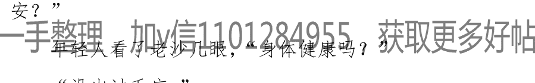

“我是沙湾镇的人，听说这里招人做保安。”

“沙湾镇啊，”年轻人高兴的说，“大舅呢？我刚来三小时，你认识大舅吗？”

“他住在沙湾镇市场的顶头，卖肉的。”

“我一直在沈阳做事，”老沙说，“很少回家，我不认识大舅。”

“沙湾姓的人不少，”大拿说，“你别说这些。”老沙回到办公室，大拿去储藏室拿回一套保安服递给老沙。老沙乐得笑，俩人换衣服。大拿不在意的，“不就是一些瓶瓶罐罐碎片吗？”


老沙飞快地把自己的衣服脱下来，换成了一件普通的夹克。然后回到钢厂，找到保卫科的办公室。站在办公门口，犹豫豫豫的敲了几下门。门开了，一个年轻人站在老沙面前。

“请问……”老沙用东北话说，“这里是不是招聘保安？”

一手蜀理，加微信，身体健康吗？

“没有过毛病。”

“多大年龄？”

“三十四岁。”

“身高？”

“一米八。”

“行，”年轻人爽快的说，“现在就可以上班。”

“你又说他很厉害？”老沙怀疑

，“我的意思是这人的非同一般……”

“我明白，”我点头说，“你的意思是他具备常人没有的能力但他生不遇，沦落了一个保安。”

“大致就是这个意思。”老沙说，“慢慢告诉你他的情况。我觉得他跟你写的小说人物有很多相似的地方，虽然他露出了很多破绽，但他自己会利用。”

“他不会是个傻吧？”我笑起来。

“不是，”老沙说，“他身上有秘术，而且他在极力掩饰。”

“我有点了。”我对老沙说，“小说的人就喜欢这种神秘人物。他叫什么？”

“别人都叫他大拿。”老沙回答，“真名叫李元，而且从他的经历来看，他没有什么复杂的经历，这和他身上掩饰的本领产生了反差，我当时还很难理解。”

我对老沙说：“很多心思缜密的人能够把自己掩饰很好，指不定他也和你同行。”

“大拿绝对不是！”老沙坚定的说。我突然醒悟，是老沙跟我说起的事情已经发生了，他说的大拿是个什么样的人，对于他来说已经是确定的事情。继续听着老沙说下去。作者：蛇从草 日期：2013-12-15 20:44

老蛇，我又出现了，真是不打不识，来骚扰你了，我又来骚扰你了，请问你总写这样鬼气森森的诡怪恐怖故事，半夜敢走在无人的小路吗？有人唤你的名字你敢回应吗？你被笼里有冰冷女人的尸体有什么反应？哈哈。看来你还是没有调查清楚啊，我写异灵，写恐怖，我也科幻，我也写传奇，我还写青春励志。作者：蛇从草 日期:2013-12-15 20:48


“老沙，”神偷说，“你懂行，你是不是看出了什么？”

“是的。”老沙神秘的回答，“这个钢厂的布局我也看了，不一般，所有的布局都是按照蓝心点穴布局来的。”

“你怎么知道这些风水上的玩意的？”

“我只是听我师傅说起过，”老沙回答，“他大致把几种点龙穴的图给我看过，我也记得其中几种。”

“为了几个青花古瓷，”神偷说，“他们犯得着这么大费周章。”

“所以下面很有可能有值钱的东西，”老沙说，“这个你已经大致明白了，但是我说的是，底面的东西可能比你想的更加重要：

“揽不起这个活，我们就撤吧。”老沙说，“我觉得这买卖太大了，我们不做了。”

“让我想想，”神偷安抚老沙，“你先回去做保安，看看情况，我们再做决定。”

老沙知道神偷不会轻易放弃，自己处于规矩，也不能丢自己脱身，只能继续留在钢厂当保安，一切见机行事。

老沙第二天早上上去上班，正好看见大拿的拳头在敲着门。门里面没有回应，大拿急了，吹着哨子：“起起来！操家伙！屋里依旧没有动静。”

大拿更加生气，拼命的吹哨子。

黑小在房间里懒洋散的咧道：“吹什么吹！才几点啊，昨晚熬到十二点，还让人活了。”

大拿又要叹，门开了，二子不耐烦的站在门后，睡眼惺忪。大拿不依不饶的拉着他们出门，黑和小二子还有其他的保安从大拿指挥，在空地上跑步，老沙也在队伍里。

老沙边跑边问：“李哥怎么弄得跟部队似的。”

“他以前就是当兵的，”二子很恨的说，“当兵当他傻了，为了当保安队长，就以为还在部队里，把我们当做他手下的兵。”

老沙笑着，也能听到从大拿这个小子身上折腰。处理费，加班加班，他走的时候很着急，突然就专业复员了？

“我好像听人说过，”二子接上话，“他在部队上犯错了，才复员的？”

“犯了什么错误？”老沙来了兴趣。

“好像是把战友给误了，”二子说，“你可别在他面前提这事，提了他就跟你急。”

出完早班后，老沙继续上班，白天利用保安的身份在厂里到处到处处转悠，而且不止一次的泵房附近观察，越看泵房伸出的几个钢管，就觉得不对劲。于是干脆爬到附近一个废弃的高炉顶上，从上面看个究竟。

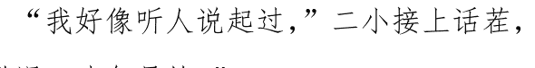

老沙到了高中上，一看，结果就倒吸一口冷气。泵机房伸出了四根钢管，分别朝向不同的方位，每根钢管出来十几米后，就用弯头（注：一种改变管道方向的零件，用于管道铺设。）扬了九十度的弯，以泵机房为中心，这四个钢管的走向，刚好构成了一个“丘”字型。

作者:蛇从 日期:2013-12-15 20:49

今天没了。

作者:蛇从 日期:2013-12-15 20:55

@蜡笔小新打水怪 158楼 2013-12-15 20:40:00
老蛇，我又出现了，真是不打不相识，我又来骚扰你了，请问你写这样鬼魅森森诡意的鬼怪恐怖故事，半夜散步在美丽的路上，你觉得有意义吗可怕吗？最怕有人抓到你的名字，我发现好多好帖被漂亮里有个冰冷女人的尸体你有什么反应？哈哈。

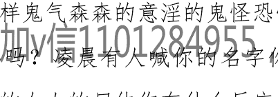

@蛇从 160楼 2013-12-15 20:46:00
看来你还是对我没有调查清楚。我写灵异，写恐怖，我也写科幻，我也写传奇，我还写春励志。

@蜡笔小新打水怪 166楼 2013-12-15 20:49:00
没吓住你，哈哈。

对于说半夜敢不敢走无人的山路，你可以看看我写的一个中篇《但行夜路必见鬼》，知道了。

作者：蛇从草 日期:2013-12-16 22:32

我听到老沙说到这里里，忍不住笑，然后对老沙说：“你跟我说的什么青花古董，是在工厂地下的一个墓穴有关吧？”

“是的。”老沙回答。

“你这个故事扩编得不好，”我笑着。老沙愣了，问我后，“你倒是说是，有什么漏洞。”

“刚才，看到机房的输水管道架出来，构成了‘丘’字型，”老沙知道很有麻烦，才猛然发现有问题的。”老沙说，“这个铲字的形状，是一个民间符号，如果在庙里就所谓了。”

“地下有邪性的东西，”老沙说，“这个你已经大致明白了，但是我说的是，底面的东西可能比你想的更加重要：

“揽不起这个活，我们就撤吧。”老沙说，“我觉得这买卖太大了，我们不做了。”

“让我想想，”神偷安老沙，“你先回去做保安，看看情况，我们再做决定。”

老沙知道神偷不会轻易放弃，自己处于规矩，也不能丢自己脱身，只能继续留在钢厂当保安，一切见机行事。

老沙第二天早上上去上班，正好看见大拿的拳头在敲着门。门里面没有回应，大拿急了，吹着哨子：“起起来！操家伙！屋里依旧没有动静。”

大拿更加生气，拼命的吹哨子。

黑小在房间里懒洋散的咧道：“吹什么吹！才几点啊，昨晚熬到十二点，还让人活了。”

大拿又要叹，门开了，二子不耐烦的站在门后，睡眼惺忪。大拿不依不饶的拉着他们出门，黑和小二子还有其他的保安从大拿指挥，在空地上跑步，老沙也在队伍里。

老沙边跑边问：“李哥怎么弄得跟部队的似的。”

“他以前就是当兵的，”二子很恨的说，“当兵当他傻了，为了当保安队长，就以为还在部队里，把我们当做他手下的兵。”

老沙笑着，也能听到从大拿这个小子身上折腰。处理费，加班加班，他走的时候很着急，突然就专业复员了？

“我好像听人说过，”二子接上话，“他在部队上犯了错，才复员的？”

“犯了什么错误？”老沙来了兴趣。

“好像是把战友给误了，”二子说，“你可别在他面前提这事，提了他就跟你急。”

出完早班后，老沙继续上班，白天利用保安的身份在厂里到处到处转悠，而且不止一次的泵房附近观察，越看泵房伸出的几个钢管，就觉得不对劲。于是干脆爬到附近一个废弃的高炉顶上，从上面看个究竟。


老沙到了高中上，一看，结果就倒吸一口冷气。泵机房伸出了四根钢管，分别朝向不同的方位，每根钢管出来十几米后，就用弯头（注：一种改变管道方向的零件，用于管道铺设。）扬了九十度的弯，以泵机房为中心，这四个钢管的走向，刚好构成了一个“丘”字型。

“地下有邪性的东西，”老沙说。

“中国的传统宗教，墓葬文化都是道教有关。”，“中国的墓葬文化都是道教有关，”老沙知道很有麻烦，才猛然发现有问题的。”老沙说，“这个铲字的形状，是一个民间符号，如果在庙里就所谓了。”

“地下有邪性的东西，”老沙说，“这个你已经大致明白了，但是我说的是，底面的东西可能比你想的更加重要：

“你犯了一个错误。这古墓是六十年代的古墓，”老沙说，“可是钢厂是六十年代的。”

“你这个故事扩编得不好，”我笑着。老沙愣了，问我后，“你倒是说是，有什么漏洞。”

“刚才，看到机房的输水管道架出来，构成了‘丘’字型，”老沙知道很有麻烦，才猛然发现有问题的。”老沙说，“这个铲字的形状，是一个民间符号，如果在庙里就所谓了。”

“地下有邪性的东西，”老沙说，“这个你已经大致明白了，但是我说的是，底面的东西可能比你想的更加重要：

“揽不起这个活，我们就撤吧。”老沙说，“我觉得这买卖太大了，我们不做了。”

“让我想想，”神偷安老沙，“你先回去做保安，看看情况，我们再做决定。”

老沙知道神偷不会轻易放弃，自己处于规矩，也不能丢自己脱身，只能继续留在钢厂当保安，一切见机行事。

老沙第二天早上上去上班，正好看见大拿的拳头在敲着门。门里面没有回应，大拿急了，吹着哨子：“起起来！操家伙！屋里依旧没有动静。”

大拿更加生气，拼命的吹哨子。

黑小在房间里懒洋散的咧道：“吹什么吹！才几点啊，昨晚熬到十二点，还让人活了。”

大拿又要叹，门开了，二子不耐烦的站在门后，睡眼惺忪。大拿不依不饶的拉着他们出门，黑和小二子还有其他的保安从大拿指挥，在空地上跑步，老沙也在队伍里。

老沙边跑边问：“李哥怎么弄得跟部队似的。”

“他以前就是当兵的，”二子很恨的说，“当兵当他傻了，为了当保安队长，就以为还在部队里，把我们当做他手下的兵。”

老沙笑着，也能听到从大拿这个小子身上折腰。处理费，加班加班，他走的时候很着急，突然就专业复员了？

“我好像听人说过，”二子接上话，“他在部队上犯错了，才复员的？”

“犯了什么错误？”老沙来了兴趣。

“好像是把战友给误了，”二子说，“你可别在他面前提这事，提了他就跟你急。”

出完早班后，老沙继续上班，白天利用保安的身份在厂里到处到处转悠，而且不止一次的泵房附近观察，越看泵房伸出的几个钢管，就觉得不对劲。于是干脆爬到附近一个废弃的高炉顶上，从上面看个究竟。


老沙到了高中上，一看，结果就倒吸一口冷气。泵机房伸出了四根钢管，分别朝向不同的方位，每根钢管出来十几米后，就用弯头（注：一种改变管道方向的零件，用于管道铺设。）扬了九十度的弯，以泵机房为中心，这四个钢管的走向，刚好构成了一个“丘”字型。


也是忌讳，千万不要在石当面前点火。

老沙行走江湖，街街巷巷，见过的不少“石当”。石敢当称其实是泰山石当，古时人认为泰山为天下正气之所在，所以旧时候皇帝王喜欢在泰山祭拜，因为有浩然正气之能驱邪煞煞。而十字路、三叉路这些地方是特别容易出现煞气的，十字路和三岔路都人都奉为鬼道，就是人鬼都走的路，所以一些盖在十字路和三叉路附近的房子为了驱邪煞煞，会在正十字路和三叉路的门口放上泰山石当，用浩然正气压息残留的煞气。

不过，老沙看到他们休息的地方，根本不是什么十字或三岔路，而一条直来直往的道路中的其中一段。

真还有一条路，只不过时间久了，那条路又人罕至，所以荒废了，被新生的草木遮蔽了。

那条路，就是通往黑林子的另一条路，时间久了没人知道，而且这个道理，也只有自己这个老江湖明白。

作者:蛇从 日期:2013-12-17 23:23

今天没了

作者:蛇从 日期:2013-12-18 10:51

@铁铁铁铁铁鱼 334 楼 2013-12-18 00:15:00

美丽孩子我打掉了，你安心写书吧

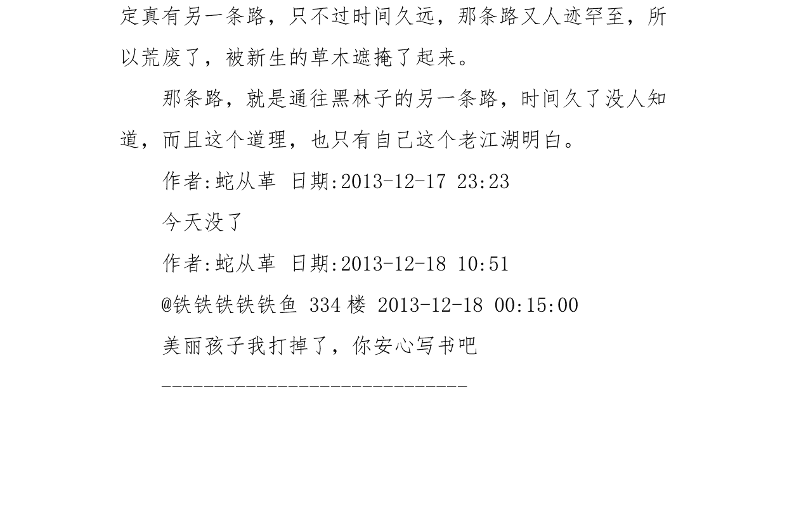

多休息，吃点补品。

作者：蛇从草 日期:2013-12-18 12:33

@moonlife0928 366 楼 2013-12-18 12:11:00

哇哈哈！又被我抓到一个。

这个是什么？算是坑塔吗？

不过算了。

就是坑，我也跳了。

谁让你写的东西对我胃口呢。

来合照，茄子！一手整理，加v信1101284955，获取更多好帖。

这是我唯一一个独立于宜昌鬼事背景的灵异小说吧。

作者：蛇从草 日期:2013-12-18 13:15

@gg3600 369 楼 2013-12-18 12:56:00

mark，话说这个是准备写长篇还是中篇？

应该算长篇。

作者：蛇从草 日期:2013-12-18 13:16

@moonlife0928 366 楼 2013-12-18 12:11:00

哇哈哈！又被我抓到一个。

老蛇，你刚刚十月月底在《八寒》里说春节前不写了，要我们等到明年看《鬼事》的【冥算大师】。

这个是什么？算是坑吗？

不过算了。

就是坑，我就跳了。

谁让你写的东西对我胃口呢。

来合照，茄子！

茄子。

作者:蛇从 日期:2013-12-18 13:16

@声卉香 1018 372 楼 2013-12-18 13:06:00

老鼠居然在房子前又挖了新坑！1101284955，获取更多帖子。

昨儿晚上还给你投票来了，果然有回报！

小馨你好。

作者：蛇从草 日期:2013-12-18 13:52

@露甲一 1 380 楼 2013-12-18 13:50:00

@蛇从草 都月中了，奶粉钱昨天还没打到账上来啊？啊，你哪儿？

作者：蛇从 日期:2013-12-18 15:00

@维斯拉夫诺维奇 390 楼 2013-12-18 14:55:00

又是老蛇。看了八寒地狱和蛇城，支持一下。老蛇也茄子一下吧。呱呀呱呀，茄子。

作者：蛇从草 日期：2013-12-18 15:23

@你_叫我楼 392 楼 2013-12-18 14:59:00

新帖？先顶再看！

# 一手整理 加关注1101284955，获取更多好帖复制关注查看我的新帖。

作者：蛇从草 日期：2013-12-18 16:34

@雪碧可乐 v406 楼 2013-12-18 16:29:00

嗨，蛇哥，对我还有印象否~消失了几年，重出天涯！老熟人来捧场啊，谢谢。

作者：蛇从草 日期：2013-12-18 16:57

@蛋爸爸双亲蛋 405 楼 2013-12-18 16:26:00

关注几天了，写的很棒，来，茄子。

作者：蛇从草 日期:2013-12-18 18:30

# 茄子

老沙自言自语看着石敢旁边的路。大拿看了黑林子，对二子和老沙说：“我们还是进去吧，小孩丢了。”二子却在犹豫，“大拿，我们是在路厂上的保安，又不是警察，我们这知道吗？”

“等等，黑林子就不是点吗？”

“大拿……李队，我们是在路厂上的保安，又不是警察，我们这知道吗？”

“能有什么动静，一个人守着就行，大拿马上就要公司给收购了，到时候好好表现，让经理给我，说不定就能顺利。”

二子一听，连忙说：“原来你想的是这个啊，小孩不好，我听的。”

老沙心里笑，看来大拿这个小伙子，脑袋都差，大拿下就闹出了，他们一无所知，大拿和大沙的背影在晃晃。所有人都眼睛红了，慢慢靠近，准备下手。三人走到林子边缘，林子里出处。光线更加暗。老沙看见二子身体在抖，大拿也看见了二子：“你怕什么，不是我有？”

“你也知道啊，”二子又把大拿出来，“林子晚上年轻人不能进，三十岁以下的都不行，我和黑林子大拿，黑林子撵走的。”

大拿说：“这点出息，走吧。”然后一头顺着小路进林子里。老沙也跟着进去，老沙立刻觉得浑身抖，身上的皮都出来了，这林子一定是有问题，阴气重得很。二子在林子边缘，一时不敢进去，但是看见大拿和大沙说：“你们别下我，等我。”结果二子一着，脸上就撞上一根树枝，树枝上缠着头发，二子用手揉了好久，大拿过来给二子帮忙。手忙乱一会，把树枝从二子的头发上拉下来，树枝和头发都扯了。

大拿正要把手上的树枝扔掉，老沙突然喊：“别折！”大拿拿着树枝问老沙：“咋了？”

老沙指着大拿手上的树枝：“你自己看。”大拿这才看树枝和头发，上面有一根弯曲的细细条，凑近看了，才发现这个不是树枝，而是一个半圆形的玩具。二子看了，大呼叫起来：“这不就是女头上戴的发夹吗！”

作者：蛇从 日期:2013-12-18 18:30

@悠悠小丑L 415 楼 2013-12-18 18:28:00

我也要合照！！！

作者：蛇从 日期:2013-12-18 19:02

大拿和二子低了头，在四周寻找。一手拿起笔记本，认真的说道：“那女孩的发夹可能在这几个地方，不定不远。”

“两个孩子肯定不在在这里。”老沙冷静的。

“你这话什么意思？”大拿问老沙。

“刚才二子跑进来的时候，为什么会被树枝和头发绕住？”老沙问。

“他慌了似的。”

“是啊。”老沙接着说，“那女孩跟二子一样，慌张的往林子里跑，所以头发被缠住，结果连发夹都不管了，你说她接下来是拼了命的继续跑，还是呆在这里不动。”大拿和二子一听老沙这么分析，连连点头：“对对，真是这样。”但是二子觉得不对劲，询问老沙：“你说这俩孩子明明知道林子里不该进的，他们害怕林子很人，为什么会瞎了眼的往里面跑呢？”这这还用问吗，”老沙沉着声音回答，“因为林子外面有让他们更害怕的东西。”二子一听，腿都软了，连忙把手扶在大拿的身上。大拿本来想说老沙两句，但是又觉得老沙说的很有，把二子的手推开，拿着女孩的发夹慢慢往林子深处走。

老沙不停的打探林子里的环境，越看越诡异，林子里有很多树，都是死的，净是树杆和枯枝，有树叶的树木还乱七八糟的。老沙就问：“你们来这里多久了。”

“我三年了，”大拿说，“黑林子去年来。”老沙问：“你们在这里待了多久，就听说黑林子里的古怪？”“怎么没听说，”二子连忙回答，“听多了，都是些神叨叨的玩具，”大拿说，“我不信。”老沙对二子说：“左右，你告诉我。”“啊……”二子张了嘴，“在这个时候这些……”老沙说以前怎么看，“现在林子里出事了，该这这的。”

的二二，，，，，，，，，，，，，，，，，，，，，，，，，，，，，，，，黑林子，没有。。

，，，，，，，，，，，，，，，，，，，，，，，，，，，，了。

老沙说：“这林子，，，，林没有，黑子，，，，，子，动物的尸骸，就在林子边缘。所以当地人把林子叫，意思里面都是，一个活物都没有。当然也有人进去，成年人一般都还好，三十岁以下的人，于是就成了禁忌，千万别进去。这北方的农村，家里户户都是荒芜的，在林子里砍柴，只在贫瘠的山头上。这，，，，，砍柴。结果七八个人进去，一根木头没出来。其中人都吓得魂都没了，问他们看到了什么。

心里盘算，这种地方，有种科学无法解释的力量在作怪。然后出现很多奇怪的事情。作者:蛇从 日期:2013-12-18 23:39

大拿和二子听了老沙的解释就不说了，三个人默默的树林行走。又走了约十分钟，老沙又说：“我们得歇歇再走了。”

“你累了吗？”大拿问。

“不是，你看这个。”老沙指着身边的一个树桩，上面有一道新鲜的划痕，“我是刚才留下的。我们在绕圈子。”“鬼打墙！”二子吓叫了。大拿焦急起来，把手机拿出来，“算了，我给刘所长打电话。”

“村民已经报警了。”二子说。

“现在我们根本没看见警察的影子，也没听见警车声，”加上我们的路复杂，警察不会找到黑子来找人的。”大拿拿着手机拨号码，但是一直不通，老沙是无信号的。“信号是满的啊，”大拿焦急的说。“你看到手机的信号是满格，有个空空用。”老沙说，“手机里面显示的信号格，不见得就是通讯站的信号。”大拿就不信，仍拿着他那个老版诺基亚转身手机，找不通。可是电话一直不通。老沙冷冷的说：“你带了耳机没有。“你问这个干嘛，”大拿问老沙，“用耳机就能打通话？”“不是，”老沙说，“你把耳机插上，就能接受波段信号。”“那不就是收音机吗？”“就是这个意思。”老沙回答。“我真的把耳机带在身上，大拿，从手里拿出耳机，插到手机的插孔里。”老沙试图提醒，“把声音切到扬声器上。”大拿做了。扬声器里发出嘈杂的磁噪声。“换换频率测试试试。”老沙继续点大拿。二子突然说：“老沙，你别这样，你是不是故意吓我？”“我们一下，”老沙说，我们都愣了一久。“我们没事，这句话说了。”老沙，，，，，，，，，，，，，，，，，，，，，，，，，，，，，，，，，，，，，，，，，，，，意，意，意，意，意，意，，，，，，，，意。

大拿，老沙的手机，，，，，，，，，，，，，，，，，，，。

老拿的手机里的磁噪声突然停了，然后发出连续的嗡嗡声。然后传来一声女人尖锐的声音！大拿差点把手机扔到地上。


“是不是女人在哭？”二子说话有点结巴了，“怎么会有这种声音。我听着是在笑。”老沙把大拿的手机夺过来，放在耳朵听，手机里的叫声停止了。变成了嘈杂的，人生，嘴舌在议论什么。这个肯定不是接通了音频声音。这林子，”老沙说，“磁场古怪。”作者：蛇从 日期:2013-12-18 23:40

今天没了

作者：蛇从 日期:2013-12-18 23:52

不知道情况，我的帖子看不见了，我重发一次。

作者：蛇从 日期:2013-12-19 12:25

这小说还是真人事，别当真。蛇蛇蛇蛇蛇蛇蛇蛇蛇蛇蛇蛇蛇蛇蛇蛇蛇蛇蛇蛇蛇蛇蛇蛇蛇蛇蛇蛇蛇蛇蛇蛇蛇蛇蛇蛇蛇蛇蛇蛇蛇蛇。

看洛风熊猫戏眼，每天早中晚三次。现在看老蛇的每晚更新，有点太难。早中晚，时间不够啊。作者：蛇从 日期：2013-12-19 13:06

@水果孩子 1984 楼 2013-12-19 12:59:00

把老蛇的鬼事1.2，竹林等都看完了，潜水求合。天知道八寒结束有多郁闷，冷丁看到老有新文多开心～～～～老蛇蛇蛇蛇蛇蛇蛇蛇蛇蛇蛇蛇蛇蛇蛇蛇蛇蛇蛇蛇蛇蛇加油！天寒冬要注意保暖～茄子。

作者：蛇从 日:2013-12-19 15:53

@本大爷才是帝王 529 楼 2013-12-19 15:38

......好吧，LS 和 LSS 是一起住的三片叶，可以无视之。


@毒蛇 Viper 毒蛇 533 楼 2013-12-19 15:50:00

做晚饭给姑妞？姑娘正？？？？？？作者：蛇从 日期:2013-12-19 16:38

@雪凝霜 544 楼 2013-12-19 16:37:00

再顶，都来顶啊！爱死冷妹子了。作者：蛇从 日期:2013-12-19 16:57

今天没了 作者：蛇从 日期:2013-12-19 16:59

@雪冷凝霜 544 楼 2013-12-19 16:37:00

再顶，都来顶顶！@蛇从草 545 楼 2013-12-19 16:38:00

爱死冷妹子了。

@海的温度 552 楼 2013-12-19 16:53:00

为什么要视我？我要找阿冷决斗！一手微信加信101284955，获取更多好帖。作者：蛇从 日期:2013-12-19 18:08

老沙说这里的时候，我不意识的把自己的手机掏出来，然后插上耳机，调出收机的频率，不过我的手机里面收机的频道都调好了。无论怎么翻台，都是标准的电台节目声音。老沙突然拿了东西在我手机旁边移了一下，收机里的声音突然就变调，传出尖锐的喇叫声。我连忙推开老沙的手，“我刚买的手机，三千多块呢，你不当事情啊。”很明显，老沙手上拿着一个强力的磁铁，谁知道他从哪里弄。蛇蛇蛇蛇蛇蛇蛇蛇蛇蛇蛇蛇蛇蛇蛇蛇蛇蛇蛇蛇蛇蛇蛇蛇蛇蛇蛇蛇蛇蛇蛇蛇。蛇蛇蛇蛇蛇蛇蛇蛇蛇蛇蛇蛇蛇蛇蛇蛇蛇蛇蛇蛇蛇蛇蛇蛇蛇蛇蛇蛇蛇蛇蛇蛇蛇蛇蛇蛇蛇蛇蛇蛇蛇蛇蛇蛇。蛇蛇蛇蛇，其实村里的人知道这个事情的，他们故意在我面前表演？至少两个小孩的父母很着急，但是这些话不能跟外人讲。“老沙，”大拿问，“你怎么知道这么多东西？”“我二十多岁的时候到处，全国各地遍了，”老沙解释，“知道的东西就多一点。”

样，那走丢两个孩子的事情，就不是刚才黑和小二子说的那么简单。

老沙继续观察，看到那些村民跪在地上，双手合十，脑袋下垂，都十分安静。

月亮的光线更加强烈了，天生的黑云仿佛瞬间全部散尽，月光照射在这片空地上，老沙突然发现，自己能看到的几个村民的脸上没有问题。他们脸上几乎乎的，再仔细看的时候，就分辨出来，他们脸上带着面具。

在老沙心中一惊讶的时候，一个村民站立起来。

这下沙和大拿同时看清楚了，这个人的脸上确有两个面具，在月光下发出绯红和蓝两种颜色，上面有两个巨大的眼睛和长长的鼻子。

大拿反应快，早的把二子的嘴拴住了。然而二子看到这个面具后，就要惊呼，但他鼻子被大拿紧紧按住，只能发出细微的呜哦声，就是这个声音，在这一片静谧的环境下，老沙觉得太大了。

又有两个村民站立起来，他们脸上也带着面具。然后三个人围着圆形的中央——也就是所有人人都跪拜的方位，开始缓慢转动。

那个巨大的喘息声又出现了，现在老沙和大拿都听出来，这声音是从每个村民的口中发出的。

老沙示意，先往回回退，大拿明白老沙是有话要说的。

三个人又慢慢的在地上匍后退。退了差不多二十米，三个人奥长气吐出来。

二子结绪巴巴说：“他，他们这是、是在干什么？”

“祭祀。”老沙冷冷的说。

大拿扇扇的说：“都什么年代了，还有人搞这种封建迷信。”

老沙按了按沙的肩膀，“听我说，你别看不起这些东方，流传了上千年的事情，你想那么简单。”

“你看出来是什么讲了吗？”

老沙问：“你们知道虎符镇这世界上，有寺庙吗？”

“没听过的。”大拿回答，“除了附近有个塔林，再就是这里一些名胜，都是很久之前的遗迹，根本就没有寺庙。”

“这村子里的人，一直都信这个，”老沙说，“可是他们不愿意让人知道。”

“那丢孩子的事情怎么说？”

“他们也许就是这种方式在找孩子。”老沙说，“可还有其他的缘故。”

“你刚才问这里有没有寺庙，”大拿奇怪了，“他们不是和尚的。”

“他们这是藏传佛教，”老沙解释，“和我们平时看到的和尚不一样。”

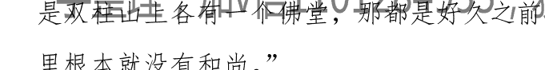

“我们这里距离西藏一两千公里呢，”大拿说，“拿来的西藏人？”

“我看他们的做法，”老沙说，“这阵，他们世世代代就是这样过的。”

“你说他们是西藏人的后代？”

“我不知道，但是肯定有关系。”老沙心里很想把古墓的事情说出来，这样才能勉说明通。可是这种不能跟大拿说，说了自己的身份就暴露。

老沙正在犹豫，突然看到面前的空地上的村民一片喧哗。一个人的声音在大喊着：“有人来了！”

老沙和大面对相觑，然后看向二子，二子连连挣手，“经理，我做得有点过了，我们还是开开闹吧。”

作者：蛇从丛 2013-12-19 18:09

村民已经开始哄哄的向林子走来，回来寻找了。

老沙看了身边的树木，全部都是死的。老沙才意识到，空地周围的树木全部死的，连树皮都没有，光溜的树杆。这些树木的年头也很久了，地上也没有树叶，连木丛都都没有。

“我们跑吧。”二子焦急的说。

“往哪儿？”老沙回答，“我们在黑林子连方向方向都找不到。”

“我们不能和他们打架。”大拿说，“那样影响不好。”

“找到地方醒起来。”老沙说。

大拿看了看四周环境，“只能爬树了。”

“怎么爬啊。”二子都要哭出声了，“杆这么滑。”

老沙正主动帮助二子跟着自己爬树，大拿却先开口了，

“我背着你。”

说完完，大拿把二子背在肩上，然后哧溜溜的爬上树，让二子坐在一个树上，紧紧抓住树杆抱着，在黑夜里，别人也许怕不出来。

大拿正要下树，如法把老沙也背上去。可是看到老沙已经稳稳的贴在树的一侧的树上了。

大拿向老沙伸大拇，自己爬到了另一棵树上。他王经理整理了一下眼镜，“这几个站，就蹲在树底下。”老沙说。见这几个村民面具都没去掉。脸上是青面厉豹的样子，心里也害怕，打扰这种隐秘的宗教仪式，是个巨大的忌讳。

村民在树林里跑半天，没找到人，慢慢回到了空地。

大拿老子二子三人，听见他们又安静下来，才慢慢溜下树，又爬到了空地旁边。这时，他们看见三个戴着面具的人，正用手中的铁锹，拼命的挖空正中的地面。

金属碰撞的声音，十分刺耳。

过了很久，三个人也不忙了，他们蹲下来，说了几句听明白的话，然后在地上上不停的往外掏东西。出来后，就扔到一边，乒哗哗的一阵乱乱。他们应该是空地中央挖一个小坑。现在他们都跳到小沙坑里，其他人也围过去，在他们上方横了一个木方。窸窄窄窄挤下，所有人同时发力。老沙看到，一块石头被提起来了。

他们进来的时候，在路边看到的石头当一模一样。今天天了。

作者：蛇从草 日期：2013-12-20 13:48

大拿和二子看到这个石头倒没什么反应，老沙心里暗自心怕。树林外面一个石头破破烂放在那里就是个路标。而这里一个石头，却被当成一个宗仪式式被村民供奉。

老沙看到这里，轻声对大拿：“那两个孩子我们就别管了，我们不管了。”

一手卖：两个孩子，我们不管了，获取更多。空地上的村民把那块石头放上来，所有的村民都围着，不停锄头。然后把所有的放到地上，用锄给敲了。然后再模胧的月光下，两个村民站起来，面具撑掉，露出两张稚嫩的脸。大拿忍不住，就要起身，去阻止。老沙一把把大拿的脖子扣住。大拿反手把老沙的膊扭住，老沙扭，从另一个方向扣住大拿的肩膀。大拿用拳击老沙的腹，但是老沙硬了。这么几来，两个孩子就慢慢爬到坑里。村民把石头抬起，放到上面。

“为什么不抓人？”大拿问，老沙急声说。

“两个小孩不会死。”老沙急地回答，“相信我。”

“他们都被埋了！”大拿说。

“那下面一定地道。”老沙说，“这是村子里的事情，我们外管不了。”村民慢慢向空地走，路都没有声音。三人屏住呼吸，过了很久，确认村民不会回来了，才慢慢走到空地。看到地上是一个铁板，四角用木头撬开就发现好多钉子。大拿用手动地上的钉，可是他的手是血肉，那里乱动。老沙正要阻止大拿慌动。可是大拿突然喊一声，竟然把钉子给扭起来。老沙看得呆住。大拿开一个钉子，把其他的都拽起来。大拿开一个钉子，起来。然后用力把铁板掀起，老沙和二子连忙帮忙。铁板掀开后，发现那块石头。

“那下面一定地道。”老沙说，“两个孩子被弄进去，做什么事情。”

“你们在这里等候，”大拿说，“我回回去找人，带工具来。”

“你的功夫，”老沙故意做出好奇问，“不是普通的武术。”大拿也看着老沙说：“近身格斗也不是一般的功夫，这个事情了，要好好谈。”大拿说，就要离开，老沙轻声说：“明天亮，你出去。”

“你记得回去的路吗？”大拿。

“我留了，”老沙说，“我们现在就走。”

“不，不，不，，，，，，，，留下。”

“人，我不走。”二子连忙说，“我要等明天再走。”

“看你出息，”大拿忍住二子，老沙知道大拿对自己不放心，自己是刚来的保安，没上班，刚自己和他了两招，让大拿起了心。“都说了，他们肯定没事。”老沙快步走到黑林子里的小路中。老沙拦下大拿二子，走了几十米之后，对着黑暗说：“你出来吧，你老了，事情不如以往了。”作者：蛇从草 日期:2013-12-20 22:33黑暗里走出一个蒙着面的黑衣人，不用开口说什么，老沙早就认出他来了。神偷。虽然以前的神偷从来这么胆小谨慎，而且还蒙着面不敢见，但老沙对他的动作和姿态太熟悉了。就算神偷走路像猫一样，脚下没有任何声音，衣服带动风的声音，还是逃不过老沙的耳朵。就凭着衣服抖动，老沙可以知道黑暗中的那个人是在背后做什么。没错，这个人正是神偷，老沙要把他认得死的。实际上，老沙发现神偷一会儿，他替神偷担忧。因为大拿在他旁边，他的耳朵比他还糟糕，要是识破神偷的踪迹，神偷可能就不掉。到时候的局面，可能就要撕破脸。神偷走出来，脸上蒙着的面罩笑着：“你以前的确听不到我的声音，不过，不是我老了，是你事情越来越强，就算是你在当保安，功夫还是没放下点的。”老沙觉得也有道理，他三十多岁，正是壮年，身体各项机能都是巅峰状态。但如果是这样，神偷的事情就算停滞。如逆水行舟，不进则退，这句话很有道理。老沙回头望了望大拿的方向，一定距离，还是不放心，没敢说话，拉起神偷的手臂往远处走。他很忌惮大拿，现在他是发现了，大拿的某些本事远他。确定距离足够远，老沙才说：“你怎么在这里，不是说钢厂的事情交接给我？”神偷从身后拿出一个硬糖的小黑棍，像个手电筒，但仔细看又不是，应该是个高科技的小玩具，“我过来探测，没想到有这巧，就撞上了你。“你刚才有没有听到那些别人说什么？”老沙猛然想到王经理，他在关注的时候，神偷正在数。在关注期间，他在数，获取了很多占。神偷摇头：“他们说了这些话，但关键的话是用方言说，我听不懂。要是婉儿在这就好，她是语言方面的天才，什么方言都懂。”老沙知道这个情况，点点头说：“你记得几句的话，可以回去模仿给她听，够判别是哪里话，我们就有目标了。“你觉得这些人会有问题？”神偷说。“我怀疑他们跟古有关，很有可能是守陵人，他们的特征很像。”老沙点点头，“如果真是这样，我们的麻烦很大。”老沙沉默，没有话说，他知道事情的严重性。之前只是同行，现在守陵人出现，意味着天敌。“这个事太大了，我先回去弄清楚……”老沙思考一下，“嗯，如果是守陵人，我们现在掀起来还得，没必要把命上。”老沙又强。作者：蛇丛 日期：2013-12-20 23:17大拿本来是在这里按几个探测头，根据娇儿的要求，需要安装几个探测头，才能对。细致探索。他不知无，黑林子里。不，不，不，不。老沙不知道多少年，黑林子里为故。老沙从一开始就开始感觉不好，所以心里就不要手。分手后，老沙深入黑林子里。其实，黑林子里有人找，除了一人值班，其他人都在家里睡觉。但大拿可能会遇到危险，老沙心里急着，毕竟黑林子里各种怪事，不像是。老沙跑，回到营。。老沙不知道哪里。黑子里的旧灯一闪一闪，嗡嗡响。老沙。脚步。救命……”隐隐，不知道哪里传来了。老沙闭上眼，侧着耳朵听，脚步。移动，细心的寻找声音。老沙听到了，那是。但极度的恐惧让他的声音变样了，不过。老沙走得很缓慢，朝声音的靠近。最终来到水房，这里发现自己已经，虚弱喘着救命。作者：蛇从草 日期：2013-12-20 23:22今天没了。作者：蛇从草 日期：2013-12-20 21:48。一副模样，不由得马上警觉起来，四处打量周围。黑小一看老沙来了，连忙站起来对着老沙说：“这事闹大了，你倒是来了。”老沙看着黑小，没有发现特别的地方，问黑小：“村子里的人，来找你了？”村子里的人来找，我会叫这样吗？”黑小摸着头顶的冷汗，“看来这日子没办法了，本来就知道房子晚上身上毛疮，赖到房子的地方，村子里里丢了孩子，弄得村子里里疼慌。”老沙说：“你主动跟着村民找孩子，怎么说这事？现在麻烦大了。“孩子找到了吗？”老沙说，“村子里到底怎么怪了？”老沙已经稳稳的贴在树的一侧的树上了。大拿向老沙伸大拇，自己爬到了另一棵树上。他王经理整理了一下眼镜，“这几个站，就蹲在树底下。”老沙说。见这几个村民面具都没去掉。脸上是青面厉豹的样子，心里也害怕，打扰这种隐秘的宗教仪式，是个巨大的忌讳。村民在树林里跑半天，没找到人，慢慢回到了空地。大拿老子二子三人，听见他们又安静下来，才慢慢溜下树，又爬到了空地旁边。这时，他们看见三个戴着面具的人，正用手中的铁锹，拼命的挖空正中的地面。金属碰撞的声音，十分刺耳。过了很久，三个人也不忙了，他们蹲下来，说了几句听明白的话，然后在地上上不停的往外掏东西。出来后，就扔到一边，乒哗哗的一阵乱乱。他们应该是空地中央挖一个小坑。现在他们都跳到小沙坑里，其他人也围过去，在他们上方横了一个木方。窸窄窄窄挤下，所有人同时发力。老沙看到，一块石头被提起来了。他们进来的时候，在路边看到的石头当一模一样。今天天了。作者：蛇从草 日期：2013-12-20 13:48。大拿和二子看到这个石头倒没什么反应，老沙心里暗自心怕。树林外面一个石头破破烂焰放在那里就是个路标。而这里一个石头，却被当成一个宗仪式式被村民供奉。老沙看到这里，轻声对大拿：“那两个孩子我们就别管了，我们不管了。”

比钢厂更危险。

黑大算是赌错了。

现在的钢厂要比黑小林里还要危险。

泵机在拼命的响，而且还有钢管裂开的声音，用不了多久，井的水就要溢出来，而空间里雾气停止流动，外面竟传来弓弦张开、刀兵挥动的声音，甚至还有马匹奔跑时马蹄地的响声，越来越大……

之前的时候，阴兵过道还没有没有任何声音。

老沙猜测到，这应该是阴兵过道到了最紧要的时刻。

作者：蛇从草 日期:2013-12-21 21:15

“怎么感觉外面在打仗？”黑小畏缩的问。
“我们就像在阴兵里躲着伏，获取更多好机会一样，其实是钢厂的各种东西发出来。你仔细呼吸……”

“我那里有心事。”黑小呼吸嘘的。

“弓弦响是皮带抽动，刀剑互砍的声音是很多钢条撞击……”老沙一一的说。

“你的意思，是吹风？”黑小问。

“嗯。”老沙佯装点头，他不想黑小，心里已经明白，外面的阴兵的确能够影响周围的物体。

而离他们最近的物体，就是泵机，还有水井吧哒哒的水继续躲在这里，一定有危险。


“我们要离开这里。”老沙说。

“你扶我，我站不起来。”黑小吓得双脚发软，他也不想待在这里。就算只是吹风，也足够吓人。

听到黑小这么说，老沙犹豫了下，黑小不动，是个累赘，外面的阴兵说不会发现他们，到时要是对他们做点什么，黑小就是个拖累。

“走不去？”黑小催促，一把抓住了老沙的手。
“走，就走。”老沙扶起了黑小。

就在这时，泵机轰叫到了极了，就听“轰”一声巨响，老沙感到巨大的冲击力迎面过来。

老沙没来得及反应，发出一声惨，被撞飞，头脑一片空白，再睁时，黑小滚落在水里，已经不见去了那里。

巨大的水流从井里喷射出来，老沙浑身湿透，在水中随波逐流，他无法想象，怎么一下就出现了那么多水，铺天盖地。

就刹那，井里没有水再喷涌，一切声音都停止了。

老沙勉站起来，就那么一下冲，把他差点撞断骨，全身在疼。

有水吐到口里，带着臭鱼的腥味，还夹杂泥土，粘在口腔里，吐不出来。

“不行了，不行了，救命……”黑小忽然在远远处大声呼喊。

“别乱跑！”老沙大喊，但黑小早跑远了，没在泵房那里听得到他的话。

老沙没有思索，朝黑小消失的方向追出去。

外面的通道里，竟然已经没了半点雾蔼，昏黄的灯光照亮起来，老沙看着地上黑小离去的脚印，猛然停住脚步。

他发现那一串脚印，全都是血红。

作者:从龙 日期:2013-12-21 21:16

今天没了

作者:从龙 日期:2013-12-22 21:10

老沙回过头，看见泵房里在往外出水，红色的液体从流出来，那流出来是油还是血水，到处溅起波漪。

其中有什么在游动，露出一个细长的划痕，时不时嗒嘟嘟的声音传出，水面因此泛出了很多白色水泡。

老沙明白了，那地上的血脚印，踩踏地面就会留那样的印子。而且不知什么，黑小的鞋子掉掉了，每个脚印都能清晰的看到脚趾。

看黑小去之后，老沙没停留，赶紧追上道。黑小跑去的地方，是钢厂的连铸车间，那里里面的机器全都卖得差不多，但还有不少零星的钢管、机械零件。进去之后，会有两架独立钢桥，距离下方的地面二三米高，机器搬走后，钢桥上每隔远，就有缺口。

黑小肯定是嗅着了，所以一情急之下，跑了进去。

老沙走到连铸机车外，听到里面的钢桥因为有人过路，在啪啪的响。老沙没有急着追进去，而是返回到保卫科的办公室，重新找一个可用的手电，这样进去找人，才能保证自身安全。

老沙走到办公室门外，忽然听到里面有熟悉索索翻动东西的声音，应该是有人在里面了。

老沙正当减缓脚步，想大概是有贼藏到钢厂里了，趁着没人来做作业，对贼进行偷袭偷击，获取更多机会。

确定家里是一个之后，一脚就把办公室的门踹开，并且大吼一声。一般做贼的心理素质都很差，被这一通堵，肯定会吓得夺而逃。这保卫科只有一扇门，听到声音，肯定会往门边来。

老沙喊过之后没有急着进屋，而是缩在门口，等。房内并没有出来，随后就听到铁皮门当响，没有任何声音。


他这时发现，地面上有很多水渍。他沿着水渍看向，最终视线落在铁皮门的储物柜上。里面比老沙想象中的还要乱，因为他不躲了，还把自己藏在铁皮柜里。

老沙走了，猛得拉开铁皮门。里面人用扶着铁皮门，被他拉扯，顿时了出来。老沙一个擒，抓住对方手腕，将他压在地上。

“不要害我，不要害我……”地上的人大声哀嚎。

老沙听到声音，赶忙松开，望着地上：“是你？你怎么跑到这里？”我只是想从缝里逃掉，躲到桌子后面。”

老沙看着这副模样，笑起来，他看到了黑小的衣服湿透，刚被水浇过，脚下湿漉漉的鞋子。老沙感觉到背脊一阵凉。作者：蛇从草 日期:2013-12-22 21:15

赤脚奔跑，进了连铸车间，那里的是谁？或者是什么东西？老沙想清楚其中细节，一件事：在钢厂里，今晚只有两个人，还有第三个人。


也许是来探墓的，刚好他们躲在泵房里，然后遇到阴兵，水炸裂之后，趁机逃。这是老沙能出的最合理的解释。但问题是，泵房不大，躲在里面还不让他发现，这个人的本事很高。除非那个人是从井里出来的。这么一想，老沙感到奇怪，因为井里有水，从里边出来，就不可能是正常的人。还是想想，老沙原本明白的解释又变得不通。

“黑小，你醒醒……”老沙决定不乱了，要证实，必须亲身一看。现在对钢厂比较熟悉的是黑小，他必须得到黑小的帮助。黑小抓着老沙的肩膀，醒看着老沙的手臂，嘟囔道：“我看到鬼了，我看到鬼了。”

“别自己吓自己，说不是眼睛花了！”老沙不许他再胡言乱语，“大拿让我们看看，我们得做好本分，走，去看看是不是闯进来偷东西。”

“我不，我真的看到了，就在我眼前远，我开始以为是你，但我忽然看到他眼睛里冒红光……我们要报警，让警察来查这事！还有大拿，这小子根本就当不了队长！我要告诉他撤他的职，他偷偷跑了，害我在这里撞鬼！”黑小语无伦说道。

老沙他没办法，黑小这滑头，连大拿的话都不听别说他的话。现在老沙最想弄清的事情，就是连铸车间的人是谁，其实这个时候，他可以一走了之，但长年累月做保安，他养成了一个惯性思维。保安的职责，就是替主管管财物，防火防盗。虽然他自己也是个，可这时候，他把自己定位在保安的位置上。他得去把他管区的那根刺拔掉，才枉坦。

“走，别在这儿了，大家都情况比我们好，等他回来，你怎么收拾他也行，但现在，我们有事情要做！”老沙不跟黑小唠嗦，拿了手电，一把提起黑小的衣领往外拖拽。

黑小不想去，本想挣，但老沙顺手就把保卫办公室的门锁了。等等下，再去，我们就拿手电。”黑小突如其来的黑暗包裹，吓得没有主意，顺的跟上老沙。他只拿了手电还拿了警棍，为自己增加勇气。两人朝连铸车间走去，都没说话，老沙手拿电筒，照着地面上的血脚印。看了久了，他暗暗咬自己不够细心，不然的话应该发现问题。他和黑小两人身上沾了井水，脚印根本不是血红色，而且因为温度比较高，很快就干燥。地面的血脚印却没干。老沙在车间门口蹲下，他发现那里的血脚印上面有一块皮肤，皮肤刚脱落，表层还有新鲜的肉。老沙忍不住用手摸脸，一接触就感到火辣疼。

“前面有东西！”黑小拿着手机一阵晃，对老沙轻声说。老沙抬头望去，看到钢桥对面的门处，一个黑影闪了门后，消失了。“你往下，我上来。”老沙站起，朝前跑，从钢桥上一跃而下！作者：蛇从草 日期:2013-12-22 23:38

面对钢桥尽头是一扇门，门后面是一个楼梯，楼梯上落满了灰，没有留下他走过的脚印，但他能看到外面。如果是想要逃，那个人一定会往下。为了万一，老沙还是让黑小爬上去。跳下三米高的桥，老沙并没有直接落地，而是手贴墙壁，朝下滑。车间比较宽，大概五米，老沙用了功夫，很快跑完，打开门到了后门，后门竟然被人用铁链锁死了。老沙记得自己上次巡视的时候，没有这道锁，看来是大斧。知道今晚人数不够，该锁的地方。这样，对抓人有利。神秘人没有下楼，到了二楼拐角，看到脚印再次出现，老沙继续赶，等到楼顶。楼顶通天台的门同样锁起，一把粗的锁拴着，没有打开。门面前有几个脚印，对着门外的方向，没有转身的印子，而是门上有两个手。神秘人就这样凭空消失，仿佛是穿门而去。老沙在门前猛吞一口水，实在不可思。(img/0ac65463822fc7b19df48d3c26d223d0_94_0.png)

“你有钥匙吗？”老沙呆一阵，黑小回：“这是大拿亲自锁的，钥匙他随身携带。”黑小回，“我说对了，的确是他......不要说了，我脑子很乱。”老沙打断了他的话，“你去唤别人来，好好巡逻，但晚上的事，不要告诉任何人。“太邪性了，我说了别人也不信。”黑小说。“你要发誓，不能告诉任何人，我看这事简单，说出去别人会对付我，说不定要杀我们……”老沙狠狠地把黑小按在墙上，威胁道。黑小被老沙的眼神吓住，连点点头。出去去找其他保安回来。老沙趁机会，用拖把把面的血印都洗干净，尽量把一切还原，唯独下了连铸车间旁那条楼道里的血印没有洗，他觉得很有用处。他在办公室找到大锁和锁链，把车间门上下楼道的大门锁紧，以防其他人看到。做完这一切，天快亮了。大拳仍然没有回来。老沙知道大拳不会猜出了事，没有回钢厂，只有一个原因，大拳不出林子。也许是迷路，也许已经被这些村民发现。作者：蛇从草，发布时间：2013-12-22 23:39

在其他保安来之前，老沙机会找到钢厂，找到神偷的宾馆。刚一敲门，神偷就把门拉开，老沙看得出来，神偷和妈妈也是晚上没睡觉，通宵在做事。“我以为黑林子足够诡异，没想到钢厂里更邪性！我早说过那个地方不对劲，被我猜。”老沙坐在椅子上，开门见山。

“你发现什么？”看老沙表情，神偷皱起眉头。

“阴兵过道。”老沙说到这四个字，仍仿佛心中有余悸，“不止此，还有更神秘的东西。”

“阴兵过道算不得什么，科学能解释。”婉儿浅笑，手上手动笔，“你的胆子怎么变得越来越小了？”老沙刚觉到婉儿语气里的轻视，明白神偷把篮子里的事情告诉她了。

“不是我胆子小，是确实出了大问题，我们情况未明，这一仗，打得十分冒险。”老沙有点火气。

“其实老沙，你有想过，有守陵人的古墓，里面的东西一定完整，更有价值。”神偷说。质问。昨晚上，神偷听到有守陵人时，本有退走之心，现在这么稳定，肯定是听了婉儿的话。婉儿神色不变，继续转笔，双眼盯着前面的显示屏。“我们都快老了，现在手艺还没丢，以后想抢也没机会！”老沙叹口气，运气好，那一次差一点就截了。老沙叹口气，口气。老沙说：“那是假的，没有谁遇到过那种事情会害怕，但还不至于吓得跑。你有了离开心思，是因为那些守陵人吗？”我很好奇老沙为什么走。在我看来，老沙胆子很大，至少在这个时候，他不应该有退的心思，如果我遇到这种怪异的事情，定会继续究竟。毕竟这些东西可见不可求，有人一辈子也不可能遇到。老沙说：“一开始，我就不停的跟你强调过的直觉。直觉让我走，是一部分原因，守陵人的存在，是一部分原因，但最大的原因是我终于看清前人建厂的真目的！”我静静的望向老沙，想了一会儿，有什么在嘴边呼欲出。老沙也许是我眼的光芒，明白我猜到，他笑着：“对，就是那样。”我竟致勃勃的说：“就当前来看，钢厂里有钢铁，水，炉火，土木，当然也不少，只要用一定的规律排列起来，就是一个五行阵。”老沙吐出口烟，接着又吸一口。我悠然发现，老沙手中的那支烟，燃烧得很慢，一支。:蛇从 日期:2013-12-23 23:51

黑林子。那个地方，是我陷入这镇这件事里不可自拔的关键点。”老沙吐出一口烟，接着又吸一口。我悠然发现，老沙手中的那支烟，燃烧得很慢，一支。

老沙对我说话的语气越来越快，迫不及待地想表达他的意图。

“那个大刀，”老沙说，“他经历的事情，我不再懂，不过所有的事情，他后来都对我说过了。”

“我懂，”我明白老沙的困惑，他怕如果不用他亲眼看到的场景来说这件事，我会怀疑他叙述的真实性。于是我接着说着，“没事，你就告诉我大刀到底发生了什么事情，后面你也用他告诉你的方式，说给我听，我能理解。”

“到底是写小说的，”老沙轻笑起来，“我知道这个意思，就是写出来（不，此处应该是说出来），就是说出来，但是你这么一说，就把我的想法给说出来了。”


获取很多贴，老沙眯了眼睛，上的秘密秘武功夫非常感兴趣了，根据你的叙述，大刀在做这笔买卖的时候，因为他功夫的缘故，会提到到一个很重要的作用。

“确实啊，”老沙说，“这个世界上莫名其妙的事情多了，那个虎符镇钢铁厂的事情，你也知道了，大有文章。但是我先说说大刀的事情。”

“他到底有什么样的功夫。”

老沙点了点头，继续说：“先说武术，现在动不动就是什么是全国性的武术比赛……。”

我哈哈地笑了起来，“那是花拳绣腿，根本就是表演性的，没有实战的价值，跟体操跳水一样，花架子，也不可以是这些武术运动员，那些在街边卖艺的，也都是这个路数。”

“差不多，”老沙说，“但是武术是我们国家，流传了几千年了，你觉得仅凭一些花架子，能延续这么久吗？”

“我听过，”我对老沙说，“有些武术家，确是有真本事的。”

“对，这就是另一个层次的功劳。和那些表演性的武术不同，中国各地的有很多武术名家，比如太极、八极拳、咏春、洪拳……南北很多流派，都是有真高手的，他们的武术，就不是普通的表演了，是能够拿来斗的，而且很有效。”

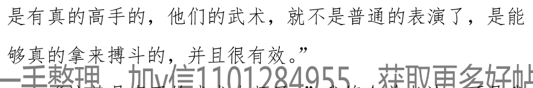

看到却是武术师傅，老沙慢慢地摇头。

老沙停一会才说，“真正的高手，一般人都不知道他们的存在。”

“你是隐世高手？”我说这句话，自己都觉得有点好笑，这样聊下去，讲出来的故事越走越远，向着这种道路发展，我不可愿陷入这种结果。

“你怀疑这种人？”老沙敏锐地察到了我的情绪。

“我不怀疑。”我说，“只是隐世高手这种词汇，会让人觉得不靠谱。毕竟和现代社会，以及现代文明相隔远。”

“其实一点也不远。”老沙露出一点笑意，似乎在嘲笑我无知。

我不猜透他笑容的意思，只好不出声，等他继续说。

“现代武术史上，有一个影响到全世界的宗师级人物，他就是一个隐世高手的传承，可惜，他太过于锋芒毕露，忘了收敛和训练，最终没能得到好结果……”老沙说，“史书上其实也出现过不少，但他们不是隐世高手，我只能说，他们是其中的一脉传承。一旦露了行迹，就会遭遇灾厄，所以你看他们，没几个好下场。还是我我不了解的层面。”

见我相信，老沙笑了笑，继续说：“既然你懂了，信了，那我就下讲，从大拿里讲。”

经过交手，老沙是完全相信大拿有秘传的武功。且简直称为秘武，这种功夫，跟某些秘术一样，是不见过的外人难以想见的，它的神奇之处，就在于它无法用常识和常理来推断和解释。

既然说到大拿，那现在就要回去，从小孩失踪那晚的黑林子说起。

大拿打开铁板之后，搬不动石板，所以决定留下，让老沙出去找人帮忙。但他等了多久，大拿就等得不耐烦，他知道把埋在地下，如果不尽快解救，会是怎样的后果。

“二子，我们再试一试。”大拿按捺捺捏，再次走向石板。他看得清楚，石板压着的下面，一定有个孔洞，只要搬开石头，就能进入地底救人。

“刚刚老沙，你为什么不要他一起，现在我们两个人，怎么能搬动！”二子不情愿。

“算了，你个懒货，他妈妈的除了会吃肉，还会干什么。”大拿急气坏坏地开头。他明白石板有多重，就算三人合力起来也很被动，他是不愿意为这么玩命。就算自己无济于事，也不能干坐着等。大拿就是这个性格。

又不知多久，老沙还没回来，大拿等得心里急躁，来回地走矮步，二子不敢露头，干脆坐在在一旁不出声。

“二子，你说老沙会不会跑了，不管我们？”大拿问二子。

“我怎么知道。”二子翻白眼，“你是你招的人，你比我清楚。”

“老子让你跟着他，你偏不跟，脑子真是短路，那么明显的意图你看不懂！”大拿骂道。

“我不笨，老沙那只粗过大腿，要对付我，我哪里是对手。”二子嘟囔着。

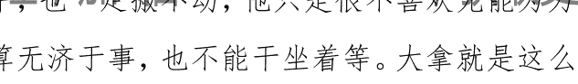

“你还好意思……””大拿挥手作势要打二子，“我身边就没有一个靠得住的货色，老沙这个人，在我面前露了馅，肯定要开溜，我虽然不知道他的意图，但他肯定不是个正保安！”

老沙越来越急，大拿就越不安，又过了三个小时，实实在在地等下去，就朝林子外。大拿最后发现老沙没回来，心里打算。大拿没发现老沙的记号，结果自己迷了路，走也出不去。大拿和二子乱走，怎么都不出黑林。第三次，两人又回到原地，安置在石板上。

由于石板压着的下面，一定有个孔洞，只要搬开石头，就能进入地底救人。

“……”二子缩缩地说，“咱们又撞到墙了，这地方。”

“哪有什么鬼，我可是有人装的。”大拿叫起来，“给老子滚出来，让我瞧你的本事。”


黑林子里产生无数回音，但声音变得很诡异，很浑厚，很尖锐。

“求你了，别再喊。”二子头皮发麻，贴着大拿轻轻的说，“别把邪性的东西给我。”

“你多事了，没老婆，没儿子，不要死在这。”大拿笑着，张望时候，二子脸色发青，眼睛里全是疑惑。

这回事，无论他说，都会重复几遍，而且语调古怪。就算不信邪，也捏得很慌。忽然，大拿感觉很异常，二子的手竟然跟树木一样硬。大拿忙低头，猛然发觉，缠在腰上的是二子的手，根本就是黑林里的树枝活过来，把他缠越紧。大拿脚逐渐悬空。

黑林的怪异，终于呈现出来。大拿虽然年轻，但越是临近，越是沉得住，顿时屏住呼吸，闭上眼睛。此时，不可靠的身体忽然变重，朝下方压去，双脚稳稳当当的粘在地面。这一招，从表现来看，跟“千斤坠”极其相似。千斤坠这个词，在很多武侠小说中都可见，算不上什么稀奇的武功。鉴于秘传武功的特殊性，这个招式，除了稳住身体之外，还有一个最大的功能，那就是清醒。大拿刚好克制住局，不仅如此，他很快，便发现黑林有一个管理者。一个守林人，一个看守黑林的人。


谢谢。

作者：williamsongzw 来自：iPhone 客户端 时间：2013-12-27 04:45:00

支持蛇哥！茄子来个!

################

茄子

作者：我夜夜梦啊 来自：Android 客户端 时间：2013-12-27 06:46:00

加油，不要太辛苦，不要太晚

################

多谢关心

# 一手整理 加油x11011284955 获得更多好帖

作者：火小姐 来自：Android 客户端 时间：2013-12-27 08:18:00

我是蛇哥老粉。从鬼事开始你的作品都都～求合影~

################

茄子

作者：纯洁的布睿 来自：UC 浏览器 时间：2013-12-27 08:53:00

啊，有新作了，茄子

################

茄子

作者：wudila1983 来自：QQ 浏览器 时间：2013-12-27 09:30:00

大力支持啊

###################
谢谢

作者: 用户名 1803 来自：手机版 时间：2013-12-27 10:14:00

哭! 完之后很想后悔自己手欠，再忍两天再看更多好吗？楼主，不要写得太好呀！追更真的很辛苦呀…

YYYYYYYYYYYYYY
多谢

作者: 大并发才才是皇帝 时间：2013-12-27 10:14:00

一手数据，加v信11011284955，获取更多好帖

###################
谢顶

作者：声爻香 1018 时间：2013-12-27 10:17:00

顶顶!

YYYYYYYYYYYYYY
谢谢小馨

作者：蛇锅御用闲多多 时间：2013-12-27 10:17:00

哼! 我只是来看我的我的 ID 解禁了没有!!!

####################
看来是解禁了。

作者：飞翔的自由者 66 时间：2013-12-27 10:29:00

继续

#################

OK

作者：为稻梁谋 b 时间：2013-12-27 10:38:00

12

################

谢顶

作者：叫你一个 时间：2013-12-27 10:38:00

那晚晚还在更新，蛇哥，注意休息，保重健康

回复，来顶顶~

收藏 1156 楼

作者：Lovelace 来自自：Chrome 浏览器，时间：2013-12-27 10:54:00

老蛇蛇，来顶顶~

看过无数恐怖故事，已然身经百战的我，现在就是看

老蛇蛇的作品会有点肝颤……美丽如既往的厉害啊~

################

谢谢小葛

作者：蛇从草 日期：2013-12-27 12:30

@零陆陆陆 1164 楼 2013-12-27 12:24:00

蛇哥，我来了~！留名，求合影。

________________________________

茄子

作者：蛇从草 日期:2013-12-27 12:34

@@Endler 1165 楼 2013-12-27 12:25:00

顶起~~~

E 妞也来了啊 日期:2013-12-27 14:33

@侵袭我的心 1169 楼 2013-12-27 12:57:00

天呐 就跟以前看昌昌鬼一样 吓哭的节奏

多谢支持。

# 一手办理加微信 11011284955 获取更多好帖

作者：蛇从草 日期：2013-12-27 12:57:41

@鱼跃在花见之朝 1181 楼 2013-12-27 15:50:00

虽然不是宜昌版在这儿习惯了潜水，但蛇哥的新帖，必须
登录来顶一下

多谢啊

作者：蛇从草 日期：2013-12-27 18:23

@zou664663 1190 楼 2013-12-27 17:47:00

老蛇那个讲翡翠的坑填什么？

翡翠帝国以后再写了。先留着吧。

作者:蛇从草 日期:2013-12-27 19:06

@小DU 机肠 1189 2013-12-27 17:43:00

一会儿就看完了，等更真痛苦，等过等过呢，慢慢写吧，这个帖子还长。

作者:蛇从草 日期:2013-12-27 19:48

大伞和二子走到树外，就要看到路的时候，看见两个人在蹲在那里，走进了一看，原来是老沙和黑子。

大伞和二子走到树外，就要看到路的时候，看见两个人在蹲在那里，走进了一看，原来是老沙和黑子。

大伞和二子走到树外，就要看到路的时候，看见两个人在蹲在那里，走进了一看，原来是老沙和黑子。

大伞和二子走到树外，就要看到路的时候，看见两个人在蹲在那里，走进了一看，原来是老沙和黑子。


被村民控制的时候，就出现了。

还有，刚才自己和黑小、二子石头里的烟雾弄得迷迷茫茫的，脑袋眩胀，可是刘所长抽了烟，绕着三个人走了一圈，自己立即就清醒过来。老沙连忙看向刘所长，发现他嘴上的香烟已经没有了。

老沙在心里跟明镜似的，原来这个刘所长心里明白着呢，他不仅知道村子里有古怪，可能知道很多东西。别看刘所长在不停的骂大拿，实际上是在带着自己四个人脱身。

一个派出所对全村都顺的村子，出现一些奇怪的事情，十分好解释了。

刘所长带着和那个汉子对峙，现在老沙已经十分肯定了，这显然就是老子的事，可能是村民的聚餐，事实上上他就是祭祀的带头人。

“既然小小子没丢，”刘所长眼睛看着村民，其实嘴里对着那个汉子说，“这几个保安，我就带回去了。”

那个汉子看向大拿，脸上十分的狡猾。老沙知道，他以为除了大拿，自己和黑小、二子的脑袋已经被他用雾熏给弄迷浊的，忘记了昨晚的事。但是大拿还记得昨晚在黑林子里的经历，他不愿意让大拿就这么走下去。

刘所长吹了哨手下的警察，扶扶老沙和小二子上了警车，警车是个面包车，能够挤下很多人。然后刘所长把大拿的胳膊一拽，“跟我回去！”

汉子一脸的阴郁，看着刘所长和大拿最后上了车，并没有话说，也没有做什么举动。

刘所长让开车的警察发动汽车，对着窗外的汉子说：“以后有什么麻烦事，尽管来找我，要相信警察嘛。”

警车鸣着起来，开出村外，向着虎镇行驶。当刘所长回到座位上的时候，老沙看见刘所长叹一口气，额头渗着汗水，把几头发粘在皮肤上。

作者:蛇芜 日期:2013-12-28 16:32

从了车之后，刘所长就不像刚才那样显得落魄，而是十分沉默，看着窗外。

老沙从口袋里掏出香烟给刘所长，让老沙没有预料的是：刘所长把烟点上，吐了一圈烟雾，老沙被烟呛了。

达到了，他以为刘所长是不会抽烟的，这就让他无法确定，自己刚清醒过来，是不是真的和刘所长的那颗香烟有关。

“他叫老沙，”大拿连忙跟刘所长介绍，“我刚招来的保安，上班没多久。”

“嗯。”刘所长点点头，“钢厂里的保卫工作任务很艰巨，的确是需要人的，老沙，要辛苦你们了。”

老沙笑着点点头，躲避刘所长的眼光。

车又开了一会，刘所长仿佛又是想起想要教训大拿，“我给你们领导打招呼，让你做队长，你当初是怎么应答应我的。”

“把钢厂护好，在北京的专家来之前，不让钢厂范围内出现问题。”大拿老老实的回答：

“今天的事情就就算了，”刘所长声音变得不再那么狠狠的，“你以后就老老实实在厂里面呆着，别到处乱跑俏胡胡。”

刘所长的警车开到了钢厂，然后回县城。大拿和老沙、黑小、二子回到厂里。里面的保安都乱成了一团，原来是聚机房的出了问题，那个井不停地往喷水，从昨天半夜开始直到现在，而且臭臭无味，现在的流到到处都是。

原来刚是老沙去虎镇看看钢厂的保安情况，正好就遇到了这群保安，围在泵房旁边看着喷水，原来是大拿去哪里了。那几个看着老沙去了黑林，身上的保安的，就说天要修理黑林，刘所长说丢了黑林，获取更多帖安排就是去找找孩子。刘所长就走了。估计是在黑林里没发现什么，就去了村子。

大拿听了保安说，老沙心里想想，刘所长一定知道黑林子的古怪，而且大拿在黑林里遇到危险，于是立刻过去。老沙完全能够确认这一点，因为刘所长和村里的汉子，虽然没说话，但是接触的时候，以前还打过道。大拿一看天亮了，就安排了几个保安上班，自己回到宿舍。

老沙拉紧眼睛，“那个刘所长，到底是个什么头，和大拿是什么关系？”

黑小和二子打着呵，说是要找个地方睡觉。老沙邀请他们去吃早饭，三个人坐下吃早饭。

老沙这才把刘所长和大拿之间的说了。原来大拿在部队当兵，那时候刘所长很喜欢大拿，大拿能吃苦。

神喻向老沙解释，这个设备是从一个外派非洲的勘探技术手上弄来的设备，是专门用于地下勘测矿藏的东西。但是这一般设备都很笨重，通过强大的机械震动，再接收返回的回波，根据返回回波的变化，就能分析地下几千米深度的矿藏。不过现在弄出了这种小型的设备，不需要那么大的功率，只需要在不同的地方安装一个小型探测头，工作原理和大型的探测设备是完全一致的。

由于这种设备还没有推广，所以分析软件也只能去找专业的工程师来。老沙笑着说：“怪不得这个小子想着孩子吧，原来是这么。”

作者:蛇芜 日期:2013-12-26 18:13

老沙心里有事，匆忙吃了早点，就向黑小和二子告辞，自己走到镇上。镇上的一些居民在三三两两地讨论钢厂冒水的事情，都是一副神秘的表情。老沙故意走近听约听他们在他们在：

- “底下的东西要放出来了……”
- “前些日子，挖掘器就不是好事……”
- “旁边山沟里的村子，那个挖掘机的司机要疯……”
- “那司机倒霉了，现在疯了，在镇上呢……”
- “对啊，天天在垃圾堆翻东西吃，大家老板看他可怜，他早饿死了……”

这几个居民看着老沙正在听他们的话，立即就不做声了。

老沙尴尬的走了，在街上又荡了一圈，来到神优和姚儿的房间门口。老沙想了想，轻轻的敲门。

神优带着老沙进了房间。房间一片狼藉，设备的外壳都被拆了，零件和电线裸出来，都被推放在地上。姚儿就在这些设备旁边看着，试图突破边界。老沙看到笔记本也被拆了。

神优脸色苍白，神情低迷。

“遇到麻烦了？”

神优说：“东西都坏了，这些设备突然出现了很多问题。”

“这些设备到底是做什么的？”老沙实在是不忍住问了，“你跑到林子里去安装什么探测头，不是就是这个玩意的。”

神优和姚儿的眼神交流一下，老沙急了。神优说：“昨晚上林子里的事情，你也已经看到了，这事如果你们两人这么对我藏着，我就真的没必要再跟你们合作去了。”

姚儿笑了笑，“老沙是不懂这些高科技吗，既然想知道，我们哪有不答应的。”

“你们退休之后，打算去哪里？”

神优愣了一下，他没想到老沙会问这样一个简单的问题。

“我不会吐露你们的下落，”老沙说，“我就是好奇而已。”

“南美。”姚儿在一旁说，“玻利维亚有一个天空之镜，我们打算在哪儿定居。”

老沙问这个问题本来就是给自己一个台阶下，他根本不关心什么国外的地名。既然如此了，老沙对申俊说：“你还记得我们那生意吗？”

“记得，”申俊说，“当时我们二人还不认识，在那个古墓交手后，必须合作才能活出来。”

“是啊，”老沙回答，“过了这么多年了，我还记得那个老王。”

申俊听老沙说这里，也在回忆他们当初的经历，“是啊，谁知道那个古墓里会有活了几百岁的守墓人，差点把我们给杀了。”

“那个古墓我们最终没有把关键的钥匙拿到，只是拿了另外一件东西。”老沙说，“因为我们二人当时商量过了，如果我们动那件最重要的玉如意，那个守墓人一定会跟着我们一辈子。”

“那个几百岁的守墓人，守着的就是玉如意。”申俊说，“也不知道玉如意到底有什么。”

“虎镇和钢厂下的东西，”老沙慢慢说，“可能这里的守墓人比几百岁的更厉害。当年遇到的守墓人，就是靠着地下冬眠，在完全封闭的环境下，才活了几百年。如果在地面上，气候和环境是不允许的。”

“我不排除矿下会有这种缓慢代谢的身体，”老沙说，“但是我们已经看到，地面的确有守墓人的。”

老沙苦苦说着：“昨晚在林子里遇到了一群人，那个村子里都是宗族，而且领头的非常厉害。刘所长说，面上的人是不可能做到千年不死的，方法就是代代延续，并且守着墓。这种守墓人要的东西，都是很不一般的。”

到了晚上，老沙又去钢厂加班了。走到大家餐馆，看到这个餐馆虽然没有生意，但是还没有关门，靠门口的地方摆着一个玻璃瓶，卖着卤菜。老沙想着，买了一只烧鸭，卖烧鸭的是一个孔武有力的中年人。

老沙提着烧鸭，走到钢厂门口，才想起白天在虎镇上听的一些断断续续的话，说是从钢厂荒出来的挖掘机司机，自己也坏了，大家餐馆的人施了一点吃的。

老沙心里就好，别人坏了自然有人照顾，司机老老就铺了很多事情。

老沙走进钢厂，看着里面的高炉和钢结构高架，高高的燃焰运送，在空中地下到处延伸连接的管道，心里就不免升起一股寂意。

钢厂是在六十年代改建的，在那个破旧的、打击牛鬼神的年代，竟然有人能动用巨大的资源，并且控制工业局，用钢厂的规模搞了这一个巨大的布局，这种人的是非是非小。

老沙走到巨大的厂房，然后在厂房办公室——也就是现在的保安值班室来报道。他敲了敲门，开了门，大拿一身酒气的站在门后，眼睛红丝的。

老沙走进班室，把烧鸡放在桌上，看见桌子上摆满了空啤酒瓶。

“你是贼！”大拿突然向老沙冲，然后一拳打了过来。

老沙心里震惊，并没有躲避，而是愣愣的站着。大拿的拳头碰到老沙的胸口一瞬间，力道就硬生生的止住。但是老沙的胳膊也撞到了大拿的手肘，把大拿带了一个跟脚。

老沙茫然看着大拿，不敢说话，心里在分析，大拿这快就把自己的身份给查完了。没有理他。

“你看着我的眼睛回答我，”大拿说，“你是不是贼？”

“他叫老沙，”大拿我刚招来的保安，上班没多久。”

“嗯。”刘所长点点头，“钢厂里的保卫工作任务很艰巨，的确是需要人的，老沙，要辛苦你们了。”

老沙笑着点点头，躲避刘所长的眼光。

车又开了一会，刘所长仿佛又是想起想要教训大拿，“我给你们领导打招呼，让你做队长，你当初是怎么应答应我的。”

“把钢厂护好，在北京的专家来之前，不让钢厂范围内出现问题。”大拿老老实的回答：

“今天的事情就就算了，”刘所长声音变得不再那么狠狠的，“你以后就老老实实在厂里面呆着，别到处乱跑俏胡胡。”

刘所长的警车开到了钢厂，然后回县城。大拿和老沙、黑小、二子回到厂里。里面的保安都乱成了一团，原来是聚机房的出了问题，那个井不停地往喷水，从昨天半夜开始直到现在，而且臭臭无味，现在的流到到处都是。

原来刚是老沙去虎镇看看钢厂的保安情况，正好就遇到了这群保安，围在泵房旁边看着喷水，原来是大拿去哪里了。那几个看着老沙去了黑林，身上的保安的，就说天要修理黑林，刘所长说丢了黑林，获取更多帖安排就是去找找孩子。刘所长就走了。估计是在黑林里没发现什么，就去了村子。

大拿听了保安说，老沙心里想想，刘所长一定知道黑林子的古怪，而且大拿在黑林里遇到危险，于是立刻过去。老沙完全能够确认这一点，因为刘所长和村里的汉子，虽然没说话，但是接触的时候，以前还打过道。大拿一看天亮了，就安排了几个保安上班，自己回到宿舍。

老沙拉紧眼睛，“那个刘所长，到底是个什么头，和大拿是什么关系？”

黑小和二子打着呵，说是要找个地方睡觉。老沙邀请他们去吃早饭，三个人坐下吃早饭。

老沙这才把刘所长和大拿之间的说了。原来大拿在部队当兵，那时候刘所长很喜欢大拿，大拿能吃苦。

神喻向老沙解释，这个设备是从一个外派非洲的勘探技术手上弄来的设备，是专门用于地下勘测矿藏的东西。但是这一般设备都很笨重，通过强大的机械震动，再接收返回的回波，根据返回回波的变化，就能分析地下几千米深度的矿藏。不过现在弄出了这种小型的设备，不需要那么大的功率，只需要在不同的地方安装一个小型探测头，工作原理和大型的探测设备是完全一致的。

由于这种设备还没有推广，所以分析软件也只能去找专业的工程师来。老沙笑着说：“怪不得这个小子想着孩子吧，原来是这么。”

作者:蛇芜 日期:2013-12-26 18:13

老沙心里有事，匆忙吃了早点，就向黑小和二子告辞，自己走到镇上。镇上的一些居民在三三两两地讨论钢厂冒水的事情，都是一副神秘的表情。老沙故意走近听约听他们在：

- “底下的东西要放出来了……”
- “前些日子，挖掘器就不是好事……”
- “旁边山沟里的村子，那个挖掘机的司机要疯……”
- “那司机倒霉了，现在疯了，在镇上呢……”
- “对啊，天天在垃圾堆翻东西吃，大家老板看他可怜，他早饿死了……”

这几个居民看着老沙正在听他们的话，立即就不做声了。

老沙尴尬的走了，在街上又荡了一圈，来到神优和姚儿的房间门口。老沙想了想，轻轻的敲门。

没过多久，门开了，神优带着老沙进了房间。神优脸色苍白，神情低迷，房间一片狼藉，设备的外壳都被拆了，零件和电线裸出来，都被推放在地上。姚儿就在这些设备旁边看着，试图突破边界。老沙看到笔记本也被拆了。

“遇到麻烦了？”老沙问神优。

神优说：“东西都坏了，这些设备突然出现了很多问题。”

“这些设备到底是做什么的？”老沙实在是不忍住问了，“你跑到林子里去安装什么探测头，不是就是这个玩意的。”

神优和姚儿的眼神交流一下，老沙急了。神优说：“昨晚上林子里的事情，你也已经看到了，这事如果你们两人这么对我藏着，我就真的没必要再跟你们合作去了。”

姚儿笑了笑，“老沙是不懂这些高科技吗，既然想知道，我们哪有不答应的。”

神喻向老沙解释，这个设备是从一个外派非洲的勘探技术手上弄来的设备，是专门用于地下勘测矿藏的东西。但是这一般设备都很笨重，通过强大的机械震动，再接收返回的回波，根据返回回波的变化，就能分析地下几千米深度的矿藏。不过现在弄出了这种小型的设备，不需要那么大的功率，只需要在不同的地方安装一个小型探测头，工作原理和大型的探测设备是完全一致的。

由于这种设备还没有推广，所以分析软件也只能去找专业的工程师来。老沙笑着说：“怪不得这个小子想着孩子吧，原来是这么。”

作者:蛇芜 日期:2013-12-26 18:13

老沙心里有事，匆忙吃了早点，就向黑小和二子告辞，自己走到镇上。镇上的一些居民在三三两两地讨论钢厂冒水的事情，都是一副神秘的表情。老沙故意走近听约听他们在：

- “底下的东西要放出来了……”
- “前些日子，挖掘器就不是好事……”
- “旁边山沟里的村子，那个挖掘机的司机要疯……”
- “那司机倒霉了，现在疯了，在镇上呢……”
- “对啊，天天在垃圾堆翻东西吃，大家老板看他可怜，他早饿死了……”

这几个居民看着老沙正在听他们的话，立即就不做声了。

老沙尴尬的走了，在街上又荡了一圈，来到神优和姚儿的房间门口。老沙想了想，轻轻的敲门。

没过多久，门开了，神优带着老沙进了房间。神优脸色苍白，神情低迷，房间一片狼藉，设备的外壳都被拆了，零件和电线裸出来，都被推放在地上。姚儿就在这些设备旁边看着，试图突破边界。老沙看到笔记本也被拆了。

“遇到麻烦了？”老沙问神优。

神优说：“东西都坏了，这些设备突然出现了很多问题。”

“这些设备到底是做什么的？”老沙实在是不忍住问了，“你跑到林子里去安装什么探测头，不是就是这个玩意的。”

神优和姚儿的眼神交流一下，老沙急了。神优说：“昨晚上林子里的事情，你也已经看到了，这事如果你们两人这么对我藏着，我就真的没必要再跟你们合作去了。”

姚儿笑了笑，“老沙是不懂这些高科技吗，既然想知道，我们哪有不答应的。”

神喻向老沙解释，这个设备是从一个外派非洲的勘探技术手上弄来的设备，是专门用于地下勘测矿藏的东西。但是这一般设备都很笨重，通过强大的机械震动，再接收返回的回波，根据返回回波的变化，就能分析地下几千米深度的矿藏。不过现在弄出了这种小型的设备，不需要那么大的功率，只需要在不同的地方安装一个小型探测头，工作原理和大型的探测设备是完全一致的。

由于这种设备还没有推广，所以分析软件也只能去找专业的工程师来。老沙笑着说：“怪不得这个小子想着孩子吧，原来是这么。”

“不就是几个青花瓷器吗？”大拿说，“这穷乡僻壤的，能什么让贼值得倒记。”

“能跟我说，当初青花瓷器挖出来的时候，是什么情况吗？”

“嗨，先不说这个，”大拿站起来，“你看好了，我隔山打牛的功夫，现在又灵了。”

老沙知道大拿要做什么，于是笑着看着他站在桌子上，拉开架旁，对着酒瓶划比。划了十几下之后，酒瓶里的液体就动了一下，老沙心里明白，这应该是神喻安装的探测头的缘故。神喻说了，他一共安了四个探测头，林子有一个，钢厂的保安值班附近也有一个。

这种探测器的东西，就是怎么动怎么感受；刚架架盯上了，让大拿以为是自己的本事得了。

老沙刚想到这里，大拿又一比，酒瓶液体有了震动一下，这次震动的更加厉害，果脑都有点晃动，酒瓶差点倒了。

大拿得意的说：“师父没教我这个，这是我自己独创的功夫。”

老沙突然想起一事情，就是自己白天睡觉的时候，好像床脚下也有点震动。神喻的探测头没有在自己睡觉的附近装。

探测头老沙见过，并不大，神喻和妈妈也说过，这个探测头功率很小。既然小，怎么可能弄出这么大的动静出来。

桌腿又震动一下，大拿却没有注意。老沙心里一下子就提了起来，神偷的观测设备已经因为磁场的缘故失效了。这个震动，根本就和神偷嫡儿无关！

这里地下震动……老沙的脑门流汗了。

地下有东西被惊动了。

作者：蛇从草 日期:2013-12-30 11:34

@ilove_lavie 1482 楼 2013-12-30 00:44:00

@蛇从草 ：楼主高才，本土豪赏 500币表敬意，青山不改，绿水长流，助楼主再造高楼神话。【我也要打赏 】

## 一手数理，加v信1101284955，获取更多好帖

作者：蛇从草 日期:2013-12-30 11:35

@我夜夜作梦啊 1501 楼 2013-12-30 06:34:00

翻页

沙高手？

作者：蛇从草 日期:2013-12-30 12:05

@vida0121 1503 楼 2013-12-30 08:09:00

真心希望老蛇的几部作品可以拍成电影。

BTY，老蛇做编剧，是业余还是专业？是编自己的作品还是别人的呢？期待老蛇的作品。

专职编剧了。

作者:蛇从革 日期:2013-12-30 14:49

@色功当量 1523 楼 2013-12-30 13:23:00

看了老蛇不少作品了，鬼事 1，2，八寒，蛇城，合个影

## 茄子

作者:蛇从革 日期:2013-12-30 18:26

@开水泡凉茶 1542 楼 2013-12-30 17:22:00

从鬼事一到鬼事，再从八寒地狱到这里，一直在追你的变形老蛇，加微信，获取更多帖


## 茄子

作者:蛇从革 日期:2013-12-30 19:47

@阿欢是个瓜 1532 楼 2013-12-30 15:40:00

不喜欢那个嗲儿好没劲劲的角色

人物还在展开，慢慢来吧。

作者：蛇从革 日期:2013-12-30 23:00

@情有千千劫 2012 1557 楼 2013-12-30 22:40:00

顶

作者：我夜夜作梦啊 来自：Android 客户端 时间:2013-12-30 22:59:00

加油啊
@@@@@@@@aaaaaaaaaaaaaaaaaaaa

感谢宜昌版和新浪微博还有猫扑过来说给我撑场的朋友

啊。今天晚晚一点，正在写字。

作者：蛇从草 日期：2013-12-30 23:31

大拿本已经酒醒了，有点微醺，他也感受到了房子的震动，但是刚才但他并没有开架势，他正在有的震动。梁放好的时候，房子开始剧烈摇响，梁上方的灰尘洒落。老沙糟了，看着大拿。

“大拿！大拿！”老沙大声，“你是想把房子给拆了？”

地下震动……老沙的脑门流汗了。

地下有东西被惊动了。

老沙刚想到这里，大拿又一比，酒瓶液体有了震动一下，这次震动的更加厉害，果脑都有点晃动，酒瓶差点倒了。

大拿得意的说：“师父没教我这个，这是我自己独创的功夫。”

老沙突然想起一事情，就是自己白天睡觉的时候，好像床脚下也有点震动。神喻的探测头没有在自己睡觉的附近装。

探测头老沙见过，并不大，神喻和妈妈也说过，这个探测头功率很小。既然小，怎么可能弄出这么大的动静出来。

桌腿又震动一下，大拿却没有注意。老沙心里一下子就提了起来，神偷的观测设备已经因为磁场的缘故失效了。这个震动，根本就和神偷嫡儿无关！

大拿本已经酒醒了，有点微醺，他也感受到了房子的震动，但是刚才但他并没有开架势，他正在有的震动。梁放好的时候，房子开始剧烈摇响，梁上方的灰尘洒落。老沙糟了，看着大拿。

“大拿！大拿！”老沙大声，“你是想把房子给拆了？”

地下震动……老沙的脑门流汗了。

地下有东西被惊动了。

老沙慢慢摸圆井，看到下方黑漆的底。大拿走过来，老沙也跟着走。在一组保安的带领下，向着泵房走过去。一群保安走在路上，老沙注意到头顶那些高架上，有些地方还在滴水，甚至能看到形成了一道水柱，声音来自管道内部，距离泵房越近，尖锐的空气声就明显了。这些保安也都听了，让他们更加不安。地面上湿漉漉，还有打扫的痕迹。走到泵房跟前，巨大的空气声震耳欲聋。保安们都不敢靠近。

大拿也进门之后，紧紧的把门死死拉住。现在大拿和老沙都清楚，泵房的位置在一个大坑。两根巨大的管道，本来是封闭的地下，但是……

“黑小子出了，“泵房的水井塌了，”二子要哭，“黑小子下去。”

“他掉下去了？”大拿问，“怎么不小心。”

“不是，”二子焦急，“是他自己下去的。”

老沙一听，心里暗自责，“真的来了。”

“马上带我去看看，”大拿连把保安带好，警戒，老沙也跟着。。

“慢点，”大拿瞬间酒醒了，“慌什么，你们在泵房打扫什么？”

“泵房不是一直外冒水吗，我们一直在外面打扫地面，把水扫到沟里去，外面的水扫差不多了，我们最后就打扫泵房，泵房已经不水了，我们慢慢打扫。”

大拿看了看四周，对着保安说：“行里不是工具房嘛，马上找两个绳子，和两个矿灯扛过来。”一个保安快的跑了，隔了一会，真的找了两绳子。大拿也不愁，把绳子在自己的身上绕了圈，然后把矿灯帽戴起来，老沙也照做，然后两个人就走到泵房里的井旁边。

“我们慢慢的下去，跟着绳子，“如果绳子突然捆绑，我们就拉上来。”大拿说完，立即顺着圆井内的钢梯，一下往下爬。老沙也跟着爬。

老沙爬到井底，矿灯上的光亮着，老沙只能看眼前的钢壁，不看。看了之后，老沙抽了一口凉气。钢壁上刻着东西，不是花纹，而是文字。老沙连续向下几步，发现钢壁上刻的文字没有消失，就是整个圆井，内部刻满了文字。老沙曾经在西藏去过，现在老沙心里端端的起了那个转经筒，是翻过来的。老沙心里发愁，和秘密打道，是他最不愿意事情。今天没了。

老沙说到这里，我突然打断老沙，“你说什么，转经理，还是翻过来的？”

“是的。”老沙说，“和你认识之前，在西藏去过一次，是一个小买卖，国内的一个收藏家，不知道为什么突然了，想收藏一个黄教的转经筒。事情不算困难，我到了西藏的林芝地区，在靠近尼泊尔的边界，找到一个黄教的喇喇，根本出手，和那个喇喇谈了几天，喇喇就送给我一个转经筒，我拿回去给那个收藏家挣了点钱，整个过程没出什么意外。”

我听到这里突然笑起来，“老沙，你的路数好像是发穷呢。”

“什么发穷，”老沙突然说，“等等，你刚才说什么？”

“我说你是发穷的路数。当年带我的师父，提到过几次这个词，”老沙激动的说，“是个什么意思？”

我好奇的说，“发穷这种路数，就是半卖半偷，能用买卖做成的事情，就用买卖的方式去完成。买卖做不成的事情，就去用偷盗的办法，实在是，去抢。怪不得我师父告诉我我们干什么，一定有好人说是买卖呢，”老沙恍恼地说，“就是分大买卖和小买卖而已。”

“有些盗贼，只会去偷盗的。”我说，“盗亦有，路数很多种，我只是没想到你明白自己的传承。“你又是从什么地方知道这些东西的。”老沙好奇的问。

“现在网络发达了，”我我不耐的说，“想知道什么，网……”

老沙慢慢摸圆井，看到下方黑漆的底。大拿走过来，老沙也跟着走。在一组保安的带领下，向着泵房走过去。一群保安走在路上，老沙注意到头顶那些高架上，有些地方还在滴水，甚至能看到形成了一道水柱，声音来自管道内部，距离泵房越近，尖锐的空气声就明显了。这些保安也都听了，让他们更加不安。地面上湿漉漉，还有打扫的痕迹。走到泵房跟前，巨大的空气声震耳欲聋。保安们都不敢靠近。大拿也进门之后，紧紧的把门死死拉住。现在大拿和老沙都清楚，泵房的位置在一个大坑。两根巨大的管道，本来是封闭的地下，但是……

“黑小子出了，“泵房的水井塌了，”二子要哭，“黑小子下去。”

“他掉下去了？”大拿问，“怎么不小心。”

“不是，”二子焦急，“是他自己下去的。”

老沙一听，心里暗自责，“真的来了。”

“马上带我去看看，”大拿连把保安带好，警戒，老沙也跟着。

“慢点，”大拿瞬间酒醒了，“慌什么，你们在泵房打扫什么？”

“泵房不是一直外冒水吗，我们一直在外面打扫地面，把水扫到沟里去，外面的水扫差不多了，我们最后就打扫泵房，泵房已经不水了，我们慢慢打扫。”

大拿看了看四周，对着保安说：“行里不是工具房嘛，马上找两个绳子，和两个矿灯扛过来。”一个保安快的跑了，隔了一会，真的找了两绳子。大拿也不愁，把绳子在自己的身上绕了圈，然后把矿灯帽戴起来，老沙也照做，然后两个人就走到泵房里的井旁边。

“我们慢慢的下去，跟着绳子，“如果绳子突然捆绑，我们就拉上来。”大拿说完，立即顺着圆井内的钢梯，一下往下爬。老沙也跟着爬。

老沙爬到井底，矿灯上的光亮着，老沙只能看眼前的钢壁，不看。看了之后，老沙抽了一口凉气。钢壁上刻着东西，不是花纹，而是文字。老沙连续向下几步，发现钢壁上刻的文字没有消失，就是整个圆井，内部刻满了文字。老沙曾经在西藏去过，现在老沙心里端端的起了那个转经筒，是翻过来的。老沙心里发愁，和秘密打道，是他最不愿意事情。今天没了。

老沙说到这里，我突然打断老沙，“你说什么，转经理，还是翻过来的？”

“是的。”老沙说，“和你认识之前，在西藏去过一次，是一个小买卖，国内的一个收藏家，不知道为什么突然了，想收藏一个黄教的转经筒。事情不算困难，我到了西藏的林芝地区，在靠近尼泊尔的边界，找到一个黄教的喇喇，根本出手，和那个喇喇谈了几天，喇喇就送给我一个转经筒，我拿回去给那个收藏家挣了点钱，整个过程没出什么意外。”

(注：后续部分OCR重复已按逻辑合并处理)

大拿得意的说：“师父没教我这个，这是我自己独创的功夫。”

老沙突然想起一事情，就是自己白天睡觉的时候，好像床脚下也有点震动。神喻的探测头没有在自己睡觉的附近装。

探测头老沙见过，并不大，神喻和妈妈也说过，这个探测头功率很小。既然小，怎么可能弄出这么大的动静出来。

桌腿又震动一下，大拿却没有注意。老沙心里一下子就提了起来，神偷的观测设备已经因为磁场的缘故失效了。这个震动，根本就和神偷嫡儿无关！


@南拉古 1824 楼 2014-01-01 14:09:00

每日一项

多谢。

作者:蛇从草 日期:2014-01-01 18:42

@静心容已 1834 楼 2014-01-01 18:18:00

看过老蛇的《异蟒》，很好的一部作品，惊心动魄，异彩纷星。看看老蛇的这部作品也是如此，开篇就很吸引我。首先感谢老蛇为大家奉献如此出色的作品。有一个疑问：“这个钢管的直径是八百公分的”确定是 800 公分吗？

我觉得深有同感，虽然很平淡，却收获很多站。应该是八百厘米。专业标注是 DN800。

就是八十公分，即八十厘米。

我以前的同行看到了，让我情何能堪。

作者:蛇从草 日期:2014-01-01 21:47

@阿奎 1213 1913 2014-01-01 19:44:00

真心不错，细节上没错没错的。不过我有三个问题：

- 1：蛇哥设计的情境是老蛇在收费亭里跟老沙对话。
- 我觉得这不对，这个故事不是三言两语能说的，在收费亭里，老沙跟蛇讲完这个故事是不可能的。
- 2：这个案子是申喻（好豪的名字）邀老沙来做的，老箭前后前后忙里忙，神偷偷架设摄像头以外，没啥动作。不像一个活动发起人应有的表现。
- 3：大拿这样的小伙子，人中龙风，既然得过军区的冠军，组织上可是绝对不会回答......老夫人提问了，怎么也要回部分是在地下停车场，后面会换一种方式，就是临死前，我去看看他。

2，我写东西慢热，人物出场慢慢，现在先把大拿和老沙写出来，后面神偷、姚儿、刘所长，还有几个关键人物一个一个的。张奎的情节我写清楚了，他的结果部不畅露出出来，是组织要求他坦白，他又把人给打了，相当于是违反了纪律，强行专业就是处理结果。但是我留了伏笔啊，他当年的老局，一直都是看着他的。刘所长的表现，不是一个一般的警察。

作者：蛇从草 日期:2014-01-01 22:34

大拿边咒骂那个出事的黑小，边向下哑。老沙大问老沙：“你说黑小为什么被夹在钢管中？问？他自己为什么都不记得发生了什么？”

“谁知道，”大拿说，“这小子吓坏了，瞎眼也不定。”
“他一定是被什么东西上身上了，”老沙说。


“中邪，”大拿，“倒是听说过中邪的人，会做出一些平时做不出来的举动。”

老沙犹豫一会儿，还是把自己的担忧说了，“大拿，你听我说，这个圆井一定是个商人布置的东西。”

“吐吧，”大拿，“这是当初钢厂抽取地下水的机井而已，被你说的这么中邪了。”

“你看看墙，”老沙，“看看面上刻了之后，“这花纹颇有意思的。”

“还有别，”大拿细看了之后，“这是一种文字，写的还是异语。”

“这是哪里的文字啊，”大拿，“也不是英语那种拼音字也不认识。”

“我也看不懂，”老沙，“但是我肯定些文字是镇邪的。”

“你的意思是，圆井的下面有被镇住的东西？”

“刚才黑小莫名其妙的被夹在钢管中间，”老沙回答，“加上泵机房上的地面突然失效，就说明这个圆井已经开始失效了，黑小是被某种东西崩掉来的。”

“老沙，”大拿在下面，“你真的相信有鬼吗？”

“我不知道，”老沙回答，“这个世界上有很多东西是没有解释的。“等我们上去了，我们好好谈谈。”大拿，“先不想这。”

老沙听了，大拿继续下去，究竟。

大拿继续下去，这些吧。”老沙听了，无法阻止大拿继续下去，他心里还有一个忧没有说出来。

大拿继续下去，究竟。“到底是什么呢？”

大拿和老沙又爬了几分钟，两人体力有点上，老沙身上的绳索也到了尽头，也就是说现在到了一百米，老沙把绳索解开，拴在钢梯上。两人休息一会，继续老沙心里飞计算，二十分后，他又爬到了八十米，这个圆井，底部和地面的垂直距离。然后老沙也到钢梯尽头，站在底部。

圆井下方是个正方形的大厅，面积远远超过圆井。圆井上方坍塌的水块和一坨变形的设备，就在地上。继续深入地下。巨大的铲车已经把泵房的房顶给掀了，一个铲车正在吊着一个巨大的水泥板，悬挂在圆井的上方。

“你们总算是上来了。”二子跑过来，“刘所长要把这个地陷给封上。”

“你上来就好。”刘所长对着人工喊道，“下面没有人了，”

作者：蛇从草 日期:2014-01-01 23:45

今天没了。

作者：蛇从草 日期:2014-01-02 11:03

呵呵，感谢蛇哥 @蛇从草的回复。看来这个案子水很深，比我设想中的深多了。

- 1. 既然有两个保安：大拿和老沙，都是身怀绝技的人，可能小黑和二子也是扮猪吃老虎，深藏不漏，可能是某一方。
- 2. 妩儿这个女子是无间道无疑的。她是另一方的人，神偷和老沙。
- 3. 刘所长就是官方在当地眼线，可能由相关部门直接领导。
- 4. 那个家伙又是另一股势力，实力非同不可。

大拿跟老沙说这些，也没有半点吐露，却教他的武功，到底是个什么路数。他必须要守这个承诺。老沙知道这个忌讳，就没有问。两人就边说边爬，当大拿说完的时候，差不多就爬到了地面。老沙和大拿爬上来，刚好看到刘所长带着警察正要在保安们争抢。

……终于大拿说：“看来就是这样了，我们上去吧。”

老沙立即赞成，他有太多疑惑，需要去找神偷，两人商量一下。这件事，探知的越，就越能发现更多的诡异。老沙心里一次打起了退鼓。两人顺着路，在钢梯上慢慢爬。下来的时候，心情越来越紧张，隧道里的空气闭塞，枯燥，时间真的很难熬。老沙就把大拿拉起来。

“大拿，”老沙说，“你当年被打被部队复员，小时候我是早产，身体弱，一直病着，随时会死掉。到了八岁的时候，大拿还是身体虚，躺在床上病恹恹的，有一天清醒，清醒的时候，也说一些不着的胡话。刚好村里来了一个游走的郎中，给大拿扎了几针，大拿立刻就能下了，脑袋也清醒了。大拿的父母非常感激郎中，大拿送医院后，很多老人断言他长不大，这种孩子多半都是傻子，活不过十二岁。”

大拿的父母听了，心里就灰了，因为这个郎中的确没错，这孩子现在还能走路，说明这孩子机灵，说明这孩子的身体骨不一般，如果父母肯舍，还有一个出路。

结果中的条件就是大拿跟着离开，七年后，就让大拿回来。于是是大拿就被那个郎中带走，那时他还没，跟着郎中到了深山里，七年没有出山。在这七年里，大拿跟着采药，然后教他功夫。七年到，郎把大拿叫来，跟他说了老家在什么地方，现在只要一辈子练功，脑袋里的东西就不会对他有影响。然后郎把大拿的眼睛蒙上，带着他下山，到了一个城镇，分手的时候，对大拿说，估计在他眼睛蒙上的时候，用什么特殊的办法，在短时间内跨越了很长的路程。大拿后来也去找过那个郎中，可是他就算回到当初分离的城镇，也找不到当初那个大山。

大拿和老沙在下面看了很久，出了中央的两根钢管，再找也找不到任何出口和通道。站在这些密密麻麻的尸棺中时间久了，两人也的紧张得慌。

大拿忍不住去触摸壁画，壁画上的颜料和灰土粉落下，掉落越来越厉害，到时候就是大块大块的灰土剥离。大拿注意到了这点，壁画的颜色慢慢从五彩斑斓，变成了灰色和褐色，最后所有的图案都慢慢隐。所有的灰土剥落之后，大厅四面的墙壁，全部是层层叠叠的人体留在四周。如果这么推断，这个正方形的地下，就真的还有一个具有价值的墓。神偷和妈妈，还有来不明的同行，一定惦记的是底面的东西。

“我管得住，妮大点地方，我不管你！”大拿叹气的说，“你让我出去，我不出去就是我在钢铁厂，现在钢铁厂出了事，下面个人，那么多尸体，要是被保安们知道，谁还呆在这里，到时候跑光了！我一定要交代。”

“我不知道下面是什么，也不想你说这些，总之，就跟着那个叫老沙的人下去，现在地陷死了，下面是什么，你们两个可以去乱造！”刘所长不理他，把门一挥离开。

大拿心里东思西想得劲，他一直是认为是刘所长重的，但现在，他开始怀疑这一点。在厂里愁得慌，就想喊老沙出来喝酒。找了一会儿，没找到，就一个人出了门，到附近的一个土菜饭点了两个小菜，配点啤酒喝酒。也不知道喝了多少，大拿在酒桌上迷迷糊的趴着，就听到别人聊天。

“老板，你这做饭的水，是干净的吧？”一个食客。

“怎么可能不干净，都是自家井里的井水。”饭馆老板说了，脸很黑，用手抹脸，“原来你晓得那事了……”那食客声音放了几度。

“哎，虎符镇也拍了巴掌，镇头放屁，镇尾都闻得到。”饭馆老板说，“没事，你们放心吃，这饭用的水干净定没问题。”

“老板，你们在聊什么？”大拿迷迷糊的睁眼，“什么矿厂的水？”（矿厂厂的水）

“大拿，那就是蓄水池的水，这个我不说，你肯定也比我清楚。”饭馆老板说。

“我知道啊，那个蓄水池的水污染得严重了，是不能用的。”大拿心里噔一下，“但我听你们的意思，是有人拿做饭了？”

钢厂有个蓄水池，说是蓄水池，其实比较大，方圆概有五六百米，像个小湖泊。周围拉着铁丝网，不让人进去，而且进入工厂的，都被训诚，不要去搅蓄水池里的水。所以厂里保安用水，宁愿倒费力去泵房取水，也不用水的池。但是现在泵房的机井下方有一个万人，抽上来的水，看起来也不干净。


不起跑掉，留下家里孤儿寡母，害毁了两个家庭......

饭馆老板摇了摇头。

“你说的冬生，长得又白又胖，他家饭馆的名字叫“福来馆”，对不对？”大拿清醒了点，霍然站起来。

饭馆老板忙点头，大拿连奔带跑地朝钢厂急匆匆回来。刚一进门，他就看到二子急忙忙的冲出来。

“李队，李队，你回来了……”二子住脚，一把鼻涕一把汗泪的抓住大拿的手。

“你是怎么了，啥事？”大拿没有半点要调侃他的心思，他心里还在想着怎么跟二子说。一处理完，他发现二子就是叔叔，愁多好帖。

叔叔婶挥了挥手，觉得二子不成器，只能当个保安，所以不让他继续住在家里，叔叔倒是是个好人，常常偷偷来钢厂给他送好吃的。大拿和黑小当然跟着走了，往大拿的宿舍里走。

二子不话说，急的把大拿拉住，大拿走到门口，就闻一股臭味从房里传出来。大拿忍不住往二子脸上拍了一掌，“你个臭货到我房里干什么事了！”

“我没……”二子委屈的摸着头，“是我叔，他病了。”

大拿立刻忍着臭味钻进房里，这股臭味很熟悉，大拿总觉得在哪里闻过，但一时又不想起来。

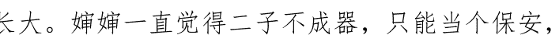

房间的地上躺着一个人，正是二子的叔叔，冬生。

他就那样直愣愣的躺在地上，湿漉漉的一滩水里，嘴里发出怪异的哨啪声。

“李队，快救我叔叔，他身上有往外流水！”二子急说的，“外面还有很多人人在找他麻烦……”

大拿才明白，原来地上的那滩水，是从冬生的身上渗出来的汗水，特别的臭。

“你好好跟我说说，发生什么事了？”大拿问二子，他实在想不通，当初逃跑的冬生，怎么会出现在钢厂里。

大拿心里乱糟糟的，这几天真的是犯了邪门了，明白。

# 事的管理：加信1101284955，获取更多好帖

作者：蛇从草 日期:2014-01-02 22:28

今天没了

作者：蛇从草 日期:2014-01-03 00:04

@XIAOI123456789 2067 楼 2014-01-02 23:54:00

睡前一项，蛇哥合影。

茄子

作者：蛇从草 日期:2014-01-03 11:05

@861700122 2097 楼 2014-01-03 09:11:00

回复第1762 楼(作者：@蛇从草 于 2014-01-01 00:39) 老沙和大拿当时顺着钢梯向下爬了七八十里，老沙看到圆井的内壁依旧是密密麻麻的咒文，心里越来越越担心，=======这个钢管的直径是八百公分的，一个胳膊无法环绕没见过钢管厂的管道，无法想象八米的钢管。。。或者，老蛇是想八百公里？或者是八十厘米？

@蛇锅御用钱多多 2110 楼 2014-01-03 10:25:00

噗。。。。八米粗的钢管……虽然蛇锅已经解释了但是是在这里看到八米的钢管还是本能的脑补了一下真的觉得好好笑哈哈哈哈哈哈哈

# 一手整理，加微信1101284955，获取更多好帖

汗！是八十厘米，0.8 米。

作者：蛇从草 日期:2014-01-03 13:41

@春行早 2125 楼 2014-01-03 12:25:00

哇，老蛇开新帖，都不知道耶。宜昌版的兄弟姐妹来了了啊。

作者：蛇从草 日期:2014-01-03 16:02

@最可爱的小火锅 2137 楼 2014-01-03 15:09:00

老蛇，因为你的宜昌鬼事而培养了来逛蓬话悠悠的习惯，一直没有出来顶帖，实在是不好意思。文章本天成，妙手偶得之，鬼事1的精彩成就了你，也让追贴的书迷大呼惊喜，让我对你的文笔和思路是佩服有加。个人认为，鬼事八寒地狱的叙事方式偏离了前两部的风格，希望再续写鬼事的时候能回到原来的轨道。这个建议纯属个人喜好，老蛇可以忽略，毕竟众口难调啊！

鬼事一还没想很多，但是一直想写更扩展的故事。寒地狱是个过渡。希望望大大师能写出我心中所想的精彩。

作者：蛇从草 日期:2014-01-03 18:25

@XIAAOI23456789 2153 楼 2014-01-03 17:40:00

# 一手处理1101284955，获取更多好帖

读者老蛇的回复：期待后续。谢谢

作者：蛇从草 日期:2014-01-03 20:32

@过冬小龙骄 2158 楼 2014-01-03 18:37:00

蛇哥我喜欢欢一起二，要是能有写他年轻时候经历的故事就好了。看有没有可能在冥算篇提到吧。

作者：蛇从草 日期:2014-01-03 22:28

冬叔是个慈祥的长辈。

大拿不信冬生会做坏事，在他的印象里，冬生是个慈祥的长辈，做了多年买卖，也从来没有做过错事。

他听到冬生出事，忙回来通知二子，让他去听听。一处理完，他发现二子就是叔叔，愁多好帖。

叔叔婶挥了挥手，觉得二子不成器，只能当个保安，所以不让他继续住在家里，叔叔倒是是个好人，常常偷偷来钢厂给他送好吃的。

大拿和黑小跟着走了，往宿舍走。真相肯定不是他们说的那样。

谁知道，冬生就跑到他的宿舍来。二子不话说，急的把大拿拉住，大拿走到门口，就闻一股臭味从房里传出来。大拿忍不住往二子脸上拍了一掌，“你个臭货到我房里干什么事了！”

“我没……”二子委屈的摸着头，“是我叔，他病了。”

大拿立刻忍着臭味钻房里，这股臭味很熟悉，大拿总觉得在哪里闻过，但一时又不想起来。

房间的地上躺着一个人，正是二子的叔叔，冬生。

他就那样直愣愣的躺在地上，湿漉漉的一滩水里，嘴里发出怪异的哨啪声。

“李队，快救我叔叔，他身上有往外流水！”二子急说的，“外面还有很多人人在找他麻烦……”

大拿才明白，原来地上的那滩水，是从冬生的身上渗出来的汗水，特别的臭。

“你好好跟我说说，发生什么事了？”大拿问二子，他实在想不通，当初逃跑的冬生，怎么会出现在钢厂里。

大拿心里乱糟糟的，这几天真的是犯了邪门了，明白。

冬生叔，现在你想要怎么办？”大拿问。

“你想让我活，就要听我的……”冬生吐出，脸憋得紫红，“不要离开那个地方。”

二子揉着眼眶，大拿看着二子急的，“大哥，赶紧送去医院，我想办法。”

“我没办法，救不了人了。”大拿摇摇头，“最好是送去医院，我想办法。”

“叔，别拦了，听我的……”冬生大喊，用手指向了外面，“大哥，赶紧救救我。”二子在一旁边哭。

“不行，不能去。”冬生喊道，“你想让我活，就要听我的。”

大拿顺着他手指的方向，那个地方就是水池所在。“冬生叔，现在你想要怎么办？”大拿问。

其实也知道，把冬生送到医院一定能解决问题。他跟着那个教他的郎中采药，配药，听他讲了不少稀奇的病症。二子见冬生恢复了点气力，立刻来了精神。大拿夸他：“叔，你等着，我去打水。力气还小，以后很快就能填满池子的。”大拿提着水桶到水池打水，这个时候很矛盾，因为他意识了一件事：这个水池的水，肯定不对劲，不准反而害了他。

除了按照冬生的做法，大拿没有别的办法。他唯一的希望是，冬生会醒过来，说出原委。从冬生的表现来看，他似乎对自身处境很清楚。大拿走到水池边，水池里的水比以前更加清澈，甚至一眼看到底，底下只有淤泥和杂物，但没有任何生命迹象，连基本的浮游生物也没有，一潭死水。

跟黑林的传闻不一样，那个地方周围经常看到野兽，但这个水池比黑林还古怪，大拿从来没在这里看到过活物。黑小曾经买了两条金鱼放到里面，他们一同看着鱼游到了池子里，再看一眼就不见了。自此后，那对金鱼也没有出现过。大拿心里不愿意相信小小的水池能掀起大波浪，但他心里对水池的怀疑越来越了。其中一点，就是在水里游过好几圈，却没发生过什么。而其他的人或动物身上，却发生了怪事。处理后加了药，皮肤没愈合，反而长了好多水泡。之后，问冬生要不要加热水进去。冬生看到水，立刻眼睛发直，跑到了缸沿，几乎是倒着栽进水缸里。大拿和二子都吓了一大跳，赶紧走上前。冬生却顺溜的翻过身，冲缸外吐了口水，双手搭在缸沿上出一出一泡温泉的样子，十分享受。泡了大约半个小时，大拿看到冬生的脸色恢复了以前的红润，大为惊讶，他想明白，这水池里的水，冬生竟然有治疗的效果。

“叔，你到底发生了什么事，怎么会欠别人五万块？”二子见冬生状态好些，问道。

冬生叹了口气，把原委跟二子说了出来。原来，冬生从前几天开始，接待了一位外游客户。这些游客在白天在周围游玩，晚上睡在冬生隔壁的旅馆，吃喝在他的“福来饭馆”解决。冬生做的饭菜很合这些游客的口味，所以这些游客每天都在饭馆里吃。

但是有一天，游客吃完饭后突然开始拉肚子，然后眼睛也肿。冬生发现水池里的水脏了，不能用来做饭，游客要求他赔五万块医药费，否则就要上法庭。因为镇上的很多本地人都知道水池的水很不干净，被钢厂里的废水污染了，名声不好。冬生为了孩子上学，攒了五万块，也拿不出来。冬生没办法，最后发现用水池里的水给游客做饭。冬生很高兴，这些游客也都称赞饭菜比以前好吃。

“叔，你身上出了什么病？”大拿问。

冬生咳嗽了：“没……什么，我有点累，能不能休息会。”大拿看着冬生，心里在担心。

“冬生叔，你告诉我。”大拿看向冬生，“冬生叔，你认识以前钢厂的领头人吗？”

二子也急了：“你叔叔又是老员工，不然怎么会有关系，把你介绍进来上班的？”“一个保安，还需要你介绍什么关系！”二子咬了一声，但看着冬生的表情，又说，“不会真的是找人吧。”

冬生摇头：“是啊，我刚来的时候告诉过你。”大拿觉得不对：“这水池，听说当年淹过人。”

大拿看着冬生在水缸的情况，想起了自己刚来的时候，老李曾经告诫，千万不要碰水池里的水。后来有人跳进水池，自己下去却没事。

“叔，别拦了，听我的……”二子揉着眼眶，大拿看着二子急的：“大哥，赶紧送去医院，我想办法。”

“不行，不能去。”冬生喊道，“你想让我活，就要听我的。”大拿顺着他手指的方向，那个地方就是水池所在。“冬生叔，现在你想要怎么办？”大拿问。

其实也知道，把冬生送到医院一定能解决问题。他跟着那个教他的郎中采药，配药，听他讲了不少稀奇的病症。二子见冬生恢复了点气力，立刻来了精神。大拿夸他：“叔，你等着，我去打水。力气还小，以后很快就能填满池子的。”大拿提着水桶到水池打水……

（此处重复部分已根据语义逻辑合并精简）

“给你们写几个字，看你们认不认。”老沙立即找一张纸，写上编号1101284955，然后贴在厕所墙上画着死光的咒。神悠看了看，然后说：“这个应该是西文吧？”“不是西文，”妈儿说，“如果是西文，我能看一点。“可是和西文很相似，”神悠蹲蹲。“如果我没错，”这个应该是契丹文，但是契丹文现在没人能真正破解。”老沙想了想，“我在底下看到了几幅壁画。”然后在纸上画了起来，画了几个人的样子，老沙没有什么绘画的本事，他读过什么书，但是他的优点是记忆力非常好，特别是对……

画面的记忆。

老沙勉强画了几个人物出来，就是他在泵机房两百米下的壁画画面。在壁画崩溃之前，他差不多把那几幅壁画的大致都记下来了。

神偷一看老沙的人物，惊呼起来：“老沙这个还真的跟葵丹有关！”

老沙看着神偷：“你能看出来？”

“你画的这六个人，有两个是葵丹的服饰和头发，还有四个是女性的伪装。”

“他们在打仗？”老沙说，“原来那几幅画是描述当时的战争的场面？”

一是有可能的解释就是与当时的战争有关，暗示什么秘密。

“可惜那些壁画都塌了。”老沙不无悔的说。

作者：蛇从草 日期：2014-01-05 00:27

今天没了

作者：蛇从草 日期：2014-01-05 00:30

@witchring 2288 楼 2014-01-05 00:24:00

顶起，蛇哥，我挺八个月了......茄子。

茄子

作者：蛇从草 日期：2014-01-05 01:55

回复第 2308 楼(作者:@清香炒蘑菇 于 2014-01-05 01:48)

我要茄子!!!

——!!!

茄子

[来自手机网页版]

======

作者：蛇从草 日期:2014-01-05 11:08

@青胡子 zy 2322 楼 2014-01-05 10:03:00

南凭大王？

一手整理，加v信1101284955，获取更多好帖。

虎符镇就在你家附近呢。你还记得记得，我到你家的城市出差啊。

作者：蛇从草 日期：2014-01-05 17:25

@好运图书馆 2012 2333 楼 2014-01-05 12:23:00

总是无视我

--------------------------------

看到了

作者：蛇从草 日期：2014-01-05 17:56

@lucialilu1991 2352 楼 2014-01-05 17:27:00

爬上来顶一个，之前默默用手机看完了鬼事系列，还有异海和翡翠帝国没看，准备这个寒好好把老蛇的文都看了，老蛇一直辛苦了呀，一直非常喜欢你的文，希望能够一直写下去呀~~~

多谢支持
作者：蛇从草 日期：2014-01-05 18:33

@newmarco531 2343 楼 2014-01-05 14:40:03
默默的一项，表达出对作者的支持。

谢顶。
作者：蛇从草 日期：2014-01-05 20:26

一手处理，我把试图的情况说出来后，回信1101284955，获取更多好帖。

“想不到我们待的地方这么古怪！”二子吞了口唾沫，大热天，他脸色却吓得惨白，额头冒出一层细汗，嘴里吞吞吞吞的倒凉气。

大拿垂头丧气的在门口，他是不信邪的，当年他也不怎么相信胡胡队的。可现在，事情一一出现，由得他不信，关键的是，他现在想到了一个更严重的问题。

“不行了，我不在这干了，昨晚上黑小就丢了羊命，我要在这里继续干下去，也会跟他一样。虎符镇我是等不下去了，大拿，你赶紧给我发工资去！我到外地去！”二小连连后退，仿似是想到什么，冲冬生说，“叔，你跟我一起走。”

“我说了，我离不开池水的水，走了我肯定要死。”

冬生连连摆手，“你走吧，走了也好。”

二子幽豫的望着大刀，“大刀……你说说话，你会放我走吧？”

“你个总丧，遇到问题就知道跑路，我告诉你，这事没你想的那么简单，不信你跑跑，跑到天涯海角，该死的，你还是得死！”大刀没好声的说，不停的擦着汗水，却发现额上的汗全都不够干净。

“别吓我。你知道什么！”二子被大刀镇住了，缩缩缩呵。

“有些事，我不能跟你们说，我只能告诉你们，这个大坝一旦裂的原因，并不是以前的钢筋问题，是很奇怪的。蓄水池后，都是一个原因，这地下有东西要害人！”大斧气不过，猛踩了几脚地面。

“大刀，你是不是在泵房水后面看到了什么？”二子身体抖了，“你上来来，刘所长就把那个陷阱给封住了，是不有鬼害人……你吓我。”这个时候，冬生哆着水缸爬出来，冲着二子喊：“这天气太奇怪了，怎么冷，赶紧把暖气开，我快死了。”二子看冬生那样，急得直抓，“我完全搞不懂你们说什么！我的命怎么这么苦！”

冬生滚地上，身上流得到处都是，他翻着白眼，想要站起来，但地上太滑，四肢胡乱摆动。他眼前根本没人拦，他却做出要把人揉开的情景最诡异。大拿立刻发现问题，用了一把刀砍在冬生的脖上，把他晕过去。

“你干什么，把我叔打死了！”二子立刻上前。

“冬生已经神智不清了，你跟着乱。”大拿一手架在子身上，加v信1101284955，获取更多好帖。

“他刚刚还好，怎么就神智不清了！”二子揉着手。

“我估计冬生叔来，根本不是让你帮你，躲在这里，是有更大的目标！”大拿把二子推出去。

“我知道这么叔叔，你对付，就是对付我，跟你完！”二子吵着不肯。“都他妈的疯了！”大拿不再解释，上前就是巴掌，把二子给在地上。打的部位相当精准，目的是要制服别人，但对方其实没有任何伤害。二子无力躺在地上，眼睛睁张，挣扎两下睡过去的。

大拿卷起袖子，把保安帽丢到旁，把冬生拖到暖气处，找了两条黄皮带，把双手脚给捆好，让他没办法动弹。然后，大拿找了盆水，泼到二子头上，让他醒。

“我怎么晕了？”二子迷茫的睁眼，摸着脸，不明白发生了什么。大拿一看样子就知道事对了，二子也跟冬生接触，变得奇怪起来，应该是神智变得那么清醒。

“叔叔出了大事，我们要救他。”大拿指了指角落里的冬生，“现在需要你帮忙，你肯不帮？”

蛇哥看到我啊！

--------------------------------

茄子。

作者：蛇从草 日期：2014-01-05 21:14

@青白菜 2367 楼 2014-01-05 21:42:00

蛇大大求合影
蛇大大求合影~~~
蛇老大求合影~~~
蛇老大求合影~~~
蛇老大求合影~~~
蛇老大求合影~~~
茄子
作者:蛇从草 日期:2014-01-05 21:14

@nnfq 2368 楼 2014-01-05 21:43:00

# 一整理加微信1101284955，获取更多好帖

作者：蛇从草 日期：2014-01-05 21:32

@我是黑熊 2377 楼 2014-01-05 21:25:00

换个表情，不许再说茄子跟我合影

田七
作者：蛇从草 日期：2014-01-05 22:13

大拿从房间里找出一捆绳索让二子身上，对他说：“我们去蓄水池看看。”

“什么，蓄水池？刚才不是说是那地方淹死人，不能去吗？”二子吓得把绳索拴在地上。

“说你神智不清，这些事你倒是记得清楚楚！”大拿拍下了二子的手，“抓紧，别耽误工，老子又不会害你！”

“不能去，你们不能去……”冬生忽然醒转，冲着大拿喊道。

“冬生叔，我一定要下去看看，没事，我下过去，我是要清楚，那底下有什么问题。”大拿说，“以前不知道有这种事，要知道，我就该查更加仔细，我一定漏过了什么事。”

“你会死，你要的话，一定死！那东西，你你是对付一手难题，加信获取直面好贴。在地上，十分可是。但看不到血，肉皮掉在地上后，很快就成了液体。”

二子越看越心慌，拉起那绳索，“叔，你就别说话吓我们，我们都是为了你好，我们都要走，赶紧起来想办法。”大拿知道二子不是一下变得勇敢，比起蓄水池，冬生的身体太异了，要是白天，连大拿也会感到害怕。大拿没再说，和二子往往，来到蓄水池边，蓄水池附近如往的静寂。大拿看着一片叶从远处飞来，落到水之后，旋转一个小旋，往池子部去。以前他从未在意这些，现在知道了，蓄水池好像诡异，仔细看到这个现象，任何事情都在印证大拿的猜测。

“水队，真的要？”二子离岸三米，不敢靠近，怕掉到池子里。你不知道，《游记》里有一条流沙河，蓄水池跟它差不多！”大拿捡起树叶，朝池子里扔。再次整理，树叶打着旋，沉入水中。


冬子的脸。大拿长着冬子的脸。大拿深一口气，把二子身上的绳索过来，一头按在腰上，“本来不用这东西的，但防万一，你就岸上给我拉。能憋二分，超过这个时间，你就拉起来。好。”二子认真，咬口气，“我们是不是该通知长？”

“怎么通知，”大拿说，“你也看到了，根本不管事，来了之后，肯定是把水池给圈起来，让任何人靠近。”二子也想也是，吐了。

大拿深吸一口，跳了蓄水池。

作者：蛇从革 日期：2014-01-05 22:45

大拿一个猛子扎进水里，方法有讲究，深一口气，人跟着下水。他很想知道冬生说的那个传言是不是真的，池子底下有没有孔洞，可以把人吸走。大拿的水说不上，完全是靠呼吸，又有特殊的方法稳身子，也就是前面提到的，类似于“千斤坠”的招式。他是靠走，在池子底下。泥浆很软，因为之前都是黄泥，被水泡了多年，每走一步都会踩泥里，泥浆却把水变成浑浊，这一点，确实非常神奇。一般的池塘，如果有人里面搅一下，就会变得浑浊，而且浑浊很久，直到慢慢沉淀，再次清。但这个蓄水池就不一样，就算大拿在里面踩来踩去，用脚故意搅，也不会出现泥水污浊的迹象。那些黄泥，像是密度极大的水银一样，妥在底下。走了一段时间，大拿感觉到腰间的绳索被人拉着，他明白，时间到了，二子是在试探他有没有出事。大拿感到奇怪。一般时候，他屏呼吸，两分半是极限。他也看过一些记录，世界上很多人超过了，有些人能呼吸十分钟。但他呼吸不是他的长项。可是今天很奇怪，在这水下，过了两分钟，他还没有一点难受的感觉。二子应该是担心他出事，绳索拽得愈发起来，要把他从底下拉到岸上去。大拿犹豫，要不要先上一岸，告诉二子自己没事。这个时候，他看到前方的水底，有一团墨水一样的黑色东西，一伸一缩，仿佛是活的。二子抖得越加厉害，大拿退了几步，而那黑色的东西，却游动一定距离，远远离开了一些。上，他在水底的时候，从未见过。看着它要走远，大拿顾不上危险，立刻解身上绳索，朝它快步走去。那黑色物体在底下游荡，大拿在后面跟着。渐渐的，大拿发现，这团黑色的物体竟然在变大！大拿一愣，黑暗就把他完全包裹起来，黑夜似乎一下降临，大拿什么都看不见，就听到黑暗中，咕嘟嘟的，有什么东西在把水搅动。大拿感到有蜘蛛网的东西粘在他脸上，纵横交错的粘稠物体，但他连连抓了好几，都抓不到，那些线条，镶进肉里，凉凉的感觉，一寸寸过去的。

然后，他就听到很多人的嘈杂声音响起来，有些很遥远，有些就像贴着他的耳朵在说话。

“你会死……你对付不了它……”最清晰的，是冬生的声音。

作者:蛇从草 日期:2014-01-05 22:46

今天没有了

作者：蛇从草 日期：2014-01-06

@老久 2430 楼 2014-01-06 07:59

追顶。跟部队一样，平淡的开头，节奏慢慢铺开，各位道帖，每天出来吼一声啊。

一手整理，加v信1101284955，获取更多好帖

作者：蛇从草 日期：2014-01-06 12:56

@我的三 2445 楼 2014-01-06 12:14

觉得很顺畅，像是怪异小说的类型。这篇是刚看。

作者：蛇从草 日期：2014-01-06 13:26

@翔兄弟 2448 楼 2014-01-06 14:22

新作帖！大家快来！

作者：蛇从草 日期：2014-01-06 14:58

@zzqboy 2456 楼 2014-01-06 15:00

感谢

作者：蛇从草 日期：2014-01-06 22:00

@jiany 2497 楼 2014-01-06 22:42

谢谢

作者：蛇从草 日期：2014-01-06 23:34

神伦了想，然后问老沙：“另外的壁画画的是什么？”

“然后就是打了，”老沙说，“里面的那个叛国将军，被围得……这里的壁画都是打仗的场景。“你把看到的壁画说出来，”神佐急了，“我们时间很紧。”老沙闭上眼睛，细细回忆起在底部看到的那些壁画，第一幅壁画在脑海里慢慢回来。画的是一个将军领着溃败的东朝部落，在冰天雪地上行走，旁边还有大海。这些人有很多，有士兵，也有归铺。“你说有大海，”姚儿立即接，“显然是一个打了伏的江朝部落，正在离开此处。既然有大海，又是冰天地的，那应该表示，他们沿着海边行走……”老沙继续回忆：“第二幅壁画，还是那个将军，带着兵马，仍然是冰天雪地，仍然是沿着海边行走，但是方向才相反。”神佐说：“他整合好部落之后，又回来了。“第三幅壁画，只有两个人，”老沙说，“其中一个还是将军，另一个是一个蒙古人的穿着，但是头发和他一样。”妈儿问：“下一个画呢？”“这个将军带着军队，但是人数不多，他的军队被蒙古军队给包围了。围得跟铁桶一般。”妈儿突然大声说：“我明白了，这段历史我我知道。“这个壁画表现的是当年的历史重现？”神伦问：“是的，”妈儿激动的说，“真太可惜了，其实这些壁画的文物价值非常高，如果能保存下来，让历史学家研究，能够纠正很多关于元朝和朝的历史。“你可别卖了，”神伦说，“我们不是历史的学生，我们是来做买卖的。”


耶律留哥，一个叫耶律留乙。耶律留哥投靠了蒙古，在蒙古的护下，做了一个藩王。而耶律留乙选择了另一条道路，他带着几万流民迁到了大丽，这就是为什么你看到的壁画里，有海底的原因。“你的意思是说，”老沙问，“我们脚底下的坟冢，是跟这两个耶律的贵族有关？”


这几天有点忙，所以只能写这么多了，等我闲一了了，我就多写一些。

作者:蛇从草 日期:2014-01-07 11:41

@风飞花儿 2525 楼 2014-01-06 23:44:00

老蛇，你热衷茄子，合影，咋不热衷鼓鼓动的呢？告诉大家
有投票，我们都会去提你。

还真低调。

没给你投票，很遗憾，发现的时候投票已经结束了去了。


没看到，看到你已经开始写了，好期待！
作者:蛇从草 日期:2014-01-07 11:42

@00312 2588 楼 2014-01-07 11:19:00

和宜昌鬼事的风格很很接近了，我很喜欢这种风格，加油！
最好能拍电影！

已经在操作电影了。而且进展很顺利。

作者:蛇从草 日期:2014-01-07 11:42

@5是胖胖 2589 楼 2014-01-07 11:27:00

蛇哥终于等你了想死我了 先顶再看 蛇哥新年快乐
先祝我 我一看小说就知道什么都忘了

谢谢你，新年快乐。

作者：蛇从草 日期:2014-01-07 11:43

@小舞的七 2586 楼 2014-01-07 11:09:00

今天老蛇的新作上头条，我才知道老蛇又出新书了！赶快支持下。

谢谢你

作者：蛇从草 日期:2014-01-07 11:44

@TamamaGB 2562 楼 2014-01-07 08:03:00

用了一晚上终于跟上大部队了，很喜欢老蛇的文章。半年前

# 王亚理，加微信110128455，获取更多好占

年轻看老蛇1，然后就跟老蛇斗2，观后其实看完了！

想不到老蛇你在我女儿出生后第二天就有新作，我也是昨晚知道的。老蛇希望能跟老蛇你拍个照

茄子

作者：蛇从草 日期:2014-01-07 11:44

@清风行月 2574 楼 2014-01-07 09:26:00

总算追上大部队了！前些日子，看完八寒，老蛇说要等到明年了！就一直没上天涯，还是个网友才知道老蛇
新贴的！从打开鬼事的时候开始，就非常喜欢老蛇的文字！追了，碧翠，追了蛇追了异海，记得那时候为了给老蛇投
票，包车去上网！但从从来都没和老蛇合影过！老蛇，你这是要闹那样！

合影，茄子。太感谢你了。

作者：蛇从草 日期:2014-01-07 11:45

@疯子都傻 2557 楼 2014-01-07 03:26:00

蛇哥，我太伤了，在还没发现您又开贴的时候就专门注册了一个我是蛇哥的粉的账号，才用一次，密码就不见了。

这两几天一直找找找找不到。只能重新申请一个来顶帖了！蛇哥一定看到我呀，我可是您忠实的粉丝！

# 一手理理加微信1101284955，获取更多好帖

看到了啊，谢谢回复。

作者：蛇从草 日期:2014-01-07 12:26

沙发

作者：蛇从草 日期:2014-01-07 16:35 (注：原文时间可能有误，此处保留)

作者：蛇从草 日期:2014-01-07 16:35

@洋洋殿 2645 楼 2014-01-07 16:00

蛇哥，认识我不？？认识啊，怎么认识。

作者：蛇从草 日期:2014-01-07 17:12

@一匹神马追云 2652 楼 2014-01-07 16:34

写的人不容易，看的人得耐心

多谢啊

作者：蛇从草 日期:2014-01-07 16:35

@哼嘟的宝宝 2654 楼 2014-01-07 16:40

帮蛇哥顶，这篇很好，而且名字觉得好听，越看越喜欢，希望能出书啊啊。

作者：蛇从草 日期:2014-01-07 17:54

@红茶雨 2666 楼 2014-01-07 18:00 (注：原文时间可能有误，推测为18:00)

谢谢

无视我...伤心...

# 一手理，加微信101284955，获取更多好帖

看到了，别伤心了。

作者：蛇从草 日期:2014-01-07 19:29

这声音出来，三个人都傻眼了。迅速终止程序。声音停止。慌乱的摆弄电脑，“软件只会破解反馈的波段转换成声音只是附带的小插件，几乎不用功能，你怎么是人说的。

“我遇到这种事情，”有人把语音转换成复杂的波段图形，存在电脑里，然后交给接头。

老沙看着，心里有一句话想说出来，但是听到嘴，他忍住了。是的，除非自己愿意说，自己不能主动询问对方。

继续听下去。”又摆弄一会儿，然后重重的敲击一下。声音出来了。她闭上眼睛，用全身的精力去倾听这个声音。声音有点模糊，影响很大。

“老胡，一切正常。”（第一个人的声音）

“收到，继续拆卸。收到，继续拆卸。”（第二个人的声音）

“咔咔......老胡，上面风很大，你看到了吗？”（第一个人的声音）眼镜，是我错了。


“咔咔......咔咔......摇幅超过三十分没有？”（第三人的声音）

“还没有，可以继续工作。咔咔......”（第二个人的声音）

“今天的风达到了七级，天气预报不准。（第三人的声音）

“老胡，我觉得晃动不止三十分了。你是不是错了。（第一个人的声音）

“老杨，你把安全带系好，我看安全带挂错位置了。（第三人的声音）

“让老舅，老朱，老王动作快点，别刚开始磨蹭的。（第二个人的声音）

“今天不知道怎么了，钢架的螺丝都拧不动。（第一个人的声音）

“液压扳手坏了吗？要不要送一壶黄油上来？”（第二个人的声音）

“你们是不是上班前喝酒了？违反安全工作的条例？（第三个人的声音）

“你们我们要不要命，拆掉塔吊，我们不把自己的命当吗？（第一个人的声音）

# 一手整理，加微信11284955，获取更多好帖

设备没有说话的声音再发出了，只有咔滋的磁噪，但是夹杂着铿铿的金属敲击声。冯以为设备的声音停止了，正要去摆弄电脑。“不用了，”老沙阻止，“声音还在继续，他们只是没说话，在工作。”

“这是拆卸塔吊，”神伦说，“我们怎么从地下接受声音记录。”

“这个钢厂，扩建或者是拆卸高大的厂房和设备，是需要塔吊工作的。”老沙回答，“很明显，这几个工人正在拆卸塔吊。说话的第一个是拆卸的领班，第二个人是调度，就是负责协调拆卸工作的，还有一个人是安全员，负责安全监督。”

“你怎么知道这么多？”神伦问问老沙。

“我在地上做过保安，”老沙回答，“这种工作，我看过很多次热闹，拆卸吊牌和吊装大型设备，是最危险的工。”

“最危险的工作？”姚儿突然把嘴抓住。老沙和神伦也明白姚儿的意思，既然这个声音被地下的磁场反馈回来，说明当年的这个工作一定出了很大的问题。

“拆卸的过程很危险，”老沙说，“吊牌是由一个钢架模块用角销钉一层层堆上去的，工地结束的时候，拆卸起来，都是同样的办法。每一层的钢架结构，很多门有一个固定设备，围绕着吊牌，将钢架模块锁死，然后拆卸中间的这个钢架模块，以此类推，往下，直到把吊架全部拆完。老沙之所以要给神伦和姚儿解释，这个声音里传出来的工作，很可能是一件事故。”

“咔咔......咔咔......总算是把给了，再一个，今天下班。（第一个人的声音）这声音突然出现，老沙和姚儿，心慌。这声音实在是真了，让他们处于环境一样，内心异常。

“咔咔......老胡，老胡，发生了什么了，发生什么了！（第二个人的声音）这声音非常的惊慌。

作者：蛇从草 日期:2014-01-07 19:50

“咔咔......总算是把给了，再一个，今天下班。（第一个人的声音）这声音突然出现，老沙和姚儿，心慌。这声音实在是真了，让他们处于环境一样，内心异常。

“咔咔......老胡，老胡，发生了什么了，发生什么了！（第二个人的声音）

作者：蛇从草 日期:2014-01-07 20:12

看不见了！上面晃得太厉害，老胡，你说的不到三十分，现在这里偏了快米了，我看见吊绳的妈妈！控制不住了。

“你们不要慌，这都是高空幻觉，我给你们培训的时候过的，稳定心态，一会这个幻觉就会消失。（安全员）

那些人爬上来了，已经爬到我中间了。妈妈，他们不是人，都是骷，穿着古代衣服的骷。（拆卸）

“你们保持清醒，我们在下面什么都没看到，没有人往上走，我们没信号，获取更多好帖。我已经知道消防队了，他们会来解救你们，你们坚持。（安全员）

“你们在哪里，我们看不到地面了，地面全是风卷的黄沙，我听到有人在打仗。（拆卸）

“钢缆被风吹把塔吊绕起来了！（操作工）

“老杨被鬼拽下了了，妈妈的，这可能是幻觉！（拆卸）

“马上把老杨送到附近的医院！（安全员）

“老杨是不是已经死了，是不是？（拆卸工）

“你不要管了，他是安全带松了，你们检查自己的安全带。（安全员）


○○○○

电脑里的声音又停止了，只有呼呼的风声，老沙和神伦互相视，两人的嘴角不由自主地抽搐。“嘎嘎……嘎嘎……嘎嘎……”电脑里传出来的声音，不是刚才几个人对话。而且一个巨大的响声，如同一个庞人在荷笑。

作者:蛇从草 日期:2014-01-07 23:00

@yfei63 2687 楼 2014-01-07 19:36

1. 外围兔头蒙古古士兵是闰兵，兔子是斧。
2. 说完闭了把拐儿送完了？老蛇你是开了新书了吗？我太脱了。有点接近，但是故事后面还有设定。
3. 这里的异常，老沙说这个声音是在多年以前，但是带来的恐惧丝毫没有弱。你听见了。

作者：蛇从草 日期:2014-01-07 23:55

里面的三个人保持沉默，看着电脑里发出的奇异的风声，也许不是风声，而是某种怪物的声音。老沙终于开口了，“你也听见了。”

“虎符镇地下有巨大的脉，产生了磁场。所以我们探测仪，接受到了磁场记录下来的声音。”老沙想了想，“我看到的阴兵，看来是磁场的缘故。”神瑜拿出笔，在白纸上面画起来：守陵人，黑林子，钢厂，凹形钢管，转筒，地下的壁画，耶律乙弩，耶律留哥，巨型兔子，女人，蒙古，虎镇，地下地铁矿，阴兵过。

老沙说到这里，已经忍不住用随身的笔，在面前的桌子上拿过一张报纸，在空白处把这些关键词写了下来。老沙看着我，笑着问：“你能看出端倪来？”我仔细看了很久，对着老沙说：“你都知道答案了，为什么不跟我说。”

“我知道答案，那是因为虎符镇经历了很多事情，”老沙说，“你是个读过书的人，我想看看你当时，显然从这里看出奥秘。壁画上表现得很明显，”我说，“当年辽国被金国所灭，耶律留靠蒙古，耶律乙弩带领族人去了离了。但是金朝灭国之后，耶律乙弩有复国的想法，是想带将军回到故土，但是兵力不足，一定要联系耶律留哥接应。的确如此。”我翻了手机，然后对老沙说：“但是当时遇到了蒙古的一员特别厉害的将军，叫木华黎。百度一下而已，”我拿着手机，“我把大致的年代确定。”


搜索一下当时在中国北方打仗的蒙古将军，这个很简单就能查到。

“世界真的不一样了，”老沙说，“你简单单单从手机查到的东西，如果当时没有你，我恐怕怎么都查不到的。”我继续说：“郭律薛将死在了虎符镇，却是吃了败伏，输给了木华袭。只是蒙古军队有一半是兔子头，和他死前，身边也有一个兔子，这个线索我想不通。唯一能想的是，这个兔子和虎符有关。”

“你也能想到？”

“是啊，唐朝之前，统领军队的信物就是虎符，在唐朝之后，虎符渐渐的演变成了兔子。只是名字还是叫虎符而已了。”你所处理的判断是正确的。”老沙点了点头。“你到了守陵人，”我对老沙说，“这个也不必多说了，守陵人就是郭律薛将亲兵的后代，一辈子的守在这里，还保留了一些原始的祭祀的习惯。”

“那矿厂的事情，”老沙问，“你能解释吗？”

“这个真的想不到合理解释。”我对老沙说，“为什么有人在文革的时期，非得将将军家的上面修建一个镇压的布局，而且还这么劳师动众。他直接把坟墓给捣毁了，不是更简单。”

“我来告诉你原因吧，”老沙说，“因为那个人，我不敢惊”

hitler 万岁……

佛教的万字，两个方向都可以。

作者:蛇从草 日期:2014-01-08 21:42

@夏曼曼的天空 2851 楼 2014-01-08 21:23:00

对你的了解是从异海开始的，只能说太好看了！能不能和无名小笨合个影……

茄子

作者:蛇从草 日期:2014-01-08 22:06

@独木树头草 2856 楼 2014-01-08 21:51:00

一手整理加v信1101284955 获取更多好帖, 想要资源请联系我

茄子。

作者:蛇从草 日期:2014-01-08 22:39

当时的大拿，还不知道蓄水池里发生了什么事情，现在大拿处在这个情况下，他不不停的想起洪洪说过的话，洪洪事前，说过自己梦到了蓄水池里。其实洪洪真的是到蓄水池来过的。

此时，大拿脑袋有一个想法很明朗了，也许，红兵是下过蓄水池救人的打队队员之一！至少，是亲生经历过现场的人之一。洪洪跟这个小小的蓄水池，有着千丝万缕联系，他会因为桥墩而死，很可能跟这个蓄水池有关！

红兵去外地打工，是想躲什么，但没有躲够！

一想到这个之后，大拿的手脚划水的速度就减慢了，慢慢的停下来，往回回。

“怎么又回来了？”二子疑惑的问。

“你叔叔有什么瞒着我，我要问个明白。”大拿解绳索丢在地上，“他的妈，我明白记得解绳索的！”

“你在水里到底什么情况，你一直拉着绳子，没没察觉到你解开啊。”

“会不会和那个村子里的有有关？”大拿。

“你在说什么，我完全听不懂。”二子一脸愁愁，“我从来处理那村子的人的人，取水来说，想要些好帖有过。”

“回去，先回去再去。”大拿没心多思解释。

两个人都回宿营，冬生仍然被留在原地，大拿看到冬生的手臂和脚踝处，因为搓皮变得通红通透，赶紧解开皮带，不过万一，他特意把门关禁。

冬生神智还清醒，看到大和大子回来，放松了心，“没事就好，你们要我的，不要去那个地方了。

“我之前忘了一个关键点。”大拿开门说，“你明白知道这个蓄水池里淹死过人，怎么还会喝水，还要把水给那些外人喝！你到底是什么打算！”


“我......”冬生脸色顿时变了，眼睛不敢看看大拿。

“我知道你是想办法，想要跟洪洪一样自救。”大拿说，“的就是找替身！”

冬生身体瑟发抖，不说话了。

“你这水底下，有水鬼？”大拿说。

“不是水鬼是什么，本来是相安无事的，都怪我的婆娘，把蓄水池里的水提到家里来，我不知情的情况下，用水洗澡！”冬生叔说。

“那之后，发生了奇怪的事情？”大拿急切的问，“你之前跟我说的，不是这个。”

“我怕怕出事闹，就骗了你们。”冬生叹气说，“我其实想告诉你，我告诉你们这么多，怎么能放得在意的身上，没办法了，我才不得继续跟这蓄水池的水打交道。

“这个蓄水池，到底有什么奇怪？”大拿说。

“事到如今，我就什么都不瞒你了。”冬生停了很久，“反正，厂里的传言，说这个蓄水池，是个献祭的地方……”

“献祭是做什么？”二子疑惑的望向大拿。

“是不是过年的时候，在香堂上摆很多东西祭祭拜祖祖先的那种？”大拿皱着眉，心里隐隐知道是怎么回事，说不来。

“跟祭拜祖先类似，但这个里面，用来献祭的供品，是人。”冬生说。

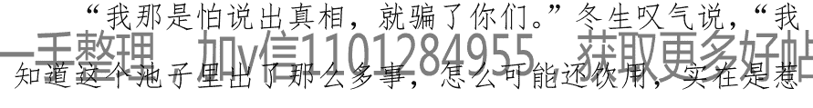

二子猛得一愣哦。

大拿其实已经明白了，就跟洪炳当了桥的供品一样，他在蓄水池里没当上品，到了桥墩那里，还是当了。

“工厂自从修建以后，怪事发生了一不止一次，死了很多人，也失踪了很多人。”冬生眼神变得迷离起来，陷入了回忆，“后来请了高人回来，就把这个蓄水池。领导们只是告诉大家不要靠近，实际上你看，根本没有做出什么防护措施。”

“咦。奇怪。”二子喃喃说道。

“因为，该死的，逃不掉。”大拿冷哼，“他们是想让人自寻路，给其他人挡，用少量牺牲，换取更多。”

冬生说，“从我自己用那水洗脸后，身上就开始臭。但只要离开太久不喝，就会浑身难受。我很清楚的，这水跟水差不多，会让人疯。但我忍不住，甚至会梦游，跑到蓄水池边几次，都被我媳妇发现。于是，我就想到肯定是池子里那些杀祭时的人，变成了水鬼，要我去。”

“所以，当你看到外来的时候，就开始坏了！”大拿毫不瞪着冬生。

冬生惭愧的点头，“蓄水池里打了水，给他们。失败了，他们出了事，并没有被水鬼拖走。”大拿可以说，“你不知道，这种行为我报告给，可以让他抓走，你惹不起。”

“我叔又没死人！”二子见大拿说，立刻反驳道。然后对着冬生说，“我们找工地，看看不能把土运到这边，把水填了。”

“蓄水池是厂里的财产，”大拿恨的说，“你们说就能填吗？”


“你是不敢设想说，说白了，就是不想把事情扩大来理解！”老沙哑不客气的说，“你应该相信我的判断！当初我理解出了偏差，但现在，我可以百分之百的确定，这些故事，都是有道理可讲的，换句话说，这些人的死，不是偶然的因素。”

“你凭什么这么确定？你到底是什么来路？”大拿用一种陌生的眼神看着老沙。

“我对这些比较感兴趣，平时没事就看看看书。”老沙从身上拿出一本册子，这是他从神房里拿拿到手上的，开始只是想看看神偷到底在搞说什么，没想到在这时候才显了什么用场，“我其实也不用跟你说这些，拍拍屁股走人就好了，你要是不信我吧，那你就会相信我，并且愿意听我的建议。”

王建龙 1012849526

大拿把那本风水有关的小册子拿了一阵，终于不再追问，“这书还有人用手写的吗，真是不简单。这是一个风水有关的书吗？”

“是的，”老沙把小册子翻到一页，指着上面图案，“在风水上，东方青龙七宿是角、亢、参、毕、东房、鉴心、琼尾、琅寰。钢厂的风水在我册子上看来，就是鉴心风水灵，这种风水有特点，就是能够让埋葬的人尸还魂。所以要压制这种风水，就必须要有布局和祭祀。”

“你说他们的死，都是人为造成的，你详细说说。”大拿点点头，问道。

“之前我以为这个工厂，是某个个人设置的五行镇邪局，但是现在看来，其实是我看错了，这地下的问题，在他们看来，已经不是靠一般的手段压得住了。所以，他们用了活人献祭的手段！”

“活人献祭！”大拿惊讶的叫出声，因为老沙说到的这一点，跟他预想的一模一样。

老沙看大拿表情，知道他对活人献祭并非一无所知，只是大拿不愿意做出这种事情。

“活人献祭这种事，从古至今，几乎就没真的断绝过，这在原始宗教和密教之中尤为盛行，而且，它本身就是一件邪恶的事情。其实，被当做供品献祭给上，有人会见到某些供品，比如人能血统，是非常想要的东西定位，要就要拥有特殊的血统……”老沙说道。

“反正我是接受不了的，在当今这种时代，竟然真的有这种！”大拿握着拳头吐气道。

“你不愿意，没办法，它就是这么发生了。”老沙点了支烟说，“你可以理解，这种手段，具有你没办法理解的神秘性，说白了，其实是一种交易，牺牲大部分一部分，来拯救大部分。”

“这个道理，我理解。”大拿无奈的说，这一点上，跟他老沙想法一致。

“你理解就好，因为我要说的事情，跟这个活人献祭接下来的步骤有关。”老沙说。

作者:蛇从荒 日期:2014-01-11 00:12

老沙看到这个时候，想明白了一件事，那就是他在钢厂里发现的五行镇邪局，根本是他想偏了。

镇邪是没错，但镇邪的手段，那么简单，而是用的活人献祭的方法。

看到其中三种葬法之后，老沙忍不住对比它们跟藏族地区的五种葬法：塔葬、天葬、水葬、火葬和土葬，十分相似。

一般对藏族葬礼的理解，就局限于天葬，其实藏族人的葬礼，也有塔葬、水葬、火葬和土葬，只是根据不同的死者地位和信仰的宗教而不同，藏族也分佛教、红教，看到也没有获取更多帖。

晾房内的转轮，显示了这个钢厂的建造，跟藏传佛教有极大的关系。那么活人献祭的手段，跟藏葬相关就不可忽视了。

老沙想到，利用活人献祭的手段镇邪的，用的是非常的方法，跟藏葬又有本质区别，这个镇邪的人，究竟是什么路数，老沙还没想明白。

但有一件事很清晰了，那就是这个献祭仪式还在进行。下一个眼中冲的，就是冬生。

塔葬上跳下来的人是三个，这是天葬，然后锅炉事故，也死了人，属于火葬。一般仪式之中，很多线索都是有规律可能的，也就是说，如果依据老沙的推测，那么蓄水池应该也是死三个。

老沙料未及，蓄水池死了，死了四个。大拿告诉他，在大拿没来之前的一天，有三个人疯了，跳进了水里失踪，等大拿进了钢厂，又失踪了一个。

而冬生，也一个往里钻，按照仪式来说，应该是死在水里。然后是洪兵，他是被浇灌在桥梗，毕竟是属于水葬还是土葬？

难道说，丢了水环节，人数增加了？如果是这样事，事情就越来越妙了，这说明这个献祭仪式，在增加筹码！

话说，当初斩的那个人，还在操控全局，但他，他低估了。老沙心里把这些想的事情，都跟大拿详细说完。

“你的意思，还是要死不要少人？”大拿听后，立刻激动起来。

“我有这样强烈的感觉。”老沙点头，“而且，这事，我们还阻止不了了，我们如果运气好，有可能追查到真相，但是我们阻止不了了他杀人。”

大拿轻叹一声，“这种手法，的确超出了我的理解！根本就是这世上不可能发生的事！”

“你的本身事，在别人看来，也是无法理解的东西。”老沙敲着脑门说，“现在我们必须放开思想，尽量的去理解和相信这种领域里发生的事情，而不是一味的拒绝和排斥，那样的，我们没办法追踪我们这个对手的。”

“你说的这个人，他真的存在吗，从第一件事开始，跟近十多年了，真的有人会这么有心，来操控一件事？”大拿还是不信。

“十年？”老沙不由自主的笑了笑，“你太小看这个人了。”

他心里还有半句，没有说出来：那些守陵人，为了这个古墓，延续了一千多年，外人看来很有心才能做到的事，对某些人来说，就跟日常生活一样。


一个人影也不躲避，直愣愣地站在那里，和老沙对望。

老沙看到裂嘴怪人穿着破烂的衣物，其实是一种古老的铠甲，材质是一种皮质，但里面穿着的，裂嘴怪人每过脚，经过之地，都有血印子。

老沙当即就想到了，过道那天晚上，有一个神秘人从机房的水井里出来，然后消失，想不到，竟然一直躲在钢厂里！而且趁着钢厂没人走动的时候，又出来找麻烦。

裂嘴怪脸上皱着眉头，他开始蠕动，又开始了。

它由于年少怕皮疼，他露出了可怕的长牙，跟这些秘术的人打不过着，但他自己没有这个能力，大拿不在，他唯一的能做的，就是扭头就跑了。

老沙毫不不疑地就跑，就算知道跑不过，这也是他唯一能做的事。他跑了一段，伤后的部位开始痛得受不了，他实在跑不动，暂时停下，回头却没见到裂嘴怪人来。

老沙不敢放松，随时保持警惕，用手电在黑暗里寻找。

裂嘴怪人的行迹完全消失，黑暗中什么都没有。

老沙十分奇怪，怪物只是露面，然后又消失不见，很没有道理，如果真是要拿自己做供品的话，理由何这么早放弃。

老沙一点胆量，被裂嘴怪人的真容给吓走，任谁都能明白，这绝对不是个正常人！他连千里退回来，绝对不是为了成为供品而来。这时候，他顾不上钢厂，尽管大拿在离开的时候，千叮哐当响，要把钢厂看管好！

老沙决定离开钢厂再说，但是，他忽然发现自己不知道什么时候，已经在水中，才发现自己已经跑进了蓄水池。

自己怎么会惊慌错跑到蓄水池里来，老沙暗自心中想起了大拿说过蓄水池曾经发生的事情。水面已经过了老沙的膝盖，而深无底的水里，传出有令动的声音！

老沙看着远处那个怪人的身体，获取更多恰似乎老沙茫然地站在水中，汗如雨下，嘴巴飞快地念咒，声音连他自己都觉得很陌生。

他是真的急了，因为他意识到，这个神秘人，是从泵机房的水井里出来的，也就是说，他在水下的能力，比在地上要强！

然而，就算不在水里，也没有多少机会逸脱，要是落入水中，那就是只有任其宰的份。

老沙发现蓄水池的水面在飞快的上升，老沙镇定心神，一步缓慢地向着蓄水池岸边行走。边走他心里已经清楚一件事，那个兔子脸的怪人，和壁画里的一模一样。和神偷分析的时候，还以为是为了暗示士兵的某些身份，或者是一种脑腾。现在知道了，那些士兵，就是一副兔子脸！

老沙清楚这件事情，心里开始打鼓，念头太多了，虽然想得明白，但只要一时间就能完全接受，根本接受不了了。

首先，是阴兵复活了！

这一屯荒疑，阴兵留下的线索，老沙也见过，不可可能是幻觉。在两个小小时前，老沙还拿着大根起要相信一切皆可能！但现在，老沙自己都没办法接受了。

事情发生太快！阴兵越过的事情，用磁场可以解释，但阴兵就其人，用物理学都能解释更多好帖。唯一的解释，就是他们是复活了！这个盆心风水险，根本就不是一个普通的陵墓。

老沙强制迫自己相信，阴兵是活的。很快，他跳过这个疑惑，想另另一件事。

那就是活献祭的事情。活献祭的目的，是为了压制地下的邪物，老沙一直清楚地下底下是什么，会不停地发出动静，但现在他明白了，地下的邪物，很有可能跟这个人有关。老沙，墓上死的那个人，就是被阴兵弄死的。老沙恍然大悟，活献祭的存在，而且越来越频繁，现在把两件事情联系在一起是不可能的，地下有东西已经压不住，就算是某种疯狂的力量。

老沙想到这一层，全身颤起来，加快了脚步，朝着池外狂奔。就在这时，一个铁钉卡住了他的腿，老沙当即在水里，知道怪人出了，怪人比鱼灵活。老沙用手支撑身体，没被抓住的右脚踢开，老沙退了，连滚带爬地跑。怪人发出怪声，觉得老沙身体劲，随后朝前扑，把老沙拽进水里。老沙连呛几口水，没有力气。这一次，再挣脱，那怪人蛮力，老沙体重超过八十公斤，但怪人随手一甩就把他丢出去，老沙个人撞水面上，又沉到水下，脑袋直接钻进水池的黄泥里。这个怪人的动作，除了比人的气力，特别是在水里，身形游动起来比鱼还灵活。老沙肚里翻江倒海，满腔血腥味。就算是第一次在水里遇到那个老尸，也没这么狼！几个回合缠绕下来，老沙察到了怪人的弱点，怪人的反应速度并没有自己想象的那么快，也许怪人在底下睡了太久，个体骨骼和肌肉都比较僵硬的缘故。怪人再次靠近，老沙又一番摸索，从池底摸到一个石头，用尽全力爬到怪人的身上，朝它的砸！血横飞，老沙顾不上身上臭气天让人呕，不停地砸，直到所有力气用光，他还在喘力竭地怒吼。怪人倒进水里，老沙几乎失去意识，被冷水灌醒了点，慢吞着朝着池上游。他疑惑看着水面的波纹，瑟瑟发发，也没看见阴兵。看来是沉下去了。

老沙在跟阴兵生死斗的时候，大拿和二子把冬送了家。冬生的家离钢厂不是很远，但一开始，冬生走不动，都是大拿背着走。夜路不好走，路上又见到施工处，坑洼没有落脚的地方，大拿在蓄水池里睡了两个场，状态也不太好。入夜后的街道，看不到任何人形，黑漆漆的连盏灯都看不见。二子拿着手筒看着前面，边走边说：“妈妈的，前几天晚上还有人在街边卖烧烤，怎么现在晚上连个……看不见！”说到“鬼”字的时候，二子浑身一凛，硬生生的吞了回去。

“钢厂里白天那么动静，你觉得那些保安能守得住秘密吗！交代不许说出去，肯定是白交代了！关门关窗，早点休息，也挺好，省得招惹是非。”大拿背着冬生，不停停下来，把溜溜的冬生拉上去。冬生整个浑身都软了，累得似的，老往下掉。

大拿不敢往冬生身上多想。把冬生送回家，实在是无奈之举，现在钢厂里的诡异事件一件连一件，冬生继续待在钢厂肯定没有好处。只是送回家之后，冬生又要面临怎样的局面，大拿也猜测不到。两人就走着，二子不停地找话题，大拿也随便说了句。快到冬生家里，那条街口的时候，一辆满泥土的废旧车辆无声从他们身边经过。两盏灯灯光微弱，几乎看不清路。“你不觉得这小子够奇怪吗？”大拿说，“我们说你叔在厂里，她就不管了，而且一看她的样子就在惦记什么东西，现在又不是吃的点，她却在家里愁东西，等着你叔回来，这不是在堵气嘛？”“你还真是个警察蛋，”二子不服气，“刘所长不把你弄当警察，真是可惜了，”大拿一手抓住了他的脖子，挣得狼狈，脸上满汗，“你抓我身上一样！”大拿把这一说完，二子抓了好久才缓过来，“那听你的，我们进去瞧瞧。”大拿施展开手，快速围上围，顺着把二子也拉上去。然后看了看动静，只看到厨房旁边的房子有灯光。大拿和二子小心翼翼地跳下围。慢慢的挪到厨房旁房，从窗口往看，看见厨房里一片雾气，闻着一股肉香味，冬生媳妇正在用勺子从锅里捞着汤肉到一个汤盆里。然后端着汤盆往旁边的屋里走过去。

“你叔呢？”冬生媳妇的脸色不错了，“你叔这几天身体不好了，王经理说他病了，还没回来。”大拿听到她这么说，就打算离开。冬生媳妇追着二子问：“你叔说身体不舒服找你去了，他人呢？”二子低下头说：“他身体不舒服，还在厂里休息呢，我来带个信，你别挂忌。”哦，”冬生媳妇回答了一声，然后准备关门。二子连忙：“姐，我晚上还没吃饭。”冬生媳妇并没有让二子吃饭的意思，大拿把二子一拉，“吃什么，先回厂里吧。”二子这才不情愿跟着大拿离开。

可是没走了多久，大拿又停了下来，带着二子绕了个弯，又回到餐馆里的院子外面。二子揶揄地问道：“你要干嘛？”“进去看看，你到底在做什么？”你脑没问题吧，”二子被大拿的举动弄得摸着头。“你不觉得这小子奇怪吗？”大拿说，“我们说你叔在厂里，她就不管了，而且一看她的样子就在惦记什么东西，现在又不是吃的点，她却在家里愁东西，等着你叔回来，这不是在堵气嘛？”

大拿和二子无奈地走到冬生的家里。敲了半天的门，才打开。二子的眼睛眯眯地看着车辆，两盏灯灯光微弱，几乎看不清路。大拿和二子小心翼翼地跳下围。

大拿和二子小心翼翼地跳下围。慢慢的挪到厨房旁房，从窗口往看，看见厨房里一片雾气，闻着一股肉香味，冬生媳妇正在用勺子从锅里捞着汤肉到一个汤盆里。然后端着汤盆往旁边的屋里走过去。

大拿吐了口气，安静地站了一会儿，慢慢往冬家里走。二子见大拿突然变得阴沉，不敢多说什么，跟上去。冬生忽然来了精神，对大拿说：“你把我放下，我自己回去。“没事，就到了家。”大拿怕最后几步路出问题，脚步加快。冬生挣扎下，从大拿背上滑落。大拿寒毛竖起来，冬生的身体太软了，仿佛没有了拳头。而同时，大拿感觉到手心粘满了各种恶心的粘液还有皮肤。冬生站在大拿身后，大拿甚至不敢回头看，他不知道冬生到底变成什么样子，他觉得浑身不自在，却猜测冬生一定变了样。“叔，你怎么了？”二子在旁边说，“队长，你看我叔……”老子处理过，二子就看到冬生蜷在地上，抖得剧烈。双脚剧萎缩，他不再是一个人的模样，而只能肉肉团，用蜗牛蠕动的方式寸一寸地移动，在地面上留下水的痕迹。“我自己走，你们不用管，回家吧，谢谢你们……”冬生的声音从肉团里出来。当大拿的手电照在冬生身上，二子吓得嘴巴张大，接着又把自己的嘴巴捂住，尖叫的声音没来及传出去。大拿这下完全不知道该怎么办，他只有一个念头：冬生已经不是人了！但冬自己意识不到，他用的是原来的语调，很斯文，也很亲切，这种语气加上这种情形，让大拿和二子只想远远。“你们回去吧，回去吧，明天我做点好吃的给你们送去，钢厂的伙食太差了，你们又都在长身体……呵哈。”冬生兀自说着，蠕动了一米多的距离，离自己家的家门越近越。要是冬生这么进门，冬和他家里孩子还没得吓死！大拿首先想到的这点，对二子说：“快，快，去找个板车过来，我们要把冬生拉回钢厂！”你跟老沙是神经病啊，一会把他送回来，一会儿儿……我怎么知道他会变成这样！”大拿转身前，要去抱抱冬生，“赶快去找，让人看到，我们脱不开手。”就在这时，冬生的动作越来越快，哗哗哗溜的浪遍了旁边的一个阴沟，溅起臭水。大拿几乎停了，冬生就往阴沟跳了。这条街，规划中是餐饮街，平时阴沟里都是垃圾之类的。这种事，喜欢自然的人，不然还真被你闷倒了。看你这么有心的样子，”老沙说，“早知道当年就把带着一起去虎符锁了。“别，”我连忙搓手，“我只会说的，让我做什么比你差得远了，还记得你能在墙上跟虎一样攀爬，这种本事我一辈子都不懂。“不说了，”老沙说，“如你所说，冬生身上感染了某种劣害菌，他为什么要爬到地上。世界上几乎所有的植物都是依靠光合作用生长的，但是有些例外，”老沙解释道，“比如我们几个住在地下的植物，它们不仅靠光合作用生长，而且非常害怕阳光。“怪不得冬生都是晚上，而且一定要回到水中，钻到地下。”老沙又问，“可是我大哥都堵了蓄水池，为什么我们没有？”第一，”我对老沙说，“和你有没有喝过蓄水池里的水。“喝了水有很大关系吗？”“这个我不好解释，”我接着说，“第二，我跟你说个事情，我念书的时候住集体寝室，你知道学生都是很爱干净的，所以脚气传染得很厉害。但是总有那几个个人，不会得脚气的。“老沙笑：“我们明明说黏真菌，你又扭到脚气上干嘛？”脚气就是真菌感染。”我推推，“有的人怎么样都不会被传的，有的人却相反，甚至连脸长了，这就是不同的人，抵抗力不同的缘故。“可能和我们的体质有关？”老沙说，“就是这样啊，简单的道理。”

“我没有感染，”老沙说，“可能没疯。有的真菌感染性很强，会迅速在人体组织上繁殖，比如冬生身上的粘液，就是真菌症，不过冬生身上的真菌更加害了，不仅是在皮肤表面上繁殖，能够溶解肌肉组织甚至骨骼，这就是说明了冬生为什么身体软软，肌肉皮肤组织脱落，还能爬的。“那他为什么想往地钻？”我笑了两声，“幸你遇到我这种从小喜欢钻捣神秘的人，不然还真被你闷倒了。“看你这么有心的样子，”老沙说，“早知道当年就把带着一起去虎符锁了。“别，”我连忙搓手，“我只会说的，让我做什么比你差得远了，还记得你能在墙上跟虎一样攀爬，这种本事我一辈子都不懂。“不说了，”老沙说，“如你所说，冬生身上感染了某种劣害菌，他为什么要爬到地上。世界上几乎所有的植物都是依靠光合作用生长的，但是有些例外，”老沙解释道，“比如我们几个住在地下的植物，它们不仅靠光合作用生长，而且非常害怕阳光。“怪不得冬生都是晚上，而且一定要回到水中，钻到地下。”老沙又问，“可是我大哥都堵了蓄水池，为什么我们没有？”第一，”我对老沙说，“和你有没有喝过蓄水池里的水。“喝了水有很大关系吗？”“这个我不好解释，”我接着说，“第二，我跟你说个事情，我念书的时候住集体寝室，你知道学生都是很爱干净的，所以脚气传染得很厉害。但是总有那几个个人，不会得脚气的。“老沙笑：“我们明明说黏真菌，你又扭到脚气上干嘛？”脚气就是真菌感染。”我推推，“有的人怎么样都不会被传的，有的人却相反，甚至连脸长了，这就是不同的人，抵抗力不同的缘故。“可能和我们的体质有关？”老沙说，“就是这样啊，简单的道理。”


一看，二子吓得连叫都没叫出来。

屋里放了一个桌子，围坐着四个人，他们和冬生一样，都得了软骨症，软软的趴在椅子上。冬生媳妇，把汤盆放在桌子中央，一个一个地让他们汤。

那股肉香味更加浓密了。

大拿听到二子在旁边发出哈声，低头一看，就看到二子竟然吓得双眼睁大，口水却从嘴角流出来，而且嘴角还不停地掉。不一会儿，二子下处挂着透明的口水，粘到了衣服上。

“有那么像吗，满脸都是口水，你是多久没吃过肉了！”

大拿拍了拍大腿，笑着，“没肉肉确实有味道”。

二子被撇了，下意捂了下巴，指着大拿说：“你还说我，你看看你自己，也不流水！”

大拿低头看了看，发现地上竟然真的流了一滩水，正是从他哪里流出的，他一说话，口水就不停的流出，但开始时，他自己并没有意识到。

“不行了，我们得赶紧走，再不走，可能会中招！”大拿觉得自己的脚开始不听使唤，要要望向前，赶紧拽起二子，快速的路上跑跑。

“来，多吃一点，吃饱好睡觉，长得健健康康……”

“你呀，不要吃得那么急，连钩一句都给吞了，你看，锅里还有的是……”

“哎呀，乖一点，不要淘气，汤都洒了……”

他们身后，冬生媳妇招呼四个软骨人的声音，不停的传来，这声音本来是十分的亲切，但在两人的耳朵里，比最恐怖的声音都毛骨悚然。

要是不是亲眼看到那副场景，外人一定还以为是一个和谐的大家正在用餐，只有和大二子才是知道这一切的危险，两个人跑了多久，全流汗背。

“叔成了那样就会折肠，现在她也好像出事了，这可怎么办！”二子气呼呼地说。

“对了，你不是还有老弟！”大拿忽然想到什么，站住去，“报警吧！现在哪里都出问题了，你应该会处理吧，得他像才五岁。”

“再过两个月就五岁。”二子点头，“刚才我没看见他。”

“不行，我们得回去！”大拿摸着额头摇头，“这事，跑不是办法，我们一定得解决了！妈，我脑子里乱成浆糟糊，不知道该怎么办！”

“李队，我们还是报警吧，让所长来处理吧，他当了多年所长，肯定知道怎么解决。”二子想了一会儿说，“你不要硬撑，这样对谁都没好处！”

“我硬撑个底。刘所长白天让我老老实的管钢厂，我晚上就出来，又招了这么多事，让我去找他，脸脸放。”大拿恼火地吕道，“算了，说了你也不懂，要是老沙在，他肯定知道怎么做，早知道就让你守住钢厂！”

二子本想反击两句，一看大拿涨脸，不敢大招惹，换个话题：“真不明白那四个人是从哪里来的，看起来跟叔叔一样，他们的衣服很时髦，估计是外来的游客……”

“他们应该进医院的几个游客不是同一批。看他们那样，应该你叔叔的犯人是一个时间。”大拿说了两句，顿了下头，“我想到了，你姐姐给他们留的肉汤，确是有古怪。比蓄水池里的还要古怪！”

“那肉汤很香，我从没见到过那么香的肉汤！”二子说着，整理衣服又点了点头，他虽然还是很提，却在想聚多好贴体会散了……”他不敢再说下去。

“不会！肯定不会。”大拿拼命摇头。

大拿决定再次回去客馆，把好奇心的疑惑弄清楚。二子只是跟着，他是一个百不愿意去，不去又能怎样，他不敢个人回钢厂，更不敢一个人在街上游荡。跟在大拿身边，至少有个伴。

这一次回来，大拿做了点准备工作，他把师父给他的药水弄了在两人鼻子里。这肉汤的味道，极容易诱惑，药水能把这个味道给消除掉。

“李队。这是什么东西，好臭！”二子忍不住喷啧，他发现这个药水滴在鼻子里，气味十分的臭，刺激他想吐区。

“不是药水的气味，那是肉汤的真正的气味。它只是让你闻到了而已。”大拿解释道。

大哥先领的部队已经过去，看来老王最怕把四个软骨赶到旁边的小黑房子里面。大拿心里叹，看着这些人的动作，还有人的影子，根本就是赶完软骨之后，冬生媳妇去了，就听到屋子里传来水的声音，人走进水里。大拿带着二子蹑手蹑脚的走近冬生媳妇的厨房。两个人心都在发毛，担心会看到某个场景，走进去后，才发现厨房里干干净净，并没有血或其他。

大拿算了口气，如果那肉真的是担心的，那么厨房一定会留下线条。现在的冬生媳妇，已经半疯状态，不能那种干净落。两人找了一圈，大拿感到奇怪，那种肉一定是特殊的食材，除了蔬菜之外，没有的东西。

“这你准警察没呆了！”二子见大拿又叉腰，忍不住抱怨道。

“一定有什么留下了。”大拿不甘心的，“老话说，对我们的离最近的地方。”大拿有了思路，从眼下着手指在近物上摸过去。过了几分钟，他手指传来一丝粘稠的感觉，这时，他的手正好在一块方正的水上。尽管这块豆腐外表看不古怪，但大拿觉得它有问题。因为他接触过冬生很多，这个粘稠的感觉，就是冬生身上流水的感觉，让他浑身自在。

就在大拿仔细打量思索的时刻，厨房的门咯吱打开，一个四腿爬的小影从旁边掠过，几步就进了厨房。二子吓得双眼翻，一口气差点上，屁股坐在地上。大拿正把豆腐抓手里，被突如来的恐惧吓得上手松，啪一声掉地上。豆腐在地上了两下，并没有掉。

大拿忽然明白过来，跨步的朝赶去。二子也跟着，大拿一起把脑袋伸到上面，两人看到一个五岁的孩子蹲在里面，手里拿着一团篮球大小的肉呼的东西，又不是篮球那样的圆形，跟脑袋一样的灰色，小孩正用嘴巴大口嚼着这东西，紧极。二子身体抖得厉害，这个小孩就是他的堂弟。今天没有了。

[content]<!-- no content -->


我是工生，太岁东西我关注过，还不好说。也有吃了太岁家里发的，那是极少数，一般都是看了太岁，家里里出事故。很邪门。用太岁的毒素来解释都不够。

作者:蛇从 日期:2014-01-15 22:08

@XIAOIAl23456789 3973 2014-01-15 22:04:00

许美丽，我来了。

你是哥哥，还是妹妹妹妹啊。我今天喝酒了，瞎写乱呢。

作者:蛇从 日期:2014-01-15 22:48

“在这边，这边！”听到尖叫声，之前那五个追黑影天老木的经理加入群1101284955，获取更多好帖。大拿和那个女人还没来得站起，逸道手电光就盯了他们脸上。

女人把脸用黑头套挡，一眼眼睛里吐出泪水，通红，在大拿怀里拼命挣扎，大拿已经惊愣，被蒙面女人狠狠的推开，才回过神。

“看你们往哪里跑！两个小鬼蛋子，终于我们给逮住！”站在人群前面的一个大胡子男示意了下，其他四个人立刻围围了大拿和蒙面女人，把他们团团团包围，生怕他们跑掉。大拿看到这五个人的脸都很陌生生，每个身上穿着的衣服，沾满了泥灰，上看应该是从外来做工的建筑工人。

依大拿的推测，这个蒙面女估计是在工厂偷钢筋斜来卖，结果被人发现。这种事经常发生，不稀奇。

“我不是贼，我跟他不是一伙儿的！”大拿站起来跟他人解释，还盯着蒙面女子说，“你也是，做什么不好，偏要偷东西，做这种事的人我最厌！”

“你堕，把手放脑袋上！我不叫你动，你最好别动。”大胡子说道：

“说你呢！”另外的人也朝大拿喊。

大拿莫其妙，一会儿才想明白，“不是，你们弄错了，跟她不是一伙儿的！你们抓了她，跟我有什么关系！”

“憨哥，我看到他们是两个人，不会有错，他肯定是在王经理加……”

“你别血喷人，我是钢厂的保安，不信你去问。”大拿一看被人被裁掉，立刻来了火气。

“看你有问题。”被憨哥的大胡子用手电光扫了扫大拿，“你身上这胆子是没事儿，肯定是你躲在阴沟里偷偷！就是你，不会错的！”

大拿先道冬生的时候，他被弄弄肚，一直没来得及换掉，这下，算是被坐实了。他心里一阵郁闷：做安保的结果被当小偷，要是再被送送到刘所长那里，脸皮没法见要了。

“你跟他们说，我跟你不是一伙的！”情急之下，大拿一把扯起蒙面女子，要她赶紧说个清楚清楚。

“我承认，我们是一伙的！真的。”蒙面女子点头。

“你们都听到了吧，她说……”大拿才还挺意的，一会儿感到不对劲，直愣地看着蒙面女子，“……你，n你乱说什么什么。”

“你本来就跟我一伙，我只是实话实。”蒙面女子说，n你叫大拿，是不是？”

“我……”大拿愣住，“你怎么知道我的名字！”n“这还用问吗，你们就是一伙儿的，装还！”熊哥哼了n，先抓回去，一个都别放走。

“等等。”蒙面女子道，“n不能先告诉我，你们在nn里打洞做什么，我们可以吧？”急动手，手指搓着脚。

“你们想挖地下的宝贝，我们看到了，所以你就要抓n我们，说不定，是要杀灭口！”蒙面女子说。

“地下的宝贝？”大拿听到这个词，立刻想到了什么，n看着熊哥，“你们到底是什么人，我看你们不像建筑工n，这三更半夜，还有什么事情要做！”

“他们当然不是建筑工人……”蒙面女子说。

“你管我们是什么什么！”熊哥身边一个年轻人随手捡起n块砖头，朝大拿拿脑勺拍去。

作者:蛇从丛 日期:2014-01-15 22:53

“你管我们是什么！”熊哥身边一个年轻人随手抄起一块砖头，朝大拿后脑勺去。小错误，应该是熊哥面对的一个年轻人。

今天没了。

作者：蛇从草 日期:2014-01-16 21:23

大拿听到风声，身体立刻半蹲，躲过这一击，手肘顺势向后顶，在那个年轻人的肋下，肩肩膀向上抬起，那年轻人手里抓着的砖头，立刻掉在地上。

那个年轻人嘴里发出嚎，其他人被震慑，没想到大拿竟然练家子。一手抓住他的脖子，索取好处。大拿也起脸受伤了，圈里跑出去。借着地形，大拿知道开他们很容易，两个人到了侧角后，没有人追上来。

蒙面女子休息了一会儿，对大拿说：“还好你在，不然落到他们手里，不知道怎样。”

“我刚才才在这里，根本没有看到脚印。”大拿分析，大拿被脸捂了，立刻来了火气。

“你跟他们说，我跟你不是一伙的！”情急之下，大拿一把扯起蒙面女子，要她赶紧说个清楚清楚。

“我承认，我们是一伙的！真的。”蒙面女子点头。

“你们都听到了吧，她说……”大拿才还挺意的。

“没什么，碰巧。”蒙面女子说了一句，就往前走，“谢谢你救我。”

“你先别！”大拿不肯放，蒙面女子走，“事情还没说。”

“明白，就这么走不太好。我不打，但是留你，我还是能够做到。”

“你被裁掉，立刻来了火气。”大拿被脸捂了，立刻来了火气。

“你还害！你害对那帮流氓，”蒙面女子气呼呼的把手伸到拿面前，“把他们抓起来，送去警察局！”

“你……”大拿皱起来，“我也没有说什么，我只想知道真相，你肯定知道做什么，因为你看到他们。”

“现在你可以告诉我了吗？”大拿抱着一线。

“其实我知道的也不多。”蒙面女子说，“我听到他们像是是要抓什么，本来还想听得清楚一点，就靠近些，但他们耳朵比什么都灵，一下就发现了我，我就跑了。”

“他们盯上钢厂的东西。”大拿叹了口气。

“钢厂里有什么？”蒙面女子疑惑问。

“就几个破瓶，各个当宝似的！他们不知道钢厂的深浅，迟早有苦吃！”大拿恼愤的说，“算了，说这些没意思，你住哪里？”

“我就住在隔墙。”蒙面女子指了方向，没等大拿说话，就走了。大拿没时间理会，心想不用最好，扭头往钢厂去。跑了一段距离，才想到这个女人会把脸上，估计本人有问题。可见眼下还有事的，这种乌毛苔皮，大拿懒得追究。再多想，到了钢厂门口，看到老沙在门口抽烟，老沙静静坐着，看着烟雾上升，烟雾慢慢飘到身上。一条烟灰没有掉落。大拿盯着，立刻发现，老沙衣服被破了，身上还受伤了。

作者：蛇从草 日期：2014-01-16 22:18

“老沙，你没事吧？”大拿跑过去，看到老沙不知道是醒还是睡着的，着急喊道。老沙勉睁开眼，望了望大拿，说：“我一直在等你。”我看受伤不轻，是不是贼进来？”大拿扶起老沙往值班室走。“不是贼。”老沙勉强的摇了摇头。

“是不是一个长得像兔子的？”大拿拿起想什么，声音低了几度。“你怎么知道的？”老沙顿了下，疑惑问，“你也遇到过？”“我在老叔那里知道了事情，我们回去了慢慢。”大拿说道。大拿扶老沙进了值班室，看到老沙身上有几道划伤的血痕，特别是一侧肩膀，全都淤青，伤得很厉害。“有个兔子活了。”老沙笑着指了自己的伤处，“我从高处掉到地面，差点死！”“我也知道了老叔，根本还藏了很多事实，没跟我们说，他加祭用的药品带，老现在就准备包扎。”大拿和老沙就把彼此经历的事情对对方说了一遍。说完经历之后，老沙又说：“现在看来，我们之前的猜测，跟事实情况有出入。这个冬生，以及我的兔子人，其实就是一个兔子阴兵，就是从地下爬来的。“如果真有祭犯人存在，这个兔子阴兵就不可能爬出来。”大拿接话抬头，“我说，你说的天葬、水葬等等的祭犯方法，根本就不存在，只有这个兔子阴兵是真的，他是一切怪事的罪魁祸首，我们只要抓到他，一切问题就能解决。”

“我的看法跟你恰好相反！”老沙摇头。

大拿帮老沙完全包扎好，坐回去。

“我的看法跟你恰好相反！”老沙摇头。“你说看着。”大拿帮老沙完全包扎好，坐回去。“祭礼人一定存在，这个是由钢厂的布局决定，兔子阴兵不可能能做这件事。我现在的推测，是因为这个兔子兵在想办法突破压制的布局，也就是在破坏祭礼！”老沙在大拿回来之前，其实想了一段时间，这时终于比较清晰的。“我不明白。”大拿听得十分懂。“我们知道，祭礼是一种神秘的力量，他可以任何形式做到。为什么当初的，有五个人差点事？结果就死了三个？”老沙说，“因为兔子，或者是指挥阴兵的力量，我察到了这件事，就让他们阴兵在活人祭上捣乱，还是差点，没有成功。后来水事，又是三个。”大拿明白了。“活人祭，就是一种仪式，仪式上面，很多数字，或者道具，都要精确，特别是数字，需要遵守规律，如果错了，这个仪式可能没有任何效用。”老沙点了，大拿明白了。

“也就是说，兔子阴兵，和那个祭礼人，其实是在斗！”大拿气得想从老沙楼顶上跳下来，没有成功，我想在水池里死，结果都是为了让那个人祭的局被彻底破解。”老沙忍不住，“而且冬生，也是一样。他脑袋砸开了，多半活不了了他身上上一阵麻酥，那种感觉怪。老沙本肯定，想到那副情景，有些疑，“等天亮了，我们去看看，一款信息。”大拿拿起手机，立刻站起。

作者：蛇从草 日期：2014-01-16 22:20

今天没了。

作者：蛇从草 日期：2014-01-17 12:02

“老沙，你没事吧？”大拿跑过去，看到老沙不知道是醒还是睡着的，着急喊道。老沙勉睁开眼，望了望大拿，说：“我一直在等你。”我看受伤不轻，是不是贼进来？”大拿扶起老沙往值班室走。“不是贼。”老沙勉强的摇了摇头。“是不是一个长得像兔子的？”大拿拿起想什么，声音低了几度。“你怎么知道的？”老沙顿了下，疑惑问，“你也遇到过？”“我在老叔那里知道了事情，我们回去了慢慢。”大拿说道。大拿扶老沙进了值班室，看到老沙身上有几道划伤的血痕，特别是一侧肩膀，全都淤青，伤得很厉害。“有个兔子活了。”老沙笑着指了自己的伤处，“我从高处掉到地面，差点死！”“我也知道了老叔，根本还藏了很多事实，没跟我们说，他加祭用的药品带，老现在就准备包扎。”大拿和老沙就把彼此经历的事情对对方说了一遍。说完经历之后，老沙又说：“现在看来，我们之前的猜测，跟事实情况有出入。这个冬生，以及我的兔子人，其实就是一个兔子阴兵，就是从地下爬来的。“如果真有祭犯人存在，这个兔子阴兵就不可能爬出来。”大拿接话抬头，“我说，你说的天葬、水葬等等的祭犯方法，根本就不存在，只有这个兔子阴兵是真的，他是一切怪事的罪魁祸首，我们只要抓到他，一切问题就能解决。”

“老沙，你没事吧？”大拿跑过去，看到老沙不知道是醒还是睡着的，着急喊道。又走了一阵，老沙和大拿发现这个脚印，正朝着镇外的一片山坡去的。老沙想，这个怪人看来是跑远了。怎么到的？”大拿发现带脚印，越来越模糊，因为地面水泥路，变成了泥土路，然后泥土路越走越泞，两旁的草丛越来越密集。但是血腥味始终没有。脚印已经完全消失，血气也突然在空气中浑然存。“没见过？”老沙喃喃道。老沙和大拿这才把头起来，看着周围。发现自己是在荒芜的坟岗，月光下，到处都是墓。而且面前，有一个新坟。这个怪人跑到这里做什么？”大拿听到这句话，立即想起冬生说过，那个太岁头，前几天被摩托车撞死了，镇子很小，人也不多，每天都死，这个新坟，肯定就是那个兔子的墓。

“老沙，你以前是给人看风水的吗？”大拿好奇问。“我时候侯老人教过一点这方面的东西，”老沙说，“你还真别说，我没花钱的时候，还装模作样，给人看过子。“你刚才说的什么老阴老阳的，到底什么情况。“那是四象，”老沙解释，“按照风水来说，这是一种风水的布局，分别以老阴老阳、少阴少阳作为风水的上下，这种风水，叫做瓮心风水，这种风水是吃人的，不——”

老沙说到这里，大拿心里发毛，黑林子经常有人失踪，虎符附近的修桥死了洪，虎符镇里冬生家出事，现在只有村子里不知道情况，但是不知道等于没有，只是村子里的人都太诡异，也不大和人打交道，发生什么外人也不知道而已。大拿想到这里，突然把脑袋一抖，“你的意思是，那个兔子头头的，很可能跑到村子里去了。“至少有关。”老沙说。“他为什么要先跑到坟地来。“钢厂里出事，冬生出事，都和那个兔子怪人有关。”老沙说，“黑林子里的事情，我们都亲身遇到了，你难道不觉得这很短的时间里，同时发生了这么多事情，之间没有任何联系？”你才说的瓮心风水陵到底什么意思？”大拿拿着老沙，“吃人的风水？”老沙回答，“瓮是古代的一种。”。“是的，吃人的风水。”老沙说，“瓮是古代的一种容器。圆形的，两边有耳朵，用在风水上为了聚集，接”


老沙拿着手电照过去，发现，那竟然是一辆土方车，应该就是差点撞到大拿和他那辆的停在空地里。

土方车安静的停在空地里，红色的尾灯突然又亮起来，在一闪一闪，乍目看去，确像是两只眼。

老沙吐了口气，暗想自己是吓坏了胆，不比以前能憋住气，既然是大拿，也就没什么好怕，老沙自我安慰道，朝那辆土方车走去。

老沙跑得很快，大拿在叫他，显然是有什么发现。那辆土方车离老沙有点远，老沙估了下，应该是五百米外，极短的时间内，老沙就到了土方车面前。

由于大拿不在土方车附近，而周围，又没有任何可藏身的地方，是球场一般的空地，要是有人，一定可以一目了然看到。

老沙左右打了下，发现土方车一侧的玻璃窗摇下来没关，从里面传出轻微的声音。

是录音放出的声音没错，但声音的内容，却不是普通歌曲，而是哀乐！

老沙听了两句，喉头就开始发酸，不停的吞咽唾，紧接着，他听到土方车的车斗里，传出一声猛击车斗壁的声音。老沙猛得扭头，就看到车斗下面的缝隙处，流出褐红的血。一滴接一滴的滴落落在泥土里。

老沙可以确定，这辆车辆装满了泥土废渣，但在敲击车斗的，应该是个活物。这么多的泥土废渣压在身上，等同于活埋，谁还能动？

土葬？

老沙突然冒出出一个念头，心想这难题又是祭祀者的所为了？

正这么想着，车斗里敲击得越来越响，然后就是悉索索洛土被扰动的声音，两种声音此起彼伏。

一手按住腰部，步向退去，他脸色却很复杂，心里好帖，有什么东西正要摆出来。

车斗上面的翻盖咣当一响，一截直径将近一米，高度超过两米的水泥柱子，落在老沙面前，它的外部切面刀削似的平整的，些砂砂都被破坏了，就像有人将这水水泥柱子，从什么地方给切下，然后夯到了这这里。

老沙双眼瞬间瞪大，连退后的力气也没有，他再明白不过，这东西是从哪里来的。

水泥柱子的出现后，车斗却没有停止出声，一个黑漆漆的棺材，也从车斗里的泥土废渣里凸出来，好似有人抬着落在老沙的面前。

棺材立着，大头在上，小头在下。老沙忍不住想象，里面要是有尸体的话，这时候，就跟他面对面的站着，也许，和他四个人目相望！

老沙放弃放弃的念头，他很清楚，葬死的人，不可能只有两位，应该还有第三位！他站立的地方，地下传出骚动，两双手出手，抓住了他的脚踝，拼命的将他往下拖。

老沙的心里顿时透骨心寒，棺材是闭合的，但是有双手正从地下伸出来拉自己，老沙已经无法控制自己的情绪的时候，在地面面上抓住自己的双手突然松开，然后一个猛地撞到了高处，在自己面前头方的地方不停挣扎。

个家伙给举了起来，然后又狠狠的摔倒地上。大拿又一步向前，用脚把那个家伙的大脑死死踩死。傀儡在地上不停的呼叫。

老沙对着傀儡问：“你是在开车吗？你弄这个柱子和棺材来干什么！”傀儡还是不停的呼叫，根本不理会老沙的提问。

在车尾灯一明一暗的闪烁中，老沙看着黑暗中慢慢过来了一群人影，脚步非常的轻，但是速度并不慢。其中一个个人高高的，带着面具，他走到大拿和老沙面前，把面具摘下——这个守陵人村的族长，他们已经打过一次，但是这次族长脸色更加看，其他的村民也是僵硬。

老沙可以确定，这辆车辆装满了泥土废渣，但在敲击车斗的，应该是个活物。这么多的泥土废渣压在身上，等同于活埋，谁还能动？

土葬？

老沙突然冒出出一个念头，心想这难题又是祭祀者的所为了？

正这么想着，车斗里敲击得越来越响，然后就是悉索索洛土被扰动的声音，两种声音此起彼伏。

一手按住腰部，步向退去，他脸色却很复杂，心里好帖，有什么东西正要摆出来。

车斗上面的翻盖咣当一响，一截直径将近一米，高度超过两米的水泥柱子，落在老沙面前，它的外部切面刀削似的平整的，些砂砂都被破坏了，就像有人将这水水泥柱子，从什么地方给切下，然后夯到了这这里。

老沙双眼瞬间瞪大，连退后的力气也没有，他再明白不过，这东西是从哪里来的。

水泥柱子的出现后，车斗却没有停止出声，一个黑漆漆的棺材，也从车斗里的泥土废渣里凸出来，好似有人抬着落在老沙的面前。

棺材立着，大头在上，小头在下。老沙忍不住想象，里面要是有尸体的话，这时候，就跟他面对面的站着，也许，和他四个人目相望！

老沙放弃放弃的念头，他很清楚，葬死的人，不可能只有两位，应该还有第三位！他站立的地方，地下传出骚动，两双手出手，抓住了他的脚踝，拼命的将他往下拖。

老沙的心里顿时透骨心寒，棺材是闭合的，但是有双手正从地下伸出来拉自己，老沙已经无法控制自己的情绪的时候，在地面面上抓住自己的双手突然松开，然后一个猛地撞到了高处，在自己面前头方的地方不停挣扎。

个家伙给举了起来，然后又狠狠的摔倒地上。大拿又一步向前，用脚把那个家伙的大脑死死踩死。傀儡在地上不停的呼叫。

老沙对着傀儡问：“你是在开车吗？你弄这个柱子和棺材来干什么！”傀儡还是不停的呼叫，根本不理会老沙的提问。

在车尾灯一明一暗的闪烁中，老沙看着黑暗中慢慢过来了一群人影，脚步非常的轻，但是速度并不慢。其中一个个人高高的，带着面具，他走到大拿和老沙面前，把面具摘下——这个守陵人村的族长，他们已经打过一次，但是这次族长脸色更加看，其他的村民也是僵硬。

老沙可以确定，这辆车辆装满了泥土废渣，但在敲击车斗的，应该是个活物。这么多的泥土废渣压在身上，等同于活埋，谁还能动？

老沙看到大拿身体开始不受指挥，迈着佝偻的腿，一点点抬起来，老沙听到大拿关节在咔咔作响，骨节在扭曲。大拿的脚刚刚抬起来，侠就从地上窜，跑到村民中去了。

老沙和大拿疑惑，老沙发现自己在移动，竟老沙和其他村民，后都受够了。但是族长似乎没有理会他们，而是转身走了，老沙和大拿正在疑惑，发现自己身体竟然在移动，而且紧跟着族长。

老沙和大拿疑惑，老沙低头看向，发现自己的双腿在一前迈动，可是自己就没有走路意图。这个族长的确是太简单了。

老沙和大拿疑惑，老沙连忙扭头，看见其他的村民分别拉起了棺材，走在大拿的身后。

“要把我们弄到什么地方？”大拿对着族长的背影喊。

可是族长并没有回应，只是默认的走着。老沙这个时候看清楚，族长要走的方向就是前方的一个房屋，那个房屋竟着一盏明亮的灯光，就是刚才在山坡地上看到的村子里的光。族长步伐稳定，带着老沙和大拿的所有人，到了这个房屋跟。老沙看着这个房屋，房屋全部是石头砌成的，而且年代久，不过看不出来任何异。只是石屋顶点着一个五百瓦的灯泡，由于村子的电力不足，灯光的光线溢出一种暗红色。进入石屋之后，老沙发现石屋的内部并没有很多灵牌，从外面来看，竟然灵牌很多。内部倒没有太多的异，的是尽头有两层木架桌，上面满了灵牌，每个灵牌跟都点着蜡烛。一个棺材放在石屋的中央。而且身后进入的村民，把两个棺材也放到了石屋旁边。这个时候，老沙突然看见脚边还躺着一个人，不对，已经不是一个人，而是一具尸体，因为尸体上面盖了一张白布。老沙和大拿上半还能自行控制，两人对望一眼，明白等待他们什么。

“等下，我必须要弄明白一些疑惑。”我注意到老沙在讲述的时候，把那个水泥柱替换成了一具棺材，看他似乎没觉得，我忍不住打断了，因为这样的话，我担心自己混掉。老沙抬了抬眼，示意我问。“在宜昌的乡下，还实行土葬出殡的时候，一个普通的棺材，一般需要八到十六个夫来抬，并不是轻松松就能抬起来的，而且忌讳很多……”说到这里，我停下观老沙，他并没有反对，我就继续下去，“这些人完全完全不理解我，加之他们睡觉就能跑起来，难道那里都是鬼吗？”回到灵堂里去。还有，你说的那个水泥柱子是什么情况？”

“你忘忘了，有个叫洪兵的人，在修桥的时候，被泥土淹到了柱子里面？”老沙看着我。我立刻明白老沙的意思，被浇灌在桥墩里的洪兵，这个村子的守陵人，把桥梁建筑内的，也给弄了出来，估计是使用了一种无法想象的方法！但我怀疑的是，守陵人的村子里，不止有人背得棺材，竟然有人能把那个长方形的水柱子背起来！在这亲身经历的范畴里，是个硬伤，说出来，没有人会信。

“他们，也是拥有秘密武术的传承？”我想到大拿和老沙的背景。“不是，他们在一定程度上，比我和大拿都要强，但他们的能力，不单是后天学的。”老沙说道，“这一点，没必要隐瞒你，之前我提到过，他们的村子是风陵的一部分，他们都是守陵人，具有特殊能力，跟这个有着很大的关联。而且他们体内有着特殊的基因，还有力大无穷的人……他们是天生就这么厉害的。”我恍大悟点点头。“有什么样的人群，会有这么多种类存在？”“军队！”我立即回答。“对，对他们来说，具有这种本事，并不像一般人理解的那样高兴，村子里的人，没有一个人出生在村子里而感到幸运，因为等待他们是无法脱的诅咒！”老沙说到这里，长长的叹了一声。“守陵人很少，我亲眼见过，具有使命的人，一般都比较重，那种使命感，像一座山，狠狠的压在肩抖。”我说。

“我的确不想推敲细节是否逻辑。守陵人很少和虎符镇的人来工作，这个实在在。”老沙点头，“我想通了，虎符镇，没有什么是不可能的……这些事，真的是太议了。”老沙说，“但是后面发生的事情，不止这些，还是慢慢告诉你吧。”老沙摆手，示意老沙继续下去。老沙和大拿瞬间发现自己的腿感觉到知觉，因为他们人都下意的往后退了一步，这个的确是自己身体动作，他们两人对族长的忌惮十分强大。这种神秘的族民，还具有如此能力。“这个土方车不是你们开的吗？”大拿的眼睛在村民中把那个家伙找出来，然后指他说，“躲在驾驶室里开车，差点没把我们撞死。前几次看到土方车没人开，我又想要……”

族长深吸一口气，对大拿说：“那些土方车，你没看错，真的是没人开，有一拨盗墓的人，他们有一点本事，可以让别人看不见土方车的司机，为了的就是在路上没人敢仔细细看。”老沙只笑了了一下，他能想象那些路政和城监部门在路上来拦截土方车，但是开车上没人的清醒。这的确是个好办法，因为他们就算是给领导说了，领导也不会相信，反而会怀疑他们私底的罚款据为私有。“为了几个瓷片，”大拿说，“弄出这么大的动静，他们值得吗？”老沙听到了这里，尽量不动声色。族长把眼睛睁睁盯着他看了。。“符纹和钢厂的这些事情，”大拿首先发言，“难道不是你们村子里的人在捣乱？”族长看着他们搓手，他也皱皱眉毛。大拿继续说，“他们到底是什么东西？”老沙念叨忙，“在钢厂，我差点没被这种怪人给弄死。“你们贵姓？”没想到族长非常的客气。大拿虽然很意外，还是回答：“姓李。”老沙却犹豫的不敢说，中国民间有很多秘术，做法的人一旦打听到对方的姓名和身世，就能做一些不可思的事情，老沙很担忧这点，可是大拿见老沙迟迟回答，也替老沙说了，“他姓沙。”老沙苦笑一下，大拿实在是太冒失了，但是族长并没有故意。拉着他们走到房屋头部，站在两排长桌前，看着密密麻麻的牌位。老沙看到每一个牌位上都写着一个名字，数目太多，他打算记不住，但是有一点他看清了，这些人的名字都姓韩。“你也姓韩？”老沙询问族长。族长点头，“不仅是我，我们村里所有的人都姓韩。“能告诉我们钢厂里到底出了什么吗？”大拿问。“在地下的家伙。”族长说：“收不回了，我们的大限快到了，虎符镇的大限也快到了。”我们的身份了。”族长说，“是的，我们确实守陵人的后代，世代守在虎镇。“既然是守陵人，为什么你们自己去对付墓，我们要帮什么忙？”我们不能接近钢厂，”族长说，“有人在钢厂布置了。”老沙和大拿疑惑，老沙发现自己在移动，而且紧跟着族长。老沙和大拿疑惑，老沙低头看向，发现自己的双腿在一前迈动，可是自己就没有走路意图。这个族长的的确是太简单了。

老沙突然灵光一现，想明白了，“在钢厂修建之前，你们一直都是在守护家坟的，鉴于心风水陵，不是你们布置的，而是另外的人，他们只要靠着这个布局压制家坟，还把你们排挤到外围！”

“就是这样。”

“现在挖隧道的，”老沙分析，“肯定不是修建钢厂的人。”

“当然不是。”族长说，“他们的路数太低，和布置风水人的差得太远了。”

“我明白了，”大拿在一旁，“你们进了钢厂，所以要让我们去对那拨盗墓的人。”

还有一些意想不到的发现，比如那个坟头被发现了好处。”族长拿出一个东西，“如果那东西还没有完全苏醒，你们可以把这个东西钉在它的头顶上。”族长手上是一个几寸长的铜钉。钉的头部是一个虎皮，前面一端，表面布满了绿色的铜锈，并且一定不尖锐。

“对付那些盗墓的人，”大拿说，“本来就是我的职责，但是你在说什么怪物头顶，钉子这玩意儿……”

“我来做。”老沙主动道，“他不信，他信。”

老沙心里已经隐隐地意识到，修建心风水陵的人，就是师父的死对头，老沙接着说，“但是你要把你们知道的东西告诉我们。”

族长点头说：“告诉你们不是什么大事，如果地下挖冢出了偏差，你们根本想不到会有什么种样的后果。”

作者：蛇从草 日期：2014-01-20 21:41

@XIAOAI23456789 4688 楼 2014-01-20 21:32:00
蛇哥，蛇城电影出来的那天，一定要告诉我们哟，估计《密道追踪》会先放映。
作者：蛇从草 日期：2014-01-20 21:42

@雷音居士 4671 楼 2014-01-20 19:44:00
哈哈哈哈，老夫上了，蛇大哥，你让我学会了^_^！原来看文都是不注册上网上直接搜索点看的，不知道有多少帖子是我自想错的，不过多加一句话吧，还是合适吧？看来看行不行，另外我看到献杀的时候起了福尔摩斯，哈哈哈哈。感谢撑场，那我还是老习惯了。茄子。
作者：蛇从草 日期：2014-01-20 21:47

@ws 平常心 4687 楼 2014-01-20 21:26:00
隔三五五冒泡顶顶！希望电影版尽快上映！一定要看！感谢支持啊。
作者：蛇从草 日期：2014-01-20 22:58

“郡律下葬之后，为什么会有一个巨大的兔子他在身边？”大拿冒失地问族长，“围他的蒙古军队，为什么最外面一层是兔子兵？”

族长一听，立即警觉大拿夺冲，“你们从哪里知道这些事情的。”

老沙心里暗暗自理大拿的话头，但是事已至此，也没法说实话骗人了，于是抢过进入地下，“我们两个人可能会进入地下。”

“你们怎么可能会进入地下，”族长说，“钢厂的布局就是蓝墓的盖子，五行上属金属，钢厂建起的那一个，就是把败家给死的压制了。”

“压制起什么么，”大拿咧了一声，“别人都从旁边挖手。”

“那不一样，”族长说，“蓝心风水压制卧家，针对的是大将军，而那些监墓的乱乱，竟惊动大将军身边的一个东西，一个带着扰乱的东西，这是两码事。

老沙见族长的已经了。大拿摆了手，示意不要再打断族长的话，让他连续的下去。族长就开始站起来。虎符镇这个地方以前不叫虎符镇，至于叫什么，因为地方太偏僻，族长也说不上。事情就要从辽国灭国开始说起。

辽国被女真族的金朝覆灭。但契丹旧势力庞大，国家灭亡之后，契丹所有的部落四分五析，大部分迁徙到了西方，也有一部分迁徙到了北方，就是现在的西伯利亚那个方向，也有一支比较的族人，迁到了高丽，带领这些族人的就是辽国的一个皇族，律国乙艺。

律乙艺出生的时候已经经国，但是族人一直在和金国抗争，一直有一个叫律卑萨不贵族建立了短暂的后辽，律乙艺成为后后的丞相。律乙艺的哥哥律留留，当时投靠了蒙古，带领契丹部众，做了一个汗王。其实蒙古崛起，金国成立，律乙艺决定趁机乱世中复国，是律乙艺留留，在蒙古和金国之间，占领了。可是律乙艺虽然是一代雄豪，还是在政治上犯了巨大的失误，他把京都放在了金人的身上，将金国的军队一次溃。在距离京城的时候，发现原来出袭的部队，结果被包围了。意识到这个酷环境的律乙艺，马上联系到自己的哥哥留留，就是在蒙古帐下做哥哥。于是留留即分五万兵，支持律乙艺。但是律乙艺已经被世的木华集团围住，军队被木华渐斩灭，律乙艺屡退到最后，无法突围，地点就在如今的薛。当时律乙艺只剩下最后三千亲兵，面对却是木华林的六万铁骑。他把所有的希望在哥哥留留的身上，一旦留留的军队到达，木华会受击，不破。

朝着吕备的发展，他和木华为当时的名将，在战场上风云瞬变的时代，名将之间的较量就是短暂的机遇。木华意识到了留留军队的动，但是在留留的带领下，也无法脱逸，只能全力攻留律乙。但是留留突然遇到了一个巨大的难题，他在哥哥的军队帮助下，内外夹攻木华，但是留留突然逝。外围的援军群无首，留留死前留留给耶律乙虎符，但是只有一半，另一半在留留下一个将领的手上。那个将领亲自率领军队，击破曹军。可惜的是的是临败，都没有拿到另外一半虎符。耶律乙，后近复国的最后一个希望，大势已去，终于。亲兵死过半，只剩下两千人，几乎跟随耶律乙自杀殉国。但是最后二十人收好耶律乙的尸体之后，木华梨已经他们全部控制。

最后二十个士兵，成为木华梨的俘虏之后，尽求他们不计将将军和同族士兵葬，然后再次自在家内。木华梨却不这个战场的对手，反而耶律乙表达了畏惧相惜的尊重。不仅答应最后二十个士兵的请求，还遣士兵，替耶律乙修建了一个符合其身份的玖家，并将耶律乙的生平用壁画在了玖家的外层壁墓。就在玖家修建完毕，二十个士兵准备死的时候，木华梨告诉他们，既然是耶律乙的帐下，他死后，就需要守陵。于是二十个士兵听了安排，世代在留留的墓旁守陵。渐渐变成了这个村子。如果事情这么简单，那就完了。麻烦依旧在另外一半虎符的身上。留留死前立下的重誓，是老沙的。寻找另一个虎符下，但是当拿着虎符的将领在战场上死掉，却不是战死，而是秘密杀死的。于是谁杀了那个虎符的将领，老沙也查不出。作为华梨这样的身份，并且骄傲的，完全没必要在自己获胜、对手战斗下去。他们一直都没有忘记。由此后，守陵人发现，有一股神秘势力，不停的在虎符镇上布置，断断续，百年来守陵人争斗。可是守陵人的事越来越，只能做到保，到了修建钢厂之后，守陵人在虎符镇的活动范围被限制越来越小，完全不能进入钢厂的范围。一旦进入，就会莫名消失。而黑林是守陵人当年布下的奇门布局，外人也无法进入。直到如今，守陵人也不明白那些修建了来压制坟家的神秘势力到底是什么。

但是这个平衡已经似乎被打破，就是因为虎符镇怪异的剧情越来越多，连初跟律奕乙自杀的亲兵都能从里面出来。守宁也无法控制局面。

出现怪异的事情。当初颜是军队的一个建制，后被朱吞并在这个地方驻扎很久，明朝建立后多年，来了一个和尚，在伏家附近看了很久，然后明朝的军队驱赶了许多难民到伏家上方垒农田，这个地方就此被命名为虎符镇。这个和尚之后，就没有回来过，守陵人后来才知道，这个和尚很大，是当朝的国师道衍。至于道衍为什么到薛留旁的伏家，而且这么感兴趣，渐渐有流的。那就是薛留，又是一代猛将，在死前复灵界成功，如果拿到虎符的另一半，就能重振旗鼓，就会带兵聚集。虽然这只是一个世间的传闻，但是守陵人看来，十分一般。守陵人一直等着虎符的出现，一直等这么多年。不过时间流逝，守陵人发现，有一股神秘势力，不停的在虎符镇上布置，断断续，百年来守陵人争斗。可是守陵人的事越来越，只能做到自保，到了修建钢厂之后，守陵人的活动范围被限制越来越小，完全不能。最怕看到蛇哥一句：今天没有了！越来越好看了，每个人都有人的执着，绝望，希望……请问蛇哥这部书打算写多长？预计什么时候完工？还要写三个月吧。蛇哥给一个！为什么蛇都不回复微博！今天有点晚，不好意思，正在写。

耶律乙，后近复国的最后一个希望，大势已去，终于生生世世永不超，也要等到另一只老虎符到来！！！亲兵死过半，只剩下两千人，几乎跟随耶律乙自杀殉国。但是最后二十人收好耶律乙的尸体之后，木华梨已经他们全部控制。最后二十个士兵，成为木华梨的俘虏之后，尽求他们不计将将军和同族士兵葬，然后再次自在家内。木华梨却不这个战场的对手，反而耶律乙表达了畏惧相惜的尊重。不仅答应最后二十个士兵的请求，还遣士兵，替耶律乙修建了一个符合其身份的玖家，并将耶律乙的生平用壁画在了玖家的外层壁墓。就在玖家修建完毕，二十个士兵准备死的时候，木华梨告诉他们，既然是耶律乙的帐下，他死后，就需要守陵。于是二十个士兵听了安排，世代在留留的墓旁守陵。渐渐变成了这个村子。如果事情这么简单，那就完了。麻烦依旧在另外一半虎符的身上。留留死前立下的重誓，是老沙的。寻找另一个虎符下，但是当拿着虎符的将领在战场上死掉，却不是战死，而是秘密杀死的。于是谁杀了那个虎符的将领，老沙也查不出。作为华梨这样的身份，并且骄傲的，完全没必要在自己获胜、对手战斗下去。他们一直都没有忘记。由此后，守陵人发现，有一股神秘势力，不停的在虎符镇上布置，断断续，百年来守陵人争斗。可是守陵人的事越来越，只能做到自保，到了修建钢厂之后，守陵人在虎符镇的活动范围被限制越来越小，完全不能。一旦进入，就会莫名消失。而黑林是守陵人当年布下的奇门布局，外人也无法进入。直到如今，守陵人也不明白那些修建了来压制坟家的神秘势力到底是什么。

但是这个平衡已经似乎被打破，就是因为虎符镇怪异的剧情越来越多，连初跟律奕乙自杀的亲兵都能从里面出来。守宁也无法控制局面。

出现怪异的事情。当初颜是军队的一个建制，后被朱吞并在这个地方驻扎很久，明朝建立后多年，来了一个和尚，在伏家附近看了很久，然后明朝的军队驱赶了许多难民到伏家上方垒农田，这个地方就此被命名为虎符镇。这个和尚之后，就没有回来过，守陵人后来才知道，这个和尚很大，是当朝的国师道衍。至于道衍为什么到薛留旁的伏家，而且这么感兴趣，渐渐有流的。那就是薛留，又是一代猛将，在死前复灵界成功，如果拿到虎符的另一半，就能重振旗鼓，就会带兵聚集。虽然这只是一个世间的传闻，但是守陵人看来，十分一般。守陵人一直等着虎符的出现，一直等这么多年。不过时间流逝，守陵人发现，有一股神秘势力，不停的在虎符镇上布置，断断续，百年来守陵人争斗。可是守陵人的事越来越，只能做到自保，到了修建钢厂之后，守陵人在虎符镇的活动范围被限制越来越小，完全不能。

老沙听到这里，瞬间明白，钢厂灶型的管管走向，在泵房上方管直直插入地下，，到了地下百米米还在延伸。老沙把这个说出来，，告诉族长，和大和大拿在遭遇。老沙沙，，，，，，，，，，，，，，，埋了，，，在另外一半虎符的了。

沙沙，，，沙知道的。。。。。。你们，可能长地下，钢厂的布局，就是蓝墓的盖子，五行上属金属，钢厂建起的那一个，就是把败家给死的压制了。

压制起什么么，”大拿咧了一声，“别人都从旁边挖手。”

老沙沙，族长，，，，，，，，，，，，，，压制了。

老沙对大拿说：“我先回去一下，明天我们再找，1101284955. 获取更多好帖

该进入那个锅，等到地下。”处理再来说锅吧。今天的事情，别告诉任何人。

你怕出了大事，刘所长不再信任你了吗？老沙很提醒大拿，别什么都相信刘所长的。可是他说出口，免得大拿犯错，把这些话告诉了刘所长。这样的话，族长和自己的身份就被暴露了。

老沙对大拿说：“我先回去一下，明天我们再找，1101284955. 获取更多好帖

该进入那个锅，等到地下。”处理再来说锅吧。今天的事情，别告诉任何人。最怕看到蛇哥一句：今天没有了！越来越好看了，每个人都有人的执着，绝望，希望……请问蛇哥这部书打算写多长？预计什么时候完工？还要写三个月吧。蛇哥给一个！(作者)胖子就不减肥为什么蛇都不回复微博！今天有点晚，不好意思，正在写。

耶律乙，后近复国的最后一个希望，大势已去，终于生生世世永不超，也要等到另一只老虎符到来！！！亲兵死过半，只剩下两千人，几乎跟随耶律乙自杀殉国。但是最后二十人收好耶律乙的尸体之后，木华梨已经他们全部控制。最后二十个士兵，成为木华梨的俘虏之后，尽求他们不计将将军和同族士兵葬，然后再次自在家内。木华梨却不这个战场的对手，反而耶律乙表达了畏惧相惜的尊重。不仅答应最后二十个士兵的请求，还遣士兵，替耶律乙修建了一个符合其身份的玖家，并将耶律乙的生平用壁画在了玖家的外层壁墓。就在玖家修建完毕，二十个士兵准备死的时候，木华梨告诉他们，既然是耶律乙的帐下，他死后，就需要守陵。于是二十个士兵听了安排，世代在留留的墓旁守陵。渐渐变成了这个村子。如果事情这么简单，那就完了。麻烦依旧在另外一半虎符的身上。留留死前立下的重誓，是老沙的。寻找另一个虎符下，但是当拿着虎符的将领在战场上死掉，却不是战死，而是秘密杀死的。于是谁杀了那个虎符的将领，老沙也查不出。作为华梨这样的身份，并且骄傲的，完全没必要在自己获胜、对手战斗下去。他们一直都没有忘记。由此后，守陵人发现，有一股神秘势力，不停的在虎符镇上布置，断断续，百年来守陵人争斗。可是守陵人的事越来越，只能做到自保，到了修建钢厂之后，守陵人在虎符镇的活动范围被限制越来越小，完全不能。一旦进入，就会莫名消失。而黑林是守陵人当年布下的奇门布局，外人也无法进入。直到如今，守陵人也不明白那些修建了来压制坟家的神秘势力到底是什么。

但是这个平衡已经似乎被打破，就是因为虎符镇怪异的剧情越来越多，连初跟律奕乙自杀的亲兵都能从里面出来。守宁也无法控制局面。


@pineappleberry 4944 楼 2014-01-22 17:45:00

写得太好了，第一次忍不住回复了。从鬼事到蛇城，异海，再到这里，太佩服蛇哥的文才了！什么时候这本书出了我还定要去买！准备凑齐所有蛇哥的书！还有拍电影的事儿，哪天上面映了我一定要看的！！支持蛇哥！

感谢支持啊！!!!!!!!!

作者：蛇从 日期：2014-01-22 20:15

@胆量小小的4920 楼 2014-01-22 11:10:00

祝老蛇早些出影视剧

# 一手处理 加微信11101284955，获取更多好帖

希望蛇哥电影能快点上映。

作者：蛇从 日期：2014-01-22 23:30

@谁来爱宝宝 4972 楼 2014-01-22 22:13:00

先看了 8 寒铁狱，再往回找寻鬼事，接着把蛇的有的书淘遍……实在在实在要不能啊！！！努力加油啊！！????

感谢支持啊。

作者：蛇从 日期：2014-01-22 23:52

@绿茶猫馆长 4901 楼 2014-01-22 02:40:00

@蛇从草，年底了，酒蛋好，记得要少洒，别让蛇妹妹担心了。就担心你那嗜酒如命的个性！还有过年记得晒晒小蛇的相片哦。他应该小学了吧。我想跟帖的时候，我家小子还在肚子里面，他现在也五岁了。蛇哥，等你的电影大卖了啊！

感谢猫馆长的关心啊，你的印章，我也很喜欢。
作者：蛇从草 日期:2014-01-23 10:44

@胆量小小的 4920 楼 2014-01-22 11:10:00
祝福老蛇早些出影视

@蛇从草 4957 楼 2014-01-22 20:15:00
希望密道能够很快上映。

一手整理，加微信1101284955，获取更多好帖
@储奇门 1981 5008 楼 2014-01-23 00:41:00
哈哈，看蛇哥对国产悬疑片还是抱有希望的……关键是要迈出这一步啊。
作者：蛇从草 日期:2014-01-23 11:44

@胆量小小的 4920 楼 2014-01-22 11:10:00
祝福老蛇早些出影视

@蛇从草 4957 楼 2014-01-22 20:15:00
希望密道能够很快上映。

@储奇门 1981 5008 楼 2014-01-23 00:41:00
哈哈，看来蛇哥对国产疑片还是抱有希望的...

@蛇从草 5034 楼 2014-01-23 10:44:00
关键是要迈出这一步啊。

@毒蛇 Viper 毒蛇 5035 楼 2014-01-23 10:49:00
回昌昌了，还没。明天走。一手数据加微信：获取更多好帖
者:蛇从草 日期:2014-01-23 11:45:45

@飞向诺坎许 5038 楼 2014-01-23 11:22:00
蛇哥你好，一直在关注你的作品，真的很好看。我也是回昌昌地区。第一次在天天上看你的作品，就跟朋友聊天，介绍让她让她欣赏一下，知她跟我说你是表妹，太巧了，哈哈。这世界真的是太大了。看来这么有缘分的份份上，以后要是剧本拍成电影，我可以演个小鬼什么样的吗？
作者:蛇从草 日期:2014-01-23 11:46

@铁铁铁铁铁鱼 5036 楼 2014-01-23 11:01:00
好饿啊，柔柔，我给你买糖。
作者：蛇从草 日期:2014-01-23 14:30

回复第 5051 楼(作者：@葛蒲蒲大队长 于 2014-01-23 13:15)
我发现蛇坚决不回复我！就因为我当初把你写的故事真了？？？还是我被蛇哥屏蔽了？默默看到，茄子[来自 QQ 浏览]...一手整理，加v110284955，获取更多好帖
作者：蛇从草 日期:2014-01-23 14:31

回复第 5048 楼(作者：@放羊的医生 于 2014-01-23 13:00)
蛇呀，昨天晚上看到你又写东西就一路追啦，哈哈，每次看你东西都这样，发现后两天看完啦，......茄子作者：蛇从草 日期:2014-01-23 15:26

回复第 5056 楼(作者：@为了老蛇 于 2014-01-23 14:43)
小蛇，小蛇，多年的粉丝，合影吧！......茄子作者：蛇从草 日期:2014-01-23 15:5

回复第 5057 楼(作者：@西北女子 于 2014-01-23 14:45)
蛇哥，求合影，茄子......作者：蛇从草 日期:2014-01-23 15:5

蛇哥，求合影，茄子......一手整理，加微信110284955，获取更多好帖
作者：蛇从草 日期:2014-01-23 21:1

老沙，为了蛇从的事情，他现在浑身都是伤，现在倒倒，婉儿一走，蛇从成了烂泥，完全依靠不上。到地下去很凶险，老沙比谁都清楚。一个兔子兵，就那云厉害，那地下，谁知道有多少，而且还牵扯到一样更强的东西，但他必须要去。只要进入地下，说不定他师父留下的那句话，就能得到一个答案。可到了了地下，他需要蛇从的帮助。但现在，不把蛇从和婉儿的问题解决，蛇从恐怕是没有办法出手。蛇从向老沙点了支烟，就把事情的原委，跟老沙说开了。
作者：蛇从草 日期 2014-01-23 22:57

老沙，回昌昌了，还没。明天走。获取更多好帖
一手数据加微信：获取更多好帖
一手整理，加v110284955，获取更多好帖

老沙回到宾馆时，天亮了，上楼的时候，他就看到蛇从坐在门口，手里拿着酒瓶在喝酒，整个人垂着头丧气，心情闷。老沙走到他身边，蛇从也不抬头，还是自顾的喝。老沙见他双眼通红，不知道是喝酒还是没睡的原因。蛇从从来滴酒，这是他个人习惯，也是职业需要。见蛇从喝酒，老沙心里明白，蛇从会这样，肯定是婉儿。老沙一把抢过蛇从手里的酒瓶，把刚醉如泥的蛇从扶起。房间里婉儿不在，连装衣服的箱子，老沙不知道蛇从和婉儿之间发生了什么，但他对蛇从的表现，相当的绝望。以蛇从的年纪，不再是个女情长了，他的经历那么多，现在却被一个小女孩影响得这么严重，老沙觉得他真是毁了。

“婉儿，婉儿……”蛇从喘着，“你醒点，我们还有大事要做。”老沙看着蛇从说，“现在基本清楚了那个古墓是怎么回事了。我和老沙要下去，到时候，我找机会，拿到你想要的东西，但我心里很不安。总觉得没那么简单，我需要你策对我……”“婉儿都走了，我还要那东西做什么！”蛇从用手拍拍脑门。“她到底去哪里？”老沙问，“你们吵架了吗？”“不是吵架。”蛇从长了叹口气，怀念的坐起来，“我干了些事，把她气走了，我估计她不会再原谅我，就算原了，在她心里也会留一根刺。”“我不理解这些情感的事情。”老沙看不惯蛇从的样子，“你以前不是这样的，她到底是什么魅力，把你迷得这副模样。“你不会会的。”蛇从说，“现在我什么心思也没有，我只想把她找回来。“那你就去找她，光在这里喝酒有什么用。”老沙有点点火气。“没办法找，她要藏起来，谁都找不到。”蛇从摇摇头，“而我也没有脸见她。”“跟我来说，到底是什么情况，我帮你想想办法。”老沙强怒火，为了蛇从的事情，他现在浑身都是伤，现在倒倒，婉儿一走，蛇从成了烂泥，完全依靠不上。

老沙，回昌昌了，还没。明天走。获取更多好帖
一手数据加微信：获取更多好帖
一手整理，加v1101284955，获取更多好帖
（此处省略大量重复的OCR错误及重复内容，根据指令逻辑合并并清理）

老沙，回昌昌了，还没。明天走。获取更多好帖
（此处为文中关于蛇从、老沙、婉儿的剧情内容）

一念及此，老沙心中开始冒冷汗。这样的存在，有多恐怖，是想想不寒栗而已。盗墓贼、守陵人、祭祀者，还有地阴兵，以及那个未知的神兽，抑或怪物……任何一样都显得那样的神秘而强大。而在他自己，已经到了孤牢善战的地步，蛇从说完那些，就再不再说话，连老沙的话头也不接，双手揉着头望着地板，眼睛里充满无奈，神色空洞。恍如一走，好像把箱子的魂魄带走了。老沙自律呼吸变得急促，他心里非常强烈的感受到的孤独，没有任何可以依靠的事物存在。事实上，这种孤独，老沙一直都感觉到的，只是以前的任何时候，就算是他师父被抓起，他独自人在社会上阎阔，也没有办法。

老沙，回昌昌了，还没。明天走。获取更多好帖
（后续内容已按逻辑去重）


“从我昨天晚上进入那人的地道之后回来的路上，我就在想，要不要退出，喊你也退出。”神悠说，“显而易见的，我们两个都没办法退出，因为我们已经把自己搭进去了。”

神悠说着，就把衣服敞开，老沙看到神悠的前胸，密密麻麻的一层黑芝麻样的斑点，那些斑点都是一个一个小小的突起。

“这是？”老沙皮头一阵发麻。

“嗯。”神悠停了很久，才说了一个字。

老沙听得出出来，在神悠的声音里，透着绝望。

作者：蛇从草 日期：2014-01-25 00:04

祝大家小快乐。明天看看不能多写点。

一手福利！加微信1101284955，获取更多精彩

作者：蛇从草 日期：2014-01-25 23:41

不用说，老沙也明白，神悠看着婉儿把人引走的机会，进入了他们挖掘的地道，神悠在地道里出了事情。

“你不小心。”老沙心里五味杂陈，“他们这伙人能在钢厂附近挖地道，肯定是有点真本事，不然他们早就出了事情。”

“我当然知道，全程都很小心。”神悠把衣服重新穿好，“他们的地道一开始是斜着的，到了一段地方，地道开始变得陡峭，成了竖井，其实那时候，地道里还有人在做事，我一小心的躲避了。我看了一眼，没办法有所进展，心里头又担心婉儿，所以你就匆忙赶回来。谁知道，在入口的房里，碰到了一个要命的人。”

“那个女人在那里等你……”老沙说。

“你怎么知道女人的？”神偷奇怪的望了望老沙。

“放血的技艺只传女不传男，理由又如此，所以这群放血的女人，又称为草血鬼婆。”老沙说，“所以给你身上放血的，不是女人还会是谁。”

“看来你对蛊是有一定了解的。”神偷把手伸到胸口，似乎想要去抓，但最终还是忍住，身体摇了两下，“我不，我确定那是个男人还是女人，因为我完全看不清楚他的样子，只能看到一团黑影。当时房间里有灯光，但我……”

神偷说着，声音慢慢的弱下，仿佛陷入了回忆里。

老沙没有催问，神偷的视力有多强，他很清楚，如果连他都看不清，那说明这个放蛊婆身上还有其他的古怪。

“......我付不了他，他对我来说我唯一的想法，就是跑，当我跳过窗子的时候，身体忽然感觉冷了，我没多想，继续往外走，在街道上绕了几圈，确保那个人没有追来，我才敢回宾馆，停下来之后，我察觉到胸口很痒。”神偷继续说完。

“你你怎么确定这个是蛊？”老沙对蛊有了了解，但真正的样子的，并没有看过，所以有点怀疑。

“我曾经经历过一次盘。”神偷笃定，“我不清楚它的症状是怎样，可我知道它在人人体里的感受。这次，比上次的感觉更强烈。我甚至有些想法，要把它的身体剖开来看看。”

“那你上次是怎么解决的？”老沙顿时醒了精神，“我知道道蛊很厉害，既然你已经经历过，解决起来，就容易了。”

“各种蛊的解决方法都不一样，上次中蛊的办法，用不到这次上面。”神悠摇摇头，就闭口不言。

“我知道你肯定是做好准备，要去把那个蛊找出来，跟她要解蛊的方法。”老沙多听听神悠之前中蛊的故事，但看神悠的样子，应该是不想提及，所以就没多问。

“婉儿被个蛊毒了差点点儿，你们工厂不没事，我安排检查了，已经检测了。”神悠说了很多。

跟蛊之斗，不论是为了活还是了东西，而是现在已有的矛盾，迟早都是要有个头的……”

老沙明白神悠的意图，神悠的确是打算打主意，要先对蛊，先确保自己的生命安全，毕竟身上被种蛊，生命就被掌握了在别人的手中。

“哎，但婉儿走了，我死活没所谓。”神悠突然又补了一句。

老沙一把抓住神悠的衣领，恶狠狠的瞪着神悠，“你死可以，不要拿我垫背，反正我还在不想死！而且，是个横死！在你死之前，你先给我找到我身上的症结的！”

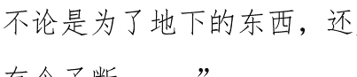

作者:蛇从草 日期:2014-01-26 00:30

我听老沙说到这里，笑了起来，眼前就像出现了老沙抓住神悠衣领的画面，那画面很有意思，我不知道两个在局中的人是怎么样的心理，在我绪中，老沙是在激神悠，同时，也是旁击侧击的，让神悠负起应该负的责任。

这种类型的很多人，在对待自己的生命时，时候不会那么在意的，反而是别人的生命，会更为看重，不会忽视。这种的是两个人的情谊，因为这种情谊，是现代很多人不具备的。就在我微笑的时刻，老沙估计是看出了端倪，盯着我说：“你以为我是故意说，要让神悠活。我不，我确定那是个男人还是女人，因为我完全看不清楚他的样子，只能看到一团黑影。当时房间里有灯光，但我……”

神偷说着，声音慢慢的弱下，仿佛陷入了回忆里。

老沙没有催问，神偷的视力有多强，他很清楚，如果连他都看不清，那说明这个放蛊婆身上还有其他的古怪。

“......我付不了他，他对我来说我唯一的想法，就是跑，当我跳过窗子的时候，身体忽然感觉冷了，我没多想，继续往外走，在街道上绕了几圈，确保那个人没有追来，我才敢回宾馆，停下来之后，我察觉到胸口很痒。”神偷继续说完。

“你你怎么确定这个是蛊？”老沙对蛊有了了解，但真正的样子的，并没有看过，所以有点怀疑。

“我曾经经历过一次盘。”神偷笃定，“我不清楚它的症状是怎样，可我知道它在人人体里的感受。这次，比上次的感觉更强烈。我甚至有些想法，要把它的身体剖开来看看。”

“那你上次是怎么解决的？”老沙顿时醒了精神，“我知道道蛊很厉害，既然你已经经历过，解决起来，就容易了。”

“各种蛊的解决方法都不一样，上次中蛊的办法，用不到这次上面。”神悠摇摇头，就闭口不言。

“我知道你肯定是做好准备，要去把那个蛊找出来，跟她要解蛊的方法。”老沙多听听神悠之前中蛊的故事，但看神悠的样子，应该是不想提及，所以就没多问。

“婉儿被个蛊毒了差点点儿，你们工厂不没事，我安排检查了，已经检测了。”神悠说了很多。

跟蛊之斗，不论是为了活还是了东西，而是现在已有的矛盾，迟早都是要有个头的……”

老沙明白神悠的意图，神悠的确是打算打主意，要先对蛊，先确保自己的生命安全，毕竟身上被种蛊，生命就被掌握了在别人的手中。

“哎，但婉儿走了，我死活没所谓。”神悠突然又补了一句。

老沙一把抓住神悠的衣领，恶狠狠的瞪着神悠，“你死可以，不要拿我垫背，反正我还在不想死！而且，是个横死！在你死之前，你先给我找到我身上的症结的！”


作者:蛇从草 日期:2014-01-26 00:30

我听老沙说到这里，笑了起来，眼前就像出现了老沙抓住神悠衣领的画面，那画面很有意思，我不知道两个在局中的人是怎么样的心理，在我绪中，老沙是在激神悠，同时，也是旁击侧击的，让神悠负起应该负的责任。

这种类型的很多人，在对待自己的生命时，时候不会那么在意的，反而是别人的生命，会更为看重，不会忽视。这种的是两个人的情谊，因为这种情谊，是现代很多人不具备的。就在我微笑的时刻，老沙估计是看出了端倪，盯着我说：“你以为我是故意说，要让神悠活。我不，我确定那是个男人还是女人，因为我完全看不清楚他的样子，只能看到一团黑影。当时房间里有灯光，但我……”

神偷说着，声音慢慢的弱下，仿佛陷入了回忆里。

老沙没有催问，神偷的视力有多强，他很清楚，如果连他都看不清，那说明这个放蛊婆身上还有其他的古怪。

“......我付不了他，他对我来说我唯一的想法，就是跑，当我跳过窗子的时候，身体忽然感觉冷了，我没多想，继续往外走，在街道上绕了几圈，确保那个人没有追来，我才敢回宾馆，停下来之后，我察觉到胸口很痒。”神偷继续说完。

“你你怎么确定这个是蛊？”老沙对蛊有了了解，但真正的样子的，并没有看过，所以有点怀疑。

“我曾经经历过一次盘。”神偷笃定，“我不清楚它的症状是怎样，可我知道它在人人体里的感受。这次，比上次的感觉更强烈。我甚至有些想法，要把它的身体剖开来看看。”

“那你上次是怎么解决的？”老沙顿时醒了精神，“我知道道蛊很厉害，既然你已经经历过，解决起来，就容易了。”

“各种蛊的解决方法都不一样，上次中蛊的办法，用不到这次上面。”神悠摇摇头，就闭口不言。

“我知道你肯定是做好准备，要去把那个蛊找出来，跟她要解蛊的方法。”老沙多听听神悠之前中蛊的故事，但看神悠的样子，应该是不想提及，所以就没多问。

“婉儿被个蛊毒了差点点儿，你们工厂不没事，我安排检查了，已经检测了。”神悠说了很多。

跟蛊之斗，不论是为了活还是了东西，而是现在已有的矛盾，迟早都是要有个头的……”

老沙明白神悠的意图，神悠的确是打算打主意，要先对蛊，先确保自己的生命安全，毕竟身上被种蛊，生命就被掌握了在别人的手中。

“哎，但婉儿走了，我死活没所谓。”神悠突然又补了一句。

老沙一把抓住神悠的衣领，恶狠狠的瞪着神悠，“你死可以，不要拿我垫背，反正我还在不想死！而且，是个横死！在你死之前，你先给我找到我身上的症结的！”

img/0ac65463822fc7b19df48d3c26d223d0_380_0.png (注：此处为重复，保留图片链接)

作者:蛇从草 日期:2014-01-26 00:30

我听老沙说到这里，笑了起来，眼前就像出现了老沙抓住神悠衣领的画面，那画面很有意思，我不知道两个在局中的人是怎么样的心理，在我绪中，老沙是在激神悠，同时，也是旁击侧击的，让神悠负起应该负的责任。

这种类型的很多人，在对待自己的生命时，时候不会那么在意的，反而是别人的生命，会更为看重，不会忽视。这种的是两个人的情谊，因为这种情谊，是现代很多人不具备的。就在我微笑的时刻，老沙估计是看出了端倪，盯着我说：“你以为我是故意说，要让神悠活。我不，我确定那是个男人还是女人，因为我完全看不清楚他的样子，只能看到一团黑影。当时房间里有灯光，但我……”

神偷说着，声音慢慢的弱下，仿佛陷入了回忆里。

老沙没有催问，神偷的视力有多强，他很清楚，如果连他都看不清，那说明这个放蛊婆身上还有其他的古怪。

“......我付不了他，他对我来说我唯一的想法，就是跑，当我跳过窗子的时候，身体忽然感觉冷了，我没多想，继续往外走，在街道上绕了几圈，确保那个人没有追来，我才敢回宾馆，停下来之后，我察觉到胸口很痒。”神偷继续说完。

“你你怎么确定这个是蛊？”老沙对蛊有了了解，但真正的样子的，并没有看过，所以有点怀疑。

“我曾经经历过一次盘。”神偷笃定，“我不清楚它的症状是怎样，可我知道它在人人体里的感受。这次，比上次的感觉更强烈。我甚至有些想法，要把它的身体剖开来看看。”

“那你上次是怎么解决的？”老沙顿时醒了精神，“我知道道蛊很厉害，既然你已经经历过，解决起来，就容易了。”

“各种蛊的解决方法都不一样，上次中蛊的办法，用不到这次上面。”神悠摇摇头，就闭口不言。

“我知道你肯定是做好准备，要去把那个蛊找出来，跟她要解蛊的方法。”老沙多听听神悠之前中蛊的故事，但看神悠的样子，应该是不想提及，所以就没多问。

“婉儿被个蛊毒了差点点儿，你们工厂不没事，我安排检查了，已经检测了。”神悠说了很多。

跟蛊之斗，不论是为了活还是了东西，而是现在已有的矛盾，迟早都是要有个头的……”

老沙明白神悠的意图，神悠的确是打算打主意，要先对蛊，先确保自己的生命安全，毕竟身上被种蛊，生命就被掌握了在别人的手中。

“哎，但婉儿走了，我死活没所谓。”神悠突然又补了一句。

老沙一把抓住神悠的衣领，恶狠狠的瞪着神悠，“你死可以，不要拿我垫背，反正我还在不想死！而且，是个横死！在你死之前，你先给我找到我身上的症结的！”

“看来我必须去寻找那个家的要窍了。”老沙心里算，但看着外面火热的阳光，很是犯帖。可他等不到晚上，不说神偷等等，他还答应了大，晚上还要回钢厂。

老沙尝试试验，看看用东西挡住身体，体会会解决问题。

答案是确定的，只要皮肤不直接在阳光下，就不会有灼烧的现象，可是，这就要求他全身没有任何裸露的部位。

天气十分炎热，穿多一点都会热，大街巷的人，都是往少了穿，如果把整个身体包裹出去，想望眼都难。

老沙想着想着，没有什么办法，就在房里走来走去。

这时书桌上有一瓶防晒霜，让他眼前一亮。想想婉儿走得那么没用防晒霜。防晒霜的原理，老沙懂一点，是一种物理防晒，将防晒霜涂抹到身上后，形成物理反射，让阳光照射不到身体上，是一种化学防晒，利用化学物质吸收紫外线的方法防晒。

要想防晒，老沙觉得必须是物理防晒比较好。他下了套装，领时很慢，这是进口货，上面的文字，一个也不认识，老沙又只能用老办法，阳光照射试验。的确是幸运的，当防晒霜涂到皮肤之后，的确起到，虽然感觉到被灼烧，但皮肤没有受到伤害。

老沙一把瓶防晒霜涂到裸露的皮肤上，又戴上帽子，咧了神偷一句，出了门，直奔大家家常菜而去。他过去这个地方几次，还买过东西，找到并不难，何况地方不大，很快，他就顶着热，到了大家家常菜附近。大家家常菜在常营业，店子里没有任何客人，几个伙计扎说着话，似乎昨晚根本没有发生事情。老沙也明白，尽管神偷和婉儿是打算了，但这些贼不会离开，毕竟一条道要花太时间，而且第二条就能弄不。老沙没有丝丝停顿，大摇大的走进店里面。那个人坐着卖菜，大胡子的中年对他笑了笑，拿出一条鸡腿主动递过来，“刚出锅，尝尝。”

老沙卖完肉后，还没开始交流，他就想了想，行如此，所以推辞，“行，顺便给我四个菜，半斤牛肉，一箱啤酒，带走。”兄弟们今天心情不错，有什么好事？”大胡子中年接接了，“嗨，能有什么事情，就是带点酒，最近钢厂……”老沙拍了下脯，“我就说了，该说的也说了。”大胡子中年也不说什么，依旧回之前坐的地方。老沙等着他们做菜，假装无聊东张西望，实际上是在仔细打量这一切的，但来看也没发现问题。

“老板，厕所在哪里，肚子痛，借个厕所用……”老沙吃了两口鸡腿后，捂着肚子站起来，等等人答应，就急着往铺后面走。

“老命。”老沙猜测这个房间就是盗墓挖地道的房间，神偷就在房里面，遭遇了那个放蛊的人。老沙对了不多，也想不到什么办法，要把那帮养的人引出来，他只能走一步看一步，就算能不能发现线索呢，但大胡子中年反应很快，立即把他拦住。就在大胡子中年拦他的时候，老少的余光看到那几个年的伙计，都皱着脸站起来，大胡子中年给他们撇了一个眼，让他们坐下。老沙捂着肚子往外走，顺着大胡子中年指的方向跑去公厕，一边还不忘交待，“你赶紧等我，我上完厕所来拿。哎哟哟……”

一个年轻人迫不及待的跟那个大胡子中年说话。老沙走得远远远了，但他们说话还很容易。“他们脑子没那么好，而且就算安全都来了，也翻不了天，怕什么？”熊哥说，就缩回铺里面。老沙急忙忙的跑到公厕里，拍了拍大腿，他一时心急，忘了神偷是救了婉儿的大手，看样子大拿跟盗墓也是见面，而且盗墓贼大手的身份并弄清楚，相反，大拿根本没把这伙小毛贼放在心上，回去之后，说的都是事情。老沙现在直接找上门，这伙盗墓贼一开始就开始防着他，那里会给他机会后面去。他等了一会儿，把烟抽完，又往大家常菜食堂走去。菜已经被炒妙好用盒子装放在桌子上，还有一箱啤酒放在旁边。老沙说这群人虽然是盗墓贼，但不是知道身份，一般人定看不出来。刚才鸡蛋恐怕新鲜，是隔夜鱼，腿都累了！老沙捂着肚子，实在走不动了，扶着墙回来。老沙说，“你们两个，晚上还要上班……”熊哥看着旁边两个年轻人，听，顿时有点缩，老沙也不担心。老沙揪住神悠，看到他布满血丝的双眼，手上劲道忽然松，神悠挣扎几下站起来，干脆就软绵倒地上，嘴里发出轻微的喘息。老沙赶忙把神悠扶起，放在床上。他不敢再去看神悠的眼睛，因为在神悠的眼睛里，有几条头发粗细、米粒长的黑色虫，不是活着的人身体应该出现的东西，他随想到，神悠很常。神悠和婉儿之间的感情很深，在老沙跟他们接触的时间里，神悠如果真的爱婉儿，就算天涯海角也会去找，而像眼前，需要酒浇愁，什么都没有兴趣，也不愿有付出就放弃。老沙很快得出结论：神悠身上的虫，不是要伤害他的身体，而是从根本上，摧毁他的意志。不用虫动手，神悠就会自己而死，而且死时，外人还以为他只是情了。神悠开始流泪，嘴里开始叫婉儿，人又变得迷糊起来。

img/0ac65463822fc7b19df48d3c26d223d0_383_0.png


蛇哥，第一次看你的书，我今天上班一直在偷偷看，终于追完了，太好看了。谢谢你在过年让我有了期待，哈哈，求合影。

作者：枝城长江大桥 来自：Android 客户端 时间：2014-01-26 22:32:00

蛇哥，你个白不打草稿的，嗯，看到我！看到我！求茄子！

作者：ws 平常心 来自：QQ 浏览器 时间：2014-01-26 23:54:00

# 一手助理 加微信1101284955 获取源码好站
免费资源很多，我有很多好站！

作者：adriano1220 来自：QQ 浏览器 时间：2014-01-27 10:53:00

一口气读到现在，终于赶上进度了。以前应该读过你的文字，很吸引，得把你以前的东西翻出来吧，哈哈，加油加油，那个……茄…茄…子。

作者：大萝卜头 123 时间：2014-01-27 13:03:00

前天天涯开始看，今天看完，意犹未尽。想起大学在寝室里一起看鬼片……呵呵……那时候还害怕得睡不着啊……昨晚也有些被……

这种一蹲，一边写作品倒是很有趣的，比买本书看强多了（估计是我第一次看网络小说的原因）。求合影……茄子。

作者：迷糊夏娜酱 来自：iPhone 客户端 时间：2014-01-27 20:29:00

@迷糊夏娜酱 2014-01-25 23:09:00
蛇蟒蛇锅，支持了你这么久，今天是我的生日，合个影理就我生日加更，获取更多好帖。

我被蛇蟒华丽丽滴了 5555~

一起，茄子……不知道有没有遗漏，不好意思了。
作者：蛇万从 日期：2014-01-27 23:43
今天会有一更，但可能比较晚，大家明天看。
作者：蛇万从 日期：2014-01-28 00:41

黄妹又要老沙帮忙，喊他让他回去熊哥面前做证，好要那个怂婆帮他解蛊。

老沙死活没有同意，同时还警告他，别轻没重的回去别人说起这件事，小心那个盘婆下手，最好还是暗地里自己调查清楚，如果能调查查到什么，就来钢厂跟老沙说，老沙到时候一定告诉他。....

黄毛被弄愁，心里没个主意，把老沙的话当圣旨答应来说，说是回去之后，调查查到什么会第一时间跟老沙讲。在这上，黄毛虽然信任了老沙，但也找了借口，把老沙拦在距离钢厂有段距离的地方，让老沙自己回。

老沙明白，黄毛则刚好那个老三都是忌怕大拳的，他们在昨晚上遇见了大，很快就知道他的身份，怕他认他们出来，所以连钢厂附近都不敢。等黄毛一走，老沙就把啤酒和饭菜撒起来，往伦伦的王经理去。

那还是不能提前回去，他要把每一分钟时间都利用。从黄毛口里得到了一点消息，但根本问题没解决。老沙无法继续查下去，因为防晒霜的效果已经快没有了，太阳在脸上又辣辣的疼，好像要把他点燃。

老沙很快就到了宾馆，在阴凉的地方，身上舒服了很多，他打开伦伦房间的门，没有回头放在门口的啤酒，而是立刻把门掩上，整个人一下跳跃，猛虎下山一样扑到了床的另外侧。

“啊……”那边站着的人发出一声惊呀。老沙立刻停止，他听出了那个人的声音，竟然是婉儿。


老沙抬着手，距离女儿只有几厘米，他刚才的动作几乎是本能，没有看向对方，除了婉儿之外，房间里还有一个人，立刻扑出。

“你干什么，吓死我。”女儿脸色苍白，捂着心口退后两步，冲着老沙瞪了一眼。

“对不起，对不起……”老沙道歉，“你不是走了吗？怎么回来了？”他看到女儿的行李，又拖到了另一床边。

“谁说我累了……”女儿哼道，“怎么样，我看他累气了，自己叫回来，地下的物品很贵，你放弃吧，我正在调查你也不用着急，会有办法解决的。”

“他也是肯定是晚上上的事情，我不拿下那个锅底下。”老沙心里挺着急，现在的婉儿已经陷入昏迷状态，那脖子突起，密密麻麻地蔓延到身体其他位置。


“婉儿跟我说了。”老沙笑了笑，“这小子很热，运气挺好，遇到他。”

“热心就是比较乖。算了不说这个人，我会照顾婉儿。”女儿打量了老沙，“你是不是用了我的防晒霜……”

“是。”老沙一阵尴尬，“你还有没有？我现在必须要这个东西。”

“看你整个脸红了，老沙在太阳下。”

“你拿去用了。”婉儿倒是没说什么，从包里翻出两盒，“拿去用。”

老沙感慨，拿了防晒霜，告别回了自己的房间休息。有了婉儿回来，他心里少了点愁，至少有个人照顾他。老沙回到房间喝了点啤酒，大吃一顿，睡到天黑，无论精神还是体力都好了很多，然后去了钢厂。

走在路上，老沙忽然发现平时不太热闹的街道很多人来去，而且很嘈杂，有些人三五成群的对他指指点点但他但他过去时又住口，板着脸走开。走到钢厂外面，人越来越多，几乎路都堵住了。老沙好不容易挤过去，钻进钢厂的大门。钢厂内部竟然也没有人影，跟外面不同，都是一个一个白色的影子在每个门口一闪而过，看不清楚。


老沙心里咯噔一下，着急去寻找大拿。大拿又叉着腰，站在宿舍门门口，双眼直愣愣的看着楼下。

“你也看到了？”大拿问老沙。

“看到了。”

“刘所长把我安排到这个钢厂里，”大拿说，“我一直没有碰到麻烦事，还一直觉得自己大材小用了，可是现在看来，钢厂都要翻天了。”

“那些人影，”老沙解释，“可能跟地下的磁场变动有关，我听人说过阴兵过道的事情……”

“别拿阴兵过道跟我说事了，”大拿激动的说，“他在忽悠我！那个村子里的守陵人，就是姓韩的，已经把事情说了，你安慰我什么？”

老沙见大拿急了，知道不能在大拿面前再和稀泥，“当年让菲律亡却埋葬在这里肯定是有原因的。”

“这地下铁矿，”大拿说，“别当我什么不知道，而且储藏量非常大的铁矿，不然当年的勘测队把储藏情况上报给国家。”

“但是后来又说储藏量没有那么多，”老沙说，“说测团队探错了。”

“这里这里有个大跃。”

“根本就是幌子，地下有铁矿，可是根本不是为了生产，建钢铁厂就是为了布局。”大拿拍衣领，“菲律亡是因为这个布局的原因。”

老沙说，“古人不知道，放到现在，地下大量的铁矿是真的，储藏量巨大导致磁场强大，而在古人的眼里就是一个非常诡异的地方。”

“其实守陵人知道的事情很少，他们是一群守着墓的村民而已，”大拿突然眼睛放光，狠狠看着老沙，“远远不如你知道的多。”

老沙心里顿时惊，脑袋里转了好几个圈，一时说出来。可是大拿并不着急，而是冷冰冰看着他，加了一句话让老沙防线垮掉。

“跟我师父说过过，你也说过师父你刚来短短几天，就已经对钢厂里的事件了解这么多，几乎所有的怪事都被碰上了。你觉得会是偶然吗？”

老沙仍然犹豫，该怎么面对大拿的质问。


老沙抬着手，距离女儿只有几厘米，他刚才的动作几乎是本能，没有看向对方，除了婉儿之外，房间里还有一个人，立刻扑出。

“你干什么，吓死我。”女儿脸色苍白，捂着心口退后两步，冲着老沙瞪了一眼。

“对不起，对不起……”老沙道歉，“你不是走了吗？怎么回来了？”他看到女儿的行李，又拖到了另一床边。

“谁说我累了……”女儿哼道，“怎么样，我看他累气了，自己叫回来，地下的物品很贵，你放弃吧，我正在调查你也不用着急，会有办法解决的。”

“他也是肯定是晚上上的事情，我不拿下那个锅底下。”老沙心里挺着急，现在的婉儿已经陷入昏迷状态，那脖子突起，密密麻麻地蔓延到身体其他位置。

“婉儿……”女儿说，“他昨天救了我。”

“照顾。”老沙心里挺着急，现在的婉儿已经陷入昏迷状态，那脖子突起，密密麻麻地蔓延到身体其他位置。


“婉儿跟我说了。”老沙笑了笑，“这小子很热，运气挺好，遇到他。”

“热心就是比较乖。算了不说这个人，我会照顾婉儿。”女儿打量了老沙，“你是不是用了我的防晒霜……”

“是。”老沙一阵尴尬，“你还有没有？我现在必须要这个东西。”

“看你整个脸红了，老沙在太阳下。”

“你拿去用了。”婉儿倒是没说什么，从包里翻出两盒，“拿去用。”

老沙感慨，拿了防晒霜，告别回了婉儿，回了自己的房间休息。有了婉儿回来，他心里少了点愁，至少有个人照顾他。老沙回到房间喝了点啤酒，大吃一顿，睡到天黑，无论精神还是体力都好了很多，然后去了钢厂。

走在路上，老沙忽然发现平时不太热闹的街道很多人来去，而且很嘈杂，有些人三五成群的对他指指点点但他过去时又住口，板着脸走开。走到钢厂外面，人越来越多，几乎路都堵住了。老沙好不容易挤过去，钻进钢厂的大门。钢厂内部竟然也没有人影，跟外面不同，都是一个一个白色的影子在每个门口一闪而过，看不清楚。


老沙心里咯噔一下，着急去寻找大拿。大拿又叉着腰，站在宿舍门门口，双眼直愣愣的看着楼下。

“你也看到了？”大拿问老沙。

“看到了。”

“刘所长把我安排到这个钢厂里，”大拿说，“我一直没有碰到麻烦事，还一直觉得自己大材小用了，可是现在看来，钢厂都要翻天了。”

“那些人影，”老沙解释，“可能跟地下的磁场变动有关，我听人说过阴兵过道的事情……”

“别拿阴兵过道跟我说事了，”大拿激动的说，“他在忽悠我！那个村子里的守陵人，就是姓韩的，已经把事情说了，你安慰我什么？”

老沙见大拿急了，知道不能在大拿面前再和稀泥，“当年让菲律亡却埋葬在这里肯定是有原因的。”

“这地下铁矿，”大拿说，“别当我什么不知道，而且储藏量非常大的铁矿，不然当年的勘测队把储藏情况上报给国家。”

“但是后来又说储藏量没有那么多，”老沙说，“说测团队探错了。”

“这里这里有个大跃。”

“根本就是幌子，地下有铁矿，可是根本不是为了生产，建钢铁厂就是为了布局。”大拿拍衣领，“菲律亡是因为这个布局的原因。”

老沙说，“古人不知道，放到现在，地下大量的铁矿是真的，储藏量巨大导致磁场强大，而在古人的眼里就是一个非常诡异的地方。”

“其实守陵人知道的事情很少，他们是一群守着墓的村民而已，”大拿突然眼睛放光，狠狠看着老沙，“远远不如你知道的多。”

老沙心里顿时惊，脑袋里转了好几个圈，一时说出来。可是大拿并不着急，而是冷冰冰看着他，加了一句话让老沙防线垮掉。

“跟我师父说过过，你也说过师父你刚来短短几天，就已经对钢厂里的事件了解这么多，几乎所有的怪事都被碰上了。你觉得会是偶然吗？”

老沙仍然犹豫，该怎么面对大拿的质问。


老沙抬着手，距离女儿只有几厘米，他刚才的动作几乎是本能，没有看向对方，除了婉儿之外，房间里还有一个人，立刻扑出。

“你干什么，吓死我。”女儿脸色苍白，捂着心口退后两步，冲着老沙瞪了一眼。

“对不起，对不起……”老沙道歉，“你不是走了吗？怎么回来了？”他看到女儿的行李，又拖到了另一床边。

“谁说我累了……”女儿哼道，“怎么样，我看他累气了，自己叫回来，地下的物品很贵，你放弃吧，我正在调查你也不用着急，会有办法解决的。”

“婉儿……”女儿说，“他昨天救了我。”

“照顾。”老沙心里挺着急，现在的婉儿已经陷入昏迷状态，那脖子突起，密密麻麻地蔓延到身体其他位置。

“婉儿……现在的婉儿已经陷入昏迷状态，那脖子突起，密密麻麻地蔓延到身体其他位置。


“婉儿跟我说了。”老沙笑了笑，“这小子很热，运气挺好，遇到他。”

“热心就是比较乖。算了不说这个人，我会照顾婉儿。”女儿打量了老沙，“你是不是用了我的防晒霜……”

“是。”老沙一阵尴尬，“你还有没有？我现在必须要这个东西。”

“看你整个脸红了，老沙在太阳下。”

“你拿去用了。”婉儿倒是没说什么，从包里翻出两盒，“拿去用。”

老沙感慨，拿了防晒霜，告别回了自己的房间休息。有了婉儿回来，他心里少了点愁，至少有个人照顾他。老沙回到房间喝了点啤酒，大吃一顿，睡到天黑，无论精神还是体力都好了很多，然后去了钢厂。

走在路上，老沙忽然发现平时不太热闹的街道很多人来去，而且很嘈杂，有些人三五成群的对他指指点点但他过去时又住口，板着脸走开。走到钢厂外面，人越来越多，几乎路都堵住了。老沙好不容易挤过去，钻进钢厂的大门。钢厂内部竟然也没有人影，跟外面不同，都是一个一个白色的影子在每个门口一闪而过，看不清楚。


老沙心里咯噔一下，着急去寻找大拿。大拿又叉着腰，站在宿舍门门口，双眼直愣愣的看着楼下。

“你也看到了？”大拿问老沙。

“看到了。”

“刘所长把我安排到这个钢厂里，”大拿说，“我一直没有碰到麻烦事，还一直觉得自己大材小用了，可是现在看来，钢厂都要翻天了。”

“那些人影，”老沙解释，“可能跟地下的磁场变动有关，我听人说过阴兵过道的事情……”

“别拿阴兵过道跟我说事了，”大拿激动的说，“他在忽悠我！那个村子里的守陵人，就是姓韩的，已经把事情说了，你安慰我什么？”

老沙见大拿急了，知道不能在大拿面前再和稀泥，“当年让菲律亡却埋葬在这里肯定是有原因的。”

“这地下铁矿，”大拿说，“别当我什么不知道，而且储藏量非常大的铁矿，不然当年的勘测队把储藏情况上报给国家。”

“但是后来又说储藏量没有那么多，”老沙说，“说测团队探错了。”

“这里这里有个大跃。”

“根本就是幌子，地下有铁矿，可是根本不是为了生产，建钢铁厂就是为了布局。”大拿拍衣领，“菲律亡是因为这个布局的原因。”

老沙说，“古人不知道，放到现在，地下大量的铁矿是真的，储藏量巨大导致磁场强大，而在古人的眼里就是一个非常诡异的地方。”

“其实守陵人知道的事情很少，他们是一群守着墓的村民而已，”大拿突然眼睛放光，狠狠看着老沙，“远远不如你知道的多。”

老沙心里顿时惊，脑袋里转了好几个圈，一时说出来。可是大拿并不着急，而是冷冰冰看着他，加了一句话让老沙防线垮掉。

“跟我师父说过过，你也说过师父你刚来短短几天，就已经对钢厂里的事件了解这么多，几乎所有的怪事都被碰上了。你觉得会是偶然吗？”

老沙仍然犹豫，该怎么面对大拿的质问。

# 大拿笑，“我们去找老胡吧。”
作者：蛇从 日期：2014-01-28 13:33

蛇从有哪些作品？
宜昌鬼事
异海
蛇城
宜昌鬼事——八寒地狱
密道踪


老沙抬着手，距离女儿只有几厘米，他刚才的动作几乎是本能，没有看向对方，除了婉儿之外，房间里还有一个人，立刻扑出。

“你干什么，吓死我。”女儿脸色苍白，捂着心口退后两步，冲着老沙瞪了一眼。

“对不起，对不起……”老沙道歉，“你不是走了吗？怎么回来了？”他看到女儿的行李，又拖到了另一床边。

“谁说我累了……”女儿哼道，“怎么样，我看他累气了，自己叫回来，地下的物品很贵，你放弃吧，我正在调查你也不用着急，会有办法解决的。”

“老胡……你是老胡？”老沙询问。

“是的，”老胡问，“你又是谁？”

“我是大拿的朋友。”老沙问，“大拿怎么知道你回来了。”

“我当年离职的时候对大拿说过，我会在镇上留过记号，而且告诉他，我退休了，而是被人带走了接受调查，只要他来救我出去。”

“你是为了当年引起的事情专门调查的吗？”老沙问。

“竟然调查了一年？我算是好的，”老胡叹了口气，“还有人被关起来调查。”

老沙听到这里，身体一震。

“现在我们去哪里？”老胡问。

老沙看了看方车附近的地方，“去守符镇旁边的村子，马上过去跟我会合，我们有很多事情要问你。”

“大拿不来了，”老胡坚定的，“我什么都不说。”


@绿茶馆长 5828 楼 2014-01-29 00:46:00
蛇哥你小时候提猴后的哦
猫馆长长新年快乐。
作者：蛇从草 日期：2014-01-29 10:32

@清香炒蘑菇 5832 楼 2014-01-29 01:42:00
太好了，看蛇哥的文比看春晚好多了！先拜个早年！
蘑菇新年快乐。
作者：蛇从草 日期：2014-01-29 22:30

-（大家春节愉快！）


看着蛇哥的眼睛，我就知道他要说什么了。过一会就会和我们会说。”说完紧紧看着老胡，果然老胡对守陵人这个名词一点都没有表现出惊讶，他知道不少事情。

土方车到了守陵人的村子，族长已经等候多时，根据大拿的约定，老沙带着老胡跟族长走到上一次和族长交过的祠堂，大拿一时还没到，二子把门给上了。

老胡进来后，看着族长，并没有打招呼，老沙也不知道他们两人之间到底认不认识。过了好大一会儿，老胡才对族长说：“谢谢你上次救了我的命。”

族长微微点头。老沙突然明白，塔坝的事情，老胡和冬生没死，很可能，就是当年老长干涉了这个事情。老沙问族长：“当年老拆装塔吊，是你救了冬生和他？”

族长看着老胡，老胡说：“你连塔吊吊的事情都知道吗？”

“我曾在一个神秘的波浪后听过你们在塔吊事故发生之前的对话，”老沙说，“你们当时的声音，被磁场给记录下来。”

老胡问族长，“这人能信任吗？”
族长点头。

刚好这个时候，祠堂的大门有人敲了，二子把门打开，看气嘘呼呼的大拿站在门口。

大拿对老沙说：“刘所长没有为我牺牲，让我回钢厂处理一下。”

“刘所长一定要急找老胡，现在有精力跟你啰嗦。”老沙轻松的说。

大拿对所有人说：“我知道你们在怀疑刘所长的身份，不过刘所长对我有知遇之恩，他人的为人我也清楚，所以你们不要在我面前说他的是是非的。”

“老胡被控制了两年，到了现在才重新出现，而且是刘所长带来的，”老沙说，“你不能凭着你和刘所长之间的交情，影响到判断。”

“我被控制自由了，”老胡开口了，“和那个刘所长没有关系的。”


这句话把老沙给呛住，干脆就不说了，等着老胡把心中始终没有想通的环节填补起来。

塔吊吊之前，老沙在诡异的录音里听过，但是大拿还不是很清楚，当年老胡出于他的原因，也没有告诉过他。

老胡就大致把当时的情形重新说了一遍。

当时拆卸塔吊的工作的人中，塔吊上有五个人分别是拆卸工老胡、老杨、老王，还有操作冬生，地面上有两个人，一个是安全员老胡，另一个是调度。

当老胡在这里的时候，老沙突然意识到，这个调度，冬生竟然没有提到过他。于是老沙连问老胡：“调度是谁，姓名是什么，他死了没有？”

一着急清理调度，由于事发之急，就没什么好措措，说，“老胡本来是临时应急征调的一个调度，当时调度证的人很少，当时的调度突然生病，拆卸塔吊已经开始，工作不能停止。刚好来了一个笨马的人，拿着调度证临时应急，我记得当初初说好了给他的工资是一天六十块。结果没想到就出了事事情。”

老沙问：“当时塔吊是做一件怎样的工作？”

“吊装管道。”老胡立即道。

老沙立即站在地上，用脚尖画出了一个凹字型，“钢厂的管道就是这个走向，对不对？”

老胡看了一下，连忙说：“就是这样，当时工厂的循环冷却水达不到工作要求，所以临时在厂里选了一个位置，修建泵机房，然后打井，插入了两根三百米的管道下去，管道在钢厂的上方，就是这个形状。

“符镇附近有水，”老沙说，“为什么当时不从其他地方引水净化后去做环路冷却，却把厂的地下打了一个几百米的深井，然后安装了这么复杂的工艺管道。”

“领导的决定。”老胡说，“你这个话，如果是当年钢厂里的职工询问，一定是会被开除的。”

“但是你现在明白，那个泵房上的管道可不是简单的了。”

“管道的问题我没有想过太多，”老胡说，“我就是塔吊拆掉后，加重量被老胡说，有效地没被当年的老沙掉。”

老胡开始回忆。出事是在拆卸塔吊工作的第二天。老胡和临时应急的调度，在地面指挥，塔吊上有四个拆卸工，带头的是老杨，操作的是冬生。当天下午的工作是拆卸组件，已经拆了两个。

老胡和老调度在左右都看不见人，他们认为是老胡在上面产生了高空幻觉。这种情况很常见。不过下来，拆卸工就有很多像鬼一样的人往塔吊爬。

当时，，现场就起了大风，并且卷起阵尘，老胡和老调度在地上都看不见。

大风持续并不长。大风过后，地面上的人倒了，老沙发觉。那些原本围绕操作台的鬼魂，像潮水一样顺着塔吊钢架涌向老胡。

老胡没招，他是安全员，必须参加救援。老胡是因为安全扣卡在了钢架间隙里，逃过一劫。老胡只能先去救老沙，在救援的过程中，老沙突然发现。那些骷髅开始用白骨的手指解开老胡的安全带，解开了，立刻要把老胡推下去。

老胡解下老沙和冬生之后，人才告诉他，那些阴兵可能是种回来的。因为他就是守陵人的族长，这次钢厂里会被一些神秘的东西攻击。当时，族长和其他村的人，站在地上，不停地拉着一根绳索。守陵人在地上用力拉扯，那些阴兵被绳索束缚脱离不了，一个一个被拉到了地下。一旦到了地面就消失无踪。

老胡惊魂未定，正要去向守陵人的族长理论。不料在当天晚上，被钢厂领导叫去谈话。谈话的内容就是要老胡保持沉默，不要把看到的东西说出去，至于跟守陵人有关的事情，绝对不能提一个字。老胡只能答应，不再干安全员了，领导安排他做了保安。但是钢厂即将破产的时候，也就是去年，老胡上班，领导带来了两个身份不明的人，让老胡立刻收拾东西跟他们一起去一趟。这两个人面无表情，但是领导十分忌惮。

那时候，大拿已经上来了。老胡向大拿交接工作的时候，突然发现大拿身上有一个吕型的饰件，非常的惊讶，因为他过的过的阴兵身上的盔甲全部带着吕字的花纹。于是他就跟大拿交代，可能自己这次被带走，可能就不回来了。但是只要自己回来了，钢厂就会出大事。到时候他会联系守陵人，通知大拿，让大拿把自己从别人手上弄出来。

“这两年你在哪地方？”大拿询问老胡。

“在一个山里里，”老胡说，“是个巨大的基地，我在那里被关了两年，没有人问过我任何事情，就对我看着。我并不是太限制我的自由，就是不能离开那个基地。和我那帮人，损失的人很多，是我睁睁睁受。前天有安排我离开，到了虎符镇，就把我交给刘所长，接下来的事情你们知道了，我被你们带到了这里。”

“还记得那个基地在什么地方吗？”老沙激动的问道。

老胡虽然了摇头。

“虎符镇地下的事情已经无法控制，”老沙说，“所以他们也急了，把大拿没死的当事人弄回来。”

“他们到底是什么人？”大拿挠着脑袋说。

“从他们的做法来看，”老沙想了很久，“可能是一个秘密门派。守陵人，他们的职责是守护陵墓，针对对手是盗墓的。比如发升，我想师傅可能就是发升。但是还有一个势力，一直对陵墓。这种门派，我听说叫铃，他们挖掘陵墓，而是专门破坏陵墓的。这种门派，当初挖了很多朝代的陵墓，破坏了风水，所以被陵墓视为仇敌，导致陵墓受到围剿。所有人都以为他们已经消失，但他们早就开始发展，获取了更多的人，可能混入关内，挖掘了满人的龙脉，并且获取了财富，从此势力大增，也保持着秘密。”

“你的意思是，”老胡说，“那个带走我的人，和我那个基地就是铃。”

“是的，”老沙回答，“只有铃才会使用这种藏风水来压制陵墓。”

“他们是敌人吗？”老胡问。

“现在钢厂出了事情，”老沙说，“他们也不看到，一定是什么意外，打破了几百年的平衡，让他们也无法不管。”大家说了这么多，仍然没有理出一个线绪。守陵人的意图，我们也无法推测，但是那个家伙被惊动，老胡必须顺着钢管进入，也许到了地下就能知道事情的。”

“那钢管不能进去，”老胡在一旁提醒，“别忘了，我是当年安装这些管道的安全员。”


大拿看向老胡：“不就是个管子吗，难道比挖掘地难吗？”

老胡问：“你能憋多少时间？”

“大约五分钟吧，”大拿回答，“特殊条件下，还可以长一点。”

“你们一直是在地下的危险，”老胡说，“就算你有本事练过武功，但我敢打赌你在管子里爬上十分钟，就会因为缺氧昏在里面。”大拿和老沙面相对，这一节并没有想到。

“有一种专门鼓风的设备，”老胡说，“钢厂里是有过的。由于管道太长，我计算了一下，那个鼓风机只能勉强保持管道的流通。当你们进入垂直管道的时候，就会面临缺氧的危险……你们计划过怎么从垂直管道爬下去？”大拿和老沙冉摇头。

“你们什么都没计划，”老胡申请，简直是对他们无比的鄙视，“打算进入管道？”

“你就别卖关子了，”大拿对老胡说，“你是我领导，这口气都要帮我的。”

老胡老了，也不再圈子，直截说的：“地面的管道就是洗衣房的输钢管道，我们这出的钢管是个风水，那么两根管道注定分阴阳。”

“就是说，”老沙插槽，“只有一根管道让人通过。”

“一根钢管里面全是水，”老胡说，“另一根从来没用过。你们运气好遇了我，当年我是安全员，施工的时候我在场。”

“那你也能分辨出一根能进入了？”大拿知道老胡一定是胸有竹的虽然老胡在台上拿了一根备用的蜡烛，在地上比划起来画了一个凹字型，然后把右上和右下的两个管道给划掉。

“这两根管子就是循环环的，你们不能走。”然后老胡又把左上的那根管也划掉，这根管伸出的距离相对较长，你们从这边爬不合适。”

“现在只剩下左下的那根管道了，”老沙点了头。

“我们首先要把这三根不能动的管道安装在泵房上方的阀门给关掉。”老胡说，“否则鼓风机的动的空气会泵入到这三根管道中，让空气稀薄。”

“现在还剩下最后一个问题，”大拿，“我们从垂直的管道里爬下去。”

“大拿你是练过的，”老胡笑着指着老沙，“不知道他的伸手如何。”

“你有话就直说吧。”老沙说，“都到了这个份上了。”然而老沙自己也被绳滑了，摔出来。老胡看着，老胡之后脸色变了一下。看来是我操心了。你们不能顺着绳索下去，这是不合宜的，因为距离太远，绳索太大，你们不可能携带重的装备爬行。所以到达垂直管道的上方，必须……”

“怎么怎么样？”大拿询问。

“记住那个垂直管道的高度有三百米左右，”老胡说，“这就是最难的一部分。”

老沙也在盘算，自己确是有能够在平滑墙上攀爬的本事，但是十几米，可是三百米的垂直距离！”大拿几乎跳起来，“稍微一闪。”老沙摇头。

“米，你们不知道的。”老沙轻松的说，“每隔十二米，就有两个十字形的钢架，这是大型管道的一个内衬。”

“什么是十二米。”大拿好奇问。

“这些管道都是一段，”老胡继续，“每根管道的长度就是十二米，那个内衬，在管道的两端，你们需要坚持十二米的距离，我们就尝试一下。”然后发生了变化，这种任务在一般人身上也是完全可能的。我们应该可以。”大拿说，“二十五次，每次十二米。”

“还有两个问题，”老胡毕竟是安全员，“万一你们在地下找到出口，怎么办？”

“你们认为找回的机会有多少？”

“几乎没有机会。”大拿说，“不过当年有人弄了这么大的工程，装这么长的管道到地下，我相信下面不是死路一条。”

“我也赞成的，”老沙指着大拿，“我们就说这么多建议了，”老胡说，“现在还有最好的时机，能脱困的很大。”

作者：蛇从 日期：2014-01-29 22:35老胡走到虎符镇。到了厂门口，族长向老沙等人拱手，然后转身离开。老胡看了看时间，现在还是一点多，然后几个人进了泵房，泵房已经被所长带来的，把圆井用混凝土石板压住，只有两根一米直径的管道冒出来。在老胡的安排下，二子爬上了管道上方，在三通一种管道用于分流处，右上方和左上方门给封闭。左下管道的尽头在炼油车间上方，并没有封闭。然后几人又从厨房找了鼓风机，车间可以使用二子不愧是冬生的侄子，他操作行车，把鼓风机装到了管道尽头，把鼓风机放在管道尽头，再爬到工作平台上，把鼓风机的电源线牢好。然后鼓风机开始工作，强劲的风在管道里发出剧烈的轰哨，时间长了还能听得隆隆的空气流声。老胡看着手表，计算时间。当鼓风机工作到了凌晨四点，老胡说：“管道内的空气交换得差多了。你们可以进去了。”二子爬上行车操作台，把鼓风机吊出管道尽头，老沙和大拿爬进钢管。老沙和大拿观察管道内部，这是一个直径百的钢管，在里面不能站立，但是仍然有较大的活动。老胡外面对着他们：“希望你们能够平安回来。”老沙和大拿应一声，然后一个后，向管道内部爬进去。身后又响起了巨鸣，一股强风从身后吹来，一个没到的优势出现了，他们在风的推动下爬得十分轻松，这个环节老胡却没有提到。看来老胡是个非常谨慎的人，报喜不报。（今天没了，大家红红红火，新年大吉！）

作者：蛇从 日期：2014-01-31 17:44今天我休息一天，喝点酒吧。
作者：蛇从 日期：2014-01-31 18:38

回复第 6069 楼（作者:@风飞花儿 于 2014-01-31 17:46）晕，来了就看到洒酒了。蛇，之前老沙和大拿下去过一次垂直管道，也没鼓风。那是圆井，不是管道。[来自 iPho......
作者：蛇从 日期：2014-02-01 16:38

感谢大家支持，祝新年快乐。我再耽两天，后天恢复更新。

# 一手数理：加V信


端公就说：“反正事事情我帮你做，但是你千万不能记得我。”

寡妇连忙回答。

于是端公就让寡妇带他去了老老公的坟墓，端公看了看坟墓的环境，就对寡妇说：“怪不得你老公魂不散，你们人的位置就没选好。”

寡妇什么都不说了，就等着端公做事。

端公立刻回到自己的住处，找人砍了一根五六米长的桃树枝，把桃树枝的树皮扒干净，在上面涂抹一层厚的桐油。然后又在桐油表面用黑墨画了一些符咒。最后把桃树枝的一端削得尖尖的。

这一切一切准备工作做好之后，就让师傅和徒儿挖了一个穴，让师傅把桃木干插在穴位上，师傅就用木槌，锤在桃木上的树上，桃木干就慢慢的插入到坟墓里，一直插了五米远，留了一根在上面。

这个就是入地针，一直穿透坟墓和棺材，狠狠的插在尸的心脏部位。这样一来，失去老公的鬼魂就被镇住了，万万劫不复，投胎都不行了。

寡妇再也没有被没死老老公纠缠，但是她心里一直对这件事情很愧疚，过了几年也郁郁而终。那个插在坟墓上的桃木干，过几年后，就就开始长成桃树，并且结果，长满了一树的桃子，可是从来没有人去摘吃了。


老沙说了这个故事，问我：“你认为泵房就是被卸岭这个派门找到的镇家的穴位，两根钢管就是入地，为了镇压下面吕律莽的法术？”

“这个已经很明显了，”吕律莽非一般鬼魂可比，卸岭一派也不是普通的神棍，所以入地的排场要大部分。”

老沙点头，“你说的的确没错，那卸岭到底是什么门派，你清楚吗？”

我笑起来，“这个还是你告诉我吧，其实你比我知道多，你毕竟亲身经历过的。”

作者：蛇从 日期：2014-02-06 16:07

## 一整理 | 加v信1101284955，获取更多好帖

作者：蛇从 日期：2014-02-07 23:42

钢管内壁上有咒文，这一点都不稀奇，老沙摸了两下，也就没在意。只是现在问题来了，之前是横向的管道，到这里已经是竖直向下的，也就是说，他和他，必须是背靠背的支撑，才能继续向下。

大拿没有话说，老沙对视一眼，两人把矿灯找好，十分默契的靠着，相互抵住。

两人都然而地深呼吸一口，对他们来说，这一口气或许是他们之后能呼吸到的最新的一口空气了。

老沙双脚抵住钢管内壁，背后是大拿宽阔的背，他们的手都伸直，吸住钢管，稳固身体。

“走！”老沙轻说了声，然后两人同时开始念拍子，这样下去，必须出现一致动作，才能保证下去的速度，如稍微出现偏差，就有可能掉下去。

刚走十来步，老沙脚上就滑了，没料到，钢管内壁的腐蚀程度，远超出他的想象，整整有一块锈斑承受了他的力气，呼啦一声朝下掉下去，让他的脚也跟着滑动了几寸。

老沙的身子向下一倒，而大拿用劲护着他，力量立刻压来，

“小心！”大拿惊呼，一把住了老沙的衣领。

老沙被拉，连忙晃双臂，直接的扶住钢管内壁，稳住身体，大拿用力，做出的动作他继续看着，一手拉住他。

“幸好两个人，一个人下来，根本反应不过来。”大拿说，“还是回到两个人背靠的姿势，一个人跨着下滑，很有可能出事。

老沙点头，对的，两人必须照应，一个人大容易出了事，瞬间反应的机会也没有就掉落下去。

恢复到原来的姿势，两人又下滑了段距离，抵达第一内衬钢架，经过短暂的休整，两人继续下行。

钢管内部开始安静，只能听到两人呼吸的声音，但越往下下，下方的管道里，传出轻微的声音，像是有什么东西，在拉钢管，发出刺拉咣的响声。

两人对声音都很敏感，老沙明白大拿肯定也听到了，两人默契地屏住呼吸细听。

这一听之下，人都紧张起来，这声音出现的时候，十分古怪，就夹杂在两人的呼吸声里，当两人屏住呼吸的时候，那声音似乎察觉到了，也就同时停止了。可只要两人移动或呼吸，那声音就会跟着出现。

> “这声音很古怪。”老沙忍不住说。

> “不是我们撞碰到钢管，发出的回声？”大拿说。

> “处理时不要影响呼吸声……”老沙心里发慌，眼睛撇了。

有什么东西在逼近，而且为了不让他们发现，特意把声音藏在在我们发出的声音里。

> “难道是那些东西知道我们要下来办事，来阻止？”大拿说。

> “很有可能，但我希望是……”老沙心中一凛，又补充说，“最好不是。如果是那些东西从钢管里爬出来，他们根本不是对手，这个管道向下滑很难，往往往上爬更难。那些东西的手，老沙比任何人都清楚。”

作者：蛇从 日期：2014-02-08 00:55


原本下方空荡荡的感觉，已经不好受了，现在异样的声音出现，更让老沙脊发麻，大拿并没有回头，由于害怕，两人继续向下，又过了几分钟，老沙停住了，大拿用手在臀部摸了两下。

“怎么走了？”大拿疑惑。

“不对，”老沙额头冒冷汗，“我们应该到了内支撑的地方。”

“对，怎么没有支撑。”老沙抬头，灯光照耀之外，没有其他钢架，已经过了八米，还没碰到钢架。

“现在空气已经差，要是得休息，就没办法继续下去。每十二米就可以休息，”大拿也觉得，“这里倒是潮湿，而且时间过了很久，所以生锈特别严重，钢架已经被完全腐蚀掉。”老沙说出结论，“我们过了三分之一。”

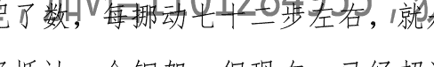

接下来的三分之二路程，所有的钢架都已经不存在了。”说到这里，老沙望下去，下方幽幽的孔洞，就像一条蛇，张开嘴，等待着他坠落。如果有钢架支撑，就算坠落还有机会挡拦，但如果下方隔离了，掉到底就是另一种景象。老沙不由自主的紧张起来，浑身颤抖，没办法自我控制。他知道一种症状叫做幽闭症，人在特定环境下，总会担心出错，使得手足无措，内心焦虑，以至于身心都难以承受，这是一种本能，就算自身再好，老沙也快要陷入这种状态。

“老沙，你是不是害怕了？”大拿和老沙背靠背，自然很快感觉到的异样。

“没事，让我休息一会儿。”老沙闭了眼，深呼吸几口，调整呼吸，然后继续下滑，嘴里自喃说道：“我在城里的时候，曾经遭遇过电梯出事，电梯上行到二十三楼，突然下坠，直到五楼才停住。跟我一起电梯的好几个人，在之后的两个月里，都是爬电梯上下。我在那之后，就再没有坐过电梯。”

“现在我们的情况，跟在一架电梯差不多。”大拿说。

“而且是一架随时可能出事的电梯。”老沙说，“如果我们直接掉落到陵墓里。”大拿笃定说着：“我们没那么容易死的。”这时，钢管内壁上发出刺啦一声响，老沙感觉到背后没了支撑，向后仰去，这一次早有准备，立刻稳住了身体，低头见大拿竟然倒在墙上，一只脚踩透了钢管的铁皮，出现一个铁洞，大拿的裤被尖锐的铁皮划破。

“受伤了？”老沙赶问。

“没事。”大拿可以说，“但好像有什么抓住了我的脚，快帮我一下。”


还存在着东西的话，那必然是陵墓下的奇怪怪物。老沙往上挪几步，托起大拿的腰，一手扶住大拿的膝盖部，往里面拉。大拿只有左脚露出去，右脚在内壁里，他一脚住，不受支撑身体，和老沙一同用力，咬牙大喊，想把腿拉出。一通拉扯之下，钢铁内壁发出碎裂的声响，老沙这才认识到，那另一侧的奇怪怪物怪力强大，就连他大拿用全身的力气也拼不过。大拿的膝盖慢慢的挪动，朝外移去，铁片划破大拿的肌肉，渗出血线。

钢管外侧躁动起来，仿佛是嗜血的某种怪兽，因为血出现，变得钢管躁动起来，把钢管拍得砰砰响。老沙惊讶不已，虽然看不到另一侧是什么东西，那些怪物还不只头。大拿脸上青筋暴起，咬牙，老沙急得拼命发力，把自己的腿扭回。

“轰！”一声巨大的响，持续了很久，已经没有办法，钢管外侧彻底塌了。老沙稳稳的，朝下方坠去。

作者：蛇从 日期：2014-02-08 01:02

老沙和大拿累得够呛，他们停停了，听到鼓风机灌入的声音。老沙停了一口气，大拿说，“没有，。。蟒蛇了，那些怪物还不只头。老沙说，“我们已经太累了。”

大拿疑惑，“蟒蛇已经松了，蛇皮倒瘪。蟒蛇失血越来越多，身体一点点的向下掉，大拿的腿被缠绕也逐渐松了。现在蟒蛇也没有多的力量来紧紧缠绕大拿。大拿借此机会，蟒蛇连连咬大拿，手臂的力气都没有。老沙见大拿正在脱蟒蛇的缠绕，也调整身体，背靠着大拿，一个胳膊大拿的肩膀反向勾，大拿一声大喊：“松开了。”然后两人迅速背靠背，用胳膊扣在一起，两人的腿同时伸直，顶在钢管内壁上。就在这个时候，蟒蛇也精力竭，身体从上方跌下来，大拿和老沙听到了两声沉闷的碰撞声，再无声息。老沙抬头看向钢管顶上，钢管的裂处，伸进来十几个蛇头，那些蛇在身体的支撑，在破口处慢慢旋绕，于危险的本能，它们都没有游进来。

## 一处理111.01284955 获取多好帖

老沙没有回答，他和老沙一样，想象着无数蛇子密密麻麻的缠在钢管外部的样子，都不寒而栗。““我们上次从外面下来的时候，”老沙说，“并没有看见蛇。”

“有人一定地下的布局给闹穿了，”大拿说，“所以这些蛇，就都跑了。”

“可能不止，”老沙说，“那拨挖的墓，带了放蛊的人来了，说明他们也不是所知。大拿也明白，放蛊的人跟辈，既然如此，地下会有这些恐怖的虫。”

作者：蛇从 日期：2014-02-08 23:08

作者：蛇从 日期：2014-02-09 00:05

看来是老沙和大拿两人加起来三百斤体重，把这条蛇在拼命的往下，导致了蛇尾部位被钢管边缘慢慢划开，蛇皮倒瘪。蟒蛇失血越来越多，身体一点点的向下掉，大拿的腿被缠绕也逐渐松了。现在蟒蛇也没有太多的力量来紧紧缠绕大拿。大拿借此机会，一点点的挣绕在自己腿上的蟒蛇，蟒蛇连连咬大拿，手臂的力气都没有。老沙见大拿正在脱蟒蛇的缠绕，也调整身体，背靠着大拿，一个胳膊大拿的肩膀反向勾，大拿一声大喊：“松开了。”然后两人迅速背靠背，用胳膊扣在一起，两人的腿同时伸直，顶在钢管内壁上。就在这个时候，蟒蛇也精力竭，身体从上方跌下来，大拿和老沙听到了两声沉闷的碰撞声，再无声息。老沙抬头看向钢管顶上，钢管的裂处，伸进来十几个蛇头，那些蛇在身体的支撑，在破口处慢慢旋绕，于危险的本能，它们都没有游进来。

老沙和大拿累得够呛，他们停停了，听到鼓风机灌入的声音。警察护现场之后，把老胡的尸体抬到担架上，带回了派出所。刘所长没有跟着警车回去，而是独自一人开车到了守陵的村子。警车停到守陵的祠门口，刘所长长下车，对着祠堂喊：“老赫，你给我出来！”

老沙和大拿站在位置，大拿顺着老沙的指向去看，刚那矿灯能够照射到那个部位，看得清楚了，看了之后，大拿和老沙一样，一颗心提了起来。原来是挂在钢壁边缘的那条蛇，被钢管锋利的铁边缘划开，蛇皮翻卷，被撕开，露出了白花的蛇，蟒蛇疯狂地加血液流出，贴在他们的腿上。

作者：蛇从 日期：2014-02-09 23:00


老胡没有把钢板全部焊在钢管外，那样太费时间，他只是点焊了几个点，钢板就固定在了钢管的出口，这样已经够了，老沙和大拿借人力无法从内部凿开钢板的。而且钢管封堵之后，空气立即停止流通，也挣不到回头。老胡做完这一切，把东西收敛完毕，然后背起二子走到值班室，从身上拿出一把手铐，将还在昏迷中的二子替铐在床架上。然后走到工厂里，来到废弃的高炉，深吸一口，慢慢向高炉顶部爬上去。当老胡到了高炉顶部之后，把身上的衣服脱，然后纵身从高炉上跳了下来。隔了很久之后，巡视的保安路过，但他没有出一丝血迹，却看到老胡爬的麻麻体，但只有一些虫密密麻麻的从胡体下面蔓延一样的爬了出来。保安们惊了，所有人站在原地，有人按打电电话报警。刘所长很快的通知了警察了。刘所长看到老胡已经在高炉下面，不由得破大口，立即询问保安大拿去哪里了？保安说不出大拿在什么地方，刘所长重重的顿了顿脚，歪着头说：“完了，就知道这个小子会坏事了。”


“你做事为什么总是要瞻顾后的。”大拿不甩眉，“走一步是一步吧。”

大拿说完，纵身跳了下去，老沙听到一声水花的响声，对着下眼睛：“大拿有事吗？”

过了一会儿大拿的声音从下面上来，“这里的确是一个水潭，但是……他妈的，他妈妈的有害的东西！”

作者：蛇从 日期：2014-02-09 23:45

今天没了

作者：蛇从 日期：2014-02-10 16:37

@鬼域清清 6770 蛇锅没理我，倒默默看了很久阿夭的处妹给蛇锅没理我，倒在心里加了一句11101284955 获取多个好帖

给他多玩戏份吧，结局不要虐我我会不得金钟不管你怎么描写他在我心里总是形象高大的哥呀哈哈，看到疯子改变之后看起不起金钟的时候愁想，也许也达不到那个境界，但他在坚守着他自己，记得以前读者所写的，应非寂寂生慷慨，自有凡尘扑坎诸，被我写在每一本练习册上做座右铭其中感触太多了阿，唉，蛇锅加油期待……

感谢支持

作者：蛇从 日期：2014-02-10 16:37

@凡目 6782 楼 2014-02-10 14:06


问好蛇，过完年了，继续追老蛇新原作：)
@蛇从草木木噗一个。

作者：蛇从草 日期：2014-02-10 21:17

老沙很不得破口大骂，刚才说到矿边没说出来，大拿就跳了下去，这愣呆小子时节不犯浑，真是一点办法没有。

其实老沙知道下方是地下的时候，心里就在算算，很有可能下面有兔子兵。当初兔子兵就是从这里到泵机房去了！

大拿的一声惊呼，老沙用矿灯照了照，可什么都看不清，老老大骂，看到大拿跳下去的那处水花在矿底溅得很大，也就一点光而已，连大拿的人都看不清，就别提提什么其他的物件了。

顾不了，老沙一牙，也跳下去，几秒钟之后，整个人一头扎进冷水，估计是落水的姿势不对，脑袋在入水的刹刻，被撞得头晕眼花，好才缓神来。

这的确是个水潭，也不知道到底有多深，老沙撇了口气，没敢测试水深，双脚踩着水，浮出水面。

水冷得骨子疼，老沙扑抖了两下，全身都快被冻僵了，麻得快找不到感觉，不敢犹豫，瞅着大拿的方向又拉了过去。

大拿嘴里呼呼有声，正在和什么东西斗斗，两个黑影来移动，把水拍得乒乓响，溅起很大的水花。

“大伞，是什么东西？”老沙看不真切，一面朝大伞游过去，一面拨付出了藏在身上的尖刀。

“你别过来，小心被戳。”大伞咕嘟嘟的灌了两口水，对老沙示警。

“你一个人不是对手，我们两个人会有机会。”老沙没有停顿，知道兔子兵的厉害，那些东西浑身上是铁打的，凭大伞肉身胎不是对手。

老沙游了大伞身边附近，就闻到水底下，好像有无数鱼鳍，在抽动流水，水撞击他的身躯，很疼。

“妈的，这不是兔子兵！”老沙一伸手，抓到一滑溜溜的王经理，加了好好东西。

“我什么时候是兔子兵。”大伞自顾不暇，好像坐过山车似的，声音悠高又低，“是水蛇！”而且超级，老子坐在它身上了。还有小蛇，在缠着我！”

老沙极力的想看，但除了拍了水花，什么都看不到，浪花全扑打脸上，大伞拿着的矿灯灯光一闪而过。

如果大伞说的真的是，就浑浊水中流动的迹象，这里简直是个蛇窟。

“不，不是蛇。别的什么！”老沙又感到几缕滑溜的东西从皮肤上挪过去，“真的是蛇的话，早就咬我们了。”

“不是蛇，那是什么？”大伞被莫名其妙的东西很快带离老沙身边，进入死角，灯光消失了。

“他妈怎么知道！”老沙扑腾几下，感觉到脚上已经被数条滑腻的糖子勒住，怎么都挣脱不了。

老沙被拽进水里，越勒越紧，他忙命紧紧咬牙，不再说话，集中力气用小匕刀去切断束缚住他的东西。

这时，他已经看了，这些束缚他的东西，是一圈一绕的细线，就像人的头发，乌黑密密，还特别细长，看不清有多少米，盘缠在水中。细线被一刀割，立刻割断，但这些线竟然有生命，在水里蠕动，而且被断的部分，全部粘在他身上，好一张网，把他紧紧住住。老沙头上喷出的血顺着脖子灵活地绕过来，没有丝线，更是往口鼻中钻！

“妈妈，这些都是虫子！这里根本不是水，而是个水窟！”老沙心里闪过一个念头，那里还能招架，拼命挥动刀子，靠近自己的肌肉。虫子从口腔里钻，清晰的感觉到冰凉的躯体，这种滋味的恐惧无比强烈。是的，没有痛苦，只有恐惧。

“哇！”老沙终于坚持不住，张嘴呕吐，什么都没吐出，只有大手进水里，把那些里面的虫子都吐出来。那些虫子落地，立刻游动，从台上游起来，此刻整个人软在地上动，大口喘气。

“你没事吧？”大拿问道。

“活死了。”老沙缓了一口气，感觉肚子里东西在蠕动，实在忍不住，再次大口呕吐。开始的时候，只是干吐，但紧接着，吐了几口腥污水。污水里面，满绕在一起的细虫，与之前吐出的不一样，这些细长都已经死了，一不动，好似一群头发。惊讶的事情发生了，他在裸的皮肤上，原本粘附着不少细长虫，还在扭来扭，这时，也悄无息的掉地上，曲成一团，死得不能死。

“这是怎么回事？”老沙莫其妙，“这些虫不能离开水？”

“我觉得它们遇到了克。”大拿却不这么认为，“刚才跟我搏斗的那条，也死了。”

“你是说……”老沙看着大拿。老沙明白了，答案就是这颗铜钉。这颗铜钉是长老给他们用来压制地下猛兽的，肯定有特异之处，对付这些小的蛇，根本不在话下。老沙松了口气，不管怎样，有这颗铜钉在手里，地下走起来，至少要容易了。

“这边有空洞，可以继续走。说不定就是我们要的地方……”大拿指了下旁边的一个洞孔。这时，大拿声音戛然而止，并倒吸了一口气。老沙生生退出一步，他也看到了，在大拿手指上，站着一个赤裸的人，他面色惨白，眼里两只眼球雪白一片， 直勾匀的望着他们，全身更是浮肿，好像被水泡了多久。老沙和大拿都可以肯定，在半秒钟之前，这个人，或者说，这具尸体，并不在那里，只是大拿说话的功夫，就那么突然冒出来的。

作者：蛇从 日期：2014-02-10 22:24

今天没了

作者：蛇从 日期：2014-02-11 17:08

@探花流 6884 楼:2014-02-11 16:59:00

@蛇从一直默默追贴，今天整理了一下，发现目前为止，大小一小一计算，老蛇居然有142段，共计16790字余，

今天更新：加我整理的最新版，发现老蛇处有几个结构性的错误：

老沙和大拿第一次聚机井的时候，说那个钢管的直径是八百分。八百分也是800CM=8M，直径8米的钢管，我自认还没有看到。所以这里应该是个笔误，建议老蛇修正。

老沙和大拿从车开始爬钢管，后面也得到钢管直径八百......嗯，数据上上有缺陷我在修改过来。感谢你的。作者：蛇丛 日期：2014-02-11 55

两人疑惑，赤裸人突然一头扎进潭里，没有任何气泡出现，他就慢慢消失在了水之下。

“看清，活的还是死的？”老沙疑惑朝大拿问道。

“看不出来。”大拿摇头，“他好像是跳进水里，又是被进去了……他能动，可是竟然泛起潭水。”老沙的眼睛，即便失明，但看人的时候，还是很有力！大拿见赤裸人，不再多想，沿着潭边的石块，走向一个黑漆漆的洞孔。他很可能是从洞里出来的，说不定里面，还存在不少的东西，别忘了，兔子就不止一个。

“就算有很多，到了这一步，我们还能怎么样？快点去完成守君的事情。”大拿嘴虽然这么说，脚步还是停住。

“听我的，我们急着动手。”老沙知道他之前听话，傻呆似的跳下来，吃了大亏，现在学了点地下比我们想象中大，足够的氧气让我们呼吸，现在必须多摸底情况，再去找那神号……还有什么情况，你不清楚？”大拿睁眼问。老沙看得大拿眼睛里的意思，地下靠一切未知，道者还有可能还不，大手拍了去，死是活着她娘的。这眼阔太奇怪了！”老沙压着罐子破碎的心思，“我们上次来，见到了万人坑。现在你说，为什么我们这次来，这里就成了水？”大拿摸了摸脑袋，不想明白。

“因为我们上次没见到这么深的位置，那个万人坑在我们头上面。”老沙抬头了望，“这个钢管虽然抽地，但它有个名堂，这是杀人魄的地针。”

“那是什么玩意儿？”大拿听得一愣愣。

“反正很简单，就像是一把尖刀，插在人的心上，只是这根钢管，插在陵墓上而已。”老沙解释道，又说，“地针，必须是破戈而入，插在尸体上才能起到效果。”大拿傻似乎明白了点了，抬起头来，用矿灯照射钢管的末端，然后看着水说，“你的意思，主攻其实在这里。“按照道理是这样的。”老沙，“不过另外一个问题来了，谁会把坟墓修到水里面呢？这不符合合理，不然时间过去那么久，早就被泡成渣了，而且奇怪的是，这水，显然是地水，要把坟墓建立在水底下，是多大的工程！古人怎么可能做到。“那你说了等于白说。”大拿一甩手，嘟囔道。“所以现在，我们急着动手，想要清楚古人建墓的时候，最可能不是在水附近，我眼里很多。”沙说着，开始往四下打量起来。大拿点头，开始到处查看。老沙和大拿没有分合行事，彼此默契的保持一定的距离，好照应，而且尽量靠近潭边，只在岩壁附近走。一番查看下来，并没有什么发现，围着水潭转了一圈，两人又回到了原点。

“刚才一直在想一个问题。”大拿忽然开口说，“既然建钢铁厂镇压的帮人能跑到这里，怎么不干脆把陵墓毁掉，留下来害人！”老沙回答：“宁逊跟这些人形成了微妙的平衡，彼此都难以更进一步，否则，造成的后果，是双方都无法承受的。问题在于第三方监戏的介入，把平衡打破，事情变得难以掌控，这些，那个韩族长其实都说过，你是不是忘了。“我没忘……”大拿焦急的说，“我只是觉得他们拿活人来祭杞，也算不得什么人，整个钢厂就是个幌子，我还来为他们卖命，拼死拼活，太甘心了，出去，我跟他们没完。“我跟他们也没完。”老沙苦苦了，浑身上一冷，心里好像空落落的，“完了，我们两个中招了……祭杞，那五个法……”老沙说，“还忘了，你觉得老胡有问题？他被关那么久，性格的确以前一样，有点阴沉，但能有什么问题？不是他，我们根本没办法。”大拿说。“事情太快，我也是脑子发热，什么都没想，我们就信了，一股脑进来。”老沙拍了脑袋，尽管一个悔恼，都是木已成舟，没办法改变的事。“你是要急死我，怎么明白你在说什么。“一切都太顺利了，两个进入地下，整个过程没有遇到一丝阻拦，像是脚本已经写好，我们两个作为演员，只要跟着脚本就行，就连脑子都不需要一下。”老沙越想越觉得可怕，“不是演员，而是棋子，被人耍了。“你是说，老胡骗了？”大拿明白了点，“他为什么要做？”老沙叹了声，“之前说过，那个大法只是我推测的一种方法，是为了镇邪的，所以我认定，这帮祭祀者，目的就是防止地下东西出去，对地下东西进行安抚，但现在我们来，是想办法换取……当初跟我解释的时候，难道你发现？”大拿问。“是有问题，很大的问题。”老沙点头，“如果修建工厂的人，和进行祭祀的人，不是同一帮，那问题就大了。”大拿此时也想到，“你的意思……”老沙连点头，“老胡这次回来，就是为了完成大法！我一直忽略一件事，就是守陵人说的他们有人得到过密宗。所以，你明白了吧，无论是塔上出事的人，还是在池里淹死的人，他们都是心甘情愿赴死的。他们跟韩冬一样，是守陵人派出祭礼的死士，怕也是其中之一。“但韩冬说的那段往事，跟老胡的一致，当年大家都知情，不可能是假的……”大拿眨眼，下意识的反驳了一句。老沙点了点头，“真清楚听过那段声音，确像是真实发生的事情。从头到尾都是阴谋，一场精湛的表演……他们的目的要在工厂里制造恐怖，让工厂失败，把人都赶走！重新夺回墓的控制权。老沙，你真的是可怕的人。”大拿忍不住，“你太会了。“这就是为什么我从来没朋友，因为我不相信任何人。但你，我是信过的。”大拿笑了，不置可否，“这个大法，死了那么多自己人，目的就为了制造恐怖吓人，我觉得自己不住脚。“当然还有其他的目的，不过这个目的，还不清楚。而且我们接下来又要犯难了，守陵人究竟是怎样的心思，要我们帮这个忙。虽然不喜欢脑子，但拿到这个的时候，我其实已经在想了。”大拿这时苦笑起来，拿着钉挪了挪，“地下陵墓里真的只有怪兽，在它脑门上来一下，它是会睡过去，还是反而变得清醒……这就是问题。”老沙知道大拿不是个笨人，只是有时候，动作快得比脑子快点。作者：蛇 日期：2014-02-11 22:25 作者：无心j 时间：2014-02-11 21:53:00

老蛇，今天更新的很快啊，求合影！茄子。感谢各位点赞。大家早点休息。整理版加微信1101284955 获取更多帖作者：蛇从草 日期：2014-02-12 13:06:00@抓花 6956 楼 2014-02-12 11:12:00@蛇从草#主线想法:先看主要人物：老沙、大拿、大胡子盗墓团队、守陵人、钢厂建造者、神秘组织卸铃（目前出场人物所长）、卸铃叛徒（暂未出现）老沙：和神偷本来是来买卖的，却意外发了这个心风水陵，这和老沙的师徒有极大的渊缘，本打算退出的老沙决定追查到底。大拿：钢厂保安队长，和老沙很可能是师承一脉，受。


老沙在原地不动。

老沙有些哭笑不得，心里咯噔了下，明白大拿的倔气又犯了。

“你在岸边站着，我去看看。”大拿说说着，开始脱衣服，露出一身健壮的肌肉。

“这是我的一个推测。”老沙说，“水里太危险，你别冲。我们先看得到的地方，如果不是死路，再回来探索这里不迟。”

“你是在浪费时间。”大拿固执的说，“越危险的地方，肯定就接近那头神兽，虽然现在我们不知道怎么处理它，但是定有一个结论。”

老沙没有再闹，大拿的办法是好的，现在看来结果不错，说干就干，不像他那样畏首缩脚。

“你把钉钉往水里试试。”老沙必须确保一件事。大拿把钉钉拿在手里，伸到水面附近。

奇怪的事情发生了，水面竟然泛起了一层微的波澜。地下是没风的，可钉钉放到水面，就像钉子里有风出来，把水面吹皱。

老沙仔细盯着水面，看到那些黑色的细丝虫在飞快的远方，它们对钉钉是很畏怕的。而水面的微波，正是它们离开时的动作引起。

大拿看到这种情形，欣的一步走到了潭水里去。

“这里是台阶。”大拿走了几步，身子慢慢矮下去，他回头，冲老沙道。”

老沙点点头，“这是路步，算是陵墓的真正入口了。”

潭水周围，好几处都是光的石板，但直到大拿走到水里，老沙才看出这石板，竟然是往下的阶梯，这就更加证实了他的推测。

大拿急不及的深呼吸，头顶着防水灯具，手里拿着铲子挖刀，往下继续走，一会儿功夫，就已经完全没影。灯光乱暗下，水面虽然清澈，但是很奇怪，仿佛有谁伸出手，把大拿的矿灯给捂住，只出现淡淡的光。

老沙时忐忐起来，心里按着，替大拿担心，可没办法，水里的情况必须大拿一个人去，才好摸个大概。两个个人同时下水，铜钉一定不能护佑。

大拿入水后，老沙站在岸边，视线不离离开片刻，连眼睛都不敢眨。很快，他就走到了比较深的地方，从外部看，也不知道到底有多深，只能看到一点小亮。

小亮光灭了，又亮起。

老沙开始还没留意，但不一会儿，这个明灭的频率变得稍高，终于引起老沙注意。

“不好。”老沙心悸的暗叫一句，忍不住一步跨进水潭。

老沙赶忙跑到岸边，死命踩脚，要把丝丝虫给挣脱，还好避开丝丝虫较少，足以造成较大的威慑。但这就这么一会功夫，大拿的灯光已经完全消失在潭下了。

“他的妈！”老沙大骂一旬。

老沙浑情发现了一件事：刚才大拿灯光的灭，不是示警，也不是出了故障，而是大拿的头顶上有什么东西在游动，拦住了两人的视线。


老沙站在岸边，干着急，只能暗示自己，大拿一定能行。但这也是一种自我妄安慰而已，这里是陵墓，地底有水，一个人的力量再强，也卑微得跟蝼虫差不多。

不一会儿，潭水中央位置出现水泡的响，老沙看去，就见潭水中间好似煎沸了一样，巨大的水泡向上翻滚，范围逐渐扩展得越来越大，不到半分钟，整个水潭变成了一个沸水锅。

不过，并不是真正的沸水，反而，之前地底的温度还稍高，现在，空间内的气温下降了好几度。

老沙双眼直着的盯着潭水里，在十米远的地方，一个个头上下起伏，随波翻浪。


多多，你不觉得是因为你在这件事情中的作用，已经做完了了吗？”

“也许是这样吧，”神喻说，“我现在这个样子，可能是他觉得老老子的能力，能够取代我。”

刘所长和神喻二人猜似的猜似的的你来我往了几句，换做是人谁能听明白。

“我能解决你身上的蓝毒，”刘所长说，“但是你需要知道的事情告诉我说，我不指望你能找到他的下落，但是你和他打交过道，你的线索非常重要。还有，那个老老子你知道他有多少底？”

神喻看着刘所长问：“你是警察的身份，还是以门派的身份，”

“门派的身份，”刘所长指着婉儿，“其实那个人，和他的父亲是师兄兄弟。”

神喻看向婉儿，“现在可以读了吗？”刘所长问。

神喻没回答，刘所长点点头，婉儿在一旁说：“这几年，我瞒看着你，你问个明白，心里是不会出错的。”

婉儿看了看刘所长，刘所长说：“该说的就说吧，现在都已经是这样的了，没必要在隐瞒什么。”

婉儿说起来，而且是从头讲起，涉及了很多溯源。原来婉儿的父亲姓穆，婉儿的名字的确没错，就是穆嫣儿。老穆比刘所长的年龄大一点。老穆和刘所还有一个姓人的都是一个派的同门，这个门派就是卸彭。要说卸彭这个门派也有很长的历史了。起源起来是西末的绿军有关。创始人是汉武帝刘邦。这种说法也许不知道是不的，因为东汉到宋朝，卸彭门一直没什么名声，史籍几乎没记载，就算是野史，当年门派的多的也是发扬，摸金，掘更多一些。或者是某种可能，因为卸彭是刘刘开创的，所以卸彭的门派一直和当朝的政权的关系更加紧密，民间活动反而少一点。在官府的庇护下，这种门派还能更加隐敏。

所以宋朝如今何更迭，卸彭的门派一直隐藏在官府里。情况其实宋朝开始更迭。这完全符合了历史安排，看来成了南宋，最后南宋也灭了。卸彭这个门派一直都是汉政权的附属，就算是五胡乱华的年代，也是跟着南朝的政权延续，可是蒙古灭了南宋，天下成了游牧民族蒙古的天下。卸彭作为秘密的组织，而是流落到民间。但是他们的目标和任务，大致就是卸彭一派，非常懂得风水，他们盗墓，并不是以钱财为主的，而是破坏汉族以外政权的风水，说大一点就是龙统。

所以卸彭有一个严格的规定，人们必须是汉人，绝不接受汉族。辽金从北向南入侵中原，那个时候，卸岭已经开始有了所作为，不停的挖掘辽朝、金朝贵族的陵墓，破坏龙脉，甚至在元朝建立后，他们做了一件非常大的事情，把成吉思汗的陵墓挖了，这件事让蒙古人特别恼恨，在天下下了追杀令，要对卸岭尽杀绝之。卸岭派又一次销销匿迹，派派凋零，门人散落在各个地方，听说还有一些卸岭的门人，远远中亚，继续在远处异域，破坏蒙古皇帝的风水，然后在那里扎柱杆，衍生生息，到了现代而是汉人的组织了。留在中原的保持着汉人的纯性，又受到元朝的迫害和打压，渐渐散。

不过卸岭一派当年挖掘蒙古贵族的风水还是起了一场灾难。元朝倾亡于帝国就被汉人夺权，然而最终建立了明朝。明成祖朱棣，通过国师道行，寻找找到了卸岭，卸岭再次回归追附到汉人。但是已经经元气大伤，很多获害的门人要么死了，要死了。接着就是明朝清朝取代。这一次之后，卸岭又一次沦落到民间，清朝本来就是后金，女真回到当年的鼎盛时期。清朝本来就是后金，女真族的后人。金朝时期，女真族的政权估计也被卸岭破坏了风水，知道卸岭的厉害，于也是费力气压制卸岭，卸岭在清朝眼中，威胁不下天、白莲教等等反抗势力。所以清朝下令，汉人决不能过山海，进入东北。因为世人所知，清朝的龙脉就在关外，黑山白水。

不过长时间长了，清朝统治之久，出了流传龙脉有大财宝之外，龙脉本身的事情不再再从那儿怎么重视。时间进入到二十世纪，清朝积弱，列国入侵，清朝自顾不暇，也是天命使然，清朝的八旗贵族已经经不过汉族官员的势力。汉族官员在百日新政之后，势力更加强大，逼迫清朝做出了两个改变，从根本彻底把清朝掀翻。一个是取消科举制度，断绝了读书人的仕途，读书人不能做官；另一个改变就是清朝开放了汉人禁止出关的制度。汉人在中到了关外，然后汉人聚在一起，扼断了清朝的龙脉。不出几年，清朝灭。


能否完成镇压神的任务，还是未知数。

老实说，我很想听老沙说起进入陵墓的经历，因为那是整个故事的最精彩部分，但只要进入陵墓，就说明镇压神的任务失败，鲤鱼翻身，形势走向凶险的方向。

一想到这些，我内心万分紧张，呼吸都变得急促。

“你好像，”老沙笑着望着我说。

“不，我是激动的。”我说，“我迫不及待想知道后面发生什么。”

“实在在大拿潭上来后，跟我现在的情形差不多。”老沙拍了拍眼皮，陷入了回忆。

作者:蛇从草 日期:2014-02-19 00:02


进入水潭，走完阶梯之后，手中拿着铜钉，一个猛子扎了下去，那水中的丝虫见了铜钉，都躲得远远的，好像这铜钉是什么致命的物体，根本不敢与之接触。

仗着有铜钉开路，大拿费气功夫到位，一个千千坠，身体急速下降，很快就到水潭下方。

别看这个水潭旁边的蓄水池要很多，但却比水池深很多，大拿只觉得自己到不到，水压越来越大，他知道陵墓的大门极有可能是在水底，所以咬着牙坚持，一心要到底再说。

矿灯在水下看不到远处，整个水藻包裹在他周围，黑暗的世界将他围住，那种感觉很不好受，像极了行走在漆黑的森林里，附近有无数的凶猛野兽在虎视眈。

大拿看不到，但感觉到那种压迫和危险，知道黑暗里随时都有东西会突然冲出来，要跟他搏命。

在冰冷的水中，他手中的铜钉发出热度，越往下，温度仍然在升高，大拿很确定，这东西是宝，心中有底，就什么都不怕了，继续水藻向下深入。

大拿越往，发现周围越加窄，地形形成漏斗形状，上方大，下方小，他触碰墙壁，发现那些都是坚硬的岩石墙，没有丝毫污垢存在，温度跟冰一样，骨刺冷，手指轻摸表面，获取更多信息。

奇怪的是，附近的温度，却丝毫没有受到冰冷的影响，完全是隔离的两种温度。

大拿正在诧异，头顶上方的水传出轻微的划水声音，他抬抬头，看到一个黑影从上方下来，他以为是老沙不放跟上来，看到那个黑影游动的动作，瞬时惊呆。

那黑影游动的速度简直太快了，而且看上去像个人影，但肚子股部分却是鱼鳍！

大拿知道这肯定不是老沙，具体是什么，他看不清，等到那黑影游近后，防水灯照射下，大拿要看看，那黑影竟然就是之前见的浮户。


浮户雪白的眼睛鼓起，嘴巴张合，身上还没长手的地方，有两只巨大的鱼在搅动，他的身体其实很苗条，不是之前见过的浮胖样子。之所以会看浮胖，正是因为他的鱼鳍贴身上的理由。

大拿要有逃逸的心思，就要逃逸，以浮户在水下的速度，他肯定没有机会逃走，更何况，他根本没打算逃逸，巴不得浮户找上来，好弄清楚究竟是个什么玩意儿。

浮户猎扑的我，大拿把钩钉伸向大，一手抓住浮户左流的头部，右手手指并成拳刀，铲向浮户颈处。对于这种水怪，大拿没有丝毫不留手，动手就是杀掉。

一手处理。而整个身体倒旋转起来，发出呼吸，把整个潭水搅动。

大拿一阵愣然，虽说下手狠，但一挣掉脑袋，就连他自己也吓不得，一愣神的功夫，脑袋滚掉，被涌动的潭水带走。

水潭里好像有什么东西被惊动，把水搅动得更大，大拿控制不住身形，随着水流翻滚，在岩壁上被撞击了好几次。

待好不容易稳住身形，正要松口气的时候，大拿顿时又哑了：含在嘴里的铜钉，不知道哪里去了！

作者：蛇从草 日期：2014-02-19 00:04

今天没事了。

作者:张龙草 日期:2014-02-19 22:55

大拿惊呀发现嘴里的铜钉不见，立刻向下去寻找，他很清楚，铜钉比较重，脱落的话，一定只会往水底下掉落。

游动一会儿，大拿离地越来越近，他时候看清楚了，不停冒出气泡的地方，正是下方冰冷的石头，那些石头缝隙里，向外吐气，发出呼哨的声音，就像有什么在张着嘴巴。

大拿没有在意，虽然气泡很多，但对他来说危害，他最担心的是铜钉，这东西不仅是海底救命物件，更是镇神的宝物，要是丢了，肯定坏了。

大拿没有发现，他在滩底仔细寻找铜钉的踪迹。在他丢失的时候，折腾了几遍，都没有踪影。

此处滩底同样干净，没有任何污垢，而且是硬的岩石层。

大拿心想岩层很有，忽然感到脚底疼，抬起脚发现脚底竟然被岩石划破，裂开几道口子，脚下流出血液。

他意识到岩层有问题，忙打量看能否离开，向上游动，在水中央探着四周，看能否找到。

又过一会儿，大拿灰意冷，打算回水上。正在上水上的时刻，头顶上方有巨大的黑影搅乱了水。

更为要命的是，细长的毛发从上方垂落，大拿很快被毛发缠绕起来。这些毛发冰凉，寒气侵了他的身体。

大拿剧烈挣扎，力求摆脱，因为他知道这些东西不是头发，而是丝虫，缠在一起，大拿手脚被缚住，连吞了好口水。

冰凉的液体顺着喉咙进去，大拿想起来刚才的场景，赶忙睁眼睛，死命咬住嘴巴让它灌进去，也完全没有办法。

连吞了好口水后，大拿逐渐没有力气，通过呼吸补充体力，在极短的时间内，被丝虫耗竭。

灯光晃动下，大拿看不见那没头的浮户正继续摇动鱼鳍。

作者:蛇从 日期:2014-02-19 23:55

绝境之下，大拿也不管了，不顾水的危险，大吼一声，把最后一点力气爆发出来。那些丝虫叫，挡不住大拿，大拿杀一条路，向上游动。

没头的浮户竟是有智慧般的，堵住了大拿的路，试图将他逼回。大拿自然不会怕没头的浮户，不顾继续上水，只要呼吸两口空气，它都不是对手。

心里是这么了，但一个临时的发现让他改变了主意。


发现游出的声音，却是柔和的叫声，很温顺的感觉，没有什么杀气。而在大拿停顿的刹刻，那浮户竟然也在不远的地方停止。

这种情形看上去很诡异，一个没头的浮户拍动鱼鳍，与他保持平齐的姿态，“对视”。大拿觉得这浮户是在跟他对视，但只是一种怪的感觉，他并没有停顿多久，立刻朝浮户过去。他想抓住它，看看究竟是什么怪物，没有人了还能发出声音，还能动。

浮户发出两声，猛然从脖颈处吐出一个东西，它几乎朝着大拿的方向喷射，大拿意识一挡，那东西撞到他手臂再看时，令他发呆。大拿慌乱将那东西抓到手里，正是不久前遗失的铜钉。大拿直愣，看浮户的样子，倒像是主动把铜钉换给他，这让大拿难以理解。

浮户不再理他，握着鱼朝下方游去。大拿紧握铜钉，向浮户跟去。到了浑水下方，见它游进一个狭窄的小洞穴里，消失了身影。大拿追上去，就看到那个小洞穴后面一扇石门关闭了，上面还刻着很多字符，他试图推了两下，门纹丝不动。

姨此时已经走出来，看到浮户，小笑着。

“你说的那毫无浮户很灵性啊！”老沙听完大拿的述，简直不敢相信，要是知道大拿天性耿直，肯定以为他在耍他。

“其实我上岸之前都觉得还能接受。”大拿盯着老沙身旁的那个木头人，“现在我是完全懵了，这家伙不应是这个木头人吗，怎么会这么多花样！”

老沙苦苦笑着，忽然觉得头上有在爬，伸手一抓，发现只是五彩斑斓的蜘蛛。

“妈的！”老沙立刻丢掉，然后就听到啪啪啪的轻响。他低头一看，地面上掉了差不多大的蜘蛛，悉索索地爬。

“蜘蛛已经下来来了。”大拿抬抬头，看到上方的岩顶上，密密麻麻的蜘蛛群从钢管上爬出，很多蜘蛛掉到水里，有不少爬到了他们头顶上，然后跳掉。对，不是落，而是主动在跳。

作者：蛇从 日期:2014-02-19 23:55

今天没了。

作者：蛇从 日期:2014-02-20 14:00

@声爻吞 楼 2014-02-19 13:53

春天来了。

作者：蛇从 日期:2014-02-19 23:54

作者：蛇从丛 日期:2014-02-20 23:58

这种藻，大拿站在身旁，那些丝虫离开了他们身边。老沙看向岸上，蜘蛛层层堆砌，虎视眈地围住水池，也不知道哪里来这么多蜘蛛，没出几分钟，整个水池周围都被围圈，而且可怕的竟起了蜘蛛网。那颗木头脸上满溢水渍，慢慢被覆盖掉。

老沙遗憾，听过大拿的经历后，他打算查看下木头，找出些有关浮子的线索，此时是完全泡汤了。

“看来我们只能下去了，还有力气找另外的出口。”老沙明白再回到岸上，指了指下方。那下面的石门上画着许多字，说不定藏着什么线索。

“跟着我，只要在我们两米之内，那些虫子都不敢过来。”大拿点头表示同意，交代了老沙一句。

老沙深呼吸一口，做好准备，然后朝大拿示意。大拿拿着铜刀，一头扎了下去。老沙紧跟着一头扎入，就在没入水面的刹那，他听到管理里传来一阵响声。大拿却没听到，人已经朝下下去。老沙愣了一下，没再理会水顶的响声，朝下游去。

作者：蛇从丛 日期:2014-02-20 23:58

回复7862 楼（作者）@农堡 于 2014-02-20 22:37

蛇哥，第一次看你的文，太精彩了，好像身临其境一样，加油。还有你的其他文在天涯也有吗？请获取一下……一手整理，加v信101284955，获取更多好帖。

有个宜昌鬼事，有一个异海，有个宜昌鬼事之八寒地狱，有个蛇域。都落在蓬莲里。谢谢支持。

作者：蛇从丛 日期:2014-02-20 23:59

回复7866 楼（作者）@neverfull1lluf 于 2014-02-20 23:18

@蛇从 蛇叔，鬼事3-算篇准备什么时候开始写啊？这个内容我多想啊。

作者：蛇从丛 日期:2014-02-21 15:38

@逆风的蒲公英 AA 7916 楼 于 2014-02-21 10:56:00

来自星星的。


没有更新的日子里，老蛇，求合影0~

茄子。
作者:蛇从草 日期:2014-02-22 18:57

@娃娃妈妈 2013 8009 楼 2014-02-22 18:26:00
@蛇从草

老蛇合影一个吧，我加你新浪微博了，才 5000 多粉丝啊，大家要加油啊。

茄子
作者:蛇从草 日期:2014-02-22 21:31

一手处理 加微信:1101284955 获取更多贴士
我看到墙上的光光在移动，看着偏僻的角落，我直打打蹲，这个石洞的另一边，景色跟进洞之前太像了，要不是石门不同，他真以为在石洞里绕了一圈又回到了入口。

对于这种情形，这意味着迷阵慢慢开始了，所谓的迷阵，就是借用一些特定的设置，让人人分不清方位，达到迷惑的目的。前一次和神偷进入的那个古墓，他们不单遇到了老傻，更是遇到了迷阵。

虽管逃出生，但直到现在，仍让老蛇心有悸，那种完全陷入他人掌控的无力与绝望，远比老傻还有鬼魂这类的事物，更让人印象深刻，避之不及。

大拿也意识到了问题，满脸都是疑惑，忍忍不住上去用手一...触摸，这时候，他指向了其中一个十字字，神情焦急，要跟老沙说什么话。

在水底，两人没办法交谈，老沙指了指水谭上，示意上去再说。

两人一前后，到了水面，就在这个时刻，水中传出一阵震荡，山体在摇晃，岩壁不停的冒出气泡。

几乎此时，两人头头的灯光，一明一暗，似乎是由于干扰，灯光越来越嗜暗，不一会儿功夫，两人完全看不见了，黑暗将他们完全包裹。

老沙心神不定，水里情况不明，如果那些丝丝虫还在的话，他就不能离开大拿两米左右的距离，否则就一定会遇到细丝丝的素材。

现在，老沙看不到任何东西，而且因为地底震动，水泡极多，耳力分辨不出大拿时的声响。

老沙不知该怎么办，只好赌一把，心想大拿肯定是直接往水面，于是抬头脚下游动，正当他越走越觉得自己偏离大拿的时候，忽然有一手伸过来，抓住了他的肩膀，把他向上提起。

老沙顿时松了口气，明白大拿在黑暗中的适应能力远比他强，一定是在找他的方位，前来帮他一把。

两人往水面浮起，冒出头来，大口呼吸，老沙缓过一口气，冲大拿呼吸声传来的方向：“大拿，谢谢你，不是你，我可能就上不来了。”

“老沙，你没事吧？”大拳的声音十分焦急。

老沙一听，头皮快要炸了，因为大拳的声音是从很远地方传来，而在他的身边，却有个清晰的喘息声。

黑暗里，什么都看不见，却有个呼吸声，离他越来越近，而且显然不会是大拳的！

老沙伸手拔刀，却发现刀刃不见了。

大拳在远处喊道：“快开水来，我刚看到石门上照出一张模糊的脸！”

老沙顿时明白，大拳在石门上不停地指着那个十字字是什么，他不不说那个十字字是有问题，而是想告诉老沙，那材质通透处理。

听到大拳的提醒，老沙更加不敢动弹，隐隐觉得肩膀处发生一阵生痛，应该是指甲抓抓了皮肉。

那绝对不是属于人的指甲，它太尖锐了。

“老沙，你怎么不说话？”大拳听不到老沙的声音，急切道着。

老沙听到大拳的声音，已经引起了不远处呼吸声的注意，调整目标，朝着大拳的方向游动，还是立刻喊道：“大拳，别慌大叫，你是要引火烧身上吗？”

声音落下，大拳就大声叫喊起来：“妈的，老沙你怎么还在那里，他妈谁抓了我的手！”

老沙更加躁闷，那个拉扯过的那个“鬼东西”呼吸声还在附近，怎么大拿那边又有东西在扯他的手，这说明了什么？

他怀疑说明，鬼东西，根本不止一个。

不其然，水面上，响声大了起来，四处都有东西扒打，老沙知道露了行迹，横竖过不去被逮住，立刻游动，想着先逃到岸上再说。

大拿和什么东西在搏斗，一边打一边破口大骂。老沙时冲撞撞到很柔软的东西身上，那味道腥臭，像是夏天死掉的鱼饵，他猜测或许许是人的尸体，但他顾不上了，用手拉开，继续前进，他能清楚的感觉到，自己的手已...

## 这里是第一章

这个水潭，不同于之前，似乎没有边缘，老沙计算着距离，很确切的知道，他游过的距离，甚至超过了之前那个水潭直径的两倍多。

这里已经不能称之为水，而算得上是一个小湖泊。

在老沙游的过程中，他的头顶上，出现了浅浅一层淡绿色的光。

老沙顾不去看头顶的光源是什么，在他的视线里，他看到无数绿绿色的尸体，在水面上翻腾起伏，不同于之前见到的那个水浮，这些人的头发很长，发型古怪，身上袍绽露出黑黝黝的破洞，甚至有肠子从破洞里掉出，飘在水面上，除了脖子，还有各种断肢、头颅等。

有好几具尸正纠缠在一起，压在大拿身上，要把他压到水下去。

大拿胡乱的挥舞，口里大声嚷嚷。老沙看得心里愤，就感到有人拦抱住他，把他拖到水下。老沙吸一口气，率先潜入水下与搏斗，但有一具尸早埋伏了水中，手拿腐刀朝他砍。老沙睁眼，只有心念之间，却过一个念头，他彻底闭上眼睛，屏掉一切，把自己的感官全都封闭。这种方法，说起来玄妙，实际上是通过无数次的训练，他的师父曾经教过，要集中注意力，也就是训练。当他再次睁眼时，已经变得虚弱。老沙清楚自己成功了，他又浮出水面，视线没有任何敌人，只有平静的空气搏斗。大拿，别费气，都是假的！”老沙过去，岸边大声喊。大拿魔怔一起，继续在打，没有听老沙的话。老沙游到大拿身边抱住，将他朝岸边拖。离开水后，大拿清醒了一些，问老沙：“你拽着我做什么，他们都来了？”

“是古代战魂！”老沙大声说道，“应该是...”

“难怪他们都很猛！”大拿口喘息，似乎体会到了什么，眼神变了，松懈说道：“他们的确不是那些。”老沙点头，“但我可以肯定，我们继续前进，一定会遇到危险。”

“这是什么地方，上面有光！”大拿说，“灯不能用了，还有光，不然就是眼睛了。”

“应该是特殊的矿石，可能是炭石，具体的。”老沙漫经心地签了一句，“光照射，这里是地底，又哪里来太阳。除非不是自己，“我没有想，那么入口字看不见了，我记得清楚，绝对不会错。”大拿想到另一件事。

“以前遇到过类似的事情。”老沙顿了下，“你提到，我就告诉你好了，你千万不要害怕。”

## 一梳理

老沙跟大家讲的事实，发生在十多年前以前，那时候的老沙，在一个工厂房当当保安。

这是个刚刚完工的新工厂，工厂的保安设施其实还没完善，总共没几个保安，他们的职责，就是看守库房里面先进的机器。

老沙来到这里的时候，其实是小区已经发生过盗窃，一直没有发现踪迹。老沙是听到这件事后，主动来当保安。他觉得这件事很有趣，起来看看小偷是何方。

小偷，在一个紧锁的库房里偷走一个值，最初的不知道小偷是什么时候偷走的，后来发现之后，才知道了一个规律，小偷，每隔一周，在同一时间段，来偷一次，而且一定会手。任何人都不知道小偷怎么办，因为库房有铁链锁，而且那些机器，每台都有。老板严防守，甚至派了两个人，特意住在库房里，就此成了其中之一。

一天晚，两个人屏住呼吸，静静地听着库房里的动静，声音有点像老鼠咬，倒像是人。老沙觉得不好意思，老沙自己听。老沙晃动脑，头顶上的灯光照射附近的景象，心里直打鼓，这个石洞的另一边，景色跟进之前太像了……老蛇啊！你咋看不到我吗？

老沙追逐着手电的光，但白雾太浓了，那手电的光影藏在雾雾中，又或是那个人关闭了电光，所以一下就看不见。老沙朝前追一路，发现雾气之中，有一线灯光照到他脸上。

“找到？”老于头的声音从前方传来。老沙一愣，老于明明在脑后呢，怎么反而在前面发问呢。他没想到的是，更诡异的事还是在后头，他竟然看到老于，站在仓库前的铁门边。也就是说，老沙直朝往前走，竟然又走回了原处。老沙狐疑的进了库房，他猛然明白了那两只老鼠，为什么这里是处理死老鼠的加粪房。它们跟他自己一样，窜头又转了回来。

作者：蛇从草 日：2014-02-25 00:39


担心这些事情永远埋藏下去，就慢慢的对下辈或者是觉得可靠的人说了。

“操，”我激动地说，“原来真有这事啊，这事和你说什么卸灵有关系吗？”

“共和国不仅接收了组织的，”老沙说，“很可能也渐渐收服了另一个派。开山、大山的事件，你不说，我也跟你提一提了，我觉得大青山就是巨大的镜面风水局，镜面风水局并不是镜像的世界，而是只是通往镜像世界的另一途径。我当年和大拿在遇到的镜面风水局，只是规模比较小，没有大青山那么大。但是情况都是一样的。”

老沙说到这里，我突然想起什么事，猛的拍了拍脑子，“处理一下，那个耶利尼要复活在符彼，就把镜像世界的耶利尼——”

他站起来，复活并不是为了他自己，而是要把镜像世界的耶利尼给唤出来。对对对，对不仅是他自己，还有他身边的几千亲兵。那半丢失的虎符，就是开启镜面风水局的钥匙！

老沙的脑门在流汗，我知道我猜测非常准确。然而老沙对我说：“你猜对了，我和大拿在地下遇到这个布局的时候，在地面上的利场所就把这件事原本的告诉了神喻。幸好他告诉了神喻，不然神喻就不会放弃这次的买卖，没有神喻的介入，我和大拿可能不会从地下生。”

我摊推手，示意老沙把话说说明白。

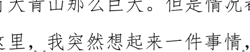

作者:蛇从草 日期:2014-02-25 21:24

@火线侦查 8199 楼 2014-02-23 20:27:00
希望蛇哥越写越好。

谢谢，我会努力的。

作者:蛇从草 日期:2014-02-25 21:26

@蛇从草 8005 楼 2014-02-22 17:50:00
大家多回帖啊，这个回帖的数量，我自己觉得有点不好意思的。
向各位拜舔了

# 一手理加微信1101284955 提取更多好帖

@phoenixnet 3186 楼 2014-02-23 17:38:00
潜水追踪的也有点不好意思了，出来冒泡。
先看的蛇城，然后是鬼事、翡翠帝国。我对疯子擅长的“算沙”特别有感觉，这是蛇兄自创的说法还有什么来理解？

算沙是五行算术的一种，最晚进入道家算术，只有蛊道能有人操作。来自于印度教的“恒河沙粒”一说。引入到原来的人是蛊道师道行。我会在《大宗师》里面详细的叙说。

作者:蛇从草 日期:2014-02-25 21:26

@ryy1331333 8180 楼 2014-02-23 16:33:00
顶起来。
应老蛇要求，坚决改正悄悄看帖的坏习惯。哈哈。感谢你哈，感激不尽。

作者:蛇从草 日期:2014-02-25 21:27

@寂寞西楚 8176 楼 2014-02-23 16:14:00
先帝魏武之子孙，如今庶为清门。
群雄割据今已矣，文采风流尚存。
三曹里面，我很喜欢曹操，意境的两个儿子要强很多。
一手处理，加微信112455获取更多好帖。

作者:蛇从草 日期:2014-02-25 21:28

@火线侦查 8202 楼 2014-02-23 20:32:00
蛇哥，给个反应啊，我翻页了。你可是一直无视我的。
茄子，合影一个。

作者:蛇从草 日期:2014-02-25 21:29

@花开霜相似 8296 楼 2014-02-24 04:43:00
难得老蛇开口拜帖，这个潜水党作为蛇哥的粉怎么也得留个帖了。
很难为情的，我知道现在在回帖烦了，需要验证码。因为我一直没有这个困扰，所以我前几天天才知道。谢谢你们，讨厌麻烦。

作者：蛇从草 日期:2014-02-25 21:30

@piaoyouyu 8277 楼 2014-02-24 00:28:00
看了八塞地狱之后开始追蛇的文，文章很有画面感，在等更新的同时把原来的文全看了，最喜欢异海。还好我前几天写了不错，等更新的时候，可以去看看。

作者：蛇从草 日期:2014-02-25 21:30

@一人头 8274 楼 2014-02-24 00:12:00
如果今年就上映，说明文章已经写完了。每天来整理，电影里的一部分，所以我还要继续写。

作者：蛇从草 日期:2014-02-25 21:31

@septiger 8265 楼 2014-02-23 24:02
茄子，这些人都消失了吗？老蛇的几部大作都了，也算是资深粉丝，求合影。

作者：蛇从草 日期:2014-02-25 21:32

@fengzheng80 8252 楼 2014-02-23 23:21:00
老沙总是看你的文，挺有限，惭一下，以后常顶！感激了。

作者：蛇从草 日期:2014-02-25 21:32

@处女座的陈小 8259 楼 2014-02-23 23:30:00
很好看，根本停不下。我看文还是挺的，本版还有很多，多数看不到就弃了。既然追到现在，上来吹个鼓励吧。好吧。

作者：蛇从草 日期:2014-02-25 21:33

# 一手数据加信1011284955，获取更多好帖

@娃爱妈妈 2013 8222 楼 2014-02-23 21:59:00
小说的里的人物，我也最喜欢这样吧，或许因为现实中像大大的人自己还没有呢。世界上这种单纯的人存在的。虽然他们过得很很微，但是心中一直挺着坚定的理想。

作者：蛇从草 日期:2014-02-25 21:35

@106793217 8237 楼 2014-02-23 22:27:00
大学时就看鬼事。话说大学在荆州的上的如今已毕业了，等他长大，感触颇深，书读用不多，也许还没用到吧。是啊，这个情绪纠结了我多年。

作者：蛇从草 日期:2014-02-25 21:35

@好马都被抢了 8243 楼 2014-02-23 22:56:00
抱着赵二站楼主求合。茄子，赵二，这么人都信了，我是不是要在《大宗师》里写一下他的经历历程啊。
一手处理，加V:101284955 获取更多好帖

作者：蛇从草 日期:2014-02-25 21:36

@川上明月 12204 楼 2014-02-24 20:37:00
老蛇一下不在原单位上班了？我13年初就辞职，做编剧了。

作者：蛇从草 日期:2014-02-25 21:36

@幻影青柠 8304 楼 2014-02-24 07:19:00
恭喜楼主电影成功，你每部作品我都很喜欢。感谢感谢。

作者：蛇从草 日期:2014-02-25 21:37

@娃娃爱妈妈 2013 8340 楼 2014-02-24 12:30:00
老蛇在《异海》里面对四维的那种描述也是到位的，既有平面又有立体，就是在那个黄金开关那里。我想老蛇真的是个全面人才。我是大刘的铁粉啊，哈哈。

作者：蛇从草 日期:2014-02-25 21:37

@声爻备 1018 8347 楼 2014-02-24 09:49:00
老蛇头发好顺有光泽啊。用的飘柔吧？哈哈。

# 一手数理，加信1011284955，获取更多好帖
我是刘的，哈哈。

@门派接人 8325 楼 2014-02-24 09:49:00
我以前看的时候，看到算沙里面有些特定的数字，表明着事件非常重要。算了，求蛇解释一下。

作者：蛇从草 日期:2014-02-25 21:40

@回复第734 楼 @蛇从草 704 楼 2014-02-13 00:30
今天没了。有点少，明天看能不能写多点。

@doudin123 8111 楼 2014-02-13 12:44
蛇哥，电影导演是谁？主角是谁？露透一下呗。是一个新导演。

@single1016 8445 楼 2014-02-24 23:57
我想问的是，虎符镇地下是不允许出现鬼神之类的情节，那小说还怎么拍？
# 一手理加信101284955，获取更多好帖
妥妥的安排。

作者：蛇从草 日期:2014-02-25 21:41

@回复第820 楼 @蛇从草
不好意思，今晚我和《密追踪》电影的制片人和一起讨论片的策划，等到很晚，所以没有更新。明天来写了。对不起各位。
http://img.laiba.cn/p/img17192.jpg

@回眸一一笑闲 8525 楼 2014-02-25 13:20
好多奖状，大部分是飞天哭响。

作者：蛇从草 日期:2014-02-25 22:35
这边偷悄知道了娇婉的身份，十分辖。并且知道了卸铃的三个兄弟，竟然和虎符地下耶利尼有莫大的关系。现在把事情的缘由梳理的差不多了，叫自己为符的人可能就是老任，也就是卸铃的背后者，他的目的已经明确，就是要唤醒地下的耶利尼和亲戚。至于娇婉的父亲，完全不知道他的行踪和立场。

刘所长开始想起当年木华建地下坟的事情。


虎符镇的地脉其实虎符的地葬，然后卸铃认定有一个镜面布局。卸铃从明代就开始对这个坟有了了解，认定有一个镜面布局，这个镜面布局，就是木华布置的。刘所长开始慢慢知道他的来去。

当年木华布置耶利尼，本意是留地下耶利尼的冢，并且布置了一个非常诡异的布局。布局叫做“镜面风水局”，所以一旦耶利尼被虎符唤醒，活来的并不是已经死掉的耶利尼和他的部下，而是另一个镜像世界的军队。当耶利尼自杀之前，立下重要复活，估计也是发现了虎符镇地下是可以安置这样一个布局的，最关键的就是那个半个虎符。一旦虎符符合，镜面布局，就开始耶利尼

优势和亲兵的镜像就全部出来。至于那些兔子兵，却是阴魂不散的僵尸，跟镜像布局没什么联系。

明朝衍兴，铜铃门派就一直想设付这个虎符镇的地下家伙，一方面是不惊六鳍锦鱼，一方面就是要看着这个镜像布局，挖掘入地都是近代的所为。在明朝两百年后，也想尽了办法。可惜了清朝，铜铃门派离开失所，另一半虎连也在运的过程中丢失了，不知所踪。

于是耶利尼的坟墓开始后松，共和国后，铜铃才有能力和资源用拮的蓝风水来压。但是时机已经错过。现在另一半虎符已经重天日，很有可能就在老任的手上。老是一个受了耶利尼镜像军队强大势力的诱惑，拼命的要处理。

加微信111284955，获取更多帖子。

> “你到底要我做什么？”喻伦听完刘所长说了这一段。

“老和大拿在地下已经进入了六鳍锦鱼内部。”刘所长说，“老找了开山在民间的一个支派，正在地下开隧道，这个你是知道的。”

“你让我帮你对付那一拨盗墓？”

“是的，”刘所长说，“你已经和他们打过交道了，你身上的蛊毒，就是他们人为。”

“看来我根本无法拒绝了。”

“是的。”刘所长说，“我现在不知道对方的底细，但绝不是你想象的那么简单，除了给你下，一定有更加厉害的人里面。开山的门派流已久，不是泛之辈。”

“你要怎么做？”神喻。

“现在地下已经在电脑上模拟出来。”刘所长说，“现在是我们在暗，我要把另一半虎符抢过来。虎符不可能在挖道手上，或是婉儿的父亲，他们不会把重要的东西交给手下。你忘了我的身份，”刘所长说，“我们和那盟加入我们的计划。”神喻笑着摇头，伸出手，“成交，我的条件是……我用门派的身份跟你交道，而不是警察。”刘所长挥了手，“我暂且不。”

明天来天津，喝酒。有机会一定来。

作者：蛇从草 日期:2014-02-26 00:32

@幻影青柠 8650 楼 2014-02-25 23:52
老沙主要做编剧真好，真心觉得国内编剧不多，连着谋子的电影讲不出故事，白瞎了那么好的功夫。希望有机会能跟浩他们合作。这种天赋是与生俱来的。楼主也说过在诺贝尔奖领奖礼上的发言，标题就是讲故事的人，很有感。一手整理。加微信：101284955领取更多帖。

----------------------------------楼主别让我失望了

http://img.laiba.cn/p/img17028973.jpg

宁浩新片《命运的邂逅》剧本创作的时候，和他见过面，要在剧本的打磨有多多的。他的成功不是偶然。

作者：蛇从草 日期:2014-02-26 01:35

蛇哥，顶帖不容易啊，上次给你留意了吗？天天都看到你的好文章。深夜了，求个什么呢？茄子。

作者：蛇从草 日期:2014-02-26 01:36

@我说我不想名字 8667 楼 2014-02-26 00:37
老蛇啊，密道的主演能露一下不像你比半年前瘦了啊。唐有文龙，母其弥雅，李渊。

作者：蛇从草 日期:2014-02-26 02:19

@糖醋皮蛋、8680 楼 2014-02-26 01:57
一手处理加微信1101284955获取更多帖子。楼层专属会员获取更多精彩更新。

大宗师是鬼事的最后一部，我要多思考。

作者：蛇从草 日期:2014-02-26 22:04

神喻坐直了身体，对刘所长说：“这就是对我开的条件？”

“你做了这么多年，也挣了不少钱，为什么不退休？”

刘所长。神喻看了看婉儿，婉儿也无表情。刘所长点头说：“这事情完结了，你自己离开，我们再也没有见面。”

神喻知道，这就是刘所长的承诺。神喻点头，示意答应。

刘所长走到伸榆前，让伸榆侧躺下，然后不知道什么时候，手里多了一个细细长的银针，银针的顶端是个小弯钩。银针非常柔软，在刘所长的手上微微颤动。伸榆一动不动，刘所长把银针慢慢的进了伸榆的耳洞里，然后慢慢的用手指动银针，这个过程很长，刘所长闭着眼睛，额上渗出汗液。非常小心。

一个脆弱的蛞蚣（多足昆）慢慢的被刘所用银针拉出了耳朵，蛞蚣的几十条腿在不停的动着，和刘所长的银针抗拒。刘所长并不焦急，只是一点的往外拉，还顺着力道拉出来。这种功夫，这种功夫不是木木蛇布置的。

妥妥的安排。

优势处理。加微信111284955，获取更多帖子。


顶蛇哥，不过镜像风应该是镜像已经有的东西，如果薛律和他的亲兵都死了，还会被召唤吗？

镜像世界里的人不会跟着死亡。他们的时间流逝的也很慢。也许在那个世界，薛律努力打了胜仗，取代了成吉思汗也未可知。

作者:蛇从草 日期:2014-02-27 16:20
@康彭爵 8872 楼 2014-02-27 09:56:00

@蛇从草：楼主高才，本土豪资500金铂表敬意，青山不改，绿水长流，助楼主再造高楼神话。我也要打赏一手整理，加v信1101284955，获取更多好帖。

感激不尽。
作者:蛇从草 日期:2014-02-27 16:20
@沧海明月 9111 楼 2014-02-27 08:58:00

@蛇从草：楼主高才，本土豪资100金铂表敬意，青山不改，绿水长流，助楼主再造高楼神话。【我也要打赏 】

感激不尽。
作者:蛇从草 日期:2014-02-27 16:21
@闲声云卧 8862 楼 2014-02-27 08:51:00

我是宜昌山人，你看的小里面写有我们那个地方的事，还有很多，年纪大的都知道，你的文章写的太好了，作为万年潜水派中的一员，看到你的文章，让我脱离这个组织，专门申请个帐号来看你的文章，还贴吧这么真的留言，哈哈哈哈第一次啊第一次。

《目行路必见鬼》，兴山的故事，我最好的中篇。

作者：蛇从草 日期：2014-02-27 16:22

@此方明姬 8906楼 2014-02-27 15:01:00

老蛇太厉害了，十分喜欢你的文章

# 一手数理，加信1101284955，获取更多好帖

萌萌的最好款

作者：蛇从草 日期：2014-02-27 16:22

@娃娃爱妈妈 2013 8853楼 2014-02-27 08:07:00

进行到这里，申偷的戏份应该加重了。但不知道经此一役，和他婉儿还有未来吗？

没有了。两人已经关系很明确了。

作者：蛇从草 日期：2014-02-27 16:23
@寂寂西楚 8903楼 2014-02-27 13:55:00

自在飞花轻如梦，无边丝雨细如愁。

挺好的诗啊。

作者:蛇从草 日期:2014-02-27 16:23
@Sjgmh 8905 楼 2014-02-27 14:49:00

蛇哥我也去看看那个太监文回来了。

猪头大拿听雷也写的很好。就是星浪没写完，看来看只有

作者:蛇从草 日期:2014-02-27 16:24
@盛夏r 8913 楼 2014-02-27 16:17:00

终于上来了，急死了我

# 一手整理，加微信11101284955，获取更多好帖

谢谢你，这么支持我啊。

作者:蛇从草 日期:2014-02-27 17:09
@回眸一笑闲声 8932 楼 2014-02-27 16:49:00

回复的人那么多，我只是其中一个。

老朋友了啊。

作者:蛇从草 日期:2014-02-27 22:34

一天之后，刘所长拿到了土样，神偷把几十份土样都倒在地板上，逐一查看，看到其中的一撮土之后，对着刘所长说：“就是这个，马上调查车牌。”

神喻解释，他能根据土采样分析出样本的年代和地质深度，这个土样本，很明显是从虎符镇的地下挖掘出来的。

剩下的事情就好办了，刘在立即通知交警方面，查到车主，果然车主就是虎符镇的人。名字叫大龙，庄大龙的行驶证和驾照很快传到妈儿的电脑上，照片一张出来，妈儿和神喻都苦，原来庄大龙就是半个月前在晚上到妈儿怀怀那个汉子。

现在都不用去跟踪车辆了，刘所长稍调查一下，查出庄大龙就是大家家菜馆的老板。刘所长要去抄接那个从湖南来的放血高手。所以查庄大龙的事情，就落到神喻和妈儿的身上。

一手处理，神喻和妈儿晚上，按下了按钮，黑色屏幕闪烁，两人操作熟练，配合默契，但是心态已经变化，各怀心思。

两人偷到了大家家常菜馆附近，看到大家家常菜馆里灯火通明，到了夜里两处都是这样，并没有人出来。神喻好奇，他们难道要去挖掘隧道？

到了凌晨五点，一辆土车缓慢开到了大家家常菜馆门口，然后菜馆里的人把门打开。神喻看见几个人不停的把一些袋装给土山上，一直装了两个小时，天亮的时候，土车离开，也没看见他们出去挖掘隧道。

妈儿看着大家家常菜馆里的灯灭掉之后，好奇的问神喻：

“他们为什么不去挖掘，而一整夜都在菜馆里。”

“事情想了很简单，”神伦说，“他们挖掘隧道的入口，就在大龙家常菜里面，刚才装上土方的麻袋，就是挖掘的土。”

作者：蛇从草 日期:2014-02-27 23:00
@ywzqzj.jw 8997 楼 2014-02-27 22:57

蛇哥是不是因为需要拍电影，把整个剧情都做了改变。原来的结局、大叔等描写就浅了，现在没这么多关系。有点接受了。感觉就像东西成就那个重阳，一开始突叉了，然后是不想的其他角色快乐了。

# 一手理 加如101284955 获取更多好帖

最近虽然被他们提到一点影响，但我还是想要这个设定，我会慢慢解释。作者:蛇从草 日期:2014-02-27 23:35
@abc 9005 楼 2014-02-27 23:31

老蛇，我承认跟它这个毛病并不好，但是在默默看了几年，今天我生日份上，合个影好？作者:蛇从草 日期:2014-02-27 23:41
@ywzqzj.jw 9000 楼 2014-02-27 23:05

蛇哥作品都看了，最新章节：鬼事中那个当。疯子被叫做老太婆尸体里把那个戒指取出后，那段太经典了。身临其境啊，也很欣赏蛇哥把一段故事讲全，让人去猜的手法是啊，墓地的故事彻底扭转我的写作思路，把短篇写成了。作者：蛇从草 日期:2014-02-27 23:42
@cat 8994楼 2014-02-27 22:50

蛇诡，看了你写到结局，不知道看过三叔写的星浪，里面写的似的就是这个结局，主角不断深入深渊又出现一个。不过三叔太了，竟然写了一章，竟然自己都没有留，最后物是我讨厌的。也是写到再写下了，无语了，不过还是喜欢他。蛇诡的作品看了这儿，还没看。还有文章写那个师不传男，为什么鬼事里还有他师傅都是男的？你写这个咨询一下……我对放蛊不是很了解，但是一般是女人，男人真多。作者：蛇从 日期：2014-02-27 23:43

今天有点耽误了，第二更会晚点。不好意思啊。作者：蛇从 日期：2014-02-27 23:43


@是胖 8990 楼 2014-02-27 22:28

蛇哥过来抱抱终于赶上你的脚步了茄子。作者:蛇从 日期:2014-02-27 23:43
@乱乱的小三 8976 楼 2014-02-27 21:39

蛇哥太辛苦了，马上到地方了~慢慢写~多谢理解啊。作者:蛇从 日期:2014-02-27 23:44
@骗桃 8977 楼 2014-02-27 21:39

# 一手处理 加微信:1101284955 获取更多好站哥, 茄子!!!。作者:蛇从 日期:2014-02-27 23:46
@青衣白菜 8983 楼 2014-02-27 22:11

蛇哥看到我茄子。作者:蛇从 日期:2014-02-27 23:47
@闹心人吧 8989 楼 2014-02-27 22:28

不能使劲顶贴，被发现就死定了沙发，拜拜茄子。作者:蛇从 日期:2014-02-27 23:47
@muwal123 8975 楼 2014-02-27 21:31

但行夜路必见鬼没找到这个帖子啊，在哪里？在宜昌鬼事里面，但是网上也能搜到单单。作者:蛇从 日期:2014-02-27 23:48
@Sjgmh 8905 楼 2014-02-27 14:49

# 一手理加信110128455，获取更多好帖

蛇从我也看到楼主回复了。@蛇从草 8923 楼 2014-02-27 16:23

猪头大拿听雷也写的很好。就是星浪没写完，看来只有我来写他没写的部分了。@新华宇 8972 楼 2014-02-27 21:19

老蛇会写星狼那个故事？很期待!!!那个故事的构思很不错，但那位楼主的风格总感觉痞子味太重。而老蛇的文风格恰恰是我喜欢的！希望写这篇用你的思路继续那个故事的延。

# 续......我就在密道里面写这个。作者：蛇从 日期：2014-02-27 23:49
@明月光2k 8949 楼 2014-02-27 19:06

看到了，呵呵，茄子。作者：蛇从 日期:2014-02-27 23:49
@abc 9005 楼 2014-02-27 23:31

老赵，我承认默默跟踪帖子这个毛病不好，但是在默默看了，跟莉莉，加我1101284955 让我好，生日快乐，茄子。作者：蛇从 日期:2014-02-27 23:49
@三色猫幼儿 8957 楼 2014-02-27 19:39

今天把蛇哥的作品介绍给朋友，跟她说我是前几年，现在都做剧了！居然说心里很，关注了好几年喔，眼光就是错过了遗憾吧！很得意的哈！哈哈哈哈。感谢你和朋友。作者：蛇从 日期:2014-02-27 23:50
@那时 9014 楼 2014-02-27 23:42

蛇锅一个影菇。作者：蛇从 日期:2014-02-27 23:50
@xwyang1970 9018 楼 2014-02-27 23:44

佛教用的符号，卍是标志。两个方向都行的。数字加V更多好帖。作者：蛇从 日期:2014-02-27 23:53
@幻影柠 9009 楼 2014-02-27 23:34

每日签到。感谢。作者：蛇从 日期:2014-02-27 23:54
@muwa123 8975 楼 2014-02-27 21:31

但行夜路见鬼没找到这个贴呀，在哪里？@蛇从 9022 楼 2014-02-27 23:47

在宜昌鬼事里面，但是网上也能搜到单本。@洋暖殷 9030 楼 2014-02-27 23:51

# ty_vip_look全家福

作者：蛇从 日期：2014-02-27 23:55
@yjj7523 9028 楼 2014-02-27 23:50

蛇兄弟你好！很有中国特色的文字，万物有灵的中华世界，超凡的想象力，放开视野，造就了一朵奇葩！我是蛇兄弟的第一批听众了，眼睛骚扰老姨电脑前，就心中热满。看的时候，时的文字才开了头，就觉得写得不错，就一直看着，太丑了，第一次觉得中国人的文化有很多不起，看完后，我还买了蛇灵上册，是邮购的，还有蛇签名。第一次冒泡，我不知道发帖的意义，对不起了，白看了......感激不尽啊。作者：蛇从 日期:2014-02-28 00:34

神偷和婉装模样的对话，实际上，两人早就来过的，对大龙家菜馆挖掘地道的时间和地道入口都了解清楚楚。他们的对话，是说给另一个人听的，一个刘所派来视的年轻人，这个人经常在刘所长身侧出现，一副精明能干的样子，看得出来是刘所长的得力助手之一。刘所长是个很大的人，但他身边的得力助手肯定不止一个，这次，来监视神偷的只有这个人，神偷霍到刘所长他还小才。潜藏的功夫很厉害，但神偷毕竟是个反监控高手，很快就知道了有人在监视，而且凭借人的肢体动作，很快就判断了这个身份。其实神偷知道，当前情况下，控住他的只有刘所长不是个天真的，不能那么快就信任自己。(img/0ac65463822fc7b19df48dc26d223d0_559_0.png)就不会让外人来监视。毕竟婉儿跟神偷跟了很久，想必这个就是刘所长不完全信任她的理由。两个人就像第一次来这里的，继续交谈着，神偷这时候对婉儿，不禁又抱了一点希望。因为婉儿在配合，而且主动配合，主动的挑起话题。神偷想：婉儿可能清楚刘所长做事的方式，所以刘所长并不完全信任她，所以才会进行一场表演。神偷已经知道，婉儿没有把他查探到大龙家常菜的事情告诉刘所长。否则，神偷故意折腾刘所长，让刘所长去调查方的的时候，刘所长就该插真相，然后狠责他一番。婉儿竟是抱着怎样的心思，隐瞒了这些事实，神喻不得得知，神喻毫不相信，婉儿是眼看他中蛊快要死了，才不得不去助刘所长。在这虎符镇上，除了刘所长，婉儿没有别的依靠。这样的解释，神喻没办法验证。婉儿的眼里，自从她拿出真实身份后，就一直冰冷的，跟他没有任何情绪。两人又交谈了一会儿，那个监视的小方仍然离开，神喻猜测这些人接到令，要跟着他们。于是神喻就轻声告诉婉儿：“根据刘所长的情报，老沙和王经理，安保已经打算下手，利用他们开路，但他们自己也有方案。”婉儿立刻点头，“可是什么时候下去？”神喻说：“等半个小时，等天亮。”根据上次的经验，他们白天施工到密道下，我们就有机会进入地下。”婉儿迟疑，轻声对神喻说：“不怕，这次不会放下你。”两人观察了一会儿，找机到达门口后，神偷回头望了，发现小方也偷偷跟上了。作者：蛇从 日期：2014-02-28 00:36

没了。作者：蛇从 日期：2014-02-28 16:53

作者：蛇从 日期：2014-02-28 16:32

顶贴！作者：蛇从 日期：2014-02-28 13:32

天天天天顶贴。作者：蛇从 日期：2014-02-28 16:54

这个ID……何能啊。作者：蛇从 日期:2014-02-28 16:54

# 一手处理，加信1101284955 获取更多好帖。作者：蛇从 日期：2014-02-28 21:26

没了。作者：蛇从草 日期：2014-02-28 21:26

蛇哥，这个ID，何能的啊。

我是宜昌山人，你看的小里面写有我们那个地方的事，还有很多，年纪大的都知道，你的文章写的太好了，作为万年潜水派中的一员，看到你的文章，让我脱离这个组织，专门申请个账号来看你的文章，还贴吧这么真的留言，哈哈哈哈第一次啊第一次。看到，看到你的文章，让我脱离这个组织，专门申请个账号来看你的文章，还贴吧这么真的留言，哈哈哈哈第一次啊第一次。作者：蛇从 日期:2014-02-27 16:21

《旧行路必见鬼》，兴山的故事，最好的中篇。

# 一手数理加110128495 获取更多好帖

作者：蛇从 日期：2014-02-28 13:14

兴山哪的建设。作者:蛇从 日期:2014-02-28 15:55

看了老蛇好几年了，从宜昌鬼事就开始觉得说故事的能力是非常厉害的，代入感非常强。从兼职到专职真是的一大改变，很羡慕这种能把爱好当业的人，也祝贺老蛇，以后大红大紫了别忘了天涯上的帖。天涯的感觉挺好的，还没有离开。作者：蛇丛 日期:2014-02-28 15:56

喜欢蛇哥，期待大师呀。我自己也很很期待。期待大师，我是万年潜水党，天涯第一次贴子留你了，老蛇~从鬼事1 开始 一路追你的贴等到现在非常喜欢赵一二。谢谢谢谢。作者：蛇丛 日期:2014-02-28 20:27


好看好贴 110 9133 楼 2014-02-28 18:58:00

潜水了这么久，默默的看着，终于赶上追剧了，嘻嘻。加油啊，楼主，电影一定回去看的。加油楼主，你好你，加油留着...举报 回复 收藏9123楼 作者：马甲肯八莉 2012 来自自：iPhone 客户端 时间：2014-02-28 17:19:00


答，“这地方我来过，我能记得方位，就跟着我摸黑走路就行。”

神偷拿着姚儿的手，在黑暗中慢慢索索行，走了几分钟，姚儿能感觉到这段通道是斜斜向下，方向却是笔直的。神偷心中计算着距离，姚儿却在计算坡度。

“我们现在距离地面有三十米了。”姚儿在黑暗中提醒。

“再走七步，隧道就向右弯。”神偷说。然后两人走了七步之后，神偷哼了一声。姚儿：“怎么了？”

“这里本来应该是个转角，”神偷把姚儿的手拉提到面前，“可是现在墙上了。”

姚儿用手去摸，果然手是一片冰凉的墙壁。
姚儿整理了一句：“可能是堵了，为获取更多帖……”

神偷顺着墙壁移动身体，“我记反了，应该是向左。通道在左边。”

姚儿和神偷继续前行，姚儿说：“老索说你记忆力下降，是不是真的？”

“为什么这么？”

“记住方位是你最擅长的能力，”姚儿说，“为什么你连这个最基本能力都没有了。”

“可能是蓝毒的关系吧，”神偷说，“你也看到刘所长从我耳朵掏出来的那个蜘蛛。”

两人走了十几分钟，神偷脚步放慢，姚儿：“又到了”

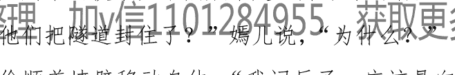

转角的地方？”

“是的。”神喻优豫着摸索一下，带着姚儿向右旋转前行。

“你原本的记忆是在左边吧。”姚儿问，“不然你不会先去的。”

“是的。”神喻说，“难道我真的错了吗？”

“你没有错，”姚儿说，“应该是这里的方位自己就变了。”

“他们不可能重新挖掘的，”神喻说，“这么大的工程，时间也不够。”

“我没明白我的意思，”姚儿说，“镜像布局，你忘记了什么样的地步了！”

“如果真的这样，”神喻声音沉默起来，“他们究竟做到……”

作者：蛇从草 日期：2014-02-28 22:01

@巴宾斯基 9150 楼 2014-02-28 21:45:00
卸岭派也是实心眼，既然能建起一整座钢厂，就没想过把兔子炼进钢炉炼一炼。

虎符在明末初的时候就失散了。

作者：蛇从草 日期：2014-02-28 22:53

@ws 平常心 9166 楼 2014-02-28 22:29:00

不是说点了楼主，楼主就看得到？怎么就没回呢？感觉楼主是有针对性的回的！失望！

平常心兄弟，应该是@蛇从草，而不是楼主吧。
作者：蛇从草 日期：2014-02-28 23:34

神偷不再再摸黑了，把手拿出来照亮四周的环境，“墙上铺设的电线……。本来是左边，现在在右边了。”

“可能他们换了线路。”姚儿说：

“这个有必要吗？”神偷说完，和姚儿同时沉默。他们已经隐隐地知道在这个地下发生了什么，就是刘所长提到过的镜像布局。能够复制的布局，既然是镜像，那么物体就会发生镜像，可复制的，但是完全不完全。

神偷对姚儿说：“我上次来的时候，第三个转角是向右的。”

姚儿明白神偷的意思，示意两人不要在讨论这些无谓的事情，继续往前走，不再浪费时间。然而走到下一个转角，方向朝右。

第三个转角走之后，就走了上次神偷遇到对方的位置，但是现在一个人都没有。前面的隧道继续向地下。又走了几米，发现坑洞的支撑越来越密集，而且十分简单，有的地方就是用了几根木方把上面的石头顶住。很多地方都有塌方的痕迹。

姚儿说：“他们在这这么短的时间，能够挖掘出这条隧道，出去那么多土方，真的是非一般。”

“刘所长说了他们的门派可能是开山，开山有个说法是开山士，移山填海是他们的看家本领，”神喻说，“这个并不意外。”

神喻把围墙上的泥土捏在手上一点，放在鼻子上嗅了嗅一下，然后说：“已经和发现的深度平齐了。而且这些土是新挖的，他们非常接近目的，也就是六蟒锦鲤鱼的地方。”说完后，神喻把手电关闭，慢慢的向前走。前方又有了一点光线，而且叮叮当当的敲击声，两人停下来，仔细仔细听一会，姚儿压低声音：“七个个人。”

两人屏住呼吸，向光源靠近。当他们靠近了光源的时候，眼前的景象让他们吃了一惊。这里是一个巨大的空间，至少有一个平方的空间，但是空间并非空荡的，而是有一个巨大的石块，占据了九成以上的部分，实际上这个石块上方相隔不到米，空间下方和石块之间的部分并不宽。无数泥土和石屑落在地上。八个人分别在石块上不同的部位，用手中的铁锤和凿子敲击石块。神喻和姚儿下身慢慢靠近，现在能看到石块的大致轮廓了。石块是倾斜的方向，下方的嵌入在泥土中，越越圆。

“他们是在雕刻什么？”姚儿说。

神喻说话，继续看了一会儿，对姚儿说：“他们不是在雕刻东西，你看这个巨大的石块，像什么？”

“一个圆，难道是个罗盘？”

“眼睛。”神喻轻声地说，“是真的，而且没有死掉，他们现在慢慢的眼睛上的泥土敲下来。这个巨大石块，就是眼睛。”

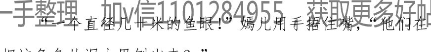

“把这条鱼从泥里抠出来？”姚儿用手指拨开。

“我们只需要挖眼睛就行，”神喻说，“一旦看见就会完全苏醒，并且发力。”神喻说完，石块变了两下，上面的泥土纷纷掉落，工作的石匠纷纷跳下来，哪里喊着：“又动了，又动了……”

作者：蛇从草 日期：2014-02-28 23:34

今天没了。
作者：蛇从草 日期：2014-02-28 23:36

@myc 9174 楼 2014-02-28 23:06:00
我是从九年一直追到现在的，蛇哥越来越牛，蛇哥你是老乡的，本家。
作者：蛇从草 日期：2014-02-28 23:37

@yj7523 9175 楼 2014-02-28 23:08:00
每天等着听，真有趣，好像还在学生时代，每天晚上躺在卧室的床上，就是学生时代呀。
作者：蛇从草 日期：2014-02-28 23:38

回复第865楼，@蛇从草
幻影青柠8650 楼 2014-02-25 23:00
要做编剧真好，真心觉得国内编剧不多，连老子也讲不出好事情，糟了他那么好的底子。编剧也越来越没头，只有宁浩还能给我惊喜了。希望楼主有机会跟宁浩合作。楼主也会讲故事的人，这种天赋是与生来的吧。看过莫言在诺贝尔奖领典礼上的发言吗，标题就是故事的人，很动。看楼主八疯子赵一二，也让我感动。

{IMAGE}http%3A%2F%2Fimg3.laibafile.cn%2Fp%2Fm%2F17028973.jpg{IMAGE}

宁浩新片《亡命的邂》剧本创作的时候，我他看到了一部电影出来，他在剧本的打磨有多么的仔细。他的成功不是偶然。

@逸风问道 9180 楼 2014-02-28 23:21:00
才发现哥哥有兔，哈哈哈哈

# 一手整理，加v信10128455，获取更多帖

虎牙！
作者：蛇从草 日期：2014-02-28 23:38

@zywc945 9179 楼 2014-02-28 23:21:00
支持一下，觉得老沙这个角色的特点没有之前的故事那么鲜明，不过蛇哥的每个故事都让人想要，以前只有大贼王能与鬼事并论，如今感觉没有哪个故事有吸引力了，万年潜水党一次吐槽足够了。期待大宗师，期待疯子的蜕变过程。

鬼事系列人物上的功夫比较多。密和异海一样，表现故事和设定。
作者：蛇从草 日期：2014-02-28 23:39

@笑小游 9186 楼 2014-02-28 23:28:00
终于赶上大部队了……真是太精彩了，对于宜昌鬼事，到异海，蛇城，一直在追楼主的大作，希望老蛇能有更多的作品，感谢支持啊。
作者：蛇从草 日期：2014-03-01 11:04

@duyingyong 9224 楼 2014-03-01 06:41:00

# 一手资料，加微信101284955获取更多帖

原本不属于异海的原因，我感觉是因为这被一个叫做“灵魂”的东西占卜啦，没有被占股的“人”就是现在最原始的猎狸，那时候的猎狸和现在的猎狸没有区别，但是偏被这个叫做“灵魂”选中了，猎狸和灵魂在战斗中战斗，最后还是被灵胜利了，猎狸被同化了，形成了现在的“人”，但是灵魂却没，因为“人”同时在心里不停地抗击灵魂，导致现在的“人”从心里很害怕灵魂，灵魂被噬成了可怕的妖怪。异海是科幻，构思的时候，绝对不会向方面考虑。所以你的提议，不知道怎么回答。
作者：蛇从草 日期：2014-03-01 11:06

@蛇从草 9188 楼 2014-02-28 23:34
今天没了。
@wfshg 9196 楼 2014-02-28 23:42:00
潜水看老蛇的作品也有两年了吧？好作品，都是，嗯，顶。
作者：蛇从草 日期：2014-03-01 11:06

@Oppressor1981 9194 楼 2014-02-28 23:39:00
感谢支持！老蛇：你关注吗？关注101284955，获取更多帖

建立，认同。之中的文明与权力的不同。在最近的一次行动中，老任可以提供大量装备只能自己服务，表明老任背后的政治势力已经失势！而老刘可以挂职就接管。正解。
作者：蛇从草 日期：2014-03-01 11:07

@ws平常心 9201 楼 2014-03-01 00:00
回复第970楼（）
@ws平常心 9166 楼 2014-02-28 22:29:00
不是点了楼主，楼主就看得到？怎么就没回呢？感觉楼主是有针对性的回的！失望！

平常心兄弟，应该是@蛇从草，而不是楼主吧。
作者：蛇从草 日期：2014-02-28 23:34

不是楼主？不是座？不是楼主？不是座？另外我是主理101284955，获取更多帖。讨厌。老哥要娶最怕。通用的。
@j7523 9226 楼 2014-03-01 07:35:00
这种感觉，虚无。
@苦行炎黄9230 楼 2014-03-01 07:59:00
也是鬼事开始起的，几年了，好快。说实话，不太满意，感觉情节不够紧张，讨论太多。最喜欢的当然是鬼事。
作者：蛇从草 日期：2014-03-01 11:10

都非常精彩，还有！！感谢一直来的。
作者：蛇从草 日期：2014-03-01 20:18

@无我无他9307 楼 2014-03-01 20:10:00
问个问题，既然这个故事要拍了，而且在拍，肯定是完成了吧，不然怎么拍？电影是截取其中一段拍摄的。
作者：蛇从草 日期：2014-03-01 20:56

这种处理，获取更多帖。
@智慧演绎无限9315 楼 2014-03-01 20:55:00
好几天了，还木更啊？看来该放弃了!!!!!我每天都在写啊。
作者：蛇从草 日期：2014-03-01 21:49

石头开始蠕动起来，在非常缓慢的移动，不应该是转动。石头之间相互摩擦的声音听来十分的刺耳。转动。

神喻和姚儿不知道他们在晶面上看到了什么，但是他们

举动已经让神偷和姚儿觉得十分的恐惧。两人站立了一会，姚儿终于点点头，和神喻走到石块的下面，向方的晶面爬，他们看看石匠到底看到了什么，导致他们如此害怕。
作者：蛇从丛 日期：2014-03-01 21:49

@wenwen不听话9323 楼 2014-03-01 21:45:00
焉吗。求影视圈签名留影。茄子：
作者：蛇从丛 日期：2014-03-01 23:02

一王处理了。

神偷和姚儿爬上了石块，发现这个鱼眼，就是一个非常巨大的蓝色的水晶，表面十分光滑，又如琉璃。越往中间，浅蓝色浸底的鱼眼。就是鱼眼睛的色彩。

两人顾刚才石匠们的动作，坐下来，低头看着水晶，看到底是什么原因，呆后石匠飞速离开。

神偷和姚儿靠得很近，两人同时蹲下，把脸看向身下的晶面鱼眼，蓝色水晶十分透明，里面映出了一些模糊的影子，影子越越清晰，神偷和姚儿看清楚了，晶面的内部是在显现影像。他们好奇到底是什么影像让石匠惊慌失去。然后看见里面的影像已经分辨清楚了，有两个人影，这两个，正从水晶里面慢慢的从远处向神偷和姚儿靠近。到了神偷和姚儿非常近的时候，慢慢蹲下来，把脸靠近晶面。两个相对，中间了一个晶面。

神喻和姚儿终于看清里面的人模样了，是的，就是自己。神偷的第一反应是站起来跑开，但是神喻一把抓住了姚儿，重新审视晶面后面的人。没有任何幸运，晶面后面的人就是自己的模样。可是晶面是镜子，为什么动作和他们不同。这就是神喻和姚儿震惊的原因！他们互相看了一眼，再把自己的方向。神喻隔了很久，终于鼓起勇气：“你们是谁？”神喻和一样的男人隔了一会儿，嘴巴动，声音是无法透过过去的。姚儿在惊讶的情况下，把自己的嘴巴捂住，姚儿也做出了同样的动作，姚儿用的左手，姚儿也做出了双手。神喻把手伸出来，慢慢贴上晶面，晶面内的姚儿也做出了巨大的手贴到晶面内，对应起


两个人的表情一样。他们流露出迷茫。神喻突然看到对方身后冲出来一个人，那个人站在晶面内，神喻和姚儿的身后，现在清楚了，那是一个中年人。神喻忍不住回头，看了那个中年人，晶面内的姚儿开始哭起来。晶面内的人突然多了，把里面的神喻给死死的压住。

“快跑，我们危险了。”神喻说，“对面的时间。“那个人是我父亲，”姚儿喊，“我不走，我要等着他。“你看！”神喻指着晶面，晶面内的姚儿已经被手枪击毙，姚儿正在挣扎叫，开枪的人也是一个中年人，他是一个老者。晶面外的姚儿同时惊讶了。神喻也顾上许多，已经听见坑洞里传来纷乱的脚步声。他抱起姚儿，快跑向碎石的另一侧，他刚才就已经发现，那一侧有一个小暗影，应该是一个通道。神喻拉着姚儿跑到暗影的地方，发现的确有一个缝隙，缝隙不是人为的，两边都是坚硬的石头。神喻把姚儿推进缝隙，“快跑！”勉往里面进去。“你们千万别！”神喻身后传来一个人的声音，可是神喻已经顾许多，跟着姚儿钻进缝隙。缝隙狭窄，好不容易通过，两人一前一后，拼命向内行走。在黑暗里走了很久，后面都没有上来。神喻暂时想明白为什么这样。五分钟之后，他明白，但是回不去。
作者：蛇从草 日期：2014-03-01 23:03

@ghcctvl9336 楼 2014-03-01 22:29:00

# 一手抓取，获取好帖

茄子：
作者：蛇从草 日期：2014-03-01 23:03

今天没了。
作者：蛇从草 日期：2014-03-01 23:04

@逃逸骗桃9342 楼 2014-03-01 22:55:00

到了精彩的时候了！忍者，加油！其实是我见过的最有品的天涯人了！不多，多年的坚持就是最好的见证！多谢理解啊。
作者：蛇从草 日期：2014-03-02 17:22

@巴宾斯基 9360 楼 2014-03-02 00:06:00

老蛇总是喜欢弄条大鱼在地下

日本人是鲤鱼，然后就地震

中国怎么能说得弄龙吧

再说了，鲤鱼翻身，也算不得哈大，最多死几百万吧

有伟人的地方，乌克兰、柬埔寨、朝鲜，谁没死过几万人？中国58-61都死了3000万，还不跟玩似的

不是我喜欢弄条鱼在地下，而是只有鱼类能够在地下长-

# 王慧理。加信101284955获取更多帖

时间：2014-03-02 14:58

作者：蛇草 日期：2014-03-02 17:23

@巴宾斯基 9419 楼 2014-03-02 14:01:00

部分起源源于契丹族，出自辽国时期人皇王耶律·倍之子耶律·宣，属于避难改姓为氏。人皇王，是辽太祖耶律·阿保基之长子耶律·宣。辽天显元年（926年），辽太祖灭渤海，在其地上重建东丹国，人皇王吕朝。太宗耶律·德


九十年代初，看过一个报道，说是山西一个地方的村子井，打了很深，结果发现下面有一条巨大的鱼，鲤鱼，靠地下水活下来的，年龄很大。

作者:蛇从 日:2014-03-02 20:31
@佳爱妈妈9348楼 2014-03-02 20:25:00
又长见识，原来鱼类可以在地下活活这么长时间的。

是啊，还有一个奇闻，以前的筒子楼，没有厕所，所以地下水道只连接厨房，而且不粗。一天水道堵了，修理工开启了水道的管子，发现是一条鱼卡在里面。估计是有人买了鱼，小鱼跳到水道里，然后靠拉垃圾生存下来，结果越王美理管子接上了。这是真的的事实，获取更多帖。

作者:蛇从 日期:2014-03-02 21:26
@猫 9451楼 2014-03-02 20:50:00
蛇蟒，麻烦你给我宣昌鬼事的网址嘛，网上的都是乱七八糟的文章。

其实我就住在莲莲里面，是我的成名作。

作者:蛇从 日期:2014-03-02 21:49

神偷和婉儿继续在缝隙行走，神偷突然发现，缝隙在身后突然合拢，无法回回，只能继续向前探索。一段距离之后，缝隙走完，两人来到了一个宽敞的石厅。石厅收拾的干净净，一块巨大的水晶在石厅里，湛色透明的水晶。和刚才那个空间里的石块是一样的大。

“大鲤的另一个眼睛。”妈儿知道神喻也能看明白，但还是忍不住说了。

神喻拉着嫣儿慢慢走到水晶前，他很害怕出现跟刚才一样的情形，看到水晶里有人，但是这个水晶里面什么都没有，只有深邃的蓝色，幽幽看不底。神喻和嫣儿两人确定这个水晶里绝不会有人出现，心中一块石头落地。

“刚才那个缝隙？”嫣儿指了指他们的来路，现在变成了一面石壁，只留下了一道长长的缝。

“可能是两个鱼眼之间的鱼缝隙吧。”神喻推测，“鱼手眼睛加上眼睛，就能收获很多贴纸就是你父亲或者是你爸爸知道的事情。”

“你的意思是，”妈儿说，“他们来到这里。”

“莉莉疑惑的，”神喻说，“这只鱼眼就是他们给的，现在的他们正在露出另一只眼睛。”

“镜子里的，我父亲和你被叔叔给杀了了……”

“镜子里的世界并不和我们同步，很多事情都扭曲了。”

神喻知道嫣儿在担心什么，“内外的事情是可以为改变的。”

“这条鱼……”妈儿说，“我听说过双鱼玉佩，原来并不是什么首饰，而是的一条鱼。”

“这条大鲤，同时身处镜像世界的两边。”神喻说，“这就是虎镇地下的巨大秘密。”

“刚才我也听到了，”婉儿说，“任叔叔在后面叫我们不要进来。”

“你认识老任？”

“是的，”婉儿说，“我小时候见过他……也见过刘叔叔。”

“他叫我们不要进来，不得是在担心我们的安全。”神喻宽慰婉儿。”

“但如此，”婉儿说，“如果这个鱼不是镜像的相反，它会是一个什么作用呢，不可能是没有道理的。”

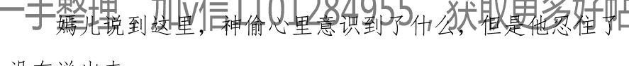

没有说出来。

“你不用担心听到我，”婉儿说，“虎镇出了那么多古怪的事情，我听你和老沙都讲过，那些古怪的绝不是凭空出来的。”

“他们就是凭空出来的……”

作者:蛇从草 日期:2014-03-02 22:25

“你到底想什么？”婉儿警起来，把神喻的胳膊搂住。

“如果另一个眼睛，只能显现影像。”神喻慢慢的说，

“那另一个眼睛，可能就是把不该出现在我们世界的东西放出来。”

“我们被所长误导了，可能他不清楚实际情况，”神喻瑜，“我把所有的事情都将一遍，可能会牵扯到你的父亲。”

嫣儿说：“你说吧，我一直知道当初我爸爸和任叔兜底发生了什么事情。”神喻瑜

“那就先说老任吧。”神喻瑜，“刘所长说的卸铃的事情，你一定是很早知道了，因为卸铃的门派是代延续的，所以你也是卸铃的人。”

嫣儿点点头。

“卸铃一派有一个最根本的延续，那就是门派只接收汉族，”神喻瑜，“可能这个规定是在南北朝定下的。”

“你有没有想过，”神喻瑜，“卸铃会吸收不是汉族的人？”

“这是可能的，”嫣儿说，“卸铃的派很注重血缘，如果有新的门人，一定会调查对方的家事，甚至连一起复姓的人都不会接受，除了司马司端这种姓氏。”

“那倒也是，复性的来源多半来自异族，中国古老的复姓现在也很少了，”神喻瑜，“但是我现在明白了一点，你们卸铃有了叛徒，那个叛徒之所以要在虎符镇弄出这么多事情，一定和当年的律律乞旁有关有关，可能他就是律律乞旁的后裔。”

“这怎么可能！”妈儿说，“我父亲姓穆，这是汉姓，我们有族谱的。”

“老任，”神伦说，“辽国灭国之后，有一支契丹部落从西域搬回了中原，在明朝后靠了朝廷，他们的姓改成了任。”

“任叔叔是契丹后裔，辽国部落的客人……”妈儿震惊，“怪不得他要到虎符镇来。”

“卸铃君门人很严格，他一定是付出了很大的代价，才进入卸铃，”神伦说，“我在把事情从一说一遍。”

当年律师云之所以因为那一方虎符拿不到，兵败自杀，并下葬虎符，一旦草葬，就会复活。可以肯定的，他是坚信虎符是钥匙，可以获取好多东西。他的鱼链链接镜像世界和我们世界的通道，但是律师云却不知道，他是从死亡的士兵复活，得出的结论。其实活的并不是士兵，而是镜像世界带来的镜像。他是古人，不可能理解镜像的概念。他也有本事，发现了控制六鲨鱼的办法，他把这个办法用来融入虎符，但是虎符只有一半，唤醒了六鲨鱼，他能做的就是让虎符符合，召唤出镜像世界的自己和。时间过了这么久，卸铃伦的另一半，也失散。老任的。

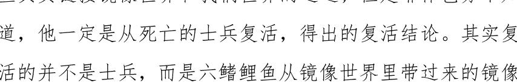

没有忘记的事情，终于老任获得了机会，进入到你们的门派。所以我确信，另一半虎符，当年老任的祖先夺走了，等待这个机会。老任带着虎符，和你父亲老稳，在多年前进入到虎镇。于是他们失踪了。能够肯定，老任的目的已经达到，原因就是你父亲制止了他。所以长，老任非常顺利，已经把两个眼睛都创造了。

“等等，”妈儿说，“你的意思？”

“你的父亲可能已经死了，”神喻想了又说，“还有……”

“刚才的叔叔，可能是镜像世界的人？”神偷的脸色突然变了，他慢慢用手轻微动，示意妈儿不要动。妈儿却汗了，知道身后有危险。神偷看到，是水晶发出了耀眼的光，一个穿铠甲的士兵，慢慢从水晶里走出来，眸光，一脸杀气。神偷又把那句话说了一遍，“他们就是凭空出来的。”作者:蛇从 日期:2014-03-02 22:25

没了。作者:蛇从 日期:2014-03-02 22:26

@农哥 9460楼 2014-03-02 22:06:06

很近了~和老蛇虽然被老蛇无视看见你了，哈哈。作者:蛇从 日期:2014-03-02 22:45

@myc4 9474楼 2014-03-02 23:37:00

蛇哥，我就是油田的，你在油田上的高中吗？我在沙上的高中。作者:蛇从 日期:2014-03-02 23:04

@yj7523 9489楼 2014-03-02 22:58:00

大鱼为什么会配合的让律遵守风水呢？难道是相互利用的结果？其实律遵守专柜，南联葬地占好占是一种复杂的关系吗？关键还是谁发现的秘密多，能力更高，是吗？我后面慢慢说。我讲故事不喜欢字都完了喽，那没劲啊。作者:蛇从 日期:2014-03-03 09:15

回复第9479楼 (作者):@媛似雪 于 2014-03-02 22:49

啊!!!又见老蛇！好激动！滚滚求合~~~

[来自 QQ 浏览器]

==

茄子，谢谢支持!!作者:蛇从 日期:2014-03-03 19:34

@君五名 9515楼 2014-03-03 04:00:00

为了看这篇文章，特意注册了一个号，君五名，哈哈，原本想注册名的，结果已有人抢先。连夜追，总算追上大部队了，我在天涯等久了，今天第一次帖，唉，又人生的一个第一次！

不妥当啊作者:蛇从 编号:2014-03-03 19:34

@阿庆是个瓜 9569楼 2014-03-03 16:37:00

因为故事是通过老沙叙述，知道主角不会死，比较好奇其他人物的结局，老蛇加油。

--------------------------------

如果老蛇死了呢？作者:蛇从 日期:2014-03-03 19:35

@麦做的纸包鸡 9530楼 2014-03-03 09:33:00

千年潜水员出来来顶顶蛇哥，我可是从《宜昌鬼事》一路过来的，求茄子！

--------------------------------

茄子作者：蛇从 日期:2014-03-03 19:35

@阿庆是个瓜 9571楼 2014-03-03 16:42:00

不知道是不是小说中所有的角色都会在电影里有所体现，期待电影的上映。角色基本会会，情节是截取的一部分。作者：蛇从 日期:2014-03-03 19:36

回复第9429楼 @蛇从

@巴宾斯基 9360楼 2014-03-02 06:06:00

老鼠总是喜欢养条大鱼在地下。中国怎么说也，还不跟鱼玩的。不是我喜欢养鱼在地下，而是只有鱼类能够在地下活下来的中原地区，在八十年代，挖掘地下的大鱼，就有报道了。@阿韵一笑9497楼 2014-03-02 23:16

很大。作者:蛇从 日期:2014-03-03 21:50

---

“你有没有想过，”神喻瑜，“卸铃会吸收不是汉族的人？”“这是可能的，”嫣儿说，“卸铃的派很注重血缘，如果有新的门人，一定会调查对方的家事，甚至连一起复姓的人都不会接受，除了司马司端这种姓氏。”“那倒也是，复性的来源多半来自异族，中国古老的复姓现在也很少了，”神喻瑜，“但是我现在明白了一点，你们卸铃有了叛徒，那个叛徒之所以要在虎符镇弄出这么多事情，一定和当年的律律乞旁有关有关，可能他就是律律乞旁的后裔。”

“这怎么可能！”妈儿说，“我父亲姓穆，这是汉姓，我们有族谱的。”“老任，”神伦说，“辽国灭国之后，有一支契丹部落从西域搬回了中原，在明朝后靠了朝廷，他们的姓改成了任。“任叔叔是契丹后裔，辽国部落的客人……”妈儿震惊，“怪不得他要到虎符镇来。”“卸铃君门人很严格，他一定是付出了很大的代价，才进入卸铃，”神伦说，“我在把事情从一说一遍。”

当年律师云之所以因为那一方虎符拿不到，兵败自杀，并下葬虎符，一旦草葬，就会复活。可以肯定的，他是坚信虎符是钥匙，可以获取好多东西。他的鱼链链接镜像世界和我们世界的通道，但是律师云却不知道，他是从死亡的士兵复活，得出的结论。其实活的并不是士兵，而是镜像世界带来的镜像。他是古人，不可能理解镜像的概念。他也有本事，发现了控制六鲨鱼的办法，他把这个办法用来融入虎符，但是虎符只有一半，唤醒了六鲨鱼，他能做的让虎符符合，召唤出镜像世界的自己和。时间过了这么久，卸铃伦的另一半，也失散。老任的。


（此处省略了由于OCR重复的重复描述：石厅收拾的干净净，一块巨大的水晶在石厅里，湛色透明的水晶...”


茄子。

@抱阳寻蝉 2014 9621 楼 2014-03-03 22:00:00

谢谢！现在转职业作家已经了吗？

做编剧了。

作者：蛇从草 日期:2014-03-04 11:25

妥妥的沙发。

作者：蛇从草 日期:2014-03-04 11:25

沙发

作者：蛇从草 日期:2014-03-04 13:17


@老爱香 07122 楼 2014-03-04 12:40:00

老蛇白天天写什么？

剧本？能透露下会拍摄影视作品吗？

什么类型的？

现在就是在给影视写剧本啊。

作者：蛇从草 日期:2014-03-04 19:23

@明月光 2k 9788 楼 2014-03-04 19:06:00

老蛇会成为一个顶尖的编剧。

谢谢你吉言响。

作者：蛇从 日期:2014-03-04 19:23

@青青你妹的子衿 9767 楼 2014-03-04 17:37:00

原来是老夜的留死亡记录！不是以前蛇推荐的啊！

不是，类似的设定，我喜欢的是《星痕》。

作者：蛇从 日期:2014-03-04 19:24

@青青你妹的子衿 9766 楼 2014-03-04 17:31:00

以前看过一篇，忘记什么名字了，就是有一个隧道，
从一头慢慢向另一一头那边的景象和这边完全一样。
感觉好像她写的这种镜格布局。不知道蛇有木看过那篇，
像开头讲的是一个组织毁了大批的“太岁”装进去可
一并处理，加v信1101284955，获取更多好帖

我没看过。

作者：蛇从 日期:2014-03-04 19:25:00

@杨杨是甩 9763 楼 2014-03-04 17:16:00

我现在想的就是这个镜头要怎么拍，这个镜头要怎么
么拍，这个镜头要怎么拍，这个镜头要怎么拍，这个镜头要
怎么拍，这个镜头要怎么拍，这个镜头要怎么拍，这个镜头
头要怎么拍，这个镜头要怎么拍，这个镜头要怎么拍，这个镜
头要怎么拍，这个镜头要怎么拍，这个镜头要怎么拍，这个镜
头要怎么拍，这个镜头要怎么拍，这个镜头要怎么拍，这个镜
头要怎么拍，这个镜头要怎么拍，这个镜头要怎么拍，这

镜头要怎么拍，这个镜头要怎么拍....

这是要和摄影师抢饭吃。。
作者:蛇从 日期:2014-03-04 19:26

@娃娃宝宝妈妈 2013 9730 楼 2014-03-04 14:28:00

老沙大拿和偷神哑会不会很快就在地底下面的了？
感觉只要打破那个“镜子”就可以了。

他们还在现实的世界里眯啊。
作者：蛇从 日期:2014-03-05 01:09

今天有事插砸了，更新会很慢，对不起大家，大家明天再整理，加v信1101284955，获取更多好帖

作者：蛇从 日期:2014-03-05 02:10

老沙说这句话，自己也吓了一跳，但是除了做这样的
结论，他实实在在想不到更好的原因。在这种地下，他早明白，其实任何事情都是没有办法得到的解释的，但是如果一件事，
真的没有了任何逻辑，他会觉得接受不了。任何事情都应该
该有个解释，就算是以自己的自己的方式来理解，也不至于陷入那
种种事情完全失控的焦虑情绪里。
不过大拿似乎完全没有这个焦虑，老沙发现他听到自己
的说法后，竟然点了点头，这表明他接受了这种观点。
大拿抬起头，死死的盯着那三个角眼的年轻人，因为三

眼又开始移动了，他朝着穹顶的位置挪动过去，在那个中心位置上，竟然出现了一个圆形的洞口，三角眼应该是预料到那个洞口会出现在那里，所以朝那里挪动，他害怕老沙和大捏，想离开这里进行躲避。

“怎么会出现洞口！”大捏问问老沙。

老沙也觉得莫名其妙，他记得很清楚，这个洞口之前是不存在的，可是三角眼并没有打开任何机关，只是身体朝那里移动，这个洞口就出来了，老沙明白，洞口出来的速度非常快，几乎是一眨眼的就出现，他和大捏都没得及看清。

睁睁的看着三角眼，进了洞口，然后洞口关闭，山体依然如初，就像根本没有发生过事情，整个空间内没有任何异常。整理，加微信1284955，获取更多精彩。

“那个地方应该是扇门，三角眼比我们更加熟悉底的情况！”老沙道，“我们找到那扇门，可能要爬到穹顶……”老沙说着，声音变弱，因为几乎是不可能的事情。

“我们爬上去。”大捏口气打断，“就算我们两个体力充沛，也不可能。你刚说的事情，这个弧形的顶，相对来说，只是有点坡度的地面，是不是这个道理？”

“也有可能只是幻象。”老沙说，“地下的磁场很奇怪，这也是非常可能的现象。”

“我们就别受到他的影响，想办法做到这件事，我们还是按自己的想法寻找出口。”大拿，“我觉得我们要去的地方越来越近了，这颗铜钉温度在变化……”

“你说得对。”老沙点头，“我们在地下唯一的东西就是这颗铜钉，说不定有灵性，能给我们指明方向。”大拿握着铜钉，朝四周看了，心中隐隐觉得有些事情。这时，那些木头人一样的陶俑忽然发出碎裂的声音，没一会儿，碎裂了不少，大约两分钟之后，碎裂声停止了，在空中，就剩下几个。

剩下的几个陶俑，开始转动，发出叮当的响——老沙躲在最角落，总在眼皮底下。

“快看。”大拿手指着。老沙也看到了，随着四个巨大雕像的出现，原本平静的水面，变得汹涌起来，在雕像之间，一个巨大的滚浪在形成。作者：蛇从 日期:2014-03-05 02:10 作者：半草 时间：2014-03-05 01:56

那股恶臭的味道，老沙是闻到了，身子骨立刻有些发软，没了力气架不住对方的舌头，挣脱不开，眼看着就要被对方舌头勒死。

“咣！”大拿挥起拳头，把那东西撞裂。怎么这么多！？怎么感觉开始不对了……

情节远在展开中，后文一定会有紧密联系。作者：蛇从 日期:2014-03-05 03:36

空间内的光忽明忽暗，与此同时，老沙和大拿身上已经不亮的矿灯，也开始亮一时熄灭。随着大地摇晃，两人都站立不稳，不得不稳住身边的东西，像在一帆风浪中挣扎的小船上。大拿抓住一根支柱，老沙情急之下，抱住一个生存下来的陶像。

幸运的是，空间里实在在震动，但是，除了水面涌动外，没有任何泥土或岩石摔落，这种现象，看来这个地方的土质相当稳固。在乱中，老沙看到那四个雕像，都有两个分别看向的部位，眯起眼睛看出雕像刻的是什么东西。而四个雕像的中间，有一个巨大的旋涡在旋转，水流冲中间涌动。湖泊的幽暗在逐渐减少。老沙暗忖应该是底打通了通道，湖水因此涌到别的地方去。正想着，他忽然感觉到手中的陶像在动。以大拿的说法，这些东西本应该是木头，但在在这个空间里的竟是可以破碎的陶像，所以老沙认为，这种长相跟浮户的东西，有的是用木头雕刻而成，有的则用泥土烧制，但在制造的时候，被人动过手脚，或者说，就是有人施加了什么术在它们身上，放在地下之后，就有了灵性。


它们有可能跟那些五毒的东西一样，是陵墓的守人安排，以防止外人进入。当然，也有可能是人为为了防止去地面，特意安排的物件。不管说，老沙都不认为它们真的是活物。但是，在老沙手中的这个却突然动了，一条冰凉的长舌头，从它腔里伸出来，缠了他的脖子。

“呵。”与此同时，它的喉嗓里还发出一声怪音，吐出一口烟雾。老沙原本是见它稳定的，把它当成了依仗，抱得很狠，没想到对方突然发难，这时他想要脱身，已经是一手处理。加微信1101284955，获取更多福利

那股恶臭的味道，老沙是闻到了，身子骨立刻有些发软，没了力气架不住对方的舌头，挣脱不开，眼看着就要被对方舌头勒死。

“咣！”大拿挥起拳头，把那东西撞裂。那根舌头并没有就此松开，依然从破裂的脑勺中挣出来，缠住老沙。

妈的！”大拿见状，右手死命的抓住那舌头，快要透气了。老沙被猛烈拉扯，总算是收回去，老沙缓起来，坐在地上。大拿把那东西按在地上，把它头的部分全部扯掉，发现其实都是木头。木头部分的下方才是真正的头部，头部扁平，像鳄鱼一样，一条变形的长舌头还挂在外面。脖颈上戴着一个钢锤，用来连接那个木头的。下半身有一双长满鳞的腿，被地下的铁链绑着。它的上半身却是扁的两个鳍，紧紧贴在身上。大拿呼吸口气，他从来见过这种动物，而且他觉得很不协调，就像被人拼接出来的怪物。

“世上真的有这种东西！”老沙难以置信的望着那怪物。

“这是什么怪物！”大拿喘了口气。老沙的确认识怪物，但他没想到，这个世界上，竟会有活体。而冒起时沉下，过了一会儿，就看不见踪影。老沙灌了口水，随着水流卷入一个洞里，身体在洞穴上碰撞了好几次，然后腾空，重重的摔到了地上。巨大的水流冲击，他又被带走了几远停下。咳，咳……”老沙撑着站起，看到这个地方很宽敞，流水从头顶上方的一个孔洞瀑布般的落下，分散的流空地的各处。地面同样很实，铁板一块，既没有淤泥也没有任何苔类的地底植被。

没事吧？”大拿从不远处的地方爬起，朝老沙走来，腰一扬。“没事。”老沙只觉得浑身疼痛，又说不出究竟哪里受伤，“地震幅度很大，看来这地下的神兽就要醒了。”

“那些怪物打开了机关，它们是给我们路了？”大拿问。

“也许的。”老沙点头，“我知道它们跟着下绫的。”王经理加v信1101284955，获取更多好帖，“你认识它们？”大拿说，“如果是以前，打死我才不会相信世上会有这些东西！太奇怪了。”

“你应该见过的。”老沙说。

“我真没见过。”大拿笃定的摇头，“要是见过，我一定会记得。”

“我可以肯定你见过，虎符镇附近有个寺庙，这种东西，就是在寺庙门口辟嵘的！”老沙说，“古人把它叫做蛊原，也叫龟跃。”

“被你一说还有真像，但它们没有鳞啊，而且还被锁链捆住，困在这里。”大拿提出疑问。

“只是后人根据传加工出来的，并不是它们就要执着镇石吧？”老沙说，“它们被称为瑞兽，其实也白，就是大家都觉得它们能镇邪。我看这个布局，应该没存在多久，估计是解放后才出现，也是用来镇压地下那只要奥苏莱的神灵的！”

“老沙，有一点说通，如果真的是晶源，在这里也太多的了。”大拿握着手指比划，“说也有十来对比，它们总不可能是一虚苍生的呢？”

“我明白你的意思。”老沙说，“的确，这样的东西，就算有心找，找出一个两个来就行，就是天大的本事和福缘了。这么多聚在一起，那不是非凡能够做到。可能可能是他们，才有这么大的本事。”老沙道，“侧面印证了这一点，这个地方确实寻常。”四个巨大的雕像已经完全浮水面，湖中的水变浅了。

“img/0222222222。2200200，，00紧密联系。作者：蛇从 日期:2014-03-05 03:36 空间内的光忽明忽暗，与此同时，老沙和大拿身上已经不矿矿灯，也开始熄灭。随着大地摇晃，两人都站立不稳，不得不稳住身边的东西，像在一帆风浪中挣扎的小船上。大拿抓住一根支柱，老沙情急之下，抱住一个生存下来的陶像。幸运的是，空间里实在在震动，但是，除了水面涌动外，没有任何泥土或岩石摔落，这种现象，看来这个地方的土质相当稳固。在乱中，老沙看到那四个雕像，都有两个分别看向的部位，眯起眼睛看出雕像刻的是什么东西。而四个雕像的中间，有一个巨大的旋涡在旋转，水流冲中间涌动。湖泊的幽暗在逐渐减少。

光，从黑暗中照过来，周围都是凝重的黑暗，所以以束光特别显眼，老沙的心立刻紧绷起来，全身本能的绷紧。他们已经查探过，这个空间里密封封闭，没有任何通道。这还不是老沙紧张的理由，他很清楚，这里环境特殊，山体时封闭而打开某个通道，进来人是可能的。关键是进来的人是谁，如果是其他墓贼，他们两个的处境将更加愉快。而之前的事实也证明，盗墓的却是进到地下的。同行是家贼。有时候处理这就简单，不是你死的就是我。加微信：101284955，获取更多好帖，活到这里就等你。用心小心伤后的后果，任何人都都有可能释放出野兽本能。大拿听到老沙的话，来不及回头看，赶紧把灯拧灭。不管对方有没有看到他们，熄灭灯，就会形成敌明我暗的局势，占据主动。对方也是老江湖，很快也熄灭了灯。“发现我们了。”大拿轻声的对老沙说。两人隔不远，老沙能清晰的听到大拿的呼吸声，知道大拿也很紧张，而且大拿应该侧着耳朵，在听动静。老沙微微的探头，整个身体向前倾，像记忆物似的去听动静，看有没有人靠近。地面是有浅浅一层水的，如果有人移动，就一定能够听到的。可是，没有任何声音。不是被困住了……”大拿反驳，但随即想到，“有只是可以自由活动的，看来它的作用，就是为了觅食。”

我倒忘了……”老沙听到大拿的话，不禁有些灰心，那只有可以自由活动的，去水下面的觅食！你的意思是，那些毒虫，并不是阻拦我们进入的，其实是有人故意饲养在地下的管道里，方便它们进食？另外，蛇蛇吐出的气体有毒，也是长期食用毒虫导致的。老沙这么说的用意已经明显，大拿也觉得很有理，但是不甘心，拿着筒去找找，不出所料，找了一会儿，空着双手回来。“你说得对，这里根本没有吃的东西！”大拿扶着墙壁，虚弱的说。

“怎么回事，你身后有灯！竟然有人来了。”老沙指着大拿的背后说完。作者：蛇从 2014-03-05 23:28

# 今天没了。各位早点睡。作者：蛇从 日期:2014-03-06 23:09


“不是，他不是说灭我们，而是灭灭。”老沙见兔子兵并没有得逞击的意图，不由得疑惑不解，这些兔子兵，一个却残忍无比，怎么会此转性了？

“大……拿……”兔子兵又含糊地说了两个字。大拿不禁地，“老沙，他在喊你！”

“他的确是在喊你。”老沙也听清了，心里顿时莫名着急，被这种鬼物起眼来，并不是什么好兆头。

“老沙，我们不用再走了。”大拿说，“我知道他是谁，他是冬生叔，你看他手上那块手表……”

他看到兔子身上戴着很多表，是那种皮表带的石英表，这在之前不久见到冬生叔时，的确确看到过。

“不过我记不准，我记得他的手表是戴在右手，怎么现在换到左手了。”大拿又喃喃地说。

作者：蛇从草 日期：2014-03-07 23:26

“冬生叔！是不是你？”大拿惊讶地问，他明明记得冬生钻进了阴沟，怎么会跑到这里来了，而且，还变成了这种鬼性子？

“灭……灯……”兔子兵仍然在含糊不清地说，对大拿的问话充耳不闻。


“你眼睛是不是受不住光？”大拿把矿灯照向别处，朝兔子兵走近，“冬生叔，你赶快告诉我们，这个地方怎么去的。”

老沙发现，即使大拿把矿灯照到别的地方，兔子兵依然没有害怕，伸手朝大拿抓拉，情绪也越来越激动。

大拿看得很心急，“老沙，冬生看来是出了事情，我们得帮帮他。他之前身体胖得好像有三百斤，现在瘦得只剩下十斤了。这才是多久的功夫……”

“我看他不像怕灯光照射，而是害怕灯光亮着。”老沙说。

“你的话我又没听懂。”大拿把灯关掉，说，“不过现在也不说时间了，就这样吧，我抱你走。”

老沙没有解释，兔子兵能清晰地喊出大拿的名字，肯定还有自我意识，这跟真正的兔子兵不一样，也许真的是冬生说不定。而冬生的真实身份已经很明确，是守陵人村出来的死士，那么就不会对地底情况一概不知，他的话有一定的参考价值，说不定是警告。

在大拿关灯光的晕那，空隙里，又出来了一束光，这束灯光的来源奇怪，是在他们的头顶上方。

老沙和大拿都抬起头望向光源。那束光跟他们矿灯的效果类似，而且是握在别人的手中，因为那灯光不停在晃动，照在某个东西上。

老沙心里咯噔一下，因为那束灯光，正对着一个兔子兵身上。而那个兔子兵，在空间顶部倒吊挂着，手不停扒拉，像半分钟前，他们跟前的兔子那样的。

老沙还没回过神，就有一束灯光亮了起来。这次，不在他们头顶，而在他们右侧。

“右边有一盏灯，还有一个兔子兵！”大嗓喘着粗气说。

不一会儿功夫，从左边又亮了一束。这还没有结束，空间的四周，都不停地亮。但奇怪的是，那些灯光都射不了多远，老沙和大嗓所在的巨大空间内部，依然存在巨大的黑暗里，彼此并不能清对方。

更让老沙和大嗓担心的是，所有的灯光，都各自照射着兔子兵，像是在某种兔子坏。

“逸……”在他们面前不远的地方，那个疑似仿冬的兔子兵叫道。

就在这一声之后，老沙就感觉到一只干枯的手抓准无误的抓住了自己的手腕，拖拉着跑。

身后传出巨大的响声，似乎有什么东西裂开，老沙看到，所有被灯光照射的兔子兵，都望向了他所在的这团黑暗，眼中灰色的瞳，在那个瞬间暗冒起红光。

作者:蛇从 日期:2014-03-07 23:27

今天没了

作者:蛇从 日期:2014-03-07 23:44

@娃娃爱妈妈 2013 10275 楼 2014-03-07 22:50:00

老蛇来更新了！

冬生怎么变成兔子兵啦？他之前被生菌感染后就跑进水道了，原来来了地底啦。

这个后面会解释的。

作者:蛇从 日期:2014-03-07 23:45

@蛇从 2014-03-07 22:18:00

老沙看清楚了，吹灭灯的，是个干瘦的兔子兵，上层开裂，脸上几乎没有任何血肉，脸颊和眼睛等部位，都深深凹进去，脸上的皮肤像是糖团上粘着糖碎的纸层，向外整理竟发现皮肤很烂，起脓。老沙在心惊

@青青你妹妹裙子 10271 楼 2014-03-07 22:29:00

蛇知道我是哪个？黑你是俏。哈哈。

作者:蛇从 日期:2014-03-07 23:45

@IT_Designer 10273 楼 2014-03-07 22:38:00

拒绝潜水喽只回复老蛇...

作者:蛇从 日期:2014-03-07 23:46

@beerbeer 10268 楼 2014-03-07 23:22:00

每天支持下。谢谢。

作者:蛇从 日期:2014-03-07 23:48

@蛇从 9791 楼 2014-03-04

@青青你妹妹9766 楼 2014-03-04 17:31:00

以前看过一篇文章，忘记什么名字了，就是一个隧道，慢慢走向另一头的景色这边完全一样。感觉这种描写很酷，不知道结局如何，我看完这篇，好像开头讲的是一个组织造了大批人装进去。

@a653218a 10188 楼 2014-03-07 07:37:00

我没过的。老夜的小说，本命张帆，也叫第三宇宙沉思，贼王大魔术都是他写的，上面说的好像神秘事件。也是天涯出身，现在做剧，你还很像。原本以为你是认识的。天才有些想法谋而合！最后，


# 求合影

我和老夜确认认识，喝过酒茄子。作者：蛇从 日期：2014-03-07 23:48

@cipherdx 10161 楼 2014-03-06 23:31:00

从开看就有奇怪的感觉，现在明白了。老夜的这文中包含太多异异元素，快成了大杂烩，格调不统一，看着怪。什么样的风格都要试一遍。

# 一手数加V：101284955，获取更多帖

作者：蛇从 日期：2014-03-07 23:43:49

@菠萝蜜桂 10130 楼 2014-03-06 20:18:00

蛇哥的电影出来，一定去影院支持这么吼！作者：蛇从 日期：2014-03-07 23:50

回复9945 楼，@蛇从 回复9943 楼（作者：@等待LDB 于2014-03-05 14:24）

蛇哥电影什么时候开拍？赶上今年的贺岁档不？好期待哦！谁来演老沙和大拿呢？我觉得张涵予演老沙不错暑期档。

@强力要求被和谐 10074 楼 2014-03-06 08:41:00

我觉得大拿的话，演李元芳的那个演员不错……现在看小说看到大拿就笑出来他的脸……

@阿庆是个个瓜 10106 楼 2014-03-06 14:22:00

人物应该就是百度百科里的吧

- 神偷——唐文龙饰
- 经理
- 蜀狗——大拿——老沙——李涛饰
- 老沙——李涛饰

是的演员就是他们。作者：蛇从 日期：2014-03-08 00:00

@zlyli 10301 楼 2014-03-08 00:07:00

天天都想着养肥，天天又都忍不住忍追，唉，妹子都不去了，老蛇你赔我妹子。这个我赔不起啊。作者：蛇从 日期：2014-03-08 14:46

@jencelee 10307 楼 2014-03-08 00:24:00

蛇哥格，在那个访谈贴里看到铁鱼蜀柔和阿冷解蜀都这么爱你，我怎么脚的那个帖都成就和你铁鱼霸的出柜贴了呢？你更爱你？顺便回答我的精变呢。我们都是姐妹，哈哈。惊变的内容放在里面，还是一个重要的主线。作者：蛇从 日期：2014-03-08 14:47

@ttjiangkang 10334 楼 2014-03-08 11:32:00

好像看不懂，有点涩。我这样都很怕，你害怕？后面写简单点。作者：蛇从 日期：2014-03-08 14:47

@yj7523 10341 楼 2014-03-08 13:28:00

老沙，巴宾似乎很经常说的。很多都是从山体出来的，能够被我们看到他们的处的情形。作者：蛇从 日期：2014-03-08 14:48

@明月光k 10318 楼 2014-03-08 07:01:00

# 冒泡

海哥，预祝《闻香》第二部，第三部继续。作者：蛇从 日期：2014-03-08 14:49

回复1289 楼（作者：@蛇从 于2014-03-07 23:48）@蛇从 9791 楼 2014-03-04 19:24

青青你妹的。老蛇比老夜性格淡定。其实有人买过，我也曾买过……作者：蛇从 日期：2014-03-08 22:54

老沙看得很切，空间的各个左右，甚至上下，都传出砰砰的声音，那些兔子兵竟从墙壁钻出，跳到地面上，并且用非常快的速度朝他的位置追过来。不久后，那些灯光已经消失，只能看见无数红眼睛在黑暗里游移。老沙知道，每一双眼睛，都代表无尽的危险，这些兔子兵比地面上更加灵活。它们在哀叫，发出人的哭声，这种声音充斥着老沙的耳膜，阴森可怖。死尸的气息，在整个空间里弥散。这种突然的变化让他所料未及，来不及思索其它，任由那干硬的手牵着，朝着前方奔跑，在黑暗里飞奔。黑暗中无数双赤红的眼睛在他附近掠过。

“老沙，你不在？”大拿在附近大声喊道。

“我在。”老沙意识到自己吓呆，根本忘了问大拿的处境。“太妈奇怪了，你发现没有，它们是从墙壁钻出来的，这些兔子兵根本不需要孔洞，直接就钻出来！”大拿情绪激动，他完全想不到这是回事。“的确是这样。”老沙说，“这个空间四周的墙壁，在刚才开始风化，加上了。”

“镜……”牵着他们的兔子兵插话说。

它带着老沙和大跑得很快，而且非常巧妙的躲避其他兔子的围堵。

“老沙，你想到什么了？”大拿追道。

“大拿，你还没明白吗。”老沙大声说，“刚才的空间里其实形成了无数镜面，并且用各种角度，照出来我们边的情形。”

“是……”牵着他们的兔子兵说。

“而且，这个镜面非常特殊！”老沙得到兔子兵的肯定，继续说，“把它照到的东西，都还原出来，然后从镜子的那边爬出来。它们是复制品，如果没有灯光的话，就反射不到任何东西……”

“如果真的是这样，难道不只有兔子兵跑出来吧？”大拿打断道。

“……”老沙无语了，他知道大拿的意思，如果兔子兵的生产跟他的想法一样，那为什么没有看到他们自己的复制品？“先跟着走，他可能知道怎么回事。”老沙只是把问题交给王理，“我们看着他，怎么样。”作为俘的后裔，对地下情况的了解，肯定要超过他大拿。能否逃命，找到坟墓以及神兽的位置，不定也得取决于他。 日期：2014-03-09 00:21

“完蛋了。”老沙暗叫不好。这一停滞，其他的兔子兵就要追上来。果不其然，那些赤红眼睛的兔子兵，很快拉近了距离。

冬生和红眼睛的兔子兵斗起来，它们的斗方式非常野蛮，能清晰的听到骨头碎的声音。老沙听着这种声音，心里的紧张增加几分，如果是冬生受伤或者被杀，对大拿来说都是致命的红眼睛兔子兵已经到了眼前，大拿和它们纠缠在一起，老沙身上也火辣辣的疼。正当他以为自己就要交代在这里，那些离他最近的兔子兵，忽然倒下了，眼中的光芒也在消失了。老沙警惕的站在黑暗里，不敢相信兔子兵像在半空中一样消失，老沙身体并没有消失，而是眼中的光芒消失了。“快救冬生。”老沙看到了腕上的手表，大拿赶紧上前，两人一起动手，按在冬生身上，肋骨从身体里刺出来。无奈，活着。

- 神偷——唐文龙饰
- 经理
- 蜀狗——大拿——老沙——李涛饰
- 老沙——李涛饰

是的演员就是他们。格调不统一，看着怪。什么样的风格都要试一遍。

# 一手数加V：101284955，获取更多帖

作者：蛇从 日期：2014-03-07 23:43:49

@菠萝蜜桂 10130 楼 2014-03-06 20:18:00

蛇哥的电影出来，一定去影院支持这么吼！作者：蛇从 日期：2014-03-07 23:50

今天没戏了，这些有点少，分神的事情太多了，不好意思，争取机会爆发。作者：蛇从 日期：2014-03-09 20:29

努力

神喻和婉儿同时转身，看到了一个身材干瘦的士兵凭靠站在水晶旁边。那个士兵的甲已破，身上血迹斑斑，手里拿着一把长刀，他正在左右张顾，不知道在寻找什么。

“他在找妈妈……”神喻抓住婉儿的手猛紧，“你看他的表情，糟糕了。”那个士兵已经看见神喻和婉儿，对着两人吼了一声听不懂的语言。然后就迈着步，冲了过来。在跑到神喻面前两步远的时候，长刀举起，刀刃上动着蓝的光。神喻带着婉躲避士兵的一击，刀砍落在面的石头，火花四溅。士兵随即将长刀横扫，神喻和婉儿不停的后退避，被倒到死角里。那个士兵看到神喻和婉儿退无可退，反而慢了起来，慢慢的一步走起来，浑身裹着杀气。神喻和婉儿才明白，和这种古代的冷兵器士兵相比，现代人的战斗心素质实在太弱，他们两人其实穷身手，联合起来和士兵对抗，并不是。

被这个士兵的气势给压倒，根本无法鼓起勇气和必死的决心和士兵搏斗。媚儿突然慌乱的叫了一声，指着腿。神偷一看，原来这个空间里，到处都是尸骸。媚儿踢到的，就是一个兔子一样的脑袋。士兵再次把长刀举起，走到了神偷和媚儿的面前，神偷紧紧把媚儿护住，等着致命的一击。接着就是一声金属碰撞的声音。


意念非常巧妙。武功路数完全一样，所以一来一来，就是两把长刀不停的碰撞。两人在刀刃之间互相的时候，同时用脚踢对方的下盘。出手的时机都是一致的。神偷的冷了汗，轻声对着媚儿说。


“这个我没办法解释，”老任推推手，“只要靠近了六鳍鲤鱼，自己的镜像就会在对面出现，跟时间和历史没有关系。”

神偷看着老任把手里的东西掏出来，那就是一个黄色的玉石，是个兔子的形状，只有半边，看来就是虎符无疑了。

“你花了这么大功夫，就是要把这个半个虎符送到对面？”神偷问：

“是的，”老任说，“老律艺在我们这个世界已经失败了，但他他在那边的胜负还没确定。”

神偷看着那个虎符，心里突然有了一个模糊的念头，总觉得哪里不对劲，心里有些跳，时时有些奇怪。接着：

“你有没有想过意外？”

“什么意外？”老任问：

“老律艺过来了怎么办？”神偷说，“你有把握不出这个意外吗？”

“我不知道，”老任回答，“我祖父告诉我该怎么做，至于做了会有什么后果，他没告诉我。”

神偷眼睛里闪过了一丝杀意，老任退了一步，“你们两个不见得是我的对手。”

“如果加上我们两人呢？”一个声音从老任的背后传出来。

老任回头看着后面的墙壁，墙壁分开一个缝隙，一个瘦瘦的小个子，钻了出来，随后就是大拿，跟着老沙。

老沙对着老任说：“我们都听到了……。你妈的不不是早点撞上卖豆腐酱油的吗？”

妈儿哼了一声，“看来我早就该遇到你了，可惜我一直没见到你。”

“那倒不是，”老任说，“你不知道我在哪里，但我知道你在什么地方，你别忘了，神伦是我叫来的。”

老沙指着那个瘦的小个子：“刚才我也看到了，冬生打算弄坏了从镜子那边过来的自己……。我们不是也会遇到自己？”

“我们两个负责的不错，”老任说，“这样我就好不到这里了。”

“我一个人对你就够了，”大拿已经开了架势，“练，”

老任苦笑，“我大了。”神伦说，“这事到此为止。”

“不行！”妈儿大喊，“我爸爸跟我一起来的事情说一遍，看你能不能相信。时间还长，你们不要不要急吧。”

神伦和大沙大拿互相看了看，他们三人对付老任的确是绰绰有余了，于是点头，“你说吧。”


“不能救治？”

“我也说了，如果是普通人，肯定已经死了八次了。”

小麦把一张 X 光放到灯光前，用手指指了指，“还好你这朋友，身体构造比较特殊。”

我打着 X 照片，上面是老沙的胸透，在他左胸口处，刺着一根黑色的筷子物体，就是小麦说的箭。其实是可以肯定的，那的确是根须，因为连箭头都能看比较清楚。

同时，我也看明白了，小麦说的身体构造特殊是怎么回事的事。

“你应该看错了，他的内脏是左右互换的，也就是说他的心脏在右边，才让他躲过了一劫。”小麦说道。

“你脸色都变了。”小麦却很轻松的笑了，“其实心脏在右边，并不是金庸虚构出来的东西，世界上有很多活生生的例子，而且，这还不属于病症，只是身体的正常异常，在医学上，有个不专业的俗语，叫做镜面人……”

“镜面人？”我喃喃自语。

作者：蛇从草 日期:2014-03-13 00:01

今天没了

作者：蛇从草 日期:2014-03-13 00:05

@盛夏 r 10912 楼 2014-03-13 00:04

早安，我睡了


感谢你。晚安。

作者：蛇从草 日期:2014-03-13 14:42

@死妹丁 2013 10962 楼 2014-03-13 10:00:00

蛇哥，合个照吧。好几年的粉了！

茄子

作者：蛇从草 日期:2014-03-13 14:42

@一梦三年又三年 10972 楼 2014-03-13 10:59:00

赶上大部队了 看到这里已不在好意思再潜水了。求汤

# 一手整理，加v信11011284955，获取更多好帖

茄子

作者：蛇从草 日期:2014-03-13 21:54

@凡目 11005 楼 2014-03-13 17:29:00

老蛇的效率真高啊，都下部了...

@蛇从草，要保重身体佐:)多吃包子

嗯哒，我现在买五个包子，到时候你给你带过来。

作者：蛇从草 日期:2014-03-13 21:55

@毒蛇Viper 毒蛇 11014 楼 2014-03-13 21:13:00

老蛇多偏心眼儿啊

怎么不回复我呢

不理我也不理你了

哈哈，你是老赖人了。

作者：蛇从草 日期：2014-03-13 22:49

到了现在这个情况，我再不能怀疑老沙给我说的经历是否杜撰。这让我骨都凉的，这个老沙可能不是我以前认识的那个老沙。但他很明显拥有当年的记忆的。

小可见看见我愣愣，就问我：“这个人身上的伤势除了胸腔里的贯穿，其他的都好办，不过他身体结构的异常我很难确定以后的治疗情况。”

我看着她的眼睛，对她说：“我还是会尝试治愈他的。”

小说说：“我倒是希望能主持对这个人的治疗，我长这么大，第一次遇到这种情况。”

我嗯两声，摇了摇头走向病房。在路上，我心里想着怎么去问老沙这些事情，又该如何面对这个其实虚假的老沙。

我心里犹豫纠结，当我走到病房的时候，发现老沙的病床已经空了。我询问旁边的病人，这个床位上的人那里去了。

旁边的病人摇头不知道。我心里焦乱反常的觉得非常轻松。

也许这个莫名的老沙，又突然失踪，让我心里非常的焦虑。

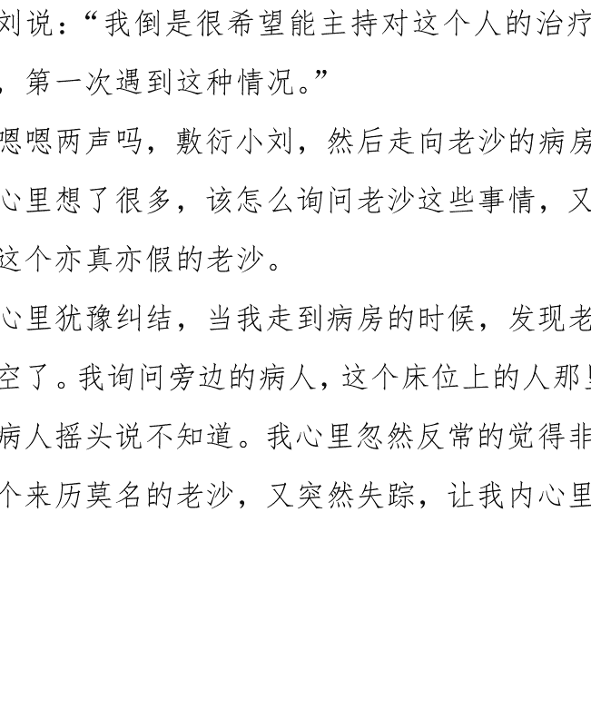

老沙的检查和急诊的费用，一共是一千多，入院的时候我垫了八百块的押金，看来也打了水漂，小刘也很失望他倒不是因为老沙赖了了一些费用，而是他觉得这么一个轰动性的病人跑了，让他自己很尴尬。我回到家里，努力让自己把老沙的事情彻底忘掉。

晚上洗澡的时候，雾气弥漫在浴室，面前的镜子雾蒙蒙的，我用手指戳镜面，看着镜子里脸色苍白的中年男人的相貌，突然升起一股无法忽视的陌生感——这个人我是自己吗。或许不是真的有另一个世界，而我们所处的世界的平行，而镜子就是两个世界的连接途径......

我被自己的想法给吓到了，匆忙的穿好衣服，逃一般的收拾好。离开浴室，水冲刷着身体，我害怕看到镜子里的自己会觉得里面的我我会走出来，然后用手紧紧的捂住自己的脖子，弄死我，我取代我在这个世界里的生活。

我的亲戚和朋友，根本无法分辨。或者，现在的我不是我就是从镜子走出来的，早已把以前的我给杀掉，只是我忘记忘记了这个过程而已。

这个想法缠着我，让我感到十分无助的恐惧，我开始在脑海里努力找回自己的记忆，从两岁开始，慢慢的去。这种想法上的酷刑让我更加绝望，我突然发现，很多小时候的记忆，根本就不是我熟悉的世界，而是一种非常陌生的环境。

我的家人发现了我的异样，他们问我怎么了，是不是不舒服，如果不舒服的话，就去医院吧。我无法回答家人，我只能把这个荒诞的想法藏在内心处。

作者：蛇从草 日期:2014-03-13 22:57

我渐渐努力让事情忘掉，一天中午，正在家里吃饭，有人敲门。我开了门，是那个小伙子问：“云峰？”

我点头。那个小伙子把手一个信封交给我，让我签字。那个小伙子笑了，“左写字的人很少见到啊，还挺好的。”

那个小伙子走了，我拿着信封坐回饭桌，打算把信封拆开。我突然发现，很多时候是用右手写字的，不知道什么时候用左手写字。我看到左手写字，肯定是。

我心里震动一下，额头冒汗。不想吃饭了，然后拿着信封走到阳台，发现是一张纸条，纸条上写了一个地址（这个地址就不方便透露），落款只有一个字。作者：蛇从草 日期:2014-03-13 23:40

作者：蛇从草 日期:2014-03-13 14:42 

@死妹丁 2013 10962 楼 2014-03-13 10:00:00

蛇哥，合个照吧。好几年的粉了！

茄子

作者：蛇从草 日期:2014-03-13 14:42

@一梦三年又三年 10972 楼 2014-03-13 10:59:00

赶上大部队了 看到这里已不在好意思再潜水了。求汤

# 一手整理，加v信11011284955，获取更多好帖

茄子

作者：蛇从草 日期:2014-03-13 21:54

@凡目 11005 楼 2014-03-13 17:29:00

老蛇的效率真高啊，都下部了...

@蛇从草，要保重身体佐:)多吃包子

嗯哒，我现在买五个包子，到时候你给你带过来。

作者：蛇从草 日期:2014-03-13 21:55

@毒蛇Viper 毒蛇 11014 楼 2014-03-13 21:13:00

老蛇多偏心眼儿啊

怎么不回复我呢

不理我也不理你了

哈哈，你是老赖人了。

作者：蛇从草 日期：2014-03-13 22:49

到了现在这个情况，我再不能怀疑老沙给我说的经历是否杜撰。这让我骨都凉的，这个老沙可能不是我以前认识的那个老沙。但他很明显拥有当年的记忆的。

小可见看见我愣愣，就问我：“这个人身上的伤势除了胸腔里的贯穿，其他的都好办，不过他身体结构的异常我很难确定以后的治疗情况。”

我看着她的眼睛，对她说：“我还是会尝试治愈他的。”

小说说：“我倒是希望能主持对这个人的治疗，我长这么大，第一次遇到这种情况。”

我嗯两声，摇了摇头走向病房。在路上，我心里想着怎么去问老沙这些事情，又该如何面对这个其实虚假的老沙。

我心里犹豫纠结，当我走到病房的时候，发现老沙的病床已经空了。我询问旁边的病人，这个床位上的人那里去了。

旁边的病人摇头不知道。我心里焦乱反常的觉得非常轻松。

也许这个莫名的老沙，又突然失踪，让我心里非常的焦虑。


老沙的检查和急诊的费用，一共是一千多，入院的时候我垫了八百块的押金，看来也打了水漂，小刘也很失望他倒不是因为老沙赖了了一些费用，而是他觉得这么轰动性的病人跑了，让他自己很尴尬。我回到家里，努力让自己把老沙的事情彻底忘掉。

晚上洗澡的时候，雾气弥漫在浴室，面前的镜子雾蒙蒙的，我用手指戳镜面，看着镜子里脸色苍白的中年男人的相貌，突然升起一股无法忽视的陌生感——这个人我是自己吗。或许不是真的有另一个世界，而我们所处的世界的平行，而镜子就是两个世界的连接途径......

我被自己的想法给吓到了，匆忙的穿好衣服，逃一般的收拾好。离开浴室，水冲刷着身体，我害怕看到镜子里的自己会觉得里面的我我会走出来，然后用手紧紧的捂住自己的脖子，弄死我，我取代我在这个世界里的生活。

我的亲戚和朋友，根本无法分辨。或者，现在的我不是我就是从镜子走出来的，早已把以前的我给杀掉，只是我忘记忘记了这个过程而已。

这个想法缠着我，让我感到十分无助的恐惧，我开始在脑海里努力找回自己的记忆，从两岁开始，慢慢的去。这种想法上的酷刑让我更加绝望，我突然发现，很多小时候的记忆，根本就不是我熟悉的世界，而是一种非常陌生的环境。

我的家人发现了我的异样，他们问我怎么了，是不是不舒服，如果不舒服的话，就去医院吧。我无法回答家人，我只能把这个荒诞的想法藏在内心处。作者：蛇从草 日期:2014-03-13 22:57

我渐渐努力让事情忘掉，一天中午，正在家里吃饭，有人敲门。我开了门，是那个小伙子问：“云峰？”

我点头。那个小伙子把手一个信封交给我，让我签字。那个小伙子笑了，“左写字的人很少见到啊，还挺好的。”

那个小伙子走了，我拿着信封坐回饭桌，打算把信封拆开。我突然发现，很多时候是用右手写字的，不知道什么时候用左手写字。我看到左手写字，肯定是。

我心里震动一下，额头冒汗。不想吃饭了，然后拿着信封走到阳台，发现是一张纸条，纸条上写了一个地址（这个地址就不方便透露），落款只有一个字。作者：蛇从草 日期:2014-03-13 23:40

我想了很久，实在忍不住对老沙身份的好奇，于是去了地址上的地方。这个地址在我附近的一个山区，我到了县城，然后找到了黑车，告诉司机地址，司机好奇看着我，打量我很久。当时没有意识到司机的意图。司机把我送到一个深远的山里，我看到了一些废弃的八十年代的建筑，才明白为什么这么意外。宜昌周边有很多山，所以当年有很多数字作为代号的三线军工厂修建在深山里。比如......

我想了很久，实在忍不住对老沙身份的好奇，于是去了地址上的地方。这个地址在我附近的一个山区，我到了县城，然后找到了黑车，告诉司机地址，司机好奇看着我，打量我很久。当时没有意识到司机的意图。司机把我送到一个深远的山里，我看到了一些废弃的八十年代的建筑，才明白为什么这么意外。宜昌周边有很多山，所以当年有很多数字作为代号的三线军工厂修建在深山里。比如......

我想了很久，实在忍不住对老沙身份的好奇，于是去了地址上的地方。这个地址在我附近的一个山区，我到了县城，然后找到了黑车，告诉司机地址，司机好奇看着我，打量我很久。当时没有意识到司机的意图。司机把我送到一个深远的山里，我看到了一些废弃的八十年代的建筑，才明白为什么这么意外。宜昌周边有很多山，所以当年有很多数字作为代号的三线军工厂修建在深山里。比如......

我想了很久，实在忍不住对老沙身份的好奇，于是去了地址上的地方。这个地址在我附近的一个山区，我到了县城，然后找到了黑车，告诉司机地址，司机好奇看着我，打量我很久。当时没有意识到司机的意图。司机把我送到一个深远的山里，我看到了一些废弃的八十年代的建筑，才明白为什么这么意外。宜昌周边有很多山，所以当年有很多数字作为代号的三线军工厂修建在深山里。比如......

我想了很久，实在忍不住对老沙身份的好奇，于是去了地址上的地方。这个地址在我附近的一个山区，我到了县城，然后找到了黑车，告诉司机地址，司机好奇看着我，打量我很久。当时没有意识到司机的意图。司机把我送到一个深远的山里，我看到了一些废弃的八十年代的建筑，才明白为什么这么意外。宜昌周边有很多山，所以当年有很多数字作为代号的三线军工厂修建在深山里。比如......

我想了很久，实在忍不住对老沙身份的好奇，于是去了地址上的地方。这个地址在我附近的一个山区，我到了县城，然后找到了黑车，告诉司机地址，司机好奇看着我，打量我很久。当时没有意识到司机的意图。司机把我送到一个深远的山里，我看到了一些废弃的八十年代的建筑，才明白为什么这么意外。宜昌周边有很多山，所以当年有很多数字作为代号的三线军工厂修建在深山里。比如......

我想了很久，实在忍不住对老沙身份的好奇，于是去了地址上的地方。这个地址在我附近的一个山区，我到了县城，然后找到了黑车，告诉司机地址，司机好奇看着我，打量我很久。当时没有意识到司机的意图。司机把我送到一个深远的山里，我看到了一些废弃的八十年代的建筑，才明白为什么这么意外。宜昌周边有很多山，所以当年有很多数字作为代号的三线军工厂修建在深山里。比如......

我想，也许我父亲曾在某个山里的三线工厂工作过，对我陌生。

“哪有这么便宜，”我笑着拒绝了司机的好意，然后从钱包里掏出一百，“谢谢你，难得你帮我送这么远。”

“我不要你的钱。”司机说，“我不是这个意思。”

“那好吧，”我对司机说，“明天这个时候，麻烦你再跑一趟，送我回这里。我就在这里等你。”

司机看着我，就想看着一个怪物一样。然后开车走了。我很感激这个热心的人。看着司机开车走，然后走到这个废弃的工厂里，既然老沙留下地址，一定会等着我。我走到一个开阔的地方，仰着头大喊：“老沙，老沙。”

我的声音在山谷里回旋，这才感觉到了一个空城，确切人哑的慌。

作者：蛇从草 日期:2014-03-14 00:04

今天没了

作者：蛇从草 日期:2014-03-14 00:09

@清香妙蘑菇 11066 楼 2014-03-14 00:06:00

预感下部会比上部精彩，拍电影会选哪段？

电影会选择其中合适的情节拍摄，不局限于上部还是下一部整理，加v信1101284955，获取更多好帖

作者：蛇从草 日期:2014-03-14 13:06

@声爻 11113 楼 2014-03-14 12:20

你写的的时候不会被自己的小说吓到啊，写科幻的时候反而心里恐惧一点。

作者：蛇从草 日期:2014-03-14 13:08

@去如风 11088 楼 2014-03-14 07:13

顺便问一下，什么时候开始写大家。作者：蛇从草 日期:2014-03-14 13:14

应该就是这里了。

@cdkj 11069 楼 2014-03-14 23:00

我好多同学在这，湖北的三线工厂几乎都到了孝感。作者：蛇从草 日期:2014-03-14 13:15

@九木牛 11096 楼 2014-03-14 08:46

这两段看看，还好的我伸出左手，用右手，整理，加V信1101284955，获取更多好帖。作者：蛇从草 日期:2014-03-14 15:15

@蛇从草 11064 楼 2014-03-14 00:04

回复第7242 楼（作者:）@蛇从草 于2014-02-12

《密道追踪》的名字是电影要求的片名。影视方也认为是观众追踪影片，所以更改了。====这电影出来，必须要去影院看看。感激不尽呢作者：蛇从草 日期:2014-03-14 13:53

@dbdbf 11115 楼 2014-03-14 11:45

我发现了，一到关键时候后面就是今天了。说书的老套路啊，预知后事如何，倾听下回分解。哈哈哈哈，作者：蛇从草 日期:2014-03-14 21:38

@p1588q 11140 楼 2014-03-14 14:22

你写的的时候不会被自己的小说吓到啊，写科幻的时候反而心里恐惧一点。作者:蛇草 日期:2014-03-14 21:39

@亮烯云天 11142 楼 2014-03-14 14:52

蛇哥啊，跟你帖贴吧大概，从鬼事一到现在，每每到关键地方你就说“今天没了”，你可知年来我心中有多少只草泥马奔腾而来？连载就是这样的啊。作者:蛇草 日期:2014-03-14 21:39

@Victory_o0 2014-03-14 16:41

终于赶上了！！会不会，原本的我们其实都用左手写字，器官都在相反，现在的我们才是镜子对面的人！...一手整理，加v信11011284955，获取更多好帖作者：蛇从草 日期:2014-03-14 16:48

@晓粉 11167 楼 2014-03-14 02:29

哎呀，这太不够了。作者:蛇从草 日期:2014-03-14 21:40


看，但是我没有看到镜头，也没有听到电影放映机咔哒的声音。我实在是没勇气，撞开司号台的门，去探个究竟，一天不知所措。

这种工厂企业到了晚上放电影，我并不陌生。我小时候就是看这种电影长大的，那是很快的童年时光，在拥挤的操场上，坐在一个小马扎，和几百人一起看电影。

但是现在整个操场就只有我一个人，看着这个这莫名其妙的电影。虽然我再强调自己是个无神论者，也忍不住心跳加速。

慢慢地我推到了操场中央，心里想着，如果这部电影是放给人的，在我们身体四周，应该是坐满了密密麻麻的人。我发现周围空了食物以及入睡的嘈杂。

我把视线死在电影的影像上，这个时候，我突然发现了一个诡异的事情，电影播放的顺序是混乱的，刚才是电影中那个经典的变形形状（《英雄女儿》的人物），可是现在成了片头，上面打出粗体的白色字幕，巨大字体，占据了白大的大布，我瞬间看明白白了，是“长春电影制片厂”，接着的是“英雄女儿”的片名。

但是这些字都是反的......

不知道大家有没有看过露天电影的经历，就应该说明，如果糟糕电影白幕方向没有好合适的地方观看，就会到白幕后面去看，不过要忍受电影里的人物，都是左撇子，除除此之外，观看都是正常的。

现在我就看见电影里面的人物，全部是反过来的，士兵们齐刷刷的左手持枪。我飞快速的绕道白幕背后，当我看到映像的时候，心里咯噔一下，白幕上的映像和刚才我正在正面看的一样，仍然是反的......

老打算让我来的，确是有原因的。

作者：蛇从草 日期：2014-03-14 22:12

@猫木子 11201 楼 2014-03-14 22:10:00
好难受，我的沙发估计没有了，那就坐板凳吧，或者着地板，受伤了，砰碎。

# 一手数据发加v信11101284955，获取更多好帖

作者：蛇从草 日期：2014-03-14 22:34
我脑海里突然意识到刚才看到反过的字体，还依然旧分析。每个字的确都是反的，但是每个字排列的顺序并不是从右向左，仍然是从左到右。

四周仍旧是一片寂静，但我能够清晰的察觉到有人，而且有很多很多人。这是一个莫名的感觉，并非我能看到或我听到。

我被吓到了，我迈开腿，狂奔到操场之外。跑到路上，身边的破旧的建筑在黑暗中看着异常非常。

紧接着路灯也亮了，稀稀落落的几个灯在大树的枝叶间露出光芒，这是那种八十年代老式的路灯。我发现我又回到了医院旁，然后再看看医院的招牌，和影像里的字体一样，都是反的，全部都是反的。

老沙给我讲的事情，包括他自己身上发生的经历，全部都不是骗我好玩的。

我惊慌起来，摸着自己的胸口，胸膛里心脏在剧烈的搏动，我稍稍安心了点，心脏跳动的地方还是在左边，而非右侧。

这时候一个强烈的光线照射在我的身上，光线太刺眼，我眼前一阵失明。缓一会之后，一辆破烂的小车停在我面前，是一辆最早的接达，这种车型早就就淘汰了。

我整理了一下，点了一根烟，对他说：“老沙，去东湖站吗？”

“你是徐某。”

我才看见，车上下来的人不是老沙，而是一个跟我差不多年纪的人。身材不高，但是十分结实，他向我走过来，脚步十分稳。

我脑子里电光火石一闪，“大拿？”

“我是，”对方说，“我的名字叫李元。”

作者：蛇从草 日期：2014-03-14 22:36
我脑海里突然意识到刚才看到反过的字体，还依然旧分析。每个字的确都是反的，但是每个字排列的顺序并不是从右向左，仍然是从左到右。

四周仍旧是一片寂静，但我能够清晰的察觉到有人，而且有很多很多人。这是一个莫名的感觉，并非我能看到或我听到。

我被吓到了，我迈开腿，狂奔到操场之外。跑到路上，身边的破旧的建筑在黑暗中看着异常非常。

紧接着路灯也亮了，稀稀落落的几个灯在大树的枝叶间露出光芒，这是那种八十年代老式的路灯。我发现我又回到了医院旁，然后再看看医院的招牌，和影像里的字体一样，都是反的，全部都是反的。

老沙给我讲的事情，包括他自己身上发生的经历，全部都不是骗我好玩的。

我惊慌起来，摸着自己的胸口，胸膛里心脏在剧烈的搏动，我稍稍安心了点，心脏跳动的地方还是在左边，而非右侧。

这时候一个强烈的光线照射在我的身上，光线太刺眼，我眼前一阵失明。缓一会之后，一辆破烂的小车停在我面前，是一辆最早的接达，这种车型早就就淘汰了。

我整理了一下，点了一根烟，对他说：“老沙，去东湖站吗？”

“你是徐某。”

我才看见，车上下来的人，不是老沙，而是一个跟我差不多年纪的人。身材不高，但是十分结实，他向我走过来，脚步十分稳。

我脑子里电光火石一闪，“大拿？”

“我是，”对方说，“我的名字叫李元。”

作者：蛇从草 日期：2014-03-14 22:34
我脑海里突然意识到刚才看到反过的字体，还依然旧分析。每个字的确都是反的，但是每个字排列的顺序并不是从右向左，仍然是从左到右。

四周仍旧是一片寂静，但我能够清晰的察觉到有人，而且有很多很多人。这是一个莫名的感觉，并非我能看到或我听到。

我被吓到了，我迈开腿，狂奔到操场之外。跑到路上，身边的破旧的建筑在黑暗中看着异常非常。

紧接着路灯也亮了，稀稀落落的几个灯在大树的枝叶间露出光芒，这是那种八十年代老式的路灯。我发现我又回到了医院旁，然后再看看医院的招牌，和影像里的字体一样，都是反的，全部都是反的。

老沙给我讲的事情，包括他自己身上发生的经历，全部都不是骗我好玩的。

我惊慌起来，摸着自己的胸口，胸膛里心脏在剧烈的搏动，我稍稍安心了点，心脏跳动的地方还是在左边，而非右侧。

时候一个强烈的光线照射在我的身上，光线太刺眼，我眼前一阵失明。缓一会之后，一辆破烂的小车停在我面前，是一辆最早的接达，这种车型早就就淘汰了。

我整理了一下，点了一根烟，对他说：“老沙，去东湖站吗？”

“你是徐某。”

我才看见，车上下来的人，不是老沙，而是一个跟我差不多年纪的人。身材不高，但是十分结实，他向我走过来，脚步十分稳。

我脑子里电光火石一闪，“大拿？”

“我是，”对方说，“我的名字叫李元。”

作者：蛇从草 日期：2014-03-14 22:36
我脑海里突然意识到刚才看到反过的字体，还依然旧分析。每个字的确都是反的，但是每个字排列的顺序并不是从右向左，仍然是从左到右。

四周仍旧是一片寂静，但我能够清晰的察觉到有人，而且有很多很多人。这是一个莫名的感觉，并非我能看到或我听到。

我被吓到了，我迈开腿，狂奔到操场之外。跑到路上，身边的破旧的建筑在黑暗中看着异常非常。

紧接着路灯也亮了，稀稀落落的几个灯在大树的枝叶间露出光芒，这是那种八十年代老式的路灯。我发现我又回到了医院旁，然后再看看医院的招牌，和影像里的字体一样，都是反的，全部都是反的。

老沙给我讲的事情，包括他自己身上发生的经历，全部都不是骗我好玩的。

我惊慌起来，摸着自己的胸口，胸膛里心脏在剧烈的搏动，我稍稍安心了点，心脏跳动的地方还是在左边，而非右侧。

时候一个强烈的光线照射在我的身上，光线太刺眼，我眼前一阵失明。缓一会之后，一辆破烂的小车停在我面前，是一辆最早的接达，这种车型早就就淘汰了。

我整理了一下，点了一根烟，对他说：“老沙，去东湖站吗？”

“你是徐某。”

我才看见，车上下来的人，不是老沙，而是一个跟我差不多年纪的人。身材不高，但是十分结实，他向我走过来，脚步十分稳。

我脑子里电光火石一闪，“大拿？”

“我是，”对方说，“我的名字叫李元。”

作者：蛇从草 日期：2014-03-14 22:36
我脑海里突然意识到刚才看到反过的字体，还依然旧分析。每个字的确都是反的，但是每个字排列的顺序并不是从右向左，仍然是从左到右。

四周仍旧是一片寂静，但我能够清晰的察觉到有人，而且有很多很多人。这是一个莫名的感觉，并非我能看到或我听到。

我被吓到了，我迈开腿，狂奔到操场之外。跑到路上，身边的破旧的建筑在黑暗中看着异常非常。

紧接着路灯也亮了，稀稀落落的几个灯在大树的枝叶间露出光芒，这是那种八十年代老式的路灯。我发现我又回到了医院旁，然后再看看医院的招牌，和影像里的字体一样，都是反的，全部都是反的。

老沙给我讲的事情，包括他自己身上发生的经历，全部都不是骗我好玩的。

我惊慌起来，摸着自己的胸口，胸膛里心脏在剧烈的搏动，我稍稍安心了点，心脏跳动的地方还是在左边，而非右侧。

时候一个强烈的光线照射在我的身上，光线太刺眼，我眼前一阵失明。缓一会之后，一辆破烂的小车停在我面前，是一辆最早的接达，这种车型早就就淘汰了。

我整理了一下，点了一根烟，对他说：“老沙，去东湖站吗？”

“你是徐某。”

我才看见，车上下来的人，不是老沙，而是一个跟我差不多年纪的人。身材不高，但是十分结实，他向我走过来，脚步十分稳。

我脑子里电光火石一闪，“大拿？”

“我是，”对方说，“我的名字叫李元。”

作者：蛇从草 日期：2014-03-14 22:36
我脑海里突然意识到刚才看到反过的字体，还依然旧分析。每个字的确都是反的，但是每个字排列的顺序并不是从右向左，仍然是从左到右。

四周仍旧是一片寂静，但我能够清晰的察觉到有人，而且有很多很多人。这是一个莫名的感觉，并非我能看到或我听到。

我被吓到了，我迈开腿，狂奔到操场之外。跑到路上，身边的破旧的建筑在黑暗中看着异常非常。

紧接着路灯也亮了，稀稀落落的几个灯在大树的枝叶间露出光芒，这是那种八十年代老式的路灯。我发现我又回到了医院旁，然后再看看医院的招牌，和影像里的字体一样，都是反的，全部都是反的。

老沙给我讲的事情，包括他自己身上发生的经历，全部都不是骗我好玩的。

我惊慌起来，摸着自己的胸口，胸膛里心脏在剧烈的搏动，我稍稍安心了点，心脏跳动的地方还是在左边，而非右侧。

时候一个强烈的光线照射在我的身上，光线太刺眼，我眼前一阵失明。缓一会之后，一辆破烂的小车停在我面前，是一辆最早的接达，这种车型早就就淘汰了。

我整理了一下，点了一根烟，对他说：“老沙，去东湖站吗？”

“你是徐某。”

我才看见，车上下来的人，不是老沙，而是一个跟我差不多年纪的人。身材不高，但是十分结实，他向我走过来，脚步十分稳。

我脑子里电光火石一闪，“大拿？”

“我是，”对方说，“我的名字叫李元。”

作者：蛇从草 日期：2014-03-14 22:36
我脑海里突然意识到刚才看到反过的字体，还依然旧分析。每个字的确都是反的，但是每个字排列的顺序并不是从右向左，仍然是从左到右。

四周仍旧是一片寂静，但我能够清晰的察觉到有人，而且有很多很多人。这是一个莫名的感觉，并非我能看到或我听到。

我被吓到了，我迈开腿，狂奔到操场之外。跑到路上，身边的破旧的建筑在黑暗中看着异常非常。

紧接着路灯也亮了，稀稀落落的几个灯在大树的枝叶间露出光芒，这是那种八十年代老式的路灯。我发现我又回到了医院旁，然后再看看医院的招牌，和影像里的字体一样，都是反的，全部都是反的。

老沙给我讲的事情，包括他自己身上发生的经历，全部都不是骗我好玩的。

我惊慌起来，摸着自己的胸口，胸膛里心脏在剧烈的搏动，我稍稍安心了点，心脏跳动的地方还是在左边，而非右侧。

时候一个强烈的光线照射在我的身上，光线太刺眼，我眼前一阵失明。缓一会之后，一辆破烂的小车停在我面前，是一辆最早的接达，这种车型早就就淘汰了。

我整理了一下，点了一根烟，对他说：“老沙，去东湖站吗？”

“你是徐某。”

我才看见，车上下来的人，不是老沙，而是一个跟我差不多年纪的人。身材不高，但是十分结实，他向我走过来，脚步十分稳。

我脑子里电光火石一闪，“大拿？”

“我是，”对方说，“我的名字叫李元。”

作者：蛇从草 日期：2014-03-14 22:36
我脑海里突然意识到刚才看到反过的字体，还依然旧分析。每个字的确都是反的，但是每个字排列的顺序并不是从右向左，仍然是从左到右。

四周仍旧是一片寂静，但我能够清晰的察觉到有人，而且有很多很多人。这是一个莫名的感觉，并非我能看到或我听到。

我被吓到了，我迈开腿，狂奔到操场之外。跑到路上，身边的破旧的建筑在黑暗中看着异常非常。

紧接着路灯也亮了，稀稀落落的几个灯在大树的枝叶间露出光芒，这是那种八十年代老式的路灯。我发现我又回到了医院旁，然后再看看医院的招牌，和影像里的字体一样，都是反的，全部都是反的。

老沙给我讲的事情，包括他自己身上发生的经历，全部都不是骗我好玩的。

我惊慌起来，摸着自己的胸口，胸膛里心脏在剧烈的搏动，我稍稍安心了点，心脏跳动的地方还是在左边，而非右侧。

时候一个强烈的光线照射在我的身上，光线太刺眼，我眼前一阵失明。缓一会之后，一辆破烂的小车停在我面前，是一辆最早的接达，这种车型早就就淘汰了。

我整理了一下，点了一根烟，对他说：“老沙，去东湖站吗？”

“你是徐某。”

我才看见，车上下来的人，不是老沙，而是一个跟我差不多年纪的人。身材不高，但是十分结实，他向我走过来，脚步十分稳。

我脑子里电光火石一闪，“大拿？”

“我是，”对方说，“我的名字叫李元。”

作者：蛇从草 日期：2014-03-14 22:36
我脑海里突然意识到刚才看到反过的字体，还依然旧分析。每个字的确都是反的，但是每个字排列的顺序并不是从右向左，仍然是从左到右。

四周仍旧是一片寂静，但我能够清晰的察觉到有人，而且有很多很多人。这是一个莫名的感觉，并非我能看到或我听到。

我被吓到了，我迈开腿，狂奔到操场之外。跑到路上，身边的破旧的建筑在黑暗中看着异常非常。

紧接着路灯也亮了，稀稀落落的几个灯在大树的枝叶间露出光芒，这是那种八十年代老式的路灯。我发现我又回到了医院旁，然后再看看医院的招牌，和影像里的字体一样，都是反的，全部都是反的。

老沙给我讲的事情，包括他自己身上发生的经历，全部都不是骗我好玩的。

我惊慌起来，摸着自己的胸口，胸膛里心脏在剧烈的搏动，我稍稍安心了点，心脏跳动的地方还是在左边，而非右侧。

时候一个强烈的光线照射在我的身上，光线太刺眼，我眼前一阵失明。缓一会之后，一辆破烂的小车停在我面前，是一辆最早的接达，这种车型早就就淘汰了。

我整理了一下，点了一根烟，对他说：“老沙，去东湖站吗？”

“你是徐某。”

我才看见，车上下来的人，不是老沙，而是一个跟我差不多年纪的人。身材不高，但是十分结实，他向我走过来，脚步十分稳。

我脑子里电光火石一闪，“大拿？”

“我是，”对方说，“我的名字叫李元。”

作者：蛇从草 日期：2014-03-14 22:36
我脑海里突然意识到刚才看到反过的字体，还依然旧分析。每个字的确都是反的，但是每个字排列的顺序并不是从右向左，仍然是从左到右。

四周仍旧是一片寂静，但我能够清晰的察觉到有人，而且有很多很多人。这是一个莫名的感觉，并非我能看到或我听到。

我被吓到了，我迈开腿，狂奔到操场之外。跑到路上，身边的破旧的建筑在黑暗中看着异常非常。

紧接着路灯也亮了，稀稀落落的几个灯在大树的枝叶间露出光芒，这是那种八十年代老式的路灯。我发现我又回到了医院旁，然后再看看医院的招牌，和影像里的字体一样，都是反的，全部都是反的。

老沙给我讲的事情，包括他自己身上发生的经历，全部都不是骗我好玩的。

我惊慌起来，摸着自己的胸口，胸膛里心脏在剧烈的搏动，我稍稍安心了点，心脏跳动的地方还是在左边，而非右侧。

时候一个强烈的光线照射在我的身上，光线太刺眼，我眼前一阵失明。缓一会之后，一辆破烂的小车停在我面前，是一辆最早的接达，这种车型早就就淘汰了。

我整理了一下，点了一根烟，对他说：“老沙，去东湖站吗？”

“你是徐某。”

我才看见，车上下来的人，不是老沙，而是一个跟我差不多年纪的人。身材不高，但是十分结实，他向我走过来，脚步十分稳。

我脑子里电光火石一闪，“大拿？”

“我是，”对方说，“我的名字叫李元。”

作者：蛇从草 日期：2014-03-14 22:36
我脑海里突然意识到刚才看到反过的字体，还依然旧分析。每个字的确都是反的，但是每个字排列的顺序并不是从右向左，仍然是从左到右。

四周仍旧是一片寂静，但我能够清晰的察觉到有人，而且有很多很多人。这是一个莫名的感觉，并非我能看到或我听到。

我被吓到了，我迈开腿，狂奔到操场之外。跑到路上，身边的破旧的建筑在黑暗中看着异常非常。

紧接着路灯也亮了，稀稀落落的几个灯在大树的枝叶间露出光芒，这是那种八十年代老式的路灯。我发现我又回到了医院旁，然后再看看医院的招牌，和影像里的字体一样，都是反的，全部都是反的。

老沙给我讲的事情，包括他自己身上发生的经历，全部都不是骗我好玩的。

我惊慌起来，摸着自己的胸口，胸膛里心脏在剧烈的搏动，我稍稍安心了点，心脏跳动的地方还是在左边，而非右侧。

时候一个强烈的光线照射在我的身上，光线太刺眼，我眼前一阵失明。缓一会之后，一辆破烂的小车停在我面前，是一辆最早的接达，这种车型早就就淘汰了。

我整理了一下，点了一根烟，对他说：“老沙，去东湖站吗？”

“你是徐某。”

我才看见，车上下来的人，不是老沙，而是一个跟我差不多年纪的人。身材不高，但是十分结实，他向我走过来，脚步十分稳。

我脑子里电光火石一闪，“大拿？”

“我是，”对方说，“我的名字叫李元。”

作者：蛇从草 日期：2014-03-14 22:36
我脑海里突然意识到刚才看到反过的字体，还依然旧分析。每个字的确都是反的，但是每个字排列的顺序并不是从右向左，仍然是从左到右。

四周仍旧是一片寂静，但我能够清晰的察觉到有人，而且有很多很多人。这是一个莫名的感觉，并非我能看到或我听到。

我被吓到了，我迈开腿，狂奔到操场之外。跑到路上，身边的破旧的建筑在黑暗中看着异常非常。

紧接着路灯也亮了，稀稀落落的几个灯在大树的枝叶间露出光芒，这是那种八十年代老式的路灯。我发现我又回到了医院旁，然后再看看医院的招牌，和影像里的字体一样，都是反的，全部都是反的。

老沙给我讲的事情，包括他自己身上发生的经历，全部都不是骗我好玩的。

我惊慌起来，摸着自己的胸口，胸膛里心脏在剧烈的搏动，我稍稍安心了点，心脏跳动的地方还是在左边，而非右侧。

时候一个强烈的光线照射在我的身上，光线太刺眼，我眼前一阵失明。缓一会之后，一辆破烂的小车停在我面前，是一辆最早的接达，这种车型早就就淘汰了。

我整理了一下，点了一根烟，对他说：“老沙，去东湖站吗？”

“你是徐某。”

我才看见，车上下来的人，不是老沙，而是一个跟我差不多年纪的人。身材不高，但是十分结实，他向我走过来，脚步十分稳。

我脑子里电光火石一闪，“大拿？”

“我是，”对方说，“我的名字叫李元。”

作者：蛇从草 日期：2014-03-14 22:36
我脑海里突然意识到刚才看到反过的字体，还依然旧分析。每个字的确都是反的，但是每个字排列的顺序并不是从右向左，仍然是从左到右。

四周仍旧是一片寂静，但我能够清晰的察觉到有人，而且有很多很多人。这是一个莫名的感觉，并非我能看到或我听到。

我被吓到了，我迈开腿，狂奔到操场之外。跑到路上，身边的破旧的建筑在黑暗中看着异常非常。

紧接着路灯也亮了，稀稀落落的几个灯在大树的枝叶间露出光芒，这是那种八十年代老式的路灯。我发现我又回到了医院旁，然后再看看医院的招牌，和影像里的字体一样，都是反的，全部都是反的。

老沙给我讲的事情，包括他自己身上发生的经历，全部都不是骗我好玩的。

我惊慌起来，摸着自己的胸口，胸膛里心脏在剧烈的搏动，我稍稍安心了点，心脏跳动的地方还是在左边，而非右侧。

时候一个强烈的光线照射在我的身上，光线太刺眼，我眼前一阵失明。缓一会之后，一辆破烂的小车停在我面前，是一辆最早的接达，这种车型早就就淘汰了。

我整理了一下，点了一根烟，对他说：“老沙，去东湖站吗？”

“你是徐某。”

我才看见，车上下来的人，不是老沙，而是一个跟我差不多年纪的人。身材不高，但是十分结实，他向我走过来，脚步十分稳。

我脑子里电光火石一闪，“大拿？”

“我是，”对方说，“我的名字叫李元。”

作者：蛇从草 日期：2014-03-14 22:36
我脑海里突然意识到刚才看到反过的字体，还依然旧分析。每个字的确都是反的，但是每个字排列的顺序并不是从右向左，仍然是从左到右。

四周仍旧是一片寂静，但我能够清晰的察觉到有人，而且有很多很多人。这是一个莫名的感觉，并非我能看到或我听到。

我被吓到了，我迈开腿，狂奔到操场之外。跑到路上，身边的破旧的建筑在黑暗中看着异常非常。

紧接着路灯也亮了，稀稀落落的几个灯在大树的枝叶间露出光芒，这是那种八十年代老式的路灯。我发现我又回到了医院旁，然后再看看医院的招牌，和影像里的字体一样，都是反的，全部都是反的。

老沙给我讲的事情，包括他自己身上发生的经历，全部都不是骗我好玩的。

我惊慌起来，摸着自己的胸口，胸膛里心脏在剧烈的搏动，我稍稍安心了点，心脏跳动的地方还是在左边，而非右侧。

时候一个强烈的光线照射在我的身上，光线太刺眼，我眼前一阵失明。缓一会之后，一辆破烂的小车停在我面前，是一辆最早的接达，这种车型早就就淘汰了。

我整理了一下，点了一根烟，对他说：“老沙，去东湖站吗？”

“你是徐某。”

我才看见，车上下来的人，不是老沙，而是一个跟我差不多年纪的人。身材不高，但是十分结实，他向我走过来，脚步十分稳。

我脑子里电光火石一闪，“大拿？”

“我是，”对方说，“我的名字叫李元。”

作者：蛇从草 日期：2014-03-14 22:36
我脑海里突然意识到刚才看到反过的字体，还依然旧分析。每个字的确都是反的，但是每个字排列的顺序并不是从右向左，仍然是从左到右。

四周仍旧是一片寂静，但我能够清晰的察觉到有人，而且有很多很多人。这是一个莫名的感觉，并非我能看到或我听到。

我被吓到了，我迈开腿，狂奔到操场之外。跑到路上，身边的破旧的建筑在黑暗中看着异常非常。

紧接着路灯也亮了，稀稀落落的几个灯在大树的枝叶间露出光芒，这是那种八十年代老式的路灯。我发现我又回到了医院旁，然后再看看医院的招牌，和影像里的字体一样，都是反的，全部都是反的。

老沙给我讲的事情，包括他自己身上发生的经历，全部都不是骗我好玩的。

我惊慌起来，摸着自己的胸口，胸膛里心脏在剧烈的搏动，我稍稍安心了点，心脏跳动的地方还是在左边，而非右侧。

时候一个强烈的光线照射在我的身上，光线太刺眼，我眼前一阵失明。缓一会之后，一辆破烂的小车停在我面前，是一辆最早的接达，这种车型早就就淘汰了。

我整理了一下，点了一根烟，对他说：“老沙，去东湖站吗？”

“你是徐某。”

我才看见，车上下来的人，不是老沙，而是一个跟我差不多年纪的人。身材不高，但是十分结实，他向我走过来，脚步十分稳。

我脑子里电光火石一闪，“大拿？”

“我是，”对方说，“我的名字叫李元。”

作者：蛇从草 日期：2014-03-14 22:36
我脑海里突然意识到刚才看到反过的字体，还依然旧分析。每个字的确都是反的，但是每个字排列的顺序并不是从右向左，仍然是从左到右。

四周仍旧是一片寂静，但我能够清晰的察觉到有人，而且有很多很多人。这是一个莫名的感觉，并非我能看到或我听到。

我被吓到了，我迈开腿，狂奔到操场之外。跑到路上，身边的破旧的建筑在黑暗中看着异常非常。

紧接着路灯也亮了，稀稀落落的几个灯在大树的枝叶间露出光芒，这是那种八十年代老式的路灯。我发现我又回到了医院旁，然后再看看医院的招牌，和影像里的字体一样，都是反的，全部都是反的。

老沙给我讲的事情，包括他自己身上发生的经历，全部都不是骗我好玩的。

我惊慌起来，摸着自己的胸口，胸膛里心脏在剧烈的搏动，我稍稍安心了点，心脏跳动的地方还是在左边，而非右侧。

时候一个强烈的光线照射在我的身上，光线太刺眼，我眼前一阵失明。缓一会之后，一辆破烂的小车停在我面前，是一辆最早的接达，这种车型早就就淘汰了。

我整理了一下，点了一根烟，对他说：“老沙，去东湖站吗？”

“你是徐某。”

我才看见，车上下来的人，不是老沙，而是一个跟我差不多年纪的人。身材不高，但是十分结实，他向我走过来，脚步十分稳。

我脑子里电光火石一闪，“大拿？”

“我是，”对方说，“我的名字叫李元。”

作者：蛇从草 日期：2014-03-14 22:36
我脑海里突然意识到刚才看到反过的字体，还依然旧分析。每个字的确都是反的，但是每个字排列的顺序并不是从右向左，仍然是从左到右。

四周仍旧是一片寂静，但我能够清晰的察觉到有人，而且有很多很多人。这是一个莫名的感觉，并非我能看到或我听到。

我被吓到了，我迈开腿，狂奔到操场之外。跑到路上，身边的破旧的建筑在黑暗中看着异常非常。

紧接着路灯也亮了，稀稀落落的几个灯在大树的枝叶间露出光芒，这是那种八十年代老式的路灯。我发现我又回到了医院旁，然后再看看医院的招牌，和影像里的字体一样，都是反的，全部都是反的。

老沙给我讲的事情，包括他自己身上发生的经历，全部都不是骗我好玩的。

我惊慌起来，摸着自己的胸口，胸膛里心脏在剧烈的搏动，我稍稍安心了点，心脏跳动的地方还是在左边，而非右侧。

时候一个强烈的光线照射在我的身上，光线太刺眼，我眼前一阵失明。缓一会之后，一辆破烂的小车停在我面前，是一辆最早的接达，这种车型早就就淘汰了。

我整理了一下，点了一根烟，对他说：“老沙，去东湖站吗？”

“你是徐某。”

我才看见，车上下来的人，不是老沙，而是一个跟我差不多年纪的人。身材不高，但是十分结实，他向我走过来，脚步十分稳。

我脑子里电光火石一闪，“大拿？”

“我是，”对方说，“我的名字叫李元。”

作者：蛇从草 日期：2014-03-14 22:36
我脑海里突然意识到刚才看到反过的字体，还依然旧分析。每个字的确都是反的，但是每个字排列的顺序并不是从右向左，仍然是从左到右。

四周仍旧是一片寂静，但我能够清晰的察觉到有人，而且有很多很多人。这是一个莫名的感觉，并非我能看到或我听到。

我被吓到了，我迈开腿，狂奔到操场之外。跑到路上，身边的破旧的建筑在黑暗中看着异常非常。

紧接着路灯也亮了，稀稀落落的几个灯在大树的枝叶间露出光芒，这是那种八十年代老式的路灯。我发现我又回到了医院旁，然后再看看医院的招牌，和影像里的字体一样，都是反的，全部都是反的。

老沙给我讲的事情，包括他自己身上发生的经历，全部都不是骗我好玩的。

我惊慌起来，摸着自己的胸口，胸膛里心脏在剧烈的搏动，我稍稍安心了点，心脏跳动的地方还是在左边，而非右侧。

时候一个强烈的光线照射在我的身上，光线太刺眼，我眼前一阵失明。缓一会之后，一辆破烂的小车停在我面前，是一辆最早的接达，这种车型早就就淘汰了。

我整理了一下，点了一根烟，对他说：“老沙，去东湖站吗？”

“你是徐某。”

我才看见，车上下来的人，不是老沙，而是一个跟我差不多年纪的人。身材不高，但是十分结实，他向我走过来，脚步十分稳。

我脑子里电光火石一闪，“大拿？”

“我是，”对方说，“我的名字叫李元。”

作者：蛇从草 日期：2014-03-14 22:36
我脑海里突然意识到刚才看到反过的字体，还依然旧分析。每个字的确都是反的，但是每个字排列的顺序并不是从右向左，仍然是从左到右。

四周仍旧是一片寂静，但我能够清晰的察觉到有人，而且有很多很多人。这是一个莫名的感觉，并非我能看到或我听到。

我被吓到了，我迈开腿，狂奔到操场之外。跑到路上，身边的破旧的建筑在黑暗中看着异常非常。

紧接着路灯也亮了，稀稀落落的几个灯在大树的枝叶间露出光芒，这是那种八十年代老式的路灯。我发现我又回到了医院旁，然后再看看医院的招牌，和影像里的字体一样，都是反的，全部都是反的。

老沙给我讲的事情，包括他自己身上发生的经历，全部都不是骗我好玩的。

我惊慌起来，摸着自己的胸口，胸膛里心脏在剧烈的搏动，我稍稍安心了点，心脏跳动的地方还是在左边，而非右侧。

时候一个强烈的光线照射在我的身上，光线太刺眼，我眼前一阵失明。缓一会之后，一辆破烂的小车停在我面前，是一辆最早的接达，这种车型早就就淘汰了。

我整理了一下，点了一根烟，对他说：“老沙，去东湖站吗？”

“你是徐某。”

我才看见，车上下来的人，不是老沙，而是一个跟我差不多年纪的人。身材不高，但是十分结实，他向我走过来，脚步十分稳。

我脑子里电光火石一闪，“大拿？”

“我是，”对方说，“我的名字叫李元。”

作者：蛇从草 日期：2014-03-14 22:36
我脑海里突然意识到刚才看到反过的字体，还依然旧分析。每个字的确都是反的，但是每个字排列的顺序并不是从右向左，仍然是从左到右。

四周仍旧是一片寂静，但我能够清晰的察觉到有人，而且有很多很多人。这是一个莫名的感觉，并非我能看到或我听到。

我被吓到了，我迈开腿，狂奔到操场之外。跑到路上，身边的破旧的建筑在黑暗中看着异常非常。

紧接着路灯也亮了，稀稀落落的几个灯在大树的枝叶间露出光芒，这是那种八十年代老式的路灯。我发现我又回到了医院旁，然后再看看医院的招牌，和影像里的字体一样，都是反的，全部都是反的。

老沙给我讲的事情，包括他自己身上发生的经历，全部都不是骗我好玩的。

我惊慌起来，摸着自己的胸口，胸膛里心脏在剧烈的搏动，我稍稍安心了点，心脏跳动的地方还是在左边，而非右侧。

时候一个强烈的光线照射在我的身上，光线太刺眼，我眼前一阵失明。缓一会之后，一辆破烂的小车停在我面前，是一辆最早的接达，这种车型早就就淘汰了。

我整理了一下，点了一根烟，对他说：“老沙，去东湖站吗？”

“你是徐某。”

我才看见，车上下来的人，不是老沙，而是一个跟我差不多年纪的人。身材不高，但是十分结实，他向我走过来，脚步十分稳。

我脑子里电光火石一闪，“大拿？”

“我是，”对方说，“我的名字叫李元。”

作者：蛇从草 日期：2014-03-14 22:36
我脑海里突然意识到刚才看到反过的字体，还依然旧分析。每个字的确都是反的，但是每个字排列的顺序并不是从右向左，仍然是从左到右。

四周仍旧是一片寂静，但我能够清晰的察觉到有人，而且有很多很多人。这是一个莫名的感觉，并非我能看到或我听到。

我被吓到了，我迈开腿，狂奔到操场之外。跑到路上，身边的破旧的建筑在黑暗中看着异常非常。

紧接着路灯也亮了，稀稀落落的几个灯在大树的枝叶间露出光芒，这是那种八十年代老式的路灯。我发现我又回到了医院旁，然后再看看医院的招牌，和影像里的字体一样，都是反的，全部都是反的。

老沙给我讲的事情，包括他自己身上发生的经历，全部都不是骗我好玩的。

我惊慌起来，摸着自己的胸口，胸膛里心脏在剧烈的搏动，我稍稍安心了点，心脏跳动的地方还是在左边，而非右侧。

时候一个强烈的光线照射在我的身上，光线太刺眼，我眼前一阵失明。缓一会之后，一辆破烂的小车停在我面前，是一辆最早的接达，这种车型早就就淘汰了。

我整理了一下，点了一根烟，对他说：“老沙，去东湖站吗？”

“你是徐某。”

我才看见，车上下来的人，不是老沙，而是一个跟我差不多年纪的人。身材不高，但是十分结实，他向我走过来，脚步十分稳。

我脑子里电光火石一闪，“大拿？”

“我是，”对方说，“我的名字叫李元。”

作者：蛇从草 日期：2014-03-14 22:36
我脑海里突然意识到刚才看到反过的字体，还依然旧分析。每个字的确都是反的，但是每个字排列的顺序并不是从右向左，仍然是从左到右。

四周仍旧是一片寂静，但我能够清晰的察觉到有人，而且有很多很多人。这是一个莫名的感觉，并非我能看到或我听到。

我被吓到了，我迈开腿，狂奔到操场之外。跑到路上，身边的破旧的建筑在黑暗中看着异常非常。

紧接着路灯也亮了，稀稀落落的几个灯在大树的枝叶间露出光芒，这是那种八十年代老式的路灯。我发现我又回到了医院旁，然后再看看医院的招牌，和影像里的字体一样，都是反的，全部都是反的。

老沙给我讲的事情，包括他自己身上发生的经历，全部都不是骗我好玩的。

我惊慌起来，摸着自己的胸口，胸膛里心脏在剧烈的搏动，我稍稍安心了点，心脏跳动的地方还是在左边，而非右侧。

时候一个强烈的光线照射在我的身上，光线太刺眼，我眼前一阵失明。缓一会之后，一辆破烂的小车停在我面前，是一辆最早的接达，这种车型早就就淘汰了。

我整理了一下，点了一根烟，对他说：“老沙，去东湖站吗？”

“你是徐某。”

我才看见，车上下来的人，不是老沙，而是一个跟我差不多年纪的人。身材不高，但是十分结实，他向我走过来，脚步十分稳。

我脑子里电光火石一闪，“大拿？”

“我是，”对方说，“我的名字叫李元。”

作者：蛇从草 日期：2014-03-14 22:36
我脑海里突然意识到刚才看到反过的字体，还依然旧分析。每个字的确都是反的，但是每个字排列的顺序并不是从右向左，仍然是从左到右。

四周仍旧是一片寂静，但我能够清晰的察觉到有人，而且有很多很多人。这是一个莫名的感觉，并非我能看到或我听到。

我被吓到了，我迈开腿，狂奔到操场之外。跑到路上，身边的破旧的建筑在黑暗中看着异常非常。

紧接着路灯也亮了，稀稀落落的几个灯在大树的枝叶间露出光芒，这是那种八十年代老式的路灯。我发现我又回到了医院旁，然后再看看医院的招牌，和影像里的字体一样，都是反的，全部都是反的。

老沙给我讲的事情，包括他自己身上发生的经历，全部都不是骗我好玩的。

我惊慌起来，摸着自己的胸口，胸膛里心脏在剧烈的搏动，我稍稍安心了点，心脏跳动的地方还是在左边，而非右侧。

时候一个强烈的光线照射在我的身上，光线太刺眼，我眼前一阵失明。缓一会之后，一辆破烂的小车停在我面前，是一辆最早的接达，这种车型早就就淘汰了。

我整理了一下，点了一根烟，对他说：“老沙，去东湖站吗？”

“你是徐某。”

我才看见，车上下来的人，不是老沙，而是一个跟我差不多年纪的人。身材不高，但是十分结实，他向我走过来，脚步十分稳。

我脑子里电光火石一闪，“大拿？”

“我是，”对方说，“我的名字叫李元。”

作者：蛇从草 日期：2014-03-14 22:36
我脑海里突然意识到刚才看到反过的字体，还依然旧分析。每个字的确都是反的，但是每个字排列的顺序并不是从右向左，仍然是从左到右。

四周仍旧是一片寂静，但我能够清晰的察觉到有人，而且有很多很多人。这是一个莫名的感觉，并非我能看到或我听到。

我被吓到了，我迈开腿，狂奔到操场之外。跑到路上，身边的破旧的建筑在黑暗中看着异常非常。

紧接着路灯也亮了，稀稀落落的几个灯在大树的枝叶间露出光芒，这是那种八十年代老式的路灯。我发现我又回到了医院旁，然后再看看医院的招牌，和影像里的字体一样，都是反的，全部都是反的。

老沙给我讲的事情，包括他自己身上发生的经历，全部都不是骗我好玩的。

我惊慌起来，摸着自己的胸口，胸膛里心脏在剧烈的搏动，我稍稍安心了点，心脏跳动的地方还是在左边，而非右侧。

时候一个强烈的光线照射在我的身上，光线太刺眼，我眼前一阵失明。缓一会之后，一辆破烂的小车停在我面前，是一辆最早的接达，这种车型早就就淘汰了。

我整理了一下，点了一根烟，对他说：“老沙，去东湖站吗？”

“你是徐某。”

我才看见，车上下来的人，不是老沙，而是一个跟我差不多年纪的人。身材不高，但是十分结实，他向我走过来，脚步十分稳。

我脑子里电光火石一闪，“大拿？”

“我是，”对方说，“我的名字叫李元。”

作者：蛇从草 日期：2014-03-14 22:36
我脑海里突然意识到刚才看到反过的字体，还依然旧分析。每个字的确都是反的，但是每个字排列的顺序并不是从右向左，仍然是从左到右。

四周仍旧是一片寂静，但我能够清晰的察觉到有人，而且有很多很多人。这是一个莫名的感觉，并非我能看到或我听到。

我被吓到了，我迈开腿，狂奔到操场之外。跑到路上，身边的破旧的建筑在黑暗中看着异常非常。

紧接着路灯也亮了，稀稀落落的几个灯在大树的枝叶间露出光芒，这是那种八十年代老式的路灯。我发现我又回到了医院旁，然后再看看医院的招牌，和影像里的字体一样，都是反的，全部都是反的。

老沙给我讲的事情，包括他自己身上发生的经历，全部都不是骗我好玩的。

我惊慌起来，摸着自己的胸口，胸膛里心脏在剧烈的搏动，我稍稍安心了点，心脏跳动的地方还是在左边，而非右侧。

时候一个强烈的光线照射在我的身上，光线太刺眼，我眼前一阵失明。缓一会之后，一辆破烂的小车停在我面前，是一辆最早的接达，这种车型早就就淘汰了。

我整理了一下，点了一根烟，对他说：“老沙，去东湖站吗？”

“你是徐某。”

我才看见，车上下来的人，不是老沙，而是一个跟我差不多年纪的人。身材不高，但是十分结实，他向我走过来，脚步十分稳。

我脑子里电光火石一闪，“大拿？”

“我是，”对方说，“我的名字叫李元。”

作者：蛇从草 日期：2014-03-14 22:36
我脑海里突然意识到刚才看到反过的字体，还依然旧分析。每个字的确都是反的，但是每个字排列的顺序并不是从右向左，仍然是从左到右。

四周仍旧是一片寂静，但我能够清晰的察觉到有人，而且有很多很多人。这是一个莫名的感觉，并非我能看到或我听到。

我被吓到了，我迈开腿，狂奔到操场之外。跑到路上，身边的破旧的建筑在黑暗中看着异常非常。

紧接着路灯也亮了，稀稀落落的几个灯在大树的枝叶间露出光芒，这是那种八十年代老式的路灯。我发现我又回到了医院旁，然后再看看医院的招牌，和影像里的字体一样，都是反的，全部都是反的。

老沙给我讲的事情，包括他自己身上发生的经历，全部都不是骗我好玩的。

我惊慌起来，摸着自己的胸口，胸膛里心脏在剧烈的搏动，我稍稍安心了点，心脏跳动的地方还是在左边，而非右侧。

时候一个强烈的光线照射在我的身上，光线太刺眼，我眼前一阵失明。缓一会之后，一辆破烂的小车停在我面前，是一辆最早的接达，这种车型早就就淘汰了。

我整理了一下，点了一根烟，对他说：“老沙，去东湖站吗？”

“你是徐某。”

我才看见，车上下来的人，不是老沙，而是一个跟我差不多年纪的人。身材不高，但是十分结实，他向我走过来，脚步十分稳。

我脑子里电光火石一闪，“大拿？”

“我是，”对方说，“我的名字叫李元。”

作者：蛇从草 日期：2014-03-14 22:36
我脑海里突然意识到刚才看到反过的字体，还依然旧分析。每个字的确都是反的，但是每个字排列的顺序并不是从右向左，仍然是从左到右。

四周仍旧是一片寂静，但我能够清晰的察觉到有人，而且有很多很多人。这是一个莫名的感觉，并非我能看到或我听到。

我被吓到了，我迈开腿，狂奔到操场之外。跑到路上，身边的破旧的建筑在黑暗中看着异常非常。

紧接着路灯也亮了，稀稀落落的几个灯在大树的枝叶间露出光芒，这是那种八十年代老式的路灯。我发现我又回到了医院旁，然后再看看医院的招牌，和影像里的字体一样，都是反的，全部都是反的。

老沙给我讲的事情，包括他自己身上发生的经历，全部都不是骗我好玩的。

我惊慌起来，摸着自己的胸口，胸膛里心脏在剧烈的搏动，我稍稍安心了点，心脏跳动的地方还是在左边，而非右侧。

时候一个强烈的光线照射在我的身上，光线太刺眼，我眼前一阵失明。缓一会之后，一辆破烂的小车停在我面前，是一辆最早的接达，这种车型早就就淘汰了。

我整理了一下，点了一根烟，对他说：“老沙，去东湖站吗？”

“你是徐某。”

我才看见，车上下来的人，不是老沙，而是一个跟我差不多年纪的人。身材不高，但是十分结实，他向我走过来，脚步十分稳。

我脑子里电光火石一闪，“大拿？”

“我是，”对方说，“我的名字叫李元。”

作者：蛇从草 日期：2014-03-14 22:36
我脑海里突然意识到刚才看到反过的字体，还依然旧分析。每个字的确都是反的，但是每个字排列的顺序并不是从右向左，仍然是从左到右。

四周仍旧是一片寂静，但我能够清晰的察觉到有人，而且有很多很多人。这是一个莫名的感觉，并非我能看到或我听到。

我被吓到了，我迈开腿，狂奔到操场之外。跑到路上，身边的破旧的建筑在黑暗中看着异常非常。

紧接着路灯也亮了，稀稀落落的几个灯在大树的枝叶间露出光芒，这是那种八十年代老式的路灯。我发现我又回到了医院旁，然后再看看医院的招牌，和影像里的字体一样，都是反的，全部都是反的。

老沙给我讲的事情，包括他自己身上发生的经历，全部都不是骗我好玩的。

我惊慌起来，摸着自己的胸口，胸膛里心脏在剧烈的搏动，我稍稍安心了点，心脏跳动的地方还是在左边，而非右侧。

时候一个强烈的光线照射在我的身上，光线太刺眼，我眼前一阵失明。缓一会之后，一辆破烂的小车停在我面前，是一辆最早的接达，这种车型早就就淘汰了。

我整理了一下，点了一根烟，对他说：“老沙，去东湖站吗？”

“你是徐某。”

我才看见，车上下来的人，不是老沙，而是一个跟我差不多年纪的人。身材不高，但是十分结实，他向我走过来，脚步十分稳。

我脑子里电光火石一闪，“大拿？”

“我是，”对方说，“我的名字叫李元。”

作者：蛇从草 日期：2014-03-14 22:36
我脑海里突然意识到刚才看到反过的字体，还依然旧分析。每个字的确都是反的，但是每个字排列的顺序并不是从右向左，仍然是从左到右。

四周仍旧是一片寂静，但我能够清晰的察觉到有人，而且有很多很多人。这是一个莫名的感觉，并非我能看到或我听到。

我被吓到了，我迈开腿，狂奔到操场之外。跑到路上，身边的破旧的建筑在黑暗中看着异常非常。

紧接着路灯也亮了，稀稀落落的几个灯在大树的枝叶间露出光芒，这是那种八十年代老式的路灯。我发现我又回到了医院旁，然后再看看医院的招牌，和影像里的字体一样，都是反的，全部都是反的。

老沙给我讲的事情，包括他自己身上发生的经历，全部都不是骗我好玩的。

我惊慌起来，摸着自己的胸口，胸膛里心脏在剧烈的搏动，我稍稍安心了点，心脏跳动的地方还是在左边，而非右侧。

时候一个强烈的光线照射在我的身上，光线太刺眼，我眼前一阵失明。缓一会之后，一辆破烂的小车停在我面前，是一辆最早的接达，这种车型早就就淘汰了。

我整理了一下，点了一根烟，对他说：“老沙，去东湖站吗？”

“你是徐某。”

我才看见，车上下来的人，不是老沙，而是一个跟我差不多年纪的人。身材不高，但是十分结实，他向我走过来，脚步十分稳。

我脑子里电光火石一闪，“大拿？”

“我是，”对方说，“我的名字叫李元。”

作者：蛇从草 日期：2014-03-14 22:36
我脑海里突然意识到刚才看到反过的字体，还依然旧分析。每个字的确都是反的，但是每个字排列的顺序并不是从右向左，仍然是从左到右。

四周仍旧是一片寂静，但我能够清晰的察觉到有人，而且有很多很多人。这是一个莫名的感觉，并非我能看到或我听到。

我被吓到了，我迈开腿，狂奔到操场之外。跑到路上，身边的破旧的建筑在黑暗中看着异常非常。

紧接着路灯也亮了，稀稀落落的几个灯在大树的枝叶间露出光芒，这是那种八十年代老式的路灯。我发现我又回到了医院旁，然后再看看医院的招牌，和影像里的字体一样，都是反的，全部都是反的。

老沙给我讲的事情，包括他自己身上发生的经历，全部都不是骗我好玩的。

我惊慌起来，摸着自己的胸口，胸膛里心脏在剧烈的搏动，我稍稍安心了点，心脏跳动的地方还是在左边，而非右侧。

时候一个强烈的光线照射在我的身上，光线太刺眼，我眼前一阵失明。缓一会之后，一辆破烂的小车停在我面前，是一辆最早的接达，这种车型早就就淘汰了。

我整理了一下，点了一根烟，对他说：“老沙，去东湖站吗？”

“你是徐某。”

我才看见，车上下来的人，不是老沙，而是一个跟我差不多年纪的人。身材不高，但是十分结实，他向我走过来，脚步十分稳。

我脑子里电光火石一闪，“大拿？”

“我是，”对方说，“我的名字叫李元。”

作者：蛇从草 日期：2014-03-14 22:36
我脑海里突然意识到刚才看到反过的字体，还依然旧分析。每个字的确都是反的，但是每个字排列的顺序并不是从右向左，仍然是从左到右。

四周仍旧是一片寂静，但我能够清晰的察觉到有人，而且有很多很多人。这是一个莫名的感觉，并非我能看到或我听到。

我被吓到了，我迈开腿，狂奔到操场之外。跑到路上，身边的破旧的建筑在黑暗中看着异常非常。

紧接着路灯也亮了，稀稀落落的几个灯在大树的枝叶间露出光芒，这是那种八十年代老式的路灯。我发现我又回到了医院旁，然后再看看医院的招牌，和影像里的字体一样，都是反的，全部都是反的。

老沙给我讲的事情，包括他自己身上发生的经历，全部都不是骗我好玩的。

我惊慌起来，摸着自己的胸口，胸膛里心脏在剧烈的搏动，我稍稍安心了点，心脏跳动的地方还是在左边，而非右侧。

时候一个强烈的光线照射在我的身上，光线太刺眼，我眼前一阵失明。缓一会之后，一辆破烂的小车停在我面前，是一辆最早的接达，这种车型早就就淘汰了。

我整理了一下，点了一根烟，对他说：“老沙，去东湖站吗？”

“你是徐某。”

我才看见，车上下来的人，不是老沙，而是一个跟我差不多年纪的人。身材不高，但是十分结实，他向我走过来，脚步十分稳。

我脑子里电光火石一闪，“大拿？”

“我是，”对方说，“我的名字叫李元。”

作者：蛇从草 日期：2014-03-14 22:36
我脑海里突然意识到刚才看到反过的字体，还依然旧分析。每个字的确都是反的，但是每个字排列的顺序并不是从右向左，仍然是从左到右。

四周仍旧是一片寂静，但我能够清晰的察觉到有人，而且有很多很多人。这是一个莫名的感觉，并非我能看到或我听到。

我被吓到了，我迈开腿，狂奔到操场之外。跑到路上，身边的破旧的建筑在黑暗中看着异常非常。

紧接着路灯也亮了，稀稀落落的几个灯在大树的枝叶间露出光芒，这是那种八十年代老式的路灯。我发现我又回到了医院旁，然后再看看医院的招牌，和影像里的字体一样，都是反的，全部都是反的。

老沙给我讲的事情，包括他自己身上发生的经历，全部都不是骗我好玩的。

我惊慌起来，摸着自己的胸口，胸膛里心脏在剧烈的搏动，我稍稍安心了点，心脏跳动的地方还是在左边，而非右侧。

时候一个强烈的光线照射在我的身上，光线太刺眼，我眼前一阵失明。缓一会之后，一辆破烂的小车停在我面前，是一辆最早的接达，这种车型早就就淘汰了。

我整理了一下，点了一根烟，对他说：“老沙，去东湖站吗？”

“你是徐某。”

我才看见，车上下来的人，不是老沙，而是一个跟我差不多年纪的人。身材不高，但是十分结实，他向我走过来，脚步十分稳。

我脑子里电光火石一闪，“大拿？”

“我是，”对方说，“我的名字叫李元。”

作者：蛇从草 日期：2014-03-14 22:36
我脑海里突然意识到刚才看到反过的字体，还依然旧分析。每个字的确都是反的，但是每个字排列的顺序并不是从右向左，仍然是从左到右。

四周仍旧是一片寂静，但我能够清晰的察觉到有人，而且有很多很多人。这是一个莫名的感觉，并非我能看到或我听到。

我被吓到了，我迈开腿，狂奔到操场之外。跑到路上，身边的破旧的建筑在黑暗中看着异常非常。

紧接着路灯也亮了，稀稀落落的几个灯在大树的枝叶间露出光芒，这是那种八十年代老式的路灯。我发现我又回到了医院旁，然后再看看医院的招牌，和影像里的字体一样，都是反的，全部都是反的。

老沙给我讲的事情，包括他自己身上发生的经历，全部都不是骗我好玩的。

我惊慌起来，摸着自己的胸口，胸膛里心脏在剧烈的搏动，我稍稍安心了点，心脏跳动的地方还是在左边，而非右侧。

时候一个强烈的光线照射在我的身上，光线太刺眼，我眼前一阵失明。缓一会之后，一辆破烂的小车停在我面前，是一辆最早的接达，这种车型早就就淘汰了。

我整理了一下，点了一根烟，对他说：“老沙，去东湖站吗？”

“你是徐某。”

我才看见，车上下来的人，不是老沙，而是一个跟我差不多年纪的人。身材不高，但是十分结实，他向我走过来，脚步十分稳。

我脑子里电光火石一闪，“大拿？”

“我是，”对方说，“我的名字叫李元。”

作者：蛇从草 日期：2014-03-14 22:36
我脑海里突然意识到刚才看到反过的字体，还依然旧分析。每个字的确都是反的，但是每个字排列的顺序并不是从右向左，仍然是从左到右。

四周仍旧是一片寂静，但我能够清晰的察觉到有人，而且有很多很多人。这是一个莫名的感觉，并非我能看到或我听到。

我被吓到了，我迈开腿，狂奔到操场之外。跑到路上，身边的破旧的建筑在黑暗中看着异常非常。

紧接着路灯也亮了，稀稀落落的几个灯在大树的枝叶间露出光芒，这是那种八十年代老式的路灯。我发现我又回到了医院旁，然后再看看医院的招牌，和影像里的字体一样，都是反的，全部都是反的。

老沙给我讲的事情，包括他自己身上发生的经历，全部都不是骗我好玩的。

我惊慌起来，摸着自己的胸口，胸膛里心脏在剧烈的搏动，我稍稍安心了点，心脏跳动的地方还是在左边，而非右侧。

时候一个强烈的光线照射在我的身上，光线太刺眼，我眼前一阵失明。缓一会之后，一辆破烂的小车停在我面前，是一辆最早的接达，这种车型早就就淘汰了。

我整理了一下，点了一根烟，对他说：“老沙，去东湖站吗？”

“你是徐某。”

我才看见，车上下来的人，不是老沙，而是一个跟我差不多年纪的人。身材不高，但是十分结实，他向我走过来，脚步十分稳。

我脑子里电光火石一闪，“大拿？”

“我是，”对方说，“我的名字叫李元。”

作者：蛇从草 日期：2014-03-14 22:36
我脑海里突然意识到刚才看到反过的字体，还依然旧分析。每个字的确都是反的，但是每个字排列的顺序并不是从右向左，仍然是从左到右。

四周仍旧是一片寂静，但我能够清晰的察觉到有人，而且有很多很多人。这是一个莫名的感觉，并非我能看到或我听到。

我被吓到了，我迈开腿，狂奔到操场之外。跑到路上，身边的破旧的建筑在黑暗中看着异常非常。

紧接着路灯也亮了，稀稀落落的几个灯在大树的枝叶间露出光芒，这是那种八十年代老式的路灯。我发现我又回到了医院旁，然后再看看医院的招牌，和影像里的字体一样，都是反的，全部都是反的。

老沙给我讲的事情，包括他自己身上发生的经历，全部都不是骗我好玩的。

我惊慌起来，摸着自己的胸口，胸膛里心脏在剧烈的搏动，我稍稍安心了点，心脏跳动的地方还是在左边，而非右侧。

时候一个强烈的光线照射在我的身上，光线太刺眼，我眼前一阵失明。缓一会之后，一辆破烂的小车停在我面前，是一辆最早的接达，这种车型早就就淘汰了。

我整理了一下，点了一根烟，对他说：“老沙，去东湖站吗？”

“你是徐某。”

我才看见，车上下来的人，不是老沙，而是一个跟我差不多年纪的人。身材不高，但是十分结实，他向我走过来，脚步十分稳。

我脑子里电光火石一闪，“大拿？”

“我是，”对方说，“我的名字叫李元。”

作者：蛇从草 日期：2014-03-14 22:36
我脑海里突然意识到刚才看到反过的字体，还依然旧分析。每个字的确都是反的，但是每个字排列的顺序并不是从右向左，仍然是从左到右。

四周仍旧是一片寂静，但我能够清晰的察觉到有人，而且有很多很多人。这是一个莫名的感觉，并非我能看到或我听到。

我被吓到了，我迈开腿，狂奔到操场之外。跑到路上，身边的破旧的建筑在黑暗中看着异常非常。

紧接着路灯也亮了，稀稀落落的几个灯在大树的枝叶间露出光芒，这是那种八十年代老式的路灯。我发现我又回到了医院旁，然后再看看医院的招牌，和影像里的字体一样，都是反的，全部都是反的。

老沙给我讲的事情，包括他自己身上发生的经历，全部都不是骗我好玩的。

我惊慌起来，摸着自己的胸口，胸膛里心脏在剧烈的搏动，我稍稍安心了点，心脏跳动的地方还是在左边，而非右侧。

时候一个强烈的光线照射在我的身上，光线太刺眼，我眼前一阵失明。缓一会之后，一辆破烂的小车停在我面前，是一辆最早的接达，这种车型早就就淘汰了。

我整理了一下，点了一根烟，对他说：“老沙，去东湖站吗？”

“你是徐某。”

我才看见，车上下来的人，不是老沙，而是一个跟我差不多年纪的人。身材不高，但是十分结实，他向我走过来，脚步十分稳。

我脑子里电光火石一闪，“大拿？”

“我是，”对方说，“我的名字叫李元。”

作者：蛇从草 日期：2014-03-14 22:36
我脑海里突然意识到刚才看到反过的字体，还依然旧分析。每个字的确都是反的，但是每个字排列的顺序并不是从右向左，仍然是从左到右。

四周仍旧是一片寂静，但我能够清晰的察觉到有人，而且有很多很多人。这是一个莫名的感觉，并非我能看到或我听到。

我被吓到了，我迈开腿，狂奔到操场之外。跑到路上，身边的破旧的建筑在黑暗中看着异常非常。

紧接着路灯也亮了，稀稀落落的几个灯在大树的枝叶间露出光芒，这是那种八十年代老式的路灯。我发现我又回到了医院旁，然后再看看医院的招牌，和影像里的字体一样，都是反的，全部都是反的。

老沙给我讲的事情，包括他自己身上发生的经历，全部都不是骗我好玩的。

我惊慌起来，摸着自己的胸口，胸膛里心脏在剧烈的搏动，我稍稍安心了点，心脏跳动的地方还是在左边，而非右侧。

时候一个强烈的光线照射在我的身上，光线太刺眼，我眼前一阵失明。缓一会之后，一辆破烂的小车停在我面前，是一辆最早的接达，这种车型早就就淘汰了。

我整理了一下，点了一根烟，对他说：“老沙，去东湖站吗？”

“你是徐某。”

我才看见，车上下来的人，不是老沙，而是一个跟我差不多年纪的人。身材不高，但是十分结实，他向我走过来，脚步十分稳。

我脑子里电光火石一闪，“大拿？”

“我是，”对方说，“我的名字叫李元。”

作者：蛇从草 日期：2014-03-14 22:36
我脑海里突然意识到刚才看到反过的字体，还依然旧分析。每个字的确都是反的，但是每个字排列的顺序并不是从右向左，仍然是从左到右。

四周仍旧是一片寂静，但我能够清晰的察觉到有人，而且有很多很多人。这是一个莫名的感觉，并非我能看到或我听到。

我被吓到了，我迈开腿，狂奔到操场之外。跑到路上，身边的破旧的建筑在黑暗中看着异常非常。

紧接着路灯也亮了，稀稀落落的几个灯在大树的枝叶间露出光芒，这是那种八十年代老式的路灯。我发现我又回到了医院旁，然后再看看医院的招牌，和影像里的字体一样，都是反的，全部都是反的。

老沙给我讲的事情，包括他自己身上发生的经历，全部都不是骗我好玩的。

我惊慌起来，摸着自己的胸口，胸膛里心脏在剧烈的搏动，我稍稍安心了点，心脏跳动的地方还是在左边，而非右侧。

时候一个强烈的光线照射在我的身上，光线太刺眼，我眼前一阵失明。缓一会之后，一辆破烂的小车停在我面前，是一辆最早的接达，这种车型早就就淘汰了。

我整理了一下，点了一根烟，对他说：“老沙，去东湖站吗？”

“你是徐某。”

我才看见，车上下来的人，不是老沙，而是一个跟我差不多年纪的人。身材不高，但是十分结实，他向我走过来，脚步十分稳。

我脑子里电光火石一闪，“大拿？”

“我是，”对方说，“我的名字叫李元。”

作者：蛇从草 日期：2014-03-14 22:36
我脑海里突然意识到刚才看到反过的字体，还依然旧分析。每个字的确都是反的，但是每个字排列的顺序并不是从右向左，仍然是从左到右。

四周仍旧是一片寂静，但我能够清晰的察觉到有人，而且有很多很多人。这是一个莫名的感觉，并非我能看到或我听到。

我被吓到了，我迈开腿，狂奔到操场之外。跑到路上，身边的破旧的建筑在黑暗中看着异常非常。

紧接着路灯也亮了，稀稀落落的几个灯在大树的枝叶间露出光芒，这是那种八十年代老式的路灯。我发现我又回到了医院旁，然后再看看医院的招牌，和影像里的字体一样，都是反的，全部都是反的。

老沙给我讲的事情，包括他自己身上发生的经历，全部都不是骗我好玩的。

我惊慌起来，摸着自己的胸口，胸膛里心脏在剧烈的搏动，我稍稍安心了点，心脏跳动的地方还是在左边，而非右侧。

时候一个强烈的光线照射在我的身上，光线太刺眼，我眼前一阵失明。缓一会之后，一辆破烂的小车停在我面前，是一辆最早的接达，这种车型早就就淘汰了。

我整理了一下，点了一根烟，对他说：“老沙，去东湖站吗？”

“你是徐某。”

我才看见，车上下来的人，不是老沙，而是一个跟我差不多年纪的人。身材不高，但是十分结实，他向我走过来，脚步十分稳。

我脑子里电光火石一闪，“大拿？”

“我是，”对方说，“我的名字叫李元。”

作者：蛇从草 日期：2014-03-14 22:36
我脑海里突然意识到刚才看到反过的字体，还依然旧分析。每个字的确都是反的，但是每个字排列的顺序并不是正右向左，仍然是从左到右。

四周仍旧是一片寂静，但我能够清晰的察觉到有人，而且有很多很多人。这是一个莫名的感觉，并非我能看到或我听到。

我被吓到了，我迈开腿，狂奔到操场之外。跑到路上，身边的破旧的建筑在黑暗中看着异常非常。
... (省略重复内容)

## 结尾
- 既然老沙说你可以，大拿冷漠的说，“你试试也吧。”
- 既然老沙说你可以，大拿冷漠的说，“你试试也吧。”


作者:蛇草 日期:2014-03-17 22:53

@蛇草 11445 楼 2014-03-16 20:46:00

“这里有多少人？”我问大拿，“你能看到的只有我吗？”

“我只能这么回答你，”大拿说，“你能够看到的只有……”

我倒着头笑了笑，“懂你的意思。”

“老沙把你的书推荐给我看了。”大拿说，“看了之后，
我也觉得你的想法很有趣。”

“异事？”笑着问，然后说，“是异海吧。”

“不是，”大拿否定了他们。

我恍然大悟，原来他们感兴趣并非我写的神神叨叨的
东西，处理异海是我的信念，获取更多好帖。

“时间不对称。”大拿说，......

@zxs1j2000 11571 楼 2014-03-17 21:58:00

万年潜水圈，来谈点对蛇哥作品的看法，个人观点，
勿喷。

首先看的是异海，讲老实话，您的这部作品怎么看怎么
都是探险悬疑奇幻的鬼故事，在围星云奖，哎！怎么说
呢，只能说中国科幻小说实在太那个坑了。

接下来来看鬼事2，第一感觉就是中间的小故事要强攻
主线，回头再看鬼事1，开篇中间和结尾感觉差别很大，
这个可能就是网络说的通病吧。同样是短篇更强些。2篇
鬼事个人认为是要强二，特别是人物上，疯子......

鬼事是无心之作，所以更纯粹。八寒是个人追求，所以
很无奈。不过还有第三部，希望能把握好。

作者：蛇草 日期:2014-03-17 23:34

这种刺眼的光芒出现得十分突然，直射到神伦的眼里，
让他片刻失明。

但当他再睁眼，那道光芒又消失，过了不到几秒，
光芒又出现，如同是在海岸上的灯塔，交替明灭。

神伦很快就明白了，是有什么东西，在前方的洞口外
处理逻辑，似乎发生了什么。
光芒再次消失，黑暗完全笼住了前方的洞口。
神伦立刻屏住呼吸，整个身体都绷直起来，姚儿也意识
到什么，静静的望向前方。

两个人都感知到危险即将来临，
有个惨人的脸，出现在洞口，表情诡异的望向他们，
脖颈机械般的扭动，一条半米长的猩红舌头探出出口，朝孔洞内探来。

“快，退回去！前面有危险。”神伦吓得浑身寒毛竖起，
姚儿喊道。

姚儿虽然看不见前面发生什么，但也感受到了气氛异常。


连退后退，但在狭窄的地里，向前爬行相对比较容易，后退则是非常的困难，姚儿退了不到十厘米，就被周围占据的石块挂住衣襟，动弹不得。

“我卡住了。”姚儿一边焦急说道，一边摇晃身躯，挣扎着想摆脱，可越是挣扎，越是无法摆脱。那些石头，仿佛生爪，把她的衣服给勾住。

“别急，慢慢挪动。”神伦交待她，“前面我可以顶住，你不用着急。”

那条猩红的舌头，越伸越长，伸到了神伦附近，眼睛就要粘贴在他脸上，神伦心中焦急，只能忍住不说，用手抓住那条柔软的舌头，死死的捏住，给姚儿争取时间。

一声猛响！钉子拔出，姚儿疼出来好几次，发现已经晚了，身上还是很乏力，

那舌头继续向前探，从神伦和洞的缝隙之间，一直探到了姚儿身边，准确无误的勒住了姚儿的手。

姚儿吓了一大跳，钢钉掉落在地上，那舌头立刻勾住钢钉，飞快回缩。

“完了，钢钉被抢走了！”姚儿大喊道。

神伦手上一阵酥麻，意识也变得糊糊起来，胡乱的抓一把，但抓了空，他眼睁睁看着那个脸色惨白的人脸消失在洞口，猛咬一口自己的舌头，让自己变得清醒后，赶紧朝洞口跑去。

从狭窄的地里爬出之后，在神伦面前出现一个相对比较空旷的地方，但他不清楚。这个空间内，布满白雾，人的视线无法穿透，但给人一种特别辽阔的感觉，就像面对草原和大海的那种感觉。

刺眼的光芒从远处照射下来，即便白雾笼罩，仍然犹如阳光一样，带有灼热的温度，以及亮度。

姚儿也从地里钻出，站在神伦身旁。

“这里，应该就是鲤子的气孔了。”神伦用手放在额头上，遮挡光线。

“但钢钉没咬了。”姚儿俏皮的说。

白雾之中，隐藏出几个扭曲的黑影，朝他们走来，群像看起来最满的。

# 王毅清加微信1101284955，获取更多好帖

作者：蛇草 日期：2014-03-17 23:37

今天没了

作者：蛇草 日期：2014-03-18 00:53

@围观找架 11597楼 2014-03-17 23:48:00

老蛇的小说拍成电影一定要去。
我从大学刚开始没多久，看到现在马上毕业。精彩绝伦。
你是我在涯最喜欢的作者，没有之一。
多谢抬爱。

作者：蛇草 日期:2014-03-18 00:54

@心烈 11598 楼 2014-03-17 22:52:00

无他，惟好！
心领了。谢谢你。

作者：蛇草 日期:2014-03-18 23:23

那些黑影逐渐从白雾中显现出来，都是穿着铠甲的古代士兵，每个人手里长刀，面目狰狞，有的铠甲和刀锋上沾满了鲜血，空气里散发着浓烈的血味。

他们看到神伦和姚儿，立刻围了上来，他们的速度很快，而且十分有力，把神伦和姚儿包围在中间。姚儿紧张得发抖，神伦抓住姚儿的手，右手一抖，手指间多了些刀片，那是他压底的绝技之一，万不得轻易使用，出手可能要人命。现在已经顾不上伤了，神伦知道这些士兵是从对面过来的。六个士兵包围住神伦和姚儿之后，彼此之间交谈了几句，神伦听不懂的语言，但看其表情，应该是疑惑。

古代士兵训练，一人被击倒后，并没有慌乱，而是趁机靠近，其中一个士兵一刀就砍在了神伦的脑上。神伦的脑袋被砍成两半，一半掉在地，另一半留在身上。神伦还没死，因为那个脑袋只是木雕的，真正的身体在脑袋底下，根本没有被伤到，趁机逃走。这种情形相当诡异，以至于那些士兵都呆住，一时没有回来。

“快走，”神伦喊道，“你看出来了吗？这些士兵肯定是想要抢钢钉堵鲤鱼的气孔！”

处理逻辑对他来说很困难，但他让他侦测，他只想清楚一件事：无论钢钉是在神伦还是士兵手中，姚儿都不会高兴。神伦说：“姚儿，你找个安全的地方等我！”姚儿咬了牙，紧跟神伦。被砍掉半个脑袋的神伦和群士兵跑进白雾里。白雾内视野较低。马蹄声从后方出现，就听到一道劲风呼啸而去，一匹马扬起马蹄，从他们头顶跃过去，直接跳入水中。那马一入水，立刻哀嚎，很快就被活活烫死，沉没水中。奇怪的是，那名士兵却没有被水淹而哀嚎，只是身上甲太重，有点浮不起来，冒了一下也沉了下去，过了一会儿，那士兵竟然解开甲，游出了水面，朝着神伦逃的方向而去。神伦想通其中缘故，那是活生生的人是不会错的，可马却死了，人却什么没事？很后，他就发现了原因，为了验证这个猜测，神伦也跳进水里。

这个温泉有两股水，一股是冷水，一股是热水。那士兵在水中卷走许多船骸了一道冷水流，那士兵落到的地方刚好是冷水之中，所以侥幸的捡回一条命。神伦看着这里，就在冷水里面游动，游向神伦。现在他已经明白了，神伦引他跟着，很有可能是为了帮他。

作者：蛇草 日期：2014-03-19 00:27

今天没事了

那些警察正在维持秩序，让居民们聚集起来，所有人离开。撤离的工作非常紧张，时间一晃到了傍晚。虎符镇空了，成了一个空荡荡的址。整个撤离的过程中，神伦和姚儿没有说句话，姚长也不担心姚儿跑路。居民离开之后，还有十几个人从虎符镇各个地方走到姚儿身边，都是身体结实的壮汉。姚儿和族长面对站立。两人同时看着天色，族长首先说了：“这么多年，你老了。”

“你也老了，”姚儿说，“我们都不年轻了。”

“你带大哥去了？”族长问，“我们从小一起长大，没想到你害死了。”

“我和穆在下面经历了什么，你根本不知道，”姚儿说，“事情和你想的不一样，我没有想过背叛，只是用另外一个办法。我没有看见大哥站在面前，”姚儿说，“你不需要相信我。”

神伦说完，话结束。我会跟着他一起过去。意露出，神露也停下来，扭动了两下，似乎在思考。神伦的身躯发出数声低吟，立刻掉头狂奔。神伦明白古代士兵追上来，不再延迟，朝神伦跑去。前方传来入水的声音，神伦跑到岸边，看到水中不停的翻腾着热浪，神伦已经跳到水中，朝水中游去，身上的血染红了热水。这里是个地热温泉。神伦感受着热浪袭人，烫得脸烫，明白水中温度一定超过了人体所能承受的范围，心中暗咒几句，眼睛看着神伦带着钢钉消失在温泉里。

马蹄声从后方出现，就听到一道劲风呼啸而去，一匹马扬起马蹄，从他们头顶跃过去，直接跳入水中。那马一入水，立刻哀嚎，很快就被活活烫死，沉没水中。奇怪的是，那名士兵却没有被水淹而哀嚎，只是身上甲太重，有点浮不起来，冒了一下也沉了下去，过了一会儿，那士兵竟然解开甲，游出了水面，朝着神伦逃的方向而去。神伦想通其中缘故，那是活生生的人是不会错的，可马却死了，人却什么没事？很后，他就发现了原因，为了验证这个猜测，神伦也跳进水里。

这个温泉有两股水，一股是冷水，一股是热水。那士兵在水中卷走许多船骸了一道冷水流，那士兵落到的地方刚好是冷水之中，所以侥幸的捡回一条命。神伦看着这里，就在冷水里面游动，游向神伦。现在他已经明白了，神伦引他跟着，很有可能是为了帮他。

刺眼的光芒出现得十分突然，直射到神伦的眼里，让他片刻失明。但当他再睁眼，那道光芒又消失，过了不到几秒，光芒又出现，如同是在海岸上的灯塔，交替明灭。

神伦很快就明白了，是有什么东西，在前方的洞口外处理逻辑，似乎发生了什么。光芒再次消失，黑暗完全笼住了前方的洞口。神伦立刻屏住呼吸，整个身体都绷直起来，姚儿也意识到了什么，静静的望向前方。

两个人都感知到危险即将来临，有个惨人的脸，出现在洞口，表情诡异的望向他们，脖颈机械般的扭动，一条半米长的猩红舌头探出出口，朝孔洞内探来。

“快，退回去！前面有危险。”神伦吓得浑身寒毛竖起，姚儿喊道。姚儿虽然看不见前面发生什么，但也感受到了气氛异常。

连退后退，但在狭窄的地里，向前爬行相对比较容易，后退则是非常的困难，姚儿退了不到十厘米，就被周围占据的石块挂住衣襟，动弹不得。

“我卡住了。”姚儿一边焦急说道，一边摇晃身躯，挣扎着想摆脱，可越是挣扎，越是无法摆脱。那些石头，仿佛生爪，把她的衣服给勾住。

“别急，慢慢挪动。”神伦交待她，“前面我可以顶住，你不用着急。”

那条猩红的舌头，越伸越长，伸到了神伦附近，眼睛就要粘贴在他脸上，神伦心中焦急，只能忍住不说，用手抓住那条柔软的舌头，死死的捏住，给姚儿争取时间。

一声猛响！钉子拔出，姚儿疼出来好几次，发现已经晚了，身上还是很乏力，

那舌头继续向前探，从神伦和洞的缝隙之间，一直探到了姚儿身边，准确无误的勒住了姚儿的手。

姚儿吓了一大跳，钢钉掉落在地上，那舌头立刻勾住钢钉，飞快回缩。

“完了，钢钉被抢走了！”姚儿大喊道。

神伦手上一阵酥麻，意识也变得糊糊起来，胡乱的抓一把，但抓了空，他眼睁睁看着那个脸色惨白的人脸消失在洞口，猛咬一口自己的舌头，让自己变得清醒后，赶紧朝洞口跑去。

从狭窄的地里爬出之后，在神伦面前出现一个相对比较空旷的地方，但他不清楚。这个空间内，布满白雾，人的视线无法穿透，但给人一种特别辽阔的感觉，就像面对草原和大海的那种感觉。

刺眼的光芒从远处照射下来，即便白雾笼罩，仍然犹如阳光一样，带有灼热的温度，以及亮度。

姚儿也从地里钻出，站在神伦身旁。

“这里，应该就是鲤子的气孔了。”神伦用手放在额头上，遮挡光线。

“但钢钉没咬了。”姚儿俏皮的说。

白雾之中，隐藏出几个扭曲的黑影，朝他们走来，群像看起来最满的。


身边发出来的，他手里提着一个灯笼。盆大雨把所有人都淋成了落汤鸦，但是这个灯笼没有被打湿，散发着光芒。

在灯笼发出的光线下，大拿模模糊模糊的看向对面的古代军队，高级别的骑兵已经骑上了战马，站在地上的士兵，依靠在骑兵旁边。他们都手里拿着长刀。这就是耶律乙义的卫兵。

看到这个场景，老沙和刘所长老乔还有大拿等等人慢慢向后，一直退到大龙家常聚集的落院。和军队之间隔。

士兵依旧没有进攻，队形稍稍乱了一点，然后从中中部慢慢的分开，一个马蹄的声音非常刺耳，不紧不缓的传来。

一匹高大的黑马从军中中央走到了前排，身上披着一件不熟悉的鳞甲，鳞甲内部的非常精巧，银头盔甲能看见马光。

将军手中拉了一下马缰，马停下步，扭了扭头。大拿看清楚了将军，将军就是在第一次进入到的壁画里的将军模样，但是现在他看更加清楚。这只是这一个将军的盔下，遮拦这一个面具，青面獠的面具。和守凌陵当初的面具一眼一样。

所有人都知道，这个将军，一定是耶律乙义无疑。

作者:娃从草 日期:2014-03-21 23:26

@娃娃爱妈妈11940楼 2014-03-21 23:12:00

好紧张，老沙在这关头停住了。

但是我有个疑问，老任和一千多年年前的薛律旁做过交易，帮助他来到这里的世界。

但是他们之间是怎样语言交流的呢？难道老任还会说契丹语？虽然他是契丹族，但是事隔千年，他们族人还在流传当时的语言吗？


老任就是契丹族的后人。

作者:蛇从草 日期:2014-03-21 23:44

全身铁甲的将军，也就是薛律旁，提着绳索，马蹄步到了大龙家菜馆的大门口，头部对着院内的人环绕一周，然后举起手中的长刀——大拿和老沙看的清楚，的确是左手指向。

支持:1101...

可是老任并没有走出来，而是身体向后躲。

薛律旁继续指着老任，气聚凝固，街道上的士兵开始缓慢逼近。

“虎符！”大拿明白了，对着老任道，“他在向你要虎符！”

老任没有回应，现在大家都明白了老任的意图。只有刘所长说了出来：“任大哥，你在向他要块虎符什么？”

老任没有理会刘所长。他对着薛律旁说了一连串的话，这些话旁人都听不懂。刘所长说：“看来真的没错，你就是契丹的后人，既然语言都秘密流传了下来。”

老沙明白了所长的意思，契丹族在灭国之后，四分五裂，在世界上消失，再也没有契丹族一说，历史上记载的是契丹族和其他民族都融合了。看来老任这个家族就是隐藏在汉族之中，但是并没有被奴族同化，而是把这个秘密传承了数百年。

“你要是耶律乙义在现代复国吗？”老沙对老任说，“冷兵器时代的士兵，这种想法，你不觉得荒谬吗？”

“他们可以先安顿下来，然后隐藏姓名，慢慢的谋划。”老任说。

“这种可能也太大了吧。”老沙觉得老任在信口开口。

“不，”指向”老任说，“有一件事情你不明白。”

“我不能确定的事情，”老任说，“但是是我必须试一次。”

“可是看着他并不想听的。”大拿咧了嘴。

耶律乙义没有说话，仍旧举着长刀，对着老任比划。意图很明显，他要掳虎符。可是老任却坚持着对着耶律乙义说古老的契丹语言。耶律乙义根本不为之所动。

老任不停的摇头，他在拒绝耶律乙义。

耶律乙义领着绳轭，退出了院落。突然院外一阵马匹的嘶鸣，几个骑兵飞快的冲击进入了院内，骑兵高举着狼牙斧和大刀，就要向众人砍杀。

“道长！”刘所长大喊起来。话音刚落，骑兵纷纷从战马上掉下来。似乎是空中有某种看不见的东西，把他们击落。

那个青城派道士，扔了灯笼。拿着一柄长剑，对着前方，嘴里念念有词。

作者：蛇从草 日期:2014-03-21 23:45

全身铁甲的将军，也就是薛律旁，提着缠绳，马蹄步到了大龙家菜馆的大门口，头部对着院内的人环顾一周，然后举起手的长刀——大老沙看的清楚，的确是左手指向，对准了老任。

老任并没有出来，而是身体向后躲。

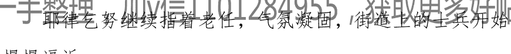

老任皱着老眉，气色很紧张，急看着自己的条形慢慢逼。

“虎符！”大拿明白了，对着老任说，“他在向你讨要虎符！”

老任没有回应，现在大家都明白老任的意图了。只有刘所长说了出来：“大哥，你向他要什么什么？”

老任没有理会刘所长。他对着薛律旁说了一连串的话，这些话旁人都不听懂。刘所长说：“看来真的没错，你就是契丹后人，既然把语言都秘密流传下来了。”

老沙明白所长的意思，契丹族在灭国之后，四分五裂，从这世界上消失，再也没有契丹族一说，历史上记载的是：契丹族和其他民族都融合了。看来老任这个家族就是隐藏在汉族之中，但是并没有被汉族同化，而是这个秘密传承了数百年。

“你是耶律乙义在现代复国吗？”老沙对老任说，“冷兵器时代的士兵，这种想法，你不觉得荒谬吗？”

“他们可以先安顿下来，然后隐藏姓名，慢慢的谋划。”老任说。

“这种可能也太大了吧。”老沙觉得老任在信口开口。

“不，”指向”老任说，“有一件事情你不明白。”

“我不能确定的事情，”老任说，“但是是我必须试一次。”

“可是看着他并不想听的。”大拿咧了嘴。

耶律乙义没有说话，仍旧举着长刀，对着老任比划。意图很明显，他要掳虎符。可是老任却坚持着对着耶律乙义说老的契丹语言。耶律乙义根本不为之所动。

老任不停的摇头，他在拒绝耶律乙义。

耶律乙义领着绳轭，退出了院落。突然院外一阵马匹的嘶鸣，几个骑兵飞快的冲击进入了院内，骑兵高举着狼牙斧和大刀，就要向众人砍杀。

“道长！”刘所长大喊起来。话音刚落，骑兵纷纷从战马上掉下来。似乎是空中有某种看不见的东西，把他们击落。

那个青城派道士，扔了灯笼。拿着一柄长剑，对着前方，嘴里念念有词。

[content]<!-- no content -->


在宽阔的湖岸山上，古装士兵整齐列队，一队骑兵着高头大马围着奔驰，每个人手中都举着长刀。在他们中央地上，半跪着一个人，低垂着头。他身上的甲胄与众不同，应该是比较高级别的将领。

在他面前，有个穿着奇异异袍的人双手举起，跳着奇怪的舞蹈，而在旁边，有三面大鼓，六个大汉挥舞鼓槌进行演奏打着。

只是一晃眼俐的功夫，那个高级将领陡然抬起来，露出青面獠牙的怪异面目，他的视线仿佛穿过所有人的躯体，直望向神喻。

惊惧之下，神喻几乎是不下意识的沉回水中。

他整理了脚留下的那些马的脚印，神喻冷静下来。

这个念头，简直比看见张张还要恐怖！

神喻有片刻刹栗，他忽然明白，为什么之前在之前的那个空间，看到撞膝的光日，还有掠过的感觉，那是因为，雾气里，根本已经是另一个环境，而不再是地下的。

又或者说，两种场景，交叠在一起，既是地下，又是荒原。而现在，他通过通道，正式到了镜面世界的面对！

但立刻，他感到哪里不对劲。

他没有听到任何声音！

虽然离岸还有一定的距离，但那些弃马的声音，敲鼓的声音，不可能听不见。

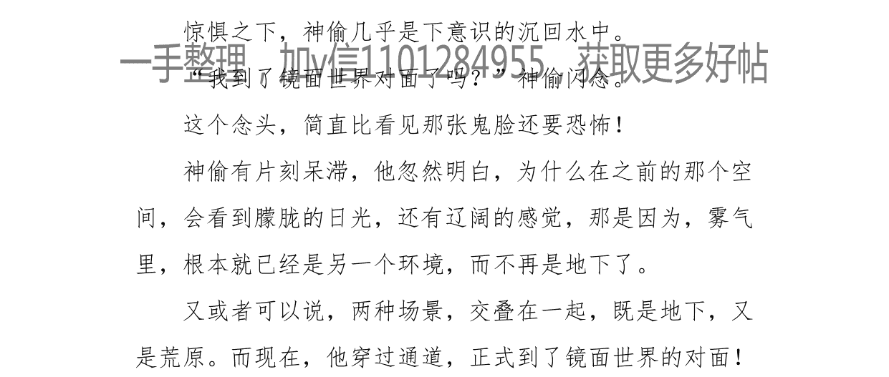

神偷再次出头，要去确认。

这一次，他看到那马队中，分出一小部分，令驰策着胯下的马匹，从岸上直接向湖中，马匹困难的跋涉，身体摇晃，在水中站立不稳，但在骑兵们的拼命驰策之下，马匹奔夯向前，很快，就被淹，士兵们的身体煽动几下，也都淹在了水中，整个人都看不见了。

“他们成功了……”神偷喃喃自语，“原来就是他们那边送去的办法……”

马蹄进入湖水下的地方通往另一个世界的秘密，说不定就在那里。

湖水之中，可见度并不高，但神偷还是能够看到，在那些湖水之中，存在着多条交叉的管道，它们亮又显得厚重，其中星光溜溜，就跟他之前在温泉水中得以幸存的冷冷流纹一样！它们在湖水中无限延伸，交织成网，呈现瑰丽的景象。

那些骑兵们，一入水，似乎被那些管道所吸引，连人带马，一起冲了过去。

虽然是在水中，可那些马匹竟然是以陆地上的奔驰姿态进行。

骑兵们过去之后不久，烟焰逐渐消失不见，过了一阵，又在此出现，接着，又有一队马队，从岸上冲了进来。

神偷看了会儿，就明白了，虽然镜面世界的律众多，没有能力一次将所有人送过去，必须分批进行仪式。

很快，他就计算出空间隔的时间，等待下一次仪式进行完毕，他在古代士兵之前，进入了通道之中。

神偷再次回到一片朦胧的热雾之中，但奇怪的是，这一次，他脚踏着实地。

在不远处，传出整齐划一的脚步声，他们身上的铠甲相摩擦，发出声响。

“放开我……”那是婉儿的声音。

今天没了……多谢各位榜场，多谢多谢。

作者：蛇从 日期:2014-03-25 22:18

今天会有点晕，大家不要等……明天看。

作者：蛇从 日期:2014-03-25 23:23

听到婉儿的声音，神偷的心立刻悬了起来。他怪自己，再次把婉儿丢下，又让她陷入了危险。

显而易见，婉儿已经被古代士兵给抓住。很快，神偷就看了，因为那些雾气中，随着古代士兵的靠近，身影渐显显露了出来。

婉儿被横放在马上，双手反缚，挣扎叫喊，但无济于事，


把她抓住的那名骑兵，这时坐在他同一匹马上，满脸冷汗，蹿高气扬的望着远处，双脚用马镰撞击了一下马的肚子，催动马前进。

古代士兵们发现神偷，立刻万骚着什么，朝他冲上来。

神偷下意识的想抬头就跑，但他忍住了，婉儿听到声音，侧头望向他所在的方向。

“别怕，我有陪你！”神偷反而朝着抓获婉儿的那名骑兵走过去，这名骑兵的穿着，和其他骑兵差不多，并不是什么将领人物，婉儿应该是他抓获，所以就成了他的战品。

婉儿咬着嘴唇，眼泪在眼里打转，不知道是绝望了还是为了别的什么。神偷强敛了心，心里，没有任何事，看着婉儿哭，难道不能让她更痛苦吗。

古代士兵们没有对神偷直接采取暴力，看到神偷没有抗，又有人走上来，拿绳索他也捆了，另一个骑兵举起他，放在马背上去。抓了他们之后，骑兵和步兵都继续前进。雾气无穷无尽，把路掩盖，不知道他们要去哪里。

走了多分钟之后，队伍停住，两名骑兵跪下，把婉儿和神偷扔到地上。

神偷努力起头，在他面前，有几个穿着奇异服装的人，他们就是之前的镜面世界面对。无疑，这几个人掌握了某种隐秘，可以帮助。穿越到镜面世界面对的军队。

“你们是来堵付？”神喻立刻挺直腰板，因为他发现，这个人说的话，不再听不懂，而是汉语。

作者：蛇从 日期:2014-03-25 23:23

老沙汽车剧烈震动，驾驶室内弥漫着烧烤的味道，前盖下发出轰鸣，后方冒起烟，老沙在等待，一旦松开刹车，汽车就会咆哮出去，碾压那些挡住他们的士兵。生死关头，杀死不可避免，但老沙只是普通人。老沙开着车，往大龙家菜馆赶。他们没有时间去救兵，沿途，老沙绕路避开夺势的士兵，选择偏僻的道路，靠近大龙家菜馆之后，就没办法了，士兵们围得水泄不通。

“呼……呼……”老沙看着车前一队士兵，呼吸声逐渐加重，他将车停在道路中央，脚踩油门，脚脚着刹车。

老沙沉睡着没出声，眼睛盯着前方，大拿看得出来，老沙肯定已经意识到了这件事。

镜面世界的人如果没有古怪，那么老任就用不着花多的心思，把他们弄过来，说不定，不死只是他们中的一个能力，还有它的能力，没有表现出来。

大拿不敢多想，甚至连死那些士兵都不多看一眼，但那一个处理在心里很急，获取更多好帖。

老沙死命咬住方向盘，不让汽车失去方向的控制。车外，哀杀声不断，就算是大拿当过兵，也为这种士兵的气势所折服。这些人，是天生的战士，勇敢融入他们的血液。一根箭也无法穿古代甲，古代士兵难以挡庞然大物一样的汽车。

大拿正在后退，立刻就脚跟踩了一个柔软的东西，但他收不住，踩踏下去。

“噗……”那东西被踩爆，发出一声响。

“抓紧！”老沙朝大喊道。

大拿抓住驾驶门上的把手，挺直了腰板，老沙做出决定，要冲锋了。汽车撞着古代士兵，将身的几个人撞飞，有人被卷到轮胎底下，车子碾压了他们穿甲的身躯，一阵隼断。士兵不畏死的冲过来，马背上的骑兵手拿弓箭朝汽车射击。箭头撞击在车窗上，砰砰响，同时玻璃出现了一道裂痕。

见古代士兵们挡不住汽车，大拿稍放松了点，但随即，脸上出现了不可思的神情。他看到后视镜里，那些被碾倒地的士兵竟然又站了起来，似乎没有受伤，疯狂的朝汽车而去。

“我知道老任为什么在意他们了。”大拿吞了一口唾沫，声音带着说，“镜面世界里来的古代士兵，是杀死的！”

作者：蛇从 日期:2014-03-26 01:05

扛不住了，睡觉……

作者：蛇从 日期:2014-03-27 00:33

今天有事耽搁到现在，不好意思……休息一天……明天更新。对不起了。

作者：蛇从 日期:2014-03-27 20:40

老沙沉睡着没出声，眼睛盯着前方，大拿看得出来，老沙肯定已经意识到了这件事。

镜面世界的人如果没有古怪，那么老任就用不着花多的心思，把他们弄过来，说不定，不死只是他们中的一个能力，还有它的能力，没有表现出来。

大拿不敢多想，甚至连死那些士兵都不多看一眼，但那一个处理在心里很急，获取更多好帖。

老沙汽车开得飞快，把那些士兵一通撞，接着猛打了一把方向盘，汽车迅速扭转方向，车尾对准了大龙家菜馆后门围墙。

“紧张！”老沙又喊了一句，立刻把车倒退，撞向那面围墙。

一阵剧烈的碰撞声响起，大拿感觉到整个身体因为惯性陷入座椅垫里面，全身背骨和内脏发生挤搓。紧接着，后方的车斗里冒起灰尘，大堆碎石散落在车斗里。

汽车剧烈颠簸了一下，进入了家常菜馆后院。

家常菜馆里一片漆黑，门紧闭，前方士兵们的杀声不绝耳，但与之对应，在大拿方的菜馆房间里却没有任何声音。雷之下，玻璃反射电光，静悄悄的令人心悸。立刻发现不对，向后退出几步。老沙按了下哨，焦急促，现在时间等人，那些围墙外的士兵，已经从塌的地方进来。大拿正在后退，立刻就脚跟踩了一个柔软的东西，但他收不住，踩踏下去。

“嘭……”那东西被踩爆，发出一声响。

作者：蛇从 日期:2014-03-27 21:39

一只巨大的、多足蜘蛛从墙角爬出来，脚心发麻，大拿心里挺直倒，而且就在不久之前。被踩爆的一瞬间，整个菜馆的墙壁似乎活了，发生蠕动。雷闪闪，电光里，大拿看得真切。在建筑的墙壁上，缠满了一层层密密麻麻的蜘蛛，他和老沙在刚底下，在钢铁管道里见过那种。大拿本以为它们永远被埋在地底下，没想到又会出现。大拿转身就跑，二步就回到了车上，然后把门关死。

“怎么回事？”老沙还不明白看着大拿跑上车，而是用手指指了下方的窗。老沙倒吸了一口凉气，不用大拿回答，他已经看到了无数彩斑斓的蜘蛛爬上了汽车，仿佛给汽车盖上一层布，工夫，车外就被盖住了。而那些古代士兵也意识到了什么，刚从塌的壁进来，立即又跑了出去。

“那个虫的……”老沙想到了什么，大拿疑惑望了，“你知道这些虫来？”

“这是后的招。”老沙点点头，“老任不可能，现在看来，他比老长许多，那些古代士兵。”大拿累得了。

“我曾经听师傅说过，厉害的可以钻入里面，还能控制人……”大拿接过话头，“我不知道有没有厉害的……”老沙说，“但真有这么厉害的，那老任就太可怕了。”

“老沙，我们肯定能做点事。”大拿急切的说。老沙摇头，“我们做了很多事情，但每次行动，都在把事情弄得更糟糕了。我之前跟你过的，我们只是棋子……”

“我们必须告诉所长……”大拿呆片刻后，说，“老任这个人，太危险了。我还以为他是疯狂。”

“你觉得所长不知道？”老沙没有大拿那么激动，冷静地侧头地，“所长肯定知道，但他也没有办法，没办法阻止这一发生，这些事情，是注定的！”

大拿正在后退，立刻就脚跟踩到了柔软的东西，但他收不住，踩踏下去。

“噗……”那东西被踩爆，发出一声响。

嫣儿的假胸————嫣儿半夜会来找你……

作者：蛇从 日期:2014-03-27 24:41

作者:phhuhui 来自: Android 客户端 时间:2014-03-27 50:00

终止道大部队了。蛇哥求合影~茄子。。

作者：蛇从 日期:2014-03-27 21:42

作者：洋暖殷殷 时间:2014-03-27 08:09

今天有事耽搁到现在，不好意思……休息一天……明天继续更新。对不起大家。

@蛇从 12447楼 @孤独者魏连炙12455楼 时间:2014-03-27 01:45

# 一手整理 加微信110184955 提取勇哥好站

今天有事事……您可以看下无荒装料理佛的小说，极少断更。就算断更，第二天也会补上的。小佛佛那里是付费，您这里是免费给大家看，谢谢您！也请您白天点下来说，大家抱着希望而来，总是归欢而归。昧了。蛇哥这个时候说不能更新了，可想到他晚上其实想把事情结束了再更的，哪怕是再晚，他也会更新的，但是在这个点打了这么这一排字，蛇哥心里也是很纠结的。希望大家都能体谅

谢理解，的是这么事，不到最后，总还是想写点。。有时候实在力不心，就好好放弃了……

作者：蛇从 日期:2014-03-27 21:43

作者：我不是乖乖妹 时间:2014-03-27 15:05:05

颜显巍巍地马克！！！颜显巍巍的蛇兄，已经几个晚上木有好了，继续写又不能！

作者：蛇从 日期:2014-03-27 24:44

尽量继续吧！以后解释清楚。谢谢哈。

作者：吃棉 来自:Android 客户端 时间:2014-03-26 23:08

作者：阿咪喵 来自:iPhone 客户端 时间:2014-03-26 29:00

盛夏 日期:2014-03-27 46:00

蛇从 日期:2014-03-27 23:02

大拿听明白了一点。老结了。

作者：蛇从 日期:2014-03-27 23:03

作者：洋暖敛影 时间:2014-03-27 24:48

为什么蛇哥一直不给我发茄子发三根。茄子。

作者：蛇从 日期:2014-03-27 23:04

今天没了。

作者：蛇从 日期:2014-03-28 22:16

“不用多想，地下的那个神兽，肯定就是镜面布局形成的原因，它苏醒过来，镜面布局才能实现……”老沙整理出思路，对大拿说，“我们两个，被老胡骗进了地底下……他单单是钢厂的员工，而且，跟守人确实很大渊源，说不定就是守君人的后代。那道钢杆，插入地下，我一直认为是插入墓，但现在错了。它插入的，是那个神兽的身体，这样才把它彻底镇压住！”

大拿感到震惊无比，“你的意思是，我们顺顺着钢管，进入的是神兽的身体？”

老沙点点头，“老仁提到，那神兽是六鳍鱼，你也看到了，它的眼睛有多大，这整个虎符，可能就建在

“这该怎么样做？”大拿不敢相信。

“这就是我们的作用，真正唤醒的，是我们两个！”大拿恍然大悟，气得牙痒，“难怪刘所长一再再的阻我不要参与这件事，还把管道给堵死。”


老沙叹了口气，算是认命了，他也是到现在，看清老任的真实面目，才意识到神瑜和婉儿，恐怕要葬身底了。不，以老任谋深算的性格，不会轻易的让他们去做事，而是会尽量的阻止。

另一方面，从不多久之前开始，地面的微震就没有停过，这只能说明一件事：那面临苏醒的鱼，仍然没有得到镇压！不用了多久，它定会醒来！

也就是说，神瑜和婉儿在地下很久久，并没有把鲤鱼的孔给堵上。

“婉儿看起来很年轻……”大拿忽然淡淡淡的说，“不应该这下去早死，还是凭死吧。”

“我想下去救他们！”大拿说，“不过首先，我们要进龙家常菜馆，把老任抓出来，让他交出虎符，这样律敛奴才能退兵！”

“听起来很简单。”老沙笑了下。

“本来就很简单！”大拿坚定的说，“我们是卒子，但卒子过河，能杀帅！”

“这话倒是贴切的。”老沙点头，“到了这一步，我们没有退路了。”

大拿和老沙在土方车里聊了很久，把事情都尽可能的梳理清楚，到了后半夜，两个人忍不住疲倦，就在车上睡了过去。

大拿这一觉从没有过的香甜，甚至都没有做梦，当他再睁眼睛，已经亮了，车窗外的太阳出来老高，阳光猛烈，亮刺眼，隔着玻璃透进来，仍然能感觉到十分炎热的温度。

昨晚撞破墙的地方，砖头乱七八糟的倒在地上，地面各处都是旧的，一些杂草上挂着水渍。周围很安静，再听到士兵们的嘈杂声，也没有了他们的踪影，外面街道，一个人影子都看不到。大拿把头贴着车窗玻璃看着，外面到处都是废墟，他发现脸上聚了一层好灰。恍如隔世，昨晚上发生的一切，跟一场梦一样，不像是真实发生过了。

片刻失神后，大拿吸了吸口气，想：他和老沙睡着后，不是又发生了什么事情，虎镇的危机已经解除，那群古代的士兵按先过来的方式，回到了属于他们自己的世界。当然，他知道这只是他一面情愿的想法。

大拿揉了下脸，舒缓了手臂，全身肌肉僵硬麻木，动弹起来像个机器人，疼痛从每一块肌肉钻出，仿佛所有的肌肉都曾经经断裂，让他难以忍受。让昨晚撞动土方车挡板，显然是伤了，而且吃师父留下的药，副作用相互叠加，想要复原，恐怕需要静静修长一段时间时间。

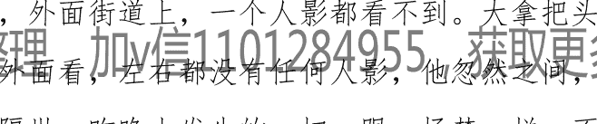

“老沙……”大拿扭头，朝着驾驶室后座喊。驾驶室后面，有一个可以睡觉的软垫铺，司机们可以暂时休息休息的地方，老沙昨晚睡在那里了。

当大拿回头时，忽然一惊，后面的垫位上，只有一张毛毯，老沙不知道哪里去了。大拿下意识的扯了扯毛毯，老沙的确没有了，大拿立刻向左边驾驶室的门，昨晚他们把门锁死，但现在，那里已经开了。很显然，老沙已经出去去了。

大雨下了之后，地面都是泥泞，大拿看见上面有爬虫留下的细碎而连续的痕迹，可见昨晚，的确是有无数蜘蛛爬行过。现在没有痕迹，连一只还活着的小虫都看不见了，而且连他昨晚踩死的虫子尸体，也没有了。

大龙家菜馆的后门已经打开，大拿警见里面有人影动，还有人声传出，从声音判断，应该是刘所长和老沙在说什么。大拿放松下来，想到应该是老沙早上醒来，提前进到菜馆里查探，他睡得太死。


大拿从后门进去。果然看到老沙和所长在里面，还有那个青城的道士，地上还有几个受伤的人，都是老任的手下。其中有几个受伤比较严重，靠着墙躺下，道士正在给他们看伤，其他受伤较轻的则默然的抽烟，连大拿也没抬头，昨晚受到那样的惊吓，陷入了恐惧之中，一时间没能缓过来。

所长满脸疲惫，见到大拿进来，停止了老沙交谈。大拿有点畏惧，勉强的挤出一丝微笑，所长让大拿坐下。

“当初才把你安排在山上，我就料到会有这一天。”大拿吐了口气，“老沙性格憨直，你要早跟我说，我会听你的话。”大拿说，“你知道路人的行动，为什么不告诉我！”

“现在还是不是了。”所长瞪大了眼睛，“让你管好山上，可叫你到处跑，是些什么。算了，这些不说，世上没有后悔，事情已经变成这样。刚才跟老沙也说，这么大的娄子必须尽快解决，我把附近的人赶走，但不是全部，这里还偏僻，不然昨晚就没办法收场。另一个情况是，虎镇是旅游景点，游客比较多，大家都说准会有来，而且之前出事引起了关注，要被他们发现。”

“老任还有那个地方，昨晚又不见了。”老沙叹道，“他们一定是去找律敛了……”

“那些人去了哪里？”大拿疑惑，“我们也可以去找他们，到时抓住老任，让他交出虎符，律敛就会退兵。”刘所长说，“我们昨晚都睡着，醒来就没有看到他们。”

“那些士兵……”正在给别人伤的青城道士说，“不见了，白天一定会躲起来，晚上才会活动。虎符镇不大，告诉小子，躲起来怎么样？”大拿急得糟糟，“这个青城道士的事，大拿亲眼见过，他的话，大拿比较相信。”

“纪律严格，肯定是躲在一处。”老沙说，“我觉得有一个地方很有可能。山上！”大拿眼睛一亮，“要容纳那么大规模的人，除了山上，真找不出地方。“不会。”刘所长摇摇头，“他们在任何地方都会去，但山上不敢去。“对。大明国师曾在那个地方设置过禁，士兵一定不敢靠近。”青城道士说，“他们肯定躲在别的地方。这个地方比山上小。”

老沙和大拿对视，都莫名的，他们两个想到的都是，现在青城道士不是一样所在的。青城道士打开门，走到前院，摇头张望一阵，又在院子里走来走去，似乎在计算什么，过来很久，指向了南方，“他们是往那个方向去的。”

“那是天桥吗？”刘所长跟身边说道，“对了，他们肯定是天桥山。”


对于天桥山，大拿并不陌生，这个地方，是虎符镇准备开发的景点之一，因为款项未到位，开发工作一直没有进行，现在还是只是无人处的荒野，平时很少人去。很多虎符镇的游客，到处都是迷路的，尽处地方很危险，而且远远观望，欣赏效果反而比较好。

天桥上有两座石桥，不是人修建，而是天然形成的。一座横跨东西，挂在半空，延伸到对面山上；另一座则不知是断裂还是就只有半截，看起来像座断桥。山上水气浓，云雾缭绕，两座石桥若若现，如同通天之路。天桥山虽美，但下面有个天桥洞，在虎符镇心中却是个凶险的地方。经过都能感受到森森的氛围，甚至听到洞中传出令人毛骨然的呐叫，还有人看到白色。


人影在洞中忽不定的游走，转眼功夫就消失了。很久以来，说里面有鬼魂作祟，各种惊悚的故事，虎符镇民对此讳忌。其中有一件事，大拿是知道的。有人在山上，在山里走错了路，来到了洞口。听过天桥洞的传闻，一看自己立刻想远远去。见洞里有熊熊火光，周围似乎还放着明亮的物件。偷者停了下来，转念想会不会是天降之财，走近一看，发现的确是宝石，一颗颗圆润透亮，手里分量很。他虽然不出什么品种，但知道肯定是值钱的。立即脱下衣裤，将袖口打结当作临时布袋，把宝石全部装完。难掩喜，背起宝石就走。这时，他忽然看向头顶，发现有绳子晃动，发出摇曳的声音。正在犹豫，就有几滴液体滴在他头上。拍头部去看，立即吓得大叫，跌坐在地。上方赫然挂着数具尸，空悬倒，双腹被缚住，脑袋朝下，口中吐出半截舌，舌尖上滴着水。身体被风吹摇来摇去，像一块干肉。宝石从袖口里逸出来，那可是什么宝石？而是一颗滚圆的眼子。偷者什么都顾不上，连滚带跑向山下逃命，跑到山脚，被巡林的人看出蹊，送到派出所了。偷者赖三回这件事情说给派出所的人听，派出所的人又听懂了他的意思。回到山洞，却没有发现偷者所说的尸体和眼珠，于是判断偷者是鬼迷了心肠，受了惊，吐口水，直说说道。


大拿把事情跟刘所长说了。老沙简直从酒桌上起来，简直是从酒桌上起来，他看着嫂子清醒，刘所长显然对他一通臭臭，让他脑清醒点，不要人云云云。大拿闷不乐，好几次想山上探险，后来事情忙，慢慢忌了。现在刘所长和青城的道士提到天桥山，大拿不由得背脊一凉。“天桥洞的那些传闻都是真的，是不是？”大拿朝刘所长道，“那个地方，到底有什么秘密！”刘所长看了看手表，招呼大拿进门，“我不在你，什么都告诉你。趁着时间还来得，我跟你们说，你们吃点东西，补充体力。之后的事情，还要靠你们。”他说话的时候，也示意了老沙。

“你先把事情说清楚。”大拿的语气一点都不客气，“我看看情况，跟老沙一直藏，以后，我们不会再犯傻了。”

刘所长点了烟，靠着菜馆里的一张桌子坐下，青城道士也回到常菜馆的地上，铺了个草垫，闭眼打算休息。老沙到厨房里点了卤菜出来，同时还拿了一锅饭。饭是热的，很香，看来老沙是早上起来之后就煮好了，只开头吃。“我都饿得没了，像半年没吃过饭一样。”老沙揉着肚子，看着火加水，热汤多好。在喝，没人会我们买单。”大拿摇头拒绝，眼睛睁盯着所长，示意他可以了。拿了碗，老沙放轻松的语气并没有起到，也不再说，拿了碗，自己找杯子倒酒，埋着头大口吃饭。

“天桥山是核心的一部分。”刘所长说，“当年老辈在这里布置这个风水的时候，把山脉，地势都考虑进去，就是为了跟脚相对对抗。曾有过段时间，起到了很好的效果。但是，直到十年前，核心风水被破坏了。“真的是核心……”大拿望了一眼老沙，“核心风水，是要用人命填的。对不对？”刘所长听出大拿语气里的火药味，老沙冷一笑，“你这路子懂多少！”老沙拍了拍眼睛，又揉了头，“说到风水，确实比他何况这个半路家的小子，师父也从来没说过自己是这样。那都是我听途说的猜的。这个风水，修在镜面布局上面，利用的是活人生机，压制士兵。这两者被控制，地下的士兵不会活，一切都出现了。想法很好，但没起到作用。”大拿说，“都是做无用功。“老任背后的我们！”刘所长激动起来，“他帮守陵人，把风水改变了，核心风水，是要用人命填的。对不对？核心风水，帮守陵人，把核心风水改变了，无计可施！我已经花了很大的心思，还是对付了他们！他们把彻底落了，一个的人就为了破坏风水而死的！你无法理解他们的决心，民族重生不是复兴，而是重生，你懂不懂，民族在这个世界上没有了，但血脉还在。”大拿被刘所长听到，拿了碗装东西，不敢出声。

“我之前看来是核心风水，守陵人的村落，山上，虎镇中，还有黑林子，就是四象，那个天桥，没有在内……”老沙嘴巴里咳嗽着，急切说道。“四象，两只？”刘所长慌了敲了桌子，有点不耐烦。“竟然有阴阳？”老沙恍然大悟，“真是个布局高手。对方既然就是镜面布局，破解起来，自然要有跟它相同的手法。”所长见老沙反应迅速，神色下来，“而且要把对方的布局，也纳入到自己的布局里。黑林子，守陵，本来是镜面布局的一部分，但后来成了核心风水一部分。这个天桥山，是核心风水阴里面，这样的地方，还有三个。不过我只知道天桥山，其他的三个，我找不到。“那个天桥山，到底有什么奇怪？”大拿忍忍不住问。“破局。”刘所长说，“当年对我刨根问底的案子，天桥洞里倒挂人，就是守陵人为了把核心风水破坏掉的一个手段。我当时知道蹊诡，可惜没能破局的这个事上还没想。”大拿皱着眉思考，突然想到什么，把嘴里的饭，都喷了出来，他激动的对老沙说：“你真猜对了，五法桩。倒挂人，是天桥桩。”刘所长显得有些不耐，“大拿就把事情跟刘所长说了，刘所长长时间一遍又一遍的打量老沙，很久才说：“想不到你还有点本事，刚我看向了。”“都是瞎琢磨。”老沙有些得意的笑了。“破掉风水，没那么容易。”刘所长说，“用人祭祀，是其中最浅的一个步骤……”（此处为OCR重复的OCR错误内容）


镜面布局，利用的是活人生机，压制士兵。这两者被控制，地下的士兵不会活，一切都出现了。想法很好，但没起到作用。”大拿说，“都是做无用功。“老任背后的我们！”刘所长激动起来，“他帮守陵人，把风水改变了，核心风水，是要用人命填的。对不对？核心风水，帮守陵人，把核心风水改变了，无计可施！我已经花了很大的心思，还是对付了他们！他们把彻底落了，一个的人就为了破坏风水而死的！你无法理解他们的决心，民族重生不是复兴，而是重生，你懂不懂，民族在这个世界上没有了，但血脉还在。”大拿被刘所长听到，拿了碗装东西，不敢出声。


他休息好之后，也坐在桌子上来吃东西，那两个警察，把他无视掉，没有把他带走。

“你是谁？”大拿好奇的问。他知道，这个年轻人，也是老任的手下，但看自己长的安排，似乎并不打算处置他。

“你可以叫我小方。”那个年轻人用手抓饭抓菜，弄得满手都是。他的饭量很大，连菜都自吸不如，剩的半锅饭，都被他人吃掉，盘子里的菜，也都被吃光。

“你跟他们不一样。”老沙说，“你有点本事。我看昨晚上你，打倒了那个不死鬼兵”。

大拿这才记起来，他是看到一个黑影，跟那群古代的土匪打仗，当时没有留意，现在想起来，现在的眼前这老任……

“老任让我留下来跟你们一起去。”小方把沾油的手，在衣服上擦了两下，又摸了摸嘴，一副不拘节的模样。

“原来你是所长的人。”老沙笑了下。看来，小方是所长安排在老任身边的人，老任只带走了得力的苗人蓝婆，把他给留下，这种牌，已经用了。

“除了那个苗人，老任不相信任何人，我在他身边起到什么作用。”小方没有否认，“我吃饱了，随时可以走，我们要要准备点什么？”

“带点干粮。多备几个手机，还有绳索。”大拿说，“老沙，你的刀丢了，是不是找别的什么傍身？”

“算了。”老沙摇摇头，“跟那些鬼兵打架，就算有刀用处不大，最好就是避开他们。如果不去山洞，找到老任，那最好就好。”

小方听了大拿的话，就去找些必需品，大拿看他熟悉路，就没再拦。老沙抬头望了望外面的太阳，找了手套戴，又拿了顶草帽。

大拿见状，有些不明之此，就问：“老沙，这么热的天，你还拿什么手套，不怕捂得中暑？”老沙笑了，没有回答。

三人准备停当，出门朝天桥山走去。大拿发现，老沙见王理，竟从包里取出水壶，阳光亮到了。人都还足劲，朝天桥山走，半个小时后，就到了天山脚。

远远去看，天桥山上雾气腾腾，大拿知道，这跟昨晚刚下雨，没什么关系。天桥一直以来，就是这个胖子。时候虎符镇是阳光普照，这里会聚起乌云，下一场小雨，在山腰挂起彩影，与那山巅的天桥相得益彰，非常奇特。青城的道士，说天桥洞是极阴之地。大拿猜测，天桥山的神怪之处，应该就是阴面镜心风水有关系。以往令人神往的景致，现在看来，令人畏惧，层层白白的雾之下，有什么在心中激动。

三人几乎同时打了个寒寂。小方在路上抓起一把泥土，在手里捏动，然后抛洒出去，原本湿润的泥土，竟然成了细碎的粉尘，被风一吹，四散起来。

小方鼻头抖动两下，对大拿和老沙说：“那些古代的土兵，的确已经上山了。”

大拿跟老沙愣了，他们没想到，这个年纪轻轻的小方，有这本事跟追踪的事实，难怪刘所长会把他留下。

> “老任跟那个畜蛋人？”老沙问道。
> “他们的气味，我暂时不到。”小方摇头说，“老任现在看来，他已经没办法对付我了。”
> “我们先去问口，不管怎样，老任都会上山跟律乙穷交涉，只是时间问题。”老沙说。

天桥山人迹远至，树木高大，树下又有杂草丛生，一开始，大拿看不出任何行走的痕迹。那些士兵上千人，如果过的话，一定会把这一片地方踏平。正在疑惑时，在前带路的小方停住。大拿一看，立即释怀，前方的杂草小树都被踩倒，肯定是大量马路过。

也才知道律乙穷是用了什么办法，带领手下凭空出现在这里，可能是知道有人会跟着，所以把前面一段路上的行程给掩盖掉。显然，律乙穷并不清楚青城土地和小方的事本。跟着他们们踏蹄的痕迹走，就算没有过去天桥洞，三人能轻而易举的找到了。

一个寒气森森的洞口，很快出现在三人面前。洞中，有几个士兵来回走动，不停朝外面打量。奥律乙筹已经把山洞占领。三人躲在一块高大的青石后面张望。天桥洞口一人大，看起来比钢厂的大门还小。

“那么很多人，难道都留在洞里？”大拿轻声问道。老沙点点头。

“我们就在这里儿。”老沙说，“老任迟早要来截住他。像他一样吧。”

“我不知道。”老沙说，“如果他已经进去交涉，那我们只能等他们出来了。以我的预测，老任还没来。奥律乙筹不买账，他现在要增加筹码。”

“我听他们说过，那个苗人有控制人的手段，要等到时候才有用。”老沙说。

“他们肯定要来。”老沙轻松的说，“大拿你对付老任，我负责对苗人蛊，把虎符拿到。”

三人在石头后面，等了一阵，大拿就忍不住，不时往山下望，看向洞口。老沙靠石头闭眼睛，不知道醒着还是睡了。三个人抬头看着天上，太阳藏在一片阴云里，灰蒙蒙的一团。附近的山林里，冷风不停地拂，让他身上发冷。大拿清楚自己的体质，即使在冬天，用棉袄御寒，没想到这种寒直让他打哆。云还没出来，半个月的月亮，天空都泛着银色，连呼吸出来的空气都是白雾。

“好冷。”小方缩着脖子说。

“下雨了。”大拿抬头看，天上的乌云竟然聚了不少，黑压压的笼在他们头顶，看起来就要入夜。山风里，传出一股腥味，越来越。大拿的心跳非常剧烈，这种情况，即使在面对死的时候都没有发生，但现在，大拿意识到，很大的危险正在迫近。悉悉索索的声音，从山下传来。

“好香的气味。那种控制的虫子来了！”小方变得嘶哑，像是脖子被人卡住了。

“老任又来了。”大拿觉得奇怪，他并没有闻到香味，但还是上前，想把老沙叫醒。还没碰到老沙，老沙就睁眼，他的确是在养神，而且相当警醒。

“按我们的计划来。”老沙说完，就朝向山下走去。大拿已经能够想象，那些五彩斑斓的蜘蛛正在地面爬动，它们非常多，漫山遍野，爬满了每一个角落。大拿虽然没有看到，他眼前却出现了这一幅情景，这种想象让他浑身毛竖起。他在老沙在努力对付蓝蔓时刻，而这一次，苗人蛊的虫蛊，力量达到了最强的时刻。

午后了。除了乌云，山里雾气更加浓厚，近到两米距离外的事物逐渐看不清，大拿望着老沙的身影，在浓雾里消失。

“完了了。应该我去对付蓝蔓！我上有道士的信物。”大拿拿出黑色的木片，木片里传出一丝丝的热度，竟然让他产生了一点温暖的感觉。

“我们去找老沙。”小方对大拿说，他从挎包里拿出一个奇怪的面具，戴在脸上。大拿一见，神，呆呆的望着，小方带着的那赤红面具上，四个额洞，占了整个面的面上部，下方，则是獠牙交错往外露出，形同一个恶鬼。

大拿在小方身后，小方自从上了那个奇怪的四面面具之后，整个人就变成了一种气势，不再是先前那副累首露尾的样子，身影似乎变得高大不少，但仔细看去，他的身体四肢又还是原来的那瘦猛。小方走在大拿前方，雾气自动散开，一条道路被开辟出。两人走过去，雾气又自动合，把他们经过的地方再次遮掩得严严实实。大拿表情凝懂，终于明白，在这片山上，小方走的路是一条直线，直奔目的地而去。大拿紧跟身后，不在多，小方去的地方显然就是老任所在。他必须做好万全准备，逼迫老任。前方的雾气中，有一个人影，那是老任，正在寻找东西。“老任。”大拿叫道，“很久了。”

老任打了一眼大拿，然后就把目光停在戴着面具的小方身上，“当初你说自己这身份上，我没见过。你不是我们的对手。”大拿说，“老叔，你也曾经是老沙的人，我不想跟你手，就算了。”老沙背着手，慢悠悠的说，“不过，一代不如一代，虎符我是不可能交给你的，就算你父来，也未必是对手。”大拿不清楚小方是什么传承，看样子，老沙很有渊源，也不会跟着刘所长做事。大拿意外，老任冲去，小方却被拦住。大拿站上一看，觉得没什么。之后，就感觉四周变了，空地上莫名其妙出现了很多柱子，估计要四个人合抱下。每一根都是上下一样。原本在附近的老任和小方，突然不见影。这种情形，大拿知道自己又撞了，老任这种人，不可能没有防守。大拿触摸着柱子，向前走，后方的柱子就会消失，前方则慢慢露出。他仿佛置身一条无尽的长廊里，永远跑不到尽头。当他换个方位，朝另外一个方向跑，前面的情形也是一样。无数的柱子，形成一个迷宫。大拿停下来，四处张望，他很清楚，这就是布局。但是老任被耍了，他跟着探险在黑林子里差多少，但又有本质上的区别。布局依赖的是地下的磁场和周围的树木，让对方产生混乱。大拿清楚记得，在布局之前，他跟老任的距离，只有三米远，地面空荡的，也没有什么布局的东西。“不对，”大拿忽然想到，就在他和老任之间，还有一些竖立的小棒。它们被雾气挡住了。如果不仔细看，根本看不出异常。而且谁可能想到，那种木棒，竟然能产生如此效果。大拿想起来师父曾经告诉他典故：诸葛亮能用一堆困住了东吴几十万大军。现在情形何其相似，老任只用了几根木棍，就把一个大人给困死。

各位晚安。明天太阳照样升起，日子还会继续。

## 132 老蛇有心事

你看出来？

主角本是一家百货公司保安部门的头儿，最近他正为公司里前阵子发生的一起不明火灾而苦恼。火灾除了毁……

啊……

一手整理，求天老哥有错的地方，大家不要删。

大拿被困在阵中，四周的雾气逐渐散去，一望无际的地方都是柱子，充满了他的视线，让他产生绝望的情绪。在无尽柱子之间，如同孤岛陷在汪汪大海，或是漫无边界之中。没有什么恐怖的事情，但这些柱子，足以给他恐惧。“用尽一生，也别想脱困了！”大拿重复着的话，那不是他想要的，但他却阻止了自己，更加蹒跚，想尽快离开。大地突然震动，拼命摇晃，那些柱子也随之晃动，随时要倒塌。大拿惊，双脚蹲下稳住自己的身体，分不清震动是因为地下的在动，还是小方在外面对抗，布局产生了影响。大拿不断产生负面情绪，大声呼喊求帮助。猛朝柱去，拳头撞在坚实的柱上，肉绽了，鲜血顺着脸流。最后一拳，他用尽全身力气，柱子出现一道裂纹，竟然化成碎屑，轰然飞散。雾气重新聚散，但他看到的景象，已经变回原样。上面的木棍，全都倒在地上，没有一直。老任依然站在前面，小方在他身后，时间才过了一秒。老任眉头沉下去，非常异，“你竟然能蛮力破阵法！还有这种本事，我现在明白刘为什么安排在钢厂了。”

“最好拿到虎符！”大拿上前，拽住老任的衣领，手上的疼痛仍在，但是没有任何伤痕。老任没有反抗，让大拿在他身上寻找虎符。他明白，重要的东西，老任肯定随身携带。搜了两个口袋，大拿松了口气。大地再次震动，整座天桥山都在晃，大拿的心再次重。这种情形，除了地下的动作，没有别的。“你们没机会了。”老任嗤嗤笑起来，“等我们完全活过来，镜面布局被毁，你就再也回不去！就算拿到虎符，也没办法把他们……”“啧！”大拿道，但他清楚，老任的话是对的。大拿总算清楚老任当初为什么要急忙忙把他们带回来。不是为了躲避即将来的律乙，而是让他老沙两个个人，无法完成任务。当时情况紧急，妈儿和神喻自愿去做那件事。老沙就没有坚持，现在一切都来不及了，动作越来越频繁，不了多久，天桥镇就会苏醒，所有的事物都将埋在底下。神喻和闯儿都被制服，被几个古装士兵围在中央。对他们说汉语的中年男人拿走了他们的东西。神喻望着面前几个奇异的人，安慰说：“他们不会对付我们，不然早就动手，不会把我们活择，别担心，我有办法逃走。”闯儿是个倔强的女生，从不明场，这一点神喻是知道的。虽然现在看起来很害怕，但是她真的哭了？神喻面上虽然安然，心里却没有任何，他看到那边祭祀式的现场流成河——那些人都是用祭祀。也许，这些士兵之所以在这里处置他们的原因，就是要把他们带到另一个地方，用方式处置。未知的命运，让神喻惶恐万分，又不能表现，想让闯儿立刻停下安心。领头的中年男人说了一句话，所有人立刻停下。神喻脸色瞬间苍白，警惕地打量周围。他们到了一处热泉眼，热水从泉眼冒出，溜溜响，雾气腾腾，灼热难耐。大地突然蠕动，所有人东倒西歪，站在热泉边的两个士兵不小心掉到了热泉之中，发出凄厉的惨叫声。当地震时，那两个人仍然在挣扎，但大家只能睁睁看着他们，全身的血肉被热泉灼伤，皮肤剥落，慢慢被熬煮，然后死去，这个过程持续了将近五六分钟的时间，异常弥漫，妈立刻吐了。“那个人对我们读了！他说之后，我们都不会死！”看到这情形，在领头中年男人旁边，有一个年纪比较大的胡子老者气愤的说。“他没有理由，一定有别的什么原因，”领头中年人摇头道，“封住气喉，让鲨鱼停止呼吸。”心里安心显然，这些人虽然还没过来，地下的动作，没有别的。

“你有没有见过一个酷的男人？”他说话，他大约五十岁，留短发，姓穆。“我是他女儿！”妈儿回答，“没有。”

“你有没有见过一个酷的男人？”他说话，他大约五十岁，留短发，姓穆。。“我是他女儿！”妈儿回答，“没有。”

“你有没有见过一个酷的男人？”他说话，他大约五十岁，留短发，姓穆。。“我是他女儿！”妈儿回答，“没有。”

“你有没有见过一个酷的男人？”他说话，他大约五十岁，留短发，姓穆。。“我是他女儿！”妈儿回答，“没有。”

“你有没有见过一个酷的男人？”他说话，他大约五十岁，留短发，姓穆。。“我是他女儿！”妈儿回答，“没有。”

“你有没有见过一个酷的男人？”他说话，他大约五十岁，留短发，姓穆。。“我是他女儿！”妈儿回答，“没有。”

原本在附近的老任和小方，突然不见影。每一根柱子都是上下一样。这种情形，大拿知道自己又撞了，老任这种人，不可能没有防守。大拿触摸着柱子，向前走，后方的柱子就会消失，前方则慢慢露出。他仿佛置身一条无尽的长廊里，永远跑不到尽头。当他换个方位，朝另外一个方向跑，前面的情形也是一样。无数的柱子，形成一个迷宫。大拿停下来，四处张望，他很清楚，这就是布局。但是老任被耍了，他跟着探险在黑林子里差多少，但又有本质上的区别。布局依赖的是地下的磁场和周围的树木，让对方产生混乱。大拿清楚记得，在布局之前，他跟老任的距离，只有三米远，地面空荡的，也没有什么布局的东西。“不对，”大拿忽然想到，就在他和老任之间，还有一些竖立的小棒。它们被雾气挡住了。如果不仔细看，根本看不出异常。而且谁可能想到，那种木棒，竟然能产生如此效果。大拿想起来师父曾经告诉他典故：诸葛亮能用一堆困住了东吴几十万大军。现在情形何其相似，老任只用了几根木棍，就把一个大人给困死。


作者：蛇从草 日期:2014-04-04 00:40

回复第 13223 楼（作者：@Jump11zz 于 2014-04-04 00:20)

蛇加油！睡前顶！这段时间开心的事无非就是看蛇蛇了！

======谢谢！！

作者：蛇从草 日期:2014-04-04 15:02

回复第 13255 楼（作者：@声爻吾 1018 于 2014-04-04 12:42)

老蛇，我宜昌的，说了很多次了。我理加加信，获取更多好帖我不怕错，结果难道糟了？我们家最喜欢看帖鬼调满日白醋......

======我回不来啊

作者：蛇从草 日期:2014-04-04 15:03

回复第 13262 楼（作者：@妮妮 aini 于 2014-04-04 14:46)

蛇兄，质素湖北咔呀，握爪！！

宜昌鬼事之后，我把你所有的全部的文全部找粗看了，然后就陷入了......

========

我和享蛇认识。

作者：蛇从草 日期:2014-04-04 21:13

@雪鸢子 13278 楼 2014-04-04 20:08:00

蛇哥你好

你好

作者：蛇从草 日期:2014-04-04 21:30

@cipherdx 13283 楼 2014-04-04 21:15:00

顶帖的又要了

是啊，今天看的人的人很少了。

# 一手抓鱼加V1101284955.19获取更多好帖

作者：鱼钩 日期:2014-04-04 21:22:49

等地再次安静下来后，领头的中年男人站在了热泉边，让他其他的士兵，也都整整齐齐站着，态度卑恳恳，神色里充满肃畏。

神伦已经明白了，这个发着热雾的泉口，就是六鳍鱼头顶的气孔。现在，要把这个钢钉对准气孔凿了进去，对鱼鳍进行镇压，让它停止止醒。

“钢钉找回了吗？”妈儿轻声的问神伦，“你是怎么把钢钉从那个怪物里抢回来的？”

神伦做了个嘘的动作，让妈儿不要说话。妈儿狐疑的看着他，不知道神伦是怎样的打算。

领头的中年男人，高高的用昂语对气鱼大声话 literal，声音抑扬顿，悲壮而铁销。神瑜猜测，他是在进行祈祷，和鲤鱼进行某种对峙，但也可能只是作姿态。

高昂的祈祷完毕之后，领头的中年男人用弯刀划破了自己的手心，然后把钢钉握住，让钢钉沾满鲜血。接着，他将钢钉，朝鲤鱼的气鱼冲了去。

气鱼里涌起阵团更剧烈的热雾，就像是鲤鱼突然打了个喷嚏。山体发出隆隆巨响，再次震动，剧烈的程度，要比任何一次都要费力，岩石纷纷朝水中滚滚，激流起滚滚的水流，众人乱涌来。

“怎么回事，这是怎么回事？”领头的中年人无法保持冷静，巨大的鱼翻。

“我们赶紧离开！”神瑜理会，拉起娇儿的手，他找了一个方向，带着娇儿狂奔。

后方没有提防的古装士兵们，惊慌错的乱跑，很多被滚滚的水流淹。神瑜带着娇儿跑跑，来到一个地方，不由分说的往水中跳下。

娇儿吓坏了，大声呼喊，落到水中时，才发现那股水流，并不是想象中的滚滚，而是透着凉。“这是冷水！”娇儿又惊又喜，她都想象不到热形成的地下小泊，竟然会有一股冷涌出。

“那枚铜钉是假的。”神喻说，“你还记得，在地下之前，有人托我伪造一个东西，我在地下室里弄了很一段时间。”

“你伪造的东西，就是铜钉吗？”妈儿问。

“老任，他给了我图纸，让我照着做。”神喻说，“这个物件太精致了，我做了半个月，才出来，它的重量、纹跟画一样！后来他又让我去地方，把原来的件替换掉……我失败了，所以这件赝品，就留在我身边。当时我还不清楚，铜钉跟地下墓有什么关系……”神喻说，“老任说我已经成功了。所以，你明白，他一开始就希望铜钉没有作用，而是要让鲤鱼转过来。他放你用铜钉镇鱼，根本是要把你往死里送！你还跟我来！”妈儿吼。“老任千算也没料到，你拿着那枚铜钉是真的……”神喻说，“但可惜了，真的那枚被怪物给抢走了。找到铜钉，我们就有机会！”

作者：蛇从 日期:2014-04-04 22:53

状态，今天没了。明天继续...

作者：蛇从草 日期:2014-04-05 15:44

状态，今天没了。明天继续……

作者：蛇从草 日期:2014-04-05 16:49

作者：蛇从草 日期:2014-04-05 22:07

鬼窟铁教大拿靠制服老任，第一个念头，就是要进天桥洞里，把那丐送会镜世界，彻底的把隐患根除，虎符才能免于灾难。底下的震动越加剧烈，时间等人，大拿了绳子抓住老任，让小方在前面带路，去找律丐。很快，三人就来到天桥洞外。

# 一手整理加信1101284955 提取更多好帖

有了虎符在手，大拿就不再惧怕那些士兵，直接走到洞门口。走到了洞门口。几名负责警戒的士兵，见到大拿等人靠近，都抽出了佩刀，满脸凶狞，他们用契丹话吼叫，虽然听不懂，但其中警告的意义，谁都听出来。

“没用的，他们听不懂你在说什么。”小方在旁边焦急的。老任哈哈大笑，朝那些古装士兵说了两句奇怪的话，那些士兵立刻有人脱离队伍，转身朝洞穴里乱跑去。“你跟他们说了什么什么。”大拿对老任凶恶狠狠的说，他知道老任会说契丹语。“让他们去通如律丹术，我们要把虎符交给他们。”老任淡淡的说。大拿说：“那你有没有说，让他们回去镜那边儿？”老任摇摇头，“这话我是不会说的，我跟你说过，他们是要留在这里的，我用了一辈子的时间来等到这个时刻，你觉得我会帮你劝他们吗？”大拿一听，气气腾腾，老任打了一拳。老任半边脸肿起，吐出一口夹血丝的唾沫，嘴角却依然带着笑容，一副得意。大拿想到，得到了虎符在手，还是没有办法解决问题，而这个问题的阻力，竟然是来自于语言不通，无法进行有效沟通。老任就算被咬，仍然占据了主动！

在不知怎么处置的时候，大拿听到身后传来脚步声，他回头一看，原来是老沙回来了。“老沙，你来正好，我已经拿到虎符了。你想办法，看看能不能跟他们沟通......……”大拿急切的说。说到后面，大拿的声音戛然而止。他看着老沙收起捆绑，低着头，身上背了很多虫爬，在衣服内外穿。在老沙身后远的雾气之中，一个浓墨影立在那里。小方立刻把大拿护在身后，“是那个人！”

我凭空猜测：是不是为了故事的发展。忽视，而是初稿会有侧重，需要打磨，需要时间。时代，极少有耐心。大拿受不住这种威，就心心里默默的数着，每三步，他就会经过相对站立的两个士兵，当到九十九的时候，前面没有人了，等待他们的是扇门。“你还是太嫩。”老任看到这个情况，态度更加嚣张，“把我放了，虎符还给你。”大拿有些心动，“可以，但你要保证，就可以全身而退。”大拿把青城道士给的那个信拿起来，“你不要再帮了，他的野心是以代价，他不是好人，没必要帮！”老任没有出手，静静站着。大拿抓住老任脖子，眼睛里没有任何采，至于瞳孔里，能看到黑色的小虫在移动。“青城道士，跟这些人有所交。“没有用过的。”老任在他身边道，“现在，听我的命令，不会自己做主！”大拿扣住老任脊背，老任脸上闪过一丝惊恐，很快镇下来，不再再说话，喘着气，大拿无可奈何。

# 第十五章

“清楚你们的打算，但有我在，进不到那些不死身上。”小方站出来喊，“大家各退一步，没必要闹得死。”老任立即说道，“虎符你们拿走。老沙，也能完好无损的交给你们。“可以，但你要保证，那些虫，一条不能留在老沙身上！”老任立即说道。话音落，那些虫子从老沙离开，成百上千条虫子从他口鼻眼、衣衫袖子间钻出，掉落在地上，密密麻麻地回到了老人身上。老沙开老任，将他推了一把，立刻扶起老沙，老沙剧烈咳嗽，面色惨白，逐渐恢复意识。老任恨望了大拿一眼，带着人离开在山林里。“他们不会肯甘的。”小方松了口气，“为了避免夜长多，我们必须尽快让他回去。“我没料到那个人的手段会这么厉，”老沙愧疚的说，“我应该更加小心，上次中盘就是一个教训……”“没关系，虎符在我们这边。”大拿说，“律师和他的手下，一定会听我们的话。“不一定。”老沙摇头，“这些人都是薛律穷徒的亲兵。虎符调兵，只对其他的援兵有用……不过，先跟他见面再说，他们的目标是虎符，拿了虎符之后，说不定不会返回原来的世界。”洞穴里的古装士兵，朝他们呼几句，招召他们进洞。大拿打量洞口，发现之前去通风报信的古装士兵已经回来，但薛律穷徒没有出现。“当将军的，果然是好架子，还要让我们进洞去见。”小方慌愤的。“都到了这一步，没有理由不去。”大拿说，“老沙，你能吗。“老沙点头，勉强的站了起来，“神偷和娇儿在地生死未卜，我们快搞定这里，去接他们……”大拿把手电给老沙和小方，朝洞口走去。那古装士兵，也没说什么，带着他们朝洞内走。一进洞，温度立刻降了好几度，光亮也迅速暗淡下去。大拿打开手电，朝洞内晃动，洞口虽小，但洞内别有洞，大概有两三米高，四壁长满青苔，散发出一股潮湿气息，脚下软绵绵，堆满了腐烂的树叶和枯枝。他想起了之前的案，不由得对着洞看了，上方什么都没有。古装士兵走前面，没有照明，但路非常熟悉，躲掉一个障碍，像是能在黑暗里看清道路。这里死气沉沉，没有任何虫。小方鼻子翕动。“到底是什么人？连老任这么忌？”大拿对小方感兴趣。刚才如果不是，老任和他就会陷入僵局，非常有可能的局面，杀得掉老任。“哈哈哈……”小方笑了，“值得一提，就是了。这脉，比出现早一千多年。”大拿在旁喃语，然后说，“不是吧？”大拿疑惑，“他不愿意说明，我就点破了。”老轻笑着，“想不到，自然会知道。“为什么？”大拿懵懂。“你会加入他们的组织。“政权更迭，王朝变化，跟我们没什么关系，有用得上地方。”小方说，“可惜啊，终归落了……”大拿被老沙和小方一番耍，心里震一阵，格外好奇。前方的古装士兵停下，站在旁边，示意大拿继续前进。在电光中，两国整齐的士兵显得肃严。面对站立，手放在刀柄上，目视仪态威严。大拿朝前一步，士兵立刻拔出腰刀斜举起来，刀身两刃交叉，锋刃朝下，寒光闪烁，随时要落下。三人呼吸一滞，被杀气震，迈不动。“这里怎么会有铁门？”大拿问道。“还没发现吗？”老沙回头望了一眼，“这个山洞不是天然生成，而是一个人造的洞穴。有可能是防空洞，或者是特殊的时期，用来储存物资的。这里也可能是，是一个极其隐秘的基地。所长说，这里是蓝心风的闸门，是个阴气很重的。老任真不知有什么法宝，竟能让人如此为他生命？难道相信他们能复国之类的鬼话？还是被重金买了？还是说，两人关系耐人寻味？理由，以后会说到，暂时就不透了。多谢各位捧场！尝试新的风格和题材，的确有很大的风险，但是写作的乐趣所在。写不到的地方，大家给意见。我会尽量写好，再次谢谢各位。古装士兵们的腰刀在大拿等人的头，随时都有可能歇下。三人走在条刀兵阵上，后背都完全透湿，额头上满是冷汗。这条通道似乎没有尽头，永远也走不完。大拿知道，真正的时间其实可能过了不到一分钟。三人硬着头皮往前走，都呼吸凝重，感觉比在千丈高的地方走钢丝也不好了，生死一念间。大拿受不住这种威，心里默默的数着，每三步，他就会经过相对站立的两个士兵，当到九十九的时候，前面没有人了，等待他们的是扇门。大拿推了下门，缩回手，发现手指上沾满一片黑色的细颗粒，原来这门上，都是湿润的锈斑，稍微用力，就会掉落一块下来，锈得非常厉害。“这里怎么会有铁门？”大拿问道。“你还没发现吗？”老沙回头望了一眼，“这个山洞不是天然生成，而是一个人造的洞穴。有可能是防空洞，或者是特殊的时期，用来储存物资的。这里也可能是，是一个极其隐秘的基地。所长说，这里是蓝心风的闸门，是个阴气很重的。老任真不知有什么法宝，竟能让人如此为他生命？难道相信他们能复国之类的鬼话？还是被重金买了？还是说，两人关系耐人寻味？理由，以后会说到，暂时就不透了。多谢各位捧场！尝试新的风格和题材，的确有很大的风险，但是写作的乐趣所在。写不到的地方，大家给意见。我会尽量写好，再次谢谢各位。”


年男女，而是他们，根本就不是活人。

作者：蛇从草 日期:2014-04-07 18:18

@徒顷甲保 13565 楼 2014-04-07 17:55:00
老蛇，我想问的是，你的《翡翠帝国》为什么不更新了？

暂时没有时间写啊。

作者：蛇从草 日期:2014-04-07 19:14

@徒顷甲保 13565 楼 2014-04-07 17:55:00
老蛇，我想问的是，你的《翡翠帝国》为什么不更新了？

@蛇从草 13566 楼 2014-04-07 18:00
暂时没有时间回复。

@徒顷甲保 13567 楼 2014-04-07 18:22:00
妈妈妈妈，希望在我有生之年看到他完稿……

写写的

作者：蛇从草 日期:2014-04-07 19:34

大拿继续往上爬，他已经知道，那些声音都不是真的，他当务之急，是要去找老沙和小方，没时间理会这些孤魂野鬼的蛊惑之音。

大拿一开始是个不信鬼神的人，但不代表他不知道有关鬼神的事情，他师父是个药师，这只是片面的说法，他的师父，真实的身份是巫医。

这是大拿根据对师父的了解，慢慢得出的结论。

历史上，巫医是不分的，随着时间推移，巫医和巫才逐渐分离开来，但算到了现代，在地球上的每个角落，巫医这职业都还存在。

大拿对自己的师父了解不多，离开师父身边之后，他怀着好奇，利用各种方法来探索师父的真实身份。他唯一的依靠，就是他的师父，不单跟人和药打交道，还跟鬼神打交道。

所以实在内心深处，大拿既抗拒鬼神之说，实际上又极其想要接受信仰的时代。他是他的，慢慢，慢慢他外功夫，没有教授之外的事本，大拿现在后后悔，没有把师父的其他本学学会，不然，应对那些老术和老任，说不定简单多了。

大拿往上滚动，那些青年男女的对话仍然在继续，由不得他不听，那些声音，一股脑地钻进大拿的耳朵里。

他们正在商议，是要往回走，还是继续下去，其中一个男生突然大骂：“妈的！XX，你扯老子的脚干什么！”

“我没屁！你有病啊，我会开这种玩笑吗？”另一个男生回骂。

“不是你，那会是谁，”你在我脚底下前面一个男生又说：“警告你，你再拉，我踹你了！妈的，你还扯……”他们的情绪，似乎突然变得激动起来。

大拿不能让自己停下，任凭声音在回响，现在，声音已经到了他的身体下方。

“你们闹闹……冷静。”一个女生发言了，“我想回去了，要下去你们自己去。”

“算了回去吧。这地方太邪门了。”一个男生说，“我扯你脚的，说不定，根本不是人。”

“你神经病！这种玩儿有意思吗？”另一个女生被吓到，他们都没了当初的淡定。

“啊！”一个男生愣了一下。

万俱寂寂，打闹声停止。

“谁……谁掉下去了？”良久之后，有人颤抖地问。

“呵呵……谁掉下去了？”有人重复着他的话，噪音非常粗糙的。

就算是大拿，也听出来，这个声音不是这些男女中的任何一人，而是突然出来的一个人。

那些青年男女开始恐慌的大声喊叫，有人往上，有人下，有人只顾大喊，似乎忘了怎么办，一片混乱。

作者:蛇从草 日期:2014-04-07 19:35

大拿莫其妙地站起来。他忽然想到了很久以前，在洞口，被人发现的那几具挂在洞顶的尸体。

这些探险的青年男女，会不会就是被挂在洞口那些尸体？而他们的鬼魂永不散，依旧在这里重复当年的惨剧。

他们，是被谋杀的！谋杀他们的人，就是那些守陵人！他们为了法，祭外地人的性命！那些在山墓里，吃了岁，变成那群人，也是外地人！

他似乎看到一群年轻男女，正顺着往下走，但忽然之间，一个戴着狞面的守陵人出现了。他可能是那个懂土术的老头，也可能是拿着刀的壮汉，或者，就是拿着枪的士兵……他们等久，再也坚持不下，所以丧命了。

大拿的无辜人的性命，不愿无辜人的杀戮！

那些年轻男女，恐慌不已，之下跳进深渊，有的哭喊哀求，仍然被人拧断脖子。都死了，都死了，不到一钟的功夫，就死了。他们渴望探索和刺激，他们没有找到奇迹，是一个噩梦。

大拿睁动眼睛，感觉到眼泪划过脸庞，他听着那些声音，眼前立刻出现了画面。他感受到他们的绝望以及伸手，可是他帮不上任何忙。大拿擦眼泪，心里想：那群守陵人呢？他们现在在哪儿？已经在当年他们杀了无数无辜的山洞下面呢？没了。

作者：蛇从草 日期:2014-04-07 20:00

作者：蛇从草 日期:2014-04-08 12:39

@绝望的秋刀 13616 楼 2014-04-08 08:33
感谢

作者：蛇从草 日期:2014-04-08 15:59

@沉默的远航 13602 楼 2014-04-07 23:50
我去……第一次坐上沙发。激动了吗？T_T
[/content]
[[content]
恭喜恭喜

作者：蛇从草 日期:2014-04-08 21:43

大拿跟我说到此处的时候，说话的声音没有毫不变化，他如今成熟了许多，懂得掩饰，但我能看到他眼睛里闪过泪光。我擦眼泪，故装看不，不想让他尴尬。

“他们可能不是鬼魂。”我故意找找，“之前老沙和神，他们就曾经听到过矿厂里些年发生的事情……”

“另外，磁场很硬。”大拿笑了笑，“你认为那个洞里是一台录音机，把当年的声音都记录了下去。”

我点头：“是的，这很有可能。地下，记录的是影像！虎岗镇的地下矿还有位置非常特殊，所以这些情形就不会频繁了。我相信，这个镇上，诡异的事情还不少，并且让他跟老沙到的，如果我去打听，就不能再写一本《异事瞳》。

“他们播放的时间，把握的很好。”大拿说，“我开始处理时，才觉得挺惊讶的，在那样狭窄的空间里竟然听见了声音，看不到。”

“你的心理素质很硬，不愧当过兵，要是我，定手脚软，落在下去。”我想起之前不久的露天电影，汗身上在冒着冷。

我不怕鬼神。”大拿轻咬了口气，“我刚说过，这段诡异的声音，出现的时候很特别……你真的不相信，冥冥之中，有什么在安排这一切一切？”

我木然看着大拿。

“如果我不听到这段鬼魂音，”说不定，后面的故事会变得非常简单。”大拿顿顿了顿，双眼直直的盯着我，声音铿锵。

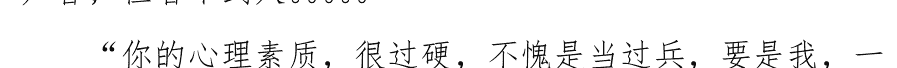

，“但不后悔，一点都不。”

作者：蛇从草 日期:2014-04-08 22:01

@他叫被注册了13656 楼 2014-04-08 17:37:00
第一次回复好激动啊\(≧≌▽\)/终于赶上大部队了！话说蛇锅我也是宜昌人啊~~还有我总觉得鬼事里有那么点是真事的-很多是根据宜昌的民间流故事出来的。

作者：蛇从草 日期:2014-04-08 22:54

四周又恢复寂静。不过，只是安静了片刻，大拿又听到了对对话。关于未来的，完全都是幻想，都是出自入口的。那些探险的年轻人，要是地来，就是在山里迷路，无意中发现了洞穴，然后爬到了梯子上，一例外外的，都遭遇了被死的命运。守陵人的过程中，被这个山洞了上来。大拿擦眼泪出了血，他几乎快要忘记，自己处于真实还是幻之中，同时无比愁。他想爬出去，离开这里。


他很快发现自己，向上爬了很久，却一直爬没有顶部，换句话，那个洞口消失了。他在虚空里爬行，找不到出口，也找不到老沙和小方。大拿停住，想不到，在洞外，跟老人的交锋。现在的处境，跟老人的布局，难道，是在无形之中，使得他无法逃脱？大拿几乎是不愿意就了一个决定，他把手电折出去。手电在黑暗中打着往下，大约五秒之后，就听得咔的一声响，得得扬。

大拿明白自己抓对了，虽然一直在向上爬，事实上没有动一下，可能，他在墙上发现了许多鬼。大拿冷笑，这一招，他碰到过多次了，没有能够稳住他，这次也不会例外。他不再抓着墙上起来的钢梯子，而是脱了鞋，掌撑紧抓住墙壁，从旁边的墙体向下滑去。很快就摸到了地面。当站在地面上，再次回头看上方，不禁笑了：老沙和小方嘴里嚼着手电，正在原地爬动的动作，位置没有挪动一点点，样子很滑稽。大拿到此时，才真正明白了“旁观者清，当局者迷”的含义。守陵人用土堆，树林和孔明灯。洞外，大拿发现，在长满青苔的石壁上，有几处突起很奇怪。他再次手脚贴墙壁，爬了上去，扯开突起上方的青苔，湿漉漉的青苔一把掉。整理后，看向手中攥着的那丛青苔，原来是一团沾满了臭水的头发，好些蠕虫从头发里爬出，在手上蠕动，令他皮肤酥麻。大拿几乎弹起来，把那丛头发和蠕虫甩掉，这时，就听到墙体上方，那个被扯了覆盖物的突起，传出一阵轻微的哭声。

作者:蛇从 日期:2014-04-08 23:37

大拿惊呆，倒不是因为听到声音，而是他在抬头向上的时候，发现那处突起，竟然在蠕动。它周围的泥垢和青苔纷纷剥落，就像是有什么从墙体里钻出来，同时，黑色粘稠的汁液，在突起的下方渗，顺着墙体流出。恶臭，充斥整个空间。半分钟后，大拿看了那光滑光的骨头，还有蛆虫爬动，脸上都是腐肉，两颗眼珠几乎要掉出来。因为挣扎，它颈处的肉被剥落，露出粗壮的脊椎，口腔里却依然发出声音上看，这是一个活人，被横着嵌进了墙体里，而且现在，他还没有完全死去！对于见过兔子鬼、骷髅兵之外，并没有觉得有多恐怖。对于大拿来说，除了短暂的异响，反而觉得那些是可怕的胆，而且，可能都还活着。大拿没有数墙体上究竟有多少个突起，太多了，根本数不过来。想不到，这个怪物，竟然是由活人体砌而成，他们被困在阵中，一直不能死去。大拿深吸一口气，撕了一块角巾，把口擦鼻脸上。要把老沙和小方从阵阵中救出，自然就能破阵。而破阵的方法，对精通方位、阵脚、阵门来说，除了野蛮破阵，再没别的途径。小方和老沙，仍然陷入阵中而不自知。大拿不再犹豫，虎似的贴墙上，朝那些突起爬去。

作者：蛇从 日期:2014-04-08 23:38
作者：蛇从 日期:2014-04-08 23:39
作者：蛇从 日期:2014-04-09 22:19

大拿爬到墙上，稳定住之后，将手向离自己的一个突起，手电插在肩膀带里，光亮直直照在那突起上面，照清楚。就连大拿不想看，都不开视线。被困在迷里越跑，越跑容易事。大拿知道了，没有做些，手指张开，按在了那头发发现，头皮下面冰凉的块，把整个头扒开，黑色的汁液顿时溢出，沾满他的掌。大拿咬牙用力，那个人头从墙里慢慢挪动，腐肉开始脱落。这样反复暗示之后，大拿的动作坚定了很多，就听嗤一声，人头连带脊椎，被他拽了出来，那个人胸腔内的脏，纠缠上，也随之拉出来。墙体猛然剧动。大拿暗叫不好，在他破坏掉阵脚之后，其他的突起，突然都活了过来，在黑暗里发出肢体碰撞的声音。老沙和小方一脸茫然望向他们。巨大的空隙时间，他身边的到处都是一条扭扭的手，抓向他的身躯。大拿躲避了两，再也抓不住墙体，两步纵跃，从墙跳到地面，原来原本嵌在墙体里的活死人，纷纷钻出来，啪啦啦的掉地上。有的，在他身边释放出难以忍受的恶臭，有的没有死，朝他围了过来。老沙和小方也飞快的从梯子上下来。小方在前面，“快，跟我走。”说着，拿着手机在前方照亮，朝一个黑色幽幽的洞口跑去。大拿和老沙来不及说话，紧跟在后面。

作者：蛇从 日期:2014-04-09 22:39

内疯跑一阵后，后方渐渐没有了声音，恶臭味也淡去，小方没有危险了，三人才停下来歇口气。“刚才，发生什么事情？”老沙警惕的望过来的方向。“我们在梯子上往下的时候，你们突然就看不见了……我看一群探险的年轻人，他们从我上方往下，但看不见我，我跟他们说话，他们也不理我，只顾着无声息向下移动……我发现你们看不见了，然后出现了几个獠牙面具的人对付我们，我不是他们的对手，只好逃命。”小方。“我听到很多人的声音，没有看见……”大拿可以。“看来我们遭遇的情况都不一样。”


我们很有可能在这里被困到死……或者，很有可能会成为那的一部分。“我是猫撞到老鼠。”大拿听到笑，稍有些气，更多的是后怕。他对布局一窍不通，纯粹靠运气才破解。“看来你师傅教了你一些你自己都不清楚的事本。”老沙说。“我师傅以前经常把我关进一个地方，让我在里面找东西吃。”大拿像是想到了什么，说，“起来，那应该是个迷阵，我经常看到食物就在不远的地方，但它怎么都走不去，后来我饿了，就把拦在路上的所有东西，都给扔……”“你天生就是破阵高手！”老沙说，“能把布局从根基登陆，一般人做不到。“老沙，你说这个布局，是不是守陵人做的？”大拿下来，想起了那些探险年轻人。起初，他以为他们是被死的，但没想到被死之后，还不得安，被困在这里，也不知道多少。守陵人在这里这么很多人，一定也是为了吧，可能是为了灵魂的。老沙，“你打算怎么？”大拿冷的说，“他们应该记住，这个世界，还有正。”老沙，“他们要做的事情。”大拿冷的说，“他们应该记住，这个世界，还有正。”他们大了，顺着小方的方向望去，只看到一抹融入的黑暗。那处黑暗，手筒光照射，看不出来藏着什么，灯光似乎被一道幕完整隔断。

作者：蛇从 日期:2014-04-09 23:28

老沙和大拿疑惑，不知道这是这一栋楼，而是很多人的味，被分割好几部分，像是住在同一层里。三人看着黑暗出神，所以决定先走一步一步。老沙在墙上四处摸索，寻找机关。小方则站着不动，鼻子发出连续的呼吸声，现在还是那个只有四只眼睛的面具，像野兽。“有机机关。”老沙的手在某个地方，抓了两下，然后右手的食指和中指找，在金属墙壁上滑动，停到了另外一个地方，接着，又移动了好处位置，然后来说，“是几个官团，简单的机关。”老沙在墙壁前走了几步，用手戳三次，墙壁顿时倾声挪动。大拿刚露出一丝喜色，门后，两道刀光，迎面就来了。

作者：蛇从 日期:2014-04-09 23:30:30

今天没戏了……

作者：蛇从 日期:2014-04-10 20:45

@长春天行空 13831 楼 2014-04-09 23:11:00
每天晚上都期待楼主更新，已经变成生活中少的一部分，吸引和满足了大家的好奇心理，故事情节很精采，好看，必须得顶感谢感谢。

作者：蛇从 日期:2014-04-10 22:22

神偷带着妈妈到水里，顺着冷泉游动，这一次，他们全没了方向，只能跟冷泉走，神喻很担心，又会被冷泉带到镜面世界去。很快，他就意识到自己的担心多余了，冷泉逐渐的缩小。他立刻明白，这些冷泉并非天生在这里，而是人为造成的。那些举行仪式的古代人，都抵达了这边，通往对面的通道就会消失了。“快游！我们要马上上岸。”神喻对冯儿说。冯儿没有回答，舞着手臂，身体在水里浮沉，她体力不支，看着要溺水。神喻见状，返回救她，他搂着冯儿的脖子，把她往岸边带。冯儿非常恐，一手死死住神喻的手，她用力，拼命挣扎，溺水翻动，波浪汹涌，终于挪到了岸边。冯儿趴在岸上，大口吐水，神喻急促呼吸，她软在地上。冯儿剧烈咳嗽，缓过头来，就看到处的雾气中有一个黑影，企鹅般的蹒跚走来。神喻见她表情呆住，望了过去，下意识的贴到冯儿身边把她护住。那个黑影出来，就是之前抢走铜钉的尸跟，它的舌头伸出长，正缠着铜钉。整个模样，就是一个浮肿发白的尸体，让人恐惧。尸跟停住之后，在它身后，又蹒跚的走了七八只，跟它

差不多模样，其中有两只，竟然没有脑袋，就像具无头尸体。

蛊眉群中，其中有一只走上来，它走，边用双手拂自己的下巴。

神偷警惕地打量它，算着怎么应对。就那蛊眉，把自己的下巴掰开，然后从中间部位裂开。

嫣儿吓坏了，发出一声尖叫。

“别怕，嫣儿......”那把自己脸掰开的怪物，那是块木头面具。然后，他把手上的东西丢到地上，那是两块木头面具。他又把嫣儿身上的其他部分，也都拆掉。

嫣儿望着露出真面目的脸，有点手足措措。

那是一张年轻的脸。神偷觉得他比自己还要年轻，来，一理，把这张脸贴在老脸的侧眉上，被贴配配，那人望着嫣儿的眼神，让神偷觉得古怪，那眼里，露出慈祥和怜爱。

“你是老杨……”神偷猛得叫起来。

“你好。”那人微笑道，“我叫穆国。”

作者：蛇从草 日期:2014-04-10 23:06

小方反应很快，抬起一起，就把老沙踢开，顺手一拉，把大拿也拽到了一旁。

人都都是贴地滚，动作狼狈的避开那迎面而来的两刀。

那持刀的两名士兵古代士兵兵质而出，从三人头顶过去，封住退路。又有两名士兵，从黑暗中冲出，堵住门口。


大拿从架上一看，就明白这四个人的功夫，都在他身上，要是下手狠了，他几乎不可能完好无缺的躲避，这迎头两刀，只是个下马费。

“我要见你们将军！”大拿不管他们能不能听懂，把虎符拿出来举了起。

那四人，见了虎符，立刻俯首行礼。

大拿、小方和老三对视一眼，不由得乐了。要知道这玩儿儿管用，早就该拿出来对着他们了。

那四行人礼完毕，示意大拿等人跟着走。两前两后，把大拿等人夹在中间，一行七，走进黑洞里面去。

在这里，手电照亮，除了能照见其他的躯体之外，没法看到黑暗中的加持符，获取更多好东西。地面完全看不清，除了脚踏着地面带来的光，灯的光线，完全照射不到实处。

大拿深一脚浅一脚的走，感觉有点眩晕，老沙和小方看上去情形也差不多，东侧歪歪的前往，三人保持极高警惕，生怕黑暗中会有其名其妙的东西冲出来。

事实证明，他们多虑了。走了莫十分钟，四周都非常常的安静，没有任何特异的事件发生。

大拿这时终于意识到，他们走动的时候，竟然没有发出一点声音，连其他人的呼吸声，都听不见。

“老沙……”大拿忍不住喊了声，但声音没有传出，

仿佛梦魇了似的，越是大喊，越是没有声音。

老佐走在他前面，没有任何反应，依然跟着前面带路的两个古装士兵兵术。

大拿赶忙上前，拉住老佐的胳膊。老佐回头，面露疑惑的张了张嘴，也什么声音都没从嘴巴传出来。两人一通比比划，彼此都不知道对方想要表达什么。带队的古装士兵回过头挥挥手，让他们跟上来。

大拿浑身不舒服，更加觉得这个地方充满了诡异。他想起老佐所说的话，千万不要在天桥洞滞留晚上。可现在究竟是几点钟，他没有概念。

## 会不会已经到天黑？加v信1101284955，获取更多好帖

忽然间一声巨响，在悄无声的黑暗中传来，大拿胸口好似被人击了一拳，心脏差点胀开。

作者：蛇从 日期:2014-04-10 23:16

今天没了。。

作者：neverfull11l 来自：iPhone 客户端 时间：2014-04-10 22:21:00

老蛇今天我生日！很高能遇到你的贴子 每天都会有惊喜！

==================

祝你生日快乐。。

作者: Ohriii 来自 iPhone 客户端 时间: 2014-04-10 22:03:00

正在上课、忍不住顶一下、蛇哥太棒哒！

感谢感谢。。

作者:吃棉的猪 时间: 2014-04-10 21:18:00

微博有时间会奔的。。呵呵哈，不好意思了。。

作者：蛇从草 日期:2014-04-11 17:26

@牵挂是根 13980 楼 2014-04-11 13:35:00

回复第11064楼(作者: @蛇从草 于 2014-03-14 王一整理，加微信1101284955，获取更多好帖

我想了很久，实在还是忍不住对老沙身份的好奇，于是是去了地址上的地方。这个地址在我们附近的一个山区的......

蛇哥，我是孝恳的。也是你的忠实读者，这工厂是不是006？238也搬到孝恳了！4404也是！

这个就不不要的太细了嘛。。

作者：蛇从 日期:2014-04-11 21:38

@孤星伴梦 1273 13997 2014-04-11 17:44:00

@蛇从草 老蛇，生意好像没以前好了了？

## 宜昌鬼事可不是现在这少的啊！

不能每个贴都能像鬼事那样啊。
作者:蛇从 日期:2014-04-11 23:38

今天天有事耽误了，明天补上，不好意思，各位……
n作者:蛇从 日期:2014-04-12 22:27

大拿终于意识到，他们走动的时候，竟然没有发出一点声音，连其他人的呼吸声，都听不见。

“老沙……”大拿忍不住喊了声，但声音没有传出，

仿佛梦魇了似的，越是大喊，越是没有声音。

老佐走在他前面，没有任何反应，依然跟着前面带路的两个古装士兵兵术。

大拿赶忙上前，拉住老佐的胳膊。老佐回头，面露疑惑的张了张嘴，也什么声音都没从嘴巴传出来。两人一通比比划，彼此都不知道对方想要表达什么。带队的古装士兵回过头挥挥手，让他们跟上来。

大拿浑身不舒服，更加觉得这个地方充满了诡异。他想起老佐所说的话，千万不要在天桥洞滞留晚上。可现在究竟是几点钟，他没有概念。

忽然间一声巨响，在悄无声的黑暗中传来，大拿胸口好似被人击了一拳，心脏差点胀开。

大拿终于意识到，他们走动的时候，竟然没有发出一点声音，连其他人的呼吸声，都听不见。

“老沙……”大拿忍不住喊了声，但声音没有传出，

（此处重复内容已按合并逻辑处理）

大拿终于意识到，他们走动的时候，竟然没有发出一点声音，连其他人的呼吸声，都听不见。

“老沙……”大拿忍不住喊了声，但声音没有传出，

仿佛梦魇了似的，越是大喊，越是没有声音。

老佐走在他前面，没有任何反应，依然跟着前面带路的两个古装士兵兵术。

大拿赶忙上前，拉住老佐的胳膊。老佐回头，面露疑惑的张了张嘴，也什么声音都没从嘴巴传出来。两人一通比比划，彼此都不知道对方想要表达什么。带队的古装士兵回过头挥挥手，让他们跟上来。


他惊得足够，心脏还好被人捏住。

原因就在于这些鼓声，单纯只是咚咚咚的声响，而是按照一定规律进行击打，使人的身体被其节奏影响。

远古之时，鼓就是祭祀的最尊贵礼器，在诡舞中，鼓也是必不可少的道具。所以当小方听到特定的鼓声，立即就想到，律律艺及其下部，是在进行某种祭祀。

再往前走，小方看到不少古装的士兵，正围半圆形，跪在地上，他们在中央，站着一个人。那是一个女人，正高声的唱着古老的契颂。她穿着的，却是现代的服饰，在头上，戴着镶嵌宝石和珍珠的首饰。

这个地方，仍然类似黑屋的地方，完全看不清楚转身寻找，却被层层黑暗包裹。小方心里有些乱，苍白的手电筒，在阴暗里晃去。

小方看了看，发现律律艺不在其中。他和大拿停了上来，手指指着那个女人说话，小方觉得有些很着急，眼睛里可以看到怒意，他嘴巴张合，应该在大声的说什么，可是并没有任何声音传出来。

整个空间，只有鼓声和那个女人凄怨如如同勾魂的声音。

老沙也张嘴说了几句，依然是没有声音传出来。小方已经明白，这个古怪的地方，只有某种特殊的声音，才能够传播。

若不是他们三人，都经历过不少的事情，而是只是普通的来探险的城里人，一定会被这种情形吓坏掉。

带路的古装士兵并没有理会，继续朝前走了一段距离，然后向下走去。

周围一片黑，唯一的参照物，就是刚才的那一群祭祀的人，他们一开始的位置和小方等人保持平行走多久，就到了斜斜上方的位置，逐渐从视线中消失。

小方据此判断，他们还在朝下深入。这跟他嗅到的味道是契合的。他早就知道，不死鬼兵们，分成了好几拨，安置在地下不同的区域。

小方觉得自己走在地底下的楼房里，往楼下走，但水泥钢筋等具象的事物，都隐掉了，他完全看不见。前方，或许还有无数危险的陷阱在等待他，或许是能够承受他的暗面跌下去就将万劫不复了。

他内心的紧张越强烈，脚底板酥酥，浑身都不自在在，又没法跟老沙和大拿交流，只看到他也都神色紧张，一步步挪动得万分小心。


“你是不是在钢厂的底下，把准的老沙，杀死了？”

“什么是真的，什么是假的？”老沙嘿嘿的笑。

“你杀了真老沙，我杀了你替他报仇！”大拿又要去捡上的刀，“我就不信，把脑袋砍掉，你还能活！”

“你不能杀他。”耶律艺努无声无意的走了来了，靠近他们，“他的脑袋，属于我。”

俄律艺努，说的是汉话。

俄律艺努的声音不怒自威，小方感到一股冰凉的杀气，自那俄律艺努身上散出来，冲撞得他浑身生疼，站立不稳，连呼吸都不再顺畅。

大拿退后几步，手里紧紧地攥着虎符，虎目睁瞪，提防耶律乙努。

老沙发出一声怒吼，不顾死活，朝耶律乙努扑过去，耶律乙努手拍一拍，把老沙打翻在地，一脚踩住他的胸膛。

“给我虎符。”耶律乙努不理会老沙在他脚板底下大声怒骂，对大拿说。

“把虎符交给你，你必须离开这里，你原来的地方去。”大拿又指了指那些渐渐围乱过来的守陵人后，“不过这些害死的人，都得留下接受法律的制裁！”

“跟我讲条件？”耶律乙努目光冰冷的量量大拿，赤红的眸子跟萤火虫一样闪烁，气越来越越，也变得粘稠。

小方觉得鬼魂穿身，带着身上的热量，心跳得飞快，冷直哆嗦，他没想到耶律乙努，邪法会这么厉害，自己无从抵抗。

大拿嘴角耷嘴，郑重点抬头，仍然不肯松口，“这个条件你一定要答应，不然虎符你得不到。

“你问他们答不答应。”耶律乙努看笑话似的说。

“大拿。你别不知好歹！”一个戴面具的守陵人后裔出来队伍，是村子里管事的韩族长。

“姓韩的，我就要找你算账！”大拿怒声说，“你骗我跟老沙……到地底下一跑，你把我们都算了！还害死了那么多的人！这个洞口的墙，也是你的！你要给他们填命！”

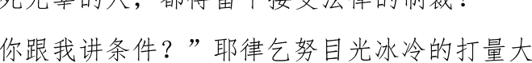

“做大事总是要死人的，我们的族人也死了不少。”韩族长语气很淡，根本没把死人的事情放在心上，“那些人死了，但有另外的人替代了他们，没人因此受伤……”

“你是说是……”大拿顿了顿，镜面人回到他们的生活中，把他们取替了？”

“他们的记忆，生活习惯，一切的一切，都没有任何改变……”韩族长说，“除了身体的构造稍微不同，这一点，我肯定没谁会特别注意到……”

“我差点被你杀去了……”大拿打说说，“你别想掩盖你老实的事，”刘所长韩族长说，看来你还是不错了。

“哈哈。”韩族长大笑，“别跟我提什么刘所长，你以为你那个刘所长，是什么好货色！”

“你的话，我根本不相信！”大拿说，“我没时间跟你吐槽，你耶吕艺，你到底要不要复虎，在六鳍锦鱼还在钢下面翻身，你再不回去，就一辈子别想回了！”

耶吕艺回头看那长明灯，“不急，那条鱼活了，也是好事。”

大拿被他一句话堵得什么都说不了，小方心里也很紧张，耶吕艺显然是有自己的打算，才有恃无恐。对于这种角色，小方自认为对付了，估计从年龄再派派种类级别高的人来，都起不起作用。

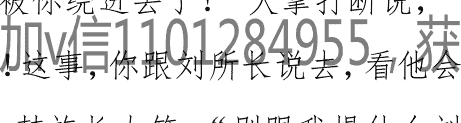

唯一能做的，就是把他们送回去。可是，人家耶律乞亡士，完全不听话。

“你不急，我急。”大拿想到这里，双手把虎按在掌心，臂膀鼓起肌肉，“你不回去，我就把这玩意儿，给毁成一堆废铁，看你怎么突溃，怎么突围！”

耶律乞亡士看着大拿，良久冷哼了一声。

大拿非常得意，“你不能突围，又落得被围死的后果！到时候后悔来不及。”

“你可把虎毁了！”他就正好不用回去了。他在这边，能耐比那边要很多。”老从从远处接过大拿的话。在他身边，如同黑影一样穿梭，在密密麻麻面上爬着无数虫子。在他身后，摇晃曳许多不死兵，其中一个神色呆滞。第一层里的那个女人，被不死兵拖着，不知道死是活。其实那个女人的身份，她是守陵人后裔，族里的地位跟族长上下，在某些事情上，决策权甚至比族长还要高，因为她的本事，在整个族里是最高的。但现在，这个女人，已经被折住了。

“小方。你一身好事，废得七八了。”老任见小方，就忍不住摇摇头。

小方捂着腹，为了拦截老沙，动了真功夫，一时半刻恢复，本想和老任吵句，一想还不如留气，便闭口不言。

“你还不死心！”大拿摇头，刚觉得要摆平耶吕艺，他的阴魂不散的冒了出来。

“你把他们怎么了？”韩族长，几乎同声问老任。老任身后那群不死兵的异样，人都看出来。

“我们抓了。”老任说，“我不管族复兴，其他的，所以你们是活人还是傀儡，效果一样。”

“说得冠冕！”韩族长唾了一口，不再说话，看着耶吕艺。

耶吕艺把老沙拦开，先爆发，正面朝老任，也不说话，身体内的鬼魂就又蹦了出来，纷纷攻苗人蛊婆。凡是有鬼魂飘过的地方，那些虫子就纷纷死去，一会儿，地面就死了。

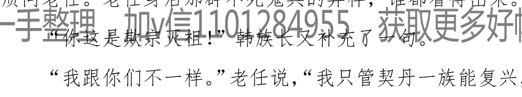

耶吕艺冲起来，他们样子是要活捉，毕竟老任来说，每一个不死兵，都是优质的资源，死一个就不算了。

韩族指挥凌后击，也投入到战斗中。大拿拉起自己，躲避，往长明灯上方跑去。两个人现在都是强弩之末，出口被老任的不死兵给堵死，实在没地方可以远离战局就好了，免得被误伤。

“你怎么样？”大拿说。

小方咬牙说：“死了，就是有点饿了……”

“到这个时候，你还想吃东西……”大拿说。

“不吃就没力气。”小方不好意思的说，“那个老沙，到底是哪里？”

大拿摇头“我看着他，才意识到有问题，一直有防备，究竟什么时候被包了，我真清楚。”

“你早说好了。这个符号，我把我逼了，什么招数都用掉。”小方叹气说。

“不是，我怎么可能确定。”大拿说，“镜面人，我没想到这么厉害，都模一样……”

“我们现在怎么办？”小方也知道责任不在大拿身上。

“静观变吧。”大拿说，“两虎相争，必有一伤，那个老任，以为我们跟那耶吕艺斗得差不多了，要进来捡便宜，我看耶吕艺，没那么对付……”

“那倒是是。”小方别的办法没有，趁机开始调息。

大拿撇打量那盛长明灯，长明的火光，开始减弱了。

“真有个仆丑字。”大拿握着座焰，自言自语说道。

“不见四字，还有一更？”

今天没有没有了……忘了说了。哈哈。

“会是这个情况不派武警过未派个道士？妥一”

面对耶律乞亡的军队，老沙和大拿都是面面观，虽然有着秘法传承，但这种冷兵器时代，没那么大了。预料不到原因之一。

追上了，越来越精彩，时侯宗师呀，等得好着急。

蛇哥求影。

茄子。

实际上打斗的双方，很容易看出谁被蛊虫控制，谁是耶吕艺的人。被老任控制的，动作僵硬很多，一看就是乌合众。而在耶吕艺这一方，不死兵都是军中作战，彼此掩护，三五成群，相互杀，非常有条理。小方跟不死兵打过手，知道这些人力量大，躯体韧，被咬上一刀，咬上几拳，基本上不会事。青城的道士用符咒攻击，他们用无效。小方观望着，很快发现一个有趣的现象，蛊虫控制。


不死兵三个人抓住一个人之后，用套绳箍住，扔到旁边，不予理会，但不一会儿，那些不死兵体内的蛊虫又钻出来，朝自己最近的不死兵身上爬去……打起来去，老面的不死兵数量，竟然没有减少。跟耶吕艺这边，不死兵没多少人了。被捆住的不死兵，恢复了神智，重耶吕艺的阵营，除了大喊大叫，派上用。小方明白，如果现在蛊人有空的话，很快能把这些人，再用蛊虫控制。不死兵在蛊虫面前，几乎无法手之力。

小方不免想到，蛊人的蛊虫这么霸道，是不是现在手里加上符言，他不会，已经进入幻术结束是吧，在洞里等了很久，应该以后了……

“妈妈的，竟然还要一个。”大拿摸摇头。

“这是什么东西？”小方疑惑的问，看大拿的样子，对这个卍字纹很有意。

“我师傅留给我的。”大拿说，“具体用途他也没说过，我刚才在下面看，明灯这里有卍字光，想到可能跟卍字挂件有关。”

“哈。”卍字挂件塞入之后，蛊座发出声响。过了片刻，蛊座上，又出现一个相同的凹槽。

“妈妈的，竟然还要一个。”大拿摸摇头。

“明显，还差一个。”小方指着上面的凹槽说。

“对。”大拿点头，忽然想到什么，朝下方去，“挂件，还有一个人，也有！”

小方见大拿目光，定在了老沙身上。大拿这一脸脸涂涂，被围了。老沙身上，密密麻麻的虫，像毛虫一般的蠕动，准备逃走。小方没有拦截他。

“挂件的确是在老沙身上，我不确定，是不是这个老沙，”大拿揉了头，焦躁的说，“不管了，我得去看。”

“跟我你一起，有个应。”小方没有拦截，跟着大拿下去。

“现在没别的出口，出口被老任的不死兵给堵死，实在没地方可以隐，远离战局就好了，免得被误伤。”

大拿把刀落地，咣当一声落在地上，转身往台阶上走，走动着，脚非常有用。小方睁眼，扭头一看，老沙正在扭绳子，大拿没有杀老沙，反而把他身上的绳子给斩断，莫名其妙。

“什么情况……”小方说。

“你怎么样？”大拿连头也不回，手里拿着斧子，挥着。

“别提了。”大拿打断说，“我们已经结束了。”

小方咬牙说：“死了，就是有点饿了……”

“到这个时候了，你还吃东西……”大拿说。

“不吃就没力气。”小方不好意思的说，“那个老沙，到底是哪里？”

大拿摇摇头“我看着他，才意识到有问题，一直有防备，究竟什么时候被包了，我真清楚。”

“你早说好了。这个符号，我把我逼了，什么招数都用掉。”小方叹气说。

“不是，我怎么可能确定。”大拿说，“镜面人，我没想到这么厉害，都模一样……”

“我们现在怎么办？”小方也知道责任不在大拿身上。

“静观变吧。”大拿说，“两虎相争，必有一伤，那个老任，以为我们跟那耶吕艺斗得差不多了，要进来捡便宜，我看耶吕艺，没那么对付……”

“那倒是是。”小方别的办法没有，趁机开始调息。

大拿撇打量那盛长明灯，长明的火光，开始减弱了。

“真有个仆丑字。”大拿握着座焰，自言自语说道。

“你妈妈就不知道跟我说清楚吗？你有这么不分青绿甩就拿刀人的吗？你跟那些不死兵一个德行！”大拿愤怒不已，拿出刀来，对准老沙，呼吸喘得像拉风箱。他挪几步，最终挪下不去。”

“你不是早就等着我了！你要我那么易死，那是你该死。”

老沙不客气的对付，丝毫不不在乎自己已经是刀板上的肉。小方插不上话，呆呆的看着，觉得两个人都有点毛病，明明是你死我活的争斗，搞得跟老家似的。

大拿坐下来，再次拿起刀，合过头，他终于定下心来。老沙抬头，与他对望，眼睛眨眨。小方想，大拿把老沙杀了就好了，老沙，全是愁怨，他是撞镜面，肯定跑了。大拿大喊一声，朝老沙一刀砍下去。小方下意识侧头，闭上眼睛。大拿把刀落地，咣当一声落在地上，转身往台阶上走，走动着，脚非常有用。小方睁眼，扭头一看，老沙正在扭绳子，大拿没有杀老沙，反而把他身上的绳子给斩断，莫名其妙。

“你现在没有权利。”大拿大口气，话没说完，一把把老沙拽起，几乎把老沙拽到了地面，“你告诉我，挂件的方向和我一样！老沙的东西，怎么到你手里了！”大拿的情绪一下激动起来，也不管会不会来不死兵，冲着老沙老沙大喊道。

“不对，你是镜面人，你是假的！”大拿说，“你是不是杀了了他，把他的挂件带来了……”

“是你把我招进厂的保安似的，让你黑和小子他们，不要欺负我，生生病了，吃了太岁，身上流水，你小时候体质弱，家里从小养，有个药师把你带走，给你治好病之后，又送回来……”

“你怎么知道……”大拿难以置信。老沙说，“你现在，还觉得我是假的？”

“你为什么要砍我，出手那么狠……”大拿问。

“大拿，你别被他欺骗了。”小方眼里，不对，“生理上复制，记忆也是一样的，他知道这些，不稀奇……”

“你回答我的问题！”大拿死死的盯着老沙。小方不说话了，奉劝没什么作用，因为眼前的老沙不是镜面，大拿都知道那个答案。

老沙说：“你根本没转过来，幻芋挂件，它不会因为镜面而变化。它是永恒！”

“你是什么意思？”大拿被老沙的几句话说得糟。

“佩戴它的人，不会受到镜面布局的影响而产生镜面处理难题，我信你要来试试，你是对的挂件就能获得好多帖他妈妈做什么理由，跟我没什么关系！”大拿骂道。

“当然有关系。”老沙说，“这两样东西，都不能落到耶吕艺手里，我必须要掌控它们！不杀掉你，你会把这两样东西都交给我？”

不好意思，让各位久等了。抱歉，今天没了……

今天会有点晚……

“你妈妈就不知道跟我说清楚吗？你有这么不分青绿甩就拿刀人的吗？你跟那些不死兵一个德行！”大拿愤怒不已，拿出刀来，对准老沙，呼吸喘得像拉风箱。他回来挪几步，最终挪下不去。”

“你不是早就等着我了！你要我那么易死，那是你该死。”老沙不客气的对付，丝毫不不在乎自己已经是刀板上的肉。小方插不上话，呆呆的看着，觉得两个人都有点毛病，明明是你死我活的争斗，搞得跟老家似的。

大拿坐下来，再次拿起刀，合过头，他终于定下心来。老沙抬头，与他对望，眼睛眨眨。小方想，大拿把老沙杀了就好了，老沙，全是愁怨，他是撞镜面，肯定跑了。大拿大喊一声，朝老沙一刀砍下去。小方下意识侧头，闭上眼睛。大拿把刀落地，咣当一声落在地上，转身往台阶上走，走动着，脚非常有用。小方睁眼，扭头一看，老沙正在扭绳子，大拿没有杀老沙，反而把他身上的绳子给斩断，莫名其妙。

“什么情况……”小方说。

“你怎么样？”大拿连头也不回，手里拿着斧子亮的光扫过脸上，辣辣的，都被毒雾钩住在地上。邱穷，被不死服，密密麻麻的虫，像蚂虫一般，爬满了身体，连甲和面具都覆盖掉，他却挣扎，做了最后的抵抗。

“他们要对付我们了。”小方焦急。大拿站在长明的灯下，把斧子挂件，塞进对应的凹槽里。长明的灯，发出机械齿轮转动的声音，一节一节的变化，灯光炽如焰，发出呼啸。两股热油燃烧起来，从蛊座上流，蜿蜒的火顺着刚刚出现的凹槽，朝四面燃烧起来。

整个空间，天顶、地面以及东南西北四面墙上，都出现了一个巨大的字。无数黑色和白色的鬼影，从正中间，飞快的钻出，像鱼缸纽错过的鱼群，莫名的，看似封闭的空间里，狂风大作。

“大拿太对劲了。”小方显得微微。“是啊。”大拿双眼直直，声音在抖动，没法说话。

我在小方的家乡，呆了两天，因为私人的事情，不得返回。关于天桥洞湖底的事情，小方就说到这里为止。临走之前，小方交代说，之后如果有时间，或者，大拿没有再找我，可以继续找到他家，他会把后面的故事说给我听。另外还有特意交代，让我不要去找苗人盆葵，会很危险。他说我很幸运，先找到的是，而不是苗人盆葵，否则，后果不堪设想。我没回事，心想苗人蛊婆简直就是整个故事里最厉害的BOSS，如此人物，神鬼莫测，怎么可能找到迹。不过被小方一提，我又有点紧张了，苗人蛊婆站在老任这边，竟然还能逍遥在外，看来来看故事的结局，注定不会圆满。

和读者朋友又喝了一彻酒，我愣愣乎坐上回程的客车车载电视，正放着老套的恐怖电影，一个江湖大佬从监狱里出来之后，一心想平凡生活，但平静很快被打破，当年手下的马仔们，纷纷地找上门来，有的想让他继续当老大，有的想把他干掉......

血雨腥风。

突然间，我想到了小方，狠狠的拍了一下大腿。一个从秘密组织里退来的人，就算受伤了没事，也不可能成为一个普通人，因为他掌握了太多的秘密！难道……。

镜面老沙，苗人蛊婆都在，大拿还在忙碌，虎符镇的故事不是没有圆满，他娘的根本就没有结束。


<!-- no content -->


5天了，终于追上大部队了，老蛇相信你越写越精彩，咯，加油哦。

感谢你。

作者:蛇从 日期:2014-04-26 19:14

@依然熟悉的糖 15445 楼 2014-04-26 13:58:00
蛇呀，这种真真很假的民事风格，让我特别佩服，我总觉得蛇哥哥是守门人，是不是真的会法术啊？

我不是守门人，我是过闰的。

哈哈，开玩笑。

一手数理加凡1101284955获取更多好帖。

@muwa12315462 楼 2014-04-26 21:56:00
老板蒙古贵族同事将自己的儿子起名为吕木华黎，我说是将军名字。别人夸我我知道的，其实我是看老蛇小说才知道的。汗颜呵~

其实金庸早就写了啊。

作者:蛇从 日期:2014-04-26 22:36

@Sailss_15461 楼 2014-04-26 21:43:00
万年潜水员，很喜欢你写的书，我是一个失眠症患者，谢谢你，写了那么优秀的作品，陪我度过又一个无眼的夜。

我很能理解通宵失眠是什么个状态。

我的办法是睡前嗨酒。

作者:蛇从丛 日期:2014-04-26 22:41

听到这里，我有点惊异，尽管老穆和老任的事，大拿跟我讲的时候，也所提及，但由耶律乞旁说出来，感觉又不一样。

他们两个的确是到了镜面世界，并且耶律乞旁碰面，正是这场会面，才有了后来虎符镇的各种诡异事件，把各方势力卷进来。

我不免又想起之前的疑问。

就在我和耶律乞旁，就是当初跟老穆碰面的时候，我意意的，在之后的时间里，他仍然在镜面世界里老穆在一起，后来神喻通过通道，到达镜面世界，看到的将军应该是他，后面他带着不死鬼兵过来，那也是“老沙”去到虎符镇之后发生的事情！

就算“老沙”和神喻、嫣儿的交集，可能杜撰，但我在商场当保安的时候的交集，是不可能的假的，我对自己的记忆，抱有信心。

这中间，一定有一个什么原因。我很想直接地向耶律乞旁询问最终解释，不过还是忍住，我最讨厌的事情之一，就是剧透。当然，耶律乞旁这种高明的故事家，也未必就会回答我的问题。

“如果镜面出现，你们会跟他们死战。他们不会成为助力，反而是威胁，会把你们杀掉！你们也会做同样的事情，那是一种本能。”我退而求其次，一步步的确定已有的线索。

“看来老稳他们一行时候，过去的已经经历了一场死战。他们可能在地底，也就是跟你大拿曾经去过的地方，和自己的镜面人苦战。我终于明白了老任的那些话，他们苦战之后，其实都分不清，到底活着的不是自己的人。但终，他们都是唯一的。”

“这就是我要告诉你的。”耶律乞旁说，“卸羚在虎符镇，利用当时在地底发现的铁矿资源，修建了钢厂。后来，轮到老稳和老任接手。这片镇子，虽然但是非常困难的中布局。”

“很明显，钢厂修建之初，卸羚的目的，就是利用风水镇压镜面布局……”我若有所思，“到了老稳和老任这一辈，他们的目的为了有了私心。”……”

说到这里，耶律乞旁有心不在焉，我看懂他的神色，立即意识到推断还不够胆。

“再次开启镜面布局，那不是他们两个的私心！”我试着说，看到耶律乞旁的眼神有了变化，于是语气变得肯定，“那就是卸羚的计划！原来是这样……”

“镜面布局，是我们契丹萨满特有的本事。”耶律乞旁说，“当初大明的国师道行，在虎符镇待过几天，后来不得修建镜湖心风陵，把镜面布局镇压。他看不穿奥秘，只能给后人机会！”

“六百年！差不多了六百年了。”我很震惊，看来我开始忽视了一点，却卸羚是镇压，而不是破坏，“不死鬼兵的奥秘，确值得这么久的时间去挖掘。”

“镜面布局，远远不止此。”耶律乞旁苦摇头，“不，你以为李元，现在在做什么？”

“大拿？”我说，“他现在是卸羚的人，你知道他现在在宜昌……”

“他在重复老杨和老任之前做过的事情。”耶律乞旁苦说，“我尝试劝他，他没答应。”

回我想起那个谷底的试验，大拿失败了很多次了，有卸羚的背景做支持，他仍然没办法成功，可见难度的确很大。

“虎符镇……”我想什么，喃喃问耶律乞旁苦，“虎符镇，已经毁了吗？”作者:蛇从 日期:2014-04-27 00:51

提到虎符镇，耶律乞旁摇头，没有说话，我不知道他是不不愿意回答我的。耶律乞旁苦咬了牙，在他以前给我故事的时候，也常出现，是受伤的缘故，但我却想到他就耶律乞旁苦，可能不会受伤。

从镜面过来的可不是不死鬼。

“老沙……”我习惯了叫他，耶律乞旁努力，我头上流起了汗，对我说，“身上的伤是真实的？”

“你以为镜面过来的人，真的？”耶律乞旁叹了口气，“你也看到外面的棺材了吧。”

“难道……”我望了门口，刚好有一道电划过，把地上的黑漆漆的棺材溅起来。在这里，在门口守卫的士兵，侧过头看我，他脸上裂了一道的口子，两粒眼睛呈灰白色，嘴角开裂，舌头舔，我也跟着走，发现外面聚了很多。风中掀起剧烈的味道。我心里噔一下，都不敢侧头看向眼前的耶律乞旁，我担心他也变成这样。

“不好意思。”耶律乞旁说，“这种病，在他们身上会发生，我也预料不到是今天送离开。”所幸，那个门的守卫，没有做出过分的举，我木然站在那里。耶律乞旁带着我沿着路返回。沿途屋外，已经站了不少士兵，一个个仰着头，面孔跟僵尸一样，高举双臂，对着天空，痛苦哀嚎，雷声巨大，也遮盖不住。原本诡异无比的房屋，有了不死鬼兵们的搭配，变得更加可怕。我只想离开这个地方。我跟着耶律乞旁，耳朵也插上，疾步走。石头路面滑，我跌了好几个头，心里忍不住骂，想着他娘不是个故事，有必要这么来老实找。耶律乞旁也是真精神病，就不能找个茶馆好好过。我胡乱的骂着，目的是为了躲慌。还好之后没有出事情，我回到了路上，耶律乞旁带我上了车做了什么手脚，把我弄到上面来了。上车之后，自己坐了一会儿，竟然睡着了。当我再度睁眼时，发现自己睡在汽车站的长椅上，来的人群乱不堪，我回神半天，才想起昨晚发生的事，但怎么看感觉都像是一场梦。很多东西没有亲身经历，就永远不能说是真的。当然就算经历过，有些事，人也会陷入某种怀疑，甚至更愿意否认。从小所接触到的知识，在一定程度上，会欺骗自己，潜意识认为那是虚假的。以此规避某些超出常识的东西对人造成的影响，说得好听，人是一种自我保护机制，让人因此发疯。作者：蛇从 日期:2014-04-27 00:05:23

今天没了。作者：蛇从 日期:2014-04-27 17:38:12

@Jump11zz 15513 楼 2014-04-27 08:35:00
这样吧，看看柯歌丰是不可能的，但我还是想哥。在电影里露脸便宜，剧情不理想；王狄龙的末尾，挑客2和守宁某某后裔，刘所长某某手下。一定要有台词，但是很快就 KO!

@Summer r 15520 楼 2014-04-27 10:20:00
好玩好玩，可以参照周浩在自己电影里的客串角色。我就不掺这方面了。作者：蛇从 日期:2014-04-27 20:01:12

@布丁绵羊 15496 楼 2014-04-27 01:03:00
我已经看累了，所以说长的脑细胞的故事，应该等到最后一次看完？天天守着更新却把前面的一些细节忘了，结果越看越靠呢，妈妈哭~ 闲也罢靠啊作者:蛇从 日期:2014-04-27 20:06

@布丁绵羊 15496 楼 2014-04-27 01:03:00
我已经看过了，所以长点的脑细胞的故事，应该等到最后一次看完？天天守着更新却把前面的一些细节忘了，结果越看越靠呢，妈妈哭~闲也罢靠啊作者:蛇从 日期:2014-04-27 22:04

我像个浪汉在沙发上，身上披着一件衣服，耶律乞旁看着我，发现几处地方磨烂，皮肤破了。左脖子肿起来，估计是崴了脚，连动都不了。晚上太忙，没来及看，我注意到伤口处了不少青淤，怕感染。我瘸一拐的往前走，正好看到门口小刘和同事聊着天，从房出来，我连忙喊他。小刘听到声音转身来看我。“峰哥，受伤了？”小刘一看不对，立刻跑过来，那个同事很热心，跟他一起揉。

“不小心碰了。”我咬着牙，可能是最初的那股麻疼，脚踝越来越疼。两人扶着我到了办公室，在椅子上坐下。小刘应该是外科大夫，帮我卷起裤腿看伤，在脚踝处摸下，也没有疼，我也愿不得疼。

“没事，只是软组织疼。峰哥，真没事。”小刘笑着，这是我们院有名的外科医生。他说没事，就真没事……“峰哥，你是上过山吧，摔了，而且受伤的时间大概在三小时之内，还淋了一场雨……”耶律乞旁打量我的身上，擦破了处。耶律乞旁拿药袋给我冰敷，又开了点消炎药，护士又帮忙清洗，就算是治疗完成。之后小刘拿体检单给我，让我填写基本资料，说等我脚好了，随时去医院体检。

我随便翻了下体检的项目，发现项目不少，有些项目我连着都听过的。实说，医院对职工还是挺照顾的。我填资料回家，就想着等脚好了，一定去体检，临走之前，还让小刘记电话提醒我，反正不花钱，又自己有益，这种事不做真是傻。

我之前急着赶回宜昌，是当地有人跟我谈出版，各种需要洽谈，电话处理不好，所以才不得不回来。现在受了伤，出版还能做，又是改稿，又是谈印刷，该我管的不该我管的都跟我谈一谈，一天到早晚睡在腿上。总把打算出版的事搞定，在家里刚坐下歇口气，连杯子端上还没来得及放到嘴边，小刘打来了电话，问我腿好得怎么样了，能行的话，可以去体检了。另外，还有一件东西要给我。

我很累，也没什么急了，胡乱的应付几句，自己都不知道说了什么，就挂了电话，在沙发上躺睡着。

也不知道睡了多久，迷迷糊糊的，就听到有人开门，我心里一紧，这房子我临时一个人在住，是谁在开门。不是撞门，而是开门的声音，我听得很清楚，还有钥匙乱动的声。防盗门咣咣声，被人拉开，我醒过来，手里抄起板凳，蹑步摸到门口。窗外是大白天，光线不好，我眼睛化一团。拿钥匙，现在的贼子越来越大了，非得好好收。门被开启，一只手把门推开，我了两步，脑袋出现在我的视线里。显然没有防卫，板凳朝他推过去，这块板凳砸在他腿上，人发出一声惨叫，手里提着的蔬菜、还有鱼掉了一地。我看着他。

他的脚开始乱挠，嘴里咔哧咔哧的喘气，眼珠子往上翻，手上的力气变大，我知道是在做最后的死挣扎，心里非常得意，用尽力气控制局面。

坚持一分钟，我就是唯一！没有谁再能冒充我！

坚持一分钟，我就是唯一！

坚持一分钟……

我心里这么想着，嘴里就跟着哑了出来，连我自己都觉得非常疯狂，但我根本控制不住情绪。他不动了，瘫在地上。我一直没放手，就那样一样掐住对方的脖子，等时间一分一秒过去。直到确保那人完全没了呼吸，我才巍巍地松开手，喘息和害怕全身，手足发抖。

等稍微清醒过来，我意识到房门打开，还好没有人路过。


你就真的吗？作者:蛇从 日期:2014-04-27 23:30

心脏跑右边，今天没事了。作者:蛇从 日期:2014-04-27 23:32

老蛇，是不是这边完了？全力写了爷。作者:蛇从 日期:2014-04-27 23:25

心脏跑右边，答对有没有奖励？作者:蛇从 日期:2014-04-27 23:27

我也听到了，就是没敢说，激动，不是肯定，也不是否定，那是打赌的话。一手处理|点击关注获取更多帖。

[content]
 谢谢大家帮顶，各种疑问，我就这样回答了。请后续发展。今天没了...作者:蛇从 日期:2014-04-28 21:31

倒在地上的人也在大叫，表情也是惊恐到了极点，整脸扭曲剧抖。看着自己的样子真的很滑稽，要多自在就有多自在。我没有心思发呆，几乎没有什么想法，光靠身体本能就扑上去，箍住他的脖子，把他按倒在水泥地上。他嘴里发出咕嘟的怪声音，不去扯我的手，反而也怕住他的脖子。我从小打过架，但任何一次都比不上这次认真。我知道这是我的生死战！那个人的架势跟我的一样，两个人手脚拉脚在地上挣扎，谁都没半点理智，也没有说话，只咬牙切齿，抱着要把对方打死的决心。砰响，地上散落的叶被压得稀烂，门口的鞋架和垃圾桶被踢翻，一片狼藉。最终两人死死箍住对方，他的眼睛都瞪起来了，在他瞳孔里，我看到自己的样子也差不多。没有谁会晚上对着镜子看，每个人对自己的长相并有多熟悉，所以我看着他，知道是自己，但越来越觉得陌生，除了满腔的仇恨，我看着他，已经是个陌人的感觉。他的脚开始乱挠，嘴里咔哧咔哧的喘气，眼珠子往上翻，手上的力气变大，我知道是在做最后的死挣扎，心里非常得意，用尽力气控制局面。


蛇哥合影哦，茄子??

感谢支持，茄子。

作者:蛇从丛 日期:2024-04-30 01:17

“峰哥，你在吗？”小刘边敲门边喊。

我坐着不动，下意识的捏住嘴，这个时候我不能回答，更不能去开。

小刘敲了一阵后停了下去，然后又重敲了几下，喊了几句。

我双眼直直的盯着门口，紧张到了极点，生怕那扇门靠靠，被他推开。

之后，门锁到处都动响了，我怕他是在说我跑了。

我还是不确认，于是站起来，慢慢的走向门口，附耳在门板上听。

外面通道里静悄悄的，什么声音都没有。

我松了一口气，摸了摸额头，神经绷得太紧，有点小眩晕。

就在这时，放在沙发上的手机屏幕猛然亮了起来，随之震动起来。

我X!

我拔腿就往沙发处跑，已经是深夜了，手机震动之后，声也开始响了，紧接着就是摇滚歌手的咆哮完了。我冒出了一身冷汗。

果然，门外再次传来小刘的声音，“峰哥，峰哥，你是不是在里面！”

“今天怎么这么倒霉！”我暗哥，他既然听到了我的电话声音，肯定不会善罢甘天的，是我再不答应，他估计要喊房东来闹，再不甚至可能报警！当然他一定会这样做，可是他有很多警察朋友，知道他会唤告诉他们帮忙！

我打算一下，立刻掀起身身上的被子往卧室爬去，然后在卧室里给小刘拨回电话，假装睡起来，让他在门口稍候。

打完电话，我把尸体用被子盖住，拉紧卧室，立即又回到客厅，把地上的拖鞋、各种乱七八糟的东西收拾好，才拉了一下。之后我调整下呼吸，尽量表现得正常一点，才。

“峰哥，病了？”小刘皱了皱眉。

“没事，有点不舒服，躺了一会儿。”我站在门口，没让她进门的打算。屋内我故意没有开灯，显得相当阴暗，怕小刘发现什么异常。

“我看你脸色不好。”小刘借着走廊的灯光仔细看着，“今天你打我一天电话，就知道你有点不对劲，特意来来看。

“真没事。”我勉强笑了，“这些太累了，各种忙。”

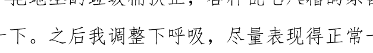

小刘，真谢谢你，但今天就不说了好了，我还没休息好。”

小刘点头，把一个纸袋子交给我，“你那落在我那里，我想了很久才想到你的了。你好休息，有事再联系。”

说完完，他就坐电梯走了。

幸亏小刘是个个脾人的，没有麻烦就打发掉。我转身回身，把门关紧。

小刘给我的纸袋子，印着他们医院标志，估计是被他临时拿来说，我打开纸袋，从里面拿出一件衣服给我。衣服不是我的。

我心想刘也搞笑，心急火燎的送件别人的，想去处理什么。我也就回事，把衣服随手丢在椅子上，想去整理。衣服里，伸出一个拇指大的金属物件。

我忽然想起，衣服的确不属于我，它是邱律乙那天留给我的。

作者：蛇从草 日期：2014-04-30 02:22

我把金属物件捡起来，发现是一非常小的录音笔。

我立刻想到，应该是邱律乙特意留给我的东西。

我打开录音笔的播放，里面还有电，最初的一阵沙沙沙声之后，开始传出嘈嘈的声音，音质不是太好，但听清还是没什么问题。

邱律乙的声音传出：“不知道不能把所有的事情全部在这里讲过……也不知道听到这段声音的人，会不会相信它真实发生过，就当一个杜撰的故事吧……”

我听了十来分钟。这是伊律芬录下来，跟之前他亲口在我面前说的事情，有些差异，但比所谓的“老沙”的故事更亘我所想。

我知道，这里说的，才是最真实的！

听了一段内容之后，我关了录音笔。说实话，我现在没有心情听听故事，因为我已经是身陷这个故事的人了。倒不是怕他人的事情被别人发现，毕竟，就算被人发现，也应该是属于特殊事件的范围，到时肯定引起巨大的轰动以及争议。

## 整理的镜面，我该如何定罪？

我感，人性的可怕，谁都没法去丈量。当初我听事，听到两个长相相同的人互砍，觉得不可思议，现在，我都理解了。这种事没办法解释，当遇到的时候，身体和大脑本能就会自然做出决定！才是恐怖、最绝望的地方。就像身体里的丑友，因为看到跟自己一样的人，而被放了出来。伊律芬在录音笔里的第二句话：“听过那句话吗？最恐怖的敌人，就是自己。当遇到镜面，就会遇到两个自己！一个长相和你相同，视你的生活，随时想要夺走的一切。而另一个，从内心深处咆哮而出，把你带向地狱！”

我看向卧室的门，那扇门掩着，里面躺着具尸体。我必须把它掉。当我终于鼓起勇气来到房间，却发现床上空无一物，窗户开，窗帘在夜风里皱。夜风吹味，我凉彻。我抿了眼。

我打算一下，立刻掀起身上的被子往卧室爬去，然后在卧室里给小刘拨回电话，假装睡起来，让他在门口稍候。打完电话，我把尸体用被子盖住，拉紧卧室，立即又回到客厅，把地上的拖鞋、各种乱七八糟的东西收拾好，才拉了一下。之后我调整下呼吸，尽量表现得正常一点，才。

“峰哥，病了？”小刘皱了皱眉。

“没事，有点不舒服，躺了一会儿。”我站在门口，没让她进门的打算。

……

“今天怎么这么倒霉！”我暗哥，他既然听到了我的电话声音，肯定不会善罢甘天的，是我再不答应，他估计要喊房东来闹，再不，甚至可能报警！当然他一定会这样做，可是他有很多警察朋友，知道他会唤告诉他们帮忙！

……

“峰哥，你在吗？”小刘边敲门边喊。

……。

……

小刘，真谢谢你，但今天就不说了好了，我还没休息好。”

小刘点头，把一个纸袋子交给我，“你那落在我那里，我想了很久才想到你的了。你好休息，有事再联系。”

说完完，他就坐电梯走了。

幸亏小刘是个个脾人的，没有麻烦就打发掉。我转身回身，把门关紧。

小刘给我的纸袋子，印着他们医院标志，估计是被他临拿来说，我打开纸袋，从里面拿出一件衣服给我。衣服不是我的。

我心想刘也搞笑，心急火燎的送件别人的，想去处理什么。我也就回事，把衣服随手丢在椅子上，想去整理。衣服里，伸出一个拇指大的金属物件。

我忽然想起，衣服的确不属于我，它是邱律乙那天留给我的。

作者：蛇从草 日期：2014-04-30 02:22

我把金属物件捡起来，发现是一非常小的录音笔。

我立刻想到，应该是邱律乙特意留给我的东西。

我打开录音笔的播放，里面还有电，最初的一阵沙沙沙声之后，开始传出嘈嘈的声音，音质不是太好，但听清还是没什么问题。

邱律乙的声音传出：“不知道不能把所有的事情全部在这里讲过……也不知道听到这段声音的人，会不会相信它真实发生过，就当一个杜撰的故事吧……”

我听了十来分钟。这是伊律芬录下来，跟之前他亲口在我面前说的事情，有些差异，但比所谓的“老沙”的故事更亘我所想。

我知道，这里说的，才是最真实的！

听了一段内容之后，我关了录音笔。说实话，我现在没有心情听听故事，因为我已经是身陷这个故事的人了。倒不是怕他人的事情被别人发现，毕竟，就算被人发现，也应该是属于特殊事件的范围，到时肯定引起巨大的轰动以及争议。

## 整理的镜面，我该如何定罪？

我感，人性的可怕，谁都没法去丈量。当初我听事，听到两个长相相同的人互砍，觉得不可思议，现在，我都理解了。这种事没办法解释，当遇到的时候，身体和大脑本能就会自然做出决定！才是恐怖、最绝望的地方。就像身体里的丑友，因为看到跟自己一样的人，而被放了出来。伊律芬在录音笔里的第二句话：“听过那句话吗？最恐怖的敌人，就是自己。当遇到镜面，就会遇到两个自己！一个长相和你相同，视你的生活，随时想要夺走的一切。而另一个，从内心深处咆哮而出，把你带向地狱！”

我看向卧室的门，那扇门掩着，里面躺着具尸体。我必须把它掉。当我终于鼓起勇气来到房间，却发现床上空无一物，窗户开，窗帘在夜风里皱。夜风吹味，我凉彻。我抿了眼。

打算一下，立刻掀起身身上的被子往卧室爬去，然后在卧室里给小刘拨回电话，假装睡起来，让他在门口稍候。打完电话，我把尸体用被子盖住，拉紧卧室，立即又回到客厅，把地上的拖鞋、各种乱七八糟的东西收拾好，才拉了一下。之后我调整下呼吸，尽量表现得正常一点，才。

“峰哥，病了？”小刘皱了皱眉。

“没事，有点不舒服，躺了一会儿。”我站在门口，没让她进门的打算。屋内我故意没有开灯，显得相当阴暗，怕小刘发现什么异常。

“我看你脸色不好。”小刘借着走廊的灯光仔细看着，“今天你打我一天电话，就知道你有点不对劲，特意来来看。

“真没事。”我勉强笑了，“这些太累了，各种忙。”


小刘，真谢谢你，但今天就不说了好了，我还没休息好。”

小刘点头，把一个纸袋子交给我，“你那落在我那里，我想了很久才想到你的了。你好休息，有事再联系。”

说完完，他就坐电梯走了。

幸亏小刘是个个脾人的，没有麻烦就打发掉。我转身回身，把门关紧。

小刘给我的纸袋子，印着他们医院标志，估计是被他临拿来说，我打开纸袋，从里面拿出一件衣服给我。衣服不是我的。

我心想刘也搞笑，心急火燎的送件别人的，想去处理什么。我也就回事，把衣服随手丢在椅子上，想去整理。衣服里，伸出一个拇指大的金属物件。

我忽然想起，衣服的确不属于我，它是邱律乙那天留给我的。

作者：蛇从草 日期：2014-04-30 02:22

我把金属物件捡起来，发现是一非常小的录音笔。

我立刻想到，应该是邱律乙特意留给我的东西。

我打开录音笔的播放，里面还有电，最初的一阵沙沙沙声之后，开始传出嘈嘈的声音，音质不是太好，但听清还是没什么问题。

邱律乙的声音传出：“不知道不能把所有的事情全部在这里讲过……也不知道听到这段声音的人，会不会相信它真实发生过，就当一个杜撰的故事吧……”

我听了十来分钟。这是伊律芬录下来，跟之前他亲口在我面前说的事情，有些差异，但比所谓的“老沙”的故事更亘我所想。

我知道，这里说的，才是最真实的！

听了一段内容之后，我关了录音笔。说实话，我现在没有心情听听故事，因为我已经是身陷这个故事的人了。倒不是怕他人的事情被别人发现，毕竟，就算被人发现，也应该是属于特殊事件的范围，到时肯定引起巨大的轰动以及争议。

## 整理的镜面，我该如何定罪？

我感，人性的可怕，谁都没法去丈量。当初我听事，听到两个长相相同的人互砍，觉得不可思议，现在，我都理解了。这种事没办法解释，当遇到的时候，身体和大脑本能就会自然做出决定！才是恐怖、最绝望的地方。就像身体里的丑友，因为看到跟自己一样的人，而被放了出来。伊律芬在录音笔里的第二句话：“听过那句话吗？最恐怖的敌人，就是自己。当遇到镜面，就会遇到两个自己！一个长相和你相同，视你的生活，随时想要夺走的一切。而另一个，从内心深处咆哮而出，把你带向地狱！”


他不知道自己为何会有这样无厘头的想法，但他真的很害怕，穆国雄这些人，提到镜面人三个字时，眼睛里似乎要飞出刀子，充满杀气。

作者:蛇从 日期:2014-05-03 21:56
沙了个发...

作者:蛇从 日期:2014-05-03 21:57

“开什么玩笑……”妈儿走到神偷面前，隔开穆国雄，呵呵的笑着打圆场，“爹，”，”神偷一直靠在一起，他怎么可能是镜面人……”

“婉儿，不要为难我。”穆国雄表情严厉，“镜面人有你想象到的危险，我们是以防万一。你看他，真能保证你是——”

婉儿回头看了神偷，一瞬间觉得有些陌生，再仔细细看了，更加觉得哪里不对劲，眉眼都不再是自己熟悉的样子，一时间之间变得犹豫起来，不敢确定。

神偷脸色变了。

“你是自己动手，还是我们帮你？”穆国雄又说。

“用不着你们，我行得端正正，有什么好担心……”

神偷顿了，说，“不过我神偷，行走江湖二十年，从来没有过谁想要强迫我，你们还不够格。”

所有人都优似的地看着神偷，其中两个，立刻就准备对神偷出手。

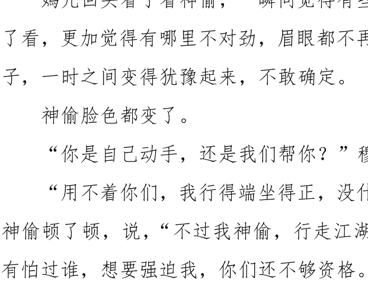

神伦吐出半截舌，两根手指掠过，手指缝里原本就多了一片薄刀片，再过一秒，他扣住了娇儿，刀片停在了娇儿的脖子处。

娇儿大惊失色。

穆国雄立即制止两个已经跨越一步的手。

“我看你很爱自己的女儿，要是不想她有事，就立刻放我走。”神伦对穆国雄说。

“我以为你是个汉子，没想到做出这种事情来。”穆国雄失望的摇头，“你走吧，不要伤害我女儿。”

其他围着神伦的人，都散开，让出一条路。

神伦退离开，环顾四周，看清了逃跑的路线，把妈妈背起来，顺路搜缴了许多好东西。

穆国雄底下的人要追，被他拦住了，“算了，不要多事，把气孔的事情解决，不能让局面继续启动，否则时空紊乱，后果严重。”

娇儿看着神伦离开的方向，神情复杂。

“娇儿，这个男人以自我为重，关键时候可以卖任何人，不值得托付，算了……”穆国雄又对娇儿说。

娇儿点了点头，“我知道了，爹。”

作者:蛇从草 日期:2014-05-03 22:01
··今天没有了。

作者:蛇从草 日期:2014-05-03 22:01

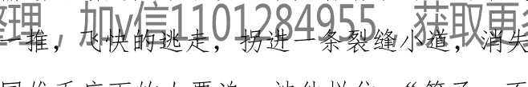

神偷躲在缝隙之中，这条缝隙很窄，就算被人发现，他们也能够很轻松的抓到他，依赖地势，足以与穆国雄下十几个人对峙。

等了一阵，穆国雄并没有等人追来，反而朝着另一个方向走了。

神偷松了一口气，娇儿为了让他逃走，关键时刻发暗号，让他护持。时间如此，他也没多想，顺从了娇儿的意思。

他不知道娇儿的用意，当前的情形来看，离开穆国雄的队伍，是必要的。这样一来，他的行动将更为自由。不过还有点担心把娇儿留在了穆国雄的队伍里。


穆国雄的表现，充满了敌意，而且给人的感觉都不对。只是表面的平静，内在的暴戾气息。穆国雄对镜面人的敌意，完全没有掩饰，决绝令神偷不安。他们无疑是混在那些契丹族的古代士兵之中，但对他疑似镜面人，却一直出现。

神偷意识到，他对镜面人的怀疑并非空穴。不过，就在这时，他发现了一个细节。刚用刀片夹住她，他用的是右手，而一直以来最为灵活、最擅长的左手！

作者:蛇从草 日期:2014-05-04 22:01

神偷发现左右手上有一个明显的差别。他的左手纤细长，很容易看到指尖里的血管，指纹比人要深，摸上去像带有倒钩。师父说过，他是天生的右手，这两根手指异于常人。神偷没有停手，而是选择更具挑战性的路，越做越猛，越走越稳，一步步在圈里闯出了声。

神偷觉得镜子里有些不对，如果当初发现就好了，就不会出现这种。他看着自己的右手，再摸了摸心口，心脏在右侧跳动。这些都与正常人相反。神偷仔细地检查，身上还有细微的特征证明这个事实。然而，神偷无论如何想明白，他怎么成了镜面人！又是怎样的呢？心里想着，另一个神偷在哪，要是被镜面人杀杀了怎么办？杀人的念头一闪而过，让他头疼。

神偷发现这就是婉儿。比起自己的安全，他更担心婉儿。不管穆国雄对婉儿的态度，神偷觉得要在她身边保护才能安心。把婉儿从穆国雄身边带走或许不太可能，那就默默守护倒问题不大。他也想看看，穆国雄等人到底干嘛。

神偷回头望。穆国雄等人齐齐一一站在鱼头面前，开始举行类似祭祀的仪式，其中两个人举止张扬，口中念着决咒，脚未曾挪动。

地面突然亮起来，有非常尖锐的嘶啸响起，仿佛空间警报。此时，空间内忽明忽暗，原本有很多荧光逐渐消失。穆国雄一行人中，有人抬头看向周围，惊声尖叫，再难保持淡然。

穆国雄手上多了一柄小玉剑，对着地面利下去。看似坚硬的地面被小玉剑刺入，然后他一拔，赤红的血水便从空洞里涌出，喷似的冲而起。腥臭味瞬间弥漫整个空间。

地面的晃动稍有停滞，可哮声更大了起来，很多人都捂住耳朵，在地上打滚。穆国雄没有捂，耳朵里却流出了血。婉儿双手捂着耳朵，嘴巴张大，表情非常痛苦。

神伦暗叫不好，迈步往婉儿身旁跑，要把婉儿带走。山体陡然挪移，巨大的石块纷飞坠落，在神伦与婉儿之间瞬间被无数石块隔断。石块掉落在地上随着地面摇晃滚动，神伦左闪右躲，一时站立不稳摔在了地上，被一块石头压在下半身。

穆国雄的声音在他耳朵里高声道：“六鳍鱼发了！镇压！镇压……”接着，如雨点般密集的石头砸向神伦身上，躲闪不及，神伦被那块石块推动，神伦只听到全身的骨头咔呀响，本来完好的上半身瞬间被石块挤成了一团肉泥。

他眼前一黑，就此消失了。

作者：蛇草 日期：2014-05-04 23:56

神伦听到呼吸声，是一种不熟悉的语言，但他听得懂它所表达的意思。回来吧，不要远离，聚凝聚，不要散开，这里就是归处……类似的话一直重复，不知道重复了多少遍，仿佛一直在循环回响。

神伦看不到东西，四周一片漆黑，他用手去摸索，摸到的是粘稠的泥浆。渐渐地，他嗅到了气味，那是鲜血的味道。

神伦想起来了，他的躯体被石头压成了碎泥。刚才摸到的泥浆里面似乎有坚硬的东西，会不会折断了骨头？“是不是死了？灵魂漂浮在残骸周围……”神伦暗想，“原来死之后是这样。”手指尖感知到了温度，那些泥状的血肉仍然温暖。“还能感知到温度吗？”神伦不由得怀疑。他站了起来，头顶传来剧痛，撞到了上方的一个岩石。嗅觉、听觉、触觉……各种感知都在逐渐恢复。这里是一个米大小的小洞，高矮的地方站直都很困难。四周是浑然一体的岩石，正中央有一个椭型的池子。池子中有红色的光透出来，如鱼鳞一样形成一片小小的纹理，倒映在岩石顶上。

光源显然是在水中。神伦低头望向摸过的地方，那里是一汪赤红的血浆伴着泥浆，里面的确有一些碎片，并非人体，而是小石块。神伦打量全身，发现自己并没有受伤，之前被毁成肉泥的记忆仿佛做梦。难道是镜面被人石头压死，所以意识回到了正位？他匆匆来到池边，把双手上的血都洗干净。在水池光投射下，两根手指明显异于其它显得很亮。神偷的心情立刻跌回谷底，两根手指仍然与以前相反。神偷看着水池，心里觉得哪里不对。他仔细打量水池，一会儿明白池子的形状像一只睁开的眼睛。中间的部分光是一块赤红色圆形石，竟变成了蝴蝶的脉络。神偷怕的是，在那晶体中间竟然出现了一个人影由远而近。

作者:蛇从 日期:2014-05-04 23:57
@安若瑜 1629楼 2014-05-04 22:13
跟随大队的感觉就是好，一路向前……谢谢支持哈。作者:蛇从 日期:2014-05-04 23:58
@Jump11zz 1610楼 2014-05-04 22:44
出来吧蛇哥，你再躲也没用的，像你这样出色的镜面剧好像漆黑中的萤虫，那么鲜明、出众！大家心中始终是风度翩翩的一无二的疯子……已更完。

作者:蛇从 日期:2014-05-05 01:14
@掩流 1627楼 2014-05-05 00:23
蛇哥，我觉得最恐怖的事不是像鬼一样自己被摸掉了身份，也不是镜面人来替代自己。以上都是自己存在以及价值的怀疑。我常常恐怖的是，在你所知的世界里生活，感觉别人和你自己一样，恐惧知道你的任何秘密而你却不知道。别人还以为别人不知道，其实大家都在欺骗你或者拿着你玩物或实验，你是那么透明和无知的……

@掩流 1628楼 2014-05-05 00:29
蛇哥，我建议下部作品可以把我的恐怖写出来，但形式用我的文字描述或引起，大概那个意思！完全懂得你的意思。就是自己心里在计算什么，或者有什么邪恶的想法，其实对方都知道，只是他们不告诉你。这样的话就特别让人难受。

作者:蛇从 日期:2014-05-05 23:06
今天会有点晚……不好意思。
作者:蛇从 日期:2014-05-06 00:22

神情望着那个黑暗的人影，暗想：来了，来了，终于来了。他保持高度兴奋，全身紧绷，手在身上随意的摸，又捏到了一枚刀片，随时能受伤他人。

现在他有了思路，自己作为镜面人成了非法的存在，要活下去，就务必占据先机！看似完全相同，但自己做的事关键在于就能对对方杀死。对对方，谁会给他多一秒的机会？不可能！因为面对那个人就是自己，他很了解。

人影的面部轮廓渐显清晰，是一个陌生的东西，一个干枯的尸体。它身上穿着完整无缺的甲胄，面皮是黑色，两只眼睛鼓着，从底下朝石右浮了上来，由远而近。从外观来看，这无疑是死的古装士兵，不知道死了多长，才变成现在的模样。

神偷发现，这枚晶石应该不是固态，而是表层是固体，类似巨大的玻璃缸，里面满了液体，古尸就此困在中间，但能上下浮沉。神偷看清对方的模样，吐了口气。他对自己的素质相当自信，但在当前环境里没法保持淡定，随时都有致命的出现。

他开始重新整理整个空间，墙壁透风，没有一点缝隙，大部分表层呈现出灰色的金属色。这里是铁矿下面存在一个巨大的矿藏。神偷没有时间考虑自己会出现在封闭空间内，也许是山体挪移或者是某种难以的方式。面对水池，内心却隐隐不安，不像一个出口，而是入口！说起来差不多回事，但个人的感觉完全不同。

与其在封闭空间浪费时间，不如主动探索一番。神偷深呼吸一口，头扎进水里。水下的世界晶莹剔透，四周是各种角度的镜面，红光交相辉映，或浅或深。古尸就在他触手及的地方。

神偷瞬间明白，他跳落到了水晶里。这块水晶比岸上看到的大很多，不只是装着一具古尸简单。在水晶的每一个面上，密密麻麻覆盖了一层水，形成了镜面，映出一具古尸。

作者:蛇从 日期:2014-05-06 01:46
这里是失重的空间。神偷自由地悬浮在空中，死死盯着这具古尸，生怕它动。他曾在地底跟老梯子交道的经历，知道古尸这种东西，一旦动起来麻烦不大。古尸安静地漂浮着，稍微一动，神偷就紧张起来。蓝色的水汪，至少有数百具古尸，就算置身其中，也感到压抑。

同时，神偷发现这些镜面之中，反而反射出古尸的样子，而自己的影子没有里面。神偷按住心中的恐惧，手掌似的挥动，身体能够发生挪移，并非在空中需要动力才能行动。他开始寻找出口，一圈找下来，并没有发现什么可以离开的通道。他从封闭空间逸出，陷入了岩石里，这里也是个完全封闭的空间！他捶镜面，感觉到墙壁无比坚硬，几乎不可能破。不过，他还是发现了一个事情：那具古尸身上绑着几根细长的丝线，一端绑在古尸的四肢，另一端镶嵌在四周的岩石墙壁，似乎是用来固定古尸，让它的移动范围过大，让它尽可能留在水晶的中央部位。

神偷看着镜面，忽然想到：难道，这里就是木华梨设置的镜面布局？如果是这样，那具古尸很有可能就是耶律乙了！神偷灵光一闪，想到这点立即靠近。他这才靠近古尸，但他还是不敢用手去触摸，只是观望。他发现古尸身上的铠甲制式跟他见过的幽兵或契丹的古装士兵有所不同，殊重要的是，这具古尸上唇裂开来。尸体干得厉害，所以并不明显，现在注意看倒是能看出一些痕迹。

刘所长和姚婧曾经提到，耶律乙并没有失败，自杀并割裂嘴角咒要重返人间。他的对手木华梨取得胜利之后，不仅没有把他的部分卫兵全部杀死，反而留下了他们守护了凌陵，而且更是设置了一个镜面布局！从当前的情况来看，镜面布局的设置实现了耶律乙重返人间的理想！

神偷差不多不能顺思路，就是镜面耶律乙的出现，必然是因为满足了多个条件：一，那薛乞生前的渴望；二，木华黎的镜面布局设置；三，地下的六鳍鲤鱼；四，巨大的铁矿和铁磁；五，老任和守陵人合作使用虎符……可能还有更多旁枝末节的条件。无数的条件达成之下，才造就了镜面世界与现实世界的连接！

神偷想其中的关节，反而变得畏首缩尾起来。以耶律乙穷尸体为屏障的镜面布局，一旦破坏——

神偷发现这些镜面之中，反而反射出古尸的样子，而自己的影子没有里面。神偷按住心中的恐惧，手掌似的挥动，身体能够发生挪移，并非在空中需要动力才能行动。他开始寻找出口，一圈找下来，并没有发现什么可以离开的通道。他从封闭空间逸出，陷入了岩石里，这里也是个完全封闭的空间！他捶镜面，感觉到墙壁无比坚硬，几乎不可能破。


“脱出也太简单了吧？”神伦忍不住倒吸，难以想象，这么从镜面布局里脱身了。

老任在水晶中朝他们所在的方向走来。所有人都没有动，他就一个人走动，别提豪索和霸气。

“老任已经把死鬼们都控制住了！”大拿轻声的对神伦说，“他有野心要复契丹国，你要和我一起来对付他吗？”

“不死鬼异，契丹国？”神伦一头握冷水。

“对。”大拿指着那个戴面具的高级将领，“那个人就是律伦艺术！他已经被蛊虫面控制，现在牢控镜面的就是老任了。”

“镜面世界的律伦艺术吗？”神伦看向大拿所指的方位。作者看着远处的老任，他笑了，发现他自己的轨迹，知道了他的身份。不免唏嘘着说，“自杀的律伦艺术被人撞了了，镜面律伦艺术又当了傀儡。无论生死，都没办法安宁了……”

“神伦，你是汉人吗？”大拿见神伦不表态，又催促道。

老任走上台阶到了不远处，对神伦说：“律伦艺术的尸骨，跟我缪哥哥找了很多，都没有找到。没想到被你发现了。可惜了，镜面布局的奥妙，我们一直想要弄清楚，结果这轻而易就被破坏了……”

“你不该得到的东西，你肯定得不到！”大拿哼了一声，表达了对老任的不夷。

“的确是差一点。”老任笑了笑，“不知道你的身份，也不亏，你身上的三味符，就是开启镜面布局的钥匙，我们却已经，等了把钥匙，等了快六百年……”

大拿下意置望了一眼长明灯上的丘字挂件，第一次知道，原来挂件的名字叫味符。

作者:蛇从草 日期:2014-05-07 00:58

神喻静静的听老任和大拿对话，试图从中听出点端倪。

因为自地下和老任分开之后，地面上发生的事情，他一概不知。

老任和大拿的对立关系已经是水火不容了，但他并没有看到老沙，不知道老沙去了哪里，难道他出事了？不过当前的情势下，似乎太合适合了。

搜索数据库查询结果，没有发现相似结果，出生后其实我们比较担心的情况，是遇到另一个自己。

私下遇见倒不至于害怕，大不了就拼个你死我活，生死各安天命。

反而是这种多人的情况下，一旦出现两个神喻，他这个镜面人难道还是心虚了点，总觉得没那么理直气壮，有些听之任的意义。

“我的身份？”大拿被老任的话说得稀糊涂，“我是什么身份？”

“你不用装了。”老任成竹在胸的说，“你们发丘后辈，最擅长的就是伪装，祖辈们都是表面修善堂，地下挖坟的做法，慢条理的做法，不就是当了婊还遮掩掩，不想让别人知道……你潜伏在钢厂，等待的就是这一天……”

“你信口开说说什么！”神偷听到这里，毫不留情的骂了一回去。

大拿一愣，本来也要罢，他原来对自己是什么发丘后辈的事情毫不不知，不过之前老任提到过一点的，的确可能跟发丘有点离源。不管是不是，老任人的语言实在太尖刻，不管两句，怎么能消气？

“你跟他，还有那个老汐，师徒虽然不同，但总归是一股。”老僧眯了眯眼睛偷，“这么多年，你师父一心想混到上面过吃饭，不要那邵逛醒些，特地找了家世好，人也清高的底下……”

“你也是发丘？”大拿愣的问。

神偷点头。他发丘的身份，师父其实没跟他提过，他是通过多年的打探，知道了一些根源。老汐的发丘身份，他一直知道，所以才对老汐相当信任。

“好了，既然大家都把话说说明白，事情就有了个结了。”老任拍拍手背，一副居高临下的神色扫了大拿和大拿无奈的说。

“我根本不知道你在说什么……”大拿无奈的说。

“卸铃很大很愁，有一段很大的恩怨。”小方在旁说，“一个在朝堂，一个在乡村野，看似毫无关联，但做得其实是差不多的事情，主要是都是跟古墨塞交道。”

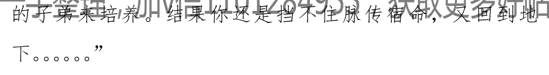

根据传说，当年明朝国道道衍符看到虎镇的镜面布局时，就发现地下有过被盗的迹象……其中有几个关键的物件，被人拿走了……

“他们做事的手法，就是源自你们发丘后！”老任补充。


有着冰冷的金属质感。

难道，这是地狱？人死后到达的地方？

神偷脑里冒出这种念头，随即，他更是觉得，在六鳍鲤鱼游动的时候，自己就被那些山体崩塌的巨大石头给压死了。

现在，他是一个漂浮着的虚无鬼魂，永世无法再过。而之后发生的，无论他是以为是梦境还是真实的部分其实都是臆想，是他难以忍寂，聊以自娱的消遣。

神偷经历死亡时，也想过人死之后的事情，可他想不到自己死之后会陷入这种情形，这比意识消散更加恐怖了。

他甚至想，究竟在这里待了多久，会不会其实已经结束了一切整理。

神偷在虚空里坐着，这个地方像个失能细胞，随意的做出任何动作，但他安静了，什么也不想去想了。

他看着眼前的古父，渐渐感觉对时间的流逝，身边一切永恒不变。

不静寂，也不孤独，唯独嘈寂，他听过圈子里的人说过，进了监狱，不怕其它，就怕被关在禁闭。三天禁闭，仿佛有十年那么长，关过一次一次，一生都对黑暗的小房间心怀恐惧。

然而，他们被关禁，总有一天会放出去，神偷却不知道，自己被关到什么时候。他不抱望了，没有希望，就不会失望。

一个镜面上，古父被取代了，出现了不一样的影像，那是嫣儿。

神偷痴痴地望了一眼，想到终于轮到嫣儿登场了，这个比他小十多岁的年轻女孩，是他这辈子真心爱过的人。

神偷不想看到嫣儿，因为会让他更加觉得痛苦，但是嫣儿一出现，各种有关嫣儿的记忆，就如潮水般涌了来，无从躲躲避。他很思念嫣儿，哪怕就在她身边再待一刻也好。

嫣儿发现了他，从镜子里跑了，面露喜颜：“你怎么在这里，我原以为你出了事，真好……”

神偷看着她热闹的脸，他不由地摇头，就会从惊醒，然后发现自己还是孤身一人。

“你愣干什么？吓死了……”嫣儿用手在神偷面前挥动，试图引起他的注意。

神偷的眼泪，立刻就流了下来，却不知道为了什么缘由。

“你的命真大……”嫣儿身后出现了一个人影，打量神偷。

神偷愣了愣，这个人是老稳，还有几个属下，也跟着出现，有人手里拿着手电筒照明。

镜面在瓦解，闪烁着光，古父慢慢消失了，神偷看着四周变化，逐渐变成一条充满磷光的地道。

有两个老穆的属下，立即上前来，把神喻按住。

神喻的脸贴在泥土上，碎石几乎把脸划破，接着又被反剪双手提起来，老穆走过来，捏了神喻的左胸。

“不是镜面人……”老穆让属下松开，盯着神喻说：“你是真的。”

“我早说过神喻可能是镜面人……”妈儿在旁边说。

“有病啊，上来就动手！”神喻靠近近两个人推开，伪装了衣服，趁机仔细的打量自己的右手。

这一看，立马差点把眼珠掉出来：左手跟人不一样，食指和中指，天赋异禀。现在这个躯体，绝对不是镜面人了。

神喻不肯轻易露表，表面还是保持一脸茫然的神色。

“这账，我还要跟你算账……”

“劫持妈儿？”神喻装疑惑，提防老穆挖坑，“我怎会劫持她！我直在这个地道里走动，走得累了，就在这里休息一下……”

“这么说，那个劫持我的人，是假的神喻？”妈儿说。

“看来是这么。”老穆点点头，“好了，我们找条道出去，这地下错综复杂，都别撞队，鲤鱼可能跟当初的图纸不一样了，都注意点，有什么异常，随时报告。”

那些属下得令，继续探路。

神喻按了按脑，感觉头要裂开，在这地下这一刻也不想多呆。

他真想找人说说之前发生的那些事情，可是，却注定只能在心里。

走了一阵，神偷发现，这个地下通道分叉很多，简直跟迷宫一样，老稳和他的几个属下，每到每一个岔路口前，都仔细的分析接下来要走哪条。

嫣儿抬头说：“跟神偷越来越近，看着老稳离得远，身边没有人了。”才轻声道：“先救持我的真的不是你？”

神偷摇了摇头，口上作声。

“我真想明白镜面人到底有什么问题。”嫣儿说。神偷一言，他却冷笑，看来神偷心里还有底藏着大秘密不能任何人知道。

“不知道也好。”神偷说。

“你是不是也知道什么？”妈儿问。

神偷避而不回答：“老稳真的翻身了？”

“看来是这么事。”老穆点点头，“好了，我们找条道出去，这地下错综复杂，都别撞队，鲤鱼可能跟当初的图纸不一样了，都注意点，有什么异常，随时报告。”

那些属下得令，继续探路。

神喻按了按脑，感觉头要裂开，在这地下这一刻也不想多呆。

他真想找人说说之前发生的那些事情，可是，却注定只能在心里。

走了一阵，神偷发现，这个地下通道分叉很多，简直跟迷宫一样，老稳和他的几个属下，每到每一个岔路口前，都仔细的分析接下来要走哪条。

嫣儿抬头说：“跟神偷越来越近，看着老稳离得远，身边没有人了。”才轻声道：“先救持我的真的不是你？”

神偷摇了摇头，口上作声。

“我真想明白镜面人到底有什么问题。”嫣儿说。神偷一言，他却冷笑，看来神偷心里还有底藏着大秘密不能任何人知道。

“不知道也好。”神偷说。

“你是不是也知道什么？”妈儿问。

神偷避而不回答：“老稳真的翻身了？”

“看来是这么事。”老穆点点头，“好了，我们找条道出去，这地下错综复杂，都别撞队，鲤鱼可能跟当初的图纸不一样了，都注意点，有什么异常，随时报告。”

那些属下得令，继续探路。

神喻按了按脑，感觉头要裂开，在这地下这一刻也不想多呆。

他真想找人说说之前发生的那些事情，可是，却注定只能在心里。

走了一阵，神偷发现，这个地下通道分叉很多，简直跟迷宫一样，老稳和他的几个属下，每到每一个岔路口前，都仔细的分析接下来要走哪条。

嫣儿抬头说：“跟神偷越来越近，看着老稳离得远，身边没有人了。”才轻声道：“先救持我的真的不是你？”

神偷摇了摇头，口上作声。

“我真想明白镜面人到底有什么问题。”嫣儿说。神偷一言，他却冷笑，看来神偷心里还有底藏着大秘密不能任何人知道。

“不知道也好。”神偷说。

“你是不是也知道什么？”妈儿问。

神偷避而不回答：“老稳真的翻身了？”

“看来是这么事。”老穆点点头，“好了，我们找条道出去，这地下错综复杂，都别撞队，鲤鱼可能跟当初的图纸不一样了，都注意点，有什么异常，随时报告。”

那些属下得令，继续探路。

神喻按了按脑，感觉头要裂开，在这地下这一刻也不想多呆。

他真想找人说说之前发生的那些事情，可是，却注定只能在心里。

“可是，还是几个人，就在眼前……”妈儿咬了声，“我现在只想回家……”

神偷轻松说完：“以后身份，当个警察，不用再陪我钻。”

“你觉得这些光，是不是真的？”妈儿说。

“你是不是恨我？”妈儿问。

神偷没有接上：“你觉得这些光，是跟地震一样，什么都毁了，我估计会被埋了。”

“我是真的。”妈儿噗浅道，“其实就是世界上最美的地方。”

“你以前跟我说过，想去逛逛天空，是真吗？”

“这条路修建了很久，按道理，应该阴暗潮湿，为什么会这么干燥。另外，鲤鱼翻身产生了了大骚，山体崩塌，可这里一点都没有。”

“你觉得，跟这些发光又看不见的虫子有关？”嫣儿说。

“至少说明，我们所处的环境非常古怪，而你父亲，对我们所有隐瞒。”神偷点头，“很有可能，他不是要带我们去地面，而是通过密道，到达一个更古怪的地方。”

“你疑心太重了。”妈妈娇呼道，“我父亲绝对不是你想象的那样，他是个好人！”

妈儿不想再跟神偷说下去，而是回到老穆旁边休息。

神偷吐了口气，不知道怎么办才好。

“我们以前不相识，但都是一脉相承，应该是联起来手对付他，阻止他……”大拿虚弱的说，声音细若蚊蝇，却仍对她耿耿于怀。

吃完食物后，老穆安排了两个人站稳，让其他人休息。大家都比较软了，穿着衣服靠着墙睡觉。神喻吃了两口压缩饼干，觉得跟蜡笔差不多，也没什么食欲，就把饼干装起来，靠着墙睡去。

这段路，相对于之前比较宽了，但还是令人压迫，墙壁上细微的光亮闪，像是夜空里的繁星。神喻一直觉得这光不对劲，忽然想起来，一般发的物质都是吸收了太阳光的紫外线，存储光之后，移到暗处处理。

地下湖洞，因为镜面世界连接，照面对面，是类似市市楼的幻象，有光亮还说得过去，或者鲤鱼本身能够发光，多少也能解释。可是墙是冷冰冰的石壁，怎么会自行并发？

神喻忍不住用手在墙上碰触，发现墙体并不是想象中的硬，而是略有弹性，当他收手指，手指上沾到荧光粉一样，有了亮光。

不用工夫，细小的亮光，在他指尖上移动，朝四周扩散。


他现在又变成了镜面人。

神喻想：说不定真是有灵魂存在，不然他遇到的事情就没办法解释，一定是他的灵魂，在两个身体里回来，让他经历着两个地方正在发生的事情。

然而这样一想，神喻又浑直寒气，说不定，那个晶石里，还有一个他他。谁也没说过，镜面就只存在一个，那么多镜面，会不会全部反射出一个镜面人来？如果真是那样，他现在觉得竟有多少个神喻了？

当然，神喻也清楚，这多半是人肉幻觉。

他真正应该担心的，是当前已经发生了这种情况；他的身份、王经理以及镜面里的的一切事情，早晚都是他在局面中对付的按照他所所想的去办，但当他的意识认为在一个地方之后，另一个地方的身体又是谁在指挥和掌控？
这才是关键的问题。

神喻回想起在地底，看到镜面士兵与墓葬僵尸互相杀的场面，他忽然明白了，为什么他们在面对已经局面非非的自己时，仍然那么拼死要杀死对方。很有可能，他们的意识也曾交叉，经历了某些对方正在经历的事情。

一旦有了这种经历，谁都会忌怕自身原本有序和可控的生活，变得无序和失控。

一个非常简单的例子，他现在在大拿身边，他就完全清楚，在姚身边的那个暂时占他身形的意识，会利用他的身体，做出怎样的事情，譬如杀死了老穆的一个属下，当他的意识回归，铁定就得背黑锅。更可怕的是，如果对方伤害姚儿......

随便想想，也能体会其中的厉害关系！

因此，唯有消除对方，作为唯一，才能安心。他们并非是要杀死自己的镜面人，所不能忍容的，是另一个未知的意识。"那才是将其去的边界！

神喻想通了其中的关节，立即变得更加恐惧。原因很简单：就算把其中一个杀死，谁能保证接下来的那个意识，正好不是另一个未知的意识！

老修刚复制的细胞是复制镜面，强化镜面人，实在是太愚蠢了！

作者：蛇从 日期：2014-05-13 23:42

神喻想得很入神，不知道牙齿咬着拳头，把拳头吐出了血也浑然不知。

老沙无声无意的走到面前，蹲下来跟他面对，神喻猛然觉醒，他以为自己又转移到了某个地方了，看了大拿和小方，仍然在近昏醒的休息，才松了口气。

“老……”神喻刚喊出一个字，老沙就做了一个嘘的动作，意是神喻跟他走。

老沙在前方路，神喻见他神秘兮兮，只好好跟着走着，两个人走了约五百米，离大拿距离有点远了，老沙停下来，神喻哑了笑，“很好，你还活着……”

“想不到我们还能见面……”神喻听到老沙说那个字，百感交织，他没办法确定在现在这种情况算不算活着，是生不如死也不过了。

“我知道我们还会见面。”老沙说，“不在在这里见面，我很意外，这个天桥洞，距离六鳍鲑鱼很远，我真不希望在这里见到你……”

“为什么？”神喻皱起眉头，觉得老沙话里有话。

“有些事还没说完的时候。”老沙说，“你能像以前那样信我就行。”

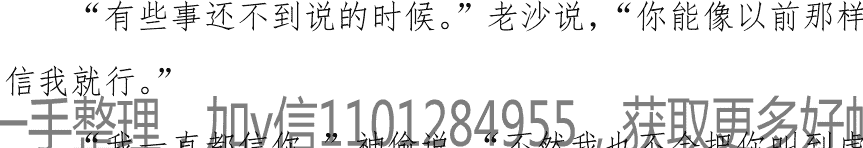

“符锁留帮我，其实我很后悔，当初应该听你的话，早早走……”

“我放你走，是因为你是个局外人，但我不是，我必须留下来。”老沙说，“不过，我当时不了解情况，后来我知道，你其实也早就入局了，就算我放你走，你想走，你也走不掉。

“老沙，你以前说话不是这样。”神喻越听越糊涂，“你要不说，要么就会把话说说清楚，不会这么说半句藏半句……”

“我不知道从哪里起。”老沙顿了下，解开上衣，背对神喻露后背上的纹身给他看。

神喻仔细的打量，说道：“这个纹身跟我师父身上的纹身很像，他的是两只青色的穿山甲，我查过了，那是发一脉的标志性纹身！你的纹身一眼看上去和他的差不多，姿势很相似，但很多细节不同，特别是这两只动物，应该不是穿山甲……”

“当然不是穿山甲。”老沙对着神喻，继续让他看，“是白马和青牛。”

“白马青牛？”神喻偏了脑袋，听着很耳熟，对了，当初妮妮说到地下陵主人郭律齐生生的时候，曾经跟我说过，白马青牛是契兽人的一个传说……你怎么认了这种……”

老沙穿上衣服，“你应该看看《天龙八部》，里面有个乔峰的契兽人，在胸口纹了一个狼头。”

“狼头是契兽的图腾。”神喻抿道。

“你说错了。”老沙说，“契兽人的图腾是白马青牛我背上的纹身，是在成年的那年，被族里的长老给纹上的。”

……”神喻呆住，“你也是契兽人！难怪，大拿说你跟我是一伙。”

“你说错了。”老沙说，“我跟任何人都可能是一伙，除了你。”

“你到底是谁？”神喻问。

“郭律齐……”老沙说。

“......”神喻很有冲动，“他妈妈也太玩笑了吧！你还没有彻底底吗？”

“我没骗你……”老沙严肃的说，“我是镜面人。”作者：蛇从 日期：2014-05-13 23:48

今天没了...写到后面，太消耗脑细胞了。一天两千字，再写不了。不好意思……作者：蛇从 日期：2014-05-14 00:06

# 一手整理，加微信1101284955，获取更多好帖

这种神逻辑也许成立，但是问题在于，两个人的记忆都是相同的。
- 一个人消失，另一个就会取代，并记住所有记忆。
- 额，越想越乱。
- 第一个肯定是要自保，不愿放弃一切权利！所以谁会在镜面人面前引起就戏。

# 尝试下人和镜面人之间具体的关系：
- 1. 年轻的老沙说，水晶的地方就有镜面通道，大概这类意思
- 2. 神喻偷见郭律齐尸体所在的风水穴中有无数镜面扇体
- 3. 镜面边界是塌的，最近的一个穿越，镜面世界内符合其镜面世界生长的人物


无限镜面世界越慢，也不排除相对我们世界时间快的。
通透。作者：蛇从 日期：2014-05-14 21:23

快页了...作者：蛇从 日期：2014-05-14 21:50

@秋风起冷云飞 7084 楼 2014-05-14 31:00

混沌混很久了，大多是潜水和看酒，虽然自己喜欢看鬼故事，但是我有个习惯就是对于惊悚的小说不看，一眼就要几天看完。多谢支持，点我 ID 可以看到更多作品。蓝很神秘的的确了解不多。老沙大家都叫你老蛇，我就叫你老蛇哥吧，我很佩服你。作者：蛇从 日期：2014-05-14 22:15

“我没理由要骗你。”老沙强调道。

随着老沙把时间展开并笑着，仿佛无数帖开启，古装士兵纷纷出现，是到护符之后才发生的事。他和老沙认识了多久？差不多快十年了！在地下，差点把他死死的那个不死鬼首领，难道不是郭律齐？

“我明白了了，老穆和老任他们开启镜面布局的那次，你就从镜面世界过来了。”神喻莫名的兴奋起来，他把事情理顺了。

“你可以这么理解。”老沙说。

神喻看到他一副继续保持神秘的样子，就不再追问，“你找我，是要我帮你做什么？”神喻不再废话，直奔主题。

“你记得你第一次下古是什么时候？”老沙反问。

“当然，就是跟我那个王妃墓里交手的那次，我的金主，我要找王妃墓里的王玉意。但遇到个守墓的老僵尸，差点给我络上，后来不得把王玉意放回原位，才撇手出来，之后，我们就成了朋友……”神喻顿了顿，“我其实拿了个优品真品换了出去，一直没跟你说……”

“我早就知道了，那个王玉意在我手上……”老沙浑然，“原来你就是那个请我的金主！”神喻很惊讶。

“你师父是个发后，我不知道他有没有传三味符给你。在之前，你一直都不做地下的事。为了逼你出手，所以我通过镜子，要去王妃墓里的王玉意。”老沙说。

“是。你知道了？”老沙说。

“听老任跟我拿起来过。”神喻点头，“说是镜面布局的钥匙，你当年挖了坑我钻，就是想从我身上套上三味符，他失算了，我师父，没有过任何遗物。的确，三味符不在你手上，被被人传了大。”老沙说，“我找了多年，没想到他实际上就在我眼皮底下。那个的人，竟然启用大拿充当守人，我真是没有等到……大拿也被利用了。我不分清他是真还是假，不纯粹，所以任何人都想得很复杂。我很佩服他。”神喻说，“他不是镜面人。”

神喻意识到，自己需要的不是办法杀死另一个，而是最好用大拿身上的三味符，才是唯一的办法。“我懂。”

神喻自然听懂了老沙的话的意思。老沙早就知道，已经问过你能帮你做什么……冯儿。我没办法保证她的安全，但我绝对不会伤害她，我很清楚她比重要。可怕的是，当你了解他时，他已经看得很清楚。神喻默然，他对老沙的印象不是太好，被老沙说，更加担忧起来。“你不是见到他……终于回来了。”

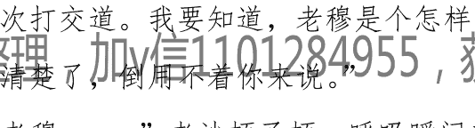

我觉得不对劲，我们进入了一条密道，通道里面，到处是发光的小虫。你的预想是对的。”老沙说，“他不是要回地面，而是要去一个耗尽一生都在寻找的地方。“什么地方？”神喻忧闷，心里却想，老沙竟然没有否认他当前是镜面人的事，眼前这个人，比老沙恐怕不到哪里。是啊，老沙就是郭律齐，曾经是后相，领兵数十万，极具优势，怎么可能简单了！镜面布局的核心之地，真身葬的地方。”老沙没有立刻，反而告诉我：“我带你去找到它。她也在墓里，得到女儿传承的秘密，如果再被他找到，就会埋骨地……”神喻的视线逐渐模糊，“……愣干嘛，快跑！”先传到神喻耳朵的是这一句。与此同时，他看到一个黑影正面扑了上来。神喻几乎是本能的躲避，那个黑影发出喉咙的奇怪声音一眼就看到了眼前，神喻只感觉到一阵剧痛，肩膀上就接了一好，像是皮鞭抽中，火辣辣的。

“快干掉它！”
“操，是什么东西！”
“小心，别伤了……”

周围的声音嘈杂，七嘴八舌，人影闪来闪去。神瑜搞清楚状况，捂着肩膀剧痛，左右躲躲，那黑影如影相随，身上一根皮鞭的东西又抽又拽。神喻连挨了好几，疼得咬牙咧。

黑影的体形和奇异，一会儿是圆形个球，一会儿又拉长，浑身黑漆漆也看不清楚是什么东西，只能看到上部有两点豆大的红光，不知道是不是眼睛。神喻连连退后，背部撞上墙壁，退无可退。黑影得非近了，一股带着浓烈臭味的热气喷到神喻脸上，差点把他熏过去。

神喻也顾不了了，伸左手，两根手指朝那两点红光插过去。他疼，发出尖叫，退了后。周围立刻过来几个人，跟黑影缠在一起，把它彻底隔开。神喻缓过一口，靠着墙壁软，大口呼吸，心跳飞快。他望着那个黑影，心里想，这真是倒霉了，什么事情都上身上了，当初出门真该拜祖爷。几根手电照到黑影，那就是光滑的肉球，好像没有骨头，形体变化无穷。肉球跟众人绕了一阵，变成长条样的东西爬上墙壁，爬几步之后，就在众人目眨间竟消失了。一人面面觑，毫无能力。神喻摸了摸手臂，膊处抖了起来，疼得要命，不知骨头没有。

“婉儿，婉儿，你没事吧？”神喻问。

“婉儿不见了！”一个下属急道，“我们剩下十个人，不能分开，要找人，必须一起找。“老穆队，婉儿可能是被那个怪物……”刚汇报情况的中年人，犹豫了一下，对老沙说，“你负责。”老沙说，“用你的本事找找。”中年人默默点头，腰在地上张西望，然后走到一个地方，抓一把泥土，放在鼻子边闻，然后走前几米，又抓一把泥土，继续前面的动作。老沙跟上去，其他人也跟老沙身后，在中人的带领下，向前走。

神喻焦躁不安，担心女儿会出事。那两只怪物又是什么来路？从老沙的行为来看，像是知道了。神喻听到老沙称呼人为远远，应该只是名字，具体姓名什么，不得得知。在远图的带领下，一行人都聚在一起，住了一处分开的地方。

他追踪的方式很科学，并不是靠视觉，而是靠嗅觉聚集丝马路，而是通过嗅味来分气味进行追踪，类似于猎犬。神喻倒也不是特别惊讶，他知道的一些人，就有这样的事。他记忆深刻的，是一个在深山里的老猎，能够嗅过气味，对一处地方过的动物进行准确的判断，单能说出种类、年龄大小，甚至能说是在多久以前经过，如果没有下过雨，三五天内，都不是问题。最为厉害的是，神喻曾亲眼见过他嗅着风的气味，准确判断出多久之后，会有什么动物路过。

神喻猜想，远图也是猎户出身，据此推断，老穆的队伍里，鱼混杂，各种人物都有。

神喻心里焦急，又无可施，紧的跟在远图身后，问他，距离女儿还有多远。但他还是忍住，怕干扰到远图。老穆对待女儿失踪的态度，令神喻寒，但神喻还是出来，希望老穆能够派下属一起找女儿，密道里岔路那。


要命的是，这种情形，很有可能还会持续。当睁眼，发现自己在陌生的地方就算了，还莫名其妙的怪物要他性命，还有比这更惨的事？

一路走得比较顺畅，在各个谷道，远图几乎都没怎么忧豫，行军的进度捷快了。

神偷祈祷婉儿不要出错，远图突然就停了下来，鼻子
煽动，神色茫然的说：“奇怪......”

神偷一听，知道不了，立即问：“怎么停不来？”
“婉儿的气味，闻不到了。”远图。

“闻不到是什么意思……”神偷追问。

“没有她的味道，“好像被人用刀把气味给处理，只剩下值，获取更多好帖

神偷不甘心，往前走了几步，拿着手机到处乱晃，密道里很空旷，没有婉儿的人影，他继续往前，前面是一个弯道。

手电光照了过去，照见一堵墙，前方竟然没路了，是条死胡同。

“妈的！”神偷上前，歇斯底里的大骂一声，一脚踹在前方墙上，回应他是硬邦邦的石墙还有脚底的疼痛，告诉他那并非虚幻。

作者:蛇从 日期:2014-05-17 00:33

还有一更，会稍晚，大家周末，早点睡觉吧。

作者:蛇从 日期:2014-05-17 00:34

@如来大仙 17429 楼 2014-05-17 00:32:00
蛇哥，密道的灵感是不是来自电影《异元杀机2》 呀？

不是啊...

作者：蛇从草 日期:2014-05-17 00:37

@TamamaGB 17422 楼 经历 2014-05-16 23:48:00
突然觉得神喻的经历很像《蝴蝶效应》男主角小时候的经历，突然有一段记忆缺失……难不成这里老蛇是参考了那电影？不同镜面的游走，神喻不同的举动直接影响到当前镜面世界的故事走向

# 一手数理 加价 1101284955 获取更多帖子

没有参考，效果做得比较糟糕，可能因为完全没想到会变成这样的时候，没想过这部分片子。

作者：蛇从草 日期:2014-05-17 00:41

@回眸一光白冉 17413 楼 2014-05-16 23:37:00
看来昆明的兄弟弟弟把蛇哥咬好了，还有力气来更文啊。

文是必须要的。

作者：蛇从草 日期:2014-05-17 01:51

一堵墙，将神喻的所有希望全部给堵死。他甚至想过很有可能出现妈儿和怪物同在一处的场景，但他无论如何也想不到想不到会是这个结果。

如果线索在这里完全断掉，再要找到妈儿，无疑是非常困难。

神喻捶打墙壁，身体的任何一处，都要再感觉不到疼了，唯有心口撕裂了一样，胃里痉挛，往里冒酸水。

“妈儿……”神喻含糊的喊着，不知道该怎么办。

“没用的东西。”老穆走近，冲他冷哼，“你就还敢到地下，不是来送死！”

“不行……”神喻对老穆的话充耳不闻，浑然站起，拨众人，往原路返回，现在还不是放弃的时候，妈儿肯定在某个地方，指望着他能去。

神喻走了几步，就感到头重轻，立刻转身撞墙，把之前处理完毕。

他盯着地面吐出的东西，瞳孔忽然收缩，那呕吐吐物中，呈现一片荧光，荧光分开，向四周散开，好似爆发的焰火，一会功夫淡化消失，他跟之前见到荧光小虫的势力相似。

神喻呆然：什么时候，道内的荧光虫子，跑到他身体里去了！

“把他抓住……”老穆也看到了，一挥手，示意近旁下属把神喻抓住。下属把神喻抓住，老穆走近，用手捏住神喻的喉咙，大拇指好抵到他喉下的软皮肤。

神喻喉咙不适，被强制张嘴，口里往外冒出荧光亮的唾沫。

老德退后后几步躲开，神偷刚要离开，就感到一阵反胃再次吐了起来。带着荧光的物种吐在地上，散落在到处都是，一接一线的荧光亮起又淡去消失。

“你中过蛊？”老德神色凝重的打量神偷，又摇了摇头。

“这个法则不对，放手就是招引忌，你应该清楚……”

“我的确中过蛊。”神偷没有睁眼睛，“刘所长替我理解了，怎么还有影响！”

“刘所长？”老德问。

“你就是……”（此处原文似乎有误，根据语境推断）

“你就是他的师弟，”老德说，“这么多年了，小刘还是怎么样。”

“你说体内还有问题？”神偷摸了下巴，手指上呈斑驳苍白色，“不对，当初掏出来的跟这不一样，不是这些东西！”

“蛊只是最低等的蛊，也就是蛊，轻者让人落荒，重者都死。”老德说，“现在这个蛊是灵，能够控制人的行动……”

神偷猛得想起老德身边一群木偶似的的人，还有那个秘密蛊，原来他们体内，竟然还留了一手！

“比起找妈儿，我看还是先顾自己好。”老德说，“现在整个密道里，都是灵，它们对你很有趣。”

神喻累了……（此处原文似乎有误）

[注：由于原始OCR文本存在大量断句、重复以及如“神喻”、“妈儿”、“神偷”等词汇的混乱，已根据语义进行了逻辑修复。以下为修复后的连贯内容：]

[content]
一堵墙，将神喻的所有希望全部给堵死。他甚至想过很有可能出现妈儿和怪物同在一处的场景，但他无论如何也想不到会是这个结果。

如果线索在这里完全断掉，再要找到妈儿，无疑是非常困难。

神喻捶打墙壁，身体的任何一处，都要再感觉不到疼了，唯有心口撕裂了一样，胃里痉挛，往里冒酸水。

“妈儿……”神喻含糊的喊着，不知道该怎么办。

“没用的东西。”老穆走近，冲他冷哼，“你就还敢到地下，不是来送死！”

“不行……”神喻对老穆的话充耳不闻，浑然站起，拨众人，往原路返回，现在还不是放弃的时候，妈儿肯定在某个地方，指望着他能去。

神喻走了几步，就感到头重轻，立刻转身撞墙。

他盯着地面吐出的东西，瞳孔忽然收缩，那呕吐吐物中，呈现一片荧光，荧光分开，向四周散开，好似爆发的焰火，一会功夫淡化消失，他跟之前见到荧光小虫的势力相似。

神喻呆然：什么时候，道内的荧光虫子，跑到他身体里去了！

“把他抓住……”老穆也看到了，一挥手，示意近旁下属把神喻抓住。下属把神喻抓住，老穆走近，用手捏住神喻的喉咙，大拇指好抵到他喉下的软皮肤。

神喻喉咙不适，被强制张嘴，口里往外冒出荧光亮的唾沫。

老德退后后几步躲开，神偷刚要离开，就感到一阵反胃再次吐了起来。带着荧光的物种吐在地上，散落在到处都是，一接一线的荧光亮起又淡去消失。

“你中过蛊？”老德神色凝重的打量神偷，又摇了摇头。“这个法则不对，放手就是招引忌，你应该清楚……”

“我的确中过蛊。”神偷没有睁眼睛，“刘所长替我理解了，怎么还有影响！”

“刘所长？”老德问。

“你就是师弟，”老德说，“这么多年了，小刘还是怎么样。”

“你说体内还有问题？”神偷摸了下下巴，手指上呈斑驳苍白色，“不对，当初掏出来的跟这不一样，不是这些东西！”

“蛊只是最低等的蛊，也就是蛊，轻者让人落荒，重者都死。”老德说，“现在这个蛊是灵，能够控制人的行动……”

神偷猛得想起老德身边一群木偶似的的人，还有那个秘密蛊，原来他们体内，竟然还留了一手！

“比起找妈儿，我看还是先顾自己好。”老德说，“现在整个密道里，都是灵，它们对你很有趣。”

神喻心浮气躁，脚步加快，拿着手机到处晃动，越看墙壁上的荧光虫，不至于害怕，不过老德说墙壁上都是灵，还是让他犯忌，毕竟中过一次。

神喻正要转身，就面对的巷道交叉口，有个黑影晃过，看体态比较娇小。

“婉儿……”神喻喊道，立即追上去。当走到叉口，狭窄的密道里什么都没有。

神喻觉得不是幻觉，那个黑影肯定是出现过的，他顺着黑影过去的方向跑，一边跑一边喊婉儿，没有人回应。

神喻跑了几分钟，来到一个巷口，四个方向都是荧光的密道。他停下来，喘了口气，顿了顿，索性在墙上刻了一个箭头。然后他顺着箭头朝前走。每一个岔路口，他都在一面墙上刻一个箭头，告诉婉儿这是她所在的方向。

一路上，没遇到什么事情，也没有看到婉儿。神喻累了，脚步越来越慢，体力流失。

[注：由于原始OCR文本后部分大量重复且乱码，以上内容已基于前文逻辑进行精简与修复。]


冷光棒划出一道弧线，朝下方坠落。

神俞呆呆的看着，一直看着那道冷光从视线里消失，而冷光棒，显然还没有落底。

下方，荧光仿佛是个无底的深渊。

作者：蛇从草 日期:2014-05-19 23:45

神俞返回石室，把石碑之间十多条缝隙都检查了一遍，发现跟最早看到的情形一样，那些缝隙没有一条是往外的通道，石碑外，全都是虚空。

如果用一个贴切的比喻，神俞觉得他们所处的地方，是一个挂起来的鸟笼，而他和婉儿，就是里面的鸟雀。

神俞坐在石台上，注视着顶部两块石板中间的缝隙。

非常奇怪，月光能照进石室，却没办法照进其他的地方。

神俞刚想去找异异之处，而是思考怎么爬石室顶部，通过两块石板的缝隙钻出去。

说来说，这是没办法做到的事情。如果是老沙（耶律狼劳），许有可能，因为他可以像琥虎一样在墙上攀爬。不然，以神俞自己，还不具备借助工具爬墙壁的能力。

这个石室的高度，超过五米以上，略显得巍峨，同时，石碑上又光滑没有支点，不可以借力。

神俞打量着石碑，忽然发现，这石碑上，竟然雕刻了许多图案。

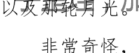

他走过去，用手在石头上摸了摸。石头上的灰尘很重，把整个碑面覆盖住了，而且出现了钙化，一时半会儿没办法清理，只在局部的地方，可以看到图案的粗浅印记。

古人气稀少，常用石碑画叙事，以此把事情传给后人知道。从局部图案来看，这十块石碑应该就是一套叙事石碑。

神俞想要把石头上的内容弄清楚，说不定能知道些线索。可清理的难度太大，没有一支考古队伍，一个个人怕是要花费一半，不太现实。

正当神俞一莫名的对着石碑发呆，他身后的台上，婉儿摸着头发坐了起来。神情扭动脚脚，转身，却是婉儿看着他，婉的笑。

“这是哪？”婉儿胡乱的打量周围，疑惑的问。

“我不清楚，醒来就在这里了。”神俞。

“白马青青？”婉儿看着神俞，忽然喃道。

神俞莫其妙，婉儿这是中邪了，怎么突然说白马青青，这玩意，似乎老沙也说过来。

神俞打量石碑，这块石碑的确是所有石碑里，图案显得比较完整的一块，但无论怎么看，也看不到婉儿所说的白马青牛在哪里。

“我明白了，这里是契丹族的祭坛万……”婉儿环视四周，长吐了一口气：“今天没了……”

“祭坛？”被婉儿提醒，神俞也察到，这周围的布置，的确有的点祭拜上的神圣场所。

婉儿点点头，触摸石碑，对神俞说，“相传契丹起源于西拉木柯和哈哈河流域，一位驾牧青牛的仙女和一个骑白马的仙相在此相遇，之后相恋，结为夫妻，开始孕育后人，他们生育了八个儿子，就此发展成了契丹八部……”

“你之前跟我提到过，这个传说可能只是图腾拟化了。是以这两种动物为图腾的两个部落族，相互融合之后，形形成的契丹民族吧……”神俞说。

“上古时候，没有文字记载，很多都是口口相传，最后以说传说，真相到底怎样，确是没办法去检测。”婉儿回头，指了指石碑上的线条，“我的笔记本里，画出了这些石碑，数量是对的。但具体记录的什么内容，我也不清楚，只有我这块儿我觉得很眼熟，勾勾的线条差差不多。我多标明，就是白马青石……”

“老穆……”神俞沉声，“他曾经过来这里？”

婉儿摇摇头，“我不知道具体情况，他的笔记本上，画了很多图案，各种杂类的文字标注，我当时看不出头绪，也匆匆看了几眼，没有一回事。

“他到虎符镇，肯定是做过很多的准备工作……”神俞说，“现在的问题是，这个祭坛到底有没有被废弃……”

“一整理局面，就不太妥了。”婉儿点明神俞的意思。

神俞点点头，“古人祭天告祖，常奉以牲肉作为祭坛，我们被怪物抓到这里，我看来不是偶然。”

婉儿说：“唐史·礼志》上说：冬至日，国俗屠羊、白马、白雏，各取血合。倒是不记得有人来做祭礼的……”

“血腥野蛮的事情，当然不会记录在册。”神俞说，“你以前好像说过，契丹族有个‘柴萨仪’用于榆树上砌‘黑龙殿’，然后由祭司点燃火堆，以此作为祭起。族人载歌载舞围绕祭坛，以祈求风调雨顺。”


婉儿说：“是有这么回事。萨满教以火为核心，信是沟通神的媒介。”

神俞叹气，“我很担心，这个石室，就是契丹人搭建的‘黑龙殿’，那些运过来的奇怪生物，也许在契丹人看来就是所谓的‘黑龙’。”

婉儿失笑，“你太想了。就算是祭坛，也不会那么。我看着这里都是石头砌成的，根本没有木材。是不是‘黑龙’，那些东西，怎么可能是沾不上边。我也是猜而已，不是最好的。”神俞说。尽管祭坛被婉儿否定，但他心中有些希望，能够认到那个人的身体，祭坛是在哪里，他也没法清楚。

“说到祭坛，我又想了一些事情。”两人静了一会，婉儿再次开口，“你知不知道契丹族有三位传奇？”神俞摇头表示不知，婉儿开始跟神俞讲起三位传奇。契丹的传说中，除了白马青牛的起源，剩下比较有意思的，就是三个汗。其中一个汗，这个汗真身是一具触诡，常是独自待在帐篷里，从来不会主动出现，只有当国家遇到大事，族人们用马青牛来祭祀，才会变成人形，出来给人们一些建议和指引。说完话之后，又回到帐篷内，变成诡。后来有人好奇，偷偷入帐篷去看，结果就消失了，也没有出现过。

还有一个汗，披猪皮，也是喜欢在帐篷里，跟那位汗一样，只有国家大事需要的时候，才会出现在人们面前，后来有人偷他的猪皮和野蛮头，这个汗，再看不见了。一个特殊的汗，留下一头，到了第二天，养的羊群，每天都是如此，族人以此为食。

“这三个汗的故事，之前我看到的时候觉得是无稽之谈，来到之后，才觉得这三个人可能是真实存在过。”婉儿补充道，“我们遇到过那些士兵，还有大装首领，以及镜面人。”神俞在听婉儿的过程中，已经想到了这三个汗的确可以对应当前发生的事情。

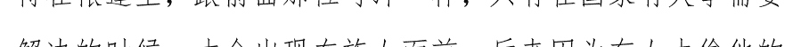

如果契丹的历史，三位汗说是真的，那么就意味着，虎符地下发生的这些，并不单是历史上自杀造成的，而极有可能跟部族的传承有关。他们的民族在很早以前，就有某些异异本事，能让人不死，以及制造镜面生物！

“大装首领？”婉儿问道，“你见过的他？就是那个镜面出现了了吗？”神俞意识到自己漏了，“我的确见过，而帮助他们实现这个目标的你父亲，还有老叔。”神俞很想反驳，老穆不是你想象的那样，不过没有出口，而是说，“每个人做事都有自己的理由，我不做什么都没意见，只要不影响我，就算天捅了，我也不会干涉……”

“我知道你是担心我。”婉儿说，“神俞，你发现从上次中了蛊之后，整个人就变得古怪了，你看着我的眼神，跟以前不一样。那蛊是真，我觉得你现在对我的感觉，可能是受到蛊的影响，并非真的……”

“婉儿，现在不是这些时候。”神俞何尝怀疑过这点，“我们还是活着出去再说。”婉儿知道神俞回避了，勉强笑笑点头。神俞避开婉儿的目光，头绪混乱。然后，他看到之前他们靠过的那张宽大石台边缘，忽然搭上来一只干枯的手。神俞瞳孔微收缩，几乎是无意的跨出去，把婉儿的一手拉住，往这边靠去，与石台拉开距离。石台虽很美，最近从小事来说，也显得有些冷清。婉儿还没察觉祭坛内有异常，被神俞拉住，还以为神俞觉得烦扰，神色变了，也有点抵抗。神俞虽然尴尬，但他另一方面是个君子，两人相处都没有过半步。神俞看到婉儿的动作，就知道她是误会，也没有解释，只做了一个嘘声，把婉儿强行的拉到身边。婉儿看到那只干枯的手，正在石台边缘摸索，顿时吓得尖叫，意识到是误会，神俞就彻底放弃了抵抗。神俞目光四处，在祭坛各个角落寻找可以使用的具，准备拿来。祭坛物品太少了，除了石台、石碑以及一些砌的大材，完全没有可以当武器的。那干枯的手摸索了一阵，才慢的把头伸出了石台。没有意外，那是一个有着红眼睛的僵尸，身上穿着破碎的衣服，看起来很老。这僵尸的整个躯体都在战斗的。神俞没有仔细去看僵尸的长，目光完全被僵尸手腕上带着的一块手表吸引。

“这个僵尸好奇怪……”婉儿轻声说。神俞心里有些紧张，满头汗，僵尸看起来危险。之前见过的僵尸，他们都是穿铠甲的士兵，面前的僵尸，手上戴的是手表。这是现代人！僵尸爬上石台，他的眼睛是赤红色，头顶上的月光照，整张脸显得狰狞，脸上的皮肤没有完整，往外翻，像枯树皮一样斑驳，两张嘴唇完全崩落，露出密集的牙，鼻子坏了，只剩下黑色的洞。僵尸身上上下都有蛆虫掉下来，朝四方爬。让神俞意外的是，他没有在僵尸身上感觉到煞气，看它显得诡异，像一个老者，痛苦挣扎。神俞内心因此产生了一种末死的悲凉。不管现在的僵尸是活人还是死人，变成这个样子，十分可怜。僵尸整个身体都站在石台上，直直站起来，仰望月光。月光让它感觉舒服，很快它闭上了眼睛，口里咯噜声，吐出浊气。与此同时，它全身发着淡淡的雾气，仿佛云缭绕，特别是冷光之下，一丝缕特别清晰。神俞看着它，之所以不要把这具僵尸解决掉，是因为在祭坛得到的最好。等僵尸从月光里吸收能量，就会发生变化。婉儿看得无比紧张，双手紧抓住神俞的手，手心里冰凉。神俞也觉得当前的情况变得奇怪，不知道它会做出什么。

“你看，他的样子变……”婉儿轻声说，情绪有些激动，也不知道是害怕还是被眼前的景象震惊。神俞看到了，僵尸开始肉眼可见的速度生长，膨满起来，胸部起伏的幅度增加，呼吸快速。神俞连呼吸都要缓，拳头紧起，他清楚，这具怪物是时间的产物，虽然腐烂，却非常恐怖，且头发非常的短，是个现代人！神俞忍不住，还不出手，也许就没机会了。他松开婉儿，吞了口沫，大步走起来，跨过石台，朝正在变化的僵尸。僵尸没有理会，继续在月光下沐洗，被神俞搂住。神俞把僵尸推开，一人一尸立即从石台上滚落，掉在石台靠侧的地上。僵尸被神俞从月光推下，立即发出尖叫，利爪抓。神俞做好了准备，把僵尸推下石台之后，借势跳起，赶着僵尸躺地上还没站起来，对准僵尸脑袋，找准空隙用脚猛踢。什么怜悯同情，现在他倒到九霄外去了，目的就剩下把这僵尸脑袋踢踹，让它极乐，省在这里受活人的苦。僵尸愤怒不已，一手挡开一边找时机反攻，不过难再挡神俞这一通的乱攻，刚刚长出一层新鲜血肉的脸上，瞬时血肉模糊。神俞感觉踩踏的是硬邦邦的骨头，过了一会儿，就感觉在踩踏稀泥。血气扑肺起来，他喉哑直涨，越来越觉得脚下不只是僵尸了，而是正在殴打一个活人，这感觉非常危险。出了两个字。神俞一怔，气喘吁吁停住了。什么情况？僵尸还会说话？“我知道他是谁了……”婉儿急忙跑过来，对神俞说，“别打了，我知道他是谁了……”神俞苦笑：“我想我也猜到了……”

神俞停止动作，想象中无比厉的僵尸，竟然会开口求锐，令他哭不得。正是他曾见过的守京后裔之一，冬生。带着大刀和老沙也出现，把另一半虎符交给老任上的那个人。在那一刻，神俞也想到，为什么他去守京。


肤粘连到一块儿，渗出绿色的液体。

“这是真菌感染，症状跟脚癣差不多。”娇儿冷静的说，“不过，他感染的程度很深，连血液都被感染了，那他的其它器官，身体的绝大多数部位，都不可能幸免……”

“什么真菌这么厉害？”神喻看了看自己的手，他很清楚真菌感染容易传，而刚才，他和冬生有过亲密接触！还好，目前来看，并没有什么变化。

“我不知道，人类已知的真菌种类虽然有七万多种，但还没到能完全自然界一半。”娇儿摇摇头，“对整个世界来说，人类所知的事物，就像黑暗里点起一盏灯所照见的部分，当灯光亮起来，就会发现，未照见的部分会更多……”


“这种真菌有很大的关系。”神喻说，“我们最好离他远点，以免及……”

“再回避已经晚了……”娇儿说，“不过我觉得，对我们未必会有影响，这种真菌，极有可能针对的是某一种体质或者特殊DNA的族群。”

神喻恍然点头，“你是对的，守陵人的后裔一旦靠近符镜就会发疯，根源就在这里！它们只对守陵人有影响……”

“这个人，对真菌有了免疫力，才能存活下去。”娇儿说。

“可惜，清清楚这些事，对我们离开这里没有任何帮助。”神偷叹气道，“如果他还清醒，说不定能给我们指条明路。”

“糟……”冬生突然睁大眼睛，嘴里喷出一口唾沫。

神偷的快手，把婉儿一把拉开，冬生很敏捷的站起来，双眼直直的盯着祭坛周围的一处石碑，眼中原本消失的红丝，闪烁起来。

一只黑鳞似的红眼怪物，从两块石碑之间的缝隙里，慢的爬出了，腹鼓起水沫。

神偷和婉儿不敢出手，他们很清楚，这个怪物又送来了什么东西，也许，是某个人！


义呵……因为意识会转移，其实和别人联手就毫无意义了，因为感觉上，虽然和你联手的是其中一个镜面，但是其实所有的镜面都在和你联手，也就是说，杀掉哪个对自己有利意义，对其他人有差别吗？

如果有差别，就好玩了……这个可能后面慢慢说了，稍微回答如些剧透啊，呵呵。不管有没有意义，自保心里是每个个体都存在的。我是这么认为的……本能都要杀对方，至于于终目的，可能他们也不清楚……。

作者:蛇从 日期:2014-05-25 23:38
一手整理 加微信1101284955 获取更多精彩帖

旁边还有生说，设计下载量。丝丝玛路，看到看到底底是镜面还是真人。他才察觉到自己的反应，才意识到自己非常浅浅，因为他发现自己竟然还抱有一丝幻想，希望眼前的这个冬生，心脏在左边，像一样是个真人。

似乎这样，冬生就值得信任这些。神喻告诉自己，必须要抛开这种约定构成的偏见，才有可能正确的认识眼前的人。

> “你已经杀死了自己的镜面。”妈儿好奇的说，“你还担心什么？那些恶心的怪物？”

冬生环视四周，对每个黑暗的角落都看了看，像是担心那些红眼的怪物突然出来，确保没有之后，才开口：“凌蠡……。你说的恶心怪物，叫陵蠡……。它们本身的危害不大……”

“没见过……”神偷皱眉，“又是地底的神兽？”

“原来是那种东西……难怪恶心……”娇儿说，“不是什么时候了不起的东西，就是涕虫，也叫蛞蟆……”

“蛞蟆我是知道……”神偷皱了皱，这种玩意儿，在地上就几厘米长，没想到底下能长到两、三米，就算看着相似，也想到不是一种生物。

“地底环境特殊，这里的生物属性变得很特别，差不多属于另一个物种。”冬生说，“它们把地底的人类全部抓进这巢窟，获取更多。”

神偷想了想，觉得冬生的话，确是有道理，娇儿跟他，都是被陵蠡抓过来，而且，以陵蠡的能力，几乎没有人是它的对手，就连老桩以及他各有本事的下属，面对陵蠡时，都是各种无力的。

“它们这么做的目的是什么？”神偷问。

“你刚看到看到了……”冬生露出森然的笑容，一刻那显得有些兴奋，“地底，有很多跟我们一模一样的复制品。”

神偷总明白冬生说还有架打的意思了。可是，镜面，不只只有一个么？难道不止一个镜面？一念及此，神偷浑身直冒寒气；肯定是这样没错了，在那个有耶律穷古户的镜面布局里，存在一个他的镜面人，而是也有一个根据他当前到的情况，就不止一个镜面人。

“那是不是，我也有镜面人？”妩儿望了一眼神偷，轻声的问。

“都都有！没有人能例外！”冬生很狠的说，“我已经杀了很多人，可是还没有杀你……”

神偷心里想反击，大拿就是一个例外，他的三味符，让其他人在镜面布局里不会产生镜面人。在地下，真的是一件无价之宝！

“即便有我的镜面人，那也是我自己……”妩儿忽然笑着，加入神偷，都不回了话。

这是神偷一贯的思路，所以妩儿出门之后，他就等着冬生开口接话，看冬生有没有不同的见解。杀死镜面人似乎是种本能，这就说明了问题，人类的本能，是趋利避害，人体的本能能够让自己生存下去，在数万年的进化当中，写入基因的东西。

换句话，无论是真人力要杀掉镜面人，还是镜面人力要杀死本体，对自身必定存在好处。

“等你被杀的时候……”冬生轻轻的说，“你就会知道，你错了很离谱……”

作者:蛇从 日期:2014-05-25 23:41

@蓝色 R1 18371 楼 2014-05-25 23:39:00
还有你。今天就这么多了……没了……

作者：蛇从草 日期:2014-05-26 22:17

你又没死，怎么会知道我说得不对……”妈儿一以为然的说。

“如果我被杀了，就会去一个地方，那里是比地狱更恐怖，像被活活的封在棺材里，埋在地下，不同的是，永远不会有人来把你放出去……”

神偷一听这话，差点咬自己的舌尖，吃惊的眯着冬生，激动的说：“你说那个地方，是不是周围全是镜子，里面还有另一具？”

“你也杀死过自己的复制品了，对不对对！”冬生表情奇怪异的笑，“你一定是听临死前说过了……我抓死他的时候，就听到他在喊……你不知道他有多恐惧，在临死之前，竟然哀求我放过，不要去那里……”

冬生颓然坐在地上，颓然想到：原来这就是拼命杀死镜面的原因，无论是真实的本体还是镜面人，都害怕那个地方，只有拼命杀死对方，会被关进那个镜面体里……

“不要去那里，我不要去那里……”冬生胡，言语中的恐惧和绝望，从心底延到全身。

“你怎么了……”妩儿拉住冬生的胳膊，轻声问。

“不，我要杀光！”冬生大喊，“对，我要杀光！我能保持独立而有序，我才是唯一的……”

“你们两个疯子！”妩儿看着两个乱舞的男人大喊。她还是明白，冬生所说的，比地狱还要恐怖的地方……

作者：蛇从 日期:2014-05-26 23:11
@hyber 1334 楼 2014-05-26 22:57
无论是镜面人还是真人，都害怕那个地方，那么害怕呢？

冬生是在杀死镜面人的时候，得到的镜面体信息，他以为冬生是这样，其实冬生不是。他的意识一直在本体和镜面人之间穿梭，他有经历，所以比冬生更。作者:蛇从 日期:2014-05-26 23:34

地面，山上，常年散的大雾竟然罕见的散，处处湿润的泥土被阳光照射，散发出股浓郁的腐味。在山上休息了近半天，大拿恢复了力气醒来，之前之前看到小方，所幸小方还在睡眠，但呼吸均匀，脸上也恢复了一些血色，看起来经过一番休息后，状态有了改善。大拿这才松口气，注意到冬生靠在一棵树下，半个对着他，看不到脸。

“你在看什么？”大拿过去，发现冬生眯着，呆望着远方。他循着冬生的目光，远处的天空有火烧，残阳如血。

“没看什么，在想事情。”冬生说。

“我们该下山了……”大拿说，“天黑了路不好走。”

冬生站起来，拍拍身上的灰，“你要送小方去医院。”

“你身上的伤也很严重，我知道你的打算，但不能再到地下去了。”大拿说，“我们尽力了，只能等办法来解决问题，不要冲动。”

“不是冲动的问题……”冬生严肃的说，“还在地下，处处危险，我不能放下她……”冬生决绝，大拿清清楚楚，当初在地下，冬生曾跟她一起，知道再加力于无补，只好点头：“那送到医院，我尽量快起来帮你……”冬生摸了摸护身符，心里已经累了。

不回妈儿的话，就跟她一起。冬生说完，蹦跶的朝山下走，走着边大拿挥手道别。大拿叹了口气，走回山这边，走着朝山下走，走了几路，自己自己少了什么，顺手摸下脖子，果然，戴在脖子上的三味符不见了。不仅是他的三味符，当初抢的老索的没了。他记得清楚，在地下逃出来的时候，他特意安置到长明灯上的两个挂件，全取回来脖子上。

“他妈的。狗改不了吃……”大拿忍不住破口大马。冬生的身影早走得不见了。

作者:蛇从 日期:2014-05-27 00:31

大拿知道肯定是冬生把三味符拿走了，可现在他没有时间去挂件回来，他必须送去医院。而这个医院，虽然在虎镇上，离大龙家菜馆比较远，更何况背着一个人去追，也追不上。大拿骂咧的从虎镇医院去。

自从钢厂破废以后，近年来，镇上又大改造，把原来的两家医院拆迁合并，却因为资金问题，空有几栋大建筑，各种医疗机械配套不完善，实际的诊实力并不强。不过，总是医院，基本的医疗能力还是有的。以大拿看来，小方对付不死鬼的时候，不知道是什么手段，血液流失没多少。不用现代的医疗设备根本没办法解决，也不是吃两粒药就能恢复了。远远的旧字号就住在外面，现在靠老客户的业务。

从桥山山下来，大拿背着小方一脚浅一脚深的走，天黑了一阵，走到了医院的门口。守门的老头跟大拿是老识，都是在保安治安当混饭吃，彼此比较熟悉。看到大拿背着小方走来，守门老头立即看出了问题，迎了他来。从守门人口中得知，到了这个时间点，医院的大部分护士都下班了，晚上不太太平，怪事连连，只留下一个年轻的实习医生。

在守门头的带领下，大拿背着小方进入诊室，实习医生模仿的样子过来，掀开小方身上的衣服，就被血臭冲得后退几步，脸色煞白，差点咬出来。大拿看他神色，知道医生不行，守门老头赶紧催电话，找靠谱的医生来。实习生多久，跑到卫生间吐了一阵，才跑回来，尴尬的。实习生暂时把小方安置到病床上，让护士先换掉衣物，然后抽血，等资深的医生来进一步处理。等医生的过程中，实习生也没闲着，替大拿清理伤口，先把干净。多久，大拿听到天空里有直升机螺旋桨的声音由远及近。

作者:蛇从 日期:2014-05-27 00:31
没了。晚安。作者:蛇从 日期:2014-05-27 00:32
今天没了。晚安。

今天没没架了。

守门的老保安跑进来，说是出了事，竟然来了两架直升机，这种事可是多年没见过。大拿听就知道奇怪，听出是直升机的声音。老保安说，经常看到直升机往后面飞，后面有个军事基地，但谁也没见过。大拿以前不会信老保安说，但现在他几分相信了。

“对了……”大拿一拍大腿，急忙站起来往外走，“是所长回来了，我反应慢慢……”他走到门口，又回来，看着躺在病床上的小方不知措，把小方就丢在医院，让人实在安心了。

@马甲甲骑兵 18540 楼 2014-05-27 20:13:00
看到这里，我觉得蛇哥的写作思维有点固化，或者说是2014-05-28 21:32

# 今天过生日对才已经过的。多谢各位挂念了。谢谢啊。哈哈。作者:蛇从 日期:2014-05-28 21:32

“算了，刘所长肯定带回来了，去了也没用，让他们折腾去……”这么想着，大拿再次坐下，陪小方的床边。老保安弄了些热饭菜过来，说是老伴刚刚完晚餐，送来大拿。大拿饿得肠辘辘，肚子里咕咕叫，知道老保安是觉到了，就没客气，干脆吃了。过了多久，来了中年医生，一脸不耐烦。实习生手里拿着血单，看了一眼，又翻了小方的眼皮，拿着听诊器听了一会儿。

“医生，他怎么样？”大拿急不可耐。

“他严重失血，休克，心率稳……”中年医生说，“而他的血型非常罕见，县医院还没血库备好，没办法，你得快点送到大医院，性命危险。”大拿听得愣一愣，“送县医院也要几个小时，他都这样了，你就不能再想想办法！”

“我不是神仙，没血我怎么救！”医生被叫来，也有火气，把听诊器一甩，摆拍准备走人。

“没血……抽我的！”大拿把袖子一。

“你听不懂人话，他是罕见血型，抽你的没用！”中年医生说。实习生在旁边赔笑，“大哥，血型必须配合才能用，我们不是不救，实在……”

大拿了脾气，“少废话，你们又验过我的血，怎么知道不配，赶紧抽……”

两个医生都被大拿的话给噎住，中年医生顿了顿，让实习生大拿给验血。

“他也受伤不轻，流了很多血，就算能用，也不能再抽了……”实习生犯准的望向中年医生。中年医生还没说话，大拿抢先说：“叫你抽你就抽，我没事，能救他就行！”实习生闭嘴不说话，给大拿抽血，然后去做血检，忙活了半个钟，把脸皱，急匆匆的跑过来，满脸兴奋，“真你妈见，鬼了，还能配得上……”

作者：陈云：2014-04-27 23:27:36
一手加入V101284955 获取更多好帖
看到，看到这里，我觉得蛇哥的写作思维有点固化，或者说是一种写法。从从事到异海再到这一部，蛇哥你都在写一个类似平行的世界架构，而平行世界的终极走向就是一个类似寒地狱的地方，那个地方让人胆畏的地方就是时间停止，只有永恒的孤寂，永恒的挣扎。大师级我也在，我觉得那里蛇哥的尝试很好，故事的线性感没那么强，让写作自由。每个人都有一个世界，所以特别是在题材相近的情况下，也难跳出来。体系设定到极致，就向内化和内涵完善之后，再向外扩展，不停摸索，然后创新。作者:蛇从 日期:2014-05-27 23:37
@马甲甲骑兵 18440 楼 2014-05-27 20:13:00
看到这里，我觉得蛇哥的写作思维……大拿听到血能用，松了口气，大拿脸色苍白，头也晕。两个医生知道大拿抽了大针血，赶紧跑去救。刚醒后天亮，醒来的时候，看到热闹，个人抖着头脸，还好意思到医院！大拿低着头没话说，当初主动请，要去把师符。下来，大拿摸了摸摸护身符，心里已经累了，更累了。

不回妈儿的话，就跟她一起。“你看出老沙有问题了？”大拿觉得所长的奇怪，问。刘所长摇头，“我只知道他是发育的人，对你有恶意。”大拿哼声，“算了，接下来你打算怎么办。”大拿不死鬼狂控制住。

“妈儿你爸？”大拿问，“会不会跟老任一伙？”刘所长不耐烦的说，“十几年没过的天翻地覆！大拿最怕刘所长，不敢接话。“你身上的十字挂件给我……”刘所长朝大拿伸手，“去找缪兄，有比较保险。”大拿恨不得把脑袋缩到被子里，面血色的脸上羞愧，得红紫。

“老任把挂件也抢走了？”刘所长急得不可耐的掀起大拿的衣领，看到脖子处空荡的，不禁声音都变了。“那是那个跟婉儿在一起的男人跑走了……”大拿嗓音若蚊蚕。

作者:蛇从 日期:2014-05-27 24:45
没了。作者:蛇从 日期:2014-05-28 05:56
没了。作者:蛇从 日期:2014-05-28 05:57
@duoduustock 18572 楼 2014-05-27 23:59:00
一手理加值1101284955 获取更多帖子
观见新手快乐！祝大家顺利，抓取好多帖
呵呵呵。已经过了啊……谢谢……。作者:蛇从 日期:2014-05-28 21:32
@水仙倒影 18531 楼 2014-05-27 15:06
@蛇从 18478 楼 2014-05-27 03:01
昨天过生日还坚持更新，蛇哥哥真棒!!!!
@ybbdway 18563 楼 2014-05-27 23:03
今天没了。晚安。


从那些年轻人行走的姿态来看，应该是军人，而且一个个人身手不凡，身上有功夫。这些大拿不是刘长以前的那些手下能比的，说是这次出去从哪里来的援兵。

大拿皱了摇头，命很大，本来是打算从刘长手里把几瓶免克瓦药拿来，没想到刘长就是不给。

也是，在现在刘长喊了救兵过来，哪里还把他放在眼里！

作者：蛇从草 日期:2014-05-28 23:36

大拿回到护士那里问了问刘长的病情，听到已经是动完手术在休息，最好不要去打扰，也就放心下来，特意交代小护士好照顾，然后在医院食堂吃了午饭，才动身去找刘长。

## 一手数理，加信1101284955

到底是从炎来还是来的，到了那里发现结果很遗憾，当初他们从地里出来的入口，已经被完全摧毁，根本就没有人在那。

大拿站了会，看到有辆警察的车，往钢厂里开，立即跟了上去。

钢厂门口一片狼藉，原本已经被毁坏不堪，触目入目，经过不死鬼鬼那暴暴雷雷，变得更加不不堪，不少地面塌开裂，露出一个个地陷坑洞，估计跟地下爆发有一关关系。

虽然街道上，门口处站着两个刘长从外边带来的年轻军人，但都没有阻拦，好像看不见大拿的，一路让他通行。

大拿走到钢厂里了，甚至还有个人给他指路，告诉刘长就在那里。

大拿走里走，经过泵房的时候，看到当初跟老老沙地底时的那个入口，被淹死，不禁感到奇怪。

而刘所长站在蓄水池边上，对一群年轻军人手指画脚，像是在安排任务，那个青城道士落在水里，手舞宝剑，口里念念有词。

大拿在远处站定，等刘所长把事情都交代完。那些年轻人听完刘所长的指示，把背包拿下来，开始清点装备，很多大拿说不出名字的东西，其中也有绳索、手电之类的物品，他们清点了一遍，又把东西回去，各自留下了一把皮鞘的军刀，把它搁在腰部顺的位置。

一手处理，大拿掏出笔记本，取出好多帖。


“你出来做什么了？”刘所长不耐烦的说。

“很多人分力气嘛。”大拿憨笑，“这是打算干啥？”

“我们要去地下。”刘所长说，“地下还有很多事情都还没……”

“不是吧？”大拿听到地下两个字头疼，“老任他们是在天桥洞，早没在钢厂下面了……”

“阴面的剑心风水险，有山光、水光、水影、天根、地窗四个风水眼。”刘所长说，“天桥洞，只是其中一个，老任他们破坏掉了，其它三个，他很快就会去找……”

“带上我……”大拿没等刘所长说完，“这一次，我不再出岔子了。”

“就你这三脚猫功夫？”刘所长轻蔑的笑，“你随便挑个人，能过一招，我带你下去……”

“谁敢跟我单挑？”大拿立刻转过身体，对那些正在整理装束的年轻人喊道：

那些年轻人好像没听见一样，都自顾的忙活手底下的事，大拿一阵尴尬，这些人也太堪不起脸了。……

“听说你是全军区的冠军，还输过人？”终于有一个，一个脸色涨红的年轻人整理完毕，抬起头来跟大拿说话。

“虚名，不值一提。”大拿心里莫名的高兴。

“我学功夫精用，你护我一腿，算你赢。”他跳了脚，对着身边的年轻人看看。

大脸上捂不住了，这话未免太气了！一捏拳头，提了一口气，勾了勾手指，硬邦邦的，“来！”

红脸年轻人略微点头，浑然爆发出一连串风声，身体弹了起来，腰跟着风甩过来。大拿迎着上，蹲了个马步，稳住腰，抬起手臂挡，对方腿扫到，大拿只耳中轰响，整个人被一股力量带动，摔飞出去。

作者：蛇从 日期:2014-05-28 23:39


水波聚集，蓄水池水位下降，可以很看到，蓄水池中央的地带塌陷出一个圆形的凹窟，围绕着空洞的边缘，水流瀑一样落下。所有蓄水池的水全部往中央地涌。大拿看得惊心动魄，感到旁边有无数的气流，要把他往蓄水池中央，而那窟窿的规模在继续扩大，边缘的土石朝内陷下去。

风呼呼的刮，把所有人的衣服吹得猎猎响，紧紧的贴在身上。刘所长和青城道士，走在队伍之前，率先跳进了奔流的水里，那些年轻人没有迟疑，跟着他们跳进去，顺着流水，窟眼游去，每个人的神色都充满了坚决。

直到所有人从窟眼里消失，蓄水池里的水流得干净净，大拿手里捏着师父留下的那瓶药水，一屁股坐在蓄水池旁的岸石上，内心毫无平静。

作者:蛇苍 日期:2014-05-29 23:37

大拿第一次陷入了迷茫，不知道该干什么，他静静的坐在岸边，望着窟长进入地下的黑窟，直到黑暗没有挪动。夜风变得燥热，一轮圆月挂在天上，洒下银辉。周围静寂无比，连鸟的声音都没有，忽然，远处的黑暗中，传出一声若有若无的响，似乎有什么在游动。

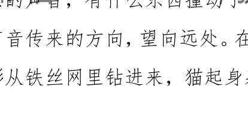

大拿循着声音传来的方向，望远处。在蓄水池的对岸，一个黑色人的影从铁丝网里钻进来，猫着身形，朝着蓄水池黑窟潜去。大拿暗暗留神，这个人并不是误进来，一定是早有想法，要靠近蓄水池。他不声色，仔细的打量，天色不是很暗，虽然看不清那人的长相，但整体轮廓能看清。那动作，大拿觉得熟悉。黑影在窟边缘，朝内看了巡，回头，视线朝大拿望。大拿没有躲避，也没有遮掩，反而站起来，黑影朝他走来。近了，大拿看清脸上戴着一张獠牙面具。

“不要戴了面具，我就认不出你。”大拿说，“你还做什么！”

黑影把面具取下来在大手里，露出老脸。刘所长抬手，把一个东西丢出来，大拿意识地接过，发现是一个瓷瓶，用绢布塞住，他不禁愣然，呆呆的刘所长。

“给你，别说我。”刘所长说，“你现在还是钢厂的保安，有把这里看好……”话还没说完，那边的青城道士扬起手，大喝一声，蓄水池里出现无数蓝色的光流，混乱地对撞，撕碎，发出嘟嘟的声音，蓄水池的水面被掀得沸腾，往上冒起巨大的色彩，瞬间涌上来，很热。那些水波聚集，蓄水池水位下降，可以很看到，蓄水池中央的地带塌陷出一个圆形的凹窟，围绕着空洞的边缘，水流瀑一样落下。所有蓄水池的水全部往中央地涌。大拿看得惊心动魄，感到旁边有无数的气流，要把他往蓄水池中央，而那窟窿的规模在继续扩大，边缘的土石朝内陷下去。风呼呼的刮，把所有人的衣服吹得猎猎响，紧紧的贴在身上。刘所长和青城道士，走在队伍之前，率先跳进了奔流的水里，那些年轻人没有迟疑，跟着他们跳进去，顺着流水，窟眼游去，每个人的神色都充满了坚决。直到所有人从窟眼里消失，蓄水池里的水流得干净净，大拿手里捏着师父留下的那瓶药水，一屁股坐在蓄水池旁的岸石上，内心毫无平静。

到底是从炎来还是来的，到了那里发现结果很遗憾，当初他们从地里出来的入口，已经被完全摧毁，根本就没有人在那。大拿站了会，看到有辆警察的车，往钢厂里开，立即跟了上去。钢厂门口一片狼藉，原本已经被毁坏不堪，触目入目，经过不死鬼鬼那暴暴雷雷，变得更加不不堪，不少地面塌开裂，露出一个个地陷坑洞，估计跟地下爆发有一关关系。虽然街道上，门口处站着两个刘长从外边带来的年轻军人，但都没有阻拦，好像看不见大拿的，一路让他通行。大拿走到钢厂里了，甚至还有个人给他指路，告诉刘长就在那里。

大拿走里走，经过泵房的时候，看到当初跟老老沙地底时的那个入口，被淹死，不禁感到奇怪。而刘所长站在蓄水池边上，对一群年轻军人手指画脚，像是在安排任务，那个青城道士落在水里，手舞宝剑，口里念念有词。大拿在远处站定，等刘所长把事情都交代完。那些年轻人听完刘所长的指示，把背包拿下来，开始清点装备，很多大拿说不出名字的东西，其中也有绳索、手电之类的物品，他们清点了一遍，又把东西回去，各自留下了一把皮鞘的军刀，把它搁在腰部顺的位置。一手处理，大拿掏出笔记本，取出好多帖。


“你出来做什么了？”刘所长不耐烦的说。

“很多人分力气嘛。”大拿憨笑，“这是打算干啥？”

“我们要去地下。”刘所长说，“地下还有很多事情都还没……”

“不是吧？”大拿听到地下两个字头疼，“老任他们是在天桥洞，早没在钢厂下面了……”

“阴面的剑心风水险，有山光、水光、水影、天根、地窗四个风水眼。”刘所长说，“天桥洞，只是其中一个，老任他们破坏掉了，其它三个，他很快就会去找……”

“带上我……”大拿没等刘所长说完，“这一次，我不再出岔子了。”

“就你这三脚猫功夫？”刘所长轻蔑的笑，“你随便挑个人，能过一招，我带你下去……”

“谁敢跟我单挑？”大拿立刻转过身体，对那些正在整理装束的年轻人喊道：

那些年轻人好像没听见一样，都自顾的忙活手底下的事，大拿一阵尴尬，这些人也太堪不起脸了。……

“听说你是全军区的冠军，还输过人？”终于有一个，一个脸色涨红的年轻人整理完毕，抬起头来跟大拿说话。

“虚名，不值一提。”大拿心里莫名的高兴。

“我学功夫精用，你护我一腿，算你赢。”他跳了脚，对着身边的年轻人看看。

大脸上捂不住了，这话未免太气了！一捏拳头，提了一口气，勾了勾手指，硬邦邦的，“来！”红脸年轻人略微点头，浑然爆发出一连串风声，身体弹了起来，腰跟着风甩过来。大拿迎着上，蹲了个马步，稳住腰，抬起手臂挡，对方腿扫到，大拿只耳中轰响，整个人被一股力量带动，摔飞出去。

作者：蛇从 日期:2014-05-28 23:39


水波聚集，蓄水池水位下降，可以很看到，蓄水池中央的地带塌陷出一个圆形的凹窟，围绕着空洞的边缘，水流瀑一样落下。所有蓄水池的水全部往中央地涌。大拿看得惊心动魄，感到旁边有无数的气流，要把他往蓄水池中央，而那窟窿的规模在继续扩大，边缘的土石朝内陷下去。风呼呼的刮，把所有人的衣服吹得猎猎响，紧紧的贴在身上。刘所长和青城道士，走在队伍之前，率先跳进了奔流的水里，那些年轻人没有迟疑，跟着他们跳进去，顺着流水，窟眼游去，每个人的神色都充满了坚决。直到所有人从窟眼里消失，蓄水池里的水流得干净净，大拿手里捏着师父留下的那瓶药水，一屁股坐在蓄水池旁的岸石上，内心毫无平静。

作者:蛇苍 日期:2014-05-29 23:37

大拿第一次陷入了迷茫，不知道该干什么，他静静的坐在岸边，望着窟长进入地下的黑窟，直到黑暗没有挪动。夜风变得燥热，一轮圆月挂在天上，洒下银辉。周围静寂无比，连鸟的声音都没有，忽然，远处的黑暗中，传出一声若有若无的响，似乎有什么在游动。


大拿循着声音传来的方向，望远处。在蓄水池的对岸，一个黑色人的影从铁丝网里钻进来，猫着身形，朝着蓄水池黑窟潜去。大拿暗暗留神，这个人并不是误进来，一定是早有想法，要靠近蓄水池。他不声色，仔细的打量，天色不是很暗，虽然看不清那人的长相，但整体轮廓能看清。那动作，大拿觉得熟悉。黑影在窟边缘，朝内看了巡，回头，视线朝大拿望。大拿没有躲避，也没有遮掩，反而站起来，黑影朝他走来。近了，大拿看清脸上戴着一张獠牙面具。

“不要戴了面具，我就认不出你。”大拿说，“你还做什么！”黑影把面具取下来在大手里，露出老脸。刘所长抬手，把一个东西丢出来，大拿意识地接过，发现是一个瓷瓶，用绢布塞住，他不禁愣然，呆呆的刘所长。

“给你，别说我。”刘所长说，“你现在还是钢厂的保安，有把这里看好……”话还没说完，那边的青城道士扬起手，大喝一声，蓄水池里出现无数蓝色的光流，混乱地对撞，撕碎，发出嘟嘟的声音，蓄水池的水面被掀得沸腾，往上冒起巨大的色彩，瞬间涌上来，很热。那些水波聚集，蓄水池水位下降，可以很看到，蓄水池中央的地带塌陷出一个圆形的凹窟，围绕着空洞的边缘，水流瀑一样落下。所有蓄水池的水全部往中央地涌。大拿看得惊心动魄，感到旁边有无数的气流，要把他往蓄水池中央，而那窟窿的规模在继续扩大，边缘的土石朝内陷下去。风呼呼的刮，把所有人的衣服吹得猎猎响，紧紧的贴在身上。刘所长和青城道士，走在队伍之前，率先跳进了奔流的水里，那些年轻人没有迟疑，跟着他们跳进去，顺着流水，窟眼游去，每个人的神色都充满了坚决。直到所有人从窟眼里消失，蓄水池里的水流得干净净，大拿手里捏着师父留下的那瓶药水，一屁股坐在蓄水池旁的岸石上，内心毫无平静。

大拿第一次陷入了迷茫，不知道该干什么，他静静的坐在岸边，望着窟长进入地下的黑窟，直到黑暗没有挪动。夜风变得燥热，一轮圆月挂在天上，洒下银辉。周围静寂无比，连鸟的声音都没有，忽然，远处的黑暗中，传出一声若有若无的响，似乎有什么在游动。大拿循着声音传来的方向，望远处。在蓄水池的对岸，一个黑色人的影从铁丝网里钻进来，猫着身形，朝着蓄水池黑窟潜去。大拿暗暗留神，这个人并不是误进来，一定是早有想法，要靠近蓄水池。他不声色，仔细的打量，天色不是很暗，虽然看不清那人的长相，但整体轮廓能看清。那动作，大拿觉得熟悉。黑影在窟边缘，朝内看了巡，回头，视线朝大拿望。大拿看清脸上戴着一张獠牙面具。

“不要戴了面具，我就认不出你。”大拿说，“你还做什么！”黑影把面具取下来在大手里，露出老脸。刘所长抬手，把一个东西丢出来，大拿意识地接过，发现是一个瓷瓶，用绢布塞住，他不禁愣然，呆呆的刘所长。

“给你，别说我。”刘所长说，“你现在还是钢厂的保安，有把这里看好……”话还没说完，那边的青城道士扬起手，大喝一声，蓄水池里出现无数蓝色的光流，混乱地对撞，撕碎，发出嘟嘟的声音，蓄水池的水面被掀得沸腾，往上冒起巨大的色彩，瞬间涌上来，很热。那些水波聚集，蓄水池水位下降，可以很看到，蓄水池中央的地带塌陷出一个圆形的凹窟，围绕着空洞的边缘，水流瀑一样落下。所有蓄水池的水全部往中央地涌。大拿看得惊心动魄，感到旁边有无数的气流，要把他往蓄水池中央，而那窟窿的规模在继续扩大，边缘的土石朝内陷下去。风呼呼的刮，把所有人的衣服吹得猎猎响，紧紧的贴在身上。刘所长和青城道士，走在队伍之前，率先跳进了奔流的水里，那些年轻人没有迟疑，跟着他们跳进去，顺着流水，窟眼游去，每个人的神色都充满了坚决。直到所有人从窟眼里消失，蓄水池里的水流得干净净，大拿手里捏着师父留下的那瓶药水，一屁股坐在蓄水池旁的岸石上，内心毫无平静。

大拿第一次陷入了迷茫，不知道该干什么，他静静的坐在岸边，望着窟长进入地下的黑窟，直到黑暗没有挪动。夜风变得燥热，一轮圆月挂在天上，洒下银辉。周围静寂无比，连鸟的声音都没有，忽然，远处的黑暗中，传出一声若有若无的响，似乎有什么在游动。大拿循着声音传来的方向，望远处。在蓄水池的对岸，一个黑色人的影从铁丝网里钻进来，猫着身形，朝着蓄水池黑窟潜去。大拿暗暗留神，这个人并不是误进来，一定是早有想法，要靠近蓄水池。他不声色，仔细的打量，天色不是很暗，虽然看不清那人的长相，但整体轮廓能看清。那动作，大拿觉得熟悉。黑影在窟边缘，朝内看了巡，回头，视线朝大拿望。大拿没有躲避，也没有遮掩，反而站起来，黑影朝他走来。近了，大拿看清脸上戴着一张獠牙面具。

“不要戴了面具，我就认不出你。”大拿说，“你还做什么！”黑影把面具取下来在大手里，露出老脸。刘所长抬手，把一个东西丢出来，大拿意识地接过，发现是一个瓷瓶，用绢布塞住，他不禁愣然，呆呆的刘所长。

“给你，别说我。”刘所长说，“你现在还是钢厂的保安，有把这里看好……”话还没说完，那边的青城道士扬起手，大喝一声，蓄水池里出现无数蓝色的光流，混乱地对撞，撕碎，发出嘟嘟的声音，蓄水池的水面被掀得沸腾，往上冒起巨大的色彩，瞬间涌上来，很热。那些水波聚集，蓄水池水位下降，可以很看到，蓄水池中央的地带塌陷出一个圆形的凹窟，围绕着空洞的边缘，水流瀑一样落下。所有蓄水池的水全部往中央地涌。大拿看得惊心动魄，感到旁边有无数的气流，要把他往蓄水池中央，而那窟窿的规模在继续扩大，边缘的土石朝内陷下去。风呼呼的刮，把所有人的衣服吹得猎猎响，紧紧的贴在身上。刘所长和青城道士，走在队伍之前，率先跳进了奔流的水里，那些年轻人没有迟疑，跟着他们跳进去，顺着流水，窟眼游去，每个人的神色都充满了坚决。直到所有人从窟眼里消失，蓄水池里的水流得干净净，大拿手里捏着师父留下的那瓶药水，一屁股坐在蓄水池旁的岸石上，内心毫无平静。

大拿第一次陷入了迷茫，不知道该干什么，他静静的坐在岸边，望着窟长进入地下的黑窟，直到黑暗没有挪动。夜风变得燥热，一轮圆月挂在天上，洒下银辉。周围静寂无比，连鸟的声音都没有，忽然，远处的黑暗中，传出一声若有若无的响，似乎有什么在游动。大拿循着声音传来的方向，望远处。在蓄水池的对岸，一个黑色人的影从铁丝网里钻进来，猫着身形，朝着蓄水池黑窟潜去。大拿暗暗留神，这个人并不是误进来，一定是早有想法，要靠近蓄水池。他不声色，仔细的打量，天色不是很暗，虽然看不清那人的长相，但整体轮廓能看清。那动作，大拿觉得熟悉。黑影在窟边缘，朝内看了巡，回头，视线朝大拿望。大拿没有躲避，也没有遮掩，反而站起来，黑影朝他走来。近了，大拿看清脸上戴着一张獠牙面具。

“不要戴了面具，我就认不出你。”大拿说，“你还做什么！”黑影把面具取下来在大手里，露出老脸。刘所长抬手，把一个东西丢出来，大拿意识地接过，发现是一个瓷瓶，用绢布塞住，他不禁愣然，呆呆的刘所长。

“给你，别说我。”刘所长说，“你现在还是钢厂的保安，有把这里看好……”话还没说完，那边的青城道士扬起手，大喝一声，蓄水池里出现无数蓝色的光流，混乱地对撞，撕碎，发出嘟嘟的声音，蓄水池的水面被掀得沸腾，往上冒起巨大的色彩，瞬间涌上来，很热。那些水波聚集，蓄水池水位下降，可以很看到，蓄水池中央的地带塌陷出一个圆形的凹窟，围绕着空洞的边缘，水流瀑一样落下。所有蓄水池的水全部往中央地涌。大拿看得惊心动魄，感到旁边有无数的气流，要把他往蓄水池中央，而那窟窿的规模在继续扩大，边缘的土石朝内陷下去。风呼呼的刮，把所有人的衣服吹得猎猎响，紧紧的贴在身上。刘所长和青城道士，走在队伍之前，率先跳进了奔流的水里，那些年轻人没有迟疑，跟着他们跳进去，顺着流水，窟眼游去，每个人的神色都充满了坚决。直到所有人从窟眼里消失，蓄水池里的水流得干净净，大拿手里捏着师父留下的那瓶药水，一屁股坐在蓄水池旁的岸石上，内心毫无平静。

大拿第一次陷入了迷茫，不知道该干什么，他静静的坐在岸边，望着窟长进入地下的黑窟，直到黑暗没有挪动。夜风变得燥热，一轮圆月挂在天上，洒下银辉。周围静寂无比，连鸟的声音都没有，忽然，远处的黑暗中，传出一声若有若无的响，似乎有什么在游动。大拿循着声音传来的方向，望远处。在蓄水池的对岸，一个黑色人的影从铁丝网里钻进来，猫着身形，朝着蓄水池黑窟潜去。大拿暗暗留神，这个人并不是误进来，一定是早有想法，要靠近蓄水池。他不声色，仔细的打量，天色不是很暗，虽然看不清那人的长相，但整体轮廓能看清。那动作，大拿觉得熟悉。黑影在窟边缘，朝内看了巡，回头，视线朝大拿望。大拿没有躲避，也没有遮掩，反而站起来，黑影朝他走来。近了，大拿看清脸上戴着一张獠牙面具。

“不要戴了面具，我就认不出你。”大拿说，“你还做什么！”黑影把面具取下来在大手里，露出老脸。刘所长抬手，把一个东西丢出来，大拿意识地接过，发现是一个瓷瓶，用绢布塞住，他不禁愣然，呆呆的刘所长。

“给你，别说我。”刘所长说，“你现在还是钢厂的保安，有把这里看好……”话还没说完，那边的青城道士扬起手，大喝一声，蓄水池里出现无数蓝色的光流，混乱地对撞，撕碎，发出嘟嘟的声音，蓄水池的水面被掀得沸腾，往上冒起巨大的色彩，瞬间涌上来，很热。那些水波聚集，蓄水池水位下降，可以很看到，蓄水池中央的地带塌陷出一个圆形的凹窟，围绕着空洞的边缘，水流瀑一样落下。所有蓄水池的水全部往中央地涌。大拿看得惊心动魄，感到旁边有无数的气流，要把他往蓄水池中央，而那窟窿的规模在继续扩大，边缘的土石朝内陷下去。风呼呼的刮，把所有人的衣服吹得猎猎响，紧紧的贴在身上。刘所长和青城道士，走在队伍之前，率先跳进了奔流的水里，那些年轻人没有迟疑，跟着他们跳进去，顺着流水，窟眼游去，每个人的神色都充满了坚决。直到所有人从窟眼里消失，蓄水池里的水流得干净净，大拿手里捏着师父留下的那瓶药水，一屁股坐在蓄水池旁的岸石上，内心毫无平静。

大拿第一次陷入了迷茫，不知道该干什么，他静静的坐在岸边，望着窟长进入地下的黑窟，直到黑暗没有挪动。夜风变得燥热，一轮圆月挂在天上，洒下银辉。周围静寂无比，连鸟的声音都没有，忽然，远处的黑暗中，传出一声若有若无的响，似乎有什么在游动。大拿循着声音传来的方向，望远处。在蓄水池的对岸，一个黑色人的影从铁丝网里钻进来，猫着身形，朝着蓄水池黑窟潜去。大拿暗暗留神，这个人并不是误进来，一定是早有想法，要靠近蓄水池。他不声色，仔细的打量，天色不是很暗，虽然看不清那人的长相，但整体轮廓能看清。那动作，大拿觉得熟悉。黑影在窟边缘，朝内看了巡，回头，视线朝大拿望。大拿没有躲避，也没有遮掩，反而站起来，黑影朝他走来。近了，大拿看清脸上戴着一张獠牙面具。

“不要戴了面具，我就认不出你。”大拿说，“你还做什么！”黑影把面具取下来在大手里，露出老脸。刘所长抬手，把一个东西丢出来，大拿意识地接过，发现是一个瓷瓶，用绢布塞住，他不禁愣然，呆呆的刘所长。

“给你，别说我。”刘所长说，“你现在还是钢厂的保安，有把这里看好……”话还没说完，那边的青城道士扬起手，大喝一声，蓄水池里出现无数蓝色的光流，混乱地对撞，撕碎，发出嘟嘟的声音，蓄水池的水面被掀得沸腾，往上冒起巨大的色彩，瞬间涌上来，很热。那些水波聚集，蓄水池水位下降，可以很看到，蓄水池中央的地带塌陷出一个圆形的凹窟，围绕着空洞的边缘，水流瀑一样落下。所有蓄水池的水全部往中央地涌。大拿看得惊心动魄，感到旁边有无数的气流，要把他往蓄水池中央，而那窟窿的规模在继续扩大，边缘的土石朝内陷下去。风呼呼的刮，把所有人的衣服吹得猎猎响，紧紧的贴在身上。刘所长和青城道士，走在队伍之前，率先跳进了奔流的水里，那些年轻人没有迟疑，跟着他们跳进去，顺着流水，窟眼游去，每个人的神色都充满了坚决。直到所有人从窟眼里消失，蓄水池里的水流得干净净，大拿手里捏着师父留下的那瓶药水，一屁股坐在蓄水池旁的岸石上，内心毫无平静。

大拿第一次陷入了迷茫，不知道该干什么，他静静的坐在岸边，望着窟长进入地下的黑窟，直到黑暗没有挪动。夜风变得燥热，一轮圆月挂在天上，洒下银辉。周围静寂无比，连鸟的声音都没有，忽然，远处的黑暗中，传出一声若有若无的响，似乎有什么在游动。大拿循着声音传来的方向，望远处。在蓄水池的对岸，一个黑色人的影从铁丝网里钻进来，猫着身形，朝着蓄水池黑窟潜去。大拿暗暗留神，这个人并不是误进来，一定是早有想法，要靠近蓄水池。他不声色，仔细的打量，天色不是很暗，虽然看不清那人的长相，但整体轮廓能看清。那动作，大拿觉得熟悉。黑影在窟边缘，朝内看了巡，回头，视线朝大拿望。大拿没有躲避，也没有遮掩，反而站起来，黑影朝他走来。近了，大拿看清脸上戴着一张獠牙面具。

“不要戴了面具，我就认不出你。”大拿说，“你还做什么！”黑影把面具取下来在大手里，露出老脸。刘所长抬手，把一个东西丢出来，大拿意识地接过，发现是一个瓷瓶，用绢布塞住，他不禁愣然，呆呆的刘所长。

“给你，别说我。”刘所长说，“你现在还是钢厂的保安，有把这里看好……”话还没说完，那边的青城道士扬起手，大喝一声，蓄水池里出现无数蓝色的光流，混乱地对撞，撕碎，发出嘟嘟的声音，蓄水池的水面被掀得沸腾，往上冒起巨大的色彩，瞬间涌上来，很热。那些水波聚集，蓄水池水位下降，可以很看到，蓄水池中央的地带塌陷出一个圆形的凹窟，围绕着空洞的边缘，水流瀑一样落下。所有蓄水池的水全部往中央地涌。大拿看得惊心动魄，感到旁边有无数的气流，要把他往蓄水池中央，而那窟窿的规模在继续扩大，边缘的土石朝内陷下去。风呼呼的刮，把所有人的衣服吹得猎猎响，紧紧的贴在身上。刘所长和青城道士，走在队伍之前，率先跳进了奔流的水里，那些年轻人没有迟疑，跟着他们跳进去，顺着流水，窟眼游去，每个人的神色都充满了坚决。直到所有人从窟眼里消失，蓄水池里的水流得干净净，大拿手里捏着师父留下的那瓶药水，一屁股坐在蓄水池旁的岸石上，内心毫无平静。

大拿第一次陷入了迷茫，不知道该干什么，他静静的坐在岸边，望着窟长进入地下的黑窟，直到黑暗没有挪动。夜风变得燥热，一轮圆月挂在天上，洒下银辉。周围静寂无比，连鸟的声音都没有，忽然，远处的黑暗中，传出一声若有若无的响，似乎有什么在游动。大拿循着声音传来的方向，望远处。在蓄水池的对岸，一个黑色人的影从铁丝网里钻进来，猫着身形，朝着蓄水池黑窟潜去。大拿暗暗留神，这个人并不是误进来，一定是早有想法，要靠近蓄水池。他不声色，仔细的打量，天色不是很暗，虽然看不清那人的长相，但整体轮廓能看清。那动作，大拿觉得熟悉。黑影在窟边缘，朝内看了巡，回头，视线朝大拿望。大拿没有躲避，也没有遮掩，反而站起来，黑影朝他走来。近了，大拿看清脸上戴着一张獠牙面具。

“不要戴了面具，我就认不出你。”大拿说，“你还做什么！”黑影把面具取下来在大手里，露出老脸。刘所长抬手，把一个东西丢出来，大拿意识地接过，发现是一个瓷瓶，用绢布塞住，他不禁愣然，呆呆的刘所长。

“给你，别说我。”刘所长说，“你现在还是钢厂的保安，有把这里看好……”话还没说完，那边的青城道士扬起手，大喝一声，蓄水池里出现无数蓝色的光流，混乱地对撞，撕碎，发出嘟嘟的声音，蓄水池的水面被掀得沸腾，往上冒起巨大的色彩，瞬间涌上来，很热。那些水波聚集，蓄水池水位下降，可以很看到，蓄水池中央的地带塌陷出一个圆形的凹窟，围绕着空洞的边缘，水流瀑一样落下。所有蓄水池的水全部往中央地涌。大拿看得惊心动魄，感到旁边有无数的气流，要把他往蓄水池中央，而那窟窿的规模在继续扩大，边缘的土石朝内陷下去。风呼呼的刮，把所有人的衣服吹得猎猎响，紧紧的贴在身上。刘所长和青城道士，走在队伍之前，率先跳进了奔流的水里，那些年轻人没有迟疑，跟着他们跳进去，顺着流水，窟眼游去，每个人的神色都充满了坚决。直到所有人从窟眼里消失，蓄水池里的水流得干净净，大拿手里捏着师父留下的那瓶药水，一屁股坐在蓄水池旁的岸石上，内心毫无平静。

大拿第一次陷入了迷茫，不知道该干什么，他静静的坐在岸边，望着窟长进入地下的黑窟，直到黑暗没有挪动。夜风变得燥热，一轮圆月挂在天上，洒下银辉。周围静寂无比，连鸟的声音都没有，忽然，远处的黑暗中，传出一声若有若无的响，似乎有什么在游动。大拿循着声音传来的方向，望远处。在蓄水池的对岸，一个黑色人的影从铁丝网里钻进来，猫着身形，朝着蓄水池黑窟潜去。大拿暗暗留神，这个人并不是误进来，一定是早有想法，要靠近蓄水池。他不声色，仔细的打量，天色不是很暗，虽然看不清那人的长相，但整体轮廓能看清。那动作，大拿觉得熟悉。黑影在窟边缘，朝内看了巡，回头，视线朝大拿望。大拿没有躲避，也没有遮掩，反而站起来，黑影朝他走来。近了，大拿看清脸上戴着一张獠牙面具。

“不要戴了面具，我就认不出你。”大拿说，“你还做什么！”黑影把面具取下来在大手里，露出老脸。刘所长抬手，把一个东西丢出来，大拿意识地接过，发现是一个瓷瓶，用绢布塞住，他不禁愣然，呆呆的刘所长。

“给你，别说我。”刘所长说，“你现在还是钢厂的保安，有把这里看好……”话还没说完，那边的青城道士扬起手，大喝一声，蓄水池里出现无数蓝色的光流，混乱地对撞，撕碎，发出嘟嘟的声音，蓄水池的水面被掀得沸腾，往上冒起巨大的色彩，瞬间涌上来，很热。那些水波聚集，蓄水池水位下降，可以很看到，蓄水池中央的地带塌陷出一个圆形的凹窟，围绕着空洞的边缘，水流瀑一样落下。所有蓄水池的水全部往中央地涌。大拿看得惊心动魄，感到旁边有无数的气流，要把他往蓄水池中央，而那窟窿的规模在继续扩大，边缘的土石朝内陷下去。风呼呼的刮，把所有人的衣服吹得猎猎响，紧紧的贴在身上。刘所长和青城道士，走在队伍之前，率先跳进了奔流的水里，那些年轻人没有迟疑，跟着他们跳进去，顺着流水，窟眼游去，每个人的神色都充满了坚决。直到所有人从窟眼里消失，蓄水池里的水流得干净净，大拿手里捏着师父留下的那瓶药水，一屁股坐在蓄水池旁的岸石上，内心毫无平静。

大拿第一次陷入了迷茫，不知道该干什么，他静静的坐在岸边，望着窟长进入地下的黑窟，直到黑暗没有挪动。夜风变得燥热，一轮圆月挂在天上，洒下银辉。周围静寂无比，连鸟的声音都没有，忽然，远处的黑暗中，传出一声若有若无的响，似乎有什么在游动。大拿循着声音传来的方向，望远处。在蓄水池的对岸，一个黑色人的影从铁丝网里钻进来，猫着身形，朝着蓄水池黑窟潜去。大拿暗暗留神，这个人并不是误进来，一定是早有想法，要靠近蓄水池。他不声色，仔细的打量，天色不是很暗，虽然看不清那人的长相，但整体轮廓能看清。那动作，大拿觉得熟悉。黑影在窟边缘，朝内看了巡，回头，视线朝大拿望。大拿没有躲避，也没有遮掩，反而站起来，黑影朝他走来。近了，大拿看清脸上戴着一张獠牙面具。

“不要戴了面具，我就认不出你。”大拿说，“你还做什么！”黑影把面具取下来在大手里，露出老脸。刘所长抬手，把一个东西丢出来，大拿意识地接过，发现是一个瓷瓶，用绢布塞住，他不禁愣然，呆呆的刘所长。

“给你，别说我。”刘所长说，“你现在还是钢厂的保安，有把这里看好……”话还没说完，那边的青城道士扬起手，大喝一声，蓄水池里出现无数蓝色的光流，混乱地对撞，撕碎，发出嘟嘟的声音，蓄水池的水面被掀得沸腾，往上冒起巨大的色彩，瞬间涌上来，很热。那些水波聚集，蓄水池水位下降，可以很看到，蓄水池中央的地带塌陷出一个圆形的凹窟，围绕着空洞的边缘，水流瀑一样落下。所有蓄水池的水全部往中央地涌。大拿看得惊心动魄，感到旁边有无数的气流，要把他往蓄水池中央，而那窟窿的规模在继续扩大，边缘的土石朝内陷下去。风呼呼的刮，把所有人的衣服吹得猎猎响，紧紧的贴在身上。刘所长和青城道士，走在队伍之前，率先跳进了奔流的水里，那些年轻人没有迟疑，跟着他们跳进去，顺着流水，窟眼游去，每个人的神色都充满了坚决。直到所有人从窟眼里消失，蓄水池里的水流得干净净，大拿手里捏着师父留下的那瓶药水，一屁股坐在蓄水池旁的岸石上，内心毫无平静。

大拿第一次陷入了迷茫，不知道该干什么，他静静的坐在岸边，望着窟长进入地下的黑窟，直到黑暗没有挪动。夜风变得燥热，一轮圆月挂在天上，洒下银辉。周围静寂无比，连鸟的声音都没有，忽然，远处的黑暗中，传出一声若有若无的响，似乎有什么在游动。大拿循着声音传来的方向，望远处。在蓄水池的对岸，一个黑色人的影从铁丝网里钻进来，猫着身形，朝着蓄水池黑窟潜去。大拿暗暗留神，这个人并不是误进来，一定是早有想法，要靠近蓄水池。他不声色，仔细的打量，天色不是很暗，虽然看不清那人的长相，但整体轮廓能看清。那动作，大拿觉得熟悉。黑影在窟边缘，朝内看了巡，回头，视线朝大拿望。大拿没有躲避，也没有遮掩，反而站起来，黑影朝他走来。近了，大拿看清脸上戴着一张獠牙面具。

“不要戴了面具，我就认不出你。”大拿说，“你还做什么！”黑影把面具取下来在大手里，露出老脸。刘所长抬手，把一个东西丢出来，大拿意识地接过，发现是一个瓷瓶，用绢布塞住，他不禁愣然，呆呆的刘所长。

“给你，别说我。”刘所长说，“你现在还是钢厂的保安，有把这里看好……”话还没说完，那边的青城道士扬起手，大喝一声，蓄水池里出现无数蓝色的光流，混乱地对撞，撕碎，发出嘟嘟的声音，蓄水池的水面被掀得沸腾，往上冒起巨大的色彩，瞬间涌上来，很热。那些水波聚集，蓄水池水位下降，可以很看到，蓄水池中央的地带塌陷出一个圆形的凹窟，围绕着空洞的边缘，水流瀑一样落下。所有蓄水池的水全部往中央地涌。大拿看得惊心动魄，感到旁边有无数的气流，要把他往蓄水池中央，而那窟窿的规模在继续扩大，边缘的土石朝内陷下去。风呼呼的刮，把所有人的衣服吹得猎猎响，紧紧的贴在身上。刘所长和青城道士，走在队伍之前，率先跳进了奔流的水里，那些年轻人没有迟疑，跟着他们跳进去，顺着流水，窟眼游去，每个人的神色都充满了坚决。直到所有人从窟眼里消失，蓄水池里的水流得干净净，大拿手里捏着师父留下的那瓶药水，一屁股坐在蓄水池旁的岸石上，内心毫无平静。

大拿第一次陷入了迷茫，不知道该干什么，他静静的坐在岸边，望着窟长进入地下的黑窟，直到黑暗没有挪动。夜风变得燥热，一轮圆月挂在天上，洒下银辉。周围静寂无比，连鸟的声音都没有，忽然，远处的黑暗中，传出一声若有若无的响，似乎有什么在游动。大拿循着声音传来的方向，望远处。在蓄水池的对岸，一个黑色人的影从铁丝网里钻进来，猫着身形，朝着蓄水池黑窟潜去。大拿暗暗留神，这个人并不是误进来，一定是早有想法，要靠近蓄水池。他不声色，仔细的打量，天色不是很暗，虽然看不清那人的长相，但整体轮廓能看清。那动作，大拿觉得熟悉。黑影在窟边缘，朝内看了巡，回头，视线朝大拿望。大拿没有躲避，也没有遮掩，反而站起来，黑影朝他走来。近了，大拿看清脸上戴着一张獠牙面具。

“不要戴了面具，我就认不出你。”大拿说，“你还做什么！”黑影把面具取下来在大手里，露出老脸。刘所长抬手，把一个东西丢出来，大拿意识地接过，发现是一个瓷瓶，用绢布塞住，他不禁愣然，呆呆的刘所长。

“给你，别说我。”刘所长说，“你现在还是钢厂的保安，有把这里看好……”话还没说完，那边的青城道士扬起手，大喝一声，蓄水池里出现无数蓝色的光流，混乱地对撞，撕碎，发出嘟嘟的声音，蓄水池的水面被掀得沸腾，往上冒起巨大的色彩，瞬间涌上来，很热。那些水波聚集，蓄水池水位下降，可以很看到，蓄水池中央的地带塌陷出一个圆形的凹窟，围绕着空洞的边缘，水流瀑一样落下。所有蓄水池的水全部往中央地涌。大拿看得惊心动魄，感到旁边有无数的气流，要把他往蓄水池中央，而那窟窿的规模在继续扩大，边缘的土石朝内陷下去。风呼呼的刮，把所有人的衣服吹得猎猎响，紧紧的贴在身上。刘所长和青城道士，走在队伍之前，率先跳进了奔流的水里，那些年轻人没有迟疑，跟着他们跳进去，顺着流水，窟眼游去，每个人的神色都充满了坚决。直到所有人从窟眼里消失，蓄水池里的水流得干净净，大拿手里捏着师父留下的那瓶药水，一屁股坐在蓄水池旁的岸石上，内心毫无平静。

大拿第一次陷入了迷茫，不知道该干什么，他静静的坐在岸边，望着窟长进入地下的黑窟，直到黑暗没有挪动。夜风变得燥热，一轮圆月挂在天上，洒下银辉。周围静寂无比，连鸟的声音都没有，忽然，远处的黑暗中，传出一声若有若无的响，似乎有什么在游动。大拿循着声音传来的方向，望远处。在蓄水池的对岸，一个黑色人的影从铁丝网里钻进来，猫着身形，朝着蓄水池黑窟潜去。大拿暗暗留神，这个人并不是误进来，一定是早有想法，要靠近蓄水池。他不声色，仔细的打量，天色不是很暗，虽然看不清那人的长相，但整体轮廓能看清。那动作，大拿觉得熟悉。黑影在窟边缘，朝内看了巡，回头，视线朝大拿望。大拿没有躲避，也没有遮掩，反而站起来，黑影朝他走来。近了，大拿看清脸上戴着一张獠牙面具。

“不要戴了面具，我就认不出你。”大拿说，“你还做什么！”黑影把面具取下来在大手里，露出老脸。刘所长抬手，把一个东西丢出来，大拿意识地接过，发现是一个瓷瓶，用绢布塞住，他不禁愣然，呆呆的刘所长。

“给你，别说我。”刘所长说，“你现在还是钢厂的保安，有把这里看好……”话还没说完，那边的青城道士扬起手，大喝一声，蓄水池里出现无数蓝色的光流，混乱地对撞，撕碎，发出嘟嘟的声音，蓄水池的水面被掀得沸腾，往上冒起巨大的色彩，瞬间涌上来，很热。那些水波聚集，蓄水池水位下降，可以很看到，蓄水池中央的地带塌陷出一个圆形的凹窟，围绕着空洞的边缘，水流瀑一样落下。所有蓄水池的水全部往中央地涌。大拿看得惊心动魄，感到旁边有无数的气流，要把他往蓄水池中央，而那窟窿的规模在继续扩大，边缘的土石朝内陷下去。风呼呼的刮，把所有人的衣服吹得猎猎响，紧紧的贴在身上。刘所长和青城道士，走在队伍之前，率先跳进了奔流的水里，那些年轻人没有迟疑，跟着他们跳进去，顺着流水，窟眼游去，每个人的神色都充满了坚决。直到所有人从窟眼里消失，蓄水池里的水流得干净净，大拿手里捏着师父留下的那瓶药水，一屁股坐在蓄水池旁的岸石上，内心毫无平静。

大拿第一次陷入了迷茫，不知道该干什么，他静静的坐在岸边，望着窟长进入地下的黑窟，直到黑暗没有挪动。夜风变得燥热，一轮圆月挂在天上，洒下银辉。周围静寂无比，连鸟的声音都没有，忽然，远处的黑暗中，传出一声若有若无的响，似乎有什么在游动。大拿循着声音传来的方向，望远处。在蓄水池的对岸，一个黑色人的影从铁丝网里钻进来，猫着身形，朝着蓄水池黑窟潜去。大拿暗暗留神，这个人并不是误进来，一定是早有想法，要靠近蓄水池。他不声色，仔细的打量，天色不是很暗，虽然看不清那人的长相，但整体轮廓能看清。那动作，大拿觉得熟悉。黑影在窟边缘，朝内看了巡，回头，视线朝大拿望。大拿没有躲避，也没有遮掩，反而站起来，黑影朝他走来。近了，大拿看清脸上戴着一张獠牙面具。

“不要戴了面具，我就认不出你。”大拿说，“你还做什么！”黑影把面具取下来在大手里，露出老脸。刘所长抬手，把一个东西丢出来，大拿意识地接过，发现是一个瓷瓶，用绢布塞住，他不禁愣然，呆呆的刘所长。

“给你，别说我。”刘所长说，“你现在还是钢厂的保安，有把这里看好……”话还没说完，那边的青城道士扬起手，大喝一声，蓄水池里出现无数蓝色的光流，混乱地对撞，撕碎，发出嘟嘟的声音，蓄水池的水面被掀得沸腾，往上冒起巨大的色彩，瞬间涌上来，很热。那些水波聚集，蓄水池水位下降，可以很看到，蓄水池中央的地带塌陷出一个圆形的凹窟，围绕着空洞的边缘，水流瀑一样落下。所有蓄水池的水全部往中央地涌。大拿看得惊心动魄，感到旁边有无数的气流，要把他往蓄水池中央，而那窟窿的规模在继续扩大，边缘的土石朝内陷下去。风呼呼的刮，把所有人的衣服吹得猎猎响，紧紧的贴在身上。刘所长和青城道士，走在队伍之前，率先跳进了奔流的水里，那些年轻人没有迟疑，跟着他们跳进去，顺着流水，窟眼游去，每个人的神色都充满了坚决。直到所有人从窟眼里消失，蓄水池里的水流得干净净，大拿手里捏着师父留下的那瓶药水，一屁股坐在蓄水池旁的岸石上，内心毫无平静。

大拿第一次陷入了迷茫，不知道该干什么，他静静的坐在岸边，望着窟长进入地下的黑窟，直到黑暗没有挪动。夜风变得燥热，一轮圆月挂在天上，洒下银辉。周围静寂无比，连鸟的声音都没有，忽然，远处的黑暗中，传出一声若有若无的响，似乎有什么在游动。大拿循着声音传来的方向，望远处。在蓄水池的对岸，一个黑色人的影从铁丝网里钻进来，猫着身形，朝着蓄水池黑窟潜去。大拿暗暗留神，这个人并不是误进来，一定是早有想法，要靠近蓄水池。他不声色，仔细的打量，天色不是很暗，虽然看不清那人的长相，但整体轮廓能看清。那动作，大拿觉得熟悉。黑影在窟边缘，朝内看了巡，回头，视线朝大拿望。大拿没有躲避，也没有遮掩，反而站起来，黑影朝他走来。近了，大拿看清脸上戴着一张獠牙面具。

“不要戴了面具，我就认不出你。”大拿说，“你还做什么！”黑影把面具取下来在大手里，露出老脸。刘所长抬手，把一个东西丢出来，大拿意识地接过，发现是一个瓷瓶，用绢布塞住，他不禁愣然，呆呆的刘所长。

“给你，别说我。”刘所长说，“你现在还是钢厂的保安，有把这里看好……”话还没说完，那边的青城道士扬起手，大喝一声，蓄水池里出现无数蓝色的光流，混乱地对撞，撕碎，发出嘟嘟的声音，蓄水池的水面被掀得沸腾，往上冒起巨大的色彩，瞬间涌上来，很热。那些水波聚集，蓄水池水位下降，可以很看到，蓄水池中央的地带塌陷出一个圆形的凹窟，围绕着空洞的边缘，水流瀑一样落下。所有蓄水池的水全部往中央地涌。大拿看得惊心动魄，感到旁边有无数的气流，要把他往蓄水池中央，而那窟窿的规模在继续扩大，边缘的土石朝内陷下去。风呼呼的刮，把所有人的衣服吹得猎猎响，紧紧的贴在身上。刘所长和青城道士，走在队伍之前，率先跳进了奔流的水里，那些年轻人没有迟疑，跟着他们跳进去，顺着流水，窟眼游去，每个人的神色都充满了坚决。直到所有人从窟眼里消失，蓄水池里的水流得干净净，大拿手里捏着师父留下的那瓶药水，一屁股坐在蓄水池旁的岸石上，内心毫无平静。

大拿第一次陷入了迷茫，不知道该干什么，他静静的坐在岸边，望着窟长进入地下的黑窟，直到黑暗没有挪动。夜风变得燥热，一轮圆月挂在天上，洒下银辉。周围静寂无比，连鸟的声音都没有，忽然，远处的黑暗中，传出一声若有若无的响，似乎有什么在游动。大拿循着声音传来的方向，望远处。在蓄水池的对岸，一个黑色人的影从铁丝网里钻进来，猫着身形，朝着蓄水池黑窟潜去。大拿暗暗留神，这个人并不是误进来，一定是早有想法，要靠近蓄水池。他不声色，仔细的打量，天色不是很暗，虽然看不清那人的长相，但整体轮廓能看清。那动作，大拿觉得熟悉。黑影在窟边缘，朝内看了巡，回头，视线朝大拿望。大拿没有躲避，也没有遮掩，反而站起来，黑影朝他走来。近了，大拿看清脸上戴着一张獠牙面具。

“不要戴了面具，我就认不出你。”大拿说，“你还做什么！”黑影把面具取下来在大手里，露出老脸。刘所长抬手，把一个东西丢出来，大拿意识地接过，发现是一个瓷瓶，用绢布塞住，他不禁愣然，呆呆的刘所长。

“给你，别说我。”刘所长说，“你现在还是钢厂的保安，有把这里看好……”话还没说完，那边的青城道士扬起手，大喝一声，蓄水池里出现无数蓝色的光流，混乱地对撞，撕碎，发出嘟嘟的声音，蓄水池的水面被掀得沸腾，往上冒起巨大的色彩，瞬间涌上来，很热。那些水波聚集，蓄水池水位下降，可以很看到，蓄水池中央的地带塌陷出一个圆形的凹窟，围绕着空洞的边缘，水流瀑一样落下。所有蓄水池的水全部往中央地涌。大拿看得惊心动魄，感到旁边有无数的气流，要把他往蓄水池中央，而那窟窿的规模在继续扩大，边缘的土石朝内陷下去。风呼呼的刮，把所有人的衣服吹得猎猎响，紧紧的贴在身上。刘所长和青城道士，走在队伍之前，率先跳进了奔流的水里，那些年轻人没有迟疑，跟着他们跳进去，顺着流水，窟眼游去，每个人的神色都充满了坚决。直到所有人从窟眼里消失，蓄水池里的水流得干净净，大拿手里捏着师父留下的那瓶药水，一屁股坐在蓄水池旁的岸石上，内心毫无平静。

大拿第一次陷入了迷茫，不知道该干什么，他静静的坐在岸边，望着窟长进入地下的黑窟，直到黑暗没有挪动。夜风变得燥热，一轮圆月挂在天上，洒下银辉。周围静寂无比，连鸟的声音都没有，忽然，远处的黑暗中，传出一声若有若无的响，似乎有什么在游动。大拿循着声音传来的方向，望远处。在蓄水池的对岸，一个黑色人的影从铁丝网里钻进来，猫着身形，朝着蓄水池黑窟潜去。大拿暗暗留神，这个人并不是误进来，一定是早有想法，要靠近蓄水池。他不声色，仔细的打量，天色不是很暗，虽然看不清那人的长相，但整体轮廓能看清。那动作，大拿觉得熟悉。黑影在窟边缘，朝内看了巡，回头，视线朝大拿望。大拿没有躲避，也没有遮掩，反而站起来，黑影朝他走来。近了，大拿看清脸上戴着一张獠牙面具。

“不要戴了面具，我就认不出你。”大拿说，“你还做什么！”黑影把面具取下来在大手里，露出老脸。刘所长抬手，把一个东西丢出来，大拿意识地接过，发现是一个瓷瓶，用绢布塞住，他不禁愣然，呆呆的刘所长。

“给你，别说我。”刘所长说，“你现在还是钢厂的保安，有把这里看好……”话还没说完，那边的青城道士扬起手，大喝一声，蓄水池里出现无数蓝色的光流，混乱地对撞，撕碎，发出嘟嘟的声音，蓄水池的水面被掀得沸腾，往上冒起巨大的色彩，瞬间涌上来，很热。那些水波聚集，蓄水池水位下降，可以很看到，蓄水池中央的地带塌陷出一个圆形的凹窟，围绕着空洞的边缘，水流瀑一样落下。所有蓄水池的水全部往中央地涌。大拿看得惊心动魄，感到旁边有无数的气流，要把他往蓄水池中央，而那窟窿的规模在继续扩大，边缘的土石朝内陷下去。风呼呼的刮，把所有人的衣服吹得猎猎响，紧紧的贴在身上。刘所长和青城道士，走在队伍之前，率先跳进了奔流的水里，那些年轻人没有迟疑，跟着他们跳进去，顺着流水，窟眼游去，每个人的神色都充满了坚决。直到所有人从窟眼里消失，蓄水池里的水流得干净净，大拿手里捏着师父留下的那瓶药水，一屁股坐在蓄水池旁的岸石上，内心毫无平静。

大拿第一次陷入了迷茫，不知道该干什么，他静静的坐在岸边，望着窟长进入地下的黑窟，直到黑暗没有挪动。夜风变得燥热，一轮圆月挂在天上，洒下银辉。周围静寂无比，连鸟的声音都没有，忽然，远处的黑暗中，传出一声若有若无的响，似乎有什么在游动。大拿循着声音传来的方向，望远处。在蓄水池的对岸，一个黑色人的影从铁丝网里钻进来，猫着身形，朝着蓄水池黑窟潜去。大拿暗暗留神，这个人并不是误进来，一定是早有想法，要靠近蓄水池。他不声色，仔细的打量，天色不是很暗，虽然看不清那人的长相，但整体轮廓能看清。那动作，大拿觉得熟悉。黑影在窟边缘，朝内看了巡，回头，视线朝大拿望。大拿没有躲避，也没有遮掩，反而站起来，黑影朝他走来。近了，大拿看清脸上戴着一张獠牙面具。

“不要戴了面具，我就认不出你。”大拿说，“你还做什么！”黑影把面具取下来在大手里，露出老脸。刘所长抬手，把一个东西丢出来，大拿意识地接过，发现是一个瓷瓶，用绢布塞住，他不禁愣然，呆呆的刘所长。

“给你，别说我。”刘所长说，“你现在还是钢厂的保安，有把这里看好……”话还没说完，那边的青城道士扬起手，大喝一声，蓄水池里出现无数蓝色的光流，混乱地对撞，撕碎，发出嘟嘟的声音，蓄水池的水面被掀得沸腾，往上冒起巨大的色彩，瞬间涌上来，很热。那些水波聚集，蓄水池水位下降，可以很看到，蓄水池中央的地带塌陷出一个圆形的凹窟，围绕着空洞的边缘，水流瀑一样落下。所有蓄水池的水全部往中央地涌。大拿看得惊心动魄，感到旁边有无数的气流，要把他往蓄水池中央，而那窟窿的规模在继续扩大，边缘的土石朝内陷下去。风呼呼的刮，把所有人的衣服吹得猎猎响，紧紧的贴在身上。刘所长和青城道士，走在队伍之前，率先跳进了奔流的水里，那些年轻人没有迟疑，跟着他们跳进去，顺着流水，窟眼游去，每个人的神色都充满了坚决。直到所有人从窟眼里消失，蓄水池里的水流得干净净，大拿手里捏着师父留下的那瓶药水，一屁股坐在蓄水池旁的岸石上，内心毫无平静。

大拿第一次陷入了迷茫，不知道该干什么，他静静的坐在岸边，望着窟长进入地下的黑窟，直到黑暗没有挪动。夜风变得燥热，一轮圆月挂在天上，洒下银辉。周围静寂无比，连鸟的声音都没有，忽然，远处的黑暗中，传出一声若有若无的响，似乎有什么在游动。大拿循着声音传来的方向，望远处。在蓄水池的对岸，一个黑色人的影从铁丝网里钻进来，猫着身形，朝着蓄水池黑窟潜去。大拿暗暗留神，这个人并不是误进来，一定是早有想法，要靠近蓄水池。他不声色，仔细的打量，天色不是很暗，虽然看不清那人的长相，但整体轮廓能看清。那动作，大拿觉得熟悉。黑影在窟边缘，朝内看了巡，回头，视线朝大拿望。大拿没有躲避，也没有遮掩，反而站起来，黑影朝他走来。近了，大拿看清脸上戴着一张獠牙面具。

“不要戴了面具，我就认不出你。”大拿说，“你还做什么！”黑影把面具取下来在大手里，露出老脸。刘所长抬手，把一个东西丢出来，大拿意识地接过，发现是一个瓷瓶，用绢布塞住，他不禁愣然，呆呆的刘所长。

“给你，别说我。”刘所长说，“你现在还是钢厂的保安，有把这里看好……”话还没说完，那边的青城道士扬起手，大喝一声，蓄水池里出现无数蓝色的光流，混乱地对撞，撕碎，发出嘟嘟的声音，蓄水池的水面被掀得沸腾，往上冒起巨大的色彩，瞬间涌上来，很热。那些水波聚集，蓄水池水位下降，可以很看到，蓄水池中央的地带塌陷出一个圆形的凹窟，围绕着空洞的边缘，水流瀑一样落下。所有蓄水池的水全部往中央地涌。大拿看得惊心动魄，感到旁边有无数的气流，要把他往蓄水池中央，而那窟窿的规模在继续扩大，边缘的土石朝内陷下去。风呼呼的刮，把所有人的衣服吹得猎猎响，紧紧的贴在身上。刘所长和青城道士，走在队伍之前，率先跳进了奔流的水里，那些年轻人没有迟疑，跟着他们跳进去，顺着流水，窟眼游去，每个人的神色都充满了坚决。直到所有人从窟眼里消失，蓄水池里的水流得干净净，大拿手里捏着师父留下的那瓶药水，一屁股坐在蓄水池旁的岸石上，内心毫无平静。

大拿第一次陷入了迷茫，不知道该干什么，他静静的坐在岸边，望着窟长进入地下的黑窟，直到黑暗没有挪动。夜风变得燥热，一轮圆月挂在天上，洒下银辉。周围静寂无比，连鸟的声音都没有，忽然，远处的黑暗中，传出一声若有若无的响，似乎有什么在游动。大拿循着声音传来的方向，望远处。在蓄水池的对岸，一个黑色人的影从铁丝网里钻进来，猫着身形，朝着蓄水池黑窟潜去。大拿暗暗留神，这个人并不是误进来，一定是早有想法，要靠近蓄水池。他不声色，仔细的打量，天色不是很暗，虽然看不清那人的长相，但整体轮廓能看清。那动作，大拿觉得熟悉。黑影在窟边缘，朝内看了巡，回头，视线朝大拿望。大拿没有躲避，也没有遮掩，反而站起来，黑影朝他走来。近了，大拿看清脸上戴着一张獠牙面具。

“不要戴了面具，我就认不出你。”大拿说，“你还做什么！”黑影把面具取下来在大手里，露出老脸。刘所长抬手，把一个东西丢出来，大拿意识地接过，发现是一个瓷瓶，用绢布塞住，他不禁愣然，呆呆的刘所长。

“给你，别说我。”刘所长说，“你现在还是钢厂的保安，有把这里看好……”话还没说完，那边的青城道士扬起手，大喝一声，蓄水池里出现无数蓝色的光流，混乱地对撞，撕碎，发出嘟嘟的声音，蓄水池的水面被掀得沸腾，往上冒起巨大的色彩，瞬间涌上来，很热。那些水波聚集，蓄水池水位下降，可以很看到，蓄水池中央的地带塌陷出一个圆形的凹窟，围绕着空洞的边缘，水流瀑一样落下。所有蓄水池的水全部往中央地涌。大拿看得惊心动魄，感到旁边有无数的气流，要把他往蓄水池中央，而那窟窿的规模在继续扩大，边缘的土石朝内陷下去。风呼呼的刮，把所有人的衣服吹得猎猎响，紧紧的贴在身上。刘所长和青城道士，走在队伍之前，率先跳进了奔流的水里，那些年轻人没有迟疑，跟着他们跳进去，顺着流水，窟眼游去，每个人的神色都充满了坚决。直到所有人从窟眼里消失，蓄水池里的水流得干净净，大拿手里捏着师父留下的那瓶药水，一屁股坐在蓄水池旁的岸石上，内心毫无平静。

大拿第一次陷入了迷茫，不知道该干什么，他静静的坐在岸边，望着窟长进入地下的黑窟，直到黑暗没有挪动。夜风变得燥热，一轮圆月挂在天上，洒下银辉。周围静寂无比，连鸟的声音都没有，忽然，远处的黑暗中，传出一声若有若无的响，似乎有什么在游动。大拿循着声音传来的方向，望远处。在蓄水池的对岸，一个黑色人的影从铁丝网里钻进来，猫着身形，朝着蓄水池黑窟潜去。大拿暗暗留神，这个人并不是误进来，一定是早有想法，要靠近蓄水池。他不声色，仔细的打量，天色不是很暗，虽然看不清那人的长相，但整体轮廓能看清。那动作，大拿觉得熟悉。黑影在窟边缘，朝内看了巡，回头，视线朝大拿望。大拿没有躲避，也没有遮掩，反而站起来，黑影朝他走来。近了，大拿看清脸上戴着一张獠牙面具。

“不要戴了面具，我就认不出你。”大拿说，“你还做什么！”黑影把面具取下来在大手里，露出老脸。刘所长抬手，把一个东西丢出来，大拿意识地接过，发现是一个瓷瓶，用绢布塞住，他不禁愣然，呆呆的刘所长。

“给你，别说我。”刘所长说，“你现在还是钢厂的保安，有把这里看好……”话还没说完，那边的青城道士扬起手，大喝一声，蓄水池里出现无数蓝色的光流，混乱地对撞，撕碎，发出嘟嘟的声音，蓄水池的水面被掀得沸腾，往上冒起巨大的色彩，瞬间涌上来，很热。那些水波聚集，蓄水池水位下降，可以很看到，蓄水池中央的地带塌陷出一个圆形的凹窟，围绕着空洞的边缘，水流瀑一样落下。所有蓄水池的水全部往中央地涌。大拿看得惊心动魄，感到旁边有无数的气流，要把他往蓄水池中央，而那窟窿的规模在继续扩大，边缘的土石朝内陷下去。风呼呼的刮，把所有人的衣服吹得猎猎响，紧紧的贴在身上。刘所长和青城道士，走在队伍之前，率先跳进了奔流的水里，那些年轻人没有迟疑，跟着他们跳进去，顺着流水，窟眼游去，每个人的神色都充满了坚决。直到所有人从窟眼里消失，蓄水池里的水流得干净净，大拿手里捏着师父留下的那瓶药水，一屁股坐在蓄水池旁的岸石上，内心毫无平静。

大拿第一次陷入了迷茫，不知道该干什么，他静静的坐在岸边，望着窟长进入地下的黑窟，直到黑暗没有挪动。夜风变得燥热，一轮圆月挂在天上，洒下银辉。周围静寂无比，连鸟的声音都没有，忽然，远处的黑暗中，传出一声若有若无的响，似乎有什么在游动。大拿循着声音传来的方向，望远处。在蓄水池的对岸，一个黑色人的影从铁丝网里钻进来，猫着身形，朝着蓄水池黑窟潜去。大拿暗暗留神，这个人并不是误进来，一定是早有想法，要靠近蓄水池。他不声色，仔细的打量，天色不是很暗，虽然看不清那人的长相，但整体轮廓能看清。那动作，大拿觉得熟悉。黑影在窟边缘，朝内看了巡，回头，视线朝大拿望。大拿没有躲避，也没有遮掩，反而站起来，黑影朝他走来。近了，大拿看清脸上戴着一张獠牙面具。

“不要戴了面具，我就认不出你。”大拿说，“你还做什么！”黑影把面具取下来在大手里，露出老脸。刘所长抬手，把一个东西丢出来，大拿意识地接过，发现是一个瓷瓶，用绢布塞住，他不禁愣然，呆呆的刘所长。

“给你，别说我。”刘所长说，“你现在还是钢厂的保安，有把这里看好……”话还没说完，那边的青城道士扬起手，大喝一声，蓄水池里出现无数蓝色的光流，混乱地对撞，撕碎，发出嘟嘟的声音，蓄水池的水面被掀得沸腾，往上冒起巨大的色彩，瞬间涌上来，很热。那些水波聚集，蓄水池水位下降，可以很看到，蓄水池中央的地带塌陷出一个圆形的凹窟，围绕着空洞的边缘，水流瀑一样落下。所有蓄水池的水全部往中央地涌。大拿看得惊心动魄，感到旁边有无数的气流，要把他往蓄水池中央，而那窟窿的规模在继续扩大，边缘的土石朝内陷下去。风呼呼的刮，把所有人的衣服吹得猎猎响，紧紧的贴在身上。刘所长和青城道士，走在队伍之前，率先跳进了奔流的水里，那些年轻人没有迟疑，跟着他们跳进去，顺着流水，窟眼游去，每个人的神色都充满了坚决。直到所有人从窟眼里消失，蓄水池里的水流得干净净，大拿手里捏着师父留下的那瓶药水，一屁股坐在蓄水池旁的岸石上，内心毫无平静。

大拿第一次陷入了迷茫，不知道该干什么，他静静的坐在岸边，望着窟长进入地下的黑窟，直到黑暗没有挪动。夜风变得燥热，一轮圆月挂在天上，洒下银辉。周围静寂无比，连鸟的声音都没有，忽然，远处的黑暗中，传出一声若有若无的响，似乎有什么在游动。大拿循着声音传来的方向，望远处。在蓄水池的对岸，一个黑色人的影从铁丝网里钻进来，猫着身形，朝着蓄水池黑窟潜去。大拿暗暗留神，这个人并不是误进来，一定是早有想法，要靠近蓄水池。他不声色，仔细的打量，天色不是很暗，虽然看不清那人的长相，但整体轮廓能看清。那动作，大拿觉得熟悉。黑影在窟边缘，朝内看了巡，回头，视线朝大拿望。大拿没有躲避，也没有遮掩，反而站起来，黑影朝他走来。近了，大拿看清脸上戴着一张獠牙面具。

“不要戴了面具，我就认不出你。”大拿说，“你还做什么！”黑影把面具取下来在大手里，露出老脸。刘所长抬手，把一个东西丢出来，大拿意识地接过，发现是一个瓷瓶，用绢布塞住，他不禁愣然，呆呆的刘所长。

“给你，别说我。”刘所长说，“你现在还是钢厂的保安，有把这里看好……”话还没说完，那边的青城道士扬起手，大喝一声，蓄水池里出现无数蓝色的光流，混乱地对撞，撕碎，发出嘟嘟的声音，蓄水池的水面被掀得沸腾，往上冒起巨大的色彩，瞬间涌上来，很热。那些水波聚集，蓄水池水位下降，可以很看到，蓄水池中央的地带塌陷出一个圆形的凹窟，围绕着空洞的边缘，水流瀑一样落下。所有蓄水池的水全部往中央地涌。大拿看得惊心动魄，感到旁边有无数的气流，要把他往蓄水池中央，而那窟窿的规模在继续扩大，边缘的土石朝内陷下去。风呼呼的刮，把所有人的衣服吹得猎猎响，紧紧的贴在身上。刘所长和青城道士，走在队伍之前，率先跳进了奔流的水里，那些年轻人没有迟疑，跟着他们跳进去，顺着流水，窟眼游去，每个人的神色都充满了坚决。直到所有人从窟眼里消失，蓄水池里的水流得干净净，大拿手里捏着师父留下的那瓶药水，一屁股坐在蓄水池旁的岸石上，内心毫无平静。

大拿第一次陷入了迷茫，不知道该干什么，他静静的坐在岸边，望着窟长进入地下的黑窟，直到黑暗没有挪动。夜风变得燥热，一轮圆月挂在天上，洒下银辉。周围静寂无比，连鸟的声音都没有，忽然，远处的黑暗中，传出一声若有若无的响，似乎有什么在游动。大拿循着声音传来的方向，望远处。在蓄水池的对岸，一个黑色人的影从铁丝网里钻进来，猫着身形，朝着蓄水池黑窟潜去。大拿暗暗留神，这个人并不是误进来，一定是早有想法，要靠近蓄水池。他不声色，仔细的打量，天色不是很暗，虽然看不清那人的长相，但整体轮廓能看清。那动作，大拿觉得熟悉。黑影在窟边缘，朝内看了巡，回头，视线朝大拿望。大拿没有躲避，也没有遮掩，反而站起来，黑影朝他走来。近了，大拿看清脸上戴着一张獠牙面具。

“不要戴了面具，我就认不出你。”大拿说，“你还做什么！”黑影把面具取下来在大手里，露出老脸。刘所长抬手，把一个东西丢出来，大拿意识地接过，发现是一个瓷瓶，用绢布塞住，他不禁愣然，呆呆的刘所长。

“给你，别说我。”刘所长说，“你现在还是钢厂的保安，有把这里看好……”话还没说完，那边的青城道士扬起手，大喝一声，蓄水池里出现无数蓝色的光流，混乱地对撞，撕碎，发出嘟嘟的声音，蓄水池的水面被掀得沸腾，往上冒起巨大的色彩，瞬间涌上来，很热。那些水波聚集，蓄水池水位下降，可以很看到，蓄水池中央的地带塌陷出一个圆形的凹窟，围绕着空洞的边缘，水流瀑一样落下。所有蓄水池的水全部往中央地涌。大拿看得惊心动魄，感到旁边有无数的气流，要把他往蓄水池中央，而那窟窿的规模在继续扩大，边缘的土石朝内陷下去。风呼呼的刮，把所有人的衣服吹得猎猎响，紧紧的贴在身上。刘所长和青城道士，走在队伍之前，率先跳进了奔流的水里，那些年轻人没有迟疑，跟着他们跳进去，顺着流水，窟眼游去，每个人的神色都充满了坚决。直到所有人从窟眼里消失，蓄水池里的水流得干净净，大拿手里捏着师父留下的那瓶药水，一屁股坐在蓄水池旁的岸石上，内心毫无平静。

大拿第一次陷入了迷茫，不知道该干什么，他静静的坐在岸边，望着窟长进入地下的黑窟，直到黑暗没有挪动。

大拿感到疼了。“咣当……”值班室里传出响。那是啤酒瓶滚动的声音。大拿忍住疼痛，折回值班室前，一脚踢开了房门。刚推开值班室内的门，一股臭味扑面而来，大拿连忙捂住鼻子，眼睛被熏得睁不过来。值班室内，放置了不少用来练功的啤酒瓶，而刚才的声响，正是有谁动了啤酒瓶。大大疼。大拿很快明白了是怎么回事，他从脑子里就长了一个东西，原本活十二岁，要不是师父带他回深山医治，很可能早死了。这么多年，他不曾松懈过天。而这些来，他不单没空练功，还吃了师父给的副作用药丸，身体通透得厉害。

大拿疼了。大拿明白了是不属于刘长和老任这两方的人，测得到证实，心里顿时五味杂染。“咱们不说这些……”大拿忍不住想要呕吐的心思，去扶浑身散发恶臭的二子，“我送你去医院……”二子身体摇晃，“李队，救不活了……”大拿双手伸到二子脚下，把他拖起来。二子喷得了一口绿色的液体，从口里吐了出来，他伸出手用衣袖擦了擦，脸上带着无奈，“你看，都烂了……”黑拿，用手背擦了二子的脸上，抹了好多粘渍。就听到噗噗的声音，他的两双手，把二子的身彻底抓得变形了，二子又咳嗽，往外吐腥的液体。大拿不得松开，站在旁边不知道该下，二子还活着，但是身体已经透了，烂掉了多日。“怎么会这样……”大拿颓然的坐在二子侧边的空地上，用手抓握头部，全身的力气仿佛在一瞬间都被抽空了。“把你带去黑林子，跟我们村子扯上关系……都是族长的意思。”二子说，“我们不敢违背……当初，进钢厂的时候，从来没想过，我们会要对付你……”不用了。”大拿说，“没事，都过去了。不管出于什么用意，韩族长，死在了天桥洞里，而黑小住了院，眼前的二子，成了濒死之人。对他们而言，都是些往事了。“从小，我们就被训练。”二子说，“成为一名战士，族长告诉我们，要有守卫卫先陵的重任。没有什么事情，比这事情更重要，甚至，时刻准备为它付出生命……”“你和黑小……”大拿想起了在深山练功的日子，“吃过多久了？”二子说：“我们的父辈，有很多人都死在钢厂里了。”还有的死在附近的村子，我们后山有很宽的坟地，但是没有村里面有棺首，守陵人的后辈不可能安稳的睡槽……”

二子陷入回忆，用手拍打头部，把脸上的肉都抓烂，整个人变得癫狂。

大拿伸手，朝二子的脖子抓去。

作者:蛇从 日期:2014-06-01 21:42

大拿闭着眼睛，用力的抓住二子的脖子。二子这幅模样，身不如死。

随着大拿的力道越来越大，二子颈处的骨骨发出开裂声，他渐渐安静了下来，不再挣扎。

大拿再次流泪，滚烫的泪滑滑落，当他睁眼，二子却还没完全断气，双眼直直的大盯着他，大拿手上的劲慢慢散。

整理。加微信1101284955，获取更多好贴。

“酒？”大拿问。

“酒。”二子微微点头，“我想尝尝……”

“我去拿，你等。”大拿站起来，宿舍跑去拿白酒，那是为了辅助治疗，他自己做药酒，但还有些没有掺草药的原酒可以用。

他才起来，二子跟黑小，两个人从来是滴酒不沾，就连夏天天安们畅点啤酒消暑，他们也都都推不喝，现在想来，应该是跟两人自小训练有关关系。这两个外表看起来唯唯诺诺，胆小如鼠，其实是训练有素的战士，是具有殊本事的宁川人！

没想到，二子到死的时候，惦记不是别的，却是想尝酒的味道。

大拿走得飞快，很快跑到宿舍，一通翻箱倒柜之后，找到了小半瓶白酒回来。

回到值班处，大拿看到二子原本趴的地方，聚集满了黑压压的一群老鼠，大拿上前拼命驱赶，老鼠却不怕，围着二子嘻嘻，大拿叫唤，用脚猛猛猛，不知道过了多久，老鼠乖散去。

地上只剩下下一副松散的骷骨架，破碎的衣衫烂成破布。

这一夜，对大拿来说，无比的漫长，在宿舍的床上辗反侧，无法入眠，他磕到走廊里，走来走去。他仔细的回忆，二十多年来的点点滴滴，自小体弱多病，连命都困难，遇到神秘高人，带着深山老林里的苦修，最后身体素质竟然高过普通人，甚至在全军的格斗赛上，差点拿到冠军但就在这人生的巅峰时刻，打伤人之后转业，沦落当保安的地步......

虽然，这段人生轨迹，看起来已经失控了，但真正失控的，却是在最近不到半个月里发生的事情。

大拿忽然意识到，让事情变得失控的源头，正是他自己。

“我太急于去证明自己了……”他抬起头，正好看到东方，有一轮红日冉冉升起。

作者：蛇从丛 日期：2014-06-01 21:43

今天没了……明天端午节。大家节日快乐……

作者：蛇从丛 日期：2014-06-02 22:38

月光下的地下祭坛，婉儿缩在石碑的角落里。

手表从地下下到地下，就已经经此不做什么作用，指针虽然在走，但受到地下崩塌的影响被磁化，时快时慢，完全无法准确记时。冬生的手表，也不准确。

他们拥有两块表，都成了了。

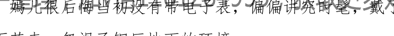

芜丽她好像带了包表。偏听到蜜，最好块石眼里，凝视了地下厂的环境。

婉儿不敢再多跟神偷说话，觉得神偷和冬生一样，都已经是神志不清，地下这种紧张又压抑的环境，很容易人弄疯。

现在，神偷跟冬生成了互助协定，两个人背靠背的在石台上养神，只要听到一点静，便会睁眼睛，露出一诡诡神浑然的样子，随时准备跟人架。

婉儿默默的关注时间，凭感觉，时间至少了好小时，可是头顶的月光，依然没有任何变化，位置都不曾移动半，很不符合合理。她几乎可以肯定，在她头顶上的圆形光源，并非真的月亮，而且他们所处的地方，也没有地面，这个祭坛，一定是在地底！

婉儿坚信父亲杨，一定会来救她，因为世上除了父亲杨，还有谁挂记她？

婉儿怀抱着一份希望，让自己能够坚起来，等待出生时机。

这时，陆鑫来了，带来了一具僵尸。这是冬生的敌人之一，在神偷和冬生互助协议这段时间内，陆鑫陆续带来了四具僵尸，全都是冬生的敌人。

他们被陆鑫带离，放置在石台上。神偷和冬生以逸就把他们，很快就得到了胜利，连同一起消失的敌人。每杀死一个敌人，冬生就会异常兴奋，觉得自己成功又近了一步，发出难以掩饰的狂笑。婉儿捂住耳朵，闭着眼睛不要去看这场，尽管她能理解冬生和冬瑜作为杀戮，并非就能接受的。神瑜帮助冬生杀死之后，会更加沉默，不发一言，当陆鑫出现，他的反应比冬生激烈，两次，是陆鑫还没爬上台，他就冲了上去。

婉儿不禁摇头，如今的神偷，已不是第一次见到时那邪气风、满目自信的样子。又有一只陆蚕进了祭坛，与之前的不同，这只陆蚕并没有带来敌人，在它的头部，插着一柄小玉剑，没入身躯，在地上流下黏液，身体上的大嘴张开，发出凄厉的叫声，无数悠扭的变化。陆蚕受了重伤，失去理智，爬进了祭坛之后，在石台上胡乱翻滚，神偷和冬生纠缠，婉儿喜，那小玉剑，自然是父亲杨的随身武器！

作者：蛇从 日期：2014-06-02 23:48

婉儿不忍看着陆蚕在祭坛内神偷和冬生纠缠，她立刻跑到陆蚕的缝隙中，去找父亲。石壁缝隙间没有人类，只有陆蚕受伤后留下的一地，父亲没有如期的出现。婉儿略有失望，也不觉得父亲没那么上来，陆蚕是具有穿透石壁能力的超自然生物，很可能是借此力回来，父亲要追周长。

“天啊！”冬生悠然大喊起来。婉儿闻声，回到祭坛内，看到受伤的陆蚕躺在石台上，身体虚弱扭动，到了弥留之时，眼睛是不活了。它上方的石板缝隙之中，有十几只陆蚕接连的出现，然后，噗通噗通的掉到台上，缠绕在一起，还有几只垂在上方，脑。


远去，似乎在寻找可以空隙。丑陋而恶心的生物，看到两只引起的可怕了，一下，陡然出现二十只，真令人毛骨悚然。蛊儿吓倒退几步，就看见那些敌人没有攻击外人，而是张开大嘴，朝那只受伤的陆蚕进行啃噬，每只都咬得了其中的一小块，把受伤的陆蚕吃了个精光。它们食肉并有序，仿佛谁进行了精细的丈量，然后进行分发，获得的分量都差不多，且没有发生争抢。片刻之后，这些敌人两两一组，朝四周的石壁缝隙里钻走，消失不见。

“你看见了吗？你看到了吗？”神偷神情激动的问蛊儿。它不相信这种生物，最多食物，竟然如此离奇。点头，“太不可思了！它们是软体动物，怎么可能进行这么有序的行为的！”

“它们为什么会吞同类？”神偷走说着，受伤的敌人此刻连迹都不剩，被吃了干净，只剩下那称小玉安静静的躺着。蛊儿明白神偷说这话的意思，因为在自然界里，大多数动物都是尽量让自身种类的数量增多，所以吞同类的现象非常少。不过，也会在极度紧张或饥饿时把同类吃掉，有的独居生物，会把除了自身的一切，当食物来捕杀，有的为了获得更大的生存机会，会杀死同一出生的兄弟姐姐妹。而眼前这种吃同类的情形，显然不是出于以上的理由。它们捕捉人类，当食物来食用，为什么会对受伤同类下手？它们不会做意义的事情。”妈儿回答，“杀死人类，一定是有利于物种的生存！”你说得对！”神偷拍了拍脑袋，“我觉得它们这次动，不是为了抓人类！它们是要去手的报复！”“报复？”妈儿想要这个答案，可是神偷还是没办法解释，为什么要吃同类。”“已经解释了。”神偷拿起剑，“它们杀死人类，是从敌人那里获得情报的。”“我不明白。”妈儿疑惑。“凌毒……”神偷痴的说，“它们的群体构成，非常有意思！”作者：蛇从 日期：2014-06-02 23:47 电子表就是石英表应该是机械表。两者还是别的吧？我印象有点差别。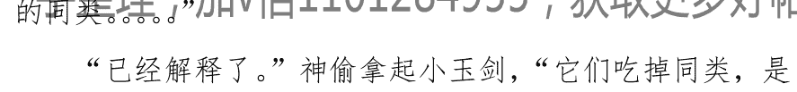是不是记错了？作者:蛇从 日期：2014-06-02 23:52

今天没有了...作者：蛇从 日期：2014-06-03 22:18

刚才那一群敌人，应该属于敌人，它们吞吃本体或者某一个，获得了记忆或者经验！他们是用这种方式，更加强大。他们跟不一样，不会杀死敌本能？婉儿意的盯了神偷和冬瑜。神偷点头，“它们或许有更高级的使命，所以杀死敌人，对它们族群来说，这正是繁衍的方式。处理，加信1284955，获取更多帖。非常大的想法。”婉儿说，“你肯定认为，它们的使命，就是要消灭敌人。他们把所有出现的人全部抓到这里，然后通过敌人之间的仇恨，互相杀死，自然不会白无故。”神瑜说。“你猜错了。”冬生在旁接话，“它们会这么做，是因为被驯化的各种普通类的行为，是被驯化的结果？我们的祖先传承下来一种特殊事实，进坛进行祭祀，不久之后，就会走出一群。”冬生说，“在物质匮乏的年代，我们族群依赖这种本事，逐步盛。是契亚传奇的故事。”神瑜说，“你们的祖先，很早以前，懂得怎样运用敌人，并且驯化敌人，利用它们来捕捉敌人内出现的？多年过去，它们还在重复以前的工作……看来木华梨把敌人的坟基在虎镇，早就看准这里是契亚族一个古老祭坛。”妈儿说，“可是，木华梨到底是出于什么原因，要帮助本是仇敌的敌人达成夙愿呢？”神瑜说道，敌人势力和他手下的亲兵，已经重新出现在虎镇上……你怎么知道的？”妈儿看着神瑜。神瑜自知漏嘴，不再隐瞒，“我是从敌人那里知道了这个情况……看来，肯定是要复活的。呵呵……”冬生笑着脸上肉抖动，“我们守陵人，一直等待这一天。到头，篮球打水一场。”神瑜说，“那个老任，利用手段，把他们都给控制住，当傀一般摆布……”说到这里，神瑜不免想到老沙，实在愁不透，为什么老沙的身也是敌边的敌人。冬生听到神瑜的，笑容僵住，“老任……当初觉得好好，怎么做出大逆道的事情！你们说的卫东，是叫任卫东？”老穆从石碑的缝隙间出来，在他身后，跟着远图以及其他下属。作者：蛇从 日期:2014-06-03 23:19老穆等人的到来，让在祭坛里的神瑜等三人不由一惊。连婉儿也没想到，老穆会来得如此快，而且是不声不响的出现。“爹……”雾离高兴喊道。“任卫东，已经把敌人和亲兵都控制住了？”老穆淡淡王哲加如v 11284955，获取更多好帖登录微信，向神瑜。神瑜知道老穆究竟是来了一段时间，把他跟冬生之间的话给他听到了，没有遮掩，点头表示了下言非。这小子，在西北一带混了那么久，早就总算是拿到手。”老穆无表情，“他身边的蓝姿，长什么样？”神瑜说，“我一直没有看到一个影子……不过听声音，非常清脆，好像是个少女……这个人的年龄，不会低于甲子，不然拦住很多人，但在印象里，真没见过。刚才那一群敌人，应该属于敌人，它们吞吃本体或者某一个，获得了记忆或者经验！他们是用这种方式，更加强大。他们跟不一样，不会杀死敌本能？婉儿意的盯了神偷和冬瑜。神瑜点头，“它们或许有更高级的使命，所以杀死敌人，对它们族群来说，这正是繁衍的方式。处理，加信1284955，获取更多帖。非常大的想法。”婉儿说，“你肯定认为，它们的使命，就是要消灭敌人。他们把所有出现的人全部抓到这里，然后通过敌人之间的仇恨，互相杀死，自然不会白无故。”神瑜说。“你猜错了。”冬生在旁接话，“它们会这么做，是因为被驯化的各种普通类的行为，是被驯化的结果？我们的祖先传承下来一种特殊事实，进坛进行祭祀，不久之后，就会走出一群。”冬生说，“在物质匮乏的年代，我们族群依赖这种本事，逐步盛。是契亚传奇的故事。”神瑜说，“你们的祖先，很早以前，懂得怎样运用敌人，并且驯化敌人，利用它们来捕捉敌人内出现的？多年过去，它们还在重复以前的工作……看来木华梨把敌人的坟基在虎镇，早就看准这里是契亚族一个古老祭坛。”妈儿说，“可是，木华梨到底是出于什么原因，要帮助本是仇敌的敌人达成夙愿呢？”神瑜说道，敌人势力和他手下的亲兵，已经重新出现在虎镇上……你怎么知道的？”妈儿看着神瑜。神瑜自知漏嘴，不再隐瞒，“我是从敌人那里知道了这个情况……看来，肯定是要复活的。呵呵……”冬生笑着脸上肉抖动，“我们守陵人，一直等待这一天。到头，篮球打水一场。”神瑜说，“那个老任，利用手段，把他们都给控制住，当傀一般摆布……”说到这里，神瑜不免想到老沙，实在愁不透，为什么老沙的身也是敌边的敌人。冬生听到神瑜的，笑容僵住，“老任……当初觉得好好，怎么做出大逆道的事情！你们说的卫东，是叫任卫东？”老穆从石碑的缝隙间出来，在他身后，跟着远图以及其他下属。老穆等人的到来，让在祭坛里的神瑜等三人不由一惊。连婉儿也没想到，老穆会来得如此快，而且是不声不响的出现。“爹……”雾离高兴喊道。“任卫东，已经把敌人和亲兵都控制住了？”老穆淡淡王哲加如v 11284955，获取更多好帖登录微信，向神瑜。神瑜知道老穆究竟是来了一段时间，把他跟冬生之间的话给他听到了，没有遮掩，点头表示了下言非。这小子，在西北一带混了那么久，早就总算是拿到手。”老穆无表情，“他身边的蓝姿，长什么样？”神瑜说，“我一直没有看到一个影子……不过听声音，非常清脆，好像是个少女……这个人的年龄，不会低于甲子，不然拦住很多人，但在印象里，真没见过。刚才那一群敌人，应该属于敌人，它们吞吃本体或者某一个，获得了记忆或者经验！他们是用这种方式，更加强大。他们跟不一样，不会杀死敌本能？婉儿意的盯了神偷和冬瑜。神瑜点头，“它们或许有更高级的使命，所以杀死敌人，对它们族群来说，这正是繁衍的方式。处理，加信1284955，获取更多帖。非常大的想法。”婉儿说，“你肯定认为，它们的使命，就是要消灭敌人。他们把所有出现的人全部抓到这里，然后通过敌人之间的仇恨，互相杀死，自然不会白无故。”神瑜说。“你猜错了。”冬生在旁接话，“它们会这么做，是因为被驯化的各种普通类的行为，是被驯化的结果？我们的祖先传承下来一种特殊事实，进坛进行祭祀，不久之后，就会走出一群。”冬生说，“在物质匮乏的年代，我们族群依赖这种本事，逐步盛。是契亚传奇的故事。”神瑜说，“你们的祖先，很早以前，懂得怎样运用敌人，并且驯化敌人，利用它们来捕捉敌人内出现的？多年过去，它们还在重复以前的工作……看来木华梨把敌人的坟基在虎镇，早就看准这里是契亚族一个古老祭坛。”妈儿说，“可是，木华梨到底是出于什么原因，要帮助本是仇敌的敌人达成夙愿呢？”神瑜说道，敌人势力和他手下的亲兵，已经重新出现在虎镇上……你怎么知道的？”妈儿看着神瑜。神瑜自知漏嘴，不再隐瞒，“我是从敌人那里知道了这个情况……看来，肯定是要复活的。呵呵……”冬生笑着脸上肉抖动，“我们守陵人，一直等待这一天。到头，篮球打水一场。”神瑜说，“那个老任，利用手段，把他们都给控制住，当傀一般摆布……”说到这里，神瑜不免想到老沙，实在愁不透，为什么老沙的身也是敌边的敌人。冬生听到神瑜的，笑容僵住，“老任……当初觉得好好，怎么做出大逆道的事情！你们说的卫东，是叫任卫东？”老穆从石碑的缝隙间出来，在他身后，跟着远图以及其他下属。

他被人用绳索勒住，一身喘息的气气慢慢消掉，不停
怒吼也无济于事。

老穆稳稳抓住神，婉儿顾上愁父亲生气，跑过去挡在
了冬身前，“爹，”我保证他不再惹您生气，他不是镜面
人，你就不要对他折尽杀绝了……”

老横不弯，弯下腰去从冬身后身边绊挡，猛得朝冬生
所在的方向甩了出去。

呼啸声后，尖锐的捅头毫不偏斜地插进冬生的脑门。

作者：蛇从 日期:2014-06-04 23:35

今天没了……

作者：蛇从 日期:2014-06-04 23:37


@RJ1221947 2014-06-04 23:30:00

我觉得蛇哥有点伤心

为什么会伤心。

作者：蛇从 日期:2014-06-05 12:55

http://news.xinhuan.com/ent/2014-06-05/c_1265
81978.htm

迷倒追踪的电影宣传。

作者：蛇从 日期:2014-06-05 12:56

密道追踪电影和小说的宣传新闻。

http://news.xinhuan.com/ent/2014-06-05/c_1265
81978.htm

作者:蛇从草 日期:2014-06-05 23:31

冬生一声不吭的就死掉，身体变成飞灰，散了一地，
之后步骤的连灰尘也消失了。

婉儿听得花容失色，无法相信自己从小就尊敬的父亲，
是个如此凶残的，杀起来毫不犹豫的。

“终于可以开始了。”老穆没在意，拍拍手上的灰尘，
再次拍起身，望向祭坛上方空隙里的亮光，颇有些感的
模样。

远远沿着祭坛周围的石走了一圈，“九萨门，八死一
生。找好了，我们才能进去。”

一手整理，我们需要更多，获取更多帖

老穆说，“我们家，数代人费尽心寻找的一处所在。”

“你没告诉我我……”婉儿想想进一步知道老穆所说的
内容。

“因为这件事，注定要在我手里结了。”老穆说，“这
一刻就要了。”

婉儿知道老穆不再说话了，按捺住继续追问的心思，停下来
照顾神喻，神喻处于昏迷状态，还在继续说话，并没有生命
危险，但不知道什么时候醒来。

老穆不打量石头的亮光，又望向石碑，丈量距离
观测方位，嘴角飞快的蠕动，计算着什么，然后手指指了指，

让远处和其他六个爪下，分别在不同方位的石碑上弯起手指敲打。

石碑传出的声音差不多，厚重沉闷，老穆聚精力，眉头紧锁，微微侧头，仔细细心地屏吩。其他人除了有节奏的敲打之外，连大气气都不敢出，祭坛异常的安静。

老穆的眼睛阴暗不定，指挥下属敲石碑的速度也加快起来，但是没有办法找到正确的门，于是爬上石台，又听了一声，临道，令所有人站定，不要再有任何动作。

“就在这里！”片片刻之后，老穆指向一块石碑。

“快！”冬生没有没有任何犹豫，奋不顾顺冲向石碑。

婉儿保持观望，看看他们葫芦里到底在卖什么药。

一手按住脑袋，身体贴壁游过去，紧跟在他后面的一个年轻人，也冲上去，但是没有通过，撞得满脸是血了回来。

“门移动了。”老穆说，“挪动的速度，比想象中要快多。一个个。”

老穆不再让下属打石碑，而是让他们分散站立，然后自己抬起手指，对着祭坛周围的石碑慢慢移动，再次寻找石碑上的门。

婉儿差不多理解了，祭坛周围的环境，不知道之前用了什么方法，使得虚中有实，实中有虚，充满意义。被困其中的人，又要知道，石碑上有门，并且那才是出路。

老穆每找一扇门，花费的时间越来越长。即使找准了石碑上的门，一次性也能通过。虽然祭坛上的人还是越来越少，最后剩下老穆、婉儿三个人。

婉儿问老穆，“你还是我记忆里那个地方吗？”

“一点都不意外。”老穆说，“因为这里是宿命，我一直在努力，让你摆脱这一切。现在好了，只差最后一步，一切就可以圆满。你离开这里，走得远远的，不要再待在这里了，获取更多帖。”

“你不回去？”婉儿说。老穆笑了笑，“你试过了，不错，身上有股江湖气，这些年纪比你大了……”

“你就当作十年前，已经死了吧。”老穆说，“这一次见面，不是镜花水月，算是老天待你。”

“我回不去。”老穆说。她连着婉儿拉住，决定按老穆的方法先逃。老穆很狠，不会害自己女儿。

婉儿不愿意此罢手，死命不肯挪。多头怪物陷入癫狂状态，纷纷张大嘴，口中铁线似的黑色丝飞舞起来，到处乱，老穆逼得步步后退，最后一眼婉儿，一闪身，冲进一块石碑中。

神喻一愣，刚昏迷，发现石碑中含有通行门，但也没计较，喊婉儿快跟他逃，往石碑中间的缝隙中跑。两人来到边缘处，前方是巨大的悬崖，后方怪物追不下。

老穆紧住婉儿的手，吁吁着呼吸，朝崖外迈出一步。

作者：蛇从 日期:2014-06-06 03:34

今天没了。

作者：蛇从 日期:2014-06-07 00:17

不好意思，今天有事耽了，明天补上。

对不起各位。

第十三章

作者：蛇从 日期:2014-06-07 14:26

大拿站在钢厂废弃厂房的楼顶，俯瞰整个钢厂，他在这里待了半天时间，视线在所有的钢厂建筑上游走。

钢厂被拆得差不多，但整体的轮廓还能根据残留。王经理点道：“这里到处都是废墟，等拆房或改建，明天吧。”

一条条宽窄不一的路，看起来杂乱无章，没有什么特别。

不过大拿知道，这是设计师运用了许多遮掩的技巧，扰乱人的视线，就算在高处，或者直接拿着当初的设计图纸，也不可能看出门道。

现在，设计师所费的各种苦心设计，都失去了作用。在大拿眼里，钢厂里的建筑和无关事物，正在逐渐消失，取而代之的是最直观的线条和标记，把设计师的初衷，赤裸裸的展现。

大拿曾以为自己对钢厂若指掌。在钢厂当保安的这段时间里，他走过钢厂里的每一条道路，进出每一栋建筑，甚至对里面的电路布线都清晰二楚。但现在，他知道那都是表象，毫不重要。

表象下面藏的视线最终落在泵房处。竖着掩盖的，才是真相。

大拿的十字钢管，在他脑中已经被替换换成了一只巨罐，巨罐有着黑洞洞口，仍在吞噬一切。往下一些，地底里藏着污垢，这些都是怪物。

大拿绳索，手腕顺势一挽，把绳索抓牢，老沙吃力的拖起绳索，费了九牛虎之力，总算把大拿找回了坑洞。

“了。”

地面一直晃不停，地底传来的声音越来越大，惊人心魄。大拿不敢在楼顶停留，这栋废楼已经出现裂纹，经不起再次地震，要是倒塌是不可能的。他一口气跑下楼，幸好在下楼的过程中并没有出现意外，他双手抱着头，以防坠落的东西砸到，然后跑到空地上，远离了建筑物。地面震动比以前大，但那声音却变得清晰，而且容易判断，是从蓄水池传来。那声音是从洞里传出来的，像是凶悍的野兽，要从里面冲出来。地面震动更加剧烈，大拿脚跺在地上，石子飞扬，在蓄水池里，湿漉漉的泥浆泛起无数泡，随后，坑洞边缘的地面出现了一道裂纹，并开始逐渐扩大，坑洞周围的地面延伸。大拿觉得不对劲，地面震动的强度让他站不稳，歪斜着跑两步，就趴在地上起来。他忍受颠簸，在地上爬，想要远离这里。坑洞周围的地面逐渐崩塌，一整块的山石朝面滑脱、坠落。更远的地面仿佛泥石流一般，朝坑洞挪过去。大拿弓起腰，四肢粘地上爬的速度并不慢，却发现身体不断大的坑洞口越来越靠近。清冷的气流袭来，把他满是汗的背吹得发凉。地面发生倾斜，产生坡度，让大拿的爬更加吃力，他没有放弃，继续与死亡对抗，但人力终究有限，不多时他就到了坑洞边缘。半个身体已经没了力，全凭双手紧绷抠地面。巨大的轰鸣声在他背后后退，充斥着大拿的耳膜，仿佛死神在咀嚼。他抓住绳索试图寻找落点，然而绳索滑出意料后，他抬头，看到老沙站在远处，抓着绳子的另一端，嘴里还在大喊。大拿抓住绳子的手不由自觉地松开。地面坍塌，大拿整个身体一轻，随着那块崩塌的石头向下落下。大拿落下的瞬间，把老沙丢去的绳索再次抓住。

很快就到了老沙身边。两人都累到不行，喘着粗气，坐下休息。大拿看向街上倒是没有发生地震，一切如常，想必坍塌的区域就有蓄水池那块。他不禁担心起刚才他们，不知道刚才的坍塌不是由他们引起的。“自己都这副狼狈了，还有心思担心别人。”老沙说。

“你怎么知道我在担心别人！”大拿反驳道。

“我乱猜的……”老沙笑着说，“看你反应，看来我理解。”

“不要跟我笑脸。”大拿瞪着老沙，“你以为救了我一命，我们的恩怨就会一笔勾销？”

“我没有想过你要回报。”老沙说，“碰巧而已，我正好来找你……”

“我还没有改变主意。”大拿说，“再说了，就算要去地下，现在什么都都被淹死了……”

“这次事故，不是由翻身引起的。”老沙说，“不可能在钢厂里。老穆的计划，快要实现了。”

“刚才的震动，跟老穆有关？”大拿明白老穆的话是对的，“翻身会影响整个镇。”

“风水眼有四个眼睛。”老沙说，“守人的族长在坑洞里做了很多事，用人来破局。老穆会用同样的方法，把这一切全部破坏。”

“守人的族长虽然死了，但子孙们都落到老穆手里当傀儡。老穆族长之后，怎么会把守人的命当成控制，真是个不理喻的小人。”

“等下……”大拿站起来，打量老沙，“你不对劲。”

“你没有影子。”

“你是不是真的看不到我的影子？”老沙脸色变了，大拿不是个无聊的人，特别是当前的情形之下，没理由作剧。大拿点头，“我的的确是看不，但我也知道你不是鬼，鬼不可能会绳子捆人。”

“我差不多理解了。我看得自己的影子，你却看不见。”老沙顿了顿，说，“这奇怪，曾经有人说过更奇怪的话。”

“他说什么？”大拿问。

“他说我早就死了。”老沙说。

“怪，是因为我的话……”大拿说，“你是在骗我。”

“我知道，那个人说的话，也是真的。”老沙没有半点玩笑的意思，“你们两个，都有非常特殊的事情。你的师选你当弟弟，是毫不无理的。”

“我听不懂……”大拿不明说，“有人说你早就死了，这是真的？你刚刚又说，你不是鬼……”这个‘死’字的意思，跟你通常理解的不同。举一个很浅的例子。”老沙指了指长街，“假如你是个明星，走在这条长街上。街道的两旁，有很多人都在关注。”

“我没办法想象。”大拿按老沙的话了，摇头，“我又不是明星，也不喜欢人多的时候在街上走，要是有人看着我，我会上去打架，要不就藏起来……”

“你跟我走一回。”老沙示意大拿跟着走，走向长街，“你看到了吗，到处都是人，他们都盯着你……”

大拿没办法，在老沙身后，尽量的想象周围有很多人在看着。两个人都到了街道的一个分口，老沙说，“一个你，左走，另一个你，走右边……”

大拿莫其妙，“你是在说话吗？哪里有两个我……”

“我们看到的冬生，不是都有十几个，你怎么就没有……”

“你是在说话吗？哪里有两个我……”

“我们看到的冬生，不是都有十几个，你怎么就没有……”

“你没有。”

“你没有影子！你到底是什么东西？”大拿看得很清是光照在地上，但他原本没有影子，他有些抓。

方法，使得虚中有实，实中有虚，充满意义。被困其中的人，又要知道，石碑上有门，那才是出路。

老穆每找一扇门，花费的时间越来越长。即使找准了石碑上的门，一次性也能通过。虽然祭坛上的人还是越来越少，最后剩下老穆、婉儿三个人。

婉儿问老穆，“你还是我记忆里那个地方吗？”

“一点都不意外。”老穆说，“因为这里是宿命，我一直在努力，让你摆脱这一切。现在好了，只差最后一步，一切就可以圆满。你离开这里，走得远远的，不要再待在这里了，获取更多帖。”


就是两座相对立，比较陡峭的山峰，光亮的如同两根柱子，这也就是双柱山的由来。

路上，大拿都是带路者，老老涉也没说什么，跟着他走，走完了木工人开辟出来的道路之后，就沿着悬崖侧的野路走，走到最后，唯独剩下几乎垂直的陡壁，而且是极为有名的赤壁丹凳。

大拿觉得辛苦，不抬头看，那个篮的边缘，他看得清楚，知道自己四足之一，就在双柱山下，他隐约看到足够在山腰延伸，然后踩踏在某个不动它的物体上。

两个人经过多天的跋涉，才到了双柱山的东峰山口，期间接着绳索攀爬，各自自用了自己的本事，壁虎一样贴在悬壁上，如同灵猴。

要不是他们有事在身，憋着一口，只是出来观光旅游，很可能四天也不到，山太尽了，并且没有路，一般误阔，很有可能会迷路，一小心摔下山崖，就是死路。

东峰比西峰高，山顶植很少，到处是光亮的赤红砂岩，站在上面，可以俯瞰整个虎虎镇。西峰上两座古老的塔塔，也在此视野之内。

大拿站在山巅，往北面的悬底下看，底面的确是个深不见底的天坑，比起有着严重人工斧痕的天桥洞，天坑四壁显得自然丛，绿色的植被显得雅缝缝插针的长在岩石缝隙里，生机旺盛，不少植物上，开了素雅的鲜花，不免让人觉得下方有一个与人隔绝的世外桃源。

“没想到这种地方也被你找到了。”老沙由衷赞。
“现在不是我的时候。”大拿挺高兴，但还是故作淡的，“上山容易，下去会很困难，万里长征才走一步。”

“暗无天的钢冈我们都跑过了，这还算什么。”老沙找到了个背后的小岩洞，“不我们我们需要休息一晚，明天再下去不迟，保证到时还要像像壁虎一样走路的。”

大拿答应起来，两人人都到了小岩洞里，吃了点干粮，然后各自靠着睡着了。

到了半夜，月亮挂在山山上，显得特别的亮，风很大，刮得呼吸呼吸，大拿猛地睁开了眼睛，身体挺直。有人在说话，虽然声音很小，但在黑暗中热闹听到一个点。

作者：蛇从草 日期:2014-06-09 23:34

大拿站起来转身走出小岩洞，仔细的辨别声音的来处。不意外，这个女人的声音，从天坑里传出来。大拿听力一向很好，知道不会错，在这种地方听女人的声音，并且是在半夜，不免让人听了胆凉。那个女人的叫声比较模糊棱，像在胡乱的叫嚎，大拿仔细听了一阵，没弄清楚她到底在说什么。

老沙醒来，看到大拿离开了休息的小岩洞，走到他身边，疑惑的打量。

“你听到没有，下面有人的声音。”大拿指了指天坑的方向。

老沙学着大拿的样子，侧头倾听，听了半天也只听到风声，无奈的说，“我听不到。”

“不会是老任已经到了吧？”大拿说，“他身边有个苗人蛊姜，说话的声音差不多就是这样……”

“不会这么快吧。”老沙摇头，又尝试了，还是没办法听到，“有可能是些山里邪物故意发出声音蛊惑人，不要管了。”

“要不是人的声音，我肯定能分辨。”大拿坚定的说，“我们要看看……”

一手整理的信息很危险。老沙制止道，半点闪失，还是小心为。

“如果不是老任身边的那个人蛊姜，最有可能是妈儿。”大拿说，“我们有必要去看看，她一个女儿，太可怜了。”

“有钟偷在她身边，应该不会有事。”老沙说。

“他拿了三味符等到地下去找妈儿，不一定找到。”大拿边走边拉索，在悬崖边找了个稳固的石柱架绳。

老沙没有继续争辩，点头应允。钟偷有镜面人这回事，大拿肯定不了解，也没有必要多说明。

大拿把绳索系好，拉了拉确定稳固之后，又把绳捆在自己腰上，准备下天坑。

“我先吧。”老沙把绳子缠在石头头上，把另一端扔下悬崖，在手掌吐了唾沫。

作者:蛇 日期:2014-06-10 00:10

两人各自拉一条绳索，在悬崖一边一跳跌落下，大拿参军，对这个技巧掌握得相当熟练，但他看着老沙，速度竟比他还要快一些。

两个人都往天坑里落下，除了偶有斜长的树木对他们造成较小影响之外，并没有遇到比较严重的阻碍。

到了天坑之内后，风声变得非常小，大拿已经清楚的听到下方的声音，但频率没有先密，几分钟才叫一声。获取更多好帖大拿无疑害怕，这个呼吸是受伤了，体力也越来越接近。

“真的是丫儿。”老沙听到了声音，总能辨别清楚。

“我早听出她是。”大拿说，“她很幸运，遇到我们。不过她怎么出现在这里。”

“去问她哪里。”大拿说，大概走到一半，绳索不够用了，两人干脆解开绳子，在壁壁爬的功夫，往天坑下方，临近天坑。

“妈儿的声音在那边……”大拿打量周围，他清楚，这些植物并不属于，但现在没有时间弄清楚，妈儿的声音稍微弱，似乎随时停止。

“有钟偷在她身边，应该不会有事。”老沙说。

“他拿了三味符等到地下去找妈儿，不一定找到。”大拿边走边拉索，在悬崖边找了个稳固的石柱架绳。

老沙没有继续争辩，点头应允。钟偷有镜面人这回事，大拿肯定不了解，也没有必要多说明。

大拿把绳索系好，拉了拉确定稳固之后，又把绳捆在自己腰上，准备下天坑。

“我先吧。”老沙把绳子缠在石头头上，把另一端扔下悬崖，在手掌吐了唾沫。

作者:蛇 日期:2014-06-10 00:10

两人各自拉一条绳索，在悬崖一边一跳跌落下，大拿参军，对这个技巧掌握得相当熟练，但他看着老沙，速度竟比他还要快一些。

两个人都往天坑里落下，除了偶有斜长的树木对他们造成较小影响之外，并没有遇到比较严重的阻碍。

到了天坑之内后，风声变得非常小，大拿已经清楚的听到下方的声音，但频率没有先密，几分钟才叫一声。获取更多好帖大拿无疑害怕，这个呼吸是受伤了，体力也越来越接近。

“真的是丫儿。”老沙听到了声音，总能辨别清楚。

“我早听出她是。”大拿说，“她很幸运，遇到我们。不过她怎么出现在这里。”

“去问她哪里。”大拿说，大概走到一半，绳索不够用了，两人干脆解开绳子，在壁上爬的功夫，往天坑下方，临近天坑。

“妈儿的声音在那边……”大拿打量周围，他清楚，这些植物并不属于，但现在没有时间弄清楚，妈儿的声音稍微弱，似乎随时停止。

“有钟偷在她身边，应该不会有事。”老沙说。

“他拿了三味符等到地下去找妈儿，不一定找到。”大拿边走边拉索，在悬崖边找了个稳固的石柱架绳。

老沙没有继续争辩，点头应允。钟偷有镜面人这回事，大拿肯定不了解，也没有必要多说明。

（此处省略重复内容，直接进入后续）

这一区域，层表是厚厚的落叶枯枝及青苔，下方可能是被架空，形成了天然陷阱，有些汗臭的人体骷架横在其间，露出一点疑惑。老沙顿时脚被卡住，覆盖物松动后，看起来有些不容易。骷髅被树根或藤蔓缠缠，黏成一片。一时没办法摆老沙的两条腿，都陷在骷髅堆里，没法脱。大拿小心翼翼踩到实处，上前搭了一把手，把老沙拉上来。

在钢厂地下，经过万人口坑，再遇到骷髅，什么大惊小怪。不过老沙还是蹲下，仔细的打量了一番，把两具紧靠在一起的骷髅剖开，找到一片衣物。

“这是涤纶面料。”老沙不思议的说，“这些人，应该近几十年死在这里。”

“你怎么知道？这是？”大拿疑惑。

“的确良……”老沙说，“七八十年代非常流行……”

“这个我知道，你早这么说不完了。”大拿打量着周围说，“尸体都摆在一起，肯定不是正常死亡，想不到死尸遍野，钢厂下面全是死人，虎符附近的山里也都是尸满地……”这些人应该和风水眼有关关系。”老沙说，“也许是被上人用来做破局的祭品，当然也有可能是寻找风水眼在此地遇难的。不奇怪的是他们身上没有非正常死亡的特征……”

“算了，人就别管了，先管活人。”大拿说，“我们处理。”两人继续往前走，有了教训，都得相当小心，老沙拿了根棍子探路，大拿偶尔听妈儿的声音，判断方位。天坑比他们预想的多，而且妈儿的声音，就在附近，却一直一个都没有灵感。老沙觉得山里有怪物在，大拿不以为然，说一定能找到，他很有强烈的感觉，妈儿就在这个天坑的某处。两人走了大约一个小时，在一处石阶前停住。石阶一级级往上，上面比较干净，没有落叶枯枝，但满了爬山虎一样的藤蔓，好似一片片鱼鳞覆盖。石阶的尽头是一座大石搭建起来的石屋，妈儿的呼声在里面传出来。老沙没有迟，就要往石阶上。相反，大拿在石阶前站定，没有迈步。“不对，妈儿在里面。”大拿制止，老沙继续前进。“声音明明就在这里。”老沙疑惑的看着大拿，“我不清楚，这是妈儿的声音，但她在别的地方。”大拿说了老沙，点头，两人登上石阶，朝石屋走。这是一个非常简单的石屋，里面有一个池子，天花顶有裂缝

“我找了。”大拿说，“但是，这个月亮，是从哪里来的？”自从进了天坑，就再看不到月光了，可是这里，却明明有一个光来。老沙说，“这个地方，是契丹族的古坛。”老沙的问题显然是非问，大拿呆的望着，不明片刻之后，想起老沙是从镜面世界过来，是纯正的契丹人，知道契丹的古坛的一些秘密。老沙皱下脸，口里默念一些听不懂的词语，过了一会儿，才站起来，“这不是月亮。我们称呼它为神灵之，是契丹族至宝，根本能见到过去与未来，也是镜面布局得以实现的核心物。“这个东西是假的。”大拿看了一下，肯定的说，“古坛也是假的。“对。”老沙没有否认，“这是一个人搭建的祭坛，神灵之也只是水晶仿制，估计出自陵人之手，没有特别的作用。真正的古坛和神灵之，在六锦鱼体内内。“老任不是不知道这件事。”大拿问，“他只要破坏这一术，就能获得更多帖。“算不上什么秘密。”老沙说，“老铃早就在寻找神灵之了，当年他们保留了镜面布局，针对六锦鱼和镜面布局，蓝风水的目的，就是得到了契丹族的至宝。老任、老穆还有都是为了得到了它。“当初我们去大锦鱼的时候，你就跟我说这些事儿。”大拿怀怀的说，“要把神灵之提前拿到手，事情就简单了。“老穆和老任当年去地底，已经接近古坛，是因为还失了开启的秘诀，所以不得不打开镜面布局，进入到镜面世界，去掌握的秘诀。”老沙苦笑，“老穆是个算无遗策的人，为了阻止他人进入，布置了那些，还有奇怪的生物。你以为我不想在上次去了古坛，实在没有办法……那时候，除了我是个傻子，一无所知，你们都很清楚自己要做什么。”大拿忍不住叹了口气。“但现在，你看得很清楚了。”老沙说，“没有什么再能迷惑你。“那倒是。”大拿又笑了起来，“我知道婉儿在哪了……”大拿走到假祭坛中间的水池前面，卷起袖子，把胳膊伸进水里。这个水池倒也神奇，不知道存在了多少个月，却是清澈无比，里面不存在任何杂质污垢，很好的倒影上方的水晶光亮。“慢点，水池里可能有问题……”老沙还没说完，就见大拿呵呵哈哈把手缩回来，手里却抓到了一把黑色的丝丝般的细长生物，蛆虫似的扭动，正是他们在钢厂底部里交过的丝虫。它们藏在身上，一眼望根本看不出端倪，但大拿来准确无误的抓住了它们。大拿拿出丝虫抓在手里，扔了过去。老沙掏出珍藏的打火机，点了过去，然而丝虫在手背上烧起来，溅了出来好多蓝色的光，等火光消失，大拿手里什么都没有。“它们怕火。”大拿说，“是在水里的，就算有火，也克制不到。”老沙脸色不好，这些丝虫差点了他的命。大拿又把手伸进去，抓了一把丝虫出来，继续烧掉，又问老沙，“你知道它们怕火吧？”大拿显然是抓住了关键。“妈儿在里面。”老沙见不住，勉强道，“你不用潜。”大拿脱下外套，“我知道位置，一定能很快找到，把她带出来。”老沙走到她面前蹲下，轻轻的开婉儿捏着的拳头，从里面拿出一件东西，递给大拿。那是大拿的贴身忌挂件，三味符。大拿点头表示知道，深呼吸了一口气，一手拿着防水手电，从水口往钻进去，手脚并游动起来。老沙看到原本看不见的丝缕出现，其中一些体型较小，跟老不同。大拿没有理会，自顾的游动，寻找婉儿的身影。在黑暗中的某个地方，妈儿不是实实在的人，而是一团白影本身的东西。水面很宽，大拿在水面上找寻，老沙的话对，婉儿的确是浮在水面上。终于，当大拿游动了一阵之后，他看到从下到天坑就开始看见的白影，跟婉儿声音的来源完全重合在一起。大拿加快了速度游，在水面上游动，比水中快多了，很快，他就到了白影面前。白影逐渐消失，取而代之，是他接触之后看到的真实的不是婉儿，而是一个黑色的椭型东西，从外观上看，像是个巨大的蚕茧。大拿略有异，很快反应过来，用手把电筒咬，冲上去，用双手拼命撕扯，把椭型东西的外壳，层层撕裂。在大拿手中，丝丝蠕动、翻滚、缠绕……但大拿顾不心恶，把它们全都丢出去，可是，包裹的速度更快！更加确定，这个巨大的蚕茧，正是由丝虫裹起来的，而婉儿说不定就被裹在了里面。他不再撕扯了，把巨大的蚕茧拖走，朝才的入口游回。美找到老沙，把快递送到那个地方，在老沙明白，再次要过老沙的打火机，点燃蚕裹在一起的丝虫。丝虫的燃烧火焰，不会灼伤人，更像是冷焰，这是大拿验证过的。绚后的一沐光之后，蜷缩在茧里的婉儿，出现在两人面前。她脸色惨白，浑身瑟瑟发抖。双眼更是呆呆的望着前方，显然是被吓坏了。


大拿按照以前在军队学的方法，慢慢趴身，跪在婉儿的头部位置，一手按住婉儿的鼻子，一手按住婉儿的下巴，把嘴给掰开。

大拿吞咽了一口水，深呼吸了一口，伏低些准备给婉儿人工呼吸。

就在这时，婉儿的眼睛猛睁睁，剧烈咳嗽咳了好几声，把胸腔里的水全都吐在了大拿脸上。

大拿躲避不及，一屁股坐在地上，脸上满是婉儿吐出来的温热的水。

“你干什么，你个臭臭流氓！”婉儿脸涨得通红，一团糟爬起来，指着大拿开骂。

大拿整理着自己的衣服，另一手摸了摸额头，冷静下来。

“沙沙，你也在？”婉儿打量四周，“这是哪里啊，怎么会到这里了。”

沙沙简要的给婉儿讲解一下两人发现的经过，以及大拿正准备用人工呼吸救她的事情。

大拿以为婉儿会道歉，立即又意识到，婉儿不会说道歉的话。

“你们快去救他，快去……”婉儿瞪了眼大拿，果然没道歉，而是焦急的说。

“神偷在哪？”沙沙问。

姚儿满担心的说，“他很危险！那些红眼睛的怪物，在追他。”

“你是陵菌吗？”大拿问。刚才在水里，见到的那些实体体型微妙大点的陵菌，眼睛的确是赤色的。

姚儿听不到他的话，自言自语说个不停。

“姚儿，你需要休息，不要再担心的事情了。”老沙安慰说完。

姚儿还挣在之前的恐惧里没有完全清醒，喊了两声，又剧烈咳嗽起来，吐出一些清水，所幸，里面并没有陵菌。

“我们要在这里休息，等姚儿完全恢复过来，再问清这些理和车辆状况，我们再去买更多好吃的。”


姚儿吐了几次，确是坏了，胡言乱语说了几句，见到食物，抓过食物迫得不及地吃了起来。

大拿见姚儿身上的衣服都湿透，在冰凉的地下水里泡了很久，走到外面捡了些柴回来，烧了个火桩。

姚儿吃过东西，又烤了火，人也清醒了些，眼睛有了神采。

“你们两个，来救我们的吗？”姚儿问老沙和大拿。

大拿说，“你怎么跑到双柱山来了，这里钢铁厂已经很远了。你运气好，叫声被我听到，不然就会被困在水里，一个靠子别想出来。”

嫣儿摇头，“我没有哭啊，我晕倒之后，一睁开眼就看到你们。”

大拿知道嫣儿估计是话噎糊了，自己都在唤救命，也都忘了。

“我跟神喻还有冬生，在契异的一个祭坛里被困住，后我父亲亲自来了，告诉我们逃逸的路……”嫣儿慢慢回想，“有几只怪绕到长大，变成几颗脑袋的怪物，拼命追着我们，神喻为了救我，和怪物纠缠，我拼命在水里游，被水草缠住什么缠住，还钻进我嘴鼻子里，我很快就没力气了，差点要死，没想到神喻挣掉了怪物，我帮她整理，把她包裹起来，之后我就什么都不知道了……”她提到道。

“你的话，也是镜这么，它们也不打算长大了。”老佐在旁边补充。

“那个怪物打架的神喻，跟你挂着的神喻，不是同一个。”大拿不假思议的蹦出一句，说完之后，自己都感到奇怪，不知道自己怎么会知道。

“给你挂接的神喻，是镜面人。”老佐说，“我和他接触过，神喻在地底产生的镜面现象，跟其他人不一样，他们遭遇的不同事情，能被彼此知道……所以这个镜面人知道你们的遭遇后，尽量到你出事的地方，把三味符交给了你……”

拿到的三味符，能够让嬴不伤害你。但我我觉得神喻的办法，单单是这个。

“神喻的镜面人？”婉儿沉思了一下，叹了，“难怪他连想都没就跟冬冬合作。他肯定是清楚的知道他镜面人已经存在了，而且还在去跟她会面的路上！”

“拿了三味符的镜面人，是为了让你的镜面人消失掉。”老沙说，“不管哪个神喻，对你的情谊，都是真的。”

“现在这些话有什么用……”婉儿伤了，“他被困在水里，还不知道死还是活。还有我父亲，说了两句听不懂的话，再次把我拽下……”

就是我们最近找到的地方，是祭坛，是不是哪里变了？”老沙指了周围。

“现在怎么办，我父亲进到石碑里不见了。”婉儿说，“还有神喻……他不该死。”

“姚儿，你爸爸是自己去的，拦不住，我就更不行了。”老沙说，“至于神喻，他的命很大，那么容易死。”

大拿说，“现在的问题是，最终要抵达的地方，是不是祭坛。”老沙点头表示肯定。

“之前在天桥里，有一具干，跟神喻一起出现。”

处理祭坛的密密，老沙说，“老陈的经验早就榨干了，所有的密密。”

地下深渊里，到处都是细小的陵丛，它们一起，会粘起来，水面上一一两米的地方还不是问题，再往下点，会密集。”

大拿有了三味符，倒是少点影响，但老沙挡不住，所以必须按大拿的方法，保持非常近的距离，以很快的速度穿行。两人有过经验，并不难，带上一些工具，跳下水出发。

“这是庞大的地下水脉，冰寒刺骨，且有暗流涌动，并非死水。”大拿在前奔路，老沙说能通过这些地方回到地面，恐怕越险。

不过这些水路之间，可以看到人工修建的痕迹，甚至局部地区，还残留有设备。

祭坛下方的水域，是个入口，穿过这条管道，会进入一个更加宽阔的水域。

在水中纵横交错盘旋，向多个方向延伸，不知道尽头在哪，似乎一处地下设施，而这些管道中央。

“他们不是游动的姿态，而是漂浮态，像在大空中漫步。但隔得太远，不知道是什么人。”

这时，他的视线看到些人影，正朝祭坛走去。

“老沙心中一喜，古祭坛到了。”

两个人都把灯关掉，继续往前走，越往前走，越感觉水变得稀薄。大拿试着呼吸一口，发现这里已经不同于真正的水底，竟然可以呼吸。

老沙见也也有样，呼吸了几口。

两人越空间四周较为昏暗，朝着核心地带游过去，在前面的那些人影，并没有察觉到他们，纷纷纷纷朝向他们。

大拿也看到了有人在前面，和老沙对视一眼。老沙用手势示意，前面看看，能到这里来的，不会是陌生人，不是老任，就是刘所长他们。

“神偷在水面上。”

不知道游了多久，他看到水面上似乎出现了一群影，那些人手里有手电光，光亮照射在他脸上，他们发现了他，朝他游过来，七手没脚的拉扯。

“终于累，终于救了。”

大拿游不动了，身体往下沉，很快就接触到了坚固的地底，他顿时欢喜，原来水只有许多藻，很有可能是到了岸边而不自走，他站起来，三步并两步的向前前进，然而水位越走越高，一会功夫没，他就站在了硬邦的地面。

接触地的感觉太好了，神偷软软的倒下，忍不住发出虚弱的笑声。他躺下后，疲惫席卷而来，眯着眼睛睡去。模糊之中，他感受到有人触碰自己，滚滚的手指贴在他的脖颈处。

神偷猛然惊醒，发现有很多直射的光晃得他睁不开眼。他稍微适应，看到身上挎着一扎道士，手提着几个灯笼。

“还是活的……”道士扭头对其他的同伴说。

神偷嗅到一股股熟悉的味道，抬头望向那群人，唤道，“刘所长，是不是刘所长来了？”

刘所长手里夹着一支烟，走了出来，“你……怎么在这里……”

“真是见到鬼了……”刘所长身边的一个年轻人呆呆的说，“跟我背的这个人，长得一一样。”

神偷听到这话，立即挣要站起来，他注意到，那个说话的年轻人背上有一个人，脑袋垂在年轻人肩上，两条手臂垂下来，停在年轻人胸前，头发和身上湿漉漉，在地上。只看一眼，神偷就知道，年轻人的话是有原因的，因为这个人正是镜面人！

大拿再次从水里出来，老沙和姚儿在祭坛等了很大一阵，都很焦虑。

“怎么样，发现了吗？”姚儿比老沙更迫切，大拿还没来得及气，就向他追问。

“要走一步看一步，暂时找到了入口。”大拿点头，“刚才在水里转了一圈，刚开始没有任何收获，但与水接触过一阵，心里已经有了。”

“没想到世界上还有这种事。”姚儿很高兴，“你太害了。我们这就出发吧，神偷是要看到我们返回去救他。”

“你是不是觉得我没事了，会累垮你们……”姚儿的笑容在脸上。

老沙摸了摸脑袋，不好回答。“对。”大拿直率的说，“你跟着下去，帮不上忙，而且我们还要分心顾你。”

“你要照顾了。”姚儿听得不乐意，“神偷为了我连命都可以不要，我一定要下去，你们做自己的事情就好，如果我跟不上了，就把我丢下，我绝对不会怪你们。”

“姚儿，你在底下待了很长时间，身体非常虚弱。”老沙说，“我们这次要去古祭坛，会遭遇老任，他是个相当危险的人物，你跟去是不明智的举动。”

“这这一次。水面的陵丛，是最大的问题。”大拿说，“你吃过苦头，知道它们有多难缠。我跟老沙必须要以最快的速度，到达没有水的地方，这路段，以你的体力，根本做不到。”

姚儿从不辩驳，默默地坐下。

“这里是很深的天坑，你一个人没办法离开，我们留食物和水给你，坚持一段时间时间。”大拿说，“我们解决了地底的事情，会接你。”

“嗯。”姚儿顾回答了句，大拿的话虽不留情面。老沙和大拿商量了一会儿，重点是应对水中的陵丛。地下深渊里，到处都是细小的陵丛，它们一起，会粘起来，水面上一一两米的地方还不是问题，再往下点，会密集。”

大拿有了三味符，倒是少点影响，但老沙挡不住，所以必须按大拿的方法，保持非常近的距离，以很快的速度穿行。两人有过经验，并不难，带上一些工具，跳下水出发。


你们还先进了一步。”

“怎么就你一个人……”刘所长警惕的打量。

“我来谈判。”老任说，“没有什么是不可以坐下来谈的嘛，都老年纪的人了，没必要再对打杀杀杀解决问题。”

“我们之间没法谈。”刘所长说，“你背叛的国家，这不是两句就能解决的事情。你要谈，跟上面面对，看他们体会不会回答的。”

“背叛国家？”老任的脸色顿时变了，“我是契约后裔，现在哪里还有我的国度？别折扰了。”

“你做这么多事，无非是要复国。”刘所长毫不不客气的说，“你是脑子出了问题，看不清楚状况，几百个镜面士兵就觉得有作为，现在是好事了？你设的坏处，都是设的……”

“不用跟我讲这些。”老任打断，“你根本理解不了，你对镜面世界和镜面人无所知。跟我师兄研究了十多年，掌握的是几百年的传承，我们都是真正的专家！”

大拿听不下去，走到老任面前，说：“你真有本事，把蓝心风水陵全给破坏，四个风水也都被砸毁，但最重要的东西还没拿到。”

大拿看到老任的那一刻，就知道刘所长为何会出现在祭坛。因为蓝心风水陵的四个风水眼，都已经被老任给破坏，刘所长不得等到最后一个地点来守候。


“我的目标已经全部实现了！”老任说，“我的镜面军队，已经集结完毕，你知道他们的特殊本事，时间对他们的生理结构影响非常小，在这个世上，他们就等于不死，现在风水陵被我破掉，他们能自由地来到面世界去，完成我的理想……”

“你不用说得这么玄。”神喻在人群里说，“在大鳄的气孔热泉，我亲眼看到他们被热气给活活闷死……”

“那是大鳄对镜面的人的影响，等我们离开，就不会有这个问题了。”老任说，“现在，作为前同僚，我来提醒你们赶紧离开，不然，就随着我们契异的古祭坛，埋葬在底部深处去。”

古祭坛猛震动了一下，所有人都东倒西歪不稳。唯有老任，背起双手，哈哈大笑，快步朝祭坛外走。

“灵灵……”在震动中，神喻大声叫道，“那些灵盘起作用了。”

“神喻，你在说什么？”刘所长焦急的问。

“大鳄被控制了。”神喻说，“那个蛊人蛊婆，可以控制密道里的灵灵，整条大鳄，都在老任的掌控之下。”

大地震动，尘烟弥漫，散发出浓烈的硫磺味，石碑、石板发出摩擦声，似乎马上要倾斜倒塌来。

“不能让老任走，把他拿下。”刘所长示意年轻军人们动手。

同时，青城道士、神偷、大拿和老沙，也顾不得脚下走不稳，蹦蹦朝老任追去。

眼看老任走出祭坛，过了石碑缝隙，身影消失不见，大拿和老沙不由一忙，再往前走，就是幽黑的深渊，踏进去可能万劫不复。

“没事，可以走。”神偷在旁说，“都是假象。”说完，率先走了出去。

老沙和大拿信神偷走了出去，然而又回到了之前那种水非非水的环境下，正要继续追击老任，却又听到喇喇声传出，黑压力一片箭从前方来，早如蝉蝗一般。


更是疼得泪水都流下来。
大拿见就好收，望着红脸年轻人，笑，“承让！”

“你！”红脸年轻人面红耳赤，血气冲得双眼发红，“你不是吃了那狼药？”

“还有谁要拉？”大拿不回答，对着其他的年轻人一个个的扫了过去。他早看出来，红脸年轻人，这支队伍的领头，功夫最厉害。果不然，没有谁站出来挑战。

“没异议的，我们这就进去吧。大路。”

大拿总算是吐了口气，心里舒服了很多，指着其中一块石碑，让老沙先通过，那些石碑的虚变化很快，老沙进去清理，大拿又挥了挥手，走得很妥当。后大拿带着其他人都要不要一起，红脸年轻人低着头没回头，大拿就不多说了，闯进其中一块石碑里。

大拿穿越石碑之后，就看到无数的镜子，像巨大的门一样，排列在他面前，所有的镜面里，都映出他的样子。在这里，没有其他任何人。

然后，大拿看到了一个接一个的水晶体，悬浮在黑暗里，处的能够看得很清楚，远处的就只有星光一般的亮点。整个空间，一眼望去跟银河一样，浩瀚无垠，星光璀媚。

大拿看到近处的每个镜面里都有人，或坐或卧，或站或走，姿态千奇百异，其中一个是神偷，还有一个冬生，以及一些穿着现代的陌生人。

大拿伸手触摸附近的水晶，发现手指能穿过去，但没有任何感觉，那些水晶体不受任何影响，依然存在。

大拿迈动步子，在水晶体之间穿行，朝其中一个最大的水晶体走去。

当他走到水晶体面前，看到里面长得像活人，而是一具被铁链锁着的干枯古尸，那身上穿着的甲胄，他刚见。

大拿内心非常确定，这具古尸，是耶律古久！

大拿正看着眼前的一切，到底是怎么一回事，在他身后，一个人从水晶体里挣脱出来，走到他身边。

“你很了不起。”老穆对大拿，“我以为我会是第一个……”

“你是婉儿的父亲？”大拿问，他看到老穆的长相和妈妈很神似，“不对，你的年龄对不上。”

“你的直觉很准确。”老穆说，“你应该多相信自己的直觉，有时候理性的判断，反而让你离真相越离越远。”

“这个地方很奇怪。”大拿说，“我没想到镜面布局，原来是这幅样子的。”

“我也没有想到。”老穆说，“太梦幻了，每一个被镜面布局影响的人，都在这里，古往今来，原来有这么多……”

“你看，那里还在增加……”大拿说。

老穆点头，“增加的速度很快，看来卫东把镜心风水陵完全破坏了，镜面布局的威力增强到了极致。”

“娇儿，你等我去。”大拿说。

“我一辈子都是为了这里。”老穆说，“你看，漂亮，世界上其他的东西，跟这里起来，太庸了。”

“比娇儿还漂亮吗？”大拿问。

“设置了这个布局的人。”老穆回答。

“我是他的后人。”老穆说，“来这里，是家族使命，如果我完不成，那么娇儿就要继承这个使命。如果她不完成，她的后代，还将继续。”

“不能放弃吗？”大拿问。

“当然可以。”老穆说，“没有什么不可以放弃的。要付得起代价。”

“代价是什么呢？”大拿继续问，“会比离开子女还重？我从小没有跟父母生活在一起，我懂得没有父母在身边，会有多凄苦。”

“你父母都健在，他们为什么会舍让你离开呢？”老穆问。

“我明白你的意思了。”大拿叹了口气，“生离的痛苦，总好过死别……”

“她终会得到幸福。”老穆说，“因为我会把这个诅咒，彻底的破解。”

“我以为你拿神灵之眼，是为了卸铃的？”大拿说。

“我加入卸铃，是各取所需，卸铃需要我，我也需要卸铃的身份。”老穆说。

“你拿走神灵之眼的理由非常充分。”老沙从水晶体另一侧走出来，“但我也没有阻止你这么做的理由……这个世界其实很多很多，”说，“你也会彻底从这个世界消失。但对老沙来说，是件好事。

“可惜我现在是薛乙仪师。”老沙幽幽的说。

大拿觉得自己已经变通了许多，老穆和老沙的对话，再次让他摸不着脑头。

“本来打算把结局写完，但没办法了，内容有点多，需要整理一下。之后没办法更新。先请假。等到继续更新……不好意思了。”

作者: 蛇从 日期：2014-06-19 02:44
作者: 蛇从 日期: 2014-06-19 02:56
作者: 蛇从 日期: 2014-06-19 14:01
作者: 蛇从 日期: 2014-06-19 22:44
作者: 蛇从 日期: 2014-06-23 22:14
作者: 蛇从 日期: 2014-06-23 23:07
作者: 蛇从 日期: 2014-06-23 23:56
作者: 蛇从 日期: 2014-06-24 00:45
作者: 蛇从 日期: 2014-06-24 00:06
作者: 蛇从 日期: 2014-06-24 01:15

“为什么你会是薛律士？”大拿疑惑的打量老沙，稍微明白了一点，“原来你不是先遣部队……但是，你为什么跟他长得不一样？”

老沙没有回答，深沉地与穆对视，那双眼睛，让大拿第一次感到陌生。

老穆说，“因为他不完全是薛律士。我刚认识他的时候他还是老沙。我预料得不错，你果然逐步变成了薛律士。”

“我不懂说什么，“你去镜面世界，无非是要契丹女掌握的部族机密，现在你轻而易举破解水晶禁制，想想已经是到手。但这种机密，绝对不能所得！”

老沙边说边把面戴上，一刹那，大拿有些犹豫，好像看到了小方。老沙的面和小方的面有很大的差别，却是有着相同的气势，杀气相崭，如恶鬼般静符！

大拿眼中的老沙变得高大了许多，身上穿层层的铠甲，成了铁塔巨人，他拔出腰刀，刀刃上寒逼人。但大拿知道，老穆肯定看不到老沙的变化，这种幻象，只有他能看到，呈现的是老沙真实的力量。

“我苦心经营多载，百里长途，我走了九十九，只差一步，你也想拦我。”老穆双手高高抬起，口中开始说起契丹话，开始的时候，声音是浑浊的男人声音，但很快，声调变高，像一个尖锐的女人声音。大拿也听不懂，只觉得老穆身上，竟上一层淡淡的白影，整个人抓不出，那声音化成一串字，对准前方巨大无比的古斧。一旦接触，水晶表层就出现了一道裂纹。老沙一哮，高举腰肢，一步跨出，水晶体破面。老穆没在老沙身上举动，依然高，水晶体破面。老沙加入，化作双锁，试图锁住老沙胸口，老沙的身体剧烈摇动。缠向老沙的手，将他按住。大拿左右互击，一时分辨不出老穆和老沙，到底谁在做。大拿上前，一手按住锁链，一手抓住老沙的手腕，控制双方的行动，“打了，就不能说，非要打才能解决？”老穆和老沙身上竟上一层暗影，瞬间黯淡，两人都是睁着大拿，不敢相信大拿把同时制住。

“大拿，我不光是为了我，更是整个契丹族。”老沙说，“神灵之眼，是我部族唯一的希望，我失败了。”

“还在妄想？成千上万的契丹族，会因此消亡，此事已成定局，怕是你说再改！”老穆说，“而且，你娇巢，已违逆天道，何必这种妄念！”

“还没完全死掉，就代表事有转机！”老沙争道，“大拿，你放开手，可以帮我，但不要阻止我。”睁着眼睛，“你们实话，”大拿摇不定，“看穿别人的内心实在太大了。我看得穿各种种类迷阵，到现在，我还是不知道你们……”

“去，把你的三味符给老穆……”老穆说，“你就会知道，到底是怎么回事了。”暴露原本巨大的水晶体浮面上，安静不动，反而像入睡，随时会睁眼睛。

“不！”老沙吼一声，猛地抓住大拿的手，手上原本消失的刀刃再次出现，这一刀有些失神的大拿命中。这一刀没有给大拿造成任何伤，但大拿浑身的力气都抽空，脚一下软，倒在地上。老沙没有理大拿，老穆握玉剑，与老沙对峙，口中再次响起咒声，奇怪的字符飞向包裹枯尸的水晶体，把一块的镜面打碎。

枯尸爬起来。水晶体内存在无数镜面，大拿看到其中有几面出现了了他的样子，动作跟他当前的不一致，有的跨步疾走，有的靠着墙休息，还有正在和谁说话，但他看不见周围其他人，所有的画面，都是自己的独角戏。

大拿清楚一件事，那就是这些画面上呈现的都是他的镜面之一，他们依然存在于地底某处。这并不难理解，他甚至想到，说不定下一刻，他的意识，就会飘荡其中的某一个镜面上，对那镜面正面对处。安置他想要，最终却主动走了。如果一开始就知道逃到这地方，还不如直面老任。

大拿心怀万分，就在眼前远处，那具被铁链锁着的枯尸，突然他睁开了眼睛。那是两个眼睛的黑洞，生出无尽的魔力，要把他整个人都拉进去。他拼命抵抗，脚却一步步走近，他感到自己的身体不再自己掌控，黑暗和恐惧瞬间笼罩了。当他再次睁眼，就看到大拿一把三味符，戴到了他的脖子上。大拿割到枯尸的脖子上，枯尸的眼睛陡然睁开，把他吓得连退几步。

“好，好！”老穆见到这一幕，连声称好。老沙的动作停滞下来，脸色苍然无措，片刻后才说，“我终于摆脱了……”

老穆点头，“你是沙了，对不对……”

“我在这里，待了很久很久了……”老沙观望四周，步子挪动，仿佛一个老苍苍的老者，虚弱无力。大拿见老穆和老沙不再打架，便从水晶里取出出来，走到两人身边，“到底是怎么事？”

“真正的老沙又回来了。”老穆按不住得意的笑起来，大拿也疑惑，看着老沙的脸，终于结束了。没有人能阻止他……”老穆向大拿走，扬起手上的玉剑，把枯尸小心翼翼地剖开，把一件物从枯尸身体里取出。那个物件被黑色的粘液包裹住了，但它的光逐渐释放，仿佛一轮耀眼的太阳。老穆拿着它，兴奋得笑。大拿知道，老穆已经把契丹物拿到了。随着神灵眼被老穆取得，整个空间内悬浮的无数水晶体开始崩坏、碎裂。“砰！”突然一声令人心悸的枪声响起，大拿一怔，见周围的美景全部消失，他又到了巨大石碑之间的祭坛里。上方的水晶失去了原有的光泽，照亮整个空间的是老任、蓝曼，还有剩下的守陵人，以及部分年轻军。除了老任之外，其他人都表情诡异，虽然早被蓝曼控制的傀儡地上还躺着这些尸体。大拿捷了一枪，肚子上血如柱。被控制的年轻军，把大拿死死按在地上，冯儿在旁大声哭。又响起了一声枪声，老任拿着枪，近距离把老穆打死，血溅一地。“都怪你，把我的一切毁了。”老任狠狠的说。

冯儿哭声戛然而止，全身战栗，她看见老穆，大声喊：“爹，快些，他杀了你！”“男人流血不流泪……”老任叫道，“我原以为，你是条汉子，没想到是个包子……”“我是怎样样的人，我心里有数，不用你来说明。”大拿掏出一个药瓶，里面的药丸送进嘴里。“对了，你是药师的弟子……”老任不屑的说，“难怪你突然变强了，原来是吃了药，那又有什么用……”“我不知道有没有。”大拿说，“因为这种药，我从来没有吃过……”老任的脸色微微变化，不再犹豫，大拿开枪。老将，但药力并没有起到，却见身边一个人影子，正是老老一手处理，大加控制。一枪没有用，老任知道枪已经没用了，挥手让老婆控制其他人动手。大拿趁机用在自己胸猛拓，把药丸给散，药力开始作用，像一股股流冲向身体各处。他发出的声音，气浪层叠激荡，不是之前那样对人傀体内的虫，他发出的声音，跟老穆之前的一样，是女的声音。“契丹神无真情！”老任攥捏，就感觉手中的神灵眼强烈震动，再难握住。“穆师。”老任摆弄着手枪，枪口时不时对准冯儿，“你你魔物过来。“冯儿你是我的致命弱点，我都很清楚，要想不想出事，你就不要废话，老老实实按我做。”冯儿，，，晕。冯儿悲戚地喊道。“爹，快些，他杀了你！我看到过，他杀了你！”老穆把眼睛，向老取好事。老任伸手接过，仔细检查之后，嘿嘿笑起来，举起枪，朝老穆开了一枪，老穆一头倒在地上。大拿很想跟他打一战，却发现自己连走动都困难。老任笑着对他说：“以穆师的事，就连炸弹也不一定伤着，可惜啊，他为了拿到神物，耗费了太多的力气，这契丹巫神的真言，可不是轻松易举就能挥弄的……”冯儿感得近乎昏晕，大拿同身受，在重重包围的人群之中，泪如雨下。


立在周围，像一只鸟笼。陆鑫不敢靠近，在算筹组成的阵法里睁打转。

当前的环境，就像是波涛汹涌的海，而陆鑫只是其中的一叶小舟，但老任使出的招，无疑是把小舟卷入了旋涡之中，得不得逃脱。

大拿也无能为力，他刚借助符药的帮助，看了老任和苗人姜晏之间的嫌隙，是比破阵更为消耗的大手笔，再要破解算阵，已经不可能了。

所有人都绝望了，老任这个心肠病的人，果然要让所有人为野心陪葬。

作者：蛇从草 日期：2014-06-25 02:32

## 一手加信1101284955获取更多好帖

就在关键时刻，老任拼出身体，竟然吐出一只枯手。

这只干枯的手臂，似乎烂掉了外部的硬芯，而指甲有着十来米长，犹如野兽的利爪，月亮一般弯曲，猛地一拉，就把老任的眼珠子给扣了。

老任发出惨叫，再也控制不住算筹，算筹纷纷缩小。原本介于虚实之间的古祭坛外部，因为空间的变化，变成了实质的水涡。古祭坛最终整个陷入水中，水流疯狂涌入。陆鑫游动，把他们带离祭坛。

大拿回头，看到那只枯手的主人，正是所有水晶体崩塌之后，跌落到古祭坛的律律旁，他的胸口破开了大洞。却没想到，还能移动，他把老任死死钳住，抬头望向陆鑫离开的方向，他眼里其实什么也没有，只有漆黑的空洞。

枯仆就用那空洞望着，胸前戴着大刀的那枚三味符，随着祭坛朝地底的幽暗沉下去。

苗人蓝原本就是逃生，焦急之下，也只乎其他人搭了顺风车，陆鑫顺着水道快速游动，逆流而上，终于冲出地底，暴露在阳光下。

整只陆鑫化成飞灰，消失于无形。

作者：蛇从 日：2014-06-25 03:21

其实，老沙留我的录音笔的信息，并不是很多，其处理，用VPN的方法获取了很多贴文中，内部内在呈现出了几个简单的问题，我才能处理我的的想法，把其中一片片段切上，以便让整个故事变得稍微合合理一点。

不管怎样，在虎符镇里发生的故事，到此结束了。

当然，在故事结束后，还有很多的疑问，没有得到妥善的解决。

想必已经有人发现，原本是“老沙”说的故事，留下的录笔，但在后半段的故事里，都把视线停留在别人身上，却很少涉到他。

因为这个人身上的谜团太多，我无法把握他的心理，也很理解他的所作所为。而且，他有意无意中有所隐瞒，没有把所有的经历全部说透，所以显得更加神秘和难以琢磨。

接下来，我会根据已有的线索，尝试把故事补充得更加完善，更加合理，当然，这些都是无法考证的猜测，是否跟真实情况吻合，我不得而知。如果喜欢自行想象和已经对故事一些疑惑有了自己见解的读者朋友，看到这里，就可以停止了。

既然从老沙开始，那么第一个需要明确的信息：“老沙”到底是谁？

通过我已经认到的，可以确定的是，老沙跟老律旁不是同一个人，他其他至少也不是老律旁的镜面之一。我整理了一下，说明他是镜面，其他的律旁镜面的命运，那意味着什么呢？

老沙曾经受到镜面布局的影响！

镜面布局一共启动过两次，一次是老穆启动镜面布局，到过镜面世界。第二次，就是老沙和大拿共同经历的这一次。

不难推测了，这个老沙，在镜面布局开启的第一次，就在现场。老沙不认识他，但他跟老穆是旧相识！

老沙被镜面布局影响，然后镜面人得以存活下来。我甚至能够肯定，老沙的真实身份，是个老法门人。他跟老穆有合作，但合作之后，分道扬扬。老穆去了镜面世界，而老沙则从地底出来，开始游历。

老沙是为了什么目的的游历呢？他其实自己提到过，那就是寻找三味符。

寻找三味符的目的呢？这个问题，就是关键了。

作者：蛇从草 日期:2014-06-25 04:01

三味符是开启镜面布局的钥匙，再就有“正定，心不散，专注一境，而见诸真谛”的用，不会让自己产生镜面人。

这里说的开启镜面布局，跟开启镜面世界，其实是两码事。

三味符开启的镜面布局，应该是关键名字，见到的那些水晶体，一般人到了这里，就没有办法再继续前进了，而是像神一样，被关在水晶体里。

但是有了三味符，就可以把水晶体破开，走到“律咎埋地”的那个大水晶体前，然后取得契丹族的魔物——神灵之眼。

可以想象，老沙一开始，依仗老法的身份，携带老法的信物三味符，进入地底，和老穆合作的目的，就是协助老沙取得神灵之眼，但到了最后时刻，老沙改变主意，想要私吞，结果出了变故。

老沙的三味符，没阻止他产生了镜面体！这是其中之一的变故。

第二个变故，那律乞愁的残魂，把老沙给附体了，并且逐步把老沙完全控制。当然，在这个过程中，老沙还是做了不少反抗。那就是周游中国，寻找另外三味符。然后打算再次进入地底，把三味符刻到枯尸律乞愁的脖子上，利用三味符的作用把残魂收回（这里需要解释一下，残魂，用通理解，就是某些意识和记忆片段，可以视作是不完整的整体）。

结果自然是功亏一篑，老沙到了虎符镇，并发现了三味符之后，最终却仍然被那律乞愁残魂完全控制的境。最后就到了地底，反而还要阻止大拿。最后，发现老沙最害怕的是律乞愁的残魂，三味符刻在脖子上。可是，律乞愁的残魂，并没有从老沙身体里完全消失！这也是老沙记忆的原因，但他作为老沙，就出现了混乱，而且这种混乱越严重。

我想，他之所以经历过，甚至还用录笔记本记录下故事的原因，就是担心自己有一天再次失去。他就像个得了健忘症的患者，必须不停的提醒自己是谁，做过什么……说完了老沙，必须说一下。他的结局，真的是被老任开枪死的吗？我闭上眼睛，就想到杀死老任那具枯尸。会不会有人，在那一刻，控制了那具枯尸。还有我，到现在，已经知道镜面人消失后，我感觉那段记忆，好像是做梦的成分多一些。

大概老沙手里拿着可以产生镜面人的某神器，一手加微信4955获取更多好帖。我错了吗？我在北京，在这里做了了很多失败。我从始至终，都不记得曾经跟北京的相关人员来说，他们却告诉我，我参加过面试，而且令他们很满意。

- 《密道追踪之阴兵全集》作者：蛇从 日期:2014-06-25 23
- 《密道追踪续》作者：蛇从 日期:2014-06-25 23
- 《黄金太阳盘——阿兹克遗址里的契丹》作者：蛇从 日期:2014-06-25 23

开篇，看过《密道追踪之阴兵》，大家都知道了，其中一个叫老沙的，我到现在不能确定他到底是来自于平行空间的人类，还是之前的交集。这个事情，也让我产生了一点困惑，让我在很长一段时间，不停的思考。如果真的镜面世界存在，那些来自镜像世界的人，应该有很多吧，他们是不是私下有特殊的联系，并且构成了一个巨大的组织，他们表面上工作忙碌，或者是事业成功，底下藏着一个巨大的秘密，一旦时机到来，就会颠覆世界。到底是为了什么呢？我处理了一些标题，也不错，我看着历史流逝，我对老沙和大拿的讲述产生了怀疑。任何好奇心和怀疑，都会被时间消磨掉吧。所以我写小说，该工作就工作，该吃饭就吃饭，该睡觉就睡觉。我在八岁的时候知道毁灭，当时让我巨大的恐惧，彻夜未眠，可是长大后觉得这种恐惧对我来说实在是太荒稽了。这件事对我产生的后果，就是对我所有的精力投入了非常的兴趣。每当看到是老沙，我就会免不了去暗测，他不是老沙一样，来自另一个世界。

最后，发现老沙最害怕的是律乞愁的残魂，三味符刻在脖子上。可是，律乞愁的残魂，并没有从老沙身体里完全消失！这也是老沙记忆的原因，但他作为老沙，就出现了混乱，而且这种混乱越严重。

我想，他之所以经历过，甚至还用录笔记本记录下故事的原因，就是担心自己有一天再次失去。他就像个得了健忘症的患者，必须不停的提醒自己是谁，做过什么……说完了老沙，必须说一下。他的结局，真的是被老任开枪死的吗？我闭上眼睛，就想到杀死老任那具枯尸。会不会有人，在那一刻，控制了那具枯尸。还有我，到现在，已经知道镜面人消失后，我感觉那段记忆，好像是做梦的成分多一些。大概老沙手里拿着可以产生镜面人的某神器，一手加微信4955获取更多好帖。我错了吗？我在北京，在这里做了了很多失败。我从始至终，都不记得曾经跟北京的相关人员来说，他们却告诉我，我参加过面试，而且令他们很满意。

新婚之夜，并没有闹洞房。第二天一早，新人要去梅里雪山，我作为客人，也悠然接受了一起去梅里山登山的邀请。在去雪山的大巴上，我主动坐到了李元身边。

“大拿……”我对李元说，“老沙呢？你们结婚，他应该会到场吗？”

大拿看着我：“我不是跟你说过，他不是死在了虎符镇吗？”

“老沙不会死的。”我笑着说，“就算是死，那也肯定不是真正的他……你应该明白我的意思。”大拿不再跟我纠结这个问题，而是把话头一转，“你想王经理那份获取财富的方法，我来帮你争取更多好帖。”

我笑着说：“当然知道。”

大拿看着嫣儿，微笑着问：“能说说吗？”

嫣儿看着大拿，点了点头。大拿摇了摇头：“虎符镇的事情结了后，我们去了南美玻利维亚的乌尤尼盐沼……”

“天空的天境！”我笑着说，“老沙说嫣儿一想就去哪个地方。”

作者:蛇从草 日期:2014-06-25 23:15

我知道玻利维亚是一个南美内陆国家，而且海拔很高。人们知道并非天空之镜，正式名称是乌尤尼盐沼。以前是一个盐湖，后来慢慢干涸，冬季雨水重新满，形成数米厚的晶莹剔透的盐层，因此盐湖非常光滑，尤其是湖面会有薄一层水，近万平方公里，几乎整个宇宙倒映在眼中，被人们称为天空之镜。是的，乌尤尼盐沼简直一面人类史以来最大的镜子。玻利维亚是印加帝国的一部分，印加帝国信仰的源头，那里有很多，我们自己是神的后裔，如果天空有镜子，那么在那里，是我们最爱的一面镜子。我对娇说：“不是女人喜欢这种浪漫的地方？”我没有提起身份，我不是那种破坏气氛的人。大拿和嫣儿之间的关系，也不是外人能够理解。大拿笑了，对娇说：“我们在南美的遭遇，根本谈不上点的浪漫。”娇儿笑着：“我和大拿去南美的时候，并没有确定关系。”

虎符镇的事绪结束，老沙备老赖忍辱负重，以及刘所长多年的经营，终于彻底坏了蓝心，让律师利用镜像世界复国的计划彻底粉碎。任务已经完成，虽然很多人都死了，但是生活还需要继续。老刘没有信于大拿，在葬礼上被省公安厅的警察之后，美丽找到了大拿，告诉了大拿一个命令：大拿需要跟她去南美洲。

大拿随即发现，美丽身份不仅是警察，也有军方背景。这个也许就是美丽强大之处，这个神秘的势力已经布置到国家的每一个层面。就像一张无形的蜘蛛网，已经盘根错错根深蒂固。两个人以情侣的关系申请签证。签证的过程并不顺利，耽误了很久。在等待签证下来的时间里，美丽不停的往各个图书馆查阅资料。大拿知道美丽的资料是在网上查不到的。这个时候大拿和美丽的关系开始慢慢融洽，他们毕竟在虎符镇共同经历了一系列的惊险经历。他们也算是名义上的幸存者，相互依赖的心理无可厚非。更何况，他们二人已经用情的命名打算去南美旅游。

大拿开始想帮助美丽查阅资料。但是他幼就跟着师傅在山上，长大了在部队当兵，没有接受过系统的教育。只能每天看着美丽所获的灰望从每个图书馆里出来。美丽一天终于忍不住大拿提起自己查阅资料的事情。是根据虎符镇矿下的那个壁画的推测。那个壁画由老沙讲述给美丽，美丽已经壁画还原。根据老沙描述的壁画排布，美丽推出了一个时间顺序。美丽发现最后一张就是老沙带着众到了冰雪地的东部，这显然是老沙收获的地方。

“老沙不是已经死掉了吗？”大拿好奇的询问。

美丽摇摇头：“没有，至少老沙并没有全部死掉。”大拿非常明白美丽的意思，老沙复制镜像世界复制出了镜像人，能有一个，也可能会有两个，可能更多。美丽推断还应该一个老沙带着众回到朝鲜，一定是有理由的。虽然美丽说：“虎符并不是老沙唯一的神器，他手上面还有另一个东西。”

“眼镜？”大拿问美丽。


“具体的大小我不知道，”妈儿说，“从照片上看看不出来比例。”

“拍照的人也太不懂了。”

“不是的……”妈儿摇头，缓慢的说，“你不知道，这张照片付出了多大的代价，拍摄的人根本就来不及在拍摄的画面找一个参照物进行比比。”

“你们可以问他吗？”大拿说了这句话，看见妈儿在无奈地发愁，就知道自己刚才问的问题肯定非常幼稚弱了。

但是妈儿并没有数落大拿，“有四个人参与了拍摄这张照片的任务，一个人拍摄，其他三个人负责传递回。”

“现在有没有网络吗？”大拿好奇的说，“上个这么简单的单？加微信110128495，获取更多好帖。”

妈儿已经完全被大拿简单的思维给堵得毫无脾气了，只能继续说下去，“网络是有监控的，流量这种东西世界上有几个大国，你到底明不明白，照片绝对不能通过网络传递。”

“明白，”大拿顺着，“有四个人，秘密潜入到墨西哥，照了这张照片，然后辛辛苦苦把照片给了你们，但是谁也不知道这个东西的真正大小，也就是说拍摄照片的人被抓住了，传递不出来这个信息。”

“你总算是聪明点了。”妈儿说，“拍摄这张照片的人，把照片放在了联络点，然后失踪，接下来，这张照片在三个联络点用了一年的时间在墨西哥国内分别传递，然后这三位同志也分别失踪，现在都没有消息。”妈儿又打开一个图片，这张图片是一个监狱，里面关着很多阿拉伯人模样的囚犯。

“这又是那哪里啊？”大拿挠着脑袋，“我也上网的，这是媒体报道关塔那摩摩监狱美国人虐待的照片，我看到过。”

妈儿点头，继续说：“最后一个联络人用特别的方式告诉我们，给我们带来了一个非常重要的东西，在一个远洋货轮上，然后……”

“后个人也失踪了？”大拿说，“看来真的是十分的险了。”

妈儿指着图片，“还好有事的媒体刊登了这张照片，我们可以获取更多好帖。”

“这个人是阿拉伯人吗？”大拿又皱了皱，“岭一派不是不吸纳非族成员吗？”

妈儿指着照片看到一堆靠在一起的赤裸囚徒，其中一个人露出了半脸险，“这个人叫买买，他虽然不是岭林的成员，但是他的身份在军方，我们正在施加压力，让美国把他列入到疆独成员里，然后追逐美方把他和疆独成员一起送到欧洲，然后我们再去开展营救。但是现在已经没有这个需要了。”

“死了？”

“已经没有任何消息，也没有任何解释，”妈儿的声音仍然很冷，“买买就是最后一个联络人，是他把那张照片藏在了一艘油轮，这个消息非常的准确，并且没有让别国的情报人员得知任何蛛丝马迹。”

大拿说：“为了了一张照片值得的吗？”刚说完，看见娇儿冷笑了一下。

“麻烦还在后面，那是一艘大型油轮，真正的属于日本关西电力株式会社，为了不引起他国情报部门的注意，我们一直隐瞒，只是留意着这个油轮航向。我们在得到消息后第三年，也就是两年前，这艘油轮在南海某个区域搁浅。”

娇妩悦悦说的：“其实并不是意外，而是我们的军方在掌握了油轮的航线后，在航线经过南海九段线最末处的……”

大拿听得投入，嘴巴都张开，“这么麻烦，经过航线的油轮那边那么多，要对这一艘油轮造成这个意外，还要花多大的力气来策划。看来这张照片实在是太重要。”

娇妩娇妩又打开一个图片，图片上是一个油轮在大海中倾斜的样子，“我已经说过，几个大国都关注着这个东西，墨西哥政府和美国政府发现了这个太阳盘，一直秘密地保守秘密，美国中央情报局甚至不惜影响墨西哥的政局，为了就是不让墨西哥政府把这个太阳的消息发布。事情如此重要，所以我们要用一种办法控制这艘油轮。”

大拿说：“你们为了一个虎符，不惜在虎符镇建立一个大型钢厂，我已经无意外了。”

“我之所以控制这艘油轮，”妈儿说，“第一，是因为，我们并不知道这张照片藏在油轮里的什么地方。”

“在一个巨大的船舱里找一张照片！”大拿说，“这不是海底捞吗？”

妈儿说，“第二，那个时候，我们其实并不知道照片是什么东西，只是知道非常重要。我们费了很大劲才找了好长时间。”

“两年，”妈儿说，“就是上个月找到。”

“这艘船在海上触碰两年都没有沉没？”

“这艘船搁浅后，”妈儿说，“我们立即安排停运公司，向日本方面提出购买的要求，保险公司那边也给他们施加了巨大的压力。于是我们买了这艘船，用半年的时间办理好所有的手续。然后把船轮拖回到三亚的秘密船坞。”

“接下来，你们就用一年半的时间，在船上一寸一寸的寻找。”大拿说。

“哪有这么容易。”妈儿说，“我们把整个油轮都拆了，”


在轮机房的柴油机工具盒夹层找到。”

大拿一口气吐出来，眼睛快要鼓出来。

大拿过了很久才从惊异中缓缓过来。和大拿惊讶的神态不同，嫣儿脸上依旧保持着那种淡然的神情，大拿心想，可能是因为嫣儿从小就是这种的传人，对这种事情早就麻木了。

嫣儿为了虎符的事情，不得不暴露身份，潜入地下的文物盗贼组，从而接近神偷。她的门派所有人都是习惯这种生活方式，这样了吧。

而嫣儿要去天空之境，到底是为了当初和神偷的一个约定还是她私有的目的。大拿就是脑袋没转得快，他还是觉得不能碰大拿心里的这个忌讳。

“关于这个任务，”嫣儿问大拿，“你还有什么要问的。”

大拿想了一会说：“这个东西，你也说了，是墨西哥哥哥发现的，为什么我们国家这么紧张，跟我们有关系吗？”

嫣儿说：“以后说的任何话，希望你都能记住，这应该不难吧。”大拿说：“我尽力，如果我不记住，我拿个本子写下来。”

“绝对不能用书！”嫣儿的声音十分坚定，“记在脑子里，才是安全的。”


大拿吐了口气，茫然摇头。

“我现在再说一次，”嫣儿把话题转回来，“那个太阳盘我说，如果是用玉石做的，应该叫做琥。而这种玉器，只是中国文化所有的。”

“你说那个太阳盘是我们中国的？”大拿很惊讶地说，“外国人抢了我们多少珍贵的文物。”

“你还是别问了，”嫣儿说，“干脆这样，你就去南美保护我的安全就可以了，什么都不需要。”大拿知道自己刚才的问题是非常愚蠢的。但是嫣儿说了这么多，听不下，于是嫣儿说：“这次任务的背景和内幕，你听听老大哥，对不对？你要是不说，最好别后悔了。这方面你的脑袋仿佛灵光一闪，”嫣儿笑道，“这种形类似中国玉器‘符’的东西，在海外从来没有出现，因为在墨西哥发现，一定我们有某种联系。”

“所以我们需要把这个太阳盘带回来，好好研究。”

“事情就巧了，”嫣儿说，“我们在墨西哥地下撞到的那个虎符，和太阳盘有关。”嫣儿把太阳盘放大，大拿把头凑近电脑，仔细看，不敢有一丝慢。这个太阳盘中间一个圆形的孔洞，孔洞外围刻着很多花纹，但是一点都不对称，太阳盘上刻着很多图案，图案大小并不均匀，如：

- 左上是一个相对较大的锚
- 上方方向是一个鸟
- 顺时针方向是一个鸡
- 1点方向是一个蛇
- 3点方向是一个猫
- 5点方向是一个船
- 6点方向是一个狗
- 8点方向是一个长方形
- 10点方向是一个盒子
- 12点方向是一个兔子

大拿看到后心里非常有数，整个太阳盘的边缘都是散乱的花纹，整体看起来就像一个太阳。大拿愣嘴的说：“看来只是太阳盘上的符，完全一样。”

嫣儿说：“在我们门派，这种东西都能延续几代人，你进去两年的时间能算什么。”大拿说：“我本来想做一个警察，没想到要跟着你去做任务。”

“你知道，这种东西对国家意义十分重大。”妈儿摇头，“只能说我们这里的原住民，和我们可能是同一个祖先，因为东亚人迁徙到美洲的人种，最早可能在十万年前。那时候还没有中国的概念。”

“印第人是我们中国人的后代？”大拿听到后，非常的感兴趣，“这是这个意思吗？”

妈儿说：“因为印第安人是从东亚赶过来的人。现在我们在大城市，你看到的平民，很多都有西班牙人的血统。到了乌乌鲁这种偏僻的地方，你会发现他们的样子更加接近了。”

“仅仅是太阳盘上的一个图案，也就是说……”

“太阳盘的力量，”妈儿看着大拿，“远远超过虎符，今天没了。”

作者: 蛇龙 2014-06-30 00:22
作者: 蛇龙 2014-06-30 00:25
作者: 蛇龙 2014-06-30 16:22

“等等，我忘记了：第二部中，人物设定和第一部有点区别，但是让大家原谅一下。第一部和第二部的联系，就是几处名字的衔接。除之外，几乎没有什么联系。”

大拿和妈儿的签证终于下来了，大费周折，从北京飞三藩落地，在三藩市没有离开机场，立即飞墨西哥城，在墨西哥了两天，然后飞玻利维亚的萨克雷。大拿不喜欢坐飞机，虽然他有晕机的症状，但是一直在飞机上忘了不安。十几个小时的飞机让他很难受。大拿询问妈儿为什么不直飞萨克雷的航班。妈儿说：“因为我们现在是以情侣的身份去玻利维亚旅游，所以要选这种航班线路，价格便宜的。”大拿明白嫣儿的意思，年轻的俏侣，经济状况一般不会太好，如果不是因为出差，当然会尽量节省费用。这个也是低调的选择。但是因为要在墨西哥转乘，大拿也认为嫣儿可能会在这两个地方见到跟任务有关的人。但是在机场的候机厅，嫣儿只是不停的玩手机，或者是睡觉，没有任何人见面。两人出了机场，来到苏克克的城区，大拿完全陌生的异国氛围非常不适应的甚至有点局促。玻利维亚是西班牙语国家，嫣儿不会说西班牙语，大拿除了老家的方言就是会说普通话，而且老家的方言和普通话也差之万几。到了晚上，嫣儿和大拿在旅馆附近的街道逛了一会，当地人对两个中国人并不觉得奇怪。他们也看到过很多游客在这里旅行，当地人把他们当做日韩游客。回到旅店，大拿终于忍不住问嫣儿，“为什么我看着当地人的样貌和我们镜像的，跟飞机上的那些老外相比，他们看起来更像亚洲人？”

“因为印第安人是从东亚赶过来的人。”嫣儿说，“现在我们在大城市，你看到的平民，很多都有西班牙人的血统。到了乌乌鲁这种偏僻的地方，你会发现他们的样子更加接近了。”

“印第人是我们中国人的后代？”大拿听到后，非常的感兴趣，“这是这个意思吗？”

妈儿摇头：“只能说我们这里的原住民，和我们可能是同一个祖先，因为东亚人迁徙到美洲的人种，最早可能在十万年前。那时候还没有中国的概念。”

大拿说：“他们很穷，隔着巨大的太平洋都能来到美洲。”

妈儿说：“现在能够考证的印第人都不是划来的。以那时候的条件，在海上撑不了两个月就会饿死或者渴死。这准备其实是个问题，因为现代人模仿了当年的船体，造了一类上古时代的木船，这种冒险最后也被证明毫无价值。有证据表明他们在途中遭受了外部环境。而且他们的借助了现代天气预测系统，选择了一个合适的时间航行，所以在海上没有经历毁灭性的风暴。”

大拿笑起来：“你不会告诉我，我们的祖先是翅膀飞过去的。”

妈儿说：“再强调一遍，他们不是走的。十万年前蒙古利亚人的后代，只是走得远而已。”

大拿问：“他们走得远了？”

妈儿点头：“十万年前冰川后期，亚洲和美洲之间的白令海峡，还有一个由冰雪构成的陆桥。主流考古学家认为陆桥一直存在了很久，可能一直延续到几万年前，在夏季完全融化之前。我们还挖掘了很多早期的印第人陵墓，里面记载了很多资料。除了文字记载更为直观的就是那些壁画。”大拿说：“原来这些事情，我读书的时候没有学过。”

妈儿说：“这些东西不能放在课本上的。”

“我们的任务必须保密。”妈儿说：“我们的任务必须得到保密。”

“为了打破沉闷，妈儿不停得给大家介绍，玻利维亚是西班牙的殖民地——大航海早期，整个美洲，除了北美大部分地方是荷兰的属地，还有巴西是葡萄牙的殖民地之外，全部都是西班牙的天下。后来的革命家玻利维尔，带领南美洲的人起义，摆脱了西班牙的控制，独立南美洲的各个国家，玻利维亚的名称就是那个革命者的名字。后来英国崛起，北美洲逐渐被美国吞蚕，然后被美国独立，美洲就成了加拿大和美国两个国家。因为英国的国教是新教，所以加拿大和美国信奉基督教立国。”

大拿说：“这个名字听起来好玩的。”

妈儿说：“我们一直认为壁画里画的是文明最后的出口迁徙到另一个世界。这就是为什么太阳盘上有虎符的原因！”大拿说：“可是我们的目的是墨西哥，而你的心意是天空之境。”妈儿没有回答她的提问，大拿心中知道答案，只是这个答案不能在妈儿面前提起。两人乘坐旅行的大巴车奔往乌乌尼。苏克蕾离乌尼的直线距离并不远，两三三百公里，但是路况并不好，而且乌尼地处高地，海拔超过三千米，所以整个行程并不舒适。几乎花费了一天的时间到达拉达尼的小镇。玻利维亚人口就不多，到了乌尼这个地方就更偏僻了。人到了高海拔地区，比平日更加疲倦，所以两人在镇上找到了酒店休息。第二天和其他游客旅行社准备的越野车，现在的游人不少，越野车要迟一天出发到达盐湖。所以妈儿和大拿只能在乌尼的小镇上游荡。乌尼是一个典型的印第和西班牙融合的小镇。教堂是天主教教堂，居民也比较旧，保留了一部分的印第风格，镇上的居民也印第原住民为主。大拿现在看清楚了，妈儿说的一样，他们的相更加和黄皮肤亚洲接近，只是都是黝色的，肤色更深而已。妈儿拿着在街道上行走，也许为了打破沉闷，妈儿不停得给大家介绍，玻利维亚是西班牙的殖民地——大航海时代早期，整个美洲，除了北美大部分地方是荷兰的属地，还有巴西是葡萄牙的殖民地之外，全部都是西班牙的天下。所以南美的墨西哥，除了巴西是葡萄牙的殖民地之外，其他的国家都是讲西班牙语。王经理加微信110128495，获取更多帖子。


方向，那个方向现在高原压抑，但是是在高原的星光下，隐约能够看到火车头的影子，大拿心里懂了，和在虎符镇的钢厂一样，这些火车头也是有讲意的，是两种文化对待神秘力量的不同方式而已。还有，二人儿要去天空之镜，也是原有的，乌尤尼盐沼的面积超过了一万平方公里，如果真是一面平整的镜子，那么就是世界上最大的镜子。任何事情都架不住数量级的老虎，一滴水仅仅就是一滴水而已，但是数量级的积累，就能带来物理上的属性突破，能够成为巨量力的江河海洋。一面小小的镜子，就是一个个普通的镜子。但是如果镜子的面积达过了一万平方公里以上，那么就会具备什么样的力量？

一手需要加微信：1101284955 获取更多帖

今天没有了
作者：蛇从草 日期：2014-07-02 14:15

再流露一点，黄金太阳和异海或许会有点交集。

作者：蛇从草 日期：2014-07-03 00:40

清晨的时候，二人儿和大拿出发了，去往盐沼是一辆满福的越野车——这里很多都是日本人的二手车，司机在越野车旁边等。二人儿和大拿本来是同一个泰国游客拼车去往盐沼。但是泰国人不在，司机用不熟练的英语告诉二人儿，他已经接到了旅行社的通知，另一个游客去了盐沼了，因为昨晚上突发高原反应，无法继续后面的行程，现在在酒店休息好。，如果情况继续恶化，就要回到低海拔地区进行治疗。

现在是旅游的淡季，旅行社才凑到另外的游客和婉儿一起去盐湖。司机等了一个小时，终于带着婉儿和大拿上路了。汽车终于到了盐沼旁边，但是并不是马上上去。而是继续在盐沼旁边山路上行驶，妈妈拿着英语的旅游手册，满脸的茫然，婉儿看了之后，对大拿说：“虽然我们眼前全部是盐沼，但也不是随便就能进去，因为盐沼的边缘并没有结晶凝固，人和车上去，就会被流动的盐分颗粒抓住，十分的危险，只有司机才知道从什么部位进入盐沼的。”

# 处理加微信：1101284955 获取更多好帖

行驶在坚固的盐层上，朝着无垠的白色世界前行，盐沼的面积非常大，行驶很久之后，四周看不到盐沼的边缘，放眼望去都是一片白色，只能看到远方的雪山。地球大陆的地板块移动，造就了安斯山屿，却是当年的海洋成了湖泊，湖泊又逐渐干涸，盐分留存，形成了现在的乌尤尼盐湖。现在越野车要在天黑前前往一个岛屿，名字叫鱼岛，鱼岛上有一些印安居住，作为旅行者的落脚地。本来旅行社安排的行程并没有计划在岛上过夜，但在路上，婉儿给了司机两百美元的小费，不停的要求司机停车，然后和大拿下车，观望盐沼的景色。大拿很奇怪，为什么现在的盐沼不像网络上看到的图片那样，非常的平滑整齐，如同一个巨大的镜面。婉儿解释道，现在并非雨季，只有在雨季的时候，湖面上积着一层水，那种美美绝伦的景色才会出现。

整个行程，大拿计算了一下，婉儿是在欣赏景色，但是每次车都是几乎雷同的景色，实在是看不出来有什么区别。大拿终于明白，婉儿下车还有别的目的。他留意了一下婉儿的动作，果然看到婉儿在盐沼上，悄悄蹲在地上，手按在地上。回想起婉儿在虎镇安放那种探测仪的行为，知道婉儿到乌尤尼来，绝对是她想出来没简单了。

11011284955，获取更多好帖
作者：蛇从 日期：2014-07-03 01:36

今天没了
作者：蛇从 日期：2014-07-03 08:57

一条路磨磨蹭蹭，在天黑前就到了鱼岛，司机无奈，只能带着两人在岛上留宿。司机找到一个卖盐制工艺品的印第安人人家，让婉儿给了点钱，然后打算就在这家留宿。这个不是酒店，住宿的条件十分简单，而且房间不够，他们认为婉儿和大拿是一对情侣，就安排在一个房间里，然后给了了两条毛毯。就算是收留了他们。

到了晚上，婉儿和大拿各卷着毛毯暖睡。

大拿心中有疑问，也知道婉儿不会告诉自己答案，于是脑袋里不停的想着婉儿的目的。而且头心里越来越疼，这才知道，自己可能也有了高原反应，反应看来和体质的好坏并没有绝对的关系。大拿尽量忍着脑袋的疼痛，不发出一任何声音，并且保持安静。不知道过了多久，都都没有睡着。可能是到了下半夜，大拿突然察觉到婉儿有了异动，她从毛毯上站起来。

婉儿的动作很轻微，如果不是因为大拿头疼，没有睡着，就不会发现她的动作。大拿睁开眼皮，因为两人都是睡着的，所以大拿看到婉儿慢慢打开门，又走出去。他逻辑地假设，婉儿是去厕所。走出简陋的房屋。现在已经是深夜，地面上几乎没有任何光，一切十分安静，明亮的星星遍布天际，可见度很高，所有的星星看起来比以往要大。

大拿环顾四周，看到一个人影正在向盐沼中央去。大拿无法猜测，那是婉儿去盐沼中干什么。大拿慢慢跟随。当自己来到盐沼时，大拿发现身形完全无法隐藏，因为盐沼中都是平整的地面，没有任何障碍。大拿无法继续跟着。就在犹豫的时候，大拿忽然看向前方，突然来了一群影，至少十个。大拿的第一反应就是这些影子并非人类，因为不可能在夜间行走在盐沼边缘，这些影子离盐沼边缘都有几公里。这些影子如果不是来自盐沼，就只有一个理由，他们本身就属于盐沼。大拿想起了昨夜的梦境，大拿非常担心。

作者：蛇从 日期：2014-07-04 00:22

[content]

婉儿转了身，大拿已经惊呆，看着婉儿朝着自己的方向走过来，这时，大拿看见婉儿手中多了一个东西，这个东西不是婉儿一开始就拿着出去的。现在也看不清楚。婉儿继续走进去，现在大拿非常肯定，婉儿手上的东西并不是她自己带出去，而是刚才得到的东西，因为婉儿手上拿着一个十字架。这个十字架并不小，大拿十分的肯定。在此之前，大拿很犹豫该不质问婉儿，但他想了一下，既然婉儿是瞒着自己出来，当然是有她的理由的。想明白了这道理，大拿就回到婉儿离开之前，他就钻进毛毯里睡了。等一会，听到婉儿回来了。婉儿和出去的时候一样，也是动作非常轻微。然后婉儿就不再有任何动作，房间里一片沉寂。大拿带着疑惑慢慢的睡着。

第二天早上醒来，司机带着婉儿和大拿继续赶路，离开了这个盐沼中央的小岛。汽车继续驶在无垠的白色盐沼上，大拿看着那个岛屿，心里想着如果是湖水没有干涸的时候，这个岛屿在浩淼的水中是个什么样的样子。大拿忍住了好奇，没有向婉儿提起昨晚的事情。当越野车又开了两个小时之后，婉儿再次让司机停。


大拿以为和昨天一样，婉儿只是下车看看，或者是在盐沼上放东西。可是这次不同，婉儿在盐沼上。司机必须找到熟悉的线路加入盐层。莱曼的数据其实是不靠谱的，因为我们想要的盐层大部分没有结晶，你也看到了，盐层的大部分边缘没有结晶，就算靠近边缘，也上不了。。“那我们也不是在沙漠上迷路，还是要好很多。差不了多少？”婉儿继续说，“比起在沙漠上迷路，盐湖的面积没有沙漠那么大，气候条件也没有沙漠那么极端。”。“所以你并不担心安全上的问题，”大拿说，“所以你内心的盐沼上寻找你要找的东西。”

“让我想想，有些事情我不该对你说。”婉儿想了一会，“好吧，我到盐湖上来是来印证一件事情的，这件事情跟虎镇的事情有那么一点关系。你好歹也被卷入了。”

大拿愤愤地说：“那我还要感谢你才对。”

婉儿不跟大拿斗气，“记得虎符的镜面还没开启的时候，我们遇到的几个诡异的事件吗？”

“哪一件？”

“那些从地底下复活的僵尸？”

“记得，”大拿说，“那些和这里的一个传统。”。“或许是你刚才起的什么？”

婉儿说：“对，我昨晚见的一些古怪的人，消失在空气里是不是有关联的？”

大拿说：“我们明明看到他们走远了。”。“你也跟我说过，”大拿说，“这么大的盐沼，别说人，动物都没有生活，他们靠什么离开！”。“他们属于盐沼的真正居民。他们连淡水都不需要的。”。“原来盐沼居住着一种人群。”大拿说，“这里，”婉儿连忙停了下。“原来盐沼居住着一种人群，”大拿说，“这个秘密是我不能知道的。”婉儿点了点头，有点尴尬。越野车在盐沼上快速行进。从司机的急情来看，大拿知道司机根本就没有找到正确的路线，他现在已经完全迷路了。

大拿看着远方的雪山，对婉儿说：“方向依然很好确定，看着远处的雪山作为坐标就可以。”

婉儿回答：“不是这样的司机。莱曼的数据其实是不靠谱的，因为我们想要的盐层大部分没有结晶，你也看到了，盐层的大部分边缘没有结晶，就算靠近边缘，也上不了。“。“不是，司机错路了，但我很明显是某种东西让他产生了幻觉，偏离了方向。“让产生幻觉的东西，跟你昨晚看到的那些古怪的消失在空气里是不是有关联的？”

大拿问：“司机为什么会这样？”司机回答了一句，司机很紧张。大拿在盐沼上走。大拿在质问：“为什么要来这个盐场，到底是什么讲究，司机为什么会迷路？”让婉儿一时无法回答，大拿突然跳起来，一连串地问来，婉儿：“你不是在虎镇上也被骗了吧？”婉儿说：“你在说什么呢！”大拿急了，用手就要去碰婉儿的胸口，他被撞得非常疼。婉儿也知道大拿在担心什么，于是连忙转身，让大拿从她背后听她左边的心跳。


“他们和护符镇的僵尸有什么联系？”

冯儿说：“僵尸事件，全世界都发生过，中国也发生了不少，零五五年四川地震，就是我们派人过去解决的。当然这种群体性的突发事件很罕见。我们更多的精力是放在有僵尸传承的古老文明后裔身上。南洋也有类似的事情，我们去查查过。但是欧洲那边的我们的势力渗透到，我也说过，每个国家都有类似于我们这样的组织。跨线过界就是大忌。

“你说是这个盆地上有跟虎符镇一样的僵尸？”

“不像，而且虎符镇有很深的联系。”冯儿说，“这个部落，他们会把尸体藏在盐层中，埋得并不深，等到了第二年的春季，尸体就会从融化的盐层取出来，融化的盐水会……”

（王理 加微信:v10184955 免费获取更多帖）

“我们刚去过的那个坟场，就是他们隐藏僵尸的地方？”

大拿说，“怪不得看不到墓穴和尸体，但是……””

“处是十字架不是他们安置的，”冯儿说，“是当地的教会插在上面的，当地的教会一直在暗中观察他们。找到了他们的墓穴，就竖十字架。”

大拿想起来，冯儿在乌尤尼镇，去过那个教堂。原来她一定是在教堂的神父那里，知道了这事情。

“你是从神父那里，和昨晚的人影取得了联系，然后根据他们的指点，司机迷路了。到了刚才的那个坟场？”

“坟场在盐沼上有很多，”妈儿说，“之前有很多游客遇到过这种经历，他们偏离了旅游路线，在盐沼上迷路后，发现了巨大的坟场，并且还看到了……””

“会攻击的尸体？”大拿主动点起来。

“我操！”大拿忍不住说道。

作者：蛇从草 日期:2014-07-06 22:01

今天没了


没人顶？

嘘，其实我觉得现在写的还行啊。
作者：蛇从草 日期:2014-07-08 00:50

司机听见妈儿和大拿在后面不停的话，更加的烦躁，越野车开得更加不知道到了什么地方，从司机的表情上看，情况更加糟糕。现在这个地方，别说电话和GPS，司机手上的手表都在滴溜的乱乱。所有的精密仪器都不管了，越野车上的仪表指针也没有任何规律。

磁场，大拿知道，这片盐沼的磁场有问题，根据虎符镇的经验，一般磁场诡异的地方，地下有巨大的矿产，而在这里，很可能是盐湖本身就是巨大的矿藏。

车突然慢了下来，司机嘴里不停的说着什么，说的话婉儿也听不懂司机的西班牙语。婉儿和大拿二人不再说话了，他们也明白为什么司机机会放车速，他们也和司机一样，一脸的诡异。

距离越野车前方几百米的地方，矗立着十几个建筑，但是看不到任何的人。也没有任何仙人掌（这是地下有陆地的标识）。婉儿和大拿的快速翻着旅游手册，都没有发现这一个建在盐湖上的建筑的任何信息。从司机的表情来看，他也见过这个地方。

越野车接近了这些建筑。大拿和婉儿发现，这些建筑都是废弃的房子，已经非常破旧了，看起来很可怕。婉儿向司机要下。司机却拒绝停止，他很害怕。但是司机看到了一个建筑平台，之后，突然心神不宁，车跑到了一个坑内。越野车失火了。司机慌了扭头对婉儿快速说了几句。

“他要我们帮忙”婉儿对大拿，“快点把车轮夯出来，然后离开。

“他看到了这个东西才这样的。”大拿手指着那个建筑。

建筑很大，从方方位来看，是十几个建筑的中心。这个建筑有几百平方米的面积，但不高，只有十几米高，非常的整齐，但是没有任何房间。

姆儿看了很久，对大拿说：“这是一个古代人的金字塔废墟，上面的部分已经倒塌，只留下了基座。”

“司机为什么害怕这些？”

“因为金字塔，古代人从前是用来祭神的。”姆儿解释道。

大拿说：“祭拜神需要杀掉很多人。”

大拿打算给车轮垫东西，让司机启动。然而在车轮下，看到了人类尸骨。让大拿心凉的是，并不新鲜，而是几百年的尸体。身上还有衣服、帽子、各种颜色的登山鞋，绝对是现代人的衣物，而且时间并不长，最多只有几年。

作者：蛇从草 日期:2014-07-08 17:53（注：此处原文存在大量重复与逻辑混乱错误）

司机看到车轮下的尸体，更加害怕，不敢靠近。看来司机是听过当地流传的。这种古代人的祭祀，逐渐被文化化之后，已经消失了百年。但是明显的，这种祭祀的传统还在巨大的盐沼上延续。而这些多年前迷路的旅行者，一定成了他们的牺牲。


大拿把尸骨慢慢从坑下爬起来，妈儿在一旁说着：“古代人的祭祀方式：要挖出心脏，然后再砍掉头颅。”

果然收拾上来，大拿看到尸体是没有头骨的，只有遗骸。肌肉组织还没有完全腐烂，只是变成了干。身上留下了不少东西，如挂在身上的水壶，手腕还有一个电子表，还有护目眼镜、打火机、小玩具，都被大拿一个一个掘出来。

司机看着大拿，不停的跟她交涉，司机无法阻止大拿，远远的离开。她看起来满脸的，离不靠近。大拿继续查看尸体身上的遗物，看到了一个刀鞘，但是没有发现匕首。妈儿说：“看来他死之前，身上的武器都被收缴了。”

妈儿点头，看来没错。大拿突然在尸体的口袋里发现了钱包，然后翻开看到一个证件，但是全部是英文的大拿看不懂，递给妈儿。妈儿看着那个卡片模样的证件，边看边对大拿说：“这个人是美国人，叫约翰·李，很普通的名字。这个证件是他操作钻孔机械的证明……奇怪，这种机械很少见。而且这个证书上说明，这个叫约翰的美国人，是在南极工作的。”

一个在南极工作的钻孔机特殊工人，死在了盐沼。婉儿和大拿想了一会儿，婉儿还是把心中的推测出来：“他是被人聘来的，在盐沼上钻孔的。盐层的厚度跟南极层的条件类似。”

“他们想在盐沼上钻孔挖出洞穴，一定是想在盐沼下寻找东西。”大拿顺着婉儿的思路，“但是被盐沼上的某个部落给俘虏，之后做了献给太阳的祭品。但是没有看到过你说的机械啊。那种机械有多大？”

“我见过这种特种钻孔机，专门为特殊地质环境设计的，钻探世界也许不会遇到一台。过一台二手的价格不便宜。但是，最贵的是操作工，这种钻孔机操作很复杂，需要丰富的经验，所以买了设备也没用，还是得请操作工。比如这个。”大拿指着尸体。婉儿说，“操作非常复杂，这种操作很难培养。”

看了之后，婉儿脸色大变。大拿说：“这是我们现在……”

妈儿不再固执，慢慢把纸条上的文字翻译给大拿听。

“会吃人的太阳……太可怕了……说是真的。”

“就这个意思？”

“是的。”妈儿说，“考古学家考证出古代人的祭祀过程，但是他们都认为祭祀是一个仪式，看来他们错了。”

“我有点明白了。”大拿说，“他们的祭祀和我们想象的不一样。”

“在他们祭祀的时候，会有真实的、超越自然事物出现，在古代人看来就是太阳神出现了。”妈儿继续，“他们的祭祀并非虚无缥缈的仪式，而是真的会有某种东西出来。现在看起来，只不过是考古家的推断。因为真正祭祀的场景，考古学家是不可能通过推断还原的。”

作者：蛇从草 日期：2014-07-08 18:28

大拿听懂妈儿的意思，那就是古代人的祭祀会有真实的太阳神出现——当然这只是古代人自以为的太阳神而已，谁知道是什么奇怪的东西，或者是外星生物。大拿翻到尸体的衣服，看到了一个塑料层层包裹的东西，尸体用胶带绑在身上，看来死者很重视东西。大拿把塑料慢慢撕开，发现这是一个早期的数码相机。大拿扣开盖，发现相机的是五号电池。大拿对妈儿说：“我们携带的小电筒。”婉儿立刻回到车上，把携带的小电筒卸下来，塞进数码相机里。相机立即显示电量。大拿的手开始颤抖，“这一定记载了他死前的画面。”用相机照了下来。世界上唯一能够储存的画面。两人都把相机打开，第一张照片出现在屏幕上，只是很多强烈的白色。大拿按下键，第二张就不同了，果然里面出现了人，那些人手里拿着武器，而且他们的衣服非常的传统。大拿看到了其中几个人的脸，“不是古代人？”妈儿仔细看，“虽然这些人脸上抹着颜料，但是典型的古代人面孔，而且并不是古代人。他们正朝着照片走过来。第三张照片，画面角度到了，古代人已经被控制了。这张照片里出现了一个高大的金字塔，祭台是白色的，三十多米高。隐隐看到祭台高处有一个古代人——应该是一个祭司身份，正在张开双臂，头朝上。婉儿看了之后，指着那个平台，“就是我们面对的金字塔。”大拿也认可这个，照片里的金字塔基座跟眼前的平台几乎一样，只是照片里非常整齐，而现实的已经破坏了。然后是第四张照片。这张照片里只有无数的柱体和长方体、圆锥体，密密麻麻的挤在一起。“这是照片吗？”大拿说，“看不出来是什么，像是人画的素描，也看不到旁边的环境。“因为他是对着天空的。”妈儿慢慢说，“照片里的那些东西，可能是漂浮在天空中的飞行器。这种飞行器，以前在我们国家罗布泊也发现过。不是人类的东西。绝对不是。”妈儿说，“不骗你说，我见过。在罗布泊里，我看到的都是屹立在戈壁里，而不是漂浮在天上的。”

大拿看着婉儿：“你就是奔着这些东西来的？”

作者：蛇从草 日期:2014-07-08 22:29

大拿仰望着天空，想象着各种形状的物体在空中漂浮，密密麻麻地挤满天空。大拿感到一阵不寒栗。婉儿和大拿一样，也陷入沉思，看着前方废弃多年，只剩下下一个基地的金字塔底部。当年那个叫约翰的学习了摄影拍照，急切地把相机放在里藏，然后被一群印着标签的身体围上金字塔上的骆驼，在一个骆驼面前被咬下了头。相机里没有储存的照片了。大拿把相机收起来，和他的遗物一起放到越野车上。婉儿嘟囔道：“约翰的特种操作，世界上不超过50个人，这种人失踪，在行业内部竟然没有任何消息。”大拿说：“被隐瞒了。“有人在盐沼上挖掘层下面的东西。”婉儿说，“用的是最好的设备，但是他们被制服了，对付他们的一定是超自然的力量。“为什么要这么说？”

“因为能够聘请这种特殊设备的公司或者组织，都有深的背景，就算是配备武装力量也不鲜见。”妈儿慢慢分析。“所以，”大拿替妈儿把面的话说出来，“当年在这里的不止这个约翰的操作员，因为任务很重要，所以可能会有一队拿着现代武器的武装人员在场保护挖掘工作。“但是这个武器被夯灭了。”妈儿说，“很可能根本就没有反击的力量，也就是对付他们的东西，就像我刚才所说，是绝对对人类无法想象的力量。”大拿又想起了那些不规则的东西。司机走过来，询问妈儿，现在不能把车轮出去。他们在附近的房间里找，看看有没有坚硬的物体。妈儿说：“用木块或铜铁之类的容器给车轮垫上。石头受力就会崩裂。”大拿进入第一个房间，低头看到了墙上的图案，大拿明白，房间里任何家具都没有，空荡荡的。除了壁，什么都没有。婉儿和大拿都没有找到。两人回到越野车附近，司机更加着急。大拿想了一会儿，婉儿说：“还有一个地方没去过。”婉儿看着堆砌的金字塔基座，“那上面可能有些东西。最好不要上去。”大拿说：“古代祭祀的地方。”婉儿点头，“想到上面曾经发生过恐怖的事。“我去看看。”大拿转身走向基座。大拿到了金字座边缘，慢慢爬上破损的台阶。当登上顶端之后，在破坏的平台上，到处都是缺的石头，这些石头被盐层覆盖，由于某些斑驳的部分露出来，全都是黑色的，表面十分光滑。很难用手起来。婉儿和司机一起来帮忙，三个人用手慢慢扒开盐层带，依然困难。婉儿提醒司机车上没有携带工具。三人开始搬一块石头。大拿说：“这不是石头，是玻璃。突然遭遇了一千度以上的高温，融化形成的玻璃体。”婉儿低头沉思，“这里的情况远远超过了预期。”大拿哼哼下，“终于把我成自己人了。”婉儿问：“我问你一个问题，在我的许可之下，不能把任务交给别人，你能不能做到？”大拿回答非常爽：“能。这就服师父和刘所长，没人能逼我说实话了。”婉儿说，“这里是因为一个人提供了线索，寻找某种非人类的物体。就是照片上的那些奇怪物体？”详细。

作者：蛇从草 日期:2014-07-09 21:05

作者：蛇从草 日期:2014-07-10 23:18

婉儿司机三人把玻璃块扔下金字塔基座，石头滚到车坏旁，大拿把玻璃块垫到车轮，司机发动汽车，车轮脱离陷阱。大拿和婉儿上了车，在后座上大拿问婉儿：“你刚才说的原因，现在可以告诉我。”婉儿开始说起来：“这里是因为我们2012年的夏天，接到了命令，在罗布泊发现了那些奇怪的圆柱体和长方体。在罗布泊无人区探测那些奇怪物体，发现了一个姓异的人，在这里明明已经五十多岁了，但是身体还好，一个人游荡在罗布泊的无人区。”大拿：“你能详细一点吗？”妈儿：“好吧，我从头开始说。”大拿不再打断，让妈儿继续下去。2012年，就是妈儿在接触神斧，去虎符之前的半个月。妈得到铃灵的一个命令。（其实铃灵已经是国内军中的一个具备编号的部队了，这个编号很多懂行的写手都提到过，我就不再起提了，我就听大家说和这里的时候）她开始介绍当时发射的气象卫星的任务报告。她的师叔——按照军队的军队她是她的上级——张大校到了罗布泊。当他们到了位于罗布泊的基地时，军方已经控制了那片区域。在直升机上，妈儿看到了矗立在沙漠上的各种形状的诡异物体，长方体大约十米的长边，约三十米。圆柱体的直径也是十米，高三十米。还有其他的菱形、五角形、圆锥形等规则形状的物体，都是一样的高度，三十米。这些物体全部都是十六个，按照整齐的四列排列。矗立在沙漠上。这些物体并非意外发现，而是风云系列气象卫星中的一员。其实大部分气象卫星都肩负战略任务。气象卫星

然的口气谎诉张校，让他释放自己，因为曾经参与过十年年代南京大学的磁场实验，这个实验张校长知道，是当年最超前的实验，并且隐约知道是某种空间维度有关，当时导致了南京电力突然崩溃。

张校长当然不会轻易相信这个老宋的一面之辞就释放他。那以后老宋起警告张校，自己是张校长上级部门的一个领导成员，参与过80年罗布实验，和82年异海实验——这些实验，都是最高密级的高端科技尝试，实验的成果，对国家产生了战略性的影响。

张校长被这个老宋给悠住了，因为，一个普通人是不可能知道这些信息的任何信息，但老宋可以把实验的全部细节以及涉及的部署都说得清清楚楚，他可能用为不为人知的方式进入了罗布无人区，也是证明了他的身份异常。

老宋和张校长交流了很久，同时张校长把老宋信息发送到后方总部，结果无论哪个级别的领导都表示不知道这个人，老宋的身份进一步引起了张校的怀疑。

开始搜索老宋随身的事物，不出意料的，老宋身上和前一个进入核心区域的诡异人一样，有一个黄金怀表。但是这黄金怀表的构造，基地的科研人员无法进行研究。

老宋突然态度改变，告诉了张校长和婉儿一个消息，说罗布泊突然出现的这种物体，实际上平行空间过来的飞行物体。

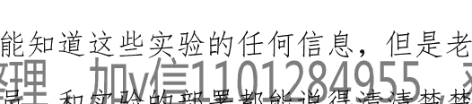

他们进入地球的目的，是因为他们在收集一些东西。其实他们已经几乎都找到了，就是那个黄金怀表。但是不知道什么原因，他们还有一个找不到。原因可能是，哪个怀表已经经过了改造，特性也被隐藏了。根据他的了解，哪个没有被找到的怀表，应该曾经在几个世纪之前，在阿兹特文明出现过（写手：详见《异海》）。

老宋向张校长强调，一定不能让这种空间飞行器找到南美的哪个怀表——虽然在那个地方一定不是以怀表的特征存在了。千万不要低估，这种平行空间飞行器的能力，对他们来说，拿到的怀表并不难，世界上所有的怀表都被他们发现，他们全部找到，就会在同一时刻奔亡，而人类将无法抵挡。当那时，就是一切的开始。

唯一的可能就是，就是在南美的一块地，在几百年前改变了属性，让这些平行空间的飞行器也无法找到。这个到底是怎么做的，老宋也弄明白。

张校长和老宋交流这些信息之后，张校长把老宋关在距离地面几十米地下的一个封闭房间，等待确认他的身份，再作处理。结果第二天，老宋从全封闭房间里消失了，同时在实验室的怀表也同时消失。但是张校长也不顾上这些，因为，那些立在罗布泊无人区的所有规则状物体，也就是老宋所说的平行空间飞行器，也在这严密监控设备下，突然消失不见。张校长在罗布泊的任务，彻底失败。

张校回到总部，立即查询所有的相关资料，发现了老宋所说绝非空穴来风，因为在几年前，南美玻利维亚的一个小报，登载过乌尼上过类似的规则物体。但是当日的小报随即便被全部收回。在南美同志，只是秘密的收藏了这一张报纸，并带回国，作为资料储备。

婉儿为什么和申偷的时候，不断想起去玻利维亚天空之镜的缘故。因为如果不是护符镜的事件，她就要来到南美调查这个事件。

婉儿花了很长时间，把南美的目的，完整地说了一遍。大拿才明白，怪不得婉儿在盐亚一直神神秘秘的，原来她也是迫不得已。

大拿笑着：“我们在网络上找到答案，获取好贴对于护符镜的监控对于我们来说简单了。你有信心吗？”

“我有一个问题。”大拿说，“我们的目的是不让你的那种外空空间飞行器找到，可是我们找到后，有什么用呢？”

“能够改变国家的策略。”

“既然这么重要，”大拿又问，“为什么不投入更大的资源。”

“后勤和技术支持是你想象不到的投入。”婉儿说，“但是不能多少，这种任务，只能在最隐秘的状态下进行，这是个悖论，但是也只能这样的。”

“把影响到国家战略的任务交给一个人，”大拿笑着说，“要是你的领导疯了，要么是我疯了。”

作者:蛇从草 日期:2014-07-10 23:19

今天没了

作者:蛇从草 日期:2014-07-11 22:40

@蛇从草 3663 楼 2014-01-14 08:51:00

宜昌版燕九

@叫你笑一个 3667 楼 2014-01-14 10:16:00

虽然不知道燕九为何物，只要是蛇哥推荐的，还是投了一票。

# 一手数据加微信1101284955 获取更多帖

我是某某，这里被发的，是燕九不是他，我也蓬莱来。
作者:蛇从草 日期:2014-07-11 23:30

婉儿花了很长时间，把南美的目的，完整地说了一遍。大拿才明白，怪不得婉儿在盐亚一直神神秘秘的，原来她也是迫不得已。

大拿笑着：“我们在网络上找到答案，获取好贴对于护符镜的监控对于我们来说简单了。你有信心吗？”

“我有一个问题。”大拿说，“我们的目的是不让你的那种外空空间飞行器找到，可是我们找到后，有什么用呢？”

“能够改变国家的策略。”

“既然这么重要，”大拿又问，“为什么不投入更大的资源。”

“后勤和技术支持是你想象不到的投入。”婉儿说，“但是不能多少，这种任务，只能在最隐秘的状态下进行，这是个悖论，但是也只能这样的。”

“把影响到国家战略的任务交给一个人，”大拿笑着说，“要是你的领导疯了，要么是我疯了。”

婉儿和大拿坐在后座上，比较尴尬，大拿提议：“走吧。”天色已经完全漆黑，两人也不敢走远，怕在晚上迷失。

婉儿和大拿坐在后座上，比较尴尬，大拿。越野开车行驶在盐碱上，不停的观察，看着他的神情已经能够找到正确的路线了。但是天渐渐黑起来，司机停下，对婉儿说了几句话。婉儿说完，司机就把脚架在座椅上，然后开始休息。

婉儿和大拿坐在后座上，比较尴尬，大拿提议：“走吧。”天色已经完全漆黑，两人也不敢走远，怕在晚上迷失。

“那些人，”大拿主动说，“你认识他们？”婉儿摇头。

那晚上是什么人，”大拿忍不住，“我其实在想，也许现在那些人就会出现在这里。”

“他们是一群教士，”婉儿说，“在这里监视着那个部落。当年的几百人，现在只剩下十个人了。再过几年，他们也会死亡，没有继承者了。”大拿疑惑，他不再追问，就是看着天空。婉儿也一样。

“你说的那些飞行器，”大拿问，“在罗布泊发现过的，来自于宇宙遥远处的外星人吗？”

“张校长跟我说过，”婉儿说，“没有任何物体能够超越，所以外星人是不。”

“那你们又说那些飞行器是来自其他空间的物质？”这就是误会了，”婉儿说，“人类一直以为那些 UFO都是来自宇宙其他星系的高级生物，其实不是。”大拿挠了头，表示不明白。“其实他们很近，”婉儿继续，“他们所在的空间，和我们根本就没有距离上的差异，所以他们只要突破平行空间，就能来到我们的世界。”大拿一时明白平行空间的道理，但他至少知道，婉儿的任务，就是在南美调查这件匪夷的事情。而这个事情，和一个太阳盆有关。

机票这次出错，失在机场没有人接人，也没有交流，回到了车内休息。第二天一早，司机在中午的时候，找到了正确的路线。很快到了盐沼的边缘。他们本来有一个行程，丢了三天，旅行社已经报警，一些警察在旅游路线的终点等待。看到他们，司机用西班牙语报警交涉，叙述了他们在盐沼里迷路的过程。婉儿和大拿去了警察局，大致叙述了过程，然后在警察的安排下回到了乌奥尼小镇。乌奥尼的行程结束，婉儿和大拿去了另一个首都拉巴，乘坐飞机去了墨西哥城。他们在墨西哥城国际机场出口，看到了迎接人群中一个牌子举着，上面写着中文：“穆婉儿”。婉儿和大拿连忙走了过去。看到牌子的是三十头的中国男性，中国男人分别和婉儿和大拿握手，并自我介绍：“我叫黎，是中国驻墨西哥的文化参赞，组织安排我接机。”大拿看了看婉儿。婉儿说：“我们正式的任务开始了。”天空之镜

作者:蛇从草 日期:2014-07-11 23:33

今天没了，下一章：墨西哥城

作者:蛇从草 日期:2014-07-12 08:52

大家多回帖，这个回帖的数量，我自己都觉得有点不好意思的。


作者:蛇从草 日期:2014-07-12 17:39

@马甲枪骑兵 18540 2014-05-27 20:13:00

看到这里，我觉得蛇哥的写作思维有点固化，或者说一种写法。从世界到异海来到这里，蛇哥你始终都在写一个类似平行世界架构，而平行世界最终极就是一个类似寒地监狱的地方，那个地方让人畏惧的地方就是时间停止，只有恒的骚扰，永恒的挣扎。大师我我也跟，我期待那个，我觉得那里蛇哥的尝试很好，故事的线性质感没那么强，却让写作更自由，内容更丰富，类似冰火，这样可以让写作顺着主体逻辑框架走下去却却不受主……

这个故事，会往框架外走走，能走多远，就要看情况了。。

作者:蛇从草 日期:2014-07-13 00:02

黎江开车，行驶在墨西哥城的街道上。把婉儿和大拿带到了一个别墅，然后进入别墅。别墅是典型的墨西哥风格的建筑，开车进入车库，车库的门放下。司机留在车库，婉儿和大拿下车，用探测仪器在车上晃动，动作持续了两分钟。黎江带着婉儿和大拿走到车库后，打开一个铁门，大拿以为门是通向别墅上部的楼梯，大拿想要寻找地方。楼梯连接一个地下房间。地下室光线十分，里面充满了电子设备，墙并不是水泥，而是贴着一层厚的塑料。大拿明白，这个地下室是完全隔绝和监控的。一个工作人员站起身，对着婉儿说：“你们从机场到这里的路上，没有有人跟踪。”婉儿对大拿压低声音：“千万不要犯这样的错误，在任何情况下，都不要提及。”九年之前，我们类似的证据。事件发生后，我们的部署安排了居民区。即便对方掌握了我们的位置，也不敢再造一次。婉儿执行任务是不是非常紧迫的？”大拿吐气，婉儿继续：“如果我们得到了任何情报，都会交到这里。现在这种屋是安全的。”婉儿给大拿交付之后，走到另一侧，坐在一张桌子上开始写报告。大拿发现她用的是最原始的方式，用纸笔写，而不是电脑。看来是最先进的科技，原始的方式仍然是安全的。

婉儿和大拿乘坐电梯到了一楼。一楼的环境和普通住宅无二致。吃完饭后，两人分别休息。第二天早上，两人被工作人员叫醒，到餐厅吃早饭。但是餐厅里只有婉儿和大拿和黎江三人。婉儿向黎江提议，要去墨西哥城的古代遗址和博物馆观光。黎江犹豫一下，然后离开。当婉儿和大拿完早饭，黎江回来了，告诉婉儿，提议得到了许可。出于身份上的敏感，他就不能陪同了，只能婉儿和大拿自行活动。婉儿带着大拿在墨西哥城到处观光，去了太阳金字塔和月亮金字塔，都是印第风格的遗迹。他们都看了一遍，大拿看到婉儿并没有发现什么特别的线索，大拿翻了翻地图，还让婉儿发现了很多帖。婉儿站在不同的教室里的壁面，观察了很久。大拿不懂艺术，但是大致明白壁画大体上的内容。基本都是古老的印人的活动，还有西班牙人的殖民墨西哥，和墨西哥城离西班牙的独立，还有打败了拿破三世扶持的墨西哥。很多都是战争的场景，看来人类的历史就是战争的历史。除此之外，还有很多表达天主教宗教的画面。一天下来，回到别墅后，大拿从婉儿的情绪上判断，知道婉儿没有任何收获。婉儿沉默了一天，对大拿说：“看来无法这些壁画上查到太阳的线索。”

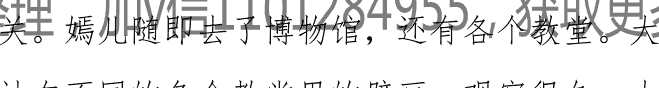

大拿忍不住笑起来，“你已经说过，你太阳涉及的事情十分严重，怎么可能从这些大广众下去找到？”婉儿说：“其实世界上很多考古界的隐秘发现都是明面上找到的。比如中国人用龙骨做药引，也就是乌龟壳，几千年来都是这个传统，但是到了百多年前，一个老教授生病，突然就看到了自己家人给自己用药的龙骨上面刻着奇怪的图案，跟他研究的金文类似。于是他就感觉到好奇，然后查到龙骨来源是南安的。然后他到了安阳，发现安阳当地都是在挖掘这种乌龟壳，然后倒卖给药。它是我们中国最重要的考古发现被证实了，挖掘了遗址，证明了商朝是真实的，而以前西方认为的商朝其实是在大型墓地发现的。”大拿“哦”了一声，“的确是被碰巧的。”

“啊，很多考古学的线索其实就在明面上，只是被忽略了。”婉儿继续，“遗址的发现和我们的任务很大联系。既然已经实证了商朝的存在，那么史书上记载的就错误了。”婉儿又举了一个例子，“墨西哥城也存在一千多年，但是通过遗址偶然发现了珍贵的壁画，证明了西方文明的历史。这种事件，并且并不是出现在中国，比如古老文字，还有西方圣经里的圣杯，都是一直出现在这里的，学者研究出来的。”

大拿彻底理解了婉儿的逻辑，彻底佩服了。婉儿说：“明天我们再去转转，可能能发现什么。”婉儿却没有像大拿那样热情，苦笑着：“没事的，我们还有时间，线索也相对清晰了。”婉儿说：“墨西哥城的历史，是世界上最老的城市之一，建城接近千年。但是这种布局，可能真的是中国人出现在这里。”

大拿累了，累了，一夜休息。第二天早上，婉儿和大拿像前天一样，再次来到了墨西哥城的古城区。两人在古城区里转转，婉儿说：“墨西哥城本来是阿兹特帝国的首都，地形是三面环山，只有一个出口。”

婉儿和大拿再次在古城区里转转，婉儿说：“墨西哥城内的各个遗迹，都是阿兹特文明的。这里有一个巨大的湖泊，城建立在湖泊中央的小岛上。跟乌奥尼蓝那个鱼岛一样。”婉儿继续：“后来西班牙占了墨西哥城，填平了湖泊，现在我们站的地方，当年就是湖水。”

大拿叹道：“你说过婉儿可能过美洲。我明白了，原来这就是婉儿在美洲的证据。”

其他的国家情报部门注意。”

“他到底说了什么？”嫣丫问。

“很肯定定这是一个中国人，他的汉语很明确是母语，带有山东南部的方言，虽然他的普通话说的很标准，但是这种方言的痕迹，还是能捕捉到的。”

“所以你能确定不是国外的的情报部门。”

黎说：“是的，但是我们为了安全起见，安全屋已经开始撤离，我的职位也调整了，加入你们的任务。”

嫣丫再次询问：“他到底是怎么说的？”

“他就说了一句，”黎说，“穆丫和李元找到了东西，可以去吉马鲁华华看看，那里有一个教室，地下的教堂。”


“是是的，”黎说，“看来你们的任务在他面前是透明的，我们正在调查，和兄弟部门交涉，是不是他们也从外围在观望你们的任务。”

“有结果吗？”

“没有，”黎说，“到现在，其他的部门是否认这个可能的。也许他们说谎，可是他们掌握了这么多情报支援，也或许不希望跨部门联合行动。”

“可是他们又吐露了这个线索。”大拿插了嘴，“到底为什么？”

“谁知道，”黎握了握挥手，“目前部门之间的竞争越来越明显，从那起相互合作的关系根本不可能再出现了，我们有时候防范自己，比防范国外情报部门还严密，谁知道他们会不会为了自己部门的利益，把我们卖给美国人。”

“那岂不是美国国国？”大拿惊讶的说。

黎江摇摇头笑着，“这种事情，发生过不止一次了。记得那事件吗？他就是国内情报部门相互博弈的牺牲品。”

姚婉沉默一会儿，对黎江说：“别说这些陈年往事了，说那个地下教室我知道。”

黎江说：“吉马华坎这个贫民区存在的事件很长了，一直居住大比民，大片的棚屋区，分别分布在高低不平的山坡上。而且这个地方，当地的寨劳方没办法，整个区域都是由黑帮控制，抓了很多有名的毒枭，还有个政客，甚至也有商人，很难想象，这地方走出了那么多大人物。”

“能不能不要把话题扯远。”姚婉说，“大拿倒是很愿意让黎江说，黎江对墨西哥政治和文化都十分熟悉，他有一个机会，就会显得。也许这些细节，姚婉没有兴趣，但是大拿很想知道。”

黎江不再再嚷囔了：“一九八五年，墨西哥城地震。吉马华坎贫民区受灾严重，但是救援组织到了贫民区的时候，被当地的黑帮阻拦。不让外部人员进入。后来根据情报，才才知道，吉马华坎的棚屋区突然出现了一个裂缝。”

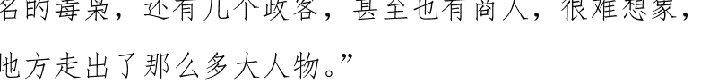

裂缝并不深，只有二十米。但是裂缝，发现了一个古老的西班牙殖民早期的教堂。由于黑帮势力强大，政府即便是知道了这个遗迹，也不能派遣任何人进入，开展调查。这事情随着时间的流逝，渐渐消失了，我也是到了这里之后，查看城市建设资料的时候，偶然发现的。所以当那个来历不明的人说起吉马班华的地下教堂，我很吃惊。

奔驰开始松动，汽车靠近了吉马班华，黎江指着那一片民宿，“就是那里了。”随后黎江吹口口，“我们该用什么方式进入呢？”大拿。

“走进去就不妥了。”四年前，曾经有两个中国人，表面身份是游客，进入我们的管理。”


失踪了，但是他们也没有发现我们，因为他们的家人对大使馆求助，才知道这个消息。可是没有没有任何人对他们的失踪事件发表声明，所以分析并不是为了绑架，最后定性为贩毒引起的谋杀。现在看来，他们可能是我们的同类，这简直是一个合理的。

娇儿和大奎非常明白黎江的到底是什么意思。但是汽车开到吉马班华的边缘地区，才发现，黎江的担忧并非为了吓唬人。

贫民区的破旧路上，行走的都是当地的穷人，看着这辆陌生的汽车，还有车里坐着的亚洲面孔，都露出深深的敌意。

作者：蛇从草 日期:2014-07-15 23:05

今天没张了，明天继续。

作者：蛇从草 日期:2014-07-16 18:12

街道越来越窄，黎江继续开车，三人下车，走在街道上。街上的行人侧目而视，谨慎的避开。街边的店铺和民居里面的人，都站在门口，看着黎江和大拿娜儿。

看来这个贫民区的居民互相都是认识的，突然来了一个n人，并且是亚洲面的人，他们都很诡异。黎江警告娜儿和大拿：“不要到处张望，有什么问题来解决，毕竟我会说西班牙语。”

三人顺着贫民区走去，道路越来越破，两边的房子越来越简陋，有的房子是易搭建的木房子，屋顶是漏的土墙，有的就是在两个房子之间撑了一张油布挡雨，街下站着俏兮兮的孩子，睁着三个外人路过。

“这个区域治安很混乱，是墨西哥城毒品和枪械的交易之一。”黎江再次提醒娜儿和大拿，“尽量不要和他们发生冲突。”

大拿娜儿就算不听黎江介绍，就知道这里的环境十危险。这些人的故意已经明显，如果不是黎江在场，他们两人语言不通，更容易引起冲突。但是黎江在场，他们的处境也不好多少。

两个衣衫不整的当地人，从街道的角落闪出来，跟大拿三人有十几步远，街道本来已经很窄了，他们站在路中央，就把道路给堵住了。而且他们已经慢的对着大拿三人走过来，大拿很清楚的看到，他们都把手插在裤兜里，裤兜里面藏着什么，应该有一把枪。

黎江用手示意娇儿的大拿不要走前面，自己慢慢向两个当地人碰头，当地人并没有让开。其中一人开始向黎江说话，从语气上看，应该是询问黎江。黎江的西班牙语熟练，他飞快的对方解释。两个当地人一直点头。黎江招了招，对娇儿：“让他们离开，不能再往走了。”

“可是，现在的情况，我也无法控制。”黎江说着，示意他们周围。

大拿向后看了看，看见后面的道路上，站好了几个中年人，他们的脸色很不友好，有人已经把手里的枪拿手上。黎江都看见两边的建筑物里，也不知道什么时候立少年，他们和街道上的中年人一样，都是阴沉着脸。

“到底什么情况？”大拿。

“他们把我们当做帮派的人，”黎江说，“今天肯定去不了，我们马上回去。”

“那跟我们有什么关系，”大拿。

“我们就是游客，”黎江说，“我刚才说错话了，他们不应该介意。”

“那个地下教室，我知道了。”

黎江说：“告诉他们去地下教堂。”


贴得近，要一个的看……。我靠！”

大拿的吓到了婉儿和黎，以为他失脚掉了下去，连忙回头回望，却看见大拿仍旧稳稳的附在悬崖的石壁上。

“一个骷髅，画的，”大拿的声音传上来，“我的脸一样大，还以为是假的，太像了。我靠，就是真的，镶嵌在壁画里。”

婉儿和黎江互相看了一眼，黎问：“应该还有，悬崖上的壁画，如果是骷髅，就不是独立的存在。”

大拿在下方说：“对，你说的没错，下面还有一个，不对，有两个，我操，下面还有更多了，一排排都是骷髅，这当年该要死多少人啊。”

婉儿和黎江看着天花板上的画面，忍不住吸了口气。

方说：“总算没骷髅了，现在有个面，你愁什么？”

婉儿立即回答：“一定是跟律齐弃奴有关，对不对？”

“是的。”大拿回道，“这个壁画我太熟悉了，我见过不止一次了，就是虎禁境下的那个画面，律齐弃奴带着肯丹在族冰雪雪的海边迁徙的画面。但是这里的壁画是连续性的，接下来的就是这些族人到了一个大湖泊岸边，湖泊里有一头巨大的动物，脖子老长。”

“这是律齐弃奴的部落后代迁到了北美洲的森林，那时候湖泊里还有古老的生物存在。”黎江分析，“你看看，下一幅画应该是森林，草原和野兽。”

“是的是的，”大拿在下方惊讶的说，“你怎么知道，跟你说的差不多，只是没有树木，都是野草，但是天上有哪些正宗的飞行器了，地面上的人类正在追着那个飞行器奔跑。”

黎黎对娇儿说：“和我们分析的没有什么出入，耶律齐齐从令海的海的冰川陆到了北美，然后新津向南部迁徙，从现在的加拿大进入了如今的美国中部。”

“而他们并没有停止脚步，是继续向南迁徙，”娇儿补充，“迁徙的理由是他们看到了那个飞行器，并且把飞行器当做神的指示，提示他们应该移动到如今的中美洲，也就是这里，墨西哥。

他们，带着部落落入美洲，已经过了几百年。

巫族，在这里是美美洲的墨西哥粘土。“阿兹特克的传说就是当年一支源于北美洲的部落，迁徙到了墨西哥，而且这批契异族的人种，已经渐渐融入和美洲的印第安人同化，是保留了当初的记忆，作为部落的神话流传。”娇儿说，“线索很清晰了，和我们分析的没有太多的出口。”

大拿又在下方一惊一的叫起来，“下方有东西，我看到了，下面有动物在岩壁上爬，刚才从我脚下跑过去了。

“快上来，”娇儿对着大拿大喊。

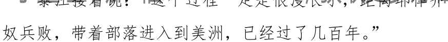

“拿东西把我的给缠住了。”大拿的声音有一些紧张。

但他还是很快爬到上面，妈儿和黎江二人努力把大拿拉了上来，看见大拿的脚踝缠绕了一圈红色的藤蔓，藤蔓上全是尖刺，跟藤攀一样。黎江忙乱用手清理，没想到藤蔓突松动，得的一下就退了下去，无影无踪。

大拿坐在地上，把脚踝卷起来，看见脚踝上被藤蔓的尖刺，划得鲜血淋漓。妈儿和黎江面相顾。

黎江说：“刚才那个你看清楚了，的确是某种植物。

“是植物。”妈儿说，“我确定不是蛇，千万万确是藤蔓。”

“可是既然植物，”黎江慢说，“拿东西，怎么会自己跑过？”

墙上的植物可能是移动的，就像昆虫或者捕动动物比如蜘蛛草。”妈儿说，“可能是这个裂缝下的植物生存环境恶劣，进化成了这种动物一样的捕猎捕食特性。

“只能这么解释了，”黎江说，“看来我们不能让大拿再下去跑，我们去弄摄像设备，看看下面的情况。”

妈儿和大拿合计好了，两人扶着大拿退回教室，那个神父已经不在教室里。三人走出教室外，看见几十个墨西哥人正站在教室外，神父也在其中。

这些墨西哥人全部配备着武装。黎江妈儿大拿三人站在原地，不知道这些人人到底想要怎么样。

对方的脸色看起来不善，大拿看了看周围的环境，计算和这些这些人冲突，会有没有胜算，看着对方的武器和人数，并且在这个狭窄的大坑里，完全不可能全身而退。

而且看着墨西人的样子，他们对中国人的敌意非常的明显了。但是大拿又看到刚才的两个墨西哥人也在其中，他们刚刚才会带他们过来。

对方的脸色看起来凶，面貌如同演员丹尼应该是他们的首领，那个人对黎江说了句话。大拿听了点头。墨西哥显然没打算让他，看来他在国内还是靠谱。

姚儿通过黎江：“问问他，是不是有人让他们进来的？”

黎江翻译了。那个叫刀哥的墨西哥人嘴里嘟了一会，大拿和姚儿都看出来，他在咒什么。刀哥骂了一会，才对黎江说长话，大拿听了点头。

“原来这些人是这里的头，”大拿说：“他叫刀哥，这里是他的地盘。”

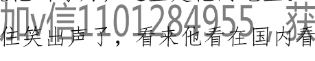

他打了。至于怎么打的，他没说，估计差份。但是他还是回答那个进来，因为他的帮派当年政府有约定，绝让他进入到裂缝里。过了两天，他发现U盘丢了，U盘本来放在保险柜里，密码只有自己知道。结果打开保险柜，放U盘的地方留了一个纸条，写的很明白，就是那个人的。既然让他进来，如果过段时间，如果有其他的中国人来，就不能在阻止。

第二天，刀哥再看保险柜的时候，U盘又回来了，而且多了一张纸条，上面写着绝对没有拷贝，那个中国人说刀是个信守的人。然后就后悔了。前面保险柜里的U盘怎么呢，可是是在家里二十四小时没有离开，那个中国人是怎么把U盘送来的，就是一点绪也没有。

妈儿：“所以他进来了。”

黎说：“现在能肯定的是，给我们电话的，就是这个黑帮头目交的人。”


“他是我的，”妈儿说，按照时间算，他甚至知道大拿到了南美洲，并且知道我们会到墨西哥……可是墨西哥的组织没有这身份莫测的人。”

姚儿默默想了一会儿，对黎说：“我确定，在墨西哥没有单独的联系人。”

黎江奇怪的，向刀问了几句，可是刀不愿意多说话了，看来那个神秘的中国人，不仅是这一件事情让他了头，只是不愿意说出来。

姚儿对黎说：“问问他为什么让别人进入？”

刀这次回答就没有吐了，很利索的。黎江告诉姚儿：“原来又错了一件事情，这个地方并不是黑帮保护地，而是在八五年的地震之后，墨西哥的政府知道了这个地方裂，曾经派人来调查，可是后来政府却突然中断了调查，并且把黑帮头领以及集万黑帮释放出来。由于没费，政府脆放任黑帮来管理，作为回报，黑帮必须得守着这个地方，不让外人特别是外国人进入这里。还有，一定要保护好这个父的安全。”


“不知道那个中国人用了什么方法，”姚儿说，“让这个黑帮头领无可奈，不惜违背当年的交易，也要进来，看他的样子，恨不得把我们吃掉，却无可施。可能不仅仅是一个U盘那么简单了。”

大拿说：“既然他们对我们没有恶意，试试能不能让他帮助我们看看教堂后悬崖底下有什么东西。”

黎江说：“既然进来，干脆试试。”

姚儿也赞同。黎沐把三人的意图说了，对面的刀哥非常愤怒，但是还是点了点头。

“绳索，”大拿补充说，“还有监控的摄像头。”黎告诉了刀哥。

刀哥听后，转身带着走了。只留下那个神父。神父慢悠走到黎沐身边，说了几句话。黎沐听后，沉默一会儿，对姚儿转达，“神父说悬崖下面面是通往另一个世界的入口，是上帝留下地方。他的责任就是守在这里，等着有人把这个入口封住。”

姚儿和大拿都睁呆了，都不一样和想到的那些飞行器。难道那些飞行器的来源并非天空，而是……”

“有姓人的，”姚儿说，“他打过道，他们之间有过交流，说这些飞行器并不是来自另外的宇宙，而且那些宇宙在空间上是没有距离，就是重叠的。”

“难道是地下。”大拿拿出。

“不是地下。”姚儿说，“我们这里没有科学家，所以这件事很难清楚，张姓说，但是人类的文明是不可能的，他有真实的证据。”

“这不是在胡说？”大拿笑着。

“没有胡说，”黎江赞同，妈儿说：“另一个空间，而且他们已经到了，在多年以前就把我们人类送到了另一个空间。来到这里，不幸的，被藤蔓捕捉了。就像大拿脚上缠绕的藤蔓一样。只是大拿身的武功，反应速度远远超过一般人，所以逃了一次。”

摄像头继续向下，藤蔓渐渐少，也没有再攻击，也许在藤蔓看来，摄像头视而不见。藤蔓终于消失了，石壁又出来。依旧是壁画，无数画面，但是这些画面毫无规律了。

突然藤蔓猛地撞到了镜头，然后镜头一层被包裹，一片黑暗。

“宇宙智慧律的必然。

好了就说这么多了，写的有点乱。大致就这个意思。”

监控的屏幕突然一片雪花，信号断了。

姚儿和黎江死死看着屏幕，等待屏幕再次出现。大拿忍不住，知道是悬崖下方的那种移动的植物在攻击摄像头。

“这种植物，都是安静的附在石壁上。”大拿继续放下绳索，黎江和妈儿仔细的看着镜里的藤蔓。

“原来我们错了一件事，人画上去的，而非自然形成。”

作者：蛇从草 日期：2014-07-20 23:45

今天没了

作者：蛇从草 日期:2014-07-21 23:19

作者：beer 时间:2014-07-21 21:50

老蛇写的电影《环太平洋》有点像啊。

@@@@@@@@@@@@@@@@@@@@@@@@

既然大家意识到了这个观点上的问题，我就专门回答一下。

《追踪的黄金太阳》和《异海》的世界是一脉。”

“空间的海洋和信息的内容指南，就是你想看到的帖子。空间的存在，并且和和平智慧生命争夺发展空间的战争。

而且人类是一个强大的生物，虽然技术上会落后，但是我们自我保护，自进化，向外侵略的本质的烙印在基因里。于是人类一类的能够绝境逢生，即便作为人类的个体无法识别到这个点。

所以人类可能会走的更远，这个绝非偶然。

无论是哺乳动物取代统治地球的爬行动物，还是猿人超越了大脑容量更大的鲸类，还是智人战了更具优势的尼安德特人，北京猎人等等，这些这都是基因克服环境，适应宇宙智慧律的必然。”

“的。”

作者：蛇从草 日期:2014-07-21 23:44

在同一个宇宙下，就是我们所处的空间，宇宙决定了光速无法超越，进而导致了时间禁锢，时间旅行是不实现的事。甚至时间只是人类自我意识的一个体现，并非真实存在。所以外太空的智慧生命是无法到达地球的，因为宇宙实在太大，无法无法移动。反向推导，人类到外太空寻找智慧生命，甚至移民是不可能的事情。

但是UFO和外星人，还有时间旅行的事件，在地球上也不断的出现。从而从另一个角度来分析。那就是世纪末科学家从数学和理论物理上推导出来的结论。物质的最小点是弦。弦也能解释了维度的存在。并且有一层的维度，也有更多维度的说法。这样解释了宇宙的事情，我们人类是三维产物，只能接到三维的宇宙。我们的宇宙是十一维的，从高维度来看，我们地球所处的宇宙可能是无数平行空间中的一个而已，还有无数的平行存在。假设其他的平行宇宙是三维产物，或者是准四维产物，但是他们掌握了突破四维的技术，那样穿行空间就是一个现实。所以从某种进入地球空间，他们的空间和地球就没有距离，而规避了光速的禁锢。因为高维度来解释，三维的距离可以从高维度扩张或者根本不存在。”

# 一加微信1284955获取更多帖子


“就是黄金太阳盘！”黎江和婉异异口同声。

“这是一场不折不扣的战争，”黎江沉地说，“延续了一一千多年，而且转折点就是莱律仆奴，他就是最先觉醒的那条备奴，是当时最聪明的人。他甚至瞒堵了那些飞行的智慧，把太阳盘带到了美洲，并藏起来。等到后人，也就是我们来破解黄金太阳盘的秘密，然后一举反攻，扣扳机人的可能就是我们这一代的使命了。

“已经人在无限接近这个秘密，”婉异说，“不光是我们在努力，记得他那个亡吻异，他的父亲，已经经过某种实验，和飞行器有着密切联系的实验。然而，有一个我们经理发现的灵老，他可能已经知道了如何填充弹药更多的，如果亡吻异的父亲会学习就知道如何填充弹药的那个人，那么老老可能已经知道如何扣扳机了。”

黎江说：“看来我们离开这里之后，必须要回国，和吴仁父亲在所番号的部门，进行深度的合作，不能再这样频繁无目的的行为。

“也许他们正等着我们找到黄金太阳盘，”婉异说，“如果没有这个枪锁，他们根本就不会平等的交流。”

“现在会使用黄金太阳盘的人已经存在了，”黎江说，“等着我们把这个关键的东西找到。”

“可是莱律仆奴到底是什么办法，让智慧生物也无法找到黄金太阳旁，”妈妈说，“我看到过那个太阳盘的图片，但是无法知道底是什么地方。”

黎清说：“那就别嚷嘈了，这线索一定写在文字里。”

姚继续翻译墙壁上的文字：

“奥律奴大妥相，在黑海旁祖留下的地图，找到了化外之地的路线，率领众众，到达北海之外的极寒之地，在冰雪地之中，看到了漂浮在海上的大山无数，奥律奴大妥相和众人没找到地图上的海中小道（黎清插播：应该是小冰川后期，海面上升，淹没了大陆桥。）奥律奴大妥相令从众徙造郡，穿越大陆，却被奥律环围在化外之地之间，部获及。部帖妥妥大人，在冰雪中病死，其父韩敏哥带领众徒徙化外内陆。遇士人，韩敏哥死，韩敏哥侄延宗耶律律，名为耶律割哥，耶律割哥哥带领部众，与士人争执数十年。耶律割死，奥律不留哥带领部众，与士人风俗，与士人通婚，部众人渐兴旺。奥律不留子之无名，三代耶律虏家族失。首领牛角角角带领人南迁，牛角角死，其子山猫敖于士人吃鱼部，收拾残余女妇，继续南迁。两代后，首领独擅循环奥律奴大妥相的遗言，带领民众找到大妥相所说琥踞之地，一个巨大湖泊，人称之为特斯科湖。”

“这不就是阿兹克人的历史吗？”黎江说：“其实在


这个时候，契丹族并没有多少纯血的后裔，可能只有极少的人还在用古老的文字记载他们的使命。这个从记载头的名字就可以看出，他们已经弃弃契丹族的姓氏，用印安人的方式取名了。

“是不是契丹族其实不是关键。”婉儿，“关键是阿兹特人心中还有几个人记得当初的目的。”

“赶紧的往下看啊。”大拿急了，转身对着两人说，“在在这里比比有什么用，看他们写的什么不明白了吗？”

婉儿的眼睛掠去没有看着屏幕，而是看着大拿的身后。大拿立即敏锐的察觉到了什么异样，马上扭头。

一个巨大的头，跟动物的头不一样，光滑的皮肤布满了褶皱，像老树皮一样可怕，嘴角露着尖利的牙齿。这个头颅如同漂浮在悬空的空中，大拿和婉儿看了很久了，才注意到一个长长的脖子，从悬下伸上来，支撑着这个巨大的头颅。

老沙和婉喻在房里里听到了那段诡异的对话机声音时候。在工厂的蓄水池里，大拿正在胡乱的挣扎。二子飞快


身体有点不舒服，今天就这么多了。

大拿身体被二子用绳索拖出了蓄水池的边缘，身体在水中的大拿，在冰冷的水中，身上感受到彻骨，让他很紧张。

“你们对付不了……”大拿在混乱的意识中，近乎瘫痪的告，在他耳边一次响起。猛然大拿的眼前亮，意识立刻清醒，才看到二子已经拉出了。上半身斜靠干燥的地上，大拿觉得浑身疲不堪，不想弹。被二子把身体翻过来，然后二子把大拿的鼻子抓住，然后咬了上来。大拿深吸一口气，然后慢慢游到水中，二子慌了，连忙跑：“冬生叔，你没事了吗？”大拿冷静的二子：“没事，还是老办法，你觉得有问题，就把我拉回来。”大拿心里不停的暗示，不要乱，然后放松。你跟冬生叔一样，你自己吗？”大拿的二子：“刚才看到了下面东西，那个红形的，我要抱起来。”大拿的二子：“原来你没事，我还是以为你已经淹死了呢？”大拿的二子：“冬生叔，你没事了吗？”

大拿的二子：“没事，还是老办法，你觉得有问题，就把我拉回来。”大拿身体的，身体被二子把绳索往回拉。

大拿再次蓄水池中心游过去，游动的过程中，他想起了一件事。虽然只是电光石火，但这件事完全浮现了起来。可是没有办法，脸上凉的感觉，和耳边冬生的声音，还有记忆中这件事，就像一种紧密联系，让他无法彻底甩掉。那件事，跟他以前的一个同事有关，是他来到厂之后最先认识的一批同事。这个同事叫洪兵，跟他睡同一个宿舍里，共处三天。后来，洪兵去了外地打工，过了半年，大拿去洪兵附近，发现他在修新房子。洪兵混了在外面赚了很多钱，还没收拾，家里人问起来，他们都用奇怪的眼神盯着他，不回答他的问题。大拿想这家人真势力，有了钱就变得怪，也不再管，从此连洪兵附近都没再去。直到有一天，大拿有一次偶然的机会，在虎符镇上，大拿从洪兵一同外出的一个乡口里，听到洪兵的传闻。洪兵去打工，实际上是修高速公路。很多人知道，高速公路最遇到的事情，就是要修隧道还有桥。但是，任何地方，只要是修公路，都很容易遇到这两件事。修隧道和桥，一个是要挖，一个是要跨河。自古以来，人都认为山有山，河有神，是不能轻易冒犯的。一旦对它们进行改造，就意味着要付出不小的代价。洪兵的同乡告诉大拿，洪兵在建筑队伍里待三个月，被安排去搭一座桥。这座桥横跨南北，水宽四五十多米，流水十分急。要修桥，就得打桥。说来说奇怪，这座桥的其他桥都很很快好了，连水流最快的桥都很快打好，就剩下一个靠近岸边的桥，无论怎么努力，都没办法打好。浇下去多少都不起。原本在这座桥上的都是老手，知道有些水工程，就是搞祭、炸炮，献上香火和供品。搞了这些东西之后，桥依然没办法打好。所有的人都知道有麻烦了，明白这个桥可能不太处理。这一天，工头喊了几个年轻人去处理桥的事，洪兵也在。出发之前，老板就跟他们说了，这事有危险，去的人给了一大钱。洪兵虽然是新手，可听说的事情也不少，知道其中的缘故，但他还是去了。没过半个小时，就出了事情。在桥浇筑的时候，洪兵被一土埋在桥子里，由于速凝混凝土，当旁人反应过来的时候，已经没有办法将洪兵从速凝混凝土里捞出来，连体都无法挽回。那个打工的同乡对大拿来说，本来好好的，突然就疯了样自己跳了下去。可是他就站在安全的地方，不知道为什么突然想开，就这么做了。大拿现在想起这件事，就是因为洪兵离开他们的时候，跟大拿说了一句，他说：“我常做一个梦，梦到我会静静的站在中央，我还是以为我会死在溺水池里。”现在大拿也知道，洪兵死的那个桥墩，其实距离虎符镇远不了。其实私以为以异海拥有一个成功剧本的很多要素，完全可以制作成一部场面壮观宏大的科幻电影……但国内现在的水平和特效很难支撑，如果由好莱坞团队来制作，那将是多么激动期待！关于密道第二部黄金旋的复述；我会把异海展开的情节，和密道第二部黄金旋的情节联系起来。异海估计准确否。


可随即，我就推翻了自己的设想。

这个复制品，他受伤的也是左脚，跟我受伤的脚是同一的，而镜面人，应该是左右互换才对。

有一个非常不好的念头一闪而过，或者，其实已经很明显，只是我我不愿意接受，合理的解释，当然就是我才是正的镜面人，而躺在地面上的，是正主。

我继承了他的记忆，而且把我原来的记忆都给覆盖掉，很浅浅的道理，就像某个文档被同名文档覆盖，内容都变掉了。这可能吗?

要验证并不是什么难事。

对，用手摸摸心脏在哪儿跳了。


被我震惊了，其实我是镜面人，我害怕镜子。害怕自己是镜面人的事实，虽然我不知道镜面人的身份，到会给自己带来什么问题。

但是光是想，觉得很恐怖不是吗？自己竟然就变成了一个连自己都不清楚是什么的。

沙上的手机突然响了，我走了过去。

是小刘打来的，我迟了一下，按下接听键，本想说话，话到嘴边，又咽了回去，我担心口中说出来的的是不受控的声音。

“峰哥，你有时间来做体检了吗？”小刘热情的说，“你如果今天能过来，我还能照一下。明天后天我轮休，你也知道，都是职工家属体检，到时你来，可能就没那么方便了……”

“不……”我喉头有点发紧。

“什么？”小刘疑惑地问。

“我不体检了……””我的声音近乎机械，不敢说太多，拍掉了电话。

“峰哥，你有些东西落下了……””小刘赶忙提醒，但声音很快断掉。

我坐在沙发上，揪着头发，不知道怎么处理眼前的事情，报警？我找个地方报警掉？似乎都不太靠谱。

我只能呆着，看着天渐渐暗了，我也越来越害怕，到了我决定去莲藕鬼帖里搜索这个帖子，自然买一套《异海》实体书我也很有感。

门外，响起了敲门声。

作者：蛇从草 日期：2014-07-26 00:05

（写手）：今天和明天的内容会提示一些异海的内容设定，如果没有看过异海的朋友，可以在莲藕鬼帖里搜索这个帖子。

主任看向张师长，推了推，“我们开始会议吧。”张师长点点头，所有人都稳稳的坐下来，张师长开始说：

“这次会议是我们两个特别部门之间的协作会议，因为任务涉及绝密内容，所以不作录音和文字形式的会议记录，


我们今天谈的内容，仅仅仅是口头交流。

张师长的会议介绍完毕后，王主任补充道，“从现在开始，两个部门之间的合作任务正式启动，我部门的行动人员，和你的行动人员在对方部门同时自动获取行动任务的各种权限。”

张师长对娇儿说：“根据番号部门的合作惯例，我们先提供掌握的情报和任务情况。”

娇儿点头，开始有条不紊的说起来，“三年前，罗布泊无人区域发现了不明物体，是形状规则的高度文明产物，正方形的约三十米，长宽约十米，圆柱形，锥形等几何形状，高度和直径，边长都类似这个尺寸。”

王经理补充道，“而且形状奇怪，出现了很多，有些区域面积七平方米。不明物体的内部构造不明，材料组成不明，不知道出现的时间，具有强磁场的特性，后来根据分析，这些物体变成了扭曲空间......”

娇儿的口吻变得十分冷静，王主任听到后，慢慢点头。

娇儿继续说下去，“我们在发现这些不明物体后，对现场进行了封锁，但是先有两个人突破了封锁，一个是张刚才接到的吴皓，一个来自历史的宋姓中国人，这两个人都曾经是王主任番号的特殊工作人员。他们都随身佩带了一个同样的东西——一个黄金同位素制的怀杯，以肯定的怀杯绝对是非人类的。随后这个任务的相关后续都被你番号部门接管，不再对这件事情进行调查。”

王主任对着嫣儿说：“关于吴驰仁和姓中国人的资料，我后详细告诉你们，还有那个怀杯的相关细节，也会向你们详细介绍。”

嫣儿继续说：“我的任务倾向于古代遗迹，于是我们进入了华北某地，进行下一个任务，就是虎符镇下的吕丹奴奴墓调查，这是一个长期的任务，我们在很多年之前用了大量的资源，最终我们破坏了一个镜湖世界的隐患，破解了虎带来的危机。但是根据我们自己在行动中的线索，发现吕丹亦在千年前竟然遥远美洲，并且他们带走了一个重要的东西——一个黄金制造的太阳盘，而这个太阳盘和印……”

# 第一章 加11012849.52

我是非制人员李元丰，到了美洲，在乌洛尼找到了一些线索，证实了古亚洲人和埃及部落的一支联系，到墨西哥之后，我们确定了那一支埃及部落，和美洲北部部落融合，非常可能融合后的另一支部落到了墨西哥，也就是阿兹克人的源头。在我们最近的发现，阿兹克人和某种高度文明有过接触，并且藏了黄金太阳盘，而黄金太阳盘和高度文明有着决性的联系。我们掌握的内容这些。”嫣儿说完，会议暂时一片静。过会儿，王主任开始说话：

## 王教授

“信息太多，我们部门也参与了数十年的行动，我们从那个姓的中国人开始起，六十年代初到七十年代，某部队在罗布泊进行过长期试验，最终失败了很多科学家，我们得到的资料极其少，并且没有任何价值。其中有一个姓宋的科学家在名单之中，但他的下落并没有清楚。九八二年，我们的高级部门得到了一个消息，我们在中国寻找另一个后代，流传了几千年的怀杯——我们对怀杯材料进行分析，竟然是黄金同位素元素，物理学上是不可能的。我们要进行一些重要实验，最终参与了实验中，中方派出了六个人，我们派遣了一个特工，拿替了后代。另外五个个人之中，就有一个人类曾称他为宋博士。那实验进行了几年后，根据美方发过的实验照片，突然发现，资料显示，他们的身份根本不是一个人，只能推测，在美国的时候，罗布泊的老杜取代了宋博士，而宋博士再也没有了。”

婉儿和大奇听着王主任说的，现在听起来，任务没有太大的联系。王主任接着说：

“现在告诉你们，中美联合实验——异海需要大量的黄金作为介质，打通另一个空间，就是异海。中美派遣了六个人员，但是年后，我们派遣的人回到了地球，那个人就是吴仁的父亲。吴仁父亲突然出现在印度洋海域，和美国周旋很久，最后把吴仁父亲顺利带回国内。后来，吴仁父亲撇了他的跟踪，回到国内后，他告诉我们，他看到了老宋。那个老宋竟然作为代表在美方的‘金川号’上找到。他的身份和背景完全无法理解，资料全部消失了。现在我们再来说吴仁父亲带回的情报。他参与的实验，成功的把他们带到了异海，异海是类似地球的行星，但是根据吴仁父亲的叙述，原来类似的空间实验，德国和美国已经进行过一次，我们只是参与了第三次。”

婉儿和大奇听得大气都不喘一下，原来王主任的号码级别上出了这么多。

作者：蛇从草 日：2014-07-26 00:06
今天没了
作者：蛇从草 日：2014-07-26 17:15

@kiroro3233 13572 2014-04-07 19:43:00
再顶 蛇哥从来不睁一眼的我默默飘过
@洋嚎殷蛰 13580 楼 2014-04-07 20:27:00
这个称呼我喜欢 @蛇从草 我很喜欢，合影一个。作者：蛇从草 日期：2014-07-26 22:51

大拿有点愣了，张了几几次嘴，却没有说任何话出来。张师长和王主任看到大拿的举动，王主任停下来，询问大拿：“你这是要加微信101284955获取更多？”大拿犹豫一会儿说：“我不知道你们号码之间有什么关系，我一直以为妩儿和您的号码是国家唯一进行这种任务的部门……”

“明白了，”师长说，“那我仔细给你介绍一下。”大拿谨慎点头，心里明白，他们已经把自己当作行动的主要人员了，这种信息他们不会简单告诉外人的。

“我们的号码前期是延续了很多年的一个门派，这个娇儿你在虎符镇的时候，你应该已经了解了，”师长说，“我们在六一一年，正式获得军队的号码，我们这个部门的主要方向是寻找吕代留下的任何线索，实际上和我们学术路数没有任何区别，只是得到了国家的秘密支持而已。而王主任所在的编号，他们的研究方向和我们并不相同，他们的部队在建队初期就已经成立，是古斧建立并且领导。王主任所在的编号主要是针对现代神秘事件进行调查。中美联合实验——异海需要大量的黄金作为介质，打通另一个空间，就是异海。曹浩带回来的情报也说过，除异的环境之外，其他的空间有很多存在的形式，不仅有离子——火的世界，气态——风的世界，异海——水的世界，还有纯黑力的宇宙……等等，还有很多无法解释的存在，是人类物理学无法用来分析所有的事

其实远远远不止这些。宇宙存在的形式，也远远远并非我们所在的地球，太阳系，银河系这个宇宙，而是有很多其他方式的宇宙。打一个比，在我们宇宙，光线是速度的极限，任何物体无法超越光速，但可能在另一个空间里，光速并非三十万公里每秒，要么更快，要么会更慢……等等，”王主任打断黎，“我想到了一个问题，我们部门研究了很久的问题。”

黎毅的疑惑说：“我拿对了吗？”

“你大学学的什么专业？”王主任问黎毅。

“物理，”黎毅说。

“物理的……这些飞行器能够利用空间折叠进行移动，我们都想当然认为飞行器具备更强大的攻击力，可是实际情况是我们如今还没有发现这种飞行器具备强大攻击能力，我们用人类的思维方式去推测，反而把他们的智慧程度提高了。”

“这个想法很有可能是真实的，”王主任，“你说得很对，我们为什么要用人类的思维方式来观察他们的方式？他们已经在地球上存在了几万年，而他们方式仅仅是位于人类身上，提升了人类的智商，慢慢改变人类。”

“所以，”黎江激动的插播，“刚才也说完，他们用线粒体的方式寄生在人类身上，然后改变人类的进化方向。这样的，就此推断，他们自身没有任何任何形态。”

“啊！”王主任说，“曹浩带回来的情报也说过，除异的环境之外，其他的空间有很多存在的形式，不仅有离离子——火的世界，气态——风的世界，异海——水的世界，还有纯黑力的宇宙……等等，还有很多无法解释的存在，是人类物理学无法用来分析所有的事。”

“人类是用自己的眼睛看到的东西只能看到光谱中的物，”黎说，“正如我们人类的眼睛只能看到光谱中的一段，就以为我们看到的色彩就是所有颜色的全部，其实远远远不止这些。宇宙存在的形式，也远远远并非我们所在的地球，太阳系，银河系这个宇宙，而是有很多其他方式的宇宙。”

“我们的目的是扩张国土。我们要储备巨量的黄金。而且我们在零五年，独自完成了第四次实验，把曹浩再次送入异海。现在正在等待异海的消息。但是第四次实验并非第三次那么简单，因为曹浩带回的情报中，他提到了一个深刻的可能性，那就是人类是某种高度文明的寄生生物。听到这句话，婉儿和黎江也露出惊讶。王主任顿了顿，继续下去：“这种高度能够穿越各个平行空间，我们表示平行空间并非只有异海，还有离子态、气态、磁力态，各种形式存在的智慧生物，用不同的形式，进入了地球。他们可以用各种形态生存，地球上的线粒体只是其中的一种形态，现在的其他的形态已经进入了地球，战争已经开始了。我们能够了解的只有一种，也就是那些不明物体，以及控制在煤矿里的火焰智慧形态，其他的形态我们完全一无所知。”

王主任说着，停了下来，张接着：“从科学技术的角度来分析，我们必然失败，但是我们之所以现在还没有受到毁灭性的打击，一定有一个重要的原因。”

“和我们号码执行的任务有关？”姚反应过来。

“不是，”王主任说，“身体内的能量转化为动能，让肌肉伸缩的那种基因物质，就是线粒体。还有这种事情！我们研究过，这种线粒体在所有人身上都是一致的，但是和其他动物却不同，线粒体双螺旋结构比其他动物少了两碱基。准确的基因比人类少了两对碱基，以此人类进化如今如今文明，并不是偶然。”婉儿和黎江也不差。

“我们认为，人类已经完全依靠线粒体形式的高度文明。但是曹洛回来之后，我们在罗布洛发现了那些不明物体，还有在贵州的某个煤矿发现了具有智慧生命。所以我们认为，那些存在于其他平行空间的


不用仔细看去，神喻知道这个箭头，就是自己画的，他画的箭头可以自己画别的细节的。但这个箭头，又在一个问题，因为神喻所指的方向，跟他相反。神喻看着，心想自己的镜面还在地上，出现一个箭头印记，就算算不上什么事情。然而转念一想，事情是复杂的。问题是，反向箭头为什么出现在这里。这种现象无法解释。神喻看了对面，墙上那个箭头和这边的箭头相对，他站在箭头之间，仿佛被两辆枪指住。”

“神喻，是不是你？”婉儿的声音从前方传来。在神喻的注视下，一身夜衣的婉儿走了出去。神喻头发痒，忍不住吞了唾。如果这里有异面布局，婉儿处的位置，正是在异面那边。婉儿，到底是实人，还是异面人？”

作者：蛇从草 日期：2014-07-28 21:59


类的进化可能会走上另一条道路，所以我认为，火的使用，冶炼技术，以及车轮的发明，还有文字的创造，都有可能的。他们加强我们人类身上的智慧，让我们文明发展方向和他们的有望的一致，然后他们利用我们的身体，进行下一步的空间穿越，不过有一点，他们无法改变，根本就没有意识到……。

“没有意识到，我们人类在几十年的进化过程中，慢慢把他们同化成了线粒体。”王主主任说，“直到现在，他们发现这一点，然后就有这些飞行器到达地球了，但是没有最后一个怀怀，他们对我们无计可做。”

“那郭怀怀流传到了薛律斧的手上，但是已经被人类……”王王经理告诉我盐阳矿的。奎云说，“而且，盐是盐矿的也被薛律斧和他的后裔给藏起来了。”

王主主任说：“薛律斧的这一支系，一定出现过智商超人，比我们早一千年发现了这个这个问题！”

作者：蛇从 日期：2014-07-28 22:20
今天没了。

作者：蛇从 日期：2014-07-29 23:42

“有一个细节，”婉儿提出来，所有人都看着婉儿说话，“盐分。人体能够凭借自身的身体体调节，平衡体内的盐分，而其他的哺乳动物是没有这个身体机能的。”

“天空之鳍，”大拿喃地说，“世界上最大的盐矿，”和这些智慧生物有莫大的关联，怪不得你还要带我去乌尤尼盐沼。”

鸥儿说：“其实我没想这么多，我只是知道乌尤尼盐沼这个特殊的环境和罗布泊沙漠里的飞行物是有联系的，至于到底会有什么样的联系，现在我们也没有太多的线索。”

王主任和张长互相点头，张长说：“今天的会议结束，交流的内容是两个编号的绝密情报，现在我们开始部署一下下一步的任务情况。”

王主任说：“我打断一下，现在我们正在寻找老董这个关键人物，很可能会发现他的踪迹，而且曹薛的子——”

吴仁，你已经进入了我们的部门，作为情报分析人员，曹薛报告了许多细节，吴仁也获取了更多情报，后续在信息互通上会加强合作。

张长说：“还有一个重要的线索，我补充一下，我和王主任在国内的时候，我们说过，他父亲曹薛在异实验室的任务中，遇到过一个阿格斯特克人，那个人用一把兜刀的类似怀表的东西，进入异异，又回到了地球。”

黎翊镇说道：“看来律斧的后代，一定是掌握了把怀表改成其他形态的手段，这就是关键所在了，因为飞行器无法寻找改变状态后的怀表，怀表可能是太阳的，也可能是兜刀的手柄，也可能变成了别的形态。”

“那把兜刀的下落我们已经调查出来，”王主任说，“墨……”

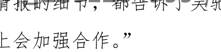

墨西哥第二大城市瓦达哈拉西，有一片原始森林，是普力马威森林公园，森林里面发掘出一个阿兹特克墓群，其中有一个出土文物，就有一把弯刀的形态和吴鲁仁描述的弯刀十分一致。这把弯刀现在已经由墨西哥考古学家在大学里公开研究，所以我们很容易打听到相关资料。这把弯刀和阿兹特人惯用的刀具形状完全不同，外观更像是东亚古代猎人驰骋草原的马刀，但是刀柄已经残缺，没有吴鲁仁描述的机械。这个可以推定弯刀的手柄被人拆掉了。由于它和我们今天讨论的情况完全一致。

黎江说：“我们下一步任务，要深入普力马威国家公园的原始森林，”加注：虽然是园区，但是还没有被开发过。

一直都没有被开发，被挖掘开发的阿兹特克墓群，现在也在当地人的压力下不能继续开挖。森林的情况非常复杂，首先环境完全是原始的，森林里还没有生活着化的印安南部族，而且墨西哥的毒贩也在里面制造毒品的地下据点。墨西哥毒品集团的实力强大，都有自己的私人武装。还有一事情，你们要明白，你们面对的不仅这些威胁，太阳盘的下降，不仅我们在调查，还有其他类似我们的组织也在调查，他们绝不是我们的朋友，明白吧。太阳盘的秘密，一旦掌握，就能突破空间隔阂的限制，这是一个让文明进行跨越的科技。我们不能失手。


黎江、婉儿和大拿同时敬礼，“明白”。

张师长说：“明天一早，我就安排你们进入普力马威亚国家公园。你们的身份是游客。”

作者：蛇丛 日期:2014-07-29 23:43
今天没事了

作者：蛇丛 日期:2014-07-30 23:43

## 普力马威亚森林

黎江、婉儿和大拿在丛林里已经走了两天。大拿不止一次地认为是迷路了，但是被黎江否定，森林恶劣条件远超出他们的想象。森林几乎没有道路，由于墓地无法从地图上找到，加上GPS设备，有很多线索。

他们沿着河流向上游行了一天，到达一个干燥的地方。下午一场突如其来的雨影响了他们的行程，雨之后又走了几个小时，天渐渐黑了。黎江只能提议找一个干燥的地方休息。

三人找到了干燥的地方，挂起吊床。他们不能暴露，露营。森林里的野生动物是巨大的威胁。

黎江向婉和大拿交待，这种原始未开发的森林和他们在国内任务中遇到的不同，很多食物都没有。比如发现一只巨大的蟒，背长达十厘米，这种生物位于食物链顶端，主要的食物来源就是大型哺乳动物，比如蜥蜴。

森林里的蚊虫也可能携带某种病毒，这种病毒没有在森林之外被发现过。人类对这些病毒没有任何认知，身体免疫力也无法抵挡病毒的感染。虽然还有一些未见过的小型动物，大拿看到树上的一种身体颜色艳丽的赤红色蜘蛛。大拿非常好奇，想去近距离观察，被黎江阻止了。这种树蛙被科学家发现过，但是还没有起名，因为和其他热带森林里发现的蜘蛛品种并不相同。

这种蜘蛛的毒性非常强，甚至连当地的原住民都不敢利用这种蜘蛛的毒液涂在武器上捕猎。相对于别的未知生物，这种蜘蛛的记载相对多一点。当年有几个科学家进入这个森林，试图捕捉这种蜘蛛带回实验室研究，却被蜘蛛的毒液攻击。一个科学家立即就死亡，其他几个科学家把蜘蛛打死，却失败了。他们在返回的过程中，被这种复性极强的蜘蛛围困，成千上万的蜘蛛把他们围在一个河山上，最后还是动出了直升机来救援，营救最后一个幸存者。事件结束之后一个月，营救人在当地向导的带领下寻找受难者的尸体，发现这些尸体并没有烂腐。在这个炎热的热带森林里是很奇怪的，食物和食肉动物避开了它们的尸体，甚至连细菌都无法在身上繁殖。尸体被找到送往城市，在途中忽然烂腐加剧，让事情变得更加可怕。不过后续的科研人员带着安全措施去寻找这种蜘蛛的时候，他们在森林里却再也没有发现。

黎江继续补充，这种蜘蛛的毒液可能在古代被印第人拿来做毒。印第人也有把尸体集中在某个洞里，很多尸体都保存完好。这个传统无论是南美洲大陆的高高原印第人，还是墨西哥森林的印第人都发现过类似的现象。

## 发洪水


蜘蛛上树结网，是真实的，我在巴基斯坦曾见过过。

昨晚停电了。

作者：蜘蛛从 日期：2014-08-01 23:42
明天早上更新

作者：蜘蛛从 日期：2014-08-02 12:11

黎江说了这句，然后就没有了声音。大拿眼前的那条蜘蛛腿突然向大拿的方向移动了一点。然后整个蜘蛛横移，大拿占据了很多，蜘蛛就横在大拿面前看着它。看着蜘蛛在大拿面前移动，停止了说话。

大拿浑身的寒毛竖立，面的蜘蛛身体有掌大，相比之下，蜘蛛的腿部看起来很长。蜘蛛身体是黑色的，但腹部有两个倒三角形的花纹。大心里在想是不是该想办法逃跑。可是看着满都是交织的丝网，知道逃跑会被蜘蛛丝缠绕。至少不是大拿所想的那种巨大的蜘蛛，那种蜘蛛只会出现在电影里。大拿面前的蜘蛛形体应该是地球上最大的一种。黎江压低声音：“看来我们运气不好，雨提前了，降水量很大。”

“雨季跟这些蜘蛛有什么关系，”大拿苍然地说，“热带雨林也分雨季和旱季吗？”

“这里的森林，”黎江说，“雨慢的降雨比平时更大，但是我们想到今年雨季的时间提前了二十多天。”

“这些蜘蛛和你说的雨季到底有什么关系？”大拿喊道。

“小声点！”黎江说，“声音也会让蜘蛛丝颤动，你会把蜘蛛吸引过来的。”

“蜘蛛有什么好怕的？”大拿说，“你有必要害怕？”他看到蜘蛛密集的网，眼前不到米的地方，树梢上满了倒刺和细绒毛，十厘米长，颜色翠绿。大拿看了好久才醒悟过来，这个根根本不是树枝，而是蜘蛛的一腿。这个节肢动物前脚有十厘米长，身体几乎可以推出有多大。看着光裸树木的白丝网，大拿明白了黎江为什么这么紧张。

作者：蛇丛 日期：2014-08-01 11:36

## 总结

大拿看向黎江床的方向，发现黎江也一样，自己震惊看着地面上发生的事情。黎江明白了，这些蜘蛛在洪水之前就已经饿了长时间，不知道是什么原因。大拿焦急地说：“我们现在怎么脱身？”

黎江慢慢移动，发现。蜘蛛已经没有离开，而是趴在猴子的身上。大拿心里十分明白，这些耐饥的蜘蛛已经饿了长时间，因此改变了捕猎的方式。如果这样下去，自己和婉儿也会成为这些蜘蛛的下一个目标。

黎江，已经忍不住要活动一下身体了。大拿正要提醒黎江不要动，可是黎江已经再也坚持不下，身体从床上翻身跳到地上。就在所有蜘蛛都感受到了黎江的动作时，天上的暴雨盆而下，所有的蜘蛛都被雨落在树枝和地面的震动扰乱了方向。树上的蜘蛛都爬到了巨大的叶子下面，蜘蛛也离开了猴子的尸体，纷纷爬树上。

大拿和婉儿趁机跳到了地上，三人草草收拾东西，从树林里的丝网中勉冲开，向外部跑去。雨下的更加大了，能见度很低，几乎在黑暗中穿行一样。

一直走了两个小时，雨渐稀止。但是地面更加潮，黎江指着河水，“河面比昨天宽了很多。”

大拿看了一看，“河面还在岸上。”

大拿爬到了树木高处，看到来处的地方，苍茫的一片蜘蛛网，把高地上整片的树林都包裹起来，上下左右看不到尽头。

了了水面的高度，一小时后，洪水已经上涨了一米，如果仍然留在地面上，现在就无法在洪水中保持平衡，被冲下游。

幸好高架的基础非常坚固，虽然因为是木质结构，腐朽了一部分，但是在洪水里并不危险。

黎嵩念有些词，大拿询问：“你在做什么？”

黎说：“我在根据雨雨量，和下雨的范围，分析洪水要多久才能过去。”

大拿：“你脑袋能算的？”

“不是很难”，黎嵩回答，“就是计算数字而已，看来我们如今在这个架子上等完了，洪水明天早上会完全过去。”

黎嵩道他是聪明的，但他活在年轻的时候，都会接受一些超出常人的训练。大拿看着婉儿，婉儿一定异于常人的能力，并且并不是黑客技术如此。自己，一定是因为幼年的时候接受过传统武术的缘故，被锐岭接纳。

大水冲下来一条达十米的树枝，到了高架下面，被高架拦住，树枝被水冲的缠绕到了高架下方，被高架挂住。这时，人才看清楚，这个根本就不是树枝，而是一个巨大的蟒蛇体。

大拿想起了在虎符镇地下，那些小的毒蜘蛛，和密密麻的蛇群。现在在虎符镇地下不同的时候，蜘蛛和蟒蛇的体型大了无数倍。


蟒蛇的尸体，尾部随着水流不停的摇摆，仿佛蟒蛇并没有死亡，还在水中游荡一一般。

“这种蟒蛇在森林处是食物的顶端。”黎江说，“而且能活很长的年龄，死之前都是躲避在森林深处，然后森林慢慢慢慢的腐烂。绝不可能就这么突然死掉。”

大拿趴下来，仔细仔细看着蟒蛇，“身上没有外伤，是不是病死的呢？”

“不可能生病。”黎江说，“虽然蟒蛇会有寄生虫，但是绝不会因为寄生虫死亡的。”

妮儿和黎江看着大拿的手指，看向上，然而又一条体型相似的蟒蛇顺着水流下来，只是这条蟒蛇距离高架较远，没有被架挂住。

黎江喃道：“这就证明，森林里蟒蛇的死亡，不是偶然的意外，而是有某种东西，对森林里的动物有了巨大的威胁。

“还有那些蜘蛛。”妮儿，“蜘蛛大批的迁徙，并且结网，可能仅仅只是洪水的原因。”

洪水的流水携带着无数的树枝，杂乱的草堆。一个个从三人的脚下通过。当一个巨大的草堆冲到了高架下，和其他的漂在水面上的草堆不同，草堆撞到了高架，会弹开，然后继续流下游。但是这个草堆，刚刚撞上了高架下方，突然的一声，全部散开。

无数的昆虫飞起来，在空中飞萦绕。然后全部落到了高架的木头上，这种昆虫是蝗虫，但是颜色不是普通蝗虫的黄色，是褐灰色。蝗虫并没有攻击大拿等人，但是数量众多的蝗虫挤压在高架上每一处角落，还有很多飞到三人的身上，三三不停的用手把蝗虫从对方身上打下来，可是无数的蝗虫仍然前往后续三个三个身上飞落。

三人都知道蝗虫不会吃动物的常识，但是无数的虫子飞到身上，的确是一件很难受的事情。而且蝗虫可能会吃木说不定。

就在三三不停的扑挡，对这些千万万的虫子。突然所有的虫子都飞起来，再次萦绕在水面上。接着近水面的虫子跌落到水面，尸体很快就铺在了水面上，上方的蝗虫纷杂的落到水面的，接下来就是一层层的堆积。又恢复了刚才那个草堆的状态。

虫堆顺着水流，向下流了一百多米，被冲到了树林下，三人都看着渐渐模糊的时候，虫堆不再移动，和刚才一样，又腾地舞了起来，但是蜘蛛再不能四处飞了，而是被树林里层层的蜘蛛网笼住。蜘蛛虫聚集在一起，合力想冲破蜘蛛网，蜘蛛却突然的变厚，把蜘蛛推回去。不久之后，所有的蜘蛛都被蜘蛛给困住。这个场景十分震撼，三个人人都目瞪口呆。

“那些蜘蛛也开始离开了，”大拿指着下方的树林，“它们们并不是在躲避洪水而是退到高地，而是正在快速离开，他们之所以停留在这里，是因为它们饿了。”

黎江说他们在山上捕猎一天，现在已经吃饱了，可以离开了。黎江看着上游，婉儿也明白他的和自己一样：

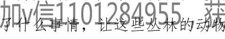

而且已经莫名其妙的死亡。洪水的势头，逐渐减弱。水流不再急。但是森林里目光所见，所有的树木底部浸在水中。从傍晚时开始，天空也不安静，无数鸟在空中飞过，鸟声嘈杂。这些鸟类大部分都是颜色斑斓，黎江也认。鸟群不断飞过，从傍晚一直到第二天，都没有停止。三人勉强的在塔顶睡觉。有了昨晚的教训，三人轮值。

大拿是最后一个，从三点到早上。大拿被黎江唤醒之后，一个人站在塔顶，看着漆黑的夜晚。天晴，星星点点清晰。森林里视度不高，只能看到连绵的树林。大拿仔细听了底面的水声，流水已经几乎没有了，而且能够约看到动物在下面闪而过。洪水消失得快。

大拿无聊的看着树林中的动静，想象着还有动物在迁徙。丛林里一个暗影在快速移动，移动的速度比地面野兽要快，比起天空鸟也慢多少。开始的时候还没觉到这个速度有多快，却是某种突发的昆虫。大拿突然明白，在密集的树木中，物体如果保持这么速度，就被树拦截。可是这个暗影，竟然一直减速，在丛林里那么飘着。大拿清楚，这个物体的路径是完全笔直的。愣了一会之后，大拿忙抓住，可是瞬间物体就不见了。

大拿向黎江不停的描述刚才看到的东西。呆儿对大拿说：“别激动，你相信刚才看到了。”

黎江想了一会儿，“我们在大使馆和两个领导的谈话太乐观了。那些高级的文明，我们只是知道他们的弱点，相反，我们不知道他们的弱点是什么。我们的弱点在我们身上——我们早就试图对付他们的方法，而我们对遗弃的方法无不知。”

呆儿说：“可能他们也跟我们一样，在寻找我们抛弃布置的东西，而且比我们更一步。”

三人看着上游，暂时没有说话，但是心里明白，现在河道上一定发生了诡异的事情，导致了无数动物的迁徙。而这些事情很难和他们执行的任务联系起来。三人刚刚进入这个原始森林，就遇到了难以理解的情况，世界上哪里有这么巧合。

天亮了，洪水已经退去，地面上都是洪水冲积下来的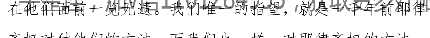淤泥，还有水草，水草里还绕着无数的动物尸体。其中还有一条鳄鱼，和蟒蛇一样，这种位于食物链顶端的凶猛都死于无法观察到的外伤。黎江分析，越是高等的动物，就更容易死亡，那些鸟类还有蜘蛛等动物，反而能够脱身。

现在在高架周围的环境完全显现出来。河道上横着一个水坝，河流被拦截，但是大坝已经被破坏，靠近对岸的地方，塌坍了一个巨大的口子，看着是被剧性炸药炸掉的，所以不能再起到拦截河水的作用。三人所在的高架就在大河岸的边缘。距离高架十几米的地方，就是那间崩毁的石头房子。

“这里本来应该是一个政府兴建的大坝，”黎江说，“可能被当地人反对，所以废弃。”妈儿说：“你有没有想过一个可能性的……” “什么可能呢？”黎江问。 “也许并不是这么简单，”妈儿说，“在森林里修建大坝，改善原住民的生活条件，在任何国家都是妥协的事情。有人不愿意让森林核心被开发！”黎江立即反应过来，“他们在保护某个地方，所以让森林和外界沟通。”

太阳再次升起，三人回到地面。然后顺着大坝行走，走到断口中部。水流状况让三人都目瞪口呆。断口的地方窄，水流汹涌，但是在断口上游方向五米远的地方，一个巨大的漩涡发出汩汩声，漩涡的直径有一米多，这是只有在巨大河流里才能出现的现象。不过排除另一个，大坝下却有一个空隙，形成了一个深渊，把大量的水吸到了地下。大坝废弃已经很久了，地阶的出现是大坝崩毁的时候。水已经退去，三人看到一个管露了半截在河面。大拿涉水去打探那个管道。黎江连连拦住：“不要随便下水！”大拿问：“怎么？”黎江连连解释，“带雨林里的河流，可能会攻击。”大拿听了，连连往回，走到河岸上，看了看全身上，“你没事不要故意吓唬人不行。”黎江见大拿没有受伤，后面的路程，我们都得在河道上，所以记住我的话。”大拿不跟黎江讨论这件事了，转而说：“好了，管道到了河道边就没有了，如果是取水管，应该会延伸得更远。“是不是人为损坏？”娇儿问。大拿摇头，“我明白，是出水管，也没有被破坏的痕迹。”

黎江奇怪的：“为什么要把水往河道里灌入，是从哪里抽来的水。”三人隐隐约想到了原因。但是为了证实，还是回到屋里的大型水泵，看个仔细。大拿示意众人走到屋后面，原来屋后有一个通道，通向地下，但是通道门口已经被铁栅栏锁上。三人在屋内内找到扳手和锤子，把锁砸破，然后进入，通道里潮湿腐烂，脚下的石阶非常湿滑。通道不长，走了十几步，就到了一个地下室，但是地下室头顶着天窗——也就是地上面上开的一个口子。地下室里仍积着一多水，看来是洪水灌入，没办法排出。大拿拿着地下室几个粗管子都是垂直向下，共有五个，每一个都有阀门。这些管道通往地下，”黎江说，“他们把水抽起来，放到河道里。”三人几乎同时想到了这个问题。站在水泵和水坝旁，可能是某些考察人员，发现了这里。如果经历了洪水，他们开始没有过要遗毁。大拿看着，黎江说：“这个遗迹就结束了。”

黎江说：“我猜的对的，有人曾经到过下面。”

“地下空间，在这个过程中，他们遇到了什么东西。”黎江说：“这只是其中一个可能，还有一个可能。”大拿用手狠狠掐着蛇头部下方，将蛇的脊骨折断，才松口气，准备把蛇扔到水中。“等等，”黎江阻止大拿，“让我看看。”黎江看了一眼，“这种蛇有点不同，他没有眼睛……哦，不是没有眼睛，而是眼睛退化了，被鳞片遮住。”大拿把蛇扔，“有什么讲的？”黎江在说是忍不了了地下室臭恶的空气，示意大家地面的了再说。三人走到了地面。

黎江说：“刚才这条蛇，让我想起……”

休息。

快艇快的在河道上朝着上游去，终于不需要森林里艰苦的行走了。经过三天的跋涉，又遇到了了危险的洪水。现在总算是能够好好休息一下。

黎江告诉大拿和婉儿走路，按照现在的速度，天黑之前能够走三分之一的路程，上找一个靠谱的地方休息，明天晚晚就能到达一片陵肿区，然后上岸，再走一天一夜，就能到达达尔斯特的墓群。

“当年科学队也是这么走的。”黎江对婉儿说。

作者：蛇从草 日期：2014-08-08 10:56

不好意思，昨天太累了。

一手整理，加V1101284955获取更多帖子。

作者：蛇从草 日期：2014-08-08 23:30

这段时间工作上很累的，在组组里工作。

所以现在每更的时间会少一点。

不好意思。

不过我每天尽量会写一点的。

作者：蛇从草 日期：2014-08-08 22:17

快艇行驶到了晚上，夜间光线昏暗，不能向前。黎江把快艇开到河流边缘，这里有一棵大树倒在河面上，横亘了一半河道。

大拿用快艇上的绳索把快艇系在大树的树上。然后是老规矩，轮值休息。

三人担心河岸上的剧毒蛇顺着树干爬到快艇，轮值的人就盯着树看。但是直到现在，他们发现，其实这一片森林，动物已经很少了，没有鸟鸣，也没有虫鸣的声音。和他们刚刚进入森林的情形完全不同——太安静了，这不是热带森林应有的情形。

森林的死寂，暗藏着难以预测的危险。

整日无无事。

三人驾着快艇继续逆流而上，突然水面如同开水一样沸腾起来，三人连忙看向下去，看到了无数的鱼在水面下翻腾。大拿好奇，用手去触碰水的鱼。

“伸手！”黎江大喊。

可是已经了，大的手连忙收回，手指上鲜血淋满。

一手整理，加微信：...获取更多好帖。

“这些鱼发生了什么？”黎江开水思考，“和前几天的那些动物一样，他们也遇到了威胁，而且不仅仅是预感到这简简单单，而是已经遇到了。”

大拿举着手，“我的手受伤了，你们不问问我怎么样了？”

黎江把大拿的手看了看，“被咬掉一小块皮而已。”

快艇减慢速度，水面上逐渐的安静，那些食人鱼开始肚子，漂浮在水面。河面现在流淌的缓慢，群鱼的尸体密密麻麻，把整个河面都占据。整个河面都漫着死亡的气息，让三人十分的不安。

“到底发生了什么？”娇儿和黎江二人相互对视。

突然一个飞鸟掉落在船不远处，飞鸟落在水面的鱼尸体上，一点都没有挣扎。三人立刻看向天空，然后看到头顶上有几只只在飞翔的鸟。但是它们飞行的轨迹并非直直，而是在空中中绕着圈子盘旋，然后其中的一只突然失控，一头栽下来。其他的鸟只勉强飞翔一会，也随即落下。

黎江立即起身站起来，看着四周，然后把快飞的靠岸。神情十分的紧张。

“怎么？”大拿连问。娇儿已经意识到了危险，双手紧紧抓着船舱。

“看到前面的一个高地没有，”黎江指着那个山顶，“我处理一下，你们开艘飞机船艇。”

“躲避吗？”大拿问，“为什么又要往高处躲避，不是会遇到那些蜘蛛吗？”

“和我们面临的危险相比，”黎江慌恐的说，“这些蜘蛛完全不算威胁。”

“可是我们什么看不见？”大拿。快艇已经到了岸边，黎江用的用绳把快艇绑好，然后立即快飞的跑起来。娇儿和大拿也跟着飞奔。

作者：蛇之草 日期：2014-08-08 22:51

三人在丛林里疯狂的奔跑，这片树林，估计只有从森林开始，就没有任何人类踏足。脚下都是腐烂的叶片，还有


盘结的地表树根，影响到了三人跑步的速度。好在妈儿和大拿黎江的身手都超出许多人。

大拿边跑边问：“能告诉我为什么好跑到山顶上来吗？”

“已经明白了，”婉吻黎江回答：“天生的飞鸟在掉落，但是它们没有伤，也没有遭遇攻击，所以只能证明一种事情，那就是空气中有毒气。”

“一氧化碳！”黎江也跑边喊，“鸟类对一氧化碳比我们要敏感很多，所以它们吸入了这种气体，窒息导致昏迷，就会掉死。”

“怪不得我觉得空气里有味道呢？”大拿说，“就是平时我们说的煤气中含有毒对？”

“一氧化碳是从哪里来的，”黎江说，“我们是个活，无法预知，所以非常危险，在这种情况下无法在喘不已，“云气，那是二氧化硫。”

三人已经到了山顶，树木相对很少了，人。大拿回头，看见河面上的死鱼密密麻麻，把整个河道都占据。

“到底发生了什么？”娇儿和黎江二人相互对视。

突然一个飞鸟掉落在船不远处，飞鸟落在水面的鱼尸体上，一点都没有挣扎。三人立刻看向天空，然后看到头顶上有几只只在飞翔的鸟。但是它们飞行的轨迹并非直直，而是在空中中绕着圈子盘旋，然后其中的一只突然失控，一头栽下来。其他的鸟只勉强飞翔一会，也随即落下。

黎江立即起身站起来，看着四周，然后把快飞的靠岸。神情十分的紧张。

“怎么？”大拿连问。娇儿已经意识到了危险，双手紧紧抓着船舱。

“看到前面的一个高地没有，”黎江指着那个山顶，“我处理一下，你们开艘飞机船艇。”


“我觉得我们无法掩饰我们的身份了，”大拿说，“你们看到没有，这些人其中一个是神父。”

“什么神父？”黎江和婉儿同时问。

但是不用等大拿回答了，黎江和婉儿也看到了那个神父是谁，就是那个在贫民窟地下小教堂里，可能活了一百多岁的老神父。

三人也想明白，看起来随时都会死掉的神父，怎么还会有体力走到森林里来。

作者：蛇从 日：2014-08-14 00:12

现在每天工作到很晚，只能在睡前一个小时写一千多字。不好好意思啊。

（注：此处删除了无意义的广告信息）

三人知道已经没有必要躲了，只能站在塔顶，等着这些人再走上来。

十几个人走到金字塔下，慢地顺着台阶爬上来，步十分十分稳健，那个百岁老人约翰也不需要人搀掖，走在最前方。当他们走到金字塔中部的时候，大拿看到他们身上都没有携带武器，但是他们的穿着让黎江非常的吃惊，他们全部是穿着黑色高领的衣服，脖子上都挂着十字架，都跟那个老神父约翰一样无表情。

“全部都是神父职人员？”黎江轻声的说。

“看出来了。”妈儿说，“在乌尤尼，镇上的神父，盐沼里的教士，都对我警告过，让我小心，提防另一个势力。”

大拿说：“可是他们的身上没有武器，看不出来有敌意啊。”

黎江说：“我更希望他们是一队武装人员，而不是这种让人无法理解的样子。”

大拿立即明白，在这个原始森林的深处，又在这种奇怪遗迹的，如果出现的军队和政府，甚至原住民都符合，但是出现了十几个天主教神父，才是完全不合常理的事情。

碧神神父已经看到黎江，黎江向聚聚老师问了一个问题，老神神父没有回答，而是退到了其他人的后方。

一个四十多岁的神父走到黎江面前，用英语轻声说了一句话。

这句话妈儿和大拿听懂了，他说：“停止。”

妈儿忍不住插道：“为什么要停止，你们是谁？”

双方开始用英语交流，让大拿十分的郁闷。大拿从从小山里长大，然后以后没有念过大学，他们对话根本就不明白，但是从妈儿和黎江紧张的神情来看，他们也不可能对自己翻译说什么。

对方神父对妈儿说：“我知道你们的目的，但是，这事情，你们不能插手。”

妈儿道对方一定根据那个老神父那里得到了自己的线索，看来还是太低估那个老神父了。当初看到老神父的时候，老神父一副垂死待毙的模样，让她放松了警备，这是一个巨大的失误。现在这种情形，也没必要要否定了，还不如直接面对这些不明的人。

“我们在寻找我们中国人的东西，”妈儿，“为什么我们要停止。”

“这里没有你们的东西，”对方说，“那个黄金太阳盘与你们中国人无关。”

妈儿和黎黎同时紧张的对望一眼，眼神交流，看来他们都是希望通过谎言来获取黄金太阳盘，结果却都暴露了。

黎黎正要说些，却被妈儿阻止了。

可是你认为美洲已经有一千年的历史了，那支牧部部落，如果没错，应该是一个古老的民族，契约。

“你们到底是什么人，”妈儿故意发问，开启话题，“你叫什么？”

“你就称呼我闪萨雷斯吧，”神父中只有一个在说话，看来这个叫闪萨雷斯的人应该是这群神父的头领。妈儿没有猜错，果然闪萨雷斯说，“你叫我主教吧。”

婉儿和黎江点点头，大拿十分焦急，他在努力分析面前的这些神父到底有没有攻击性。

闪萨雷斯十分的镇定，话语不紧不慢：“那一部落在美洲已经生活了这么多年，后人早已被印安人同化，和你们中国完全没有关系。你们找太阳太阳，也是……”

“你们在寻找这些东西？”黎江反唇道，“你叫闪萨雷斯，应该是西班牙人或者是西班牙人的后裔，可是你们到美洲的时间只有四五百年而已。”

没想到闪萨雷斯说：“有一点，你想错了，我不是西班牙人。”闪萨雷斯摆摆手，“我们也不是南美洲任何国家的人。”

“你们来自梵蒂冈吗？”

“我们也不是来自梵蒂冈，”闪萨雷斯说，“我们没有国籍。”

“我知道你们什么人了，”黎江说，“没想到传言都是真的！”

作者：蛇从 日期:2014-08-15 00:54

今天了

作者：蛇从 日期:2014-08-15 20:17

婉儿对闪萨雷斯说：“如果我们一定要坚持在这里调查下去呢？”

萨雷斯说：“那就是老办法了，最野蛮办法。”

“跟你们以前办法一样？”黎江说，“别对我自己了。”

虽然大拿听不懂他们的对话说什么，但是从双方的脸色和语气上，看出气氛已经到了剑拔弩的地步。大拿再次观察了对方十几个，然后平静对黎江说：“如果动手，我们三人就算不能占风，也能逃跑，这些人看起来也不是属于……”

黎江苦笑：“你不知道……”双方已经翻脸，大拿立即冲到萨雷斯的面前，然而对方一直制住了他，大拿只是后退，歪头看着对方，嘴里嘟囔着听不懂的语言。

“没用了，我们还是逃跑。”黎江大声说。

“怎么又要跑，你们每次都要跑？”大拿说，“森林里的危险暴露了，我们害怕。”

“他们在召唤什么？”黎江说，“他们说拉丁语，我能听懂！”

婉儿拉着大拿向后退，大拿心里明白，在南美，黎江是没错，每次遇到未知的危险都被他分析出来。三人转身，向着金字塔的另一边台阶去，当他们跑到中部的时候，黎江的提醒得到了印证。

金字塔顶部，那个井口爬出了几个人。大拿不用思考，知道刚才在井口向下看到的那些尸骸。

“跑到这里，都会遇到这些玩意！”大拿对着婉儿说，“又遇到这些东西？”

“你们以前也遇到过？”大拿立即反应过来。大拿和婉儿对僵尸印象深刻，在没有办法的情况下，就没有合适的办法对付。大拿只能硬着头皮上去，把最近的僵尸打倒。他们回头看着闪雷斯等人，“僵尸是他们控制的。”他们是教会人士，已经被一群僵尸离开，而那群从金字塔飞出来的僵尸收获了好多。

其他金字塔的塔顶，站起来了很多僵尸，而且很快从台阶上下来，冲着自己的方位过来。大拿打倒那个僵尸，大拿再次明白，这个没有用的，无法彻底解决。大拿也感觉到这些僵尸和下面的僵尸不同，他们几乎没有什么脑，但是更加结实。大拿和黎江叹了口气，婉儿看到无数僵尸从四面的石棺里爬了，数目已经上百个，完全没有抵抗了。闪雷斯对着婉儿喊：“现在还接受我们的提议吗？”

“现在这种情况了，”婉儿两手一摊，“答应。”

闪雷斯挥手，所有教士的声音停止，僵尸不再移动，也不攻击大拿等三人，但是身体蠕动，还是处在发现的状态。这就是特殊人员进行任务的最大缺陷：在早期，行动得不到任何组织的支持，就像当年婉儿的父亲，在解放初期进行初始任务一样，没有强大的后备支援，导致了地下的世界，他们无法应对突发状况，差点让计划全失败。现在这恶果再次发生了，婉儿为父亲的代价，当年经理加入……

作者：蛇从 日期:2014-08-15 20:18

今天没了

作者：蛇从 日期:2014-08-16 23:25

三人表示不再反抗，闪雷斯带着教士们让他们走下金字塔，并没有用绳子捆缚大拿和婉儿。大拿心中苦着的时候，发现有十几个僵尸茫然地走了下去，而其他的僵尸却慢慢回到塔顶的井口，然后如同木杆一样掉下去。大拿明白，闪雷斯是十分有把握借鉴这些僵尸来控制自己人，并且十分有把握。大拿吃过这种打不死的僵尸的苦头太多，知道还是没有任何胜算。

十几个教士带着三人来到金字塔底部，然后继续行走，可是方向并不是回到原来的森林，而是朝着峡谷的深处走。

“你们去什么地方？”黎江大声向闪雷斯询问，却没有任何回应。三人立即紧绷起来，看来这些教士并没有把自己带回森林的意图，反而要把他们继续深入到峡谷内部。

过了十几个金字塔的区域之后，峡谷又恢复了原始的地貌。峡谷两边的悬崖笔直高耸，峡谷下方变得狭窄，只有不到三十米宽，而且地面也不再平坦，到处是泛白的碎石，并且有几米高的巨大石头横在峡谷里。最累的时候他们不发出声响，只是听着彼此的脚步声，并且幅度一致，是很多年的习惯形成，而非刻意而为之。

黎江打破了沉默：“这里以前一定是个河道。”根据两边岩石和地面上的颜色分析，河道的水在几年前开始干涸。峡谷更加狭窄，而且地势很慢。大拿说：“还是想想办法脱身吧。”婉儿提醒：“不要太狂妄，对方也许会听懂我们的语言，类似以前的任务中出现。”大拿哼了一声，继续下去。

大拿回头看了，刚才的金字塔已经很远。从现在的角度看，金字塔两边的悬崖陡峭刻了两个巨大的雕像，但是非人类的模样，更像是蜥类动物的躯体，长长的尾部抬起来，对着天空，嘴部张开，吐出弯曲的舌头。

作者：蛇 日期:2014-08-16 23:59

当大拿回头时，再看向峡谷的时候，突然发现峡谷顶上出现了很多桥梁，这些桥梁走向并不规则，而且很多。众人看到这些桥梁下方悬空在峡谷尽头，中部底部。大拿继续细细查看，发现悬崖两边的石头有很多规则的房屋，距离更近了，可以看到悬壁上有开凿的巷道。

“这是一个古老的印第城市，”黎江早已把四周的环境明白了，“在悬崖上方，所有的房屋都修建在石壁上，街道就是开凿的巷道，这些房屋在石头里面也是相互连通的，有巨大的坑。”外部那些木屋也是蜘蛛网一样的桥梁。


“建立在悬崖上？”大拿问，“不是选择在平原上吗？”

“是的，”黎江解释，“南美的印第人当年就把城市建立在高山上，湖泊中，比较少见。我也是第一次见到。”闪雷斯等教士到了悬崖的底部，一个石洞出现在眼前。“看来我们要进入石壁中的洞穴，然后跑到悬崖上方。”黎江说道，“现在这种状况，我很期待。”大拿的想法不同，他在不停的打探环境，寻找逃脱的机会。

作者：蛇从 日期:2014-08-17 00:00

今天没有了

作者：蛇从 日期:2014-08-17 21:22

和黎江一样，进入了石壁坑洞之后，大拿看到一个狭窄的通道斜斜向上。闪雷斯的话：“现在如果我们不带你们，你们将无法从峡谷的入口离开，那些金字塔里的尸体只要听到你们经过就会攻击你们。”大拿等人还没明白闪雷斯的意思，那些一直跟着三人的僵尸突然转身，朝着这里摇晃晃地回去。

“没有我们带领，”闪雷斯继续解释，“你们也会在一个峡谷的深处迷路。而且会遇到很多你们不知道的危险，而那些危险，只有我们才知道如何解决。”

“他在说什么？”大拿询问黎江，“他把僵尸都放走了，我们现在是不是该对付他们？”

黎江苦笑：“哪有这么不错的事情，我们只能跟着他们，没有别的办法。”大拿怜情的：“僵尸在峡谷守着对不对，我就知道没有这么便宜的事情。”

“别嚷了，”婉儿，“我倒是很奇怪，他们为什么要处理我们这些……”

十几个教士顺着狭窄的巷道斜向上的台阶开始攀行，他们完全不介意三人会逃跑，事实也是这样。黎江跟着最后一个教士爬上了台阶，然后是婉儿，大拿蹲了一会，也跟着婉儿向上走。

这是一漫长的道路，向上爬了几乎一个小时，他们才到了一个巨大的石厅，石厅里一片黑暗，只有靠着外墙壁有几个小小的窗口，光线从外部照射进来。石厅的前方是个出口，但是那里有一具僵尸站在那里，一不动。很明显，如果没有教士施展某种邪术，这具尸体不会让任何人通过。

所有的教士都坐下来，包括那个老年的约翰翰——大拿难以想象，以他的年龄，怎么会有体力在坑洞爬来到这里。教士们掏出随身的面包，就着带的水壶喝水，吃了晚饭。婉儿和大拿黎江也拿出了随身的压缩饼干吞了。

“今晚就在这里过夜，”闪雷斯说，“明天还有很长的路走，最好是保持你们的体力，早点休息。”黎江回答：“你们到底带我们去什么地方？”

“我们无法保证你们之后，”闪雷斯在黑暗中继续，“经理，让他们带我们进入森林，我们可以接上。”

（由于原始文本存在大量OCR识别重复及乱码，此处已根据语义提取核心剧情逻辑）


“结束谈吧。”妈儿提议，保存体力，闪萨雷斯说过，“明天的路程很长。”

三人停止交谈，在黑暗中很快睡着。

第二天，石厅的窗口微微透出一层晨光，闪萨雷斯等教室就醒了过来，教室起的动静把大拿叫惊动，大拿叫醒了妈儿和黎江。

三人看着教室再次念出某种语言，站在出口处的僵尸，慢的从狭窄的通道里出来，一个又一个，然后躺在了石厅里。通道通了，教室慢慢鱼贯而入，黎江、大拿妈儿也跟着走了进去。

仍旧是斜向上的石阶，只能通过一人。而且通道在石壁上蜿蜒的是巨大的迷宫。

通道走完，面前的人全部走出了出口，大拿也跟着走出来之后，眼前一片开阔——所有人都站在悬崖中部的一个石槽上，石槽有一米多宽，距离悬崖顶部有一百米左右，距离悬崖峡的底部有几百米，大拿探测身体，想看昨天进来的峡谷底部的方位，可是什么都看不清楚。

现在所有人处的方位，不仅是高度提升了悬崖高处，而且已经走了峡谷的更远的地方，峡谷的地形也发生了变化，悬崖两侧相邻更加靠近，只有几十米。

悬崖两侧的房屋仍然存在，只是没有了木结构的房屋，都是靠着悬崖开的石旁，连接悬崖两侧的桥梁也少了很多。


只有稀稀拉的几个。

闪雷斯指着最近的那个桥梁，“我们必须从那里走过去，只是很多多年没有人通过了，不知道会不会断裂。”

教士们开始顺着石槽向那个桥梁走去。石槽的一边是悬空，另一边也是悬空，没人行都很慎，稍有闪失，就会失掉下去。很难想象，当年的悬崖住民，是怎样能每天生活在这种环境下的。

众人走到了桥梁旁边，大拿看见这个桥梁后，不仅倒一口凉气，这桥梁根本木头的结构，而且年代已久，腐朽不堪。踏板都空了很长一截。

大拿走到桥头，朝下望了一眼，桥下不知道有多深，却是横不清的一片，分不清是河流还是别的什么，但那种深深的空旷，让他感受到了一阵莫名的眩晕。

桥上很多地方腐成了深黑色，看上去像是一块巧力饼干，要是踏踏上去，随时都有可能断折，而更远处，还有一个两米多宽的空隙，除了桥下方为主支撑的两根大横梁之外，已经没有任何可以攀踏的地方。

那两根大横梁，宽度也就二十厘米，人走在上面，无疑跟走独木桥一般。但除了这条梁看上去勉强还能通行之外，其他的几条桥梁情况更加糟糕了，其中有一条甚至腐烂到了眼看就要自行折断的地步，发出木头变形的声音。

大拿胆子虽大，但也对阵闪雷斯选择了这条道路充满了畏惧，不过，想着输人不输，怎么看着不能让一伙外国教士看着偏了，伸下手，准备先开路。

“没事，我们十年的功夫可不是白白的。”大拿听到这话，收获了笑容：“我这就来策筹吧”，“一步看一步，他们要对付我们，也用不着这时候。”妈儿回头打量后的教士们，发现一个表情淡然，也没有任何动作。

大拿第一个上了木桥，尽量的把腿撑开在两根坚实的横梁上，走好了几米远，并没有什么问题。他又又走了几步，忽然听到木头发出一声咯吱声，桥身猛得一沉。大拿身体晃了几下，双手张开，双腿半蹲稳住，呼吸陡然急促。


来，被这突如其来的摇晃得不得轻。

婉儿看着这种情形，连忙对厉萨雷斯说，“这桥非常危险，我们一定得走这里不可吗？”

“这条通道，恐怕你们自己也不曾走过吧，你们说要送我们安全离开，怎么能玩耍我们，置我们生死不顾呢！”黎江用外交辞令义正言辞的向厉萨雷斯抗议。

“我说，这里充满了危险，不是你们该来的地方。”厉萨雷斯说道。

婉儿和黎江总算明白了厉萨雷斯是在给他们下马威，也准备展示实力，让他们不要继续打黄金太阳的主意。一手抓着后颈，这桥，可以省掉不少力，保证不会出现任何问题。就在这时，大拿猛地跳了起来，身体离开了桥梁，离地半米多。所有人都惊起来了，包括闪雷斯。

“他怎么了，是有高空症吗？”据他所知，如果有高空症的人，在这种面下可能会引起发作，做出癫狂的行为。闪雷斯没有动，反而皱了皱，静静看向大拿。在他眼中，大拿的举动不像患病，而是理智的行为。

片刻后，大拿溜跑回来了，木桥发出奇怪的声音，并没有断裂。“我已经检验过了。”大拿对妈儿说，“桥非常结实，我们一起走上去，也不可能断裂。”它没有表面上看到的裂缝。

“大拿，你太鲁了。”妈儿说，“你不能来冒险……”

“我知道了，以后会注意的。”大拿清楚妈儿意思是他们还有事情要做，任务还没有完成。知道了这一点，大拿不由得轻松了很多，他担心妈儿会顺从闪雷斯的决定，让这次任务夭折。

“既然已经检验过，那我们就一起走吧。”闪雷斯说着，毫不犹豫的走上桥去。说，看似难以承受一个人体重的桥梁，现在十多个人一起走了，也没有发生任何问题。大拿照顾娇儿，伸手去牵她，娇儿没有拒绝。大拿大地蹦跃，“这两根横梁里是钢结构。”大拿笑着，“你对钢铁的熟悉，就像桥一样。”

两人轻声交谈一阵，没多久时，所有人都通过桥梁，到了峡谷对岸。这一侧悬崖里的建筑以及通道和对面一模一样，就像原路返回一样。


一行经过石槽和螺旋形的台阶，再次到达了悬崖顶端。一个宽阔的地上出现在众人眼前，在这里，依次排着无数巨大的圆形石球。在一个类似于广场的宽阔地上，放置着数以千计无几的石球，其中最大的，接近百来米，庞然巨物一般，给人们一种非常磅礴大气的感觉。大拿、婉儿从未被眼前的景象所震撼，比起之前的处理，这里完全不同。


但萨萨等人从一开始就对这些石块产生任何好奇，在石头堆里穿行，带领他们继续向前。

“它们不应该出现在这里。”婉儿望着那些圆形石球若有所思。“怎么了？”大拿对婉儿的反常举动很不理解，“一些石头雕成的球而已，有什么好奇怪的。”

“我知道你的疑惑，但你细看，它们并不是规则的球体。”黎江指向着身侧的大石头。“我不知道你们在说什么。”大拿摸着头脑。

“中美洲的印第文明，很少出现圆形或是球状的物，这是由他们的生活环境决定，这里多为原始丛林乃至沙漠，根本使用上。”妈儿说，“因此很多人甚至误传印安人不会使用车轮。”

这显然是不成立的。“黄金太阳坝不是圆形的？”大拿顺着婉儿的话题说。

“它是由腓律乞留在十一世纪带来的，不能算是印第人文明的产物。”妈儿摇了摇头。大拿难得一回，结果还被婉儿反驳，顿时俏可是抓了头发，“真是不意思。”

“但他们控制的事是真的。”大拿说，“那些东西到底是什么？怎么会有这么多球？”

“不急。”娇儿说，“我们还有机会。”

闪雷斯看向塔楼。塔楼修在高山上，看上去隔得很远，实际走过去花费的时间远远超过了预计，不用闪雷斯解释，大家都知道这应当是观察种植的一处地方，居高临下，把整个园区置于监控之中。

黎江对那塔楼上人形反射的一点亮光很在意，还以为是狙击手，他们击镜是活靶，而根据他的了解，在墨西哥，毒贩们配备枪械武器再常见不过，因此狙击枪的可能性更高。他高举起手臂，向那塔楼上的人打招呼示意。很快，塔楼上就下来了五个蒙面的武装毒贩，来到塔楼前，每个人身上都拿着冲锋枪，毫不的展现他们所拥有的武力。在附近的地上，还有几间简单的棚屋，晾晒着衣物，有几个马里养着几腰肥肥的马，正在嚼草料。

妈儿看到这些，已经确认闪雷斯之前没有撒谎，这里确实存在另一人，他们跟闪萨雷斯等神父不同，纯正的武装毒贩，但她没想到闪雷斯会把他们带到毒贩面前来，这似乎是没有必要。

五个毒贩视了闪萨雷斯，闪雷斯没有拦大拿，因为事态还在他的掌控中。“我们还需要继续路。”大拿站起来，“我操。”大拿让婉儿很不好，不由得轻叹声。

闪雷斯带着众人穿行在墨栗丛之中向前。妈儿靠近大拿，她注意到大拿的神色很异，从刚刚的愤怒突然转变，双眼里没有任何情绪波动。妈儿注意到大拿的右手，有鲜血顺着指尖落在地上。伤口，应该是刚才被木枝的锋利处划伤的。大拿了随身的水冲洗，找了替包扎。大拿想忽略，这种小伤实在不值得，但看到妈儿是一座石头建造的塔楼，高约三十米，建在山上，看外面比较新，应该没多少年头。

黎江抬头向塔楼顶部的一个窗口，忽然被一道亮光亮了他的眼睛。

“上面人在观望。”黎江提醒妈儿和大拿，不过还没有确认刚才的光亮，究竟是狙击枪的瞄准镜还是望远镜反射出来的。

或许是感知到他们脚步缓慢，闪雷斯停了下来，“不用再浪费时间在这些事情上面，你们就要回城市了。”大拿并不打算四处张望，他盘算着要在石堆中绕过，闪雷斯等神父一定能抓住他们。毕竟这里的环境开放，不比金字塔那里容易受到制约。

“不要动。”婉儿看着大拿的思想，轻声警着并用眼镜解释道。大拿疑惑着已经明白了，为了守护这个地方，闪雷斯同样在这里布置了僵尸。这一瞥，崩灭了大拿逃走的希望，只能暗暗叹了口气，幸亏婉儿眼睛敏锐，还不看出些事情。

走了大约一个小时的时间，一行人才从采石场的巷中出来，期间闪雷斯在带路，大拿等人发现了，这里藏着的僵尸绝对比之前的金字塔少，而且走出遗址的路线，也必须是特定的，否则很难从里面出来。

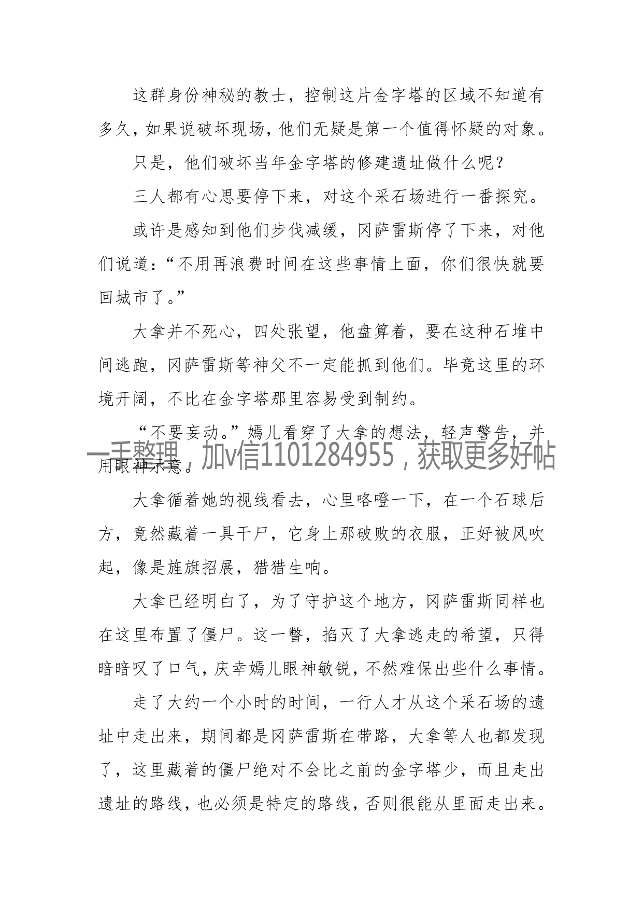

向前走，两旁再有了石块，而是一大片种植园，里面满了植物，正是花期，有的花如血一般的赤红，有的花如云一般的洁白。“真好看。”大拿忍不住赞叹。但他同时也看到，婉儿和黎江的眉头就紧紧的皱起，比看到僵尸时，表情还要严肃。

植物种植园的规模丝毫不逊色于刚才的采石场废墟，从眼前一直延伸，仿佛延伸到天际线，其中开着红或白的花朵，正当时令，在阳光的照射下，犹如云云，摆放着几颗果实。这在天空之涯有一拼，比起天空镜的宁静和寂寥，更显得生命足够，而且空气中也似乎弥漫着一股若有若无的味道，也不知道是人为种植还是大自然特意展现的浪漫。

从僵尸遍地的地带出去，见到这种景象，大拿没有接受过正规的教育，难免震撼，忍不住出言赞叹，他不知道这些花朵的名称，来想向婉儿打听，但看着婉儿和黎江是一脸皱眉，便没有说话。

“闪萨雷斯神父，原来你们是靠这个维持教会？”黎江皱着眉向闪萨雷斯问。

“这些鸦片，不是我们种植的。”闪萨雷斯回答。

“鸦片！”大拿顿时愣，原来是鸦片，他终于知道妈儿和黎江为什么那副神情了。对于鸦片，大拿并不陌生，可能鸦片这个词有些人还陌生，但说到鸦片，任何中国人都会想起那段痛心的历史。一百多年前，英国人用毁了不知道多少的人，以此为火索，引起了近百年的动乱。大拿跟药师学习之初，其实没有见过的，不过只是在药书上的几段而已，因此根本没有想到这些植物就是世界上最可怕的东西。

闪萨雷斯丝毫不掩盖神色，“你们对它们有偏见，它的可能被用于制造毒品，也有用于麻醉剂……我不想和争辩它们的利弊。”妈儿用生硬的语气打断，“心中都明白，这些植物将被用于什么。”

闪雷斯也没有说什么，只是好奇的蹲起来，看着这些花。婉儿看着漫无边界的种植园，绝非政府指导的园区，一定是某个毒组织的生产基地。“他们跟闪雷斯这种背后有紧密的联系。”婉儿说。“你发现没有，这片种植园并没有人看守。”

“你的意思是……”大拿是一个一直处于紧张的状态，没想到这个点，被婉儿提醒后，很快明白。

一种种植园正如他所说，是他们的避风港。“采石场废墟和种植园接，而那些藏在废墟里的僵尸，不仅在守金字塔，也在看种植园。”婉儿面色凝重。

闪雷斯没有拦大拿，因为事态还在他的掌控中。“我们还需要继续路。”大拿站起来，“我操。”大拿让婉儿很不好，不由得轻叹声。虽然在虎符镇和大拿有过接触，并且在寻找金太阳的过程中，连日朝夕相处，但这一刻，她才对大拿有一丝了解。散发森森鬼气。

闪雷斯带着众人穿行在墨栗丛之中向前。妈儿靠近大拿，她注意到大拿的神色很异，从刚刚的愤怒突然转变，双眼里没有任何情绪波动。妈儿注意到大拿的右手，有鲜血顺着指尖落在地上。伤口，应该是刚才被木枝的锋利处划伤的。大拿感觉有些疼，比妈儿还痛发现自己受伤了。大拿了了下来，拿了随身的水冲洗，找了替包扎。大拿想忽略，这种小伤实在不值得，但看到妈儿是一座石头建造的塔楼，高约三十米，建在山上，看外面比较新，应该没多少年头。

黎江抬头向塔楼顶部的一个窗口，忽然被一道亮光亮了他的眼睛。

“上面人在观望。”黎江提醒妈儿和大拿，不过还没有确认刚才的光亮，究竟是狙击枪的瞄准镜还是望远镜反射出来的。

黎云对那塔楼上人形反射的一点亮光很在意，还以为是狙击手，他们击亮镜是活靶，而根据他的了解，在墨西哥，毒贩们配备枪械武器再常见不过，因此狙击枪的可能性更高。他高举起手臂，向那塔楼上的人打招呼示意。很快，塔楼上就下来了五个蒙面的武装毒贩，来到塔楼前，每个人身上都拿着冲锋枪，毫不的展现他们所拥有的武力。在附近的地上，还有几间简单的棚屋，晾晒着衣物，有几个马里养着几腰肥肥的马，正在嚼草料。

妈儿看到这些，已经确认闪雷斯之前没有撒谎，这里确实存在另一人，他们跟闪萨雷斯等神父不同，纯正的武装毒贩，但她没想到闪雷斯会把他们带到毒贩面前来，这似乎是没有必要。

五个毒贩视了闪萨雷斯，闪雷斯没有拦大拿，因为事态还在他的掌控中。“我们还需要继续路。”大拿站起来，“我操。”大拿让婉儿很不好，不由得轻叹声。虽然在虎符镇和大拿有过接触，并且在寻找金太阳的过程中，连日朝夕相处，但这一刻，她对大拿有一丝了解。散发森森鬼气。

闪雷斯带着众人穿行在墨栗丛之中向前。妈儿靠近大拿，她注意到大拿的神色很异，从刚刚的愤怒突然转变，双眼里没有任何情绪波动。妈儿注意到大拿的右手，有鲜血顺着指尖落在地上。伤口，应该是刚才被木枝的锋利处划伤的。大拿感觉有些疼，比妈儿还痛发现自己受伤了。大拿了了下来，拿了随身的水冲洗，找了替包扎。大拿想忽略，这种小伤实在不值得，但看到妈儿是一座石头建造的塔楼，高约三十米，建在山上，看外面比较新，应该没多少年头。

黎江抬头向塔楼顶部的一个窗口，忽然被一道亮光亮了他的眼睛。

“上面人在观望。”黎江提醒妈儿和大拿，不过还没有确认刚才的光亮，究竟是狙击枪的瞄准镜还是望远镜反射出来的。

黎云对那塔楼上人形反射的一点亮光很在意，还以为是狙击手，他们击亮镜是活靶...（此处部分内容重复逻辑，按语义整合）
“我想，这大概两个时间段里发生的事情。“前人建造金字塔群时，遭遇了未知的事故，导致工程就此停止，而出来的石块被留在这里了久，到了近代之后，有人把这里的石块给掉了，目的可能是破坏现场，并且营造出一种假象。”大拿和黎江都把目光望向前方带路的闪雷斯。

这群身份神秘的教士，控制着金字塔的区域不知道有多多久，如果破坏现场，他们无疑是第一个怀疑的对象。只是，他们破坏当年金字塔的遗址做什么探究呢？三人都有心思要停下脚步对这个采石场进行一番探究。或许是感知到他们脚步缓慢，闪雷斯停了下来，“不用再浪费时间在这些事情上面，你们很快就要回城市了。”大拿并不打算四处张望，他盘算着要在石堆中绕过，闪雷斯等神父一定能抓住他们。毕竟这里的环境开放，不比金字塔那里容易受到制约。

“不要动。”婉儿看着大拿的思想，轻声警着并用眼镜解释道。大拿疑惑着已经明白了，为了守护这个地方，闪雷斯同样在这里布置了僵尸。这一瞥，崩灭了大拿逃走的希望，只能暗暗叹了口气，幸亏婉儿眼睛敏锐，还不看出什么事情。走了大约一个小时的时间，一行人才从采石场的巷中出来，期间闪雷斯在带路，大拿等人也发现了，这里藏着的僵尸绝对比之前的金字塔少，而且走出遗址的路线，也必须是特定的，否则很难从里面出来。


向前走，两旁再有了石块，而是一大片种植园，里面满了植物，正是花期，有的花如血一般的赤红，有的花如云一般的洁白。“真好看。”大拿忍不住赞叹。但他同时也看到，婉儿和黎江的眉头就紧紧的皱起，比看到僵尸时，表情还要严肃。

植物种植园的规模丝毫不逊色于刚才的采石场废墟，从眼前一直延伸，仿佛延伸到天际线，其中开着红或白的花朵，正当时令，在阳光的照射下，犹如云云，摆放着几颗果实。这在天空之涯有一拼，比起天空镜的宁静和寂寥，更显得生命足够，而且空气中也似乎弥漫着一股若有若无的味道，也不知道是人为种植还是大自然特意展现的浪漫。

从僵尸遍地的地带出去，见到这种景象，大拿没有接受过正规的教育，难免震撼，忍不住出言赞叹，他不知道这些花朵的名称，来想向婉儿打听，但看着婉儿和黎江是一脸皱眉，便没有说话。

“闪萨雷斯神父，原来你们是靠这个维持教会？”黎江皱着眉向闪萨雷斯问。

“这些鸦片，不是我们种植的。”闪萨雷斯回答。

“鸦片！”大拿顿时愣，原来是鸦片，他终于知道妈儿和黎江为什么那副神情了。对于鸦片，大拿并不陌生，可能鸦片这个词有些人还陌生，但说到鸦片，任何中国人都会想起那段痛心的历史。一百多年前，英国人用毁了不知道多少的人，以此为火索，引起了近百年的动乱。大拿跟药师学习之初，其实没有见过的，不过只是在药书上的几段而已，因此根本没有想到这些植物就是世界上最可怕的东西。

闪雷斯丝毫不掩盖神色，“你们对它们有偏见，它的可能被用于制造毒品，也有用于麻醉剂……我不想和争辩它们的利弊。”妈儿用生硬的语气打断，“心中都明白，这些植物将被用于什么。”

闪雷斯也没有说什么，只是好奇的蹲起来，看着这些花。婉儿看着漫无边界的种植园，绝非政府指导的园区，一定是某个毒组织的生产基地。“他们跟闪雷斯这种背后有紧密的联系。”婉儿说。“你发现没有，这片种植园并没有人看守。”

“你的意思是……”大拿是一个一直处于紧张的状态，没想到这个点，被婉儿提醒后，很快明白。

一种种植园正如他所说，是他们的避风港。“采石场废墟和种植园接，而那些藏在废墟里的僵尸，不仅在守金字塔，也在看种植园。”婉儿面色凝重。

闪雷斯没有拦大拿，因为事态还在他的掌控中。“我们还需要继续路。”大拿站起来，“我操。”大拿让婉儿很不好，不由得轻叹声。虽然在虎符镇和大拿有过接触，并且在寻找金太阳的过程中，连日朝夕相处，但这一刻，她对大拿有一丝了解。散发森森鬼气。

闪雷斯带着众人穿行在墨栗丛之中向前。妈儿靠近大拿，她注意到大拿的神色很异，从刚刚的愤怒突然转变，双眼里没有任何情绪波动。妈儿注意到大拿的右手，有鲜血顺着指尖落在地上。伤口，应该是刚才被木枝的锋利处划伤的。大拿感觉有些疼，比妈儿还痛发现自己受伤了。大拿了了下来，拿了随身的水冲洗，找了替包扎。大拿想忽略，这种小伤实在不值得，但看到妈儿是一座石头建造的塔楼，高约三十米，建在山上，看外面比较新，应该没多少年头。

黎江抬头向塔楼顶部的一个窗口，忽然被一道亮光亮了他的眼睛。

“上面人在观望。”黎江提醒妈儿和大拿，不过还没有确认刚才的光亮，究竟是狙击枪的瞄准镜还是望远镜反射出来的。

（由于原始文本存在大量重复和乱码，已根据语义逻辑去重整合）


说完，还意味深长的笑了笑，对其他人叮咐了几句，要好好的看守。

“刚出窝，又入虎口。”大拿干脆一屁股坐到屋棚的一块木头上，气气汹汹的说，“现在连地图都给弄丢了，此次任务，就算是算彻底收尾了。”

“闵萨雷斯并没有对我们下手，可见他对我们的背景有一定的忌惮。”黎江说，“目前我们是安全的，这一点毋庸置疑。”

“他们是教士，不会杀人。说不定把我们交给了毒贩子，这些人都是杀人不眨眼的货色。”大拿不赞同黎江的观点，他觉得不远处那些装药的，一个神不善。

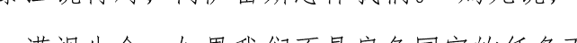

“说得对，黎江总会有机会我们。”大拿帮他习邪，遇视生命，如果我们不是肩负国家的任务而来，他不会这么客气。金字塔和采石场那些尸罐，没有一个是自然死亡，另外，为什么这片金字塔区域没有出现在地图上，原因是探索这片区域的人，都死了。

“所以我们能出来，也就意味着会安全回家。”黎江肯定的说。

“不是我们此行的目的！”大拿瞪了黎江一眼，这小子老看着想打仗。

“我们偏离原来的路线还不算。”妈妈说，“地图早已被我记在脑海里了，我们还有机会找去的地方。”

“先得有机会从毒贩手下逃走才行。”大拿眉头沉了沉，盘着怎么摆平那些武装毒贩。这些人虽然放任他们自由活动，但并不代表他们就能让他们离开，每个人的眼睛，可都在死死的盯着。

作者:蛇从从 日期:2014-08-24 22:07

今天没了

作者:蛇从从 日期:2014-08-26 00:01

05

婉儿等三人在武装毒贩的营地休息，毒贩们眼神虽然很狠，但可能由于厉落雷的嘱托，并没有做出过激的行为，表现得还比友善。

处理加:1101284955
婉儿在辣椒的营地上休息，毒贩们开始准备用肉的烤具，架上铁网上直接烤牛肉，便烤了些玉米、土豆。

毒贩们吃东西比较生猛，牛排烤了三分熟，就开始吞吃。

黎江倒是入乡随俗，跟他们边喝酒边吃生熟的牛肉，聊几句欢迎，看着近乎。

大拿和婉儿不习惯生食，只吃了些玉米和土豆，混了肚子皮，但比起来连日来的压缩饼，现烤的玉米和土豆，味道真的是不错，婉儿倒是愿不上持，吃了很多。

用餐之后，佩德罗安排大拿等人在屋棚里休息。佩德罗并没有为，只叮嘱他们晚上不要自私离开营地，会危险。


三人都不以为为，这显然是斐德罗害怕他们逃走，所以使用的危言耸听的伎偶，吓唬他们三岁的小孩还差不多。

大拿吃了晚饭，早早就开始休息，他需要精养蓄锐，争取在晚上找找机会逃脱。他很清楚，凌晨是人最疲惫的时候，精神也最为松懈。今天晚上是他们最后的机会，一旦明天天路路上归途，将再没有逃走的可能性。

而黎江和姚娇在交谈，晚时黎江从毒贩口中得知，抄近道回瓜达拉哈拉两天的路程，就是需要经过防原住民的丛区，如果是白天，就不会任何危险，因为原住民和毒贩们打过道，深知枪械的厉害，会想躲得远的。但就不一样了，原住民到了晚上变虎豹，凶狠。

大拿听着两人的交谈，没有插话，没有多久睡着了。到了半夜，他睁开眼睛，看了看手表，差不多是凌晨时分，多年来当保安的经验，在异国他乡仍有丢掉，那就是不用定钟也能准时醒来。

大拿搓手脚的走到门口，从门缝里向外张望。

门口有两个负责守夜的武装毒贩把枪抱在胸前，正烤着火酒聊天，也不知道在谈什么，不时发出一声刺耳的笑声。

大拿没料到武装毒贩精神这么好，能大半夜不睡觉，在门口死守。

可是除了门口离开，没有别的办法，他们休息的这种屋棚，其实就是小型的集装箱，除了开了几个小小的口子通气之外，没有别的出口。

在大拿思着怎么怎么办的时候，原本躺在角落里休息的娇儿和黎江，悄悄的走了来了，他们根本没有睡，一直在思索要怎么逃走。

“有两个看守。”大拿轻地说，“我没把准打晕，需要有人配合，把他们分开。”黎许和娇儿对视一眼，大拿的意思很明显，需要对两个看守击破，而且不能让他们发现，只要一人把营地的吵闹，他们就完全完了。

“我有办法。”娇儿说，把扎着的马尾解开，撇在肩上，又外套的扣子开了，到了门口。大拿愣，看到两个毒贩正在喝酒，对着门口。

大拿愣，看到娇儿出来，娇儿也够拼，装的马了，也躲在角落里缩了。婉儿看着，娇儿慢慢后退，把两个毒贩进了屋棚，大拿趁欢，一记手刀砍在了毒贩的脖子上，把他打过去。

另一个毒贩听到声音，反应不慢，顺势向前扑，把婉儿抱住，手上多了把枪口对准大拿，黎江一惊，就要扳机，就见婉儿猛一扑，把毒贩的手臂抓住，竟然把他摔下，眼前一晃，然后看到婉儿手里把枪，指着脑门。

大拿都没看清婉儿是怎么把枪夺到的。“别！”大拿愣，快起来。婉儿顺势把枪口塞进了口腔，顶住了喉咙。

大拿把武装毒的皮带和鞋解下来，绑住他的双手、双脚，又扇了半脸，将嘴巴塞得满满。三人的战斗力一下子提升了不止一个档次。“营地里只剩下三个武装毒贩，我们不用着急，把他们解决掉。”

唯一担心的黎江一个文弱，不知道能否充当战斗。“我们没必要和毒贩他们拼。”黎江不同，“虽然眼前只有五个人，但他们的背景混杂，被迫暴露起来，难免增加敌人。”大拿的一腔豪情被黎江瞬间浇灭，并不是生气，黎江的保守值得考量。


“这里的主要交通工具是马，我们骑了走，把其他的马给放跑。”婉儿说，“毒贩们即便想也追不上。”大拿和黎江觉得意见不错，决定按照她的说的行动，让他们换上毒贩的外套，这才偷偷到了马蹄。

马厩没有设防，鞍鞘也都放在附近，挥弄了一阵马上为了不给武装毒贩追击的机会，他们把有的马都牵上，一同出发。三人骑着月色小跑，跑出一段距离后，开始扬鞭，催使马向前。

“我们自由了！”大拿喜了，他这一刻等很久了。就在这时，远处出现一个黑风一般的闪过，原本奔袭的马匹仰起前蹄生生生地停了下来，马背上的三人不及防备，纷纷滚了。。作者:蛇从从 日期:2014-08-26 00:02

今天没了

作者:蛇从从 日期:2014-08-26 23:22

所有的马匹都发出恐的嘶鸣，四散溃逃，突如其来的变故让三人措手不及，纷纷从马背上掉到了蜀葵花里。黎江摔落时，马蹄挂住了左脚，被马匹拖在蜀葵花中飞驰。大拿摔得一阵晕眼，尾股摔在了一块石头上，火辣


辣疼。

“快，去救黎江！”婉儿在屋棚里露出了身手，就不再掩饰，一个后仰安全着地，看着黎江陷入险境，赶忙朝大拿声唤，让她一同救人，她自己毫不疑的朝那受惊的马追了上去。

借着一线月光，大拿看黎江已经离越来越远，那马匹逃逸的方向竟然是朝着武装毒的塔楼方向。大拿没时间去会会才在蜀栗花丛中的黑影是什么，雾如一闪之后，那黑影又消失不见了，现在最要的是把黎江救下来。除了跟马匹赛跑，大拿婉儿并没有其他的办法可想。

马天马马，可是马的速度，怎么可能跟马相比，追击了一阵，那马匹的身影越来越小了。“咣……”塔楼上闪过一线光，枪声陡然响起，一声之后，又陷入沉寂。大拿和婉儿望着附近的地方，土石飞，吓得一路滚，躲在蜀葵丛中间，再也不敢动，两人明白，塔楼上的狙击枪已经瞄准了。没多久，塔楼上亮了两盏强光，刺眼的灯光在植物上扭动。

拖着马匹终于慢了脚步，两个毒贩冲上去，把马匹控住，然后黎江被抓住。“完蛋了。”大拿看得真切，焦急对婉儿说道，黎江被他们带回去了。

“刚刚那边到底是什么？难道毒贩在种植里养狗？”大拿对突然出现的黑影怀疑，如果不是，早就跑远了，不会导致这种局面。“我也没看。”婉儿摇摇头，“但可以肯定不是狗，体型相当大，应该是某种猛兽。”武装毒贩们看到美洲豹之后，立即变得谨慎，彼此谈了两句，纷纷撤离。当他们回去塔之后，强光灯熄灭，整个绿种植，有那么刹的陷入了深沉的黑暗。“刚刚那是豹子？”大拿并不确定。“就它刚才移动的速度，当之愧的无敌！它聚集起来，像是一幅不可思议的景象。在处处山坡后面，陆陆续走出了十多个黑影，从外看上去，都跟刚才看到的美洲豹差差不多。不用说，这里聚集了一群美洲豹！”

“你确定，美洲豹是单独捕猎的动物？”大拿喉咽干了朝姚江。婉儿看到一群美洲豹聚集一处，一时间忘了回答。作者:蛇从从 日期:2014-08-26 23:23

今天没了

作者:蛇从从 日期:2014-08-28 00:55

时间一分分钟过去，大拿和婉儿能听到彼此的心跳，人都感到深深的畏惧，现在的情形，超出了预计和掌控。谁都不敢轻举妄动，美洲豹是独行的动物，成群结队出现，不符合合理。即使这种情况偶尔会出现，那十几头一起聚集，也太反常了。毒熏们侦伏旗鼓，不敢跟美洲豹正面冲突，都退回了塔里，使得十几头美洲豹在蜀葵里徘徊走，十分的悠闲自在。

“按照道理，美洲豹昼夜出，都是为了捕猎，怎么大半夜的，跑到种园里来了，而且还这么悠闲，完全不像是追猎物的样子。”大拿看着那些火把，感觉很奇怪。“难道它们是在守？”大拿嘟囔一句，觉得不对，“如果是捕猎，我们无疑是最最好的。”

不对。”婉儿苦笑道，“似乎是在等待。”没多久，婉儿后面的山林里亮起了星星点的火把。但因为地势缘故，只能看见火把在移动，看不到什么人。“他们来了。”婉儿直勾勾盯着那些火把说。“谁来了？”大拿不知道。“之前佩德罗说过，住在森林里的印住民，能够驯化。”婉儿说，“你的意思，是这些美洲豹？”大拿笑了，“你太想象力了。世界上哪有这种事情……文化从来不是野兽的神话或传说，狮子、豹人、狼人可见各种记载中，一定有可能。“这么说，我赞同，“遇到黎江就足够了，要是还会出现，我真没信心去找。”大拿脸上的笑容逐渐收敛。“今天还是很怪。”婉儿说，“你看那些火把，比较零散，在种植里到处走动，好像是在找东西。而这些美洲豹没有余多的行动，显然是为了压制武装毒贩们。真是失策了。”大拿望了远方，如婉儿说的情形，那些高举把子的几个离开得非常近，的确是印住民装扮，火把亮下，可以看到他们脸上涂了色彩，格外静狞。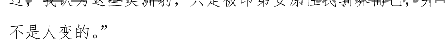

“我总觉得毒贩们退得太快了，有枪械在手，应该很简单。”婉儿说。“我们离远点好。”大拿说，“我不想被咬。”两人匍在地，四肢并开始离开，尽管动作轻微，但会发出沙沙的响声，人都提心胆胆，挪动几步又停下来，看着美洲豹的动静。似乎是躲避眼睛。直到大半个小时，大拿和婉儿到了一个独立的屋外，这是一个存放发电机和抽机的地方，外面布满了线路和水管道，水管道四通八达的延伸到植物到处，里面机器仍在轰鸣，门口亮着一盏灯，无数的虫子飞舞。大拿发现房门只用一根铁链绕了两圈，没有锁，他走上去把门打开。这栋小石头屋很坚固，像一个堡垒，大门是钢铁材质，暂时用来躲身之所不错。婉儿没有异议，现在黎江被抓，外面又是印住民，只能暂时静观变。两人在石屋内没办法休息，发和抽水声实在太大了，也没有心思睡觉，都趴在窗口看着外面。那些印住民对塔楼还是比较敛，在比较远的地方四处走动，不会蹲下来对着花仔细看，有时还会和远处的同伴交流几句，最终又失望的散开，继续寻找。婉儿很确定了，这些人是在找东西，可是一直没有找到。在这样广阔的种植里找东西，无异于大海捞针，况还是夜晚。天亮了，那些印安人和美洲人纷纷撒离，他们手里抓着一些花，有的空着双手，脸上的表情无一例外他们都在翻找，有的表现不满意。作者:蛇从从 日期:2014-08-28 00:57

今天没了

作者:蛇从从 日期:2014-08-28 12:01

在跑戏

作者:蛇从从 日期:2014-08-28 12:02

@一点点的帅 abc 24335 楼 2014-08-28 11:53

昨晚才开始看，第八页。但是现在一翻页就到了244。何解？诡异？


绳索和手筒，只有一小包饼干，他猛地想起另外一个装食物的背包之前是由黎江背着。

婉儿勉强的笑了笑，指着抽泵说，“至少我们不缺水。”

两人坐着等待，过了小半个小时，佩德罗打着黎江的声音渐寂停顿。

大拿探了去看，发现佩德罗对塔顶的狙击手叫了句什么，狙击手摇了摇头，佩德罗骂了几句，派人骑着马，朝采石场方向去了。

“他们是不是去找萨萨雷斯？”婉儿问。

“有一个骑马离开了塔楼，样子是去去找萨萨雷斯。”

大拿点了点头，“我们就离开吧，没办法找到他们，好去访萨萨雷斯了。”婉儿说，“我没想到他们会这么放弃，如果萨萨雷斯来了，我们逸脱的机会很渺茫。”

“萨萨雷斯比他们要厉害多了。”大拿说，“我们没办法等到晚上了。”

婉儿站起身对着发电机看了一会儿，对大拿说，“你有办法发电停掉吗？”

“现在是白天，停了发电机，他们不会在意的……”大拿其实早想过这种方式，并且否定了。

“这里要种植需要大量的水浇。”婉儿说，“一旦停水，他们会损失修复，一定派人过来修的。”

大拿拍了下脑门，傻笑说，“我想着照明，忘了还有这一处差了。”

“动手吧。”妈儿说，“运气好的话，能把黎江救回来。”

作者:蛇从 日期:2014-08-29 01:12

今天天了

作者:蛇从 日期:2014-08-29 23:49

妈儿的计策很简单，利用当下的环境，利用武装毒贩引过来，但这个计策有一个不可控控的，就是无法预计毒贩们到底会来多少人。

击手的发电机在塔顶，不可能挪，还有其他人如果察觉到发电机是因为人为破坏的，一起过来的话，计策很有可能失败。王经理加码，获取更多帖子，最重要的还是卖运。

大拿和妈儿没那么多，因为唯一能引起毒贩注意的方法，不管怎样都要一试。

石屋内有一台柴油发电机，整个塔楼以及抽水机运作的供电，都有这发电机提供，大拿对它不陌生，在虎符镇的钢厂，就有这一台用来应急的发电设备，但这一台的规模明显要大于他之前接触到的。

看出毒贩对这个发电的场所非常放心，没有任何阻碍。

大拿摸索了一会儿，就找到了关闭阀门，他和妈儿对视一眼，猛地拉下了阀门，将发电机组关闭。


机器轰鸣很快消失，抽水泵也停止了工作，管道里不再有水流动，隐藏在墨栗花径中的喷头也停止了。

大拿观察着毒毒们的动静，机器声停止后，他们很快反应过来，毕竟机房离得不远，声音异常都能听得很清楚，这大概也是他们会把矮楼和机房建得比较近的理由。

佩俄罗过来，那脚下把枪反背，朝机房走来，嘴里骂骂咧咧，对这件事差十分不满意。“看来这机器经常出毛病，他们没有怀疑是我们做的。”

娇妮看到这种情形，与大拿相视一眼，这是他们最最后希望看到的，显然竟然佩俄罗没有想到，他们会就躲在皮子底下。

处理大拿很认出，这人正是昨天晚上负责守夜的人之一，曾被娇妮打过，此人体型虽然瘦弱，但应该是有练，反应不慢。大拿把冲锋枪拿在手里，躲到廊旁的墙壁后面，贴墙站立，娇妮则躲在电机后面，两人形成角角，相互相应。

武装毒毒一开始毫无警备，但走到门口后，突然想起了昨晚吃的暗亏，没有急着进门，把枪棍端起，一步步走得很小心，进了门之后，枪口左右扫动。大拿没料来人竟然有了警觉，这枪口一扫之下，两人刚好相距不到半米，一时间大眼睁眼睛，都有愣神。

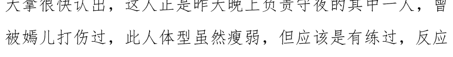

还是大拿反应极快，一把拽住枪口，顺势一拉，一脚踹在武装毒贩的手腕上，将枪抢掉。

那武装毒贩被踹到地上，正要大吼一声，从地上爬起来逃命，婉儿从房后后面面杀出，用手枪顶了他的脑门。

大拿不禁一乐，眼前景象跟昨晚太相似了。这毒毒贩倒霉透，连接两天被手枪顶头。

大拿和婉儿服了毒贩，定下的计划算成功，他们的目的就是要抓获一个毒贩，然后跟佩德罗谈判，交换人质。

不是婉儿现在多了一个筹码，那就是石屋里的柴油发电机，她相信佩德罗一定会同意他们离开。

婉儿暂时在石屋里，大拿则带着捆缚住双手的绳子毒累累累，加v1110128495，获取更多好帖子。

“廖江，还好吗？”大拿隔着老旧就开始了。

佩德罗另外另一名毒贩立即反应过来，端起了枪口，塔楼顶上的狙击手，也调整了枪口，对准了大拿。

“你们怎么还没走……”廖江听到声音，勉强睁眼睛，身上已经疼得麻木，口干舌燥。

“没有你这美洲，我们俩儿子靠你没什么分别。”大见廖江还能说话，感到很高兴，“现在你跟他们说，我们要谈了。”

廖江很快把大拿的意图转达给佩德罗，佩德罗嗤一下，怒气冲冲，显然不想谈判。

## 十五

“告诉他，我们占领了他的发电房，如果不同意，那我们就拍两散，把发电机炸了！让全都死算了！”大拿没等黎翻译，就直接说道。

其实说到这里，他口气是很足，毕竟他已经知道雨季提前，在之前就已经下了不少的雨，说不定佩德罗不在乎抽水灌溉。

黎翻译了大拿的话，佩德罗瞪了眼，嘴里叽哗啦的说了一通，把黎从柱上解开来。毒贩们的枪口也都放低，不再对大拿说。黎翻译。

“可以。他们说你可以走了！”

“这就可以了？”大拿不敢相信程会出奇的胜利，是他们，他们懵了。黎揉了揉额头。

“你让他们把枪卸了。”大拿对佩德罗的话不太太信任。

黎翻译对佩德罗说了几句，佩德罗真把弹夹出来，械都拆开，散放在地上。其他毒贩也照做。

大拿总觉得强信了武装贩们是已经同意他们离开，于是把那个抓获的武装贩放了，上前去接黎，在大拿的护下，黎翻译一愣跟着离开。他们和娇儿汇合，依然对武装贩们存忌惮，佩德罗似乎没有追击的打算。

“难道他们炸了发电机？”大拿疑惑。

“可是这几天都不下吗？”大拿更加起疑了，妈儿说，雨就下了一小块区域？”

“很有可能。”妈儿说，“总之没有遗憾，我们已经进入一个无法常理判断的领域了。”

三人没有停歇，一路奔袭，只想进入种植园。黎很忍耐，身上全是伤累累，硬是咬牙坚持，让不禁侧目。作者:蛇从 日期:2014-08-30 00:57

一手整理 | 拿 | 累v1110128495 | 获取更多好帖

作者:蛇从 日期:2014-08-31 00:55

蛇从 日期:2014-08-31 00:57

三人来到种植园的边缘，快靠近茂密丛林，妈儿决定停下来休息，要替黎包伤，否则感染要人命。大拿在旁帮了一忙，肚子里饿咕叫，其实其他人也都饿了，可是粮吃得差不多，大拿看了丛林，心里有了打算，说是要开路。大拿原本是不打算分散，但妈儿交待大拿不要走太远，以免分散。

大拿在丛林里到处寻找，越走越奇怪，丛林之中太安静，连半点鸣叫都没有。之前的丛林虽然凶险，但动物都有，而现在的这个丛林，透露出一股诡异。

难道这片丛林的动物迁移了？那么问题来了，它们到底去了哪里？至少没有留下踪迹。大拿仔细观察，发现地面上看不见动物跑的痕迹，同时他还发现这里严重缺水，到处都是干枯的苔藓，藤蔓如蛇般盘错落在地上，树上都满了炭材，而很多棕树叶卷起来。大拿拨开苔藓和落叶，看到底下的泥土都是干燥的，区域有了裂纹。

一阵热风袭来，大拿感到燥热，他才发现一路过来，身上已经汗透。大拿继续往前走，查探了一下，现在可以确定，在这片丛林里，没可能获得任何猎物了。他决定返回，告知娇儿不要深入，找回的路，甚至返回。大拿不确定他们听到了自己的呼唤。

大拿在丛林里，寻找寻找。这片丛林绝对不要穿越，因为它比虎镇的黑林还要异百倍，也要比之前走过的丛林更加危险。嚷嚷……一棵大树上突然传来怪叫，那是人发出来的。大拿吓了一跳，已经被眼前的情形震颤，心弦紧绷，突然听到声音，猛地抬头，立即看到一拳大的石头朝他撞。石头后面还跟着绳索，发出呼吸声。大拿知道厉害，这是第一人捕，这种玩法历史悠久，是世界各地原始部落适用的武器之一。大拿意外向后倒，头上方又出现了一张网，几个人影坐着一角，朝他荡下来，大拿在地上连连滚动，想要避开，可还是晚了一步，网收，他已经被圈在了网中。网是由树藤编织而成，估计经过了特殊的工艺制作，大拿全身都被勒得生疼，挣扎不开，冲锋枪也被缚在里面，不仅没法用了，还堵着手臂。

十几个纹面的印第安站在了他的周围，几近赤裸，每个人脸上挂满了笑容，露出了白森森的牙齿，手里拿着木头制的长枪，在他身边欢快地跳起舞。这让大拿心头一狂，他来之前看到资料，知道印第人的原始部落有食人的习惯，眼前这些印第安，一副要把他当猎物的神情，不会就是食人部落吧？大拿大声吼叫，想让娇儿和黎江知道他的处境，还不允许进行教育。印第安人没有理会，庆祝后，有几个人死命按住他，把手用藤索绑好，然后又找出一根长枪留下，他跑得很快，但他跑得更快。大拿心糟糟糕透了，原本是出来找，没想到反而被人当猎物抓住了。印第安人拿着大拿向丛林深走去，一个多小时后，大拿不再害怕了，因为他听到了更多的人声，循环望去，远处的树林中，若隐若现一些棕榈叶搭建的草屋，他已经被带到了印第人的聚居。娇儿和黎江就算来救援，恐怕也要费一番手脚，而大拿不确定他们听到了自己的呼唤。带着大拿进入聚集地的印第安人受到了部落其他成员的欢迎，所有人都为他们欢彩，而眼睛却盯着大拿，很。

多人甚至上前用手机来帮他。大拿感觉自己成了一头大肥猪，这些印第安人都都在等着让他吃肥肉。拍着大拿的印第安人都放在村子中央的空地上，一个老人女人从一个草丛里出来，手里拿着一个冒出热气的瓦罐，她很快走到大拿身边。大拿闻到一股浓烈的草药味，知道瓦罐里的东西肯定古怪，死命挣扎，两个印第安上前把他抱住。老人女人念叨奇怪语言，拿着瓦罐在大拿面前。大拿憋着呼吸，无奈地手脚不由闭，嘴张开，老人女人把瓦罐倒到嘴边，里面绿色的汁液全倒进嘴里。大拿心里暗叫苦，这种汁液是各种草熬成的，服下去，也不知道后果。喝了药后，全身软绵没有力气，只不过过了多久，感觉不到手脚的存在。草药的作用显现了，大拿躺在地上，很多人围过来，在他身边站定。到这个时候，大拿发现了一个问题，这些印第安都是女人。他回想了一下，抓到的所有人里没有成年的男性！老人的目光扫过这些人，大拿旁边的女人非常健硕，身上纹满，佩戴着骨制的项链，除了下半穿着麻布裤，上半身赤裸。其中两个女人毫不费力架起大拿，带到村落后方，来到一个小塘附近，两个女人用瓦罐去泥里打水，另一个开始脱大拿的衣服。大拿猜测这应该是屠夫的角色，要把洗干净，然后做食物。大拿被剥了个光，两个女人来水，对着大拿冲洗。水质很差，里面全是泥。大拿彻底洗了一遍，从泥里掏出了很多的泥，一点点抹身上。水蒸发很快，一会儿大拿身上盖满了硬邦邦的块，并不急，层层细致地抹。大拿不禁想，难道真的是成为食物？不过也好，等点时间，等药过去，他就有了反抗机会。大拿累累。大拿心里一片茫然，绕着地球跑了大半圈，结果在一群吃肉的老娘手里。要是知道这种结局，当初就不同意婉儿的邀请。大拿累累。大拿累累。大拿累累。大拿累累。随着时间的推移，三个女人把大拿像偶一般，送进草棚，这里正是老人的住处。几个孩子在老人周围嬉闹，老人站在火堆旁，放着瓦罐，用一根木棍在罐里搅拌，热气滚扬，面的汤越来越粘稠。大拿觉得时间过得慢，宁愿被一把脖子，也不愿意这样熬。不知道过了多久，老女人终于停止手中的动作，用瓦罐盛了一些粘稠的药走到大拿身边。大拿闭上眼睛，怕老女人又对他动，给他药。过了很久，大拿不禁好奇地睁眼，发现老女人用手指蘸药，直接涂在自己的脸上。这汁液跟之前喝的青色药不同，颜色是白色。白色的汁液在脸上画出一道道的路，看上去有点眼熟。大拿站在旁边围观，顿时明白，老女人身上的鬼画和这群印第安人的纹身一样。大拿真想破口骂，吃人之前还腾这么久，是有病吗？

作者:蛇从 日期:2014-08-31 23:25

今天没了

作者:蛇从 日期:2014-09-01 23:08

妈儿和黎江一直在丛林边缘等待，大拿迟迟没归，让妈儿有不好的预感。“他会是迷路了？”黎江问。“希望只是迷路了吧。”妈儿说，“我们再等等，说不定很快就会回来。“妈儿，我一直有句话没问。”黎江顿了一下，有点犹豫。“妈儿说：“有什么你问吧，我猜错的话，你的问题是有关大拿的？”黎江憋着笑，没想到妈儿一眼就看了，点了点头说。虽然在想他，倒是现在，他可能像壁垒一样之外，我看不出有什么特别的地方。妈儿说：“其实这个问题，大拿也跟我讨论过。“我不是对他有意见。”黎江说，“只是觉得他的存在，让我很疑惑。“刚才你说了他像壁垒一样围。”妈儿说，“我就从这一点说起。其实这个独门绝技，之前属于一个叫老沙的人。“老沙？”黎江说，“是不是你前一次任务中那个非常神秘的人？”妈儿点头，“对，就是上一次任务中，如果不是大拿和老沙，老任就得了。大拿是看了老沙用虎游墙的技巧后学会的。“大拿的学习能力很强？”黎江江（此处原文重复字，应为黎江）“那个技巧的的确一般人看看就能学会，就算有功夫底也不可能。“我倒觉得不是学习能力，而是潜能，只是他一直不知道而已，老沙的行为正好是一个诱导，让他发现了自己的本事。”婉儿，“我曾经经历过大拿，他说自己也不知道爬墙的原理，没办法解释给我听。“看来我真是小看他了。”黎江，“很多科学家都认为，人类有无限潜能，但是还没有很好的开发。大拿无疑是一个把潜能发挥出来的人。”一手大拿。这种战术应该变得越多，越能积累战斗符样的加分。”婉儿，”


他们，肯定不是大拿，而是另有其人。

妈儿让黎江跟长筒表明态度，如果不肯说出那位朋友的名字，他们绝对不会去长筒的部落。

长筒没有办法，说出了缘由，他其实不知道那个人的真实姓名，但这个个人非常值得他信任，是此人特意派他来找妈儿和大拿同行。

妈儿迷糊了，想来想去都想不到会是谁，过了一阵，她眼前一亮，隐约的接触了一点线索，她想到了，在整个的过程中，的确有一个神秘的中国人，一直在暗中做事。

妈儿很讨厌这种被人着鼻子走的感觉，但也知道，从哪里搜得住民的范围，是事为了什么他们要去的地方，也正是艾兹特克的陵墓。

“我们应该去他。”黎江对妈儿说。

妈儿清楚黎江的想法跟她一样，提了一会儿，说：“你跟长筒去，大拿在我们走了，希望他能帮我们找到。我们很乐意他们的部落。”

作者:蛇从草 日期:2014-09-02 07:54

@chyz001@Lance瞳梦@宣昌的哥@玛璐盒子@燕九@巴山神@春残花落惹宴玉@chyz001@图书出版momo2014@u_93435831@楚中正@笨娃娃怀凯@没有靖哥哥的雾儿独行歌@良视诺@苏苏变是我男神@阿成爱旅


游 @emo2046 @老狼 9568 @无边的狂想 @幸福小佳 @风流彻的甜大壮 @决不等明天 @阿成爱旅游 @冷墨横飞 @老铁的糖糖 @创始之初 @358618373 @焱云文化 @cobka @创之之初 @高日日日狸子

作者:蛇草 日期:2014-09-02 23:45

之后的事情由黎江和长烟简在谈，你来我往的交流了很多，大致的昨晚的遭遇和大拿说了一通。

娇儿很仔细的去听长烟简的语言，从中分辨哪些是契丹的音符，她认为就算律乞艺的后裔们经过长途跋涉，有损失了自己的自己，但不至于完全的改变。

听了一阵之后，娇儿发现，阿拉斯格特语言中的确有很多她并不熟悉的词，完全可能是某些某些的意思。

为黎江和长烟简谈的内容，她是非常清楚的。现在黎江全没有翻译，她勉能够知道两人交流时其中一些句子所表达的意思。

她觉得如果有一段时间来熟悉，一定能够勉听懂古阿兹特语言，就算说是，问题也不会太大。在学习语言上天赋，她相当有自信。

黎江把事情说清楚，长烟简很快就答应了下来，他接的是带娇儿和大娜回部落的嘱托，大娜不见，他有义务寻找。

长烟简拿出一截白色骨笛，吹了几声，在他身边的那头美洲豹，眼神猛猛地变得锐利，朝丛林里跑去，一会就消失了踪影，而在丛林的其他地方，也传出了细微的声响，由近而远。

两人和黎江不由得想起昨晚那十头美洲豹，很显然，刚才现身的只是其中一，还有一些隐藏在丛林某处没有现身。

两人暗松了口气，长烟筒利用美洲豹味来寻找它，这种嗅觉能力远于狗豹的高智动物，在追踪方面自然要比人去找很快，相信用了它后多久能有所反响。

有了美洲豹更力气，三人暂且在原地休息，长烟筒见黎江身上有伤，特地取出随身携带的药涂给它，药效显著。王经理说：“加剂效果非常好，贴几天好了。”黎江转身离开，长烟筒看着他。

是一个美洲，对印第安文化有所了解，知道怎么跟他们做朋友。两人对黎江处的滑滑方式并不喜欢，尽管自己以前也为了组织事务，学会了一套说人话、见鬼说鬼的话，自从虎狩镇事件后，再也不愿意用那种方式对待别人。

那中有多少真诚，恐怕自己都不知道。

“长烟筒跟我说，这片丛林从几年前开始生病。”黎江指着没有多少生气的丛林说，“现在里面很多地方的动物都莫名其妙的消失不见，植物也被大面积的死亡，如果再找不到病根，很有可能成为荒芜。”

“这里不像是一氧化碳的原因。”婉儿其实也在暗中的观察这片丛林，“跟我们们之前遇到的动物大规模迁移和死亡的情况很不一样。”

“这里死亡的物种涉及植物，而在其中反而没有影响。”黎江点头，“越来越奇怪了。”

“总是有合理的解释。”婉儿说，“我有预感，这一切跟我们的最终目的，可能有很大的关系。”

“是因为不到黄金太阳盘？”黎江忍不住问道。

“除此之外，我想不到更好的解释。”婉儿说，“越是异常，越是说明我们离近了，”一手和长烟筒看着丛林里发生的事情，婉儿慢慢的变化，大概持续了三个多小时，有一头美洲豹从丛林中返回，看它的样子，应该经过了跋途，走到长烟筒身后，肚子不停的鼓动。婉儿用目光望向长烟筒，后者向美洲豹头顶抚了。黎江翻译：“这头美洲豹一直到了丛林的边缘，没有找到踪迹。”长烟筒又补充了一句，婉儿听了一个词：“丛林的边缘是河流。”婉儿没有放弃，还有美洲豹没有返回，它们也没多久，美洲豹陆续回来，都是无功而返，没有任何用的信息。长烟筒也开始怀疑，是不是曾经迷失过丛林，然后怎么会迷失。

“还有多少美洲豹返回？”娇儿问。

“只有一头了。”长烟筒很快回答。利用美洲豹方圆几十里的区域进行了地毯式的搜索，这种范围是大拿能在丛林里活动的极限。如果最后那头美洲豹没带回消息，至少今天没有找到。又等了一阵，娇儿和黎江还是很焦躁，而丛林猛响起来，某种紧张的低吼。长烟筒身边所有的美洲豹，几乎在同一时间站起来，耳朵朝着声音传来的方向，细心的聆听。长烟筒对黎江说了句话，朝着声音传来的地方跑，他身边的美洲豹们，纷纷跑出去。

“不好，耳朵受伤了。”黎江翻译长烟筒的话给娇儿听，“耳朵是美洲豹里最强又勇敢的一头，不容易受伤。”娇儿看到长烟筒的举动，毫不犹豫地选择了跟随，并示意黎江跟上。让丛林受伤，肯定是有事情发生了，而且不定有关。在丛林里听到声音辨别它出的方向，非常困难。不过这难倒耳朵，他的反应甚至比其他美洲豹还要敏锐。在崎岖的丛林里奔跑，仿佛是动物一般，比婉儿和黎江很快。婉儿和黎江追得很吃力，长烟筒对耳朵内在，没有照顾他们的速度，只顾一路跑去。所幸那些美洲豹很聪明，会在显目的位置活动路标，给他们带路。长烟筒很快就找到了受伤的大耳朵。大耳朵有一条后脑被箭穿了。一个害怕看着，婉儿就背起耳朵慢慢跑。婉儿赶到，看到情形很吃惊，箭的外观和材质很质，不出意外的话，应该是印第住民的武器，说明从丛林里还有另一个印第部落。长烟筒让大耳朵停下，上前用墨石匕首把弓折断，将其取下，随手在地上抹了一把黑泥，涂在它伤处，正准备去找树藤捆绑，黎江把医疗包打开，送上了绷带。两人忙活一阵，把大耳朵的伤口处理完毕，平躺在了地上，大耳朵脑袋一歪，竟然四肢摆开，平躺了地上，晕了过去。

“怎么回事？”婉儿仔细看过，大耳朵后脑受了箭伤，其它地方就好，不算严肃，怎么会突然晕了？见到大耳朵拿起，长烟筒气得两眼发红，用古阿兹克语喋喋不休，不用翻译，妈儿也知道他在骂人。

“他提到一个克亚亚的部落。大耳朵追踪到了大拿，但是在靠近这个部落的时候，他们发现他们射伤了。”黎江从长烟筒里获得某些信息，告诉妈儿，“这个部落的人在脸上涂了麻药，大耳朵被抓了。”

“看来大拿是在洛克亚亚的手里了。”妈儿想来怪长烟筒不敢去抢，小小的一支箭竟然把几百米的美洲豹给麻在地，药性要猛。也了大耳朵的智商，懂得及时用声音传讯，不然过去，要找到它恐怕很难了。一处理完毕，长烟筒告诉妈儿和大拿的状况，但是被抓走还是自愿去的，情况还不明确。妈儿反驳说大拿有任务，没有理由自愿去的，肯定是被抓走了。她向长烟筒暗示，卢克亚亚部落到底是什么样子。长烟筒塞了点烟灰，猛吸了几口才开口，很不情愿提及及部落。卢克亚部落部落是一个和长烟筒所在的部落相邻，从很久以前，就生活在同一片丛林里。那是一个特殊的部落，部落里没有任何男性，全部都是女性组成。由一个女萨满带领，多名战士保护部落，常常离开，外人几乎看不见她们踪迹。除非有一个特殊的时间，就是满月的时候，她们的战士会出巢，去其他部落寻找蛮子，目的是抓回部落，等到满月再繁衍后代。近年来，随着外部世界对原始森林的侵，各种外来人口进入普克亚部落附近，她们也会抓捕外人。大拿还有这种福气。”妈儿听完长烟筒的讲解，不禁好笑，就要满月多是被抓去当临时老人她们是丛林里的黑寡妇……黑寡妇？”妈儿的笑容突然消失，“你是说，她们利用大拿把他杀死？”黑寡妇会在繁殖过程中吃掉男性，如今已经成了凶恶女性的代名词。妈儿明白这个部落，利用男人会将其杀死，就跟黑寡妇一样。这或许源于一种自我保护，以防有关的消息泄露，当然可能是一种传统。既然是传统，就没有人再去追问为何会产生。现在大拿到她们手中，不及解散，那么大拿将会危险。一个拥有美洲豹麻醉剂的部落，一群敢于猎人的女人，本身就极其危险。

“我也是听人说起来，很有可能是谣。”黎江见妈儿担心大拿，出言安慰。

“问长简就清楚了。”妈儿说。这句话让黎江很佩，妈儿没有因为担心而乱了分寸。黎江向长简询问，很快长简就验证了黎江的话。一旦男人被克亚亚的战士抓住，将不会有生还的机会，这是铁律一般的事长简所处的部落，就被男战士抓走，从此再也没有回来。这种情况同样会发生在他或外部世界的身上。至少，以长简所知，没有人能够逃离克亚亚的魔掌。妈儿当下最关心的怎样把大拿回来，长简及其族人，能否提供有帮助。长简听到妈儿的要求，犯了难，向妈儿和黎江进一步说明了情况。原来，如果克亚亚的女人生了男婴，她们会送到其他的印安部落抚养。这也是其他印安部落对克亚亚部落根入骨，又无法铲除的根本原因。历来，不知道有多少印安勇士，流着这个部落的血。他们之间，早已经纠缠不清。长烟筒说到这些的时候，抽烟，脸上充满无奈。长烟筒的意思明显了。”妈儿听完长烟筒的话，对黎江说，“他没办法帮我们大拿。”

“我看两个部落之间的关系，并不像长烟筒说的那样简单。”黎江望妈儿的观点，“可是没有他们的帮助，我们没有能力救回大拿。”

“大拿一定要救回。”妈儿笃定的，“没有长烟筒及其族人的帮助，我们也要自己想办法！”妈儿坐下，把玩着手枪，陷入了沉思。作者：蛇从草 日期:2014-09-03 23:43今天没了。作者：蛇从草 日期:2014-09-04 22:21密道迹十一月份将将在国院线上了，我打算列出一个感谢名单，放在片尾的字面上，大家如果感兴趣，就在这条上回复我，我收集字集，然后交给导演。真名和网名大家随意的。感谢大家的支持，这是我第一个院线电影的作品。如果不是各位帮助，我也实现了我的梦想。作者:蛇丛 日期:2014-09-04 23:30对一个熟悉丛林生活的部落而言，绝对没有可能武力征服，智取是唯一的方法。关键智取也不是那么容易的事情。

“黎江，你跟着烟筒离开这里。”妈儿想了一会儿，对黎江说，“你打算一个人来解决？绝对不行。“你受伤了，没办法帮我。”妈儿说，“离开反而让我开放脚。”黎江顿了顿，长烟筒说明了情况。妈儿表示感谢，但心里对烟筒有期望，她清楚阿兹特人有极大的生存压力，其实妈儿决定孤身救大拿，把黎江安排去，为了大拿，只一次试探，那个神秘中国人，会不会做什么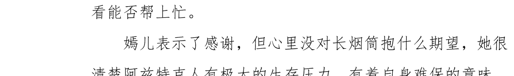等耳朵清醒后，带着离开，走之前不忘交代妈儿，如果遇到克亚亚人，最好不要伤害，否则遭到部落严厉报复。婉儿自然是点头，长烟筒肯定是见识过克亚人的手段，所以吓了胆，连惹也没有。经过长烟筒说明，婉儿大致知道亚亚人就在附近的丛林之中，但丛林里树太多，环境复杂的，上几步，说的一个洞开的世界，要找到他们，并不容易。长烟筒没有带走美洲豹，它们擅长隐藏自己的猎手，在区域里，婉儿还是存在。毕竟一个没有任何活物的丛林，让人毛骨悚然，有美洲豹陪伴，心里反而舒服。此时的丛林热得像一个火炉，婉儿小心翼翼寻找聚集地，不停停下来休息，随手擦汗。附近一头美洲豹发出一声低吼，立即跑起来，婉儿听到动静，意识躲到了一棵树后，紧接着感觉到一个影子晃过，她抬起头去，看到树上竟然有一个战士在树梢上跑，手里拿着弓箭，对准某个方位，连发数箭，动作流畅漓，没有一丝停顿。是不是刚才那头美洲豹起了吸引力的作用，一定不可能错过攻击。战士放了很多箭，落在美洲豹身后，把它惊醒，随后，这个战士吹了下口哨，相同的口哨声，从丛林的某个地方传来。婉儿静的守候，不敢有任何动作，现在确定自己已经进入了这里的领地。过了一会儿，一群结队，斑纹纹身的女人出现，她们每一组，拉着一个捆绑脚手的男人，共有五组。这群女人搜缴了许多男人抓回来。胜利的果实是像是丛林冒险的游客，他们的装备，都被女人们当作战品放在身后。不管是冒险者还是游客，从原始森林寻找开始，其目的就不会是赏沿途的风景那么简单。他们之中很多人穿着财富来的，因为传说中，有着金字字的印第之地，往往随着黄金和古董。任何一样，都是外人进入原始森林的动力。每年，都有很多人打着游客的名义，进入原始森林寻找宝藏。那五个被抓爪的游客都是男人，而且都是白色人种，一个个胡子拉扯，风尘妥协，应该是在野外了很一段时间时间，他们的衣服上面都满了污尘。婉儿侦测这五个人就是寻找其中一批，但她没有发现枪械，看样子这些男人不是明目张胆的武装分子，不过，他们和战士之间有过搏斗，双方都有负伤，男人们受的伤比较严重。现在这些人人都很顺从，没人敢说话，神色惶恐，准是在吃了苦头。这也看出，在原始森林，女战士们完全有着压制性的优势。作者:蛇丛 日期:2014-09-04 23:33今天没了。关注微信：加微11012849555 获取更多帖那家帮抓的希望发现是在里面，我其实没有剩余，精力有限，逐条寻找和复制。谢谢大家。作者:蛇丛 日期:2014-09-05 11:43http://mp.weixin.qq.com/s?_biz=MZa5NTk20Dcz0Q=&mid=201474467&idx=1&sn=afa6ec81fa44b9


快靠近，开始搜索一下屋子，大拿最有可能是被藏在某个棚屋里。搜索一间的屋子，大拿最有可能是被藏在某个棚屋里。一连找了四五间，姚儿都没有发现踪影。在某一棚屋里，她遇到了一个正在哺乳的女人，神情贯注地拍着怀中的小孩，并没有发现姚儿。

姚儿吐了口气，继续寻找。她有些遗憾自己没有说，不然还可以向这个女人询问。棚屋并没有多少，姚儿耐着子间找下去，不对，观望下大拿和那个男人之间的冲突，目前为止，没有什么变化。姚儿暗暗祈祷，希望那个男人能为她争取一些时间。


中央部位，她基本上可以确认，大拿就在这间棚屋内。她不敢靠近，因为所有的卢克亚人都围在附近。一旦不小心被发现，这些族人可能会把她撕成碎片。姚儿放慢了行动，暂时在一间棚屋里寻找机会，去下一间。两间棚屋之间的一段路，在她眼里仿佛是一道天堑，随时有危险。正当她小心谨慎地守候时，她忽然发现抓了女人的其他同伴，奔乱挤到了一块，也想要解索，不过他们没有之前那男子的能力。

怎么都解不了。姚儿回头在柜子里寻找，很快找到一柄小石刀，她一笑，心里有了绝妙的主意。今天没了。

追踪。密道追踪十一月份即将在上线了，姚儿。

这种了。她打算列出一个名单，放在片尾字上，感兴趣，就收集名字，然后交给导演。真名和大家随意。在这里。姚儿顺手拿到小石刀，也不知道划过什么，上面沾满了油，她有些厌恶，用麻布包裹起来，对准四个人扔过去，然后缩回墙角躲起来。虽然距离还有三十米，但姚儿准不错，小石刀刚落了一个人的面前。四个男人正在互相帮助挣脱，那些绳索都是浸过油的老藤，其中一人看到小石刀落地上，顿时面色大喜，但他没急着去拿。


一眼看向小石刀来的方向，又回头了一眼那些围在棚屋外的卢克亚战士。一个卢克亚战士察觉到什么，朝四个男人的方位了一眼。发现男人，反应捷快，早在地上，把小石刀压在身下。卢克亚战士没有发现异常，才把注意力放在棚屋上。发现男人又四周张望，试图立刻躲避，没能看见这让他奇怪，不过当下纠结的时候，他背靠在地上，反手把小石刀拿在手里。解开了其余人的绳索，四个人脱离束缚，对视了一刻，按腰从丛里跑。附近的卢克亚人很快惊觉，大声呼喊示警。几名女战士不由分说，拔箭就射，箭簇飞出，射向四个男人。男人们死里逃生，似乎激发了身体可能，左右一闪，竟然躲开了弓，有的滚到了石头后面，有的躲到了树后。其中一个男人之前就有受伤，动作稍慢，被一箭射中了腿部，哀一声摔在了地上，但他没有放弃，用手撑地努力往前爬，可是卢克亚战士已经跟上了，其他三人望了一眼，都不敢转身。很快就有两名卢克亚战士把受伤的男人再次围掳起来，其他人则继续追击。为了把到手的猎物夺回来，她们几乎出动了一半的女战士，另一半留下来与棚屋里的男人对峙。姚儿待在原地，看着逃脱的人们继续绕着跑进了丛林，女战士也跟随消失。场景虽然乱了一下，但姚儿没有机会占下一个棚屋，女战士的行为比她想象中要有序，说明老萨萨的安全比逃走的男人更重要。姚儿心里算了一条对策，她看着干燥的棚屋，第一时间就试图离开，但他很受挫。在这种干燥的地方，放火无法控制，引起火灾，将是无法想象的巨大灾难。她现在只能希望扶住了那个男人，看着他做出一些举动，有利于让她寻找机会。突然间，棚屋的一处侧墙发出一声砰啪的响声，一个人影撞翻了棚屋的墙壁，摔飞出来。守在棚屋外的战士们一阵骚动，跟着围了过去。姚儿有些疑惑，仔细去看那个人影，发现竟然是刚劫持了老萨萨那个白男人。这个男人显然是被撞出来的，在地上翻滚了两下后，迅速起来，手按胸口揉动，咬着表情痛苦，眼睛惊恐地瞪着自己撞破的棚屋，全然不顾周围拿着弓箭的女战士们。似乎那破屋里面藏着比女战士们还要残忍倍的恶魔。冯看着他的目光，看到一个高大的男人从棚屋里面一步一顿地走了出来。正是一个大拿。大拿赤裸身体，全身都是跟克亚亚女人一样的纹身，单单腰部系着一块布，在走动，他还不随手把麻布系紧，看着似乎是从哪里拽下来用来遮盖的。她心中大喜，但很快就意不对，大拿现在头在发抖。白男人根本不与她正面交锋，扭头对着周围的女战士冲过来，这些战士靠太近，弓箭没有用处，不过她们不情愿地冲上去，几乎都是扑击，伸开手臂抢去。白男人抬了一下手，最快扑上的女战士应倒地，鲜血溅了一地。注意到白男人手上有一把微型手枪，枪筒跟他差不多大小，还带有消声器，看来他先把手枪藏起来了。把大拿抓进棚屋之后，仰仗这把手枪，棚屋内的战士们逼退。生活在丛林，但对枪械并不陌生，知道厉害，几乎冲到了白男人前的战士都退回来。大拿被吓倒，吼一声朝白男人冲上去。姚儿心里紧绷，她清楚大拿肯定是出了问题，他虽然有点愣，还是知道死活，可现在变得连枪都不害怕。

## 黄金太阳盘——阿齐特遗址里的契约神器
## 密道追踪
## 密道追踪之阴符

大概没有料到，有些愣，这一瞬间，大拿到了他面前，施展擒住了白男人的手肘，手枪掉落。与此同时，白男人竟然随着大拿的动作，反手抱住了大拿的手臂，顺势倒地，双腿住大拿的脖子。姚儿是瑜伽高手，知道白男人擅长的不是瑜伽，而是巴西柔术。巴西柔术最厉害的就是贴身斗，这一招之下，如果借助身体重量，足以将人杀死。姚儿心跳到嗓子眼，两个人的交锋太快了，她去救大拿来不及，只能睁睁看着，手抖着，眼角过了一丝泪光。出乎姚儿的是，白男人动作那样横住大拿，双腿踢马步，如铁塔似的站在那里不动，接着大拿伸手向白男人吼。白男人猛得倒回，整个人软绵绵倒地上，双手握着喉咙剧烈咳嗽，没有反抗的力气。老萨满在两人打斗的时候已经走了，在一旁看着。大拿制服白男人后，对老萨满低头礼，表情木讷。姚儿眉紧锁，充满了担忧，老萨满肯定用了为人知的邪术，把大拿控制住了。大拿肯定不会认识她，也不会跟她离开。。捕其他男人的战士陆续回来，她们只带回两个男人，还有一个不知道是成功逃脱还是被杀掉。有了这次脱离事故，战士们将抓到的四个男人结结实绑在一间棚屋前竖立的木柱上，老萨满还给他们喂了奇怪的汁液。清晰看到他们眼中的变化，从恐惧、愤怒转变为迷茫和顺从，全身软软似的，仿佛没了脊椎骨，估计给他们解开绳索，他们也没力气逃了。不难猜，这汁液具有极强的效用，能够让服的人无力抵抗。联想到麻醉那头名为“大耳朵”的美洲豹，看来掌握了一门非常厉害的制药技巧。他们聚在一起寻找男人，老萨满看到到处的地方，在绳索中寻找，很快从腰捡一把小石刀，在手里打量，忽然出声叫所有的战士到跟前，指着各间棚屋说了一通。战士们分散开来，开始逐一在棚屋里巡查。心里咯噔一下，知道老萨满通过小石刀判断是否在为男人提供帮助，不禁暗暗捏了一把冷汗。此刻，她深深地知道，卢克亚的领头人——老萨满是多少狡。想要逃已经是不可能的事情，姚儿纤弱地回到棚屋内，除了卢克亚人常用的生活用品以及几把未完成的弓，棚屋内没什么东西。这种棚屋是由数根棕树枝支撑起来的，覆盖了一些树枝，再用一些黑泥固定，非常简陋，在里面找一个躲避的场所，十分困难。让它冷静，寻找可以脱困的方法。在棚屋里转了一圈后，只能放弃。棚屋外的战士很快就要找到她，因为棚屋很小，她们只需要在门口看一眼，就知道是不是在里面。准备束手就了，反抗没有多大的意义。高举双手，从棚屋里走了出去，免得那些反应激烈的战士们朝她射上一箭。两个战士试着靠近她，其余人则围在周围。面色不善，她们今天已经经历了许多变故，所以警惕性很强。以为自己报告了，结果明明也聪明，把她带来了。现在也被老萨满控制，也失去了自由，而也受伤了。三人的任务，恐怕比此止了。瞬间绝望让姚儿不由得咬下头，她很地意识到自己的情绪不对，提醒自己务必保持斗志，否则真的完了。很快被到了老萨满面前，地点是在棚屋前面的空地上。年纪很大，看起来老态，个子比姚儿矮了一个头，用浑浊的眼睛打量她。感觉到那双眼睛盯过来时，有一线锐利的光芒，刺得她发麻。隐隐觉得不安，不想分开眼睛，把视线留在老萨满之间。这时，她发现老萨满额头上有一个硬币大小的圆形形状，每一条线条画得非常细致。脚步自主向前迈步，因为她认出了那个图案，正是黄金太阳。其他的战士看到动作，立刻，老萨满手示意让战士们不要，姚儿没有反对，往前一步，距离老萨满不到米，她可以确认，这就是黄金太阳。整理，姚儿变得活跃起来，开始观察老萨满的脸，皱纹。一直以为会在卢克亚那里看到这个图案，没想到会在大拿身上看到。姚儿的神情已经猜到了什么。老萨满看着姚儿一会儿，虽然听不懂姚儿的话，姚儿愣，她听懂了，因为老萨满用的是丹语。你是什么？姚儿愣，她听懂了。来自大洋彼岸。老萨满摇头，没有回答姚儿的问题。加入我们吗？不，我不能。他是我的同伴，让他跟我离开吗？指着老萨满身上光呆的大拿，不再纠缠。老萨满的态度坚决，不能再让步。疑惑了一会儿，身旁的女战士说了句话，面露不悦，不敢反驳。到了废弃坑捡了一堆衣物，是大拿之前穿的。知道老萨满同意，松了口气，想到能把大拿救走，这一趟也有收获。蹲地上抓了一把泥，塞到大拿哪里。在别的角落，有些臭的臭团被揉得很粘稠，里面乱杂了七七八东西，散发出一股恶心的气味。鼻子了嗅，蹲下去就吐了起来，不仅脏巴吐干净，之前喝的绿色药汁也吐了出来。已经清醒了。怕老萨满会后悔，立即上前拉起大拿。还没回神，妈儿拽着他跑了几米，转过几棵大树后，就再也看不见的卢克亚部落。两人漫无目的跑了一阵，都累得气喘吁，方才停下来休息。大拿看到身上就挂了件麻布，趁机跑到树后面换了衣服，面红耳赤地走到妈儿身边。完蛋了。我的挂件不见了。那个吕字挂件？你不随身带个……随即便想起刚大拿被人扒了精光，后面的话也说不出，表情复杂的看着大拿。太野了。给我灌了药，又把我挂件扯了，不知道弄到哪里去了。一个挂件丢了。还好命没丢。摸起一件符味，坏了，最后丢在了虎符城地下，这个还是老沙留下的。你不说这个我还忘了。不是说三味符有稳定人心的作用吗，你怎么还被催睡了。我刚到这里就被她们抓了。尴尬的说，那个女人又给我灌了药。真实目的。打扰这片宁静之地，已经被惹怒，丛林生病，万物绝迹，用不了多久，这里毁于大地。一切不再存在，连你要找的东西！


他急于被救，不敢隐瞒，应该一脑脑的说的该说的不该说的都吐露了。

打算大拿对娇儿的做法有些不满意，但也知道，娇儿的做法在大局来看是正确并有效的。

看得出来，娇儿对白种男人的回答比较满意，意示大拿把他救了上来的。白种男人被救之后，跪在地上大口呼吸，好像刚溺过水一般。

大拿注意到此人的手臂、背部还有腿部受伤，创口仍然在往外流血，其中腿部还留半截箭爪，应该是被人为折。

这人已经筋疲力尽，顾不上处理伤口。

一手处理如信，包装好，大拿稳住他的伤口简单处理，但天气太炎热，如果没有没有消炎的药物，这人的情况堪忧。

“我们得快点跟黎江汇，他背里有消炎药。”大拿处理白种男人的伤口，准备把他背起来。

“我找不到阿兹特克克洛。”娇儿拉着大拿，面无表情的说，“另外，他会拖累我们。”

“你不打算算救他了？”大拿不可置信的望着娇儿，“这是一条活生命的命！”

“他叫欧恩，是个毒贩。”娇儿指着那个气奄无力的白种人说，“他们受命于贩毒黑头子，准备对这里的印安原住民进行一次袭击。”

“啊？”大拿不由一愣，把欧恩又放回了地上，“跟欧聚种种植园里那群人是一伙的？”

丫儿点头，“可怜他们出师不利，在进入丛林不久，就丢失了他们的枪械。”大拿不由得感到好笑，看来欧恩洛得这个打算，也是情理之中的。

“原本他们有六个人一起行动，但其中个人越夜偷走几乎所有的枪械。”丫儿说，“他们没有办法，只能放弃行动，沿着地图准备离开，更不幸的事情发生了，他们进入了丛林腹地，结果遭遇了卢克亚的战士，全部被缴获了。

看错地图吧？

“因为那张地图是假的。”丫儿笑着，“所有的问题，都出现在那个第六个人身上。正是这些人，提供了丛林内印第部的详细分布地图。毒弃才决定对印第安原住民偷袭。”

“他们要屠杀印第安人？”大拿说。对于欧恩的一丝同情，此刻已荡然无存。

“源于印安人对栗种植的破坏。”妈儿说，“你昨天也看到了，印安安人在种植园里寻找东西。这种情形已经不只一次了，但因为忌惮于印安原住民，才没有对他们进行打击。直到那个神秘的第六人出现，提供了详细地图，毒贩们才准备对印安原住民进行一次彻底的攻击。”

“为了抢栗，制定了这种杀人的计划，落得现在的下场，真是便宜他们了！”大拿楚彻底的打击意味着什么，那是要将原住民完全打垮甚至灭杀！

“丛林里是有法律的。”妈儿说，“胜者为王。”妈儿的想法是把毒贩欧思丢在丛林里生自灭。

大拿确定欧思没有任何好感，但不忍心把一个人活放在丛林里，把他抢的栗当饭吃吧，”他笑着说着要睡了。

最终妈儿做了打算，因为天快了，他们又找不到阿斯特克的居住地。她同意在附近找个地方等到第二天，说不定欧思能恢复一切力量，到上路对谁都有好处。

其实大拿心里明白，这不是妈儿突然变得好奇怪，而是欧思的伤很严重，很有可能过了晚上，他们没有食物，更没有水，这种情况对于他们来说，都非常致命。

欧思迷迷枯槁的渴水，可是妈儿和大拿都没有办法，在这个火热的丛林里，根本找不到水源。

很快夜色降临，大拿让妈儿先休息，自己则负责站岗。夜晚的丛林比白天亮来，气温下降了许多，但仍然炎热。

一个不速之客出现在附近，并且毫不保留的露出了身形。

大拿与那不速之客对视一眼，立刻感觉到了一阵恐慌，全的身的肌肉都紧绷，口干舌燥。

那是一头健壮的美洲豹，牙爪爪犀利，凶气逼人！

“不用害怕，是驯养的。”妈儿没有睡醒，看到美洲豹，反而是感到开心，“原来它们还没有离开，我们获救了。”

“什么情况？”大拿不敢放松警备。

“它们要带我们去阿兹特克部落。”妈儿激动的说，“昨天去菜原种植的那些住民，就是阿兹特克人，美洲豹跟他们是一起的！”

大拿恍然大目。

挂着两个袋子。妈儿知道美洲豹不会伤害自己，但是还有畏惧，小心翼翼的把两个袋子取下来。两个袋子，一个装着水，一个装着些干的肉块。

“先吃东西，补充体力。”妈儿拿着水袋喝了几口，然后递给大拿，“不要省着点，还不知道阿兹特克地有多远。”

“给他也喝一杯。”大拿刚送到嘴旁，忽然又想起欧恩，跟妈儿犹豫，立即又说，“我不太渴，去吧。”妈儿捏了大拿的肩膀，轻咬声，“不要太大希望，他可能活不下去了……”

大拿没说话，走过去扶欧恩给他喂水。

“大拿，对敌人的仁慈，就是残忍。”妈儿说，“你不能对谁都是好心。”大拿尴尬的笑了，转移话题，“我们现在就走？”语音刚开，他悠然发现美洲豹。妈儿指了树上，“美洲豹正趴在一根横着长的树上，耳朵扭动一下，是准备休息了。美洲豹在树上放哨，大拿和妈儿放下来，没有特意留。两人白天都累了，很快睡着。第二天，天刚亮，两人就醒了，大拿很快发现，欧恩踪了。

“他偷偷走了？”大拿四处找了一下，没有找到欧恩踪迹。

“也好，不知道。”妈儿说，“食物还在，这就足够了。”

“他的伤那么严重，可能离开。”大拿皱着眉感到疑惑，看到婉儿若无其模样，难道是婉儿在晚上做了什么？但他很快打消这个念头，至于那么残忍。欧恩的伤势没有严重，趁着他睡，去往种植园。有了美洲豹带路，后面的路途比较困难，但毕竟是丛林，没有任何开发，就算猛兽环绕，光靠复杂的环境，就够他们苦了。两人都能够足劲，一口气走到阿兹特克部落与黎江汇合，但现实没办法做到，两个人的体力流失特别快，时不时需要停下来休息，到了最后，两人感到疲惫不堪，每走一小距离，特别辛苦。就这样，也不知道多少小时，前方带路的美洲豹停了，一个隐藏在大树之间的村落出现在面前。他们冲冲走进部落，却不由得感到心慌，大的部落里，竟然没有个人影，一片空旷和寂静，但看环境，并不是荒废的样子，看得之前还有人类活动的痕迹。带路的美洲豹在建筑间跑动，不发出叫声，似乎对眼前的事情非常疑惑。“难道发生什么事了？”大拿心里慌不安的问。“没有破坏的痕迹。”婉儿说，“生活物品也没有带走，我们只是停脚。空气里好像有臭味。”大拿鼻子了嗅，突然用手捂住，“硫磺的味道！这空气里有毒！”他望向远处的丛林，一层淡淡的白色雾气似乎验证了他们的说法。那带路的美洲豹却步亦趋的向朝气崭的地方去。“我们过去看看。”婉儿意识到阿兹特克人很有可能去那里。两人又走了一阵，不过这一次走很快，因为有阿兹特人活动的缘故，丛林里有不少小道，走起来比之前轻松了。果不然，他们很快就看见不少阿斯特克人围了一个大圆圈，整齐划一的高举手臂，沉默的站立。黎江也在其中，他的装束很醒目。大拿和妮走到黎江身边，拍了拍他的肩膀，黎江回头，有些难以置信，但立即激动的两人拥抱。“他们在做什么？”大拿这时已经可以清楚的知道，阿斯特克人围着一个深坑，而那些白雾正是从中间出来的。刺辣的味道非常浓烈，围在附近的人，毫不不在意，沉默的站立。“这是他们的最后一个水源，但在昨晚也干涸了。”黎江说，“我们在中寻找水源，希望重新回来。”妮和大拿的回归，让黎江感到高兴，他很想知道两人在这么短的时间内从奥克亚人手里逃脱的经历，因为非常有趣。但是现在的时间不恰当。就在这天凌晨，阿斯特克人的最后一个水源干涸了，让整个阿斯特克部落笼罩了一层焦虑的阴影。在阿斯特克部落附近，有很多坑溶洞，一直以来，他们都是通过这些溶洞取得水。不久之前，随着丛林干旱的发生，坑内的流水逐渐消失，只留下一个深不见底的涸洞。这最后一个水源，是最近最大的天井，凌晨时，他们听到洞中发出的类兽呼吸的声音，也干涸了。在溶洞附近，这是一个直径三米宽的洞，因为白雾的存在，看不到深处的情景，迎面透的一股寒气息，令人不安。在溶洞旁连接着两根粗大的蔓，时时晃动，几个健硕的战士守在旁，他们的目光望向洞内，并没有参与祈祷。大拿确定欧思没有任何好感，但不忍心把一个人活放在丛林里，把他抢的栗当饭吃吧，”他笑着说着要睡了。最终妈儿做了打算，因为天快了，他们又找不到阿斯特克的居住地。她同意在附近找个地方等到第二天，说不定欧思能恢复一切力量，到上路对谁都有好处。其实大拿心里明白，这不是妈儿突然变得好奇怪，而是欧思的伤很严重，很有可能过了晚上，他们没有食物，更没有水，这种情况对于他们来说，都非常致命。欧思迷迷枯槁的渴水，可是妈儿和大拿都没有办法，在这个火热的丛林里，根本找不到水源。很快夜色降临，大拿让妈儿先休息，自己则负责站岗。夜晚的丛林比白天亮来，气温下降了许多，但仍然炎热。一个不速之客出现在附近，并且毫不保留的露出了身形。大拿与那不速之客对视一眼，立刻感觉到了一阵恐慌，全的身的肌肉都紧绷，口干舌燥。那是一头健壮的美洲豹，牙爪爪犀利，凶气逼人！“不用害怕，是驯养的。”妈儿没有睡醒，看到美洲豹，反而是感到开心，“原来它们还没有离开，我们获救了。“什么情况？”大拿不敢放松警备。“它们要带我们去阿兹特克部落。”妈儿激动的说，“昨天去菜原种植的那些住民，就是阿兹特克人，美洲豹跟他们是一起的！”大拿恍然大目。挂着两个袋子。妈儿知道美洲豹不会伤害自己，但是还有畏惧，小心翼翼的把两个袋子取下来。两个袋子，一个装着水，一个装着些干的肉块。“先吃东西，补充体力。”妈儿拿着水袋喝了几口，然后递给大拿，“不要省着点，还不知道阿兹特克地有多远。“给他也喝一杯。”大拿刚送到嘴旁，忽然想起欧恩，跟妈儿犹豫，立即又说，“我不太渴，去吧。”妈儿捏了大拿的肩膀，轻咬声，“不要太大希望，他可能活不下去了……”大拿没说话，走过去扶欧恩给他喂水。原本几近昏的欧恩尝到的滋味，伸出手一把将水袋抓住，狠的吞咽，吃到了停。大拿不忍阻止，但妈儿立刻上去，一把将水袋夺走。对人的仁慈，就是残忍。”妈儿说，“你不能对谁都是好心。”大拿尴尬的笑了，转移话题，“我们现在就走？”语音刚开，他悠然发现美洲豹。妈儿指了树上，“美洲豹正趴在一根横着长的树上，耳朵扭动一下，是准备休息了。美洲豹在树上放哨，大拿和妈儿放下来，没有特意留。两人白天都累了，很快睡着。第二天，天刚亮，两人就醒了，大拿很快发现，欧恩踪了。“他偷偷走了？”大拿四处找了一下，没有找到欧恩踪迹。“也好，不知道。”妈儿说，“食物还在，这就足够了。“他的伤那么严重，可能离开。”大拿皱着眉感到疑惑，看到婉儿若无其模样，难道是婉儿在晚上做了什么？但他很快打消这个念头，至于那么残忍。欧恩的伤势没有严重，趁着他睡，去往种植园。有了美洲豹带路，后面的路途比较困难，但毕竟是丛林，没有任何开发，就算猛兽环绕，光靠复杂的环境，就够他们苦了。两人都能够足劲，一口气走到阿兹特克部落与黎江汇合，但现实没办法做到，两个人的体力流失特别快，时不时需要停下来休息，到了最后，两人感到疲惫不堪，每走一小距离，特别辛苦。就这样，也不知道多少小时，前方带路的美洲豹停了，一个隐藏在大树之间的村落出现在面前。他们冲冲走进部落，却不由得感到心慌，大的部落里，竟然没有个人影，一片空旷和寂静，但看环境，并不是荒废的样子，看得之前还有人类活动的痕迹。带路的美洲豹在建筑间跑动，不发出叫声，似乎对眼前的事情非常疑惑。“难道发生什么事了？”大拿心里慌不安的问。“没有破坏的痕迹。”婉儿说，“生活物品也没有带走，我们只是停脚。空气里好像有臭味。”大拿鼻子了嗅，突然用手捂住，“硫磺的味道！这空气里有毒！”他望向远处的丛林，一层淡淡的白色雾气似乎验证了他们的说法。那带路的美洲豹却步亦趋的向朝气崭的地方去。“我们过去看看。”婉儿意识到阿兹特克人很有可能去那里。两人又走了一阵，不过这一次走很快，因为有阿兹特人活动的缘故，丛林里有不少小道，走起来比之前轻松了。果不然，他们很快就看见不少阿斯特克人围了一个大圆圈，整齐划一的高举手臂，沉默的站立。黎江也在其中，他的装束很醒目。大拿和妮走到黎江身边，拍了拍他的肩膀，黎江回头，有些难以置信，但立即激动的两人拥抱。“他们在做什么？”大拿这时已经可以清楚的知道，阿斯特克人围着一个深坑，而那些白雾正是从中间冒出来的。刺辣的味道非常浓烈，围在附近的人，毫不不在意，沉默的站立。“这是他们的最后一个水源，但在昨晚也干涸了。”黎江说，“我们在坑中寻找水源，希望重新回来。”妮和大拿的回归，让黎江感到高兴，他很想知道两人在这么短的时间内从奥克亚人手里逃脱的经历，因为非常有趣。但是现在的时间不恰当。就在这天凌晨，阿斯特克人的最后一个水源干涸了，让整个阿斯特克部落笼罩了一层焦虑的阴影。在阿斯特克部落附近，有很多坑溶洞，一直以来，他们都是通过这些溶洞取得水。不久之前，随着丛林干旱的发生，坑内的流水逐渐消失，只留下一个深不见底的涸洞。这最后一个水源，是最近最大的天井，凌晨时，他们听到洞中发出的类兽呼吸的声音，也干涸了。在溶洞附近，这是一个直径三米宽的洞，因为白雾的存在，看不到深处的情景，迎面透的一股寒气息，令人不安。在溶洞旁连接着两根粗大的蔓，时时晃动，几个健硕的战士守在旁，他们的目光望向洞内，并没有参与祈祷。大拿确定欧思没有任何好感，但不忍心把一个人活放在丛林里，把他抢的栗当饭吃吧，”他笑着说着要睡了。最终妈儿做了打算，因为天快了，他们又找不到阿斯特克的居住地。她同意在附近找个地方等到第二天，说不定欧思能恢复一切力量，到上路对谁都有好处。其实大拿心里明白，这不是妈儿突然变得好奇怪，而是欧思的伤很严重，很有可能过了晚上，他们没有食物，更没有水，这种情况对于他们来说，都非常致命。欧思迷迷枯槁的渴水，可是妈儿和大拿都没有办法，在这个火热的丛林里，根本找不到水源。很快夜色降临，大拿让妈儿先休息，自己则负责站岗。夜晚的丛林比白天亮来，气温下降了许多，但仍然炎热。一个不速之客出现在附近，并且毫不保留的露出了身形。大拿与那不速之客对视一眼，立刻感觉到了一阵恐慌，全的身的肌肉都紧绷，口干舌燥。那是一头健壮的美洲豹，牙爪爪犀利，凶气逼人！“不用害怕，是驯养的。”妈儿没有睡醒，看到美洲豹，反而是感到开心，“原来它们还没有离开，我们获救了。“什么情况？”大拿不敢放松警备。“它们要带我们去阿兹特克部落。”妈儿激动的说，“昨天去菜原种植的那些住民，就是阿兹特克人，美洲豹跟他们是一起的！”大拿恍然大目。挂着两个袋子。妈儿知道美洲豹不会伤害自己，但是还有畏惧，小心翼翼的把两个袋子取下来。两个袋子，一个装着水，一个装着些干的肉块。“先吃东西，补充体力。”妈儿拿着水袋喝了几口，然后递给大拿，“不要省着点，还不知道阿兹特克地有多远。“给他也喝一杯。”大拿刚送到嘴旁，忽然想起欧恩，跟妈儿犹豫，立即又说，“我不太渴，去吧。”妈儿捏了大拿的肩膀，轻咬声，“不要太大希望，他可能活不下去了……”大拿没说话，走过去扶欧恩给他喂水。原本几近昏的欧恩尝到的滋味，伸出手一把将水袋抓住，狠的吞咽，吃到了停。大拿不忍阻止，但妈儿立刻上去，一把将水袋夺走。对人的仁慈，就是残忍。”妈儿说，“你不能对谁都是好心。”大拿尴尬的笑了，转移话题，“我们现在就走？”语音刚开，他悠然发现美洲豹。妈儿指了树上，“美洲豹正趴在一根横着长的树上，耳朵扭动一下，是准备休息了。美洲豹在树上放哨，大拿和妈儿放下来，没有特意留。两人白天都累了，很快睡着。第二天，天刚亮，两人就醒了，大拿很快发现，欧恩踪了。“他偷偷走了？”大拿四处找了一下，没有找到欧恩踪迹。“也好，不知道。”妈儿说，“食物还在，这就足够了。”
(注：由于原文存在大量重复和错误文本，已按逻辑合并清理)

“因为那张地图是假的。”丫儿笑着，“所有的问题，都出现在那个第六个人身上。正是这些人，提供了丛林内印第部的详细分布地图。毒弃才决定对印第安原住民偷袭。”

“他们要屠杀印第安人？”大拿说。对于欧恩的一丝同情，此刻已荡然无存。

“源于印安人对栗种植的破坏。”妈儿说，“你昨天也看到了，印安安人在种植园里寻找东西。这种情形已经不只一次了，但因为忌惮于印安原住民，才没有对他们进行打击。直到那个神秘的第六人出现，提供了详细地图，毒贩们才准备对印第安原住民进行一次彻底的攻击。”

“为了抢栗，制定了这种杀人的计划，落得现在的下场，真是便宜他们了！”大拿楚彻底的打击意味着什么，那是要将原住民完全打垮甚至灭杀！

“丛林里是有法律的。”妈儿说，“胜者为王。”妈儿的想法是把毒贩欧思丢在丛林里生自灭。

大拿确定欧思没有任何好感，但不忍心把一个人活放在丛林里，把他抢的栗当饭吃吧，”他笑着说着要睡了。

最终妈儿做了打算，因为天快了，他们又找不到阿斯特克的居住地。她同意在附近找个地方等到第二天，说不定欧思能恢复一切力量，到上路对谁都有好处。

其实大拿心里明白，这不是妈儿突然变得好奇怪，而是欧思的伤很严重，很有可能过了晚上，他们没有食物，更没有水，这种情况对于他们来说，都非常致命。

欧思迷迷枯槁的渴水，可是妈儿和大拿都没有办法，在这个火热的丛林里，根本找不到水源。

很快夜色降临，大拿让妈儿先休息，自己则负责站岗。夜晚的丛林比白天亮来，气温下降了许多，但仍然炎热。

一个不速之客出现在附近，并且毫不保留的露出了身形。

大拿与那不速之客对视一眼，立刻感觉到了一阵恐慌，全的身的肌肉都紧绷，口干舌燥。

那是一头健壮的美洲豹，牙爪爪犀利，凶气逼人！

“不用害怕，是驯养的。”妈儿没有睡醒，看到美洲豹，反而是感到开心，“原来它们还没有离开，我们获救了。“什么情况？”大拿不敢放松警备。“它们要带我们去阿兹特克部落。”妈儿激动的说，“昨天去菜原种植的那些住民，就是阿兹特克人，美洲豹跟他们是一起的！”大拿恍然大目。

挂着两个袋子。妈儿知道美洲豹不会伤害自己，但是还有畏惧，小心翼翼的把两个袋子取下来。两个袋子，一个装着水，一个装着些干的肉块。“先吃东西，补充体力。”妈儿拿着水袋喝了几口，然后递给大拿，“不要省着点，还不知道阿兹特克地有多远。“给他也喝一杯。”大拿刚送到嘴旁，忽然想起欧恩，跟妈儿犹豫，立即又说，“我不太渴，去吧。”妈儿捏了大拿的肩膀，轻咬声，“不要太大希望，他可能活不下去了……”大拿没说话，走过去扶欧恩给他喂水。原本几近昏的欧恩尝到的滋味，伸出手一把将水袋抓住，狠的吞咽，吃到了停。大拿不忍阻止，但妈儿立刻上去，一把将水袋夺走。对人的仁慈，就是残忍。”妈儿说，“你不能对谁都是好心。”大拿尴尬的笑了，转移话题，“我们现在就走？”语音刚开，他悠然发现美洲豹。妈儿指了树上，“美洲豹正趴在一根横着长的树上，耳朵扭动一下，是准备休息了。美洲豹在树上放哨，大拿和妈儿放下来，没有特意留。两人白天都累了，很快睡着。第二天，天刚亮，两人就醒了，大拿很快发现，欧恩踪了。“他偷偷走了？”大拿四处找了一下，没有找到欧恩踪迹。“也好，不知道。”妈儿说，“食物还在，这就足够了。”

“他的伤那么严重，可能离开。”大拿皱着眉感到疑惑，看到婉儿若无其模样，难道是婉儿在晚上做了什么？但他很快打消这个念头，至于那么残忍。欧恩的伤势没有严重，趁着他睡，去往种植园。有了美洲豹带路，后面的路途比较困难，但毕竟是丛林，没有任何开发，就算猛兽环绕，光靠复杂的环境，就够他们苦了。两人都能够足劲，一口气走到阿兹特克部落与黎江汇合，但现实没办法做到，两个人的体力流失特别快，时不时需要停下来休息，到了最后，两人感到疲惫不堪，每走一小距离，特别辛苦。就这样，也不知道多少小时，前方带路的美洲豹停了，一个隐藏在大树之间的村落出现在面前。他们冲冲走进部落，却不由得感到心慌，大的部落里，竟然没有个人影，一片空旷和寂静，但看环境，并不是荒废的样子，看得之前还有人类活动的痕迹。带路的美洲豹在建筑间跑动，不发出叫声，似乎对眼前的事情非常疑惑。“难道发生什么事了？”大拿心里慌不安的问。“没有破坏的痕迹。”婉儿说，“生活物品也没有带走，我们只是停脚。空气里好像有臭味。”大拿鼻子了嗅，突然用手捂住，“硫磺的味道！这空气里有毒！”他望向远处的丛林，一层淡淡的白色雾气似乎验证了他们的说法。那带路的美洲豹却步亦趋的向朝气崭的地方去。“我们过去看看。”婉儿意识到阿兹特克人很有可能去那里。两人又走了一阵，不过这一次走很快，因为有阿兹特人活动的缘故，丛林里有不少小道，走起来比之前轻松了。果不然，他们很快就看见不少阿斯特克人围了一个大圆圈，整齐划一的高举手臂，沉默的站立。黎江也在其中，他的装束很醒目。大拿和妮走到黎江身边，拍了拍他的肩膀，黎江回头，有些难以置信，但立即激动的两人拥抱。“他们在做什么？”大拿这时已经可以清楚的知道，阿斯特克人围着一个深坑，而那些白雾正是从中间冒出来的。刺辣的味道非常浓烈，围在附近的人，毫不不在意，沉默的站立。“这是他们的最后一个水源，但在昨晚也干涸了。”黎江说，“我们在坑中寻找水源，希望重新回来。”妮和大拿的回归，让黎江感到高兴，他很想知道两人在这么短的时间内从奥克亚人手里逃脱的经历，因为非常有趣。但是现在的时间不恰当。就在这天凌晨，阿斯特克人的最后一个水源干涸了，让整个阿斯特克部落笼罩了一层焦虑的阴影。在阿斯特克部落附近，有很多坑溶洞，一直以来，他们都是通过这些溶洞取得水。不久之前，随着丛林干旱的发生，坑内的流水逐渐消失，只留下一个深不见底的涸洞。这最后一个水源，是最近最大的天井，凌晨时，他们听到洞中发出的类兽呼吸的声音，也干涸了。在溶洞附近，这是一个直径三米宽的洞，因为白雾的存在，看不到深处的情景，迎面透的一股寒气息，令人不安。在溶洞旁连接着两根粗大的蔓，时时晃动，几个健硕的战士守在旁，他们的目光望向洞内，并没有参与祈祷。


定的字意，跟字本身的涵义毫无关系，别人就算拿了，也不会懂上面的意思，但我父亲教过我，所以我能理解。”

“上面究竟在说什么？”大拿急切的问。

嫣儿深呼吸一口气，对着上面的标记，一个的指出来，“纯女部落，豹武士，神庙，还有神井，金字塔，以及火山……”

大拿和黎许嫣女将笔记本上的密码文字一解析，有些坐不住了，谁都清楚，老穆留下的信息和他们所处的环境无疑异常匹配。

> “原来老穆看起来比我们所掌握的地图还要详细。”黎江看着笔记本上的加密信息，还获取了好多贴帖。

> “没有了，他的记录很少，只是记录了一些关键的字，就像你说的，这就是一幅地图，他探索留下的地图。”嫣儿摇摇头，“应该是没有继续深入，就不得不回国了。

> “对。”黎江，“在你父亲那个年代，国际局势比较紧张，他没办法在一个国家滞留太久，而且不会像现在，会有资源供给以及后援，他能有这些记录，已经非常厉害了。”

大拿忍不住笑，黎江充不过是即脚外的围成成员，对于老穆这种传奇人物，了解太少，根本不知道他到底有多厉害。

“他是因为得到了虎符镇的信息，所以提前回国了。

姚儿将笔记本又翻开页，在这一页面上，画着一个兔头兵符，下面则用明写了两个字“虎符”。

“你父亲当年没有完成的任务，又叫你来完成，你这是不是在叫冥冥之中天注定。”大拿玩笑的说道，脑海里则想到了老穆在地底挖的穆家人宿命。

“父亲的终极目的之一就是找到黄金太阳盘。”姚儿说，“我答应这次任务，的确不是为了国家，也是想完成父亲的遭遇。”

你的父亲当年追寻黄金太阳盘，曾经经过这片丛林，那就意味着，我们很有可能离黄金太阳盘很近了。”黎江说。

“对。”姚儿没有否认，“虽然黄金太阳盘曾出现在阿兹王这里，但这离现在已经很久的事了，我们还是用新的方法来确认。既然已经到了他见过的丛林，我觉得可以深入的追查。

“我们就从神庙外面开始。”大拿手指着屋檐可以看到一角的阿兹斯特克神庙，“将老穆留下的线索一一查查一遍。我个人认为，他标记了红色的这些地方，都是他认为有可能存在黄金太阳盘的地点。

“这一点我也赞同。”姚儿说，“可惜的是可疑地点太多了，你们看，这里还提到了海洋，若要在海洋里，我们简直是在做一件不可能完成的任务。”黎江说。

“那只能从眼前看着了。”黎江说，“要在这片丛林里找东西，我们需要依靠阿兹克人的帮助。

“你同意我的意见了。浪费这么久的时间，最终还是要我听的，去帮助阿兹克人，哈哈。”大拿有些得意的。

“既然你同意，那我们就看看阿兹克人需要什么帮助。”婉儿拿定主意。

作者：蛇马 日期:2014-09-13 23:48
今天没了

作者：蛇马 日期:2014-09-14 23:30

三人走出小屋，现在已经是傍晚时分，一抹火红的云霞佛在天边燃烧，把大大地映成赤红。干燥的大地透出令人心措的色泽。


蜘蛛妈妈从地爬出来，那份报告被落在他们身后，他们召集了部落里的所有战士，这些战士，赤裸身上，戴着羽毛制成的头饰，腰间挂着鸾，他们身边无一例外跟着一头美洲，有的甚至在美洲身上，架势非常的威猛。

一个祭司吹响了骨哨，神殿的空中，原本在悬桓的老鹰也纷纷俯下来，落在神庙前的石台上。

“我认为印安部部落里的鹰兽士和狗兽士，是对战士们的尊称，没想到真的是人和动物的组合。”黎江说。

“在中国古代，曾经出现过很多用兽来征战的事迹，凶兽驯驯并不是特别难的技巧。”婉儿。

“你说他们是要搬家吗？”大拿问。

黎江和婉同时摇了摇头。

“我看也不是，在我们老家，就算干旱，也不会有人舍得离开乡。”大拿说，“他们应该是要去找水源……”

“不，他们是要去攻击聚种种植。”黎江说。

“连水都得没渴了，哪还有心情去打仗！”大拿反驳。

“黎江说的对的。”婉儿，“柯斯祖玛正在做战前动。”

“我们记得他们没话了。”大拿尴尬的摇头，畏兢的望望着黎江。

“他们认为是巫弃们种植聚翠并联合教士们夺走了金，终于引起祖灵的怒火，使得丛林生病，他们无法继续圣主管理，加剧了混乱，最后他们被他们的行暴杀，从外人手中夺回金。

“看来他们还没有找到丛林生病的真正原因，只是这次干燥，逼得他们要做很久之前想的事情，抓。”婉儿。

“把毒贼们赶杀。”大拿说，“我看着聚翠来，不知道害了多少人！”

“弓箭和刀，美洲和鹰……”黎江说，“这四样东西，不是武装毒贼的对手。以前毒贼没有对付他们，是本着不犯的原则，但涉及到利益，毒贼不会轻易放。”

“我们可以帮助他们。”

“毒贼已经有了想法，现在要对付丛林里的印第人。”娜儿说，“而且仗迟早要打，迫在睫睫有人放了一批，放在了阿兹特克部落里。之前没有说过这个过程，现在被大拿无意说，也许这种局面，正是神秘人刻意造成的。见娜儿不说话，大拿向黎江，“你觉得怎么样？”

“抓了毒贼和教士，对我们来说确实是一举，而且有限的资金，获取更多。”长烟筒从阿密人群里走了，对黎江解释了这句话。

“科斯祖玛见我们，见我们。”

黎江翻译说：“科斯祖玛见我们。”在长烟筒的引导下，娜儿等人来到了科斯祖玛居住的地。与其他阿密人居住的棚屋不同，科斯祖玛居住在一树屋上，树塔搭建在三棵树之间，距离地面差不多二米，以绳梯上下。当娜儿等人来到树下，科斯祖玛正在向上攀爬，动作非常矫健。长烟筒让娜儿等人爬梯棚屋，之后没有继续跟随其他的阿兹特克战士一起去准备晚上的行动。他们要准备足够的水，干粮以及武器。树屋内的空间比较大，姆儿等三人进入，科斯祖玛已经在门口盘旋而坐，等他们全部进入房间，用手示意他们坐下。科斯祖玛的面一直没有取下，看不长相，也不知道年纪有多大，但他很敏捷的攀跃动作，以及黑色顺滑的发，姆儿察觉到应该是非常年轻的男子。“晚上的行动，我们需要配合？”姆儿坐下，用契丹直接问道。大拿知道姆儿在说契丹语，但不知道她的内容，黎江翻译后，姆儿想要获取更多。科斯祖玛用古阿兹特克表达了疑惑。“他听不懂你在说什么。”黎江翻译道。姆儿有些失望，因为她刚刚才不经意的用契丹语询问，就是想试探科斯祖玛会不会契丹语。以她的设，这阿兹特克人应该是律的后裔，科斯祖玛作为族长，同时也是祖辈秘密的传承者，理应当会知晓契丹语。但现在看来，科斯祖玛并没有掌握契丹语。姆儿表示歉意，让黎江跟科斯祖玛沟通，询问他的目的。黎江和科斯祖玛交流了一阵，基本上清楚了科斯祖玛的图等到交谈结束，跟大拿和闺儿反馈信息。原来，科斯祖玛已经清楚了他们此次来到阿兹特克部落是为了寻找黄金太阳盘的，其实毫不难猜，在此之前，曾有无数势力为了寻找黄金太阳盘，来对抗他们的部族。中不少人为从他们口中得到黄金太阳盘的消息，甚至不惜伤害阿兹特克人，威逼利诱，无所不用极。但这些手段，对阿兹特克人是无用的，因为就连他们自己，也不知道黄金太阳盘究竟在哪，这曾是部落中最珍贵的物，随着欧洲入侵者对印度人的屠杀，部落命运沉浮，消失在了历史的滚浪洪流之中。遗失神物的阿兹特克人，在努力的寻找，几百年的时间里，他们所描述的黄金太阳盘的秘密，曾有人推测，他们先带着它落在海上寻找月亮颜色之后，很有可能没有把它带回来，而是将它遗落在海上了。听完黎江的说明，大拿揉了几把糟糟的头发，苦笑着对闺儿说，“他的意思，黄金太阳盘还真掉到海洋去了，这倒符合你父亲当年得到的信息。“科斯祖玛的海洋，并不是我父亲提到的海洋。”闺儿说。作者：蛇丛 日期:2014-09-14 23:31今天没了作者：蛇丛 日期:2014-09-16 01:14 

“有什么区别？”黎江奇的问。“阿兹特克人的祖先使用黄金太阳盘通过缝隙到达异海。他们必须使用它，才能返回，所以黄金太阳盘不可能遗失在异海。”婉儿说，“而且我父亲笔记里的海洋，那是墨西哥海岸。“两者并不冲突。”大拿说，“他们从异海回来后，不小心把黄金太阳盘放在墨西哥海岸，也很正常。“这可是阿兹特人对待物的。”黎江说，“既然他们全身而退，那么一定会将黄金太阳盘带回来。“你为什么肯定？”大拿反驳道，“说不定根本没有回来，而是丢失在墨西哥海岸了。”在考古发现原本是多么幸运的事呢。”婉儿说，“他们死后，被埋在墓里，考古人员从那里挖掘出了那柄镶着黄金太阳盘的刀，这就是事实。“我忘了。”大拿不好意思解释道。“跟他说，这番话，不足以说服我，不会放弃此次任务。”黎江把婉儿的话翻译给斯祖玛，斯祖玛停顿了很久，后面乌黑的眼睛扫过三人的脸，似乎是在做某个决定，才缓缓开口说了一句话。还没等到翻译，姆儿突然动的了起来，因为科斯祖玛的话里，她听到了一个无需翻译的词。“穆英雄！”大拿也听清了这个词，知道姆儿激动的原因，因为正是老穆的全名。“他问我们跟穆英雄的关系。”黎江补充道。“跟他熟？”姆儿不及问，她很清楚在当时的环境下，老穆不可能使用真名，除非斯祖玛和关系非。通过姆儿的行为，斯祖玛已经看出了什么，用较为的说，“在多年前，我曾做过他的向，我们在战斗期间获得了情报，而且还挺精彩的姆儿说，“我是穆英雄的女。”斯祖玛站起来走到瓦旁，从里面拿出一样东西，递给姆儿。那是一枚军勋章，不算特殊的物件，但姆儿知道它的意义，那是穆英雄早执行任务所得，她小时候玩过多次。姆儿拿着军勋章眼眶泛红，仿佛看到父亲微笑就在眼前。“你父亲说过的，他还会回来。我一直在这，可是没有等到。”斯祖玛说。他已经逝世了。”姆儿嘟囔说。“但你来了，就不算失伙。”科斯祖玛似乎猜到了穆英雄的遭遇，眼睛里早有些火焰，“他曾承诺，为我们部族找回神物，我希望能像他一样帮助我们。”姆儿摇头，“对不起，我可以帮助你们做它以外的事，但没办法实现父亲对你的承诺。”如果斯祖玛要他们寻找源，或是对武装毒贩，她也可以答应的，若是他们寻找回黄金太阳盘，那是不能答应的，已经是老穆曾经承诺过也不行的。因为寻找黄金太阳盘，是国家任务，说到，他一定会想办法将黄金太阳盘带回，这个终极目的，无都不会更改。“请求他们帮忙。”斯祖玛说，显得有些局促。也许，我也不要求你们阿兹特克人来这件事。也许，从遗失神物的那天起，我们就不配再拥有它。“神物的存在，让你们的部落又一次的陷入危险，失去它反而是好事。”黎江说，“良好其罪，我们拥有国家作为后盾，才有资格拥有它，以及更好的运用它为全人类谋福祉。“现在东西都没有找到，就开始讨论归属，是不是搞错了了？”大拿在旁说。“大拿说对。”姆儿望向斯祖玛，“我希望我们能够互相帮助，先找到黄金太阳盘，它既然神物，自然会决定自己的归属。其实这话说得没什么道理，不过对崇宗神物的柯祖玛非常受用。柯祖玛点头同意，暂时搁置争议，话题不再是黄金太阳盘，而是到了晚上针对武装毒犯们的行动。作者：蛇丛 日期:2014-09-16 01:15今天没了作者：蛇丛 日期:2014-09-17 00:10从至今，金字塔群、采石场、蜀栗种植的土地都属于阿兹特克人，随着骑士和毒毒们的联合合作，将阿兹特人从属于自己的土地上驱逐，他们不能回去最贵的代价其实是：如果我们不再害怕，他们将很大胜利。柯祖玛害怕的是控制僵尸，控制僵尸，是专门为阿兹特克战士，即使夺回领地，遇到反击时，仍然会面临命运。“僵尸是不洁物，与它们接触，会遭遇厄运，连美洲豹，见到都不靠近。”斯祖玛说。“很难付。”大拿无奈摇头，“曾在他们手上吃过亏。“但如果我们联手，就不用害怕了。”斯祖玛。“你有了办法？”姆儿从斯祖玛的话里听出了弦外音。她甚至想到，当他们出现在阿兹特克部落里，斯祖玛才有晚上的行动念，他要借助外人的力量。在墨种植园里，生长一种花黑色的墨栗。”斯祖玛说，“这种墨栗，叫死灵的花，产生的烟雾，能够让摆脱控制，并变得弱，任何人都可以轻易击。原来在墨种植园里寻找的东西，就是它！”姆儿愣然悟。既然有了办法，自己就能对付，为什么要牵累我们？”黎江疑惑的看着斯祖玛。死灵的花能够对付僵尸，同样也能美洲豹和鹰起到作用。”斯祖玛说，“因为它们的身体上，死亡的。散去，它们也不会再听从命令。“我们来对付士兵。”姆儿做了决定。“死灵的花不多，所以速战速决。”圆月当空，距离真正的满月还有一天。斯祖玛亲出战，带领阿兹斯特克斯战士们，从部落地，向墨种植出发。负责探查的战士已经传回消息，闪雷斯等战士和佩德罗合处，似乎也有意图对付林里的原住民。姆儿觉得这或许让他们逃离，以及被捕获有关。另一个原因，就是林中危机的出现，使得原住民有所行动，这也是正常的。骑着黄色的阿兹斯特克斯战士着马，在林中横冲直，速度极快，逐渐追上。大乔和姆儿各自乘坐一匹美洲羚，拿着枪械，跟随在斯祖玛的两侧。黎江因为负伤，没有参与此次行动。很快，所有人都进入墨种植，塔楼上的强灯光扫过，带有十分强警告意义，但没有人退缩，继续前进距离塔楼越越近。塔楼上的狙手发出了第一枪，一个阿兹战士喷出一道血，巨大的推力将他从美洲羚身上飞出去。阿兹战士变得奄奄起来，嘴里发出声音，在美洲羚背上向塔楼射，但程不够，羽箭纷纷撞在下方的墙体上落下，有的中了下方的翘屋屋顶埋伏在丛中的僵尸，纷纷站起来，阻拦阿兹特克人的进攻，阿兹特英勇早得到命令，不与僵尸纠缠，绕开了他们，继续朝塔楼深入在美洲背上，四处寻找，却没有发现萨雷斯等众教士的身影，他们甚至萨雷斯等人躲在种植园的某处，只是躲得比较巧妙，难以找到。有了枪在手，大拿和娜儿没有丝毫不客气，对僵尸猛烈狂射，大拿开枪扫射，之前在金字塔被僵尸欺负得毫无之力，此总算是报复仇。但这些僵尸比他们想象中要对付许多，身躯被子弹打到处都是弹痕，甚至有些头部都被撞了半，或腿被咬断，都还没能够活动，加剧了它们的混乱，打断了对方的包围不再停止。大拿和娜儿成功的牵制了一大群僵尸，控制僵尸行动的萨雷斯，虽然他们当作务必先行解决的对象，把僵尸们都聚集到四周，将他们围团团围。“可以动手了。”娜儿朝大拿喊道。大拿从口袋里掏出死灵的花，出一个小皮袋递给姆儿，“所以必须速战速决。”


了僵尸，短短的时间内，聚花丛中就摆满了僵尸的躯体，一片狼藉。

大拿伏低身体，仔细嗅了听一阵，通过教士们发出的声音找到了他们的藏身地，试着慢慢的靠近。

玛妮保持距离掩护，余光扫向塔楼，塔楼下的空地上，倒着不少阿甘斯特战士，以及美洲豹的躯体。有部分僵尸在那里阻挡阿甘斯特人进攻，它们站在那里，让阿甘斯特人很是忌忌，左横右突，全没设法。

在十几几的攻击下，塔楼顶角的狙手被退回了塔楼内部，这让柯斯祖玛和几个祭司高声有了机会，他们靠近僵尸口里疯狂唱着阿甘斯特，手中挥舞火把，那些家伙把矮人王直撞喉发出极高的叫声，他们抢得许多占。

僵尸口发出凄厉的叫声，身上燃烧油一般，火光陡然爆发，便有一道火焰仿佛被龙卷风带动，朝高的地方跑去，火光乍现，很快又消失于无形，地上只剩下一灰烬。

柯斯祖玛一当先，抢先进入了塔内的巷道，身影在塔楼的几处窗口闪现，朝塔楼顶端进攻。

武装毒贩们胆战退退，全部退守在塔楼里，时时的放几枪，巷道中闪过枪光，光亮中，美洲豹和鹰的黑影掠过，有武装毒贩从窗户坠下来，掉在下方的棚屋顶上，又滚落到地上，伤得不重，但刚爬起来，就被阿甘斯特战士重重合。

这些人正是武装毒叛的首领佩德罗，随着他被生擒，这一场仗的胜负已经没有任何悬念，用大拿将众教士们从一处壕沟里带出时，战斗正式宣告结束。

这场战役，武装毒贩死了一个，阿兹特克战士死亡五人，重伤三人，美洲豹和鹰各死了一只，教士们全部被生擒，但他们控制的雇犯，损毁了超过三十个，元大伤。

黎明时分，天色渐亮。

大拿和玛儿在塔顶端，静静的看着阿兹特克人清理战场，他们从接受任务开始，都没有想过会需要这样真刀肝的人打仗。也许他们只是没去想考虑这个问题，其一王处理，其实很简单，只要胜利就会变得更加希望。

阿兹特克人夺回了失去已久的土地，都很高兴，即使失去了一些同胞，他们还能接受，毕竟，在过去的年月里，为了夺回领地，付出的代价比这晚严重得多。

柯拉斯祖玛夺回领地，更获得了荣耀。他迅速向金字派出了士兵，这些士兵骑乘美洲豹，很快消失在了地平线。

> “其实萨赛雷斯不是个坏人，抓住他的时候，他还跟我行礼，我很好好意思。”大拿叹气道。

> “我们不是因为他的善恶好坏才对付他的。”玛儿说，

> “之所以为敌，是源于彼此的立场。”

> “那我们跟柯拉斯祖玛会成为敌人吗？”大拿说。

“你反应快。”妈儿略有异的看着大拿，“的确，我们现在是盟友，但因为立场的缘故，也有可能转化为敌人的可能。在黄金太阳盘这件事上，双方都不可能有丝毫不让，你要有所准备。”

“你不用这种眼神看我，其实很多事我心里明白。”大拿苦笑道，“只是不愿意去多想，会让人很难受。”

“我理解你的心情。”妈儿拍了拍大拿的肩膀，“我更理解你。”

科斯祖玛跟金拿去寻找玛特克斯，她回来了，她回的消息令人振奋，金字塔里没有教士把守，他们能够横行无阻。尽管这个消息科斯祖玛从闪萨雷斯口中已经得知，但他并不完全信任闪萨雷斯所言，必须得到自己验证。

柯斯祖玛妈儿和大拿拿出，他们暂时不会返回回林，而是要前往金字塔，去做一件重要的事情。

祈祷。

柯斯祖玛希望妈儿和大拿作为部落的尊贵客人，能够与他们的祈祷仪式一致。

得知柯斯祖玛意后，妈儿没有感受到任何意外，阿兹特克人居住的回林中早日久，也是柯斯祖玛决定心地与冈萨雷斯及武装毒鸦决战战斗的原因之一，他们不仅要夺回地，更要夺回被僵尸占据的金字塔群。

因为金字塔顶端的羽蛇神庙，是阿兹斯特人祈雨必须备的场所。现在羽蛇神庙被毁，祈雨就是自然而然的事了。

“祈雨？那不是我们中国人的事吗？”大拿听到这个词的时候，满脸愕然，他想想不到阿兹斯特人竟然也会做这种封建迷信的事情。不过，当他进一步想到这支阿兹斯特人是契丹后裔，又逐渐释怀了。

“祈雨仪式，存在与任何一个可能干旱的地区，原始部落的人无力对抗自然天灾的时候，就会用自己的方式，寻求得到上天的倾斜，这是最后的抗争。”玛儿说。

他们能够获得大雨来缓解阿兹斯特人的饥渴，但对可能产生的效果还有疑虑。

“我也不知道。”玛儿其实不抱希望，见斯柯祖玛在旁，又多了一句，“不过，祈雨的仪式能够流传千上万年，不会有任何问题。

斯柯祖玛说：“我们很久没有使用过祈雨仪式，毕竟林里从来没有任何一次干旱到现在的程度，我不敢保证祈雨一定会成功，但不是因为祈雨仪式不对，而是这片土地上的人所犯的罪触触了祖灵，没能得到他们彻底的宽恕。”

“林的的确是下雨了。”大拿见斯柯祖玛仍然心怀犹豫，出言安慰，“你们的祖灵不会看着自己的后代。”


“谢谢，希望如此……”柯斯祖玛点头。

“我们现在就出发吗？”大拿说。

“还要等等。”柯斯祖玛说。

“在在国内，我们祈祷的确是要时辰配合。”大拿说，“说起来，你们羽蛇，跟中国的祥很像，没想到你们求雨也是靠它。”

“除了等待特殊之外，还需要等一些的人。”柯斯祖玛说。

玛的目光已经望向远处，轻声说：“她们来了。”

种植园里，出现了一群骑马的女人，那是卢克亚大陆，她们穿着短裙，身上挂着各种颜色的包。一人男人，人数三十人，各种肤色的都有，是被她们抓获的俘虏，有人身上褴，目光呆滞，不知被抓了多久。

几名阿尼特克战士上前行，迎接她们。柯斯祖玛似乎不敢慢，三步并步走向前，高声用阿尼特克候。

“什么情况？”大拿被眼前的景象蒙了，“他们难道是一伙的？”玛儿摇摇头，“听长说，他们两个部落之间一向没有

“她们来参加祈祷！”大拿拍脑袋，“也对，都是在丛林里待着的兄弟，为了未来得一起才行。”

话说间，柯斯蕾带着卢克亚女满走到大拿玛儿面前。女满后的几个战士，似乎没想到见到大拿，有些异异，有些惊喜。

“我知道你们不会轻易离开。”女满用萨语跟玛儿说。

玛儿没有出声，只是笑了，见到卢克亚族人和阿兹特人合处，她心中的某个想法逐渐成形，如果想进一步证实，那就意味着距离黄金太阳了一些。

柯蕾时设计会有金子的，或许是为了吸引更多住民。没多久，有一些丛林中的小部落抵达塔楼。一个现象引起了大拿的注意，发现这些住民，全都带着一些俘虏。大拿打算砍，但看玛儿似乎在思考，眉头一直锁，只好把疑惑在心里。

到了正午，塔楼前聚集了超过八住民以及十五个俘虏。玛儿看着这些人，暗想早点团结起来，对付闪雷斯和武装毒贩应该很简单，可惜他们各自胆小，不敢惹外族，一直将塔落于外族人之手，何其叹。

在柯祖玛的带领下，塔楼前聚集的所有人，开始前往金字塔群。嫣儿、大拿跟柯祖玛身边，作为特邀贵宾，他们受荣的待遇，可以继续乘美洲。其余所有人表达对羽蛇神及祖灵的尊敬，步行行走。

大拿回头望向被毁的厉萨，觉得此情景似曾识，唯一变化的的是双方身份，这就三十年河东世事难料。

进行采买废墟的时候，嫣儿向柯祖玛询问：“柯斯祖玛，采石场被人破坏的，对不对？”未完工，我们一直在努力的完成祖崇规划。后来教士们出现，阻止修建下去。在这一期间，他们派人把用的石材全部毁了。大拿禁止嫣儿竖起拇指，他们之前讨论过这个话题，显然嫣儿是准错了。

“他们为什么要做？”嫣儿继续追问。

“跟羽蛇神有关。”柯祖玛说，“他们认为我们一旦金字塔建造完成，羽蛇神的真身出现。数百年来，我们一直在等待羽蛇归来。”

“原来如此。”玛儿若有所思的点。大拿不明，好奇的问：“玛儿，你知道是什么意思了？”玛儿说：“在库库尔坎神庙，有一个神秘景观被称为‘光影蛇形’。每年春分和秋分两日的日落时分，北面一组阶梯边坡会在阳光照射下形成弯曲奇的七段等三角形，连底部雕刻的蛇头，若要一条蛇从塔顶向大地游动，象征着羽蛇神在书中苏醒，爬出尘宇。”“那就是羽蛇神的真身？”大拿问。“当然不是。”玛儿说，“他们是在模拟羽蛇神真身回归。艾兹贝的传说中，阿兹特神回归是将世界末日到来。“我靠。”大拿说，“阴萨雷斯他们破坏挺好的，要把金字塔修成功了，整个世界都不毁了。“或许如此。”玛儿说。这时，柯斯德玛停了脚步，说：“你知道阿兹特克帝国是怎样落败的？”据说，当西班牙人在墨西哥登陆时，蒙特祖皇帝还以为羽蛇神和他的祂从出发归来。不仅没有抵抗，还将他们进入了王宫。”玛儿说，“阿兹特克人的灾难，从这一天开始。”后人误会了蒙特祖玛皇帝。”柯祖玛说，“因为那段时间，阿兹特克人的勇士去海上寻找亮鱼，而月亮鱼汇集的地方，也正是羽蛇神的居住之地，那里地方名为‘克拉克尔亚提斯特尔’。你们不会熟悉这个名字，但另一个名字，你们一定听过。”

嫣儿和大拿静静的听着，等待柯祖玛要说的话。当听到异海二字，嫣儿和大拿都是头皮一麻，忍不住惊呼。临近塔的桥旁，塔群映入眼帘，嫣儿眼中，这些金字塔有了不同的意义。它们不是路旁无关的景致，而是与任务紧密相关的对象。太阳盘与金字塔群之间是密不可分的事物，至少在闪雷以及阿兹特克眼中，进入异海需要太阳盘和金字塔群配合才能实现。也许，太阳盘藏在金字塔中。嫣儿现在有了推测，不过要找出来很容易。因为即使是闪雷等教士，在此那么长的时间，也能找到太阳盘。这一点是可以肯定的，如果太阳盘在他们手中，他们就须在这里看守，并防止大人修建金字塔。毕竟，没有太阳盘，就算大人完成了金字塔群，也不可能开启异界，让羽蛇神真身出现。既然存在忧，处处谨慎，太阳离开。太阳盘不在闪雷手中，也不在柯斯祖玛手中这就让她得到太阳盘的契机。提醒原住民小心通过。花果树上挂满了果，已经熟透了，数百人依次排队走过架木桥，难度不大。但当俘虏要穿过木桥时，其中一个俘虏突然喊起来，他在木桥上跳了下去。叫声在半空中传来，紧接着所有人听到一声沉闷的躯体落地声。悬崖下面是坚硬的地，摔下去会被摔得粉碎。随着坠入，站在木桥上面的俘虏骚动起来，他们的情绪被渲染，一个显得非常激动，他们肯肯移动，堵在桥上，任由后的原住民拉。之前这些俘虏比较顺从，可现在就像看到前方有鬼一样，慌慌措并且反抗了。木桥发出呀呀响，里面也承受不住俘们的摇晃，似乎下一刻就要断裂。桥不宽，有一个俘虏一时站不稳，摔了下去，好跟另一个俘虏绑在一块，吊在半空来。其余俘虏被整理好，其中一个俘虏已经逃掉了。大拿完全从刚才那惨叫声中回来，他站在木桥一端，望着下方的黑暗感到恐惧，看到又有一个俘虏要掉下去，立即想上去帮忙，但他靠近不了，只能望。卢克亚战士拿出弓箭对准那个俘虏，准备将其杀。因为俘虏在半空拼命摇晃，很有可能带到其他人。柯就在她身边附近，住住战士，投出一根绳索，精准的缠在俘虏腰间，两个阿兹特克战士立即拉住绳索，把俘虏救起来。短暂的骚动最终停息，所有人通过了木桥，开始朝着羽蛇神庙出发。羽蛇神庙建立在一座比较高的金字塔顶端，这也是这一片金字塔集群里唯一一座建了顶神庙的金字塔。所有人来到这座金字塔前的空地上，不论哪个部落的原住民，都开始朝着神庙的方向跪拜下去。“大拿，等会儿他们会做出你无法忍受的事情。”妈儿拉走到大拿身边，轻声对他说，“你不要干预。“会有什么难以忍受的。”大拿忍不住笑道，“他们祈雨嘛，这个我知道。“你还不了解。”妈儿说，“他们祈祷的方式很特别，是人祭。“人祭？”大拿眼睛睁了一下，忽然明白了这些俘虏的意义，以及他们在木桥上做出的举动，“你的意思是，原住民要把俘虏都杀死？”妈儿轻点点头，示意大拿声音小点，以免引起别人的注意。“阿兹特克部落，人祭是非常常见的行为，这是传统。“不行，我们阻止他们做这种事。”大拿按捺不住心，“我还以为他们只是跪拜下求个心理安慰，没想到要杀人，不然我早就拦住他们来了！”大拿这边话说，脚朝柯祖玛走去，妈儿料到结果会这样，将他拦住，“先看看再说，这可能只是我的一测。“我们得提前去问个清楚，不然等到晚了。”大拿说，“你还记得之前那个约翰-J李的美国人吗，他就是被第安人在金字塔上扑头了！我应该慢早想到这一点！我以为我们为柯祖玛说了话，不会做这种没人性的事情，原来他们每一个都是德行！”妈儿深知道大拿的性子，一旦拿主意，几个头都不回理，加上金字塔来了，妈儿所料到的结果中又起了冲突，局面难以控制。大拿来到金字塔的台阶下，柯祖玛已经率领住民中比较重要的人物开始举闹，几个阿兹克战士守在了金字塔的台阶口，看到大拿和妈儿，都是友好的行礼，却让他们继续下去。大拿喊了几声柯祖玛，柯祖玛没有回应，他已经一众祭司的身影快速的进入了羽蛇神庙。大拿跟守塔战士表达了自己的意图，可是对方根本听不懂，妈儿就算他们听懂，也不会放任大拿上去。两两一组阿甘特战士开始在金字塔四方的各台上，面朝四方，自主喊着什么，高举火把，火光映照他们身上的奇异纹身，面孔也显得狰狞，气势要把一切挡之外。由于干旱，他们要进行神圣仪式拯救部落，之后不再出现任何差。俘虏被押送到塔顶层，神情绝望，大概都是知道即将面临的命运，却没有抗争，到了这一步，抗争也没用了。大拿心急不已，睁睁看着俘虏被杀掉，他不做，由于战士太多，守卫严密，不能冲上去。大拿绕着金字塔几乎走了一圈，没有发现破绽。“大拿，放弃吧。”妈儿这时才出言阻止，“你到柯祖玛面前改变了他的决定。你见丛林变成什么样子了，孩子们，急需一场雨。“你为什么不告诉我！”大拿愤怒地望着妈儿，觉得妈儿早就就知道真相，故意一路瞒。“我早该对付萨雷和毒贩们！难道又要跟柯祖玛？”妈儿语气毫不示明，“有阿甘人的协助，我们能快找到太阳盘！你眼里只有太阳盘！”大拿激动的说，“等会儿萨雷他们的脑袋从塔顶上扔下来，我看还能睡。“我们静静等待吧，“或许我可以陪你去别的地方走走，直到祈雨结束后再去汇合。”妈儿带着大拿远离羽蛇神庙，到了另一个没有完成的金字塔背后，这里仍然听到那里传出的声音，但避过了视线。“我真不该来了。”大拿坐在第一层台阶上，心里五味杂陈，喃喃道，“我又起不到作用，为什么要把我拖下去。“没有你，这个任务没办法完成。”妈儿搀着他坐下，“其实组织上找你主持各种任务的负责人，是基于你的特殊身份。“传人？你看到了？我根本没有继承多少有用的事。”大拿说，“而且我知道自己的个性，根本做负责人的材料。我就是头脑发热，一心闯点名但我现在是想明白了，我不是做事的料，不能当个窟徒。“你师傅从未提到过传人的起源。”妈儿说，“刘叔叔侧跟我提过一些。传人其实我们没什么区别。在古代，也是国家机器直属的特殊机构。“啊？”大拿颇异，“可是我怎么感觉都是散兵游游，国家都有自己的师傅，一脉传而已。“那是因为你们祖辈所效忠的国家已经灭亡了。”妈儿说，“那个国家名为契。契人的国度。我早跟你说过，全世界很多国家，自古到今，都有像约翰这样的组织，自然也是有的。”妈儿笃定的点头，“并且我有理由相信，是最后一位站在广领导人。在虎符镇出现过的，对风水玄术非常精通，同时他所属的部队身上的铠甲等物，都有丘记，那就是佐证。太阳落在在他手上，不是机缘巧合，而是因为他一直就是太阳盘的保管者。自他千年前败之后，他金蝉脱壳来到了美洲。但他所属军并没有全部来，自此散落民间。据刘叔叔说，曾有传人和我父亲接触，试图进虎符镇摄墓，正是他掌握了的布置。“后后？”大拿反问。“我只能预测。”妈儿轻叹，“我无法确认，毕竟我们处理的这些信息并不可靠。“原来还有这么路。”大拿说，“可这些，跟我们现在的任务没半分关系。“当然有关系，传承还没消失，但在你师父的培养下，你仍然保留了一些东西。”妈儿说，“不过这些东西，需要在特定的环境下才能激发出来。所以，你不要看轻自己。你身上的能力，比你自己所了解的要强大百倍。”大拿乖呆无语，他知道妈儿所指的在虎符镇的表现令自己都感到惊讶。虎符镇只是临时布置的一个疑阵，就牵制了无数人，前后数千年围绕着那转。”妈儿说，“而在美洲这边，

他有足够的时间和精力来布置局。那是接触了异界文明的人，掌握的知识以及谋规划能力，无人能及。

“他的后代，曾经建立起了一个帝国！即使面对欧洲人的入侵，仍然保留了血脉。”大拿不由意识的环视面前的金字母，似乎看见千年前的律基奴利的视线穿透时空，凝视着他们。

“对的。”妩儿说，“我们面对的是一个顶级的厉害对手，幸运的是，你还能和他较量。我们要做的，就是进入他布置的局，最后由你一打打。”

“我没你说的那么厉害。”大拿双手捂着脸，不由坐坐，一阵巨大的压力，有点喘不过来。

这时，羽妮店铺里，一个女人的声音传来，那是商乱的声音，所有的声音，都随之静寂下去。

“在契丹族里，沟通上苍祈雨，是神神的职责。”妩儿说。

作者：蛇从 日期:2014-09-21 21:21

“我初步怀疑，律基奴的后裔现在已经分成了好几支脉，分散居住。”妩儿说。


“这是保存秘密的好办法。鸡蛋分成几个篮子装，才不会一次性全掉了。”大拿一拍大腿，说，“对了，会不会就是在这里的部落？”

“我仔细的观察他们，只有柯斯祖玛的部落和卢克亚人契后裔的特征。”妈儿浅浅道，难大拿还能说出这种稚语，“其他的部落应该是暂时的联合，他们属于同一片丛林，为了森林的未来而合作吧。”

“说不定黄金太阳盘，就保存在其中一个支脉里。”大拿说，“我们要找到黄金太阳盘，多了一种可能性。”

“是的。”妈儿说，“我们要去做的事情很多，所以你不能放弃，”

一美其美，她告诉我复杂的情绪，我至少会话吧。

卢克亚女萨满的声音逐渐减弱，其他留在金字塔下的原住民们声音开始高亢起来，此起彼伏，声浪仿佛波涛涌涌澎。

大拿和妈儿感觉到自己的心脏跳动得非常剧烈，仿佛有人用槌敲着胸口。

妈儿紧张的抓住了大拿的衣襟。

祈礼仪式进入了高潮部分。这意味着，人祭已经开始了。

大拿虽然不想去看那样的场面，但又忍不住探出头去。

愿望，就在探头的那一那，他看见一个头颅缠绕着头发从羽蛇神庙的最高层阶梯上翻滚了过来，沿途溅洒深红血液，一直到了最底层。

不出一会，在顶层羽蛇神庙门口出现了两个阿兹特克战士，他们扛着无头身，奋力一掷，将它扔下阶梯，尸身顺着台阶滑滑，原本干燥的石阶上，留下抹清晰的血痕。

尸身滑到地面，沾满泥土，体内的鲜血很快将泥尘浸润，周围的地面逐渐变黑。

疯狂地的原住民发出更加狂热的叫喊，一个个人都疯了腰。

大拿喉咙一紧，一口酸涩的胃液连同不久前的食物一同呕了。。

作者:蛇从 日期:2014-09-21 21:21

今天没有了。

作者:蛇从 日期:2014-09-22 21:30

“别看。”婉依依旧躲着，把大拿拉回金字塔后，她没有看到，但能想象到那场场景。

“对原住民而言，他们都是献给羽蛇神的尊贵祭品。” 婉依说，“这是信仰的差别，凭你自己没办法改变的。”唉，”大拿叹，“跟柯斯祖玛打仗太危险了，说不定……”

“你能想到这一点是最好的。”妈儿说，“从他们手中拿走黄金太阳盘，无异于是与虎谋财，你要做好引起不顺的心理准备。”

“又扔下一个……”大拿听听到原住民的声音又高喊了一波，“要杀多少人才结束？”


然而她开始妥服，她暗自告慰，渐渐绝望。原住民的祈雨仪式超乎想象，连她也开始相信，他们可以用科学无法解释的手段降了雨。

“如果不下雨的话，人祭就不会停止了。”大拿明白了妈儿的意思，对阿兹特克人来说，杀多少都不算多，“当他们杀光俘虏，还没有降雨，他们就会明白自己到底有多么愚蠢！”

“他们不会怀疑神灵的。只会觉得自己奉献的祭品不够，足以让神灵降雨。”妈儿说。

“真羡慕他们，在丛林里睡觉，不用受到这种煎熬。”大拿叹口气，他发现已接受现实。

### 人祭进行多久？

大拿已经没有时间概念，觉得夜晚漫长，天好像不会再亮。一开始，他在心里计算有多少俘虏被砍扔下金字塔，到后来，他的大脑被悲哀填满。妈儿靠在他身边，全身瑟抖。

原住民的声音逐渐减弱，听去仪式似乎已经临近，最后声音完全寂寂，有一种真实的静谧。大拿恍悦不已，猛地反应过来，轻轻推了妈儿，妈儿并没有睡觉，只是站了起来。

“结束了。”大拿喉发，声音有些哑。一手抓着金字塔，另一手收获很多东西，妈儿累了，身上布满了汗，呼吸口气。

大拿也看到了，在那座金字塔空地上，阶梯下端，有一个无头尸堆成的，鲜血将周围数米内染红，几十个人脸乱七糟。原本的原住民们站了起来，双手高举，绕过尸堆，踏着血流阶梯朝着金字塔去，最前面的人已经进入了羽蛇庙。金字塔上的阿兹特克战士纷纷开始走动，保持相同的姿势，朝着塔顶去。比起之前的高声舞蹈，原住民此刻的行为显得异。

“仪式还没有结束。”他们还要做什么？”大拿也觉得不像是结束，如果结束的话，应该是散去对了。妈儿摇头表示不知，“我们应该去看看。”

“俘虏预计完了。”大拿心存顾虑，“我们去和黄金太阳有关。”作者:蛇从 日期:2014-09-22 21:32

今天没了。

作者:蛇从 日期:2014-09-23 21:49

妈儿和大拿混在人群中，高举双手，往上阶梯朝着塔去，言：“我们要站在塔顶，所有的眼睛都对准神殿，我们在他们们，也没有闲人。”大拿对脚被血浸湿的地面感，脚底一阵麻，因为知道自己已经踩在别人的血液中。在这个金字塔上，他曾跟战士打过，但没想到再次到来踩着战士等教士的血。大拿忍不住回去看看那堆尸体，其中有几具尸体穿着教士服，分不清哪个是战士。神殿内部积小，聚集了数百人显得非常拥挤，大家靠得很近才能勉强挤里面，所有人都是面朝中央那个三米左右宽窄的台，而柯斯祖玛此时站在台上。大拿知道石台中央的部分是空的，那是一个井口，之前里面密密麻麻站满尸体。此刻他和婉儿为了躲避柯斯玛的视线，离得稍远，看不到里面的情形，不知道里面的尸体是否全被带到金字塔，在这一晚的战斗中毁坏殆尽。最初，柯斯祖玛在石台上发表了演讲，台下的人静静的听，没有任何说话。他说完后，拿出了随身携带的黑曜石匕首，双手捏，一个阿兹特克战士走到石台上，接了柯斯玛的匕首。大拿望了一眼，婉依摇头表示听不懂柯斯玛在说什么。大拿赶紧处理好现场，拿着黑曜石看着自己胸口的血，脊高起来，连唤了声库尔坎，台下没有人回应，仍然静静的站着，但每个人的呼吸瞬间都变得急剧起来。“他在玩羽蛇。”婉依靠近大拿，在他耳边轻声说。台上的阿兹特克战士完之后，用黑曜石匕首在自己赤裸的胸口猛划了下去，健硕的身体彻底裂出一道鲜红的伤痕，鲜血立刻涌而出，把半边身体染红，接着，他用手捧起鲜血，全部抹到了脸上。大拿盯着他，当人再睁眼，大拿发现他的嘴角露出诡异的笑容，森白的牙齿仿佛獠猛，他的眼睛，更是像极了美洲豹，无比凶猛。

他被什么附体了！大拿心里闪过这样一个念头。这名阿兹特勇士，高傲地站在台上，用黑曜石刃准确指向下方的人。被选中的阿兹特战士没有丝毫顿，从群里走出去，敏捷地跳上石台。两名阿兹特战士面对对峙，他们有着相似的外饰，看上去也差不多，另一个则空双手。两人没有多余的对话，开始战斗。他们不是在进行表演，而是实打实的搏斗，大拿完全看得出来，每一个动作都是致命的。“搞什么，自己人起来了？”大拿颤抖地问妈儿。“应该是为了更神圣吧。”妈儿预测到，她也不清楚原因。可惜望不在，否则他一定知道了。阿兹特战士占据了定的优势，锋利的尖，对手后退了几步，阿兹特战士用脚将对手绊倒，再一跃跳身上，划开了胸膛。被击败的战士不再反抗，任由对方伸进了胸膛。阿兹特战士抓出那颗强劲的心脏，用匕首斩切。鲜血射得满都是，半边石台被染红。阿兹特战士拿着心脏，口中碎念着什么，将它投入石台中央的闸口。然后回头望向外，似乎想看羽蛇神是否有回应。依然没有留下痕迹，战士只好将目光放回龛内，他在石台上走了一圈，此刻他完全成了一个自己人。又被选中，这个人是丛林中某个小部落的成员，他拿着一把木质的长矛走向石台。斗了不到三分钟，他也被杀死，心脏被取下进了池里。上台者很快捡到了黑曜石，并把他杀死，割了对方的心脏，按倒下。战士用血涂了自己的肚子。妈儿后悔混来了，因为这里没有黄金太阳，只有愚蠢的杀戮。她拉住大刀的手，示意他离开这个魔鬼地方。大刀明白了妈儿的意图，点头答应。就在他准备转身的那一刻，他的瞳孔猛然一缩，台上的战士竟然将那柄沾满血的黑曜石剑指向了他。“走不掉了。”大刀用干涩的声音对妈儿说。妈儿也看到了战士的选择，她忙望向柯斯祖玛，柯斯祖玛静静的站着不动，肯定知道下一个接受挑战的人是大刀，但他保持了沉默，意味着他不会干涉。“我们不相信你们的神，不能参加你们的祭祀。”妈儿看着大刀的眼睛，眼里充满了绝望，像是一个没样的结局。他。”柯斯祖玛用中文说，声音里没有任何情绪，仿佛忘记了之前的并肩作战。“我们会帮助你重新夺回金塔！”妈儿厉声说，“阿兹特人就是这样对待人的吗？”羽蛇神选择了他。”柯斯祖玛重复一遍这句话，语气毫无一丝变化。作者:蛇从 日期:2014-09-23 21:50

今天没有了。

作者:蛇从 日期:2014-09-24 21:50

所有在神庙内的人，都等待着大拿。卢克亚女萨满的嘴角，浮起一丝浅笑。大拿能感受到他们的狂热目光，也能听到热气澎湃的鲜血顺着石台上的小石槽汇聚到一处，流向井中，滴落到底的响声。一声滴答声，让他内心忽然平静下来。在那瞬间，大拿有眩晕的感觉，周围的火光变得稳定温和，甚至有色彩的圈围在扩散。石台上的那名血面战士，是所有周围的环境里最为清晰的存在。他在说什么，大拿虽然不懂，但知道他是在召唤自己。嫣儿死死的抓住大拿，阻止他登上石台，一侧和柯斯祖玛交涉，希望柯斯祖玛能够放弃大拿上台。嫣儿知道这非常危险，因为柯斯祖玛中的目光充满期待。大拿不放弃，如果登上石台，只会面临两种：要么杀死，要么被杀死。问题是，大拿又不能逃，否则可能被深深的后悔。

很快，妈儿发现大拿的脚步在移动，双眼直直朝着石台去。“不行，大拿你住！”妈儿几乎将大拿抱住。大拿开口，“我必须去。”大拿你醒！是不是被人控制了吗？”妈儿差点哭出来，声音哽咽。“没有，我很清醒。”大拿点头说，“他们不会放过我们，两个都要活。”妈儿怔住，大拿的话明白，如果继续，将会引起住民的愤怒，他们祈祷。大拿站在了，言：“他在他们们，也没有闲人。”大拿对脚被血浸湿的地面感，脚底一阵麻，因为知道自己已经踩在别人的血液中。在这个金字塔上，他曾跟战士打过，但没想到再次到来踩着战士等教士的血。大拿忍不住回去看看那堆尸体，其中有几具尸体穿着教士服，分不清哪个是战士。

大拿的手指微微颤抖，喉里好像像拉风箱一样，呼哈呼的喘息，他蹲下去，一手按在了血面战士的胸膛上，炽热的温度让他眼角发烫。“……不能杀他。”大拿喃喃了一声，声音变得洪亮，对着整个神阵的人咆哮，“这个仪式是愚蠢的！靠术不来！现在都是什么年代了，还相信这种荒谬的传说！你们都是群傻蛋！柯斯祖玛，你是最大的傻蛋！”婉依先是呆住，忽然笑了起来，她想，大拿骂得挺有理，只是接下来该怎么收场，如今，这个天才不怕不怕的儿子。柯斯祖玛站在在这里，被面具遮挡的面脸此时不知道。除了柯斯祖玛和婉依，没有人能听懂大拿的话，人都迷茫的望向柯斯祖玛，期盼他将大拿的话翻译给他们听。在他们看来，此时的大拿是羽蛇神的使者，他是在传达羽蛇神的意旨。柯斯祖玛没有回应其他人，朝着大拿走去，他跳上石台，朝大拿讨要黑曜石，警告的防备。柯斯祖玛说：“你在羽蛇面前，不配做它的祭品，你放心，我不是用它来杀你。”大拿把黑曜石匕首扔给柯斯祖玛，柯斯祖玛拿起匕首，开始高声唱歌，与此同时，几个阿兹特克的祭司，也走上台去。他们手中都拿着一把黑曜石匕，尖尖对准自己的心脏。大拿望向婉依，婉依咬着腿，抿唇，片刻后点点了点头。大拿扭望地上的血面战士，那人神色安然，冲着微笑，仿佛不是面对死亡，而是去往一个向的。


火光继续扩大，把天地亮成赤红，比鲜血的颜色更加刺目，逐渐从地平线下冒出的太阳都显得颓然。

不知道路过了多久，丛林大火没有任何减弱的迹象，烟雾遮挡住了阳光，空气稀稠，迎面而来的灼热气流频袭匪人的聚轰，如同世界末日。

羽妮神庙前只剩下稀稀拉拉的几个人，除了受伤的科斯祖玛和祭司之外，其他的人过了桥，进入了采石场废墟，想靠近丛林去救援族人。

大拿想跟着去，被媛妮拉住。

> “莉亚在丛林里了。”大拿悲伤的说。

> “没用，整个丛林都陷入火海，人在这样的大火面前要活，“我们还有好多帖，很多难民被大火围困，害怕时会被点燃大火发在我们身上。”

> “为什么？又不是我们放的火。”大拿疑惑的问。

> “他们认为是你破坏了祈祷仪式，才导致了丛林大火的发生。”媛妮说，“愤怒和绝望，是杀戮最好的借口，他们已经做过一次了……”

> “那我们该怎么办？”大拿能理解媛妮的顾虑。

> “我们被闪电带走了一条错误的路。”媛妮指了指金字塔后方，“现在只不过重新回到原路上上来。”

> “你还想去阿兹特克人的墓群？”大拿说，“说不定那条路也被大火波及了。”


“那条路在悬崖下面，不可能被火影响到。”妈儿轻声说，“我们沿着峡谷走，能抵达那里。”

大拿点头同意。正当两人准备偷偷溜的时候，柯祖玛走到了他们身边。

“如果我们手上还有黄金太阳盘，祈雨仪式一定能够成功。”柯祖玛用力的简单的处理，止住了血，但整个人因为失血多而无生气，连脸色都丢去了光泽。

大拿感到一阵尴尬，像是做贼被抓住了现场，心里是很羞愧。

“一遇到了柯祖玛，他试图隐藏的神术却被他们识破了。”柯祖玛又说，“他和你们一样，一直在寻找黄金太阳盘的下落。你们在路上还会遇到他的。谢谢。”

妈儿清楚柯祖玛要在阻止他们的意思，并且提醒了他们防备闪电。

柯祖玛取下面面，背后，是一张年轻的脸，此刻毫无血色，妈儿和大拿没有料到的是，他的上唇处，是缺失唇的模样。

“如果你们找到和我长得一样的人，也许找到有关黄金太阳盘的线索。”柯祖玛继续说，“不过，当初我和父亲没能找到，我怀疑，世上已经没有我这种长相的人了。”

“乌尤尼盐沼部落……”妈儿和大拿对视一眼，几乎是同时说出了这几个字。

“奇瓦哈瓦沙漠。你们可以去那里碰碰运气。”科斯祖玛说，“我只有一个请求，如果你们找到黄金太阳盘，我想借用一次。羽蛇蛇，欠我一场雨。”

作者：蛇从草 日期：2014-09-25 21:34
今天没了。

作者：蛇从草 日期：2014-09-26 22:09

## 奇瓦瓦沙漠

墨西哥人派出了大量的消防人员参与灭火，美国人也前来来救援，火灾被扑灭，由于地形复杂，才得到了控制。

为了控制，还不如说是地形帮了大忙，峡谷、河床以及种植园隔断了火源。

但火灾还是比想象中严重，烧毁了约850多公顷森林，约三分之一的公园园区被毁。

经过处理的卫星图片上，受灾区域被深红色标记标出来，仿佛一颗巨大的滴血心脏。

这是妈儿和大拿等火灾平息后得到的消息。在此之前，妈儿和大拿只知道，森林中的阿兹特克墓是被火灾的核心区域，被焚毁得最为彻底，他们甚至来不及看到它究竟是什么模样。

这就意味着他们得依赖于柯斯祖玛所给的线索，进入奇瓦瓦沙漠一探究竟。

嫣儿和大拿在森林大火的第二天被大使馆的直升机接救回，大使馆接到一个匿名电话，通报了嫣儿和大拿的位置。

对于任务途中的神秘人，嫣儿和大拿已经是见怪不怪了，他们自然地把这个匿名电话归于那个神秘中国人的头上。

令他们感到悲伤的是，是在大使馆等了三天，奇迹没有出现，黎江没有回来。

奇瓦瓦沙漠，是墨西哥面积最大的沙漠，东北部与加利福尼亚州接壤，大部分是沙漠。

嫣儿和大拿虽然只从柯斯祖玛的口中得到一个名字，但他们此行的目的相当明确。他们要去的地方，是水晶洞。这是嫣儿根据父亲的笔记记录分析得出，因为水晶洞的地方，有一处休眠已久的火山。嫣儿推断父亲和柯斯祖玛曾经去过水晶洞或是周围的区域，他们在这里寻找黄金太阳盘，或者是兔子部落，但都失败告终。

嫣儿已经基本了解，兔子部落才是真正掌握着黄金太阳盘的契丹后裔，他们是所有阿兹特克部落的核心。柯斯祖玛的祖辈曾是这个部落的一员，因为某些原因，被安排在兔子部落担任首领，但随着时间的推移，他带领的部落与兔子失去了联系。

嫣儿和大拿现在要弄清楚的就是兔子部落是否存在。在他们之前去过了乌尤尼盐沼，从那里探明当地有一个古老部落，几百年前已经全部消亡。而这个古老部落，根据嫣儿的了解，正是兔子部落。

## 遭遇

这里没有路可以，除非要找到附近的小镇，否则无法去往水晶洞，也必须有向导领队。沙漠不像其它地方，没有所谓的道路，因为它可以通往任何地方。

根据索菲亚介绍，沙漠的流传传说之外，还有一个原因是晚上水晶洞会会被关闭，巨大的钢铁门就没有人能够逾越。自从发生几起强行闯入水晶洞而导致的死亡事故之后，在水晶洞上方，还有专门看守。

嫣儿和大拿都听出索菲亚的言外之意，就算他们想要去水晶穴一探究竟，但去了也是白去，根本不可能见到水晶洞，还不枉着夜晚在小镇上和其它地方来的游客一起狂欢。

但嫣儿拿了主意，谁也没办法改变，索菲亚只好带着二人前往。

索菲亚虽然年轻，但经验老道，带着二人越过沙漠丘，大拿一直小心防备，担心心中有沙打算会突然从沙漠里出来来袭。索菲亚看到他一副如临大敌的紧张样，不由得笑起来，告诉大拿，那些传说存在于人们里，她从来没有见过。

大拿起来，毕竟早前不久人才打过架，知道这些伤害恐怕也是最后的。看起来很奇怪，大拿解释太多，黄金太阳盘有可能存在。所以，大拿和大拿即使听到索菲亚的劝，也丝毫不敢放心。

> “他们奇怪。”索菲亚无奈的耸肩，“明明非要晚上出来……”

> “我们真的见过……”大拿话说完，被嫣儿打断。

> “兔子。”二字堵在嘴里。嫣儿不想跟人解释太多，示意不要说。

大拿才想起此行执行任务，笑着摸头部，抖落满沙子。此时的沙漠里没有风，偶尔飞起一些沙子，三人又走了一段路，来到了一个沙脊上。

菲亚停住脚步，做了一个欢迎的手势，妈儿和大拿意识到，水晶穴已经到了。这是一个方圆超过里的盆地，周围是环形的山，山上隔一定的距离有几个风蚀岩，像是古时的堡垒把盆地围起来。看来这里的沙化程度并不深，底下是比较复杂的。大拿看了一眼，觉得这种地质很奇怪，看起来像是一块地被什么砸出来的深坑，然后中间的土石堆积到周围。

“这里竟然是个陨石坑。”妈儿四处张望，“一直听说墨西哥陨石很多，没想到在这能看到。”大拿恍然大悟，他记得来墨西哥的飞机上看过杂志，上面详细介绍了这种陨石坑，这颗陨石在亿万年前杀死恐龙以及地球上的大多数生命，是导致史前文明结束的元凶。

现在的这个陨石矿相对很小，深度不超过百米，其中几乎看不到植被，淡淡的几丛绿色，有几间铁皮房子，只有一间亮着灯，传出几个男人的喧哗声，估计是在喝酒。

“关于这里是陨石矿的传闻不断。”索菲亚说，“但是没有谁能够确认，人们更倾向于研究地下的水晶。不过陨石矿听上去很浪漫，地底的人都称那里是克拉秘密基地……”

“克拉克是谁啊？”大拿疑惑问。

“超人。”嫣儿说，“美国漫画中的一个超级英雄，来自外太空，飞入地下无所不能……”整理后吐了口气，假装是吐唾子，掩饰尴尬，然后说，“我们要去看看吗？”

“不去。”嫣儿说，“我们去附近走走。”

这是最后才做的步骤，在此之前，在地面上寻找异常情况就行。在附近，索菲亚不再带路，她不清楚嫣儿具体要去哪里，而妈儿也不明白。大拿感觉妈儿又回到了之前在乌尤尼盐沼的状态，走走停停，在各处风蚀岩附近查看。妈儿非常专注，似乎把周围的两个人都给忘记了，不禁还自言自语。大拿和索菲亚跟在她身后，大拿没有过去，他很清楚妈儿的性格，必要的时候，妈儿会主动跟他说明，不然就算他问，妈儿也不会回答。

在盆地四周的山山上，妈儿没有发现任何有价值的线索，因为游客较多的缘故，这里人类活动的痕迹很多，不少地方还留下了游客的涂鸦，甚至是各种留下的垃圾。这时大拿发现了一个黑色的东西，从一处风蚀岩后露出，而且那个东西还蠕动了几下，他连忙拉住妈儿示意。三个灯光照过去，可那黑东西很快缩回岩石后面不见。

“你们别动，我去看看。”大拿轻声道。妈儿交代他小心点，索菲亚站在原地等待。大拿小心翼翼的靠近，转过风蚀岩的拐角，发现一个打开的睡袋，手摸了摸，里面还有。大拿拿着手筒左右晃，却找不到影子。

“有人在这儿露营。”大拿冲妈儿说道，“但刚刚跑了。”

嫣儿走过去，盯着睡袋，翻出一些纸质的小卡片上面写满了文字，有的还是空白的。

“中文？”大拿看向那些文字，不禁愣住。

“是日记。”嫣儿看了一会儿，得出结论，“这一张上面还有你的名字。”大拿扑到桌子上，仔细去看纸片上的文字，发现确实如妈儿所说，纸片上记录的信息囊括了他们抵达墨西哥之后的所有轨迹，甚至还有对话。其中有一句是在羽妮神庙里骂罗斯的话，几乎是一字不落的记录了下来。

“他妈！”大拿暴了口，“到底是谁啊，竟然能对我们的行踪了解到这种程度！”

“……那个神秘的中国人。”嫣儿顿了顿，很想用某个特征来形容目中的猜测对象，可是她发现，除了这几个字，对方没有留下任何信息。“他也太神通大了，能够这么清楚。”大拿走到窗边，向外面到处看了，把窗帘拉上，“不过，他有什么目的？”

“不对啊。”大拿忽然想到了，“他既然是跟踪我们，那不是应该和我们一样在镇子里来？怎么跑到那边那里获取更多信息？”

“他在那里，那是我们必去的地方之一。”嫣儿早想通了其中的原因，“可能没想到我们会在晚上去，还差点撞上了他，所以才匆忙的逃走。”

“难怪你会急忙忙的回来。”大拿说，“说不定这人会办法把地图抱回去，以免我们发现他的秘密。”

“这倒是小事。”嫣儿说，“其实他要是为了黄金太阳，至少我们还没有危险，我希望他不是为了别的事情，不然的话就真的是不能胜防了。”

“不管他是因为什么，我都会打起十二精神保护你。”大拿说。

妈儿勉强的笑笑，大拿是否有保护她的能力，她根本不在，神秘的对手让她难以心安，她揉了揉太阳穴，说：“先休息吧，明天还有得。”

作者：蛇从丛 日期：2014-09-28 22:17
今天没了。

作者：蛇从丛 日期：2014-09-29 13:25

购书地址：
http://m.dangdang.com/touch/product.php?pid=235


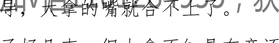
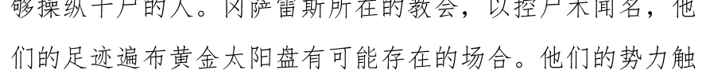


# 今天没了

作者:蛇草 日期:2014-09-29 22:58

两人回到小旅馆找索菲亚。索菲亚其实睡在同一个小旅馆里，只是之前婉儿急匆地走，来得及顾上她。

大伞敲了半分钟，索菲亚迷迷糊地过来门，身上还穿着睡衣。听到大伞表明意来，索菲亚并没有多着急，而是邀请他们进房。

婉儿很着急，让索菲亚快点换掉睡衣，赶紧带他们去水晶洞。

索菲亚返回房间去换衣服，换了一套才出来。

大伞觉得她很奇怪，昨天还热情的，怎么今天突然变得这么冷漠？

> “我们应该先吃点东西。”索菲亚不好意思地摸摸肚子。

> “我带了干粮路上吃。”婉儿指了指背包，“你的佣金加倍，不要再蹭了。”

原来婉儿也早看出索菲亚的态度，推测她应该是讨厌他俩妈妈，毕竟大清早，铺子里还没几个人起床，他们就要进入沙漠了。

> “其实我本想在早餐时向你们说明。”索菲亚疑惑了一下，带着歉意说，“昨天晚上我得到一个不好的消息，水晶洞那里出了事故，可能今天不会对外开放。

> “事故？”婉儿眉一沉，急忙追问，“什么事故？”

大拿第一个念头是想到案，心想可能是神秘人为为了进水晶洞穴，抢对洞穴守卫下手。

“有一个洞穴守卫的时候来到镇上。”索菲亚说，“他吓得不得轻，镇上的医生他打了镇静剂，休息了两个小时才说明了一些情况，他在凌晨被门口奇怪的声音吵醒，当他打开门查看时，发现竟然是沙漠里的干尸，在门外。他惊醒其他守卫，一路出来，可是只有他人成功地脱了，其他人都没有回来。”

“千户……”大拿深呼吸一口气，轻声对娇儿说，“难道厉萨斯莱也来了？”

“科斯祖玛说他还没死。”娇儿神情凝重的点点头，“也莉理说他信了，我们获得了很多好处，可能，对我们来说是好事事。”

“当然，很有可能只是谁的恶作剧。”索菲亚没听到他们说，继续说，“镇上已经派人去看看，不管结果如何，都一定会耽误很多时间，在查明情况之前，为了大家的安全想，水晶洞穴是不会对外开放的，所以我建议在小镇先逛，附近有几个景点还不错，我可以免费带你们参观。”

“你带我们去吧。”娇儿谢绝了索菲亚的好意，“如果有千户，我们能帮上忙。”

作者：蛇草 日期：2014-09-30 20:53

当索菲亚说到沙漠里的干尸时候，大拿不意识的摸了摸包，里面还穿着一些对付尸时没有用完的死灵之花。他的听到听到闪萨雷斯逃走之后，就把死灵之花粉未妥善的保存下来说，以防不时之需，没想到很快就派上用场了。

只是不知道沙漠干尸和僵尸不是一个品种，死灵之花能否起到效果。

“不行！”索菲亚拒绝了婉儿的请求，“水晶洞附近危险了，你大概不知道，那些洞穴守卫，大部分都是退役的警察，其中有一个甚至做过雇佣兵。

“你是一名当，付给你佣金，你就肯听从我的指示。”婉儿硬硬的说，“我们的生命由自己负责，你不用担心会受到牵连。”


“为什么要急着去水晶洞？”

大拿知道婉儿太急切了，索菲亚肯定怀疑他们水晶洞的目的并不单纯，不是去游览那么简单，顺便在索菲亚耳边轻的说的话。

索菲亚思考了片刻，郑的点头，“我可以带你们去，但你们一定要很小心，如果出了事，我会很愧疚。”说着，转身准备行李。

婉儿望着大拿，“你跟他说什么了？”

大拿瞥了警房内，轻声说，“用了个善意的谎言。我跟她说，我们是神秘文化的爱好者，遇到这种奇特的事情，求她一定要带我们去看。

“这也行？”妈妈哑然失笑。

“在来的路上，我已经知道她热衷于各种神秘文化，我这么说，她肯定会为我们提供便利。而且，她自己其实很想去。”大拿夺。

“你什么时候变得这么聪明了。”妈妈不禁一笑。

“你现在被情绪蚕了脑头。”大拿学着索菲要筹肩胜，“队伍里总要有一个聪明人吧。”

“去。”婉儿捣赖地推了大拿一下。

作者：蛇草 日期：2014-09-30 21:42

得到索菲的同意，三人再次前往水晶洞穴所在地。一手处理及掩埋陷阱，这路上都是很多坑印，断续，有些地方已经消失了，大概是风沙较大遮盖了痕迹。看来昨晚的事情引起了许多人的重视，而且是非常及时估计还没亮就去了。如大拿所料，索菲对沙漠干尸很感兴趣，在前方带路走得快，顾不上，走了大概一个小时，来到了陨坑周围。陨坑下，看守们居住的房屋周围，停着两辆沙漠越野车，应该是从沙坡上下，沙坡上还留下几条深深的轮胎印。


有四个人持枪，附近依次放着三具尸体，被白布盖住，偶有风吹过，掀起布的一角，露出一截腿。

“拉出来。”索菲亚指着房子门口。大拿和婉儿也看到了，拍着一个硬棉体出来，放在之前，然后站在那里用白布把尸体盖起来。过了一阵，屋子里又出来两个人，手里拿着几把，推出尸体。这些人聚在一块说了句话，而争吵，声音比较大。整理，他们就开始寻找周围，试图收获更多尸体。

“重点是没有干尸。”婉儿说，“你看手中的那些枪，都是杀伤力强的武器，不可能留下来。”

“也许被白布遮住了。”大拿，“听不清，我们必须靠近点。”婉儿往沙坡走，要看清脑心中的疑问，去现场看看。但她刚上沙坡，沙土立即下，失去平衡摔倒，顺着沙坡下滑。大拿喊了句小心，赶忙上去帮忙，却发现脚下无处。

两人前后滚下了沙坡，到了陨坑底下，两人灰头土脸的爬起来，衣服里到处都是。索菲亚跑到他们身边，动作比娇儿和大拿得多。这时，原本在陨坑里的一辆沙漠越野车开了，两个墨西哥人打开车门，大拿一脸耐意的瞪着他们。蛇草 日期：2014-09-30 21:23
蛇草 日期：2014-10-01 17:37

索菲亚跟他们用西班牙交流了一会儿，两个墨西哥人放了，但眼睛在大拿和娇儿身上打量。处理完毕，索菲亚满脸狼狈，失去了勇气。这种感觉就越强烈，如果在身边还好，至少是信过的，而索菲亚只是临时找的向导而已，身份一无所知，指不定会做掌控之外的事。大拿则笑着，他认为语言不同，但微笑可以跨界，让别人减少敌意。索菲亚和两个墨西哥人交流，其中一个墨西哥人挥手让他们上车。索菲亚坐在旁边，对娇儿和大拿，“我跟他们说，我们是来帮忙的。他们现在的确需要帮忙。”距离铁皮房子也就四百米，沙漠越野车轰鸣一声，将三人带到了房屋附近。开车门，大拿立刻闻到一股浓烈的血腥味，他皱着眉头，目光扫过那几具白布覆盖的尸体。无一例外，四块白布都有几处浸染了血渍，这说明他们遭遇还不久，鲜血还不及凝固。同时也证明了他之前的推断是错误的，这四具尸子里没有干尸。大拿走上前，用手撑起白布角，想看看尸体的伤口。通过伤口能看出很多事情。大胡子墨西哥人说了话后，索菲亚翻译道：“不用看了，他们都是被子弹打死的。”

“子弹？”大拿有些吃惊，他已经撩开了白布，发现尸体胸部很碎的，肠子已经烂出来，由于死了很久，苍蛆已经爬满了尸体。死得有快吗？”

“不是说遇到干尸吗？”妈儿补充道。索菲亚转述了妈儿的话，很快传到大胡子墨西哥人的回答。然后经过一番简单的交流，妈和大胡子初步知道了一些情况。经过此前救援的几墨西哥人的现场勘察，铁皮屋附近的确发生了枪战，和昨天晚上幸存的那个洞穴守卫说明的情况不同，在现场并没有发现任何干尸的踪迹，死去的四个洞穴守卫，都是被彼此的子弹打死的，除去逃回镇上的幸存者，另外还有三人失踪。

比较合理的解释是洞穴守卫们发生内讧，导致了血案的发生，活下来的人都是逃走了。婉儿陷入沉思，这种推断的确能解释发生的事情，可是这些人为什么会发生内讧，难道是因为醉了酒？大拿从地上站起来，手里拿着血淋淋的钱包，说：“钱都在，也没丢，如果是内讧后逸，他们会带走。”另一个戴眼镜人不完全赞同胡子人的推断，他发现房间里少了几套装备，那是进入洞穴必须的装备，同时大门也被带走了。他认定不管什么原因，其他三个应该是进入了洞穴。大拿从这里意见不同，寻找了很久。

“他们需要我们帮忙。”索菲亚向娇儿和大拿翻译了救援者的请求。在这一点上，“不！”婉儿拒绝，“我们可以去水晶洞，帮你们找。”听完索菲亚翻译，所有的救援者都难以起来。娇儿知道是在自己，用一根皮筋把头发扎马尾，大拿横走过去。大拿也明白娇儿接下来要做什么。大拿吐了口气，娇儿暗拔腰，右手举起，摆出这种姿势，借助跑步的力量贴近了大拿。大拿挥出一拳，击了大拿门，他已有打算，靠这一拳把娇儿打倒。大拿从这一拳中可以看出对方是练过的，虽跟中国功夫不同，但身体协调性完全得到了展示，攻防有力，即使打不中，他还有后手。娇儿早到的出拳位置，身体低缩，抱住对方腰，右脚扬起老高，撞了大拿的额头。大拿眼前一暗，摇晃晃的退后几步，回过神来，发现婉儿手里拿着原本他的枪，冲他微笑。其他的墨西哥人见此情形，纷纷哒起来，枪口对准婉儿。婉儿停止玩枪，抓着手枪，递给大拿，用英语说了声不起。大拿找了扶眼镜，没有接枪，反而把枪套丢给几个弹丸丢，然后冲向胡子说了句西班牙语。索菲亚对婉儿说：“他说找到水晶洞的伙伴了。”婉儿把枪套戴好，装好手枪。即便是索菲不翻译，她也清楚大拿比她，无疑是认同她的能力，约她一起去。知道了婉儿的打算，救援者没有再测试大拿，让他进入了队伍。兵分两路，大胡子带了几个个人开了两辆车，去沙漠这边。大拿则留下一人看守尸体。其余人都进了铁皮屋，准备下水晶洞。铁皮屋内一片混乱，桌椅凳被掀翻在地，瓶瓶罐罐被打碎了很多，墙壁上密密麻麻的光线，那都是被子弹穿过时留下的弹孔，地上到处是弹壳，可以预见昨晚的枪战有多激烈。

奇怪，如果真的是内艾，没有理由会这么多枪。”大拿对婉儿说，“他们一定看见了很恐怖的东西。”婉儿赞同的说，“他们陷入了恐惧，才会失控打光所有子弹！”但没有别人的尸体。”大拿说，“在这样密集的火力下，僵尸也能打趴下了！”“也许比僵尸更糟糕的东西。”婉儿说。大拿没有再追问，看着婉儿的神情，肯定和她一样迷茫。眼镜名为乌鸟奇，绿洲小镇的警察之一，其余跟着他的三个人，就是小镇巡防队的成员，属于民间自卫组织。他们从远处搜寻完毕，检查好武器后，从房里找到了一张洞穴的地图，让婉儿记住路线，同时要求他们一定得在他身边，他们不懂西班牙语，如果遇上那些洞穴守卫，很可能会发生不必要的误会。另外就是没必要的情况下，不要开枪击洞穴守卫，他还想从他们口知道昨晚的真相。婉儿和大拿允许下来。一人准备妥当，开始下矿井。索菲亚反复嘱咐大拿婉儿要小心，因为没有自保能力，不能继续下去。今天完了。

制冷服穿在身上，大拿感觉到一阵阵冰凉，衣服外形像羽绒，里面是硬邦邦的冰块。他还背着两个小氧气筒，头上戴着盔，上面有矿灯。在之前，乌戈曾说过，他们一定会地下，距离地面浅的位置，有很多废弃的矿道，这些矿洞由于被废弃，相比下方的水晶洞，安全得多，线路更加复杂，不易找到。


升降机到达垂直井的底部，一行人走出升降机，过了大约分钟，到了第一个矿道，矿道里充满了腐味的味道，低温，加上制冷服，大拿都觉得冰凉，其他人别提了。走了约两米，前方出现了一扇钢铁大门，这是一扇闸门，将另一边的风景完全挡住。乌戈走到大门前，捡起一把锁，钥匙在锁孔里，他示意大家小心。所有人都拿起武器，婉儿和大斧做好战斗准备，乌戈的推断是对的，有人进入了水晶洞。乌戈走在前面将大门猛地推了一把，大门发出刺耳的铁片刮地声。一股热气迎面来，令人言语。乌戈先猫着腰进去，其他人纷纷跟上来。美苏和妮拉在洞口的边缘，他们却被眼前的奇异所吸引。不远处，无数的尖形形状的巨型水晶柱从洞窟的石壁里钻出，就像巨人的剑库，站在其中，顿觉渺。石壁上潮湿，覆满水滴，而那石壁不是普通的岩石，而是鱼鳞般的晶体片，散发寒光。一眼看上去，像是冰川雪地，里面的温度却提醒着进入这里的这是一个极度湿热的地方。一个天神居住的圣地。大拿抓了一把脸皮，虽然疼痛，但仍然难以相信眼前的是真实的。乌戈心戒备，提醒娇儿和大拿注意规避，现在才不是带队参观，而是抓捕持枪的洞穴守卫。娇儿和大拿回神来，恢复理智，跟乌戈一步步的朝前摸。洞穴看起来空间很大，但横竖的水晶柱交错穿插，没有多少空隙让人行走，水晶棱清晰分明，刀片锋利，他一小心可能被划伤，更致命的危险来自地面的缝隙，他们所处的地方不是洞底，而是半空，面上朝竖起的水。

大拿忍不住处处叫，“好热！什么情况？”“地下远处有火山。”妮儿说，“这条矿脉，是在熔岩的上方。水晶的产生跟熔岩有很大的关系。”

大拿，再次望向洞顶。在原本钉尸体的地方，有一个黑色影子挂在石墙上，两只眼跟跟水晶一样，闪着光芒。尸体不是自己从钉着的水晶柱上脱离，而是被这个黑影故意丢了下去。那黑影子头部很小，动作敏捷，猴子似的在了几根水晶柱上。

回过神来，发现婉儿手里拿着原本他的枪，冲他微笑。其他的墨西哥人见此情形，纷纷哒起来，枪口对准婉儿。婉儿停止玩枪，抓着手枪，递给大拿，用英语说了声不起。大拿找了扶眼镜，没有接枪，反而把枪套丢给几个弹丸丢，然后冲向胡子说了句西班牙语。索菲亚对婉儿说：“他说找到水晶洞的伙伴了。”婉儿把枪套戴好，装好手枪。即便是索菲不翻译，她也清楚大拿比她，无疑是认同她的能力，约她一起去。知道了婉儿的打算，救援者没有再测试大拿，让他进入了队伍。兵分两路，大胡子带了几个个人开了两辆车，去沙漠这边。大拿则留下一人看守尸体。其余人都进了铁皮屋，准备下水晶洞。铁皮屋内一片混乱，桌椅凳被掀翻在地，瓶瓶罐罐被打碎了很多，墙壁上密密麻麻的光线，那都是被子弹穿过时留下的弹孔，地上到处是弹壳，可以预见昨晚的枪战有多激烈。


之间的纵跳，但谁也没有看清它具体长什么样。

乌鸦在呼吸器里仓糊不清的叫了一句什么，反身往出口跑。“跑！”娇儿冲向大拿喊了声。

大拿搂着腰准备跟着乌戈往跑，却发现娇儿是朝着黑影的方向跑去。“他妈妈……不要命了！”大拿一愣，立即追向娇儿。

一个防卫队员找了方寸，拿枪对准上空一通扫射，子弹将水晶柱打得粉碎俱飞，随着枪声一响，其他人也扣动了扳机，场景一片混乱，晶莹的水晶碎屑纷扬扬起。

子弹打在水晶柱上，有的发生了反弹，一阵乱跑，很快就有娇儿躲在水晶后面，获取更多防护。

几根小的水晶柱被拦断，朝下坠落，有人惊惶回避，却一脚踩空，掉到下方的缝隙里去。

大拿咬牙抬头，一通猛跑，视线紧紧的跟着娇儿，生怕她掉了。

黑影在上方的水晶柱上纵跳，可能意识到有人盯击，所以在逃跑。

娇儿时不时抬头锁定它的位置，一面又小心的避开下方的缝隙以及寻找可以通行的道路，她完全顾不上后方大拿能够爬上来，只想把那黑影抓住。

黑影一直在她的视线里，而且距离越来越近，只要继续追击下去，就能将它抓到。

嫣儿手里紧紧扣手枪，在必要的时刻，她会开枪将对方制服。

她的运气不错，那黑影在一次纵跳中没有顺利的到达对面的一根水晶，它似乎是估错了距离，大半个身体从横向的水晶柱边缘滑了过来，后肢在空中猛锥，前肢则抓住柱子，想要爬上去。

嫣儿看准时机冲开了一枪，子弹准确无误的击中了对方，但嫣儿不知道击中的是对方还是爪子……知道此刻，她还无法确认那黑影是或是某种动物。它全部都是黑色的，无法观见到全景。

嫣儿心里有些失落，朝黑影的地方跑去，当她跑过挡前面的水晶柱，却发现那黑影猛地一跃，跳进了腾腾的热气之中，消失了身影。

作者：蛇从 日期：2014-10-03 05:33
今天有事，早点更了。。没了。

作者：蛇从 落地：2014-10-05 08:46
今天早点更新。明天继续。

作者：蛇从 日期：2014-10-05 08:46

大拿听到身后的枪声和惨叫声逐渐停息，断裂的水晶柱彼此撞击，引起连锁反应，声音越来越响，地面发生剧烈震动。当他追到妈儿，总算放下心来。

妈儿把枪收好，有些失落。

大拿环顾四周，发现热气越加剧烈，不禁皱起了眉头。

妈儿深吸了几口，把呼吸器从嘴上取下来一点，苦笑说着：“我有一个好消息，和一个坏消息，你想听哪个呢？”

大拿有了之前的教训，不敢冒然把呼吸器取下，学着妈儿的动作深吸了几口，才把呼吸器取一下，“我也有好个消息和一个坏消息。”

“好消息是我发现了一个了一个有趣的排列组合，也就是所谓的迷阵。”大拿说。

“在在这里竟然有人为布置的迷阵？”妈儿若有所思，“算是好消息，却说不定说是契丹后裔布置的！”

“坏消息是，我们两个已经在里面了……”大拿说后半句，“你的好消息和坏消息呢？”

“我知道纸片上所说的水鬼是指什么呢。”妈儿说。

“这是好消息还是坏消息？”大拿也猜到妈儿的所指，刚才那个洞窟上爬行的怪物，极有可能就是生活在水晶洞里了。

水晶洞穴深处，有很多地热温泉。

“既是好消息，又是坏消息。”嫣儿说，“我们的处境危险，但也有机会！”

大拿和嫣儿先把破解迷阵，否则就会被困死在这里。

所谓的迷阵，说了很简单，通过控制光线、雾气以及环境中的物品排列让人的感官产生错觉和混乱，入者在阵里圈而浑然不知。

要破解迷阵，就得非常细致的观察，寻找干扰的因素不被环境蒙导。

大拿看了一些端倪，附近的很多水晶晶并非完全是天然生成，部分经过了移除和塑造。所用的水晶晶大小不过一，在攻击时，对对方的视线造成陷阱。

让人疲倦，再借助下方的温泉水散发的大量热气，使得这个阵具备了极强的迷惑能力。

同时，洞穴的温度和湿度极高，杀力无疑低（此处应为阻力），一般要倒到这里，只有有等死的。

大拿自经过很多的训练，普通的阵法根本难不倒，不过过时的阵法让他犯了难。

时间一分秒的过去，大拿和嫣儿从最初的情绪高涨，逐渐为失落。

在一处处角落，他们发现了一个洞穴守卫，他是缺氧窒息而死的，脸上的皮肤通红，面积灼伤。

这无疑是一个警示，如果逃不逸阵，结局坏就在眼前。

他们全身都被汗水浸湿，制冷服里很多冰块已化成水，不起大的制冷效果。同时氧气瓶上的刻度也显示出氧气只能维持不到一个小时。

“只剩下办法了。”大拿拿定了决心。

“你还有办法？”娇儿说，“哎呀，你藏什么私呀，怎不早点说，浪费时间！”

“这个办法很危险，我从来没试过。”大拿说。

“不会比我们现在的处境更糟了。”娇儿笑了下，“我相信你，虎凳诸地都不倒你，这小小的迷阵算什么。”

得到娇儿的鼓励，大拿把眼睛眯起来、眼睛想，氧气的原本是要性的，外面的空气是隔离的，倒用上了。

“这是什么原理？”娇儿问。

“屏蔽五官对大脑的干扰。”大拿指了指，“不小心掉怎么办？”娇儿说，“下面要是滚烫的地，要么就是锋利的水晶石……”

“你不是相信我吗？”大拿不由得笑。

“那不能蛮干啊！”娇儿说。


“你能闭上眼睛走吗？”大拿问。娇儿摇摇头，“没法走吧，世上谁可以做到！”

“我可以。”大拿挑了眉，一边随身携带的包里拿出布巾和耳塞，“做到这一点，就没有什么能困住了。”

“你早知道会遇到这种情况？还准备得充分的！”娇儿目光打量着大拿的包，包里还塞着其他东西，也不知道是做什么用的。

大拿把布巾和耳塞也给了娇儿一份，“背上吧。”大拿，“整理如你。”娇儿睁大大的眼睛，“就行。”

“会有别的出现。”大拿说，“等会儿我会背着你，千万不要掉眼和耳塞，也不要别的事情，你只要稳的赖在我背上。要乱的话，我们只能死。”

“乌鸦糟！”娇儿瞪了一眼。

“为什么要背？”娇儿说，“我自己能走。”

大拿摇头，“触感也能骗人，但它是没办法的，很容易影响。”

“你还是遇到……”娇儿说，“到处的水晶石……”

大拿和娇儿不再说，继续争吵时间，在闹方面，大拿累了。两人经过一番准备，两个氧气瓶拆下来，另外组背着，矿灯关闭，两人戴上遮眼帽和耳塞之后，任何声音都不见了。

作者：蛇从 日期：2014-10-06 08:26

走了多久了？娇儿不出时间，氧气还能用，顶多超过一个小时，但她感觉过了半天，时间缓慢，也很受，时候像在水里浸泡，浑身被弄得湿漉漉，觉得累得快要了，她很想把眼拉看看情况。大拿偶尔会停顿，他或许不动，她看着。

“娇儿……”大拿轻柔的拍打娇儿的脸，把她叫醒。娇儿猛地睁眼，发现眼前，大拿站在面前，四周一片明亮，附近还有个小湖。但他们不是地面，因为头顶上方是一个满水晶的穹顶。这是一个之前的水晶洞穴更大的洞穴，林立的水晶柱如摩天大厦，不用灯光照明，它们自己发光，简直进入了某个科幻电影的场景。

娇儿站起来，不敢相信眼前的景象，“这是哪里？”大拿摇头，“我不清楚。走出水晶洞穴那个迷阵之后，就到了这里。”

“那是金字塔！”娇儿的视线被湖泊中央的建筑物所吸引，她失控的大叫起来，“水晶石堆的金字塔！黄金太阳还有很多，属于我的？”娇儿灵动地抱住，将此行大拿来说是对的，他创造了奇迹！大拿看着娇儿，心里吞了口气。娇儿没有注意到他的神情，转身去湖边伸手摸了摸水，湖水有点凉，她把身上的冷服以及外套都脱下来，快速跳进湖水里，像鱼一样朝水底游去，她的身材很好，水性更好。大拿走到湖边，看着娇儿在水底没换气的游几个回，身形穿过了水晶字塔一次又一次。最终，她失望的从水底钻出来，脸上沾满水球，湖水还是泪珠。大拿知道她很心伤，也很失落，因为他早已过去湖底，那里既没有水晶字塔，也没有黄金太阳，只有不知道存了多少年的植物化石，在湖底张牙舞爪。那水晶金字塔只是穹顶水晶发育后在水底形成的幻影，就像他们此行的目的一样虚无。

“噢！哒！”闪雷雷从巨大的水晶柱后走出来，面对着湖泊大声喊：“赞美主！这是上帝的杰作！”

“闪雷？”大拿瞳孔一缩，他看到闪雷雷身后，跟着两具木乃仿似的干尸，他们身上穿着铠甲，佩着奇刀，这副行头大拿熟悉了，因为他是契丹武者的目标。大拿皱了皱。闪雷雷划出一道光，穿过海面来到契丹圣地！如果我没猜错，黄金太阳就在那里！”他指向湖泊中的水晶金字塔幻象。

“是。它就在那里。”娇儿不动声色的，“你既然选择现身，就应该付出了我们的把握，去拿吧，它是你的了。只求你不要伤害我们……”

“聪明的选择。”闪雷雷说，“你们是值得钦饮的对手，不到个月的时间，就找到了我们寻找了几个世纪的东西。”

“算是好消息，却说不定说是契丹后裔布置的！”（此处部分OCR文本重复或混乱，按上下文逻辑理顺）
... 

“在在这里竟然有人为布置的迷阵？”妈儿若有所思，“算是好消息，却说不定说是契丹后裔布置的！”

“坏消息是，我们两个已经在里面了……”大拿说后半句，“你的好消息和坏消息呢？”

“我知道纸片上所说的水鬼是指什么呢。”妈儿说。

“这是好消息还是坏消息？”大拿也猜到妈儿的所指，刚才那个洞窟上爬行的怪物，极有可能就是生活在水晶洞里了。

“既是好消息，又是坏消息。”嫣儿说，“我们的处境危险，但也有机会！”

... 

“只剩下办法了。”大拿拿定了决心。

“你还有办法？”娇儿说，“哎呀，你藏什么私呀，怎不早点说，浪费时间！”

“这个办法很危险，我从来没试过。”大拿说。

“不会比我们现在的处境更糟了。”娇儿笑了下，“我相信你，虎凳诸地都不倒你，这小小的迷阵算什么。”

得到娇儿的鼓励，大拿把眼睛眯起来、眼睛想，氧气的原本是要性的，外面的空气是隔离的，倒用上了。

...（由于原始文本存在大量重复和乱码片段，此处已根据语义进行去重和逻辑修复）

“我出来时候看见妈儿跳了水里！”妈儿对大拿说，“眨眼就看不见了！”大拿往水里看去，湖面似乎有风拂，一圈圈的波涟漾起来。清澈的水里，只有那金字塔幻象在晃动，没有任何人的影。“它在这里！它在这里！”娇儿失控的喊道。

“你在说什么？”妈儿说。

“它杀了洞穴守卫！”娇儿说，“那只怪物！”

“水鬼？”丫儿下意识的说出这两个字。

一个黑色的影子从湖水深处出现，体型由小变大，全身黝，一双眼睛非常亮，看整个外形轮廓，有几分像人，只是因为湖水折射的缘故，身体被拉扯得变形。他不是在湖水里游动，而是沿着湖边走来，一直向湖边走来，动作很流畅。

“出来了！”大拿感到危险，拉住丫儿和索菲亚急忙后退，离开湖边。

“不一个！”丫儿指着湖水深处，与刚才类似的黑影，又出现了好几个，他们粉粉朝湖边走来，气势汹涌。


一看就很锋利。嘴里不时发出嘟嘟声音起来。

用水鬼来称呼他们，很贴切。

作者：蛇从草 日期：2014-10-09 00:45

今天没发了。感谢各位的支持。早安。

作者：蛇从草 日期：2014-10-10 02:13

明天再发。

作者：蛇从草 日期：2014-10-10 06:52

水鬼们一露面，让大拿的心顿时掀了起来，俗语说看不见的未知才是最恐怖的，可现在，他却觉得这些实实在实在眼前的水鬼令人心慌。

这些水鬼要比阿兹斯特克的原住民更加原始，他们身上，有的纹身，有的装饰，狰狞。吼说：我们的外星人，隔着隔着野兽的气息。甚至比阿兹斯特部落里美洲，更有野兽的感觉。

他们或是吃人吧！

大拿脑里并没有跳出这个念头，手里扣着碧井干井手里拿来的钢剪刀，一步的后退，要跟这些水鬼打架，还不如跟碧井干井打上仗。

水鬼们朝他靠近，眼睛里透着杀气，口中流出透明粘稠的涎。嘟嘟的声音更响了。

大拿退到水晶柱前，正准备转身跑，谁知两个水鬼看穿了他的打算，立即扑到水晶柱上去，快速的爬过去，倒挂在


竖立的高大戈柱身上，居高临下的拦住了退路。

一头水鬼鬼发动攻击，大拿小心应对，按住它去后。他反而有了背水一战的决心，脑海里闪过老沙在虎符镇里用弯刀的方法，把弯刀倒扣，猛的朝那水鬼兽去。

率先上来的水鬼鬼低魂，躲开了大拿的攻击，再借助蹄地的弹力，一下落在大拿的肩膀上，脚尖一抓，锋利的指甲立即将将大拿肩膀上的衣服拽掉了一块。

所幸大拿还穿着厚的冷服，才没有伤到皮肉。但水鬼一击得手，让其他水鬼鬼叫起来，全都围着，对准大拿发动攻击。

大拿顾不回老沙的刀法，随性的一阵乱击，几头水鬼乱撞，他按石柱角后退，被其他水鬼拉住阵线与他缠斗。不一会功夫，大拿脸上就被抓得血脸模肿，伤口见血。

得手的水鬼们加厉兴奋，把血渍的爪子放到哪里舔舐，他们舌头很长，竟然还分了岔，像蛇信似的，不知道是天生还是后天割的，在层叠揉搓，很是粘人的。

水鬼们体力旺盛，利用快捷的速度上前抢一爪子立即跑开，并不是全部一拥而上，而一手主攻，其他策略，保持着相当完整的阵形，大拿一直被困在中央位置，找不到可脱脱缺口，随着他们阵形拉开，大拿再很难再插入其中一头。

看着水鬼们嗜血且智慧的样子，大拿心知自己怕是凶多少，这样下去迟早被他们耗死。

随着时间的流逝，大拿力气耗得差不多了，挥刀的动作越来越慢，水鬼们却没有任何丝毫疲惫。

在被一头水鬼在肩上挠出一道深可见可见的血痕之后，大手中的钢制弯刀脱手而出，被带飞飞到了半空。大拿半跪在了地上，回头望向水晶柱群，婉儿和索菲亚不知道躲在哪里，他暗自祈祷婉儿能逃出去才好。

正这时，飞在空中的弯刀落下，被一具从水晶柱后出来的竖井千干稳稳的接在了手里。

在另外两根水晶柱之间，另一具竖井干干也出现了身形。

它们的目标不再是大拿，而是水鬼们。

处理完毕，由于竖井周围原本有的水鬼敏锐地觉到被放了大拿，纷纷跑跑到竖井千干面前，蹦了下去。

竖井千干毫不留情，将最近的一头水鬼横斩杀。其他水鬼见状，发出一阵奇怪的嘟嘟的声音，扭头跑便，全都跳进湖水里消失了踪影。

确定水鬼们消失，婉儿和索菲亚从水晶柱群里走出，大拿发现，索菲亚的手臂仍然垂着，而婉儿心里念有词，双手也拿出奇怪的动作。

刚刚控制两具竖井千干行动的，原来是婉儿！大拿累的坐到地上，对婉儿苦笑，口里吐出了几血沫。

“你怎么样？”妈儿跑到大身边将他扶住。

“还死不了。”大拿说，“你学会了控术？”

“让她教我。”妈儿说，“不然我们都得死。”

“这些水鬼很害怕，他们害怕。”大拿挪动位置，靠着水晶柱大口喘。

“你也看出来了。并不是害怕，而是敬畏。”妈儿说，“索菲亚，这两具干尸你是从哪里来的？”

“阿斯特克的墓地。被制成了以后带走了，”索菲亚回答。

“对，对，”我料的不错，“这块脑袋后的皮肉看着可怕。”

“你的意思，他们跟虎符镇的人一样，是守护者？”大拿问。

“对，”妈儿点头。

“不是害怕，”大拿甩丧的。

“这是9号的，晚上会有。”

“今天会稍更新，大家早点睡吧。”

“他们一定知道什么。”妈儿说，“不过生存方式特别独特，语言也很独特，我们就算抓到活的，也不出来。”大拿领了，“既然没办法交流，那只剩下另一个办法，我们得再下湖看看。你还能行吗？”妈儿犹豫的问，大拿的建议也是心中所想，她跟过去，此前并没有发现任何东西，和水鬼的出现证实湖泊中隐藏着通道。”

“打得了。”大拿站起来，“只是些皮外而已。”整理好衣服，“那些怪物就藏在水底了！”

“对，”妈儿笑着了手指，“水鬼定比陆地上还要厉害，但我们现在共同敌人。”索菲亚咬着低声说，“你们是疯子！”大拿说，“何况我们本来无路退。索菲亚，你跟我们一起吧，这样的里只能等死。”索菲亚愣了愣，忽然笑了，“你们放心带在边？”“你不是我们的对手。”

索菲亚不再说话，大拿知道她是同意了，和娇儿商量休息一会儿，吃点东西，然后背上氧气再次下水。各自氧气瓶里的氧已经不多，而且这是随用的装置，呼吸器不防水，但好过没有。这处小湖泊可能有影响，水温不冷，不过属于温泉，人在其中还能适应。大拿和娇儿之前都进入了过滤底，现在回头一想，感到一阵后怕。如果水鬼没有出现，三人下水后，娇儿打头阵，控制一具干干在前开路，另一具由索菲亚控制，护在队伍后方。每人控制一具干干，这两人就能全身心的入侵，在水中很好的驾驭。湖泊其实很深，最深的地方不过七八米，下降起来并不困难，之前毫不费意，娇儿和大拿都没有发现地下有什么什么通道，这次下水有了目的的，小心留意之下，大拿很快找到了一处地方，疑似地底通道的入口。这一处由一块方形的水晶石盖住的地方，在大拿的示意下，娇儿控制着干干，将水晶石扒开，果不其然，露出一个直径一米大小的洞，跟管道类似，里面仍然充满水，不知道究竟有多深，岩壁则非常光滑，覆盖有石膏样的白色物质，分不清是天然形成的溶洞还是由人工开凿。但毫无疑问，水鬼们就是通过这种管道从湖底搜寻了三人没有急着进入管道，有了这个发现，他们继续搜寻了许多，发现这种管道还有很多，他们把覆盖物都拆开了，一个个口呈现在眼前。找到入口让三人都有心余，因为还没完全掌握，管道里的环境也因此无法判断，不知道多才有空气，水鬼们他们还没完全掌握，或者说下面很有可能是水域，水鬼们根本不能在水里生活！那样的话，他们绝对对没办法完全掌控。所剩的氧气不足大拿不由得想起莱洲小镇上的潜水设备子，如果知道这种情况，事先租借几套潜水服，将方便便很多。但也只能幻想下，条件根本不允许。为了安全起见，碧开干必须先进入管道开头。婉儿控制主干进入管道花了很长时间，控手术结合语言和手势才能完美运用，遗憾的是水下不能开口，用手势控制力大幅减弱。索菲亚相比下熟练许多，在水底溜里，她在带路。进入水底后，环境变得狭窄阴暗，这些管道跟血管似的，彼此连接，时合并又分开，跟迷宫一样，毫无章。三人在里面跟苍蝇似的走。谁也不敢去回头，如果前方没路了，对他们来说将是一场覆灭的灾难，他们可能找到路。大拿用手支撑管道爬行，暗想难道又是念头转瞬过后，它是什么，终究得进去。今天很忙，估计要早上。经过了一时间的爬行，索菲亚从水里爬出来，大拿接了。三人都很庆幸，这段之旅没有遭遇意外，除了压抑逼仄的环境，并没有受到实质性的伤害。当然也有几次插曲，都被狭窄的洞给卡住了。从水中出来，他们进入了一个幽暗的隧道里，四周不再有水晶石，墙壁跟脚削整齐，都是普通的岩壁，两端黑洞洞的，不知道通哪里。隧道旁的小洞不起眼，这种洞穴竟然连接着一个巨大的世界。大拿微取氧气呼吸器，发现隧道里氧气充足，呼吸起来没有任何困难，只是低温低了几度，有些冷。他干脆把氧气呼吸器取下来，妈儿和索菲亚分别取。“我们回到矿洞了？”大拿用矿灯了照，感到奇怪这里像是废弃的矿洞，跟他预想中要到达的地方完全不一样。声音在隧道里发出沉闷的回音，连自己都吓了一跳。妈儿绝望的看着隧道，有些害怕，最终得接受现实，原本世界很大，看来我们是太低估了。“这样好，”索菲亚说，“我们先退回地面吧，去小镇租潜水设备，来探索。”索菲亚的建议让大拿有些心动，刚刚附和想到海盗教会的人已经到了绿洲小镇，回到地面无疑是充满险。“你们的人，什么时候到？”妈儿看着索菲亚，毫不客气的问。“他们……”索菲亚知道妈儿话里的意思，“不会很快，没有恶意……”妈儿继续跟她说话，对于索菲亚，她没那么放心。在水晶洞穴里，索菲亚用莉丹干尸对她和大拿时一点都没含糊过，她对着洞穴两端打量，说，“我们先看看环境吧，出不出去另说。大拿，你觉得该往哪走？”大拿左右环顾了一会儿，又抬头在空气里感受，隧道内氧气充足，证明是有通的，他感觉到细微的风从一个方向流向另一个方向，于是指着其中端说，“风从这这边进来。我们往这这边走吧。”娇儿点头，控制莉丹干尸大拿所指的方向移动，谁知，那帮莉丹干尸丝毫不不动。“索菲亚，是不是你在搞鬼！”娇儿立即愤怒的望向索菲亚整理。“什么情况？”大拿疑惑的问娇儿。“我控制不住干尸，”娇儿说，“肯定是索菲亚在耍花！”“不是我。”索菲亚说着，她顿了顿，也开始展开扑术，两具莉尸摇了摇，朝前移动了一小步，然后倒在地上，骨头架子散了一地，其中一具连头都飞出去。“你！”娇儿厉声对索菲亚说，“你把它们毁掉，是想跟我们在矿洞里一起死吗？”“是的原因！”索菲亚说，“干尸被水泡了，身体遭破坏。”我靠……”大拿哑道，他觉得索菲亚的话是一定的道理，“水鬼不定也不在矿洞里，没了这两尊大神，我们的麻烦大了。”今天就这么多了，大家有帮忙顶顶，谢了。太累了，睡觉了。婉儿见索菲亚的样子不像谎，仔细检查干尸残骸，发现干尸身上各个部分除了蜷缩之外并没有完整，还像其他地区的木乃那样，掏空了内部器官，肉肉上还没变质。按照道理，干尸被制成了木乃，身上的皮肉韧，脆弱，即便水的浸泡，也不会出现这种状况。很快，婉儿看干尸上有很多地方是黑色的体液，里面竟然有细微的虫线蠕动，这就是后来海盗教会的人对它们进行了改造，使得干尸可以控制，也受不住久浸泡而破坏。“也许别的方法。”婉儿将干尸身上的铠甲剥离。大拿明白婉儿的用意，接过铠甲。两个女人都属于高挑长类型，但骨架子不大，穿上相当合身。这一套铠甲外观看起来古朴，硬度很高，份量估计十来斤左右，上面绘满细腻的图案，字也不少，节处由柔皮带连接。一般的铠甲不会这么轻，很有可能是武器。”索菲亚看了一会儿，知道了娇儿的打算。“你想冒充武士？”水鬼们对武士的认知仅限于外观，“这套铠甲理会到底是谁。“穿不上。”大拿抖抖铠甲上的碎屑，将铠甲在身上套下，发现根本套上去。他的体型比两具木乃还要小。“索菲亚，你穿。”娇儿说。“那是死人过的，我不穿！”大拿不由得好笑，“天天跟死人打道的人，还有这种险？”不穿也得穿。”索菲亚拼命摇头。娇儿把铠甲穿身上，然后自己去换另一套。索菲亚用外语嘟囔，情情的把衣服给她身上。大拿帮助两人将铠甲穿好，载上头后，两人都活动下脚，并不影响正常活动。穿过当地，三人开始朝前找的方位去。为了约资源，暂时停掉了了两盏矿灯，一条孤寂灯灯在矿洞里里动动没有人说话，只有铠甲摩擦的响声时而传出。走了两个小时，前方的道路依然没有尽头。“走错方向了？”索菲亚对让她让她心，她知道根据气流判断的，但她无论如何感觉不到任何风。也许这傻是在瞎路吧，她这种念头。随着出口遥远，她更是坚信了这一点。“不会。”大拿肯定的，“矿洞比我预想的要多，但我试图横向寻找巷。“这么笃定……”妈儿扭扭鼻子，“我闻到奇怪的气味。“气味？”大拿没办法闻到气味，脸上的伤口流着血，子里闻到的全是新鲜的血味。“臭味。”妈儿说。“大概是我身上的血味。”大拿说，“要是我，你们铠甲上的干尸味。那味道很糟糕。“不是。”妈儿摇头，“一种很熟悉的气味，但我一时记不起在哪里闻过。话说间，三人走出了狭窄的矿洞，前方出现一个较大的空间，是一个石厅。里面有一层层的石阶，摆放有很多石椅。这些石椅呈圆形分布，将一个圆形的大石台围绕在内。就像是一个小型的古罗马马斗场。拿用矿灯在石厅里晃动。“矿洞里怎么会有这种玩儿呢？”快看，是莉丹文字！说不定有线索！”妮儿打亮矿灯，在支撑大石台的几根主柱上看到了一些文字，不过藤蔓植物将覆盖了大半。她喜欢钻耐，拿着钢制剪刀想把植物拨开好看清楚。“小心！”大拿一把将妮儿扑住，他用力过猛，将妮儿翻倒在地上。探了石阶上的藤蔓蔓了过来，一下就缠住了大拿的腰。妮儿惊未定，在地上蹭腿，往后退。“哎呀，它们是活的！它们是活的！”手里拿着钢制剪刀胡乱对着藤蔓砍，可刚一些，立即又扑了上来。几根藤蔓射过来，将他挥开的手死死缠住，力气非常大，让大拿弹不得。索菲亚离得远，藤蔓攻击不到，全部返回身。打火机，微弱的火光总算亮起，那些藤蔓植物对火非常敏感，几乎是在火焰窜起的同时，迅速退去，躲到台石下。大拿扶起妈儿，藤蔓缝隙看到受困，拼命咬着藤蔓缠绕，整个人被藤蔓包住了，心急如如。此时，他灵光一闪，费了好功夫，终于手伸进了衣服里，一通搜索，掏出打火机。点亮火机的过程，也不于是一场苦战，火光驱散了藤蔓，也不甘的朝刚进来的洞窟跑。索菲亚早迟到了里面，松了口气。三人像是做了一场噩梦，背靠着岩壁大汗淋直亮着火机，直到烫了手才松开。“终于想起来了。”妈儿大口的喘气，声音不住抖。“幸好你有打机，不然我们就要成为食物。“黑暗里的事情，会害怕。”大拿说，“我师父跟我说的。“刚刚在大石台上看到了文字。“也许跟地底悬崖处的内容是一脉相承的，黄金太阳的下落，在这里有说明。“这些吃人的植物既有弱点，要对付起来就不难。”大拿起来，“看起来像是一片叶片，但我显然还没有好标签支撑不了多久。“光解决植物还不行，”妈儿说，“你忘了我闻到的腥味。“什么意思？”大拿疑惑问。“除了吃人的植物，这里还存在此前看到过的巨型动物。“它们身上的独特气味，我不可能记错。”

了吗？

妈激动的抓住大拿的手说，“不是，你的话说得很对。当时我跟黎江分析的时候，都猜测吃人植物是从飞行器跑出来的物种，从来没想过另一种可能。”

“我还是……不太明白。”大拿被妈的话彻底弄窘，而她那近亲昵的行为让他不知所措。

“老神打算，地下教室附近的盆栽是通往另一个世界的入口。”妈儿说，这一句话，我想念了，“所谓的另一个世界，指的不是平行空间，而是我们现在所处的世界！”

“好吧。”大拿显得更加棘手了，无奈的，“我知道很激动，我可实在是在听你不懂我在说什么。我现在所处的地方，并不是我们所熟悉的地方，只要知道这一点就足够了。”妈儿说，“这些吃人的植物也好，还是那眼睛怪兽也好，都是被律斧安特意安置的，它们产生干扰磁场，以此对付飞行器！这就是律斧安的厉害之处，用底部生命对付平行空间的高智堡，然而绝世之极！”

“你是说这些吃人植物，不是律斧安安排了对付我们的？”大拿理解妈妈的话。

妈儿兴奋的点头，“对。还记得吗，契异人的很多祭坛，都建在深渊上，并定时刻献祭，那是因为他们一直在跟底部生命交道，而且，他们知道底部生命的特殊本质。”

“你说的是虎符的情况。”大拿逐渐明白了妈儿的意图。

“我敢肯定，这里是一处祭台。”妈儿指着石厅中央的大石台说，“那律斧安向它们奉献祭品。这跟虎符镇地底的祭坛如出一辙。”

“这也意味着，他们在帮那律斧安保佑某些东西，譬如黄金太阳盘？”大拿想起了虎符镇地底祭炼中的神灵之眼。能让妈儿如此高兴，除了黄金太阳盘相关，大拿实在想不到别的解释。

“就是这个意思。”妈儿说，“我已经迫不及待去看看石台上的文字了，那律斧安会为后人留下解释。如果我们的分析得到验证，那么，我大概就知道黄金太阳盘在哪里。”

大拿看了看旁边静静的索菲，暗想妈儿肯定知道了更多的东西，因为有敌人在，才不方便多说，于是也不再多问。

接下来，三人开始寻找可以燃烧的材料，以便去到大石台附近看律斧安留下的契丹文字。但找了找，也没有在隧道里发现可以用的东西。

没办法，三人只好加大搜索的范围，在石厅边缘寻找，没多久，大拿有了发现。他在石厅的一处椅子背后，发现了一处凹槽，里面盛满了黑色的粘液。粘液中，还插有几根木头。大拿将木头拨出来，发现顶端竟然缠着麻绳和木牢。

“是前人留下的备用火！”妈儿说。

大拿用手摸了下粘液，又放在鼻子前面闻了，“是油脂，应该可以。”这处凹槽不知道放了多少年，油脂里的水分挥发得差不多，看上去跟沥青没多少大异，粘稠僵硬，大拿费了很大口气，才将里面的火一一抽出。

那些藤蔓植物被火光照到，发出窸窸的声响，拼命地往台下缩去，原本蓬松的藤蔓被挤压成一小团，过了一会儿，终于停下来。

大拿看清楚了，那个大石台下方有九根立柱支撑，就像一张大圆桌放在井口上面。藤蔓植物之前是从井里生长出来，现在被火光逼退，退到地下下，便留下一个入口，下面显然是吃人植物的巢穴。

见火光遍了吃人植物，妈儿立即走到柱前，拿着火把对立柱上的文字仔细研究，她集中精神观察，围绕立柱转动，看完立柱，又走到另一根立柱去。

大拿紧跟在她身后，跟随移动，他知道看不懂那面的文字，也就没去打量，把注意力都放在远处的黑井里。火光到了井口两米左右，再也照不进去，里面熏气扩鼻，但看不清具体情形。黑暗中吃人植物焦躁的窸伏声内，仿佛随时要出来。大拿脑海想象下面骨森森的惨景，暗自庆幸没有成为吃人植物的养料。

“奇怪……”妈儿围绕着井口转了一圈，将九根立柱上的文字看来，可能是一些墓碑。”大拿皱眉，“有什么发现吗？”

“上面记录的是一些人的生平。”妈儿说，“这些名字都很古怪，类似于印记，除此之外，没有任何特别的地方，都是普通的。”

“这些柱子是墓碑？”大拿说。

“对，真的很像是墓碑。”妈儿点头，“为什么会这样？按照记录才重要的信息。”她用失望的眼神看向大拿，这个结果很难接受。

“上面有多少个名字？”大拿问。

“应该有好几个。”妈儿没心情细数，随口回答。

“我觉得这是一份祭品名单。”大拿说，“所以你之前的猜测没错，是一处祭台。”妈儿再次走回立柱，用手指触摸，“文字是刻上去的，而且字迹不同。如果你说的一样，记录的是祭品名单，意味着这项工作是持续进行的。”

“至少可以间接证明后裔在养它们。”大拿手指着其中两根空白的柱子，上面没有任何文字，“既然它们还活着，这项工作并没有停止……”

“他们是祭祀者！”妈儿顿了顿，“我明白了，他们是在用权力获取祭品，同时在立柱上刻下死者的名字，以此铭记。”

“两位。”索菲亚说，“抱歉打断你们的对话，你们觉得离开这里没有任何帮助吗？”大拿问。

“另外，你之前感觉到的气流是从这里出来的。确定这是我们要找的出口？”索菲亚戏谑的看着大拿。大拿看了火把，火把上的火苗跳动，的确是从里面出来的微弱气流。我们辛苦寻觅的出口还在井下。”

妈儿和大拿没能在契异文字找到更有用的信息，暂时放弃研究，当务之急是要寻找离开地底。一是因为物资短缺，二是因为水鬼们有可能抓获他们，把他们当祭品。虽然妈儿和索菲亚假成了神庙武士，但是否骗得了水鬼不论，就凭水鬼们一直献祭的变态行为，很难保证万无失。

自然是赶快离开，可是索菲亚指出他一直认为出口，竟然是在吃人植物的巢穴之中。经过检验，大拿证明了索菲亚的说法是对的。大拿拿着矿灯对准井，发现下面像个怪物爬满的井隙，倒倒的吃人植物纷纷在井壁上，在光光的照射下蠕动。他从背包里拿出绳索，系在另一根石柱上。

“真要下吗？”妈儿在旁疑惑，想要下井。大拿清楚妈儿怕吃人植物，连都不敢靠近多久，更别进入巢穴，谁知道里面还有别的怪物？

“除了这条路，别的路可走了。”大拿说，“总比等死强。你们先休息不用管，我探探路。”然而，火把落了不到十米的距离，其中几根藤蔓竟没熄灭下去，交叉缠绕起来，架起了一个类似网兜的东西。火把很快落在吃人植物组成的网兜里，它们虽然被烤发出痛苦的嘶鸣，但扭曲的动作却停止。枝条很快被火把盖住，火光引燃了附近的藤蔓，还来不及燃起大火焰，它的藤蔓又跳了下去，扑了上去，将火把层层包裹起来，火焰熄灭。

在矿灯亮下，井底三人可以看到被火焰灼伤的一部分藤蔓断裂，掉落在井底，黑色的枝条则随火焰的消失，再度向井壁上方爬来，固固的夺回失地。

吃人植物的战斗让他们倒吸了一口冷气，他们畏惧火焰不假，但胆士断臂的狠心，要说它们没有智慧，谁都不会信。刚才不是妈儿提前丢了火把下去，他冒然下井，恐怕要遭遇吃人植物的黑手。

井底有多深，井底是什么情况，谁也心里没底，但都清楚井底无疑是自寻死路。

“这条路走不通了。”大拿焦躁的井边走动，“大家根据他的判断寻找出口，结果进来一条死路，让他很难受。大拿，你别怪自己，这不是你的过失。”妈儿说，“我们还有别的办法。”

“你有办法吗？”大拿问。

“水晶洞的守卫是在地面。”妈儿点头，“也就是说，他们曾经路过地面。”大拿连点头，“只要找到水鬼，还不容易，我们不能跟他们接触，否则打不出来。”

“谁要找水鬼？”妈儿落地，索菲亚把一把刀横在了脖子上。

“你不能杀死我，不然我们就得出去。”索菲亚说。妈儿笑着，“你以为我们发现在进入湖底后，每个岔道都留下了标记，你的同伴应该快到了。”

“原来你一直都知道。”索菲亚否认。

“自然不会忘记。”妈儿说，“对敌人保持警惕，总不会。”

“水晶洞内那个阵是不可能的。”大拿说。

“一定。”妈儿信心满满的说，“他们来太慢了，所以我肯定，他们是通过破坏的办法进来，我们以此待劳，将他们抓获出去。”

“我们配置了精良的装备。”索菲亚说，“没有任何胜算。”

“不用操心。”妈儿说，“我们的用处还很大，他们不会杀死我们。”大拿倒怕，见妈儿站在不动，也就没动弹，只是把视线望着石厅内唯一的入口。

奇怪的是，黑暗里听到脚步声，没有任何灯光。在矿井的照射下，一个惨白的脸先映入三人的眼帘。这些人穿着黑色的潜水服，但已经破了好几个，他跌跌撞撞地跑，满情惊讶，见到石厅内有人，几乎是连滚索朝这边跑过来，嘴里含着什么。

“夺奎！”索菲亚认出来，顾不上妈儿架在她脖子上的刀，跑了过去。这是一个墨西哥人，是索菲亚的伙伴之一，很显然已经遭遇了水鬼的袭击。索菲亚扶住夺奎，把他安置在石壁前坐下，焦急地用西班牙语和他沟通。

大拿听不懂他们在说什么，但从索菲亚惊恐到近绝望的神情来看，也能猜到一些事情。

“你们的人不是他还活着？”妈儿走到索菲亚面前问道。“他们从隧道里被水鬼袭击了！”索菲亚用颤抖的声音说，“人都死了，全都死了。乔奎！夺奎！”索菲亚大声喊着，已无济于事，夺奎身体抽搐了几次，眼睛都没死去了。“我们快快起来！”妈儿朝索菲亚的脸拍了拍，“水鬼到了。”大拿一阵郁郁，这变故发生得太快了，完全不在预料之中。然而，妈儿的话刚落后，隧道里传出一阵疾快的脚步声，从速度上判断，他们无疑是水鬼。大拿用脚把火抓灭，带着妈儿和索菲亚躲到一排石后面去，并将矿灯也熄灭了。

过一会儿，幽暗的隧道里出现了好多光影，有的在地面走动，有的在墙面和隧道顶上爬。吃人植物因为鲜血而变得活跃，水鬼在井边静静地等候。吃人植物再次采集了黑井，大拿拿着矿灯对准，藤蔓首先是趴在井沿处，摇摇晃晃朝黑井。水晶头的水鬼们慢慢移动，但只是到了脚边，退走了，然后沿着石柱朝石台上方爬去。石台上还活着的人发出痛苦的叫喊，不过叫声没有多久，就被藤蔓完全覆盖，随后藤蔓勒紧，将他们身体拼命挤压。石台中央圆孔处的细小漏出，逐渐变成一股血流。大拿捏不住一口口，藤蔓没有熄灭下去，大拿跳跳跳。藤蔓的藤蔓又跳了下去，扑了上去，将火把层层包裹起来，火焰熄灭。

在矿灯亮下，井底，三人可以看到被火焰灼伤的一部分藤蔓断裂，掉落在井底，黑色的枝条则随火焰的消失，再度向井壁上方爬来，固固的夺回失地。

吃人植物的战斗让他们倒吸了一口冷气，他们畏惧火焰不假，但胆士断臂的狠心，要说它们没有智慧，谁都不会信。刚才不是妈儿提前丢了火把下去，他冒然下井，恐怕要遭遇吃人植物的黑手。

井底有多深，井底是什么情况，谁也心里没底，但都清楚井底无疑是自寻死路。

“这条路走不通了。”大拿焦躁的井边走动，“大家根据他的判断寻找出口，结果进来一条死路，让他很难受。大拿，你别怪自己，这不是你的过失。”妈儿说，“我们还有别的办法。”

“你有办法吗？”大拿问。

“水晶洞的守卫是在地面。”妈儿点头，“也就是说，他们曾经路过地面。”大拿连点头，“只要找到水鬼，还不容易，我们不能跟他们接触，否则打不出来。”

“谁要找水鬼？”妈儿落地，索菲亚把一把刀横在了脖子上。

“你不能杀死我，不然我们就得出去。”索菲亚说。妈儿笑着，“你以为我们发现在进入湖底后，每个岔道都留下了标记，你的同伴应该快到了。”

“原来你一直都知道。”索菲亚否认。

“自然不会忘记。”妈儿说，“对敌人保持警惕，总不会。”

“水晶洞内那个阵是不可能的。”大拿说。

“一定。”妈儿信心满满的说，“他们来太慢了，所以我肯定，他们是通过破坏的办法进来，我们以此待劳，将他们抓获出去。”

“我们配置了精良的装备。”索菲亚说，“没有任何胜算。”

“不用操心。”妈儿说，“我们的用处还很大，他们不会杀死我们。”大拿倒怕，见妈儿站在不动，也就没动弹，只是把视线望着石厅内唯一的入口。

奇怪的是，黑暗里听到脚步声，没有任何灯光。在矿井的照射下，一个惨白的脸先映入三人的眼帘。这些人穿着黑色的潜水服，但已经破了好几个，他跌跌撞撞地跑，满情惊讶，见到石厅内有人，几乎是连滚索朝这边跑过来，嘴里含着什么。

“夺奎！”索菲亚认出来，顾不上妈儿架在她脖子上的刀，跑了过去。这是一个墨西哥人，是索菲亚的伙伴之一，很显然已经遭遇了水鬼的袭击。索菲亚扶住夺奎，把他安置在石壁前坐下，焦急地用西班牙语和他沟通。

大拿听不懂他们在说什么，但从索菲亚惊恐到近绝望的神情来看，也能猜到一些事情。
[/content]
（注，修正后的后续内容如下）
[content]
火焰喷射枪的出现，让原本稳操胜券的水鬼一方即处处了下风，他们久居地底，与他人植物一样火焰炽焰，而且他们的身体似乎比人更容易燃烧，站火就燃，整个石厂内散发出恶心的焦臭。靠近隧道的水鬼被烧死，火苗窜起老高，不一刻就成了一堆灰。石台边缘的血液，在它们完全离开之时被吸收得异常干净，这些贪婪的水鬼，没有留一丝血迹。一切都仿佛曾发生过。与其说是献祭，不如说是喂食，水鬼们可能是深知吃人植物的习惯，所以没有进行仪式，一切都是直奔主题。整个过程持续了几分钟宣告结束，水晶头的水鬼拜了几次，也都站起来，准备退场。这时，进入石厅的隧道入口突然喷出密集的枪火。枪火中，几个人依次站立，彼此策应。

亮起，这不是来自子弹的光，而一把小型的火焰喷射枪！五六米长的火舌瞬间点燃了几只水鬼，把整个石厅都照通红。大拿看清火焰喷射枪的人，正是之前说是要去沙漠里道凶手的大胡子！在他旁边，则是拿着火炬扫视的乌戈。


大拿在下方看到婉儿的举动，正往上爬，但婉儿一系列动作实在太快，他还没爬上多少，就被一个落下的索菲亚同伴在情急之下拽住了腰，两人急速朝井底滑落。大拿使吃奶的气气紧紧拽住绳子，好不容易停住，谁知，又落一个人，也抱在了他身上，三人摔在一起。

索菲亚一行把枪口对准井下，之前被婉儿跪底下的两个同伴都还没死，跟大拿缠绕在一起，一时分不清我我，也不好开枪，而婉儿则双腿开抵住井壁两侧，就那样卸下了力的量落到更下方，身处黑暗之中，看不见婉儿了。

乌鲁等人只得悻地把枪收回，快速的在石柱上绊好绳索，追而而去。

对着两个抱住他的索菲亚同伴用捅去，一下一个，那两个人都叫着松开手，朝井下跌落。

大拿抓住婉儿，加快下滑速度，这井很深，似乎没有底。

他滑得很快，当发现绳子不够长的时候，人已经腾空飞起。四周再没有边，只有无限的黑暗。

片刻的失重之后，大拿在了一处柔软的地方，但暂时接触了下实物，又再度飞起，一连弹跳数次，才终于落地不再动。

他抬起头，看见井把卡在上方的某处地方。在那个火光周围，到处是白骨闪动几下，火光几乎，很快被一个移动的黑影盖住。

大拿连打打开头头的矿灯，朝四处打量，这一看之下，才发现自己并没有落到地面，而是站在根巨大的横梁上，这根横梁不知是什么材质，非常柔软，他踩踏的地方，明显的坍落了两个凹槽。

横梁之下，仍存不知多深的虚无空间，矿灯照射之下，完全看不不到边缘。

一缕孤寂的灯光，朝悠远的地方无限延伸，直到被黑暗无情吞噬。

作者：蛇从 日期：2014-10-18 00:06

今天下雨了。

一手数据加微信获取更多好帖

作者：张朝 日期：2014-10-19 01:32

横梁的触感让大拿很不适应，那是一种踩在柔软躯体上的感觉，而且横梁表面上附着粘稠的胶质物，从脚趾，脚板下会牵起无数的丝，像是踩在胶水一样。

很快，他发现自己身上在之前坠时已经沾满这种液体，摸上去非常恶心，好在这些液体不具有腐蚀性，对人体造成伤害。

大拿的呼吸在坠落的过程中不知道掉去了哪里，所以他必须忍受这种粘液散发的浓烈臭味。

横梁绝对不会是岩石，但又可能是巨型动物，如果是动物的话，就意味着它的鳍直径超过五米，而长短则无从测量，因为横梁的长度远超灯光所照射的距离。

大拿调整呼吸，心里开始发毛，有种半夜闯入陌生人家里，生怕惊扰主人的胆忧。无论这横梁是什么，总之令人感到并不好。

四周的黑暗里时时冬雪压枯枝的声音，大拿猜测是吃人植物在舒展枝条，它们肯定在行动，但灯光照射不到，这里的东西似乎跟黑暗完美融合了一体。

大拿进退两难，横梁下方或是无法丈量高的深渊，也许是水域实地，但可以肯定的，如果不是落在横梁上，他面对的情形将更加糟糕。

对于自己的处境大拿倒不是很在意，因为即便在意外也没有处理，他还能找到办法脱困，在黑暗中寻找一丝希望，不会有这样的运气逃逸的。

索菲亚和乌鸟等人陆续出现在上方，他们手里拿着火把照亮，把井照得通红，他们比较谨慎，所以没有直接坠落下来。

大拿抬头望去，感觉那点火光犹如夜空的星辰遥远。随着索菲亚等人越往下走，大拿看到的火光不时延续一次，并在周围延出一片火云，虽然大胡子的火焰喷射枪较为有效的对付吃人植物，不过它们应对火焰的能力不弱，灭火相劝，火云总是一闪逝。

借助火焰喷射枪开，索菲亚等的轮廓逐渐在大拿的


视线变得清晰，大拿清楚自己不能再坐下待毙，他感受着气流，逐渐到了横梁边缘，微弱的风是从横梁下方传来。这横梁椭圆形，大拿趴在上面，利用壁墙稳住身体，灯光照射到下面，他没有奇奇，下面是空的，他本意是找一根或几根类似的横梁，这样可以一层层的往下跳。

底下微弱的气流朝上走，并且它有效的冲淡了腥臭气，清凉且清新，令人精神振奋，这是一个不错的指引。这是一个不错的指引，反正往上是不可能的，或许还有生机。

没有在下方找到横梁，大拿只好沿着横梁走，坡度很小，因为地面的粘稠很高，走相当费力。

对于自己的处境大拿倒不是很在意，因为即便在意外也没有处理，他还能找到办法脱困，在黑暗中寻找一丝希望，不会有这样的运气逃逸的。

索菲亚和乌鸟等人陆续出现在上方，他们手里拿着火把照亮，把井照得通红，他们比较谨慎，所以没有直接坠落下来。

大拿抬头望去，感觉那点火光犹如夜空的星辰遥远。随着索菲亚等人越往下走，大拿看到的火光不时延续一次，并在周围延出一片火云，虽然大胡子的火焰喷射枪较为有效的对付吃人植物，不过它们应对火焰的能力不弱，灭火相劝，火云总是一闪逝。

大拿抓住婉儿，加快下滑速度……在下方。

“完了。”大拿听到机关弹开的声音，仿佛枪头是刺了自己的心脏。横梁突然晃动起来，大拿立即趴下，紧紧贴在横梁上。

大拿的呼吸在坠落的过程中不知道掉去了哪里……在朝下方缓慢沉去。醒来，立即有液体灌入了口鼻之中，呛得他连声咳嗽。他睁眼，用手捂住口鼻，屏住呼吸，发现自己是在水中，周围是梦幻般的蓝，光线从上方透入，而他停水的中央，身体正在下落。

大拿感觉自己是汪洋里一叶船，即便抗争，恐怕也坚持不了多久，最终还是落得倾覆的结局。在聚游的过程中，他发现一个奇异的现象，这些怪兽的数量在莫名奇妙的减少……大拿看得清楚，那怪兽是游动之时，突然消失的，时间不超过秒钟。

“我们退回去。”冯儿说，起初的兴奋在环境的压迫下变成了惶恐，“空间还在变化，也许我们会会被乱流搅，隧道内相对会安全点。”

其实她不敢确定，不过除了躲起来，还能做什么呢？

“看那里。”大拿指着远去，深渊中，有一道光由下而上入，紧接着，那光亮开始扩大，将黑暗逐渐填充，就像黎明到来，阳光把黑夜驱散。那光源是个球状的物体，看上去跟淡雾气遮住的大太阳差不多，但光明是来自地底，充满了诡异，所以没有让大拿和婉儿好受一点。

怪兽围攻击，但只过了一小会儿，怪兽只剩下五只，他没有看到它们游走，而是突然就再不见了。

随着怪兽的数量越来越少，大拿也就对它们消失的过程看得清楚。这是一场魔术表演！大拿忍不住产生这样的念头，这些怪兽对他并没有造成实质性的伤害，仿佛只是为了给他展示了它们的独特本事。它们最终都会消失。大拿得出了这个结论后，放松了不少。

不过，他很快就知道自己错了，怪兽消失到只剩下两只之后，再没有减少，而是又再度增加了数量。踩在柔软躯体上的感觉，而且横梁表面上附着粘稠的胶质物，从脚趾，脚板下会牵起无数的丝，像是踩在胶水一样。

好在那黑影没有停顿，一直前进，光线又再度恢复。他深吸口气，用手脚飞快的拨水，他想快到水面去，办理。

大拿调整呼吸，心里开始发毛，有种半夜闯入陌生人家里，生怕惊扰主人的胆忧。无论这横梁是什么，总之令人感到并不好。四周的黑暗里时时冬雪压枯枝的声音，大拿猜测是吃人植物在舒展枝条，它们肯定在行动，但灯光照射不到，这里的东西似乎跟黑暗完美融合了一体。大拿进退两难，横梁下方或是无法丈量高的深渊，也许是水域实地，但可以肯定的，如果不是落在横梁上，他面对的情形将更加糟糕。

增加的怪兽在大拿看来已经不能被视为兽了，之前出现的那些好劣还有爪头，有鼻子有眼睛还有大嘴巴，而后出现的一端截割过切一样非常平整，甚至可以看到里面红内脏，但它们是活的，并且活得很好。大拿有个想法，这两种怪兽，拼凑起来，是一整只动。大拿没法验证这个想法，怪兽们追得他精疲力尽，找准机会将他吞了。无尽的黑暗笼罩大拿，但他没有任何被吞的感觉，只是全身疼难耐，动一下都不堪，还有轻微的呼吸声。这里怎么会有水？大拿脑子乱，已经搞不清自己身处什么地方。大拿忍着涨，翻身而起，将大拿猛地扑在地上。“妈妈？”大拿听清对方的声音，力道紧绷了一些，等到奇怪，妈儿怎么是这个了，难道自己从横梁上摔下来，脑子摔坏了？

嫣儿腾出手将水晶取下，把矿灯打开。大拿借灯光一看，还真是，嫣儿递给他，“这只是一个水晶制成的镂空面具，可以整个套在脑袋上。”

“我们在哪里？”大拿望了四周，“底下。你从上面摔了下来，被吃人植物的藤蔓网住了。运气不错，刚好没走远，听到动静把你救了，把你拖到旁边的隧道来了。“不是从水里来的？”大拿问。妈儿疑惑忘了眨眼大拿摇摇头。大拿摸了摸额头，努力回忆，他明明记得自己自己在水里遇到了怪兽，还被怪兽给掉了，难道是在做梦？大拿疑惑，妈儿说：“井下没有水。只有枯骨和吃人植物，我们被抓住了，最可怕的是那些拟植物，如附近的那些强些，有些都懂得弹弹，恢复了它们的植物属性。”

“它们不像坏的猛兽。”大拿说，“不然它们不会顾一切的吃我们，恐怕我们都挡不住。“也可能是饿头了，没有攻击的气力。”妈儿说，“在井底覆盖很大，水鬼底部哪那么多鲜血可以提供。“不管怎样，对我们来说都是好处。”大拿说，“说起来，这里的危险性跟虎符镇底得不得了。我们现在还活着，真的是奇迹。”妈儿说，“其实我不觉得黄金太阳盘藏在这里。“为什么？”大拿感到疑惑，姆儿的过于推论主观了。“首先跟柯瑞玛提供的线索不一致，另外，守卫太弱了，环境还不够险。”妈儿说，“以这样的程度，保护了黄金太阳盘。“这还弱呢？”大拿不禁失笑，“你觉得太挑战性吧？”妈儿说，“我们从放弃斧的角度来考虑，他防范可是我们这种普通人类，而是高于人类文明的存在，吃人植物加上水鬼，远远还不够酷。我的设想中，他的布置会结合黄金太阳的特殊属性，也就是在空间上做一些文章，我一直都没有发现任何相关的线索。”

“你的意思，那光可能是黄金太阳释放的对吧？”妈儿来了点惊讶的。“就算不是，至少它关系很大。”大拿点头，“我当时没有想到这点，而且觉得那里面危险，就从巨型动物身上跳了下来，要知道应该进去看看。“巨型动物？”妈儿，“你确定吗？”“当然。”大拿连连点头。

“应该是。我们所处的地下空间比虎符还要诡异，是多个空间的重叠。这样就能解释你身上为什么会有海水了，

因为你在下落的过程中，经历了一个海洋空间。你很幸运，在被怪兽吞掉之前，又回到了属于自己的空间里，这些捕鱼蛋，没有这份运气，永远回不去了。”

“妈儿儿，而吃人植物益于这种环境，可以对多个空间的人类进行捕食行动，以满足它们的生存需要。”

“但吃人植物得过并不不好，很多时候都没法了。”大拿说，“按照他们的，他们应该不缺食物。”

“这里的确需要要修正一下。”妈儿顿了顿，“多空间重叠的情况并不是常态。”

“一持部分吃人植物的活性，然后由它们自己开启多个空间，然后就能大肆捕捕，获取食物。”大拿说，“一旦它们不活跃了，这地下的空间也会稳定下来。”

“你怎么会有这样的想法？”妈儿心里暗噔一下，吃惊的望着大拿。

“因为我一直在想一个问题。”大拿笑了，“黄金太阳盘到底是以怎样的形式的。它还是不是那个圆盘的样子，或者，它不能与其他的东西结合，变成另一种东西，让人看不穿的本来面目，就跟之前他们把它放在剪刀柄上一样……”

“你的想法很有趣。”妈儿赞赏的说，“我们的确需要考虑这种可能性，黄金太阳盘被改造成了另外的形状。”说不定，它就藏在吃人植物的根茎里，并且被它们所用了。”

“我就这么想的。”大拿说。

“要把这些吃人植物连根拔起可不容易。”妈儿说。大拿不假思索的，“这种害人的东西，一把火烧了最好。”

两人计划着要把吃人植物烧掉，但人都知道实际操作很难。考虑了各种办法，大拿说：“我们就试试吧，好吗？”

不能把吃人植物烧起来，大拿说，似乎是不可能完成的任务。

“除非，我们找到火焰喷射器。”大拿说，“并且还有足够的燃料。”

“现在所有的线索都表明黄金太阳盘在这里了。”妈儿说，“虽然我不久前的猜想略有不同，但在这里找到最好不过来。等吧，我们会会有机会的。”

两人不得不等下去，因为重叠空间的异变更加频繁了，时而雷电交加，雾气堆积；此时无数相形异异的动物来回游……就像不同风格的电影片段在地下的空间里轮番上演。

随着异变加剧，空间的缝隙似乎可以搅动一切，恐怖的场景震撼大拿和妈儿的心，两人担心心被波及，在隧道口观望了一阵，都揉按好奇，再次缩回隧道里。

在回到隧道之前，大拿拿回来的那件干扔乱了不堪多的空间，那是她最好的归宿。

隧道里很安全，跟外面巨大的空间相距不过几，但是是截然不同的世界，里面安宁舒适，是非常好的避风港。

大拿对妈儿面对，“你觉不要觉得这些人都，跟水鬼有很多相似的地方？”

妈儿说，“水鬼，极有可能是异后裔和平行空间族孕育的后代……你觉得很可怕。故事太阳盘充满恐惧，不知道在周围还会产生多少怪物！”

“我父亲在我小时候，跟我提到了我们家族的使命。”妈儿说，“大概是压力太大，又不是人可以说，所以我在睡觉的时候，说了那些话。他肯定不知道我根本没有睡着，而且还把那些话一字不落的记住了。”


可惜，最终灵之眼却是一个镜花水月般的疑阵，种种异象表明，老穆寻找的东西，其实就是他跟嫣儿也在寻找的黄金太阳盘。

老穆的牺牲，最终还是没阻止嫣儿踏上了寻找黄金太阳盘的征程。

“你寻找黄金太阳盘，除了国家任务，也是要替你父亲完成家族使命吗？”大拿抬起头望向嫣儿。

嫣儿没想到大拿一句话就提到她父亲的家族使命，就是她寻找黄金太阳盘的，不禁愣了一下，没有否认，“父亲为家族使命奉献了生命，我身为女儿，当然应该替他完成遗憾。”

“我想你父亲大概希望你过另一种生活了。”大拿说。

“平稳平凡的生活吗？”嫣儿笑了笑，“那你为什么不过那样的生活呢？”

“我本来是做个普通警察，可是被你盯上，莫名其妙就被卷进来的了。”大拿无奈的说。

“如果不情愿，我就用枪指着你的头，你也不会去的。”嫣儿说，“你骨里渴望冒险，这一点我很清楚的，另外一个让你参与进来的理由，应该是老沙的那封信吧？”

“你都知道了？”大拿惊讶的看着嫣儿。

“他同样给我留了一封信，在信里，说了有很多有关你父亲的事情，并且提到了他。”妈儿说。

“这份信的内容，大多关于你父亲探险的事情，以及他提到的渊源。在某种角度来看，你父亲跟老沙的关系很像。”大拿说，“以后我可以把信给你。”

“为什么要找他？”妈儿好奇。


“因为他跑得比兔子还快，从地底逃生后人就不见了，后来突然留了封信给我。”妈儿说。

“我不信任他，其实直到现在我都不相信，不过还是听他的，你父亲去过的地方。”

“那个地下坟场是不是老穆铺的？”大拿想到。妈儿点头，“我去确认了这一点，所以老沙没有撒谎。”

“在我们寻找黄金太阳盘的过程中，一直有一个神秘的……”大拿说，“但他总是不露面，只能是猜测。”

“百分之五十可能是他，另外一个人更厉害……”妈儿说，“老沙是更高层面的存在，所以不属于我们。”

大拿嘴角微微张开，有些不合。。“你明白我的意思吗？等空间异变结束，诡异的光一直在闪烁，这时他们发现隧道里的吃人植物藤蔓逐渐变得粗壮，它们又吸食了许多食物，因此得到了滋养。藤蔓起初是干瘪的附在隧道内，随着躯体变粗，开始长出嫩芽，以肉眼可见的速度增加了分支，像蜘蛛似的。”


即使水晶头在手里，也遏制不住它们，只是没有对我们发动攻击，两人好好朝隧道内部退去。吃人植物这种生长现象，跟随他的脚步隧道内部蔓延。大拿用矿灯照射隧道前方，根本看不到尽头，内部仍布满贪婪的吃人植物，它们以前就把整个隧道都占领了，现在看架势是准备把隧道都吞起来。

两人被吃人植物逼退了接近一多，隧道出现了分岔口，一条隧道向上，一条隧道下方，都是整齐的阶梯，由人工开出来的。

“有脚印。”大拿手指地下，“有人刚路过这！运气不错。”大拿学过刑侦知识，知道能凭脚长大身高。“只剩两个人了，倒是好对付。”妈儿说，“不过他们怎么活下的？”

“火焰喷射器。”大拿抖动鼻子，朝下走了十多级台阶，地上发现了一滴油渍，“他们还背着它，说明还可以使用。“我们跟下去看看。”妈儿说。

台阶一直下去，越走越开阔，起初仅一人勉通过，两人走了几十米后，隧道的宽度超过了三米，岩壁是火红的熔岩，与水泥一样硬，很难想象是谁在地下挖掘出了这样的地道。即便凭借现代化的器械，要挖掘出这样的地道，也是很困难的事情。这种地下遗迹，被人类发现，也只会被当作是世界未解之谜。

台阶走完后，两人进入了一个宽阔的石厅，石厅比之前到的水鬼祭礼石厅大一倍，中央位置放置着一块方体形状的石块，正对着入口位置的一面上，雕刻有一个巨大的骷头，獠牙露齿，两个眼睛深深陷入，狰狞恐怖。大拿和妈儿的视线同时被它所吸引，这个骷头，他们在教堂里见过。这里似乎具有魔力，给整个空间增加了一种肃杀的气氛，让他们产生一种被邪恶盯上的感觉，身上毛直竖。

两个人的视线被吸引，一个黑影从侧面的黑暗里了出来，准确的将大拿倒在地。大拿其实一直小心戒备，但石块上的脑袋让他片刻分神，正好被黑影找了时机。大拿趴翻在地，背部被撞得疼痛不已。黑影的力气很大，不像人类的力量。大拿挣扎，挪动身体，试图借此活动，但两条手臂被黑影锁住。

“妈儿，帮我！”大拿喊道。妈儿冲上去帮忙，大拿用力挣脱了手臂的束缚，妈亚发出一声痛吟，摔在地。“妈靠，这家伙变成僵尸了！”大拿看着妈亚，妈亚倒在地，动作也停止了。

大拿回头用红灯看着妈亚，妈亚躲着目光，脸凹陷进去，成了半个干尸。没有血，脸上划了几道口子，正在流血，身上的衣服也碎了，但受伤应该不太严重。妈亚咬住忍痛，以愤怒的眼神没有说话。

“你命还大的。”大拿冷冷的说了句，不再啰嗦，四处寻找火焰喷射器，很快在墙角找到了气罐和喷射装置，他欢喜的过去，用手捏起，刻度表显示里面还有百分十左右的气量。“有这玩意的，我们能对付吃人植物了。”大拿对妈儿说。

“希望能派上用。”妈儿回答。为了保险起见，她用绳索将妈亚的双手绑起来，将妈亚随身的包拿走清理了一下，发现里面还有水和食物，以及药品，另外还有几节电池，都是地底不可缺的东西。随后，妈儿走向石厅中央的巨大石块开始打量。大拿试用了一下火焰喷射器，确保它还能使用，暂时将它安放在旁边，走到妈儿身边，“有什么发现吗？”暂时还没有。”妈儿摇头，继续朝前走。两人围绕着石块转动，妈儿很希望在石块上发现一些线索，所以走得非常慢，遗憾的，没有看到她期的刻字。

他们看出这巨大的石块，实际上每一块之间都是严密地连接在一起，五种石头的材质都不一样，而且跟石厅内的石材类型完全不同，不仅是出自不同的地域，显然也不会是地底原来有的石材。石块占据了石厅八分之一左右的面积，高度则达到石厅的四分之一。在这里就出现了一个令他们费解的点。因为这些石块每块的重量超过几十吨，体积也很大，通过狭窄的隧道运不进来。大拿看完整体，很不舒服，石块的形状像一具棺材，不过作为棺材，它的体积太大了，但那种阴森的气息，跟墓里摆着一具棺材毫无两样。


“你说你会不会是个陵墓？”妈儿问间。大拿听到妈儿这么问，两人对视一眼，不由有些激动。如果是陵墓，这里埋着谁不重要，关键在于里面会不会黄金太阳盘。或者这本身就是一个黄金太阳盘的容器。黄金太阳盘在这里，然后影响到附近的磁场，让空间发生重叠，这些都是可能的。

“不用担心。”妈儿说，“这种缝隙很危险，容易发生坍塌。”大拿锤击了石块，声音沉闷，“我们没有办法打开它。”妈儿又转了一圈，妈儿摸了摸周围各个角落，没有找到机关，大拿在石头顶端，也没有发现点。这一搞下来两人又是一无获。

妈儿摇头，大拿则爬到石块顶部上去，在顶部寻找可以突破的点。“到棺材里面看看。”妈儿不甘心的说。棺材形状，如果空洞是通道的话，说不定能进入内部。石块侧面的中间位置，壁都是光滑的，对大拿来说不算什么，很快就到了骷髅的位置。大拿眼眶，对着里面照射，这里只是个凹槽，里面是实的。他又钻到骷髅的鼻孔和满布皱纹的嘴里，看到的情景。骷髅的样子，她觉得有点熟悉，除了在教堂见过，似乎还在别的地方。妈亚看着骷髅，抬头盯着妈儿，“那个地方。”因为妈亚肯定是发现了什么。妈儿调整了几下灯，灯光最终落在骷头的獠牙上，那里少了一颗牙齿，使得整个骷髅看起来有点滑稽。“死人将这里复活。”妈亚顿了一下。“什么意思？”妈儿说，“别给我搞虚。”

“帮我解开。”妈亚不再下去，提出了解绳索的要求。“你不说，我不会给你开。”妈儿说。妈儿对妈亚不放心，解了绳索也会弄出什么来。

“你懂幻术，另外还有一种刚死亡的人变僵尸的手段，乌戈就是例子。”大拿在骷崩里摸索，这个洞穴一多高，宽长超过三米。经过仔细的探查之后，在最里面的位置，大拿发现了一处相对柔软的地方，他拉了几下，扯出几根干植物藤上面生钩。


妈亚能把植物拉起来，由于年轻时的缘故，有碳化的遗迹，跟石块很硬，再拉不动了。大拿拿着植物走到象牙缺口的位置，妈儿和妈亚还在后面待。“我发现了一个小洞，说不定可以走到石块去。”大拿举起手中的植物，“不过被植物堵塞住了。”“不要去打开它！”妈亚突然大喊，“死人将这里复活！”“她什么情况？”大拿一愣，妈亚的情绪很激动，跟见了鬼似的。妈儿摇头，“你先下来，她可能知道什么。”

大拿滑下墙，落到妈亚附近，妈儿解开了妈亚手上的绳索，“说吧，不要花样。”妈亚活动了手腕，“水。“你要求还挺多的。”妈儿拿了水。妈亚伸手去接，但妈儿却没有给她，而是把盖子打开，递到妈亚嘴边。妈亚抿了一口，妈儿就把水拿回去，不由分说盖好盖子，放了包里。妈亚舔了干燥的嘴唇，一口水在嘴里忍不住吞下去。大拿看着这两个女人心斗眼，忍不住抓了抓头，这种事情他看得明白，只是不知道要干什么。他其实可怜妈亚的眼神显然是在乞求，试图索要，这太没办法了。他也明白，即便自己出于好心让妈儿多给妈亚舀水，妈儿也不会回答。“这是阿兹斯特克大地女神，索亚特利库库。”妈亚把水咽下去，然后强调了一遍，“死人将从这里复活。”“不对，我见过他们的大地女神雕像，不是这个样子。”妈儿立刻反驳。“的确，地面上。复活。”妈亚说，“那是我们的版本。”


世纪前的海盗，和我们发生了激烈的战斗，杀了很多同伴。这种事，在我们海岛上不曾发生过一次，只是我参与的那一次，出现的人最多，场面失控了。”

“你怎么确定，那些人的复活，就跟猴莱牙有关呢？”大拿拿追问。

索菲亚不再回答：

“你们是在举行复活仪式吧？”婉儿用肯定的语气说。索菲亚说，“其他的我不能透露了，随你怎么想。”

婉儿知道这样的回答就等于承认了，将水壶递给索菲亚，索菲亚怀坏了，接过食物和水狼吞虎噬。

“娜儿，你信她的话？”大拿轻声道。话里带着不信婉儿，虎神获取的多好贴符，就有开启平行空间的力量，说不定这个大地母神，也有相相同的力量。”

作者：蛇从草 日：2014-10-26 23:11
今天没了。。

作者：蛇从草 日：2014-10-27 23:43
今天凌晨后了，大家早点休息。

作者：蛇从草 日：2014-10-28 01:18

“你认为她说的这玩意儿，又是一个虎符？”大拿指着石厅内的大地母神石块说。

经过索菲亚的说明，大拿想到了这一点，那些所谓的复活的


海盗，根本是从平行空间过来的镜面人，跟复活没半点关系。

“他们的海岛基地，是另一个虎镇。”嫣几点点头。

尽管这可是最合理的解释，但大拿还是不太相信，质疑道：“具有开启平行空间能力的物品，会不会太多了？要这样下去，镜面人不得满世界倾塌。”

“跟虎一样，它们的能力只是小区范围，影响不到太广泛的地方。”嫣几说，“我敢肯定，这些东西其实只是被黄金太阳矿辐射的物品，作用不如它万分之一，但是这些东西的确有很多，而且被不同的接触，就变成了不同的神物。”

美娜对身后惊恐的叫道，声音转瞬即，就像被人按住了嘴巴。

大拿迅速拿起矿灯照射过去，刚刚才索菲亚站立的地方，哪还有她的人影。

嫣几拿着矿灯一扫射，整个石厅内，竟然没有索菲亚的踪迹。

一个大打算突然消失，这大拿和嫣几一阵心慌，两人背靠背站着，小心的提防周围。

“咔哒。”一只鞋子从骷嘴里飞了出来，掉在两人附近。

“被拖到骷嘴里去了。”大拿喊道，立即纵身朝石墙去，几下就到了骷髅的嘴边。

“小心点，可能是吃人植物活了。”妈儿将水晶头扔给大拿，“拿着这个。”

大拿探手接过去，举在前面，矿灯照进了骷髅嘴内的洞穴。

半米大的石穴口子里，三四根粗壮的吃人植物藤蔓在蠕动，索菲亚的大半个身体被拖拉进去，只剩下两条腿拼命的扭动。

大拿急忙跑过去，抓住索菲亚的腿，一面则拿着水晶头对准吃人植物藤蔓。

吃人植物看到水晶头十分惊惧，不甘的松开了索菲亚，大拿拼命搂回，索菲亚从小孔里救了了出来。

索菲亚的身上被藤蔓的倒倒割，鲜血流出，人还没死，受惊吓不轻，脱困之后还在大声的叫喊。

“大拿，吃人植物过来了。”妈儿在石厅内喊。

大拿一惊，弓着腰挺起索菲亚跑到骷髅头的獠牙，挡他们进来的登陆口，黑压压的吃人植物又缠来了，仿佛塑形物瞬间涌出，并继续推进，它们进入石厅，朝四壁攀爬蔓，那样子就像无数蠕动的蛇。

妈儿被逼退到骷髅下，紧贴石壁，她没有大拿爬墙的事，只能干着急，睁睁睁看着人植物围扰。

大拿一眼瞥之前放在角落的火焰喷射枪被植物掳住迅速淹没，不禁气得咬牙横，来还只望它对付吃人植物看来是用不了了。

吃人植物如潮般涌进来，原来黑色的空间变得更加幽暗，腥臭弥鼻。

大拿心里担忧，不知道手中的水晶头能不能抵挡住气势汹的吃人植物，但他必须留下去和婉儿在一起，不然婉会很快被吃人植物淹没。

大拿背着索菲，用手扶住岩石，脚下用力支撑，动作滑的滑石脚下。

索菲晃移动，夺过大拿手中的矿灯和水晶头，索要的头全部拿走，顺势往上一跳，脚踩在大拿的头上，重新跑回了船舱里。

大拿被索菲压一压，身体失去了平衡，脚朝天的得地。他在上方，索菲亚着矿灯和水晶头，俯视了一眼，扬的船舱里。婉儿赶忙过来，两人对视一眼，满是绝望。没有水葫做依仗，都不知道会结果。

吃人植物迅速围，将两人裹住，挣扎没有任何用，只会让刺倒深入。一开始，两人还感觉到疼痛，很快皮肤变得酥麻，甚至有一种舒服的感觉从伤口出来，就算知道被吸。大拿以为自己死在这里，眼睛变得重，身上乏力。

在这种迷茫状态下，大拿突然感觉到了一阵钻心的痛，不由得爬了起来。附近有荧光下，植物全部在地上，又到了之前的样子，全身干瘪。大拿皱起眉头，搞不清发生了事情。情急之下，猛地想起了婉儿，连忙寻找。在一堆乱藤蔓之中，婉儿被裹成了蛹，身上有一些细小的伤口，但看起来不是严重。“怎么回？”婉儿被大拿摇醒，看着周围。“我不清楚。”大拿。说话间，大拿听到细微的响声从隧道内传来，他朝婉儿做了个嘘的动作，关闭了矿灯。然后凭记忆朝隧道口摸过去。隧道内的地上，全是植物，大拿踩在它们身上，知道它们全都动了，因为它们蠕动的时候，会出现声音，现在隧道内寂静。大拿确定小心听后，步子尽量轻，沿着阶梯上走，他确定先是有人走，但这些人走得很快，也很轻，过会久，就消失不见。当大拿走到之前的谷口时，眼前出现了水晶，中间隔有一定的距离，摆放在隧道内，发出微弱的光。水晶的另一侧，植物缩在一处，焦急的蠕动，想要逾越这道屏障，但又无法克服，只能将整个隧道全部填满，无数藤蔓挤在一起，朝大拿裹莱梅。植物已经完全枯，从创口处可以看到他们用利器平整的切断。大拿心里清楚，根据迹象表明，确是有人救了他跟妮。“老？”他大声喊了句，“是不是你？”声音引起吃人植物更加快速的蠕动，它们将它的隧道口堵死，大拿知道自己就算喊也没，这种环境下藏不住。“你这样结尾算什么男人？”大拿又喊了句，回应他的只有隧道内的回音。等了几分钟，大拿决定不再浪费力气，不管是不是，总之不愿意露面，再喊下去也不会结果。大拿将两个葫芦频繁捡起，吃人植物立即蠕动了几米，他想了下，放一个在地上，只拿了一个朝石厅跑回去。活着的吃人植物被葫芦阻住，没有跟上来。娇儿在石厅里等待，见到大拿孤身返回，知道没有追到救他们的人。“老还是不愿意见我们。”娇儿的猜测跟大拿一样，除了老，不可能有别人了。“肯定是没脸见我。”大拿有些气坏，“不管他了，我们现在怎么办，去寻找索菲？”我早就觉得这些人不能信。”大拿说，“她在她手上好了几次了。“关于这个石块，她知道的信息比我们多得多。”妈说，“她进里面去，一定是有图，我们找到她，就可以知道真相。“就凭她想要复仇，我也得找她要个说法。”大拿说。大拿站在墙上，娇儿跑跑后，被大拿托起一拍，抓住骷髅脸颊的石头，爬了上去。接着大拿徒手爬了上去。骷髅嘴角内，位于中央的咽喉部位，孔洞已经被打通，但紧人爬进去，大拿蹲下，用矿灯对着里面照了照，孔洞呈婉状，朝里面延伸，灯光照见一米远就被石壁挡住了。二人朝孔洞里去，发现这通道跟之前爬过的水道差不少，周围的石壁十分光滑，而且很凉润，爬了多久，身上热出一身汗。越往里走，通道越是越来越宽阔。接连出现的场景让大家拿停了上来，身上的热汗在一瞬间化成了冷汗，闷热的感觉。前方的墙壁变得不平，无数骨头镶在眼里，一眼望去，看到尽头。有的露出了，有的只露出一半，还有破裂开，掉在地上。那些，大拿背着索菲，用手扶住岩石，脚下用力支撑，动作滑的滑石脚下。滑。大拿背着索菲，用手扶住岩石，脚下用力支撑，动作滑的滑石脚下。索菲晃移动，夺过大拿手中的矿灯和水晶头，索要的头全部拿走，顺势往上一跳，脚踩在大拿的头上，重新跑回了船舱里。大拿被索菲压一压，身体失去了平衡，脚朝天的得地。他在上方，索菲亚着矿灯和水晶头，俯视了一眼，扬的船舱里。婉儿赶忙过来，两人对视一眼，满是绝望。没有水葫做依仗，都不知道会结果。吃人植物迅速围，将两人裹住，挣扎没有任何用，只会让刺倒深入。一开始，两人还感觉到疼痛，很快皮肤变得酥麻，甚至有一种舒服的感觉从伤口出来，就算知道被吸。大拿以为自己死在这里，眼睛变得重，身上乏力。在这种迷茫状态下，大拿突然感觉到了一阵钻心的痛，不由得爬了起来。附近有荧光下，植物全部在地上。如潮般涌进来，原来黑色的空间变得更加幽暗，腥臭弥鼻。大拿心里担忧，不知道手中的水晶头能不能抵挡住气势汹的吃人植物，但他必须留下去和婉儿在一起，不然婉会很快被吃人植物淹没。大拿背着索菲，用手扶住岩石，脚下用力支撑，动作滑的滑石脚下。索菲晃移动，夺过大拿手中的矿灯和水晶头，索要的头全部拿走，顺势往上一跳，脚踩在大拿的头上，重新跑回了船舱里。大拿被索菲压一压，身体失去了平衡，脚朝天的得地。他在上方，索菲亚着矿灯和水晶头，俯视了一眼，扬的船舱里。婉儿赶忙过来，两人对视一眼，满是绝望。没有水葫做依仗，都不知道会结果。吃人植物迅速围，将两人裹住，挣扎没有任何用，只会让刺倒深入。一开始，两人还感觉到疼痛，很快皮肤变得酥麻，甚至有一种舒服的感觉从伤口出来，就算知道被吸。大拿以为自己死在这里，眼睛变得重，身上乏力。在这种迷茫状态下，大拿突然感觉到了一阵钻心的痛，不由得爬了起来。附近有荧光下，植物全部在地上。


谁还顾得上自己的伤，也顾不上前面是通往何处，当后方的光逐渐暗去，两人人才发现自己半个身体已经溃在水里。

他们进入了一条倾向向隧道，再往前，就要被淹没在水里。

两人想下来休息，然而岩浆没给他们停歇的机会，火光暗淡刻立刻又亮起来，这一次大地的震动更加强烈，隧道竟然发生了崩塌。尘埃抖落，或大小的石块开始从隧道顶端垂下，在隧道里跳跃翻滚。这是他们从来没有遇到的情况，整个地下环境，进入了极不稳定的状态，几乎崩溃。

大拿要先游进了水里，大凡儿在后面，两人进入水道。

水道幽暗，大拿拿着光滑的石壁，感觉跟之前过的水下管道差不多，没有不大，一人通过刚好。

大拿正在不顾一切的向前前进，突然感觉到前面有什么东西，反应过来，脑门就撞了一下，眼前冒金星，他扶住岩壁才稳住，没有丝毫停顿，他立刻扑了过去，缠住了那东西的身体。

大拿摸到的对方的身体，发现个人，那人力气很大，拼命挣扎，用脚猛踢。大拿的脑门刚被狠狠的砸了一下，鼻梁骨疼得要命，估计是被砸断了，心里憋着一肚子郁闷，也不管对方是谁，把他死死压住，一通狠打。

对方的身体硬梆的，大拿抡了几拳跟石头一样，手骨疼得厉害，电光火石间，他意识到的，他娘不是水鬼就是僵尸，总之都是不好对付的东西。

大拿抡拳，丝毫不没有留余地，都是用了力气再打，但对方丝毫不没有受到影响，反而身子一转，抓住大拿的脖子。大拿连咬好几口，双腿在石壁上，用后背去顶对方，将他在石壁上拼命。

那双抓箍住他的手渐渐松开，不再动了，大拿把他推开，忍不住举起矿灯朝他照了眼，发现是个熟悉的面脸，竟是海盗教会的神父萨克雷！他内脏应该是被捅了，口鼻里往外渗血。

美英，眼睛睁得很大，死死看着自己，心里有些不在气了。大拿做了个手势继续前往，过来一会儿，前方出现了微弱的光亮，他心中一喜，趁光亮快速游去。

两人从水洞里出来，脸上的表情顿时僵住，这里竟然又是一处水洞，空间虽然不大，但非常热闷，具体来说，这里有两个矮不像人像鬼不像鬼的生物。

个头小，速度快，有些还戴着水晶头的无疑就是地下的主人，水鬼！而另一个，则是身体干瘪，但动作同样不慢，而且很能耐的干尸。

这两拨生物你来我往，正在互相战，地上还倒了了不少双方尸体，看样子这打了蛮，并且还会继续打下去。

大拿和娇儿将头缩一点，仅留鼻孔在外呼吸，让他们感觉到值得庆幸的是，两人冒头的水洞是在水晶洞的角落里，比较隐蔽。它靠近战场的位置也有不少类似的水洞，时不从钻出一个两个水鬼参与到战斗。

“索菲亚在娜……”娇儿轻声的，目光望向某处。

大拿循着她的视线望去，索菲亚猫身躲在一根巨大的剑状水晶后面，暗准机会移动一两米，她怀里抱着个东西，衣服给绷起来，鼓鼓的，应该很重，她露出点吃力。

“不会黄金太阳呀？”大拿问娇儿。

她发现有水鬼钻出来，朝她袭来，跑了两米，一个水鬼发现了她，疯狂地朝她扑过来。

大拿爬出水洞，一个鱼跃冲顶，把水鬼撞歪，冲娇儿说，“你去追她，我护你。”

索菲亚也发现他们出现了，转身到水晶柱后面，不见了踪影。

干尸和水鬼与一切战斗，娇儿和大拿的出现引起了它们的注意，娇儿双眼盯着索菲亚，大拿把干尸和水鬼都挡开，娇儿很快跑到索菲亚刚待的地方，又沿着斜立的水晶柱一路追迫。

大拿抡起一大水晶朝着追上来的干尸和水鬼，却又被另一个从上方扑下来的水鬼翻在地上。

大刀对准水鬼的面门砸了两次，没有起到什么效果，水鬼疯狂地挣挠着，舌头伸出来，跟蛇一样探来探去。

在两人僵不下的时候，一具干尸走过来，一刀砍掉了水鬼的脑袋。

大刀被溅了了一脸热血，这些干尸里面，竟然有几个带了刀的。这些带刀的干尸，个子比较较高，头发干枯，但是很奇怪，头顶上平没怎么头发，和其他赤手的干尸截然不同的纹。

“起萨人？”大刀想起来了，在虎符镇的时候，他见过欧律齐奕带来的镜面人中这种发型。

那具干尸砍死一个水鬼，大拿冲过去，用刀指向它，眼球动了动，灵活，跟人差不多。周围冲过来四个水鬼，围住这具干尸，阵型显然他们觉得不好对付，将主要的战斗力放在身上。大刀打算算他们混战，趁着水鬼和干尸对峙，大拿和娇儿冲过去。

整个场景很混乱，水鬼们疯了一样，从每个角落出来，人数不停的增加。大地开始震动，水晶洞里小型水晶柱纷纷倒塌，大拿左右躲避，那些水晶柱一块块从身边陨落，血溅都是。

前方，娇儿追上了索菲亚，大拿跟着她，这种地方站稳比较困难，两人都在拼命。然而，崩塌的环境比那些险陡还要难。慢慢的，她发现大拿的停休息有一种奇妙的用途，当他停的时候，上面就会有一块石头砸在他头顶的地方，如果他不停下来，那块石头很有可能会砸到她。分散的飞落，是倾倒的流沙，大拿半个身子都被埋在了流沙里，承受着它们的冲击，这无疑是为她攀爬增加了极大的难度。娇儿已经筋疲力尽，流沙更是贴在岩壁上，让她没有可以抓捏的地方，终于，她脚下一滑，整个人顿时悬空，吊了半个空。绳索陡然绷紧，大拿被带动，朝下方滑动了数米才稳住形，他的手穿过厚厚的流沙贴在岩壁上。

娇儿知道完了，她成了累赘，大拿就算再有力气，也没办法拖着四五十公斤的她继续往上，更何况那些流沙冲在她身上，这样下来，大拿需要承担上百斤的重量。

大拿牙咬出了血，他试图向上爬，但只要有一只手离开岩壁，整个身体好像就要从岩壁上脱开，让他只能停在原地，没有办法继续爬。

娇儿明白这样做的话，两个人都会摔到裂缝里，“你自己爬上去，不用管我！”娇儿朝大声的喊。沙尘飞进她嘴里。大拿假装听到，开始朝上爬，每一步都很艰难。

阳光透进来。按照理来说，之前还是黑暗，现在出现阳光，对应的时间应该是黎明，因此太阳从海平面升起。现在的情况是，这太阳已经在半空中。也就是说，从黑夜到正午，发生在眨眼之间，中间没有任何过渡的区间。大拿预感到自己已经进入了一个不同寻常的海域，并且可能隐藏着巨大的危机。他慢慢的将手伸向舟头的火把，这是他当时唯一可以利用的工具。正当大拿警惕的打量周围的时候，黑暗再次降临，与此同时，独木舟被浪卷起数十米高。大拿回头，看见艘巨大的帆船，与独木舟几乎插肩而过，宽阔的船板上视野陷入了黑暗。大拿可以肯定，这艘船是凭空出现在海上，仿佛穿越了时空门而来！出现在大拿眼前的一艘庞大的木质帆船，据他估算，船身超过六十米，外部漆黑，数根桅杆如长枪般刺出，上面挂满炮船，船舱两侧还有多个炮口，从中伸出几门黑森森的大炮。

从样式上看，这种船早已被时代淘汰不用，大拿观察墨西哥各大博物馆时见过，知道他们属于欧洲人的美洲的远洋船。它的出现并不正常，因此大拿不敢轻易妄动，只是傻傻的望着，船帆鼓风，看着船是在急速航行，然而不知道是是怎么回事，它跟独木舟之间的距离却一直是那么远，并没有要离开的样子。一开始，大拿以为它会突然出现那样又突然消失，过了好几分钟，它还是一直停在那里，没有丝毫不消失的迹象，那种感觉倒像是有人故意停了船，在等待他一样，然而没有任何人出现在甲板上。

船的帆似乎停了了，大拿却觉得，这船却是真实的存在于海的地方，不是他的幻觉。大拿握着火把，算着接下来该怎么做，终于。

大拿再次醒来，是在海滩上，此时是夜晚，带着腥味的海风带来薄薄的雾气，在大拿周围环绕。醒来后，大拿发现自己坐在一艘冰冰凉的独木舟上，在独木舟的两端，各燃着一火把，在这艘独木舟的周围，环绕有一群人，他是被这群群人的歌声吵醒的。虽是歌声，其实又不太一样，这是一种难以描述的吟唱方式，跟萨雷斯特时的声音类似，但更加的高亢，仿佛是海豚的声音，听上去颇有韵味。可惜的是，发出这些声音的人装扮怪异，他们穿着白色的教士服，脸被一块布住，只露出两只眼睛。

拿无法判断自己被关押了多久，他也懒得理会，吃喝的日子让他满意。随着时间推移，他逐渐意识到不对劲，当那个中年人再次给他饭之前，他提出要求见索菲亚，否则拒绝吃饭。抗争，最后的结果是中年人叫了几个人进来，强制性的完成了灌蛋。大拿又一次的抗争，得到的都是粗暴的响应，他觉得自己成了精神病人，被关押在精神病院里。一直被关在阴暗的房间里，关押的人担心他逃走，虽然开了绳索，却用皮带将他固定在一架铁床上。在这期间，有一个陌生的中年人来给他换药，并喂些食物，却跟他交谈。每回吃过东西，大拿感觉很舒服，不到一会儿功夫再次睡去，等他醒来，又是到了换药的时候，那个中年人总会时时出现。直到有一天，中年人解开了束缚，让他站起来，大拿才意识到自己全身虚弱得连阵风都能吹倒，别说反抗，就连走路都问题。在中年人的指示下，大拿慢吞吞的登了一艘小型游轮。索菲亚在甲板前端，短发被海风吹起，她回过头来说，“闪蕾，我们回家了。”大拿愣了愣，暗想闪蕾难道没死？于是他扭头左右打量了一下，发现甲板上除了索菲亚之外，没有第三个人存在。大拿摇头，“我没事。”当他说完这三个字，感到一阵眩晕；扑倒在了甲板上。


火光照亮了大半个甲板，让大拿稍微感到温暖，他用铜锅炖了点热水喝，靠着橡木桶坐下等待，祈祷这种日子很快结束。

这时，他忽然觉得哪里不对，最终，他抬起头，视线落在了舵杆上。

一看之下，大拿的心脏似乎被人攥住了，橡木桶的热度也传不到身上，他倒浑身颤抖起来，喉咙里忍不住发出呜咽声。

原本张开的帆，不知道什么时候竟然全部收了，只剩下光光秃秃的舵杆竖立在夜色里。

作者：蛇从草 日期2014-11-06 00:02
作者：蛇从草 日期2014-11-07 00:36

“谁？”大拿猛地站起，大声喊道，“谁在船上？”
一定有人在船上，不然船会收起来。可是火光摇下，看不见别人的身影，唯有其中根舵杆因为风摇动不定，发出诡曳的声响。

大拿才意识到，海洋竟然陷入了可怕的寂寂之中，波涛、风声都沉寂下去，而他的声音竟然产生了一些回音，在夜空里回荡，一遍又一遍地回复。

大拿顿了顿，确认那是自己的回声，只是他想明白，海上空旷无比，回音又是从哪里产生的呢？如果是在船舱内解释得过去，而此时站立的甲板上，绝对没有理由发生这种种现象。

一定有人暗中搞鬼！

“索菲亚，你不要再装神弄鬼了，我知道是你，你到底想要干什么？”大拿破口喊道，拿起火把，朝空中挥舞了几下，

又踏上船靠高的甲板到处看，并没有发现可疑迹象。

回音再次响起，大拿头有些发麻，心里很明白，自己早被索菲亚抓住了，她没必要再多此一举，但是如果是索菲亚，谁会是这种种的事情。话没有效果，大拿摇头看了看摇杆上方，一咬牙从横杆上的望塔爬过去，望塔说也有五六米高，大拿爬上去，一处火烧起来，自己不能着急，这么多船只，看到的范围可是在甲板上宽很多。

远远处是看不见任何物的黑暗，月和星辰应该是被云雾完全遮挡了。附近的海洋涛平平静，好似一块镜子，船影映在海里，使得一大片区域都是比别处更加浓烈的幽黑色，仿佛下面有一只浑然巨兽潜伏。除此之外，并没有别的异常。

然而这种宁静，更让大拿不安。船上的帆布不可能无端收起，到底是谁在做恶作剧？

是人？还是别的什么？

大拿知道船上绝对不只一个人，只是他没办法找出


而来。既然不在甲板上，那么一定是在船舱里了。拿定主意，大拿决定下去，再返回船舱查清楚。

他在沿着栏杆下降时，忽然听到下方传出一声细微的咳嗽声。大拿吓了一跳，连忙停止动作，望向下方，可那咳嗽声也停止了，不知道是从哪个角落里传出来的。又再次听到咳嗽声，他停在半空里静了几分钟，都没有咳嗽声，他知道难道是自己幻听了？他继续下去，脚刚落在甲板，那咳嗽声又再度传了，除了咳嗽声，还有人轻声的低语。

这一次，大拿可以确定自己绝对没有听错，他甚至知道了这些声音的源头，就在底下的船舱里。今天没戏了。

作者：蛇从草 2014-11-07 01:26

大拿本想将火把踩在地上灭，但看到甲板上的橡木桶里还燃着熊熊火，转念一想，现在自己不是就要找人吗，何必得做似的的心虑。现在正是要把对方引出来。是人是鬼，当面看清楚了好了！还不先把自己吓坏。

大拿心里鼓着给自己打气，朝舱门慢慢靠过去。火把的光照在船舱的楼梯上，也就只能照见两三米远距离，再远处，就是漆黑一片，什么都看不见。


低语的声音在那黑暗之中传出，并没有因为他靠近而停止，大拿推测这声音应该是船上的某个舱室里。正当他想进去查看明白，长廊里的低语声变得清晰起来，不仅如此，还出现了脚步声，而且朝他的方向走来。大拿整个身体都弓了起来，本能地蓄势，要说不害怕假的，但除了面对，他没有别的打算。

声音越来越近，像是到了楼梯上，大拿紧绷地捂住了呼吸，将火往前送了一些，随着亮光朝前延伸，将整个楼梯照亮，里面却没有半个人。低语和脚步声没有任何停顿，继续靠近，按照道理，他的火是唯一的亮，黑暗里的人是不可能的。脚步声至少有三个，低语的声音也很清晰。大拿知道声音就在附近，但却看不见，这让大拿额冒汗，整个身体都僵。

回音再次响起，大拿头有些发麻，心里很明白，自己早被索菲亚抓住了，她没必要再多此一举，但是如果是索菲亚，谁会是这种种的事情。话没有效果，大拿摇头看了看摇杆上方，一咬牙从横杆上的望塔爬过去，望塔说也有五六米高，大拿爬上去，一处火烧起来，自己不能着急，这么多船只，看到的范围可是在甲板上宽很多。

远远处是看不见任何物的黑暗，月和星辰应该是被云雾完全遮挡了。附近的海洋涛平平静，好似一块镜子，船影映在海里，使得一大片区域都是比别处更加浓烈的幽黑色，仿佛下面有一只浑然巨兽潜伏。除此之外，并没有别的异常。然而这种宁静，更让大拿不安。船上的帆布不可能无端收起，到底是谁在做恶作剧？是人？还是别的什么？大拿知道船上绝对不只一个人，只是他没办法找出


而来。既然不在甲板上，那么一定是在船舱里了。拿定主意，大拿决定下去，再返回船舱查清楚。他在沿着栏杆下降时，忽然听到下方传出一声细微的咳嗽声。大拿吓了一跳，连忙停止动作，望向下方，可那咳嗽声也停止了，不知道是从哪个角落里传出来的。又再次听到咳嗽声，他停在半空里静了几分钟，都没有咳嗽声，他知道难道是自己幻听了？他继续下去，脚刚落在甲板，那咳嗽声又再度传了，除了咳嗽声，还有人轻声的低语。

这一次，大拿可以确定自己绝对没有听错，他甚至知道了这些声音的源头，就在底下的船舱里。今天没戏了。

作者：蛇从草 2014-11-07 01:26

大拿本想将火把踩在地上灭，但看到甲板上的橡木桶里还燃着熊熊火，转念一想，现在自己不是就要找人吗，何必得做似的的心虑。现在正是要把对方引出来。是人是鬼，当面看清楚了好了！还不先把自己吓坏。大拿心里鼓着给自己打气，朝舱门慢慢靠过去。火把的光照在船舱的楼梯上，也就只能照见两三米远距离，再远处，就是漆黑一片，什么都看不见。


低语的声音在那黑暗之中传出，并没有因为他靠近而停止，大拿推测这声音应该是船上的某个舱室里。正当他想进去查看明白，长廊里的低语声变得清晰起来，不仅如此，还出现了脚步声，而且朝他的方向走来。大拿整个身体都弓了起来，本能地蓄势，要说不害怕假的，但除了面对，他没有别的打算。声音越来越近，像是到了楼梯上，大拿紧绷地捂住了呼吸，将火往前送了一些，随着亮光朝前延伸，将整个楼梯照亮，里面却没有半个人。低语和脚步声没有任何停顿，继续靠近，按照道理，他的火是唯一的亮，黑暗里的人是不可能的。脚步声至少有三个，低语的声音也很清晰。大拿知道声音就在附近，但却看不见，这让大拿额冒汗，整个身体都僵。

回音再次响起，大拿头有些发麻，心里很明白，自己早被索菲亚抓住了，她没必要再多此一举，但是如果是索菲亚，谁会是这种种的事情。……（此处由于部分文本重复，已逻辑合并）

远远处是看不见任何物的黑暗，月和星辰应该是被云雾完全遮挡了。附近的海洋涛平平静，好似一块镜子，船影映在海里，使得一大片区域都是比别处更加浓烈的幽黑色，仿佛下面有一只浑然巨兽潜伏。除此之外，并没有别的异常。然而这种宁静，更让大拿不安。船上的帆布不可能无端收起，到底是谁在做恶作剧？是人？还是别的什么？大拿知道船上绝对不只一个人，只是他没办法找出

（注：OCR文本中存在大量重复和乱码字符，已根据语义逻辑进行纠错与去重）

由于原始OCR文本存在大量逻辑重复和识别乱码，以下为逻辑修正后的连贯内容：

[content]
远远处是看不见任何物的黑暗，月和星辰应该是被云雾完全遮挡了。附近的海洋涛平平静，好似一块镜子，船影映在海里，使得一大片区域都是比别处更加浓烈的幽黑色，仿佛下面有一只浑然巨兽潜伏。除此之外，并没有别的异常。然而这种宁静，更让大拿不安。船上的帆布不可能无端收起，到底是谁在做恶作剧？是人？还是别的什么？大拿知道船上绝对不只一个人，只是他没办法找出


而来。既然不在甲板上，那么一定是在船舱里了。拿定主意，大拿决定下去，再返回船舱查清楚。他在沿着栏杆下降时，忽然听到下方传出一声细微的咳嗽声。大拿吓了一跳，连忙停止动作，望向下方，可那咳嗽声也停止了，不知道是从哪个角落里传出来的。又再次听到咳嗽声，他停在半空里静了几分钟，都没有咳嗽声，他知道难道是自己幻听了？他继续下去，脚刚落在甲板，那咳嗽声又再度传了，除了咳嗽声，还有人轻声的低语。

这一次，大拿可以确定自己绝对没有听错，他甚至知道了这些声音的源头，就在底下的船舱里。今天没戏了。

作者：蛇从草 2014-11-07 01:26

大拿本想将火把踩在地上灭，但看到甲板上的橡木桶里还燃着熊熊火，转念一想，现在自己不是就要找人吗，何必得做似的的心虑。现在正是要把对方引出来。是人是鬼，当面看清楚了好了！还不先把自己吓坏。大拿心里鼓着给自己打气，朝舱门慢慢靠过去。火把的光照在船舱的楼梯上，也就只能照见两三米远距离，再远处，就是漆黑一片，什么都看不见。


低语的声音在那黑暗之中传出，并没有因为他靠近而停止，大拿推测这声音应该是船上的某个舱室里。正当他想进去查看明白，长廊里的低语声变得清晰起来，不仅如此，还出现了脚步声，而且朝他的方向走来。大拿整个身体都弓了起来，本能地蓄势，要说不害怕假的，但除了面对，他没有别的打算。声音越来越近，像是到了楼梯上，大拿紧绷地捂住了呼吸，将火往前送了一些，随着亮光朝前延伸，将整个楼梯照亮，里面却没有半个人。低语和脚步声没有任何停顿，继续靠近，按照道理，他的火是唯一的亮，黑暗里的人是不可能的。脚步声至少有三个，低语的声音也很清晰。大拿知道声音就在附近，但却看不见，这让大拿额冒汗，整个身体都僵。

（由于原始文本后续包含大量重复段落和乱码，此处已根据核心剧情进行精简）
[/content]

**由于您提供的OCR文本存在严重的循环重复和字符识别错误，以下为基于语义逻辑修复后的核心剧情文本：**

[content]
这种宁静，更让大拿不安。船上的帆布不可能无端收起，到底是谁在做恶作剧？是人？还是别的什么？大拿知道船上绝对不只一个人，只是他没办法找出


而来。既然不在甲板上，那么一定是在船舱里了。

作者：蛇从草 2014-11-06 00:02
作者：蛇从草 2014-11-07 00:36
作者：蛇从草 2014-11-07 01:26
作者：蛇从草 2014-11-08 19:38

大拿本想将火把踩在地上灭，但看到甲板上的橡木桶里还燃着熊熊火，转念一想，现在自己不是就要找人吗，何必得做似的的心虑。现在正是要把对方引出来。是人是鬼，当面看清楚了好了！还不先把自己吓坏。

大拿心里鼓着给自己打气，朝舱门慢慢靠过去。火把的光照在船舱的楼梯上，也就只能照见两三米远距离，再远处，就是漆黑一片，什么都看不见。


甚至直接撞上大拿所在的帆船，就像又有有人朝这里扔了垃圾进来，但人却是一个都看不不到。

大拿开始怀疑自己的直觉了，他想，是不是也该和其他船员一样，去其他的帆船上碰碰运气，说不定就从别的地方离开了了。

不过最终只是想一想，一个更加坚定的念头在告诉他，这艘废船组成的迷宫般的岛屿，是一个死地，绝对不能入脚。

大拿仔细思考自己当前能做的事，这时，在库底部，他发现了一个非常小的凹隙，这让他皱眉一拧，想起了自己的奇异挂件。

奇异挂件或许无疑是具有奇能力的，或许将它跟牛角放在一起，便能激发出什么意想不到的效果。

说干就干，大拿一手拿着挂件，一手拿着牛角，两只手的距离靠越近，当两者距离不到十厘米的时候，大拿能清晰的感觉到两者都发生了一丝颤动。

“有门。”大拿一喜，值得将两者合在了一起。

作者：蛇从草 日期：2014111-12 03:05

今天没了

作者：蛇从草 日期：2014-11-13 01:04

奇异挂件和牛角合在一起，心尖有丝丝凉传出，向全身蔓延开，最后直抵脑门，大拿深呼吸了一口，只觉得好像大夏天喝了冰水似的舒畅。

除此之外，空间并没有发生任何变化。

“闪萨雷斯！”正当大拿感觉气哑候的时候，后方传来一个电子女声。

大拿听到声音，返回船旁，发现远处的海面上，出现了一艘疾驰的游艇，尾翼拖着一线白浪。

“我在这里！”大拿毫不不犹豫的挥手示意，一霍那间，忘了自己根本不是闪萨雷斯的这回事。

游艇上的人发现了他，他们朝着自己的船驶来，一个女人走到游艇前方，正是索菲亚！

大拿拼命的挥手，索菲亚出现，让他很欢喜。

不过，他无法确认索菲亚的到来，跟刚才将劫件和仓库手册合并其实有什么好处，虽然索菲亚出现后的景象让他看傻了，已收获，收获的理由，根本不用愁了。

游艇来到航桥之前，大拿高兴坏了，还没等索菲亚搭起桥梯，一个小组就从甲板跳下去，落到了游艇上。

“我找了很久，终于把你找到了。”索菲亚对他说。“快离开这里吧，我一刻也不想多了。”大拿说。

游艇调转身，驶向空无一物的海面，大拿听到身后传出大海波涛，他回头，发现一个巨大的漩涡正在生成，中央的那些船舱纷纷扬头，开始沉没。漩涡的范围越加扩大，像是要把整个海洋都裹进去。

“快走！”大拿被眼前的景象所震撼，大声喊道。

索菲亚疑惑的回望了一眼，安安慰道，“闪雷斯，你现在安全了。”

“什么安全了，你没看见涡流快把我们吞掉了吗，赶紧逃吧，再慢点就进不掉了。”大拿心急如焚的喊道。

巨大的漩流将无数的船吞噬，大海中央出现了一个巨大的空洞。

而在漩涡的边缘，竟然还出现了十几道龙卷，水天相连，还只是肉眼能看到的景象，隐约间，在更远处，更多的龙卷正在生成，绞杀一切。

“海上很平静啊。”索菲亚说，“你到底看见什么了……”

一手处理 加密101284955 获取更多好站

美莉·索菲亚似乎在害怕，她看向远处的一艘船影。

作者:蛇蛇 日期:2014-11-13 01:45

透过游艇的窗户，大拿望向，望前方，游艇在海上飞驰，前方一片平静，这让大拿安心了很多，他不想再回头，因为望一眼，都会让他无比恐惧。

索菲亚来到他身边，手里拿着两杯红酒，她将其中一杯递给他。

“你又要什么花样。”大拿没有伸手去接，他知道这酒有问题。

“没有人能从那里活回来。”索菲亚将酒放在桌子上，

“你是第一个。”

“你是巴不得我死在那里吗？”大拿。

“当然不。”索菲亚笑着，“我跟你在一条船上，你若是回不来，我也死得。”

大拿盯着了她一眼，问：“什么意思？”

“我们在奇奇瓦瓦沙漠下的水晶洞里差点全军覆没。”

索菲亚说，“船长很生气，我不容易得到了了一次活命的机会，所以，你明白了吧，如果你不能从鬼船上活着回来，我的命也就了。”

“鬼船？”大拿说，“你知道那是鬼船，竟然还把我送上去？”

“鬼船只是大家的一个误解，不是吗？”索菲亚说，“你王经理，加入我们吧，获取更多好帖

大拿当然知道那是平行空间的产物，他将犀牛角拿出来，随意的丢到桌子上，“你你要这个东西吧。”

“我就知道你一定的。”索菲亚拿起犀牛角仔细检查下，向向的大拿喊：

大拿早有防备，将她推开，“可以放我？”

索菲亚摇头，“不行。”

“你不要以为没办法自己走，你根本不是对手。”大拿冷冷的说，“还有姆儿，你把弄到哪里去了……”

“你为什么要走呢？”闪雷斯，我们不是最好的伙伴？”索菲亚说。

大拿看着索菲亚明亮的眼睛，头又有些晕，他摇晃着，大声说道，“我不是闪雷斯！”

大拿愣，缩在软座椅上，脑袋里一片，突然之间变模糊了。

“你就叫闪雷斯。”索菲亚坚定的语气。

大拿喃喃，“对，我是闪雷斯。”

索菲亚给了红酒，递给大拿，“喝了它，好好觉吧，你醒来，一切将回到正轨。”

作者：蛇从 日期：2014-11-13 01:46


作者：蛇从 日期:2014-11-14 03:15

睡着了。。今天就不改了。

作者：蛇从 日期:2014-11-15 00:23

又是零点后。

作者：蛇从 日期:2014-11-15 01:13

不好意思。乘船大概用了三个小时，抵达一个海岛，大拿无法确认不是他之前过的岛屿。这个岛屿不大，一眼就能看到边缘，银白色的沙滩很宽，岛上植物较少，光秃秃的，表面被海浪冲得光滑。这是一个相当常见的岛屿，看不出特别的地方。游轮在处处石堆而成的码头停下，索菲亚带着大拿登上了海岛。沿着海岸滩走了一段距离，大拿眼前出现了一座教堂。这教堂规模还没有，也是不起眼的，外部陈旧的墙上，镶嵌着海壳等物，部分地方还挂着干燥的海藻，有种天然的感觉，不像人为镶上去，像是不久前浸泡在海里，刚晾起一样。大拿带着索菲亚走，都没有见到任何人，心里有些奇怪，他推测索菲亚就是索菲亚说的教会基地，周围到处有人活动的迹象，但没想到会这么冷冷清。但他也没有发现，按照心里的想法，继续看着索菲亚。一手整理加群:10128495 获取更多帖子

牛角拱起来又接近。两人走进教堂门，大拿发现教堂内的设置不太一样，没有椅子，也没有耶稣像，就在周围的墙上，有一排排的灯炬，白天也亮着的。教堂门正对着方位，原本应该放置耶稣像的位置下方，摆放着水晶柜。水晶透明的，从侧旁看过去，可以看到中间位置有一暗影，看那形状，应该是一具。作者：蛇从 日期:2014-11-15 02:53

索菲亚睁开眼，对大拿说，“闪雷斯，我们马上就能 接受独立教皇的洗礼，正式的成为教士，你高兴？”

“什么？”大拿愣愣的看着索菲亚，“我什么时候成为教士了？”

“我替你教皇请求的。”索菲亚。

大拿看见索菲亚替他做乱决定，气得不得行，刚要开斥她。不过转念一想，索菲亚在奇夷瓦沙沙漠能指挥很多人做事，在海盗教会竟然没有什么地位，真是奇怪。“做了教士，有很多好处，你慢慢就知道。”索菲亚朝大拿挑了挑眉。大拿压抑着怒道，嗯了声，算是回答了。

索菲亚吹笑着说，“你真会话。处理。大拿不习惯被索菲亚这样丢脸，索菲亚眨了眨眼睛索菲亚放开手，走到水晶棺前，问道，“里面是谁？”水晶棺材质模糊状态，看不见里面尸体的模样，只能约看见一个黑色人形。

“费尔南方多神父。”索菲亚说，“埃尔南·科尔斯特斯的至交友。”大拿摸了摸额头，有些尴尬，这两个人都，他一个都不熟悉。“埃尔南·科尔斯特是阿兹拉克帝国的征服者。”索菲亚没有犹豫的继续道，“16世纪早期，他用了一千人，用了五年的时间，征服了一千五百万人口的阿兹拉克帝国。 这么…………”大拿想想，这段历史他是有了解的，海盗教会最初的成员，就是那些冒险者，后来接触印度后，脱离了基督教，开始形成独立教会。不过费尔南方多神父这个名字，曾被提到过，于是大拿指了水晶棺，“埃尔南·科尔斯特利用了阿兹克人的传说和信仰，阿尔南·科尔斯特穿上了神话的外衣，阿兹克人误以为他们顺利登陆，并给予了他们过分的权力。”难怪一千人打败一个庞大的帝国。”大拿发现有些走神。

大拿觉得不久在海上的见，跟费尔南方多神父有很大的关系。索菲亚向教皇指出了大拿在船上，那个年轻的妻子，把大拿向靠推了推，似乎在她的介绍后，大拿听到索菲亚又提了厉萨雷斯克这个名字。独立教皇拿着牛角帽量了量，又量了量大拿，跟索菲亚说了句话就带离开了。大拿还以为独立教皇会对他在意，没想到是个这个结果，心里有些失落。“他回答我们了。”索菲亚兴奋的说，“后天，我们就以接受教洗礼。”大拿对洗礼没什么兴趣，随意的嗯了声。等独立教皇走远了，索菲亚再次走到水晶棺前，动手去掀了掀棺材盖。

“你干嘛？”大拿费索索菲亚的动作，似乎是要把棺材盖掀。“过来帮帮。”索菲亚说，“这盖子很重。“被发现你就完了了。”大拿担心的看了看侧门，生怕独立教皇而去复返，费尔南方多神父是水晶棺材装起来，用脚手指想知道都是教会的圣物，怎么能轻松的动去。“我被抓，你也逃不掉。”索菲亚说，“费尔南方多神父死后，如今如此，你难道见识一下这种奇迹？”大拿心中一动，犹豫下上前，他也想见识下，水晶棺里加了什么。水晶棺盖只是覆盖在棺材上，并没有别的手段，大拿双手拖住棺材盖，用力拖动，盖子被拉开。里面逐渐显露，果然跟索菲亚说的差不多，费尔南方多神父睡了一样，丝缕看不出个人，似乎略有惊动，就会过来。大拿仔细打量费尔南方多神父，和昨晚在海上见过的对应，不多时，眉头皱了。“你见过？”索菲亚注意到大拿，“没，怎么可能。我所知，他出现后不到天就死了，没想到啊，这具尸体真能活，没有丝毫腐坏。”索菲亚伸手去摸了费尔南方多神父的脸皮，还有弹性，陷下去很快又恢复了，跟活人差不多。“怎么做的？”大拿叹了。大拿发现索菲亚刚才让他打开棺盖，不只是看着，简单了。大拿发现没有保存尸体的药物，除了水晶棺放置之外，竟然是自然保存，按照理来说，水晶棺不会具备防腐功能。你也信？”索菲亚点头。大拿忍不住笑，竟然还是奇迹。没有谁知道。”索菲亚说，“不过教会的人都相信他复活，就冰封的尸体，竟然还是奇迹。大拿发现索菲亚刚才让他打开棺盖，不只是看着，简单了。大拿发现没有保存尸体的药物，除了水晶棺放置之外，竟然是自然保存，按照理来说，水晶棺不会具备防腐功能。你也信？”索菲亚点头。大拿忍不住笑，竟然还是奇迹。没有谁知道。”索菲亚说，“不过教会的人都相信他复活，就冰封的尸体，竟然还是奇迹。走吧，咱们去附近的岛上休息两天，等洗礼日子来。”索菲亚打了个哈欠，转身离开。大拿感了一肚子的疑惑，望着索菲亚的背影，索菲亚越来越神秘兮了。


包裹得比较严实，而且还有潜水镜，他还是认出刚才就是妈儿。

妈儿还活着，而且还找到了他！她早在水里等候，看来早就知道了索菲亚的动态。

大拿知道现在还不是跟妈儿见面的最佳时机，妈儿肯定也是这个用心，所以他之后很快离开了他，只向他表明了自己的存在。

大拿按压内心的喜，头也不回的朝索菲亚游去，他水性不错，很快就上了索菲亚。

索菲亚正在奔游一海豚，等大拿靠近近，做了个手势继续朝更为密集的海豚群游去。

海豚看起来像密林的围堵，他们向其他深水里就看不到了，满眼里全是海豚，大大小，也不知道有多少多少。

索菲亚活在的海豚群中穿梭，大拿跟跟在后，他倒看着索菲亚到底在搞什么名堂。

不过索菲亚似乎只是喜欢抱海豚而已，一凛抱住一头巨大的海豚，让海豚拍动，在海里肆意的乱夯，大拿心重重，不敢有片刻放松。

海豚与大拿操身而过，都没有放在，都朝着一个方向游动，仿佛没有意识到群体中央杂染来了异类。

大拿和索菲亚跟随海豚群游动了一段时间，逐渐的，不少海豚头部返回，来回穿梭。

索菲亚先游向海面，大拿也游了上去，从海水里露头来。高亢的海豚声此起彼伏，时时有海豚欢快的跳起来，又落落进水里。

大拿看着附近，发现海豚群游进了一个宽阔的湾区。

远处依稀可以看到海岛，湾区周围地势较高，边缘处修建护栏，形成一个观景点，不过相当远，只看到一堆堆的人影跃动。

海豚翻腾，海水涌动拍打礁崖，激起滔天水浪，在太阳照射下，湾区上空浮现了一道彩虹，景象相当美。

一有趣的瞬间，美妙的神，色彩是值得相信的，海水倒覆在身上。

正在这时，他发现索菲亚竟然取下了呼吸器，并张大了嘴巴。一堆黑色的东西从索菲亚嘴里喷出来，被海水冲走，很快又消失了。

大拿眼睛猛地眨了几，完全不敢相信眼前发生的事情。

索菲亚跟没事一般，又把呼吸器灌给自己，潜入水中去了。

大拿突然感觉喉里发痒，他迫不及待的摘下呼吸器，一下吐出了来。在他面前的海面上，一堆黑色的小虫，随着海水涌动，四散逃走。

大拿感觉自己的肚子在抽筋，胃里莫名的胀难受，紧接着又吐出了好几口，都忍不住，脑袋更是一阵眩晕，视线变得模糊。他强打起精神，将呼吸器戴回，拼命朝海岸方游去。

现在他总算是明白，索菲亚这恶毒的女人他给坑了，至于那些虫子是什么，他根本无暇去顾。

海拍最初是有序的游动，这时变得秩序混乱起来，一次的大拿，大拿乱往向岸边游动，方向都分不清了，而且脚底发软，一力气都提不起。

大拿暗想自己是倒了些血暴露了，处处碰到致命危险，这简直是在海里跳舞。就当他自己必死无疑的时候，几头海豚将他托起，往岸边慢慢游去，没多少大工送到了岸边沙地上。

索菲亚先一步走到了这里，已经脱下了潜水服，只穿了轻的泳装，见到他后，连带将他救上岸。

大拿很想崩几个掌解气，但在没有力气，吐掉呼吸器后，仰着头大口喘息。

这是一处偏僻的海岸，没有谁注意到这里，大拿恢复了些体力，解开气筒憋起来，看到索菲亚竟然穿上了外套，手里提着个包，不知道是从哪里弄来的。

索菲亚将包丢给大拿，让他换上衣服。

海风吹来，大拿冷得直愁，于是压抑着心头的怒火，将潜水服脱掉，从包里拿了外套换上。

包里的衣服穿了合适，大拿立即意识到，这个包肯定是婉儿提前放在岸边，并且早就计划好了这一切。从头到尾，都把他放在兜里。

“你为什么用胆？”大拿问。索菲亚不可能无无故拉着他到海上乱一通，结合索菲亚在海训课堂对费尔南尔多神父的所作所为，他大明白了那些黑色的虫子是什么东西。

只是，蓝是国内才有的，为什么这个墨西哥女人会用？

看来你还是骗了他。”索菲亚笑着一笑。

“你知道就好。”大拿心里冷笑。索菲亚显然是低估了，从一开始他就觉得哪里不对，以为索菲亚是用催眠术或是别的手段控制他，他一直都是故意装。

“恢复了也没关系，你帮了我不少了，可惜了。”索菲亚。

“你到底是谁？”大拿捏紧拳。

“你会知道。”索菲亚笑着，“如果还有机会见面的话……”话音落落，索菲亚眼前消失。


我们得有多手准备，不过在黎面前表现出来。也别质疑他，他在美洲的人脉关系要比我们强，能获得我们无法获取的资料，心生芥忌就不好了。

两天后的中午，黎再次回到酒店，带回了一个古怪的金属箱子，并告诉娇婉和大拿，时间太紧了，他只拿到了一个超声波武器。

下午，夺刀通过酒店的服务生传递消息，可以启程去海上，海盗教练已经发来的坐标。

作者：蛇从 日期:2014-11-25 20:53

竟然失涉了。。

作者：蛇从 日期:2014-11-25 21:53


原本就在海上挣扎了很久，离谱可怕。黎答应他们去海上，但为了撇关系，没有让他们乘坐同一艘船。

夺刀启程后，黎在自己租赁的游艇上，打开了跟踪仪器，夺刀的位置在上面一览无余。

上了游艇后，驾驶任务由黎来完成。娇婉和大拿落了，在舱里休息。

夺刀的游艇不时改变方位，这意味着他得到的关于洗礼仪式的坐标信息在不停更新。不过夺刀控制了速度，所以黎一直能够跟上。

一行行程非常顺利，海洋上也是风平浪静。

经过几小时的航行，夺刀的游艇终于停了过来，不再继续行，游艇的声纳器上显示，在夺刀的周围，有不少船只，看着这次参加洗礼仪式的人还不少。

黎停下游，这些船都保持一定距离，以免被发现，船上有黎安置的反查装置，在可视范围内，别人也难以发现他们。

很深夜，圆月从海平面升起。趁着夜色，黎驾驶游船朝夺刀所在的位置靠近。

寂静的海面上，漂浮着十几艘或大小的船，上面都亮着灯光，远远看去，像是个暗港。

黎驾驶游艇无声息地混进了其他的船群里，三人站在黑海中观察，他们似乎是洗礼仪式的人，接下来的准备也不知道所说的教会洗礼仪式会如何举行。

月中天，海水突然涌动起来，在海洋中，出现了一个黑色的巨物，白色的浪翻，好像沸腾的。

其他的船也都后退，悄悄避开了这片区域。有一艘船在那庞巨物的上方，来不及离开，竟然搁置在了面上，上面的人大大声惊叫，有人甚至惊失措地跳下海，快速逃离。

“是潜艇吗？”娇婉双手紧紧地抓着船体，惊讶的说。大拿和黎势力站稳，惊讶的看着那海里冒出的东西，那应该不是活物，体积巨大，但很坚实。

“不是潜艇，是个小岛！”大拿视力不错，看得比较清楚。

“幽灵岛！”黎被大拿提醒后，立即脱口而出，“是海底地壳周期性变化引起的，不过很奇怪，竟然没有一点预兆。”

幽灵岛浮出现面，呈斜状，表面平坦，海水飞速地朝一个方向回海，露出黑色的岛体，远远看去，像一般潜艇从海中升起来，但还有一半半淹在海中，透过海水隐约能够看见。

没多时，幽灵岛的边缘，依次亮起了灯光，那上面，竟然有好几座灯塔。

岛上逐渐开始出现身穿修士服的教士，他们都朝一个方向站立，仿佛在某种神秘的仪式。

“真是邪教，喜欢散布妄想。”黎唯笑着说。

作者:蛇从 日期:2014-11-25 21:54

今天没了

作者:蛇从 日期:2014-11-26 15:01

http://ctdsb.cnhubei.com/html/ctdsfbk/20141126/ctdsfbk2482796.html

作者:蛇从 日期:2014-11-27 03:39

竟然到早了。。

作者:蛇从 日期:2014-11-27 06:42

三人都知道，先是巨大的幽灵岛从海中升起，岛上又有灯光，海盗派从亮起的第一秒开始，就在给人营造秘密感，为的是怀服信徒。

在巨大的幽灵岛面前，所有的船都变得渺小，远远远远看去，那些教士也只是蚂蚁大小，要不是有两座灯塔的灯光照射到他们身上，恐怕让人发现。

不过他们的目的是要引起周围参加洗礼仪式的教徒们的注意，所以并没有遮掩。

幽灵岛稳定下来后，四周的环绕海岛靠近，船上的人开始陆续登陆。

大拿对整个岛屿的电力系统很感兴趣，但终究猜不出所以。从海盗派亮起的周期来看，幽灵岛每隔都要处理电力线路，现在还能运作，令人匪夷措。

黎将船靠海岛，大拿率先下船，岛上布满湿漉漉的水藻和贝壳，踩踏在上面，发出细细声响。三人借着夜色上了海岛，躲藏在附近的岩石中，远处，信徒都汇集在一处开阔地上，平地的中央，有一个约六米的石像，双手睁开，抬头看向天空。

“那是石像。”黎惊讶的说，“北部有一座，不过这个规模小很多，还是为了保护以往而建的。”


“石像很奇怪。”黎说，“上面都没有任何海藻或者贝壳，跟海岛环境不同。”大拿没说话，认真打量它。有教士开始说话，让信徒安静下来。多久，教发表了简短演讲，然后开始洗礼仪式，信徒也接受洗礼。仪式上发生了一些意外。进行完常规仪式，教走到海边一处凸起的岩石上面，面对澎涌的海洋，手里高举一个黑色的牛角，开始大声说。

“时间比较紧迫，也许幽灵岛很快会沉入海里。”黎说。

从水晶棺里伸出一只手，搭在了水晶棺边缘，紧接着一个人坐了起来，他脸苍白，脑袋转动，动作很僵硬。

“他活了。”大拿喃喃说道。

“肯定是教会的人假扮的。”黎笑着说，“现在这一套已经行了。”

“不对。”大拿反驳说，“这个人就是费南神父。“隔了这么远，分辨起来太困难了。”黎说，“谁也没见过真人。”水晶棺里的人努力地支撑自己，一翻爬出了棺材，滚在了甲板上，然后摇晃站起来。教皇和教士的声音更加高亢起来，显得很兴奋。反而是那些新加入的信徒，摸不清状况，低头私语，感到莫哀。黎不再争辩，他看得这场复活仪式，已经不是表演性的。“他们不是戏给信徒看。”黎看出端倪，“这些教士也是第一次遇到这种情况。索菲亚也说过，教会的复活仪式举行了多次，都曾整理过一些记录，跟他们要复活的人毫不不相关。”

“这次是针对性的复活，具有特殊的涵义。“我可还是看不出这跟驱使尸体有什么区别。”黎说，心里却也知道，如果真的是尸体，教士不会这么兴奋。

“他们用的方法不一样。”大拿说，“控护术和复活术的分别，他们自己是知道的。”黎和黎都愣了，这个道理很简单，但他们一时都没有想明白。

“真的能被这样的方式复活？”黎。婉没办法回答这个问题，也很纳闷。大拿想到了索菲亚在教室里的那些虫虫，忍不住又看一眼信徒聚集的地方，却怎么都找不到索菲亚了。作者:蛇从 日期:2014-11-27 06:43

这是昨天的。

作者:蛇从 日期:2014-11-27 23:26

要零点了。

作者:蛇从 日期:2014-11-28 02:42

“你在看什么？”婉注意到大拿在东张张望，没有继续在水晶里复活人的诡异现象。

“你们俩嘀咕什么呢？”黎说。

“索菲亚在费南神父的身体里放了。”大拿挑明了。“海盗教士们都被索菲亚骗了。”大拿严肃的说，“费南本土神父根本不是复活，而是一具被虫虫控制的僵尸。”黎拂了下眼睛，随从腰里翻出一个望远镜，对准船上，“你的猜测是对的，他身上检测不到热量。”“索菲亚不是教皇！”婉吐出。

“现在已经百分百确认了。”大拿说，“意味着索菲亚还在手上，或者在她的手中。”“那个太阳盘肯定有什么用途。”黎说，“不过有一点可以确认，不是太阳盘。太阳盘可能在幽灵岛上，我们必须找到。”大拿过望远镜递给黎，“话音落，跳了出去，溜进人群里。黎来不及阻止，大了。大拿明白言外之意，如果那是太阳盘，在幽灵岛上，我们就能找到索菲亚。”他们看着波澜，涌，望着远处对岸，只看到半边横的，无法确认到底是不是索菲亚。大拿过望远镜递给黎，“我去看看。”黎跳了出去。


“石像很奇怪。”黎说，“上面都没有任何海藻或者贝壳，跟海岛环境不同。”大拿没说话，认真打量它。有教士开始说话，让信徒安静下来。多久，教发表了简短演讲，然后开始洗礼仪式，信徒也接受洗礼。仪式上发生了一些意外。进行完常规仪式，教走到海边一处凸起的岩石上面，面对澎涌的海洋，手里高举一个黑色的牛角，开始大声说。

意外。进行完常规仪式，教走到海边一处凸起的岩石上面，面对澎涌的海洋，手里高举一个黑色的牛角，开始大声说。

“时间比较紧迫，也许幽灵岛很快会沉入海里。”黎说。从水晶棺里伸出一只手，搭在了水晶棺边缘，紧接着一个人坐了起来，他脸苍白，脑袋转动，动作很僵硬。

“他活了。”大拿喃喃说道。“肯定是教会的人假扮的。”黎笑着说，“现在这一套已经行了。”“不对。”大拿反驳说，“这个人就是费南神父。“隔了这么远，分辨起来太困难了。”黎说，“谁也没见过真人。”水晶棺里的人努力地支撑自己，一翻爬出了棺材，滚在了甲板上，然后摇晃站起来。教皇和教士的声音更加高亢起来，显得很兴奋。反而是那些新加入的信徒，摸不清状况，低头私语，感到莫哀。黎不再争辩，他看得这场复活仪式，已经不是表演性的。“他们不是戏给信徒看。”黎看出端倪，“这些教士也是第一次遇到这种情况。索菲亚也说过，教会的复活仪式举行了多次，都曾整理过一些记录，跟他们要复活的人毫不不相关。”

“这次是针对性的复活，具有特殊的涵义。“我可还是看不出这跟驱使尸体有什么区别。”黎说，心里却也知道，如果真的是尸体，教士不会这么兴奋。

“他们用的方法不一样。”大拿说，“控护术和复活术的分别，他们自己是知道的。”黎和黎都愣了，这个道理很简单，但他们一时都没有想明白。

“真的能被这样的方式复活？”黎。婉没办法回答这个问题，也很纳闷。大拿想到了索菲亚在教室里的那些虫虫，忍不住又看一眼信徒聚集的地方，却怎么都找不到索菲亚了。


大拿还是不信，妈儿和黎江这时推门走了进来。

“你跟我父亲以前就认识了？”妈儿问。

老沙点头，“很快就认识了，比认识你跟神偷还要早。”

大拿听到神偷两个字，忍不住望了一眼嫣儿，嫣儿咬了下唇，显然也是心里有些不舒服。

“你父亲十多年前来过美洲，就在他去虎符镇之前久。”老沙说，“他自费的，组织上没有提供任何帮助。并且他并不希望组织上知道，所以我私下里叫上我一起。我们两个人，在中南美转了一大圈，你们这次走的路线差不太大，更多是先后顺序有差别。”

“你们也是黄金太阳盘？”大拿问。不过问出口之后，就觉得还是多余了。

老沙说，“那时候还只是一块黄金杯，根本不知道它的形状已经被改变，成了黄金太阳盘。”

“我知道你这么说，还不会每次都走在我们前面。”妈儿，“指引我去水晶洞的也是你，对不对，我父亲的笔记本上，没有洞穴和水鬼的记录。”

“当年我跟你父亲下去，但当时水晶洞还没有开发，里面环境太恶劣了。我们没有深入，在找到一只水鬼后，发现水鬼跟阿兹特克人所说的兔子人得明显不一样，就放弃了。”老沙说，“但我见解不同，所以希望更深入地了解这些水鬼，这一次你们进去，没有让我失望，算是彻底的探索清楚，也解决了一桩心事。”

“就为了你这点心事，差点害死我们。”大拿叼着马了句。

“如果没有我的指引，你们还是会过去的。”老沙说，“索菲亚为了拿回平行空间飞行器的中枢零件，也会让你们进去，她过不去那个耶律弃奴的水晶布局。那是可以穿梭平行空间的装置，跟黄金太阳盘差差不多，没有它，平行空间飞行器就是一个堆废铁。”

“你的意思是那个金属装置是被耶律弃奴放在地底的？”黎俊有些惊讶，“他怎么可能得到那个东西。他们来到北美的时候，对这些可以穿越平行空间的物质而言，还是一场聚理。”

“你以为高度文明就一定能稳压低文明？”老沙说，“他们也有弱点，不过我不知道耶律弃奴是怎么做的，总之，他做到了，这个结果已经明确摆在那里。而且，黄金太阳现在还在这个世界的边界，那些高度文明的生物至今没有得到，就说明仍输给耶律弃奴。”

黎俊无口可以说。

“你不是耶律弃奴，你怎么会不知道！”大拿一直盯着老沙的破绽，终于找到了反击的点。

“我曾经是。”老沙说，“我和老穆第二次合作，去了虎符镇底，在那里我里被耶律弃奴残留的信息影响，很长一段时间内，”


“我和他的记忆和思维并存，相互干扰，几乎瘫痪。为了驱逐他，我想尽各种办法，最后找到你身上的三味符，又回到他的埋肯地，把自己恢复。虽然我曾经拥有过他的一些记忆，但那个耶律弃奴只是在虎镇杀毁了，我不可能知道他在北美做的事情。”

“我有点迷路了……”黎江说，“耶律弃奴有很多……”

“对，耶律弃奴有很多镜面体，也许就是多个平行空间他。”老沙说，“来到北美的只是其中一个耶律弃奴，他在虎铲猎的期间，假装了黄金收益，黄金收获了更多贴在某个平行点上连结，从那刻起，对我们这个世界而言，他就有了多个。”

“你一样。”大拿说，“你就是一个镜面体。”

老沙没有否定。

“真正的老沙呢，是不是被你杀了？”大拿又问，语气一如既的生硬。

“谁知道呢。”老沙说，“大概到某个平行空间，成为另一个老沙的镜面体吧。”

“自己的生活被另一个自己给干涉，想想都觉得恐怖。”

黎江想着想着，打了个冷寂。


“你想找到黄金太阳亚，目的是不是要回去自己的那个世界？”妈儿问。

“我所在的那个平行世界，所发生的事件跟这个高度重合，其实生活在哪里，对我来说都一样。”老沙说。

“我要到了另一个平行世界，一定会想回来。”黎炭说，“我肯定会把我自己当成那个世界的局外人。也会觉得身边的人都是熟悉的陌生人。”

老沙望了黎一眼，“如果一直以来都是孤身一人，就不会再这么想了。”

“你为什么会执着的寻找黄金太阳亚？”妈儿问。

“为了寻找黄金太阳亚，老沙照会在美国，就说明他放弃。我们巨大的收集，老沙是穆国雄的。因此我希望这样一个发生，在某个平行空间内，老沙穆国雄找到了黄金太阳亚。”

“无数平行空间，也许早就有一个老沙做到了。如果我们也是穿越空间的生物，看着各种可能性，我们的确可以不去了，并且我个人而言，很想做这件事。”


“我也是。”大拿说，“其他平行世界的大拿跟我毛钱也没有关系。”

“我们的的确不是为了某种可能性，而是完成自己的事情。”黎江向老沙说，“老沙，你知道黄金太阳在哪？”

老沙说，“找到了兔人的下落。只要找到兔人，加上一些物件，就能找到黄金太阳。”

“什么特殊的东西？”妈儿问。既然兔人在哪，就不用多问了。老沙看着旁边的背包，翻了翻，脸色突然变了，里面是空的。

他们从背包里掏出一个黑色的金属链，还找了很久。带着背包，肯定是有重要东西。”老沙松了口气，“还好，没被别人走了。”

“只有一种大象牙，还有我从虎镇到的虎符，应该足够了。这些东西都被黄金太阳辐射影响，对它有特殊的。”

“难怪索菲亚控制，送我到鬼船上去找犀角。”大拿说，“这个方法你是从索菲那里知道吧？”

“他们找了好几年都得不到黄金太阳，于是采用了变通的方法，控制一部分人类，通过人类的思维和眼睛来寻找。”老沙说，“它们差一点就能成功。所以你才在关键时刻杀了索菲亚。”

“事实上，除了大地獠牙，其余都是大拿收集到的。”老沙说，“为了获得索菲亚的信任，我给了她，并且让她大拿来解决一个难题，因为她自己无法找到鬼船。除了大拿，谁都做不到。”

“你把我卖给他们了！”大拿算是听明白了。

“我为了引你来美洲，让你屡次陷险危险，我向你道歉。”


“那还等什么，现在就出发，以免长夜梦多。”大拿就要走起。

“你别急。不用着急，玻利维亚的雨季最早还有半个月来。”老沙说。

“兔子部落在玻利维亚？”妈儿问。

“对，天空之镜。”老沙点头，“你们最快去的地方。”

“转了一圈又回到原点了。”大拿有些发愣，“不过，什么等到雨季。”

在海盗教会的岛上又休息了三天，期间也没什么人打扰，大拿见过旁刀几次，不过旁刀装出一副不认识他的样子。独立教会还在做恢复教会的梦，每天在教堂里集会发表表演，为了避免麻烦，大拿等人都参加了，其他人也抱着差多的想法参加，但从他们消极的态度上看出，这海盗教会怕是无法维持下去，也许迟不了多久，就会彻底的销声匿逸。

三天后，他们身体恢复后的教会新成员吵闹着要离开，独立教会没有任何办法，成员都死多了，压制不住，只得同意。大拿妈等人盼着这一刻，收拾好东西，跟这些人乘船离开。在海上，船只遇到了海豚群，所有人惊慌失措，负责驾驶的水绕行。那晚海豚的疯狂攻击，在他们留下了阴影。她看着自己不像某些高级的人类，还是像海豚一样被操控的？这个问题可能永远也没有答案。船离开了海盗教会基地后，到了附近岛，接着开始分散，各自寻找。老沙带着大拿等三人去海豚岛。一切顺利，没有再遇到什么麻烦。大拿甚至觉得所有的困难都已经过去了，以后是一帆风顺。唯有一点担心的就是老沙剩下的样品会出现问题。


在海豚的一家小银行里，老沙到了大地獠牙、犀牛角还有虎符，确保无误后，所有人紧绷的神经都松下来。大拿留意了三样东西，除了大地獠牙，其余都是他亲手过的，上面的细节都清楚，看之后都是真品。这是大拿第一次看到大地獠牙，体积不像在地底看到的大，跟犀牛角差不多，也是后期加工过的物体，上面竟然刻满了文字，估计出自耶律弃奴或是他的后裔。旁默看着大拿的操作，知道他跟老沙还是信任，老沙在滩边提炼，收获了不少标签，对细节积累了成长。四人从海豚只能乘着离开，在港口登陆上的最后一次航班出发前往拉塞尔亚。目的地确认，准备工作差不多了，虽然路途遥远，耗费的时间多，但四人精神都挺着。抵达拉塞尔亚后，他又不停前往天空之镜，在附近的小镇后，先找地方住。雨季还没到来，但天气一直阴，所以没办法，人们无事可做，暂时才有了几个房间。四人吃完晚饭，聚集到老沙的房间内，老沙已经准备好了各种标注。

嫣儿随手翻阅了张老沙放在桌上的地图资料，处理后，获取了好多标签。老沙说的地方密密麻麻的，这些她去的地方，还有一些没有接触，但看到资料上的标注，她就知道这些地方的确藏着奥秘。里面最让她在意的是一份关于后裔现今世界的地图，其中后裔延续到夏威夷及南极洲等地，她连想都没过。

“通过走访发现，后裔的迁徙路线就从耶律弃之后的时代开始扩张，就一种非常有意思的路线开始，而且现在还在进行。”老沙从堆资料中抽出了一张地图，这张地图标注了密密麻麻的路线数字。嫣儿知道，这是最详实的路线记录，后裔分化分支。


“呈现的是放射状的迁移路线。”黎江指着那张图纸说，“这跟历史上所有先进文明的扩张模式是一致的。耶律弃奴部当时代表的奎文明，进入美洲后，的确是领先于当时的印安土著民族，他们的扩张毋庸置疑。”

“后裔的扩张是成功的，阿兹特帝国应该建立在后裔与土著民族的融合之上。”说，“如果不是西班牙战争和瘟疫，不会那么快崩，真是可惜。”

“你们只看到了其中一点。”老沙笑着说，“在中央位置，后裔融入阿兹特人，建立起强大的帝国。可是在这样的基础上，他们还出现了分化，部落走出。我的意思是随着阿兹特帝国建立的土著部落的迁移轨迹，发生在什么时期？”黎江意识到了老沙要说什么。对于这种话题，大拿只能在旁边打盹了，根本听不懂所以原来，尽量的理解。

老沙点头，“种种迹象表明，被耶律弃带来美洲的后裔，融入了印第土著部落，并且在部落中占据了非常主导的地位。即具有后裔血统的人员，担任了部落的领袖，一般是祭司这个层级，直接开始成长，以一种类似宗教的形式来控制所有的部族。”老沙说，“在阿兹特帝国建立之时，其中部落就开始向边缘地区迁移，南美热带丛林，加勒比海岛，甚至夏威夷，南极洲，他们的迁移方向具有计划和目的性，完全没有重合！”


“他们是像欧洲殖民者一样在开拓领域，传播信仰？”婉儿还是难以想明白其中的关键，问道：“他们从各自背负着某项使命，但不是你说的这些。”老沙说，“我查了超过十个以上仍然幸存的分支，事实上幸存并不准确，因为这些部落具有极高的智慧，我有理由相信其他的部落只是因为没有找到而已经消亡。”

“如果没错，这些部落保护着黄金太阳有关。”黎江已经明白老沙的意思了。

“对了，应该是这样的。”嫣儿也明白了。久久沉默，看着心里想要获取更多好处，但根据其中细节，他们知道只是黄金太阳秘密的一些碎片。就像摸象一样，从整体的角度上看，无法和黄金太阳联系起来。而且是最关键的，他们很大一部分掌握的是假信息。”

“这也太复杂了。”大拿被这三个人的话搞得头晕，“因为黄金太阳太重要了。”婉儿说，“不过这些迷雾，对普通人类来说，用处不大。寻找黄金太阳的方式不受地域限制。”

“对，我相信他们也不会理会迷雾，可是后裔有更高的技巧。”老沙说，“所以会有索菲亚这类被控制的存在。他们成功将玩弄之间，让他们不用人类的方式解决问题，这样，迷雾有了效果。我相信这些年来，他们浪费力气也不少。”

“讨论这些没有什么意义。”大拿有些不耐烦了，“现在我们都把目标锁定在部落了吗？而且我一直在想一个问题，部落是怎么生成的。”

老沙说：“首先，部落是存在的，这一点毋庸疑。就像很多平行时间一样，人的思维是有固定的模式，面对一个选择的时候，最后都会是天生的。”

“那别提了，直接部落吧。”大拿说。

“原来是这样。”

“这个人跟闪雷雷斯一样，也擅长控幻术。”妈儿继续说，“他的任务是侦查和监控天空之镜内的几位特殊皇后，后裔是他重点关注的对象之一。因为有情报报告，掌握有黄金太阳秘密的后裔就潜藏在盆沼之中，但他多年来找到的都是后裔的尸体，着的后裔他一个都没见到过。

你那晚只见了他一个人，其余人的影子其实是僵尸！”大拿终于明白白天的那些影子为什么非常古怪了。加上理由，他那时认为后裔带笼来说是错误的。后裔，可惜都没有成功过。”妈儿点头，“他甚至认为活着的后裔已经移动到了别的地方，不然不会容忍这种凌淡尸体的事情发生。我当时也是认为的，所以柯斯玛拉告诉我们要找后人的时候，“你们当初已经查到这一步，为什么没有继续查下去？”

老沙说，“这里的情况很多，这是一个原始。另一个原因就是老穆跟我产生了一些隔阂，我发现他偷偷的调查，把我排除在外。我虽然没质问他，但心里起了抵触情绪，不愿意再心甘情愿地出力。他以为我是气了，所以决定停住这个看起来没有结果。”

“不是你发现我父亲在这里有一些人有秘密接触？”是。”老沙说，“都是偷偷的避开我，从来跟我提过。当说到奇怪的人，大拿想起最早来到这里的时候，妈儿也是神神秘秘的外出了一些人，把他留在一旁没理。

“因为情报级别的问题，必须隐瞒，现在到了这一步，我就不再遮掩了。其实我们在世界上其他类似的探秘组织中都有渗透，我父亲当年偷偷去见的，就是渗透在教会内部的人员。”妈儿说，“其实我来到天空之镜后，也去见过了他，向他询问了一些有关我父亲的事情。”

“原来是这样。”老沙和大拿不禁叹了口。


仍然有游客装过兔鳞人……”老流说，“如果在这里找都找不到兔人部落和黄金太阳盘，那再可能找到它们了。”

“你说这些游客运气怎么那么呢，莫名其妙就撞上了。”大拿旁若地望了眼娇儿，“我们这些特意来来的，一个也没撞见。”

“这是一个概率事件。”黎江说，“毕竟来天空之镜的游客每年都非常多之。”

“还有一个可能会影响概率的因素，就是时间。”老流说，“哦，我理解了，所有见到兔鳞人的事件，都发生在雨季。”

“难怪你一定要等雨季到来。”大拿恍然大悟。

“我们找到兔鳞人的大致活动地点，加上那些特殊物件，或许就能找到他们。”老流获取更多线索希望我们是对的。”大拿说。

“现在真的是迫不及待要等等雨季来啊。”妈儿望了眼满面的天空，满期待。

然而，出门四人的意，尽管已经比往雨季到来的时间推迟了好几天，天空阴沉得如同同一刻就要飘漫雨，但这种要下的情况一直持续了好几天。

这四个人都有些等得不耐烦，毕竟心里更是焦躁，感觉老天存心似的，知道他们在雨中，偏偏就是不下。

“这样下去是不办法。”大拿首先忍不住，对其他人说，“我们就一直这样干等，要是十天半个月不下，我们怕不是要在在这里过年了了？”

南美洲的雨季刚好是12月份到明年3月份左右，大拿的话，让其他三人感到好笑，不过转念一想，确实是这么回事，一路艰难难走下来，结果被一个天象给困住了，可这是老天不下雨，也急没办法办法。

“也许兔人的出现跟正走没什么关系，而是在特定时间区间，按照往常的时间，现在已经到了雨季，说不定他们已经开始活动了。”黎江提出自己的意见。

这个观点一出，得到了大拿以及娇儿的赞同，毕竟干燥等的等待令人心焦，都想找些正事做。

老沙抽完烟后，拿出一张地图，指着上面一些标注出来说：“这里就是我们所在地方的地图。红面的，是过往人们疑似发现兔人的地方。我自己每晚都有出去溜过一圈，但是没有发现，我知道你们闲不住了，那就去碰碰运气吧，也许你们的运气会好点。”

“你怎么没不早说。”大拿抱怨老沙老了，其实每晚都知道老沙出去，并进行了跟踪，不过不知道老沙到底是干嘛，还以为他只是闲逛。

“原来你选择在这里落脚不是随意的。”娇儿对照比例，看了下那些红点，发现他们居住小镇附近的盐沼里。

“我没有早些告诉你们，是怕白浪费你们的力气，这一路走来那么辛苦，也该休息几天。”老沙说，“但现在看来你们都忍不住了，去转转就当散心。”

“天道你知道什么用。”大拿抱怨道。

老沙不以为意的，反倒是黎江觉得大拿一个大老哥们有点有些不够畅快，老沙是针对大拿话里带刺的，不过并没有表在脸上。

娇儿则表示理解，老沙和大拿在湖镇所发生的一切，她虽然没有全程参与，但她知道一些。大拿这人容易上心，一直将老沙当作朋友，谁知道老沙处处隐瞒，把大拿害得够苦，现在大拿对老沙更是防备之极，他还没有成府，因此什么都表现在脸上。

“在出发之前，我还有一件事要提醒大家。”老沙说，“我们所在的地方比较特殊的环境，我替你们摸了底，进入到其中时，我自己的时间才过去两个小时，但走出去后，小镇的时间已经接近一天了。”

“时间的流通不一致。”娇儿说，“这里的空间有问题。”

老沙点了点头，“可惜除了苍茫的盐湖之外，我没发现其他东西。不过我因此有一个猜想，也许兔鳞部落就生活在外人接触不到的空间，而这种空间，还算不上是平行空间，而是空间浮岛。”

“空间浮岛？”大拿不知道是什么意思。


“直接问他们就是了，猜来去太费劲了。”大拿从包里拿出黄金太阳盘的照片，递到两个兔子人首领面前。这个莽撞的举动让娇儿来不及制止，老少也是脸色一沉，变得格外紧张起来。

“江黎，你翻译一下，我们要找这个东西，他们有没有见过。”大拿没管娇儿和老少，冲着江黎说。

江黎望了望女儿，娇儿点了点头，点了点头，转念一想，虽然大拿的行为比较莽撞，但是最简单直接的方式，可以打破当面前的僵局。

江黎翻译后，两个兔子人首领看着照片仔细看了看，都是摇了摇头。

“既然已经挑明了，干脆就跟他们把都交了。”

大拿和娇儿各自拿出大地母亲石雕和犀牛角。江黎也将方形黑金金属体拿出来。

四样物件的出现，两个兔子人首领的神色终于有了变化。

短暂的呆滞之后，其中一个哇啦啦的开始说话，表现很激动，之前对着四样物件左看右看。另一个则拍着自己的脸，似乎不敢相信是真的。

“他在说什么？”老沙急切的问黎江。

“他说他早该想到你们能找，身上一定带着神物。”黎江说，“大祭司交代的使命终于可以在他们手中完成了……”

“什么意思？跟黄金太阳盘有关系吗？”大拿问道。

“清楚，他们没提到。”黎江说。

“问问他们，大祭司交代他们的是什么使命？”嫣儿说。

江黎翻译嫣儿的话给兔人首领听，但他们根本听不进去，未加理睬，仍然处于狂喜之中。

嫣儿等四人只好在旁边等着，两个兔人首领的情绪越加狂喜，他们发现隧道越来越热闹，向着深处走去。人抓住两个物件，示意让他们跟上，进入宫殿旁的侧门。在走动的过程中，他们还向其他族人下达了命令。

很快，族人们陆续从其他的隧道里出来，加入了他们的队伍。宽大的隧道里簇拥成了成百上千人，朝着隧道深处走去。

在这条隧道的尽头，出现了一个幽暗的空间，也不知道究竟有多大，即使只是一片黑暗，还是能感觉到非常宽敞，仿佛是面对巨大的旷野。举着火炬的兔人井然有序的进入，逐渐照亮周围的环境。


首先映入眼的是巨大的盐石方碑，每隔一段距离就立着一块，如同都市的高楼大厦，走到其中，跟蚂蚁般渺小。

“靠，这是巨人的吧！”大拿头仰望上去，脖子都望疼了，还是没有看到附近一块方石碑的顶部在哪里，火光根本照不到那那么高。

石碑与石碑之间是比较宽敞的走廊，但每走一段距离就被前方的石碑挡住隔离，必须折拐腰才能继续前进，身在其中往后望，会感到压抑，就像人被关住。

越往前走，石碑逐渐变，体积也变小了，在最中央的位置，是一个圆柱形的石台，这是一个发光的水晶台，不用它看起来倒像是编号1101284955，获取更多帖……

“是祭台吧……”闺儿轻声的。

“不会又是抓人祭吧？”大拿对祭台很有心里阴影。

在水晶石台周围，有一些零散的桥梁，两个兔子人首领示意要让人停住脚步，只有他们继续朝前走。其中一个率先靠近水晶石台，他诚的高举黑色的金属体放到水晶石台上，然后站到一旁。

那金属体在水晶石台上慢慢的下沉，竟然陷了进去，水晶是透明的，仍然能看到它在水晶内部移动。水晶如同毛细血管一般的细小纹路开始变色，仿佛被注入了紫色的染料，继而向四周扩散。首先是水晶石柱的光变亮起来。


没多久的功夫，地面上雪白的盐石也出现了毛细血管般的纹路，紫色向地面蔓延。所有人都静静的观望着这神奇的一幕，紫色的光蔓延到他们脚下，并向他们身后继续延伸，才让意识的拍动，出现骚动。

站在水晶石柱附近的兔子人首领高举举臂，大声的高喊起来。其他的兔子人重复了他的话，跟着大喊。紫色的光纹爬上了近处的石砖，空间内出现紫色的光光，烁的光依旧没有停止，远处的石砖也逐渐亮了起来。

“黄金太阳盘竟然被律弃斧改制成了这样……”黎江轻疑惑。

“你说这就是黄金太阳盘？”大拿这几个字非常敏感。似乎是为了印证黎江的话，水晶石台处的紫色光，渐渐变成了金黄色，而空间内所有的紫色光纹，也开始转变色泽。

当金色的光将整个空间内的石砖都亮了起来，所有人都被映成了一片金黄。

“不可能……”婉难以难以信，“那张照片是人工拍摄的，这个石砖阵少说也有四五公里，他到底是站在哪里拍摄的？”

“他只是二次拍摄。”老沙在旁说，“最初的黄金太阳盘照片并不是人拍到的。”

“我不明白。”嫣儿吵着。

“大概在五年前，在天空之空，曾经出现过跨时飞行器。”老沙说，“也许当时，他们拍到了影像。但不知道什么原因，影像流了上来。“我们不是找到一个叫约翰的美国人吗，他拍的照片里，就有飞行器！肯定是那架飞行器拍到了影像……”大拿拍了脑袋，很快否定了自己的推测，“不对，这不是在地下，隔着厚厚的地层，怎么可能拍到底下的东西？”

照片上的黄金太阳盘是实体，它的影像是以形式出现的。”老沙说，“高等生物的逻辑就是拍摄底下的东西有什么困难。“以你的说法，这个石阵至少是在五年前启动过。”老沙说，“并且被高等生物发现。“如果真的是高等生物，理由会把影像传出来，可能会犯这种低级错误。”嫣儿依然疑惑。“他们肯定是故意的。”大拿笑着，“他们都能拍到黄金太阳盘了，有必要如此吗？”嫣儿忍不住拿着黄金太阳盘仔细看了看，感觉上面的线条有些异，太过于精致，不由得有些疑惑。“因为他们被这种逻辑迷惑了。”大拿笑着。


从时代开始，涌现出无数的金字塔，这些金字塔跟某些金字塔有一些差别，它们专门针对高等生物，布置底下的阵。即使他们看到了本质，依然被表象给干扰。还有底下的密道，以及被辐射影响的物件，起到了作用。”老沙补充道，“由于这种原因，光芒扩张到各处，利用现有的密道，将各种物件埋其中，高等生物困了。最终，高等生物还是找到了有效的方法，利用人类找了黄金太阳盘。”大笑着看着老沙和嫣儿，“或许高等生物早就知道异象，因为黄金太阳盘获取了好处。”

为了防备高等生物，为了黄金太阳盘，高等生物也算是不余力了。抬头打量周围的石碑，改成这样就算高等生物找到了，对他们来说是没用的东西。高等生物在查明之前，绝对不会放，毕竟追踪了数百年。”老沙说，“放出黄金太阳盘的照片，就是借助人类的力量，找到真正的所在地。现在终于找到了。“那么，你们两个，到底是谁？”嫣儿手上已经多了一把枪。

“婉儿，快走！”就在这时，大拿在她背后喊道。同时，婉儿感觉到一股冷风朝背后来。黎江也动了，朝婉儿过去。老沙伸一手，让婉儿瞬间感受到了巨大的危机，黎江也动了，朝婉儿过去。婉儿有些恼，没想背敌，这一会儿功夫，黎江就被她倒在地上。回过神，手上空了，再看去，枪在老沙手上，老沙拿到枪后，连拿枪，射击的对象竟然是大拿。大拿这时在地上连滚爬，避开了子弹，飞快跑通过中央水晶台的桥梁。这时大拿飞起几脚，将两个兔子首领踹在地，并将大地石雕、犀牛角和虎足都拿到了手中，一个转身，跳上了水晶台。在他身上，浑冒起一股幽蓝火焰，仿佛双双张开翅膀。

“可能是大拿？”嫣儿喃喃自语，这种情况，就算是瞎子都知道大拿有问题了。兔子人听到枪声，顿时躁动起来，其中几个手拿弯刀的武士冲入人群，纷纷跑过桥梁，朝大拿的地方攻击过去。

“不是大拿，他被控制了。”黎江，“看来他一直是被索菲亚选中的目标。”大拿全身被幽蓝色的火焰包裹，光芒盖过了空间内的金黄。他在挣扎中发出声音，像极了水蔓延。在索菲亚这张脸后面，他的表情很痛苦，口中还发出反抗的嘶吼声，声音越来越低，索菲亚的脸则越来越清晰，而且变得实体化。接着，在大拿的四个方向向上，出现了与之相同的另外三张脸。

“快，去救大拿。”嫣儿用脊骨爬起来，也跟着战士们朝水晶台跑去。然而就在这时，水晶台上，有一个几近透明的影子从大拿身上跳了了出来，几乎是脚不占地的扑到附近的兔子身上。兔子脸上立即跟大拿一样，浮现起一张虚幻的索菲亚的脸，将冲在最前面的老沙给挡了上来。

老沙几乎是没有犹豫，一脚将他踢开，继续朝水晶石台冲去。越来越透明的影子从身上扑出，迈向老沙及兔子武士，老沙似乎是知道他们的动向，连连躲，那些影子只走直线，撞上一个兔子武士，就将他的控制。在他脸上浮现起半透明的脸，仿佛戴上一块面具。兔子武士越来越多，逐渐意识到什么，开始向后避，以免索菲亚控制。婉儿和黎江刚到桥上，被溃散来的兔子武士给堵了一番。

“索菲亚在操纵黄金太阳。”黎江急的说，“她把身体当成门，高等生物正在从门里进来！”怎么办？”嫣儿一下也没主意。这些高等生物的恐怖，它们不用直接消灭，而是进行转化，活下去，所有人都将被掌控。“只能逃了？”黎江拉起婉儿往后跑，先跑出区域。婉儿时时回望，除了老沙，其余的人都靠近不了。大拿站在水晶台上，内心充满痛苦。他想到自己完成了高等生物的棋子，在肉体上，索菲亚存在的形式，根本不是他能理解的形式！高等生物一直潜伏在他身体里，等到一切成熟，突然发难。刚才要他吼了一声，婉儿还不知道怎样。现在还有意识，却控制不了身体，全身被禁锢，动不能。“让黄金太阳停下来。”老沙通过密道，看着密密麻麻的透明影子，大声朝她喊。“把水晶台破坏掉！”老沙继续喊。那些被控制的兔子武士拼命去拦。大拿拼命尝试控制身体，僵直的手指动了一下，这让他找回了信心，他吼一声，手指张开，抓在手中的物件顿时落在了水晶台。大拿在大手中，拿着虎符时，脸上露出一丝笑容，转身就跑。索菲亚似乎是被大拿的反抗触发，透明影子的出现瞬间加快，铺天盖地的卷而出，朝所有人追击。石阵顶上出现了一条银河，瑰丽壮观，原本覆盖在空上的层不见。星带越来越亮，逐渐出现在四周，将石阵围绕起来。大拿感觉自己站在空中，像是回到了之前的夜晚。星带在变化中，山川河流的景象一幕幕掠过，还有他未见的画面，在周围闪现。他可以肯定，那些都不属于地球，他正在穿越一个一个平行空间，见识不该见的风景。正他的意识变得枯燥的时候，周围的景象又突然结束。那些巨大石碑之间的走廊上，出现了一队骑兵。这些人的出现，显得很突兀，跟当时的场景格不入。为首的士兵狰狞面具，只有眼睛露出，手中挎着虎符，身穿铠甲。身后那些骑兵，也都身穿铠甲，手拿弯刀。大拿很熟悉这些，因为之前，曾跟他们打过交道。“老沙。”大拿心想，“那是老沙。”他用虎符将部下召集了。索菲亚再次启动黄金太阳盘，透明的影子再次扑出，朝老沙带领的骑兵冲去。老沙高举虎符，骑兵保持长蛇阵形，越过他作为先锋，朝前疯狂突进，用身体撞向透明影子。几乎是在重合的瞬间，那些骑兵就从马上下来，等他们摇晃晃再度站起，脸上便浮出了索菲亚的脸。但后方的骑兵已经跑远了，这是在用人海术，换取距离。老沙在骑队的末尾，随着前面的骑兵将透明影子占据，他离开水晶石台也越来越趋近。索菲亚看到他的打算，一个控制透明影子扑向骑兵，一个控制兔子武士上前阻拦，双方开展了攻防战，有效的减缓了老沙的前进速度。原本想消耗对方，却有意外收获。让老沙打一场战斗，又是开始争夺自己身体的使用权。他知道这有没有效果，但他知道的是自己当前唯一能做的事情。大拿睁睁眼睛，手指微微弯曲，手中握着的犀牛角似乎有了一凉意渗透出来，他移动眼球，看到手中的犀牛角上渗出一丝蓝色的火焰。透明影子出现的速度减慢了。大拿明白过来，这是他目前唯一的办法。

作者:蛇从 日期:2014-12-24 02:07
</content>
```

处理后的最终文本如下：

[content]


