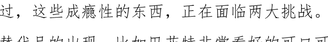

# 周期的尾声来袭，这是百年一遇的机会
房多、傻空、骗子也可以进来受教

时代之

最近一段时间论坛群魔乱舞，实在是看不下去了。
写一个帖子，记录下自己的投资生涯，希望能够再次交流老友。

我自己是看空，但投资上做空为主，4.15日就三倍杠杆做空了行情。当然，有机会，也做多。

在房产上，当然我也是傻空，不过不是死空，我自己有房。

一手整理，加微信101284955，获取更多帖子。

靠楼泡沫从一开始就写好了几句。最终只能从这 4 个中选择一个，你们猜是哪一个？

债务危机，是经济周期衰退主要的原因，十次危机九次债，九次中又有七是房地产。在危机没有发生的时候，我们称为泡沫，危机的爆发为债务泡沫破。今天我们来谈谈债务危机的四个结局，其中化解危机的方法有两个，危机爆发的方式也有两种。

1. 第一种化解的方式，是做大分母，让经济增速高于债务增速。但是一旦债务进入泡沫阶段，就会侵蚀整个经济体。

第一是科技突然进步，带来了生产效率的大幅提高。这种机会可不可求，2008年金融危机之后，抓住移动互联网的中国和美国，都率先先复苏，美国的股市和我们的房地产市场都是不断创造了历史新高。但是在移动互联网上我们较为滞后后日本和欧洲就一直处于泥潭了。

如果移动互联网的革命能够更早一点到来，或许美国的危机能够被化解，毕竟美储已经加息多次，主动在抑制泡沫的，可惜最终输脸者，硬着落了。

## 3楼
作者：时代之 日期：2019-05-20 10:58

@是谁在说 2019-05-20 10:53:53

桥洞粉们赶着去给7爷爷点赞，打赏。你爷爷说啦，要用天涯买五姜神，气死天涯的混混，哈哈，洞粉们赶去去，把你们7爷爷打造成天涯第一高富帅，你们也算成功了，7战买车，房们会下跌哀嚎，7战买房，房们会痛苦不堪，想要房价下跌很难，但众人为了自己，把7爷爷造成高富帅还是容易的，同样达到气死房多的效果，洞粉们。

胜利就在眼前，哦耶。

7剑算什么货色，社会中下层，《经济学原理》没读过的人。

本人在投资已经摸滚十年，从未有过年度亏损。

## 5楼
作者：时代之轮 日期:2019-05-20 11:01

大家有什么问题可以问，希望交些朋友。因为现在做业投资了，比较孤独，这里也会记录我平时的生活。

## 6楼
作者：时代之轮 日期:2019-05-20 11:04

## 一手整理，加微信1101284955，获取更多好帖

第二种化的方式就是软着陆，就是用时间来换空间，这也是通常的软着陆，降杠杆等。一般每年降低经济增速1个百分点的代价，换来杠杆率的下降，保持金融体系的稳定。

这需要高的控制力，以及承受力。一方面要大量的产能出清，将债务违约的规模控制在可控的范围内。另一方面也要承受短期的阵痛，毕竟经济增速降低，而且失业率也略微上升。

前面一点其实大多数国家以为自己都能做到，至少短期能够做到。但是控制债务违约规模并不是简单的事情，因为金融体系如此复杂，很多事情是无法预防的。美国贷款危机前，房贷违约就已经暴露了，但是没想到这居然引起了一场全球性的金融危机，正如蝴蝶效应一样。

## 7楼
作者：时代之 日期：2019-05-20 11:10

3. 而债务泡沫破的方式有两种。一种是通胀式，一种是通缩式。

泡沫的破灭源于外汇的流动暴增，以往导致本币的大幅贬值，一方面资产价格暴涨，另一方面由于进口原材料价格暴涨，从而引起了通胀。

98年的亚洲金融危机就是典型的例子。那个时候大部分亚洲国家杠杆率都不是特别大，大概在100%到200%之间，跟现在动不动250%以上完全是两个数量级。

但是这些国家外资一旦撤走，而外汇储备又太少，往往大多数国家都实行相对固定的汇率，就会导致汇率的暴涨，然后再以加息疯狂应对，结果整个资产泡沫就被弄灭了。

香港当时打响了金融保卫，主要的措施就是稳定汇率，受到的影响较小，但是资产价格也大幅下跌。

现在的脆弱五国也是如此，美元升值后，资本外流，然后本币贬值。不过这种危机大多是阵痛，往往很快过去了，亚洲危机之后三年左右，大部分国家和地区就恢复了元气。

## 8楼
作者：时代之 日期：2019-05-20 11:28

@mark31 2019-05-20 11:06

## 人性只会硬着陆

明朗，其实我们本来是想软着陆的，结果无法忍阵痛，今年季度就把杠杆全部加回去了，杠杆水平创了新高。一手整理，加微信110284955，获取更多好帖 作者：时代之 日期:2019-05-20 11:33

@泛一荡 2019-05-20 11:32

我94年从事证券工作，港澳中层。99年房产至今。总结，股票是魔鬼，未来算准，为人需谨慎。股票好吧，随便买个基金，收益大部分资产，除非运气不好，在207年但也只有三年阵痛。

## 12楼
作者：时代之 日期:2019-05-20 11:37

@CITOB 2019-05-20 11:50

职业生涯方面的困惑。本人只在乎一个问题：这里回答有价值。在这个几年，收入60-80，现在有机会出去干，和某上市公司对错，做到了，然后退休了，财务自由选择。

## 15楼
作者：时代之 日期:2019-05-20 11:54

4. 最后一种通缩式衰退，主要的原因就是内部债务规模违约。理论上可以通过大规模的货币宽松来缓解，泡沫破灭后，大部分国家都采取降息应对。但是金融体系还不贷款，企业由于资产债表恶化，往往陷入流动性陷阱，日本就是如此，这就是萧明。大萧条也是典型的通缩性衰退，当时金融体系大破，无人敢投资。这种衰退时间会很长。有人认为俄罗斯的新政也没有缓解，二战才拉动了经济。而2008年金融危机之后，美国不仅是喘息，连续开启了三轮QE，再加上移动互联网浪潮，才走出了阴影，不过又吹起了更大的泡沫。

## 19楼
作者：时代之 日期：2019-05-20 12:13

之前的房价的预测，丝杀所有人。待会来帖。房产泡沫的7个特征。

## 20楼
作者：时代之 日期：2019-05-20 12:42

之前的房价预测，丝杀所有人。待会来帖。

大神你好，我现在35岁，销售岗位，公司小，目前工作十年，前5年技术岗。遇到瓶颈，上升空间有限。另外受限于家庭原因（孩子小），也不经常出差稳定。目前不太喜欢销售，需要突破个人底线的东西想创业，无方向，也不投入。想考公，稳定职业，无奈岁数大太多。人才才去了一半。还有30年的工作时间，下一步该如何走才能有意义的过完一生？

考公要35岁及以下，不知道还有机会没。你的意思是，现在到底是考虑销售、技术，还是创业吧。如果考虑技术，那么丢五年，自己没有能力和魄力捡回来，这是你需要考虑的。如果可以，我建议还是搞技术。毕竟销售这个东西，从你的表述来看，不仅是不喜欢，也不是擅长。至于创业，35岁应该是一个黄金时期，你需要问自己能否承受失败风险，另外宏观环境也不太好，创业失败的概率就会增加。

## 24楼
作者:时代之 日期:2019-05-20 12:36:39

@做立世俗 2019-05-20 12:36:39

山东滨州，五城市，无房刚需，不知道现在还能不能。房房价比较，作也不稳，最近的政策和国家层面放水，以后更难上。还请分析一下。放水已经到了极限了。M2其实一直没有达到央行目标，为了什么可以上去呢？因为企业不投资啊，所以货币只能空转，这就流动性陷阱。

## 25楼
作者：时代之 日期:2019-05-20 15:43

@小锦羊 2019-05-20 12:54

坐标武汉，看中联排，人家急需资金，市场价低50W，想接手。目前的住房是否需要卖掉？还有一套小房，5年后才可以买。

## 43楼
作者：时代之 日期：2019-05-20 15:50

@1hq99411 2019-05-20 13:25

对中国太自信了。中国人民是最聪明的民族，只要保持大局稳定，中国很快可以超过美国。说到房产是一个稳定期，17年这一波涨得厉害，所以买房可以在三年内慢慢选，不会大涨。当年胜了。

## 44楼
作者：时代之 日期：2019-05-20 17:19

@金生水 2019-05-20 13:50

楼主，请问你公众号是什么？点击我天涯首页查看。

## 55楼
作者：时代之 日期：2019-05-20 17:24

@hera86 2019-05-20 14:25

博士毕业，35岁，目前在核心期刊发了两篇文章。目前深圳年收入25-30w，还有一套90平的房子，有决策没？不知道家如何，如果不是热点二线城市，就没有回去的必要。当然，你要考虑家里的父母。

## 57楼
作者:时代之 日期:2019-05-20 17:25

ae-1294733 2019-05-20 14:58

我刚面试了个省属大学的编制的活。平均留下来才5000，如果要去企业，很累，收入可能到1万。既然没编制，不如到企业赚钱，一边干一边靠谱。

## 58楼
作者：时代之 日期：2019-05-20 17:32

@1hq99411 2019-05-20 16:17:28

看了一下你的帖子，写得挺多，看似热闹，却没有把给分析透。甚至在15年预计不会大涨，已经证明你的看法是错误的。第一，我预测了2015年下半年开始上涨，之所以当时认为不会大涨，是因为判断2015年底美国加息，我们会随之。但是后来却持续宽松了。第二，所以到了2016年我就认为房地产已经进入疯狂模式，而且无可软着陆了。

## 59楼
作者：时代之2019-05-20 18:29

@东之卉 2019-05-20 17:36:31

宏观白描建模，是否觉得中国这样的未来会卷3还是4呢？如果保七成功意味着未来走的是日本通缩的路呢？如果破七连续加息刺破泡沫是一番什么景象呢？我说了，我们想选的是2。最终的结果是3还是4，要看人民币汇率能否保住。想要保，以目前的外汇储备是没有问题的，这就是通缩。但是如果一直这么拖下去，资本账户下汇储备只出不进，那就只有走通胀衰退的路了。

## 63楼
作者：时代之 日期：2019-05-20 18:30

@hera86 2019-05-20 18:00:51

感谢楼主，家乡是三线的地级市，就没有回去的必要了。

## 64楼
作者：时代之 日期：2019-05-20 19:53

@射手座 74 2019-05-20 19:28:57

楼主，我是个家庭主宰上涨的15年阻止老公买房后一直后悔不已，这几年看着暴涨上涨的房价心里急得很。老公上班的地方现在开车，老公不想买了。我是对的，看着这样真的想买，希望房价跌到15年的位置，楼主怎么看？你可以选择。

## 66楼
作者：时代之 日期：2019-05-20 20:42

@yuri518 2019-05-20 18:17:22

现在该换绿纸和黄鱼了。博弈，做空最安全。

## 68楼
作者：时代之 日期：2019-05-20 21:38

@犀利肯球 2019-05-20 21:54

现在很差啊，经济不好，工作没有发展，也不敢跳槽。大环境不佳。

## 72楼
作者：时代之 日期：2019-05-20 21:39

现在卖老旧怎么样？你觉得还有值吗？

## 73楼
作者：时代之 日期：2019-05-20 21:53

## 75楼
作者：时代之 日期：2019-05-20 22:00

## 78楼
作者：时代之 日期：2019-05-20 22:01

@ty_畅游的鱼 2019-05-20 21:57

楼主你好，会不会以部分破产来消灭货币，债务一同消失。这就是债务危机爆发。银行破产带来的影响是巨大的，美联储也力保了。

## 79楼
作者：时代之 日期：2019-05-20 22:03

@ty_欲梦人 2019-05-20 21:56:59

今年价格特别贵，难道是通过货币胀了吗？周年快乐，果然还是泡沫的问题。

## 80楼
作者：时代之 日期：2019-05-21 08:26

## 89楼
作者：时代之 日期：2019-05-21 08:28

感谢楼主，好久没看到这样的帖子了。楼主对于数字货币怎么看？@hmoony 2019-05-20 22:29:52

呵呵，我从比特币10美元开始玩，赚了第一桶。2017年18000美元判断顶，还没有人比我准确吧。不过现在我不看数字货币，区块链依然看好，目前也在玩一些区块链内容的项目。不过不会推荐我的粉丝买入。

## 90楼
作者：时代之 日期：2019-05-21 08:29

@ty_13180656 2019-05-21 00:38:33

黄金可以长线做多。可以，不过多白银更好，用两个白银杠杆，基本可以不用管。一手整理。

@wn206 2019-05-21 02:03:25

又来一个比七剑还神的大师。徐东要打假了。你就个社会底层闪一遍去。我在天涯也七八年的了，从楼市到股市到电子货币，你们这些嘴炮都不利索的人。

## 92楼
作者：时代之 日期：2019-05-21 08:42

@ty_云水 81 2019-05-21 02:16:22

## 楼主看一切资产吗？大周期的原因？

基本看一切，但是时刻关注贵金属。

## 97楼
作者：时代之 日期:2019-05-21 08:42

@hjyliaojian 2019-05-21 08:32:09

时代又回归天涯。

## 98楼
作者：时代之 日期:2019-05-21 08:45

声明：本帖所有内容均为原创，可以自由转载，但是需要注明，出自公众号：jingji-xinli。

## 99楼
作者：时代之 日期:2019-05-21 08:51

@知行合一 QY 2019-05-21 08:49:20

贸易战怎么看？

## 100楼
作者：时代之 日期:2019-05-21 08:52

## 101楼
作者：时代之 日期:2019-05-21 08:53

## 102楼
作者：时代之 日期：2019-05-21 08:54

## 103楼
作者：时代之 日期：2019-05-21 08:55

## 104楼
作者：时代之 日期:2019-05-21 09:01

没有。比美股，可以用波动率 VIX 指数来衡量市场的恐慌程度。

要衡量市场情绪，可以依靠新媒体和身边人的看法。不过样本量要足够大，否则容易形成偏见。

这里有一条技巧，泡沫的最后一次，一般都会出现快速的拉升，上涨速度和幅度都会超过我的理性预期。

### 3 普遍存在的上涨情绪。同样是一个情绪指标，国外的统计学涉及到各种信心指数，比较重要的消费者信心指数，因为消费是各大经济的第一大推动力。我们有银行每个季度的储户调查报告，里面会涉及到对于房的预期。

一手整理，加微信获取更多帖子

利用杠杆融资买资产。杠杆一直被当做泡沫破的罪祸首，当然，杠杆本身就是一把双刃剑。衡量杠杆的指标也有很多，比如常用的居民杠杆，比如我们现在的居民杠杆水平已经超过了60%。而人们更喜欢用债务占支配收入的水平，美国房价见顶的时候，大概在 120% 左右。

比起杠杆的绝对水平，杠杆增长的速度，以及低收入者的杠杆水平其实更为重要。因为金融体系是个整体，低收入者出现规模性违约，必然造成系统性风险。

### 5 买家提前很长时间买入，旨在应对投机或是应对未来价格上涨。这说明很多人买入并不是真正的刚需。比如很多人的娃还在肚子里，就在购买学区房了。而人群首套房的购买时间也可以做衡量的指标，我记得几年前我国首次购房的平均年龄就是 27 岁，不知道现在是否更早了。说德国要到 40 岁了，不过并没有找到原始的数据出处。

## 6 新买家进入市场。价格的上涨依然依靠新买家的进入，在房地产市场上，可以通过人口年龄结构图来推算。还是股市方面方便，每周都会公布新开户的成交量。

## 7 刺激性货币政策进一步助长泡沫。几乎所有的泡沫都是泡沫政策是相关的，几乎所有的泡沫都是货币密切相关的。货币的指标最重要的当然是 M2 了，如果是股市的话，除实际的货币政策，对于货币政策的预期是更重要的。而房地产市场通常滞后于货币数据的变化，估计是因为股市和楼市流动性差异巨大的原因。

## 结语

达里欧在书中分析了上个世纪的大萧条的金融危机以及德国在一战 之后的恶性通胀，书中拥有大量详实的数据，这些数据也印证了我对一些问题的看法。

对了，最近达里欧预测美股会下跌 40%，因为企业的盈利在恶化了。反正我还是保持之前的判断，美股的领头羊纳斯达克无论这波不创新高，都在 8000-8500 点之间见顶。而美股也将将在附近形成三重大顶。

105 楼
作者: 时代之 日期:2019-05-21 09:07

@yuri518 2019-05-21 09:03:01
现在做原油准怎么样，感觉至少能跌到 50 附近。原油我长期看空，但是消息层面不断变化，特别是川普，反复不定，一会说油价高了，一会叫 OPEC 减产，一会又制裁俄罗斯，一会限制伊朗。

# 一手数理 加V: 1101284955 获取更多好帖

作者: 时代之 日期:2019-05-21 09:09:12

@小叽吃瓜 2019-05-21 09:07:54
本人青岛，在郊区有一套小产权房屋，但面临孩子 2 年之后要上学，最近买套房子，手里存款全部都够首付，但看到房价还一直在涨，担心过几年连首付都不够了，楼主，能给点建议吗？

可以将自己的小产权房卖掉，然后买个学区房，这样对冲风险。而且小产权房未来很尴尬。

109 楼
作者: 时代之 日期:2019-05-21 09:36
上边闹明了楼市的 7 个泡沫特征，大家可以自行判断当前的情况。

112 楼
作者: 时代之 日期:2019-05-21 10:02:24

@翠花 1988 2019-05-21 09:59:35
银行中层干部，年入 60-80，现在有一有机会出去干，和某某上市公司对赌，做到了，然后就退休了，博不搏？

------------------------------------------------

这个问题好回答了。不出不去还是需要结合其他信息考虑，但是不要对赌协议。

112 楼 
# 一手数理 加V: 1101284955 获取更多好帖
作者: 时代之 2019-05-21 09:36:55
上边闹明了楼市的 7 个泡沫特征，大家可以自行判断当前的情况。

------------------------------------------------

@freesky7891 2019-05-21 09:58:52
楼主好，我个人命运很坎，错过了很多机会，有的时候觉得是无形的推手看着你也不得走，，每当命运的转折点上，我都会发生一些重大的不可预料的坏事情。也许是自己不够强大，也许是自己不够努力，发生这些一段时间，从而又错过更多机会，人到中年导致现在工作上几乎无力，两年觉得生活不易，家庭各方面，让人有一种危机感，说实话在我的工作......

------------------------------------------------

楼主，我之前判断的同时：
- 1、绝大部分人到了中年上升空间都乏力，接受这一点，至少心理上好些。
- 2、泡沫这种局面，必选一种，结果呢？这种从历史带来的灾难还少？
- 3、如果你要选贵，期货最好，手续最低，但是杠杆要保持在最低水平。

# 一手整理，加V信 101284955，获取更多好帖
作者: 时代之 日期:2019-05-21 10:51

@那桥那百年 2019-05-21 10:45
今年价格特别别，难道是通过通货胀了吗？你想要软文要向着大学，喊减口来怎么喽。滚你贼人里去。

--------------------------------

128 楼
作者: 时代之 日期:2019-05-21 11:29

@三人成虎 2019-05-21 11:17:24
虽然不是很懂，感觉楼主厉害，果断收藏。希望楼主能说一下外面有用的新闻。这里不能说，非权威发布的新闻，属于违规，但是有时候会给出提醒。

139 楼
作者: 时代之 日期:2019-05-21 11:31

@此时光任少 2019-05-21 12:21:04
楼主，如何看张家口呀，由于冬奥和修高铁，这一波的涨，比起北京近的沙城和花园园区，花园区常住人口五万，房价已经是 1000 左右，当地没有什么企业， 5000 左右，事业单位稍多，人均工资 3000 左右，4000 到 5000，主经理获取了很多站。这些北京房似乎并不合适，明确买的来房，通勤的，不知道以后会升值吗？这个房价水平，和全国来看是一致的，大部分分这个收入的城市，房价都在万左右。当然，总体是高的。至于什么通勤都是噱头，本质上是炒房。现在北京负增长了，北京周边具备升值潜力。我对整个北方的人口持悲观态度。

140 楼
作者: 时代之 日期:2019-05-21 11:37

@007之越狱 2019-05-21 11:23:42
一路拜读楼主文章，天涯现在这样的文章不多了请问楼主：
- 1、我坐标深圳，18 年辞职创业，现在亏损约 80W，从事电商业务，现阶段正打算出手让公司，之前没有创业过理解创业的难度；
- 2、个人之前在职期间也兼职了一些事情，目前个人名下资产：惠州有一套全款房，134 万价值，15 与朋友投资了一块地皮准备备建小产权房的，后面因为政策影响一直圈在那里，地皮投资了约 80W 现阶段没有升值……

# 一手整理，加v信 101284955，获取更多好帖
- 1、你那个地皮赶快出手吧，只能小产权的，没有任何升值空间。
- 2、公司的情况你自己决定，现在主要是周期影响，该收就收缩，不建议完全关掉，毕竟周期会有转的一天。当然，如果可以卖出去，价格是可以接受的话，那么可以选择卖掉。
- 3、你的投资肯定是在瞎赌，多半是频繁交易导致的。6000 点买入，如果不是买了石油，而是银行、保险、茅台、格力、地产的话，早就翻倍了，买了中小盘在 2015 年这波行情中也应该解套和盈利。说明，你炒股完全没入门。建议你玩下指数基金就了。

142 楼
作者: 时代之 日期:2019-05-21 11:47

@皮带 28132 2019-05-21 11:33:09
顶一下，希望楼主继续更新，拿持的新闻说下理解。可以关注我啊。这里可以发新闻，合适的我就下。

143 楼 
作者: 时代之 日期:2019-05-21 12:06

# 一手理加V: 1101284955 获取更多好帖
美景上老婆:放不要看票，以后来。

197 楼 
作者: 时代之 日期:2019-05-21 19:09

@一溪_月 2019-05-21 10:56
楼主好！本人都是小城公务员，学历本科，有两个孩子。当前有主动型基金买入在 2800~3200 之间，每月定投 4000，还有 5 万准备做补仓。
- 1、目前这样布局蓄可行吗？
- 2、长期来说怎样积蓄？
- 3、中国十年后进入老龄化，从10 年时间来看，是没有问题的，大概率跑离通胀。

200 楼 
作者: 时代之 日期:2019-05-21 12:12

@北_方 2019-05-21 16:01
照着目前央行软陆的做法，外出可以扛多久？我原来判断 19 年半年到 20 年上半年，会货币收紧而房价下跌，但是看央行动作，估计还是拖到哪年？

201 楼 
作者: 时代之 日期:2019-05-21 12:12

@回记小白请教楼主，楼主觉得中国这样的体制未来选？
- 集七成成功是不是意看来未来的路呢？
- 通缩的路呢？如果破了连续加息破泡沫后是一什么景象呢？我前边回复了。具体 3 还是 4，要看是否守住外汇率。

202 楼 
作者: 时代之 日期:2019-05-21 20:14

@旧梦彦心引长 2019-05-21 17:37:69
山东滨州，四五线城市，无房刚需，不知道现在能不能上车，压力比较大工作也不稳定，不上的怕国家继续放水，以后更难上。还请分析一下信号。那期。

203 楼 
作者: 时代之 日期:2019-05-21 20:15

@Sallymint 2019-05-21 18:04:18
楼主你好，本人刚来重庆 1 年的外地人，有存款 60 个，体内年入 12左右比较稳定，但是还贷只能够自己，现在适合买房吗？能谈谈重庆楼市什么时候能抄底吗？现在主城区价格好，同事都觉得不会减少，让我尽量快入手。但是我在最高点了。你可以看二手房，重庆的二手房最近几个月一直在下跌。等你选一圈，估计时间上差不多了。

204 楼 
作者: 时代之 日期:2019-05-21 22:35

@今晚的客人L 2019-05-21 21:30:27
德意志银行最新研究报告指出，由于中美贸易战可能会旷日持久，中国政策层看来已经做好应对准备，并且更愿意人民币兑美元“破7”。德意志银行亚洲外汇策略师 Perry Kojodojojo 撰写报告指出，寻求支持国内经济增长的方法已成为政策层的重中之重。这很可能需要宽松的货币政策，当中的代价就是货币贬值，而政策层似乎愿意承受。美国最新对进口征收 25% 关税，对应的人民币接近 7。其实只要外汇大幅流失，破 7 是更优的选择。

208 楼 
作者: 时代之 日期:2019-05-21 22:36

@粗心大意 2019-05-21 23:03
不知道这个地方具体情况。有些地方的二手房下跌幅度较大，如果是刚需的话，问题不大。

209 楼 
作者: 时代之 日期:2019-05-22 08:49

@风吹嘘 2019-05-22 00:17
早上好。等就开盘了，现在要写些东西。社科院也有调查数据，也比反映现实。

223 楼 
作者: 时代之 日期:2019-05-22 09:03

224 楼 
作者: 时代之 日期:2019-05-22 09:39
楼主，你对股市怎么看。今天又降了。放水进股市还是楼市。所有的宽松最后和股市无关。所有的宽松最后都会进楼市。

226 楼 
作者： 时代之 楼 日期：2019-05-22 10:02

@犀利个球 2019-05-22 09:54:55
现在股市可以入手吗？手上有几十个现金，一直都存在四大行。哈哈，四大行。你不是听了那个钻傻子的吧？50 万以下的有存款保险的，完全不必担忧。国债也不不必愁。如果有人觉得国都有问题的话，那不如买上几千大米圈吧。

229 楼
作者: 时代之 日期:2019-05-22 10:04

@犀利个球 2019-05-22 09:54:55
现在股市可以入手吗？手上有几十个现金，一直都存在四大行。A 股不好做，没有大行情，不如一起机场股吧。

230 楼 
作者: 时代之 日期:2019-05-22 10:13

@犀利个球 2019-05-22 09:08:57
谢谢大大，公众号早已关注。加微信1101284955，获取更多好帖。欢迎。

234 楼 
作者: 时代之 日期:2019-05-22 10:20

@ty_嫣 2019-05-21 23:35:38
楼主，武汉的房价还有没有上升空间啊，本人婆家一套房，跟公婆丈，娘家的房子近几年会拆迁，想在娘家房子拆迁之前再买一套，到时候就直接拿贷款。或者就直接等娘家拆迁的时候分一套。

237 楼
作者: 时代之 日期:2019-05-22 10:23

@清漓 2019-05-22 10:18
现在又降息了，房价又要涨了。

238 楼
作者: 时代之 日期:2019-05-22 10:43

@李仁辉 53 2019-05-22 10:24
根本没有用的，股票吃的都是散户。没有两把刷子，散户就来了。我就是收割散户，但不是庄家。

白银一直被压制，无法用技术解释。可能和之前一样，投行们一直在干扰金属市场。所以我期待中国能够快点拿回贵金属的定价权。

毕竟我们就是黄金第一生产国，也是第一消费国。

249 楼
作者：时代之 日期：2019-05-22 11:26
@述 0326 2019-05-22 11:20:53
苏州房怎么回事，楼主知道分析一下？

看我上一段很长的分析，里面提到了苏州。中小企业在年初获得贷款更容易了，但是钱都进入了房地产市场。

一手受理，加信1101284955，获取更多好帖

作者：时代之 日期：2019-05-22 19:17
@ty_WOLFMAN1 2019-05-22 13:43:26
楼主，请教一下，珠海房子值得入手吗，例如横琴，因为可能要要去那边工作，谢谢。

你是工作，还是安家。珠海地方不错，不过房价肯定高估。

274 楼
作者：时代之 日期：2019-05-22 19:18
@李辉 7877 2019-05-22 14:49:24
七剑的分析很犀利，他是怕一些层主溜滑视把把盖盖歪了！但楼主的分析很客观。谢谢！

是很犀利，满嘴都喷粪。按照他的说法，房价已经两个腰斩了。

分析错不要紧，观点而而已。但是还要抄底女房奴，完全就是生活不如意，性格反社会的倾向了。

275 楼
作者:时代之 日期:2019-05-22 19:28
最近，一大波4 月份的宏观经济数据出来了，基本上印证了本人对于一季度经济的判断，和绝大部分分析师认为王李是对的，宏观经济开始好转了。

房地产投资同比增长了11.9%，继续创了两年新高。这和开发商拿地热情是一致的，前四个月开发商拿地到了8500亿。不过销售额来看，房产的销售面积同比下跌了0.3%，1-2月是负增长，1-3月是正增长，这说明三月份的小春天，而4月这个小春天哑了，只有个别热城市依然火爆。这符合我的预判。

工业增加值同比增长了5.3%，增速大幅下滑。实际上，工业方面两年主要要靠钢铁和煤炭等上游行业的拉动，如今钢铁和煤炭价格涨不动了（去年我就说了，螺丝钢的高点就是4400），PPI一接近0，所以这个数据下降了。相同的规模工业企业的利润和 PPI 高度相关，预计增速也会下降，甚至是负增长。

社会消费品零售总额增长了7.2%，这是最让人意外的，创造了 2003 年5 月以来的最低增速。大宗的消费汽车和手机都出现了负增长十多个月了，实际上下滑并不意外。不过别人给出的解释是 4 月的假期少两天。这一点我前两天的文章中注意到了，去年五一假期和今年五一是错位的。所以真实的情况要等 5 月的数据来证实了，如果 5 月的数据不能到 10%，那么就说明消费没有预期的好。

随着 CPI 的上涨，4 月已经到了 2.5%，猪肉还在等待上涨，所以排除价格因素，消费没有太大的起色，增速有 5.5%（这已经包含了新的房产投资），这个数据上个月也提到了，绝对额实际上下降的，按照可比径计算，是增长。而基建投资增长有4.4%，这让绝大多数学者都认为今年是个基建大年，实际上基建投资水平并没赶上平均增速，背后的原因我在年初就说了，主要的问题在于钱！今年的赤字安排，对冲税费差异差不多，基建方面几乎没有更多的钱了。

从这些数据来看，我不认为股市还能继续反弹到前期高位，可能 3200 点都不会看到的。我说了顶部的背离形成，进入下降通道。如果没有实体经济的改善，或货币政策的进一步放松，是不可能再有上涨的。

277 楼 
作者：时代之 日期：2019-05-22 19:55

280 楼 
作者：时代之 日期：2019-05-22 20:29
@大气 123456 2019-05-22 20:22:39
看不上你的水平，喇炮准都会。

283 楼 
作者：时代之 日期：2019-05-22 22:13
# 一手整理 加微信1101284955，获取更多帖
@小龙山4 2019-05-22 21:14:34
楼主，我是帝都郊区人，想在本地买套房子。目前均价45000平米，家里稳定9万左右，工作很稳定。昨天看没有什么顾忧，不知道未来走势，如果不急就可以等等。话说，本地没问题吗？楼主指一下，感谢。以你的收入来看，置换还是安全的。

291 楼 
作者：时代之 日期：2019-05-23 09:01
## 房产税的问题
最近一大波专家出来带来节奏。最著名的一个观点就是：长期而言，房产税根本不会房价。只要经济在增长，房价就会上涨，除非衰退，这个国家陷入通缩。这种说法就是本质上流氓。

房产税的本质增加了持有成本，打击了房产泡沫，而这实际上就是房产泡沫的主要构成。房产税一旦开征，投机泡沫就能抑制。如同股市市场一样，如果利率提高，股市可以立马砸下去2个点。

## 房产税什么时候征收？
房产税的使用上是矛盾的，以前是学术界争论的重点。现在看来没有用处，一定要收。房产税这个东西，其实已经引起了关注。

### 很多人的时间表
- 2023年之前
- 2014年吧
- 2024年吧
- 2015年年底
- 2015年闹得沸沸扬扬

310 楼 
作者：时代之 日期：2019-05-23 09:47
特别佩服楼主的远见，很多东西看似偶然，其实是必然。请教一个问题，我在北京四环内有一套两室房子，上面面临退休，想置换一套大点的房子。看中了亦庄林肯公园的住房和石景山东南一套房，两者各有利弊，无法抉择。林肯公园属于二手房，总价与现有房屋持平，房型不错、小区环境良好，交通方便，生活配套也方便，但属于商住房，虽然民水电有燃气，但有政策风险；石景山的房子在古城站附近，纯住宅，房期每年年底交房，目前该区域一套闲，未来5年可以……你都退休了，两居室的房子应该足够了吧。我没见过退休还要换大房子的。老年最好选择生活方便的地方，如果想居住的舒适的，可以选择将自己的房子重新一遍。留点钱也可以备不时之需。

# 一手整理 加微信1101284955，获取更多好帖
作者：时代之 日期：2019-05-23 21:28
@振振 style 2019-05-23 19:19:45
聊聊交易的事？每天发生的事可以吗？老谈的房价走向，没意思啊。都知道谁在托底，换汤不换药，一个团队的吧？交易问题，先要读懂什肯德陷阱。

397 楼 
作者：时代之 日期：2019-05-23 21:29

398 楼 
作者：时代之 Main 日期：2019-05-23 21:29
晚上常规发红包

399 楼 
作者：时代之 Main 日期：2019-05-23 21:36
@超挤想你不行 2019-05-23 20:29
二十万在县城能投资什么？太多了。跟生活相关的。

400 楼 
作者：时代之 Main 日期：2019-05-24 08:37
大家早上好，今天来说为什么已经到了周期的结束，房产周期结束，周期结束了，股市就好了。

411 楼 
作者：时代之 Main 日期：2019-05-24 09:03
@u_101564 2019-05-23 22:14:24
我说我的看法吧。房产税一定会，具体什么时候？我想快了。县城得差不多。所谓的长效机制就是维持房产价格停滞、二手房卖出高额交易。这些都在进行。傻子都能看出现在的房价上涨，宏观来说，上涨的是通胀，而是滞胀。

414 楼 
作者：时代之 期:2019-05-24 09:04
@上老爷帝 2019-05-23 22:34:49
喇炮准都会。银行早就经历过一波危机，上次挺过来了。我觉得某些银行危机更大。

415 楼 
作者：时代之 日期：2019-05-24 09:10
@js054136 2019-05-24 02:05:31
你好，我是积蓄全仓了，请指定速度。国内杠杆不高，黄金没有问题。已经高位横盘很久，虽然未来看跌，具体时间点很难预测，毕竟受政策影响太大了。

416 楼 
作者：时代之 日期：2019-05-24 09:19
@寻思干岛 2019-05-24 08:23:43
楼主写的慢很好，收藏了。实际上央行一直都在宽宽松，只是宽宽松效果不及预期。2016 年的时候，我几乎是全国第一个提出了进入“流动性陷阱”的人，绝大部分的宽松都在银行体系空转，部分会流入到资本市场，就是股市和楼市。当年 M2 增长目标 13，结果没成功。2017 年目标是 11，结果又没达到。后来央行就干脆取消了目标值。

422 楼 
作者：时代之初日期:2019-05-24 11:21
@孙夫人 2019-05-24 10:51:34
一看你就是智商低。就是随便混了个 985 的水平而已。

425 楼 
作者:时代之 日期:2019-05-24 11:25
再来说说库存周期。

在 2015 年的时候，房地产库存，钢铁、煤炭都创了新，那个时候上市的钢铁煤炭大多亏损。整体市场低迷。于是在 2016 年我们提出了库存周期。房地产库存、钢铁、煤炭都创了新，产量都创了历史新高。所以这个短期周期也到了拐点上。

426 楼 
作者：时代之 日期:2019-05-24 11:49
再来说资本周期，大概 10 年左右。上一轮资本周期是在 2007 年见顶，再一轮是 2014 年的亚洲金融危机。

### 三种长周期
- 需求周期：跟需求有关，一般是 3-5 年。
- 资本周期：跟资金关系，一般是 10 年左右。
- 康波周期（长波周期）：一般是 60 年。

大家对于康波周期已经不再陌生，我们现在来到了康波周期的尾声。60 年的大周期有个 3 年左右的误差非常正常。比如房地产市场，2017 年应该崩盘，2019 年迎来牛市。很多人没看前句话，只看到后半句，就疯狂冲进去了。实际上，如果我们排除掉时间上的误差，在资产泡沫之后，迎来大牛市。这资产泡沫非常明显，就是房地产市场，和除 A 股外的所有股票。

421 楼 
作者：时代之初日期:2019-05-24 10:21
看到隔壁一群傻子太搞笑了。央行一降准，高孚：紧缩了，缩了。央行再降准，又喊：紧缩了，缩了。回鲁五留言：哈哈，不错，缩了。

427 楼 
作者：时代之 日期：2019-05-24 11:54
# 一手整理 加微信1101284955，获取更多好帖
银行的承受力最弱。从2019 年5 月24日起对银行实行接管。

428 楼 
作者：时代之 日期：2019-05-24 17:50
等待的时刻来临了。商业银行（以下简称商银行）出现严重风险，根据《中华人民共和国人民银行法》《中华人民共和国银行监督管理委员会法》有关规定。

450 楼 
作者：时代之 日期：2019-05-24 17:55
Lehman Moment

451 楼 
作者：时代之 日期：2019-05-24 18:07
@烟花绽放 2019-05-24 18:05:40
看来数据起来后发生了变化，其实我们应该如何度呢？可以做空就做空。不能做空就远离风险资产，关注国债、黄金。银行50 万以下存款都是无忧的。

453 楼 
作者：时代之 日期：2019-05-24 18:08
@情迷 keanu 2019-05-24 11:52
楼主，请问你公众号是什么？房价下降了吗？房子真的是用来炒的了。

456 楼 
作者：时代之 日期：2019-05-24 18:20

457 楼 
作者：时代之 日期：2019-05-24 18:54
从恒丰到包茴，商银行，只有一个字：服！

461 楼 
作者：时代之 日期：2019-05-24 20:34
@混元一气剑 2019-05-24 21:38
将帖子完毕，获取更多好贴。看来数据起来后发生了变化，其实我们应该如何度呢？可以做空就做空。不能做空就远离风险资产，关注国债、黄金。

476 楼 
作者：时代之 日期：2019-05-25 08:63
大家早上好，有什么问题都可以问，我体会出门，晚上来解答。

489 楼 
作者：时代之向 日期：2019-05-25 09:06
很多人都在投资方向，这里统一回复。
首先，是告别风险资产，比如股票、房地产、垃圾债券。可以拥抱避险资产，比如国债、黄金金属、高评级债券（国外的，国内的评级信债）。
当然，还可以做空股市。最后，外汇市场可以对冲，做多日元，做空美元。
一不而足。最保险的当然是存款。只要50万以下都别担心。50万以上分存款就可以了。不一定非要四大，现在已经是五大行的了。

作者：时代之向 日期：2019-05-25 18:27
长期而言，人口问题才是最大的问题。人口陷阱本来是人口学家马尔萨斯提出的，他认为随着人口增长，整个资源的承受能力有限。而人口又是呈现指数增长的，于是就会造成饥荒和战争，从而制约人口数量的战争。现实是，马尔斯不仅是预言破产了，这种状况历史状况也不符合。自工业革命以来，人口呈现大爆发的态势，历史上的饥荒和战争大多是人祸。

导致的需求不足。所以日本的消费数据一直让经济学家头疼的问题。

另一个方面是养老金的问题。现在绝大部分国家实行养老金都是现收现付制度，当前的年轻人交的养老金，供养当前的老人。如果人口一直保持一个金字塔的结构，而且经济增长率不大的问题，那么那个制度就是没有问题的。

但是随着人口出生率的下降，人口预期寿命大幅增长，而且有些国家人口结构呈现金字塔，养老金就会出现巨大的空缺，这是一个世界性的问题。

人口出生率一下下降之后，解决的方法也无非以下几个。第一个是延迟退休，这个世界上绝大多数国家都应该考虑，例如从65岁以后，获取更多补贴。

另一个是移民。美国是其中的典型，能够勉坚持住人口结构，但是由此带来的社会问题十分突出。欧洲这几年接纳了许多难民，也是问题频繁。

而对总需求的下降，几乎是无解的。虽然政府大量的投资可以增加需求，初次使用可以让经济很快走出通缩，但是多次使用后，边际效应递减，而且增加政府的债务，只能把问题越来越向后推而已。

当然，人口是有自身规律的。人口出生率下降之后，经济逐渐收缩，然后等到全球的分工和技术到位了一程度的时候，又会回到增长的轨道上来。唯一的缺点是这个周期可能长达百年。

506 楼
作者: 时代 日期:2019-05-25 19:16

回应以上的问题。

昨天包商银行被接管了，很多人认为问题不大。

实际上，有一句名言：厨房里不会只有一只蟑螂。

每一一起事故的背后都有30个隐患，每一个隐患后边又有30起漏洞。

上个世纪20年代，美国大萧条，最开始是股市下跌，后来银行开始出问题。不过最开始出问题的是一家小银行，因为流言，这家银行面临破产。

某某银行我们选择倒闭，但是确实是大而不能倒。是这家银行取了个很牛逼的名字：合众银行！这家银行被挤破产后，然后引起了美国银业的大面积破产，这才导致了金融危机以及之后的大萧条。

2008年，美国也是一样，雷曼破产的时候美联储虽然也想了办法来救助，但是最终没有达成一致。导致整个金融市场动荡。然后贝尔斯登、AIG、两房出问题的时候，美联储就结果出手了。

虽然从感情上来说，很多人认为这些银行犯了很多错就是应该倒闭，接受惩罚。但是金融系统却是一个有机整体，其一发而全身，有时候的大而不能倒，甚至连小的也不能倒。

这就是系统性的。所以系统性金融风险根本无法预防，要预防系统性金融风险，其实对系统性这个词一无所知。唯一能做的，就是当发生风险时，能够及时补救。

507 楼 
作者：时代之 日期：2019-05-25 19:29

@ty_踏月 留香 1 2019-05-25 11:10:45
我父母在城市商行行的，非四大行，最大一笔好50万，这个也有保险吗楼主？

没问题的。这就有银行保险的。

508 楼 
作者：时代之 日期：2019-05-25 19:30
@陶陶 9 月 2019-05-25 10:16:59
你好楼主，请问几年之内不能投资 A 股市，康波周期不是说有牛市吗？

如果市场出现就可以投资。预计今明两年就可以出清，到时候会见到股市的底部。

509 楼 
作者：时代之 日期：2019-05-25 20:57
@千门无伤 2016 2019-05-23 19:44:24
现在 a股全仓湖南发展一支股票，已经亏损 16%，是否清仓处理？

@阶级矛盾不可调和 2019-05-25 20:30:38
全仓湖南发展的理由？
没有看出这票有特殊持有理由，是否清仓看大盘，这股没独立行情。

513 楼 
作者：时代之 日期：2019-05-25 21:00
我去。
可以说，全国能够清系统性风险的人不超过 5 个。

514 楼 
作者：时代之 日期：2019-05-25 21:46
@黑心白衣狼 2019-05-25 21:52:52
楼主，买房，全款买好？还是分成两套去按揭两套房子好？

按揭两套，就是炒房嘛？不过大多数城市都限购了。

518 楼 
作者：时代之 日期：2019-05-26 09:24
@装甲车 MA 2019-05-26 09:14:51
昨天晚上说了什么？
大意是，系统性风险，无法预测。只能做好准备，及及时处理。

521 楼 
作者：时代之 日期：2019-05-26 09:25
@青耳悠悠 1991 2019-05-25 08:48:40
我想问 论坛里经常有人喊放价要打折打折 真的可能吗

我知道大家都觉得很困难的话，就是可能的。

523 楼 
作者：时代之 日期：2019-05-26 09:48
@青武之中兴 001 2019-05-26 09:35
楼主你好，我问过同样的问题，系统性风险无法预测。只能做好准备，及及时处理。

作者：时代之 日期：2019-05-27 20:38

614 楼
作者：时代之 日期：2019-05-27 21:47
@图他妈妈 2019-05-27 19:23:43
楼主，我在佛山下面的顺德区，目前房价 15000 左右，这里经济比较发达。有可能等到 8000 一平方吗？

这里不太了解，我认为全国房价高占了 30% 到 70%。

618 楼
作者：时代之 日期：2019-05-27 21:47
@回归如梦vip 2019-05-27 20:20:59
一手积累多多好站，就是你说的美房 8000-8500，顺德能回到 8000 吗？

不能回到 8000，还有意义吗？

619 楼
作者：时代之 日期：2019-05-27 21:48
@为人民服务云 2019-05-27 21:04:59
楼主，楼主。您对所说的数据中心，也就是统计中心的地方怎么看？马云、化化腾在最近的数据博会上积极吹捧这个地方。房价合理区间又是多少？

大数据是没有问题了，本身还是很大市场空间的。不过这个中心好像像是选在了贵州，就不知道什么考虑了。

房价上边说了了。

## 620 楼
作者：时代之 日期：2019-05-27 21:49
晚安，明日继续。

# 621 楼
作者：时代之 日期：2019-05-28 08:05
@船中稳坐看观戏 2019-05-28 06:41:12
二城市，我已经在 2015 年清理掉家庭资产 2/3 的投资房产，这些都是在 2015 年以前买的，股市从 4500 点撤一万里，采取了很多好处。退掉那些烂股票，大部分部分是在 2015 年卖的。老人在三亚买了养老地产，目前现金充足，已经开启了指数基金定投模式，请教一下楼主才两个问题，一个是定投指数基金的方向，我目前是做上证 50 因为估值低，相对对有价值，但成分股都是金融，结合经济未来发展和国情，是否应该找几个国家转型型的需要的板块是否有推...

如果你现在现金充足，风险相对较好，可以选择一些行业基金，比如 5G、AI 方向。上证 50 长期而言不会出现什么问题的。

# 626 楼
作者：时代之 日期:2019-05-28 08:05
大家早上好额。

627 楼 
作者：时代之 日期：2019-05-28 08:48
@不会会错遇黄花 2019-05-28 08:25:49
感谢楼主，好久没有看到这样很有据的帖子了，楼主对于数字货币怎么看？我还是比较看区块链链矿的。楼主写的很好，收藏了，巧巧赞一个。

区块链技术很好了，比特币主要要避免避险情绪推升，前几天在自己的公众号中分析过了，只要交易形势势转，比特币短期投资被加 11 倍杠我是没问题的，获取更多好帖。

现在比特币又反弹新高了。

634 楼 
作者：时代之 日期：2019-05-28 09:09
股市要开盘了。

目前我主要的操作策略不会变化，每天就是做一些仓位的微调，降低一些自己的持仓成本。

635 楼 
作者：时代之 日期：2019-05-28 11:12
@上帝玩期货 2019-05-28 09:42:25
A 股这种邪恶市场有什么价值？楼主看着吧，比特币意义可能远超你的判断。

这句话从我确信比特币第一天就开始有人这么说。

647 楼 
作者：时代之 日期：2019-05-28 16:36
一般而言，经济存在三个大周期，目前三大大周期已经形成了共振。其中 10 年左右的资本周期和 60 年的康波周期，误差对我而言较大。但是对于 40 个左右的库存周期，判断顶部和底部就相对准确了，而且数据很充分。

大家都知道，上次库存的顶部大概是在 2015 年，当房地产和钢铁和煤炭的产能都较为过剩。然后我们期间，多次尝试，试图通过房地产来获取很多过剩产能的说法。按理来说，库存应该降价，结果房价上涨了一倍，螺丝钉和动力煤的价格涨幅在 2 倍左右。

当然，效果是明显的，房地产的产量下降了，而钢铁的产量也下降了，不过钢铁的产量还是在不断历史新高。从时间来看，距离上次顶部顶部差不多 3 多年了，如今，我们再次来到了库存的顶部。

首先是房地产，其实房地产库存在 2017 年就已经完成，然后库存开始增加，大家看到的是投资大幅增长，但是销售面积不断下滑，甚至陷入了负增长。一线城市中的北京，房地产库存当前创下了 8 年的新高。

大概在 2017 年就完成了，2018 年开始，工业企业就开始上涨，其中有些波动，在去年季度出现了一波下降。但是今年 1-4 月，工业企业的库存再次增加了 4.7%，结束了 7 个月的下降。典型的汽车行业就增长得很厉害。对应的规模以上工业企业，在 1-4 月则下降了 3.4%，去年的增幅直接进入了负增长。国企的利润依然保持在两位以上。上一次涨之后，房子卖得特别火，然后看到了居民部门的杠杆水平不断上升，在 2018 年已经达到了 60%，是比较小的。原因很简单，居民部门已经见肘。商品房的购买对象是城镇，居民的可支配收入扣除因素后，只增长了 5.6%，这已经低于 GDP 的增长水平，这是比较见的。所以，未来的趋势也就明朗了。

650 楼
作者：时代之 日期：2019-05-28 17:02
为什么国企利润和规模以上工业利润出现了分化呢？原因在于“背离”——这是我对 2016-8 年的总结，后面将详细阐述这个理论，原创，融合了统计学和经济学的理论。

651 楼
作者：时代之 日期:2019-05-28 22:03
@明月心 2019-05-28 19:26:34
楼主，白银为什么一路下跌，值得投资吗？白银一直被压制，金银比已经创了 6 年的新高到了 9。一方面白银的工业属性更强，但是很难解释白银的熊市，工业金属也不差。主要在于投机市场的打压，从 2016 年开始，并加大。这种事情，他们以前也做过，还挨过罚。

661 楼 
作者：时代之 日期：2019-05-29 08:01
@婆婆妈妈 V 2019-05-29 02:15:25
又一个跳神的你除了一张嘴，能够吃屎，能说点有料的吗？

667 楼 
作者：时代之 日期：2019-05-29 08:01

大家早上好。

668 楼 
作者：时代之 日期：2019-05-29 08:34
@台企普工 2019-05-29 08:14:38
老大，有好股票买吗？长期投资的你随便买个中等银行，都可以长期。毕竟分红每年都在 4 个点了。

672 楼 
作者：时代之 日期：2019-05-29 09:14
@执者勇敢不怕怕 2019-05-29 08:43:33

我只能断底部线不会超过 4400，如果是在 4000 以上开空，胜算较大。最近这货都是在 3300 到 4000 之间震荡，目前都是处于震荡行情中。估计要美元指数信号，这些东西才会正式选择方向。

678 楼 
作者：时代之 日期：2019-05-29 09:17
@19 风 2019-05-29 08:52:57
楼主，浙北某县信项目的理财，利率 7.5%，说是五水共治，但是大家知道这其实是一个包装成的项目，县财政相当吃紧，说愁了几亿，现在到处都在发理财项目，玩权力游戏。但是老百姓都说这种理财没问题，因为发行方和担保方都是国企，担保方的来源是土地收入，只要国家不倒，这种理财就安全。楼主你怎么看？

从你的描述来看，这个项目的风险肯定是很大的，但是居然给出了 7.5%的收益，难道是搞笑的。能否否投资关键是政府兜底，理论上现在的违法是地债偿不底了，但是每个地方具体的选择都不一样，人家兜底是不通的。

一手处理，加信：110284955
时间：2019-05-29 09:26
声明：本帖内内容可转载，但是说明我的公众号。

680 楼 
作者：时代之日期：2019-05-29
什么叫大背离？这是 2016 年到 2018 年的重要逻辑。宏观指标出现了一种特殊的现象，就是大背离——两个方面：一个是价格一路下跌，另一方面原材料价格暴涨，主要是石油、钢铁、煤炭这些。价格暴涨后，PPI 也上涨了，让规模以上工业企业的利润大涨，对应的下跌是 CPI 并没有带来上涨，社会消费总额创造了 2015 年以来的低。规模以上工业企业利润大涨，对应的是私营企业的营收和利润暴跌。资产暴涨，却没有带来增长，固定资产投资增速创造了 2015 年以来的新低。背后的原因有两个：一个是政策导致的预期，另一个就是货币。从 2014 年开始的宽松政策，导致了货币泛滥，这个作用在 2016 年确实，由于美国影响，后期主要是美国国债的加重。货币几乎流向了房产及股市中，从 2016 年到 2018 年下半年开始，就是经济的大回归。

682 楼 
作者：时代之： 日期：2019-05-29 11:11
@寒忍 2019-05-29 10:59:55
大神，我之前一直在追七剑的帖子，今天很幸运的看到您的帖子，我现在太累了，就想问厦门房子现在买吗？夫妻两人都是人工阶层，能力一般，这两年收入也就 20 万左右，现在大概 12 万左右存款，想在厦门有个自己的房子，太累了，感觉像是命运的操作，一直错过了买房的时机。你快去问你们剑吧。

685 楼 
作者时代:2019-05-29 15:52
@hmoony 2019-05-20 22:29:52
感谢楼主，好久没有看到这样很有据的帖子了，楼主对于数字货币怎么看？我还是比较看区块链的。

@时代之 2019-05-21 08:28:14
我觉得得比 100 美元开始吧，赚得了。2017 年 8000 美元判断准确，还没有比我更正确吧。不过现在我不看数字货币，区块链依然很好，目前也在玩区块链创业的项目。不过不会推荐我的粉丝买入。

@beyondsakai 2019-05-29 13:32:25
没有人比你更准确不好说，我只判断了 17 年的顶，出来莱特币一年走势，跟我画的一模一样，哈哈哈哈，13 年开始一直玩莱特，3 月我也预估了 BTC 破 1 万的大反弹，现在反弹依然没有完成，还有鱼尾行情公开判断。吹牛谁不会。

## 692 楼 
作者：时代之 日期：2019-05-29 15:52
@胡忠义 7134r 2019-05-29 11:22:23
有时间可以教我吗，真的很想学习，自己一个人摸索就是两眼一黑。可以跟着我的公众号一起学习。

## 693 楼 
作者：时代之 日期：2019-05-29 15:53
一手整理 加微信 11101284955，获取更多好帖
经济小白请教楼主，楼主觉得中国这样的体制未来会选择 3 还是 4 呢？如果保七成成功是不是意味着未来走的是日本通缩之路吧？如果破了七，连续加息刺破泡沫后是一番什么景象呢？已经回答过这个问题了。

## 694 楼 
作者：时代之 日期：2019-05-29 15:54
@寒雨芯 2019-05-29 10:59:55
大神，我之前一直在追七剑的帖子，今天很幸运的看到您的帖子，我现在太累了，就想问厦门房子现在买吗？夫妻都是人工阶层，能力一般，这两年收入也就 20 万左右，现在大概 12 万左右存款，想在厦门有个自己的房子，太累了，感觉像是命运的操作，一直错过了买房的时机。你快去问你们剑吧。不知道工作几年建议换个城市，厦门是二线，不这个城市。一手数据，加 v 110128495

@ty_静海 192 2019-05-29 18:58
楼主能不能说说科创板？已经近了，毕竟估值来说比较接近市场水平，空间有限，参考以前创业板。

## 700 楼 
作者：时代之 日期：2019-05-29 19:02
@lidachen 2019-05-29 17:17
求教一下，坐标南京，毕业也有八年了，目前刚需套，估计不管房价涨也不会卖了。

## 702 楼 
作者：时代之 日期：2019-05-29 19:49
常规红包，走一波

## 703 楼 
作者：时代之 日期：2019-05-29 19:49

## 704 楼 
作者：时代之 日期：2019-05-30 08:32
大家早好。加微信 101284955
美股昨夜表现平稳，由于没有交易日，暴跌大概概率了。而美股的三大顶部形成了。这百年一遇的周期，就要拉开序幕了。而美国国债收益率的倒挂正在加深，一线金融数据都在发出警告。我继续三倍杠杆做空。想想还有小型波动呢。

## 711 楼 
作者：时代之 日期：2019-05-30 09:11
人民币汇率的问题，我之前讨论了。破 7 的概率很大。当然，过去出现了以下两个情况，则不会破 7：第一，外贸形势好转，山重水复，柳暗花明又一线；第二，在破 7 前，美联储宣布降息。否则，以当前的顺差和实体经济的情况来看，破 7 非常正常。去年本来更好的应对措施，现在只有一步一步看着预测事情发生了。

## 715 楼 
作者时代时代:2019-05-30 10:24
@时代之 2019-05-30 09:11:10
人民币汇率的问题，我之前讨论了。破 7 的概率很大。当然，如果出了以下两个情况，则不会破 7：外部环境转好，需求减少，经济好转。第二，在破 7 前，美联储宣布降息。否则，以当前的顺差和实体经济的情况来看，破 7 非常正常。去年本来更好的应对措施，现在只有一步一步看着事情发生了。时间上很难说。预期预测时间，不如看着点位。

城商行、农商行，我觉得财报都不能看，这种风险其实就是系统性的。

# 764 楼
作者：时代之 日期：2019-05-31 09:29

@东青 2019-05-31 09:11:16

楼主您好，想请教个事情，家里有一个男孩该读高二了，身体很健壮，性格朗朗有点自大，数学物理都挺好，语文英语弱一些，他明确说读军校、公安、医学、师范及计算机，在未来社会里，他读啥专业可以立足呀。

男怕入错错，实在感谢啦！

一手整理，加薇信1101284955，获取更多好帖

那机械、自动化、电气、汽车之类的。关键还是要看他的爱好。性格外向，金融、商科也可以选择。

# 765 楼
作者：时代之 日期：2019-05-31 09:39

今天公布了5 月的 PMI 指数，毫无悬念跌破了荣枯分界线，只有 49.4。

这一次确实证明了我说的，一季度就是一波反弹，无法持续。一季度就是全年的高点，未来还将继续不断创新新低。记得一季度数据好转的时候，无数经济学家和分析师都在抱怨底部出现了，当时我就认为是不可能的。

在事实上基本上已经证明了我的判断。

不过我虽然总体看空，但绝对不是死空头，也预测了一季度的反弹，虽然这个反弹幅度比我预期的要大，有反弹机会会一样去抓，这就是不唯空。

一切用自己的仓位对自己负责。

## 767 楼 
作者:时代之 日期:2019-05-31 09:47

@获夫三有点痰疾倪 2019-05-31 09:38:06

楼主，有空谈谈贸易的发展趋势，还有贸易战会打到什么程度。我感觉今年还能提到它，我估计大环境出问题，互联网泡沫又要炸了，然后阿里腾讯等国际大公司，会议要赶紧布置烟弹，各尽全力就业。这就很真正义的反转了。不耐话的话，我觉得经济引擎都不会有太大问题，其他产业的萧条都会被新产业去吸收消化。至于金融这些炸弹，总感觉自己个人兜底，炸不死多少人。

这个只能点到为为止，不能谈得太深入，你懂的。

## 768 楼 
作者:时代之 日期:2019-05-31 21:21

晚上好。

今天 5 月最后一天，居然罕见提前公布了贸易数据。

其中货物贸易顺差 219 亿美元，服务贸易逆差 242 亿美元。其他项目非常很小，也就是说，5 月我们出现了净的逆差。一般而言，我们每年春节，可能能出现一次净逆差，但是在 5 月出现，是极其罕见的。

估计到时外汇储备的数据不是很好看了。

## 776 楼 
作者：时代之 日期:2019-05-31 21:24

@ty_热烘烘的太阳 2019-05-31 10:45:26

楼主请问下结构性存款保本保险的安全吗？

# 一手数理 加薇信1101284955，获取更多好帖

回复怎么样？是存款的话就没问题。

## 777 楼 
作者：时代之 日期:2019-05-31 21:35

常规发一波红包。

## 778 楼 
作者：时代之 日期:2019-05-31 21:35

## 779 楼 
作者：时代之 日期:2019-06-01 09:10

@装甲车 MA 2019-05-31 18:59:17

黄金还不错。

是的，我一直战略性好黄金，就是一直在 1350 以下磨，太慢了。

等正式突破后，我会建仓，不过该建仓的是白银，黄金金属正是进入牛市之后，金银比该修复了。

## 792 楼 
作者：时代之 日期：2019-06-01 09:11

@枫林飘血 2019-06-01 08:03:47

楼主粉丝多少，可否发下？

可以点击我关注主，看头像。

## 793 楼 
# 一手数据，加薇信1101284955 ，获取更多好帖

作者：时代之 日期:2019-06-01 09:04:10

@恒心部落 2019-06-01 09:34:57

货币基金年化 3%不到，房贷 4.9，炒股一直亏，货币宽松有限导致纯债收益不如货币基金，黄金 1270-1310 震荡和人民币汇率有关实在太好了，这样要考虑提前还房贷吗？

你说错了吧，宽松情况下，纯债基金的趋势还不错。债券价格有涨有跌，收益率下降，但是价格再涨涨。

房贷肯定不提前还，毕竟房贷除了助学贷款外，是最便宜的资金了。

## 796 楼 
作者：时代之 日期：2019-06-01 09:42

晚上，美国股市三大指数暴跌，跌幅全部超过了 1%。

5 月份，全球股市都迎来了一波回撤，是今年最差的一个月，所以也被称为“黑五月”。

表面上看，这仅仅是一个普通的月份，但是从长期的角度来看，可以说，美股长达 10 年的牛市已经终结，而这标志全球经济进入了一个新的时代。

笔者之前就已预料了，美国道琼指数将走出三重顶，而纳斯达克在 8000 到 8500 之间见顶。从 2009 年起，美联储迅速将利率降到了 0，然后开启了三次量化宽松，让美股市出了罕见行情。

一手数据，加薇信 1101284955 获取更多数据。一个股市现在，市场在技术面上宣告了终结，那么可以说，美国将带领全球开启一个新的时代。什么样的时代呢？笔者认为，首先是资产泡沫的时代，随着全球的宽松，实际上全球都是宽松，欧洲和日本的利润甚至是负数。资产泡沫破碎之后，将迎来一波反潮，未来，AI、新能源、万物等领域可能会取得突破，但是时间上看，具体什么时候发生是未知的。但是可以知道，全球也将进入新纪元。

## 797 楼 
作者:时代之 2019-06-01 10:45

@恒心部落 2019-06-01 08:19:30

因为避险冲动到 1310，短期内还会涨吗？还是像一样震荡？没有突破，一直网格交易，已经磨了三年。

## 801 楼 
一手处理，加薇信 1101284955 获取更多好帖
作者:时代之 日期:2019-06-01 10:14

@ty_热烘烘的太阳 2019-06-01 10:28

仔细看了恒指的走势，真的是很难想象，太刺激了。哈哈，是的，去年 2 月第一波，今年 4 月开始还行。

## 802 楼 
作者：时代之 日期:2019-06-01 21:07

白天出门了，明天更新。

## 814 楼 
作者：时代之 日期:2019-06-01 21:08

@上帝上 2019-06-01 12:57

楼主您好，有几个问题交流一下，三线会涨吗？黄金上涨有限的，我从 2017 年就说了，黄金在 1200 到 1350 之间波动，但是一旦突破，上边有 40% 的空间。

## 815 楼 
作者：时代之 日期:2019-06-02 08:54

一手经理，加薇信 1101284955 获取更多好帖。大家早上好，起来先磨一杯咖啡。

## 825 楼 
作者：时代之 日期:2019-06-02 22:27

明天继续，周末出去了一圈了。

## 836 楼 
作者：时代之 日期:2019-06-02 22:28

@投资新人 2019-06-02 09:40

中介活动也越来越频繁。作为高负债的地方，地铁项目加快上马，与此同时，实际消费是下滑的。

## 837 楼 
作者：时代之 日期:2019-06-03 09:05

大家早上好，新的一天开始了。以人民币币价黄金已经到了收盘新高，但是突破，中国显然拿捏了。

## 846 楼 
作者：时代之 日期:2019-06-03 12:25

历史不会简单的重复，但却踩着相同的节奏。这句话是马克思温的。马克思一辈子挣了天量的版税，最终都赔在股市去了。这句话，算是马克思用尽财富才换来的吧。目前，我们正处于三大周期共振的时代。60 年左右的康波周期，10 年左右的资本周期，以及 34 年的库存周期。前两个周期节点不太好把握，但是是可以确定的是我们正处于这两个周期的尾声。但是最后一个周期就比较准了，可以参考我前一个回答。

- 1、美股三大顶，纳斯达克在 8000-8500 之间见顶。

- 3、美国垃圾债总额新高，全球债务总额突破了 250 万亿，杠杆率不断创新。全球债务水平实际上是不断新的，但是极限在哪里似乎没有人知道。这算一个警告的写照吧。
- 4、贸易是实体经济的写照。BDI指数低位运行，国际贸易的先行指标韩国出口连续 6 个月出现了下降。
- 5、金银比创了 26 年的新高，已经突破了 89，比金融危机中还高。我曾说过，黄金在没有突破前，将在 1200-1350 之间震荡整理，我们需要更多的黄金配置。而且是以人民币计价的黄金，还可对冲贬值带来的风险，目前人民币计价黄金创了收益新高。如果只有一个信号，那么可能是偶然，这些长期信号都出现了，虽然不敢说百分肯定，但至少警钟已经敲响了。按照人们风险承受能力的不同，我也提出了四种资产配置策略。

## 859 楼 
作者：时代之 日期：2019-06-03 12:28

@辛廷峰 JD 2019-06-03 02:58

股市现在会反弹，还是继续下跌？去年 2 月第一波，今年 4 月开始还行。已经破位了。

## 860 楼 
作者：时代之 日期:2019-06-03 12:25

@时代之 2019-06-03 12:25

历史不会简单的重复，但却踩着相同的节奏。这句话是马克思温的。马克思一辈子挣了天量的版税，最终都赔在股市去了。这句话，算是马克思用尽财富才换来的吧。目前，我们正处于三大周期共振的时代。60 年左右的康波周期，10 年左右的资本周期，以及 34 年的库存周期。前两个周期节点不太好把握，但是是可以确定的是我们正处于这两个周期的尾声。但是最后一个周期就比较准了，可以参考我前一个回答。

## 861 楼 
作者：时代之 日期：2019-06-03 15:50

回到正文，今天来说白酒，这个最具有中国特色的。白酒中的王者，最近销量和利润保持了 20% 以上，股价也接近 1000 元，市值突破万亿。

## 870 楼 
作者：时代之 日期：2019-06-03 15:51

@犀利个球 2019-06-03 15:22:53

今天的股市冲后就跳跌，果然和大家的一样。

## 871 楼 
作者：时代之 日期:2019-06-03 16:10

本文原创，严禁随意转载。需注明公众号：jingji-xinli

## 872 楼 
作者：时代之 日期:2019-06-03 17:23

常规发一波红包，希望击大家顶起来。

## 876 楼 
作者：时代之 日期:2019-06-03 17:23

## 877 楼 
一手资料，加薇信 1101284955 获取更多好帖
作者：时代之 日期:2019-06-03 17:23

## 879 楼 
作者：时代之 日期：2019-06-03 17:24

@vgepuptilrn 2019-06-03 17:23:37

在 8000 点到 8500 点之间视顶，无论行情是否触及新高。美国股市也将在附近形成三个主要峰值。现在就验证了。

## 886 楼 
作者：时代之 日期:2019-06-03 20:43

@灰太狼 229 2019-06-03 20:07:13

我准备卖房子，满仓空，搞一把大的。这种略带赌博的性质不鼓励啊。

## 999 楼 
作者：时代之 日期：2019-06-04 08:55

@汉街 118 图片集 2019-06-04 07:16:52

早点看到楼主帖子就好了，港股一直以来估值比 A 股低。买了点打算长线投资，没想到比 A 股跌得更厉害。现在也不呛，欢迎关注。

## 911 楼
一手手数理，加关注获取更多好帖
作者:1101284953 日期:2019-06-04 09:09:23

不知道为什么。

## 912 楼 
作者：时代之 日期:2019-06-04 10:32

...

按理说，现在应该出现第三婴儿潮了，也就是第二波婴儿潮的后代，但是迟迟没有出现，尽管已经全面开放了二胎政策，随着第二波婴儿女性年龄增长，这个第三波婴儿潮概率是看不不到了。

## 949楼
作者：时代之轮日期：2019-06-05 10:38
从人口结构可以看出，第一波退休的主力已经来了。第一波婴儿女性已经到了55岁，正处于进入退休年龄。
我们的人口红利从2012年开始结束，那个时候，劳动人口数量开始逐年下降，而老年人却越来越多，未来老化的情况将会加剧，这是一眼就可以看到的事实。从现在开始的16年起，由于人口越来越老，养老金发放的压力将会很大。

去年已经有多个省份出了养老金的缺口。好的是我们养老金还有统筹支付。未来资金给社保将会进一步推行，在这一程度上可以解决养老金缺口的问题。

3
而第二波婴儿潮，就是目前25-34岁的人群。这些人正是买房的主力，虽然房产的本质是个货币问题，但是人口、货币、土地政策等都会影响房价，而且也会相互影响，终都是通过货币直接发生作用。

但是今年开始，25岁以下的人口开始成为购房主力

可以看到，这一部分的人口出现了断崖式的下跌的情况。
换句话，未来接盘的人突然消失了。而现在户均住房已经达到了1.1套，很多持有的房产其实就是房产而已，没有变现的空间。

我推算，哪怕其中的5%，都会引起房价的雪崩。
所以限购和限售的确起到了冻结市场的作用。不过，去年末的时候，很多城市已经在开放调控政策了，按照以前的套路，今年规模的开放几乎没有什么悬念。

虽然网上流传着80和90后是韭子的段子，但是好处是，我们的后代应该是大概率不会房子发愁了。预计未来教育公平问题又要会出现，不过别担心孩子，因为当妈妈的更愁。

## 一手数据，加微信1101284955，获取更多好帖
作者：时代之：2019-06-05 10:42

昨天美股大涨，但是我们的股市高开后就跳水了。

再次重申，实体经济和货币宽松两个条件不出现，就绝对有大牛市。

## 952楼
作者：时代之：2019-06-05 17:42

@1 许澄凛 2019-06-05 16:10:41
我觉得短期内可能不会任何房地产税，因为现在政府正努力努力稳定房价，不能践踏和倒塌，拖延时间。一旦房地产出台，所有投机房产的人和拥有更多公寓的人都会出来出售。然而，如何征收房产税以及如何征收更多的房产税是非常关键的。

我写过时间表，2020年前不会出来。

## 1023楼
作者：时代之 日期:2019-06-05 17:46
现在写文章事好。
几年前的文章都能找出来，说是违规，然后删掉。
几年前的时候一点问题都没有，结果预测的一些事情正实在验证，然后成就铭感了。

## 真是可笑。心累。一手加微信1101284955，获取更多好帖
1023 楼 作者：时代之 日期:2019-06-05 19:06
2019 年，房地产去存款周期正式开启。
这是一个长达 3 年的周期，至于 3 年后怎么走，看造化楼。

## 1026楼
作者：时代之 日期:2019-06-05 19:07
@evdbayhyqy 2019-06-05 15:05:31
无论通货膨胀还是货币紧缩，资产泡沫破裂，资产价格都会下跌，但直到为止还没有迹象表明房地产交易正在缓慢回升。也就是说，不管是 3 个还是 4 个，都是可以控制的，在极端糟糕的情况下，不会出现全国性的大规模资产爆发，但在某些地区，固定资产可能会有所下降。

你们对系统性一词，毫无所知。

## 1027楼
作者：时代之 日期:2019-06-06 19:31
晚上好，今天有事耽扰了。来一波红包。

## 1058楼
作者：时代之 日期:2019-06-06 19:31

## 1059楼
作者：时代之 日期:2019-06-06 19:55
处理加获取更多好帖
山东滨州，四五线城市，无房刚需，不知道现在能在不能上车，压力较大工作也不稳定，上的话又怕国家继续放水，以后更难上。还请分析一下感谢楼主，好久没看到这样有理据的帖子了，楼主对于数字货币怎么看？我还是比较好看区块链的。

废话，压力大当然不上车。
数字货币除比特币，大部分是泡沫甚至是骗局。
区块链技术是不错，但不是用来炒币。

## 1062楼
作者：时代之 日期:2019-06-06 19:55
股神巴菲特，在国内享有极高的知名度，国内很多股民都视巴非特为偶像，甚至将他神话了。只要巴非特看中的A股或港股，都纷纷大涨，但是巴非特看中的美股，没有这种效果。

每年，巴非特都会拍卖自己的午餐，将拍卖所得捐献给慈善基金，如今，已经捐出了3000万美元。国内很多人看中巴非特的名气，而用这种名字之后，巴非特已经被这些人玩坏了。

第一个下拍巴非特午餐的是段旭，当年创立步华，然后转身投资人，大沽显然是令人惊叹的对象，这里不多谈。第一个下拍巴非特午餐的是段旭，当年创立步华，然后转身投资人，这里不多谈。

他和巴非特只是客套的说回去看看，结果第二天股票就暴涨。

每年，巴非特都会拍卖自己的午餐，将拍卖所得捐献给慈善基金，如今，已经捐出了3000万美元。国内很多人看中巴非特的名气，而用这种名字之后，巴非特已经被这些人玩坏了。

第一个下拍巴非特午餐的是段旭，当年创立步华，然后转身投资人，这里不多谈。

- 巴菲特
- 段旭
- 董许阳
- 赵佳
- 孙宇晨
- 李笑
- 布鲁
- 马云
- 唐军
- 史玉柱（巴菲特粉丝）
- 孙宇晨（币圈大佬）

无论通货膨胀还是货币紧缩，资产泡沫破裂，资产价格都会下跌，但直到为止还没有迹象表明房地产交易正在缓慢回升。也就是说，不管是 3 个还是 4 个，都是可以控制的，
在极端糟糕的情况下，不会出现全国性的大规模资产爆发，但在某些地区，固定资产可能会有所下降。

你们对系统性一词，毫无所知。

## 1027楼
作者：时代之 日期:2019-06-06 19:31
晚上好，今天有事耽扰了。来一波红包。

## 1058楼
作者：时代之 日期:2019-06-06 19:31

## 1059楼
作者：时代之 日期:2019-06-06 19:55
处理加获取更多好帖
山东滨州，四五线城市，无房刚需，不知道现在能在不能上车，压力较大工作也不稳定，上的话又怕国家继续放水，以后更难上。还请分析一下感谢楼主，好久没看到这样有理据的帖子了，楼主对于数字货币怎么看？我还是比较好看区块链的。

废话，压力大当然不上车。
数字货币除比特币，大部分是泡沫甚至是骗局。
区块链技术是不错，但不是用来炒币。

## 1062楼
作者：时代之 日期:2019-06-06 19:55
股神巴菲特，在国内享有极高的知名度，国内很多股民都视巴非特为偶像，甚至将他神话了。只要巴非特看中的A股或港股，都纷纷大涨，但是巴非特看中的美股，没有这种效果。

每年，巴非特都会拍卖自己的午餐，将拍卖所得捐献给慈善基金，如今，已经捐出了3000万美元。国内很多人看中巴菲特的名气，而用这种名字之后，巴菲特已经被这些人玩坏了。

第一个下拍巴非特午餐的是段旭，当年创立步华，然后转身投资人，这里不多谈。

## 1063楼
作者：时代之 日期:2019-06-07 09:38
大家快乐。外边有点热，只有去咖啡了。
美国最近一波股市已经见顶，实体经济也见顶。周期共振正式开始。

## 1072楼
作者：时代之 日期:2019-06-08 10:27
昨天，美国公布了大家期待已久的非农数据，只有7.5万人，大幅低于预期，创三个月来新低。要知道，最近几年，美国非农一直保持在10万以上，而小非农数据也创了新低。
在之前，还是因为川普宣布进入状态，美国政府造成的。不仅是就业数据，制造业下滑更为严重。虽然美国提出了“让制造业回归”，但这并没有任何进展。5月份的PMI数据也创了2009年来的新低。

市场的崩溃。随着5月大跌之后，美国三大出现了三个顶，这一般是百年一遇的事情，暗示美国可能会遭遇百年一遇的重大衰退。另一个非常敏感的经济数据证明了这个逻辑，美国1期和10期的国债收益率倒挂愈发严重，两次情况分别发生在2000年泡沫破灭时期以及2008年次贷危机时期。作为全球第一经济国，美国经济对全球影响巨大，随着美国经济数据的下滑，很多全球性的经济指标也非常景气，比如BDI，波罗的海干运费指数，这是用来衡量航运价格的指数，一般航运越景气，国际贸易形势越好，价格越高，但是这个指数创了3年的新低。如果不是大宗商品还在高位，估计要到历史新低。所有的经济数据显示，美国可能带领全球进入一轮新的周期，毕竟繁荣持续了太长时间，早已耗尽了自身的力量。

## 1096楼
作者：时代之 日期:2019-06-08 10:31
@孙万涛 N17 2019-06-07 21:25:36
请教楼主一个问题：科板注册制中低价股会不会垃圾股？整理，加微信1101284955，获取更多好帖
上市公司的股价和估值完全是码事，我从来不用个股价值来衡量任何东西。

## 1098楼
作者：时代之 日期:2019-06-08 10:32
本文系时代之的原创，关注金融投资，转载需说明公众号：njingji-xinli

## 1097楼
作者：时代之 日期:2019-06-09 08:15
@中年压力男 2019-06-08 11:27:25
问楼主下，如果美国的周期共振和中国房地产周期共振一同叠加，会出现什么情况。几乎肯定会一起叠加，比2008年更加壮观。

## 1117楼
作者：时代之 日期:2019-06-09 11:44
清理了一波挖粉的，干扰帖子阅读。

## 1125楼
作者：时代之自语:2019-06-09 17:39
@李太太的喷喃
请问楼主，本人二线城市的小镇（珠三角小镇），有房产两套，但贷款压力大不大，家庭年入30万左右，有笔大的存款，因为投资损失了很多，现在都亏了（白银、股票），所以现在不敢乱来了，想问一下，目前定投指数基金是否可行？不求赚大钱，只求追赢CPI。除了基金还可以做其他什么样的投资呢？

可以。目前指数基金定长期而言（3到5年）不会什么问题。只需要等一波大幅的反弹，就可以盈利。

## 1132楼
作者：时代之 日期:2019-06-09 20:07
再次证明本人的预判，调查中。

## 1133楼
作者：时代之 日期:2019-06-10 08:27
没有系统性风险，大家所知。

## 1146楼
作者：时代之 日期:2019-06-10 08:58
早上好。刚刚过去的，美国数据很差。

## 1157楼
作者：时代之 日期:2019-06-10 11:05
@ty_黄勇 76 2019-06-10 08:45
楼主，房价这波会不会比二线跌得幅度更大？是的。

## 1158楼
作者：时代之 日期:2019-06-10 11:05
可以说，未来哪个行业比较优势。

## 1159楼
作者：时代之 日期:2019-06-10 11:48
@时代之 2019-06-10 08:58
刚刚过去的增长，因此我们可以看到美股连涨。但是美股和A股的相关性很弱，人口、货币、土地政策等都会影响房价，而且也会相互影响，终都是通过货币直接发生作用。

另外是一种博弈游戏，赌场是稳赢的，运气好的人赚那些傻瓜和运气差的人的钱。在单次的博弈中，运气占大部分因素，但在重复的博弈中，大家的运气实际上是差不多，那就是聪明赚傻瓜的钱。

## 160楼
作者：时代之 日期:2019-06-10 12:21
5月的贸易数据很有意思。前几天公布了服务和贸易两个项，结果贸易顺差达到了今年以来的新高。
预计未来川普会进一步加码。不过外汇储备只增加了60亿。

一个独立的投资人，买基金就行了。在德州扑克，有句名言，如果你十分钟不能发现谁是场上的那个傻瓜，那么无疑本人就是那个傻瓜。根据心理学的“乌鸦效应”，大部分人对自己的评价都会高于实际水平，认为自己就是那个在市场上赚钱的十分之一。

巴菲特，投资不需要太高的智商，120就行。不过至少也要120吧，这大概是人群的5%。
当然，这是巴菲特的看法，我认为中上水平实际上不可。这大概是个什么水平呢？就是你能够发现市场上谁可以赚钱，谁会被收割的韭菜。你要做的就是避免成为愚明的对手，而是成为傻笨的对手。

来自《思维的发现》，讲述的是行为经济学家尼尔·卡尼曼和特沃斯基的故事。卡尼曼就发明了一个智商鉴定器，就是如果你发现特沃斯基比你聪明，那么说明你还是个聪明人。这大概就是智商120的水平。

很多韭菜实际上不知，或者是过于高估自己的。比如前两天谈到了电子货币的收割过程，那些参与进去的韭菜其实知道这个东西和“骗局”没有什么两样，但是总认为自己是聪明人，还有更傻的人会来接盘，但是最终接盘的却是自己。

如果能够正确认识自己，那么你就可以胜利这个世界上。

这对我们的货币政策形成了一定的压制。在3%以上几乎是肯定无法降息的。所以，依然是两难时刻。

一方面需要宽松应对，另一方面汇率和CPI的数据又限制了宽松的空间。

走了几年的钢丝。

1212 楼
作者：时代之轮 日期:2019-06-12 17:58

@混元一气铅 2019-06-12 17:43:42
楼主的判断真不错，贵金属涨幅很不错，白银有色又涨停了：几只金属概念股都远超大盘的趋势。

欢迎关注，公众号和知识星球更关注实际操作。

觉得好，就点个赞吧。

1221 楼
作者：时代之轮 日期:2019-06-12 17:58

@吓死个人个人 2019-06-12 11:21:03
楼主新闻说美国可能会降息，这个概率有多大呢？

很大，具体的概率这里就不说了。

1222 楼 
作者：时代之轮 日期:2019-06-12 20:10

最近几天，比特币有些火，不过我说了，这波行情主要是随着避险情绪推升，而随着避险情绪衰退，比特币也出现了一波回撤。

可是，有人却没有等来这一波回撤。江南商学院的惠誉是比特特的创始人，他，100倍杠杆做空比特币，在最近一段时间比特币的暴行情中，爆仓了！

而在他也选择了结束自己 42岁的生命，至于背后的原因虽然没有确切的，但爆仓可能是一个重大的压力。

作为创业者，多少都有一点赌博的精神，这是没有问题。他，100倍做空比特币，这样的方式，实在是难以想象。我看到他加了100倍杠杆，结果亏取了好多垫金。

不到1%，是比特币几乎每天的涨跌幅度在1%以上，很多时候的波动性在10%以上，除非赌到了连续的单边下行行情，100倍的杠杆爆仓可以说是必然的。

更何况，很多时候实际上都是暗箱操作，你根本就没有手盘，全靠计算机程序模拟，人家赚的就是这种爆仓的钱。

对于普通的投资者而言，最好别用杠杆，曾经我还写过篇文章，因为不用杠杆就不会爆仓，那么持有时间足够增长，如果不是运气特别差，总是有机会的。当然，随着阅历的增长，成熟的投资者使用一些杠杆也是可以理解的，但是必须做好万全的准备，将杠杆控制在即使是碰到极端行情，也不会有爆仓的情况。比如像黄金市场，最近10年来，最大的波动幅度也就只有5%左右，所以用个10倍以下的杠杆都是比较安全的。

而在股市中，港股波动幅度很大，最近几年最大波动也就8%，只要杠杆不超过12倍，也不会爆仓。我本人杠杆一般不超过整体仓位的3倍，而且必须要做好好止损。

当斯人已逝，最近几年碰到创业者如此，我都感觉到很痛心，毕竟创业不易，九死一生。创业跟投资一样，一步步慎往往孤注一掷更最后才能取得成功。这个在《黑天鹅》作者塔布勃的那新书《非对称性风险》中，称之为“脆弱性”。

意思是最重要的，有容错空间，才有机会取更多好结果。

有些预期回报不错，但是一旦失败就无法翻身的情境，最好不要。

1225 楼
作者：时代之 日期:2019-06-12 20:15
常规发一波红包，大家多点赞额。

1226 楼 
作者：时代之 日期:2019-06-12 20:15

1227 楼 
作者：时代之 日期:2019-06-12 20:16

@可爱可乐 2018-06-12 19:22
## 美国降息了，中国更了吗？如果中国也降了，对房地产会有什么影响？感谢

上边说了，我们的货币受两个影响，汇率和CPI。

1228 楼 
作者：时代之 日期：2019-06-12 20:44

@nujian1983a 2019-06-12 20:32:34
[cp】楼市观察 多地不许房价下跌 三四线面临“去库存难题”房价不能涨太快，也不能跌太猛，这是“稳房价”的内涵。湖北房地产协会近期下发红文件，对当地房地产降价提出“预警”。对房企而言，降价促销是“去库存”的重要手段。

撑不住的。

1231 楼 
作者：时代之 日期：2019-06-12 21:49
实施房地产协会发文，不许降价！

三四五线城市的房价已经明确，基本上没有投资价值。请勿炒三四五线房子。未来的格局是，强者越强，弱者衰退。

1232 楼 
作者：时代之 日期：2019-06-13 07:50
@剑圣的大剑 2019-06-12 22:51
大家说那个降息不会马上来的，美联储又不是，至少要观察3季度以上，发现真的衰退后才会降。

1238 楼 
作者：时代之 日期:2019-06-13 07:51

1239 楼 
作者：时代之 日期:2019-06-13 11:15
@上街期货 2019-06-13 08:34
我们来谈谈BTC，其他绝大部分都是垃圾。

1250 楼 
作者：时代之 日期:2019-06-13 11:18
@mega 2019-06-13 10:19
个人觉得降息是烟雾，现在还是加息周期，直到大的经济泡沫。

无论加息或者降息，都有些泡沫是撑不住的。

1251 楼 
作者：时代之 日期：2019-06-13 11:37
货币数据大部分符合预期，毕竟五月份对中小金融实施了较低的准备，M2依然保持了8.5%的增速，相比上个月而言，基本上保持了稳定。补充抵押贷款虽然属于每个月，但是发生了一个有趣的趋势，那就是相比去年，补充抵押的贷款发行跌幅接近50%。这个项目很有关系。今年公布的房价目标也比去年下跌50%。房市场的涨跌是由供需决定的。推动力，如今这个推动力正处于稳定。关于三四线城市的房价趋势，我已经分析过的多次了，长期而言，人口上的动力减弱，短期就是这个。我们看到了很多四线城市的新闻。比如年初黑岗，这个人口超过10万的四线城市，房价最低只要500元平米，甚至低于建筑成本。而像山东一些三四线城市的海景房，也从高位纷纷跌落。而湖北当地房地产协会直接发文，要求大家不准降价。作为一个行业协会，实际上这样做是不应该的。如果说有一个地方如此，那么可以做个例。

多个区域和城市都出现了，那么可能代表这趋势了。OK，最近两天虽然股市反弹了一下，但是我的主力仓位依然没有变化，前几天我说过多次了。由于特殊时期，这里就不再赘述了。

1253 楼 
作者：时代之 日期:2019-06-13 17:02
@吓死个人 2019-06-13 16:14:62
楼主说话还很少啊我也不能时刻趴在网上吧。

1260 楼 
作者：时代之 日期:2019-06-13 15:07
@多多优惠 2019-06-13 13:48:03
{IMAGE}http://img3.laibafile.cn/p/1/30959371.jpg [IMAGE]
如果这都不算过度依赖，就不知道什么是过度依赖了。

1262 楼 
作者：时代之 日期:2019-06-14 08:33
大家早上好。昨天A股受港股影响，上演了大逆转。今天看看可否延续，如果今天A股能够收阳线，那么就形成了一个短期的底部离，还能能够参与一下了。我在知识星球发表了一波个股的分析，大家可以参考。

1271 楼 
作者：时代之 日期:2019-06-14 08:34
@装甲车 MA 2019-06-13 19:41:22
楼主多说说股票和投资吧。
没问题。要说的太多，这里不谈个股，不推荐，只说大势。

1272 楼 
作者：时代之 日期:2019-06-14 08:40
一手整理收获更多好站。主要是让大家都觉得风险，怕跌，杠杆要顶。不像十年前一样，现在还没有等来光明。

1274 楼 
作者：时代之 日期:2019-06-14 09:04
@时代之 2019-06-12 20:44
最近几天，比特币有些火，不过我说了，这波行情主要是随着避险情绪推升，而随着避险情绪衰退，比特币也出现了一波回撤。可是，有人却没有等来这一波回撤。江南商学院的惠誉是比特特的创始人，他，100倍杠杆做空比特币，在最近一段时间比特币的暴行情中，爆仓了！而在他也选择了结束自己 42岁的生命，至于背后的原因虽然没有确切的，但爆仓可能是一个重大的压力。作为创业者，多少都有一点赌博的精神，这是没有问题。他，100倍做空比特币，这样的方式，实在是难以想象。我看到他加了100倍杠杆，结果亏取了好多垫金。

1277 楼 
作者：时代之 日期:2019-06-14 09:09
@gaolu771 2019-06-13 22:50
请教楼主一个问题，如果持有贵金属类股票，风险承受能力，一般不超过3倍。杠杆就只有场外了。

1278 楼 
作者：时代之 日期:2019-06-14 09:10
@装甲车 MA 2019-06-14 09:01
早上好。关注大势，是我几年做得最正确的事情之一。高帽子的一截，又要赶紧码字了。

1279 楼 
作者：时代之 日期:2019-06-14 10:54
@1858259306 2019-06-14 10:25
去年半年不住周围的房子，本身在成都上班，成都上线的二线城市买了一套，现在是涨也不跌。首付不够，已在成都租房子，想着自己都搞笑。身边的同人都害怕房价暴涨，买了以后发现根本卖出去，自己觉得搞笑。的确搞笑，现在在卖还来得及。这种四线城市，未来只有两个结局：萎缩。不知道你买的是便宜还是沪州。这种个城市工作，毕竟两大酒厂效益还是不错的。

1281 楼 
作者：时代之 日期:2019-06-14 20:15
最近看到之前的发言。讲到了国外的金融危机，认为无论怎么努力，都是发生的。懂金融的人都知道，有些东西是根本无法预防的，只能发生了之后尽量减少东西带来的损失。可惜，当初不说。

1297 楼 
作者：时代之 日期:2019-06-14 20:15
@多多优惠 2019-06-14 17:47:30
{IMAGE}http://img3.laibafile.cn/p/1/30963105.jpg [IMAGE]
我说，懂系统论的都知道，这种东西根本就不可能。

1298 楼 
作者：时代之 日期:2019-06-14 20:16
@打死个人 2015 2019-06-14 16:10:40
建股票是不是好利？谢谢。今年基建不存在在大幅上涨的可能，看看固定投资数据就知道了。

1299 楼 
作者：时代之 日期:2019-06-14 20:52
昨天有朋友在问如何看待烟草国际上市，盘中大涨20%的事情。实际上，新股上市波动很大没有什么参考性，烟草的确是一门好生意。目前A股市场还没有直接的烟草股，有给烟草印匣子的标的。我一直说过，那些能够让人上行的行业，都是非常不错的行业。前段时间工业大麻和电子烟热炒，也提醒过大家参与。我们的白酒行业也很不错，比如茅台，几十年的走势就是这个样子的。股价一次接近1000，在股价上，为了了绝对的王者。以前美股有些著名的绿山咖啡，市值一度到了200亿美金，成为了当时股市市场上最大的牛股，不过后来私有化退了。星巴克的市值曾数过千亿美元，是为不多的千亿企业。中国国际是烟子的子公司，名头不用，每年的利润超过万亿人民币，加起来也没有。不过，这些成瘾性的东西，正面临两大挑战。一个非菲的可乐，之一都是代表，在国内受到了冲击。传统饮料也面临电子烟。另一方面来自自己观念的转变。告别一个可乐的一个原因就是高糖，虽然无糖的可乐出现了，口感略差。烟草也是，随着吸烟量最近几年下降了（不过国家依然保持了增长），实际最大

烟草公司，就是生产万宝利普·莫里斯，曾经也是蓝筹代表，近几年的走势是这样的：{IMAGE}http://img3.laibafile.cn/p/m/30963560.jpg {IMAGE}走势是没有赶上美股的。而去年，酒精也面临了一个问题。以前大家认为酒精安全的，但是医学界显示，饮酒没有什么安全，只要喝酒，就会损害健康。当然，这个观念的转变，可能会花上十年。

1300 楼 
作者：时代之 日期:2019-06-14 00:33
最近我在知识星球分享的贵金属板块、业务表现都不错，远远跑了大盘。晚上红包一波，大家周末愉快。

1301 楼 
作者：时代之 日期:2019-06-14 21:39
大家周末愉快。欢迎关注。

1303 楼 
作者：时代之 日期:2019-06-14 21:40
股票收益是不错，小意思。

1304 楼 
作者：时代之 日期:2019-06-15 08:36
大家早上好，祝大家周末愉快。

1311 楼 
作者：时代之 日期:2019-06-15 08:54
@黑心白狼 2019-06-14 21:03
楼主在知识星球分享的股票收益是不错。

1312 楼 
作者：时代之 日期:2019-06-15 09:10
@ty_13871653 2019-06-15 07:56
{IMAGE}http://img3.laibafile.cn/p/m/230964167.jpg [IMAGE]
已经成为了常态，早就说了，这条路是必然走到底。

1314 楼 
作者：时代之 日期:2019-06-15 09:29
本帖作者为独立投资人。转载需说明公众号：jingji-xinli违者必究。

1317 楼 
作者：时代之 日期:2019-06-15 10:24
本来想出去一逛，结果这两个雨下不停。我们来聊人生。

1318 楼 
作者：时代之 日期:2019-06-15 10:26
30岁，对于很多人而言，是一个重要的关口。在职场上，35岁之后意味着竞争力开始下降，所以30到35岁之间做的事情，意味着你能否成功应对国内的风险。

1对于为何职场上35岁之后不受见的现象，可能是因为偏见，也可能是因为个人的精力呈现出下降趋势，或者其他原因。这并不是一个印象的说法，我看美国薪酬调查数据，35岁之前是薪水增长快的时候，而35岁之后像是一个转折，薪水的增幅几乎不变。而在人群中，薪水的增长是持续的，也就是大多数人在继续增长，另外80%的薪水是要下降的。三十而十，是我们经常听到的一句话。这意味着你在所从事的工作中，能够胜任，可以独当一面了，甚至算足够优秀，但是却称不上“卓越”。

2中国人平均买房是26岁多，30岁之后，很多人都在考虑第二套房了，因此继续了自己的了自己的杠杆。现在开了开了二胎33岁岁之后一部分可以开始想要二胎了，能够投入到事业中的时间也就少少了。30岁，有些人开始开始在外面，

[content]

# 江湖远阔有闲人
庙堂凉薄无璧孙
四薛十方皆坐断
八风六任意平生

1319 楼 
作者:时代之 日期:2019-06-15 18:47

@maomaomei 2019-06-15 10:52:24

想起我的一个大学老师，几年前转身辞职，醉心写作。

哈哈，应该不是我，我也当过大学老师。

## 1338 楼
一手处理 获取更多好帖

作者时间:2019-06-15 20:28:22
@Gorilla2016 2019-06-15 11:04:04

时大厉害。光是这这份持续学习的定力足以秒杀95%的人。重庆是个好地方，可惜雨太大了，潮湿闷热。地铁系统很方便，物价也比较杀民，观音桥美女超级多。我来重庆一周下雨四天，只有一天阴天，一天放晴。放晴的天赶着去武隆玩了一圈。感觉很憋得啊。

最近一个月都在雨里。
以前重庆天气不好。其实这两年好多了。很多人说重庆冬天冷，这些人人可能没有去过北方。重庆主城下个雪大家像过年一样高兴，我过冬从不穿羽绒服，一般都是三件外套。

以前重庆是火炉，不过现在全国都都一样，城市热岛效应太严重了。最近5年感觉重庆好很多了，基本上只热三个月了。

欢迎大家来重庆，这是一个炒房客来了就跑不脱的城市。

1340 楼 
作者：时代之 日期:2019-06-15 20:23

感谢大家的支持和打赏，红包走一波。

1341 楼 
作者：时代之 日期:2019-06-15 20:23

一手处理，加微信1101284955，获取更多好帖

1342 楼 
作者：时代之 日期:2019-06-16 08:26

@虎袭 2019-06-15 22:19:50

2018年中觉得股市是5年难得的入口机会，9月入境，今年五一提前离持仓，到5月底清仓。博得3层收益，很多观点和楼主相同，甚至重庆的房子也在3月卖了，后续看空了，对A股也是大失失望，转向期货权利了。

不错。

1350 楼 
作者：时代之 日期:2019-06-16 08:32

@虎薮 2019-06-15 22:36:45

从去年就看美股，可美股之势已始未及，直至今日还在高位徘徊，想请楼主谈谈美股。

美股虽然强势，但是道琼斯没有创造高点。目前美股三种大项已经形成。

1351 楼 
作者：时代之 日期:2019-06-17 08:53

大家早上好，本周将迎来一些消息的冲击，注意风险。

1366 楼 
作者：时代之 日期:2019-06-17 08:56

一手整理 加微信1101284955，获取更多好帖

思锐房协会协会，不许降价！
三四五线城市的房价趋势已经明确，基本上没有投资价值。请勿炒房，更不要炒三四五线城市的房子。

未来城市的格局是，强者越强，弱者衰退。

@司带欧 2019-06-16 11:26:01

楼主您好，您对合肥的房价了解了吗？最近几年一直再涨，上不要车。希望听听您的建议。

合肥还不了解，不过感觉安徽人喜欢往江苏跑，看不好合肥的发展。

1367 楼 
作者：时代之 日期:2019-06-17 08:57

@蓝楚儿KQX 2019-06-16 11:29:38

房价现在已经是社会焦点话题了，所有人都在关注，个个人希望房价大跌。

@maserati1980 2019-06-16 12:03:41

放心，房价至于国家是什么，你要明白。房地产绝对不会第一个第一个爆的....

# 一手理，加信1101284955 获取更多帖

我说，现在的开发商比房价靠谱的。现在的开发商还发不了了，本上都差不多了，比退市的中弘，还有各大城市本土的小开发商。

等到等到销售额到千亿的开发商不住，这才是号角吹响的时候了。

1368 楼 
作者：时代万og 日期:2019-06-17 09:20

@liuyananug 2019-06-16 14:54:50

请问楼主，1.如果黄金牛市来了，普通人买黄金 ETF 也可以吧？2.如果黄金牛走，股市就相反走熊还是可以一起走牛???

可以买 ETF，黄金一般走在股市之前，不过股市可能先来一波热烈的下跌，到底之后，后边随着货币的宽松，一起牛牛。

## 1371 楼 
作者：时代之 日期:2019-06-17 11:05

@于丹妮 BA8 2019-06-17 10:13:06

一看就是，跳梁小丑写的帖子，还要厚颜无耻为自己掠取利益。

你怕不是个傻子吧。加v信1101284955，获取更多好帖

1378 楼 
作者：时代之 日期:2019-06-17 11:06

@不一样的直男 2019-06-17 11:03

看到了楼主公布了自己的仓位，只能用两个字来形容：佩服。

估计楼主已经赚到了不少钱吧。还好，诚惶诚恐，如履薄冰。

1379 楼 
作者：时代之 日期:2019-06-17 

1379 楼 
作者：时代之 日期:2019-06-17 

## 精致生活

最近流行一个词，叫“精致”，大致指的是现在的年轻人与收入水平不一致，“精致”生活：
- 看着精致的朋友圈，
- 精致的，买着精致的护肤品，买着奢侈品牌的包，喝着精致的茶，拿着精致的相机。
- 背后很多人还是依靠信用卡维持。
- 最近看到知名财经媒体的文章，认为90后和00后的消费模式大不同。
- 90后一代年轻人，消费者更加喜欢花钱。
- 00后一代则较为克制。
- 90后和00后大多处于中国经济飞速发展的30年间，经济保持了平均以上的增速，他们的收入也在不断增加。
- 父母的时代房价上涨，他们的住房率非常低。
- 美国的年轻一代则不一样，他们首先经历了2000年的互联网泡沫，然后又经历了2007年的次贷危机，此后美国经济复苏缓慢。
- 美国的年轻一代大部分没有独立的住房，他们的收入水平相对于父亲而言更低。

## 财富效应

而笔者认为，二者消费模式的不同，还有两个原因。第一个原因是财富效应。毕竟几年，房价上涨速度惊人，大家都认为财富变多了，然后开始消费。比如一线城市，住着大房子，买着大的车，每周出去聚餐，给孩子报几个班，自然就涨上去了。

美国年轻化住房率非常低，所以：
- 住在高层。
- 房产的小周是不成立。

另外，由于财富带来的财富效应，大多数只是账面价值。房价和消费之间的关系也不是完全相关，以前我们专门购房写文章分析，大致是这样的：房价上涨后消费跟着上涨，然后压力增加，增速下降，消费开始减少。最终消费传导至实体经济，影响房价。

最近，我们的负债已经爆发了。金融系统在90后的人均负债是12万，欠的债都是要还的，但是在还清之前，很多人就被债务压垮了。

1380 楼 
作者：时代之 日期:2019-06-17 20:32

今年5月，我们的电影票房和观影人数出现了9年的首次下跌，票房比去年减少了6.35%，观影人数同比减少了1%。

我最佩服某些专家给出的解释，将原因归于电影质量不好，缺乏爆款。要知道，今年前五月有《流浪地球》和《复联4》的加持，二者排在中国电影票房的第二和第三名，这不算爆款，那什么叫爆款？前者豆瓣评分7.9，后者豆瓣评分8.6，这电影质量不好，哈？果然长了嘴就可以当专家了。

其实电影票房和消费是密切相关的，今年电影票房下滑并不意外，我年初就预料到了。上周公布的5月社会消费零售品总额，同比增长8.6%。4月的数据是7.2%，创13年来最低，当时给出的理由是4月的假期少了两天，如果排除假期影响，应该增长8.6%。那么5月的假期里多了两天，排除假期的影响后应该应该是多少呢？

开电影和社会消费零售品，汽车的销量往往更为直观。其实大家可以看看过去10年汽车销售的趋势，在2008、2012、2013三年中，都出现了增长的下滑。销量就不用用数据来看了，因为直接出现了同比的下跌，目前这个趋势仍未停止。

从以上情况可以看出，无论是直观的感受还是数据，大家都可以对消费得出自己的结论。

好了，我们再来说电影票的事情。很多朋友会问投资传媒和电影股。很多人提到电影，就想到了上个世纪30年代的大萧条，那个时候电影的发展是不可能的。大家忽略的是，电影当时作为项目开始，增长是最快的。

## 投资原则

投资是一件需要谨慎的事情，虽然最近一段时间的我的仓位盈利不错，我前两天在天涯说自己时刻时刻都如履薄冰。我最常说的也是一句话：君子终日干兢，夕惕若厉，无咎。

这里有一些简单的投资原则供大家参考：

- 1、如果没有任何投资经验，又想获得还不错的收益，指数基金是第一选择。
- 2、股票大致两种，一种是成长性蓝筹。这种股票适合长期投资，所以不必在乎股价短期波动，只需要看估值就可以。一个简单的估值方法是看利率、市盈率等等。只要估值合适，并且持续增长，那么拿着就就行。
- 3、另一种是炒作的股票，主要由于消息和政策的变化，从而涌出了资金青睐的股票。炒作的风险很高，这种股票通常出现暴涨和暴跌，因此只适合一定经验的投资者，并且能够以平常的心态来。
- 4、房地产已经绑架了经济。上周易行已经发出了警告，现在还在炒房，没有任何区别。未来都是负资产。
- 5、年底遍都是1元、2元的股，大部分都是濒临退市的股票，这种股票应该远离。
- 6、银行体系基本上出现这样的事情，很难。
- 7、现代银行体系基本上出现这样的，你担心了，放心吧。不过银行有破产制度，50万以下还是安全的。

1400 楼 
作者：时代之 日期:2019-06-18 10:13

@不一样的直男 2019-06-18 08:52

上周易行已经发出了警告，现在还在炒房，没有任何区别。未来都是负资产。

1402 楼 
作者：时代之 日期:2019-06-18 10:16

@混元气剑 2019-06-17 22:05:41

楼主的仓位可以横持吗？那要看时机，如果你们的买入成本比我低，就可以。

1403 楼 
作者：时代之 日期:2019-06-18 10:17

大家顶起来，感谢支持。

1404 楼 
作者：时代之 日期:2019-06-18 11:44

@混元气剑 2019-06-17 22:05:41

楼主的仓位可以横持吗？

@时代之 2019-06-18 10:16:06

那要看时机，如果你们的买入成本比我低，就可以。

@CCCCCHY123 2019-06-18 10:18:30

到年底遍都是1元、2元的股，大部分都是濒临退市的股票，这种股票应该远离。

1408 楼 
作者：时代之 日期:2019-06-18 11:45

@新威威士a 2019-06-18 11:00:02

看就是跳梁小丑写的帖子。

滚！你个刷的垃圾。

## 1409 楼
# 一手数据 加关注获取更多帖子

作者：时代之 日期:2019-06-18 11:45

投资是一件需要谨慎的事情，虽然最近一段时间的我的仓位盈利不错，我前两天在天涯说自己时刻时刻都如履薄冰。我最常说的也是一句话：君子终日干兢，夕惕若厉，无咎。

[/content]

大家早上好，本周迎来一些消息的冲击，注意风险。

@瓦尔塔 2019-06-19 09:57:18
看了你的这条消息我清仓了，今天一片利好，跳空高开呵~呵~

我说的消息就是昨天晚上的事情。结果就是利好啊，我在知识星球分析了。

1471 楼
作者：时代之代 日期：2019-06-19 10:15
@时代之代 2019-06-17 08:53:59
整理，如加信1101284955获取更多好帖
回复：上瓦尔塔想来冲击的应该最感我。

@瓦尔塔 2019-06-19 09:57:18
看了你的这条消息我清仓了，今天一片利好，跳空高开呵~呵~

@时代之代 2019-06-19 10:14:31
我说的消息就是昨天晚上的事情。结果就是利好啊，我在知识星球分析了。
而且我预计会高开高后跳水，你清仓了也没哈，自然有接来的机会。想要更牛逼的分析，欢迎关注公众号。

1472 楼 
作者：时代之 日期：2019-06-19 11:08
顶一顶额。

1475 楼 
作者：时代之 日期：2019-06-19 19:58
@混元一气剑 时大牛X！为时大大打电话！
今天果然高开之后冲就跳水了，我冲高的时候把票卖了，准备后边再接回来。谢谢时大！

# 一手理加微信1101284955，获取更多好帖
错错。小想想购。

1490 楼 
作者：时代之 日期：2019-06-19 21:25
大家关注起来。现在在天天一天都是推荐什么失业了之类的帖子。有点技术含量还行不行。

1494 楼 
作者：时代之 日期：2019-06-20 08:12
大家早上好。美联储没有降息，不过有些非常重要的信号发出了。黄金大涨。

大家支持起来额。

## 1516 楼
作者：时代之 日期：2019-06-20 09:12
我说了，黄金本次突破的概率非常大。已经应该验了。

## 1519 楼
作者：时代之 日期：2019-06-20 09:13
更多分析在我的公众号和知识星球。欢迎关注。

## 1520 楼
作者：时代之 日期：2019-06-20 09:20
@ty_1318068566 2019-06-19 23:31:59
一手整理，加关注，获取更多好帖
美哭了，凯凯比识以及波的高度，很多图都能看懂热闹，真要跟着操作，又战胜不了自己的小市民心态。可以参考我提供的中低风险的资金配置方案。

# 1522 楼 
作者：时代之 日期：2019-06-20 09:45
我已经改变了自己的仓位配置，这里暂不公布，其他地方已经第一时间公布了。

# 1523 楼 
作者：时代之 日期：2019-06-20 11:11
@ty_旺德福 912 2019-06-20 11:03:55
请问知识星球地址是多少？
可以从我公众号进去。

1529 楼 
作者：时代之 日期:2019-06-20 11:20
上 50 指数，今天暴涨 3%，远优强于大盘。这也是我在股市中 4%的仓位，玩点指数基金，也能跑赢 95%的人了。

1530 楼 
作者：时代之 日期：2019-06-20 16:46
@freesky7891 2019-06-20 11:32:11

股票，短期不适合分红的，美股更适合长线操作！我考虑过工商银行，当然是港股，长期持有，或者每个月拿出一部分收入长期购买持有！美股也是我考虑的。
这么说吧，银行里面首选招商，其他的成长性小，红利各大银行差别没太多。

1547 楼 
作者：时代之 日期:2019-06-20 16:56
作者为独立投资者，关注金融投资及自我升级。转载需注明：jingji-xinli 读者必究！

1548 楼 
作者：时代之 日期:2019-06-20 18:50
红包一波，走起。

1550 楼 
作者：时代之 日期:2019-06-20 18:50

1551 楼 
作者：时代之 日期:2019-06-20 19:31
@烟花绽满地 2019-06-20 19:03
天涯无语，这么多发帖，写着莫名其妙的话，都是刷分的。一群穷鬼回望利点。
处理，加v信1101284955，获取更多帖。

1555 楼 
作者：时代之 日期:2019-06-21 07:59
@u_12300 2019-06-21 06:46
西安的房价你怎么看，限购又严格了，周围的买了两套，这种只有一套的本地人感觉就是异类！西安的房价涨幅全国，再不调控一下，估计要谈了。
这些措施，都是摇摆的。不仅是西安，几乎所有城市的调控措施而已。

1566 楼 
作者：时代之 作:2019-06-21 08:27
大家早上好。昨天晚上黄金创了新高。我昨天开盘就掉了股票的杠杆，开始正式做金属。这些操作策略我会公布在公众号和知识星球。

1567 楼 
作者：时代之 作:2019-06-21 09:05
OK，股市方面，利取多名估。
# 一手整理加关注1101284955 获取更多股市
目前比预期低0.25百分点，虽然要崩溃，但是多了0.25不足以技术指标。如果新的高点超过5%，就算破坏了。

1570 楼 
作者：时代之 作:2019-06-21 09:56
最近，脸书发行电子货币 LIBRA，腾讯的小马哥评论：技术上没问题，就看监管了。而美联储鲍威尔的态度很暧，没有反对，甚至倾向于支持的。自古以来，货币发行权都掌握在国家手中。一旦这个货币落地，那么整个社会的结构将发生变革。本来随着跨国企业的发展，民族国家的概念正在接受挑战。实际上，民族国家也是法国大革命才形成的。不过由于富差距的拉大，资本力量太过，因此民主主义年来复苏。电子货币看起来是人民币，但是背后是计算机的算力，以及各种信念形成的共同体。显然，未来将会掌握资本手中。未来会有机会上一波电子货币，然后他们想就怎样吧。

1574 楼 
作者：时代之 日期：2019-08-21 10:05
这样有理论，能实战，能赚钱的帖子不多了。大家多多顶顶起来，给我一点动力。

1575 楼 
作者：时代之 日期：2019-06-22 08:51
大家早上好，这几天在外地旅行，无法及时更新回复。

1596 楼 
作者：时代之 日期：2019-06-22 08:51
晚上到酒店后，我回来写一写。

作者：时代之 日期：2019-06-25 18:32
# 一手理加v信110284955获取更多帖
同志们，我回来了。这两天在外地走了一遍，没来的更新。先来回复大家的问题和撒两篇关于自己公众号的文章。

1640 楼 
作者：时代之 日期:2019-06-25 18:33
红包走一波。

1641 楼 
作者：时代之 日期:2019-06-25 18:33

1642 楼 
作者：时代之 日期：2019-06-25 18:52
@明月心 2019-06-25 18:39:59
一手整理收藏1101284955，获取更多帖
接文：发现机会，就是战胜了。MY战必然最后到JR战，剧本早就写好了。

1645 楼 
作者：时代之 日期：2019-06-25 19:07
文章首发于作者公众号: jingji-xinli
转载需注明，逐者必究。
最近一段时间，比特币来了一波行情，从3000美元的水平涨了。以普通投资来看，当然是妥的大牛市，但是对于电子货币而言，暴涨暴跌是常态，没涨似乎不好。以前分析，BTC的边界大概是3000左右，最低到了3000美元一下，所以这个价格是可以持有的。这波上涨主要是两个因素，一个是避险情绪，另一个就是脸书。作为全球最大的社交媒体，脸书最近开始发行Libra，目前仅发布了一份白皮书，还没正式开发。扎克伯格是因为妹子抛弃，于是发起了技术宅的最强反抗。我希望看到货币开始，让人的钱包都是精彩的；天下欠久，央行发行了太多的货币，这也导致不平等的现象在不断加剧。现代货币都是依靠国家信用背书，是非常重要的权利。而这个权利转让给科技公司，很难让人相信。以前我也是吹起者，实际上更像投机品，而不是所谓的货币。现在大部分市场上都是最好的，所以我才坚持认为，除了BTC，其他货币都是泡沫。我不认为这次的弹性能够打破新高。虽然缺陷存在，区块链和电子货币的趋势已经不可挡。如果未来货币的发行权主，相信整个组织结构都发生巨大的变化。这个变化的剧烈程度，大航海和地理发现，也是18世纪的工业革命和法国革命，称为“双革命”。

1646 楼 
作者：时代之 日期：2019-06-25 22:08
@u_11316484 2019-06-22 18:42:05
买龙头持有任何资产靠谱，比如招行水泥。我说的几只成长性蓝筹，都已经创造了历史新高。

1650 楼 
作者：时代之 日期：2019-06-25 22:09
@犀利个球 2019-06-24 45:14
最近几天，跟随大赚了不少。周末不在好，但是现在还没有回来，感觉心里很不踏实啊。今天跟着买的股票，不知道有没有问题？我公布持仓之后，已经涨了很多，现在安全边缘变小了。

1651 楼 
作者：时代之 日期：2019-06-25 22:23
@牛栏山的牛 2019-06-22 11:12:53
楼主？觉得股市回调到多少点可以上车？下半年看着还挺好，加微信1101284955，获取更多帖想要第一时间了解，可以关注我公众号和知识星球。

1652 楼 
作者：时代之 日期：2019-06-26 08:21
@大爱卡普空 2019-06-26 07:46:58
公众号是什么？进入我天涯主，看头像。

1661 楼 
作者：时代之 日期：2019-06-26 08:22
大家早上好。今天继续在资本市场里游，不过A股今天面临的经验很大。很有可能选择向下的方向，那么股市就走坏了。

1662 楼 
作者：时代之 日期：2019-09-26 09:09
没有任何一个地方像我们一样将股票的投资称为“炒股”。所谓，其实主要是炒概念，这一门风险极高的手术，由于风格迥，一向为价值投资的人所不耻。实际上，在资本市场，已经非常多的成熟策略了，且不少经过了统计的检验，至少在过去几十年的市场中是有效的。概念的炒作也是其中一种。现在比较市场事件驱动策略，由于各种概念、戏构的新闻已经成为重要的策略。比年初我就提到了5G的概念，结果该领域就涌现了东方电信这样的10倍股。此后，更有功夫大M，人造肉，现在又现了一个垃圾分类。

1663 楼 
一手理财加信1101284955获取更多帖大家挺起来起来，把更多的机会，让我们守卫自己的财富。

1665 楼 
作者：时代之 日期：2019-06-26 10:27
@混元一气签 2019-06-26 10:22:32
近日，一条消息“南京事业单位每人发2万元激励”引发关注。新记者从南京市人力资源保障局获悉，当地最近在开展2018年度专项考核工作，网络信息与实际情况有出入。对方称，目的是为了进行绩效考核、调动事业单位在职人员工作积极性、激发事业单位的活力激励消费。依据各单位各工作人员考核情况不同，发放水平不一样，并非每人2万元，如果有单位按每人2万元发放，将会。

我以前就是事业单位正式编制。福利的确非常好，本来也可以站着茅坑不拉胯，后来想想，为了对得起的人生，出来做自由职业了。

1669 楼 
作者:时代之日期:2019-06-26 18:49
大家顶起来了！

1681 楼 
一手理财：加微信111284955获取更多好帖者:时代之日期:2019-06-26 21:30
@不一样的直男 2019-06-26 20:14:49
感觉最近房价有点要起来的趋势了。5月份的货币依然保持了宽松，银行间的隔夜利率也创新了低，不知道楼主对最近几个月的房价怎么看。5月又定要降准了啊。自从一年一开始开始引导加息的预期，结果来了一个大降准之后，我就对加息和加准不抱了，而且我认为未来一定能不断再降准的。结果果然如此，没有退路。无论如何，紧盯M2就可以了。

1688 楼 
作者:时代之日期:2019-06-27 08:39
大家早上好。

1693 楼 
作者:时代之日期:2019-06-27 09:22
很多读者朋友对房价问题都很关心，可以说这是目前国内的。可以说，了，，，，，，，，，，，，，，，，，，了，了，了，了，了，了，了，了，了，了，，，了。

大家早上好。昨天晚上黄金创了新高。这些操作策略我会公布在公众号和知识星球。由于要求较高，个人并不推荐没有经验的散户参与这种炒法，毕竟风险太大了。长期持有才是散户跑离大多数人的，短的只有几天，也就够半年。所谓：快，准，狠，就是其中的精髓。炒作概念这个东西，不仅投资看不上，主流的价值观也会认为这是投机。一提到这两个词，感觉和臭味差不多的。不过这种打，一个折衡，其实价值应该是中性的，这跟炒房是完全通的。

1711 楼 
作者：时代之 日期：2019-06-28 08:27
大家好好，今天股市应该选择方向了。

作者：时代之 日期:2019-06-28 09:27

最近半年来，特大嘴经常高嘘一件事情，那就是美元严重高估，大于高估了10%。

那么，美元高估了吗？确实高估了，根据国际货币基金组织IMF的估，美元大约高估了8%到15%。其实按照现代的贸易理论，如果贸易长期是逆差，很大一个原因就是本币的估值高了。而美国长几十年来都维持着逆差。

没办法，谁叫美元是世界货币，大商品的结算，贸易的结算，美元是大头。从2015年以来的加息，则让美元指数维持在100附近，如今已经4年了。其实，美国想要减少贸易逆差，方法错了，除非让美元贬值，基本上没有一项处理，加微信获取更多许多信息。

从技术指标来看，美元已经多次在顶部离开了。今年来，美联储不断放鸽派信号，为啥美元没有跌呢?

主要的原因不是美元，而是汇率大跌。本来欧洲央行的计划是年末结束QE，结果不仅没有结束，反而还会在不断暗示要降息，这让美元指数一直维持在高位，而日本和欧洲是差不多的，无论是经济和货币政策，都有非常高的相似性：通胀和利率都接近于0或者是负数。

不过这个半个月，似乎正在发生变化，欧洲美元指数似乎已经见底，意思是未来欧元对美元可能升值。

而这个指标跟国债收益率的倒挂一样，往往也是衰退的一个重要先行指标。2000年和2008年，欧洲美元指数从底部开展了一波快速的反弹，尽管当时美国和欧洲都在宽松。

现在，大家都在等待美联储打响降息的枪声。关键的时间节点是7月，目前市场的预期，7月降息已经成了板上钉钉的事了，唯一的悬念就是降息25个点还是50个点的问题了。

而且美联储开始降息，一波经济指标的相关性将会被扭转，或者会被修复的。比如那个奇妙的金比，甚至一度突破了92%。目前黄金已经按照了预期突围。但我并不知道白银什么时候才开始大涨。美国的降息就是一个重要的契机吧，如果想赌一把的，等到7月之后，或许才是一个更新的时点。

王慧磊1101284955加微信1101284955，获取更多好帖

1725 楼
作者：时代之 日期：2019-06-28 10:02
大家顶顶起来。

1726 楼
作者：时代之 日期：2019-06-28 10:20
@沙丁丁 2019 2019-06-28 10:07:01
如果美降息，天仓是不是又要放水?

我们一直都在宽松的路上，只不过节奏有所不同，距离上一次加息已经过去了7年了。史上最长的周期了。

1731 楼
作者：时代之 日期:2019-06-28 10:22
@ty_雪上一篱 599 2019-06-28 10:07:18
楼主现在还能买入黄金ETF吗？

昨天回踩的时候已经提示了额。关注我公众号和知识星球就知道了。

1732 楼 
作者：时代之 日期:2019-06-28 10:24
@犀利个球 2019-06-28 10:09:48
最近经济论坛听完看到很多失业的帖子，都是真的吗？一手整理，加微1101284955，获取更多好帖

国家的统计数据很好，不过很多人应该是没有去登记的。如果你是在那些桥洞底的帖子里看到的都很正常，因为那里就是社会底层抱团取暖的地方。

1733 楼 
作者：时代之 日期:2019-06-28 10:50
@犀利个球 2019-06-28 10:15:19
楼主牛逼。1430左右将黄金卖掉了，昨天楼主提示的1400接回来了，现在又到了1422，没想到楼主短线也很强啊。

这样的机会今后还有很多的。

1738 楼 
作者：时代之 日期： 2019-06-28 11:50
@犀利个球 2019-06-28 10:15:19
楼主天牛。1430左右将黄金卖掉了，昨天楼主提示在1400回接了，现在又到了1422，没想到楼主短线也很强强。

------@时代之 2019-06-28 10:50:41
这样的机会今后还有很多的。

一手整理加v信1101284955，获取更多好帖

1741 楼 
作者：时代之 日期:2019-06-28 12:04
这两天，以金融股为代表，实际上在技术面上已经走坏了。

而股市整体整体在等待本周会议消息。目前的市场主流预期是约个时间延续震，而资本市场已经反映了这种预期。

而本人认为，这种预期可能过于乐观了。

1742 楼 
作者：时代之 日期:2019-06-28 16:21
@ty_134165660 2019-06-28 14:17:21
请教楼主，目前这个情况投资黄金ETF、实物黄金、金股哪个更好点？

大部分方向一致，主要是看你风险承受能力。实物就算了，手续费足够你亏的。

1748 楼 
作者：时代之 日期:2019-06-29 08:34
大家周末，玩得开心楼。

1757 楼 
作者：时代之 日期:2019-06-30 08:25
大家周末好。一手整理，加v信1101284955，获取更多好帖
预计明日股市高开，然后跳水。这波反弹基本上结束。

1786 楼 
作者：时代之 日期:2019-06-30 17:42
@寒江雪clq 2019-06-30 15:54
刚刚，韩国总统文寅表示，美国特朗普和朝鲜领导人金正将在韩军事区域。看来两个大国都在积极拉扯。是的。

1788 楼 
作者：时代之 日期：2019-07-01 07:46
@房子拆吗 2019-06-30 19:49
楼主，三线城市回撤可能会大于30%。但是四线必然崩盘。

1796 楼 
作者：时代之 日期:2019-07-01 07:51
大家早上好，顶起来。加微信1101284955，获取更多好帖
@寒江雪clq 2019-07-01 07:56
今天代表市场对未来的走向看法没用，绝大多数人都是乐观的。这一点我有清晰的判断。

1803 楼 
作者：时代之 日期：2019-07-01 08:45
@混元气 2019-07-01 08:37
会议的结果相当准确，股市怎么走，有什么建议？

1808 楼 
作者：时代之 日期：2019-07-01 08:46
@cld199 2019-07-01 08:32
时代，黄金要加仓。

1809 楼 
作者：时代之 日期：2019-07-01 08:57
@freesky7891 2019-07-01 08:06
加入了没，我是知识星球，都可以看到。公众号有加入的方法。

1811 楼 
作者：时代之 日期：2019-07-01 09:16
@寒江雪clq 2019-07-01 08:13
微博上言自由了？

1814 楼 
作者：时代之 日期：2019-07-01 09:22
@犀利个球 2019-07-01 09:11
赶紧来看关于股市和黄金的分析，似乎基本在料之中，心里有底了。看到日本股市高开了，估计A股也会跟着涨，加微信1101284955，获取更多好帖高开是肯定的，不过大概率还是高开走的。

1816 楼 
作者：时代之 日：2019-07-01 10:47
@全国大赛冠军 2019-07-01 10:46
谈好了了吗？继续谈。最终谈好的概率低于5%。

1827 楼 
作者：时代之子 日期：2019-07-01 11:09
前段时间，“老白”沙溢带孩子去参加补习班的一张照片火了，大家发现，作为明星，同样要为孩子的学习操心同样要参加补习班，这种辛苦许多父母都能同身受。这也让沙溢成为了全国培训机构的第一代代言人。这两天，各地的高考成绩也公布了。笔者的家乡四川700分以上（不含加分）就有182人。记得我高考的时候700分以上还有风云妈妈，现在则有人高高高，700分以上清华。

高考趋势，加v1101284955，获取更多好帖
2019年的高考人数突破了千万大关，达到了1031万人。根据统计学数据，最近多年以来，我们的高中入学人数都是同比下降的。这至少说明两个趋势，第一，大家都想要考大学，而不是高中毕业就出去打工，进工厂了。第二，复读生越来越多了。以至于现在流传着一句话：高三打基础，高四985。据说四川有1万名里面，复读生占了4成。
