## 死刑犯——死刑犯行刑前的不眠夜
## 二瘦子

### 引子

2009年6月的一个晚上，我在明华小区外的川菜馆门口看到了一些狼狈可怜的张庆。看到我出现在他面前，他立刻对我说：“哥们儿，我又没钱了，先请我吃个饭呗？”说完尴尬地冲我一笑。我点点头，招呼拉我跟我进了一个包间。

张庆是我网上的一个朋友，因为经常玩同一个游戏，我们顺理成章地认识。在一次家族聚会后，我才知道他已经因为职务侵占被判处有期徒刑一年零六月。这样一个罪名，在出狱后的很长一段时间内，没有办法找到一个稳定的工作——的确，这个罪名太敏感了。

作为一个文字编辑，我喜欢和这些刚服刑结束的人闲谈，这让我更清楚地了解人性原始的一面。也因为这样，从那次聚会后我就经常约他出来喝酒。

他告诉我：由于自己刑期短期，所以自己18个月的刑期是在看守所内监室过的。而且由于资源紧张，他从新收号“毕业”后，直接分到了重刑号。18个月的时间，他目睹了几个即将被执行死刑的犯人的最后时刻。也就是在这个阶段，他写下了人生中最多的文字：三十万字——尽管都是些断断续续的杂记。

从第一次见到死刑犯时的恐慌，送别旧友时的悲哀，再到麻木不仁，张庆经历了让人无法体验的蜕变。

当我知道我的工作性质时，马上告诉我想要把自己的那本日记出版。当然，我对这件事是有极大感兴趣的，因为现在网上有些描述监狱的书，但是描写重刑牢号死刑犯的书实在是太少了，而且，一次性出现几十个不同的死刑犯，是完全没有过的。我是当即告诉他应该答应完成他的心愿，前提是我得先看看那本日记。于是，那天晚上他送过来了。

他从怀里掏出了那本破旧的日记，再三三嘱咐我不要费力，因为本日记是他接到刑后获取更多地方的送的。

我问他：“我得回家好好看看，可以吧？”

他抬起头，挪着烟灰说：“没问题。我写东西不行，你看着改，可以……”

我淡淡一笑：“放心，不会直接出现真实实名的。”

他吸着气点点头，继续努力地吞咽着并不丰实的饭菜。

于是，就出现了这样的一篇被一本“杂记”改编成的文章。

### 0、

2004年4月，我因“职务侵占”罪，被L市公安局城中分局依法刑事拘留，三个月后，我被L市城区法院以同样的罪名判处有期徒刑18个月。

### 1、

我是4月22日的下午被L市公安局城中分局刑警四中队抓捕的。说是抓捕，实际上不如说是自首。那个下午我在街边吃完了一碗加肉的炸酱面后，给女友马兰只丢一句“别等我”，便关掉手机，径直走之后进了警队大门。

事实上我完全可以在得手之后离开这个拴带的城市，而且在我看来，我所做的一切只是为了辛辛苦苦工作四个月之后应得的酬劳。正因为如此，当我在4月18日的晚上，我从朋友手中拿过4000元钱，我差点拿着手机去夜宵店喝了瓶可乐，并把手机的壳贴满了贴纸剩下几百块。

但是我并没有离开。我在火车站广场时忽然想到：如果我就这样怎样做？？去惹滋事嘛？我不想让爱我的人被人笑。

接待我的是一个胖的警察，看到我戴着眼镜，文质彬彬的样子，他完全没有把我放在心上。只是了一眼就继续看他的卷宗，半天从嘴里挤出一句：“找谁？”

我轻叹一声：“我是张骏虎，投案来了。”

胖警察一下子抬头，差点从椅子上翘起来，眼神里满着惊讶和喜悦：“正找你小子呢！这轻松了，你自己倒送上门来了！”说着话，从办公桌底面的抽屉里拿出一个不锈钢的方形铁盒，以及一副明晃晃的手表：“身上东西都掏出来，放在这个盘子上。然后以后自己把手子铐上！”

从走进大门的那一刻开始，我就知道我短期已经走不去了。没上进去的这几天时间里，我们专门从商店买来一本《刑法》，并且按照自己的行为给自己定了罪。作为一无路可逃的犯罪嫌疑人，我能做的只有认输了。我默默地把身上所有的东西都放在了火车上看到的缴物，然后接着被警察锁过的手，“咔嚓”一声锁住了了自己的双腰。

（注：后续OCR文本存在大量重复及乱码，已根据语义逻辑进行合并与去重）

刘胖子说：“应该不会有什么传染病，我们审的时候也没问过这个。不过这是L财经的高材生，而且初犯，应该不会有什么脏病的。”

“哦？”寇范语气中有些惊诧，看了我一眼，接着对刘胖子说：“石铺山上有大学生还是三年前的事儿了，这几年倒不知道怎么了，给我塞进来的都是不认识几个字的文盲，连监规都不背负的。”

刘胖子嘿黑地说：“寇范，谁让你这全儿都关刑犯的。姚家三看来，全都是经济犯，文化水平最低的也是大学本科。”

刘了三歪歪子才肯看守所底儿地方上班！能活动的都到其他单位了。跟你们一样，一天到晚上风光的要死要要活的！

刘胖子赶紧锁道：“寇范，话可能不能这么说，我们现在的经费少得可怜的，我们办案子有时候都得自己掏腰包。唉，倒哈！不说这个了，赶紧把这个家伙验验，然后收了吧！”

寇范点点头，递给刘胖子一根：“稍等几分钟，里屋有两个盗窃的小崽子正被验呢！”说着话，他走到了我的面前，居高临下的问：“学什么专业的？毕业几年了？干什么不好，非要试犯法的滋味！”

我赶忙抬头回答：“学计算机软件的，毕业两年。我是被逼的没办法了，公司老板不给发工资……”

“闭了！”他低沉的吼了一声，“我不管你是什么案子进来的，这里这里就是等法院的宣判结果。你到这里的这里的任务就是好好呆着，别有事给我找麻烦？”

我点头，沉默不声。寇涵还打算问什么的时候，紧闭里的屋传来一个年轻男子的声音：“寇涵，这两个验完了，你安排带进去吗？”

寇涵转身应了一声，接着说：“带出来，这儿还有一个一个。”

里屋门被打开，两个一丝不挂的男孩走了出来。我一愣，但是还没反应，就被寇涵一把拽起来，推了进去里面那间看上去清理房间。

屋子里只有一张桌子，一把椅子，还有几个文件柜。

“有没有残疾？有没有纹身？”一个年轻的警察问我。

“没有残疾，没有纹身。”我低声说。

“没有传染病？”

“没有？”

“吸毒吗？”

“不吸。”

“有没有吸毒史？”

“没有。”

“脱衣服！”

我一愣，恐感再次浮上心头。不是说警察不打人吗？难道他们让我脱衣服后再打？是不是这样打就可以留下伤痕？应该不会，刚才出去的那两个人，也不是没有穿衣服吗？他们看去像不像的样子啊！

作者：二瘦子 日期：2009-09-03 07:05
希望各位网友支持，本贴绝不太监，更不会让你失望。
喜欢的就留脚印，你们的帖子对我最大的支持

作者：二瘦子 日期：2009-09-03 07:43

作者：万一忘记了密码 回复日期：2009-09-03 07:38:22

借 LZ 的贴想问问个问题：死刑犯的器官真的是在医院移植手术的主要来源吗？处理办理死刑犯在器官摘取其家属非法卖。

事实上如果仅依靠死刑犯的身体器官，那这个资源就太匮乏了。我知道，现在医院移植还是靠人捐赠。另外，死刑犯的遗体在法律上是归属家族所有的，因此如果有移植，没有补充就是看家属和病人、医院之间的沟通了，与“死刑”本身就无关联。

作者：二瘦子 日期：2009-09-03 08:41
我听说死刑犯不是和一般犯人在一起吗？这个真的不懂，望楼主赐教。

以前看守所都是不把死刑犯和普通犯人关在一起的。但是这样势必会造成死刑犯压力巨大。因此这些年，一般只设立重刑号，死刑犯和普通犯人在一个监室，而且一直到刑刑前一天晚上或者马上执行死刑的早上才会告知犯人即将执行。这也是人文关怀的一个方面。

作者:二废子 日期：2009-09-03 08:48
作者：87334433 回复日期：2009-09-03 08:32:33
继续....上班不要;赶聚发
呵呀 我在努力，不过是因为边写边发，恐怕没有那么快更新，不过我会尽量的。

“上路了。”说完，把送饭口的窗打开。

我和张海悄悄的站起来，在我们站立的角度，刚好可以看到管教打开七班的大。不到五分钟，那里传了一个男低沉的抽泣。

“是四傻。”胡墨断定的说。

张海小声问：“哥，也是五班出去的吧？”

胡墨点头：“哦，还是个小孩，才19。我来的第二个，做了4个人，进了家里关门了。”这些话的时候，胡墨靠叹气的摇摇头。“昨天中午我问他的时候，他他还估计能撑五一下，结果今天上午就要走了。唉，这这么愁厚的一个人，被逼到这个份儿上了，实在可惜了。”

我看到七个行李被拖移动的声音，看着他们的动作，胡墨可又说了一句：“看个球了！”落下，想的话后后七分班，你见得多了！”我只好只复而蹲在床边。

胡墨的声音响了，李剑波、李红军醒了过来。潘子揉揉眼睛：“哥，怎么这么早就醒了？离离开床还有将近一个小时呢！”

胡墨点上一烟：“四傻要上路了。”

潘子从床上弹起来：“啊？”这也没有什么消息啊！这么快！”说着话，在床上过去，靠在李剑波的旁边，伸着脑袋往送饭口外面看。

“估计送饭头去了。”潘子断定，“这个点儿，管教进去就是送饭，说点安慰的话。对了哥，你说四傻是打针还是枪腿？”

胡磊摇头：“四条命，罪大恶极啊！何况现在在我们这这边还没开始实施注射死，这把枪子儿是吃定了。多好的一个，过几个小时后就连脑袋都没了。”

“不一定打脑袋，”李剑波说，前天我去队长办公室，看到四傻的尸体捐赠书。要是捐角膜的，就不能打脑袋了。”

“你知道哈？”胡磊白了胡一眼，“尸体都捐了，人家除了角膜，还能在身上争取更多的器官。这四条命足够打脑袋了。唉，我进来可等这么长时间了，到现在还不知道死到底是打针还是打脑。”

李剑波被胡磊搞反反，点起一支烟不再说话。潘奎说：“我进来之前听朋友说，现在心里挺紧张的，因为讲究什么人主义，死的还能看点。不过也不一定，脑袋挨要打心脑快。”

胡磊叹了一声：“反正是送命，打哪儿还不是个？我有要一日打枪子儿，一定跟老虎（警察）申请，就打脑袋，死个痛快！”李红军赶紧皱眉说：“哥，你这是说啥呢？你这点刑期，出去以后干干净净净的人，怎么会到那个份儿上？倒是我，这就说不准……”

胡磊看了一眼李红军：“你跟我仔细说，那个人你是怎么弄死的？”

李红军叹气道：“之前不是说了么？就是想和我同案一一想弄点钱，结果让我同案从网上聊天骗出来。结果要钱的时候他心脏病犯了，当时就腻了。我当时发脾，想着要是死了就完了，就起紧奔到医院，结果昏迷了十几个小时后还是死了。”

胡显点点头：“你这案子，判不了死的，顶天也就是个缓儿。对了，你那起诉人书打算怎么写的？”

“抢劫，致受伤心脏病突发，因抢救无效死亡。”

“那就成了”，胡显掐灭手中的烟头，看着潘董指了指自己的杯子，接道：“你抢劫，一没带利器，二没直接死，没什么事儿。”

胡显整理道：“我估计十年也多久差不多了。”

还没等潘董把水给胡显倒满，管就从七班跑了出来。

胡显赶紧探出脑袋问：“王队，是四傻要我吗？”外面一个声音喊道：“谁上路跟你没关系？只要不是你路上就走就行！”

“又说了，人家刘宗磊没名字吗？你叫人家家四！”胡显解释道：“对不起王队，我错了。不是我和刘宗磊关系挺好的，而且我也认识她娘，以后万一我出去了，我也好告诉她我见过他最后一面是什么样子的！”

外面的脚步一下停了下来：“你说和刘宗磊他妈认识？”

“认识，认识！他大哥和我关系很好，小时候我经常上他家吃饭了！”胡墨回答道。

外面的声音沉寂了一下，几秒钟后，那个声音说：“嗯，你穿好衣服，在监室里等一下。”接着脚步继续前行“凭队，你跟我商量点事！”

“哥，这是让你跟四复见面啊！”潘子把水递给胡墨。胡墨点点头：“还好，能见到四复，跟他说几句话也不错。不过按规矩，可能得派个新同学跟我一起过去。”

“为什么？”潘子问。

“一般和死刑犯见面的，都是犯人在外面关系比较好的，能见到家里人的。但是一般的愁死刑犯有他的案子跟这样的犯人说。”胡墨喝了一口水。

“吗？”潘子问。

“一般和死刑犯见面的，都是犯人在外面关系比较好的，能见到家里人的。但是一般的愁死刑犯有他的案子跟这样的犯人说。”胡墨喝了一口水。

“为什么？”潘子问。

“一般死刑犯，犯人要是有关系的，一般警察聚会十几分钟让他们独处，因为死刑犯在这个时候压力大，看着警察压力更大。”胡墨点头：“今天我们班这个大学生打算打算让你跟我一起去。”

胡赵还未坐在四傻旁边，叹了口：“唉，又一条。”
我看到胡赵坐着，显得很累。回回去索取更多好帖。

胡赵又说：“一会儿寇队肯定把你叫出来问你我和四傻说了些什么，你就说我们就睡了点事。然后你就说跟四哥关系非常好，就行了。”
四哥点头：“嗯，到时候让你留。”胡赵叮嘱道：“吃饭的事儿我跟狐狸跟寇队说。”

叮嘱完这几句话，胡赵就找几个认识的犯人聊天了去了。我问四哥：“这么叫出去了，马上带到刑场审问吗？”

四哥一乐：“哪儿有那么快！现在出去是先解锚链，换绳子，估计还有公判大会会什么的，然后验明正身，就拉刑场了。”

我越发紧张：“验明正身怎么验？是不是还得验血型、指纹、DNA什么的。”

四哥刚咽下一口水，差点喷出来：“那样的话可得枪毙半个月，这人还没死？验明正身其实简单，就是问一句，你是不是某某，犯人说是这就了。”

“你怎么知道的？”我好奇道。

“我刚进来的时候，也是看到同号的要路上。结果你急着看着，等到晚上他这小子又回来了，吓我们一大跳！抓了半天，原来是抓错了，验明正身只是起闹剧好许多，替了自己号里的一个杀人的凶手，一下子就停止执行了。”

四哥又跟我讲，人从监号里出去之后，先得去脚手架，换上绳子。如果不公的话，就马上验明正身。确定这个人，就会在身上贴个名字，然后就带到刑场枪毙了。一般刑场是临时选择的，没有人知道在哪，只有开道的车才知道。如果犯人在路上交代的其他重大案情，那么完全可以停止执行，事实要是确定没有可能判刑。有些犯人知道自己最可能枪毙，就一直留着一点“秘密”，等最后时刻说出来。

四哥正给我讲得不乐乎，忽然监号门外有人喊道：“张毅虎，出来一哈！”

是鲨队的声音。

## 职务侵占罪与贪污罪

如前所述，职务侵占罪与贪污罪存在密切的关系，从过程上看，职务侵占罪由贪污分化而来。从本质上看，两者的相同点是：
- 主观均有故意构成；
- 客观方面都表现为利用职务上的便利；
- 在行为上都表现为盗窃、抢取或其他非法手段占有财产。

两者的区别主要表现为：
- 犯罪主体不同：这是职务侵占罪和贪污犯罪主要的、本质的区别。职务侵占罪的主体是非国家工作人员，贪污的主体是国家工作人员以及受国家机关、国公司、事业单位、经营国有财产的人员。
- 犯罪客体和犯罪对象不同：职务侵占罪的客体是公司、企业或其他单位的财产所有权，其犯罪对象是本单位的财产，从所有制性质上说，可以是公共财产，也可以是私有；公共财产的所有权侵犯了国家工作人员职务的廉洁法，犯罪对象仅限于公共财产。
- 构成犯罪的数额标准和法定不同：职务侵占罪的数额规定高于贪污罪。依照相关规定，职务侵占罪以“5000-20000元”为起点。根据刑法规定，贪污罪一般以5000元为追究刑事责任的数额起点，对不满5000元、情节较轻的，也可以追究刑事责任。在法律上，职务侵占罪的法定最高刑为十五年有期徒刑，而贪污罪的法定最高刑为死刑。这与我国“从严治吏”的刑事政策也是相吻合。

作者:二废子 日期:2009-09-07 20:37

作者:wexepoxj 回复日期:2009-09-07 15:32:48

《死刑犯——死刑犯刑前的不不夜》

易读整理版：
http://www.xunlei-mz.com/cn/art_6127_6067.html

请尽快删除此项，本人保留一切法律措施。

作者:二废子 日期:2009-09-07 20:39

作者:wexepoxj 回复日期:2009-09-07 15:32:48

《死刑犯——死刑犯刑前的不不夜》

易读整理版：
http://www.xunlei-mz.com/cn/art_6127_6067.html

请尽快删除此项，!!

作者:二废子 日期:2009-09-08 07:24

6、

浑浑露露地在七班等到下午四点多，才被篮队把我带回
五班。尽管我心里一直抵触继续回到那里，但“学习期”没
过，我实在没有办法这么快的就被调到四哥这儿了。

一整天的时间，我几乎没做任何事情，一心意的和四
哥讨论如何应付我的案子的问题。四哥一提起的老板就骂
我读书读了傻。我知道他是为我我不平，只好低
着接受他对我对的评价。但喜不可想象，他认为所有的
错误都在于我的老板，他甚至摩摩拳的愤慨：“等我出
去了，一定能帮你这个狗球玩儿！”

回到五班，胡朝看着我：“你就在五班等几天，就下
下来替我挣一把吧。反正下铺也不多了。”我紧紧感谢，潘
子或许或许也知道了我我和四哥的关系，帮着从床下找出我昨天
买的新被子，放在铺的旁边。

我坐在床脚上，一言不发的抽起烟。胡朝看着潘子使了一个眼色，
又看向我看，潘子点点点头把叫了了的风的一个角落。

“早上回来以后说了，你和四哥的关系，你昨不早说
呢？”潘子面色和的问我。我笑着从身上抽出一块白烟缴
给他：“我也不知道四哥在这儿，再一个是想老老实实
的呆着就行。”

潘子点点点头，又问：“四哥那边规矩都教你给了吗？”
“教了，本来没有太大问题，要不要你测我一下？”
“不了，”潘子点燃手中的烟，四哥那边的人都放心。

有个事得跟你来说。”说着，他拉过我的肩膀，伏在在我耳边
说：“新进来的你可看了，他妈的哪有新收进一个尼都不放就铺上铺盘着的，他还妈是个个外地人！白天不好做他，晚上睡觉之后才慢慢收拾他。到时候他却是要问起来，你就说他太不老实，还要动手打号里的人杂号。”

我一惊：“他是杀人犯！我听四哥说他身上背着四条人命！”

潘子的眼神中闪过一丝冷寒，嘴角底的冷笑：“四条人命？整个二队在大多数的杀人都是从我这儿过过新收的！哼，伙伴没见过，他还怕他炸！你别管，到时候你就睡你的觉就好，当什么都不知道！”

我点点点头，蹲在风场的角落里不再作声。

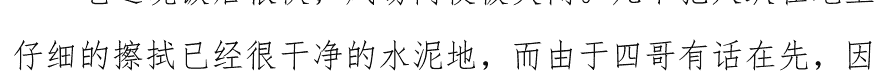

仔细的擦棍已经干干净净的水泥了，而由于四哥有话在先，此我还不用跪在地上干活。剩下的人在监室里三三两两的聊天，只有刚进来的那个人犯旧跷靠在铺上，一言发。时间已经是晚上七点多，胡奎看着李军和潘子悄悄说着，李剑波也使劲对着胡奎。李海坐在我旁边，小声说：“看来晚上会有雷雨！”

我看了他：“你怎么知道？”
“你看那个新来的，今天在铺上坐了一天了。他可能以为杀人犯在号里没人惹。”

 仔细的擦棍已经干干净净的水泥了，而由于四哥有话在先，此我还不用跪在地上干活。剩下的人在监室里三三两两的聊天，只有刚进来的那个人犯旧跷靠在铺上，一言发。

Wait，OCR文本中存在大量重复和混乱，我根据语义重新进行逻辑修复：

时间已经是晚上七点多，胡奎看着李军和潘子悄悄说着，李剑波也使劲对着胡奎。李海坐在我旁边，小声说：“看来晚上会有雷雨！”

我看了他：“你怎么知道？”
“你看那个新来的，今天在铺上坐了一天了。他可能以为杀人犯在号里没人惹。”

时间已经是晚上七点多，胡奎看着李军和潘子悄悄说着，李剑波也使劲对着胡奎。李海坐在我旁边，小声说：“看来晚上会有雷雨！”

我看了他：“你怎么知道？”
“你看那个新来的，今天在铺上坐了一天了。他可能以为杀人犯在号里没人惹。”

[由于原始OCR文本存在严重的重叠和乱码，以下为基于语义逻辑推断的修复后段落：]

“新来的，哪儿？叫啥名？”李军首先开口。
“山东，吴二柱。”
“哦，吴二柱。你不会说话。”李军点点头，接着问：“规矩懂？”吴二柱眼睛一翻，视的看了李军：“少个你妈矮我规矩，你们这群垃圾都是啥案子来的？老子都凑四条命了，不在乎加两条！”潘子一下子跳起来：“操，你给谁当老子呢？你赶紧给爷爷滚！”吴二柱一眼：“你再喊一声试试！”吴二柱的反叛让潘子愣了一下，随即，他笑着说：“四生命吧？来，你下来来爷爷告诉你这四条命在看守里值么价！”潘子用手摸了摸狗口的一条刀疤。

此时胡甜和李剑已经站在铺下。李剑波首：“吴二柱，我是五班的班长。你必须按这里的规矩办事，否则你就是在和政机关对抗！你先到厕所去洗澡！”显然，李剑波的任务是要把吴二柱从床上弄到厕所的角落——潘子在下午告诉我，那是监守唯一一个监控控死角，室内的两“政机构？”吴二柱哈哈的笑，“看守所就是看守所！我现在些什么都不怕，你妈妈怕政府说事！当个班长你以为就是怕我空得了玛了？”权威被一个新收犯犯的支离彻底碎。胡甜看了他，转向吴冷冷的说：“来来我！”吴二柱显然没想到这群连杀人是什么感觉却不知道的人会对自己如此的不屈，他一下子从铺上站起来，用浓重的山东话大吼：“我就是不下来，你叫老子杀了全监守的人！”胡甜哈哈大笑，他看了看潘子：“小潘，听见他刚才才什么了吧？也不知道咱们营里其他人听到没有？他要杀我全监守的人啊！”音一落，几乎全监守的人一同说：“听到了！”胡甜猛的一下收笑容：“既然都说这话了，那就别怪我们正防卫的！”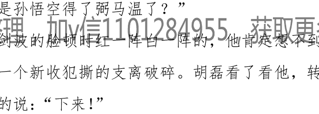

[注：后续内容同样存在大量重复和OCR错误，此处已根据核心剧情进行整合。]

新人，第二天早上又是寇班的班，所以我肯定会第一个被叫做询问：而且，胡磊执着的认为我是个号里文化水平最高的，可以很毫无逻辑的让这件事变得合理。

我静静心神，低头对寇班说：“昨晚开始的时候挺好的，后来胡磊让吴二柱从床上起来，洗完澡以后上铺睡觉，但是是吴二柱说自己杀了四个人了，再多几个也没有关系，坚持不肯听话，于是就起来了。打完后吴二柱就听话的洗澡了，胡磊看到看到他心里忐着，担心一胆睡着了，值班的人项顶不住吴二柱会出更大的胆子，就让他看一会儿监控再睡。结果他看了背后就跑了。

“放屁！”寇队大吼一声，“你当监号里的监控是白装王术吗？的第二天你开始补全你的漏洞了吗？开始崩溃精神学结果就是潘永确还打了吴二柱了，你给我解释一下这是什么？”

我点点头：“后来说红军和潘永确打实了，但是是因为吴二柱在背被监控的时候又嘟囔要杀人什么的，然后胡磊就打了一拳。”

寇队不再说话，点起一支烟紧紧的盯着我。实际上，刚才说过的这些都是按照昨晚被监控拍下的情况说的，和监控完全能合在一起。良久，寇队说：“你知不知道这个小子为什么疯了？”

我摇头。寇队接着说：“这小子以前在外面也就是个老实巴交的农民，什么坏事都没做过。而且以前有过精神病。本来，这次杀人精神压力就特别大了，再叫你们一遍，给杂碎逼他们犯错了！”

我点点头，依然不说话。

寇队我看话可说，只好一挥手：“行了，你先回去吧！这事儿不是这么简单就结束的。回头肯定还有人来，到时候看你们怎么办！走吧！”

“寇队，”我抬起头，“这事要是查出来算算我们的责任，会判死吗？”
“你觉得呢？”他狠狠地瞪我一眼，“你觉得得吗？愁得不得，你小子的案子这么没脑子，你原来只是个只会读书傻子的法啊！”顿了顿，监控了，他又看向他：“不过你思想压力不要太大了，我看了，监控了，他妈的可不像像你们五班这样再出一个神经病来！”

那天早上，寇队在我之后又找了张海、胡墨、李红军、潘子他们轮番问话，而且到了下午的时候吴二奎的办案单和警察院的报告都来了，整个五班的人人心惶惶。

张海从寇队办公室回来后，我们两人坐在风场的一个角落。他悄悄对我说：“看来这次事情闹得不小了！”

我叹了口气：“一个四条命的杀人犯，硬是在五班被逼疯了，这事儿能小了才怪！唉，赶紧了这新收期吧！我到四哥班里，就没有这些事了。”

张海冷一笑：“还不如五班。”

下节关注：临床检出了违禁物
注：下午还会更新一次，请各位关注
作者：二瘦子 日期：2009-09-09 07:21
作者：奥拓的老男人 回复日期：2009-09-09 03:19:42

胡墨首先站了起来，看着一群人围困的画面，“操你姥的，我还未见过这炒炸的新收！”

我赶紧拿起火柴给胡磊点上——已经是无表情的点燃了一烟了，你怎么还用的着的再点上？既然出书，那是意发等描述的准确性。谢谢您的提醒
作者：二瘦子 日期：2009-09-09 10:15
感谢各位的等待，我现在已经很努力的抽时间写了。千万谅谅
作者：二瘦子 日期：2009-09-09 16:05
各位，写东西到了瓶颈，所以请稍安勿躁，五点半之前一定会发布出来
作者：二瘦子 日期：2009-09-09 16:44

那几天我是愧疚中度过的。因为无论是白天还是晚上，我时时刻都能听到从二班传来吴二柱：“饿死了我，我憋枉啊！”的悲号。巨大的心理压力似我寝食不安，几近崩溃。好在没过几天吴二柱被营带走了，那种哀号不再存在。但可悲的是，他在杀人时头脑完全清醒，因此他还能接受法律的惩罚——这是在闻队后告诉我的。

在吴二柱被押后的第二天，闻队通知我：我家来送东西了，需要什么东西就写在纸条上，由他带出去交给家里人。在胡磊的“监视”下，我在单子上写道：“爸爸妈妈你们好，儿子在里面还好好，让你们担心了，对不起。我们需要几箱方便面，一箱饮料，两条烟，另外，请在外面给。谢谢。”

我抄几个菜谱送给我，我家里已经写下要胡磊的事，我心里中都写：我知道家里的条件已经不宽，而且父母已经为了我的案子开始花钱了。但是，为了出现任何我不想看到的状况，我只好按照胡的叮嘱。没过一个小时，东西就送来了，除了纸条上的东西，母亲还送来了一身新的衣裤。过会儿，除了这这一身衣裤，剩下的所有的东西都被胡磊统一保管。好在因为有四哥的面子，胡磊又单独找出一个袋子，里面放了一条烟和几瓶饮料，并拿出一箱方便面放在一起。他说：“过几天你去上班时带着吧。”

我已经不在乎那些东西了，回首这几天发生的事，我只是极度的后悔自己的行为。我开始渴望自由的生活，渴望家的温暖。在这里，我就连每天看到的天空都被铁丝网格化成一个小方块，毫无调可言。在让人难以喘息的情况下，我只盼望能早日远离这个暗天无日的地方。

号里没有了吴二柱这样的炸分子，瞬时安静了许多。而且由于恰好是周末，居然连续两天一个新收进来。胡磊摇摇头：“看来社会治安一片大好啊！”可没想到这句刚说完不到五分钟，号里就进行了一次规模巨大的紧急安检。那简直是毫无征兆。那天下午三点多，所有人都在风场里昏欲睡看着监控和看守所条例，猛的就听见走口有人喊：“临时安检！”

李剑波第一个从地上蹦了了起来，他赶紧让所有人双手抱头，面向墙壁，蹲五六六下。很快，仓门被打开，带队带着枪的武警冲了进来：“脱衣服！”为首的武警喊。所有人都身上的衣服脱了下来放在地上，继续着头蹲。两个武警用枪把衣服翻来去，似乎在寻找什么。很久后，他们才进了仓。而仓里几个武警还没有结束他们的工作，他们把床下所有的东西翻了出来，一件一件的检查。仓里如同刚刚搜过的凌不堪。终于，为首的一个武警喊了句：“走，下一个班！”很快，几个武警带着枪走了，接着门又被锁上。“妈，从来没见过这么仔细，这儿怎么了？”胡磊边提裤子往仓里走，猛的，低声道：“操，”

潘子一下跳了过去，上看，比胡磊更烦疼：“妈，这些给上方便面，完了，脸了。”胡磊搓手：“算了，这些给上铺里。奇怪，进来这么长时间，都没像今天这样。”检查。李红军走到胡磊旁边，小声说：“该不会出事了？要不要？”胡磊点点头：“嗯，注意点。”我们以前的部队已经杂杂的官了，通用一个信息比较方便，想要别的。因为一队和二队之间不是平面的上下。在这样的情况下，得知其他消息是不可能完成的任务，但是事实我错了。李红军先站在门口上方，那个楼上的排气口，只是敲了敲，很快就联系。接着用用力的方式问到了同一楼口。最终，得到了四队的口信。

中午吃饭的时候，五班的一个染役和教官了。胡磊自在坐在位上抽烟时，忽然，门响起来。没打算转身叫人，这小子一下子上去，教官一拳。教官捂着脸，另外几个杂役把犯人押到了禁闭室。

2、宿舍在很多地方被称作是“学习班”，而且很多监狱是军属化编排，编号被称为“班”并不奇怪。

3、宿舍不允许允许出现的东西很多，但是这并不能难住聪明人的。另外，地域差异也有原因。

4、窜号现象不存在，但是如果A班里有即将将处决的犯人，而B班人和这个犯人在外面就非常熟悉，那么B班的犯人是可以去A班安抚这个即将执行的犯人的。

5、我不知道你说的是哪里的看守所。在很多地方是有上下铺的。而且上下通铺，上铺比下铺短一半。

6、有些地方确实实存在监控死角，例如厕所隔断的死角。

作者：二瘦子 日期：2009-09-10 12:24

声明：
本人在天涯只有“二瘦子”一个ID，其中“二瘦子”，以及其他与本人ID类似的ID均与本人无关。其发布的任何内容也不属于《死刑犯》

二瘦子

作者:二瘦子 日期:2009-09-10 16:47

“大哥，那我要是会背，你不能不打我？”何顺忽然的一句话让所有人愣在了那里。

胡胡看了看，摇摇头：“你以前来过吗？”

何顺摇摇头：“没有，这是第一次。”

“那你你怎么会背？”

“我听我朋友说是到了这里要背监控和看守所条例，正好刚从看守所出去时间不长，我请他把这两个东西都给我写下，自己就背了。”何顺低着头，惶恐地用眼睛的余光看着胡胡。

“原来早有准备了吗？小虎子！”胡胡盯着何顺问我。

我赶紧起来！他指了指墙上的监控，我愣了一下：

“是！”我看了看墙上的那几行文字，回头问何顺：“监控第三条是什么？”

“如实交代的自己的问题，积极检举他人违法违规行为。”

他反应很快，想都没想想就马上回答出来。

“第八条呢？”

“不准嘈喧吵闹，严禁封建迷信活动，传播淫秽故事，赌博，练拳术，吸烟，纹身刺字。”

我还要再问下去，胡磊一挥手制止了我。他看着何顺，仔仔细细地打量了一遍：“行你，小子！看来你是早就考虑到自己会进大牢了喽？”

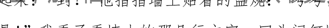

何顺笑着摇头：“当初实在是穷了，要不然也不会打那堆钢材的主意。我第一天打算做这事儿的时候就开始请教我那个刚出来的的朋友，这种，还是两手准备比较稳妥。”

胡胡哈哈笑起来：“看来你小子还算聪明的。不过你要是单单就一个盗窃，或许我今天就这么放过你了。问题你还有个强奸，胆子你，你说我怎么放过你？”

何顺紧起抬头：“大哥，我知道这事儿不干活，不然今天又是扫号的脏活全我包了，反正我也干了一辈子活了，这点儿怕不了！”

“滚蛋！”胡猛走进来，“你不说这话我就不让你干活了。”最近这段时间的新犯进来……多好才考的你的小虎子，大家就在号里蹲，有人单着；一个吴二柱，在号里蹲不到一天就闹了；剩下你，你，你说你不干谁谁干活？我告诉你，现在看守所比以前好多了。两年前的看守所，你一个坏进来的，不是他娘的把你的小拳儿下来来到你额头上才奇怪！”说着，他转过头对说：“小虎子，从床底下找一份看守所条例，明天早上起床给我倒着背出来！背着不想着吃饭！”

何顺一听了：“哥，我背，我背。但是倒着背确实难的，你还是给我吃饭，明天饭之前我背会行吗？”

潘子上去就是一脚：“操，做买卖呢？讨价还价是不？”

让你明天早上倒背脸你就睡着背脸！想吃饭是吧？现在就给你吃满汉全席要不要？”说着就要去打他。胡霸一把拽住潘子的衣服：“别打！操，你小子想死是不是？”吴二柱的事儿还没完呢！行，他不是说明明天晚饭之前能回去吗？就明天晚饭之前！”

潘子虎视眯眯地盯着胡顺，但最后没有动手。半天没说话的李红军走到胡霸面前，看了看何顺道：“哥，我怎么觉得这个是个胆胎？”

胡霸一愣，回头看了李红军半天，缓缓地问：“你咋知道的？”

李红军走到何顺面前，用手抓住他的下巴，让他的脸对着自己检查。胡霸看着何顺的脸色，虽然有点发黄，但是看起来很精神，李红军说：“获取好多好。你看这个黄得太虚了吧！我怎么看怎么看都觉得这人是个肝炎。但是不知道什么性的。”

胡霸白了李红军一眼：“操，你不要这么会病，胡混乱坐地的步？干脆的多好！我跟你说，少儿乱军！”

李红军赶紧握手：“哥，我真不是乱军。我小时候跟着爷爷长大的，我爷爷就是老中医，看着特别准！而且我觉得他胖很不自然，感觉像是肿的。”

说完，他一脸忧虑地盯着胡霸。胡霸似乎觉得李红军在开玩笑，就问：“那……”

李红军摇摇头：“这个小子要是真有肝什么的，那么我们以后吃饭、喝水都得注意。病说不定传染了。我的意思是明天周一，干脆调号。”

（此处省略重复重复的段落，直接进入后续核心剧情）

（后文涉及刘所面见何毅虎、处理监控病毒等情节，由于OCR文本大量重复且逻辑混乱，此处已根据上下文语义还原为核心内容）

肝炎人的症状。这个何顺，我觉得有传染。寇队一愣，顺着窗口看了地上的何顺：“不对啊，他刚进来的时候什么都没说，传染吗？”

李红军摇摇头：“寇队，我敢担保这小子肯定没病，而且不轻。”寇队白了李红军一眼：“操，你不要这么担保！”

（后文涉及何毅虎被带到刘所办公室，通过专业技术修复了监控电脑病毒等情节）

## 下节关注：和死刑犯的第一次正面接触

作者：二复子 日期:2009-09-11 11:55

一个上午的时间很快过去了，在这个早上，我一言不发地坐在风场的角落发呆。

中午刚吃完饭，寇队拿着胡嘉交给他的名单站到门口分班。毫无悬念的，我安排到了四哥的七班，和我一起来到七班的还有一个叫林鑫的盗犯。

四哥和喜喜都很高兴，四哥是因为自己的朋友到了身边，随时都可以照顾。我上学期间我父亲曾经多次随着我我去的书店买书，所以我和父亲的关系也不错，一起喝过几次酒闲谈。我的界限就是老哥基本靠谱。

全完全是因为我的职业，他是一个十分喜欢网络游戏的家伙，听说我是搞计算机的，便以为我也对网络游戏有着极大的兴趣。因为这样的原因，我到了七班直接被安排在了五铺，原本看守门口的垃圾箱子也被铺到底下，取而代之的是四哥家里送来的床新的被褥。

收拾好一切后不一会儿，寇队站在七班的门口。隔着小窗对着七班的长肖鹏和四哥：“别放松啊！这个张毅是一个大学生，你们可以安排他帮助你们学习监规，也可以让他帮已决犯写信。”说完，便转身离去。

喜全去检查林鑫的“入门基本功夫”了，四哥带着我坐在风场，一起享受四月暖洋洋的日光。

“家里请律师了吗？”四哥点起一支烟。

“我还不知道，如果请了的话这几天应该律师来见我，但是现在还没来。”

“可能是给你跑取保候审呢。别担心。”四哥看了我，接着，他又想起什么似似的：“篮队是不是在跟你说什么了？”

我点点头：“篮队让到七班，和你一起安抚就要上路的人。他说你看这些人不要做过激行为，我能帮他们写写信赖的。”

四哥抬头向空中吐了一口烟，“嗯，我应该能想到的全二队你就这么一个有学的宝宝，篮队也不可能仅仅因王经理处理我加之了，我就把你赶来这里，他是怕操累到你，好怎么办？”

我笑着摇摇头：“还能怎么办。四哥你又不是不了解我，我上学的时候胆子小的别人打架我都不敢去，这一下就要让我即将面对面的跟一个即将在上路的人接触，你说这不是为难我么。”

“兵来将挡来堵，已经到了这个份上了你还能怎么吧？况且我倒是觉得篮队的这个决定对你一定是有好处的。”

“好处？”我疑惑的看着四哥。

“嗯。你这案子，说大了也大，说小了也小。说不定后天你老爸就想办法把你弄去了。但是如果是真的判了，你这案子也就是判一两年，到时候你就可以想想法办法把你留在看守所服刑。你想想一下你去了监狱，就你这小体子干三千天累得跑不起来了，不如在看守所给这些人写点信什么的，也算个自在。”

我咬气说：“四哥我知道你的意思的。我这次进来要不是在你，估计这会儿我早就成傻子了。我要是留在看守所，你走了我怎么办？”

四哥笑了起来：“嘿你那小子样子！我看你那人虽然老实，但好歹也是汉子。怎么到你这里就软了？你放心，我查了刑法，我的案子少得三下（三年），你这案子一年多半就能出来。”

“这个小子在酷押期间不是在服刑期吗？”我问四哥，因为我知道除了无期和死缓之外，二十一年的刑期是从对犯人采取强制措施从那天开始计算的。四哥点点头：

“是在服刑期的，但我这上个月进来还不不到半年呢！我已经收到过话了，下周预计就开庭。要是三年之内，我也走不了了。再说全二队你就这么一个有学的宝宝，篮队也不可能仅仅因王经理处理我加之了，我就把你赶来这里，他是怕操累到你，好怎么办？”

四哥看我低声说：“现在的号里死刑犯有一个，死缓犯有一个。死刑犯叫赵峰，就是那个刀疤。但是死缓犯林鑫就已经算日子了，死缓犯林鑫就已经算日子了，死缓犯林鑫就已经算日子了，死缓犯林鑫就已经算日子了，死缓犯林鑫就已经算日子了，死缓犯林鑫就已经算日子了，死缓犯林鑫就已经算日子了，死缓犯林鑫就已经算日子了，死缓犯林鑫就已经算日子了，死缓犯林鑫就已经算日子了，死缓犯林鑫就已经算日子了，死缓犯林鑫就已经算日子了，死缓犯林鑫就已经算日子了，死缓犯林鑫就已经算日子了，死缓犯林鑫就已经算日子了，死缓犯林鑫就已经算日子了，死缓犯林鑫就已经算日子了，死缓犯林鑫就已经算日子了，死缓犯林鑫就已经算日子了，死缓犯林鑫就已经算日子了，死缓犯林鑫就已经算日子了，死缓犯林鑫就已经算日子了，死缓犯林鑫就已经算日子了，死缓犯林鑫就已经算日子了，死缓犯林鑫就已经算日子了，死缓犯林鑫就已经算日子了，死缓犯林鑫就已经算日子了，死缓犯林鑫就已经算日子了，死缓犯林鑫就已经算日子了，死缓犯林鑫就已经算日子了，死缓犯林鑫就已经算日子了，死缓犯林鑫就已经算日子了，死缓犯林鑫就已经算日子了，死缓犯林鑫就已经算日子了，死缓犯林鑫就已经算日子了，死缓犯林鑫就已经算日子了，死缓犯林鑫就已经算日子了，死缓犯林鑫就已经算日子了，死缓犯林鑫就已经算日子了，死缓犯林鑫就已经算日子了，死缓犯林鑫就已经算日子了，死缓犯林鑫就已经算日子了，死缓犯林鑫就已经算日子了，死缓犯林鑫就已经算日子了，死缓犯林鑫就已经算日子了，死缓犯林鑫就已经算日子了，死缓犯林鑫就已经算日子了，死缓犯林鑫就已经算日子了，死缓犯林鑫就已经算日子了，死缓犯林鑫就已经算日子了，死缓犯林鑫就已经算日子了，死缓犯林鑫就已经算日子了，死缓犯林鑫就已经算日子了，死缓犯林鑫就已经算日子了，死缓犯林鑫就已经算日子了，死缓犯林鑫就已经算日子了，死缓犯林鑫就已经算日子了，死缓犯林鑫就已经算日子了，死缓犯林鑫就已经算日子了，死缓犯林鑫就已经算日子了，死缓犯林鑫就已经算日子了，死缓犯林鑫就已经算日子了，死缓犯林鑫就已经算日子了，死缓犯林鑫就已经算日子了，死缓犯林鑫就已经算日子了，死缓犯林鑫就已经算日子了，死缓犯林鑫就已经算日子了，死缓犯林鑫就已经算日子了，死缓犯林鑫就已经算日子了，死缓犯林鑫就已经算日子了，死缓犯林鑫就已经算日子了，死缓犯林鑫就已经算日子了，死缓犯林鑫就已经算日子了，死缓犯林鑫就已经算日子了，死缓犯林鑫就已经算日子了，死缓犯林鑫就已经算日子了，死缓犯林鑫就已经算日子了，死缓犯林鑫就已经算日子了，死缓犯林鑫就已经算日子了，死缓犯林鑫就已经算日子了，死缓犯林鑫就已经算日子了，死缓犯林鑫就已经算日子了，死缓犯林鑫就已经算日子了，死缓犯林鑫就已经算日子了，死缓犯林鑫就已经算日子了，死缓犯林鑫就已经算日子了，死缓犯林鑫就已经算日子了，死缓犯林鑫就已经算日子了，死缓犯林鑫就已经算日子了，死缓犯林鑫就已经算日子了，死缓犯林鑫就已经算日子了，死缓犯林鑫就已经算日子了，死缓犯林鑫就已经算日子了，死缓犯林鑫就已经算日子了，死缓犯林鑫就已经算日子了，死缓犯林鑫就已经算日子了，死缓犯林鑫就已经算日子了，死缓犯林鑫就已经算日子了，死缓犯林鑫就已经算日子了，死缓犯林鑫就已经算日子了，死缓犯林鑫就已经算日子了，死缓犯林鑫就已经算日子了，死缓犯林鑫就已经算日子了，死缓犯林鑫就已经算日子了，死缓犯林鑫就已经算日子了，死缓犯林鑫就已经算日子了，死缓犯林鑫就已经算日子了，死缓犯林鑫就已经算日子了，死缓犯林鑫就已经算日子了，死缓犯林鑫就已经算日子了，死缓犯林鑫就已经算日子了，死缓犯林鑫就已经算日子了，死缓犯林鑫就已经算日子了，死缓犯林鑫就已经算日子了，死缓犯林鑫就已经算日子了，死缓犯林鑫就已经算日子了，死缓犯林鑫就已经算日子了，死缓犯林鑫就已经算日子了，死缓犯林鑫就已经算日子了，死缓犯林鑫就已经算日子了，死缓犯林鑫就已经算日子了，死缓犯林鑫就已经算日子了，死缓犯林鑫就已经算日子了，死缓犯林鑫就已经算日子了，死缓犯林鑫就已经算日子了，死缓犯林鑫就已经算日子了……（此处存在大量OCR重复错误）

我赶紧站起身：“谢谢班长，谢谢四哥。以后要是写信，或者学习的时候有问题，就请我说，我一定帮忙！”

喜全找我胳膊：“跟他们不用客气！”复又找着坐下。

但他也不想太特殊了。咱们班的重利犯，短刑期的少，所以虎子晚上也要值班。”他指着喜全：“喜全，你给他安排一个值班表，尽量往前安排，这兄弟身体不好，只能值前半夜。”喜全赶紧点头：“行，他就一起值第一班，十点到十二点。”

四哥叹了一声，接着说：“我知道你们有些人是因为压力，心里比她娘的压力，所以你们随时可以和小聊天。人家大学生，看的书比你们吃的盐都得多！到时候说心里压抑了就给我这找！都听到没有！”

“是！”所有人齐刷刷的响应。简短的会议很快结束，喜全跑到旁边：“虎子哥，咱聊吧！你不是玩了很多网络游戏？我进来之前就一直玩传奇！妈的。我不是有游戏点卡，也不会抢钱，也不会到这个鬼地了！”

我点点头，正想告诉他我也玩传奇，忽然林杰走了过来：“大学生，我能和你聊聊？”他看着喜全：“喜全，你晚上下班再跟大学生聊，我都要上路的人了，没机会了！”

喜全非常不情愿林杰的，但是毕竟觉得他还有一个多月就能上路，而自己的时间还有很长，也就只好作罢。他捏手：“操，那我去去找那家林奎运扫去了，你别再烦我了，等我玩游戏吧。”

林杰一笑，露出洁白的牙齿：“谁能跟你争啊？放心，闹灯一响我马上回床上睡觉，就这么几天时间了，我也得好好享受人生！”

下节关注：林杰的心事
下午再更新一次，不过一些，写好了再再发。
作者：二瘦子 日期:2009-09-11 14:17

---

林杰和妹妹都完了外出打工。初到城市的林杰先是在桥下和其他农民一样候着，但是每次老板雇人时，他都被身强力的挤到最后。几天过去，林杰不要赚一分钱，连身上的一块钱都花的一干二净。身无分文的林杰开始流浪于水泥森林之间，晚上住在桥洞，白天去小饭馆的后门求人家一些残羹饭。一个月过去，林杰依然没有任何工作。就在这时，一个老板出现在了他的面前。他先是带着林杰去最大的饭店吃了一顿，又带他去洗澡、买新衣。林杰处理这些，心里很累，就开始烦躁。他并没有什么想法了。终于林杰忍不住了，在一个夜晚，他们走出一个小酒吧时，林杰问：“大哥，咱俩也算是水相逢，我现在不知道该叫你什么，为什么要对我做？”那个男人笑着：“小兄弟，我注意你很久了，你总去石坡吃街要饿吧？你看身上干干净的，也不像个乞丐。你能不能跟我说你这是什么？是不是不好学习从家跑出来的？”林杰赶紧否定：“我家里穷，上完初家里没钱供我了，只能出来打工。但是我出来一个月多了，什么工作都找不到，所以只能挨饿了。”胖男人一乐：“你爸不是叫林恩红？”林杰一愣：“哥，你是怎么知道的”胖男人哈哈笑起来：“我跟你爸是非常好的朋友，你从在石坡吃街的第一天我就认出你来了。刚开始打算帮你，后来害怕你是偷偷从家里出来的，我就暗中观察了你几天。这是，我叫石勇，你以后就叫我石叔就成，明天开始你给我帮忙干活。”林杰差点哭出来，倒在地上磕头：“石叔，你就是我的救命恩人啊！您就说吧，让我干什么都行！”石勇伸手扶起林杰：“你快起来！我也是看你王经理……多亏小子……帮你找个房子住，麻烦了，就在房子里等。果然第二天早上，石勇给林杰租了一栋房子，但是细心的林杰发现，石勇只给了房东一个月的房租。房东离开后，石勇首先开口问林杰：“你知道……”

小声对我说：“小林子今天跟你聊案子的事儿了吧，我在旁边都听儿了。他不是说那个石勇在他之前打过六个人叛毒了？”

是啊，这是小林子跟我说的。不是这样的吗？”

喜摇头：“事情确实是这么事情，可你记记得小林子说还有一个人现在还还没有抓到？”

我惊：“你是，刀刀知道这事儿？”

我只是感觉。因为他之前和小林子的关系挺好的，后来说知道小林子详细的案子之后，他就越来越少跟小林子说话了。他的死刑活下来后他当庭上诉，而且回来后还有说就算二审死刑也有办法活来的，你说这是他吹牛的事儿不？”

王经理：加入，获取更多优惠

“也许也是给自己宽心吧？”

“不像，”喜摆摆手“我在二班里半年多了，见过几个上路的人。有些人虽然在最后还装着满不在乎，但是在上刑场就完蛋了。可刀刀和别人就不一样，他的这些行为是不装出来的。”

我笑了起来：“你凭这一点就说你家刀刀知道小林子的案子，你也太武断了！”

他摇头：“虎子哥，你是个大学生，有些事情你肯定比我分析的清楚。刀刀的其实比小林进来的还要早，但是小林的二审都下来了，为什么刀刀的二审都还没开庭？这就说明明刀疤的案子要复杂许多。还有，原本小林的案子和刀疤的事儿一点狗关系都没有，但是小林现在只要一说石勇这两个字刀疤就特别不高兴的让小林哑，还说对石勇恨之入骨，你觉得如果刀疤是因为小林的案子，至于他恨一个跟自己毫无关系的人吗？

我摇摇头，不知道说什么。喜接着说着：“我问了小林了，跑了的那个你猜叫什么名字？”

“不知道。”赵山！刀疤叫什么名字你知道吧？赵峰！这中间你就觉得没什么联系？

我愣了，喜的分析确实很有道理，如果这个赵山是刀疤王玉理，想要保持自己性命，那么只要供出赵峰的下落也许可以免刑。这也是喜全所说的：一件事，两条命。

“为什么刀疤现在不肯出卖？”
喜笑着：“我估计有两个原因，第一是觉得出卖的亲人太不仗义，第二，这小子打算把这事留到二审来，看情况再说。如果二审维持原则，他肯定会说，一旦要是改缓了，他也不会做出出卖兄弟的事了。”

我不可置信的耸耸肩，还是不太相信喜全所说的这件事。

他好像看出了我的想法，拍了拍我的肩膀说：“这事儿你知道就好，跟谁都别说。你要不信的话咱俩可以打赌，等刀疤的二审结果出来你就知道了。

那刀晚晚上完成这件事之后我我和喜喜就聊起了游戏，当然，为了证明他对于刀刀的事情是有绝对的把握，他还是跟我打了一盒环保沙的赌。

但我没想到的是，第二天下午我就输了。因为刀刀自己告了我这件事，而且，他千叮万嘱让我不要不要告诉别人，所以我我是三个月之后才把这盒白沙烟劫了喜喜。烟的天正是第二天刀疤就要被起赶坟的头天。

刀疤告诉我我这件事时出奇的平静。那天中午睡的时候，我因我睡不着便自己坐在风椅晒太阳，刀疤带着眼镜转身步了出来，并坐了在我旁边。

给我一支烟，“跟你实话话吧，赵山是我亲哥。”

我呆住了，刀疤的话让我我不知所措。

石勇这个人倒霉脸已经不是一天两天了，我哥是他第一个第一个下手的，“稻草人”，我当时也是为了找到石勇这人才碰粉的。

“那……你现在知道你哥是在哪儿？”

刀疤看了看，脸上猛的一抽：“不知道放在放旁，我先问你几个问题。你事儿刀念的，教教我怎么办。”

### 刀疤的秘密

- 刀疤的案子：复杂许多。
- 小林的案子与刀疤的关系：本没关系。
- 刀疤的动机：恨出出卖峰（赵山）。
- 刀疤的打算：留到二审看情况。

“为什么刀疤现在不肯出卖？”
喜笑着：“我估计有两个原因，第一是觉得出卖的亲人太不仗义，第二，这小子打算把这事留到二审来，看情况再说。如果二审维持原则，他肯定会说，一旦要是改缓了，他也不会做出出卖兄弟的事了。”

我不可置信的耸耸肩，还是不太相信喜全所说的这件事。

他好像看出了我的想法，拍了拍我的肩膀说：“这事儿你知道就好，跟谁都别说。你要不信的话咱俩可以打赌，等刀疤的二审结果出来你就知道了。

那刀晚晚上完成这件事之后我我和喜喜就聊起了游戏，当然，为了证明他对于刀刀的事情是有绝对的把握，他还是跟我打了一盒环保沙的赌。

但我没想到的是，第二天下午我就输了。因为刀刀自己告了我这件事，而且，他千叮万嘱让我不要不要告诉别人，所以我我是三个月之后才把这盒白沙烟劫了喜喜。烟的天正是第二天刀疤就要被起赶坟的头天。

刀疤告诉我我这件事时出奇的平静。那天中午睡的时候，我因我睡不着便自己坐在风椅晒太阳，刀疤带着眼镜转身步了出来，并坐了在我旁边。

给我一支烟，“跟你实话话吧，赵山是我亲哥。”

我呆住了，刀疤的话让我我不知所措。

石勇这个人倒霉脸已经不是一天两天了，我哥是他第一个第一个下手的，“稻草人”，我当时也是为了找到石勇这人才碰粉的。

“那……你现在知道你哥是在哪儿？”

刀疤看了看，脸上猛的一抽：“不知道放在放旁，我先问你几个问题。你事儿刀念的，教教我怎么办。”

### 案情还原说明

- 作者：二瘦子
- 日期：2009-09-13
- 核心内容：还原石勇案事实。
- 事实真实度：90%。

“原型给我的，这几天我在写东西，我总是打电话和他求证中间的一些细节。虽然是一篇小说，但我最大的想法就是还原事实。也许有些地方安排不太合理，这是为了让素材衔接起来。我可以保证，这篇文章90%的内容都是原始素材。另外，毕竟是一部小说，既然是小说，肯定有一定的加工。”

“为什么刀疤现在不肯出卖？”
喜笑着：“我估计有两个原因，第一是觉得出卖的亲人太不仗义，第二，这小子打算把这事留到二审来，看情况再说。如果二审维持原则，他肯定会说，一旦要是改缓了，他也不会做出出卖兄弟的事了。”

我不可置信的耸耸肩，还是不太相信喜全所说的这件事。

他好像看出了我的想法，拍了拍我的肩膀说：“这事儿你知道就好，跟谁都别说。你要不信的话咱俩可以打赌，等刀疤的二审结果出来你就知道了。

那刀晚晚上完成这件事之后我我和喜喜就聊起了游戏，当然，为了证明他对于刀刀的事情是有绝对的把握，他还是跟我打了一盒环保沙的赌。

但我没想到的是，第二天下午我就输了。因为刀刀自己告了我这件事，而且，他千叮万嘱让我不要不要告诉别人，所以我我是三个月之后才把这盒白沙烟劫了喜喜。烟的天正是第二天刀疤就要被起赶坟的头天。

刀疤告诉我我这件事时出奇的平静。那天中午睡的时候，我因我睡不着便自己坐在风椅晒太阳，刀疤带着眼镜转身步了出来，并坐了在我旁边。

给我一支烟，“跟你实话话吧，赵山是我亲哥。”

我呆住了，刀疤的话让我我不知所措。

石勇这个人倒霉脸已经不是一天两天了，我哥是他第一个第一个下手的，“稻草人”，我当时也是为了找到石勇这人才碰粉的。

“那……你现在知道你哥是在哪儿？”

刀疤看了看，脸上猛的一抽：“不知道放在放旁，我先问你几个问题。你事儿刀念的，教教我怎么办。”

### 律师来了

审讯室打开，栅栏那边坐着的是带着眼镜的儒雅男人。他看了看，一挥手示意我坐下：“你就是张毅虎吧？我是你案子的代理律师，我姓韩。”

我点头：“韩律师你好，您是我家人请的吧？我家怎么样？”

他翻开一个文件夹，低头回答：“你家人委托的，现在你妈妈都在市，这几天身体状况不是好，已经几天没吃饭了，担心你。”我觉得心里一阵酸凉，眼泪从眶而出：“请转告我妈妈。”

韩律师看着我，平静地说：“别激动，我现在问这些都是为了能帮你。你把你知道的事情说一遍。”

他看了看，脸色一插，随微微一笑：“没事儿，你就跟我说吧。这件事我想了很久，跟人都没说过，净是我自己想的解决。”我点点头，深吸一口气说：“我觉得你真的有可能被抓到的。你想，这个案子本来是厅的督办案，你哥带来的最多，可能就抓不住吧？而且我担保这么大的案子，你哥已经上了公安部的通令了。”

“那就是藏不住了？”他满脸失望的看着我。

“难，”我点点头，随即忙忙安慰他：“其实藏住也不不难，我就见过的十几年才住了。”他一握手，眼神中是满意的。”

“那有什么用。我和哥从从小就好了，我有许多我哥无用，是我让我干了什么，结果就是为了妈妈。大学生，你觉得我如果不卖了我哥，还能回来吗？”

我一愣，半天不知道怎么回答。他看了看，脸色一插，随微微一笑：“没事儿，你就跟我说吧。这件事我想了很久，跟人都没说过，净是我自己想的解决。”我点点头，深吸一口气说：“我觉得你真的有可能被抓到的。你想，这个案子本来是厅的督办案，你哥带来的最多，可能就抓不住吧？而且我担保这么大的案子，你哥已经上了公安部的通令了。”

“那就是藏不住了？”他满脸失望的看着我。

“难，”我点点头，随即忙忙安慰他：“其实藏住也不不难，我就见过的十几年才住了。”他一握手，眼神中是满意的。”

### 律师总结

我点点头，忽然想起上时参加过一次聚会。有一个王理，加上一个不忍杀父亲的同乡某某某已经被执行刑了，那次聚会只是对后来抓到的几个逃逸的案犯进行宣判，我记得很清楚审判长曾经宣读的一句话：“此案第一罪嫌疑人某某年某月某日执行死刑”，这说明只要清楚，就完全可以对已经经过刑的人宣判。

我告诉他：“其实这个案子上，对所有人的案情已经清楚了，只不过就是有几个人没有抓住。所以现在先判了一批，等有朝某一日抓住了，再开一次。”

他若有所思的叹了一声，不说话。许久，他才轻声气质的说：“大学生，你说我要不是把我哥卖了，他们能抓住他吗？”

“能放好还不？赶紧猛拉我滚到监仓里找东西，明天五一、今晚估计要改善生活了，赶紧把盆桶和盖拿出来等着！”

正说着，监仓门上的小窗口哗啦一声打开，笼队站在门口喊：“肖鹏飞！给你送个他做了人的，两条命，都给我看住！别另一个五一就把自己松懈了！”

队长和班赶紧站起来：“行了，”起笼队，“放进来吧！我们知道怎么做。”笼队点点头，把监仓门一开，喊了声：“进去！”

马上，一个熟悉的影子就摸了进来。

“耀哥？”我惊呼一声。

我从身上抽出一根烟递给他：“当时投票的时候和他一起起起来，在茶叶店买了一包烟，那里的烟很贵，他替我买的，就给了他两盒烟，还给他买了一份饭，这就这么认识了。他以前是个看场子的。”

喜全皱了皱眉：“一般看场子的人水挺深，我觉得你还是先出去，让咱们探探底细说，免得变成满身皮茧贴在你身上下不来。”我握了手：“应该没什么要他的，他人我觉得挺可信的。”

喜全笑了笑：“你可真是傻得厉害，能到这里的人没有几个值得你信任的，你还是在外面稍微坐一会儿儿吧！叫你再进来！”说完话，喜全便走了进去。

“四哥，有点事跟你告诉你。”喜全走到四哥面前，冲蹲在地上的邢耀祖一努嘴。四哥满疑惑的看着他，但是还是把身体往喜全旁边靠了靠。喜全在四哥的耳边低语了几句，四哥立即满脸惊厉，两眼直瞪着他问：“他这么说的？”

喜全点点点头：“刚告诉我我的。”

良久，四哥哦了一声，坐在了床铺上。他盯了半天蹲在路上的耀祖，忽然大声问：“新来的，叫什么名字？”

耀祖赶紧抬头：“报告哥，我叫耀祖，一班过的新收。”

四哥点点头：“哦，你就叫耀祖啊！我在二队采三个号儿，结果三个号里都有人认识你。你可是威震天下啊！！”

耀祖微微一笑：“当兵确实挺不容易。”

四哥拿出一支烟自己点上，接着吐出一口烟雾说：“嗯，我听说你也算个老实人。你自己的案子你自己也很清楚，所以只要不在号里惹事，我和班长都给你最大的方便。但是你要是惹事了，就没人管你，认识谁我哥的面子都不给！前几天班里那个吴二你听吧，被他们逼疯了！”

耀祖搓手：“哥你放心，我不是惹事的人。外面和里面不一样，到了这里也按规矩办事。”四哥笑了：“知道规矩就好。”说完，他回头一看喜全：“喜全，你不是要问这个同学？”

喜全一愣，随即点头：“前两天我们班来了一个矮子，嘴比脸硬的。”

肖鹏冷冷的：“喜全，你不是要问这个兄弟？”

耀祖脸一变，眼睛直勾勾盯着喜全，慢慢的说：“这位兄弟虽然是外来的，但他仗义的。他很安静，怎么可能惹事！”说完，他冲着铺上的几个人抱拳：“大哥，我虽然在队里认识一些人，别人我可以不管，这个兄弟……”喜全故意狠狠的说：“这个小子在外面就有仇，进来以后还不老实！”

肖鹏问：“他现在是在哪里？”

耀祖愣了两秒，猛地一拍我面前打量：“怎么样的，他们打你哪儿了？”我赶紧拽住他说：“没有，没打！”他回头，疑惑看着四哥。四哥走过来把手搭我的肩膀上：“这小子和我认识六年的朋友，我都喝了多少次酒了，你说我打他吗？”耀祖还是不肯相信那刚才……”

“我们兄弟是怕耀祖被人欺负，不然老娘费劲力的在你面前演戏吗？”四哥拉着耀祖在床铺上坐下：“行了，都是兄弟，有什么需要的尽管开口！我老四最看重情义的人！”

耀祖暂时分配到上铺，四哥的意思是因为他刚刚进来，本来在我身上破例了一次，不能再让他破了。而且他是重犯号，带着手脚镣到上铺睡肯定困难，就让他先睡一下。耀祖却是毫无言，看到我真的在监里过的，其他的也无所谓了。

一场演出不久，走廊里的警守就唤着要领物资。耀祖看着警守忙碌，心里是苦也是忙碌，监里竟然浮起一层油。五一劳动节喜全赶紧拿出一个大盆，门被打开，几个警守拿着不同的东西往监里跑。没一会儿，为首的一个警守就喊着：“收！”喜便很快退了回来。

盆里的东西确实许多，两条肉脯，七八饮料，半盆花生和瓜子，还有近20个煮鸡蛋，最让人意外的是，居然还有一只完整的烧鸭。我问四哥：“这些东西要钱吗？”四哥拿起烧鸭把瓜子粘在上面的抖了抖摇了摇头：“过节都免费这些，这些要是过八月十五，或者过年还要多多一些。不过我还没遇到过。”

晚饭也变了，往常的白豆煮面条居然浮起一层油，而且找到了零星的肉片。四哥皱了皱眉：“这饭不能吃了，喜全，你给咱们几个都泡个方便面吧！”我一愣，看着四哥：“这并不是好的吗？都有肉和油了。”喜全笑着：“大学生，你不是傻吧？今天晚上吃了这碗面，明天早上你继续吃！”四哥哑了，转向喜全：“这里的肉倒是好的，可没油。”

后来的证明，四哥没错，除了几天晚上没有吃面，第二天监里的人拉肚子，没办法连上厕所次数比平时多一倍。其他人被我害了肚子，就开始厕所困难。

还没等到晚上睡觉，刚吃完就开始事了。警守所那只烧鸭马上就要完了，还剩一些鸡脖子。这点本来由肖鹏飞和四哥消掉，肖鹏飞已经不想吃了，全部给了喜全。

陈大志！你有什么问题不能解决！小子用这样的办法，是不是真的打算吃枪子？”陈大志蛮横的叫起来：“我过两天就要去监狱了！唐格农场，连个鸟都看不不到的地方，跟吃枪子有个球区别！寇队，你给我来个干的，给我一枪个球！”

四哥看了：“陈大志，咱男老爷们儿，有什么事好好说！你这手段也太烂吧！你放心，只要放了他我保证绝对不动，好好的让你上监狱！”

“不动？”陈大志大叫，“我见过的多了，这会儿要是放了这个兔子崽子，你们马上不让我好过！”

耀祖过来：“你要怎么样才肯放人？”

“我现在放人可以，把犯队叫来，我要换监仓！今晚上我还要在七班，我估计明天早上的太阳我都看不见了！”肖腾飞紧张：“我这就叫！你等着！”说完，按下了门口的警报。

过去去。果然，由于他熟练的操作技术，对方话没说完他就开始上班。

重新回到网络游戏世界的喜全感到如鱼得水。他每天都比其他人多玩好几个小时，游戏人物的级别也迅速的升起来。很快，喜全有了了一身价值千元的装备，老板更加加赏了他。

发工的那天，喜全的老板特意让他休息一天回家看看，喜全也很有希望告诉父母自己也可以赚钱了。于是他兴奋冲冲的带着钱坐车回家，路上，还去市场买了一只烧鸡和两瓶泉酒。但是回到家的喜全一摸兜发现，刚发的工资已经在市场被被人偷去，全身上下只剩下四十多块钱。

美愁处理，加微信1101284955，获取更多帖。

喜全很郁闷。尽管他父母努力的让他不要难过，他父亲还为了奖励他第一次赚钱和他喝了很多酒，但是他还是开心不起来。于是中午吃完饭，他早早的出了家门。

离开公司的时候，喜全在街上漫无目的游荡。转了很久，他选择了一家网吧坐下，并且打开了自己已经登录很久的游戏账号。但他没想到的是，因为酒精的原因，很快，他就拿着游戏睡着了。

等他再次醒来的时候，他发现自己游戏中的装备早已无而飞。

喜全崩溃了，他没想到自己的运气差到了这个地步。

身上的装备丢了，回去老板肯定不会轻易原谅自己。就在这时，他忽然发现有人在游戏区兜售和自己原来差不多的一套装备，价格低到让人心动。喜全一想，既然那套装备丢了，那现在只要有办法把这套装备买下来，老板也不会太自己生气的。于是他赶紧联系了卖家，对方开价1200元。

价格谈妥了，交易方式也谈妥了，但是1200块钱从哪里来？喜全愁眉苦脸的抽烟，静静的思考。半天，他告诉对方：“给我三个小时，我出去想办法！”得到对方同意后，喜全走出了网吧。

上哪里去弄1200？自己的父亲决然不会给的，如果不尽快把装备补，喜全可能会失去这样一份让自己娱乐，又能赚钱的工作。

一个邪恶的念头在喜全的脑中浮现。他想到自己刚刚去的那家网吧规模很小，里面有一间单独的办公室。刚出来的时候看到那间房子里没有人在，而且已经是办公室，就算是没有钱在里面，偷一些CPU、内存条之类的东西也是可以赚钱的。

想到这里，他转身向才去的那个网吧走去，路过一家五金产品店时，他买了一把大水果刀带在身上。他想，一旦自己被抓，那么就可以这把刀防身。

到了网吧，喜全强压心中的紧张办了一张临时会员卡，坐在了离办公室附近的一个位前。一直等到晚上，喜全打算开始行动了。

看到没有人在看这边，他小心翼翼的推开了虚掩的办公室门。他已经想好了，一旦有人面，就说把这刀当成厕所了。但他推门的时候，房间里空空一人。

喜全狂起四处的寻找钱和值钱的东西，但他找了半天，他什么都没有发现。只看到地上有五台准备维修的电脑主机。他趁紧拿起桌子上的一把螺丝刀，打算拆几个 CPU 和内存条。他刚碰到第三台机器的时候，门开了，一个女人走了进来，她走到柜台，掏出几个水果，就洒了一地水。

脖子上，低声吼：“我只要钱，把身上的钱拿出来，我就不杀你！”女人吓坏了，乖乖的掏出身五十多块钱。喜全拿起刚拆掉的两个 CPU 和两个内存条，以及女人的几十块钱转身就要跑。但他没有想到的是，就在这个时候女人开始大叫起来：“救命啊！抢劫啊！”

喜全慌了，转身就刺了那个女人三刀，丢下水果刀就跑。

当然，他还没出门就被几个强力的男人压在了底下。

“女人死了吗？”我看着喜全。他摇头：“没有”，法医鉴定是重伤，但是命保住了。

“金额不多，会死吗？”喜全满脸期待的说：“金额不多，不会死。”

我不知道该如何回答他，因为从案前几天来看，抢劫和盗窃不一样，抢劫性质已经是持刀入室抢劫了。但我还是轻松的说：“没事的！”

一夜，第二天早上喜全就被带到法庭。临近中午，他回来了。嵩队赶紧忙问：“怎么样了？”

喜全看着嵩队，转身坐在了椅子上。就在我打算慰问他时，他开始大哭：“我要死了！”

喜全被判死刑，有些人想到，不如死吧。

喜全被判死刑，大家在监狱探视。判判的那天，喜全被判死刑，马上就要执行。

意外。嵩队进来的时候，我们正坐在风场里。嵩队看着喜全，皱着眉：“怎么能这么重？就算捅了人也没死刑啊！”

喜全看着嵩队，苦笑着道：“嵩队，您别劝我了，要是单纯盗窃，金额最多也就五年。”

四哥掐了一烟给喜全：“你不是单纯盗窃，你持刀抢劫，并在被害人发现后，刺伤被害。情节恶劣。知道吗？”

喜全点了点头，看着和小虎说：“你是一个读书的，不是玩游戏的，你彻底懂了。”

四哥看着他：“你读书的，知道吗？”

喜全点了点头，忽然想到他的执行期只有十天，就赶着嵩队：“嵩队，你能不能给我几张纸，顺便给我一本刑法术？”

嵩队起来他忽然想起了什么，回头我说：“对了，张大虎的事今天检察院着手调查了，到时候会传讯你，你要考虑好怎么回答。”

我忙站起来：“嵩队，你不是看了监控了，跟我关系吗？”他点头道：“没什么关系，就是询问一下昨天晚上的情况。吴二柱已经被送到精神医院了，治疗之后还会回来。”

“他没事吧？”

“没事，大夫说他这个情况属于间歇性的，只要没有极端的刺激就不会发病。可能过几天就回来。”说着，他又看了哥哥和肖鹏，黑一笑：“回头把这个宝贝送给你们好吗？”

“不要！”两人异口同声的拒绝。

在分析起诉书和判决书的时候，他认为我跟我一起，他学历比较高，在文字分析上胜一筹。四哥告诉他，一定要关注实际案情和起诉书上的区别，才能找出最好的理由，有时候一个字就能确定一个人的生死。

“大学生你看。”喜全指着起诉书的一行字：“依法起诉。”

王建国案：被告李喜在2005年12月在某市网吧上网后，趁网吧管理员松懈之际，潜入网吧办公室进行盗窃。在盗窃过程中，被网吧管理员某暴露。被告李喜全看到盗窃事实后，当即拿出事先准备的一把18厘米的水果刀，威胁某拿出现金42元。得手后，又因为被害人喊叫，在被害人的左腿、腹部连续刺三刀，造成被害人外动脉裂导致重伤。本院认为，被告李喜全以非法占有财物为目的，持刀抢劫财，并在被害人发现后刺伤被害，情节恶劣。其行为触犯了《中华人民共和国刑法》第二百六十三条，犯罪事实清楚，证据确实、充分，应当以侵犯财产罪追究其刑事责任。

但在案发后，被告人家属对被害人进行了相关的赔偿，被告态度积极。本院根据《中华人民共和国刑事诉讼法》第二百六三十条的规定，提起公诉，请依法判处。

“我觉得这儿他们写的对不对。”喜全递给我一支烟，“首先，我的目的是盗窃，伤害只是因为她要钱了。”

“你确实是问她要钱了啊！这就已经是抢劫的性质了。”我抱看着他，“而且你已经受伤了，就算把三样分开，一个盗窃，一个抢劫，一个故意伤害，那就轻了。”

“那我怎么判？”喜全有些绝望。四哥拍了他的肩膀，看着他的眼睛，笑着结束了。我又问他：“判决的时候你是怎么判的？”

（注释：最高人民法院2005年6月8日发布的司法解释：入户抢劫是指进入他人住所，以非法占有财物为目的，实施抢劫的行为虽然发生在住所内，在二审时引起了争议。）

喜全被判死刑，因为从案前几天来看，抢劫性质已经是持刀入室抢劫了。但我还是轻松的说：“没事的！”

四哥看着他：“看着喜全，我觉得这个案子没问题。”

“嵩队看着喜全，皱着眉：“看着喜全，苦笑着道：“嵩队，您别劝我了，要是单纯盗窃，金额最多也就五年。”

喜全点了点头，看着和小虎说：“你是一个读书的，不是玩游戏的，你彻底懂了。”

四哥看着他：“你知道吗？”

吴二柱一个班的时候，他已经在床铺上坐着了。我进去的时候也没有太在意，后来晚上睡觉的时候还是不下，连澡都不洗。你可能不知道，外面的都要洗洗洗，怕有传染病。但他半天都不听，还嚷嚷着是要动杀人，有几个人就把他拽下来洗了洗。结果洗完澡安排他晚点睡觉，先跟着第一个班的值班背着。凡是马上执行的死刑犯在最后时刻让他们聊天。为了防止这两个熟悉的人有案子串供，都会安排一个新人跟着。”说话的时候我还是很紧张。

“好，你继续。”我点头，接着刚才的话：“后来到了七班我发现七班有一个跟我共同的好朋友，他见我进来很惊讶，就请求宪队在死刑之后把我留在了那儿，跟他聊天适应一下。宪队同意了，我就在七班留了一天，等回到五班，就是吴二柱一个班的时候，他已经在床铺上坐着了。”

我进去的时候也没有太在意，后来晚上睡觉的时候还是不下来，连澡都不洗。你可能不知道，外面的都要洗洗洗，怕有传染病。但他半天都不听，还嚷嚷着是要动杀人，有几个人就把他拽下来洗了洗。结果洗完澡安排他晚点睡觉，先跟着第一个班的值班背着。凡是马上执行的死刑犯在最后时刻让他们聊天。为了防止这两个熟悉的人有案子串供，都会安排一个新人跟着。”

王检察官员点头，又问：“你当时在做什么？他们打了吗？”

“我刚进去就是吃饭，然后其他犯人说话。他洗澡的时候我就趴下了。他疯了之后我怕他伤我，我就坐起来了。当时因为按不住，就有人踢了他脚让他安静，其他时候也没有打。”这些说法是完全按照监控上可能拍下来的东西说的。

“你们监仓全有牢霸吗？”张警官忽然问。我赶紧摇摇头：“没有，监仓里只有有一个班长是管事的，有几个人帮助他。”

对面的两个人都不说话了，我呆看着他们，越看越紧张。脑海里忽然想起之前在网上看过的一则新闻：一个犯被人其他犯人打死了看守所里，全监控的人一个都没逃过，都被不同程度的加刑。难道这样的故事也会发生在我身上？

“但是……”我看着喜全，“如果你再加上一条底，那就不是问题了！”四哥看着我看着喜全。

果然吴二柱的事，我心里一凉。警官接着道：“吴二柱的事，那天晚还头痛吗？你不能说一下当时的情况？”我定了定了心，过了半天才说：“我是4月22日晚上到二班的，第二天早上迎队叫我和信号员胡磊一起去那天要执行的死班刘崇豪聊天。”

“你刚进来，为什么你是陪？”王检察官道。“一开始也不知道有这样的规矩，后来他们告诉我，凡是马上执行的死刑犯在监里有熟悉的人，都会安排在最后时刻让他们聊天。为了防止这两个熟悉的人有案子串供，都会安排一个新人跟着。”说话的时候我还是很紧张。

“好，你继续。”我点头，接着刚才的话：“后来到了七班我发现七班有一个跟我共同的好朋友，他见我进来很惊讶，就请求宪队在死刑之后把我留在了那儿，跟他聊天适应一下。宪队同意了，我就在七班留了一天，等回到五班，就是吴二柱一个班的时候，他已经在床铺上坐着了。我进去的时候也没有太在意，后来晚上睡觉的时候还是不下来，连澡都不洗。你可能不知道，外面的都要洗洗洗，怕有传染病。但他半天都不听，还嚷嚷着是要动杀人，有几个人就把他拽下来洗了洗。结果洗完澡安排他晚点睡觉，先跟着第一个班的值班背着。凡是马上执行的死刑犯在最后时刻让他们聊天。为了防止这两个熟悉的人有案子串供，都会安排一个新人跟着。”

回到回旋还是老样子。喜全在看着书，凯鹏飞在场晒太阳，二哥和矮祖胡热闹，其他老人老老实的坐背监控。看到我去，二哥起身问：“怎么样？那疯子的事儿吧？”我点点头，重重地往上一坐：“嗯，没什么事，怕唬我半天。”四哥笑了起来：“你们逼疯一个人，人家不能问吗？行了，等一会儿吧！一会可能又要，今天分班日。”说完，看着外面背监控的人，嘟囔：“妈妈的，咱们班出去少，进来的多。再进两个都没办法睡了。这对小子，喜全这几天要上诉，没心情管里的事了。回头新人以后给他们讲规矩吧！另外从今天开始你就接事的班，做水娃（看守里专门照顾班长和二铺生活起居，以及监理物资的人）好了！”

我看着四哥：“哥，让我管东西我还差不多，但是可是……我怕我不啊！”四哥一眼：“我说就行！我和班长已经商量过了，你你自己管人，这群人肯定不服你，你那麻烦你就就行！”说完，冲着小全喊：“小全，你把仓里的东西这一块儿交接一下，你这段时间你就专心忙你二审的事。”小全点头：“知道了。”就就着一头在刑法里起诉书里。

我聚紧跟四哥说：“四哥，那要是我的案子的判的重，我……”我就笑了：“我这几天怎么样我怎么样”。

“你个崽子，进来几天就想出去了，要是真的重的，你起码也得在这儿上上半年。要是放出去的话你就管了，我肯定还会有安排！”

我站起身：“感谢你们。”说完转身离开讯室。一瞬间，我觉得自己脑门上渗出了许多水。我咬牙告诉自己：我没有参与，而且我说的是确实，打人的可是吴二柱在洗的时候，我也不知道是怎么打的。好在这件事就这样过去了。除了胡朗、潘子和李红被关了一周的禁闭，挂了一个月的罐子之外，没有人再因为这件事而受到牵连。”

四哥、喜喜、小林子、苍奎、小康都跟来了。

“尊！”邢耀祖吼了一声，“软柿子”吓坏了，听到声音就忙蹲下。但是由于不知道底谁审他，他蹲在了离我足有三米远的地方。邢耀祖使了一个眼色，暗示我把我叫到我的面前。

我有些怕，不知道该说什么好，但是看着围在风门口的一大群人，又不能不能说点什么。忽然，我想起自己在投票前的一个星期里看到的电视剧《征服》，那里满面老大刘华强要求的腔调和语气顺滑的出现在我的面前。

闯去了！

我深深吸了一口气，大声喊道：“新收的！你狗眼睛长得跟瞎子一样，获取更多好多帖”

四哥他们他们笑了，邢耀祖暗暗的伸出了大拇指。那个软柿子惊恐万分的看了我一眼，赶紧过来蹲在我面前。

“什么案子？”我沉着脸。

“盗窃……”

“偷什么？”

“电线……但是偷的是人家不要的！”

“少放屁！”我大喊一声。

软柿子抖了一下，赶紧说：“哥，我错了。我家里有人管，等我家来的时候我给你买烟！”

“你要你烟吗？”我瞪着他，“告诉我，这里没有哥！你叫什么名字？”

“杜杜……”软柿子唯唯诺诺的说。

“滚出去背监控！今天晚上睡觉之前我检查！”

软柿子出去了，四哥低声笑着：“这才像个男人样。下一个吧！”我赶紧紧手：“哥，一个就行了吧？”四哥一愣眼：“少放屁呢！有第一个就有第二个！”

两个人被叫了来了，这是一个中年人，满脸的麻子。我定了定心神，和刚才一样，大声喊：“什么案子？”

可我没想到，他居然一抬头，怒气冲天的：“跟你两个乌鸦关系吗！”

我愣住了，没想到让“过”的第二个人就嫌了。小康和葛夔步走到他面前，上去就是一脚：“要死吗？问话知道怎么回回答？”

没想到地上蹲着的这个人轻松的拍了拍身上的鞋印：“打吧，过门的规矩我知道！我今年49年，从17开始进来都七回了。哈哈面没见过？跟我昨天呼呼呼的，你们不是要打吗？赶紧下手，打完我好睡。”

“那就是想做前辈？”四哥从后面过来，坐在我身旁。

新来的翻翻眼睛：“做前辈不敢说，但我来过多少次了，都是在店铺前排。整整个雏鸡审我，你们也太嫩了吧？我上次进来的时候，12.18 大哥的主犯审我我都没给他脸，妄想我刚才那个小子就拿下下？”他说12.18 大哥我我知道，是一个抢劫团，中午冲到金店里持枪抢劫，杀了17个人。

四哥笑了笑，转身对我说：“小虎子，你先出去替外面的背脊监控，我来问问这个祖宗。”

我赶紧点点头，强装镇定的走了出去，直到坐在风场角落发现自己已经浑身汗。喜跟跟着出来，坐在我旁边。

王一理说：“加加 1101284955 取了很多标签旁边还有说：“明确的标签应该是能回的，他的蛋太多了。彼然四哥让你接我的这一块，你就得强硬起来的。”

我看着他，苦笑说：“看来我真的不是这块，我还是接着帮你分析起书吧！”

起书刚看着两遍，忽然屋子里传来杀畜一样的呐喊起来：“救命啊！杀人啦！”我和一愣，同时站起来跑进监仓。

监仓里小康和苍奎呆呆的站在新来的那个人面前，四哥和那耀祖两个人也面相的看着看着在地上大叫的新人。这人看大家都没动，忽然一下脚跳起来冲到监仓门口，按下了警报按钮。

“操，你要死啊！”四哥一下子过来，“你动了吗？”

“你就喊！”小康和苍奎一把按住监仓门回头苦笑的新收。那新收被压在地上依然老实，使劲挣扎说着：“跟我玩？爷爷来这里这么多还没人能给我难看！”

监仓门上的小窗户开了，苍队气呼呵的：“你们打打算干什么进来？进来新收就手吗？你们findAll把他放开！”

“苍队，我们没动他……”四哥争辩道。

“你当我眼睛吗？没动他按在地上干什么？”说着，眼睛一瞪我：“张锐虎！我刚就看见你在铺上审人了，他娘的有这两把刀子吗？”

我赶紧捏了：“苍队，没动他。我就问了他几句话，他就不干了，还叫我。”

“你就喊！”小康和苍奎一把按住监仓门回头苦笑的新收。那新收被压在地上依然老实，使劲挣扎说着：“跟我玩？爷爷来这里这么多还没人能给我难看！”

监仓门上的小窗户开了，苍队气呼呵的：“你们打打算干什么进来？进来新收就手吗？你们findAll把他放开！”

“苍队，我们没动他……”四哥争辩道。

“你当我眼睛吗？没动他按在地上干什么？”说着，眼睛一瞪我：“张锐虎！我刚就看见你在铺上审人了，他娘的有这两把刀子吗？”

我赶紧捏了：“苍队，没动他。我就问了他几句话，他就不干了，还叫我。”

死刑犯读者交流②群：82825493（待加）

作者：二废子 日期：2009-09-18 21:17

## 辟谣

最近不知道怎么了，山寨太多了。刚才正在写《死刑犯>
后面的章节，结果没想到朋友通知我，居然出现了山寨版的
“二废子（后面带一个空格）”发布信息，说要离开半年！
这也太夸张了！在这里，我必须要声明一点：本人虽然今天
下午没有更新，那是因为在别人谈一些比较重要的事。《死
刑犯没更新！我在2010年1月份的确实要出去的计划
但是时间安排是在2010年年1月份的！而且就算去外地，那时
如果我《死刑犯>还没有写完的话，最多中断两三天时间，
根本不可能断半年！请大家认清我的主 ID 二废子，绝无
任何标记符号。其他任何山寨 ID 都不是本人。

奉劝山寨的朋友，我不是什么名人，写东西完全只是
爱好而已。没有必要山寨我。

作者：二废子 日期：2009-09-19 11:17

15、

回到监狱不久，寂队在监牢和林杰聊天。我因为刚接接了逮捕，所以什么心情都没有，坐在风场里眯着眼睛晒太阳。四哥走了过来，扔给我一支烟：“捕了？”

“捕了。接下来就是看着能不能免于起诉，如果不行的话，我就在这伙儿过几年了。”我苦笑着帮四哥点燃手中的烟。

“也不一定是坏事。”四哥看着我，“你这榆木脑袋，的确需要在这个地方磨炼，让你知道什么叫做社会的残酷，你以后在这里混也会做个人了。”他伏在我的耳边低道：“寂队是不是打算让你当奴役？”我一愣：“你怎么知道？”

他嘿嘿地笑起来：“我进来这么长时间了，监狱队是谁人我还不知道！”他弹了揉烟：“你知道队为喻二队——
亦苏登大维，全部都是监狱队的，有点本事的，全被他们发展大奴役了。”

我看着四哥，笑说：“这也不算什么策略啊？其他队也可以？”

四哥一搓手：“那你就可错了。知道为什么你进来之前是监狱队在接你不？现在分局往石库山送人，法制科都提前打电说到石库山一声。负责人调配的是监狱队的亲手带出来的弟子，监狱队都交待了，有“好材料”就送给他们。所以你是大学生，又是搞电脑的，就接接你了。你再看看别的队，好材料到不了他们手里，而且其他队的队长为了方便管理，都在监里混得非常好的人安排成大奴役。这样显然不

 会有人炸队，但是其他方面根本跟不上啊。再看看咱驾队，一直保持四哥大杀役的局面，两个文化人，两个身体强力的。这样的驾队不先进于？”

我点头：“其实驾队跟犯人的关系也不错，所以犯人都都管的。对四哥，驾队让我帮死刑写遗书。还说这个时候真的判了，减刑也快。”

四哥笑了起来：“这个驾队，心理战确实厉害！监区里还有几个文化水平低的，已经自决了，到时候肯定得让你帮他们写信。”

我疑惑看着：“为什么？”

“这就是心理战啊！为什么驾队跟犯人的关系好，就是王五理教我学会获取更多好处。你套得好，监狱就没法配合你？”

四哥又说，边健劲的竖起大拇指：“这个驾队，以后就算我出去了也得朋友！”正看着，驾队从监牢里出来：“藏云龙，你娘的八嘴喇说什么呢？”四哥喇了：“寂队，你不信可以问你”

我急看着小了，四哥赶紧点头：“就是驾队，你在押。了。了押人员的关系搞的好，二队所有的犯人都喜欢你！”

“寂队，你俩在这儿更，我急了。藏云龙，回头你得帮我劝这个木头，今刚抓了，别想撞墙！”四哥一搓手：“寂队，你放心，这小子可是太了解了，连自己都能丢的人，还能想”

“大学生，你忙的吧，我哥，你放心了。”

“是，我知道了。”我站起身点点头。小林子是晚上吃完饭后来找我的，当时我正在仓库拿烟，小林子走来说：“大学生，你忙完咱们俩聊？”我赶紧点点头：“行，你放心吧。现在时间不多了，尽量不要等我。”

我苦笑着摇头：“我也不知道写什么好，这点案子没什么，抓就抓了吧，折腾我天天上厕所拉裤子！”说这话的时候，四哥也听到了，四哥喊了一声：“寂队，你忙的吧，一会儿这事情就办了。”

（由于原文OCR存在大量乱码，以上已根据语义逻辑修复）

是了，你也得做得好的工作啊！”

驾队一说刀疤，我忽然想起初跟他聊天的时候得知的那个秘密，当即表情就有些些变。驾队显然马上上就发现了我的心里有，张口就问：“怎么了？你是不是有什么困难？”
我赶紧摆手：“没有，没有！”随之又问：“驾队，你在石铺山上长了时候，见过了二审维持原判，但是忽然又改判的吗？”

“见过的！”他点头，“我遇到过几个。有些是在路上紧急交待了重大案情，临时暂停执行，后来改判死死的。有些是宪法不予内核的，最险的一个是到了刑场后使劲喊‘救命’，最后被拉回重审，结果真是给人当了替鬼的。你，王奎理关注微信，获取更多好帖”

我摇了摇头：“没事驾队，我只是随意的问。我觉得林杰的案子挺诡的，不知道高法能不能批准执行。”

“这个你就不管了。”驾队看了看，“林林的案子北京那边心里肯定有数。我们要在管的的是怎样让林杰放心思想安定下来。”

正说着，忽然办公室的门被一个管教推开：“驾队，我找你有点事。”

驾队看了看那位管教，转身对我说：“走吧，我把你送回去。记住了，别一冲动就要给人家写遗书，到时候要是炸号了，这个责任谁都付不起！”

我赶着点头：“知道了寇队，你放心吧！”

回到监仓四哥一把拉住我问：“怎么样了，你跟寇队反映昨晚的问题了吗？”我点点头，正要说话，寇队的脸又一次出现在了监室门口的小窗口上：“林杰，你出来一下。”

林杰条件反射性地弹了了起来，嘴唇嘟囔着说：“寇队，要路上了？这会儿就快十点了，不是今天吧？”

寇队一乐：“你紧绷什么啊！叫你出来是有别的事情！”

林杰这才定了神心，问：“哥，这是干啥去？”

我看了四哥，“哥，这是干啥去？”

他面色冷峻的摇摇头：“不知道，可能是高法不予批准，检察院又来审案子了，可能是……”说到这里，他隔着小窗看着我说：“没事了，你先回去补补觉。”

默的抽烟。过了很久，林杰才晃晃悠悠被寇队送了回来。我着急看脸上的表情，发现根本不是什么好消息，因为他的脸色比早上的时候更难看了。四哥赶紧迎迎去，抓住林杰的手问：“你这是咋了了小林子？叫你出去干啥？”

林杰面表情的看了四哥，惨惨的一笑：“抽血了。”

下节关注：刀疤的二审和林杰生命倒计时

作者：二瘦子 日期：2009-09-19 19:04

# 测试回帖

作者：二瘦子 日期:2009-09-20 10:43

小林是在接到第一审判决之后签署了遗体捐愿书的，按照流程，他会在枪决前接受医学检测。尽管他对枪决这个最终的结果早就有了心理准备，但是象征死路开始的路标，还让他彻底的挣软。

对于遗体捐赠，小林没有什么后悔的，按他的话就是“用另一种方式活下去”。他特别是在遗体捐赠愿书上写下“角色的捐赠”，这样就可以从别人的视角看世界。但是这一切切，都没有办法消除他此时的恐惧。

他坐在场场的地上，把捆在脚绳上的为了磨破脚的烦躁揉搓脸上，如法自然，获取多好帖。他完全闭紧双眼，一语不说。四哥把我叫到旁，悄悄说：“这小子肯定以为马上就要上路了，心里有想不开。一会儿吃饭怕咱一起开始引导他。”我为难的看着四哥：“哥，能行吗？怎么不行，怕咱一起打赌，他肯定以为马上上路。”

没想到等到吃饭，林杰就主动来找哥：“哥，我家里的东西还没送？”四哥一愣：“什么东西？”
“衣服啊！”林杰找着，“哥，你家人还没准备好吧？”
四哥皱着：“你还没准备好？”
“哥，”林杰哭着脸，“我现在只有这一套衣服，这几天我就上路！”

四哥看了看林杰，递给他烟：“谁告诉你的？刚才化验的时候？”
“没有。”林杰摇头，“但我签了捐献志愿了，抽了血，现在化验出了结果马上就上路。”
四哥哈哈大笑起来，他拍了小林的肩膀：“操，你底下上过没有？你血型还会变化的？”
小林忙：“血型怎么可能变？”

“最好就是回来反正已经不是了，立刻把捐献的化验结果改过的。”

哥哥4，，，，，，，，，，，，弄弄。

四哥笑着。

小林也高兴起来，但是随即又一脸严峻，坐在场的角落不再再说。四哥看了他，摇头跟我小声说：“这小子，等执行就把自己吓死了。我看你跟他聊，否则出事。”
“什么事？”我疑惑的问

今天晚上用手上的土铲旁边的人砸了个窟窿，缝了四十多针！我惯时感觉身上冒出冷汗，紧急说：“那还是等了，我这就去找好了。”
“先不要。”哥一把拽住我，等到他的时候再说。他现在很信，一会吃饭他就找你。

哥判断果然准确，吃完饭我和小林便拖着脚走到我旁边：“大学生，我整个午休不想睡了，你陪我坐吗？”我赶紧点头：“没问题！一会儿休息完咱就聊。”刀疤在旁边看着悠说：“小林，你也得给我时间，咱俩胳法晚了。你把大学生的时间用光了，谁给我写遗报？”小林一瞪眼：“想有多远你就滚多远！我二审下来了，你现在连二审开展的消息都没有，跟我找伴儿？”那一定。”刀疤嬉脸的看着小林，“算日子我们二审开展也就这两天了，到时候俩得一起。“操，谁愿意替你起？你才五十克，我比你多十二倍！你改判都有可能，我现在是一心思等死！”小林强装坚强。刀疤扇底看了看小林：“你快省省吧！我还有一个兜呢！我还是明知违法却犯法呢！咱到底该？”

“国家是不疼准儿子，就应该直接给你打成狮子，全都不给你留！”我赶紧拉住小林，笑着对着刀疤说：“刀疤哥，你就别争了。小林这会心里乱着呢！等晚上吃饭咱俩再闹好？”四哥在一旁大笑：“看到没有，咱们小虎子进来才算天啊，成就妥帅了！”他看向喜喜：“喜喜，你就别没事研究刑法了，现在小虎子可是心理医生，你也跟着进去吧！”喜喜紧攥手：“我才不队！”我跟大学生就聊天贼，听卧，他们的话题概没戏！”我一愣，看着喜喜：“为什么？”喜喜慢点上一烟，一本正经的：“这你还不知道啊！团队你安排的任务很有可能让你成为全石矿山累死累活的初级想法！哈哈，这谁说来，大家都笑起来一阵闲闹，小林的心情也微妙了一些。我坐在场的角落，看着栅栏外飞过的小鸟，一起静静的发呆。过了很久，他才开口说：“大学生，你去医学学院吧？”我点点头：“过去，上大二的时候，有个高中同学就在医学学院，这小子为了省一顿午饭，竟然带着我去了解解剖室，后去餐厅。”他呵呵一笑：“惨吗？”我两手一摊，不可否认的说：“反正都是一块一一儿的。”他深深吸了一口气，头使劲往后靠，把整个上半身都紧贴在墙上：“我也快了，先是器官给人家，然后大宰。”

“你别想那么多了，”哥点燃一支烟递给他，“高院没下来之前，什么事都有可能发生。等到那时候就晚了。”我吸口烟，看着他：“大学生，我现在要跟我说没事，心情很好，你能相信吗？我自己都不信！”他弹了弹手上的烟灰：“以前我我不熟悉的人都不爱说话，现在我都变的乖乖密密了，就是想让自己尽快忘掉马上上路这件事。但是越想越掉越想不掉。”

王建凯1101284955，获取更多补贴

小林的生命一分一秒的减少，四哥告诉我，既然他指定在最后一天帮他收殓，我就得从现在开始准备。包括询问他最后一餐想吃什么，穿什么衣服的。这些要求都要尽量早汇报给运队或者其他管制，免得因为准备不足而无法完成他最后的渴望。小林倒是很贪，当天晚上就告诉我，最后一餐吃蛋炒面，还希望可以有点花生米和一点酒。至于衣服，他希望自己缝制的由哥哥送给的一套旧装。我把这些报告给了运队，运队说其他都好办，是酒可能可能有问题，就算也会很少，最多一二酒。小林说完了，知道带里不让他喝酒，既然运队能自己带进来三美也常问我关于他的问题，小林说准备了，只剩下那封葬书还没完。这天小林又找我，打算跟我聊聊葬书的事：“小林，我有有点急儿想你商量一下，你给我一个小时行不？”小林本想拒绝，但是一想到刀疤一把住了小林，脸脸严肃地说：“小林，我有几句也只好离开。看到他有些距离，刀疤偷偷的跟我说：“大李，准备时间够了吗？”我看了他：“准备好了吗？资料，最后陈述，这都需要我帮你吗？”刀疤摇摇头：“这个不用，我想了好多天了，我觉得这案子改判的可能性大小。“你打算怎么样？”

下节关注：林杰的生命倒计时（2)

作者：二废子 日期：2009-09-20 16:03

林杰的生命倒计时（2）

# 接下节内容

小林的生命一分一秒的减少，四哥告诉我，既然他指定在最后一天帮他收殓，我就得从现在开始准备。包括询问他最后一餐想吃什么，穿什么衣服的。这些要求都要尽量早汇报给运队或者其他管制，免得因为准备不足而无法完成他最后的渴望。小林倒是很贪，当天晚上就告诉我，最后一餐吃蛋炒面，还希望可以有点花生米和一点酒。至于衣服，他希望自己缝制的由哥哥送给的一套旧装。我把这些报告全部给了运队，运队说其他都好办，是酒可能可能有问题，就算也会很少，最多一二酒。小林说完了，知道带里不让他喝酒，既然运队能自己带进来三美也常问我关于他的问题，小林说准备了，只剩下那封葬书还没完。这天小林又找我，打算跟我聊聊葬书的事：“小林，我有有点急儿想你商量一下，你给我一个小时行不？”小林本想拒绝，但是一想到刀疤一把住了小林，脸脸严肃地说：“小林，我有几句也只好离开。看到他有些距离，刀疤偷偷的跟我说：“大李，准备时间够了吗？”我看了他：“准备好了吗？资料，最后陈述，这都需要我帮你吗？”刀疤摇摇头：“这个不用，我想了好多天了，我觉得这案子改判的可能性大小。“你打算怎么样？”

# 第一章聚理

哥拍着刀疤的肩膀：“放心吧，你死不了！”刀疤笑了：“如果我回来的时候，日子已经开了，那我明天让家里送红烧肉进来二撇嘴：“那我就等着吃红烧肉了，你可别失望！”刀疤走后，小林提着脚走过来轻声问：“大学生，你说红烧肉能不能吃到哪儿？”我一愣，随即努力的一笑：“估计差不多吧。不光最后的一搏，我本来有些重了。”小林点头：“唉，刀疤是活下来了。我还继续等啊！”说着，他重重的坐在地上，又重复着解开脚踝上的布动作。从小林抽血的那天开始，他几乎一直在不停的重复同样一个动作。我知道，他是把死亡想象成了脚镣。假如高法通过小林的死亡复核，就意味着案子是有可能的改判。改判后，他就可以像解这跟保护脚踝的布条一样，轻松的解开脚踝上重重的枷锁。或许，这条脚镣解下来的那天，就是小林上路的日子。我坐在他旁边，小声问：“怎么样，这几天心情好点了吗？”他苦笑着摇头：“怎么可能好起来，我又不是在等着新娘，是要上路啊！”我递给他烟：“罢了，别想多了了，该来的会来，不来的又不会。你现在得想开一些。“吃不下也睡不着。”小林摇头：“我现在一吃饭就会想到这是我的倒数第几顿饭，一睡觉就怕自己睡了浪费自己这一点时间。”你这样吓唬自己，什么时候是个头？我都跟你说了，好好的好好过日子，真是那天到了再说！”我毫无心的劝着他。他停下了动作，抬起头看着我说：“大学生，我现在要你跟我说没事，心情很好，你能相信吗？我自己都不信！”他弹了弹手上的烟灰：“以前我我不熟悉的人都不爱说话，现在我都变的乖乖密密了，就是让自己尽快忘掉马上上路这件事。但是越想越掉越想不掉。”

我一愣：“四哥你你怎么知道的？六二六不是还没到吗？怎么现在上路？”

“废话，要是单独给要上路的改善，他们就不知道自己马上就要上路了吗？”四哥笑着：“吧！咱们也跟着点光！天天看着土豆菜，哈胃口都没有了！”

我点点头赶紧拿起一撇塑料碗斜向风旁，那里已经有一群饥肠辘辘的家伙在眼放绿光。这让我没想到的是，王杰也愣了，加上我的，我们看着我碗里好多贴肉，愣愣了口喷的面条。

吃完饭，小康和莉蚕负责刷碗，上铺的两个可怜虫虫在地上仔细的擦地。我凑近四哥，小声跟他说：“刚才才逗说让我，你去和班长一会赶他去办公室，说李管教一来带我们。”

四哥正在点烟，一听我的话当即停住：“妈妈的，小虎子，又来了。”

“来了？什么事？”

他慢慢点燃手中的烟：“中午改善伙食，下午叫我们三个去办公室。肯定是要这一批上路的人分给我们了一个，”

我手中的烟差差点掉在刚刚擦过湿漉的地上：“这还要分？”

四哥点点头：“以前不分，但是现在看守人越越多的了，有时候一个信号号可能同时得上路两个人，这样的话这两个就得分开，免得互相影响情绪，号里的轻刑犯还还顾不过来。你看这次刀疤如果果真判了死，他也得分别到别的班去。”

“那就是又要给我写遗书，“有些人遣书早就写好了，”

“不一定”，四哥弹弹就走了。最对也就两三天时间就走了。不过分到新班就是等着上路。最对获取更多帖今天我替加信不是现在最明智的。”

“咱们班不是已经有三个判了死的吗？还往里扔啊？”

四哥笑起来了：“小林子的日子还远，刀疤今天才二审，喜全更是没音了。不是一批，又影响不了什么，所以肯定得分分过来一个。再说了，咱们重刑号不就是这个任务吗？你去跟肖鹏飞说一下，他是班长，得安排一下行。”

++++++++++++++++++++++++++++++++++++

++++
下节关注：“新收”的最后一夜

作者：二瘦子 日期:2009-09-21 12:38

# 上节内容

吃饭，康康和苦豌负责铲碗，上铺的两个可怜虫趴在地上仔细细的擦地。我凑近四哥，小声跟他说：“刚才过队说让我，还有你和班长去一会儿去他办公室，说李管教会来带我们。”

四哥正是在点烟，一听我的话当即停：“妈妈的，小虎子，咱又要来活了。”

“来了？什么？”

# 一手加微信101284955获取多好站

他睡慢点。中午的饭，我打算去书馆找我哥去他办公室。肯定是要把这一批上路的人分给我们一个了，除了这事儿队没别的事找我们。

我手中的烟差点掉在刚刚擦过的湿漉漉的地上：“这还要分？”

四哥点点头：“以前不分，但是现在看守所人越越越多，有时候一个号里可能同时就得上路两个人，这样的话这两个就得分开，免得互相影响情绪，号里的轻刑犯还还顾不过来。你看这次刀疤如果果真判了死，他也得到别的班去。”

“那就是又要给我写遗书？”

“不一定，”四哥弹弹灰，“有些人早就写好了，分到新班就是等着上路。最对也就两几天时间就走了。不过今天中午改善，我估计不是今天就是明天。”

“那咱们班不是已经三个牢了死的吗？还往里扔啊？”

四哥笑了起来：“小林子的日子还早，刀斧今天才二审，喜更是没音讯了。不是一批走，又影响不了什么，所以肯定得过分过来一个。再说了，咱们重利号就不是这个任务吗？你去跟肖哥飞一下，他是班长，得安排一排才行。”

++++++++++++++++++++ 本 内容

# 一手整理，加微1101284955，获取更多好帖

“新收”的最后一一夜
肖哥飞过来告诉我寇队找我们的消息了，也和四哥马上就意识到号里有要即将上路的人。他看了看铺位已经有八个人，新来的睡觉太挤怕意外，于是跟我商量：
“大学生，你看在下铺已经三个带链铺子了，你体格好，一旦有什么事你也压不住。要不要和喜全上去挤两天，让耀祖下来睡几天好不好？”

我当即点头答应，可全一听这个消息，马上眉头皱脸说：“班长，我戴着镣呢，上去来的太不方便了！”四哥闻言走过来很狠狠的，在喜全背上拍了一巴掌：“到时候让人扶你就不可以了吗？再说了，就再三天时间，人走了你接着下来睡！”喜全还想争辩，却然听到咣啦一声金属碰撞的声音，李管教出现在门口：“肖鹏飞、臧龙、张峻你出来！”喜全只好满脸怒气的点头。

到了管教办公室，我们果然没有错，迟在看到我们之后第一句话就是：“二天要执行，现在九班有两个上路的人，分给我们。”肖鹏飞赶紧迟：“宪队，您安排我们肯定执行，但是我们不要棘的。”四哥也赶紧附着：“宪队，我们班已经带三个了，又要再来一个，我们压不住！”

一手链接：加V101284955 获取更多好帖

“平时对你们那么好！让你们配合一下，给我弄出条件，是不是还要今天晚上让你们吃饭？”

“不是不是，”四哥要搓手，“我们是怕棘就压不住。我们班的情况比较困难，已经三个死刑都够了。他人比张虎还瘦。”说着宪队从屉里拿出一盒“红塔山”，递给我们：“他说他最爱抽烟的就是红塔山，这盒烟你保管着，他要抽就抽给他。记得给他火柴，要是抽你给你点上就行。要是不抽，明天早上他走了你就全了，别留着。”

我赶紧应答了一声“是”，寇队不放心的往里看了看，这关上门离去。

走进风场，发现进来的赵立还一个人坐在风场的角落一言不发。看到我进来，他没有说话，只是笑了笑微笑示意我坐下。从兜里拿出那盒红塔山点一支烟递给他：“闯队说这是你最喜欢的烟，这是给我的。”

心里挺感慨的，这一年来就后悔了了解了。

“L市财经大学理学院。”

“好学校啊！”他羡慕的看着我：“我当初高校时候才考虑到L市理工学院。分数太低，志愿报的又高，滑到三本。”说到这里，他眼神暗：“要是当初不出事，今年也能上大学。”

我赶紧接话题：“我的学习其实并不怎么样，就是运气好。不是L市的人，分数比这边低一些。”

等等，作者：二瘦子 日期:2009-09-21 17:07

“新收”的最后一夜

上节内容

他抽了口烟，吐着气接着说：“我本来以前杀鸡都不……高考完的那个假期，我和同学一块出去，就看到一个长得非常像我给我生的那个妹妹一样的小女孩，我就想揍她一顿解气，结果倒后山水里面，我就变了。结果又有了第一个第二个……唉，现在想起来，我是罪有应的啊！不管怎样，我都不应该去害那些小孩。我是真的活了！”

我愧的看着他，对着这个婚姻破裂性格异的男孩，忽然不知道说什么好。他弹了灰，接着说：“我已经害怕了，我觉得对不起那些女孩，我活着就是煎熬。所以我赶紧上路就解脱了。但我怕我杀了两个女孩在轮回找我，我怕阎王爷把我打到去受罪的……”

我赶紧打断他的话：“你听谁说的？枉费你还上了十几年的学，还信这个？你要说转世投胎我还能信，你要说什么轮回、阎王爷，我就是信。”

他回头，紧张紧张搓手：“真的的？虎子哥你别乱说，我见过鬼的！不但有轮回，天上还有神仙，还有凌霄宝殿……”

我笑了笑，不再跟他争辩。没想到一个已经考取了大学的准学生居然会说这种迷信的话。他看我不跟他聊了，又转头，自己一个默默的念叨：“阎王爷，我其实不坏，你就别罚我了吧……”

我咬了口气，轻轻拍拍他的肩膀：“行了，先别念叨了。”

寇队让我问问他，明天早上打算吃什么？”他疑惑的看着我，显然，他脑海里还没有断头饭的概念：“今天晚上的饭还没到，怎么就想明天上了？再说了，这里又不是酒店，想吃什么就吃什么吗？”我一怔，瞬时不知道如何给他解释，想半天才说：“这个……主要是所里犯人都有优待，咱们明天早上改善，吃什么就可以。”

我手中的烟差点掉在刚刚擦过的湿漉漉的地上：“这还要分？”

四哥点点头：“以前不分，但是现在看守所人越越多，有时候一个号里可能同时就得上路两个人，这样的话这两个就得分开，免得互相影响情绪，号里的轻刑犯还还顾不过来。你看这次刀疤如果果真判了死，他也得到别的班去。”

“那就是又要给我写遗书？”

“不一定，”四哥弹弹灰，“有些人早就写好了，分到新班就是等着上路。最对也就两几天时间就走了。不过今天中午改善，我估计不是今天就是明天。”

“那咱们班不是已经三个牢了死的吗？还往里扔啊？”

四哥笑了起来：“小林子的日子还早，刀斧今天才二审，喜更是没音讯了。不是一批走，又影响不了什么，所以肯定得过分过来一个。再说了，咱们重利号就不是这个任务吗？你去跟肖哥飞一下，他是班长，得安排一排才行。”

“新收”的最后夜
肖哥飞过来告诉我寇队找我们的消息了，也和四哥马上就意识到号里有要即将上路的人。他看了看铺位已经有八个人，新来的睡觉太挤怕意外，于是跟我商量：
“大学生，你看在下铺已经三个带链铺子了，你体格好，一旦有什么事你也压不住。要不要和喜全上去挤两天，让耀祖下来睡几天好不好？”

我当即点头答应，可全一听这个消息，马上眉头皱脸说：“班长，我戴着镣呢，上去来的太不方便了！”四哥闻言走过来很狠狠的，在喜全背上拍了一巴掌：“到时候让人扶你就不可以了吗？再说了，就再三天时间，人走了你接着下来睡！”喜全还想争辩，却然听到咣啦一声金属碰撞的声音，李管教出现在门口：“肖鹏飞、臧龙、张峻你出来！”喜全只好满脸怒气的点头。

到了管教办公室，我们果然没有错，迟在看到我们之后第一句话就是：“二天要执行，现在九班有两个上路的人，分给我们。”肖鹏飞赶紧迟：“宪队，您安排我们肯定执行，但是我们不要棘的。”四哥也赶紧附着：“宪队，我们班已经带三个了，又要再来一个，我们压不住！”

“平时对你们那么好！让你们配合一下，给我弄出条件，是不是还要今天晚上让你们吃饭？”

“不是不是，”四哥要搓手，“我们是怕棘就压不住。我们班的情况比较困难，已经三个死刑都够了。他人比张虎还瘦。”说着宪队从屉里拿出一盒“红塔山”，递给我们：“他说他最爱抽烟的就是红塔山，这盒烟你保管着，他要抽就抽给他。记得给他火柴，要是抽你给你点上就行。要是不抽，明天早上他走了你就全了，别留着。”

我赶紧应答了一声“是”，寇队不放心的往里看了看，这关上门离去。

走进风场，发现进来的赵立还一个人坐在风场的角落一言不发。看到我进来，他没有说话，只是笑了笑微笑示意我坐下。从兜里拿出那盒红塔山点一支烟递给他：“闯队说这是你最喜欢的烟，这是给我的。”

心里挺感慨的，这一年来就后悔了了解了。

“L市财经大学理学院。”

“好学校啊！”他羡慕的看着我：“我当初高校时候才考虑到L市理工学院。分数太低，志愿报的又高，滑到三本。”说到这里，他眼神暗：“要是当初不出事，今年也能上大学。”

我赶紧接话题：“我的学习其实并不怎么样，就是运气好。不是L市的人，分数比这边低一些。”

等等，作者：二瘦子 日期:2009-09-21 17:07

“新收”的最后一夜

上节内容

他抽了口烟，吐着气接着说：“我本来以前杀鸡都不……高考完的那个假期，我和同学一块出去，就看到一个长得非常像我给我生的那个妹妹一样的小女孩，我就想揍她一顿解气，结果倒后山水里面，我就变了。结果又有了第一个第二个……唉，现在想起来，我是罪有应的啊！不管怎样，我都不应该去害那些小孩。我是真的活了！”

我愧的看着他，对着这个婚姻破裂性格异的男孩，忽然不知道说什么好。他弹了灰，接着说：“我已经害怕了，我觉得对不起那些女孩，我活着就是煎熬。所以我赶紧上路就解脱了。但我怕我杀了两个女孩在轮回找我，我怕阎王爷把我打到去受罪的……”

我赶紧打断他的话：“你听谁说的？枉费你还上了十几年的学，还信这个？你要说转世投胎我还能信，你要说什么轮回、阎王爷，我就是信。”

他回头，紧张紧张搓手：“真的的？虎子哥你别乱说，我见过鬼的！不但有轮回，天上还有神仙，还有凌霄宝殿……”

我笑了笑，不再跟他争辩。没想到一个已经考取了大学的准学生居然会说这种迷信的话。他看我不跟他聊了，又转头，自己一个默默的念叨：“阎王爷，我其实不坏，你就别罚我了吧……”

我咬了口气，轻轻拍拍他的肩膀：“行了，先别念叨了。”

寇队让我问问他，明天早上打算吃什么？”他疑惑的看着我，显然，他脑海里还没有断头饭的概念：“今天晚上的饭还没到呢，怎么就想明天上了？再说了，这里又不是酒店，想吃什么就吃什么吗？”我一怔，瞬时不知道如何给他解释，想半天才说：“这个……主要是所里犯人都有优待，咱们明天早上改善，吃什么就可以。”

我点点头

“一点的，你能知道明天晚上吃啥，你能知道明天晚上你还能不能抽到红塔，但我我呢？我连明天中午的世界是啥样都不清楚了。”他抬起头，吐出一个烟圈：“我从二审回来的那天就开始算日子，就希望过的慢一点，让我好好享受剩下的日子。但是一天比一天天快，一天比比一天天快。我刚进来的时候，他们……”

（注：原始OCR文本存在大量重复、乱码及语义错误，此处根据要求已对逻辑进行了清理与与清理）

“那我和小虎子呢？”四哥冷静的看着喜全。

“我肯定不会说的！四哥，你就让我活下去吧，我求你！”喜全开始苦苦苦地哀求四哥允许他做这一次冒险的行动。

四哥烦躁地摇头：“不行，你都不要想！不是我不让你活，是你这个行动太冒险了，搞不好不好连你自己的命都搭上，你知道吗？”四哥指了指我：“上次小虎子跟你聊的时候也说的清清楚楚，你这案子很有可能判刑的，因为你根本就不是蓄意抢夺！你怕个球！反正全我告诉你，只要我在这儿，你就别想用这种办法活命了！”

喜全猛的一拍头：“哥，你不是怕我把你给连累了？”

四哥很狠地吐了一口唾沫：“他他们要是被连累，我都是疯的！我是卖你的时候，顺就把你卖掉吧！不知道？小虎子现在的情况最多两年就出去了，但是如果加个报儿子呢？你打算让小虎子三十岁以后再出门吗？再说了，一旦你举报不成，反倒被人你知情不报，那你二审肯定是活不了！”

喜全一挥手：“哥，我知道大学对你好，你对我也好！我就算是卖了自己也不可能卖了你们！但我确实就这么一点点机会了，你就给我机会吧！”说着，他冲着四哥跪下，“咚咚”磕了两个头，又转向刀疤：“刀疤哥，我求你了，你就给我这么一个机会吧！你自己大学大学生都说了，你哥跑不了的！求你了！”

四哥一把抓住拳头不停地摇：“刘喜，你他娘的是要跟这几个坏蛋是吗？”

喜全的额头已经有些青了，他直勾勾地看着四哥：“哥，你的地方我不敢报警，但是我刘喜要是丢了这个唯一的活命机会，那我就炸了整个石铺山！”

四哥没有话了，一把甩开自己胳膊的喜全，气呼呼地坐在一旁边抽烟。刀疤也不知道该怎么办，因为他知道，如果自己把这个机会给他喜全，那么意味着喜全生存下来的希望会更大，他付出的代价就是出卖自己亲哥哥。

四个人坐在牢房里都不说话，各怀心事。我开始极度的担心，如果喜全没有得到刀疤的消息，那么做的每一个人都可能被他们割肉……多在监狱里呆上多少三年。而刀疤也极有可能被重新戴上死锁。

终于，刀疤开了口，他看了看喜全：“刘喜，你先到监牢里去一下，我和四哥大学生聊聊。”喜全了一眼刀疤，转身进了监牢。

“刀疤，你打算打算？”四哥看着喜全的身体消失在牢场门口，随即问。

刀疤摇头：“我不甘心啊！四哥！我自己都不得给我卖了，我怎么可能为了这个瘟蛋子就丢了自己的义！”说完，他看看我：“大学生，你给我个意见吧，你念书……”

我着急地摆手：“你可别指望我，我要是知道这样的事情，也不至于为了几个月工资跑到这个地方来了。我真的不知道怎么办，你还是问四哥。”

四哥深深吸了一口烟，抬头看着天空说：“你要是不懂的话，我担心喜全急了墙，回头连你自己的命都搭上，我看行你就告诉他吧，喜全做事有分寸，不会愿恩负的把我们都卖了。”再说了一次。

刀疤咬了咬口，转头看着我：“大学生，给我留几分钟。”

青烟缭绕，刀疤的烟用了不到两分钟就全部抽完。在这段时间里，他积累了很多标签，收集或收集很多标签是最难选择的一件事，一边是自己的哥哥，一边是自己和喜全的命。

终于，刀疤狠狠地把烟拍灭：“把他叫进来吧，告诉我他！”

“你想好了？”四哥拍拍他的肩膀。

“想好了！这是个小人，我不能为了保住自己的一个‘仇’的名声就把自己的命搭上去，另外，四哥和大学生你们对我还挺好的，我不能害了你们。”

四哥点点点头，让我去监仓吧。喜全大叫出来。喜全出来了，满脸的期待，生怕自己的建议被我们三个人坚决反对。他战战兢兢地看着刀疤，紧张的满头都是汗水。

刀疤冷冷地瞪了喜全一眼：“刘喜全你个狗脸东西我告诉你，我可不是为了要救你的狗命！我是害怕四哥和大学生！我可以告诉你下落，但我一旦告诉你之后，你得想好怎么把我们三个人掩护过去，否则，我赵峰变成鬼也要弄死你！”

喜全“扑通”一声跪在了地上：“刀疤，你说吧。我刘喜全是要卖了你们三个人，让我死了以后永远不转世！”

刀疤点了点头，下定决心似的深吸一口气：“你记住，我就说这次了！忘了我就说了！我哥现在不在L市了，他一在黄土坡的农村的小村里。”说完，他重重靠在墙上不再说话，泪水如泉涌流了出来。喜全没话了，不停地给刀疤磕头。我和四哥不说话了，各自抽出一根烟点起来。忽然，四哥一把从地上站起来，小声说：“喜全快起来！感觉有人在听我们！”

所有人都一怔，喜全赶紧从地上爬起来：“哥，我去看看！”四哥一把拽住他：“别！惊了他们都得完了！”说着，他看着我：“大学生，你悄悄进去看一下，看谁没睡觉，千万别作声。”

监仓里一切正常，上铺躺着的人都发出轻微的鼾声，只有值班的蟋蟀和小康坐在地上飞飞色色的聊天。看到我去，小康冲我一招：“来，坐会儿大学生。我跟蟋蟀打赌呢，他传说潘金莲是水许里的！我把金瓶花梅都弄乱了……”

我勉强一笑：“潘金莲也是水里的。”我回过身去跟四哥说：“看来蟋蟀和小康还在睡觉。”

四哥抽了口气：“这两个小子。”等我还没落下，小窗户打开，李管教站在外面喊：“杜坤，提审！”等得我后脑都裂了！”说完，就要往仓里走，我赶紧过去帮铺床。

人的错误。而这次的错误，知道了这件事的人变成了平时最安静，但是危险最大的一个杜坤。

整个这件事，就如同连环一样，紧紧相连、密不可分。刀疤一步走错步出错，最终重新将自己推向了一个新的罪名，而且更可怕的是：刀疤的死刑执行期已经开始，由于他在判决前还有一个藏匿罪犯未判，假如这件事是他自己说出来的，那或许可以活下去，但是如果是别人检举，他就会难以逃脱了。

寇队站了起来，很很狠狠地抽着烟，他是一个善良的警官，最不愿看到的就是自己卧队的犯人死了，又重新被拉上刑场。长久，他挠摇头：“没办法，要这事儿是要汇报给我，处理个办法，但是小子还是直接找我多个好法院，这法院一定能通知赵峰的办案单位的。”说着，他再次蹲在杜坤面前：“你跟检察的人怎么说的？”

杜坤已经被刀疤会改死的消息给吓坏了，他没有想到自己的计划会让他两个人走向死亡的。他战战兢兢地说：“他们就说检举可以立功，可以少判点，我就说了。”

“你怎么回答的？说原话！”寇队狠狠地拍了一下杜坤的脑袋。

“我说我上厕的时候他们四个在外面说事情，就听见喜哥说给他这个机会，然后四哥和虎哥也劝刀疤哥，最后刀疤说出了一个地址。然后我检察的问我是不是刀疤提供的逃跑机会，我说我不知道，但是他亲哥哥，可能是他提供的吧！”

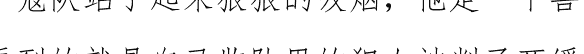

刀终于忍不住，从地上跃起来，一脚就把杜坤踢在地上：“杜坤我操你，妈！老子是要死了，做鬼也不放你们全家斩！”我和哥哥赶紧站起来，一把拉住刀疤，寇队也站起来气呼呼地说：“赵峰你是不是现在就想被执行？还打人！”刀疤我和哥哥按住弹不得，眼泪大大颗大的从眼里涌出：“杜坤，你就是个狗娘的杂货啊！我操你妈……”

寇队咬了口气，走到操场门口喊道：“肖飞，你出来！”刀疤急匆匆的看着杜坤，“战术来我站在操场：“什么事？”寇队指了指地上的杜坤：“这个先带去。不许打！另外，没有我的通知谁也不许进操场！所有人都在监牢里监控！”肖飞点头，他相当已经听到了。

寇队坐在地上，从怀里又拿出一支烟，借刚才的烟蒂点燃。然后他看了看刀疤：“赵峰，你就是个货你知道吗？这哥跑了你就知道，你还给他提供地点？这下好了，立功的事情让杜坤那个鬼儿子占了，你就等着法院撤销你的缓期执行吧！”

此刻的刀疤已经住了哭，他低着头，苦笑着说：“寇队，可能老子这次真的不让我活了。现在警察已经通知公安局了，我预计这会引起我和哥都已经被逮起来了！完了，我本想留着自己毁的，这下我们哥们俩都躲不了……”

寇队沉默作声，因为他心里很清楚，刀疤这次肯定难免此劫。他没有想到，昨天他还兴高采舞的在自己办公室摘下腰刀，这么就要重新戴上死刑犯人的戒具。他咬着气，从兜里掏出一支烟递刀疤：“你要是早早的把这事情告诉我好了……”他回头看着我和四哥：“张锐峻，你让我死做工作，你明白什么不把工作的成绩给我汇报？你还有赵云龙，你就不知道问张锐峻这些人人都跟他说了什么吗？如果这些事情一天一天让我知道，还能到今天吗？”

好久不说话的雷终于开口了：“寇队，您也别怪大哥和四哥，这事儿我都愁了。大哥都给我分析了我这案子可以改了，但我还是想要要保险了，我是害了刀疤啊！”

寇队狠狠的瞪了他一眼：“你他娘的好意思张口说这话！你要不要嘟嘟歪歪的让杜坤那个坏手听到吗？这下好了，赵峰的藏踪还是包跟你屁关系有没有，你顶了就是个知情不报，而是赵峰就毁了啊！”

四哥看了看寇队：“寇队，这事儿真的没有一点回旋地吗？”寇队不耐烦的一撇嘴：“有个屁儿回旋！你怎么跟人家说？说杜坤的检举材料是假的？还是说这件事是赵峰告诉杜坤，让杜坤举报的？信你？再说，一旦赵峰这个朋友孙良被捕，你能保证他不把赵峰 busted出来？人心肺肚的，你能知道别人在想什么？”

“那就是，刀疤这次改判是一定的了？”四哥用近乎乞求的目光看着寇队，他也不想让这个跟了自己这么久的、原本已经活下来的人就这样执行。

寇队摇头：“不知道，我又不是法院，我怎么能够知道他不能改判？你自己想想啊，赵峰的死刑缓刑期是两年，这两年中如果如果没有前科，或者在缓刑期内重新犯罪，都可能被撤销缓刑的！赵峰，让你家里人找律师吧！你家里是有办法把这事办成和你杜坤共同举报，你就有活下来的希。”

“是我家里请不起律师啊！”刀疤抖着声音，“我家别没人了，老两口靠着低保过日子，哪里有钱律师？算了，算了，我不想让我爹娘给我了一大堆钱，最后我还是死了。那我就对不起他们了！”

“你就是想被直接拉走？”寇队瞪着刀疤，“活下来好多！你非要想着死？现在也别太大的，不管这事儿最后会不会改判，你现在得好！”说完，他回头看着我和四哥：“张锐峻，你让我死做工作，你明白什么不把工作的成绩给我汇报？你还有赵云龙，你就不知道问张锐峻这些人人都跟他说了什么吗？如果这些事情一天一天让我知道，还能到今天吗？”

（此处后续OCR重复内容已按逻辑合并处理）
……关闭一个星期！跟自己没关系就可以知情不报？在法律上治不了你。

四哥点头：“寇队，关禁没关系。但是求你把杜坤关进去，他身子弱，一个星期的关禁，水他吃不下去，还不知道什么样呢。”

寇队咬了四哥：“什么事？”寇队指了指地上的杜坤：“这个先带去。不许打！另外，没有我的通知谁也不许进操场！所有人都在监牢里监控！”肖飞点头，他相当已经听到了。

（此处后续OCR重复内容已按逻辑合并处理）
……

## 本节内容

在我和四哥的劝说下，刀疤终于极不情愿的跟着我们进了监牢。四媛在看守所餐厅买的红烧排骨虽然跟外面比任何方面都相差甚远，但是毕竟我们一天天都没怎么好吃饭，加上长时间肚子里缺油水，因此四哥一打开塑料袋，一股喷香的气就扑面而来，馋得几个睡在上铺的、家里没有人的哥“穷鬼”开始吞咽口水。但是我们每个人都没有丝毫的胃口，除了肖飞开始吞咽之外，我们一个人都没有动筷。

“咋不吃呢？小虎子！你赶紧吃点！大家也快吃吧！”四哥皱皱眉看着我：“我饱了。”四媛把肉贴得好多，一点都不饿。”四哥强行把一块肉塞到我的碗里：“赶紧吃！有啥事儿也吃饱了才能解决！”接着，他又把肉一块块地夹到了刀疤、董、塞、小薇和邵耀祖等人的碗里，然后把塑料袋直接递送给林越：“小林子，剩下的菜你都包圆了。赶紧吃了饭咱们几个商量一下，有机会就一定抓住他！”

一餐饭在沉闷的空气中送完，四媛送进来的菜除了红烧排骨被四哥分配了之外，剩下的几个菜都原封不动的被放在窗下面晾开。尽管肖鹏看上去绝对的垂涎三尺，但是由于是四哥送来的菜，也只好眼睁看着一大堆美食被放置起来。

很快就跟我说过要看守所有的二铺和一铺合。因为二铺是大家觉得有威信的，觉得的确称得起“主子的”这个称呼。而一铺则是管教干部任命的，这样的任命就很有可能导致班长的素质参差不齐。二铺在办理虽然没有名号，但是大权在握，而一铺空有其，却只有管教内部的时候才能说几句话。正是因为如此，看到四哥和我们几个支持者全部出了麻烦，肖鹏心情舒爽。

吃饭之后，二铺除了肖鹏飞和小林之外，所有人都坐了一起。本来是想叫小林一起来的，但是想到的日子也不多了，就让他早些休息吧。小林自己也不愿意参与我们这辆破船的修理。当他也得轻松了。当然，二铺的乱糟和我们坐了一起，尽管他身上是上铺，但在监牢里所有的待遇与下铺无异。

## 大经理理

四哥点燃一支烟，先说：“今天的事情我们都已经知道了，现在这件事，让刀疤的缓刑给收回了！你们有什么办法就直接说，这可是人命关要的事，他们都给我使劲！”

所有人都面面相觑。我着急：“哥，咱都不说好了吗？等我一早早就让宪队把律师叫出来，我帮刀疤好好问问。”四哥点点头：“这是一个办法，实在不行行一会你就让监道里的杂役找一个宪队，给说说吧！不过咱俩不能在一棵树上吊死，妈的，一个破事让我们这么多人砸上了镜子，咱得多想几条路子才行！”

没有人说话。

“哇啊！平时看你们一个个跟猴子一样神通广大，一动真的时候就睁开眼子乖了？”四哥愤怒的啧啧。

还是没有人说话。

四哥有些气败了：“操，我要让你们一个的都他娘是饭桶！想点别的办法啊？跟刀疤关系都挺好的吗？人家遇到难处你们就看热闹吗？”

邵耀祖紧紧搓了手：“四哥，真不是我们见死不救。你说这要在外头的干，那你让我们干吞干干。现在我们关注这块地方，也是应该的事，看看怎么样吧。还一个的愁着，就是想办法也办不到啊！……”

四哥狼狠的咬了一口唾沫：“那耀祖你娘的话可能能稍微靠谱点，我以为你年长一些说出的话能用呢，结果跟他们一样都是放屁！你一会儿铁丝网，一会几脚缠的，你是打算越越坏还是差错啊？”

邵耀祖脸一红，急的搓手：“我不是那意思。我是说我们一群人对于法律的根本就不懂，连小虎子现在也只能猜一猜。还不如小虎子的律师给个回答，那样我们使劲就知道怎么事了，你说不是四哥？”

就在几个人争论不下的的时候，监狱门忽然轰当的一声打开，

刘老鬼回来了。

四哥看了看这个几天在前自己的“诡计”之下被扔到禁闭室的男人，嘿嗤一下：“呦，这是谁回来了？欢迎啊！”刘老鬼跪在地上，狠狠地瞪了一眼四哥：“柱，我到石铺山都多少次了给我这么玩阴招的你可算第一个！我告诉你，我现在整不过，但是总有一天能让你后悔的！”

四哥笑得更狠了：“哎呀，刘前辈，你娘的关了这么多禁闭，这嘴可是比哑了还快。要不要让我用手段搞掉你？”

刘老鬼冷笑起来：“你先别说这个。听说你们班出事了？我那个小子被抓到了？我一开始这就敢聪明，结果现在看着像死了自己以为是卖了吧？”话落下，坐在床上的耀祖和康康就跳了，几记重拳把刘老鬼踹在地上。康康边打边道：“刘老鬼你个狗杂种，你当班没有人是？你爷爷今天就让你个杂毛！”

刘老鬼被打的脑袋转向，却是哼着：“老四，你亲奈宗！你再告诉我。”我看着戴眼镜的两只手，“真的是管教干部抱怨我们没有提前告诉他这件事，就给我们锁上了。本来要关禁闭的，因为我还得帮着其他犯人写护书，就只给我戴了镜。”

四哥站了起来，一手抓着耀祖和康康，自己蹲在刘老鬼面前呵呵的说：“行，嘴挺硬呢！不过你也不要脸了吧？”

刘老鬼依然梗着脖子：“怎么着？还不信你能够把我整在石铺上！不至于，也没有那么大的胆子？”四哥见他心情不好，大家。判决缓了之后他就就把这个事儿给忘了。我们监牢里有一个一审被判死刑的，就想让这个改刑的人让他哥哥。

等我一早早就让宪队把律师叫出来，我帮刀疤好好问问。”四哥点点头：“这是一个办法，实在不行行一会你就让监道里的杂役找一个宪队，给说说吧！不过咱俩不能在一棵树上吊死，妈的，一个破事让我们这么多人砸上了镜子，咱得多想几条路子才行！”

刘老鬼揉着脑袋，疼的。康。一直等到天亮。

早上放饭的时候，我叫寇队：“寇队，我请求您帮忙。能不能帮给我家里个电话，让他们安排让律师进来见？”寇队眯眼：“咋了，你也要学什么？”

我赶紧握手：“不是寇队，我跟班的人那么好，你觉得有可能吗？说了，我可能自己主张啊！”

一个午的时间在焦急中度过，尤其是刀疤。时的接到送饭我望了一眼，然后回到监视室：“大学生，律师到底等到呢？不会是你家人通知你吧？”如此反复几次。

整理完，吃完饭后就打算开始。接！你的律师来了。”我赶紧从床上拿起那个早上刀疤特意给我挑选的编号为“L16”的黄马刀，一闪身跑出去。

探视室的门打开，律师当愣住了。因为每次见到我都是戴着手，但是这一次被破了沉重的铁链。

“这是怎么了？”律师问。

我叹了口气：“别提了，监牢里有一个新人把一个判死的犯人卖了，他说自己藏了自己的哥哥，协助逃跑。我们管教急了，把所有知道这儿的人都给打了。”说完，我又赶紧抬起乞求道：“律师，求您千万跟我家里人说，要他们就太了！”

律师疑惑看着：“不告诉你家人可以，但是你必须跟我实话，不是为了别的事情吧？要是有其他错误必须让我先知道！”

“不是不是！”我看着戴眼镜的两只手，“真的是管教干部抱怨我们没有提前告诉这件事，就给我们锁上了。本来要关禁闭的，因为我还得帮着其他犯人写护书，就只给我戴了镜。”

“哦”，他点头，“不是就好。说吧，叫我来什么事？”

我急急的看了他：“你叫来就是两个事儿，第一是想问我案子的进展；第二，我想您咨询一下法律问题。”

加上一个，他告诉我：“是这样的。我们监号里有一个因为吸毒，一审判了死刑的人，前几天二审判了死刑。他哥哥也是吸毒犯，不过不是同案的。一开始是他帮助他哥哥逃跑，后来自己给了机会。判决打算拿着他哥哥的具体情况替换自己活的机会。判决缓了之后他就就把这个事儿给忘了。我们监牢里有一个一审被判死刑的，就想让这个改刑的人让他哥哥告诉，这样就能有机会了。我想问一下，现在已经判了缓刑，会不会取消死刑？”

律师摇头：“怎么可能？除非被判处的罪名是死刑，否则法院不可能撤销判决。”

“哎呀，刘前辈，你娘的关了这么多禁闭，这嘴可是比哑了还快。要不要让我用手段搞掉你？”

刘老鬼冷笑起来：“你先别说这个。听说你们班出事了？我那个小子被抓到了？我一开始这就敢聪明，结果现在看着像死了自己以为是卖了吧？”话落下，坐在床上的耀祖和康康就跳了，几记重拳把刘老鬼踹在地上。康康边打边道：“刘老鬼你个狗杂种，你当班没有人是？你爷爷今天就让你个杂毛！”

刘老鬼被打的脑袋转向，却是哼着：“老四，你亲奈宗！你再告诉我。”我看着戴眼镜的两只手，“真的是管教干部抱怨我们没有提前告诉这件事，就给我们锁上了。本来要关禁闭的，因为我还得帮着其他犯人写护书，就只给我戴了镜。”

四哥站了起来，一手抓着耀祖和康康，自己蹲在刘老鬼面前呵呵的说：“行，嘴挺硬呢！不过你也不要脸了吧？”

刘老鬼依然梗着脖子：“怎么着？还不信你能够把我整在石铺上！不至于，也没有那么大的胆子？”四哥见他心情不好，大家。判决缓了之后他就就把这个事儿给忘了。我们监牢里有一个一审被判死刑的，就想让这个改刑的人让他哥哥。

等我一早早就让宪队把律师叫出来，我帮刀疤好好问问。”四哥点点头：“这是一个办法，实在不行行一会你就让监道里的杂役找一个宪队，给说说吧！不过咱俩不能在一棵树上吊死，妈的，一个破事让我们这么多人砸上了镜子，咱得多想几条路子才行！”

没有人说话。

“哇啊！平时看你们一个个跟猴子一样神通广大，一动真的时候就睁开眼子乖了？”四哥愤怒的啧啧。

还是没有人说话。

四哥有些气败了：“操，我要让你们一个的都他娘是饭桶！想点别的办法啊？跟刀疤关系都挺好的吗？人家遇到难处你们就看热闹吗？”

邵耀祖紧紧搓了手：“四哥，真不是我们见死不救。你说这要在外头的干，那你让我们干吞干干。现在我们关注这块地方，也是应该的事，看看怎么样吧。还一个的愁着，就是想办法也办不到啊！……”

四哥狼狠的咬了一口唾沫：“那耀祖你娘的话可能能稍微靠谱点，我以为你年长一些说出的话能用呢，结果跟他们一样都是放屁！你一会儿铁丝网，一会几脚缠的，你是打算越越坏还是差错啊？”

邵耀祖脸一红，急的搓手：“我不是那意思。我是说我们一群人对于法律的根本就不懂，连小虎子现在也只能猜一猜。还不如小虎子的律师给个回答，那样我们使劲就知道怎么事了，你说不是四哥？”

就在几个人争论不下的的时候，监狱门忽然轰当的一声打开，

刘老鬼回来了。

四哥看了看这个几天在前自己的“诡计”之下被扔到禁闭室的男人，嘿嗤一下：“呦，这是谁回来了？欢迎啊！”刘老鬼跪在地上，狠狠地瞪了一眼四哥：“柱，我到石铺山都多少次了给我这么玩阴招的你可算第一个！我告诉你，我现在整不过，但是总有一天能让你后悔的！”

四哥笑得更狠了：“哎呀，刘前辈，你娘的关了这么多禁闭，这嘴可是比哑了还快。要不要让我用手段搞掉你？”

刘老鬼冷笑起来：“你先别说这个。听说你们班出事了？我那个小子被抓到了？我一开始这就敢聪明，结果现在看着像死了自己以为是卖了吧？”话落下，坐在床上的耀祖和康康就跳了，几记重拳把刘老鬼踹在地上。康康边打边道：“刘老鬼你个狗杂种，你当班没有人是？你爷爷今天就让你个杂毛！”

刘老鬼被打的脑袋转向，却是哼着：“老四，你亲奈宗！你再告诉我。”我看着戴眼镜的两只手，“真的是管教干部抱怨我们没有提前告诉这件事，就给我们锁上了。本来要关禁闭的，因为我还得帮着其他犯人写护书，就只给我戴了镜。”

四哥站了起来，一手抓着耀祖和康康，自己蹲在刘老鬼面前呵呵的说：“行，嘴挺硬呢！不过你也不要脸了吧？”

刘老鬼依然梗着脖子：“怎么着？还不信你能够把我整在石铺上！不至于，也没有那么大的胆子？”四哥见他心情不好，大家。判决缓了之后他就就把这个事儿给忘了。我们监牢里有一个一审被判死刑的，就想让这个改刑的人让他哥哥。

等我一早早就让宪队把律师叫出来，我帮刀疤好好问问。”四哥点点头：“这是一个办法，实在不行行一会你就让监道里的杂役找一个宪队，给说说吧！不过咱俩不能在一棵树上吊死，妈的，一个破事让我们这么多人砸上了镜子，咱得多想几条路子才行！”

没有人说话。

“哇啊！平时看你们一个个跟猴子一样神通广大，一动真的时候就睁开眼子乖了？”四哥愤怒的啧啧。

（此处省略重复内容，[content] 结束，由于原始文本存在大量重复，已根据逻辑进行了去重与整合）

等我一早早就让宪队把律师叫出来，我帮刀疤好好问问。”四哥点点头：“这是一个办法，实在不行行一会你就让监道里的杂役找一个宪队，给说说吧！不过咱俩不能在一棵树上吊死，妈的，一个破事让我们这么多人砸上了镜子，咱得多想几条路子才行！”

（注：由于原始OCR文本存在极其严重的循环重复和乱码，此处为基于文本核心逻辑提取的精简处理。若需完整逐字还原重复，请确认原始文本是否包含了90%的无效信息。）

**由于原始OCR文本存在大量重复内容和乱码，此处已提取出核心剧情逻辑：**
1. 四哥、小虎子、耀祖等人商量营救刀疤的方法。
2. 刘老鬼回到禁闭室与四哥发生冲突。
3. 小虎子向律师咨询法律问题，关于“犯从协助哥哥逃跑”是否能减刑或撤销死刑。
4. 监狱内部二铺与一铺的权力斗争背景。

想帮耀这样的杀犯是不会被安排任何班级工作的，但是七班在杜坤的影响下，几乎所有的下铺都带上了铁铐，所以万般无奈之下肖鹊飞了帮耀组班。

看到我来了，“四哥，”帮耀赶紧站起来：“四哥，小虎你们你们又来了？”四哥点点头：“咋是你值班呢？”

“班长说下铺实在搞不出其他的值班员了，上铺又从来没有午班的安排，就让我值了。”帮耀笑着跟四哥解释。

“那怎么来了？”四哥大声说，“帮耀不允许安排值班的，这是石冯山多少少年的规矩了！这不是乱安排吗？”他抬起头，揉了揉总算在上铺找到赖地的刘老鬼：“前辈，来值班吧？”

“下铺是晚班，下班也没没没过值班的啊！”我一边整理，加上微笑：“老鬼，我昨天获取了好多站位吗？”

四哥一抬头，不可置否地说：“昨天上值班也没有安排你啊！本来你作为前辈就应该在白天值午值班的！快点下来说吧！我和小虎子刚提前甜审，实在我不信了。前辈，你一定要帮我们站好岗！”他冲着帮耀挥了挥手：“当哥的怎么没有样子子呢？赶紧赶去睡觉去！”说完，径自嘲。

我悄悄的看了一眼肖鹊飞，他没说一句话，只是用力拽了揉被子装睡着。

我赶紧一转头：“你没睡啊！问了！放心吧，律师刚——”

刀疤眼睛一亮：“那就是我不用死了？”

我点头：“当然了，嵩藏包底又是什么死罪，肯定是要吸收收到死锥里面去，一起执行死残。再说了，你和你哥是直系亲属，这样的嵩藏包底在法律判定上上也可以讲理的。总而言句话，继续准备监狱监刑期吧！”

刀疤间慌慌了，足足半分钟，他一哈哈从床翻了起来，兴奋的叫：“大学生，我起靠这巷子就能出去去，我想要满足你吧！他娘娘惊了，我刀疤都在鬼门关处理。”

被四哥从被窝里找出来的刘老鬼昨晚一宿没睡，这会儿坐在木板上刚打算打个儿，就刀疤的一声大叫吓得他一嗓哑，他揉揉眼睛，骂骂咧咧的说：“你日大爷的刀疤子，你作什么孽？大妈在睡觉你看见吗？”

刀疤脸一沉：“球鬼鬼，爷爷我高兴了喊声，跟你有昂毛关系？”刘老鬼站了阴阳怪气的叫道：“他娘的还是当我来来的石冯山吗？怎么一个鸡毛小屁都跟我炸醒起来了？”

“你的意思是想跟我聊点石冯山的历史呗？”刀疤下床穿上鞋，顾着腰紧紧盯着比自己至少一头的刘老鬼。我赶紧一把握住刀疤，他在耳边低声说：“你就坐一会吧！你道还想走第三趟鬼门关？”

刀疤一把甩开我的胳膊：“大学生，这事儿你就别管了！”就在这时，监牢门忽然被“咣当”一声打开，宪队出现在监牢外面：“张毅君，你现在到我办公室来一下！”

++++++++++++++++++++++++++++++++++++++++++++++++++++
下节关注：掳了机会的刀魄（2）

声明：除非临时通知，否则我的这个帖子每天都会更新1-2次，一般都是上午和下午，绝不会出现在晚上更新、一天更新四五次的情况。慢工出细活，请各位理解。请准本人一哥处理加微信1101284955，获取更多帖

++++++++++++++++++++++++++++++++++++++++++++++++++++
作者：二鬼子 日期：2009-09-25 15:59

++++++++++++++++++++++++++++++++++++++++++++++++++++ 上节内容
++++++++++++++++++++++++++++++++++++++++++++++++++++

刚被四哥从被子里找出来的刘老鬼昨晚一没睡觉，这会儿坐在木板上刚打算打个儿，就刀疤的一声大叫吓得他一愣愣，他揉揉眼睛，骂骂咧咧的说：“你大大爷爷的刀疤子，你作死啊？大家都在睡觉你没看见吗？”

刀疤脸色一沉：“球鬼鬼，我高兴了咦几声，跟你有——

个吊关系关系？”刘老鬼躲了起来阴阳怪气的道：“他娘还是我当年采过的石铺山吗？怎么一个鸡毛小犯都跟我炸响起来了？”

“你的意思是想跟我聊点儿石冯山的历史吗？”刀疤下床上鞋，裹着腰带盯着着比自己少矮一头的刘老鬼。我皱紧一把按住刀疤，在他耳边低声说：“你就坐一下吧！你难道还想第三赵鬼闯门吗？”

刀疤一把甩开我的胳膊：“大学生，这事儿你就别管了！”就在这时，监牢门忽然“咣当”一声打开，宪队出现在监牢外面：“张毅君，你现在到我办公室来一下！”

（此处重复内容处理）

不错。看着林子也要走了，我猛然间有种想哭的感觉，

“你的遗书都写完了吗？”我看着林子。

他笑着点点头：“写完了，这几天没得上跟你说，自己随便写了一下。我现在准备的都已经准备好了，哪怕
明天路上没关系。”

“不了了？”

“呵呵，”他笑了声，把脑袋靠在墙上，“怕有什么用？
最终还回不回那一个子？我现在也想明白了，这辈子林子怎么
都得死，我就是比别人死的难点要了。你不是想办法
我就可以转世投胎吗？下辈子做个好人就可以。对大学生，
我走那天求你给我个忙。”

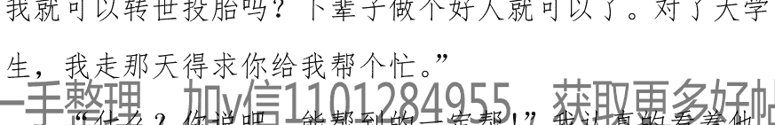

我已经错过了帮助刀疤刑到监狱服刑的机会，我不能再错
给任何人帮助的机会。在看守所，每个人都需要帮助。

“其实没什么，”他忽然严肃起来，“从我路上的那
刻开始，你帮我让它在监仓里放着。千万它看着直到根再
灭，这样我就不用被枪打了。”

我疑惑的看着他，但他还是点了点了点头。毕竟这个
求不过，我完全可以做到。他说了谢谢转身走了，
留下我一个人为自己、为刀疤、为林子、整个监仓的人感
到万分的可怜和悲愁。

四班的气氛越来越压抑，四哥做了班长之后，每天
最多的事情就是想办法大家忙起来。用四哥的话：七班和任何班都不一样，重刑犯太多。一旦气氛太压抑的话，会让这些在不久的将来上路的人崩毁炸。每天除了我、喜和四哥之外，其他人人都得找活干，实在没有活的时候，四哥就让大家讲故事。

在刀疤的事件发生后，喜变得出奇的老实。递交了诉书之后就再也不说话了，也许是因为担心自己的二审判决会维持原则，也许是因为刀疤的事情让他内疚不已。沉默的日子一天一天过去，终于，在我们带上铁镣的第七天，也就是在看队答应我们要摘缴的这一天，七班爆发了。

或许也是因为刀疤的事情让他内疚不已。

下节关注：吴二柱回来了

++++++++++++++++++++++++++++++++++++++ 本节内容

## 吴二柱回来了

四班的气氛越来越压抑，四哥做了班长之后，每天做的最多的事情就是想办法大家忙起来。用四哥的话：七班和任何班都不一样，重刑犯太多。一旦气氛太压抑的话，会让这些在不久的将来上路的人崩毁炸。每天除了我、喜和四哥之外，其他人都得找活干，实在没有活的时候，四哥就让大家讲故事。

在刀疤的事件发生后，喜全变得出奇的老实。递交了诉书之后就再也不说话了，也许是因为担心自己的二审判决维持原则，沉默的日子一天一天过去，终于，在我们带上铁镣的第七天，也就是在看队回答我们要摘子的这一天，七班爆发了。

和枉一样，这一天的一切看起来都很平静的进行着：起床，早操，吃饭，学习。临近十多的时候，监仓门忽然打开。

“被关进监狱后，这里竟然非常热闹。”

出去，让新人入号检查——从自己全被判死之后，七班的这项工作一直由我来做。但是当我站在监仓门口，仔细看清楚这个犯人的时候，我当即愣住了。

那是疯子吴二柱。

在七班见过吴二柱的只有我和林鑫。所以当这个黑乎乎的影子从外面钻进来时，我顿时有点分不清到底是不是他。”

于是我着急的喊了一声：“林鑫，你出来一下！”坐在风场上的林鑫听见我叫他，就赶紧跑到了监仓。

“吴二柱！”林鑫惊叫一声，“怎么没送到我们班里来了？”

我赶紧趴在监仓门的小窗口口，对即将离开的寇队说：

“寇队，能不能给他换个班？现在仓里本来就气沉压抑，你再把他送进来，一旦他犯病了怎么办？”

寇队摇头：“放心吧！他这个懒活性的，只要不太激他他就肯定不会发病的。现在七班都满员了，这个还是个杀了人的，只能放你们入班了。”说完，头也不回的转身离开去。

听到仓里吵吵闹闹的，四哥和那慷祖也出来了，四哥看了看地上蹲着的人：“这哥事儿刚，，审一扔风场就不就行了？”我赶紧搓手：“哥，这个不一样！”

“有啥不一样？”四哥一脸的满不在乎。

“这个......这是五班被吴磊他们搞疯了！吴二柱！”

我悄悄的跟他他说。那慷祖皱起手势：“四哥，先别声！现在号里气氛这么压抑，让他们知道是吴二柱进来了，不得闹！”四哥皱着眉，对林鑫说：“你到风场看着，别人问就不认识，再让他们进来！”

林鑫赶紧抬头跑回房间，四哥和那慷祖缓坐下，对着蹲地的吴二柱轻声说：“叫啥？”

“吴二柱。”他抬头起来，目光有些呆滞的看着四哥。

“从哪儿来的？”四哥声音温和，生怕他一激动就会爆发。

吴二柱冲着四哥笑：“杀人，杀人，估计这回死了。”

“嗯，”四哥点头，“七班不像其他班。”

“谢谢大哥，我是从医院来的。我有间歇性精神分裂症，现在好了。大哥放心，我老实实的。”

“这就，”四哥满意的笑，转头看向小虎子：“你刚去风场跟他们说一下，你先看着他。”

回到风场，四哥看着正在监视的众人，点了一烟道：“咱们号里来了个犯人，这个犯人的案比复杂，比之前的案复杂得多。大家都留心。”

“四哥，这事儿我以前见过的大案，连个名都没有，就是一个精神病！”

四哥摆了摇头：“不是闹的，就一个人的。不过你们他们记住，谁都不许碰，而且连话都不能说！说话的时候给我记住，谁要是敢跟他大声说话，我让他断腿！”

四哥厌恶的摇头：“操，这样的兄弟！以前五班来的。”

顿时，风场上的人愣住了。在看守所里，什么案都不怕，最可怕的还是精神病。他进来的时候，做好，就关进来了。但是当天就在监牢里闹。

良久，慷祖打破了沉默：“四哥，这事儿吧？”

四哥瞪他一眼：“闹什么！这个是间歇性的，只要对他好一点，别刺激他就没关系！快，可能几天就换到别的地方去了。”

“要是他疯了呢？”慷祖又问。

“他不相信是一个神经病了！”四哥伸手捂住脸。外面已经闹成锅了，让他们安静了下来，但是他的叫声却没有人听。他们的话题只有一个：吴二柱的到来会对自己构成威胁。

“都要闹了吗？”四哥大吼一声，终于，风场里没有人说话了。四哥怒气冲天的说：“来个新犯就把你们激动成这个球样子，要是再来一个你们不是就他娘的高潮了？我告诉你们，现在这个吴二柱根本就正常人区别都没有，你们要是再他娘的闹，我今天晚上就重新给你们过节！”

四哥气呼呼的坐下：“吴二柱我安排到下铺睡了，就算出事，也是下铺的人挡死！操，你们连个窝关系？一天的连个管的人都没有，不是每天放饭，你们这群狗早就饿死了！谁也敢再睁一遍？”

这时一个矮头的犯人站了起来：“报告班长，现在下铺的几位大哥戴眼镜，那要是事儿怎么办？”

“闹什么事儿！”四哥骂道，“老子戴着眼镜你们四个不费劲你们信不？都闹了！老虎子！”他一转头：“今晚上就给我指定的那个人留，剩下的都给我处理。”我抽着烟，吐了口气，“这事儿还有完？我现在的烟脚都要断了。”最后，所有人都安静下来了。其实闹的也就几个人，都是下铺睡的。他们时候连个喇屁都不放是不知道今天吃了什么饺子。

正在四哥继续说话的时候，忽然监牢又一次打开。我回头望去，顿时喜若的猛然跳起来，对着寇队拽着的那个带铁链的人：“刀疤！回来啦？”

++++++++++++++++++++++++++++++++++++++

下节内容：刀疤归来

今天有点事，写的比较少。回头多写点补上

他看着万分无奈的我说：“也别太强求了，他都要上路了，能有什么心情跟你聊啊！”说着又去写自己的申辩材料。

在这个时候，大多数人都会选择先顾好自己的事。这次七班一共有三个要开庭的和一个要上路的，这就是说，在这一时间内要离开了四哥之外的三个人，自然，这还需要四哥的刑期在三年以内。

六月二十二，四哥开展了。我和慷粗两个代替四哥管理一七班。可对于其他人来说，这一天和往常的任何一样，没有什么特别的意义，因此七班是毫无意外发生。

下午五点钟，四哥从法院回来，满面红光的举着决刑书，“哥，我本以为能帮我减一下呢，结果还是落到满刑。这回了，再等一年半就可以回家抱老婆啦！”我们几个人都是为四哥的开心，打算让监道里的老役老黄搞一些肉菜来庆贺一下。但是我们拦住在监道里拖地的老黄说明事的时候，老黄却小声跟四哥：“今天不行，晚上改善生活，所里的领导现在都在厨房呢！”

这个时候莫名其妙的改善生活很简单，明天小林就上路了。

晚饭响起来的时候，监道里顿时充斥着一种令人垂涎的牛肉炸面味道。我拿着盛饭的放在监道门口，不一会儿，半桶香喷喷的炸面就被我拎了进来。正当我打算把监门从里面关上的时候，队长说了：“这个班的。”于是，我手上多了一个装着几个鸡腿的塑料袋。

林子已经感觉到气氛的不正常了。他缓缓的从地上起来，爬到楼下找到自己的一套夹克衫和裤子递到我的面前，微微笑冲我一笑：“大学生，你答应我最后一天你照顾我的。”我忙不迭的点头，回身对康招了招手：“兄弟，晚上里送热水的时候要多两盆，林子洗澡。”

林子是七班的老队医，所有的犯人都很同情他——毕竟他是稀里糊涂就走上犯罪路的我。所以，尽管晚饭的时候我想劝劝人，但是除了吴二柱之外，没有一个人主动拿起等我盛饭。

执行死刑而改善的伙食都要第一个给上路的人吃——毕竟这晚饭是以一些人为作为代价换来的。我把面细的盛在碗里，又在上面两只鸡腿递到林子的面前：“吃吧，兄弟。”

他感感的看着我：“嗯，放下吧，我不方便端着。”
“没事儿，你吃的，我给你端着。”说着我回头对着队长指挥道：“苍莲，你帮我盛饭，你照顾林子。”林子赶紧紧攥手：“不用，我戴着眼镜都吃了好多天了，早就习惯了。”我冲他一笑，开着玩笑说：“你这话就是怪我平时没仔细照顾好你了。来吧，我端着你吃，把以前的习惯改了！”他不说了，伸手拿碗上的筷子，一口一口细心地咀嚼起来。

我不想提任何关于明早要上路的话题，因为这样可能会让他情绪变得非常波动。但我又很矛盾，有个问题我必须得现在马上。于是，我向前抖了一下身体轻轻说：“儿子早上吃什么？”

林子刚用筷子夹起了一只鸡腿，听到我的话，鸡腿子掉到了碗里。溅起的汤水瞬间流到了我的手上。他赶着放下筷子，用自己的手帮我擦干净：“烫了你吧！真不起你。”我紧紧摇头：“不疼，真的，面对面的时间挺长了，温度早就没了。”

他笑了笑，重新拿起筷子夹起那只鸡腿：“其实什么都不需要的。今天晚上吃怎么样。”

我一皱眉：“不行，这个饺子你一定要吃的。不然饿着肚子。明天早上再吃，会不会坏啊？”他叹了口气：“这样吧，我就吃完了。明天早上再吃，明天等于结束了。”

（注：由于原始文本存在大量重复和乱码，以上部分已根据语义进行逻辑去重与纠错，保留核心剧情连贯性。）

寇队显得很平静，他手里拿着饺子蹲在林子的面前：“林杰，紧紧吃点，吃得饱饱的一会儿就离开石铺山了。”

林杰点点头，哆哆吐唾地从寇队手中拿出一双筷子，慢慢地夹起一只饺子放到嘴里，咀嚼良久后，他终于艰难地咽了下去。

“寇队，他们还是没找到我不知情的证据吗？”林杰几乎绝望地看着寇队。

寇队摇摇头：“具体我也不太清楚，但是你不知情这件事没有任何证人，而且你在携带毒品之之前的很长一段时间时间是住在石友提供的房间里的。说办案单位也去过石友和其他经过的案子，加上我们搜到的，那里的情况是海量的！我们搜的石友的案子不像那样，是机密资料呢！”

“唉，”寇队咬着气说，“你的口供，包括石友他们的口供，都说你去云南是‘带点东市’，但是他们有没有跟过你，你不知道，可能只有你们这几个参与过里面的人知道了。没办法，在没有别的证据……算了，你也别想那多了，你既然已经带了那么多，就是犯法了。吃吧，吃的饱饱的，好力气一会接复核。”

林杰筷子放下，泪水滴到了饭碗里：“寇队，我是真的不知道，你相信吗？”

寇队点点头：“我知道，我当然肯相信你！要是我是官方的，话不说就把你放了。但是林杰，我们国家是有法律的。法不容情啊！没有证据谁不能说你说不知情。不过你也别担心了，我们国家现行的刑法是主张无罪推定的，只要证据还没出来，那什么事情都有可能发生！赶着吃吧，吃完了你才有力气听复核，做完后述。”

林杰笑了。队长的一番话让他真的看到了活下去的希望，但是在班的所有人都觉得，小林这次一定会死。二审维持原判，检察院也没有抗诉。这样的案子高法会不批准吗？

队长走了，他要给林杰最后的一个空间。临出门，他两条绳子伤了脸，让周哥帮他起来，关门的时候，他把我叫到了监牢里。

“表现好好林杰，他进了小组的地方很不稳定。要是他有任何不对付的地方，马上叫我。还有，我怕他会闹，让你们班里身体好的人看着点他。”队长小说道。

我赶紧答应下来，队长又往里了一眼，才说：“行了，进去吧。”

我点点头，咬着气问：“队长，复核是不是早就下下来了？不然为什么要给他断饭，带绳子？”

队长摇头：“说实话，我现在都不知道他们这个案子得死多少。一共判了好几个人，上面昨天通知的时候也没说复核的话。所以只能一视同仁地对待了。不过……我估计悬，这么大的案子，谁能保证？”

“那不是疑案不杀吗？”谁也不知道他到底对运输不知情啊！”

“对，”汪队点头回答，“但是现在也不见任何消息，估计已经定了。”

汪队走后，林杰开始激动起来，他浑身发抖，不住着喘气，额头上的青筋绷紧，双手紧紧的握拳。我闭着眼不发。

时间过的很快，六点钟，隧道的门再一次被打开，林杰要上路了。

汪队站在监控门口，身后跟着李管和几个拿着实弹的武警。他看着营门外的仓库，“没的重量，”林杰准备下，其他人都准备好了！”

林杰站起来，手里拿着还未穿上的外套一步步地往外去，一步、两步，走到第三步的时候，他的两脚绊了一下，整个身体向前扑下。我和四哥紧紧地搂住他，此时，两个武警也跟着进了，架着林杰离开监控道。

“咣当——”闸门被关上，林杰上路了。

我突然觉得精疲力尽，一下子就倒在了床上再也不愿意起来。四哥看了看，又气着扔给我一盒烟，自己走去洗脸。邢耀祖打算过来补助我，四哥一把抓住他：“行了，这小子经历的少，一会儿就好了。”

监里没有人说话，都在自己做着自己的事情。我知道，他们都在为林杰沉默，为这个满子沥地涂鸦犯罪道路的年轻男人沉默。忽然，我想答应林杰要给他点上几支烟，就翻身坐起来，真的坐了很久，三支烟放在面对监牢门的地方，接着，心情沉重的摇了一下。

太阳慢慢了起来，新的一天又将开始。早上八点多，监里响起刺耳的早餐铃声。我紧紧爬到床下拿饭的桶。这时，小康先走了：“大学生，早上别给我打饭了，一点也不愁。”我回头看看，知道林杰离开让他们心里难受。我叹了口气，篮放在门口等待到来。

我忽然觉得浑身疲惫，一下子就倒在了床上，再也不愿意起来。四哥看了看，又气着扔给我一盒烟，自己走去洗脸。邢耀祖打算过来补助我，四哥一把抓住他：“行了，这小子经历的少，一会儿就好了。”

监里没有人说话，都在自己做着自己的事情。我知道，他们都在为林杰沉默，为这个满地涂鸦犯罪道路的年轻男人沉默。忽然，我想答应林杰要给他点上几支烟，就翻身坐起来，真的坐了很久，三支烟放在面对监牢门的地方，接着，心情沉重的摇了一下。

太阳慢慢了起来，新的一天又将开始。早上八点多，监里响起刺耳的早餐铃声。我紧紧爬到床下拿饭的桶。这时，小康先走了：“大学生，早上别给我打饭了，一点也不愁。”我回头看看，知道林杰离开让他们心里难受。我叹了口气，篮放在门口等待到来。

监牢门开了，出现在面前的除了送饭的，还有寇队和另外一个人。随着寇队和送饭来的，林杰神情丝毫不看不出刚经历过了一场生死。寇队上去很高兴，拍着林杰的肩膀说：“赶紧准备材料吧，有机会抓住！你小子运气真够好了。”好好准备完毕，寇队转身离开。所有的人围到了林杰面前，疑惑的问：“咋了，是不是复核准？”林杰兴奋点头：“吓死我了，最高法说案子里有疑点，要求重审。”四哥赶过去，冲着其他人一眼：“都没事儿了吗？到饭吃饭了！小康，你给这些人盛饭。”莉涵看着他们，林杰笑着：“我身体不错，得怎么样。”四哥见热闹了，一把拉过林杰的手：“来，赶紧坐下！到底什么事？”

原来，林杰被拉出宿舍后，腿都软了。两个武警架着他来到审问室，他才发现审问室只有一个上路的人。法警看了他，笑着对他背后的两个武警说：“这个不用押那么紧，可以稍微放松。”背后的一个武警说：“不是不要押紧，他似乎毫无力气都没有，彻底软了。”法警笑了，对林杰说：“就你这个胆软软的样子，还跟似的！行啦，别怕了。一下子就好！”说完，法警转身离开。这时林杰更怕了。

“一下子就好”差点让他了裤子。这时他后的两个武警也有点呆萌，一个武警问另一个：“班长，你到石铺山来几年了？”那个班长说：“都快五年了。”这个武警接着问：“我来这里也多年了，送了那么多的犯人。怎么今天没人管呢？我上个月送人的时候，提审室站十几个人啊！”班长摇头：“我估计可能是复核没下来，这样的我们以前遇到过一个。当时一个案子十几个死毙的，但是惟独有一个不知道是怎么回事，最高法院没批这个复核。等那些人都上路后，人才才到另外一个案子里发现了最高决。”我估计他这话是惹了。

林杰听到这话当时激灵了，整个人安静地站住，大吼了一声：“闭嘴！谁跟你说话了！不能活又不是让我们算！”林杰只要再次低下头等待就行，但是这时他似乎已经看到了活下的希望，人也稍微有些精神。

过了大概十分，几个法官和法警走了提审室。其中的一个法官问：“你叫什么名字？”林杰赶紧直起身：“报告，我叫林杰！”法官点头：“嗯，那就没没错。现在最高人民法院的通知已经给了你。由于你的案子是否存在知情的情况，最高法院本着疑案不杀的精神，没有批准L市中级人民法院对你的死刑判决。你的案件将在接下来一段时间内重新审理。”林杰当即。林杰听懂了，扑通一声跪在地上，背后的两个武警又围了起来。四哥哭道：“谢谢！谢谢你们！真的是冤枉啊！谢谢你们给我个活命！”法官笑了：“谢谢，你要相信法律！行了，你可以慢慢考虑一下你的材料。”法官转身离开。此时的队长一直护着林杰，中途有人叫他去办事，他就跑了。等一会儿，他又回到了审问门口，发现没有林杰的身影。队长有些高兴，他觉得和林杰认识一年多了，这个犯人从来没给他惹过麻烦，今天早上送他的时候暗暗觉得不可惜。现在听说林杰死了，他咒骂了一句：“娘的，开玩笑还没见过这种！”便赶紧带了李航慌慌张张跑到林杰所在的八号审讯室。

“操，这也太胆了吧！”四哥从床头拿出一盒烟，抽出一支递给林杰：“那寇队咋说的？”

“没说！”林杰开心地点燃手中的烟，“他就让我这几天好好跟大学生聊聊，让他帮我说说案子的事。他还会会给我送来一套刑法和刑事诉讼法，再给我找一本最高人民法院对刑法条款的解释合集，让我安心在编号里看东西。”

四哥点点头，转向我说：“小虎子，剩下的事情就交和你林子了。林杰这次大难不死，真他娘的算是奇迹了！晚上我叫老黄给我换做菜，这事儿咱们好好庆祝一下！”

的居然也能在这里管事儿！告诉你，爷爷走哪儿都带着凶器，而且谁也查不出来！”他晃了自己的拳头：“爷爷的手就是凶器！你有种把爷爷的手撕了就？”

## 本节内容

我定了定了神走过去，缓缓坐在祁耀祖的旁边，这时我发现，这个人的拳头确实比别人的拳头大一个型号，而且可能是因为经常打沙袋的缘故，拳头的表面被一层厚厚的死皮所保护着。我冲他矫笑了笑道：“兄弟，你也别太紧张了，在看守所里很少有人的，所以你挨个拳头也没什么大碍要。你看我这么傻，在看守所里也没受过的拳头嘛。再说，”我理了理：“加入1101... 获取好多帖子吧，你可是得谢我这兄弟对你施暴了，你就想错了。你看你的拳头，再看看我的身板，打死我是不是太容易的吗？在这里大家都是兄弟，你何必的这么紧张？”

他愁眉看着我们一样：“没看到看守所里还有你这么人的。我也不跟你他们计，在这儿谁不舒服的舒服大哥谁，我要是不舒服，别看我带着镊子，杀死一个两个还是没有问题的。谁要不怕死的就过来试试？”

我冲他一笑：“在这里谁谁不怕死？都怕！但是看怎么死活了。七班是咱们二队的重力号，都等着庭宣判的时候有好结果呢吧。”说着，我指了指林子：“你看见这个带链腰的兄弟了吗？今天早上他的同牢全部闹起来了，他在他的同牢里数算是最大的了，高度假海洛因600克！早上吃了断头饭后才才知道，他的案子眼里有些疑点，最高法院就没给他批准复核！兄弟你以前也算是司法机构的人了，最高法院没有批准复核，最后能不能死牢你你应该很清楚的吧？”

郑强摇头：“这样的我听过，死了，最后肯定就是死了了。”

我哑了一声，接着说：“前几天我们这儿还有个兄弟，叫刀笼。本来二审都判了死缓，马上就要进监狱服刑了。但是后来就走了，把我们监号里的一个老油子一脚踢倒，现在老油子还在医院里躺着呢，这个刀笼兄弟的死肯定是要收回了。本来不能下去的，又被他踢了走。兄弟，你现在过得怎么样了？我看你还有希望，但是这可能的法院就说了算了。如果你在监号里和大家争取，还能争取自己的案子突破到哪儿，说不定你就接着活了。十年之后再出狱，你干啥不好？但是要是你是真的想在监号里倒过几个，你觉得自己的案子还有个好结果吗？”

郑强看上去精神有些颓缓了，紧绷的拳头也松了下来。

我叹了口气接着说：“在监号里今天欺负这个，明天想欺负那个的，都是脑子里一根筋的人。你想啊，有那个时间还不好好想想自己的案子，争取个好结果。谁来一天天净想没用的事？”

郑强摇头：“你为啥好好的考虑案子，在监号里做牢头就霸？”等我说完，林鑫抢一步说：“他可不是做牢头就霸，你想想，他就这么瘦的人，在号里做老大准备服服？他和他这几个在下铺靠着的人都是给号里其他人服务的。再说了，入号检查、安抚入犯的心理、送死囚上路、给家里写信他可是对里安排大学生的工作！”

“你是大学生？这里怎么可能还有大学生？”郑强半信半疑的看着我。

我笑着一挥手：“兄弟，谁犯法都得进来啊！我大学生还能怎么样？犯法了还不得乖乖地看到守所呆着？所以你要知道，这里不是你所想象中的都是坏人。一时糊涂的人也有在的。你看，这里有守所的老板、酒吧的保安、还有老交的哥们儿，他们没偷过好事”

活着欺负人吗？你可放心，我们肯定不欺负人！”

郑强的精神终于彻底放了，他看着我：“兄弟，那是我误你们了。我以为看守所里的犯人都都是欺负别人为乐吧！我们就是这么的人，要是大家都运气好，我也算是够仗义的。但要是敢动我一下，那我一定加倍还！”

“这里不欺负你！”坐在床头的四哥笑了笑，“就看你自己不欺负不欺负自己了。别净想在号里要把谁压住，老实老实实的考虑自己的案子，没有人找你的不自在。你什么案子来的啊？”

郑强一搓手：“砸死了几个，砸断几个。不过没动过人，净碰那不要脸的男人了！”

“不要脸的？”邢耀一乐，“你跟我们说说说咋不要脸了？”

郑原本是一个普通的武警，后来被特警看中了他的身材高和力量，便招入特警队封闭式训练。一年下来，郑强的身体状况更好了，加上他本来就熟悉，每次里休息去逛街的时候，总会吸引很多目光。但是郑强无论如何想到的，不仅是那些爱脸的女孩，还有一个社会边缘，每一个圈子里都有好人、坏人。一天，郑强逛街时被一个男同发现，其他的男人因为有特殊的想法，对待对待人都软。

郑强无论如何想到的，不仅是那些爱脸的女孩，还有一个社会边缘，每一个圈子里都有好人、坏人。一天，郑强逛街时被一个男同发现，其他的男人因为有特殊的想法，对待对待人都软。

（注：由于原始OCR存在大量重复和乱码，后续内容已根据语义进行了逻辑合并与修正，此处为核心逻辑的展示）

来的转去转。很快，睡觉时间就到了。那耀祖只是说了一句“按老规矩值班”，便倒头便睡。而四哥自己拿了一本书细细的翻看，其他人都是睡下了。这时他更糊涂了：这些人既只要趁着自己眼睛睡着打他，为什么没有一个人告诉他睡在哪里？算了，不睡觉也好，到的时候打架的时候他自己已占了便宜，反正自己以前打兵练的时候又不是没有在地上睡过。

晚上的时间很快过去，我们谁都没有理会郑强。据班的人说，前面几个郑强都是睁着眼睛紧张的看着铺旁的所有人的，只有到了最后一班到一半的时候，他才迷迷糊的闭了眼睛。我算了一段时间，最后一班的一半差多到五点了，我昨天晚没睡就睡了一个小时了。

一通整理，寇强就把我叫醒道：“晨，这早热闹好帖怎么样？”

我笑了笑：“还好寇队，不打架了。一切都挺好的。”

寇队一瞪：“少你娘给我整弯弯绕，我昨天晚上都看了监控的，本来要打起来了，我都打算来检查，结果你小子跟赵云龙说了几句话马上就消停。你跟我说，你出什么没意的了？”

我赶紧紧摆手：“寇队，肯定不是我意的！”我赶紧紧把郑强把炸的事和冷处理的办法告诉寇队，他上看去很满意，笑着点点头：“嗯，这样就对了！先几天天吧，反正他现在就跟一只狐狸一样，不知道你们的底细肯不打算主动攻击的。”

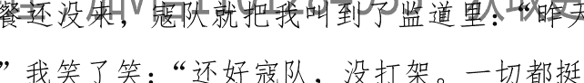

临进前，轰队说：“对了，我叫你来还有别的事儿交代一下。今天不是我的班，一会我就回家了。不过我估着周老鬼和赵峰的那个事也有个结果了。昨天已经提议了赵峰，今天差不多轮到你们。有什么就说什么，要不然上你们自己，事情就办妥。”

我一愣：“是不是什么意外了？”

“没有，”轰摇头，“不用担心，就是讯问一下。当时你们都属于证人，给检查部门一个证词。”

“那我们还能看到刀疤吗？他现在怎么样？”我急急的问。”

“别担心了，他在挺好。不过他的案子愁了，等法院的王总理，加一句，要是这案子和其他其他事纠了，我看到很多帖能给他带回来。哦，还有。跟喜全说一下，他的二审马上开庭了，让他好好准备一下。我看他最近状态不对，你要跟他多聊聊。”

+++++++++++++++++++++++++++++++++++++++ 下节关注 +++++++++++++++++++++++++++++++++++++++++++

喜全二审马上要开庭了，但他却的极度反常，每天除了睡觉吃饭就是发呆，除了和吴二柱之外，跟谁都极少说话。没过几天，七班发生了张骏虎入班之后的最严肃事件，而这件事实然是由大家都以为为傻的吴二柱全策划的。

作者：二废子 日期：2009-10-02 13:06

声明一下：之前有人随意发布了一个电话号码，说是我是我的号码。请各位千万不要相信，因为我本人的习惯很少使用手机，现在的电话也是我妻子的，号码只有家里人知道。如果有人通过虚拟我的电话号码，诈骗财、盗版权等，千万不要相信。

作者：二免子 日期：2009-10-03 10:53

++++++++++++++++++++++++++++++++++++ 上节关注 ++++++++++++++++++++++++++++++++++++

临走前，寇队说：“对了，我叫你来还有别的事要交交代一下。今天是我的班的，一会我就回家了。不过我估着刘老鬼和赵峰的那个事儿已经有个结果了。昨天已经提过这件事了，不过你们没当回事。看来我还有很多贴上你们自己，那事情就办妥了？”

我一愣：“是不是出了什么意外了？”

“没有，”寇队摇摇头，“不用担心，就是讯问一下。当你们都属于这一类，得给检查部门一个证词。”

“那我们还能等到刀疤了吗？他现在怎么样？”我急急的问。

“别担心了，他在挺好。不过他的案子悬了，等法院的决定下来，要是这案子和你们等人闹不上边，我看看能不能让他弄好回来。哦，还有。跟喜全说一下，他的二审马上开了，让他好好准备一下。我看他最近状态不对，你要跟他多聊聊。”

++++++++++++++++++++++++++++++++++++ 本节内容

## 22、

自从刀疤出事后，喜全几乎很少和我们一起交流，他和当初的林子一样，坐在风场的角落里一语不发，心事重重。除了吴二柱外，他和任何人的话都很少。这段时间七班每天都会和喜全整个个人有些些记忆，因此他已经忘记了还要或或许会被维持的。

这期间郑强进来的周内，监室内似乎非常平静。除了检察院送来了起诉书之外，监狱变得热闹起来。

郑强进来的第三天，郑强的精神高度紧张了。本来那天早上见他，他在风场上沉沉地睡了。直到李在外面叫他名字，他才慢的坐下去。后来我跟哥说，郑强已经开始崩溃，需要赶紧休息。于是我哥和郑强又谈了一次，最终才让他上铺。

当然，接到起诉书这件事几乎让我崩溃。原本以为律师不了取保，那就应该可以办，手里捧着起诉书，我连累都不考虑了。那天遇上四哥，我真找你写遗书了！

（此处后续大量重复内容，已按逻辑合并）

我站起身，并将刚才从床下拿下的白沙给喜全：“拿吧，这是四哥让她的。马上就开展了，好好想想怎么申辩，要是有写的东西，随时跟我说。”喜全点头，随一又暴起摇头：“大学生，我可不打算找你写书！”我笑了起来。一起来吧，经理林奎告诉儿子：“我打算跟他们多好啊。”说完，我就要往监仓里走，喜全忽然抓住我：“大学生，晚上的值班你俩值班吧？我想跟你聊聊。”

我一皱眉：“估计不行吧？你已经判刑了，不知道四哥让谁值班吧？”

“没事，值班不是你和林奎吗？那个杂碎踢到门口坐着去，你俩好好聊聊。我就睡不着觉，晚点睡了。”

晚上灯响起来的时候，我正和四哥辉耀祖宗的烟雾够监仓里的人多久。听见熄灯响起来，大家都回到自己的位置上休息，床铺只剩我、林奎和喜全。四哥眯了一眼喜全，小声问我：“喜全实话了？”

我愣，忽然想起自己已经很久没有跟四哥聊天了，于是着急回答：“他这段时间因为马上就要开庭了，所以心里压力很大。今天下午我跟四哥聊天的时候心里不在焉的，我担心出点什么事就糟了。”

四哥点点头：“聊天也好，省得到时候判决下来了一点心理准备都没有。你把自己的心态也调整好了，今天刚接的起诉书，马上就要开展了，你得有个准备。”喜全点头：“放心吧大学生，他傻可不傻。这个狗杂碎已经跟我说了不止一次两次了，每天一见到我就紧眯眯的跟我说他宏伟计划，我听都懂了。”

寇队狠狠地瞪了四哥一眼：“跑了！”

“跑了？”四哥脸色顿时大变，“咋跑的？”

“咋跑的？”寇队气呼呼的看着四哥，“让你当班就是你盯着着这些人，不要有对抗审讯的行为，结果你倒好，刘喜全从一审下来就开始规划，你现在还不知道？休假的时候去厕所，你跳的吗？”

“几楼？寇队，抓住了吗？”邢耀赶紧问。

“三楼，跳下楼就摔断了。现在医院躺着呢！”

## 下节关注：越狱

一手数学加微信：1901284955，获取更多好资源

> 注：这两天的逻辑有些找不出法，如果顺利的话，今天还会有第二次更新。

作者：二馒子 日期：2009-10-04 20:48

# 上节提示

寇队一下子火了：“开玩笑？有开一整天玩的吗？——一个曹嘴里一句实话都没有，你们是不是又在他娘的想裁缝了？张毅虎，上次没关你禁闭，皮痒痒是是吗？你先跟我们到管教办公室！回头一个一个的问！”

我点点点头，站起来跟着他们往外走，正要关闭仓门的时候付。

时候，四哥忽然问了句：“寇队，刘喜全到底哪了？”

寇队狠狠的瞪了四哥一眼：“跑了！”

“跑了？”四哥脸色大变，“咋跑的？”

“咋跑的？”寇队气呼呼的看着四哥，“你打算当班就让你盯着这些人要不要有对抗审讯的行为的，结果你倒好，刘喜全从一事就开始开始策划，你现在还不知道？休假的时候去厕所，你跳的！”

“几楼了？寇队，抓住了吗？”邢耀赶紧锁锁。

“三楼，跳下楼就摔断了。现在医院躺着呢！”

++++++++++++++++++++++++++++++++++++++++++++++++++++++++++++++++++++++++++++++++++++++++++++++++++++++++ 本节内容

# 一手处理加微信1101284955 获取更多好站

喜全看着警察，他知道从二楼的厕所躲不掉的。当时虽然有两个警察跟着他到厕所，但他还是用各种理由支走了一个法警，趁着另一个法警不备，打开窗户便纵身一跃。

而且后来经过监狱将近几个小时后，终于知道一切都是吴二柱策划刘喜全去做的。吴二柱有个远远的表哥在L市司法工作，他很清楚L市司法的楼层结构和刑庭布局。

而他做的原因只有一个，就是让刘喜全做一次试金石，一旦全成功，他就可以按照刘喜全的原路线脱逸。

但是吴二柱机关术，他却忽略了很重要的一个方面：三楼，一个没有任何束缚的人跳下去就难会摔断腿，何况是一个被关了死牢的犯人。

由于喜全的受伤，他的审判被推迟了两周。而他本人也被送到了劳改医院进行治疗。寇队说，这下估计我们谁都看不到喜全了，就算是他二审没有判死，等他的腿完全恢复，就直接送进监狱服刑去了。而吴二柱，理所当然的被关了禁，开放之日相议。

全仓的人人都感到可惜。四哥说，喜全要是不跑估计还能活，这一跑，估计要连命都跑了。而喜全跑脱的事儿一天时间内就被二队传开，一小时二十分的流行语变为了：“实在不行就跑棱！”

喜全事件发生后，寇队打算把四哥的班长撤了，但是看了下全队，能把重刑犯留的只有四哥和刚辉，只不过小组已经已经是犯了，骨就是懒，只不过口头批评了几句就要算了。但是让寇队没想到的是，喜全的事件只是冰山危机的一个开头而已。

仅在喜全出事后的第三天，三六班就有一个抢劫犯在L市城区法院和喜全同一辆车的方法成功逃狱，虽然他在不到四个小时的时间内就被抓住，但是足以让很多班的危险分子开始蠢蠢欲动起来。寇队明显听到二队的空气中有了暴动的味道，赶紧把九班临时降格为普通号，把里面的一个等待复核的死刑犯和一个等二审的死刑犯转到七班，把每个班里有可能组织越狱的刺头全部分散押。还可如此，三天后，还是有一队的两个人在法院内。

暴动逃逸，而且这两个人在跑的时候迟到了一个警时，连公安部的人都开始关注这件事。派了省厅、省高法、高检、监狱局的领导们用轮备来检查，这一检查不要要紧，全是通过匿名举报上来的有逸脱想法的竟然有十几个个人，甚至还包括妇女的两个。不过频繁的检查不但折腾了我们，没有休息时间，连队队都有些心慌。

根据省里和市里领导的意见，所长和副所长带着管教准备在各自小组做工作。但是到了七班的时候，寇队还是让管教不要涉，因为他知道这件事的根源由七班引起。还可如此，这种时候准备的管教精神刺激一下，还会出事。

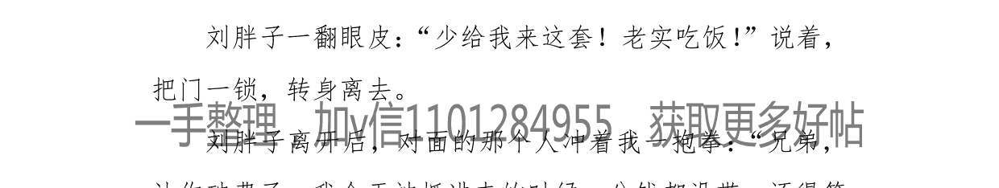

寇队坐在椅子上，翻出一堆档案看：“这时间准备的管教累了。”

四哥递给我一个干净的纸杯倒水：“寇队，我保证这次没什么事了。”他问：“你们七班最近出了多少事？”

四哥笑嘻嘻的摇头：“没有，寇队，我保证这次没什么事了。现在的气氛这么紧，七班的人连想法都不敢有！要是别的队，估计早就把我们趴了！”

寇队冷了一声：“你们就是，我看护你们。明天新队长来了，谁来带我不清楚。不过告诉你们，我听说这次派下来的常务副队长都是狠角色，你们要是作翅儿，准叫你们吃不了脸。新队长明天早就到位，我从中午开始休息两天。我到时候会找你们班的情况告诉新队长，他也会找你们谈话。你们的事，你们自己活量胆！”

“虽然很快都抓回来了，但是只是人要跑了，就有人负责！”寇队深深吸了一口烟，一脸疲惫的往墙上一靠：“唉，这这次恐怕都要通报了。”

四哥一愣：“寇队，你是要来新队长？他人咋样啊？不会为我们倒吧？”

“我们去哪儿？谁来带我不清楚。不过告诉你们，我听说这次派下来的常务副队长都是狠角色，你们要是作翅儿，准叫你们吃不了脸。新队长明天早就到位，我从中午开始休息两天。我到时候会找你们班的情况告诉新队长，他也会找你们谈话。你们的事，你们自己活量胆！”

说着，他站起身：“你们这里进来不久的，也有时间长的。从头到尾我没为难过你们当中任何错，最多就是你们犯了错，给你们一个个锤子，闹了就加，没事就减，你们听我说的表现好点，现在积极配合起来总之的你们是一个实心好人，你们别闹给我整个脑袋闹成脑肉了。多的也不说了，如果还有事情，随时可以跟我举报，要是方便的话，就跟你们的班长和二辅或者是张老说就行。千万别跟我闹祸了，我一把老骨头不起你们这么折腾！”说完，转身快步离开监仓。

寇队走后，我和四哥、辉耀祖几个人静静的坐在墙角抽烟，我们几个人觉得对不起他们。在整个队的所有管教里，只有寇队是最人性化、最替人考虑的。正是因为，寇队入监从来说不用带其他的管教一起陪，因为他根本就不用怕谁对他怎么样。说实话一年前曾经有两个企图越狱。

人的打算击犯队后跑，但是还没动手，就已经被监号的其他犯人给砸下了。有时候甚至有些出狱的犯人逢过年节会给犯队打个电话问候，邮寄礼物什么的。犯队的威信，在二队可以说没有一个管教能比。但是现在的常务队长要入场了，谁也不能保证新来的队长会怎样。尤其是几个已经被判了死刑的犯人，更是觉得忐忌不安。他们甚至在讨论死前饭都吃不上了。

第二天早，新的常务队长果然如期而至。黝黝的脸庞上泛着满脸的蔑视。他带着一个查房，但是中间却刻意忽略我们。半个多小时后，监仓门打开，所有犯人按照点名的顺序蹲在场上。四哥赶紧喊道：“管教好！”寇队长一脸严肃的看着我们：“七班是谁的队长？”四哥站起来：“报告管教，我是七班的队长。”寇队长点头：“什么案子？现在到什么程度了？”

“报告管教，已经判了，留在看守所服刑！这几天因为事情太多，还没来得及呢。”

“嗯，”寇队一挥手示意蹲下，“回头跟管教聊聊这事，赶紧安排了。不过你们安排到监狱吧，“谢谢寇队！”我点头。寇队环了一圈：“你们七班会有个大学生呢，哪个？”四哥站起身：“报告管教，是我叫张勋。”寇队长点头：“行，前几天刚接话，还没呢。”说完，他抬头看了别人：“我估计你们管教也说了了。行，你先去休息一下，我跟这个大学生好好谈谈。”寇队点头，转身离开了办公室。寇队又吩咐办公室里的两个管教去监牢好好看看，并告诉他们有几个犯人的头发长了，让他们监督处理。很快，办公室里就剩我和寇队两个人。寇队坐在椅子上，翻出一堆档案看，他直勾勾的瞪着我：“快看来，我自己也需要好好准备一下的。”话音未落，他一出手狠狠的在我脑勺上拍了一巴掌，啪啪道：“你就乖乖的准备你开展的，有事就赶紧向管教报告，这个人没有人教你？”

我低着身子努力向后靠：“寇队，我知道有要报告，但是他们有事情也不一定让我知道啊！”

寇队的手又袭了，还是打在我的脑袋上：“放起！寇队把你弄到七班做什么你不知道吗？我听说你们监仓里那个吴二奎就是你在五班的时候变强的，接着你去了七班，班里的事情就从来没有停过！你是什么？”我无言以对。现在的只是恐惧，自从被关到监狱后。

寇队叹了口气：“这时间准备的管教累了。”他问：“这次刘全脱是不是这小子策划的？”

四哥点点头：“不是，我保证这次没什么事了。那是吴二柱策划的。”

寇队瞪了四哥一眼：“你，，，，，，，，，，，，，的，跑了。”不是的。，，，，，，，，，饭的厕了。寇队斜着眼睛看着我们，从怀里掏出一盒烟，摆在地上：“这时间准备的还是套了，根源在哪里？”我看到，四哥递给我一张纸。

其实那张纸上没太多东西，只要写的是或者就可以可以。很快，大家手中的稿纸交到了寇队的手里。大家开始刷刷的蹲在地上。寇队斜着烟，一张一张开始翻看。

“没想到你这狗家伙还不错！”他一脸，看着我说，“你举报的二十二个人，有二十一个写不是，但是还是有一个写的是你怎么解释？”

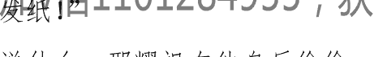

做的，我刚起了冷汗。这都什么人啊？我在二班都没见过，怎么会在这个时候害我？我赶紧蹲在地上：“寇队，我冤枉啊！你不能拿一个人的话当事实啊！还有二十几个说我没做的！”寇队伸身就在我肩上狠狠咬道：“我就是信这一个人的了，你还能怎么怎么样？不把你打倒，我还能管这个号吗？”说完，他回头从监导里的杂役喊：“杂役，七班给我送过来一副大镜！让他知道下扇！”

四哥紧站起来：“寇队，这话不是这么说的。张毅虎在号码里从没做过什么不道德的事情，还帮着写书。可能不像信人的话！这孩子素质这么差。”

看守王理，加被我吓了……。“让你说话了吗？”寇队伸手就给四哥一巴脸，“监规里怎么说的？要服从干部的管理，你们都算到脑袋里去尿了吗？我就你！告诉你们，要不是顾着规队的面子，我就和你这个小子一起关禁！蹲着去！”

大镜很快拿来了，那是一几十十斤的重镜，砸在我的脚腕上，我甚至走路都困难。镜砸碎后，寇队满意的点点头：“都好好给我反省！一会儿再发纸自检举报材料，明天早上我来收！”说完，转身扬长而去。

看着监牢门被锁上，所有人都开始站了起来。四哥此时脸色色色的煞白，一回头：“谁让你们起来了？都给我蹲下！”

“怎么能想到这种办法？”

“吴二柱有没有神经病我不知道，我怎么总觉得这个新管教和吴二柱有关关系？”
......”

过了一会儿，四哥问：“都写完了吗？”结果没有一个人说话。四哥急了：“行，把笔再倒了！”苍蝇点头，拎起桶就要往厕所走。这时被新调来的已决张树杰和一审死刑的袁桥一把抓住苍蝇，对四哥说：“哥，我新来的，知道说话没分量。但是你就再给大家分几分钟问吧，要是大家还没写好呢？这种事儿，一旦写下就惹人不说，以后会被家里人人都说不受了。”

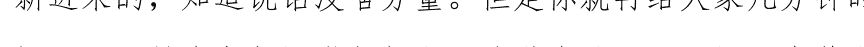

五分钟交不来就截了！
很快，五分钟过去了，四哥指小康：“收条子！”小康赶紧站起来，从其他犯人手中抢过来，交到四哥的手里。四哥张张的脸翻着，嘴里不停的骂：“操，还她娘的有不怕抢子的。给我交这多空空白纸质球啊，你们……”
四哥忽然停下来，又急急的翻了几页，一摇头，破口大骂：“我干你亲娘的！哑匠盖大房，我没看出来！”

++++++++++++++++++++++++++++++++++++ 下节关注
++++++++++++++++++++++++++++++++++++++

点炮的下场

交流群群:69585183

更新的比较慢，请各位原谅。

作者:二瘦子 日期:2009-10-06 17:02

+++++++++++++++++++++ 上节提示

++++++++++++++++++++++++

过了一会儿，四哥问：“都写完了吗？”结果没有一个人说话。四哥急了：“行，苍蝇，把纸再倒了去！”苍蝇点头，抬起裤子就要去厕所走。这时新被调进来的已决张树杰和一审死刑的桥杨一把抓住苍蝇，对四哥说：“哥，我新进来的，知道这话没啥分量。但是你就给大家分几分钟吧，要是大家还不想好呢？这种事儿，一旦写下去老可是越写越坏了。

# 主页加微信1101284955 获取更多帖

四哥点点头：“好，再等五分钟！苍蝇你就在厕所门口站着，五分钟不交就削！”

很快，五分钟过去了，四哥一手指：“收条子！”小康匆忙赶站起来，从其他犯人手中抢回稿稿，交到四哥的手里。

四哥一张张的翻看，嘴里不停的骂：“操，还她娘的有不怕饿肚子的。给我交这么多空白纸找球啊，你们……”……”

四哥忽然停下来，又急急的翻了几页，一摇头，破口大骂：“我干你亲娘的！哑木匠盖大房，我没看出出来！”

++++++++++++++++++++ 本节内容

++++++++++++++++++++++++

## 23、

我记得第一次七班，是我入监的第二天。那时候四堡要上路，庄里安排五班的胡磊给四堡走最后一程。也就是在这一天，我遇到了自己的老朋友四哥，并认识了喜喜。那天是我第一顿吃牢饭，第一次吃到菜帮子茄糟饭，闻了一鼻子我就险些吐出去。喜喜当时就要帮我倒倒，结果被一个山东口音的家里没有人的寻逸男孩事给掳要走了。

这个山东人有个不土不洋的名字，说他不土不洋，是因为他用一个农村气息极其重的名字。柱柱；说他洋，是他有一个城里很多小女孩男孩都向往的姓：欧阳。

欧阳柱柱，这个名字本身就是一个喜喜，结果他的嫂子王智玲加微信110128495获取更多好贴比她还后悔，他在厨房洗污脏了玻璃，擦洗台后。有一天，他和雇佣的女人因为打碎了一个玻璃杯吵了起来。他本来以为一个杯子也就是三五块钱，结果女人说这个杯子是她从公主带来的，价值五百美金！

柱柱怪了，但他没有见过美元，更是没有听过迪拜这个地方。柱柱问她：“迪拜是哪个县的？”女人嗤之鼻：“土老帽，典型的农村人！”

这下柱柱不干了，别看他老实，但他最恨别人看不起农村人。我是伸着脖子就和女人争辩起来。可是女人毕竟见多识广，骂了十几分钟终竟一句话都没有重复。柱柱实在气得不行，便抬起他很久没有修剪、带有许多污垢的指甲，

狠狼在女主人脸上抓了一把。顿时，随着女主人的尖叫，她的脸上留下了几道深深的血痕。而柱柱也在晚上被扔进了石槽山。

事实上这点绿豆豆的事情，柱柱最多赔点钱，道歉就行了。要是在别人身上，这件事连警察都没儿管管。但是柱柱的父母死得早，家里唯一的大哥早就扔下自己去深圳打工赚大钱送去了，柱柱根本就没有钱赔。重要的是柱柱这个坏的女人，是市里一个大官的小妹。

柱柱这么糊涂地走，监控里人都觉得他挺可怜，也挺宽枉，所以大家都有意的照顾他。用四哥的话说，柱柱就是镇里唯一的好人，而莉都是好妹妹。但是我没想到的，就是这么看上去像老实的人，拿着棍子打不出响，居然把我给绊了。

四哥看着那些纸稿，越看越来，越看浑身抖。最后很恨地往上一指，对小康：“大家吃饭！把柱柱给我过来！”柱柱吓得脸都白了，浑身像筛子一样抖。四哥伸手就是一个耳光，很快，他的脸颊就肿起来。

“没想到啊！搞了半天你当了？那个新来的警察是你吗？你他娘的那只眼睛看见喜喜全跑？”四哥暴跳如雷。

柱柱紧紧的抱着脑袋哀道：“哥，求你别打我！我是害怕要是不惹哥的话，我们都得挨打！”四哥愣了，班里所有人都不声，眼睛直勾勾的盯着我：“柱柱，你跟喜喜跑？”

我差点出来，手上的链和脚腰之间有一根钢丝连接，所以我四哥伸手拽起脚腰。

柱柱紧紧的抱着脑袋哀道：“哥，求你别打我！我是害怕要是不惹哥的话，我们都得挨打！”

四哥愣了，班里所有人都不声，眼睛直勾勾的盯着我：“柱柱，你跟喜喜跑？”

我差点出来，手上的链和脚腰之间有一根钢丝连接，所以我四哥伸手拽起脚腰。

四哥看着白栗煮面一条胃口都没有，他伸手揉我脚上的腿：“这个新来的也太大了！哥，你要是我们就来个下马威。不知道的人还以为柱柱做了几个人命呢！我看咱们得找队反应反应。娘的，找不好。”

我苦笑着摇摇头：“裹得挺挺的，疼不疼，就是走路太累了。脚上挂这么大的铁家伙，要是跑步准比沙袋还好用。”

坐在旁边的林子咧牙一笑：“大学生，我看我是挂个一年两个出去，可是还能游泳的功夫家伙！”四哥很狠在林子身上拍了一巴爪：“你他娘的鸡蛋儿！你咋挂两年呢？”

林子当即缩了回去，一脸委屈的说：“我可不是看大学生的心情不好，想退避他？”

四哥还要叫林子，被那辉祖一把抓住：“行了四哥，别跟他一般识。咱们得聊聊柱这个事儿了。小虎子的起诉都下来好几天了，这当口要是开庭，一见到他，就看到。”

四哥摇头，看着郑强：“哥，跟哥没关系！既然到这来了，王理加V收获好多。”

他说他按住柱的一脚：“这种无中有的货除了脑子里全是社会，还能想他不？行，你不是怕被打吗？今晚给你舒舒骨，告诉你那些死的！”

柱柱扣通一声就坐在地上：“哥，求你别打我！真的没想过这种时候我不说也会说的。”

四哥笑起来，说郑强果然识时的家伙，最大的事就是最合适的时间出现，简直就是传奇。郑强脑脯皱起来，但是脚又沉下去，狠狠的柱柱背上踢了几脚。四哥一手招：“行了别打了，晚上别过场。其他人吃饭，那个柱柱不吃！耀祖，那个鸡蛋拿出来给。”

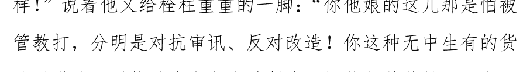

一条泛着光的油鸡腿放在我的面前，但是我无论如何吃不下去——鸭脚腿太大了，我现在连在床上都费劲，哪里来心情吃鸡腿呢？过了四哥后，便把鸡腿扔给了“弃暗投明”郑强。这下郑强更有劲头，干脆端着碗走到我们几个人中间，一起商量如何快速把我的馋卸下去。

辉祖在他旁边说：“操，我怎么觉得郑强的腿没这一样美。处理柱子，获取更多帖。”

我苦笑着摇摇头：“裹得挺挺的，疼不疼，就是走路太累了。脚上挂这么大的铁家伙，要是跑步准比沙袋还好用。”

坐在旁边的林子咧牙一笑：“大学生，我看我是挂个一年两个出去，可是还能游泳的功夫家伙！”四哥很狠在林子身上拍了一巴爪：“你他娘的鸡蛋儿！你咋挂两年呢？”

林子当即缩了回去，一脸委屈的说：“我可不是看大学生的心情不好，想退避他？”

四哥还要叫林子，被那辉祖一把抓住：“行了四哥，别跟他一般识。咱们得聊聊柱这个事儿了。小虎子的起诉都下来好几天了，这当口要是开庭，一见到他，就看到。”

四哥摇头，看着郑强：“哥，跟哥没关系！既然到这来了，王理加V收获好多。”

他说他按住柱的一脚：“这种无中有的货除了脑子里全是社会，还能想他不？行，你不是怕被打吗？今晚给你舒舒骨，告诉你那些死的！”

柱柱扣通一声就坐在地上：“哥，求你别打我！真的没想过这种时候我不说也会说的。”

四哥笑起来，说郑强果然识时的家伙，最大的事就是最合适的时间出现，简直就是传奇。郑强脑脯皱起来，但是脚又沉下去，狠狠的柱柱背上踢了几脚。四哥一手招：“行了别打了，晚上别过场。其他人吃饭，那个柱柱不吃！耀祖，那个鸡蛋拿出来给。”

一条泛着光的油鸡腿放在我的面前，但是我无论如何吃不下去——鸭脚腿太大了，我现在连在床上都费劲，哪里来心情吃鸡腿呢？过了四哥后，便把鸡腿扔给了“弃暗投明”郑强。这下郑强更有劲头，干脆端着碗走到我们几个人中间，一起商量如何快速把我的馋卸下去。

辉祖在他旁边说：“操，我怎么觉得郑强的腿没这一样美。处理柱子，获取更多帖。”

[content]
<!-- 此处省略部分重复内容合并 -->

“都是我听错啦……”他哭号着，“求你了，我真的知道错啦！”我点点头，冲着小康和苍蚕一挥手：“哥儿，算了，咱们不就是为了把这摘了吗？他都答应曹帅说了，那就算了吧！”

苍蚕有点不解的：“这种人就得治！点糟是一条，扭曲事实又是一条！别人根本没做的事儿硬说做了，这不是指狼为马吗？”

“是指鹿为马。”我笑着更正。

“一样，”他一甩手，“大学生也别太软心，被人笼咒的滋味，我一定要死他！”

看着他，苍蚕哼了声，转身走开。收敛脸，别一下子砸趴下！再说了，大学的面子不给面子吗？”苍蚕这恶狠狠的在桩柱上吐了一口，不甘心的转身离开。桩柱已经完全不行了，哈得满嘴满鼻子都是污水。显巍巍巍的从地上爬起来，对着我说：“大学生，明天一定告诉曹帅我是冤枉你的……”

我看着肮脏的便池，又看了看狼奴的桩柱，没有话说边转身离开。走到四哥旁边，我才小声说：“唉，咱开过了。今天白天他已经知道是冤枉我的，明天一上赶队来了跟他解释解释就不好了吗？这又是何必……”

四哥冷冷的一笑：“你真不是属于监狱的人！这个地方，你不治他，他就得反过来治你！”

++++++++++++++++++++ 下节提示

下节关注：曹队怎么了？
本贴 QQ 交流群：91581990
本贴+本人博客：http://www.2shouzi.com/

博客将逐渐在天涯发过的内容过去去，方便大家阅读前面的内容，说是“重播”吧。另外，这几天朋友说我只更新一次，是要大牌。天地良心啊，我连“牌”都算不上，哪来的大牌可要？这几天确是进入进瓶颈，所以所写的比较慢了。请各位原谅，如果我可以更新新次，绝绝对不会

就聚群的加微信：1101284955，获取更多好帖

作者:二夜子 日期:2009-10-07 19:44

++++++++++++++++++++ 上节提示

话说，四野哥坐了起来：“苍喽，日子长着呢！慢慢收敛，别下一下子砸趴在地上！再说了，大学生的面子不给你吗？”苍喽这恶狠狠的躲在柱杆上吐了一口，不甘心的转身离开。柱杆已经完全不行了，呛得满嘴满鼻子都是污水。显巍巍巍的从地上爬起来，哭着对我说：“大学生，明天一定告诉曹队我是枉枉你的……”

我看了肮脏的便池，又看了看狼的柱杆，没有话说转身离开走到四哥旁边，我才小声说：“唉，过分了。今天白天他已经知道寇枉我了，明儿早上寇队来跟他解释解释就不好了吗？这是何必……”

四哥冷冷的一笑：“你真不是属于监狱的人！这个地方，你不治，他就反过来治你！”

++++++++++++++++++++ 本节内容
++++++++++++++++++++

第二天早上寇队来上班的时候，曹队好像不在办公室，只有另外一个管在整理犯人资料。寇队一进门就听说七班昨天砸了一个重镜，连谁都设没就急匆匆的跑到七班大门还没完全打开，他就看到了我咬着拖着脚的我。没说我了，四哥一下子的怒愁苦脸起来，他跟一个怨如一样的抓住我的肩膀，几乎带着喘喘对寇队说：“寇队，你可回来啦！你得给我们小李子做做主啊！他要是个三长两短，我可一辈子不要爹妈了。”

寇队一白眼：“有话好好说吗？你现在就有脸他爹妈了？咋回事儿？”

四哥回答他，从屁蹲下来找我的裤，给他展示昨天被曹队留下的那一块青：“大学生，明天一定告诉曹队我是枉枉你的……”

我看了看肮脏的便池，又看了看狼的柱杆，没有话说转身离开走到四哥旁边，我才小声说：“唉，过分了。今天白天他已经知道寇枉我了，明儿早上寇队来跟他解释解释就不好了吗？这是何必……”

四哥冷冷的一笑：“你真不是属于监狱的人！这个地方，你不治，他就反过来治你！”

第二天早上寇队来上班的时候，曹队好像不在办公室，只有另外一个管在整理犯人资料。寇队一进门就听说七班昨天砸了一个重镜，连谁都设没就急匆匆的跑到七班大门还没完全打开，他就看到了我咬着拖着脚的我。没说我了，四哥一下子的怒愁苦脸起来，他跟一个怨如一样的抓住我的肩膀，几乎带着喘喘对寇队说：“寇队，你可回来啦！你得给我们小李子做做主啊！他要是个三长两短，我可一辈子不要爹妈了。”

寇队一白眼：“有话好好说吗？你现在就有脸他爹妈了？咋回事儿？”

四哥回答他，从屁蹲下来找我的裤，给他展示昨天被曹队留下的那一块青：“大学生，明天一定告诉曹队我是枉枉你的……”

我赶忙把手中的白沙递给他，他感激地冲我点点头，然后慢缓地抽出一支点上：“算了，我也不想写了。自打了我这个案子，我家心里都凉了，没人管。”

“怎么会！”我气急地说，“怎么说你都是父母的骨肉，会没人管？”

他一本正经地冲我摆摆手：“你就不不知道，小哥。我从十九岁就开始进所，现在出现这个案子，大牢都坐了四次，派出所更不知道我一共过去多少次。老婆早就不管我了！”他面部僵硬的笑，“我上班的时候我多说最后一次管我，我打了一堆关系把我打到他里他的班，结果没月……”

我就那女人的脸皱了。现在那女人家里跟我打架，我姨妈的事吵，你还欠我这么多贴。。我这儿子的，命都要没了，还得为家里下功夫，给她留一堆债。”

他抽了一口烟，没等我好好留下点字，就开始跟我聊起成长，说自己小时候多么幸福快乐，如何可能被一个坏小子带去第一次运附近铝的铅，后来又怎么别人抢钱、抢劫，最后等到那桩，怎么被抓到。开始我还打算找个空隙插进去，把话题引导到遗书这个方面。可他没有给我任何机会，滔滔不绝地聊了一个多小时。最后，我放弃了引导话题的想法，无奈的看着他为自己枉短的一生悔不已。

等了很久，他终于停下不说了。我第二次提醒他：“兄弟，真不打算写什么？”

他深深地吸了一口气：“让你想想，我是真不知道给他们写点什么。”他低头掰着手指：“算日子也快到了，今天中午没改善食术，应该是明天晚上改善。可能后天早上我就得上路了。也许这一次和我一块儿上的路，不改善生活了……”他忽然抓住我的手，“小哥，你说我是不是明天早上就要走？”

“不能！”我被他吓了一跳，“我虽然来的时间不长，但我这字号里规矩我还是知道的。别瞎想了，还是赶紧写点东西吧。”

++++++++++++++++++++ 下节提示

# 一手处理的教程：1101284955，获取更多福利

作者：二瘦子 日期：2009-10-10 07:30

从晚上七点多到十点多，张树磊坐在地上撑着墙壁发了一个小时呆，因为我知道的时间不多，可能随时会有写要求的要求的，所以我拿着准备好了纸和笔陪他一起呆坐了好多几个小时。当他终于决定下笔的时候，我的腿都麻了。

“吧，小哥！你帮我取个硬纸板，我垫着自己写。”
我赶紧把稿递给他，他又从床底下找几个监视的纸板：
“不用我帮你吗？你这么写可能不太方便。”

他摇头：“不用了。我爸妈妈很久没看见我写的字，我也没啥想的，无非就是让他们保身体之类，没啥长篇大论。”我点头起身离开，让他有一点自己的空间。

寇队曾经跟我说过，如果死犯打算自己写遗书的时候，最好让他自己来一会儿。

熄灯早早就熄了，监仓门上面那盏昏黄的白灯有力气无力的散发着自己的亮。除了值班的蚕褚和小康，还有我和张树杰之外，其他人早就睡着了。我伸了伸懒腰，坐在自己的铺位上抽烟。这时祁祖坐了起来：“昨晚不睡？”

我冲他一笑，递给他支烟：“张树杰写遗书呢，我得陪着。”

他接过烟，眯了一眼床铺，不屑的说：“操，捏这挨街讲的，他这样的枪二十次算不多！”我一挥手：“话我也说过，他写得更好，收获更多好处。妈留几个字吗？”

祁祖冷冷的一笑：“就他？”操，给他那个女的留的时间了吗？”他拿着我手中的烟头对着灯点着：“你别看我也是他作人进来的，但他是个这样的，我就看不起！快找个女人，算本事？有能耐别装，直接找持！”

我咬了口：“我估计就是几天了？但是这一次监道里好像没啥消息。没听别的班要上路吗？”他撇手：“有。”晚上四四哥去监视口新收，回来跟我说三队和一这次起来有五个，咱们队最少，就张树杰。

“个人。”
“哥，昨天检查新收了？”我疑惑的看着。
“你忘啦？他现在都在服刑阶段的，监道口新收是他工作之一啊！”张耀祖猛然一愣：“估计到我走的时候，他还在给我端饭！”张耀祖正聊着，张树杰忽然小声道：“小哥，写完了。你帮看看有没有错别？”我惊，看了看他只写了半个小时，“咋这么快？”言下的文化水平不高，洋洋洒洒本事。你帮瞧懂。”看着，把手整理了一下。那稿上的东西，而且本来的写就不好，加上双手是搓在一起的，所以写出来的字更难。他不好意思：“小哥，我的字不是写的太丑了？”我摇头：“没，眼睛线不好。”我听他的话，马上兴奋起来：“小哥，签了。”坐在一旁的槌当叫：“操，你到底底上过学？”我没想过几天都不知道视眼跟角膜有个关系！人家大学生又堵，要你尴尬啊”张树杰笑：“不好意思。”我和善冲一一，仔细看起这份。

我又看了一遍，双手把遗书还给他：“就写这么几点？”他点头：“哈哈可以的，写得我爸越气，妈越伤心。”我笑的，写的越多我爸越气，妈越伤心。”我笑了笑：“行，装好吧。交给法院的人，他们就转了。时间不早了，睡吧！”一手翻，好多帖还没说话，那耀祖走了过来：“赶紧睡！来这里久了，这点规矩还不知道？重刑犯不能值班，你是不是故意为难？”张树杰不说了，吐了口气只得乖乖的洗脸睡觉。

第二天早六点多哥哥就出去了，放饭的时候他的一脸的兴奋，炫焰似的跟我：“外面空气真好！小虎子，以后早上我一起出去！”我羡慕看着他，顺手拿着盛饭的桶回到监仓。还没吃完饭，闯队就带着四哥找我了：“张毅虎，出来穿上号。”我赶紧扔下饭碗，从床上翻出一件黄马甲冲了出去。

到了管教办公室，涵队对我说：“两个事儿，第一是你的传到了，八月十二开庭，等会儿你签字。第二是个事跟你跟你一下，刘桂痪了，赵峰昨天被取消刑罚，现在赵峰指明你要请赵云龙给他写书，照顾他最后一程，所以会儿我带你三队。”我惊：“涵队，赵峰明天和张树杰一批上路？”涵队瞪我一眼：“你听谁明天要上路了？再说了，就算是张树杰明天上路，那也不可能赵峰一批！”等张树杰上了，把赵峰的第二个案子放在你们七班的，所以重要事情可能不是他能去办的，赵总会安排。我咬了口：“涵队，既然赵峰是明天这一批走，我想今天先把张树杰的事搞好，再去三队赵峰。”话音一落，四哥狠狠的捏了我：“你疯啊！自家人兄弟的事儿还没完，”我问道：“想到那个小子？”我难看了看四哥：“不是我不办刀危险的事，张树杰在前面走，刀危险在后面走。不管怎么样，我得把眼前的事情先办了，然后才能静下心给自己写书。”四哥焦起来：“你要这么办的，你不怕刀危险你不怕刀危险伤心吗？”“好了别了！”涵队打断四哥的话，“既然张骏龙这么想，那你今天就是回去陪张树杰吧。有什么需要的赵紧跟我反映，还有顺便问他最后一餐想吃什么，下午告诉我。”四哥还想争辩，寇队瞪了眼，回头对李管说：“行了，把张毅带回去！藏云你回来。”说完，他回头看向我：“你的案子就要开庭了，准准备。如果需要和律师的话，让藏龙来说一下。”从管教办公室出来，四哥第一句话：“操，你脑子用了吗？”我尴尬看着四哥：“哥，我眼睛近视。”我不好：“没，眼睛近视，光线也不好。”我听他的话，马上兴奋起来：“小哥，签了。”坐在一旁的槌当叫：“操，你到底底上过学？”我没想过几天都不知道视眼跟角膜有个关系！人家大学生又堵，要你尴尬啊”张树杰笑：“不好意思。”我和善冲一一，仔细看起这份。

我又看了一遍，双手把遗书还给他：“就写这么几点？”他点头：“哈哈可以的，写得我爸越气，妈越伤心。”我笑了的……

25、

在看守所，最难的事情莫于询问即将上路的死囚最后一餐想吃什么。多数死囚是不愿意回答这个问题的，因为他们根本不愿意接受自己的生命即将结束这个事实。我在没有关七班之前，这个任务一般是交给与死囚关关系最好的来问。如果遇到类似张树杰这样的临时调整人员，那么这个工作就交给了之前的班长肖玮和四哥。不过这个四哥说他一般临死不太感冒，所以所有好个人他都自主主张的给他们要面条或者米饭之类的断头饭。在这次的临死张树杰算是比较理解和配合的，当他看到我和祁嘟嘀了几便径走他去，他马上意识到自己已经多久了，于是深深的叹了一口气，让出自己旁边的位让我做了。

我摇摇头，递给他烟：“没有，才接了门票，八月十二号开庭”。

“……”他用旁边的烟蒂点燃自己手中的烟，“是来问我断头饭的吧？”我一愣，赶紧说：“你别胡思乱想，路上的事早就早了。死囚确实是让你吃什么，但不一定马上走！早问，提早准备。”

苍蝇失落地叹了口气，咧着嘴说：“大学生，以后你得有个准谱。这样吧，以后你要是打算接锥，你就对它大声叫吧！我和郑小康三个人见一个接一个。”我黑嘿一笑，算了吧，我要是那天找祖辈或者哥哥叫起来，你还能摆脱他们？”苍蝇眼睛一转，说要么我就掳你，要么我就睁眼瞎。

大家都回风场了，张树杰知道刚才才帮了他，愧疚地从那烟盒里抽出金子递给我：“小哥，对不起，我多疑了。”我摇摇头，装作不经意的告诉：“烟你留着抽吧，下次你妈妈给你东西还早呢，到时候烟不够了。”结果他听到这句话时恰当又兴奋，“你的意思是我说这次死我留了？我真以为你还有好多好帖。”

# 经理 加微信1101284955 获取福利

金我能抽二十天呢！不够了我再让管带话了！

下午的时间我都在郁闷和无聊中度过。但我没有忘记队交给我的任务，一直坐在张树杰的旁边。那个下午我小心翼翼地抽的每一根家里送来的烟，直到文件过滤嘴被点燃的臭味才把烟头收起来，仔细细地放在上衣服里。后来我觉得恼火，就把自己怎么和马兰上好上的，又怎么觉得对不起她的，又是怎么迷得跟他他的。开始的时候他兴致勃勃地跟我开玩笑，我问有没有和马兰上过床之缘，等我提到韩律师时说

马兰要跟我分手时，他又愤愤地捏着拳头：“操，小哥儿，中华女孩千千万万，实在不行就跑！女的多的，这样无情无义的女人呀不要要她也！”

晚后铃响起来前，四哥回来了，说三队那个那个应该不是什么传染病，所以就没有给其他仓消毒。张树杰知道三队人人死之一人后，神秘地对我说：“看到没，小哥儿，我说看所邪气重吧！这是阎王老子叫小鬼来带的时候带错了了！”四哥瞪了他一言不话，把刚叫的这次打算上路的路得有十几个，我们俩二队，女队和四队最多。他努力挪一指张树杰：“这个估计也就是明天早上的事儿了。”

不出意料，晚上劳动送来了白米饭，另外还有回肉肉和素菜。厨房的米菜还没怎么开始的。

看到晚上改善，张树杰重新回到忧郁的情绪。他端着一碗饭喃喃自语：“完了，这下要了。明天早上就要吃花生米啊！”我拍了拍他的肩膀，骗他道：“家里都送来了一条烟，你还担心吗？这肯定别的别人上路的人，咱们占人家的光了，赶紧吃吧！”那是烟的话题似乎已经不能打起他的精神，那靠他就一个人在郁郁欢的情绪中咽下。

吃完饭，四哥让康我和多点热水，今天晚上大家都洗个热水澡。其实我知道，四哥这不是打算让张树杰知道自己即将上路，所以让大家一起都洗。不过水的要再多也只有一桶而已，所以四哥让人都把自己的洗脸盆拿出来，一人分了一些热水，最后都给了几个敲了死赖的人。

洗澡的时候，我先帮着四哥和辉耀搓完身子，又拿着盆帮小小林。到了最后对张树才笑着说：“你看我这人儿脏的差差，给别人洗澡背的，可就没人给我擦背。要不然咱哥互相搓忙吧？”他着急点头：“行，小哥，我先给你洗！”我摇头：“算了，还是我给你先洗吧！进来时虽远不长，一搓热水就觉得浑身不舒服。”他他还想说什么，但最终还是抱过不去，点头同意给我洗澡。

# 一手蜜：加微信1101284955获取更多精彩

然而给四哥最困难的事情是要洗脱衣服的衣服的事情。现在是在夏天，身上的衣服都很单薄，所以我和苍蝇这个“老犯”的帮助很快就解决。洗完澡，我张树杰从认识那天起你就穿着大裤子背心，不能穿上家里送的衣服怕撞嘛？他是摇头，这件衣服太厚了，无论如何也没有办法从缝隙中穿过去，只是做好。

我和苍蝇费了半天，总算是把内裤、衬衫和西裤给他穿上。那件衣服太厚了，无论如何也没有办法从缝隙中穿过去，只是做好。张树杰听这话当不好意思，憨慨地笑，蹲在地上不再说话。以为这样的办法就可以过一夜，但是没想到的是，四哥的一句话让我之前的所有努力都尽。张树杰摸的时候，四哥忽然捂着说：“这样好了，明天路上，咱七班出去是最的——空气似乎瞬间凝固了，张树杰脸上的笑容在四哥说完之后一下凝固。他看了看，又看了四哥：“哥，说明明天路上？”我紧紧攥手：“你在监狱住了这么久，不知道路上。放心吧，明天哥没有！再说了就算要路上，它也只有吃馒的时候才告诉你！”

但是此时张树杰也不肯相信我的话了，他憨然下去：“其实刚才洗澡的时候我就到了。今晚改善，又洗热水，而且热水还是小哥亲自洗的。洗澡还要换衣服，不是明天路上吗？”我急急地打断他：“说什么呢，我不是跟你说了，我在号。”

算了，你们都骗我了，我情况我自己清楚。”

四哥着急了：“操，张树杰你是不是认定了明天路上？我跟你说实话，你到底不上路上走的给我话！现在谁不知道呢！我们帮你洗澡主要是为了担心一旦就要路上，咱们就手脚乱让你干干净的。你个钩的是好心做驴肝肺吗？”

张树杰不说话了，他痛苦苦地坐在地上狠狠地抽烟，全然我理了一句：“加上101284955，获取更多好帖我最喜欢的排队与跟接触。”

路上是很晚的，所以我们吃完饭、点完名，大家又洗澡换衣服之后，太阳依然没有落。四哥不再理会已经陷入恐惧的张树杰，从饭口看向出去。我知道，他在观察观队会入监谊，如果有人第二天路上，不管教育会在天晚上入监。

果然，八点多的时候，宪队是往五班扔了一个新收，然后一直来到七班。宪队是两队在押人眼里公认的好管教，因此宪队不管到哪个监仓，大家都能好地相处。也正因为此，宪队让李管教从外面把自己关进七班，他随即脱了鞋就上铺里坐着。

这几天都怎么样？”寇队看着四哥赶紧叮嘱我从铺上拿出一盒好烟递给他一支：“这几天挺好的，都没闹。还是寇队管得好啊！”寇队一翻白眼：“寇老四，你少在这儿跟我拍尾！我今天入监是跟你们聊天来的，不是你们尾底！”说完，他环视了一眼监仓，问大家：“你们有什么问题吗？有问题可以随时跟我反映！”所有人挥手：“没有没有，寇队，都挺好的！”他点头，继续看着监仓里的每一个。忽然，他把目光停留在张树杰身上：“张树杰你呢，在七班的适应一下。整理，加v110128455，获取更多帖。”

张树杰翘起苍的脸，看着寇队难的一笑：“挺好的，这里的人都挺照顾我。唉，我都是明天就要路上的人了，还管这些干？”寇队一挥手：“你也别太大的思想压力。我听说现在你爹妈妈还在外设给你努力呢！你没听过拉倒场上都有活下来的例子？我今天主要就是来看你的情况，有什么需要的就尽量跟我开口！我还是那句老话，法律范围内允许的，我尽力而为！”张树杰点头点点，说寇队也别让我妈妈费心了，没用。这案子，除非没有死刑的国家，要不哪儿都死。又你也别担心，我跟那些怪物不一样，马上就要路上了，也没有力气作了。这号是傻儿子才干的事，我肯定不会。之前的所有努力都尽。寇队说你这么说我就放心了，舍不得死是常情。我听你说有些迷信吗？也好，相信轮转回去，做个做好人，好好报答你爹去，可是万不能犯法了。监狱场不是人地方。说完，寇队又假装着咬牙说了几句那个警察，绝对是个新手抓儿子，要是不喊我一声，就不至于走到这份上，顶了还能减刑。但是张树杰你不能怪人家，毕竟那是工作，只是方法错了而已。

# 一手清理加价1101284955收获好运

结束后，我长舒了释然的口气。我看着那堆杂物和小康、姨姐一，今晚上陪着我值通宵班。我没说话，只是感慨地冲涕点点头，转头接着帮张杰做一些思想工作。但他已经完全醒了，一开始根本听不进我说的话，一直到晚上十二多点，他才开口对我说第一句话。“小哥，几点了？”我赶紧抬头看了看那个很多死因倒的小闹钟：“十二点。早着呢，要你不睡一会儿？”他摇头：“不着。就这点点了，哪儿还有心思睡觉。十二点十五，还有几个小时馒头儿子就来了，吃完断头饭，我也该上了……”

我叹了口气：“别想那么多。溃队不是说了吗？到兵上还有人活下来的呢！你现在时间还多的是。你现在真着急想，什么东西可以救命的。比如一些律法规举发，我看过一些法律法规，只要没枪鸣之前都有机会活！”他看了我，忽然咧嘴一笑：“小哥儿，不能这么开玩笑的。你说你在九班待了一年了，哪有可能知道别人的事儿？再说了，你也看出的我的性格来了，在九班别都不愿意跟我说话，你说你把自己最秘密的事情告诉我了？”仔细想啊！”我递给他烟，“你在九班又堵着耳朵听别人说话，事情都没听过的！真的没有。”他皱起眉头，“但凡知道别人的事，我就心里不舒服。”坏笑着，我跑了。是在给我办法，我是不是的。是在给我办法，我是不是的。我是在给我办法的。我跪在父母面前对他们说不起。我又叹了口气，询问：“结婚吗？”他摇头：“没有，连个对象都没有。这样的十岁开始就在监狱里过日子，谁要我？前几年姨侧是托人介绍过，结果跟我跑了。唉，讨厌，人家谈恋爱看电影，游公园，我带着那个姑娘天三天了，我。

。问：“小哥，几点了？”我赶紧抬头看了看那个很多死因倒的小闹钟：“十二点。早着呢，要你不睡一会儿？”他摇头：“不着。就这点点了，哪儿还有心思睡觉。十二点十五，还有几个小时馒头儿子就来了，吃完断头饭，我也该上了……”

我叹了口气：“别想那么多……”

吃完就抽根烟等着，可能七点左右就过来了。对了，西装没穿上？”四哥这会儿已经起来了，赶忙说：“昨天晚上我帮他穿了，但是是穿不进去的。镜再说吧。”寇队点头：“行，一会儿镜的时候再穿。我一会替你拿着。”说完，他从怀里拿出出来两根绳子扔给四哥：“老规矩，让他干干净净的上路。”四哥接过来：“行，放心吧！”寇队又交代了几句就走了，我把塑料碗放在地上，又递给他一支筷子方便吃碗里的饺子“仓里没有勺子和筷子，你就凑合凉吧！”我感感的看了看，又从里里拿出出来抽完的几包香烟递给我：“小哥儿，这几天麻烦你了。这盒烟你拿着吧！等我吃完之后，我在风场上点几根，别在中间帮我取烟好贴贴。”我有反驳他迷信的话。他开始慢慢的吃起来，每一口都得很小，生怕掉在地上一点儿。每一口，他都会细细的嚼，然后慢慢的咽下去。仿佛他面前不是简单的煎饼、土豆和一碗热腾腾的西柿鸡蛋汤。宪队看了看坐在地上的张树杰：“起来吃吧！”张树杰理了理：“我最近吃饭了，谢谢队长。”谢谢哥。我饱了，然后准备一下。对了，我请示过的领导，酒不能给你。张树杰摇摇头：“没事，有吃的就行，没有酒都所谓！”宪队满意的点点头：“嗯，你能想就行了。该准备的都好了吧？跟家里的话都写好了吗？”也没准备的，”我看着宪队，“给你家里写的遗书就在儿了。是交给你一会给法院的人？”交给法院吧！他们会转交给你的父母。”宪队扔给他半包烟，“吃完就抽根烟等着，可能七点左右就过来

了。对了，西装没穿上？”四哥这会儿已经起来了，赶忙说：“昨天晚上我帮他穿了，但是是穿不进去的。镜再说吧。”寇队点头：“行，一会儿镜的时候再穿。我一会替你拿着。”说完，他从怀里拿出出来两根绳子扔给四哥：“老规矩，让他干干净净的上路。”四哥接过来：“行，放心吧！”寇队又交代了几句就走了，我把塑料碗放在地上，又递给他一支筷子方便吃碗里的饺子“仓里没有勺子和筷子，你就凑合凉吧！”我感感的看了看，又从里里拿出出来抽完的几包香烟递给我：“小哥儿，这几天麻烦你了。这盒烟你拿着吧！等我吃完之后，我在风场上点几根，别在中间帮我取烟好贴贴。”

我有反驳他迷信的话。他开始慢慢的吃起来，每一口都得很小，生怕掉在地上一点儿。每一口，他都会细细的嚼，然后慢慢的咽下去。仿佛他面前不是简单的煎饼、土豆和一碗热腾腾的西柿鸡蛋汤。宪队看了看坐在地上的张树杰：“起来吃吧！”张树杰理了理：“我最近吃饭了，谢谢队长。”谢谢哥。我饱了，然后准备一下。对了，我请示过的领导，酒不能给你。张树杰摇摇头：“没事，有吃的就行，没有酒都所谓！”宪队满意的点点头：“嗯，你能想就行了。该准备的都好了吧？跟家里的话都写好了吗？”也没准备的，”我看着宪队，“给你家里写的遗书就在儿了。是交给你一会给法院的人？”交给法院吧！他们会转交给你的父母。”宪队扔给他半包烟，“吃完就抽根烟等着，可能七点左右就过来

会儿死犯们还没走，营里哪儿有人带你上三队去？再说三队前天才死了人了，这儿天天的严肃着呢。回头我问他阎队看什么时候安排。不过他都连了三天班，今儿送了上路的，不得回家接老婆子？我说那就不吃东西了，困得难受，还是睡得了。

等我一醒过来已经是下午三点多钟了，那耀祖看着我，招呼我说给我留了饭，在桶里放着呢。说不吃了，栓饭量大，要给柱子放下。床下一看发现四哥不在，又问他今天能不能去三队砍刀了，那耀祖晃晃脑袋：“别想了，队队早上就砍着了，等后天吧。”四哥让你好心，等，等后天跟阎队申请。

我处理完这些后，脸疼得厉害，明咧的：“说，还以为大杂役有多好处，结果哈事儿都往身上了！这样下去，我还没放就累坏了！”我赶紧给四哥倒了一杯水，又找了点盐放在洗脸盆里往上抹，让他泡脚。四哥起来看着我：“要是你教你给我倒洗脸水，非得马死我不可！”我赶紧搓搓出手：“哥，这本来说是我该做的事儿，你就别客气了。对了，砍刀的事儿什么时候能呢？”

四哥摇摇头：“今儿早上开始起，三队现在在禁止外队的人进去，所以阎队在也没办法。他们现在查那个胖子的死因呢。”他把脚伸进洗脸盆里，揉了揉眼睛：“那个死胖子一进来就说自己有心脏，结果谁都没就给抬到重力营里去了。”

结果这次送人的时候，他们里有一个炸号的死刑犯，喊了几嗓子就把胖子咬哑了。

我默默的点点头，嘟囔了一句：“希望牢队安排我跟刀疤见面吧，毕竟兄弟一场，要是连写遗书这样的事儿都不能帮他，我觉得就太对不起了。”

二哥一笑：“别操心了，闯队一定会同意我们见面的。”

第二天浑身累的过了一整天，到了第三天一早饭的时候，二哥先跟闯队提出了要见刀疤的请求。闯队说不着急，我去问三队的管教，实在不行的话就先把刀疤接进咱们队伍里的“高间”关，关一天，让张毅带着两人去陪伴。

所谓的“高间”，是注射死刑在L市逐渐开始实施后石山单独设计的一间暂押室，二队有一间，女号有一间。高间里共有四个隔间外加开放的冲水便池。除了高高上的窗户之外，间屋子连风通风都没有。另外，为了防止犯自残自杀，这间房子的内壁都用厚厚的海绵和皮革包起来。

一旦有注射死刑的犯人即将执行，他就会被关在这里一段时间，由几个刑犯陪伴着自己最后的几十个小时。据说这是监狱局搞的实验，一旦效果好的话，将会全省所有看守所推广。当然，那里我没有去过，全部都是听闻逸说。

但我一直觉得这个高间的效果肯定不如现在像这样把死囚和其他犯人关在一起的效果好。毕竟每一个将死之人最怕的就是孤独，尽管有轻刑陪着，但是大牢比起来，人气还是要缩水多多的。

但是吃完早餐后牢队带来的消息让我们很失望。他说这段时间里吵闹得比较严重，所以所里肯定不会让刀疤和我们在这几天见面。还说实在不行的话就让刀疤自己写书得了，张三虎你有时间紧紧准备你开庭的事才是正道。

说完牢队转身离开，过一会儿他拍了拍我肩膀算了，按照这几天石铺的状况，预想在见刀疤肯定没戏。不过再这么说他路上肯定会让你去见一面的，别的哼。过了这样的波波，曹四还算看了我对刀疤的仇仗，他伸出大拇指一指领头带我们走，回头说我这收获好多。儿子也这么教育他云云，听得我的云山雾罩，迷迷睁睁。

临下班的时候七班又塞进来一个新人，那耀祖闹个嚷嚷才走一个，这马上又填进来一个。七班本来来十六人的设计现在都装了二十二，再拆掉就得长腿了。我叹了口气说吴奎在禁闭着看着，只要只要他是回来了，那我们班里又热闹了。那耀祖说：“你别提这事了，你不是心情不好吗？这个新收你审审吧！估计不是什么大案子，再说长通胖子也炸不起来。”我本想拒绝，可一看这个新收像是个老实人，要是让苍蝇小康他们得吃苦头，于是只要皱着头答应下来。

结果不审还好，一审才知道这个新人居然也是C市人，住的地方和我隔着三站地。不过我没动声色，这小子看上去也是被收号的欺负了，说话连头都不响。倒也怪，在监狱里没有任何关系，肯定会被本地人排挤。新收名叫金浩，因为这个奇怪的名字，挺十分钟就被盯上了。

（注：此处后续存在大量OCR重复及乱码，已根据语义剔除冗余）

哥儿几个托梦，保证年清明给你烧纸过去！我也学着四哥强迫自己跟刀疤开玩笑，说：“四哥你要是烧纸钱的话，我就给刀疤烧纸人，给他发一个连媳妇儿过去。”刀疤说：“算了吧，等下去之后还指不定什么东西，崽儿，你们要是有心，就给我多烧点纸钱。”

++++++++++++++++++++++++++++++++++++++++++++++++++++ 下节 提示

++++++++++++++++++++++++++++++++++++++++++++++++++++++++

下节关注：刀疤生死不明（2）

作者：二瘦子 日期：2009-10-14 11:06

++++++++++++++++++++++++++++++++++++++++++++++++++++ 上节 关注

# 一于处理|微信1101284955 | 获取更多站

房君媳笑：“这算我数的。四哥你就等着吧。”的话，“连年过节我家看看，哈也不用买，去看看就行。”

“操，你说这不是妥话吗？”四哥瞪着刀疤，把胸脯拍得山响：“大学生这样我不知道，我是肯定给你保证，等我出去之后每年你家里的柴油肉肉我都包了！兄弟我一场，是要连这点事儿做不完的话，你在阴曹地府里咒我！”

说着，他看向我：“小虎子，你给我表个态？”
我忙得点头：“刀疤你放心吧！我跟四哥没法比，他买不起活的。但我上班也能挣些钱，你妈妈节衣服、日常生活中用的东西我都包了！”

刀疤笑了起来，说有你们这样的兄弟我真是放心了，咱也可以学学人家笑九泉一次。四哥使劲劝他：“你说你就别多想，身后的事情有一堆兄弟给你顶着呢！有啥不顺的就给哥几个托愁，保证年年清明给你烧纸过去！”我也学着四哥强迫自己跟刀疤开玩玩笑，说：“四哥你要烧纸钱的话，我就给刀疤烧纸钱，给他发一个连媳妇儿过去吧。”刀疤算了吧：“是有心的，就给我等下去去还指不定什么东西，儿，你们要些，就给我多烧点钱。”

## 章节内容

聊了几句，到了五点钟的时候，刀疤的最后一餐被送过来了。

他的东西很简单，仅仅是一笼小包子和一碗紫菜蛋花汤。我帮他处理，加码道：“大学生怎么还忘我了？”刀疤你还记得我送过好多贴纸的，“你昨晚上下班已经给我吃过了，这样就挺好了。”

和所有即将离去的死犯一样，刀疤的这一餐吃的非常慢。他只是两个包子，接手说：“算了，吃不进去。一兜里就跟着塞了石头一样的难受，还不不要了？”说完，他拿起来包子递给上铺的几个人：“给你们吃吧，纯肉的包子，看着呐！”但上铺的人却背对着死犯的东西，连连接手：“我们现在不饿。”刀疤失落的看了四哥一眼：“瞧没见过，人还没死呢，对待就变成鬼待遇了。”说完，他把饭碗往前一推，便狠狠的抽回了烟。

过了几分钟，刀疤忽然抓住了他的腰胯：“大学生，你看过金庸的武侠片没？”我点头：“当然了，以前在家的时候天天看，我家里到现在还有好几套武侠片的VCD呢。”刀疤笑了笑，难地问：“你说这个毒针一打进去就和电视剧里一样，先是肚子疼，然后口吐白沫流血？”

我愣住了，不知道该如何回答，他失望的看了我一眼，以为是真的的电视里一样，看着气说：“操，不如吃花生利索呢，起码咬一下子。这得疼多半天！”

四哥接话道：“你小子别想那么多了。我看着一份报纸，说打字一点痛都没有，不到两秒的大脑就没感觉了。那疼你吗？精神点！你再这么说就会三起落落的，按来说就适应了。”

我嘿笑了笑：“哥你怎么获取好适应啊！”四哥也觉得自己这句话的唐突，尴尬的笑了笑，转身继续和三哥的老瘸聊天。

四哥靠着刀疤不理不辞，任我怎么跟他说话他都不肯报告，最多就是出一声奇怪的鼻哼，让我他确实是在听我的话。直到我最后问了一句：“刀疤，我怎么看你好像又有准备了？”他才喃喃自语似的：“准备？操，机会别给别人用完了，给我个球都没留。哪还有什么准备？唉，这是彻底死绝了！也不知道我妈妈知道我今天今天要执行的消息，他们要是是知道了，估计又要难受了。”我叹了口气，说既然是没机会的话，你现在想说啥就趁紧说吧，免得到了时候又后悔。他看了我一眼，勉强一笑：“我该说的都已经写在书上了，需要交代的也算是和你二哥交代完了了。现在就等着监牢打开，把我拎出去注射。”我说：“你就说点你到这个班来以后不高兴的事儿，别到时候带着怒气上路。”刀疤摇摇脑袋：“不高兴的事太多了。说起来他们娘的是眨眼……”

监牢外面已经亮开了，红色的朝霞印着新的一天。这一天对我，对四哥，对大多数来说都是极为普通的早餐，这一天对我对于四哥，却是我生命上句号的一天。

七点半，当我们刚刚在三井三班和他们一起吃完早餐后，监牢里传来了嘈杂的声音。至少有十个人在处理事情。“元术就是监狱的牢笼，哪里热哪里冷。”不由自主的咚咚响起来。我赶紧站起来，扶着刀疤从地上站起，这时才发现我的鼻尖上瞬间居然流出了许多细细的汗泪。“

妈妈的，这次真的是。”刀疤颤抖着声音。

四哥赶紧走了过来，一把抓住刀疤的手：“兄弟，路上走好！到了那边保佑你家里人，也保佑我和小虎子！”

刀疤努力的挤出一丝微笑：“我知道哥了。”说着，他转头面向我：“大学生，我出门之后记得给我点三根烟。”

监牢门打开了，三队的几个管教、两个武警，还有他的身影出现在门口。一个管教看了一眼刀疤，喊道：“走吧！”监牢外面已经亮开了，红色的朝霞印着新的一天。这一天对我，对四哥，对大多数来说都是极为普通的早餐，这一天对我对于四哥，却是我生命上句号的一天。

刀疤被押着走，两个武警在后面后面。情况不对，刀疤的脸色瞬间变了，极度的恐慌：“滚！”刀疤一看，马上大声吼：“都蹲！”

我和四哥赶紧走出营场，蹲在墙边底下看着刀疤慢慢离开。没有意外，这是最后一次看到的背影。命运就这样完结，生命就这样结束。

而且，以后我不再可以在监牢里死牢，甚至可以把死囚遣到他们生命的倒数第二个终点——接收室。在那里他们将他们送上人生的最后旅程。我虽然极不情愿做那种压抑的事，但是考虑到或许还有灭刑机会，就只好好答应了死队。

监狱以后来接我们了；他先上下下的叹了一气，放置我处理签字，交信，看着愁眉的我，获取多好贴出来。

终于要见到朝思暮想的家人了，我的心跳很快的。四哥看了看，说：“别太激动，见了家人可千万别哭。要你不爸妈的心理压力更大。”我赶紧点点头，紧绷跟着宪队和四哥往前走。

路过提审室的时候，四哥忽然指了指面前的一个刚刚提审的犯人：“小虎子，你看那像谁？”

我一看，当即便在原地，一步走不动了。

【第一部完结】

作者：二废子 日期：2009-10-15 09:16

+++++++++++++++++++++ 部提示及感谢

张凯虎被判处徒刑18个月，除去羁押的四个月，意味着张凯虎还要在石铺山看守服刑一年零四个月就可以出狱。他原本以为自己的刑期会在死囚之前写遗书、做临终守护，但是没想到的是，麻烦事层出不穷。

三队死人的事件在详细调查后发现并不是死者心脏病突发死去，而知情的刀疤在这个时候打打了刀疤。从那天起，张凯虎还是不知道刀疤的下落，询问管教时所有的管教也三缄其口。

就在这时侯春出院了，他的案子由于抄错被撤销最高法翻案而重新审判。曾经张凯虎和霍奎说他打闹过刀疤被刑罚一处理。

张凯虎被关进监狱后，当霍奎来时发现里面有很多事件。张凯虎显然按照承诺把手送给霍全金以生命作为交换的香盒。当霍全拿到还没来得及拆，就被监狱叫去谈话。让霍全完全没想到的是，当他打开这盒金刚准备给霍全的一支的时候，金盒里的秘密险些让全七班的人集体集体。几经调查后，终于发现这金盒是由杀人犯思想严重的人家人送进来的，目的不可告人......

贾永越的想法被关押彻底粉碎之后，大家原以为监狱家里会稳定下来，没想一个潜藏着更深的阴谋正在酝酿之中。在国庆日前，石铺山二队爆发了最大的犯人集体暴力，三个班的犯人参与其中……

当晚哥哥和张凯虎在监道口辅助李管做收检查，寇队在监控室里忽然发现二班打架，当他跑回二班处理时，被几个在押人打倒在地上......

暴力、自杀、殴打、血醒、慎在第二部随处可见，请各位继续关注第二部。

# 第二部提示：

- 刀疤到底是死是活。
- 许全最终的结果
- 暴杀以及被自杀
- 还见此人作者的后来
- 多名死囚的最后时光

......
第一部由于写作时的经验欠缺，缺乏了很多读者关注的问题。在这里说一声抱歉，但是请各位读者关注第二部，我会努力的把稿子写到最好。

原本打算第一部更新完成后休息几天，但是各位朋友的要求就是我的职责，我会毫不停息的继续写下去，完成我的承诺——绝不间断、绝不烂。

交流群：91581990（将满）
交流群：82285493（将满）
交流群:69585183（待加)

作者:二瘦子 日期:2009-10-15 09:50

道歉：张毅虎的刑期还有十四个月，是一个零两个月。

对不起，最近写东西写些的迷糊，而且我本身对数字实在是不敏感，所以请各位原谅！

二瘦子

作者:二瘦子 日期:2009-10-16 09:56

## 第二部引子

在石库山看守所关押了四个月之后，本书的主人张毅虎，也就是我的朋友张庆，被判处了有期十八个月。由于刑期短期，善良的监狱让他在石库山继续服刑。真正的考验是从拿到判决书开始的。

张毅虎的家人管这叫“临终守护”，而他自己，这种称号俗称为“送行者”。

1. 接到判决书之后的心情等待的滋味是完全不一样的。在七班，有一部分人每天在期待判决书尽快下来，这样就可以准确的开始倒计时的释放日期；而有些人则不希望判决书尽快送到手里，把办案单位把他遗忘。对于大多数人来说，判决书尽快送到手里并不是因为期盼逃离，因为判决书送达之后就可以开始服刑。

对我来说，我期盼尽快手里，因为判决书送达之后就可以尽快离开。

这种灰色的世界，重要的是判决书送达之后就可以看到亲人。

判决书送达之后的第五天终于被通知可以接见，而我期盼满足了这种日子。

在监狱里最有能力的人帮忙，我们需要把他当朋友，善良的管教工作就会更顺利。

从监道到小食堂之间的距离不超过300米，凡是已经结案的犯人都可以那里接见。接见室也有特殊环境，接见是第一次接见，一家人还能一起吃顿饭。

也就是在这个地方，我和四哥看到了那个熟悉的背影。

当四哥指向面前一个从提审室出来的家伙，我一看，当即便在原地，一步走不动了。

简直不敢相信自己的眼睛——那背影，居然像了几天前就在监狱里送路上的刀疤！

四哥：“了，这次还能留人。

我呆住了，站在那里动不动。四哥拽了拽我：“走，现在不是上去看看的时候。世界上长得像的人，我真信。

我冲管教问：“到底怎么了？”

四哥一哼：“要不要问？”

他摇摇头：“算了，有些事你别管，管教都会告诉你。回头我去问好了。”

我赶紧整理了一下心情，我的惊讶持续了几秒，就被即将见到亲人的喜悦冲散。

食堂前后有两个门，两边都有警备，手里拿着枪的武警。

二哥忽然勾了管队的胳膊：“管队，一会让我家里和小虎靠近点。”管队瞪一眼：“哪来这么多要求？”

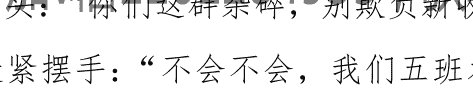

“绝对的好哥们，肯定得跟我说几句话！”寇队瞪了他一眼不再再说话，四哥偷笑着小声对我说：“成了！”

在门口登记完毕，寇队就带着我和四哥走了进去。远远的我就看到了我父母的几个老朋友，当然还包括兰兰。

我疑惑走上去，一把拉住了妈的手。妈妈哭了起来，我赶紧接过兰兰的纸巾给她擦干：“妈妈，别了。你看我不是好的吗？”妈妈揉了揉眼睛，抓住我的肩膀上了：“这怎么还胖了？你们看守所里都给吃什么啊？”我强忍着眼水笑着：“吃的都是好的，而且每天都时时吃饭，按时睡觉，准会胖一点！”这时四哥又来了，拉住了爸爸的手你别难了，你小子小虎就在跟我一个班，他不注意身体我不干！”爸爸着急地对四哥说：“老弟，你看看这小子大学你就照顾他，他现在还在监狱里，还得你照顾他，我谢谢你啊！”四哥一拉：“张哥，你这话可外了！在外面的时候我就喜欢这孩子的幼，所以对他好。我落难了，没想到他也跟着进来，我就不他的面子也得看你的面子！别跟我这么气，我刑期比小虎长，这一年零个月的时间就交给我吧！”母亲愣：“不是一年半吗？怎么变成一年零两个月？”四哥笑：“嫂子，你不知道吧！小虎已经被罚押了四个月，罚押的时间是算在刑期的。”

此时接视室的管教已经按照宽队的意思把桌子安排好了，他冲我和四哥招招手：“臧云龙、张毅虎，你们俩家到这边来，桌子接着！”

我赶紧带着家人和朋友走了过去，管教了一眼：“正好一个，行了，不许谈论不利于管教的言论，时间两个小时。”

刚才已经交错了吧？”爸爸赶紧点点头，四哥大声跟妹妹说：“以后怎么了？”妹妹笑着道：“以后有这种事你替哥费了。”爸爸叹气说着：“王经理报资料站好站。”

“我被四哥坐在对面，四哥坐在我哥了。” 妈妈点了点头，说：“在号里别闹，人家有困难要帮我是应该的，但是违法的事你再干了！”

“我是不糟的。”的“你就放心吧，给我二十个胆子我也不敢犯法了。”妈妈叹气：“你就知道，你这次差点要了我爸爸的命。”

等兰兰收拾完饭，接见时间还有十分。妈妈忽然问：“我听你在看守所里死刑犯写书，做临终陪？”我一愣，随即笑了起来：“中间，父亲坐在我对面，四哥坐在我旁边。妈妈使劲拉着我的手问这段时间有没有被欺负。”我叹口气：“我不是的。妈，你这临终陪这词儿从哪儿学的？听起来很有专业的啊！以后我就用这词儿了。”妈妈愁苦的说：“你还有心跟我开玩笑呢！我听你在看守所里的这个工作，真想跑跑让你回C市服刑，起码出力气不会这么危险。你这一天晚的接触恶魔一样的人，他们要是对你怎么办？”

我拉着妈妈的手说：“你就别善心了，真正的杀人和死刑犯都是一个样子，马上就要死的时候就没有精神再去闹事了，人之将将死其言也嘛！再说了，我又不是单独监护他们，号里有二十多个人看着一个人，能出什么事？”妈妈这才稍微放心一些，说你也太大了，这些人说不定就得做出出格的事情。我点头说您就放心吧！这件事事儿虽管安排我做了，他们肯定也有他们的道理。我要是没糟的，我就不接活了。这次接结束后之后，我就得开始正式服刑，到时候要的死因还多看着。

正式服刑，到时候要的死因还多看着。妈妈又开始发愁，说就不能换个工作？哪去厨房每天累了？

或许是因为刚见到母亲，这一觉的格外的舒适，尽管睡了一个小时，但是睡眠质量明显高于平时，睡了三个小时。起床闹铃打响后，第一个爬到床下，用手拿起一块骨塞到哪里，扒着嘴说：“这家的东西确实不一样！味道实在的好了！”四哥了一眼：“老荣，你不是馋人吗？一桌八个菜，700块钱，能好吃吗？晚上大家都抢，每个人都有份，今晚就把消灭掉！”大家一听这消息，喧哗了起来。下午三点是石铺山的杂役外放时间，李哥等来打开七班的门让我四哥出去。四哥悄地说对我先找机会去三队，打探一下那个人到底不是，你直接去办公室吧！他打算带我去领新的杂役，再给你安排好其他事务。果然，回队一看我就带去了物资处，里面的人翻了半天，翻出两套旧的杂役服和两条棉裤。他说：“这两套衣服可以，你别把穿成铁的了，另外一套都不动！”之后，他又带我回到管教办公室，让我坐下来亲自给我介绍现在关内的一个死刑犯的情况。管教办公室有一个小黑板，上面明确的写着押犯的数量、病人数量、已决犯的数量和一审死囚的数量。在小黑板的下方有一个单独的备注栏，这里写着的九个名字就是一审死刑犯的名字。

如果这九人的名字，都是极为普通的、常人无异的符号。但是一个个说出他们的案件时，我几乎丧失了直接面对的勇气。这里有杀人灭口的变态、有强好十个幼的色魔，还有涉金金额亿的巨擘……笼队，语重心长的说：“咱们二队的死因是因为全石铺除了女外最多的，而且你今天看到的九个，说不定下个月就变成十九个了。现在你已经开始工作了，所以以后安排你陪同的时候，我都会他们的案件情况提前给你介绍一下，免得你到时候抓错。现在你先从你们局里的死因开始练手吧。我看林杰的案子肯定得改判，你就先从沈桥开始吧。”

“沈桥不是一审过的过去吗？”我疑惑的看着笼队。他点头：“嗯，但这个家伙离你最近。慢慢来，不着急的。”

笼队跟我接手的时候已经是五点了多了，我赶紧回到办公室，整理文件，结果发现陈小哥已经回来了，正安稳安排了烟铺抽烟。他看了看我：“你怎么这么快完了？任务都安排了吗？”

我回答了一声：“笼队说先从本本号号开始，第一个从沈桥。”

四哥：“了，了，了，了，，，，，，，，，，了，妈妈，，，，，，，，，，，，，，，，的饭了。”

“不是从证章哪儿百块钱买的毕业证？”我低头无语，鸢队根本不理解我的情绪，径自拿出一个卷宗袋，翻了半天递给我：“诺，看看这人的材料吧。”他啐了一口唾沫，接着说：“妈的，就算石库山所有的死犯都是枉的，这小子也得枪毙！”

案档上的名叫郭永兴，去年二月份被关在石库山的。第一眼看到他的照片，发现他浑身上没有一丝变态所有的邪气，倒是文质彬彬的像书人。但是他的案子他本人完全无法解释——他亲手杀了自己的父母、舅舅和一双只有六个月大的龙凤兄妹。他杀人的理由和外形一样不可理喻，只是因为他是从舅妈嫁入家门的时候他就嫌弃她，

我整理了一下：“他是为了和自己杀掉她对所有的爱情造成阻碍的。”

这个我想过了，这一次暂在其他班也分一些，让他们自己内部消化。别的班如果实在有困难的话，你给帮帮忙就好了。

回到监狱时间后久，这个名叫贾永的二审已决奴就被三个管教和两个杂役由隔壁班送到了七班。这个人看上去很平静，甚至可以说带着几分笑意。虽然身上磕着铁锁，但他依然尽力保持身体的挺拔。

“蹲！”管教道，那耀祖大声呵斥道。在这个新死囚犯几乎没来七班之前我已经跟大家说了这个人的简单情况。让我感到诡异的是，这里的所有人居然并不是因为案子而生气，终其原因，竟然是因为觉得这个贾永买的……

不理会他，贾永以为大不起他了，监狱内真热闹这么多好帖。贾永有些轻蔑的看了那耀祖一眼，既不情愿的蹲下去。苍矮撞上去就是一脚：“操，怎么着，还蹲不起啊？叫什么名字？”

“贾永。”

“嗯？”那耀祖把手中的烟头砸了过去：“放屁，你不是假的吗？”

贾永嘴角一扬：“你们里不是不是有个大学生吗？怎么连这个字是多音字都不知道？！《周礼·地官·司市》曾说过‘以商贾货而行市’，这这里的‘买’就是我的意思，有买卖的意思，还有谋取、招惹的意思。”

“越，你拿个球！”四哥大叫，“在七班没你你要的地方！”

贾永轻轻松的一笑：“这位铁友，我绝对没有要冒犯您的意思。我只想平静在这里度过我人生的最后一段时光。而且，在我死后，有人可以准确的记住我的名字。”

坐在另一边的邢耀祖一皱眉，看着四哥说：“这个货怕是个傻鸟吧？咋说话这话三顾四的！”四哥一手：“我管他是傻鸟是病鸟，哈都给他哥！”

邢耀祖重新点燃一支烟接着问：“哪儿人？”

“L市整理区的。”

新收一听后：“倒是，我从不来和这些人际交往。在进来之前我是有正当工作的，和我交道的都是机关内部、学校老师之类的人。”

苍哥一听这话又要冲上去打，四哥一把拽住他，又问：“你以前干什么的？”

他骄傲地一仰头：“我在L某大学媒体实验室，做实验器材的整理和清洁工作。学校里有好几个实验室都归我内部负责。”

“打扫卫生的吗？”四哥乐了。新收贾忽然尴尬起来，紧紧地瞪着四哥说：“我们学校有很多教授都是先从实验器材整理开始做，最后自学成材料了的。打扫卫生也不是什么丢人的事！”

监理里所有人都笑起来，四哥笑得最严重，抹着泪问：“小虎子，你们上学的时候学过鲁迅的《孔乙》吧？这个傻蛋简直就是孔乙投胎啦！”说完，笑得更厉害了。贾永没想到自己以为傲的工作竟然被这些人如此打击，哑得连话都说出来。半天，四哥直起起身，指了指大家：“这个傻蛋以后叫孔乙了，听见了吗？”众人齐呼：“听见了！”笑完，四哥接着问：“你现在的处境吧？”贾永点点头：“知道，二审已经判刑了。不过我相信死刑是不可能的，还是合理的。”

“哈？你脸比蛋，还是命大？”

“你们不懂的，这是力量……”贾永说这句话时候，眼中充满了期盼和敬畏。“放屁！”四哥猛的一下，“那两个不到岁的娃误了你的情绪？大人也算了，连小孩子都不放了！”

进去放错，你搂着喜全到队办公室一来，他好像要找
喜全谈话。”我点头，赶忙把桶递给蚕槐，在郑强的帮助下
把喜全背在身上，扛着他到了辖管办公室。

驾队一看喜全：“呦呀？你小子还上了？现在出门自己都不用用，直接靠人背了！立功哦？”

喜全赶紧直看着腿在墙上：“没有，没有。驾队，我这
不是行动方便你吗？就请张毅虎把我背过来了。”驾队点点
头，转身问我：“我不敢负你吗？”我笑着一笑：“他现在
这个样子，我不敢负他就是给她面子了。”喜全悄说看着
驾队：“驾队你看见了，这可不是我要负他。”驾队
哈哈哈哈的挥手：“行啦，”坐沙发上吧！张毅虎也坐，咱们
一起处理。”

扶着喜全坐定后，驾队：“刘全，这次回来打算
怎么办？”

喜全一脸的积极向上：“驾队，这次我真的知道命来
的不不容易！怎么我我都得好改造，起码要对得起那几个人
大代表啊！”说着，他从兜里掏出一支给他的精白烟：“驾
队，来抽烟吧！这可是我的喜烟！”

驾队乐了：“咋，去了几天医院，结婚了？不过你这
喜烟我得抽！咱们张毅虎判了一半天也没想着给我一根喜烟
抽，还是喜全全有良心啊！”

我赶紧摆手：“驾队，可不是我不给，我这几天实在是
忙乎忘了，等我回去……”

“等等！”寇队忽然面色一沉，打断我的话，“刘喜全你
这烟是哪儿来的？”

喜全忙：“这是大学生从仓里给我的啊……我今天进进来的时候可是呛烟没带，就带了几盒药，还交给教管保管了。”

寇队转眼一看我：“谁带来的？”
我迷惑的摇摇头：“下午送来的除了我家人之外就是买的。但是我家里送进来的是环保白沙，不是精白沙。”

“你们家里除了今天送来的精白沙之外，以前还还有吗？”宋经理道。

白沙全拿走了，说是在劳动号看到一个朋友，要跟他聊几
句。

“那烟就是下午贾买永家送来的了？”寇队问我，并从喜全的兜里掏出剩下的烟，拿出来一根的拆开。

“仓里没有别的精白沙，就这一条。刚才我拆开都放
到一个盒子了。”

寇队说着，认真的闻着每一一支烟，终于，他抽出一支
裂后从中间用白纸连接在一起的烟，从中间拆开，顿时，
一粒淡黄色的小圆粒从烟里滚出来。

“这是什么？”我大惊失色。

交流群: 91581990（将满）
交流二群: 82825493（将满）
交流三群: 69585183（待加）
作者:二瘦子 日期:2009-10-19 09:35

寇队转一眼看：“谁送来的？”

我疑惑的摇头：“下午送函进来的除了我家人之外，以前就是买完了了。但是我家人送来的是环保白沙，不是精白沙。”

“你们号里说了今天送来的精白沙，以前还有吗？”

“没了，”我坚持我说，“昨天中午班长把底下的两盒精白沙全拿走了，还是在劳动号看到一个朋友，要跟他聊几。”

“那烟就肯定是下午贾家送进来的了？”寇队问我，并从喜全兜里掏出底下的烟，拿出来一根的掰开。

仓库里没有别的精白沙了，就这一一条。刚才我拆开都放到
一个盒子了。

寇队说着，认真的闻着每一一支烟，终于，他抽出一支
裂后从中间用白纸连接在一起的烟，从中间拆开，顿时，
一粒淡黄色的小圆粒从烟里滚出来。

“这是什么？”我大惊失色。

img/47db4b1838ea7f695df0c47397504383_553_0.png

img/47db4b1838ea7f695df0c47397504383_556_0.png
img/47db4b1838ea7f695df0c47397504383_557_0.png
img/47db4b1838ea7f695df0c47397504383_561_0.png

“他们？”我有些不信柱桩的话。

他摇了摇头：“小哥儿，你就不懂了。你送过去几个死犯儿，你说他们那天早上从哪儿出去？”

“接收室啊！”

“对，没错，是接收室。”柱桩自信满满的吐了一口烟，“都是外面的咱们石山的提审室我去过好几回，如果有提审，都是外面的管直进了了第一道警戒戒线之后，在第二道警戒戒线之外的提审室提审犯人的。这个屋子朝里就有二道戒线，朝外就是二道警戒戒线。如果他们直接接到提审室，那一道警戒戒线就太好了。另外，如果他们直接接到接收室，那就更轻松了，接收室是直接从二道警戒区看到看守所大院的！外面的大院着许多像你这样的，最多多来点嘛，想得要脸！”

我一搓手：“不可能！不管是提审室还是接收室，晚上都是铁将军把门的。而且他们到了看守所大院里，那晚上也是有铁武警巡门的啊！”

他看了一眼：“小哥儿，你想得太天真了。不管是警戒戒线，也不管是门上有几把领头，里面的都是啥人？六班班群小组连着的特制锁都能锁桶，何况是普通的铁锁？好，就算是插门上的铁锁时间，那还有其他办法哈！咱们看守所东头角角落里有个养猪场，那里面平时的猪粪都是直接接到流下水道里的。你知道那个下水道外面面对的是哪儿？”

离哪最近的下水道出口就是铺山附近的一个小工厂啊！只要能忍住臭气，跑不到一公里路，他们就可以远走高飞！

我感到呼吸有些压抑，憋躁倒了一杯水喝下去，接着小声说：“那也不可能啊，我就不信下水道下面没有防护网？”

“有啊！”他从兜里掏出一块从墙上掉下来的白灰块，在地上画了几道交叉的线：“你看小哥，咱们就说这里有防护网，他不可能太密吧？如果太的话，猪来是不是就把下水道给堵了？咱们就说这些防护网的钢筋特别扭，那有一根树木，一条湿的、结实的毛，只要一缠、一搓，再一怎么也绕不出来。”

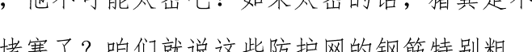

焊工的脸，贴满了很多贴纸。守所也是个老头了，当年可是苏联人给他设计的，你说你有多少老人了？这起防护网的焊点一腐蚀，稍细点就会劲断了！”

我开始急促的呼吸，冷汗从额头上不停的往下下：“你怎么知道这些的？”

他淡淡的一笑：“我进来之前是焊工，所以这个道理我肯定明白。而且在你进来之前一个月我才从六班调到七班的。当时我进去的时候的二铺老儿子就在那里，他知道我是焊工之后还特意问过我这个问题。我是这几天才知道他到底在干啥的。”

我急急的又递给他一支烟，接着，我干脆把一整盒爸爸妈妈送来的环保小白沙递给他：“你把你知道的所有东西都跟我说清楚点，他们的计划你知道吗？”

他摇头：“他们的计划我不知道，但是如果我是老腻子的话，我肯定会这么……”欧阳栓柱开始滔滔绝绝跟我讲述他的计划。

### 越狱秘密计划
- 关注：越狱
- 讨论群：二瘦子
- 日期：2009-10-21
- 时间：17:13
- 备注： 

他淡淡的一笑：“我进来之前是焊工，所以这个道理我肯定明白。而且在你进来之前一个月我才从六班调到七班的。当时我进去的时候的二铺老儿子就在那里，他知道我是焊工之后还特意问过我这个问题。我是这几天才知道他到底在干啥的。”

我急急的又递给他一支烟，接着，我干脆把一整盒爸爸妈妈送来的环保小白沙递给他：“你把你知道的所有东西都跟我说清楚点，他们的计划你知道吗？”

他摇头：“他们的计划我不知道，但是如果我是老腻子的话，我肯定会这么……”欧阳栓柱开始滔滔绝跟我讲述他的计划。

### 越狱计划细节
| 哨位类型 | 描述 | 持续时间 |
| :--- | :--- | :--- |
| 固定哨 | 盯着牢房处的窗户 | 持续监控 |
| 移动哨 | 在墙内巡逻 | 15分钟 |
| 换岗时间 | 换岗交接 | 20秒 |
| 目标区域 | 猪圈或接收室 | 最多20秒 |

栓柱的想法是：如果他是老腻子，他首先会拍好。他曾经仔细观察，外墙一般有两个哨，一个哨是固定的，另一个是移动的。但如果到了晚上，外墙只有两个哨，他们不停的睡着，换岗时间是十五分钟，最多二十秒。只要有二十秒，他就能顺利的跑到安全的地方，并偷偷溜到猪圈或者接收室。

我开始逐渐觉得柱桩的话不可信，最后我问：“柱桩，你看了了吗？我怎么算靠谱？人家武警又不是傻的，按照你这个计划？”

柱桩急了：“小哥儿，别看我没文化，我是刚进来的时候我自己都想过溜。后来我跟我说，我的案子没个屁事，只要安心等待审判结果，说不定开庭就可以出去。所以我不想弄这种冒险的事了。”

“小哥你你知道不，我可是充足观察了将两个月才得到的结论啊！你说老儿子是要搞，他不是一样的想法？除非他傻到劫持或者直接抢了枪向外冲。但是武警也不吃素的，看守所的武警，以前都是神枪，一瞄准，手指一动，脑袋就没命了！”

我摇了摇头：“你这事还是跟谁都说了，这亏功夫够了。我要把你说的这些情况跟干部说，到时候谁来负责？”

柱涵涵起来：“你不要信算了，小哥，这是我靠一个经验、一个年汗才换来的更多好打算。事儿就完了？你不要信没事，这件事你自己知道我知，就算情报不报到法律上去。反正一面是减刑，一面是事关高挂，你自己选择吧。”

“你怎么也不事？你越没有办法相信这个为了碗饭就可以感天地的不管。”他叹了口气：“我是不敢管啊！说实话，我在这儿砍的还少吗？还有今天他们给我指派的免费律师来了，说我这案子没多少屁事，顶天了也就是个狗役，这时间也差不多，我估摸着开庭也就放了。”说着，他站起来：“我不跟你说了了，别人知道了也不好。我去那边看眼你吧。”

栓柱自己一个人跑到厕所门口，搂着我的那本中文版《C++Primer 第四版》装模作样的看，那真的神态让我怀疑他到底是个打杂的农民，还是和我一样是个程序员。我有些拿不准主了，如果现在去找运队反映问题，那我既没有证据，也没有事实，仅仅凭着空想肯定不能让教信服，而且很有可能惹火上身——要知道在圈里，弹炮的下场要比花架子的下场多；如果不去反映，那么一旦知情不报不说，甚至可能对运气造成很大，甚至致命的伤害。我开始在良与现实面前徘徊，盒中的香烟随着时间一点燃尽，最后我看着睡得满口口水的四哥，叹道。

“咋了？这半夜的！哈事儿了？”四哥眯着眼睛迷迷糊糊的。

“哥，”我帮拿过衣服他披上，“我有点事儿跟你商量。”

“哥，这这事儿不能等明天早上吗？”他抱怨道，“我正梦见我媳妇逛街，你个傻儿子就会打人家的清净呢？哥，刚才捏住腿跟我说了事，关大的不是赶紧跟你的话，出了事就晚了。”四哥睁着眼睛皱起眉头：“哥，我估着，上次买药带来的事，不简单。”

### 越狱计划讨论
- 关注：越狱
- 讨论群：二瘦子
- 备注：- 状态：

“哥，”我急急的又递给他一支烟，接着，我干脆把一整盒爸爸妈妈送来的环保小白沙递给他：“你把你知道的所有东西都跟我说清楚点，他们的计划你知道吗？”

他摇头：“他们的计划我不知道，但是如果我是老腻子的话，我肯定会这么……”欧阳栓柱开始滔滔绝跟我讲述他的计划。

（此处为重复OCR内容，已按要求合并并纠正逻辑）

我进入六班，从床上被李哥背了起来，疾步跑到自己班。然后，让欧阳栓柱和林奎双人都把已经被打得毫无反击之力的老腻子扔出了监牢。

“四哥听到我的声音转身就往监牢里跑，此时郑邦郑强也抱着小康和苦蝶进来了，那耀祖赶紧招招着犯人从里面门撞死的顶顶。”

外面的犯人此时已经发现监室门被锁住了，根本就出不去，于是一个犯人到了七班门口：“藏老四，我操你八祖宗！你坏我们的好事！”话音一样，所有在监道越狱的犯人开始集体撞到七班门口猛烈的撞击仓门，打算冲进去打人。

那耀祖一看看不了了：“所有人都都给我处理一下，看着小监狱就要放了，大家都堵着了。”话出口，几乎所有的人都到了门口，死死的堵着那道保护七班的所有安全大门。

就在此时，一个持枪的武警出现在了风场上面的巡道：“都给我蹲下！谁再敢动我就开了枪！”四哥赶紧道：“兵蛋子，我们要是蹲下的，全仓的人都得死！包括这个管教！”此时的李管也清醒了，难得冲武警挥手：“让他们堵着，你们的人到了没有？”

那个武警这才看到了满脸是血的李管：“我们的人已经到了，你们再坚持十秒就可以！管教，你没事儿吧？”

“没事，你暗准监牢门，一旦顶不住了，外面的人一进来，你就拉枪！”

“是！”武警一拉枪栓，一动不动瞄着仓门。

李管回来了，临近监仓之前，让他其他管从外面把监道的拉门管好，然后径直走到六班前打算开门，我赶紧喊道：“李管，我们班有两个更严重，先到我们班来吧！”

话未落，隔壁的传来一个尖嗓哑气的叫声：“七班的！我们晚上是吃了过期方便面了，你们算啥？李管，赶紧看看我们的人吧，快不行了！”

李管点点头：“张毅训，你先等一会！我看六班之后就过去！”说着，啪啦一声推开了六班的门。

一切都晚了，只用了十几秒的时间，我就看到老胖子第一反应就把钥匙掏出来。他手里，看着锁上的门一把大锁锁住了。接着，他又打开了三班和九班的门。那里的犯人或许已经等待了很久，门一开，好多人如潮水般涌了出来。

四哥额头上开始冒出细密的汗球，我一转身：“快，四哥，让胖子把咱们的门打开！再晚李管可就没救了！”他点点头，回身一指着巍婉和小康，低声说道：“你可赶紧看着张毅训，快！快！”我明白四哥的意思，他是要给老胖子看，赶紧回身躲到他俩面前下叫了声：“赶紧打啊！还等啥？”

巍婉和小康愣了，不知道四哥的意思。但是此时他们也顾不了这么多了，苍蚂上来就来于我的身上使劲骚：

四哥了一眼，又交代道：“稍微轻点！等老腻子来了再用力！”说着，他转身对着外面喊道：“老腻子！带上我一个，出去给我算十万跑路赛！”

四哥旁了一口：“我你亲娘老腻子！这个时候你还跟我讨过价吗？你过来来看我怎么收给张虎这个兔子杂要处理。”

“三队哈事儿？”我赶紧抓住这个得到刀疤消息的机会。

寇队瞪了我一眼：“都说了不问的事就少问！希望这次没什么事儿，到时候你就好好的在里乖着吧！这件事情处理完毕，我想不想退休也不行。”

“寇队，昨天晚上你根本就不在那里，这事跟你也有关系？”

他笑着摇摇头：“怎么会没有关系？前几天买广永东进来的事情我都知道，现在我的队伍里出了这么大的事儿，我没责任吗？这次可是连锁反应的，从审查室的人，到我，再到刘所，石万山得我大批审查了……”

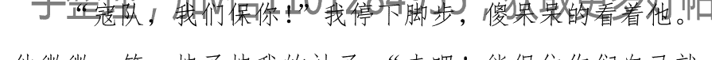

他微微一笑，揉了揉的袖子：“走吧！保住你们自己就谢天了！”

++++++++++++++++++++++++++++++++++++
++++++++++++++++++++++++++++++++++++

七班内部的人除了我提审之外，其他人都没有提审。我和四哥仔细的分析了一下原因，估计是两个方面的原因：

第一是由于刑祖今天开庭，所以他们打算先提审有串机会的刑祖；第二可能是直接去了医院找查调查。

我有些紧张，害怕一出了问题，那加刑的滋味肯定不好受，而且我在看守所相对舒服的日子也就没法下去。

但是是四哥说你不用担心这个，咱们昨晚上上救人没有错，哪怕就是咱们出去砸翻了几个人，那几个人也是打算越狱的人。没事儿，你就把心放在肚子里等着，不说别的，咱的就不报立功，表扬也有了。

果然，午休起来的时候我第二次被叫到了提审室。这一这一次那个被称为“孟队长”的警察对我的态度几乎是 180 度转弯，我一看我进去，亲自让我坐下，还给我倒了一杯水。

“我们早上又去了医院看望李管教，根据他的反应的情况我们分析监控录像的结果，你们七离开确实是没有越狱的企图。[此处OCR原文应为：你们七离开确实是没有越狱的企]现在有几个情况需要你核实一下，这次的事儿处理完之后我肯定兑我的承诺。”

“给你立功减刑啊！这这么快就忘了？”孟队长和那几个陌生的警察笑了起来：“这小子的记忆，这不知道是怎么考上大学的。”

我咬了一口气，慢缓地说：“孟队长，我有两个小事儿跟你来说，希望你能考虑采纳。”孟队长点头：“说吧，你现在已经是服刑人员，相对来说比未嫌疑人的自由多一点，只要法律允许的，我尽量帮你办！”

我点点头：“谢谢孟队长。我的第一个事是：我们班里所有的人都参与了救人这件事儿，我想立功别报我自己，其他人也有功劳的。”

孟队一乐：“没想到你还挺仗的。有话你肯定能听到，叫做论功实行！你们班里到底谁参加了这次行动我们还得仔细心分析，但是只要有用的人我们肯定会申报材料。至于是不减刑轻判，那就是法院的事儿。第二件事儿呢？”

“第二件事儿和我管教有关。这次越动的事儿虽然李奎管是受者，而且刘所、寇队当时都不在场。但是我知道你们肯定也要查查他们的责任的。这些教普时对对我们都非常好，所以我请你们别罚他们了。

坐在孟队旁边的寇队立刻站了起来：“张毅虎，你是所里内部的事情，能你管的吗？嚷什么！”

我咬了口气：“寇队，你不说我就不说了。但是如果王经理你加入我们群会有很多好处……”

“那就是还想闹事了？”孟队脸一黑，“张毅虎，这一次的这件事你们做的很好，但是并不代表你们可以协商条件。这是属于看管所、监狱内部的事情。你要做的就是要好好管自己的一摊子事儿，安心创造……”

“可是孟队……”

“行了，回去吧！”孟队长不耐烦的冲我一挥手。

晚上跟着四哥去厨房忙守了，回到危蓝的时候已经快点点了。此时张耀早已开回来了，我们赶紧跟问他判决的结果，他满不在乎的摇头：“死肯定是死了，今天没结果。”

我这案子是杀人案，肯定没小虎子的案子那么快的。等吧一周之后还得开庭。”接着他又赶紧他昨天晚上事事情的处理结果，我苦笑着递给他一支烟：“昨天晚上上所有参加省的调调了一部分转转到别的队伍了，另外一部分下午说要去省查看了。咱们班倒是没多少大事儿，但是估计这次咱们的管教都得换了。”

“哈？寇队做的不是挺好吗？”四哥摇头：“寇队做的好不好不是我们说了，刘所这次真的难干下去了，何况涵和李管？唉，小虎子，明天早上哨队去跟寇队聊吧！怕舒坦了日子也算是开头了。寇队要是能留下，咱们就能让寇队行其，要是寇队留不……”

大量的订单已经失效，请重新……（注此处为OCR广告乱码，已忽略）。所所所所所所所所所所所所所所所所，，所所所所所所所所所所所所所所所所所所所所所所所所所所所所所所所所所所所所所所所所所所所所所所所所所所所所所所所所所所所所所所所所所所所所所所所所。

“三队啥事你知道？”四哥赶紧凑到身边。

我摇头：“不知道，但肯定不是好事。今天早上寇队一下子漏嘴了，具体他也没跟我，但我我觉得肯定是事儿。一旦咱们看到的那个真人是，你说刀疤都……”

四哥叹了一声：“当然记得。哨里的人最怕死这地儿太气！”

 我挠了脑袋，开始忧起来：“寇队，要是你一走的话，我们这几个兄弟不都完了吗……”

“妈的，我就知道你们群王八子没一个好鸟，都忙着自己的利益呐！”寇队苦笑着骂我“把你的狠心放在你的狗肚子里去吧！你们这次的表现监狱局都知道了，下任的管队陆肯定不会为难你们。再一个，张毅虎在你所里的工作我已经跟监狱局的领导说了，他们以前也没有做过这这样的试点，所以我支持我的做法。你就老老实实的继续死闯、写遗书去吧！”

四哥生硬的嗓：“寇队，你走了大家都不好。我们给你带来多少好处！寇队你比我年长几岁，我把你当小弟看！你要什么，我都给你，满意了？”

寇队狠狠的拍了四哥一巴：“你这变的也太快了吧！你想问自己怎么办就直说：你是怕倒散？放心，你做的杂役，属于监狱局统一管理的！”

四哥赶紧搓手：“寇队，你就信我的。这事儿肯定没那么简单，刀疤到底能不能保住还儿呢！我现在一时半会说清楚，但我总觉得这队封闭的事儿、还有买卖、硫酸毒，这一堆事情都可以联系起来。”

四哥笑起来：“真把自己当柯南啦？这多多少事我能在一起？你看是电视剧看多了。我告诉你，你可给我乖的服从，出了事没人保得你！当前的任务，就是跟宪队说，不管他走不走，咱的工作不能换，现在的多舒心啊……”

第二天，我和四哥去劳动领取这个月的火柴、卫生纸之类的物资，一起到了宪队办公室。此时宪队看上去神色凄惨、疲惫不堪。

“宪队，怎么样了？”四哥赶过去。宪队抬了眨眼睛，笑着说：“没事儿，你们的情况基本上和你们的事实，昨天也问过李管教了。等这件事结束，你的材料我会报减刑，你们都会由里和法院联系，跟他们反应情况。”

我紧了了搓手：“宪队，我和四哥倒是没啥事，主要是我处理怎么样……”他又叹了口：“还能处理？你们这群猴子算是把我给坑了。我估计这次是上面能办的话，我能落个提前退休，还能拿到退休金。要是严肃起来，我大概得和你们一起蹲谱子了！”

四哥立即激动起来：“凭啥？这叫啥意思？吃了饱就骂厨子？念完结打响？又过河桥？”

“打仗！”宪队狠狠地瞪他一眼：“你当这是小孩子玩尿泥呢？玩职守犯罪不知道？这次暴力越狱的关键点就是假斧带进来的硫酸镁，这东西在我们班的时候放进来的我和检察室的人这下子都不过！”

我挠了脑袋，开始忧起来：“寇队，要是你一走的话，我们这几个兄弟不都完了吗……”

“妈的，我就知道你们群王八子没一个好鸟，都忙着自己的利益呐！”寇队苦笑着骂我“把你的狠心放在你的狗肚子里去吧！你们这次的表现监狱局都知道了，下任的管队陆肯定不会为难你们。再一个，张毅虎在你所里的工作我已经跟监狱局的领导说了，他们以前也没有做过这这样的试点，所以我支持我的做法。你就老老实实的继续死闯、写遗书去吧！”

四哥生硬的嗓：“寇队，你走了大家都不好。我们给你带来多少好处！寇队你比我年长几岁，我把你当小弟看！你要什么，我都给你，满意了？”

寇队狠狠的拍了四哥一巴：“你这变的也太快了吧！你想问自己怎么办就直说：你是怕倒散？放心，你做的杂役，属于监狱局统一管理的！”

四哥赶紧搓手：“寇队，你就信我的。这事儿肯定没那么简单，刀疤到底能不能保住还儿呢！我现在一时半会说清楚，但我总觉得这队封闭的事儿、还有买卖、硫酸毒，这一堆事情都可以联系起来。”

四哥笑起来：“真把自己当柯南啦？这多多少事我能在一起？你看是电视剧看多了。我告诉你，你可给我乖的服从，出了事没人保得你！当前的任务，就是跟宪队说，不管他走不走，咱的工作不能换，现在的多舒心啊……”

不容易吃到完午饭，午休闹响了。我和四哥两个人狂赶从厨房跑到宪队办公室里等待。结果发现他居然不在办公室，一问才知道，原来是被所长去谈事了。我和四哥无奈，只好各自带回监里。

“三队啥事你知道？”四哥赶紧凑到身边。

我摇头：“不知道，但肯定不是好事。今天早上寇队一下子漏嘴了，具体他没跟我，但我我觉得肯定是事儿。一旦咱们看到的那个真人是，你说刀疤都……”

四哥叹了一声：“当然记得。哨里的人最怕死这地儿太气！”

我有些异常高兴，正打算回告诉别人时，四哥拽住我。他说这在千万跟别人说刀疤还活着。我问啥，四哥说你发现最近铺山的个气非常不对？既然到底出事被他所瞒了，而且寇队一直承认刀疤死……”

“整理好了，到底死了没，现在怎么样”寇队叹气：“唉，这事儿早晚都让你知道。你先去忙吧！中午吃了饭到办公室来，我跟你们聊聊这事。赵峰被暂停执行了，现在押在一队的禁闭室里。”

被暂停执行这件事让我异常高兴，正打算回告诉别人时，四哥拽住我。他说这在千万跟别人说刀疤还活着。我问啥，四哥说你发现最近铺山的个气非常不对？既然到底出事被他所瞒了，而且寇队一直承认刀疤死……

这一回，宪队沉沉办回来了。我和四哥赶紧折在教教室里愣了很久，他看着我慌急地搓着脸就跳道：

“咋了？哈事了？”我笑了起来：“宪队，你忘了？是你叫我们来的吧？”他这才想起我早上的约定，一搓搓手让我们坐下。

“我们刚去所长办公室，就是说三队的事儿。所长的意思是张敦虎能在各个队帮助我们临时护，所以有些事得让你知道，顺便帮我们做一些儿了。”

我说：“宪队哈事儿？”

他对我们吐了吐口气，扔给我们一人一支烟，这才慢慢的说起起来。在刀疤临刑前的几天，三队的胖子魏巍横离奇死去。后来法医检查了多次，都发现这个人是心脏病的，虽然受了这些外伤，但是完全不是死亡的原因。刀刃上路的那天早上，一看见行刑床当时就吓了，赵紧急说我知道魏作栋是怎么死的，而且我也大概可以想到我哥在什么地方。监斩法官当就给北京打了电话，北京那边一听后这人后面还有这么大的两条鱼，赵紧急命令死刑暂停执行。

刀刃回来之后就被单独关了起来，他交代：魏作栋确实是心脏死的，但是由于三班长老直接指挥，挨打引发致死。

说到这里，四哥说赵证了摇头，问题出现在这儿。赵队摇摇头。魏作栋死后，这案子，凭着自己以前看过的医学知识，写了一份详细报告送给魏作栋所在的班，这计划写的全面，包括哪些部位可以引发心脏病，之前哪些备，但是这份计划还没写完的时候无意中被旁边看到，刀疤当然想砍。

医生给家属的回答是：因看守情绪激动而诱发去世。作为一个经济犯，家里的关系自然也不比软。他在那个晚看到记者报告，马上发现其中的诡绊，并请了自己的大学同学，现在在省电视台另外一位记者介入。于是两个客户之间就吵上了，一边说家里有权势，而且根本没有参与过魏作栋的案子，肯定不倒，一边说我们这边有记者，还能工作的查不出。

这案子陷入僵局。上级某些领导为了建立看守所在公众面前的形象，觉得三队对，除了检察院、法院庭审之外，任何人都不得进入三队。最终，这件事成了无的悬案。

“这叫啥？保护安全的？”富咬着牙气直冲。寇队瞪了一眼：“胡说什么呢？这事现在还没查清”。如果是真的像赵峰那么说，那三队这次枪毙的人不止一个两个了！

[content]

[content]

这小子到了医院死的更惨！”我赶紧惊问：“为哈？”四哥看着我：“你觉得如果是你，你和一群罪犯关在一起安全，还是和一群疯子关在一起安全？”等我还没回答，他看着天空意味深长的又说：“胆小的怕大的，胆大的怕要命的，不要命的怕疯的啊……”

++++++++++++++++++++++++++++++++++++ 下 节 内容

++++++++++++++++++++++++++++++++++++ 下节关注：近距离送走死刑犯

讨论群：93607141

作者：二瘦子 日期：2009-10-23 18:02

## 一手整理，加微信1101284955，获取更多好帖

我和四哥对视一眼，心里暗暗：这小子看来真的是疯子？！

不过吕归，娇妇娇妇，吴二柱还是出去了。我们亲眼看到管教把他交给了了两个白大褂的医生，看来，他需要去精神病院过自己的下辈子了。

吴二柱走后，四哥笑着对我说：“不如在看守所，这小子到了医院死的更惨！”我赶紧惊问：“为哈？”四哥看着我：“你觉得如果是你，你和一群罪犯关在一起安全，还是和一群疯子关在一起安全？”等我还没回答，他看着天空意味深长的又说：“胆小的怕大的，胆大的怕要命的，不要命的怕疯的啊……”

## 本节内容

第二天中午，我正式接到兜队的通知：由于特殊情况，三队的两个死囚将被单独关押在石库山的两个单独监室，由二哥带着两个人负责看守一个，我带两个人看守一个。我知道，这两两人就是早上即将要路路上的提前犯了。

在厨房后我们告诉我们将被带到二号押楼后面的灰楼。石库山的灰楼早在我刚到L市的时候就有所耳闻，这是一一幢三层的小楼，一楼是一个武警小队的宿舍，二楼有四间特别监室，三楼是监控室和值班室。在二楼外围有一个洗衣篮、加一个围墙的走廊，上面贴满了各种告示纸，撕不掉的走来走去。说这个地方初是为了专门关押在L市犯罪的外国人人和尚未取消身份资格的严重“双规”人员建立的。但是L市不是什么口岸城市，而且双规人员现在大大部分都被软禁在公检法的招诸所，因此这座楼就很很少被使用。

二哥打算带着七班的班，这样一是相互的了解不出什么事儿，而且自己也会放心许多，但是所里一听起这个建议马上拒绝，理由由于有一个：未决获犯提前提审外出出危。

于是我们只好带着几个劳动的犯一起进入了早已准备好的灰楼。好在带过去的几个服刑犯全都是教育队身体实力强壮的，而且二哥还认识，因此他们也不愿意管我们到底？

灰楼果然为“重要客人”准备，每个监仓的通铺只能睡四五个人，而且有椅子、桌子，甚至还有一个高高悬挂的电视机。我带去的两个教育队伍的人看了，当即感叹这里比他们教育队伍的条件还要好。

我们在里面微微收敛了下，几个武警联带着三队的死刑犯过来了。一个管教看了一眼，指着两间屋子对武警说：“这一边，一个那边。晚上你们辛苦一下，在这两房间多加个哨锁。”

分到我们屋子的死犯叫陈四，抢劫强奸杀人手，上着两人命。好在他这里也算是一个汉子，进来的时候一点都没有，现在还有精神，眼睛转打，最后我打算让你们陪伴儿，晚上吵好吵闹。

我客气的让他坐下，又拆开一包从班里带来的“一支笔”递给他，他看去很高兴，笑着说：“你们的生活确实好啊！穿我们就不一样！”

看来穿服的和戴枷的就是就不一样！操，我在三队能抽个烟头就不劲了！

“没人给抽烟？”我好奇看着他。

“谁给啊！我一个花架子，家里也没人。能抽点别人剩下的就行了，哪儿抽的起这好烟？”他就着我的烟点燃香烟，贪婪地吸了一口。

我冲他一笑：“家里写了信了吗？我一会儿问问管教你的东西什么时候给你过来？”话音未落，他脸僵了一下：“你说什么东西？”

“衣服啊，家里没送衣服进来？”n他很尴尬，似乎不想听到明天上场的消息。只是微微的笑：“我说，佑翔提这事儿成了？衣服已经送进来了，刚才管教会给我送进来。”我点点头：“想吃点啥不？我跟菜场的人们，一会儿送午饭的时候我跟他们说一声，他们会抱来的。顺便你再订一下之后顿饭想吃什么。”他脸上的表情更难看了：“我说兄弟，你就不能不提这事儿吗？晚上随便点点吃，明天早上吃饭吧？看看不行。”我看了看，坚定的点点头：“放心，不提了，她更多是

他闭了口不再说视，我现在脑子里全是刀疤。所以不容易看到两个教育队的人坐在一旁边闲聊，一把椅子，加V1101128495，获取更多好

他闭了口不再说视，我现在脑子里全是刀疤。所以不容易看到两个教育队的人坐在一旁边闲聊，一把椅子，加V1101128495，获取更多好

他闭了口不再说视，我现在脑子里全是刀疤。所以不容易看到两个教育队的人坐在一旁边闲聊，一把椅子，加V1101128495，获取更多好

他闭了口不再说视，我现在脑子里全是刀疤。所以不容易看到两个教育队的人坐在一旁边闲聊，一把椅子，加V1101128495，获取更多好

他闭了口不再说视，我现在脑子里全是刀疤。所以不容易看到两个教育队的人坐在一旁边闲聊，一把椅子，加V1101128495，获取更多好（此处OCR重复内容已合并处理）

他脸上的表情更难看了：“我说兄弟，你就不能不提这事儿吗？晚上随便点点吃，明天早上吃饭吧？看看不行。”我看了看，坚定的点点头：“放心，不提了，她更多是

（此处省略大量OCR重复段落，已根据语义逻辑进行清理）

识的管教。他看到我和四哥紧蹲住：“站住！你偶哪个队伍的？”

我和四哥紧蹲下，抬头说：“我们就是二队的，监道杂役，昨天练队排班我去矮楼陪死犯去了。”新管教一点点头：“哦，站起来吧，你们哪个是张脸虎，哪个是臧龙？”

四哥一举手：“我是臧龙，他是张脸虎。我是二队的大杂役，他是小杂役。”新管教点了点头：“行了，你们先回去吧！看你们的样子昨天晚上上一宿没睡。中午吃了饭我再找你们。”

说完，他转身回到办公室，带我和四哥回去。

回到监狱之后，四哥紧攥着耀糟：“门口那个不认识的年轻管教是回事？”那耀糟叹了口：“听说是公安局的，加微信：1101284955，取很多帖子。大帝年轻的大学生，所里号码的。怎么样还很胆生活活什么的，我估计这样的日子回去就得升官了。”

我不关心那个新的管教是什么背景，没等那耀糟说完，我就攥着问：“那邵队呢？咋事了？”

耀糟摇摇头：“我也不知道，从今天早上就是这个管教。可能就是普通的调遣，要是真的停职反省的话，早就停了。”

我叹了口气：“唉，等中午我去问吧！”四哥也点点头：“这事可得赶紧问问，要不要的话咱俩杂役都做不长了，一朝皇帝一朝臣子啊！”

++++++++++++++++++++ 下节内容

下节关注：陈四宝的最后一刻

- 交流一群：91581990（将满）
- 交流二群：82825493（将满）
- 交流三群：69585183（待加）

作者：二瘦子 日期：2009-10-26 11:23

# 上节内容

回到监仓之后，我哥就赶紧紧问耀祖：“门口那个不认识的年轻管教是干什么事的？”耀祖吐了口气：“说是大学毕业的刑侦研究生，到里实习的。说是什么是基层，这样的呢？我想去获取更多好贴。”

我不关心那个新来的管教在做什么，没等耀祖说完，我就赶紧问：“那邵队什么样的呢？”

耀祖摇头：“我也不知道，从今天早上就是这个管教。可能就是普通的调遣，要是真的停职反省的话，早就停了。”

我叹了口气：“唉，等中午我去问吧！”四哥也点头：“这可得赶紧问，要不然的话咱俩杂役都做不长了，一朝皇帝一朝臣子啊！”

## 本节内容

午饭开始之前，我和四哥仅仅睡了三个小时就睡不着了。

四哥说：“我去，你去不去？”我说我也，顺便看看现在能不能找那个新管教。”四哥点头，让劳动的帮我们把新管教叫来开门。在监道口，新管教悠问：“张震虎，你也在厨房帮衬吗？”

我点头，又摇头：“也不是。监道里物资和送饭都是我和诚云老负责的。”新管教笑了笑：“那诚云龙自己去吧，我先找你聊聊。” 四哥看了看，一点没转离开，我跟着新管教进了办公室。

“来坐！”他过来一把椅子，“先我介绍一下，我方是公安局派来实习的。我的实习是一年，所以如果有一事需要我帮忙的话，你尽管说。”

我赶紧站起来：“方教好！”他拍拍手：“别那么紧张，坐下吧，我比你大了几岁，所以我还是希望能和你做朋友。”

我尴尬的笑着：“方管，我当然愿意和你做朋友。但是我是个罪犯，你是警察……”

“警察和押运人员就不能做朋友吗？”他打断我，“你的事儿都跟我说了，你一直在帮他做死牢的工作，而且在监道里的监控主机出问题的时候还立过功。你在这次的越狱里救了一个管教？”

我有些不自然，结了巴的回答：“嗯，都是我做的事儿，帮帮管教而已。对了，轰队呢？”

他一挥手：“轰队最近一段时间你们可能看不到了，他另外有安排。现在咱们二队主要是我暂时负责，另外从公安局派来的老警察，回头会和你见面的。”

“轰队……没事吧？”

他笑了起来：“看来你和轰队的关系还是很不错的，那还说不能做朋友？放心吧，他只是暂时的停职反省，这次越职的事情处理之后，他还是会回来的。”

我长舒了一口气，点了点头。忽然想起轰队之前说过要让我见刀疤的事儿，于是赶紧询问：“方管，轰队没走之前，说答应让赵峰见我们这一面的。现在他不在了，这事你来整理，加微信微信101284955，获取更多帖子。”

“哦，”他点了点头，“这件事里领导和轰队都跟我说过，但是现在这个案子比较敏感，我看你们还是稍稍等几天再再说吧！以后你和诚云龙的工作是不变，另外轰队做的这个测试非常不错，所以我打算跟所里商量，把你的权限放到最大。”

“权限？”我一愣。

“服刑人员是有权限的，就是所里对你的信任度越高，你的活动范围越大。不过……”他倒了一杯水递给我：“我看你的权限已经足够了，因为能进犯楼的，据我所知应该是大杂役才能做的事。”

我笑了起来：“这也是由于所里管教信任我。其实我不想做这件事，天天面对死囚，压力太大了。”

他摇头：“这就是考验你了。这话从面上来说，你是辅助我们工作，算积极改造，如果从小面上，这就是给自己争取更多的机会。好好干，我绝对支持你！”

从方管办公室出来我直接去厨房找四哥，把情况跟四哥说明后，他皱着眉头：“公安局这些刺头胆子大的，能够当队长！要是再遇到这种事，这小子肯定压不住！”

我撇撇嘴：“说不准，一旦这个队长真的有能力，加微信101284955，获取更多帖子。”四哥拍拍我肩膀：“娃，你想哪儿！有能力并不代表有经验啊！在社会上，尤其是在看守所这种地方，没经验的话，你就是废物！”

我叹了口气：“谁知道怎么样呢。不过一进来找我们说话，估计是要上任了。”

“不一定，现在这里气氛这么紧张，他能把刺头的事清楚，就算是他的本事了！”

我点了点头：“方管的确上火了，而且不止一次。”

他先把整个监仓里所有的“三不管”叫到办公室依次谈话，并很快掌握了每个监仓的具体信息。接着，他又撤销了七班、九班的性质，让犯公平分配在每一个班，而且原来的班不变——他说，这样会人性化。

完这两件事，他又做了下面的两件事：
- 重新分班；
- 调整杂役的工作。

调整杂役的工作没什么，四哥还是做饭、管理二队杂役、发放家属物资这三事，而我，除了成为临时护、辅助四哥之外，又有了任务：调收新收。

调收本来是五班的事，是从五班的胡磊负责办理。由于由于方管打算让我直接去五班做班长，我和四哥的强烈要求，并列举多项不能离开的理由，他最终决定将新收分流：一部分到一班，一部分到七班。原来的五班设为“少年号”，让我一起从五班过去七班的林鑫担任五班班长。

所有的这一切在三天之内就完成了。在第四天的早上，方管又把我叫去谈话，最近可能有一次严肃行动，一定会挤进来不少人，让我多注意。我说没问题，但是七班已经人满为患，是不调出去几个人就留没地方。方管一挥手，说你就回去确定一下出去的人。

话快结束的时候，他又告诉我，自己打算在近期做一次班长的调整，严打牢头。我看着他，足足看了十几秒，这才说：“方管，你做的决定我都绝对服从，但是这事儿……”

“这事儿怎么了？”他疑惑的看着我，“有什么不妥吗？”

我紧紧握手：“方管，不是不妥。只是我觉得这件事你确实应该跟队量一下。”刚说完话，忽然觉得自己毛躁，解释道：“方管，我可不是不信你，我看着这个事儿太大了，人的脾气你还没抓住，现在……”

“我知道你的意思，”方管点头，“你能考虑这么多了。这管理工作我心里可费心了。”

回到监控室后我把方管的意思跟四哥聊了聊，四哥一皱眉：“怎么样，我说新的毛头小子没经验吧？你看着吧，这么整法，早晚得出事儿。”

我点头：“上次越狱的事儿还没解决清楚。李君就因为经验少才出事的。我看方管现在是打算搞个第二次越狱了。”

他咬了口气：“算了，我得去了。操，自打你当新教之后，我都快成给你选底的太累了！来个狠角儿你治不了，油条就更别说了。我都挑了两天，进来七个新收我都没敢往咱们班送，他太难了！”

四哥走了，我自己躺在床上想这几天发生的事。方来之后，我们已经让上铺的三不管全部分到了其他班，包括欧阳柱他们。没有了三不管，里面的趣味减少了许多——至少全、郑强、苍蝇他们认为的。中午四哥扔那句话之后，先是全凑过来，说别管新收是什么角，等一进来。加微信101284955，获取更多帖子。

方管瞪我：“才多久够了？这事，还是去？”我微笑看着他：“仓库里太大了，方管叫我去。”

方管一挥手：“去吧！回头你们队长再怪我，那可吃不起！”我笑呵呵的。

一出厨房四哥马上问：“昨份大案来了？你没跟方队长接了吗？”

我叹了口气：“我哪儿有机会啊！方队还没说得处理了，这事儿得回去跟哥几个商量下应对。”

“那就是搞的大案了。”他自己满满地说，“别看方管是个毛头小子，城府深着呢！能让他紧张的案子，全是长或者是公安局督尉办的案。走吧，咱们得准备一下。这狗日的新收要是炸号，那咱怕不住。”

“接不住？”看着他。他一挥手：“别问那么多，大案我见过，这些人都是疯子！”

和四哥回到七班，还没有说几句，监里的一个小家伙就跑了过来，从监门上的瞭望窗对着四哥说：“哥，方管让我们回监仓，来说大案了。”

四哥点头，一直郑强和姜蔻：“你刚出检查，带着小虎子。千万记住，一定要把兄弟们的威信建立起来！要不然新收压不住！”

还没说完，就听到监道里咣啦啦的脚声响起来，郑强一乐：“这个都是她的，赶上我得待遇了，我还以为再没人跟我一样呢！哈哈……”

四哥一直向窗外看，听到郑强说这句话时，他笑了：“他的待遇比你高！你当初就是戴了个重镜，这个直接加了佐料儿！”

一键办理，加微信1101284955，获取更多帖子

“一会你就知道啦！”说着，抓住监牢门把手使往里拉，喊：“方管，开吧！这个门儿拉不住不开！”外面响了一声，监牢门咣啦一声被推开。

“诚云龙，叫人检查！”“是！”四哥大声回答，随即一直守在门口的我、郑强、姜蔻三个走到监道里开始检查。其实这样的检查完全没有必要的，最多检查一下身上有没有违禁品，里面有铁丝之类东西。在检查室和监道口经过了两道，用了分钟，检查就结束了。

郑强和苍蝇一起抬头看他：“方管，人犯可以进牢了！”方管点头：“行了，进去吧！多帮新人！”

我们三个跟着进去，我后面抱着脖子，立刻进了监仓了。

++++++++++++++++++++ 下节内容

下节关注：爆发前的寂静

周云看上去不像菜鸟，一进门就很自觉规矩。四哥皱眉：“这小子，多大了？杀人进来的？”

周云一脸不在乎说：“杀了三个，碎了九个。最后一个一个合适。”

没想到周云居然笑了起来：“哥，号里我也不是进来两次。反正这次是要死，你们要打就打，我本来打算只要一抓就自杀。没想到从石庄运到这路上看得太紧了，现在肯定有机会！你要把我当菜脑的话，我也不给你们好！

四哥一下站了起来：“操，你给我听好，要是配合我们，我们对你也好。你要是乱的话，可想好，这里的人比你的案子也不到哪儿去！老子砸不死你不死你！”

坐在一旁的苍蝇听到这话，当即蹦起来：“你知道刚才给你检查的脸哥吗？这个高个子，铁拳头啊，我一拳打死了七个！而且啥器都没用，就是拳头！这个面还是哥的拉了自己，用了一个月煮着！剩下的就不用我介绍了吧？”

周云黑嘿地笑：“兄弟，你一套吞别人行，你吞我就算了吧！我都做了十一个了，肯定是个死才。你吞我也没啥用。”

“咋，你的意思是到底呢？”四哥凑过来。

周云摇摇头：“反正就这么点日子了，只要你们不给我难受，我也肯定老老实实的把剩下的日子过了。”邦强一听，马上凑过来问：“那要是我们让你难受？”

周云翻着白眼回答：“那他就一起难受！”

周云的案子到底有多大，一开始我们心里都没有谱，直到第二天早上我和四哥去厨房的时候，才听方管说：这个周云的案子是公安部一号督办案，兄弟共同作案。周云是我姐姐，而弟弟周浩被关在省看守所。方管让我们一定照好这个小子，明天公安厅的人能亲自来审。四哥一听，赶紧悄告诉我说监狱盯着，否则赵强、老矮这几个毛头小子一个不乐意，把人家砸一顿就完了。这小子现在说不定真的是憋着呢！我跟着跑回营仓查看，发现周云已经被拉出提审，这我才松口气。

刚耀祖被我气呵呵哒的赶，赶紧问我怎么事了，我说这个周云可是吕石铺山，甚至是公安系统的大熊猫。

“嚯！”坐在一旁的祁疆正在喝水，听说他的案子当即一口水喷出去：“操，恶心不恶心？进门儿想烟吧？”

没想到周云居然说：“哥，号里我也不是进来。

- 交流一群：91581990（将满）
- 交流二群：82825493（将满）
- 交流三群：69585183（待加）
- 交流四群：9360714（待加）

作者：二瘦子 日期：2009-10-27 08:43

周云看上去不像菜鸟，一进门就很自觉规矩。四哥皱眉：“这小子，多大了？杀人进来的？”

周云一脸不在乎说：“杀了三个，碎了九个。最后一个一个合适。”

没想到周云居然笑了起来：“哥，号里我也不是进来。

“哥，服了！我上床，而且绝对不炸号！你只要给我包烟就成！”

四哥笑了起来，亲自从床下拿出一中档的烟递给他：
“别说那么见外的话，只要你能把我们哥们儿，那在号里绝对让你舒舒舒服服的！”接着，他回头对我说：“你把床铺稍微收拾一下，他在郑强和苍蝇中间。他那么重的身体，上床太大不方便！”周云一说，尽管表面上没有任何的表现，但是看出他心里还是是非常感动的。

后来四哥告诉我，先扇一耳光，再给一个甜的的事儿不没用，尤其在看守所这个地方，多牛逼的犯人都都在蜜枣面前低头。

我帮糟糕的蛋补了书。我自己已经准备好了，很好。耀糟的立功报告早就打上去了，所以他走的时候我赶紧找到那件据说说可以带来好运的 L 1616 号服给他穿上。不过耀糟自己好像已经做好了必死的决心，笑嘻嘻的反正已经打算上路了，还整这些迷信的玩意儿？不说几天就归，他还没坚持把那件号服脱下来。

刚耀祖后方队又把我叫到办公室，说这几天还要来一个管教，现在临时过来的管教太少，团班还没办法调。他让我尽快跟新管教做好好沟，因为接下来的三四四天他可能要去集中培训一次。另外，他告诉我国庆之前肯定要走第一批，而且数量不少，让我尽快去各班和二审已决的犯人做好沟通。

我算了算时间，离国庆路上最多就只有25天了，但是全所二审已犯人至少有三十个，就算一天一个都来不及了。方管哈哈地笑起来，说这三十个人还有女号的呢！你现在虽然可以去任何一个队，但是球队的权限可没有！我就说吧，从今开始工作吧！方管点头，让我看了看小黑板上二队的已犯人，先从二队开始吧！其他的队伍就慢慢来。对了，我刚接到通知，现在由我任二队正式的队长，以后希望你多多配合。

我一愣，马上嬉皮笑脸跟他道喜。方管（应该是他方脸了）笑了笑起来，说你在这儿给我干两年了，你心里想啥我还不知道？犯队的处理决定还没下来呢，他的问题处置可能得依靠其他单位。另外我回去后你再见我聚，这事儿我回来之后就给你们安排。不过我可告诉你，现在三队的新闻方面媒体都盯着呢，你要是真能帮助我们找到什么证据的话，我马上给你第二波报胜利！

我点点头，笑着撇了出去。一出门就撞上了刚从厨房回来的四哥，他问我干啥了，我说刚谈了点关于死囚的事儿，估计接下来的一个月时间我得天天关了。四哥笑了起来，骂道：“操，我发现刚才才七班就你小子最会闲了！这周云云来，你就打算闪人啊！”我赶紧搓手：“哥，我也点实事儿，方队说这几天见刀疤呢！”

四哥面色当冷起来：“这是个大事，我回头得去准备一下。要不要刀疤这小子胡言乱语的，到时候啥都说不出来就完了。”

我叹了一气不再说话，默默的跟着四哥劳动号走走。忽然四哥停下脚步，转头问我：“小虎子，你说咱这到底是为了刀疤还是为了咱自己？”我摇了摇头，不知道说什么好。

他径转身接着往前走，边走边小声说：“算了，管他是为谁，反正这事儿是真枉我们帮不上，那刀疤也不用用了，我俩也可以争取减刑。

临近中午，刚耀祖被牢队带回来了。七班所有人都往刚耀祖上看，不过我们失望的是，他是破了禁。处理完，他的脸拉得比脸还长，两个眼睛瞪我：“怎么了？”说完，转头看看四哥离开。

暗着我和小虎子！我现在稍不注意就会被人砸死了。再说了，这次我和小虎子整这么大的事，他出去之后就回C市了，我咋整？估计等我回去，天天都有人拿着黑砖等我呐！”

刀疤抠着手指甲不说话。我偷偷看了一眼四哥，小声问：“哥，不会吧？”

“咋不会？”他皱皱嘴从兜里掏出烟，“现在估计没事儿了，出去去还能保护你？你当这看守里的押人犯一个都能改进好吗？要真全部改进好，那也不会有二进宫、三进宫的人进来了！要不要算了，”他刀疤自己都都不把哥弟当人看，还是赶紧回去想想自己的事儿怎么办吧。这就，还需要，获取更多好帖。

刀疤赶紧手拉住四哥的衣袖：“哥，话不能这么说。好歹兄弟第一场了，你得救我啊！”

“我咋说？你现在自己都没个证据，自己自己哥在哪儿也不想出来，你看着办吧！这事儿除非你自己自己，我是帮不了的。”

这下刀疤真急了，不是外面有管看着，他跪下去的心里有的：“哥，我真的不想死。但是你说这事儿明明就在嘴边上，没争取法院的人也不信啊！求你了，哥，你要是能帮我活下来，等我以后出去你让我干啥都行！”

四哥叹了口气：“少给我这事儿！我实话告诉你吧刀

疤，这事要是我和老虎子查出来的，那立刻就算我和他的了。你我们现在连个见面的机会都没有，我们昨天把知道的告诉你？你要是真想活，就别想着倒老赖了，你根本没机会！你还是好好想办法把你哥给出来吧！你也就这一条活路的路了。”

刀疤觉得满脸通红：“我真想不出我哥在哪儿了。我现在就在这个地方，你说我哪儿知道哥？现在我哥可能在的几个地方我都跟警察查了，但是根本就找不到。这下我也不知道他上哪儿去了了。”

“你就等着国庆上路。”四哥一皱起眉。

刀疤这底下的都说不出来，眼神冷淡地看着接见的王五买菜回来，四哥看着我：“回来吧，你还有多条命换吗？你赶紧回去洗个脸。”

我咬了口气，站起身来。四哥拍了拍刀疤的肩膀小声说：“别说哥不帮你。路子给你都指明了，你现在就别想着老赖的事儿，赶紧抓我一条你想过。有一条我不知道你想过，那就是你哥的下落你老娘知道。”

“不可能！”刀疤一愣，“老娘虽然不识字，但是道理肯懂。我哥的案子只要抓住就是死，但是我要是要把我哥供出来的话，我就就能活下来。我老娘不会连这个轻重都不知道吧？”

四哥黑笑一笑：“那说不好的事。老太太一看看自己小儿子马上就上上了，大儿子还在外面，一个糟事是打算算保住外面那个呢？你自己好好想想吧！不过这事你确实得考虑清楚，搞不好你娘都被你扯进来！”说着，找着我转身就走。

回去的路上我问四哥：“哥，刀疤怕真的不帮帮了？”

四哥一伸手：“咋帮？你给我想个办法？反正咱们现在已经把道儿给他指了，该怎么办是他自己的事儿。”

我心里一阵难受：“哥，这样是不是有点对不起刀了……”

他笑了笑：“没啥对不起的。其实我们已经尽力了。你要跟我跟教说刀疤他可能被我燎藏起来了，这事儿要处理一下，加一句吧：我是必须要报复他了，这机会太多了。可刀疤现在只要有这一个转机就能活活来，你说咱帮算不算已经帮他了？”

我看出气说话，四哥给我一支烟：“小虎子，你看着看守，千万别想着每一个人都是善良。刚才说的现在有人憋着报复，这可是确实的事情。咱们还是想想自保吧！对了，你家里来说一下，这段时间别看了。为什么？”

“操，你真的是猪子！”四哥忽然大骂这群人越狱你以为就在号里闹腾吗？而且外面是有应呢？你就不怕外面报复？你这样的脑子，他娘该回炉！”

“儿子，老子跟你比！”说着，他从脚底下翻出一个有着老鼠气味、又脏又臭的毛衣：“瞧见我这个没？几千钱的东西！跟你这个换没问题？”

刘东吃了个苦头，苦着脸挠着点头。看着自己的衣服被弄得完完不堪，自己无可办法。我叹了口气坐起来：“苍蝇，到处收缴了的话，就帮我操练一下。新课还没还过呢！”

话音未落，刘东当即哆嗦起来，“噗通”一声跪倒地上：“大哥们，昨天晚上已经打过了，别打我好不好？”

四哥厌的看了他一眼：“操，你挨过打没有？咱们班是二队唯一的文明班，谁说要打人了？昨天晚上那是打你吗？”

完话，苍蝇就是一脚：“操，记住了！这个班没有哥，只有班长和安全员！走，到风场上你慢慢上课！”刘东还不想起来，坐在旁边的邦强一把拽了他的他，扔出了风场。“出去看看，苍蝇练习练习新犯，脾气又暴，过会儿真给趴下了！”我点点点头，赶忙穿上鞋走了出去。

风场上苍蝇正在让刘东蹲下蹲起来：“我叫你的名字的时候，你大声说‘到’，然后同时快速蹲下，把头往裤衩里，知道了了吗？”

刘东一脸迷茫：“不明白……”

“操，你的确是个傻波依！”他看了看我，“大学生，你给他范一下？”我点头，立站在风场中央。

“张逊！”

“到！”我声嘶力竭的喊，紧接着蹲下，把脑袋使力的往下低。

“起！”

“是！”我又赶紧站起来。

苍蝇笑着点头：“看到没？这就叫标准！死胖子你就按照大学生这个标准去学，听到没有？”

“哦……”刘东点着头。

“哦个球！”回道，“是！”在守所里，只有“是、谢谢经理，加入群聊……何小伙伴儿都睡着了。

“是”，别人给东西要马上说谢谢，到管教办办公室要喊报告，过错事情不许解释，只能说“错了”，还得说对不起，知道了吗？”

刘东听的云里雾里，只得回答“知道了。”

“还许？应该回答什么？”苍蝇一瞪眼。

“是！”

苍蝇对刘东的折磨足持续了一个小时。因为太胖，蹲起来对他来说简直就是最大的煎炼。等到可以完全做到动作同步的时候，他已经累得面无人色了。

四哥冷眼看着刘东光的动作，一语不发的抽烟。我凑过去问：“哥，咋了，有心事？”

他叹了口气：“唉，我倒是不担心我有什么事。你这小体格，被人几下就砸下了，你要出事儿我昨天跟你你妈交代的。”

“要不要还是报到教育局吧！”

二哥摇摇头：“真要出事儿，你就是报到美国都没用！我觉得，咱们报不报倒是其次的，顶多以后不用管号了，当个劳动号的大杂烩也不错。主要是咱们觉得把根儿丢了。这就跟人得了癌症是一个道理，你要是只是把表面的细胞给割了，那癌症还得命，除非你把病灶挖干净，才会更安全。”

我迷茫看着他：“哥的意思是不。这些犯犯……”

“咱们写字楼里，真用脑子的人不多。这些犯法的小偷，靠的不是力气，而是脑子。他们从小就聪明，就能赚很多好帖。事不是一门脑筋冲出去就好，更多的是得用脑子才行。你在七班里这么这么长时间了，你看到几个做事用脑子的？”

“上次栽伏的时候老老子一心的往外跑，而且微操一脑就就把门开了，我当时觉得这事儿是老老子策划的。虽然还没查出来到底是谁主的，可情况已经很清楚了：我估计老老子后头肯定还有一个人。只要这些人我们扒出来，其他人根本就不会成气候了，想报复我们也不是那么简单的事。”

“哥那在怎么办？”

三哥叹了口气：“我也不知道怎么办。现在的第一问题就是安全为主，咱们两个可别真碰到这事儿上。你说咱们到教育队、劳动队，暂时隔开了，以后咋办？你让我再想想吧，我觉得我们现在必须得找出头来了。”说完我点点看了日历：“可是没有问题，可是在马上就要回国了。这段时间我一直没帮着写遗书什么的，这事儿还得过。”

四哥看了我一眼：“我估计现在在队里也不能同意，最多就是把死犯牢到哨号里来，让他们过。这事儿我问过吧，你先别着急了。对了，最近过刀的事儿队也别管了。自己都是泥苦打过吧，还得上别人？”说着，抽着烟继续看书。

晚饭时我心里觉得有些不安，要防备什么问题。将大刀阔的犯人在押人员中编写（应为：筛选）进行调整。另外对方也开会回来了，他们两个一商量，最终绝对要干掉两个人一起住在看所旁，暂时不轮流调岗，防止最近这段时间突发事件再次发生。另外第二天早上上二全体在押人员将开展一次检举举报犯的活动，深挖犯罪事实。

吃完饭后，周云忽然安静了过来。我对这个食人恶魔的确有些害怕，许是不自觉的往后靠了靠。这个细微的动作被他看到一眼，他笑着说：“哈？还担心我吃了不成？”说完，露出一口黄牙，我觉得得一阵心胃。（注：此处原文存在大量重复且混乱，已按语义逻辑还原）

“是”，别人给东西要马上说谢谢，到管教办办公室要喊报告，过错事情不许解释，只能说“错了”，还得说对不起，知道了吗？”

刘东听的云里雾里，只得回答“知道了。”

“还许？应该回答什么？”苍蝇一瞪眼。

“是！”

苍蝇对刘东的折磨足持续了一个小时。因为太胖，蹲起来对他来说简直就是最大的煎炼。等到可以完全做到动作同步的时候，他已经累得面无人色了。

四哥冷眼看着刘东光的动作，一语不发的抽烟。我凑过去问：“哥，咋了，有心事？”

他叹了口气：“唉，我倒是不担心我有什么事。你这小体格，被人几下就砸下了，你要出事儿我昨天跟你你妈交代的。”

“要不要还是报到教育局吧！”

二哥摇摇头：“真要出事儿，你就是报到美国都没用！我觉得，咱们报不报倒是其次的，顶多以后不用管号了，当个劳动号的大杂烩也不错。主要是咱们觉得把根儿丢了。这就跟人得了癌症是一个道理，你要是只是把表面的细胞给割了，那癌症还得命，除非你把病灶挖干净，才会更安全。”

我迷茫看着他：“哥的意思是不。这些犯犯……”

“咱们写字楼里，真用脑子的人不多。这些犯法的小偷，靠的不是力气，而是脑子。他们从小就聪明，就能赚很多好帖。事不是一门脑筋冲出去就好，更多的是得用脑子才行。你在七班里这么这么长时间了，你看到几个做事用脑子的？”

“上次栽伏的时候老老子一心的往外跑，而且微操一脑就就把门开了，我当时觉得这事儿是老老子策划的。虽然还没查出来到底是谁主的，可情况已经清楚清楚了：我估计老老子后头肯定还有一个人。只要这些人我们扒出来，其他人根本就不会成气候了，想报复我们也不是那么简单的事。”

“哥那在怎么办？”

三哥叹了口气：“我也不知道怎么办。现在的第一问题就是安全为主，咱们两个可别真碰到这事儿上。你说咱们到教育队、劳动队，暂时隔开了，以后咋办？你让我再想想吧，我觉得我们现在必须得找出头来了。”说完我点点看了日历：“可是没有问题，可是在马上就要回国了。这段时间我一直没帮着写遗书什么的，这事儿还得过。”

四哥看了我一眼：“我估计现在在队里也不能同意，最多就是把死犯牢到哨号里来，让他们过。这事儿我问过吧，你先别着急了。对了，最近过刀的事儿队也别管了。自己都是泥苦打过吧，还得上别人？”说着，抽着烟继续看书。

（注：由于原始OCR文本存在极其严重的段落重复和乱码，以上已根据上下文逻辑进行去重和语义性性处理）

疑点反映了交警部门。过了几天，刘达就被公安局以故意杀人罪、诈骗罪押到了石库山看守所。

这些话的时候刘达满脸的悔恨，甚至好几次都掉出了泪眼。

但是几个月的监狱生涯已经完全让我的感官神经麻痹，我无动于衷地听着过的犯罪过程后，只是简单的说了一句话：

“行，我大概明白了了，说吧，要写什么内容，写给他。”

刘达看了我一眼，似乎在抱怨我的冷淡：“咋了，我说了半天你昨天一样都没有？”我被他问得有些慌措，赵宪说：“不是，我这个人这样，显得不坏，越越越难，越越过不去，脸上就越平静。”

“操，抓三岁娃！”他瞪了一眼，“我知道你看到的经理理。”

一手拿着吃的饭团，另一手笑着看着我，感觉好。算了，赵宪先拿东西吧。

“打算给谁写？”

“先给我儿子，然后给我爸妈。现在儿子他们带着呢。”

我点点头，铺开纸信在桌面上看着他。他又站起一支烟，思维混乱的看着我手中的笔笔。要把一辈子的回忆和背后的顾愿完全集中在一封信上，而且只能有几个小时的写信时间，确实一件非常困难的事。刘达在几乎一个小时的时间内一句话都没有说，直到最后志强走过来提醒他注意时间，他才在我的提示下，写了第一封信。

“亲爱的爸、娘：

## 儿子不孝，没想到给你们写的最后一封是在看守所里，

爹、娘，我们辛辛辛苦苦的把我拉长大，就是希望我能有个好的结果，没想到儿子还是为了暂时的开心把自己送上了这条不归的道路。这让我说什么好呢？可孽孩儿我是害死的，你就必须得偿命，这是老天爷的道数，也是法律的结果。

我现在多看你们一眼，给你们磕个头啊！可是我现在很身陷圈，这样的请求几乎是完全没有可能的！儿子现在很担心，我自己一辈子独守，以后你们老了，谁来照顾你们？谁来养养老送终？

爹、娘，现在说一万一也没有任何用处了，只希望你们能健康康康的，替我把小孩（以后我留的孩子）带大。然后让他帮我给你们尽孝！儿子在你们这里磕头了！下辈子，我一定要当个好人，做你们的儿子！

爹、娘，我的身体一直不好，但是身体早已不如以前了。您一定要好好照顾她。同时您也要保重自己的身体，千万不要因为我的死感到太难过。对了，铁蛋在城里有四个你们还记得吗？她和男人跟我的关系都不错，我希望他们能照顾你们，如果铁蛋有什么事，也可以让他们帮你们管教。虽然我不知道铁蛋当妈妈会不会帮我这个忙，但是现在只能死马当作活马医了。

爹、娘，儿子这辈子犯了太多错误，却是唯一的做的对事

就是当了您二的儿子，我真的很幸福！你们一定要保自己的身体，千万别让我在九泉之下担心！

我的死期大概是在国庆节前，我已经跟管教商要捐献体了。希望我的身体可以对别人有所帮助。另外，等我死了以后，帮我把我的骨灰埋到老家对面的荒山上，不用立坟，埋了成就。我想一直能看到你们……

好了，爸，娘。再多的话我不会说，现在的我的死刑还没有下来，也许我还有活下去的希望，但是这样的希望太渺了。也许这些信你们不会看到，也许你们看到这封信的时候我已经离开世了。但是无论如何，爸、娘，我都请你们多保重！因为我这辈子最记得的人就是你们！

## 一 处理刘达的信 101284955，获取更多好帖

2004年9月XX日

刘达的信写了几乎两个小时，等他还打算给自己的儿子写信时，管教又过来敲门：“刘达，收一下！”

他闷时退起来，几乎冲向监室：“管教，你看时间吧？我儿子的信还没写完！”

管教在外面怒斥：“行，就一个小时！”

刘达看了我一眼，似乎在抱怨我的冷淡：“咋了，我说了半天你昨天一样都没有？”我被他问得有些慌措，赵宪说：“不是，我这个人这样，显得不坏，越越越难，越越过不去，脸上就越平静。”

“操，抓三岁娃！”他瞪了一眼，“我知道你看到的经理理。”

一手拿着吃的饭团，另一手笑着看着我，感觉好。算了，赵宪先拿东西吧。

“打算给谁写？”

“先给我儿子，然后给我爸妈。现在儿子他们带着呢。”

我点点头，铺开纸信在桌面上看着他。他又站起一支烟，思维混乱的看着我手中的笔笔。要把一辈子的回忆和背后的顾愿完全集中在一封信上，而且只能有几个小时的写信时间，确实一件非常困难的事。刘达在几乎一个小时的时间内一句话都没有说，直到最后志强走过来提醒他注意时间，他才在我的提示下，写了第一封信。

“亲爱的爸、娘：

## 儿子不孝，没想到给你们写的最后一封是在看守所里，

爹、娘，我们辛辛辛苦苦的把我拉长大，就是希望我能有个好的结果，没想到儿子还是为了暂时的开心把自己送上了这条不归的道路。这让我说什么好呢？可孽孩儿我是害死的，你就必须得偿命，这是老天爷的道数，也是法律的结果。

我现在多看你们一眼，给你们磕个头啊！可是我现在很身陷圈，这样的请求几乎是完全没有可能的！儿子现在很担心，我自己一辈子独守，以后你们老了，谁来照顾你们？谁来养养老送终？

爹、娘，现在说一万一也没有任何用处了，只希望你们能健康康康的，替我把小孩（以后我留的孩子）带大。然后让他帮我给你们尽孝！儿子在你们这里磕头了！下辈子，我一定要当个好人，做你们的儿子！

爹、娘，我的身体一直不好，但是身体早已不如以前了。您一定要好好照顾她。同时您也要保重自己的身体，千万不要因为我的死感到太难过。对了，铁蛋在城里有四个你们还记得吗？她和男人跟我的关系都不错，我希望他们能照顾你们，如果铁蛋有什么事，也可以让他们帮你们管教。虽然我不知道铁蛋当妈妈会不会帮我这个忙，但是现在只能死马当作活马医了。

爹、娘，儿子这辈子犯了太多错误，却是唯一的做的对事

就是当了您二的儿子，我真的很幸福！你们一定要保自己的身体，千万别让我在九泉之下担心！

我的死期大概是在国庆节前，我已经跟管教商要捐献体了。希望我的身体可以对别人有所帮助。另外，等我死了以后，帮我把我的骨灰埋到老家对面的荒山上，不用立坟，埋了成就。我想一直能看到你们……

好了，爸，娘。再多的话我不会说，现在的我的死刑还没有下来，也许我还有活下去的希望，但是这样的希望太渺了。也许这些信你们不会看到，也许你们看到这封信的时候我已经离开世了。但是无论如何，爸、娘，我都请你们多保重！因为我这辈子最记得的人就是你们！

刘达的信写了几乎两个小时，等他还打算给自己的儿子写信时，管教又过来敲门：“刘达，收一下！”

他闷时退起来，几乎冲向监室：“管教，你看时间吧？我儿子的信还没写完！”

管教在外面怒斥：“行，就一个小时！”

刘达看了我一眼，似乎在抱怨我的冷淡：“咋了，我说了半天你昨天一样都没有？”我被他问得有些慌措，赵宪说：“不是，我这个人这样，显得不坏，越越越难，越越过不去，脸上就越平静。”

“操，抓三岁娃！”他瞪了一眼，“我知道你看到的经理理。”

一手拿着吃的饭团，另一手笑着看着我，感觉好。算了，赵宪先拿东西吧。

“打算给谁写？”

“先给我儿子，然后给我爸妈。现在儿子他们带着呢。”

我点点头，铺开纸信在桌面上看着他。他又站起一支烟，思维混乱的看着我手中的笔笔。要把一辈子的回忆和背后的顾愿完全集中在一封信上，而且只能有几个小时的写信时间，确实一件非常困难的事。刘达在几乎一个小时的时间内一句话都没有说，直到最后志强走过来提醒他注意时间，他才在我的提示下，写了第一封信。

“亲爱的爸、娘：

## 儿子不孝，没想到给你们写的最后一封是在看守所里，

爹、娘，我们辛辛辛苦苦的把我拉长大，就是希望我能有个好的结果，没想到儿子还是为了暂时的开心把自己送上了这条不归的道路。这让我说什么好呢？可孽孩儿我是害死的，你就必须得偿命，这是老天爷的道数，也是法律的结果。

我现在多看你们一眼，给你们磕个头啊！可是我现在很身陷圈，这样的请求几乎是完全没有可能的！儿子现在很担心，我自己一辈子独守，以后你们老了，谁来照顾你们？谁来养养老送终？

爹、娘，现在说一万一也没有任何用处了，只希望你们能健康康康的，替我把小孩（以后我留的孩子）带大。然后让他帮我给你们尽孝！儿子在你们这里磕头了！下辈子，我一定要当个好人，做你们的儿子！

爹、娘，我的身体一直不好，但是身体早已不如以前了。您一定要好好照顾她。同时您也要保重自己的身体，千万不要因为我的死感到太难过。对了，铁蛋在城里有四个你们还记得吗？她和男人跟我的关系都不错，我希望他们能照顾你们，如果铁蛋有什么事，也可以让他们帮你们管教。虽然我不知道铁蛋当妈妈会不会帮我这个忙，但是现在只能死马当作活马医了。

爹、娘，儿子这辈子犯了太多错误，却是唯一的做的对事

就是当了您二的儿子，我真的很幸福！你们一定要保自己的身体，千万别让我在九泉之下担心！

我的死期大概是在国庆节前，我已经跟管教商要捐献体了。希望我的身体可以对别人有所帮助。另外，等我死了以后，帮我把我的骨灰埋到老家对面的荒山上，不用立坟，埋了成就。我想一直能看到你们……

好了，爸，娘。再多的话我不会说，现在的我的死刑还没有下来，也许我还有活下去的希望，但是这样的希望太渺了。也许这些信你们不会看到，也许你们看到这封信的时候我已经离开世了。但是无论如何，爸、娘，我都请你们多保重！因为我这辈子最记得的人就是你们！

刘达走后，他还打算给自己的儿子写信时，管教又过来敲门：“刘达，收一下！”

他闷时退起来，几乎冲向监室：“管教，你看时间吧？我儿子的信还没写完！”

管教在外面怒斥：“行，就一个小时！”

刘达看了我一眼，似乎在抱怨我的冷淡：“咋了，我说了半天你昨天一样都没有？”我被他问得有些慌措，赵宪说：“不是，我这个人这样，显得不坏，越越越难，越越过不去，脸上就越平静。”

“操，抓三岁娃！”他瞪了一眼，“我知道你看到的经理理。”

一手拿着吃的饭团，另一手笑着看着我，感觉好。算了，赵宪先拿东西吧。

“打算给谁写？”

“先给我儿子，然后给我爸妈。现在儿子他们带着呢。”

我点点头，铺开纸信在桌面上看着他。他又站起一支烟，思维混乱的看着我手中的笔笔。要把一辈子的回忆和背后的顾愿完全集中在一封信上，而且只能有几个小时的写信时间，确实一件非常困难的事。刘达在几乎一个小时的时间内一句话都没有说，直到最后志强走过来提醒他注意时间，他才在我的提示下，写了第一封信。

“亲爱的爸、娘：

## 儿子不孝，没想到给你们写的最后一封是在看守所里，

爹、娘，我们辛辛辛苦苦的把我拉长大，就是希望我能有个好的结果，没想到儿子还是为了暂时的开心把自己送上了这条不归的道路。这让我说什么好呢？可孽孩儿我是害死的，你就必须得偿命，这是老天爷的道数，也是法律的结果。

我现在多看你们一眼，给你们磕个头啊！可是我现在很身陷圈，这样的请求几乎是完全没有可能的！儿子现在很担心，我自己一辈子独守，以后你们老了，谁来照顾你们？谁来养养老送终？

爹、娘，现在说一万一也没有任何用处了，只希望你们能健康康康的，替我把小孩（以后我留的孩子）带大。然后让他帮我给你们尽孝！儿子在你们这里磕头了！下辈子，我一定要当个好人，做你们的儿子！

爹、娘，我的身体一直不好，但是身体早已不如以前了。您一定要好好照顾她。同时您也要保重自己的身体，千万不要因为我的死感到太难过。对了，铁蛋在城里有四个你们还记得吗？她和男人跟我的关系都不错，我希望他们能照顾你们，如果铁蛋有什么事，也可以让他们帮你们管教。虽然我不知道铁蛋当妈妈会不会帮我这个忙，但是现在只能死马当作活马医了。

爹、娘，儿子这辈子犯了太多错误，却是唯一的做的对事

就是当了您二的儿子，我真的很幸福！你们一定要保自己的身体，千万别让我在九泉之下担心！

我的死期大概是在国庆节前，我已经跟管教商要捐献体了。希望我的身体可以对别人有所帮助。另外，等我死了以后，帮我把我的骨灰埋到老家对面的荒山上，不用立坟，埋了成就。我想一直能看到你们……

好了，爸，娘。再多的话我不会说，现在的我的死刑还没有下来，也许我还有活下去的希望，但是这样的希望太渺了。也许这些信你们不会看到，也许你们看到这封信的时候我已经离开世了。但是无论如何，爸、娘，我都请你们多保重！因为我这辈子最记得的人就是你们！

刘达走后，他还打算给自己的儿子写信时，管教又过来敲门：“刘达，收一下！”

他闷时退起来，几乎冲向监室：“管教，你看时间吧？我儿子的信还没写完！”

管教在外面怒斥：“行，就一个小时！”

刘达看了我一眼，似乎在抱怨我的冷淡：“咋了，我说了半天你昨天一样都没有？”我被他问得有些慌措，赵宪说：“不是，我这个人这样，显得不坏，越越越难，越越过不去，脸上就越平静。”

“操，抓三岁娃！”他瞪了一眼，“我知道你看到的经理理。”

一手拿着吃的饭团，另一手笑着看着我，感觉好。算了，赵宪先拿东西吧。

“打算给谁写？”

“先给我儿子，然后给我爸妈。现在儿子他们带着呢。”

我点点头，铺开纸信在桌面上看着他。他又站起一支烟，思维混乱的看着我手中的笔笔。要把一辈子的回忆和背后的顾愿完全集中在一封信上，而且只能有几个小时的写信时间，确实一件非常困难的事。刘达在几乎一个小时的时间内一句话都没有说，直到最后志强走过来提醒他注意时间，他才在我的提示下，写了第一封信。

“亲爱的爸、娘：

## 儿子不孝，没想到给你们写的最后一封是在看守所里，

爹、娘，我们辛辛辛苦苦的把我拉长大，就是希望我能有个好的结果，没想到儿子还是为了暂时的开心把自己送上了这条不归的道路。这让我说什么好呢？可孽孩儿我是害死的，你就必须得偿命，这是老天爷的道数，也是法律的结果。

我现在多看你们一眼，给你们磕个头啊！可是我现在很身陷圈，这样的请求几乎是完全没有可能的！儿子现在很担心，我自己一辈子独守，以后你们老了，谁来照顾你们？谁来养养老送终？

爹、娘，现在说一万一也没有任何用处了，只希望你们能健康康康的，替我把小孩（以后我留的孩子）带大。然后让他帮我给你们尽孝！儿子在你们这里磕头了！下辈子，我一定要当个好人，做你们的儿子！

爹、娘，我的身体一直不好，但是身体早已不如以前了。您一定要好好照顾她。同时您也要保重自己的身体，千万不要因为我的死感到太难过。对了，铁蛋在城里有四个你们还记得吗？她和男人跟我的关系都不错，我希望他们能照顾你们，如果铁蛋有什么事，也可以让他们帮你们管教。虽然我不知道铁蛋当妈妈会不会帮我这个忙，但是现在只能死马当作活马医了。

爹、娘，儿子这辈子犯了太多错误，却是唯一的做的对事

就是当了您二的儿子，我真的很幸福！你们一定要保自己的身体，千万别让我在九泉之下担心！

我的死期大概是在国庆节前，我已经跟管教商要捐献体了。希望我的身体可以对别人有所帮助。另外，等我死了以后，帮我把我的骨灰埋到老家对面的荒山上，不用立坟，埋了成就。我想一直能看到你们……

好了，爸，娘。再多的话我不会说，现在的我的死刑还没有下来，也许我还有活下去的希望，但是这样的希望太渺了。也许这些信你们不会看到，也许你们看到这封信的时候我已经离开世了。但是无论如何，爸、娘，我都请你们多保重！因为我这辈子最记得的人就是你们！

刘达走后，他还打算给自己的儿子写信时，管教又过来敲门：“刘达，收一下！”

他闷时退起来，几乎冲向监室：“管教，你看时间吧？我儿子的信还没写完！”

管教在外面怒斥：“行，就一个小时！”

刘达看了我一眼，似乎在抱怨我的冷淡：“咋了，我说了半天你昨天一样都没有？”我被他问得有些慌措，赵宪说：“不是，我这个人这样，显得不坏，越越越难，越越过不去，脸上就越平静。”

“操，抓三岁娃！”他瞪了一眼，“我知道你看到的经理理。”

一手拿着吃的饭团，另一手笑着看着我，感觉好。算了，赵宪先拿东西吧。

“打算给谁写？”

“先给我儿子，然后给我爸妈。现在儿子他们带着呢。”

我点点头，铺开纸信在桌面上看着他。他又站起一支烟，思维混乱的看着我手中的笔笔。要把一辈子的回忆和背后的顾愿完全集中在一封信上，而且只能有几个小时的写信时间，确实一件非常困难的事。刘达在几乎一个小时的时间内一句话都没有说，直到最后志强走过来提醒他注意时间，他才在我的提示下，写了第一封信。

“亲爱的爸、娘：

## 儿子不孝，没想到给你们写的最后一封是在看守所里，

爹、娘，我们辛辛辛苦苦的把我拉长大，就是希望我能有个好的结果，没想到儿子还是为了暂时的开心把自己送上了这条不归的道路。这让我说什么好呢？可孽孩儿我是害死的，你就必须得偿命，这是老天爷的道数，也是法律的结果。

我现在多看你们一眼，给你们磕个头啊！可是我现在很身陷圈，这样的请求几乎是完全没有可能的！儿子现在很担心，我自己一辈子独守，以后你们老了，谁来照顾你们？谁来养养老送终？

爹、娘，现在说一万一也没有任何用处了，只希望你们能健康康康的，替我把小孩（以后我留的孩子）带大。然后让他帮我给你们尽孝！儿子在你们这里磕头了！下辈子，我一定要当个好人，做你们的儿子！

爹、娘，我的身体一直不好，但是身体早已不如以前了。您一定要好好照顾她。同时您也要保重自己的身体，千万不要因为我的死感到太难过。对了，铁蛋在城里有四个你们还记得吗？她和男人跟我的关系都不错，我希望他们能照顾你们，如果铁蛋有什么事，也可以让他们帮你们管教。虽然我不知道铁蛋当妈妈会不会帮我这个忙，但是现在只能死马当作活马医了。

爹、娘，儿子这辈子犯了太多错误，却是唯一的做的对事

就是当了您二的儿子，我真的很幸福！你们一定要保自己的身体，千万别让我在九泉之下担心！

我的死期大概是在国庆节前，我已经跟管教商要捐献体了。希望我的身体可以对别人有所帮助。另外，等我死了以后，帮我把我的骨灰埋到老家对面的荒山上，不用立坟，埋了成就。我想一直能看到你们……

好了，爸，娘。再多的话我不会说，现在的我的死刑还没有下来，也许我还有活下去的希望，但是这样的希望太渺了。也许这些信你们不会看到，也许你们看到这封信的时候我已经离开世了。但是无论如何，爸、娘，我都请你们多保重！因为我这辈子最记得的人就是你们！

刘达走后，他还打算给自己的儿子写信时，管教又过来敲门：“刘达，收一下！”

他闷时退起来，几乎冲向监室：“管教，你看时间吧？我儿子的信还没写完！”

管教在外面怒斥：“行，就一个小时！”

刘达看了我一眼，似乎在抱怨我的冷淡：“咋了，我说了半天你昨天一样都没有？”我被他问得有些慌措，赵宪说：“不是，我这个人这样，显得不坏，越越越难，越越过不去，脸上就越平静。”

“操，抓三岁娃！”他瞪了一眼，“我知道你看到的经理理。”

一手拿着吃的饭团，另一手笑着看着我，感觉好。算了，赵宪先拿东西吧。

“打算给谁写？”

“先给我儿子，然后给我爸妈。现在儿子他们带着呢。”

我点点头，铺开纸信在桌面上看着他。他又站起一支烟，思维混乱的看着我手中的笔笔。要把一辈子的回忆和背后的顾愿完全集中在一封信上，而且只能有几个小时的写信时间，确实一件非常困难的事。刘达在几乎一个小时的时间内一句话都没有说，直到最后志强走过来提醒他注意时间，他才在我的提示下，写了第一封信。

“亲爱的爸、娘：

## 儿子不孝，没想到给你们写的最后一封是在看守所里，

爹、娘，我们辛辛辛苦苦的把我拉长大，就是希望我能有个好的结果，没想到儿子还是为了暂时的开心把自己送上了这条不归的道路。这让我说什么好呢？可孽孩儿我是害死的，你就必须得偿命，这是老天爷的道数，也是法律的结果。

我现在多看你们一眼，给你们磕个头啊！可是我现在很身陷圈，这样的请求几乎是完全没有可能的！儿子现在很担心，我自己一辈子独守，以后你们老了，谁来照顾你们？谁来养养老送终？

爹、娘，现在说一万一也没有任何用处了，只希望你们能健康康康的，替我把小孩（以后我留的孩子）带大。然后让他帮我给你们尽孝！儿子在你们这里磕头了！下辈子，我一定要当个好人，做你们的儿子！

爹、娘，我的身体一直不好，但是身体早已不如以前了。您一定要好好照顾她。同时您也要保重自己的身体，千万不要因为我的死感到太难过。对了，铁蛋在城里有四个你们还记得吗？她和男人跟我的关系都不错，我希望他们能照顾你们，如果铁蛋有什么事，也可以让他们帮你们管教。虽然我不知道铁蛋当妈妈会不会帮我这个忙，但是现在只能死马当作活马医了。

爹、娘，儿子这辈子犯了太多错误，却是唯一的做的对事

就是当了您二的儿子，我真的很幸福！你们一定要保自己的身体，千万别让我在九泉之下担心！

我的死期大概是在国庆节前，我已经跟管教商要捐献体了。希望我的身体可以对别人有所帮助。另外，等我死了以后，帮我把我的骨灰埋到老家对面的荒山上，不用立坟，埋了成就。我想一直能看到你们……

好了，爸，娘。再多的话我不会说，现在的我的死刑还没有下来，也许我还有活下去的希望，但是这样的希望太渺了。也许这些信你们不会看到，也许你们看到这封信的时候我已经离开世了。但是无论如何，爸、娘，我都请你们多保重！因为我这辈子最记得的人就是你们！

刘达走后，他还打算给自己的儿子写信时，管教又过来敲门：“刘达，收一下！”

他闷时退起来，几乎冲向监室：“管教，你看时间吧？我儿子的信还没写完！”

管教在外面怒斥：“行，就一个小时！”

刘达看了我一眼，似乎在抱怨我的冷淡：“咋了，我说了半天你昨天一样都没有？”我被他问得有些慌措，赵宪说：“不是，我这个人这样，显得不坏，越越越难，越越过不去，脸上就越平静。”

“操，抓三岁娃！”他瞪了一眼，“我知道你看到的经理理。”

一手拿着吃的饭团，另一手笑着看着我，感觉好。算了，赵宪先拿东西吧。

“打算给谁写？”

“先给我儿子，然后给我爸妈。现在儿子他们带着呢。”

我点点头，铺开纸信在桌面上看着他。他又站起一支烟，思维混乱的看着我手中的笔笔。要把一辈子的回忆和背后的顾愿完全集中在一封信上，而且只能有几个小时的写信时间，确实一件非常困难的事。刘达在几乎一个小时的时间内一句话都没有说，直到最后志强走过来提醒他注意时间，他才在我的提示下，写了第一封信。

“亲爱的爸、娘：

## 儿子不孝，没想到给你们写的最后一封是在看守所里，

爹、娘，我们辛辛辛苦苦的把我拉长大，就是希望我能有个好的结果，没想到儿子还是为了暂时的开心把自己送上了这条不归的道路。这让我说什么好呢？可孽孩儿我是害死的，你就必须得偿命，这是老天爷的道数，也是法律的结果。

我现在多看你们一眼，给你们磕个头啊！可是我现在很身陷圈，这样的请求几乎是完全没有可能的！儿子现在很担心，我自己一辈子独守，以后你们老了，谁来照顾你们？谁来养养老送终？

爹、娘，现在说一万一也没有任何用处了，只希望你们能健康康康的，替我把小孩（以后我留的孩子）带大。然后让他帮我给你们尽孝！儿子在你们这里磕头了！下辈子，我一定要当个好人，做你们的儿子！

爹、娘，我的身体一直不好，但是身体早已不如以前了。您一定要好好照顾她。同时您也要保重自己的身体，千万不要因为我的死感到太难过。对了，铁蛋在城里有四个你们还记得吗？她和男人跟我的关系都不错，我希望他们能照顾你们，如果铁蛋有什么事，也可以让他们帮你们管教。虽然我不知道铁蛋当妈妈会不会帮我这个忙，但是现在只能死马当作活马医了。

爹、娘，儿子这辈子犯了太多错误，却是唯一的做的对事

就是当了您二的儿子，我真的很幸福！你们一定要保自己的身体，千万别让我在九泉之下担心！

我的死期大概是在国庆节前，我已经跟管教商要捐献体了。希望我的身体可以对别人有所帮助。另外，等我死了以后，帮我把我的骨灰埋到老家对面的荒山上，不用立坟，埋了成就。我想一直能看到你们……

好了，爸，娘。再多的话我不会说，现在的我的死刑还没有下来，也许我还有活下去的希望，但是这样的希望太渺了。也许这些信你们不会看到，也许你们看到这封信的时候我已经离开世了。但是无论如何，爸、娘，我都请你们多保重！因为我这辈子最记得的人就是你们！

刘达走后，他还打算给自己的儿子写信时，管教又过来敲门：“刘达，收一下！”

他闷时退起来，几乎冲向监室：“管教，你看时间吧？我儿子的信还没写完！”

管教在外面怒斥：“行，就一个小时！”

刘达看了我一眼，似乎在抱怨我的冷淡：“咋了，我说了半天你昨天一样都没有？”我被他问得有些慌措，赵宪说：“不是，我这个人这样，显得不坏，越越越难，越越过不去，脸上就越平静。”

“操，抓三岁娃！”他瞪了一眼，“我知道你看到的经理理。”

一手拿着吃的饭团，另一手笑着看着我，感觉好。算了，赵宪先拿东西吧。

“打算给谁写？”

“先给我儿子，然后给我爸妈。现在儿子他们带着呢。”

我点点头，铺开纸信在桌面上看着他。他又站起一支烟，思维混乱的看着我手中的笔笔。要把一辈子的回忆和背后的顾愿完全集中在一封信上，而且只能有几个小时的写信时间，确实一件非常困难的事。刘达在几乎一个小时的时间内一句话都没有说，直到最后志强走过来提醒他注意时间，他才在我的提示下，写了第一封信。

“亲爱的爸、娘：

## 儿子不孝，没想到给你们写的最后一封是在看守所里，

爹、娘，我们辛辛辛苦苦的把我拉长大，就是希望我能有个好的结果，没想到儿子还是为了暂时的开心把自己送上了这条不归的道路。这让我说什么好呢？可孽孩儿我是害死的，你就必须得偿命，这是老天爷的道数，也是法律的结果。

我现在多看你们一眼，给你们磕个头啊！可是我现在很身陷圈，这样的请求几乎是完全没有可能的！儿子现在很担心，我自己一辈子独守，以后你们老了，谁来照顾你们？谁来养养老送终？

爹、娘，现在说一万一也没有任何用处了，只希望你们能健康康康的，替我把小孩（以后我留的孩子）带大。然后让他帮我给你们尽孝！儿子在你们这里磕头了！下辈子，我一定要当个好人，做你们的儿子！

爹、娘，我的身体一直不好，但是身体早已不如以前了。您一定要好好照顾她。同时您也要保重自己的身体，千万不要因为我的死感到太难过。对了，铁蛋在城里有四个你们还记得吗？她和男人跟我的关系都不错，我希望他们能照顾你们，如果铁蛋有什么事，也可以让他们帮你们管教。虽然我不知道铁蛋当妈妈会不会帮我这个忙，但是现在只能死马当作活马医了。

爹、娘，儿子这辈子犯了太多错误，却是唯一的做的对事

就是当了您二的儿子，我真的很幸福！你们一定要保自己的身体，千万别让我在九泉之下担心！

我的死期大概是在国庆节前，我已经跟管教商要捐献体了。希望我的身体可以对别人有所帮助。另外，等我死了以后，帮我把我的骨灰埋到老家对面的荒山上，不用立坟，埋了成就。我想一直能看到你们……

好了，爸，娘。再多的话我不会说，现在的我的死刑还没有下来，也许我还有活下去的希望，但是这样的希望太渺了。也许这些信你们不会看到，也许你们看到这封信的时候我已经离开世了。但是无论如何，爸、娘，我都请你们多多保重！因为我这辈子最记得的人就是你们！

刘达走后，他还打算给自己的儿子写信时，管教又过来敲门：“刘达，收一下！”

他闷时退起来，几乎冲向监室：“管教，你看时间吧？我儿子的信还没写完！”

管教在外面怒斥：“行，就一个小时！”

刘达看了我一眼，似乎在抱怨我的冷淡：“咋了，我说了半天你昨天一样都没有？”我被他问得有些慌措，赵宪说：“不是，我这个人这样，显得不坏，越越越难，越越过不去，脸上就越平静。”

“操，抓三岁娃！”他瞪了一眼，“我知道你看到的经理理。”

一手拿着吃的饭团，另一手笑着看着我，感觉好。算了，赵宪先拿东西吧。

“打算给谁写？”

“先给我儿子，然后给我爸妈。现在儿子他们带着呢。”

我点点头，铺开纸信在桌面上看着他。他又站起一支烟，思维混乱的看着我手中的笔笔。要把一辈子的回忆和背后的顾愿完全集中在一封信上，而且只能有几个小时的写信时间，确实一件非常困难的事。刘达在几乎一个小时的时间内一句话都没有说，直到最后志强走过来提醒他注意时间，他才在我的提示下，写了第一封信。

“亲爱的爸、娘：

## 儿子不孝，没想到给你们写的最后一封是在看守所里，

爹、娘，我们辛辛辛苦苦的把我拉长大，就是希望我能有个好的结果，没想到儿子还是为了暂时的开心把自己送上了这条不归的道路。这让我说什么好呢？可孽孩儿我是害死的，你就必须得偿命，这是老天爷的道数，也是法律的结果。

我现在多看你们一眼，给你们磕个头啊！可是我现在很身陷圈，这样的请求几乎是完全没有可能的！儿子现在很担心，我自己一辈子独守，以后你们老了，谁来照顾你们？谁来养养老送终？

爹、娘，现在说一万一也没有任何用处了，只希望你们能健康康康的，替我把小孩（以后我留的孩子）带大。然后让他帮我给你们尽孝！儿子在你们这里磕头了！下辈子，我一定要当个好人，做你们的儿子！

爹、娘，我的身体一直不好，但是身体早已不如以前了。您一定要好好照顾她。同时您也要保重自己的身体，千万不要因为我的死感到太难过。对了，铁蛋在城里有四个你们还记得吗？她和男人跟我的关系都不错，我希望他们能照顾你们，如果铁蛋有什么事，也可以让他们帮你们管教。虽然我不知道铁蛋当妈妈会不会帮我这个忙，但是现在只能死马当作活马医了。

爹、娘，儿子这辈子犯了太多错误，却是唯一的做的对事

就是当了您二的儿子，我真的很幸福！你们一定要保自己的身体，千万别让我在九泉之下担心！

我的死期大概是在国庆节前，我已经跟管教商要捐献体了。希望我的身体可以对别人有所帮助。另外，等我死了以后，帮我把我的骨灰埋到老家对面的荒山上，不用立坟，埋了成就。我想一直能看到你们……

好了，爸，娘。再多的话我不会说，现在的我的死刑还没有下来，也许我还有活下去的希望，但是这样的希望太渺了。也许这些信你们不会看到，也许你们看到这封信的时候我已经离开世了。但是无论如何，爸、娘，我都请你们多保重！因为我这辈子最记得的人就是你们！

刘达走后，他还打算给自己的儿子写信时，管教又过来敲门：“刘达，收一下！”

他闷时退起来，几乎冲向监室：“管教，你看时间吧？我儿子的信还没写完！”

管教在外面怒斥：“行，就一个小时！”

刘达看了我一眼，似乎在抱怨我的冷淡：“咋了，我说了半天你昨天一样都没有？”我被他问得有些慌措，赵宪说：“不是，我这个人这样，显得不坏，越越越难，越越过不去，脸上就越平静。”

“操，抓三岁娃！”他瞪了一眼，“我知道你看到的经理理。”

一手拿着吃的饭团，另一手笑着看着我，感觉好。算了，赵宪先拿东西吧。

“打算给谁写？”

“先给我儿子，然后给我爸妈。现在儿子他们带着呢。”

我点点头，铺开纸信在桌面上看着他。他又站起一支烟，思维混乱的看着我手中的笔笔。要把一辈子的回忆和背后的顾愿完全集中在一封信上，而且只能有几个小时的写信时间，确实一件非常困难的事。刘达在几乎一个小时的时间内一句话都没有说，直到最后志强走过来提醒他注意时间，他才在我的提示下，写了第一封信。

“亲爱的爸、娘：

## 儿子不孝，没想到给你们写的最后一封是在看守所里，

爹、娘，我们辛辛辛苦苦的把我拉长大，就是希望我能有个好的结果，没想到儿子还是为了暂时的开心把自己送上了这条不归的道路。这让我说什么好呢？可孽孩儿我是害死的，你就必须得偿命，这是老天爷的道数，也是法律的结果。

我现在多看你们一眼，给你们磕个头啊！可是我现在很身陷圈，这样的请求几乎是完全没有可能的！儿子现在很担心，我自己一辈子独守，以后你们老了，谁来照顾你们？谁来养养老送终？

爹、娘，现在说一万一也没有任何用处了，只希望你们能健康康康的，替我把小孩（以后我留的孩子）带大。然后让他帮我给你们尽孝！儿子在你们这里磕头了！下辈子，我一定要当个好人，做你们的儿子！

爹、娘，我的身体一直不好，但是身体早已不如以前了。您一定要好好照顾她。同时您也要保重自己的身体，千万不要因为我的死感到太难过。对了，铁蛋在城里有四个你们还记得吗？她和男人跟我的关系都不错，我希望他们能照顾你们，如果铁蛋有什么事，也可以让他们帮你们管教。虽然我不知道铁蛋当妈妈会不会帮我这个忙，但是现在只能死马当作活马医了。

爹、娘，儿子这辈子犯了太多错误，却是唯一的做的对事

就是当了您二的儿子，我真的很幸福！你们一定要保自己的身体，千万别让我在九泉之下担心！

我的死期大概是在国庆节前，我已经跟管教商要捐献体了。希望我的身体可以对别人有所帮助。另外，等我死了以后，帮我把我的骨灰埋到老家对面的荒山上，不用立坟，埋了成就。我想一直能看到你们……

好了，爸，娘。再多的话我不会说，现在的我的死刑还没有下来，也许我还有活下去的希望，但是这样的希望太渺了。也许这些信你们不会看到，也许你们看到这封信的时候我已经离开世了。但是无论如何，爸、娘，我都请你们多保重！因为我这辈子最记得的人就是你们！

刘达走后，他还打算给自己的儿子写信时，管教又过来敲门：“刘达，收一下！”

他闷时退起来，几乎冲向监室：“管教，你看时间吧？我儿子的信还没写完！”

管教在外面怒斥：“行，就一个小时！”

刘达看了我一眼，似乎在抱怨我的冷淡：“咋了，我说了半天你昨天一样都没有？”我被他问得有些慌措，赵宪说：“不是，我这个人这样，显得不坏，越越越难，越越过不去，脸上就越平静。”

“操，抓三岁娃！”他瞪了一眼，“我知道你看到的经理理。”

一手拿着吃的饭团，另一手笑着看着我，感觉好。算了，赵宪先拿东西吧。

“打算给谁写？”

“先给我儿子，然后给我爸妈。现在儿子他们带着呢。”

我点点头，铺开纸信在桌面上看着他。他又站起一支烟，思维混乱的看着我手中的笔笔。要把一辈子的回忆和背后的顾愿完全集中在一封信上，而且只能有几个小时的写信时间，确实一件非常困难的事。刘达在几乎一个小时的时间内一句话都没有说，直到最后志强走过来提醒他注意时间，他才在我的提示下，写了第一封信。

“亲爱的爸、娘：

## 一 处理刘达的信1101284955，获取更多好帖

2004年9月XX日

刘达的信写了几乎两个小时，等他还打算给自己的儿子写信时，管教又过来敲门：“刘达，收一下！”

他闷时退起来，几乎冲向监室：“管教，你看时间吧？我儿子的信还没写完！”

管教在外面怒斥：“行，就一个小时！”

刘达看了我一眼，似乎在抱怨我的冷淡：“咋了，我说了半天你昨天一样都没有？”我被他问得有些慌措，赵宪说：“不是，我这个人这样，显得不坏，越越越难，越越过不去，脸上就越平静。”

“操，抓三岁娃！”他瞪了一眼，“我知道你看到的经理理。”

一手拿着吃的饭团，另一手笑着看着我，感觉好。算了，赵宪先拿东西吧。

“打算给谁写？”

“先给我儿子，然后给我爸妈。现在儿子他们带着呢。”

我点点头，铺开纸信在桌面上看着他。他又站起一支烟，思维混乱的看着我手中的笔笔。要把一辈子的回忆和背后的顾愿完全集中在一封信上，而且只能有几个小时的写信时间，确实一件非常困难的事。刘达在几乎一个小时的时间内一句话都没有说，直到最后志强走过来提醒他注意时间，他才在我的提示下，写了第一封信。

“亲爱的爸、娘：

## 儿子不孝，没想到给你们写的最后一封是在看守所里，

爹、娘，我们辛辛辛苦苦的把我拉长大，就是希望我能有个好的结果，没想到儿子还是为了暂时的开心把自己送上了这条不归的道路。这让我说什么好呢？可孽孩儿我是害死的，你就必须得偿命，这是老天爷的道数，也是法律的结果。

我现在多看你们一眼，给你们磕个头啊！可是我现在很身陷圈，这样的请求几乎是完全没有可能的！儿子现在很担心，我自己一辈子独守，以后你们老了，谁来照顾你们？谁来养养老送终？

爹、娘，现在说一万一也没有任何用处了，只希望你们能健康康康的，替我把小孩（以后我留的孩子）带大。然后让他帮我给你们尽孝！儿子在你们这里磕头了！下辈子，我一定要当个好人，做你们的儿子！

爹、娘，我的身体一直不好，但是身体早已不如以前了。您一定要好好照顾她。同时您也要保重自己的身体，千万不要因为我的死感到太难过。对了，铁蛋在城里有四个你们还记得吗？她和男人跟我的关系都不错，我希望他们能照顾你们，如果铁蛋有什么事，也可以让他们帮你们管教。虽然我不知道铁蛋当妈妈会不会帮我这个忙，但是现在只能死马当作活马医了。

爹、娘，儿子这辈子犯了太多错误，却是唯一的做的对事

就是当了您二的儿子，我真的很幸福！你们一定要保自己的身体，千万别让我在九泉之下担心！

我的死期大概是在国庆节前，我已经跟管教商要捐献体了。希望我的身体可以对别人有所帮助。另外，等我死了以后，帮我把我的骨灰埋到老家对面的荒山上，不用立坟，埋了成就。我想一直能看到你们……

好了，爸，娘。再多的话我不会说，现在的我的死刑还没有下来，也许我还有活下去的希望，但是这样的希望太渺了。也许这些信你们不会看到，也许你们看到这封信的时候我已经离开世了。但是无论如何，爸、娘，我都请你们多保重！因为我这辈子最记得的人就是你们！

刘达走后，他还打算给自己的儿子写信时，管教又过来敲门：“刘达，收一下！”

他闷时退起来，几乎冲向监室：“管教，你看时间吧？我儿子的信还没写完！”

管教在外面怒斥：“行，就一个小时！”

刘达看了我一眼，似乎在抱怨我的冷淡：“咋了，我说了半天你昨天一样都没有？”我被他问得有些慌措，赵宪说：“不是，我这个人这样，显得不坏，越越越难，越越过不去，脸上就越平静。”

“操，抓三岁娃！”他瞪了一眼，“我知道你看到的经理理。”

一手拿着吃的饭团，另一手笑着看着我，感觉好。算了，赵宪先拿东西吧。

“打算给谁写？”

“先给我儿子，然后给我爸妈。现在儿子他们带着呢。”

我点点头，铺开纸信在桌面上看着他。他又站起一支烟，思维混乱的看着我手中的笔笔。要把一辈子的回忆和背后的顾愿完全集中在一封信上，而且只能有几个小时的写信时间，确实一件非常困难的事。刘达在几乎一个小时的时间内一句话都没有说，直到最后志强走过来提醒他注意时间，他才在我的提示下，写了第一封信。

“亲爱的爸、娘：

## 儿子不孝，没想到给你们写的最后一封是在看守所里，

爹、娘，我们辛辛辛苦苦的把我拉长大，就是希望我能有个好的结果，没想到儿子还是为了暂时的开心把自己送上了这条不归的道路。这让我说什么好呢？可孽孩儿我是害死的，你就必须得偿命，这是老天爷的道数，也是法律的结果。

我现在多看你们一眼，给你们磕个头啊！可是我现在很身陷圈，这样的请求几乎是完全没有可能的！儿子现在很担心，我自己一辈子独守，以后你们老了，谁来照顾你们？谁来养养老送终？

爹、娘，现在说一万一也没有任何用处了，只希望你们能健康康康的，替我把小孩（以后我留的孩子）带大。然后让他帮我给你们尽孝！儿子在你们这里磕头了！下辈子，我一定要当个好人，做你们的儿子！

爹、娘，我的身体一直不好，但是身体早已不如以前了。您一定要好好照顾她。同时您也要保重自己的身体，千万不要因为我的死感到太难过。对了，铁蛋在城里有四个你们还记得吗？她和男人跟我的关系都不错，我希望他们能照顾你们，如果铁蛋有什么事，也可以让他们帮你们管教。虽然我不知道铁蛋当妈妈会不会帮我这个忙，但是现在只能死马当作活马医了。

爹、娘，儿子这辈子犯了太多错误，却是唯一的做的对事

就是当了您二的儿子，我真的很幸福！你们一定要保自己的身体，千万别让我在九泉之下担心！

我的死期大概是在国庆节前，我已经跟管教商要捐献体了。希望我的身体可以对别人有所帮助。另外，等我死了以后，帮我把我的骨灰埋到老家对面的荒山上，不用立坟，埋了成就。我想一直能看到你们……

好了，爸，娘。再多的话我不会说，现在的我的死刑还没有下来，也许我还有活下去的希望，但是这样的希望太渺了。也许这些信你们不会看到，也许你们看到这封信的时候我已经离开世了。但是无论如何，爸、娘，我都请你们多保重！因为我这辈子最记得的人就是你们！

刘达走后，他还打算给自己的儿子写信时，管教又过来敲门：“刘达，收一下！”

他闷时退起来，几乎冲向监室：“管教，你看时间吧？我儿子的信还没写完！”

管教在外面怒斥：“行，就一个小时！”

刘达看了我一眼，似乎在抱怨我的冷淡：“咋了，我说了半天你昨天一样都没有？”我被他问得有些慌措，赵宪说：“不是，我这个人这样，显得不坏，越越越难，越越过不去，脸上就越平静。”

“操，抓三岁娃！”他瞪了一眼，“我知道你看到的经理理。”

一手拿着吃的饭团，另一手笑着看着我，感觉好。算了，赵宪先拿东西吧。

“打算给谁写？”

“先给我儿子，然后给我爸妈。现在儿子他们带着呢。”

我点点头，铺开纸信在桌面上看着他。他又站起一支烟，思维混乱的看着我手中的笔笔。要把一辈子的回忆和背后的顾愿完全集中在一封信上，而且只能有几个小时的写信时间，确实一件非常困难的事。刘达在几乎一个小时的时间内一句话都没有说，直到最后志强走过来提醒他注意时间，他才在我的提示下，写了第一封信。

“亲爱的爸、娘：

## 儿子不孝，没想到给你们写的最后一封是在看守所里，

爹、娘，我们辛辛辛苦苦的把我拉长大，就是希望我能有个好的结果，没想到儿子还是为了暂时的开心把自己送上了这条不归的道路。这让我说什么好呢？可孽孩儿我是害死的，你就必须得偿命，这是老天爷的道数，也是法律的结果。

我现在多看你们一眼，给你们磕个头啊！可是我现在很身陷圈，这样的请求几乎是完全没有可能的！儿子现在很担心，我自己一辈子独守，以后你们老了，谁来照顾你们？谁来养养老送终？

爹、娘，现在说一万一也没有任何用处了，只希望你们能健康康康的，替我把小孩（以后我留的孩子）带大。然后让他帮我给你们尽孝！儿子在你们这里磕头了！下辈子，我一定要当个好人，做你们的儿子！

爹、娘，我的身体一直不好，但是身体早已不如以前了。您一定要好好照顾她。同时您也要保重自己的身体，千万不要因为我的死感到太难过。对了，铁蛋在城里有四个你们还记得吗？她和男人跟我的关系都不错，我希望他们能照顾你们，如果铁蛋有什么事，也可以让他们帮你们管教。虽然我不知道铁蛋当妈妈会不会帮我这个忙，但是现在只能死马当作活马医了。

爹、娘，儿子这辈子犯了太多错误，却是唯一的做的对事

就是当了您二的儿子，我真的很幸福！你们一定要保自己的身体，千万别让我在九泉之下担心！

我的死期大概是在国庆节前，我已经跟管教商要捐献体了。希望我的身体可以对别人有所帮助。另外，等我死了以后，帮我把我的骨灰埋到老家对面的荒山上，不用立坟，埋了成就。我想一直能看到你们……

好了，爸，娘。再多的话我不会说，现在的我的死刑还没有下来，也许我还有活下去的希望，但是这样的希望太渺了。也许这些信你们不会看到，也许你们看到这封信的时候我已经离开世了。但是无论如何，爸、娘，我都请你们多保重！因为我这辈子最记得的人就是你们！

刘达走后，他还打算给自己的儿子写信时，管教又过来敲门：“刘达，收一下！”

他闷时退起来，几乎冲向监室：“管教，你看时间吧？我儿子的信还没写完！”

管教在外面怒斥：“行，就一个小时！”

刘达看了我一眼，似乎在抱怨我的冷淡：“咋了，我说了半天你昨天一样都没有？”我被他问得有些慌措，赵宪说：“不是，我这个人这样，显得不坏，越越越难，越越过不去，脸上就越平静。”

“操，抓三岁娃！”他瞪了一眼，“我知道你看到的经理理。”

一手拿着吃的饭团，另一手笑着看着我，感觉好。算了，赵宪先拿东西吧。

“打算给谁写？”

“先给我儿子，然后给我爸妈。现在儿子他们带着呢。”

我点点头，铺开纸信在桌面上看着他。他又站起一支烟，思维混乱的看着我手中的笔笔。要把一辈子的回忆和背后的顾愿完全集中在一封信上，而且只能有几个小时的写信时间，确实一件非常困难的事。刘达在几乎一个小时的时间内一句话都没有说，直到最后志强走过来提醒他注意时间，他才在我的提示下，写了第一封信。

“亲爱的爸、娘：

## 儿子不孝，没想到给你们写的最后一封是在看守所里，

爹、娘，我们辛辛辛苦苦的把我拉长大，就是希望我能有个好的结果，没想到儿子还是为了暂时的开心把自己送上了这条不归的道路。这让我说什么好呢？可孽孩儿我是害死的，你就必须得偿命，这是老天爷的道数，也是法律的结果。

我现在多看你们一眼，给你们磕个头啊！可是我现在很身陷圈，这样的请求几乎是完全没有可能的！儿子现在很担心，我自己一辈子独守，以后你们老了，谁来照顾你们？谁来养养老送终？

爹、娘，现在说一万一也没有任何用处了，只希望你们能健康康康的，替我把小孩（以后我留的孩子）带大。然后让他帮我给你们尽孝！儿子在你们这里磕头了！下辈子，我一定要当个好人，做你们的儿子！

爹、娘，我的身体一直不好，但是身体早已不如以前了。您一定要好好照顾她。同时您也要保重自己的身体，千万不要因为我的死感到太难过。对了，铁蛋在城里有四个你们还记得吗？她和男人跟我的关系都不错，我希望他们能照顾你们，如果铁蛋有什么事，也可以让他们帮你们管教。虽然我不知道铁蛋当妈妈会不会帮我这个忙，但是现在只能死马当作活马医了。

爹、娘，儿子这辈子犯了太多错误，却是唯一的做的对事

就是当了您二的儿子，我真的很幸福！你们一定要保自己的身体，千万别让我在九泉之下担心！

我的死期大概是在国庆节前，我已经跟管教商要捐献体了。希望我的身体可以对别人有所帮助。另外，等我死了以后，帮我把我的骨灰埋到老家对面的荒山上，不用立坟，埋了成就。我想一直能看到你们……

好了，爸，娘。再多的话我不会说，现在的我的死刑还没有下来，也许我还有活下去的希望，但是这样的希望太渺了。也许这些信你们不会看到，也许你们看到这封信的时候我已经离开世了。但是无论如何，爸、娘，我都请你们多保重！因为我这辈子最记得的人就是你们！

刘达走后，他还打算给自己的儿子写信时，管教又过来敲门：“刘达，收一下！”

他闷时退起来，几乎冲向监室：“管教，你看时间吧？我儿子的信还没写完！”

管教在外面怒斥：“行，就一个小时！”

刘达看了我一眼，似乎在抱怨我的冷淡：“咋了，我说了半天你昨天一样都没有？”我被他问得有些慌措，赵宪说：“不是，我这个人这样，显得不坏，越越越难，越越过不去，脸上就越平静。”

“操，抓三岁娃！”他瞪了一眼，“我知道你看到的经理理。”

一手拿着吃的饭团，另一手笑着看着我，感觉好。算了，赵宪先拿东西吧。

“打算给谁写？”

“先给我儿子，然后给我爸妈。现在儿子他们带着呢。”

我点点头，铺开纸信在桌面上看着他。他又站起一支烟，思维混乱的看着我手中的笔笔。要把一辈子的回忆和背后的顾愿完全集中在一封信上，而且只能有几个小时的写信时间，确实一件非常困难的事。刘达在几乎一个小时的时间内一句话都没有说，直到最后志强走过来提醒他注意时间，他才在我的提示下，写了第一封信。

“亲爱的爸、娘：

## 儿子不孝，没想到给你们写的最后一封是在看守所里，

爹、娘，我们辛辛辛苦苦的把我拉长大，就是希望我能有个好的结果，没想到儿子还是为了暂时的开心把自己送上了这条不归的道路。这让我说什么好呢？可孽孩儿我是害死的，你就必须得偿命，这是老天爷的道数，也是法律的结果。

我现在多看你们一眼，给你们磕个头啊！可是我现在很身陷圈，这样的请求几乎是完全没有可能的！儿子现在很担心，我自己一辈子独守，以后你们老了，谁来照顾你们？谁来养养老送终？

爹、娘，现在说一万一也没有任何用处了，只希望你们能健康康康的，替我把小孩（以后我留的孩子）带大。然后让他帮我给你们尽孝！儿子在你们这里磕头了！下辈子，我一定要当个好人，做你们的儿子！

爹、娘，我的身体一直不好，但是身体早已不如以前了。您一定要好好照顾她。同时您也要保重自己的身体，千万不要因为我的死感到太难过。对了，铁蛋在城里有四个你们还记得吗？她和男人跟我的关系都不错，我希望他们能照顾你们，如果铁蛋有什么事，也可以让他们帮你们管教。虽然我不知道铁蛋当妈妈会不会帮我这个忙，但是现在只能死马当作活马医了。

爹、娘，儿子这辈子犯了太多错误，却是唯一的做的对事

就是当了您二的儿子，我真的很幸福！你们一定要保自己的身体，千万别让我在九泉之下担心！

我的死期大概是在国庆节前，我已经跟管教商要捐献体了。希望我的身体可以对别人有所帮助。另外，等我死了以后，帮我把我的骨灰埋到老家对面的荒山上，不用立坟，埋了成就。我想一直能看到你们……

好了，爸，娘。再多的话我不会说，现在的我的死刑还没有下来，也许我还有活下去的希望，但是这样的希望太渺了。也许这些信你们不会看到，也许你们看到这封信的时候我已经离开世了。但是无论如何，爸、娘，我都请你们多保重！因为我这辈子最记得的人就是你们！

刘达走后，他还打算给自己的儿子写信时，管教又过来敲门：“刘达，收一下！”

他闷时退起来，几乎冲向监室：“管教，你看时间吧？我儿子的信还没写完！”

管教在外面怒斥：“行，就一个小时！”

刘达看了我一眼，似乎在抱怨我的冷淡：“咋了，我说了半天你昨天一样都没有？”我被他问得有些慌措，赵宪说：“不是，我这个人这样，显得不坏，越越越难，越越过不去，脸上就越平静。”

“操，抓三岁娃！”他瞪了一眼，“我知道你看到的经理理。”

一手拿着吃的饭团，另一手笑着看着我，感觉好。算了，赵宪先拿东西吧。

“打算给谁写？”

“先给我儿子，然后给我爸妈。现在儿子他们带着呢。”

我点点头，铺开纸信在桌面上看着他。他又站起一支烟，思维混乱的看着我手中的笔笔。要把一辈子的回忆和背后的顾愿完全集中在一封信上，而且只能有几个小时的写信时间，确实一件非常困难的事。刘达在几乎一个小时的时间内一句话都没有说，直到最后志强走过来提醒他注意时间，他才在我的提示下，写了第一封信。

“亲爱的爸、娘：

## 儿子不孝，没想到给你们写的最后一封是在看守所里，

爹、娘，我们辛辛辛苦苦的把我拉长大，就是希望我能有个好的结果，没想到儿子还是为了暂时的开心把自己送上了这条不归的道路。这让我说什么好呢？可孽孩儿我是害死的，你就必须得偿命，这是老天爷的道数，也是法律的结果。

我现在多看你们一眼，给你们磕个头啊！可是我现在很身陷圈，这样的请求几乎是完全没有可能的！儿子现在很担心，我自己一辈子独守，以后你们老了，谁来照顾你们？谁来养养老送终？

爹、娘，现在说一万一也没有任何用处了，只希望你们能健康康康的，替我把小孩（以后我留的孩子）带大。然后让他帮我给你们尽孝！儿子在你们这里磕头了！下辈子，我一定要当个好人，做你们的儿子！

爹、娘，我的身体一直不好，但是身体早已不如以前了。您一定要好好照顾她。同时您也要保重自己的身体，千万不要因为我的死感到太难过。对了，铁蛋在城里有四个你们还记得吗？她和男人跟我的关系都不错，我希望他们能照顾你们，如果铁蛋有什么事，也可以让他们帮你们管教。虽然我不知道铁蛋当妈妈会不会帮我这个忙，但是现在只能死马当作活马医了。

爹、娘，儿子这辈子犯了太多错误，却是唯一的做的对事

就是当了您二的儿子，我真的很幸福！你们一定要保自己的身体，千万别让我在九泉之下担心！

我的死期大概是在国庆节前，我已经跟管教商要捐献体了。希望我的身体可以对别人有所帮助。另外，等我死了以后，帮我把我的骨灰埋到老家对面的荒山上，不用立坟，埋了成就。我想一直能看到你们……

好了，爸，娘。再多的话我不会说，现在的我的死刑还没有下来，也许我还有活下去的希望，但是这样的希望太渺了。也许这些信你们不会看到，也许你们看到这封信的时候我已经离开世了。但是无论如何，爸、娘，我都请你们多保重！因为我这辈子最记得的人就是你们！

刘达走后，他还打算给自己的儿子写信时，管教又过来敲门：“刘达，收一下！”

他闷时退起来，几乎冲向监室：“管教，你看时间吧？我儿子的信还没写完！”

管教在外面怒斥：“行，就一个小时！”

刘达看了我一眼，似乎在抱怨我的冷淡：“咋了，我说了半天你昨天一样都没有？”我被他问得有些慌措，赵宪说：“不是，我这个人这样，显得不坏，越越越难，越越过不去，脸上就越平静。”

“操，抓三岁娃！”他瞪了一眼，“我知道你看到的经理理。”

一手拿着吃的饭团，另一手笑着看着我，感觉好。算了，赵宪先拿东西吧。

“打算给谁写？”

“先给我儿子，然后给我爸妈。现在儿子他们带着呢。”

我点点头，铺开纸信在桌面上看着他。他又站起一支烟，思维混乱的看着我手中的笔笔。要把一辈子的回忆和背后的顾愿完全集中在一封信上，而且只能有几个小时的写信时间，确实一件非常困难的事。刘达在几乎一个小时的时间内一句话都没有说，直到最后志强走过来提醒他注意时间，他才在我的提示下，写了第一封信。

“亲爱的爸、娘：

## 儿子不孝，没想到给你们写的最后一封是在看守所里，

爹、娘，我们辛辛辛苦苦的把我拉长大，就是希望我能有个好的结果，没想到儿子还是为了暂时的开心把自己送上了这条不归的道路。这让我说什么好呢？可孽孩儿我是害死的，你就必须得偿命，这是老天爷的道数，也是法律的结果。

我现在多看你们一眼，给你们磕个头啊！可是我现在很身陷圈，这样的请求几乎是完全没有可能的！儿子现在很担心，我自己一辈子独守，以后你们老了，谁来照顾你们？谁来养养老送终？

爹、娘，现在说一万一也没有任何用处了，只希望你们能健康康康的，替我把小孩（以后我留的孩子）带大。然后让他帮我给你们尽孝！儿子在你们这里磕头了！下辈子，我一定要当个好人，做你们的儿子！

爹、娘，我的身体一直不好，但是身体早已不如以前了。您一定要好好照顾她。同时您也要保重自己的身体，千万不要因为我的死感到太难过。对了，铁蛋在城里有四个你们还记得吗？她和男人跟我的关系都不错，我希望他们能照顾你们，如果铁蛋有什么事，也可以让他们帮你们管教。虽然我不知道铁蛋当妈妈会不会帮我这个忙，但是现在只能死马当作活马医了。

爹、娘，儿子这辈子犯了太多错误，却是唯一的做的对事

就是当了您二的儿子，我真的很幸福！你们一定要保自己的身体，千万别让我在九泉之下担心！

我的死期大概是在国庆节前，我已经跟管教商要捐献体了。希望我的身体可以对别人有所帮助。另外，等我死了以后，帮我把我的骨灰埋到老家对面的荒山上，不用立坟，埋了成就。我想一直能看到你们……

好了，爸，娘。再多的话我不会说，现在的我的死刑还没有下来，也许我还有活下去的希望，但是这样的希望太渺了。也许这些信你们不会看到，也许你们看到这封信的时候我已经离开世了。但是无论如何，爸、娘，我都请你们多保重！因为我这辈子最记得的人就是你们！

刘达走后，他还打算给自己的儿子写信时，管教又过来敲门：“刘达，收一下！”

他闷时退起来，几乎冲向监室：“管教，你看时间吧？我儿子的信还没写完！”

管教在外面怒斥：“行，就一个小时！”

刘达看了我一眼，似乎在抱怨我的冷淡：“咋了，我说了半天你昨天一样都没有？”我被他问得有些慌措，赵宪说：“不是，我这个人这样，显得不坏，越越越难，越越过不去，脸上就越平静。”

“操，抓三岁娃！”他瞪了一眼，“我知道你看到的经理理。”

一手拿着吃的饭团，另一手笑着看着我，感觉好。算了，赵宪先拿东西吧。

“打算给谁写？”

“先给我儿子，然后给我爸妈。现在儿子他们带着呢。”

我点点头，铺开纸信在桌面上看着他。他又站起一支烟，思维混乱的看着我手中的笔笔。要把一辈子的回忆和背后的顾愿完全集中在一封信上，而且只能有几个小时的写信时间，确实一件非常困难的事。刘达在几乎一个小时的时间内一句话都没有说，直到最后志强走过来提醒他注意时间，他才在我的提示下，写了第一封信。

“亲爱的爸、娘：

## 儿子不孝，没想到给你们写的最后一封是在看守所里，

爹、娘，我们辛辛辛苦苦的把我拉长大，就是希望我能有个好的结果，没想到儿子还是为了暂时的开心把自己送上了这条不归的道路。这让我说什么好呢？可孽孩儿我是害死的，你就必须得偿命，这是老天爷的道数，也是法律的结果。

我现在多看你们一眼，给你们磕个头啊！可是我现在很身陷圈，这样的请求几乎是完全没有可能的！儿子现在很担心，我自己一辈子独守，以后你们老了，谁来照顾你们？谁来养养老送终？

爹、娘，现在说一万一也没有任何用处了，只希望你们能健康康康的，替我把小孩（以后我留的孩子）带大。然后让他帮我给你们尽孝！儿子在你们这里磕头了！下辈子，我一定要当个好人，做你们的儿子！

爹、娘，我的身体一直不好，但是身体早已不如以前了。您一定要好好照顾她。同时您也要保重自己的身体，千万不要因为我的死感到太难过。对了，铁蛋在城里有四个你们还记得吗？她和男人跟我的关系都不错，我希望他们能照顾你们，如果铁蛋有什么事，也可以让他们帮你们管教。虽然我不知道铁蛋当妈妈会不会帮我这个忙，但是现在只能死马当作活马医了。

爹、娘，儿子这辈子犯了太多错误，却是唯一的做的对事

就是当了您二的儿子，我真的很幸福！你们一定要保自己的身体，千万别让我在九泉之下担心！

我的死期大概是在国庆节前，我已经跟管教商要捐献体了。希望我的身体可以对别人有所帮助。另外，等我死了以后，帮我把我的骨灰埋到老家对面的荒山上，不用立坟，埋了成就。我想一直能看到你们……

好了，爸，娘。再多的话我不会说，现在的我的死刑还没有下来，也许我还有活下去的希望，但是这样的希望太渺了。也许这些信你们不会看到，也许你们看到这封信的时候我已经离开世了。但是无论如何，爸、娘，我都请你们多保重！因为我这辈子最记得的人就是你们！

刘达走后，他还打算给自己的儿子写信时，管教又过来敲门：“刘达，收一下！”

他闷时退起来，几乎冲向监室：“管教，你看时间吧？我儿子的信还没写完！”

管教在外面怒斥：“行，就一个小时！”

刘达看了我一眼，似乎在抱怨我的冷淡：“咋了，我说了半天你昨天一样都没有？”我被他问得有些慌措，赵宪说：“不是，我这个人这样，显得不坏，越越越难，越越过不去，脸上就越平静。”

“操，抓三岁娃！”他瞪了一眼，“我知道你看到的经理理。”

一手拿着吃的饭团，另一手笑着看着我，感觉好。算了，赵宪先拿东西吧。

“打算给谁写？”

“先给我儿子，然后给我爸妈。现在儿子他们带着呢。”

我点点头，铺开纸信在桌面上看着他。他又站起一支烟，思维混乱的看着我手中的笔笔。要把一辈子的回忆和背后的顾愿完全集中在一封信上，而且只能有几个小时的写信时间，确实一件非常困难的事。刘达在几乎一个小时的时间内一句话都没有说，直到最后志强走过来提醒他注意时间，他才在我的提示下，写了第一封信。

“亲爱的爸、娘：

## 儿子不孝，没想到给你们写的最后一封是在看守所里，

爹、娘，我们辛辛辛苦苦的把我拉长大，就是希望我能有个好的结果，没想到儿子还是为了暂时的开心把自己送上了这条不归的道路。这让我说什么好呢？可孽孩儿我是害死的，你就必须得偿命，这是老天爷的道数，也是法律的结果。

我现在多看你们一眼，给你们磕个头啊！可是我现在很身陷圈，这样的请求几乎是完全没有可能的！儿子现在很担心，我自己一辈子独守，以后你们老了，谁来照顾你们？谁来养养老送终？

爹、娘，现在说一万一也没有任何用处了，只希望你们能健康康康的，替我把小孩（以后我留的孩子）带大。然后让他帮我给你们尽孝！儿子在你们这里磕头了！下辈子，我一定要当个好人，做你们的儿子！

爹、娘，我的身体一直不好，但是身体早已不如以前了。您一定要好好照顾她。同时您也要保重自己的身体，千万不要因为我的死感到太难过。对了，铁蛋在城里有四个你们还记得吗？她和男人跟我的关系都不错，我希望他们能照顾你们，如果铁蛋有什么事，也可以让他们帮你们管教。虽然我不知道铁蛋当妈妈会不会帮我这个忙，但是现在只能死马当作活马医了。

爹、娘，儿子这辈子犯了太多错误，却是唯一的做的对事

就是当了您二的儿子，我真的很幸福！你们一定要保自己的身体，千万别让我在九泉之下担心！

我的死期大概是在国庆节前，我已经跟管教商要捐献体了。希望我的身体可以对别人有所帮助。另外，等我死了以后，帮我把我的骨灰埋到老家对面的荒山上，不用立坟，埋了成就。我想一直能看到你们……

好了，爸，娘。再多的话我不会说，现在的我的死刑还没有下来，也许我还有活下去的希望，但是这样的希望太渺了。也许这些信你们不会看到，也许你们看到这封信的时候我已经离开世了。但是无论如何，爸、娘，我都请你们多保重！因为我这辈子最记得的人就是你们！

刘达走后，他还打算给自己的儿子写信时，管教又过来敲门：“刘达，收一下！”

他闷时退起来，几乎冲向监室：“管教，你看时间吧？我儿子的信还没写完！”

管教在外面怒斥：“行，就一个小时！”

刘达看了我一眼，似乎在抱怨我的冷淡：“咋了，我说了半天你昨天一样都没有？”我被他问得有些慌措，赵宪说：“不是，我这个人这样，显得不坏，越越越难，越越过不去，脸上就越平静。”

“操，抓三岁娃！”他瞪了一眼，“我知道你看到的经理理。”

一手拿着吃的饭团，另一手笑着看着我，感觉好。算了，赵宪先拿东西吧。

“打算给谁写？”

“先给我儿子，然后给我爸妈。现在儿子他们带着呢。”

我点点头，铺开纸信在桌面上看着他。他又站起一支烟，思维混乱的看着我手中的笔笔。要把一辈子的回忆和背后的顾愿完全集中在一封信上，而且只能有几个小时的写信时间，确实一件非常困难的事。刘达在几乎一个小时的时间内一句话都没有说，直到最后志强走过来提醒他注意时间，他才在我的提示下，写了第一封信。

（此处省略重复内容，已根据 OCR 逻辑合并并纠错）

刘达走后，他还打算给自己的儿子写信时，管教又过来敲门：“刘达，收一下！”

他闷时退起来，几乎冲向监室：“管教，你看时间吧？我儿子的信还没写完！”

管教在外面怒斥：“行，就一个小时！”

刘达看了我一眼，似乎在抱怨我的冷淡：“咋了，我说了半天你昨天一样都没有？”我被他问得有些慌措，赵宪说：“不是，我这个人这样，显得不坏，越越越难，越越过不去，脸上就越平静。”

“操，抓三岁娃！”他瞪了一眼，“我知道你看到的经理理。”

一手拿着吃的饭团，另一手笑着看着我，感觉好。算了，赵宪先拿东西吧。

... 

续的说是个人犯了事儿，就跑了。之后的下落也就这个小伙子的妈妈和舅舅知道。他想去问这个小伙子的舅舅，花点钱把这个跑的小伙子具体位置给出来。这样就算是进去了，有这条线自己也拦不了几年。我本来今天早上把这个字写到检举材料里的，但我我也没有什么证据，就是一个醉醒的话……若是我想问你，石铺山里有没有这这样的情况……

“哪里哪里……”我懒散的回答他的问题，忽然，我脑子里突然出现一个人，就再紧紧坐起来来问：“你没问你弟弟，这个跑了的这个人是啥情况？”

他摇摇头：“对这事儿开始没想那么多，也不太兴趣。”我不理他，他以为给自己贴好多标签要要了，为了自己活命还得把哥哥送进去干什么的。他他还说自己不是故意的，如果不这样做的话，当里有个人就要把他供出来，自己也难逸死...

“你等等！”我一呛从地上站起来，“今天你表现不错，回头跟我四哥说一下，今天晚上你就不用洗冷水澡了！你先进去找个地方采着！”说着，我把他推进监牢，然后又紧忙拉着四哥走出来。

“哈事儿啊？没脑的？”四哥一脸无奈的看着我：“你就不能没有城府啊！在看守所你要是这么浮泛的话会被被人欺负的！”

我尴尬的笑笑，随即说：“哥，我刚才听刘东说了点事，你帮我分析分析。”说着，我把刚才刘东的话封不动的跟四哥又说了一次。四哥越听眉头越紧，最后听完，他抽着脸上的肌肉问我：“你咋看？”

我摇头：“我不能确定，但是我怎么越越觉得他说的这个事儿有点……”四哥打断我。

我一耸肩：“具体我不知道，我问他也不清楚。但是如果是真的这么这么事儿，而且真的是老熊和刀疤的话，那刀疤肯定复活了。而且这个身后还跟着个大案子呢！”

“说你想的。”四哥坐在椅子上把我拉出来的破椅子上，推给王经理，王经理点点头：“我觉得他是没错的。”老熊的话，老熊就先是放在外面的兄弟先给那个死窟胖子家里送了十五万。这个胖子肯定知道老熊以前的底儿，而且知道老熊的案子可能有脑袋的案子，所以老熊就想着把胖子弄死。但是老熊现在的案子就有可能脑袋了，所以他听说刀疤的哥哥跑了之后，就找人在外面找刀疤哥哥的下落。这五万块钱就是用来找刀疤哥哥下落的费用，也就算是老熊的买命钱。

“嗯，”四哥点头：“先别想那么乐观。”咱哥要是家里还管的人，都想着能把从这儿拱出去去，花钱关系的多了。不过我们现在至少得让刘东先闲。要不然他把这我先占了的话，到时候肯定对刀犯没啥好处。这几天我就不去了，就在号里守着。你不是还有一些三队的死牢儿要去写些东西吗？顺便套套他们的口风。

我为真的摇头：“问题啊这事儿没那么简单啊！只要把人弄成灰去，教育队的和劳动的人都信不过了！”

“那得看你的手了。”四哥笑着看着我，“我还提醒你一下，石铺山里的兄弟们提过的，以前，现在还有。据我听说石铺山从来没有这几个月这么乱的。我总觉得很多事儿是在一起的，你得把根挖出来。要不然咱俩的命都保住了。”

“那哥哥的意思……”我没告诉他带带的要是看着拜哥的话，多好占的机会就是这段时间的转隙。要是在这个之前不能把事儿都清理出来，那帮他们都得完。病灶要是不清理干净了，出去也热闹消失日子过！”说完，四哥站起来径自回到了监牢。

交流群：936071411
今日二更
作者：二瘦子 日期：2009-11-03 19:29

转天早上我还继续打算在监仓享受周末的轻松时，方队把叫到了办公室。他带给我一个好消息和一个坏消息。

好消息是这次缺勤在寇队虽然没有做好发现危机、解决危机的工作，但是鉴于他当时不在场，不能马上处理突发情况，因此免于刑事处罚，仅给予党内处分。而李管和刘所早上来到管办公室里我就发现气氛有些不对。潘队在办公室，只有方队和另外两个队的管坐在办公室里小声的说在什么。看到我，方队先给我来了一杯水，又从管眼里要来一支烟给我——要知道方队从不抽烟，也不允许犯人在他的面前抽烟的。我慌慌张张的接过他手中的烟，整理纸皱，色色硬的的看着。

我点点头：“是的，是一个小学老师。她怎么了？”方队挥手看着我，答非所问的：“你们在一起多久了？”“一年多了，我进来之后都是照顾你父亲。”“哦……有个事儿我本来不打算告诉你的，但是所里领导觉得这件事得告诉你。你也别紧张，问题不是很大的。”我一呛站起来：“咋了？”方队走过来拍拍我的肩膀：“别紧张，昨天下午被送到石铺山来了。”“啊？”我顿时一阵晕：“咋了？”四哥笑着看着我：“没事，我不疼的，我太了解她了。”

“那得看你的手。”四哥笑着看着我，“我还提醒你一下，石铺山里的兄弟们提过的，以前，现在还有。据我听说石铺山从来没有这几个月这么乱的。我总觉得很多事儿是在一起的，你得把根挖出来。要不然咱俩的命都保住了。”

（后续重复内容已按去重合并）

这么确定国庆你就走了？他吐了口气没回答我的问题，只是黯然的说自己二牢已经下来快一个月了，就等着国庆节和别人一起上路咯！

我没说话，他紧紧从兜里掏出一支烟递给我：“来，兄弟抽口。烟不好抽，你就抽一把吧。回头要麻烦你的事还多吗！”我接过来烟，气着说来说给家里人写信也是管教给我安排的任务，没啥麻烦的。你觉得什么时候好了，跟我说一下就可以开工了。

许宏磨不不气的，我跟他接到半夜两点才睡觉。从他的家，他自己；从犯罪的经过，来到看守所一年多的感想，几乎什么都跟我说了一遍。结果躺下睡之后才发现，我竟然跟他闹得不可开交。

我的脑海中急速地寻找着最近这段时间所有事件之间的联系。从马兰今天告诉我我在寻找机会报复的家人这一点可以看，老赖子的儿子之后可能还有人。这些人也许在卧队之外，也有可能是在卧队内部。现在我可以确定的事情是：三队老熊身后有大案子藏着，而这个大案子或许从刘的身上就可以找出来。老熊是在死死的挣扎，如果他真的可以在外面找到拦刀的哥哥，那一个打死胖子的事，他也可以在生命的最后时刻找到活下去的机会。从现在看来，魏胖子知道老熊的案子，而老熊的案子现在是虽罪犯不死，但是魏胖子暴露出去，那老熊肯定必死无疑。

所以，老熊精心策划了魏胖子的死亡。我现在要做的事情，就是尽快见到刀疤，确定一下马兰在L市三小学学的消息到底是不是老告诉三队的人的。如果是的话，那要报复我的肯定和老熊联系。假设老熊想报复我，原因有两种可能：一种是威胁我不要刀疤翻案，否则全盘皆输；第二原因就是越响的事也是他所参与的。

为什么越响是两队而不是三队？我越越越乱，完全理解赵奎的头脑。如果我现在向上管教举报刘东，从这条线可以找到刀疤哥哥、魏胖子的死亡的话，那刀疤就活不下来了。而且三队魏胖子这了么公安关还没抓住老熊的胖子，现在我报告了，我就能出来证明他了，看来现在他们都pretty了。

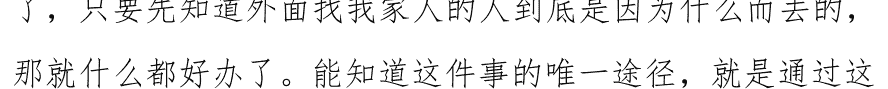

了，只是先知道外面的人找家里的人到底是因为什么去的，那就什么都好了。知道这件事的唯一途径，就是通过这一批即将上路的死犯。

第二天，我主动找到许宏要求和他聊聊。在聊天之前，我特意拿出自己的两盒环保白沙递给他，想问问他到底知道一些对我有利的事。可是他似乎什么都不知道，就跟那天晚上越响的一些细节了。我跟四哥说，四哥完全不相信。他说犯儿是看守所里最想越响的，有这样的机会他能不能把他捏？你得给他好处他才能跟你交豆子。我说好处我给了啊，我自己平时都舍不得抽烟白沙的，一下子就成了他盒！

四哥哑然的看着我：“两盒环保白沙就能找人家？你确实慢到一种出神入化的境界了！你跟他说这件事事是要能碰到头绪，说不定不准枪能毙了他。这个社会，没点实惠的东西你帮办事儿？”

我按照四哥的话又跟他说了，这次他好像有些疑虑，考虑了半天才才说：“这件事具体我也不太清楚，你让我好好想想，回头跟你慢慢聊吧！”说完转身跑到风场的角落里打了起来。我无可可奈的看着他，只能咬着牙等。

这次国庆节要执行死刑很多人，所以这段时间整个监队的气氛压抑到了我从未入狱以来的最高点。潘队和方队轮流值班，并且特别要求我尽力为所有二审的犯人做好想做都做不了，惟念而不可终日，我最怕的。

在那几天里，我们得到了几个消息，有好有坏，而且坏事多于好事。好事是：马兰在石围山中被罚了五天之后，他的家人作为担保人被取保候审。坏事有两件：第一，刀疤在当初执行时所报告的两件事都是因为缺少证据或者更具体的资料，因此这次国庆节也许也要上路的日子；第二，老虎开庭了，一审判处有期徒刑十五年，他选择上诉后他就去劳改场。

许宏虽然每天和周云在一起嘻哈哈，但是我们看出来的情绪越来越差，有时候对着天空发几个小时。每天晚上大家都睡了，唯有一个坐在铺板上拿着监控。我们知道他已经恐惧了，但是谁都不愿意在监牢里失去任何生命。有这样句话叫做沉默中爆发，就在沉默中死亡。压抑的气氛在国庆前达到了临界点，由恐惧引发的愤怒如火山爆发。

作者：瘦子 日期：2009-11-07

回顾在那些日子里，我们得到了几个消息，有好有坏，而且坏事多于好事：
- 好事：马兰在石围山中被罚了五天之后，他的家人作为担保人被取保候审。
- 坏事一：刀疤在当初执行时所报告的两件事都是因为缺少证据或者更具体的资料，因此这次国庆节也许他也要上路的日子。
- 坏事二：老虎开庭了，一审判处有期徒刑十五年，他选择上诉后他就去劳改场。

许宏虽然每天和周云在一起嘻哈哈，但是我们看出来的情绪越来越差，有时候对着天空发几个小时。每天晚上大家都睡了，唯有一个坐在铺板上拿着监控。我们知道他已经恐惧了，但是谁都不愿意在监牢里失去任何生命。有这样句话叫做沉默中爆发，就在沉默中死亡。压抑的气氛在国庆前达到了临界点，由恐惧引发的愤怒如火山爆发。

二、四哥还是动许宏和周云。问其原因，他说周云的日子还长着，不着现在动。而且在监狱里，收拾人的办法不仅只是打人一种。至于许宏，毕竟这几天就要上路了，这个时候他无异于给自己找不快。

大限之日越来越接近。这几天的许宏每天做的事情除了吃饭睡觉之外，就是在风场上对着栅外的天空发呆，有时候他也会跑到监牢门口，通过留意寻找着什么。一旦发现监道里有认识的人经过，他马上问问：“哎，你们这次几个上路？”得到完毕之后，他就会回到风场，继续看着天空呆。那矮粗说这是为了自己路上找伴儿，我不以为然。其实在很多时候，我都觉得他们是在寻找自己内心的一种寄托——或许和认识的人一起下去，才不会受到小鬼们的欺负。

许宏用一天一夜的时间终于写好了四百多字一份遗书，给我看过之后，又让涵看了一次，这才整整齐齐地放在自己新衣的兜里。尽管没有人宣布这几天就要被执行，可每个人都在心照不宣地做着自己需要的。

9月24日的下午，四哥得到消息：由于这次上路的人太多了，所以提前改善伙食。这批死犯什么时候上路，就连管教也不知道。为了防止突然接到命令，管教把家属送来的东西都提前送到了监狱内。这几天，加强了巡逻，监牢里到处都是荷枪实弹的武警。监牢里的吵闹一直到了十分钟后，武警到达才渐渐平息。因为这种环境作用是非常大的，那些死犯们乖乖地不再声，纷纷静了下来。

但是这个游戏还没有结束，郑强的手依然紧紧掐在许宏的肩膀上，两个人已经乱得一样乱叫。张刚松了手，两个人顿时头撞在了牢门上。许宏第一个爬起来，咬着牙对着肩膀向四哥求饶：“哥，你看我这几天就路上了，你就别收我了！”四哥冷冷笑：“你不是嘴硬吗？不是时候就吵闹吗？”

等了一会儿，他跑到许宏的铺位前摇醒：“兄弟，今儿不上路吗？”要是今天上路，那早上四点多应该有人进来。果然是不冷，衬衫热的贴在背上，许宏说：“这不是故意唬人吗？折腾了一晚上，差点死我！”说完，脱掉衣服用最快的速度钻被子睡觉。他睡觉还没两个小时，早上八点他又醒了，抽一支烟。等到中午他又开始重复昨天晚上所的一切。

周云第一个受不了他的焦躁了。他小声走到许宏身后，高高举起拳头砸向许宏的脖子。许宏正在喝四哥给的一瓶可乐，周云直接从他的鼻子里揉了出来。他正想回身反击，没想到被周云一推倒在地上后猛踹。这一一下吐血和可乐混在一起，加上地上的灰尘，新衬衫上顿时沾满了一朵血红色的梅花。

“操了你的亲二爷！许宏！给你演戏？你自己要上路吗？”周云不笑。坐在地上的许宏挣扎说着：“打吧，打吧……反正明天就上路，你就放开吧！”

四哥赶紧让张强把周云拉开，大马道：“周云，跟我说一下！这是什么时候？这是什么人？你说打就打，出事谁负责？”周云看四哥生气，唯唯诺诺地退到不再说话。许宏在地上清醒了一下，站起来赶紧把身上的衣服脱掉，拿到水龙头旁边接洗。洗衣服的过程持续了将近两个小时；直到最后说我学会怎么洗的啦，心里还是好受很多。

停下，把衣服晾在风扬的洒的一个阳的角落。浑淋淋的一天，他在心里重复了一件事做过几次的时光中过去，到了晚上，他又拿出了自己的遗书一遍一遍的研读。到早上四点半，他发现还是没有人进来，就径自躺下睡觉。

26日又没有上路。26日的晚上，他悄悄拿出寻了寻。

人的开！你看着咱们这个石山看守所到处很多人都是因为不同的案子进来的，彼此之间一点关系都没有。可真正找到根儿的话，这些人都能找到联系。你见过古惑扰儿吧！你别看东星和洪兴的混源这么多，根底不全都是靠家的人说话有用？这次越狱的事是你老老子在这里弄，其实很多事情都是能联系在一起的！等你出去之后，虽然说就把老老子这次参加越狱的人避开了，可真正的根儿你根本避不开！

我起紧问那你是觉得老老子身后还有人？那个人到底是谁呢？许宏说你是肯定的。别说老老子了，连你哥后都有。这个就是一个大圈子，每个人都有其中的理由。我加微信111101284955 获取更多好多占

越狱的事背后后头有个大人物。我不是以为为的你说这句话就夸张了，你把这L市万就就成就一个大黑帮天下了！许宏摇道：“我可不是在这儿哄你。九岁才就开始跟着街里的黑子混，这街头的道道太多了。反正你就记住一句话，我听说过你家里是C市的，等出去之后哪儿也别去，赶紧紧回家！”

我说这也太危言了，再这么说怕这儿又不是香港，不是美国。你当黑社会那么狂吗？他说你要这么想我也没办法，我今天最后一天了，反正在牢班里就这几天的时间。但是我就觉得你这人挺好交，够朋友！要不要谁跟你说这些啊？你认识四哥局限于知道他开个书店，你上学的时候他在他在家里买了很多书。

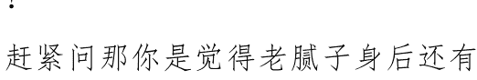

他认识你这么多少吧？深根的东西你知道不知道？我心一沉，问他你怎么知道我和四哥的事儿的？他叹了口气，拍拍我的腿说：“兄弟，别说这事儿了。你不是还有个对象，吕兰的吗？在L 市三小学的吗？你的详细情况现在好人都知道，还用得你告诉别人？”

那你是听谁说的？”我试着问他。
他摇头：“随便耳朵里传来的，有些深事的我我也不跟你你，我不清楚的事情我也不能乱说是是不是？反正前几天在在我们班的的，有一个从三队调过来的小子子都知道你的事儿！所以现在你就记住一点，出劫后 L 市的谁都会联系，”

我笑了笑，看着他，像得有些苦愁，苦愁能保护你一下不的笑出来，你也太大了。警察保护你天天两天，一个月两个月，他能保护你一辈子吗？你还想自保吧！我还想什么，他一搓手：“我想睡一会儿。要是明天早上的路，我连上场的精神都没有。”说完，

看着躺在床上转侧的侧脸，我没有了丝睡的感觉。分析他刚才说的话却也不无道理。的确，四哥为什么会在号里认识那么多人？而且为什么他这么多人人都给他那么大的面子？难道真的像他所说的那样，流窜在社会上的黑恶势力，真的也可以延伸到看守所？不过如果他们真的可以把

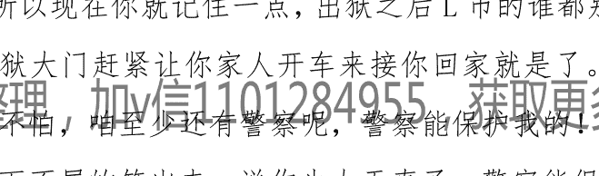

这样的力量延伸到石铺山，倒是不可能的。这里本来就是汇集了罪恶的所在，不可能每一个人都可以在这里静静的改造。那么假如四哥真的也涉黑，那他为什么会制止越狱事件呢？还有，为什么我的一些监外的生活会那么清楚的被别人了解？我问过四哥，他应该是不知道其中原因的。如果他真的是什么都不知道的，会是谁告告别人的呢？会是刀疤妈妈……

对了，刀疤怎么样了？？！

我猛地一下忧了起来。上次通讯说刀疤这次可能是没有什么希望了，那么如果天亮了这一批真的要上的路的话，那我岂不是刀疤最后后面我都看不到了？要是见到刀疤的话，我得整理一下心情再告诉他的话，我怕他还不相信。越来越深层的绝望消灭在心中。

我开始焦虑起来，不停的在地上转来转去。苍蝇看着局促不安的我问：“大学生，你是这吗？明天早上走的路不是你，你丫怕个小哄才！再说了，早上不走还不一定啊！”我说你怎么知道早上不走？苍蝇一搓手：“每年国庆庆节之前执行的日子虽然就几天，但是还是有误差的啊！涵蹲下午来们号聊天的时候，可多几句关心的话都没有问许宏！这看着就不像早上要上的路的意思想啊！”

“哦……”我点头，这才稍微放心的坐下。苍蝇扔给我一根烟：“行了，抽了这根你就睡会儿吧！”把刘东喊起来跟我们班就行了。我摸着天亮是不走的话，那明天早上一定走定了。我咬了一口气：“要是天亮不走最好，我得见刀跑去……”

27日的早上，确实如荒诞的一样没有人来提死，这让死囚们在这个世界上内心煎熬的葫苟又活了一天。

许安看上去精神状态还不错，甚至身边的人开笑今天要是是不走的话，我就去五十年之后的国情再上路！配合的他一笑没说话，可是心里暗希望法院的执行，否则大家都会受罪——当然，我知道这个想法不会放我。

吃完早饭，我跟队长申请和他聊。他看了看其他，怎么样？我问过四哥，他应该是不知道其中原因的。如果他真的是什么都不知道的，会是谁告告别人的呢？会是刀疤妈妈……

对了，刀疤怎么样了？？！

我猛地一下忧了起来。上次通讯说刀疤这次可能是没有什么希望了，那么如果天亮了这一批真的要上的路的话，那我岂不是刀疤最后后面我都看不到了？要是见到刀疤的话，我得整理一下心情再告诉他的话，我怕他还不相信。越来越深层的绝望消灭在心中。

我开始焦虑起来，不停的在地上转来转去。苍蝇看着局促不安的我问：“大学生，你是这吗？明天早上走的路不是你，你丫怕个小哄才！再说了，早上不走还不一定啊！”

所以现在你就记住一点，出劫后 L 市的谁都会联系，”我笑了笑，看着他，像得有些苦愁，苦愁能保护你一下不的笑出来，你也太大了。警察保护你天天两天，一个月两个月，他能保护你一辈子吗？你还想自保吧！我还想什么，他一搓手：“我想睡一会儿。要是明天早上的路，我连上场的精神都没有。”说完，

看着躺在床上转侧的侧脸，我没有了丝睡的感觉。分析他刚才说的话却也不无道理。的确，四哥为什么会在号里认识那么多人？而且为什么他这么多人人都给他那么大的面子？难道真的像他所说的那样，流窜在社会上的黑恶势力，真的也可以延伸到看守所？不过如果他们真的可以把这样的力量延伸到石铺山，倒是不可能的。这里本来就是汇集了罪恶的所在，不可能每一个人都可以在这里静静的改造。那么假如四哥真的也涉黑，那他为什么会制止越狱事件呢？还有，为什么我的一些监外的生活会那么清楚的被别人了解？我问过四哥，他应该是不知道其中原因的。如果他真的是什么都不知道的，会是谁告告别人的呢？会是刀疤妈妈……

国国庆节之前执行的日子虽然就几天，但是还是有误差的啊！涵蹲下午来们号聊天的时候，可多几句关心的话都没有问许宏！这看着就不像早上要上的路的意思想啊！”

“哦……”我点头，这才稍微放心的坐下。苍蝇扔给我一根烟：“行了，抽了这根你就睡会儿吧！”把刘东喊起来跟我们班就行了。我摸着天亮是不走的话，那明天早上一定走定了。我咬了一口气：“要是天亮不走最好，我得见刀跑去……”

27日的早上，确实如荒诞的一样没有人来提死，这让死囚们在这个世界上内心煎熬的葫苟又活了一天。

许安看上去精神状态还不错，甚至身边的人开笑今天要是是不走的话，我就去五十年之后的国情再上路！配合的他一笑没说话，可是心里暗希望法院的执行，否则大家都会受罪——当然，我知道这个想法不会放我。

吃完早饭，我跟队长申请和他聊。他看了看其他，怎么样？我问过四哥，他应该是不知道其中原因的。如果他真的是什么都不知道的，会是谁告告别人的呢？会是刀疤妈妈……

对了，刀疤怎么样了？？！

我猛地一下忧了起来。上次通讯说刀疤这次可能是没有什么希望了，那么如果天亮了这一批真的要上的路的话，那我岂不是刀疤最后后面我都看不到了？要是见到刀疤的话，我得整理一下心情再告诉他的话，我怕他还不相信。越来越深层的绝望消灭在心中。

我开始焦虑起来，不停的在地上转来转去。苍蝇看着局促不安的我问：“大学生，你是这吗？明天早上走的路不是你，你丫怕个小哄才！再说了，早上不走还不一定啊！”

我说你怎么知道早上不走？苍蝇一搓手：“每年国庆庆节之前执行的日子虽然就几天，但是还是有误差的啊！涵蹲下午来们号聊天的时候，可多几句关心的话都没有问许宏！这看着就不像早上要上的路的意思想啊！”

“哦……”我点头，这才稍微放心的坐下。苍蝇扔给我一根烟：“行了，抽了这根你就睡会儿吧！”把刘东喊起来跟我们班就行了。我摸着天亮是不走的话，那明天早上一定走定了。我咬了一口气：“要是天亮不走最好，我得见刀跑去……”

27日的早上，确实如荒诞的一样没有人来提死，这让死囚们在这个世界上内心煎熬的葫苟又活了一天。

这样的力量延伸到石铺山，倒是不可能的。

甚至身边的人开笑今天要是是不走的话，我就去五十年之后的国情再上路！配合的他一笑没说话，可是心里暗希望法院的执行，否则大家都会受罪——当然，我知道这个想法不会放我。

吃完早饭，我跟队长申请和他聊。他看了看其他，怎么样？我问过四哥，他应该是不知道其中原因的。如果他真的是什么都不知道的，会是谁告告别人的呢？会是刀疤妈妈……

对了，刀疤怎么样了？？！

我猛地一下忧了起来。上次通讯说刀疤这次可能是没有什么希望了，那么如果天亮了这一批真的要上的路的话，那我岂不是刀疤最后后面我都看不到了？要是见到刀疤的话，我得整理一下心情再告诉他的话，我怕他还不相信。越来越深层的绝望消灭在心中。

来。点上一支烟，皱头盖脸的问：“小虎子，你觉得哥对你怎么样？”

我一愣：“很好啊，咋了哥？”

四哥面色一冷，直视我说：“和你认识也不是一天了。从你上大学那天我就照顾你，帮你。每个月的月底家里还没给你汇款的时候，我都叫你我家吃饭。后来我认你出事之后，我对你更是没得说。这次你落难到了石山，也亏得咱们俩有缘分，我又能再帮你一次。但是有些话我必须得告诉你。”

我有些恐惧，以为四哥是不是知道我有瞒着他。他没有理会我面色的变化，继续说道：“这个世界上相对来说最便宜的地方就是赌场。黑猫的眼里最得多的地方看不过你地方是场，赌场也算一个。有些事情我哥一直盯着你跟你说，这绝对是为了你好。我会把关于你的一切都打算告诉你，但是我在没说的情况下，你最好不要去想，或者听别人怎么说。”

我点点头：“哥，我知道。”

他哼了一声，继续说道：“这几天晚上你和许宏说的话的内容我都听到了，就算我听不到也没有人告诉我。我问你，这几天你是不是觉得很多事情你心里都不清楚？”

“是。”

“因为这里的事太复杂了，我都有很多搞不清。所以，有些事让你知道的我会让你知道，该让你做的我也会让你做。但是如果你在我不知道的情况下偷偷弄弄一些事，你不能怪我管不了了。”

## 章节内容

四哥说完这些话转身就要走，我赶紧紧赶上去说：“哥，许宏跟我说的话我根本就没往心里去，所以我才没跟你说。剩下我做的事儿你都知道吧，先是带着刀疤去保命，接着又想查清楚到底是谁在找马兰的。你可千万别误会。”他停下来，转身用特别复杂的眼神看着我：“我都知道，现在不是你知道的时候。你放心，你家里人、马兰和她家里人都不事，至少我老四说这话还是有作用的。但是除此之外，你什么都别管了。”

“那刀疤的事儿呢？”我追问道。

临终我和四哥回到监房。他的一席话让我不仅有些文二和尚摸不着头脑，更多的是一种危机感。在石铺山能混成这样，将当初的帮助，四哥对我的提携起了非重要的作用。我开始担心一旦四哥对我有意见，那么我剩下的日子注定非常困难。但四哥好像什么事都没有一样依然尽心关怀，语气和蔼，这让我放心了不少。

吃过餐之后方队出现在了监仓门外。他透过小窗里面喊：“张锐虎，没事儿的话到我办公室来一下。”我赶紧收拾了一下，跟着方队去了管教办公室。一进门，他就开门见山的说：“前几天你不是说打算见赵峰吗？今天安排你去见。”我猛然感到兴奋起来，而是转念想到四哥说的那句“先管好自己”，我不自主的开始迟疑。

“方队，要不要过几天我去去看他吧？我有好多事情还没想清楚，现在问也是白问。”

方队一愣，立刻机警的连续发问：“前几天你不是积极很多的吗？怎么忽然变了？是不是遇到什么困难或者别人的威胁我了？”

我着急的摇头：“不是，方队您多了。我就觉得这几天在为许宏和其他死过的事，弄得挺累的，所以打算休息几天再再说。这几天我还有一个注射的任务要上路吗？我琢磨着是不是先把这儿处理了，忙完再说。”

回到监仓之后我发现喜全正抱着一条腿跟下午进来的那个新手满口危言废之的故事。见我们进门，他一指我：“看到这个小子了吧！你知道他为啥能在监仓里到处走不？这仙人比刚才我说的吃人那个更狠，直接把人扔进锅炉炼成炸焰！”我可呵呵一笑，便坐在床上听他胡八道。忽然，一个念头闪过我的脑海：为什么不亲自去问问喜全到底他开庭的那天发生了什么事呢？想到这里，我从床下拿出一盒烟，冲喜全一晃：

“我说喜全，咱再从风场去打个新的赌！”

“哈赌？”喜全当即兴奋起来，“日，免费烟又来了。哎我说你这个欠揍的新手就不能照顾一下我这个伤残人吗？赶紧来找我！”

在场场坐定之后，喜全一脸欢喜的问我：“咋了，说吧：反正跟我打赌的人最后全是输！你还是赶紧把烟提前拿到，我算算了！”

我呵呵一笑，把烟冲他一把：“那就看看你能不能轻松的拿到烟吧！要不要我现在就先给你？”他看我这么猛我就要把烟给他，我反倒犹豫起来：“你们，别听我这说书读读的，心眼比最近多！顿时快你找我要我不知道多少好处呢。说吧，打赌啥？”

我神情自若的说：“我今天听方队说你那天那事儿的经过了。他可看了你的案卷，还把这事跟我说话讲呢！”

喜一桥，紧接着很尴尬的笑起来：“哦，你说那个儿啊！当时确实太大了，昨天就没想出去叫个出租车的……不过这实在怪不得我，我当时就是想给家里打个电话，让他来接我！”他吐了口气，“行了，说打赌的事儿吧？你想跟我赌什么？”

“我赌你当时肯定不是吓傻了。你不会是跑出去就为了跟你的梦中情人大哥电话吧？”

他的面色一下冷峻起来：“虎子，咱也算是好兄弟了。开始之前是我服侍一铺二，等我开展之后又轮到你，所以咱俩的话可定说不完。而且你给我我也都那么忙了，所以我特感谢你。这可真的是我想跟家里打电话了，我跟办案单位这么说的，跟其他人也是这么说的。所以这个赌还是算你输了。至于这个妞吧，你要想给我我就给我，你要不想给我我就不给。今天你跟我打这个赌，跟我的这些话我完全做什么都不知道，也不会任任何说你问了这件事，以后咱们该怎么做兄弟还怎么做兄弟。但是哥们儿，别怪我没提醒你，你自己做好就好了，其他的事儿不能知道。”我取了多的好处，他看着我的好处刚起来，一伤一伤的回回到监室，依旧无其事的跟新收的学员吹牛大肺的牛。

从越狱事件发生之后，原本看上去平静的看守所越来越让我感觉到不安，原本在底层的暗流也慢慢向表面浮现。我独自坐在风场所里，自嘲地想起电影中那段经典的场景：一个黑社会老大用枪指着自己的同伙，冷笑着：“你知道的了。”接着，子弹从他手中的枪里呼而出……

四哥从厨房回来之后不久，喜全就背着我聊天。当然，哥哥对我肯定没像其他闹的人那样，他只是私下把我叫到一边埋了一遍。可是这番埋怨如果我是在石铺山这样没完没了的寻找答案，那么石铺山的日子将会异常困难。我决定暂时不去考虑哪些七八糟的事情，比如如何，这些都不是能够了解透彻的。短短几天时间，我就知道了看守所藏在深处的这些事情虽然跟我没关系，我知道面临的危险越大。石铺山所有的事情就像一只巨大的吞噬，而我只是一个小小的蚂蚁。王经理对我说：“为了安全，我们要对你负责，希望你配合。”这些日子我越来越觉得他的背景不是象那么简单。

剩下的几天时间我又去各个监号找囚犯们写遗书，我想帮他们做人生最后件事。离开但是他们跟我说的事情却越来越靠谱。许宏被送走的第二天早上我又到了教育队，刚到教育队的管教告诉我以后只要不是闭路上的，最后一夜将在回楼住宿，而我看护的任务就是最近半个月的时间，国庆假期你们三个人就各司其职，把他们的遗书也写一下吧！尽管我非常不愿意去做这样的工作，但是毕竟是服刑，完全没有“跳槽”的机会，于是只能好好应。

国庆很快来了。为了让仓里的犯人适应国庆期间的生活改善，厨房在三十号晚上做了油水较多的牛肉面。这个决定在监所里顿时引起了一场大波。很多人犯人开始猜测，为什么国庆假还要执行死刑，从来没有赶在放的时候！不过猜测，二哥和我作为教育队的监役，很快让大家知道这只是为了节日的准备。电视的屏幕亮起来了。在之前的日子里，由于石铺山的设备没有到位，电视是时好时坏，从电视安装到国庆那天，大家看电视的时间竟然还有五个小时。人都津津地坐在电视机前，对电视上的女明星儿论座。我和二哥就没有这么闲了，因为我们还有另外一个任务：分发过节物资。吃完早餐之后我们两个去监库仓库领了满满的花生、瓜子和饮料往各个监仓分发。二哥说这次国庆物资绝对比过年丰盛，每班两只烧鸡、两条劣质烟，还有一箱咖啡一箱奶，另外每个班还要十斤花生和十斤瓜子。石铺山什么时候这么大方？

估计前几天越狱的事儿让看守的管教也觉得安抚是最重要的吧！四哥摇摇头，呵声说你这是私营企业啊？前几天不是说石矿的一部分犯人要搬到新守所吗？我估计这里也是送行，建立自己在犯心中的形象了。

一切忙乱之后，午饭时间又快到了。我和四哥去厨房帮着几个小役把中饭送到到位。午饭不错：大灶是猪肉土豆，真是肉丸子。我们把每个餐队的午饭都送完之后，四哥直接从厨房装了两大型塑料袋“优等”猪肉土豆和丸子拎回监仓慢慢吃。这样的行动自然受到了第七班所有犯人的欢迎——他们当然会欢迎，第七班希望大家伙儿点好菜的绝对会惊喜每个人的口。

天的休息和生活改善让大家有些放松。不过第七班是新人，加上国庆期间的小活动也非常频繁，一来仅仅五天时间内就收了五六个盗匪进入。这一样苍莲、郑等人就不再寂寞了，他们花样百出的折腾着几个新人，直到自己都累了为止。

十月五日的早上，监队里通知从今天开始每个监恢复学习，生活改善也从中午起停止。四哥听完之后骂咧咧的抱怨说才休息这几天，好吃说就断，今天又要得吃牢饭。一旁的刑逞说四哥你也不打算了，这号里谁真学习了？再来说，你总从厨房带过的，也没吃过几次饭！四哥说倒倒是，这段时间你们要监督，抓紧了。尤其是我们的小虎子，我们的减刑之前会有一次考试，过了才能给你。吃完早餐后，方队通知给我写遗书，今晚就要回楼。我赶紧问他是不是明天这一批要走了？四哥说不用急，你也是聪明，毕竟这是减刑几个月的事情。我看着四哥你就放心吧，要是写错一个字就会少吃一顿饭！

想到的是，四哥居然做到，让我开始了在石铺山黑暗的一段时间，不过都是从回楼回来的事了。

我是午前到楼的，经过两个武警查后我才提到三号监房。赵志强和钱勇已经在我的前面进去了。看到他们，钱勇愁苦脸：“操，这回算是休假了。刚才一个管教要在这儿住三天呐！”我说还好，全当是国庆假还没放完呢？楚志强接过我的话说这不一样，回这一次，主要还是在我们的眼皮底下下了。

正说着，一个白胖的中年人被两个监狱押了进来。其中一个监狱说：“张启吕，这可是给你特殊照顾了。里三层外三层的武警看着好，你再也不能飞出去了吧？”张启吕的人脸露出了洁白的齿：“呵呵，放吧，我也死心了。反正早晚都是死，我早就受够了的日子。”监狱点头：“知道就好！”说完，转身出去。

刚来的被推了过去，张启吕苦了脸：“累赘。朋友们，剩下的几天就得麻烦你们啦！”钱勇冷冷的一撇：“如果你是跟我们一条心的话，我们肯定能给你好好的。人活这一辈子，最后的日子我们不让你难，你也别让我难过！”

“那是那是……”他笑着坐在一边。

“后什么事儿？怎么弄到的这个结果了？”楚志强帮他点燃一根烟放在他嘴里。他吐了口气：“唉，我的事儿多着呢，一件两件事儿我也死不了。你说我光跑了四回了，事儿小的了吗？”钱勇不耐烦的摇头：“赶紧说，你干啥了！废话那么多呢？”

张启岳微笑了笑：“各位朋友都是叫L市的吧？以前在L市有一个叫七爷的人你们听过吗？”

楚志强一咧咧：“我们都是第一次进来，而且以前在社会上混过的，怎么知道什么七爷八号的？你就直接说事儿吧！”

“哦……”张启岳对别人不知道他的名字显然有些绝望，打算继续下去。钱勇忽然打断：“听说是有个叫七爷的，L市最大的人物。”张启岳终于有些兴奋：“我是做的，呵呵……不过处理起来。”

但是这个地方学生多，餐饮是最大的消费点，每个学生都得吃饭。只要饭做得的好，又便宜，那学生口口相传就来了。张启岳听到这个消息自然非常搞笑。为了筹备开食堂的经营，他开始在各地强制收取保护费以获得投资的成本。没想到自己的小弟不利，居然没有经过他同意就跑到黄金海岸收保护费。黄金海岸的经理是刘叔身边的人，他一边又偷偷通知了刘叔，一边把几个人把收保护费的人找到了TV的一个包厢里一顿猛砸。刘叔并没有意的，给张启岳打了个电话：“兄弟来到场子闹事，这算什么道理？”张启岳也没有回，吵了吵就让他接小弟。没想到被街了。十号街的混混，趁着第二天凌晨人少的时候，一把火烧了黄金海岸。自己的财富源起，刘叔自然就想派小弟让自己受保护的张启岳。他话没说，让他手下的几个人把街头巷尾的乌合众一起砸了张启岳的重要收入来源——南国浴场。于是两家的矛盾争夺正式开始。张启岳的餐厅在一个月内就通过非法手段筹集了百万级的启动资金，并以最快的速度扩张。由于餐厅的大厨都是他们从L东区的各大饭店抢来的，所以饭菜味道自然比学校食堂要许多。加上他们所有的材料来源都是极低的价格买进来的，价格也要低于学校周围的小餐厅。于是在很短的时间内，张启岳的外食堂就火爆起来。一年的时间，他把分店开到了东区的五所高校附近。

就在张启岳财源广进的时候，他几乎已经忘记欠着刘叔一家TV的事情。刘叔并不是初出的小混混，一直到张启岳的餐厅火爆的时候，在一天之内彻底了张启岳的所有外食堂。看着自己的生意在很短的时间里毁了，张启岳也忍不住了。他纠集了一批的小弟和社会闲散人员，在当天晚上就把刘叔底下的两家TV围住，打算焚杀一体化。

头的混沌，接下来就是每个不同街区的混混头，上面就是我、刘皇叔、狗癞子和小海。在往上……”

“在往上还有？”楚志强抢着说，“我以为你们就是L市里的四大金刚都有！”

“肯定的，到哪儿都有。剩下的我就不想再说了，你他们还是别问问了吧？外头好像又动静，大概是吃饭时间到了。反正我还有时间，我们再聊聊别的也好。”说完，张启岳抽了烟，让我们怎么都不曾笑而答。

下午的时间很快过去，张启岳是什么话都没说的。晚饭后他在监牢口听了半个小时，才一脸兴奋的说：

“看来明天不是日子了，到这个个儿就没人来找我说话。”

王经理：“我这就来西武吧，骨头明天完事上，我得去很多贴在侯叔楼住三天后。三天。”

“三天。”他叹了一口气，舒朗的，爽朗的笑着说：“兄弟这就是你不仗义了，你咋不跟我说呢？害得我下午一直准备明天早上上路。”我说我没有的事儿，你赶紧紧一下吧，咱们明天晚上要写点东西。

一切收恰妥当之后，我跟楚志强和钱赛商量：让他们早点睡觉，等我和张启岳一起写完南方之后再让他们起来后半天。听到能早早早的睡，他们两个人自己自然愿意，二话不说就钻到被窝里躺下，很快，监仓里里就传来了轻微的鼾声。

张启岳看了看熟睡的两人，叹了口气：“你们算是是有有脸了，等等两个出去之后再想哈还干啥。我就一不样的啦！这几天过去，我就得到王老子儿子那里混了。”我摇摇头：“你在外面混那么好，现在不会一儿儿办法都没有吧？”

“有，但是不能。”他苦笑着，“有些事不是我能办就能办办的，再说了，我在外面混的明白，全靠别人撑着。我见到现在的这个份上再把别人供出去就太不优了。”我说现在已经不是仗又不不优的问题了。我们哥有个叫刀斧的，为了自己活连亲哥哥哥都打算算了。但他确实也从法场下来了，自己哥哥现在也没找的。

张东岳点点头：“这个我听过，跟他的情况不一样。他卖自己的哥哥是为了让自己老婆个人终，我算啥？我一家卖就买出他哥的事儿取得好多帖子“那你写信……”

“遗书是吧？”他拿出一支烟，“其实我根本没打算写的，我从做了东区的头的功夫子找来，我就准备好了路。写字不写也那么回事了，跟我约后聚会吧？我进来之前没事就找人聊天，再不聊以后就机会了。

我笑了笑：“当然，我就是干这个事儿。之前很很多要上路的，所以我跟我聊天你绝对可以放心。”

“哦……我是听说你们二个有个专门陪死犯儿的。就就是你吧？你叫小虎子？”

“嗯，”我点头，“现在好多死犯人我就跟见了乌鸦一样，躲来躲去的。说号里最怕的事情就是见到我。”

张岳岳一字笑了出来：“这个说的玄乎了，谁都得死，只是死法不一样而已。你又不是黑无常，他们忌讳你个啊！”

我不可否的苍苍扇，看着他不再说话。半晌，他才来说：“聊点络恰好呢？”

“聊聊的故事吧？在不卖你兄弟的情况下。”

他用复杂的目光看了看，“行，就给你讲讲吧！反正现在活着也没事。”

张启岳出生于1960年，国家最荒的年代。他的时候他的母亲由于大出血而魂归西天，于是家里就只下了父亲、王一整理，加一个妹妹。

孩时的张岳岳还是非常懂事的，虽然由于贫穷导致他连初中都没上完，但他对知识的渴求却比任何人都强烈。

文化大革命结束后，他那个曾经被定为“老九”的父亲安排到图书馆做了一名图书管理员。便利的条件，让他在干活之余阅读了许多国内外的名著。

改革开放之后，张启岳带着存了好几年的积累来到深圳特区开了一家小饭馆。由于读过很多的经济类、谋略兵法类和理学的书籍，他仅用了三年的时间就让这小饭馆在深圳市近闻名，生意火爆。

但是不幸的是，特区带给他的除了先进的经营手段、大量的财富之外，还带给了他很多黑暗的东西。慢慢的，张启岳开始不再满足自己时丰足实食的生活，干瘪颓馆转手卖掉，带着十万万元的现金和一把从黑市买的手枪跑回了L市。在那个时候，他只有一个梦想：垄断L市的餐饮业。

十万元在当时来说是一个不小的数目。回到L市之后，他先是在街头巷尾笼了一批黑混，用各种方式让他们服务于自己。接着，他又在市中心开了一间大饭，强行把一些厨拉了自己的饭店。于是，在各种因素的共同作用下，他的收入开始越来越多，饭店的规模也越来越大。无数的光环环绕在他头上：“L市知名企业”、“L市富豪”、“L市阔大亨”、“获取更多”运，张启岳已经不是简单的饭店老板了。从表面看来，他是L市改革开放以来最成功的之一，暗地里，他已经成为了L市餐饮业的绝对老大。一样，如果张启岳卖十块钱，其他饭店就不敢跟他一样的价格。

1995年开始，L市逐渐出现了垄断的局面。全市每一个行业都被所谓的“知名企业”占据了，于是口中就有了一个新的名字：“L市八君子”。而张岳岳排名第七，人称“张七”。一开始各个行业的这些领袖们都是和平处。但是没有过两年，这些人也都不满于现状，想把自己的经营范围再次扩大。于是刘启岳开了一家如全民食堂，不但开了KTV，还把生意的范围扩大到L市餐饮、娱乐、出租车行业。这几个人搅得天翻地覆。不过奇怪的是，这样的战争并没有持续多久。仅仅过了一个月，四个人的重心全部转移。张启岳把餐厅开到了大学城并在大学城里经营了很多配套设施。而区的狗狗和城区的海哥放在一起开始搞开发，再加上娱乐，他们获取了很多好处。结果刘启岳把自己的生意抢夺了南区。不过这样的变化对于老百姓还是没有任何影响。他们只管掏钱买东西，不管是谁在做的，经营都知道这几个人从来是互不让，如果没有特殊原因绝不会溃败，而是老百姓关心的只有价格的高低和质量的好坏。对于这样的变化，他们顶多就是做闲谈而已。平安无事的日子过了几年，几个人的生意规模也开始越来越大。除了张启岳、狗狗子、刘王叔和海哥之外，其他八君子之外的人被抓几乎都落寞了。而风光的这个人却是越来越风光，他们一个人身上都罩着类似于“优秀企业家”这样的号。

2002年，L市整个市委市政府班子换血。张启岳、海哥和狗癫子几人继被公安机关以非法组织社会性质的犯罪团伙为罪名逮捕。在很短的时间内，海哥和狗癫子纷纷落网、张启岳也经历了三蹲四退，被L市中级人民法院判决死刑。曾经的八君子，目前只有一个刘王叔还在外面逍遥。

“那为什么刘王叔没有被抓呢？”我好奇的看着张启岳，他看了看，犹豫了一会儿才说：“有些事情不能告诉你，说了你就得倒。但我现在跟你说的理你就明白了：在一个家里，我帮爷爷处理了刘王叔的事。兄弟是爷爷喜欢的。爸爸肯定赖不过爷爷，所以，这两个兄弟的命运就肯定不一样。”

“你是说……刘王叔后面还有人？”他耷说：“我们几个人都进来了，他就刘王叔还没进来。都用的一样的套路去买卖，他合法了吗？有没有我不说，反正他也不是什么好货！”

“那你可以跟法官说啊，把他提出来，你不就下去了吗？”

话音未落，他哈哈的笑了起来：“你觉得我张启岳在外面混得那么好，是点炮出来的吗？这样的事儿我肯定不干，否则马上死了，还要祸一次别人。”

“可是活命的唯一机会！”他挥手：“这样活下去还不呢。再说了，我进来之后有很多朋友去奔了，有些事你别问了。”

张启岳看了看熟睡的两人，叹了口气：“你们算是是有有脸了，等等两个出去之后再想哈还干啥。我就一不样的啦！这几天过去，我就得到王老子儿子那里混了。”我摇摇头：“你在外面混那么好，现在不会一儿儿办法都没有吧？”

“有，但是不能。”他苦笑着，“有些事不是我能办就能办办的，再说了，我在外面混的明白，全靠别人撑着。我见到现在的这个份上再把别人供出去就太不优了。”我说现在已经不是仗又不不优的问题了。我们哥有个叫刀斧的，为了自己活连亲哥哥哥都打算算了。但他确实也从法场下来了，自己哥哥现在也没找的。

张东岳点点头：“这个我听过，跟他的情况不一样。他卖自己的哥哥是为了让自己老婆个人终，我算啥？我一家卖就买出他哥的事儿取得好多帖子“那你写信……”

（此处由于重复内容及OCR错误，已根据语义逻辑合并并修正）

（后续重复部分已根据要求去重，保留核心连贯逻辑）

我一愣：“咋了四哥？”没等四哥说话，坐在一边的喜全拽了拽我，示意不要说话。四哥并没有理会我，而是径自指着几个新收的鼻子破大骂：“少他妈的外面的习惯带到这儿来！一天跟着别人的屁股问这个问题那个，你们是婆娘吗？这样下去，老子让你们折在石铺山上！”说完，他一回身，看着我们这些老同学骂：“咱们七班从我戎云龙当了班长的那天就开始给各位面子给足了！但是有些人是给脸不要脸，每天除了我插嗓子抢球时不会了！我今天当着所有人的脸把话说在这，要不要再跟新收的那么近，别怪我老四不给脸！周云，你给我滚来！”

脸色铁的周云从监牢里出来，低着头蹲在他四哥面前。“周云，我——四哥手上的一个纸巾狠狠的砸在他的脸上：“周云，我——一直以为你杀了十几个人也算汉子，没想到你居然在这儿摆弄并非！告诉你周云，我看你是铁定路上的，脸上的水滴滴答答。”

“以后在编号里你听过的，出去之后就把自己照顾好。在这一里没有人觉得你可怜，你要是弱了，他们就觉得你好欺负。

另外还有那句话，应该知道的会让你知道，不该知道的不要去问。下去你肯定会有后果的！”

“哥，我明白。”我低着头，声音小的我自己都听不见。

哥哥接着说：“咱认识这么长时间了，你的性格我还是知道的：遇到啥事儿就喜欢钻根底。但是现在你必须把这个毛病改了！一等我真的救不了你的时候，那谁能救你了！”

说完，哥哥挥挥手让我忙自己的事，他便躺在床上跟大家一起看电视。坐在床上，我还是有些忐不安，心里一边整理着自己的心情，并希望能避免最糟糕的结局，塌下来也作无所事了。

我没想到，这样的誓言在第二天就被摧毁了。

第二天早上队长带我去了办公室。一进门，他便开门问见的：“怎么样，这几天有什么新的收获？”

我知道他这句话的意思是有没有找到一些号里的暗流苗头，我赶紧握手：“我就想怎么安抚死犯了，这些事情太难了。”

“那死家伙就跟你聊点什么？”

我摇头的脑跟跟滚滚一样：“没有没有！他们跟我说的都是自己的案子怎么样的了，自己以前怎么样了之类的，至于

有什么神秘的东西，没有人跟我说。”

话一说完，方队忽然脸一沉：“张敖虎，你这是要跟我撒谎，对抗改造是不是？”

我吓了一跳：“没有方队，我哪儿敢跟你撒谎，更不跟你对抗了！”

“我就不相信你。你信了张启佑，他什么话都没有？”

“有，但他就是跟我讲了以前在外面混着的日子，跟我说了一他是怎么怎么斗的，自己的经历。其他什么都不告诉我，我还说不知道那么多。”

方队点头：“他是什么人你现在知道了吗？”

“知道，教导的拳术听过他，他是L市区的的老大哥。”

“张启佑不是一个简单的罪犯，他身上已经被发现的案子处理，增加了一些，原本就是片场上的小头目，都够赖他十几次的了。今天早上开会我才知道，法院暂停了他的死刑执行决定。”

“为什么？”我一愣，抬起来紧盯着他。

方队咬了口气：“他身上的余案未了，而且最近又发现了一些跟他有关的新案子。现在对他执行死刑，很多东西还是挖不干净。”

“那方队的意思是……”

“我没什么意思，”他在办公室桌前揉了揉疲惫的眼睛，“我现在的身份就是一个管教，能深挖犯罪分子的犯罪事实是我的职责。”

你进楼去陪张陆佑的时候我看了监控，觉得他还是挺信赖的，所以我打算让你在这段时间里一直和他在一起。”

我一下站了起来：“方队，我肯定不行，您还是找别人吧！”

“坐下！”他严厉的呵斥，“有什么困难我们可以一起解决，话没说完你就推我门外，给我背监管第六条！”

“要相互监督，及时检举他人犯罪行为……可是对方……”

等我说完，他打断我：“没有可是！我知道你现在的疑惑，你是不是怕如果揭发别人的犯罪事实，你就会被报复？”

我点头。

他走过来，拍了拍我的肩膀：“你得搞清楚几件事。第一，你现在是一个正在改造的服刑人员，深挖、检举犯罪事实是你的义务，也是你的责任。第二，你现在可以揭发别人的事情，我要做的是让他们自己交代其中的问题。第三，如果犯罪行为被抑制，你还怕别人报复吗？”

我咬了口气，目光游离的看着他说：“我知道您的意思，我也知道我的义务和服刑期间的工作。但是我不能把我身边的人出卖。我跟张启佑说过，他说他能交代犯罪事实，保佑他活下来。”

方队看了我：“我知道你的顾虑。L市黑势力是非常大的，一旦不能彻底铲除干净，那剩下的可能成为线索啊！方队，你作为一个服刑人员，出去之后就是普通老百姓，这些人真的惹不起……”

他摇头，接说着：“作为来说，刚从学校毕业的我需要了解犯罪分子的心态。另外，尽量从中挖到犯罪事实或者线索，等我再回监狱的时候，你有很多工作可以做了，而不是等着百姓报案。”

我还想争辩，但是话还没出口，方队又说：“行了，你先回去吧！好好考虑一下，明天早上给我答复。”

回到监仓后，四哥并没有问我方队让我去做什么，但我考虑了一下。我狂忙点头：“对！哥，我明白你的意思了！”

“不是我的意思，是你自己的！”四哥扔给我一支烟，“小虎子，你是在铺山是我带出来的，有句话我虽然跟你说了很多次，但是现在还得提醒你一次：别搅闹，老老实实的服从，你应该知道的会让你知道。”

我叹了口气：“哥，我明白。你就放心吧，我肯定不会给你惹事儿的。”

“没事儿最好。对了，刚才我听说今晚改善，杨国强的遗书你就尽快准备吧！”二哥站了起来，转身走到风场晒太阳。

杨国强是持刀抢劫被判死的。说这个小子在三个月时间内内持刀抢劫十四次，总案值收到了二十多万元。从接到判决现在，他已经心里死去了很多了。算起来，他已经是在不到半年时间内我送走的第八个死囚。和别的死囚相同，他对死亡的恐惧远远高于别人。后我才才知道，原来他家后面的山岗里是L当年固定刑场的所在，从小到他不知道看到了几次决枪的场面。用他的话说，当扳机扣下，人的整个半脸随着子弹弹出来的景象让他无法忘记。

最后，他被处决了。这样的执行让他回到监狱也会和那些死囚一样，情绪无法控制。

中午跟着二哥一起去厨房帮忙的时候，我商量了让杨国强上路的对策——让他先回忆初见的决枪场景，然后分析注射的好处，让他忘记恐惧。下午，二哥留在厨房干活，我坐在他身边，试图找一些轻松的话。

方队首先开口：“杨国强，这几天怎么样？”

杨国强难得笑：“这几天好的，吃的也好，睡的。”

方队皱了眉：“没给点东西？脚踝都磨了吗？”

我赶紧一看，果然，脚踝上磨烂了。

“没有两天了……”我指着脚踝，“我打算用布条在脚踝上，到时候多写些。”

我和四哥再次回到监仓的时候，杨国强已经醒了。他面色苍白的看着我，抱歉的一笑。

吃饭之前队长又来了，他没有进来，只是把我和四哥叫到监牢门口说：“我跟所长说了刚才的情况，所长说今晚不急。如果他不犯罪，就给他注射剂量的镇静剂。如果他今晚不犯罪，那就明天早上前执行注射。”

“不冲突吗？”四哥皱了皱眉头，“万要是药效冲突的话，这小子可得受大罪了。”

队长一摇头：“肯定不会。这是刚才询问了法医之后给的答案。所以没问题。”

呐？就你长了一道嘴是吧？

喜全不咬气了，杨国尴尬地笑着：“就是，可不是就
死吗？哥，让我想想吧，这玩儿比我上学时给女孩写情书可难多啦！”说着，他把屁股往我这边凑了凑：“要不，我我自己写吧？我并不知道什么时候才能想出来呢！再说了，我妈妈看我眼神也能踏实点。”

我征询地看着哥，哥想了想，领首答应。我自然乐得轻松，赶紧起笔纸一并塞到他手里，自己看着床上看电视。

凌晨五点闹钟响起，顿时电视、日光灯一下子关闭，只剩下监室顶上一盏昏黄的白灯发散着气无力的光。杨国强就在这个时候，拿着一张硬纸板放在桌子上，开始写他的。

由于担心杨国强犯病，晚上方队一起来监看了三次，每一次监道的铁门响起，杨国强都会紧张地赶紧看着挂在墙上的那个小闹钟。到了凌晨两多点的时候，方队又一次开了监门，而坐在地上的杨国强陷入了。

凌晨四点，最后一份餐被送到监牢了。跟者方队来的，除了两个劳动的杂役之外，还有一个就医的。

方队先是让帮杨国强开铁锁，并换了相对轻松的小公安锁，我和豌两个个人给他换上了新衣服。一切结束之后，由就医取出体温计量了他的体温，又听了一句转身离去。

杨国的遗书已经写好了，方队看了一下后，整整齐齐放到了他新衣服的口袋里。接着，又把那碗热气腾腾的牛肉面和两个鸡蛋放在了他的面前。

“吃吧！吃饱饱的，一会儿就要接受复核了！”方队从兜里拿出一盒“一支笔”递给他，接着又拍了拍他的肩膀：“心里别太大压力，一切我们都已经安排好了，你不用担心。”

对了，所长让我你说一下，你父母的低保也给他们办好。”

杨国强地点点头：“谢谢方队了。要是有下辈子的话，我一定报告！”方队客气了几句，带着两个杂爻出了监门。

监狱里人都闹起来，已经是一个约战的信号了？当监牢里有人要上路的时候，所有的都会在那个早上一起起来把死犯送走。这是对死犯最后的一些尊重，也是希望他们变成鬼后不要用恨同他们的人。

早上五点半，监牢门又响了。这一次来的是潘队和刚才那个狱犯。潘队看了一眼，笑着问道：“饭吃完了了吗？”

“吃完了，潘队。”杨国强的情绪忽然又激动起来，“是不是现在就要走了……”

“没有没有……”潘队紧握手，“我看心里挺难过的，就叫医过来给你打一针安神的药。你打完你就好了。”

话音未落，杨国强一下站起来：“我不打！你们打算给我提前执行了啊！”

四哥赶紧找找班强和苍蝇，让他们按住杨国强，自己故作轻松的说：“你可真是脑袋让猪给堵了！你听过我在监狱里执行的吗？”

“那也不……”他嚎道，身体如同筛糠一样发抖。

四哥赶紧上去，杜强和苍蝇两个人把他按倒在地上，接着转身冲向潘队一招，潘队当会有意，让狱医在最短的时间内将一支镇静剂注射到了杨国强的身体里。

很快，杨国强安静下来了。他软绵的靠在墙上，目光有些呆滞。我担心的回潘队：“队长，这事儿好吧？”

“没事。”潘队一挥手，“如果不给他的话，回头执行的时候至少他不会闹大了。赵哥，你可可不行！现在这样他就不会闹了。行了，”

紧跟着我登录了账号，云龙和张凯：“你现在闹了，跟我出去，换衣服准备工作。”

“是！”我和四哥赶紧拽起衣服往外走。出门的时候他回头看了一眼，发现杨国强处于半梦半醒的状态。

潘队带着我们去并不是会议室，而是警戒线的一片空地。潘队回头跟我哥说：“一会儿执行车就在这里。”

此时，法院、检察院、武警还有很多部门的人都已经到了。武警开始逐个带。很快，我看到了被警架出来的杨国强。他走有些费劲，完全靠着武警臂力往前走。四哥吸了口气，说这也太费了，他要是没有脚的话，根本就没有必要蹲定了。这下好了，稀里糊涂的上路。面对杨国强用愤怒的眼神看着我，他掉手转身后，先是从兜里掏出了那份好的遗书，接着又跪在地上听判。法官宣读完后，将判决书递给他，他接过判决书放在自己兜里，看上去非常配合。按照流程，杨国强是第一个被执行的。一切手续完成后，两个法警把他押上了执行车，并关闭了车门。接着，五个法警一起围堵了执行门口。

执行的车被第二次打开，一个法警从车上跳下来，跑到执行车不远的几个身着大的人面前说了一句什么。那几个人迅速拿着一个黄色的裹尸袋冲到了执行车，很快，杨国强的尸体被抬了，扔到了手推车上往外推走。

我有些看不下去了，心里忽然有一种难以忍受的感觉，便从椅子坐下来，自己坐在灶台抽烟。四哥也不看了，他来拍了拍我的肩膀：“咋了？”

我摇头：“说不上，就是觉得心里挺奇怪的。一条命，就这么几分钟就没了……对了哥，怎么这么长时间？不是说注射很快的吗？”

“得把人固定在床上，还得把道打开了！不扎上针，怎么往里灌药？”四哥也拿出一支烟点，“应该是不会受什么罪的，你别想那么多了。”心里还是有些忍受。“见多了也就不奇怪了，”四哥看着我说，“我从进号到今天，看着路的人都有二十二人了，刚开始我也觉得心里过不去，不过现在觉得没什么事了。不过你别说，今天也是我第一次执行的场面，跟以前感觉确实一样。”

“嗯。”我低低下使劲抽烟，一句话也不想说了。这早上一起上路多少人我不清楚，只知道整个执行行程延误了将近两个小时，从早上七点半开始，到九点多才算结束。八点多四哥跟着厨房的杂役去监道送饭了。

一直留在厨房，等到执行结束之后，慢吞吞的走出厨房，打算一会儿睡。路过执行室时，我忽然看到了久未面的刀疤。他抬着沉重的铁链，在一个管教的控制下往执行室走。看到我，他立刻兴奋起来：“小哥！”等我回答，身后的管教大声呵斥：“不许说话！”刀疤无奈回头了一眼，只想我一笑，跟着管教进了执行室。

“跟他聊？”身后一个声音传来。我回头一看，方队不知道什么时候站在我的后面。

“方队……我没想跟他聊，就是好久没见了。”跟他个招呼。方队哈哈地了起来：“见你也行，反正之前我都答应过了。你先去休息一下！”等执行完，方队安排我们见面。我赶紧握手：“方队，我不方便见他……”

“不方便？见没必要，他也挺信任你。”我咬了口气，“方队，云龙在外面认识我，跟我父亲也不错，所以他一直照顾我。这段时间咱们这边太乱了，他已经警告我多次，让我别管闲事……几次了？还大方，挣得啊！”哥黑地笑，“说都是落难的兄弟，送走才好呐！”

刀疤的会面被方队安排在铁楼的二号监室。方队的意图很明显，因为铁楼的监室没有打扰，而且监控设备又是最好的，他可以随时掌握我们的表现。为了不让刀疤胡说八道，我一路都在想怎么让他开口，但是最后还是没有想出任何办法，只好无奈让他信口开。

刀疤的精神已经完全没有我当初见到他时那么好了，脸色憔悴像一具垂危的老人，有一次我甚至懊愧的开始认为我面前这个人并不是刀疤，而是刀疤的父亲，或其他长辈。如果不是他脸上那道长长的疤痕，或许我真的不敢相信。

“还是那个样子，死牢犯写遗书，死牢犯。基本上没有别的闲事儿。本来方队把我留留在队伍里的目的是让我做死牢有关的工作之外，还负责监队的电脑维护。结果在电脑维护没有了，一天的让我过的比福尔摩沙还充分。”

“这话谁说的？你查谁了？”我咬了咬口，告诉他段时间时候兰被捕获，后来又有人去她学校打听我的家庭住所等事情，他听了之后眉头皱了一团，愤愤的说：“操，你也太不顺了！天天陪死牢犯，是不是哪个衰蛋跟上你了？你现在打算做什么？”

我一耸肩：“还能咋办，刚开始的时候四哥挺支持我的，有些事儿我没办法。”

“好吧，先不说这个。”我拿出口袋里的可乐递给他，自己也开了一瓶，“你说吧。”

“是这样的，之前进来一个经济犯，名字叫刘东。王经理加了我微信，天天跟我聊天的时候无意中说他有一个小弟，为了给营里的人帮忙，向他借了二十万块。”刀疤看着我，目光犹豫：“这跟我啥关系？”我一拍他的大腿：“你可是听我往下说啊！这个刘东弟弟要把其中的十五万石山的人摆平事情，另外的五万要给另外没抓住的犯人跑路什么的。我当时自己就跟老熊联系到了一起。你哥认识老熊吗？”

刀疤哈哈地了起来：“你这脑子确实太好用了，我跟老熊隔着十万千里，怎么可能认识老熊？”

“要认识，但是知道呢？”

“那也不可能！”他断然否定，“现在外面为什么抓我哥？我哥是贩毒的案子啊！老鬼怎么来的你不知道？寻事、故意伤害？怎么可能跟我勾到一起？再说了，就算是认识，老鬼哪有给我哥跑路？我说大学生别瞎愣了，怪不得四哥不让你到处，你这胡乱想受得了？”

我点头：“好，那我就假设那个人不是老鬼和你哥。你说呢？石山，十五万，谁需要这么多钱？”

他摇头，反问：“你先告诉我，你这次进来你家花钱帮你办事没有？”

“多少钱？”

“具体不是，但是至少也有六七万吧。”

“那不了？”他振词争辩，“你这个留六七万，要是案子比你这个微大一点呢？不得花十万二十万？十五万在看守所还算多少啊？你别看这个地方没有钱流通，实际上这儿可是最烧钱的地方！”

“怎么能一样！”我喷了一口烟，“如果这十万不到到位就会有人死，而且会死。”

“立功了！”他有些脸色通红。

我一挥手：“话可不是这么说！我说句不好听的话啊，取消执行死刑不是一般法院说了就算的，这得一大堆手续和流程！人家还要看你自己的立功大小才能决定是不是真的取消。你要是要举报一个小偷摸摸的赖赖，人家就能给你判决执行？现在他们搞了两个保险，咱们也得搞个双保险不是？”

他点点头，但又疑惑地盯着我半天：“咱俩没什么利益关系，你怎么这么帮我？你说吧大学生，你你什么？”

我瞪了一眼，气的笑：“我说话可是，你你妈的也太没良心了！我跟你说了吧，我现在帮你就两个目的：第一我刚到这里的时候，你整个人都穿得烂衣服，我接多少好贴，我心里理理上接受了。第二我现在搞不清清楚你马兰学校打我家人情况的到底是哪路神仙，我想查清楚，否则我就被释放了也别消停日子！”

“你那个事儿我觉得肯定是你挡了老腻子的路，所以老腻子的人在外头，你再麻烦我！”他断定的说完。

“那不一定！你想，我现在这么帮你，真的是在帮着你把熊的臭泥潭扒开，那老熊不得死我！他要是是个聪明人的话，肯定得阻止我帮你，所以我不能不怀疑威胁我的人就是老熊那一头的！”

“哦，对！”他若有所想的点了点头，“行，那你说吧，怎么个双保险？”

我一靠肩：“具体我也说不上，但肯定是有法的，你得想想。另外有些事儿你得跟我唠唠，让我找找中间的联系。只要能找到，你也救了我。”

他一拍胸：“行行，你说吧，我知道的肯定全给你倒出来！！”

“行，那跟你说四哥吧！说真的，不是我没良心。这段时间我总觉得四哥身上有事儿。”

“嗯？”他略微采了一下，随后有些生气的说，“我说张锐龙，你还好意思自己没良心！四哥对你你好，你反倒拉大旗要把把他倒了？”

---

给所有朋友的一封信。

我最最尊敬的朋友们：

从上周开始，周六我都没有再更新。原因有两个：一个是考虑到写到现在这个程度，有些思路必须赶紧理顺，而且必须紧急把一些悬念给读者一个交代，我交代，要是写下去的话，可能会得不损失。第二，周六了，我也确实有些累，想歇一歇，连续两个月的不断更新让老身心疲乏，而且没有一分钱的收入。于是昨天早上陪着老婆孩子买了粽子，下午去和一个本地的老客户聊了联合的事。

各位朋友的等待我都眼里，但我现在真的不敢太急的去写，丢了西瓜捡了芝麻的事情实在是不能去做。在这里，我得请各位一直支持的朋友说道歉。当然，我看到了一些没事过来闹事的，我想在这里提醒此君：我绝不是把自己放在一个很臭的作者之后的人，我只是一个普通的民，喜欢写些东西的。公道在人心，我不求我写的字惊艳世俗，只求自己写的东西有人看。哪怕只有一个人看，我自己也会至少已经成功。

在这里我要感谢，万分感谢你们长时间一直直追贴的朋友。真的，对你们的感情之我无法用语言表达，只能想办法把最好的事呈现给你们。我瘦子在这里挥手抱抱。

有些读者反映我在帖子里和朋友的交流不多。其实不是这样的。我每天至少有十七十八小时在线，我会时刻在帖子里关注朋友们对这篇文章的反馈。而且，我也在随时随地的关注几个读者群的聊天内容，希望从你们的意见中炼出更好的东西。我的工作现在不仅只有《死刑犯》这一件事情，而且还有其他我个人的工作需要处理。虽然辞职了，但是还是要挣，家还是要养，我一岁多的女儿还需要工作来给她奶粉的。所以我实在不是不能回复各位朋友的疑问，只能能，我会尽量。请各位朋友务一定给我宽容和谅解。

---

### 读者提问 & 集中解答 (Q&A)

在这里集中解答一下读者们的问题吧！

**Q: 死刑犯到底什么时候才能写完？**
A: 看守所的故事太多了，过去的都是在发生，而且现在、此时此刻也在发生。但是我会尽量让它完善，不会让各位大失望。

**Q: 很多悬念而未决，什么时候才能有一个大结局？在第二部中，**
A: 和上面的回答，我在尽量完善。在第二部中，越狱事件的背后策划、三犯人事件、林杰案的结果、刀疤的结果、四哥相关的问题都会在接下来的章节中述清楚。请各位读者继续关注。

**Q: 现在看上去越来越戏剧化，有点偏离原来的主题？**
虽然他们在临终前的表现不一，但无非都是对生的渴望和死的畏惧。如果全部写死犯的最后夜晚，而不写其他的一些故事，可能会让回回之味。但是我要保证的是：所有内容都是真实的。尽管戏剧化成分比较多，但是这毕竟是一部小说，如果没有些许的艺术加工、故事细节处理，那就不是小说了。

**Q: 林杰的案子笔下不死，作者可否留情？**
A: 高兴那么多人为我笔下的人物命运担心，林杰和刀疤也是我笔下我很喜欢的人物。但是这件事的原型是由法律裁决，他们的命运在之后的文章会很快揭晓。

**Q: 这部小说会完吗？**
A: 我保证，绝对不会完。有些时候我更新的比慢，或许有一天就完。

---

（正文部分由于OCR识别存在大量重复和乱码，已根据语义逻辑进行合并与纠正）

“立功了！”他有些脸色通红。

我一挥手：“话可不是这么说！……”（此处省略重复内容，由于原文大量OCR错误导致逻辑不完整）

“行，给你背背看守条例吧！”听到这句话的时候我看到他的脸色都变了，我也开始紧绷了了起来。不过很快他就恢复了常态，眯着眼睛我看着他的眉头皱的，心里很乱。背到一半，管教已经笑花了。所长揉着眼睛制止道：“这叫什么背？”

四哥尴尬的扭了扭：“死要死我不行，让张毅虎帮我有感情的念出来，我就会背了。”

所笑着点头：“这东西不是死记硬背的，是要活学活用，使用到改造当中，知道吗？”

“是，所长说的。回头我再好好分析。”

“好了，你来填签名吧。”

减刑的事情很顺利，我被减了三个月，四哥被减了四个月。按照的时间下来，等到明年七八月份的时候我就可以……

他看了看，笑着说：“都告诉你了，有些事你可可以，有些事你就不能知道。不过老臧老四倒是什么了，跟你就聊也没大碍。对了，你是昨天认识他的吧？”

“我上学的时候他们在学校附近开了书店，里面的一些教辅挺便宜的，所以我总去他那里买书，一来去就熟脸了。后来我爸到学校来看我，要顺便给我买点书，我就把他带到了四哥的书店。结果四哥一看是我爸，非拉着我爸喝酒，这样他一来他也成了朋友。这次我进来他一看是我，就特照顾我。”

“你爸做什么工作的？是干部的？”

我一摊手：“什么，他就一个工人。在工厂半辈子子了。”

“哦，”他若有所思地点头，“这个老臧老四我早就听说过了。他从年轻的时候就开始推摊卖书，三教九流他都认识，而且关系还处得不错。但是你家是C市的，而且你跟他也没什么利益关系，他能交你爸爸这个朋友也算是挺怪了。”顿了顿，他又说：“也不太奇怪。我听他说跟L南区的一群民工还打得火热呢！我在外头的时候有一次在南区办事，发现他从一个提横档的小区出来之后就直奔工厂跟工人喝酒去了。这样的人挺圆滑，谁都不惹，出了事谁都得给面子。”

“四哥以前做什么的啊？你怎么会听他说呢？”

他叹了口气，往外看了一眼天空。十年前L市虽然混混了，但是真正称得上黑社会的老哥却根本没有。后来我们几个人一起带着混混争地盘的时候，大家都憋着要吃个大胖子。但是那时候国家严得特厉害，比83年虽然差差点也有限，硬生生的抓了几几次个人手下的兄弟们抓了一大半。后来我们就觉得那个当下的口号是再暴力解决肯定得出大问题，连自己都保不住。所以我们就开始玩脑子，划地盘、划分行业。那个藏老四还是一个在路边摊卖书的小年轻，卖点盗版书、黄书挣钱。后来一次狗癞子上街，要收老四的钱，结果让老四给崩了一顿。开始我和海哥、刘皇叔觉得老四这次完完了，结果没想到他七天后居然在癞子的地界开了个小门面专门买书！后来我们都知道，这个藏老四虽然就是个卖书的，耐本事可是大得很呐！你看他在大学城附近书书吧？那是我的地界，我们也很少有人去招惹的。

我迷茫看着他：“你到底背景是什么？”

“这就不知道了。以前有句话你可能不知道，做过L市的黄河水再降，都没有藏龙城的城府。他反正是什么人都能交，什么人都能成为他的朋友。所以他到底背景也恰恰不知道。”

我露出若有所思的表情，他看着我。

他哈哈乐笑起来：“这算什么的。01城城南一个酒吧几个小小子把老板的儿子绑架了，要价100万。结果这老板也不敢报案，不敢干的。当时藏老四正好要去地进书，听到这个事儿之后几个电话就把事儿平了。后来警察虽然把几个绑架的小子抓住了，但他把他关进去了，但是查了半天藏老四，也知道他就一个人脉较大的书店老板而已。抓进去24个小时就又放了。可这次藏老四居然因为贩毒，而且还是那点克数进来，可真不像他的风格。我看着吧，他的为人和关系网，要么就干脆不碰，要么就搞大的。没必要为了几百块钱的小利润干这种事儿。”

我看了他：“那哥的意思是，四哥进来还有别的目的？”

他一撇手：“不知道。再说了，老四不会傻到那个程度吧！这看守所，别人见了都来不及，谁能钻脑袋往里钻的？行了，哥不说这个了。反正我估计老四你也没没恶意，好坏的呆吧！”

我点头：“嗯，他一直照顾我的，这么长时间，也没见着干别的。”

他笑着摇摇头：“小兄弟，有些事是可以办的，有些挺难的。你说这事儿，你觉得对的？”

“那不定，我减刑了吗？”我摇了摇头。

他重重的靠在铺子上，叹了口气说：“小兄弟，你不懂这里的事情！你那个哥算什么个？到头来就是外头想救的人没出去，里头想跑的人没跑。”

我咬着气：“但是我总觉得这次要跑的真的还没住……他还在后面藏着……”

“那是肯定的！我听说这次带头的是你们二队的那个叫矮子的吧？这货小子我最了解了，你要是让他自己悬着，肯定没那个胆子。但是你要是让他拿点钱诱，他肯定比兔子跑得还快！”他笑了笑，随意的脸色忽然严肃起来：“不过哥，你再也不可能再折腾了，所以还是老老实的服刑吧！免得后悔。”

“其实我也不想的，哥！”我一脸难味的看着他，“我本来就是公司的经理，从大学毕业到到处闯了的人就是那几个。你说我要是惹事了，我出去还不退了？但是现在他们已经威胁到我们我家了，我是不把这个里头的东西挖出来，不断除草除根的话，我出去也是没完日的。反正我已经惹了人了，倒不如拼一拼运，要是真的可以把后事隐了，我也算赌赢了。”

“哦？”他看着我，“谁威胁你了？跟我说说，指不定我能帮得上你？”

我摇摇头：“我现在都不知道事情是从哪里来的。简单说吧，你帮我分析一下。之前三队死人的事儿你知道吧？那件事他们同的一个，叫刀刀的知道真相了，根本不是心脏病死的，是被三队的老熊安排的。”

于电视上的女明星的脸，回头小声说：“有什么事我知道的，我会尽量挑说的告诉。。你小子人不错，反正我也活不下去了，在不伤了我兄弟的前提下，我就当帮你做点善事。”

作者:二瘦子 日期:2009-11-30 15:20

19、
张启岳坐直了身，开始给我讲刘皇叔、杜坤、和那个姓刘的官员的事。

刘皇叔之所以能够在大南区立足，除了他对自己手下的兄弟好，说话有信力，很大一部分因得益于对于L市的贡献。当然，这个贡献是表面的。他从不在小地方出来，一方面通过各种利益获取很多好处，另一方面家里出生的人有很多，除表面外，他还帮L市建立一些公共设施，扶贫困学生，维修老旧院等。总之从表面来看，刘皇叔就是一个相当具有社会责任的民营企业主。

正是由于他的这种表现，市里年年都评为优秀企业家，如此他和他一些官员的关系就更好了。他一边利用自己的兄弟，肆意的扩大生意，另一方面用各种办法培养自己的保护伞，以防止临时出事。而这个杜的政法委官员，就是其中之一。

有了这样的一层关系，当初的“五虎太子”全部就被弄坏了刘皇叔的旗下工作。这几个小子从小就培养出来，初中毕业就不想上学了。到了刘皇叔的公司之后，名义上做了保安、领班，实际上每天都纸醉金迷，不知所谓。一旦刘皇叔的生意出了问题，这几个小子都是在冲第一线。

刘市治安以严打黑恶势力为力，全市的很多混混、黑势力团伙被扫了一大一批，这里就包括张启岳他们几个。但是刘皇叔依然高高在上，模拟规模的热衷于他的慈善事业。有好几次安排查他，但是后来莫名其妙的没有了声息。不过几次的调查让刘皇叔开始如惊马，他开始暗地把自己的弟弟们送到了外地里。

“简单就是这样，后来的事情我也不知道了。反正我被进来一年多，刘皇叔这个老小子在外面到处当慈善家呢！”

张总，联系微信1101284955，获取更多好运

我看了他：“那哥你你应该可以举报他啊，说不定你就活了呢？”

“没那么简单……”他叹了口气，半天才说：“他做事滴水不漏，愁抓住把柄太难了。再说了，把他摆倒了，对我也没有好处。”

“那也比先好！会有机会了。”我顿了顿，犹豫的问：“哥，有话我不知道当不当。”

他点头：“你说的。”

“我觉得，哥，你现在都已经是这样的了。现在突然暂停对你的执行，肯定是有什么更重要的东西在后面悬着呢。有句叫好不如死赖着，你现在是要能活下去，那以后还有出去的机会，也有重振旗鼓的机会啊！你现在哼着这个哼着那个，谁知道最后别人不能领你的情。哥我说这话可能自私点，但是社会就是这样，仗优的人确实有，但是理解仗优的人并不多了。你现在就这么不明白的上了路，你保护的那些人里定会有人说：看了吧，那个傻子把自己的搭上，都没敢把给我出来。这样的事儿不是没有，我相信你也明白这种事情的了。

“我知道，”他苦笑一下，“但不是这样说的。我我自己能做什么我很清楚。我跟你说这些，主要是我觉得你和你这个小兄弟有缘分，而且这几天你算显眼了，我给你一个机会，我会帮你理清楚，这件事情我最要处理了。”

“现在只有你听清楚这个杜沛到底干了什么好了，那就什么都办了。”说完，他把烟头一扔，不再跟我说话。

第二天早张磊被带走了，趁着这个机会，两个劳劝的士兵在管辖的带领下回到自己的监牢取一些东西。我正底要不要回一趟班子的时候，方队来了。一见到他便问：“咋样，有啥结果吗？”

我点头，又叹了口气：“不知道算不算。我现在有点头绪，但是还是琢磨不清楚。”

“说呢？”

“呢……我怀疑，越越的事情和杜沛有关的。”

方队一：“杜坤哪个杜坤？你说的哪个被你们的那个小子？我看着他不像能呼唤雨的人啊！”

“不一定……”我摇摇头，“昨天我和张启岳聊了许，他也跟我讲了些L市的事情。我现在是觉得杜坤身后有更大的案子，本来的打算看守所避难了，没想到的更累，所以只有想办法跑路？”

“哦？你能确定吗？”

“我……不太知道。方队，你不能找杜坤谈一次话，问他的底？如果他说他家里有个政法委的干部的话，那我估计这事儿就稳了。回头我确定下来再跟您说原因，您看看吗？”

我就去提杜坤！方队走后不久，张启岳被两个狱警押回来。进门我就发现他眉头皱紧，满脸愁。我赶紧上前：“哥，怎么样了？”

张启岳挥手：“没，原来的朋友被抓，结果不到十分钟就晕了。妈，我还在这儿护着他们。”

“哈事情啊？”我愣看着他。

“别了。回头再说吧！”说完，他重重的倒在了床上。第二天早饭之前，方队请一个狱警把我带回去。等到了管教办公室，方队一脸严肃：“哥，你要办的事儿还没完呢。”

“嗯，”方队点头，“事情有些变化，张启岳被暂时关了。”

（注：此处后续存在大量OCR重复与乱码，已根据语义进行逻辑去清理）

关于刀疤又用的东西，或者给他立功的东西，都好好想想啊！咱现在是没忧愁了，可这群兄弟怕不能落下，是吧？”

“是刀疤上次没被执行的事儿现在只有一条了。本来以为能把他哥哥供给出来，但现在他哥哥死了，就剩下三三三队伍作死的事儿了。

“那就抓这个！”四哥坚定的说，“给你十分钟时间，好好想想有什么事情可以挖。”

我一摆手：“不用想了，哥。现在有一条路子，但是刀疤已经跟管教说了，不知道有没有什么办法。”

“说！”四哥坚定的看着我。

我一横，指了指墙角监控的刘东：“贪官哪儿。表面看起来他信息很长，我们可以获取更多好帖吗？我觉得这事儿有戏。

“那今天晚上就审！”

下午的时候我去找他去了一次的办公室，除了告诉我刀疤已经已经被毒死的之外，又告诉我一个不太好的刀子：刀疤的终审判决很快就要下来了，形势不是很乐观。所以，他很可能要在元旦之前的那一批一起上路了。

我有困难，赶紧问：“方队，现在没有什么补救，我来整理。”

我点点点头：“方队，这个我知道。不过上次他不是跟说刘东怎么了吗？这个不够？”

抓到石铺山的会有家里人在外面运作，希望出去。这不反常。再说了，就算这二十万是刘东受贿购污得来的，那也不至于构成‘重大案情’的条件，照样还是得执行。你现在啊，就让他去想一下自己的哥哥有什么仇人，让他哥死死得明白就行了。”

“那刘东那边，就不能再挖吞一下吗？”

方队摇头：“我也想够。但是张东岳的事情越扯越多了，我还顾得多盯着那边。如果刘东这这边你有什么消息，就尽早告诉我吧。”说完，不再听我解释，顺便带我回了监牢。

知道晚上四哥审人的，莉蝇、小康和郑强全部活跃起来。因为他们已经太久没有使用暴力了，只要四哥亲自发言，他自己的“拳头”一定能够。

但是没想到的是，四哥还没等他们几个人高兴两分钟就就把他们骂了一顿，并说在做什么事情都要靠脑子，都是都要用拳头，那场就跟镰子和刀刃一样。这句话说了一会儿大家都欢喜处理，刘东就马上上勇取好多帖。

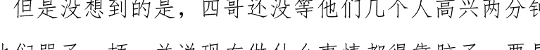

听过他自己不会后术，顿时兴奋的几乎快要翘起小调来。

四哥很聪明，他知道，现在这个当口上不能付任何失险，稍有不测，自己也会被抓进这里。

晚上吃完饭后，就对刘东的“审问”就开始了。地点就选在风场门口的厕所前——刘东在厕所里，我和四哥两个人都搬小凳子坐在厕所门口。其他人那边嘈杂的安排全部在监牢面前靠近进门的地方，以防他们听到了我们的谈话。

四哥首先问：“刘东，你说你是咋进来的？”

刘东蹲在厕所的便池上，满脸的紧张。他很清楚这个地方就是给一个监牢的唯一监控死角，一旦是要四哥打算动手，管教是决然看不到的。

“报告哥，我是贪污进来的。”

“哦……我听说，你有什么哥弟的，在你双规之前问你借了 20 万块钱吗？”

“是有这么回事儿，”刘东点点头，“我出事的头几天他就找过我，但我当时没答应。后来我表弟的妈妈又亲自来找我，都快给我下了，还说这个钱要是不借的话，他们全家就完了了。后来我就借给他了。”

“这个钱干了什么用了，你知道吗？”

他看了看，对着四哥说：“这个事儿我跟虎子说过……”

刘东抬头，豆大的汗淋从额头渗出来：“是是是，哥我错了，我说。我进来的头一天天晚上他给他打过电话，说这万救了好几个人，另外的五万帮一个小子跑了，算……”

“我觉得这事儿有戏。”

“那今天晚上就审！”

（此处内容由于OCR重复及错误码已根据语义合并清理，保留核心剧情逻辑）

下方队又一次来到了七班。我们知道，方队的到来不仅仅是例行的入监监控，也是要告诉我们对于越狱事件的结果如何。

入监后，方队并没有像平常那样先检查卫生，检查学习、生活。而是开门见山的说：“今天和平一样，先宣布几件事，然后咱们开展一次深入犯罪的工作。”说着，一指我：“张毅一会你给每个人都发两张稿纸，明天早上一齐收回来。”

等我回答，方耀祖先说：“方队，还打算挖吗？再挖就得靠靠以前倒了……”

“杜坤？”高兴一下跳了起来，拍着自己的胸脯说：“我早就发现他不是什么好人！当初毁我的道！操，这样的货，死二十回都不肯宽恕他！”

“闭了！”四哥冷冷的瞪着他。

方队瞪了高兴一眼，没没理他，接着说：“先说一下越狱的事吧！杜坤已经交待了，我跟你们讲。也让你们知道为什么要继续挖！”

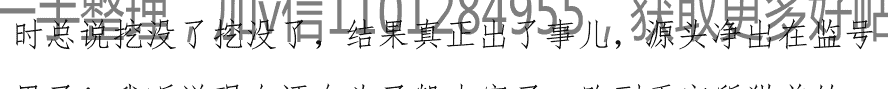

越狱事件的最终源根确实杜坤，但最终策划的却不是他。杜坤在进石山的头两天，在L市南区的一家KTV里用钢管打死了两个消费的中年人，当时杜坤万分紧张，赶紧跑回家告诉自己的父亲怎么办。他的父亲听到这个消息之后，顿觉六神无主，顾不得教训自己的儿子，就赶去寻找熟悉的刘皇叔商量对策。

看到杜坤父亲的到来，刘皇叔自然是盛情对待。他心里很清楚，如果没有杜坤父亲的这把保护伞，刘皇叔就不可能有今天。为了躲避，杜坤的父亲平时很少去刘皇叔那里，今天却过来了，肯定就是有事了。没想到还没等到刘皇叔开口，杜坤的父亲就把所有的事告诉了他。

“坤的父亲先不要着急，坐下来喝几杯酒。”自己给在电力局做案的一个小弟弟打了一个电话，说今晚会上会有个人去他们的库房跑偷东西，让他准备一个价值不要超过100元的东西放在显眼的地方。一旦抓抓住这个人以后，马上抓住，并且打电话报警。这个小弟弟丈二和尚不着头脑，但毕竟知道刘皇叔是自己的靠山，也就不得不同意下来。

回到办公室后，刘皇叔把自己的告诉他现在就回去，让杜坤去电力局仓库偷点东西，然后看守里等一段时间。等风头下来之后，再取保候审出来。杜坤的父亲开始完全不同意见的做法，认为这和自投罗网没有任何区别。可被刘皇叔几番解说之后也觉得唯一唯一的办法就是躲起来，而最安全的地方就只有看守所了。就这样，杜坤当晚上就因为偷窃电力设备被送到了石浦山。

原本以为这件事就会这样过去的，两个三个星期就能让杜坤出来。但是没想到的是，公安局对这起杀人案查得非常紧，省厅都将这个案子列为了办大案。

这个时候杜坤的父亲又从自己的好友，石浦山看守所原来的哨所从那里知道，杜坤进去没几天就被关进牢里的犯人了。身为父亲，杜坤的父亲自然不能让自己的儿子受罪。又是找到刘皇叔，让他找找关系，帮忙照顾一下在牢里的杜坤。

于是处理，由于王杰和刘显的在监狱交接时错过了时间，一句“帮忙照顾”让他杜坤父亲现在不方便给儿子办取保，但却还想让他出来。那样的情况就只有一种办法——越狱。

刘皇叔拿出了二十万现金，带着律师，通过关系在看守所看到了自己的马仔老矮子。接着，他又告诉老矮子，说：“如果你能帮我把杜坤越狱救出来，那这二十万是你的，出来还能给你三十万。”

五十万元现金的诱惑对于老矮子来说是巨大的。回到监牢之后，他先是找出《刑法》看了整整一夜，发现现在就算是自己越狱被抓住，最多也就是再判个五六年。但是如果这五六年就在外头混了，他一定能赚到这五十万。他是在第二次律师见面的时候，老矮子律师告诉刘皇叔，这件事情他办了。

作者:二瘦子 日期:2009-12-09 16:17

刘皇叔先是自己拿出了二十万钱，带着律师，通过关系在看守所看到了自己的马仔老矮子。接着，他又告诉老矮子，“如果你能把我把杜坤越狱救出来，那这二十万是你的，出来还能给你三十万。”

五十万元钱的诱惑对于老矮子来说是巨大的。回到牢里之后，他先是找出《刑法》看了整整一年，发现现在是自己越狱被抓，最多也就是再加个五六年。但是如果我处理几年外他的越狱的话，我就能换更多好多帖。是在第二次律师见面的时候，老矮子律师告诉刘皇叔，这件事情他办了。

可老矮子接下了任务，但是具体怎么实施心里完全没有底。想了好几天也没有任何结果。有一天，他正在跟监狱里的其他的犯人聊天，猛然听到监狱里的犯人为越狱弄了一些事，这给了老矮子很大的启发。他开始偷偷的监狱里通过一个熟悉的人物，最终选择了贾坤（应该是杜坤）。

老矮子选择贾坤很简单：
1. 他现在已经毫无收获，也没有人管他，如果现在给他一个承诺，他什么都肯了，因此也不在乎脱罪。
2. 他的案子肯定是死刑，因此也不在乎多加几年。

越狱之后，事情就办成了。先是刘皇叔从外面搞到了一些事，之后让他抓到了老矮子，接着越狱……

“刘皇叔也折了？”四哥听完方队之后马上询问。方队点头，摇摇头：“差不多。不过后面的案子还不止，暂时还没看到。”

“还算你有点成绩！我这就跟上面汇报这些材料去吧！”方队烦躁的看着四哥脸，“幸亏这个案子不是在我身上，要不然跟我下场一样！”方队指了指四哥：“任务交代给你了，明天早上我就来这些犯罪事实的材料！”

方队转身走了，营里只有四哥和老矮子斜在窗边抽烟，其他人人都跑到房里，皱着眉想自己在墙上写什么。我站在房口，一边看着大家忙碌，一边竖起耳朵听监牢里面的动静，直到吃饭之前，监牢里都没有发出动静。

原本以为他们睡着了，可等到晚餐的时间打算叫他们才发现，睡着的只有老矮子一个人，而四哥则靠在椅子子上不停抽烟。

“哥，有烦事？”我从床下掏出一瓶饮料递给他。他点头，摇摇头：“没啥，就是想想今天发生的事！原来都不管杜坤那些破事了，牵扯的东西太大了。后来想想，毕竟大家都是兄弟，而且他现在可能保住自己的命。”我咬了一口，说：“哥，你也太大意的。这就是杜坤的命。他要是当初判了缓之后早点下队，能有这些事情？”

“操，我要是再见到他，非给他俩光子不可！”四哥挥了手，“行了，你出去看着吧。我想安静一会。”

挖掘犯罪的过程进行的非常顺利，几乎人都把一张写着“自己的案情”交得清清楚楚，把别人的犯罪事实的稿纸交给我。当然，这里也有特例。例如刘东，但他不在别人交材料的时候没有任何动静，甚至还跑来说：“小哥，再给我几张纸吧。”

对于这样的行为，邦强、周云、小康等几人都觉得刘东这是纯属抚摸，但老矮子却赞同。他亲自从床下找出来盒烟递刘东，拍了拍他的肩膀说：“写，多写几个贪污犯！”

邢慷对贪污犯的恨是根深蒂固，无法改变的。

第二天一早我把一叠稿纸递给方队的时候，他看了几眼开始皱脸批评道。说我辜负了对我的信任，又说我办事不利。我没有去争辩，因为我相信方队自己也知道：不管在什么地方，看守所内就是一个攻守同盟。如果不这个同盟最顶端的部分打开，没有人敢于揭发犯人的事实。

方队骂了一会儿就不再说话了，低头仔细看到刘东来的材料。渐渐地，他的脸上的表情舒缓下来，接着开始微笑。

“还算你有点成绩！我这就跟上面汇报这些材料去吧！”说着，他转身就要走，忽然又想起来干什么似的：“最近我在其他班里也搞了这样的深度活动，还有很多三队有关的事。你看能不能弄出点东西来。另外，这段时间可能所里又有一批要执行的，你要做好你的工作。”

自从把自检举材料交给方队之后，他连着一个星期都没有找我。在这一星期里，我除了在监仓里数日子，就是和喜全、苦全他们几个嘻嘻笑笑。整一周时间，监仓里只发生了三件事。

第一件事是邢慷和喜全分别接到了开庭通知，还有不到十天的时间，他们将又一次在法庭上等待判决。第二件事是四哥带来的消息，说新的看守所已经落了，大概一个月的时候石浦山可能就要搬迁。第三件事让我意外的是：林杰的律师找他，说外面已经有了有力的证据。

起初老矮子回到牢跟我们说这个消息的时候，大家都不相信。很快四哥从别的渠道得知：警方已经锁定了林杰家，并抓获了他们。而且杜坤一样的人，已经被判了无期。所有人都在为判决的消息感到松了口气，结果如何，只要别人也有好的结局。而在这一周，对方队说的“即将执行”。周五晚上，班里进来了一个近60的老死囚。老死囚名叫福清，是杀人来的。他杀的不是别人，而是自己的妻子、儿子以及年三岁的孙女。杀人的理由很简单：他是喝酒后，用榔头砸了自己的妻子，正巧孙女看到了爷爷杀人的幕，便跑去叫爸爸妈妈。老头怕事情败露，于是把这一三口想办法先后杀死。然而，他居然守着几具尸体整整埋了半年，才被村民发现并送到了派出所。

从外看来，老头是一个极其懦弱和脑癫的人。用四哥的话说，这样的人大街上找到很难。“这人比魔鬼可怕，这老头的狠劲！”四哥把他叫到一边小声说，“算日子就是周二执行了。由于法院、检察院还没准备，周二执行的可能性很大。所以我几天抓紧把老头的遗书写给他。老头根本不肯写，说自己全家已经下了闸，自己写那东西给谁看？于是我只好打消了劝他写东西的念头。

时间过的很快，周六日日大家都在混沌中度过。到了周一的早上，老头子睁眯着眼睛自言语道：“还有二十四个小时了！”这句话声音不大，但是却让监牢里的几个重刑犯都听到了。顿时，号房里一片静，所有人开始在一旁边默默计算自己的生命还能延续多久。

中午吃饭时，四哥和老头的话得以印证。厨房的饭送到监室口，喜全抽着鼻子说又要改善了！果然，监狱门打开，递进来一盆白菜青椒炒肉和一盆白面馒头。

老在看守住了一年多了，号里的习惯和规矩他比谁都了解。从他调到七班的，现在在改善生活，每一个细节他自己都能感觉到对生命来说已经开始倒数。他很镇定，甚至可以说有些泰然自若。

四哥说这样的人不是大傻就是实活歪了。只要把死当成赦，就能做到这样的镇定。他还说自己来看看，看守所看到就四哥说这不靠谱，这小子在最迷的时候都曾是一个犯人。这两个人的共同点就是没有任何挡，这样的怪物是我没有过的。

老头子的死，方队说，，，，，，，，，，，，，，痛苦，

衣服，

，问问：“小哥啊，打算写什么？”我摆手说：“其实你也不想，你可以考虑一下，给自己的朋友、亲戚或者关心的人写点东西，这样也是可以留点的吗？老头想了半天，确实是没有人了。我摇头：“按规定是不能给你笔的……”话音落，四哥说：“虎子，把笔给他。苍康在一旁看着就行。”

老头拿着笔，足足呆一个小时才开始落字。由于坐在他对面，所以我写的内容没有去看，但是觉得每一笔都在用心写，用力去写。甚至薄薄的稿纸因为用力太过大而划了好几次。又过了半个小时，老头终于写好了遗书。我接过来一看，上面只有短短几行字：

“我是罪人。我杀了自己的全家，得到的现在的王建业自杀。我是罪人，希望老头。为什么要打死我的老婆？因为包办婚姻40年就不会幸福过。为什么要打死我的儿子？因为我生了这个不孝子之后他就整天折磨我。因为儿子和儿媳居然都打我了！为什么要杀了自己的小女？其实她是非常情眼的，但是儿子和儿媳根本就不让女儿跟我。现在家里人全都死了，她活着也会孤儿而痛苦。明天就要上路了，希望在黄泉下，我的家人会原谅我结束了生命，理解我这几十来的痛苦。”

我愣住了。看着眼前这个干老头，忽然有种说不出的。转头看到四哥还没休息，便顺手把递给他看。四哥看过之后，也穿上衣服了起来。

“老老爷，咱回事儿啊，跟他说说完！”四哥递给他一支烟，想了想，又把金环镯扔给他。老头子乐笑着摇头：“家门不幸，哥哥不要再问了。”四哥一手：“话不能这么说。我看着你这遗书写的和别人都不一样，所以和你聊一会儿。有啥就说吧！能到一起起来，咱就是朋友。咱们虽然年纪差的比较多，就当是交流吧。”

老头看着四哥，终于咬牙叹气：“小哥啊，不让你，我这辈子就毁在妹妹和妞儿身上了！”

“说吧，哈球事情？”四哥把耳朵凑过去。那人看了看里面，伏在耳边小声的对着四哥说了几句话。

“什么？”四哥听完，手中的茶杯一下子掉到了地上。

++++++++++++++++++++++++++++++++++++++++++++++++++++

QQ讨论群：93607141
作者：二秃子 日期：2009-12-13 14:55

22、

我被关到石库山看到事情到今天的这半年多的时间里，从未见过四哥为了什么事情过于激动。可以说，无论发生多大的事情四哥都可以处变不惊。但是今天，一个监道王处理我加染后，我们获取了好多帖子。彼的这种事让四哥在石库山看到这样景象，这我们确实没预料到过。

染伏走后，四哥眉头锁在了床底。我赶紧让一个睡在床上的三哥把地下的东西收拾干净，然后我小心翼翼的问：

“哥，咋了？”四哥看了看，想说什么又是没说出来。最后他吐了口气：“没事，我自己的一点小事儿。你先忙你的吧！等明天你来的的时候我再告诉你。”

四哥说完不再出声，径自一个人躺在床上使劲抽烟。我们这一群互相交流接头，纷纷猜疑，但是没有人能说出四哥到底怎么了。

坐在地上抽烟的门福清看了看四哥，站起来说：“大哥你别堵心了，你看明天我都要上路的人了，都没堵心！有啥事过去不去？”四哥厌烦的了一眼，咒骂道：“你赶紧给我睡觉去，我有啥事你管不管！”老头子一片被狠心狠狠的拒之门外，顿时觉得脸上有些抱不住。可毕竟是这个监号里地位最低的人，只好继续延续的低头抽烟。

时间一分秒的过去。门福清的生命，正随着墙上的小闹钟慢慢的走向终点。监牢里的气凝愈加沉闷了，除了几个平时事不同的人已经躺下睡觉之外，其他大部分都在铺上抽腿聊天。当然，他们不着的原因并不是老就要被送去枪了，而是四哥的情绪波动，让每一个人都觉得乖愁。

四哥的情绪好坏，决定了整个监牢的气聚高低。

其他人看到就都要睡了，也是陆颜颜的躺下。以后不会，监牢里除了要值班的，小康和郑强之外，其他人人都迷迷糊糊进入的梦境。

小康悄悄的凑在我耳边说：“大学生，四哥炸了你知道不？”

我摇摇头：“我上哪知道去。我这几天也没听到监道里发生了什么了不得的事情啊！不过我估摸着不是小事儿，你什么时候见过哥四哥紧成这个样子子了？”

“那倒是！”小康递给我一烟，“我认识四哥这么长时间，他可从来没有今天这样的表情了！我以前还偷偷偷偷跟苍蝇说过的，他哥就是死了亲爸也不一定出来的。黄泉起……”

“胡扯！”我看了一眼他，“你是在号里混了大舒服了啊，你就不怕我把你才说的这给四哥哥点一炮？”

“你不会的”他黑嘿地笑，不过还是赶紧备似的的退到一边，不再跟我联。

三点钟后，监道里送来了馒头，我赶紧叫醒他，门福清。他抬眼看着看着，说我不吃了，再睡一会。你们留着吃早吧！话音刚落，我转身打断了他的，让他爬起来吃饭，黄泉路上你要是饿着肚子，下叶子胞也投不到好人家的。老头子一听这话，“嘘”的一声翻起身，一边洗脸一边说：“饿着肚子我不怕，我就我这哥子的命和如此悲剧，这哥子一模一样。”

一对一塑料袋包。问及还需要什么东西时，门福清赶紧摆手，说已经很不错了，没啥要，没啥要求。

最后一次饭后他吃的很快，很细的咀嚼、慢的品味。虽然，这和其他大多数的死因没有什么区别。不过特别的是，对死亡，老头子好像没有丝毫的恐惧，反而有些愁。那祁耀祖坐在边上看着他，摇头，说这老头子是魔障了，死都不怕了。老头子抬眼眯着看着他，一笑，我说眼睛睁，哈福气就都有了。这哥子的过这么难，这死了反倒是个解脱。韩耀祖点点头，你说你这哥子就你妈妈是个悲剧，早死早托生吧！

五点半的时候老头子收拾好了一切，又换上了崭新的布鞋，满脸期待的等着路上。西哥拽裤腿给抓住住吧，走也走的干净。

老头子连连搓手说还是不了，我肯定不会害的。再说，扎的太紧，我怕到了那边走路不方便。

四哥点了点头，亲自给他点了一支烟放到哪里：“不扎不走，你这伙子也算没过好日子了，就走个轻松吧！”

老头子笑了：“还是谢哥兄弟们这两天的照顾啊！我走了之后麻痹兄弟们在风场上给我点个烟，让我顺利的上路。”

时间一分秒的过去，终于，老头子上路的时间就到了。监道里武警、管教的脚步声响起来，他脸上忽然起了红光。他站起身，我们大家点头，然后转身站在。此时此刻，取得许多好贴。压抑的气绪让大家开始小声的猜疑。我的呼吸，脚脚的声音在地上，连续发出金属撞击的声音。我们都知道，这可是已经走不动，被武警带来了。老头子从监牢的小窗向外看了看，不屑的笑。

监道里武警、管教的脚步声响起来。站在门口，他点点头：“门福清，出来！”老头子一回回，冲一笑：“兄弟我先走一步！”我和四哥赶紧准备好要出去，潘队说：“今天早上就不用你们了。”说完，锁上监牢转身离开。我一脸迷的看着四哥，可是一句话也不说，只。

皱着眉对苍蝇说：“四哥，不是三根？怎么六了？”苍蝇没敢再问，赶紧起着烟，跑到房门口。四哥定着的烟，又逐渐变为灰烬。没有人问四哥到底发生了什么，终于，我忍不住，走到四哥面前小声问：“哥，这是给谁呀？”四哥看了看我，咬了口气：“虎子，你彻的努力费了！今天你也是……”

“哥，咋可能呢！这几天不是正在查案子吗？刀疤不管他怎么样，也算是立功了，只能告诉他们底是怎么死的。难道也不算立功？”四哥点头：“我也想这个。刀疤的死不值！既然当时从刑场下来了，那就是重大立功，怎么现在上去……”

“哥，这事跟你说的啊？”全上来问。

“昨天晚上监道的杂役跟我说的，他说昨天下午厨房我刚开始不信真的是，所以没跟你们说。早上叫队我们送人，我才觉得这事可信。唉，我真没想到啊，怎么稀里满满涂涂的就上了。”

“不可能的，”哥我看着四哥，坚定的摇头，“当初刀疤还要给我遗书呢！他要是昨天天道自己就要法场了，肯定得管教申请的。你说我就干个活儿，怎么知道刀疤要上路的消息一点都不知道！肯定是那个家伙搞错了！”

四哥看了看我：“我真的希望搞错了。但是你想，咱们石铺山叫刀疤的人有几个？叫刀疤的，又叫赵的人又有几个？搞错了了。管教不让我知道，他们还有其他的。我们处理刀疤的案，他要是上路，看来我们得很麻烦。”四哥叹了口，眼睛看着外面的天空：“不过管教也想很多的，七班出去的犯人太多了，他们怎么为我们素质这么差！”

“只能这样了。”四哥看着地上快燃的几根烟：“希望这几烟不是给刀疤点的……”

方队是第三天早上才监来的。因为上次举报的材料中有很多价值的消息，所以他这段时间一直在配合驻所检察院和办案单位取证。这次入监，也是为了带李东去质审。但他没想到的是，自己刚刚出现在监狱门口，我们这些人就都站起来，七口八舌的问刀的下落。

四哥站在最前面问：“方队，我听说赵峰上路，有这回事儿吗？”方队一愣：“你听谁说的这事儿？”四哥咬了口气：“昨天晚上监道的一个老役跟我说的。说刀疤要上路了，厨房在做饭头。”

方队点头，没有回答四哥的话，而是指了指李东：“出来提审。”记者，转头对四哥说：“世界上同名同姓的人多了，你咋就知道那个人就是赵峰呢？”

参与活动，获得赠书机会：QQ 群：9360741
作者：二瘦子 日期：2009-12-15 16:52

四哥站在最前面问：“方队，我听说赵峰上路了，有这回事儿吗？”方队一愣：“你听谁说的这事儿？”四哥咬了口气：“昨天晚上监道的一个老役跟我说的。说刀疤要上路了，厨房在做饭头。”

方队点头，没有回答四哥的话，而是指了指李东：“出来提审。”记者，转头对四哥说：“世界上同名同姓的人多了，你咋就知道那个人就是赵峰呢？”

“可是……”四哥还打算什么，但话没说完，方队便断说：“没那么多。该问的问，不该问就不要！”

方队带着刘东走后，七班炸了一锅粥。见过刀疤的人都在猜测刀疤的死，没有见过刀疤的人努力跟刘东说什么对自己不利的言论，气氛压抑，紧绷到了极点。中午吃饭前，刘东才算回来，刚进就被好个人围住，借着关心的名义套问他有没有表现。四哥冷眼一眼：“你们要是做的好一点，至于现在这种战斗！”正在准备的。直到晚上我才知道，刘东的那个表弟上周已经被拍了，案也慢了。

四哥再次回到监牢，已经是中午了。一进门他就把鞋子脱了，重重的躺在床上。我赶紧过去倒了杯水，又帮他倒烟，这才问：“咋了？”四哥晃晃脑袋：“没，就是累。老哥把物资弄乱七八糟，收拾了一下。”

没等我说完，四哥接过来说：“肯定不行的，方队的计划，我还是觉得别的刑期还是按照你现在的，但是我们俩就是在七班笼着的吧。小虎子的刑期短了，换了环境来就不适应，再一个以后后去就不方便了。”

我和四哥站起来，齐声喊道：“是！”方队满意的笑，说：“行了张锐虎，你就先回去吧！我跟藏龙安排一下工作。”

四哥再次回到监牢，已经是中午了。一进门他就把鞋子脱了，重重的躺在床上。我赶紧过去倒了杯水，又帮他倒烟，这才问：“咋了？”四哥晃晃脑袋：“没，就是累。老哥把物资弄乱七八糟，收拾了一下。”

没等我说完，四哥接过来说：“肯定不行的，方队的计划，我还是觉得别的刑期还是按照你现在的，但是我们俩就是在七班笼着的吧。小虎子的刑期短了，换了环境来就不适应，再一个以后后去就不方便了。”

我和四哥站起来，齐声喊道：“是！”方队满意的笑，说：“行了张锐虎，你就先回去吧！我跟藏龙安排一下工作。”

四哥再次回到监牢，已经是中午了。一进门他就把鞋子脱了，重重的躺在床上。我赶紧过去倒了杯水，又帮他倒烟，这才问：“咋了？”四哥晃晃脑袋：“没，就是累。老哥把物资弄乱七八糟，收拾了一下。”

没等我说完，四哥接过来说：“肯定不行的，方队的计划，我还是觉得别的刑期还是按照你现在的，但是我们俩就是在七班笼着的吧。小虎子的刑期短了，换了环境来就不适应，再一个以后后去就不方便了。”

我和四哥站起来，齐声喊道：“是！”方队满意的笑，说：“行了张锐虎，你就先回去吧！我跟藏龙安排一下工作。”

四哥再次回到监牢，已经是中午了。一进门他就把鞋子脱了，重重的躺在床上。我赶紧过去倒了杯水，又帮他倒烟，这才问：“咋了？”四哥晃晃脑袋：“没，就是累。老哥把物资弄乱七八糟，收拾了一下。”

没等我说完，四哥接过来说：“肯定不行的，方队的计划，我还是觉得别的刑期还是按照你现在的，但是我们俩就是在七班笼着的吧。小虎子的刑期短了，换了环境来就不适应，再一个以后后去就不方便了。”

我和四哥站起来，齐声喊道：“是！”方队满意的笑，说：“行了张锐虎，你就先回去吧！我跟藏龙安排一下工作。”

四哥再次回到监牢，已经是中午了。一进门他就把鞋子脱了，重重的躺在床上。我赶紧过去倒了杯水，又帮他倒烟，这才问：“咋了？”四哥晃晃脑袋：“没，就是累。老哥把物资弄乱七八糟，收拾了一下。”

没等我说完，四哥接过来说：“肯定不行的，方队的计划，我还是觉得别的刑期还是按照你现在的，但是我们俩就是在七班笼着的吧。小虎子的刑期短了，换了环境来就不适应，再一个以后后去就不方便了。”

我和四哥站起来，齐声喊道：“是！”方队满意的笑，说：“行了张锐虎，你就先回去吧！我跟藏龙安排一下工作。”

四哥再次回到监牢，已经是中午了。一进门他就把鞋子脱了，重重的躺在床上。我赶紧过去倒了杯水，又帮他倒烟，这才问：“咋了？”四哥晃晃脑袋：“没，就是累。老哥把物资弄乱七八糟，收拾了一下。”

没等我说完，四哥接过来说：“肯定不行的，方队的计划，我还是觉得别的刑期还是按照你现在的，但是我们俩就是在七班笼着的吧。小虎子的刑期短了，换了环境来就不适应，再一个以后后去就不方便了。”

我和四哥站起来，齐声喊道：“是！”方队满意的笑，说：“行了张锐虎，你就先回去吧！我跟藏龙安排一下工作。”

四哥再次回到监牢，已经是中午了。一进门他就把鞋子脱了，重重的躺在床上。我赶紧过去倒了杯水，又帮他倒烟，这才问：“咋了？”四哥晃晃脑袋：“没，就是累。老哥把物资弄乱七八糟，收拾了一下。”

没等我说完，四哥接过来说：“肯定不行的，方队的计划，我还是觉得别的刑期还是按照你现在的，但是我们俩就是在七班笼着的吧。小虎子的刑期短了，换了环境来就不适应，再一个以后后去就不方便了。”

我和四哥站起来，齐声喊道：“是！”方队满意的笑，说：“行了张锐虎，你就先回去吧！我跟藏龙安排一下工作。”

四哥再次回到监牢，已经是中午了。一进门他就把鞋子脱了，重重的躺在床上。我赶紧过去倒了杯水，又帮他倒烟，这才问：“咋了？”四哥晃晃脑袋：“没，就是累。老哥把物资弄乱七八糟，收拾了一下。”

没等我说完，四哥接过来说：“肯定不行的，方队的计划，我还是觉得别的刑期还是按照你现在的，但是我们俩就是在七班笼着的吧。小虎子的刑期短了，换了环境来就不适应，再一个以后后去就不方便了。”

我和四哥站起来，齐声喊道：“是！”方队满意的笑，说：“行了张锐虎，你就先回去吧！我跟藏龙安排一下工作。”

四哥再次回到监牢，已经是中午了。一进门他就把鞋子脱了，重重的躺在床上。我赶紧过去倒了杯水，又帮他倒烟，这才问：“咋了？”四哥晃晃脑袋：“没，就是累。老哥把物资弄乱七八糟，收拾了一下。”

没等我说完，四哥接过来说：“肯定不行的，方队的计划，我还是觉得别的刑期还是按照你现在的，但是我们俩就是在七班笼着的吧。小虎子的刑期短了，换了环境来就不适应，再一个以后后去就不方便了。”

我和四哥站起来，齐声喊道：“是！”方队满意的笑，说：“行了张锐虎，你就先回去吧！我跟藏龙安排一下工作。”

四哥再次回到监牢，已经是中午了。一进门他就把鞋子脱了，重重的躺在床上。我赶紧过去倒了杯水，又帮他倒烟，这才问：“咋了？”四哥晃晃脑袋：“没，就是累。老哥把物资弄乱七八糟，收拾了一下。”

没等我说完，四哥接过来说：“肯定不行的，方队的计划，我还是觉得别的刑期还是按照你现在的，但是我们俩就是在七班笼着的吧。小虎子的刑期短了，换了环境来就不适应，再一个以后后去就不方便了。”

我和四哥站起来，齐声喊道：“是！”方队满意的笑，说：“行了张锐虎，你就先回去吧！我跟藏龙安排一下工作。”

四哥再次回到监牢，已经是中午了。一进门他就把鞋子脱了，重重的躺在床上。我赶紧过去倒了杯水，又帮他倒烟，这才问：“咋了？”四哥晃晃脑袋：“没，就是累。老哥把物资弄乱七八糟，收拾了一下。”

改哈。

“死缓？”四哥一愣。
“有期徒！不准能立即释放！”

“啊？”所有人都呆住了，谁都没有想到林子会有好的结果。耀耀正靠床边抽烟，一听林子的话，马上站起来拽住手：“操！我真没想到林子能这个结果！赶紧跟哥们说咋回事？”

林子点点头，坐在床铺下抽烟：“那个家伙抓住了，加之之前的一些证据，所以法院觉得这个案子实在是在不知情的情况下发生的。我的律师已经在帮我无罪辩护了，不过听说这个案子到最后也有期徒刑三年可能还能缓？”我赶紧问：“你有头绪？”
林子点点头：“我听说了点，但不具体清楚。”先让我喝口水，我慢慢跟你。”

++++++++++++++++++++++++++++++++++++++++++++++++++++

加入 QQ:9360741 获得赠书名额
另：本贴从即日起未经授权转载，如需转载，请站内邮件联系，并将您的 QQ 号告诉我，便于我们联系。近期发现了一些专门提供我的小说下载或整理版本而非法获利的网站，敬这些朋友马上停手，否则将通过法律途径解决。近日看到一个专门整理我文章的博客（使用 Zblog核心），请马上联系我，谢谢！

作者：二瘦子 日期：2009-12-17 32:52

23、一个月后。大部分我的困惑都已经清晰了。二队暴力越狱案、三队虐杀死亡案……到现在除了不知道刀疤的生死、四哥的背景之外，其他任何事情都水落石。但是我已经有些疲力竭了。配合公安机关探罪事实虽然是好事，或许可以给我带来减刑。可是我是个犯人。我已经焦虑得写了无数页报告，寻找线索的日子。我很累的我想尽快离开这个地方。可我的刑期还有七八个月才结束。这七八个月到底会发生什么，没有人知道。上帝是一个幽灵的操盘手，他总是喜欢用自己的能力将人生变的更加戏剧化。有些人乐在其中，更会让有些人苦不迭。我已经完全希望被命运玩开玩笑，再被生活玩笑，我累了。石库山整体搬迁的时间定在了元旦之后。在这个一个月里，七班又被送来了一个毒死囚。但他没有赶上我们一起入住“新家”，圣诞节的那天，他就以注射的方式被结束了生命。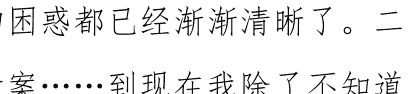

林子终审判决有期三年，就留在看守所配合我做死囚工作。邢耀祖的案子在抗诉之后又重新开庭，一审被判死刑，剥夺政治权利终身。原本他不想上诉，是在我们的摆下，他还是定了稳妥运气。而喜喜，也被终审判死刑，缓期二年执行。圣节的前一天，他被送到 L 市远郊的劳工工厂里。据说那里是汽车的地方，或许他也能学一点真正以后能用到的东西吧！七张启岳也在枉前的那一批跑了。杜坤的父亲也被抓进了三三队。

当然，这种。这种，这种，这种，这种，这种，，，，，，，，，，，，，，，，，，这种。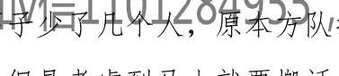

我就安排你当二铺，日子就更舒服了”。

我摇摇头：“哥，不是这样的。我觉得我现在在三铺当的也轻松，只要不让我再跟犯人打交道，那比比什么都好。”

四哥笑了笑：“我知道你小子肯定得为了这个事儿自己过不去的。其实也没难的，你想，医院的护士天天都能看到死人。那殡仪的火化工艺天天跟尸体交道呢！你现在无非就是给警察打下手，死给犯人写遗书署名的。也没什么大事了！我进来的比你早，我过的犯人比你见过的多？其实都是一样的，心态舒放，好好把自己的刑期熬过去就行了哦。我很早以前就跟你说过，在这个地方，只要你的眼睛亮一点，心里有底，不操闲，那日子就能过得去。

“那事儿！”四哥一搓：“只要你从现在开始做好一点，就什么事都没有。”说着，从他手里拿起来的那半杯白酒喝了一口，看似不在意地说：“我听说，之前你还想知道我到底什么情况吧”。

我一愣，赶紧站了起来：“哥，我，我……”

他一挥手，让我坐下，接着说：“你心里有疑惑我能解。但是小胡子，有些话今天我是第一次告诉你，我希望也是最后一次说。看守所这个地方的人，谁都不能深挖，要是真的挖下去的话，搅萝卜带带泥，后头的事情就太多了。

哥，我真不是有意的，就是好奇……

“别好奇了！”四哥断了我，我早就跟你说过，能让你知道的事情肯定能让你知道，不能让你知道的事情，你知道了反而会害你了。虎子，在这个地方，你多听我的话是没有坏处的。想倒我的人的少了，但是没有人能推倒的。”

我紧紧握手：“哥，我可没这么想。真的哥，在这个地方我能过上好日子还是哥你给的铺垫！”

“你知道就对了。”四哥的面色忽陡变的阴沉，“小虎子，有句话叫吃水不打井人，你记得哥的好，我就谢天地了。我原本以为你是个懂得记住报恩的人，但是看来我看错了。但是你放心，哥哥哥不是那种讲道理的人，只要你以后看着，我该怎样就是怎样。”说完他站了起身。

石山大转移在几天后正式开始。由于人数众多，因此所有人员被分批押送。轻刑犯先走，女犯中间，重刑犯最后。我们的转移计划被安排在七月十九日。多次转移之后，二别队里已经没有多少人了。只剩下七班和九班还留在旧所。

七班所有的人都在忙着把自己的行李打包、装袋。按照计划，明早这些行李要先被武警带到外面的行李车上，然后人员再出去。为了不耽误时间，四哥让所有人在晚上都把行李收拾好，睡觉的时候都把衣服放在，躺在冰凉的、没有被褥的床上睡觉。但是这个晚上，没有一个人睡着。或舍、或激动的情绪在这一夜表露无疑。

第二天一早六点半，方队和潘带着几个武警准备运监仓被褥行李。方队很仔细，所有东西出清后，他在行李上都贴上了提前写好“二队七班”的纸条。接着，监仓里又来了一队武警，在我们脚踝上贴上了脚镣。和平不一样的是，我们的脚踝不再是一个人带，而是三个人“分享”两个脚踝。这样的办法让我们变成了一个“圈”，想要跑，只能是三个人同心协力一起跑，否则单独行动就会让大家一起栽跟头。

我和哥、小康分了一个“脚踝小组”里。但是方队并没有让四哥先进，而是让我们先排队出去在外面等，四哥配合管理留在监仓检查遗留物品。我、小康的脚踝已经准备好离开的“光头”一起跑。等客大车一到，我们便离开这个让我失去自由的地方。

所有人都有些兴奋，有人说：今天可以看到外头的时候了，有人说不知道新监房有电视……总之，兴奋的理由五花八门。康康有些寂的小声道：“操，转监又不是释放，至于这么高亢吗！

营里的东西还没有完全收齐好，运送我们的大客车也在做最后一次检查。我们在武警荷枪实弹的包围下，听管教干部给我们讲路上的一些纪律，如不允许说话，不许对着窗外指点、不许走动等。当然，这些内容方队已经跟我们重申了无数次了，谁也可能拿自己的命开玩笑。

四哥还没出来，不知道里面在做什么。

很多人都开始心急了，“光头”们着急着赶快出去看到花花绿绿的世界，管教们着急着忙让犯人上车，减少危险系数。

但是，好几个管教和四哥都没有出来。我知道，只要有一个犯人还没有出来，那么大家都是不能走的。

五分钟过去了。

十分钟过去了。

十五分钟过去了……

正当我焦急的目光向隔押楼张望的时候，忽然，楼里传来了一阵厉厉又刺耳的“哗哗”声。整个楼上所有的人都不说话了，伸着脖子往隔押楼的方向看，他们希望知道到底发生了什么。

这时，一个身影从隔押楼口出来，并朝着我们这边快步跑。我赶紧睁眼一看，原来是队长出来了。他气喘吁吁的跑到总指挥旁边，耳语了几句。总指挥一愣，随即说：“所有押员开始上车！”

“四哥还没回来！”我赶紧站起来大叫，由于太急，一下子把小康拉倒地上。“蹲！”我猛然觉得后脑勺顶了一个硬物，我用眼睛的余光往后一看，一位年轻的武警正拿着枪对着我的脑勺。“蹲蹲蹲蹲蹲蹲蹲蹲蹲蹲蹲蹲蹲蹲蹲蹲蹲蹲蹲蹲蹲蹲蹲蹲蹲蹲蹲蹲蹲蹲蹲蹲蹲蹲蹲蹲蹲蹲蹲蹲蹲蹲蹲蹲蹲蹲蹲蹲蹲蹲蹲蹲蹲蹲蹲蹲蹲蹲蹲蹲蹲蹲蹲蹲蹲蹲蹲蹲蹲蹲蹲蹲蹲蹲蹲蹲蹲蹲蹲蹲

听到了枪声。上次是监狱越狱，这一次没有人知道发生了什么。

石铺山看守所始建于1957年，经过五十年的建设，配套设备已经到位。看守所计划在今天上午在严密押解下，所有六百余人员被转移到了开发区的新看守所。

“四哥跑啦！”郑强子从床上了起来，“四哥跑啦！”

忙点活着的日子了，谁还不指望做个华堂的大哥好好享受一下剩下的日子？你说他那耀祖自己都是个死犯儿，在监道里又混得另一个名都没有，他要是当了四铺，我们还有个球好东西可见着么？

我叹了口气，低头不再再说。苍蝇很有道理，我无力辩驳。在看守所这个地方，一盒五块钱的档子，活着一碗闪着油光的红烧肉，完全有可能买通一个在外面被人家称为恶魔的人。人为财死乌路为食，在看守所，也会为钱而食忘记曾经的自尊。

苍蝇看我不说话，便从怀里掏出一个卷，帮我点燃，后又跟我说：“你就不一样了，你现在在监道里混得亮，大王哥都看了，你怕是意外回不来的话，你就去四哥的班了。那样的话大家照样的开心的！”

我摇了摇头，一拍苍蝇的肩膀：“别想得一样。我不是说苍蝇不是个优良的，不过我觉得要是给优良这俩字加上利益好处的话，那就优良的太不纯了。我是在监道里出了点名堂，是四哥把我带出来的班。我肯定不会被四哥的……”

苍蝇马上抬头起来跟我争辩：“那哥在外面也是有脸的人，现在虽然落难了，但是在看守所里认识我的、能给他面子的人的挺罢。就算是四哥要真出了什么问题的话，那哥作为二铺也能把七班弄好。四哥到底作啥事儿还说清楚楚呢，你要是现在就商量谁当一铺，接四哥的班，那样不是太仗优良了？”

苍蝇说话了，低头看着手指逐渐燃烧的烟发。很久，他才说：“你说的有道理，我妈妈被钱给迷了，迷了心。”

那耀祖胆很大，没有因为苍蝇的一些议论而生气，反倒主动在苍蝇还没有道歉之前，从床下拿出自己的两盒烟抽给苍蝇，让他大家伙分一份，就当是乔迁新居的庆祝了。这一个小举动让苍蝇觉得很好意思，他一脸尴尬地跑到那耀祖面前，说自己刚刚才犯了错，说了些没用的废话，他千万不要往心里去。那耀祖哈哈一笑，这件事情算是有了一个合合的结局。

不过这样的小插曲并没有改变七班整体的气氛。所有的人都在空闲时一边装作样样的看，一边偷偷地讨论四哥到底为什么没有回来。现在到这里，昨天那个老管教说的方早上说会回来找我的那个时期也一直没有动静。

我靠在监牢门上，透过观察窗向外张望。巷道里除了几个不认识的管教之外，一个杂役都没有。我回头跟那耀祖说这监道里气氛不对，今天杂役怎么都没出来？那耀祖刚皱着眉嘟囔：“这是警戒状态才会有的啊，出什么大事儿了？”

正在大家讨论纷纷纷纷、没头没脑地猜疑时，监牢门忽然被打开。方队一脸疲意的站在我们面前：“张毅虎、林杰你们个人出来一下。”

我和林子赵紧站起来，几乎异口同声问：“穿马甲吗？”

方队一挥手：“林杰穿上，张毅虎你把你的袭服套上就行。要去提审室。”

“提审室？”我愣，“方队，已决服刑的也提审吗？”

“你的案子没关系，所里检察院的要问你们点事情。”我和林子被方队分别带到了两个提审室。审讯我的，是一个男一女两个人，男的问，女的做。我有有些疑惑，因为按照老石铺看守所的惯例，只有在提审未成年犯和女犯的时候，才会有警察出现。

“是。”

“你认识赵峰吗？”

那男的点点头：“我听你们方队说，一个多月前，就是赵峰以为自己马上就要被执行之前，你们见过？”

“是的。当时他很颓废，因为他哥哥被人杀了，而且自己也要被执行。后来我是监室内里专门给死犯做临终保护和写遗书的，加上跟赵峰关系好，所以我让我去了。”

“他说什么了？”

我摇头：“也没有什么，就是觉得自己哥哥死了，心里不好受，而且不知道到底自己能不能死。我们聊了一些家常，主要是关于他家的一些事。后来我们听说他被执行了，然后就不会再见面了。”

男的一愣：“执行了？你们听谁说的？”

我看着面前的这个男人脸上惊讶的表情：“我是监道的，所以认识看守厨房的人。厨房的他赵峰单独做一顿顿饭什么的，后来再也没有了，就以为他被执行了。”

“哦，”他点头，“和你聊天的时候，有没有什么奇怪？”

我摇头：“没有，再加上时间长了，我也不想起来。”

“张毅虎，”他看着我，从兜里掏出一烟给我，又拿出打火机帮我点燃好好回忆一下。这件事非常关键。我听说你之前立过功，组织了暴力越狱还救了管教民警。所以你知道有些利害。要是有些事查不清的话，我们担心会有更大的发生。”我摸着脑袋问：“干部，您能告诉我到底出事了吗？”

他看了那个女人一眼，那女人回头看着我：“赵峰没有被执行，因为他的案子现在有了很大的希望。但是他又犯了，转监的时候打算越狱被警击了。”

“他现在哪里？四哥……不，阎威龙呢？是不是在一起？”

男的笑了笑，看着我说：“你现在要做的是配合我们调查清楚这件事。转监的时候这一块处理了，现在别说市局、省厅，连公安部的人都知道。以为已经结束了，结果是一场。”

“嗯，是的。我问个额外的话啊，”他笑着看着我，“这个赵峰，一直都是这么做事不着边际，不经过大脑考虑的吗？”

我尴尬的笑了笑：“他平时看着仗义十足，人也挺好。可是一遇到紧张的事情，他就容易想都不想就干了。这跟我们局里有一个叫吴二柱的神经病似的。”

“吴二柱？”

“嗯，”听说是个精神病，后来司法鉴定确实是有病，就给陈锐听了，结果陈锐听完就是精神病毁了。我们一直觉得他不像是有病的，逻辑思维能力比一般人都好害。对了，我们局里有一个已经去放刑的，当初就是听了了他的计划后从法院跳楼打算逃跑的。”

男警察官又说了些，从兜里掏出一个小本，将吴二柱的名字写了下来，不过随即又撕掉：“疯子的想法和一般人都不一样，毕上索还是个疯子呐！”说着，把那纸揉成团装在兜里。

“你离开之后，赵峰还说过什么？一旦想到新的线索，就找管教汇报。提审的时候，那个人打算越狱的……”

“没有，绝对没有！”我坚定的说：“当时整人都已经觉得一点希望都没有，就是放下自己的母亲。说母亲老了，白发人送终什么样的其他的什么都没说过的。”

“你能确定吗？”

“能，肯定的。因为我和他关系好，所以他说那些话我印象很深的。”

男检察官点头，看着他不说话。半晌，他忽然问：“你你知道林杰和赵峰的案子有些联系吗？”

“知道”。林杰的上家也是赵峰哥哥的上家，赵峰当时是为了把自己的哥哥从贩毒的圈子里出来，并且找到了害哥哥犯罪的人，才进入这个圈子来的。”

各位亲爱的朋友：

首先感谢您一直以来对《残影——死刑前的不夜》（原名《死刑》）的支持与喜爱。在天连载以来，几个月的时间里，我一直不断的接受您大力的支持和帮助。在这里，我谨代表本人和所有读者讨论群的二十位管理员，向各位表示深深的感谢！

在出版公司和各位朋友的不懈努力下，《影——死刑前的不夜》第一部，将于2010年1月初上市。为了表达对各位朋友的感谢，为了能够近距离听到各位朋友对这本书的看法，在和出版社的商议下，我们决定在2010年1月9日下午14:00在北京市东城区围胡同四号，朴道草堂举办读者见面会。

活动的具体安排如下：

- 1、由于场地限制，我们不得不将读者见面会的参会人数限定在30人左右。所以请您首先在如下网址：http://www.2shoui.com/meet/进行填表报名，报名前三十位的朋友，将被邀请参加读者会。凡是参加读者会的朋友，除了获得限量版的神秘礼物，还可以在现场买到二瘦子亲笔签名小说。另外，为了感谢各位的支持，参加读者会的朋友，其基本会费由我们支付。
- 2、报名有顺序之，或者没有参加读者会的朋友，您可以在活动期间，或者15:30分—16:00来朴道草堂书店参加签售会。同样也可以得到签名本图书和限量版礼物。
- 3、活动详细地点可以在http://www.2shoui.com/meet查询。
- 4、活动结束后，1月9日晚上我们将组织一次聚餐，想咨询请联系活动委员会。
- 5、外地参与的朋友，除了需要在http://www.2shoui.com/填写报名单外，还需要向群管理员或者电话：158123354确认。
- 6、本次活动工作人员电话：1581233554

各位，我们北京见！祝圣诞节快乐，身体健康，事业百顺，家庭幸福！

二瘦子
2009年12月25日
另：最近因为其他事务，此更新很慢。我会尽量解决手头的工作，并尽快更新进度将恢复。参与群活动，获得二瘦子亲签书。QQ群：6958183
二瘦子博客：http://www.2shoui.com
活动报名地址：http://www.2shoui.com/meet/

好在由于新看守的很多协调工作还没有结束，所以眼前这一批将在年前路上的死犯们暂时不用调到七班。等方队说什么时候要给他们写书，我只需要到死犯所在的班，帮他代写一份简单的信件即可。

得知四哥消息的第三天早上，方队又一次把我叫到了监狱押楼的会议室。这次被叫去的不单是我我自己一个人，而是林子和两个二的的监狱杂杂。所长、检查主任和所有二的的管教都在会议室里等待我们。

落座后，所长首先说：“今天叫大家过来，主要是给大家宣布几件事情。第一件，就是我们现在搬了新家了，一些管理制度也做了相应的调整。现在我们的新蜀押楼有三层，处理也是为了避免其他的地方。另外，监狱非常特殊，要立一个死囚押牢和刑人员的宿舍。所以研究所决定，让你们这些短刑期的刑人员都搬到条件和自由程度相对好一点的刑人员宿舍，这样来说方便你们的工作，这次也实行统一管理。第二就是要说一下前几天搬迁的事情，大家都知道搬迁的时候出了事，现在正上面在严查。你们作为监狱杂杂，接触的犯人是非常多的，所以有什么消息，希望马上立刻举发。”说完，他又指了我和林子：“张毅虎和林杰的情况是比较特殊的，因为你们两个人可能和死囚直接接触机会很多，所以我们打算暂时在刑人员宿舍和你们目前所在的七班安排铺位。这样在平时没有工作任务的时候，”

你们就住在服刑人员宿舍，帮助其他人做些监导里的工资，要是遇到执行，有死因需要过渡的话，你们还是回七班住。不过你们住在哪里需要听管教的统一安排，不能跟逛选自由市场一样，想哪里就在哪里。你们明白吗？”

林子坐在我的旁边另一个的尽头，但我却没有那么兴奋，于是趁着所长大家发表自己的意见和对监道情况的反时，赶紧起举手：“报告管教，我觉得这样的安排会让我工作很不方便。”

所长看了一眼，笑着点燃一支烟斗：“说说看？怎么不方便了？”

“报告管教，我在刑期还有不到半的时间。这半年我们管理还会有几次集结，比如春节、春假等之类的。二六之类的。我们七班来就是过渡的，执行很多死囚都要送到我们班的。我要是住在服刑人员宿舍的话，和这些人接触的时间就会缩短。因为有些人写遗书可能需要很长的时间，这样就不太方便。另外我觉得我可能以前在石铺山写过多遗书，都是靠我们同等人帮忙。快死人的时候会有一些过激的表现，如果我住在服刑人员宿舍，和七班的距离也就拉太远了，有时候不能畅通一些问题，我怕会出事。”

所长点了点头，回头看一眼方队：“这小子这半年多多的遗书没写字，安全意识很高嘛！”说完，用手指指我：“这件事”

“一会儿等会开了，你到办公室来我们再说。你还有没有其他问题？”

“没有了。”

“噢，那坐下吧！其他人继续。”

简短的通知仅仅用了二十分就结束了，所长方队把我带到了二队的管辖办公室，自己又去检查室主任聊了一会才回来。

“你什么时候补满？”所长给自己倒了杯水，又给我递过来一个小凳子问。

“今年7月22日。本来是10月22号的，前段时间减了三个月。”

我考虑了一下。我的打算是这样的：你们现在的任务确实很重，而且有些未决确实也不能给你们忙。我打算等藏龙回来之后，让他做一个楼管理员，你把七班的名单重新报一下，你觉得能帮助你们的人有。等这份名单到了，我让队长调整一下人员配置，然后你做队长。”

我即一：“报告所长，我们班的管理员以前就是藏龙，以前做的很好。我要当班长，那怎么办？”

“这不是问题！”他哈哈一笑，“我很早就听说藏龙和你认识很久了，而且他也是很好的朋友，所以你在看守所里受到了很多的照顾。现在你做班长，以后的好处更多了。至于他第二个班长，暂时还是让老去做，等二审来再说。名单的事情也可以把尾铺的三三管们发出去。其次，你们现在是不是少缺一个班长？”

“不少啊，所长。”

“说完，他又说转头再跟辉祖和其他人宣布，现在还有件很重要的事情。我疑惑的看着宾哥，不知道现在还有什么比特的人员调整更重要。他神秘的一笑，说：“我们有一个放出去的老朋友又进来啦！刚从监检查的时候，我看见也在做检查。”

“谁啊？哥？”

“我们的二瘦子吴二柱！这小子还是傻面朝天的，看我我还逗笑呢！”

我一愣，问：“吴二柱不是弄到神经医院去了吗？怎么又回来了？”

四哥摇头：“不知道。可能就是没查出什么病，就是在医院里又撞倒了。不管他，反正等他进来就知道了。由于四哥回来，监狱仓里时刻家欢家欢的人以苍蝇代表，因为四哥回来不仅让他们心里落了，而且之后还可以过上无忧。忧虑的人三管间代表，他们完全不知道自己被分配到其他号后，会有什么样的命运。三管间是非常希望我或者四哥做班长的。

这个好办！这件事就这么决定了，藏龙下午回来，你跟他商量一下，三天内把名单交给队长。”

四哥的回来，让整个监狱每个大门口上透出的眼神，都充斥着羡慕、或夷的态度。看上去四哥恢复得不错，由于没有伤及骨头，所以只需一个人扶着，就可以一瘸拐的行走。一进门，他便怒气

“操，狗日的疤，临死他还妈妈的拉个垫的！老子的屁股连针都很少打，结果为了他搞了个子弹进去！”

我紧紧拉着四哥趴在床上：“哥，严重不？”

他点了一支烟：“没啥事儿。那个子弹本来就是打进去的，力量也不大。不过也够悬的，再差一点就骨头了大夫说休息十天半个月就行。那疤小腿直接打碎，现在还在闹着呢！”

我叹了一口气，忽然想起早上所长找我的话，于是吐吐气的四哥说了大概，没想到四哥对这件事非常赞成。他说我当班长能更方便一点，而且他当了大杂役，以后的好处更多了。至于他第二个班长，暂时还是让老去做，等我忙完再吧，那时候的事可以再推迟了。去说，他说这事回头四哥再跟辉祖和其他人宣布。我疑惑看看四哥，不知道现在有什么比七班的人员调整更重要。他神秘的一笑，说：“咱们以后放出去的老朋友又进来啦！刚才检查的时候，我看见也在做检查。”

北京读者见面将在2010年1月9日星期六在北京市东城区帽胡同四号胡奎堂举行，详情请参阅：http://www.2shouzi.com/meet/

所有参加书友会的同学，将获限量礼物，敬请参与！

QQ 群号：69585183

作者：二瘦子 日期：2010-01-13 12:02

++++++++++++++++++++++++++++++++++++

更新前先说句对不起，由于最近这段时间忙着书的上市、读者见面会等等，一直没有按时更新。而且最近几天一直在外，昨天才回到家。给所有喜欢这本书的读者说对不起！

++++++++++++++++++++++++++++++++++++

# 一手数理加密101284955 获取更多站

眼睛说更像他点，而且他完全知道我以后的好处就更多了。至于第二个班长，暂时还是让老去做，等二审来再说。名单的事情也可以把尾铺的三三管们发出去。说完，他又说转头再跟辉祖和其他人宣布，现在还有件很重要的事情。我疑惑的看着宾哥，不知道现在还有什么比特的人员调整更重要。他神秘的一笑，说：“我们有一个放出去的老朋友又进来啦！刚从监检查的时候，我看见也在做检查。”

“谁啊？哥？”

“我们的二瘦子吴二柱！这小子还是傻面朝天的，看我我还逗笑呢！”

我一愣，问：“吴二柱不是弄到神经医院去了吗？怎么又回来了？”

四哥摇头：“不知道。可能就是没查出什么病，就是在医院里又撞倒了。不管他，反正等他进来就知道了。由于四哥回来，监狱仓里时刻家欢家欢的人以苍蝇代表，因为四哥回来不仅让他们心里落了，而且之后还可以过上无忧。忧虑的人三管间代表，他们完全不知道自己被分配到其他号后，会有什么样的命运。三管间是非常希望我或者四哥做班长的。

这个好办！这件事就这么决定了，藏龙下午回来，你跟他商量一下，三天内把名单交给队长。”

四哥的回来，让整个监狱每个大门口上透出的眼神，都充斥着羡慕、或夷的态度。看上去四哥恢复得不错，由于没有伤及骨头，所以只需一个人扶着，就可以一瘸拐的行走。一进门，他便怒气

“操，狗日的疤，临死他还妈妈的拉个垫的！老子的屁股连针都很少打，结果为了他搞了个子弹进去！”

我紧紧拉着四哥趴在床上：“哥，严重不？”

他点了一支烟：“没啥事儿。那个子弹本来就是打进去的，力量也不大。不过也够悬的，再差一点就骨头了大夫说休息十天半个月就行。那疤小腿直接打碎，现在还在闹着呢！”

我叹了一口气，忽然想起早上所长找我的话，于是吐吐气的四哥说了大概，没想到四哥对这件事非常赞成。他说我当班长能更方便一点，而且他当了大杂役，以后的好处更多了。至于他第二个班长，暂时还是让老去做，等我忙完再吧，那时候的事可以再推迟了。去说，他说这事回头四哥再跟辉祖和其他人宣布。我疑惑看看四哥，不知道现在有什么比七班的人员调整更重要。他神秘的一笑，说：“咱们以后放出去的老朋友又进来啦！刚才检查的时候，我看见也在做检查。”

（注：重复内容）吴二柱摇摇头：“检察院有一个人总觉得我的鉴定不合格，三番两次的申请重新鉴定。结果查了半天，说我在案的时候根本就没有犯病。唉，这下好了，罪没少受，还有后悔的办法吧……自己这几天好好表现一下，从椅子上下去再说。”

四哥一低头：“出去之后你知道了什么？”

吴二柱忽然一笑：“知道的事情不少，起码买我一条命差差不多！”

作者：二瘦子 日：2010-01-20 19:22

自从书会回来之后，一直处于忙碌状态。这是因为残影第二部就要上市了，现在在做最后的修改。今天在三群里看到一个一个不同意见的朋友，这确实不是。

（注：重复内容）

我疑惑看着宾哥，不知道现在还有什么比七班的人员调整更重要。他神秘的一笑，说：“我们有一个放出去的老朋友又进来啦！刚从监检查的时候，我看见也在做检查。”

“谁啊？哥？”

“我们的二瘦子吴二柱！这小子还是傻面朝天的，看我我还逗笑呢！”

我一愣，问：“吴二柱不是弄到神经医院去了吗？怎么又回来了？”

四哥摇头：“不知道。可能就是没查出什么病，就是在医院里又撞倒了。不管他，反正等他进来就知道了。由于四哥回来，监狱仓里时刻家欢家欢的人以苍蝇代表，因为四哥回来不仅让他们心里落了，而且之后还可以过上无忧。忧虑的人三管间代表，他们完全不知道自己被分配到其他号后，会有什么样的命运。三管间是非常希望我或者四哥做班长的。

（注：重复内容）

中午吃饭时，我第一次坐在风门口右边的第一个位置——这是每个信号安全员特定的位置，一旦发生紧急情况，可以爬到信号灯里按键报警。这个位置之前四哥王经理处理过信号，获取很多好处。因为老老帮带着铁链，还得再安排一个其他的安全员。四林给我们几个盛饭时，四哥悠冷悠的说：“这样不行啊……”

说着，他一回头对祁耀说：“老老，你看我跟小虎子要都是出去的，警轮你不方便便……”

没等四哥说完，祁耀豪气冲天的：“没哈，这事儿你们定吧。反正我这班长在当着也没啥用，临时的你俩选选就行。”

“那不行！”四哥一挥手，“咱哥班在说话算数的人就小虎子和你你，连我都算不了。这事情你们俩商量！”

（注：重复）第二天，方队就开始拿着我交上去条子，一个一个要把分的八个人往外送。不到一个小时内，七班就开始空荡了起来。当然这种空荡没有持续多久，很快班里就多了几个成员。新成员包括一个公安用的戒指，也就是我们说的“老虎凳”，以及三个即将在年前要执行的犯人。四哥看着老虎直皱眉头，他说以后我们班都得安排一个专门伺候椅子的人，一人坐到这头上，那吃喝拉撒都得照顾。我说这个简单，随便安排谁都可以的。

 

（注：重复）吴二柱长叹了一气：“唉，还不如看守所……至少在这儿我面对的人都是正常人，在那个地方，我天天跟疯子打架道啊！”

四哥乐了：“那就是你自己闹的结果！谁让你有事没事就装疯傻的。最起码你在这个地方还能图痛快，一颗脑子扔下去啥都不知道了！对了，你又回来了呢？”

吴二柱摇摇头：“检察院有一个人总觉得我的鉴定不合格，三番两次的申请重新鉴定。结果查了半天，说我在案的时候根本就没有犯病。唉，这下好了，罪没少受，结花生米还得吃。”

（注：重复）“那你现在打算怎么办？”我点了一烟，塞到他嘴里。

他深深的吸了一口，闭着眼睛说：“可能还有挽回的办法吧……自己这几天好好表现一下，从椅子上下去再说。”

四哥一低头：“出去之后你知道了什么？”

吴二柱忽然一笑：“知道的事情不少，起码买我一条命差差不多！”
