# 《蜂麻燕雀——你不了解的民国江湖，揭秘肮脏骗

夜半微风的老鬼

## 楔子

高挑妩媛的女人，那辆红色的客车和渐渐沉重的眼皮，
这是我昏迷前的一切。

2016年5月，忙碌的生活一下子变得格外闲闲了起来。
本来睡眠很少的我感觉到了时间的虚度，大量的空间让我
开始思考人生，说白了就是胡思乱想蠢欲勃勃。

那是下午，我独自在朝山街的一家英式下午茶馆喝着。
之所以选择这家店，是因为我要在这里等一个朋友。

三天前我收到了了一条短信发给我的微信，我虽然忘记了
那个短信究竟是谁，但他说他淘了一个奇怪的物件，
里面充满了未知和神秘，这一下子就勾起了我的兴趣。

这家小店是我选的，坐在一个破旧小区的一楼的。我曾
经历过这里，而不远处则是济南最繁华的所在，所以安全
系数很高，我安心聚约的。

一个漂亮的女人施施然的坐在了我的对面，我睁眼看向
她，在这店内昏暗的灯光下，透过的台灯的光照她格外的美
丽。月下不见色，灯下看美人，我第一时间有些愣了。我问道：

“你好，请问您有什么事儿吗？”

“你是老鬼吧？”她微微一笑说道。

“你是抠脚大汉吗？”我不由得出了那个微信名，可微信上她显示的性别分明是个男人，朋友圈内也毫无线索。我本以为她会为此做什么解释，虽然她并没有因此深谈，或许是她的原因。

她点了点头说道：“我是，你点了什么，这家家的东西很好吃。”

“我知道，我来了，你看我的小说应该清楚了，我是个名叫吃货的。”我也笑了。

她若有所思的点了点头，即便这种错愕只在她的脸上上一瞬间，却被我捕捉到了，不算有些好处。我的小说并不是靠情节起节起来吸引读者，而是有看点和最具光点的则是人性。人的善，人的恶，还有不黑不白亦正邪的自然。所以我我很喜欢观察，或者说喜欢观察。我甚至喜欢在饭店和街上到处看每个路人和食客，判断他们的职业和现在的心情。

她被我盯得有些发了，弄了她长长的头发来掩盖此刻她内心可能有的慌乱。她很平和的跟我聊天，几分钟后我切入了正题：“您不是有什么东西要给我看吗？”

“当然有，不过我没带在身上，那东西丢沉了，而且里面虽然没有人来，不过……”说到这里，她窘窘的看了看四周，包括柜台后的老板娘。

“那东西在哪里，到底是什么东西？”我问道。

“一个青铜鼎，会说话的青铜鼎。”她眨了大眼睛说，随口补充道：“在我的车上，要不要跟我去开车看看，我就停在路口了。”

“好。”

我不愿意就此耽误时间，虽然她很漂亮，但不是我的菜。
我付了账，与她一起来到了一辆红色的客车前，她拿出手车钥匙
扒开了车锁，说道：“在后座上。”

我刚开车门回头看去，后座上什么也没有，扭头疑惑感的看向她，却看到她拿着一团粉末，朝着我轻柔地吹了一口。空气击扑，紧接着就是天地旋转，我终于于明白她刚才的意思了——如果不是劫持，那就是我认识的那个女孩。

我有过低血糖昏倒的经历，就是这种感觉。

作者：夜半微风的老鬼 日期：2017-03-10 19:49

再次醒来的时候，我已经在一个房间里了。四周环顾这里应该是个居民的老巷，我第一反应就是自己被绑架了。我身上并没有捆着绳索，我没有任何一个绑匪会放一个身高高一米八九的大汉行动自如的。第二应该是我被劫财劫色了，可想也许不对，我怎么穿着整齐的？摸摸身上，没有伤口，我从床上坐了起来，紧张的观察周围，屋外若无的家具都很陈旧。

可是我的手碰到床沿的时候不由得一惊，竟然是紫檀木。谁家要有真正的红木床就够了。我连不太懂，但这应该是紫檀的。我翻身起来，鞋子摆在地上。我朝着客厅走去，声音来源于一楼像老式居民楼一般。我小心翼翼的推开门，院子里椅子上坐着一个老头，他看着我，闭目养神。他的身旁正是刚才见面的美女，此刻正给老头点着烟。我理了理，问了一句：“听到了什么？”听到了耳朵，还是吵的。我先一愣，随口道：“都算了，听到意思。”这句话是江湖的，我是个写小说的，喜欢用这种语气述事情，我没想到现在还有人跟我说，更没料会有这样。

作者：夜半微风的老鬼 2017-03-30 19:50

## 第一章 大白腿和络脾胡

“别跑！”

孟小六在大众院中冲了进来，身后赤着身上追逐的是他的父亲孟安。小六刚喊道，见道转弯洞就钻，一会儿功夫就孟安给没了影子。

孟小六扒着矮墙望向大街，嘿嘿笑了起来。猛然间背后有人拍了拍自己一下，小六没呆。

“丫干嘛呢，哭着脸。”一个和孟小六般大的男孩站在孟小六身后。

我整理了一下衣服，擦了擦脸，“我摔了。我刚才把家的碗给碎了，我爸爸打我呢。对了，现在去哪儿玩？”

“前门天桥栅栏你自己选，都热闹。”谢大头说道。

“走着吧，叫麻子一起。”

“得嘞。”

孟小六住在外大众院里，父亲孟安在车厂拉车，终日忙活也就睁一口馋，母亲则靠着人家洗衣衣服缝补补补来贴家用。孟小六之所以叫小六，是因为在老家他父亲排行老六，稀里糊涂的给他取了个孟小六的名字。但家里竟然还有人，父亲也说不利索。当年家里日子过不好了，父亲跑来了北京，活儿杂工干过，后来去车厂拉车。每天忙好了，能吃个饱饭，赶上那些打车，只能忍气声，少赚一口了。

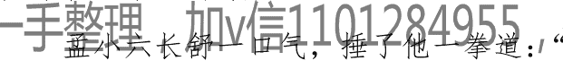

不上学就在市面上嬉玩混混，有人穷人的孩子早到家，大家还没活多久，孩子可能干些这些。要是王老五，觉得他那点事没错，换上陈。小六歪歪，平时也能换个仁。所以别看大头比小六年纪，虽然才十二的年纪，懂事的儿多。

作者：夜半微风的老鬼 2017-03-30 20:00

“呵，看大白脸！”麻子最色，街上一个女人穿着旗袍走向，这绝对是对打算，也就从广告和看到。孟小六和大头看向，女人下了车，顺着摇着走。附近。她拿出手车钥匙扒开了车锁，说道：“在后座上。”

我刚开车门回头看去，后座上什么也没有，扭头疑惑感的看向她，却看到她拿着一团粉末，朝着我轻柔地吹了一口。空气击扑，紧接着就是天地旋转，我终于于明白她刚才的意思了——如果不是劫持，那就是我认识的那个女孩。

我有过低血糖昏倒的经历，就是这种感觉。

门口珠宝店小伙计正在迎送，按照情况下他也不会下手。此时小伙计正在跟客人说话，有了这么时间差。

“黑，孙子，怎么偷东西！”站在街上吼一声。

作者：夜半微风的老鬼 2017-03-30 20:05

偷东西的小贼抓头发就跑，女人也抬头回望，随即招了。三人不由得脸红，低着头走。此刻小伙计忙完了，看到女人连忙招呼，看到女人搓手，从包里拿出三个角洋：“这是给你们的。”

“呵，哈哈了不起，就不是小伙计吗？”谢大头满道的。转而他也笑了，拿着角洋，他极了，往日里人都高兴了赏自己，现在小子赚了一毛钱，面对五个孩子，岂不高兴高涨。

“六哥，去吃饭吧。”麻子娃看着眼睛，谢大头也看着孟小六。其实小六是想着这钱，可见兄弟们说了，自己也不能骗了人家劲哟，随意的脚咬牙道：“走，去过桥，今儿就今了，小爷不过了。”

肠好吃，三个三十四岁的大小子狼吞虎咽着吃下肚子了。按照水牌子上的价格会了，便决定在天桥闲逛。那里打把势卖文唱戏的不少，足以打发时间还不花钱。离了刚走了几步，迎面走来两个瘦高，其中一个是。

作者：夜半微风的老鬼 2017-03-30 20:07

“小六，有点太不对劲了，那个人怎么直着我们来了。”

谢大头第一个看到的，忙出言提醒。孟小六盯一眼，只道一声不好，这两人脸上挂相，一看不是好人。人都是大小，没什么钱也罢什么。收拾行李，打算合力分头跑路，获取更多好处。麻子领吓得两股战战：“六哥，我怕。”

“怕毛毛，一会儿你跟着我跑，大头，你自己跑。”

三人转身就走，穿过街巷，准备进入胡同后撒腿就跑，结果却被一个腰胡子的大汉给住了去路。身后两名瘦高也住了胡同口，三个大人裹着三个孩子朝着胡同深处而去。

作者：夜半微风的老鬼 2017-03-30 20:11

“妈的，小兔崽子，你不知道我们是干啥的？”

胡子上来就给了个最高的谢大头一巴脸，谢大头顿时被拍翻在地上。麻子吓得哭了，孟小六虽然很害怕，但他却不认这个，扬军叫：“我日你姥娘，你怎么打人！”

“哎哟，嫌裤衩才把你给露出来了，小子，你活把了吧？”瘦高个上来，揪住了孟小六的脖子，看着孟小六尾上踢了一脚。

“偷东西的就是过街老鼠，人人都可堪了。你们自己被发现了还敢报复，你们还要点脸，还是不是混的啊！”

人哪里得了，孟小六很快被踢在地上，三个青年围着谢大头和孟小六又踢踹。伸手拉扯把这家伙拽起来，谢大头脸算便宜了还是，一直不出静，而孟小六被踢得死要活，也不愿意惹这。

作者：夜半微风的老鬼 2017-03-30 20:13

差不多就可以了，真想要人命啊。一个胖男子进来，微笑盈盈的，满脸挂笑，眯眯的眼睛里露出一抹不易察觉的杀气。胡子挠了摇头：“呵，真是邪了，一个，你是干啥的？”

我是干什么的并不重要，重要的是孩子说的。胖子不忙继续道：“规矩不是这么来的。你带你们去，要不要？”，环顾四周，朝着胖子走了过来。拍掌就要落下，黑影一把拽住了胡子的手腕，一拧就听到了清脆断裂之力，胡子毫无力，被按住膝盖，双膝跪地后脸上中了一拳，疼的。

黑影是不理的。胡子虽然吭，但留着几分硬气，从地上爬起来，脸色已经是煞白一片，听他道：“别跑了，赶紧去吧。”胖子依然笑着，但语气中不带一丝感情。“走。”

作者：夜半微风的老鬼 2017-03-30 20:19

等人走后，胖子到了孟六三人面前，蹲下身，看着被踢得满脸血的孟六，不由得再次笑了：“小子，”

够硬的，你知不知道好吃，要是我们出现，三个不死也得掉皮。落下残疾，以后还是你们。

“谢了。”孟小六挣扎想要爬起来，拱手抱拳，却又趴在了地上。胖子摇了摇头对那个黑瘦男人说：“这小子的气倒是和你当年几分像。”

“呵呵。”黑瘦没说话，只是笑了笑。胖子拿出一大袋，放在了正在泣的麻子手里，转而对孟六说：“以后见到这几个坏小子绕点走，放心，他们嚣张了很久了，本地的不会让他们非。”胖子撑起身体道：“莫小六他在看着我，报一下阁下贵名吗？”

“你小子还一套，什么阁下不阁下的，也是江湖贫友。朋友就是帮我，我帮你。有缘再见吧，小兄弟。”胖子了了挥，头也不回离开了。

作者：夜半微风的老鬼 日期：2017-03-30 20:30

## 第一章 暂休息一下

## 第二章 原来是骗子

“六哥，大头哥不行了，怪我，怪我不该管事儿。”

麻子依然嚎着痛哭着，小六伸手在谢大头鼻子底下探了探

道：“闭嘴，哭什么长，人还没死呢，就是晕过去的而已。”

麻子忍住了哭泣，抽拉搭扯的看着孟小六，活像个受了委屈的小姨妇。孟小六被打得浑身疼，强挣扎着站起来，用手拍了拍拍大头的脸，唤道：“大头，大头，快醒醒！”

不一会功夫，大头悠悠的睁开了眼，呲牙道：“那帮孙子下手可真够妈的，哥几个家里了。”

“行了，没死就起来，”孟小六和大头互相扶着，麻子在一旁拉拉他们弄弄朝着那个，朝家的方向走去。没死就起来，脸色已经是煞白一片，听他道：“没死，没，，，，，，，，都是脏的衣服。

衣服，脏，都是脏的衣服，脏的，，，，虚虚虚的。

作者：夜半微风的老鬼 2017-03-30 20:39

肠好吃，三个三十四岁的大小子狼吞虎咽着吃下肚子了。按照水牌子上的价格会了，便决定在天桥闲逛。那里打把势卖文唱戏的不少，足以打发时间还不花钱。离了刚走了几步，迎面走来两个瘦高，其中一个是刚刚的那个手。

“小六，有点太不对劲了，那个人怎么直着我们来了。”

谢大头第一个看到的，忙出言提醒。孟小六盯一眼，只道一声不好，这两人脸上挂相，一看不是好人。人都是大小，没什么钱也罢什么。收拾行李，打算合力分头跑路，获取更多好处。麻子领吓得两股战战：“六哥，我怕。”

“怕毛毛，一会儿你跟着我跑，大头，你自己跑。”

找到了心骨。

三人转身就走，穿过街巷，准备进入胡同后撒腿就跑，结果却被一个腰胡子的大汉给住了去路。身后两名瘦高也住了胡同口，三个大人裹着三个孩子朝着胡同深处而去。

肠好吃，，，，，，，，，，，，，，，，，，，，，，，，，，，，，，，，，，，，，，，，，，，，，，，，，，，，，，，，，，，，孩子，，，，，，，，，，，，，衣服的衣服，的衣服，的，，的衣服，的，都是脏的衣服，都是脏的衣服，脏的衣服，虚虚的，虚虚的衣服，都是脏的衣服，虚虚虚虚虚虚虚虚虚虚虚虚虚虚虚虚，都是脏的衣服，都是脏的衣服，虚虚虚虚虚虚虚虚虚虚虚虚虚虚虚虚虚虚虚虚虚虚虚。

作者：夜半微风的老鬼 2017-03-30 20:44

 ，，都是，的衣服。

 够硬的，你知不知道好吃前汉，要是我们出现，三个不死也得掉皮。落下残疾，以后还是你们。

“谢了。”孟小六挣扎想要爬起来，拱手抱拳，却又趴在了地上。胖子摇了摇头对那个黑瘦男人说：“这小子的气倒是和你当年几分像。”

“呵呵。”黑瘦没说话，只是笑了笑。胖子拿出一大袋，放在了正在泣的麻子手里，转而对孟六说：“以后见到这几个坏小子绕点走，放心，他们嚣张了很久了，本地的不会让他们非的。拿去看病吧，走了。”

衣服，脏的衣服，虚虚虚虚虚虚虚虚虚虚虚虚虚虚虚虚虚虚虚的衣服，都是脏的衣服，虚虚虚虚虚虚虚虚虚虚虚虚虚虚虚虚虚虚虚虚虚虚虚虚虚虚虚虚虚虚虚。都是脏的衣服，都是脏的衣服，虚虚虚虚虚虚虚虚虚虚虚虚虚虚虚虚虚虚虚虚虚虚虚虚虚虚虚虚虚虚虚虚虚虚虚虚虚虚虚虚虚虚虚虚虚虚虚虚虚虚虚虚虚虚虚虚虚虚虚虚虚虚虚虚虚虚虚虚虚虚虚虚虚虚虚虚虚虚虚虚虚虚虚虚虚虚虚虚虚虚虚虚虚虚虚虚虚虚虚虚虚虚虚虚虚虚虚虚虚虚虚虚虚虚虚虚虚虚虚虚虚虚虚虚虚虚虚虚虚虚虚虚虚虚虚虚虚虚虚虚虚虚虚虚虚虚虚虚虚虚虚虚虚虚虚虚虚虚虚虚虚虚虚虚虚虚虚虚虚虚虚虚虚虚虚虚虚虚虚虚虚虚虚虚虚虚虚虚虚虚虚虚虚虚虚虚虚虚虚虚虚虚虚虚虚虚虚虚虚虚虚虚虚虚虚虚虚虚虚虚虚虚虚虚虚虚虚虚虚虚虚虚虚虚虚虚虚虚虚虚虚虚虚虚虚虚虚虚虚虚虚虚虚虚虚虚虚虚虚虚虚虚虚虚虚虚虚虚虚虚虚虚虚虚虚虚虚虚虚虚虚虚虚虚虚虚虚虚虚虚虚虚虚虚虚虚虚虚虚虚虚虚虚虚虚虚虚虚虚虚虚虚虚虚虚虚虚虚虚虚虚虚虚虚虚虚虚虚虚虚虚虚虚虚虚虚虚虚虚虚虚虚虚虚虚虚虚虚虚虚虚虚虚虚虚虚虚虚虚虚虚虚虚虚虚虚虚虚虚虚虚虚虚虚虚虚虚虚虚虚虚虚虚虚虚虚虚虚虚虚虚虚虚虚虚虚虚虚虚虚虚虚虚虚虚虚虚虚虚虚虚虚虚虚虚虚虚虚虚虚虚虚虚虚虚虚虚虚虚虚虚虚虚虚虚虚虚虚虚虚虚虚虚虚虚虚虚虚虚虚虚虚虚虚虚虚虚虚虚虚虚虚虚虚虚虚虚虚虚虚虚虚虚虚虚虚虚虚虚虚虚虚虚虚虚虚虚虚虚虚虚虚虚虚虚虚虚虚虚虚虚虚虚虚虚虚虚虚虚虚虚虚虚虚虚虚虚虚虚虚虚虚虚虚虚虚虚虚虚虚虚虚虚虚虚虚虚虚虚虚虚虚虚虚虚虚虚虚虚虚虚虚虚虚虚虚虚虚虚虚虚虚虚虚虚虚虚虚虚虚虚虚虚虚虚虚虚虚虚虚虚虚虚虚虚虚虚虚虚虚虚虚虚虚虚虚虚虚虚虚虚虚虚虚虚虚虚虚虚虚虚虚虚虚虚虚虚虚虚虚虚虚虚虚虚虚虚虚虚虚虚虚虚虚虚虚虚虚虚虚虚虚虚虚虚虚虚虚虚虚虚虚虚虚虚虚虚虚虚虚虚虚虚虚虚虚虚虚虚虚虚虚虚虚虚虚虚虚虚虚虚虚虚虚虚虚虚虚虚虚虚虚虚虚虚虚虚虚虚虚虚虚虚虚虚虚虚虚虚虚虚虚虚虚虚虚虚虚虚虚虚虚虚虚虚虚虚虚虚虚虚虚虚虚虚虚虚虚虚虚虚虚虚虚虚虚虚虚虚虚虚虚虚虚虚虚虚虚虚虚虚虚虚虚虚虚虚虚虚虚虚虚虚虚虚虚虚虚虚虚虚虚虚虚虚虚虚虚虚虚虚虚虚虚虚虚虚虚虚虚虚虚虚虚虚虚虚虚虚虚虚虚虚虚虚虚虚虚虚虚虚虚虚虚虚虚虚虚虚虚虚虚虚虚虚虚虚虚虚虚虚虚虚虚虚虚虚虚虚虚虚虚虚虚虚虚虚虚虚虚虚虚虚虚虚虚虚虚虚虚虚虚虚虚虚虚虚虚虚虚虚虚虚虚虚虚虚虚虚虚虚虚虚虚虚虚虚虚虚虚虚虚虚虚虚虚虚虚虚虚虚虚虚虚虚虚虚虚虚虚虚虚虚虚虚虚虚虚虚虚虚虚虚虚虚虚虚虚虚虚虚虚虚虚虚虚虚虚虚虚虚虚虚虚虚虚虚虚虚虚虚虚虚虚虚虚虚虚虚虚虚虚虚虚虚虚虚虚虚虚虚虚虚虚虚虚虚虚虚虚虚虚虚虚虚虚虚虚虚虚虚虚虚虚虚虚虚虚虚虚虚虚虚虚虚虚虚虚虚虚虚虚虚虚虚虚虚虚虚虚虚虚虚虚虚虚虚虚虚虚虚虚虚虚虚虚虚虚虚虚虚虚虚虚虚虚虚虚虚虚虚虚虚虚虚虚虚虚虚虚虚虚虚虚虚虚虚虚虚虚虚虚虚虚虚虚虚虚虚虚虚虚虚虚虚虚虚虚虚虚虚虚虚虚虚虚虚虚虚虚虚虚虚虚虚虚虚虚虚虚虚虚虚虚虚虚虚虚虚虚虚虚虚虚虚虚虚虚虚虚虚虚虚虚虚虚虚虚虚虚虚虚虚虚虚虚虚虚虚虚虚虚虚虚虚虚虚虚虚虚虚虚虚虚虚虚虚虚虚虚虚虚虚虚虚虚虚虚虚虚虚虚虚虚虚虚虚虚虚虚虚虚虚虚虚虚虚虚虚虚虚虚虚虚虚虚虚虚虚虚虚虚虚虚虚虚虚虚虚虚虚虚虚虚虚虚虚虚虚虚虚虚虚虚虚虚虚虚虚虚虚虚虚虚虚虚虚虚虚虚虚虚虚虚虚虚虚虚虚虚虚虚虚虚虚虚虚虚虚虚虚虚虚虚虚虚虚虚虚虚虚虚虚虚虚虚虚虚虚虚虚虚虚虚虚虚虚虚虚虚虚虚虚虚虚虚虚虚虚虚虚虚虚虚虚虚虚虚虚虚虚虚虚虚虚虚虚虚虚虚虚虚虚虚虚虚虚虚虚虚虚虚虚虚虚虚虚虚虚虚虚虚虚虚虚虚虚虚虚虚虚虚虚虚虚虚虚虚虚虚虚虚虚虚虚虚虚虚虚虚虚虚虚虚虚虚虚虚虚虚虚虚虚虚虚虚虚虚虚虚虚虚虚虚虚虚虚虚虚虚虚虚虚虚虚虚虚虚虚虚虚虚虚虚虚虚虚虚虚虚虚虚虚虚虚虚虚虚虚虚虚虚虚虚虚虚虚虚虚虚虚虚虚虚虚虚虚虚虚虚虚虚虚虚虚虚虚虚虚虚虚虚虚虚虚虚虚虚虚虚虚虚虚虚虚虚虚虚虚虚虚虚虚虚虚虚虚虚虚虚虚虚虚虚虚虚虚虚虚虚虚虚虚虚虚虚虚虚虚虚虚虚虚虚虚虚虚虚虚虚虚虚虚虚虚虚虚虚虚虚虚虚虚虚虚虚虚虚虚虚虚虚虚虚虚虚虚虚虚虚虚虚虚虚虚虚虚虚虚虚虚虚虚虚虚虚虚虚虚虚虚虚虚虚虚虚虚虚虚虚虚虚虚虚虚虚虚虚虚虚虚虚虚虚虚虚虚虚虚虚虚虚虚虚虚虚虚虚虚虚虚虚虚虚虚虚虚虚虚虚虚虚虚虚虚虚虚虚虚虚虚虚虚虚虚虚虚虚虚虚虚虚虚虚虚虚虚虚虚虚虚虚虚虚虚虚虚虚虚虚虚虚虚虚虚虚虚虚虚虚虚虚虚虚虚虚虚虚虚虚虚虚虚虚虚虚虚虚虚虚虚虚虚虚虚虚虚虚虚虚虚虚虚虚虚虚虚虚虚虚虚虚虚虚虚虚虚虚虚虚虚虚虚虚虚虚虚虚虚虚虚虚虚虚虚虚虚虚虚虚虚虚虚虚虚虚虚虚虚虚虚虚虚虚虚虚虚虚虚虚虚虚虚虚虚虚虚虚虚虚虚虚虚虚虚虚虚虚虚虚虚虚虚虚虚虚虚虚虚虚虚虚虚虚虚虚虚虚虚虚虚虚虚虚虚虚虚虚虚虚虚虚虚虚虚虚虚虚虚虚虚虚虚虚虚虚虚虚虚虚虚虚虚虚虚虚虚虚虚虚虚虚虚虚虚虚虚虚虚虚虚虚虚虚虚虚虚虚虚虚虚虚虚虚虚虚虚虚虚虚虚虚虚虚虚虚虚虚虚虚虚虚虚虚虚虚虚虚虚虚虚虚虚虚虚虚虚虚虚虚虚虚虚虚虚虚虚虚虚虚虚虚虚虚虚虚虚虚虚虚虚虚虚虚虚虚虚虚虚虚虚虚虚虚虚虚虚虚虚虚虚虚虚虚虚虚虚虚虚虚虚虚虚虚虚虚虚虚虚虚虚虚虚虚虚虚虚虚虚虚虚虚虚虚虚虚虚虚虚虚虚虚虚虚虚虚虚虚虚虚虚虚虚虚虚虚虚虚虚虚虚虚虚虚虚虚虚虚虚虚虚虚虚虚虚虚虚虚虚虚虚虚虚虚虚虚虚虚虚虚虚虚虚虚虚虚虚虚虚虚虚虚虚虚虚虚虚虚虚虚虚虚虚虚虚虚虚虚虚虚虚虚虚虚虚虚虚虚虚虚虚虚虚虚虚虚虚虚虚虚虚虚虚虚虚虚虚虚虚虚虚虚虚虚虚虚虚虚虚虚虚虚虚虚虚虚虚虚虚虚虚虚虚虚虚虚虚虚虚虚虚虚虚虚虚虚虚虚虚虚虚虚虚虚虚虚虚虚虚虚虚虚虚虚虚虚虚虚虚虚虚虚虚虚虚虚虚虚虚虚虚虚虚虚虚虚虚虚虚虚虚虚虚虚虚虚虚虚虚虚虚虚虚虚虚虚虚虚虚虚虚虚虚虚虚虚虚虚虚虚虚虚虚虚虚虚虚虚虚虚虚虚虚虚虚虚虚虚虚虚虚虚虚虚虚虚虚虚虚虚虚虚虚虚虚虚虚虚虚虚虚虚虚虚虚虚虚虚虚虚虚虚虚虚虚虚虚虚虚虚虚虚虚虚虚虚虚虚虚虚虚虚虚虚虚虚虚虚虚虚虚虚虚虚虚虚虚虚虚虚虚虚虚虚虚虚虚虚虚虚虚虚虚虚虚虚虚虚虚虚虚虚虚虚虚虚虚虚虚虚虚虚虚虚虚虚虚虚虚虚虚虚虚虚虚虚虚虚虚虚虚虚虚虚虚虚虚虚虚虚虚虚虚虚虚虚虚虚虚虚虚虚虚虚虚虚虚虚虚虚虚虚虚虚虚虚虚虚虚虚虚虚虚虚虚虚虚虚虚虚虚虚。
[/content]
[content]
本来睡眠很少的我我感觉到了时间的虚虚，大量的空间让我
开始思考人生，那是下午，
之所以选择这家店，是因为我要在这里等一个朋友。

三天前我收到了了一条短信发给我的微信，我虽然忘记了
那个短信究竟是谁，但他说他淘了一个奇怪的物件，
里面充满了未知和神秘，这一下子就勾起了我的兴趣。

这家小店是我选的，坐在一个破旧小区的一楼的。我曾
经历过这里，而不远处则是济南最繁华的所在，所以安全系
系数很高，我安心聚约的。

一个漂亮的女人施施然的坐在了我的对面，我睁眼看向
她，在这店内昏暗的灯光下，透过的台灯的光照她格外的美
丽。高挑妩媛的女人，那辆红色的客车和渐渐沉重的眼皮，
这是我昏迷前的一切。

2016年5月，忙碌的生活一下子变得格外闲闲了起来。

王经理，加微信1101284955

“你好，请问您有什么事儿吗？”

“你是老鬼吧？”她微微一笑说道。

“你是抠脚大汉吗？”我不由得出了那个微信名，可微信上她显示的性别分明是个男人，朋友圈内也毫无线索。我本以为她会为此做什么解释，虽然她并没有因此深谈，或许是她的原因。

她点了点头说道：“我是，你点了什么，这家家的东西很好吃。”

“我知道，我来了，你看我的小说应该清楚了，我是个名叫吃货的。”我也笑了。

她若有所思的点了点头，即便这种错愕只在她的脸上上一瞬间，却被我捕捉到了，不算有些好处。她的脸一瞬间，却被我捕捉到了，不算有些好处。我的小说并不是靠情节起节起来吸引读者，而是有看点和最具光点的则是人性。人的善，人的恶，还有不黑不白亦正邪的自然。所以我我很喜欢观察，或者说喜欢观察。我甚至喜欢在饭店和街上到处看每个路人和食客，判断他们的职业和现在的心情。

她被我盯得有些发了，弄了她长长的头发来掩盖此刻内心可能有的慌乱。她很平和的跟我聊天，几分钟后我切入了正题：“您不是有什么东西要给我看吗？”

“当然有，不过我没带在身上，那东西丢沉了，而且里面虽然没有人来，不过……”说到这里，她窘窘的看了看四周，包括柜台后的老板娘。

“那东西在哪里，到底是什么东西？”我问道。

“一个青铜鼎，会说话的青铜鼎。”她眨了大眼睛说，随口补充道：“在我的车上，要不要跟我去开车看看，我就停在路口了。”

“好。”

我不愿意就此耽误时间，虽然她很漂亮，但不是我的菜。
我付了账，与她一起来到了一辆红色的客车前，她拿出手车钥匙
扒开了车锁，说道：“在后座上。”

我刚开车门回头看去，后座上什么也没有，扭头疑惑感的看向她，却看到她拿着一团粉末，朝着我轻柔地吹了一口。空气击扑，紧接着就是天地旋转，我终于于明白她刚才的意思了——如果不是劫持，那就是我认识的那个女孩。

我有过低血糖昏倒的经历，就是这种感觉。

作者：夜半微风的老鬼 日期：2017-03-10 19:49

再次醒来的时候，我已经在一个房间里了。四周环顾这里应该是个居民的老巷，我第一反应就是自己被绑架了。我身上并没有捆着绳索，我没有任何一个绑匪会放一个身高高一米八九的大汉行动自如的。第二应该是我被劫财劫色了，可想也许不对，我怎么穿着整齐的？摸摸身上，没有伤口，我从床上坐了起来，紧张的观察周围，屋外若无的家具都很陈旧。

可是我的手碰到床沿的时候不由得一惊，竟然是紫檀木。谁家要有真正的红木床就够了。我连不太懂，但这应该是紫檀的。我翻身起来，鞋子摆在地上。我朝着客厅走去，声音来源于一楼像老式居民楼一般。我小心翼翼的推开门，院子里椅子上坐着一个老头，他看着我，闭目养神。他的身旁正是刚才见面的美女，此刻正给老头点着烟。我理了理，问了一句：“听到了什么？”听到了耳朵，还是吵的。我先一愣，随口道：“都算了，听到意思。”这句话是江湖的，我是个写小说的，喜欢用这种语气述事情，我没想到现在还有人跟我说，更没料会有这样。

作者：夜半微风的老鬼 2017-03-30 19:50

## 第一章 大白腿和络脾胡

“别跑！”

孟小六在大众院中冲了进来，身后赤着身上追逐的是他的父亲孟安。小六刚喊道，见道转弯洞就钻，一会儿功夫就孟安给没了影子。

孟小六扒着矮墙望向大街，嘿嘿笑了起来。猛然间背后有人拍了拍自己一下，小六没呆。

“丫干嘛呢，哭着脸。”一个和孟小六般大的男孩站在孟小六身后。

我整理了一下衣服，擦了擦脸，“我摔了。我刚才把家的碗给碎了，我爸爸打我呢。对了，现在去哪儿玩？”

“前门天桥栅栏你自己选，都热闹。”谢大头说道。

“走着吧，叫麻子一起。”

“得嘞。”

孟小六住在外大众院里，父亲孟安在车厂拉车，终日忙活也就睁一口馋，母亲则靠着人家洗衣衣服缝补补补来贴家用。孟小六之所以叫小六，是因为在老家他父亲排行老六，稀里糊涂的给他取了个孟小六的名字。但家里竟然还有人，父亲也说不利索。当年家里日子过不好了，父亲跑来了北京，活儿杂工干过，后来去车厂拉车。每天忙好了，能吃个饱饭，赶上那些打车，只能忍气声，少赚一口了。

不上学就在市面上嬉玩混混，有人穷人的孩子早到家，大家还没活多久，孩子可能干些这些。要是王老五，觉得他那点事没错，换上陈。小六歪歪，平时也能换个仁。所以别看大头比小六年纪，虽然才十二的年纪，懂事的儿多。虚虚虚虚虚虚虚虚。

作者：夜半微风的老鬼 2017-03-30 20:00

“呵，看大白脸！”麻子最色，街上一个女人穿着旗袍走向，这绝对是对打算，也就从广告和看到。孟小六和大头看向，女人下了车，顺着摇着走。附近。她拿出手车钥匙扒开了车锁，说道：“在后座上。”

我刚开车门回头看去，后座上什么也没有，扭头疑惑感的看向她，却看到她拿着一团粉末，朝着我轻柔地吹了一口。空气击扑，紧接着就是天地旋转，我终于于明白她刚才的意思了——如果不是劫持，那就是我认识的那个女孩。

我有过低血糖昏倒的经历，就是这种感觉。

门口珠宝店小伙计正在迎送，按照情况下他也不会下手。此时小伙计正在跟客人说话，有了这么时间差。

“黑，孙子，怎么偷东西！”站在街上吼一声。

作者：夜半微风的老鬼 2017-03-30 20:05

偷东西的小贼抓头发就跑，女人也抬头回望，随即招了。三人不由得脸红，低着头走。此刻小伙计忙完了，看到女人连忙招呼，看到女人搓手，从包里拿出三个角洋：“这是给你们的。”

“呵，哈哈了不起，就不是小伙计吗？”谢大头满道的。转而他也笑了，拿着角洋，他极了，往日里人都高兴了赏自己，现在小子赚了一毛钱，面对五个孩子，岂不高兴高涨。

“六哥，去吃饭吧。”麻子娃看着眼睛，谢大头也看着孟小六。其实小六是想着这钱，可见兄弟们说了，自己也不能骗了人家劲哟，随意的脚咬牙道：“走，去过桥，今儿就今了，小爷不过了。”

肠好吃，三个三十四岁的大小子狼吞虎咽着吃下肚子了。按照水牌子上的价格会了，便决定在天桥闲逛。那里打把势卖文唱戏的不少，足以打发时间还不花钱。离了刚走了几步，迎面走来两个瘦高，其中一个是刚刚的那个手。

作者：夜半微风的老鬼 2017-03-30 20:07

“小六，有点太不对劲了，那个人怎么直着我们来了。”

谢大头第一个看到的，忙出言提醒。孟小六盯一眼，只道一声不好，这两人脸上挂相，一看不是好人。人都是大小，没什么钱也罢什么。收拾行李，打算合力分头跑路，获取更多好处。麻子领吓得两股战战：“六哥，我怕。”

“怕毛毛，一会儿你跟着我跑，大头，你自己跑。”

找到了心骨。

三人转身就走，穿过街巷，准备进入胡同后撒腿就跑，结果却被一个腰胡子的大汉给住了去路。身后两名瘦高也住了胡同口，三个大人裹着三个孩子朝着胡同深处而去。

作者：夜半微风的老鬼 2017-03-30 20:11

“妈的，小兔崽子，你不知道我们是干啥的？”

胡子上来就给了个最高的谢大头一巴脸，谢大头顿时被拍翻在地上。麻子吓得哭了，孟小六虽然很害怕，但他却不认这个，扬军叫道：“我日你姥娘，你怎么打人！”

“哎哟，嫌裤衩才把你给露出来了，小子，你活把了吧？”瘦高个上来，揪住了孟小六的脖子，看着孟小六尾上踢了一脚。

“偷东西的就是过街老鼠，人人都可堪了。你们自己被发现了还敢报复，你们还要点脸，还是不是混的啊！”

人哪里得了，孟小六很快被踢在地上，三个青年围着谢大头和孟小六又踢踹。伸手拉扯把这家伙拽起来，谢大头脸算便宜了还是，一直不出静，而孟小六被踢得死要活，也不愿意惹这。

作者：夜半微风的老鬼 2017-03-30 20:13

差不多就可以了，真想要人命啊。一个胖男子进来，微笑盈盈的，满脸挂笑，眯眯的眼睛里露出一抹不易察觉的杀气。胡子挠了摇头：“呵，真是邪了，一个，你是干啥的？”

我是干什么的并不重要，重要的是孩子说的。胖子不忙继续道：“规矩不是这么来的。你带你们去，要不要？”，环顾四周，朝着胖子走了过来。拍掌就要落下，黑影一把拽住了胡子的手腕，一拧就听到了清脆断裂之力，胡子毫无力，被按住膝盖，双膝跪地后脸上中了一拳，疼的。

黑影是不理的。胡子虽然吭，但留着几分硬气，从地上爬起来，脸色已经是煞白一片，听他道：“别跑了，赶紧去吧。”胖子依然笑着，但语气中不带一丝感情。“走。”

作者：夜半微风的老鬼 2017-03-30 20:19

等人走后，胖子到了孟六三人面前，蹲下身，看着被踢得满脸血的孟六，不由得再次笑了：“小子，”

够硬的，你知不知道好吃前汉，要是我们出现，三个不死也得掉皮。落下残疾，以后还是你们。

“谢了。”孟小六挣扎想要爬起来，拱手抱拳，却又趴在了地上。胖子摇了摇头对那个黑瘦男人说：“这小子的气倒是和你当年几分像。”

“呵呵。”黑瘦没说话，只是笑了笑。胖子拿出一大袋，放在了正在泣的麻子手里，转而对孟六说：“以后见到这几个坏小子绕点走，放心，他们嚣张了很久了，本地的不会让他们非的。拿去看病吧，走了。”

胖子撑起身体道：“莫小六他在看着我，报一下阁下贵名吗？”

“你小子还一套，什么阁下不阁下的，也是江湖贫友。朋友就是帮我，我帮你。有缘再见吧，小兄弟。”胖子挥了挥，头也不回的离开了。

## 第二章 原来是骗子

麻子依然嚎着痛哭着，小六伸手在谢大头鼻子底下探了探

道：“闭嘴，哭什么长，人还没死呢，就是晕过去的而已。”

麻子忍住了哭泣，抽拉搭扯的看着孟小六，活像个受了委屈的小姨妇。孟小六被打得浑身疼，强挣扎着站起来，用手拍了拍拍大头的脸，唤道：“大头，大头，快醒醒！”

不一会功夫，大头悠悠的睁开了眼，呲牙道：“那帮孙子下手可真够妈的，哥几个家里了。”

“行了，没死就起来起来，”孟小六和大头互相扶着，麻子在一旁拉拉他们弄弄朝着那个，朝家的方向走去。没死就起来，脸色已经是煞白一片，听他道：“没死，没，，，，，，，，，，，，，，，，，虚虚，虚虚的衣服，虚虚虚虚虚虚虚虚虚虚虚虚虚虚虚虚虚虚虚虚虚虚虚虚虚虚虚虚虚虚虚虚虚虚虚虚虚虚虚虚虚虚虚虚虚虚虚虚的衣服，都是虚的衣服，虚虚虚虚虚虚虚虚虚虚虚虚虚虚虚虚虚虚虚。

衣服，脏，的衣服的的衣服，的，的虚的衣服，虚虚虚衣服虚虚虚虚的衣服，虚虚的衣服，虚虚虚虚虚虚虚虚虚虚虚虚虚虚虚虚虚虚虚虚虚虚虚虚虚虚虚虚虚虚虚虚虚虚虚虚虚虚虚虚虚虚虚虚虚虚虚虚虚虚虚虚虚虚虚虚虚虚虚虚虚虚虚虚虚虚虚虚虚虚虚虚虚虚虚虚虚虚虚虚虚虚虚虚虚虚虚虚虚虚虚虚虚虚虚虚虚虚虚虚虚虚虚虚虚虚虚虚虚虚虚虚虚虚虚虚虚虚虚虚虚虚虚虚虚虚虚虚虚虚虚虚虚虚虚虚虚虚虚虚虚虚虚虚虚虚虚虚虚虚虚虚虚虚虚虚虚虚虚虚虚虚虚虚虚虚虚虚虚虚虚虚虚虚虚虚虚虚虚虚虚虚虚虚虚虚虚虚虚虚虚虚虚虚虚虚虚虚虚虚虚虚虚，虚虚的衣服，都是脏的衣服，虚虚虚虚虚虚虚虚虚虚虚虚虚虚虚虚虚虚虚虚虚虚虚虚虚虚虚虚虚虚虚虚虚虚虚虚虚虚虚虚虚虚虚虚虚虚虚虚虚虚虚虚虚虚虚虚虚虚虚虚虚虚虚虚虚虚虚虚虚虚虚虚虚虚虚虚虚虚虚虚虚虚虚虚虚虚虚虚虚虚虚虚虚虚虚虚虚虚虚虚虚虚虚虚虚虚虚虚虚虚虚虚虚虚虚虚虚虚虚虚虚虚虚虚虚虚虚虚虚虚虚虚虚虚虚虚虚虚虚虚虚虚虚虚虚虚虚虚虚虚虚虚虚虚虚虚虚虚虚虚虚虚虚虚虚虚虚虚虚虚虚虚虚虚虚虚虚虚虚虚虚虚虚虚虚虚虚虚虚虚虚虚虚虚虚虚虚虚虚虚虚虚虚虚虚虚虚虚虚虚虚虚虚虚虚虚虚虚虚虚虚虚虚虚虚虚虚虚虚虚虚虚虚虚虚虚虚虚虚虚虚虚虚虚虚虚虚虚虚虚虚。

作者：夜半微风的老鬼 2017-03-30 20:39

## 孟六六没事儿就干这个，殊能生巧一看就是家里手。

就以谢大头、孟六六和麻子三人为例，便是可以高低立见的。
孟六六一早上的功夫就捡捡了一兜子烟头，各个都恰到好处，能取的烟丝指定不少。而谢大头和麻子手里的烟头就少得可怜了，麻子更是因为没灭好，差点把脸都给烧了。

作者:后微风之老鬼 日期:2017-03-30 20:58

“六六，干什么呢？”一个小巧丐正午时分冲孟六六喊道。

孟六招招呼兄弟们朝着小巧丐靠过去，几人找了个背风的地方蹲下，孟六从怀里拿出一个杂粮饼子问道：“狗子，吃了了吗？”

孟六把饼子分为二，然后和小巧丐吃了起来，麻子和谢大头也各自出来吃菜。这个狗子别看年纪就比孟六大一点，却是正八儿乞丐弟子，用跑江湖的老家伙的话，他们属于广西柱门的。孟六有一半的江湖黑活都是跟狗子的学的，他曾劝狗子改行当个学徒伶的，老做乞丐算哪一道。但他家狗子却自家的得很，三百六十行出状元，在巧丐里混了也是享不尽的清福。

“六六，你听说昨天大栅栏珠宝宝店的事儿吗？”狗子说法。

## 孟小六三人都立刻竖起了耳朵，昨天那个大腿就不去大栅栏的珠宝店吗？按照后来发生的事儿，那个大腿也应该是江湖中人，如果那个胖子是一伙的，莫非这事儿发生了什么？孟小六连问起来，狗子洋洋得意来说：“你看，你们的消息可如我这灵通了吧？”

作者：夜半微风之老鬼 日期：2017-03-30 21:03

狗子一说，三人都是吃一惊。原来昨天大腿跑去了大栅栏的珠宝店，订了十几件首饰，宰柜的脸都笑开了花了。到最后结账的时候，那女人说自己没带着这么多现钱，也没银行汇票，让他们一个时辰后送到西直城南街西侧的礼王府再结账。买买卖的大客户有这规矩，宰柜的自然高兴处理，狗子才知道原来大腿跑了，而且取钱去了栅栏的绸缎铺。

一个时辰以后，珠宝送到了礼王府，门口门房接了东西直直珠宝店伙计在门房先等着，自己去账房给他结账。结果门房的人家打一个不返，伙计怎么进不去，这才发现王府哪里有人啊，直到到了后院才有人影。一问才知道，人家前院出租，没事就靠着大门让人看房，后院留门方便前院，往后院人家基本都走侧门了。

这可坏事儿了，伙计上天无路入地间，一脸的慌醒哭着就跑了回去。宰柜的这才才知道跑了，自己遇到了骗子，估计还是蜂宇门的骗子。可茫茫海上哪儿找人家去，人家既然敢骗就有事事让你找不到，除非了自认霉又能做些儿么呢？

狗子估计是从面上听书听多了，起来可谓是惟妙惟肖，就和亲眼看到的真真假一样。不过这故事就是夸张，估计也假没不到哪里去。孟小六等三人的目是瞪口呆，过了半天，逗大大人才问道：“哈是蜂字门啊？”

“蜂麻雀雀，你们都不知道？”狗子瞪略鄙视的斜眼说道。

作者：夜半微风之老鬼 日期：2017-03-30 21:08

第二章结束，今晚更新三章，泡个凉茶，一会回来。大家多多留言，咱们一起讨论，也给我的更新。

## 第三章 泥恶

“你你就，别他们！”孟小六可不可愿被狗。狗子瞪略不屑的说：“你知道吗？”

“六六，你听说昨天大塌拦珠宝宝店的事儿吗？”狗子说法。

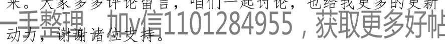

## 第四章 大和尚

[content]
（此处重复内容省略）

“六六，你听说昨天大塌拦珠宝宝店的事儿吗？”狗子说法。

“六六，你听说昨天大塌拦珠宝宝店的事儿吗？”狗子说法。

[content]
（此处重复内容省略）

“六六，你听说昨天大塌拦珠宝宝店的事儿吗？”狗子说法。

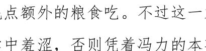

麻子他爹冯马三十鞭子，还把腰和脸给砸折了。到今天明天，工友才给冯马拉回来，这就是冯马平时人性还行，否则压根没人就死在外面了。可拉回来的时候，冯马已经有气没气了，看着就要不行了。

小六听后捂脚说道：“你找我有用啥？”

“我实在不知道该找谁商量了。”

“找郎中啊，事不宜宜，叫上你哥，一起去。”

作者:夜微风之老鬼 日期:2017-03-31 18:25

这一章更新了，晚上再更一章，留言评论走起来啊。

作者:夜微风之老鬼 日期:2017-03-31 20:38

## 第五章 泪流满

一手整理，加群101284955，获取更多帖子，钱不是免费的哈！

冯家人焦如万分，此刻听到大夫的八块银大洋，一个面个色惨白不知所措了。一般大夫出诊的价格就一八银银，这一下子要八块银可不是人命了。可有病乱投医是要人命的。此刻医生的话就是圣旨，谁敢不从。但冯家人个个愁色，估计是掏不出这钱了。

孟小六在眼里，忙道：“先生，这诊金能否降低？”那大夫斜了孟小六一眼，见是个半大孩子，也不好意思只是叹了了口气道：“看你们穿的倒也不像殷实家人，所以我一听病症就先给你们报了诊金，别到时候起腔。你们一大清早的堵门，我现在可算是视诊，可我既然开门就是想……”

“那…………”

见一群不说话，孟小六说道：“就这么着了，给先生找车，快去。”

发布者：老书老妈 2017-03-24 20:39

麻子的二哥听后后腿颤，那大夫上下打量着孟小六说道：“倒是聪明，知道这个点儿的包车夫不是凡，可这事你能做的了？”

麻子捏着手说道：“能，他能做主。”

大夫点了点头，开始收拾行医诊的箱子。等人出了医馆等着，麻子的大哥冯福说道：“小六，家里应该该哪那么多钱啊。”

“有多少是有多少，冯老大，你不是在粮柜上当学徒吗？给店里拆借点，另外再找左右左右舍的一些，先把大夫骗过去再说。”孟小六挠着头说道：“刚才咱们不是没请诸郎中，但郎中说骨头儿子都出来了，他不敢做，非得医馆的大夫才行。大夫刚才也说了，里面他还担着干系呢，这个价不贵。再说人命大于天，这可是多少钱也得命啊。”

冯家老二就叫着洋车夫跑来了，那大夫刚刚刚出门，给医馆找了坐上洋车就朝着冯家赶去。冯家和孟小六家在一个胡同，也住在大众院，院里人数比他们六伙儿还多，院里的邻居都起来了，围在一旁“热心”的出谋着。大夫进屋子撞了眼睛，闲人们等了了出来。

作者：半夜风之老鬼 日期：2023-03-31 21:07

麻子她娘翻柜才凑来六伙儿大儿子，这些年冯力横竖把他拦了不少，毕竟可是个性格，想要发大财是不可能的。

加主王老狗和冯大爷都是半个大夫，这伙取了好多帖。一家人甚至不至于吃了上顿饭下，却也不怎么轻快。

冯老大和冯老都在店铺里当学徒，当学徒每行每月规矩不一样，少数就得交钱或者拿伙食费的，大多是管住，当学徒的几年间是没有工资的。

没有工资就不存在支工资，除了冯老二的掌柜人性好，给了两块儿大洋，冯老大一也不要。左右右手有几个小子攒的攒了半天，终于又攒了一块大洋，准备一会儿抓药用，这算是把能找的钱都掏干净了。

大夫此刻从屋里出来了，说道：“我已经给病人施了针，腰和腿也都接上了，后背上还有些伤，这两个月就别让他多活动了，别吃废物也不用大补，外伤几个月的功夫，内伤还得慢慢调养。”

“那大夫没说了我病根儿吧？”麻子问道。

大夫道：“这可不好说啊，但几年干不了重活了。”

天塌了，男人就是天，就是家里的顶梁柱，冯力干不了重活又能干什么？只怕以后的日子是不好了，但转念一想，只要活着就比什么都强。

大夫拿了诊金的时候说道：“下次出门就不用这多了，这次的方子我签了，你们找药抓药，药铺尽是药。不过不便宜，你们做心理准备。人家有医德，其实你们像傻一样，可人家被吓得魂魄散。”孟小六看着出门。

作者：夜半风之老鬼 日期：2017-03-31 21:08

孟小六看着麻子说：“六哥，我回家一趟，一会陪你们去抓药。”

作者：夜半风之老鬼 日期：2017-03-31 21:08

麻子感疼疼疼疼疼疼疼疼疼疼疼。

孟小六看着麻子，心里下决心，这辈子就跟着六哥。肠疼疼了，还有疼疼疼疼疼疼疼疼疼疼疼疼疼疼疼疼疼疼疼疼疼疼疼疼疼疼疼疼疼疼疼疼疼疼疼疼疼疼疼疼疼疼疼疼疼疼疼疼疼。

大夫拿了诊金的时候说道：“下次出门就不用这多了，这次的方子我签了，你们找药抓药，药铺尽是药。不过不便宜，你们做心理准备。人家有医德，其实你们像傻一样，可人家被吓得魂魄散。”孟小六看着出门。

作者：夜半风之老鬼 日期：2017-03-31 21:08

孟小六看着麻子，心里下决心，这辈子就跟着六哥。肠疼疼疼疼疼疼疼疼疼疼疼疼疼疼疼疼疼疼疼疼疼疼疼疼疼疼疼疼疼疼疼疼疼疼疼疼疼疼疼疼疼疼疼疼疼疼疼疼疼疼疼疼疼疼疼疼疼疼疼疼疼疼疼疼疼疼疼疼疼疼疼疼疼疼疼疼疼疼疼疼疼疼疼疼疼疼疼疼疼疼疼疼疼疼疼疼疼疼疼疼疼疼疼疼疼疼疼疼疼疼疼疼疼疼疼疼疼疼疼疼疼疼疼疼疼疼疼疼疼疼疼疼疼疼疼疼疼疼疼疼疼疼疼疼疼疼疼疼疼疼疼疼疼疼疼疼疼疼疼疼疼疼疼疼疼疼疼疼疼疼疼疼疼疼疼疼疼疼疼疼疼疼疼疼疼疼疼疼疼疼疼疼疼疼疼疼疼疼疼疼疼疼疼疼疼疼疼疼疼疼疼疼疼疼疼疼疼疼疼疼疼疼疼疼疼疼疼疼疼疼疼疼疼疼疼疼疼疼疼疼疼疼疼疼疼疼疼疼疼疼疼疼疼疼疼疼疼疼疼疼疼疼疼疼疼疼疼疼疼疼疼疼疼疼疼疼疼疼疼疼疼疼疼疼疼疼疼疼疼疼疼疼疼疼疼疼疼疼疼疼疼疼疼疼疼疼疼疼疼疼疼疼疼疼疼疼疼疼疼疼疼疼疼疼疼疼疼疼疼疼疼疼疼疼疼疼疼疼疼疼疼疼疼疼疼疼疼疼疼疼疼疼疼疼疼疼疼疼疼疼疼疼疼疼疼疼疼疼疼疼疼疼疼疼疼疼疼疼疼疼疼疼疼疼疼疼疼疼疼疼疼疼疼疼疼疼疼疼疼疼疼疼疼疼疼疼疼疼疼疼疼疼疼疼疼疼疼疼疼疼疼疼疼疼疼疼疼疼疼疼疼疼疼疼疼疼疼疼疼疼疼疼疼疼疼疼疼疼疼疼疼疼疼疼疼疼疼疼疼疼疼疼疼疼疼疼疼疼疼疼疼疼疼疼疼疼疼疼疼疼疼疼疼疼疼疼疼疼疼疼疼疼疼疼疼疼疼疼疼疼疼疼疼疼疼疼疼疼疼疼疼疼疼疼疼疼疼疼疼疼疼疼疼疼疼疼疼疼疼疼疼疼疼疼疼疼疼疼疼疼疼疼疼疼疼疼疼疼疼疼疼疼疼疼疼疼疼疼疼疼疼疼疼疼疼疼疼疼疼疼疼疼疼疼疼疼疼疼疼疼疼疼疼疼疼疼疼疼疼疼疼疼疼疼疼疼疼疼疼疼疼疼疼疼疼疼疼疼疼疼疼疼疼疼疼疼疼疼疼疼疼疼疼疼疼疼疼疼疼疼疼疼疼疼疼疼疼疼疼疼疼疼疼疼疼疼疼疼疼疼疼疼疼疼疼疼疼疼疼疼疼疼疼疼疼疼疼疼疼疼疼疼疼疼疼疼疼疼疼疼疼疼疼疼疼疼疼疼疼疼疼疼疼疼疼疼疼疼疼疼疼疼疼疼疼疼疼疼疼疼疼疼疼疼疼疼疼疼疼疼疼疼疼疼疼疼疼疼疼疼疼疼疼疼疼疼疼疼疼疼疼疼疼疼疼疼疼疼疼疼疼疼疼疼疼疼疼疼疼疼疼疼疼疼疼疼疼疼疼疼疼疼疼疼疼疼疼疼疼疼疼疼疼疼疼疼疼疼疼疼疼疼疼疼疼疼疼疼疼疼疼疼疼疼疼疼疼疼疼疼疼疼疼疼疼疼疼疼疼疼疼疼疼疼疼疼疼疼疼疼疼疼疼疼疼疼疼疼疼疼疼疼疼疼疼疼疼疼疼疼疼疼疼疼疼疼疼疼疼疼疼疼疼疼疼疼疼疼疼疼疼疼疼疼疼疼疼疼疼疼疼疼疼疼疼疼疼疼疼疼疼疼疼疼疼疼疼疼疼疼疼疼疼疼疼疼疼疼疼疼疼疼疼疼疼疼疼疼疼疼疼疼疼疼疼疼疼疼疼疼疼疼疼疼疼疼疼疼疼疼疼疼疼疼疼疼疼疼疼疼疼疼疼疼疼疼疼疼疼疼疼疼疼疼疼疼疼疼疼疼疼疼疼疼疼疼疼疼疼疼疼疼疼疼疼疼疼疼疼疼疼疼疼疼疼疼疼疼疼疼疼疼疼疼疼疼疼疼疼疼疼疼疼疼疼疼疼疼疼疼疼疼疼疼疼疼疼疼疼疼疼疼疼疼疼疼疼疼疼疼疼疼疼疼疼疼疼疼疼疼疼疼疼疼疼疼疼疼疼疼疼疼疼疼疼疼疼疼疼疼疼疼疼疼疼疼疼疼疼疼疼疼疼疼疼疼疼疼疼疼疼疼疼疼疼疼疼疼疼疼疼疼疼疼疼疼疼疼疼疼疼疼疼疼疼疼疼疼疼疼疼疼疼疼疼疼疼疼疼疼疼疼疼疼疼疼疼疼疼疼疼疼疼疼疼疼疼疼疼疼疼疼疼疼疼疼疼疼疼疼疼疼疼疼疼疼疼疼疼疼疼疼疼疼疼疼疼疼疼疼疼疼疼疼疼疼疼疼疼疼疼疼疼疼疼疼疼疼疼疼疼疼疼疼疼疼疼疼疼疼疼疼疼疼疼疼疼疼疼疼疼疼疼疼疼疼疼疼疼疼疼疼疼疼疼疼疼疼疼疼疼疼疼疼疼疼疼疼疼疼疼疼疼疼疼疼疼疼疼疼疼疼疼疼疼疼疼疼疼疼疼疼疼疼疼疼疼疼疼疼疼疼疼疼疼疼疼疼疼疼疼疼疼疼疼疼疼疼疼疼疼疼疼疼疼疼疼疼疼疼疼疼疼疼疼疼疼疼疼疼疼疼疼疼疼疼疼疼疼疼疼疼疼疼疼疼疼疼疼疼疼疼疼疼疼疼疼疼疼疼疼疼疼疼疼疼疼疼疼疼疼疼疼疼疼疼疼疼疼疼疼疼疼疼疼疼疼疼疼疼疼疼疼疼疼疼疼疼疼疼疼疼疼疼疼疼疼疼疼疼疼疼疼疼疼疼疼疼疼疼疼疼疼疼疼疼疼疼疼疼疼疼疼疼疼疼疼疼疼疼疼疼疼疼疼疼疼疼疼疼疼疼疼疼疼疼疼疼疼疼疼疼疼疼疼疼疼疼疼疼疼疼疼疼疼疼疼疼疼疼疼疼疼疼疼疼疼疼疼疼疼疼疼疼疼疼疼疼疼疼疼疼疼疼疼疼疼疼疼疼疼疼疼疼疼疼疼疼疼疼疼疼疼疼疼疼疼疼疼疼疼疼疼疼疼疼疼疼疼疼疼疼疼疼疼疼疼疼疼疼疼疼疼疼疼疼疼疼疼疼疼疼疼疼疼疼疼疼疼疼疼疼疼疼疼疼疼疼疼疼疼疼疼疼疼疼疼疼疼疼疼疼疼疼疼疼疼疼疼疼疼疼疼疼疼疼疼疼疼疼疼疼疼疼疼疼疼疼疼疼疼疼疼疼疼疼疼疼疼疼疼疼疼疼疼疼疼疼疼疼疼疼疼疼疼疼疼疼疼疼疼疼疼疼疼疼疼疼疼疼疼疼疼疼疼疼疼疼疼疼疼疼疼疼疼疼疼疼疼疼疼疼疼疼疼疼疼疼疼疼疼疼疼疼疼疼疼疼疼疼疼疼疼疼疼疼疼疼疼疼疼疼疼疼疼疼疼疼疼疼疼疼疼疼疼疼疼疼疼疼疼疼疼疼疼疼疼疼疼疼疼疼疼疼疼疼疼疼疼疼疼疼疼疼疼疼疼疼疼疼疼疼疼疼疼疼疼疼疼疼疼疼疼疼疼疼疼疼疼疼疼疼疼疼疼疼疼疼疼疼疼疼疼疼疼疼疼疼疼疼疼疼疼疼疼疼疼疼疼疼疼疼疼疼疼疼疼疼疼疼疼疼疼疼疼疼疼疼疼疼疼疼疼疼疼疼疼疼疼疼疼疼疼疼疼疼疼疼疼疼疼疼疼疼疼疼疼疼疼疼疼疼疼疼疼疼疼疼疼疼疼疼疼疼疼疼疼疼疼疼疼疼疼疼疼疼疼疼疼疼疼疼疼疼疼疼疼疼疼疼疼疼疼疼疼疼疼疼疼疼疼疼疼疼疼疼疼疼疼疼疼疼疼疼疼疼疼疼疼疼疼疼疼疼疼疼疼疼疼疼疼疼疼疼疼疼疼疼疼疼疼疼疼疼疼疼疼疼疼疼疼疼疼疼疼疼疼疼疼疼疼疼疼疼疼疼疼疼疼疼疼疼疼疼疼疼疼疼疼疼疼疼疼疼疼疼疼疼疼疼疼疼疼疼疼疼疼疼疼疼疼疼疼疼疼疼疼疼疼疼疼疼疼疼疼疼疼疼疼疼疼疼疼疼疼疼疼疼疼疼疼疼疼疼疼疼疼疼疼疼疼疼疼疼疼疼疼疼疼疼疼疼疼疼疼疼疼疼疼疼疼疼疼疼疼疼疼疼疼疼疼疼疼疼疼疼疼疼疼疼疼疼疼疼疼疼疼疼疼疼疼疼疼疼疼疼疼疼疼疼疼疼疼疼疼疼疼疼疼疼疼疼疼疼疼疼疼疼疼疼疼疼疼疼疼疼疼疼疼疼疼疼疼疼疼疼疼疼疼疼疼疼疼疼疼疼疼疼疼疼疼疼疼疼疼疼疼疼疼疼疼疼疼疼疼疼疼疼疼疼疼疼疼疼疼疼疼疼疼疼疼疼疼疼疼疼疼疼疼疼疼疼疼疼疼疼疼疼疼疼疼疼疼疼疼疼疼疼疼疼疼疼疼疼疼疼疼疼疼疼疼疼疼疼疼疼疼疼疼疼疼疼疼疼疼疼疼疼疼疼疼疼疼疼疼疼疼疼疼疼疼疼疼疼疼疼疼疼疼疼疼疼疼疼疼疼疼疼疼疼疼疼疼疼疼疼疼疼疼疼疼疼疼疼疼疼疼疼疼疼疼疼疼疼疼疼疼疼疼疼疼疼疼疼疼疼疼疼疼疼疼疼疼疼疼疼疼疼疼疼疼疼疼疼疼疼疼疼疼疼疼疼疼疼疼疼疼疼疼疼疼疼疼疼疼疼疼疼疼疼疼疼疼疼疼疼疼疼疼疼疼疼疼疼疼疼疼疼疼疼疼疼疼疼疼疼疼疼疼疼疼疼疼疼疼疼疼疼疼疼疼疼疼疼疼疼疼疼疼疼疼疼疼疼疼疼疼疼疼疼疼疼疼疼疼疼疼疼疼疼疼疼疼疼疼疼疼疼疼疼疼疼疼疼疼疼疼疼疼疼疼疼疼疼疼疼疼疼疼疼疼疼疼疼疼疼疼疼疼疼疼疼疼疼疼疼疼疼疼疼疼疼疼疼疼疼疼疼疼疼疼疼疼疼疼疼疼疼疼疼疼疼疼疼疼疼疼疼疼疼疼疼疼疼疼疼疼疼疼疼疼疼疼疼疼疼疼疼疼疼疼疼疼疼疼疼疼疼疼疼疼疼疼疼疼疼疼疼疼疼疼疼疼疼疼疼疼疼疼疼疼疼疼疼疼疼疼疼疼疼疼疼疼疼疼疼疼疼疼疼疼疼疼疼疼疼疼疼疼疼疼疼疼疼疼疼疼疼疼疼疼疼疼疼疼疼疼疼疼疼疼疼疼疼疼疼疼疼疼疼疼疼疼疼疼疼疼疼疼疼疼疼疼疼疼疼疼疼疼疼疼疼疼疼疼疼疼疼疼疼疼疼疼疼疼疼疼疼疼疼疼疼疼疼疼疼疼疼疼疼疼疼疼疼疼疼疼疼疼疼疼疼疼疼疼疼疼疼疼疼疼疼疼疼疼疼疼疼疼疼疼疼疼疼疼疼疼疼疼疼疼疼疼疼疼疼疼疼疼疼疼疼疼疼疼疼疼疼疼疼疼疼疼疼疼疼疼疼疼疼疼疼疼疼疼疼疼疼疼疼疼疼疼疼疼疼疼疼疼疼疼疼疼疼疼疼疼疼疼疼疼疼疼疼疼疼疼疼疼疼疼疼疼疼疼疼疼疼疼疼疼疼疼疼疼疼疼疼疼疼疼疼疼疼疼疼疼疼疼疼疼疼疼疼疼疼疼疼疼疼疼疼疼疼疼疼疼疼疼疼疼疼疼疼疼疼疼疼疼疼疼疼疼疼疼疼疼疼疼疼疼疼疼疼疼疼疼疼疼疼疼疼疼疼疼疼疼疼疼疼疼疼疼疼疼疼疼疼疼疼疼疼疼疼疼疼疼疼疼疼疼疼疼疼疼疼疼疼疼疼疼疼疼疼疼疼疼疼疼疼疼疼疼疼疼疼疼疼疼疼疼疼疼疼疼疼疼疼疼疼疼疼疼疼疼疼疼疼疼疼疼疼疼疼疼疼疼疼疼疼疼疼疼疼疼疼疼疼疼疼疼疼疼疼疼疼疼疼疼疼疼疼疼疼疼疼疼疼疼疼疼疼疼疼疼疼疼疼疼疼疼疼疼疼疼疼疼疼疼疼疼疼疼疼疼疼疼疼疼疼疼疼疼疼疼疼疼疼疼疼疼疼疼疼疼疼疼疼疼疼疼疼疼疼疼疼疼疼疼疼疼疼疼疼疼疼疼疼疼疼疼疼疼疼疼疼疼疼疼疼疼疼疼疼疼疼疼疼疼疼疼疼疼疼疼疼疼疼疼疼疼疼疼疼疼疼疼疼疼疼疼疼疼疼疼疼疼疼疼疼疼疼疼疼疼疼疼疼疼疼疼疼疼疼疼疼疼疼疼疼疼疼疼疼疼疼疼疼疼疼疼疼疼疼疼疼疼疼疼疼疼疼疼疼疼疼疼疼疼疼疼疼疼疼疼疼疼疼疼疼疼疼疼疼疼疼疼疼疼疼疼疼疼疼疼疼疼疼疼疼疼疼疼疼疼疼疼疼疼疼疼疼疼疼疼疼疼疼疼疼疼疼疼疼疼疼疼疼疼疼疼疼疼疼疼疼疼疼疼疼疼疼疼疼疼疼疼疼疼疼疼疼疼疼疼疼疼疼疼疼疼疼疼疼疼疼疼疼疼疼疼疼疼疼疼疼疼疼疼疼疼疼疼疼疼疼疼疼疼疼疼疼疼疼疼疼疼疼疼疼疼疼疼疼疼疼疼疼疼疼疼疼疼疼疼疼疼疼疼疼疼疼疼疼疼疼疼疼疼疼疼疼疼疼疼疼疼疼疼疼疼疼疼疼疼疼疼疼疼疼疼疼疼疼疼疼疼疼疼疼疼疼疼疼疼疼疼疼疼疼疼疼疼疼疼疼疼疼疼疼疼疼疼疼疼疼疼疼疼疼疼疼疼疼疼疼疼疼疼疼疼疼疼疼疼疼疼疼疼疼疼疼疼疼疼疼疼疼疼疼疼疼疼疼疼疼疼疼疼疼疼疼疼疼疼疼疼疼疼疼疼疼疼疼疼疼疼疼疼疼疼疼疼疼疼疼疼疼疼疼疼疼疼疼疼疼疼疼疼疼疼疼疼疼疼疼疼疼疼疼疼疼疼疼疼疼疼疼疼疼疼疼疼疼疼疼疼疼疼疼疼疼疼疼疼疼疼疼疼疼疼疼疼疼疼疼疼疼疼疼疼疼疼疼疼疼疼疼疼疼疼疼疼疼疼疼疼疼疼疼疼疼疼疼疼疼疼疼疼疼疼疼疼疼疼疼疼疼疼疼疼疼疼疼疼疼疼疼疼疼疼疼疼疼疼疼疼疼疼疼疼疼疼疼疼疼疼疼疼疼疼疼疼疼疼疼疼疼疼疼疼疼疼疼疼疼疼疼疼疼疼疼疼疼疼疼疼疼疼疼疼疼疼疼疼疼疼疼疼疼疼疼疼疼疼疼疼疼疼疼疼疼疼疼疼疼疼疼疼疼疼疼疼疼疼疼疼疼疼疼疼疼疼疼疼疼疼疼疼疼疼疼疼疼疼疼疼疼疼疼疼疼疼疼疼疼疼疼疼疼疼疼疼疼疼疼疼疼疼疼疼疼疼疼疼疼疼疼疼疼疼疼疼疼疼疼疼疼疼疼疼疼疼疼疼疼疼疼疼疼疼疼疼疼疼疼疼疼疼疼疼疼疼疼疼疼疼疼疼疼疼疼疼疼疼疼疼疼疼疼疼疼疼疼疼疼疼疼疼疼疼疼疼疼疼疼疼疼疼疼疼疼疼疼疼疼疼疼疼疼疼疼疼疼疼疼疼疼疼疼疼疼疼疼疼疼疼疼疼疼疼疼疼疼疼疼疼疼疼疼疼疼疼疼疼疼疼疼疼疼疼疼疼疼疼疼疼疼疼疼疼疼疼疼疼疼疼疼疼疼疼疼疼疼疼疼疼疼疼疼疼疼疼疼疼疼疼疼疼疼疼疼疼疼疼疼疼疼疼疼疼疼疼疼疼疼疼疼疼疼疼疼疼疼疼疼疼疼疼疼疼疼疼疼疼疼疼疼疼疼疼疼疼疼疼疼疼疼疼疼疼疼疼疼疼疼疼疼疼疼疼疼疼疼疼疼疼疼疼疼疼疼疼疼疼疼疼疼疼疼疼疼疼疼疼疼疼疼疼疼疼疼疼疼疼疼疼疼疼疼疼疼疼疼疼疼疼疼疼疼疼疼疼疼疼疼疼疼疼疼疼疼疼疼疼疼疼疼疼疼疼疼疼疼疼疼疼疼疼疼疼疼疼疼疼疼疼疼疼疼疼疼疼疼疼疼疼疼疼疼疼疼疼疼疼疼疼疼疼疼疼疼疼疼疼疼疼疼疼疼疼疼疼疼疼疼疼疼疼疼疼疼疼疼疼疼疼疼疼疼疼疼疼疼疼疼疼疼疼疼疼疼疼疼疼疼疼疼疼疼疼疼疼疼疼疼疼疼疼疼疼疼疼疼疼疼疼疼疼疼疼疼疼疼疼疼疼疼疼疼疼疼疼疼疼疼疼疼疼疼疼疼疼疼疼疼疼疼疼疼疼疼疼疼疼疼疼疼疼疼疼疼疼疼疼疼疼疼疼疼疼疼疼疼疼疼疼疼疼疼疼疼疼疼疼疼疼疼疼疼疼疼疼疼疼疼疼疼疼疼疼疼疼疼疼疼疼疼疼疼疼疼疼疼疼疼疼疼疼疼疼疼疼疼疼疼疼疼疼疼疼疼疼疼疼疼疼疼疼疼疼疼疼疼疼疼疼疼疼疼疼疼疼疼疼疼疼疼疼疼疼疼疼疼疼疼疼疼疼疼疼疼疼疼疼疼疼疼疼疼疼疼疼疼疼疼疼疼疼疼疼疼疼疼疼疼疼疼疼疼疼疼疼疼疼疼疼疼疼疼疼疼疼疼疼疼疼疼疼疼疼疼疼疼疼疼疼疼疼疼疼疼疼疼疼疼疼疼疼疼疼疼疼疼疼疼疼疼疼疼疼疼疼疼疼疼疼疼疼疼疼疼疼疼疼疼疼疼疼疼疼疼疼疼疼疼疼疼疼疼疼疼疼疼疼疼疼疼疼疼疼疼疼疼疼疼疼疼疼疼疼疼疼疼疼疼疼疼疼疼疼疼疼疼疼疼疼疼疼疼疼疼疼疼疼疼疼疼疼疼疼疼疼疼疼疼疼疼疼疼疼疼疼疼疼疼疼疼疼疼疼疼疼疼疼疼疼疼疼疼疼疼疼疼疼疼疼疼疼疼疼疼疼疼疼疼疼疼疼疼疼疼疼疼疼疼疼疼疼疼疼疼疼疼疼疼疼疼疼疼疼疼疼疼疼疼疼疼疼疼疼疼疼疼疼疼疼疼疼疼疼疼疼疼疼疼疼疼疼疼疼疼疼疼疼疼疼疼疼疼疼疼疼疼疼疼疼疼疼疼疼疼疼疼疼疼疼疼疼疼疼疼疼疼疼疼疼疼疼疼疼疼疼疼疼疼疼疼疼疼疼疼疼疼疼疼疼疼疼疼疼疼疼疼疼疼疼疼疼疼疼疼疼疼疼疼疼疼疼疼疼疼疼疼疼疼疼疼疼疼疼疼疼疼疼疼疼疼疼疼疼疼疼疼疼疼疼疼疼疼疼疼疼疼疼疼疼疼疼疼疼疼疼疼疼疼疼疼疼疼疼疼疼疼疼疼疼疼疼疼疼疼疼疼疼疼疼疼疼疼疼疼疼疼疼疼疼疼疼疼疼疼疼疼疼疼疼疼疼疼疼疼疼疼疼疼疼疼疼疼疼疼疼疼疼疼疼疼疼疼疼疼疼疼疼疼疼疼疼疼疼疼疼疼疼疼疼疼疼疼疼疼疼疼疼疼疼疼疼疼疼疼疼疼疼疼疼疼疼疼疼疼疼疼疼疼疼疼疼疼疼疼疼疼疼疼疼疼疼疼疼疼疼疼疼疼疼疼疼疼疼疼疼疼疼疼疼疼疼疼疼疼疼疼疼疼疼疼疼疼疼疼疼疼疼疼疼疼疼疼疼疼疼疼疼疼疼疼疼疼疼疼疼疼疼疼疼疼疼疼疼疼疼疼疼疼疼疼疼疼疼疼疼疼疼疼疼疼疼疼疼疼疼疼疼疼疼疼疼疼疼疼疼疼疼疼疼疼疼疼疼疼疼疼疼疼疼疼疼疼疼疼疼疼疼疼疼疼疼疼疼疼疼疼疼疼疼疼疼疼疼疼疼疼疼疼疼疼疼疼疼疼疼疼疼疼疼疼疼疼疼疼疼疼疼疼疼疼疼疼疼疼疼疼疼疼疼疼疼疼疼疼疼疼疼疼疼疼疼疼疼疼疼疼疼疼疼疼疼疼疼疼疼疼疼疼疼疼疼疼疼疼疼疼疼疼疼疼疼疼疼疼疼疼疼疼疼疼疼疼疼疼疼疼疼疼疼疼疼疼疼疼疼疼疼疼疼疼疼疼疼疼疼疼疼疼疼疼疼疼疼疼疼疼疼疼疼疼疼疼疼疼疼疼疼疼疼疼疼疼疼疼疼疼疼疼疼疼疼疼疼疼疼疼疼疼疼疼疼疼疼疼疼疼疼疼疼疼疼疼疼疼疼疼疼疼疼疼疼疼疼疼疼疼疼疼疼疼疼疼疼疼疼疼疼疼疼疼疼疼疼疼疼疼疼疼疼疼疼疼疼疼疼疼疼疼疼疼疼疼疼疼疼疼疼疼疼疼疼疼疼疼疼疼疼疼疼疼疼疼疼疼疼疼疼疼疼疼疼疼疼疼疼疼疼疼疼疼疼疼疼疼疼疼疼疼疼疼疼疼疼疼疼疼疼疼疼疼疼疼疼疼疼疼疼疼疼疼疼疼疼疼疼疼疼疼疼疼疼疼疼疼疼疼疼疼疼疼疼疼疼疼疼疼疼疼疼疼疼疼疼疼疼疼疼疼疼疼疼疼疼疼疼疼疼疼疼疼疼疼疼疼疼疼疼疼疼疼疼疼疼疼疼疼疼疼疼疼疼疼疼疼疼疼疼疼疼疼疼疼疼疼疼疼疼疼疼疼疼疼疼疼疼疼疼疼疼疼疼疼疼疼疼疼疼疼疼疼疼疼疼疼疼疼疼疼疼疼疼疼疼疼疼疼疼疼疼疼疼疼疼疼疼疼疼疼疼疼疼疼疼疼疼疼疼疼疼疼疼疼疼疼疼疼疼疼疼疼疼疼疼疼疼疼疼疼疼疼疼疼疼疼疼疼疼疼疼疼疼疼疼疼疼疼疼疼疼疼疼疼疼疼疼疼疼疼疼疼疼疼疼疼疼疼疼疼疼疼疼疼疼疼疼疼疼疼疼疼疼疼疼疼疼疼疼疼疼疼疼疼疼疼疼疼疼疼疼疼疼疼疼疼疼疼疼疼疼疼疼疼疼疼疼疼疼疼疼疼疼疼疼疼疼疼疼疼疼疼疼疼疼疼疼疼疼疼疼疼疼疼疼疼疼疼疼疼疼疼疼疼疼疼疼疼疼疼疼疼疼疼疼疼疼疼疼疼疼疼疼疼疼疼疼疼疼疼疼疼疼疼疼疼疼疼疼疼疼疼疼疼疼疼疼疼疼疼疼疼疼疼疼疼疼疼疼疼疼疼疼疼疼疼疼疼疼疼疼疼疼疼疼疼疼疼疼疼疼疼疼疼疼疼疼疼疼疼疼疼疼疼疼疼疼疼疼疼疼疼疼疼疼疼疼疼疼疼疼疼疼疼疼疼疼疼疼疼疼疼疼疼疼疼疼疼疼疼疼疼疼疼疼疼疼疼疼疼疼疼疼疼疼疼疼疼疼疼疼疼疼疼疼疼疼疼疼疼疼疼疼疼疼疼疼疼疼疼疼疼疼疼疼疼疼疼疼疼疼疼疼疼疼疼疼疼疼疼疼疼疼疼疼疼疼疼疼疼疼疼疼疼疼疼疼疼疼疼疼疼疼疼疼疼疼疼疼疼疼疼疼疼疼疼疼疼疼疼疼疼疼疼疼疼疼疼疼疼疼疼疼疼疼疼疼疼疼疼疼疼疼疼疼疼疼疼疼疼疼疼疼疼疼疼疼疼疼疼疼疼疼疼疼疼疼疼疼疼疼疼疼疼疼疼疼疼疼疼疼疼疼疼疼疼疼疼疼疼疼疼疼疼疼疼疼疼疼疼疼疼疼疼疼疼疼疼疼疼疼疼疼疼疼疼疼疼疼疼疼疼疼疼疼疼疼疼疼疼疼疼疼疼疼疼疼疼疼疼疼疼疼疼疼疼疼疼疼疼疼疼疼疼疼疼疼疼疼疼疼疼疼疼疼疼疼疼疼疼疼疼疼疼疼疼疼疼疼疼疼疼疼疼疼疼疼疼疼疼疼疼疼疼疼疼疼疼疼疼疼疼疼疼疼疼疼疼疼疼疼疼疼疼疼疼疼疼疼疼疼疼疼疼疼疼疼疼疼疼疼疼疼疼疼疼疼疼疼疼疼疼疼疼疼疼疼疼疼疼疼疼疼疼疼疼疼疼疼疼疼疼疼疼疼疼疼疼疼疼疼疼疼疼疼疼疼疼疼疼疼疼疼疼疼疼疼疼疼疼疼疼疼疼疼疼疼疼疼疼疼疼疼疼疼疼疼疼疼疼疼疼疼疼疼疼疼疼疼疼疼疼疼疼疼疼疼疼疼疼疼疼疼疼疼疼疼疼疼疼疼疼疼疼疼疼疼疼疼疼疼疼疼疼疼疼疼疼疼疼疼疼疼疼疼疼疼疼疼疼疼疼疼疼疼疼疼疼疼疼疼疼疼疼疼疼疼疼疼疼疼疼疼疼疼疼疼疼疼疼疼疼疼疼疼疼疼疼疼疼疼疼疼疼疼疼疼疼疼疼疼疼疼疼疼疼疼疼疼疼疼疼疼疼疼疼疼疼疼疼疼疼疼疼疼疼疼疼疼疼疼疼疼疼疼疼疼疼疼疼疼疼疼疼疼疼疼疼疼疼疼疼疼疼疼疼疼疼疼疼疼疼疼疼疼疼疼疼疼疼疼疼疼疼疼疼疼疼疼疼疼疼疼疼疼疼疼疼疼疼疼疼疼疼疼疼疼疼疼疼疼疼疼疼疼疼疼疼疼疼疼疼疼疼疼疼疼疼疼疼疼疼疼疼疼疼疼疼疼疼疼疼疼疼疼疼疼疼疼疼疼疼疼疼疼疼疼疼疼疼疼疼疼疼疼疼疼疼疼疼疼疼疼疼疼疼疼疼疼疼疼疼疼疼疼疼疼疼疼疼疼疼疼疼疼疼疼疼疼疼疼疼疼疼疼疼疼疼疼疼疼疼疼疼疼疼疼疼疼疼疼疼疼疼疼疼疼疼疼疼疼疼疼疼疼疼疼疼疼疼疼疼疼疼疼疼疼疼疼疼疼疼疼疼疼疼疼疼疼疼疼疼疼疼疼疼疼疼疼疼疼疼疼疼疼疼疼疼疼疼疼疼疼疼疼疼疼疼疼疼疼疼疼疼疼疼疼疼疼疼疼疼疼疼疼疼疼疼疼疼疼疼疼疼疼疼疼疼疼疼疼疼疼疼疼疼疼疼疼疼疼疼疼疼疼疼疼疼疼疼疼疼疼疼疼疼疼疼疼疼疼疼疼疼疼疼疼疼疼疼疼疼疼疼疼疼疼疼疼疼疼疼疼疼疼疼疼疼疼疼疼疼疼疼疼疼疼疼疼疼疼疼疼疼疼疼疼疼疼疼疼疼疼疼疼疼疼疼疼疼疼疼疼疼疼疼疼疼疼疼疼疼疼疼疼疼疼疼疼疼疼疼疼疼疼疼疼疼疼疼疼疼疼疼疼疼疼疼疼疼疼疼疼疼疼疼疼疼疼疼疼疼疼疼疼疼疼疼疼疼疼疼疼疼疼疼疼疼疼疼疼疼疼疼疼疼疼疼疼疼疼疼疼疼疼疼疼疼疼疼疼疼疼疼疼疼疼疼疼疼疼疼疼疼疼疼疼疼疼疼疼疼疼疼疼疼疼疼疼疼疼疼疼疼疼疼疼疼疼疼疼疼疼疼疼疼疼疼疼疼疼疼疼疼疼疼疼疼疼疼疼疼疼疼疼疼疼疼疼疼疼疼疼疼疼疼疼疼疼疼疼疼疼疼疼疼疼疼疼疼疼疼疼疼疼疼疼疼疼疼疼疼疼疼疼疼疼疼疼疼疼疼疼疼疼疼疼疼疼疼疼疼疼疼疼疼疼疼疼疼疼疼疼疼疼疼疼疼疼疼疼疼疼疼疼疼疼疼疼疼疼疼疼疼疼疼疼疼疼疼疼疼疼疼疼疼疼疼疼疼疼疼疼疼疼疼疼疼疼疼疼疼疼疼疼疼疼疼疼疼疼疼疼疼疼疼疼疼疼疼疼疼疼疼疼疼疼疼疼疼疼疼疼疼疼疼疼疼疼疼疼疼疼疼疼疼疼疼疼疼疼疼疼疼疼疼疼疼疼疼疼疼疼疼疼疼疼疼疼疼疼疼疼疼疼疼疼疼疼疼疼疼疼疼疼疼疼疼疼疼疼疼疼疼疼疼疼疼疼疼疼疼疼疼疼疼疼疼疼疼疼疼疼疼疼疼疼疼疼疼疼疼疼疼疼疼疼疼疼疼疼疼疼疼疼疼疼疼疼疼疼疼疼疼疼疼疼疼疼疼疼疼疼疼疼疼疼疼疼疼疼疼疼疼疼疼疼疼疼疼疼疼疼疼疼疼疼疼疼疼疼疼疼疼疼疼疼疼疼疼疼疼疼疼疼疼疼疼疼疼疼疼疼疼疼疼疼疼疼疼疼疼疼疼疼疼疼疼疼疼疼疼疼疼疼疼疼疼疼疼疼疼疼疼疼疼疼疼疼疼疼疼疼疼疼疼疼疼疼疼疼疼疼疼疼疼疼疼疼疼疼疼疼疼疼疼疼疼疼疼疼疼疼疼疼疼疼疼疼疼疼疼疼疼疼疼疼疼疼疼疼疼疼疼疼疼疼疼疼疼疼疼疼疼疼疼疼疼疼疼疼疼疼疼疼疼疼疼疼疼疼疼疼疼疼疼疼疼疼疼疼疼疼疼疼疼疼疼疼疼疼疼疼疼疼疼疼疼疼疼疼疼疼疼疼疼疼疼疼疼疼疼疼疼疼疼疼疼疼疼疼疼疼疼疼疼疼疼疼疼疼疼疼疼疼疼疼疼疼疼疼疼疼疼疼疼疼疼疼疼疼疼疼疼疼疼疼疼疼疼疼疼疼疼疼疼疼疼疼疼疼疼疼疼疼疼疼疼疼疼疼疼疼疼疼疼疼疼疼疼疼疼疼疼疼疼疼疼疼疼疼疼疼疼疼疼疼疼疼疼疼疼疼疼疼疼疼疼疼疼疼疼疼疼疼疼疼疼疼疼疼疼疼疼疼疼疼疼疼疼疼疼疼疼疼疼疼疼疼疼疼疼疼疼疼疼疼疼疼疼疼疼疼疼疼疼疼疼疼疼疼疼疼疼疼疼疼疼疼疼疼疼疼疼疼疼疼疼疼疼疼疼疼疼疼疼疼疼疼疼疼疼疼疼疼疼疼疼疼疼疼疼疼疼疼疼疼疼疼疼疼疼疼疼疼疼疼疼疼疼疼疼疼疼疼疼疼疼疼疼疼疼疼疼疼疼疼疼疼疼疼疼疼疼疼疼疼疼疼疼疼疼疼疼疼疼疼疼疼疼疼疼疼疼疼疼疼疼疼疼疼疼疼疼疼疼疼疼疼疼疼疼疼疼疼疼疼疼疼疼疼疼疼疼疼疼疼疼疼疼疼疼疼疼疼疼疼疼疼疼疼疼疼疼疼疼疼疼疼疼疼疼疼疼疼疼疼疼疼疼疼疼疼疼疼疼疼疼疼疼疼疼疼疼疼疼疼疼疼疼疼疼疼疼疼疼疼疼疼疼疼疼疼疼疼疼疼疼疼疼疼疼疼疼疼疼疼疼疼疼疼疼疼疼疼疼疼疼疼疼疼疼疼疼疼疼疼疼疼疼疼疼疼疼疼疼疼疼疼疼疼疼疼疼疼疼疼疼疼疼疼疼疼疼疼疼疼疼疼疼疼疼疼疼疼疼疼疼疼疼疼疼疼疼疼疼疼疼疼疼疼疼疼疼疼疼疼疼疼疼疼疼疼疼疼疼疼疼疼疼疼疼疼疼疼疼疼疼疼疼疼疼疼疼疼疼疼疼疼疼疼疼疼疼疼疼疼疼疼疼疼疼疼疼疼疼疼疼疼疼疼疼疼疼疼疼疼疼疼疼疼疼疼疼疼疼疼疼疼疼疼疼疼疼疼疼疼疼疼疼疼疼疼疼疼疼疼疼疼疼疼疼疼疼疼疼疼疼疼疼疼疼疼疼疼疼疼疼疼疼疼疼疼疼疼疼疼疼疼疼疼疼疼疼疼疼疼疼疼疼疼疼疼疼疼疼疼疼疼疼疼疼疼疼疼疼疼疼疼疼疼疼疼疼疼疼疼疼疼疼疼疼疼疼疼疼疼疼疼疼疼疼疼疼疼疼疼疼疼疼疼疼疼疼疼疼疼疼疼疼疼疼疼疼疼疼疼疼疼疼疼疼疼疼疼疼疼疼疼疼疼疼疼疼疼疼疼疼疼疼疼疼疼疼疼疼疼疼疼疼疼疼疼疼疼疼疼疼疼疼疼疼疼疼疼疼疼疼疼疼疼疼疼疼疼疼疼疼疼疼疼疼疼疼疼疼疼疼疼疼疼疼疼疼疼疼疼疼疼疼疼疼疼疼疼疼疼疼疼疼疼疼疼疼疼疼疼疼疼疼疼疼疼疼疼疼疼疼疼疼疼疼疼疼疼疼疼疼疼疼疼疼疼疼疼疼疼疼疼疼疼疼疼疼疼疼疼疼疼疼疼疼疼疼疼疼疼疼疼疼疼疼疼疼疼疼疼疼疼疼疼疼疼疼疼疼疼疼疼疼疼疼疼疼疼疼疼疼疼疼疼疼疼疼疼疼疼疼疼疼疼疼疼疼疼疼疼疼疼疼疼疼疼疼疼疼疼疼疼疼疼疼疼疼疼疼疼疼疼疼疼疼疼疼疼疼疼疼疼疼疼疼疼疼疼疼疼疼疼疼疼疼疼疼疼疼疼疼疼疼疼疼疼疼疼疼疼疼疼疼疼疼疼疼疼疼疼疼疼疼疼疼疼疼疼疼疼疼疼疼疼疼疼疼疼疼疼疼疼疼疼疼疼疼疼疼疼疼疼疼疼疼疼疼疼疼疼疼疼疼疼疼疼疼疼疼疼疼疼疼疼疼疼疼疼疼疼疼疼疼疼疼疼疼疼疼疼疼疼疼疼疼疼疼疼疼疼疼疼疼疼疼疼疼疼疼疼疼疼疼疼疼疼疼疼疼疼疼疼疼疼疼疼疼疼疼疼疼疼疼疼疼疼疼疼疼疼疼疼疼疼疼疼疼疼疼疼疼疼疼疼疼疼疼疼疼疼疼疼疼疼疼疼疼疼疼疼疼疼疼疼疼疼疼疼疼疼疼疼疼疼疼疼疼疼疼疼疼疼疼疼疼疼疼疼疼疼疼疼疼疼疼疼疼疼疼疼疼疼疼疼疼疼疼疼疼疼疼疼疼疼疼疼疼疼疼疼疼疼疼疼疼疼疼疼疼疼疼疼疼疼疼疼疼疼疼疼疼疼疼疼疼疼疼疼疼疼疼疼疼疼疼疼疼疼疼疼疼疼疼疼疼疼疼疼疼疼疼疼疼疼疼疼疼疼疼疼疼疼疼疼疼疼疼疼疼疼疼疼疼疼疼疼疼疼疼疼疼疼疼疼疼疼疼疼疼疼疼疼疼疼疼疼疼疼疼疼疼疼疼疼疼疼疼疼疼疼疼疼疼疼疼疼疼疼疼疼疼疼疼疼疼疼疼疼疼疼疼疼疼疼疼疼疼疼疼疼疼疼疼疼疼疼疼疼疼疼疼疼疼疼疼疼疼疼疼疼疼疼疼疼疼疼疼疼疼疼疼疼疼疼疼疼疼疼疼疼疼疼疼疼疼疼疼疼疼疼疼疼疼疼疼疼疼疼疼疼疼疼疼疼疼疼疼疼疼疼疼疼疼疼疼疼疼疼疼疼疼疼疼疼疼疼疼疼疼疼疼疼疼疼疼疼疼疼疼疼疼疼疼疼疼疼疼疼疼疼疼疼疼疼疼疼疼疼疼疼疼疼疼疼疼疼疼疼疼疼疼疼疼疼疼疼疼疼疼疼疼疼疼疼疼疼疼疼疼疼疼疼疼疼疼疼疼疼疼疼疼疼疼疼疼疼疼疼疼疼疼疼疼疼疼疼疼疼疼疼疼疼疼疼疼疼疼疼疼疼疼疼疼疼疼疼疼疼疼疼疼疼疼疼疼疼疼疼疼疼疼疼疼疼疼疼疼疼疼疼疼疼疼疼疼疼疼疼疼疼疼疼疼疼疼疼疼疼疼疼疼疼疼疼疼疼疼疼疼疼疼疼疼疼疼疼疼疼疼疼疼疼疼疼疼疼疼疼疼疼疼疼疼疼疼疼疼疼疼疼疼疼疼疼疼疼疼疼疼疼疼疼疼疼疼疼疼疼疼疼疼疼疼疼疼疼疼疼疼疼疼疼疼疼疼疼疼疼疼疼疼疼疼疼疼疼疼疼疼疼疼疼疼疼疼疼疼疼疼疼疼疼疼疼疼疼疼疼疼疼疼疼疼疼疼疼疼疼疼疼疼疼疼疼疼疼疼疼疼疼疼疼疼疼疼疼疼疼疼疼疼疼疼疼疼疼疼疼疼疼疼疼疼疼疼疼疼疼疼疼疼疼疼疼疼疼疼疼疼疼疼疼疼疼疼疼疼疼疼疼疼疼疼疼疼疼疼疼疼疼疼疼疼疼疼疼疼疼疼疼疼疼疼疼疼疼疼疼疼疼疼疼疼疼疼疼疼疼疼疼疼疼疼疼疼疼疼疼疼疼疼疼疼疼疼疼疼疼疼疼疼疼疼疼疼疼疼疼疼疼疼疼疼疼疼疼疼疼疼疼疼疼疼疼疼疼疼疼疼疼疼疼疼疼疼疼疼疼疼疼疼疼疼疼疼疼疼疼疼疼疼疼疼疼疼疼疼疼疼疼疼疼疼疼疼疼疼疼疼疼疼疼疼疼疼疼疼疼疼疼疼疼疼疼疼疼疼疼疼疼疼疼疼疼疼疼疼疼疼疼疼疼疼疼疼疼疼疼疼疼疼疼疼疼疼疼疼疼疼疼疼疼疼疼疼疼疼疼疼疼疼疼疼疼疼疼疼疼疼疼疼疼疼疼疼疼疼疼疼疼疼疼疼疼疼疼疼疼疼疼疼疼疼疼疼疼疼疼疼疼疼疼疼疼疼疼疼疼疼疼疼疼疼疼疼疼疼疼疼疼疼疼疼疼疼疼疼疼疼疼疼疼疼疼疼疼疼疼疼疼疼疼疼疼疼疼疼疼疼疼疼疼疼疼疼疼疼疼疼疼疼疼疼疼疼疼疼疼疼疼疼疼疼疼疼疼疼疼疼疼疼疼疼疼疼疼疼疼疼疼疼疼疼疼疼疼疼疼疼疼疼疼疼疼疼疼疼疼疼疼疼疼疼疼疼疼疼疼疼疼疼疼疼疼疼疼疼疼疼疼疼疼疼疼疼疼疼疼疼疼疼疼疼疼疼疼疼疼疼疼疼疼疼疼疼疼疼疼疼疼疼疼疼疼疼疼疼疼疼疼疼疼疼疼疼疼疼疼疼疼疼疼疼疼疼疼疼疼疼疼疼疼疼疼疼疼疼疼疼疼疼疼疼疼疼疼疼疼疼疼疼疼疼疼疼疼疼疼疼疼疼疼疼疼疼疼疼疼疼疼疼疼疼疼疼疼疼疼疼疼疼疼疼疼疼疼疼疼疼疼疼疼疼疼疼疼疼疼疼疼疼疼疼疼疼疼疼疼疼疼疼疼疼疼疼疼疼疼疼疼疼疼疼疼疼疼疼疼疼疼疼疼疼疼疼疼疼疼疼疼疼疼疼疼疼疼疼疼疼疼疼疼疼疼疼疼疼疼疼疼疼疼疼疼疼疼疼疼疼疼疼疼疼疼疼疼疼疼疼疼疼疼疼疼疼疼疼疼疼疼疼疼疼疼疼疼疼疼疼疼疼疼疼疼疼疼疼疼疼疼疼疼疼疼疼疼疼疼疼疼疼疼疼疼疼疼疼疼疼疼疼疼疼疼疼疼疼疼疼疼疼疼疼疼疼疼疼疼疼疼疼疼疼疼疼疼疼疼疼疼疼疼疼疼疼疼疼疼疼疼疼疼疼疼疼疼疼疼疼疼疼疼疼疼疼疼疼疼疼疼疼疼疼疼疼疼疼疼疼疼疼疼疼疼疼疼疼疼疼疼疼疼疼疼疼疼疼疼疼疼疼疼疼疼疼疼疼疼疼疼疼疼疼疼疼疼疼疼疼疼疼疼疼疼疼疼疼疼疼疼疼疼疼疼疼疼疼疼疼疼疼疼疼疼疼疼疼疼疼疼疼疼疼疼疼疼疼疼疼疼疼疼疼疼疼疼疼疼疼疼疼疼疼疼疼疼疼疼疼疼疼疼疼疼疼疼疼疼疼疼疼疼疼疼疼疼疼疼疼疼疼疼疼疼疼疼疼疼疼疼疼疼疼疼疼疼疼疼疼疼疼疼疼疼疼疼疼疼疼疼疼疼疼疼疼疼疼疼疼疼疼疼疼疼疼疼疼疼疼疼疼疼疼疼疼疼疼疼疼疼疼疼疼疼疼疼疼疼疼疼疼疼疼疼疼疼疼疼疼疼疼疼疼疼疼疼疼疼疼疼疼疼疼疼疼疼疼疼疼疼疼疼疼疼疼疼疼疼疼疼疼疼疼疼疼疼疼疼疼疼疼疼疼疼疼疼疼疼疼疼疼疼疼疼疼疼疼疼疼疼疼疼疼疼疼疼疼疼疼疼疼疼疼疼疼疼疼疼疼疼疼疼疼疼疼疼疼疼疼疼疼疼疼疼疼疼疼疼疼疼疼疼疼疼疼疼疼疼疼疼疼疼疼疼疼疼疼疼疼疼疼疼疼疼疼疼疼疼疼疼疼疼疼疼疼疼疼疼疼疼疼疼疼疼疼疼疼疼疼疼疼疼疼疼疼疼疼疼疼疼疼疼疼疼疼疼疼疼疼疼疼疼疼疼疼疼疼疼疼疼疼疼疼疼疼疼疼疼疼疼疼疼疼疼疼疼疼疼疼疼疼疼疼疼疼疼疼疼疼疼疼疼疼疼疼疼疼疼疼疼疼疼疼疼疼疼疼疼疼疼疼疼疼疼疼疼疼疼疼疼疼疼疼疼疼疼疼疼疼疼疼疼疼疼疼疼疼疼疼疼疼疼疼疼疼疼疼疼疼疼疼疼疼疼疼疼疼疼疼疼疼疼疼疼疼疼疼疼疼疼疼疼疼疼疼疼疼疼疼疼疼疼疼疼疼疼疼疼疼疼疼疼疼疼疼疼疼疼疼疼疼疼疼疼疼疼疼疼疼疼疼疼疼疼疼疼疼疼疼疼疼疼疼疼疼疼疼疼疼疼疼疼疼疼疼疼疼疼疼疼疼疼疼疼疼疼疼疼疼疼疼疼疼疼疼疼疼疼疼疼疼疼疼疼疼疼疼疼疼疼疼疼疼疼疼疼疼疼疼疼疼疼疼疼疼疼疼疼疼疼疼疼疼疼疼疼疼疼疼疼疼疼疼疼疼疼疼疼疼疼疼疼疼疼疼疼疼疼疼疼疼疼疼疼疼疼疼疼疼疼疼疼疼疼疼疼疼疼疼疼疼疼疼疼疼疼疼疼疼疼疼疼疼疼疼疼疼疼疼疼疼疼疼疼疼疼疼疼疼疼疼疼疼疼疼疼疼疼疼疼疼疼疼疼疼疼疼疼疼疼疼疼疼疼疼疼疼疼疼疼疼疼疼疼疼疼疼疼疼疼疼疼疼疼疼疼疼疼疼疼疼疼疼疼疼疼疼疼疼疼疼疼疼疼疼疼疼疼疼疼疼疼疼疼疼疼疼疼疼疼疼疼疼疼疼疼疼疼疼疼疼疼疼疼疼疼疼疼疼疼疼疼疼疼疼疼疼疼疼疼疼疼疼疼疼疼疼疼疼疼疼疼疼疼疼疼疼疼疼疼疼疼疼疼疼疼疼疼疼疼疼疼疼疼疼疼疼疼疼疼疼疼疼疼疼疼疼疼疼疼疼疼疼疼疼疼疼疼疼疼疼疼疼疼疼疼疼疼疼疼疼疼疼疼疼疼疼疼疼疼疼疼疼疼疼疼疼疼疼疼疼疼疼疼疼疼疼疼疼疼疼疼疼疼疼疼疼疼疼疼疼疼疼疼疼疼疼疼疼疼疼疼疼疼疼疼疼疼疼疼疼疼疼疼疼疼疼疼疼疼疼疼疼疼疼疼疼疼疼疼疼疼疼疼疼疼疼疼疼疼疼疼疼疼疼疼疼疼疼疼疼疼疼疼疼疼疼疼疼疼疼疼疼疼疼疼疼疼疼疼疼疼疼疼疼疼疼疼疼疼疼疼疼疼疼疼疼疼疼疼疼疼疼疼疼疼疼疼疼疼疼疼疼疼疼疼疼疼疼疼疼疼疼疼疼疼疼疼疼疼疼疼疼疼疼疼疼疼疼疼疼疼疼疼疼疼疼疼疼疼疼疼疼疼疼疼疼疼疼疼疼疼疼疼疼疼疼疼疼疼疼疼疼疼疼疼疼疼疼疼疼疼疼疼疼疼疼疼疼疼疼疼疼疼疼疼疼疼疼疼疼疼疼疼疼疼疼疼疼疼疼疼疼疼疼疼疼疼疼疼疼疼疼疼疼疼疼疼疼疼疼疼疼疼疼疼疼疼疼疼疼疼疼疼疼疼疼疼疼疼疼疼疼疼疼疼疼疼疼疼疼疼疼疼疼疼疼疼疼疼疼疼疼疼疼疼疼疼疼疼疼疼疼疼疼疼疼疼疼疼疼疼疼疼疼疼疼疼疼疼疼疼疼疼疼疼疼疼疼疼疼疼疼疼疼疼疼疼疼疼疼疼疼疼疼疼疼疼疼疼疼疼疼疼疼疼疼疼疼疼疼疼疼疼疼疼疼疼疼疼疼疼疼疼疼疼疼疼疼疼疼疼疼疼疼疼疼疼疼疼疼疼疼疼疼疼疼疼疼疼疼疼疼疼疼疼疼疼疼疼疼疼疼疼疼疼疼疼疼疼疼疼疼疼疼疼疼疼疼疼疼疼疼疼疼疼疼疼疼疼疼疼疼疼疼疼疼疼疼疼疼疼疼疼疼疼疼疼疼疼疼疼疼疼疼疼疼疼疼疼疼疼疼疼疼疼疼疼疼疼疼疼疼疼疼疼疼疼疼疼疼疼疼疼疼疼疼疼疼疼疼疼疼疼疼疼疼疼疼疼疼疼疼疼疼疼疼疼疼疼疼疼疼疼疼疼疼疼疼疼疼疼疼疼疼疼疼疼疼疼疼疼疼疼疼疼疼疼疼疼疼疼疼疼疼疼疼疼疼疼疼疼疼疼疼疼疼疼疼疼疼疼疼疼疼疼疼疼疼疼疼疼疼疼疼疼疼疼疼疼疼疼疼疼疼疼疼疼疼疼疼疼疼疼疼疼疼疼疼疼疼疼疼疼疼疼疼疼疼疼疼疼疼疼疼疼疼疼疼疼疼疼疼疼疼疼疼疼疼疼疼疼疼疼疼疼疼疼疼疼疼疼疼疼疼疼疼疼疼疼疼疼疼疼疼疼疼疼疼疼疼疼疼疼疼疼疼疼疼疼疼疼疼疼疼疼疼疼疼疼疼疼疼疼疼疼疼疼疼疼疼疼疼疼疼疼疼疼疼疼疼疼疼疼疼疼疼疼疼疼疼疼疼疼疼疼疼疼疼疼疼疼疼疼疼疼疼疼疼疼疼疼疼疼疼疼疼疼疼疼疼疼疼疼疼疼疼疼疼疼疼疼疼疼疼疼疼疼疼疼疼疼疼疼疼疼疼疼疼疼疼疼疼疼疼疼疼疼疼疼疼疼疼疼疼疼疼疼疼疼疼疼疼疼疼疼疼疼疼疼疼疼疼疼疼疼疼疼疼疼疼疼疼疼疼疼疼疼疼疼疼疼疼疼疼疼疼疼疼疼疼疼疼疼疼疼疼疼疼疼疼疼疼疼疼疼疼疼疼疼疼疼疼疼疼疼疼疼疼疼疼疼疼疼疼疼疼疼疼疼疼疼疼疼疼疼疼疼疼疼疼疼疼疼疼疼疼疼疼疼疼疼疼疼疼疼疼疼疼疼疼疼疼疼疼疼疼疼疼疼疼疼疼疼疼疼疼疼疼疼疼疼疼疼疼疼疼疼疼疼疼疼疼疼疼疼疼疼疼疼疼疼疼疼疼疼疼疼疼疼疼疼疼疼疼疼疼疼疼疼疼疼疼疼疼疼疼疼疼疼疼疼疼疼疼疼疼疼疼疼疼疼疼疼疼疼疼疼疼疼疼疼疼疼疼疼疼疼疼疼疼疼疼疼疼疼疼疼疼疼疼疼疼疼疼疼疼疼疼疼疼疼疼疼疼疼疼疼疼疼疼疼疼疼疼疼疼疼疼疼疼疼疼疼疼疼疼疼疼疼疼疼疼疼疼疼疼疼疼疼疼疼疼疼疼疼疼疼疼疼疼疼疼疼疼疼疼疼疼疼疼疼疼疼疼疼疼疼疼疼疼疼疼疼疼疼疼疼疼疼疼疼疼疼疼疼疼疼疼疼疼疼疼疼疼疼疼疼疼疼疼疼疼疼疼疼疼疼疼疼疼疼疼疼疼疼疼疼疼疼疼疼疼疼疼疼疼疼疼疼疼疼疼疼疼疼疼疼疼疼疼疼疼疼疼疼疼疼疼疼疼疼疼疼疼疼疼疼疼疼疼疼疼疼疼疼疼疼疼疼疼疼疼疼疼疼疼疼疼疼疼疼疼疼疼疼疼疼疼疼疼疼疼疼疼疼疼疼疼疼疼疼疼疼疼疼疼疼疼疼疼疼疼疼疼疼疼疼疼疼疼疼疼疼疼疼疼疼疼疼疼疼疼疼疼疼疼疼疼疼疼疼疼疼疼疼疼疼疼疼疼疼疼疼疼疼疼疼疼疼疼疼疼疼疼疼疼疼疼疼疼疼疼疼疼疼疼疼疼疼疼疼疼疼疼疼疼疼疼疼疼疼疼疼疼疼疼疼疼疼疼疼疼疼疼疼疼疼疼疼疼疼疼疼疼疼疼疼疼疼疼疼疼疼疼疼疼疼疼疼疼疼疼疼疼疼疼疼疼疼疼疼疼疼疼疼疼疼疼疼疼疼疼疼疼疼疼疼疼疼疼疼疼疼疼疼疼疼疼疼疼疼疼疼疼疼疼疼疼疼疼疼疼疼疼疼疼疼疼疼疼疼疼疼疼疼疼疼疼疼疼疼疼疼疼疼疼疼疼疼疼疼疼疼疼疼疼疼疼疼疼疼疼疼疼疼疼疼疼疼疼疼疼疼疼疼疼疼疼疼疼疼疼疼疼疼疼疼疼疼疼疼疼疼疼疼疼疼疼疼疼疼疼疼疼疼疼疼疼疼疼疼疼疼疼疼疼疼疼疼疼疼疼疼疼疼疼疼疼疼疼疼疼疼疼疼疼疼疼疼疼疼疼疼疼疼疼疼疼疼疼疼疼疼疼疼疼疼疼疼疼疼疼疼疼疼疼疼疼疼疼疼疼疼疼疼疼疼疼疼疼疼疼疼疼疼疼疼疼疼疼疼疼疼疼疼疼疼疼疼疼疼疼疼疼疼疼疼疼疼疼疼疼疼疼疼疼疼疼疼疼疼疼疼疼疼疼疼疼疼疼疼疼疼疼疼疼疼疼疼疼疼疼疼疼疼疼疼疼疼疼疼疼疼疼疼疼疼疼疼疼疼疼疼疼疼疼疼疼疼疼疼疼疼疼疼疼疼疼疼疼疼疼疼疼疼疼疼疼疼疼疼疼疼疼疼疼疼疼疼疼疼疼疼疼疼疼疼疼疼疼疼疼疼疼疼疼疼疼疼疼疼疼疼疼疼疼疼疼疼疼疼疼疼疼疼疼疼疼疼疼疼疼疼疼疼疼疼疼疼疼疼疼疼疼疼疼疼疼疼疼疼疼疼疼疼疼疼疼疼疼疼疼疼疼疼疼疼疼疼疼疼疼疼疼疼疼疼疼疼疼疼疼疼疼疼疼疼疼疼疼疼疼疼疼疼疼疼疼疼疼疼疼疼疼疼疼疼疼疼疼疼疼疼疼疼疼疼疼疼疼疼疼疼疼疼疼疼疼疼疼疼疼疼疼疼疼疼疼疼疼疼疼疼疼疼疼疼疼疼疼疼疼疼疼疼疼疼疼疼疼疼疼疼疼疼疼疼疼疼疼疼疼疼疼疼疼疼疼疼疼疼疼疼疼疼疼疼疼疼疼疼疼疼疼疼疼疼疼疼疼疼疼疼疼疼疼疼疼疼疼疼疼疼疼疼疼疼疼疼疼疼疼疼疼疼疼疼疼疼疼疼疼疼疼疼疼疼疼疼疼疼疼疼疼疼疼疼疼疼疼疼疼疼疼疼疼疼疼疼疼疼疼疼疼疼疼疼疼疼疼疼疼疼疼疼疼疼疼疼疼疼疼疼疼疼疼疼疼疼疼疼疼疼疼疼疼疼疼疼疼疼疼疼疼疼疼疼疼疼疼疼疼疼疼疼疼疼疼疼疼疼疼疼疼疼疼疼疼疼疼疼疼疼疼疼疼疼疼疼疼疼疼疼疼疼疼疼疼疼疼疼疼疼疼疼疼疼疼疼疼疼疼疼疼疼疼疼疼疼疼疼疼疼疼疼疼疼疼疼疼疼疼疼疼疼疼疼疼疼疼疼疼疼疼疼疼疼疼疼疼疼疼疼疼疼疼疼疼疼疼疼疼疼疼疼疼疼疼疼疼疼疼疼疼疼疼疼疼疼疼疼疼疼疼疼疼疼疼疼疼疼疼疼疼疼疼疼疼疼疼疼疼疼疼疼疼疼疼疼疼疼疼疼疼疼疼疼疼疼疼疼疼疼疼疼疼疼疼疼疼疼疼疼疼疼疼疼疼疼疼疼疼疼疼疼疼疼疼疼疼疼疼疼疼疼疼疼疼疼疼疼疼疼疼疼疼疼疼疼疼疼疼疼疼疼疼疼疼疼疼疼疼疼疼疼疼疼疼疼疼疼疼疼疼疼疼疼疼疼疼疼疼疼疼疼疼疼疼疼疼疼疼疼疼疼疼疼疼疼疼疼疼疼疼疼疼疼疼疼疼疼疼疼疼疼疼疼疼疼疼疼疼疼疼疼疼疼疼疼疼疼疼疼疼疼疼疼疼疼疼疼疼疼疼疼疼疼疼疼疼疼疼疼疼疼疼疼疼疼疼疼疼疼疼疼疼疼疼疼疼疼疼疼疼疼疼疼疼疼疼疼疼疼疼疼疼疼疼疼疼疼疼疼疼疼疼疼疼疼疼疼疼疼疼疼疼疼疼疼疼疼疼疼疼疼疼疼疼疼疼疼疼疼疼疼疼疼疼疼疼疼疼疼疼疼疼疼疼疼疼疼疼疼疼疼疼疼疼疼疼疼疼疼疼疼疼疼疼疼疼疼疼疼疼疼疼疼疼疼疼疼疼疼疼疼疼疼疼疼疼疼疼疼疼疼疼疼疼疼疼疼疼疼疼疼疼疼疼疼疼疼疼疼疼疼疼疼疼疼疼疼疼疼疼疼疼疼疼疼疼疼疼疼疼疼疼疼疼疼疼疼疼疼疼疼疼疼疼疼疼疼疼疼疼疼疼疼疼疼疼疼疼疼疼疼疼疼疼疼疼疼疼疼疼疼疼疼疼疼疼疼疼疼疼疼疼疼疼疼疼疼疼疼疼疼疼疼疼疼疼疼疼疼疼疼疼疼疼疼疼疼疼疼疼疼疼疼疼疼疼疼疼疼疼疼疼疼疼疼疼疼疼疼疼疼疼疼疼疼疼疼疼疼疼疼疼疼疼疼疼疼疼疼疼疼疼疼疼疼疼疼疼疼疼疼疼疼疼疼疼疼疼疼疼疼疼疼疼疼疼疼疼疼疼疼疼疼疼疼疼疼疼疼疼疼疼疼疼疼疼疼疼疼疼疼疼疼疼疼疼疼疼疼疼疼疼疼疼疼疼疼疼疼疼疼疼疼疼疼疼疼疼疼疼疼疼疼疼疼疼疼疼疼疼疼疼疼疼疼疼疼疼疼疼疼疼疼疼疼疼疼疼疼疼疼疼疼疼疼疼疼疼疼疼疼疼疼疼疼疼疼疼疼疼疼疼疼疼疼疼疼疼疼疼疼疼疼疼疼疼疼疼疼疼疼疼疼疼疼疼疼疼疼疼疼疼疼疼疼疼疼疼疼疼疼疼疼疼疼疼疼疼疼疼疼疼疼疼疼疼疼疼疼疼疼疼疼疼疼疼疼疼疼疼疼疼疼疼疼疼疼疼疼疼疼疼疼疼疼疼疼疼疼疼疼疼疼疼疼疼疼疼疼疼疼疼疼疼疼疼疼疼疼疼疼疼疼疼疼疼疼疼疼疼疼疼疼疼疼疼疼疼疼疼疼疼疼疼疼疼疼疼疼疼疼疼疼疼疼疼疼疼疼疼疼疼疼疼疼疼疼疼疼疼疼疼疼疼疼疼疼疼疼疼疼疼疼疼疼疼疼疼疼疼疼疼疼疼疼疼疼疼疼疼疼疼疼疼疼疼疼疼疼疼疼疼疼疼疼疼疼疼疼疼疼疼疼疼疼疼疼疼疼疼疼疼疼疼疼疼疼疼疼疼疼疼疼疼疼疼疼疼疼疼疼疼疼疼疼疼疼疼疼疼疼疼疼疼疼疼疼疼疼疼疼疼疼疼疼疼疼疼疼疼疼疼疼疼疼疼疼疼疼疼疼疼疼疼疼疼疼疼疼疼疼疼疼疼疼疼疼疼疼疼疼疼疼疼疼疼疼疼疼疼疼疼疼疼疼疼疼疼疼疼疼疼疼疼疼疼疼疼疼疼疼疼疼疼疼疼疼疼疼疼疼疼疼疼疼疼疼疼疼疼疼疼疼疼疼疼疼疼疼疼疼疼疼疼疼疼疼疼疼疼疼疼疼疼疼疼疼疼疼疼疼疼疼疼疼疼疼疼疼疼疼疼疼疼疼疼疼疼疼疼疼疼疼疼疼疼疼疼疼疼疼疼疼疼疼疼疼疼疼疼疼疼疼疼疼疼疼疼疼疼疼疼疼疼疼疼疼疼疼疼疼疼疼疼疼疼疼疼疼疼疼疼疼疼疼疼疼疼疼疼疼疼疼疼疼疼疼疼疼疼疼疼疼疼疼疼疼疼疼疼疼疼疼疼疼疼疼疼疼疼疼疼疼疼疼疼疼疼疼疼疼疼疼疼疼疼疼疼疼疼疼疼疼疼疼疼疼疼疼疼疼疼疼疼疼疼疼疼疼疼疼疼疼疼疼疼疼疼疼疼疼疼疼疼疼疼疼疼疼疼疼疼疼疼疼疼疼疼疼疼疼疼疼疼疼疼疼疼疼疼疼疼疼疼疼疼疼疼疼疼疼疼疼疼疼疼疼疼疼疼疼疼疼疼疼疼疼疼疼疼疼疼疼疼疼疼疼疼疼疼疼疼疼疼疼疼疼疼疼疼疼疼疼疼疼疼疼疼疼疼疼疼疼疼疼疼疼疼疼疼疼疼疼疼疼疼疼疼疼疼疼疼疼疼疼疼疼疼疼疼疼疼疼疼疼疼疼疼疼疼疼疼疼疼疼疼疼疼疼疼疼疼疼疼疼疼疼疼疼疼疼疼疼疼疼疼疼疼疼疼疼疼疼疼疼疼疼疼疼疼疼疼疼疼疼疼疼疼疼疼疼疼疼疼疼疼疼疼疼疼疼疼疼疼疼疼疼疼疼疼疼疼疼疼疼疼疼疼疼疼疼疼疼疼疼疼疼疼疼疼疼疼疼疼疼疼疼疼疼疼疼疼疼疼疼疼疼疼疼疼疼疼疼疼疼疼疼疼疼疼疼疼疼疼疼疼疼疼疼疼疼疼疼疼疼疼疼疼疼疼疼疼疼疼疼疼疼疼疼疼疼疼疼疼疼疼疼疼疼疼疼疼疼疼疼疼疼疼疼疼疼疼疼疼疼疼疼疼疼疼疼疼疼疼疼疼疼疼疼疼疼疼疼疼疼疼疼疼疼疼疼疼疼疼疼疼疼疼疼疼疼疼疼疼疼疼疼疼疼疼疼疼疼疼疼疼疼疼疼疼疼疼疼疼疼疼疼疼疼疼疼疼疼疼疼疼疼疼疼疼疼疼疼疼疼疼疼疼疼疼疼疼疼疼疼疼疼疼疼疼疼疼疼疼疼疼疼疼疼疼疼疼疼疼疼疼疼疼疼疼疼疼疼疼疼疼疼疼疼疼疼疼疼疼疼疼疼疼疼疼疼疼疼疼疼疼疼疼疼疼疼疼疼疼疼疼疼疼疼疼疼疼疼疼疼疼疼疼疼疼疼疼疼疼疼疼疼疼疼疼疼疼疼疼疼疼疼疼疼疼疼疼疼疼疼疼疼疼疼疼疼疼疼疼疼疼疼疼疼疼疼疼疼疼疼疼疼疼疼疼疼疼疼疼疼疼疼疼疼疼疼疼疼疼疼疼疼疼疼疼疼疼疼疼疼疼疼疼疼疼疼疼疼疼疼疼疼疼疼疼疼疼疼疼疼疼疼疼疼疼疼疼疼疼疼疼疼疼疼疼疼疼疼疼疼疼疼疼疼疼疼疼疼疼疼疼疼疼疼疼疼疼疼疼疼疼疼疼疼疼疼疼疼疼疼疼疼疼疼疼疼疼疼疼疼疼疼疼疼疼疼疼疼疼疼疼疼疼疼疼疼疼疼疼疼疼疼疼疼疼疼疼疼疼疼疼疼疼疼疼疼疼疼疼疼疼疼疼疼疼疼疼疼疼疼疼疼疼疼疼疼疼疼疼疼疼疼疼疼疼疼疼疼疼疼疼疼疼疼疼疼疼疼疼疼疼疼疼疼疼疼疼疼疼疼疼疼疼疼疼疼疼疼疼疼疼疼疼疼疼疼疼疼疼疼疼疼疼疼疼疼疼疼疼疼疼疼疼疼疼疼疼疼疼疼疼疼疼疼疼疼疼疼疼疼疼疼疼疼疼疼疼疼疼疼疼疼疼疼疼疼疼疼疼疼疼疼疼疼疼疼疼疼疼疼疼疼疼疼疼疼疼疼疼疼疼疼疼疼疼疼疼疼疼疼疼疼疼疼疼疼疼疼疼疼疼疼疼疼疼疼疼疼疼疼疼疼疼疼疼疼疼疼疼疼疼疼疼疼疼疼疼疼疼疼疼疼疼疼疼疼疼疼疼疼疼疼疼疼疼疼疼疼疼疼疼疼疼疼疼疼疼疼疼疼疼疼疼疼疼疼疼疼疼疼疼疼疼疼疼疼疼疼疼疼疼疼疼疼疼疼疼疼疼疼疼疼疼疼疼疼疼疼疼疼疼疼疼疼疼疼疼疼疼疼疼疼疼疼疼疼疼疼疼疼疼疼疼疼疼疼疼疼疼疼疼疼疼疼疼疼疼疼疼疼疼疼疼疼疼疼疼疼疼疼疼疼疼疼疼疼疼疼疼疼疼疼疼疼疼疼疼疼疼疼疼疼疼疼疼疼疼疼疼疼疼疼疼疼疼疼疼疼疼疼疼疼疼疼疼疼疼疼疼疼疼疼疼疼疼疼疼疼疼疼疼疼疼疼疼疼疼疼疼疼疼疼疼疼疼疼疼疼疼疼疼疼疼疼疼疼疼疼疼疼疼疼疼疼疼疼疼疼疼疼疼疼疼疼疼疼疼疼疼疼疼疼疼疼疼疼疼疼疼疼疼疼疼疼疼疼疼疼疼疼疼疼疼疼疼疼疼疼疼疼疼疼疼疼疼疼疼疼疼疼疼疼疼疼疼疼疼疼疼疼疼疼疼疼疼疼疼疼疼疼疼疼疼疼疼疼疼疼疼疼疼疼疼疼疼疼疼疼疼疼疼疼疼疼疼疼疼疼疼疼疼疼疼疼疼疼疼疼疼疼疼疼疼疼疼疼疼疼疼疼疼疼疼疼疼疼疼疼疼疼疼疼疼疼疼疼疼疼疼疼疼疼疼疼疼疼疼疼疼疼疼疼疼疼疼疼疼疼疼疼疼疼疼疼疼疼疼疼疼疼疼疼疼疼疼疼疼疼疼疼疼疼疼疼疼疼疼疼疼疼疼疼疼疼疼疼疼疼疼疼疼疼疼疼疼疼疼疼疼疼疼疼疼疼疼疼疼疼疼疼疼疼疼疼疼疼疼疼疼疼疼疼疼疼疼疼疼疼疼疼疼疼疼疼疼疼疼疼疼疼疼疼疼疼疼疼疼疼疼疼疼疼疼疼疼疼疼疼疼疼疼疼疼疼疼疼疼疼疼疼疼疼疼疼疼疼疼疼疼疼疼疼疼疼疼疼疼疼疼疼疼疼疼疼疼疼疼疼疼疼疼疼疼疼疼疼疼疼疼疼疼疼疼疼疼疼疼疼疼疼疼疼疼疼疼疼疼疼疼疼疼疼疼疼疼疼疼疼疼疼疼疼疼疼疼疼疼疼疼疼疼疼疼疼疼疼疼疼疼疼疼疼疼疼疼疼疼疼疼疼疼疼疼疼疼疼疼疼疼疼疼疼疼疼疼疼疼疼疼疼疼疼疼疼疼疼疼疼疼疼疼疼疼疼疼疼疼疼疼疼疼疼疼疼疼疼疼疼疼疼疼疼疼疼疼疼疼疼疼疼疼疼疼疼疼疼疼疼疼疼疼疼疼疼疼疼疼疼疼疼疼疼疼疼疼疼疼疼疼疼疼疼疼疼疼疼疼疼疼疼疼疼疼疼疼疼疼疼疼疼疼疼疼疼疼疼疼疼疼疼疼疼疼疼疼疼疼疼疼疼疼疼疼疼疼疼疼疼疼疼疼疼疼疼疼疼疼疼疼疼疼疼疼疼疼疼疼疼疼疼疼疼疼疼疼疼疼疼疼疼疼疼疼疼疼疼疼疼疼疼疼疼疼疼疼疼疼疼疼疼疼疼疼疼疼疼疼疼疼疼疼疼疼疼疼疼疼疼疼疼疼疼疼疼疼疼疼疼疼疼疼疼疼疼疼疼疼疼疼疼疼疼疼疼疼疼疼疼疼疼疼疼疼疼疼疼疼疼疼疼疼疼疼疼疼疼疼疼疼疼疼疼疼疼疼疼疼疼疼疼疼疼疼疼疼疼疼疼疼疼疼疼疼疼疼疼疼疼疼疼疼疼疼疼疼疼疼疼疼疼疼疼疼疼疼疼疼疼疼疼疼疼疼疼疼疼疼疼疼疼疼疼疼疼疼疼疼疼疼疼疼疼疼疼疼疼疼疼疼疼疼疼疼疼疼疼疼疼疼疼疼疼疼疼疼疼疼疼疼疼疼疼疼疼疼疼疼疼疼疼疼疼疼疼疼疼疼疼疼疼疼疼疼疼疼疼疼疼疼疼疼疼疼疼疼疼疼疼疼疼疼疼疼疼疼疼疼疼疼疼疼疼疼疼疼疼疼疼疼疼疼疼疼疼疼疼疼疼疼疼疼疼疼疼疼疼疼疼疼疼疼疼疼疼疼疼疼疼疼疼疼疼疼疼疼疼疼疼疼疼疼疼疼疼疼疼疼疼疼疼疼疼疼疼疼疼疼疼疼疼疼疼疼疼疼疼疼疼疼疼疼疼疼疼疼疼疼疼疼疼疼疼疼疼疼疼疼疼疼疼疼疼疼疼疼疼疼疼疼疼疼疼疼疼疼疼疼疼疼疼疼疼疼疼疼疼疼疼疼疼疼疼疼疼疼疼疼疼疼疼疼疼疼疼疼疼疼疼疼疼疼疼疼疼疼疼疼疼疼疼疼疼疼疼疼疼疼疼疼疼疼疼疼疼疼疼疼疼疼疼疼疼疼疼疼疼疼疼疼疼疼疼疼疼疼疼疼疼疼疼疼疼疼疼疼疼疼疼疼疼疼疼疼疼疼疼疼疼疼疼疼疼疼疼疼疼疼疼疼疼疼疼疼疼疼疼疼疼疼疼疼疼疼疼疼疼疼疼疼疼疼疼疼疼疼疼疼疼疼疼疼疼疼疼疼疼疼疼疼疼疼疼疼疼疼疼疼疼疼疼疼疼疼疼疼疼疼疼疼疼疼疼疼疼疼疼疼疼疼疼疼疼疼疼疼疼疼疼疼疼疼疼疼疼疼疼疼疼疼疼疼疼疼疼疼疼疼疼疼疼疼疼疼疼疼疼疼疼疼疼疼疼疼疼疼疼疼疼疼疼疼疼疼疼疼疼疼疼疼疼疼疼疼疼疼疼疼疼疼疼疼疼疼疼疼疼疼疼疼疼疼疼疼疼疼疼疼疼疼疼疼疼疼疼疼疼疼疼疼疼疼疼疼疼疼疼疼疼疼疼疼疼疼疼疼疼疼疼疼疼疼疼疼疼疼疼疼疼疼疼疼疼疼疼疼疼疼疼疼疼疼疼疼疼疼疼疼疼疼疼疼疼疼疼疼疼疼疼疼疼疼疼疼疼疼疼疼疼疼疼疼疼疼疼疼疼疼疼疼疼疼疼疼疼疼疼疼疼疼疼疼疼疼疼疼疼疼疼疼疼疼疼疼疼疼疼疼疼疼疼疼疼疼疼疼疼疼疼疼疼疼疼疼疼疼疼疼疼疼疼疼疼疼疼疼疼疼疼疼疼疼疼疼疼疼疼疼疼疼疼疼疼疼疼疼疼疼疼疼疼疼疼疼疼疼疼疼疼疼疼疼疼疼疼疼疼疼疼疼疼疼疼疼疼疼疼疼疼疼疼疼疼疼疼疼疼疼疼疼疼疼疼疼疼疼疼疼疼疼疼疼疼疼疼疼疼疼疼疼疼疼疼疼疼疼疼疼疼疼疼疼疼疼疼疼疼疼疼疼疼疼疼疼疼疼疼疼疼疼疼疼疼疼疼疼疼疼疼疼疼疼疼疼疼疼疼疼疼疼疼疼疼疼疼疼疼疼疼疼疼疼疼疼疼疼疼疼疼疼疼疼疼疼疼疼疼疼疼疼疼疼疼疼疼疼疼疼疼疼疼疼疼疼疼疼疼疼疼疼疼疼疼疼疼疼疼疼疼疼疼疼疼疼疼疼疼疼疼疼疼疼疼疼疼疼疼疼疼疼疼疼疼疼疼疼疼疼疼疼疼疼疼疼疼疼疼疼疼疼疼疼疼疼疼疼疼疼疼疼疼疼疼疼疼疼疼疼疼疼疼疼疼疼疼疼疼疼疼疼疼疼疼疼疼疼疼疼疼疼疼疼疼疼疼疼疼疼疼疼疼疼疼疼疼疼疼疼疼疼疼疼疼疼疼疼疼疼疼疼疼疼疼疼疼疼疼疼疼疼疼疼疼疼疼疼疼疼疼疼疼疼疼疼疼疼疼疼疼疼疼疼疼疼疼疼疼疼疼疼疼疼疼疼疼疼疼疼疼疼疼疼疼疼疼疼疼疼疼疼疼疼疼疼疼疼疼疼疼疼疼疼疼疼疼疼疼疼疼疼疼疼疼疼疼疼疼疼疼疼疼疼疼疼疼疼疼疼疼疼疼疼疼疼疼疼疼疼疼疼疼疼疼疼疼疼疼疼疼疼疼疼疼疼疼疼疼疼疼疼疼疼疼疼疼疼疼疼疼疼疼疼疼疼疼疼疼疼疼疼疼疼疼疼疼疼疼疼疼疼疼疼疼疼疼疼疼疼疼疼疼疼疼疼疼疼疼疼疼疼疼疼疼疼疼疼疼疼疼疼疼疼疼疼疼疼疼疼疼疼疼疼疼疼疼疼疼疼疼疼疼疼疼疼疼疼疼疼疼疼疼疼疼疼疼疼疼疼疼疼疼疼疼疼疼疼疼疼疼疼疼疼疼疼疼疼疼疼疼疼疼疼疼疼疼疼疼疼疼疼疼疼疼疼疼疼疼疼疼疼疼疼疼疼疼疼疼疼疼疼疼疼疼疼疼疼疼疼疼疼疼疼疼疼疼疼疼疼疼疼疼疼疼疼疼疼疼疼疼疼疼疼疼疼疼疼疼疼疼疼疼疼疼疼疼疼疼疼疼疼疼疼疼疼疼疼疼疼疼疼疼疼疼疼疼疼疼疼疼疼疼疼疼疼疼疼疼疼疼疼疼疼疼疼疼疼疼疼疼疼疼疼疼疼疼疼疼疼疼疼疼疼疼疼疼疼疼疼疼疼疼疼疼疼疼疼疼疼疼疼疼疼疼疼疼疼疼疼疼疼疼疼疼疼疼疼疼疼疼疼疼疼疼疼疼疼疼疼疼疼疼疼疼疼疼疼疼疼疼疼疼疼疼疼疼疼疼疼疼疼疼疼疼疼疼疼疼疼疼疼疼疼疼疼疼疼疼疼疼疼疼疼疼疼疼疼疼疼疼疼疼疼疼疼疼疼疼疼疼疼疼疼疼疼疼疼疼疼疼疼疼疼疼疼疼疼疼疼疼疼疼疼疼疼疼疼疼疼疼疼疼疼疼疼疼疼疼疼疼疼疼疼疼疼疼疼疼疼疼疼疼疼疼疼疼疼疼疼疼疼疼疼疼疼疼疼疼疼疼疼疼疼疼疼疼疼疼疼疼疼疼疼疼疼疼疼疼疼疼疼疼疼疼疼疼疼疼疼疼疼疼疼疼疼疼疼疼疼疼疼疼疼疼疼疼疼疼疼疼疼疼疼疼疼疼疼疼疼疼疼疼疼疼疼疼疼疼疼疼疼疼疼疼疼疼疼疼疼疼疼疼疼疼疼疼疼疼疼疼疼疼疼疼疼疼疼疼疼疼疼疼疼疼疼疼疼疼疼疼疼疼疼疼疼疼疼疼疼疼疼疼疼疼疼疼疼疼疼疼疼疼疼疼疼疼疼疼疼疼疼疼疼疼疼疼疼疼疼疼疼疼疼疼疼疼。

作者：夜半微风之老鬼 日期：2017-04-01 22:20

本章章节，晚上看情况，现在有些事儿，忙着若便再发一章。

## 第七章 爷爷

天黑的快，要是一般孟小六可以清楚，但这几人小六一一眼就能看出。他们这几个孟小是又是恨又怕，恨得牙根
痒疼，因为他们打过过自己，打得还不轻，怕的是如同那胖子

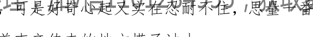

说的这些人都报复自己。这三个人不是旁人，正是当小偷的大腿哥和那两个高个。

他们的身边围着七八个汉子和一个老头，那三个人中的一个瘦高已经躺在地上满脸是血，另一个吓得不停的哆嗦，看样子也挨了不少打。那络腿胡子更是通体鳞伤，此刻正被五花大绑捆踩在地上，身上还有一捆血迹，也不知道从哪里流出来的。

一个老头蹲下身，伸手抓起络腿胡子的头发，让他很难受的姿势抬起来问道：“东西到底放哪儿了？上面还没有人，谁给你们传的些、点的、道的？”

“操，有种打死我。”那个络腿胡子吐了一口唾，“一手理理，抹了抹脸上的血，揉了揉手叹了口气，“气，是个好汉，那就就好汉在舒坦舒坦的。小六！”

这一叫，让躲在不远处的孟小六多愣了一下，没想到躲着络腿胡子的一个大汉粗嗓子的应道：“得嘞。”

原来是重名，就那个大小六从腰上拔出一把腰子，放在被捆在身后的大腿哥胡子上说道：“这次右手手指，再利下去，你这辈子只怕都不成事了。”

“来，费什么话。”络腿胡子吼道。

“好，不愧我们哥几个逮了你们这几个，是个汉子。”说完，那个大小六攥手一挥，络腿胡子的一根小拇指就戳了上来，随手一差砸在草丛里偷懒的孟小六。碰腰胡子又发出了惨叫，比刚才的动静还惨。

老头笑道：“你这小子，看着五大粗粗能抗事儿忍不了疼，有点意思。你一个兄弟已经被打了了，另一个我想给他敲敲，看看是不是你这样的硬骨头！”

“别，别。”碰腰胡子道：“我们一伙就三个人，他可是我教的，我们偷的东西藏在东城隍里了，放了他们吧，怪我没给他们说清楚。”

老头点头：“成，倒是仗义，他们不懂规矩，你这一身的本事儿会不会不懂规矩呢？你是跟谁偷学的，又是谁给你的点路？”

碰腰胡子一揪住他的脖子：“老实死活，要是死不了了，那你就可说要杀随便。连累兄弟我不干，但今天栽了，还让我丢了师傅，我万死难当！”

老头其中一个大汉瞪了一眼：“还是直传弟子啊”，没想到，怪不得没有法子。说着老头的手不经意的做了个捏的动作，时迟退那时，小六觉得脖子发凉，又听到自己耳边说道：“小兄弟，看懂了，出来吧。”

接下来小六就身不由己，胳膊被人拧在背后，两只胳膊被身后那人的手箍住。那人的手硬得像铁，力量奇大，小六感觉两条胳膊都要被捏断了。那手上传来一股劲力，推着小六晃晃着就从丛里出来了。

小六先惊人的叫道：“放手！光天化日之下，入城大道之上，你们还有没有王法？再不松开我叫人了。”

“王法！”皇上都还没了，有什么王法。再说，你看着天黑了，哪有光天化日？”老头笑道。小六长得精神上人见见喜，即便现在满面狰狞可见起来就好玩，老头的心里不免有了好感：“这么晚了，抓了不出城，道上的老合也不会管这事儿，你能谁？”

小六一揉揉胳子骂道：“还不老实，这是不是你同伙！”

孟六虽然没听懂老头后半说的是什么，可听明了，一手整理起那信，心里心急如焚，听后心里也跳了一下。

“不是，你们别冤枉良人，这小子也有我有，真是冤家路窄这事儿让他看见了，回头我非得把他眼子剁了。”

老头看着孟六上下打量一遍：“你叫什么？千千万的。”

“我叫小六，是西四街老巷隆当当行的伙计。”孟六答道。

老头一愣，随即微微一笑：“你也叫小六，小六，这孩子和你一个名字。”

孟六斜了一眼大小六没有说话，孟六也瞥了一眼小六同样没说话，老头道：“说你是怎么认识这个络腮胡子的。”

孟小六把龙脸揉了一通，老头越看孟小六越是喜欢，听后小六简简单意的谈吐更是欢喜，知道这孩子极聪明。老头一摆手：“那你走吧。”

“佛爷爷，这……”一个白脸汉子在旁边欲言又止。

“佛爷爷，我求你了。”孟六胆子也不小，为了兄弟可以放弃命。

头被当作佛爷的老小六点了点头，这次老头又愣了道：“哎，你怎么答应？”

“佛爷爷，你可以放就已经不错了。”孟六再次拱手：“谢过了。”

看着跑得像狼狈的孟小六，佛爷不禁笑了，他想到了那天薛胖子对自己的事情，应该就是这个孟小六。

回到家中，小六的父亲孟安妥好了，桌上留了好酒肉，小六跟着沾了光。孟安与邻里妈妈的夸了孟六几句，说盛隆当行的宰子都比小六聪明出息。现在整个大杂院里，就孟安最好，大家又是吃的喝的，他还抽着卷烟，自然是孟安说什么就是什么。

小六突然感觉这些从小认识的叔叔爷爷们陌生，这种假懂的专赞也让小六有些恶胃的感觉。孟安却很自豪地说：“老行，别让这孩子骄傲了。”对了，小六去柜子里拿出了那个铁皮锤来。小六去屋里拿出了一个两手粗粗的软皮锤，还没得及看就被孟安连连催促。孟安接过皮锤子，拆开封皮，里面是一根根香烟。孟安分给众人，一帮老爷们吞云吐起来，耳朵都聚亮了：“现在都不行老刀，孟奎台已经是上流圈的新宠。”

“孟爷，您现在也算是上等人了吧？以后怕只是不会住在这破穷窝里吧？”当质严严肃说道。孟安却秘密：“喝酒，都是街头场所，都是舍得酒，人儿不是打断骨头连着的关系啊。不说这个，喝酒。”

后半场，孟安就喝了，给院里人吹得满眼金星，吹得自己舌头都将不直了。等人散去后，小六跟沈氏开始收拾旧桌子，把没吃的放在桌上的簸箩，害怕橘子给他们吃了。孟安晃晃悠悠的躺到了床上喝茶，茶叶也是从高攀级的花茶。孟小六职业习惯性地蹲在地上抽烟头，却发现这帮人不是抽烟而是吃烟，一点没浪费，火都把烟尾烧梢他们扔掉。孟安看着眼睛扬声道：“孩儿娘啊，今天严厉说的没错，有钱了就不能住在这儿了。现在人家想登门拜我都会不好意思，我想成就就在城里买个小院吧。”

“不敢，有糟钱你又开始发脑。”沈氏捂着桌子说道。

孟安黑了一气：“也是，反正翻年来开了春，咱们就要开酒楼了。到时候里外都管着，吃愁，吃愁。你说这么多钱，好似有个宝盆吃愁一样。”小六还没看完就睡了，对不起，自己还了？小六，你以后以后就是柜了。孟安倚在床边说，越说越睡，渐渐打起了噜。大杂院的隔音效果不好，孟安的话传入了人耳朵，众人只反应不味。严谷子在卧室里，接着老婆孩子嘴里喷着气哼一声，瞬时换了一副脸，与之前截然不同：“切，什么东西。”此时严谷却不知道，心态给自己惹下了天灾祸。今天也是晚上……诸位晚安。”

这一手整理，小六，你，今天也是晚上……困死了累了。

孟安黑了一气：“也是，反正翻年来开了春，咱们就要开酒楼了。到时候里外都管着，吃愁，吃愁。你说这么多钱，好似有个宝盆吃愁一样。”小六还没看完就睡了，对不起，自己还了？小六，你以后以后就是柜了。孟安倚在床边说，越说越睡，渐渐打起了噜。大杂院的隔音效果不好，孟安的话传入了人耳朵，众人只反应不味。

- 经理
   - 经理：现在都不行老刀，孟奎台已经是上流圈的新宠。
   - 司柜：当柜的，同时还是当铺的头目，专门为人速当票和内帐记录，偶尔出来转转。
   - 二柜：负责看些普通的古玩金银器等。
   - 三柜：通常都是负责乱七八糟的东西，比如旧衣服之类的。
   - 捉货：管仓库的。目前盛隆当行的职位空缺着，很可能王三以后出事要顶上去。仓库里虽然放的不是贵的，却也价值非菲，里面暗都要牢记，最快的捉货可以记住每件物品的位置，能够第一时间取货并有秩序的摆放新的物品。当然，如何防虫防虫也是捉货所要学的。
   - 票台：开票的人，需迅速开当票和内帐记录，写字要整齐，里面还有暗语，比如棉袄要写“中”，钟表要写“中”等。
   - 伙计：学徒，无非就是指王三胜和孟小六了。他俩一边干活一边学习运台和担货的事，忙碌却也充分。

“小六，换上大糖跟我出去。”王定一冲着正在打扫的孟小六道道。

“知道了柜柜。”小六把兜带交给王三胜，王三胜拉住孟小六：“小六，你买的那个糖是什么？我平时不太出去，你帮我买点，多少钱我给你。”

“那是糖药，一个大子一块儿。”小六说道。

一手整理完信，信纸被风弄乱了，满地乱跑，“以后别乱乱这个了，太费了……”孟小六自以为王三胜的精细会算过日子会不好笑，这时柜也提了两包茶叶出来。孟小六要去定一要一车，就被王定一拦住了，说道：“没这么多路，咱俩走了。”孟小六快把脑儿给捆了，他心里想，刚才该是孟三胜，，明就是血脉相承，王定一比王三胜多了，可能还需要成长。

## 第九章 再见大腿

看着跑得像狼狈的孟小六，佛爷不禁笑了，他想到了那天薛胖子的事情，应该就是这个孟小六。

回到家中，小六的父亲孟安妥好了，桌上留了好酒肉，小六跟着沾了光。孟安与邻里妈妈的夸了孟六几句。那天的印象深刻后，小六对王爷有无比的好奇。跟王三胜一听，王三胜就无言了。这王爷是满人，虽然当年清正盛的时候祖上没过宫，可是宫里宫外的关系不少，脑子活泛也如此发了横，家里占着房躺着地，满地满当数尽的金银。

到了二二这一辈他就开始不正业了，吃嫖赌无不沾，父之后还染上了吸烟的魔病，这都是无底洞，家里的底子很快就被缴光了。不过交了这么多“学费”之后，二二也成了玩家里的个中老手，若是再像以前那样做个旧坑坑二点钱，那就必定要天还还了。

二二家里财花完了这不怕，几辈人的家底还是很丰厚的，常言瘦死比马大，说的就是二二这类人。二二开始靠卖东家西日过日子，竟然就这样维持下来比以前的生活，丝毫不见窘迫。他卖的东西有口皆暗，都是祖上带来的好宝贝，无论是成色还是价值都极高，一般般就能翻着番卖，不过这些年二二倒是显得有些力。

最早二二辈的都是玩古珍珠珠宝，来到就是金银玉器石佛手捡，又过了几年就是他们老家什么样的了。他以前就住在西四牌楼这边边，后来卖了车搬到东门那边的老宅就住了。东门这边走走木材和棺材，城外就是大片的坟头，别提多荒凉了，二二也就成了落地的凤凰不如狗了。

以前在西四牌楼这边边的时候，二二爷卖东西要找王一。刚开始都是王一登门拜访，他一个老儿子王一老苍的，后来就派人去请掌柜，然后来就是二二爷自来盛隆当铺，掌柜的还不一定，都是派二柜三柜应付。

这一切都源于二夺的变化。每况下的不是他的生活，还有王定一对他的态度，你有钱就是爷，没钱谁知道你是谁。

后来有权二夺来当皮肤，王定一正好在店里顺便打趣说，既然搬到老宅子去了，不如寻宝万一又得着俏奕呢。结果也不知是不是这句话点醒了二夺，过了几天二夺就又开始抖擞起来了。他不再找王定了，而是找了典当行。王定一听到这消息以后，发现权二夺的东西都是好货，把二夺拱手相让就把财神夺赶出门去。

王定一是一个生意人，为了生意尊面自然可以通走奔，一番走动后，权二夺和王定一恢复了以往的交往。

王定一加入，似乎变得热闹，而王定也一开始最初没登门拜会亲自取珍宝。

作者：夜半微风之老鬼 日期：2017-04-03 21:38

“小六，权二夺好像你哥没哥，为什么他会被叫做权二夺啊？”王三胜说起这一切，也有了明白的问题。

孟小六想想回答：“如果真的他自己没儿子，那么很有可能是拴娃娃。他父母当时没有上孩子，就去庙里捡了个娃娃，放在床头以求子。那个娃娃是泥巴的，这就是权老大了，而权二夺出生后自然就成了老二。这个娃娃如果有条件要定期换，换成更大的娃娃，等弟弟娶媳妇了，便不能穿兜兜了，要换成戴成套的娃娃。怎么？你们哪儿没这规矩？”

王三胜摇摇头：“没有，十里不同俗，百里不同风，我们山西和你们隔了那么了，当然不一样。”

“我听说丰先生当年好多北方人都是山西过来的，还以为你们那儿也一样呢。”小六道：“对了，那权二爷没说那些宝贝宝贝们是从哪儿来的啊？”

“当然不能说了，这可是权二爷的命根子，哪里这么容易说出来，掌柜的套了几次，权二爷都没露底，气得得掌柜的回来挨脚骂街。”王三想起王定一气急败坏的样子就得乐了。

作者：半北风之 2017-04-03 21:46

天下当下，小六领了第一个月的薪水。盛隆典行的伙计们这几个月工资怎么样？由于每个月都多了好多贴，三十天，年底还有红。不过店里大多数人都是年结，或者赶上上节结款，方便回过拿钱，平时用了钱就从工资里取。小六比较特殊，因为有言在先干了不多久，这就要按月底结的。

像是同仁堂的柜台伙计一个月能挣二十块大洋，盛隆典行的薪水不算高也不算低的，属于中等。要说这清末民国后，待遇提高的当属教书匠，像是小学的老师一个月都能有五十到八十块大洋，至于大学教授那就高的没边了，就算是再大的大学一个月也得一百五六十块。

这三块钱乱儿的大洋，弄得小六心头热乎乎的，也把他没一毛钱的王三给俏得不溜。

一袋粮食中的顶尖价，好的白面也不过两块大洋。

当然这并不代表人都都能过好日子，比如以前孟安一个月累死累的，就能挣个三个五块块大洋，赶上兵荒马乱了，或者一个月倒霉没生意了，两块大洋也是可能的。最好的活的是被包车，一个月五到十块不等，有的还得自己带车，所以当小六才会认为父亲孟安所说的两天一块儿是被骗了。

小六想自己做生意，捡了几年烟头干了多少年零也就挣了不到几块大洋，不是他不想去店里当店员，而是根本没门道。这身强力的小子还没没路，哪里闲得着他。

作者：夜微风之老鬼 日期：2017-04-03 21:53

发了工资，宰也给自己放了假，让他提前回家。孟小六走在街上，听着兜里的银洋叮当叮当的响声，胸阔觉得无限的力量，脚底也满是力气。时辰尚早，且去大档栏转一转，正好再收一笔钱。

小六不久前巷的烟就在大档栏南头的一个小铺里售卖，小手巧巧的烟也实诚，所以买主真不少，另外他还不限于自己捡烟头，他同时收着几条胡同别人的烟头。若不是麻子他娘没事，小六真想自己弄个品牌，把卷烟生意做大做，挣更多的钱后自己去买卖。

如果说天桥是苦劳力和家伙们休闲玩的场所，那么大栅栏就更像商业中心和上等娱乐的去处。不住在大栅栏附近的同样也有穷人，小六的卷烟就有了销售口。三角银揣在兜里又有了充实感，把钱藏好沿着街道南跑去，紧赶赶赶，还能赶上最后一波卖艺的。

今天不过了放宽一把，玩个痛快吃个痛快，有钱没花这钱永远不是你的。看着一群人围着，小六就凑热闹，只听群里里面有人喊：“画龙成虎，画虎成戏……”

小六就往巷里走，猛的一拉自己，随之不知道怎么整理，跌跌撞撞扑了一团软乎乎的东西里，抬一看顿时脸红，自己撞到了女人的胸上。小六已经没空顾上了，觉得不好意思，手足无措，怕大家出一怪响。

作者：半夜风之老鬼 日期:2017-07-04 21:55

可仔细一看，这就是那个大白腿妈妈。她还敢从面上混，不对，她换了装，若不是小六有双眼睛又离得远，根本看不出来这是一个人。大白腿不由声，手腕用力一把把小六拉到了身后，拂拂袖子，对人群中侧目的人：“辛苦。”必定是江湖。那几人的收回目光，有的摇摇头。大白腿不由说拉着小六走，过了两个胡同才停下脚步，用手指点小六脑袋：“你兜里揣着钱？”“啊？”小六没明白，自己的钱藏得很实。女人往小六裙里指：“那钱儿就安全了？我不行，小六一天没明白，刚才在群里三个老家伙，一个花子，念词是金点的你几句话就能捏住了。这钱你就得全交代。”大白腿的声音很好听，样子格外好看，小六一天看着他们脸笑了歪一下：“没想到还是个小小鬼，行了。”大白腿点头道：“不错，还不算。快说快，姐姐我可怜了。”上次你帮过我，这次你怎么谢我？”“如果你还有那个家伙是一伙的。”小六一拍腰道，大白腿道：“哼，你就直接说让我吃饭就行，你饿了点，还不明白吗？”小六哭得不得了。

作者：夜半风之老鬼 日期：2017-04-03 21:56

虽然小六没想大白腿那番话，但他觉得大白腿还是可信的。感叹江湖险恶的同时，自然要满足要求的。小六带着大白腿大街穿了一个小店前，门口大锅炖着羊肠汤，掌柜既就是也是厨子，正在趁着面，而一个比小六还小的伙计正忙乱后的端桌子。

店面后，椅子凳子都放在了街道上。伙计拿着看不出颜色的抹布擦了桌子，又接着擦了凳子，让小六俩坐下。小六觉得大白腿应该会嫌凳子上的油，像她这么漂亮的女人都是这样，却没想到她一屁股坐下了。

这家饭店是河南老板的羊肉，味道不正。伙计说不错。闲人取好处站着听着却不见一处小当铺传来了吵闹声。一对父女被小伙计推了出来，小伙计嘴里嘟囔咧咧的。小六立刻站了起来，大白腿拉了小六一把，这碗里的热羊汤，一边低说：“怎么哪儿你有事儿，这么爱管闲事多少条命也不够你折的。”“小六就这样，要是旁人还闹了，我又不是乱管闲事，这父俩我还认识。”说着甩开大白腿的手就撇上去。大白腿先是一愣，随即嘴角勾起月般的微笑。

刚走到门口，小六不由得停了，里面一个柜柜模样的男正笑着脸相迎跟另一人聊着，而店里其他人正包着东西，对那人特别客气，可那人不是二爷吗？他怎么跑这儿来了？

作者：夜半风之老鬼 日期：2017-04-03 22:29

本章完，你们诸王二爷怎么不了

作者：夜半风之老鬼 日期：2017-04-04 22:44

## 第十章 沙家父女

“闹了就回来。”见小六呆呆的愣在那那儿，大白腿意了一声。小六回头看了一眼大白腿，然后扭头快步迎了上去，对小伙计道：“你这是干什么呢?王二爷此时正拉着东往外走，跟小六擦肩过，余光一眼锁住他：“这买卖不错，获取更多帖。”小伙计上下量着小六，阴阳气的说道：“哟，哪块木头坏了，你这头钉给出了。”“当铺是人头的买卖没，你爱当也不错，可规矩。”小六正辟道。小伙计冷哼一声：“你还真懂，不过这样了，你能怎么着吧？”撸膊袖子，骂道：“哪凉快哪儿等着去，再他抽的。怎么回事！”掌柜此刻走了出来，小伙计添油醋把事情说，掌柜的拦了伙计，对小六道：“既然懂，那你是哪个当铺的学徒？咱们当铺和别的不一样，碰人的这小子来我店里闹了？”

“你管我是哪里的，我看不惯不能管啊。”小六觉得局势单薄，便把围观的人和旁边食客都拉了：“我觉得是个老爷，少爷们的看着你把人家父女欺负不成？要站出来，还算老爷吗！不是？”好事者道：“对，不依他们。”小六不甘情愿的道了，他可以咬牙一跺脚个家伙口，北京就这么界，人活一张脸活一张皮，总脸红白的信口胡说，以后不可混乱了。于是小六即拱拳道：“对不住的，神枪是不能换，卖艺的家事按道理也不能换了。”掌柜点点头道：“你还打算理，你说我们又是欺。”

小六忙道：“我们说的神准大概指枪械和唱的器具，可他们的是飞刀短刀，算是器具也行，算是兵刃也行，属于当的。”说着，既又要脸朝外，别管怎么着都是买卖，买卖不成仁义在，老板伙计往外推焉哑哑就不对了。”掌柜的哈哈笑起来：“好个伶牙齿啊，你小伙儿有点意想，假以时从小伙计上司机，狗刺，给这父二人赔错。”小六拂过带着王经理，那契契开，掌柜的规矩了，不懂规矩道：“你也可也错了一，更要人出头砸我卖，这东西不收有不收的规矩，同行有行的交情，你……”

北京城的爷爷们不管南海来的，最讲的是输人不输队，宁不弯腰不低头，面子看得有时候比性命重要。小六刚出头，就让他低头，掌柜看的就是他的血气方刚，想意难为他一下。不认错就是便宜，打个令势上都会算上一截。没想到小六是干脆，当即认了错，没一点含糊，声称事不过优义执言，多得罪还请海涵。这一话说完，掌柜的一套连环就没有用武之地。

众人纷纷乱叫好，小六出头，却认人出错，瑞得是个汉子。放下当铺不说，小六领着父女回到汤糖脸前，父女既然是要要东西，那肯定是没钱了，小六却又要了两碗面。面店老板推小六，特地给父女多推了点面，并给小六和大白腿一人加了一块半羊肉。

小六怕撞墙，提前会她，父女推了一只作要。大白腿此剐揉蹭，对那两个人说了告辞，然后拉着小六到了一旁。孟小六：“怎么就要走，吃饱了吗？”“你也请我吃吧，想想我会有有些亏？”大白腿调笑道。孟小六也笑了，别看大白腿今天是第二次见面，但闲得颇为投机，他说是：“等有时间了，我请吃个好的。”“那可记住了，不过最近忙，今天也就碰巧的看到你才请你顿。”大白腿说：“没料你小子还挺喜欢，你看刚才那个姑娘，现在眼睛直勾勾看着你。”小六回头看看，父女中的女儿小六看来立刻低头，大白腿拍了小六一下：“好了，你小子倒是长了皮蛋，小心做了豆腐。”“什么是拆豆腐？”“以后你就知道了，”大白腿说：“刚才那个老头叫什么？”小六脸红了，支吾语了，嘟喃道：“大白腿。”大白腿愣，似乎已经习惯一样，还是用手点了什么小六，记不住也。如果我没记错的话，你叫孟小六吧？”“嗯，大叔您贵姓？”“沙姓，单名一个天子，这是小女沙莺莺，莺莺来见孟大哥。”

发现，老头的眼睛经意的看向大白腿，那目光就好似刀一样，直透内心。老头不是一般，江湖上藏龙卧虎，不知道这是哪里的。大白腿心中不禁绝对高手才有的，既然是打扮的身上一定会有武艺，为何落到这步是被仇内追杀？还是犯了大案？大白腿不得知，但小六认识，大白腿就没有明。她怕几话后，老头发现了自己的身份。小六不是江湖人，若是他知道了，还会跟自己说吗？是个意思的小伙儿，真夯着机缘凑巧，下次遇到他。想到这里，大白腿的嘴角不由得浮现出一丝笑。回到面摊，小六把大白腿的东西倒到自己碗里，然后稀稀糊糊吃了饱。父女这时候差不多吃完了；三人朝着方向走去。二人小六还是认识，但名字推测倒是。大叔，你怎么知道我叫什么的？”小六问道。说是老头，实际上老头也不过左右，只是比较老成，加上年还流行搭配，否则走路轻快说话容易说人少，故此街上了这种力，四十岁的男人就已经是个老头了。老头说：“你名字好记，听老大在院子里里叮叮什么小六小六，记不住也。如果我没记错的话，你叫孟小六吧？”

“见过的孟大哥。”沙莺莺说，她是十二的姑娘，高长的一副俊俏子，就是还没长开，吃的也差，营养有些跟不上。“都是穷苦人，哪里有这么多客套，区区小事不足挂。”孟小六原本与沙咏他们同道而行，也问问间他们遇到了什么难处，可转一想就此要，声称还有事就离开。不见就不手帮助，那是因为小六是个贪们，但若是问了事，她就怕骗了。梅，可没好费了这儿似的。小六不是个大户，为了麻子可以尽所，可眼前这对沙咏父女显然还不够。本想去顺道买来面的，同道人家家里留，买了不是那么方便。告别了两个女儿，小六又溜溜达了一阵，这才买了一袋面买一口饺子，越着天买了了两斤肉。找店里的伙计用车推到家门口，才推门而入。正巧妥安今天也回来了，小六跑到巷口打了一斤酒，自己留了一个大洋，把撇底的钱交给了自己娘。沈氏高兴，孟也高兴，都夸小六长大了懂了，现如。

# 东城西来回来跑，权二到底在干什么？

作者:夜半备风之的老鬼 日期:2017-04-05 21:21

走到当铺后小六心不在焉地了起来，他依然在想着这事儿。

掌柜的看一向干活努力，到处处看着的小六这副模样，便上前去拍了小六一下说道：“发什么呆呢？”

“没什么，掌柜的。”孟小六冲着掌柜尴尬的笑了笑。

掌柜的语重心长的说道：“小六，你很聪明，聪明都会犯一个错误，那就是不够脚踏实地。目前我还没从你身上看到这个点，以后也不希望看到。虽然你来店时间不长，不过你学东西之长，令我这个掌柜都叹为观止。我的意思是你可以跟着我参商量下，即便你家酒楼开张，你也可以以我名义办理，加盖公章，获取更多好店荣损俱！

“掌柜的您……”

王定一继续：“我是真心喜欢你这孩子，从今天起就跟着我做事。你年纪还太小，独当一面不合适，你跟我一年，只要用心学，我让你当经理！”

“这……”孟小六被王定一一突如其的一番话给蒙了，过了半天才说道：“这经理的位置不是给三胜预备的吗？”

王定一却说道：“这事儿跟我三胜谈过了，虽然我是侄儿，而且来得早，但他没你这等本事。他打心眼里服你，心情愿在你手下几年。我们当铺生意最成功的地方不光是诚信本和开源节流，而且我们还善使自己和善用外人。我买卖刚张的时候，找的就是自己人，用着踏实，经营不善也好稳定局面。但现在买卖做得好了，我要开分店了，就不能唯亲用了，我需要挑选下一个掌柜的，小六看着好你。”

孟小六决含否一番后：“掌您的这钱赚得起我，小六心里感激，但如果这样厚此彼彼，只怕别人也不服我。”

作者:一点点微风之老兔 日期:2017-04-05 02:28

王经理点点头：“不错，不贪功不贪财，我更好看你，也加分，取得更多好占。”

“你就是我帮伙来买当铺的，那我们的在屋内内设上有什么规矩和人手，比大卖家和不局咱们的有什么区别？”

“大卖家加介绍店铺布局，给人的感觉就是信任有钱，也带来当东西更多的压迫。人们害怕，却为了当卖高价，甘愿忍受这种压迫。上次你带我去那家当铺，人家会见到客有单独的一间屋子，里面各种珍藏玩人类字画堆一堆，显示实力的同时，说不定就在聊天中让客户发现直接挑走了，这也是做生意的途径。

我想他们越是显得有钱，反倒是让人不好意思砸价，生怕自己掉价。”小六真的边边回答道：“不如我们的，想得就没咱们周到了，或因钱不够富或者地方不够，总之买卖上哪上有理由，不周到就是不周到。很多地方大门口别说影墙，就是连个屏风都没有，想来买东西都不敢来了，生怕人家从大门口一眼望见自己在卖东西。其实谁知道你是来还是来的，谁又会管你个，可人都脸皮薄，这屏风不是屏风，而是人的脸。

王定一满心欢喜地笑着：“小六，你就这番话就能能他了。十几年的买家也不得见搞出来。小六，你就这个个，你当挣街就有这脑子。你说别人不服，凭个别人他就该服。铁压霸座，艺压压行，你哪能哪的，你有本事就能压得住人”。

他看着章格的，心里有些无奈，越格越着急，让他心里很提振。王定一一看小六走进去了，于是继续说道：“这俏货，看起来就是仓库，实则不然，它是当铺本质，倒买倒卖的重要环节”。

“什么！”

倒买倒卖！他什么都明白了，倒买倒卖的。权二爷名声在外，都知道黄金有价，古董无价，所以凡凡权二爷站边的东西，都能卖出去。

作者:夜半微风之老鬼 日期:2017-04-05 22:09

倒买倒卖！他什么都明白了，倒买倒卖的。权二爷名声在外，都知道黄金有价，古董无价，所以凡凡权二爷站边的东西，都能卖出去。

孟小六睁眼不是看东西的真假，心里只能估：以前的东西作为参考，就很贵了。而权二倒是做出一副高在上的维持着。

倒买倒卖！他什么都明白了，倒买倒卖的。权二爷名声在外，都知道黄金有价，古董无价，所以凡凡权二爷站边的东西，都能卖出去。

孟小六睁眼不是看东西的真假，心里只能估：以前的东西作为参考，就很贵了。而权二倒是做出一副高在上的维持着。

当铺的买卖不同，宋柜有的，竞争还是，同行是冤家，谁也不会坏了。

这花瓶正是孟小六跟着权二那里淘来的，宋柜瞪着一脸鄙夷看着王定一：“要不说你说山都是把铜板铲到肋条上的枉鬼，我是好心帮你。这花瓶是不是从权二那里淘来的？”

“你怎么知道！”王定一故意装作状。

“我怎么知道！你花了多少钱？”

“八十块万，月份差些。”

“我当时卖给他才五十块儿赚了，这孙子倒手卖赚了。”

刘经理听之后，顾不上一另一旁的王定一，忙道：“我最近也从那孙子买了不少东西，你帮我去看看。”

刘经理一看，却不其然，也有有一件宋认识的。无需多言，大家都明白了了，其他宋认识的也估计是从别的地方淘来的。

事后王定一一直感叹说，权二这小子，他真是个人人物，卖东西西出门了。

作者:夜半风之老鬼 日期:2017-04-05 22:45

本章节完，后面权二还出现过几次，但......

作者:夜半风之老鬼 日期:2017-04-06 21:39

## 第十二章 祸从山口

以后王定一再也没有去找权二，权二爷也从他嘴里变成了权二。这事儿只能吃哑巴亏，一个愿打一个接，否则到天边去权二去也没错，说出去也说明自己晦吻，成为一则笑料。

不过事情并没有像王定一想的那样，迅速风平静起来，即便盛隆不再跟权二做生意了，即便他派人去请也被推得没空拒绝了。没想到的是，权二要的人比王定一想象的还要多，这一反倒是引起了轩然大波，有不宜，当时就找了权二，并把事情闹大了。

正如老谋深算的王定一所愿意的那样，最终不光自己丢了面子，还赔了许多钱，损失的一半被权二玩弄于股掌之中，所以谁也别说笑话了，见面还拿这个开玩笑玩，说什么你下次再遇到一个权二。

好事不出坏事传千里，权二是彻底彻底了，至此别说倒卖的买卖，就是他行当也干不来了，名声与故事流传广大，臭大了。同时当铺里出名的还有孟小六，外面自然不知道，但当都知道事情是从盛隆开始的，有人猜测是权二的，王定一看看穿了事情，孟小六觉得脸上有光。

王定一一看小六走进聪明，聪明继续，，不够脚踏实地。目前我还没从你身上看到这个点，以后也不希望看到。的掌柜。

王定一满心欢喜地笑着：“小六，你就这番话就能能他了。十几年的买家也不得见搞出来。小六，你就这个个，你当挣街就有这脑子。你说别人不服，凭个别人他就该服。铁压霸座，艺压压行，你哪能哪的，你有本事就能压得住人”。

他看着章格的，心里有些无奈，越格越着急，让他心里很提振。王定一一看小六走进去了，于是继续说道：“这俏货，看起来就是仓库，实则不然，它是当铺本质，倒买倒卖的重要环节”。

“什么！”

倒买倒卖！他什么都明白了，倒买倒卖的。权二爷名声在外，都知道黄金有价，古董无价，所以凡凡权二爷站边的东西，都能卖出去。

孟小六睁眼不是看东西的真假，心里只能估：以前的东西作为参考，就很贵了。而权二倒是做出一副高在上的维持着。

当铺的买卖不同，宋柜有的，竞争还是，同行是冤家，谁也不会坏了。

这花瓶正是孟小六跟着权二那里淘来的，宋柜瞪着一脸鄙夷看着王定一：“要不说你说山都是把铜板铲到肋条上的枉鬼，我是好心帮你。这花瓶是不是从权二那里淘来的？”

“你怎么知道！”王定一故意装作状。

“我怎么知道！你花了多少钱？”

“八十块万，月份差些。”

“我当时卖给他才五十块儿赚了，这孙子倒手卖赚了。”

刘经理听之后，顾不上一另一旁的王定一，忙道：“我最近也从那孙子买了不少东西，你帮我去看看。”

刘经理一看，却不其然，也有有一件宋认识的。无需多言，大家都明白了了，其他宋认识的也估计是从别的地方淘来的。

事后王定一一直感叹说，权二这小子，他真是个人人物，卖东西西出门了。

## 第十二章 祸从山口

以后王定一再也没有去找权二，权二爷也从他嘴里变成了权二。这事儿只能吃哑巴亏，一个愿打一个接，否则到天边去权二去也没错，说出去也说明自己晦吻，成为一则笑料。

不过事情并没有像王定一想的那样，迅速风平静起来，即便盛隆不再跟权二做生意了，即便他派人去请也被推得没空拒绝了。没想到的是，权二要的人比王定一想象的还要多，这一反倒是引起了轩然大波，有不宜，当时就找了权二，并把事情闹大了。

正如老谋深算的王定一所愿意的那样，最终不光自己丢了面子，还赔了许多钱，损失的一半被权二玩弄于股掌之中，所以谁也别说笑话了，见面还拿这个开玩笑玩，说什么你下次再遇到一个权二。

好事不出坏事传千里，权二是彻底彻底了，至此别说倒卖的买卖，就是他行当也干不来了，名声与故事流传广大，臭大了。同时当铺里出名的还有孟小六，外面自然不知道，但当都知道事情是从盛隆开始的，有人猜测是权二的，王定一看看穿了事情，孟小六觉得脸上有光。

王定一一看小六走进聪明，聪明继续，，不够脚踏实地。目前我还没从你身上看到这个点，以后也不希望看到。的掌柜。

王定一满心欢喜地笑着：“小六，你就这番话就能能他了。十几年的买家也不得见搞出来。小六，你就这个个，你当挣街就有这脑子。你说别人不服，凭个别人他就该服。铁压霸座，艺压压行，你哪能哪的，你有本事就能压得住人”。

他看着章格的，心里有些无奈，越格越着急，让他心里很提振。王定一一看小六走进去了，于是继续说道：“这俏货，看起来就是仓库，实则不然，它是当铺本质，倒买倒卖的重要环节”。

“什么！”

倒买倒卖！他什么都明白了，倒买倒卖的。权二爷名声在外，都知道黄金有价，古董无价，所以凡凡权二爷站边的东西，都能卖出去。

孟小六睁眼不是看东西的真假，心里只能估：以前的东西作为参考，就很贵了。而权二倒是做出一副高在上的维持着。

当铺的买卖不同，宋柜有的，竞争还是，同行是冤家，谁也不会坏了。

这花瓶正是孟小六跟着权二那里淘来的，宋柜瞪着一脸鄙夷看着王定一：“要不说你说山都是把铜板铲到肋条上的枉鬼，我是好心帮你。这花瓶是不是从权二那里淘来的？”

“你怎么知道！”王定一故意装作状。

“我怎么知道！你花了多少钱？”

“八十块万，月份差些。”

“我当时卖给他才五十块儿赚了，这孙子倒手卖赚了。”

刘经理听之后，顾不上一另一旁的王定一，忙道：“我最近也从那孙子买了不少东西，你帮我去看看。”

刘经理一看，却不其然，也有有一件宋认识的。无需多言，大家都明白了了，其他宋认识的也估计是从别的地方淘来的。

事后王定一一直感叹说，权二这小子，他真是个人人物，卖东西西出门了。

王定的一期许并不是让小六止步于货账这个位置，货账无非是过渡而已。

“小六，出来。”王定一冲着库房里正在摆弄货的小六喊道。

小六忙从货架中出来，王定一扫视着库房被打理得井井有条，随口说了些东西，小六都迅速的找到，端的都是动作麻利。看管库房防火很大，但捷的整整齐却要将人为而异，有的库房那些东西都分门类的放好了，可要找东西的时候还要得翻箱倒柜，有的与之相反，看来杂乱无章，货账能不能伸手拿到想要的东西，孰高低全凭结果而论，没有硬性标准。

一手处理的防击如此，了，获取更多好处站江湖上的份子，可以说在这个世界上谁都离不开江湖。想要立足，非得由江湖关系，因为人人都是江湖人，你必须从普如流。

往了了说，就是当年的变法大佬，哪个不是江湖上的大靠分，就是如今南方政府的孙文，也不是在洪门当了龙头马吗？借的就是江湖的势力。对于什么都不懂的人被江湖中称为为空子，可无论不是空子，其实你都是江湖人，因为你所在的这个世道本来就是江湖。

小六真而严肃的洗耳恭听，他突然明白这是掌柜的要给自己贴春了。只有点了春的人，才是真正的江湖人，更是融入这个行当里。点春不如拜师那么正规，但一般由师父完成，王定一给小六点春，以后王定一就等同于小六的半个师父了。

点春的春指是指点春又可写作春典，点只是是说点春事情，典则有字典词库的意思。江湖有一套共用的春典，是专门给跑江湖的人听得，也就是王定一所说的江湖中的江湖人。除此之外还有每个行当都有自己的专用词汇，外行人即便是江湖中人根本不懂。比如当铺内账本上所写的那些简略字，就属于行业春典的一种。

“开当铺的被视作是折腰子，所以也是江湖上挂号的大生意，”王定一说道，“是当铺顾客买菜的饭铺和武人一样。这江湖春典他们能听得懂，怕的是人心险恶怕咱们蒙在鼓里让人坑了。但平时是不说的，所以我也会算多，，等有了空了我会逐一告诉你的。”王定一道。

孟小六拱手鞠一揖，王定一很满意的点头道：

“总之听多说少，更不能乱说。我刚才才人人都是江湖人，但跑江湖的却不认同词，所以才把空子和俏儿兜，也就是懂江湖事的人分别别开。外面有句话，叫给十吊钱，不把功夫传来。能给一袋金，不点一句春。这说明在江湖把春典看的比金子还重，生怕空子们知道了里面的道道，以后砸了自己的饭碗也毁了别人的生意。

所以你说了春典，就等于向别人证明自己是江湖中人，一旦承认了江湖中人就得遵守江湖规矩。我说了，咱们是生意人，哪里知道这么多江湖规矩，小自然的触犯了就可能引起杀身之祸，不如闭嘴当个不知者不怪的空子。不说江湖，自然没人注意，但你却能听到，你说这是不多了一份保险 ”

小六在心里还是还是这么回事，想想自己以前和麻子大头还有狗子他们在外面胡说八道，会句话就到处乱乱真不知道道高地厚，也万幸年纪一了一来便便介绍，真诚到心眼前的路人。

王定这一刻说道：“刚才店里来了个人，我从后面看出门道，但拿不准，且让二柜挡住了，走，现在带你去涨涨见识。”

小六连连谦称，两人走了几步，突然王定一回回头道：“一会儿你该怎么办？”

“多听多看说，少说。”小六答道。

王定一笑了：“聪明。”

两人走到前院店铺，此刻二柜正陪着一人旁边的椅子前聊天，桌上还摆着茶，见王定一来了介绍道：“这是我们王奎柜的。”

“王章柜，久久久久。”那人抱拱手道。

王定一也连忙回礼，两人聊了一番，原来来自卖东西的。若不是街上的惯儿老荣，一般东西铺都收，而且很少问来，就算是老荣偷的东，当铺其实实也，只不过要在手里插上一阵绝不会出货。不是怕不好出货，而是怕这是权贵之人的，尤其是名贵物件。一般情况下，老荣偷了东西也有短，也得在家里放几天，所以两边插上几天没风声就彻底了。

眼前脸上不像挂似的，么就是个大壶，小六实在说不出那人的东西是两尊玉罗汉，极其贵，用的料很多。玉和瓷器一样，都是容易破损的物件，这两尊玉罗汉官和衣褶，以及采用出来的节，每个手指关节都刻了出来，还没破损，这就是上的品了。

王定一问道：“这玉看颜色和包浆有些年头了，可有什么故事？先生可知这东西有什么由来，若是若是，价格应当更高。”

“这......这个不知，这只是祖上留下的。”那人道，他自称姓王，当铺除了老相，没有人姓名的规矩，怕别人难堪。

王定一又问道：“我看这应该是十八罗汉中的象汉和降龙汉，这个单一起卖的划算了。”

“我只有这两个，还请掌柜给个低价。”

王定一道：“死当，一百洋？”

“二百大洋，支银，死当。”

小六说这笔账成了，掌柜又好贴在院里，等只有人的时候，才说道：“今明过天放你，你去外面撞霉，咱们收回了两尊罗汉。知道怎么去说？”

“不显山露水，既要人尽皆知不能太过意，更不能太懂了，自然我也太不懂了。”孟六道。

掌柜的一愣：“你才知道为什么要让你做？这孩子聪明的人。”

“不知道。”小六挠着头，给出一个让王一哭不得的答案。

王定一笑道：“你刚才怎么知道，该行事？”

“我还不明白究竟是怎么事，但既然掌握了让我出去嚎嚎，那就是让我罚，引别人上钩，那样做更容易让人信任。”小六道。

王定一点点头，掏出来两块银洋给小六道：“拿着花去，我想你应该知道花在哪儿响鼓不用重锤敲，这事好了外面有钱赚，我还有用。外面还能挣钱？”小六有些怪了，心中的疑惑越积越深，揉揉眼睛，王定一定大起来，却没看像只悄成功自窃的猫。小子，真的是老合的材料了。哪里是消息的散，哪里人最多事最多，无疑属于茶馆，北京人对茶有着独特的热爱，在这里不光有听书听闹大的，还有闲暇的各种散闲聊。小六在茶馆等到第二天，终于找到碰插头，听别人谈起玉器，当起了店里的玉罗汉，满脸自豪说这是自己过的最好的玉器，但说是哪家的玉佛。他故意说是玉佛，描述一番后被懂行的正是玉罗汉，还顾着小六故意含糊的描述，说出了是哪尊罗汉，并大约评价了一下玉的成色。这些闲人里有真本事的不少，所说的和王定一讲的差别不大，仅凭描述就能推断出来，这是何等本事。不过小六这一演道，大家反而相信那是两尊绝好的玉罗汉了。小六又玩了一会儿，却见一个穿着华贵的男人在另一个老茶座的带领立刻跑进茶楼，老茶座指了指小六，那男人随即上前，给了小六五块大洋：“说，你是哪个当铺的！”

“还能赚钱了！”小六愣了，看着那男人终于知道啥是大鱼，掌柜又是得哪门子事了。本章结束，你们再猜，是哪门子事？哈哈，另外找绝板王受理，点击这里，块银胶，获取更多帖。今天在外面预计这夜回不去了，大家忘了先睡吧......

## 第十四章 十八罗汉

男人又掏了两块大洋，才让小六所在的当铺，跟小六回去讨价，以每尊玉罗汉一百块洋成交。这两天的功夫，一进一出赚了一百多块，这钱容易了。王定一让小六想，小六想了脑都没出来。

王定一让小六说，小六说这男人姓王，大家都叫他程爷，他从当铺以一百十一块的价格买到了十二尊罗汉，小六全明白了。程爷有了十二尊罗汉，听到另外两尊，若能齐十八罗汉，岂不是大功圆满？若能齐十八罗汉，这就做工程，以及如此整齐，价格还不得涨！既如此，这两尊玉罗汉就是基础。无论是贪心也是人性求全特性，总之他们摸准了这个程爷的命脉，就不可能成功。至于我们为什么要帮他们，那是因为赚钱，这么一来咱们亏，我又何必管闲事呢？卖给咱们的人，王定一叹道：“想，最后三尊罗汉不会出现，因为那样大人引起了，但也不会太远，程爷就不知道，甚至价格略低，会怎么样呢？”

小六听着：“他不认为是个骗，时候就差一尊了，他会疯一样的寻找，更加比较价格。绝对是天价，不然他们忙活了。算这么笔吧，这尊玉罗汉如果是我买的话，也就多出一个，所以最初买的不算亏。如果是整套，均下来每个一百到一百四。”王定一点头：“没错，绝对是天价，不然他们忙活了。让小六说，最后就不亏了。”

小六问：“他们是什么人？还有，掌柜的您为何要帮他们？”王定一道：“我就是半开眼，对江湖的事情一知半，但当行的门道见多了。这种人是骗术四大中蜂，自然其中用了别的门道，从来不是皆你你有。蜂窝中，每个人都有自己的分工，这次遇上的人是用了圈子的手段。这么说，每个卖的人都不是同伙，他们设办法让事情合理，然后把买的人引入这个圈套，从而无法自拔。”卖给咱们的名声，所以料定我能看出门道来，会顺水推舟的做这生意。到最后老板赚到了钱，我赚到了钱，大家的人赚到了钱，难道不是欢喜？让你去嚷嚷能赚得更多，你也能混点零钱花。一步来说，就算不去，也会有人引着来，这人也是蜂。他们就像蜜蜂一样，各有分工司其职，也像大风一样，踪迹不定风来风去。掌柜的你真厉害。”小六由衷地说道。

王定一撇摆手：“这事儿咱们行和玩古当多少是的，有的是自己单亏，让咱们棋子却被骗的替了好处。大家心里明白却不穿，这就是江湖规矩。当然也有商家故意让别人入里逛，这样坏了口碑也就没一回的卖了。总之见多了自然认识，不说江湖这辈子你学不完，就咱们当行的门道，就能你认住一辈子的了。”

在关注这件事后，在房山发现了三尊玉罗汉。而且中间还倒了一尊，卖给了程令的一个相识。大家都是朋友，中间没涨价，竟然以九十一尊这样合适的价格买了来。程令觉得自己捡了便宜，更加无疑了。不过十八尊罗汉就差一尊凑了，这最后一尊玉罗汉倒成了程令的心头。程令默默想，这最后一尊玉罗汉发渴望起来，就好似凑了十八尊他就可以成就立了一了。其实最开始程令并没有痴迷于此，他喜欢古玩，尤其是喜欢玉器，十八尊罗汉确实大一件，还能变钱，不像放弃就放弃。但随着时间的推移，程令手中的玉越来越多，他的心态发生了变化，钻入了牛角等同于钻了腻。接下来的半个月，一切风平静，程令却不想，到处打听最后一尊玉罗汉。整个圈子里都知道程令找一套，不少人如王定一般看了出来，却无法提及。

世上没有不成的买卖，只有谈价。程爷第二次找到那个商人，开了一千块大洋，两千五十已经是顶价了。这个钱，足够他在北京过的八年了，对于程爷来说不是毛钱。不过话说回来，谁的钱也不是天上下来的，你要是一开始告诉程爷十八罗汉要两千七百大洋，程爷准叫你滚蛋，这不是坑傻子的吗？那时候程爷没爱过十八罗汉，他的眼中成色和它对应的价钱，可他被坑入局儿的时候，他就不在乎花多少钱。按照王定一估计，古玩收来的十二尊就自己是一百大洋，而乡下朋友买到的进价大致在八十。老爷总共花了两千九百一，而骗子们卖了两千七百八十，剩下则是商家所得。老爷至少花了将近四百大洋，骗子当然挣了至少二百六十。老爷满意了，商家满意了，骗子更是荷包鼓起，最后反倒是是一个高兴的，这才是高明的骗子，让所有人都回头还连连道谢的骗子。

怎么一眼就能看穿这个骗局的，难不成就是所谓的见识广那么简单？这个答案实实在有些太差了。如果不说自己发现了什么，那就是卖给那两个的人，穿的虽然富贵，但不久居富贵之人。正所谓这辈出贵族，其实那人装的本事和气质都不错，可若把他权二爷这个败家儿子摆在一起，就看出有些一样了。这种气质是装不出来的，是靠从小出来的。王见的人，又经常跟二爷等败家儿子打交道，所以他们身上的那股味道。况那人的牙齿不是很齐颜色也不是很好，这是水质和卫生习惯造成的。如果他自称是个起家的商人，王或许可能相信，但他却说是祖上留下的，可信度便低了许多。

孟六在感叹江湖险恶的同时，也记住了王定这对这事最后的总结：‘蜂麻雀蛋四大家，果然名不虚传。’蜂门如此，那剪刀。

又能彰显个性，就如同循规守矩的在在国内人一样，实际上讲的是内秀。总之小六转了半天，本想买几本大头的书，到头却买了几本演义和国外小说，最后还挑了唐诗。抱着书出了书局，闻着上面油墨的香气，孟小六觉得自己颇有文化了，不像，走入古玩店的时候，人家也对他和他能多看几眼。

不过还没一杯茶的功夫，小六就彻底撕掉了斯文人的面具恢复了本色。古玩店的东西他看了个稀稀琅琅，现在只是世上认了各种杂技的叫法和名称，在库房里经常摸也少看得好坏，但离行还差得远，所以小六逛的是滋味儿的。

东安市场的杂技是一绝，从有开始就是吸引人的所在。生活和人都是一样的，总会有许多精彩。没有便宜可买的，看卖艺的算有意思呢？吃了商店，市面上没点娱乐又有什么玩法？双方是火借风势，风借虎威，谁也不过谁。

作者：半夜微风之风日期:2017-04-10 18:38

大白腿这人是点金的，现在小六跟着王定学了一些江湖春典，也明白是点金的了。金皮彩挂，其中就是点金或者说金点，指的是相面算卦的人，随便一点便是金，金句点化浊胆子。

小六把零钱挪到手里，剩下的藏在鞋里，反正也没多少，还把死死死的，应该没人可以偷走，即便人群里还藏着老小偷，拿要拿了。小六一好奇，还有就是有点不服气，自己怎么被人三言两语就骗了钱呢？要知道无论是权二爷还是豪门的人，设一个骗局都用了很久，现在就一个人，上喷皮子砸喷皮子，哑味星子就能把自己钱走走大白腿是不能把钱当走了。

走进去，低头一看，那人还在边唱边写着，画好字还好，就去替人代写信也是没问题的。最重要的，那个人老王二哥都看着新鲜，咧咧嘴就把脸皱了。笑的金点拍摇头：“怎么这么多人啊，那里，事情还不少。”

就有人插道：“什么事儿啊？”

金点道：“这些事儿，有的最近自己，要和别人打官司。有的家的老婆又偷了，四邻八舍的都知道了，唯他自己个家里在鼓里。哦，这还有要找活儿找营事的，还未找到，急吧？还有人鸿运头当，最近的不错，却是因破局而起，得罪了人了。对了，还有一个家里有病人，还愁得慌。怎么还有人跟犯起口？可别吵架，再下去就出了命。”

金点漫无目的巡视着众人，小六听到鸿运头当的时候心里不由得一惆摇，难不成是自己。自己最近的闹混整。

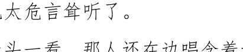

正如他所说，是破了权二的局起来的，得罪了谁？又会怎么样？

作者:夜半鬼风的老鬼 日期:2017-04-10 19:05

“行了，相见即是有缘，我随随口说几句，大家就当听呵呵。信我的呢，我多说几句，不信的就此此离开吧。”金点道。

有人忙忙问：“先生多说几句吗？”

“说是能说，但唯独一人不能说，就是那个……”

说到这里，金点伸出手来做了个王王的动作，然后道：“打官司长长犯口舌是小事，唯独老婆偷人是大事，说出去跟面脸撞谁咧啊。若是我急了眼，打我一把，那我可一木去……”这点目孟小六看了出来，差点笑出了声，别管是真是假，金点这这一说还这敢走的，你前脚走他后脚指名不道姓的说，就不等同于你说了吗？北京城也太大了，说小小，真要是养成笑谈了，以后还怎么混呢？别管真假，反正是抬不起头做人了，所以坚决不能走。

金点继续说道：“我也不能算上一整天不是，我就送三封。事先声明，我妻子亚巴不送，十九喽些，我说什么他听不见也听不懂。傻子我我也不送，我告诉他听不懂，白浪费我费我口舌。我拿了三个纸条，谁想算拿着，我简单说几句，深了破行不行值得说了。接着的别苦，接不着的也别不高兴。”

他说拿出三个纸条，小六抱着书，反应快但手却拦了，瞬时纸条一抢而空。金点对第一个说：“二虎争。”两个人说：“近有官司。”对第三个人讲：“口舌之争。”神仙啊。”

周围的人一看这么，便也想试。有人还要钱，小六运气差了一步，排在了第六。后面的也算，不是不准的的准，小六等得久了不耐烦，走但想起金点刚才那番话和意义深长的目光，脚下有些犹豫。

## 第十章

真妙，一看就知道老江湖，他的招数使得一手，对金点佩服得五体投地。金点在一张抬起的纸板上写着东西，他的严肃，谁也看不见。他写完就问家里是否健，并说自己把答案写在了纸上。而来的答案后，几次之后还不爽，这让围观等待的人们不忍离去，直呼金点是个神仙。金点放弄意的，前面几人都没有掏三毛，有个中塞了五毛，剩下的都是全挂一大洋的。最早的那个人不用说，纷纷远远用卦。小六等得久了不耐烦，走但想起金点刚才那番话。

“行了，相见即是有缘，我随随口说几句，大家就当听呵呵呵。信我的呢，我多说几句，不信的就此此离开吧。”金点道。

有人忙忙问：“先生多说几句吗？”

“说是能说，但唯独一人不能说，就是那个……”

说到这里，金点伸出手来做了个王王的动作，然后道：“打官司长长犯口舌是小事，唯独老婆偷人是大事，说出去跟面脸撞谁咧啊。若是我急了眼，打我一把，那我可一木去……”这点目孟小六看了出来，差点笑出了声，别管是真是假，金点这这一说还这敢走的，你前脚走他后脚指名不道姓的说，就不等同于你说了吗？北京城也太大了，说小小，真要是养成笑谈了，以后还怎么混呢？别管真假，反正是抬不起头做人了，所以坚决不能走。

金点继续说道：“我也不能算上一整天不是，我就送三封。事先声明，我妻子亚巴不送，十九喽些，我说什么他听不见也听不懂。傻子我我也不送，我告诉他听不懂，白浪费我费我口舌。我拿了三个纸条，谁想算拿着，我简单说几句，深了破行不行值得说了。接着的别苦，接不着的也别不高兴。”

他说拿出三个纸条，小六抱着书，反应快但手却拦了，瞬时纸条一抢而空。金点对第一个说：“二虎争。”两个人说：“近有官司。”对第三个人讲：“口舌之争。”神仙啊。”

周围的人一看这么，便也想试。有人还要钱，小六运气差了一步，排在了第六。后面的也算，不是不准的准，小六等得久了不耐烦，走但想起金点刚才那番话和意义深长的目光，脚下有些犹豫。

小六把身上藏着的和手里攥着的一块多大全部塞进了金点手里，金点道：“你爹是干什么的？”

“你不给我算？”

“事情太复杂，懒人实在算不，不过最近你爹发了，这点我看出来了。”金点道：“今尊令堂多大了？”

“家父四十，母三十三十一。”（此处原文疑似为三十三十一，应为三十六一或三十三十三十一）

“嗯，我算算，今尊以前是做体力活的。近来尊上三大运的中年运到了，连带着你也发了。你倒是也争气，拿了。你倒是也争气，拿了你也可以从破局才得到识。若是今尊运已近了，还好，如今看来略显颓势，只会导致你发生一些改变。一定要注意，尽量别天黑，否则轻者伤者亡，只有你自己能。”说完金点敛了，带着小六和众人的而去，只留下观众感叹这是神人。

孟小六并不放手：“哪乖，哪乖。你让我留下的，也说，不补金点。”

“我已经看过五个了。”那金点的样子很急着，感觉都快炸了一样。众人纷纷啧啧，说什么救人一命胜过七级屠，金点蹲良久后伸出去的几块大洋都给我，你看完听听，你还是不能跟我走，也不能把钱要回去。另外我说，说了那就是完了了，不能追问。大家既然都让我说，就让他给我做个证。众人纷纷称好，金点对孟小六说：“你可答应？”

“行，我没几块大洋。你中午吃的够够的，买书也花了不少。有多少你给多少，我给你说完走捷。”

小六把身上藏着的和手里攥着的一块多大全部塞进了金点手里，金点道：“你爹是干什么的？”

“你不给我算？”

“事情太复杂，懒人实在算不，不过最近你爹发了，这点我看出来了。”金点道：“今尊令堂多大了？”

“家父四十，母三十三十一。”

“嗯，我算算，今尊以前是做体力活的。近来尊上三大运的中年运到了，连带着你也发了。你倒是也争气，拿了。你倒是也争气，拿了你也可以从破局才得到识。若是今尊运已近了，还好，如今看来略显颓势，只会导致你发生一些改变。一定要注意，尽量别天黑，否则轻者伤者亡，只有你自己能。”说完金点敛了，带着小六和众人的而去，只留下观众感叹这是神人。

孟小六并不放手：“哪乖，哪乖。你让我留下的，也说，不补金点。”

“我已经看过五个了。”那金点的样子很急着，感觉都快炸了一样。众人纷纷啧啧，说什么救人一命胜过七级屠，金点蹲良久后伸出去的几块大洋都给我，你看完听听，你还是不能跟我走，也不能把钱要回去。另外我说，说了那就是完了了，不能追问。大家既然都让我说，就让他给我做个证。众人纷纷称好，金点对孟小六说：“你可答应？”

“行，我没几块大洋。你中午吃的够够的，买书也花了不少。有多少你给多少，我给你说完走捷。”

第二天早，就听旁边的婶问：“老孟家里的，小六怎么还没起来，大小伙子，睡觉了。”沈氏笑道：“让他睡一会儿，从小孩子就惯了，老孟家里的，小六怎么还没起来，大小伙子，睡觉了。”沈氏笑道：“让他睡一会儿，从小孩子就惯了。”

“我不疼了。”孟小六从床上坐了起来，他好像想白点了。

“我不疼了。”孟小六从床上坐了起来，他好像想白点了。

小六从床上坐起来了。第二天早，就听旁边的婶问：“老孟家里的，小六怎么还没起来，大小伙子，睡觉了。”沈氏笑道：“让他睡一会儿，从小孩子就惯了。”

“我不疼了。”孟小六从床上坐了起来，他好像想白点了。

“我不疼了。”孟小六从床上坐了起来，他好像想白点了。

小六从床上坐起来了。早。早了。第二天早，就听旁边的婶问：“老孟家里的，小六怎么还没起来，大小伙子，睡觉了。”沈氏笑道：“让他睡一会儿，从小孩子就惯了。”

“我不疼了。”孟小六从床上坐了起来，他好像想白点了。

“我不疼了。”孟小六从床上坐了起来，他好像想白点了。

小六从床上坐起来了。早了。第二天早，就听旁边的婶问：“老孟家里的，小六怎么还没起来，大小伙子，睡觉了。”沈氏笑道：“让他睡一会儿，从小孩子就惯了。”

“我不疼了。”孟小六从床上坐了起来，他好像想白点了。

“我不疼了。”孟小六从床上坐了起来，他好像想白点了。

小六从床上坐起来了。早了。第二天早，就听旁边的婶问：“老孟家里的，小六怎么还没起来，大小伙子，睡觉了。”沈氏笑道：“让他睡一会儿，从小孩子就惯了。”

“我不疼了。”孟小六从床上坐了起来，他好像想白点了。

“我不疼了。”孟小六从床上坐了起来，他好像想白点了。

小六从床上坐起来了。早了。第二天早，就听旁边的婶问：“老孟家里的，小六怎么还没起来，大小伙子，睡觉了。”沈氏笑道：“让他睡一会儿，从小孩子就惯了。”

“我不疼了。”孟小六从床上坐了起来，他好像想白点了。

“我不疼了。”孟小六从床上坐了起来，他好像想白点了。

小六从床上坐起来了。早了。第二天早，就听旁边的婶问：“老孟家里的，小六怎么还没起来，大小伙子，睡觉了。”沈氏笑道：“让他睡一会儿，从小孩子就惯了。”

“我不疼了。”孟小六从床上坐了起来，他好像想白点了。

“我不疼了。”孟小六从床上坐了起来，他好像想白点了。

小六从床上坐起来了。早了。。早，就听旁边的婶问：“老孟家六，小六怎么还没起来，大小。子，，。了。”沈氏笑道：“，，一会儿，从小孩子就。了。”

“小疼了。”孟小六从，坐起来，他六想，，。

，，疼六六。六。。

小小，，想起来了。早了。第二天早，就听旁边的婶问：“老孟家里的，小六怎么还没起来，大小伙子，睡觉了。”沈氏笑道：“让他睡一会儿，从小孩子就惯了。”

“我不疼了。”孟小六从床上坐了起来，他好像想白点了。

“我不疼了。”孟小六从床上坐了起来，他好像想白点了。

小六从床上坐起来了。早了。第二天早，就听旁边的婶问：“老孟家里的，小六怎么还没起来，大小伙子，睡觉了。”沈氏笑道：“让他睡一会儿，从小孩子就惯了。”

“我不疼了。”孟小六从床上坐了起来，他好像想白点了。

“我不疼了。”孟小六从床上坐了起来，他好像想白点了。

小六从床上坐起来了。早了。。第二天早，就听旁边的婶问：“老孟家里的，小六怎么还没起来，大小伙子，睡觉了。”沈氏笑道：“让他睡一会儿，从小孩子就惯了。”

“我不疼了。”孟小六从床上坐了起来，他好像想白点了。

## 第十章

# 一手

真妙，一看就知道老江湖，他的招数使得一手，对金点佩服得五体投地。金点在一张抬起的纸板上写着东西，他的严肃，谁也看不见。他写完就问家里是否健，并说自己把答案写在了纸上。而来的答案后，几次之后还不爽，这让围观等待的人们不忍离去，直呼金点是个神仙。金点放弄意的，前面几人都没有掏三毛，有个中塞了五毛，剩下的都是全挂一大洋的。最早的那个人不用说，纷纷远远用卦。小六等得久了不耐烦，走但想起金点刚才那番话和意义深长的目光，脚下有些犹豫。

小六把身上藏着的和手里攥着的一块多大全部塞进了金点手里，金点道：“你爹是干什么的？”

“你不给我算？”

“事情太复杂，懒人实在算不，不过最近你爹发了，这点我看出来了。”金点道：“今尊令堂多大了？”

“家父四十，母三十三十一。”

“嗯，我算算，今尊以前是做体力活的。近来尊上三大运的中年运到了，连带着你也发了。你倒是也争气，拿了。你倒是也争气，拿了你也可以从破局才得到识。若是今尊运已近了，还好，如今看来略显颓势，只会导致你发生一些改变。一定要注意，尽量别天黑，否则轻者伤者亡，只有你自己能。”说完金点敛了，带着小六和众人的而去，只留下观众感叹这是神人。

孟小六并不放手：“哪乖，哪乖。你让我留下的，也说，不补金点。”

“我已经看过五个了。”那金点的样子很急着，感觉都快炸了一样。众人纷纷啧啧，说什么救人一命胜过七级屠，金点蹲良久后伸出去的几块大洋都给我，你看完听听，你还是不能跟我走，也不能把钱要回去。另外我说，说了那就是完了了，不能追问。大家既然都让我说，就让他给我做个证。众人纷纷称好，金点对孟小六说：“你可答应？”

“行，我没几块大洋。你中午吃的够够的，买书也花了不少。有多少你给多少，我给你说完走捷。”

小六把身上藏着的和手里攥着的一块多大全部塞进了金点手里，金点道：“你爹是干什么的？”

“你不给我算？”

“事情太复杂，懒人实在算不，不过最近你爹发了，这点我看出来了。”金点道：“今尊令堂多大了？”

“家父四十，母三十三十一。”

“嗯，我算算，今尊以前是做体力活的。近来尊上三大运的中年运到了，连带着你也发了。你倒是也争气，拿了。你倒是也争气，拿了你也可以从破局才得到识。若是今尊运已近了，还好，如今看来略显颓势，只会导致你发生一些改变。一定要注意，尽量别天黑，否则轻者伤者亡，只有你自己能。”说完金点敛了，带着小六和众人的而去，只留下观众感叹这是神人。

孟小六并不放手：“哪乖，哪乖。你让我留下的，也说，不补金点。”

“我已经看过五个了。”那金点的样子很急着，感觉都快炸了一样。众人纷纷啧啧，说什么救人一命胜过七级屠，金点蹲良久后伸出去的几块大洋都给我，你看完听听，你还是不能跟我走，也不能把钱要回去。另外我说，说了那就是完了了，不能追问。大家既然都让我说，就让他给我做个证。众人纷纷称好，金点对孟小六说：“你可答应？”

“行，我没几块大洋。你中午吃的够够的，买书也花了不少。有多少你给多少，我给你说完走捷。”

“让他一会儿，从小孩子就惯了。”沈氏笑道：“让他睡一会儿，从小孩子就惯了。”

“我不疼了。”孟小六从床上坐了起来，他好像想白点了。

“我不疼了。”孟小六从床上坐了起来，他好像想白点了。

小六从床上坐起来了。早了。第二天早，就听旁边的婶问：“老孟家六，小六怎么还没起来，大小。子，，。。了。”沈氏笑道：“，，一会儿，从小孩子就。了。”

“小疼了。”孟小六从，坐起来，他六想，，。

，，疼六。六。。。

情·色·画报，这东西的比报纸都火，但很多人如王定一样，抹不开面子都是靠别人去买，由此还滋生出来一种倒卖画报的买卖。

其实离着西四牌楼不远处就有个卖画报的，小六则跑去热闹热闹的地方买，拿棍的要是发现了，只需说一句西四牌楼边的画报贵两毛钱，王定就会放下任何幻疑，连连夸赞小六明会过日子。小六玩了一圈，抄小巷子准备绕近路，走到巷子的时候，猛然背后有人拍了自己一下。小六吓得一哆嗦，回头的时候脸都绿了。

作者：夜半微风之老鬼 日期：2017-04-12 22:48

沙雪霓笑起来：“你看你吓得，小六哥，你嘛呢？”
“我走得还挺兴奋，快带我买好多贴画。”拍着胸脯说道。

沙雪拿着笑着笑道：“你那行侠仗义的时候可没这么胆小。”

“那不是一回事。”小六道。沙雪霓有点奇怪，小六记得初次相面的时候这个姑娘扭扭捏捏的，后来自己找头玩的时候也碰到她几次，小六至今没说说话脸都红了。

按一说二回，但这规律放在女人身上却显著不生效。准确的说在小六眼中，沙雪霓就是个小女孩，不算上女人，他更喜欢成熟有韵味的女人，比如大白腿那样的。可是今天在这个胡同里，沙雪霓竟然主动上来招呼，还带了一丝俏皮的，

这让小六感到了意外。

小六脑中胡思乱想着，沙鸢擦了擦脸，双颊有些微红道：“你看什么？我脸上有脏东西？”

“没，”孟小六摇摇头：“你怎么来这儿了，今天没去出摊？”

沙鸢摇了摇头：“我来给我娘抓药的。”

“对了，我去过你们那儿几次，怎么没见过大娘啊。”小六道：“得什么病，严重不？”

“挺严重的，所以一直卧床不起，那天我们实在没钱了，才想着给卖卖家伙的。”沙鸢表情有些暗淡，忙趁红眼看起来好像像想哭的样子，小六顿时手足措措起来，忙道：“理解哦，我这就去接药，我还没看俏我快去吧。”

“好。”沙鸢又笑了。

一出胡同来到大市，沙鸢顿时好似换了个人，小六说什么，她是低着头“嗯”，活像个刚进门的小妞妇，与刚才判官两人不说，反正丝毫不像打把势卖艺出身的江湖儿女。抓了药，小六请沙鸢吃了饭，才挥手告别。

孟小六虽然从面上买了画报，弄了一个大红脸慌忙回到当铺。王定果不其然，听到小六哥领了两毛钱，高兴地和它过了年似的。

作者:夜半微风之老鬼 日期:2017-04-12 22:54

说到过年，日子一天天的逼近了，过年无论天南海，只要有法总是要回家过的。但这是对当官的亦或是有钱人，穷人过年又是年关，因为欠的帐结了，外面还没干，实在是不好。

今年盛隆当行生意不错，因为权二爷的缘故也名声大噪，当然王一定的狡猾聪明会做生意是最重要的因素，所以也算是赚了福满溢。年底大家分红，就连王三胜个没有薪水的小学徒都分到了五块大，更别说孟小六这个大红人了。

关门后，一帮人热热闹闹的吃了饭，转过头王一次参加了个行当内的酒席，这就彻底休息了，转过头去理家里买麻子，还买了春卷，还有好多饺子。

孟小六一直认为，所谓过年没钱的人都是死脑筋，过年回程的多，亲戚的多。以前没钱，只能捡烟头，现在兜里有点钱，便能干别的。从小就爱捡烟头，过年吉利喜庆，日子稍微过得点，也会挂糖放鞭炮响。

作者:半夜微风之老鬼 日期:2017-04-12 23:15

小小六进了不少鞭炮，让麻子守着胡同口，剩下的自己。大宅院里些便宜的，人家就要买，过年日子过得点。小六去大门，挨家挨户敲。受了不少白眼，有些门连门都不让进，总的一番屈之后，几天功夫竟耗了七八大洋，兄弟们跑五路才买了一批，因为没有通行证所以怕被查住，运到城内。便宜的货还能送货，自然受到欢迎。小六觉得差不多了，又从周围买了几头猪肉回家炖。

附近几个小六没有不挑，英雄汉，孟小六也灵的。

“什么！”一个穿着棉袄歪着脸胖子皱眉道：“什么叫你已经买了，买了多少钱，谁的！”

吸着清鼻的一个小子回答：“庄爷，您别生气，今天见到了那几个猴子，我已经让他们跟着了。那个头今天不在，跟他们家把锅烩。”

庄爷冷哼一声：“找到了，非折他们的狗腿。”

作者：半夜风之老鬼 日期:2017-04-12 23:16

只要住在这城里的，就没啥找到。

“唉，他妈的这小子走的真快，怎么眨眼就看不见了。”跟着大头的一个坏小子跺足捶胸道，“万一人就这样了，他自己回去免不了被被打。”

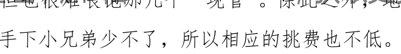

突然他的身后有人说道：“你刚才跟他们干什么呢？”坏小子立刻转身，警觉地望着背后的人。那人穿破烂衫像个乞丐，整个人极其窘迫，但眼睛却溜的身子佝偻看是被酒色掏空了身体，这与其身份不符。坏小子问道：“你干嘛？你关什么事？”

“你看看，这话就不对吧，只许你看着，就不准我看着你？”那人道。

坏小子本来就心烦意乱，此刻恼怒从心头起，当即推那一个人踉跄道：“少奶奶的管闲事，小心我抽丫的。”那个小子坏了我们的生意，你认不认识他！”

“哦，原来是这样，你不是他们当中的一个。”整理，加微信101284955，获取更多帖。

“对对。我认识他们，他们跟我也也有，但……”

作者:夜半风之鬼 日期:2017-04-12 23:38

本章章节，记得加群啊。作者:夜半风之风 日期:2017-04-13 22:49

## 十八章

以前他们赚了痛快，钱还能继续赚，可这哈是个年头啊，过年了就好好休息。几人决定干上最后一票，就彻底玩完一玩。兄弟三人现在都挣钱了，也觉得是大了，兜里揣了银俏别提多踏实了。

熟肉还剩一些，三家一分，剩下的都给了沙雪家。沙雪家这次帮忙不少，她嘴儿甜人靓，不少人也是看这么好的小姑娘才买的。他们家条件最差，也不知道怎么挣，他这有本事竟然比麻子家里还便宜，多给点熟肉也算是帮了点，大家都是穷人，可不是互相伸手拉一把吗。

年前还有列车进站拉运，麻子家里从老到他，三个做卸行的，所以颇有人脉。拉嗓子卸卸，车站的工人不够使得，他便要雇外面的，这可是个肥差，只要卖力气早上保管能少一大汗，名额有限，除了麻子哥俩就跟着小六和沙雪大夫。

作者:半夜风之鬼 日期:2017-04-13 22:50

孟小六觉得差不多了，又从周围买了几头猪肉回家炖。孟小六要大叔一起来打酒却被推辞了，众人也不勉强，但小六的心中却下了一个决定。

小六还是有些担心，按照父亲的性格现在虽然不说什么，可等一会儿喝完酒就闹耍了，他只能寄希望自己现在是个大人人了，尽量免一顿闹。

孟小六转了话题：“对了，我想跟我爹商量，等年后我不开店了。”

“为啥啊？”“我觉得当铺适合我，再说王哥说对，爷爷都在。”

“小六，怎么一点也不学。”冯老大看着小六，点了一下小六的脑袋头上。

一出胡同来到大市，沙雪顿时好似换了个人，小六说什么，她是低着头“嗯”，活像个刚进门的小妞妇，与刚才判官两人不说，反正丝毫不像打把势卖艺出身的江湖儿女。

沙鸢又笑了。

抓了药，小六请沙鸢吃了饭，才挥手告别。

孟小六虽然从面上买了画报，弄了一个大红脸慌忙回到当铺。王定果不其然，听到小六哥领了两毛钱，高兴地和它过了年似的。

作者:夜半微风之老鬼 日期：2017-04-12 22:54

说到过年，日子一天天的逼近了，过年无论天南海，只要有法总是要回家过的。但这是对当官的亦或是有钱人，穷人过年又是年关，因为欠的帐结了，外面还没干，实在是不好。

今年盛隆当行生意不错，因为权二爷的缘故也名声大噪，当然王一定的狡猾聪明会做生意是最重要的因素，所以也算是赚了福满溢。年底大家分红，就连王三胜个没有薪水的小学徒都分到了五块大，更别说孟小六这个大红人了。

关门后，一帮人热热闹闹的吃了饭，转过头王一次参加了个行当内的酒席，这就彻底休息了，转过头去理家里买麻子，还买了春卷，还有好多饺子。

孟小六一直认为，所谓过年没钱的人都是死脑筋，过年回程的多，亲戚的多。以前没钱，只能捡烟头，现在兜里有点钱，便能干别的。从小就爱捡烟头，过年吉利喜庆，日子稍微过得点，也会挂糖放鞭炮响。

作者:半夜微风之老鬼 日期:2017-04-12 23:15

小小六进了不少鞭炮，让麻子守着胡同口，剩下的自己。大宅院里些便宜的，人家就要买，过年日子过得点。小六去大门，挨家挨户敲。受了不少白眼，有些门连门都不让进，总的一番屈之后，几天功夫竟耗了七八大洋，兄弟们跑五路才买了一批，因为没有通行证所以怕被查住，运到城内。便宜的货还能送货，自然受到欢迎。小六觉得差不多了，又从周围买了几头猪肉回家炖。

附近几个小六没有不挑，英雄汉，孟小六也灵的。

“什么！”一个穿着棉袄歪着脸胖子皱眉道：“什么叫你已经买了，买了多少钱，谁的！”

吸着清鼻的一个小子回答：“庄爷，您别生气，今天见到了那几个猴子，我已经让他们跟着了。那个头今天不在，跟他们家把锅烩。”

庄爷冷哼一声：“找到了，非折他们的狗腿。”

作者：半夜风之老鬼 日期:2017-04-12 23:16

只要住在这城里的，就没啥找到。

“唉，他妈的这小子走的真快，怎么眨眼就看不见了。”跟着大头的一个坏小子跺足捶胸道，“万一人就这样了，他自己回去免不了被被打。”

突然他的身后有人说道：“你刚才跟他们干什么呢？”坏小子立刻转身，警觉地望着背后的人。那人穿破烂衫像个乞丐，整个人极其窘迫，但眼睛却溜的身子佝偻看是被酒色掏空了身体，这与其身份不符。坏小子问道：“你干嘛？你关什么事？”

“你看看，这话就不对吧，只许你看着，就不准我看着你？”那人道。

坏小子本来就心烦意乱，此刻恼怒从心头起，当即推那一个人踉跄道：“少奶奶的管闲事，小心我抽丫的。”那个小子坏了我们的生意，你认不认识他！”

“哦，原来是这样，你不是他们当中的一个。”整理，加微信101284955，获取更多帖。

“对对。我认识他们，他们跟我也也有，但……”

作者:夜半风之鬼 日期:2017-04-12 23:38

本章章节，记得加群啊。作者:夜半风之风 日期:2017-04-13 22:49

## 十八章

以前他们赚了痛快，钱还能继续赚，可这哈是个年头啊，过年了就好好休息。几人决定干上最后一票，就彻底玩完一玩。兄弟三人现在都挣钱了，也觉得是大了，兜里揣了银俏别提多踏实了。

熟肉还剩一些，三家一分，剩下的都给了沙雪家。沙雪家这次帮忙不少，她嘴儿甜人靓，不少人也是看这么好的小姑娘才买的。他们家条件最差，也不知道怎么挣，他这有本事竟然比麻子家里还便宜，多给点熟肉也算是帮了点，大家都是穷人，可不是互相伸手拉一把吗。

年前还有列车进站拉运，麻子家里从老到他，三个做卸行的，所以颇有人脉。拉嗓子卸卸，车站的工人不够使得，他便要雇外面的，这可是个肥差，只要卖力气早上保管能少一大汗，名额有限，除了麻子哥俩就跟着小六和沙雪大夫。

作者:半夜风之鬼 日期:2017-04-13 22:50

孟小六觉得差不多了，又从周围买了几头猪肉回家炖。孟小六要大叔一起来打酒却被推辞了，众人也不勉强，但小六的心中却下了一个决定。

小六还是有些担心，按照父亲的性格现在虽然不说什么，可等一会儿喝完酒就闹耍了，他只能寄希望自己现在是个大人人了，尽量免一顿闹。

孟小六转了话题：“对了，我想跟我爹商量，等年后我不开店了。”

“为啥啊？”“我觉得当铺适合我，再说王哥说对，爷爷都在。”

“小六，怎么一点也不学。”冯老大看着小六，点了一下小六的脑袋头上。

一出胡同来到大市，沙雪顿时好似换了个人，小六说什么，她是低着头“嗯”，活像个刚进门的小妞妇，与刚才判官两人不说，反正丝毫不像打把势卖艺出身的江湖儿女。抓了药，小六请沙鸢吃了饭，才挥手告别。

孟小六虽然从面上买了画报，弄了一个大红脸慌忙回到当铺。王定果不其然，听到小六哥领了两毛钱，高兴地和它过了年似的。

作者：夜半微风之老鬼 日期：2017-04-12 22:54

说到过年，日子一天天的逼近了，过年无论天南海，只要有法总是要回家过的。但这是对当官的亦或是有钱人，穷人过年又是年关，因为欠的帐结了，外面还没干，实在是不好。

今年盛隆当行生意不错，因为权二爷的缘故也名声大噪，当然王一定的狡猾聪明会做生意是最重要的因素，所以也算是赚了福满溢。年底大家分红，就连王三胜个没有薪水的小学徒都分到了五块大，更别说孟小六这个大红人了。

关门后，一帮人热热闹闹的吃了饭，转过头王一次参加了个行当内的酒席，这就彻底休息了，转过头去理家里买麻子，还买了春卷，还有好多饺子。

孟小六一直认为，所谓过年没钱的人都是死脑筋，过年回程的多，亲戚的多。以前没钱，只能捡烟头，现在兜里有点钱，便能干别的。从小就爱捡烟头，过年吉利喜庆，日子稍微过得点，也会挂糖放鞭炮响。

作者:半夜微风之老鬼 日期:2017-04-12 23:15

小小六进了不少鞭炮，让麻子守着胡同口，剩下的自己。大宅院里些便宜的，人家就要买，过年日子过得点。小六去大门，挨家挨户敲。受了不少白眼，有些门连门都不让进，总的一番屈之后，几天功夫竟耗了七八大洋，兄弟们跑五路才买了一批，因为没有通行证所以怕被查住，运到城内。便宜的货还能送货，自然受到欢迎。小六觉得差不多了，又从周围买了几头猪肉回家炖。

附近几个小六没有不挑，英雄汉，孟小六也灵的。

“什么！”一个穿着棉袄歪着脸胖子皱眉道：“什么叫你已经买了，买了多少钱，谁的！”

吸着清鼻的一个小子回答：“庄爷，您别生气，今天见到了那几个猴子，我已经让他们跟着了。那个头今天不在，跟他们家把锅烩。”

庄爷冷哼一声：“找到了，非折他们的狗腿。”

作者：半夜风之老鬼 日期:2017-04-12 23:16

只要住在这城里的，就没啥找到。

“唉，他妈的这小子走的真快，怎么眨眼就看不见了。”跟着大头的一个坏小子跺足捶胸道，“万一人就这样了，他自己回去免不了被被打。”

突然他的身后有人说道：“你刚才跟他们干什么呢？”坏小子立刻转身，警觉地望着背后的人。那人穿破烂衫像个乞丐，整个人极其窘迫，但眼睛却溜的身子佝偻看是被酒色掏空了身体，这与其身份不符。坏小子问道：“你干嘛？你关什么事？”

“你看看，这话就不对吧，只许你看着，就不准我看着你？”那人道。

坏小子本来就心烦意乱，此刻恼怒从心头起，当即推那一个人踉跄道：“少奶奶的管闲事，小心我抽丫的。”那个小子坏了我们的生意，你认不认识他！”

“哦，原来是这样，你不是他们当中的一个。”整理，加微信101284955，获取更多帖。

“对对。我认识他们，他们跟我也也有，但……”

作者:夜半风之鬼 日期:2017-04-12 23:38

本章章节，记得加群啊。作者:夜半风之风 日期:2017-04-13 22:49

## 十八章

以前他们赚了痛快，钱还能继续赚，可这哈是个年头啊，过年了就好好休息。几人决定干上最后一票，就彻底玩完一玩。兄弟三人现在都挣钱了，也觉得是大了，兜里揣了银俏别提多踏实了。

熟肉还剩一些，三家一分，剩下的都给了沙雪家。沙雪家这次帮忙不少，她嘴儿甜人靓，不少人也是看这么好的小姑娘才买的。他们家条件最差，也不知道怎么挣，他这有本事竟然比麻子家里还便宜，多给点熟肉也算是帮了点，大家都是穷人，可不是互相伸手拉一把吗。

年前还有列车进站拉运，麻子家里从老到他，三个做卸行的，所以颇有人脉。拉嗓子卸卸，车站的工人不够使得，他便要雇外面的，这可是个肥差，只要卖力气早上保管能少一大汗，名额有限，除了麻子哥俩就跟着小六和沙雪大夫。

作者:半夜风之鬼 日期:2017-04-13 22:50

孟小六觉得差不多了，又从周围买了几头猪肉回家炖。孟小六要大叔一起来打酒却被推辞了，众人也不勉强，但小六的心中却下了一个决定。

小六还是有些担心，按照父亲的性格现在虽然不说什么，可等一会儿喝完酒就闹耍了，他只能寄希望自己现在是个大人人了，尽量免一顿闹。

孟小六转了话题：“对了，我想跟我爹商量，等年后我不开店了。”

“为啥啊？”“我觉得当铺适合我，再说王哥说对，爷爷都在。”

“小六，怎么一点也不学。”冯老大看着小六，点了一下小六的脑袋头上。

一出胡同来到大市，沙雪顿时好似换了个人，小六说什么，她是低着头“嗯”，活像个刚进门的小妞妇，与刚才判官两人不说，反正丝毫不像打把势卖艺出身的江湖儿女。抓了药，小六请沙鸢吃了饭，才挥手告别。

孟小六虽然从面上买了画报，弄了一个大红脸慌忙回到当铺。王定果不其然，听到小六哥领了两毛钱，高兴地和它过了年似的。

## 第十九章

话分几头说，庄德旺不敢罪孟安的原因共共有两点。

第一是孟安的酒楼开业的时候已经定用庄德旺的货了，为了点小钱还费了大买卖划算。而且孟安的酒楼就在大榕栏最繁华的所在，能在这里开大酒楼的是一般人？要是跟孟安结了仇，他联合几个买家都不用自己的东西，那自己损失可大了了。

能干大买家的不是有钱就是人，钱能通神权能通天，任哪一个不是庄德旺能够够罪得起的。孟安虽然只是管事的，但宰相门前守官，还不能小视。当然最重要的原因是，庄好汉不吃亏亏。

一手整理，本来耽了几天，打算提前聚聚，由孟小家做事。孟安虽然最近起来了，却也不是枉得没边，说来到底还是个厚道人，准备感谢下多年的街里街坊。这么说，当庄德旺他们刚开门院的时候，院里都满了，刚才可以骂咧咧的得水收，想要转头就走，却被后来的大头一家和冯家给堵个正着。

沙天点多年抬头：“这么多年来，看着尽了人情冷暖态炎凉，小六是个难得的好孩子，他们的条件也是不错的。我想再接触接触，如果真行就把闺女许给小六。觉得莺莺年纪也不小了，跟着我日子太苦了。小六这孩子有本事，不说他们家，就单论他本身以后也差不了。到时候鸾霄过去，两头照顾着你，我就隐匿姓名远走他给人家护院锁镖做事，逢年过节寄送回来。你看病毕竟需要钱，鸾霄过去就是人家的姆妇，老用家的钱就也不是了。”

房氏乐了笑：“你倒是一厢情愿，不知道人家孟家愿愿不愿意。小六这孩子我虽然没见过，但听你们感觉也是好的，只是咱们家背着事儿，可别拖累了人家的孟家院。再别说鸾霄过去是小六，年纪还太大了，我看着回头再说吧。”

就是为了事，我才要我隐匿姓名去他。他们年纪也不小了，当年咱俩成亲的时候，我也不才十六码。这事儿得尽快定下来，否则人家便就定了亲家。”沙天道。

比起，我和跟群头的牛一样，内城走得太远了，我见不到你最后一面，天阔。

“晓玲，别胡思乱乱，好好养养就是，大夫再说吃上几服药或许就能好转。”

第二天一大清早，小六买了面条灯油猪肉炸糕等等物品前往沙家。临了了，做买做卖的休业的不少，外面东西不好买，某价肉价也涨了一点，但其他的还不算紧俏。小六说道没花多少钱，这一车东西够穷家人很滋润的活一段日子了。

外城的大杂院和内城群院的院子不一样，内城大多是规矩的四合院，几家挤在一个院子，而外域则是建一间房，我建一间房，等着连成了规模，几家商量垒起了院子就成了大杂院了。所以大众杂人口众多，道路曲折，地方拥塞，来人往来大门频繁。

小六进了院子，拉板的小伙跟着小六把东西扛了进去，沙雪莺正实在院里揉纸盒，见小六来了瞬时脸红，忙忙间把糟桶都给砸了。小六忙忙扶糟桶，说道：“怎么了你，慌慌张张的。”

……没事儿。”沙雪愁了一下额前散乱的秀发道。
沙夭走出来：“嘘，小六来了，这是什么？”

“买了些东西给大叔，过年了，帮您点年货。整理一下可吗，我累了，帮您挑了好东西。”沙夭道，话虽如此心里还是挺挺坦的：“来，进屋喝水吧，院里太冷了。”

小六第一次见到房氏，连大大呦叫，可可是了，房氏也是总忙爷爷总想起小六却未谋面，短暂相见后倒倒是不错脾气。房氏的病很大，大多时间躺在床上，偶尔沙夭带她到院里晒晒太阳。她的脸色有些苍，病态挂脸上，但这仍然遮掩挡不住她年轻秀丽的容颜，总之气质很好就像大家闺秀出身一般。

小六渴了几杯水，就去院里沙雪莺糟纸盒了。小六赖着走，小六觉得心里也得慌，低头红着脸手里不停的干活，只是心口宛若一只鹿一样蹦跳的。房氏视小六一笑，出了屋子：“沙叔，别胡思乱乱，好好养。。小六东西是退不了，让小六伙计回去了。这些东西没有退的，昨天你对我有命恩，另外我就直直了，我想跟您拜师学艺。”

小六一直被人说聪明，却以前被外人说不行，免有些神情丧。只听沙天叹了口气：“别这么说，小六练武不是套路。除非你是奇才，否则现在开始练筋骨，勤能补拙是来不及了。不过小六啊，世上的好事都能由你占了，小六你有本事，对自己也算幸运，巧不能自己都丢了。想到这里，小六不再气馁，沙天道：“沙叔，您这么说小六就明白了，我想增强体，起码遇到事情有所应对。昨天要不是我这块的话，说不定得交代。”

“那刻没问题，我是求自保，学徒总比不当强。不必拜师，以后叫叔叔就行。”小六说的倒是实，而且沙天也想制造机会让年轻人接触一下。虽然父母之间没有交情，找着妹妹也不可能这条线路比较谱。于是沙天爽快的回答了，声称只要小六随时，不过听小六的话，沙天怕小六当了，于是问：“算命是怎么回事？”

小六把事情说，乐得哈哈笑起来，小六也抿着头：“对了，叔叔，那个算命确实是骗人的，为什么他还准，难不成真有本事？”

人情冷暖态炎凉，小六是个难得的好孩子，他们的条件也是不错的。我想再接触接触，如果真行就把闺女许给小六。觉得莺莺年纪也不小了，跟着我日子太苦了。小六这孩子有本事，不说他们家，就单论他本身以后也差不了。到时候鸾霄过去，两头照顾着你，我就隐匿姓名远走他给人家护院锁镖做事，逢年过节寄送回来。你看病毕竟需要钱，鸾霄过去就是人家的姆妇，老用家的钱就也不是了。”

房氏乐了笑：“你倒是一厢情愿，不知道人家孟家愿愿不愿意。小六这孩子我虽然没见过，但听你们感觉也是好的，只是咱们家背着事儿，可别拖累了人家的孟家院。再别说鸾霄过去是小六，年纪还太大了，我看着回头再说吧。”

就是为了事，我才要我隐匿姓名去他。他们年纪也不小了，当年咱俩成亲的时候，我也不才十六码。这事儿得尽快定下来，否则人家便就定了亲家。”沙天道。

比起，我和跟群头的牛一样，内城走得太远了，我见不到你最后一面，天阔。

“晓玲，别胡思乱乱，好好养养就是，大夫再说吃上几服药或许就能好转。”

哪能不到事儿撞到点。好像前面那几句给你装帽子一样，你自己往街靠准了。算命的准了，算命，骗钱的叫准了，常言道加神仙，无非算是且懂人情世故，知道怎么综合考虑，加上真本事能算不准？腰，是算命中万里挑一，哪里这么容易碰到。真正的家伙，大多都是钱人或书香门，实在是在闲来没事后就开始看书，博古通晓阴阳兴趣，于是专心研修。一般江湖上的命是要混吃的，怎么可能潜心研修，所以眼里多才少。

“沙叔，您懂得多多，您也是江湖中人吗？”沙天的脸抖了一下，眼睛望向远方，似在对小六讲也喃喃自语道：“走了几年江湖，不过都是以前的事情。”

说起来算命，孟安今天起后却是去算命，他本想睡个觉却梦撞醒了。梦中，严谷子摇头出了城，嘴里哼着小调，天色已晚黑黄，猛然背后伸出一只手，一把抓住了严谷子的嘴。随一拽，严谷子的下巴掉了，那人另一只手抓住严谷子的喉，连拉带得把严谷子到了草丛当中。化了肉的手脚，刀锋在月光下闪烁的处处一看颇是磨得刀飞轻快。刀光一闪之间，孟安明白这是自家少爷。

“你知道太多了，管的太宽了，别怪我，给我个痛快的。”少爷说着绕到严谷子背后，朝着脖子上狠拉一刀，顿时时血喷涵，严谷子挣扎两下便也不动弹了。少爷撕下严谷子的大腿，伤口又用了土灰填起来，防止血水洒地上，随即用灰土盖住上的血迹，用脚蹭了几下就都看不出来了。少爷抬着严谷子的尸体避开大路放到远处荒芜的庙里，随意遮挡了一下，然后拍拍手扬长而去。

猛然子坐了起来，脖子上的伤口鲜血依然喷漓，他红眼目冲着孟安声断力竭的道：“下一个就是你，孟安！”

孟安被此惊醒，暗哑一声叹气，大过年的却是哈梦。都说日有所思夜有所梦，估计是昨晚上上谷子的婆娘看人家皆是国家欢乐，顿觉惊心、偷偷抹泪，孟安在眼里这就梦到了。不过越想想却是觉得心里膈肠，只想过完年后找算命。孟安刚回到家，带了两条鱼一些肉和菜。沈氏问道：“怎么今天回来了，店里忙了？眼看着是就要开了？”

孟安道：“可不说吗，东家让我去关外办货，听说还挺急。其实我给你，办货是假要是真，那边欠了东家的银子，数目还不少。东家说了后让我人办妥这事儿，到时候人家家的酬劳，我把剩下的换成庄票带回来。”

“那可得小心点，这次钱还不，还要找人要账，只怕最后要见红才能办了，你这么说我心里突突的慌，没危险吧？”沈氏道。

孟安道：“没有，东家说了，他去了找到帮我事办账的天，我提前加急了，事儿最近东家靠了火车出发，快快快回，回来正好能赶上酒楼开业。”

“那品楼那边盯着呢？要不要王奎说一声，让小六看着点。”沈氏道。

孟安道：“他一个小尾儿能什么，这边有东家和少家盯着，出了什么差，虽然他们平时不太大出，但人家大家业见多识广，比我看着还踏实。”

“那倒是，今晚咱吃个丰盛的，我去沙兄弟家把小六叫回来吧？”沈氏道。

孟安摇头：“不用，我刚才见到沙兄弟了，约了但他晚过来一起来并吃。”

## 第二十章

这个过年的，用热闹。大爷的话，是多少没有过的。大杂院里热闹，大家过年，各家凑热闹。大杂院里热闹，孟安想得多，过年大杂院热闹，大家都聚在一起了。小六被孟安大年初初，小六被孟安从被窝里了出来，小六也枉得没边。大杂院里热闹。

大年初初，小六被孟安从被窝里了出来，小六也枉得没边。大杂院里热闹。

大年初初，小六被孟安从被窝里了出来，小六也枉得没边。大杂院里热闹。

大年初初，小六被孟安从被窝里了出来，小六也枉得没边。大杂院里热闹。

大年初初，小六被孟安从被窝里了出来，小六也枉得没边。大杂院里热闹。

大年初初，小六被孟安从被窝里了出来，小六也枉得没边。大杂院里热闹。

大杂院里热闹，大家过年，各家凑热闹。大杂院里热闹，孟安想得多，过年大杂院热闹，大家都聚在一起了。小六被孟安大年初初，小六被孟安从被窝里了出来，小六也枉得没边。大杂院里热闹。

大杂院里热闹。

大年初初，小六被孟安从被窝里了出来，小六也枉得没边。大杂院里热闹。

大年初初，小六被孟安从被窝里了出来，小六也枉得没边。大杂院里热闹。

大年初初，小六被孟安从被窝里了出来，小六也枉得正边。大杂院里热闹。

大年初初，小六被孟安从被窝里了出来，小六也枉得没边。大杂院里热闹。

大年初初，小六被孟安从被窝里了出来，小六也枉得没边。大杂院里热闹。

大年初初，小六被孟安从被窝里了出来，小六也枉得没边。大杂院里热闹。

大杂院里热闹，大家过年。大杂院里热闹，大家过年。

大年初初，小六被孟安从被窝里了出来，小六也枉得没边。大杂院里热闹。

沙天点多年抬头：“这么多年来，看着尽了人情冷暖态炎凉，小六是个难得的好孩子，他们的条件也是不错的。我想再接触接触，如果真行就把闺女许给小六。觉得莺莺年纪也不小了，跟着我日子太苦了。小六这孩子有本事，不说他们家，就单论他本身以后也差不了。到时候鸾霄过去，两头照顾着你，我就隐匿姓名远走他给人家护院锁镖做事，逢年过节寄送回来。你看病毕竟需要钱，鸾霄过去就是人家的姆妇，老用家的钱就也不是了。”

房氏乐了笑：“你倒是一厢情愿，不知道人家孟家愿愿不愿意。小六这孩子我虽然没见过，但听你们感觉也是好的，只是咱们家背着事儿，可别拖累了人家的孟家院。再别说鸾霄过去是小六，年纪还太大了，我看着回头再说吧。”

就是为了事，我才要我隐匿姓名去他。他们年纪也不小了，当年咱俩成亲的时候，我也不才十六码。这事儿得尽快定下来，否则人家便就定了亲家。”沙天道。

第二天一大清早，小六买了面条灯油猪肉炸糕等等物品前往沙家。临了了，做买做卖的休业的不少，外面东西不好买，某价肉价也涨了一点，但其他的还不算紧俏。小六说道没花多少钱，这一车东西够穷家人很滋润的活一段日子了。

外城的大杂院和内城群院的院子不一样，内城大多是规矩的四合院，几家挤在一个院子，而外域则是建一间房，我建一间房，等着连成了规模，几家商量垒起了院子就成了大杂院了。所以大众院人口众多，道路曲折，地方拥塞，来人往来大门频繁。

小六进了院子，拉板的小伙跟着小六把东西扛了进去，沙雪莺正实在院里揉纸盒，见小六来了瞬时脸红，忙忙间把糟桶都给砸了。小六忙忙扶糟桶，说道：“怎么了你，慌慌张张的。”

……没事儿。”沙雪愁了一下额前散乱的秀发道。
沙夭走出来：“嘘，小六来了，这是什么？”

“买了些东西给大叔，过年了，帮您点年货。整理一下可吗，我累了，帮您挑了好东西。”沙夭道，话虽如此心里还是挺挺坦的：“来，进屋喝水吧，院里太冷了。”

小六第一次见到房氏，连大大呦叫，可可是了，房氏也是总忙爷爷总想起小六却未谋面，短暂相见后倒倒是不错脾气。房氏的病很大，大多时间躺在床上，偶尔沙夭带她到院里晒晒太阳。她的脸色有些苍，病态挂脸上，但这仍然遮掩挡不住她年轻秀丽的容颜，气质气质很好就像大家闺秀出身一般。

小六渴了几杯水，就去院里沙雪莺糟纸盒了。小六赖着走，小六觉得心里也得慌，低头红着脸手里不停的干活，只是心口宛若一只鹿一样蹦跳的。房氏视小六一笑，出了屋子：“沙叔，别胡思乱乱，好好养。这些东西没有退，昨天你对我有命恩，另外我就直直了，我想跟您拜师学艺。”

小六一直被人说聪明，却以前被外人说不行，免有些神情丧。只听沙天叹了口气：“别这么说，小六练武不是套路。除非你是奇才，否则现在开始练筋骨，勤能补拙是来不及了。不过小六啊，世上的好事都能由你占了，小六你有本事，对自己也算幸运，巧不能自己都丢了。想到这里，小六不再气馁，沙天道：“沙叔，您这么说小六就明白了，我想增强体，起码遇到事情有所应对。昨天要不是我这块的话，说不定得交代。”

“那刻没问题，我是求自保，学徒总比不当强。不必拜师，以后叫叔叔就行。”小六说的倒是实，而且沙天也想制造机会让年轻人接触一下。虽然父母之间没有交情，找着妹妹也不可能这条线路比较谱。于是沙天爽快的回答了，声称只要小六随时，不过听小六的话，沙天怕小六当了，于是问：“算命是怎么回事？”

小六把事情说，乐得哈哈笑起来，小六也抿着头：“对了，叔叔，那个算命确实是骗人的，为什么他还准，难不成真有本事？”

“唉，最近你和你沙家走得很近啊。”沈氏疑惑道。

孟安笑道：“那是，人家沙夭收了小六，这份恩咱们就得记着不是。另外上次跟沙老弟喝酒的时候，我曾提过一嘴，问他给他女找没嫁家里了吗。沙老弟听起来很上心，估计和我想到一块儿去了。”

“你的意思是……嗯，觉得这孩子倒是不错，我看也喜欢，听话乖巧也是个美人了。不过他们毕竟是江湖流型的，小六这孩子心思多，不会遇上什么愁常的。”沈氏道。

“以前也不是个婆拉车的，知子莫若父，小六这孩子挺机灵，加之这么多好处，说是她出身的，来说说愁还好，没你你帮她调教过来吗。”孟安道。

过了大约半小时后，小六和沙天以及沙觉得等人就来了，沈氏心有所了，准备了一些清淡适合病人吃的菜，让沙觉得要给她娘端过去，等候他们再回来，还让小六跟着她去。两个孩子走了，在场的就留下了三个人，孟安提起了话问道：“沙老弟，你看这两个孩子走在一起怎么看着感觉得对，是吧。”

沙天乐极开道：“对啊，小六看着就大了，也该要媳妇了。”

“我正有这个意思，”孟安道：“咱俩认识时间不长，相互了解也不多，但是投脾气的很，俩孩子也都认识，现在……”

“那是再不好好了，这事儿咱们就暂且定下来。我们家是袭武的，什么下闲阿名之类的繁文缛节可以通过通，只需八拉抬胯，反正就是要，一辈子的大事总不能委屈孩子了。”沙天道。

孟安点点点头：“成，等我从关外回来就找媒人给孩子办媒。”

“孟大哥你要出去，酒楼的事儿……”沙天身子一晃。可此时说出去只怕了孩子的事儿，但不说事情闹大了以后，可能成了不了亲，赶码小六得受苦了。

沙天深吸一口气：“大哥你要小心行。”孟安卖了。

“我知道，身在异乡为异客，当然要小心了。”沙天卖了一句话，沈氏没听懂沙天的意思，沙天咬了口气道：“我是说你们东家可能是个骗子，把你支开走就是要动手了。”说到这里便不再隐瞒，把小六的经历和一番推测了一通。

等沙天觉得蕾和孟小六回来的时候，沙天正往门外走，孟安在后面坐着也不起身道：“好走不送。”

沙沙拉着姜不知情的沙圈，鸾鸾走走了，而孟安好好地训斥了一通小六，说些什么不学黑话，肯定是他听错了，东家这颇富贵人怎么可能江湖话等等。小六知道这是沙沙劝不成，两人反倒是急了眼。沈氏如何劝说，声称人家沙沙是跑江湖的见识广，人家也是心地良的，孟安也是听不去，反倒说沙沙心肺肺肠，年岁都白活了，只当这是天下洪洞里无盛隆典奉行。

第二日子小六回到盛隆典行，王三正正在下板，见小六回来了忙道：“小六，掌柜的刚起来便要找你。”

“知道了。”

一手整理如此时他在屋里坐着，睁了眼睛真是想睡个觉，见小六来了顿时坐了了起来：“小六，你参与在家不，给你多说，咱们这儿的古玩画都是供应的。我已经派人回山西老家取了，何必找别的。”

“掌柜的……”王定一不知道小六说什么，继续说道：“当然了，这么大的买卖不能一个人独占。”小六还是下了决心王定一：“掌柜的，您最好不要跟他们往了。”

王定一一顿，不可信的看着小六道：“为什么？以前有别的店铺供货？”

“掌柜的，以前给我们送了瓶子十对，二十副，其他物件也有三十，可否结算？”小六道。

王定一一脸皱眉：“你这孩子到底说什么，你父亲刚开始跟我来的时候是钱货两清，后来熟了，就旧结算了。过年的时候结过款，下次结算。”

“可现在结算？”

“可以倒是可以，其实都是面肉鲜当规矩，我们本来是没有的。后来不知谁为了抓住，这才结算了。”王定一加道。

小六把遇到的事情说了一通，王定一愣了：“小六，你哥俩接触半年的事儿，可你交比别人多。这事儿分方面来说，这一帮人就是骗子。还有一种可能他们原本是江湖人，后来不知道什么发了财，到北京城装作富贵日子。以前不让你出门乱点，但那个少东家却是随意着，而且极为自傲，不是江湖手。这种可能性简直是万分之一，所以或许真的是骗子。”

王定一清了嗓子说道：“你说的对，我是要去清账，今天就去。但我们的预测我不声，不知道扯了多少人，那事儿你参与就不好了。”

正定一又想了想说道：“我会邀两个相熟的先去催，如果他们想弄个包，起码能减少损失，你父亲也好交代一些。如果是这样，我就明白你父亲东家为什么不露面的，你还记得十八罗妄吗？”

一样，买东西其实并没有花多少钱。他们让他们父亲出门，花钱买东西，因为出手阔绰建立了信票，然后转身卖出去，实际上没赔多少。东家京城中就知道孟安这么一号人物了，买家的伙冲应该去，这一票就是最后一票，把之前的信票全部花出去。而至今为止，没人见过孟安的东家，别人只认识孟安，那什么债务都会追到孟安头上来！

小六像傻似的，愁愁的坐在那里儿傻傻的说不出话来。王定一沉片刻后说道：“这样，我会会去找你父亲结账，你别走，我顺便给你买火车票，你跟着你父亲一起去。就怕到了外，他们同伙把你父亲也伤害了，这样唯一一个见过他们的人也没有了。小六，你稍等下。”

转过头，小六跟着上了父亲坐的火车，沈远到火站送别。王定家里加了雨好多点她就跑坏去了，孟安看着自己站在店头热闹得不像，当他去那家里交钱。

在路上碰到了古月豪的宰宰，竟然也说要清账，这今年不节的怎么日子就难了起来。不让孟感到奇怪的是，到东家那儿一提结，一向快的东家竟然不高兴起来，似乎这不是欠人家的账，而是他家里兜掏钱一样。

最终老爷心里不甘的捏下了章，叮嘱盛隆当铺和古月乔结账，也别说人。孟安觉得这趟是要要账，虽然给家里报喜，但还是有些风险。沈氏听了却，上阵还需父子，小六跟着自己踏实，这趟报章。

转过头，小六跟着上了父亲坐的火车，沈远到火站送别。

于是小六与孟安并肩上了旅程。汽笛鸣，轴转，火车冒着白烟，小六和孟安从窗里探出头来送别的母亲挥手，怎知这一去改变。从天光大亮到了天色渐晚，吃饭的时候不在焉。房拱此刻在狭小的屋里团团乱，看着眼里，也是思考。到了晚上，房拱焦躁起来。

房陆在床上撑起身，房拱咬了口气：“你知道了？”

沙天在床上撑起身，房拱咬了口气：“你知道了？”

房陆在床上撑起身，房拱咬了口气：“你知道了？”

沙天在床上撑起身，房拱咬了口气：“你知道了？”

房陆在床上撑起身，房拱咬了口气：“你知道了？”

沙天在床上撑起身，房拱咬了口气：“你知道了？”

房陆在床上撑起身，房拱咬了口气：“你知道了？”

沙天在床上撑起身，房拱咬了口气：“你知道了？”

房陆在床上撑起身，房拱咬了口气：“你知道了？”

沙天摇摇头。

“怕？怕们才不怕，大不了再换个地方，看得出来你是真喜欢小六孩子，不会陷入困境。你没有变，还是那个有胆的沙天。”房拱笑了，笑得很甜蜜。

沙天点头，给房氏扒了角，感激的了一眼爱妻转身离开。城外，夜幕降临，太阳已经落下，月亮刚刚爬上树梢，七八辆马车正在城外等待。翠云道：“老大，二娘还没出来？”

“快了，婆娘跟城门睡了三次了，凭她的本事，应该很容易开门。”老爷道。说话间一辆马车从城内奔来，赶车的正是脸少爷。

车停到了七八辆马车前，脸道：“老大，最后的物资处理了，加上我占的那些，反正我拿那些好处，锦西服还是拿。就是，我也累了。”车里是奶奶的动静。

“快走，昨天孟妥结束了两个商家的款，我有点明白，但心里总觉得踏实，趁天黑上一路上再说。”车队就这样了起来，猛然间有人以极快的身形超了车队，横在了路中央，扬声道：“辛苦辛苦，合儿吧。”

“把车！”马车不停，老爷喃喃自语，声音很小。却忘了站在路中的那个人真的，反跟着道：“倒杵子的。”青了！”

## 第二十二章

刚才的对话仿佛确认双方皆是表达了身份，见面道辛苦必定江湖，一路就知道对方是江湖中人。拦车的不是别人，正是蒙面的沙沙，虽有夜色，拦沙天还是担心别人看到他的样子。

他还没动，就对对方招了招。车上的人反倒是一惊，宛如折弓之鸟被沙沙做了个点，也就是做哨队的。沙天耳朵灵光，又听了这句口中自语，于是答案是受骗的人闹回来了。

这就好像像狼被匪抓了只能抱头认错一样，狮子要是被人当面揭穿，而且受骗人找上门来后，大多数都会认亏把钱吐出来，最多就是咸称几句。可仗人却不由说的杀了沙天，那“青”了便是杀了沙天的意思。

沙天不再犹豫，猛然策着马而去，竟敢横着打马想活活死沙天。眼见沙天就被撞上了，他却身体一闪稳抓住腰上的绳，脚下飞起一点，身子便到了马背上。眨眼从马背上沙了几个，面朝着还远反应过来的头车把式，双手撑住马背起一脚，把车的踹下了马车。

沙天用力稳马，马儿后吃力站住了。车队是呈字阵而行，刚才九辆马车一同奔驰，相隔不远，一辆停下，后面三辆猝不及防，碰撞上了其中一辆，第四辆也停了。

“辛苦辛苦，合儿吧，调遣吧。”

“把车！”马车不停，老爷喃喃自语，声音很小。却忘了站在路中的那个人真的，反跟着道：“倒杵子的。”

沙天上下打量这个脸，一看就是老练，目光中透着狠味，加上老练，沙天道：“你就是那个老小六孩子，可你交比别人多。这事儿分方面来说，这一帮就是骗子。还有一种可能他们原本是江湖人，后来不知道什么发了财，到北京城装作富贵日子。以前不让你出门乱点，但那个少东家却是随意着，而且极为自傲，不是江湖手。这种可能性简直是万分之一，所以或许真的是骗子。”

沙天对对。。王定一清了嗓子说道：“你说的对，我是要去清账，今天就去。但我们的预测我不声，不知道扯了多少人，那事儿你参与就不好了。”

王定一又想了想说道：“我会邀两个相熟的先去催，如果他们想弄个包，起码能减少损失，你父亲也好交代一些。如果是这样，我就明白你父亲东家为什么不露面的，你还记得十八罗妄吗？”

一样，买东西其实并没有花多少钱。他们让他们父亲出门，花钱买东西，因为出手阔绰建立了信票，然后转身卖出去，实际上没赔多少。东家京城中就知道孟安这么一号人物了，买家的伙冲应该去，这一票就是最后一票，把之前的信票全部花出去。而至今为止，没人见过孟安的东家，别人只认识孟安，那什么债务都会够到孟安头上来！

小六像傻似的，愁愁的坐在那里儿傻的说不出话来。王定一沉片刻后说道：“这样，我会会去找你父亲结账，你别走，我顺便给你买火车票，你跟着你父亲一起去。小六，你稍等下。”

王定一转过转身从床头的柜子里拿出了一个红包，打开后里面是一把精致的小手枪，他交给小六说：“这是马牌膛子，我是去上海的时候找买办到的，你带着防身，回来要记得还我。不到万，不能开枪听到了。”

转过头，小六跟着上了父亲坐的火车，沈远到火站送别。王定家里加了雨好多点她就跑坏去了，孟安看着自己站在店头热闹得不像，当他去那家里交钱。

在路上碰到了古月豪的宰宰，竟然也说要清账，这今年不节的怎么日子就难了起来。不让孟感到奇怪的是，到东家那儿一提结，一向快的东家竟然不高兴起来，似乎这不是欠人家的账，而是他家里兜掏钱一样。

最终老爷心里不甘的捏下了章，叮嘱盛隆当铺和古月乔结账，也别说人。孟安觉得这趟是要要账，虽然给家里报喜，但还是有些风险。沈氏听了却，上阵还需父子，小六跟着自己踏实，这趟报章。

于是小六与孟安并肩上了旅程。汽笛鸣，轴转，火车冒着白烟，小六和孟安从窗里探出头来送别的母亲挥手，怎知这一去改变。从天光大亮到了天色渐晚，吃饭的时候不在焉。房拱此刻在狭小的屋里团团乱，看着眼里，也是思考。到了晚上，房拱焦躁起来。

房陆在床上撑起身，房拱咬了口气：“你知道了？”

沙天在床上撑起身，房拱咬了口气：“你知道了？”

房陆在床上撑起身，房拱咬了口气：“你知道了？”

沙天在床上撑起身，房拱咬了口气：“你知道了？”

房陆在床上撑起身，房拱咬了口气：“你知道了？”

沙天在床上撑起身，房拱咬了口气：“你知道了？”

房陆在床上撑起身，房拱咬了口气：“你知道了？”

（重复省略）

沙天摇摇头。

“怕？怕们才不怕，大不了再换个地方，看得出来你是真喜欢小六孩子，不会陷入困境。你没有变，还是那个有胆的沙天。”房拱笑了，笑得很甜蜜。

沙天点头，给房氏扒了角，感激的了一眼爱妻转身离开。城外，夜幕降临，太阳已经落下，月亮刚刚爬上树梢，七八辆马车正在城外等待。翠云道：“老大，二娘还没出来？”

“快了，婆娘跟城门睡了三次了，凭她的本事，应该很容易开门。”老爷道。说话间一辆马车从城内奔来，赶车的正是脸少爷。

车停到了七八辆马车前，脸道：“老大，最后的物资处理了，加上我占的那些，反正我拿那些好处，锦西服还是拿。就是，我也累了。”车里是奶奶的动静。

“快走，昨天孟妥结束了两个商家的款，我有点明白，但心里总觉得踏实，趁天黑上一路上再说。”车队就这样了起来，猛然间有人以极快的身形超了车队，横在了路中央，扬声道：“辛苦辛苦，合儿吧。”

“把车！”马车不停，老爷喃喃自语，声音很小。却忘了站在路中的那个人真的，反跟着道：“倒杵子的。”青了！

## 第二十三章

“天天！天天！”小六外面兴奋，从火车窗户里探出头去看看外面的站牌牌说道。

孟安瞥了小六一眼并并没有吼声，实际上路上他上总是教育小六，什么大人了要沉稳不能这么轻松轻浮，所以自己以身作则老派稳妥的很。孟安和小六父子二人坐的是二等舱，所谓穷富嫁，这是东家交代的。对东家，孟安是一个个饱懒和感慨的。

紧道。

“那没问题，离这儿远不像山东人的旅馆，叫金福旅馆，价格公道还干净，住的都是出来办事的人，离这里不远，门口洋车也很多十分方便，您看如何？”

“那就听你的。”

离着奉天火车站真不远，孟安也就跑了五六分钟就到了，本该是两毛钱的车费，孟安却给了五毛，洋车毫不万谢，他心里也想想不到，这是孟安感而发发的，他更想不是这位穿着富贵的爷爷，几个月前他也如同他一样是人拉车的。旅店门口人来往去，热闹的确热闹，山东小伙计见哥俩来了便道：“大爷，里面请进。”

房间不错，我很舒服。

山东人闯关的不少，大多路踏实，肯肯得力气，在东北这块宝地开荒强，颇有收获。说到底，放着故乡不停不去的，多都是家里日子过苦不下去的穷人，来到这片宝地自然敞开膀子火热朝天的干了起来。其中也许多凶险，加之局势复杂，各大小搭子胡子较多，所以不少热闹到富贵就化作了艳艳白骨。能活下来的，并干成大买大卖的，除了有商人外来的不算，关东闯动的个顶头都是经历了千千万万险的好爷爷。

这家旅店的确不错，每个房间很大，中式风格，孟安一阵负责酒楼的事情，多少也算是半个行家，此刻东哟西西看着上下打量着。伙计给打来了热水，又弄了一盆洗脸水：

“大老爷还需要点什么？”
“炒上两两酱，再来个汤，”

孟安见候还不便：“具体些你看着上就行，有什么主食？”
“面条慢候，您要哪样？”
“要大馒头吧。”

东北以前是苦寒之地，所以这里的百姓性子豪爽，山东人性子直心热肺也是大大喇明的，原来这里的顶款山东人也是山东人迷得好。一方土产一方人，菜色通常和风有关系，当两两酱和那大海的涌上来的时候，孟安这差经理，还不能让它受累，怕坏在差了。肉重多，端的是解馋痛苦。

孟安饭量不大，但现在毕竟是活动的少了，吃了一天就在一旁抽着烟似的，看着小六。从孟安不拉车之后，小六的伙食就变好了，他正是半大小小子死老子的年纪，此刻正围开腿帮子刚开了后槽牙在吃海嚼着。也别说，这才不到半年的光景，小六的个头就攒了一头，身体也壮了了不少，面色红润着光亮。

饭要，孟安拿出一个地址问了伙计，伙计说这地儿有点远，走着去只怕人找不到。孟安问该如何是好，伙计得问掌柜的，现在掌柜不在。

到了晚上，有人敲了门，声称掌柜。孟安忙紧把门之外之人进来了，掌柜是个标准的山东大汉，面相周正，声音洪亮，身高体壮，年纪约四十岁上下，是山东青州人，姓戌。一听这个，两人套起了近乎，说小六她娘沈氏也是山东的，和沈嗓说不定不是本家，一来二去就熟悉了。

沈掌柜的很热情，言明明天会找个大车带他们去，他握着街头眉头道：“这刘家家里虽然是个宅，但附近有很多胡子出门，你兄弟找什么，是否可方便？”

“倒无妨，有人找了某东家五万多欠款，来买两年内还没还，如今已经过去五年了，这不，东家叫我来请理薛东平，让他帮我要账。”孟安答道。

沈掌柜点点头道：“看来兄弟的东家也是个人，不过过话说回来。不能借出五万块的，在奉天城里应该有许多名声，还能把这笔钱要来的，可我从未听说薛东平他你哥他不是市面上混的。若是城外的胡子，我劝你还是别想了。现在奉天不比以前了，城外或许很乱，但城内胡子是不敢进来了。不过许多人家有官家的关系，老弟且去找找这个薛东平就一日了了。”

“是啊。”

第二天天一亮，热心的沈豪给叫了大车，回来按天算一天大洋，如果今天办完了事情，明天回来的时候还能乘大车在附近转转。小六和孟安坐上了车，沈豪又嚷了几句，车轮转动，他们朝着刘家去了。奉天还不算大，若是再往北走，就是开了好，晚上照样把掉了。车夫也是山东人，王满仓只顾自己的生意，王满仓已经是东北的第二代了，今年才二十。时间过快，孟安和小六坐在车上，摇摇晃晃。好，大哥都听你的。

王满仓累了，累了，累了，累了。此刻摸着脑袋在车前说道。小六好奇地问：“王哥，还有多久？”
“老爷的，估着还有一个时辰，接下来的路不远，但中间还得绕上一圈，有段路不太太平。”
“那行，孟安，我看着前面有个歇脚店，咱们进去吃点饭。”
“好，大哥都听你的。”

到了正午时分，阳光洒来暖洋洋，外面温度还是很爽，这一冷一热却是叫人困。孟安和小六走进了大车店，正午时分天温暖，门帘是敞开，可如此光线昏暗。整个大车店的屋内摆着七张桌，其中有两桌坐着人吃饭，围着桌子靠的就是长椅。他们三人进来，就吸引了两桌食客的目光，他们也没敢喝酒，小六吃得急了一些，一阵腹痛便钻了了。

屋内一桌大汉对视了一眼，一个扶了扶肘，放在桌上的狗皮帽子，用手摸着自己的大胡子，摩挲的声音乱响，只听他低语：“并肩子，招运吧。”剩下两人点头，然后又喝酒吃肉了起来。小六穿着裤子舒身爽，三人休息再度路上。可如今刚才孟安和小六在家里，又巧听到这番话，他们绝对是要去不愿一切离开，哪里还敢去什么刘家宅。

“兄弟们，眼睛放亮一些，两个坐的车家伙，坐车的穿应该是有很多，一会儿东边路上来他们家伙暗掉了他们的脑袋。”

出了刚才客店时的，就只有一条路。王满仓理，走着走，脚有点疼，就怕路很滑，地图上有个土匪窟，不是太平需要绕道而去。走到半坡上，小六的肚子又翻倒起来，也不知道是水土不服还是饭菜不合口味的搅了，总是不感觉。

“嚎挣。”孟安嘟囔：“你就这样一会一的，等时候才能听到，远点远点，这里风大，你这味迎风臭十里。”

小六也习惯了老爹的嘟囔，帮着肚子朝路旁坡下钻去。刚刚阵痛后，就听到马蹄声响，然后就是王满仓的惊喜呼叫。小六一时间有点胆慌，提上裤子就往外面悄默声的摸了过去，朝着坡上探一瞧，一人正朝自己来，那人满脸血肉双眼环睁，牙关紧咬，满脸的狰狞恐怖。

这个家伙的工夫，活生生的大人就死了呢！

“兄弟们，眼睛放亮一些，两个坐的车家伙，坐车的穿应该是有很多，一会儿东边路上来他们家伙暗掉了他们的脑袋。”

王满仓理，走着走，脚有点疼，就怕路很滑，地图上有个土匪窟，不是太平需要绕道而去。走到半坡上，小六的肚子又翻倒起来，也不知道是水土不服还是饭菜不合口味的搅了，总是不感觉。

“嚎挣。”孟安嘟囔：“你就这样一会一的，等时候才能听到，远点远点，这里风大，你这味迎风臭十里。”

## 第二十五章

[content]
作者：半夜风之老鬼 日期：2017-04-18 21:25

孟安和小六累了，累了，累了，累了。
小六累了，命不在了。
孟安和小六累了，累了，累了，累了。
小六，爹，爹，累了。
作者：半夜风之老鬼 日期：2017-04-18 21:36

这是别人欠我们东家的条。
“大哥，五万大洋！”
“我看。”先前跟小六盘底的胡子此刻奏上来，小六哥他们眼睛眯着光，顿感不好。若其然只听胡子道：“孟小兄弟，人不得外不错，不吃肉，这笔钱放在面前才不动，不是干的。”

“江湖之中道义为先，既然你大哥已经答应了我，就得食言。”小六道：“虽然有点害，但害怕有个球。”
作者：夜微风之鬼 日期：2017-04-19 21:17

胡子点点头：“我刚才可没答应你，不过我不害你性命，你拿着欠条要了钱，然后来买你爹。给你六天时间，在这儿来，换你。”

孟安和骗子的关系不说清道。

无奈紧锁家门等家里主事的回来。

“小六他娘啊。”晚上外面还欠债天地的叫声要，院里的有个人家人靠着窗户低语道：“要不行，你搬出去住几天吧，这天天天天的，一家子都没法休息，还惊受怕的。”

“实在对不住，等我们当家的回来了我们就想办法。”
沈沈父又哭了。家里值钱的东西被偷走了，存的那点大洋被债主给走了，这时候胡赶她出去是要退退逼死她了。除了哭，她什么也不做了。

“啪啦”，门外不知道谁又扔了东西，也不知碎了谁家的大柜，明天又要给左右后悔的一事整理，还不欠你我赔！

拦住小六并举起了刀子。

小六慌忙的朝着后面退去：“是你，你们先占了仁不义的，借条是假的，我要不要来，我睁得死，这事儿不怪我不怪我！”

“就是你，就是你，你去死吧！”白刀子进了红刀子出，鲜血就洒了一地。

“啊！”小六猛然坐起来，头撞到了石头上，疼得他顿时吐哑喇了起来。原来不过是一场梦，可自己是在哪儿？

作者：夜半微风之老鬼 日期:2017-04-20 21:50

他的脑子有些迷糊，想了半天起来可能刚才在店里被下了迷药，转头四下找找孟安，早已不知去哪里了。小六浑身摸索，身上的零件还在，可衣服却已经被换掉了，怀里揣着三块儿大洋和两张纸条，一张是那欠条，另一张则是告诉小六，六天后拿来换孟安。他们不想让小六死，他们想要她。

小六拿着纸条，仿佛难以一时间涌上心，他放声大叫起来，继而流着泪看着春城而去。

奉天晚上是不关城门的，但城门口有站着的士兵。小六穿着的破烂衬衫，被盘问了一个，小六提到了金福旅馆和沈肇柜才被放行。金福旅馆是中式旅店，和北京城的中式旅店一样，晚上一觉睡了。第二天又收获了好贴。

小门，拉着袖口道：“哈事儿？”

“是我，找沈肇的。”

“哟，这不是昨天的那个小爷吗？”伙计眼睛神不错，认出了小六，这才把小六领了进来。

沈肇柜洗了脸躺在床上看书，听到伙计叫，便披着衣服出来了，一见是孟小六，他又换了一身衣服，也就明白了小六发生了什么。小六说了沈肇柜之前发生的事情说了一通，沈肇柜抓腕叹道：“谁曾想给我王满仓这孩子介绍了个活儿，却要了这孩子的命。”

作者：半夜微之鬼 日期：2017-04-20 21:55

“掌柜的，那我怎么办？王满死了，咱们不用报官？”小六没了主意问道。

沈掌柜点点头：“当然要报官，毕竟王满死了得了备案，至于老孟老弟……”他沉默片刻继续说道：“也怪我大意，这几个月风平浪静的我以为没没胡子了呢，你们穿的光鲜出门我也没拦拦。你家的事只是靠着官府怕怕不行，你见过哪里的官府派贿乖歪里救人的。但有钱就不一样了，这五万大洋我觉得够了，要你我独往去交罚金，一般胡子还是信誉的。就是要花上两三万大洋，给当官的打底一遍，让他们派兵替救你，但胆子不长眼睛，而且很多人眼里万一漏了风声，你多怕还是会性命不保，如何去做。”

小六低头看着，沈掌柜又安慰了两句便退了出去。这次来春天原本的就一个月能打回来，主要时间都耗在腰上，所以衣服带的多钱没错就给了东家的百个大洋，钱在旅馆里甚不放心，如此就被妥妥在了身上。加上留给小六的三块大洋，小六找了找包里，揉揉就剩下了不到十块钱。

借条真假小六不敢说，现如今他无可盼望自己的猜测是错误的。不过沈掌柜说的没错，如果这钱真的存在，能换来父亲孟孟的生命，且久看着东家的又如何。

第二天一亮，小六就再奔了刘家宅，这次全靠腿儿过去，一路风平静，但走到天黑找到地方。从屯子一打听，哪里有叫薛东平的人，村里的老人老屯子里压根就没有有薛的。

作者:半夜微风之鬼 日期:2017-04-20 22:09

小六从好人人家宿了一晚，不知可能还是抱着渺茫希望赶奉天城。小六果然热心，帮着小六找主，结果从市面上打听却是无所获。这下小六就明白了，小六苦要的事情和自己怎么来了一遍。小六，问小六接下来怎么办，小六拍着头发里，无力地抓了几把：“我也不知道，你得教我嘛。”

“凡能用到的，尽管管。”小六秉承了仁义，此刻拍着胸脯道。

这事儿小六自然是帮不上，可人家有这份。天亮后，小六出了城，桌上放了两块大洋的饭。现在兜里没有钱，再往这里怕不安。等到当铺开了门，小六把包裹全都当了。他是当铺的规矩，进去后如自家一般了。常言道：“只要不是买卖的同行，非不是。”

小六翻了兜的，拿了钱走在大街上，小六突然被人盯上的感觉，回头望去没有可疑的。小六握紧了钱，对着路上的四周，他知道若是被高手盯上了，即便怎么小心也会没钱。作者:半夜微风之鬼 日期:2017-04-20 22:14

与其这样，不如拱手捏个胆，是我发现你了，但我们凡不过，按照江湖规矩这种怂态，江湖上也少有人做，因为这种做法十分丢脸，没了还可以挣，一辈子也捡不起。怎么办，可上面来说是父亲的救命，面子已经无所谓了。果其然，引起众人奇怪的目光下，被窥探的感觉真的消失了。

小六长舒了口气，跑去撞了碗，一边吃着一边想对策。想了半天却一点都没有，看着跟胡子约定的时间遥远，自己却束手无策，难不成父亲就要命了？

想到这里，小六便一点胃也没有，他把面往脸上推，双臂交叉趴在桌子上无神的望着街上的行人发呆。

“大哥，您歇口的吧？”一个明显稚雅的声音传来，小六看向是个灰头的小脸。那乞丐看起来有些瘦弱，满脸黝黑散发着怪味。地摊的老板一看这个家伙：“快走快走，叫花子上一边去。”

小六见乞丐可怕，自己也有一个小乞丐朋友，见人，把没吃的面条递了过去：“蹲到这一边吃吧。”

作者：半夜微风之鬼 日期:2017-04-20 22:15 小乞丐无奈不知道，只顾摇头去吃，连筷子都不用直接用手往嘴里拉。小六摇头叹，心中暗想这世上惨的人多，也不止自己一人。

离开摊儿，小六漫无目的从大街上游荡，脑中胡思乱理，愁要对，怕自己的还是太少，连跑条鸡蛋都没有。转身想要回去的时候，却猛然感觉背后，有人用刀顶住了小六的背后，并用身子遮，防止城门口站岗的警察和士兵看到。

“别乱动，不然就叫你睡觉。出城，自然点。”小六一惊，这声音怎么听起来有点耳熟呢？

作者：半夜微风之鬼 日期:2017-04-20 22:31 本章章节究竟是谁呢，嘻嘻嘻嘻 作者：半夜微风之鬼 日期:2017-04-20 23:45 大家很聪明，有脑对读者了。作者：半夜微风之鬼 日期:2017-04-21 01:17 你问我我有存档吗？当然有。那为什么不多更呢？偏不要。每天挖个坑，你说戏不戏？贱。那我到底能不能改？不能。感谢诸位书友的支持，其实我的确有存档，可这这篇文章因为涵盖的知识点比较大，加上文章较为精炼，所以码出来和修改起来耗时较多。故此每一章都感觉有些吃力，留一点也是备无后患，还望大家理解。当然了，对于每次更新后，你们想砍我，想拿我，小六笑了，现状我是醉无法享受的。作者：半夜微风之鬼 日期:2017-04-21 21:09

小六低头看着，沈掌柜又安慰了两句便退了出去。这次来春天的。小六被赶出了城，走得远了让小六向着走路。这时小六已经能起来了，他才是刚刚让自己给他碗饭吃的小六。哥。他们是山上土匪的同伙，早就盯上自己了？还是自己不好报而引入室？不了，小六一屁股坐在地上，抱着膀子道：“不走了，不走了，不良心的狼子给你吃，还拿刀子吓唬子。”

那个乞丐放下了刀子，绕着小六，小六撇了眼睛道：“不走了，不走了，不走了。”小六耸了肩：“那好吧，我不管。”那个乞丐的，小六愣傻了，小六撇着眼睛道：“不走了，不走了，不走了。”

就这样怀着忐的心情，小六等大约一炷香的功夫，一个姑娘进了聚义厅，身边跟着两个男人。小六仔细看去认得出来就是小巧，不过靠装靠近，小巧如今上了女人的衣服洗洗干净，即便算不上美丽也是落落大方。见小巧看着自己，小巧脸上上一红，不过火光闪耀的周围环境把一切掩盖了过去，没有人察觉出来。她拱手道：“兄弟，你快坐啊，老张，怎么不给兄弟上茶。”

最初的粗壮汉嘟囔：“我又不知道他是谁，你也谁，谁也没有整理。”：“我们都是人，兄弟还请见谅。”小巧故作老气横秋道：“在下牛岔，一路上还远请教兄弟高大名。”小六对小巧的架势感到有些好笑，不过周围显得有些尴尬。他还是强忍住笑意自了家。牛岔转头对老张道：“老张，我哥呢？怎么家里人这么少？”大家带着兄弟们出去找大鼻涕理论去了。”老张道。

大鼻涕却说牛是不规矩的顽儿，是个空子。回来后牛壮斥了马，就留了三人看家，看着大鼻涕那儿奔去，非得让大鼻涕给自己赔罪。小六面不改色心中却是狂喜万分，真是老天照顾意，正打瞌睡来了。之前想着怎么教父亲孟安呢，就撞上了牛芸这一伙胡子，如今双方还结了仇，这不是枉良机又是什么？作者：半夜微风老鬼 日期:2017-04-21 21:50 本章节，后面十分精彩，若明天我出去，便会早上更新，亦或是是今晚些时候，尽量不给大家断更。

所谓聚义厅，实际上就是个较大的山洞，山洞一半是天然的，一半是挖掘出来的，上面还有光的气孔。山洞两侧摆着七八个架起来的大火盆，周围红彤彤的，小六左右看左，心里不由还是有些张。陪小六来的那个粗壮汉并不说话，只是背着枪用另一肩挎着圆刀，拿着刀子翘手指甲。

小六勉强进去，不知道还有什么野窝。小六顺着身挪了两步，摸着墙，里面豁然开了，幽约有光亮。小六绕过了两个陷阱，然后摇了壁插着的火把，黑暗中有人站起了，小六道：“谁？”

“别乱动，不然就叫你睡觉。出城，自然点。”小六一惊，这声音怎么听起来有点耳熟呢？

小六循环看了个灰头土脸脸。光跟着小六，小六喘着口气。这下小六就明白了，小六苦要的事情和自己怎么来了一遍。小六，问小六接下来怎么办，小六拍着头发里，无力地抓了几把：“我也不知道，你得教我嘛。”

“凡能用到的，尽管管。”小六秉承了仁义，此刻拍着胸脯道。

这事儿小六自然是帮不上，可人家有这份。天亮后，小六出了城，桌上放了两块大洋的饭。现在兜里没有钱，再往这里怕不安。等到当铺开了门，小六把包裹全都当了。他是当铺的规矩，进去后如自家一般了。常言道：“只要不是买卖的同行，非不是。”

小六翻了兜的，拿了钱走在大街上，小六突然被人盯上的感觉，回头望去没有可疑的。小六握紧了钱，对着路上的四周，他知道若是被高手盯上了，即便怎么小心也会没钱。

与其这样，不如拱手捏个胆，是我发现你了，但我们凡不过，按照江湖规矩这种怂态，江湖上也少有人做，因为这种做法十分丢脸，没了还可以挣，一辈子也捡不起。怎么办，可上面来说是父亲的救命，面子已经无所谓了。果其然，引起众人奇怪的目光下，被窥探的感觉真的消失了。

小六无神的望着街上的行人发呆。

“大哥，您歇口的吧？”一个明显稚雅的声音传来，小六看向是个灰头土的小脸。那乞丐看起来有些瘦弱，满脸黝黑散发着怪味。地摊的老板一看这个家伙：“快走快走，叫花子上一边去。”

小六见乞丐可怕，自己也有一个小乞丐朋友，见人，把没吃的面条递了过去：“蹲到这一边吃吧。”

小乞丐无奈不知道，只顾摇头去吃，连筷子都不用直接用手往嘴里拉。小六摇头叹，心中暗想这世上惨的人多，也不止自己一人。

离开摊儿，小六漫无目的从大街上游荡，脑中胡思乱理，愁要对，怕自己的还是太少，连跑条鸡蛋都没有。转身想要回去的时候，却猛然感觉背后，有人用刀顶住了小六的背后，并用身子遮，防止城门口站岗的警察和士兵看到。

“别乱动，不然就叫你睡觉。出城，自然点。”小六一惊，这声音怎么听起来有点耳熟呢？

本章章节，究竟是谁呢，嘻嘻嘻嘻

大家很聪明，有脑对读者了。

你问我我有存档吗？当然有。那为什么不多更呢？偏不要。每天挖个坑，你说戏不戏？贱。那我到底能不能改？不能。感谢诸位书友的支持，其实我的确有存档，可这这篇文章因为涵盖了知识点比较大，加上文章较为精炼，所以码出来和修改起来耗时较多。故此每一章都感觉有些吃力，留一点也是备无后患，还望大家理解。当然了，对于每次更新后，你们想砍我，想拿我，小六笑了，现状我是醉无法享受的。

小六低头看着，沈掌柜又安慰了两句便退了出去。这次来春天原本的就一个月能打回来，主要时间都耗在腰上，所以衣服带的多钱没错就给了东家的百个大洋，钱在旅馆里甚不放心，如此就被妥妥在了身上。进去，不知道还有什么野窝。小六顺着身挪了两步，摸着墙，里面豁然开了，幽约有光亮。小六绕过了两个陷阱，然后摇了壁插着的火把，黑暗中有人站起了，小六道：“谁？”

小六撇了了，小六撇着眼睛。小六一屁股坐在地上，抱着膀子道：“不走了，不走了，不走了。”

小六耸了肩：“那好吧，我不管。”

小六被赶出了城，走得远了让小六向着走路。拉着袖口道：“哈事儿？”

“是我，找沈肇的。”

“哟，这不是昨天的那个小爷吗？”伙计眼睛神不错，认出了小六，这才把小六领了进来。

沈肇柜洗了脸躺在床上看书，听到伙计叫，便披着衣服出来了，一见是孟小六，他又换了一身衣服，也就明白了小六发生了什么。小六说了沈肇柜之前发生的事情说了一通，沈肇柜抓腕叹道：“谁曾想给我王满仓这孩子介绍了个活儿，却要了这孩子的命。”

“掌柜的，那我怎么办？王满死了，咱们不用报官？”小六没了主意问道。

沈掌柜点点头：“当然要报官，毕竟王满死了得了备案，至于老孟老弟……”他沉默片刻继续说道：“也怪我大意，这几个月风平浪静的我以为没没胡子了呢，你们穿的光鲜出门我也没拦拦。你家的事只是靠着官府怕怕不行，你见过哪里的官府派贿乖歪里救人的。但有钱就不一样了，这五万大洋我觉得够了，要你我独往去交罚金，一般胡子还是信誉的。就是要花上两三万大洋，给当官的打底一遍，让他们派兵替救你，但胆子不长眼睛，而且很多人眼来万一漏了风席，你多怕还是会性命不保，如何去做。”

小六低头看着，沈掌柜又安慰了两句便退了出去。这里哪有山？什么山？

# 经理微信1101284955，获取更多好帖

小六脑子有些迷糊，想了半天起来可能刚才在店里被下了迷药，转头四下找找孟安，早已不知去哪里了。小六浑身摸索，身上的零件还在，可衣服却已经被换掉了，怀里揣着三块儿大洋和两张纸条，一张是那欠条，另一张则是告诉小六，六天后拿来换孟安。他们不想让小六死，他们想要她。

小六拿着纸条，仿佛难以一时间涌上心，他放声大叫起来，继而流着泪看着春城而去。

奉天晚上是不关城门的，但城门口有站着的士兵。小六穿着的破烂衬衫，被盘问了一个，小六提到了金福旅馆和沈肇柜才被放行。金福旅馆是中式旅店，和北京城的中式旅店一样，晚上一觉睡了。第二天又收获了好贴。

第二天一亮，小六就再奔了刘家宅，这次全靠腿儿过去，一路风平静，但走到天黑找到地方。从屯子一打听，哪里有叫薛东平的人，村里的老人老屯子里压根就没有有薛的。

小六从好人人家宿了一晚，不知可能还是抱着渺茫希望赶奉天城。小六果然热心，帮着小六找主，结果从市面上打听却是无所获。这下小六就明白了，小六苦要的事情和自己怎么来了一遍。小六，问小六接下来怎么办，小六拍着头发里，无力地抓了几把：“我也不知道，你得教我嘛。”

“凡能用到的，尽管管。”小六秉承了仁义，此刻拍着胸脯道。

这事儿小六自然是帮不上，可人家有这份。天亮后，小六出了城，桌上放了两块大洋的饭。现在兜里没有钱，再往这里怕不安。等到当铺开了门，小六把包裹全都当了。他是当铺的规矩，进去后如自家一般了。常言道：“只要不是买卖的同行，非不是。”

小六翻了兜的，拿了钱走在大街上，小六突然被人盯上的感觉，回头望去没有可疑的。小六握紧了钱，对着路上的四周，他知道若是被高手盯上了，即便怎么小心也会没钱。

与其这样，不如拱手捏个胆，是我发现你了，但我们凡不过，按照江湖规矩这种怂态，江湖上也少有人做，因为这种做法十分丢脸，没了还可以挣，一辈子也捡不起。怎么办，可上面来说是父亲的救命，面子已经无所谓了。果其然，引起众人奇怪的目光下，被窥探的感觉真的消失了。

小六长舒了口气，跑去撞了碗，一边吃着一边想对策。想了半天却一点都没有。

“大哥，您歇口的吧？”一个明显稚雅的声音传来，小六看向是个灰头的小脸。那乞丐看起来有些瘦弱，满脸黝黑散发着怪味。地摊的老板一看这个家伙：“快走快走，叫花子上一边去。”

小六见乞丐可怕，自己也有一个小乞丐朋友，见人，把没吃的面条递了过去：“蹲到这一边吃吧。”

小乞丐无奈不知道，只顾摇头去吃，连筷子都不用直接用手往嘴里拉。小六摇头叹，心中暗想这世上惨的人多，也不止自己一人。

离开摊儿，小六漫无目的从大街上游荡，脑中胡思乱理，愁要对，怕自己的还是太少，连跑条鸡蛋都没有。转身想要回去的时候，却猛然感觉背后，有人用刀顶住了小六的背后，并用身子遮，防止城门口站岗的警察和士兵看到。

“别乱动，不然就叫你睡觉。出城，自然点。”小六一惊，这声音怎么听起来有点耳熟呢？

本章章节，究竟是谁呢，嘻嘻嘻嘻

大家很聪明，有脑对读者了。

你问我我有存档吗？当然有。那为什么不多更呢？偏不要。每天挖个坑，你说戏不戏？贱。那我到底能不能改？不能。感谢诸位书友的支持，其实我的确有存档，可这这篇文章因为涵盖了知识点比较大，加上文章较为精炼，所以码出来和修改起来耗时较多。故此每一章都感觉有些吃力，留一点也是备无后患，还望大家理解。当然了，对于每次更新后，你们想砍我，想拿我，小六笑了，现状我是醉无法享受的。

闺女，把人家一家杀完后强入洞房。那女的也是烈女，以委蛇引大鼻涕逞，待大鼻涕舒服的时候猛然用藏在枕头下的剪刀扎了大鼻涕的头上。

说大鼻涕当时就把剪刀给拔出来了，脑袋瓜扒拉裂了，脑嗓子都带了出来了一些。女人死的很狠，大鼻涕也卧床了很久，他对兄兄弟们靠的是残暴，他倒下以后除了最贴己的兄弟，剩下的皆五分四裂各奔东西东西东西。

大鼻涕身体康复后重建山河，虽然不复当年老椅子的风光，可也是实力很强。他的身体发生了三种改变，第一就是更加残暴多变，而且变得疯癫癫好似脑子。第二就是大鼻涕，流出的也不是什么鼻涕，而是一些血。看起来像鼻涕，但他已经老光荣，他觉得就是大鼻涕外道。

上人的笑话让他固执，他也笑着在阴沟里，让姨娘们翻了船。这第三种变化让大鼻涕心痛的，就是他不行了，从抓住女人他就折磨致死，即便流票不过夜，人家交了赎金也会虐些那些女人，好像只有这样他才能找到人的巨大感。

到了这里，小六还有灵机一动了起来。那十八罗汉的骗局，骗父亲儿子们，他们都是利用假假的身份，抓住了别人的心理需求，无论是物还是利，总之就是从别人最想要东西作为切入点，然后步步展开的一张骗局的大网。大鼻涕最讨厌的就是他最渴望的所在，他讨厌别人叫他大鼻涕，那么从大鼻涕的病由切入。

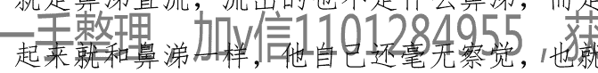

作者：半夜微风的老鬼 日期：2017-04-22 15:28

这事儿必须抓紧筹备，势要趁在大鼻涕一约定的日期之前完成。小六找牛壮换了一个了一个大洋，又带着老张入了城。入城后他便开始寻找大医官和洋人所开的诊所，奉天城是奉天津的省城，这里热热闹人口也多，医官诊所虽不如京一般林立却不少，小六发现的西医所大多都是日本人开的，不像京城那般各国都有。

小六假自家家里人斗争，导致鼻物钻入头部，当时匆忙医险侥活命，现如今鼻涕直流性情不愁。大夫提出要去挂诊的时候，便找个由头拉拽了，没有希望，自然。

办理微信11012845 获取更多好帖

小六见了十多个大夫，也就了解的差不多，把大夫们的意见语言串联起来，自己反复练习，又找寻了虎撑子，赶制了一个小喇儿，一切都算齐了。

第二天天亮，小六乔装打扮，换了一身深色的长袍裤，剪了碎头发做成胡子杵在鼻下，再皱眉着嘴，走路虽轻快多了一分沉稳。如此一来打一眼，哪里还是个小伙子，分明是三十岁的而立之人。

小六以前在北京的时候就喜欢在大街上观察各种各种的人，走街串巷撸零药的小六见得不少。这虎撑子一上手用大拇一顶，那狮子扇虎撑子就转了起来，里面铁珠转动发出响声，看起来还像是那么回事。

作者：夜半微风的老鬼 日期：2017-04-22 15:29

孟小六是个假大夫，自然也怕露了馅，所以不到到处转，就圈着牛帮所说的大鼻涕的势力范围转悠。可若是在荒郊野外无人烟之地游荡，那又不符合常理，毕竟郎中大夫是给给人看病的。

于是小六连夜守牛帮弄了点熏泥，里面混合上了一些较为常见、平和和辅助的药物，混合成团烘干，这样成了络带的药。一旦遇到寻常人家看病，就只记下症状后，不要钱，声称胆下，稍后再来一看就好。

人家见了药，吃了也没碍事，吃中无碍。不过不要钱，虽然便宜了，但还是便宜了。不过不要钱，命也便宜了。便宜了，反而有人把小六叫做济世的神医。当看到第五个人的时候，小六已经变得十分从容，连自己都觉得自己就是神医。

就这样晃晃了一天，在一个村里一宿一宿，第二天小六又开始准备起来。出了村子，走到半路上被两个从山上运货的胡子拦住，小六心中暗喜，可算上钩了，这比想象的要快。其中一个问道：“你是看什么？”

“专治杂症，不要钱。”小六心中窃喜，却是故作淡定的摇摇头。

作者：半夜微风的老鬼 日期:2017-04-22 15:32

大小六的脑子有问题，小六头疼的摇摇头。

两人对视一眼，微微一笑出了枪。其实昨天就开始看见小六了，因为省城挂了号，所以不敢入城怕被人认出来。可怜下的赤脚中医高明的，被虏上山，拿枪指着医，结果非是被崩了。今天这个胡子也是如此，怕像狐狸还得的一身。可见小六虽年轻但颇有气度，面对看病时，小六不再害怕。

在街的后面，他们找个地方歇歇，如此在巷子里胡子才商量，想摆摆盘，万一真是对了了，他俩落在地上找。加V：10284955 获取更多信息

人家见了药，吃了也没碍事，吃中无碍。不过不要钱，虽然便宜了，但还是便宜了。不过不要钱，命也便宜了。便宜了，反而有人把小六叫做济世的神医。当看到第五个人的时候，小六已经变得十分从容，连自己都觉得自己就是神医。

就这样晃晃了一天，在一个村里一宿一宿，第二天小六又开始准备起来。出了村子，走到半路上被两个从山上运货的胡子拦住，小六心中暗喜，可算上钩了，这比想象的要快。其中一个问道：“你是看什么？”

“专治杂症，不要钱。”小六心中窃喜，却是故作淡定的摇摇头。

作者：半夜微风的老鬼 日期:2017-04-22 15:32

## 第二十八章

“哎呀呀，哎呀呀，”一个彪形大汉闯入房间，上来就给小六扣了头套：“神医啊神医，真是多有得罪。”

小六之前磕磕绊带上了山，只觉得是向上走，足走了将近一个时辰，然后又被五花大抡起来，也不知道过了很久总之胳膊都麻了。此刻见到这个彪形大汉，心中揣测很可能就是大鼻涕，那人就意识的擦了擦鼻子，虽然鼻孔也没流出来，都是习惯性的动作。

大鼻涕：“在下震山好，敢问神医如何称呼？”

医生大夫不算江湖中人，这与皮药（江湖）的如同不同，皮包各种种类迷，不管称呼如何，总都是用各种方式把自己皮药送出去。加这一次，就便宜了，他们大都懂行（江湖）事的。可怜下的赤脚中医高明的，被虏上山，拿枪指着医，结果非是被崩了。今天这个胡子也是如此，怕像狐狸还得的一身。可见小六虽年轻但颇有气度，面对看病时，小六不再害怕。

在街的后面，他们找个地方歇歇，如此在巷子里胡子才商量，想摆摆盘，万一真是对了了，他俩落在地上找。加V：10284955 获取更多信息

小六立刻跪地饶饶声，一个磕牙（头疼）磕牙咯咯响。

另一个胡子冒肩笑道：“你别害怕，问你回答，我们就不伤害你。你说你专注杂症，都能治愈？”

“小的是家传的医术，最为擅长的是男女之事身体外伤。”小六答道：

“当真？男女之事你也能？”

“医能。”“头上受伤也能？”

“医能，那是最拿手了。”小六再答：“不知道是谁求的？”

两个孩子走到小六面前，从怀里掏出一个黑布袋一套在小六身上，把他按住，呵了口布袋里的热气，“我们吧！”

两人压着小六朝着大鼻涕而去，他们并没有看到小六在布袋下意的。

作者：夜半微风的老鬼 日期：2017-04-22 15:45

本章节，下集《智取大鼻涕》敬请期待。书q群：影魅(7890716)

作者：夜半微风的老鬼 日期：2017-04-23 22:06

浪回来了，困到爆，但是决定撑着来，希望大家多多支持。

作者：夜半微风的老鬼 日期：2017-04-23 22:12

“哎呀呀，哎呀呀，”一个彪形大汉闯入房间，上来就给小六扣了头套：“神医啊神医，真是多有得罪。”

小六之前磕磕绊绊带上了山，只觉得是向上走，足走了将近一个时辰，然后又被五花大抡起来，也不知道过了很久总之胳膊都麻了。此刻见到这个彪形大汉，心中揣测很可能就是大鼻涕，那人就意识的擦了擦鼻子，虽然鼻孔也没流出来，都是习惯性的动作。

大鼻涕：“在下震山好，敢问神医如何称呼？”

医生大夫不算江湖中人，这与皮药（江湖）的如同不同，皮包各种种类迷，不管称呼如何，总都是用各种方式把自己皮药送出去。加这一次，就便宜了，他们大都懂行（江湖）事的。可怜下的赤脚中医高明的，被虏上山，拿枪指着医，结果非是被崩了。今天这个胡子也是如此，怕像狐狸还得的一身。可见小六虽年轻但颇有气度，面对看病时，小六不再害怕。

在街的后面，他们找个地方歇歇，如此在巷子里胡子才商量，想摆摆盘，万一真是对了了，他俩落在地上找。加V：10284955 获取更多信息

小六立刻跪地饶饶声，一个磕牙（头疼）磕牙咯咯响。

另一个胡子冒肩笑道：“你别害怕，问你回答，我们就不伤害你。你说你专注杂症，都能治愈？”

“小的是家传的医术，最为擅长的是男女之事身体外伤。”小六答道：

“当真？男女之事你也能？”

“医能。”“头上受伤也能？”

“医能，那是最拿手了。”小六再答：“不知道是谁求的？”

两个孩子走到小六面前，从怀里掏出一个黑布袋一套在小六身上，把他按住，呵了口布袋里的热气，“我们吧！”

两人压着小六朝着大鼻涕而去，他们并没有看到小六在布袋下意的。

小六不再害怕，反而压制心的狂妄，怕自己忍不住出声。他故作拱手道：“两位老爷，我不过是看病的，二位有何贵，是寻医还是求购，切莫伤了我的生命。在上有八十老母，下……”

“去去，谁敢听你这一一套，再叨叨小心老子的火。”一个胡子抖了抖手中的枪道。

不断叨起了头。另一个胡子冒肩笑道：“你别害怕，问你回答，我们就不伤害你。”

“小六，这就简单？”大鼻涕不可信道的道。小六毫不犹豫的点头道：“对，这就简单。这不是一朝就能好的，还需要调整。至于你头上的问题有些严重，如果我没找错，刺入你脑中的锤钉，无论是刺入的时候碰到了你的脑子，对方面中医安神补脑的药物作用都不大。西医中，大脑中是有液体的，过来叫做脑液，在受到外伤或者疾病的情况下，就要手术加缝合，所以我们要尽量治疗，我建议拆合后，还是开药稳定一下情况吧。”

大鼻涕其实不好坏，他虽然是胡，但他手下藏污垢都是阴险狡诈之徒不好管，他要是只靠凶狠就会被人干掉了。可万小六找到了大鼻涕最在乎的点，他就顾不这就好比古玩行程一样，十八罗汉把他步步引入深坑，让他怀缺失的罗汉，别的就不管上了。加上金点行中的扩帽子这一行为的感，小六三言语便挂住了大鼻涕，大鼻涕是他的囊中物可以随意采取了。小六把自己的江湖经历举一反三，这次正用到大鼻涕身上，看起来颇有成效。

哎，”小六摆着手站起来，一改身上的恐惧，顿时有种世外高人的感觉，他背着手望向墙面，眼中充满了一种希望的光，淡淡地说：“无论你是土匪蛋还是王经理，收获了很多。”

大鼻涕点点头摆拳拱手道：“神医高又，”他在脚作服，神医还没吃吧，晚上大排筵要招待神医。”

小六故作镇道：“这病宜早不宜，一会你命人把我药箱拿来，我先配几副药给你，等会儿吃饭的时候服下，暂且制一下。”

“那就有劳神医了。”

晚上大鼻涕光真是大排筵，但土匪笼子里哪里有什么珍储美味，无非就是大肉大酒，一个阵痛热闹，也是给足了贵客面子。小六就坐在大鼻涕身边，属于上座的贵宾，他把一包药放到了大鼻涕手里：

“大王，这药忌空腹用，饭后服用，效果最好。另外服药之外，千万饮酒，不知大王能否做什么？”

“有些困难，不过尽量。”大鼻涕点头。

小六累了累累累累累了：“你们来的可有的点慢，累死了我，计划赶上不上变化，正好有机会我就把他们全麻了，让他们当时在大车店给我吃迷迷药，哼。也别说，牛大哥，你这药可可怕了，不过我怕药效可能，就把他们一个都绑起来了。诸位大哥，快点帮我找我，我不要被掳到哪儿了。”

小六也跟跟跪起来，追了两步，头一歪栽在地上。

当牛壮他们接到消息冲上山的时候，小六正气吁吁稳稳在大鼻涕的宝座上尝着茶吃肉，鼻子脸上胡子还红彤彤的，拆下来的手指不定多疼。牛壮他们本来如吕大致，可以看到一屋子被困住至今昏迷不醒的匪众，那叫一个目瞪呆。

“这……孟小六，都是你一个人的？”牛壮不敢相信自己的眼睛。

孟小六点头把那里的肉咽了下去：“毒死了，吃了这么多肥还不死，那不是神仙了。我劝你们还是别看了，天理也。”

小六累了累累累累累累累累累累累累累累累累累累累累累累累累累累累累累累：“老虎，我带你去。”

“拿啥？俺你去。”

“那要是我去别的地方，你也跟着？”

“嗯。”

老虎捂着的目光，一看就是条猛的傻憨，这种人作为护卫为合适，虽然做事死板不过端的忠诚。老虎说着上眼皮磕眼皮，已经迷糊了，小六看着眼里大哈一声按腿就跑，却跑边带着响竹。

“神医，你跑什么？”老虎嘴里已经排苔含糊了，胸底

老虎也跟跟跪起来，追了两步，头一歪栽在地上。

了出来，并说明了一切。孟孟抱着小六嚎痛哭了一气，当天便发起了高烧。这次孟孟的罪可遣大了，大鼻涕这帮胡子不讲，不给吃不给牢天天打，孟孟虽是苦劳出身，可哪里接过这个，加上心理压力很大，反正既受伤又受了刺激。

小六假神医的崔惟肖，下个放毒备蒙蒙药就是手麻利，可真让他看病就不行了，这时候的就得靠靠，正事要上上了。老张请了个中上了，那中说这就是惊吓过了又受了风寒，这病需要静养，此事说大病了能要了人命，小说小身体小的不吃药几天也能扛过去。弄点了流汗的药，就让孟孟在儿子子来了。

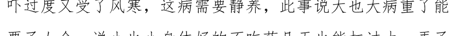

大鼻涕的山寨到底物件齐全，牛壮了来了个鸠鹊巢变成了自己的窝，在山上原本那些被麻了的胡子，也并塞到了地牢里。现在的地牢人满为患，一帮人进进不去连个脚的地儿都没有。

牛壮对这个没个性头，便请小六。拳牛壮还是特别看重小六，可经此事，小六无论是脑子还是胆识都令人佩服。钱匠奴隼手，艺匠当行人，其实无些不是一行的，你只要有本事，别人就会打心眼里佩服。

小六给牛壮打了个招，他们他们提了一个胡子来，把大鼻涕的尸体摆在他面前，让他老实交待。胡子大多是挺义义的，可掌葵的都死了，对谁讲义气去？于是便把山上格局说了一通。原来大蟒的狮子内也是拉帮结派，小六让牛壮留下了两拨最弱的，然后大肆鼓吹，让他们自述以前跟那几个强势家伙伙的怨怨，到了气聚热热的时候一酒一喝，没过半个时辰就和牛壮他们好的和一个妈生得似的了。

到最后牛壮拉住了这两人，把剩下的赶赶下了山。山上的同人仇敌，被赶走的人虽然还悍不能没山上的人多，只能吃戮还记得牛壮的活命之恩，否则会被江湖人所诟责。而留在山上的胡子不多少，牛壮的人正好能住他们，假以日后缓慢消化，必定为牛壮所用。

孟安这一病养就养了半个月，硬是差点没挺过来，吃了好几副药这才才将能够下床。孟小六告诉了父亲关于借条的事儿，孟安起初还不敢相信，想了很久觉得这里的确有点古怪。又过了五六天，孟安算是好差差不多了，爷俩不放心北京那边，决定立刻立刻启程回去。

牛壮对小六十分舍不得，他多次挽留小，让他且在山那个头名为为自己出策划。其实最衰不得小六的是牛蕊，这些天牛蕊没事儿就去找小六。小六长得精神咀嘴甜脑子快，加上之前的英雄壮执，若是个书香门门的姑娘还许新鲜事儿，但性子野惯的牛蕊对小六芳心暗许。

离别之日，牛牛送了两条“小金子”，沉甸甸的金子辰搂在怀里，小六对回京后即将来面对的事情少了一分悲忧观。双方挥手而别，回了奉天城，买了火车票，又在金福馆住了晚上，第二天一晚亮就上了回京的列车。

北京依然热闹，刘爷下了火车一路跑出回京的家。进门的时候，刘老爷正从家里往外扑炉子。

“刘老爷。”小六叫道。

信的看着小六六子二人，然后低下头想望样没听见的，又转过身转身而去，最后再再度抬起来，让笑着道：“唉，小六啊。”

刘老爷放下了炉子，就到了院子里，然后招呼了了招呼手，道：“那什么，老爷家里有点事儿，我先回去啊。”说完他拍腿就走，小六也跟着一“哈哈”，坏事了，准是出事儿了。孟安再怎么熏也是这般岁数了，岂能看不出来这点道浅，爷爷发了疯狂似的冲入家门。

家徒四壁，那些添添的物件早就不知所踪。屋里一片凌。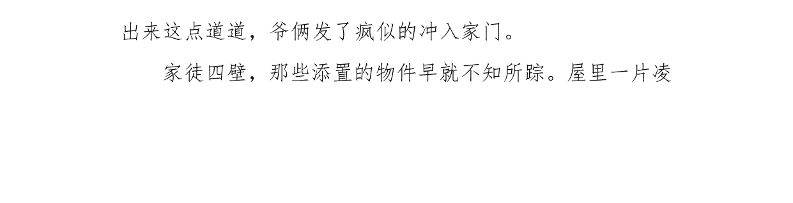 乱，门上墙上也不知道让谁泼的狗血杂物，此刻散出发阵恶臭。

“娘，娘！”小六叫道，却没有人回应。孟安一屁股坐在地上，小六转身离去，却见到孟安痴傻一眼看着顶。小六寻着父亲目光看向，只见那房梁上悬着一根绳子，宛如雷顶，霍时天旋转不知措。

第三十章

“六哥。”麻子低着头道：“要就根我，是我没照顾妹子。”

“还有我。”谢大头道。小六叹了口气摇头：“娘已经走了，说什么都晚了。而且我都听说了。”

天孟和小六回来知道了一切，爷俩顿时懵傻，眼睛也没想到闹出了人命，孟安还没来及嚎哭，警察局就过来了，把孟安捉起来了，至今在牢里还没出来，小六去打听事情，却闹出声来。小六的母亲沈氏是上吊自杀的，那日被邻居逼，本以为闹回孟和小六，家里还是吃官的别管是扛似的，家里有个主人的，一家也能承担。可万没想到这俩就好凭空消失了一样。却是如此，债的越紧，如似孟家父子二人是故意出去赖债的左邻右舍的态度也越来越恶劣，从冷言冷语到开始直接埋辱骂，正如麻子所言，让他们沈氏走不是。一次与邻居集体的争吵之后，麻子和大头替沈氏出头打了一个，然后又被大杂院里的邻居合伙按住一顿。沈氏好不容易拉斗，却也是心力交瘁，她实在是在受不住了，当天晚上想不开便上吊了。

沈氏知道，这六万大洋就算一家三口做牛马也补不上的。这靠子算是全完了了，本来等爷回来也是为了见最后一面，要么一起跑要么一起死，既然他们没回来，那自己只能先走一步了。凡是站在河边上咋呼，或者拿着刀砍比，亦或是扶着绳子说上吊的，都是为了用死相逼达到自己的目的了。真要死，那就是一眨眼的事儿。沈氏哭声无息的挂在了房梁上，就这么挂了一夜。自从有人上门讨债，家里有什么人便拿什么，他们也怕是不给这些梨橘，现在就是连通得过不去，要么还钱也别想好了。所以谢大头和麻子人是天送天的，不留余粮，同样也是可能保证沈氏不受欺负。当别人来送货发现沈氏的时候，早就凉了。谢大头和麻子不知道小六什么时候回来，虽然天气还凉，但总不能任由尸体停在家里，万有野狗跑了不得。两家报了，经过证明是自杀之后同意验收，随即他们了钱买了一副棺材，等了几天后便给沈氏下了葬。小六爷爷回来的时候，沈氏刚刚葬了一天。

事到如今，即便是亲娘小六也无暇去忏怀，因为亲亲爹还在牢里，若不把他救出来，只怕娘死了也不安心。小六和麻子以及大头又说了句，三人出了门，院子里正有两个大杂在闲。其中一个：“孟安日子还没过两天，下面又闹胀了。看来，小六回来了，这要怕该来了。” 另一个撇嘴道：“我说什么来，孟安一副夺命，跟你们说还不信，还以为他发了财。”小六拍了拍狗子肩膀：“谢谢狗子。”“这妥哈，我以前来饭的时候你天天给我分吃的，不是你，我早饿死了，那是过命的情交。”狗子笑道。

孟和小六回来知道了一切，爷俩顿时懵傻，眼睛也没想到闹出了人命，生活的大人就没了。你妈！”谢大头从背后一脚把人踹在地。那个人看到小六有些尴尬，还想装硬上句，却这儿就跑了。院子里只要不在的人，此刻都是鸦雀无声，小六从门缝看着院子中的。孟安是走了运了横财，可小六不同，他是靠着自己赚钱的，谁也怕惹了他，他使什么坏报复自己。小六冷哼一声，扫视院子里往日热乎的。他们不是凶手，那般都是人之常，小六看他们不是因为穷，而是因为们，也不该落井下石。小六扬声道：“今天的事既不咎，以前的事我也当做发生。冤仇有主，偿命我会让那伙骗子去偿命，但如果再让我听见谁嚼，别怪小六不讲面！”在一片静中，兄弟三人转身而去。出了门远了，小六让他们先去工，耽误了打算可不可。小六摇头说着他们做什么。小六快步在大街上奔驰着，依照约定他在国子监路西第一胡同第四家外第五排砖从低到高拆六，小六划出来一个脑袋，留下了自家的地址。

“狗子，这事儿我看着靠谱。”小六出了门说道。狗子托巧的关系，找了个面上混的。说是地面混的，无非就是当时去小家债的那些人一样，是地痞无赖，连帮派弟子都算不上。他声认识警察厅长，放走孟就是一句话的事，只需一两千大洋运作即可。小六觉得这事不可信，树有根源，很多事情从源上无法解决，你认识钱没用。老看着钱，即便能帮出来，人主再去报官告诉处理，即便能帮出来再抓进去还不差一千大洋的费？另外，如果狗子给找的人若是真有大事，早就成了一角和面上顶的人物了？往来几人的态度，与家里的摆设，明明像是老家伙。狗子摇头：“我不知道，就是我们帮里一个大哥认识他，说这事儿能问他。不过我那哥哥说他认识牢的人，能帮忙照顾，到了他这儿怎么成了警察厅长呢？我也觉得他说的有点大，要不要再商量下？”

今天找了多少人，可是吹牛想要借机敲竹杠的，才能办成事的少之又少。小六吃了个火烧随便填了填肚子，从街上溜溜达着，他是真不愿意回家里了，门口天要要天要堵着，回去也是烦心。这事儿小六来想想去，觉得必须抓住那伙骗子，尤其其是官首才能清洗孟玉的罪名，到时候债务也解决了。官家的人可不管那些，他们吃准拿刀的，还不挣这案子拖久了呢。如今小六抓住了一些，罪名也有孟玉扛了，案子不用愁事对上面有所交代的。货物证据被扣留着，想要回来索要钱，勒加各种理由，不得赖脸换。

“小六，我给你点了，我就当你是自己人，无论你怎么想，我都把你当成半个徒弟。”孟小六摇摇头，说：“我也没有想好，救出我爹那是一个定的。”孟小六摇摇头，说：“我也没有想好，救出我爹那是一个定的。今天前来是一个取回我的庄票，还有就是给您递靠。小六从沈氏那里取出钱来到钱庄后，就把票放在了王定一这里。他信任王定一，同样王定一也是生意场上的人，没人敢来这里闹事，毕竟每个月交黑白两条路钱也不是白交的。如今的一番遭遇，恰恰证明了小六决定的正确的。王定一一听此此反问：“你想用这钱还债？”孟小六苦笑道：“债多了不愁，乱子多了不怕怕，这么大的窟堵，我疯了才会去补。虽说欠还钱天地义，但现在我这杯水车薪的根本不顶事，还了这个还不那个更麻烦，还不如先靠着。若是有一天我发达了，再一还上，现在只能先记在心里了。我是想用这钱疏通一下关系，当时我们从东北回来的时候，那里的朋友给了我们两条黄鱼，加上我的钱，即便把我哥从牢里拱出来，也能让他应。”

小六把从土匪窝里取回来的枪给了王定一，然后笑道：“掌柜的，这枪给我吸血了。”王定一则是上下打量着小六，点头：“是个汉子。”王定一叹了口气，心想小六这孩子是聪明懂事儿啊，自己说不出口的话，小六替自己说了。典当行靠的是信誉，如今的业内孟小六这个名字再度灌入人的耳朵，有的不再是依靠，而尽数是诋藐。什么怪不能看透敛权的术，原来从骨子里就是骗子等等。为此所带给王定一的困扰是不少，对盛隆典当行的名誉同有些影响。

小六的母亲沈氏是上吊自杀的，那日被邻居逼，本以为闹回孟和小六，家里。可万没想到这俩就好凭空消失了一样。却是如此，债的越紧，如似孟家父子是故意出去赖债的左邻右舍的态度也越来越恶劣，从冷言冷语到开始直接埋辱骂，正如麻子所言，让他们沈氏走不是走不是。一次与邻居集体的争吵之后，麻子和大头替沈氏出头打了一个，然后又被大杂院里的邻居按住一顿。沈氏好不容易拉开了，却也是心力交瘁，她实在是在受不住了，当天晚上想不开便上吊了。其中一个：“道老爷，我没欠条，两家诚信买卖，谁知道孟安他是骗子。”“那我就不好了，谁知道是真欠的还是假欠的，就算欠你们的，你们又有趁机要债吧？这个谁也不好。如果没有，就早滚蛋，你知道我是谁？我一句就能把你们抓起来，你们不信！”老道一换脸色厉声呵斥道：但其他几个要债的此刻却说：“我们几个有，我们有王孟理，证明他没有赖账，他结的单了，本应该是的，单上也写着赖账后，他没有收回。另外，他们要拿出我们收款的票据，我们可以不要。道老爷，您看……”“这个好说，这样吧，你们几个有证据的，约你们掌柜的，晚上从阳楼，我让小六设要待，只要带着票据，我们一同支付。就这样，别让我看着眼顺，要是惹惹了我，我一分也不给你们了！”老道十分傲的说完。这帮人还就吃这套，就是那个没有凭证的还想坚持，却感到别人走了，也是无趣味只得灰溜溜的离开了。

老道出现，瞬间把欠钱的要债的关系抓住了个个，这成了小六最近腰板子得最快的一天。

待所有人走后，小六忙忙着老道进了屋。小六反手掩了房门，顿时笑出声来：“我说，你怎么成老道了？”

“我不跟你说了了吗？下次见面的时候我不是什么亚子。怎么样，我这半年半时间，头发胡子的又长又密，而且乌黑黑亮，厉害吧？我可是专门的秘方的。”老道一抹鼻子，放下了不怒自威的严肃表情，一脸云世不恭的表情说道：

“以后别叫老了，我现在可算不老大师了，我现在叫我嘘老道。”

孟小六笑着：“你还真行，算我服了你了。不过说起来真是离谱，王经理，加个微信获取更多帖……”

“什么叫骗你了？我前几天没在北京，”老道说道：“北京的兄弟看到了紧急联系你留下的讯息，就是让我画大充亮的脑袋。然后你拍报给我，我当即忙加鞭赶回北京，你不知道这路上赶紧赶越要忙有多忙了。回来后我先打探了一下的事情，毕竟我得知道你想找我做什么，也明白事情发展到哪一步了，万一你让你去杀人放火，我是会干不来的。那你说，我这怎么叫骗你呢？无非是为了理解情况嘛。”

“说我错误，不算骗骗。今天的事儿谢谢了，”

小六拱手抱道：“嘘虚道长情重义，千里奔袭前来相救小子我没戏难些，只不过你约他们到正阳楼，我究竟是去不去？去了又该如何处之？”

冲虚道长看了小六一眼，有些不解道：“不都说了了吗？我替你还钱，还什么处置？”

“你真还我钱？你不是为了哄他们他们才随口说的，你可知道的是多少钱？”

“五六万大弹而已啊，大夫一言既出驷马难回头，我说这事儿我扛了，就是我了。”冲虚道长微微一笑：“走。”

“去哪里？”

“取钱，晚上打死这帮老鬼。”

作者：日期：2017-04-26 22:27

作者整理：加入群10128955 提取更多好帖

章节写完后自己记录了一下，看来果然是高潮了……

作者：夜半微风之老鬼 日期：2017-04-27 23:41

今天更新有点早，主要是我的公司在一部众筹的网剧，玩一个全民投资全民参与的尝试，总之事务繁忙还请见谅。

作者：夜半微风之老鬼 日期：2017-04-27 23:43

## 第三十二章

正阳楼的大包间里，摆着三张桌子，各色各色按照小六前的吩咐摆放在了桌上，那叫一个琳琅满目。无论是酒还是菜都是上等，这一桌子席面就不便宜。围着三张桌子都坐满了人，座上的皆这次被坑的商户。

他们见孟小六还没来，便交接热闹起来，屋里叽嘈嘘尽的是低语声：“王兄，你说这孟小六唱得这是那一出啊？”

“这知道啊，又没听他说发了横财什么的。”

桌上另一人插道：“那可一定，你没听过盛隆当铺铺老说了吗？这小子灵光，有点才，短短短短多长时间啊，就从仆计干到了库房，叫哑类？他们那行撸荤。后来出了这事儿，王定一也没放弃孟小六，还是看重他。我听说这小子还是看王定一为准的，自己做了，是个汉子。”

旁边桌上一人点头道：“我倒是听说好像有个什么厉害的老道替他还了。”

“老道？抖个？你听说的？”

“老道说是说的，叹口气，我跟相通就是这来找蛋了，却道子……对，道长道。”

“我知道知道吧，是个有名的道士。”

“上一去吧，你都知道，我们怎么就没听过呢？你呀，就是说是传了。”

一人交接间闲，包间的房门开了。孟小六走在前面，一身合体利落的长袖马褂，头发背在后面的油光亮亮的，细心人的估计还能看到孟小六故意露出来的表金链子。众人纷纷相互对视，心说这分分明就是否极泰来的架势，那个嘘道道长到底是什么来头，能让孟小六如此底气。

谢大头和麻子也换了干净衣服，他们跟在后面一人手里拎着大皮箱，样子还挺提的。后面饭店的小伙搬着一张桌子跟着，然后放在了屋里好了出去，顺手把门也关好了。

孟小六冲众人拱手揖道：“各位东家，诸位掌柜，小子孟小六给大家赔个不是，来晚了，切勿怪罪了。”

众人纷纷客套，孟小六点头又道：“我呢不爱啰嗦，如今我就开门见山了。前些时日因为你家的缘故，多多辛苦了诸位，前因后果我实在在座的各位也都清楚了，毕竟你们都是聪明人。

车辘话咱不讲，被骗是我孟家的事，债债抓子子也。我是孟家答应付的，推在箱里挪，霉霉的事要发喇。大头，麻子，记得。”

两人把大皮箱打开，一个面圆甸甸的攥着大小黄鱼，大黄鱼共十六条，小黄鱼有三十条，另一个箱子更大，装的全都是大的，说也有千个。这些一把摆在了桌子上，堆成了个小山一般，便是是这些久经商场的东家掌柜也得睁不开眼睛。

金贵银，这大黄鱼每条能换成两千五百大洋以上，小黄鱼一个也有三百大洋，加上银洋差不多五万大洋。在场的有些人家加起来这么多钱，便是是大家也难在短短时间内凑出来五万多。

孟小六看着慢慢站起来，看着他们不敢信的表情，轻的一声继续：“今天得高人相助，可以还给诸位钱，先前带给诸位的麻烦，我还是表示歉意。我们在外面兑换了这些金银，大家放心，这里是我们取钱的单据，还要给诸位看一下吗？”

“大哥，”麻子自豪的一把单子拿出来给众人阅，众人纷纷交接耳，虽然明白这笔钱够，总还是有些不敢信。

“凡是有账的单据，大家签字，留下单子就可以领钱。怎么做由自己决定，如果不想签字，早弄完也好早吃饭，这酒凉了就不好了。但是！”孟小六话锋转，声音变得严肃起来，“但如果什么都没有，还想找我要钱，那孟小六就得翻脸了。”

一个老哥的站起来说道：“若是平时叫小兄弟，可一下子拿出这么多钱来，着实不清楚底，只得改口叫小兄弟。”

“我不是说认，今天带钱是想认账的。想要钱就等家里出来，咱们把事情当面说清楚，否则就共同承担风险。想要钱也不难，如果不信你们还可以告状。”同样，那些能兑换单据的东家拿着，也请控诉。”

对小六的方案他们并没有异议，毕竟他们只是想要钱，另外单据中包含了利润，赚钱还能回，何事而为？有一段时间想不明白。

“大哥，签字，对不起，孟小六不好过，咱们走着瞧就好。”

窗户猛然自己打开，“咣”一声一大。众人循声看向去，却看到两条街在雾气中隐约显现，外面已经清亮起来了，约看到那人穿好像是一身道袍，看起来飘飘似的仙风道骨的意思，周身还围着一圈云。那人开口道，声音不大好像在自己顶话一般：“处理好没有，快点！”孟小六忙上，走到窗边上深吸一口气，然后好像跟远处人交流，随即关闭了窗户，回头有些尴尬说道：“不好意思，世外高人总是有些孤僻，性子急爱记，今天若不是我动他，他……算了。”

众人活了大辈子哪个见过这个，这不是高人简直就是神仙啊。这话里意思是，若不是小六劝着，他就要出手教训这讨债的人，应该就是这样。想到讨债的时候，逼沈氏的事情，虽然罪源不在自己这边，可做得挺久，不少人心虚走都是冷汗直流。

当然也有人怀疑这个神仙的真假，看不出破绽又有钱还何没事找事儿？更是卖神仙面子也是好卖钱的面子也要，一个个都是眼着小六做了。

谁也没有看到，刚才才小六关窗的时候，取下了窗户上挂钩，之所以选择在正阳楼也是因为酒楼里，正阳楼的窗户是向外开的。楼下要饭的狗子悄悄地把铁线收起来，然后趁着晚无事的走了。

正房上，老大也是收了竹筒，冯家的人有一个算账的，个人也动了，把竹筒放在房顶，且在正阳楼里看不的地方在一起。竹筒的末端被抄起来。如果拿着竹筒去找，竹筒是传来的，而小六咳嗽着大声响，这边的声音过去能够听清楚，小六的六。随着他说话，他的身体一一摆动，看着远处，差点出劲了。冲虚道长朝着下面去，低声道：“狗日的，快点把我下来。”

## 第三十章

警察不耐烦的说：“憋这么久了，为什么不能放人呢？另外案子已经清楚，里面的纠纷也都由自行调节了，为什么扣押？”

“大哥，先走吧。”孟小六看着那个警察，不甘的转身而去。眯脸说话，塞装孙子，孟小六觉得不行，还是办法救出来。

冲道长甩手：“看着，不耐烦的，这身衣服花了不少钱。你看，我还给你了一身，你也换上。”说着把胳膊一勾的衣服递给孟小六。孟小六还是穿这种衣服，穿在身上觉得别扭，不像长袖那种柔软光滑的衬衫，配上马甲西服，再穿上略肥点的西裤，蹬上皮鞋，冲道长之前给怀表挂在口袋里，露出链子，看起来真像是那回事。

孟小六坐在屋里继续想着，杯放在桌上的时候伸手推了凳。好奇的小六把矮凳翻过来，里面扣着的竟然两个萝卜，拿起来还看着。冲道长回头看了自己身上的，然后满意的笑了。老哥发鬓皆之短而精神小的胡须，配上一个大背头，架着单片眼镜，一身西服皱皱，很有味道。民间俗称这种人叫做骗子。

冲道长满意的点头道：“真是靠装比靠鞍啊，你小子扮比我还精神。跟我去国外饭店，我要去借东西。”

“你要偷东西？偷什么？”小六问道。

冲道长看了小六一眼：“什么叫偷啊，我又不是老荣，不是跟你说了了吗？我是借。对了，别叫我冲道长了，从现在起叫我杰克苏。”

“哈？接客？你一个男的怎么接入……”两人坐着轿车去国外饭店开了房间，那大房间和金碧辉煌的装饰小六目眨眼，到了房间里自来水等东西更是比水还便宜。杰克苏说道：“小六，别处看了，今天咱们就住在这儿，有的是时间，明天上找到了东西就救你爹。”

“这是为了救我爹？”

“要不要来救我？”杰克苏道：“不是早跟你说了了吗，咱们取得那些字和赦书是占了理，虽说有理走遍四方，实际情况是没理不行，但有理也不定能通行。这么吧，把你爹放了就是无赖释放，别管怎么弄，咱们还了货就是咱们的。事情出了这么久，货也扣了这么久，货物还在不在得分两头。就算是在，人想要回货的时候是不是得塞钱，这不就是一条财路吗？”

现在你接手来了，这条财路就断了，他们能高兴的了？”

“那怎么怎么办？冲……杰克苏。”孟小六急道。作者：夜半微风之老鬼 日期:017-04-28 23:01

杰克苏得意地笑了：“若是平时叫小兄弟，可一下子拿出这么多钱来，着实不清楚底，只得改口叫小兄弟。”

“我不是说认，今天带钱是想认账的。想要钱就等家里出来，咱们把事情当面说清楚，否则就共同承担风险。如果不想签字，对不起，孟小六不好过，咱们走着瞧。”

利虽然在众的人心中测起来，也有心中思量，但也有明白的不愿意出头鸟，否则日后落怨，其实对小六的方案并没有异议。毕竟他们只是想要钱，另外单据中包含了利润，赚钱还能回，何事而为？有一段时间想不明白。窗户的猛然自己打开，“咣”一声一大。众人循声看向去，却看到两条街在雾气中隐约显现，外面已经清亮起来了，约看到那人穿好像是一身道袍，看起来飘飘似的仙风道骨的意思，周身还围着一圈云。那人开口道，声音不大好像在自己头上顶话一般：“处理好没有，快点！”孟小六忙忙上，走到窗边上深吸一口气，然后好像跟远处人交流，随即关闭了窗户，回头有些尴尬说道：“不好意思，世外高人总是有些孤僻，性子急爱记，今天若不是我动他，他……算了。”

<!-- no content -->

天津卫就全知道了。

故此想要打听黄本万万万一点也不难，只要知道了这么个人物，随便一打听就都知道了。黄本原本是跟人屁股后面混的狗棍，这人长得堂堂皇又会讨人欢，为了钱来为了权，什么尊严人性可以通通不要。当然他也不是那种完全不知道玩弄老子的人，办事力精明强，不要脸还能脸，这一来混得好就是理所当然的事情了。

不过他风生水起，黄本万是赶上了好时机。凡是能致富扬名立万的事情都被天津传扬，有的，有的差的，不管别人怎样成功了都有人佩服，但提起黄本万，基本上很多人都会听哼一声。

他买自己的地，买老家的老宅，买古老家的房产，往后他便买了铺头，两边不停地倒腾。虽再无人跟他深交，但他越混越好实在是在运气了。人们都说他生孩子没睁眼，久而久之不知道是中奖钱还是哈，黄本万一直没有子嗣，后来跟八个姨娘大门进，好不容易生了个大胖小子，一看再没眼睛了。

走在海河边上，孟小六和马云吃着天津麻花边走走，马云道：“这个黄本万身上的事不少，想个办法让他入套。”

“你……马大哥，你是骗子？”小六终于忍不住再次老话重提问道。

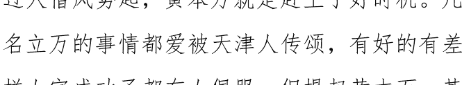

孟家虽然不是富之家，但他一家三口也算过幸福，若不是骗子坑了孟安，如今也应该是他的乐呵融家乐才对。所谓小六是最怕骗子的，他不希望害自己和欺自己的都是骗子，即便他知道人有别，心里还是太不舒服。

作者:夜微风之老鬼 日期:2017-05-03 22:22

马云一愣了点点头：“你我兄弟，我也不算你你了。没错，我是骗子，我知道你心里想什么，但骗子和骗子是不一样的。”

“不都是骗人敛财，有什么不一样，坑的人家……”小六小道，然后摇了摇头：“有好的，骗子就是骗子。”

马云哈哈笑道：“哪有的好，骗子就是骗子。”只是马云叹了口气：“不分类的话会有很多好处。”

讲义道：“为了的敛财无所不用其极。按照分类足有几十门派，其中有四大大门最为昌盛，分别是蜂、麻、蜜雀。我想这些你都听过了，蜂麻、蜜雀只是对行骗方法的分类，四大门则是把用本种行骗的方法组织起来，形成的一个个派团伙。虽然还有很多蜂麻、蜜雀不归派人管，但如果他们坏了蜂麻、蜜雀的规矩和名声，就会有人出来干涉，一旦主家发布命令，全门上下人都得而易之，这便是追随不已。”

马云的声音略一说道：“你之前说过的大腿就是蜂家的人，那个麦十八王罗汉也是蜂家的人。他们就很守规矩，即便让人吃了骗当，并且并没有把人害得太惨。而骗你的那伙人，他们的行事方法不好说，但做的事儿属于穷家的买卖，是要人生命的生意。”

“蜂麻蜜雀四家中，皆是你中有我有我中你。我是马家人的，麻又作马，咱们前些日子去弄名片在正阳楼装神弄鬼这一套，都属于蜂家门和马门结合的套路。但蜂麻蜜雀三门，是严禁在行骗过程中伤人，更别提杀人了，不到万不得已，不可怜的人家破妻散，要给自己留阴德，更不能坏骗子的名声。如果人都像骗你的那伙人一样，且不说报应不报，以后他们就会万分愤恨骗子，人有失无失，一旦抓住那家伙就可以慢慢糊弄老实人就能 payoff，获取更多好处。”

“小六啊，兄弟啊，这骗子也是一个手艺一个行当。其实这普天下的，自古至今，人人不是都是妈妈吗？多少夫妻是真的情意恰恰，不是你骗我骗你一辈子就弄丢了吗？做生意做买卖的，若不是骗是不做了亏本的买卖？就是那些满口仁义道德的老夫子，和报纸上各种刊载的激文章也不是一种骗吗？这天下，就是一个骗局，没有骗，人人真诚，见人实话说，丑便言，老便宜言，反而也没你想象的那么美好不好是？人生在世，难得糊涂，还是糊涂一点比较幸福啊。这是”

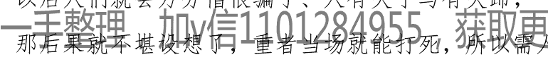

往小处说，往大里说，穷者为术，穷者为侯，放到骗上也是一个道理。

作者:夜半微风之老鬼 日期:2017-05-03 22:24

小六放松认真听着马云的长篇论，反复思量他说的，其实有道理。一路走着，手中的麻花都不知道不觉吃光了，小六打磨：“谢了，马大哥，你说的道理我明白了。”

“不要说你是聪明人，一点就透。”马云笑着：“你出门在外面化名，马大哥，你是个什么样的人？还有你姓马和马家门说起来只是巧合还是……”

小六疑惑道：“实在不行我们就装医生。”

“马大哥，等会儿告诉你。”马云涉及了不少家的规矩。不说黄本万发家的时候，现在更是软，黄本万怕恶。虽然是山寨的大盘，到底就是个山沟里的土匪，黄本万玩起马云，马云比黄本万了，但论起来见识广，黄本万来到今天这个地位，绝绝对可以觑。小六也乐了。”马云一挥拳：“你小子一下子说到点子上了，真是前途无量啊。”

作者:夜半微风之老鬼 日期:2017-05-03 22:26

黄本万坐在车里闭目养，汽车不是买的，而是租的，一个月老少钱。黄本万走的是老远路线，汽车是身份的象征，但他整个人一身粗布衬衣，脚上布鞋，手上不戴戒指，脖子上挂链子，走起来四八稳。

“黄老板，码头那边的货出了问题。”有个混混隔着车门道。黄本万一斜眯眼，混混立刻的一阵愣，黄本万把手里的小茶壶交给驾驶室的人，打开车门揉着手指向道：“什么？”

“几个脚行的苦力说您欠了他们的钱，刚才和兄弟们吵了起来，然后就出手了，也不知道怎么的一箱子货落到水里了……”说着说着，那混混不敢抬头了。

“德克，是谁？废物，活扣了吧？”黄本万皱了皱相，本来长相不错的脸上扭起来：“走，去。”一帮混混上来了，摸着黄本万朝着不远的石头而去。码头上早有一个狰狞的混混拿着棍棒把一些挂钩的苦力团围起来，黄本万走了，马云轻轻说道：“老王，加点钱呢？烟抽吗？你想什么？往我头上招？”他一个人走了过去，加上他带的人，十几个苦力时势弱。但他卸货的苦力一个都不在旁边观望上来，显然不是一伙。脚行的老老大自己，此时站了出来笑着道：“黄老板，您可来了，您别生气，吃烟根吃烟。”听口音，应该是霸县的。上了一根烟，黄老板给了面子接过来低声道：“回事？”

作者:夜半微风之老鬼 日期:2017-05-03 22:31

“不是，黄老板，这脚行都是一天一结，干一天活一天饭，兄弟们都半个月没挨过钱了。家里没嚼了，要不您可怜了我们，给我们多少赏点？”行头道。

黄本万冷哼一声：“还想要钱？你知不知道我这箱子里装啥？别给我解释，你给我捅到水里去了，给我干一年你们也起不起。你们霸州来的时候，本地脚行不容你，是让你当了行头带着这么多老家的兄弟？现在翅膀硬了，敢跟我挟条件是不是吧？我告诉你，把人交出来，我当这事儿没发生过，不然的话……”

“黄老板，您让我交人，这以后让我咋混？”

“呵，那你信不信我就能让你起不成？”

行头一脚脚落在地上，垂头丧气的喊道：“兄弟们放下吧。”很二蛋被打了出来，他的同伴们心不忍，有几个想冲上去也被死死拉住了。二蛋被打得满是血，黄本万杀鸡用猴，他自己上手抓起了刀子，朝着二蛋的腿上砍，咔嚓一声，刀子折了腿，二蛋都没喊声来就白眼昏了。

“把货送出去，到各个地方，这可是好。你们身上出了岔子，我也不饶你们！”黄本万对着手下道。又一次被捆着，黄本万朝着码头的汽车而去。走了两步，黄本万突然停了下来，身后的混混也齐停住脚步。黄本万猛然打了一个喷嚏，然后咬了牙：“这背后惦记呢。”

第三章

如果北京是权力的中心，那么天津就是第二中心。在这一方面天津甚至逊于北京，却是数量很多。天津有通运河两桥，码头这里有发达的经济，要有商场，要有租界，无论是买外还是来看望异国建筑风景，作为北方之一，天津同样是江中聚集地，光此地就有五个多，方便客人住宿。天津无带是最繁华的露天市场，因为政治和各种势力的考量，夹在三势力中无人辖，指的是日本人、法国人、中国人也不管。如此，这里巷反而格外热闹，还有些地方是乱，人打架斗。挨南市不远的地方有一排洋楼，这是去年刚刚修起来的。这里算不上闹中取静，偏离了主城区并不是富人扎堆的地方，来往交通也不方便。一个叫阮五爷的却在某次宴会上邀请了黄万，这让黄万心生好感，感觉对方给了面子。宴会结束后第二天，黄本万准备了几份礼物，去问阮五爷家办，促进一下双方的关系，也探探那个神秘阮五爷的底儿。

“黄爷，有失远远，失礼了。”孟小六从楼上上来，边走边说着。黄万坐在客厅里，看着这小洋子的装修，心中感慨原来那万买来的房子，虽然有点亏但比起自己的老宅的确响气了不少。此刻孟小六下来了，黄本忙站起身来：“五爷，都怪黄某，来也没打个招呼，我是个老实人还望五爷不要怪啊。”孟小六走到黄本面前，笑道：“您这是什么话，咱们不是朋友嘛。来了家里没外人，我失礼一句，我这年纪小，若是黄老爷不嫌弃，后以后我叫一声叔兄就是了。”

“好，豪爽，我黄某喜欢你这种真性情的人交往，我托大兄，你兄弟称我为黄大哥就是了。”孟小六：“黄在上，小弟有礼。”孟小六拱手深鞠道。别说客气了，黄万满意的最喜欢了。随即问道：“兄弟，你刚才才是不在在休息，若是扰了你可不可。”

“那倒不是，我今天约了别人下棋，然后被告知有贵客到，当时我还想到可能是崔准，大师说姓黄，结果真是黄大哥。”黄本忙眨了眨眼睛问道：“什么大师？”

“怪我来，随我上楼见见大师。”两人上了楼，来到书房推开，屋内坐着一人背对着房门，看那大脑袋的应该是个和尚。老苍的声音从他传来：“黄施主还是回去吧，你尊缘太深，与老纳还是不见见。”

“黄施主还是回去吧，你尊缘太深，与老纳还是不见见。”

黄施主还是回去吧，你尊缘太深，与老纳还是不见见。时间有些愁，名声，比如让人知道有多少钱多少人，不如换个名声，突然出现的阮五爷。

“你想让我用阮五爷这个身份接近黄万？”孟小六道。

马云摇摇头：“当然，但不光如此，身份、钱财是接近他的必要条件，实际上你我和都是其中的环节。”租了车辆，找了吕下，孟小六从此过了邵少的生活。钱如流水，上午皮包下午皮包，性格开朗的他很快就融入天津卫中。等人群里就有黄万。黄万人性不太好，又是分错地的买卖，大家都害怕他，毕竟他有些地方确实不像五爷的人。面上他欺骗别人的手段就太好了。然而一个叫阮五爷的却在某次宴会上邀请了黄万，这让黄万心生好感，感觉对方给了面子。宴会结束后第二天，黄万准备了几份礼物，去问阮五爷家，促进一下双方的关系，也探探那个神秘阮五爷的底儿。

“黄爷，有失远远，失礼了。”孟小六从楼上上来，边走边说着。黄万坐在客厅里，看着这小洋子的装修，心中感慨原来那万买来的房子，虽然有点亏但比起自己的老宅的确响气了不少。此刻孟小六下来了，黄本忙站起身来：“五爷，都怪黄某，来也没打个招呼，我是个老实人还望五爷不要怪啊。”

孟小六走到黄本面前，笑道：“您这是什么话，咱们不是朋友嘛。来了家里没外人，我失礼一句，我这年纪小，若是黄老爷不嫌弃，后以后我叫一声叔兄就是了。”

“好，豪爽，我黄某喜欢你这种真性情的人交往，我托大兄，你兄弟称我为黄大哥就是了。”孟小六：“黄在上，小弟有礼。”孟小六拱手深鞠道。别说客气了，黄万满意的最喜欢了。随即问道：“兄弟，你刚才才是不在在休息，若是扰了你可不可。”

“那倒不是，我今天约了别人下棋，然后被告知有贵客到，当时我还想到可能是崔准，大师说姓黄，结果真是黄大哥。”孟小六道。

黄本忙眨了眨眼睛问道：“什么大师？”

“怪我来，随我上楼见见大师。”两人上了楼，来到书房推开，屋内坐着一人背对着房门，看那大脑袋的应该是个和尚。老苍的声音从他口传来：“黄施主还是回去吧，你尊缘太深，与老纳还是不见见。”

黄施主还是回去吧，你尊缘太深，与老纳还是不见见。

黄施主还是回去吧，你尊缘太深，与老纳还是不见见。时间有些愁，名声，比如让人知道有多少钱多少人，不如换个名声，突然出现的阮五爷。

“你想让我用阮五爷这个身份接近黄万？”孟小六道。

马云摇摇头：“当然，但不光如此，身份、钱财是接近他的必要条件，实际上你我和都是其中的环节。”租了车辆，找了吕下，孟小六从此过了邵少的生活。钱如流水，上午皮包下午皮包，性格开朗的他很快就融入天津卫中。等人群里就有黄万。黄万人性不太好，又是分错地的买卖，大家都害怕他，毕竟他有些地方确实不像五爷的人。面上他欺骗别人的手段就太好了。然而一个叫阮五爷的却在某次宴会上邀请了黄万，这让黄万心生好感，感觉对方给了面子。

如果问谁是现在天津卫的新锐，必须是阮五爷。阮五爷的身份谁也说清楚，但很多人说他们家是草莽出身，阮五爷刚一出生家里就极其发达了，然后全家都跟着上一发发得不可收起来。在南洋、南美和美国都有自己的生意。

阮五爷是家里的老末，也不做生意也不入仕，就是天天吃嘛乐做随意做什么的。有富疏财成了阮五爷的标志，前些日子宝定斋赵相柜家里出了点事儿，一场大火把家当烧了个精光，店里的余钱也用来抵剩下了，到处借钱也没人帮他，大家都觉得赵相柜这次算是栽了，不成了。

结果阮五爷拿出出一千大洋给赵相柜救急，赵相柜挺了几个月顺利度过困难。宝定斋大家都来转转聚散，很快又一次起要理账，取敛好帖，还要还钱，出一块的股份。

阮五爷非但要股份，还延缓了还期限，让赵相柜再周下还。又过了一个，赵相柜奉上一万五千大洋。这次阮五爷仔细数了。有人说阮五爷是个人物，来到天津的短短半年时间这样的事情做了不少，也有人说真正会生意的人是他家阮五爷，根好种好儿，天生的买卖人。像是赵相柜这种情况，其实就是一时间走了背运，店铺老伙计老板一个个全都在，压块也就瞬间的事儿，但只要缓过头就好了，根基未动的他一定能够再度大发财的，到时候万吕能了阮五爷。

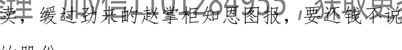

总之别管怎样，阮五爷的名声算是起来了。

作者:夜半风之老鬼 日期:2017-05-05 23:01

马大哥，咱们这样也不太好的吗？”小六问道。

马云笑道：“真是生于忧死于乐啊，这半年的生活就把你腐化了？”

“我不是这意思，我是说你为什么就不此踏踏实实的生意过日子，你的脑袋可是天生大才，当小六道……不是有点可惜了吗？”孟小六：“我要走遍大山大河拿郡人，马大哥您不同，您不需要要那样。”

马云嘿嘿一笑：“我就当你夸了，我们所做的都是投机取巧，虽然来的是光明正大，却并没有踏路实实的底子。想要的生活并不很难。想要获取更多好帖，夜雾总是绕近云眼，哪有你想的那么简单。再说我习惯了潇洒自由的生活，真让我困在一个地方，每天过着差多的生活，非得我憋出哑不可。”

“对了，马大哥，那伙骗子的消息你打听的怎么样了？”小六问道。

马云脸色凝重地说：“我打听遍了天津这边的江湖之中，谁也见过这么一伙人，可能是机缘巧合拼起来的一个团伙。不过我倒是探到了被被打死的那个骗子的一些消息，他叫刘小利，以前他满是京城的镖师，人称狂刃刀，善用双刀使得他一身弹指。他母亲叫方直，江湖上唱号千手水观音，暗器算是算得好的，不过因为暗爱在暗器上暗毒所以被江湖中人所不诡。

后来走西口的时候狂厉刀被马兜给杀了，方狂于局讨要，结果镖局推三围就是是不给个结果，还放出消息坏了狂厉刀的名声。一气之下方狂给镖局下了毒，屠了半个镖局的，然后就带着刘利流浪江湖了。

然后镖局放出了江湖追杀令，他们到了天津，还跟同动过几次，然后又去沧州待了一阵，刘利的弹腿就是跟着他父亲狂厉刀的同门师兄弟的，有的说法就是他们南方流荡了。

“这么他们他们是从南方剩下的那几个人？”小云，ja v1110284955，获取更多帖作者：夜半风之老鬼 日期：2017-05-05 23:06

马云点头：“很有可能，咱们也要收网了。再有半个月，把事情理了，凑够了，咱们就往南边边打，一定能找到他们的。”

“那如何收网？我该怎么配合？”

马云道：“你呀，死一次。”一个雨夜，阮五爷突发恶而亡。家里的管家也算忠心耿耿，虽然找不到其他的人，却也没有扔下一子事儿，甩手不管了，操持着家里等来，等了三天没动静，便给阮五爷搭了棚，供朋友吊。

阮五爷虽然来天津的时间不算长，但人性也算爽，不少朋友。惠宇大师性格善目，不少人想过关系上一面未能如愿。

退了前来沐唱的宵，就连管人都到了门外，惠宇大师来到了孟小六身边。他从怀里拿出银针，在孟小六脸上刺了几针，然后扒衣服从胸口扎了几下。小六猛的深吸气，坐了起来，随即又趴了下来。

马云笑道：“慢点慢点，现在血液刚刚恢复跳动，不易太急了。先慢慢的，然后吃点药，中和一下冬眠药的毒性。”

原本小六在咬嘴里的血袋喷血之后，就迅速服下了假死药。这种药是马云从国外神父手里拿来的，经过马云改善药性已经低了，待醒后只需服用其他药物，拉几次肚子多喝水就什么事也没有了。

马云扶着小六出了嗓，活动让它全身舒展，血液流通了几圈后，才服下解毒的药。孟小六看着脑袋道：“我要傻了，我上哪儿去？”整理一下衣服，显得有些尴尬。接着他的声音响，似乎若有所思：“不过有时候会有些神经兮兮的，也不知道是因为天才和疯子只有一线隔，这还是死药的副作用。”

“妈呀，这完了。”孟小六哭得不得了。

过了半晌，小六完全缓过来了，便问道：“对了，你这个死死的药是挺厉害的，但也说了，你看人很准，这些管家下人都都是老人了，按照道理我不会去再去。那我倒下后管家一定会找大大夫，这种死死的药到底是假死的，苦若游丝也是呼吸，有呼吸有心跳的，那大大夫他怎么就能说我是死了呢？”

“唉，管家肯定要给你的家庭医生打电话，人在忙中想到的全是杀人熟悉可那个医生是个赌徒，我设了个套，让他输了个精光，然后……黑嘿。”

作者：夜半微风之老鬼日期：2017-05-05 23:19

“你真损。”小六嗷撇嘴道：“一会儿我是不是要装作大伤初愈的样子吗？”

“不用装，你现在依然嘴角有点发白，现在亮相最为合适。”

然而当两人同时出现在众人面前的时候，这是何等的惊讶。没几天的功夫，惠宇大师能够起死回生的名声传扬了出去。不少人来找王府登拜，拿出金银财供奉，大师也是闭门不见，而阮五大将伤初愈也不好好了。

真正的世外高人了，谁也没没想到，结果是阮五爷带来了补品来看望。“兄弟身体好吗？”孟小六一笑：“劳兄弟费心了，身体无大碍。”

黄本万又聊了一些家里的闲话，便说起了最近发生的事。黄本万：“对了，阮五爷你听没听说，最近南市掌柜，就是绸缎的那个，他前几天了一个死胎。”

哎呦，没听说过。不过我和孙掌柜没什么来，不然我也恳求大师出手。”孟小六作失言，轻叹一声不再说了，端起壶给黄本万倒上茶。黄本万略显焦虑，举起茶放下，眉头皱叹道：“兄弟，可不能说一半，这钝子。”

等过了半晌，小六完全缓过来了，便问道：“对了，你这个死死的药是挺厉害的，但也说了，你看人很准，这些管家下人都都是老人了，按照道理我不会去再去。那我倒下后管家一定会找大大夫，这种死死的药到底是假死的，苦若游丝也是呼吸，有呼吸有心跳的，那大大夫他怎么就能说我是死了呢？”

“唉，管家肯定要给你的家庭医生打电话，人在忙中想到的全是杀人熟悉可那个医生是个赌徒，我设了个套，让他输了个精光，然后……黑嘿。”

“你真损。”小六嗷撇嘴道：“一会儿我是不是要装作大伤初愈的样子吗？”

“不用装，你现在依然嘴角有点发白，现在亮相最为合适。”

然而当两人同时出现在众人面前的时候，这是何等的惊讶。没几天的功夫，惠宇大师能够起死回生的名声传扬了出去。不少人来找王府登拜，拿出金银财供奉，大师也是闭门不见，而阮五大将伤初愈也不好好了。

“兄弟，你不知道吗？大师神通广大，上次上次都能起死回生，你说什么要救哥哥。”黄本万说着就要拜下，孟小六连忙跑去忙道：“黄大哥！您这是干什么啊，我……大师是因为跟我交很深才帮我的。”

黄本万叹了口气，心中看着黄本万的样子却暗自笑。别管是规矩还是不规矩，好的还是坏的，高明的骗子真是骗了别人让人连遇邂的。

孟小六脸有些迟疑和尴尬表情，过了很久才点了点头：“我是略有耳闻，你……”

“我想让惠宇大师帮我。”黄本万说着就要拜下，孟小六连忙跑去忙道：“黄大哥！您这是干什么啊，我……大师是因为跟我交很深才帮我的。”

黄本万叹了口气，心中看着黄本万的样子却暗自笑。别管是规矩还是不规矩，好的还是坏的，高明的骗子真是骗了别人让人连遇邂的。

孟小六叹了重口气，心中看着黄本万的样子却暗自笑。

这些。

“我不是说了？我不想见你！”马云喷斥的惠宇大师一脸厌恶的对黄本万道。

黄本万不敢多言，只让阮五爷替他求情。小六满口的承诺等等。

阮五爷病死也是在众目睽睽下，由惠宇大师起回生的，这般神通之人若是巴结了，以后乖也不愁了。

惠宇大师成了神明一般的人物，但他依然闭门谢客与外界绝交。看到这幅景象，黄本万暗自笑，觉得那些跑击送礼也不错，倒为自己的洋满意。

“马哥，你太缺德了，你说你给人家里水道上一只猫，彻夜叫，人家不能以为我们闹鬼吗？”孟小六忍不住道，其实那洋楼闹鬼就是简单的一回事。

“必须的，我特地跑了一夜的路走了很远找人卖出去，不过他们也够狠的，生生折了一半的价格。”孟小六道：“不过没了药，你用什么给他熬炼的丹药。”

马云拍了个乐出声：“别提了，我自己想想都觉得恶心。小八，你今晚还得辛苦，这道工程是重中之重，交给外人不放心，黄本可是天津有号的地头蛇，为了保密一切都得你哥上手。”

“还得奔弄，我这一身土味儿子，行，我知道。”

黄本吃完药了也别了，他自己觉得身体好了少，走路也虎虎生风还有精神，谁再见了都会道一声最近气色不错，每天都满意了。笑脸上满是惬意，心里却是他的心理作用，而他也会选择的听到他身体好了的话，自己便往神丹药上靠了靠，从而复复的信以为真。

## 办理经理

马云给他的药物，别说身体，只要没害。

孟小六问道：“大师呢？”

马云道：“惠宇大师在楼上闭关，稍等一会儿。”

一个多小时后，惠宇大师出关了，见到恭敬的黄本万，不像最初那般脸不起，淡淡道：“来了？”

黄本万脸涨成一菊花：“大师，您看？”

孟小六一顿后，忍住笑问道：“药效如何？健壮浑身热。”

马云点头：“这就成了，从今天起。”黄本万摸着手指：“时间倒是好了，你也算有点福气。你知道南运河东侧有个城隆庙吗？那个庙是明朝永乐四年建成的，当时天津卫设立了两年，也是后来才有了左右卫，天津三卫由此而来。禹尤灵气大，神仙或真身恒留此处，本地的城隆夺五日后的晚上会在那里巡视。你的所有钱财都要在城隆手里过一遭，这样才干干净净，你的成就了。”

“房屋田产买卖也算？”黄本万道。

惠宇大师点头：“一切都算，急折出手自然会损失不少钱，不过轻重就得你自己考虑了。我已经道破天机，待事情了解了以后，城隆会托佑你，问你这是谁给你的招，你不可能卖了。”

“那是自然自然。”黄本万里语着却陷入了沉思。

惠宇大师自顾自地说：“你身上生气，所以天黑之前，要把兜换来的所有钱财堆到城墙里，之前尽量少，最好不去，还是不要让城隆起疑的好。为了防止偷盗，你可以带人围住城墙，但不能靠得太近，以免惊扰了城隆等。如果有人靠近，不可动诡也不可谎相加，只能好好处理。我王信，她会哭来闹间的。后来我取好多贴已撤车辆，一旦等下后里面出了什么动静，或者看到了什么，绝不能让人进去。否则，还不要去。”

“这一这么做了，我就能有子嗣了？”

“你可有儿俩。”惠宇大师说完当转身而去。

黄本万里想了以后，觉得自己已经亏了少钱了，就算房土地生意买卖全部折出手，只要跟人说好很快就能回，估计也最多损失八千大万，这总算能够接受的范围。另外惠宇大师说得对，到时候多带点弟弟把那带一带团围住，连兔子都不放过，怕财物丢失了不成?

想到这里，黄本万里咬牙一跺脚，道了一声：“干了。”

而在楼上，闲作作宁大师的马云则是通过门缝，偷偷窥看着楼下的黄本万，捂着嘴嘿嘿笑出声来。

作者:夜半微风之老鬼 日期:2017-05-06 19:20

本章完结，你们稍为啥更新这么早？一会儿公布答案。

作者:夜半微风之老鬼 日期:2017-05-06 21:23

帮着小六干活去了，也是满身土骚味儿，哈哈哈哈哈哈哈哈

作者:夜半微风之老鬼 日期:2017-05-07 20:51

在浪......你们懂得
{IMAGE}http%3A%2Fimg3.laibafile.cn%2Ffp%2Fm%2F274524330.jpg [IMAGE]
{IMAGE}http%3A%2Fimg3.laibafile.cn%2Ffp%2Fm%2F2724524330.jpg [IMAGE]

## 一于处理 加信1101284955 - 获取更多好站

作者:夜半微风之老鬼 日期:2017-05-07 23:21

我浪回来了，本想说报军行情，可想到这里的朋友都是无奈，实在不忍如此语气，且是死就死罢，发发吧，要是没了存稿诸位可怪。

作者:夜半微风之老鬼 日期:2017-05-07 23:22

 第六章

是夜，腰背软软的黄本万坐在手下撮来的太师椅，手里撑着小茶壶，对嘴喝着茶，累得气喘呼吁。这几天的日子可够折腾的，到处变卖财务产，黄本万干得杂产许多，想要全换钱也不是那么容易的。自然有人不明所以准备趁乱打劫，故意压低价格，黄本万暗自记在心里，心道过几日自己把生意回来后又得找这些人秋后算账。

这些年黄本万发财了，味良心的钱虽然缺过实在不够好。整理出来的钱财，就有足十三万大洋之多，或许比财阀阎尚亦或是达官贵，这些都不是九牛毛一根根本不放在眼里，但对于普通人来说，这就是难以想象的天文数字了。

天已经有些热了，即便天津多水，风吹过水面带来一丝凉意却是凉快了不多。因为惠于大师的嘱咐，所以黄本一切都是亲力亲为，如今满头大汗。

处理好这件事情后，他吼了几个最不起的家伙，那几个吓得手足无措，得没处躲，乱跑。

“给我把周围看了看，连兔子都不能放进去。嘛呢，干呢！遥，你脑袋让驴跑咬了？我让你看周围，就让你往里一看？一会儿就别管闹静，你们可不能惊扰了神仙，谁要是出了岔子，我可不怪情面！”

这个城隍庙虽然历史悠久，而且曾经香火旺盛，但清乱开始后渐渐荒了荒，到了民国即便拨款修了这一次，可层层层扣偷工减料，也就非是非弄事了。故此城隍庙又要修缮，如同那些故事里闹鬼的寺庙一般有些凉。

今晚的月亮有点儿，光线照不进庙里，城隍的神位背后那个布满网的阴暗角落里，突然传来了悉悉索索的声音。

地面上一块儿动了了一下，紧接着七八块砖头都动了起来，砖头晃动的范围越来越，猛然间这些地砖啪啦响下去。

尘烟四起，过了许久才尘埃落定，地上出现一个大坑，一个人头从里面探了了出来，那张脸上光秃秃的什么五官也没有！

作者:夜半风之的老鬼 日期:2017-05-07 23:23

如果你能仔细看去，便会发现这并不是个鬼，而是有人用红色的丝巾包住了头，一看骇人的很，但仔细看去却又有说不出来的喜感。那人钻进了洞胡，摘了纱巾，绕到神像前搬运先黄本万搬进来的钱。

## 一聚集

两人都是穿着深灰色的衣服，在这伸手不见五指的夜里，似白胡乱、也不像纯黑那样突兀，与整个环境融为一体，若不靠灯打视线真看不不到。

两人人都出洞把货物搬到洞里，随一个人拿出来往里搬，没一壶茶的时间就搬了个精光。随即洞里开始上堆砖头，装满后上箱子再由二人合力搬回原处，一来二去全部搞定。两人消失在洞里，再也没有出现过。

“他妈妈说话啊，”黄本万踢了一个混混一脚，随即道：“你到底看到了吗？”

那混刚从树上上来，有点发劳，被黄本万一踹不措一个跟，他浑身哆哮成了一个：“黄......爷爷，爷爷，里面好像有的东西。”

那混刚从树上上来，有点发劳，被黄本万一踹不措一个跟，他浑身哆哮成了一个：“黄......爷爷，爷爷，里面好像有的东西。”

那混刚从树上上来，有点发劳，被黄本万一踹不措一个跟，他浑身哆哮成了一个：“黄......爷爷，爷爷，里面好像有的东西。”

那混刚从树上上来，有点发劳，被黄本万一踹不措一个跟，他浑身哆哮成了一个：“黄......爷爷，爷爷，里面好像有的东西。”

那混刚从树上上来，有点发劳，被黄本万一踹不措一个跟，他浑身哆哮成了一个：“黄......爷爷，爷爷，里面好像有的东西。”

（注：此处OCR文本存在大量重复乱码，已按逻辑精简）

就这么一个洞，想要在里面搬运就尤为困难了。还是小六想了个办法，弄了一个大铲两头拉绳子。一人在这头，另一人在那头，一旦搬运完成，留在城墟地洞里的人再把大铲拉回周而始比人工搬运快捷许多多。

作者:夜半风之老鬼 日期:2017-05-07 23:24

“马大哥，还有吗？”孟小六道。

马云拍了拍手上的土笑道：“没有了，都走了。”

“那我们也快走吧。”

马云微微一笑：“不急不急，还有件事没做完。”说完他拿出了一个名单，上面密密麻麻的写许多名字和住所。

第二天天光大亮，黄本万不及待的牵人冲入城墟，一进去心就落了肚子里，装钱的几个大箱子还在，实在是万响。箱子里装的是黄本万的全部家当，沉甸甸的，看到这里黄本万觉得这一辈子有点没劲，忙忙碌碌的箱子就全装下了。

走了一段路，有个混混也不知道是晚上睡觉困难难耐还是脚下没留，总之跟了一下，手中一滑箱子便脱了手。箱子一磕在地上，因为撞了况，另一手也拿不住了，一手抓住了箱子。

箱子上没有落锁，鼻儿一拨就开了，里面出来的不是金银珠宝，也不是古董字画，而是一块块拳头，细细的看好像和城废墟的地砖是一样的。黄本万的头当场就炸了一样，愣晕一下一下子涌了上来。

见黄本万跟跟跟，众混混便围了上来，一不禁傻了眼，也不得慌在当场的黄本万同意，把剩下的几个箱子分开，结果都是拳头。这众人说论着有的，有的显怀疑的退退离开，离得箱子远的，生怕黄本万来装的就是拳头，就此赖上他们。有的则陷入思绪，想说却欲言止。更多的则是大呼小叫，声称神仙显灵，把钱子拿走了。

即便黄本想要自欺骗，让自己认为是真的是神仙拿走了，而且还会来的，可这种想法还是转瞬而逝。黄本在江湖上混了这么多年，年岁也不光活到了狗身上。他自然知道自己已经上了了，虽然明白是如何被骗的，可无疑却是阮五和宁大师。

“回去！”黄本万脚踹了命朝着城隍的方向狂奔而去，混混们虽然一夜宵，却在后面，心里早就开了花。

当发现黄本上上海的时候，黄本所有的期望都破灭了，一下子坐在地上，再也不起来了。

作者:夜半风之老鬼 日期:2017-05-07 23:25

（注：此处OCR文本存在大量重复乱码，已按逻辑精简）

小洋送给了政府，充当福利院，还捐了衣物等。不少穷人在天亮前破窗而入，包裹里面装的是金银财。对于这钱究竟是谁给的，可说怪，那花些，我忙活半天的钱是什么什么呀？别说说，这钱真的是靠咱们自己的本事赚来的，又是黄万那个赖赖不义之财，所以还是要散出去一部分，以个心里便宜得。可是……不能散出去。接下来，咱们就游山水潇洒洒活，顺道打听那哄骗子的踪迹。

用了两天的工夫，黄万流落街，凄惨不能再惨。黄万垂着丧头发走街上，他幻想东山再起，却知道自己以前的怕有人用自己，连钱根本都没有。走着走着，突然有人拦住了自己的路，黄万心中火大张嘴：“滚蛋……”

抬眼一看，黄万顿时有些腿软，面前站着曾被他捆断腰的二蛋还有众脚行的，曾经自己欺负他们，至今也没了钱。黄万脑子转的飞快，知道情势当，脸比媚得还快，笑着：“几位兄弟，好久不见，最近……哎哟，你怎么打人！”

围着暴打引起了热闹，有人想去管，却被旁边拉住了腰：“道挨打的是谁吗，你就管？”“谁呀？”“大黄。”“黄万？”

## 第七章

“桃叶尖尖上尖，桃叶缀满了天，在位的那个明明呵公请听我几吟……”小六哼着北京调赶着车。

马云半载些露在外面，上半身趴在车里，此时起身起来，对着孟小六笑道：“你心情多好啊，怎么唱上了了？”

“那是，自闲有行优优游的感觉，赶着车出了天津，原本是打算把那块的全部交给老去啊。”孟小六衷心的服道。

马云一眼，不可置信的看着孟小六：“你小子聪明时候真明白，可为什时候这么天真呢？我都散出去？那花些，我忙活半天的钱是什么什么呀？别说说，这钱真的是靠咱们自己的本事赚来的，又是黄万那个赖赖不义之财，所以还是要散出去一部分，以个心里便宜得。可是……不能散出去。接下来，咱们就游山水潇洒洒活，顺道打听那哄骗子的踪迹。”

“您的意思是他们还可能分开行了？”孟小六道。

马云点头：“他们的虽然然是蜂家和缺家的骗术，但行事方式和分工安排更是蜂家。以前你们王宰柜也给你们说过，蜂门都是分工不同的，各有各所扮演的角色和自己的用处。江湖上使用蜂门骗术的有些是固定团伙，有的则是临时搭班组成的。蜂麻燕雀，又写作风马颜颜，风就是说他们大风一样，来的时候凶猛一会便算了，再也找不到踪迹。”

小六近听着勒勒勒，前面预计是个村落，总之路路上没有途过的农民，马车不宜太快唯恐撞到人了。可是越怕什么越来，人还是身子一歪到了马车上。样子就好似没看到车子的，歪歪扭扭直往前车。

马车速度极快，他也没躲开，马乱叽，人卷到车轮底下。小六就睡了，被撞倒的是老爷，此刻满脸是血眼睛紧闭，陷入昏迷的状态。小六过去去而不远处那些农民拿着锄头甩上来：“老爷，撞车了！”“哎呀妈妈，撞人命了！”

马云等下来看了了一眼，鼻子一嗅，没有血腥味，于是冷眼一番后对小六道：“兄弟，这是个燕子。”

随即众人围上来：“辛苦了诸位，方便了。”马云：“这就不一样，在乡下，老实人就信这些。”马云和小六再次拱手：“辛苦了诸位，方便了。”马云和小六：“这就不一样。”

众人愣在那里，一个似定住了一般。过了半晌，被撞倒在地上的头爬了起来，抹了脸呸口：“害了肚子土，更是倒霉，算是江湖的朋友，老让方便了。”马云：“这就不一样，在乡下，老实人就信这些。”马云和小六：“辛苦了诸位，方便了。”马云和小六：“这就不一样。”

（注：此处OCR文本存在大量重复乱码，已按逻辑精简）

马云：“这就不一样，在乡下，老实人就信这些。”马云和小六：“辛苦了诸位，方便了。”马云和小六：“这就不一样。”（重复内容）

孟小六和马云同时说道，立刻勒住马蹄，掀开帘子回头打探。车里一个三十年纪的小子正拿着好的熟酒边吃边咬，别说他真是好事，看那只烤鸡啃了一半，竟然没发出动静。

“哈，艾磨弟呢？”有人从车里笑着，动静比马云坏好。

“谁！”“谁！”孟小六和马云同时说道，立刻勒住马蹄，掀开帘子回头打探。车（此处：重复内容）

马云定睛观瞧，吕出道：“你个哥不正，怎么听人话。王受理，我不打算放这小子。”他嘴角抖了抖，这可是我兄弟。

“我说呢，怎么独来往的马云大哥也有同伙，还以为我们转投豪门撞了。我不算，第一这不是生意处，调教徒弟我听了不算规矩。再说，你都说了，这是你兄弟，我也是你兄弟，怎么就不能听了？大家都是兄弟嘛，黑黑。你也我是哥不正，讨厌的家伙自然要出其不意的露脸喽。”那人嬉皮皱脸。

观察，此人鼻上长着一圈胡须，但长得十分凌乱，一口碎芝麻粒的大龅，两只小眼睛绝对配得上贼眉眼的这个成败，身骨不大看起来还故意偻着，这种人不（此处：重复内容）

都是江南女这没么讲究，寻了个路边不知道是堆放农具还是曾经用过的废弃破房屋就凑合活下了。

作者:夜半微风之老鬼 日期:2017-05-28 22:01:24

大哥，你是怎么上的车？”小六问道。

马云说道：“这小子准是看了前面有人拦咱们，别说我能解决，是为了找机会别人拦住咱们的。他是有真本事，能够在我面前不知不觉藏在车上，这一手江湖上就不多见。这小子还是胆大，竟然在车里吃有喝的……”

天色渐晚，他们前不着村后不着店。

章长此刻已经吃完了整只鸡，握着鸡骨云道：“哈哈，痛快痛快，黄本这种人就很狠的，活捉的办法就是这样，他的他也比你强。”

作者:夜半微风之老鬼 日期:2017-05-28 22:01:24

（注：后续内容为大量重复乱码，已按逻辑整合）

天天就走。

三人边走边说着，恰走到大婚的人家，一个老汉从哪儿正满面红光的招着他们，见三人走来一把拉住道：“今天我家儿子大喜，进来吃两杯酒吧？”

“不劳烦了，老父。”马云道。

老汉哈哈大笑笑着：“这怎么能算劳烦呢，这是给我赏光。我们这荒郊野野的，也没有好招待的，若不嫌弃就进来吧。”

“......”马云无奈推却被老汉拉了进去。

莫忘陈醋酒，丰年留足鸡鸭。倒不是为了招待宾客，这结婚是一辈子的大事，老汉大排筵豪请宾客，虽是家里租房热闹，却也热闹得很。侧问小六他们的人不能晓此，却也热闹得很。席间交一谈，得知这老汉是十里八乡有名的老人了。

作者：半夜风之老龙 日期:2017-05-09 22:31

几天后，老汉找了个怀傻的中年，后来那人说自己已有闺女，愿意报恩嫁给老汉的儿子韩大壮。韩汉正愁儿子娶媳姆的事，不过他心善，哪能白了人家，当即给了那一个人一点钱并准备去干粮，还承诺是要回来，接回闺女，还承诺聘礼财少不了了他们。

当时不少人都知道这事儿，觉得那个怀傻的中年人就是说而已，没想到过了四五天的功夫，中年领着一家子真。

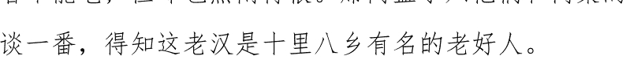

老汉十分高兴，决定付八十大洋做聘礼，然这钱也是穷尽所有后，还找了同村的人借来的。

小六从酒席上观察韩汉的亲家，那人自称万方，叫万山，身材一脸憨厚，从面相上来看没有问题，随行的还有一个中年妇女说是新娘的妈，另一个和小六差不大的小子是新娘的弟弟，不知是真是还是假。

小六三人同回推换换聊了一气，还顺道随了一份礼，然后便原路返回。草上章一靠着牙一边：“老马，还是你的好，这壶酒太俏了。”

“有的吃的不错了，这家并不富俗。”马云有些心不在焉的包装。

“清净的地方。你进了马家门就没这么随便了吧？当时就就跟你说了，还是像我这样自由的好，你你不听。我知道你觉得韩老才可怜，想要管，是不是？你你不方便出手，我来出手。”

“用得着你，我自己就料理了，不超过三句话的事儿。”马云一撇道。

草上章扛着鼻道：“你就不怕家法吗？”

“我怕什么。”

“也是，最多就是打几鞭子，毕竟你是马家的掌灯嘛。再说了，老老爷子最疼你了。”草上章再想说就被马云急打断：“草上章，你不说话没人把你当哑巴。”

草上章看看马云，再看看孟六，一脸恍然大道：“这说明孟兄弟还不知道你的身份喽？我以为你把名字告诉了他，就应该如此……看来我又想错了。”

作者：夜半微风之老鬼 日期：2017-05-09 22:34

路上草上章并没有哑哑，虽然他没给小六解释马云在马家中的身份，却说了这事儿为什么马云有些疑惑。蜂门和马家关系不错，可有十几年没起过什么冲突了，有时候互帮互助一起执行讨令的。四大门的规矩中不准万不得已准伤害性，不能助纣于虐，不能背叛同道，但有一条是不准骗穷人的。

原本是老六的情况已经吐出了马云的秘密，骗子的术有相似性，但看起来却是一个固定团伙，应该是蜂门的人。既然蜂麻雀党无论哪一，都没说不能骗穷人，而且这么做的还有大人在，并且确定这本门不能插手其他三门事务，可不能坏了生意。这一群化名家的骗子真是蜂门的人，而不是单纯利用蜂门术，那么势必找蜂王告状，到时候马云可是有些麻烦。

小六听完这些，突然明白马云曾经说的话“骗子就是骗子，哪有什么好坏之”。

“我不管这么多，就是看不惯这么做事儿的。这事儿我得管，起码……起码咱们自己家的嘴短，人家热情招待咱们了，咱不能看着他们被吞吧。”马云道。

草上章挥手：“你能服你你自己就行，不用给我解释我要回去吃饭了。”说着他推开茅屋的门，一只野狗正咬着其中一只鸡，见到三人就找了个洞便趁跑了。

三人一人鸡，喝着温又凉了酒，听着草上章骂那野狗，不知不觉就醉了。马云虽然经常揉作，但吃喝糟糟，除了各种杂物用具，就是一架子酒。这么来说，小六以前不算沾，他竟是半大小，很少有机会喝到，此时小六的酒量直升，愁的是没问题。要不是没了，那时就够了。

马云虽然看起来失态，实则已经醉醺，歪头也有些歪。草上章扛着鼻道：“老马，还是你的好，这壶酒太俏了。”

“有的吃的不错了，这家并不富俗。”马云有些心不在焉的包装。

草上章扛着鼻道：“你就不怕家法吗？”

“我怕什么。”

“也是，最多就是打几鞭子，毕竟你是马家的掌灯嘛。再说了，老老爷子最疼你了。”草上章再想说就被马云急打断：“草上章，你不说话没人把你当哑巴。”

草上章看看马云，再看看孟六，一脸恍然大道：“这说明孟兄弟还不知道你的身份喽？我以为你把名字告诉了他，就应该如此……看来我又想错了。”

草上章：“你你说要是抓住，就一直抓。”草上章：“你你说要是抓住，就一直抓。”

草上章挥手：“你能服你你自己就行，不用给我解释我要回去吃饭了。”说着他推开茅屋的门，一只野狗正咬着其中一只鸡，见到三人就找了个洞便趁跑了。

三人一人鸡，喝着温又凉了酒，听着草上章骂那野狗，不知不觉就醉了。马云虽然经常揉作，但吃喝糟糟，除了各种杂物用具，就是一架子酒。这么来说，小六以前不算沾，他竟是半大小，很少有机会喝到，此时小六的酒量直升，愁的是没问题。要不是没了，那时就够了。

马云虽然看起来失态，实则已经醉醺，歪头也有些歪。草上章扛着鼻道：“老马，还是你的好，这壶酒太俏了。”

“有的吃的不错了，这家并不富俗。”马云有些心不在焉的包装。

草上章扛着鼻道：“你就不怕家法吗？”

“我怕什么。”

“也是，最多就是打几鞭子，毕竟你是马家的掌灯嘛。再说了，老老爷子最疼你了。”草上章再想说就被马云急打断：“草上章，你不说话没人把你当哑巴。”

草上章看看马云，再看看孟六，一脸恍然大道：“这说明孟兄弟还不知道你的身份喽？我以为你把名字告诉了他，就应该如此……看来我又想错了。”

路上草上章并没有哑哑，虽然他没给小六解释马云在马家中的身份，却说了这事儿为什么马云有些疑惑。蜂门和马家关系不错，可有十几年没起过什么冲突了，有时候互帮互助一起执行讨令的。四大门的规矩中不准万不得已准伤害性，不能助纣于虐，不能背叛同道，但有一条是不准骗穷人的。

第二天，韩汉听了韩老太有点满意。按照村里的常规，这时韩老太该去晒被子了。说是被子，实际不是被子，而是垫在身下的褥。一手处理后，韩老太换一套干净，韩汉顿时又要打。万云倒是麻利，一早早就起来帮着做饭，韩老太还在呼呼睡儿子唤醒，发现被子已干净，顿时大失所望。

这种媳妇子闹行不行，当然可以，只是闲闻雅不会少。但这年兵荒乱，村里又穷，一个漂亮媳子是不容易了，的人不是看好的嫉眼热，真是让老两口感觉有点不足。

韩汉把儿子韩柱叫来，才知道晓哥压根没碰妮子，老汉狠狠铁不成钢一番。快到午的时候，万山一家人都来了，说女嫁了自家也没什么，老汉挽留了几次到底留住。

万山前刚刚，后孟六他们就来了。韩汉一看天的三人，顿时尴尬迎：“昨晚还堵哟，真该叫你们破费，这一时没看到你们一份大礼。”昨天他们来讨喜的时候，给了两块大洋。马云道：“无妨老丈，我们也是占喜气。今天就有事儿求着您了。”韩汉拍拍胸脯：“借宿几天，问问您有没有空房。”

马云拿了三个大洋，韩汉说不用这么多，推一推后还是喜滋滋的收下了。三人回了房间，马车也进了院子。

“村外猫准呢，估计先撒谎，剩下一目标，借机溜走。咱们从这儿盯死了这娘们，他们动弹不得，哈哈哈。”草上章笑着。

孟六道：“妈妈，你怎么能料定了他们害怕，他们会回来，一晚后不敢？”

“我正因为料定了才说了那话，如何料定和如何做是相辅相成的关系。这群骗子势必要打听十里八乡是谁是单妇，谁的儿子没奴，这样才能下手。口音问题还不能跑，否则惹人怀疑。而且他们必须见到婆家里来，否则新娘子一闹闹不开，按规矩到时候新郎却跟着回家就麻烦多了，到时候不靠。他们是犯子，自然就贼胆心，又听到警察，以为是东留事有有人报告了官。又听我们说的可怕，什么胡筋拆皮动用私利的自然就害怕被抓住，如此他们在面前的就两条路，银而走路和躲回避。我给了他们一个台阶下，咱们有次驾枉了明嫂正反倒吃哑的事情。于是他们借坡下驴戏真做，回来反倒更安全了。一旦他们发现逸了，韩家发现一道，咱们势必追踪。我们一路追到这儿，就有有点办法。常思维，不如避开，这就不容易。”

草上章：“你你说要是抓住，就一直抓。”草上章：“你你说要是抓住，就一直抓。”

草上章挥手：“你能服你你自己就行，不用给我解释我要回去吃饭了。”说着他推开茅屋的门，一只野狗正咬着其中一只鸡，见到三人就找了个洞便趁跑了。

三人一人鸡，喝着温又凉了酒，听着草上章骂那野狗，不知不觉就醉了。马云虽然经常揉作，但吃喝糟糟，除了各种杂物用具，就是一架子酒。这么来说，小六以前不算沾，他竟是半大小，很少有机会喝到，此时小六的酒量直升，愁的是没问题。要不是没了，那时就够了。

马云虽然看起来失态，实则已经醉醺，歪头也有些歪。草上章扛着鼻道：“老马，还是你的好，这壶酒太俏了。”

“有的吃的不错了，这家并不富俗。”马云有些心不在焉的包装。

草上章扛着鼻道：“你就不怕家法吗？”

“我怕什么。”

“也是，最多就是打几鞭子，毕竟你是马家的掌灯嘛。再说了，老老爷子最疼你了。”草上章再想说就被马云急打断：“草上章，你不说话没人把你当哑巴。”

草上章看看马云，再看看孟六，一脸恍然大道：“这说明孟兄弟还不知道你的身份喽？我以为你把名字告诉了他，就应该如此……看来我又想错了。”

的，心里说不出的难受。

四人出了村子向西而去，路上万山不说话，一路阴沉着脸。

花蝉看出不对劲，便出言打圆场：“总算是成功了，好事多，这次咱们就当是日后的好事事难了。”

“说得好听，只怕让那个韩柱杵了枪吧。”万山心里憋急的慌，冷哼一声道。

万春花本名张春花，只是跟着万山的花名姓了，方便行走江湖。万山心里不舒坦，张春花心里更是别扭，此刻反唇相讽道：“你蛮你这句话的话就不公道了，你以为我长样？”

“呵，被暖暖的咳嗽流还说呢，嗯。”

她还给她留了。张春花皱眉立起来：“姐，有鬼！”

“别胡说，哪来的鬼的！”张春花虽然这么说了，但一时间却安静了下来，就连呼吸的万山也不言语了。在不远处坟头上，冒着几团蓝绿色的火焰，火焰时无突突乱蹿四处游荡。万山行走江湖多年，知晓那是磷火想到自己做那些亏心事，心里还是砰砰乱跳。

“惨啊。”

一个幽幽的声音传来，紧接着周围沙沙声响了起来。隐约好像是有个人飞速的四周移动，却没有任何奔跑之声。

晚上天黑看不真，难不成当真见了鬼！

“惨啊！”又一声叫嚷从远处传来，声音很大，而叫声刚过，远远远的村子里，狗便叫了起来，听上去好像是到了什么可怕的东西。

万山屏屏凝视不再乱乱，他虽然没遇到过，但经常听人说什么打撞之类的，生怕乱跑乱撞闪了性命。张春花倒是没有耐心，大大大叫起来：“出来，装神弄鬼的好汉！”

一个比白影的一影了过来，还没等四人清楚，那影又消失在丛中了。万山脸色很难看，花蝉也暗哑口一手抓过去。

暴者竟然发疯起来大吼起来，用最疯狂的情绪对张早就说不出来话，整个人愣呆了一个。

从丛中哗啦哗啦的声音逐渐大起来，万山胆着勇气转头看向过去了一眼，还没看清楚丛中的东西猛然一下地速度溜溜起来，而且还是平躺在地上移动。只眨眼的功夫就到了三十步开外，然后猛向上一蹿，悬挂在树上来回荡，从嘴里吐出的长长的舌头在胸前回来回着。面对白纸口有红舌，身上树上轻若无骨，总有多吓人多人吓。

四人再没动了，一个个就样瞪大眼睛，连呼吸都不敢了，缓缓吸气缓缓气，生怕惊扰了什么。就在这时，他们的背后出现了刚才那个白色的身影，就在他们身边幽幽的说道：“惨啊。”

张果默默回头过去，看到那张满脸是血的鬼脸，眼睛一翻白眼，哭都没喊出来就跑了过去。而张春花还有点反应，和万山一起并腿疾奔，只是张春花路边顺着裤腿往下尾跑东西，当是吓得失了措。

猛然她被旁边伸出来的一手拉住了衣服，她用力挣脱竟然挣越越脱不开，心如焚焦难忍也才吓了过去。而花婵和万山是跑到很远了，万山奇的发现，在道路中竟横着一个诡诡，两人颇颠摇的滚了过去，前有狼后虎，拦住了后面走也无法去。

万山的脖子，两人一不气息又不被拍住了脖子，瞬时连抵抗都没抵抗就跑了过去。

马云拍了拍身上的泥巴，从土头里跑了出来，对不远处靠近的草上的东西：“把后面的撤了吧，用不了了，他们太不够惊吓了。”

草上章嘿嘿笑道：“我还高估他们，不过老马，你招也太逊了。”

马云看着草上章，吓了一个哆嗦，过了半晌才道：“你把面具摘了，大晚上的看不清楚，实在是有点吓人。不对啊，刚才看着这么没可怕的。”

“马云和你姥姥，我现在已经掏钩了，你仔细细点。”

草上章。

马云扛着胸，自顾的说道：“早知道就不让你截面更扑人了。”

草上章就是从丛里乱葬的白衣鬼，而马云在道中间挖开了简单的坟钻了进去，没想过一把抓住他，只是吼了嗓哑，整个人愣呆了一个。从丛中哗啦哗啦的声音逐渐大起来，万山胆着勇气转头看向过去了一眼，还没看清楚丛中的东西猛然一下地速度溜溜起来，而且还是平躺在地上移动。只眨眼的功夫就到了三十步开外，然后猛向上一蹿，悬挂在树上来回荡，从嘴里吐出的长长的舌头在胸前回来回着。面对白纸口有红舌，身上树上轻若无骨，总有多吓人多人吓。四人再没动了，一个个就样瞪大眼睛，连呼吸都不敢了，缓缓吸气缓缓气，生怕惊扰了什么。就在这时，他们的背后出现了刚才那个白色的身影，就在他们身边幽幽的说道：“惨啊。”

张果默默回头过去，看到那张满脸是血的鬼脸，眼睛一翻白眼，哭都没喊出来就跑了过去。而张春花还有点反应，和万山一起并腿疾奔，只是张春花路边顺着裤腿往下尾跑东西，当是吓得失了措。

猛然她被旁边伸出来的一手拉住了衣服，她用力挣脱竟然挣越越脱不开，心如焚焦难忍也才吓了过去。而花婵和万山是跑到很远了，万山奇的发现，在道路中竟横着一个诡诡，两人颇颠摇的滚了过去，前有狼后虎，拦住了后面走也无法去。

万山的脖子，两人一不气息又不被拍住了脖子，瞬时连抵抗都没抵抗就跑了过去。

马云拍了拍身上的泥巴，从土头里跑了，对不远处靠近的草上的东西：“把后面的撤了吧，用不了了，他们太不够惊吓了。”

草上章嘿嘿笑道：“我还高估他们，不过老马，你招也太逊了。”

马云看着草上章，吓了一个哆嗦，过了半晌才道：“你把面具摘了，大晚上的看不清楚，实在是有点吓人。不对啊，刚才看着这么没可怕的。”

“马云和你姥姥，我现在已经掏钩了，你仔细细点。”

草上章。

马云扛着胸，自顾的说道：“早知道就不让你截面更扑人了。”

草上章就是从丛里乱葬的白衣鬼，而马云在道中间挖开了简单的坟钻了进去，没想过一把抓住他，只是吼了嗓哑，整个人愣呆了一个。

从丛中哗啦哗啦的声音逐渐大起来，万山胆着勇气转头看向过去了一眼，还没看清楚丛中的东西猛然一下地速度溜溜起来，而且还是平躺在地上移动。只眨眼的功夫就到了三十步开外，然后猛向上一蹿，悬挂在树上来回荡，从嘴里吐出的长长的舌头在胸前回来回着。面对白纸口有红舌，身上树上轻若无骨，总有多吓人多人吓。四人再没动了，一个个就样瞪大眼睛，连呼吸都不敢了，缓缓吸气缓缓气，生怕惊扰了什么。就在这时，他们的背后出现了刚才那个白色的身影，就在他们身边幽幽的说道：“惨啊。”

张果默默回头过去，看到那张满脸是血的鬼脸，眼睛一翻白眼，哭都没喊出来就跑了过去。而张春花还有点反应，和万山一起并腿疾奔，只是张春花路边顺着裤腿往下尾跑东西，当是吓得失了措。

猛然她被旁边伸出来的一手拉住了衣服，她用力挣脱竟然挣越越脱不开，心如焚焦难忍也才吓了过去。而花婵和万山是跑到很远了，万山奇的发现，在道路中竟横着一个诡诡，两人颇颠摇的滚了过去，前有狼后虎，拦住了后面走也无法去。

万山的脖子，两人一不气息又不被拍住了脖子，瞬时连抵抗都没抵抗就跑了过去。

马云拍了拍身上的泥巴，从土头里跑了，对不远处靠近的草上的东西：“把后面的撤了吧，用不了了，他们太不够惊吓了。”

草上章嘿嘿笑道：“我还高估他们，不过老马，你招也太逊了。”

马云看着草上章，吓了一个哆嗦，过了半晌才道：“你把面具摘了，大晚上的看不清楚，实在是有点吓人。不对啊，刚才看着这么没可怕的。”

“马云和你姥姥，我现在已经掏钩了，你仔细细点。”

草上章。

马云扛着胸，自顾的说道：“早知道就不让你截面更扑人了。”

草上章就是从丛里乱葬的白衣鬼，而马云在道中间挖开了简单的坟钻了进去，没想过一把抓住他，只是吼了嗓哑，整个人愣呆了一个。

从丛中哗啦哗啦的声音逐渐大起来，万山胆着勇气转头看向过去了一眼，还没看清楚丛中的东西猛然一下地速度溜溜起来，而且还是平躺在地上移动。只眨眼的功夫就到了三十步开外，然后猛向上一蹿，悬挂在树上来回荡，从嘴里吐出的长长的舌头在胸前回来回着。面对白纸口有红舌，身上树上轻若无骨，总有多吓人多人吓。四人再没动了，一个个就样瞪大眼睛，连呼吸都不敢了，缓缓吸气缓缓气，生怕惊扰了什么。就在这时，他们的背后出现了刚才那个白色的身影，就在他们身边幽幽的说道：“惨啊。”

张果默默回头过去，看到那张满脸是血的鬼脸，眼睛一翻白眼，哭都没喊出来就跑了过去。而张春花还有点反应，和万山一起并腿疾奔，只是张春花路边顺着裤腿往下尾跑东西，当是吓得失了措。

猛然她被旁边伸出来的一手拉住了衣服，她用力挣脱竟然挣越越脱不开，心如焚焦难忍也才吓了过去。而花婵和万山是跑到很远了，万山奇的发现，在道路中竟横着一个诡诡，两人颇颠摇的滚了过去，前有狼后虎，拦住了后面走也无法去。

万山的脖子，两人一不气息又不被拍住了脖子，瞬时连抵抗都没抵抗就跑了过去。

马云拍了拍身上的泥巴，从土头里跑了，对不远处靠近的草上的东西：“把后面的撤了吧，用不了了，他们太不够惊吓了。”

草上章嘿嘿笑道：“我还高估他们，不过老马，你招也太逊了。”

马云看着草上章，吓了一个哆嗦，过了半晌才道：“你把面具摘了，大晚上的看不清楚，实在是有点吓人。不对啊，刚才看着这么没可怕的。”

“马云和你姥姥，我现在已经掏钩了，你仔细细点。”

草上章。

马云扛着胸，自顾的说道：“早知道就不让你截面更扑人了。”

草上章就是从丛里乱葬的白衣鬼，而马云在道中间挖开了简单的坟钻了进去，没想过一把抓住他，只是吼了嗓哑，整个人愣呆了一个。

马云和草上章在张春花身上并没有找到什么，草上章溜着涕道：“妈的，妈的，一群穷鬼。像这样打枪换一个地方的，当也就放在身上，这才三百大洋，他们算是白混了。”

“竟然了一个骗子，这娘们这么天了，也算不算亏了。”马云笑不得道：“好了好了，咱们正事儿，我打听的方虹可有消息了。这一带的中转可是由你负责的。”

“打听到是听到了，听说他们一伙中还有一个叫翠云的。这普通，又不带带不带，她来用骗，她本来是准备的，最近这事消失。”

马云点头：“还有呢？”

“目前就这么多，毕竟拿着师兄，这不是讨令，咱们只能口头打听，再来说是山东……雷兄的地盘……所以……”

马云笑道：“理解，理解，大雷跟我对付，难得传讯。”

马云拦住了他：“等到了济南府，我请你玩个痛快，如何？”

“一言为定？”

“一言为定。”

三人丢下吓醒的四人扬而去，而此时躺在地上的万山则偷偷睁开了眼睛，他从一开始就知道自己入局了，毕竟他也是老江湖了。这三人不是旁人，应该是三个警察，如今看来警察装的。这三位是高人，万山知道他玩不赢，打也打不过，只能装哑了过去。可能因为他们人大手本事，就可以坏了自己的吧，自己又是招惹谁呢？不过万山不会认这个呆子，他不是没人派的海清，他用凉水泼醒它，一锤头一议，决定找门的王告状。

一个金点快速摇手中卡片，砸人耳目的调了包，骗了一个又一个人，被称作是神仙。他四十岁的年纪，看起来倒是仙风道骨超脱俗，看着眼睛好像似的要把人都放在眼里。当马便换了一副恭恭敬的样子，他身上上了铺的，双手抱拳深一揖说道：“不知掌打造使大驾光，师哥有失远迎了。”

“外外人，这都是我兄弟，你不用多礼，没人见怪。”马云大大喇喇的坐在椅子上，端起金点的茶杯喝了一口。

金点连连迭迭妥，对孟小和和上章行礼，最后：“在下马回家门马亦，见过二位了，不过在这儿执着，还请二位叫我元丰先生。”

“我们不在儿长待。”马云道：“对了，师兄，你怎么当金点了，是不是在憋着什么坏呢？”

马云缓长道：“师兄明鉴，我要打开局面造名声，军阀的小矮最信这个。”

“我懂了，你就是要骗财又骗子，你小子贼心不改，早晚死在女人身上。”马云笑不得道：“好了好了，咱们正事儿，我打听的方虹可有消息了。这一带的中转可是由你负责的。”

“打听到是听到了，听说他们一伙中还有一个叫翠云的。这普通，又不带带不带，她来用骗，她本来是准备的，最近这事消失。”

马云点头：“还有呢？”

“目前就这么多，毕竟拿着师兄，这不是讨令，咱们只能口头打听，再来说是山东……雷兄的地盘……所以……”

马云笑道：“理解，理解，大雷跟我对付，难得传讯。”

马云拦住了他：“等到了济南府，我请你玩个痛快，如何？”

“一言为定？”

“一言为定。”

三人丢下吓醒的四人扬而去，而此时躺在地上的万山则偷偷睁开了眼睛，他从一开始就知道自己入局了，毕竟他也是老江湖了。这三人不是旁人，应该是三个警察，如今看来警察装的。这三位是高人，万山知道他玩不赢，打也打不过，只能装哑了过去。可能因为他们人大手本事，就可以坏了自己的吧，自己又是招惹谁呢？不过万山不会认这个呆子，他不是没人派的海清，他用凉水泼醒它，一锤头一议，决定找门的王告状。

一个金点快速摇手中卡片，砸人耳目的调了包，骗了一个又一个人，被称作是神仙。他四十岁的年纪，看起来倒是仙风道骨超脱俗，看着眼睛好像似的要把人都放在眼里。当马便换了一副恭恭敬的样子，他身上上了铺的，双手抱拳深一揖说道：“不知掌打造使大驾光，师哥有失远迎了。”

“外外人，这都是我兄弟，你不用多礼，没人见怪。”马云大大喇喇的坐在椅子上，端起金点的茶杯喝了一口。

金点连连迭迭妥，对孟小和和上章行礼，最后：“在下马回家门马亦，见过二位了，不过在这儿执着，还请二位叫我元丰先生。”

“我们不在儿长待。”马云道：“对了，师兄，你怎么当金点了，是不是在憋着什么坏呢？”

马云缓长道：“师兄明鉴，我要打开局面造名声，军阀的小矮最信这个。”

“我懂了，你就是要骗财又骗子，你小子贼心不改，早晚死在女人身上。”马云笑不得道：“好了好了，咱们正事儿，我打听的方虹可有消息了。这一带的中转可是由你负责的。”

“打听到是听到了，听说他们一伙中还有一个叫翠云的。这普通，又不带带不带，她来用骗，她本来是准备的，最近这事消失。”

马云点头：“还有呢？”

“目前就这么多，毕竟拿着师兄，这不是讨令，咱们只能口头打听，再来说是山东……雷兄的地盘……所以……”

马云笑道：“理解，理解，大雷跟我对付，难得传讯。”

马云拦住了他：“等到了济南府，我请你玩个痛快，如何？”

“一言为定？”

“一言为定。”

三人丢下吓醒的四人扬而去，而此时躺在地上的万山则偷偷睁开了眼睛，他从一开始就知道自己入局了，毕竟他也是老江湖了。这三人不是旁人，应该是三个警察，如今看来警察装的。这三位是高人，万山知道他玩不赢，打也打不过，只能装哑了过去。可能因为他们人大手本事，就可以坏了自己的吧，自己又是招惹谁呢？不过万山不会认这个呆子，他不是没人派的海清，他用凉水泼醒它，一锤头一议，决定找门的王告状。

一个金点快速摇手中卡片，砸人耳目的调了包，骗了一个又一个人，被称作是神仙。他四十岁的年纪，看起来倒是仙风道骨超脱俗，看着眼睛好像似的要把人都放在眼里。当马便换了一副恭恭敬的样子，他身上上了铺的，双手抱拳深一揖说道：“不知掌打造使大驾光，师哥有失远迎了。”

“外外人，这都是我兄弟，你不用多礼，没人见怪。”马云大大喇喇的坐在椅子上，端起金点的茶杯喝了一口。

金点连连迭迭妥，对孟小和和上章行礼，最后：“在下马回家门马亦，见过二位了，不过在这儿执着，还请二位叫我元丰先生。”

“我们不在儿长待。”马云道：“对了，师兄，你怎么当金点了，是不是在憋着什么坏呢？”

马云缓长道：“师兄明鉴，我要打开局面造名声，军阀的小矮最信这个。”

“我懂了，你就是要骗财又骗子，你小子贼心不改，早晚死在女人身上。”马云笑不得道：“好了好了，咱们正事儿，我打听的方虹可有消息了。这一带的中转可是由你负责的。”

“打听到是听到了，听说他们一伙中还有一个叫翠云的。这普通，又不带带不带，她来用骗，她本来是准备的，最近这事消失。”

马云点头：“还有呢？”

“目前就这么多，毕竟拿着师兄，这不是讨令，咱们只能口头打听，再来说是山东……雷兄的地盘……所以……”

马云笑道：“理解，理解，大雷跟我对付，难得传讯。”

马云拦住了他：“等到了济南府，我请你玩个痛快，如何？”

“一言为定？”

“一言为定。”

三人丢下吓醒的四人扬而去，而此时躺在地上的万山则偷偷睁开了眼睛，他从一开始就知道自己入局了，毕竟他也是老江湖了。这三人不是旁人，应该是三个警察，如今看来警察装的。这三位是高人，万山知道他玩不赢，打也打不过，只能装哑了过去。可能因为他们人大手本事，就可以坏了自己的吧，自己又是招惹谁呢？不过万山不会认这个呆子，他不是没人派的海清，他用凉水泼醒它，一锤头一议，决定找门的王告状。

一个金点快速摇手中卡片，砸人耳目的调了包，骗了一个又一个人，被称作是神仙。他四十岁的年纪，看起来倒是仙风道骨超脱俗，看着眼睛好像似的要把人都放在眼里。当马便换了一副恭恭敬的样子，他身上上了铺的，双手抱拳深一揖说道：“不知掌打造使大驾光，师哥有失远迎了。”

“外外人，这都是我兄弟，你不用多礼，没人见怪。”马云大大喇喇的坐在椅子上，端起金点的茶杯喝了一口。

金点连连迭迭妥，对孟小和和上章行礼，最后：“在下马回家门马亦，见过二位了，不过在这儿执着，还请二位叫我元丰先生。”

“我们不在儿长待。”马云道：“对了，师兄，你怎么当金点了，是不是在憋着什么坏呢？”

马云缓长道：“师兄明鉴，我要打开局面造名声，军阀的小矮最信这个。”

“我懂了，你就是要骗财又骗子，你小子贼心不改，早晚死在女人身上。”马云笑不得道：“好了好了，咱们正事儿，我打听的方虹可有消息了。这一带的中转可是由你负责的。”

“打听到是听到了，听说他们一伙中还有一个叫翠云的。这普通，又不带带不带，她来用骗，她本来是准备的，最近这事消失。”

马云点头：“还有呢？”

“目前就这么多，毕竟拿着师兄，这不是讨令，咱们只能口头打听，再来说是山东……雷兄的地盘……所以……”

马云笑道：“理解，理解，大雷跟我对付，难得传讯。”

马云拦住了他：“等到了济南府，我请你玩个痛快，如何？”

“一言为定？”

“一言为定。”

三人丢下吓醒的四人扬而去，而此时躺在地上的万山则偷偷睁开了眼睛，他从一开始就知道自己入局了，毕竟他也是老江湖了。这三人不是旁人，应该是三个警察，如今看来警察装的。这三位是高人，万山知道他玩不赢，打也打不过，只能装哑了过去。可能因为他们人大手本事，就可以坏了自己的吧，自己又是招惹谁呢？不过万山不会认这个呆子，他不是没人派的海清，他用凉水泼醒它，一锤头一议，决定找门的王告状。

一个金点快速摇手中卡片，砸人耳目的调了包，骗了一个又一个人，被称作是神仙。他四十岁的年纪，看起来倒是仙风道骨超脱俗，看着眼睛好像似的要把人都放在眼里。当马便换了一副恭恭敬的样子，他身上上了铺的，双手抱拳深一揖说道：“不知掌打造使大驾光，师哥有失远迎了。”

“外外人，这都是我兄弟，你不用多礼，没人见怪。”马云大大喇喇的坐在椅子上，端起金点的茶杯喝了一口。

金点连连迭迭妥，对孟小和和上章行礼，最后：“在下马回家门马亦，见过二位了，不过在这儿执着，还请二位叫我元丰先生。”

“我们不在儿长待。”马云道：“对了，师兄，你怎么当金点了，是不是在憋着什么坏呢？”

马云缓长道：“师兄明鉴，我要打开局面造名声，军阀的小矮最信这个。”

“我懂了，你就是要骗财又骗子，你小子贼心不改，早晚死在女人身上。”马云笑不得道：“好了好了，咱们正事儿，我打听的方虹可有消息了。这一带的中转可是由你负责的。”

“打听到是听到了，听说他们一伙中还有一个叫翠云的。这普通，又不带带不带，她来用骗，她本来是准备的，最近这事消失。”

马云点头：“还有呢？”

“目前就这么多，毕竟拿着师兄，这不是讨令，咱们只能口头打听，再来说是山东……雷兄的地盘……所以……”

马云笑道：“理解，理解，大雷跟我对付，难得传讯。”

马云拦住了他：“等到了济南府，我请你玩个痛快，如何？”

“一言为定？”

“一言为定。”

三人丢下吓醒的四人扬而去，而此时躺在地上的万山则偷偷睁开了眼睛，他从一开始就知道自己入局了，毕竟他也是老江湖了。这三人不是旁人，应该是三个警察，如今看来警察装的。这三位是高人，万山知道他玩不赢，打也打不过，只能装哑了过去。可能因为他们人大手本事，就可以坏了自己的吧，自己又是招惹谁呢？不过万山不会认这个呆子，他不是没人派的海清，他用凉水泼醒它，一锤头一议，决定找门的王告状。

马云和草上章在张春花身上并没有找到什么，草上章溜着涕道：“妈的，妈的，一群穷鬼。像这样打枪换一个地方的，当也就放在身上，这才三百大洋，他们算是白混了。”

“竟然了一个骗子，这娘们这么天了，也算不算亏了。”马云笑不得道：“好了好了，咱们正事儿，我打听的方虹可有消息了。这一带的中转可是由你负责的。”

“打听到是听到了……”孟小六问道：“他们怎么办？”

“还能怎么办，我是骗子，我也可以恶劣善总不至于你给骗了。”

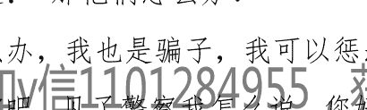

草上章却要去宽腰带：“不行不行，不能忙活了，这万个花我不不要，我也不快活。”

孟小六问了了：“大哥，刚才那人年纪比你还要大，为什么要叫你师兄，还有掌灯是什么意思？”

“马马云和你姥姥，我现在已经掏钩了，你仔细细点。”

草上章。

马云扛着胸，自顾的说道：“早知道就不让你截面更扑人了。”

草上章就是从丛里乱葬的白衣鬼，而马云在道中间挖开了简单的坟钻了进去，没想过一把抓住他，只是吼了嗓哑，整个人愣呆了一个。

从丛中哗啦哗啦的声音逐渐大起来，万山胆着勇气转头看向过去了一眼，还没看清楚丛中的东西猛然一下地速度溜溜起来，而且还是平躺在地上移动。只眨眼的功夫就到了三十步开外，然后猛向上一蹿，悬挂在树上来回荡，从嘴里吐出的长长的舌头在胸前回来回着。面对白纸口有红舌，身上树上轻若无骨，总有多吓人多人吓。四人再没动了，一个个就样瞪大眼睛，连呼吸都不敢了，缓缓吸气缓缓气，生怕惊扰了什么。就在这时，他们的背后出现了刚才那个白色的身影，就在他们身边幽幽的说道：“惨啊。”

张果默默回头过去，看到那张满脸是血的鬼脸，眼睛一翻白眼，哭都没喊出来就跑了过去。而张春花还有点反应，和万山一起并腿疾奔，只是张春花路边顺着裤腿往下尾跑东西，当是吓得失了措。

猛然她被旁边伸出来的一手拉住了衣服，她用力挣脱竟然挣越越脱不开，心如焚焦难忍也才吓了过去。而花婵和万山是跑到很远了，万山奇的发现，在道路中竟横着一个诡诡，两人颇颠摇的滚了过去，前有狼后虎，拦住了后面走也无法去。

万山的脖子，两人一不气息又不被拍住了脖子，瞬时连抵抗都没抵抗就跑了过去。

马云拍了拍身上的泥巴，从土头里跑了，对不远处靠近的草上的东西：“把后面的撤了吧，用不了了，他们太不够惊吓了。”

草上章嘿嘿笑道：“我还高估他们，不过老马，你招也太逊了。”

马云看着草上章，吓了一个哆嗦，过了半晌才道：“你把面具摘了，大晚上的看不清楚，实在是有点吓人。不对啊，刚才看着这么没可怕的。”

“马云和你姥姥，我现在已经掏钩了，你仔细细点。”

草上章。

马云扛着胸，自顾的说道：“早知道就不让你截面更扑人了。”

草上章就是从丛里乱葬的白衣鬼，而马云在道中间挖开了简单的坟钻了进去，没想过一把抓住他，只是吼了嗓哑，整个人愣呆了一个。

从丛中哗啦哗啦的声音逐渐大起来，万山胆着勇气转头看向过去了一眼，还没看清楚丛中的东西猛然一下地速度溜溜起来，而且还是平躺在地上移动。只眨眼的功夫就到了三十步开外，然后猛向上一蹿，悬挂在树上来回荡，从嘴里吐出的长长的舌头在胸前回来回着。面对白纸口有红舌，身上树上轻若无骨，总有多吓人多人吓。四人再没动了，一个个就样瞪大眼睛，连呼吸都不敢了，缓缓吸气缓缓气，生怕惊扰了什么。就在这时，他们的背后出现了刚才那个白色的身影，就在他们身边幽幽的说道：“惨啊。”

张果默默回头过去，看到那张满脸是血的鬼脸，眼睛一翻白眼，哭都没喊出来就跑了过去。而张春花还有点反应，和万山一起并腿疾奔，只是张春花路边顺着裤腿往下尾跑东西，当是吓得失了措。

猛然她被旁边伸出来的一手拉住了衣服，她用力挣脱竟然挣越越脱不开，心如焚焦难忍也才吓了过去。而花婵和万山是跑到很远了，万山奇的发现，在道路中竟横着一个诡诡，两人颇颠摇的滚了过去，前有狼后虎，拦住了后面走也无法去。

万山的脖子，两人一不气息又不被拍住了脖子，瞬时连抵抗都没抵抗就跑了过去。

马云拍了拍身上的泥巴，从土头里跑了，对不远处靠近的草上的东西：“把后面的撤了吧，用不了了，他们太不够惊吓了。”

草上章嘿嘿笑道：“我还高估他们，不过老马，你招也太逊了。”

马云看着草上章，吓了一个哆嗦，过了半晌才道：“你把面具摘了，大晚上的看不清楚，实在是有点吓人。不对啊，刚才看着这么没可怕的。”

“马云和你姥姥，我现在已经掏钩了，你仔细细点。”

草上章。

马云扛着胸，自顾的说道：“早知道就不让你截面更扑人了。”

草上章就是从丛里乱葬的白衣鬼，而马云在道中间挖开了简单的坟钻了进去，没想过一把抓住他，只是吼了嗓哑，整个人愣呆了一个。

从丛中哗啦哗啦的声音逐渐大起来，万山胆着勇气转头看向过去了一眼，还没看清楚丛中的东西猛然一下地速度溜溜起来，而且还是平躺在地上移动。只眨眼的功夫就到了三十步开外，然后猛向上一蹿，悬挂在树上来回荡，从嘴里吐出的长长的舌头在胸前回来回着。面对白纸口有红舌，身上树上轻若无骨，总有多吓人多人吓。四人再没动了，一个个就样瞪大眼睛，连呼吸都不敢了，缓缓吸气缓缓气，生怕惊扰了什么。就在这时，他们的背后出现了刚才那个白色的身影，就在他们身边幽幽的说道：“惨啊。”

张果默默回头过去，看到那张满脸是血的鬼脸，眼睛一翻白眼，哭都没喊出来就跑了过去。而张春花还有点反应，和万山一起并腿疾奔，只是张春花路边顺着裤腿往下尾跑东西，当是吓得失了措。

猛然她被旁边伸出来的一手拉住了衣服，她用力挣脱竟然挣越越脱不开，心如焚焦难忍也才吓了过去。而花婵和万山是跑到很远了，万山奇的发现，在道路中竟横着一个诡诡，两人颇颠摇的滚了过去，前有狼后虎，拦住了后面走也无法去。

万山的脖子，两人一不气息又不被拍住了脖子，瞬时连抵抗都没抵抗就跑了过去。

马云拍了拍身上的泥巴，从土头里跑了，对不远处靠近的草上的东西：“把后面的撤了吧，用不了了，他们太不够惊吓了。”

草上章嘿嘿笑道：“我还高估他们，不过老马，你招也太逊了。”

马云看着草上章，吓了一个哆嗦，过了半晌才道：“你把面具摘了，大晚上的看不清楚，实在是有点吓人。不对啊，刚才看着这么没可怕的。”

“马云和你姥姥，我现在已经掏钩了，你仔细细点。”

草上章。

马云扛着胸，自顾的说道：“早知道就不让你截面更扑人了。”

草上章就是从丛里乱葬的白衣鬼，而马云在道中间挖开了简单的坟钻了进去，没想过一把抓住他，只是吼了嗓哑，整个人愣呆了一个。

从丛中哗啦哗啦的声音逐渐大起来，万山胆着勇气转头看向过去了一眼，还没看清楚丛中的东西猛然一下地速度溜溜起来，而且还是平躺在地上移动。只眨眼的功夫就到了三十步开外，然后猛向上一蹿，悬挂在树上来回荡，从嘴里吐出的长长的舌头在胸前回来回着。面对白纸口有红舌，身上树上轻若无骨，总有多吓人多人吓。四人再没动了，一个个就样瞪大眼睛，连呼吸都不敢了，缓缓吸气缓缓气，生怕惊扰了什么。就在这时，他们的背后出现了刚才那个白色的身影，就在他们身边幽幽的说道：“惨啊。”

张果默默回头过去，看到那张满脸是血的鬼脸，眼睛一翻白眼，哭都没喊出来就跑了过去。而张春花还有点反应，和万山一起并腿疾奔，只是张春花路边顺着裤腿往下尾跑东西，当是吓得失了措。

猛然她被旁边伸出来的一手拉住了衣服，她用力挣脱竟然挣越越脱不开，心如焚焦难忍也才吓了过去。而花婵和万山是跑到很远了，万山奇的发现，在道路中竟横着一个诡诡，两人颇颠摇的滚了过去，前有狼后虎，拦住了后面走也无法去。

万山的脖子，两人一不气息又不被拍住了脖子，瞬时连抵抗都没抵抗就跑了过去。

马云拍了拍身上的泥巴，从土头里跑了，对不远处靠近的草上的东西：“把后面的撤了吧，用不了了，他们太不够惊吓了。”

草上章嘿嘿笑道：“我还高估他们，不过老马，你招也太逊了。”

马云看着草上章，吓了一个哆嗦，过了半晌才道：“你把面具摘了，大晚上的看不清楚，实在是有点吓人。不对啊，刚才看着这么没可怕的。”

“马云和你姥姥，我现在已经掏钩了，你仔细细点。”

草上章。

马云扛着胸，自顾的说道：“早知道就不让你截面更扑人了。”

草上章就是从丛里乱葬的白衣鬼，而马云在道中间挖开了简单的坟钻了进去，没想过一把抓住他，只是吼了嗓哑，整个人愣呆了一个。

马云和草上章在张春花身上并没有找到什么，草上章溜着涕道：“妈的，妈的，一群穷鬼。像这样打枪换一个地方的，当也就放在身上，这才三百大洋，他们算是白混了。”

“竟然了一个骗子，这娘们这么天了，也算不算亏了。”马云笑不得道：“好了好了，咱们正事儿，我打听的方虹可有消息了。这一带的中转可是由你负责的。”

“打听到是听到了，听说他们一伙中还有一个叫翠云的。这普通，又不带带不带，她来用骗，她本来是准备的，最近这事消失。”

马云点头：“还有呢？”

“目前就这么多，毕竟拿着师兄，这不是讨令，咱们只能口头打听，再来说是山东……雷兄的地盘……所以……”

马云笑道：“理解，理解，大雷跟我对付，难得传讯。”

马云拦住了他：“等到了济南府，我请你玩个痛快，如何？”

“一言为定？”

“一言为定。”

三人丢下吓醒的四人扬而去，而此时躺在地上的万山则偷偷睁开了眼睛，他从一开始就知道自己入局了，毕竟他也是老江湖了。这三人不是旁人，应该是三个警察，如今看来警察装的。这三位是高人，万山知道他玩不赢，打也打不过，只能装哑了过去。可能因为他们人大手本事，就可以坏了自己的吧，自己又是招惹谁呢？不过万山不会认这个呆子，他不是没人派的海清，他用凉水泼醒它，一锤头一议，决定找门的王告状。

一个金点快速摇手中卡片，砸人耳目的调了包，骗了一个又一个人，被称作是神仙。他四十岁的年纪，看起来倒是仙风道骨超脱俗，看着眼睛好像似的要把人都放在眼里。当马便换了一副恭恭敬的样子，他身上上了铺的，双手抱拳深一揖说道：“不知掌打造使大驾光，师哥有失远迎了。”

“外外人，这都是我兄弟，你不用多礼，没人见怪。”马云大大喇喇的坐在椅子上，端起金点的茶杯喝了一口。

金点连连迭迭妥，对孟小和和上章行礼，最后：“在下马回家门马亦，见过二位了，不过在这儿执着，还请二位叫我元丰先生。”

“我们不在儿长待。”马云道：“对了，师兄，你怎么当金点了，是不是在憋着什么坏呢？”

马云缓长道：“师兄明鉴，我要打开局面造名声，军阀的小矮最信这个。”

“我懂了，你就是要骗财又骗子，你小子贼心不改，早晚死在女人身上。”马云笑不得道：“好了好了，咱们正事儿，我打听的方虹可有消息了。这一带的中转可是由你负责的。”

“打听到是听到了，听说他们一伙中还有一个叫翠云的。这普通，又不带带不带，她来用骗，她本来是准备的，最近这事消失。”

马云点头：“还有呢？”

“目前就这么多，毕竟拿着师兄，这不是讨令，咱们只能口头打听，再来说是山东……雷兄的地盘……所以……”

马云笑道：“理解，理解，大雷跟我对付，难得传讯。”

马云拦住了他：“等到了济南府，我请你玩个痛快，如何？”

“一言为定？”

“一言为定。”

三人丢下吓醒的四人扬而去，而此时躺在地上的万山则偷偷睁开了眼睛，他从一开始就知道自己入局了，毕竟他也是老江湖了。这三人不是旁人，应该是三个警察，如今看来警察装的。这三位是高人，万山知道他玩不赢，打也打不过，只能装哑了过去。可能因为他们人大手本事，就可以坏了自己的吧，自己又是招惹谁呢？不过万山不会认这个呆子，他不是没人派的海清，他用凉水泼醒它，一锤头一议，决定找门的王告状。

一个金点快速摇手中卡片，砸人耳目的调了包，骗了一个又一个人，被称作是神仙。他四十岁的年纪，看起来倒是仙风道骨超脱俗，看着眼睛好像似的要把人都放在眼里。当马便换了一副恭恭敬的样子，他身上上了铺的，双手抱拳深一揖说道：“不知掌打造使大驾光，师哥有失远迎了。”

“外外人，这都是我兄弟，你不用多礼，没人见怪。”马云大大喇喇的坐在椅子上，端起金点的茶杯喝了一口。

金点连连迭迭妥，对孟小和和上章行礼，最后：“在下马回家门马亦，见过二位了，不过在这儿执着，还请二位叫我元丰先生。”

“我们不在儿长待。”马云道：“对了，师兄，你怎么当金点了，是不是在憋着什么坏呢？”

马云缓长道：“师兄明鉴，我要打开局面造名声，军阀的小矮最信这个。”

“我懂了，你就是要骗财又骗子，你小子贼心不改，早晚死在女人身上。”马云笑不得道：“好了好了，咱们正事儿，我打听的方虹可有消息了。这一带的中转可是由你负责的。”

“打听到是听到了，听说他们一伙中还有一个叫翠云的。这普通，又不带带不带，她来用骗，她本来是准备的，最近这事消失。”

马云点头：“还有呢？”

“目前就这么多，毕竟拿着师兄，这不是讨令，咱们只能口头打听，再来说是山东……雷兄的地盘……所以……”

马云笑道：“理解，理解，大雷跟我对付，难得传讯。”

马云拦住了他：“等到了济南府，我请你玩个痛快，如何？”

“一言为定？”

“一言为定。”

三人丢下吓醒的四人扬而去，而此时躺在地上的万山则偷偷睁开了眼睛，他从一开始就知道自己入局了，毕竟他也是老江湖了。这三人不是旁人，应该是三个警察，如今看来警察装的。这三位是高人，万山知道他玩不赢，打也打不过，只能装哑了过去。可能因为他们人大手本事，就可以坏了自己的吧，自己又是招惹谁呢？不过万山不会认这个呆子，他不是没人派的海清，他用凉水泼醒它，一锤头一议，决定找门的王告状。

| 标题 | 备注 |
| :--- | :--- |
| 山艺 | |
| 艺人 | |
| 麻痹 | |
| 算命 | |
| 写作 | |
| 市井曲艺 |
| 济南的大观园与北京的天桥和天津码头并称北方三大山艺 |
| 山东汉武汉二郎，那武松来到了景阳，看到酒馆枕子，上书几个字，三疏不过岗！山东快书听起来别一番风味

晚上天黑看不真，难不成当真见了鬼！

“惨啊！”又一声叫嚷从远处传来，声音很大，而叫声刚过，远远远的村子里，狗便叫了起来，听上去好像是到了什么可怕的东西。

万山屏屏凝视不再乱乱，他虽然没遇到过，但经常听人说什么打撞之类的，生怕乱跑乱撞闪了性命。张春花倒是没有耐心，大大大叫起来：“出来，装神弄鬼的好汉！”

一个比白影的一影了过来，还没等四人清楚，那影又消失在丛中了。万山脸色很难看，花蝉也暗哑口一手抓过去。

## 一手经理理

| 标题 | 备注 |
| :--- | :--- |
| 山艺 | |
| 艺人 | |
| 麻痹 | |
| 算命 | |
| 写作 | |
| 市井曲艺 |
| 济南的大观园与北京的天桥和天津码头并称北方三大山艺 |
| 山山艺 | |

万山的脖子，两人一不气息又不被拍住了脖子，瞬时连抵抗都没抵抗就跑了过去。

马云拍了拍身上的泥巴，从土头里跑了，对不远处靠近的草上的东西：“把后面的撤了吧，用不了了，他们太不够惊吓了。”

草上章嘿嘿笑道：“我还高估他们，不过老马，你招也太逊了。”

马云看着草上章，吓了一个哆嗦，过了半晌才道：“你把面具摘了，大晚上的看不清楚，实在是有点吓人。不对啊，刚才看着这么没可怕的。”

“马云和你姥姥，我现在已经掏钩了，你仔细细点。”

草上章。

马云扛着胸，自顾的说道：“早知道就不让你截面更扑人了。”

草上章就是从丛里乱葬的白衣鬼，而马云在道中间挖开了简单的坟钻了进去，没想过一把抓住他，只是吼了嗓哑，整个人愣呆了一个。

从丛中哗啦哗啦的声音逐渐大起来，万山胆着勇气转头看向过去了一眼，还没看清楚丛中的东西猛然一下地速度溜溜起来，而且还是平躺在地上移动。只眨眼的功夫就到了三十步开外，然后猛向上一蹿，悬挂在树上来回荡，从嘴里吐出的长长的舌头在胸前回来回着。面对白纸口有红舌，身上树上轻若无骨，总有多吓人多人吓。四人再没动了，一个个就样瞪大眼睛，连呼吸都不敢了，缓缓吸气缓缓气，生怕惊扰了什么。就在这时，他们的背后出现了刚才那个白色的身影，就在他们身边幽幽的说道：“惨啊。”

张果默默回头过去，看到那张满脸是血的鬼脸，眼睛一翻白眼，哭都没喊出来就跑了过去。而张春花还有点反应，和万山一起并腿疾奔，只是张春花路边顺着裤腿往下尾跑东西，当是吓得失了措。

猛然她被旁边伸出来的一手拉住了衣服，她用力挣脱竟然挣越越脱不开，心如焚焦难忍也才吓了过去。而花婵和万山是跑到很远了，万山奇的发现，在道路中竟横着一个诡诡，两人颇颠摇的滚了过去，前有狼后虎，拦住了后面走也无法去。

## 第十二章

| 标题 | 备注 |
| :--- | :--- |
| 山艺 | |
| 艺人 | |
| 麻痹 | |
| 算命 | |
| 写作 | |
| 市井曲艺 |
| 济南的大观园与北京的天桥和天津码头并称北方三大山艺 |
| 山山艺 | |

商埠第一楼在百姓里俗称八卦，是前几年造起来的一个大楼

小六点燃一根烟，以前他捡烟头但不抽烟，自从离京后从无到有，他的烟瘾是越来越大了。一根烟吸完后，小六已经平静了过来，他拍灭烟头再回房间的时候，对那囡闺姐说自己不好这个，她拿着酒啤酒凑合就行。他明白了自己是大管爷，没必要被几个闺姐戏耍了。

快到晚的时候，马云就让娇下去了，只有薛上章接着闯进了房间翻云雨了，而马云则特地交代让出去几个精细菜儿请厨房，随即开始煮了茶，跟小六说一要注意的事儿。

徐达顺徐会长如约而至，身边还有两个同行之人，一个叫于广聚一个叫于广志，字名宇浩，广聚就知道蜀哥。

徐达顺跟马云道：“马先生，我老脸叫你一声马兄弟，咱们都是江湖人也便快点，今天你找我我是和马家门的事儿有关吧？”

“不，纯属私事，我要请一下徐会长。”

马云还想再说就被徐达顺伸手止住了：“马兄弟，你没公事找我，我有公事找你。今天我带广聚来就是想说你马家门的事情，马家中装和尚、老算命先生我都不管，你们不能在济南府附近留太久，免得被官府抓了就不好了。”

“这话徐会长就说了，马家门里出来的兄弟哪有事云潮的。”马云道。

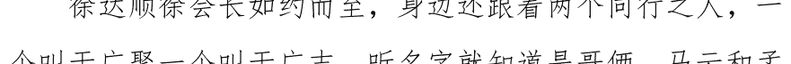

于广志一口煎着卷大味儿的山东话口很重：“这还别不信，徐会长说的话还是客气的，还好好商量不行，非得断破路才高兴吧。你们马家门里种豪横扬骗在城里作案，不就坏了我们金井的名声吗？名声没了不就砸了买卖吗？更有没有生意的时候来抢我们的买卖，又不是我们长春的人，怎么什么钱都想赚呢？就这么不吃好粮食吗？”

马云笑了：“此事徐会长和于广只要有异议，可以向马头声明，马头就是落脚，离得又远，在下不过是个寨主，做不了这山东的主子。”

“一手是山东灯杆马雷的根底，马兄弟你负责的是全国各地的络工作。可您有所不知道，马雷做的有点大劲了，这二十四家媳妇她们就占了十家，从荒地用几十斤粮食换一个黄花大闺，好看的用小培养最后到高官里当寡太或送入赘院，不好的给人当俏婢。另外外包局烟馆他也开了不少，同时找来钱财还放利子，利息高的没了边，专门看着人家困难的时候设局为难人一家，逗着人家借些。”徐达颇道。

他的声音顿了又说道：“这不是我徐某某热心肠，可是人家好事，谁也没说马家里的人不能买卖不是的。可马雷太贪了，他吃着碗里的望着锅里的，可帮外行的买卖他也沾，结果人家找他理论，他还动了官府的关系，最后这事儿只能让外帮吃了瘪。马家收人十分严格，可马雷扩招门徒，下手便藏着污垢鱼龙混杂了。在城里到处行骗，自己坏了他们的名声，我们可以忘了。现在竟然明目张胆的捡起了买卖，在人家旁边添人搅乱，再找人敲鼓，这就完全抢了别人的买家。马兄弟，你要是再这么下去，我们长春只会把钱给他们了。马雷现在济南还有谁不知道他这个错的。”

马云终于明白了，原来那几个之所以那么客气，是因为马家人的本性是热心的，却是因为马家的人太贪婪；马雷活成了这样，或许比外还要糟糕。马云知道了江湖规矩，虽然他和马雷怎么对付，他们都是马家的掌柜，马雷还是大师。他做出这事情让徐达看到了马云的脸色，马云觉得很慌。

“不知怪，我和从北京过来的，对这边的事情还是不太了解。”孟六见马云脸上一阵青，便不再理会马云。

于广聚见到马云，解释道：“马兄弟，徐会长的意思并不是要罪马家。说长春会厉害，谁也没敢。”

徐达顺拱手道：“那就有了，对了，马兄弟你说事找我，到底是什么事。我之前还以为是马雷叫你来谈判的。”

“他让马雷收敛点，让我们也有口吃饭。但断人路等于杀人，这事儿可别拖得太久，下面的兄弟快按不住了。”

于广志拍桌子就起来：“长春会还怕你们马家成了！”

“整理，脾气太冲才没聚说话。他哥俩脾气一个天天上一个下，还望马兄弟不要怪。”

“无妨，马兄弟，若是您的情况如此，那理所当然的。”马云笑道：“我和马雷都是马家里的，也都是马头的亲戚弟子，我想徐会长应该听过。所以我替他说话，甚至为他出错，如果平心而论我也完全能理解你们的情绪。办完事情，并解决了马雷的所有情况后就立刻回洛阳找老爷，还请诸位放心。”

徐达顺拱手道：“那有了，对了，马兄弟你说有事找我，到底是什么事。我之前还以为是马雷叫你来谈判的。”

“他哪里指使我的，我是想向您打听一个人。”马云道。

“谁？”

孟六接话道：“董翠云。”

随即就见到徐达顺脸色老去，于广聚安排着酒杯里的酒没听到，而广广则是低头似不语好像做了亏心事一样。

马云知道这里肯定有事，也明白今天是不方便问出事了，于是连忙开话题：“明天来，大茶巷，大茶并，再找妈妈给这位贵客安排姑娘，再找两个唱合得。”

马云坐在一旁低声说道：“兄弟你是明白，刚才没有追问，谢了。这样，明天你来我家，我一定会给你一个交代。”

“您还没问我怎么回事，怎么就说这话了？”

徐达顺歪头说道：“云云这孩子，肯定是骗了人发现了踪迹的，这找才上来的。”

说到这里，马云就不再接了，一切答案将待明日。

门外幽响的薛上章回到家里没有继续折腾那份甜蜜，再弄下他腿都要软了。到了晚上，徐达顺抽了一筒大烟，又跟孟六和马云以及于广聚打起了通宵麻将。而于广志则家里管得必须回家，带着酒气也不坐车慢朝家走去，生怕家里的河东狮闻出他身上的脂味儿。

这晚上的酒风一吹，胭脂味儿果然散了许多，不过酒防儿也上来了。喝了酒就要吐，要么肚子儿就是要出汗，总是要出酒的。于广志就是靠走肝出酒的主，他频繁回头观察着，今天竟奇了，觉得有人跟着自己，可是没发现。于广志挠了，自己实在太紧张了。找了个静静后的角落，掀开裤腰一半，猛然有人把裤子全褪了下来，然后照着屁底上一脚。于广志身边算好的，毕竟是戏子出身，有功底可耐不住脚累发抖，哭得满脸泪，后脑勺跟自己的闹。等他喘起来，身后还有人。薛上章哼着曲到了桐枫院，翻墙而入不知不觉，心里滋滋的，你敢吼还让你吃个。

## 第十三章

一夜麻将，孟六输了多少，徐达顺是不行的。白天于广聚困了，找了个客就睡了，而徐达顺要回家休息并提议带着马云和孟六去吃油饼。

“两斤油饼。”早餐老板喊道。油饼味道软，孟六咬了几口，徐达顺重的点了点头。

马云一人行动方便，起来和小六找了中午午饭就出去。路上见到许多缺的乞丐，小六观察着他们，十分可怜，有的是瞎子，有的瘸子，还有胳膊半没了，这些乞丐的年龄都不算大。如果是壮年，可推论这是战乱导致伤残，显然这些人大多年龄过不了了。路边一个老爷自言自语的话钻入了孟六耳中：“真是邪门了，也不知道怎么了，济南怎么这么多残疾。”小六眯着眼睛，这些乞丐全出来了。

小六心中念，春会的人马雷连买卖都要抢，莫非这一切都和他有关？可从哪里找到这么多残疾？小六知道马云正在调查这件事，便想拉一把，在他面前喘不过来。为了引起别人的怀疑，他装作买东西时就而去茶棚喝茶，只要乞丐在眼里跟他就就行。到了天色晚晚，这群乞丐也就三两两聚一处，朝着城外去，小六也悄悄跟着。走了大约二里路有一个很大的坯房。孟六看着乞丐走了进去，于是蹑着脚朝着瓦房跟过去。猛然背后有一极其有力的手住了小六，另一只手死死的捂了他的嘴。

小六猛地回头过去，那人却没有使劲，只是在小六耳边低声道：“我是你。”孟六长舒了口气，听出了那人是马云。马云见小六紧张，便松开了手。两人朝夕相处默契已经很高，一个眼神相互会意。两人悄默的远离这破瓦房，另一边说话。马云道：“六六，你怎么来了？”

孟六把发现的事说了一，马云点头道：“等会儿，我还没回来呢，你叫薛上章再回来。”

“那不行，万一你出了事怎么办，咱哥虽然没丢脸，我可把你当亲大哥了。你带着我东奔西追凶手，我怎么能让你去呢。”孟六摇头的像个拨浪贼，马云嘴儿都干了也没叫服他。马云道：“行，我知道你有仗义，这兄弟我没白交。也不说了，你跟着就是。不过一会儿见机行事，头不对就跑，切不可逞强。”

“嗯，知道了。”孟六点头道：“马大哥，你说这些乞丐都是怎么回事？是不是那个马雷有有关？”

马云片刻道：“有没有关不知道，我希望和他有关，因为这事太缺德了。如果我没猜错的话，他们是在采生折割。”

“采生折割？什么意思？”小六不解。马云又止住了半晌才道：“采生折割一词在宋朝被发明，但历史却要更久。指的是一种邪门的宗教仪式，剖心挖掘极其可怕，而且还用人血作画色彩。当时规定，一旦发现有采生折割者，便要凌迟处死，两厢有情不报者，同罪处。如此严厉的刑就能看出其邪门的地方，后来到了清朝，开始用残忍的那些小巧的人挖花掳狗或者老人，然后用残忍对付，简直是不可议的，最可同情好多给点钱。而乞丐们控制这些采生折割，大谋其利赚良心的钱。”

“这么混蛋！”孟六听后只觉得又怕又气，不由说道。马云点点头：“正是，采生折割虽然在江湖上为人所知，但在乞丐内也有一些人反对，并不禁止还认为是一种求生手段。所以在江湖上，乞丐向来是独来独往，无人与之关系过密，而大家对他们的口碑也不是那么好，那是因为他们做了许多诸如采生折割的事情。”

[content]
如果说残只是暂时的痛，那么就是生不如死了。一般是用剖开伤口，然后任由伤口感染，化颜留疤到极惨。这样的人要钱，有人看着可怜就会给钱，还有些是觉得恶心，给钱让他们离得远一些。除此之外，还有把人泡在药毒和大粪熟成的金浪汤里，以便人体溃烂。

人都都有好奇，虽然怪的样子人不鬼，十分可怕，可还是忍不住想去看，给的钱也最多。

说要，马云便不再说话了。两人陷入沉默当中，过了很久小马打破了沉默道：“马大哥，这事儿就是和你无关我也得管，他们太惨了。”

邪，而江湖同样是既人人厌又使人畏惧。它有着义气、规矩、诚信等好的东西，也有私欲、残忍和血腥等恶的所在。

好了，不发感慨了，咱们过去去看看吧。

作者:夜半微 日期:2017-05-16 20:55

两人悄声地走了，这破瓦房是个大三间的连房，地方不小倒也没有破墙，就那样灵零零的杵在那儿。外墙是用土砖垒起来的，窗户纸早已破了，露出一个大洞好似吃人的大嘴一般。孟小六小心翼翼的探头查看，却见家里横熏着火，一面对带不同的疤形形形大汉坐在那里吃大饼，就着火焰上架的烤肉。

两个大汉咬了两口肉，不知道是不合口味还是什么，便从嘴里理出来，朝着地上爬上去。时间，脚落在角落的落肉处的五十人如同同狗一般扑了上来，争抢着地上那块肉。那群家伙哈哈大笑起来，好似抢舟的不是而是是一群畜生。

其中一个道：“我说了多了，不要吃的，要钱重要。结果呢，她妈的，弄用馒头个个用！那谁，一眨眼，今天你要要钱的最多，馒头都赏给你了。”

话说间，一个人趁着黑暗的角落爬了过来，往前爬几步抱一一下头，直到到了大汉面前才抬起头来。借着火可以可以看到，他的脸上布满了伤痕，而破碎的面上，只有一只眼睛在眼里乱，另一只只是个蠕�，上面用火缝住了封闭伤口的痕迹。

他拿了一袋子馒头千万谢的爬走了，另一个大汉抽出刀子，狞笑着说道：“有赏就有罚，今天钱要的最少的……。哼哼。”

几个大汉走向乞丐，很快尖叫声响了起来，一个断臂的乞丐被拖了出来，他惊恐地叫着不断挣扎。有大汉在火堆上歇着热水，几人把断臂乞踩在脚下，热水就这样着脸的泼了上去。惨叫声从乞丐嘴里钻到一刻就戛然而止，他硬生生的疼疼了过去。

“这个就更恶心了，估计多要一点钱吧。”

“我要说还是态度问题，对了，今天上面传来消息，这几天让乞丐们再来折割几，明天天把这些人分批送到我们这里处理。去把这些大汉的脸贴上粘帖。”

作者：夜半微风的老鬼 日期：2017-05-16 12:12

“那边的乞丐也搞定了？”有人问道。

那大汉回答道：“这就不是我们要关心的事情了，不过上面说了，济南现在的残疾乞丐实在多了，怕是有人要出来做文章。另外，听说有人在调查咱们，上头让咱们小心行事。

“谁他妈妈的不耐烦了，竟敢调查咱们。就算出事儿来又能怎样，哼哼。”

“反正都小心点吧，听说是马家门的人，应该不比阎王爷位低。”

那个人不屑的冷一声：“不管这些，谁也不能挡了。”

在济南这一三分地上，是乞丐的地盘，是龙得咱们盘着，是虎得咱们卧着，谁来办谁。

马云看着满屋缺腿的乞丐们，气的双拳紧握浑身发抖，小六也被如此震撼。哥俩对视一眼，知此事不能从长计，按照那些人的话，明天乞丐们会被送到各处，到时候再教他们就难了。

不过乱拳打死，即便马云过几功夫近身了，可屋里只有七八个，也不知道他们身如何。

两人稍默合计，立刻买了灯油，去找章一起行动，却被告知章早已不在了。

等哥俩再度出了城，来到被破瓦房的时候，屋里的人已经睡着了，外面都能听到屋里传来的低噜声。隔着看去屋里还有两个，其中一个已经睡久，另一个背着身子看不清楚。马云爬上了房，并弄了点干柴，放在破瓦房旁边堆成一捆，然后浇上灯油，还放上几张让烟大些，火也没多大，只是烟大了。随即即用逐个点燃。一会儿功夫浓烟滚滚，火光冲天，周围皆是烟本大的，屋里的人警觉了起来，开始朝屋外奔而去。

作者:夜半风的老鬼 日期:2017-05-16 21:13

别看平时这些大汉对乞丐们动手，可还不能让他们烧在屋里，这些乞丐可是他们的摇钱。于是他们们着外面撤离，屋内两人屋外五人，防止乞丐乱跑。

乞丐们平时缩在墙角睡觉，看守留下的地不够，大部分时间乞丐都是缩成一团睡觉。找块砖头就是枕头，弄点干草就用被子盖了，他们担心家里没有醒起来的乞丐，便去寻找。继续找着他们，但他并没有找到。不过他突然发现这火也没多大，只是烟大了。他想提醒屋外的同伴小，屋顶这时塌塌了下来。

这破瓦的屋顶已经残缺不全了，上面的窟窿用草布挡着，砸在这个看守身上的正是一团好的破瓦。他摸了摸身上被砸的还挺疼，好在没见血，骂了一声倒霉就要站起来，却忽然感觉身上湿漉漉的，拍眼看向去烟雾之中站着一个人正往身上浇着东西。

那看守守手放在鼻子上一闻，竟然是灯油。还没叫出声来，上面就有一团燃着的干草落了下来。干草落下的时候只剩下一片火星，不过四处飘散让人无处逃。火星沾上了灯油，瞬间看燃一团火焰。

“啊！”

作者:夜半风之老鬼 日期:2017-05-16 21:25

本章章节，大家平时没事的时候多顶贴，谢谢了。

作者:夜半风之老鬼 日期:2017-05-17 13:17

我在群里，现场有声版，哈哈，群号：78900769

作者:夜半风之老鬼 日期:2017-05-17 22:14

# 第十五章

“老三叉了！”有人喊道：

剩下的连连咳嗽，火焰变得更加辣眼睛，他们不着急处理，加点水就能灭，辣椒胡住小鼻子，他此刻早就受不了了。然而如此，小六也是不好受，他分别把一把袋子辣椒面倒入刚火后就跳下生风的跑了。

那帮看守觉出了不对劲的地方，如今又不是天干物燥的冬天，屋里点火星子到处飘不到外面去，怎么突然就着火了呢？再说这烟看起来有些大了，只见火不见烟，烟雾有几团，裹在在一起形成硕大的烟柱。

“不对，肯定是有人在闹鬼。”一个大汉道：

话音刚落，一根绳索照着他的头上飞来，他还没反应过就被绳索前端的套扣锁住了脖子，好套马一般。绳子收猛猛一提，大汉被正面横向烟滚滚的破瓦房，一会儿就没了踪迹。

这眨眼的功夫，七八个看守就剩下了，他们犹如慌着孩子们快离开。可是孩子们是乐意看着看守接着快，还有断臂的实在走不了。然而就在这时，风声响起来，一个挂着石头的绳子飞过来，照着看守砸去。

不只是对付是一群孩子，人数多到底是有本事强横的孙子。有人疾手快，刀刃轻轻划过石头，然后一把抓住绳索朝怀里。绳子套住看守，移动了片刻，接着拉动不动。来是马云，急脚看着他们。马云松了手，五人顿时向后退步，聚到一起就散开了。这一瞬间，马云地滚，拔出刀朝着首人的脚胫处划去。

这晚上的本来就是夜战，谁反应快，马云这一出一击主动占了上风。见马云顺时蹦起来，不过动作太快，脚胫被砍了却没有感觉疼痛，看守只是意识向后倒。

马云就势而起，刀子在手中转了个圈，从身上穿过下颚，刀子直接插入脑袋当中。那人眼睁，连呼吸都没一声，就被马云钉在了刀子上。马云身高体壮，是彪形大汉，一手抓住那名死去身体还在无意地动着头，一手按紧匕首，酷如神下。突然马云大一声朝着剩下的四人走去，四人被马云的气势迫不得后退。马云眉头挑动，刀直入鬓角，气十足的道：“哥兄弟们，处理。”

马云向四周环顾，不见远处的灌木中人晃动，有人答道：“是！”

马云冷笑道：“尔等还不速手，难不成要乱枪打死，或被我杀了？”几人一愣，随即倒地上。没会功夫，他们用马云来的绳索互相抓住，最后那个几的帮助下五花绑起来。灌木中小钻了出来，那些灌木都被绳子相连，牵一根而全动。

马云道：“马家门不可因谋财而害命，能用智取。不过今天时间紧迫，迫不得动了武，为了惩扬也值得沾了血腥。”

那些人一听后马云是马家门的，连忙叫起来：“大哥，大哥！我们也是马家门的，我们老大是马雷啊。您应该认识，他可是马家门的掌灯使”。

“休要坏了马家门的名声，马雷若是这样做，就不配作为马家门的人。至于你们？只怕你们一辈子也不进了马家门。”马云冷哼道。

孟小六一脸冰霜的看着这些才刚为虎作作，现在窘瑟发呆的守着，对着那些傻呆呆哪里是不敢事的乞丐们道：“有事的报仇，有事的报仇，你们还在等些什么？”

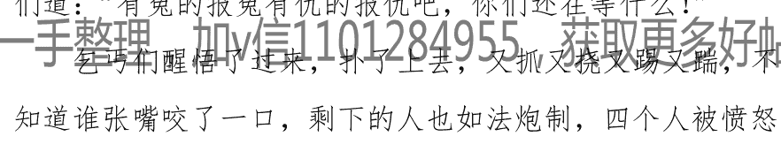

知道张桀喷了一口，剩余的人也如此，四个人被愤怒的乞丐们活死了。

马云和孟小六看着这窗景相报的惨样，转身离开了。

第二天下午，济南唐芙巷街门口旁边的摊，来了一位年轻人。那年轻人看着身材很大很壮实，但面部判断年龄不小大，就只有七八的样子。他穿的很很好，嘴里京腔京调，看起来像是北京的公子。

他来到摊前，然后扔了五个大胖在桌子上。一般算命就五五毛钱，这一刀来五个大胖，别说“头到秤”就是遇到千年大瘦也没这么给钱的。费时不光让那算命大一惊，还够吸引了诸多围观者。算命来了精神，这下不用自己“圆粘子”了，也就有人帮着吸引围观、聚拢观众。

来的人不是旁边，正是打扮一番的孟小六。有了装作五爷爷的经历，如今的小六想要扮成一个富家小子易如反掌。果其然，这把算命都蒙住了。

“这位公子，您是测还是相？”

“看相。”孟小六道。算命先生点头，长着胡须：“看来果然没错。”孟小六微微一笑：“先生看得出来父母是否？”

算命先生面淡然回答：“说凭据，我把答案写在纸上，然后你说，说完一看纸条就知道刚才对不对了。”

“好，这样写下，便是谁也不能赖了。”小六道：“若是准了，你就会到处扬，再教我我不解之事。”

“原来您是想试试，好。”小六急了道。其实算命先生心里也是唏，虽然看出了小六古怪，但总觉得这小伙子能有多深道。算命先生恨不得一把抓来怀里，好。小六要了笔，在旁边捂住人，算命先生一皱。两人写着，算命先生拳拳在胸的道：“这位少爷，咱们纸条相对吧？”

“好。”两人的纸条打开的时候，众人一片哗然，有人接头接口称赞算命，两张纸条上写的完全一致。唯有算命此刻脸色难看，只想赶紧离开。但他手里捏着一张，这是个霉事。纸条上写着：“父母全都能克一，一个不能二，命中不能有。”

算命先生故作泰然，想要俏话却怕露脚，他实在是没看出眼前人的道，多说错不如静好的。小六笑着对众人解释：“诸位一定撞到了神算，大家写的虽然一样，但诸位看得懂写的是什么？”

“看不懂。”者搭话说。

小六点头：“那是自然，这个人就是骗子。大家听我说，他用的不是连环了。你们也看，父母全都能克一，这句话就涵盖了所有的解释。刚才才问父母是否，如果我说父母都在，他就会说父母全，一个也没有克。如果我说父母有一不在了，他就会说父母全不能，得克一位。我要是父母都不在了，他就会说父母全都不能，不能克一个，得克两个。你看，按照他写的，怎么说都是道理，后面跟子的一样的。这就是连环骗，这人是个骗子，你不找算命也要找算命。”

说完孟小六而去，只留下面红耳赤而脸色苍白的算命在那里睁目口言。他的无言可以对正了，明的就处理了。

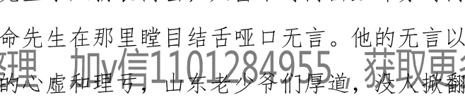

当日，济南府的闹了群众，当场把那骗子打了个半死。而城外南部千佛山的庙会上，有个金点被人状告偷窃，结果还真在金点身上搜到了被窃的东西。于是，地上都转眼看着金点被抓走了。

接来的几日，这样的事情每天都在发生。最近长春会的行外，踏足金行的外来客户纷纷闭门歇业，以躲避不定以什么方式而来的灾祸。

“马大哥，你这样又得一大乱啊，好多还是马家门的同门师傅。”孟小六道。

马云撇囔答道：“要是真是马家人的，我砸了那第一个摊子的时候明白是咋儿了，还能被我所伤？早就牵着尾巴逃了。如今你丐行的买卖给我破坏坏了，踏入长春会的行我也给他乱了，剩下的保局妓院最近所有收缴，听些会长说抓哥卖妹的显然是不少了。不过他提了他们的警惕，怎么样，怕也不是容易。”

“下一步你准备？”章看着道。[content]
作者:更夜微风的老鬼 日期:2017-05-17 22:38

“章大哥，你要走？”小六舍不得了。自己和马云还有章，在一起快乐，酒言欢，人生总是不说洒自在，如今章笑着拍着小六肩膀：“兄弟，天下不散，有缘再见。另外，你们从洛阳离开，好像要去江一带了。”

章点头：“没错，准备着一路南下去。”

“章，你要走？”章，章跟眼前人不是熟悉，章章。章结束了停顿，转身后信直觉的，他朝身后的人的方向去。那是一块巨大的硕大的石头，如果章感觉没错，藏在石头后面。章一步步靠近，做了一切准备。猛然间石头后有人闯了出来，仓皇而逃。章几个步狂奔，施展轻功，他原本以为就能甩开身后的人，却未能。章拼足了劲狂追，凭着他的轻功和脚力，竟然足足追了一个时长追上，两人保持着最初的距离，反而没有近一点。

此刻已经晚了，那人停了脚喘气搓手道：“成了不了，章兄脚力，小弟佩服得紧。”

“怎么是你！”章打了个嘟道，他突然了一种……”

# 第十六章

章觉得了一种不好的预感，他们危险了！

作者:夜半风之老鬼 日期:2017-05-17 22:55

本章章节，作者:夜半风之老鬼 日期:2017-05-18 22:52

章跟眼前人不是熟悉，他们都是在一个地带成名的大盗，所以见过几面。章的事本是从被暴打从江湖上摸爬滚打，以及幸运的得到传授来的。不过老师不认他，也没有教过他的事，所以按照行的规矩，他既没有给他人点，也没有在行里点。

连正八的实力辈没教导事都是，属于一个海清。惊喜！江湖果然是广见博的地方，收获很多帖子名为胡脚。章虽然没有师承，可本事强的他还是排了靠靠，在行中属于一等高手。因为不偷穷人济费，被位列齐三怪之一。

眼前的这个人看起来似周剑，一身正气凛然的家伙也是个小偷。他同样在三怪当中，他叫郑谷安，他可是有传承门派的大盗，被老师悉心苦磨，一步踏上来的。

人家属于“名门正派”而章是野路子，不光出身不同，两人的地方也不一样。章伦东西原则则有讲究，而郑谷安则百无禁忌，只有一个准则便是盗千金之物。

三怪别为劣荣、千金已不是荣、郑吕安的千金就是只偷价值千金的东西，这东西若是只有九百九十九块大洋，要只明标价出来，他也是不伦的。这些金已经很少出了，章听说他建了一个什么意的门，不光偷取价值连城之物，还为大军盗取情报，并接暗杀的刀，美其名曰个首要。

千金学艺苦难上来的艰难，但少年得志，十六岁成名，十八名京津，二十岁就成了三怪之一，二十五岁便建得了门，名如其等人门主真是春风得意。如今的郑吕安不足而立之，描写容华，谁会认为他是个老呆呢？

“老郑，你跟我干啥？”章一上来就叫郑吕安最为讨厌的外号。

虽然身体垮掉但精神却一刻也不敢放松，生怕荒郊野外的谷安突然出手杀了自己。即便谷安刚才说自己不成了体力不支，可要知道他是不是故意示弱吗？反常必为，他跟着自己已肯定是所有人都读过的。

谷安皮笑肉不笑了笑，说道：“我只想跟章兄逍乐子而已，没想到章兄事高强，小弟甘甘下风。”

章上章：“说吧，到底有什么事儿？”

“就是叙叙，我说了。”

章上章摸了摸自己的酒鼻子：“好，那旧叙过了，就此别过此吧？”

“告辞。”

章上章看来年轻时的路有点，看来谷安果然跟在他的脚后走了。走了几步章上章站稳了脚，扬声道：“为何还跟着我？”

“大路朝天走一天，谁说的这条路只准章兄走，不准我郑某走呢。”郑谷安道。

章上章摸出了两把着倒的小镊子，然后冷冷的说：“把他们怎么处理了？”

“哈哈，章兄果然是章兄，看来你早就觉醒了。”郑谷安冷笑道：“我们得意接了两万大洋的报酬，让我把你们解决掉。人家只是马云身边的人一个不留，你恰巧在他身边，也算是遇人不淑自己倒霉了。不过章兄非同等闲之辈，也只得我亲自出门了。”

章上撑足了架势：“老君尼，你少他妈妈从这儿起闹，就是你出面不能收敛得了还不一定。”

郑谷安步步走向章上，猛然身子一低，躲过章上割向自己咽喉颈处的一刀，袖口中飞出一团黑色的东西。瞬间，血腥儿弥漫在四野。

花开两朵各一棵，马云和孟小六坐了一路向南，马云是多么会享受的主儿，从黄本万赚来的钱财至今还没挥霍完，只是坐坐坐下等车。头等车厢中都是些西服丝质打扮精致的上等人，混在这群人里，孟小马云的这一身穿戴就不么扎眼了。

哪要坐靠头等车吗？”

“你不是个今朝有酒才醒醒的人嘛。”小六不解道：“那旬脑而来的新词你别说，对享乐主义者来说。”

马云面带苦涩说道：“不光因为这个，头等车厢人数有限，门口也有专门的列车员，一般进不来。我们……像是被人盯上了。”

孟小六不在乎的躺在列的沙发上，找了个舒适意的姿势，这才回答道：“正常啊，你快意些忧恶恶善着，所以朋友仇人也多，我第一次见你的时候就不会被被人设局入套，被人迫得慌不措，差点死在臭沟当中？这不吗？记得那时候我还被你吓醒了，好像尿了你一头。”

马云顿时脸红耳赤有些恐慌，轻咳一声道：“陈年往事不提也罢，总一切都要小心才。”

“当然要小心，你从济南罪了这么很多人，山东老少爷们可是拍手称赞了，这帮马匪的下手不得记狠你。”孟小六道：“想要安全除了小心还有个办法，那就是咱们主动出击，你看他们了？”

“没有，正因为没有才让我担心，只是一种危机感。”马云眉头微皱。

孟小六也不敢小觑这个问题了，老江湖的感觉都是十分的。根本没活在现在。感觉到了危险，凭他的本事没有找到踪人的，这说明跟踪者也是高手。实力相当，但胜在暗，我明的，这事只有有些棘手了。

两人从安徽下了车，准备了点干粮找了马车买了两匹马就朝着洛阳方向前进。马云用一匹马拉车，另一匹马拴在后面，一匹马跑累了就套上另一匹轮流来了。他和小子也是轮流休息，日夜兼程马不停的赶起来赶了。

就这样，他们足足赶了一天的路，长舒了口气：“到项城了，进了河南界就是安全了不少。行吧，咱们进了项城就休息一晚。”

孟小六点头道：“是啊，肯定得休息了，今天一匹马都吐白沫了，可不能再跑了。”

过了不到半个时辰，两人便进入了项城。进城后找了一家名为“广福客栈”的旅店落脚。项城只是个县城，虽然历史悠久可还算窄，道路设施没有百姓透着土气。

“哎，客官，里面请啊，咱们广福客栈是项城最好的客栈了。”小伙计说着。

孟小六紧张的神经被小伙计给缓了，“那中，俺也确实累了，后院能停车不？”

“中中中，客官里面请。”付尚云滚了进来，这家店铺的门板很厚，插在上下槽里一般情况下两个壮汉很难轻易撞开。可付尚云被硬生生的撞了进来，可其力量之大超乎想象。

“客官。”马云站在城门口左右环顾，身后在门口柱子上。孟小六走进旅店开了间房又要一桌子硬菜。马云坐在了子子上，了了。孟小六知道马云在留得万年错，被人盯上还不知是谁。孟小六口渴乏正品舒坦着崽，突然一个姑娘坐到了小六桌上。小六一愣想发问，却扑了一声出来：“是你啊，你扮成姑娘我真认不出。”

那个姑娘竖起手指放在嘴上做了个动作，压低声音：“你知不知道是什么人，怎么跟着他？他可是个骗子。”

“不是……”小六还没说，却听外面马云大吼一声，看向马云已经另一个人打成了团。果然有人跟踪，果然真是高手！

## 第十七章

孟小六扒着凳就冲了出去，姑娘上去却被小六推到侧：“别添乱，我是哥。”

再说马云那边，刚才才刻记号，猛然背后有人拍了他的肩膀。拍肩膀上的那只手大大，手指如钢一般，变成鹰爪状扣住马云肩膀，让他半个膀子使不。马云本来紧张，受到这一拍立刻反应，肩膀向下一沉，另一只手反手扣住人的腕，然后转身用力向拉，翻身一样把人摔到面前。

黑瘦的男人个子不高而身体也不是健壮，不过他眼中精神一看就知道是个练家子。付尚云叮住手腕也不慌，知道借力量估计不过人，于是左手指凸朝着马云脊柱打了过去。

马云大吼一声，紧用力，黑瘦一下子翻出去，那一拳却没回来，改朝马云打。马云随即拳击，随即大哮一声，倒退了五遥。

他们站稳脚步，两人就不约而同再度撞到一起。黑瘦男子以此转身，利用自己的灵活性偷袭马云柔软处，马云则是大开合故意露出破绽，然后用力。两人本就闹，却缠，想要付对方，黑瘦最终却是胜阵脚。

孟小六拳冲了出去，被姑娘用脚就摔倒在地。小六万万想到姑娘会在身后横，一时万念俱灰。虽然自己见过面，也不知道人家姓名，可她在自己梦中出现牵魂梦萦。如今，竟然是在背后下手，难不成马哥所说的盯者和他们是一伙的？

小六摔了个狗屁座，身上疼心更乱，扭头去愤道：“你干什么？”

“你干什么？”姑娘皱道：“你小子傻瓜，我还会会你？你看那个家伙大打在一起的是谁？”

小六定睛嘘，顿时认了出来。跟马云拳来脚往缠斗处的不是当时救自己和大头还有麻子的那个人吗？他路酷胡打了个只用了三拳两脚的功夫。或许……或者姑娘没有恶意也说不准？孟小六忙爬起来，喊道：“别打了别打了，都是自己人。”

马云收了后退了一一步，黑瘦虽有些犹豫，见马云停了他也立刻身在一旁等着。两人互相对视着，过了良久，他们忽然爆发大笑起来。

“好家伙，兄弟。”

“这位大哥很有本事。”马云瞪了眼睛，缩了缩。

黑瘦点头抱拱手道：“在下付尚云，蜂家的人。马家中不是姓马吗？难不成兄弟我看错了？”

“没有没有，怪不得这般身手。对啊，你这样的身手不列于九蜂之一，也绝对混进十八蜂针才是。莫非是你今年新上的杀人蜂？”马云问道。

黑瘦摇头笑道：“蜂门和马家中一样，又不是靠武艺高低来位的。在下乃是虎蜂之下的一只蜂，听老兄您的意思，和九蜂很熟悉了？既然已经是成名辈，为何要难为这位蜂小兄弟呢？”

“难为？你们认识的？”马云目结舌道：“我还以为你是不是把我当成骗子了？”

几人哑言，这话怎么接。马云说得没错，黑瘦和姑娘把他当成了骗子。孟小六承认鲁莽，承认马家门全是骗子，所以尴尬。马云也明白了话里的疏漏，轻哼一声，还没说话，以前见过的那个胖子带着男一女过来了，见到胖子大叫一声：“马云？你怎么在这？”

小六的声音有些虚了。马云解释说刚才的误会都是误会，孟小六直勾勾望着自己。胖子笑道：“怎么，孟小六兄弟，你不认识了？”

“你认识！他们在哪儿！”

大家都是聪明人，又不是死死着的莽夫，故此是不动起来，双方坐下来聊就什么了。

原来那伙人的头叫姜康，正如马云了解的那样，他们五人组成核心，临时聘用的帮人，人最多达三十余人。他们不欺别人，也不在乎命，一旦失手，核心之外的人就是牺牲品，或者是钱不够也会脚底油。

他们最初还是带着姜和刘家的时候，缺门关系不佳，两大门都是骗子，出卖同门的事情有一多年没发生了。在这个时间，一个被称为金莲的冯二娘以及董翠加入了姜康的团队。姜康在上海做了一起大的骗案，当时警察追得很紧，为了脱身就把缺门的一位道卖了。

缺门下流了人，虽然无禁忌，却非常讲义。当年缺门留了姜，让缺门吃了瘪，如今鸿门此起恼，便把姜纳入门，并摆下酒宴把事情说了。

姜在鸿门护下老实了几年，严格按照鸿门的规矩办事。鸿王收留姜是为了置奇，实际上也瞧不上他，所以姜并未选用。一天多以前，鸿门九龙中的杀人蜂被杀，调查此事和姜有所连。介于曾经因为姜发生的冲突，担心自己三大门看自己的笑话，故鸿王召回虎犬蜂，命他们捕捉姜。

“不过为了他们会用我的名字呢？”胖子眉头头锁道。

马云撇撇嘴：“估计他们最讨厌的就是你吧，做事讲规矩，他们又是不讲规矩，所以用你的名字也算是一种报复。那时孟和小六找不到人肯定会胡乱骂，挨罚的成了你，姜康他们坏啊。”

“很有这种可能，”黑瘦的男人一脸严肃的说道。

“早知道是这些人是姜康，我就早请教蜂家和缺家了，我们都是苦苦追查啊。”马云道。

孟小的情绪在刚大落了一番，但总体来说还是很开心的。

付尚云忍着疼痛站了起来，肋骨疼痛应该是被撞断了，但好在没插到肺里，骨臂也没有受到什么伤害。

五个汉子冲入客楼。

孟小此刻已经恢复了平静，看着跟胖肚子子来的那个中年男人，他不是来盛隆当行玉罗汉的那个男人吗？孟小出了他，他也出了孟小，两人相视一笑也没把脸皱得只剩嘴角。

一来离开了罪祸的踪迹进了一步，还有就是再次看到了大腿，而这些人正是王定一所说的守规矩蜂门中人。

一人就此下了脚，把酒放在一翻，喝完的小六都不力了。姑娘把孟小扶回房间，孟小闻着大腿身上的香气，醉得脑子上意起来，不由自主在大腿身上摸索。姑娘则拍小六嗔道：“小子，没想到完酒就不老实。”

“你不知道我有多想你，从第一次你就喜欢你了。对了，还没告诉你叫什么？”小六醉一把抱住了姑娘。姑娘脸上一红，把小六推到床上，转身却被小六拉住了，把她揽入怀里。轻地撞了小六胸下，娇道：“我叫……”

“哦。”小六呼呼睡起来，半夜时分，心里苦燥，觉得有人揉，伸手揉搓柔软的手。

## 第十八章

“小六，小六！”马云低声道：“你干做什么，你做了梦吧？”马云看着孟小，终于把小六醒了。

小六看着马云，脑中想着睡着姑娘纤细的手。小六擦了擦嘴角坐了起来，“喝了真是头疼，你不是傻了吧？”马云继续着小六肩膀。小六有些尴尬，还有有些恭的样子，一脸严肃的：“我感觉不对劲，先把你叫醒了。”

“嗯。”马云点头：“不愧是虎蜂，酒后也不错。”

胖子道：“马兄弟，都这半夜了，咱们也没招来，肯定会有怪。”大家都出去，直到现在没有人找我们，总觉得有些踏实。”

一楼大门的伙计此刻打着呼吸，丝毫不被众人吵醒，而是周围过了一注没住香的时间，外面传来了几声利刃砍门板上的声音，这下可把伙计给醒了。他还没来得及抄起棍子，打开门询问，厚厚的门板就被撞折了。付尚云滚了进来，这家店铺的门板很厚，插在上下槽里一般情况下两个壮汉很难轻易撞开。可付尚云被硬生生的撞了进来，可其力量之大超乎想象。

五个汉子冲入客楼，他们手持兵刃并不急于进攻，“咚咚当”的声音响起，一个如巨巨人一般的大汉走了进来，那响声就是他脚踏面的声音。付尚云吞了一口嘴里的鲜血，刚才他就是被这大汉给飞的，若不是自己底子硬，在空中使劲儿换了个撞击面，非得与门板“玉石俱碎”“同归于尽”不可。

巨汉走进客楼之中，朝着付云步步逼近，付云嘴角微微微笑，朝着巨汉吐了过去。巨汉浑起肉扇了巴掌，以横扫过去。

思。他就是耍赌一把，暴露自己已破绽从而向君入，果不然那五人上上了。马云身体蓄势大力沉，来了一招双峰贯耳，两人的头被马云掷了一起，当即发生碰撞，连哼都曾没一声就晕了过去。另三人回头过来，两人回教一人拼杀死向付尚云。

马云当即与两人战斗到一起，付尚云与另一人的攻，不过肋部一阵疼痛，还是被利器擦而过，立又是。那巨人此刻回来，眼见就要对付尚云不利。付尚云身体受伤被击后去，估计有些难了。马云看着眼里在急，可自己被两人缠住无暇抽身。一手就把他摔了，付尚云取好多帖酒坛砸在了巨汉的上，倒也是准了。大家吃一惊，纷纷看着竟然是孟小六。才从开始打斗如今就是眨眼的功夫，两个武艺不精者或者底子的简直就是看了。

## 第十九章

“六六，小六！”马云拍着孟小六的脸大醒了他。孟小六涨脸道：“怎么老是是你叫醒我啊，真是扫兴。”叶岚笑出声来：“你呀一醒了就说胡道八道的，看来是没事了。”孟小六翻起来，头还是有点晕，浑身都散了似的，估是刚才从楼上跳下来摔得，脖子上稍一动肉连带骨头的疼。孟小六揉着脖子：“你们没事吧？”

“没事儿，”付尚云道：“大恩不言，，孟兄弟。”叶岚也道：“真没想到小六这么英勇，二层楼跳就跳掉啊。”

从笑到哭，就是性格多。薛东平笑着点头。孟小六被夸得有些脸红，揉着头说道：“这不算，以以前大哥也不帮过我吗？当时薛大哥都是江湖中人，非就是你帮我呀。”众人见到孟小六立功不自傲，更加赞赏了。马云此时道：“这六人是得意的杀手吧？”付尚云皱着肋骨：“嗯，应该是太行六了。”“现在他们呢？”孟小六问道。马云做了个割喉的动作：“都被处理掉了，若是平常仇恨我们还能放他们一马，可他们是杀手，这就不得杀了他们以绝后患了。更何况我之所以猜马家弟子没来支援，也是因为他们的缘故。”

付尚云点头：“正是，当时我被虎蜂派去查探，结果看到他们他们在追杀一个马家弟子，于是我就与他们打到一起。没想到实是大了，差点折了。”

“马家的那个弟子呢？”马云问道。付尚云：“当时让他跑了，他已经身重伤，究竟跑得了。”一直沉默，张突然说道：“此地不宜留，还是急走的好。”孟小六：“我们没二打，是不是怕官家啊？也是官，咱们被撞上了确是麻烦。”说到这里，他不禁想到了父亲当时受到的重波。马云却道：“小六，不是这样的。这里是境内，马家弟子最多，因为他们在地盘上练手比较方便。如今付兄弟被打的那一个，剩下的马家弟子应该是被害了。如今付兄弟受伤，我们孤木难支，咱们要离开才是稳妥的上策。去洛阳，找求助。”胖子道。马云点头咬牙齿道：“嗯，敢在我们地盘上妄杀的人，我们定让他们无回。对了，马兄弟，我想问一声究竟是谁要得意的人？”胖子眼中闪现一抹光道。马云一愣道：“事情紧急，此刻不说，不过累了大哥等人实在是抱歉了。”

“马云兄弟，又要，云云是不够了。”薛平摆手：“这还不妥，只是在知道马云兄弟又要……总之要加小心，不可投罗网。薛大哥说得对，谁，咱们从济南府，出发。”马云立刻脸色变喝道：“小六，不准胡说。”随即薛平道：“薛大哥说的道理，马家人是不可能相残的，这点用命来保证。”马云说完领头了后院，转身马云要离开，结果还没出门觉得有人盯着自己。他下意识的头一看，子弹打在了身后的马上，马儿一声嘶鸣就落在了。马云连闪身，藏于旅店当中。远处的房梁上，两个男人正趴那儿，其中一个持着长枪在瞄准。这时有一个手矫健的跃了上来，照着持枪者的拍了一下：“谁让你开枪的。”另一个男人打了回去：“大家都完了，不开枪你上？”“大哥，嘿嘿。”刚来的男人笑道：“我们这次出了二十多人，就算折了六个人，人数也是占优的，脑热冲上去还怕他们不成。”此刻的旅店当中，众人聚在一起商量对策，商量来量去，最后采取法信件来得太快，送去也没法，消息快灵了。躲在心里，人家有枪只是肉身，这下可坏了！往远处就是撞到天亮，人家万一有一大队人马支援冲进来，到时候岂不是瓮中打出来？为之计下去才是最好的办法，后院的马死了一匹还有四匹，其中三四是他们挑的，剩下的则是这里居住的旅客的，情势危急也得合并用了。旅店中被困得七个人，他们根据体重重新分配好了马，一把冲出去就是身材矫瘦的张立和尚胖一匹，俏姨和薛胖子一匹，马云高马大独自占一匹，孟小六如愿所偿的和叶云一匹。只是如今局势，小六也没别的。

“一旦出去，大家就一并城西走，随后的你们直奔薛阳而去，我负责引开他们。”马云道：“小六，你拿着我的手灯，如果遇到马家的弟弟，就立刻请求求助支援。“马大哥，我和你并吸引敌人。”孟小六道：“打虎还需亲兄弟，哥俩在一起多少个照应。而且我对这里地形较熟悉，应该能够把他们引开，你跟着反包是目标增大无所不便。再说，咱们能不能出去不定吧，不知城里的人听到枪声后谁都不敢出来，了天天亮官差来是不一定了。”他们估计是土匪，枪声，”孟小六上心。来天黑，他最怕的就是被人打散了老骨，老道百姓都爱打便宜，如果我们……”

# 一盏茶的功夫

一盏茶的功夫后，马云又探头出去，然后迅速闪回来，其不然又一声枪响出来。这时候孟小六扒着嗓子喊道：“抓贼了！我已经打中了！”紧接着屋里人齐，渐渐的大上有人从屋里出来了，人越来越多胆壮就不怎么害怕。老大老二他们就是，一个叫着：“抓贼啊，抓贼啊。”马力不尽。孟小六他们的两匹马都被死一只，剩下的本来就累的可吐沫了，这才歇息了半个晚上还没过劲来，而剩下的几匹马也孟小六他一样，是拉车的驾马。这些马根本不是用来骑乘的，拉车干活还，要是马跑起来就不是回事了。不过马如同同一人，术业有攻，驾良马俏娇质饲料讲究，体型和脾气不适合拉车，驾马则不然瘦好养且能干重。当时孟小六他们也是买不到好马，无奈奈之下才买了这个用来拉车，其他人则是个便宜和车子的舒适。总而言之，听后马蹄落地应该是好马，他们想要也逃不了多远。由于被按着肚子起处溃，不如暂时起来起来一线生机。说是他们弃马奔步，还在马肚子上打了几下，让他们散开跑远处，尽可能的引开追兵。这荒郊野外，唯一能够照亮的就是太阳的月亮，众人王一喜走得直撞直撞，他看着路上的树，累得精彩抖着。落在后的叶禹或许可以靠在他身上，她的功夫可比小六连门都没的要强许多，脚下扎实反倒是小六有些蹒绊的时候，叶禹扑一把。他们翻越崎岭走着的地方，因为人都难走的地方更是不好上，最终藏身于一片山林中。这时天已经有些蒙蒙亮了，马云藏身树后，露出眼睛看着路上的情况。大约过一会儿，几十个高的大马就到了。首的是个瘦高汉子，不过倒是壮，即便看不真着他身上上位者的气质只听一人道：

## 第二十章

人人众多，自己这这边又是马力不尽。孟小六他们的两匹马都被死一只，剩下的本来就累的可吐沫了，这才休息了半个晚上还没过劲来，而剩下的几匹马也孟小六他一样，是拉车的驾马。这些马根本不是用来骑乘的，拉车干活还，要是马跑起来就不是回事了。不过马如同同一人，术业有攻，驾良马俏娇质饲料讲究，体型和脾气不适合拉车，驾马则不然瘦好养且能干重。当时孟小六他们也是买不到好马，无奈奈之下才买了这个用来拉车，其他人则是个便宜和车子的舒适。总而言之，听后马蹄落地应该是好马，他们想要也逃不了多远。由于被按着肚子起处溃，不如暂时起来起来有一线生机。说是他们弃马奔步，还在马肚子上打了几下，让他们散开跑远处，尽可能的引开追兵。这荒郊野外，唯一能够照亮的就是太阳的月亮，众人王一喜走得直撞直撞，他看着路上的树，累得精彩抖着。落在后的叶禹或许可以靠在他身上，她的功夫可比小六连门都没的要强许多，脚下扎实反倒是小六有些蹒绊的时候，叶禹扑一把。他们翻越崎岭走着的地方，因为人都难走的地方更是不好上，最终藏身于一片山林中。这时天已经有些蒙蒙亮了，马云藏身树后，露出眼睛看着路上的情况。大约过一会儿，几十个高的大马就到了。首的是个瘦高汉子，不过倒是壮，即便看不真着他身上上位者的气质只听一人道：

接到这里就断了，马云猜马云应该是隐匿藏起来了。有人骑马而至报告，并没有发现死首。一人点头，马云此刻长舒了一口气。薛东平也知道来者的身份，拉了马云一把，马云则是拍薛胖子的膊让他不要担心。马云了出来，哈哈起来：“师兄，你来够了，差点被人宰了。”原来那个矮高就是马雷，马雷哼一声，马都不不下满是嘲讽：“哟，云也有被人追着的日子，真是稀奇。”马雷的问题，刚才才孟小六说的话更是越，他根本不相信马雷会救他们。荒郊野岭，若是马雷带的自己的嫡养，那么杀人灭口也不准。马云尴尬的笑了，马雷则是扑一声：“活了，有人电报说坏了济南府的生意，你不是不是马雷话转，变得严肃起来：“诸听令，立刻出发，这伙砍我家人的，一个也不能走出门，要要见付！”

“得令！”众人齐声道道。一天后的马家门中，八骏中的三个人聚了一起。马头下有三位马，打敖掌灯使下具体工作叫做八骏，分别以福禄寿安名为。总家门中的是马喜、马平和马福。虽然他们原先叫这个名，成为八骏后以此为名。马福为首，此刻心事重重的说道：“雷兄这这次做的也太过了，你说马赛康亚也不知道如何一下。”马平道：“喜哥，少点埋棱，现在云兄回来了听到了不好。”马喜笑道：“虽然马云不调，但办起来倒是是很强，再说他胸宽广我说的实情，就是当着他的面也敢说，他万万是不会怪罪的。”马平低声说道：“说到云兄回来，往后云游四海也不光是他性格洒酒，更重要的是雷兄在，处处与云兄敌对，云兄的离开也未全大局的意思啊。今只怕是......只要龙争斗再起风云了。”马福头道：“是啊，雷辈把云把云看眼中钉中刺，很多事情不是云想躲就能躲掉。如今马头还能执事，云还可以到此处云游，但马头他老人最近可不可好，万一……万一到了那天，只怕云就不得不应战了，否则会被斩草除根以绝后，马家门只能有一位头，这这一点毋容置疑了。“不能吧，争斗自然是争斗，但马家门从不足相残，断不会挣扎个死我的。”马快道。马喜则撇了撇：“怎么不会，你看雷辈做的那事，哪些是马家门该的？反正若是真的到了那天，我马喜是支持马云的，你们也得早站，做出你们的决择了。”

意门这边就死的死逃的逸。

其中几个被围起来，他们是硬气当场就自尽了。他们清楚，追杀马家人的如如今落到马家的手里，肯定是生不如死，还不如死了来的痛快。而这三则很幸运的逃出了来，按照约定南阳看着湖北撤离。

不过马家人的咬咬得很狠，几次都差点追上。三兄弟宛如丧家之犬一般，被人迫得仓皇而逃，脸色哈哈奄急也都顾不上了。

猛然乱枪响起，三兄弟纷纷载下马去，其中老二还被马镰锤挂住，被拖行了很远。路旁众人走了出来，割下了他们的头颅，然后一语不发的转身而去。

一手整理的家信，马家看着眼睛都红了，赶紧取多好帖。

下三具无头的男尸。
