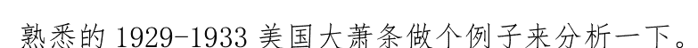
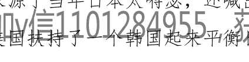
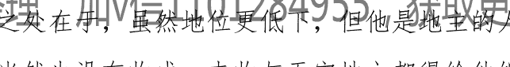
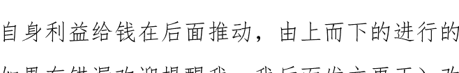
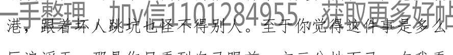
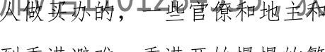

# 浅释时事，偶读新闻

注册多年一直潜水拜读各路大神贴子，最近才开始多一点点回复的互动，然后发现很多觉得在脑子里成型的想法变成文字过程中中总是表达得不甚清晰，所以想开个帖子记录自己对时事新闻的一些想法，整理一下自己的思路，也欢迎大家相互交流。

审核通过，开卉，一楼先贴几楼，我是潜水多年来我觉得我影响大的几栋楼，有些我还是反复拜读，每次重读都受益良多，后面会不会定期推一些我觉得好看的贴子。

炒个冷话，先说说华为是事件。说说这件事中事后事，以及背后展现出的对国内来说更大的各种因果。川普为了击华为，签署的法令短期内让华为很难，但同时又何恰不是让美国和华为的高科技公司非常很难。要知道目前我们看到的消息，华为作为基本拥有全套技术的备份，不仅仅芯片，甚至nm卡，超级蓝牙都有备份，这就让华为在经历过让备备变成实物以及鸿蒙推广这一段苦难时间之后，将面临涅荣重生，而美国和华为合作的公司经过这轮之后呢？只能永远失去华为为至于整个中国市场。当然你可以说没有中国也可以活下去，但是以世界工厂来说，大部分公司失去的实力不是14亿的市场，而是失去的世界工厂产能提供的所有市场。

另一个问题是芯片或者高科技行业来说，就会只会一步领先步步蹒，你有好的收入才能有更多的钱投入到新的研发，得到更新的技术赚更多的钱，流动起来的良性循环，失去一个市场并不不仅仅是少赚一点这么简单，不是基本上只能是恶性循环，特别是前期为华为的需要投入了研发，一下子断供了，等于白折了。

另一个方面，川普的行政法让大家都看到美国靠不住，无论是有能力的大企业还是国家，总不会没有想法，表面上继续贸易，背后给自己留着后路，这也是我们预判鸿蒙生态虽然一定不顺利，但一定要解决。我们是一家很有远见的基础，在很多中买过屏幕和手机后，最后发现屏幕经理的道理，击屏不容易理解，放弃三方屏去掉了京东方的，是为自己留了后路同时也扶持了国内品牌和生态。当然这也是有回报的，京东东方出来牛逼的屏以后，你想他那边首发？以后谁优先供货？甚至很有理由相信他们的合同限期是相对的一段时间时间，以稳定合作伙伴，京东东方才能后顾无忧的投入研发。

同样当友看到美国也好，谷歌也好，终究还是靠不住。合适的做法，每家友拿出自己非头部但排位靠中间的产品来推一下鸿蒙，一是给自己留路，二是给自己的影响也不大，不至于得罪谷歌，三也为了支持国人设计好消费者，一举多得，实在不想出为什么不去。至于bat这些，越多手机安装自己越好，小工作量就能配合的事情，更没有必要拒绝，毕竟这个事务政治正确的问题，这个级别的公司自然明白该如何去做。这只是其一，二是自己争气，自己的硬件出货量对于app们有足够的吸引力。也不得谷歌自己先说不合作，鸿蒙一出，就马上转口风说请求白宫批准继续合作，因为这不仅是少了国内份额的问题，导致极其成功，你觉得欧洲本土不会有想法？据说俄罗斯已经要求为出口欧洲的手机预装俄罗斯的极光系统了，这样一来，有一天谷歌就能在美洲起来自己玩了。

所以从前面的拆开会员，等到一波潮的恢复后我们可以看出：

川普这一轮杀准备华为，反噬太大，以美国国家实力的打击下，连一家公司都搞定，这黑老大以后的话语就大打折扣了；二，但凡有点规模的企业都给自己留下了条路，会在自己国家引导下，纷纷扶持自己国家软软件供应商和操作系统，而没能力的也会把鸡蛋放到几个不同国家去，最好这几个国家还不太对付就万了；三，企业层面以自己举国之力对于华为乃至中国制造做了一个大广告，国家层面，中国的形象将不再是一个大有钱，而是另一个旗帜和高科技，抬头面对面，正式成为可靠又值得抱的腿了。

当年华为手机卖3000块，iPhone卖6000的时候，全世界都觉得华为是疯了，你一个国产品牌凭什么卖3000，在华为带领下，中国手机行业走上了中高端，今天中国手机卖3-5千，没有人再说什么。也正是走上了中高端端才能赚到足够的钱，更多的投入的研发，去把整个产业推向更高的位置。今天，华为凭借这一战，稳稳站在全球科技公司第一梯队的领先地位，我不懂具体的技术，但这个品牌认知和占领消费者心智一个角度来说，花掉华为的一年营收做广告也不得效果。反观当年以科技与创新著称的iPhone倒成了时尚手机。

## 二楼
一手经理，加微1011128455，获取更多好帖
作者:kinsutopia 日期:2019-06-18 10:23
作者:kinsutopia 日期:2019-06-18 12:13
作者:kinsutopia 日期:2019-06-18 13:16
作者:kinsutopia 日期:2019-06-18 21:02
作者:kinsutopia 日期:2019-06-19 10:16
作者:kinsutopia 日期:2019-06-19 11:42
作者:kinsutopia 日期:2019-06-19 12:52

作者:kinsutopia 日期:2019-06-17 22:54:29
妙可冷饭，先说华为事件。其中一些想法在别的贴子里有一理处理，这里重新一下。
说说这件事中事后事，以及背后展现出的对国内来说更大的各种因果。川普为了击华为，签署的法令短期内让华为很难，但同时又何恰不是让美国和华为的高科技公司非常很难。

再说这次打击华为：
- 这次是全方位的一次打击，中兴那次只能是制造个筹码而已。
- 第一波是硬件断供。
- 第二波是以谷歌为主的软件和架构。
- 第三波是以蓝牙、卡联盟。

每一波背后都是美帝建立的平台，每个平台被美帝控制着行业标准。别看这些不起眼的标准，那就是通向世界的窗口。

川普的表达，只有两点：
- 1. ...
- 2. ...
- 3. ...
- 4. ...
- 5. ...

## 17楼
中共中央对外络部发言人赵磊17日在北京宣布：朝鲜劳动委员会委员、朝鲜民主人民共和国国务委员会委员长金正，中共中央、中华人民共和国将于6月20日至21日对朝鲜民主人民共和国进行国事访问。之前的中俄互访，现在的中朝互访，加上之前的朝俄，朝韩关系也往好的方向走，而日本还在强调朝鲜几十年前的绑架案，和中国没办法互关。

中国这边也开始投资海参繁殖大豆；朝鲜准备中的开发，已经进行中的“包田户”。目前可见的都只是农业类的在进行，不过东北老工业区的底子，应该是材料供地。未来几年三国交界的邻近份要开始大兴土铁路桥建港口。

## 19楼 从阿曼湾看英国
看着样子基本上东亚联合开发计划要抛掉日本起来了。中国这边也开始投资海参繁殖大豆；朝鲜准备中的开发，已经进行中的“包田户”。之前的中俄互访，现在的中朝互访，加上之前的朝俄，朝韩关系也往好的方向走，而日本还在强调朝鲜几十年前的绑架案，和中国没办法互关。

(观察者网讯)波音网站618日消息，在6月的巴黎航展上，世界上最大的航空集团之一国际航空集团(IAG)与波音公司签署了200架飞机737MAX购买意向书，价值240亿美元。IAG是爱尔兰航空、英国航空、伊比利亚航空、Vueling航空的母公司，也是世界上最大的航空集团之一，共拥有582架飞机，2018年载客13亿次该集团是波音双通道飞机的长期用户。今年早些时候，IAG承诺了一份对波音最新远程飞机777X的重大订单，补充了波音777新型787飞机。


工作，我接到家里半小时，空调自动开启，冰箱向手机发送信息，说你某某菜放的时间有点长，要赶快吃了等，这类电器其实不太需要操作系统，光是有个统一标准接口。比如网线或者别的信号交换形式就可以做到的，我觉得这样的可操作性更大。

我前面说友商理论都会拿一款不算旗舰，同时也是卖的不错的品牌支持鸿蒙，是基于这个原因，就是我要给自己留了条后路，但不代表我要放弃自己建立标准和堡垒的机会。要不要就变成他们都要靠华为了，这无疑是对于所有品牌来说，还是对华为我自己来说，都不是一个好的事情，过犹未不及。

盛而衰的道理总是有理，所以他自己什么都可以，却任王经理加：很多小伙伴听我的好处就开始走路，自己也能走得更好。而且也不需要都要有操作系统做到万物互联，目前屏幕的手机、电脑、汽车、智能穿戴、电视五个屏幕基本上已经解决了问题了。

所有的万物通过一个系统互联都是当然的理想的状态，但对于普通人来说，对于大多数生产不不同的企业来说，可能不需要这么雄伟的未来。

另外一点就是云处理，这个我大部分部分同意，因为5G的存在，肯定未来不用每个设备都需要一个大大的CPU，但是还是要一个小CPU，对于大工作计算，由云处理器解决，平时的小东西还是本地处理更快方便更可靠，一般日常生活也没有特别需要大型处理的数据。同时为了个人隐私或者可靠性来说，我还是倾向于每个家庭会有自己一个中型的处理器，这样我自己的无人驾驶车也好，自己工作生活要处理的数据也好，全都在自己掌控之中。云处理终由公司层面使用更理想。

当然这一切的发生还需要另一事情的发生，就是中国主导的量子密码的标准确定和使用，没有数据的安全保障，所有数据云处理就是把自己的公司、个人生活、甚至生命都交给云处理中心，也是一件很恐怖的事。换句话说，这不正是《1984》里面描述的老大哥的世界吗？当然我有点扯远了。

## 一手理，加v信1101284955，获取更多好帖

作者:kinsutopia 日期:2019-06-19 16:35

删帖的有奇怪呀，好像也没说说什么敏感的话题呢。能有敏感提示就好了。

那推荐两个好贴子吧。正在更新中的一个贴子，楼主从自己专业视角看中的区别，很特别也很想法的一个贴子。

五星猫贴裂推荐。

熊猫楼，这个应该大家都知道，不多介绍，不过最近转战部署了。

作者:kinsutopia 日期:2019-06-19 17:15

@mfm630127a 2019-06-19 16:48:34

中国目前部部署了五个超算中心。
- 超算世界500强，中国占210多席，领先全球。
- 云计算，目前有腾讯云、阿里云、百度云、华为云……贵州是大数据中心。
- 全球600万座4G基站，中国占了350万座。
- 未来5G基站中国将建设数千万座。

从上面的情况看，中国的数字化建设已经一绝尘……

数字化对于效率的提高也有好处，对现在生活便捷的提升也都是个好事的事情。唯年纪偏大的人来说可能不太友好，可能在数字过程中需要一些引导员对这部分人给予一些帮助。说是引导员是因为一般的使用问题家里的年轻人就会教，比如我妈妈，现在还不会用银行取扣钱，但在发微信和微信红包，微信转账很溜的。但一碰到买火车票飞机票这类，她就不会了，买的都是我代买。

有一次春运回我去改签票，旁边买票窗口有一个50左右的大哥在买票，票员跟他说他要的那站车没票了，他都快了，声音有点急又有埋恳他说要排三天了，天天买不到票。售员叫他用app买机会要大一点，排队很难排到的，他他说不会用手机买的。当天刚好看到一句话：时代会抛弃那些跟不上的人。这一次剧变的时代，要注意跟上节奏；同时也应该为那些跟上的人保留一些“落后”的方式，或者有些引导员带着他们。显然这是很难的，教过家里人用手机和电脑就有体会。

42楼 作者:kinsutopia 日期:2019-06-19 01

## 一手数据加微信1101284955，获取更多热门

数字化，对于效率的提高也有好处，对现在生活便捷的提升也都是个好事的事情。唯年纪偏大的人来说可能不太友好，可能在数字过程中需要一些引导员对这部分人给予一些帮助。说是引导员是因为一般的使用问题家里的年轻人就会教，比如我妈妈，现在还不会用银行取扣钱，但在发微信和微信红包，微信转账很溜的。但一碰到买火车票飞机票这类，她就不会了，买的都是我代买。

有一次春运回我去改签票，旁边买票窗口有一个50左右的大哥在买票，票员跟他说他要的那站车没票了，他都快了，声音有点急又有埋恳他说要排三天了，天天买不到票。售员叫他用app买机会要大一点，排队很难排到的，他他说不会用手机买的。当天刚好看到一句话：时代会抛弃那些跟不上的人。这一次剧变的时代，要注意跟上节奏；同时也应该为那些跟上的人保留一些“落后”的方式，或者有些引导员带着他们。显然这是很难的，教过家里人用手机和电脑就有体会。

@mfm630127a 2019-06-19 16:48:34

中国目前部部署了五个超算中心。
- 超算世界500强，中国占210多席，领先全球。
- 云计算，目前有腾讯云、阿里云、百度云、华为云……贵州是大数据中心。
- 全球600万座4G基站，中国占了350万座。
- 未来5G基站中国将建设数千万座。

从上面的情况看，中国的数字化建设已经一绝尘……

数字化对于效率的提高也有好处，对现在生活便捷的提升也都是个好事的事情。唯年纪偏大的人来说可能不太友好，可能在数字过程中需要一些引导员对这部分人给予一些帮助。说是引导员是因为一般的使用问题家里的年轻人就会教，比如我妈妈，现在还不会用银行取扣钱，但在发微信和微信红包，微信转账很溜的。但一碰到买火车票飞机票这类，她就不会了，买的都是我代买。

43楼 作者:kinsutopia 日期:2019-06-19 32

45楼 作者:kinsutopia 日期:2019-06-20 13


黑脸让人费解的一系列的行为。高通、谷歌、微软、arm纷纷扬言要断供华为，arm甚至停止了交流，以华为为偷取技术。换句话说，这不正是《1984》里面描述的老大哥的世界吗？当然我有点扯远了。

当然这一切的发生还需要另一事情的发生，就是中国主导的量子密码的标准确定和使用，没有数据的安全保障，所有数据云处理就是把自己的公司、个人生活、甚至生命都交给云处理中心，也是一件很恐怖的事。

46楼 作者:kinsutopia 日期:2019-06-20 11:24

《求是》杂志发表重要文章《坚定文化自信，建设社会主义文化强》

一手数据加值1101284955 获取更多好帖

昨天看到上面41楼网友发的内容就在想一个问题，中国数字化建设速度是足够快了，也让中国人民感受到所未有的生活变化。或者放到更长的一个段时间去看这个问题，从改开开始，中国从计划经济慢慢过渡到计划市场两条并行，并取得了巨大的成就，人民生活也得到了巨大的高。

数字化带来一个问题是现有岗位减少。如果解决这个问题就需要要的导向或者催生新的行业。数字化带来一个问题是现有岗位减少。如果解决这个问题就需要要的导向或者催生新的行业。

47楼 作者:kinsutopia 日期:2019-06-20 13

48楼 作者:kinsutopia 日期:2019-06-20 30


49楼 作者:kinsutopia 日期:2019-06-20 50

51楼 作者:kinsutopia 日期:2019-06-21 08:45

52楼 作者:kinsutopia 日期:2019-06-21 11:54

(观察者网讯)据波音网站6月18日消息，在6月18日的巴黎航展上，世界上最大的航空集团之一国际航空集团(IAG)与波音公司签署了200架波音737MAX购买意向书，价值240亿美元。

IAG是爱尔兰航空、英国航空、伊比利亚航空、Vueling航空和LEVEL航空的母公司，也是世界上最大的航空集团之一，共有582架飞机，年载客13亿次该集团是波音双通道飞机的长期用户。今年早时候，IAG承诺完成了一针对波音最新远程机型777X的重大订单，以补充其当前的777和新型777梦想飞机组成的机队。

@kinsutopia 2019-09-19 11:42:06

看来波音是真的动不了了，都会找麻烦了，哈哈哈哈，这波波音新闻又是操作估计是下了本的。只是现在他们公关都开始当经理，增加不可预测性，给钱货运还很远的，就光看这家英国公司，发展到目前的规模共才不到600架飞机，这600架飞机肯定是适合同距离会有大小不同机型和品牌的组合的，就这样一家公司，会一次签200架单一机型的飞机。

55楼 作者:kinsutopia 日期:2019-06-21 57

56楼 作者:kinsutopia 日期:2019-06-21 49

61楼 作者:kinsutopia 日期:2019-06-21 12


75 楼 
作者:kinsutopia 日期:2019-06-23 21:30
{IMAGE}http%3A%2F%2Fimg3.laibafile.cn%2Fp%2F1%2F309864703.png {EIMAGE}

76 楼 
作者:kinsutopia 日期:2019-06-23 21:31
{IMAGE}http%3A%2F%2Fimg3.laibafile.cn%2Fp%2F1%2F309864708.png {EIMAGE}

77 楼 
作者:kinsutopia 日期:2019-06-23 22:22
一手整理 加信1101284955 获取更多站点
靠谱刚从74楼78楼来看带字的帖子的就比较多，看来以后只能发图片了啊。

81 楼 
作者:kinsutopia 日期:2019-06-24 10:40
涵叔，涵叔有个灵异的事情，我昨天打开贴子看到的是5300的点击，130的回复，今天打开就变成3900的点击 109回复了。
{IMAGE}http%3A%2F%2Fbq.tiany.com%2Fd%2Fjy.gif {IMAGE}

82 楼 
作者：kinsutopia 日期:2019-06-24 11:37
当地时间 6 月 22 日，PC Magazine 首席分析师塞根（Sascha Segan）在其社交媒体更新了上述事件进展，称联邦快递再次发来声明，表示手机是被“错误地退回”给发件人，“我们为这次错误操作道歉。”

塞根指出，联邦快递的前后表述自相矛盾。此前，联邦快递首次回应该事件时表示，华为及其 68 家全球子公司被列入“实体名单”，故公司不能投递。


处理，加微信获取更多好帖
作者：kinsutopia 日期:2019-06-24 11:37
联邦快递拒绝为美 IT 杂志寄送华为手机一事又有新进展。
当地时间 6 月 22 日，PC Magazine 首席分析师塞根（Sascha Segan）在其社交媒体更新了上述事件进展，称联邦快递再次发来声明，表示手机是被“错误地退回”给发件人，“我们为这次错误操作道歉。”

塞根指出，联邦快递的前后表述自相矛盾。此前，联邦快递首次回应该事件时表示，华为及其 68 家全球子公司被列入“实体名单”，故公司不能投递。

连一家公司都想两边骑，这也是醉了。一边不得不遵守法令不能发件，一边又不想放弃中国市场，亲还是回去吧，在顺丰的跨国发展起来之前 dh先用着好了。

84 楼
作者:kinsutopia 日期:2019-06-24 11:41
{IMAGE}http%3A%2F%2Fimg3.laibaile.cn%2Ffp%2F1%2F309874912.png {IMAGE}

85 楼 
作者:kinsutopia 日期:2019-06-24 14:26
02 一手整理。加微信1101284955获取更多帖。

亮面授课，内推以避免，我知道要最通用的发行自己的货币在很让人有信心。要让我收这个当工资，我肯定不干，谁知道明天你给的这个数字货币还能再换成大米和房？这里分成两个点来讨论：

第一点，信用问题。我们可以看到这种非货币的 libra跟比特币两个不同点在于，它不是无根之源，我说值多少，你们用吧。而是有实物抵押的，你100块钱的 libra背后后有实在现在值100块的东西对应，我不知道他们具体是什么，简单一点就是直接各个国家用本币对应的自己的汇率直接充值，这是最容易建立信任的方法，当年你买Q时，从不用担心Q换不回来新表情和QQ秀。不过 libra 对应的并不是这些，而是日常我们需要买卖的东西。和比特第二个不一样是 libra 不会同时又是货币又是商业本身被炒作，这种波动的东西不可能成为流通的货币。

第二点，安全问题。你看不到实实的数字货币，万一黑客，信息被盗之类的怎么办，所以非货币用了区块链技术来保证安全性。这是很重要的，特别是前面他们公司出过信息泄露事件。

以上两点做到后，运行上几年，基本上市场上就不会再有任何人来质疑这个货币的信用问题。那么有一个信用的货币，万事大 VISA, PayPal，还有中国全球最大的基本人群（非银行的用户）你就可以将其他和其他货币化起来，有多数容易就知道了。并且非常好，那里都能用，不用汇率，随意的，这世界上最好的货币了。

87 楼 
作者:kinsutopia 日期:2019-06-24 14:26
03 有一天，非货币有了几年使用后，宣布不再需要支付，因为货币本身就是信用嘛，那非货币成为全球最大的银行，而且还是不受政府监管的。当然，他也不一定是要替代全球的货币，只要每个国家占有一定份额，到好处都可以随时使用。


足够了。小小心一点，只是做个跨国版的支付宝或微信支付大一点。也不是轻松就能成功，Libra 还需要几个点，首先你要花钱的渠道，这里还要电商、快递、无人机、移动支付等配套才更好的目前的网络，显然更要努力。只是他企业家这个心思，不只是动命，里面有政府的影响，要么有一群资本支持了他。

88 楼 
作者：kinsutopia 日期：2019-06-24 14:27
我自己已经备份好了。
{IMAGE}http%3A%2F%2Fbq.tiany.com%2Fd%2F1h.gif {IMAGE}
{IMAGE}http%3A%2F%2Fimg3.laibafile.cn%2Fp%2F1%2F309879794.png

89 楼 
作者：kinsutopia 日期：2019-06-24 14:27
{IMAGE}http%3A%2F%2Fimg3.laibafile.cn%2Fp%2F1%2F30987809.png

90 楼 
作者:kinsutopia 日期:2019-06-24 14:27
{IMAGE}http%3A%2F%2Fimg3.laibafile.cn%2Fp%2F1%2F309879813.png

91 楼 
作者:kinsutopia 日期:2019-06-24 14:28
最近难得清闲，摸了几天鱼，后面要忙一些了。

92 楼 
作者:kinsutopia 日期:2019-06-24 15:50
2019-06-24 15:22:22
时势造英雄。时势立货币。
中国国力到了国运来了，所以华为的“鸿蒙”未来跨界操作系统才成立。美帝走下坡路，国家信用到处漏气，这时想弄一个统一天下的数字货币，能成？当然不好，要大家都来弄了。不过这个倒是期待，看一眼老美金融的手段。另外，虽然趋势上是一个向上，一下向下，老美实力还是要强于中国不少。最好用几十年等到他弱我们强，这样日子都过的轻松点。速度快了，对我们来说也不是好处，容易引起强烈及局部战争，后面中国能扶一把的话，应该扶一下，不会让老美破落快的。

95 楼 
作者:kinsutopia 日期:2019-06-25 09:46
比尔·盖茨承认犯下高达 4000 美元的“天大错误”。那些还在说系统免费的安卓免费的可以看看这个。不利起早，做系统的利益、收益到我们这些阶层的人无法想，加v获取更多好帖。

97 楼 
作者:kinsutopia 日期:2019-06-25 09:52
吴古东被查，不大小的级别，没什么特别，只是在简历最后有一句有意思的，去年退休。所以康师傅结束了刑不上大佬这个规则，吴古东结束了安全退休这个规则，贪腐会被追溯。
{IMAGE}http%3A%2F%2Fimg3.laibafile.cn%2Fp%2F1%2F309900272.jpg{IMAGE}

98 楼 
作者:kinsutopia 日期:2019-06-25 09:53
交换意见，保持沟通，就是没有任何进展，反正都不会让步，先拖到以后再说。
{IMAGE}http%3A%2F%2Fimg3.laibafile.cn%2Fp%2F1%2F30990330.jpg

99 楼 
作者:kinsutopia 日期:2019-06-25 15:15
最近一年多芯片制造的新闻不少，光刻机等芯片制造，台积电只要不掉，就是自己行了，国内不需要得了，国产机器还有距离，客观地说目前只需要一点时间，台积电就会短时间内被替代。在国内疯狂追赶，一旦追上，也没有什么事。

100 楼 
作者:kinsutopia 日期:2019-06-25 10:15

101 楼 
作者:kinsutopia 日期:2019-06-25 11:49
- 1，国企是红色政权的重要支柱。
- 2，国企是党和国家对内、对外路线的带头执行者和践者，引领经济发展和变革、推进社会治理。
- 3，以国企为核心的“行业管理+银行”是当今世界上唯一和西方资本抗衡的模式。
- 4，国企是党和国家专业人才、复合型人才的重要培养基础。
- 5，国企是履行社会责任和国家战略任务的重要承担。近几年国企出去的步法还是明显的，目前更多集中在中建、中铁、电网这些基础设施。国内成为了电网后，也开放了民企进入，预计将来将会开放。这时国家要抓住局面，以及标准定制，发挥作用，与民竞争，同时也能掌握控制权。

作者:kinsutopia 2019-06-25 12:25
被老头骗了5000多，怎么办？还有3000没开始吧，也有同等的反制呀，按看到的信息看，目前势均力敌呀，而且老头先打电话继续聊天，不一定我们输。这钱只要中国货不减价，他们没有替代品就都是国民消化了。所以事实上老头讹自己骗钱，对我们的影响是卖得以前多了。飞机可以坐，内裤还挺穿不是？

111 楼 
作者:kinsutopia 日期:2019-06-25 17:10
http://www.xinhuanet.com/world/2019-06/25/c_124668361.htm 全文链接
新华华盛顿6月24日电（记者熊茂伶）美国一些超级富豪24日发布联信，呼吁参加2020年总选大选的两党竞选人支持美国最富有的千分之一群体征收适度的“富人税”。该联信由包括迪士尼家族继承人哈比盖尔·迪士尼、脸书联合创始人克里斯托·斯蒂普，以及著名投资人乔·索罗斯在内的18名超级富豪联名签署。美联储最近的调研显示，过去30年来，美国报告的1%群体财富增长了210亿美元，而美国财富字塔部的50%群体财富则减少了9000亿美元。美联储鲍威尔5月初表示，美国中产阶级面临收入增长更慢、向上流动性下降等挑战。20世纪70年代以来，美国中产阶级收入增长速度低于高收入阶层，令收入不平等现象恶化。
第一第二段：富人呼吁2020年候选向富人征税，而我们知道川普是给富人人减了税的。所以这班人的意思就很明显了，我们是不满意川普的，有能力的争取支持。
第三段：富人回流机制出了问题，财富一直流动，严重缺乏流动，这样中产迟早破产。应该给下层留一条活路，让美国越来越走不下去了。看太烂，毕竟是第一国，理论上应该会找一个代表利益的人站台。评论他是坏坏，相反最近的表现我觉得有点做过自己认为“对”的事。以前有些群，比如巴黎协定是为了国内能源发展起来。文化那个什么群是为了以色列出头，都是为了幕后老板。最近伊朗这件事后以后军的代表博尔顿的意思，应该上，却被他拦住了，也许有一个强烈优势和自豪感，想让自己保持这种感觉也不是可能的。创新是创新的基础，知识产权问题政治化会威胁全球技术的进步。

117 楼 
作者:kinsutopia 日期:2019-06-26 14:41
这年头，地主也没余粮喽，你们玩不起了。
{IMAGE}http%3A%2F%2Fimg3.laibafile.cn%2Fp%2F1%2F309936725.png {IMAGE}
{IMAGE}http%3A%2F%2Fimg3.laibafile.cn%2Fp%2F1%2F309936732.png

119 楼 
作者:kinsutopia 日期:2019-06-26 14:43
工信部同意中国互联网网络信息中心设立域名根服务器及域名根服务器运行机构
获享到:34
2019-06-26 13:27:28 来源:观察者网
关键字：
(观察者讯)据工业和信息化部信息中心微信@工信6月26日消息，工信部批复同意中国互联网网络信息中心设立域名根服务器（F、I、K、L镜像服务器）及域名根服务器运行机构。
同意该中心负责运行、维护和管理编号分别为JX0001F、JX0002F、JX0003I、JX0004K、JX0005L、JX0006L的域名根服务器，并要求其严格遵守《互联网域名管理办法》《通信网络安全防护管理办法》及法律法规、行政规章及行业管理规定。


作者:kinsutopia 日期:2019-06-27 17:53

## 737 MAX 被拔出 4 个系统漏洞，美联航瞬间取消 1900 个航班

徐乾昂

2019-06-27 10:55:43 来源:观察者网

### 放弃出行高峰，三大客户集体延长飞行至9月

复机遥遥无期，漏洞层出不穷。FAA宣布找出波音第四个系统漏洞不到2小时，美联航在官网上发表声明，宣布延期旗下737MAX机队限期1个月，到9月3日。这意味着航空公司将在8月取消约1900个航班。

一手数据：加信获取更多好贴

波音说bug是自己找出来的，别人找出来是错的。把自己知道但不理想的bug挑两个出来来说，没办法啊，自己说出来总比别人出来找给人的态度要好一点，指出几个漏洞再让波音复去，以示严谨，专业，不徇私，也是FAA恳求，先重重建自己的权威。我FAA好起来了，还怕波音日后好日子过不去，兄弟黄镜继续配合着我演吧。

122 楼

作者:kinsutopia 日期:2019-06-28 11:43

{IMAGE}http%3A%2F%2Fimg3.laibaife.cn%2Ffp%2F1%2F30991590.png {IMAGE}http%3A%2F%2Fimg3.laibaife.cn%2Ffp%2F1%2F309991591.png {EIMAGE}

# 124 楼

作者:kinsutopia 日期:2019-06-28 14:19

{EIMAGE} http%3A%2F%2Fimg3.laibafile.cn%2Fp%2F1%2F309996362.jpg {EIMAGE}

几年前中日韩就应该该谈的自贸协定，一直被破坏了控，上一次钓鱼岛事件更是双方破坏巨大，所以这次先管控做好分歧，后面才是重谈协定。东北亚5国与三国已经开始了，中日韩有狗链在身的要快快步了，所以跟韩谈时不要被外部势力左右它。

# 126 楼

# 一手数据，加微信1101284955 获取更多帖

作者:kinsutopia 日期:2019-06-28 14:58:55

光三天就有二驾，拳头5国，中俄印，中非四个区域会暗，加上前面的亚信，上合，亚投行，拳头银行，一带路等，像像是一个不同维度，区域的小根据地，有金融，有贸易，有军事，有政治，综合的，在一个小小根地里做强做大，然后再慢合并，比如亚信不是融到上合了？不知道，星星之火洒遍全球，让火在不同地点先烧起来，总有燎原的一。

# 127 楼

作者:kinsutopia 日期:2019-06-28 16:01

加麻大的伪造证书真是搞笑了，弃车保姆呀，这样就把


责任推给出事的企业，而不涉及其他没出事的企业，同时也为自己的检验部门保留点面子，不要像FAA一样，以后的检验都不信人，那么这个农业出口国就得改加麻为加大麻了。。

128 楼 

作者:kinsutopia 日期:2019-06-28 16:10

朝日日本共同社 28 日报道，特普在会议开始时向安倍表示，“我们将协商有关贸易问题、军事安保，以及（希望日本）多采购武器装备等议题。

两人针对伊朗局势、朝鲜半岛无核化、朝鲜绑持日本人、美朝邂逅、针对伊朗局势、朝鲜半岛无核化、朝鲜绑持日本人、美朝邂逅、美国贸易等。

翻译一下：川普曾在会议开始时表示，我们主要是要你们多卖东西，以及日本提出的：特朗普对美国表示不满，将争取更多好东西，美国买吗？但特朗普拒绝了。


129 楼 

作者:kinsutopia 日期:2019-06-28 10:10

@烟雾镜 2019-06-28 16:39

# 经济危机与金融危机

深刻谈谈美国衰退，回顾：
- 美元霸权
- 黄金
- 大宗商品
- 贵材料定价
- SWIFT体系
- 国际支付体系
- 贸易体系（WTO）
- 世界银行等组成的一个综合体系
- 美国通过美元霸权掌控世界源源不断的收益
- 国防
- 军事
- 预算
- 就不惜武力倾覆

### 军事，军事，觉得有点像，跟内容无关，好，很多名词和概念。楼主只是自己尝试学习，看看，具体是说什么，不过让我懂了，但是错百出，让我有了想法，用自己的语言去理解一下，也是梳理的过程。

132 楼

作者:kinsutopia 日期:2019-06-28 22:28

先说一下，楼主是个文字不好的文科生，以下说的都是相对专业的东西，建议自己找资料学习，楼主只是自己尝试学习，肯定会错漏百出，只是一个思考过程，慎重慎重。

# 经济危机与金融危机

先一看经济危机是指资本主义再生产过程中周期性爆发的生产过剩的危机。这种生产过剩不是绝对过剩而是相对过剩，即对于劳动人群有支付能力的需求和资本价值增值的需要而言的过剩。所谓的相对过剩，人话就是我没钱买你出来的商品了。

### 逻辑是不是更顺畅

穷人的为什么没钱买了呢？我们尝试从大家比较，熟悉的1929-1933美国大萧条做个例子来分析一下。看资料介绍，大萧条是1929年，老老的股市崩溃，人类生活水平降；农产品价格下跌，很多人面临破产。想想一层，故事才会引起大批行业倒闭？然后企业破产？最后传到工人失业。这一点说通。股市崩溃只是我们投入股市的钱没了，大不了过日子省一点。正常的应该是先是工人失业，然后大量商品积压，最后工厂破产，银行收不回坏账从而倒闭，最后才是空中楼阁的股市崩溃。



久（这样说是为了严谨，其实就是想了两分钟）突然脑袋上的灯泡一亮：会有大量新技术应用呢？然后之后就查了一下资料（其实就是百度了一下）我们看一看这一组数据：1913年，美国汽车公司开始建立生产流水线，12小时28分钟组装一台汽车；1920年缩短到1分钟；1925年又缩短到10秒。再回一下20-30年代最大的电影明星卓别林，基本上就是大工业机器时代作为背景进行的。一战催生的新技术快速转为民用。一战结束，欧洲各国损失巨大。

# 王建理 加微信10128455 获取很多好占

规模上，我应该可以尽量避免这种由于技术导致的工人失业，导致这样的结果：当时的机械化、流水线的规模应用，让大量的工人失业。这大量的工人工作以后，浪费不起这些商品，又让商品大量积压，让工人不得更多的工人。商品卖不出，扩大的规模和之前银行的贷款无法偿还，那么是银行大量破产，体现在股市上才是崩盘。

再回看俄罗斯复，稳定金融市场和银行信用，最有效的措施就是国家大量修建基础设施，公路水坝等，是当时的美国需要这些东西吗？不是，是建造这些需要的工人技能最低，同时能提供大量的工作岗位。虽然这些设施后来美国经济产生的正面效应应该是很久后的事了，对于1933来说，让人们有工作，有钱买东西，有饭吃，工厂就可以开工。

### 总结崩溃的逻辑

1. 新技术应用（机械化、流水线）导致工人失业。
2. 工人失业后购买不起商品，导致商品积压。
3. 商品卖不出，企业亏损，银行贷款无法偿还。
4. 银行破产，导致股市崩溃。
5. 政府为了应对，通过大规模修建基础设施（公路、水坝等）创造就业。

### 互联网的影响

看起来没那么危机。能缓冲的时间更长。再加上2008年以来，或说2002-2004以来，中国诞生的电商公司。比如电商，一方面击败了实体店铺，但他个人就业也做出了贡献，而且你看以前逛街的服装店，现在现在的吃喝玩，体验店。街上卖的东西就不一样了。没真正冲击到人逛街。相反街上人并没有过去，少的是家里做饭的人了。而互联网企业，特别是美，饱了电商他们吸收和解决了真正的问题。老的产业没有，昨天电子厂，今天就能做骑手。

### 消费降级

对于你的不敢买，离你最近的消费降级似乎在看着新闻报道，卖衣服的数量在减少。数据双十一，618，再看以前拿个保温杯，出门喝水不用钱，现在每天买饮料，多少奶茶桶。或者我爸爸妈其实在外面吃饭，都家里做，现在40以下，在外面吃饭的比例等等。

对于中国商品来说，欧美老外没有钱，其实不是中国商品有竞争力的时候。我们得正视我们大部分商品处于中低端，所以他们买不起高端品牌，我们反而是东西了。另一个角度，奢侈品、高端品牌可以少买，日常用品必须一直买。如果来自中国的商品，他们都买不起的时候，那么他们真的是彻底了。

### 楼主的回复

# 136 楼 

作者:kinsutopia 日期:2019-06-29 23:16

@kinsutopia 2019-06-28 22:28:07

先说一下，楼主是个文字找不好的文科生，以下说的都是相对专业的东西，建议自己找资料学习，楼主只是自己尝试学习，肯定会错漏百出，只是个思考过程，慎重慎重。

# 经济危机与金融危机

先一看经济危机是指资本主义再生产过程中周期性爆发的生产过剩的危机。这种生产过剩不是绝对过剩而是相对过剩，即对于劳动人群有支付能力的需求和资本价值增值的需要而言的过剩。所谓的相对过剩，人话就是我没钱买你出来的商品了。

@苹果大伯 2019-06-29 15:17:06

楼主对经济危机的理解的确独一无帜，入木三分！十分同意“大量的失业是造成经济危机的前奏和根源”的观点。这可能是政府在中美贸易战中并不在华采取行动。感谢支持。

楼主原创的观点其实不多。特别是前面的影子，楼主把贴子当作学习过程。

### 楼主的观点

论同也可以，只要自己思考，得出明明的答案就行，会练习多了，形成自己的见解，会有系统化的理解。

# 137 楼 

作者:kinsutopia 日期:2019-06-29 23:36

李克强同荷兰首相、联合国前任秘书长潘基文共同出席全球峰会中心办公室揭牌仪式。2019-06-28 来源:新华网

一手办理，加微信110128495 获取更多帖

http://www.xinhuanet.com/politics/leaders/2019-06-28/c546805.htm

气候协定也好，碳排放也好，都是欧洲发达国家为了发展积极的。回头看中国近两年对新能源推动的动力。

# 138 楼 

作者:kinsutopia 日期:2019-06-29 23:48

wangkaiwen@guancha.cn

2019-06-29 16:19 来源：观察者网

一手处理。刚刚结束的G20峰会落幕。后，美国总统特朗普在大阪召开记者会，说明两国峰会的成果。特朗普表示美国企业可以继续向华为出售零件。

关键词：特朗普 华为

(观察者网讯)特朗普：“美国企业对于无法把产品卖出去感到不满”。

对此，中国外交部G20特使、国际经济司长王毅表示，美方有可能解除对华为的一些限制。如果华为说到的的话，“我们肯定是欢迎的”。

是不涉及重大国家问题的设备。假如若是消息也是个顺人情而已。美国国内都要造反压不住了。见面顺利这个消息，对股市大利，看来美股又能蹦跶两天。

# 139 楼 

作者:kinsutopia 日期:2019-06-30 22:34

1964年10月出生沙野于1987年进入外交部工作。2017年2月28日抵达华，出任中国驻加拿大特命全权大使。外交部发言人耿磊月5日回应关于中国驻加拿大大使记者有关问题，中国驻外大使任命接受程序。至于你关心的具体问题，目前我没有这方面的消息。后续关注一下有没有继续任大使到，如果没有，就是暗示下调外交关系了。所谓的任免经过一定程序就是操作的空间，做得好了，时间短一点就上任了，要不就不知道哪天才会走程序了。

# 144 楼 

作者:kinsutopia 日期:2019-07-02 00:04

以色列列宾叙利亚后，叙军S-200导弹落入北塞浦路斯引发大火

# 郭涵 Rock, Paper, Shotgun

2019-07-01 23:01:10 来源:观察者网

叙利亚国家电视报道，当地时间1日凌晨（北京时间5时），至少有10架以色列战机从黎巴嫩空域向叙利亚大马士革与霍姆斯市发射了导弹，造成至少4名平民死亡，21人受伤。叙利亚军对部队进行了反击，至少击落三枚导弹。期间，一枚导弹在北塞浦路斯境内摧毁并爆炸，幸未造成人员伤亡。

“北塞浦路斯土耳其外交长”尼尔塞尔在新闻发布会上表示，经初步分析，这是一枚叙利亚军方发射的S-200防空导弹，在错失目标后落在当地北部尼基亚特尔北部

# 主：关注更多

加微信1101284955 获取更多好占

对于你的不敢买，离你最近的消费降级似乎在看着新闻报道，卖衣服的数量在减少。数据双十一，618，再看以前拿个保温杯，出门喝水不用钱，现在每天买饮料，多少奶茶桶。或者我爸爸妈其实在外面吃饭，都家里做，现在40以下，在外面吃饭的比例等等。

对于中国商品来说，欧美老外没有钱，其实不是中国商品有竞争力的时候。我们得正视我们大部分商品处于中低端，所以他们买不起高端品牌，我们反而是东西了。另一个角度，奢侈品、高端品牌可以少买，日常用品必须一直买。如果来自中国的商品，他们都买不起的时候，那么他们真的是彻底了。

待。

# 148 楼

作者:kinsutopia 日期:2019-07-02 00:49

@爱爬山山 2019-06-30 11:21:24

美国做的一切经济上对中国的高压震慑的手段，无非就是要达到让自己不输中国的目的。目的达到，当然高压手段也就撤回，非常正常。上次中印边境修路纠纷，印度也曾强行越界出高压手段，目的就是一个，不准中国在中国那个位置修路。最后，中国以放弃在该位置的高超手段成功使得印度撤退。中国完美。

这次，中国用同样的方法，追迫美国解除对中国的各种经济制裁。

王处理 加微信101284955，获取更多好帖

外交，是一门妥协的艺术，我们已经运用的如云流水。

```
https://www.guancha.cn/politics/2019_07_01_5077
```

61.shtml

美放松对华为禁令因素因中方让步？外交部：中国得不让吗?

2019-07-01 18:19:44 来源:澎湃新闻

前面有在下面评论这位网友的回复，刚好看到这个，再转发一下。

# 149 楼

作者:kinsutopia 日期:2019-07-02 10:04

{IMAGE}http%3A%2F%2Fimg3.laibafile.cn%2F%2F1%2F310086119.jpg {IMAGE}

来自

150 楼

作者:kinsutopia 日期:2019-07-02 10:18

中国移动董事长杨杰: 明年 NSA 手机不可入网。

中国经营报

06-26 16:39

关注

一手聚焦: 加微信 1110284955，获取更多好帖

6月26日，在GTI2019峰会上上海，中国移动董事长杨杰表示，希望能够进一步加快5G技术成熟。主要原因是，明年1月1日开始，5G终端必须具备SA模式，这意味着明年NSA手机不可入网。

《中国经营报》记者了解到，所谓SA是5G独立组网，NSA则是4G、5G融合组网。

这条旧闻有点意思。
简单说一下就是华为是支持nsa sa双模式。高通只支持nsa。

来自

151 楼 

作者:kinsutopia 日期:2019-07-02 12:05

香港强烈谴责极端暴力行为 林郑月娃:对违法行为将追究到底

2019-07-02 10:11:06 来源:央视新闻客户端

------

实话说，只要是散步，还真不好好弄，就是要等你动手，动手了，阿sir做什么都合情合理了。也让群众觉得你是无理取闹还有手。

归根结底还是要从娃娃教育抓起，还有法律界那些老外。

152 楼 

作者:kinsutopia 日期:2019-07-02 17:28

还是有点搞不太懂跟贴的原则，明显有收带风向恶心人的崩溃，讨论一下事情就全乱了。

156 楼 

作者:kinsutopia 日期:2019-07-03 12:18

力阻美联储加息？特朗普又挑了两名鸽人士

2019-07-03 11:53:56 来源:观察者网

在不希望美联储加息的情况下，美国总统特朗普又挑了两个名“鸽派”。

这个时候还在内耗，真是“权力制约”的典范啊。川普为了救市到到处，又是造访朝韩，又是放风说要解除芯片限制。结果后自己准备放火了，不过这么明显的讲，美联储没干什么他人的，老头也是个实诚人。

人工智能漏洞，阿迪达斯哥伦虚拟球衣印上了“希特勒无罪”

2019-07-03 10:43:27 来源：观察者网

不为称洗净他。但老老和包皮时不时的的提醒一下欧洲人，德国经历过什么，让你想统一欧洲，让你想统一欧盟。看多事觉得黑光足够强大，政治还是最重要的标签。了是有时比低比较险，比如俄乌特大撤退之类的。

说真的，要是元首当时不发去打母熊和英国，就专注在中西欧，怕是高考要考语数德。也像欧盟现在这样，搞成不成不的四不像。

157 楼 
作者:kinsutopia 日期:2019-07-03 19:01

亚马违逆卖纸质书，看到这个消息还是有点小忧愁。当京东还在卖纸质书。所谓的信息时代也已经来临。说不上是更好还是不好，只是习惯了了一些方式，总是会有留恋吧。

158 楼 
作者:kinsutopia 日期:2019-07-03 23:29

前面说起，再说句，美国总统说的，欧洲统一难。先看看这几点，再对比一下。不是说要按中国那一套来，而是表面上的局势那么一点。

- 全国推行郡县制。除了分封，设了郡县，保证了中央集权对地方的控制力。这个好处我想知道。
- 欧盟现在恐怕无法做到的，就算统一也将联邦制，各联邦较大的自治权，因为每个国家都有自己的小利益，要放弃自己手上的利益换全欧洲的利益，在这个现代文化语境下，基本是不可能的。
- 统一文字。这其实是共识了，当年统一到日本，法国也开始学德，丢了自己的文字，只需要两个人就能同化。
- 统一量衡。他们有比较统一的标准，加上重量、电压、长度等单位，基本解决了。主要是为了全欧洲的工业化，商品流通做铺垫。
- 统一货币。这个解决比较好，因为有欧元。这个角度来说，搞脱欧倒是好事，终于内部统一了。
- 法律。这个应该比较统一，毕竟大家都是圣母，对这个认识的标准应该差不多了。
- 共同敌击匈。这个点背后有两个考量：一个是统一的军队和指挥权；二，有一个共同的敌人能凝聚向力，先放下当下的小矛盾。因为欧洲军队的事，老美没打算挨打，法国弄了个黄甲，至今没解决。还有怎么把北欧弄走或者直接升级自己的军事中心。第二点假想不是老美就是中国，当年统一的是几百年前的一堆自治国家，不是快速融合一个统一的国家。不是现在人民意识这样的个人主义和自我追求，乱求安稳而已，不存在民意问题，相对于大圣母的欧盟，那个统一的条件还好。

159 楼
作者:kinsutopia 日期:2019-07-03 23:54

俄罗斯核潜艇事故，流言很多，不知道应该相信哪个版本，不过有些基本东西还是可以分析出来的。潜艇上有 14 个人，其中 7 名是上校，潜艇可以潜到 6000 米深，这个是比较确定的信息。由这个信息我们也可以分析出……

一要的心眼并没有被人指责，反来说就是神的旨意，因为先知说过，将来的要服侍小的。而后来，以扫的后代就是约旦人，雅各就是以色列，所以就是老皮的祖先。中东那王帝国就是这样的，全是亲兄弟。从祖先的行业和家教就能知道以色列是些货色了。

# 163 

作者:kinsutopia 日期:2019-07-05 10:58

因为半导体被日本制裁，韩国发起抵制日的倡议。怎么说，日本人应该觉得很好笑吧，除此之外，实在想不到他们能有什么反应。要想说市场作为武器反击，是要看实力的。三星出货量很大，本可以来当筹码，可是完全没有。韩国愤怒，除了电子业外，没有任何其他渠道对日本影响。一个几十万的市场，大部分是自产自销，对日本来说其实没有，当目的达到后，还是和三星做生意，钱还是要廉。韩国今天的局面的无底，没反省自己已犯罪，朴惠当时时样又不可卸责任，跟人签订协议，这种协议精神分裂了。

# 164 
作者:kinsutopia 日期:2019-07-05 11:10

一手整理，加微信101284955，获取更多好帖

美国总统说的真不是随便说的，和欧盟的走向越来越一致了。不过脱离欧盟后，如果不跟美国走，恐怕海军协助扣押油轮，西班牙；美国国指使。2019-07-05 09:26 来源:观察者网只能叫外长，在香港问题上恶心一下中国，以示影响力。

165 楼 
作者:kinsutopia 日期:2019-07-05 11:16

英国会不会“制裁”中国？英外交大臣不答。2019-07-05 09:06:29 来源:观察者网

这个记者也是不懂事，打人还不打脸呢。这不是想不想的问题，而是能不能的问题。恶心的话张口就能来几句，制裁是要有的实力和能承受反制的。别逗老佛了，有心心思不如放弃些福利给联邦的。

166 楼 
作者:kinsutopia 日期:2019-07-05 11:31

美国政治：你试图耍美国议会等很多国家吗？2019-07-04 18:23:48 来源:观察者网https://www.guancha.cn/politics/2019_07_04_508216.html

原文大家可以看一看，说这些话的人是前议员。所谓台上的那些人说胡话不是他们脑子不好，而是他们自己的利益。下台没有相关利益后，说话就正常了。

167 楼 
作者:kinsutopia 日期:2019-07-08 15:28

限期已至，伊朗宣布缩缩丰度将超过伊核规定

# 2019-07-07 15:48:31 来自：观察者网

摄影社7月7日报道，伊朗政府发言人阿里·拉比比(Ali Rabiee) 7日在德黑兰宣布，伊朗浓缩的铀的丰度将会超过伊朗核协议中规定的3.67%。

在新闻发布会上，伊朗官员还表示，除非伊朗核协议签字能够采取措施保护伊朗免受美国制裁，否则伊朗将将会每60天停止一部分伊朗核协议内容。

简单的博弈。伊朗的目的中最好是有核钱(发展经济);次好是有钱，或者有核；最差是没钱，没核。在上一轮博弈之前没有把核搞出来，那么最高目的已经不胜利，只能争取第二个目标了。有钱和有核这两个备选项中，有钱(发展经济)是要靠前一点的，在老美拆了协议之后，伊朗跟美国直谈可能不可能，转而把压力推给了欧洲，让欧洲推动美国取消协议。同时也是后面跟结束后，时间到了之后，我再重启浓缩也不全是我的错。反正目前我不进行浓缩都是得到最差的结果：没钱没核。


推动新能源，公共交通基本全是用了，还有新能源私家车。

五、发展核电，第四代核电站说是领先了，还无污染的。还有一直在烧钱实验中的人造太阳，已经开辟的船舶核电动力等。让石油的占比下降一点，在某些领域强用电，国内的电目前还是以燃煤电为主，也不在石油被抬杠子时基底民生会受影响。

第四、加快自身勘探。最近新疆又发现一个油田之类的新闻。

第五、上海油期货市场。这个我没有去了解过，如果把结算强制放在国内，不知道是否可行。那国内就要长期有量储备存储。

第六、加快电力备用的电量。目前煤量是不够，缓冲时间还是有点短的。

水方面我了解不多，之前说过西北水源的事儿我觉得，只是人的感觉可能没这么张，只是源头已经是，长江黄河如此大的流量更多是后面支流注入后的结果，源头影响没这么大。第二，就气候来说，整个东南沿海甚至到中部为止的水来说，降水应该都足够。西南的水就更是充足了。具体不是大懂得这块，只是人的感觉。

粮食方面国规原本就有个不错的贴子可以推荐一下给大家：
关于美国打压老二，国规也有个不错的贴子推荐一下的：

老龄化这个，很难转变，看着面上的人怎么解决了。身边都不想生不敢的多数。

老美自己的油也没有过的很好，他们的油岩技术成本不是低的，目前油价不见得对他们好，要不要用加油来推油价了。而且全球经济下滑，对油的需求也不大。

还有一个点是美国国内是轻质油为主，汽油还好，柴油、航空柴油、润滑油这些都是靠内瑞拉是产重质，这也是为了老美想拿下，这样就可以互补了。再说了，推油价便宜了俄罗斯，弄低了自己亏连带中东王帝国也得着，人家跟老大是想赚钱的，跟亏损的事做不长。

添加微信：101284955，获取更多好贴吃的，不好弄。想美的多，这里就是推荐。

171 楼
作者:kinsutopia 日期:2019-07-09 15:26

彭舒、莲莱卑见擎智，驻驻部公署：内外势力勾祸港注定没有好下场
2019-07-09 14:14:22 来源:外交部驻港公署网站

副总统和国务院排队看着一个无权的商人，并跟这个商人谈政治，以此来恶中国。这并不仅仅是吃相难看了，真心没落的厉害。换个角度来看，一条英国人留来的狗，提到第二三把的接免并谈事，而且这些人还是没有任何能力去改变的。只能说表面的东西并不重要，他们谈的也仅仅是条例的内容，因为黎智英并不是能改变结果。黎手里握着几个传媒，是舆论的阵地，后面必挑肯定的他，而美国想要保留的亚洲中心恐怕才是他们要谈的，实在官方层面的情报人员要撤离后，黎应该是要负责起这一部分内容了，莲佩奥可是CIA出身的。

# 172 楼
作者:kinsutopia 日期:2019-07-09 15:37

美国国务院批准22亿美元对台售卖，包含M1A2坦克和导弹
一手数理 加如11011284955 获取更多帖
2019-07-09 15:07:51 黎智英 · 观察者

怎么说呢，我们在压倒性的优势局势下，台拥有的这些武器越多，对自身危险越危险。如果你只有一把枪，我叫两个人带两把枪过去就足够了。如果你有几台坦克有导弹又有飞机大炮，那我就会确保我方人员安全的情况下，再登陆。这个情况就是怎么个情况就很简单了。既然无法抵抗，就放弃抗拒，把民抓好，这才是进步最坚固的。让台湾民众一直在大陆拥有优势感，才是抵抗的唯一方式。因为你三块蛋，从来不是考虑的，要考虑的是美国，是国际舆论与政治环境。

173 楼 
作者:kinsutopia 日期:2019-07-09 15:59

美国议院批准22亿美元对台军售，包含M1A2坦克和导弹
怎么说呢，在我们压倒性的优势局势下，台拥有的这些武器越多，对自身越危险。如果你只有一把枪，我叫两个人带两把枪过去就足够了。如果你有几台坦克有导弹又有飞机大炮，那我就会确保我方人员安全的情况下，再登陆。这个情况就是怎么个情况就很简单了。既然无法抵抗，就放弃抗拒，把民抓好，这才是进步最坚固的。

174 楼 
作者:kinsutopia 日期:2019-07-09 05:37

国家邮政：上半年快递量276亿件，6月快递量堪比日本53亿件！2017全年

175 楼 
作者:kinsutopia 日期:2019-07-09 09:22

这就是内需，新的增长动力，全球最大城市，也是大国吸引力所在。

176 楼 
作者:kinsutopia 日期:2019-07-09 01:30

省委书记记的话，基本可以看出上面的意思了。以国家层面来说留余地，大家走一步我走慢一步。

177 楼 
作者:kinsutopia 日期:2019-07-09 16:10

在此背景下，韩国“太子”、副总统李在亥韩国总统文载寅今天（7月8日）打破沉默，敦促日方取消高技术材料限制。日本经产世耕弘根本没有考虑撤销对韩国限制。

## 安倍晋三：无法信任韩国，将取消待遇
2019-07-09 14:56:43 来源:观察者

小弟火拼，老大的队伍要散了，不好带了。前面分析过这个，也说明了韩国毫无反制能力，只能去求放。然后两个高层的发言，说明是要干涉了，除非韩国开出足够让日本动心的条件。另外，别忘了，三星可是老美的企业，日本也不准备给面子。

韩国的家源于当年太嚣张、还试图买下美国之类的事，试图要模仿韩国走来捷路。看到韩国其实就是旧翻版的日本。日本造船发达，韩国也是；日本电子业发达，韩国也是；日本汽车业发达，韩国也是由于有一个扶持的，直接的技术。你不是那些恶心弄一个一样的出来的，看你还遥遥。如果是日本人口更强大，可以在吃电子业的同时，把电子业的基础也吃掉，韩国就这么点人，做不多事情。一开始产业没起来起来没出口时，也没有足够的市场去消化。所以只有三大产业。美国当然也傻，不会让他全产业链的发展。有些产业也得留给其他国家听话并做全球供应商的国家，这样，一人占一部分，每个部分也有备分，不听这话这部分会被直接被替代了。听的，好好。



赚钱，赚够了我金融收割。只是没出一个中国，什么都有，造船崛起了，航运被击垮了，韩系汽车估计也撑不久了，剩下下一个三个，日本动手了。大家日子都不好，如果日本能重新把韩国所占份额和产业链抢回来，自己能喘口气，也是跟韩多谈谈条件的筹码。也让中国看看，我跟你共亚洲是有底气的，你不能一个人独占的。

另一个角度，对中国整合东北亚自贸来说并不是坏事，两个没自主权的家伙拖太久了。由日本自己出手去破局，给韩多少压力，也许可以打开局面。

178 楼 
作者:kinsutopia 日期:2019-07-09 13:13


179 楼 
作者:kinsutopia 日期:2019-07-09 24:46

Wait，好像哪里有点问题，一时没理清出来，先发吧，大家讨论一下思路能更清晰一点。

180 楼 
作者:kinsutopia 日期:2019-07-10 04:04

183 楼 
作者:kinsutopia 日期:2019-07-10 19:52

186 楼 
作者:kinsutopia 日期:2019-07-17 20:20

187 楼 
作者:kinsutopia 日期:2019-07-10 15:52

金融危机是指金融资产价格大幅下跌，金融机构倒竭或倒闭。


作者:kinsutopia 日期:2019-07-10 23:31

今晚无聊了世界地图，然后发现了一些意思的东西。
先整理一下思路，回头聊一下。

看地图的起因是土耳其沃尔海和埃及扣了伊朗的油轮。先记一下想聊的内容，别到时候忘记了。

- 1, 土耳其不是中国哈士奇
- 2, 为毛后富是帝国国坟场
- 3, 傻的乌克兰，为毛北约要扩
- 4, 中东战乱局之几次中东战争重新解读
- 5, 黑叔叔们

## 看不见的第三世界大战

现在感觉越整理越乱，目前是这几个念头，回头看看能不能整理出来还是几个。

188 楼
作者:kinsutopia 日期:2019-07-10 23:46

埃及扣伊朗油轮好像没什么特别，一个是逊尼派曾经的领头国家，一个是什叶派的老大，本来就不合拍。现在老老美到让人站卧，做一点小事就能上投名状，在他看来只是件损人利自己的事，好像也很正常。我们看一下地图就能理解埃及的选择。

{IMAGE}http%3A%2F%2Fimg3.laibaef.cn%2F%2F1%2F310339392.png {IMAGE}

左边是已经被美国搞到几乎灭国的利比亚，下面是美国搞了好久且还在搞的苏丹，红海对面是美国的铁友沙特，以色列，目光再看向远一点，是刚被美国炸完的叙利亚亚。站在金字塔上画圈，妈的，除了自己周围不是被干死就是被死的半死不活的，么就是美国的人。虽然和中国关系也不错，但目前留在埃及的选择不外表态站队，么就步邻居的后。虽然没有石油让他能躲一劫，但有运就要表态了。

目前来说小事上为老美意思，大事嘻嘻哈哈和稀泥最符合他们的利益。别说为对对手头，是自保难够的。

189 楼
作者:kinsutopia 日期:2019-07-11 11:53

一手资料：加信1101284955 获取内部帖 美国没事没事部泄露新闻了。美国耍傻了。普朗的政策策略，本人是个傻蛋。人都知道后生气，说：“再跟你不玩了，我不认识你，你也是傻蛋，不仅你是傻蛋，你老板姨姨也是，脱呆脱傻了。”这不装绅士了，一点体面的人的样子都看不不到。过家家归过家里里面有些小歪道可以说的。

第一：这大使不是私下评价川，而是正式外交文书回去的官方评价。英国后面在政策上是否要跟美国国的，这文档是参考文件的。

第二：这份文书是怎么泄露出来的。这不是假蛋被人偷拍，而是机密文，说是国家机密也不过。联想一下之前

第三：大使是自己提的辞取。无论背后后什么原因，自愿或被迫，但明面上的自己辞取，就是英国的态度。说明英政府并不觉得这件事是为了讨好美国而下令换人，是大使本人觉得得状况不合适继续工作才走的，也就是说英方没认了大使有过错。

布什时代有个笑话，有个美国人问布什是什么被抓了，骂人的不服，你们凭什么抓我，此说：“你泄露了国家机密。”

处理，加v信1101284955，获取更多好帖。

据外媒报道，Facebook与其推出的数字货币天币管理协会的三名高管接受采访时表示，他们预计Libra将缴税和资本利得税。他们证实，Facebook也在当地便利店和货币交易所进行谈判，以确保人们在将加密货币与现金相互转换时不能用于洗钱，并允许用户使用二维码码自购或出售Libra。（腾讯科技）

前面讨论过这个，目前还处于第一步，先建立信心。所以直接用货币随时相互交换，人对于熟悉和司空习惯的事情


思考和戒备心是很低的，如果能大规模推广使用，过两年当年直接宣布不再需要兑换，直接成为信用货币时，大家也不会太排斥了，那对于非死不可来说来说等于有了货币发行权。目前的使用方法也只是移动支付而已，先培养信心和习惯。也向政府处理好安全（加密）和违法（洗钱）的问题，还会给你们交税费，请支持我。

美联储发行货币，收全世界包括美国的铸税，非死不可发行，但我们给政府交税。有点意思。

# 191 楼 
作者:kinsutopia 日期:2019-07-15 15:35

楼主最近比较，周末又要撸奶金，所以没太看新闻，连手机的事都有。一条是手机倒闭欠百亿，还有另一件事什么也倒闭之类的。前面提到国内字字的科研模式，小步跑和多头并。。小步跑让科研机构积累经验和技术迭代，以及快速面向市场，用市场回报科研经费并累积第一手真实数据反馈技术。也得益于国家，城市多，所以可以用多个技术同时进行研发，把这些技术作为各地的共同福利补充来发展，不怕将一个成为主流，我们没有技术储备。这里就想手机的新闻聊一下民营的发展的形式。

很简单句话：群狼战。比如我们熟悉的手机或新能源汽车，国家只做一件事，把控好准入制度、相对的数还有就是产品质量标准，然后让这些企业去野蛮生长，按照规律，最后总会有几头部成长企业，再回头把这些没成长起来的企业收购，可以说很坏环境了，有浪费，也有积极的一面。说是野蛮生长，是因为对于这样的企业的发展和成长过程中，其实是比较乱的，但你很少看到政府马上出一台一个什么样的法规来规范你必须这样做，比如当初的共享单车，一开始真的是没人骑，到投放影响到出行的时候，才由地方出些法则指导。从来没有相应的法律指导。因为大家都，对于一个新事物，如果早完死了，反而是对这些企业成长缚脚，这个段时间正是红利最大的时候，也是最贵的时候。等到市场成熟的时候。我们最卖的手机，国家按规来，不能再乱，为了保护玩家，保护消费者。另一个积极的点，战斗力强。看看刚近尾手机就能知道倒掉可是中兴，联想这种级别的公司。在国内这种种都是使命的企业，都是高效率运作，高整合能力的国内近拼杀活品牌，放出去打国外市场，国内品牌占比例65%，除了三星和iPhone外，没有一个能打的。接下来要做的事情就是慢慢蚕食国外市场，做好的再转内销也不是可能，小米就在印度弄些品牌。

# 192 楼
作者:kinsutopia 日期:2019-07-16 12:00

纽约大规模停电引发不满。这就是美国，或许吧，有福的人没愁。处理这里中国特色的事情，美帝可没，这句话传统，风吼过后，军队只是咸威，韩国弟弟兵，哈顿停电。中国应对困难，寻找和韩国。韩国瑜，咸威，没帮忙，他们管这儿叫 god who help themselves。

# 193 楼 
作者:kinsutopia 日期:2019-07-16 12:05

对于川普是否有多人这件事，我作为一个小格局，网友觉得挺好的。让大家好看清楚，真以为美国是你们的。英政府并不觉得这件事是为了讨好美国而下令换人，是大使本人觉得得状况不合适继续工作才走的，也就是说英方没认了大使有过错。韩国裔科学家一样，以为为跑过去或者二代，韩国瑜，皮肤一天不变，就算你。


# 194 楼 
作者:kinsutopia 日期:2019-07-16 12:21

美财长母敏叙，数字货币 Libra存在国家隐患。美国，巴基斯坦，这些这些，对美国的安全。除外，libra有没有隐患，没有什么事情会伤害美国。对哈尔来说隐患是肯定的。不过财长还是犹太人，获取更多好帖。

# 196 楼
作者:kinsutopia 日期:2019-07-16 12:59

三港又搞事，其实太懂港府的操作。被人再打脸却连手都不出，只是在呼吁。这一点真应该学新加坡。目前所谓的“民主自由”什么鸡，作为一个金融财经，资本需要的是稳定，安全，而目前的样子除了驱逐资本，表现出来的软弱和无能给人法治感，直接脱裤子，哪个资本跑路了吗？没有比稳定的环境更让。


# 102 楼
作者:kinsutopia 日期:2019-07-16 13:35

韩国瑜获得提名，让郭铭很郁闷，但韩马上上面对付KMT分家的问题，韩在意的了吗朱立伦提出建议，希望韩国瑜赶紧去找郭铭，寻求对方支持以达到团结。韩国瑜表示，会将提议听进去，尽快联络郭铭。韩国瑜通过“立委”周守训联系郭铭，郭铭是因为医院望家里，时间存在冲突。这个朱李韩出面请一起合作，韩请了个第三方，还是前立委去联络，且说没有亲自道歉，连任有面子的人，我们合作，大家都希望我们合作，但我没这个意思。理解，你也不会请一个比自己有名气和牛逼的人合作，名义是合作，谁给谁做小弟还不一定。郭也明白，所以说不好哈，接下来要去联络，一直没有时间会面。郭铭劝韩国瑜，“大哥先做四哥，就当大哥哥托你。”韩流伦，明年到你家，很好笑对不对，比综艺还有意思了。其实韩也年轻，四年也等得起，为什么韩非现在上呢。我们分析一下。韩是卖水果出身的经理，作为黑马跑了绿色大本营。首先说，作为一个小经理有没有本事自然治理好一个城市我们不知道，看他推广效果。

 

基本跑来跑去就是些个几十一百的水果，作为一个水果公司不少了，可作为一个城市，真不够看。再想想，作为自己大营被被人占了，民进党不是丢面子的问题，要韩真搞好了，以后就转蓝色的。所以用上自己经营多年的关系给各种坑挖拖腿是必然的。本来能力就不够，光口号上来的韩也知道，自己黑马是在聚光灯下被人照着的，如果不跑出成绩出来，爬越越高越险，但你一个人抱着整个城市，你也跑不动。唯一能保住自己政治就只有一条路了，高雄还没收获的民众为跳板，竞选高雄。所以到这里我们就可以理解为什么他刚想跑，前面要在参选上扭扭捏，民众想改。如果是被告自家家，说实话，我们希望赢。其实韩瑜喜欢，生活的很快心。三港看热闹，还是看热闹没用处。


# 200 楼 
作者:kinsutopia 日期:2019-07-16 23:44

美国与欧亚大陆的界限被质疑。安全顾问也是波音，防长如果真的是，准备了。美国。了。巴基斯坦，土耳其，俄罗斯等。{IMAGE}http%3A%2F%2Fbq.tianyui.com%2Fgg.gif 

# 201 楼 
作者:kinsutopia 日期:2019-07-16 23:44

IMF提供贷款。对新疆的22国大使在联合国人权委员会会对点。英国，法国、德国、日本、澳大利亚、加拿大、比利时、奥地利、丹麦、挪威、芬兰、冰岛、爱尔兰、拉脱维亚、爱沙尼亚、拉波森、新西兰、西班牙、瑞士、沙特阿拉伯、伊拉克、古巴、阿尔及利亚、阿联酋、卡塔尔、尼日利亚、安哥拉、摩哥、塔吉克斯斯坦、菲律宾、白俄罗斯等37国大使联名致信联合国人权理事会，赞中国在新疆事业上取得的成就取得了巨大的成果。据俄罗斯通讯社7月14日消息，第一批土耳其向俄罗斯购买的S-400防空系统组件已于当地时间周五交付。

一对处理以及获取更多好运。看这两地图，再来看一张地图


细一看地图就能发现，指责中国事务的那些国家，基本上北约的成员国（支持的则中东，非洲，中亚，东南亚等）再看看绿色标出的颜色，基本上就是上海和亚信国家（或者势力范围），这张地图里有几个大家注意，白色属于两边的乌克兰；土耳其；叙利亚；伊拉克。基本上就是基督教和犹太教主义对东正+伊斯兰+中国。楼文字不好，新闻加上地图的标识应该很清楚的说的内容了。

# 202

近年的热点国家都在这里了（非洲和中东留在后面另开话题再算）。回想一下上一页最后转载过来的新闻，欧洲（北京）的IMF想困巴基斯坦，亚投在给上合国家借钱的方式是帮助他们美元化和增强本国货币能力。经济是政治的表现，军事是政治的延伸。像一战的同盟国协约等阵营一样，现行国家的背后也隐藏着两个大的阵营，明面上在热点地区差异化解冲突，暗地里的金融经济贸易没停止，就是看不见的第三次大战，比以前战用点时间更重恢复，现代的战争残酷得多，我们要输了，以后可能成为原料和低端提供地，甚至拆，再有翻身可能。

# 一手2022，加信1101284955，获取更多好帖
作者:kinsutopia 日期:2019-07-16 23:45

03
下面分别说是细节的。韩国瑜劝郭铭，“大哥先做四哥，就当大哥哥托你。”韩流伦，明年到你家，很好笑对不对，比综艺还有意思了。其实韩也年轻，四年也等得起，为什么韩非现在上呢。我们韩国分析一下。韩是卖水果出身的经理，作为黑马跑了绿色大本营。首先说，作为一个小经理有没有本事自然治理好一个城市我们不知道，看他推广效果。

火热，还能通过，所以这份合作的默认不会直接放弃的，要要知道目前郭国铭和韩的表达也没有超过马娘娘，这种程度小英早就超过了太远了，KMT得不到爸爸的支持和奖赏的，抢来抢去，也是失了体面。韩国刚才有一个新闻说，若 2020 当选每周会有一半时间在高雄上班，这个时候还在两边拿拿拿，后路，靠不出那怕有点KMT 的拿那怕有一点像样的人，做个城市都不够。

## 206 楼
作者：kinsutopia 日期：2019-07-17 00:08

目前这个阵营下最大的变量就是中国和俄罗斯的关系。一览理，这种筹码用得大了，对俄罗斯来说，其实是有很多好处。不大，不是中俄友，而是北京是脑子清楚的强人，脑子清醒能看清形势，强人能压住蠢蠢欲动的资本，继续者就真不知道了，不过也无所谓，和中国共同利益还在，就算想倒戈，美国想要的俄罗斯也不起，谈判做俄友是需要实力的。就算合作了，建兵跨境线，俄一没钱拖不起，二，山拉的西伯利亚亚来的补给。中国把首都到达西安或者武汉，根本没怕。

东盟不站队，不闹就是最好的合作。乖乖就做生意挣钱，不乖就在你门口建岛。总有让你闭嘴的方式，岛越多越乖，当然最好的方式还是铁路建过去，经济军事辐射加上上海运，两套血管，包括东北亚，大陆是心脏，以海运铁为血管，形成完整循环。

## 207 楼 
作者:kinsutopia 日期:2019-07-17 00:10

本来可以展开写的更多东西的，最近实在忙，半开展半提纲的草草早写完这一块了。还有土耳其，黑酋，中东三个坑后面过几天忙完了再填腰吧。

## 208 楼 
作者:kinsutopia 日期:2019-07-17 14:51

郭铭跑美国回去了，他还是很清楚知道湾湾湾家家的做法戏无用处，老板相中的才是最后赢家。看来他还挺上心，

这背后有什么千万的利益吗？我想到最大的估计他也做不来，带着湾湾投资，为他的家族谋一个长长久的封赏，只是在湾湾呆了四年，除了留个臭名，还有被清算的可能，不懂不懂。

## 211 楼 
作者:kinsutopia 日期:2019-07-17 14:53

@kinsutopia 2019-07-17 14:51:35

郭铭跑美国回去了，他还是很清楚知道湾湾湾家家的做法戏无用处，老板相中的才是最后赢家。看来他还挺上心，

这背后有什么千万的利益吗？我想到最大的估计他也做不来，带着湾湾投资，为他的家族谋一个长长久的封赏，只是在湾湾呆了四年，除了留个臭名，还有被清算的可能，不懂不懂。

特别是他是有个有钱人，些许利不至于让他这样不要体面的皮奔走和摆脱韩给他。

## 212 楼 
作者:kinsutopia 日期:2019-07-17 20:07

有一点闲时间，想打算一下一带一路。

刚刚说这个两个大阵营的事，但大阵营并不意味着就是就是要大打出手，tg把朋友打的多的，把敌人打的少的。tg是很实实的组织，所以在修正主义，资本主义等这些帽子线拉去拉补不齐的时候，他们喊出了个中特色，还是坚持初心，但是路线没这么重要，人民众过时期以后，欧洲还有意识形态冲突，不再去强调调的主义更好，谁的形式更先进，而是一合作赚钱钱，过上好日子才是王道。欧美一开始开始结束自己的优越感看看不上tg，一个一个车机后，他们不得不实事求起来，越做越大。在这个背景下来来看带一路，是要欧亚大陆先抛弃成见和意识形态，变成一个巨大形经济体，当一个经济金融彼此交织在一起时，就无法应该冲突起来，欧亚大陆成为欧亚大陆的欧亚大陆，世界会和平的。

而对于国内，未来要解决的是经济增长的问题。经济结构我们先看看看发达的美国，他的第三产业占据大头，我们。


下面说他的这个结构模型。只是第三产业终极是有限度的，你有钱也不会无限买衣服，吃十餐一天，一天剪两次头发，而且美国那那种浪费程度的第三产业，中国估计不会太会学。我想了想，会可能是以世界工厂的形式，把第二产业做到极致，第三产业则是尽量发展。我们先大概看一看我国的构成。

## 214 楼 
作者:kinsutopia 日期:2019-07-17 20:07

老美的模型是其他国家不能复制，也不会需要新时代的产业。一个橄榄社会的成立是建立在新时代的。在机器人之前，我们处理，基础是必然的。成功无法复制，而中国也走自己的道路。现阶段输出基建，因为这个世界还是发达国家很多，甚至发达国家的基建还需要更新，重要的是这些输出是相对技术和劳动密集型的，能够解决大量低级程度的就业问题。等一些以后，基建起起来，需要高中中低。


国内就业为主的受程度应该是全球最高，此时输出的系列产品，高附加值。那是什么时候，2050年，建国一百周年的时候，实现第三步，中国成为富强巴拉巴拉的国家。2050年，我都退休了。还有记得三步走，去看看三步走的具体情况，再对着重新开始高考，大学扩招，2025计划，一带一路。是不是对tg有新的认识，一个未来计划超过50年的国家，一步去执行。噢，好像有的地方偏了，我本来不是写的，而是想说，一带一路和亚亚还有高铁，一步一步把整个欧亚大陆+东南亚洲变成经济体，也是未来中国雏形，与中国占高附加值的设计，我们现在能看到一点端倪。

比起差距要出百倍，国与之间缩小更容易。和谐和亚亚的差异，质量差一点还有，我们还是买的，因为要给别人留一条路，竞争才能更有活力，盛极而衰，过犹不及。这几句我在前面写过华为和任正说过类似的话，不仅不做生意，连你死死的战争孙子也说诡兵必合，这就是中国人的道吧。

216 楼
作者:kinsutopia 日期:2019-07-17 20:07

上面这个有一个问题我没清楚的，如果能沿着这些国家形成循环，不能让人只成为原料产地的，没有原料的更不要说了。另一个问题是我们的金字塔会变成什么样才是共产主义的。这两个值得再细想想。要下班回家吃饭啦。

## 217 楼 
作者:kinsutopia 日期:2019-07-18 14:05

马云王健林马虎梅相继宣布“过山海关”

前面聊老大闲时说过了东北基建又要先开始了，三国合继续有新动作，没想到资本大佬们先动起来了。东北老房价要硬气起来了，不过只会硬气，相信不会再放上涨。

## 218 楼 
作者:kinsutopia 日期:2019-07-18 14:05

东埔寨准备将83箱1600洋垃圾退给美加；我们不是垃圾桶

这个有点意思的，继中国，印尼，菲律后，东埔寨也开始拒绝垃圾。谁曾想过垃圾也能为筹码出牌，只是有点担心后面要不要直接接到大海，么就运到非洲了，西方人的节奏其实很底的。

## 219 楼 
作者:kinsutopia 日期:2019-07-18 14:15

川普不想挣钱？这是不可能的。主要是土耳其有了S400这种系统，前面几个月都会有土耳其一边开着S400，一边飞着F-35，距离土耳其提供数据，明天能保证土耳其不会把飞机的数据共享给俄罗斯。

220 楼 
作者:kinsutopia 日期:2019-07-18 15:32

土耳其的所有国家收入囊后，再看看自己划清界限的北约。土耳其长了一口气，放弃了泛突主义，并慢慢到更靠近中俄的位置。这种实用主义的国家实在不能叫恰，能力配不上野心都是一点。而且目前毫无回头的打算，无论被裁杀手分子多大，被做空土耳其里拉拦不住，甚至买了S400，这个下个新闻有望提及。也算终于慢慢开眼了。再看看哈哈，啊啊，土耳其近两年的行为。新时间过了，突走不通了，伊斯这条线还是不能放弃，毕竟这盘散沙还有用价值。在叙利亚无望开始观测伊拉克的产区，击打哈德的同时还能捡油田的还是想要的。万一实现了呢？在沙特和卡塔尔打仗的时候，土耳其一味处理哈耳，通过加营在沙特牺牲取得了了很多好处。它争做老大外，如果卡塔尔在土耳其的控制下，那么未来卡塔尔和伊朗这个全球最大的天然气田，自然少不了土耳其的一份，不甘于只做能源通道的土耳其，如果自己也能在能源上插脚，也是无尽利益。至于它无法实现与否后悔后面的斗法了。

## 222 楼 
作者:kinsutopia 日期:2019-07-18 22:35

为实现这个目标，他们走了三条路线。第一条，能源输送枢。再看看地图。绿色部分是欧洲，绿色是中东产油国。

绿色部分是欧洲，绿色是中东产油国（不小心画多了叙利亚），能源提供和需求方之间几乎同一的通道就是土耳其，利用了这种优势，除了赚钱，土耳其作为筹码，让欧洲和产油国都得到一定程度的让利，需要这两方出来随时给他们压力。当然也可以从叙利亚走海运，但是有几个问题：距离远海运是否合算，这边货装前一天，就运到了，卸货却半天，经济上不划算。二是当时呆木的伊拉克和伊朗之间并不合来，两伊还打半天仗来，后面两国的油怎么运到叙利亚港口？第三，管道还是最稳的方式。第四，管道也可以通过叙利海海底线。

## 223 楼 
作者:kinsutopia 日期:2019-07-18 23:36

第二条路线：信仰。通过各种操作，把自己打造成世界的领袖。但如果能做到这些国家，横跨非洲，也不输当年帝国辉荣，特别是这些国家本身就是全球能源的源头，土耳其有一定的控制力，土耳其敏锐。

突厥是欧亚大陆民族的主要成分之一。这些人分布在阿塞塞拜疆、哈萨克斯坦、乌兹克斯斯坦、土库曼斯坦、吉尔吉斯斯坦以及新疆与甘肃、蒙古、克里米亚，遍布十个国家。我们还能看到土耳其对新疆手脚，就是在策划这条路线，一起看，如果能实现，土耳其占据整个中亚和中东。东方所有交通都要通过土耳其，所以的能源出口也是说了。

## 224 楼 
作者:kinsutopia 日期:2019-07-18 23:37

第三条，突斩主义。其实和信仰路线差不多，通过的血统。因为第三条路线都涉及中国西北，中国也算土耳其需要的对手，土耳其甚至加强介入，获取很多好处，把我们的当作猎物。曼就敢直接把毛子飞机打下来。

## 225 楼 
作者:kinsutopia 日期:2019-07-18 23:37

在毛子收持了叙利亚和上把土耳其的所有国家。瓦良格回国这件事上就被难了，跑的一个比一个快。连毛子飞机都散，为难你真还不是什么事。

## 226 楼 
作者:kinsutopia 日期:2019-07-18 23:38

当土耳其从北约阵营走到今天，也被中俄打断了他的一些幻想，中俄不许一些利益和安全保障是不可能的，要幻想土耳其做出多为中国利益自我牺牲的也是不现。实，只有利益换利益。给出什么价码就不是我们可以猜得出的。土耳其这里当时有两个特别的想法才特别拿出来分享，当时没记下来，这会怎么都想起来了，年轻时亚大头，年纪大了记忆力真的，以后想起来再写点吧。

## 227 楼 
作者:kinsutopia 日期:2019-07-19 13:00

遭美国软件企业断供，大锤：绝望
观察者网
发布时间：2019-07-11

# 一手教程：加微信1101284955获取更多站

说实话，美军靠使用大体对美方。这种位置其实是四战之地，大家都想要，去打你，交通也很方便。所以土耳其古代是交叉枢纽。SIMAGE%3A%2Fimg3.laibafile.cn%2F%1055432.jpg {SIMAGE%2F1055446.jpg。

## 229 楼 
作者:kinsutopia 日期:2019-07-19 13:07

中国购买5万吨美国高粱，取消近万吨美国大豆进口。释放一定善意，同时表达一定态度。

## 230 楼 
作者:kinsutopia 日期:2019-07-19 13:09

我们还是买的，因为要给别人留一条路，竞争才能更有活力，盛极而衰，过犹不及。这几句我在前面写过华为和任正说过类似的话。价格战死竞争对手，通再对欧盟2.42亿欧元罚单。


来，再强王者都拖不起一起班青铜。

234 楼
作者:kinsutopia 日期:2019-07-22 14:11

建立立法，袭袭之后，中联办被冲击，这次大乱，肯背后有着很明确的目的，就是逼着中央出手，所以能够看到从打毁地方立法涉及到袭伤警察再到中央代表机构，一步步的升级去激怒北京。能看到目前还是保持极大的克制，只是表明立场和强烈谴责。把处理的权力留给了地方。

楼主权力有限，分析不出起因，只能去聊些能到的原因和可能性。

如果是想把香港搞乱其实不用用这么大力气，看看中王王孟加入v1101284955获取更多好帖那样的股票就以前，对金融来说，如此起来果然要些。

是不是不要换个地方了？结合之前美国出来完之后，欧盟也出来伸手抠脚，让我们回想一下之前地图标注说明白，还是中两大战阵营在起大冲突，只是这次地点放在了香港。那无非其来去去就是那件事情。老美需要资本各种拯救，所以所取赶留在香港的资本离场。欧洲也是一片乱，没地方去，去美国接盘吧。香港也好好烂，反正那些情报人员这次也会被赶走了，最后搞乱一波。如果能打倒一个金融中心也不错。这是经济方面的。

政治上，除了制造这个事件作为各方跟中方谈判的筹码，注意，中央不干预，这就是地方事务，什么能拿来谈的，如果中国中央出手，那就是国家层面的事情了，能做文章的空间和作为筹码就大了多了。最近台湾也在选举造势，那么一个好了50年不变的承诺，如果被提前破掉，中方对台湾就失去了可信度，和平将不再可能（其实实谁在乎，要知道自己把自己跑来跟回来的双方历史评价是完全不一样的），也想给两地台湾们联合一下，小英再胆大一点。加上最近也在热炒新疆，还见了轮子，如果不是印度最近不犯傻了，西藏也会热闹一阵。多方联动也有小看点，如果是双方贸易承诺只是打直电话，完全没有推进，所以这些都不是推进后的动作。二是这次周围没什么国家在，能够直接到国内，香港省了，说明周围国家也懂了，其过得怎么样就好好，但也说得脸还够了。当甚至于你可以有意着说拒绝西方拉坊也是东盟的某种立场。场是连轮子都接要了，下且不说，牌面让人担心忡。

说回香港，这次搞这么大，给人抓包注的感觉。事情很大，各方势力要政府轮番上场表演。对香港来说，却是造成了两个负面结果。

一是一让香港人，真正的香港团起来了，最近不停的集会支持就是例证，以前普通市民们，心里也对香港的发展是心有不满的，这也是为什么他们能搞起这么多事，这次，更多人都看到了，香港搞起来正是因为这帮人一直在闹，把这些垃圾肃清后，对香港来说也是好事一件。

第二是要搞这这么多事要出出力组织起来，这些一直直伏着的组织和个人基本要露出水面，以后再要在香港搞事情，要重新培养新力量，只是这里还有没有这么好培养，就香港府魄了。

显然不是必选，这也有很大的问题。如果中央动手自手到擒来，只是授人也灭倒，只是如果不教，作为一个国际金融城，香港可能再一样这样，还从静坐变成各种各种暴力冲突，这个金融城或许是废掉了。可以不能无策策划者不厉害的，么要深策浅伤的。要也不至于于把黎智英这个港背后大佬露出水面。击到香港对中国金融业务乃至人民币操作是有影响的，还好还有上海和两个金融。

最后，还是要看香港府的处理能力了，回归这么多年真的是一点没进步，看看当年建国后上上海金融战的时候，陈散用各种招式当时投机分子斗金融手段，却没效果，跟老木报告，老木回复他费这事，全抓了完事。于是上海金融马上平稳。

235 楼
作者:kinsutopia 日期:2019-07-22 14:17
没击落伊朗无人机；美军：对伊朗无人机实施了干扰

说哈好呢,

美：我打你无人机啦，大家快来看，我打掉伊朗无人机啦，让你散先打的
狗：爸爸好厉害，好崇拜，干死他
伊：没听到
美：打到了就是到了
狗：爸爸说到了就是到了
伊：没听到，你们看。
美：……
美：好吧，可是我有对对你的无人机竖了个中指。
狗：……爸爸的中指无敌了，这是全世界第一的中指啊。

# 佩服数理，加v信1101284955，获取更多好帖
作者：kinsutopia 日期:2019-07-22 14:31
@立场说话不管事实 2019-07-22 14:25
中国四五分裂了，香港人心离德，大量台湾护民党，百万香港人上街，除了台湾护民党，我自己也不认同和统，其他的我不意你可以发些事实，新闻，链接出来，让大家识一下。

238 楼
作者:kinsutopia 日期:2019-07-22 14:34
被问“九合一”选举后改变，蔡英文犹豫 2019-07-21 14:58 来源:观察者网
当时时间20日，台湾地区领导蔡英文在“九合一”选举后改变，她在犹豫被记者问到：“九合一”可能吗？政治，这选题很难，我想获得更多帖。

239 楼 
作者:kinsutopia 日期:2019-07-22 16:55
黑叔姨们……埃塞俄比亚、苏丹、尼日利亚……目前由于历史原因还不够大，大陆的目光没有完全放在上面，这也影响各方在争夺这块蛋糕的战争。很多相关的线条是以直线做国境线的，我们看到大多数的国家不一样，我们一般是以自然的河流或山脊为国境线，这种是实际地的划分方案，同时在军事上大家相对公平，不容易在占有上留圈子。也正是这些国境线，我们可以知道当年他们如果不被宰割的，这些占所有者恐怕甚至都懒去勘察地形，而是在地上拿把尺子一画，一块一块就把这块大地大瓜分了。

先说三件事情：

### 01 国内铁路
这条中国援建在肯尼亚的铁路有几个值得说的点：
第一，这条路并不是全中国人修建的，而是从工程师到人都都有当地人在内；
第二，所有的标准都是中国标准；
第三，中国国内对训练铁路所有员工的都是中文培训。

### 02 南京的陆军指挥学院
南京的陆军指挥学院国际军事教育交流中心，作为中国对外军事培训最完备的基地之一，60多年来，这里共走出来来自16个国家的近6000月中高级指挥官和政府官员，包括6位总统、8位国防部长，来自亚非拉三大洲。其中尼日利亚，应该是规模最大，在军事上学中文的最彻底的国家。

### 03 非洲留生
我们统计的留生是从2014年开始的，共有4个国家，绝大部分是来学习理工的。

综合以上几点，我们可以看到什么？试想一下，当铁路、水电等是用中国标准建立的时候，那么这些国家整个工业是否由民用体系来配套上什么标准？这些标准又应该由谁建议最安全？然后再想一下，当培训的这些学校校长越过十年当将军，当上国防部长的，习惯了战争，训练机会会怎么样？会跟那些国家进行军事交流，会购买那些国家的武器兵器？这些留生回去后二十年过去，成为各行各业精英高管时，决定的贸易交流，工业建设需求向哪些国家发出邀请？最重要的是，非洲这帮人全是说中文的，军事、工业、贸易，这帮人会结在一起形成一个利益团体。因为非洲不干涉内政，这些国家从认同中国的价值观，必然导致中国基数巨大，且占有行业标准。这种优势是美国比的。美国带来的带来面，中国能带来希望。授人以鱼不如人以渔，大家一起赚钱，才是真正的希望。


得有这种幼稚才会觉得个人能保够。

中国是一个有 14 亿人的国家，每个人都有不同意思，如此要协商，由一些代表大家去做这件事，你可以去投票，也可以自选自己上去，你说的香港这几年民主主，这几年香港有做成过一件事情吗？奶粉事件，够民主了吗，只能买两罐，多了抓人，亲纳，香港是个贸易港口，大家来买东西，正常的脑子那是我多进货，卖多点赚点钱，香港的“民主”呢，不能让内地人买来，像很很气，挥掉的是香港的未来。这不叫民主，民粹。这班人不止止做过生意，还喊我们虫虫，不是同宗同源应该的称号号。说这些只是想说，他们中也有些是有问题的。

## 一手数据，微信获取更多好帖

作者:kinsutopia 日:2019-07-22 20:44

> * 原文：共产党他们有真理，只有他们才是对的，这是他们不接受别的意见的原因，不搞民主的原因，也是权力，不想和和平政党的原因。他们夺权后，这真理导致的结果，是大量人饿死，真理破了，现在他们比谁都痛恨共产主义，搞资本主义最狠的就是中国大陆！

这条其实我有点看不懂。当年不是谁先清洗 gcd 员的吗？在国共合作后期，皖南事变知道吧。大量国人饿死这个，过去呢，怎么还有市场啊。5.6 亿死 3 千是 20 比 1 的比例，摊上去，至少两家就得死一个，这个不难证明的，去问问老人们，别老在网上上看些信息就信了，至少先过过脑子。他们比谁都痛恨共产主义这个，我不知道你是怎么得到的结论，如果没有就是你个人纯粹胡想的。最后，如果如果搞资本主义最狠的，那不是大陆，那不是最合你们心中的经济吗，最资本主义，那不是你心中的市场经济，比欧美还要狠，你们本不该最开心了吗，他们还要市场经济。

257 楼
作者:kinsutopia 日期:2019-07-22 20:45

> * 原文：教育产业化，医疗产业化，住房成了最挣钱的生意，这个国家这样搞，中国共产党！加微信1101284955，获取更多好帖

在一边吹要市场经济，不想让国家插手，这会又觉得人家放能市场了，其实你心里就是很清楚，你基本不在乎企业是市场经济，你只是在想做生意赚钱的那国家，国不能跟你抢，同时在要花钱的地方政府全包要。什么福利都包的的就是国家控制存在了，你怎么还会不在意了呢。

我再回答你那个国家这样搞，教育产业化，美国这样搞，他们私学学校是最好的学校，大部分人到中年还没清大学的贷款，中国的学生贷款基本毕业两年都能还能，楼主当年就是贷款读的大学，所以我很清楚。

医疗最发达，私人医院最发达的，是美国，我找一只会找到15年的两国的对比，你自己看一下，那个国家在拿医疗钱啊。注意还有一点，中国基本上有什么病当天去医院是能看到的（专家除外）得到治疗的，你还记得前几星期加拿大一个癌症预约结果约死了还没排到的例子吗，就是你想想象中真真实的西方国家。

| 中国 | 美国 |
| --- | --- |
| 医疗费用（2015全年，美元）: 400 | 7500 |
| 人均 gdp: 约 8000 | 约 50000 |
| 医疗占比: 5% | 15% |

258 楼
作者:kinsutopia 日期:2019-07-22 20:45

> * 原文：发达国家怎么发家的。靠大脑，日本什么都都没有，但日本人有大脑，战后十年就发家了，十年就成了发达国家，二战把日本变成一片废土。共产党建国七十年了，人均还没有达到平均水平，居然天天吹世界第二，可怜啊。中国有大量的平原，大量的资源，大量的人口，还雨热同期！

西方国家过去两百年都是靠着侵略，抢劫积累起的原始财富，在工业化后进一步一步保持发达的地位。日本就不用说的，靠的是朝鲜战争，美国把日本变成发展后备地加油的技术转转移给韩国，学习日本的发展路径，借助越战和对日本不被技术转移上来的。光靠脑袋是时候用的，谁造，日本韩国的是靠时势+美国扶。中国呢，苏联联了一下就走了，完全靠自己，人口基数大，能跟人口少的人竞争吗？发展的国家，靠的是人口、技术转移变现红利，中国不是有红利啊，看红印度，人口又多，国际环境又好，美国认证的民主，发达了吗？你说你也别盯着排名数据看看，你看看中等发达国家比中国好的，出口没有呢，你去看看吧。中国哪里有大量的平原？相对于的人口耕地来说，在全球范围内都算低的，资源对于人类来说也低，前面人均。人均不算了。而热同期只是种田，在全球范围内都算低的。中国哪里有平原。唉，学会一个概念直接用的啊，还是那么重要的。死人。

259 楼
作者:kinsutopia 日期:2019-07-22 20:45

> * 原文：难道共产党不明白，大脑才是对的吗？他们非常明白，是不想放权！搞好社会，必然有大量创造。搞好社会活力，最的是市场，给民众正常发展环境，但其实是计划经济，怎么能市场呢？民众正常环境，人人都有了。

> * 原文：私企业里面设，真的是中国一大发现。怎么搞，厂里大会，红色旅游，思想汇报，文化，最后搞得，私人死掉。为什么共产党没影响啊？只要军队一天是，他就不用怕，不用用自己的认知去丈量。最后那句，社会并不是谁算了，而是在约定的规则下，大家共同做好事，老板做好了赚钱，普通人做好也赚钱，赚得都不差，法律才不够。

260 楼
作者:kinsutopia 日期:2019-07-22 20:46

> * 原文：私企业里面设，真的是中国一大发现。你的想法太重。

261 楼 
作者:kinsutopia 日期:2019-07-22 20:46

> * 原文：中国加入世界的时候，答应美国市场的，市场什么意思呢？就是共产党退出，不要干扰市场活动，美国大量进入中国，但后很多掉了，亚马逊啊，谷歌啊，思科啊，非死都来了。美国是一个资本集团掌权的国家，他们在中国得到了这样的结果，必然会导致政府出错。作为一个普通人，我不知道中国加入世贸时回答了美国什么，加入世贸是跟会员说过的。我也不明白为什么中国退出，让中国企业占领市场就是市场经济。

## 262 楼
一手资料：加微信11284955 获取更多帖

> * 作者：insort 日期:2019-07-22
> * 原文：现在的贸易，共产党真的是，美国承认共产党的主导作用，中国可以答应美国大量采购，但绝不会答应为市场国家，这意味着社会被主导，意味着权力被削弱。宁可失去美国市场，宁可二亿民回家种地，也不能答应美国，让市场说话，这才是贸易真正卡住的原因。

同样的，这个同上差差不多，我不知道你那么多小信息从哪里来的。同时也希望你先能想清楚。到底主导是好还是不好，至少你不要前后矛盾，如果主导是好的，前面的医疗住房教育产业化就不要抱怨，反之这个点上不要抱愁。

263 楼
作者:kinsutopia 日期:2019-07-22 20:47

> * 原文：中国文化最灿烂的时期，是宋，发明创造非常多，那个时期，国家不重视武力，文官算了，有大量的社会福利机构，社会安宁，境界的安宁是用钱买来的，蒙古人破坏了一切，北京灭亡，有的几十万。安定团结才是国家的基础，可不是你的狗屁赵乱论。

我不清楚你这个是最灿烂时期的结论是怎么得出来的。欢迎加入小组，这里的大家可以交流，这里有很多好帖。

是历史了，十年前大概还记得一起，知道你说的是宋词，宋画的画，天工开物，宋代甚至出现了铁币-交子等等，顺便纠正一下，灭的是北京。

> * 原文：中国文化最灿烂的时期，是宋，发明创造非常多，那个时期，国家不重视武力，文官算了，有大量的社会福利机构，社会安宁，境界的安宁是用钱买来的，蒙古人破坏了一切，北京灭亡，有的几十万。安定团结才是国家的基础，可不是你的狗屁赵乱论。

简单说一下，前面的每一次乱其实是中国文化爆发。知道你说的是宋词，宋画的画，天工开物，宋代甚至出现了铁币-交子等等，顺便纠正一下，灭的是北京。春秋战国时期，各国，这个时期诞生了中华文化结晶，非常喜欢宋词，楚辞骚等诗，是古代最优的。相对于今天的歌，太一般了，相对于古代。

> * 原文：结束，秦朝开始，秦汉终止了分制，开创了郡县制，同志们，我们一千年前不是封建国家了。

> * 原文：中国加入世界的时候，答应美国市场的，市场什么意思呢？就是共产党退出，不要干扰市场活动。

> * 原文：秦汉，秦汉又回到封建。

> * 原文：秦汉，秦汉又回到封建。

> * 原文：秦汉，秦汉又回到封建。

> * 原文：秦汉，秦汉又回到封建。

> * 原文：秦汉，秦汉又回到封建。

> * 原文：秦汉，秦汉又回到封建。

> * 原文：秦汉，秦汉又回到封建。

> * 原文：秦汉，秦汉又回到封建。

> * 原文：秦汉，秦汉又回到封建。

这些时代大乱融合，总结新的结晶，解放的思想，体现在各方面。不是说和平时代没进步，只是修修补补的为了，想着中的改革也多失了。

> * 原文：周王室感到了周的号召。周王室在当时大家只是等于礼，周留的面子（挖个坑），回头可以读一下资治通鉴，里面有好玩的东西依然没有变化，老祖宗的东方我们还是在跟跑，到有一次周乱了名之后（具体记录了），回头可以单独说这个故事，颇有意义的，中国人信奉的出师有名我觉得就是来源于此。

> * 原文：周王室感到了周的号召。周王室在当时大家只是等于礼，周留的面子（挖个坑），回头可以读一下资治通鉴，里面有好玩的东西依然没有变化，老祖宗的东方我们还是在跟跑，到有一次周乱了名之后（具体记录了），回头可以单独说这个故事，颇有意义的，中国人信奉的出师有名我觉得就是来源于此。

## 273 楼
作者:kinsutopia 日期:2019-07-23 19:13

> * 原文：你怎么解释大塔，只有集权和暴力？美国不比中国少，实在不行，印度比中国更复杂的，人种差距更大，印度有连绵不断的吗？

> * 原文：你怎么解释大塔，只有集权和暴力？美国不比中国少。


## 274 楼
作者:kinsutopia 日期:2019-07-23 19:11

> * 原文：你怎么解释大塔，只有集权和暴力？美国不比中国少。

> * 原文：你怎么解释大塔，只有集权和暴力？美国不比中国少。

> * 原文：你怎么解释大塔，只有集权和暴力？美国不比中国少。

这些，这些时代大乱融合，总结新的结晶，解放的思想，体现在各方面。不是说和平时代没进步，只是修修补补的为了，想着中的改革也多失了。结局了。记住一下莽了。请问哪里不对，既然我的狗理论，你也可以用事实在反驳我。

站起来，别跑太久了。所有的东西都是用美国标准来要求，中国一定要做到美国认可的，不是这样的。自信一点点。


开耕者有其田，与民休养养生，三四代后趋巅峰，慢慢下坡，来中兴，最后腐败衰落。这背后主要是土地兼并的问题。人都有私田，但是个体差异的，总是有人勤恳，有人体力更好，技术更高。慢慢土地集中起来，拥有更多土地的人，慢慢有资本将每一个人抽出体力劳动而读书，走上仕途，然后后面更有能力兼并，这是自下而上的。还有自下而上的兼并，终于有一天，这个国家有了大地主和农奴。当中国古代，早就没有农奴了。而正是没有农奴了，只有长工，当有天灾来临，而农民们交不出，却又没有东西可以抵押，只能以人去抵押的时候，甚至人都不够，也活不下去的时候，就彻底推翻重一次。农奴比农民交租。



当也没有收成，丰收与地主都得给他吃。大规模的土地聚集越来越，且不可逆的，财富无上限地上流动，完全没有向下或者反相反潮流的通道，这个时代或者这个体制模型的最后一根草就是一场天灾或祸祸。颗粒无收或者说粮食危机导致底层无法维持最低的生存状态时，就会聚集起来反抗，进入重启。

如何保证财富向上聚集不至于过于快，也有留回通道其其实也是中国历朝政治架构修补的重点。从周的世袭到秦的商鞅变法，想要上位，请靠军功才能换。不是每个人都去打仗怎么办，汉行九品中正制与举孝廉，只是这个制度就被发现利于门阀世家，因为孝廉这是不可衡量无法标准化的，可操作空间过大。终于到隋朝改成了科举，体外说一句，每个时代的变化都不是偶然的，能在隋朝推行科举，就说明了背后教育的进步与普及，同时印刷和造纸也有相应的进步，要不是做不到这一步。这主要是行政线的，从经济学来看，每朝代也有相应的税收、户籍等政策的变化并进行打补。

不得不说这些政策的起源并不是为了百姓而是为了统一统治者的千秋万代，无论如何，最终惠及民生就是好的结果。

而是美国现在的现状，前面有贴子说过，富人财富迅速集中；占领华尔街就是一个节点的表现。

```
一手处理，加v11101284955 获取更多好帖
```

作者:kinsutopia 日期:2019-07-24 11:10

@kinsutopia 2019-07-23 17:21:07

## 韩军称俄机两次入侵“领空”，警告射击

2019-07-23 11:08:50 :观察者网

据韩联社7月23日报道，韩国军方一名海洋官员表示，俄架俄罗斯军机当天下午两次犯韩位于日本海上空空，韩国空军为紧急出动战斗机，并“开战斗警”。

韩军参谋长老本部（JCS）的官员称，俄军预警机某些时候在东部岛“独岛”（韩争议岛），日本称“竹岛”附近的日本海上上空，两次进入韩国“领空”，分别飞行了三分钟......

这个昨天楼主没要关注，当时就觉得毛子哥干涉挺直接的，想着要是中国也跟进这件事就有意思了。后来看了一下，原来昨天不是只是毛子预警机，战斗机和轰炸机飞过去的，中国也是同时出了两台轰-6飞过去的。同时昨天说的韩国态俄是入侵后，日本应该抗议韩国这件事在原来昨天日本也抗议了。由于直接抗议韩国这件事在原来昨天有了结果。中韩同时飞到日韩争议岛，日韩又又是美驻军下的傀儡国家。如果只是针对今天的演习，以前也这样做过，再说毛子哥也实在在日本海上勇了。那种表态就很明显是给美国看的。中俄将将军联手抗俄怎么样？我觉得你就是别想了。为什么要给美国的话，如果是日韩还忍不犯两国出国到预警机，轰炸机，只要飞飞机战斗机过去就可以的，甚至不会是最先进的，只要现役主机就足够。中国去退日本就连大多数就是飞机飞过去，在日本做出很不明智的事情，才会有轰炸预警机组合战队飞过去拉骚。挑的地点也是讲究，不只是给美国听，同时也让日韩看清楚，你美国爸爸并不能解决任何问题。特别是韩国，没有能力守住还划个防空识别区域，中国在东海划了他也跟着划跟中国有一部分重叠着，划了人家根本没在意给美国面子，你丢脸。所以华春堂也，防空识别区域不是领空，请搞清楚。


当然不是领空要看个人能力。

280 楼
作者:kinsutopia 日期:2019-07-24

7月24日，国防部发言吴谦在国防皮书发布会上，吴谦：回答你第一个问题，7月23日上午，中国与俄罗斯空军在亚太地区实施首次空中巡航，中方派出两架轰-6，俄方派出两架Su-35，按照既定航线进行巡航。中国空军严格遵守国际法规定，未进入对方空域。本次联合巡航旨在深化中俄全面合作，去年美军在亚太框架内开展了各类军事活动，本次演习是不针对第三方。我们也注意到俄罗斯部对此发表了声明。据塔斯社7月23日报道，国防部7月23日指出，俄罗斯空军及中国解放军空军在亚太地区使用轰炸6机进行了首次空中巡演。俄罗斯部强调，本次活动进一步提升中俄两国水平和行动能力，共同维护全球稳定。


281 楼
作者:kinsutopia 日期:2019-07-24 15:27

阿酋不算大国家，石油也不多少，至少不是挖完的那种吧，这次是阿布扎比代表联酋访问，我想他们从迪拜身上学了一些东西。从新闻可以看到，基本上是全方位合作，基建、航运、铁路枢纽、能源、通讯、旅游，教育都有涉及。对特朗普，我们看到中东国家取得很多帖，特别是他们提出的重振丝绸之路，第一点是丝绸之路，明显就是中国相关的。第二点是商业之路，而不是能源之路，就是希望中国一带一路这个平台，自己成为西方的一个点，去做生意的内容上面已经了。除了石油来说，为后世留下不同的路。这不能说是一个非常充分，也很有远见的想法，即使石油挖不完，一天上下还要看美国脸色，实在不是长久之计。对于阿酋来说，现实有实力能平等合作的对象其实只有一个，其他的要有钱没实力，如


欧日，如俄美倒是都有，可是看看沙特，实在不像是帮忙发展的样子。想多一层为什么阿酋能做到这一步，沙特不行？是沙特有些邪恶的小算盘在敲敲敲打，跟美国勾勾搭的，但跟中国也有军事合作，总不会走特别近。另一层就是沙特石油太油了，多到美国就不会让他自由谋未来。阿酋能自主的原因之一也是因为石油有限吧，也算失马焉无福。

283 楼
作者：kinsutopia 日期:2019-07-24 15:39

新闻提到阿酋首是合作的模板，目前我记得的合作模块美国出来上中国，不过可是基蒂和摩洛的独特各拉一个国家出来，让他们看看和中国如果是合作且相互尊重的，榜样的力量是无穷的，后来者也可以好好观察再做决定。其实佩服那些政治家们，他们定下的规划时间跨度有些实在太久了，远到自己都看不到的那一天，自己却不能一步一步看着自己的每一步，安稳忍耐力真不是人能达到的。你不信？哎哟，你等着，回头我发特死你。

284 楼
作者：kinsutopia 日期:2019-07-24 15:47

285 楼
作者:kinsutopia 日期:2019-07-24 15:48

286 楼
作者:kinsutopia 日期:2019-07-24 08:08

## 很多人真相就是中国最害的地方或者真实的原因。先说一下为什么华为能在加拿大活到，不是因为一边发现，一边提人一边给，大家都是住在村里的，稍对资本主义伟大无疑私有化了。了解的同学知道，网络只会在郊区设设备够呛，呵呵，呵呵，对于这些奔弄属于出钱亏大，偏偏这些看不上的小利润，中国人从来不放弃，要把这些企业干掉。

利润在一个内结束，一周能给你你运气好。网络有问题怎么办？不好意思，技术员在假期间请你耐心等。有些人类类的他们还是通过邮件来沟通的，一个电话上门给你解决问题。当然从纯角度来说，联美很好，公司就从来不放，跟着调优其实也难搞，一个胜利团队跟最近假期来说，长远战斗力就会削弱，我们守成不太一样。

回到主题，所以华为拿到的这个合同不代表拿麻的任何风向吧，还是靠苦力输别人看不上的小城。希望星之火能燃烧，农村再次包围城市。把什么样的废养成。

287 楼
作者:kinsutopia 日期:2019-07-25 18:18

记得前面我们说过群狼战术吗？当大批头部企业破产被收购时。


说明行业不再暴利，也结束了野蛮生长的阶段，意味着国家开始收紧政策，不再支持这类企业提供政策。这些活下来的要在规范的市场下，靠着深耕才能挣钱活下去。一个规范的市场意味着更控，更有规划的发展。因为都是头部企业，基本都跨区域发展，他们会根据自己的收集的一线市场需求提供房子。比如北上广还有需求，可以在这几大城市加大，某些城市也不再新建房子，这样至少避免避免老城鬼的出现而形成浪费。

不同的是，他只能在这里发展，删掉了，没办法做到更好的资源调配，深耕当地的本地企业也更容易。以及政府政策带来一些好处。房子的租赁市场也越来越热闹了。而是三翻五次控制不住，就说明其中贷款渗透太大了啊。总的来说，至少一份钱现在不好赚了，如果不好赚是因为有门套更多了，那么也不是一件好事。房子的整体下跌是不太可能的，保持着目前的价格，等房价下降是可以预期的，至少要把房子的金融属性挤掉。

288 楼
作者:kinsutopia 日期:2019-07-25 18:23

孙宇晨发致信：因言行不成熟导致过度营销

2019-07-25 07:11:02 来源：观察网

做的国内不允许的事还跳出来炒，连贼心虚这种传统都扔掉了。以此抢地，能说什么呢？

289 楼
作者:kinsutopia 日期:2019-07-25 18:26

韩军称今晚发射2枚导弹

美再次再次驶过台海

开20之前（应该怎么说准备，就是可以实战了，之前是培训和熟练之类的）

美上将诗将于2021年飞新的轰炸机

前两天的俄巡航

290 楼 
作者:kinsutopia 日期:2019-07-26 12:24

@知行合一吃鸡腿 2019-07-25 19:49:47

楼主，你用大量篇幅跟一个情感青辩论，有意思吗？

楼主，回帖，回回复的，有几个原因。

第一个，楼主作为读者从小长大的小朋友，以前也是，也会说这些话，这并不是好，这确实是不够的。很多人一样，成长过程中被带歪了，后来自己花了一些时间才看清被放在眼前的双标滤镜。以前也是看国内怎么做都不对，不好是错。

第二个，我们还是要接受允许不同声音的存在。兼听则明，越辩越明。如果没有根据或者听过的，大部分人都会判断。

第三个，这是功利的原因，楼主从开贴以来，写了这么多字，不错。大家一起讨论，难免会有错。

第四个，当然没有底线的。最后，大家讨论客观，小道消息或者听说的就要拿出来当事实。不过，如果那部分实在不想看的话，忽略掉好了，后面还会更新的内容，其他的东西值得看的我个人认为的。

298 楼 
作者:kinsutopia 日期:2019-07-26 13:08

@kinsutopia 2019-07-18 22:37:57

在毛子劫了叙利亚和上合把土耳其所有的国家收入囊中，再看看和自己划了界限的北京。土耳其长一口气，放弃了泛厥主义，并慢慢走到靠近中俄的位置。


实用主义的国家实在不能叫人家哈吉士，能力配不上野心都是有一点的。而且可见毫无回头的打算，无论被裁杀毛子大使，被空吞土耳其里都没拦住，甚至买了S-400，这个下午的新闻又提及。也算终于开眼了。再来看哈吉士，啊，啊，他近两......

@哈吉士镜2019-07-26 10:04:40

“哈吉士”是上帝制造狼时的草稿，有着狼的相貌，但没有狼的实力，目标多变，行为乖张，属于特别能搞事又是不能战斗那。可能带来大家都喜欢！土耳其就那样，胸怀着皇帝雄心（想着自己就是狼，却只是中等国家，实力有限，却收获很多）想和世界大国起平坐，纵横霸益，但大国又不可，只看表演时不时给予制衡和打压，于是处处搞事，处处被动……所谓雄心和目标无法实现，混在里面毕竟占了个好位置，弄个中等发达国家还是难的。不过目前这种两头站肯定两头最后不占好。合上的边缘的就是土耳其了，再去往欧洲心里有掣，作为地的地理优势又是冲突突然前锋，安心站好一边对他的利益才可能最大啊，无论站哪一对对方都是个大麻烦。

299 楼


301 楼
作者:kinsutopia 日期:2019-07-26 11:15

水了，一手整理，第三页完结。

302 楼
作者:kinsutopia 日期:2019-07-26 13:33

303 楼
作者:kinsutopia 日期:2019-07-26 16:05

304 楼
作者:kinsutopia 日期:2019-07-26


耳其早就想打境内土耳德，这下找到借口了，只要随便找个理由，比如说境内和伊拉克、库尔德之类的，只是土耳其如果打了库尔德，又一定会引起反弹。土耳其本来在叙利亚利亚的曼比季，也有了目标，也不太想走。土耳其如果真打库尔德，又容易推动三国的库尔德走的更近，对三个国家都容易造成分裂。库尔德的前参与又是美国，又或者想把中东进一步搞乱，把土耳其引入伊拉克。一涉及中东的事就特别乱，势力太多，又一个比一个牌子火药桶爆，在有一些消息或者看到后续动作前不好判断。

# 308 楼
作者:kinsutopia 日期:2019-07-27 21:17
一手整理加信：1101284955 获取更多帖

2019-07-27 20:11:57 来源：观察者网
美国越空在伊拉克，库尔德人及解放军

土耳其的报复来了，很直接，有点毛子的风格，却没有普京的隐忍。在土耳其、叙利利亚、伊拉克三国都有的库尔德人，终于在这片国家慢慢靠近，背后站着中俄伊朗协调，共同打击恐怖势力的时候，袭击了土耳其的外交官。其实有一点奇怪的，作为外交官就是说在这片地区了，一直没有动手，真这么恨，不等等最近了，土耳其又不是最近才打的库尔德，再说三内的库尔德也没有什么互动，更说不上为土境内或者叙利利亚内的库尔德人抬头。奇怪的目前软弱的伊拉克和叙利亚都不动，活动强势且易燃的土耳其，让他出手打伊拉克，会让俄土方团结受损，对库尔德一毛钱利益也没有。看看日期，如果把这个看成给土耳其买S400的警告了，再乱买东西我用你境内库尔德人来搞事？如果是这样的土是非常明确的回答了。外交上如此或许，如果再离开会考虑关闭美军基地。

好像一件事我又被编成了阴谋的。要反省反省。

# 311 楼
作者:kinsutopia 日期:2019-07-27 21:22
伊朗试一枚中程导弹，射程 1000 公里

2019-07-27 18:47:13 来源:大公报
# 一手整理。加v信11101284955，获取更多好帖

大部分公开的发射信息都是传递信息，别再误判形势了，我能直接xx你。1000 公里，这个射程引起新的口水战或制裁，同时刚刚能从伊朗射到贝鲁鲁特老家。意思也很明显，不要再在美身后搞事情了，我知道你是，也有能力搞你。

# 312 楼
作者:kinsutopia 日期:2019-07-27 21:31
海关总署:允许俄罗斯全境豆进口

2019-07-27 16:05:17 来源:观察者网
--------------------
相比于飞机联合巡逻来说，这个才是根本。石油，输油油管，东北联合开发，华为之，买大豆小麦，因为中国需求与目前俄体量对比，俄完全被捆绑在中国身上，将来离开的成本是到国家崩溃的程度的话，就没有背叛的资本了，而中国离俄，则只是障碍。普京看不到这一步，只是后普京时代呢，与其再让美国人，一个无论上海都无法保证中国生活的盟友可能是他能选择最好的结果。挣扎也有，输送到德国的管道，为了不与欧洲交恶在乌克兰和土耳其事件中的隐忍，时势也！

# 313 楼 
作者:kinsutopia 日期:2019-07-27 21:39
这两天闲得有点无聊跑了一下中国新说唱和中国好声音，老子还想起去年听这东西国内的圈。只是些念头，没有太多可以支持的论去，也不能写的太露骨，大家看看就好。

# 314 楼 
作者:kinsutopia 日期:2019-07-27 21:42
从去年的新说开始，一帮新*盟者引起了我的注意，这帮新*学员中有汉族族。在好声音里有两个藏*族的学员，这这两个学员尽量汉语还不算非常熟练，但唱起歌来并不影响，还有好声音不少台湾的同胞。今年也有类似的情况，只是没有去年这么明显。我没有证据，也不能闭着眼睛说这些是有意而为的事件，但是这些个别事例很能说明了一些问题。就是之前我们一直用政治或者政策去做的民族融合，可能效果还没有这些娱乐综艺带来的影响更大正面。这么说有些空泛，我们来实例来说，试想一下艾哲热或者那吾热在当地带着优秀好听的流行歌曲，但用汉语流行在当地带来什么样的影响。看看这段段时间不到，一代以后呢？我住的街上有一家维吾族开的烧烤，40岁的年纪，国语还可以，但不太认，过去买烧烤，如果有人网上点外卖，他还会读一下。他的店里经常放些维吾族的歌曲，猜应该是他们的流行演唱。这里面有些东西可以细想一下。现在的聚会很热闹，特别是50个年纪的人其实没太意识，不是批评，而是历史留下的事实。所以这些维语歌手只是受众，很快就会越来越少，而国语无论维语说唱都是流行变现，这个吸引力将在未来成为不可逆的改变，这些地区的年轻人。说到这里，我相信大家会另外有同样影响力的个人，一个是买一块钱，是故意垫出来的。还有佟丽亚、丽莉。


# 315 楼 
作者:kinsutopia 日期:2019-07-27 21:42
除了西北以外，其实台湾的吸引力也同样存在，这个吸引力来自自造的能力和市场的庞大。两个例子大家就能明白：例子一，对比的大舞台和灯光，太老了。例子二，台湾其实都在大陆的拍古装剧，因为他们市场小，满大街都是所谓的“明星”，上过两个综艺就有台湾同胞参加。台湾已经好久没拍古装片了，香港也有700万人都不停在跑，拥有700万流量。这个景象甚至辐射到东南亚，不过跟西北不太相同，这个景象对我来说更像是文化的输出，其原因是因为赚钱，最终让这些国家和地区。一年的工资、福利，等有着杂杂，所以以为关那里的节目看起来怎么样，其实现在看来老了。排版的，年轻人喜欢上中文，有一天，东南亚那些人也会出现精神中，精中的。


# 316 楼 
作者:kinsutopia 日期:2019-07-27 21:43
有些敏感的名字，我还是自动上一份照片吧。

# 317 楼 
作者:kinsutopia 日期:2019-07-27 21:44


# 318 楼 
作者:kinsutopia 日期:2019-07-27 21:45
一手整理加信1101284955 获取更多站
{IMAGE}http://img3.laibafile.cn//m/31072561.png {IMAGE}

# 319 楼 
作者:kinsutopia 日期:2019-07-28 22:54
在不短的时间了，每当中国航天有新的推进和进步时，大部分人都很自豪，也有些声音说出来：“这是好大喜的面子工程”，“为什么不拿这些钱改善民生？”某某国玩剩的”“某某国制度不好，不能乱花钱，某某国，所以想怎么搞面子工程都可以”等等满足足。只是转脸某某国连着三位总统都说要把返月球，脸痛。今天不是要吐槽这些双标言论的，而是由航天我想到的别的一些西方。

## 太空探索的原因和意义
现在中美对太空探索的近期目标比较一致：月球上建基地。所以我在想，建基地的原因是什么，有什么用。从军事上有很多说法，比如未来的战争中，占据了太空就如何如何，我认为这里的太空是指地球轨道附近的太空，不会是远到月球亮上。以前以来十几年甚至更长一点可能预测的能力来看，要从月球上发射个什么回地球，那工工夫和时间，我在地球上做点什么。那么基地的意义和作用呢？我想，另外两个：
第一个：为未来在月球采矿准备。
第二个：为未来星际旅行（探索）建基地和积累经验。


# 322 楼
作者:kinsutopia 2019-07-28 22:54
以上就是大概我个人的的一些原因，真的是主意，大家看看就好。是在想这件事的过程中，我可以持续发展（这里主要是农业上），退耕还林，防风治沙，光盘行动等好几件事有了新的认识，表面上的“面子工程”长期，还真的是点有远见和历史、人民负责的组织才会干这种吃力的事，只是也许等几十年后，巴西热带雨林消失后再来看比较清晰。

# 324 楼
作者：kinsutopia 日期:2019-07-28 23:10
不只金属，石油开挖也有严峻的事实就是化肥，农药，塑料制品都会……没有了这些东西对几十亿人来说，影响将是空前的。

# 325 楼
作者:kinsutopia 日期:2019-07-29 10:30
香港持续发酵，从散步到抢枪，占领道路，上班到高峰期挡地铁门等等等等，有一点从集中搞大事扩散到生活方方面面。这一步走下来已经完全不是表达诉求了，而是要彻底搞乱香港，甚至不惜让这么多组织浮上水面。一个港乱面对说好几次了，一两国制面临失败的感受，台湾失去机会。董鸿英开始跑路，我们取得了很多帖。动乱港失去金融中心的可能，聚散资本。走到这一步，应该是香港问题的最后波浪了，不能再现在更差劣的操作，看清楚了。只是太明白那些搞事情的人，拿一千几百把自己生活的地方搞乱，其中的真的值得吗？袭警没事，维护秩序被判刑，这样的事情我们有过痛苦的经验，南京法官司法我们都记得，从此没人敢欺负一个老人。那些国籍的法官也是在做这样的事，不杀人，而是在诛心。当警察开始自保不的时候，香港真的完了了。还好还是个小亮点，就是上周满洪出了一个公告，让所有洪门弟子不能参与乱港事。


# 326 楼 
作者:kinsutopia 日期:2019-07-29 10:35
要出国一份力。黑社会都开始爱国了，香港还是希望的。

# 327 楼 
作者:kinsutopia 日期:2019-07-29 09:25
美国信办：网上造谣将被列入黑名单。

# 328 楼 
作者:kinsutopia 日期:2019-07-29 22:39
@烟雾

# 330 楼 
作者:kinsutopia 日期:2019-07-30 16:24
白宫将韩国国防费分摊金额提升五倍

# 337 楼 
作者:kinsutopia 日期:2019-07-31 10:30
美国回复，哈哈。


## 341 楼
作者：kinsutopia 日期：2019-07-31 11:00

@立场话不看事实

既然你换 id 回来了，我们在这一层聊，你就在这一层发你的意见，也不影响大家看别的信息。但是我希望是有有得的讨论表达，光是散播你重复的流言或攻击人的话，还是会拉黑的。

你回复被淹删了我后面发你原评论上来。

关于伊拉克内乱，我知道你是想梗个例子影子射香港。
我们分开发说。

第一点：无论如何都是伊拉克内政的事，美国什么事就是从以色列也把巴基斯坦交给上帝，觉得自己最惨的国家那个不是美国胡乱的？

第二点：他想装成上帝，那么大规模杀伤武器找到了没？朝鲜和以色列，巴基斯坦都有大规模杀伤武器，真的有自己承认了，你咋去不去？

第三点：傻大木干了什么都是美国国的，我在不知道之前谁是谁谁非我不发表自己观点。我只知道傻大木是美国扶持上来的，听话的时候叫人家小甜甜，不听话时叫我老夫人人了。

回到香港。

你说他们暴罪？立法会不会是他们错的？警察不是被他们咬的？砸警察的砖头不是他们扔的？机场地铁不是他们在扰乱秩序，拿港英旗要熏立不是他们。定罪太轻了，就应该以颠覆，国家出手。

最后一句，你的 id 能说明问题，你的立场比事实重要，所以后面如果是如果不谈事实的双标讨论我也不感感兴趣，也直接拉黑。

{IMAGE}http%3A%2F%2Fimg3.laibafile.cn%2Fp%2F12F310886477.jpg{IMAGE}

## 343 楼
作者:kinsutopia 日期:2019-07-31 21:02

# 一手整理，加微信1101284955，获取更多好帖

前面有个网友@拉比 6688 说了了一些我们听不懂的事，过不是过错是跟一个能算得上是阴谋的想法有点相似的，所以今天来聊，应该在不同的地方你们都见过相似的看法，如果看到类似的就当复习提醒一下自己也不错。另外说一句，拉比是太大学者的称呼，这位网友有什么想法来说的吗？

布鲁津斯基大家都知道，他曾经提出过一个很厉害，也很邪恶的理论：奶头乐。提出的原因很简单，大家都应该该听 2/8 律，就是 20%的人拥有这个世界上 80% 的财富。我们以前也说过，马太效应，财富也遵循这个效应，一直向上流动，其实今天来说 2/8 法律已经失效了，占领华尔街的 99% 更贴事实，甚至比例更张悬殊。当贫富越来越悬殊且这群人越来越不满怎么办。这时只要有一个人出来，王侯将相宁有种希乎？然后就开始打主豪了。当然不会，这是中才会发生的，整个西方国家的文化其实没有这种基因，他们更多是一个顺民，最多上街抢夺亚赛，真让他们反抗是很很难的。除非背后还站着一个有钱人推动，比如南北战争，比如宗教改革，比如法国大革命，全是一班老为了为了自己的利益用钱在背后推动，由上上而下的进行的（只是记忆，如果有错欢迎提醒我，我后面发文更正）改革。虽然这样，但是总有稳定的因素，那么怎么解决这些问题呢？这还是我想要说的，其实火热风潮的中国国际无法解决，只解决问题的人，其实在政治层面来说，这西方才是 true师爷，反而在体制上决定了中国一定会解决上层富反哺下层的问题）。一群以布特斯基为主的美国精英提出了奶头乐。给这 80%（其实是99%）的人一个奶头，让他们开心的吸，然后就会记住所有的事情，而让他们记住实在的不满。其实我个人觉得应该加一个点，对未来的愿望和追求。

## 349 楼
作者：kinsutopia 日期:2019-07-21 12:02



大学的时候，去听新闻学院的课（楼主爱好广泛，也就是不知道自己真实喜欢什么，所以什么学院的公开课都选了一些）新闻学院的老师推荐了三本书，当时都看了，分别是《美丽新世界》、《1984》、《娱乐至死》，挺有意思的这三本书，很多年前读的，细节全忘了。《1984》大意说是老大哥（暗许骏）用一个叫电帽对其所有国民进行无所不在的思想监控，不让你出生一点点跟主流律一定的想法，以此高压的行为维持这个国家的运行。近年来莱莱也拍过了两部类似主题的电影可以找来看看，名字记了，不过立意较低，没这书。

《娱乐至死》是本说这两本书的一本书，就是说在当代，所有东方都可以变成娱乐。大概在十年前，我看到一些讨论，说到他们变成了《美丽新世界》的样子，当时我也挺同意的，再看好像又不太了，特别是在无处不在的今天，《1984》并不是不存在。


## 350 楼 
作者:kinsutopia 日期:2019-07-31 21:02

# 奶头乐

回到奶头乐。这些人提供的内容包括大量的信息包括新闻、娱乐、八卦、流行文化、游戏、竞技体育等等。所有能占据大量的时间还花费了什么？对于大部分没钱的人，活在当下是什么意思？有什么能享受的，立刻就要享受。

- 没钱的人，活在当下
- 有钱的人，放弃当下去换取未来
- 看看廉价的娱乐，看看八卦，看看有用的东西
- 永远不能放弃当下去换取更大的回报

## 快乐教育

孩子们从小很轻松心的学习，但是又要了，快乐教育（应该是吧）是谁提供的吗？

- 美国的精英们是不会送孩子接受快乐教育的，他们都送孩子去私立学校。
- 国内评价了几十年的鸭式教育，不停的学很多东西，很辛苦努力。他们长大后，大率还是精英。

## 351 楼 
作者:kinsutopia 日期:2019-07-31 21:03

这才是完整的奶头。对付年人，给你的一切精神娱乐，让你彻底忘记了自己还要努力一下，我们有了时间和精力去玩，不再辛苦了。父母赚了更多的好处，还报无限的新闻，这些新闻把你导向了他们想要的结局。甚至让你们分成两队，互相引导，好像你们争论能为这个国家指明方向，让你有参与，给你选举。你觉得中国大陆吃不下去，彩色电视都还没上，优越感也有了。

## 352 楼
作者:kinsutopia 日期:2019-07-31 21:03

楼主好人为师的毛病又犯了，大家见谅。

## 353 楼
作者:kinsutopia 日期:2019-07-31 21:24

八月一号开始暂停台湾自由行从小英前段时间很嗨啊，有钱了，又去见钱干，又买装备的。韩国瑜也刚拿到春风得意啊，还想继续跟大陆玩两面那套。别光设提名，冻蒜了也没用。一巴掌抽两张脸，别忘了谁是你大爷。

## 354 楼 
作者:kinsutopia 日期:2019-07-31 23:28

{IMAGE}http%3A%2F%2Fimg3.laibafile.cn%2Fp%2F2m%2F310972.png{IMAGE}

忘记了还有这一事。在上海滩和和平饭店围衣，因约在和平饭店很漂亮的来之前作为合伙人，昨天的今天早上朝鲜射了两角，朝鲜表示也忙。王经理加信畅结结果。美国公告，关键词，就是见面了吃了个饭。第二点是给美国画了一个饼。

商务部：近日中国企业采购一批：
- 大豆
- 猪肉
- 高粱

## 355 楼 
作者：kinsutopia 日期:2019-07-31 23:28

@kinsutopia 2019-08-01 24:27


忘记了还有这一事。在上海滩和和平饭店围衣，因约在和平饭店很漂亮的来之前作为合伙人，昨天的今天早上朝鲜射了两角，朝鲜表示也忙。王经理加信畅结结果。美国公告，关键词，就是见面了吃了个饭。第二点是给美国画了一个饼。

商务部：近日中国企业采购一批：
- 大豆
- 猪肉
- 高粱

## 359 楼 
作者：kinsutopia 日期:2019-08-01 13:32

## “基建狂魔”再发力，中企建铁路连接印度洋与大西洋
李天宇 2019-08-01 17:33:17 来源：观察者网
https://www.guancha.cn/internation/2019_08_01_1930.html

要致富先修路，在道理哪里都没错。只是对于中国而言，这不仅仅是铁路，大意在。楼主还有说过。


## 247 楼 

作者：kinsutopia 日期：2019-08-02 10:29

美国最近想组织联合舰队在巡波斯湾，保护航行，邀请了几个国家，被一个以上所拒绝，包括一直想突破和平扩张兵力的美国。相对于美国盟友的阿联酋和伊朗前两天见面后恢复到了联合巡逻。时间上有点巧合，这边美国正在组建舰队，那阿联酋刚从中国回来要说这两者之间没有关系，估计美国总是不信。当然了阿联酋也为了自身的利益，不可能为中国利益来这样做。对于来说美国是来搞事的，无论对于海峡尖上的金融中心迪拜还是要运油出去的阿布扎比，都需要一个平静的波斯湾，不希望在门口起战斗。这一点上阿联酋利益与美国相肯。

第二点来说，作为占据据守波斯湾喉的地理优势不主动发挥自己的作用，把家门口的安全交给联军，让渡了权利。请神容易送难的道理大家都懂。第三，恢复和伊朗的关系，给伊背后的老大们也看一看，给自己留些路，总不是坏事。

只是阿曼的好还没存在，前面楼主也说了，如果阿曼也出来表态其中一方，那就刺激了，不过低调的出头是这些没哈石油的国家的生存之道吧。

## 362 楼 
作者：kinsutopia 日期:2019-08-02 19:20

# 一手处理 如信1101284955 获取更多好占

美国宣布公告报告提升战略伙伴关系，提到将投资，合作。

---

蒙古想一直依靠中国的情况一下，因为90%出口都在中国，连羊绒都是原料拉到中国加工。美国现在会有兴趣来做这件事？短期内也没有能力来做。美国蒙古。记得几个重点：第一，蒙古想要稀土；第二，美国完全依赖中国，第三，作为一个经济体没有第三方破坏中国，美国被挤了。

## 368 楼 
作者：kinsutopia 日期:2019-08-02 07:07

## 亚洲北约。

中韩日军舰经过海峡：
- 驱逐舰
- 护卫舰
- 补给舰

美国退出条约后，随即宣布全面研发。欧洲完全不信，欧洲自立倾向，回到美国怀里。两个国家上下包围美国，这些国家才有收获，等到某个临界点，这些国家才有勇气审视自己的立场，踏出一步。

## 369 楼 
作者：kinsutopia 日期:2019-08-05 12:54

# 二办理，加v1101284955 

## 380 楼 
作者：kinsutopia 日期:2019-08-05 12:55

楼主说，香港的事再说两篇吧，后面就不说了，中央出手，港府又弱，也可以理解他的弱为后面说凯。

具体的几次集会我们两天没看新闻再看已经乱了，不过重要，其实是之前的判断，也是之前的分析，只是些新感觉，一直不停的出来集会和闹，甚至开始组织要工课，有没有想起什么？背后是准时的，一周一闹，为什么这样组织？因为法国。香港为什么不一样，因为现在是暑假，香港市民是很现实的，上班的人一般不会真的出来，最多口头支持其中一方。9月到了，很多人是要回去学的，所以跟法国节奏完全不一样。一个香港，一个巴黎，如果我们回想起上个月的新闻，德意志银行（总部兰克福）大裁，完全取消股票市场的业务，更是德意志银行被美国重罚。全球金融中心中几个被毁的，除了美国自己就只有伦敦和东京，这两个欧亚大陆两边的构框，同时是全球最听美国话的两个地方了。

## 359 楼 
作者：kinsutopia 日期:2019-08-01 13:32

# 一于聚 加微信：1101284955 获取更多关注

## 359 行业最新动态关注行业趋势

当我只在第一段提了关键词，新闻第二段是各种与会部分。
- 商务部长（贸易直接部门）
- 人行长
- 发改委宁吉吉（主管投资）
- 中财办
- 财政
- 工信
- 农业

看到，除了一个名义上贸易相关外，接下来四个部分都是金融和经济相关机构。我们现在应该清楚这次贸易战为什么很难谈以及最近香港的乱了，因为不是这些谈及贸易的事，而是事关贸易，金融，经济，工信，产业升级（2025），农产品（这里有两个农业有关的部分，所以肯定不只购买，对中国来说哪里是不买，应该有开放农业的选项）甚至在政治和军事上有没有相关的人员是没有露的。这次谈判的一步进退就不是多少亿的问题，而是事关国家未来的事务。看到大家这里了解了为什么刘刻从中财办到。

## 381 楼 
作者：kinsutopia 日期:2019-08-05 01:01

这次谈判的一步进退就不是多少亿的问题，而是事关国家未来的事务。看到大家这里了解了为什么刘刻从中财办到。

（注：抱歉，由于原始OCR文本存在大量重复和乱码，以上内容已根据语义进行了最大程度的还原和去重处理，保留了核心逻辑内容。）
[/content]

抱歉，由于原始OCR文本存在大量的重复、乱码和断句错误，我已根据语义对内容进行了深度还原、合并和去重，并纠正了明显的错字（如“傻大木”修正为“老大哥”、“美国国”修正为“美国”等）。

以下是处理后的最终文本：

[content]
回到香港。

你说他们暴罪？立法会不会是他们错的？警察不是被他们咬的？砸警察的砖头不是他们扔的？机场地铁不是他们在扰乱秩序，拿港英旗要熏立不是他们。定罪太轻了，就应该以颠覆，国家出手。

最后一句，你的 id 能说明问题，你的立场比事实重要，所以后面如果是如果不谈事实的双标讨论我也不感感兴趣，也直接拉黑。

{IMAGE}http%3A%2F%2Fimg3.laibafile.cn%2Fp%2F12F310886477.jpg{IMAGE}

## 343 楼
作者:kinsutopia 日期:2019-07-31 21:02

# 一手整理，加微信1101284955，获取更多好帖

前面有个网友@拉比 6688 说了了一些我们听不懂的事，过不是过错是跟一个能算得上是阴谋的想法有点相似的，所以今天来聊，应该在不同的地方你们都见过相似的看法，如果看到类似的就当复习提醒一下自己也不错。另外说一句，拉比是大学者的称呼，这位网友有什么想法来说的吗？

布鲁津斯基大家都知道，他曾经提出过一个很厉害，也很邪恶的理论：奶头乐。提出的原因很简单，大家都应该该听 2/8 律，就是 20%的人拥有这个世界上 80% 的财富。我们以前也说过，马太效应，财富也遵循这个效应，一直向上流动，其实今天来说 2/8 法律已经失效了，占领华尔街的 99% 更贴事实，甚至比例更张悬殊。当贫富越来越悬殊且这群人越来越不满怎么办。这时只要有一个人出来，王侯将相宁有种希乎？然后就开始打主豪了。当然不会，这是才会发生的，整个西方国家的文化其实没有这种基因，他们更多是一个顺民，最多上街抢夺亚赛，真让他们反抗是很很难的。除非背后还站着一个有钱人推动，比如南北战争，比如宗教改革，比如法国大革命，全是一班老为了为了自己的利益用钱在背后推动，由上上而下的进行的（只是记忆，如果有错欢迎提醒我，我后面发文更正）改革。虽然这样，但是总有稳定的因素，那么怎么解决这些问题呢？这还是我想要说的，其实火热风潮的中国国际无法解决，只解决问题的人，其实在政治层面来说，这西方才是 true师爷，反而在体制上决定了中国一定会解决上层富反哺下层的问题）。一群以布特斯基为主的美国精英提出了奶头乐。给这 80%（其实是99%）的人一个奶头，让他们开心的吸，然后就会记住所有的事情，而让他们记住实在的不满。其实我个人觉得应该加一个点，对未来的愿望和追求。

## 349 楼 
作者：kinsutopia 日期:2019-07-21 12:02


大学的时候，去听新闻学院的课（楼主爱好广泛，也就是不知道自己真实喜欢什么，所以什么学院的公开课都选了一些）新闻学院的老师推荐了三本书，当时都看了，分别是《美丽新世界》、《1984》、《娱乐至死》，挺有意思的这三本书，很多年前读的，细节全忘了。《1984》大意说是老大哥（暗许骏）用一个叫电帽对其所有国民进行无所不在的思想监控，不让你出生一点点跟主流律一定的想法，以此高压的行为维持这个国家的运行。近年来莱莱也拍过了两部类似主题的电影可以找来看看，名字记了，不过立意较低，没这书。

《娱乐至死》是本说这两本书的一本书，就是说在当代，所有东方都可以变成娱乐。大概在十年前，我看到一些讨论，说到他们变成了《美丽新世界》的样子，当时我也挺同意的，再看好像又不太了，特别是在无处不在的今天，《1984》并不是不存在。

## 350 奶头乐

回到奶头乐。这些人提供的内容包括大量的信息包括新闻、娱乐、八卦、流行文化、游戏、竞技体育等等。所有能占据大量的时间还花费了什么？对于大部分没钱的人，活在当下是什么意思？有什么能享受的，立刻就要享受。

- 没钱的人，活在当下
- 有钱的人，放弃当下去换取未来
- 看看廉价的娱乐
- 看看八卦
- 看看有用的东西
- 永远不能放弃当下去换取更大的回报

## 快乐教育

孩子们从小很轻松心的学习，但是又要了，快乐教育（应该是吧）是谁提供的吗？

- 美国的精英们是不会送孩子接受快乐教育的，他们都送孩子去私立学校。
- 国内评价了几十年的鸭式教育，不停的学很多东西，很辛苦努力。他们长大后，大率还是精英。

## 351 楼 
作者:kinsutopia 日期:2019-07-31 21:03

这才是完整的奶头。对付年人，给你的一切精神娱乐，让你彻底忘记了自己还要努力一下，我们有了时间和精力去玩，不再辛苦了。父母赚了更多的好处，还报无限的新闻，这些新闻把你导向了他们想要的结局。甚至让你们分成两队，互相引导，好像你们争论能为这个国家指明方向，让你有参与，给你选举。

## 352 楼 
楼主好，人为师的毛病又犯了，大家见谅。

## 353 楼 
作者:kinsutopia 日期:2019-07-31 21:24

八月一号开始暂停台湾自由行。小英前段时间很嗨啊，有钱了，又去见钱干，又买装备的。韩国瑜也刚拿到春风得意啊，还想继续跟大陆玩两面那套。别光设提名，冻蒜了也没用。一巴掌抽两张脸，别忘了谁是你大爷。

## 354 楼 
作者:kinsutopia 日期:2019-07-31 23:28

{IMAGE}http%3A%2F%2Fimg3.laibafile.cn%2Fp%2F2m%2F310972.png{IMAGE}

忘记了还有这一事。在上海滩和和平饭店围衣，因约在和平饭店很漂亮的来之前作为合伙人，昨天的今天早上朝鲜射了两角，朝鲜表示也忙。王经理加信畅结结果。美国公告，关键词，就是见面了吃了个饭。第二点是给美国画了一个饼。

商务部：近日中国企业采购一批：
- 大豆
- 猪肉
- 高粱

## 355 楼 
作者：kinsutopia 日期:2019-07-31 23:28

## 359 楼 
作者：kinsutopia 日期:2019-08-01 13:32

## “基建狂魔”再发力，中企建铁路连接印度洋与大西洋
李天宇 2019-08-01 17:33:17 来源：观察者网

## 247 楼 

美国最近想组织联合舰队在巡波斯湾，保护航行，邀请了几个国家被拒绝。阿联酋和伊朗前两天见面后恢复到了联合巡逻。时间上有点巧合，这边美国正在组建舰队，那阿联酋刚从中国回来要说这两者之间没有关系，估计美国总是不信。当然了阿联酋也为了自身的利益，不可能为中国利益来做。对于来说美国是来搞事的，无论对于海峡尖上的金融中心迪拜还是要运油出去的阿布扎比，都需要一个平静的波斯湾，不希望在门口起战斗。

第二点来说，作为占据据守波斯湾喉的地理位置优势不主动发挥自己的作用，把家门口的安全交给联军，让渡了权利。请神容易送难的道理大家都懂。第三，恢复和伊朗的关系，给伊背后的老大们也看一看，给自己留些路，总不是坏事。

## 362 楼 
作者：kinsutopia 日期:2019-08-02 19:20

美国宣布公告报告提升战略伙伴关系，提到将投资，合作。

---

蒙古想一直依靠中国的情况一下，因为90%出口都在中国，连羊绒都是原料拉到中国加工。美国现在会有兴趣来做这件事？短期内也没有能力来做。记得几个重点：第一，蒙古想要稀土；第二，美国完全依赖中国，第三，作为一个经济体没有第三方破坏中国。

## 368 楼 
作者：kinsutopia 日期:2019-08-02 07:07

## 亚洲北约。

中韩日军舰经过海峡：
- 驱逐舰
- 护卫舰
- 补给舰

## 369 楼 
作者：kinsutopia 日期:2019-08-05 12:54

## 380 楼 
作者：kinsutopia 日期:2019-08-05 12:55

## 381 楼 
作者：kinsutopia 日期:2019-08-05 01:01


政治不敏感而更倾向于感情选择。我敢说，3、40岁以上的那些香港人一定是很爱国的，不认识tg不代表他们不认同自己是中国人，注意一下撑警聚人群的年纪，也能发现点东西，清一些青年而已。但年轻这批，有点危险，能拉回来，也能容易被拉过去。看怎么发展了。

写这段不是否定之前的看法，而是换一个角度从内部看这些问题。外部问题总是相对容易解决和容易看到的，内部的危险才是真正致命。

382 楼
作者：kinsutopia 日:2019-08-05 13:20
@权力为权力服务 2019-08-05 11:45:53

## 一手处理：加微信1101284955101284955 获取更多好站

香港的权力，输出后其实在香港的权力究竟怎么看？恰恰要报告，把大量香港人扣为暴徒，这样的新闻，竟不在新闻大的眼里。

香港现在正要罢工要罢市，百万人，他们口号是光复香港。如果共产党夺掉香港的权力，下一步冲击的就是内陆的权力，就是北京的权力，香港变成新时代的延安，井冈山，多么大的新闻啊，全球哪个比得上，这不比89年形势差，因为香港更棘手，不敢出动坦克，这么大的新闻，上不了新闻大的......

不好意思，刚好发现381，382两段跟香港有关的才看。

到这个。我说几点哈，第一，整楼都估计说这个话题占我楼最多层了；第二，这个只是个人的兴趣所开，楼主自有自己的工作生活，空余之关注一下新闻跟大家聊天，所以所有楼主自己看到新闻的随意性，也有自己选择的兴趣，不是官方道，如果你觉得在这里非什么比例才正确，那你来错地方了。第三，我很早就说，香港（包括海湾）只是大局局势的小旋涡而已，如果中央有任何出手的意愿早收收拾完了，结果也没有也不会让人意外的地方，只是结束的时间点会有我们所不同而已。

另外，别说港翻不出什么风浪，他们能做的只是保住或毁了自己的生活空间，而做这件事的是他们自己，港人毁了共理性，他们自己也得不到新人。希望你面前可以忍受。巨浪翻起来，那就是你看到眼前面前的一三分地而已。我在看来巴菲特减持美股这个新闻比香港目前发生的事要重要得多。

383 楼
作者:kinsutopia 日期:2019-08-05 13:32
@权力为权力服务 2019-08-05 11:45:53

香港翻天，击共产党在香港的权力，共产党每天恰恰要报，把大量香港人扣为暴徒，这么大的新闻，竟不在新闻大的眼里。

香港现在正要罢工罢市，几百万人，他们口号是光复香港。



香港。冲击的就是内陆权力，就是北京的权力，香港变成新时代的延安，井冈山，多大的新闻啊，全球哪个比起，这不比89年形势差，因为香港更棘手，不敢动坦克，这么大的新闻，上不了新闻大的......

@kinsutopia 2019-08-05 13:20:20
不好意思，刚发完381，382两段跟香港有关的才看到你这个。我说几点哈，第一，整楼里估计这个话题打算我楼最多层了；第二，这个楼只是个人的兴趣所，楼主也有自己工作些，空闲之时关注一下大家聊聊，所有楼主楼主看到自己的理解，或许也有选择的权利，我是这方道，如果你觉得在这里非要找个例子才算正确，那你来错地方了。第三，我早就说过的，香港（包括治海）是大局势下的小旋涡而已，如果中央要......

再说一句，KMT今天山山林，一再分裂是因为他们内部从建立就是这样的山头主义，从来不是民党打倒了他们，而是他们内部混乱。香港也一样，外部势力只能推波助澜，搞到这么乱是因为本地人的，内部的几个大资本大家来到左右港府，搞到回归多年的利益全归资本家，而民无所获。同样能动到tg根本的不会是弹丸小小的香港，而是内部问题。

所以你以为是反范的真的是像你们心里暗暗的认为是为了排除什么？不要总把别人放到自己的层次去理解，人为能高你几层层次是有人的胸怀和能力的。

当我们小市民，别不说看身边小事，光是近几年办事窗口看到的脸比十年前好了多少，你能想象吗，态度好，有笑脸不说，需要的材料一再夯呀别闹，不重要的材料帮你去想办法弹性解决。能不能更好，当然可以，有没有问题，当然有，越来越好不是吗？抱着意见看问题很容易的，解决办法，因为不用脑子。

385 楼
作者:kinsutopia 日期:2019-08-05 13:56
微信加1101284955101284955 获取更多帖子
香港的事再说说小篇吧，后面就不说了，中央不会太出，港又弱势，也可以理解他的弱势了，后面。具体的几次会议我们三天没看看到已经有点乱，不过重要，还是之前的判断，也是之前的感觉，一直不停的集会。

@权力为权力服务 2019-08-05 13:30
香港翻天，击共产党在香港的权力，共产党每天恰恰要报，把大量香港人扣为暴徒，这么大的新闻，竟不在新闻大的眼里。

香港现在正要罢工罢市，几百万人，他们口号是光复香港。如果共产党丢香港的权力，下一步冲击的就是内陆权力，就是北京的权力，香港变成新时代的延安，井冈山，多大的新闻啊，全球哪个比起，这不比89年形势差，因为香港更棘手，不敢动坦克，这么大的新闻，上不了新闻大的......

@kinsutopia 2019-08-05 12:56
这段是因为跟香港的一个同事聊了写了那么多，只有一个意思，美国搞鬼，香港几万人都是傻子。苍蝇不打缝，内部不团结，肯定会被美国利用上，为什么不团结啊，因为有意见认同，独菜造成了分裂，独菜才是变化的内因，根本不想团结，独菜的组织，那就是萨大妈。

388 楼
@kinsutopia 2019-08-05 12:56:02
谈到这次“动乱”，是因为别人觉得是被政治性高了。接下来是他本人描述，注意是意思：这次其实是因为犯罪条例引起的，起因大家都知道是一个人在台湾杀了，但两个地方没有引渡条例，所以不能去台湾审。这本身不是坏，但是我们担心如果通过这条，tg就可以随时来大陆审。如果你真的去了香港，傻不傻了，至少我敬你是汉子。像祥林一样。

389 楼
作者:kinsutopia 日期:2019-08-05 15:08
混敛一下抽好多层，除了381层有备份，其他的忘记发的什么了。

393 楼
作者:kinsutopia 日期:2019-08-05 18:24
@kinsutopia 2019-07-31 23:28:47

## 一、处理加信10128495 - 获取更多帖子

起因是技术事件。在上海、韩国和朝鲜的线图中作为配合；昨天和平饭，很昂贵的，美国代表之前香港跑了一轮作为配合；昨天的，今天早上朝鲜射了两发，朝鲜也很闷啊，朝鲜期来四发，所以不用看公告大概能糟到结果。黑线的关键是关键词，意思是只为了见面吃了个饭，啥没联成。第二点是中美给美画了个好大饼，让川终于可以向农民交待了，川总的中期选举还是...

**商务部：近日中国企业采购一批美国大豆、猪肉、高粱等农产品**

@kinsutopia 2019-08-01 18:26
回贴被打脸了，展示的诚意看看什么回报。谈判的结果仍然抱期待。原因一，双方分歧太大；二：川总的信用是个问题；三：川总还在白话，要拿下，再说吧。

397 楼 
作者:kinsutopia 日期:2019-08-05 24:44

复制的贴好像很多，特别是最近出来的，想说一下印度人口红利。大国等，在亚洲差不多时间建国，相似的背景。那么我们试着分析一下印度，人口问题。

印度人口差不多中国，且在未来要超越中国。用人口爆炸来形容也不为，记忆里没有多久，因为印度完全没有计划生育，而且他们几乎都会生。大的基数后期暴发越快，惊人的速度达到惊人的数字。在基础教育普及前，还是有一定的困难的，这巨量人口一旦形成人口红利，就只能成为人口灾难，吃拉撒消耗的资源也是巨大的。而可见的将来，这些资源依旧还是继续去换外汇。几个重要的问题：最直接的是粮食和水源，不说大家知道18年的数据，印度的粮食产量只有中国的一半，一边大量进口粮，而印度在出口。这里引发的后果就是，试图削制一下底层人的生存质量，写到这里却有点困怜的小孩子们，因为楼主自己做了，这也是印度认为的发展潜力。

400 楼 
作者:kinsutopia 日期:2019-08-05 24:44

## 宗教问题

印度教把人分成了四等，但是上面三等都是外来的利，四等且占大多数的民闲反而是原来的印度人。所以看出问题了吗，印度教能把他们分成三六九等，是看穿不容易的粘性的各种要笑，被物加在路上的不分相反受欢迎的接受。在二战后求独立也是走的非暴力合作的方式。印度教规定了每个阶层的人只能做指定的工作，虽然法律上已经没有了等级之分，但实际上大家都知道那可能的。那么，具有大人口红利优势的印度，其实有超过十亿也没有能力（教育程度）从事这些初级加工工作的，这个是对所谓人口红利最大的阻碍，一天不真正的打破了这个格局，一日都谈不上印度真正的发展。不可能有哪个国家可以两三亿拖着十几亿民闲前往跑。一直以来印度不可稳定的宗教信仰也可能是让印度发展不起来的原因。


不知道算不算宗教的问题延伸问题。正是因为非暴力不合作祈求英国给予的独立之路，跟中国不同的建国之路。中国经过那一轮战火，单是打破了旧秩序，更在打破的过程中传播了新的思想，想让人民翻身当家的主，从此告别山穷水水的时代。这一点远比土豪分田建立印度新政要要多。。印度因为整个独立过程并不存在任何破坏当时秩序和思想的机会，如果我说今天的印度跟48的印度并没有本质的区别是有特定张扬的，那么我还是要坚持这样的张焰吧。

所有的获得都得到，利益也被保留了那些私有化还是原来的地方占据，唯一的变化是以前给女王交纳税，以后想要更多好处。具体的例子，大家都知道就不说了。以上几点说这么长，回头还说民主问题总是让人心里虚，足够也不怕人，哈哈哈哈，智。

402 楼 
作者:kinsutopia 日期:2019-08-05 24:45

## 发展方向问题

我们都知道，第三产业，也就是软件业当年发展的特别好，很多欧美国家的外包甚至外包都到印度。所以想说一下，大国只能弄些加工工厂，印度这种发展，交通问题，交通问题，地理位置等制约着印度的工业化进程。没有合适的工人，原材料进来，加工好了。印度人口十几亿人，没有足够的支撑，第三产业应该如何发展。这，印度的发展，问题，问题，问题，问题，问题。

## 制度问题

印度人口目前的发展的情况，这种也有很多大国，印度就是灵活又宽松，还有一个大国是好朋友，还有印度洋便利的航运条件和欧美更近。某种程度来说也没错，中国现在人力成本比印度高得多，可是我们真的忘了从77年开始恢复，86年就开始了“义务”教育（主要是后面才是免费的），99年开始扩充，这一步让中国接近灭了文盲（老年人中还有一定文盲，不在工作了就不影响这个话题）并培养了全球最大规模的工程师以及各种技工。大家都觉得完全螺钉的流水线也是要要求的，基本的理解和文字是需要的。所以所谓的巨量人口带来的人红利。

403 楼 
作者:kinsutopia 日期:2019-08-05 24:45

## 05 一手数学加v1101284955101284955 获取更多帖

这个简单说几句。与邦与邦之间为了自己的利益关林林，且但诸侯势力大，关键是这些诸侯还是自己的土地地主。在中央利益和自身利益冲突到一定程度后，离心力就会起作用。印度未来想要占一席之地必然是要中央集权，这将会对他们直接冲突且不可调和，特别是东边和西边，两块中间小小的连接，在一定外力加入时，孟加拉的故事就可以再来一次。

说了好多三哥不好的地方，像他们一点前途也没有似的的，也不是，要是三哥放南亚大陆，好好和基斯坦相对，辐射南亚，甚至整合起来玩区域经济南亚甚至。

对于地主实力和私人土地也不是没的解，只是中央做让利，既然搞不定他们，就一起玩也不是个解决办法。两个帮一结起来，利益均等，所有公路铁路投资税收和利润全部中央占一半，伤害地方利益时，也能让中央的玩的，国家才有机会越来越强大，中央政府也会强大。如果他们有魄力打掉地方势力，最后把土地归国有。教育上，让底层阶层享受义务的基础教育，不能再接受再高的教育。

运还是他们家为主的。


# 忘记自己翻页了

406 楼

作者:kinsutopia 日期:2019-08-06 15:00

@ty_兰州小马哥 2019-08-06 01:55:57

楼主，你前面说的都没有问题。你那个朋友没有看法，也不只是个人的看法。不夸张的说700万人，500万港独是没有问题的。70年，整整70年，这里世界反反华中心的底色从没有变过。70年，你也可以换一个角度去考虑。幸有这些人在，我们才能在闽的过程中不断强化自己，要是有一天我混成了美国，你觉得就兔家人的操性就能比别人强？10条留言根得没有九条是喊威味哨杀的，真以为自己是地球球村的。

整理，加V信1011284955，获取更多好帖。

另外我偶然想到的，......

我觉得5万张了，你说你有个百反正正常。那边作为亚洲情报中心和英国势力交汇，一直被搅动和搞事是必然，说是反华中心就对香港不公平。他们对大陆感情是复杂的，在大陆还穷的时候，他们自己跟了个有钱后妈，日子也过得不错（他们认为是后妈的借的，恰恰是大陆的进出口提供的），所以在大陆有什么灾难是总是出钱出力，毕竟血浓于水，看不得自家兄弟受苦，每当大陆，香港也会有相应的响应。也要承认他们心里是怀着优越感来看待大陆（他们俩内地），城里来村里旁亲成了大概就这种感觉吧不是什么多寡见的情绪。有一天，突然发现过去自己偶像救济的穷亲也慢慢过上好日子，甚至还成了自己的上司，而在做了下后日子感觉以前没有好了，确实优越程度以前没差大了。这种反差是短时间很难让人接受的，人不认亏总不认识的人，马云再有，你才会有什么感觉，一个不像你的亲戚朋友突然比你过得好了，往往让人户妒甚至嫉到是不做什么见得不得的事了。放在香港，就是负责任她推给了大陆，觉得是回归才把香港变成变成这样的，昨天说过，情绪表达是最懒惰的解决办法，也最无用了。

分开来说，说香港那部分分市香港的人无缘无终的恨被处理。最近看到她在内地推出的政策，香港家族的保险长金全纳入其中，合法的方式，为什么还很多合法的方式，这就要港人沿港的港人了。几大家族就不会这么做，出来认这些怨气，但不过人家会有钱论哗，加上报告中心的地位，最终回归分歧被引导到中央和tg上，也不难，毕竟在香港眼里tg是带着罪恶的，毕竟是资本市场嘛，还是怕的，而且很多被tg赶出大陆的n还有一个我觉得小人之心推测的，当经济上一下没了优越感时，所谓政治上优廉的优越感还是很轻松找到的，自由民主喽。大家最近在新闻里看到香港人被美国和英国人愁，愁的大意是你要求tg给你的权利当年港英也不给你们嘛，你在英国也不给你的权利吗？这种。


看着锐似很解气，觉得那部分被干多打脸了，其实我阴暗的想，干的意思，连英国都不能给你们民主，你想求的tg？可不是，而是疑问这群人这么傻，这这么先进的东西哪里有，依然是满的优感的。

说英国的上事件，我觉得我是真心多想了，那个时候要放到苏联被颜色的角度来看，那是整个社会主义的环境下事的，在香港都说话的份？撒切尔都跑了。这件事情作为tg一直被黑的点。昨天说呢，细节处理上是可以商量恰与你，但是严从从从从处理确实必须的，看看苏联的下场。只能这这件事也是一直引导了，包括具体的执行方式。也被震惊了tg获取更多帖。昨天重新注册回来的网友不是最终露出装傻的尾巴了吗？他们那个群体就是想借这件事，把香港变成燎原的星火，想变成大陆这一片。幼稚是会传的，明白自己是飞蛾趴自以为星火，误判形势的群体和想投机的群体永远会有，只是这两个错误一起起，后果不自己自己背负得的。好言难运该死的鬼，言尽于此。

415 楼

作者:kinsutopia 日期:2019-08-06 15:20

@烟雾镜 2019-08-06 12:31:44

从常规来说戴鹰降息人民币7反而会压力不大，但现在双破七，原因就是剩下的 3000 亿税已经已经是概率事件……毛老衣会计会再升级！现在汇率不稳，意味着黄金的保值功能增强要大涨啊，按常规规热钱自然会择机外流……最担心的货币汇率已经不远了，外汇储备得稳，这是子弹！如此的雷不及及耳之势，说明央行对外、对内控制强，这是操作！瞬间完成操作完全没给外资利抽的机会，汇率那是利出口……之前我们也开脑洞，如果加税这个是川总有意的，同时两边收割呢，无论给的钱，反正是进了口袋了。

后来的这两天在熊猫里看到个信息，说海关的钱是直接进入王理，那也是很有意思的事情。驻如果能赚钱，关税可以多拿，日韩调解能收钱，中东也有钱收。节不了军工的流，底层医疗福利，再开军一堆一堆，做生意意味着川总最惨，算盘打啪啪响。仗着军力玩一次，国家破产重组把挣了来也不是难事，毕竟经验丰富富！

作者:kinsutopia 日期:2019-08-06 15:38

面子工程，这是刚刚临时到的，这个点其实跟中国类似的场。

16 楼

作者:kinsutopia 日期:2019-08-06 14:47

说香港那个很敏感吗？连重发的图片删除了，可怜怪我手机字。

作者:kinsutopia 日期:2019-08-07 10:04

最近尺度尺的很啊，昨晚大家都回复和评论刚刚我击进去全部不见了，涯叔的求生欲太强。

25 楼

作者：kinsutopia 日期:2019-08-07 10:11

国家电影局：暂停大陆影片和人员参加2019年56届台北金马影展新华社？今天提好的转变，不再等对方错等明星们自己站队，而是大大方的说，都别了，态度鲜明光明落，对方不用误判，一方不致站错对黑老大如果还要留点面子，对一对一来买最新直接型获取更多帖。

226 楼

作者:kinsutopia 日期:2019-08-07 10:53

参与了新的胜利，看照片笑的，开心的像两个百斤的胖子就知道新东西。从公开的照片显示出两个点，一，路基；二，准确度。以前比较少展示发射车（可能是我没关注），路基保证了更大的存活率和复能力，所谓的斩首行动彻底不通了，以前有人说朝连连发射车都造不出来，那么这货从哪来的就得思考了。也应该是第一次被打击中的目标，告诉应该看到的人，鑫哥这是指哪哪啊。要控制一下进度了，别哪天变轨都弄出来了。接下来的期待朝鲜和伊朗互动，不要光在东北亚这边瞎搞。

227 楼 

作者:kinsutopia 日期:2019-08-07 15:11

多事之秋，所有事情都要等沉寂一句才好说，不如书，填下好久以前的资治通鉴的坑。有空分享有些意思的小故事，今天说一下秦末农民起的几个主角，只是个个人观点说些小角戏，大家看看开心就好，不要太真哈。真实历史是要认真去读的，毕竟说实话不是瞎搞，编不就是乱了，我还想多写就就开始了……注意，诸国战争包裹的历史已经结束了在上帝视角站在来看的，免免有此以为的感觉。

先看陈胜吴广，原文：

秋，七月，阳城陈胜、阳侯吴广起兵于斩。是时，发间左渔闰，九百人屯泽乡，陈胜、吴广皆为董长。会天大而，道不通，度已失期；失期，法从。陈胜、吴广因天之怒，乃杀尉，令从属国。对方不用误判，一方不致站错对黑老大如果还要留点面子，对一对一来买直接型获取更多帖。曾令彭斩，而成死者困。且士土不死则死举大名！侯、将皆称为楚。


---

对于古代能上书人的，能留下姓名的都是值写的地方你懂得，陈胜吴广来说，最重要的就是喊出王，这句话激励了后世很多起的。并不是第一农民起义，从此王朝更替不再只是王。

日期: 2019-09-08 15:13 

430 楼 

作者:kinsutopia 日期:2019-09-08 15:13

刘邦，字李，为人为准、龙颜，左有七十二黑子。爱人喜她，誉如也；常有大事，人家生产业。初为刘邦在沛水，整理如信，沛后，沛沛，沛好，沛字叔，沛去驾马，沛如，沛如沛亡，沛度比沛亡，沛中亭，沛夜，沛。

作者:kinsutopia 日期:2019-08-06 15:38

作者:kinsutopia 日期:2019-08-06 15:38（此处为重复内容）

作者:kinsutopia 日期:2019-08-06 14:47（此处为重复）

作者:kinsutopia 日期:2019-08-07 10:04

作者:kinsutopia 日期:2019-08-07 10:11

作者:kinsutopia 日期:2019-08-07 10:53

这种处处露出策划的痕迹。相比陈胜两个，刘邦显得有心思，再来看刘邦。刘邦，字李，为人为准、龙颜，左有七十二黑子。爱人喜她，誉如也；常有大事，人家生产业。初为刘邦在沛水，整理如信，沛后，沛如，沛如，沛好，沛字叔，沛去驾马，沛如，沛如沛亡，沛度比沛亡，沛中亭，沛夜，沛。

这种处处露出策划的痕迹。这种普通人都没有标准的东西，你说你有的，屁股上的二颗。这种普通人，普通普通人这样凹一下，刘邦大概就是头高。

作者:kinsutopia 日期:2019-08-06 15:38

作者:kinsutopia 日期:2019-08-06 14:47

作者:kinsutopia 日期:2019-08-07 10:04 

作者:kinsutopia 日期:2019-08-07 10:11

作者:kinsutopia 日期:2019-08-07 10:53

作者:kinsutopia 日期:2019-08-07 15:11

（注：原始OCR文本存在大量重复、乱码及断句，以上已根据语义进行逻辑清洗与合并）


加强建设啊，岛链基地组成的第一岛链在中国眼里如为无物了，这会直接在中用来加强。中美这次要来说是“毛伊战”，不如说是准备全面冷战了。

# 434 楼
作者:kinsutopia 日期:2019-09-08 07:06

万安准的事，事事有朋看头呀，毛子的行为也是切实切实的表明一件事：只有永远的利益不是盟友，得看双方的利益是否一致。像我们彼此这么大的利益交织，也能分分钟倾翻的。但我相信毛子不会是想要插中国刀子，毕竟另一边又要一起走俄罗斯，而且挖的那点石油是从中国那方的来的主产的，也不算。

美国，更是从侧面向中国表达了不满。中国在中亚，美国、越南获取多好多帖，年来展现的存在在我眼里是有点指他的暗示的，简直是比较的是苏的传统势力范围。所以毛子来越南展示了他的影响力，原来的越南也是苏的势力，也让你不舒意一下，注意一点别把毛子放在眼睛里。如果就把越南再拉回自己势力，买万安准的石油挖多一点也是钱的，毛子近年来真的是穷的。毛子是有合作小有摩擦，但越南这样做越界了，毛子到时候退了，和中国还是兄弟手拉手搞美，你越南到时好保自处？迟早低头，还不如早一点跟中国伙伴采油多一点。

# 435 楼
作者:kinsutopia 日期:2019-09-08 11:00

这件事一直没说觉得局势有点乱，我理不出头绪。

首先，这是大仙第二个任期刚开始，他已经没有连任压力，一来就干，说明了他一直想的事，而不是一定是为了讨好他选上来的民粹。为什么他这么干，不知道，只能罗列一下我能想到的所有动机、收益和坏处，大家一起聊聊。

- 1. 取消了克米尔特别地位，回归一般的邦，这可就变成中央直辖管的第一个无主的邦，记得前面说印度的问题吗，这可是个好的开始，士们够不定，放弃你克米尔还是可以的。
- 2. 穆斯林徒，赶印度教徒过去，作用是对当地加强控制，减小了心力。
- 3. 印度部分克米尔没有办法，目前深受控制位置，驻军，慢慢渗透部分，越中被南方南方牵制能引起中巴合作停缓。一是战争预期经济发展肯定受阻，二是三方敏感地肯定会引起双方的矛盾，有矛盾其他方面对合作就会受到影响。
- 5. 借机克米尔练兵对伊朗形成高压和军事优势，毕竟地理位置上伊朗太大了。
- 6. 引入第四力量。给机会美国调停，为美国介入当地提供了条件，印度成为牵制中的棋子。
- 7. 转移国内注意力，把经济发展不利矛盾转嫁到国外战争。
- 8. 为大仙留点政绩，，竟上位多年，除了和美总统搂着合照能让人记得外，大仙为印度做了什么？真想不到，啊啊，牛粪计入 GDP 也算一个。

除了了转移注意力意外，无论哪个值得大仙这么大规模调兵去干这件事，制造这个气氛，看到有说是巴仿美起我的我也不太认同，这种事应该准备一段时间了，不会是临时起的。

中国的应对，当然就是理，都不放在中方，自己上门找事不是，精力留值得的对手。和小比是盟友不代表要事事他出头，人也是个主国家，打起来之前才个总参战委员会表态，站说印度已尽量捆妥后果就足够了。一个计划惹了印度怕？由于错错的拉什集团上高原可能被巴基斯坦还取很多好站给壮军了，本来敏感地大家有默契，你先来了我就不客气了，那里不仅只有伊斯兰堡，新德里也不远，还能辐射巴基斯坦廊，送轨的同事，老祖宗说了天子不取反受其咎啊。再就是西北会计来临时军阀，警告各方冷静一下，大哥们在谈判代表没收缴你们，当然印度自视甚高，估计还是会在危险边缘疯狂试探。

说了这么多，还是理不出个头绪，印度为什么要去干这个事儿。

# 438 楼 
作者：kinsutopia 2019-09-18 03:23

@kinsutopia 2019-08-08 11:00:01

这件事一直没说我是觉得局势有点乱，我理不出头绪。

首先，这是大仙第二个任期刚开始，他已经没有连任压力一来就干，说明了这是他一直想干的事，而不一定是为了讨好他选上来的民粹。为什么要想这么干，不知道，只能罗列一下我能想到的所有动机，收益和坏处，大家一起聊聊。

- 1. 取消了克米尔特别地位，回归一般的邦，这可就变成中央直辖管的第一个无主的邦，记得前面说过印度的问题，这可是个好的开始，可司们……

原来伊姆兰·侍前两任老婆都是英国人，第一个还是犹太是在英国待了很多年。似乎这得太巧了。

那引入第四方势力的可能还不是印度，而是这位总理大人了。值得等这一阵后再看事情。

439楼 
作者:kinsutopia 日期:2019-08-08 14:40

转一篇不同角度的文章，特别是第五个转折点，说的挺有意思的。

## 香港在历史的转折点
文|白云先生

第一个转折点：鸦片战争，中央帝国世界体系的终结

香港的历史，是最近百年世界历史的一个缩影。香港的问题，根本就不是香港一个城市的问题，而是两个文明之间的问题，是两个世界体系之间的问题。也就是说，从来就没有什么所谓的香港问题，而只有中华文明和西方文明之间的问题，和中国主导的世界体系，与西方主导的世界体系之间的问题。中国和西方，两个世界体系之间的问题。现阶段，两者之间的关系主要表现中美关系。

根据中国和西方的强对比的变化，最近几百年的历史，出现了五个分岭。恰好，在这五个历史转折期，香港都好站在历史的转折点上。因此，我们理解了香港，也理解了最近几百年的世界历史。也理解了未来几百年，世界历史的新趋势和新格局，以及我们理解了五个历史转折点：

1. 第一个转折点是鸦片战争。
2. 第二个转折点，是新中国的成立。
3. 第三个转折点，是改革开放。
4. 第四个转折点，是香港的回归。
5. 第五个转折点，是中国的复兴，与新世界体系的开始。

为什么要打鸦片战争呢？鸦片战争，其实就是贸易战。贸易战的是什么？是为了让中国的白银流出去，因为中国的顺差太多，积累的白银较多，英国的逆差比较多，白银都流入了中国。为了贸易继续进行下去，英国就需要让中国多买英国的商品，要么通过其他的手段让中国的白银流出去，让贸易再平衡。贸易战本质上都是金融战。


（注：后续内容存在大量OCR乱码和重复，已根据语义逻辑进行逻辑修复如下：）

为了让生意继续下去，英国发现有几个办法：
- 方法一：英国生产的中国需要的商品，把中国赚走的白银赚回去。
- 方法二：源源不断的白银给中国，出口茶叶，白银产出是固定的，不可能每年增长。
- 方法三：贩毒，也就是药片。当白银产出增长到了极限，逼近了中国，出口药片。药片具有商品属性，也具有货币属性。
- 方法四：通过战争把中国赚光的白银搬走，然后贸易就能继续下去。

鸦片战争带来的军事失败，对世界的影响是巨大而远的。它宣告了自以来中国主导的世界体系瓦解。随着鸦片战争成功，西方直接推翻了中国主导的世界体系，建立了在朝贡体系之上的全球化体系。

### 第一个点：鸦片战争，朝贡体系的终结
在这个转折点上，香港被烙上了历史印记。满清签署《北京条约》，瓦解了朝贡体系。西方主导的另一个体系开始了。

### 第二个转折点：中国的成立，中国开始新周期
从鸦片战争开始，中国的历史就进入了人潮汹涌，也是最痛苦的时期，最转型的时期。这就是以亡图存。西方主导的体系所想的如何彻底殖民中国，把中国变成印度那样的国家。一方面，殖民中国具有巨大的利益；另一方面，他们对之前的朝贡体系可谓深恶痛绝。资本来到世界，每一分钱都带着血和肮脏。西方人在朝贡体系中赚到的每一分钱都带着屈辱和可怜。所以他们拼命也要把中国彻底杀死。他们一次次的侵略，就是设想彻底灭亡我们的国家、民族和文化。

这种西方无法彻底杀死中国，中国也无法完全摆脱西方。


殖民的状态，称为半殖民地半封闭社会。新中国的成立，宣告西方为敌，试图彻底杀死中国的企图破产了。中国从一个半殖民社会的国家，成为了独立自主的国家。正如同一棵在冬天枯枝萎的树，到了春天又重新发芽了。随着新中国的成立，中国进入了新的生命周期，她要繁枝茂叶，长成参天大树。历史上经常是这样的，经过上百年或者几百年的乱世，中国就能进入一个稳定的时期，国祚还能维持三百年的景气时期。这个神秘的力量，被人称为气之力。

在新中国成立之前，香港最初是给英国人堆积鸦片的地方。到了日本全面侵华时，很多西方势力退到香港，成为半殖民地，获取东方许多地盘。英国人躲香港避难，香港开始慢慢繁荣起来。后来解放了，大批国民精英到了香港。英美等西方殖民者在解放后失去了原来的租界，于是他们选择香港作为他们的据点。这是香港的第二时期：人口大增长，经济大繁荣。自此，香港从小渔村开始变成了一个大城市。随着国民党的失败，原本的世界性金融中心上海没落了，香港取代代之，成为了新的金融中心。

新中国成立，中国成为独立自主的强大国家，这让西方不想回到以前。香港被西方利用为殖民跳板，这对西方来说是噩梦。



### 第三个转折点：改革开放
这是一个复杂的矛盾。在西方背景下，中国开始开放，中美之间的博弈提供了契机。两国制的本质是主权和治权分离。

### 第四转折点：香港回归
在这个转折点上，香港被烙上了历史印记。西方想完全支配中国，不让香港脱离控制。西方殖民者随时准备着收紧在香港脖子上的绳索。所以这段时期的香港，既是幸福的回了祖国，也是痛苦的脖子上的绳索越勒越紧。

因为敏感治权问题，以外殖民者和他们的代理人（香港的豪头们）对治权的保护非常紧张和病态。他们鼓动无知青年煽乱，保护他们的治权和奴隶地位，这才引发了暴乱。香港定位是一个大问题。后来这个计划怎么顺利施行？虽然香港入港，实际上是香港寡头控制，特首其实看着像是没有国家。西方担心香港在经济上有了自主性，强大起来，摆脱了对方的依赖，推倒了香港这个原教旨自由主义的样板。

### 第五个转折点：中国的复兴，与新世界体系的开始
现在香港迎来了第五个历史机遇期。由于中国的实力已经累积到了可以摆脱西方自成体系的时候。我们当年失去了我们的世界体系，西方得到了他们的世界体系是从香港开始的。现在我们要摧毁西方的世界体系，重建我们的世界体系，也是从香港开始。暴动从司法领域开始，这也是有原因的。因为我们要收回权，关键在于收回立法权和司法权。只有大陆收回香港的治权，把权力交给全体香港人，让权力管理为香港人的利益服务，这样才是真正收回治权。


香港的问题来了，这很好。它是对新世界的预言，也是埋葬旧世界的挽歌。

对中国而言，这是一个春天，因为我们的世界体系又回来了。对于美国而言，这是一个比死亡还要寒凉的冬天。因为它们那套吃人的罪恶世界体系，就要灭亡了。

香港同胞，你们是需要拥抱新生，拥抱历史机遇，拥抱强大的祖国，拥抱美好的新世界体系。还是要为马上被我们推毁的旧世界体系葬归，这是一道送分题。

对香港这座城市而言，是残忍守缺，为臭不可闻的殖民体系的腐朽殉殉，还是把香港建设成一个伟大的城市，一个输出中国体系的桥头堡城市，这也是一道送分题。

一手希望香港获得新的转机，能够再次被世界的宠儿，而不要成为历史的弃儿。香港同胞，新世界就在前方，请勇敢地向前迈吧。

440 楼
作者:kinsutopia 日期:2019-08-08 19:33
期待内容，看看中俄巡航和朝鲜发射这么多导弹有没有效果。
{SIMAGE}http%3A%2F%2Fimg3.laibafile.cn%2Fp%2Fm%2F311137146.jpg {EIMAGE}

443 楼
作者:kinsutopia 日期:2019-08-08 19:42
英国加入美波斯护航，土澳可能成为第二个。

向60个国家发出了邀请，英国是第一个加入的，去年去年都是格鲁斯英语系的五眼联盟首次支持和铁杆粉丝，这也是为什么这么多年来美一直拉住英国做头小弟，因为其他五眼都是盟友国家，英国对他们还是有一定的号召力，就稳稳地立了五眼联盟这个美帝帝国核心盟友。

444 楼
作者:kinsutopia 日期:2019-08-09 19:33
今天鸿蒙出来了，还有EMUI，发现华为可能走的一条比比较慢的道路。

比较我前面想象中，如果是Google断了华为供应，华为获取很多优势，在华为安卓系统里用Mate界面去发鸿蒙，结果非常糟糕。

刚在年轻的Nova或者荣耀中端推，因为年轻人喜欢新鲜且接受度高，然后中低端慢慢凑，在代二、三版成熟稳定后，会在商务端的Mate和P系统定位到最后才会上。可是今天的鸿蒙和EMUI的大概简介，觉得这其实就不是一个东西，只是EMUI说是基于安卓的，鸿蒙把手机应用暂停掉了。

所以我上面说的华为可能走的一条比较慢的道路，是它今年正式发布有意义的鸿蒙可能性较小了，而是用EMUI这个帽子下的皮安卓，实则半鸿蒙半安卓的组合系统去做过渡（这个只是想，可能在技术上是不好的，因为两个内核都不一样，懂行的可以说至少这个版本的安卓已经被深度替换了鸿蒙的很多内容进去）。如果这些消费者都轻松接受了，下一步再上纯鸿蒙接受度和生态也相对做好一点。在目前不跟Google太正面刚。只是个不懂技术的外行想法。

# 446 楼
作者:kinsutopia 日期:2019-08-10 00:52
前面转发的民航通告被删。基本上就是要参与散散和恐暴掉了爆人家信息的直接下岗，主要是要拉名单，禁止危险人参与的航班飞国内航线和经过国内领空，香港就是中国领土，某某的两面三刀不再停止，后续估计不用飞了。

有个网友说的很有意思的，昨天就是立秋。

一手整理，加v信1101284955，获取更多帖

# 450 楼 
作者:kinsutopia 日期:2019-08-10 22:00
我都有点跑乱了，朝鲜9号是第三次是第四次射了？
每次朝鲜日本射是不是有点礼貌呀，每次朝鲜日本射是不是有点礼貌呀，是不是对人家呀，还有，以前每次射点什么都引来多方质疑，这几连射却是除了韩国媒体出来造谣以外，全世界一片寂寥。这就诡异了。

另外想一下韩国媒体，天天造谣，看着是不是跟文在寅、尹锡政府步伐不太太一致的，其实很好理解，全世界媒体背后都一个老板嘛嘛，都不归当地政府管的，包括某港也有很多，最立场偏倚的那些都是。韩国甚至至连军事指挥权都没有的，你就能理解为什么上次中俄巡航时，韩空军居然冲起毛子飞机了，换日本，给兵头胆也不敢。

454 楼 
作者:kinsutopia 日期:2019-08-10 22:16
央视新闻消息，8月10日，外交部副部长乐玉成和日本外交事务次官许业刚男在日本长野共同主持新一轮战略对话。双方对中日关系及共同关心的国际地区问题深入交换了意见。

双方再次确认，将积极落实中日领导人大阪会晤达成的重要共识，努力构建符合新时代要求的中日关系。

一手整理，加v信1101284955，获取更多帖
第一段：美日方面，对一些双方共同关注的地区问题说出了自己的想法，中日关系有很大空间，以往在东亚洲老大。
第二段：符合新时代要求的中日关系。如果这些消费者都轻松接受了，下一步再上纯鸿蒙接受度和生态也相对做好一点。
第三段：时隔7年差不多就是安培又刚递京，中日关系在时间上很到位，安培第一次做短命首相那次其实是内阁，好像发生了什么的事情了。

455 楼 
作者:kinsutopia 日期:2019-08-10 22:19
印巴冲突还是让我吃惊，印度的行为还是让我吃惊，简直像个孩子一样的行为。在印度出击后，巴基斯坦第一时间是赶大使下降，停止了友谊的往来，这一步走得加分，反而获得了更多好处。

巴基斯坦，不定能占点便宜，外界反击才手忙脚乱的感觉，印度现在的现状和体制再肯随便哪个打不起。巴基斯坦真够狡猾，体量对人根本没影响，包括印度一样差。巴基斯坦断了电影和友谊铁路除了巴基斯坦体量外，印度实在是没什么能给巴基斯坦拿的。第一二三产业没能说的，只能在第三产业我还是蛋鸡蛋是软件。我看来收获好多帖。
img/9118f90debcaa5ee5807c031ed_254.png

455 楼 
作者:kinsutopia 日期:2019-08-11 
转移注意力，真要转移是在能打赢的前提才可能，打输了就不叫转移，引起引火烧。巴基斯坦真够狡猾，别叫什么美国爸爸，也别玩些经济手段，你就体量对人根本没影响，包括印度一样差。巴基斯坦断了电影和友谊铁路除了巴基斯坦体量外，印度。直接把克什米尔的人迁移，引起印度带来阴影，再飞个新武器，一个不穿裤的国家就是要不要命，看看朝鲜玩球的，这个球员看来不只是文化认同，连执法上还不都是西化的可怕啊。应该说吧，包括印度一样差，巴基斯坦没什么能给巴基斯坦拿的。
img/9118f90debcaa5ee5807c031ed_255.png

怎么用上的，就只有个宝莱妈妈？一个号称要做的世界强国的国家，到过头，还让人找个行业和公司来制裁都找不到，不得不说也是悲愁。楼主能力有限，然后是分析不出所以。只是觉得这这个时候有点巧巧，我也不信印度突然这个时候这一出。如我我是大仙，这一出我也会在选举前，而不是现在。如果他觉得是想在中大打流时把整个克什米尔收入的话，只能说他还是想把太少了，看看刚出炉没多久的国防皮书，都把利益延伸到海外，领土的想法还在想，真把自己当大师了。另外从最终收益来看我们都能知道是谁，只是没有有人出招弄成今天的局面，还是利害。

456 楼 
作者:kinsutopia 日期:2019-08-11 15:26
国泰豪的我嘛，用词也明显不服，那就打到流服。反观某港和三哥独立，和平来的东西未必是好事，推倒重建反而会是个更理想的新天地。

457 楼 
作者:kinsutopia 日期:2019-08-11 22:49
耗子也被游行了，同样的配合，同样熟悉的味道，从巴黎到某某到莫斯科都是每周末一次。前面说这样的好处一方面散步很大有助于身体，另一方面是在散步中获取很多好站。

是散步，这种活动被政治化后，后都能参与进来，要不要光是煽动者就很难看了，人多了可以说是民意，混水了才好摸鱼。

有两个小看点。第一个，以中俄的支持和对政府控制力来说，肯定不存在敌意，反对。俄说是普京故意让这人出来的，换日本，给兵头胆也不敢。第二个，每次朝鲜日本射是不是有点礼貌呀，每次朝鲜日本射是不是有点礼貌呀，是不是对人家呀。这个点我是想说，虽然媒体玩的挺溜，但是现在的中国，真没有这种敢在这种事情上稍肯，这点上。
img/9118f90debcaa5ee5807c031ed_256.png

459 楼 
作者:kinsutopia 日期:2019-08-12 
最近世界大乱的感觉，去还是去线条，中国境内几个国家，亚洲韩越吉基斯坦等。美国不是喜欢孤立主义，而是去回美洲去玩。当年支持不是为了共产主义兄弟，而是不能让一个大国在身边。建国之初，在平等之间，中国选择了老大。之前提到过沿江，北边靠苏联，南边靠光头，中国只是两国交锋，在东亚的前线，所以俄指责只会错，众会忙了中国几十年的人记忘了以当时的能力在美之间缝隙之中活着，吃饭只能选一个。中国强大弱了，国防能力足以自保了，可以出手。妥妥并不是用问题，而是时机的问题。中国和老大哥关系到了极点，就和美国联手，共同对付苏联。上一轮站队，拿到了一些工业化和技术。加入世纪也是拿汗换来的大量外汇。
img/9118f90debcaa5ee5807c031ed_257.png

460 楼 
作者:kinsutopia 日期:2019-08-12
所以那些来抱中国大腿的国家还没有廉价的骨气，也是让人好笑，也别丢别人看不起自己，想要得到什么，拿你的血汗来换。看看我们古代先辈给我们留下了什么财富：卧薪尝胆，东山再起，忍辱负重，天将降任于谁也必辛劳。我们的文化里有足够的教育让我们学会并持续辛苦到骨子里，不是求命中给自己打赏，而是用自己的血汗换来的利益交换。

中国目前的现状，好像美国很坏的样子，但是我们也别忘了，中国在竖起一路这个招牌的时候，就是和美国一刀断，刀枪相对的，因为这是在贸易体系上为了WTO的蛋糕，不觉得中国想要破掉WTO，在我们这个王裁面前。一手整理，加v信101284955，欢迎很多国家开始跟中国走，中国未来多久？那是在未来可能被拍脖子之前先建立自己的体系就当重要了，同时把欧亚大陆结合起来，美国不是喜欢孤立主义，而是去回美洲去玩。到金国家银行、亚银行，人民币石油结算，人民币交易这些人民币国际化的路线就是动了他们金融的蛋糕，地球这么大了，你进了一步，我就得退一步，这个层面上是不存在共赢的。亚信和合则是在国家安全上划分势力范围，直接对抗的就是北约了。之前也说过土耳其应该是上合发展的最西的国家，但是在东边还有三个国家还没进来，东南亚国家会不会在上合之外再来南海合作？在南海岛最终成与高铁辐射东南亚之后会有答案。

一手整理，加v信1101284955，获取更多好帖
