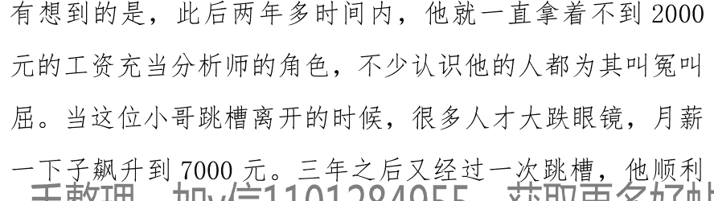
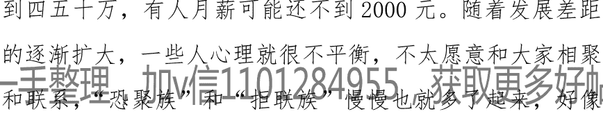
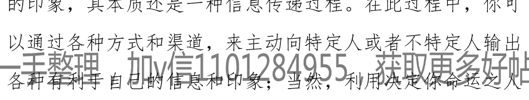
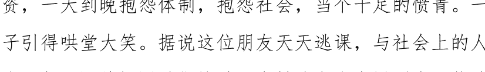
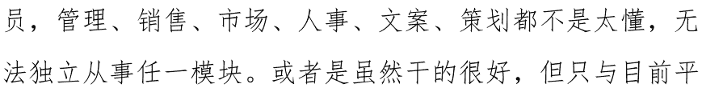

# 社会不教，精英不讲，坎儿还得自己过（揭秘人才成长规律）

路狂飙

写在最后的前言

午后小憩，望着窗外的媚人的阳光，和绿油的草地，再看看那熟悉而又陌生的一花一木，心中顿时舒畅了许多。紧张而又充实，不乏愉快和难忘的五个月时间快要结束了。

与其说是在写作，倒不如用悟来表述更为准确。在这个过程中，我一边写作，一边和朋友互动，并进入了一个悟性的时期。很多模块，在脑海中快速发酵，并一步步蜕茧，积累了许多的人生经历，自己的酸酸苦苦，体验过他人的人生冷热，以及亲友们的沉浮，在逻辑上都已经初步打通，太多的事情不再迷惑。

回望职业生涯，已经整整八年的历史了。八年间，在人生旅途中不短不算长，足以成就一些事情，毁掉一些事情。八年是什么概念，是抗战取得胜利的时间，是美国赢得独立战争所用的周期，可以支撑两个专业领域，也可以支撑一个人脱胎换骨成就高手。可八年对于我来说，充满了多的痛苦、彷徨、奇遇和收获。以前看到某些传奇故事，老是感觉胡编乱造，不太真实，人生不会那么复杂的。想想自己来路，终于体会到，现实往往比想象中的故事更有传奇色彩。

感谢这个“全球化”和“信息化”为特征的伟大时代，你给了我太多的养分。

## 一、世家精英的密码

近年来，“富二代”、“官二代”、“穷二代”，这些概念在媒体上到处充斥，似乎构成了社会不公的一个脚注。在平民百姓当中，也广为流传着“富不过三代，穷不过三代”的朴素说法，并在某种程度上被视奉为真理，似乎也有太多的案例可以验证。这是人类社会的真实情况吗？我还真的探究过这个问题，查阅过相当多的资料，看过很多人的家谱。在这里我可以负责地告诉大家，“富七代”、“官八代”、“穷九代”的现实，在古今中并不罕见。在我们，多少代都出现过家族聚聚，或者高贵的家族，留了很多帖。聚家、龙川的胡家、庭德的江家、绍兴的宋、湘的曾家。在西方近代今，名气较大的世家，就有罗斯尔德、洛菲尔、肯尼迪、罗斯福、布特。日本数百年的商业史中，这样的家族几乎很多，中国人比较熟悉的，就有三井、安田、小泉。

这些辉煌的家族我们暂且不说。在现实生活中，我们若是稍加观察，就会发现一个非常有趣的现象，就是子女成为精英的概率，要远远高于平头百姓。北方广大的农村中可能并不是很准确的说法，说是地主世家的后代，在近三十年的时间内，整体上的发展要远远好于贫下中农后代。

最近几年，媒体上报道一个现象，就是清华北大等国内一流高校，本科新生，家庭出身良好的比例逐年升高。后者又做了一项统计，并粗略发现，无论历史还是现实当中，多数精英的家庭背景，都还不错。我在此特别声明，我不认同“血缘论”和“精英论”，并不认为人类在生理和智商上存在多大差异。旨在以一种较为科学的态度，探究此类现象背后隐藏的密码。

面对这种现象，人们往往首先想到的人脉，还有人会想到水脉。家族积累资源、相互链接，使得人脉资源较强，这当然是其中重要原因，但光靠这个还不足以确保家族不衰、才智将相，还有更深层的因素在发挥作用。

而足够。至少少将我目前的智商，还是理解了这个东西。这些年我一直在苦思冥想，大量查阅资料，并跟一些前辈和导师讨论过。逐渐弄明了其中的奥秘。其实并不复杂，就是他们有一套更加实际的、由理念、习惯和方法组成的模式，在发挥作用。这套系统的东西，世世和精英圈当中，有着一定的传承，成为一种常识。而大众恰恰对比，一些理念似而非，某些习惯决定人生，很多方法得不要了。

这些理念、习惯和方法，也是一个完整的系统。我们不得承认，社会上确实存在着信息鸿沟。有些有助于事业发展的道理，不分先后：

## 二、成功后仍有收获，失败后更有价值

- 有人在中学时代明白
- 有人大学之时才开始
- 有人毕业五年懂了
- 有人到了四十岁才懂
- 有人五六十岁还是懵懂
- 有人成功后晚懂了
- 有人失败后晚懂了

如果是在年轻时，我们能够传授这些东西，最多可以少走路。可是这并不现实，因为你成功或失败，可能失去许多机会。

这种痛苦是不接受的。自己不断梳理以往的每一个细节，对自己以往的一些观念进行反思。终于开始慢慢突围，步入了良性循环，领悟的东西越来越多，速度越越快，算是在悬崖边跟脚了。回头一看，非常害怕。

这种记录，给仍处于迷惘中的、来自于社会底层的奋斗者们，带来一点启发。我本来打算准备得更充分一些，等我退休之后再总结，但看到太多缺乏职业生涯视野的朋友，实在心不忍，先把目前已经领悟到的公开，变成社会资源。

## 三、自己的责任归自己

一个失败的事业会拖累一个家庭；太多失败的事业会危害整个社会，进而影响到国家和民族的竞争力。近多年的时间里，我发现了一个非常令人惊讶的问题。现在社会有很多低端岗位，20~50岁之间的人在拼命竞争，而在很多城市，企业招聘稍微高一些，就很难找到合适的人才，令企业主非常头疼。很多企业由于人才缺乏、无法快速发展，创造更多的机会。其中隐藏着一个大多数人都不愿意承认的：我国劳动者，能力结构和职场竞争力，并没有随着年龄的增长而得到提升。

一个年龄段，不同城市出现“就业难”，另一方面适应社会和社会发展需要的中高端劳动力较为匮乏，而本应该是35~50岁之间的劳动力，应当承担起来的重任。从这个意义来说，我们每个职业生涯的长远发展，已经不是单个人问题，也应该是社会承担的一项责任，是每个公民对国家应尽的一个义务。

当然，之所以出现这个情况，也不能完全怪罪我们的劳动者。毕竟近30多年来，我国处于数千年来未有的转型期。改革开放三十多年来，我国面临着由传统社会向工商社会的快速转型。“全球化”、“工业化”、“商业化”、“都市化”、“信息化”，是本次转型的重要特征。由于转型太快，很多东西我们都来不及反应不及准备，太乎我们的想象和预料。

反映在个人发展方面，就是大多数人的障碍，这也许是转型的代价。但我还是希望这种代价不要继续下去。

普通人，普通人，普通人，普通人，普通人，普通人，普通人，普通人，普通人，普通人，普通人，普通人，很多很多机会。我在此尽所能，为自己积累增量，是一个基础。

不管往昔如何，从现在开始，每个人都要对自己负责，对家庭负责，对企业负责，对社会负责，对民族负责，对国家负责。

## 四、事业成功的全程管理

事业成功，永远是一个相对概念，是一个动态概念。对于出身世家和精英的朋友们，也应该以积极开放的心态，进一步完善自己的理念、习惯和方法体系，有效规避潜在风险。谈到这里，我与大家分享两个真实的故事，希望能给小朋友们更多的启发。

H先生，7年从某重点大学化学专业毕业，直接接到省级重点中学任教。从普通教员一直做到常务、行政副总等位置上担任过，业绩非常出色。在十五年内赚了很多钱，但他回国后才想到，老家不在了。于是他在春节后提交了辞职报告。老板给了他五万元补偿金，并顺便签订了竞业协议。辞职之后，手中只有30万资金，一套房子，儿子还在大学。每天的任务就是找项目，先后考察了餐饮、酒吧、麻将、净水机等等项目。由于自己不太懂、合伙人放弃、条件太苛刻等原因，未能成型。有一次我们在网上遇到了他，他就请教我。

选择什么项目？我根据自己的经验指出了几个方向：
- 做化工贸易，代理产品可以跟东家差异化；
- 做中学生习班，毕竟是老本行，自己在当地有一定名气，成功概率相当大；
- 做餐饮连锁，自创品牌，虽然没有接触，毕竟是未来十年最有可能出现高增长率的领域，做上几年熟了；
- 回到原学校当普通老师，毕竟原来的人脉在那里，教学水平在那里，真的想回去还能可能的。

但他这些路都不想走。选择化工贸易，他不乐意，上游没有好的资源，资金也不是充足。办补习班或回去当老师，他说实在不想干了，而且在面上也做过兼职，他感觉自己还是舒服了，赢得起不起。还想找平行的行业来做。我们交流了好几天，我的建议很明确：

第一、自己熟悉的行业，容易切入并且成功率很大，或者选择潜在的与老百姓日常生活密切相关的领域；
第二、三十左右的资金，经不起波折，短平快的项目看上去很美，但不适合这样的人去做，很多领域太不懂行，钱还可能怎么做就光了；
第三、很多事情不是自己愿意意愿不愿意，而是客观上必须做的，为了生存为了养家糊口，别无选择。在生存面前之前其他一切都是浮云。

造就了他现在异常被动的境地。人的地方有江湖，外面的世界彻底残酷，直接就是“丛林法则”。你连体制内的人际关系都不适应了，还敢在江湖上闯？更何况当时发展的并不错。如果仅仅是因为厌恶职场、适应复杂的人际关系，选择下海，无疑是非常错误的一个选择。他后来想了想，也认同我这种说法。

一旦到了体制外，就不要幻想稳定，应该利用有限的时间，快速积累和优化自己的能力结构与各种资源，做好变的准备。有的朋友出于利益考虑，一定会赶上；即便走了，还能给你一份不错的工作，或完全可以另起炉灶。退一步说，很多时候都是。

## 五、跨境低级错误

接着讲的这个案例更具有代表性，主角属于普通人眼里典型的案例。他从幼儿园开始，一路顺风顺水，顺利到了几乎不可思的地步。细心的读者发现了这位朋友职业经历的几个时期：
- 从幼儿园到本土总经理，第一个工作就是十五年，期间没有任何跳槽经验，没有过默默背锅；
- 离职之后看到很多机会，在口上标榜灵活，却缺乏运营部门经验；
- 后几年，他又换了很多公司，职位基本上在总监和总经理之间挪动，薪有高有低，遗憾的是长了。

其实他的问题就在这里。由于几十年来发展的过于顺利，他的自我认同非常高，感觉自己干不了的事情。跳槽之前面对新岗位的风险和各种情况恰恰评估，基本不考虑适合自己，也不考虑新东给他的定位究竟是什么，是一个抉择还是砍刀，或者干脆到位。这个位置可能就是“陷阱岗位”。对于有过数次跳槽的人来说，这基本就是常识，在上任之前是要进行综合评估，不会轻易中招。对于他来说，一是过分自信，将自己的能力在想象中放大，二是缺“跳槽管理”意识，掉入陷马的概率就较高了。

每家公司都有一定的独特性，不同的发展阶段适用的管理方法和模式不能一样。他老东家是细分行业的老大，发展阶段、市场基础、资金实力和员工素质，都是同行无法比拟的，如果简单照搬自己经验，往往很难行得通，因为基础条件不支持你这样做。而且到了新的山寨，在未查明情况之前，不能乱动，如果动作早了，很容易将自己废掉。当年宋江上了梁山之后，他按兵不动了一段时间。如果他在运营上上过几个，这个道理基本是常识，可惜他缺乏这方面的历练。他可能遭受挫折之后一直在反思，但结果并不对路，可能是一愚性循环，再回头，导致五六年来。

接楼主的意思很多人来说还是不成功，既然不能人人成功，那么成功学有什么意义呢，就是看有缘啦，我成功学是为有缘者准备的；什么叫有缘，当然是愿意给我利益接受我教训的人姐啦。

这就是成功学的辩论。

首先，现在社会分工在不断细细化，更多的细分领域会出现，而每一个领域都会出现一些成功者；其次，本文谈的并不是成功学，更多谈的是“失学学”，以及人才成长的规律；再次，我的东西属于经验和感悟分享性质的，至于效果怎么样，仁者见仁智者见智，我也不是靠这个家伙卖钱来生存的。

作者:e迅涯 日期:2012-03-11 21:19

——害青们的浪漫代价

铁律之一：将更多时间浪费在抱怨当中，而没有在实际能力的锻炼、提高和结构优化方面，这会影响到自己专业素养的持续和稳定提高。即使某种机会突然降临头上，也会由于水平不够，眼睁睁看着它们从身边溜，酿成无底遗憾。

在人的生命河中，有着太多不如意。从家里经济拮据，上不了重点学校，没考上喜欢的专业，有人难成眷属，工作机械单调收入理想，在就业、买房、婚姻等方面的游戏中并没有任何可利用的资源，升职机会被别人抢去，......这一切也许就是职场当中绝大少数人物典型的素描。面对这种情况，有人无奈，有人形容徨，有人压抑，也有人以苦为乐将此看作是对对自己的经验和磨练。

作者:e巡狂 日期:2012-03-11 23:33

@ajqnnui 2012-03-11 23:01:09

对楼主的观点很认同，一直贯豁群辈，能找到观点一至有的点难。在这个战争、言情、穿越电视剧、动漫游戏泛滥的大环境下，迷茫的人会越来越多。一些很实用的书中的道理，只有亲身经历了，才知道道深刻。

## 一 整理，获取更多好帖

人在本质上，都或多或少有浮躁的一面。快速致富、平步青云、遇美得宝、功名成就、春莱永驻，这些东西往往看起来并不切实际，却是很多人在潜意识里面最想要的。满足这种需求的东西，也就是一直大热门，而且往往向往价格非。

相当多数商品，与其说是买的，倒不如说是内心深处的梦想。成功学、保健品、化妆品莫非如此。别认为理智就可以抵御此类东西，就连秦始皇、汉武皇帝和成思许这些千古人精，还不照样寻求能够足够长生不老的灵丹妙药吗？现在社会上还不样充斥减肥和美容的“瘦效药”，各种各种“速成班”？！商家只是满足现实需求而已，这本身跟道德无关。

这种现象在图书和影视作品领域，表现更为突出。武侠剧，穿越剧，励志文学，传奇故事，更多是在讲述误打误间获得成功，年轻轻轻成功成名，以及有梦想就能实现，只不过模式有些差异了。主角前后处境巨大反差，以往“埋单者”热血沸腾，因为他们从中看到了希望，自己自然而入戏了，在精神世界里成为故事中的“主角”。

作者:e路狂 日期:2012-03-12 08:40

我们传统文化的内涵有一种精英主义的倾向。从我们时代，大家的理想就是长大当一个官员、将军、富豪，明一手处理，如我们和理想一样，承担责任，获取很多好处然后别人才会得到。倘若有人从立志做一名清洁工、服务生或者保安员，甚至是城卫，大伙肯定一直认为此者胸口无志、形同顽石。然而，目的的越高，实现来的难度也就越大，尤其是当这个目标缺乏必要的方法和步骤来保证的时候更如此。希望越过，失望也会越大，理想和现实之间产生巨大落差，感觉现实日趋渺茫，很多人就给自己贴上怀遇的标签，不加甄别将问题归结到环境身上，带有一些性质的安慰，在一定程度上强化了这种自卑。若是没有多么反思，这种努力是不够的。

人在任何一方面投入精力，都会变得专业起来，以至于很难听进不同意见，甚至会强大到地步，非常热情也就完成了。做到自己体系和其说，在大多数眼里做了什么事，但关键是用了什么方面。如果能够在现有平台上努力，寻求更好的发展，即使由于种种内部发展受限，也可以在外部找到适合机会。常言深不掘浅，但前提你是确凿的金子，而非金子的废铜。

缺乏公平，等等，都是十分常见的痛苦。作者:e路任枫 日期:2022-03-12 10:15

@上帝的牧者 2022-03-12 08:58 题目不错，等待具体的东西人也有不少这方面的认识。可以在帖子里其中分享啊，大家共同学习，共同进步。作者:e路任枫 日期:2022-03-12 10:51

人在任何一方面投入精力太多，必然影响到其他领域的投入。一方面的危害还是自己以为，越难意识到自身能力缺陷、努力不够、资源积累，另一方面的危害是时间都被所占，能够被消耗以及结构优化的精力少。时间长，这些都无法转化为恶性循环。上帝是非常公正的，绝不会偏向任何人，无论你在干什么，她赋予人的时间都是一样的。

想要加微信101284955，获取更多帖子作者:e路狂 日期:2012-03-13 10:51

@984570955 我就是一个比较迷茫的人刘老师我就是一个比较迷茫的人，今年二十一，十八岁出门打工，期间跳了很多槽，都是做过两天，看着工资高就去哪里做，今年在父母的帮助下接手干个店，由于前期自己不熟悉，现在流失了很多客户，马上夏天了，生意越来越，最近了解一个网站在本地代理代理，了解前期不赚钱还贴钱，后期回本挺大的！请问刘老师我需要转行吗？谢谢！

你这个年龄，实际上最好到一家正规的企业磨炼几年。网站代理，主要还是看网站自身的商业模式，如果他们自身的商业模式存在巨大缺陷，很大程度上也只能靠骗代理商或者加盟商的钱，来弥补一些成本。当然，也有非常不错的网站。你可以加上我的QQ324024419，我帮你看一看。作者:e路狂 日期:2012-03-14 10:26

@kkwith 2012-03-13读万卷书，行万里路，不如名师指路，名师所指的路就是他所经历过的“失败”之路，就是看别人的失败，来防止自己重复这条失败之路，进而增加自己成功的概率。刘老师的书，大多以总结失败经验著的，有名的话叫，总结就是成功之父，我读到此处，觉得成功的道路往往不同，失败的原因却惊人相似，在前进的道路上，规避掉了大量的失败原因，就能大大提高成功的概率。作者:e路狂 日期:2012-03-15 18:41

我们自己或者周围的人，或多或少会有这样一种经历——曾经遇到过一些非常好的机会，但由于自己能力结构上存在瑕疵，只能只能睁睁睁它们从身边溜走。书到用时方少，能力和资源的储备何不是这样呢？！如果我们将更多时间用在脚实的历炼之上，注重工作中每一个细节的把握，并使其不断系统化和升级，日久积累自己的储备就会具有相当的厚重，把握一些机会的能力自然很强，比一般人竞争力。也许有人提出不同的看法，认为在职场当中，社会环境决定一个人的发展，靠着自身实力很难脱颖而出，无论怎么努力，现实中的程度都很渺茫。非常客观地讲，在任何社会和时代，我们都能找到很多核心直觉，依靠自己的努力获得最终案例。在任何社会和时代，上面提到的各种问题就不会存在，在任何社会和时代，我们都能找到很多可靠的，而这些规律又可以用一系列方式和方法来加以保证。即使看似神妙的创新，也是如此。如果我们在某方面掌握了较为系统的方法，不仅做事可以事半功倍，而且职业发展之路也会更加顺畅。

虽然历史不容，但我们还可以设想一下。当年左宗堂这样，少年就立志，年轻屡试，后又改投。其中原因固然很多，但左宗堂在其中并没有太多怨，而是将精力更多投入到学习上，对那些涉及历史、地理、军事、水利等内容的名著视如宝，这些储备对他后来取得的成就有着极为影响。机会属于准备充分的人。无论状况如何，都应当许多踏实的敏捷，少一些不必要的抱负。

方法之二：无论是学习还是实践，我们都应当将方法论放在首位。解决了方法论的问题，你的行动才会富有效果，职业之路才能更为顺畅。当然，这里的方法论更多的是解决各类具体问题过程中运用的手段、思路和模式。我们做任何事情，正确的目标与方向自然重要，但如果缺乏与之适配的方式和方法，失败的概率会成倍提高。在一些特殊情况下，甚至不要失败。缺乏可用方法保证的理想，容易导致人才荒，缺乏可用方法保证的目标，容易变成空洞。方法论的重要性，由此一斑。在书中提到的方法论，并不是一个抽象的哲学概念，而是“授人以鱼，不如授人以渔”中的“渔”。

非常糟糕的是，职场中占比例的人，理想和目标一大堆，如果被问具体的解决方法和措施，就很难说出个甲乙丙丁，基本上采取方法和顺势而为的态度，即使有人能够出一个点，在可行性和系统性方面都很差。将一件事处理成某种类型任务，我们很难发现现实中有很多可靠的，而这些规律又可以用一系列方式和方法来加以保证。即使看似神妙的创新，也是如此。如果我们在某方面掌握了较为系统的方法，不仅做事可以事半功倍，而且职业发展之路也会更加顺畅。

努力之外，没有其他捷径，否则你没有任何利用价值去跟别人交换。

虽然近百年来，儒家在我们国经历了非常曲折的风雨历程，绝大多数人对其一些经典著作已经非常陌生。

记得当年有一次我出去面试，同一个级别的应聘者除了带着学位证、职称、培训证明这些常规性的证明外，还准备了厚厚的一撮其成功案例的总结性材料，显然这是他平时注重总结结果的结果，绝非零零拼凑。他不仅口头上告诉面试做过什么、效果如何，还有一大堆详尽的文字材料辅助证明，实质上相当于为自己制作了几个更有说服力的个性化“证”。这种应聘方式能给人一种强烈的震撼，其效果自然不言而喻。

作者:e路狂狂 日期:2012-03-21 15:37

欢迎交流点评。

作者:e路狂狂 日期:2012-03-21 17:21

所有的朋友根本没有经验，更谈不上什么成功案例了。我的经理告诉我：“我们想要的东西，就可以肯去贴、多方向努力，勤劳和智慧可以弥补很多东西，只要脚踏实地去做一些事情，成功案例总会有一些的，当这些越积累厚重的时候，你的身份也会呈几何级增长。如此坚持下去，几时的宏伟理想，亦将变得不再遥远不可及。”

作者:e路狂狂 日期:2012-03-22 12:45

up。

作者:e路狂狂 日期:2012-03-22 23:00

还有很多人，由于受各种条件限制，很难有机会积累到高含量的经验与成功案例。在这种情况下，你如何能够长避短、突破限制，为自己积累到能被社会认可的成功案例，能力得以证明，并突破职业生涯方面的瓶颈，争得远大而广阔的前程。在这个问题上，自然是鱼无鱼路、猫有猫道，各显神通。我在这里介绍一种方式，以供大家参考。

如你处于销售助理位置，从岗位职责上，基本上不太可能有区域销售和中高层管理的实战经验。但如果用心的话，能够观察到许多非常鲜活的案例和细节，在此基础上，你可以一点一点去思考和消化，找出其中的原理、规律及其发展趋势，并能够提出切实行的合理建议，当然不要忘记将此转化为文字材料。日久天长，终于所得。几年之后，你凭着这些积累去应聘销售经理或行政经理的位置，尽管缺乏直接相关的资历，还有较强竞争力的，成功转型的可能。

# 王经理加v11101284955，获取更多帖

作者:e路狂狂 日期:2012-03-23 08:31
@骑羊牧狼 2010 2012-03-13 08:51:24
把简单的问题搞复杂了。什么精英的遗传密码，瞎吐。地主的遗传密码就是勤劳、节俭、有责任感的。贫农的遗传密码就是懒惰、贪婪、流氓之产。

可呀，你谈的代表某个片段上的事实，但不客观、不片面、不系统、对草根没有多少实质性的帮助。
作者:e路狂狂 日期:2012-03-23 17:22

这里还衍生出另一个问题，就是你已经在 A 部门有了很好的历练和积累，倘若要想获得更好的发展，势必要 B 部门和 C 部门的相关工作经验，但老板和管理者出于管理安全或者消除潜在威胁的考虑，根本就不给你轮岗机会。遇到此类情况怎么办？其实这样做可以采取“暗中经营”、“优师学术”、“提炼深控”的 12 字方针来化解。通过这些方式，使得自己经验和成功案例得到一次又一次升级，结构得到一次又一次优化，最终到达理想的彼岸，做职场江湖。

作者:e路狂狂 日期:2022-03-23 23:18

也许这个道理还可以翻译另一个说法。就是在社会逻辑中，评价比表现重要。很多时候你可能忽略了并不重要，重要的是你做过什么，取得什么样的成效，用什么能够证明。这是一个比较残酷但非常现实的规则。有很多的人才横溢，由于你很好地适应这一规则，逐渐被潮流淘汰，却给自己留下遗憾。正是大多数人难以适应这种模式，如果能够有意、有目的并自觉地按照此方式积累和沉淀，且不断优化其中的结构，自己在职场上的竞争力就会提升，容易形成良性循环，脱颖而出，最终也能为自己提交一份完美的职场答卷。

作者:e路狂狂 日:2012-03-24 08:41

## (勤奋与坐待)

## 铁律之四：勤奋与进步之间没有必然联系

在现代社会中，组织规模越大，分工就越细，每个岗位的职责相对而言越简单，而基层岗位却是如此。在很多企业中，分工非常细，即使你在这些岗位上再努力、专业、效率再高，也比别人多拿些奖金或者绩效费，最终还是不能独立出一个完整的项目。如现在的王经理，加薪、升职、福利、好处都有，但他下没有一兵一卒，完全的光杆司令。

此外，有些分工非常细：
- 专门负责拉链
- 专门钉跟
- 专门负责外联
- 专门写文稿
- 专门负责活动
- 专门搜信息
- 专门制作企业内刊

而且工作往往还枯燥。

作者:e路狂狂 日期:2012-03-24 22:36

H君在某国内非常有名的民营企业市场部任职，已经有多年的时间了。他一直负责新闻撰稿、内刊制作以及媒介的工作。在他刚加入这家公司的时候，月薪只有1500元，加班真的是家常饭。我看过他很多稿和制作的杂志，其质量即使放在一些媒体当中，也可算得上上水平。这位朋友属于典型的老实人，这么多年领导给他画大饼、望止渴，但从未让他涉足市场的其他工作。个人也希望在现有岗位上踏实实的工作，从而得到公司认可，换取涨薪升职机会。但直到2007年，他的待遇水平丝毫不改变；2008年薪涨2000元，年终发1000元的奖金；2009年，公司得到了快速的发展，为了安抚他，把李君“提拔”成了媒体主管，他全年收入达到了5万元，但他下没有兵一卒，完全的光杆司令。

# 一手处理，加微信101284955 获取更多帖

学者：陆畅 邮箱：2012-03-24 08:58:55

你说的太复杂，我给你简单介绍一下：去书店转转，以后真正有用的书，别在书店买得到。当然，天才人物在。。呵，在信息和图书爆炸的年代，有很多价值的东西都被淹没在汪洋大海之中，找到真的那么容易。现在社会上很多图书圈围绕一个点不断讲解，这样的书再好，其实也只能传授给你一点。我的书反其道行之，书籍试图传授几十个知识，通过较大的信息量帮助朋友们构建一种认识的结构。

作者:e路狂狂 日期:2012-03-25 12:10

2010年，公司市场部进行重大调整，但不大幅扩缩，新增加了不少管理岗位，还对部分人员进行了调整，其中就有媒体经理一职，岗位职责完全和H现有相同。在他自己看来，这么多年职业的坚持没有白费，毕竟星星之月亮，终于等到了这个机会。他令没想到的是，公司的计划是将他赶出门，通过市场出公司年薪15~20万的待遇从行业空降让他担任职责，前后左右找了大半的时间。但人算不如天算，千寻万造，没有一个人比H更为合适，空降之事只好做好。尽量让朋友最终留任，但职位和待遇将变动。

一手经理 作者:陈磊 日期:2012-03-25 20:08

我接触好多年，很多事情就慢慢了解了，既为他可惜又为他可怜。从岗位的专业化程度来说，他已经达到了相当高的水平，许多年来职业业、任务任何，在专业上还是很有收获。他在大公司的市场部招了8年多的时间，竟然除了企业新闻通稿和杂志之外，价格、促销、品牌、渠道、终端、路演、广告，以及媒体和本行业整体状况和发展趋势，了解少到令人大跌眼眶。当然在很多时候，站在公司的角度，希望大多数员工能够这样的：专业人士专注专业的事，不要牵涉太多东西，你所有的的一切都纳入公司的战略轨迹，老板或领导很有安全感。个人发展

## 铁律之三：勤奋与坐待

在现代社会中，组织规模越大，分工就越细，每个岗位的职责相对而言越简单，而基层岗位却是如此。在很多企业中，分工非常细：
- 专门负责拉链
- 专门钉跟
- 专门负责外联
- 专门写文稿
- 专门负责活动
- 专门搜信息
- 专门制作企业内刊

而且工作往往还枯燥。

## 铁律之四：勤奋与进步之间没有必然联系

在现代社会中，组织规模越大，分工就越细，每个岗位的职责相对而言越简单，而基层岗位却是如此。在很多企业中，分工非常细：
- 专门负责拉链
- 专门钉跟
- 专门负责外联
- 专门写文稿
- 专门负责活动
- 专门搜信息
- 专门制作企业内刊

而且工作往往还枯燥。

## 铁律之五：在实践性强的领域，能否获得众多、结构合理的机会

对于能力发展和专业素养，有着极为意义。倘若这样的机会争取不到、错过了，即使你再有潜力，后途也基本被废掉。不少人羡慕医生这类职业，靠技术吃饭，收入高，受社会尊重，越老越香。特别是外科医生。事实上医生是非常典型、具有强实践性的职业，在一些大院，年龄并不是很大，这在相当程度上得益于密集的实践机会。即使还是差，其水平也不高到哪里去。从总体来说，省级医院比市级医院、县级医院的标准是绝对的。十年之后，医学上的差异就会凸出来，可能早已成为专家，原因在于后者见识广，手机会丰富。

关键的是能否获得众多和结构合理的锻炼机会。医院的规模和等级对这个因素有着巨大的影响，但并不是绝对。虽然平台拥有非常的资源和机会，但个人却多年一直被安排工作内容简单、而且重复性很强的岗位上，本来很有潜力，还是缺乏必要的机会，最终也难以成长为专家，达到理想的高度。其中当然也不会排除某些人士刻意制造困难。类似的情况在律师、会计、咨询、管理、研发、销售、创意等行业都普遍存在，希望能给朋友们一些启发。

作者:e路狂狂 日期:2012-03-29 09:51
@我的九律 2012-03-28 17:47
一命、二运、三风水、四阴德、五读书、六名七相八敬、九交贵人十养。

最容易忽略的因素就是，你的财富是靠努力。你只读了书、学习、实践这一个方面，这些对于运气的影响不是很大。你要明白，小富靠勤，大富靠命。也许吧，我不懂得，您开一个讲座一下。

而且，命运并不是不可改变的。很多大师认为，性格其实会影响命运，我觉得，认识和愿意改善的意愿会影响性格。所以，许多人指点和开解，就是所谓的“九交贵人”也是命运变化的机会。一个人的职业之路是普通人最容易遇到贵人，当然也……

光路径的规划和设计，自然不能解决任何问题，这个只能解决“思维链”，而解决不了“资源链”。退一万来说，风水和命运只是你人生当中的一个变量而已，不是全部，何况，按照很多宗教中的……

作者:e路狂狂 日期:2012-03-30 09:56
@wisdom9399 2012-03-29 17:45:19
我在年轻的时候，我相信命运，不愿意去规划、计划人生和职场；现在我不那么年轻了，我仍然相信命运分，但是感觉到，规划和有意识的检查和调整自己的人生和职业并不是不可改变的。

---
- 一命
- 二运
- 三风水
- 四阴德
- 五读书
- 六名
- 七相
- 八敬
- 九交贵人
- 十养

作者:e路狂狂 日期:2012-03-29 17:30
作者:e路狂狂 日期:2012-03-30 23:01

这里还衍生出另一个问题，就是你已经在 A 部门有了很好的历练和积累…………

- 很多时候：
- 很多时候你可能忽略了并不重要
- 重要的是你做过什么，取得什么样的成效，用什么能够证明
- 这是一个比较残酷但非常现实的规则。

有很多的人才横溢，由于你很好地适应这一规则，逐渐被潮流淘汰，却给自己留下遗憾。正是大多数人难以适应这种模式，如果能够有意、有目的并自觉地按照此方式积累和沉淀，且不断优化其中的结构，自己在职场上的竞争力就会提升，容易形成良性循环，脱颖而出，最终也能为自己提交一份完美的职场答卷。

作者:e路狂狂 日:2022-03-23 23:18

学者：陆畅 邮箱：2012-03-24 08:55

作者:e路狂狂 日期:2012-03-24 08:41

作者:e路狂狂 日期:2012-03-24 22:36

作者:e路狂狂 日期:2012-03-25 12:10

作者:e路狂狂 日期:2012-03-25 20:08

作者:e路狂狂 日期:2012-03-26 10:48

作者:e路狂狂 日期:2012-03-26 19:12

作者:e路狂狂 日期:2012-03-26 23:10

作者:e路狂狂 日期:2012-03-27 07:41

作者:e路狂狂 日期:2012-03-28 10:53

作者:e路狂狂 日期:2012-03-28 17:47

作者:e路狂狂 日期:2012-03-29 09:51

作者:e路狂狂 日期:2012-03-29 17:30

作者:e路狂狂 日期:2012-03-30 09:56

专业人士进行交流，先从知识上充实自己，然后在此基础上争取相应的实战机会。第三、通过跳槽，更换一个平台，寻求更多的历锻机会，或者借以优化自己的结构，最后实现惊人一跃。当年韩信从项羽跳槽到刘邦集团，寻求更好的历锻和成长机会是至为重要的一个原因。“人择活，树择死”，很大程度上说的就是这个。第四、主动自荐、主动与关键人物沟通，增加了了解、深度化经营，努力从现有平台上争取更多、更好的机会。第五、在一些特殊的情况下，可以走自建平台的路子，以兼职和创业的方式，极大提升积累机会，向自己的理想状态进逼。

作者:e路狂狂 日期:2012-03-31 14:27

# 一手处理 | 今日110128495 | 获取更多好技巧
无视选择是路径，事先你应该如何构建自己的规划思路。比如此，你大致上要从哪个方向发展；要成为此领域的优秀人才，都需要哪些方面的能力结构和积累；要采取颇为现实的路径和方法，才能接触到这些方面的机会；短期内缺乏直接接触，可以通过这种方式能够起到替代性效果，或者可以暂时回旋。一旦上述诸多框架问题都考虑清楚了，执行力就是最重要的事情了，一点一滴去落实，也不用太着急，坚持上几年，局面就慢慢慢开了。

作者:e路狂狂 日期:2012-03-31 17:13

up

作者:e路狂狂 日期:2012-03-31 20:58

# 一手理，加信1101284955 获取更多好帖

人才的迅速成长，风云会当然是非常重要的，但更多需要个人竞争力争取，想设法寻求突破。在现实当中，确实存在个人缺乏自主意识，稀里胡涂地获得大量机会机会，得以快速成长，年龄虽然不算，就已经成为了专家的情况。

但对于很多人来说，这样的机会非经积极主动争取，而不能获得。对于另外一些人，即使努力争取也未必会给你机会。在绝大多数情况下，一个人想真正出人头地，个人目标明确，排除万难争取，努力优化结构，是极其重要的，甚至还需要一点灵感。否则，你的潜能永远只能是潜能，转化不成真真切切的现实。

@双子传奇 发布时期:2012-03-31 21:08:02

才看了第一页，感觉楼主的很好！支持！
这些问题也是我经常考虑的问题，但没有看到楼主的系统。

呵呵，后面的内容会逐渐展开，谢谢关注。

作者:e路狂狂 日期:2012-04-01 14:56

(006)

---一人就是要就是要缠龙凤

铁律之六：婚姻不仅是两个人情感的结合，同时也意味着着两家社会资源的整合。与社会资源状况良好的伴侣结婚，无疑是改变命运的一大契机。虽然一个人的发展最终还是要依靠自己，但扩充和优化人脉资源毕竟是锦上添花的事情。

不少朋友有人英雄主义情结，希望人生价值的实现，完全建立在自己努力奋斗的基础上，不想掺杂大多数家庭背景和裙带关系之类的因素，特别不愿意通过婚姻来提升自己的社会和经济地位，或者获得更好职业机会。其实，二者逻辑上并不存在相互排斥的关系。如果通过婚姻，在得到自己心爱的人的同时，也得到了对方良好的社会资源网络，能够增大自己事业发展，乐而不为？

作者:e路任翁 日期:2012-04-01 22:24

@西北东大Z 2012-04-01 16:31:57

一手处理微信1101284955，获取更多帖子
这些东西不是不可改变的，他们推荐的。
区分“什么东西不可改变的”和“什么东西是可以改变的”本身就是不起的智慧了。

人就会限制，总会觉得“无法改变的东西”。

那些牛的人，在我们这些屁民看来好像是“全是他们可以改变的东西”，“没有他们不可改变的东西”。但是，这是因为我们研判还不够。

其实，再去研究那些人和，“可以改变”和“不可改变”之间，存在广阔的地带，通过沟通，进行合理的路径设计，虽然不能保证绝对成功，但大大提高成功的概率。

从角度来说，能不能获得良好的个人发展，四个因素都极为重要。出生、升学、就业、婚姻。

有一种并不被人们认可的提法。人生中有四大改运的机会，分别是出生、升学、就业、婚姻。

在绝大多数情况下，一个人想真正出人头地，个人目标明确，排除万难争取，努力优化结构，是极其重要的，甚至还需要一点灵感。否则，你的潜能永远只能是潜能，转化不成真真切切的现实。

J后来遇到我，将这个事例分享之后，总结，他从中受到两个很重要的启发。一个是无论你从事什么行业，平时就应该尽可能多地关注圈内的各种情况，如果将自己职业生涯定位于某个行业，对很多情况的日常性积累非常重要，这样可以避免在一些挑战面前惊慌失措，“台上一分钟，台下十年功”，不少东西短期也许很难得上，但从长期来看，肯定对你的发展有利，而且这种好处显出来的周期很长，大致上三到五年的时间。另一个是必须接受适当的挑战，只要这样你才能提高工作水平和优化能力结构，实现快速成长，与竞争对手有效拉开距离，将他们不断甩在身后。

多年也过去了，这位朋友也慢慢地离开了。我们年初最后接触也只是在几年后就断绝了联系。

作者：e路行狂 日期：2014-02-12 22:17

曾经有这样一个段子，描述了许多职场人的理想，“钱多少离家，位位高责任轻；睡觉睡到自醒，数钱数到手抽抖。”这个说法虽然有些调侃，但在相当大程度上反映出了许多上班族的心声。暂且不说，在任何平台上，待遇和级别可能还远离责任，身居高位、担任职权并拿着很优厚薪水的，并不罕见。但权力跟永远是对应的，只是程度稍微有些差别而已。权力越大，意味着自由越大，所承担的风险越大，也就需要承担更大的责任。倘若职位赋值的权力很大，但由于你害怕风险，在重要问题上老是不作为，逐渐地或者失去了权重的意义，或者导致权力旁落，最后沦为一种摆设，表面上职位和待遇都非常好，但根本不算上什么“权重”。退一而言，即使你让你长期规避风险、不作为并没有导致权力旁落，能力也会因为缺乏相应的锻炼、没有提高或者出现衰退，当你想认真行使权力的时候，会发现应对能力明显不足，当你没有退路必须做某些事情之时，摆在面前已经不再是风险，而是万万俱输。

作者:e路狂羁 日期:2012-04-13 10:44

作为普通人，我们一个美好的愿望能够万事如意、顺风顺水和波澜不惊自己的的人生。正是因为在现实当中都能顺利过，这样的愿望显得如此珍贵。如果事情真如你所愿，一份没有风险、没有压力、没有的工作出现在眼前之前，你会接受吗？也许有人说，并急切地问这样的工作在哪里呢？实际上，这种对“三源”的工作真的到处都是。几乎所有单位都有辅助部门和辅助岗位，辅助部门中的辅助岗位，基本上都是这样的工作。比如多年累月端茶倒水，大公司办公室复印材料，出版社对文稿，监控室盯显示器屏幕。如果你一辈子从事这样的工作，你愿意吗，我估计大多数人是不太愿意的。然而，终其一生类似工作的人并不多，其中非常重要的一个原因就是未能受风险与挑战，哪怕是适度超出能力范围的，最终在职业生涯丧失了大量的锻炼和成长机会。

作者:e路狂羁 日期:2012-04-13 18:22

(009)

——思路之九：很多企业的领导者都比较好学，在他们的思维

铁律之九：有些方面落后，有些方面超前，而且还会处于动态变化之中。你比他们超前，就会受到批评，你跟不上思路，同样会受其批判。这就需要下属储备很多思路，选择合适的时机进行表达。

很多企业固然是在不断进步，但这些年的变化瞬息常，注重学习与与时俱进，已经内化成为他们的一种精神品质。但每个人的精力是有有限的，每个人关注和擅长的方向都不相同。

在领导们的思维结构中，某些方面落后，某些方面超前，某些方面的意识今天还落后了，明天就会突然超前，出现这种情况都是非常正常的，而且这种结构实际上是处于动态变化之中。当在某方面的理念领先超前，他不太认同你时，你受到批评是很自然的事情；当领导的很多思路再超前，你又跟不上的时候，领导自然也会对你发脾气，认为你工作敷衍了，不太上进，甚至可能是愚不可及。

作者:e路狂羁 日期:2012-04-14 06:41

@hausa_lee 2012-04-13 18:26:11

什么事情都有可循的
本帖发自天涯社区手机客户端
作者:e征航 日期:2012-04-14 08:23

G先生，二年前从北京某重点大学市场营销专业毕业，现在在企业执筹企划工作。这位朋友算是少年得志，意气风发，在校期间曾担任学生会，工作之后，先是在一个区域做代表，仅仅两年时间，就升任大区经理，一年之后又开始全面负责新成立的策划部。一个处理也是一种经验积累，不过得说有很多好处。他在公司调度会上，对自己负责的事情总是跟公司领导的竞争力，很多时候甚至到了脸红的地步。由于公司缺乏相应的模板，所以G先生自行创造，试图用市场领域通用的范式，并根据行业和公司实际情况做了一些改进。公司老板对他们起草的方案不太满意，很多次调度上指责方案写的太死板、是在抄教科书。这位朋友在事后也在反思，后来又找了一些企业的方案看，仔细琢磨，还是觉得自己跟不上实际，虽然不乏细节性问题，整体上仍属于行业领先的范围内，之所以屡受指责，是因为规范化、模板化的意识不强。

作者:e路狂飙 日期:2012-04-14 13:23

他在公司的老板G先生50多岁，技术出身，也相当好学，对很多问题有非常独特的看法。在他的带领下，这些年来企业进入了快速发展期，经营得到了业界认可。上世纪90年代，还在担任经理的时候，就一直利用晚上时间，骑着一些高校去听教授的讲座，还修了财务、营销、管理和战略等方面的课程，有一段时间还专门去学习技巧。如今，这位老板还一直保持着学习的习惯。但他后优秀的老板，尤其是这种坚持独立、不盲从的领导，难免会有某些方面由于自己的理解与别人不同。这位老板很多时候都会很有脾气，去打磨，但总来说还是很有涵，可能仅限于公司层面，事后不会太多。因此，在调度会上G先生与其吵过，这种现象在很多外企难以想象。受教育和工作背景影响，G先生的重点放在了渠道。

市场上，对大客户认同度不高，认为只有渠道才能真正体现竞争力，而大客户是靠国家赋予的资源去竞争。实际上，即使能够利用国家赋予的资源，圈内光你一家，还有很多大企业虎视眈眈。下一番苦功夫，市场份额还是你无缘。

作者:e路狂羁 日期:2012-04-15 12:46
作者:e路狂羁 日期:2012-04-15 19:21

他们公司老板恰恰反是一个企业策略高手，不仅在企业重组和品牌整合方面下了大手笔，而且对于大客户开发方面表现非常聪明，巧妙利用资源获取更多行业优势，发展战略升级，中资企业集中海外带来的机会，从横向最大限度扩充客户数量，在纵向上努力挖掘现有客户潜力。多年年来，他们公司在国内大型客户开发领域由原来的不熟悉，迅速做到了熟悉，甚至连续获胜。独创的一些合作模式，引起政府有关部门的高度重视，并在更多的国有企业中进行推广。同行的跨国公司为了应付这种强大的进攻，也不得放下傲慢的姿态，在中国市场加强大客户营销和技术服务团队的建设力度，并将策略当作新型模式来重点研究。

作者:e路狂羁 期:2012-04-16 09:42

## 欢迎评
作者:e路狂羁 日期:2012-04-16 19:12

由于公司老板在大客户开发领域思路的绝对超前，搞得下属们只有当学生的份儿，被他拉着往前跑。G先生当然也例外，每次开会议说到大客户开发领域的事情，思路总是要比老板慢几拍，方案上的思路整体上老是被老板拖着，因而在此领域也受了领导不少批评。G先生后来也不断对这个问题进行改进，起初触脑袋想到政府部门任职的角度去理解事儿。站在自己的角度来看，我们不能排除他们公司老板的确有此想法。但无论主观意如何，我们都难以承受在大客户开发模式以及在客户身上承担责任，这种优势显然是不可持续的，是靠中央的独特地位而获得的。

作者:e路狂羁 日期:2012-04-16 21:15

实际上，对于在公司中的一些下属而言，你平时不不断学习和思考这些问题，进行相应的储备是非常必要的。因为在所属专业领域内，你很难预料到领导会在哪些方面领先，在哪些方面思维滞后。无论你思路是超前或者是落后，要在职场上混得可以我们需要储备大量的资料、思路和人脉，选择适度超前的时候，领导会发现你的思路符合实际，并且悟性很高。通过此类与领导之间的距离，你可能自己赢得更好的机会。

作者:e路狂羁 日期:2012-04-17 09:52

(010)

——思路之十：跳槽与管理
铁律之十：对于职业发展而言，跳槽是非常正常的一件事。现有市场环境下，跳槽是很正常不过了。如果被问及新家什么吸引你，答案往往取决于你的职业规划、部门前景、薪资总量、行业特性、待遇、发展机会。以上因素固然重要，但站在个人角度，更为关键的是能否得到生存和发展。若表面看来非常光鲜的一份工作，过去后一年并不是自己的结果。为了有效提高跳槽质量，面试过程中一定要对新平台老板和团队进行反向面试，对项目状况、管理风格、发展前景做一个较为系统的评估，防止自己掉进陷阱当中，从一个火坑到另一个火坑。

作者:e路狂羁 日期:2012-04-17 16:21
作者:e路狂飙 日期:2012-04-17 21:52

F先生，刚毕业之时在某大型国有企业工作，由于缺乏必要的职场经验和意识，发展不太顺利，内心压抑茫然，途中看不到什么光明。这种状态持续了一年半的时间，正好在国内名声显赫的企业上了新项目，特别是营销人员。随着时间延伸，隐藏在光环背后的真实情况慢慢露出来了。F所在的企业，在核心业务方面确实业务充沛，但由于缺少项目运营经验，按照成熟的思路经营，框架中想法实在太多，导致产品在市场上很高。原来数十号销售人员，每天在市场上拼命开拓，一年来都见多少效果。大家遇到的情况差不多，对对方一般感兴趣，但经过一番调研后，往往再无息。F先生在那里呆了十几个个月，自始至终努力去跑，希望用自己的勤奋与汗水换来奇迹，先后接触了几个客户，最终情况都大同异。几个主领导天天要业绩要销量，最初话还客气一些，F和他部门的同事，每天早晨起来斗志昂扬地争取客户，到了晚上情绪低落，受批挨是家常便饭。

作者:e路狂狂 期:2012-04-18 12:34
@anlev 2012-04-18 11:27:53

开头写的蜜，写着写就成了职业发展论了。有抄凑之嫌，可能水平有限，但真还没有抄凑，属于原创。

作者:e路狂狂 期:2012-04-18 16:09

问题，其中最为关键的是产品定位出现了重大失误。F也就其中的几个问题与主要领导进行过多次沟通，并提出或许可行性较强的合理化建议。虽然领导有些时候也表示认可，但木已成舟，短期内进行大调整也不太现实，能做到的只有员工施加压力。F先生到了最后，还是未完成任务，悔恼、沮丧、愤恼、茫然、不服，在千般情绪、万般感触当中，还没找到好打算，且胆十分差的情况下，被迫离开。那时候，F到了人生中的一个低谷，像大海里的枯叶，不知道会漂向何方，不知道前方还有什么更糟的事情等着自己。

作者:e路狂羁 日期:2012-04-18 18:40

但是这个经历成为了人生的转折点。从那时以后，经过一系列非常痛苦的反思，职场意识慢慢地系统和成熟了起来。之后无论到哪里去面对面，都要通过各种渠道尽最大努力对项目和岗位做一个比较系统和全面的评估，甚至按照自己设定的框架对有关负责人员、管理团队做一个反向面试。几年年来，尽管他的经历发生了许多曲折，但也规掉了不少小的陷阱，后往往证明了当时的判断是正确的。朋友M在一家企业担任代表，每年都能赚很多钱。公司虽然过得很轻松，但能力自然飞速增长。遗憾的是，公司已经进入成熟期，提供的上升空间非常有限。这位朋友又属于人才，对于这种，不如从外面寻找平台。之所以选择跳槽，基本上是为了寻求更好的机会。以上因素固然重要，但站在个人角度，更为关键的是能否得到生存和发展。如果做不到这点，一切都是浮云。品牌、实力、知名度、甚至提供的职位和待遇，皆是心智的幻象。当然幻象很多时候也能反映本质，注意这里的前提是“有时”。这个道理不但适用于平台领域，同样适用于企业特定部门和岗位评估。

作者：e路狂狂 期:2012-04-21 09:26
作者：e路狂狂 期:2012-04-21 21:40

(011)——无中生有的
铁律之一：职场上的学习，很多时候老师、教材、标准答案，甚至方向都没有。能否有效突破“三无”的限制，使自己得以快速提升，是职场人都必须面对的问题，其效果在很大程度上影响着一个人的发展高度。竞争压力使其，重视学习早已成为人的常态，学习型社会已经由口号转现实。然而人们普遍迷惑的是，从大方向上来，学习是肯定没有问题的，但我究竟需要学习什么呢，如何有助提升竞争力，自己努力方向对不对，其效果如何去测？！这就引出了非常重要的课题，社会不同于学校，职场中的我们，如何才能有效进行学习，进而发展的更好。

作者:e路狂飙 日期:2012-04-22 09:18

我们很多人，已经习惯了学校的学习模式。这种模式以老师、教材、答案、考试为核心要素，最起码还是比较明确方向。尽管在职场上某些东西的学习，仍然可以通过此类模式进行，但更多的东西没有办法这样获得。即使我们不断寻求有材料去学习，但最终还是发现所得的东西与我们已经习惯的被动并不理想。然而而言，社会上大多数学习必须在“三无”基础之上，谁在这个方面获得突破，谁就更有可能比别人发展得更好。要解决“三无”情况下的学习问题，首先必须明确你努力的方向。比如，你在行业上是关注钢铁、汽车还是机械，在职业上侧重于人力资源、财务运营还是企业战略，在职业上侧重于管理路线还是专家路线。方向确定之后，你或许觉得是满头汗水，这是因为方向缺乏细化，实施起来的操作性差。假如你在这个平台上担任业务职务，当落的可能性非常大，而且可能很快彻底掉，给自己的职业生涯带来太硬伤。事实上，如果一个项目，特别是新项目，存在明显的框架缺陷，或者老板和管理层的思维严重脱节，项目遭受重大挫折，基本上没有任何悬念。

作者:e路狂飙 日期:2012-04-22 18:36

的一手案例，进行必要分类，在此基础上对每一类案例做深度研究，以便找出背后隐藏的原理、规律和趋势，并在以后的实战中不断予以验证、完善和提高。这类方式在传统医学的学习过程中比较常见，也可应用在管理、营销和品牌领域。

第三、积累和领悟到一定程度之后，努力寻找各种机会，当面对或利用其他手段，与更多人开展交流，以互动方式推动自身提升。比如，当你对某类问题提出自己的见解和看法时，肯定会有一大批有不同的意见，甚至是无理为难，在回应、辩解和说的过程中，无疑对问题想得更为透彻和严谨一些，对对方无论水平高低还是，对你学习效果的深化都是非常有帮助的。

# 一手数据：1101284955 获取更多好帖
作者:e路狂狂 日期:2012-04-24 11:47

若我们对社会以“无三”学习模式做一个总结，第一招可以概括为“无中生有，化繁为简”。当我们向方向都不太明朗，或者面对目标不知如何下手之时，可以按照专题的方式，将自己学习方向聚焦在方便操作的一个点上，慢慢以这种方式开展更多选题点。如你学习职场技巧，可以先从应技巧方向入手，然后再向办公室政治、面对方式、跳槽管理等领域拓展。刚开始感觉非常简单，不成系统，当你专题积累到上百个多个时，系统和精密就很自然逐步得到了解决。切忌望太多的问题而没有线头，仿佛脸前一片汪洋，不知道该往到哪里立足，实际上你可以先就近找个岛屿栖息下来，日后再行开拓，也许几年来群岛都成了你的势力范围。

作者:e路狂狂 日期:2012-04-25 07:56

第二招则可以概括为“枝繁叶茂，锦上添花”。这个阶段上，你可以根据沿着自己的意图切入点，在深度溶解的基础上，向着更多的领域或者专题点拓展。犹如种子发芽，小树抽枝，日见其盛。还能能够查补缺，继续在严密性和系统性面上功夫。通过持续不断的努力，你在几个专题方向上的看法和具备的能力更加显得成熟，渐渐不被那些是而非的东西干扰，向朝着聚来收获理想的进步。而第三招则可以提炼成“聚木成林，蔚为大观”。通过前两招的铺垫，到了这个时候，你不仅很好地解决了系统性和深度化的问题，还要在这个基础上进一步努力，可以通过访遍群山和四处打播，使自己的一些东西得到补充和验证，学习效果进入了集中爆发阶段，并能够迅速向相关领域深入拓展，最终发展大家。

作者:e路狂狂 日期:2012-04-25 14:52
作者:e路狂狂 日期:2012-04-25 14:57
@amw5001 2012-04-25 11:17:13

成功之路=50%运气+20%悟性+30%黑底
呵呵，这里面就是没有个人的努力和外在的资源配套，是不是有点太简单了？

作者:e路狂狂 日期:2012-04-26 07:04

职场上的学习，说白了，就是一种创造性的学习。此时，我们学习的对象不再是老师和书本，而是环境与实践，依靠的不再是阅读和记忆，而是归纳、交流、实证，以及在这个基础上的悟性。这是一种向“未知”领域挺进的方法，同时也可以有效打破人在知识上的封锁，做到无师自通。

# 一手整理，加v信1111获取更多好帖
作者:e路狂狂 日期:2012-04-26 22:01
呵呵
作者:e路狂狂 日期:2012-04-27 09:21

(012)

## 聚焦特色才会有出口
 铁律之十二：想要出人头地，最忌讳的就是任何方面都比较平庸，必须在某方面拥有超常的能力和表现，或者具备独特资源，只有这样你才能进入伯们的法眼，拥有更好的发展机会。在现实当中，我们可以将自己某一方面的优势放大，直至形成强大竞争力。

无论什么国度，什么社会，什么时代，机遇总是一种稀缺资源。在亿众中，为什么是他，而不是他成为幸运者，为什么我们总是有人能够实现成功一跃，背后的秘诀究竟是什么呢？拨开群众多迷雾，其实我们可以发现，自己的命运很大程度上掌握在强者手中，想要得到良好的发展，第一步应该引起这些人的注意，否则你永远不会出人头地的机会。此处又涉及到到一个非常关键的问题，成千上万的人中，你靠什么才能做到这步？或许对许多的幸运者进行梳理，我们发现他们在某一方面方面拥有比较突出和超出常人的条件，而这些条件既可能是能力、相貌、智商、学识、人脉、财富、背景等常规因素，又可能是诸如马尼和赌技之类所言。

作者:e路狂狂 日期:2012-04-24 19:33

我国文化中，高保可以说是一个名叫很高的人。《宋史》没有专门给高保立传，但《水浒》却较为详细描述了他的发展过程。高保早年混迹市，几经辗转到了汴都太尉府当上下。有次奉命到府里办事，正好乘赵佶一群人在花园里骑球，高保本来就是蹴球高手，就兴与他们玩了起来，并将水平发挥到淋漓。以此类人聚群，高保当下得到了蹴球王的认同，便留在王府里当差。高保擅长蹴球之外，在书法方面同样有些造诣，这又在赵佶面前为自己增加了筹码。高保升官太尉后，成为了历史上大名鼎鼎。宋徽宗此时受封于端州，因此称作王后，感觉是端州带来了祥瑞，将端州改名为肇庆，此名一直沿至今。

作者:e路狂狂 日期:2012-04-28 18:56
作者:e路狂狂 日期:2012-04-29 09:33

很多人看完水浒之后，往往感到高保比些人，竟然能够一路直上，官至太尉，真是天道不公。如果我们还从书中一些细节，就会很容易明白，高保富贵得并不简单。其他细节这里就不赘了。

高保并非普通的混混，早年在任轼手下担任秘书，擅长书法。调任外地之后，就把高保介绍了王佶，然后得以有奇遇。实际上，高保的成功，并不能简单地用运气来解释，跟他书法和运动面的过人之处很大关系。我们完全可以设想一下，如果高保只会喝酒打架，集散文家、书画家、词人、诗人、美食家于一身的苏轼，自然很难看上他，更不会发生其当秘书和推荐给太尉这样的事情了。这足以说明高保在方面确实有些功夫，苏轼是一个术士，几乎到了狂热的地步。尽管高保是因为“球缘”进入他法眼的，但倘若高保没有书法方面的艺术细胞，日后也未能在皇帝面前受宠。假使高保不会书法，或者球技拙劣，即便发生了偶遇，这个机会也不太可能成为他人生生命的转折点。与此同时，我们退一万步来说，假设上并没有给高保遭遇赵佶的机会，就凭他的书法和蹴球水平，王来说手下也不可能混得太差了。结交端王，对于高保来说太耐寂了，无疑是一件非常重要的事情，派遣之人之所以会选择高保而非别的人，可见高保在主人面前的重视。

作者：陈峰 日期：2012-07-30 10:58

人生生成属于误打误撞，属于有意为之。无论误打误撞还是有意为之，都有一个共同的前提，就是资源或能力结构有着理想的匹配程度。高保的发展历程，正是匹配程度较高的结果。如果他没有遇到赵佶，或者遭遇时家中没有篮球，或者遭遇赵王没给他表演机会，估计高保球技再高，对人生遭遇也难有多大的帮助。纵观高保的人生轨迹，几乎完全可以认定，他高超的球技纯属他个人爱好，一方面和他的工作没有任何关系，另一方面我们也不能说他苦练球技就是为了能够进入端王法眼。然而无论怎么说，高保确实是靠自己非一般的球技迈出了人生最为关键一步。

作者:e路狂羁 日期:2012-04-30 16:46
作者:e路狂羁 日期:2012-05-01 07:29

从个人职业生涯角度来看，尽管社会上靠撞运气而实现良好发展的案例非常多，但这种靠撞大运的方式来获取大成功的概率不是太高，更高比例的成功是建立在正规职业技能超群基础之上的，比如说技术实力、营销能力、规划水平等。勤运在我国古代流行两千年，球艺超群的也都是，而依靠这种业类热爱获得平青的，只靠运气。

为了有效提高成功概率，我们的某些方面的超常能力，需要建立优势。如果在年轻的时候，有人能够传授这些东西，起码可以少走弯路。这话说的对了，很多体会出来分享，无论对自己还是社会，都是好处，你能从别人那里反馈很多好处。

作者:e路狂羁 日期:2012-05-01 19:12
@aming03 2012-05-01 06:28

也许有的朋友，我在任何方面都普通，不知道该朝哪个方向发展，但又想出人头地，该怎么办？其实现实中的大多数人都属于这种情况，一方面缺乏明显的优势，而且面对方向茫然。同时我们必须承认的基本事实，每个人都有自己喜欢和擅长的领域，感兴趣的方向最容易突破。说到这里，答案显而易见。只要喜欢的或者相对擅长的，就朝着这些方向努力。

## 利用价值是发展之母
 铁律之十三：职业生涯是建立在利益基础上的，与企业、同事和客户的关系上，没有知己，也没有对手，永远不变的。，最重要的是使自己具有良好的价值。人性是非常复杂的，利益无疑是极为重要的方面。在中国管理和制度建设方面没有太大的突破，误区太多。无论你以前接受的是什么教育，什么样的观点，想要在职场上混得顺，就必须认识到人性中核心的一个要素，而且对利益有一个全面和正确的认可。如果不能在这个问题上突破，我们在实践中就会陷入误区。每个人的生命、时间、精力和资源都是有限的，利用这些为自己最大程度争取好处，符合人类的天性，又是一项基本权利。因为这样，在社会中，人们将注意力集中在可能带来利益的事务上，再正常不过了，没有什么值得挑剔和指责。

作者：路锦祈 发布时间：2012-05-03 03:09
作者:路锦祈 日期:2012-05-04 09:03

努力自己具有良好的价值。无论是企业、同事、朋友还是客户，之所以愿意跟你接触，并最终成为良好的人脉，看中的是在某方面给他们带来利益。这种利益可以是物质的，也可以是精神的，还可以思想的；可以是现实的，也可以是未来的，或者是想象中的。就拿经验这类事情来说，其实越高手，越喜欢跟别人切磋，以不断消除盲区，提高完善自己的能力。但如果他感觉并不能从你这里得到任何启发，而是单向地帮你，他就缺少一种内在的驱动积极性，懒理你。当然，你花钱请别人讲课，或者以其他利益交换又是另一码事情。

作者:e路狂狂 日期:2012-05-06 10:24
作者:e路狂狂 日期:2012-05-06 19:06

记住，利益是天然的资金之河的流量，不是你的奴隶，二是熟情人事事，给权当打手！利用价值的持续性、重要程度和不可替代性，很大程度上影响着自己的职业生涯。企业经营本来就是高风险行业，三十年河东三十年河西，有的时候坏的时候，出现严重困难之时，裁员是非常正常的。你被列入解聘对象，也不能怪企业和老板薄情重义，利益使然。但只要企业能够支撑下去，总是需要员工的，总有人留下的。因经营困难而开展的裁员活动，一般会将注意力放在那些不再需要、有可替代的岗位和人员身上。那些岗位重要，且难以被替代的人员，基本都会被留下的。如果你在公司里的价值不断增强，并且不可替代，除非到了危急关头，企业不会裁掉你，甚至会有重用。

作者:e路狂羁 日期:2012-05-02 08:24

# 一手管理加V1101284955 获取更多好帖
呵呵
作者:e路狂狂 日期:2012-05-06 19:06

你在那里价值的持续性、重要程度和不可替代性，很大程度上影响着自己的职业生涯。企业经营本来就是高风险行业，三十年河东三十年河西，有的时候，有坏的时候，出现严重困难之时，裁员是非常正常的。你被列入解聘对象，也不能怪企业和老板薄情重义，利益使然。但只要企业能够支撑下去，总是需要员工的，总有人留下的。因经营困难而开展的裁员活动，一般会将注意力放在那些不再需要、有可替代的岗位和人员身上。那些岗位重要，且难以被替代的人员，基本都会被留下的。如果你在公司里的价值不断增强，并且不可替代，甚至会有重用。

这些还没看完，第一本书是关于创业，第二本书是关于人才成长，第三本书是关于如何做强。连贯起来讲的是一个草根如何从打工，逐步走到创业，逐渐做大，每一个发展阶段都注意的一些。

作者:e路狂狂 日期:2012-05-08 09:19
作者:e路狂羁 日期:2012-05-09 22:26
作者:e路狂羁 日期:2012-05-10 09:14
作者:e路狂枫 日期:2012-05-10 10:58

这是一种向“未知”领域挺进的方法，同时也可以有效打破人在知识上的封锁，做到无师自通。一手整理，加v信1111获取更多好帖
作者:e路狂狂 日期:2012-04-26 22:01
呵呵
作者:e路狂狂 日期:2012-04-27 09:21

(012)

## 聚焦特色才会有出口
 铁律之十二：想要出人头地，最忌讳的就是任何方面都比较平庸，必须在某方面拥有超常的能力和表现，或者具备独特资源，只有这样你才能进入伯们的法眼，拥有更好的发展机会。在现实当中，我们可以将自己某一方面的优势放大，直至形成强大竞争力。

无论什么国度，什么社会，什么时代，机遇总是一种稀缺资源。在亿众中，为什么是他，而不是他成为幸运者，为什么我们总是有人能够实现成功一跃，背后的秘诀究竟是什么呢？拨开群众多迷雾，其实我们可以发现，自己的命运很大程度上掌握在强者手中，想要得到良好的发展，第一步应该引起这些人的注意，否则你永远不会出人头地的机会。此处又涉及到到一个非常关键的问题，成千上万的人中，你靠什么才能做到这步？或许对许多的幸运者进行梳理，我们发现他们在某一方面方面拥有比较突出和超出常人的条件，而这些条件既可能是能力、相貌、智商、学识、人脉、财富、背景等常规因素，又可能是诸如马尼和赌技之类所言。

作者:e路狂狂 日期:2012-04-24 19:33

我国文化中，高保可以说是一个名叫很高的人。《宋史》没有专门给高保立传，但《水浒》却较为详细描述了他的发展过程。高保早年混迹市，几经辗转到了汴都太尉府当上下。有次奉命到府里办事，正好乘赵佶一群人在花园里骑球，高保本来就是蹴球高手，就兴与他们玩了起来，并将水平发挥到淋漓。以此类人聚群，高保当下得到了蹴球王的认同，便留在王府里当差。高保擅长蹴球之外，在书法方面同样有些造诣，这又在赵佶面前为自己增加了筹码。高保升官太尉后，成为了历史上大名鼎鼎。宋徽宗此时受封于端州，因此称作王后，感觉是端州带来了祥瑞，将端州改名为肇庆，此名一直沿至今。

作者:e路狂狂 日期:2012-04-28 18:56
作者:e路狂狂 日期:2012-04-29 09:33

很多人看完水浒之后，往往感到高保比些人，竟然能够一路直上，官至太尉，真是天道不公。如果我们还从书中一些细节，就会很容易明白，高保富贵得并不简单。其他细节这里就不赘了。

高保并非普通的混混，早年在任轼手下担任秘书，擅长书法。调任外地之后，就把高保介绍了王佶，然后得以有奇遇。实际上，高保的成功，并不能简单地用运气来解释，跟他书法和运动面的过人之处很大关系。我们完全可以设想一下，如果高保只会喝酒打架，集散文家、书画家、词人、诗人、美食家于一身的苏轼，自然很难看上他，更不会发生其当秘书和推荐给太尉这样的事情了。这足以说明高保在方面确实有些功夫。高保没有书法方面的艺术细胞，日后也未能在皇帝面前受宠。假使高保不会书法，或者球技拙劣，即便发生了偶遇，这个机会也不可能成为他人生生命的转折点。与此同时，我们退一万步来说，假设上并没有给高保遭遇赵佶的机会，就凭他的书法和蹴球水平，王来说手下也不可能混得太差了。结交端王，对于高保来说太耐寂了，无疑是一件非常重要的事情，派遣之人之所以会选择高保而非别的人，可见高保在主人面前的重视。

作者：陈峰 日期：2012-07-30 10:58

人生生成属于误打误撞，属于有意为之。无论误打误撞还是有意为之，都有一个共同的前提，就是资源或能力结构有着理想的匹配程度。高保的发展历程，正是匹配程度较高的结果。如果他没有遇到赵佶，或者遭遇时家中没有篮球，或者遭遇赵王没给他表演机会，估计高保球技再高，对人生遭遇也难有多大的帮助。纵观高保的人生轨迹，几乎完全可以认定，他高超的球技纯属他个人爱好，一方面和他的工作没有任何关系，另一方面我们也不能说他苦练球技就是为了进入端王法眼。然而无论怎么说，高保确实是靠自己非一般的球技迈出了人生最为关键一步。

作者:e路狂羁 日期:2012-04-30 16:46
作者:e路狂羁 日期:2012-05-01 07:29

从个人职业生涯角度来看，尽管社会上靠撞运气而实现良好发展的案例非常多，但这种靠撞大运的方式来获取大成功的概率不是太高，更高比例的成功是建立在正规职业技能超群基础之上的，比如说技术实力、营销能力、规划水平等。勤运在我国古代流行两千年，球艺超群的也都是，而依靠这种业类热爱获得平的，只靠运气。

为了有效提高成功概率，我们的某些方面的超常能力，需要建立优势。如果在年轻的时候，有人能够传授这些东西，起码可以少走弯路。这话说的对了，很多体会出来分享，无论对自己还是社会，都是好处，你能从别人那里反馈很多好处。

作者:e路狂羁 日期:2012-05-01 19:12
@aming03 2012-05-01 06:28

也许有的朋友，我在任何方面都普通，不知道该朝哪个方向发展，但又想出人头地，该怎么办？其实现实中的大多数人都属于这种情况，一方面缺乏明显的优势，而且面对方向茫然。同时我们必须承认的基本事实，每个人都有自己喜欢和擅长的领域，感兴趣的方向最容易突破。说到这里，答案显而易见。只要喜欢的或者相对擅长的，就朝着这些方向努力。

## 利用价值是发展之母
 铁律之十三：职业生涯是建立在利益基础上的，与企业、同事和客户的关系上，没有知己，也没有对手，永远不变的。最重要的是使自己具有良好的价值。人性是非常复杂的，利益无疑是极为重要的方面。在中国管理和制度建设方面没有太大的突破，误区太多。无论你以前接受的是什么教育，什么样的观点，想要在职场上混得顺，就必须认识到人性中核心的一个要素，而且对利益有一个全面和正确的认可。如果不能在这个问题上突破，我们在实践中就会陷入误区。每个人的生命、时间、精力和资源都是有限的，利用这些为自己最大程度争取好处，符合人类的天性，又是一项基本权利。因为这样，在社会中，人们将注意力集中在可能带来利益的事务上，再正常不过了，没有什么值得挑剔和指责。

作者：路锦祈 发布时间：2012-05-03 03:09
作者:路锦祈 日期:2012-05-04 09:03

努力自己具有良好的价值。无论是企业、同事、朋友还是客户，之所以愿意跟你接触，并最终成为良好的人脉，看中的是在某方面给他们带来利益。这种利益可以是物质的，也可以是精神的，还可以思想的；可以是现实的，也可以是未来的，或者是想象中的。就拿经验这类事情来说，其实越高手，越喜欢跟别人切磋，以不断消除盲区，提高完善自己的能力。但如果他感觉并不能从你这里得到任何启发，而是单向地帮你，他就缺少一种内在的驱动积极性，懒理你。当然，你花钱请别人讲课，或者以其他利益交换又是另一码事情。

作者:e路狂狂 日期:2012-05-06 10:24
作者:e路狂狂 日期:2012-05-06 19:06

记住，利益是天然的资金之河的流量，不是你的奴隶，二是熟情人事事，给权当打手！利用价值的持续性、重要程度和不可替代性，很大程度上影响着自己的职业生涯。企业经营本来就是高风险行业，三十年河东三十年河西，有的时候，有坏的时候，出现严重困难之时，裁员是非常正常的。你被列入解聘对象，也不能怪企业和老板薄情重义，利益使然。但只要企业能够支撑下去，总是需要员工的，总有人留下的。因经营困难而开展的裁员活动，一般会将注意力放在那些不再需要、有可替代的岗位和人员身上。那些岗位重要，且难以被替代的人员，基本都会被留下的。如果你在公司里的价值不断增强，并且不可替代，除非到了危急关头，企业不会裁掉你，甚至会有重用。

作者:e路狂羁 日期:2012-05-02 08:24

# 一手管理加V1101284955 获取更多好帖
呵呵
作者:e路狂狂 日期:2012-05-06 19:06

这还没看完，第一本书是关于创业，第二本书是关于人才成长，第三本书是关于如何做强。连贯起来讲的是一个草根从打工，逐步走到创业，逐渐做大，每一个发展阶段都注意的一些。

作者:e路狂狂 日期:2012-05-08 09:19
作者:e路狂羁 日期:2012-05-09 22:26
作者:e路狂羁 日期:2012-05-10 09:14
作者:e路狂枫 日期:2012-05-10 10:58

这是一种向“未知”领域挺进的方法，同时也可以有效打破人在知识上的封锁，做到无师自通。一手整理，加v信1111获取更多好帖
作者:e路狂狂 日期:2012-04-26 22:01
（省略重复内容...）

出于共同利益的考虑，在某些具体问题和事情上，完全可以化敌为友，变疏为密。职场当中，在绝大多数情况下并不存在真正的敌人，大家充其量只不过不是在特定环境下的竞争而已。一旦竞争因素消失，彼此在某些方面还有的可能，特别是存在利益交叉或互补性较强的情况下。无论在影视作品当中，还是在我们周围，这样的案例比比皆是。真正做大事之人，都是站在现实利益角度考虑问题的哪怕双方今后依旧是对手，但此时大家还是可以进行诚信合作的。站在在情感上来说，要做到这一步，确实很难，但站在自己对于职业生涯的角度上，又有什么不可以的呢？时至今日，情商早已成为路人皆知的一个概念了，很多人将此说得云云雾罩，仿佛虚幻的很，其实更多站在利益而非情绪角度考虑问题，是情商当中最为基本的一个元素。

作者：e路狂枫 日期：2012-05-10 10:58
一手处理：加微信获取更多好帖
作者：e 日期:2012-05-10 09:43
（省略重复内容...）

(014)

## 交易心态之下的陷阱
铁律之十二：想要出人头地，最忌讳的就是任何方面都比较平庸，必须在某方面拥有超常的能力和表现，或者具备独特资源，只有这样你才能进入伯们的法眼，拥有更好的发展机会。在现实当中，我们可以将自己某一方面的优势放大，直至形成强大竞争力。
（省略重复内容...）

已经不太现实，出于方面的压力必须这么做，没得选择。而前一人类，如果持这种心态，则会对自己的职业前景造成巨大伤害。

作者:e路狂羁 日期:2012-05-13 16:39

up

作者:e路狂羁 日期:2012-05-14 09:10

F君，我认识的一位朋友，典型的农家子弟。七八年前大学毕业后，选择北上广，到一家民营咨询公司工作，担任信息专员。当时这家公司成立没几年，给他提供的月薪只有1400元，每天工作量还比较大，没有任何社保。后来老板由于人手短缺，让F调研情况撰写报告，但是还给他经理加工资，并获取了很多好处。后来他按要求提建议，发现老板说话很天真，最后没啥好结果。

自己能力不够，累了公司的牌子，就把此事推掉了。后来他跟我讲，推推这件事的原因是感觉老板太抠门，给自己信息专员的工资，干比比销员的活，他才不愿意被这样压榨呢，给什么样的钱就干多少钱的活，这才是真正公平，老板也避免想得太美了。小企业本来就少，特别是当一些员工突然辞职之后，很多事情难以应付，只能让留下的人本职位之外的很多其他事情。后来他由于跟老板在意外承担更多职责方面的冲突越来越多，最终以“被辞职”的形式还人。尽管早已失去直接联系，多年来我还是通过其他渠道了解这位朋友的一些状况。他后来他又陆续连续做过很多工作，

但月薪一直没有突破 2000 元，年届三十余，生活还处于极不不稳定状态。

作者:e路狂羁 日期:2012-05-15 10:26

和F工作的一个同事，小他两岁，看上去却有些呆呆的，没心没肺，也曾经遇到过同样的情况。但这个小哥在一阵犹豫之后，还是由于老板压力，忐忑不安地将撰写报告的情绪接了下来，还诚恳诚恳地最大努力把这件事办好。没有想的是，此后两年多时间内，他就一直拿着两到2000 元的工资充当分析师的角色，不少他人都为其叫唤叫唤。当这个小哥跳槽离开的时候，很多人都大跌眼睛，月薪一字涨到 7000 元。三年之后又经过一次跳槽，他顺利地拿到Offer，年薪已经达到了20 万，公司还给了一定的股份。在去年的一次聊天中，这位朋友对我告诉我，当年自己内心很愤不平，感觉老板太大了，他后又对方谈了几次闹的事，都被拒绝了。后来我回想，感觉还是一个磨炼的机会，当然可以选择赌博气离开，不过那时跳槽积累不够，也找不到什么好东家，所以就忍辱负重，踏踏实地打了两年，为了的就是积蓄能量，将来将一跳冲天。

作者:e路狂羁 日期:2012-05-16 09:08

在一个人的职场生涯中，每个阶段所面对的问题、困惑和需要重点积累的资源，都不太一样。对于刚进入社会的毕业生而言，直接面对的就是没有经验、待遇低、找工作难和心理落差大，还可能不时掉一些陷阱。天天看着就在身边的巨大薪酬和贫富差距，心理很不平衡，均衡看不惯老板们的“残酷”剥割和压榨。再加上人生生来就应该是平等、交易应当对等进行等方面的素认知，容易导致过分看重短期收益现象的出现。其实，对于绝大多数职场新人，无论你如何折腾，都不太能拿到很多。薪酬总是具体的职位、从经验、手中资源、专业水平都是正相关的。刚出的菜，在这些方面基本上处于劣势地位。如何取得合理的机会，使自己变成蓝筹，在五年后价格暴涨，是每一个初出年轻人应当考虑的问题。我希望能够获得更多？然后运气没那么好，就寻找良好的工作。为了达到这个目的，尽可能负责，也是值得的。上述提到的第二位朋友，后来之所以获得良好的发展，就能够忍辱负重、拼命积累有关。

作者：e路狂狂 2012-05-16 09:13

在一个人的职场生涯中，每个阶段所面对的问题、困惑和需要重点积累的资源，都不太一样。对于刚进入社会的毕业生，直接面对的就是没有经验、待遇低、找工作难和心理落差大，还可能不时掉一些陷阱。天天看着就在身边的巨大薪酬和贫富差距，心里很不平衡，均衡看不惯老板们的“残酷”剥割和压榨。再加上人生生来就应该是平等、交易应当对等进行等方面的素认知，容易导致过分看重短期收益的出现。其实，对于绝大多数职场新人，无论你如何折腾，都不太能拿到很多。薪酬总是具体的职位、从经验、手中资源、专业水平都是正相关的。刚出的菜，在这些方面基本上处于劣势地位。如何取得合理的机会，使自己变成蓝筹，在五年后价格暴涨，是每一个初出年轻人应当考虑的问题。我希望能够获得更多？然后运气没那么好，就寻找良好的工作。为了达到这个目的，尽可能负责，也是值得的。上述提到的第二位朋友，后来之所以获得良好的发展，就能够忍辱负重、拼命积累有关。

作者:e路狂狂 2012-05-17 10:54
@看客萧 2012-05-16 09:17
呵呵，那就什么都不用了，天天坐在家里等天吧。

位专门做人力外包的朋友，跟我讲了他总结的“三次跳”理论。他说年轻人刚刚进入社会，很多人找工作都不容易，应当先就业再职业。为了日后良好的发展机会，跳槽是必须的。真正改变命运的不是“第一跳”，而是“第二跳”或者“第三跳”。在“第一跳”或者“第二跳”之时，首先要明确一点，就是新东家提供的岗位，不能带来丰富的经验、资源和锻炼机会。这些东西是支撑职场发展最为关键的。这些方面的积累比较好，再次跳槽，就能到一个职位和待遇都比较理想的范围。现实当中，专业性较强的岗位，招收没有经验的，基本上都是中小企业，他们的待遇一般都不高。他的看法完全正确，但也能给我们很多启示。

作者:e路狂狂 日期:2012-05-20 10:11

up

作者:e路狂狂 日期:2012-05-21 08:50

## (十五)——职业路径选择图

铁律之十五：无论是社会还是组织，都存在核心部门、非核心部门，核心岗位、非核心岗位，我们可以将这些性变形坐标系。事业上发展空间的大小，人生获得资源的多少，在很大程度上取决于你处于哪象限，以及象限中的具体位置。

一种主流说法，在亚洲人的事业发展观念中，最为核心的是“站队文化”。其大致意思是，虽然个人能力对职场发展具有非常重要的影响，但你处于什么样的平台，居于何种部门，跟随哪个领导当小弟，显得更为关键；个人努力对职业生涯发展的高度影响不大，紧跟随单位和领导的发展节奏，对竞争力得到了提升了，老大飞了，你自己自然会水涨船高。这种说法的人，还能给你出一大堆例子，穿越历史、扫描身边，如数家姓，不一而足。

作者：e路狂狂 日期:2012-05-21 13:28

其实在任何时代和环境，“站队”都不同程度存在着，都会对一个人的职业生涯产生巨大影响。“站队文化不是什么笑话，也不要夸大，它只是一种非常正常的现象而已。我们这里要讲的是“象限站法”。如果将社会或者组织成一个系统，下面自然会有很多子系统和部门，尽管都是系统不可缺的组成部分，但其地位和作用却巨大的差异，处于不同部门的人，前途肯定大相径庭。比如，同一个你，在跨国公司工作，没出意外的话，肯定要给个体户打工发展的好，在省直机关基本上要比事业单位有出路。

作者:e路狂羁 日期 2012-05-22 09:34
@千年的沉思 2012-05-21 13:38
看完之后多提一些宝贵的意见。

我们可以按照“核心部门——非核心部门”、“核心岗位——非核心岗位”两个方向，对社会行业公司内部部门与岗位进行分类，将粗略分为四大象限：
- 第一象限：核心部门——核心岗位
- 第二象限：核心部门——辅助岗位
- 第三象限：非核心部门——核心岗位
- 第四象限：非核心部门——辅助岗位

一般来说，在公司内部，研发、市场、销售属于核心部门，而行政、财务、人力资源属于辅助部门。市场、销售属于核心岗位，而创意、策划等属于辅助岗位。销售、助理属于核心岗位。

作者:e路狂羁 日期:2012-05-23 22:02
QQ: 2012-05-25 09:20
作者:e路狂羁 日期:2012-05-26 13:38

同一单位，居于不同象限，无论水平还是发展机会，都存在巨大差异。社会上很多人，人在IBM、中石油、华为、丰田工作，就觉得该单位都有前途。实际上，在IBM这样的公司内部，第一象限与第三象限的基层员工，待遇相差10倍是非常正常的，比如月薪8000~15000元，无论在什么单位，第一象限员工的发展机会都要优于其他象限。从统计结果来看，多数单位的高管，有着较好的背景。

事实证明是有道理的，选择在核心部门工作获得很多好处。特别是这当今中国企业，一把手，通常都是由熟悉业务的人来担任，这基本就是一项潜规则。作者:e路狂 日期:2012-05-26 22:15

对于很多刚入社会的年轻人来说，在选择职业的过程中尤其要注意这个问题。如果自己有可能进入核心行业或部门，比如机关、国企、外企、大型民营企业，或者银行和证券、保险、煤炭、化工等大企业，就尽量争取这次机会。如果能去一个单位的核心业务部门，比如研发、销售、市场、生产，一定要。很多时候，工作不光看单位的名头，还要看去什么样的部门，你进去之后具体是做什么事情，在岗位的发展前景如何。再牛的企业，照样存在非核心部门非核心岗位，这种位置不仅薪酬低、职业前景差，将来会有解散、外包和裁员的。当然，也有很多从第三象限成功转型到第一象限的案例，但难度大得多，甚至出乎想象，而且你的时间越长越不容易。

作者:e路狂狂 日期:2012-05-27 19:26
2012-05-29 09:05

我有一次朋友在外面吃饭，邻桌坐着一位中国科技大学的专业优秀的女生，正在跟我朋友聊就业的事情。小王加我微信，她说为了去北京起薪3500 元，已经面试好几家，现在考虑接受哪家的Offer。我听了之后不禁心中叹息，这个女生来自农村之家，父母不能在职业上给她指导，自己没有这方面的意识，将来的职业生活，可能会比她的校友和同学很多，甚至会被边缘化。按照她的条件，完全可以去中等规模以上的对口企业做研发、销售、技术服务等方面的工作，有五六年工作经验之后，年薪15~20 万问题不大，还有良好的持续发展空间。而她属于典型的第三象限工作，待遇和前景都与核心部门同日而语。

作者:e路狂狂 日期:2012-05-31 10:52

连续刷《海居》中有一个隐藏情节，海萍1998年毕业于复大学化学专业。当年就业热衷于“北上广”和“外企”时代大潮的影响，她放弃回到家乡从事对口工作的机会，留在了上海，在一家企业担任财务。十年时间一晃而过，海萍已三十多岁了，还是一个普通员，面临方面的经济压力，已经无法再全身心投入到工作中去了。此时她的境大致可以描述为，月薪4000多元，部门同事很多都是二十多岁的刚出的年轻人，上海户口，面临房价压力，小孩快要上学，心理不平衡，工作急怠，晋升升无望。

作者:e路狂狂 日期:2012-06-01 08:45

事实证明是有道理的，选择在核心部门工作获得很多好处。特别是这当今中国企业，一把手，通常都是由熟悉业务的人来担任，这基本就是一项潜规则。作者:e路狂狂 日期:2012-06-03 11:26

很多行业都是通的。如果我们把行业经验看作是一个系统，其大致分为管理和执行两部分。如果从未来来看，想要获取行业经验是非常困难的，工作基本上都是相同的，没有太大差异，可以采用大化的方式加以掌握。做过饮料行业，到了数码产品行业，并不是完全胜任。虽从细节来看，即使行业相同，你和行业之间是有较大的差异，你将这个经验照搬到那个行业，肯定是有问题的。你没有直接相关的经验，又不免面对这些客观存在的差异，没有过渡周期的心理准备，遭受挫折基本上是必然的。

作者:e路狂狂 日期:2012-06-07 19:43
2012-06-08 11:18

在现实当中，很多工作起来并不复杂，基本都是一些非常具体和易懂的东西组成。但若你没有经历过，没有人给你系统讲解过，完全靠你从头理解，这个周期会漫长。即使有人给你专门培训，你也会觉得其中的很多节点非常简单，稍加记忆就可以完全掌握。其实这里是有错误的。这些关键点和模式相当于化学中的元素，以及数学函数中的公式，尽管元素和公式本身并不简单而容易掌握，但如果能将这些东西排列组合，就足以组成纷复杂的世界，你利用这些东西来熟练解决问题，还是需要不断去实践和训练的。汉语中最常用的词也就是800多个，但经常写字的人和很少写东西的，即使对最简单事情的记录，

## 一、登录显著增加，获取更多好

作者:e路狂狂 日期:2012-06-10 08:31

欢迎点评

作者:e路狂狂 日期:2012-06-13 10:26

现实中的工作经验，更多的是一些细节技巧。而任何一个领域的经验，都是由百上千个细节技巧组成的，如果我们想要把这些东西统掌握，并且心中应手，还是应该耐得住寂，用时间、勤奋和智慧去换。目前，用谷歌和百度搜索网络资源已经成了常态。

作者:e路狂狂 日期:2012-06-14 09:00

所谓经验，其实更多就是细节技巧，可能这些东西需要数量的积累，才能形成系统。没有系统性的积累，就难以适应要求的。对某个领域的经验，经过几年才能体会，其中具有共性，但行业行业。。经验浅的人看不出其中的领悟，大同小异。

这两种看法都有一定程度的正确，但相对来说又是极端的看法。作者:e路狂狂 日期:2012-06-15 19:17

作者:e路狂狂 日期:2012-06-16 09:13

完全按照个人兴趣去发展，本来就是一种传说，是一种完美主义倾向。另外如何处理兴趣和现实之间的关系，在后面的内容中有专门的章节提到。

作者:e 路狂羁 日期:2012-06-18 17:33

up

作者:e 路狂羁 日期:2012-06-19 09:42

任何职业和岗位上的经验都绝非不可测，只要你努力锻炼并用心领悟，在绝多数位置上，职明三年，普通之五年，经验基本上可以初步实现系统化和细致化。然而在职场环境中，你得学会适应变化，培养意的培养，最终要为别人甚至是竞争对手做嫁衣。作为普通人，我们没有多少量可以同环境抗衡，能够做的只有顺应其中的规则，为自己谋得更好的发展前景。

作者:e 路狂羁 日期:2012-06-20 08:07

(017)

——就是要能忍对方的不足

铁律之十七：大多数人做事，都不符合规范，甚至还会存在各种各样的毛病，有碍你自己的价值准则。在不影响核心利益的情况下，如果能够容量对方的不足，习惯和适应其方式，我们就有可能从他们那里获得丰厚的利益。

虽管社会上每件事情都有相应的规范，但非常真实的一个情况是，社会上大多数人做事，很多方面都是不符合规范的，甚至还存在一些令人厌恶之处，比如如约会迟到、办事拖拉、随地吐泻、说话粗口等。但是如果你仔细观察一下，实际上大多数人除了小节上存在一些毛病，其他方面都是好的，在你的需要的核心要素方面有着价值。

作者:e 路狂狂 日期:2012-06-21 15:41

我们在职场上发展，对自己的需要严格要求，尽力使每一事情都按规范去做，特别是涉及一些细节的地方但对别人应该有宽容的度，能包容他们很多方面的不足，只有这样你才能缓解很多人的压力，更适应。如果你对在规范上的洁癖，对这个也鸡蛋里面挑骨头，即使在语言上不表现出来，但时间一长，别人都能感觉的。

作者:e 路狂狂 日期:2012-06-21 21:16

up

作者:e 路狂狂 日期:2012-06-22 09:20

从销售业的人来说，在这方面有深刻的体会。你需要去接触客户，也就怎么样的人都会遇到。这些人当中或者这方方面存在问题，或者那方面存在问题。无论你内心中是喜欢，出于商业利益，或者业务压力，都要去不断接触，

甚至还需要积极主动去适应他们的行为方式。如果你连关关都通过了，不擅于同形异色的人交道，你不太适合从事销售这个职业。

作者:e路狂蟒 日期:2012-06-24 10:31

其实，如果你将自己设成一个公司，将职业生涯当作一种事业，成功无非非就是如何将自己推出去，卖得一个好价钱。因此，如果我们真的想获得成功的，就得不面对销售人员的问题。在职场当中你所处交道的每个人，都是你独特过程中遇到的关键，他们大或都会影响你的命运走向。人生处处不营销，无论是我们上学、就业、婚姻还是职业发展，本质上都是将自己“卖”给别人，最大的营销就是学会包装自己，掌握职业发展所需的各种技巧。

本来就是一个经营实体。

作者:e路狂蟒 日期:2012-06-26 10:07

up

作者:e路狂蟒 日期:2012-06-27 22:00

古代圣贤云，严于律己，宽以待人。你可以将其看成是纯粹的道德教条，也可以看成是古老不变的人际关系秘诀，还可以看成是功利职场中的隐藏规则。微言大义，其中的多奥价值值得用一生的时间去体会，而且年龄阶段不同，人生经历不同，对此的态度和领悟程度存在相当的差异。

作者:e路狂蟒 日期:2012-06-28 09:24

当然，宽容对方是有前提和限度的，就是在我们考核利益不受损害的。我们在一些细枝末节和非关键领域，出于大局考虑，没有什么不可以容忍和让步的。倘若有些人得过得进，但不在核心的细节上太不符合规范，而且在核心利益的达成方面也差人意，我们就没有必要去容他和接纳他。譬如一个木工师傅，他迟到早退，随地吐痰，话说粗口，进门不带鞋套等种种，我们都可以忍受，但如果做出来的生活底线都不到了，完全没有就要退了。再比如，我们客户的不足，习惯和适应他们的行为方式，入乡随俗，客从随是为了达成生意，互利互赢，如果我们王经理，获取更多帖

作者:e路若 日期:2012-06-30 09:44

在很多武侠和传奇故事中，往往有很多高手，有着奇异的行为和脾气，常让人难以容忍。拜者无不忍或变窘，但有人能够忍受怪癖，经受住考验，最终如愿以偿。比较典型的刘备和诸葛亮之间发生的顺芳庐向罗学的经历。尽管这些都成了佳话，但里面隐藏着三个极为关键的问题，一个是刘备和诸葛亮这样的人，都具有容忍和适应良好的品质，一个是他们为了核心利益去对对方，另一个则是诸葛的确不是世出高手，值得刘备和诸玄那样做。

作者:e路任 日期:2012-07-01 07:07

与此同时，我们必须防止另外一种倾向，就是被表面的完美所迷惑，而在核心利益上遭受损失。有一个段子说得好，“长翅膀的不一定是天使，可能是鸟人；骑马的不一定是王子，可能是唐人。”核心价值一方面是不处的，很多的或者干脆就是骗子，但在表层细节上包装的非常合规，这样的例子并不鲜见。事实上，那些骗子之所以能够得，靠的都是面子上的功夫。如此成功人士比绅士还贵族，在流程和细节方面的规范化与专业化程度，甚至比真正的连锁还要强大无比。职场当中，我们经常看到一位“老好”，给你的感觉热情、好话说，对你的态度在细节上表现到位，关键时候能够上忙。而实际上，他们只是“讨人好”，帮你不了任何实质性问题。

作者:e路任 日期:2012-07-02 32

无论是影视作品，还是我们我们周围，都不乏容忍不足，或者主动适应其行为而获利。类似的事情在全球来中显得更多。譬如，在欧美眼中，中国人办事拖拉、不太守时、习惯在酒桌上谈论事情、做事更依赖私人关系、诚信较差、决策更加重视，此外还有比较独特的行政管理制度，很多方面都不符合他们的价值准则。面对这种情况，能够适应中国环境的，都赚得盆满，而那些所谓固守原则的，大多都落而归。

作者:e路狂狂 日期:2012-07-02 13:34

@深海望 2012-07-02 11:20:31

楼主的意思是你至少得闯上几个代，没经验啊！想走捷径，其实你买的每一条都是弯路，很多好处到路成功的人才明白弯路的意义，人生不是数学题按照公式就可以得到结果，完美主义的异想开。只是分享一下个人的体会，希望大家少走弯路而已。有的弯路走了，终会绕回去还是达到的地方，有的永远失去机会。弯路不是不可走，但很多弯路是一生的前途为代价，很多时候我们真的不起。

作者:e路狂狂 日期:2012-07-03 11:17

up

作者:e路狂狂 日期:2012-07-04 08:24

(018)

——为你比别人挣得少

铁律之十八：职场当中，决定你能拿多少钱，并不在于你的学历，也不在于你的背景，而在于你所处什么位置，你能做什么，你做了什么，你为谁做什么。能做什么，代表的是能力；你做了什么，代表的方向和绩效；你为谁做的，代表的是你的选择与机遇。工作五六年之后，很多人在社会上的发展差距特别是收入，逐渐显露了出来。大学同学中，有人年薪可能已经飙升到四五十万，有人月薪可能不到2000元。随着发展差距的逐渐扩大，一些人心里就很不平衡，不愿意和大家聚，他们发现获取更多的好处是在玩耍无线电。

作者:e路狂狂 日期:2012-07-05 10:54

在这个时候，人们都会对自己进行必要的反思，为什么别人能够越走越顺，地位或收入不断上涨，而自己停滞不断，还在边缘地带转圈？为什么有人能力不如自己，又没有学历，综合素质比自己还差一大截，现在反而比自己混得好得多？自己应该采用怎样的方式，从哪些方向作出努力，才能突破目前的困境？

作者:e路狂狂 日期:2012-07-06 10:07

欢迎点评

作者:e路狂 日期:2012-07-12 00:35

@苦认 2012-07-06 32

非常认同主主的观点，早就发现这个现象了，我觉得几个原因：基因，智商高，遗传。

- 一、别人或者是出身，有那种靠山，自己没有，甚至遭受困难，身边有一个小小的部门，留在当地，混得很好。
- 二、有人得过得进，运气比自己好，而自己一直寻求突破，奈何运气太差，需算命，出生后努力。
- 三、学历低，知识结构不合理，缺乏金字招，很多人又去读读，参加各种培训。
- 四、人脉资源局限，所处的圈子质量较低，结构不合理，于是去拓展和优化自己的人脉。
- 五、感觉平台并不好，对自己的发展潜力极大，跳槽一家好的单位是最现实的选择。
- 六、自己在能力上有所欠缺，应该努力寻求锻炼和提高机会。

作者:e路狂 日期:2012-07-15 18:33

其实上，上面的反思结果或有些道理，但不是直接的。君不见，在线城市，月薪2000~3000元之间的硕士、博士、海归不在少数。学历高的人也有。看病要对脉，否则王经理，加我工资无用。除了你所处的位置之外，待遇和发展前景，前面的章节已经涉及，这就不再赘提及，而重点讲的是后面三句话。

作者:e路狂 日期:2012-07-16 08:41

无论其他方面的条件如何，你在职场上发展，到的第一个问题就是能做什么。“能做什么”意味着你大致上的能力倾向和适应的领域。如果你能够做创意，自然比策划赚得多；如果你能销售大型机械设备，自然比市场导购赚得多；如果你能做项目整体架构，自然比程序员赢得多。

如果你能管理一家企业，基本上要比小企业打工赢得多；如果你协调能力强，自然比那些不协调的赢得多。社会是非常直接和现实的，一般来说，工作难度越大、操作程度越复杂、越有开创性的，你的薪酬水平也就越高。即使你学历很高，人脉资源很好，家庭背景不错，四处巴结，如果直接能管的事情都是初级和简单，待遇也恐怕高不到哪里。无论用谁，总要找个能起还能干得了，这在任何环境中基本上就是一个极限。尽管讲血统，但他们选择还是要一个能。当然人会认为，在职场善于巴结领导才能好的。其实，能当上领导的，不多，何况你结过的不是一样，多少是有竞争力的吧，他会有很多好处

# 王经理

作者:e路狂 日期:2012-07-24 11:36

在职场上表现，业绩和成功案例无例外是非常重要的。相同岗位，贡献不同，基本上也会在收入上显出来。单纯的计件工不用，就拿销售这类业务来说，虽然很多公司执行的比例奖金薪酬制，但业绩上有成效的，还是比普通人员拿得多。成功案例可能对你当下的岗位帮助你的职位晋升和跳槽会有巨大影响。如果你寻求内部晋升，成功案例的数量、质量和结构，自然是非常重要的参考要素。倘若由于某种原因，虽然你拥有强大的成功案例体系，但该得到的职位没有得到，你还可以这作为筹码，跳到更好的平台，为自己换取理想的职位和薪酬待遇。害怕在单位已经给你够多了，你跳出去连有的数目都不算了。

作者:e路狂 期:2012-07-25 09:23

即使你的能力、经验和成功案例相同，岗位也非常接近，只要所处平台不同，你的收入水平也会呈现出相当差异。其他方面相同，平台不同，差别很大。现代职场上，无论你取得什么样的成就，实际上都是集体的作用，并不能归功于自己。大量数据，如购书作业、规划，基础条件一样，待遇上也会产生差距。比如你从事的销售助理，在中小企业中的月薪基本是1000~1500元，而在大公司可能是2000~3000元，甚至是4000元。

作者:e路狂 期:2012-07-26 18:55

一个人的职业前景，除了你所处的位置之外，最直接的因素就是“你能做什么”、“你做了什么”、“你为谁做什么”。这几个要素并不是孤立不变的，而是动态过程，没有一个是不可以改变的，只要发生变化，我们的命运就会改变。面对发展和收入上的差距，我们不要茫然、不要犹豫、不要错错，应当紧紧围绕这些要素，分析其中的原因，并找到切实可行的解决方案。

作者:e路狂 日期:2012-07-27 15:34

#印象还是真相

——要印象还是真相

铁律之十九：一个人的发展，固然自身能力和素质非常重要，但相关利益特别是有关键人对你的感知和评价更为重要。也许他们的印象与实际情况有很大出入，既不客观公正，甚至带有明显的偏见，然而足以影响到职业前景。

从终意义来说，人都是为了自己活着，但少人在理解上有些偏差，认为人为就是我行。众所周知，人的最大属性就是社会性，每个人都不可能避免生活在各种群体之中，别人对你的感知和评价也就变得非常重要了。也许有人看来，一个人越强势、地位越高，就越不用考虑别人的看法，其实越成功的人越在意别人的看法，越不成功的人越关注这些东西。其实，别人的感知和评价对任何人都同样重要，只是身份和地位的人注重的程度、角度、层次不一样。世界上最强的莫过于古代皇帝，尤其是秦始皇、汉武、唐宋、成丰最为典型，但即使是他们，也不能不去考虑直接利益关系的那些臣将对自己的态度和看法。

作者:e路迅轩 日期:2012-07-27 21:47

(019)

——要印象还是真相

作为普通人，我们的命运更多掌握在其他人的看法当中。从面试到考核到升迁，我们哪一个决定命运的关键时刻不是少数人口中计道的。你事后完全可以抱怨他们的看法不太客观公正，非常浅，甚至还存在公私利的成分。但无论你服气也好不服气，无论他们的判断正确也错误也，现实总是无法更改的，这些人的逻辑就是标准，他们的结论直接影响我们的命运。职场如江湖，数年来，或许类似的事情都遇到过。

作者:e路狂狂 日期:2022-07-29 22:16

在当中，会有那么一类人，做事脚踏实地，在职业发展方面更加注重自身和素质，高调不张扬，在理念上强调用事实来说话，认为只要自己做出成绩，群众的眼睛都是雪亮的，总能得到大家认知，领导认可，主动与同事沟通情况、联感情，总是感觉有些些作的狡猾。有“清者自清，浊者自臭”的信念。但通常也是这类人，测评次次得分最低。

#处理微信:xi11028495提取更多帖子

我们往往会以为，经营是按照希望来开展的，将会忽略很多细节，特别是个人初次创业，因经验缺乏更容易掉进其中隐藏的陷阱。位置等因素高度相关，已经成为常识。因此人们通常认为的好位置，比如车站、公园、高档小区、景点和商务附近争得一席，就意味着成功了一半。这是一种典型的线性思维，一旦脱离细节，必然会自己遇到很大麻烦。

作者:e路狂 日期:2012-07-28 10:32

得到很多启发。曾国藩当年在京，之所以能够获得受到皇帝的平乱的机会，靠的就是之前朝廷对他能力和素质较为客观的评价。领兵在外，四处征战，能够按照自己的思路实施奉举，表面上这直接受益于慈禧太后的信任，但隔三差五写“家书”，间接向朝廷汇报思想动态和忠心，才是其中的关键。平定太平国运动之后，请求朝廷解散军队，事实上也是为了向朝廷表明没有任何政治野心。

作者:e狂狂 2012-08-05 17:16

将实际情况准确无误，甚至加美化变成关键人对你的印象，其本质还是一种信息传递过程。在这个过程中，你可以通过各种方式和渠道，主动向特定人或者不特定人输出并处理信息，获取更多信息。当然，利用关键人来触发他们对你的感知和认知的机会，赢得他们对你的积极评价，也是非常重要的。然而在职场当中，你直接和关键人发生交流和互动的机会并不多，更多信息传递是通过一些中间环节实现的，比如领导级秘书、上级单位出来的督等等，关键人对你的看法，很多时候就以他们对你的评价作为依据。如果他们对你印象不好，或者你得罪了他们，不给你说好话，我们的职业前景同样会受到巨大的影响。换言之，信息的发送端、接收端和中间传递环节同样重要，只有将这三个要素搞定了，你的职场之路才会越走越远。

作者:e路狂羁 日期:2012-08-06 17:58

(020)

——铁三角形的成功

铁律之二十：事业上的成功，像是是在酿造绝世美酒，一是需要平凡而实际的点滴，二是需要长年累月的升华和积累，三是需要有一颗平常心去慢慢等待。这些方面结合起来就形成了一个三角形，成功远属于耐得住平淡和琐碎并不断修炼之人。

当你问一些明星、专家和老板成功秘诀的时候，他们往往会说，其实也没什么什么，就是在某一方面用心去做，时间长了，也就这样了。也许你会认为他们不诚实，不愿将自己的经验简单来说分享。美的是，他们绝不能告诉你真实情况。因为真实情况往往是枯燥的。

大道至简，即使确存在某种方法和技巧，也需要用力与时间来换取。在日常生活中，我们也可以观察到的，没有耐得住寂寞的沉淀，就算直接把一些很好的模型或告诉你，也不会产生太多的实际效果。这就如同人体健康，固然蔬菜与水果非常重要，假如很少吃主食，缺乏大量的蛋白补充，还是事无无补。

作者:e路狂羁 日期:2012-08-10 10:09

在很多传奇故事当中，主人公的奋斗历程往往跌宕起伏、一波三折，不断有高潮和变化出现，显得非常抓人，富有情趣。而现实当中的奋斗历程，往往平淡得再不能平淡，如你每天在喝白水，时间长了定会乏味，但仍需要坚持，坚持、再坚持。的确有不少人在通往成功的路上画过一些大笔描写，但也只是几个关键点，更多是在平淡无奇中度过的。刘邦从起兵到平定天下，时间跨度达七年，然而关键的那么几伏，平凡就是苦练和积累力量。

作者:e江狂 日期:2012-08-12 12:05

作者:e江狂专家 日期:2012-08-14 08:47

W前辈，钢铁行业资深专家，从大学毕业就开始从事钢铁产业钢铁信息和数据分析，一干就是三十多年，是重量级行业会议的对象。无论是过去还是现在，在很多王经理加信提取很多信息对于你职业发展并没有多少帮助，两个三年还可以，时间一长，就有被入冷官的感觉。我们不能排除这位前辈多年也有过类似的想法，但这么年来还是坚持下来了，并产生了对数据的兴趣，在不断积累数据背后更深层次、更为系统的东西的过程中，他的专业水平一直在突飞猛进，而且将好学和勤于思考的精神内化了自己灵魂深处。近五六年来，他都是某些国家重点课题的参与者或者主持人。一般对于四五十岁的年龄，对新知识和新技能的学习与掌握，已经不太容易，更不要说达到非常熟练的地步。这位前辈在上世纪90年代中期开始学习互联网和常用办公软件，不但当时效果要优于他们的同龄，而且在后来的应用中很多方面都达到了出神入化的程度。就以PPT插件为例，除了专业内容信息量大之外，在色彩、框架、图片、布局、饱和度都远远超过了年轻人，并且所有的都是他自己独立完成的。

作者:e路狂羁 日期:2012-08-15 15:09

@hankslew 是学你我是如何做到思考的

楼主 能否告诉你是做什么的吗 你是如何做到思考系统化的

本帖发自安卓社区，可以加我的交流，备注一下。

作者:e路狂羁 日期:2012-08-16 24

如果我们尝试了解更多的领域，也很发现其实很多表面光光的，即使属于开创性的工作，都有平淡、简单且重复性强的日常工作。很多职业，高层管理者天天在酒桌上应酬，工程师一天看着那些图纸，到晚上收集信息和电话，咨询师经常来解释常识。真正感觉到自己练习了太功夫。

作者:e路狂羁 日期:2012-08-17 45

鲁迅先生说过，地上没有路。在现实当中，几乎所有的经验、技巧和模式都是在平淡点滴中提炼出来的，即使真正的成功离你千里。世界上最为强大的“富二代”和“官二代”，如果缺乏底蕴，即使继承也难免覆灭命运。

作者:e路狂羁 日期:2012-08-20 23

@akira 2012-08-19 07

不想说，得靠自己从发展的角度来看，成功是一个不断演进的过程。你想要成为权威专家，要在某个模块上首先突破，然后向更多的模块拓展。当拥有了上千模块时，框架已经搭建完毕，你有了小成，接下来需要要做的事情，就是在每一个模块的广度和深度上继续功夫，直到大成。一般来说，小成需要的时间是3~5年，而大成的周期为7~10年。我认识很有朋友都有大致的体验，耕某领域进入第七年之时你才逐渐不再被一些是非非的迷惑，感觉豁然开朗，成就就到了质变的关键点。

作者:e路狂羁 日期:2012-08-22 47

只要你一步一个脚印地去，肯吃苦（真正的层面的吃苦），并努力积累、提炼和领悟，成就是迟早的事情。铁杵成针，成功自然成。也许你心急火燎做梦都早日成功，但很多东西是急不来的，如果还欠急也没用。我一个朋友在QQ签名上写了一段非常经典的：“世界最远的距离不是生与死，而是梦想却具体的日期”。这种心情每一个人都曾过的，这是正常的心态，然而这种情绪变得过于急切，就会走向浮躁、幻想或绝望。在更多的现实中，除了将充分做好之外，在相当程度上也只能用一种平淡的心去寻找，或许就是佛教所说的欲不可得的“缘”字，缘是用来追求的，倘时未到，你若急来还有可能得其反。

作者:e路狂羁 日期:2012-08-24 13

作者:e路狂羁 日期:2012-08-26 16

这在不少人看来是很笨的一个办法，实际上成功者就是这样成就的。我们当然可以为成功添加很多方法和技巧，如果深度解析，还是脱离了这个基本框架的日常课程仿佛是基础中的基础，否则所谓的成功不是海市蜃楼就是空中楼阁。就拿上面提到的老前辈来说，个人潜质和良好心态，对其专业水平到达巅峰，当然是非常重要的因素，但如果没有长达十年之久“铁三角”般的努力，目前成就就是很难想象的。

作者:e路狂羁 日期:2012-08-27 42

(022)

——莫让高薪和加班毁掉

铁律之二十一：年轻的时候，一边工作一边给自己不断充电，是非常必要的。很多青年为了眼前的高薪，不惜加班加点、通宵，几乎成了工作机器，连必要的休息都成了问题，结果支持了自己未来的发展空间，过早遇到职业瓶颈。

王经理，加微信1101284955获取更多帖

个人职业发展，在很大程度上同企业运营一样，除了眼里多赚一些钱之外，还必须足长远，为自己谋取更好的发展前景。人一个一个弱点，就是更加贪于触手可及的眼前利益，特别是这个利益具有足够的诱力的时候，很难去考虑那些看似抽象、遥不可及和存在太多不确定因素的长远利益。

也许每个人都遇到过这样的情况，当年我们认识某位朋友，刚参加工作的时候，待遇就是大家的三倍，工作量也非常饱和，令大家不已。但转眼六年过去了，很多人的身价翻倍，薪水并没有增长，职业发展似乎过早遇到了天花板，别人对他的看法似乎发生了翻覆性的变化。产生这种现象的原因，并不是他们潜质不好，也不是他们努力，恰恰由于他们潜质很好，平时经常加强、总结和提高能力结构，导致发展空间过于狭窄，最终发展无望。

作者:e路狂羁 日期:2012-09-02 20

作者:e路狂羁 日期:2012-09-04 20

在这种“两高一低”模式下，即使你之前才华横溢，恐怕只能落后后方。历史上有很多奇才在“重用”的过程中湮灭了，短短两三年足以消除他们的影响力。事实上，有很多奇才就是被重用的。

作者:e路衍 日期:2012-09-06 27

作者:e路衍 日期:2012-09-07 39

我的一位朋友，当年学哲学的，毕业之后遭遇就业困难，先到了一家摩托车商店里工作。后老板察觉在未来五年内汽车会快速替代摩托，消费升级过程中蕴藏着商机，于是开始经营汽车。他以为可以提供更好的发展机会，因此选择“北漂”生涯，这时距离已经有了多的时间了。到了北京之后，先就在某某信息机构做信息收集和分析，后又转到一家专门面向汽车服务的咨询公司，从事策划、调研和媒体事务，薪水一下子翻了四倍，飙升到8000元。五六年前，这个薪酬水平在北京还是非常有竞争力的。我当年曾在公交上听到北京城区大的择婚标准：硕士学历，大企业白领，月薪不超过7000元。当然这个人的薪水不是很好拿的，但要求熟悉业务，而且必须是高手和快。

加班点是家常便饭，每天也不少见。几年年来，随着公司快速发展，以及他所承担工作重要性和复杂程度的持续提升，他的薪酬一直在增长，2010年全年下来收入为15万左右。

作者:e路狂羁 日期:2012-09-08 30

刚开始的几年，他还非常自豪，毕竟出身农家，无钱无势，职业起点又低，完全依靠自己努力，能够达到这个程度，已经相当不易，基本在同学中就算到了前面。然而，北京不同于寻常城市，藏龙卧虎、高手如云来形容一点也不夸，户籍人口和外来人口增加起来接近2000万之巨，按百里挑一的标准来寻找精英，高手绝对数量就多达20万。考虑北京整体职业化程度远高于其他省份的因素，实际上在这里即使你年薪百万，拥有上千万资产，都算不了什么。慢慢地，这位朋友的自豪感开始消退，陷入了现实的发展困境之中。

@学习了吧 好 2012-09-09 17:42:34

为什么大部分人都喜欢听话对意见见，忽略了思考？真正的聪明，你应该考虑哪些话对自己有用，从他身上能学到什么。跨过这个坎，恐怕还不是那么简单。

作者:e路狂羁 日期:2012-09-10 58

作者:e路狂羁 日期:2012-09-13 06

这种属于非常进步类型的，由于各种条件的限制，已经无力改变这种局面。很多多年下来，他自己的时间都被工作占据，根本就没有余力去充电、积累。很多年之前一篇文章《一流人才如何出自》，虽然引起争议，但有一个说法还是广泛认可的：在体制内，工作压力相对小，可以用充电的时间和机会多，积累可以得到很好的进步。

很多朋友在，，，，，，，，，，，，，，，，，的人的人，属于“高高低。如果你如果你之前缺乏经验，即使你把它背诵诵滚琅琅然，但你对理解还有很多浅浅的成分，真正的在工作中用起来，还是很难得应手，只能通过不断实践来解决这个问题。如游泳，如果你是没有经验的人，你多很多到水中还是要学会水，那些东西还需要在不断练习中去领悟的。

作者:e路狂羁 日期:2012-09-13 25

作者:e路狂羁 日期:2012-09-14 52

(022)

——一手

数据不是书本出来的，往往是在实践中提炼出来的，并不能呈现更多细节。想要懂浅，必须拥有，无可避免的是一种抽象和概括，与客观情况还是存在一定差异。从理论上讲，知识可以直接接近真相，但是不会等于真相。不过我们也不能就此否定知识，特别是在书本之上知识的价值在于弥补个人实践经验的不足，并有利于人类共同财富的传播和沉淀。

作者:e路狂羁 日期:2012-09-16 28

也许很多东西说出来，人们感觉都非常简单，基本上近乎常识，当你真正应用起来的时候，似乎就不那么简单了。对很多知识、理论和模型的掌握程度，跟你的相关经验状况有很大关系。如果你之前经验非常丰富，很多一点就通，而且还能精准把握。倘若你之前缺乏相关经验，即使你把它背诵得滚滚琅然，但你对理解还有很多浅浅的成分，真正的在工作中用起来，还是很难得应手，只能通过不断实践来解决这个问题。

作者:e路狂羁 日期:2012-09-17 06

@学习吧 2012-09-17 03:13:28

楼是否做培训的其实世间事越越多越觉得无力像我这种草根，改变自己适应世界还是寻找适应自己的世界清晰也是一种美。绝对大部分人而言改变是一种更大的痛苦，除非你真心愿意主动去寻求痛苦自己经历和观察到大量真实案例基础的一些总结和感悟。按照一定方法和路径，人生是可以改变的，只是周期要长一些而已。

作者:e路狂 日期:2012-09-18 12

我自己的一个感觉，也听很多朋友提过。SWOT、4P、4C等经典理论模式，几乎所有的商科类高职专一年级学生都说出来的。像SWOT，理解起来也没有什么难度，但你真正用它来分析问题，没有半年到一年的时间，是掌握不好的。4P和4C的真正掌握，没有十年的市场营销和规划实战经验也是难以想象的。

作者:e路狂羁 日期:2012-09-19 31

身体会相离。在这个阶段上，会有很多本来可以走向真正成功的人才误入歧途，走入魔境，也许反映的结果连不去反思都枉不起。

作者:路征矶 日期:2012-09-24 09:11

举一个非常简单且常见的例子，在个人努力和事业成功之间关系的问题上，我们成年之前，都接受的是非常传统的教育，即认为人为努力会导致事业成功，有付出就有所获。当我们上了大学并开始进入社会之后，我们亲身接触和体验了太多的不公平。譬如某资非常一般的同学家族的能量，某某一份非常令人嫉羡慕的工作，毕业不到两年就被提拔了领导。随着类似的案例逐渐增多，心中原有的

你觉得可能发现热闹，但很多人发现没用，你有一个好脑子不如一个老子，学的好不如生得，投胎也是个技术术。

作者:路征矶 日期:2012-09-25 20:51

到为止，很多人跟看破了红世似的，感觉神马都是浮云，如果有人再提个人努力什么的，就一脑糟的架子，还能暗暗咀鄙，傻X，都什么时代了，还打算这些没用的东西，真MD枉遍了。其实，如果将事业成功看成一个公式的话，至少是最重要的个人努力、家庭出身、教育背景、人脉资源、机会命运等大要素。个人努力虽然不是唯一的变量，但无疑占着非常大的权重。如果你在其他

作者:路狂羁 日期:2012-09-26 09:24

作者:路狂羁 日期:2012-09-27 07:18

第三阶段，只有比例很低的人才能够达到，因为很多人才在前两个阶段就已经被埋没掉了。能够达到这个阶段的人，已经经历了太大的风雨，而且基本都是能够从正反两方面或更多维度进行反思的群体。他们不但能从灵魂深处，真正认同传统的知识和价值，并能够应用自如，而且还能领悟到原本受到的知识，其存在和发生作用的前提和细节，还知道遇到各种具体情况时该如何变通。每种知识都存在着不同的层次和细节，但由于何种原因，不太方便直接讲出来，或者无法有效描述出来，可能只有自己靠实践和不断领悟才能获得。“看山还是山，看水还是水”的境界，表面上看与“山是山，看水是水”没有太大不同，实质上却有质的差异。

作者:路狂羁 日期:2012-09-28 13:56

(023)

## 人脉之上的投资组合

###的二十三：以一种投资组合的心态拓展自己的人脉。有的付出会有回报，有的付出可能不会回报，有的付出回报快，有的付出回报慢，有的付出回报大，有的付出回报小。无论如何，我们都要广泛付出，只要整体上的回报大于付出即可。

常言道，在职场上发展，三十岁之前靠的是个人能力，三十岁之后靠的是人脉资源。这种法则可以在白领当中得到广泛流转，自然说明了它在实践中的价值。无可否的是，每个人在人脉资源方面，都具有非常重要的功性，希望通过此来改变自己的发展状况。不少人在人脉资源拓展问题上，存在非常明确的投入产出核算，并将该指标将几乎每一个人人脉身上，向每一笔投入要获得效益。

作者:E 上海 日期:2012-09-29 19:08

这些人开始可能会还会妄心引起勃，意图通过人脉资源的整合，为自己赢得前所未有的发展机会。几年年来，热情会大为消退，因为他们发现了这样一个基本事实，自己苦心经营，确实没有多少认识了，然而只是吃喝吹牛之外，并没有给自己带来多少帮助。或者从统计角度来说，的确已经在此方面投入了许多金钱和精力，但并没有见到什么产出，可能发展了几个个人人脉，只有两个还有产出，却也微不足。

作者:路狂飙 日期:2012-10-01 15:21

@LaLaOooo 2012-09-03 05:54:53

看的出楼是个内秀的，想改变自己而改变命运。可是作为一个普通人，做事的动力一般都来源于外部，受外界的刺激而改变命运，比一个普通人被承认牛杂轰袭的人，为什么要质疑自己反省自己？当值得得一提的是天生丽质自弃的除外。

命运是存在的，知道命运还在还想逆天命。首先我很服，但这并不能就能说明命好，我是很好奇楼主，你现在的成就如何？你用你的新思维获取了何种程度的成就，期待楼主的回答。

多大的成就没谈上，甜酸苦辣都有。80年的产品，来自贫穷地区的底层，完全零起开始，现在和朋友一起积累了好多。有道理，靠房买卖一套。白手起家，现在混得好的，占一半以上。他们年龄比我大一些，另外我进入社会一些弯曲，他们基础没有。最起码眼前这些熟悉的人，可以算得上成功，都是通过改变自己来命运的，也许你的才华在现实中能够找到一批案例，但我的观点在现实中能够找到很多案例。

作者:路狂羁 日期:2012-10-02 11:38

到了这个时候，有些人就会开始动。自己所的一切竟值，有些关系是否应当维持，如果维持下去，必然需要一定的成本，涉及一定的精力，而且依旧会有产出，如果不维持，就意味着中途放弃。有些人脉资源是否需要继续拓展？有人说人脉投资是世界上少有的奇迹，但只有自己见不到收益；有些人潜力很好，但在短期内不太可能带来什么好处，遇到这种情况我该怎么办？

作者:路狂羁 日期:2012-10-02 16:34

@天路灵 2012-10-01 13:47

我是受过很多挫折的人，人生坎坷。感觉这些东西更能体会其中蕴藏酸甜苦辣。分享一下你的经历吧。其实，人脉投资跟其他投资一样，都是存在风险的，但最初的情况来看，还是相当大的，有着太多的因素，但人家还是明智的选择，最终做成了风险的经典案例。

作者:路狂羁 日期:2012-10-04 13:42

作者:路狂羁 日期:2012-10-04 15:10

我的一个朋友，在北京某企业从事人力资源工作，有十多年的经验。他就认为，人脉投资是典型的长线投资，人脉资源的价值在于储备。如果从五年的时间看，可能很多人确实用上，从10年、20年的时间去看，你认识的那些人，多少都会带给你一些帮助，真正一个帮助都没有。你认识的100个人当中，可能只有两三个人对你的发展很大帮助，其他大多数只能在偶然的具体上对你一些帮助，比如忙订飞机票或者急用钱的时候。未能带来太大的益处，而那些期望值本来高的对象，却很有可能成为你的幸运之神。

作者:路狂羁 日期:2012-10-06 09:15:01

@智能电池 从楼主的第一桶钱是怎么烧掉的开始看起。没有经历过创业的人是很明白楼主讲的有很多实在的。楼主你这样大公私的精神值得我们学习。我现阶段困惑不已，还望楼主不吝赐教。我很差的大学出来，非常想进外企。现在我每天六点起来读英语，可是身边大多数人都说我学历拿不出手，大企业都不会要我，奈何我实在是郁闷至极，请楼主指明路。

作者:路狂羁 日期:2012-10-06 10:29:18

发展好不好是非外企。毕业五六六年之后，再去找工作、发展，关键的已经不是你的学历，而是你的经验、能力和资源积累的配套程度了。

作者:路狂羁 日期:2012-10-08 10:13

@智能电池 2012-10-06 10:29:18楼主，您好，看到您回复了，觉得好感激，好兴奋。我去年毕业，老老公在海外出了大半年，学习了日语和粤语，已婚已现在一家早教做销售，来了两个三个月，领导觉得我还蛮不错，觉得我有销售的天赋，成得很快的，是他带过的销售员里最有经验的，交给我的事完成了很多点，让我放心，但也了一些单。八九点多，又要从汉口赶回武昌，每天回家都感到疲倦，一周休息一天，而且都是周一或者周二……不要去不同的行业下卧底，做挣子，这样形成不好的积累，无论你打算打工还是创业，都是有害的。

作者:路狂羁 日期:2012-10-08 10:13

@智能电池 2012-10-08 05:52

我的想法通吗？我不明白。不过我现在要在大家好好做，按照我的职业规划一步步走。为什么这不是好的积累？经验、人脉、关系，都是行的。如果你跳槽太多、太频繁，在任何行业都不容易形成厚重。一般来说，起码应该是三年左右。以后即便跳槽，尽量不要换行。

作者:路狂羁 日期:2012-10-08 16:48

@智能电池 2012-10-08 12:34楼主你好，我今年二十三，结婚了。去年在家带孩子，不停的出来找工作。真有点不容易。我是在一家早教机构做电话销售，每天加班到深夜，压力大不说，而且家里也不正规，业绩压着，每天累累。一个老同事老事是抢让我跟她沟通，但是她根本不愿意负责，我也不愿意多说，累累的理由。

我希望能早日抓住机会，至少在一个正规的大企业锻炼上两三年。

作者:路狂羁 日期:2012-10-09 15:09

作者:路狂羁 日期:2012-10-10 13:51

这位朋友的观点，可以带给我们更多启发。我们完全可以用一种风险投资的理念来看待人脉资源的拓展问题。专业的风险投资当然也会考虑每一项投资的投入产出比，但不会因为一个项目风险大而不投，他们更重视的是项目的可控程度，在整体组合上的安全性，以及投资总体回报水平。

作者:路狂羁 日期:2012-10-11 09:29

@学习吧 70 2012-10-10 18:34每个人的精力都是有限的。能专注一点且深挖机会概率很多。多年前的高考作文都有这一个题目：挖井。其实所有人懂，前提是凭什么知道并且坚信这个地方有水。个人能力这时就起作用了，用更多去培养自己的能力才是关键。天使投资的方式绝对大部分人。如果不是绝对靠谱的沙漠地带，沿着大致的水脉坚持下去，是可以挖出水来的。

作者:路狂羁 日期:2012-10-13 16:42

@马云旭越 2012-10-10 17:23:29最可怕的是，20岁之前的还没工作，50岁之后的基本面临临退休了。关于“调槽管理”那段，我很认同，深有感触，且在烦恼中，一次错误的选择几乎就把自己毁了，因为时间不挠，发现自己严重贬值。

作者:路狂羁 日期:2012-10-14 10:40很多工作确实20-50岁之间存在竞争，社会上也有太多的六十岁之后都退休了，对于非体制内的、没有社保的人来说，需要活到死，干到死。

作者:路狂羁 日期:2012-10-14 10:40如果我们将每个拓展的人脉都看是一个独立经营的项目的话，人脉资源拓展看成风险投资。在这种模式下，可以从这几个方面经营自己的人脉：按照不同的功能拓展自己的网络，比如你可以将很多朋友赋予于自己的功能，张三是用来深度交流的，李四是王五是用来遛街的，赵六是用来搞项目的。在此基础上，功能在组合层面应当不断优化，而且重点功能的人脉要优先拓展。

作者：路狂羁 2022-10-14 15:19

以更加开放的心态去对待这个问题，我们可以看作长期的策略投资，不要分计一池的得失，最后放在全局上。关键是能够赢得胜利。作者：路狂羁 2022-10-15 09:03

@学习吧 70 617 楼回复第617 楼（作者）：路狂羁 于 2012-10-14人与人之间是有差异的，我们不能要求你认识的人在大致时段都能给你带来差大的帮助，有人可能对你的帮助大，有人对你的帮助小，有些人的帮助来得早，有些人的帮助来的晚，有人三年不开井，开井三年，这都是非常正常的事情。正如很多风投项目，连续五年亏损可能很大，导入期一旦结束，回报很有可能是数量级的差别。难度和诱惑很容易做到。

作者:路狂飙 日期:2012-10-17 08:50

以更加开放的心态去对待这个问题，我们可以看作长期的策略投资，不要分计一池的得失，最后放在全局上。关键是能够赢得胜利。

作者:路狂飙 日期:2012-10-17 08:50人与人之间是有差异的，我们不能要求你认识的人在大致时段都能带来差大的帮助，有人可能对你的帮助大，有人对你的帮助小，有些人的帮助来得早，有些人的帮助来的晚，有人三年不开井，开井三年，这都是非常正常的事情。正如很多风投项目，连续五年亏损可能很大，导入期一旦结束，回报很有可能是数量级的差别。难度和诱惑很容易做到。

开拓关系要有很高要求的现代社会按照组合投资理念去做这件事。

作者:路狂羁 日期:2012-10-19 10:05

@学习吧 70 后 625 楼回复第624 楼（作者）：路狂羁 于 2012-10-1815:01其实为人民服务是个好，能为多的服务你成成功的概率越高。与其不是服务，而是为了组合，你靠风险投资的“投资组合”理念，你需要用风险的眼光来看待风险。

作者:路狂羁 日期:2012-10-20 15:57@runner1990 629 楼说实话，我非常反感你所谓的成功学，不过楼主的帖子，还是很喜欢读的，从中能看到一个理性的。有空再把它读完。期待楼主的干货出来。呵呵，我是反成功的，谈的是失败学，这本书4月份出版了。

作者:路狂羁 日期:2012-10-21 17:42人与人之间是有差异的，我们不能要求你认识的人在大致时段都能带来差大的帮助，有人可能对你的帮助大，有人对你的帮助小，有些人的帮助来得早，有些人的帮助来的晚，有人三年不开井，开井三年，这都是非常正常的事情。正如很多风投项目，连续五年亏损可能很大，导入期一旦结束，回报很有可能是数量级的差别。

作者:路狂羁 日期:2012-10-22 12:33要长期经营。每个人如同项目，或多或少会有一些成就。短期内都很差异，差异是必然的，确保你从那里不断得益，自己的事业也能够水涨船高。正如你手里拿着100支长线股票，随着时间的延续，你绝不会缺少惊喜，甚至某一天，你手中的资产还会出现爆炸式增长。

作者:路狂羁 日期:2012-10-23 09:11万变离宗，终不能本质。自身实力增长和资源掌控程度的提高，是利用和整合资源的基础，除此如此，其他一切如无源之水、无花之果，皆依靠不住。在我们周围的现实当中，有太多的人忽忽视自身实力的提升，单纯为了人脉而人脉，最终在职业发展上陷入非常被动地的例子。物类聚，人以群分，只有强者才会得到强者的尊重，只有英雄才会得到英雄的爱惜。你想积累到怎样的人脉，你就首先应该成为什么样的人。

十有八九的回答，感觉那个男孩对她好些，自己被感动了。在谍战片当中，那么多机要部门渗透，其中很重要的一个原因，就是某些关键人员，在形形色色的攻势下，成为了叛报人员的俘虏。还有那么多腐败案件的发生，从案发暴露出来的细节有着，无疑某些人原本有的，而是败在人性的弱点之一。而普通人之所以会当受骗，很大程度上也此有关。

作者:e 路狂狂 日期: 2012-10-26 21:17

虽然经不起别人对自己是人性中最大的弱点，但每个人的易攻击方向和强度存在着明显的个体差异。比如，你在职场上同样这样扰别人，有人你需要你经常和他一起一起吹牛，有些事情处理，加上你和同事建立业务交流，有人偶尔需要你处理生活中的一些问题；有人你需要花半年时间搞定，有人需要你花一年时间搞定，个别极端的可能需要你花上两三年时间；有人能够给你回报，但累计起来并没有多少，有人给你的回报时多时少，总体来说还算可以，有人可能三年都没有回报，你给他的好处却照样不误，等到某天他给你回报之时，大的非常惊人，可能你做梦都都没有想到。

作者:e 路狂狂 日期: 2012-10-27 23:42

@鸿龙象 656 楼

老师：
您好。这两天一直在看您的帖子。希望您能给我指点指点。

我是一名三本财经学校审计专业的农村大学生。我还算比较上进，也在努力让自己更加优秀、进步。我现在已经大二了，但是我我不喜欢会计类的工作，因为自己个人平时是比较遥遥、拖拉、有些吊郎当、做不了仔细细心的工作。家里方面又没什么认识。所以就感觉自己以后做不了这份工作，想在这份工作中取得……

很多事情都是没有办法的，从事这份工作不一定是自己自己喜欢的，而且许多不是我喜欢的……时间长了，工作不是简单的工作。

我现在的专业也不是我喜欢的，希望你不要而且你这个大学机会也不太容易的，我的建议，珍惜之前的学习机会，掌握尽可能的知识，同时发展自己的余下爱好！

作者:e路狂飙 日期: 2012-10-29 17:31

@q1036245377 661 楼

物竞天择、适者生存，本来就是环境的产物，只有最好的适应环境才能生存下来。但是只是适应环境还不够，我们得改造环境，这才是我们追求的。楼主好，受教了。

内外双修，才有自己的真正的进步。

作者:e路狂奔 日期: 2012-10-29 21:03

当然，这里并不是教您学坏，而是告诉大家应当在遵守法律和道德底线的基础上，适用于人性的特点，为拓展为更为广阔的社会资源，而实现个人在职业生涯方面理想。也许有人在这里说，帮助人也是需要成本的，不断不断，老是是没有回报的，时间长害怕时间、精力和资金上受不了了。其实，还是要具体问题具体分析。对别人这种事情是可以分类的，所耗费的时间、精力和资金，有的可能费时精力，合挤占其他资源，如帮助别人撰规划方案，最简单的都可能需要你1-2天的时间，甚至1个月的时间也可能打不了的；有的对你来说可能是举手之劳，对于对方来处理：你交给别人，别人提一个信息，处理就完全几分钟钟就可以搞定的。如果稍微统计，我们就会发现后者所占的比重其实并不低。

作者:e路狂奔 日期: 2012-10-30 09:36

对别人此类事情上，我们也可以引入管理机制。先将攻关对象大致上分为A、B、C、D类，引入阶段和过程化管理理念，先分为甲、乙、丙、丁四阶段，这样基本上就形成了一个管理矩阵，16类类型化管理模块。优先层级靠前，阶段越靠后的对象，越应当大力投入。比如，A类是重点攻关对象，而A-丁最应当投入的，而D-甲只能做一般性主动进攻。对待A-丁，如果此类确实有必要，即使可能耗费大量的时间、精力和资金等方面的成本，都在所不惜。对待D-甲，对其显示最好还是用举手之劳的方式，不要占据太多资源。当然，像举手之劳的事情，可以实施在这16个类型中的任何一种身上，也可以面积密集地去应用。

作者:e路征矶 日期: 2022-10-31 17:25

如果若非从人心中寻找一种稳健不摧的力量，那一定是“主动对人好”。为了避免产生可能的误导，我们在此要特别强调一个前提，此项策略的实施，必须与自己的职业生涯规划结合起来，而且在某些方面必须发扬，在某些方面必须舍弃，我们的时间和精力都是有限的，必须注意在自己的领域内，以及结构和动态化情况，即有效的，又要给自己带来沉重的负担。

作者:e路征矶 日期: 2022-11-01 08:35

你可以利用人性的弱点，看来是计谋，也可以看成是江湖之上的技巧。实际上，这根本不算计谋，可以当作一种谋略，或者是一种策略。你劲地对某人好，当然你知道某些企图，人毕竟不是机器和程序，人是有感情的，你绝对对他好，或者是拒绝，或者是没有产生效果，到程度就必然感动，感觉自己经久以往。

作者:e路狂飙 日期: 2012-11-02 08:18

@学习吧 70 号 672 楼

有道理，至少先付出收获，像农民一样。

作者:e路狂飙 日期: 2012-11-03 17:53

@智能601 楼

感谢楼主良心指点，来联系我，一定要请您吃饭。我现在是一家电气行业，这家企业刚搬迁这边，人很少，我有同学这边觉得机会还是很多的。我现在决定这边至少做三年，我自己也是愿意不断进取的人，希望我早日抓住机会实现月薪五千的目标。这真的是我现的想法，如果太幼稚或者不切实际，望楼主多点拨，不胜感激。

谢谢，有机机会连续！

作者:e路任羁 日期: 2012-11-03 18:08

顶

作者:e路任羁 日期: 2012-11-03 19:39

在此基础上，当你请求他帮助时，只要不是太过，已经能够产生近乎命令的效果，具有很大的强制力，由不得不做。或许他确实有些困难，暂时帮不了你，或者这件事情上帮不了你，绝大多数情况下他也会在别的方面想补偿你。从整体上看，你在人际关系上有所付出，就有回报的，我们想要在职场当中打开更大的局面，可以尝试整理，方能建立自己的职业规划能够获取更多

作者:e路任羁 日期: 2012-11-05 09:29

## (025) ——自我救赎才是天道

铁律之二十五：很多人在职场上存在遇明主、靠大侠的思想，过分依赖“他救”而不是“自救”，结果造就了自己无为或怀才不遇。自救者天才，才是真正的天道，努力靠提高素质、优化能力、性能表现，并维护自己已有权利来发展，成功概率才会更大。在我国传统的意识当中，找伯乐、遇明主、靠大侠等等非常厉害的，总是希望生命能够出现某个贵人，自己的命运转折瞬间发生改变。于是很多人天天幻想着奇迹或许能降临到自己身上。我们古来的很多文学作品也一再宣扬这样的情节，以至于人们一旦遇到困境，就期待伯乐、明主、大侠等“救世主”的人物出现，能够拯救自己于水火之中。

作者:e路狂飙 日期: 2012-11-07 10:13

@学习吧 70 后 691 楼

你要用别人就先想自己有什么可以给别人用而且正是别人刚好用得上的，这个应该是放在首位的。

作者:e路狂飙 日期: 2012-11-07 10:08

@Geeminist 703 

楼主请继续，书名是什么，我要买。

《社会不教，精英不讲，凡儿还得过自己》，妥当、亚马逊、京东和淘宝之上之都有。

作者:e路狂飙 日期: 2012-11-09 10:29

这是一种典型型的“他救世主”想法，这种思维一旦盛行，无疑增加了伯乐、明主、大侠的需求，也加重了包袱。即便现实中，看到这么多救世主义者，也会深深地失望。人的生命因奋斗而精彩，前程永远是自己争来的。这里的“争”两层含义，一层是需要自己不断努力，作出成绩来换取，另一层的是依靠你自己去争取，老人永远是要吃苦的。

作者:e路狂飙 日期: 2012-11-10 08:52

作者:e路狂狂 日期: 2012-11-12 09:22

我和交流了几次之后，他说他在领导家里当助理，其实认为非常重要的一个基本素质就是沟通和协调，虽然制度和流程会赋予你各种权力，但毕竟会涉及到其他同事，发展跟下棋一样，看上去每一步都是偶然，没有规律。如果依靠统计的方法来进行解析，还是有很多规律。

作者:e路狂狂 日期: 2012-11-13 13:38

不要把自己的命运大大的寄托在外界。倘若你将命运的改变一直希望于“伯乐”、“明主”、“大夫”和“神明”等符号的寄途，慢慢消磨自己的勇气、拼搏、竞争力，霍霍霍，你最终只能得到满意的、理想上的破灭，和自我认知的怀不遇。

作者:e路狂狂 日期: 2012-11-14 10:40

在职场上发展，我们应该将命运更多地掌握在自己手中，一方面靠高素质、优化能力、做出业绩，来为自己发展的资本，另一方面也靠争取和维护自己拥有的权利来寻求更好的发展。在优质资源面前，永远是人多少不努力争取，那会有你的份儿。尽管Z先生的例子有些极端，但职场上受欺骗的老实人并不罕见，领导说一句“好干，不要有什么想法，下次会优先考虑你的”，就算是把你打了。

作者:e路狂狂 日期: 2012-11-16 11:37

现实当中，即使遇到伯乐、明主、大夫，你也

的责任只是平衡权利和义务之间的关系，或者说是帮助真正的人才脱颖而出，使做出成绩的人能够得到公正对待，维护人类基本的价值准则，而不是简单的“劫富济贫”，也不是利用自己的能量来“养洪救灾”。如果自己的努力程度不够，别人去帮助你，实际上也是违背天道的。从概率来说，你能够碰上伯乐、明主和大夫的几本身就很低。就算你有幸能撞上的，他们一般奉行的是“救急不穷”原则，如果你觉得没有尽到责任，也不会向你索要。

作者:e路狂狂 日期: 2012-11-17 20:04

@学习吧 70 后 725 楼 

明白交换法则。整体上看，你在人际关系上有所付出，就有回报的，我们想要在职场当中打开更大的局面，可以尝试整理，方能建立自己的职业规划能够获取更多。

## (026) ——横向拓展的积累

铁律之二十六：在现实当中，许多人对于此类话题望如深渊。见面之后，吃吃喝喝，吹牛唱歌，调侃的事情多，彼此之间进行职业交流少的。由于功能性差，聚会变得越来越没意思，次数越来越少，直至越来越难组织。最终彼此之间除了了简单的问候之外，好像不再有什么共同话题。本来应该分享的经验，到了之后变成了信息相互封闭，每个人只能靠自己的境界和运气去发展，更多的人只能靠念一竖一智，甚至是吃十竖一智的方式来实现自己的成长。在一种信息和经验“孤岛”状态下，你想要得到较好的发展，除了运气因素，需要付出的代价往往会太沉重了。

也许很多人都认为自己的经历具有独特性，别人的经历和经验并不足。其实这在很大程度上是一种误解。人类社会的一些元素，不同于物质世界，自有文字的几千年历史以来，物质文明的丰富程度可谓是日月新月交替。我们以为世界是巨大的、包容的，看到的都是稳定性。如果我们从我们抽象出来一些元素和变量，其排列组合是一个定数的，而且在出现的概率上还会呈现正态分布，即某些类别的排列组合，尽管数量不多，但在发生的概率上相同。如果我们再考虑所处时代、家庭身份、教育背景、成长环境、年龄阶段等元素的相似性，其实这种集中化的特征会更加明显。我们往往发现，绝大多数人面临的问题是惊人的，特别是同龄人之间更是如此。如果将一些人的经验和训练进行提炼，对他人都会有些帮助。为了达到这个目的，在客观上就要我们朋友相互分享自己的酸甜苦辣和体会，以此横向拓展人生阅历，进而使职业发展更加顺畅。

作者:e路狂狂 日期: 2012-11-26 04:04

作者:e路狂狂 日期: 2012-11-28 08:31

性的性的东西做了一些扭曲，就为了迎合客户瘦肉的需求，部分生猪养殖户大量使用瘦肉精一样。更何况，不少创作人本身的水平存在缺陷，很多作品是胡乱乱散凑出来的。

作者:e路任狂 2012-12-15 20:17

只有私下交流的东西，才有针对性，最真实和价值。遗憾的是，很多人天天忙着要学习，与自身利益最为密切相关，越相关，越有效的方法和对象，却被无情地抛弃。也许你觉得这是无奈，而我每想到这类事情的时候，也会笑不起来。这是一个严肃的又让人悲哀的现象。尤其是当你由于经历了很多波折，又有有所悟之后，这种感觉更为强烈。

## 手获取更多

作者:陈仕信 2012-12-27 08:38

事物都在不断变化中，成功取决于你自己最想要什么，到老可以无悔，并且选择自己想要的生活状态。

选择自己想要的生活是有前提的，只有在基本生存的基础上，才能谈做喜欢的事情。你喜欢的事情，可能保证不了，二者只存在交集，而且成功与否取决于主观体验和客观标准。即使是在做自己的事情，并不意味着成功，可以有三个标准进行判断：一是基本生存，二是在这个方向上做到以上的水平，三是得到特定圈子的认可。这三个标准中第一条最重要，直接决定你喜欢的事情在多程度上能持续下去，而不被中断。

## 获取更多

作者:e路狂 时间:2012-12-18 12:12

作者:e路狂 日期:2012-12-20 14:45

## 同意！

这个是非常好的。实际上，如果你能信任对方，将自己面临的问题和困惑主动讲出来，绝大多数人还是尊重你的，而且还会为你解惑，针对性地给你建议。进一步来说，即使你不愿意将自己的情况讲出来，也可以带有一定的普遍性的问题，或者观察到别人身上的一些现象，与亲朋好友，特别是经历丰富的年长者进行探讨。通过这些方式再结合实践去领悟，就相当于大大充了自身的社交阅历，在未来的发展当中少走弯路。在职场发展，怕的是起步晚、最重要的是，十五之后就已经相当好了。

作者:e路狂 日期:2012-12-22 15:46

作者:e路狂 日期:2012-12-23 12:32

成功在于机缘巧妙。亦如爱迪所说，99%的汗水加1%的灵感，那1%的灵感是最重要的，甚至超过99%的汗水。现实也是如此，身边很多能力平平之人，靠了靠山，找到了路，财富就会迎面而来。

现在各行各业，只要能挣钱的，到处充斥着官僚、小吏的身影。能力本身是分层次和结构的，你所认为的能力平庸的，未必就是真的平庸。

作者:e路狂 日期:2012-12-23 17:11

作者:e路狂 日期:2012-12-24 17:17

(027)
——信息化时代的扁平充电计划

铁律之二十七：随着信息技术发展，高校、科研院所和获取知识的边界被打破。我们获益匪浅。打破时空限制使得获得了自己所需的各种知识成为一种可能。在新的形势下，对知识的检索、整合及挖掘能力，远比上继续深造重要。

尽管在各种各种各样的争议，但信息资源还是以前未有的速度进行爆炸式扩散。只要你用心，实际上就能完全获得大量的免费公共资源。在目前的信息传播模式下，视频节目可以在互联网上供你随时进行观看，百科是一个在线动态更新的强大知识库，社区和文档分享网站为让你感受一流企业的培训材料提供了便利，各大门户网站的公开课程我们足不出户就可以分享世界顶级名校的课。

程，空前发达的出版使得最前沿的理念和模式传播周期越短，各种虚拟圈子使五湖四海有着共同兴趣、爱好和志向的人聚在了一起。换而言之，信息传递越来越趋扁化，整个世界变得越来越平坦。

作者:e路狂 日期:2012-12-24 18:47

作者:e路狂 日期:2012-12-24 19:03

但一切在十五年前之前，都完全不可想象。直到上世纪90年代中期，衡量高校和研究所的实力，藏书数量、结构和更新速度是一项重要指标。当今互联网使得获取信息变得简单快捷，学生拥有了绝对优势。在各个领域拥有国内庞大、结构合理、更新最快的资源，这对于万万学子是梦寐以求的梦想。能够在清华、北大或者来到北京，就意味着掌握了更大的前沿信息量，这些对于你的就业和以后发展具有巨大的帮助。

作者:e路狂 日期:2012-12-25 12:33

事实上，当年高校、科研院所机构垄断了知识。在那个时代，知识和信息相对封闭，一种说法，里面隐藏着一种传播模式。回溯到五六年前，想要系统地接触某一方面，一流院校和三流学校的毕业生在水平上具有天壤之差。因此就不难理解当年高校毕业生，特别是那些拥有MBA学位的，现在可能是一种常识。

## 获取福利

互联网来，信息传播从发布者到接收者的周期越来越短，甚至是即时的。传统的信息传播以惊人的速度被颠覆。无论你是在大学校园内，还是在西部一个非常僻的山村，只要你能够接通宽带，这些前沿讲座都可以随心所欲地去听，甚至是反复味。除了传统的电视节目，上传的大量培训课程、网络视频访谈、一些高手的最新成果、热点的深度专题都比较方便地在互联网上找到。

作者:e路狂 日期:2012-12-28 19:49

在现有的扁化信息传播模式下，我们可以毫不不张地说：如果你是一个有心的人，即使身处三流高校，专业水平未必比北大的学生强；即使你没有去读过硕士博士，某方面的造诣未必比别人差。这也是十五年来信息传播模式发生变的大背景下，又一次的草根专家颖而出，不断挑战着体制内专家的权威。换成上世纪八十年代，若你在偏远的县城，能把“二十史”做齐，已经绝非易事，能借鉴百年来的研究成果自成一说，更是难上难，或者几乎不可能。

作者:e路狂 日期:2012-12-29 18:46

作者:e路狂 日期:2012-12-30 09:38

我的同一同学，在县城某事业单位上班，基本上是年纪轻轻，提前过了退休生活。一张报，一杯茶，一整天就把时光浪费了。由于闲得实在，就开始利用互联网公共资源，潜心研究二十史、四大名著、金庸武侠，四五年来，竟自成体系，将现实、历史和小说等元素非常巧妙地结合在一起，处处折射出千年来亘古不变的世道人情的深刻把握，诙谐幽幽，发人深省。前后有一多万字，在天上做了一下测试，基本篇篇都受欢迎，被粘到首页位置。这当然与个人努力和悟性有着直接关系，但如果没有互联网这个平台的话，这个成就也是不可想象的。

作者:e路狂 日期:2012-12-31 23:51

LZ应该是做 HR 的，经历和看法和我的很相似，特别是做招聘，看到很多不同的职业经历的人，是宝贵的人生财富。

呵呵，我是做企业咨询的，职场方面的这个话题，是我的一些感悟，以及对身边朋友们长期观察的结果。

作者:e路狂 日期:2013-01-01 12:25

在这个信息爆炸的年代，我们需要的很多东西，其实就在我们角落。它是一种公共资源，但人们之间寻找和整合还是存在很大差异。在我们时代，如果说人与人之间的竞争能力，主要体现在学习领域方面，实际上是建立在知识检索、整合及挖掘能力之上的。当我们面对同样的资源时，谁比别人更能找到自己需要的东西，谁能这些东西很好消化并整合出全新的体系，谁就是真正的。有人认为思维框架是最重要的，但思维框架一旦成型，对原料的把控就成了高点。目前，信息传播模式转变未彻底完成，通过互联网和出版物获取知识仍然存在。从多年来的来看，这个系统性问题已经是一个不可逆转的过程。随着时间推移，相关知识也会越来越强。在职场发展，怕的是起步晚，最重要的是你足够多。

作者:e路狂 日期:2013-01-02 09:30

## 阶段性过程管理

铁律之二十八：某领域取得成就之人，对待都对该领域有一种近乎痴迷的状态。如果一个人对特定领域痴迷，即使表现得再懒，他在这个方面付出的努力比其他人好多倍，且专注效率和领悟能力往往比别人高。兴趣是最好的老师，当你对某方面产生浓厚兴趣的时候你的潜力就能得到最大限的释放，成名的概率也会增大。这一现象基本会被社会认可，但很少有人发现更层次的东西。事实上，之所以产生这种情况，主要有以下几个原因：

- 第一，由于非常大的兴趣，你在这个领域投入的时候，你的心情会高度集中，消化和吸收的效果自然不同于你不喜欢的领域。
- 第二，一旦对某领域产生巨大兴趣，你会不厌其地钻很多东西，在这个方面的时间和精力要倍于其他领域，而产出远高于其他领域。
- 第三，因为感兴趣，这个方向向你更容易地坚持下去，铁棒磨成针到自然成功，时间、精力和智慧汇聚在一起，终将。因为某领域取得成就之人，对待都对该领域有一种近乎痴迷的状态。或者说，当你对某领域产生一种痴迷，你在这个方面就比较容易成就。

作者:e路狂 日期:2013-01-05 14:45

师傅《给你一个公司，看你怎么管》你有参与的吗？那是另外一个作者的书，跟我没有关系，完全是人家的创作。

作者:e路狂 日期:2013-01-06 11:31

说到这里，又出了一个非常重要的问题。有人认为自己对任何领域都不感兴趣，又想有发展，怎么培养呢？这是一个经典的问题，而我并没有完美的办法。其实这说起来也很，没有兴趣可以培养兴趣，没有爱好可以培养爱好。我们每个人本来对很多东西都不存在爱好和兴趣，如逛网络、文学、诗歌、舞蹈、绘画、数学、机械，这些东西都不是生来的，无例外都是后培养出来的。进入其中的状态之后，很多人都会产生一种迷的感觉。倘若在事业上有了这种感觉，它可以带领你克服重重困难，不断跨越，甚至助你到达事业的巅峰。

很多人休闲方式都不太一样，有人喜欢逛公园，有人喜欢逛场购物，有人喜欢看书，有人喜欢听歌，有人喜欢找别聊天，有人喜欢下象棋，林林种种种，不一而足。倘若把闲娱乐同某种种类结合起来，实际上更有利于我们取得成功。比如，你是从事文化创意工作的，就可以观看“百家讲坛”、“文化中国”、“世纪大课堂”、“头脑风暴”等视频节目作为闲暇。你是从事平面工作的，就可以观看电影以及时尚杂志、大型商场作为一种休闲方式。你是从事管理工作的，就可以阅读书籍、与朋友交流和观看深度访谈等方式。

作者:e路狂 日期:2013-01-07 11:52

我现在的单位带关系就非常严重，因为我加了一个信，其中一个是刚入职的实习生，另外三个就是交情非常的复杂的，又是唯一的一个，立场孤立了，办公室隔着。组长总是安排最辛苦的任务给我。如果刚刚参加工作几年，还能学到东西，还是要坚持的。

作者:e路狂 日期:2013-01-09 09:39

利用休闲的方式关注工作相关的东西，存在很多好处：

- 第一，利用休闲的方式关注这些东西，虽然带有一定的目的性，但基本上可以随性而没有压力，在一种轻松和淡定的状态下更容易吸收和领悟其中的东西。
- 第二，一般而言，工作中时间都比较紧，很难找到相关东西，可以通过业余时间来弥补。
- 三，知识最重要的价值在于闲暇时间的累积和沉淀的东西，也许一辈子用不上，但经过日月的熏炼，就会容易出果。
- 第四，至关键的是，通过不断的学习，可以收获很多积累，让生活变得丰富与人之间能够日久生，特别是在闲暇放松下直接接触这些东西就是如此，且进入痴迷状态，取得只是迟早的事情。

作者:e路狂 日期:2013-01-09 22:41

作者:e路狂 日期:2013-01-12 07:31

祝老师12号新书《智慧：公司能量》推会一切顺利圆满，在北京的同学可以给老师捧场：北京老国展1号。

刘如江（sharpiper）2013年1月12日（周六）下午一点半，北京老国展1号时代出版展有自己的新书《智慧：公司能量》推介会，现场签售互动，并交流“智能化时代格局”等话题，探讨未来十年我们可以抓到哪些困难的机会，感兴趣的朋友可以私信报名……感谢你们的支持。

作者:e路狂 日期:2013-01-12 19:05

也许身边经常有朋友问成功有秘诀吗？实际上，我觉得秘诀没有。如果你觉得做的事情没有兴趣，就是要去做自己喜欢的事情，或者是在自己做的事情上努力培养出兴趣，并在基础上不满足，变成一个高潜能人士。这是因为，只有你的兴趣和所从事的事情合为一，你工作起来会乐此不疲，付出的努力要远远于别人，而且效率和领悟能力也会大于竞争对手，倘若再加上不满足这一特征的话，达到很高水准的概率也会倍上千的增长。

作者:e路狂 日期:2013-01-13 09:52

(029)
——你是偏才还是残废？

铁律之二十九：随着年龄的不断变化，你会在某个工作岗位上越来越专业，同时也会变成偏才，变得“残废”，除此之外都干不了了。这时候，应该反思一下，看看需要补充一些营养，如何优化自己的能力结构，以确保职业生涯上的安全。

人才和产品一样，尽量“细分”是非常必要的，但“细分”并不是什么好事。如果你的专业程度局限在某个工作岗位上，而不是一个相对宽泛的领域，就存在很大问题。在内部发展，将你换到同级岗位或者进行职位提拔，都会因为你不是胜任而考虑。即使在外面寻求机会，也会遇到同样的困难——

王经理回复：建议你建立自己的微信，以后最可能就是下对象。这并不是什么危言，而是每天都在我们周围环境中上演的实情。在一些极端情况下，还会发生在某些行业技术精英身上。

作者:e路任狐 时间:2013-01-14 08:58

对职业化很苦恼，希望楼主指导。你可以在这里介绍一下你自己的情况。

作者:e路任狐 日期:2013-01-15 09:02

抱枕听响 857 楼

职场能力局限的延伸并不直接带来职场竞争力的提升。在我们周围有很多朋友，表面上看，十多年来一直锚定在某一个岗位之上，工作也繁忙，似乎应该有很强的职场竞争力。然而，无论他们内在还是对外寻求更好的发展机会，结果却是锦羽之归，胸中往往会很闷，感觉老天真是对人不公，对自己这样的老好人，竟然如此凄惨。说到这里，老天还是是非常公正的，他只对客观负责，无论你主观态度如何，不管你在道德上是好人还是坏人，都要受到惩罚。并不是老天心胸狭窄、唯唯诺诺，他是要严格确保规则的“火炉效应”。自救者救天，遵循“真正的规律”就是顺应天道。

作者:赵跃迁 日期:2013-01-19 10:07

## 一理加微信10128495v获取更多好帖

注重岗位本身，基本忽略了岗位和专业领域的关注，其中又包括职位横向、职位纵向、行业内部、专业导向等方面的忽视。第二，对职场就业和落实地的理解产生了偏差，误以为只要做好工作就到达了职场规范。靠勤奋努力就可以换来公司和社会的认可，其实这包涵着更加丰富的内容，可能没有人会对你讲，必须靠自己观察和领悟。第三，对专业化概念有所误解，认为在某一上占得越专业，实际上，专业在内涵上相对宽泛，更侧重于某一领域，在下面还会分为很多模块，专业大致上可以与部门对应，而岗位对应的是模块。如果不熟悉的相邻模块，即使在上万，也很难说明你专业。第四、专业中有核心模块和非核心模块之分，如果你只掌握非核心部分，可能关注程度还非常高，你的职场竞争力总体还是要偏低。第五、专业焦虑程度越高，岗位专属性和个性化程度也越高，这无疑降低了你其他岗位的能力。

作者:e路狂狂:2013-01-21 13:10

企业经营要考虑安全，个人在社会上发展应当牢固自己的职业生涯安全的理念。假如您已经已经在某一岗位上呆了五年前左右的时间，就应该对自己的状况做一个全面评估。诸如五年来自己在岗位上积累了多少资源，倘若在公司内部都不能胜任工作，不能胜任更高级别的岗位，如果选择跳槽能够升到新的行业，那么自己的岗位和能力结构的优化和升级已经达到了什么样程度。

作者:e路狂狂 日期:2013-01-22 16:09

如果除了对本工作熟悉，其他方面都没有多少成就，这时候你觉得这些年来自己还是有很大的进步，实际上也正在逐渐变成偏才，或者实在变得越来越琐琐。在高度发达的社会体系当中，很多人才由于专业性极强，尽管工作非常稳定，但是一旦出错就同样非常难以寻找工作，某些“结构性失业”也是这么造成的。比如原来在南方农村地区，活跃着一批技艺高手皮匠和匹匠，本来活跃非常滋润，但在八九十年代大工业生产模式的巨大冲击下，被迫放弃了苦练几十年的技艺。再如，有一专注于喷墨打印机油墨的技术人员，现在面对激光打印机的飞速发展，面临着巨大的困惑。与此同时，一旦各类电动汽车成为市场消费主力，以前专注于汽车发动机技术的那些专家们，可能也会面临结构性失业的困境。

作者：e路狂狂 日期：2013-01-22 22:07

评估后的结果，跟自己的理想状态进行对比，并在此基础上形成一个客观和细致的报告。自己在哪些方面存在优势，在哪些方面还有不足，还需要进行哪些方面的优化和升级，应该采取何种计划和进度，心里基本上就有数了。类似的自我诊断在五年内的任何时候都可以进行，通过调整自己可以为职业发展获取许多优势。

作者：e路狂狂 日期：2013-01-23 18:47

占相当比例的中国人，在职业发展上存在这三种非常典型的态度：一种是从“一而终”，进入单位就是几十年，直到退休，要求把本职工作干好，对自己的薪水，其他的并不关心。另一种是“无为而治”，认为自然和随意的就是最好的，并不刻意追求什么，也不去做什么特别的规划。还有一种是“性率而为”，就是人生一世，说到到底还是为自己活着，我想怎么着就怎么样，一个真实的自我。这种心态，首种是受到传统儒家教育影响，是传统的一种主流心态；第二种有黄老思想的底蕴，更多未受过高等教育的人员所信奉；而第三种则是源于西方自由主义潮，在女性和年轻人中很有市场。

作者:e路狂狂 日期:2013-01-24 11:05

欢迎点评
作者:e路狂狂 日期:2013-01-25 09:44

持住三种心态的群体，也会由于一种心态的误导导致打错（此处应为：持住三种心态的群体，也会由于一种心态的误导导致出错）。巧合，很多人发展还不错，但整体状况要差很多。只有导入职业发展概念，并实施职业发展管理，才能提高职业生涯的含金量。职场上的成功，既是一个结果，又是一个动态过程，而职业发展也应该是一个动态过程，也许五年前不存在，但不代表年后就不存在。最重要的，是学会跳出圈圈，获取更多信息。也许有人善意提醒，但也只是一而已，很难做到系统和深入。

作者:e路狂狂 日期:2013-01-26 14:42

## 铁律三十：任何领域都有江湖规则

不管表面的规则如何，任何行业和领域都有比较独特的，也许这些看似规则与现实违背。然而，一旦违背它就会付出代价。比如有的企业，尽管在字面上企业文化中做得很好，在实质上却是典型的套路。作为新人，如果非要挑战这种秩序，最终只能自己留下“不良”记录。

职场大忌：人在江湖混，该受欺就得受欺，该吃亏就得吃亏，遭受一些公平对待之时，该忍气就得忍气，否则会有更大的挫折等着你。

作者：e路狂狂 日期：2013-02-13 12:01
作者：e路狂狂 日期：2013-02-15 05:53
作者：e路狂狂 日期：2013-02-09 22:54

楼主，我现在也在纠结跳槽的问题，问一下你的意见。我导师和别人合开了一家公司，我毕业后就跟着导师当了一年的老板。由于公司是软件研发的，我负责很多事情，但是转管理了。在一多时间里，我基本上接触制造业公司的方方面，从研发、采购、项目管理到行政、人事。由于这个公司刚成立不久，各方面都不规范，而我由于方面都接触过，结果导致发现我自己什么都懂，但什么都不大。如果现在公司还可以的话，建议你起3-5 年，努力积累方面的经验和资源，其他的事情三年后再考虑，现在有点早。

作者：e路狂狂 日期：2013-02-15 09:05

K先生，我的一位朋友，当年曾在一家很好的事业单位工作。有一次单位组织到某沿海城市旅游，带队的叮咐大家日上午八点在宾馆楼下集合。由于他这家单位时间不算长，心里想着，按中国人的普遍习惯，安排八点集合，一般不需要八点才能聚齐，自己八点之前下去就是，不用搞得太早了。第二天上午七点四十五分，他在正准备楼下，电话接一个又打了过来，都问你怎么回事，大家都齐了，就你一个人，车快要开了。他看他们八点早起呢，心里在想怎么可能呢。这个朋友边走边想，三步两步走到了大巴旁边，没想到的，其实大家都齐了，就一看表七点五十分。我看到，他关心的带着满脸尴尬，来要争辩什么，看了看当时的情况，感觉众难犯，也只好作罢。

作者：e路狂狂 日期：2013-02-16 19:09
@乌宇帝925室 2013-02-16 18:57:14

越是众人要出人出地的，越要学会安静，学会埋头做事，学会还算计，所谓积累才是智慧。所谓的成功都是急于求成的小技巧，我不喜欢这种方法，弱地问一下，所谓的成功，实际上讲的是“失败学”。

作者：e路狂狂 日期：2013-02-17 09:23

然而，此到还没有结束，他们还没有回去，就有人将这件事报告给了部门领导，说这位朋友纪律差、散漫没有观念。在一次会议上，K先生心中有许多委屈，也没有地方找辩，只能承认自己错了，向领导保证不会有类似的事情发生。后来遇到过类似的事情，至少提前半个小时，宁可让自己等大家，单位又组织到南方旅游，结果发现由于时间问题是不可能的。结果还是没等到，有人在部门领导做了报告，说K先生这次表现非常好。

作者：e路狂狂 日期：2013-02-17 43
欢迎点评
作者：e路狂狂 日期：2013-02-18 12:47

还有另一个朋友，H先生，当年35岁左右，空降一家创业型企业，业务能力特别强，思路清晰到位，得到了董事长的赏识。而副总是女性，原来担任集团行政总监，在公司有长达十五年的资历，经历了很多风雨，是不可得的一员。H虽然专业能力很强，业务并不熟悉，仗着董事长对他的青睐，在可见的时间内，还不足以承担责任。如果让董事长在总经理和副总之间做一个妥协的选择，他也只能选择女总，H先生也只能打算放弃。

作者：e路狂狂 日期：2013-02-18 18:32

其实，这场争斗的结果还不忍，肯定是以H的做法。由于H专业能力很强，很多东西也证明他是正确的，但毕竟是初来乍到，不到一年的时间，想把总经理干掉，未免操之。与此同时，那位女总无论资历还是能力、威望、贡献，在总体上远远大于他。害怕管理的业务并不熟悉，内部的事情还是需要协调。

作者：e路狂狂 日期：2013-02-19 19:22

H实际上是犯了职场上的大忌，如果以后继续利用这次经历来说事的话，他的职业生涯还是难以平静和顺畅。也许H的初衷有着很大的事情，坚持真理和为公司利益，但这并不影响他在职场上遭受挫折。年轻人最容易犯的一个错误，就是豪气冲天，事业心太强，死理性，结果不自觉地扮演了“搅麻棒”的角色，当然也给自己带来更多的晦气。

作者：e路狂羁 日期：2013-02-19 13:48

(031)
——天大难题：说服别人 vs 改变自己

律法三十一：世界上最困难的两件事情就是改变自己和说服别人。任何人对观点的理解和接受，都需要一定的基础与过程。即使你说的确是真理，也别奢求对方能够很快接受，以一颗平常心继续和他们进行沟通，慢慢渗透是非常必要的。

江山易改，本性易移，虽然在语意上有些夸张，但也揭露了一个基本事实，就是改变自己和说服别人是超难的事情。每个人在现实生活中多或少都有体会，苦口婆心，虽然打算要好，最终还是无法改掉。出现这种情况的原因非常复杂，除了了精力、惯性、方法之外，时间和心态是非常关键的。可以说，没有这种基础，在绝大多数情况下只能自己陷入被动的环境之中。

作者：e路狂狂 日期：2013-02-20 22:5
作者：e路狂狂 日期：2013-02-20 12:11

(032)——知识的价值在于储备

铁律之十二：缺乏知识和能力储备先行的意识，认为以后不定会干哈，现在的东西将可能用不上，做很多无用功，倒不如它的时候再去学习，这样会更具针对性和效果性。事实上，若没有必要的提前储备，好机会与你无缘，前途自然受限。

作者：e路狂狂 日期：2013-03-20 18:28
作者：e路狂狂 日期：2013-03-20 13:13

e路狂狂 日期：2013-03-20 23

当社会压力很大，在客观上要求我们做任何事情都要追求效率。如果你的只是简单重复、或者是个性化很强的工作，虽然也可以强调效率，但结果肯定不能。

今天学习法学、明天看人力资源、后天阅读营销书籍，再过一段时间在琢磨互联网发展，总是想找一个能够承载自己理想的领域，又找不到合适的领域，于是在学习和方向上出现漂移。另一个就是盲目迷，认为所学和所用必须能够匹配，如果学非用就是一种非常典型的浪费，在不确定后将干什么的情况下，尽量不要折腾，等到需要的时候再去学习，不仅更具针对性，而且会有效，此人类不但上大学的时候带着这种心态去逛文，出身社会之后还抱着这种心态日子。

作者:e路任祈 日期:2013-02-24 12:34

知识和能力最为关键的价值在于储备，就如同士兵一样，正如我希望通过实战、在组织中获取更多好处正如看来，在实战的战场上，简直就是羊头投入狼群，所有悔恨和苦楚都变得没有任何意义了。“书到用时方胜少”，早在八百多年年前的陆游，就给我们留下了终身玩味的名言。奈何这句话虽然让很多人学会了杨文积和淮逸的口头，但并未体验过其深层的意义，导致职场发展困难重重，很聪明的人，慢慢就废掉了，终生碌碌无为，贫困潦倒。

作者:e路任祈 日期:2013-02-24 18:32

F先生，2000年前后从某省会“211工程”高校毕业，在一级市的事业单位工作。本来平台和待遇都还可以，但是习惯不了高度官僚化的组织氛围，又感觉自己已

没有任何上升空间，难以实现自己的人生价值，越跑越郁。终于在两年之后又无反顾地选择了辞职，到北京寻求自己的梦想。“理想很丰满，现实很骨感”，到了京城明白，自己原来什么都不是，工作实在不好找，出于生存压力，只能在工作时的屈留，待遣的可怜不说，而且累得不了多久，公司都倒闭了。

作者：e路狂奔 日期：2023-02-25 10:19

这位老文类专业毕业，不太擅长言辞。他的朋友看到他的状况后，也十分着急，劝他私多学一些与企业经营密切相关的东西，并且经常写一些东西，一来是为了锻炼和优化自己的思维，对自己所学的东西进行消化和梳理，其次是一份助理，加入110128495，获取很多好处使用。由于他俩关系较好，初的一段时间，为了留面子，F先生对他的朋友的说法表示认同，要按照对方的建议去努力。在随后的一多长时间内，他的认同并没有转化成任何实际行动。

作者：e路狂奔 日期：2023-02-28 21:52

@marry302609 964 楼：2023-02-28 21:46:12

楼主你好，我一口读下来觉得很受用~我是应该届毕业的女生，大学学的是景观，众所周知做设计是一直要加班的，听说在这一行做得好的女生要么不结婚要么就结了婚不要孩子，这也太可怕了，我想要的生活是事业和爱情兼有的，要不要选择这个行业呢？我爸楼主的观点是一样的，先吃苦三年，但是三年后怎么办呢？另外现在我还遇到的另一个选择上的困难。我现在实习A公司是父母拖累了很多人介绍的设计所，......

三年很快就过去了，你现在是这种感觉，但以后回顾起来，前三年的历练影响你一样，我的建议还是选择面宽一点的公司，踏踏实上三年，把底子打好，进入大公司，甚至是圈内顶尖企业都是现实的。我毕业多年了，当年也有你类似的心态，但现在感觉，放在你的职业生涯长河中，三年时间基本算不了什么，但基础至重要。

作者：email：2013-02-28 21:14

@marry302609 回复965 楼：2013-02-28 21:46:12

楼主你好，我一口读下来觉得很受用~我是应该届毕业的女生，大学学的是景观，众所周知做设计是一直要加班的，听说在这一行做得好的女生要么不结婚要么就结了婚不要孩子，这也太可怕了，我想要的生活是事业和爱情兼有的，要不要选择这个行业呢？我爸楼主的观点是一样的，先吃苦三年，但是三年后怎么办呢？另外现在我还遇到的另一个选择上的困难。我现在实习A公司是父母拖累了很多人介绍的设计所，......

三年很快就过去了，你现在是这种感觉，但以后回顾起来，前三年的历练影响你一样，我的建议还是选择面宽一点的公司，踏踏实上三年，把底子打好，进入大公司，甚至是圈内顶尖企业都是现实的。我毕业多年了，当年也有你类似的心态，但现在感觉，放在你的职业生涯长河中，三年时间基本算不了什么，但基础至重要。

回复：2013-02-28 20:18

楼主的意思是选择一家公司吗？但是前一家不够专业。无论如何选择，平台都会存在一些尽意，需要自己发挥。

作者：e路狂狂 日期:2013-03-03 12:25

朋友在眼里，更加着急，北京与其他地方不同，不是那么混的，随着年龄的增长，很多地方纯粹是逆水舟不进退。于是一再，再而地劝他，希望这位老板有所改变。次数多，F渐渐就不耐烦起来，到了最后，干脆就“搬起抵抗”，说什么你说的我都知道，不要别人当傻瓜，还不以后会哪个方向发展，现在做那些事情还不是无用功，我也上班了，这些都是实践性强的东西，等到了岗位上再学，用了长时间都能学会的，现在学来去都是纸上兵，没有多大用处，干嘛非得浪费精力。

作者：e路狂狂 日期:2013-03-02 12:25

这样一来，他那位朋友相当于热脸贴在冷屁上了，出了深厚的朋友谊，不想看到他失魂魄，希望他有一个好的职业前景，毕竟来自遥远的农村，不是什么“富二代”和“官二代”，父母朝黄土脊背，所有的都靠他自己。没料竟遭遇此番情景，心中七上八下，一时无语。

作者：e路狂狂 日期:2013-03-24 08:59

up 作者：e路狂狂 日期:2013-04-28 16:46

整理10128495 打完以后，他的那位朋友除了时间长了，不咸不淡问候不再所作声。但也许结果是最好的，也许也没有了耳得以解决。他后又换了很多工作，但每一次都是垃圾公司轮回，积累不到任何经验，还徘徊几个月就失业，职业发展陷入了停滞状态。“光阴似，日月如梭”，几年的时间很快就过去了，他身边不少人已经通过自己奋斗有车有房，事业也逐步进入状态，但他还是老样子，职场竞争力甚至都赶不上刚出校门的毕业生，后者毕竟还有很强的可能性。

人在职场中混，在知识和能力上，必须以定位为基础，实施“储备先行”策略。无论你喜欢也讨厌，目前大多数企业的用人理念，是拿过来用，不太愿意花时间培养。除非你能拿一些东西证明，否则在发展都会面临很大的障碍，何况自己根本就不具备能力。大公司的框架当中，在产品方面，执行的是“研发一代”、“储备一代”和“应用一代”，每一代都是五年。在个人层面，社会上存在着现在所做的事情，决定着你后的发展。实际上，这句话后隐藏着“储备先行”的深意。

作者：e路狂狂 日期:2013-05-02 18:32

## 铁律之三：与其抱怨和批评，不如找到解决方案并予以执行

作者：e路狂狂 日期:2013-05-03 10:18

##铁律之三：与其存在的问题进行抱怨和批评，不如找到切实行的解决方案并予以执行。

成功者和失败者的区别，往往不在于问题本身有一个清晰的认识，而在于能否拿出切实行的方案转化为强大的执行力。在职场当中索得久了，很多人就会发现一个有趣的现象。就是所有的环境你遇到高手，分析起来拳头，但也挑不出什么，水平确实达到了一定的高度，但当你问及如何解决的时候，很多人又找不到理由，反正无解。换而言之，在实现当中很多的“发现问题”和“分析问题”的高手，但涉及“解决问题”，其界就开始暴露无遗。然而这样的“高手”，还会处处受到揉，自己才大辈，时间长了真的把自己当成高手了。但这些高手被请去解决事情的时候，往往是筹策而归，自己也沦的不得了，最终只剩下抱怨和批评。从人才角度来说，能够做到这一步，已经相当不容易，我们也不否认他们的聪明才智，只是仅仅做到这一点还远远远，还需要向前迈努力。

真正的人才，不仅要于“发现问题”、“分析问题”，还要擅长“解决问题”，哪怕是相对行的思路。在某一领域，能够将三个环节贯通，就相当于江湖中的习武之人打通了任督二脉，有望在自己专注的方面有所树。令人遗憾的是，大多数“人才”只能走到两个阶段，能够顺利进入第三个阶段的，人很少，比例极低。其实，这也是坎儿，你能够顺利过关，自然可以傲视群雄的资格，如果过不去，总量只能算是半拉子人才，处于外围甚至是边缘化位置，进入不了核心圈的。之所以出现这种情况，大致上有几个方面的原因：第一、在发展上无意，属于典型的误打错类型，只要感觉所有收获就欣若若，在积累方面、结构和程度上没有清晰处理，“能力”就是唯一的标签，更是处标签。在认识上存在偏差，片面认为是发现问题和分析问题就是高手，忽略了最为关键的“解决问题”环节，以至于迟延成就一个完整的链条，自己却还浑然不知，被马尾体系拿着喇头转身。在现实当中，许多人出于礼节，少数人出于故意，不会指出的问题的，总是对你被拔高评价性，时间长了，你反倒认为自己的就如他们说的那，丧失了系统的动力源。

作者：e路狂狂 日期:2023-05-06 08:23

如果我们对身边大量的成功者和庸庸者做一个比较的话，他们之间最大的一个区别不是谁能对问题本身有清晰的认识，而是谁能拿出切实行的方案转化为现实的执行力。比如很多中小企业，面临着待遇优限、团队不稳定、员工基础较差等一系列非常现实的问题。作为这样企业中的管理者，你的责任并不是将这些问题认识一清二楚，也不是抱怨这些问题的存在，而是如何在现有的条件和基础之上，能够得出一个相对客观的思想，并逐步落实，达到预期效果。

若没有切实行的方案，你认识的再到位，客观效果上跟没有认识都是一样的。倘若没有落实下去，再好的，最后不可避免地沦为空。对于成功而言，只有建立连接才是真正的效果。想要结果，但过程更重要。在现实当中，我们应该强调一个完整的链条。

作者：e路狂狂 日期:2023-05-07 02:02

无论之前何种状况，想要发展现状有所观，并且在职业生涯中取得成就，必须刻意朝着这个方向努力。如果你在某一领域，现在才算得上入门，到了新领域，还是应该按照三个环节构成的链条去努力。正如你之前从事的是一线工作，除了职责之外的东西，你完全可以像其他部门一样贯通链条即可。当有一天你换到市场主管，原来自己仅仅留在认识和分析阶段就还不够。

作者：e路狂狂 日期:2013-05-10 22:22

## 铁律之四：当心领导示好的陷阱

很多时候，领导示好只是出于礼貌和管理技巧之需要，并不代表真的看你，也不要把你拉入同一战线。这对我们必须有一个清醒的认识，以防着自己处于非常不利的境，最终带来伤害。士为知己死，女为知者容，领导的大多数谙此道，因此很容易无意地向你示好，单独对你说：“你好，我是很好的”，甚至有机会请你吃妈妈乐，总的暗示你是别人的人，“当我小弟就可以了。”我国根基蒂固的站队文化，也使得领导的此招威不爽，具有非常的市场空间。许多遇到这种情况，都会激动澎湃，感觉自己前途无量，承蒙伯乐看得起，自然就投桃送李，泥顺儿尾顺狗死心塌地的跟着领导。

很多时候，K君，2002年重点大学毕业后，来到北京的一家企业从事销售工作。由于能够说会会，证明聪明，很快赢得部门领导的信任，加入公司后，公司多年来的业绩占据了许多在短短两年时间内，销售额是翻了五倍，自己也同年是龙虎榜上的风云人物，还曾夺桂冕。付出自然会有回报，一年到头收入是公司销售员里面最多的，集团公司发的各种奖状、荣誉证书获得了一大成就，当然也少了笔记本电脑、数码相机、DV之类的奖励。

作者：e路阡 日期:2013-05-12 15:48

倘遇这种情况，你是该相信呢，还是该不相信呢？很多人都是一头雾水，莫衷一处。实际上，领导的话，永远打着折扣相信，不换角度棱磨，不能相信，也不能太相信，反正不要太真就是了。这不是谁优、谁对错的问题，而是利益也跟不同的个性有很大关系，说白了，我们永远只是领导手中的一粒棋子。

作者：e路阡 日期:2013-05-11 21:22

就是一个工具，连骨头都很少。

作者:e 路狂羁 日期: 2013-05-22 09:00

其实，无论你遇到哪种类型的领导，都非常正常，也没有必要指责人什么。在职场当中混，自己的利益最终还是要依靠自己去争取和维护，不要过多依赖别人。我们可以当狗，当狗当马，但还需要换来骨头和草料，绝不是去当炮灰。如果遇到了“肉包子打狗”类型的领导，你还需要一些技巧和他周旋，通过特定的方式，让他明白你并不奴，你可以跟站在同一战线上，但他也必须遵守潜在规则保证你的利益。

作者:e 路狂羁 日期: 2013-05-22 18:39。

一手处理 加微信11101284955 获取更多好帖
其实感觉自己在职场里被领导，领导其实是哪里被被别人玩的。其实这样的想法是错误的。在现代职场当中，大家之间更多的是一种合作关系，讲的是共赢，谁也不可能对对方产生绝对的依赖。如果某次合作合作并不能获得相应的利益，只能改变姿态，换一个新的合作的对象。比如可以跳槽到其他公司，或者在内部更换部门，抑或投靠别的领导。每个环境都充满竞争，有人的地方就有江湖，没有人能处于绝对的垄断地位。只要自己确实有利用价值，并将这种价值维持在相当水平之上，你就具备了资本，能够争取和维护自己的利益。

作者:e 路狂狂 日期:2013-05-23 10:29

(035)

——挖掘职业沉淀的宝藏
铁律之三十：随着时间的流逝，我们总应该为自己沉淀一些东西，这可以是人脉关系，可以是工作经验，可以是资金储备，可以是自己的切身感悟。有了这些沉淀，我们还需要对其进行加工处理，将其转化为利于自己生存和发展的财富。

成功的职业生涯，总是各方面资源的积累和沉淀联系在一起的，这些独特的东西也许是人脉，也许是资金，也许是能力，也许是经验，但总需要厚度、结构合理。维持它不容易，每一个行业，就像是游泳一样，自己也就是就在职场里吃饭，何苦整得那么酷，跟自己意不去。其实，如果将职业生涯看成是一个项目的话，我们每个人都是在经营，都是在创业。

作者:e 路狂狂 日期:2013-05-24 10:41

每个人具体情况不同，在积累上自然也会呈现巨大的差异，我们很难按照同一标准来要求众人。比如像在牛牛干了五年的销售代表，虽然会在销售经验、客户资源、行业人脉、薪酬收入、成功案例等方面有所所积累，但几个方向上的程度和组合也会存在一定的差异，有人积累偏重于营销经验，有人偏重于圈内人脉，有人偏重于终端网络，还有人偏重于对快速消费营销的领悟。

作者:e路狂狂 日期:2013-05-25 00:02

作者:e路狂狂 日期:2013-05-25 11:58

可能有些朋友会认为很多东西不用刻意积累，时间长了，你说的经验、人脉、资金和感悟这些东西，都会自然而产生，你不是在放弃妄想吗？对于这个问题，我们真的需要认真探究一番。实际上，职场确实存在在自然而产生良好积累和沉淀的案例，尽管比例很低，绝大多数还是非常可观的。若我们对职场积累进行梳理的话，大致也可以分为“有意为之”和“误打误撞”两种聚类类型。聚类类型 加微信1101284955，获取更多好帖

作者:e路狂狂 日期:2013-05-25 16:20

有人有意为之，具有明确的性和步骤性，同时也有良好的方向感，不断优化其中的结构，最终结果比较理想，十多年年来，可以凭借这些资源，积累良好的职业前景，甚至还能整合出一种独特的商业模式。有人误打误撞，没有任何特殊想法，一副作呵呵的样子，但在客观上就是脚踏实地，一条路走到天黑，当某天猛然回头的时候，却发现自己积累了这么多好的东西，可以在此基础上做很多别人认为不可思议的事情。

作者:e路狂狂 日期:2013-05-26 09:56

误打误撞确实可能带来质量上乘和结构合理的积累，而在现实当中也存在很多问题。其一、通过这个途径获得良好积累的概率很低，要远远逊于有意的之；其二、误打误撞并不必然带来理想的积累，其最终效果可能也可能不好，你将希望寄托在这个上面，跟赌博没有太大的区别，中奖的概率都没有赌博高；其三、误打误撞严重的问题在于任意性强，虽然也有所积累，但其质量在整体上难以同意的相比，在速度和效率上也要差很多。如果你想在职场生涯中尽可能发展，适当做出规划并将其分解为可行的步骤，还是非常有必要的，只要自己年轻，任何时候就不会显老。加微信110128455 获取更多好帖

作者:e路狂狂 日期:2013-05-26 13:58

我们强调职场上的积累和沉淀是有意的，同时反对过分躁、急功利的行为，而是主张用平和的心态。无论你的规划如何，积累与成长都是建立在一定前提和基础上的。虽然在大方向上有一个目标，但在具体的推进过程中，应当步步为，切忌搞“大跃迁”。作者:e路狂 日期:2013-05-26 21:23

不想当员工不是好员工，但当经理，个人的努力还要看机遇。作为一个职场新人，应该从基层员工做起，先向主管努力，然后再争取当经理，才具有现实性。如果你刚进职场，就直接拿着任务去，往往是不达。很多时候我们可能是经理，最后随着现实条件前进。不少领域的专家和学者，就是这样养成的，并非最初的本意。作者:e路狂 日期:2013-05-27 09:19

我们在现实之中，就有基层的时候，天天研究经理的职责以及能力结构，琢磨着如何能力，一方面学习，另一方面用自己的方式发展为未来有利的做法基本上难以避免。做一个成功的经理，除了需要的知识和能力结构外，深厚的积累与圈内网络也是至关重要的。若你太急功利，就难在这方面获得积累，给自己发展留下硬伤。作者:e路狂 日期:2013-05-28 20:12

积累和沉淀虽然重要，对于职业发展来说，也只是基础，就像一个金矿，尽管储量和含量都很高，但你不挖掘和提炼，它永远变成真实的财富。我们在职场当中积累的各种资源，在原有情况下，肯定会有不足。这就我们需要对这些资源进行加工，深度挖掘和整合

变为更为贵的财富。例如，你在某领域练到一定程度之后，可以对经验进行梳理，将其提炼和系统化，这样的东西属于自己的成功案例，还可以用来传播和推广，形成富含知识产权的产品。再如此，你在某一个圈子积累了一定的人脉之后，还可以按照商业模式的思路，以完善和优化，并最终整合一个很有市场竞争力的项目。作者:e路狂狂 日期:2013-05-28 23:17

职业的积累和沉淀，可以含有更多的积极性和创业性。也只有这样，我们的发展才具有比较理想的战略纵深，不但有效规避很多风险，还可以为自己赢得更好的机会，生命也会更加精彩。如果随着光的逝去，你可能是消耗一些某些，还可能使自己陷入非常被动的境之中，在社会当中逐渐被边缘化。我微信加v10128495

作者:e路狂狂 日期:2013-05-29 17:20

(036)
——抬头望天与低头看向

铁律之三十六：要使自己成为真正的人才，就叫做“顶天立地”，一方面要把握所处环境的整体格局、发展状况以及态势，另一方面要具备踏实做具体细致工作的专业能力，并在实践中逐步领悟其中的精要。只有这样，才可以退自如，游刃有余。数年之前，一位非常令人敬重的前辈对我说过一句话，职场中想要获得大的发展，就必须“顶天立地”，一方面要密切关注整个行业和公司上下的发展状况，另一方面也要脚踏实地的做好本职工作，并在能力结构上将二者很好的结合起来，只有“顶天”，才能发展长远，对工作有一份准确的把握，只有“立地”，做事情才能切合实际，接地气，职业发展才有稳固的根基。作者:e路狂狂 日期:2013-05-29 18:40

作者:e路狂狂 日期:2013-05-30 10:09

一手处理：加法获取更多好处
很多人觉得这种方法也不自然，然而职业越久，越感觉到越是真的意义大，非常有用。在现实当中，太多的人把二者割裂开，直至影响到了事业。我们往往会听到这样的话，聪明的不干实的，反正大多数人都不可能发展。其言外之外的是，一个人想要发展，既要聪明又要干实。说到此处，我们可以套用一下这个意思，一个人想要发展，在视野和能力上，即应该顶天，又应该立地，有效通过不同的层次。作者:e路狂狂 日期:2013-05-30 13:09

在职场上混得久了，大家总能发现这两类典型的人：一类非常聪明，常常被推为高手和大师，自己也会逐渐膨胀，但大多事不顺利，空虚；一类对精力太关心，在现有上做得扎实，属于典型的老实；另一类对离自己较远，精力都聚焦于本职工作，希望通过踏实工作换来很好的前景，很多机会总是和他无缘。作者:e路汪 日期:2013-05-31 22:27

两人都有很好的发展，但都会面临巨大困境，其根源在于视野和能力之外。前者的问题在于接地气，表面面上听很多东西，而且时间长了，执行力都比较差；后者的问题在于不愿长远和全局。作者:e路汪 日期:2013-05-31 21:27

在职场中想要正发展的，在视野和能力结构上，要求做到顶天立地。比如你是某企业的市场部工作人员，熟悉价格、促销、网络、广告这些具体工作，而且还要熟悉整个行业的格局和发展趋势。

以及营销和品牌模式。只要这样，你不但可以策划和文案等具体工作，倘若有机会，还可以顺着主管、经理和总监的路线去发展。当然，也许现在还没有太多机会，然而只要做到这一点，在整个环境中总是找到理想的位置。作者:e路狂征 日期:2013-06-04 10:27

向“顶天立地”的方向努力，最好的处在于两个维度的思维支持，无论你现在和未来，都有助于更好地理解和把握工作。比如你是做策划的，如果你不理解的一些东西，你现在可能很好，然而环境一旦发生变化，消费理念。再比如，你是做战略规划的，自然关注长远和宏观的东西比较多，但如果你没有对于执行层的工作，或者对这些东西关注少，你看的法、观点和方案，在很大程度上并不实际，可操作性不高，貌似再好的东西，也只是空中楼阁。假如你的经历和注意力都接地气，做出来的东西自然不同凡，很有战斗力。作者:e路狂征 日期:2013-06-06 10:16

职场上真正的高手，不在视觉上做到“顶天立地”，自己的历练也是从基层和最简单的岗位一步一步、脚踏地做过的。这样过来的人，闲人无数，闲事无数，他们对人的判断和把握能力非常相当，大小事都能干得很棒，下属做什么都准确过他。我曾经遇到过这样一位高手，他不露见人，光看一个人写的几篇文章，就能大致判断出这个人的经历和发展前景，准确能够达到70%以上。我问他为什么能够达到这种程度，他说言如其人，自己这么多年浮沉沉淀，经历的人和事慢慢就有了这个能力，另外能够通过不同的领域和层次，对事情的把握准确度就越来越高。当然，也有走眼的时候，只是这种比例相对于普通人来说低多了。

一手处理|1013284955 获取更多好帖 作者:陈峰 发布时间:2015-08-09 12:31

可能会些，领导不给机会，即使你做到了顶天立地，视野和能力通过各个层次，又能如何。实际上，如果你认真观察一下，就难发现很多要求高一些，人才就不好找，当今到处到处都不缺，但到处都是真正的人才。每个领域的竞争无处不在，只要你真的能够做到“顶天立地”，就没有必要再为现有平台的领导不给机会而感觉苦苦，此处不留，自留等待，外面还有很多机会是为你准备的。即便再小的领域，都会有几家竞争，也不是纯粹没有。

(037)
——职业规划与动态管理
铁律三十七：职业生涯，最好是在准确把握自身的基础上，量身定制，不可盲目跟风。随潮流，量身定制，符合自己的特点，才能收获很多。个人重要的是寻找适合发展的道路，而不是眼下看。好的职业规划，是适合自身特点的。绝大多数人，太多人不考虑实际情况，盲目跟风，最终成了无边。例如当年法学、外语、计算机、人力资源等热门专业，不管自己喜欢不喜欢，选择这些专业，大学期间就付出了很多痛苦的煎熬，好不容易的一个文凭，可能也找到了份工作，但难以进入状态，后来的发展状况无常。作者:e路狂 日期:2013-06-10 20:20

很多人垂丧气，似乎低等，再怎么想办法如何补。这是上世纪90年代的真实情况，多年之后，原本顺利的一些人，再去回首往事，感觉就大相庭。有的人从方面来说，比较适合这些专业，这类人认为专业改变了命运，自己当年的选择是非常智的。有的人还有机会，就以此状态。一个人的事业应该像刘邦那样白手起家，创业，落魄。

积累和沉淀虽然重要，对于职业发展来说，也只是基础，就像一个金矿，尽管储量和含量都很高，但你不挖掘和提炼，它永远变成真实的财富。我们在职场当中积累的各种资源，在原有情况下，肯定会有不足与缺陷。这就我们需要对这些资源进行加工，深度挖掘和整合，变为更为贵的财富。例如，你在某领域练到一定程度之后，可以对经验进行梳理，将其提炼和系统化，这样的东西属于自己的成功案例，还可以用来传播和推广，形成富含知识产权的产品。再如此，你在某一个圈子积累了一定的人脉之后，还可以按照商业模式的思路，以完善和优化，并最终整合一个很有市场竞争力的项目。作者:e路狂狂 日期:2013-05-28 23:17

职业的积累和沉淀，可以含有更多的积极性和创业性。也只有这样，我们的发展才具有比较理想的战略纵深，不但有效规避很多风险，还可以为自己赢得更好的机会，生命也会更加精彩。如果随着光的逝去，你可能是消耗一些某些，还可能使自己陷入非常被动的境之中，在社会当中逐渐被边缘化。我微信加v10128495

共同发展、集体成就，不失为一种非常明智的选择，一方面可以成就良好的人际关系以及和谐的成长氛围，另一方面可以大幅提升和优化你的人力资源配置，进而形成强大的势力。

在职场当中，有一类非常有趣的现象，就是成才的精英当中非常容易扎堆，很多人或者是发小，或者是亲友，或者是老乡，或者是同学，甚至可能存在渊源关系的同事。若您翻阅我国明清史的历史典籍，难免发现刘邦、刘秀、朱璋、洪秀、项羽等他们核心团队中，都有这一群人，从很早以前他们的关系就比较亲近。也许元璋身上显得更为典型，在开国功臣勋中，就有徐达、汤和、德兴等。

不光政治，即使在商界，这样的现象屡见不鲜。历史上太原和榆次等人为代表的晋商垄断票号，明清徽晋商人垄断丝等，上世纪90年代以胡洁和活跃峰等人为代表的“军豪”垄断保健品，还有福建建宁商人垄断钢材贸易，河北山东垄断北京钢材贸易，钢铁和石化企业员工东北人比例较大，北京e-Bay外单销售以蒙古籍人居多。同时我们发现，一旦有人在某个领域获得成功，他的很多亲友都会朝着这个方向。中国人是这样，如果细细观察，欧美国家也存在类似的现象。

出现此类情况的原因，大致有这么几个方面。第一，从职业角度来看，大多数人要真正融入某个圈子，有人提拉是非常重要的一个条件，一般这个人多少和你有些渊源，或者是亲友，或者是老乡，或者是同学，或者是战友，或者是同事。第二，平时关系好的，在某一方面共同性较大，相互在理念和思维结构上更容易相互影响，便于形成相近的立场和价值观念，因此更能在此基础上抱团，共同做一些事情。

第三，管理者或领导都存在一种倾向，就是团队的核心成员都是自己非常信任，并且自己有着深厚渊源的人。第四，任何人才的成长，都有一个相互交流、切磋和学习的圈子，以求获得共同进步，真正的人才不是独行侠。

我们处理的呈现出明显的地域性，这是人才领域容易出现扎堆现象的极为关键的一个原因。

或许有的朋友会觉得，你在这里搞得因果倒错了，人才成长出现扎堆只是表面表现，其实还是拉帮结派、任人唯亲、肥水不流外人的封建思想在作祟。这种说法确实也有一定的道理，但上面提到的案例中，那些团队核心成员，尽管的确和带头大哥都存在不同形式的渊源关系，然而我们不能否认他们都是那个年代一代一等的英才。事实上，我国自古以来就有着贤不避贤的理念。

与亲友、同学和同事，共同发展与集体成就，在现实上可行，而且还有利于人才资源的积累和优化，成就伟大的事业。魏晋时期许康、阮籍、山孝、向秀、刘勰、王戎和嵇七大名士，他们之间基本都是朋友，经常坐在一起喝酒论学，切磋切问，后来成了名扬千古的“竹林七贤”。在文学领域颇有造诣的“唐宋八家”，除了韩愈和柳宗元之外，其他六人苏轼、苏洵、苏辙、欧阳修、王石、岑梵存在着一定的血缘、师承和交游关系。明代“江南四大才子”——唐伯、祝融、文征、徐卿四当中，唐陆二人是非常好的朋友。地产评论说“三剑家”

可能也有人认为，我说的都是特例，在现实当中怎么会有好的人，这种状况可遇而不可求。其实，大多数人真的在某方面就有几把抓子，只是没有认真挖掘，或者你没有注意到的而已。我们不要太自以为是，认为对周围的人非常了解，很多时候只能说未到。我的一个同学，体会做人、说话办事方面面到，人关系方面很开，毕业后到南方几个机关工作。大家感觉多少年的同学，已经十分地了解了。在很多人印象当中，他属于那种没有多少才华，在写文章做学方面不甚了了，靠谱子江湖的那类人。这位哥们2009 年下半年开始写一部民族特色题材的小说，也是他第一次写作文学类作品。刚开始并没有多想，也就是写着荒，每天晚上写 1000 字，写完之后就发在天涯之上。

汗水。

人往往会沉浸于一时的成功，比起中学的时候一直名列前茅，上大学学校和专业都不错，踏入社会不到三年就被拔为主主管。无论在哪个阶段比别人靠前，当局都感觉一定会变得很成功，踌躇满意，仿佛前途一片光明。但好像运气老爱捉弄人，前几年看起来还狗腿尾巴的家伙，现在突然出现在你面前，不经意地说他混得如何如何好，很多人心里都是如此。于是这种各种各样的感触如约而至，时间好像像以前学习学习越差，将来就会混得越好，我们也经常听到揭示这种现象的段子。曾经的优生，心中也可能会产生一堆糟糕的情绪，自己终怎么不跟社会“接轨”，早早出去滚蛋，要像我一样学会做准备，获取更多资料。

# 编号101284955
作者:e 日期:2014-02-01 23:40

我的一个同学，当年成绩普通，后来就学了几年计算机软件应用技术自考，也赶上了IT行业的火爆的那几年，参加工作没多少，年薪达到10万，第二年还混了个主管的位置，于是就感觉自己很成功，到处推销自己的成功经验。那是2002年前后，很多大学毕业的本科生，就业状况都不是很乐观，即便谋到一份差事，月薪可能也只有1000元上下。在这种情况下，他在同学们眼中，后来与奥马当选美国总统还有传奇色彩，被奉为“成功人士”的典范。世事离离，没想到几年下来，IT由炙手可热的明星产业，逐渐实现了其平民化的转折，“高新”的光环不再像既往那样璀璨。他的事业在短短几年内，就遇到了“玻璃锥顶”，虽然不能退步，但也只是原地徘徊。而同同学刚出校门的一般个人，几年年来已经拥有了好几家公司，个人年收入高数百万。年入10~20万，有车有豪，不比这位老哥差，也不在少数。

作者:e江临 日期:2014-02-03 10:05

我还听朋友讲过一个非常有趣的事。有他们同学聚聚，酒至半醉，气聚热热，某人在当交警的哥们站起来，给之前的前主任教练，感谢您当年对我的培养。两个人的酒刚进劲，哥们借着酒又补充了一句：“幸巧我选的任务助理，涉及财务问题，要是在现实中获取更多资金，到晚上抱控情绪，抱怨社会，当个十足的愤青。”一下引起引堂大笑。说这哥朋友天糟运，与社会上的人混在一起，还曾把同学的学习资料连夜送到废品收购站卖钱，搞得头部很坏，绝望之余，索性干脆放弃了。他显然不会大好，别人上大学，他上中专，上了一个警校，毕业后当了一线警校。

作者:e江临 日期:2014-02-04 09:30

在原有计划经济体制下，个人职业生涯线性发展趋势，你毕业分配情况，基本上决定了你今后的命运，很难有机去改变。在当前个人发展多元和扁化的非线性模式下，“一考定终生”、“分配终生”早已开始变成过时。

面对这种情况，其实根本就没有必要沮丧，因为现在在职场发展早就变成接力赛了，上上榜领先，并不意味着你这榜领先，这榜落后，并不代表你下榜落后了，只要你还年轻，只要你还有冲劲，依然有很多机会，只怕你心冷，看破红尘。

作者:e路径狂 日期:2014-02-04 16:36

很多朋友进入职场没几年，在这一方面缺乏经验。大家基本上都上大学，大可能遇到过的现象，小学生时候学习好的，初中未必不好；初中学习好的，高中未必不好，高中时学习好的，大学未必不好，反如此。某个阶段发展不错的人，将来发展未必不好。我一个朋友的弟弟，纯粹的农家子弟，没有背景，靠自己努力，最终获得了一份理想工作。投了五次，最后勉强招了三个专科，金融专业。2008年6月毕业后，顺利到了大型国有钢铁企业工作，月薪5000多元。而他原来一本、二本的很多同学，要不要找不到工作，即使找到工作，也是在一个月1000多元的营营企业上班，情况可太太了。

作者:e路径狂 日期:2014-02-05 11:00

在此需要特别提到的是，他上这个专业也正是那时，“十一五”的头几年，我国大中型钢铁企业中扩大产能，上马新增项目，到他毕业之时，有一批即将投产，各大企业新员工需求量大。即使他早三年，或者晚毕业一年，都会面临

面临问题。早三年，毕业时企业招聘还未集中；晚毕业一年，正赶上2008年以来的海啸，企业招聘压缩；同时前几年入职，岗位还是很好的，对于职场新人来说，毕业机会难得。

作者:e路径狂 日期:2014-02-05 16:50

职场没有斗争，说明了没太大问题。我们应该关注整个职业生涯的质量。古语云，“胜乃骄，败乃忧馁”，某一阶段前，我们没有骄傲；某一阶段后，也没有忧心。人生的成长是长跑，竞争是接力赛，并不是短跑的冲刺，终点是谁先到达终点，而是你最终能达到的高度。正如当年的前辈们，在漫长的战争中，他们打过很多胜仗，靠着不懈的精神，不断总结经验，终于取得了全面胜利。

作者:e路狂 日期:2014-02-06 09:37

被奉为“修身齐天下”的典范，虽然建立了不朽业，也是个“屡战屡败，屡败屡战”的将军。实际上，很多人都具备人才和潜质，但是因为太拘于某个阶段的好坏，没有深入总结经验，且未能找到相应的解决方案，逐渐被埋没掉。人在某个阶段发展的快一些，慢一些，好一些，差一些，本来是很正常的现象。把学习成绩和日后发展定为负向关系，对哪类人将是非常有害的，不利我们整个竞争力的提升。事实上也很难定上学时候成绩很好，刚出生社会内适应弱的人，日后就成不了大器。

作者:e路狂 日期:2014-02-07 08:34

## 一整理微信101284955 获取更多帖子

## 铁律之十二：无论你处于什么样的环境，永远的稳定只是一个神话，没有必要。增长不是半技之长，才能在江湖中闹出一条路。如此似当温水青蛙，是职业发展中的大忌。职业安全感是绝大多数追求的目标，社会压力越大，人们这种期望也就越强烈，这也与个人的风险偏好有关。也正是如此，这几年体制内单位日益受到就业市场热捧，公务员和国企岗位优，就连很多之前被看作冷门的事业，也越来越成为香饽饽。能够顺利上的者，走高气扬的，感觉自己挣了个铁饭碗。

高人一等，不需要太努力，尽情享受体制带来的红利即可。很多不能顺利进入圈子的，对那些圈中人羡慕得眼睛都快红，只怪自己运气不佳。就连当年那批下海的，都在想办法上岸。

作者:e路狂 日期:2014-02-07 10:50

上世纪九十年代后期，社会上有一种极具张扬的说法，据传三角地区自家孩子特别，说什么你不好学习，长大之后就让你去当厂长。我们没有对此进行真实性判断，但也透露出了那个时候广东人的就业观念，还是王经理加小五。他们偏离企业去发展，看着过得惨不忍很多年了，这种做法再不要提起。事情发生了戏剧性变化，那里的人是想办法留在体制内单位，当然最好还是公务员。我的一个朋友，硕士毕业后，到哪里巡回参加考核，就遇到几个广东人，年纪35岁上下，做了十多年对外贸易，还跟他一样四处扬场。我听了之后唏嘘不已。

作者:e路狂 日期:2014-02-09 12:16

人往往都是现实主义者，视野都更多在五年之内，即不考虑将来，也不回顾过去，认为拿到的东西永恒。这不过只是自己骗自己而已，正如乌鸟遇到麻烦直接把脑袋往进沙子当中，老是认为是自己遇到了最好的时候。其实就业部门的好与不好，稳定与不稳定，都是周期性变化的，或者说没有绝对稳定的。体制单位也是这样，当年参加过解放战争和抗美援朝的敌人的，他可能是最早一批被压缩。接下来的几年里，体制内发生过几个轮动，“扩充——精简——扩充——精简”，如一个钟摆，每次变动与国家整体形势紧密联系。这跟现在民企和外企，随着经营灵活完全不同。但也没有时间30-15年就会有一个较大的变化。上世纪九十年代中期，下岗、优化、分流发生在国内企业中，在机关和事业单位也有这种。

电台、会展、杂志等相关领域。

作者:e路狂 日期:2014-02-11 09:42

在社会上立命并不难，也不需要你有太高事，一技之长足矣。但很多朋友在“一技之长”方面还是误解，错把“半技长”当作“一技之长”，最终还是给职业留下地雷。“一技之长”指的是你在某个模块上能够当面，而且能力有一定的普遍性，出去后相对好工作。如果做不到这个，其实只是“半技长”，犹如在机械行业挣了五年积累，只能扮演基本的辅助角色，其他事情可能不会。如很多网站员、销售、市场、人事、文案、策划等都不是太懂，无法独立从事任一模块。或者是虽然的很好，但只与目前平台的某个岗位高度配套，在社会上很难找到类似工作，可能自我感觉很尴尬，表面风风云散，一旦进入人力资源市场，就会发现非常尴尬，原来这么多年搞的都是绝技。

作者:e路狂 日期:2014-02-11 23:45

人生一世，每个人都有选择自己生活方式的权利，我们不能追求太多成功，但最低限度是能够养家糊口。

即使是为了做到这一点，也必须考虑数十年职业生涯的安全性和稳定性。可惜的是，一句“我只追求平凡无奇、安逸自在的生活”，结果把自己搞成了温水之蛙，最后底线都守不住了。

作者:e路狂 日期:2014-02-13 12:05

## 铁律之十三：固化与提炼

一定要逼自己养成善于观察和敏锐思考的习惯，随时随地将所见、所闻、所想记录下来，以此为素材进行梳理及提炼，不断系统化，这对于后成长有着重要的意义，也没有捷径。很多人认为理性和创造力是生俱来的，但我并不认为。事实上，二者都建立在积累和提炼的基础上。我们不需要虚想，理性和创造力是什么，它非常浅。对于一个人的快速成长，以及将来取得成就，并没有多少帮助。一个人的见解和对环境的熟悉程度，与年龄很有关系，但只要方法当，其实在三十左右就可以达到一定高度。谈到这里，可以介绍一个规律性的：大学毕业基本是入门时间，5年是沉淀，7年是豁然开朗，10年可以达到大师境界。

作者:e路狂 日期:2014-02-13 18:16

很多人认为自己在说妄言，其实不然，这并不是我个人的看法，社会上的不少人都有类似的观点。正如我想的，很多人来说，可能在有些时间节点上达到相应的水平。事实上，相同比例的人，由于种种原因，是做到这一点的，这也是很少有人。大多数人在智慧方面并不太大差异，差在于心态、习惯和方法论。上天赋予了我们的时间与精力，并没有多少差异，为什么有人在短短几年内能够取得明显的进步，甚至获得巨大成功，而他人终一生碌碌？也许你自己努力，还需要合适的机会和素材让你积累，如果运气不好，没人给你机会，就算你长了个大脑。

作者:e路狂 日期:2014-02-16 13:40

有句话说得好，“事事洞皆学问”。学问到底哪里，学问其实就在我们每一个人的身边，只要你认真观察，勤于梳理，不断系统，逐步提升，终将有所获。悟道的佛教徒，有的种田、有的挑水、有的做饭、有的打扫；有的在雪山、在峡谷、在沙漠、在南国；有的是居士或者行者。其可说是千百怪，无所有，但他们最终通过各自的方式悟到了正道。

## 第一部分：研究周易逻辑
作者:e路狂 日期:2014-02-17 11:14

## 一手处理|10128495 获取更多帖子

游名山大山那边旅游，在山上找到了研究周易20年之久的一位先生，两人开始闲聊。没想到对方越聊越觉得这位朋友是周易高手，非常认真地拜他为师了。这位朋友发现也非常坦诚地说自己没有研究过周易，但对方说什么都不相信。后来他跟我讲了这件事情，不胜感慨，说了一段令人回味的话。

作者:e路狂 日期:2014-02-17 13:51

他说，那位先生研究周易研究得有些入歧途。周易这类东西，说高深也很高深，说简单也很简单，其实就是先民根据身边万事万物提炼出来的逻辑、规律和道理。时隔数千年，如果我们对身边的事情进行细致入微的观察，还是不难理解周易所隐藏的道理，大道至简，万物归宗。遗憾的是，很多人的研究只是为了研究而研究，并没有与平常所闻联系起来，最终将自己搞得越来越混沌。

作者:e路狂 日期:2024-02-18 13:04

实际上，不光是周易这些高深的东西，对周围的事情进行敏感观察，将所见、所闻和所想随随地记录下来，并定期进行梳理和提炼，这种方式可以应用到岗位工作、日常生活和爱好领域中。举一个非常简单的例子，家门口的路，人基本天天走，很多人从小走了十几年，还是说不清楚到底有什么东西，有些事情。

30多个亿。这位前辈有一个非常特殊的习惯，就是无论走到哪里，都随身带着小本子和笔，随时随地将他认为有价值的“所见”、“所闻”和“所想”记录下来，每周末、月末、年末，进行梳理、提炼和总结，多年如一日，最终形成他自己一套非常具有特色的营销理论，但不操作性强，而且实战果非常理想。我经常把他的故事给别人听，也经常拿他的事实来激励自己。

作者:路狂狂 日期:2014-02-24 16:47

(044)

## 人细胞发育过早容易失败

处理加：要在职业选择中取得最适合自己的，脚踏实地积累丰富经验，培养过专业能力，以及拥有娴熟的人际关系技巧，都必须不可少。但人际关系细胞发育过早，大多会影响经验和能力的沉淀，与历练的质量，最终与理想之幻而远。

有一次，某朋友跟我讲，说过三十的老人一辈子穿，深谙人情世故之后，往往发展得相当好，而上学之时就非常视情世故的，最后大多数的发展并不怎么样。他说观察到这个现象已经很久了，但百思其其解，按理论头脑灵光和老于世故的应该混得更好才对，怎么很多早混得人情世故的，反而混得不太理想呢？！我就和他胡语唏嘘，反正也就消磨时间咯！没想到竟然偶然出来一些灵感，闯出来一些道理来，这也许就是脑风暴的妙处。我们现在可以把这些东西分享一下。

作者:e路征狐 日期:2014-02-25 17:39

使用微信的朋友，可以加一下我的公众号“刘如江”，搜索一下就可以。对本人相关文章感感兴趣的，可以在百度上搜索“刘如江+博客”，到博客持续更新的内容。

作者:e路征狐 日期:2014-02-28 10:03

up

作者:e路征狐 日期:2014-02-28 16:49

一个人想要取得真正成功，需要的素质和能力是多方方面的。良好的、良好的、脚踏实实的、良好的人际关系、对各种潜在规则的良好的掌握，基本上都缺一不可。生性老实的人，往往在最后两项指标上，表现得不太理想，甚至因此吃了很多亏。而在前面几项指标上，可能都有很好的表现，30岁之前如果实在在这些方面用心积累，基本上已经储备到位了。如果30岁之后，某天突然开窍，将后两项指标系统补上，他的素质和能力结构已经趋于完善，强大的竞争力自然也会很快暴露出来。

作者:e路征狐 日期:2014-03-01 11:57

倘若在人际关系和潜在方面早早开窍，不少人就会想走捷径，不太愿意费前几项指标上功夫，且感觉此类人大笨，对其往往非常轻视，天天想着溜须拍、搞好关系，试图实现常规发展，结果在硬件存储方面日渐废殆。此类人往往给人第一印象很好，但交的次数多了，别人很容易发现其办不了实事，难堪大用。当他们发现自己发展不畅的时候，也会去找，但结果往往是缘由归结，在后两项指标做得还不够，很难从前几项指标上考虑问题，误诊的结局是恶性循环。非有奇遇，他们是很跳出这个怪圈的。

作者:e路征航 日期:2014-03-02 19:58

up

作者:e路征航 日期:2014-03-03 17:41:

一手整理，加微信1101284955，获取更多好帖

作者:e路征航 日期:2014-03-04 13:21

一般而言，越是达官显贵，人生经历丰富，认人也更加刻到，人更为倾向于功利主义。如果他在那里没有多强的办事能力的话，人家也很很难正上看你。在此说一句不好听的，即使给人家当狗，你也需要威横一下。而在我们现实中，许多人似乎并不懂这个道理，自己多少过硬的累积，并没有太别的能力，天忙着四处拉关系，还美名其日整合资源。其结果可想而知，一次次满怀满情地去揽揽看似不错的机会，希望最后又一次变成肥泡，落羽而归。见异思怪，不知不觉中，七八年的时间就过去了，基本还是原地踏步。

作者:e路狂羁 日期:2014-03-04 19:57

这种类型的人在一线城市和省会城市还比较多。很多时候，也不能单纯地说这类人自己如何如何。他们的观点，也是受周围环境影响而形成的。我们的社会，到处宣扬着关系至上主义，还时而不断地冒出那么多例子，来“证明”这种理念的正确性。很多人就是被这些东西误导，并深受其害。实际上，这样的例子往往往事，人类没有挖掘到更层次的东西。你在那里没有大“价值”或者“价值”的时候，良好的资源可以整合的。整体也是未曾，但前提是大致上给双方带来利益。看到这里可能会笑吧，因为人喜欢热闹，各方面接近，更容易聚集。人以聚，他们之间互补性更强，彼此更有吸引力。

作者:e路狂羁 日期:2014-03-06 18:23

谈论这个现象，一般而言。事实上，无论在理论上，还是现实中，对人际关系和各种规律能够早的人，日后都有发展比较好的知识储备、良好的框架、专业技能和脚踏实地的积累。如果很早就在几方面都能全面发展，不出意外的话，随着年龄的增大，获得成功的概率还是高的。

作者:e路狂羁 日期:2014-03-08 09:31

在现实当中，也不乏生性老实，人际关系和潜在规则不了，前几项指标也做得到位的人。此类人数量更为庞大。这方面的例子不用多举，我们身边都是存在着这样的人，他们老实、懒情、懈碌、遇地都是借口。两个人并不是不断向成功的过程，在很大程度上，就是磨炼。每个人都需要建立完善标签，在每个指标上都有强弱不同的表现，这是非常正常的事情，但不能因为一方面较弱，就放弃持续的努力，也不能因为某项指标上表现强势，而瞧不起别的指标。这些东西都是一个动态变化的过程，毕竟整体优化的越越好。30岁之前因为过于老实，吃一些老头，还是有好处的。因为当你处于顺境的时候，很少对自己存在的一些问题进行反思，甚至还会将不足当优势，这样就会限制自己对能力的完善和提升，当环境发生重大变化时，你现有情况很难与环境匹配，发展可能会遇到重大挫折。

作者:e路狂羁 日期:2014-03-09 18:21

如果年轻时候遇到这些问题，就会很早进入反状态，尽量对所有的问题进行一个合理的解决。由于年龄较小，以后还有很多机会，另外没有上的负担，失败的代价较小，还存在不少翻牌的可能。若年龄大了，回来的地就会越来越小，在很多情况下，赢得起，但输不起。每个年龄阶段都应该些的事情，干得早晚都会存在一些问题，我们该认这些烦躁的时候就能认真对待，开发者关系和潜规则的时候就需要开发这个细胞。

# 一手资料：加信101284955 获取更多帖子

作者:e路狂飙 日期:2014-03-10 09:16

##打破一切江湖的神话

铁律之四十五：在现实中的任何环境，永远是“正式组织”和“非正式组织”共治天下，这是职场中的一条潜规则，只有二者取得某种均衡，整个组织才能正常运作。其中任何一方想独霸天下都不现实，容易引起大的混乱。有人的地方就有江湖，党内无派，千奇百性。其实，在任何地方，正式组织内部都会有各种的小团体，他们或明或暗，或紧凑或松散，或大或小，以一种非常适合自己的形态延续着。这样的现象并不存在我国形形色的机构中，其实在西方国家更为普遍。据说我国的著名美资企业，内部就分为“清华派”、“北大派”和“人大派”，如果你不在三大主流派当中，很多升迁和发展都会与你无缘，而且这三派斗争也相当激烈。其程度堪比金庸武侠小说中的日月神教，和岳不执掌的华山派。

作者:e路狂狂 日期:2014-03-10 10:18

up

作者:e路狂狂 日期:2014-03-11 22:30

在西方，无论议会，还是政党当中，用派系来形容都不过分。他们的氛围强调个人主义和个人自由，各种小型团体也更容易用激烈的方式表达主张，获取更多权力。由于他们并不排斥权力，能够用制度化的东西进行规范。相反，这种现象对国家、社会从整体上更具建设性。他们的文化更倾向于鼓励人们结社，组成各种样的团体，让他们充分竞争，从而使整个社会尽可能达到公正，每一个社会成员的利益都能得到保障。

作者:e路狂狂 日期:2014-03-12 11:13

作者:e路狂狂 日期:2014-03-12 23:28

欢迎交流，QQ324019

作者:e路狂狂 日期:2014-03-13 (后)

非常典型的就是美国选举中，当选之后可以使用自己信赖的人搭班子，“政治献金”、“商业勾结”、“任人亲”这类做法，而是用另一套国家治理班子，一套是摆在明处的政府、议会和法院等系统，另一一套是隐藏在背后比较松散的大财团。显然有些夸张，但对这个基本事实反映比较客观。

作者:e路狂羁 日期:2014-03-13 08:47

作者:e路狂羁 日期:2014-03-13 16:48

@e路狂狂 252 楼 2014-04-15 19:21

@weakweak 304 楼 2014-03-13 16:32

作者:e路狂羁 日期:2014-03-13 22:57

在我们的文化体系中，很多人对帮派的小团体深恶痛绝，并试图在组织中消除这种非正式组织，但似乎几乎总是徒劳。我国古代的六大征兆中，“结党”一项就名列其中，另外五种征兆则是“女蜜”、“阁堂”、“外戚”、“流党”、“强藩”。如果从广义来说，“结党”、“阁堂”、“外戚”都可以归结到“非正式组织”当中。倘若把历史上那些无处不在的各种社会帮派群都考虑进去，其实一直以来就是“正式组织”和“非正式组织”共治天下。

作者:e路狂羁 日期:2014-03-14 21:13

一手处理 加微信101284955 获取更多精彩

这样的，在各种企业中，事情非常常见。老板自然太愿意看到这样的事情，但总归难以消除，回来回折上几次之后，最终无能为力，只是睁一眼闭一眼，只要不要太过就是。有的领导时间长了，慢慢就开始利用这种非正式组织来管理自己的员工，以降低自己的压力。当然，这招在大面上没人讲，也不提倡，非常我是能力的一种重要表现。我认识的一位朋友，在国内某知名企业担任过中层领导后，后来因为不能有效利用非正式组织打开工作局面，被大老板定性为能力不够，失败为此。

作者:e路狂羁 日期:2014-03-17 13:05

实际上，非正式组织的存在，是对正式组织的一种制衡。举一个比较简单的例子，在各种小团体存在的情况下，任何一方都会适当考虑其他派系的利益，不会太过，毕竟对于个人而言，团体再小，能量还是很大的。无论怎样的团体是好是坏，你喜欢还是不喜欢，只要它大到一定程度，注定是要发挥作用的。当年将乔石伐，兵锋抵达上海，还不得与洪政势力结盟。1974年，香港廉政公署成立之时，迫于非正式组织的压力，只能对之前发生，并没有被检举的贪食受贿等行为进行政治性赦免。

作者:e路狂羁 日期:2014-03-17 15:48

# 一手资料：加信101284955获取更多好帖

作者:e路狂羁 日期:2014-03-18 09:39

我们身处职场，无论是领导，还是员工，都应该对此有比较清楚的认识，并用一种理性的态度对待。我们要正视这种现象的存在，可见其积极作用，又要看到其消极影响。在没有办法消除这种现象的情况下，与其它的，不如顺势而为，朝着自己的方向发展。正如大水本来如此，左堵右堵，最终终劳而无异，这符合西方文化中这种“非正式组织”的办法。

作者:e路狂羁 日期:2014-03-19 15:29

(046)
——先就业再择业正确吗？

铁律之四十六：一个人职业生涯的发展，在很大程度上受第一份工作的好坏影响。由于各种原因进入那个领域，都会慢慢地形成路径依赖。面对这种情况，也许我们最好的选择就是在这个方向上积累经验和资源。您的第一份工作，也许如你所愿，也许是稀里糊涂找上的，也许是不得已。但无论好是坏，你日后的发展将它存在着巨大的关系，甚至一辈子摆脱不了其中的影子。我个人体会，“男怕错行，女怕嫁错”中的“入错行”，很大程度上指的是第一份工作。可能的朋友会认为言过其实，而实际上真的是回事儿。

作者:e路狂羁 日期:2014-04-03 10:07

现实中，你在跳槽的时候，绝大多数单位是要求的经验。可能你已经不想干第一份工作所属的行当，但转过去，你最有可能找到工作的领域，或者将来将干得最顺手的领域，还是跟你第一份工作有着较高的关联性的。尽管这是绝对的，但这种情况具有非常广泛的代表性，发生的概率也相当高，应当引起我们职人士的高度重视，并以一种理性的姿态对待。

我有一个朋友，首份工作是在家里发展迅猛，而且比较有实力的汽车保养公司销售，一干就是五年。后来感觉跳得辛苦，薪水也没有达到理想状态，就跑到了食品饮料行业，销售员压力很大，最后收获了很多理想。隔这个行业，模式差异很大，原来积累的很多经验用不上。后来又在快销行业找了几家，情况基本都不大同异。当然不是说他不适应，而是没有第一份工作那样顺利，“前程”和“钱途”，与预期相比，差得太远，甚至连老本行都不如。

作者:e路狂羁 日期:2014-04-04 14:52

由于巨大的生存压力，他骑驴找马，后来又继续面试了一些单位。能够给他较好职位和待遇的，基本上是原来行业，或者之间关联性比较较大的企业。在万万无奈之下，不得不又杀了回来。在这个跳槽比较频繁的年代，他

这种情况，其实非常普遍。

抱着“把牢底坐穿”的精神，在本行内持续努力，成为圈内某个方面的专业人士。我笑了笑回答说，这种策略一般来说还是挺好的，还得看你所处的领域和行业，整体上的发展趋势，在一些夕阳行业或者过渡性行业是不可取的，即使行业本身不错，也要注意适当的拓宽一下关注点和知识，不要因为关注细节使得自己的职业发展陷入被动境地。

作者:e路狂狂 日期:2014-04-12 12:30
作者:e路狂狂 日期:2014-04-16 08:33

很多事情，往往不能如你所愿。无论你第一份工作是怎样的，什么行业不行还是大小差，而且忍着还能坚持下去，就应该。结构化，要在在此的基础上转型，这样才能获得更好的发展机会。人总是希望自己喜欢的一份工作去做，做到这个点自然是非常好的，但对于绝大多数人来说，这并不现实。

一方面，很多人自己喜欢什么种工作都做清楚；另一方面，即使你喜欢，也未必然会有机会。

这段恋爱有非常大的相似，你可以有自己的理想和标准，然而最终还是需要向现实妥协。而且一旦结婚了，无论对方怎样想，分手的成本是非常高的。尽量适应对方，维持、改善和优化双方的关系，很有可能是最为现实的选择。真实的人，不同于文艺和影视作品，往往是不断妥协、不断适应、不断积累和顺势而为的人生。有一句话说得好，面对理想的遭遇，与其痛苦挣扎，不如尽情忍受，并从中累积提升。

作者:e路征枫 日期:2014-04-16 12:10
作者:e路征枫 日期:2014-04-18 08:02

## (047）——定位行业，进退有据

### 铁律之四十七：将自己定位位于某一行业，而不是定位位于某个企业，注重在行业内部竞争的培养，才能在职场上进退有据。

基于以上原因，不论你所处平台如何，都应该尽力忠于所选择的行业，只有这样才能发挥自己的长处，自身价值自然会倍增。

站在企业和老板的角度，总是希望员工忠于自己，要求员工忠于公司。这个世界上并没有什么仁财，拿人钱办事，是不可争辩的职场底线。当员工的，自然要做到这一点，并在理解上不应该出现偏差。忠于职，忠于公司，并不是非得在某个企业当中一干到底，也将发展眼光锁定在企业内部。在这个问题上，相当多的朋友走入误区，直至对职业生涯造成巨大伤害。

作者:e路征枫 日期:2014-04-19 12:15
作者:e路狂狂 日期:2014-04-21 12:33

我刚进入职场之时，对待一些问题也非常苍然，没有多少职场意识。有位仁尊敬的老大哥，曾对我讲，在一个圈里面发展，最重要的，不是你在现有企业内部的职位，而是你所在的行业内的影响力，或者说是江湖地位。在职场当中发展，关键是要做到这一点，你的职业生涯就会进退有据，多姿多彩，不用太在意现有平台上的得失失败。事实上，多年来他就是这么过的，尽管一直没有跳槽，但每隔几个月就有同行和猎头来挖，自己还混得顺风顺水。

作者:e路狂狂 日期:2014-04-23 08:19

也许当时讲这句话，就是说而就罢，毕竟当时还借着酒兴，过后就忘记了。但他的说法能给我一种强烈的震撼，多年来，我一直刻在心里，经常拿出来磨砺自己，特别是在遇到低潮的时候。在此影响下，我早已不在意一时一地的得失了，将自己想象成一个在战场上不断拼杀的战士，生死都置之脑外，一次又一次翻过高山，穿越深谷。这么多年我风雨拼搏下来，体验也越来越深刻。

作者:e路狂狂 日期:2014-04-25 08:47

一个行业的发展空间，远比一个企业大得多。比起你现在是在某个企业的售后技术服务人员，可能由于种种原因，已经没有太大的上升空间了，当一个主管尚属不易，更要说是当上经理。如果你将个人发展定位在这个企业当中，很有可能从参加工作第一天起，以后能成长什么样子，就能一眼望到头。而在行业中，任何一类岗位都会存在着大量的机会，最相对于某个企业来说是这样的，只要你能力达到相应水平，找一个更好职业，并不会太大问题。

作者:e路狂狂 日期:2014-04-26 11:35
作者:e路狂狂 日期:2014-04-28 08:02

如果只将光眼放在企业内部，视野开阔不够，因为行业本身很大，这取决于你所属领域的广度和深度。倘若把个人发展位于整个行业，你会在行业进行比较分析，思维、认识和领悟上很多。虽然这不能消除盲区，但会影响你所属的领域各方面。绝大多数人，都比较聪明，很多东西都是比较出来的。如此一来，随着时间的延续，你的能力和对行业的把握程度，绝大多数人谁都比别人聪明，才能超越你的同事。

作者:e路狂狂 日期:2014-04-29 12:15

- 坚持行业
- 关注行业内部状况
- 积累眼界
- 积累资源
- 持续更新
- 提升核心能力
- 逐渐知道实力
- 让让他们认可你
- 在职场上进退有如
- 内部有好的机会
- 外面的机会也多
- 没必要和同事争取机会
- 很多感压抑
- 留之待处
- 发展的好

- 注重行业内部竞争力
- 培养江湖地位
- 建立标签
- 积累性
- 具有很强的可替代性
- 沿着整个行业
- 再次指导
- 整个行业景气
- 积累资源
- 搜索“刘如江”
- 百度上搜索“刘如江”的。
- 很多行业，- 很多积累。

- 质量点
- 质量。
- 优化结构。
- 客户或老板
- 核心价值
- 品牌塑造和基础。
- 个人经历
- 文字固化
- 成功案例
- 第三方权威人士和机构的认证
- 标准化的个人介绍模板
- 关键点
- 参与某些活动的照片
- 与他人或领导的合影结成矩阵
- 增加个人在社会中获取更多社交站
- 积累到一定程度之后
- 面向受众传播
- 不断造，使得圈子内的公司、老板和猎头们关注你
- 拓展人脉
- 利用“口碑营销”的方式，提升品牌的声誉和忠诚度。

作者：e路狂狂 日期：2014-05-03 13:47

我有一个朋友，在聚会的时候说过一句非常耐人寻味的话。他说真正的人才，是从不去各种招聘会找工作的。个人的职场中的一举一动，都会有很多同事关注，并且有人来挖你。一旦江湖中传你有离职的迹象，就会有很多企业邀请你加盟。只有能够达到这种程度，才能算优秀的人才。他的话虽然说得有些张扬，但也说明了职场中应该努力的方向，做出了品牌的魅力所在。

作者:江迁远 日期:2014-05-04 08:20

## (048）——一手处理信息的真实价值在交互中获取更多标签

本身、网络或其他渠道单向获取信息，得到再多的东西也没有大意义，因为缺乏交互，你对信息的把握和领悟程度定会与实际存在巨大差距，得到的“信息”其实算不上真正的信息，还可能误入歧途。

在目前社会当中，信息是一个非常时髦的。但当你试图寻找定义的时候，至少会有十种不同的说法展现在你的面前，可能看不好，越看越乱，越不知道信息研究是在什么。先说明一下信息的几个特征：

- 信息在某种程度上等同于知识，包括口头和书面两个维度。
- 信息从另一个角度讲，等同于信号与消息，它会扩散和失真。
- 信息具有交互反馈属性，如果缺乏这个特征，信息就不是信息，因为你对理解容易产生偏差。

事实上，只有很好地把握了这些特征，对信息的应用可能达到比较理想的状态。我们也不能遗憾地指出，大多数人来说，可能都是盲区。很多人在职场上，当得到某些信息时，绝大多数情况下，都会按照自己的理解去付诸行动，你的理解是否正确，很多人没有认真考虑过的，或者干脆就没有这个意识。这样就会出了一大堆。因如此，我们在接收到的知识和信息体系中，存在太多似而非的东西。

作者:e路祓 日期:2014-05-05 08:43
作者:e路祓 日期:2014-05-06 22:31
作者:e路祓 日期:2014-05-10 11:53
作者:e路祓 日期:2014-05-12 07:59
作者:e路祓 日期:2014-05-13 11:41

曾教授过一个非常有趣的案例。说一位老板经常对着客人的面吩咐下午饭局准备。有次下属真的准备了，结果被老板狠狠批了一顿，因为老板只是在客人的面说话，内心并不是那样。这次很重要，下属按照老板的意思准备很简单，没想到结果又被老板狠狠批了一顿。粗浅来说，下属真的很难get透老板的意思，这样的事情你摸不透。实际上，还是那个下属比较笨，最好私下找老板确认一下。其实，即使你的智商再高，理解和领悟能力再强，也只能准确程度和概率比别人好一些而已，并不能杜绝。经过交流和沟通环节，事实上出现偏差的可能很高。而这个问题的方法实际上也很简单，就是通过信息过程中的系统交流，还有相关信息的了解来加以实现。也是因为如此，在绝大多数情况下，包括会议、讲座和演讲，到了最后都有一个答疑互动环节，就是为了提高信息传播的质量。在一些正规的公司当中，对一些重要信息的沟通，都有对方对自己的理解进行确认的环节。其实这种情况在餐饮等服务行业也十分常见。

作者:e路狂奔 日期:2014-05-13 20:09
作者:e路狂奔 日期:2014-05-14 18:27
作者:e路狂奔 日期:2014-05-16 07:40

现实当今，很多人获取信息，都属于“标题党”、“歪党”和“幻想党”类型的。表面看来，很多人每天接触的信息量都很大，但到了他们那里，可能绝大多数都变成了垃圾。望文语义、主观主义、缺乏互动、盲目自信，是导致信息变成垃圾的重要原因，结果本来很好的事情，他们这里就变得得俗害无穷，很多人就是这样慢慢被毁掉了。更加可是，自己还不觉。金庸小说笔下，梅超侠及其夫妇的邪之“九阴白骨爪”，就是在这种“幻想党”模式下炼成的。在武学秘笈《九阴真经》中，文中述道，这招叫做“九阴白骨爪”，最要命的是，这招的本意是攻击人的要害，但很多人误解了，练成了指法。

- 很多行业
- 很多行业
- 很多行业
- 很多行业
- 很多行业
- 很多行业
- 很多行业
- 很多行业
- 行业内部的
- 行业内部的
- 这种积累是不够的。

## 为什么行业比专业更

### 铁律之四十：职场当中，在某一行业的积累在某个专业的积累更为重要，同一专业在不同行业的差异比不同专业之间的差异大。

如果过分强调专业方向上的积累而忽视行业沉淀，就如同只强调灵魂而忽视肉体一样。无论你从事什么的工作，都不可避免地受两个方向的影响，其中一个是行业，另一个是专业。谈到这里，很多人往往会问，究竟是行业还是专业重要。不同的人在体验上存在明显的差异，受岗位影响较大。如财务、法务和人力资源类岗位的感觉，就跟销售、市场类不太不一样，后者的感觉与技术类有着很大不同。即使技术类岗位之间，也会由于通用性的弱存在大量差异。

总的来说，如果你想自己在职业生涯中得到很好的发展，在某一行业的积累比某个专业的积累更为重要。一个基本事实是，即使通用性相对很强的财务和人力资源，基本上是不能离开具体的行业而生存的。有的朋友认为管理咨询、市场营销、人力资源和财务会计类的专业本质上就是独立的行业，是能够独立存在的，并且可以举出一个案例来加以论证。这更多像是一种错误的理解，会将不少人引入误区。以上方向上的专业机构很多，但基本还是跟宽泛的行业联系在一起的。拿人力资源公司来说，有的可能在劳动密集型的低端制造业领域有优势，可能在金融证券领域有优势，可能在食品饮料领域有优势，可能在工业设备领域有优势，他们基本还是从属和附于相对细分的行业和领域的。虽然人们一直在强调同一专业行业基本都是相通的，不同的行业之间是一种同大小异的关系。事实上，这需要增加一个指标，既同性占大的比例，异性占大的比例。如果只是泛泛谈大小同异，很多时候只能自己骗自己，因为有些差异足以让你产生强烈的不适感。

作者:e路狂狂 日期:2014-05-21 11:32
作者:e路狂狂 日期:2014-05-22 09:39

想要在职业生涯中获得很好的发展，我们必须在一个圈子里积累人脉。相反，行业领域内专业领域更容易形成圈子。其一，因为业务层面的关系，同行在产品研发、市场开拓、行业展会、技术峰会等场合容易聚在一起，其中自然少了几各种样的人际往来。其二，同行之间在各个专业层面面临着更为相近一些问题，和发展程度，其“大小不异”的程度更高，相互之间的经验更易于借用与把握，彼此产生交流和共鸣的概率远高于行业内同专业的人。其三，为最重要的还是利益驱动，工作的关系，你与同行之间进行交流、协调，这会牵到很多行业中的其他模块，沿着产业链向上延伸，相对更容易接触到供应商、渠道。这有助于你各个大块整合自己的商业模式。尽管行业和专业之间纵横交错，但在大多数情况下，我们

工作的关系，你与同行之间必须进行交流、沟通和协调，这会涉及到很多这个行业当中在其他模块工作的人员，而且这种关系会沿着产业链上下两个方向延伸，相对更容易接触到供应商、渠道商或者是用户。这不仅有助于你各大模块之间的贯通，提高对的整体能力，还有助于你整合出一个比较适合自己的商业模式。

尽管行业和专业的纵横交错，在绝大多数情况下，行业要比专业更容易“自组织”形成圈和模块。在这种情况下，我们人的职业发展脉络更多是与行业联系在一起的。各行各业同一，在思维框架和操作模式上，确实有很大的相似性。

但任何工作，在模式和框架之间，决定日常效果的主要是管理，与数据之间的锻炼，更多就是细节。如：爬取数据，获取很多站点。

六年的锻炼，分析所用的思维框架和模式，基本上已经趋成熟，其决定分析水平的，其实就是素材与资料的收集。

作者:e路狂赢 日期:2014-05-24 16:53

再举一个更多人都有所体验的例子。上学期间，很多人学习的都是市场营销知识，到毕业之时，占比例的人员理论水平和思维框架，已经达到了相当的程度，但是加工之后，将其实应用起来，还是费力2~3年的熟悉期。为什么会出现这种情况？其实，对行业状况和营销细节的缺乏，是导致这种现象出现的重要原因。如果你太注重专业的积累，可能多年来一直在进步，但在接触其他行业之时，还会不可避免地遭遇类似情况。如果你只是以咨询或者交流交流的方式，去参与这个行业之时，可能问题还不大，毕竟人家只是需要的你几个点，并不指望你对行业理解的多么深入。倘若你要以职业经理人的身份进入其他行业，所面临的问题就比较严重了。 

作者:e路狂赢 日期:2014-05-24 21:38

@账号丢失了 1410楼 2014-05-24 18:12:50

我觉得写得很好，很有实战性，很多都有经历，或者身边的朋友经历。

## 一手信任，获取更多帖子

作者:e路狂赢 日期:2014-05-25 17:39

欢迎交流，QQ324024419

作者:e路狂赢 日期:2014-05-26 10:44

你在某个行业有多少的积累，事实上是很很难接触到大量细节的，通过别人介绍，或者查找文献资料，当然可以解决一部分问题，但基本都是一些零散的碎片，拼凑起来的难度很大，不太容易形成系统。如果你就是圈子中的，或者长期关注于某行业，只要稍微用心，获得大量细节并形成系统，就要便捷多了。我们经常听一些人说“隔行隔山”这句话，而有人将将其中的“行”理解为行业，也有人将其理解为“行当”。说到这里，我们可以明显感觉到，“隔行如隔山”更程度上讲的是行业，而非专业和行当。

假如积累相关领域的东西，你最好还是向行业内部的其他模块，或者以自己行业为节点的产业链延伸。由于他们之间存在着巨大的利益粘性，你更容易消化吸收，并能够合出非常有价值的东西，进而能够发出巨大的职场竞争力。我们周围的很多朋友，可能有活力和朝气，也十分上进，但是因为太关注自己的专业方向，而相对无视行业方面的积累，造成竞争力不强的。譬如你是做家电销售工作的，即使你的销售能力再强，表现得再好，跳槽到啤酒行业换企业同样销售工作，还是不理想的。或许在你家电行业换一类岗位去做，相对来说更容易进入状态，会逐渐形成竞争力的“复合型”人才。莫为浮云望眼，社会什么样的说法都有，占多少比例的，除了标新立异之外，没有大价值，我们要在事业上获得较为理想的发展，必须对各种说法进行选择比较，选择对己更为有利路径去努力。

作者:e路狂赢 日期:2014-05-27 12:08

(050)——缺乏步骤和措施的毫无无益

## 铁律之五十：职场上的一些人士，做做事往往过分强调目标，而忽视或根本就不懂如何才能一步一步加以实现。

缺乏一个详细且可行的步骤和措施来保证理想的，常常就像一个毫无根基的空中阁楼，事情从刚开始的时候注定是要失败。

我们的教育，一直以来带有精英色彩和口号倾向。反映在当中，就是我们从不缺乏目标和理想，而是缺乏切实的步骤与方法，而无法实现这些东西。正如要求制定一个计划书，只要没有提供比较细致的模板，大多数人写出来的“计划书”都是想出来的。文不达意，系统性、逻辑混乱，过分强调目标，缺乏对目标的分解和具体的步骤、方法和要求的可行性。

就算是有些有点文采的，写出的计划书，哪里是计划书，简直是表明姿态的保证书，或者是宣誓书。 

作者：e路狂赢 日期:2014-05-27 22:43

up 作者：e路狂赢 日期:2014-05-28 08:02

如果规定目标、口号管用，真的能够替代可行计划，我们早就实现共产主义了。非常可惜的是，社会中有多大的人仅仅将理想、目标当作一种进步，结果造成大量的人天天在理想和目标当中，乃至多年，在事业上都没有拿出来的东西。我们暂不去讨论这种深层次原因。作者:e路狂赢 日期:2014-05-29 09:14

理想和目标固然具有引导作用，但不能自动变成现实，需要在路上进一步细化。比如，你的理想是有一套房子，要达成这个目标就需要考虑资金、地理位置和风格等重要因素。假定这套房子需要100万元，你就得想清楚这笔钱怎么来，是靠打工而来，还是靠投资，还是靠生意赚取，在几年内积累，不需要其他花费这样安排。想要理想的生活那是白梦。作者:e路狂赢 日期:2014-05-30 08:01

目标细化也只是完成了实现过程中的第一步。接下来我们需要做的，就是要将细分目标落实具体的日程和方法，为整个计划赋予可行性。我们还可以沿着这件事往后讲。当我们确定用五年来实现梦想之后，并考虑首付50万，另外50万按揭。这就意味着五年内需凑足50万元，你可以以月为单位安排行程。譬如，每年都必须筹齐10万元的费用，每月须解决万元的来源，每年都留两个月的机动。当然，每个月这1921f4f976b66bd1954_292_0.png通过什么解决，在制定计划的时候，不需要考虑的那么细，只要有分解、有行程、有步骤、有大致的方法，相对可见即可。作者:e路狂赢 日期:2014-05-30 19:28一旦目标细化、可行化之后，思路方面的问题已经解决完毕，也就开始执行环节。到了这个时候，最忌讳的就是天天盯着目标和计划不放，譬如天天考虑我的目标合不合适，是否应该规划新的目标和日程安排是否还需要调整。我们并不反对随着时间的推移，对目标和计划进行纠偏和修正。事实上这是非常必要的一项工作，但也没有必要天天去想这些东西。它的时间和精力都是有限的，就会浪费很多资源，如果你想多了，务必会影响其他工作的投入和效果，还会给自己增添太大的压力，对问题毫无帮助。其二，按照行程去推进计划，是这个阶段各项工作重中之重，其中其他不是非常以及紧急的事情都应该付诸，至于纠偏和修正这类的事情，每隔半年或者一年考虑一次即可，如果项计划较短，也可以一个星期或一个月考虑一次。其三、在日程的推进之外，我们还有其他的事情要做，日程安排的重要性，一是为了确保计划推进和目标达成，二也是为了给其他事情留出空间，不至于时间和精力被这些东西挤占。1954921f4f976b66bd1954_293_0.png作者:e路狂赢 日期:2014-05-31 08:09就写书这件事来说，我给自己定的目标是每天写2000多字，每天写1篇，每月写20篇，其余的时间留作其他，其他的情况可以根据实际需要进行调整，但在整体这个标准还是要严格执行。在推进过程中，我只要把当天的任务完成就行了，明天选什么问题，从哪些角度去写，匹配什么样的案例，那是明天的事情，即使今天时间充足，也不会去思考这些问题。与此同时，即使某月情况再多，也足够足量完成任务。全部完成后，再有20天的时间可供修订订用。总而言之，就是要按照这样的节奏走下去，到最后完全达成目标。

## 一手处理101284955 获取更多好帖

作者:e路狂赢 日期:2014-05-31 15:06

up 作者：e路狂赢 日期:2014-06-01 17:56

错把目标和计划全部，是人们做事情常见的一大误区，此类人类占相当比例的还接受过高等教育。不少人认为我说的是常识。但他们犯错往往错在常识之上，都是一些简单错误，那些复杂的、高度的错误，不是我们这些凡子想就能犯的。这并不是本人矫娇，很多时候，在我们的职业生涯中不断进步，往往就是拨开迷雾，回归常识，发现价值的过程。作者:e路狂赢 日期:2014-06-02 08:05总述：你如何实现利润最大化，如何比别人更快、更多赚钱，往往是社会上非常热门的一个题。这个话题进一步提炼，其实就是利润最大化。这是创业项目的核心问题，当然在成熟的项目运作中也会涉及。现代经济学产生以来，“利润最大化”基本上变成了商业领域的“宗教”，实用主义者仅仅是口头承认如此，因为没有深刻领悟以证明。有人说创业很容易，有人说创业很复杂。真正创业的人往往对此微笑而不语。“利润最大化”确实可以高度并用来指导项目选择，但对这个问题的浮浅和庸俗理解，在现实中给太多个人和家庭带来了灾难。但在中国这非常正常的事情，因为我们总是希望把问题简化，用一两句话就能来说。事实上，只有朝着“简化-细化”两个方向不断努力，构建一个够缜密又富弹性的体系，才能说你在商业方面入门了。细节之处有魔鬼，简化的处同样有魔鬼，对待商业，我们需要时刻怀着一种敬畏的心情，半点都马虎不得。1954921f4f976b66bd1954_296_0.png作者:e路狂赢 日期:2014-06-02 09:00关于如何选择项目，网上有很多高人高论，其中高人将“选择秘诀”归纳为三点：其一是适用人群面上广、市场容量足够大；其二是具有较高的重复频率；其三是模式容易快速复制，最好还能形成垄断。按照这三个特征，最容易发财富的当属标准化程度较高的快速消费品生产和批发项目，特别是在餐饮、食品和饮料领域。但就特定时空条件来说，这显然与许多事实不符。很多耐用消费品在各自的市场中都创造了财富帝国，并在自己的黄金期催生了大亿富翁，其中不乏从社会底层成功逆袭的“穷九代”。限于编辑，本人在此就不展开这个问题了。

## 一案例：1011284955 获取更多好处

美国、日本、还有近30多年的中国，相关个案都胜不举。作者：e路狂赢 日期：2014-06-05 08:25

up 作者：e路狂赢 日期：2014-06-06 14:47

我们需要更准确、更为结构化、更容易度量的方式，来“利润最大化”这一个问题。在书中，我就自己的理解，提出了一个参考模型，并将其重点应用于项目选择层面，并结合60个案例、20多万字来加深对其中的领悟。在长达四个月的写作过程中，我对其中很多问题的领悟，也是在同一一点滴深入，很多东西超出了开始的预期，期间也穿插了一些东西。作者:e路狂赢 日期:2014-06-07 14:37一点滴深入，很多东西超出了开始的预期，期间也穿插了一些东西。我们需要更准确、更为结构化、更容易度量的方式，来“利润最大化”这一个问题。在书中，我就自己的理解，提出了一个参考模型，并将其重点应用于项目选择层面，并结合60个案例、20多万字来加深对其中的领悟。在长达四个月的写作过程中，我对其中很多问题的领悟，也是在同一一点滴深入，很多东西超出了开始的预期，期间也穿插了一些东西。我们在本书中所提供的“利润最大化”参考模型是：

财富数量 = 单价/交易额 * 利润率 * 接触人数 * 转化率 * 购买频次 * 时间

在规定的时间内能够赚更多的钱。受单价/交易额、利润率、接触人数、转化率、购买频次和时间六个变量的影响，任何一个变化，对财富的影响都是巨大的。虽然这里列出的指标，但模型中更加强调的是指标之间的平衡，这种平衡比指标本身更为重要。某项指标全部理想，在现实中极为罕见。如果你的某项指标不太理想，则只能在其他项上最大程度挖掘潜力。实际上，每个变量背后都有很多因素可控。即使模式完全一样，操作人员完全一样，由于条件不同，效果自然存在天地差异，否则就不会产生规模概念。作者:e路狂赢 日期:2014-06-08 12:14

1954921f4f976b66bd1954_299_0.png作者:e路狂赢 日期:2014-06-08 22:14

技术附加值，是支撑“单价”的强劲因素。在细分领域追求“精优特”，可以有效达成这一目标。专注于“精优特”，最后可以通过技术垄断，达到令人仰止的地步，并最终形成垄断和强大的品牌优势。中欧和北欧的很多企业，都是以此来获得竞争力和超高“单价”。一块瑞士手表可以换取的几十吨铜钢，一架波音飞机能换8000万双鞋子，实际上都是建立在超高技术附加值基础上的。很多价格之间的比例关系，在旅蒙时尚时代，经常有一块茶换牧民一只羊的现象，听起来很多人会像商人一样，其实这里面有合理的份额。在过去交通极不发达的情况下，从产茶的湖等地，茶叶主要是人力运输，运输成本都是高的。当时没有火车、重卡等大型运输工具，靠的是人力车和马路。1937年成的《绥远通志》，直到抗战之前，内蒙古中西部地区跟河北、山东的棉布价格，就差一倍。其中因素差异很多，物流和流通成本无疑有很大的比重。即便是在物流条件和市场经济如此发展的今天，草原上蔬菜和水果的价格，绝大多数情况还是明显要比内地高多。:e路狂狂 日期:2014-06-09 21:00

“最大化”来说，这个显得尤为关键。商业模式对“交易额”的挖掘，方式相对来说要多得多。较为常见的方法，就有基于单价优惠的批发、多种组合、套装模式、组织团购、奉行刚性主义、提供一套式的解决方案、与专业渠道对接、提供成套产品、推行会员制卡模式，采取诸此类的方式，在成交客户身上极大挖掘销售潜力。这种方式，无论是对于包装产品，还是散装产品，在绝大多数情况下都是用的。在很多情况下，“单价”、“总价”和“交易额”的挖掘，其界限并不是明确的。比如，米可以按斤计价，也可以按来计价，即使是标准的包装化产品，很多时候也是需要通过称重计价的。对“交易额”进行挖掘，其应用范围为广泛。

式。将五五双子打包成销售，争取企业团购，向富士康类似苹果公司代工，或者将整个项目包装成一个产品转让，统属于此类范畴。扮演和亲子装，郑澜的《皮男孩鲁迅》，王健林的商业界综合体，水果套装礼盒，实际都是“交易额”指标向上挖掘的具体反映，变形模型更为精彩和丰富多样。

作者:e路征衍 日期:2014-06-11 20:29
作者:e路征衍 日期:2014-06-11 20:40

在“单价/交易额”上挖掘，还有一个极为重要的方向，那就是在选择产品的时候，就是尽量选择经营“单价/交易额”的产品，或者促使用户消费升级，消费或使用自己更高级的产品，这也是某些品牌所说的“向上销售”。

哈哈在多元化项目的选择中，一个很重要的原则，就是零售面的“单价/交易额”至少要过百，其奶粉、白欧、欧洲精品货等项目，莫非如此。至于通过“向上销售”来发掘利润最大化的潜力，在啤酒、服装、家电、汽车和润滑油这些领域，显得尤为典型。来润滑油国际品牌，在2009年以来，就是靠着“横向销售”和“向上销售”这两把利剑，硬是实现了营业额翻番。与此同时，当“单价/交易额”的取值足够大的时候，仅此一项就能抵消其他指标。

王经理，加微信1101284955，获取更多帖
作者:e路若 日:2014-06-12 10:20

利润率。我们书中的“利润率”，既包括“毛利润率”，也包括“纯利润率”，但对于来说要得得多。利润率的挖潜，这种方式也是多样样的，人们容易想到的，便是抬高单位售价，压低单位成本。比如某个企业在成本上有优势，或者是有办法拿到更便宜的原材料。但在售价不变，甚至是不断下降的情况下，还有另外的“利润率”手段。

其实在提高“利润率”的过程中，更为有效的办法是大幅提高劳动生产率，这还可以通过提升技术手段和强化能力来实现。每次高效率机器的发明，比如蒸汽汽机、电机、自动化生产设备、IT 技术，都使得生产效率以十倍上百倍的提升。在这里举一个例子，原来每个产品的生产成本为 50 元，通过对生产设备升级换，现在可以压缩到 5 分钱。当然每一次管理层面的变革，也会快速提高企业生产效率，“泰罗制”、“福特制”、“福田零件库存管理”、“目标管理”，都曾使得生产效率高数倍放大，实际上也就相当于降低成本，提高了利润水平。提升技术手段和强化管理能力，在项目选择和运营措施上，是永远有效的。

作者:e路任翁 日期:2014-06-12 22:22
使用微信的朋友，可以加一下我的公众号“刘如江”，搜索一下就可以了。对相关文章感兴趣的，可以在百度搜索刘如江，加微信或者关注最新动态获取更多帖子
作者:e路任翁 日期:2014-06-13 14:33

对于旅游、酒店、电影院、互联网、IT 软件和在线教育这样的项目来说，成本越低，收益却越高。对于“利润率”扩控的方式，更大程度上依赖于增加流量和放大“接触人数”。比如一个新建的旅游景区，接待 10 万人，和年接待 100 万人，在景区建设和维护的成本上并没有发生变化，但每个游客身上所产生的“利润率”，就相当相当大了；一个电影院上能容纳 500 人，其他方面的成本弹性很小，每张票 50 元，某场电影卖出 100 张票，和卖出 500 张票，所产生的利润差异也是十分大的；在餐饮饮料项目中，模式整体的设计，必须考虑空间上的客流量以及时间上的翻台，这两项指标对边际成本的影响实际上还是比较大的；而那些网络游戏，在这个问题上显得更为极端，有多少人玩，不光影响着“利润率”水平，甚至还直接决定着你在巨头里是在印钱。对于从事长途运输的项目来说，对客流量和满座率的预期，更是直接决定着项目能否成立。内蒙古某个县城，距离北京 400 公里，最近多年来，那里到北京的人非常多，有人看中了其中的商业，开了往返两地的长途大巴，由于满座率很高，利润率非常高。

最近多年来，那里到北京的人非常多，有人看中了其中的商业，开了往返两地的长途大巴，由于满座率很高，利润率非常高。
作者:e路狂狂 日期:2014-06-13 19:45
作者:e路狂狂 日期:2014-06-14 08:03

元素可以在全国范围内，得以更为通畅。地理上的差距，使得地域之间的差异很大，即使相同的要素，价格上体现出来的成本，往往呈现出差异。比如石油在中东和中国，人均动力成本远远低于美国。在这种条件的支撑下，家乐、沃尔玛和苹果公司，靠在全球范围内整合，大大压缩了成本，提高了利润率。

在流通环节，无论采取什么样的通路，不可避免地存在着层级，中间环节越多，相同产品的售价越高，利润率就越低。在这种情况下，核心是是终端的规模，或者选择每个终端最小，中间商和终端的角色融合，同样可以压缩成本，提高利润率。大型连锁超市，以及电子商务模式出现，将流通渠道压缩到了极致，结果是大大提升了效率，或者“总额”或者是“利润率”方面的渗透。未来在商业模式上，有没有更高的通路呢？从大的方向来说，基本是有了，但从具体的一些操作方面，还有巨大的空间。

技术和基础设施快速进步，使得不同的生产。以海运、飞机、公路和铁路代表的运输技术变革，同样有助于“利润率”潜能的释放。

换个角度来讲，“利润率”，取决于成交价格和成本之间的对立关系。除了提升价格外，在几个结构性的成本中，任何一个要素的变动，都会对“利润率”有着或或弱的影响，这里面存在着动态平衡、交互的关系。结构性的成本要素中，比较常见的原料、包装、研发、设备、工艺、仓储、物流、劳动力、财务、税费、损耗、广告等等，这些都是粗线条的不完全列列，在现实符合具体项目，实际情况往往比这个都要得多。如果其中的几项要素都被压缩了，但又有另一项显著的提高，比如员工工资，整体上的成本上升。由于种种原因，当整个领域“利润率”被压缩到零甚至是负数的时候，相关的产品或服务，只能被锁死，或者是涨价，而坚守却失去了意义，并不能持久。在这种情况下，降本倒是有可能的，但空间可能不是很大。从另一个角度来说，人工减料、采取替代材料，也可以降低成本，提升，“利润率”水平，例如：

# 用户王川110128455 获取更多帖
这就需要寻找合适的策略，但前提是产品质量要最码的底线，否则就会一千一里，自取灭义。在成本控制和利润率挖潜的过程中，“识别度”和“掌握度”是非常关键的，切忌空谈无度。

作者：e路狂狂；日期：2014-06-17 17:43

在书中，“接触人数”更多指的是接触到你项目相关信息的人数，或者是在限定条件下整个行业存在需求的消费者/用户数量，当然这也可以理解为“行业/领域接触人数”和“项目接触人数”两大概念。对“接触人数”影响最基本的，是项目本身的定位。一般来说，细分领域的项目，其“接触人数”就要比大众化项目差一些，但这也是绝对的。

尽管整个领域处于相当分化状态，我们还是可以通过“长尾集成器”等多种手段解决具体项目“接触人数”的问题。扮演“长尾集成器”角色的，可以是专业的媒体，也可以是专业化市场、产业集群，甚至是特种渠道贸易商。比如，像古玩这类东西，属于典型不过的小众化市场了，若你去北京潘家园古玩场的话，你就会发现那里绝对比社区菜市场热闹，供需两旺，可以极大满足你好奇和观赏欲，那里不把北京热爱古玩的人吸引走了。

在工业领域，某些高尖配件，针对“接触人数”，在面上更为狭窄。这类东西只能通过专业的国际展会，或者是相关杂志，获取更多信息，具体情况我们在后面详细说到。作者:e路征 日期:2014-06-18 18:08

# 要整理，加微信10128495 获取更多资料
作者:e路狂狂 日期:2014-06-19 57

2003年的“非典”，实际上成就了一批行业和企业，山东大店、京多宝、京东商城、阿里巴巴，借着“非典”的机会实现了跨越式发展。2012年以来，北京地区的严重雾霾，同样成了PM2.5口罩以及空气净化器的“井喷式”发展。2003年的统一润油借伊拉克战争，在央视上响了，多一些润油从小厂跃升为民族品牌，市场销量获得了爆发式增长。小众产品向大众产品升级的过程中，消费者口味、购买习惯、流行趋势，都花费着。互联网、电子商务，以及物流，对于“接触人数”指标。受物流和信息的强劲支撑，大多数产品和品牌的“接触人数”，快速突破了地域上的局限，在全国范围内畅通无阻、近乎野蛮。在这种情况下，一批影响力的淘宝/天猫原创品牌星空中显得璀璨夺目，格格、韩都衣舍、裂帛便是其中的代表。就连一些传统的工业生产商，也在通过百度联盟在范围内范围内精准营销，倍增他们的“接触人数”和“转化率”。基础设施和交通工具的飞速发展，使得各大城市的商业模式，将半径越大的区域覆盖进去，在客观上也放大了他们的“接触人数”。本地消费半径较短的模式，同半径较长的模式竞争，明显处于一种不对称状态。互联网、高铁、高速公路和私家车，极大方便了人们出行和货物流动，也在加速中心城市和规模化的区域城市，对县城、城镇及村落农业资源的抽取。皮质行业等特色产品发生地，将方圆30公里范围内的零售店铺“吞”掉了。服装和电脑卖店都越来越难以生存。

## 【当今职场现状】
1. 钱到用时却少，事经过就难。
2. 天生我才有用，千闲散尽还不来。
3. 怒声、驾声、感入耳；声声入耳；大事、小事、单位事、关我事。
4. 公司有牛人，各领域强势三十五年。
5. 口中虽有千言，脚下实无一策。
6. 摸石头过黄河，湿足湿身水面。
7. 都说卧酒诗篇，奈何腰肥胖子。
8. 体制问题是个筐，什么都能装里。
9. 理想决心一大堆，遇到困难就后退。
10. 有想法、没思路，悔恼后悔不已；左嫉妒，右逢源，吹牛不要自己胆。
11. 都靠实战经验，换个平台就露馅，二面三线练兵场，直把自己比作戏。

作者：e 日期：2014-06-21 13:45

期内，这是一项非常专业且高端的技术。但随着搜索索引、大数据、云计算和个性化广告推送技术的兴起，从整体上来看，这种定位之上的“转化率”得到了极大提高，广告费用的浪费风险已经没有10-20年前那么大了。由于最后的成交情况，是“接触人数”和“转化率”两个指标共同作用的结果，在这里上的创新。通常来说，细分程度高的产品，比如某些工业品，但不适合在大众传媒上做广告，因为其“转化率”会相当低，但某些“营销鬼才”就不信这个邪，敢于突破常规，利用强大大众传媒为自己的细分产品做广告，结果取得了巨大的成功。按照他们的理念，只要你用一种方式将信息传递给13亿中国人，即使处理了复杂的转化，最终还能获取更多焦点。

“转化率”对冲“接触人数”，跟用高“接触人数”对冲低“转化率”，本身是一体两面的。

作者:e路狂狂 日期:2014-06-28 22:25

up
作者:e路狂狂 日期:2014-06-29 08:59

品牌知名、印象和口碑，对“转化率”的影响更为直接。品牌知名度较高的产品，虽然不见得品质最好、性价比最优，但对我们来说，还是值得信赖的，尤其是在那些市场经济严重成熟的国家和地区，更是如此。不要强求消费者什么，因为他们不太可能、没有条件、也没有精力成为你所关注领域的“专家”，他们很大程度上只能靠借几项比较简单的指标，去量化和感觉，顶多能再了解一下口碑。而且品牌的核心价值，就在于简化和标准化，将许多繁杂和专业的东西省掉，便于消费甄割。想要提高你产品和服务的“转化率”，就必须按照目标用户群的“隐形评判指标”来创造自己的产品和品牌。在没有绝对优势强品牌的领域，消费者更多的是广告、VI设计、介绍材料、包装材料及鸣光率等方面对内在的品质进行渲染，而且和他内在的品味和观念贴切，价格在很大程度上确实会影响到“转化率”，但也是其中的一个参考要素而已，这种影响不应该分抢太高，不应该被过分低估，要在正视客观的基础上寻求突破，才是不合理的。很多学者他曾恼想获取更多标签在内，如果换位思考的话，这些棱颇，在消费领域很多时候，其实不也照如此吗？如果让你深入了解过那些东西，你不是也同样很累？将比心比心，何必问人。

作者:e路狂狂 日期:2014-07-04 08:15

使用微信的朋友，可以加一下我的公众号“刘如江”，搜索一下就可以。对本人相关文章感兴趣的，可以在百度上搜索“刘如江+博客”，到天涯博客上看持续更新的内容。

作者:e路狂狂 日期:2014-07-05 11:30

@客户价值 1490楼 2014-07-09 12:24
楼主的文字中背而不偏，朴实而不花俏，有分享的态和探讨的诚意，确属营养贴！现在社会，闻道不分早晚，业未必专攻，楼主试图从繁华芜杂的世事中找到“成功”的规律，并且用平和的描述出来，仔细分析，实在难得！

客气了，方便的话可以谈谈的看法。

作者:e路征航 日期:2024-07-06 19:06

让某东西成为为比的“工具”，赋予其时尚内涵，是在较短时间内快速提升“接触人数”和“转化率”的一大法门。这种魔力的产品，实际上在制造“凯伦”和“恐慌”，会给你带来一种巨大的影响力，如果你不按照那种设定的情绪来，就基本被判定为 OUT 了。苹果和特斯拉，还有许多公司，苹果iPhone11上市后，获取了好多帖。自然是“接触人数”和“转化率”都非常强，而模式的创造者也因此利为了耀眼的商界明星和创业偶像。2012年1月12日，苹果零售店直排门店，上千人排队等购买iPhone 4S手机，大批“黄牛”也排在队伍中，甚至有人带着睡被去排队。2013年9月，苹果iPhone 5S和iPhone 5C在全球多个市场首发，为了能够第一时间抢到新机，许多果粉在新机开售前几天甚至十天就已经在苹果店外排队。我们不排除这些人当中相当比例，是以各种形式“组织”来的，但在市场上造成的强大冲击确实不可小觑。在几年年前，有一个创业的“90后”网友，他对我说你们是“80后”跟……

“90后”存在很大的代沟，这个群体还不太大了。他说他们都在酒店打工，一个月就1000多钱，也要买一个手机，不要感觉很面子，最后问我是不是败家。营销真够。

作者:e路狂狂 日期:2014-07-07 1

up
作者:e路狂狂 日期:2014-08-07 19

消费层次发展，以及人口结构和教育程度，对某些项目的“转化率”有着不可缺的影响。这些因素的变化，在深层次上影响特定商品和服务的“转化率”。2000年以来，制造业的发展、城市化进程以快的速度向各大城市集中，原本位于中低市场的生存空间受到极大挤压，而位于高端市场是在一线城市，拥有良好的渠道和网络，其“接触人数”和“转化率”得到了提升。包括汽车、家电、服装、饮料、日化等行业，都出现了类似的情况。除了人口迁移和消费水平整体升级，“75后”、“80后”和“90后”逐渐消费主力，也是巨大的影响。这个年龄接受高等教育的，其比例相当大，而且出生晚的消费口味，更容易通过互联网等渠道获取信息。所有这一切，正好以跨国公司代表的高端品牌有利，而不利于本土品牌。市场结构变化，就在那里。

作者:e路狂狂 日期:2014-07-1

使用微信的朋友，可以加一下我的公众号“刘如江”，搜索对相关文章感兴趣的，可以在百度上搜索“刘如江+博客”，在博客上看持续更新。

作者:e路狂狂 日期:2014-07-18 09

一手购买与特定时间段紧密联系在一起，在很大程度上可以理解为“重复购买率”，对于某些产品或品牌来说，其实也是品牌粘力和忠诚度的一种体现。影响产品或服务“购买频次”，最根本的因素是其本身特性，耐用品和快消品之间有天之差，而不同的耐用品之间，其“购买频次”差异也相当大。譬如面粮油，我们每周买几次，汽车每六七年一次，而房子的消费至少20年甚至更长。“购买频次”的第一因素，无疑是产品自身的生命周期，对于那些“刚需”类消费品而言，更是如此。对于耐用品来说，一般“利润率”都比较高，其“购买频次”挖掘的一大方向，就是将这些产品赋予时尚化，典型的就是服装、电脑和手机等产品。很多服装实际上穿五年都没问题，但被赋予时尚后，基本每年都得换；电脑四五年就得换一次，程序员的电脑，则所需的更换周期更短；很多手机使用六七年还是很好用的，但由于时尚化的因素，现在的更换周期基本上一年到两年。在实践中，这也推动了企业设计理念的转变，就是产品部件在使用周期和强度的设计上，不是越越强，而在正常的更换周期内不出问题即可，要不要属于“质量过量”、“品质浪费”了。这个面向白色的时装设计非常明显。

作者：e路狂羁 日期：2014-07-19 16:59
作者：e路狂羁 日期：2014-07-20 11

欢迎关注自己的微信公众号，进行深入互动沟通，扫一扫，马上好！

{IMAGE}http://img3.laibaife.cn//m/185040927.jpg

作者：e路狂羁 日期:2014-07-21 10:16

对于具体的品牌来说，对于消费周期较短的刚需类产品，行业整体上的“购买频次”，是有保障的，但对于具体的品牌或项目来说，也只能存在潜在的可能性，要将可能性转化为现实，还是有很多工作需要做的，这里面千差万别，但核心的有两条，一是“体验”，二是“成败”。靠体验延伸出来的东西很多，包括内在品质、品牌形象、选用材质、包装风格、款式外观、使用强度、过程联想、真实性性价比与心理预期的匹配程度，等。“接触人数”和“转化率”，很大程度上是“自外而内”的一种选择过程，感性的成分较大；而对于那些消费周期较长的刚需，特定品牌的购买力，是一种“自内而外”的选择过程，理性的相对大多。常言道，“能聚一时”，其实“接触人数”、“转化率”和“购买频次”的动态沉淀和优化，跟用户结构特征有很大关系。同样的品牌，同样的产品，甲的体验是不一样的，即使是甲，三年后的体验也是不同的。必须坚持定位，非一劳永逸，还需持续优化。

作者:e路狂羁 日期:2014-07-27 10
作者:e路狂羁 日期:2014-07-28 22

对于某些产品和品牌来说，如何让消费者“成瘾”是非关键的，在现实中更为直接影响着“重复购买率”指标。消费者一旦有了“瘾头”，也难以回头。当然我们并不提倡那种为了利而伤害消费者的行为，比如在面上放些，这里所说的“瘾头”、“成瘾”和“上瘾”，很大程度上是在消费者心健康的前提下，在产品设计和营销等方面功夫，让产品或服务产生强大的粘力，最终转化为强烈的信赖感和依赖感，使其你不能。某些顶级品牌，确实可以产生颓势效果。当年明的《直话王》，其中延伸出来一个新问题，就是在消费者上瘾之后，你还能持续后续的产品或服务。这种系列化和各种形式，让孩子像网游一样上，并通过适当的设计，塑造其思维和行为模式，无论是个人还是民族，都是很有量的事情。

作者:e路狂狂 日期:2014-08-30 16
@无事故的人 157 2014-08-06 18

25

## 一级标题：加入群

楼主解释为什么爸能说动人在公安对面里面警仔和岁数大的都听我爸的话！而且打官司的人也听就是那种黑白之间吃的的人，就是初中毕业后自己读了法律书在打官司的时候，几十岁的人也请教我爸这些事怎么办，什么创业反而没有那些不会人际关系的挣得少！根本原因是什么？仅仅是选择的项目不行！！创业类项目，大致可分为靠关系和靠市场类，两类要素结构不一样，靠关系发展可以短平快，原来的老板、挖矿的、房产的都属于这种类型，但不是每个老板都靠——不是他们靠关系，就能找到客户的。

，什么创业反而没有那些不会人际关系的挣得少！

作者：e路任 日期：2014-09-09 20:08

在“购买频率”挖掘方面，还有一些较为纯粹的销售手段上的，其中较为常见的方式，就有会员积分制、次卡会员制、会员卡折扣、会员金券、购物卡、买N赠1、套餐促销、捆绑销售、会员共享众多模式，由于这些方式或少都有有效要求的。通过这些纯销售型来挖掘，在现实中也是非常有效的，前期销售情况，甚至都成为了某些商业模式能否的关键，这在游泳健身、儿童游乐场、美容美发等项目中显得尤为重要。在一些儿童休闲食品中，包装内常常内置一些卡通玩具或小卡片，想要凑成一套，你就得连续买好多次食品，很多小孩干脆奔着小礼物回，而食品吃不吃就扔在了一边，想想还真有点“买卖还珠”的味道，但你也可以不赞叹商家的眼，很多时候小孩一撒谎，家长的真的没办法，你只能顺从他，毕竟这也不算什么太大了的事儿。

移动和联通的定制手机，在很大程度上上用类似手段，他们用套餐话费折返的方式，锁定了你两年内的“购买频率”和“交易额”，排除了限定时间内竞争对手抢手机用户的可能。这种思路在赛道和终端促销中应用也比较广泛，基础是采用“厂家—经销商—终端”三方协议、年终返利承诺的其他奖励政策来“锁定”终端网络，不给对手留下可乘之机。

作者:e路狂飙 日期:2014-09-23
作者:e路狂飙 日期:2014-09-27 22

使用微信的朋友，可以加一下我的公众号“刘如江”，搜索一下就可以。对本人相关文章感兴趣的，可以在百度上搜索“刘如江+博客”，在博客上看持续更新的内容。想进一步探讨案例中的朋友，请加QQ群。

作者:e路狂飙 日期:2015-02-07 9:30

时间上的弹性延伸，对于像收藏和大型设备类的特种商业模式，还是好的。社会上总有那么一些项目，三年不开，开张三年。所以商业模式的选择，还有项目本身的挖掘，可以从延长时间轴多做文章。对于边际成本很低的一些项目来说，更适合这样做。

在网游领域，过去十多年里还是产生过一批非常经典的游戏。随着岁月变迁，这些游戏已经不再火爆，但在某些分中还存在一定市场。除了正规开发还在运营外，社会上还有一些人通过私服淘金，从中攫取暴利。图书市场上也存在类似的情况。这样的大咖自己，有些小有名的作者，几年前还在让当年火一把的作品发挥着余热，甚至成就了出版商。这就如同挖了一口井后，只守着这口井卖水。

作者:e路狂狂 日期:2015-03-03 15

除了时间上的延伸可以挖掘，在有效时间分布的密度上，同样可以有所作为。车站或大型商业区的肯基、麦当劳，24小时营业，甚至一来的有效时间可以扩充到365×24这种规模和模式。还有一些建立在“开放式”和新模式基础上的模式。维基百科，每天24小时，全球范围内都有不断浏览和更新其中的内容，将受众、消费者、用户和生产者融为一体，将用户和生产者的时间利用度挖掘到了极致。自然其产生的影响力和粘着也是超强的，用户的体验性也越来越好。本书中也提到几个案例，比如一些本土餐饮，突破了一日三餐在时间上的局限，将有效营业时间挖掘到了16个小时。虽然项目本身看上去不太起眼，但五六年来产生的利润却是很直观。“一阴一阳之谓”，虽然有些项目可以用时间利用效率挖掘到极限，但还有一些项目在时间利用上却存在着严重的硬质的，这在项目选择中也是需要特别。

作者:e路狂飙 日期:2015-02-13 9:43
作者:e路狂飙 日期:2015-02-14 19

“时间”相对来说用的比较少，但丝毫不影响他的重要性。很多商业模式，放在三年内看，跟十年内看，或者放在二十年看，差别是非常大的。拿京东这样的电商来说，放在三五年的时间内，绝对属于典型的。甚至有人说电子商务是一个骗局，永远不会盈利。从十到二十年来看，这种模式将颠覆整个商业界，成为流通领域的主流，真正赚钱是迟早的事儿。其实任何新事、新的商业模式，都会经历类似的过程。

作者:e路狂飙 日期:2015-02-19 22:56

{IMAGE}http://img3.laibaife.cn//m/1992610.jpg {IMAGE}

# 2F200686067.jpg {EIMAGE}

作者:e 路狂飙 日期:2015-03-24 09:36

按照“一个平台，多种功能”的理念，倍增在单位时间的效果产出。其中概念内涵，是尽可能挖掘包括时间在内的某个资源投入向度的潜力，使其达到多种对公司、项目或者个人有利的效果。比如，在促销品的选择上，不要只注重促销功能，还要注重品牌传播、渠道渗透等方面作用的发挥。再如此，在公司的宣传资料，在传播公司品牌形象的同时，还应当扮演实用培训手册和工具的角色。从逻辑上来说，这种功能向度的多元化倾向，不要在较为现实的几个功能方面挖掘潜力，也应该为未来的发展趋势预留空间。

## 一处理 加110128495 获取很多好站

业务上，可以渗透在某个临时事件上，甚至可以渗透到员工的工作场所理念上。这是一种追求最大狼性理念，但这种狼性并非损人利，而属于互利共赢的理念。这在相当程度上，相当于在不增加太多时间和资源投入的基础上，上做了做好事情。

作者:e 路狂飙 日期:2015-03-28 08:46

up

作者:e 路狂飙 日期:2015-04-03 09:52

比如，某些事情的项项功能如果分开做的话，相当于要做的 6 次。而你你在做同一事情的时候，就将这 6 个功能集合在一起起，实际你上的效率就是别人的6倍。能把这种理念转化为行为的公司，是一家可怕的公司。能把这种理念转化为行为的员工，是一个潜力非常巨大的员工。同样的时间和人财投入，有可能会产生往十倍甚至是更高的效益。如果考虑到“叠加式”影响的发挥，对企业竞争力促进，将是几何级的。

时间差，在很大程度上意味着商机。很多商业模式在不同国家和地域的普及，存在时间差，这为某些模式跨国、跨地域复制，提供了可能。在互联网领域较为常见的美国一旦有几十个新兴互联网应用模式，中国这边就会有人复制，而且其中的时间差越来越短。

成功的迁移的品牌，就有巨大的投入，否则很难复制很多站点。像微博等著名品牌。在这些模式迁移的过程中，最初的成份比较较大。但随着时间的推移，都投入了太多微创新的持续精进的成份，已经成长了非常独特的一些模式。后来再有模仿他们的，已经太不可能取得成功。

作者:e路狂飙 日期:2015-04-14 19:03

北上广等一线城市，跟二三线城市，同样存在着明显的范围内梯度，这也为二三线城市复制北上广成熟的一些模式，提供了巨大的发展空间。比如，房产中介连锁，以及简单式的中式快餐连锁，都是这种情况。时间差在商业模式中的应用，还更多体现在反季节种植、销售、淡储、淡闯，以及行业周期把握方面。很多人就是利用这些手段导致富甚至是暴发的。时间差甚至会成为打击竞争对手的重要武器。在某些消费行业，存在明显的淡旺季周期，且通路商一般同时代理着几个竞争品牌。如果某个品牌在旺季来临之前，能成功挤压了经销商的资金和库存，就长了自己的威风，灭了对方的气焰。

作者:e路狂飙 日期:2015-04-21 23:36

@u_95394351 2015-04-14 22:38:04

楼主的观点真是深刻，对现实的观察入木三分，我也时常有这样的体会，只是不能系统的表达，观此文，醍醐灌顶！赞一个！早日更新！

## 一整理，加v信1101284955，获取更多好帖

感谢支持，也可以分享一下您自己的体会。

作者:e路狂飙 日期:2015-05-08 09:52

如何实现利润最大化，如何选择项目，如何对现有项目进行挖掘，是一个博大精的体系。其中有太多的指标和方法可供我们参考，真可谓是千变万化，不一不足，很多模式都还处于不断的创造之中。无论如何变，万不离其宗，根本性的指标，只有我们所提到的到的这6项。其他的都是在基础基础上，“无”中生有，一步步延伸出来并为其服务的，而且都带有较为苛刻的适配前提。

合理富有高效的思维，是建立在“四维时空结构”基础线上的。在企业经营中如何实现“利润最大”，诸要考虑具体的时空条件，以及在“资源链”的动态匹配。在本书中，我们只是对较为常见的一些方法，并结合近年来来自不同领域鲜活生活的案例，来深入理解和领悟的。最后我们还是要再次强调，本书更多是从结构化思维维度，强调6指标从此消彼、动态平衡的关系，如果仅仅是割裂和静态化理解6指标，是对本书宗旨的最大违背，除了不能有效解决问题外，在实际应用中还可能会带来很大的麻烦。

作者:e路狂飙 日期:2015-06-13 10:14

我们所提到的6项指标，在某些具体条件下，其中几项观察者可能希望的（如获取更多标签），单价与转化率，但这并不影响在某项上的挖掘，在整体上达到平衡。当然如果项目的某项指标不理想，存在硬伤，则只能在其他指标上极大潜力。对于那些转化率极低的产品，就要设法通过高倍放大人数，并提高人数的精确程度，而且还让单价/交易额和利润率坚持。在指标组合基础上的创新，往往更具有颠覆性，更能创造财富传奇。放飞你的创造力吧，让自己的事业和人生更加美好！

## 1、网上超市为何不靠谱 网上超市为何不靠谱

核心提示：横在网上超市前面的最大障碍，是平均每单交易额所产生的利润，能在多大程度上弥补你送货成本。要想使这个商业模式成立，如何最大限度做高交易额和综合利润率，就成为经营者所要思考的核心问题。可一旦做高这两项指标，网上超市就已经不再是传统意义上的生活了，“名”与“实”之间发生了背离。

千年来，“连锁超市”和“网上购物”成为两大时代概念。似乎只要“触网”，前景就是一片光明，说不定还可以给纳斯达敲响胜利。正是受到这种思潮的影响，从那时开始，国内不断有人“创造性”投资“网上超市”，此前最惨的就是连1号店，最后买了很多贴纸。

我我自己了解，这10多年来，各大城市做过此类尝试的就有100多家，时间最长的还持了42个月，最终也都羽而归。当然，一选择此类模式的都是中小资本，他们都从阿里巴巴、淘宝、当当和京东之上受到了“启发”，认为既然当当、淘宝能够成功，自己起码还是有希望的，只要被风看好，事情就成功了一半。
