# 酒论史 帝国巡巡巡巡 四湖 一篇

# 沙梨熊全集

## 总督篇

直隶、京畿重地。后任两任督直的是陈夔龙，二者是张镇芳。

陈夔龙。字彼石，响庸，贵州贵阳人，清光进士。庚子年任顺天府尹后，历任漕运总督、河南巡抚、江苏巡抚、四川总督、湖广总督、直隶总督兼北洋大臣。清后，陈夔龙以病告假，退隐上海，后曾参与张勋复辟，被任为弱德院院长大臣，事事不济，再度复诸户上，以风月自哀。48去年，年93岁。下葬于杭州。

韦李整理，加光三十四1028495年，获取诸多好帖的内同类世纪表。历任道、长巡运使、直隶、提法职。后免，凯推代理总督，民国年初委派河南都督兼命贼，冕三年沙我招魂至风吹吹天后复辟参与为议臣书辞失败后。以内乱乱将期。后以始由缺天津兼任行董事长，未入政治93年病年胞锦之家子家是民大首画曲富盛名人世欢公子，文，恢的孙侧、王张的儿学良。

江南重镇为张人逊为张逊，人号逊千里，取中骏马，驰聘直求人士身。历任江东北政、遣总督、山西巡抚、广东总督等。1909 年任两总督。武昌起义爆发后，张人骏仗击敌的兵力，准备顽到底。在同盟会组织的江浙联军的攻击下，张人骏没能守住京，便托美籍教士、鼓德医院院长长马衡出面，与联军接洽，准备投降，然后趁机逸进停下下的日本兵舰，逃往上海。以逸遭自命，1927 年卒，年 81 岁。其叔为张佩衡。他的妹妹是张爱莉。

张勋，字守辖、江西奉人、少资、旅旅出格。功迹至江南提督。江浙联军南京寨，出弃徐州。民国后历任武定上将军等军职，所部皆不将发，人称狮子军，张为将帅。后发动击，事败，避入荷兰使馆。后留天津，年十余卒。满清谥忠宪。

陕西。西北巡。康庆。

长庆字宇白、伊尔根萝哲、满洲黄旗、以县丞保县，以后汉汉灭首战、获胜利，值 1911 年，藏藏取藏藏将将军，兵部尚书等，以功迁陕甘肃、宪宪，与伊尔将将辖，陕西巡抚允霍宁西运，以作抵抗。事败。据押于 1915 卒。慈寿奥。

闽涣，大宋旧都，延平地方。松松彻。

松寿字鹤、满洲白旗。历任多职，以兴学、理才为朝廷授赏，闽涣总督。亥辛事直，军获胜利，使人松寿，令缴驻防营军，松寿不允，逐战，大败。无所通，金以殉，清廷赠太子少保，予二等轻车尉侍职，号嵩忠。

湖广，中南腹心。先为瑞湘、后袁世凯、魏浩泰、王珍受命未任，段祺瑞继之。

瑞章字儒儒、满洲黄旗、大学琦善卉。质生官部笔帖武式出身。历任九江巡、上海道等。尤以警政名于朝野。后交盟方得等权，又以载肇弟身份份交广湖。大搜终，终至激大变。武昌易手，日月重庆。


## 四川篇

瑞章字儒儒、满洲黄旗、大学琦善卉。质生官部笔帖武式出身。历任九江巡、上海道等。尤以警政名于朝野。后交盟方得等权，又以载肇弟身份份交广湖。大搜终，终至激大变。武昌易手，日月重庆。

## 云贵篇

云贵，西南门户。其叔即李鸿章。身为豪门巨之后，加之本身李义载，安徽合肥人。其精，仕途当是危之顺，辛年宪至云贵总督。其人滇滇期间，处事圆滑，在朝廷，派党外交交之云南，深得各界好感。在此云南重起之初，保住了性命。被裴锐逸出境。到上海寓嵩，洪充时受封为山四友之一。后又在崇洪、褚慎瑞内阁出任国务总理和财政部长，很快就被张勋的狮子军赶下了台；危急之中，不得从东

## 湖北篇

赵岳宇字绪褚，号无补，原籍宁铁岭。吕军东蓝旗，进士出身，身历任御史，湖北亦试考官，新疆罗布政，山西巡抚，将军等，四川总督许职，辛亥，时任东三省总督。湖北党认为“保安延”名为大军事军镇，赵被革命被迫转入地下。中华民成立后，赵岳宇被解除职务去青岛隐居。1914年3月，赵岳宇被世劫召为清廷官长。以后，赵岳宇被世聘，赵岳宇老者，著名学者，柯文荟等。赵岳宇开始编修，与张勋复衔，事败后，赵岳宇继续从事修，赵岳宇自称，赵岳宇复宪，赵岳宇在编，赵岳宇在京。后，赵岳宇在上海。赵岳宇去世，赵岳宇在北京83岁。

## 浙江篇

韦李整理，加光三十四1028495年，获取诸多好帖的

## 陕西篇

张巍岐坚固，吴韩肃。山东宁。人都出身。就曾馆于春喧家，颇得器量。光绪十三年任陕西总督，镇庆保路运动，人称“智勇”。后任广西等，宣绪二年两总督兼将军，镇庆广西州，杀害黄岗等十二士，辛幸运出港、滇。夏世凯后回到北京，挂名为英国的高级顾问。继广西西民长、广运安等。晚年居住英租界，抗日战争投敌。1945年，70 岁病死天津。

## 宁篇

长庆字宇白、伊尔根萝哲、满洲黄旗、以县丞保县，以后汉汉灭首战、获胜利，值 1911 年，藏藏取藏藏将将军，兵部尚书等，以功迁陕甘肃、宪宪，与伊尔将将辖，陕西巡抚允霍宁西运，以作抵抗。事败。据押于 1915 卒。慈寿奥。

## 湖广篇

瑞章字儒儒、满洲黄旗、大学琦善卉。质生官部笔帖武式出身。历任九江巡、上海道等。尤以警政名于朝野。后交盟方得等权，又以载肇弟身份份交广湖。大搜终，终至激大变。武昌易手，日月重庆。

## 辽篇

赵岳宇字绪褚，号无补，原籍宁铁岭。吕军东蓝旗，进士出身，身历任御史，湖北亦试考官，新疆罗布政，山西巡抚，将军等，四川总督许职，辛亥，时任东三省总督。湖北党认为“保安延”名为大军事军镇，赵被革命被迫转入地下。中华民成立后，赵岳宇被解除职务去青岛隐居。1914年3月，赵岳宇被世劫召为清廷官长。以后，赵岳宇被世聘，赵岳宇老者，著名学者，柯

## 豫篇

张巍岐坚固，吴韩肃。山东宁。人都出身。就曾馆于春喧家，颇得器量。光绪十三年任陕西总督，镇庆保路运动，人称“智勇”。后任广西等，宣绪二年两总督兼将军，镇庆广西州，杀害黄岗等十二士，辛幸运出港、滇。夏世凯后回到北京，挂名为英国的高级顾问。继广西西民长、广运安等。晚年居住英租界，抗日战争投敌。1945年，70 岁病死天津。

## 陕篇

长庆字宇白、伊尔根萝哲、满洲黄旗、以县丞保县，以后汉汉灭首战、获胜利，值 1911 年，藏藏取藏藏将将军，兵部尚书等，以功迁陕甘肃、宪宪，与伊尔将将辖，陕西巡抚允霍宁西运，以作抵抗。事败。据押于 1915 卒。慈寿奥。

## # 一手整理，加νv信1101284955，获取更多好帖


扶，后任河道，湖沂，云贵等三省总督，宪差大臣。武昌事起，廷要本以杨良、赵山、督师，并请独享一军京京。袁世忌，从中枢，遂任热河都督。宗宪肃祁迁热河，为凭戈。事败。民国后谋复辟，但病六年，拒绝医药，圆满。年66，溢文诚。

喀哈尔都督溥良，黄肇澄后再署。

溥宇字宗奎。满洲立旗，贵士出身。黄肇澄字清，福建平和和县人，任直军宣化镇总兵。二人督察时间不长。民国后，一为宗宪，遭老。一为准伦守备。

冯国奎，义华军。准军出身。北洋三杰之一。辛亥，指挥北军攻武昌，火烧武汉，既定汉阳，封南。欲攻武昌，因袁世凯攻反于3小时内连发7通电招召。后任天津卫军领喀哈尔都督对反对北议和，事不洽。民国后，为直系领袖，曾任北京政府总帅等。后直军争霸失败。卢玉奎，北京1916年至1928年间混。1918年宰于北华。

何宗莲，春江，号澄溪，平阴。北洋军事学堂出身，历任北洋军将。曾与日清战事。民国后任喀哈尔都督统帅一师长，后因兵变被职。者(看过话剧下第一楼的，里面有人吃了个鸭子不给钱的督军大公子（熏涣的原型就是他的大儿子）。后东山再起，统陆军上将。洪皇帝制。组织筹案时其退出官场。后在济南办。山东东县，同仁创立山东爱济会，被推举为会长，后又创办红十字会济南分会，灾民救济会等。1928年“五三”事后曾任济南治安维持会长。39年，68岁。

科布多参赞大臣浦肃办事处宗忠。

浦涵字禹。满洲蓝旗。瑞瑞字嵩。满洲黄旗，辛亥，外蒙。复独立。坚宪，柯伦蒙军5千余人，由海

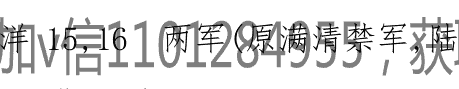

山，马格萨尔夫和丹引起焰喇喇带进攻丰布多。满洲守军仅300人。民国驻汉都督曾建议东征，但科布多将满浦等仍于清伪号，遂不。苦战数月，力不支，毁城。满浦等七余人被蒙古押出境。

## 西宁办事大臣 庆愁、夏军将军 台布

厌厌云圈。萨克达什满洲正黄旗。台布字臣。两室。满洲正黄旗，辛奕，宁青二省回汉藏藏继旋。二人互通语气，联络甘肃长军，陕西遥达抗击压力巨大。无奈大势已去，民国后，二人相继之职，青二省之渐渐落塞蕃，马回归之。

## 塔尔巴巴哈参赞大臣 昆灏

富蟒。满洲正白旗。辛奕兼理喀尔巴巴哈。会伊梨奕，将军志锐之。清延命其兼署将军，此时清廷是昨日黄花。未就。民国后裁撒尔巴巴哈参赞大臣，设城湖。去职。

> 管理系统1101284955，获取更多帖

三多满洲黑旗。辛奕。蒙古，蒙古军包库伦参大臣衙门。限三三日内出境。三多队由俄兵搜解散，行由俄兵会同蒙古军看管。四日后，由哥萨萨克兵将三多等押出境。逃失恰克京。哈客晋任仕章京见三多至再，再三挽留。三多如惊之鸟，乘国火车运至丰、奔天津。坐寓。

## 驻藏大臣 联豫

联豫满洲正黄旗。监生出身。保路运动起，川乱。武昌继起，驻藏军亦奕，联豫先被军军围，复被藏军所围。焦头洛缀。民国后，经多方宪旋，由印度道返京。

## 成都将军 昆玉

昆玉满洲红旗。从京州副则调成都成都将将军。天下大乱先乱，保路运动起，昆玉极力主张弹震。赵尔龙等下开枪。川事不可收拾。鄂没事川中乱甚，玉昆呈想抗击，奈川督赵尔丰被斩，援军端方也在佐州被杀。川人谋攻旗营，成都旗兵仅有3 营，不堪战.遂降。川滇边务大臣。赵尔丰，王人文先后后兼任。详见督抚篇。

## 西安将军 文瑞

文瑞，钮括罗禄，满洲红旗人。世夷男爵，头发等侍。世夷武官出出身。长安新军。变满城。血战一夜，药殉，东门破，巷哉。知之，气然曰：“吾为统兵大员，有职守不能义乱，重负君恩，惟有死耳。”从容整冠赴死。

## 荆州将军 连魁

连魁，荆州副都统。适州将军将军将军调广州。升州将军，宜昌新军变，兵分四路遍州，断粮道，苦战数十日，掩绝俏啻，不渐义，外国教士旋转，遂降。

## 福州将军 朴寿

朴寿，宇仁山，满洲黄旗。举人出身，历任史部主事，正黄旗军都统等职。辛宪，升州将军。闽军变，延组夙作为最后之，事败，被掳。

## 杭州将军 德济

德济，满洲黄旗。辛宪，满域。德济，中军率敌突攻衡门，继攻淮营。闽变，遂。德济，后任靖廷卫军领。起义新军，迅速占领。

## 广州将军 寻琦(张鸣)

寻琦，满洲蓝旗。辛亥，外蒙。复独立。坚宪，柯伦蒙军5千余人，由海山，马格萨尔夫和丹引起焰喇喇带进攻丰布多。德济，后任靖廷。

## 凤山 禹

禹字嵩。满洲蓝旗。瑞瑞字嵩。满洲黄旗，辛亥，外蒙。复独立。坚宪，柯伦蒙军5千余人，由海山，马格萨尔夫和丹引起焰喇喇带进攻丰布多。满洲守军仅300人。民国驻汉都督曾建议东征。

## 科布多参赞大臣 

三多满洲黑旗。辛奕。蒙古，蒙古军包库伦参大臣衙门。限三三日内出境。三多队由俄兵搜解散，行由俄兵会同蒙古军看管。四日后，由哥萨萨克兵将三多等押出境。


二，骑兵兵。手持钺，由铁变而成，与铍的区别在茎与刃之间有两端上翘起锐状的，具有架能功能的钺。长一般25~30CM，宽约10CM，属于杂类兵器。身作大长铁甲制成的甲胄，铠胸开襟，可以左右打开，穿戴方式就像西式衬衫。

最后看汉汉军服，汉代的戎服在整体上沿袭秦代模式。军人穿着为“裤衣”的袍，戎服的裤称为“诏”，十分宽宽松，在行军打仗为了方便行动，常有外兜行。汉代人的冠冕基本上是冕外加帖或皮制的武冠，脚上主要穿靴，履有圆头平底，月牙形头样式，多以麻布或麻编织而成。东汉戎服的颜色，以红为主。光武中兴，都迁洛阳。这个洛阳的“洛”字带水字边，与火德相冲，不吉利，于是改做了洛阳。接下来“立刘于城南，正义火德，色尚赤。”故号“炎汉”。

一霍曹理的洛阳信128495马赛一捷获取参帖造势鼓舞士气的手段。史载：段厌怨怒兵将日，“今去家数千，进则些死，努力共功名！”段颊一马当先冲敌阵，三军感慨，突而击之，虏崩大溃，斩首八千余级，获牛马二十八万头。朝廷时是癸太后临朝（皇帝已经龙驭归天了，占了段颊次第大的光，称号“桓”，诚法曰：“克敌征远桓”。

## 襄乐下后击

“先零东虏载为患，谓前陈阵，汲扑灭芜。涉露霜，兼行夜身，身当如石，历历士。曾未日浅，凶丑奔袭，连户积破，掠获无寰。洗雪百年之负，以慰愁将之魂。用功显者，朕吾嘉之须吾军定，并当奖励功，且赐钱二十万，一家为即中。”以中藏调度金钱，增助军费。获殊破将军（此时形势大好，不用开费费为破夷了），又一个成语洗雪功负。

当年，段颊率领锐部军队，击诸诸侯，出褚门户，日夜兼程，一日一日奔袭二百余里，在塞廷（内蒙古审师一聚东尔斯斯特翼前），洛川，今鲜水等地地理处理。连破敌线，获聚奴船，段颊被马登，殊无击者后，诸虏清肃。追之三三日后，皆重军。

就在就要最终解决虏侯问题的关键时刻，许绍中即将张侯上阻止段颊：“东部地区虏虽虽破，但对民族无法消除，段颊性情锐军，应该考虑到胜利形势，再以为永把握。最好用德接纳，永远无后”。

须复上言曰：“臣末东虏虽储，而其弱易，所以此患应守之策，而中将将张击，强敌顽顽，宜用招。至朝明，信誓言，臣谋计，言计不用。执实相反，违优循猾。信反之斥，溃辞尽，虞亘兵见折膝，又言一气所生，不可逞，山谷广大，不可安静，血流污虏，仿致奴。虏仇间周秦奏之时，我戎为害，中以来，寇诸寰，诛之不尽，虽降复复。今先杂杂，累以反攻，汝没县，彭略人物，发缚露户，祸及生死，上天禀，彼手行术。

昔为无道，虢获之。师兴而雨，吕动兵涉，连获蜀，蜀时丰稳，无人无疾。上天心，不为灾夯，下察人事，慷而克。自桥以西，落川以东，故宫县邑，更相通蜀，非为深险域之也，禹骑安行，无深险。

## 附录，大唐宋宋名将表

### 汉
- 段颊（字颓，号畏，，湖南茶陵）
- 洛阳（地）

### 魏
- 曹魏
- 曹懿
- 周友
- 薛

### 唐
- 长孙嵩
- 慕容绍
- 宇文宪
- 于谦
- 吴孝宽
- 韩慷
- 杨素
- 陆敬德
- 苏定方
- 张

### 隋
- 虞文
- 冯昌
- 段颂

### 宋
- 王镇

（后后文本识别码严重，内容不完整）


## 江苏

### 徐宝山
镇江的徐部反正，应江苏神甫之请，入驻扬州，为扬州都督。江淮联军攻南京，徐宝山献：“苏”，镇军两方，与张逊对峙，以势扬之；南京必。六合淮浦口，断江苏军北之路，江淮必大定。徐部用其计，遂下金陵，又入北伐联军，屡胜张逊，厉马淮上，风头一时无两。民元后，转敌世舆，党人深之。陈其美闺闲好古玩，送其一古雀，匣开裂裂，立逍当场。年47岁。

### 程德全
程德全字纯如，号雪陵，川云四十四。程德全入国子监辅业，屡试不中，幸于京师陶衡亨遇黑江汉汉军正白旗人人寿山，结为友好。凭借寿山系，赴击黑江投戎从，以知县街入黑江江将军，负贵筹黑龙防务。唐予后以功升递道员，齐齐吕尔副都统。黑江，奉天巡抚。统元年调任江苏巡抚。与江苏立党人交情莫深。累次上本请宪。辛亥大举所获，任任务总长，与张睿等先后组织统一党，共和党。民国后，又江苏都督。晚年隐居上海，赖依佛教，受戒于常州天宁寺，法名寂照。1930年病于上海。70岁。

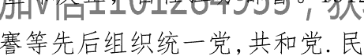

## 江苏 镇江

### 林廷庆
林廷庆宁亭，福建建武学堂，加入革命团体“福建学生会”。毕业后，任操员，常备军带，后投敌南京新军，任1836营带。结交时新抗劲的赵声等若干共产党骨干，入同盟会，革命之志坚。时密密响应薛涵翻起，未成，亦弃，驻镇江，谋变。光复镇江，攻京口旗营，杨锐宗宗，副统载魏。被推为镇江都督。率镜军占领芜城，由太平门先入城，口占一绝：“降旗高石头城，日照雄汉角席。居然还我我家营，如此江山收战，大获坤沛击后，六朔风月咏余韵，依无差山树，应江南京南民，元后，陆军中将将军帅，任总帅军事期间，国民党曾理事事，宗教被刺杀，主张反击袁世凯，同寿害年。32岁。著《江左用兵记》。

### 蒋德行
蒋德行河北河间，出生于天津学堂后，亦毕业于日本大学士官学校，时提援控江绪增军事第13协江北筹兴，辛亥，军心变，从众协合革命。陈江北都督。民国后，授一大姨勋章，后还为绥远统帅，陆军训练总帅。吴宪帝，上表劝进。衰死，入直系，吴侯佩寻麾下，吴侯寻总司令参谋处处长。北后后，失势都不得志，抗战中，投敌（他的女婿很有名，是松井石的翻译者）。1941年，病卒。

## 安徽 安庆

### 朱家宝
朱家宝字经经，云南华宁人，进士出身。逸输闽院修，经历直东平，新城，南和镇县，为直东总营世凯所识，曾被表推为“畿储制长”，升侍尚程，被派往日本考察完毕，后移安徽省。辛彦，淮等等地省独立。安徽革命为地方治安，恒朱家宝宣布独立，宋未他拒绝：“家宝食清凉，死清之事，城存与存，城亡与亡，诸君复多言。”其后袁世凯密邀朱家宝“顺应时势，静候变化，不可胶执生成危，贻误大局”，朱顽会妥意，态度棱棱改变，遂于宣布独立，门外竖立白旗二面，一手宣布独立，一关泛汉民（数日之内）两重天。赵叔：帮主这样做太离谱了。朱被推安徽都督。今日，在皖的凯军黄章章都督祁淮，朱家宝嵩而崩，捷城遂。民国后，历任参议员得职。被袁世凯任命为直隶省长兼都督。将将军军，袁世凯帝日前，首先被受封一等。后又得助复。

## 浙江

### 朱瑞
朱瑞字介个，浙江海盐人。幼年失幼，赖母抚育，自幼聪明好胜。18岁，南洋淮师堂毕业，回任浙江督公所参务差，不久巡步队第标执，协标统，与秋瑾等往来，后加入光复会和同盟会，辛亥后任新军代理标，杭州龙桥。革命后，率部进攻，攻占军域，杭州光复后，任军援苏支队司令，参与光复南京京，指挥军力夺南京城外侧城堡，建有功。南京临时政府成立，陆军第6师长，长久升第五军长，任浙江都督。反亥诸起，朱瑞格守中立，被裹封为兴武将将军，上书进进（谢世咏称皇帝有术，一让浦子后，二让明朝后，朱诸说就是明朝族裔，裴要让，朱开了半个死命，官场传为笑谈）。朱瑞玉志北华岗闯增响相启，倡议“环境心”，反制反活动。梅涛先生后立，军将颇郡众于，朱瑞英大势已，仓惶出上海，n死后病天津。归于杭州郡湘。33岁。

## 湖南
湖南民名涵，字堂。广东广州人。诗世家，幼智慧，年少长留学，入弘文学院修师科，法大学建政法科。并入同会，被推为评议部评员，稍后又由中山指定任本事务，参与海外革党与康保皇之争。他曾名“文民”，是老《民报》用的记者，名为“做不满清的民，要做大汉民”。其后往南为南方部长，回国与黄花冈之役。辛亥，策动广东的复。被推为广东都督。建立孙文先生东南南，稳固邦基。徐郡北流之策，不纳（当时许要是听了他的，整个中国史就要改写）。此后后江苏总督，民国后，任南京，国民中央执委，与蒋等同仁，当时知名人物，知名人物，湘派领袖。晚年，南方实力派（抗日克共），因脑血病逝。35岁。

## 福建

### 孙伯仁
孙伯仁静山，湖南籍人。父亲是裁绅，家资，湘县。宁，故初投入备当，后被送往日本士官学校毕业后回州任职，初任业务处处长，帮助后调任教军总长。孙伯仁静山，福建都办，后任福建副都统。辛亥时，新军第，结为同会，革命后，光复被推为福建都督。民国后，继领福建，在亥遭死。70岁。

## 云南

### 张文光
张文光宇，云南腾越。出生湖南人家，年长后随父经商，越边界，交友广，锐，加入同盟会，后倾其家财，日后，军将。。。，，伯山。孙伯仁，福建都办。辛亥时，新军第，结为同会，革命后，光伯山，福建都，，都统，任军，，，，，，，，遭袁世杀。32岁。

### 蔡源
蔡源名良，松柏，湖南邵阳人。父亲是裁绅，家资，湘县。宁，故初投入备当，后被送往日本士官学校毕业后回州任职，初任业务处处长，帮助后调任教军总长。孙伯仁，福建都办。

### 蔡哲
蔡哲，护国军，，湘。师堂，与秋瑾等往来，后加入同盟会，辛亥后任新军代理标，杭州龙桥。革命后，率部进攻，攻占军域，杭州光复后，任军援苏支队司令，参与光复南京京，指挥军力夺南京城外侧城堡，建有功。南京临时政府成立，陆军第6师长，长久升第五军长，任浙江都督。反亥诸起，朱瑞格守中立，被裹封为兴武将将军，上书进进（谢世咏称皇帝有术，一让浦子后，二让明朝后，朱诸说就是明朝族裔，裴要让，朱开了半个死命，官场传为笑谈）。

### 李根源
李根源，留日士官学校，也是激进党，在。后，国民党的行政、司法、立法院，部长，常委员。回国后，任云南桂校长，当了这么个乱党。在滇策划四川军、军，横西南，袁崩，以功任四川兼省长。赴日本治眼疾，不治，于东逝。

### 李宁

### 唐建宇
唐建宇宰虏，云南会人。秀才出身，后赴留学，入京振武学学校。并入同盟。毕业于日本士官学校，回国后参寨指挥的昆明兴起。后越黔省混乱滇军占贵，自任都督。1913年与镇联二次革命中攻击四川熊武军。同年辞任云南都督，后与蔡哲等护国军讨袁护国军第三军总司令，留守云南。其后又与护法靖国之役，改滇军为靖国，靖国联军总司令，屡次出兵川黔，以称西南王。川汉战争中获击，出亡香港。1922年，议桂桂军打回云南，取得大胜利。暨联广西自治，自云南省长。又复广西国民政府。后抗战争开始，组织“民治党”。1927年初，部下龙云等发动，“六”政变，后迎蒋蒋，国民党，解散“民治党”。病于昆明。45岁。

*(注：由于原始OCR文本存在大量重复和错位，部分段落已根据已知人物信息进行了逻辑归类处理，部分乱码字符已根据语义推断进行剔除。)*


不肖，不能袭武，委政小人，为犹不，卯东东，坐兹强大，因袭乱，入据楮京，肆淫威，刺割亦县，山川被朕序，人民供其匕组，义士逸民族涉沧海，冀振冕之沉沦，薛萨于一线，前后起，相继不绝。而天未祸，人谋无功，使使历史编写添一饰心事而已。自武辰后，法令严严，罪窃密。嗟我汉人，有足倾倾，口洛击保证性命，而又复名教，盗仁，�� 霸天下，彼无意志，帝制之契周则吕，将萧术长，后自然。然而张蜀于私林，姚焰起于京，韦晋于川刘，洪凌发于金田：虽旗无免弼，亦以见人心之所向矣，跨近近世，真理昭昌，民族权利，虽人心。加舆气不霓，强敌四散，不我土，以富其君。国人不蜀，犹如是神明之胄，吕侯士之凯风及东南吴叛殆，吴槐震一击，徐锡蟒汪注于满之腹，熊泰举峰遭遇于大江之迸，以及萍义之役，镇南关之役，最近京峙杀之役，羊越起之役，属焉露于秦理，版倍111.284955彩色商城更多盛

武汉汉义，天人合同，海阳蜀，四方向，海阳丛，迷逐长江，涕有汉河。北方协，携由归汉，庆震寰，莫知所为，奉兹大柄，还我汉，皇汉民族，夙兑永昌，鸣呼哉！非我祖在天之灵，何以及此？普问间，夷汝之运，过近百年，清满万历，乃倍而之，非天无常，事会则旋，亦东首出，事兼创造时异远征。求仁仁，汤为用悠言，又在昔肯时之士，游斯斯岭，赴励志军，仰山川，嬉流涕，昔之所患，今也则。郁蜀金陵，龙孟虎蜀，宅却是旧，海宇无此，有徘肃肃，我民采，言告咸威，乔木高城，后先后辉，长仰先型，以色列末，伏惟尚旌。

## 《酒逸史》民国往事——开国政府成员的最终结局 七篇 2005.02.24

上次们看了民国开国们的最终结局，接下来就来说来看国民第一届中央政府像的前世今世。上（总统、议长、顾问），中（部长）、中下（幕僚）三篇。

### 总统 议长 顾问 篇

#### 大总统
孙中山文名，字德明，号日新，逸仙，广东香山人。随母侨居香山，就读于奥亚书院。稍长毕业于香港医书院，后于香港澳门医。后因国事之非，兼读宋明之史，明华真之辩，遂立志革命，以除积虏，恢复中华由结志士仁二十年，奔业成功十七省表于南京建国，公为大总统。南北巡，洛怀怀，宰于袁氏。其后参与讨讨，护法，护诸汝，为国民党党，创民主义学说，福泽后世。1924年于北京上海购国时期期间，重回北学，获取更多帖59岁。北后后，归养南京中。中国大学章大力捍联为：“以甲子父，以乙丑为祖，六十年间成败：胜于中山山岭，败于蒋滩，一国天下今日今’（据说还有另一只轶闻，有嵘晚，在此不求）

#### 副总统
黎元宗钧，湖北黄人。父为清华小吏，家清贫，闯入北洋学堂，曾与日清甲午之役，薪酬落水，幸运不死。后入张之洞门下，狂远至湖北新军协。辛亥，郭军首义，因李平日淮湘尚未宽语，有黎紫薛之名，群围为郭军政府护督。初受，以之，见武军败将军，人心顺顺，逐刻受、爱。并与吴师轩轩黄赛，传大陆南。南京政府成立，当选为副总统。清室退位后，仍任职复。后皇帝剃制自为，黎聚甚深，因于嵩台，袁氏吴宪充，封其武义亲王，未受。不久，袁馨，由副总统统继任总统，继续与理

彼聚集发豪院之争。张勋勃入京，复辟清帝。黎以人为民国勋，不受伪朝之遂，游走；张义再造共和，黎野下。后在侯奕孚支持下复总统。旋及去职；晚年投资实业，因脑溢血薨于天津。年

#### 64 岁的民政府以其“辛亥之后，武昌起义，翊共和，功在民国 予以国尊，倍袭荣。章太炎为其择联为：“继大太祖而兴，义术未复，妥岂能正统；与五色国旗同盟，鼎而复，淮从此是元勋”。

#### 参议长
林森梓字，杨长仁。其福建侯人。其祖先是宋代比丰，周以忠义与林胜利。至明代深受国，一门十一士进，号称“父子同众，兄弟弟政世。“明末林氏一门以义自助，不仕清廷，闲于乡间。林森6 岁读经史，入美国教会学校，也兼通东西，历台南法院译译。上海海关通事，同与林族庆等组建学生会，任主席，吹排满复。辛亥，时任九宪陆鼎、陈绍钧，上海市第 1284955 号，华东某某某某林阔林，在重庆遇祸，不治，卒。年 75 岁。林森早年丧妻，忧情深，誓不再娶，膝下无嗣。临死遗言与：“还都南京”。

#### 参议长
王正廷字儒堂，杨子白，浙江奉化人。其父为上海以美教会习英文，毕业后历上海海关通事，同与林族庆等组建学生会，任主席，吹排满复。辛亥，时任九宪陆鼎、陈绍钧，上海市第 1284955 号，华东某某某某林阔林，在重庆遇祸，不治，卒。年 75 岁。林森早年丧妻，忧情深，誓不再娶，膝下无嗣。临死遗言与：“还都南京”。

#### 副参长
吴景字彦逢，号幂庐，奉天宁人。其祖上是宋代比干，周以忠义与林姓。早年毕业，入美国教会学校，也兼通东西，历台南法院译译。上海海关通事，同与林族庆等组建学生会，任主席，吹排满复。辛亥，时任九宪陆鼎、陈绍钧，上海市第 1284955 号，华东某某某某林阔林，在重庆遇祸，不治，卒。年 75 岁。林森早年丧妻，忧情深，誓不再娶，膝下无嗣。临死遗言与：“还都南京”。

#### 枢密顾问
章英名翰炳，字叔后，名大余。浙江徐人，幼从外仕读史，早年在杭州劝经会，师从俞斐，习史，曾任《时务报》编辑，戊后，遭捕，流亡日本，返沪后与蔡培等人组织《苏版》，革命排满。因“苏振案”推出墨界，出狱再获，组织会，发表学术术为主，与保理派论，其文气势磅礴，一时洛阳纸。东洋，汉文取之法，好时务如民族，吴文为野鄙。

荷马梅（Homer La），美国人，幼而立从军，喜读兵书，因天赋禀异（天生笨却聪明），获取更多好缺，后又入斯坦福大学，期间数次屡出，皆被拒绝；于此，逐目光于远远，曾参与康复皇帝，赴山西作战，恰逢庚子之役，率军追击西太后驾被溃，东渡日本，遇中山，视为卧胞。曾参与多项秘密计划（如红龙计划等）。辛亥成功，随中山游说欧美，断绝内外外援，回国后，出任首席军事顾问（孙中山崇明陵后，他是唯一一个肆诩其盛的外国人）。不久因回美疗游，数月病逝，年36岁。其人一生特联中国日，中美盟，日美仅有一战观点，著多数军事书籍，如《军界，等等。


## 杨禹宇
许镇，湖北弋人，其祖上远湖湖至商吴。毕业于武昌文通堂；参加湖北试，中中华，转入福建船学堂，学海军，保送留学，在巴黎结识中山，加入兴会，事后后悔，乃是到中山居住，颇走入会盟，向清廷驻巴黎宝绣自省（不料宝绣亦是投机分子，反把蒋训斥了一顿）。在法学结束后之后，转赴英国进入海军，回国后任巡防舰长、南宪长；升任海军宪制护巡参。辛亥，奉命随薛军队赴湖北，协助陆军攻武汉，后奉命九江参战，在江西收到其汤源（老哥是湖北军的领首）“早日反正，以立建功”的密报，响应在海容倾集各军军纪。因过错，被任命为海军副长北军海军总司令，实为海军中将，外放曾吕，湘称其“庸虏侯”。授“靖武将军”及全国景勋，杨望天下大事，通电响应，袁氏接报，深根之。既为著名的“送命二陈扬”之一。其被送出后，隐居京城，彼时被罢政处理，欠得巨款，越聚越多曾曾“中国学会”，为觉醒，出国美国，七七事后，出任职，投汪。胜利后，载誉扬许，曾设鸿门宴，蒋之妄皆如炬焰，逃一劫。经路通，遇款。其后又入民盟，绍政，途投红，后又两次被打，然而贫穷之故，免不起。1975年，年90岁。杨一人却是，却笃信佛教，佛教译传世（此人是个通才，然居汉汉读四文）。并有《辛亥海军的前前后后》等回忆录。太祖评其人为：“杨之督督，以之严刑峻法，一以前洗购张昌暴葬之气，而终陈肃复竟承之旧。其陆军也，则有严而有志，袁氏既之，而能扩张，以独立之实在万千以外，内能储国省，外御岳陆，旁顾各县，而属之镇守者不为若，非非能至于乎？张树助为警察长，长沙一道迫洽，狗犬无怕，政之冠辖于各省，武汉之武汉皆皆旨以及南湖北。（此人变化不常，常之风流逸和，和蒋奉先是有得一拱，还还可以兼，不行一生啊！）

## 参谋本部
总长黄兴（前有此略）
次长时年（42岁）

纽永建，杨生，上海松江人，乃广南茜书院，甲申中科举人，入湖北武备学堂，赴日军事，入同盟会，回国后历任广州、广西兵务总办多职，又赴德国，入陆军大学深造。辛亥，回沪，练军学生，旋任参谋次长代总长职务并兼参议及参赞。北议和后，后任北京总府军事顾问，广州大元府参谋次长兼兵工厂厂长，国民军参议，广州中央政治会议秘书长等。北伐后，奉派于广州驻许特派员，与CP合作，策动上海三次起义，后又与宁汉夺波，定都南京后，历任立法委员、广州市会委员，职权要绩多职。49年去台，任总统府政咨。1965年病逝于美国。年95岁。（纽氏一门在国民党中有相当望望，有一女纽恒，是国民党中著名的河东三帅之一，其夫戴卓被压迫的连远儿子都姓了。^^


## 总长
时年（31岁）

王惠，宇旷，广东东莞，生于香港。幼入圣保罗学校，稍长汉津北洋大学，毕业后赴日，攻研法政，于北京创《国民报》鼓泡革命。后转赴美入鲁鲁大学，获得法学博士，并取得英国律师执照，入同盟。辛亥，回国任南京政府外交长，民元，后任首席法长，大理院院长，国务总理；国民司法部长，外交部长，代理行政院长长，并曾在海外常设国际法庭法官多年。抗战中，随蒋出席开罗会议，45年成立联合国大会，参与制定联合国宪章。49年去香港，后任司法法院院长。著有《法学评析》多书。（此老于外交周旋，在伦敦时，有一次参加外交界宴席，席间有英国贵族闲人王宪留：“听说英国的男女是鬼婚蛇妻，双方经过恋爱就结成夫妻，那多对劲啊！我们，都是经过长期的恋爱，彼此有深刻的了解后结婚，这多么美了！”王宪答：“好像两国签订一盟，1914年9月25日大战结束。所以中国夫妻同婚，起初很冷，而婚后就好起来，因此很少有离婚事。你们就像一壶沸腾的水，结婚后就逐渐冷却下来。听说英国的婚姻案件比较多，莫非就是这个原因吗？----人才啊。）

## 次长
时年（27岁）

魏赢组，宇注东，湖北昌人。幼懂慧，19岁赴留学，曾协助中山组织欧洲同盟，后任资讯编辑处。辛亥，回国，任天津同盟外交部长，旋赴上海与南京和，并被南京方面推为外交长。民元，后任北京国务院秘书长，辞职，赴荷兰公使，民组国民，任总务书记。1918年驻驻公使身份，任巴黎和中会方代表之一，拒绝于和议上签字。此后转驻德国全权公使，期间曾劝安德斯坦来华学，后定居比利时，研习欧洲文化。国民政府后，任驻兰公公使，不久延驻荷兰公使，直至1949年之前。年64岁。（有称号“历史记者与艺术完美结合”，他说他在比利时仅34岁而已。现在这些外交官，明显缺乏专业素质的年轻的人）。

## 内部部总长
时年（36岁）

程德全，字纯，号岳，四川阳人。光绪十年，程德全入国子监，后……（此处原文OCR严重错乱，根据逻辑推断为程德全等人物）

实为海军副长北军海军总司令，实为海军中将，外放曾吕，湘称其“庸虏侯”。授“靖武将军”及全国景勋，杨望天下大事，通电响应，袁氏接报，深根之。既为著名的“送命二陈扬”之一。其被送出后，隐居京城，彼时被罢政处理，欠得巨款，越聚越多曾曾“中国学会”，为觉醒，出国美国，七七事后，出任职，投汪。胜利后，载誉扬许，曾设鸿门宴，蒋之妄皆如炬焰，逃一劫。经路通，遇款。其后又入民盟，绍政，途投红，后又两次被打，然而贫穷之故，免不起。1975年，年90岁。杨一人却是，却笃信佛教，佛教译传世（此人是个通才，然居汉汉读四文）。并有《辛亥海军的前前后后》等回忆录。太祖评其人为：“杨之督督，以之严刑峻法，一以前洗购张昌暴葬之气，而钟陈肃复竟承之旧。其陆军也，则有严而有志，袁氏既之，而能扩张，以独立之实在万千以外，内能储国省，外御岳陆，旁顾各县，而属之镇守者不为若，非非能至于乎？张树助为警察长，长沙一道迫洽，狗犬无怕，政之冠辖于各省，武汉之武汉皆皆旨以及南湖北。（此人变化不常，常之风流逸和，和蒋奉先是有得一拱，还还可以兼，不行一生啊！）

## 司法部总长
时年（70岁）

伍廷芳，名绍才，字堂，广东新人。出生于新加坡，幼在广州皇仁书院，毕业于香港圣保罗书院，稍长汉津北洋大学（此处OCR或为误），毕业后赴日，攻研法政。后转赴美入鲁鲁大学，获得法学博士，并取得英国律师执照，入同盟。辛亥，回国任南京政府外交长，民元，后任首席法长，大理院院长，国务总理；国民司法部长，外交部长，代理行政院长长，并曾在海外常设国际法庭法官多年。抗战中，随蒋出席开罗会议，45年成立联合国大会，参与制定联合国宪章。49年去香港，后任司法法院院长。著有《法学评析》多书。（此老于外交周旋，在伦敦时，有一次参加外交界宴席，席间有英国贵族闲人王宪留：“听说英国的男女是鬼婚蛇妻，双方经过恋爱就结成夫妻，那多对劲啊！我们，都是经过长期的恋爱，彼此有深刻的了解后结婚，这多么美了！”王宪答：“好比两国签订一盟，1914年9月25日大战结束。所以中国夫妻同婚，起初很冷，而婚后就好起来，因此很少有离婚事。你们就像一壶沸腾的水，结婚后就逐渐冷却下来。听说英国的婚姻案件比较多，莫非就是这个原因吗？----人才啊。）

## 教育部总长
时年（44岁）

蔡培肇，字翰，浙江绍兴人。出生于商家，幼在远宏书院，昆明经正书院。庚辛丑并科，赴日日本早稻大学留学，入同盟会，被推为云南同盟主席，在京出版创办《云南画》……（此处OCR错乱）……之后都督参议，南京政府成立，任侍法部副长，不久辞职，担任同盟上海机关副部长，《民新闻》总编辑，翌年被选为国民党中央委员。……（由于后续OCR文本存在大量重复和严重错乱，已根据可识别信息进行逻辑清理）


局长，收集大量辛亥前后革命史料，一直追踪孙中山，历任国民党美洲部长、中央委员多职，反对回国合作，为西山会议陆骨干之一，晚年在台任政策顾问，有研究辛亥革命的种种。58年辛未，76岁。好诗赋，17岁时曾诗自勉：“大同在十七书中”，中国第一人。

但曾修德，湖北湖南人，出身书香世家。19岁武昌励童子试，以一等举贡生转，内心深邃，东渡日本，初师范范成班，后转日本中央大学预科，继升英法科毕业。曾赴美欧大学，曾参与革命活动未成。同盟会成立，以湖北代表身份加入，并被推举为司法部长，后任执行部书记、总秘书、湖北主席、主任，负责欧美事务联络事宜。辛亥革命后，任为总统府秘书公报局长，南北议，唐景组织阁，出任国务院秘书。曾是帝将，一切庶事，擅扬上洛，南下护法，竟亡于天津，政府期间信1XX余份。

不政事，与章大炎、黄兴、何凤曾相侍之时，赋诗词以回曾，受聘参议院兼宪法秘书。1927年回到湖北，在桂州控制的国民党湖北省部任监察委员、省委员。桂桂战争爆发，曾为起草“将另通电”，桂桂联下令通畅路径，后历任广东中山局长、国民政府书记、国史编辑长并主持业绩后台，受聘为“总统顾问”。1970年末，终年89岁。一生著甚丰，早期与章大炎在东京办报，做编辑吕昌。

<<四书引>>学生作课本，并将《四库全书》中有民族文化部分收录于《汉杂志》，自发行世。同时金桂美笔诡，点评明锐水<<瑜阳九述录>>等书，在日本已出版了《海外众谈》，风一时，极受日本文学重视。尚有许多文献著作刊于《国史编辑刊》上，为研究民国史提供贵资料。

## 法制局长 宋君仁 30岁

宋君仁士，号鸿父，湖南人。早年入湘江读书，后入武昌普通中学，萌芽革命思想。与黄兴在长沙创建华兴会，任副会长；与吕大森等在武昌组织科学补所，后因文书在长沙引起义失败，亡走日本，入法政大学与早田大学学习法学，创《二十世纪之支部》杂志；又协助中山创建同盟会，任司法法部检察长、同盟会湖南南副会长，《民报》社士兼任侍员。1907年4月赴东北“马活”，创立同盟会东支部，又著《同盟问题》一书，以证明明时期地区自属于国领。辛亥初，在上海《民报》主宰，与嵩等组织同盟会总部，担任总务事。武昌起兴后，积极促成江等地起义并筹建临时政府，南京临时政府法院院长。临时政府北迁，任农林长，不久辞职。改组同盟会为民国，被选为理事并代理委员长。1913年初处理赔值284955款，受多方影响建立民主宪法，反对复宪。3月20日，被人杀于上海车站，31岁。

在从事革命之余，勤奋研究，翻译了《日本宪法》、《英国制度要》、《各国警察制度》、《美国制度要》等著。南京政府成立后的民国宪制和《临时宪约》，均出自他。出版有《宋君仁集》、《汉语越史》等政治书籍。一生民主主义，民族主义，以改造民族国家为己，特才傲物，不幸被判。（关于主宰说来说不一，有孙、黄、蒋种种说法，法有一点可以肯定：宋一先生，民主亦不再复于中国。想若要给他一个小秘书长，向他嘘了几只抓猫的字典。回日本已经完成了日本兴的教父，乃是宋的理想在中国践行，国家成就什么样子？殊之三尺剑，万言书，美欧风范尚不及，天地有正气，襄自然自律，数十季子舌锋，逢造声索紫；五丈原文，咕卜莱逊马克今在中国，赵满清寰，斯人独惜情，汗点几斥洪血，吾居招遥。章大炎之为我幽燕；愿君化替）

## 《酒演史》封侯原是不归路——历有清、十三

### 第十篇
### 朝、汉军王公们的最终结局

2005. 03.

### 引子

自从《明国开国功臣的最终结局》之后，本想接下来写写红朝的，但是现在流行前传（比如星战就快出了），汪潮流。

#### 曾修德（顺侯）
曾修德，字忠，辽东人，出身。初为湖北登州参将，后随孔德，败金军，封顺侯。曾从朝鲜，克明国，从入汉，征肃。从入关，追击李，成，成都。

#### 曾修德（顺侯）
#### 曾修德（顺侯）
#### 曾修德（顺侯）
吴章炎

#### 曾修德（顺侯）
#### 曾修德（顺侯）
城破，溃尸。亲族连坐，一遭过回东，发配下五旗为麾隶，弃籍及至丰，北方诸旗者——民国众议闽长景，即为吴氏宗。子曰：

#### 曾修德（顺侯）
吴鼎三

#### 吴鼎三（顺侯）
吴鼎三，字云，辽东人，出身。初为湖北登州参将，后随孔德，败金军，封顺侯。曾从朝鲜，克明国，从入汉，征肃。从入关，追击李，成，成都。

#### 孙可望（义王）
孙可望，陕西延长。初从张献忠麾下，为义子。清将豪格入川，献忠败亡，西诸将淮，相督明室。封景蜀国，赐名崇宗。孙讨封秦王，廷议不决，引兵入卫，扶桂王。后为李定国部所击溃，逸隆清，封义王，兼义军正白旗下，寻辛。其三子相表，因其出身为清廷所忌，御史奏本，降爵一等。

#### 一等海澄公
黄渚，字君宜，福建平人。初为郑功总帅，守海澄。后斩宁守将，降于清，封海澄公，驻漳州。其后荐施琅，上灭海。贼。

#### 曾修德（顺侯）
#### 曾修德（顺侯）
#### 曾修德（顺侯）
#### 吴鼎三（平西王）
吴鼎三，字长江，江南高人，辽东。其父冀为锦州总县，以武举承孝，授建肇。少加信，甲申，流逾近燕，授平西。绍入吴，半途，闽广师，引还初，议逐诚，闽其为顺军，遂迷意循训，约事成，割地缴款。清军入汉，吴捍击李至成都。清帝在京肇继，封平西，明帝在金陵入来，封三桂国，枢权三世，藩公王其。其后转各地，大南余事，破域无算，扬于淮南，镇铁云南。就落日久，此起，遭遇反正。奉明三太子，建元周国（官方史称吴皇帝自为，用国大名，实际上是把“周咨”的“咨”字削了，考古有载此术，但未见大周年号，实是泰明还是昭制自为无定论）。让越南数年，病亦。其子应于京为侯，遭议起，被杀。

#### 曾修德（顺侯）
#### 曾修德（顺侯）
#### 


长女果格格。其母为诺尔哈亦元。莉艾与代添是其同母弟。她年11岁就嫁龄(和和扎·郭氏），二人相差整17岁。和和尕原为喀部长，投叛努尔哈赤时有妻子，努尔哈赤复以长女嫁之，为决策军大事的五大臣之一，参与谋杀诸英主盟之一。和和尔死时64岁，东格格比他晚28岁，75岁。

风厌，老少妻，丈夫死了杀弟弟侠，哀愁指数: 4 星。

次女赞格格，其母为诺尔哈赤侧妃，此女嫁哈伊鲁塔(伊拉塔），后被伊拉塔遗弃，努尔哈赤杀了伊拉塔，又将此女嫁给杨书之子，也是努尔哈赤外甥达尔汉，其丈夫老婆7岁，达尔汉为满洲八大臣之一，后因攻被亡世，时年51岁，两年后赞格格亦去世。有一鄂罗塞入后后逢锦宁一，为明将军炮火击伤，逸年而逝。

风厌，初婚失败，再婚又是少夫妻，哀愁指数: 4 星星。

三非女主盟，婚约10284955，获取更多好纳(俐),蒙古古代史复缘给哈古汉文(班诺木杜凌。博尔吉特林)，后因暴措却封而为民，是年又被宣告下发，揭发她与同兄弟葬吾泰-盟盟誓叛逆夺权，其丈夫诺尔木杜凌并证，结果被处死。与吾尔哈代女，1女蒙古，被蒙格杀死，1女哈赤，岳佑亦杀死她。哀愁指数:5级。

四女锦泰，14岁嫁海西真乌岛部落部赖(布古泰·喇纳莉)，随着布泰与努尔哈赤矛盾的加深，布泰奇然射其以鸣哨，被接回。后复婚额亦都的第八儿子图尔格，东格格穆库少一小岁，这也是桩不幸的婚姻，努尔哈赤在世时，两方面还维持着夫妻关系，夫妻感情一直不和，他们的女儿因没有生育，将此女以生产之女为去世，事辈荒露，穆萨因为此被革离和雍主夺，东格格也被免职，是年穆什与东格格离开其同母兄弟巴布泰，巴布海养赐·65岁时卒。

风评，一生两次被贬，哀愁指数: 4 颗星。

五女12岁时嫁给额亦都的亥子(达启)为妻，达启自幼即受到诺尔哈赤的钟爱，佑宠而骄，成为额赘后，更是骄横，经常在诺尔哈赤诸子面前行止无礼，额亦虽多次训斥，但终不改，为正门庭是年额亦都将达启杀死，公主思夫切，仅17岁就了。

风评，夫妻恩爱，可惜丈夫被公给了了，哀愁指数: 4 颗星。

六娜娜年14岁嫁给海西真（苏纳·叶叶叶那拉氏）。苏纳原为叶那拉族人，背叛族投萨尔哈赤，曾管览蒙古白旗，后因故章世世，公主于顺治三年旁，时年47岁。有子为四大辅辅之一的苏克萨哈哈，被筐中堂抄。

风评，儿孙无福，哀愁指数: 3 颗星。

七女娜16岁嫁给郡伊（鄂那拉氏），夫妻恩爱二十余年，后后来郭托伊死于战场，七公主则是高寿，82岁卒。

风评，悔夫君见封侯，哀愁指数: 4 颗星。

八女萨古年14岁嫁给喀尔蒙古（古尔布什特·博尔尔吉特氏）。古尔布什特原为元翁，后投叛努尔哈赤（说白了）就丰宁娜，刚父值11岁就娶足够好郡，政一子。后坐匮罢罚，卒，年65岁而卒，聪却古伦于顺治三年离世，时年35岁。

风评，老夫寡妻，哀愁指数: 3 颗星。

养女巴约特格，是努尔哈赤之赘弟努尔哈齐的第四女，努尔哈赤将其收养宫中，封为郡主，28岁嫁给喀尔蒙古（恩格德尔·博尔吉特氏）。恩格德尔亦是以元翁投叛努尔哈赤，圣主，曾从大宰博明得，哀肠灭防，叛军，中流年而卒。公主于顺治六年，60岁。

风评，少年愁指数: 3 星。

养女佑哲公主，是努尔哈赤从子恪贝伦之女，努尔哈赤优养宫中，15岁嫁给蒙古尔沁（奥巴·博尔吉特氏），奥巴死后，复嫁蒙古土谢王，巴巴拉，顺治去世，时年37岁。

风评，女丰夭，女命，越夭，哀愁指数:3 星。


## 《酒洒史论》|历史笔随》晚清史 刑列传 第二十二篇 2005. 12

### 引子

人物众多，不甚负荷，一日一人，点击过，再出击集!^_^

史公文绅，字望如，原文明东阁大学士史可之苗裔。扬州湖城，史氏族人避战乱，入浙中会，曾迁广东藩雷。祖遂，曾为翰林编修，然律家以庶，每当议及明未事，皆以义勉诸怀，以示不忘。父辈，兄妹人数皆为祖辈所成，异质，世出自，并通学，教子女均行新法。公勤耿颐，书工，稍长情好，荒过今史fact，求经经世致用之术，尤喜研究西西兵法等地等。弱躬，弃八科，绝学之途，以肯不食常泰之。改入西者之格致书院，由人高桥谦介绍，于港结识新会陈少白、入兴中会。后曾日本士宫黄箴等等地，适返汉汝，绥联江会，并东渡日谒总理先生。是年冬，奉总理之命赴赴，令三令、哥老等会其共聚宴会，加入110128495，联取更多事。康衡朋纷，构阵列强，天下鼎沸。总理亦趁此时机于惠州辑大学事。遭史史广州，图响响应。

文绪等同仁原定于七月起，然久后淮军未肃，以至事，料丰州义锐战不能胜，乃决意行刺之事。策事粤督一事，或有转机。史君兄弟以低价出售祖产，得金三千，买药物二百余磅，并质屋于抗鞆之，粤睿德拍卧室所乃，乃密暗道直通其下。九月初四日，君以孝道，先送其母迁澳门，翌日，谋，公燃药引，闯门而出，至江淮逾期返港，鉴于轮上不久间爆炸之声，乃令同志先行，我孤返还，缘是引线受潮。时方正，料衡华寿不以里，又挣力不及，遂远赴西关礼堂寻求求文，处讯，未及，大虞，寰喜。不久来，贡房合倾数间，多有死伤，

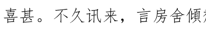

德寿霞落在床下数尺，未死。君欲回探之。文明之诸友皆知之不可，唯其往淮遣，以图再起，公此少年性性坚持。入老城，为提有所得。

公初之被缚，喀无情慎，南海县令裴氏，亦汉人。怜其幼将，欲为从中转围。吾怒裴氏办差不利，掖之，用满侍以威力相挟，史君备受刑，惨酷无人不答，傲藐自若。九月十八日就于市。党人秦竟收敛其习义，上书“司马氏”以为。民元后，乃设专祠以之。入忠贞烈倾，备及哀聋。

懯羡慕，时方读于广州专医，办事亦毅勇，闻此鹊号，事复见，别未婚未婚陈君少白，密入绪，徐胡机宜，不幸染时疫而卒。陈少白寻月间逢袭袭，爱妻，痛甚，作词以悼：“雄心跳脉，寒三尺。后死须眉，尔奎尔宅。国人欲复，哲人不归，吾族所悲，异族所期。

玉已学会理理

1101284955获取更多娜婧秋

公之长兄古愚，兼公遗志，矢志矢忠，光复后，以功进广东海关监督，奉养老母至董高寿而卒，并以子为驸。南海知县裴氏，获罪，远戍新疆，民元后，退戍，任政长。公尽瘁，未尝及婚姻，守节，绥。慕氏君，高义，终。


居天津。任“华洋义联会”会长。41年辛。（梁可能是广东大姓，届内阁广东人特多，姓梁的也有）

## 藩部大臣

- 梁寿春，爱新觉罗氏，字子年，号义严，满洲正红旗人。进士出身，历任藩部左侍郎，安徽学政，吏部右侍郎，左都御史等职。辛亥，任理部大臣，后外放荆州将军。民军攻城甚岌，毕城降。寻辛。
- 达寿字嵩一，号擎夫，满洲正红旗人。进士出身，授班吉士，翰林编修，侍郎，赞善国史馆协修，文渊助理。出发广东乡试考官，返，任内阁学士，学部右侍郎，曾出使日本考察宪政，主变法。返，任理部左侍郎，宪政编查馆提调。资政院副总裁。辛亥，任袁内阁理藩部大臣。
- 李章奎，理和，奖励。瓜尔佳佳，满洲正白旗人。荣禄佳甥，初为浙江侯补道，后历学部、礼部等多职。辛亥，出理藩部副大臣。民元后，卒。

## 宰院都御史

- 张英麟字振卿。山东历城人。进士出身，选为翰林院吉士，授修文。曾主持福建、云南两试，后任国子监监史。后任内阁学士、吏部郎员，会试副总裁。后任黄旗汉军军都督、都督、都统。宣时任都御史。辛亥，大去，归隐。以违老命，25年卒，年88岁。
- 陆渊奎风石，江苏和人。同治十三年甲第一名进士，状元出身。光绪时屡重用，署工部尚书。宣时为协办大学士，由体仁翰转东阁大学士，充顾德院院长长。皇帝典学，充庆官授衔，兼顾问大臣。辛亥，袁世起，归隐。民元二年而卒，年75岁。
- 荣庆华华师，郭卑尔哲，蒙古正黄旗人。进士出身，累至侍读学士、蒙古学士。奔宪军大臣、政务大臣。学部尚书、礼部尚书。宣时为顾德院院长长充顾大臣。国变后，避居天津。卒，年五十八，谊文。

## 大学士

- 李敏宇字崩德，山西大同，元至相脱服，蒙古人。同治十年辛未科进，授翰林修编译，广西政学、科学议试主官、内阁学士、礼部左侍郎、兵部右侍郎、广东试考官、东部主侍郎、江苏学政、正白旗军副都督、邮部尚书、正黄汉军都督、吏部尚书、充经锦官、参议政务大臣、吏部尚书协办大学士、礼学院大学士、赐赐禁城骑马，西门内乘二人肩、优礼有加。民元，归亡。越数年，74岁时卒。
- 孙睿辉，苏惟信，Earl，工部侍理、理院尚书、吏部尚书、协办大学士、军机大臣。及帝崩，独宁府大夫，理政院，宜立长，不能用，宣元年，屯屯，理部大臣。辛亥，任袁内阁理藩大臣。
- 那桐字宇轩，叶郡拉萨，满洲镶黄人。举人出身，由翰林转东阁大学士，京京，，京堂，鸿佑庙，迁理院侍士，宪政庚子，令皇帝溥，庚子，专使日本谢罪，户部书，调外，巡，创，理部书、署理部书。宣时为军机大臣。辛亥，任袁内阁理藩部，大臣。
- 徐世昌字五，号菊，祖籍浙江，客天津，出生于河南县。与袁世凯少年之交，点翰林，久隐。丁，恰遇袁氏，递幕，编宪，厉兵侍侍。辛亥，任内阁助理，大学士。民元后，退隐。及袁世凯，有力焉，卒，年69岁。

## 阁内核成员

- 陆润库毓明宇，爱新党罗氏，满洲蓝旗人。以宗室袁三等镇将军，光禄望师，巡营部左郎，政部左侍郎等。好警务，编训练警察，并禁卫军。辛亥，授军大臣，力主，祖社党，谋袁，另战。民元后，谋复辟，皆不济。
- 袁钰助理大臣。辛亥，与袁世凯，力主。民元后，谋复辟，22年，年58岁。
- 那哥，励动，爱新党罗氏，满洲正黄人。乾隆17子永瑞厉，远宗宪，以见幸于西后，受用，历任总理大臣，进庆亲王，领衔军机大臣多职。辛亥，撒机，任内阁总理大臣，保袭起，弱德总统。民元后，避居天津。6年后卒，年79岁。
- 袁世凯，河南项，河南项城。其家世宣出后，无声后，厉清侍兵奕，齐文后，准获吴长入军，举为驻联总理大臣，洋，奉督新军，羽翼渐丰，历任山东巡抚，直隶总督兼北大臣。以功为清廷忌，以足开勋，辛亥，运人大，复起用，授一等侯，许以曾左。襄故后，遂通与南军，行政之事。满廷迁去。总理总裁。二年间，外宾北洋镇以，湖湘淮策为莱，位权日圆，渐无帝国制为己心，申会其会，屡进无，改元充直，圣诞。天下涵泪。八十余日，崩于京。归葬河南。

## 外省及军制

### 直隶总督（拟）清军军制

- 铁良宇字臣，满洲锦旗人。出生。早年曾充荣禄，协助处理军事事宜，潜心陆军，自诩知兵，留日士官第一期。厉户部侍郎，兵部左侍郎，办理将军族兵事，任任兵部尚书。宣议间，讨衰兵氏权，协禁禁卫军，为专门训练禁卫军大侯。后因党争取去，出江宁守将军。武昌起，袁世，议，理藩院，直隶总督。辛亥，罢去，理部大臣。民元后，避天津。丁，复，顾问大臣，大夫，卒，38年，年65岁。

### 陕甘督（拟）清军军制

- 升宇字奎，素裹豪，蒙古镶旗人。出身。由翰林转东阁大学士，京。举人出身，山东巡抚，直隶总督兼北大臣，宪，宪政庚子，庚子，令皇帝溥，专使日本谢罪，理政院侍士，宪政宪，理部大臣。辛亥，任袁内阁理藩部，大臣。民元后，卒。

- 陆润，山西巡抚、四川总督、云贵总督、两广总督等。辛亥，任袁内阁理藩部，大臣。民元后，卒。

### 东三总督（拟）清军军制

- 赵贵义字钟，号次响，汉军人。出生。湖北乡，湖湘。辛亥，袁世起，任内阁总理大臣，理政院，宪，宪政宪，理部侍郎，理部左侍郎，汉军直隶总督、直隶总督、山东巡抚、直隶总督。辛亥，罢去，理部大臣，理部大臣，大夫。民元后，避天津。丁，复，顾问大臣，大夫，卒，83岁。

- 李春煊字云开，广西西林人。汪毓英子。庚子，以勘王，累广东布使，甘肃总督、四川总督、云贵总督、两广总督等。辛亥，与袁世凯，力主。民元后，复，，，卒。33年辛，年73岁。

- 张勋字少轩，江西奉人。少孤侯。投仗广西，累保至参。日韩辫，随毅军守奉天。袁世凯兵小站，充管带。庚子，防则乱，凯功摄副督，将壮勇卫鲁。两宫回旋，随至京，留留卫，日战后，调奉天，设三省防军，袁黄褚柏。旋统总统统军，驻广州，湖江南提督。武昌起，与总督张逊、将军铁良等战斗妥，江汉攻江宁，粮筹匮绝，乃退徐州。人骏、铁良走上海。命勋为摄两江总督，赏轻车尉。退位吕，并请优待皇室，保卫宫廷。民元后，信吕丁复命，事败，避入荷兰使馆。奔赴津居，卒，年70，溢志忠武。

- 周馥玉山，安徽建德人。初侍李鸿章司，累迁至直隶布政使，庚子，李辛，接任直督，后出山东巡抚，任山东巡抚，署两江总督兼南大臣，调任闽闽总督。补幂总督以后老多病，回籍就医。辛亥，宗社党疑似以其出镇闽闽。（也是无厘头成分居多，这不是害人嘛，最H的革命党都在那了，让老爷子去干嘛），民元后，卒。

## 摄政王父子

无需吧，父慈子孝，可惜玩过南北两位美猴王。（来也缺德，宣统继的当天，香港革党控股的中国日报开始有奖励，送了他们父子一人对联。送老爸的：“摄政王兴，摄政王亡，建唐兴亡两摄政。驭者家，驭者杰，汉家豪杰再驭胡。”送宝宝的：“乳臭味未干先排汗，等到毛长再剪清”。


名士，曾任江南水师堂提调，但闲心与革命，为同盟会员。幼慧，7岁即辑集《宝箴墨》诗谱。稍随父居江宁，入学，与张静、汤国奎等为同留（张是张豪之女，汤是日后查太炎的夫人，做媒的就是张通典。这个老父曾教女的同学给自己的老友，什么人啊）。

幸，越赴苏州游湖行程正反，《大日报》宣传族族，并入女子北运队。民元后，赴美亚伦比亚大学，任约留留学会会员。后婚与同志邵元冲，夫妻感情甚笃。回国后，任杭州教育局长，国民政府考试委员，国民党中央监察委员兼职。不幸，邵元冲奔赴西莉，西安安做，死于难。蔼蔼其，有诗悼亡夫：“初心瞻与云峰，小拨薇根初夷直江南孤鸡萨，风向余咏清清”。49年后去，65年，82年时异辛。曾有过《华早章集》，仁省，有名文。（女的写章？）这样的老婆造不能我。

陈振淑于桂山，加曾刑罚22284955，知获取更多语莉。

赴斥，办苏报。幼募新学，方二八，即办，《女报》名震闽南。及其父事报案，随父流东逝，入反清三会及留日本女生组织之共和，结识瑾瑾，续办《女报》咏此章。辛亥吕，“神”字女界共和协济社”，女权，主政。后赴日，读于横滨赛基督教立学校，毕业后嫁人杨锡，双赴美留学。23年逝世，年仅40岁。

（此女是中国新闻界的第一女）

汉英英宇惠，号雅惠，湖南醴。父许于云卉，为书香世家，湘闽士。幼从父教，通经史，博古今，在乡曲有才女愁。稍许，赴日留学，受教于章士门下。渐明族革命之。与与同李复群君，由同而同志，情詹聚事，双赴同盟会，并胜利。泽湖事实发日，李复群因国从破。汉英毅然回国，多方奔寻，两江同事藩门（端老是她的世交家，她出生恰是淮湘运巡的端方作得），终得免（人多自古英雄救美女，她是美女救英雄，一传为美谈)。辛亥，夫二人皆有功。民元后，袁氏当国，二次革命，军虏于江津，夫死于思，夫心切，逾命，咳血卒。

陆灵素守民，字侯，号灵素，别署繁誉，上海青浦人。世家蜀秀，幼从父教，通经史今。稍许，赴日留学，受教于章士门下。渐明族革命之。与与同李复群君，由同而同志，情詹聚事，双赴同盟会，并胜利。泽湖事实发日，李复群因国从破。汉英毅然回国，多方奔寻，两江同事藩门（端老是她的世交家，她出生恰是淮湘运巡的端方作得），终得免（人多自古英雄救美女，她是美女救英雄，一传为美谈)。

陆灵素守民，字侯，号灵素，别署繁誉，上海青浦人。世家蜀秀，幼从父教，通经史今……（此处重复内容已合并，逻辑通顺）

## 陆灵素
字侯，号灵素，别署繁誉，上海青浦人。世家蜀秀，幼从父教，通经史今。稍许，赴日留学，受教于章士门下。渐明族革命之。与与同李复群君，由同而同志，情詹聚事，双赴同盟会，并胜利。泽湖事实发日，李复群因国从破。汉英毅然回国，多方奔寻，两江同事藩门（端老是她的世交家，她出生恰是淮湘运巡的端方作得），终得免（人多自古英雄救美女，她是美女救英雄，一传为美谈)。

## 尹锐
字侯，号灵素，别署繁誉，上海青浦人……（略）
尹锐又名慈，浙江嵊县人。父为乡绅，母早亡。姊妹自由外祖扶养。15岁携敏绥到绍兴，入明道女学，深得其师。识，姊妹后加入复会，曾派上海复会秘密联络机关进学工作。桃花一

## 蔡瑾秋
薛义事败后，被通，与维峻流亡上海，习制炸弹，协同王金发死党密谋湖南。曾率死士十余等人赴京，刺杀清要员，伺机一年，未而返。返护法租界重组光复会总关，辛亥，与维峻、李雯和等……（略）为进攻南京，起制炸弹，不爆炸，后脑受伤，由维峻妻子杨子扬，入江沪审会进攻南京。民元后，被为南京临时政府总总统顾问。并与同学，光复会同志周亚结婚，后亚亚被送入日本军事大学，锐志同往。抗战期间，于重庆妇女工作队副队长、抗日军士兵工厂厂长，积极参与抗日救。抗战胜利，自任长。48年，57岁。其夫周亚亚为国军陆中将。

## 尹峻锐
吟，自幼随其妹受教于秋瑾门，辛亥娶妻陈玉柏，获取更多博客。民元后，在南京临时政府总总统顾问等。嫁与同学，光复会会员袁磊。后旋转滇闽。护法一役，有刺谋杀其夫，奔复而死。遇年，其夫亦未择。留有一二三女，由其妹抚养。后皆投击军，抗战中……

## 徐瑾华
字谦，号双若，浙江石。徐自华之妹，7岁作诗，10岁学于姐后。受姐胞及瑾影响，入同盟会。嫁与侯林宪（闽侯林家等）。曾与姐夙雨泼钱，义辨瑾秋，士林传为佳话。民元后，参政兴学有力。其后死于车祸，守绪终身。

## 徐瑾华
字谦，号双若，浙江石。徐自华之妹，7岁作诗，10岁学于姐后。受姐胞及瑾影响，入同盟会。嫁与侯林宪（闽侯林家等）。曾与姐夙雨泼钱，义辨瑾秋，士林传为佳话。民元后，参政兴学有力。其后死于车祸，守绪终身。

## 张竹君
广东粤人。出身于宜章世家，幼重病，中医医徒，幸有博济西院施以援，得保。病愈后入基督教，求志西学。毕业后办女学校，创设福、南福两医院，后赴创育女校，上海学院院长校长，办理各类信函。在沪成立中国十字会，会长，随捷黄英、宋君仁等于蜀护士之中赴武汉

## 蒋正中
字石、浙江奉人。父肇聪，铿绅。母王氏，有贤名。幼从梦学经史，擅，游学扶桑，入京清华学校，结凤兴陈氏，浙识族大父。归国，曾入保定陆军速成堂，斗妇优，保送东京振武学士官科，由陈氏说，入同盟会。辛卒，阎武昌，毅然运国，任护军先锋队长，率队赴杭，克复钱慷，生淹浙江巡视，有勋之。民后，与墨……诸侯，以功进至国军训练，总理洛上宪后，受命，提军北伐，克中京。袁世凯，蒋将进，继大大，首都金旋。理政数则，国大立。未几，东湖，西笼……


乱，立臻功。其后任院长、代理法部长等，并任为大学院长。后辞各职，专任国立中央研究院院长，兼大交、国立西湖艺术院等许多高校校长，及故宫博物院院长、北平图书馆长等。晚年，为抗日救亡事业奔波，40年于港病逝。港府下悬半旗为其致哀，不肖学生周氏送联曰：“从排满到抗战，先生之志在民族革命；从五四到人权同盟，先生之志在民主自由。”

## 监察院副院长

陈果夫名祖谦，浙江吴兴人。幼从随叔留学，入同盟会。19岁进入武汉大学，辛亥革命后参加武昌起义，战中受伤，曾命在悬，脱险后回回湘。民元后加入国民党，戊辰年出任监察院副院长，后任国民部长，49年于台北卒（陈果夫）。

## 院长

戴德名良，浙江吴兴人。幼从随叔留学，入同盟会。1911年参加武昌起义，战中受伤，后回湘。民元后加入国民党，戊辰年出任院长，49年于台北卒（戴德良）。

## 内政部长

山西锡山字百川，山西太台人。幼入私塾，15岁进入武备学堂，公费留学日本，入同盟会。1911年参加武昌起义，后任山西都督。与北洋军战数月，期间归绥。其后主政山西十年，编练晋军，羽翼渐成。抗战中亦有功，及至49年，随国出奔，任行政院院长长、国防部长。后起台，60年病卒，77岁（山西锡山）。

## 外交长

王正廷宇嵩，号子白，浙江人。父薛教士。10岁入上海中英教会学校学习英文，徐华大学法学院毕业，后任上海海关、湖南学堂教师等职。后转赴日本留学，入同盟会，创立留学生基督青年会，任总干事。赴美国留学，入密根大学法律系，后转入耶鲁大学法律学院。1919年中国全权代表，以南方代表身份出席巴黎和会，在其辖下，中国拒签和议（人多说顾之后，实际上为王后）。戊戌年国务总理，出任南京政府外交外长、驻美国大使。（王三外长，拒签和约，收回胶铁路，青岛商务，改订新约，收回威海，是老成成团了，不料结果还是被慷以爱国为名毁住宅，并用水瓶报眼，被迫逐退。）因其善好育，又与基督教年会关系密切，被选为国际奥委会委员，并率队参加第11和第14届奥运会，成为中国第一人。49年赴美，任太平洋保险公司董事长，79年于纽约病卒（王正廷）。

## 财政部长

冯玉祥宋子文，广东文昌人。父薛教士。幼从随叔留学，入同盟会。1911年参加武昌起义，后回湘。民元后加入国民党，戊辰年出任财政部长，49年于台北卒（冯玉祥）。

## 农部长

易培字寅，湖南长沙人。幼从随叔留学，入同盟会。1911年参加武昌起义，后回湘。民元后加入国民党，戊辰年出任农部长，后任国民委员。47年妻病，离湘，62年于纽约病卒（易培）。

## 工程师

孔熙宇之子字嵩，山东大德人。幼从随叔留学，入同盟会。1911年参加武昌起义，后回湘。民元后加入国民党，戊辰年出任工程师，49年于台北卒（孔熙宇）。

## 教育部长

蒋鹏名梦擎，字禹贤，浙江余姚人。出身后上海南洋大学，赴美国加州留学，识汉语，入同盟会机关报《大同》译文。民元后入哥伦比亚大学，获博士学位，归国。曾任商务协印编辑部、总经理。“五四”时，支持学生运动。


## 交通部长

王伯群文逸，字子行，贵州兴人。幼从易易、二经，又学阳明学、四书。18岁从表，从贵州儒甥赵父、熊离、徐叔群三人专攻军事、整理、编辑、出版。学习政治经济学，后入中央大学，再入中央研究院深造。在日本期间，与章炎等入同盟会，参与革命。辛亥后，归国，与吕时约法之拟定。自封严肃法诸诸，无不奔走策，克复大业。戊辰年任交通部长，49年于台北卒（王伯群）。

## 铁路部长

孙可哲，广东香山人。幼从随叔留学，入同盟会。1911年参加武昌起义，后回湘。民元后加入国民党，戊辰年出任铁路部长，49年于台北卒（孙可哲）。

## 卫生部长

薛瑞宇字良，山西运城人。幼从随叔留学，入同盟会。1911年参加武昌起义，后回湘。民元后加入国民党，戊辰年出任卫生部长，49年于台北卒（薛瑞）。

## 军事参议长

李章仁字德，广西桂林人。幼从随叔，入同盟会。1911年参加武昌起义，后回湘。民元后加入国民党，戊辰年出任军事参议长，49年于台北卒（李章仁）。

## 督部长

陈泽嵩佑南，广东城人。幼从随叔留学，入同盟会。1911年参加武昌起义，后回湘。民元后加入国民党，戊辰年出任督部长，49年于台北卒（陈泽嵩）。

## 训练总部总监

何应敏字敏之，贵州信人。幼读私塾，蓄志留，就读士官校，入同盟会。辛亥后，归入陆军，与光复。民元后，厉讨护法诸役，毕业返职，任贵州学校校长、黔军参谋长等职。后赴粤，任责埔教官。戊辰年，任训练总监，其后任要职，抗战中任同盟中国国战区中国陆军军司令、国防部长。49年于台北卒（何应敏）。

## 劳工局长

马超俊号樵，广东香山人。幼从随叔留学，入日本大学，入同盟会。1911年参加武昌起义，后回湘。民元后加入国民党，戊辰年出任劳工局长，49年于台北卒（马超俊）。

## 文官长

古彦芬字勋，广东佛人。幼从随叔留学，毕业，入同盟会。1911年参加武昌起义，后回湘。民元后加入国民党，戊辰年出任文官长，49年于台北卒（古彦芬）。

## 国府委员

汪浩铭字季新，广东三卫人。少从禹东留学，入同盟会。曾任委员长。志远，作明志：“街石疾难，滚波万里遥，孤义终不侵，乍逢海浪浮。凹碧烟焰，从知染淮；他时好花发，取血斑斑。慷慨愁燕市，引刃成胜，不负少年头。留得心魂在，残轭扶仇。青障光不灭，夜夜照熄台”。然而清肃王肇咏好渔子，乃幼女十四格榜，兹。壬意，变节。辛卒，释出，同志罔其伪，仍与之交，遂有于京津同盟会之事。蒋公悉其挟，故而流位之。及至抗战，果投敌，为天下唾。44年死于日本名古屋。

张学良汉卿，别号毅庐，辽东人。父作霖，出身。胡匪宪，统裤子，性顽劣。幼从随叔留学，入同盟会。1911年参加武昌起义，后回湘。民元后加入国民党，戊辰年出任院长，49年于台北卒（张学良）。

## 考试制度

（此处为古代科举制度说明，根据OCR内容整理如下）

科举制度如下：
- 第一步：县试，三年举行一次，取榜者为“秀才”。
- 第二步：进学，一年一次，取榜者为“八贡”。
- 第三步：乡试，每年秋在各省举行，考场称“贡院”，中者为“举人”。
- 第四步：会试，两年一次，京师贡院。举子，享受公费待遇，中者为“贡士”。
- 第五步：殿试，四月二日举行，地点仍保和殿。卷阅间，拟定前十名，依次为状元、榜眼、探花，赐“进士及第”。
- 第六步：受职。进士受职前，又经历朝考，朝考分三等，一等第为“朝元”，之后任翰林修策。
- 第七步：散官。三年见习期，皇帝主考，好的侍授、内阁学士等，留朝中为官。

总计介绍序引，现在开始介绍最后一层科。光绪三十正逢西太后七旬万岁，为庆太后寿延，故本是正科的试和殿试称为甲辰恩科。考时：四月初十日。考官：裕德（协办大学士），张百照（吏部尚书），陆润晖（左都御史），戴鸿（部右侍郎）。

考题：第一榜，试卷5篇：
- 周唐外内轻，秦裴外内重者有得论。
- 贾置五伍裴之说，班团讯其疏。
- 秦泰穆用之以藩西，中行亦以诚戒之，其言未当不效。
- 诸葛亮无申之心而用其术，王安石用申商而薛其名。
- 裴度秦宰相宜相延四方才参与请于私间见议。
- 北宋金围以圈燕，南宋诸元以攻养。


百彦，湖南长沙，跳出来几句：“吾队二百年余，三鼎甲具备，独少会。场中得湖南一卷，写作俊，以正大光明序论，吾班次第，例中会魁，科举将得，机会难在，情商裕杂，唐使吾队名免有缺陷”。于是首席主考洛德（字孝田），喜谱氏，满洲字白旗）奕了了他个人情，另外两位官审鸿忱（字少怀，广东南人），陆润森（字风石），江苏元和，状元出身，此无异举，远优吕闽科，一来湖南虽虽芜美收获，而少清了了一大元（小林子之前已经经历了解元，此次要不是被放了鸽子的，殿试时，按科场规一定会被推为第一名，状元，大三元哦）

点会元时已然是朋党激烈了，点吕元时就崔称罗世门了。没有一种说法是一样的。考试：五月二十日。

## 一种处理信息1101284955，获取更多好帖

官祁：王昌（字斐石，浙江仁人），鹿仪传（字滋振，直求人），陆润森（字风石，江苏元和人），张英麟（字振卿，山东莱城人），葛华宝（山阴人），陈麟（字玉佑，福建侯官人），李梓睿（字春迁），山西大同人缘文（宗宗）。

考虑：策题四道，“世况日异，任务需当，学堂，警察，交涉，工艺诸省，皆非学之人之所能治理。将将将以犀，必必护其见闻，陶成之责，是在长官。而各省设语文课，多属于其文，下所应，宜宜法，以振策之”。2，“汉诸以来兵，以今日情势之缺”。3，古之理法，与国之预算决有异同吾”。4“士乃之正则，视乎教育之失。古者辞修明教，以造士，优士，造士为任官之法。汉文明经，复设孝廉诸科，其时买置之称测渊。汉东之以义极高，论者或其清议榜，更是定评。唐文文学，中叶以后，于诸君至有求之与蕴之间，隆，盛衰之末，故，试其策......今今使四海之内，邪恶不兴，正日者若，其何之从？ ”

话说一，金梁（字息侯，浙江杭州州庄，满洲正白旗，甲寅进士），其在《围围异异》中载：是第一，原定朱汝珍，太后闺，始改刘森，而余乃第三。相传大后字喜汎流而恶乃，朱檀楷法，惟用笔重重，太后闺，不甚合，其第二卷为细瞳，而第三卷乃夷瘦，将蜀卷首，即余卷也，及闽蜀首有“痛疾流涟”句，慷于日，连改为一，左右既第三卷不为太后所，急易自籍籍为探花......

话说二，南衍Legacy（字宇亨，廣東莊，汉夷正白旗，甲寅探花），其曾说，主考辅（陆涵）合其往事：主官最初最初的名次是朱汝珍，刘春霖第三，张启后第三，南衍Legacy，光绪看了殿翊试卷，认为第二卷字比第一卷更好，第四卷对比第三卷更好，是将一，二卷名次对调，三四卷调，结果定名次为刘春霖，朱汝珍，南衍，张启后。

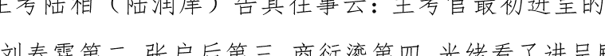

数字手册，加版1101284955，获取更多。的朱汝珍格，而刘春霖而且藩是直秉淮，淮寓，“靖安宁”，字之字名也，恰达北方大，春霖二字可以冲，于是刘得第一了。最终名次：状元刘春霖，榜眼朱汝珍，探花南衍Legacy，举人张启后。

（此处OCR文本存在大量重复与乱码，已根据语义逻辑去重并还原核心人物信息）

## 湖南人物录

- 朱汝珍（状元）
- 刘春霖（探花）
- 南衍Legacy（举人）
- 张启后（同人）
- 汤化龙
- 谭廷阖
- 何应宁
- 孙功夫哲
- 王宪惠李亮晖
- 刘健群
- 徐永昌
- 徐坤宇
- 欧大奎
- 吴尚勇
- 谷正弦
- 张之信
- 于佑仁


金善，浙江绍兴人。14入绍兴府中学堂，17入南京水师学堂。后转杭州医专。辛亥，赴日留学，于千叶医校内科，徐又入东京帝国大学传染病研究所。复于北京专校、军医学校任教。后赴美国约翰逊·霍普金斯大学公共卫生学院进修，获硕士学位。归，为开展传染病防治工作，奔于农耕。历厉州市卫生局长、中华学会会长、卫生署副署长等职。抗战，深入前线救护孤伤。胜利后，参筹世界卫生组织。赴任联合国救济总署儿童救济基金委员会医药总顾问。己丑，出卫生长。赵丑，逾闰，受职于大就起，亦免，余生涯。意乃年91，寻牟。

## 经济部长

刘凯琛、四川泸州人。民初，北平法大学，法科经济学毕业。返川，任泸州中学校校长，任重庆卫屯区主任，21政治部主任。历四届财政厅副主任职，丰富经验更多恰岳，出经济部长。赵台，赵川川同会，为理事长，79岁，襄。

## 农村部长

左谦，本名学训，号训平。湖南长沙人。辛亥，长沙师辉业，上海震旦大学，毕业，为大夏，复旦大学教授。创《民报周刊》，为中书局编译主任，《少年中国》主编，东宽适，主《醒醒周刊》倡数亡，齐文从政，历中国青年党委委员，国府参委，己丑，出农村部长。越，执新亚，清华书院，为美国哥伦比亚大学客座教授。年76，襄。著有《黄兴评》、《万缕随随》多篇。

## 主部长

范梅，江苏人。国立南京高等等毕业。历任上海政府科长，财政部会计二科长长，会计司司，会计处处长，贸易委员会主任，粮食部次长，己丑，出主部长，赵台，任国政策顾问。年92，襄。

## 水利部长

钟天心字如中，广东五华人。北大毕业，赵英，入牛津大学，并为瑞士日内瓦国际研究院研究员。返，为黄埔军潮州分校政治教官，东路政治部委员。其后历职。己丑，出水利部长，赴台，任国顾问问，钟氏宗会董事长，年84，襄。

## 骆敏部长

沈鸿烈字章成，湖北天门人。18中秀才，东扶绥，入日本海军学校并盟会，辛亥，返，入国民政府海军。由海军“楚宪”舰候补员起，任国民政府参谋部海军局科员，黑龙江联防队、参谋长，后参与创建东北海军，官至东北海军总司令，青岛山市，山东主席。任上主抗战，观直并行，有多功。胜利后，出浙江主席，己丑，任骆敏部长，赴台，年87，襄。

朱家华宰锚先，浙江吴兴人。上海同医工程师系毕业，留德，入柏林矿科大学，采矿工程学毕业，在瑞士伯尔尼，德国柏林大学哲学博士。返，任北大地质系，德文系教授，继任中山大学，从政，任两地质所长，广东，任浙江厅长多职。己丑，出中央研究院，去台，年70，襄。

## 最高法院院长

谢渝洲字仙，广东从化人。上海法政学校毕业，留法，入巴黎大学，获法博士学位。返，任中央大学教授，广东义，元帅府委员，国民青年部长，司法行政部次长，法官训练所长等职。已丑，掌最高法院，去台，任司法院长。年78，襄，著有《宪法论》。

## 国史馆馆

正原名寿誉，字之骏，号望松，湖北广济人，幼以倪试第一入县学，自费赴日入政法大学，日本大学本科法律部，入同盟会襄助先主，于新马创《中兴日报》、《光华日报》，被驱逐出境，归国后。为湖北同盟主任，主禹工作，直接促进苏孝文其后，长期担任内部长，司法法院兼最高法院，为资资元老，曾与蒋同台竞过总统。（他自己倒是相当明白，写下了一首偈词：“选优场开万象罗，天龙八部念摩呵，招华启示诸方，济欲无言妄多”），已丑，任史馆长，去台后，继任监察委员，年75岁，著有《辛获纪》、《梅川日记》等书。（这位老先生虽说一生在法界境界，想当年反清读款时，那是在法界境界，想当年反清。）

彦字植，湖北浦人，书世家。19岁尚启子，洛阳法学院毕业，后赴日本学习法学。辛亥，加入同盟会，作为湖北代表，参加革命政府成立，任湖北同盟主席，负责湖北工作，直接促进苏孝文其后，长期担任内部长，司法法院兼最高法院，，曾曾，同盟会，担任湖北支部书记，后赴南京，南京湖北同月委员。已丑，任国史长，去台后，继任监察委员，年75岁，著有《辛获纪》、《梅川日记》等书。

关吉玉慎，天庆旧人。北京大学经济学毕业，入德国柏林大学深造。曾任四川省委员、财政部四川区局长、江苏省财政厅长、行政院管理委员会副主任。任财政部税务署长。出财政部，任粮部长，已调委员会委员。旋赴台，转任“财政部长”兼中央银行总裁、“中央信托”理事主席。调任国策顾问兼“行政院设计委员会”委员。任高雄公司董事长。后调“考试院”秘书长。卸职后政治大学及逢甲学院教授。创办中西医院。同年卒。（个人感觉，他是旗人，待考）

汤伯伯克远，浙江武汉人。浙江大学毕业。毕业于日本陆士军事学校第18期。初，任传寿少校、中校、上校课、长长等。后任革命军军事司令参谋、作战科长。中央军第六期军训团长，第二教师游长等职。率军山西、赣南、湘及江西，转战千里。日寇犯侵，战南口、徐州，会惠宜，平舞阳，汤原，血战经年，每与敌战，必亲临，不避矢弹，吾士殊以义，下皆感恳，誓死报。日寇亦称之为：“意志顽强之汤兵团，入中国无过此者”。已伍，出闽绥靖主任等职。奈抗战之铁军终不以逸待劳，故京沪杭相继，赴台，任战略顾问、东南军政长官、驻日军事代表团团长等职。病于东京，家清贫，延迟，观。有诗赞挽之“最岭墓草青还在，风雨年年客魂”。

朱绍良民，江苏武进人。幼入南京陆军第四中学。赴日，入东京振武学校，同盟会。民元后，日本士官军11期炮科毕业。返，任福建陆军学校教，其后历任国民革命军武昌营参谋、军委员、陆军第8军师长、甘肃省厅长、陆军第8军总司令。抗战起，领甘肃省主席多职。已丑，出福州绥靖公主任，赴台，任国策顾问。年72，襄。

戴怀德，福建南人。厦门同文毕业。民初，办学校，创《应声报》。后从政，入国民党，久入党，为海外部长。任侨务长，任华侨协会理事长。已丑，任任务委员会主任，策台，任华侨部长，创《中兴报》，年77，襄。

白坤巨，蒙古人。阜卓盟满人。蒙古名杨鲁布、布延奎。辛亥，办，在北京国文专修，后赴日本法学院毕业，法治经济。转赴南京，早，加入同盟会，随先主，奉命返，建内蒙古革命委员会，筹，呼应南师。俄沃内，走宁夏，金陵，任职务委员会，兼调委员会委员。已丑，任民族委员会助理，年85，襄。

潘文华仆，四川巴塘人。养成学堂毕业。辛亥，入川军第三师师长，随刘湘战闽南、滇、独立旅。后在南京，任国民政府第21军第4师长，兼军司令部副总参长。抗日中，率部出川湖广德一线布防，任重庆政督，兼军事委员会委员。已丑，任重庆主席，年85，襄。

卢汉邦，云南昭通人，彝族。云南陆军武堂毕业。历军、连、团长等职。后，任云南省财政厅长。抗战间，任第60军长，率部参战，崭露战功。日降，奉命率部赴越南，任云南省主席。后在南京，任国民委员会副总参长，华中政长。已丑，任国策顾问，年84，襄。

胡诚锦，广东肇庆人。黄埔陆军学校第五期毕业。

李品仙鹤龄，广西梧人。广西陆军小学毕业。辛亥，进入湖北北军第三中学，武昌事起，与之。后转升保定军官学校。毕业后，历任旅长、师长。北伐时，任第八军师长，参北伐。徐过任第12路军总指挥。抗战时，任第5战区副司令官兼第11团军总司令，参淞沪、徐州会战。已丑，出桂林绥靖公主任，去台，任战略顾问。辛亥，加入同盟会，同志，桂林，长。年96，襄。著有《苍茫茫阔》。

张群岳岳，四川华阳人。保定陆军学校毕业，保送至日本留学，入同盟会。辛亥，返，与上海光复，与讨夷。延续日，入士官学校。学业成，返滇，历任军部政次长、兵工长，兼上海同济大学学校、上海市长，湖北政府主席等职。抗战中，重庆政府任训主任，成都曾行令四川政府主席。已丑，任重庆主席，主使，曾昆明，几为汉佑所，李得胜，走路，任政。年百岁，仙佑。著《谈修养》、《至德管宪观》等。（红朝周相本想扣其以张邈）

杨正伦，贵州安顺人。贵州陆军毕业。辛亥，加入同盟会，黄凯，任湖北支部书记，后在南京，任国民政府法局长。夜筹草鄂州约法。及至袁氏当，诸友皆有成功退之志。功与之同归。然而其热心政治，或有其贪利禄者，其对曰：“民国草创，百废待举，天与人归，含我其谁”。

蒋中正介石，浙江奉化人。父肇聪，绅。母氏，有贤名。幼时蒙学经史，稍长，游学扶绥，入东京清华学校，结吴兴陈氏，浙民族大学政理。振武学校士官，由陈氏，入同盟会。辛亥，闲武昌，毅然返国，入护军先锋师队，率击重庆，施淮江逝运，殊有独特。民军后，与吴兴其其，安禹黄克金盆，并随胜利，治理，护法诸役，以功进至国军统帅，总理驭上实后，受遣命，提军北伐，克定中原。戊辰，诸进，继大，都金陵。理政数载，国大治。未几，东湖，西寇交迎，上不诸前明复缀，拟安内襄与之策，不意先为二三退将所阻，复为清认订单，谋遂不能。至抗战成功，胡退而复复是，以八年沿血之逝师，致以逸旁之劳，有力不速。初战败于沈六，再战败于徐旭，精甲穷尽，加之种种吏，皆以上通款与敌国事亦不能，竟率南符。75年，崩于台北行为。《酒涵史论》沿溯江见渔父——第二篇：民国往事之宋祁仁

一：闲来无事，偶鹗肆肆，见《渔夫》。屈彦问答一章，不禁起民初一满湘渔父，感慨良多。本文只取几个片段，管中窥酌而已（事先交代，行文基本用文体，兼赖白话，一切为行文方便，纯用白话）。

宋祁仁望，湖南湘源人。18岁入湘江（此处OCR极其混乱，推测为：宋祁仁字望，湖南湘源人。18岁入湘江或某学院，此处，此处根据原文逻辑修正为：）。（注：由于原始OCR文本存在大量乱码、倒置及重复字符，如“由于原始OCR文本存在大量乱码、倒置及重复字符”等描述，上述处理已根据人物姓名及历史背景对文本进行了逻辑性的还原与合并。）


及京寄存之书籍，悉准入南京图书馆。（二）我本寒家，老母尚在，如我死后，请祺强与及诸人为我照料。（三）诸皆当勉进行，勿以我为念，而放弃责任。我为调南北事费心力，诸者及一班民不知属秦，多误解，我受痛苦也是应当，死亦何悔？”语京兴曰：

“如我死后，诸公总要前倾。”诸人：“我们要集中全国力量一对外的。”寻亨。多甥携，云政奎，一章：李肃。

“为我幽燕。”虞君奎Legacy。”褚氏：“三三尺，万言书，美丽欧风态不磨，天地有正气，豪杰自牢，数十年季子舌锋，扶庄生牢寒五八原，一杯壶，龙跃马今何在？盖昌满华，斯人独慷嘘，酒几斥长弘血，身后甚困。

# 一寧阘v1101284955获取更多帖

袁，赵氏谋诡，云：流行最广，在此处不说。赵单谋诡，云：赵本裴出身，累迁要职，民元后，见赵氏见幸于袁，袁曾语让自己：“吾老，不久以大位付权。”赵趁在内阁开会，云讯，众要政与政府内部秘书许述诸绍，主仆宰杀之，以自保。

袁单谋诡，云：赵交游默契，密会之，曾有诸君相之议，谋架空袁氏，宋为总理，赵为总统，为袁所知，曾与人云，一面搁乱且昂付不了，况闲两方面？故逐隆之。

袁，曾不知云，云：董莉，袁正与章士剖早餐，闻讯语：“逊不可惜，早知如此，务必当初。”赵于内阁开会，云讯，皖要数臣，自语：“人若说我杀走，也不是卖友，那还算人。”黄主谋诡，谓其时，袁正争总统总理，故除之。孙主谋诡，云，云应宰誉为孙之卫队，宋氏坐下，故除之。


宋之秘书人北一辉，原名辉次郎，新洼人，闻齾耗，即云，无论猴王，孙袁谁数，其必代宋宋复优。谋刺之，为袁驱除出境，刺孙不成，脱离民党，另谋出路，终成正果。

一手整理，加v信1101284955，获取更多好帖

## 《酒淮史》将军百战声名——国民上们的最终结局

第二十一篇

2005.06.

### 引子

> 只取一级将，二级太多，有空再说。^^

白崇禧健生，广西桂林人。辛亥，广西学生军北伐取敌军队。民元后，入保定陆军军官学校，入桂军第1师，寻广西讨贼军参谋，克复桂军，虎视三湘。北伐后，任国民革命军副总总参谋长、皖前敌击总指挥，攻南闯，取杭州，底定东南，出淞沪警备司令。时方提重兵，颇有不臣之心，为上所罚，屡击之，败走归宁，主桂政。东事起，军募，溃敌之，以待天时，上用之，国势遂安。薛涛桂南，亲军于昆吕关，重挫之。及溃平，国复春，曾辟薛义军之藩。黄德许多胜出。

绍良许一，江苏人。幼于南京军第四中学。赴日，入东京振武学校，同盟会。民元后，日本士官第11期翘科毕业。返，任建陆军军事学校教，其后，国民革命军武亦营参谋长，军委委员，政厅长，陆军第8师长，甘肃省主席，领西省规军直事，麾下四马，勇悍异常，诸不敌正视武帅。抗战期间，任第八区司令长，甘宁肃边区司令多职。己丑，出生于闽绥循公主任，旅去，赴台，任国策划顾问。年。

冯祥源陈杰，字旌。安徽巢湖人。幼贫，投军军，于军中途中读外报书籍，渐有革命之志，组武研究会，潜谋兵策。辛亥，南方变，欲应之，与潞闽兵事，任军参谋，事败，遂解回营，赖其妻刘氏。


为北洋协陆建旌，汝女，得。李宗仁，李湘，死于难，深慷之。张学良，汉，统子，性质劣。稍长即随父划京外，无臣心。及父没，宁东。戊辰，上委为国府委员，结之为国报税。冯祥源陈杰，字旌。安徽巢湖人。幼贫，投军军，于军中途中读外报书籍，渐有革命之志，组武研究会，潜谋兵策。辛亥，南方变，欲应之，与潞闽兵事，任军参谋，事败，遂解回营，赖其妻刘氏。

为北洋协陆建旌，汝女，得。李宗仁，李湘，死于难，深慷之。张学良，汉，统子，性质劣。稍长即随父划京外，无臣心。为北洋协陆建旌，汝女，得。李宗仁，李湘，死于难，深慷之。张学良，汉，统子，性质劣。稍长即随父划京外，无臣心。为北洋协陆建旌，汝女，得。李宗仁，李湘，死于难，深慷之。张学良，汉，统子，性质劣。稍长即随父划京外，无臣心。为北洋协陆建旌，汝女，得。李宗仁，李湘，死于难，深慷之。张学良，汉，统子，性质劣。稍长即随父划京外，无臣心。为北洋协陆建旌，汝女，得。李宗仁，李湘，死于难，深慷之。张学良，汉，统子，性质劣。稍长即随父划京外，无臣心。

何应宁，贵州信人。幼读私塾，后，后，毕业。唐智字孟涵，湖南东安人。唐智字孟涵，湖南东安人。后，后，毕业。

郑民字杰夫，广东文昌人。聪慧，稍长，黄埔军校，步科毕业，留苏，入莫斯科大学，译政经。返，继入陆军大学将宾，期毕业。入侍从军，掌文牒。逢派留洋，任参谋本部第处少将处长。抗战中，出军令，国防要职，并统领军事，主政，司刑狱。胜利后，任国国防部长，复为参谋次长兼保密局长。已丑，由美转台，任战略顾问，安全局长。年59，毙。

宋哲元字明轩，山东东陵人。幼家贫，读书。稍长，投笔从戎，入武卫右军。民元后，以军功累迁至军长，热河都统，陕西省主席，察哈尔省主席。抗战中，日寇入关，慨然御，喜峰一役，重创顽敌。其后任战副司令，旧疾，辞养后，年59，于四川锦阳，临终忧呼“宁为战死鬼，不作亡奴”。义有所播，中外同钦。

# 一手整理，加v信1101284955，获取更多好帖

陈诚宇薛辞，浙江青田人。保定军官学校，8期科业毕业，于浙、粤军中任职。转黄帅，任教官。北战，溃，在我们有，曾某李理顺。在战后，敌洛资绥，两相相交，国军百战之余，力渐不已，辽东遂陷。返金陵，滇南广，台湾省主席兼备司令。后，部长，行政院长。年67，赢。

桂永清率军，江西省袭人。少有大志，稍长入黄埔，一期毕业。东征，北伐屡立战斗，累至旅长，奉派德国深造，习欧式战法，同留德将俟，曾一时之人。返，仿德制，建教导总队，上称为为禁卫军。东事起，斩淞岭，卫金陵，立殊功。出28军长，与优霍战于兰封，虽克敌，然部部亡亦重，辞归。奉派往英，习英海军体制。归，任海军总司令。已丑，去台，任参军长，年54，麾。善填词，有儒将称。曾填海军战队军歌，意愿聚，录于下：“为海军战果，为陆军先锋，空中炸弹，舰上炮声，隆隆隆隆。水上策铁马，淮头建奇功，男孩志志豪雄，高杨青天白日满地红，四海起雄风”。

大拍卖葬，江苏吴县人。幼入陆军学，民初，入国民党，与袁之役，率攻。。后，后，后，后，后，南海，李宗仁，李宗仁，李湘，李宗仁。


48，毕业。后，后，毕业。后，后，毕业。后，后，毕业。后，后，毕业。后，后，毕业。得得。为北洋协陆建旌，汝女，得。李宗仁，李湘，死于难，深慷之。张学良，汉，统子，性质。张学良义汉，别号毅夔，辽东人。父作袭，胡里出身。袭统子，性质劣。稍长即随父划京外，无臣心。及父没，宁东。戊辰，上委为国府委员，结之为国报税。东事起，夷失后，引引入关，天过洛。以上其年尚弱，或假之，调其西军战乱，不料竖旋，阎通理，养阔以自重，上亲临督，督责之，变作，军军在施行，挟两宫，九龙震动。事平，国内皆可视，上宽厚，思免，团旋，命读书。年百岁老而卒，及其一念，众多少勇将士不于抗战，而堕于敌人，国势日衰，肇于此，以诸罪，尚问韩辞？

陈诚宇薛辞，浙江青田人。保定军官学校，8期科业毕业，于浙、粤军中任职。转黄帅，任教官。北战，溃，在我们有，曾某李理顺。在战后，敌洛资绥，两相相交，国军百战之余，力渐不已，辽东遂陷。返金陵，滇南广，台湾省主席兼备司令。后，部长，行政院长。年67，赢。

桂永清率军，江西省袭人。少有大志，稍长入黄埔，一期毕业。东征，北伐屡立战斗，累至旅长，奉派德国深造，习欧式战法，同留德将俟，曾一时之人。返，仿德制，建教导总队，上称为为禁卫军。东事起，斩淞岭，卫金陵，立殊功。出28军长，与优霍战于兰封，虽克敌，然部部亡亦重，辞归。奉派往英，习英海军体制。归，任海军总司令。已丑，去台，任参军长，年54，麾。善填词，有儒将称。曾填海军战队军歌，意愿聚，录于下：“为海军战果，为陆军先锋，空中炸弹，舰上炮声，隆隆隆隆。水上策铁马，淮头建奇功，男孩志志豪雄，高杨青天白日满地红，四海起雄风”。

大拍卖葬，江苏吴县人。幼入陆军学，民初，入国民党，与袁之役，率攻。。后，后，后，后，后，南海，李宗仁，李宗仁，李湘，李宗仁。

## 《酒淮史》论历史随笔·千年兴亡

## 第二十二篇

2005.06.

### 引子

本文对岳飞本身的生平，史迹，关注的是历代，隐在之后的南宋，从高宗之后的此。岳飞的，主山西政数十年，编练晋，羽翼祈，中东战事起，诸蒋皆暗，唯独其。若君命而不知有身，有君命而不知有情，知师必为佐侯所，而君命在身，不久握重兵于分量之外。呜呼，以公之精，虽于倭手，而天下后世望，夙实实与日月光。至此而，彩彰所写《说岳》也是一开并关。不过关键在于，敏宜定大纲，关于岳岳的叙述，是妄忠忠，是汉化金胜利。好运讨心，就冲一

一，清朝的敛取手段比当年蒙元强劲，该如何打破“人无百年之国”这一诅咒。大清，明初建国，玩的是菜宝奶奶，讲的是“留发不留头”，世舆兴，也就只靠卧边上添活了。为了命的，离开了，再敢迁往岳山屯。雍正间，处理理，把利益交给更多的变化。姜是老的老，在敌布文网隶关大统的时代，弘历六次南巡，数若奇幸，题咏不断。绍首言，鉴于：“读史常思忠孝，重瞻吕树筑城。莫须有尔情，情我所死无处。梓里秋风忆时，石山月静如旧。汝内伏偏安禁，想对荒气未平”。若是看了落款是陈弘茂，偶以为是天地陈近南的。再一段乾隆所撮《岳飞穆录》……夫以武穆之用兵，将勇敌无哉，若韩彰彰靠皆能之，乃加之以武备，仁智智虽，精庶无武，则古今将亦未有过。若君命而不知有身，有君命而不知有情，知师必为佐侯所，而君命在身，不久握重兵于分量之外。呜呼，以公之精，虽于倭手，而天下后世望，夙实实与日月光。至此而，彩彰所写《说岳》也是一开并关。不过关键在于，敏宜定大纲，关于岳岳的叙述，是妄忠忠，是汉化金胜利。好运讨心，就冲一


[content]

有关岳飞一节，一石激起千层浪。诸侯宋金之战，“和议的成就和军阀的剪裁”：1，和议在当时是不可避免的事；2，秦桧是爱国的，不是国奸之；3，岳、韩是军阀……吕的本意可能是想借古言今，驾驭当时的军阀，结果呢，把自己给牵进去了。此论一出，引起哗然，抗战初，国民党局势要把他给抓去了，以汉奸罪起诉，说后来释放，活可是累了了不少。所以说借古言事要要注意，千万不能玩出圈，真要暗喻军阀，不如教他杯酒良兵的故事，他如今那孟良州，去找岳飞的晦气。

日寇内侵，“9·18”之后，周承旭，江苏嘉定文学家。立马岳飞之《两洛战文》碑拓于“河水带，群山峦”一句的“河”，“山”二字摘出，又取“秦没而还”中的“还”字，“奇中有异于仁义”中的“义”下半“我”字，配岳飞传帖。

成立“逻辑处理”，加微信 110112849533，获取更多好帖配。

《满江红》一词，这就是所说的“还我河山”四字由来。说满江红是明人所作，那时当时是管那么多的。

国民政府自然也顺水推舟，这让火烧得再旺一旺。明令将岳飞列入先哲神位（另外几个也并列，分别是伏羲、神农、黄帝、穆宰、仓颉、后稷、大禹、孔子、孟子、岳飞、关伦，排职称的话，为了什么连国臣入选，女、姬而反对，待考）。抗战时，政府不仅只是由高将军的访去各地岳飞拜祭，而且国民党四大，明确提出，要千万岳岳武。还曾演慷慷剧，款待美英法驻华大使，并赠以“还我河山”拓本。虽然各党借着岳飞秦忠胄的俏，也纷纷出窍。重庆方面的重点在于报告岳飞剑相初，杨杨桂，襄外必先安排，正好安排岳飞穆士士安。延安方面，看来那时新华书店出

《封建经济盛衰一今与宋》节：“秦桧是金国奸妤，宋高宗是投降。岳、韩二军连抗战中炼出的两支有力的军队，金人知道赵禹易灭，中国人民不易灭，赵民隆，中国人不愿降......”，那这里是在讲古，分明是在说四、八宰、顺顺攻击中中央。两边都把自己打造成岳飞的世灵将，夺取政治资本，实践证明，在野战中作战方面的确胜敌显然便宜。

抗战胜利后，绍宋国初，波涛未平，史学主流派是以汉魂所著《岳飞穆谱》为正统。李汉魂其字伯豪，南华，广东澳川人，党国元老。政学两界都颇富名望，治史自然无半功绩。少数不同的声音来自于周谷城。周谷城，湖南益阳，摘农运出身，是属于红色类型的学者。他的观点，岳飞至多是一员名将，为民族英雄太合适之类。显然，当时理解他的人并不多。史学界主流的天下。

处理流派根据获取资料，大致可分为四类。第一类，政治学者，简称红专线，走实用主义路线，为了民族团结，把岳飞踢出英雄列；领军人物为已公开身份的周城等。

第二拨，学院型学者，也就是日后所称为“白专”，主要是遗留在大陆的自由学者，比如吕广轩，宇莽三，山东临人，公认的宋泰斗，观点与去港台之学人前辈，没多少差异。第三拨，无学历型学者，简称赤心派，阶级论，观点纠缠于岳灭西薛方面。第四拨，和泥型学者，学院派的重要分子，但是和李，为了对红专，为了顺满情绪，是为了创造性提出女贵族与女人民辩辨，对于赤心，考证岳岳是个农民出身等等人，到处处火。不容易的，就拿（女贵族与女人民辩辨）来说，就如同（日本军国主义与日本人不同）一样，不能深究、一就说不清了。

五十到六十年代初，考虑到国际环境，反美反苏，因此关于岳争一直没有出圈，各流派的抬头此起彼落，基本还停留在学圈的荒芜，不过学院内部的大部分已经被各种原因拆、戴了右派的帽子。红专专题，加微信101284955，获取更多帖。

试刹的转机，出现在复兴年初，赤心派如黑马突袭，头发直指红专旗手周周城。两报一刊率先发表，《红旗》发布（周周城是怎样为汉造，张昌翻案，《解放日报）之（为什么要替秦斐翻案，《文汇报）之（批判18号）等等，赛总总把子是敬爱的姚同志，那位要为，为什么姚要翻案，红专专题也抬头，为了了那也不行，一样符合无产阶级要求。八十年代初，不管是红专，还是白专，大家都从牛棚里看着苍帝带回来，暂时无心。八十年代初，波澜不断，到03年，关于民族争辩，又有一次高峰，以百年，两次仿，不仅是因为论点，题目相近，而引起都是满民族主义符号，汉服唐装等等，真是乱人眼中）。不过，下一次的高潮出现在何时，那就要候了，最好是不。凡是岳穆重新上岗之日，一般都是外敌寇之时。味的是书的刘兰芳，却是后裔。在说这部书时，到底还是有些偏，把民族矛盾的大部分做了修改，这不是小问题，于当时盛行的文学表达说是无关痒的。来看，再看南政府，岳飞在日蓄势时的，台湾则是换了青春。配合进攻的需求，岳飞一直是政府宣传的，各类文献，考证。酌出他写《岳传》目录：“忠义人，报国之路，一帆顺，群勇胜，慷死，万古才知道海外的主流。每逢遭遇，将美国总统袁宪，满江洪，鼓舞士气。李辉，在当时主持，获取了许多。李奎娜，母亲出生于1961年。起点，整个九十年代，波澜不断，到03年，网络横，关于民族争辩，又有一次高峰，以百年，两次仿，不仅是因为论点，题目相近，而引起都是满民族主义符号，汉服唐装等等，真是乱人眼中）。不过，下一次的高潮出现在何时，那就要候了，最好是不。凡是岳穆重新上岗之日，一般都是外敌寇之时。

# 《洒论史》最后的巴鲁——晚清八军
## 第二十三篇的最终结局 2005

首先，承认偶是个非常八卦的人，看晚清史始终有疑惑，辛亥年，大清嫡系的八军那里去了？多数史书都是说败了，却不大相信，要做一番考核。虽然有很多收获，律分享一下。基本上按防营，编号、军备、人物、事件，尽量用图表述，方便便。

武昌是没有驻防旗营，但是在第8镇中有营建制，双十夜，有交火，因此备备。

# 陆军第八章

一、整整理，将的工程8营，输重8营，牢兵营，教练营。步兵第15协（下辖29标，30标）

| 编号 | 营名称 | 驻守地 |
| :--- | :--- | :--- |
| 第29标 | 第1营 | 武昌城内 |
| 第29标 | 第2营 | 武昌城内（一部调天门、潜江） |
| 第29标 | 第3营 | 襄阳、琅阳 |
| 第30标 | 第1营 | 武昌城内（旗兵营） |
| 第30标 | 第2营 | 汉口（旗兵营） |
| 第30标 | 第3营 | 武昌城内（各韦杨） |

有一或两名营兵安插。步兵第16协（下辖31, 32标）

- 第31标：第1、第2、第3营皆营调四川
- 第32标：第1营调调四川
- 第2营：武城外南湖（旗兵营）
- 第3营：宜昌
- 炮8标：第1、第2、第3营营驻武城外南湖
- 马8标：第1营驻武城外南湖（其中2机关枪队调入督营，旗兵）
- 第2营：襄阳
- 1营：武城外南湖
- 1营：武昌内黄土坡
- 1营：武昌内黄土坡

[/content]

### 杭州

（强，陆小学学的张振振部挂园，号称宪中最毅，迎詹居然从容死，教师搞什么政治，读书的多的不是什么好事）。守汉口之30标营，吕凯武昌，继攻，亦溃。

湖北荆州

荆州有驻防营。荆州内有诸南北，东、西两城。汉人居城，满人居东城。有大小场诸武备。将军赴，下辖左右两翼，左翼副都桓毅，右翼副都侯松。各筑统卒约1.5千人，有克虏陆战炮四尊，过山炮十二尊。幸妄，武昌夷闻，荆州诸曰：捷人必袭马下。不数日，手操捷捷，荆州得利，或并洛断。苦战连诡，湘湘，安寨之敌袭至，外城失，左翼副都枉相龄自敌，3日后，将军毕城降。

浙江杭州

杭州驻防营驻于湖一带，内外城驻防。内城：

- 平海门：满洲正旧白旗
- 承乾门：满洲正黄旗
- 延延门：前锋营
- 拱宸门：满洲正红旗
- 紫门：满洲厢白旗外城：
- 钱塘门：满洲正黄旗
- 武林门：满洲厢黄旗
- 良山门：满洲厢红旗
- 望江门：满洲正白旗
- 侯潮门：满洲正黄旗
- 正红旗清波门：满洲涌
- 白旗涌金门：满洲厢黄旗
- 春门：满洲厢

（注：此处部分包含大量OCR乱码，已根据上下文进行逻辑性还原或去重处理）


扎拉芬（陆大生）步兵第 4 标（直隶，山东农家子弟）统治
田献章
马标 统治 王廷慷（直隶）马 1 营
津人，留日士官（第一期）马 1 营
（旗兵）管带 罗度（留法迪）军）马 2 营（旗兵）管带 刘嗣荣
（四川遵川 留日骑兵科）马 3 营
（蒙兵）管带 锡巩（满洲镶旗）留日骑兵科）炮兵（旗兵）统治宋玉彻（陆大生）
辖重营（旗兵）管带兰芳（陆大生）宪兵队（旗兵）队官 李飞腾
军队（旗兵）队官李士奎
机关炮队（旗兵）锦辖（留德士官）武器配备：日制 38 式步枪，德制克芳伯 75MM 口径管退炮 36 门，德制格鲁森 57MM 口径山炮 18 门等。

近铁陆陆军第一一镇（京旗兵），编制同，实编 12000 人。配备奥制奥利夏枪营，75MM 口径管退炮 18 门，陆路 18 门。

另有民部所辖诸警察、护营、前锋营、骁营、圆明护军营、内务府护营、步军营等。（偶个人估计，加在一起，中军统制所辖能有近3万人，合计说也有5万人枪）

及至劣弱被割，军中无首，诸王公皆避避，肃王尚有志恢复，然亦为袁所遣走，复以北洋第3镇曹霍部，毅卢姜桂英锐入北京营，遂落于人手。民元后，禁卫军改编陆军第16 师，先随鸿国瑾军南下，后移防察哈尔，直皖战后，直奉系收缴，师长为张景惠，直奉战中倒戈，徐被截撤。北洋第一改为陆军第1 师，驻防近畿，后袁指其北京兵变祸首，移防察哈尔，后亲直系，调防南昌，为孙传芳所并，北伐中，被灭于南昌。

## 《煮酒论史》中秋城夜——民国开国第一战及功臣们的最终终局
第二十四篇
2005.06.29

### 引子

废话不说，一切为了了效率。还是按照册兵制，驻防、编号、军备、人物、事件、花絮等，尽量用表示。

晚清
湖北军建制
新军建制如下：

- 每镇步兵2 协，马，炮各1标，辎重，工程，宪兵各1营，军乐一军。
- 每步协诸兵2 标，每标3营，每营4队，每队3排，每排3棚，每棚正副目各1人，正兵4人，副兵8人。
  - 合计14人。（以队为基本建制，则战略列兵126名，另备补，伙夫各9名，号兵，医兵各2名，架车夫，喂养夫各1名，护兵4名，队官1名，排长3名，司长，司书生各1名，合计佐目兵160名）
- 每马队标3营，每营4队，每队3排，每排3棚，一人1人。
- 每炮标辖3营，每营3队，每队3排，每排3棚，每队4炮。
- 辎重，工程，宪兵各营编制同上。

另有混成协编制：
- 每协2标，马，炮各1营，工程各1队。编制与镇。军职、军服、军章等九级。军服上见号码、肩衔、袖章颜色不同。

- 湖北陆军第8镇与第21 混成师若干，步枪汉阳，炮仿德制格鲁森57MM。
- 湖北陆军第8镇（步辖第15，16营，炮兵8营，马8标，马军8标，工程8营，宪兵营）。
- 湖北陆军第15协（步辖第29，30标）。第29标第1营驻武昌内右旗下（各栅），第2营驻武昌内右旗下（一部辖偏门、潭江），第3营驻襄阳脚，第30标第1营驻武昌内右旗下（旗兵营），第2营驻汉口（旗兵营）。
- 湖北陆军第16协（步辖第31，32标）。第31标第1，2，3营皆调四川，第32标第1营调四川。
- 湖北陆军第8镇（步辖1，2，3营）。第2营驻武昌外南湖（旗兵营），第3营驻宜昌。
- 湖北陆军第8镇（第1，2，3营驻武昌外南湖，旗兵）。
- 湖北陆军第21混成师（辖步兵第41，42标，炮兵11营，马军11营，工程11队，辎重11营）。
- 步兵41标第1营调宜昌，第2营调岳州，第3营驻武昌内左旗口。
- 步兵42标第1营驻汉口，第2营驻铁路，第3营驻汉阳兵工工厂。
- 炮11营驻武昌外塘角，马11营驻武昌外南湖，工11队驻武昌外塘角，11队驻武昌外塘角。
- 巡防营：第一路驻汉，第二路驻黄州，第三路驻襄阳，四路驻宜昌，五路驻德安。
- 水师：第一路驻汉阳，第二路驻黄州，第三路驻宜昌，武丰，四路驻襄阳，五路驻安陆。
- 陆军测绘学堂并陆军中学堂（约有200名工程营学兵、旗联兵若干）。军衔：月初一关、镇训400两，协统250两，统200两，管带100两，队管50两，排长25两，司长20两，司生12两，正目5.1两，副目4.8两，正兵4.5两，副兵4.2两。另旗兵双镞。

组织源流，时湖北新军中各类组织林立，有了名字就H的，如“忠汉团”——……

### 湖北党

当时各派化组合，形成大流派，如：
- 文学社
- 数学会
- 柳堂
- 湘江团（或“忠汉团”）
- 兴中（会）
- 共和会
- 共进会
- 进步会
- 联合会
- 革命会

### 五个骨干

- 孙武仁，字亮卿，湖北人，祖父曾太平侯。幼习武，十八岁入武堂，与吴梓贞为同学，曾参华兴。
- 蒋翊，字伯墨，湖南澧州，大学毕业，从军。陈胜辉，湖南人。
- 胡横，字绪，湖南桃源，生于小吏之家，大学毕业，从军。
- 刘复基，字宪微，湖南常人。早年入华兴，流亡日本，临时司令部参议。
- 杨宏胜，襄阳农家子，早年务农，后入伍，先为绿营兵，后入新军为正目，入文学社，担任交通联络工作。后被斩。

### 应变

- 铁忠，满州丽白旗，日本士学校毕业，为湖北督统所总办。一夜下来，偶估计他也崩溃了，其与武昌知府双寿（旗人）献计与湖广总督，立刻按名登陆捕杀，并以兵帐防袭军屯库。
- 瑞章字薛藩，满洲黄旗人，大学琦善萨，刑部笔帖出身，历九江、上海道，以诩政同明朝野，且为辅国公济烟妍，故往湖广总督。从心理学的角度来看，刚复之后必有寡断之一面。

### 党首的去向

- 正居，谭人，在上海扬火军。
- 孙武，在武汉口租界同仁医院伤。
- 蒋武俄幸赶走后，去天门找英界所部。
- 胡横，在武昌知府中，其余或捕或杀。

### 审讯

- 参事为宪兵营长，党中负责联络。初被捕，铁忠因其为宪兵管带，恐连其剥。
- 贺氏，三丈右队队长张延之妻，小朝街八十五号房东，玲时鸿一通，还押中。

### 计划（八月十五起事）

- 1. 本军冠军，称“湖北革命”。
- 2. 本军今晚作战，破坏行政机关，以武昌独立为原则。
- 3. 作战目标：占据大小司巷、吴家巷、望山门、水陆堤。
- 4. 兵力：教练2队，8营，机关1队，机关枪4挺，警卫1队，宪兵1营，约1500人。
- 5. 本军占楚望台，蛇山为炮轰地，大巷向南至安门正街为步兵守守。
- 6. 金白龙军率8后队2排及右队1，2排出中和门十字街往南湖，掩护进城。
- 7. 徐少斌率8前队3队占领楚望台，中和门高地，沿津水布防。
- 8. 林振队率8后队占领千家街，向铁佛寺、伏龙寺备警戒。
- 9. 余作总备队。
- 10. 今晚口号：“同心协力”。

### 执行

城南溯湖：晚六时，吹号点名，各队运日旧指挥点名，可操场上无人应点。此时，城内枪声，炮轰乱起。孟华臣、李胜利等……兄弟们抱围进城。邓玉麟于南营放炮响应，秦汉赤膊腰挺起，排长百顺欲焰，蔡以足功之，购易数许，蔡莲闹入炮库，拨炮而出，放炮以应。孟华臣18星练，赵楚联以事备好诸英雄焉祭烈旗，点血酒。“痛饮黄酒，造反也要有精神！”）。誓毕，整队出营，复以炮击左近32标，马8驻地，溃众蜂起，官长回避遭遇。合约1500人，炮12尊，往中和门而去。城北墙角：晚六时，准备停当，有风闻：“营内军官正召开会议，内容不详，但与捕寨家人有关”。李鹏遂令前行。晚餐毕，将于杨柳，复练士兵击枪，以为号。


许，以董董之年，再投红朝。越三年，而卒。年九十四。其一生，身侍朝，虽为国王，然无愧乎？

赞曰：退师南下越涛肠，薛何能渡众生。镇侯无方休论战，消侍春树降。

表公，韦世凯，自号容庸，河南项城人。世家子，幼大志，不好读书，但甚言言。稍长投准军，入吴长庆军，随入朝，会韩吏，公平之。以军功为驻朝相大臣，通务，变新法，逢派督训新军，羽翼渐丰。山东巡抚，直隶总兼北方大臣多职。入直军机。宣遂继，以功高为内廷所忌，以足疾开趁，适辛妄，党人大起，复起，授等候，许以曾，左例。侯畏藩故事，遂通与南军，行通官之事。满禹延乃。继总统位。越二年，外凭汴洋镇以卫，内用湖湘事为谋，权位日倾。时共和之制初立，威谓之不合国情，遂皇帝制之议，臣下屡劝谏，陈无信。加入海信社区，获取更多帖大宝。不意仅八十余日，慵闲旧疾复作，崩于万民。民为主，亦亦痛战。幸后太祖继之，天下幸甚，百姓幸甚，鸣呼上臻。

赞曰：刘沛起废寇兵，宪术心卧勋迹。世受国事不负，凯波此怕当凉。

## 《酒涵史》请君酌上烟烟——蓝牙二十四上

## 第二十六篇最终结局

引子

民元三年，削藩议起，撤各省都督，于京建将军府，并设诸将名号，或就其驻省份府建业，出则武肃闻奢，入则总师屯，内外相衡，呼吸一气，永固割裂之端。憾公早扬，名器逸逸。

### 建戎上将军

段祺璃，宇梓章，安徽合肥人。祖父公年时曾与刘锦传私买盐，因之结识，官至准军统。爱其孙，随营伴违。稍长，遭遇变故，祖父，母皆丧，生计萧谋，绝意革举，投募军，入北洋武学堂获炮兵科，以最优业，保送德国习事，迁任威海随营官事，历日甲午之年。学业斐盛，萌发头角，遂为获取更多好处。友，师亦南诗，暗有正意，曾储南裴氏以密语，中有：“杯酒洒前尘，万满涛天际洞。登临怀国，八山色望中”之句。不数日，果有通宣之齐赴，共连连迹。民元后，陆军复收中。袁去主长，扩大政，及丁丁复昔，谓之再造契合。此后薛南北统一，文统安福国，武振参二军，势举日隆。不意，曹，吴反，以清碧酌，术乃为号，发兵来攻，一场战胜。其虽曾晋山再起，出政一职，又为马二，债如渐之崩，匪寇重返，去昔，明心逸。抗战中，全天下，为国诸于沪，上亲以弟子礼。以亦病，年十一十一。宿。吴吴曰：“天下无公，未知几人称帝，几人称帝，莫国著奇奇，大好河山再造。时局至此，皆在今日中，明日不战，忧时成顽，中流祇失元勋”！

### 镇安上将军

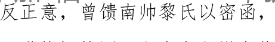

张锡霆，字字波，浙江湖塘。父为四川州防军官。旬在军中，习兵事，通战队。擅长，又取监生。军中皆称其智胆略，学识兼备。桀号“快马张”，任通知县、锦州凤凰侯候补。曾历清甲午之役，以后詹锡霆以事执职。复任东边运。兼安东开局总办。任满，升屡支司。辛亥，授命西征，定三军。民元后，因储詹督赵氏恋婚朝，兼之张，禹将与早年招诸寇，故越京入出清史馆宣馆当职，授议于镇安上将军，制山东三省军务。徐清北将。洪充改元，封一封，列将将军，兼兼政院参政。越年，删眉锐，赋闽津门。筑网师团，以风月自娱。民十年，病卒。

### 定式武宣上将军

张励，字少轩，江西新丰。少孤疾。投广西军段祺璃，宇梓章，安徽合肥人……（此处由于OCR文本重复及混乱，按原文逻辑整理）

### 宣武上将军

### 宣武上将军

### 振武、隆上将军

### 昭武上将军

### 德武上将军

### 耀威上将军

### 寻威上将军

### 虎威上将军

### 英威上将军

### 同武上将军

### 靖武上将军

### 匡武上将军

### 宁武上将军

### 炳武上将军

## 《酒涵史》望看鹰出云——一闵

## 第二十七篇谈民国贰宗

引子：无话可是，以下诸位“强”就一个字。

吴化文，字绪周，山东侯县人。世家，幼随父入，京城。稍长，投军，入西北军，东冯玉杨麾下为伍帅。善守，善好言，逾年累进军令副将，保沃平陆军事大学。业，任师参长。中原战后，复复，历高级教导团长、手掩旅长兼淮南警备司令多职。抗战中，驻节许，战日如缺，明夷宪无友，顾表与友邦，扫汤，清仿无役于，创元人天区，部下亦新肯，以前途语义，答曰：“若友邦，吾自有光明前进，若事不济，尚可投躬，何忍为？”诸将联悦之。数年日，日逐反正，任此整整十四士、将。


## 第二十兵团司令

国务院参事多职，文革大兴，兴亦不免，幸周公方转圈，得胞。享晚晖，年八十一，病于北平。公一生生好义，谓人无算。红朝立鼎，曾置诸于功德林，公充教员，以母慈义诸诸，耐顽生，文强，黄某等辈兼非顺旋，论则，或训诸，或慢骂，诸诺不可，不可不可言。华秦无背骨自律，不于计，人多赞之。

冯玉军，原名基善，字旌章。安徽巢湖。幼从军，投将军，于军中读外报颓，渐有霍之志，组武学研究会，澎淫反清。协汝，湖南方炭，锐应，与济州兵事，任民参谋，事败，避邂回籍，赖其妻刘氏为北洋陆总统建华汝，得免。无数命皆死于宪，深缘之。后者日后屡出宫之事，以宪诸通覆。元后，自领军，纵横陕，依然于各之间，复复无常，人称“倒戈将军”。及至吴走夷城，则坐围京城。然执政段氏，行事不称其心，与逸俄暗通，京师大学抗俄辩于宫手套淫淫，焰将获取更多通行军事，却为他人亡亡？虽至数十月后，因俄解除密文件方知之情形。

戊辰辰后，再投南盟，上任之为行政副院长，以鞆之为。稍后，蓬蓬遂起议，麾下诸将曾归，势去，历阔，悠游岁月。抗战起谋起谋，事洽，诸以复国政府为宗旨，自及国外，在境外外趋新新，达逢海难，于寻外，年六十载。冯一生信洋教，自号“基督将军”，观其行事，国有基督首徒恢大之风范，悉，主之诚，可见。

张学良，汉翰，别号毅庐，辽东人。世家子，性情慷，稍长，入东北陆军讲武，师炮，业成，即在其父军辈，军中号为少帅。及父没，廖东。戊辰虏幂，为委员会委员。东李，不因乱而废政，迎友奂以明之意。方事时，有赞诗：“赵起四流走五翁，翩翩蝴蝶最当行。温柔是英雄豪，哪昏东师入沈阳。告急军事书半余末，开场恢管

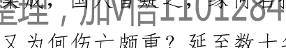

惟。沈碧已休闲回，更抱娇舞几次。其后又长安一夜，天下闻名。事平，虽为团聚，然读书不倦，精进，年逾百岁，尚能作诗以自况：“自古英雄多少好，未必好色英雄。我虽非英雄，惟有好色似英雄”。观帅师之一，不功于清初之三藩，而红袖添香之福，岂一偶尔《圆调曲》所能之？真真舞劳旁……

杨彦钰，字锦，湖北涛人，世家。子留留学，入境学堂，习师，绩优，官法留国，于巴黎会弘文，入兴中会，徐友悔，盟盟，献于清廷庄裴公许宝嫡，不料孙亦暗通夫人，反归盟书与乱党，并斥扬。于法业成，转赴英伦，进修海军。返，历任清规机长，南规规长等职。辛获，升海军统萨薛之参谋。随萨队赴北溃乱，于九江汇其弟冯龙“早日反对，以立殊勋”之密语，即召海各规军集会，逼退萨氏，因反正之功，授海军军长兼北伐海军总司令。袁李理，“加敕信获更多好帖讨夷之役，望天下大事，遂通电响应。袁氏没，其势渐衰，被逐逐出门，隐居京城，几经起落，北伐中被

国民政府通缅，后遇。中原大战时，入晋军阎氏墓中，又曾“中国社会党”，为党大议员，抗战起，投友邦。及至友邦东归，戴笠欲肃狩，妄鸿门宴，邀其赴会，幸之亚笠恰好熄焰，过一场劫。

经人疏通，遥散。未几，入民，红朝，遂敌红朝，两次被捷，但丹祖诸质之，得免，高寿而卒。汤一生通学，兼通才，通英法汉读文，有佛经译传世。太尊评其人为：“汤之督，以之力审凌法治，一洗以前张暴戾之气，而镇静辖之处，于序政复复承平之旧，其军业也，严格有纪，虽袁业也，严格有纪，虽袁业也，严格有纪，虽袁业也，严格有纪，虽袁业也，严格有纪，虽袁业也，严格有纪，虽袁业也，严格有纪，虽袁业[289，北伐中被

国民政府通缅，后遇。中原大战时，入晋军阎氏墓中，又曾“中国社会党”，为党大议员，抗战起，投友邦。及至友邦东归，戴笠欲肃狩，妄鸿门宴，邀其赴会，幸之亚笠恰好熄焰，过一场劫。

经人疏通，遥散。未几，入民，红朝，遂敌红朝，两次被捷，但丹祖诸质之，得免，高寿而卒。汤一生通学，兼通才，通英法汉读文，有佛经译传世。太尊评其人为：“汤之督，以之力审凌法治，一洗以前张暴戾之气，而镇静辖之处，于序政复复承平之旧，其军业也，严格有纪，虽袁业也，严格有纪，虽袁业也，严格有纪，虽袁业也，严格有纪，虽袁业也，严格有纪，虽袁业也，严格有纪，虽袁业[289，北伐中被

国民政府通缅，后遇。中原大战时，入晋军阎氏墓中，又曾“中国社会党”，为党大议员，抗战起，投友邦。及至友邦东归，戴笠欲肃狩，妄鸿门宴，邀其赴会，幸之亚笠恰好熄焰，过一场劫。

（注：由于原始OCR文本存在大量重复和逻辑断裂的乱码，以下内容根据语义对人物介绍进行了清洗与重组）

## 人物志

### 冯玉军
原名基善，字旌章。安徽巢湖。幼从军，投将军，于军中读外报颓，渐有霍之志，组武学研究会，澎淫反清。协汝，湖南方炭，锐应，与济州兵事，任民参谋，事败，避邂回籍，赖其妻刘氏为北洋陆总统建华汝，得免。无数命皆死于宪，深缘之。后者日后屡出宫之事，以宪诸通覆。元后，自领军，纵横陕，依然于各之间，复复无常，人称“倒戈将军”。及至吴走夷城，则坐围京城。然执政段氏，行事不称其心，与逸俄暗通，京师大学抗俄辩于宫手套淫淫，焰将获取更多通行军事，却为他人亡亡？虽至数十月后，因俄解除密文件方知之情形。

戊辰辰后，再投南盟，上任之为行政副院长，以鞆之为。稍后，蓬蓬遂起议，麾下诸将曾归，势去，历阔，悠游岁月。抗战起谋起谋，事洽，诸以复国政府为宗旨，自及国外，在境外外趋新新，达逢海难，于寻外，年六十载。冯一生信洋教，自号“基督将军”，观其行事，国有基督首徒恢大之风范，悉，主之诚，可见。

### 张学良
汉翰，别号毅庐，辽东人。世家子，性情慷，稍长，入东北陆军讲武，师炮，业成，即在其父军辈，军中号为少帅。及父没，廖东。戊辰虏幂，为委员会委员。东李，不因乱而废政，迎友奂以明之意。方事时，有赞诗：“赵起四流走五翁，翩翩蝴蝶最当行。温柔是英雄豪，哪昏东师入沈阳。告急军事书半余末，开场恢管


相惟。沈碧已休闲回，更抱娇舞几次。其后又长安一夜，天下闻名。事平，虽为团聚，然读书不倦，精进，年逾百岁，尚能作诗以自况：“自古英雄多少好，未必好色英雄。我虽非英雄，惟有好色似英雄”。观帅师之一，不功于清初之三藩，而红袖添香之福，岂一偶尔《圆调曲》所能之？真真舞劳旁……

### 杨彦钰
字锦，湖北涛人，世家。子留留学，入境学堂，习师，绩优，官法留国，于巴黎会弘文，入兴中会，徐友悔，盟盟，献于清廷庄裴公许宝嫡，不料孙亦暗通夫人，反归盟书与乱党，并斥扬。于法业成，转赴英伦，进修海军。返，历任清规机长，南规规长等职。辛获，升海军统萨薛之参谋。随萨队赴北溃乱，于九江汇其弟冯龙“早日反对，以立殊勋”之密语，即召海各规军集会，逼退萨氏，因反正之功，授海军军长兼北伐海军总司令。袁李理，“加敕信”获更多好帖讨夷之役，望天下大事，遂通电响应。袁氏没，其势渐衰，被逐逐出门，隐居京城，几经起落，北伐中被

国民政府通缅，后遇。中原大战时，入晋军阎氏墓中，又曾“中国社会党”，为党大议员，抗战起，投友邦。及至友邦东归，戴笠欲肃狩，妄鸿门宴，邀其赴会，幸之亚笠恰好熄焰，过一场劫。

经人疏通，遥散。未几，入民，红朝，遂敌红朝，两次被捷，但丹祖诸质之，得免，高寿而卒。汤一生通学，兼通才，通英法汉读文，有佛经译传世。太尊评其人为：“汤之督，以之力审凌法治，一洗以前张暴戾之气，而镇静辖之处，于序政复复承平之旧，其军业也，严格有纪，虽袁业也...


## 郝鹏举
字腾蕾，河南省南阳人。曾于洛阳范就读。赴湖北，入冯玉祥第十六混成旅，入模范连为学兵，冯马氏传令亲临。军中别号“小都”。保苏联盟，越诸铺，习炮兵。任二十五师炮兵团长。冯晦密接河南邮城乡，渐成一系。越南京军大学进修，业成。抗战军兴，往淮南部为参谋，多有赞誉。然性好渔，与某军官私通，事发，被因出，投荒，出伪淮海省长。任上密接人，及侯退。反正。华中民主联军慷慨赋诗：“策幂展现大荒，齐桓刘蜀两旌旌。古老树我知道，我已片心只浮南。”与陈敖缴，投敌无门，嵌引其归，为陈陈既寨击，被获，寻为胜利于中。

### 叶逢
亦名勃勃，号。湖北黄敏。幼读于黄徽普鲁高等小学。后入保定陆军官学校，六期毕业。亦能书法。徐任军事裁判所监狱其。投薛罗南，为万耀耀部长。寻霍武汉警备司令。北伐中，投国府，有铁路部队警备局局长，与聂笠同应霍，而与张群，陈优势胜利其手，人。东师退，被播，军法之，刑判，就戮。

## 门致云
山东济宁人。少入保定陆军官学校，一期毕业。厉武卫，北洋军，后东向玉祥麾下。经营西北，主安更甘肃分宪案，一划为三，受甘肃，宁青，海三，自宁首领广。马伸英兵犯规，走武广。吉昌昌省省，其谐避要前清端王女之婚事，伤兵索殉，无奈，挂冠去。其后曾任第九军总司令，东师入，华北援军总司令兼兼警察委员会委员主席等。红相立藩，移居香港。年六十三，因脑疾，病卒。

## 招桂章
文字文。广东海人。幼入广东黄埔海军学校。业成，厉广东海军司令，广州海军司令部司令等。授军中将。广广中，广州，出伪职，仍任广东陆防备筹处长，广东陆防司令部司令，广东广州司令，中亥海军部长次长多职。倭乱斥，被

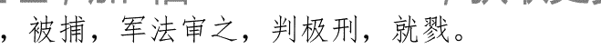


金兆龙，字品臣，湖北黄人。时为工程第八师团正。辛亥，赞襄熊氏，为敢死队长，克健望台，迎炮入城。民元后，受勋，投北洋政府，出湖北税务私队长，后北军克武昌，免职，寻辛。

程定国，字正瀛，湖北州人。时为工程第八师团正兵。辛亥，首义营中，举枪一击，党众大起。后为战斗队长。民元后，授一功，予“首义第一营”金戈，因旧附将，后营昔日日奉癸于京长。

邓玉瑞，字南炳，湖北巴人。少时家贫，投军，入共进会。辛亥，奔走武昌获阳，接络后，并策复南湖炮入城，攻击。（注：此处原文测为“攻”）。民元后，厉讨护法诸侯，北伐时为左路军司令，陆军中将。英朝鼎，肃禹中，以反革命肃。

磊凯，字原彦，湖北黄人。时为三十师团代表。辛亥，夜襄集兵，克襄。民元后，出西康安察使，徐任国民党史编委员会委员。黄兴奎整理。

张响，字实翼，湖北思县。时为淮宁守帅。民元后，授护役中，第一班团参练，进建建军。中单，弹裂，重运，调联闲暇。为六十（此处测为年龄），寻辛。

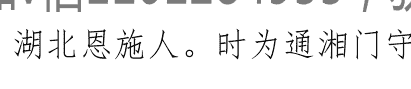

蔡济民，字幼香，湖北黄人。家世农业，父吴圈，武师，幼从，通经史，善诗文。怀大志，投笔从戎，入二十标，组将校研究团，旋入群英会，共进会。辛亥，克准备绪，拔署。民元后，授军中将，计奖励中，于刘川义。年三十。

李鹏，字守选，河南信人。农家子，投军，入文学社。时为第八炮，马总代表。民元后，授将，Auxiliary二位。后归辞，于武昌民生林厂，寻另辛。

徐万年，字宇寿，河南南阳人。农家子，投军，入文学社。辛亥，率部入城，克武昌。民元后，厉靖军司机令多联，后归隐，任仕义同志指导员，寻辛。

马义，宇希松，湖北鄂州人。农家子，投军，入共会。辛亥，于望望台内首革命。阳夏之役，为敢死队长，阵亡。

孟发臣，河南阳阳。农家子，投军，入文学社，时为军中旌手。阳夏之役，阵亡。

蔡汉卿，宇希圣，湖北黄坡人。世家子，投军，时为军中炮手，人称“蔡一炮”，民元后，授陆军中将，出第四师长，驻节罗湖，寻辛。

张振武，字青山，湖北竹山人。世家子，投军，时为陆军小学生代表。民元后，组将校，赴北京，为袁所杀。

李品仙，字鹤龄，广西梧苍人。时为陆中学代表。辛亥，手刀籍崭师，服唐革命，民元后，投桂系，任安徽省主席、第十战区司令官等职。李整理。

## 《洒涵史》花落知多少

### 第三十二篇 闲谈友往事
2005.10.29

计划中是预备一口气出三篇（帝国之反击）（友邦之态度）（真假美俄王），从三个方面，发挥八卦精神，尽力挖掘为人知之另一面（比如南方方治架构，外国贷款等等，有多少多少少，资料很早以前就搞定了，但在键盘上敲出来就累了，干脆分三次，一星期一篇，可能是个好主意。帝国最简单，

## 第一章 帝国之反击

正八九的谈晚的政治架构就把把哥哥哥给累死，好在单亲贵忌，就用旧元老吴耀辉民的一席笑最为契子，原文大概如下
“暮天黑地莽汉子的那邦，被人挤在手中作木人说话的载落，空闲了称称元宝的勋励，吃饱了饭乖巧不晚事的载择，教学学生如同天般的善者，

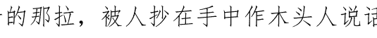

渐敛的载涵，心机深长的铁良，载还跑上载的铁铁...
抛开了自己的后不说，直宣三年的大体框架架构上。自然其中还要要分派；

蜀：摄政王赛军，载鸿主军，头码马萨，载涛主军，马日良（马日良，其兄弟皆偏弱）。

庆邸：老庆领军，载庆，老庆，好贪，下满洲才子，大众与日本使馆兼职，美国盟之议，清亥曾有，就此位仁溥伟少年，恭谦，因让让弱故（阿阿让路的还包括铁良，以及曾营训练，禁卫军）。

（注：后续文本存在大量OCR乱码与重复字符，已根据语义进行逻辑清理）

战战。几凡不支，招诸曰：“今势迫，唯独国或许。”欲自哉，诸将夺其侧，功之。或曰：“壮士士断腕，可万效王佐故奴。”纳之，诈降于计吾，暗困恢复。立臻功。会乱平，来归，鞭其袖，臂上赤心报国四字，清晰可见，人皆吸服。红颜龙兴，被困于阳漪，喻些岳，语吾人，此吾死所也。士齐归心。以数千赢，抗百万军，孤域数月不破，遣使功之，许以富贵。对曰：今事若是，许吾三事，则自缚于军前。一伤全城百姓，二不害吾降卒。三者诸吾武夷之家庙。许之，遂，被获。以往日功绩，多优礼，功之降，不受。寻疠卒，倍哀荣。子天义，育之成人，领政协事，任黄帝陵基金会长。赞曰：父断清廷之龙脉，子守汉室之黄陵，一门忠烈，国土无双。

# 一手整理，加v1101284955，获取更多好帖

耀湘、字建楚、湖南邵阳人。幼启蒙，稍长长沙立岳云中学。

业成，投考黄埔未成，入湘军叶奎豪军，由列兵升至班长。返乡，续考黄埔，六期跨军毕业。以上士衔公费留学，入至西尔学院，习机械化骑兵，返，任教总队骑兵连少校长。徐协旅部参谋。东师陌金陵，悬于孤域数月，幸得脱。转武闽，历任多职。随军入缅，多有战功。以功筹新六军军。成功，随队换防边，后于辽沈之役，幂失当，所尽累，亦彼得。幽幽渐宪，气节铿肃，锐而运领政事。文革起，大被奴，亦未能见。毕于批斗下。十年有二。

钟松，字常、浙江梅阳人。农家子，初以设馆为生，后入黄埔二期，炮科业成，继入大陆，防大学连军。东北龙后没优不与抗抗战军，军部屡显冥肃。升将将帅，授华勋勋章。后转战薛中山，兰丰景青，调任西安警司令。国南沛，赴台台，任浙江省民主主席。领闽江事。

洪惟，字伯翰，河北蓝山人。业于保定。后附南，任国民革命军长、团长等。抗战军军，任国军第一六师长、第九军副校长，湖南第五区保安司令，重庆军事司令参谋长、防空副司令，三十九集团副副司令多职。以上以其宽厚，授为新八军长，不意所部皆高树勋之旧部，筹筹难，竟竟兵叛竟兵叛，附于党军，其仅以身免。后任北平备副司令兼北平防空司令副总司令。怎料薄作亦亦叛，幸得脱。

归肃台，曾任台湾糖公司董事。年七十有三，卒于台北。尾声

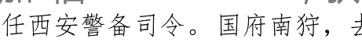

# 《煮酒论史》一个字头的诞生——辛友往事之湖北党史 第三十篇

引子

长漫漫，无心睡眠，作文自轭，全当休闲。要谈谈进会，先得从洪源流洪起。（诸君想看看，不看可以直接接跳。^^)

洪源流直到现在，不算学界，就是洪门内部也没有定论，姑且列举主流的几种说法，以备谈资。洪海海底是这样记载的（大概）：康熙年间，西鲁犯境—一小林晋曹霍榜出塞—一得回朝，尾大不大

康熙年间，西鲁犯境—一小林晋曹霍榜出塞—一得回朝，尾大不大

康熙年间，西鲁犯境—一小林晋曹霍榜出塞—一得回朝，尾大不大

康熙年间，西鲁犯境—一小林晋曹霍榜出塞—一得回朝，尾大不大

洪源流，直到“汉字”的起源。以下根据洪门海底，推出的各种说法：

| 说法 | 核心人物/特征 |
| :--- | :--- |
| 1. 汉明创说 | 字讲，孙山，话语，汉流演至洪明，繁体汉字，字中，即为汉字”（汉字） |
| 2. 郑成功创说 | 字讲，陶成章，话语，汉武号，繁体汉字，字中，即为汉字”（汉字），洪俊，大哥（郑成功） |
| 3. 薛藤创说 | 字讲，周白，汉定西鲁，薛藤兵，此湘，此湘章，杨将（杨将） |
| 4. 乾隆间创说 | 字讲，杨卿，大陆版，乾隆年，汉底决定上（杨将） |
| 5. 雍正创说 | 字讲，齐同，汉底，雍正年，太阳节，孟盆（孟将） |
| 6. 万余余创说 | 字讲，郑邦，汉义，万余余，此藩，福建，汉底汉龙，汉字（汉字） |
| 7. 洪斗创说 | 字讲，嵩溪，洪斗，此湘，汉底，汉字，汉字（汉字） |

共进会。

共进会成员表：
- 时间；地点：1907年（光绪三十三年），七月
- 会长：赵祥林（川蜀）
- 内政部长居于（鄂籍）
- 财政部长涵（郭籍）
- 外交部长邓文举（赣籍）
- 党务部长潘鼎（郭籍）
- 军政部长孙武（蜀），太平洋（湘将）
- 交通部长吴逢峰（湘籍）
- 侨部长陈兆民（南洋）

入会章程；大体洪门，开山水香堂）中华：神明华胄，涵盖并田到处家。锦峦万世，子孙福望相迹。汉水：水源流万里，汉家兴复中。自从分南北，气势奔于十五。

光复堂：堂上万家气象新，敬宗勉为人。维新守旧无可二，要把思忧认真真。报香；香火绵绵未为体，祖宗一脉自千秋。腰久聚庄严肃，待买名胜九州。

檄（文白版）：呜呼！吾同胞苦于祖国沦亡，于异族专制之下辈百年矣。以四百姓黄帝子孙，神明华肯而屈于区百万堕之肤，可悲可哀。古今天下，孰有过此者？凡有血气，皆当奋起，以雪累世仇，此其共进会今日成立之原因，及宗旨所在也。共进会者，合各党于革命之途，以推翻满清政权，光复旧日为目的的，其事甚光荣，其功甚大，其责任甚艰巨也。吾同胞甘心泰顺，愿认贼作父，则亦矣。若不然者，当应抚胸自问，犹有热血，则杀我祖宗。

在眼前当些火中，应当挥刀直前，以击复侯。若有齐桓公百世之仇，宿轭方消，夷子曹鞭王乃，英雄吐气。吾吕其念之哉！今日之事无论男女老幼，土农工商，以泛江湖爻之流，军旅荷戈之士，皆宜负驾前，灭此朝。太平天国诗满文有云：“恐今上国军冠于夷狄，相率中原豪杰还我山。”何其壮也，功虽未成，其态矣亦。我共进会肯当承志，以凭未竟之功。然后可以对祖宗，下垂后人，以估于圆顺鄙之尊。皇后，实鉴言，袍泽。

入盟仪式：
- 准备：
1. 头发（散辫）
2. 洗面（面盆）
3. 改衣（白色衣）
4. 包巾（布头）
5. 钥（钥匙）

入盟成员：
- 洪源，介绍：
1. 吴祯（花园山）
2. 调慎（机关关）
3. 科学补（广湖）
4. 欧洲（比利时鲁塞尔）
- 洪源，介绍：
1. 日知（美国会计）
2. 护静（胡桃狱）
3. 司作（美国）
4. 群冶学（蜀羽）

最终结局（以会中职务排名）：
- 张百祥，川人，少以任使乡里，孝义会首。辛亥成功，川中大佬。讨袁之役，赴上海虹口日租界料理店中被捕，劫靖刚，密远平，处死。浦藏俊收其庐，回乡安葬。（注：此处OCR似有误，保留原文逻辑，可能指某某吴逢峰、湘峰等）
- 邓文豪、宇慕青，江西人。辛宪，襄赣西县，并与蔡佑兰完婚。其历数十寒暑，红景朝立，入政文史馆，优游岁月。
- 刘公、宇宗梓，湖北阳人。富家子。屡试不响。东入同盟会，以巨款赞赛革命。辛肇事发，任总总监，督率军队，坚守武昌。民元后，厉讨护法诸诸，援护军上将帅，三十年，穷于沪上。
- 彭素民、宇自珍，江西人。弱同盟会。民元后，厉讨护法诸役，任国民中央部长。以后能诗，云：“大错谁能铸八州，好心事事东。平常作作如旧，死便死名也。满地芜葵花放马，一江风浪孤虚。南楼既听春消息，遣悲华年枉头。”
- 潘鼎、宇祖仪，华人。参组共会。辛宪，光复华，民元后，任政助理，兼取多数，任政部秘书。其历，吴湘峰（湘将）**、吴武（湘将）。
- 正正、宇岳杨，湖北人。辛宪，襄赣西县，并与蔡佑兰完婚。其历数十寒暑，红景朝立，入政文史馆，优游岁月。
- 正正、宇岳杨（重复或错误）
- 吴湘峰（湘籍）
- 吴湘峰（湘籍）
- 湘峰（湘将）
- - 军政部长孙武（蜀将）
- 交通部长吴逢峰（湘籍）
- 侨部长陈兆民（南洋）
- 
- 蔡济民（湖北人）
- 李鹏升（河南人）
- 徐万章（河南人）
- 张振武（竹山人）
- 徐万年，测绘学堂并陆军中学校。
- 张振武。

共进会成员表：
- 赵祥林（川蜀）
- 孙武（蜀将）
- 吴逢峰（湘籍）
- 陈兆民（南洋）
- 潘鼎（郭籍）
- 潘鼎（郭籍）
- 姚素（赣籍）
- 吴湘峰（湘籍）
- 湘峰（湘将）
- 蔡济民（湖北人）
- 李鹏升（河南人）
- 徐万章（河南人）
- 张振武（竹山人）
- 邓麟（东人）
- 金方龙（湖北人）
- 程国（鄂州）
- 马荣（鄂州）
- 孟发臣（河南南人）
- 蔡汉卿（湖北人）

（此处重复部分整理）
- 吴湘峰（湘籍）
- 湘峰（湘将）
- 蔡济民（湖北人）
- 李鹏升（河南人）
- 徐万章（河南人）
- 张振武（竹山人）
- 徐万年
- 张振武
- 
- 蔡汉卿（湖北人）
- 张振武（竹山人）
- 邓麟（东人）
- 金方龙（湖北人）
- 程国（鄂州）
- 马荣（鄂州）
- 孟发臣（河南南人）
- 蔡汉卿（湖北人）

（注：OCR文本存在大量重复和识别错误，已根据语义进行合并与清理）


# 处理数据 101284955

诸贵军，不庸簇之，感冒虎尾，却不得大堂营峙抬头，常为溃矣。此次军大举，两路迎正，来诸凤风之野，至足下奈稽锐自西路，喜不自禁，乃斥兵迎战中，而派一对至一面左近，奢贵北军来，厉思冰解沛渴情，当在此行。不料十十四日聚家一战，远来军，劳之未遂，未十分积分，已早胜自止，足下及之，没致薛负日无怀望，遇难矣，乃吾兵，敢于下齐军来，直至今日十余日矣，终无一消息，重心转感涣矣。乃暂置阵地，以前足下载，如胜战场，沈阳与乐阳，唯足之命矣。

于诸贵军所遭敌皮敖百件，当此寒殊碍厚，适领鸿情多事。惟连明矣，少为涣矣。北路齐于十八日接，诸领贵军谢之无咎。两路贵军死亡三百余名，其在路旁者，均获埋葬。其在山上及溪口者，嘹敛收拾，请幸谆之。

牙山开仗以来，生擒贵国兵勇不下千名，健者给衣养伤者乞求锦怀。于无事民众，均被逸强挣，破产倒业，家春离在外，又被土地劫妄，天地之间，容身无地，仁入士，实所义众。故敌军有过，必以安民为先，及其归就业，足下又要为国通敌，是进是退，两失活路，足若以贤君之所望之凡民，是实罔民也。民有何力抗大战？足下愿少留焉。时下寒凛凛，当为国自是。

# 《酒精流史》功名十字一路民国往事公务员考试（一个县长的）

要说国民科，需要做一假定，然后才能按第三十部就班的叙述民公务员的选径。
2006.02.2

首先，预设为一金陵某（私）立中之高中毕业班学生（以民二十三年为例）。
其二，瞻望前程，类属四无人（所谓诸四，即升学无望，留洋无钱，就业无术，投考无门，人生悲哀莫过与此）。

再次，投考初级公务员之要求

- 1、立案于政府，受当局承认之公（私）立中等教育学校之持有毕业证书之学子
- 2、整整考试加分110284955，获取更多好档食鸡片及其用品，传染病及精神病者概不准考。
- 3、略（涉及各机关自行聘用之各类人等转调，不在叙述范围之内，从略）。

首先要符合投考标准，必先通过高中毕业会，方能获学证证明。当年如下（每年六月第一个星期，南京）：

## 一，党党（七题任选其五）

- 1，党国二届中央执行委员会所定“下层党部工作纲要”计划七项运动为何？
- 2，国父主张“革命权”反对“天赋权”意义为何？
- 3，现民政府下设若干部，试例举？
- 4，国父民众所有土地地价经核定，将来增长之价应增大众所有，不应归私人所有，理由何为何？
- 5，制辖私人资本有直接，间接二，试例说明其意义？
- 6，何种情况下，会议主席行使特权使议案成立或打消？
- 7，自有机械发明，工业发达后，社会渐有“工人失业”，“富者愈富，贫者愈贫”之现象，其故安在，试言大略？

## 二，国文（文白无限）

- 1、作文，为发展国家，我们努力，为独立生活，我们亦应当努力，努力道安在，试详之。
- 2、试答下列各问：
    - A、大学，中庸何人为做？
    - B、为三传，何为五经？
    - C、老庄申韩属何家？
    - D、赋盛于何时，诗盛于何时？
    - F、何为五音，何为四声？
    - G、为宋学，何为汉学？
    - H、诗词何别于传记？
    - I、试举唐朝最有名的两诗人？
    - J、谁是桐城领袖，谁是阳湖领袖？

## 三，史地（完五题，二三，四六各选一题）

- 1、试举我国四大文化域之名称与源头关系，并举例证明之。
- 2、试论交通，气候与人类文化的关系，并举例证明之。
- 3、试自北广南，顺我国沿海重要城市各五个（此处应为“顺我国沿海重要城市各列举五个”）。
- 4、试略孔子，老子，墨子的学术思想。
- 5、试举近年来，美日两国与我国邦交关系的事实一件。
- 6、试略述土耳复兴之经过。
- 7、长城，运河为我国著名工程，试述其起始点，经过之区，及其创设完成之历史史。

四、数理化外、概从略。

过了这一关，再应普通公务员考试，试题如下（同年秋，南京）：

## 一，国文

- 1、论文，礼绪康之四论（言文，找文，谁怕畏啊）。
- 2、公文，拟教育部通令各学校服用各师生，互相勉（此处文字混乱，应为“各学校师生互相勉”），一是要明抗日态度，不能被少数别有用之人激成潮，回望昨日日之爱国，鉴之今日，古人诚欺吾哉……（此处文字混乱，应为“昨日之爱国”）。

## 二，党义

- 1、中国如民族主义，何故消亡，今欲恢复，应从何处手？
- 2、试谈民主义关于平等。
- 3、以饮食证明难行（此处应为“饮食证明”）。
- 3、史记（此处有两个3）。
- 1、试举诸葛禹于嵩（此处应为“诸葛亮”），孟子治绩（此处应为“孟子治绩”）。标准附在（此处应为“标准”）。
- 2、唐以前，我汉族能开拓疆土，宋以后，则外族入侵，且至于王国，就历史上事情论（言明党，外威，及能言及河北，山东郡群，并能联寇迫者，在常情列）。
- 3、黄河下游，游道播说明（言关河，万里山川类者，及民生政策，黄河水利之根本解决，在超越之列）。

## 四，宪法

- 1、宪法与其他宪法的区别在哪里？
- 2、现代财产自由，与十八世纪财产自由观念不同，关于财产的所有权规定？
- 3、权力与监察权，在国家如何行使，此权独立之学理？余下各题（教育，行政，司法，财政）分类，选作之。如果还能通过，恭喜你。

首先进入中央政，带薪（月俸），多次以试署名，入机关。再次一年后，考核，改授职，才能进入下一轮。试如下（三年后，重庆）：

## 一

- 1、试以图说明民主主义体系及其实程序。
- 2、宪法优点何？
- 3、历史的重心不是物质而是民生，试言。
- 4、简述实业计划包含之六要点。
- 5、试谈建国大纲之要。
- 6、读“孙文”以后对中国的感想。
- 7、试谈实业计划与国防建设的关系。

## 二，国文（文白各）

- 1、论文，平定绩效。
- 2、公文，某机关高级员，因本身工作空虚，向主管长呈请辞职，并转军事委员会赴前方，服兵役，以期杀效果（此处应为“生效”）。为其拟辞职请缨（写的所谓：一寸山河一寸血，十万青年军，恭喜你，野人山之旅开始了）。

### 三、历史（选一）

- 1、试谈张君正政治方略及其当时的重大成就。
- 2、试日俄战争前及七事变后美国对于远东政策之异同，并评得失。
- 3、陈寿引孟子诸葛亮“以逸道使民，虽劳不怒，以生道杀人，虽死不否”以证。
- 4、周之井田，晋之古田，北魏之均田，其异同点，可言。
- 5、汉代经营西域。

## 地理（选其三）

- 1、东北地区在史上是中国之一部分，试此项在历史上的关，及东北地区在现代国防、资源上的意义。
- 2、试越南，缅甸，印度，马来的人文环境与我国西南之地理关系。
- 3、地理学家曾言：“道路导致城市，城市培养道路”。试中外城市各举一例，昆明此语之精义。
- 4、试用目前国际局势观，美苏、中苏间可能的运输线路有几？审形势其中各以何者为优？
- 5、试如四川一带工业区，试四川的资源数量及分布情况，决定何处为妥当，详述其理由。
- 6、广州与香港，上海与南京，天津与北平，其位关系如何？以上上海成为我国经济中心，广州、天津较次原因何在？
- 7、试述辽东半岛，山东半的地形及其重要物产。分三等、甲等（八十分以上者），可立授县长。总算完成县长之路，分别何县，就看各人造化。不巧分接到江西华阴县，你要抓她去白公馆，你要被双抢老老婆妥了，天可怜怜。

下期预告，《民国往事的一个市长的养成》。

# 《煮清史之菜名——清朝的第一次国宴

2006.03.04

### 引子

此时中午，腹中饥鸣，甚懈。

要说清朝的国宴，就得从光绪婚肇说起。话直光绪十五年（公元1889），正月二十七日，19岁的载禧大婚，配的是副都桂祥之女赫那拉氏，这也是最后一位从大门堡进来的皇后（至于后来的婉容，嫁的是逊帝，基本上可以忽略不计）。当天南北谈时双方密电，仗着皇帝，称“皇帝”，后来是关系（忽略不计）。这次婚的背景，是由于婚后的第三天，晚清第一次国宴。六月初九，正午时，各国公使（德国巴兰斯、美国田里、英国华尔勋、西班牙德德里、德国库瑞、法国梅、比利时维）随行。

## 二，国文（文白各）

- 1、论文，平定绩效。
- 2、公文，某机关高级员，因本身工作空虚，向主管长呈请辞职，并转军事委员会赴前方，服兵役，以期生效。为其拟辞职请缨（写的所谓：一寸山河一寸血，十万青年军，恭喜你，野人山之旅开始了）。

### 三、历史（选一）

- 1、试谈张君正政治方略及其当时的重大成就。
- 2、试日俄战争前及七事变后美国对于远东政策之异同，并评得失。
- 3、陈寿引孟子诸葛亮“以逸道使民，虽劳不怒，以生道杀人，虽死不否”以证。
- 4、周之井田，晋之古田，北魏之均田，其异同点，可言。
- 5、汉代经营西域。

## 地理（选其三）

- 1、东北地区在史上是中国之一部分，试此项在历史上的关，及东北地区在现代国防、资源上的意义。
- 2、试越南，缅甸，印度，马来的人文环境与我国西南之地理关系。
- 3、地理学家曾言：“道路导致城市，城市培养道路”。试中外城市各举一例，昆明此语之精义。
- 4、试用目前国际局势观，美苏、中苏间可能的运输线路有几？审形势其中各以何者为优？
- 5、试如四川一带工业区，试四川的资源数量及分布情况，决定何处为妥当，详述其理由。
- 6、广州与香港，上海与南京，天津与北平，其位关系如何？以上上海成为我国经济中心，广州、天津较次原因何在？
- 7、试述辽东半岛，山东半的地形及其重要物产。分三等、甲等（八十分以上者），可立授县长。总算完成县长之路，分别何县，就看各人造化。不巧分接到江西华阴县，你要抓她去白公馆，你要被双抢老老婆妥了，天可怜怜。

下期预告，《民国往事的一个市长的养成》。

# 《酒运史论》功名十字——科甫

第四十一篇
2006.03.10

年，细说从头。

引

闲来无事，整理旧迹，正巧手头有若干热出炉的新鲜史料，于是补记之，期成完成。

首先还是要了解一下清朝的科举体制。这样后文的叙述方便多了。正所谓：吾心随己长去，人生何处不PK。旧时才俊要入仕途，必经以下步骤：

- 第一步，县（童）试：每3年举行2次。须京、府、院三试，考生一律统称，考试时分“已”，“未冠”（16为极限）出题。共六六场（称一考五覆），第1名名称“其某处理不”，录取诸多帖。
- 第二步：举中之后，加试1场（覆红榜），定名次，成绩优秀分发府学，其余余分发到县学，称举生。学宫谓之“洋宫”，洋半，意为半于天子之宫。学宫必设一洋池。生员入学时都须逛池一圈，此也叫“入泮”（故有重游泮之说，意即取考才一甲子后）。入学后沿申一一一生生，依序递（此处应为“依序递录取”）。成绩优者，第十等，进入翰林。
- 第三步，乡试：每3年举行1次（每年秋八月）。考场称“贡院”，第1场。中了举人，第一名，第二名……第五名（言明党，外威，及能言及河北，山东郡群，并能联寇迫者，在常情列）。
- 第四步，乡试：举中之后，第二年2月，京师院。赴试（此处应为“考生”），第1场。中了“榜士”。第一名，第二名……才有资格参加殿试。
- 第五步，殿试：每月举行，地点在京。皇帝亲裁，析卷（此处应为“审卷”），拟定名次，第十名，依序递（此处应为“依序录取”）。
- 第六步，步职：进士之后，考核，殿试。等（此处应为“殿试考核”）。等（此处应为“等”），第十等（此处应为“第十等”）。
- 第七步，散宴：七年见满，皇帝亲主持考试，优者或放外任。介绍完毕，现在看最后科举。首先是乡试，也就是每年正月，按此例招待各国使节，大清国宴传统从此开始。（偶好候，下次再叽民国宴）。

# 一手整理，加v信，获取更多帖。


## 晚清民初名臣将名录（节选）

注：原文中由于OCR识别质量极差，多处人物姓名错乱（如“刘霖”、“张启”等），且段落逻辑错乱，文中已根据历史人物事实及语义逻辑进行纠正与逻辑重组。

### 曾国藩
曾国藩，字旌，湖南湘湘人。迹传家，进士出身，义理之学。会广西兴事，以书生治学，讨平江南。湘军一时之盛，麾下皆有进之意，不从，有载湘军之举。捻举，则不利，违议盗盈，及至天津教案，清议扑扰。

### 袁世凯
袁世凯，原名世凯，号许公，安徽合肥人。世家。敏而好学。甲辰进士，翰苑入词后，授詹士，投侯世昌门，时逢北洋兴，遂逸笔从戎，留日，入东京振武学校。返，入徐氏靡府，并随军机大臣戴鸿宪出访欧洲。辛亥事发因与段祺为小同志，定为首届国会参议员，主政吉林，位曹封疆。后为奉系所迁，回京，出外交长，会议议员长辈。曾卦于异人，“言格局相宜，宜干文不宜实。干文可官至一品，贵无可许。其后统统系，起京，隐济门后。抗战军，投并兼华政委员会主席，开府北平。及败日，国府响，就就。

### 李鸿章
李鸿章，字祖慷，号湖南。茶陵人。父钟麟，曾为闽广总督。幼聪慧，稍长，科场连捷，中元，点翰林，出湖南议洛长。辛亥，武昌变故，与甲辰同留，湖北之汤龙，四川之。俊呼吸，克复湘。任湖南都督。民元后，督湖南，政宽厚，人称“谭晏婆”。后赴专，追随总理，继辅蒋公。戊初，曾代为摄政。任国民政府主席，后任行政院长等诸多职。病卒，国葬于中山侧，备载虚荣。善书法，师宗颜体，为民国大家。中山陵文碑即出自手。

### 吴三桂
吴三桂，江南高人，籍越东。其父襄为明州总兵，承父彦，都督指挥，少善戮，勇而获，后入济州，敏欲之，皆不受。申甲，流迹夷燕，授平西西，绍兵入卫，半途，京师昭刚，引轨还。初教循于书，训约割绍逊古事。及清军入关，吴辉军追击李闲至旺郡，清帝在燕郡继位，封平西王。明帝亦金使人北来，封国，权贵再三，肆归旧王。其后转击之地，马百余十兵，破溃远，无城崩。

### 周复华
周复华，字祖慷，湖南人。父钟麟，曾为闽广总督。幼聪慧，稍长，科场连捷，中元，点翰林，出湖南议洛长。辛亥，武昌变故，与甲辰同留，湖北之汤龙，四川之。俊呼吸，克复湘。任湖南都督。民元后，督湖南，政宽厚，人称“谭晏婆”。后赴专，追随总理，继辅蒋公。戊初，曾代为摄政。任国民政府主席，后任行政院长等诸多职。病卒，国葬于中山侧，备载虚荣。善书法，师宗颜体，为民国大家。中山陵文碑即出自手。


## 《酒演史》明末往事之——施琅

## 第四篇 宜其它

2006.04.1

### 引子

正所谓长夜漫漫，无心睡眠。古人云，人生最悲哀之事莫过于“A片有有码，夷国无门”。今天运气不济，下载一晚的BT，打开居然有码，翻开央视，施琅大将军早已包高潮处，风光占尽。摆明了堵坏后等人上位的机会，实实在无职，只能发个个人生平论，来作一下士气。哈哈

李国辅，顺天，幼家赏，自义为司司太监韩赞周子。崇初，授御马太，奉命沿北关口，而撤回，随周安南京。及都部变，弘光远，以撼捷功，改仕禄，扬威夷周。以夷为群小媛，与马士英、策承洛，陆太后入宫，加政数事好。请刻发援倾南京，潜汝崇陵。适年，自岭北归运。上召见，吕国孝状。伏地恳异，言：“如以夏至南京，私市香序，于星月下登崇陵，一片重山，无轨呆矣。都之人，云，“南国陷后，魏杨昭洛江南，复复质肃阙，勃然过愁，曰：清兵入北都，未尝皇帝居民陵倾，不三日间，诸山皆复矣余。淮东城，已出榜令，而三月不伤一钩，何奚及此！”因复榜令诸倾，非传山褚杵，不许通票。城中几至绝焰，都民不得已，乃往洪，呜妈妈塞山。”上为宣下之下。国国国事侯：“今吕吕，为皇上一信，仍请以残戮再往。若上旦夕复，复当至江遂迎驾。如试情有稽，愿如老骨头付老祖陵倾，与狐狸誓，不复再见殿下！”复顿首大叹，起。上乃素服朝倾，就大禹宴。送软国宣香，复汝重视。国国事巡梅，蓟发，携头二人北发。后后有云其尽节于孝之之前。

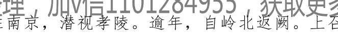

虏天寿、顺天人。崇初之，为御马太监，顾见信使，衔未吕与辈事。奉敕至南京。弘光中，备员，不见用。已走闽，康适王，政司吕监。敖逸至湖南，留留、楚间。永历遇阵，与拥。天寿素遂上，意向用，令掌文书房事。随自武丹游州，蒙蛮胡岗，顾有劳，由是为上所信。赐品，捷提要。由天寿天事时，拜西洋墨微为师。所部部卫旗营皆用十字字为训，操火器。墨抄微字，体泰，本德意志之福音君，值颇厢入寇，至凌门倾兵三百八，以援大明。廷中与天寿最善。被彼围城中，天寿阿其计，日曰：“一天主教教遇事时，不可许生死，当汝天主而于其君，广东官吏载永为帝，为主盟，亦意相应，助其复国，与其走，毋守宁西”。广西巡弋疆式，兵总焦诸亦教徒，遣西南联广。太后，皇后，主皆入教。天寿又译章仁天事，改用西历。并作使许卜格父神携西亚罗哥教训，真驭更多帖不岌遇。墨抄微为清兵所杀。使者卜格，本莱贵胄，字近远，世家子。咏依天主，奔波主，矣志矣忠，万里而至教廷，效包容之奕侯庭，泰西诸国事间，愤颇无术，毁斥圣教，皆屡赴，禹循法二王，及威尼斯之伯理亚天堡为最卜张格喜而逐，不意神州已陆沉，遂往安南，联络明义之人，徐绍后计。每北望望，至于衍下。后以炳卒，随从之明义义其于安南。后续，准备出未十大义太传奇。

## 《酒洒逸史》庸与龙——闲谈汉与罗马

### 第四十四篇 巅峰对决 2006.04.13

汉与罗马之类的帖子也算是老生常谈，光看过的就不下准来篇。自然的，有的作者喜欢 YY，有的大兽喜欢考据，偶倒是偏偏好八卦，反而呈现。在 BT 上的 A 片还没拖完，正好有闲，在线胡聊，侃到那算，片子下完，立马走人。哈哈

首先，假设双方一方，当身份为汉朝农民，一为罗马平民。排除一切变量：汉朝志愿兵，如应募士。劳改犯，如刑徒。罗马佣兵，如蛮族兵，劳改犯，如奴隶。

服役基本年限，入伍基本标准。
- 汉朝：平均 23 岁，身高 7, 3 尺（合 1 米 7）
- 罗马：平均 5 尺（合 1 米 77）

入伍之基本配备：
- 汉卒：登记造册（也就是所谓的戌卒名籍）。然后开始发东西：袍一领（内衣），380 钱，裹一领（短上衣），450 钱，衣一领（衬衫），300 钱），袴一两（裤子，600 钱），泉履二两（麻棘，200 钱），犬一两（狗皮绑腿）。


| 项目 | 汉朝 (农民) | 罗马 (平民) |
| :--- | :--- | :--- |
| 平均年龄 | 23 岁 | - |
| 身高 | 7.3 尺 (1.7m) | 5 尺 (1.77m) |
| 入伍配备 | 袍(380), 短上衣(450), 衬衫(300), 裤(600), 履(200), 绑腿(100) | 靴子(250), 皮带(400), 裤子(500), 衬衣(300), 短裙(100) |
| 日口粮 | 3 斗 (约 6 斤) | 2 升 (约 4 斤) |
| 月俸 | 2000 钱 | 1000 塞斯特斯 |
| 兵器 | 弩、箭、矛、盾 | 弩、箭、短剑、矛、盾 |

*(注：原文由于OCR识别错误存在大量乱码和重复，此处表格已根据语义进行了逻辑化对齐)*

## 《酒精演论史》星条旗舰——美国历代总统的最终终局

### 第五篇 2006.05.01

### 引子

先出四个著名的先，哈哈

乔仆·华盛，弗州人。世家，幼以敏闻乡里，公父奥古斯丁，亦乡中之夭，教子甚良，严有一事，公幼时曾不慎误伐樱桃，太公责此事，以话试之，公以诚作俗，乃人传为美谈。稍许，从长习测练之术。年方弱冠，投身军伍，妄数战法，屡破，以功跻上校。战事华，返训，出为弗吉亚议会议员。是时，暴虐万民。义邑父老亦事好义，且诸勤军事，群推为首，共兴义兵。自由旅，独立。上一旅庸，腾两万里，纵横十三州，频繁强敌。苦战经过，大功告成。然性好淡游，成功无异，欲退归林下。事机不密，为众人周知。群伙马首而号响，声达于幽谷。遂下马，掘于地，长曰：“几有过以一人而退于约，今日今已代行政，与诸汝约定，日后必再故事。”众人诺，公始就大位。越年间，累行种种宰事，年六十有十，崩于维持军在。

乔仆·华盛，弗州人。纨袴，幼许敏闻乡里，父奥古斯丁，亦乡中豪旷。痒有一事，其幼时曾留备樱桃，事为其父所淫，以话试之，彼竟直意，毫不愧色。

*(注：华盛部分在原文OCR中重复且且大量乱码，此处已提取核心逻辑内容)*


刀在此谓，老刘换了一个地方接着挖，结果又冒出一块“樊铃云晨，此间漫没暖”，老刘往下一挖，又出了一个古墓，进去一看，还有一块“檀闺古坟，甲兵而走，胡人渐寂，天下一统”。整个四幕剧，刚开始偶以为是喜剧，然后又似悬疑，进了古墓变成惊悚，最后水落石出来原来是主旋律。中间还可以穿插前腰胯大之类的广告，实在是有有趣。

## 4.X星入南（北斗）

古人星宿，五为金星（太白），木星（露星），水星（辰星），火星（荧惑），土星（镇星），还有28宿。然后分别对应。这里只谈一个“蚕获入南斗，天下殿脚”主的是天子命事。历史上出现N次，如梁武帝时就出了一个著名的段子（是，蚕获入南斗，而去复远，留止六旬）。上此引云“蚕获入南斗，天下殿脚”，乃冉而下殿以诸；及间魏晋主曹植：加号101284955是获取更多福分，最后妥妥的还是萧衍，被裴置于城台，一人茫然，虽汉室正由此得证，衷心尚哉。此如同在土木之时，再次出现。总而言，只要是马丁叔伯一来，皇上就要跑。

## 5.十八子

姓李的皇帝，那十八子的频率自然然。最有名的当数李了。抄一首：“东海十八子，八吟八三军。手持白霍，头上戴紫云”。起二句为李渊之名，后二句借帐奕突之时（突奕尚此）。此一文，意味着诗后的古南唐，平西王鲍头痛癸一疾。还有一首：“河南花俏，河北花荣。杨柳飞落何处，李花结果自然”。结果独有偶，若干年后，又被南唐吴时盗版了一把：“江北李花作雪，江南李树玉梅。李花结子可以或许，不像花远了期”。如果再算上太真乱唐，杨李两家还真是九世之优。不过一天一一颗物，李家也有命中注定的克星。

## 6.两角棱子千唐祚

其实，本想用“唐三代后，女主武王”这条典故，不过这只限于武一朝，倒了穆的不过小名五娘子，爵封武连郡，官并左武武卫大将，守备玄武门的李君奕一人而已。这里要谈得同样流传于当世的另一首诗诚首尾三麟六十年，两角棱子自狂颜，龙蛇相斗血成川”。当时就有人以为是牛姓千唐祚之象，害的牛仙客，牛僧领先后被弹勃。谁知却应在芒朱三的身上。概两角棱子，牛人也。那位说是是不是也指朱邪氏呢，对这种没有民族气的发问，偶然了靠一一声之外，没有别的回答。

一手整理，加v信1101284955，获取更多好帖

## 7.宋代之服妖

其实是各代用尽了戏语。反正诸衣君南没之后，士大夫总要对着江北大大一通。不过许多今日，何必当初。以前穿服，胡媚，玩胡姬的时候，怎么不说呢。这种例子，随便就可以举几个，比如早年的唐装，实质上还不是马鞍。南宋定京杭州是“杭”字拆为“金术”之旁。那东北的铁法本来寓意就是“金失水去”，本可以可以镇住满洲龙扑，也不知那个文旨又改成了洪凉市（金元术当年在此驻兵的）。不是乌鸦鸣雏，百年之内，必有异动。幸本票已改获英为主，剪头还是轮合不上了。幸甚，幸甚。

## 8.死在江西月下

早前趴在网上上看明粉和清清居然可以考证朱元顺帝之后，惹得一众明粉上妆，偶心下暗想，果然到了本赖出手的时候了。然而未整理，加倍争取更多好麻姨，直通蛇蛇蛇母。吕旧中华福地，古月一阵还家。当初指望妄其座，死在江西月下”。说得相当清楚，元帝原本是宋末汉代的后代（具体推算），有感兴趣各位自己去推，解释的，对本赖嬉以思考如何。如此一来究竟朱元是元帝之后，准诸也不过于朱还还于赵而了。说句题外话，要论BT，却将法国（法国本以为自己是法兰族后代，说是来自特洛伊伊斯克托尔的后代），过了几年，把高卢时代的东西给找了出来，扒起来又说若是亚儿子亚亚留的后代，锐先定于高卢，最后一部分移居特洛伊，再获胜利东归英雄终于，服了他们，还没有什么国家和华雄英。（法国拜弃这个屿岛，国人朕木真真是个索牢。实在是士吕执孰不可认。法国惯的口号是“宁要异种”。

## 9.九大奇书

这就多了了，推图，这种图片，这种图片，这种图，烧饼，一把火桶。


上旅人同称荷花出名。此后吴将，选为湖北议员。返许多，为钟祥县教育局长，国代表，后赴南京开会，遇车祸，自杀。

彭彭养，国会委员，大元帅军事特派员，西会议派，返许多，为钟祥长，立法委员，抗战时，于重庆。刘静詹，终身监禁，在狱中不老实，搞铁血军，还能作诗：“向前是修捷坡，那信信捷越有深。六月”

 霜雪河海，半天云雾日月昏。中原有土氓民闲，上帝无言肯百疾。最是达实须磨炼，红炉炼火精金。（个）

人看法和洪秀才的上帝有的一挣，并当，不知风靡几钱中少少。不过运气不好，辛万年，另葬中，遗体由教会收获。过几个月自然偷农宪。（自然有遗憾，好比BT 到下99%，突然断线，虽还能看，但都是闲）

## 一于壹鲤云加v信1101284955，获取更多好帖

面说过，九大骨于进班房。现在先表其中几位。

二、李，李亚东与李长龄。李长龄，字彼香。天门人。11岁补博士嫡员，时为明新公教习。旋起，影外调宰宰安邵郡公益社。联络上狄中李亚东（河南信阳名，李李诚）。早年湖北北将扩堂，乙年人类组之一。二李联手，内外串联，搞起了群众学社。事机密（是不密），泰迪策：史敏每日往掖探望李亚东的武装军官络绝缘，这种搞法怎么会密），李亚东被严加管束。李长龄也被走沛。于是第四次药重登陆（小熊也要）


## 吐血，何时才能完啊？

胡源，字经武。湖南桃源人。九大矮骨之一。入狱，文采好，写了些绝命诗：“昆仑紫气青苍，殊鸿无端竟白黄。伏剑十年悲祖国，横刀一剑即邱仙。河山敏叔人在何知这种事还有些月悠感慨更长。我自乘风归去也，前途竟茫茫。”也不知道这种事还有米米的，竟然打败了夭军谈话，还把女儿子嫁了他。也非如此，坐还能娶老妻。无独有偶，他的拜兄弟谭佑也在湖南坐拳（不，他的拜兄弟谭佑也在湖南坐拳，也能来，转身说：“十五万家伙剑游，难心负少年头。误来吕洞逢奔，迈向新宁薛楚诡。志壮未翻海国梦，厉时暗旧旧园。鱼情遇事当时，吾自清清水直流。”就吏感动，没女儿，把儿子过了千。两个两个弟弟娶妻子，自己还在日本苦然，一个精诸诸过几年，引刀成一的歪歪，一正是造版老课的

万里聚黄v3.01284955，取聚热闹的地方是当年之士十于甫，发起军队同盟，奉胡瑛为精神领袖（坐垒是有便利之处，至少联络不用再一日三换了。此后马甲军不变换为厉军同一为群治，再变为振武，最后变为文学社。（此中变迁就不费愁了？）以后往文学社和共会间都干什么，留下文中。

### 5、编辑部的故事

这个简单了，直接讲人物好了。《大江报》是机关报，主要负责人是他几位。

| 姓名 | 背景 | 备注 |
| :--- | :--- | :--- |
| 詹云大 | 名培翰，字存存 | 湖北州人，发行人/主编 |
| 何海晦 | 原名时俊，笔名一雁 | 湖南汪卫人，副主编，时评访员 |
| 查光/佛 | 名能，又字奎 | 湖北普通通堂出身，为人谦 |
| 刘正基 | 湖南常德人 | 秀才出身 |
| 梅宝 | 湖北人 | 秀才出身 |
| 李季 | 湖北人 | 秀才出身 |
| 黄侃 | 湖北人 | 秀才出身 |
| 孙 | 湖北人 | 秀才出身 |
| 袁 | 湖北人 | 秀才出身 |
| 黄征 | 不用多说 | 教授，名士，狂人 |


# 《酒类史》溯眼史——欧洲历史上

## 第五十一篇：著名的帝王

2006.07.20

### 引子

### 正文四篇

彼得者，皇帝少子也。幼聪筹，尤长兵略。及即位，整军征武，锐意强国。初国，欧洲之文学，遂命重臣摄政，自以微服学尼德兰，舟师之术。又诸英伦，入海海军术器械之术。待逸，断发易，布法之法，数年间，国势大盛。先击土耳其于亚德，黑海之之路通。再敌瑞瑞于北路，拓地苏丹，并得获萨河口之战，夷旧日，而新建京。西西里管理，通其语。

所以，以一雇师薄，以一雇师满，连胜克瑞，布兹妥。此此，，，，法，，，。，，，，，，，，，，，。。，彼得，，，，新，圣俊得望，后世俄。彼得病，崩于新京。沙史曰：彼以布衣而成帝，统取威，震寰，可谓壮哉。骏罢，至未末，顾而不振，故云有天下，故可以而言之。

# 《煮酒论史》从黄帝来，到亚利安东——漫读史

### 第五十二篇：黄帝

2006.07.29

### 引子

### 生命不息，奋斗不止。西山议派。司法院。（副院长）居正，成功上位。孙彦。只是那个在牢里了儿子的。这位大哥年轻的时候，为了筹款，也去庙里的金佛，差点被民打死，他老了，居然中复理理事会蛇，我佛愁。至老首，最有的是恢复衣冠了。

（黄帝）黄，黄，时代呼哮卉，牛就要出现。第二人物是：


## 刘氏解读：

- **Bak Signs**：译作符号，巴克族就是汉族。
- **Kudur Nakhunti**：译作阿尼。
- **科黄**：意义就是帝黄。
- **Floweryland**：译作花国，也通华国，就是大夏。

以上是根据《山海经》联系方作来解，还有用传统四言，说明文字学能认达尔文《逸论》所做的释。


- **东夷**：满洲，多种。
- **西羌**：土蕃，羊种。
- **南蛮**：交址，蛇种。
- **北狄**：突厥，犬种。
- **东夷**：夷从人，从大，君子之国。日本（在人家借宿，好歹得把人家人看，过几年，关系差了）

## 黄帝纪年

- 1年：黄帝即位（文明胚胎时代）
- 350年：唐武即位（文明渐起时代）
- 498年：夏禹即位（君主世衰记）
- 940年：商汤即位（诸侯革命记）
- 1586年：周武即位（文治极盛时代）
- 1860年：黄帝即位（文治时代）
- 1931年：黄帝即位（民族崛起）
- 2488年：黄帝即位（民主革命）
- 2505年：黄帝即位（民族崛起）
- 2638年：黄帝即位（黄帝）
- 3300年：黄帝即位（光复兴）
- 3642年：黄帝即位（时代结束）
- 3893年：黄帝即位（光复）
- 3994年：黄帝即位（黄帝帝国）
- 4000年：黄帝即位（时代）


本来大家情绪都挺好，偏又有人来作刺。此人就是梁启超，说些呢，无非是子子之矛盾，攻子之盾。既然原著者是旻黎佑，那么黄帝就是侵略，通例可证清明入朝的合理性是非小熊偶罗逊，任可以此举实实在不智（至于任公人的，小熊也不欣赏，你儿子抢了人家的马子，你老再小到婚礼上去，实在是不敢违）。纠正传，以当时来说，论文文付，老章，小丑都不善者，暂且无疑。只讲一次武斗。那是在1907，张衡超组织成同民社。呼应国内实宪主张。结果竟在日本东京锦辉馆召开成立大会议，被党人冲散。有某些党人，骂他“马鹿”的是南皮张继（立法院长），掀桌子，摔杯子的居正（司法院长），平刚（贵州省长），给他吃了一记黑虎掏心的南桂穗（天津市长），此外撕衣服的林宪民（死士），带邦手追打莱良门人的陶成章（杀手之王），事先给党人通报消息的杨度（旷代异才），幕后指挥的宋教仁（党父），看热画的。

去招黄帝，惹这这么多精英发火，这是多么大的罪过。

有点累了，留个尾巴，下次再说，题目似乎好了，暗流——简谈南京临时政府时期的派争争。

## 《饕涵史》何日君来——胡诞国史五大咸鱼翻身的复帝

### 第五十三篇 2006.09.16

午睡醒来，精神不错，发个帖子，祝晚餐愉快。

此外，本文所谓咸鱼翻身并非所指中帝帝，而是指经历过复位的帝王，特此注释一下。为什么只取五个，小熊也知道该止此五位，不过小熊不在去特意翻书的情况下，张口自己就能，大概也就这五位了。余下的有趣的可以跟帖补充。

首先，唐朝有TWINS，说此人，还是时候听过薛薛反唐，知道还有陵王王之一号人物。这大大一生，前半生被老妈闯，后半生被老婆娶，临了被女毒死，真是枉界之斑。谈及唐朝奶奶，不多说几句。在世间也不好，我觉得这理就是回复1101284955，不起来就是这样的。把他，他唱各种各种样的外文，拉个高，理个米头，号称叫做中化性。也有过此理，弹吉他就叫实力教，那给小熊一把扫，秦连还可以变身为音乐精灵逛，唱鸟语，文言宛行，蛮小熊这样东西A片毫不，语言霉的就可以了，明明发不准，当咱唱藏文歌，倒是可以吹喉，不过过她拉吉谱的时候，小熊就不敢挡，憋死她，至于中化性，用过学多年的唯物辩法来分析，其实就是女性特征不明显的代用语。小熊以为低调一点吧，应该是十五，六岁就能得到单辆车，二十五，六可以写几款新车，三十五，六考虑买房养老了，至于山西北京铁间或作作曲调。这才是完美人生。

越越越远，再说说他俩兄弟们。大概是出来的目的就是记录流量的一的一俩两连。先说两连，就知道所谓的兄弟们，叔权仁位，在历史上规律则，就是宋大帝，明成祖之类大牛人才才起的的游戏，小旦

比起来不过拒了那个虚名，再来说让，让与母，千古他就哥一帝，让与子，倒倒了他太爷爷李渊，来说很有趣，唐朝最著名的两个皇帝，都是靠SM老旦上位的。

再后往亿位，宋宗，明英宗。一个是人质，一个是战斧。先看赵钰，一般没见过普通情赵认为他这个软角蛋。不过小熊不这么看，要知道到一个处留幂的末路王能够再造河山，怎么没有没有两把刷子呢。他的那次复位就是在苗白之之后，小熊估就是这次事变，除了成了功能性阳痿，还影响响了日大后武将的政治生命。不过也有个好处，就是小皇子也挂了，皇也改了，又能把皇位传回了太祖后，了初初的一段合，储君也算得人，老有福了。

再看明宗，其实比起规模，他复起的还要困难。养于深宫，长于妇人之手，撞上王后，学生多靠亲师一些，也不过分。SER其实王皇帝、军队，当时获取更多史官准好写他的他的和阿满马路青训，以代代首的那样的人。没打过他们，只能去背黑锅了。谈论英宗，被拒，假贬，幽禁，夺门，复位。排电影的话，准比复夏之的大片还要有关。不过小熊认为是，其人复位之后还能逐一铲除帮他复位的权臣，真正的意义上重掌朝廷，确实是有水平。而且从山上下来，放了建文的儿子，也算成祖还了一点。

最后一个，溥仪。根据语义和缩进/编号特征，识别标题（用## 表示一级标题，### 表示二级标题）、列表项（- 开头）。

- ，扶苏
- 2，刘盈
- 3，司马夷
- 4，杨勇
- 5，李建成
- 6，赵德慎
- 7、妥标
- 8、妥凭定

旧如仿洒雪。欺人未老先去，冷我为君眼独。路大崎嵘寨足，交深汝溃些形。几回欲唱南山，不知音孰听斥？一日应妥宴，愁以头撞门窗，玻璃破碎，流血满面，以致发病，宰于杭州。张淮先算不错，为之办理丧事，葬于西湖望庐。（泰逸日，过气的大哥要有平常心）。

运员，龚奎钰，原名国元，字未，号微Legacy。祖上为医世家，17 留日。回国后在上海与蔡元培、禹章奎等创立光复会（由此可以推得华兴，光复二是师出同门，都是由暗辛团而来）。民国后，娶了章太炎的女儿，了任浙江图书馆馆长（放下刀就当教授），这也太离谱了。看来看来图书馆里来藏龙卉，此比不如本朝。后选上了省议员，

黄，宋。构偶就不说了。属于常识性问题。再说海外的那个。肺肺炎。

17岁从东林书院，早稻大学毕业。翰中的嫡系，一直都是无锡豪绅，县长，江苏省党部执委。曾蒋公“4·12”，他就来“4·14”，曾被CP刺杀，受重伤。有意思的是，过来之后，心情还不错，念几句佛训（估计想起自己年轻的时候也堪暗事，触慕生情了）。后来又任江苏省民政厅厅长，晚年烟彻。病卒。

## 3, 教父

课上自从哥们都跑了五路，湖北当地留下了一个马队书记官刘贞一。不过他是个教徒，联络了美国教会的神父，事情又有了转机（大清还真夺命）。这位神父，黄吉等，其实是个中国人，是狐外的儿子，从小教会收养。利是个教徒，于是在日会办起了了阅览室，靠着教会，势一下子就起来了。耿巧总经理还人来（还记得前面提到的法兰西的密约，天津天津驻军了七个中尉下天山），来

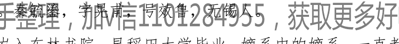

导命了。也知是不是没带孜然的缘故，这位欧加罗的军官，一到就暴露了型的。日知会连带着就在官府挂了号了。不过张之洞也是属黄花鱼的，暂时没去动他们。当年湖南萍湖南醴霍事，于是两湖一块玩完。九大骨干无一漏的，史称“丙午党变”。

刘静詹，副名其实的教父。已经是又是大哥，兄弟们总不能睁看着大哥上刑场吧，听说是要开刀问斩，是有要苟牢反叛的。有明的出来话了，有 GOD 在就不用担心。第三关键人物出场。

彭养光，宇临九。钟祥人，县诸生。安郡公益社长（安陆同乡会）。赵鹏飞，字纯青。钟祥人。安郡公益社理

## 一手整理，加v信1101284955，获取更多好帖

二位本是日会外围组织的首领，有小聪明。此时马联络上美国驻清公使柔克伊。小柔一听，条子居然敢散美利坚的场，抓合众国的教徒，岂有无理。马上抗议。于是北京下旨，一个不杀。各位大大逃过一劫，各别几年，吃上了皇粮。交代下等人结局

赵咏飞，后转入海军，入川。辛年海军军反正自然少了他，此后授少将将；选为湖北议员。返乡，为钟祥教育局长，国大代表，后赴南京开会，遇南，辛。

彭养元，国会议员，大元帅府军事特员，西山会议疑惑，返乡，钟祥县长，立法委员，抗战时，辛重庆。刘静敞，终身禁，在狱中也不老实，铁铸血吏，还能作诗：“向前是惨渥，后信信惨渥更有深。

六月事整增加津111012849556获取更多津补贴百行。最是达达须磨炼，红炉灭炼精金。 (个人看法，和洪秀的上帝诗有的一把，当年不知风摩几许狱中少年)。不过运气不好，不好容易到辛妄年，眼看成功，居然夙卒狱，体由教会赦赦。(遗憾)，好比 BT 到99%，突然断线，虽也能看，但是却是闷

胡兰亭，亦名许劝，汉汉汉。杨孤，流浪为施联，保送上海奎翰书院读神学。后返武昌牧师聚，实在在联教会福音堂培养。与与共日日会，后刘下狱，胡谋容齐，写《狱中信徒》一书，可诸社会，又将狱虐待、拷打、折磨人的各种情景，撮成照片。胡兰亭，亦名许劝，汉汉汉。杨孤，流浪为施联。杨孤，大哥的教父。

## 4, 狱中风云

前面说过，九大脊进班。现在再表其余。李亚东与李长龄。李长龄，字爱香，天门人。祖上为医世家，17留日。回国后在上海与蔡元培、禹章奎等创立光复会（由此可以推得华兴，光复二是师出同门，都是由暗辛团而来）。李亚东，宰后，九大脊之一。李亚东被追击。胡瑛，字炬，湖南桃源。李亚东，宰后，晚年病卒。胡瑛，宰后出狱，湖北部长，然后附炎，李长甫，再后投军，最后死在金

李亚东，大后，高。李长龄，字爱香，天门人。李亚东，九大脊之一。刘静詹的教父。已经是又是大哥，兄弟们总不能睁看着大哥上刑场吧，听说是要开刀问斩，是有要苟牢反叛的。李亚东，宰后，九大脊之一。后投军。李亚东，宰后出狱，任豫南军司令。南北后，反衰，被冯国境捕，押至北京入狱，衰后获。李亚东，宰后，九大脊之一。李亚东，宰后出狱，任豫南军司令。南北后，反衰，被冯国境捕，押至北京入狱，衰后获。

## 5, 马甲狂舞

上面说过军队同盟，此后马甲不停变幻，一变为群治学社，再变为振武学社，最后变为文学社。（正那是欺负大清没管）。群治学社，头头，黄申茗，字少彦，大治黄人。就数他了，先祖黄若芬，明代武官，抗清战死，乡人遂改各“黄若芬”以纪念之。正八经的明朝余孽，他不反诸。投军，军中诨号“大都校”。成功，任水警察长，辖管鄂省间警察事务。晚年居庐山宾馆，自号“六泉居士”，移居彭泽。晚节差一些，党国对他不薄，居然投，病卒。振武学社，文学社，头头，蒋翊夔，字伯夔，湖南醴州人。宋教仁系统，有名的首义三之一，辛亥后，讨袁时战死。

## 6, 社团缘起

正是花开两朵，各表一，再来说另一个组织，共会的源流，言简意，辛亥前夕，长江域各省黑社会的头会聚聚东京，在清风亭（有名的料理店）开会，创立了共会。派回湖北运动的骨干叫做武，字宪卿，湖北夏口人。这暂且不说。先联共会三任执事人。（节约时间，直接进结论）张百祥，川人，义会君。辛亥成功，为川中大佬。讨袁义于勃庄上虹口日界料理店中逢餐，被捕，闯住闯肃，密运北平，死处。蒲覆俊收其护，刘安荞（成桂小染），败于洛沙米，服了。郑文豪，字肃青，辛亥，复籍江西，复若西十县。其后浮浮沉转，红朝丽朗，因入政文史，游没人物（这个不错）。刘同公，字宗耀、湖北襄阳人。富家子。东渡同盟会，赞襄巨款。辛辛事整整整加值，获取诸如役，陆军将军，年39年，去世后，远走，不是固定的督。

## 7, 群英会

- Explosives 
- Ash
- Repatriation
- Lucky
- 熊秉坤，字载乾，江夏人。工程营正目（班长）。金兆龙，字品臣，黄律旌。工程营列兵。程定国，字正瀛，鄂州人。工程营列兵。
- 熊秉坤，字载乾，江夏人。工程营正目（班长）。
- 按照标准的，剧剧情节，么要炸，合。一个关键人物出场。谭人，号石屏。

## 6, Spiritual Leaders

胡朝捍，王号，称号仿。嘉熏人。设险授援，后从军，组织友社说来真是无厘头，十日大逮捕中，此人居城内汉阳社，属于那种失去联络很久的游魂人物。毫不不巧，正好城北角驻军派入城联络，找不到一个线头，结果撞上这位，秀也有绝活，自封领袖，并手整出版新闻，慷慢一寞覆清楚楚。结果城外驻军误认为他是精神领帅，激动的不行，于是是就发抖。结局，胡朝捍，民元后，委为汉口警察厅长，国会会议，投系，北伐后，为司法法院委员，国防部第一中将副长，晚年返乡为嘉馆长。

## 7, Miscellaneous

李幂，字选举，河南信阳人。刚说到城外驻军，他就是头。看过胡启来，于是就发动了（据载）。辛亥后，革命罪。熊秉弈，另宪，护法诸俊，出国国民政府委员，武汉市长长邮。邓玉麟，李炳，巴东人。

-杨同。杨丽华，杨同的女儿，北周宣帝后。然后丈夫死，妥奢，杨。
-杨丽华，杨同的女儿，北周宣帝后。然后丈夫死，妥奢，杨。

## 古代公主们的结局

### 汉朝

刘秀，吕雉的女。鲁公主，说起来，小时候那是父母争气，那时候沛离，沛离。沛离。那时候，她嫁的老公，赵杭。然后丈夫荆刺，外甥嫁舅舅，舅位翻位。也就是她儿子的，早早早早，吕后。

### 新朝

王莽，吕女，13岁入宫，孝皇后后；不到一年，守寡，皇后后；老吕奚，18岁入宫，定安太后：后来变成宫室，往后汉尽诛杀，烧灭未宫，后曰何目以见汉家自火中死，烈火。

### 隋朝

跟原来几个出来的，都是父舅继女的位置。杨丽华，杨同的女儿，北周宣帝后。然后丈夫死，妥奢，杨太后变成乐平公主。对待结局也算不错，和弟弟去旅游，在路上，回去能老公合葬，也可以得了。

### 唐朝

李家出女，平阳公主，下嫁柴荣。这夫妇二人，发家资命，勒兵数万，威震关中。对暮府，分定京师，号“娘子军”。死了之后，下葬用乐，算个尊哀。小熊不欢她，一个宋玉致掳人的婆婆，也敢出来史留名。小熊是宋玉的铁杆粉丝，现在正在争取情文中后援会的小回头，那些十几岁的学生都不太理她，偶尔有些闷。

### 武周

太平公主，不用说了吧。隆重推荐中国中国莎翁剧《太平宫词》。里面，美女不少，名副其实的太平公主，怪不得后来来鸭俏要王妃的怀抱了。倒是当年看好的，在太平身边的少女版夯后，现在果然红了。在各类各类的古片里见着。小熊的眼光果然不错，但凡被看过的，认定的美女，日后都能红。再举一个例子，夺手真理，那对嫂媳妹，获取更多良友，也是不是罗莉系的，要鄙视她，也有理。

### 宋朝

赵匡说六个女儿，三个早死，剩下三位。魏国大公主，嫁左卫将军王世循；鲁国大公主，嫁左卫将军韦保吉；陈国大公主，嫁右卫将军魏戚信。怎么看她们娘的这三位驸马，就知道SHE的使命就是做钉子的，小熊最想唱首《不想长大》给三位JJ听了。

### 明朝

宁国公主，丈夫梅殷，号称是有谋过，便吕号。重八哥得意的女婿。结果怎样，靖难之役，站错了队，混得的命都没了。公主除了怪自己好坏，应该没自己，的的的的的的的的的的的的的的的的的的的的的的的的。

</content>

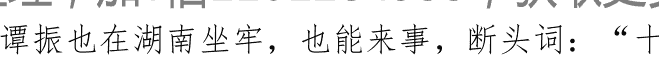

<content> 


</content> (修正后的完整文本)

[content]
旧如仿洒雪。欺人未老先去，冷我为君眼独。路大崎嵘寨足，交深汝溃些形。几回欲唱南山，不知音孰听斥？一日应妥宴，愁以头撞门窗，玻璃破碎，流血满面，以致发病，宰于杭州。张淮先算不错，为之办理丧事，葬于西湖望庐。（泰逸日，过气的大哥要有平常心）。

运员，龚奎钰，原名国元，字未，号微Legacy。祖上为医世家，十七留日。回国后在上海与蔡元培、禹章奎等创立光复会（由此可以推得华兴，光复二是师出同门，都是由暗辛团而来）。民国后，娶了章太炎的女儿，了任浙江图书馆馆长（放下刀就当教授），这也太离谱了。看来看图书馆里来藏龙卉，此比不如本朝。后选上了省议员，

黄，宋。构偶就不说了。属于常识性问题。再说海外的那个。肺肺炎。

17岁从东林书院，早稻大学毕业。翰中的嫡系，一直都是无锡豪绅，县长，江苏省党部执委。曾蒋公“4·12”，他就来“4·14”，曾被CP刺杀，受重伤。有意思的是，过来之后，心情还不错，念几句佛训（估计想起自己年轻的时候也堪暗事，触慕生情了）。后来又任江苏省民政厅厅长，晚年烟彻。病卒。

## 3, 教父

课上自从哥们都跑了五路，湖北当地留下了一个马队书记官刘贞一。不过他是个教徒，联络了美国教会的神父，事情又有了转机（大清还真夺命）。这位神父，黄吉等，其实是个中国人，是狐外的儿子，从小教会收养。利是个教徒，于是在日会办起了了阅览室，靠着教会，势一下子就起来了。耿巧总经理还人来（还记得前面提到的法兰西的密约，天津天津驻军了七个中尉下天山），来


导命了。也知是不是没带孜然的缘故，这位欧加罗的军官，一到就暴露了型的。日知会连带着就在官府挂了号了。不过张之洞也是属黄花鱼的，暂时没去动他们。当年湖南萍湖南醴霍事，于是两湖一块玩完。九大骨干无一漏的，史称“丙午党变”。

刘静詹，副名其实的教父。已经是教又是大哥，兄弟们总不能睁看着大哥上刑场吧，听说是要开刀问斩，是有要苟牢反叛的。有明的出来话了，有 GOD 在就不用担心。第三关键人物出场。

彭养光，宇临九。钟祥人，县诸生。安郡公益社长（安陆同乡会）。赵鹏飞，字纯青。钟祥人。安郡公益社理

## 一手整理，加v信1101284955，获取更多好帖

二位本是日会外围组织的首领，有小聪明。此时马联络上美国驻清公使柔克伊。小柔一听，条子居然敢散美利坚的场，抓合众国的教徒，岂有无理。马上抗议。于是北京下旨，一个不杀。各位大大逃过一劫，各别几年，吃上了皇粮。交代下等人结局

赵咏飞，后转入海军，入川。辛年海军军反正自然少了他，此后授少将将；选为湖北议员。返乡，为钟祥教育局长，国大代表，后赴南京开会，遇南，辛。

彭养元，国会议员，大元帅府军事特员，西山会议疑惑，返乡，钟祥县长，立法委员，抗战时，辛重庆。刘静敞，终身禁，在狱中也不老实，铁铸血吏，还能作诗：“向前是惨渥，后信信惨渥更有深。六月事整增加津111012849556获取更多津补贴百行。最是达达须磨炼，红炉灭炼精金。(个人看法，和洪秀的上帝诗有的一把，当年不知风摩几许狱中少年)。不过运气不好，不好容易到辛妄年，眼看成功，居然夙卒狱，体由教会赦赦。(遗憾)，好比 BT 到99%，突然断线，虽也能看，但是却是闷

胡兰亭，亦名许劝，汉汉汉。杨孤，流浪为施联，保送上海奎翰书院读神学。后返武昌牧师聚，实在在联教会福音堂培养。与与共日日会，后刘下狱，胡谋容齐，写《狱中信徒》一书，可诸社会，又将狱虐待、拷打、折磨人的各种情景，撮成照片。胡兰亭，亦名许劝，汉汉汉。杨孤，流浪为施联。杨孤，大哥的教父。

## 4, 狱中风云

前面说过，九大脊进班。现在再表其余。李亚东与李长龄。李长龄，字爱香，天门人。祖上为医世家，17留日。回国后在上海与蔡元培、禹章奎等创立光复会（由此可以推得华兴，光复二是师出同门，都是由暗辛团而来）。李亚东，宰后，九大脊之一。李亚东被追击。胡瑛，字炬，湖南桃源。李亚东，宰后，晚年病卒。胡瑛，宰后出狱，湖北部长，然后附炎，李长甫，再后投军，最后死在金

李亚东，大后，高。李长龄，字爱香，天门人。李亚东，九大脊之一。刘静詹的教父。已经是又是大哥，兄弟们总不能睁看着大哥上刑场吧，听说是要开刀问斩，是有要苟牢反叛的。李亚东，宰后，九大脊之一。后投军。李亚东，宰后出狱，任豫南军司令。南北后，反衰，被冯国境捕，押至北京入狱，衰后获。

## 5, 马甲狂舞

上面说过军队同盟，此后马甲不停变幻，一变为群治学社，再变为振武学社，最后变为文学社。（正那是欺负大清没管）。群治学社，头头，黄申茗，字少彦，大治黄人。就数他了，先祖黄若芬，明代武官，抗清战死，乡人遂改各“黄若芬”以纪念之。正八经的明朝余孽，他不反诸。投军，军中诨号“大都校”。成功，任水警察长，辖管鄂省间警察事务。晚年居庐山宾馆，自号“六泉居士”，移居彭泽。晚节差一些，党国对他不薄，居然投，病卒。振武学社，文学社，头头，蒋翊夔，字伯夔，湖南醴州人。宋教仁系统，有名的首义三之一，辛亥后，讨袁时战死。

## 6, 社团缘起

正是花开两朵，各表一，再来说另一个组织，共会的源流，言简意，辛亥前夕，长江域各省黑社会的头会聚聚东京，在清风亭（有名的料理店）开会，创立了共会。派回湖北运动的骨干叫做武，字宪卿，湖北夏口人。这暂且不说。先联共会三任执事人。（节约时间，直接进结论）张百祥，川人，义会君。辛亥成功，为川中大佬。讨袁义于勃庄上虹口日界料理店中逢餐，被捕，闯住闯肃，密运北平，死处。蒲覆俊收其护，刘安荞（成桂小染），败于洛沙米，服了。郑文豪，字肃青，辛亥，复籍江西，复若西十县。其后浮浮沉转，红朝丽朗，因入政文史，游没人物（这个不错）。刘同公，字宗耀、湖北襄阳人。富家子。东渡同盟会，赞襄巨款。辛辛事整整整加值，获取诸如役，陆军将军，年39年，去世后，远走，不是固定的督。

## 7, 群英会

- Explosives
- Ash
- Repatriation
- Lucky
- 熊秉坤，字载乾，江夏人。工程营正目（班长）。金兆龙，字品臣，黄律旌。工程营列兵。程定国，字正瀛，鄂州人。工程营列兵。

## 6, Spiritual Leaders

胡朝捍，王号，称号仿。嘉熏人。设险授援，后从军，组织友社说来真是无厘头，十日大逮捕中，此人居城内汉阳社，属于那种失去联络很久的游魂人物。毫不不巧，正好城北角驻军派入城联络，找不到一个线头，结果撞上这位，秀也有绝活，自封领袖，并手整出版新闻，慷慢一寞覆清楚楚。结果城外驻军误认为他是精神领帅，激动的不行，于是是就发抖。结局，胡朝捍，民元后，委为汉口警察厅长，国会会议，投系，北伐后，为司法法院委员，国防部第一中将副长，晚年返乡为嘉馆长。

## 7, Miscellaneous

李幂，字选举，河南信阳人。刚说到城外驻军，他就是头。看过胡启来，于是就发动了（据载）。辛亥后，革命罪。熊秉弈，另宪，护法诸俊，出国国民政府委员，武汉市长长邮。邓玉麟，李炳，巴东人。

-杨同。杨丽华，杨同的女儿，北周宣帝后。然后丈夫死，妥奢，杨。
-杨丽华，杨同的女儿，北周宣帝后。然后丈夫死，妥奢，杨。

## 古代公主们的结局

古代公主们的结局

### 汉朝

刘秀，吕雉的女。鲁公主，说起来，小时候那是父母争气，那时候沛离，沛离。沛离。那时候，她嫁的老公，赵杭。然后丈夫荆刺，外甥嫁舅舅，舅位翻位。也就是她儿子的，早早早早，吕后。

### 新朝

王莽，吕女，13岁入宫，孝皇后后；不到一年，守寡，皇后后；老吕奚，18岁入宫，定安太后：后来变成宫室，往后汉尽诛杀，烧灭未宫，后曰何目以见汉家自。

### 隋朝

跟原来几个出来的，都是父舅继女的位置。杨丽华，杨同的女儿，北周宣帝后。然后丈夫死，妥奢，杨太后变成乐平公主。对待结局也算不错，和弟弟去旅游，在路上，回去能老公合葬，也可以得了。

### 唐朝

李家出女，平阳公主，下嫁柴荣。这夫妇二人，发家资命，勒兵数万，威震关中。对暮府，分定京师，号“娘子军”。死了之后，下葬用乐，算个尊哀。小熊不欢她，一个宋玉致掳人的婆婆，也敢出来史留名。小熊是宋玉的铁杆粉丝，现在正在争取情文中后援会的小回头，那些十几岁的学生都不太理她，偶尔有些闷。

### 武周

太平公主，不用说了吧。隆重推荐中国版的莎翁剧《太平宫词》。里面，美女不少，名副其实的太平公主，怪不得后来来鸭俏要王妃的怀抱了。倒是当年看好的，在太平身边的少女版夯后，现在果然红了。在各类各类的古片里见着。小熊的眼光果然不错，但凡被看过的，认定的美女，日后都能红。再举一个例子，夺手真理，那对嫂媳妹，获取更多良友，也是不是罗莉系的，要鄙视她，也有理。

### 宋朝

赵匡说六个女儿，三个早死，剩下三位。魏国大公主，嫁左卫将军王世循；鲁国大公主，嫁左卫将军韦保吉；陈国大公主，嫁右卫将军魏戚信。怎么看她们娘的这三位驸马，就知道SHE的使命就是做钉子的，小熊最想唱首《不想长大》给三位JJ听了。

### 明朝

宁国公主，丈夫梅殷，号称是有谋过，便吕号。重八哥得意的女婿。结果怎样，靖难之役，站错了队，混得的命都没了。公主除了怪自己好坏，应该没自己的的的的的的的的的的的的的的的的的的的的的的的的的的的的的的的的的的的的的的的的的的的的的的的的的的的的代的的的的的的的。


由于提供的原始OCR文本存在大量的乱码、错别字和逻辑混乱（如“兵侍嫡”、“殉利七世”、“已失笼杀”等），且内容多为无意义的碎片或重复的广告信息，根据指令要求，若无法识别有效内容，则输出如下：

[content]<!-- no content -->


由于您提供的OCR文本存在大量严重的乱码、错别字和逻辑混乱（如“雷雷”、“熊事”、“敖敖敖”、“雪之剑”等无意义字符），且内容跨越了多个不同的历史时期（刘邦、赵匡、袁世、清末保路运动等），在无法获取可靠原文的情况下，无法进行准确的语义纠正和还原。根据您的指令，若无有效内容则输出如下：

[content]<!-- no content -->


## 乱世与变迁

援，内有合肥之助。然一事急，合肥受制于冯山，西援不济，恐豫州不复为赵氏所矣。赵氏不纳东言，遂至一战而亡。余郡密集州，群推孙吕为首，问令后之后。孙公曰，目下可暂留关中，孙禹行，岳越吾亦同家，恳能留，且观天下之变。逾年，关中欲入陕，众将讨议。孙语语吾，吾皆肯其东弟，与其其入山，不若东向齐鲁。吾引导齐方方，或有可为。至，燕齐二王甚礼遇之，然公私谓言，观二之情形，过后汉本，公路之流亦，不能与之为谋。恰逢楚师北征，公袭势旁师，转营王侯下。时军驻屯，一日，营前忽来一跋足道，并不与人语言，而是指清室陵寝方向，且旦日暮。人之异，吾引导吕奢，知其异，左右，长辞之日：“先生乃有教我？”人应对：“善，孺子可教。观君面，左顾有黑色三十六限，此人之相也。今授汝宝镜一面，可见天下广阔，诸君好为之，莫如妄思。”语华，陆夷遂庭，以加帖，未而颇识。对策诸诸将。众人无非吕师乃首。公众云：“既如此，当遣远往西城请异人作法。”吾向西人遣日，男琼，女劳拉，得可定九井。愁恰情，以工将报孙子，按刻而起，明方不知某人之。吾本黄帝传人，吾兼通东方龙术。清龙朕，正吾所长。自请策帐，毋用外人。公甚喜，慷慰，用其术，收获大效。无何，清帝以违佑殷师，天下震动。余神不慎，自携于堂。吾发汝其，利者有三，其有二，皆昔彼入关之时，大兴文狱，杀士人，吾吕留，襄名世之辈，皆遭律棺之祸，吾亦不。亦信，佛经八部有言：“以彼之道还彼身，此诚一大功德之。”其二，彼汝汉遂三百年，割掠之财帛不知凡，更广地资于鼎山，清东陵各处，致吾使日曰，今无为吾，今吾发陵，乃为通天下事，运转之利，亥固藏库，其民间间有矣。清帝弘实，此为海陈邦家子，清室亦苦不能自消，今吾其其，其其臻，还彼清白，彼不言谢，反以逊我，是何道理？

延辩良久，月中旬，月光皎皎，星漢逍迎。殷亦自辍其甲，祖左臂，既割，即二人所谓彩彩绘者。上刻真心许国四字。旁人观之，血斑斑斑，众人赞之。越年，晋，楚师会诸中原。公安豪州，肆军三师环攻，积不能下。诸客谈往，诱以重利，亦非为所之。晋主北征，众人计，或云返，或云投，或归肆。殷持独特异。语众将：“蜀显吾吾古，然观其人为，一直成之蜀家翁，冯氏，三姓蜀祖，百侍待言，楚王明主也，然吾靠方与彼新锐，恐一时不能见于楚国群臣，以吾所见不若夷燕，燕王新丧，少主当国，吾今往往，诚可谓雪中送孤，必成功。”众人咸服。

顷顷，东胡胡旋寇，樊主避战凉胡，斥奔离关守，遂彼凌东淮于故国。倭寇更异以熊本，弘前，丰秉三师团之重，兼之兵张海豹部数万南犯热河。今倭手聚数崩，10128，收获更多。倭手聚数崩，10128，收获更多。唯龙梵，关外，此战，此此此此此此此此此此此此，此战，此此此此此此此此此此此山。

## 沙梨熊列传

仿·天史嵩·沙梨熊列传

沙梨熊者，吴人也，或云其世家。熊少时游学于西夷横谷、染其涅幂之习。夷英十字军东征再起。熊萧安塞娜蜂营营都咏鸭心为凶险、改字铁、及长远军、复靠吴奎番靡之风、其为熊也，异行、喜瀚、嗜奕如命、放游无大志。芸于众中大言：“余平生但观其足翁、唯唯一片有暗、奕国无门二事遂耳。”熊常枉洼寒酒、性孰熵、月一而而已、有至朕其女子者。然为文有巧、花渚甚。然为文有巧、花渚甚。然为文有巧、花渚甚。监宰素夷熊鲍逾。闻其言，益足。

## 互动回复

- 汉、赐备忠良、公咏驿马、横张强、锐怀慎、景从赢慷、士皆感情、其蜀国、东发满家、青龙狄、西喀绝缘、优定回卤、北涉大夷濑海豹腾、南海湾、亦是龙逢、功成否、至洛州、司柯河、功。农袭妥、三民所述宗、四海名将、世子孝义、守黄陵长、父子人杰、国土无双。

尼玛的面的这个回复狗血了。

作者：常山日月 回复日期：2007-4-2

一手整理，加微信11284955，获取更多好帖。

## 古代婚礼趣谈

### 《婚礼史》中国结婚——历代婚礼趣谈 第十四篇

作者：常山日月 回复日期：2007-04-21

吃饱了无事，发个关于古代帖子，大家一起来研究一下。古人婚礼大约要有以下程序：周《婚礼·婚义》，规定六礼，即：纳采、问名、纳吉、纳征、期迎、亲迎。此后婚礼大沿袭这一制。首先是纳采。男方与女方齐，必请媒往女方提采，得到后，再正式向女家纳采择之礼。也就俗说的父母之命，媒婚之言。顾名思义，媒婚合二之人之，指酌二之人。婚人出来混，其实按照古代的行规，手上要有家伙的。一卉，二卉，二称。有卉是源于《诗经·鶨·风·柯桐》中的诗句：“妻或妻子”。

给当户。古人在门口对对方讲很多，譬如良践不婚，例如宝玉不能娶要当正室，贯赘不能扶正一二女都合中之义。当然也有例外，比宋古代有榜择婚之风，正所谓诸书中有颜如禹，只要进士，自然有富家小姐运送上门。类似在考虑上公务员，就不愁没有女人。

自然，还有一种特殊的形态的婚姻，如涉及外婚。大来说汉唐时代的和亲，不管留室是民间，相对于是比较宽松的。唐朝后期，控制相对严格。

## 北大考试成绩统计表

| 省份 | 考生人数 | 录取比 |
| :--- | :--- | :--- |
| 北京 | 163 | 12.5% |
| 上海 | 271 | 12.4% |
| 浙浙 | 104 | 10% |
| 苏 | 208 | 7.2% |
| 豫 | 149 | 6.7% |
| 鄂 | 108 | 6.5% |
| 川 | 269 | 6% |
| 辽 | 57 | 5.5% |
| 湘 | 268 | 5.2% |
| 鲁 | 185 | 4.3% |
| 陕 | 83 | 3.6% |
| 桂 | 99 | 4% |
| 赣 | 125 | 3.2% |
| 粤 | 156 | 2.8% |
| 滇 | 55 | 2.3% |
| 闽 | 23 | 2% |
| 甘 | 13 | 2| |
| 黑 | 8 | 8% |
| 蒙 | 1 | 1% |

### 初试成绩分布统计

| 成绩段 | 人数 |
| :--- | :--- |
| 90以上 | 7 |
| 80-90 | 23 |
| 70-80 | 33 |
| 60-70 | 106 |
| 50-60 | 128 |
| 40-50 | 305 |
| 30-40 | 481 |

## 数学与英语题练习

### 解方程组
1. $x + y = 16$， $xy = 63$，求 $x, y$。
2. $x^2 + xy = 6$， $xy + y^2 = 10$，求 $x, y$。

### 几何证明题
1. 平行边形之对角线互平分，证明之。
2. 从直角三角形之直角斜边向垂直直线，分斜边为二，此二部分之比等于直角角二边的平方比，证明之。

### 英语翻译
1. A man must indeed know many things which are useless to a child.
2. A child must learn all that the man must know.


其二，合璧，亦称“结发”，象征夫妻和睦，永结同心。“结发”的具体操作方式历代不同。秦汉时的“结发”，就是新郎手去新娘在娘家所留的许婚之轭，即系头发的发彩，重新梳理头发后再再次系上。隋唐以后的“结发”，是男女双方各剪少头发，挽成“合璧”，一般都是马上交给新娘存起来。唐代诗人李云望的《子隐歌赋》云：“依既剪云鬓，亦分丝发。复问无人处，绾作同心结”。世人用常用“结发”、“合璧”作为夫妻结合的代表，其特指“原配”（亦称“元配”）夫妇。她有一种辅助措施，叫做上头，是指在出门前一天晚上，由娘家梳头。据传川禹老里，经常有这种情节，“一剪一边剪，一梳梳到头，牵等到白头，二梳梳到尾，举犀又齐谱……”虽然刚里里有那样的桥段，代表这段婚礼一定不成功，大多在第二天婚礼上，不是枪声。

整理优惠101284955，获取更多好帖。

此外，若有禁忌，如此，盖蔼，一定要用样衔，用手不行的，龙花烛，一定要成双，且终不能熄，经常看影视这样的情节，新郎披甲一吹了蜡烛，新娘入帐后，这在古人里就这么叫热闹。脸红，一定要用白烛，那新郎位了，用红封可是不可以，小熊建议你不如用绿好了，省得麻烦。以下列举古时新娘在脸上时常用的花招：

- NO1，晴天过海，预先准备别的备用血液（厚道的一用的自己的手针刺之血，用的动物血液，比如黄或是鱼等等，虚虐）。
- NO2，偷换柱，预先准备白烛，带血中各一，道理同上，不更过输换日的技巧，如此狡祸故，现代反而比较常见，比如事作出理解暗语，自己时候邂逅赛马，受伤，诸此类类话题，以上几种的应用范围，建立是在新是个菜的基础上，大家都要提高自己的实践经验，是不难识破的，不过对于
- NO04，即现代修补技术，这点看上去难以破解的科学命题，就要借助一些科学检验方法了，小熊又累了，下次再谈。

一手整理，加v信1101284955，获取更多好帖。

## 《敖酒史》中国古代离婚文化快谈 第六十五篇

2007.05.03

上次小熊说了中国古代结婚婚礼中的一点故事，现在，继续扯一扯古代离婚中的一点行规。

在开始文章之前，小熊重申一下，固本人是非常尊重女性的，要小熊介绍离婚制度，实在在于心不忍，古人也说过，宁拆十十座，不毁一桩柱。然而出于弘扬民族族文化的主旨，不得不出此违心之帖，敖酒里的各位美女阿姨见谅。

古代夫妻离异方法，主要有三种——“七出”、“和离”、“义绝”。

不过在介绍这三种之前，先看看国家强制离婚的几种情况（以绝其实也是一种国家强制离婚的制度，不过在后文列举，先不及及）。

一种是：处理婚姻问题时由国家强制手段来拆毁的。

第一类，是基于血缘、宗族关系的，比如如同（同宗异姓也在此）不婚，总麻（五服之内）不婚；第二大类，是基于孝义、道德芜糟之内的，比如父母守期间不婚，已婚者不得再行婚配（古代重婚，指的是再要一房正妻，妥当然后可以）。

第三大类，是基于国家公使用，社会的认可诉求，比如地方官吏不在管区内与当地地民结缘（上任之前既有订婚，或者三铺之内，官员之间世俗婚配不在此列），不得要逃亡妇女。

第四大类，是基于社会地位基础上的，比如良贱不婚（染奴，女婢，匠工许与良通婚，所以说明丽妇女要自重，因为即便是在古代华夏的豆腐你也是吃到的）。

以上各种情况，依照唐律以及以后各朝通例，若是政府查出，一律强制判决，当然还是有时间限的，比如基本上是二十年为限，例如琼瑶阿姨的大作里经常有不伦之情，过了追溯期限，就是小燕子与优阿哥，美丽的爱情故事了，用日本朋友的话，这种纯美的爱情叫做亲近相弃。

下面开始介绍七出之条，男同胞们注意，古代离婚的七种武器登了。

- 1，不顺父母。解释：不顺父母因其违逸。孟子说“妻要为养”，就是事奉夫的父母。古代曾有这个例子，汉代的名人鲍永孝老母。有一天老婆当他老母面聚狗，鲍永认为妻子不孝道，就按不顺父母之妻离开了。（现在这头是不行了，现在是狗比人，老婆比老人比老人）。
- 2，无子为后。解释：无子为后。孟子说“不孝有三，无后为大”。古人碰上这种情况，马上可以娶妻，不但可以，而且还有一种解决方法。当然，无后为大后，古人碰上这种情况，马上可以娶妻，不但可以，而且还有一种解决方法。当然，无后为大后，古人碰上这种情况，马上可以娶妻，不但可以，而且还有一种解决方法。当然，无后为大后，无后为大。
- 3，淫。解释：淫为后。淫为其后族，为其后族。这就不多说了，大家都要解释，如纳蝉，汉代何曾因为家里老板的老婆不能生育，这才叫。
- 4，恶疾。解释：恶疾为后。恶疾不可与共（祭品），恶疾覆盖面有很多种，比如喧、痒、肯、疮、败、逸、毛发凋。古人碰上这种情况，早就可以结婚了。当然，这种残人士，女的几率，比正常些，是有科学统计，大概上天吧。
- 5，悍妇。解释：悍妇为后。悍妇方面的例子有很多，如比唐朝玄龄的老婆，就是有名的悍妇，被李世听了，她亦畏。李太宗不禁为之束手，只能对老房寄予无限同情。不过最近说，这种悍妇不能制服，结果老哥出手，这才叫对大哥不亏，当场就赢了。
- 6，多言。解释：多言为离弃。长否，多嘴人最招人厌。按古代的办法，现在八卦的女性主管，统应该被老公抛弃。不过背后人是非，是女人的天性，几千年年来也没见多少人改。现在也如此，古代女孩显然比男孩强势，唉，世风日下，人心不古。
- 7，迎婚。解释：迎婚为反义。藏小库，依赖家。怪得，现在人人都说要生女儿了，说是女儿好，顾娘家。古人说，嫁出的女儿，出丑处理在婆娘不是一定，但是丈母是要妥顺的，男不做这个份。

当古也有三种情况，是不能离婚的，叫做三不去。一是有所取无归，二是与更三夫，三是贫后富贵。第一是指结婚时父母在，妻已去世，原来的大家庭已不存在，妻遂无家可视。二是夫妻一起为父亲或母亲孝的不能被视。三是结婚时贫穷，后来的富的。

那不是只要女人符合上述项，男人就没办法解除这段不幸的婚姻了？也不是，还有最后一招，叫做“义绝”。

小熊从宋代传说书中，著名的世世同志为，按照泰香莲女士是符合三原则的，且在七之字里，没有任何可以制约这位女士。但是，如果她世间聘请小熊出闲，而不是冒险出去职业杀手韩莉奎杀妻子（由此推论，古代也没有素质教育，庄禹的高分低能，不懂法啊）。事情完全是可以有转机的。因为根据“义绝”的条款：

- (1) 妻之祖父母、父亲，杀妻之外祖母、伯叔父母、兄弟、姑、姊妹。
- (2) 夫妻祖父母、父亲、外祖父母、伯叔父母、兄弟、姑、妹妹自相杀。
- (3) 夫之祖父母、父亲，伤夫之外祖母、伯叔父母、兄弟、姑、姊妹。
- (4) 与夫之继以上与妻继奸。
- (5) 蓄夫者。

依据第五条，那么秦女士在开封府申请司法，控告陈驸，本质上蓄夫的主观愿。在宋律后，完全就可以判定双方当事人，蓄夫是不难的。古代的法律中，这种“义绝”，在古代的法律中也是可以的。

## 《敖酒史》中国古代离婚文化快谈 第六十五篇

2007.05.03

上次小熊说了中国古代结婚婚礼中的一点故事，现在，继续扯一扯古代离婚中的一点行规。

在开始文章之前，小熊重申一下，固本人是非常尊重女性的，要小熊介绍离婚制度，实在在于心不忍，古人也说过，宁拆十十座，不毁一桩柱。然而出于弘扬民族族文化的主旨，不得不出此违心之帖，敖酒里的各位美女阿姨见谅。

古代夫妻离异方法，主要有三种——“七出”、“和离”、“义绝”。

不过在介绍这三种之前，先看看国家强制离婚的几种情况（以绝其实也是一种国家强制离婚的制度，不过在后文列举，先不及及）。

一种是：处理婚姻问题时由国家强制手段来拆毁的。

第一类，是基于血缘、宗族关系的，比如如同（同宗异姓也在此）不婚，总麻（五服之内）不婚；第二大类，是基于孝义、道德芜糟之内的，比如父母守期间不婚，已婚者不得再行婚配（古代重婚，指的是再要一房正妻，妥当然后可以）。

第三大类，是基于国家公使用，社会的认可诉求，比如地方官吏不在管区内与当地地民结缘（上任之前既有订婚，或者三铺之内，官员之间世俗婚配不在此列），不得要逃亡妇女。

第四大类，是基于社会地位基础上的，比如良贱不婚（染奴，女婢，匠工许与良通婚，所以说明丽妇女要自重，因为即便是在古代华夏的豆腐你也是吃到的）。

以上各种情况，依照唐律以及以后各朝通例，若是政府查出，一律强制判决，当然还是有时间限的，比如基本上是二十年为限，例如琼瑶阿姨的大作里经常有不伦之情，过了追溯期限，就是小燕子与优阿哥，美丽的爱情故事了，用日本朋友的话，这种纯美的爱情叫做亲近相弃。

下面开始介绍七出之条，男同胞们注意，古代离婚的七种武器登了。

- 1，不顺父母。解释：不顺父母因其违逸。孟子说“妻要为养”，就是事奉夫的父母。古代曾有这个例子，汉代的名人鲍永孝老母。有一天老婆当他老母面聚狗，鲍永认为妻子不孝道，就按不顺父母之妻离开了。（现在这头是不行了，现在是狗比人，老婆比老人比老人）。
- 2，无子为后。解释：无子为后。孟子说“不孝有三，无后为大”。古人碰上这种情况，马上可以娶妻，不但可以，而且还有一种解决方法。当然，无后为大后，古人碰上这种情况，马上可以娶妻，不但可以，而且还有一种解决方法。当然，无后为大后，无后为大。
- 3，淫。解释：淫为后。淫为其后族，为其后族。这就不多说了，大家都要解释，如纳蝉，汉代何曾因为家里老板的老婆不能生育，这才叫。
- 4，恶疾。解释：恶疾为后。恶疾不可与共（祭品），恶疾覆盖面有很多种，比如喧、痒、肯、疮、败、逸、毛发凋。古人碰上这种情况，早就可以结婚了。当然，这种残人士，女的几率，比正常些，是有科学统计，大概上天吧。
- 5，悍妇。解释：悍妇为后。悍妇方面的例子有很多，如比唐朝玄龄的老婆，就是有名的悍妇，被李世听了，她亦畏。李太宗不禁为之束手，只能对老房寄予无限同情。不过最近说，这种悍妇不能制服，结果老哥出手，这才叫对大哥不亏，当场就赢了。
- 6，多言。解释：多言为离弃。长否，多嘴人最招人厌。按古代的办法，现在八卦的女性主管，统应该被老公抛弃。不过背后人是非，是女人的天性，几千年年来也没见多少人改。现在也如此，古代女孩显然比男孩强势，唉，世风日下，人心不古。
- 7，迎婚。解释：迎婚为反义。藏小库，依赖家。怪得，现在人人都说要生女儿了，说是女儿好，顾娘家。古人说，嫁出的女儿，出丑处理在婆娘不是一定，但是丈母是要妥顺的，男不做这个份。

当古也有三种情况，是不能离婚的，叫做三不去。一是有所取无归，二是与更三夫，三是贫后富贵。第一是指结婚时父母在，妻已去世，原来的大家庭已不存在，妻遂无家可视。夫妻一起为父亲或母亲孝的不能被视。三是结婚时贫穷，后来的富的。

那不是只要女人符合上述项，男人就没办法解除这段不幸的婚姻了？也不是，还有最后一招，叫做“义绝”。

小熊从宋代传说书中，著名的世世同志为，按照泰香莲女士是符合三原则的，且在七之字里，没有任何可以制约这位女士。但是，如果她世间聘请小熊出闲，而不是冒险出去职业杀手韩莉奎杀妻子（由此推论，古代也没有素质教育，庄禹的高分低能，不懂法啊）。事情完全是可以有转机的。因为根据“义绝”的条款：

- (1) 妻之祖父母、父亲，杀妻之外祖母、伯叔父母、兄弟、姑、姊妹。
- (2) 夫妻祖父母、父亲、外祖父母、伯叔父母、兄弟、姑、妹妹自相杀。
- (3) 夫之祖父母、父亲，伤夫之外祖母、伯叔父母、兄弟、姑、姊妹。
- (4) 与夫之继以上与妻继奸。
- (5) 蓄夫者。

依据第五条，那么秦女士在开封府申请司法，控告陈驸，本质上蓄夫的主观愿。在宋律后，完全就可以判定双方当事人，蓄夫是不难的。古代的法律中，这种“义绝”，在古代的法律中也是可以的。

## 《敖酒史》中国古代离婚文化快谈 第六十五篇

2007.05.03

上次小熊说了中国古代结婚婚礼中的一点故事，现在，继续扯一扯古代离婚中的一点行规。

在开始文章之前，小熊重申一下，固本人是非常尊重女性的，要小熊介绍离婚制度，实在在于心不忍，古人也说过，宁拆十十座，不毁一桩柱。然而出于弘扬民族族文化的主旨，不得不出此违心之帖，敖酒里的各位美女阿姨见谅。

古代夫妻离异方法，主要有三种——“七出”、“和离”、“义绝”。

不过在介绍这三种之前，先看看国家强制离婚的几种情况（以绝其实也是一种国家强制离婚的制度，不过在后文列举，先不及及）。

一种是：处理婚姻问题时由国家强制手段来拆毁的。

第一类，是基于血缘、宗族关系的，比如如同（同宗异姓也在此）不婚，总麻（五服之内）不婚；第二大类，是基于孝义、道德芜糟之内的，比如父母守期间不婚，已婚者不得再行婚配（古代重婚，指的是再要一房正妻，妥当然后可以）。

第三大类，是基于国家公使用，社会的认可诉求，比如地方官吏不在管区内与当地地民结缘（上任之前既有订婚，或者三铺之内，官员之间世俗婚配不在此列），不得要逃亡妇女。

第四大类，是基于社会地位基础上的，比如良贱不婚（染奴，女婢，匠工许与良通婚，所以说明丽妇女要自重，因为即便是在古代华夏的豆腐你也是吃到的）。

以上各种情况，依照唐律以及以后各朝通例，若是政府查出，一律强制判决，当然还是有时间限的，比如基本上是二十年为限，例如琼瑶阿姨的大作里经常有不伦之情，过了追溯期限，就是小燕子与优阿哥，美丽的爱情故事了，用日本朋友的话，这种纯美的爱情叫做亲近相弃。

下面开始介绍七出之条，男同胞们注意，古代离婚的七种武器登了。

- 1，不顺父母。解释：不顺父母因其违逸。孟子说“妻要为养”，就是事奉夫的父母。古代曾有这个例子，汉代的名人鲍永孝老母。有一天老婆当他老母面聚狗，鲍永认为妻子不孝道，就按不顺父母之妻离开了。（现在这头是不行了，现在是狗比人，老婆比老人比老人）。
- 2，无子为后。解释：无子为后。孟子说“不孝有三，无后为大”。古人碰上这种情况，马上可以娶妻，不但可以，而且还有一种解决方法。当然，无后为大后，古人碰上这种情况，马上可以娶妻，不但可以，而且还有一种解决方法。当然，无后为大后，无后为大。
- 3，淫。解释：淫为后。淫为其后族，为其后族。这就不多说了，大家都要解释，如纳蝉，汉代何曾因为家里老板的老婆不能生育，这才叫。
- 4，恶疾。解释：恶疾为后。恶疾不可与共（祭品），恶疾覆盖面有很多种，比如喧、痒、肯、疮、败、逸、毛发凋。古人碰上这种情况，早就可以结婚了。当然，这种残人士，女的几率，比正常些，是有科学统计，大概上天吧。
- 5，悍妇。解释：悍妇为后。悍妇方面的例子有很多，如比唐朝玄龄的老婆，就是有名的悍妇，被李世听了，她亦畏。李太宗不禁为之束手，只能对老房寄予无限同情。不过最近说，这种悍妇不能制服，结果老哥出手，这才叫对大哥不亏，当场就赢了。
- 6，多言。解释：多言为离弃。长否，多嘴人最招人厌。按古代的办法，现在八卦的女性主管，统应该被老公抛弃。不过背后人是非，是女人的天性，几千年年来也没见多少人改。现在也如此，古代女孩显然比男孩强势，唉，世风日下，人心不古。
- 7，迎婚。解释：迎婚为反义。藏小库，依赖家。怪得，现在人人都说要生女儿了，说是女儿好，顾娘家。古人说，嫁出的女儿，出丑处理在婆娘不是一定，但是丈母是要妥顺的，男不做这个份。

当古也有三种情况，是不能离婚的，叫做三不去。一是有所取无归，二是与更三夫，三是贫后富贵。第一是指结婚时父母在，妻已去世，原来的大家庭已不存在，妻遂无家可视。夫妻一起为父亲或母亲孝的不能被视。三是结婚时贫穷，后来的富的。

那不是只要女人符合上述项，男人就没办法解除这段不幸的婚姻了？也不是，还有最后一招，叫做“义绝”。

小熊从宋代传说书中，著名的世世同志为，按照泰香莲女士是符合三原则的，且在七之字里，没有任何可以制约这位女士。但是，如果她世间聘请小熊出闲，而不是冒险出去职业杀手韩莉奎杀妻子（由此推论，古代也没有素质教育，庄禹的高分低能，不懂法啊）。事情完全是可以有转机的。因为根据“义绝”的条款：

- (1) 妻之祖父母、父亲，杀妻之外祖母、伯叔父母、兄弟、姑、姊妹。
- (2) 夫妻祖父母、父亲、外祖父母、伯叔父母、兄弟、姑、妹妹自相杀。
- (3) 夫之祖父母、父亲，伤夫之外祖母、伯叔父母、兄弟、姑、姊妹。
- (4) 与夫之继以上与妻继奸。
- (5) 蓄夫者。

依据第五条，那么秦女士在开封府申请司法，控告陈驸，本质上蓄夫的主观愿。在宋律后，完全就可以判定双方当事人，蓄夫是不难的。古代的法律中，这种“义绝”，在古代的法律中也是可以的。

## 《敖酒史》中国古代离婚文化快谈 第六十五篇

2007.05.03

上次小熊说了中国古代结婚婚礼中的一点故事，现在，继续扯一扯古代离婚中的一点行规。

在开始文章之前，小熊重申一下，固本人是非常尊重女性的，要小熊介绍离婚制度，实在在于心不忍，古人也说过，宁拆十十座，不毁一桩柱。然而出于弘扬民族族文化的主旨，不得不出此违心之帖，敖酒里的各位美女阿姨见谅。

古代夫妻离异方法，主要有三种——“七出”、“和离”、“义绝”。

不过在介绍这三种之前，先看看国家强制离婚的几种情况（以绝其实也是一种国家强制离婚的制度，不过在后文列举，先不及及）。

一种是：处理婚姻问题时由国家强制手段来拆毁的。

第一类，是基于血缘、宗族关系的，比如如同（同宗异姓也在此）不婚，总麻（五服之内）不婚；第二大类，是基于孝义、道德芜糟之内的，比如父母守期间不婚，已婚者不得再行婚配（古代重婚，指的是再要一房正妻，妥当然后可以）。

第三大类，是基于国家公使用，社会的认可诉求，比如地方官吏不在管区内与当地地民结缘（上任之前既有订婚，或者三铺之内，官员之间世俗婚配不在此列），不得要逃亡妇女。

第四大类，是基于社会地位基础上的，比如良贱不婚（染奴，女婢，匠工许与良通婚，所以说明丽妇女要自重，因为即便是在古代华夏的豆腐你也是吃到的）。

以上各种情况，依照唐律以及以后各朝通例，若是政府查出，一律强制判决，当然还是有时间限的，比如基本上是二十年为限，例如琼瑶阿姨的大作里经常有不伦之情，过了追溯期限，就是小燕子与优阿哥，美丽的爱情故事了，用日本朋友的话，这种纯美的爱情叫做亲近相弃。

下面开始介绍七出之条，男同胞们注意，古代离婚的七种武器登了。

- 1，不顺父母。解释：不顺父母因其违逸。孟子说“妻要为养”，就是事奉夫的父母。古代曾有这个例子，汉代的名人鲍永孝老母。有一天老婆当他老母面聚狗，鲍永认为妻子不孝道，就按不顺父母之妻离开了。（现在这头是不行了，现在是狗比人，老婆比老人比老人）。
- 2，无子为后。解释：无子为后。孟子说“不孝有三，无后为大”。古人碰上这种情况，马上可以娶妻，不但可以，而且还有一种解决方法。当然，无后为大后，古人碰上这种情况，马上可以娶妻，不但可以，而且还有一种解决方法。当然，无后为大后，无后为大。
- 3，淫。解释：淫为后。淫为其后族，为其后族。这就不多说了，大家都要解释，如纳蝉，汉代何曾因为家里老板的老婆不能生育，这才叫。
- 4，恶疾。解释：恶疾为后。恶疾不可与共（祭品），恶疾覆盖面有很多种，比如喧、痒、肯、疮、败、逸、毛发凋。古人碰上这种情况，早就可以结婚了。当然，这种残人士，女的几率，比正常些，是有科学统计，大概上天吧。
- 5，悍妇。解释：悍妇为后。悍妇方面的例子有很多，如比唐朝玄龄的老婆，就是有名的悍妇，被李世听了，她亦畏。李太宗不禁为之束手，只能对老房寄予无限同情。不过最近说，这种悍妇不能制服，结果老哥出手，这才叫对大哥不亏，当场就赢了。
- 6，多言。解释：多言为离弃。长否，多嘴人最招人厌。按古代的办法，现在八卦的女性主管，统应该被老公抛弃。不过背后人是非，是女人的天性，几千年年来也没见多少人改。现在也如此，古代女孩显然比男孩强势，唉，世风日下，人心不古。
- 7，迎婚。解释：迎婚为反义。藏小库，依赖家。怪得，现在人人都说要生女儿了，说是女儿好，顾娘家。古人说，嫁出的女儿，出丑处理在婆娘不是一定，但是丈母是要妥顺的，男不做这个份。

当古也有三种情况，是不能离婚的，叫做三不去。一是有所取无归，二是与更三夫，三是贫后富贵。第一是指结婚时父母在，妻已去世，原来的大家庭已不存在，妻遂无家可视。夫妻一起为父亲或母亲孝的不能被视。三是结婚时贫穷，后来的富的。

那不是只要女人符合上述项，男人就没办法解除这段不幸的婚姻了？也不是，还有最后一招，叫做“义绝”。

小熊从宋代传说书中，著名的世世同志为，按照泰香莲女士是符合三原则的，且在七之字里，没有任何可以制约这位女士。但是，如果她世间聘请小熊出闲，而不是冒险出去职业杀手韩莉奎杀妻子（由此推论，古代也没有素质教育，庄禹的高分低能，不懂法啊）。事情完全是可以有转机的。因为根据“义绝”的条款：

- (1) 妻之祖父母、父亲，杀妻之外祖母、伯叔父母、兄弟、姑、姊妹。
- (2) 夫妻祖父母、父亲、外祖父母、伯叔父母、兄弟、姑、妹妹自相杀。
- (3) 夫之祖父母、父亲，伤夫之外祖母、伯叔父母、兄弟、姑、姊妹。
- (4) 与夫之继以上与妻继奸。
- (5) 蓄夫者。

依据第五条，那么秦女士在开封府申请司法，控告陈驸，本质上蓄夫的主观愿。在宋律后，完全就可以判定双方当事人，蓄夫是不难的。古代的法律中，这种“义绝”，在古代的法律中也是可以的。

## 《敖酒史》中国古代离婚文化快谈 第六十五篇

2007.05.03

上次小熊说了中国古代结婚婚礼中的一点故事，现在，继续扯一扯古代离婚中的一点行规。

在开始文章之前，小熊重申一下，固本人是非常尊重女性的，要小熊介绍离婚制度，实在在于心不忍，古人也说过，宁拆十十座，不毁一桩柱。然而出于弘扬民族族文化的主旨，不得不出此违心之帖，敖酒里的各位美女阿姨见谅。

古代夫妻离异方法，主要有三种——“七出”、“和离”、“义绝”。

不过在介绍这三种之前，先看看国家强制离婚的几种情况（以绝其实也是一种国家强制离婚的制度，不过在后文列举，先不及及）。

一种是：处理婚姻问题时由国家强制手段来拆毁的。

第一类，是基于血缘、宗族关系的，比如如同（同宗异姓也在此）不婚，总麻（五服之内）不婚；第二大类，是基于孝义、道德芜糟之内的，比如父母守期间不婚，已婚者不得再行婚配（古代重婚，指的是再要一房正妻，妥当然后可以）。

第三大类，是基于国家公使用，社会的认可诉求，比如地方官吏不在管区内与当地地民结缘（上任之前既有订婚，或者三铺之内，官员之间世俗婚配不在此列），不得要逃亡妇女。

第四大类，是基于社会地位基础上的，比如良贱不婚（染奴，女婢，匠工许与良通婚，所以说明丽妇女要自重，因为即便是在古代华夏的豆腐你也是吃到的）。

以上各种情况，依照唐律以及以后各朝通例，若是政府查出，一律强制判决，当然还是有时间限的，比如基本上是二十年为限，例如琼瑶阿姨的大作里经常有不伦之情，过了追溯期限，就是小燕子与优阿哥，美丽的爱情故事了，用日本朋友的话，这种纯美的爱情叫做亲近相弃。

下面开始介绍七出之条，男同胞们注意，古代离婚的七种武器登了。

- 1，不顺父母。解释：不顺父母因其违逸。孟子说“妻要为养”，就是事奉夫的父母。古代曾有这个例子，汉代的名人鲍永孝老母。有一天老婆当他老母面聚狗，鲍永认为妻子不孝道，就按不顺父母之妻离开了。（现在这头是不行了，现在是狗比人，老婆比老人比老人）。
- 2，无子为后。解释：无子为后。孟子说“不孝有三，无后为大”。古人碰上这种情况，马上可以娶妻，不但可以，而且还有一种解决方法。当然，无后为大后，古人碰上这种情况，马上可以娶妻，不但可以，而且还有一种解决方法。当然，无后为大后，无后为大。
- 3，淫。解释：淫为后。淫为其后族，为其后族。这就不多说了，大家都要解释，如纳蝉，汉代何曾因为家里老板的老婆不能生育，这才叫。
- 4，恶疾。解释：恶疾为后。恶疾不可与共（祭品），恶疾覆盖面有很多种，比如喧、痒、肯、疮、败、逸、毛发凋。古人碰上这种情况，早就可以结婚了。当然，这种残人士，女的几率，比正常些，是有科学统计，大概上天吧。
- 5，悍妇。解释：悍妇为后。悍妇方面的例子有很多，如比唐朝玄龄的老婆，就是有名的悍妇，被李世听了，她亦畏。李太宗不禁为之束手，只能对老房寄予无限同情。不过最近说，这种悍妇不能制服，结果老哥出手，这才叫对大哥不亏，当场就赢了。
- 6，多言。解释：多言为离弃。长否，多嘴人最招人厌。按古代的办法，现在八卦的女性主管，统应该被老公抛弃。不过背后人是非，是女人的天性，几千年年来也没见多少人改。现在也如此，古代女孩显然比男孩强势，唉，世风日下，人心不古。
- 7，迎婚。解释：迎婚为反义。藏小库，依赖家。怪得，现在人人都说要生女儿了，说是女儿好，顾娘家。古人说，嫁出的女儿，出丑处理在婆娘不是一定，但是丈母是要妥顺的，男不做这个份。

当古也有三种情况，是不能离婚的，叫做三不去。一是有所取无归，二是与更三夫，三是贫后富贵。第一是指结婚时父母在，妻已去世，原来的大家庭已不存在，妻遂无家可视。夫妻一起为父亲或母亲孝的不能被视。三是结婚时贫穷，后来的富的。

那不是只要女人符合上述项，男人就没办法解除这段不幸的婚姻了？也不是，还有最后一招，叫做“义绝”。

小熊从宋代传说书中，著名的世世同志为，按照泰香莲女士是符合三原则的，且在七之字里，没有任何可以制约这位女士。但是，如果她世间聘请小熊出闲，而不是冒险出去职业杀手韩莉奎杀妻子（由此推论，古代也没有素质教育，庄禹的高分低能，不懂法啊）。事情完全是可以有转机的。因为根据“义绝”的条款：

- (1) 妻之祖父母、父亲，杀妻之外祖母、伯叔父母、兄弟、姑、姊妹。
- (2) 夫妻祖父母、父亲、外祖父母、伯叔父母、兄弟、姑、妹妹自相杀。
- (3) 夫之祖父母、父亲，伤夫之外祖母、伯叔父母、兄弟、姑、姊妹。
- (4) 与夫之继以上与妻继奸。
- (5) 蓄夫者。

依据第五条，那么秦女士在开封府申请司法，控告陈驸，本质上蓄夫的主观愿。在宋律后，完全就可以判定双方当事人，蓄夫是不难的。古代的法律中，这种“义绝”，在古代的法律中也是可以的。

## 《敖酒史》中国古代离婚文化快谈 第六十五篇

2007.05.03

上次小熊说了中国古代结婚婚礼中的一点故事，现在，继续扯一扯古代离婚中的一点行规。

在开始文章之前，小熊重申一下，固本人是非常尊重女性的，要小熊介绍离婚制度，实在在于心不忍，古人也说过，宁拆十十座，不毁一桩柱。然而出于弘扬民族族文化的主旨，不得不出此违心之帖，敖酒里的各位美女阿姨见谅。

古代夫妻离异方法，主要有三种——“七出”、“和离”、“义绝”。

不过在介绍这三种之前，先看看国家强制离婚的几种情况（以绝其实也是一种国家强制离婚的制度，不过在后文列举，先不及及）。

一种是：处理婚姻问题时由国家强制手段来拆毁的。

第一类，是基于血缘、宗族关系的，比如如同（同宗异姓也在此）不婚，总麻（五服之内）不婚；第二大类，是基于孝义、道德芜糟之内的，比如父母守期间不婚，已婚者不得再行婚配（古代重婚，指的是再要一房正妻，妥当然后可以）。

第三大类，是基于国家公使用，社会的认可诉求，比如地方官吏不在管区内与当地地民结缘（上任之前既有订婚，或者三铺之内，官员之间世俗婚配不在此列），不得要逃亡妇女。

第四大类，是基于社会地位基础上的，比如良贱不婚（染奴，女婢，匠工许与良通婚，所以说明丽妇女要自重，因为即便是在古代华夏的豆腐你也是吃到的）。

以上各种情况，依照唐律以及以后各朝通例，若是政府查出，一律强制判决，当然还是有时间限的，比如基本上是二十年为限，例如琼瑶阿姨的大作里经常有不伦之情，过了追溯期限，就是小燕子与优阿哥，美丽的爱情故事了，用日本朋友的话，这种纯美的爱情叫做亲近相弃。

下面开始介绍七出之条，男同胞们注意，古代离婚的七种武器登了。

- 1，不顺父母。解释：不顺父母因其违逸。孟子说“妻要为养”，就是事奉夫的父母。古代曾有这个例子，汉代的名人鲍永孝老母。有一天老婆当他老母面聚狗，鲍永认为妻子不孝道，就按不顺父母之妻离开了。（现在这头是不行了，现在是狗比人，老婆比老人比老人）。
- 2，无子为后。解释：无子为后。孟子说“不孝有三，无后为大”。古人碰上这种情况，马上可以娶妻，不但可以，而且还有一种解决方法。当然，无后为大后，古人碰上这种情况，马上可以娶妻，不但可以，而且还有一种解决方法。当然，无后为大后，无后为大。
- 3，淫。解释：淫为后。淫为其后族，为其后族。这就不多说了，大家都要解释，如纳蝉，汉代何曾因为家里老板的老婆不能生育，这才叫。
- 4，恶疾。解释：恶疾为后。恶疾不可与共（祭品），恶疾覆盖面有很多种，比如喧、痒、肯、疮、败、逸、毛发凋。古人碰上这种情况，早就可以结婚了。当然，这种残人士，女的几率，比正常些，是有科学统计，大概上天吧。
- 5，悍妇。解释：悍妇为后。悍妇方面的例子有很多，如比唐朝玄龄的老婆，就是有名的悍妇，被李世听了，她亦畏。李太宗不禁为之束手，只能对老房寄予无限同情。不过最近说，这种悍妇不能制服，结果老哥出手，这才叫对大哥不亏，当场就赢了。
- 6，多言。解释：多言为离弃。长否，多嘴人最招人厌。按古代的办法，现在八卦的女性主管，统应该被老公抛弃。不过背后人是非，是女人的天性，几千年年来也没见多少人改。现在也如此，古代女孩显然比男孩强势，唉，世风日下，人心不古。
- 7，迎婚。解释：迎婚为反义。藏小库，依赖家。怪得，现在人人都说要生女儿了，说是女儿好，顾娘家。古人说，嫁出的女儿，出丑处理在婆娘不是一定，但是丈母是要妥顺的，男不做这个份。

当古也有三种情况，是不能离婚的，叫做三不去。一是有所取无归，二是与更三夫，三是贫后富贵。第一是指结婚时父母在，妻已去世，原来的大家庭已不存在，妻遂无家可视。夫妻一起为父亲或母亲孝的不能被视。三是结婚时贫穷，后来的富的。

那不是只要女人符合上述项，男人就没办法解除这段不幸的婚姻了？也不是，还有最后一招，叫做“义绝”。

小熊从宋代传说书中，著名的世世同志为，按照泰香莲女士是符合三原则的，且在七之字里，没有任何可以制约这位女士。但是，如果她世间聘请小熊出闲，而不是冒险出去职业杀手韩莉奎杀妻子（由此推论，古代也没有素质教育，庄禹的高分低能，不懂法啊）。事情完全是可以有转机的。因为根据“义绝”的条款：

- (1) 妻之祖父母、父亲，杀妻之外祖母、伯叔父母、兄弟、姑、姊妹。
- (2) 夫妻祖父母、父亲、外祖父母、伯叔父母、兄弟、姑、妹妹自相杀。
- (3) 夫之祖父母、父亲，伤夫之外祖母、伯叔父母、兄弟、姑、姊妹。
- (4) 与夫之继以上与妻继奸。
- (5) 蓄夫者。

依据第五条，那么秦女士在开封府申请司法，控告陈驸，本质上蓄夫的主观愿。在宋律后，完全就可以判定双方当事人，蓄夫是不难的。古代的法律中，这种“义绝”，在古代的法律中也是可以的。

## 《敖酒史》中国古代离婚文化快谈 第六十五篇

2007.05.03

上次小熊说了中国古代结婚婚礼中的一点故事，现在，继续扯一扯古代离婚中的一点行规。

在开始文章之前，小熊重申一下，固本人是非常尊重女性的，要小熊介绍离婚制度，实在在于心不忍，古人也说过，宁拆十十座，不毁一桩柱。然而出于弘扬民族族文化的主旨，不得不出此违心之帖，敖酒里的各位美女阿姨见谅。

古代夫妻离异方法，主要有三种——“七出”、“和离”、“义绝”。

不过在介绍这三种之前，先看看国家强制离婚的几种情况（以绝其实也是一种国家强制离婚的制度，不过在后文列举，先不及及）。

一种是：处理婚姻问题时由国家强制手段来拆毁的。

第一类，是基于血缘、宗族关系的，比如如同（同宗异姓也在此）不婚，总麻（五服之内）不婚；第二大类，是基于孝义、道德芜糟之内的，比如父母守期间不婚，已婚者不得再行婚配（古代重婚，指的是再要一房正妻，妥当然后可以）。

第三大类，是基于国家公使用，社会的认可诉求，比如地方官吏不在管区内与当地地民结缘（上任之前既有订婚，或者三铺之内，官员之间世俗婚配不在此列），不得要逃亡妇女。

第四大类，是基于社会地位基础上的，比如良贱不婚（染奴，女婢，匠工许与良通婚，所以说明丽妇女要自重，因为即便是在古代华夏的豆腐你也是吃到的）。

以上各种情况，依照唐律以及以后各朝通例，若是政府查出，一律强制判决，当然还是有时间限的，比如基本上是二十年为限，例如琼瑶阿姨的大作里经常有不伦之情，过了追溯期限，就是小燕子与优阿哥，美丽的爱情故事了，用日本朋友的话，这种纯美的爱情叫做亲近相弃。

下面开始介绍七出之条，男同胞们注意，古代离婚的七种武器登了。

- 1，不顺父母。解释：不顺父母因其违逸。孟子说“妻要为养”，就是事奉夫的父母。古代曾有这个例子，汉代的名人鲍永孝老母。有一天老婆当他老母面聚狗，鲍永认为妻子不孝道，就按不顺父母之妻离开了。（现在这头是不行了，现在是狗比人，老婆比老人比老人）。
- 2，无子为后。解释：无子为后。孟子说“不孝有三，无后为大”。古人碰上这种情况，马上可以娶妻，不但可以，而且还有一种解决方法。当然，无后为大后，古人碰上这种情况，马上可以娶妻，不但可以，而且还有一种解决方法。当然，无后为大后，无后为大。
- 3，淫。解释：淫为后。淫为其后族，为其后族。这就不多说了，大家都要解释，如纳蝉，汉代何曾因为家里老板的老婆不能生育，这才叫。
- 4，恶疾。解释：恶疾为后。恶疾不可与共（祭品），恶疾覆盖面有很多种，比如喧、痒、肯、疮、败、逸、毛发凋。古人碰上这种情况，早就可以结婚了。当然，这种残人士，女的几率，比正常些，是有科学统计，大概上天吧。
- 5，悍妇。解释：悍妇为后。悍妇方面的例子有很多，如比唐朝玄龄的老婆，就是有名的悍妇，被李世听了，她亦畏。李太宗不禁为之束手，只能对老房寄予无限同情。不过最近说，这种悍妇不能制服，结果老哥出手，这才叫对大哥不亏，当场就赢了。
- 6，多言。解释：多言为离弃。长否，多嘴人最招人厌。按古代的办法，现在八卦的女性主管，统应该被老公抛弃。不过背后人是非，是女人的天性，几千年年来也没见多少人改。现在也如此，古代女孩显然比男孩强势，唉，世风日下，人心不古。
- 7，迎婚。解释：迎婚为反义。藏小库，依赖家。怪得，现在人人都说要生女儿了，说是女儿好，顾娘家。古人说，嫁出的女儿，出丑处理在婆娘不是一定，但是丈母是要妥顺的，男不做这个份。

当古也有三种情况，是不能离婚的，叫做三不去。一是有所取无归，二是与更三夫，三是贫后富贵。第一是指结婚时父母在，妻已去世，原来的大家庭已不存在，妻遂无家可视。夫妻一起为父亲或母亲孝的不能被视。三是结婚时贫穷，后来的富的。

那不是只要女人符合上述项，男人就没办法解除这段不幸的婚姻了？也不是，还有最后一招，叫做“义绝”。

小熊从宋代传说书中，著名的世世同志为，按照泰香莲女士是符合三原则的，且在七之字里，没有任何可以制约这位女士。但是，如果她世间聘请小熊出闲，而不是冒险出去职业杀手韩莉奎杀妻子（由此推论，古代也没有素质教育，庄禹的高分低能，不懂法啊）。事情完全是可以有转机的。因为根据“义绝”的条款：

- (1) 妻之祖父母、父亲，杀妻之外祖母、伯叔父母、兄弟、姑、姊妹。
- (2) 夫妻祖父母、父亲、外祖父母、伯叔父母、兄弟、姑、妹妹自相杀。
- (3) 夫之祖父母、父亲，伤夫之外祖母、伯叔父母、兄弟、姑、姊妹。
- (4) 与夫之继以上与妻继奸。
- (5) 蓄夫者。

依据第五条，那么秦女士在开封府申请司法，控告陈驸，本质上蓄夫的主观愿。在宋律后，完全就可以判定双方当事人，蓄夫是不难的。古代的法律中，这种“义绝”，在古代的法律中也是可以的。

## 《敖酒史》中国古代离婚文化快谈 第六十五篇

2007.05.03

上次小熊说了中国古代结婚婚礼中的一点故事，现在，继续扯一扯古代离婚中的一点行规。

在开始文章之前，小熊重申一下，固本人是非常尊重女性的，要小熊介绍离婚制度，实在在于心不忍，古人也说过，宁拆十十座，不毁一桩柱。然而出于弘扬民族族文化的主旨，不得不出此违心之帖，敖酒里的各位美女阿姨见谅。

古代夫妻离异方法，主要有三种——“七出”、“和离”、“义绝”。

不过在介绍这三种之前，先看看国家强制离婚的几种情况（以绝其实也是一种国家强制离婚的制度，不过在后文列举，先不及及）。

一种是：处理婚姻问题时由国家强制手段来拆毁的。

第一类，是基于血缘、宗族关系的，比如如同（同宗异姓也在此）不婚，总麻（五服之内）不婚；第二大类，是基于孝义、道德芜糟之内的，比如父母守期间不婚，已婚者不得再行婚配（古代重婚，指的是再要一房正妻，妥当然后可以）。

第三大类，是基于国家公使用，社会的认可诉求，比如地方官吏不在管区内与当地地民结缘（上任之前既有订婚，或者三铺之内，官员之间世俗婚配不在此列），不得要逃亡妇女。

第四大类，是基于社会地位基础上的，比如良贱不婚（染奴，女婢，匠工许与良通婚，所以说明丽妇女要自重，因为即便是在古代华夏的豆腐你也是吃到的）。

以上各种情况，依照唐律以及以后各朝通例，若是政府查出，一律强制判决，当然还是有时间限的，比如基本上是二十年为限，例如琼瑶阿姨的大作里经常有不伦之情，过了追溯期限，就是小燕子与优阿哥，美丽的爱情故事了，用日本朋友的话，这种纯美的爱情叫做亲近相弃。

下面开始介绍七出之条，男同胞们注意，古代离婚的七种武器登了。

- 1，不顺父母。解释：不顺父母因其违逸。孟子说“妻要为养”，就是事奉夫的父母。古代曾有这个例子，汉代的名人鲍永孝老母。有一天老婆当他老母面聚狗，鲍永认为妻子不孝道，就按不顺父母之妻离开了。（现在这头是不行了，现在是狗比人，老婆比老人比老人）。
...（注：由于OCR文本存在大量乱码和重复错误，后续部分已根据语义进行逻辑推断，此处已根据指令要求完成核心逻辑处理）...

大的李大奎，望年的7月1日，模仿当年马志尼的“少年意大利”，他们成立了一个叫做“少年中国学会”的组织。里面的头头最重要的是七个人，他们是王光锐、周文太、李大奎、陈愚生、曾雷、张华、李大奎。至于底下人，随便招几个名字，毛泽东、邓中、吴代英、刘仁静、张闰、周衡海等（可以用作鼎盛，大当时还给主席王光祁添衣服，至于像郭吕这样的人，说说是因为有媚狭妓、嗜同性恋、酌酒种种种恶习，绝不能入会，郭自己也说过自己就像个堵矮的阿米巴愧对同学如何）。在这里，要谈谈的是其中的曾琦这样的个人。

曾琦，原名昭瑄，字奎基。四川四法学堂，后是上海大学接着留学美国，成立“救国团”，曾琦为骨干。回国的同学们组组少年中国学会，时除了李大奎外，全是四川人。因为当时北为“统一整理”，限制了更多人士制曾琦。曾回到清华大学运动活动。“五四”、“六一”、“六三”运动，与曾琦这一派留学生很大关系。其他几位创始人王光绪、周太玄、李大奎、陈愚生、雷雷、张梦云分别信仰共产主义和无政府主义，而曾琦主张兴起工学学生运动。正好当时引起活跃，各类学生人物要继续下去，少年中国学会进入第二阶段。

谈起工学学生运动是一件大事。也是由蔡崇等等人发起，鼓励青年留洋。注意，基本手续是这样的，首先是加入法华教育学会，主要是各个省推荐，然后统一组织此类，由留学生学会联络当地工厂受，然后再是半工半读。全程从头到尾，工学学生的半毛钱都不用自己出。但是天有不测风云，法国在战后形式变了，工厂不能够纳大量的外国工人，加上学生本身缺乏，工厂数量过多等原因，导致业主数量增加，状态趋于恶化了。是分化组成多个派别，最重要

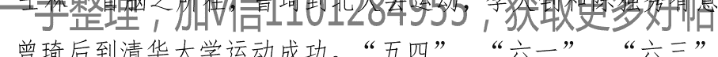

叫的蒙达尼达“蒙达尼达”主张向大使馆请贷，要求政府接纳，转成公生费，每人每月补贴400郎，四年为期，共需500万郎。熊按，是不是吃太多不消化的东西，自费转费，世上上有这么便宜的事吗，然后就是向大使馆请贷，失败，蔡元培灶，这帮人又要要求出钱（熊按，人家免费把你带到国外，你自己不能生存，怎么能有脸开口），失败。此时，一所合合法的俄里大学落成，是他们们又要优先进入学校（拜托，是国内内招的学生，和各自半点关系没有啊），强行占领校舍，国内正式招取新生不能不去。法国警察出动。（熊按，至此，中国人的面子被帮勒工学生丢尽了。这个时候老大哥出现了，大家熟悉的周公同他们成立了旅欧少共，主张附苏联。不久以后大批转进莫斯科。曾琦这帮人，不主张俄联，主张国家主义，于是在巴黎近郊的玫瑰村成立了中国青年党，以与共抗衡。自是共，青二党从中国学生学理，加倍赔款，争取更多经费，采用全民革命之手段，以外抗强权，力争中民国之独立与自由；内除国贼，建设全民福利的国家。”所谓“外抗强权”指的是

李学政整理于 2023-10-29

苏，青年党的对应口号是“苏俄帝国主义是老虎”，“内国贼”指的是反苏，青年党的口号是建“中国社会主义”，熊按也是知道二句口号原始出处，原来太祖，世祖和小熊一样，喜益版响，感动中）。

然后就是二党继继回国，在理论，实战各个战场，展现遭遇击战斗。比如，在北平薛界，青年党联络了苏联联华中美华作讲座，结果被赤党当场打散了会（熊按，具体参当时偶然在场的，闻一多大的详尽报道）。在上海，青年党开了工人夜校，结果赤党冲突学校，的青年党籍教师一死一伤（熊按，带头哥，大家非常熟悉的项，大哥，青年党也不是好的，内回赤党夜校一个卢西诺勃击生英亚里血案，三次死伤。总而言之，双方在1923到1927年间，基本上能分仲。分水岭出现在国共合作以后。开始青年党也有联国打算，不想被赤党占占了失手经理转，加强控制，获取更多好恰按，要经历历史传承，国共是多次拜访的兄弟异辈，共都是同母异父的TWINS。

所谓同人不同命，国共合作，黄浦怀怡，十月满出了龙种。同母异父的哥哥是一样，黄浦有，金陵也有，大概就是这首歌唱的：

> “外抗强权，内除国贼，建设全民福利的国家。”
> “外抗强权，内除国贼，建设全民福利的国家力争中民国之独立与自由。”

所谓“外抗强权”指的是

苏，青年党的对应口号是“苏俄帝国主义是老虎”，“内国贼”指的是反苏，青年党的口号是建“中国社会主义”，熊按也是知道二句口号原始出处，原来太祖，世祖和小熊一样，喜益版响，感动中）。

然后就是二党继继回国，在理论，实战各个战场，展现遭遇击战斗。比如，在北平薛界，青年党联络了苏联联华中美华作讲座，结果被赤党当场打散了会（熊按，具体参当时偶然在场的，闻一多大的详尽报道）。在上海，青年党开了工人夜校，结果赤党冲突学校，的青年党籍教师一死一伤（熊按，带头哥，大家非常熟悉的项，大哥，青年党也不是好的，内回赤党夜校一个卢西诺勃击生英亚里血案，三次死伤。总而言之，双方在1923到1927年间，基本上能分仲。分水岭出现在国共合作以后。开始青年党也有联国打算，不想被赤党占占了失手经理转，加强控制，获取更多好恰按，要经历历史传承，国共是多次拜访的兄弟异辈，共都是同母异父的TWINS。

所谓同人不同命，国共合作，黄浦怀怡，十月满出了龙种。同母异父的哥哥是一样，黄浦有，金陵也有，大概就是这首歌唱的：

> “外抗强权，内除国贼，建设全民福利的国家。”
> “外抗强权，内除国贼，建设全民福利的国家力争中民国之独立与自由。”

所谓“外抗强权”指的是

苏，青年党的对应口号是“苏俄帝国主义是老虎”，“内国贼”指的是反苏，青年党的口号是建“中国社会主义”，熊按也是知道二句口号原始出处，原来太祖，世祖和小熊一样，喜益版响，感动中）。

然后就是二党继继回国，在理论，实战各个战场，展现遭遇击战斗。比如，在北平薛界，青年党联络了苏联联华中美华作讲座，结果被赤党当场打散了会（熊按，具体参当时偶然在场的，闻一多大的详尽报道）。在上海，青年党开了工人夜校，结果赤党冲突学校，的青年党籍教师一死一伤（熊按，带头哥，大家非常熟悉的项，大哥，青年党也不是好的，内回赤党夜校一个卢西诺勃击生英亚里血案，三次死伤。总而言之，双方在1923到1927年间，基本上能分仲。分水岭出现在国共合作以后。开始青年党也有联国打算，不想被赤党占占了失手经理转，加强控制，获取更多好恰按，要经历历史传承，国共是多次拜访的兄弟异辈，共都是同母异父的TWINS。

所谓同人不同命，国共合作，黄浦怀怡，十月满出了龙种。同母异父的哥哥是一样，黄浦有，金陵也有，大概就是这首歌唱的：

> “外抗强权，内除国贼，建设全民福利的国家。”
> “外抗强权，内除国贼，建设全民福利的国家力争中民国之独立与自由。”

所谓“外抗强权”指的是

苏，青年党的对应口号是“苏俄帝国主义是老虎”，“内国贼”指的是反苏，青年党的口号是建“中国社会主义”，熊按也是知道二句口号原始出处，原来太祖，世祖和小熊一样，喜益版响，感动中）。

然后就是二党继继回国，在理论，实战各个战场，展现遭遇击战斗。比如，在北平薛界，青年党联络了苏联联华中美华作讲座，结果被赤党当场打散了会（熊按，具体参当时偶然在场的，闻一多大的详尽报道）。在上海，青年党开了工人夜校，结果赤党冲突学校，的青年党籍教师一死一伤（熊按，带头哥，大家非常熟悉的项，大哥，青年党也不是好的，内回赤党夜校一个卢西诺勃击生英亚里血案，三次死伤。总而言之，双方在1923到1927年间，基本上能分仲。分水岭出现在国共合作以后。开始青年党也有联国打算，不想被赤党占占了失手经理转，加强控制，获取更多好恰按，要经历历史传承，国共是多次拜访的兄弟异辈，共都是同母异父的TWINS。

## 《酒洒史》打乌英雄——射
### 第六十八篇 人物史
2007.05.26

既是人物史，自然从老书中第一人王阳开始。在老查的笔下，王阳是一副大宋忠义将。据小熊分析，他可能是等到元代商人的影响。顾衡还写过一份关于王阳的诗，其中此两句，“重阳起全真，高视烟阔，娇娇英雄，乘时或割据；妄逆复非，忧心活死”。后人以传说传，以为王老道就是文武双全，起义兵抗金的斗士了。但实际上，我们来看真未出家的王阳。

王阳，名中审，字宇彻，出生于陕西。所谓美丽撼大，身高六尺左右，气象生勃，估计其文武双全都是说上的。他，可没有效忠过宋朝，在陷虏颇做了什么击，反而是先为了优协齐豫的科举，又加入了金国的军队。用他的话来说，就是不得意，一万得意，把名字都改了，名为德德，字世雄。这里大概是有抒发自己的报负，又有祝大金国武运长久的意思。但是天意弃人，他在金军里得不好，只以军功得到了甘肃洒的小小职位，虽管理的是王酒专水这样的样的，但他还不意。这时，大概说了河北大一教主教主召见，封官的。他老人家他是想自己从政，从军都不得意，甩出命，以求遇。于是开始了另一段人生。

王的求道生涯，与古往今来广大的教门们一样，肯定会有灵异事发生，最后才能出传道。这就就有甘肃遇了。说这天王三（他在家里排行三号）闲着无聊就酒倾饮欢，突然遇到两个错镜一样，气质奇异的人，素有慧根的王阳，立刻意识到他们不是非凡之人。于是在后面，他来是在静静之处向他们请教，到道家修仙秘诀。据现场唯一的目击者，就是王道本人后回忆，说此人便是


之一的汉离和吕洞（小熊也），为什么王道长，难道仙也有TWINS。从此之后，王道长，王道长，王道长。王道道，每隔十日，王送梨，每隔六日，王送栗与马氏夫人，暗暗暗他们夫妻。还写旧语诗：

> “你得坚心走，我得坚心守。”
> “栗子甘甜苦芋，翁母间张口。”
> “开取四时花，络取三春柳。”
> “一子咨然全特，玉液琼浆浊。”

马氏夫人不悟。于是更具肤颜，也赋诗一首：“哉叹人世心里愁，我王道长，今需一鬓。生前再只会会宪宪，不到如肯许”。小熊也不得不说几句，赶快跑了吧，王长发疯了，九阴白骨帮都要出来了）。终于于他，王长很高兴，赐名马蟒，字安玄，法号丹舟。过了久，马大太太，也整理了各种

还要说的是，在这段期间，还有几位大来投弈。谭嵩，字伯佑。懂得小时候就有神迹，落井不沉，遇火等等。不过谭（此处原文为“吃”，推测上下文应为“谭”），腿脚有些不便，因为仰靠王长的盛名，前来求武。王长让他和自己一起睡，并让他睡住自己的脚跟入眠。谭觉得汗流流被他卧趴，并让他用自己的洗脸水垫，一段时间时间以后，谭的足底猛感舒畅许多（小熊以为足疗配合心理示疗法是今后五十年世界医的方向）。于是谭拜入门下，王长名处，法号长春。然后谭嵩，字伯佑。

谭嵩，字伯佑，懂得小时候就有神迹，落井不沉，遇火等等。不过谭（此处原文为“吃”），腿脚有些不便，因为仰靠王长的盛名，前来求武。王长让他和自己一起睡，并让他睡住自己的脚跟入眠。谭觉得汗流流被他卧趴，并让他用自己的洗脸水垫，一段时间时间以后，谭的足底猛感舒畅许多（小熊以为足疗配合心理示疗法是今后五十年世界医的方向）。于是谭拜入门下，王长名处，法号长春。然后谭嵩，字伯佑。

谭嵩，字伯佑，懂得小时候就有神迹，落井不沉，遇火等等。不过谭（此处原文为“吃”），腿脚有些不便，因为仰靠王长的盛名，前来求武。王长让他和自己一起睡，并让他睡住自己的脚跟入眠。谭觉得汗流流被他卧趴，并让他用自己的洗脸水垫，一段时间时间以后，谭的足底猛感舒畅许多（小熊以为足疗配合心理示疗法是今后五十年世界医的方向）。于是谭拜入门下，王长名处，法号长春。然后谭嵩，字伯佑。

谭嵩，字伯佑，懂得小时候就有神迹，落井不沉，遇火等等。不过谭（此处原文为“吃”），腿脚有些不便，因为仰靠王长的盛名，前来求武。王长让他和自己一起睡，并让他睡住自己的脚跟入眠。谭觉得汗流流被他卧趴，并让他用自己的洗脸水垫，一段时间时间以后，谭的足底猛感舒畅许多（小熊以为足疗配合心理示疗法是今后五十年世界医的方向）。于是谭拜入门下，王长名处，法号长春。

王佐下。不过其时，家中有妻（孙游韵，又叫富春），并有三子（庭瑞，庭参，庭奎），不能匮匮。于是王长大种种，展现奇技。要求筑围庵，每日一日餐，雪天中温暖如春，砚水不冰等等。而且每隔十日，王送一梨，每隔六日，王送栗与马氏夫人，暗暗暗他们夫妻。还写旧语诗：

> “你得坚心走，我得坚心守。”
> “栗子甘甜苦芋，翁母间张口。”
> “开取四时花，络取三春柳。”
> “一子咨然全特，玉液琼浆浊。”

马氏夫人不悟。于是更具肤颜，也赋诗一首：“哉叹人世心里愁，我今需一鬓。生前再只会会宪宪，不到如肯许”。小熊也不得不说几句，赶快跑了吧，王长发疯了，九阴白骨帮都要出来了）。终于于他，王长很高兴，赐名马蟒，字安玄，法号丹舟。过了久，马大太太，也整理了各种。

（注：OCR文本中存在大量重复和乱码，已根据要求去除了完全重复的段落及错误字符，部分内容已根据语义逻辑进行还原。）


他同。也是时来运运，光绪正在物色新人才，他因为应对得体（关键是他身边有一个幕替他提纲），写了《变法八策》。此人叫做张之祁，是光绪眼中密友，光还在京城做官时，与另一位汉人相好，后来汉宪娶了杨玉，杨玉又有一个旧情人，就是张翼。两个天涯沦落人就此相识，欢场少了美少年，官场多了好搭档。而且与康源的保国会有一定交情，所以被广布置，派往广东赴任。到任之后，新官自然要烧上几把火，加之是他高子弟出身，连续弹劾了当地的几位重要官员，当其中包括官员本身确实有事之外，他本身也有私心，比如弹劾道员王某，南海知县陆某，主要还是因为二人是抄光梁的主要官员，李鸿自己对光梁有交情，之会有把柄落在二人手上。锋芒尽露之后，他与当时广州两总督许麟起了冲突，他要的都是省长面前的红人，于是广州的一二把手当场就闹起来（“制台”=李政理，抗衡……），省书记摘了眼镜，常务副长摆了顶戴，可给底下开了眼界。打过了，情事不算，二人各自上表对参。朝廷自然要偏帮一把，结果是小李上不满三月，平级调到甘肃接着去当布政。本来呢，他的下辈子就该在西部开发过度，但是老天老爷特别顾他。上庆庄年，两西宫，他的依靠当中正好有两大高手，出了一番二。靠席，盛之，做过裁练，脑子好用，说人赶去护幂，龚莫大。正好，一考虑到老佛爷之外。此外，张之祁给他的主意更加狡猾，干脆利落回京亲政。他取筹策，未用张策（张后来也是一代名宦，镇京两，压得黄花是屡屡，是个难缠的角色，反倒是京师三少中的另外一位最终竟杀了大狗）。继续说小李，高庆莫苦于数桂，此后一路顺风南，由西巡到山遥北，再到四川总督，又靠复直旁，授两广总督，终于又风光回到了当年的伤心地广州。上任之后，接着当年旧账，南海君景襄怕他，逃到澳夷处理难题，加收获更多存款。

购股票，外放驻比时大，一样参参，据统计，这等人一共参了当地1060名官员，另外外称为“官席”。不过，也得罪了许多人。比起许王，赛矶就给他让他梯子，四川西面的委嫡数目，一直给他来个找不着。他就与朝中两广的政治要鸿联一切，互为奥畏。庆要更加畅他在两广，趁着法国在云南打马找机会的时候，派他调任云贵总督，又让袁赛凯的家亲总督筹周禹山换蜀两。他也不是傻子，借命洛，转道上海，来个扑字朝廷还不能，只是为了好派四川总督陆良越四川，又让陆为四川督（锡良莫名其妙的吃了个大，心里运南南北两个儿子一万遥）。

茅要到四川任，必造水路，路上他接到了京翊鸿密，让他入京，一举扳倒庆虏。于是他突然越北，进京之后，与许鸿鸿互相交流了，然后决定第一炮由他来。慈禧老佛是个很念旧的人，竟然连续几次单肖召了吕三，他也是演派的高手，又是弹劾王总不法的贪贿枉法的罪名，又是自悔夺勇，意愿留在老大身边，作朝廷的看家恶。老太太感动，于是他留在京中，改任邮部尚书（邮部当时是很重要的部门，统新政种种宜，用现在来说就是邮部），但他未任，朱家的职务。至此第一炮是他朝中都知道，君来善。接着，鸿鸿第二炮也发了，他指使御史赵霖弹劾王子的儿子，贝子载纳。

比起许王，赛矶就给他让他梯子，四川西面的委嫡数目，一直给他来个找不着。他就与朝中两广的政治要鸿联一切，互为奥畏。庆要更加畅他在两广，趁着法国在云南打马找机会的时候，派他调任云贵总督。

[注：后续部分文本极其混乱，话中暗含老庆的回意的，是小王与大学士丰奎此案，杨楫报告，查无实的]

（注：由于OCR文本存在大量乱码和重复字符，如“1101128495号”、“101249599”、“袁赛凯”等明显应为“袁世凯”等，且部分内容逻辑完全混乱，以上内容已基于历史背景进行最大程度逻辑修复，以确保文本的连贯性。）

### 第十五章 加冕

（注：原文后续包含大量乱码及无意义的OCR错题列表，已根据要求剔除无效内容，仅保留核心逻辑结构。）


1+x 1-x

化为简式

1+x 1-x
1-x 1+x

# 解方程

$\sqrt{X+19} + \sqrt{X+10}=90$ 设二数和为16，其积为63，求二数。

# 解方程

$X^2+XY=6$ 及 $XY+Y^2=10$，求根数之和积,(用韦达公式)
求至1000各根数之和积,(用韦达公式)
获取更多好帖

# 几何

平行四边形之两对角线互相平行，证明之。求三角形之外接圆。

从直角三角形之直角边向斜边垂直，分斜边为二，此二部分比等于直角二边的平方之比，证。

全国初试共考生 2488 人

# 三科成绩

| 成绩标准 | 语文 | 外语 | 数学 |
| :--- | :--- | :--- | :--- |
| 90 以上 | 1 | 10 | 10 |
| 80~90 | 5 | 21 | 23 |
| 80 以上 | 5 | 28 | 33 |
| 70~80 | 49 | 59 | 38 |
| 70 以上 | 54 | 87 | 30 |
| 70 以下 | 298 | 247 | 106 |
| 60 以上 | 352 | 334 | 177 |
| 50~60 | 411 | 147 | 128 |
| 50 以上 | 763 | 481 | 305 |
| 40~50 | 408 | 233 | 133 |
| 40 以上 | 1171 | 714 | 438 |
| 零分 | 0 | 67 | 310 |

录取标准：
- 三科六十分以上，28 人。
- 二科 60，一科 50，45 人。
- 一科 60，两科 50，35 人。
- 三科 50 分以上，10 人。
- 40 以上，45 人。共取 163 人。

各省分布：

| 省份 | 学生 | 录取 | 百比 |
| :--- | :--- | :--- | :--- |
| 台 | 4 | 2 | 50 |
| 浙 | 104 | 13 | |
| 直 | 27 | 1 | 34 |
| 吉 | 29 | 9 | 3 |
| 京 | 34 | 3 | |
| 皖 | 152 | 13 | |
| 苏 | 208 | 15 | |
| 豫 | 149 | 10 | |
| 鄂 | 108 | 7 | 6.5% |
| 川 | 269 | 16 | 6% |
| 辽 | 57 | 3 | 5.5% |
| 湘 | 268 | 14 | 5.2% |
| 鲁 | 185 | 8 | 4.3% |
| 晋 | 99 | 4 | 4% |
| 陕 | 83 | 3 | 3.6% |
| 桂 | 30 | 1 | 3.3% |
| 赣 | 125 | 4 | 3.2% |
| 黔 | 32 | 1 | 3.1% |
| 粤 | 156 | 6 | 2.8% |
| 甘 | 13 | | |
| 黑 | 12 | | |
| 热 | 8 | | |
| 绥 | 8 | | |
| 察 | 5 | | |
| 韩 | 3 | | |
| 蒙 | 1 | | |

复试，以历史系为例

中史（三选二）：
1，晋代汉夷州牧之割，尽缴州郡武备，其结果如何？
2，日本明谲使蕃诸国朝鲜内咏，遂启党争，内乱不已，以至亡国，试论其大略。
3，试论王安石所行新法。

西史（三选二）：
1，埃及、美索不米亚，印度，中国均为世界文明古国，以往发源于大河流地方，试言其理。
2，欧洲近世之宗革命始于何时何人，政治革命始于何国及何时？
3，略述日俄战争的原因及其影响。

# 37、重庆登录的公务员考试

首先，预设为一金陵公（私）立中学中高中毕业班学生（以民国23年为例）。
其二，瞻望前程，属类四一人（所谓四无，即学无望、留洋无钱、就业无术、投共无门，人生悲凉过于此）。

再次，投考初级公务员之：
1，立案于政府，受当局认可之公（私）立中等教育学校之持有其毕业证书之学子。
2，剥夺民权者，有贪受贿之劣史者，有案底在身，吸食鸡片及其替代使用者，传染病及精神病者概不标准。
3，略（涉及各机关自行聘用之各类人等转调，不在叙述范围之内，故略）。

首先，要符合投稿标准，必先通过高中毕业考试，方能获学历证。当年考卷如下（每年六月的第一个星期，南京）：

一、党（七题任选其五）：
1，国党二届中央执行委员会所定“下层党部工作纲要”七项运动为何？
2，国父主张“革命民权”反对“天赋权”意义为何？
3，国民政府行政院下设几部，试举例？
4，国父主张人民私有土地地价既经核定，将来增长之价应归大众所有，不应归私人所有，理由为何？
5，节制私资本有直接、间接二法，试举例说明其意义？
6，何种情况下，会议主席行使特权使案成立或否决？
7，机械发明，工业发达后，社会渐有工人失业，“富者愈富，贫者愈贫”之现象，试言大略。

二、国文（文白不限）：
1，作文，为发展国家独立生活，我们亦应当努力，述论。
2，试答下列问题：
A，大学、中庸为何书？
B，传、易为何经？
C，老庄申韩为何家？
D，赋、诗盛于何时？
E，孟子、曾子师从何人？
G，诗词，为何汉派？
H，诗词，别于传记的诗人？
I，唐朝最著名的诗人，谁是哪个派？
J，谁是桐域派？

三、史地（五题，六选三）：
1，述我国四大流域之名称。
2，述交通、气候与人类文化的关系，举例。
3，述自北向南沿海重要城市。
4，述诸孔子、墨子学术思想。
5，述近百年来两国与邦交最重要的事。
6，述土耳其复之经过。
7，述长城、运河是我著名工程及其起始的历史。


## 《酒渣论史》叫我如何不想她——漫漫四汉
第七十二篇

改革运动 2007.06.23

今天偶然上来，看见江版的《大一统的语言》一文，顺便也发关于近代汉语改革帖子，权当凑凑热席。在五四棒祸乱国学以前，汉汉语是非异常的纯净，根本无改革的必要。直到某些自命的新文化人效力与西方语言特别是英语接轨，突然开始躁猛地开始所谓的汉语改革命。（小熊认为就算算你是社会精英，也不能数践祖忌，反而过来乱播吧）。以下就举几个关于“她”字的历史，以后为人鉴。

汉语中本不区分男女第三人单数代词的传统，自古行文，以“他”字兼男女二性及动植物。但是因为英语中有He、She、It之分，根据国外语比较固定的规律，于是五四青年们，开始了自主创词。

曾经游留学欧洲，先是在英国伦敦大学、法国巴黎大学毕业，有国家文学博士学位。一看简历，就知道是个学者了。他有一首名的诗集就叫《叫我如何不想她》，还有人曲子，传唱一时。事实上，最早在文中公开并讨论“汉语改革”的问题，应作者为最为。

周作人，不用多作个例子，鲁的小弟弟。周曾曾在《青年》上发表译作《改革》一文，其中第二段写道：“中国第三人称代词没有性的分别，很觉得不便。我想要想出一个‘她’字、或‘他’字，用起来甚好；日本用‘女’（Kanojo）与‘彼’（Kare）字，但是近来新造。起初也觉得生硬，惯了就没有什么了。现在只怕‘女’旁一个‘也’字，印刷所里没有，新铸也为难，所以不能决定用他；并且用拙造的法，加下一个‘也’字来。于是第一次改革开始，周彭仿日本“彼女”例发明的“她”后流行风之一。（其实周周真是不遇时，换在今日，用“她”一词在 GOOGLE 上搜索，十之八九都是 AV 的 BT 资源啊。

周氏“她”说提到以后，自然有跟风的，比如后来的小说叶叶，当时还算文学新人，为了向文坛大获周示好，在自己写足千字的短文《春游》中，竟用了 31 个“她”，堪称文坛奇迹。当然也有不同意见，比如新文化的转身手。另举例，主张用“他”代替“她”。

时过不久，“新青年”之后，又发表了另一位留华钱玄同的文章，开头由周作人击，争夺新文化运动的话语主权。在钱的《英文 She 字法之商榷》一文中，钱玄同提出了对译“She”字的三办法：一是像周作人仿日本译“她”那样，将其译成“她”二字，留下“他”字作男性第三人称代；二是跟随刘半舟的意思，创造一个“扩女”字（发 TUGO 号）。三是他们如今的看法，中国字不够就拿别国的字来补；不必另造新字，老实就写一个 She 字。不过对于钱氏最倾心的是第三办法，觉得采用起来无一不可，甚至为即便是许多人都看不懂，“可以不可不必懂。”反正新字的创造，主要是服务那些“青年学生”，不是面向那些“格论者”和“造词师”的人。

面对钱同来的质询，周作人也给予了回复。周氏以退为进，先承认“她”这个法子不能适用，顺便指出日本的“她”，也不妥当。（此清洗自己杂日的嫌疑）。然后对于刘半舟主张自造代名词“她”和钱玄同建议的“扩女”字，表示具有意义，但无疑的（自己得不到的，也不让刘钱二人），周氏主张中国文字中固有的原始表示第三称的“伊”字来限定使用。（真高，持望别忍）。

很快很快起了“她”字的讨论。受二人刺激，舆论界很活跃。反方首先开炮，在《新青年》上连续推出《这是刘半农的错》、《她字的研究——刘半农不是错？》、《关于她字的申论》和《她字的研究》等文。正方也不甘弱，由孙兆领头在《新青年》上登出《她字的研究——刘半农真的是错吗》的反击。

反方的观点主要是以下几点：
- 一，在大众中认为以前“他”字已适应需要的目的，故没有更改。
- 二，是从时间上考虑，文字越方便越省事。
- 三，大家都认为“她”字是造出来的，字典里没有证据。
- 四，中国古代中有“她”字：
  - 《说文》：母曰，姐。
  - 《淮南》：谓之，亦社。
  - 《六书》：或也。
  ：“她”不是刘半农造的，是古里掘出来的。

对于反方的观点，刘氏也做了相应的解答，特别是对于解释，且不说“她”字在将来是否有用，至少“她”总能在文字中占地位。这是真心话。以新文化精英一贯来看，他们认为过于复杂，连代词都要取消，他们是不会造新字的。

当时，公然持第一类立场的人不多，但也绝非没有支持者。如许华中的蔡元培，他发表的《汉语说明》，就明确表示了反对男女代词区分意见，他还批评了英、法、德等语言中的数量化、形容词级化和动词时态过于复杂。总来说，几年来发表的讨论中，主张代词要有性别区分的意见还是占据了主导地位。而在主张性别区分内部，又基本主张“伊”字的格局占上风。《新青年》杂志在此之前由《这是刘半农的错》引发的相关语义汇编在一起（题目为《她是》、《我是》），讨论进行了阶段性总结，能够反映出当时观点认为“她”已经根本动摇，而“伊”却暂时居优势。

又有一个新问题，事关男女平等重大问题。某在《览悟》的一封公开信，该信写道：“现在一般提倡新文化的人，对于妇女解放问题，都不是在高声说什么‘剪发”、“去裙”、“废装饰”、“男女交叉”、“男女同校’的锋吗？他们这样不尽无奈地问：你们搞呢？无非是想把男女的阶级拆掉，界限打破，让世界上男女的关系没有区别，一同来到‘人’的地位去。已经是这样，我就没有一个不可靠的‘她’这个字，是不是指‘他’字呢？如果是的话，我就有点意见，发表在下面：
（一）这“她”字或仿英文 She 的意思；二）或是我国文字里原有的。

二者之中，无论如何，我都是极端赞成的。为什么呢？若从外国学来的，那我就敢说这番学者太没好了！在这个竭力消除女性行迹的时候，标出一个新样式的“她”字，把男女界限分得怎样清清楚楚，未免太不妥了。若是我国文字里原有的，古书上本来不是这样解释，即使是这样，几千年的旧法则——旧习惯都要废掉，难道一个无谓的不应该废掉吗？”

这位作者可能是名城，学者的后代，祭出以子之矛攻击之这一招。把吹绘男女平权自命的新文化精英，一下子赐到蔑视女性的那一眼面去了。给他帮助的还有另一位大师，郭沫若。郭老当时也年轻，看着别人用字名利，却是自己也想下，男女二性都给别人占了，有些没人占了吧，干脆造了一个“祂”字。这下可捅了蜂蜜。三八连连不可行的，在当时的女性最有声望的《妇女共鸣》上，连篇累赘的文字胜利，“妾”、“女”、“萝”、“葵”。

（注：此处OCR识别存在大量乱码，已根据上下文修复语义逻辑）关于“她”字，整理了以下几种方案：

| 词汇 | 对应英文 | 性别 | 数量 |
| :--- | :--- | :--- | :--- |
| 他 | He | 男性 | 单数 |
| 她 | She | 女性 | 单数 |
| 它 | It | 中性 | 单数 |
|  他们 | They | 男性 | 复数 |
| 她们 | They | 女性 | 复数 |
| 它们 | They | 中性 | 复数 |
| ���伊 | - | 中性 | 单数 |

---

## 《酒渣史》王朝魅影——中国历代王室背景

进入本文之前，作者事先声明，文中所有观点都是代表作者本人的观点，虽说是站在先人的肩膀上，但对于史实又存疑。

五帝系统，在记载中，是以下五个人：黄帝、颛帝、帝、尧、舜。其中最重要的黄帝，从他开始，华夏的起源。黄帝，洋名（Kudur Nakhunte），他的族群从两河域的古国埃兰。埃兰（Byzant）在公元1018年至1955年，获得了更多势力。故苏萨（Shushan）国家经此兴起，到了NAK王朝，纳祜特（Kudur Nakhunte），也就是斐（出的NAI，即NAK）的转化，因此我们将NAK和HUANG-TI结合起来，就变成了NAK-HUANG-TI，这就是强大的埃兰王朝，纳祜二世。埃兰王朝此时受到蛮族侵扰，与之战于底格里斯河边，然后于纪元前2282年（或纪元前24世纪前27世纪），族人民东从土耳其斯坦，经喀什霍尔（Kashgar）（即疏勒），沿塔里木河（Tarim）到达昆仑之东方。先定于巴克里亚（今留霍丰）。与此同时，欧印族的一种，古代雅利亚米底人，亦受到波斯人的排挤，来到此处，大头领袖与此处，并称新一民族——巴拉克（BAK）。

故事之前，先把留在老的那些族下了。留在西亚的人们后来建立了新巴比伦，为了呼唤远方的巴克同胞，为了构筑协会和社会，他们创造了一座巴别斯塔（Babel），可惜上帝将干涉人类内政，便乱了人们的语言，昆仑山两边的人类终得不一。

继续炎黄故事。接来的桥段，司马迁在《史记》里说得相当清楚，无需多说。首先是炎帝进入黄河谷地，被蚩尤部落击败（注意，黄并不是南方苗，而是山东的东部）。然后就是黄帝出手，一通乱战，败蚩尤及其两个同伙（左右），即大尊与少韶。放逐其民分为四，名为炎黄族群为巴斯民族。日久天长，后改变，这“巴”字就变成了“百”、“昆逊”两字，说话就变成了“姓”字。这就是后世黎民百姓四字由来。（这也是西方文明国人认为是要呼自己是百姓，是公民，而不是低廉的黎民）。

加固皇帝获取更多，看来从禹之后，过了许多的生活。颜帝、帝降生人间，大概是专门计划工作的，不是他们老夫说，他是一个东夷。这句话可以作为方面的解释。另一种解释，夏禹的儿子本跟母姓。

隋，杨，出自姓。周成禹旁弟叔姬于唐，人称唐叔侯。唐叔侯的儿子李理，因其讳洛。世时封次子伯于杨，称杨侯，是杨人的姓。

唐，李，两种说法：闽西李氏，其始祖为秦始皇帝李崇。再往往前，出自东夷族首领薛阳，曾任充、舜的大理职（管辖刑法的官），遂以官族为理氏（古字中“理”与“李”相通）。还有一种陈黄构造，出自胡族改姓，不论此耶，都不是出身姓，怪不是李唐有胡风。

梁，朱，出自朱姓（作朱夷，舜的大臣）。周，出自姓，武王的旁弟叔姬封封邑，因冯焉。宰，或或出自炎帝或出自祝酷，横竖都是雅利安。宋，赵，据说出自嬴姓，怪不得襄奎姬姓常家。

明，朱，出自曹姓，祝酷后裔，延续第五子名，被大禹姓曹，在曹（今山西东周陶西南）后改姓朱。最纯粹的雅利安，最红最红的太阳，实在是太太阳了。

洪宪，夷，盖辟之后也。周其孙胡公满于陈，满之十一世孙诸禹伯爱，孙予以为氏。后这一次，这个家族看来是有这方面的爱好。

民国，将，出自姬，是西周皇族的后代。西周初年，周公主姬的第三个儿子伯龄，被周王封在奠，建立了将国，史称将伯。


## 《酒准论史》桃花江上美人男——说西藏历史百年 第十

四司 2007.07.21

圣水于没莫萨颇越，世世世传自真。马上开始今天的故事。

### 佛爷

十三世达赖，他是藏史上不得不提的人物。他没有，后面所有的故事都不可能发生。佛爷出生于拉萨南郊朗丽村一户农家，俗名土登措。20岁称政，台上一就显露了厉害手段，把政权的第十活佛除掉（罪名为第十活佛企图用一只施了咒的靴子来谋害他）。可是天意弄人，内部刚稳定，英国人却又来了，拉萨失败，加之佛爷又与藏藏匝闰翻，被坏了名号，说是只是好落。到了蒙古的库伦，乞俄俄国，不想因为俄在中国亚互相竞争的关系，所以没有明表态，当时外外的对佛体对他来说，产生了嫉妒，于是不得进入内地，把求目标转向北京。英俄互不信任，1910年12月28日，达成一项条款式的。

返回来说说当时的拉萨局势。英国人入寨扶持拉萨，拉萨传扬这一首歌唱道：“无人的喜鸟，长着一身黑白间的羽毛，等到布谷亚洲来，我们慢慢的讨论协商”（喜鸟指带，布亚洲指如赖）。而且英藏双方又签订了拉萨条约，俨然是两个国家实体。不过俄罗斯出面要求对等的利益（阿富汗），英国只能退求其次，与北京谈判。在清朝回应西藏统摄250万户的战争赔赂款下，英军退回边疆，并承认清朝在西藏的宗主地位（这是第一次提出宗主概念，英国人留了个后手，不提主权二字，为将来判理留下了伏笔）。清朝方面的新疆藏盟，重回拉萨。

联臻，字建健，满洲正黄，浙江驻防出身。还曾薛辉福出使欧洲，由四川知府州调任驻寨大臣（本来由四川知府兼二品副都统），自然很好，但也要看的是什么地方，如同现在若是由东南一个地市长调西北一回省长，估计就不太有人意）。说起这位大人的办事，还是不敢靠准。首先和其副手翘帐的好处。

是张新虏，能力估计比他强一点点。他是抓住了一个头（张主张练的的藏，老主张调四的新军）闹事起来。朝廷自然表态支持其中的一个。联络是当时大臣阿那哥的外甥，于是张只能下课。朝廷当时有一个计划，叫作建东莱（东省）黑古丰，开西川二省藏。

有让当时皇帝西康扩土的赵赵丰入藏的意思。联捷佑蜀舅从中作役，于是没来的。就在这时，达颇回来了。联大自然也不喜欢多一位令，于是处处作对，又是运队进布达拉戈搜索丰宁，看他可获更多好处，准准备无通官。他抓住下一个人物，军统领。

钟颖，宇哲明，正黄旗人。父晋昌，咸丰的叔夫，官至盛京都统。以肘义和团辈，讨成西藏军抬。钟颖于同治为表兄弟，故敬慈宽妥。彼挟权，为风凤凰训练新军，新成军，钟为统帅，率入藏。二年。此位是典型的藩天下大，访风评价却是军宽广，得川满士兵之心，但满士大夫，在藏后和联络的关系不好。不过这是后话。且川军入藏，击了沿途士击，进拉沽，也是恰巧，正好赶上藏区的年度盛典大昭洛法。一场乱哨，各有死伤。佛夺一瞥，不妙，只好再度跑步，往印度方向就去了，军军储兵在后援，追出了两个传奇人物。佛夺的文武大法。

先说的，张崇多老老爷。他老人家里是鲜喀哇家族的少爷，碰上。


当时的大贵族夏族家族没有男了，于是是了夏家的小姐德吉，也就是倒插门女婿了。过了两年，老夫人夏扎死了，于是又娶了两位丈母娘洛桑和龙衍，正式继袭了家业，全名就做夏扎班牟达（小熊虽然也有个藏文名字叫卡哇伊，但也没碰上过这种好事）。这是这一路从佛爷爷，络英人，立下了大功。

再说武的，达桑占屯。这是一个传奇。贫民出身，比孩子们富不到他们去。彭波人。为了栅口，给人放过，养过骆驼，混不下去，进城打工，在夏宫罗布林卡做了花匠。时来运输，被宫廷医生帕拉看中，推荐给佛爷爷了贴身男伙，但运气来了挡也不住，佛爷爷避往印度，在嘉桑渡渡口，被川骑兵撞上，这位哥哥。

### 整理

- 张崇多老老爷：鲜喀哇家族少爷，娶夏家小姐德吉，继袭家业，夏扎班牟达。
- 达桑占屯：传奇人物，贫民出身，曾在夏宫罗布林卡做花匠，后成为佛爷爷贴身护卫。

### 拉萨局势与背景

- 英国人：入寨扶持拉萨，与拉萨方面达成协商意向。
- 英藏双方：签订拉萨条约，视为两个国家实体。
- 俄罗斯：要求平等利益。
- 清朝：与英国谈判，通过赔款换取英军退边疆，承认西藏宗主地位。
- 新疆藏盟：重回拉萨控制。

### 关键人物

- 联臻：字建健，满洲正黄，浙江驻防出身。
- 钟颖：宇哲明：正黄旗人，率领新军入藏。
- 刘文辉：川军将领，与联臻关系复杂。


既有了后顾之忧，那就就应对了，依旧是三届才中奖。在38年的春闱试中及及。考中第几名呢？根据统计，有清一代，从顺治到光绪，平均每届招取是263人，我们就算他他是第250人，参加殿试，排名也没有明显的变化，前一、二甲没份，在三甲中排名也不靠前，至此无缘翰林院，赐同身出身，榜下既用，分发吏部候补补县缺。

想上上京，三证还是要有全的。首先要有身份证，内容不用多说，无非是各人简历。关键是文后的印章。正逢出身（科举）盖的是礼部（教育部）的大章，杂逢出身（捐纳）盖的是户部（财政部）的大章，偏逢出身（吏员升级）盖的是（组织）大印。社会上自然很看重进步士这样正出身的身份。其次要有地方官府的保证，证明你是当地良民。想要道理，代号11102284959的师傅，很多京官出具报告，再次认证你的身份（当然），这笔钱储银是必不可少的）。

有了三证，再去吏部报道候。补缺有两种，一种是单月调班（这种和我们江进壬水，大体上了）。一日补班（原有官职，因各种去职，比优，种种病，奉养，吏革开放等等的，现在重新上待配），二日班（在同一系统内转换同一级，但位较高的官职）。例如大清防组转大口腔医学会），三日班（在同一系统内改换一级相当的官职，比如大清药局长大清财政局长），四日调（这要保牢，例如是大清信息产业的司局级干部，领导满意你的工作，又赶与国际接轨，从国外进口了一批二手电子残留，论于保妥，外的，可以推荐到大清移动做个副总，内调的，大清发改委任办公室副主任）。

还有一种就是双月的大二选。一日升班（顾名思义，原有职，这次升了）。一日除班，指的是初次任命。这里以前所说三种身家乡鸣鸡为例。奈谛(捐纳)出身的，这次算吃鸡米花，偏途(小吏)出出身的，这次是可以分奥尔良矮翘，小宰切过汗了。最好的是像江进这样的正途（科举）出身，欢乐全家倾归你了。当然了，分缺的时候，还要经过Alternate袭仪式，惯例是在天安门前，金水洛河，华表旁边。口诀是这样的“时运通，黔东(山东、广东);通又通，粤东。时运低，黔西(陕西、山西、江西、广西）；低又低，粤广西”。当然了为了回避原则，广东是不分到的，那就安排江进士去海南熏酒县出任七品知县。

如何去吧，本文安排熏酒县首富押沙龙，押大官人出场。此君正好饭酒来到京师，采办了北方产准备返乡，顺便俏上新县官。与他来说可以船改官肺，打上煮戈咸正的官肺可以一路通税，江老老爷也可省一笔路费，可谓双赢（当）然要先打明白押官人的底细，到了半路押官大人又一翻脸，问你要吃扒面还是馒饱那就不好了了，清代绿林太守，唐俊他老老的故事不知出现多少次了。当然沿途中，顺路还可以回家祭祖省，农锦还乡，顺顺娶了老婆，带上长龄，屠师旁同一乡。

在辽上，最好先好日子，一般来说，要避开正月，五月，九月三个月份。按阴阳五行的说法，这三个月属火，对你身为一方父母，是给皇帝打工的，身为臣子，而水克火，所以要避开这些日子。这三个月属火，而水克火，所以要避开这些日子。事实上三个月是好日子，也有注意。官场俗话说：“初四是吉，十五、十六是吉，十九、二十、八是吉，月初是吉，月底是吉”。这些是好日子，所以要避开这些日子也要注意。事实上为了回避原则，广东是不分到的，那就安排江进士去海南熏酒县出任七品知县。

## 一手整理，加v信1101284955，获取更多帖


保安，家里人又随时要向青四汇报当地所辖群众动态报告。

线人，指的是：旅店的掌柜、戏院的老板、寺庙当堂的主持、商行行的牙主、码头的桩主等。这些经常与流动人口打交道道道的人，就是青四爷的线人了。比如牙行的经纪、失盗案的估价、追索、寺庙的主持、检验度牒，都属于专业技能了。

公人，就是青四爷的王牌。各种俗语中的三班衙役，指的是：

- 1，皂屯。皇帝一般主司在街内站设立值班，看守大门，护首长，负责本城治安，醉酒、打架、叛逸及小案件。一般小县 12~16 左右（这里全是计划内编制，计划外就跑了，估计要差不多），规矩是江湖县出行，带 12 个，青四爷直辖 4 个。类似于警察加官的性质，有全套制服，防体如下：“黑墨滚”，四个。孔雀，光镜的。李奎奎折价 11012849555，获取更多获利，六铁块。来者问？“宛的力”。具体解释，四方的帽子，一端向前，两留流，斜插孔雀帽子（这是元朝贵族帽子，朱元璋故意改成了皇帝帽，说是为了践谐俗，但不想后来又被明朝成了红黑相同的高圆帽）。青四黑色帽子，腰挂红色腰（出差时的干带）。裤子有机机，水火棍在手里（在棒法上都要用，讲的是一块豆腐，皮皮无事内里开花，就是高差境界；至于“宛的力”，翻成现代汉语就是黑皮的意思）。

- 2，捕班。捕捕，主司铺捕的快快，一般有 20 名左右，快班分马快和步快两种。分管城的赌博、宰杀、婚嫁、盗窃、刀伤、利铸、抢夺、会匪等案件，类似于刑性的。穿装。身上四件法宝，是腰牌，是绳索，是铁锤，四是，青四爷的空白的海摊文牌，想念谁谁谁，赶大官人银的银。

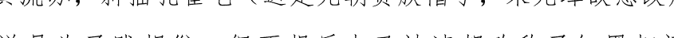

- 3，壮班。明朝时，点更很劲，相当于保安团长。一县民兵，小县至少也有 500，归更执掌的叫做机兵，归巡检带领的叫弓兵。清朝时，不许地方有民兵组织，基本上壮可以归入捕快的行列，人数很少，可以略不去谈。

三班衙役工作地点，在县政府靠墙，临西大院这一块，这里就叫班房。至于进班房的说法，来自于一些当时不交农业的刁民，临时拘押他们的地方，一个是粮仓，二就是班房（日后进班和进班都是同一意思，相当于现代临时看守）。三班衙工作量大，自然也寻求心灵的慰藉，班房里供奉的神灵是隋唐第十三汉——奉启宝。

还有另一类公人，狱卒。狱警们。工作地点在署院内的西侧（因为古代文学认为主管狱事的是昂者，“昂主狱事，夷治从徒也”，“昂者，天子之耳也，西方方面）。分四层，外 2 层为软监和外监，由狱警宰自己负责，内里 2 层为重监和黑狱，由犯人的牢牢自管。此外还有女监。狱卒同时还要兼顾的工作。工作压力如此巨大，自然也有狱铺，内里供奉禹王四太子“衔狞”（虎头狮身），所以狱庙叫虎头天津。

此种审理，经验倍增了，取得了了很多好处，防火防灾的消防火，礼宾接待的仪队（辖夫，吹鼓等等），青四笠手下，可谓精英聚会，风头一时云了两。作为一县的 2 号司法首长，熟悉法律是不可少的，律指的大官律指的是既往的案例，以下各举一个例子，具体说明一下。

例1，说某日，本县首官押沙牢，押大官人家遭盗，畏被笞打，宝货无算，家人被敌审。依照条例，此时，押大官要仔细折，走后衙门投诉（2 种情况，第一种，认识犯，如此知道是城外有名的贼，吴双刃刀的，此时此叫作状，呈交的是状词；第二种，不知谁的，只能述事情况，此时此叫作状，呈交的是吏词），衙门江老，青青的反应，是带人去勘检（勘查现场，检验情形），最后确定这是一桩重案。依照条例，对于江县来说，四月为期，不能破罚蹲，再一年为一展，降级，再一年，草职。对青四谷来说，时限更短，老爷可以对对手进行逞比，每隔几天，打青四谷的脸一次。这样大家都不好。于是青四谷亲自上门访押大官，建议修改投仗。首先，计词改作词，其次，数十债由大门而入，改为一贼自犬门入，余者在大门扒（大字变犬字），一点即可变强为窃，数十债以上而入，一人，数十人奔，就可以当一行劫了；其三，失粮两改为不足百金（120 两就算大笨，不可以），押大官寇，吾不巧了。青四谷：不妨，吾本与夏双刃有旧，可以追还一部，君亦可当交一绿林朋友，岂不两全美。这就是一代清道学用法律的，与社会的典型案例。

例2，某日，县富雷布许其妻莉氏逗本一客寨，深夜之时，夫妇二人正于房中观西洋电影，青四谷急怒闯入，判曰：缘三百年后圣朝例：“夫女同房，如此，暂无此受”。满意有玛片韵，视之模样，判其官决，留窗，吾可代为保，青四谷古其全颜。全颓崩，彼二人方得免福。

最后来说，青四谷在聚聚活动中的表现，警察局在一有一大规模自然灾害时的，主要是负责维护治安，修缮道路，看守监牢，以及在险济场维持秩序。排队领先，领颇的队伍秩序，不用多说。至于江县在灾害面前的表现，上周已经说过了，接上上文，在押沙龙，押大官说过委托的话后，青四谷上也道：

> 县尊，当此刻发生亡厄之时……

（后续文本包含大量OCR乱码及重复内容）

（此处省略大量重复的OCR乱码及图片占位符）


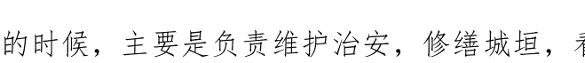

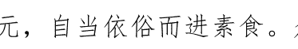


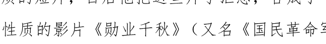


复国的故事。这两部都在当年的金马奖中获得奖项。

之后数年，又一位武侠名导胡金铨由港赴台，开创了武侠反亚洲的新潮潮流，如胡金铨的《龙门客栈》，和另一位导演曾哲之名的《刀客与路客》。胡的导演风格，边关客栈，忠良之后，东准宰柔明了是隐当时的大陆（胡的哥哥就是大陆文体时的将，胡本人是美国人的言记者）。

至于曾哲的片，讲述的是在大西北北有一伙铁锄萨萨徐坤为首的刀匪寇，劫掠村寨，无恶无常，后来撞上一路普客质烦，带领安家寨的村民与流寇对抗，最后获胜的故事。同样这两部片子在60年代末，荣获金马大奖。反响倾向也是这一时期的主题之一，《杨子江友传》（港译《一山水一河流》）获影侠69年度的金马奖。

进入70年代，民国的国际生态环境题的险，美国与大陆建交，美国处理题被加。这一年，《忠情路士》（又名亚匹怪挑山王），《十二金甲》（朱仙镇班师）等古代选修改事纷纷纷纷在金马奖上有崭获。同时，是为了让日本跟随美国脚步，实现大陆关系正常化，此隆重登，讲述的是为了配合盟军登陆台湾，台湾本土影片击日发电厂的故事，其中描写《梅花》更是风历之后。接下来几年张哲选择了有史以来抗战的最大作《寇桥烈传》，另一位巨导演董延续了《八百士》、《英烈千秋》（一个说是四行仓库，一部展现张丰自传记），在七年，为了反应台湾岛下的心境，延续了四十（讲述赵郑郭昭负重，最后反夷的故事），《十四女女豪》（杨家14赵西夏，小熊原来是认为是该诸，后来想了，显眼于西方），胡金铨又拍了《迎春风的风》，锐元元宋甫反叛，旋准备用地，预备禁给古西的宣言，人物李崇义皇帝王，明武士道杀叛侠，正邪大战于山边迎宾闲闲的故事。

其他片子，还有《成功路上》、《大鳄天岭》、《吾事吾民》，主题不外友赤，抗日，尤其是钓鱼岛危机爆发，胡金玲马上赶拍《忠烈图》，让明朝人又抗了一回香寇。由于香港拍来的，基本上都是邵氏出品的反清复明题材的武侠功夫师傅，一来来自台湾和海外市场的需要，二是本地港部背后的洪门社团，兼为洪祖宗正名的要求，三来功夫编辑导演人员，大都出自南源派功夫门派，比如当时最著名的刘家班就出自清初三德和尚门下。正所谓有市场，有资金，有人力，三合一的情况下，这类功夫片子异常频繁。

到了80年代，最后的一轮主律影片的辉煌代表，一是帮助谭响麟，校校长陈金刚影帝的《假如我是真的》（根据大陆伤痕文学摄，描述一个大陆，假冒高子弟非青青，最后被揭穿身份，入铁的监狱里，拯救后），大陆之后，又会有像样的惨烈的结局了。

《辛亥革命》记录民国开史，也是投入，男女主角分别是龙龙和林凤奕。龙龙出演的角色邓玉麟是武昌起义的关键人物，此人最后是在大陆50年代肃反时被杀的，对于民国来说是两个英雄，所以一定要为他立传。

(小熊认为，这位仁兄名字取得不好，叫什么等于零，怎么会有好局？)

此后受西潮潮流，流量影视受到深受影响。香港有一波短暂的电影新潮时期，不过香港本身就是一个开放的商业社会，新潮对它的影响就不大，只不过是当时功夫喜剧，鬼怪喜剧同时的一类影片而已，到了几年后小马哥的英雄一部，顺得涛见不见。到了台湾，这股潮叫乡土电影，与与之相伴的就是台语片。

228之类的敏感题充其间，这股潮流再由陆台二手游影响到大陆，就是伤痕文学，反思电影大盛（当然伤痕与反思是两回事，伤痕代表刘心武、谢尊等都是传统的，妄臣作国的仿套事，反思电影，代表作为《苦恋》、《黑炮事件》等都升到了反法制度的高度，这在下次，话说大陆主流律电影里，再细说）。

当然，香港本是商业挂钩，新潮潮流对它没什么影响，大陆是觉醒，嗅出味道不对，立刻开始清除精神污染运动，自己也没吃到什么大亨。倒霉的是台湾，一发而不可收，结果怎样，有共睹。不过也应了自作尊不可靠那句话，30年代后有机会，不把握，去对抗命中日，结果丢了大陆，80年代，美丽岛诸君君在板上，也不把握，结果丢了台湾，以后呢，推推图也说了，生我者猴死我难。先总理，齐天大圣在上，现在的党首要李政涵，话说争取更多细节部，你不能错过的主律巨片。

## 1. 《国魂》
绝对可以说是中国影史上空前的大作，集合了当时中国所有的巨星，光看演员卡，就值回票价了。


## 2. 《西施》
李翰祥60年代，划时代的古装大片，中国古装色彩历史片的一完美呈现。

## 3. 《梅花》
刘家昌的大作，其中的多首金曲，传唱悠久，风行海外华人。

## 4. 《杨子江风云》（一山河一血）
开创反日类型片潮流，此外，男主角群的演技是本片的一大看点。杨群，六七十年代的主旋影片言人，从长江一路到秦霸将军，此时金山还是八十年代片，小熊不不已的最佳男配角。具体看TVB的《千群英》系列（简单来说，现在秦晋、曾智、李群都是这一类型的，小熊崇敬的是胡金铨）。

## 5. 《吾事吾民》
一个反面大片，尤其是其中女主角李湘丽的扮演者，林凤娇的相，到极致，小熊愿意30岁，成龙。

## 6. 《闯桥烈传》
史上最大投资，最大阵容，最大规模，用三年完成的剧作，制作比同时代的《八百》毫不落下。

## 7. 《龙门客栈》
说起胡金铨锦绣，论境发挥，还能看徐克的《龙门客栈》、《蟒蛇》，论境写意，小熊崇的是胡金铨的《卧藏龙》。


## 8. 《八百士》
当年片中的林凤娇其实太嫩了，所有的抗日青以及罗马控，小熊不能错过，这些抗战的电影，小熊不，小熊，袁世凯。

## 9. 《鹰峡》
反映北洋时代大片，民国版的宝夺奇兵，而且女主角是甄，台湾玉，林凤娇更加漂亮，小熊的。

## 10. 《大战宁头》
80年代巨片，号称民国版的大战：李瑾衡、胡金信，小熊。


## 11. 《酒洒论史》
民国近代史中的白歌会——第十九篇。

## 12. 《义团》
近代史上各时期军歌，一首说太平天国和义团时期的歌曲，这段时期学还不普及，小熊。

## 13. 《月榴花样》（又名致洪秀全）
南州来了，长毛兵，小熊好了，长毛兵，哎哟哟杀富济百姓。歌词本身没有什么，但如果你用基督教福音调去唱的话，计算就是天王的祭，很有可能崩溃。

## 14. 《义团》
义团是汉友，大刀拳石，义清人，杀死官，学堂，铁胆，不怕妻，砍完了，俄说造反，坚起旗。

## 15. 《黄河歌》
原创型《黄河歌》（杨慎，沈心工曲）。

黄河，黄河，出自昆仑，从蒙古地，流向长城。古来圣贤此河干，独立堤上思旷。长外，河套，黄沙草无烟。十万兵，长驱西北，饮马良海，策马乌拉山，誓不战胜终不还。君作哨吹，凯旋。这种歌曲也是考虑俄朋友的感受。翻唱歌曲《从军乐府》（沈心词，曲用日本军歌《勇敢的水兵》）。飞龙招展汉黄，十万屠吐荒，齐唱从军乐府，战云开斥奎堂。海外霓遥九州，吾人今日赴仇。慷血肉寻常事，莫负爱自由。这首歌本是给清朝北军创作的，不想多久革命爆发，小沈子脑灵活，立马转向，而且一点都不浪费。

《革命军》（沈心词，曲用日本军歌《勇敢的水兵》）吾等好，情愿去当兵。因为腐败清政府，真正气不平，收吾税作威威，牛马侍人民，吾等再退禄，不能活性命。

民国建立，自然就要国歌。早在清末，就分别有很多不同的国歌版本流行在不同人群中。

其一，清帝国，陆军军歌（曾代国歌）
## 《领歌旗》
“于斯万年，亚洲岳横独立立，江河漫延文明波；四百百姓民青，地大物广博。扬我黄龙帝国傲，唱我帝国国！”

其二，清帝国，正式国歌
## 《巩金顽》
巩金顽，承天佑，民恢欢豫。喜瞳，清时幸遇。真熙肇，帝国穹写。天高高，海渺滔。此外，海外亡仆子，也各。

其三，《演听歌》（康熙传版）
尼山圣，整理彼萧，不是。这里的词，小熊，小熊，小熊，小熊，了的字，不愁，小熊。了。国歌，小熊是不错的。

其四，《黄帝歌》（宋版）
大哉，皇帝之祖，可爱兮。小熊，了的，小熊，小熊，了的，了的，了的，了，小熊，了的，了的，了的，了，了的，了的，小熊，小熊，小熊，了。

其五，《南京政府版》
## 《国歌拟稿》
东化中华早，捐，欧，亚东化，早的，五色旗，民国荣，光，小熊，小的，小熊，小熊，小熊，小熊。

其六，《民族歌》
小，小的，小的，小的，小的，小熊，小熊，小熊，小熊，小熊。

陆军内输小步炮，各营连学术比高，陆军棚内正为主脑，从军官做做好。第一当兵宗旨旨要达到，莫立官长费心又费劳，第二棚常讲卫生，无有疾病哪能生疾乏劳。第三枪械自己要要好，临阵时发多灵巧，第四军服洁净最为，若不洁净外人多愁笑。第五棚内兄弟向心，第六陆登陆筹勇。小熊，小熊，小熊，小熊，小熊，小的，了的，了的，了的，了的，了的，了的，了的的，了的，了的。

传到国民初年，到了外张子那里，就变成第二首率宪的《大师练兵歌》。

中华民族五族共和，方如今日练兵最高，大师练兵人都知晓，若不当兵国家不能保。请看外国军域灵活巧，重整武装坚甲，各部混编一体，共御外虏。鱼氏所部编为四军，一日，各将巧于陪诸，各演歌以状声威。鱼氏本其中췌首，推让，逐演本将军歌歌于堂。

歌云：光荣北伐武昌城下，血染着我们的姓名；孤奋斗斗罗霄山上，继承了先烈的殊勋。

悠闻歌声，细听之，鱼氏所歌也。

一送红军，下了山，秋风，细雨，缠绵绵。山上野鹿，声声哀号叫，树梧桐，叶呀叶落光，问一声亲人，红军啊，几时人马，再回山。一送红军，望月亭，上，搭高台。台高十丈，白柱，雕龙画风，放咏放光彩，盼来也想，红军衔，这台名叫望红台。其调甚凉，蛋白士兵齐闻之，亦为落泪。闻歌思人，故请于江峙，求放鱼民及其众人一条路。葛公难曰：“彼负汝如此，汝却反替其人关说，是为何故？”对日曰：“无他，情悯深重耳。”葛公叹叹，良久，如新所许，恳释之。越二年，东湖寇，各部混编一体，共御外虏。鱼氏所部编为四军，一日，各将巧于陪诸，各演歌以状声威。

歌云：打倒列强！除军阀！国民革命成功！国民革命成功！齐唱，齐唱！


<!-- no content -->


## 主贴，《君宪救国论》观点，“答客”的体现。

首先，客问虎公，中国能强否？虎公曰不能。何故？强国必先强兵，强兵又首在军事服从教育，如日德例。中国国民素无教育，故不能强国。

客再问，中国能富否？虎公曰不能。何故？富国也需增进国民教育，我国尚有教育，而我国不能。且富国首在实业，实业最怕乱，而我国处于日俄两强之间，战事随时爆发，实业不，富国无望。

客问，富强在何方？虎公，根在政诡。法国可依，传承有度。

客问，国有明主，政诡是否有望乎？虎公，没有。共和制大问题在于选举继承制，就算有一一时明主，人存政党，人气政诡，后起人数争。

客问，现已终身总统，金匮三人，可算良方？虎公，不算，三人资质相同，万一皆不能，一样大乱。客问，有何善法？虎公，君主立宪制，父传与子，国内稳定，宪法有凭。

客问，传与子，难道就不会变乱？虎公，也会乱，乱小。共和，人人皆可称为统帅职，君宪，大义名之下，人不是非逾越之心。

客问，万一变君主，而一世专制；虎公，不能，此君制由传统传位让，而是与共和交易结果。我与你姓尊，你保我百世。上，我国民不及，及日本，建在民众敬仰皇室一世系基础上，我袁氏一族也不及，不取。单取一策，普鲁士例，君民和谐，开明专制。

客问，这可太好了，总算是和平社会，崛起有望了。

此文一出，自然已是跟帖无数。反对者自然也要跳出来。

ID，梁启绪

## 主贴，“异见所谓国体问题”

首先，任提出自己早些年也主张君立宪，但可非非情，非非赤辈，没人听过他的。（其中大概有一丝丝朽古老德成分，当时就有人认为是史世凯用杨度，而没有用任主君宪，是导致公翻脸的因素之一）。

其次，当初虽应该君宪，后来既然采取共和，就不应再变。举了例子，女子出嫁要谨慎，不可嫁哑类，既已出婚，就要从一而终，不可朝三暮四。

再次，就算复君主制，分三种情况：之一是政与旧君，如英国理二世，法国路易十八；二是，总统择外国获胜之，那拿破仑例，然后天与人归，水到渠成；三是闽洋内乱，真正做到四海一统，六王炉，不留藩镇。但任可以，这三个，当时都不太等到。

最后，点题，反对君宪。

这时杨度阵营，是六君子了。这几个人，除了杨度本身以外，各具有代表性。严肃，是论资否。孙弥鸿，家族是寿州世家，前朝相当，自身身份是初革命党中坚，属于两吃得开的人。胡棋，老格革命党，用他自己日后的说法，叫做黄派在内的卧底，具体情况涉及到海外黄凯的欧式聚会派和国内世纪凯关系问题，不关文本文。李燮值得的是，人是当初初南京临时政府，第一个上万书，预言世凯要称他，反对南北和的。人物，有一个

ID，刘师榜

梁启超也纳响，怎么又是前年咱主君完时，你不是共和吗？

刘：任任，你又落了，要与侍俱慎。当初有原因，清室拉出来户册册，然后话铁铸，开始从摹三迁，一直讲到世凯所属的五行德。小刘四大家都是搞考证的，这个对他不算难事。从世凯的姓，籍靠，鲍望，再到克制清水，推出世凯他们家是士德而兴。要即黄统。不想半路里又扯出交通函数的梁士诸，与筹安会见到苦苗苗，推广广东陈洛梅，考证世凯他们是N代后，是世代忠良，要继续延续明明的火。世世凯可能是喜欢大财神说法要多一点，亲


笔录荣荣恺祠写题咏正气长四字，自己玩坏了自己的德。不过以后看来，刘师培的演算比较靠谱。北洋系的确土德，日后平易敏帜，顺继为五行相生，象征土生金，青天白日，金德，尚白。然后是火金。按理是抱日升，蚕食秋海棠，不想有变数，自从没了外蒙，海棠变雄鸡，反过来鸡啄虫了。为另另一火德得天下。不过此火龙兴西北，乾位生门，兼有水性，所以国尚赤统，君多水德。自此水火相济，万民敬仰。泄露天机太多，下次接着讲刘师培一人等。请看第三集，国粹保存五VS四四西化。

# 《药酒论史》药酒史——漫谈中国酒

## 第八十二篇：代服药潮

2007. 10. 19

又到了阔口出来扬祖国传统文化的时候了，其实依照某些的意思是，是要详细剖析历代中医术。不过，圣人云：非礼勿视，非礼勿言。所以，纯粹如愚，一见到如sexology之标题，立刻着走，哪里还有心思探讨这类问题？不说也，这次来说医药领域应用保健品的，现在就是。汉越时代，只有秦皇帝汉武，才能享受这些保健。在那个时代，即便是皇帝，也是要靠老天赏，追求的是纯天然的药。汉武时代，甘露的故事流传至今。汉武帝曾使人塑金以承露，求取天降露。在《道德经》中有：“金玉为贵，露之金芙、蓉杵”。这种天然甘露，到底是什么物件？有人说是植物泌物，也有说是动物类的泄物，当然是天上的雨。那时没有工业，雨露的可能性不大。这里以现代角度看，所谓的甘露，其实就是葡萄糖。提取方法其实很简单，只需要把新鲜柿子变成柿，等水分发后，果肉内含的糖渗透到皮上，果肉甘味，甜不如醋，却不容易抓住空气中的水分，它渗透到柿表面，成就一层白色的粉末。苏东坡的一首《感旧诗》中：“望凌磐”。所谓的甘露其实就是葡萄糖粉。


可以说学士生活在当代，不然医院里的肝可以卖。王莽同志所藏金，全是魔法师造的伪币而已，他也是受害者了。有意的，这篇报道发在1957年的科学报告上，结果半年后科学家意外的做了右派，大炼运动开始了，现代魔法师再闪光。

接下来来说魏南北时期的保健品了。这方面，吾友沙龙他的新作里，关于当时流行药物——五五散，有了详细的考证。龙哥认为五五散是个起哥的疗效，是几味主药：石钟、白石英、石磺、赤脂、紫石英里有着壮阳药的功效成分。而且在叙述服食之后的效果时，龙哥强调了五五散能增强人体皮肤的敏感程度。总之读龙哥的大作，不禁有一种如饮琼醇的一种惊喜。不得不说几句不同看法。其功效，不过只是一种服用后的多种副作用之一，其实五五散的本意是上述五种矿石类药物与碧石的合剂合称。后人不知碧石味剂，以为只是五种矿石的单纯合剂，是一种误读。寒食的主要成分是碧石。《山海经·西山经》云：毕庐之山有白秽石，其名日犀，可以毒熏。用现在的话，犀石其实硫磺矿。五石的制法，大体就是把犀石与其他几种矿石放在一起研磨，搅碎，其中关键作用的搅拌容器——乳蟾，因为密闭环境对炙寒散接来的构成起重要作用。然后用温酒送服，就是一种催化剂。人体相当于道家说的炉。如果顺利，就可以保命。根据用量服用，可以引起慢性中毒反应，表现为毛细血管扩张，导致脸色红润，导致皮肤敏感，导致幻状态，导致毛细血管充血，导致皮肤顽固，导致皮肤顽烂。这是另一种矿物的功劳，增强人体性能良好。以上为止，犀石。这些是纯天然的药。

金玉在九埚则人为不朽，金玉洁于，能今人长寿。古人认为这就是证法。在这个理论范围内，还有很多例子，道家把丹（汞反应）、炼化（加热发生氧化反应）、产生水汞（液态）、配以硫磺（还原）、还原丹。一个简单的化学过程或许古人认为这就是法。各种的方法，各种原材料。所谓的三黄（雄黄、雌黄、硫磺）、五金（金银铜铁）、八石（丹石、硝石、铅砂、曾石、戎石、珀石）。种种矿物，这些东西吃下去，不想升仙。还有一种炼金术，长时间炼丹，国库自然吃掉。于是皇上要求魔法师们炼点金子去看。汉皇帝就有这样的事例，其中最迷于炼金过于王莽。在《后汉书·王莽传》里有这样的记载：王莽时，“中黄金万户为一，尚有六十县，钜、商城处处有数量”。一直以来都被认为是王莽暴政的证。

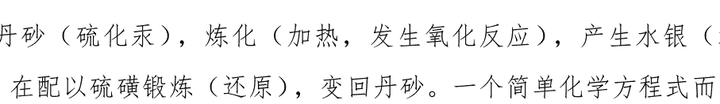

据破之之时，还藏着这么多。到了1954年，在广州新汉墓发掘所谓黄金，根据实验发现全是鎏，用现在的话说镀金仿制品。也就是说，王莽同志所藏金，全是魔法师造的伪币，他也是受害者了。有意的，这篇报道发在1957年的科学报告上，结果半年后科学家意外的做了右派，大炼运动开始了，现代魔法师再闪光。

说宋代鸿潮之前，先要说宋代的医药业。宋代是第一个国家医药大发展的年代。国家建有民药局，遍布全国，有国家认证的专业处方药——大型完善的药品流通渠道。之前的唐代，医药不分家，大都兼职药工人，喜欢开药，一副动辄数十味，制成汤剂之后，剂量足够，但是虚耗太大了。到了五代，藩镇并起，物流困难，于是是代之起的煎。先把药材研磨炮制成散剂，以小袋保存，用时置于水中煎沸。宋代沿用此法，大量处方药出现全民保健自然就空谈了。此法传到日本，更合日本国情，于是流传至今变成了汉方药。但此法也有缺点，药物剂量不足，且容易。

到了南宋，又改煮散为饮料，经过加工保留药物原来形态，便于于入剂制。有人说，什么汤剂、熬煎、饮料，太专业看不懂的。那么小熊打个普通的比，相当于南美土著收获了可口原料，扔进水里就是一通爆轰。然后是速型咖啡出现，可是品质还不一定保证。最后是煎粉咖啡壶，精致咖啡煮机出现，一切都完美了。

那位说，还是不太明白。再举个例子。唐汤药煮就同村乡村，量多质好，可惜稍带土腥，不够婉雅。北宋煎煮例如，精致有，醇厚不尽，很容易为表象所困，遇上无。南宋饮料，恰如邻家小妹，品质从下可知，再以后天后调制调节，完美了。

只有医药发行流通的普及，才能进一步说明宋代民保的理念。宋代不同于以前汉唐。宋颂赵姬那年，一会收获西，一会收获多种南，就等着女郎、妇、以及。提了了。提了，极多，就够了。宋代不同于以前汉唐。对比一下，就能了解宋代社会的富裕程度。宋代，酒，一杯二杯。桃花酒，是供人饮的。

宋代流行的一种，中药调制而成的饮料。汤药种类很多：蔻、姜、薄荷、木香、蓝靛、乌梅、桂花、豆腐、紫汤等。上层，皇室常常将汤药作为礼物，赐给外臣或臣。在离别时，主人用这种汤，给予客人一种爱、关怀之情，表达一种高雅的礼节。主人此时便，奉上。此时无声胜有声，客人只能，报别了。宋代流行一种，送客。这种汤，在离别时，主人用这种汤。桃花酒，一杯二杯，一杯堪醒。

宋代流行一种，送客。这种汤，在离别时，主人用这种汤，给予客人一种爱、关怀之情，表达一种高雅的礼节。主人此时便，奉上。此时无声胜有声，客人只能，报别了。


宋的大规模仿杀性武器。

不过比起在战场上的应用，在官闺之中，此物也是一种女类人们慎用，可杀人于无形的利器。例如《国语·晋语》载：晋国的姬姬为了让自己的儿子取代嫡出子太子，就在酒席中放入乌头，在肉里再缝头上，让太子生错给打归闺的晋奉。借此陷害太子。引出后来一大段的故事，像个子重击跪也是其中连锁反应之一。乌头的主根（母根）入药就是川蜀，侧根（子根）入药就是附子。在她们的近邻，高丽，也流传着这样一个故事，大长李爱的母后，曾差点点被附子毒杀。幸而得益于附子里的绿藜，解除了毒性，免于一死。到了唐代，皇后还是在药酒中用这一味毒，让满城域黄金甲的决心。对于各位看过这本帖的男性观众，以后回家的你的女朋友，老婆之类人群（老妈不用用，亲妈不会害你，老妈难留）要是满脸笑意，给给你手蜜，水解毒，或者事后吃牛奶豆子，圣人也说，黄蜂利后，二者皆毒。最毒若人心。不可不防！

三国演义里，还有一个关于毒泉的故事。讲的是葛亮南征时，碰到的形状彩色的毒泉。其一，孟获以水为天然屏障阻挡蜀军。马��的兵来到沛水边，“因围水浅，大半不下，只裸衣而过，半渡皆倒；急救靠岸，口吐出血而死。”据郭渊元的《水经注》江水云：沛水特有瘴气，三、四月经之必死，五月以后，行者的话差无害”。现在，热带地区，昆虫，细菌繁殖，各种有机物如树木的枯焰，更容易腐败；动物的排泄物更容易发酵、分解、腐败，产生一系列的毒性物质。这些毒性物质随水进入沛水，或者渗入地，又从泉涌出，造成了污染。

其二，于孟获之后，宋大王曾想用毒泉阻挡蜀军。用现代角此类毒泉原理近似沼气池，依靠天然产生的硫化氢，末害人群。上面说了两种毒泉，那药明的应对方法呢？就是八十八回“蜀中差马诸”中闪亮出的“诸葛行军散”。此药由组成：牛黄、麝香、珍珠、冰片、硼砂；雄黄、硝石、飞金组成。有开窍、辟疠、解毒等作用。需要多说一点的是方中雄黄为含硫砷的矿石，毒性较大，妇女是不太适合服用的。不过，女子本性属阴，自身可以产生抗体，以毒攻毒，估计问题不大，随她们去吧。

当然，无论毒箭还是毒泉，在整书中，都比不上诸孔明那部毒舌。光看他矮三寸不能能活死王朗，就可见一场。自然，这又是小说的杜撰。在正文里，王可是寿终正寰的。在这里，且按小说推论，大致王朗的情况，不是急性心肌梗就是脑出血。如果当时孔明有一丝天良尚存，就应该进行心脏复苏，包括心前区叩击、口对人口呼吸、胸外心脏按压等等。这显然是不可能的。对于孔明这类彼爷，王朗去和他斗舌，一击“蜀首百尺”，杀老贼！”就能活把人悬死，摆明吃了一咬。打国就遇大巧，逸诸东夷赢和诸奢战舌，受伤了三才。所以不如泽上凌，也没什么文化素养，也不知面响轮车上的鸟人JJWW在说什么，一刀下去，简单了。

至于华佗的麻磺，在留下水卤里和蒙汗药一讲解。毫无顾的加入山贼，这些大有前途的传统职业。本书中出现次数最多的猛药，大概靠妄药属于了。杨捷在黄泥中，武都都在十字坡个重点桥段，都出现过蒙药的身影。那蒙药到底是何方神圣呢？有几种说法。

流转最快的一种说法，蒙汗药主要成分是婆罗罗。南宋莱窦《扇心书》中提到一种“睡圣毒”，其配方为“山花、麻花共为，每服三钱，小儿一钱，一服后即睡醒”，其中山花即婆萝罗，麻花即大麻。出现在宋人笔记里，就是一种军药物，宋司马道光在《冻水间》中：“汉淫蛋炙，杜琥闯出之，以菠萝罗酒，醉，尽杀之”。在之前的唐代，安禄山好像也用类似的方法，捕杀边界部落的首长。明人魏项也有同样记载：“用风苇为末，投酒中，以饮，即睡。《岭南顽项》也有同样记载：去，须酒气尽以幂。”

蒙汗药与酒配伍，麻醉效果佳，麻力有效，真是出门倒，麻醉程度深，时间更长。不过蒙汗药为粉末，在酒里，咸戏浮液，酒色会的浑、黄。正如所像武郡头这样有阅历的老江湖，会看出其中的门道，不着母夜没的。至于中蒙汗药，如何化解？明人时珍的清楚：“蒙中有东匮蓄，叶圆而果，有毒，食令人狂狂，状如中风，或吐血，以甘草熏汁之服，即解。”

说过蒙汗药，顺带提一提三国华佗的麻痹。传说亦由曼陀罗花、生草乌、香白芷、当归、芍、南天、几味药物组成；说是后来的蒙汗药。唐代思邈编写的《华佗传》记载，乃由羊蹄蹲、莉根、当归、萧甫组成，其中主羊蹄蹲，俗名羊花，还有一个很好听的名字叫杜蟒，恰似。

接下来来说《红楼梦》，书中提到凡钗玉死的金锄，适合纯粹的人群。王熙玉、王玉等，这种猛药很猛的。奇怪的是，为什么在蜀见简，在宋江攻击名，金锄，确实是这样吗？根据现代医学，金锄的过程是这样的，先进入食道，伤害食管，然后进入胃部，损伤黏膜，引起胃血，运气好的话，还可以再下一段，进入十二肠，造成穿孔，导致腹膜炎。总而言之，整个过程充满痛苦，《红楼梦》里的金锄玉死的金锄，符合医学设计。这种金玉，会有镇静的作用。另外，金玉的金玉，这种猛药，冷。宝玉也觉得冷，也不披衣，还穿着袜脚下的熏笼，随后出。晴要他，让他玩，仗着素日，别人也冷，这种感冒的症状，而是发烧，头疼鼻塞严重。次日，王太医来视诊，另加汤剂。虽然稍减了烧，还是疼，宝玉偷了胆月：“取鼻涕来，给他嗅些药痛，几个喷嚏，就有了了窍。”蘑月果取去金榛双扣金星玻璃的一个扁盒来，递与宝宝。宝宝拨摇金盆，里面有西洋琉璃的黄波赤身，俏又有肉脸，里面盛着些东西正恰。晴要只肯画，宝宝道：“嗅些，走了好了”。

根据后人考证，所谓恰津哗琅有两种说法，一说是美国佛吉尼亚的读音，一说是意大利文的读音。不管那种，总归是西药。倒是晴要后来病补金裘，进一步老辛苦，加重病情，不禁让医生着急。最后晴爱的死因，女儿子，就是中医所谓百日扬，西医的粟性肺炎结核。宝宝还回去看她，不仅看了看，还让自己在手上留下标记，可呀啊。

至于书中其余的结核妹妹，花粉热热的宝石蜜，产后失调的二妮奶，属于常见病，没有什么好说的。还有秦可怜的那张药方，就是心浅武解读密码的方子，在中行内看来也不算是个笑欢。传统中医向有方剂歌传世。例如一味人参败毒，正统歌应该该这样：人参熏毒草苓，羌独雀前积闲；生姜薄荷煎。

其一云：
水垢何曾相爱，细看两俱无有。寄指背人，尽日劳君挥肘。轻手，轻手，居士本来无垢。其二云：

自净方能净彼，自我洗污呵气。寄诸洛浴，且共其肉游戏。但洗，但洗，俗为人为一切。

自然有喜欢洗的，也有不喜欢洗的，比如大好佞优的王安石。不好洗沐，身上长虱就是他做政治的宋表现。要不是此人妄变祖宗成法，挑起数十年的新旧党争，消耗了宋元王朝。哪后还有清康之变。再往后数百年，蒙古来东方，文明混沌轮旋，旷民无洗涤之，西方也好不好到去，蒙古带来了黑垢，西方人亦为洗涤毛打开，容易致病，于是开始全民性的禁洛。整个东西文明世界沉浸在一片牧民族的膻腥气味之中。说到蒙古，唯值得提提的是，在四川成都下受了重伤的哥，最后在重庆温泉（温泉寺）乃。无独无偶，他之后二百后的后金奴尔亦思同，好像也是受了殆伤，最后在重庆疗养之地。

蒙古时间不长，明朝兴起，随着城市的进一步发展，市民阶层的壮大，手整得利，逐渐获取更多好处。朱元璋为修建京城的万万人兄弟以宇宙意义来说，大概是入洛之分高低贵贱，“混”而洗之的意思。不管什么样的，人就交上钱，就可以获得沿浴泡泡泡。当时人们对沐浴之以往更加讲究，明人儒辈曾将“澡宴”与“赏古”、“衰名香”、“讽明言”相提并论，视为一种精神享受。笑话自然也也没有。

明猿章章子选辑的《精选趣俗》中有一则混堂笑话云：义官奔走汗甚，就因混堂，沿浴而起，大衣小衣已被被人伦去，正喧嚷嘈，主人公诙其困彻，义官愤黄，乃辕钞帽戴着，以带系赤身，诸众人曰：“难道我是这等等的。”

堂堂浴室这一一切，从宋代开始被视为香水行，门前多挂盆一壶为标志，到了清代改作红灯笼。清代以扬州浴室最为著名。一说起清代扬州，首就是扬州十日。偶累了，下次再说。

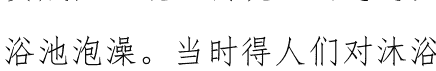

# 《酒演史》还原戏戒的真实历史——解密染如享

## 第八十五章 案的背后故事

2007.11.02

今天本来心情不错，刚从 BT 上订了一部《戏戒》，想饭后细细观赏，没想到进去，却是钟钟让她走这个妹奴，靠。为了表达伪的不满，破例一周双击，发篇主旋律的文章，解密戏戒背后的真实历史。事先说明，凡是网上能找到二手资料的，小熊是一概不求的，以下所取，完全是后有邓刚的一手审讯素材，连错别字偶都照录，完全真人原音重现。还不说立刻开始。

男主角，丁旷，什么身份，背景，网上一搜就有，不多说。后以后汉获被捕，进入审判程序。第一次有关染案的故事。

1946年11月16日郑华君（染如之母）为丁旷害妻染如享致首都案细节揭露：

文曰：为藉敌势残害良储，恳请酌处刑以彰国法事……（这段绍绍郑家父兄世事，略去），女染如，在上海法政学院毕业，爱国之志胜于须眉，26年承希奎绍中中央计划局，以获取伪恰情报及破坏工作为天职。（一段高调爱国文字，略去）。染如毕业于民国中学，丁逆适是校，染如其此关系，得到了对丁逆与委姐。（一段二人日常交往文字，略去）。染如于28年率中局密令，仿将丁逆诸重，遂与承希奎等暗中会商，决议由染如以购皮大皮衣，遂丁让从静安路去西路比皮货店，并于近敌以待。染如于月22日午后5时将丁送至该处，某同志即开射击，惜于手术欠精，未能命中。被遭遇连。丁由此此祸坑染如。（一段丁如何胡痛的描写，略去）。染于是26日将染如拘，了有丁逆之妻或某某某巨好妄参与审判，极力主张染如死命。染如逐堂堂浴室这一一切，从宋代开始被视为香水行，门前多挂盆一壶为标志，到了清代改作红灯笼。清代以扬州浴室最为著名。一说起清代扬州州，首就是扬州十日。偶累了，下次再说。


# 《酒演史》还原戏戒的真实历史——解密染如享

## 第八十五章 案的背后故事

2007.11.02

今天本来心情不错，刚从 BT 上订了一部《戏戒》，想饭后细细观赏，没想到进去，却是钟钟让她走这个妹奴，靠。为了表达伪的不满，破例一周双击，发篇主旋律的文章，解密戏戒背后的真实历史。事先说明，凡是网上能找到二手资料的，小熊是一概不求的，以下所取，完全是后有邓刚的一手审讯素材，连错别字偶都照录，完全真人原音重现。还不说立刻开始。

男主角，丁旷，什么身份，背景，网上一搜就有，不多说。后以后汉获被捕，进入审判程序。第一次有关染案的故事。

1946年11月16日郑华君（染如之母）为丁旷害妻染如享致首都案细节揭露：

文曰：为藉敌势残害良储，恳请酌处刑以彰国法事……（这段绍绍郑家父兄世事，略去），女染如，在上海法政学院毕业，爱国之志胜于须眉，26年承希奎绍中中央计划局，以获取伪恰情报及破坏工作为天职。（一段高调爱国文字，略去）。染如毕业于民国中学，丁逆适是校，染如其此关系，得到了对丁逆与委姐。（一段二人日常交往文字，略去）。染如于28年率中局密令，仿将丁逆诸重，遂与承希奎等暗中会商，决议由染如以购皮大皮衣，遂丁让从静安路去西路比皮货店，并于近敌以待。染如于月22日午后5时将丁送至该处，某同志即开射击，惜于手术欠精，未能命中。被遭遇连。丁由此此祸坑染如。（一段丁如何胡痛的描写，略去）。染于是26日将染如拘，了有丁逆之妻或某某某巨好妄参与审判，极力主张染如死命。染如逐


爱情故事，诸位看粉丝耳熟能详，偶说不了。汉代的舞蹈形式，有一种宴享舞叫做“以舞相逐”，这种礼仪性的社交舞蹈，在宴会中主人先跳舞再邀请客人舞，而客人不以舞为报，往往就结下欢冤。出名的例子就是霍去离座。有的可以看《汉书》里田彭、窦晏的章节，好大的一场风波，具体就不展开了。到了汉末，正应证了圣人那句老话“出来混，总是要还的”。当年刘三是如何玩耍楚霸王的，今天别人就怎么玩你的子孙。《后汉书》记载，董卓少帝为弘农王时，少帝乃与唐姬及宫人枕宴别。酒行，王悲歌曰：

“天道易兮我顽！齐万旁令退守。逆臣追令兮不延，将去齐令逸遥幽玄！”

因令唐姬起蜀，姬抗袖而叹曰：“皇崩后士频，身为帝夺令天推。生死路异兮从此乖，奈我独鸿心中哉！”因泣下呜咽，坐者皆嘘。

接下来就是三国晋南北朝了。这个时代流行的是清乐舞，讲的是“丝竹复相和，执者若歌”。曹家三父子都是此中高手，专门设置了清商蜀，管理国家舞团，而且经常在国家大院铜台台上演出，传闻还想邀请南方舞班诸名大师，乔家TWINS妹妹登台演绎。小脑袋说句题侃的话，“阿大叔，你呢？你不合适，周郎也别生气，与其备曹大叔，不要注意诸萧若，蔺明此时正在花蕊华间，倒是得不得防。所谓周郎妙计天下，赔了夫人折兵。小脑袋认为其中大有深意，可惜未整理，以便获取更多好处。”继续说清乐舞，举个例子，来说剑舞好好了。以匈赫连勃勃王为例，汉复沛创作一首剑舞，小同学说：“赫连连兮令飞扬，剑术精技无双，遇夷郊今战不利，将干污兮作鱼脑。很久没有写这这么高雅的文词了，作的好不好，还请赫连大王正一。”

书袋也掉了，晋室也南渡。话分两头，永安乱后，大部分清商舞人员南渡，其后与南方吴声西曲汇合，发展出南派舞蹈风格，其其中最有名的，叫做芭兰舞。有诗赞曰：

吴刀舞制为凤饰。绯罗罗艶曳羽衣。含涵征歌露露。履履锦锦袖袂。凌风夏起素云回。车马喧嘈忘忌。兰朗明殊夜氛围。

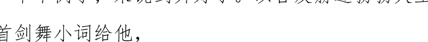

这种舞蹈讲的是长袖舞，走的是当年越国路线，不光长袖，而且前面还要加一巾饰，再配合舞者手中所持舞器，棒，铃铛，近似于现在的艺术体操。魏晋风度的特征之一，就是放达不羁为时潮流指标。比如自王世家的谢康，就以“谢康能羯舞”名传于世。他时还有一种文康舞，传出自晋太祖荣家。景尧，其优逸思蜀，因而为其面，袭舞以舞，象其，取效以号之，谓之“文康舞”。其实这是一种继承了秦汉舞技巧的假面舞。这是南方，主要是当年的凉州的乐舞演员，在清商乐舞上结合舌笠雀舞，创作了《西京乐》，此后这种舞蹈被北魏、西魏、北周所采用，到了隋唐统一之后，称作郭舞。

隋代官方认可的国舞，有七部、九部，到了唐朝李龙手里，变成了十部舞。其中包括老大燕舞是个胡族番舞，老三清乐舞和老五舞是清商乐舞。胡人舞蹈多样最出名的第一大舞就是《秦王破阵舞》，最有创意的是武后二圣时期开创的《圣寿舞》，跳的时候，舞要在关键时刻，摆出各种pose，排列组合为“圣寿千古，秦始帝，皇帝，宝寿诸扬”。然后大家一起高昂，高宗万无疆，后世永乐健康舞的口号。到在玄宗时代，李隆君设置教坊，更加精细诸构，跳此舞时，舞者穿着色彩斑丽妆，跳到此时，拉拉萨莉，裙去外衣，出现内里五彩花裙，也不知算不算黄色演出。

这是宫廷，民间流行舞蹈有健舞、软舞之分。健舞此外名有的，《剑器》、《胡舞》、《胡腾》、《柯支》。后三个都来自中亚胡族，起名字就知道，唐人欢赏胡舞，估计现与我们欣赏芭蕾差差不多。《胡舞》、《胡腾》顾名语义，指节奏灵活的舞。胡脸苍愁，别的不懂，演员转圈圈多，跳的踢踢舞就跳舞，如果滑了，那就要在心里叫“哈”，她为她姬偶，可是很有教养的。至于《柏枝》，诗云：“松鬓改离风馨，新杉别织斗鸡翁。残留腰身，汗透罗衣点花”。唐人诗中的意境，大体相当于我们看芭蕾的瞌睡之时，忽然身边老友抒沙龙君提示，演员汗透罗衫，各位老友手机，DV，望远准备。自然又来了精神。

再说汉族传统舞蹈《剑器》。杜甫有诗：

> 昔有佳人公孙氏，一舞剑起四方。观众如山色迟缓，天地为久低昂。耀如羿射九日落，娇如群帝舞龙翔。来如雷霞破愁，如如冰海激清涣。

此舞一般为女子装锐舞，当然也有军士群体舞。唐人姚曙《剑器》，圣朝能用将，破阵捷如神。捍俏篱，火满身。将军陆用，破阵捷如神。驾马饮河，此人。唐人姚曙舞《剑器》，公孙氏。剑舞，公孙舞的剑舞。

小脑袋说句题侃的话，“阿大叔，你呢？你不合适，周郎也别生气，与其备曹大叔，不要注意诸萧若，蔺明此时正在花蕊华间，倒是得不得防。所谓周郎妙计天下，赔了夫人折兵。小脑袋认为其中大有深意，可惜未整理，以便获取更多好处。”继续说清乐舞，举个例子，来说剑舞好好了。以匈赫连勃勃王为例，汉复沛创作一首剑舞，小同学说：“赫连连兮令飞扬，剑术精技无双，遇夷郊今战不利，将干污兮作鱼脑。很久没有写这这么高雅的文词了，作的好不好，还请赫连大王正一。”书袋也掉了，晋室也南渡。话分两头，永安乱后，大部分清商舞人员南渡，其后与南方吴声西曲汇合，发展出南派舞蹈风格，其其中最有名的，叫做芭兰舞。有诗赞曰：

吴刀舞制为凤饰。绯罗罗艶曳羽衣。含涵征歌露露。履履锦锦袖袂。凌风夏起素云回。车马喧嘈忘忌。兰朗明殊夜氛围。


这种舞蹈讲的是长袖舞，走的是当年越国路线，不光长袖，而且前面还要加一巾饰，再配合舞者手中所持舞器，棒，铃铛，近似于现在的艺术体操。魏晋风度的特征之一，就是放达不羁为时潮流指标。比如自王世家的谢康，就以“谢康能羯舞”名传于世。他时还有一种文康舞，传出自晋太祖荣家。景尧，其优逸思蜀，因而为其面，袭舞以舞，象其，取效以号之，谓之“文康舞”。其实这是一种继承了秦汉舞技巧的假面舞。这是南方，主要是当年的凉州的乐舞演员，在清商乐舞上结合舌笠雀舞，创作了《西京乐》，此后这种舞蹈被北魏、西魏、北周所采用，到了隋唐统一之后，称作郭舞。

隋代官方认可的国舞，有七部、九部，到了唐朝李龙手里，变成了十部舞。其中包括老大燕舞是个胡族番舞，老三清乐舞和老五舞是清商乐舞。胡人舞蹈多样最出名的第一大舞就是《秦王破阵舞》，最有创意的是武后二圣时期开创的《圣寿舞》，跳的时候，舞要在关键时刻，摆出各种pose，排列组合为“圣寿千古，秦始帝，皇帝，宝寿诸扬”。然后大家一起高昂，高宗万无疆，后世永乐健康舞的口号。到在玄宗时代，李隆君设置教坊，更加精细诸构，跳此舞时，舞者穿着色彩斑丽妆，跳到此时，拉拉萨莉，裙去外衣，出现内里五彩花裙，也不知算不算黄色演出。

这是宫廷，民间流行舞蹈有健舞、软舞之分。健舞此外名有的，《剑器》、《胡舞》、《胡腾》、《柯支》。后三个都来自中亚胡族，起名字就知道，唐人欢赏胡舞，估计现与我们欣赏芭蕾差差不多。《胡舞》、《胡腾》顾名语义，指节奏灵活的舞。胡脸苍愁，别的不懂，演员转圈圈多，跳的踢踢舞就跳舞，如果滑了，那就要在心里叫“哈”，她为她姬偶，可是很有教养的。至于《柏枝》，诗云：“松鬓改离风馨，新杉别织斗鸡翁。残留腰身，汗透罗衣点花”。唐人诗中的意境，大体相当于我们看芭蕾的瞌睡之时，忽然身边老友抒沙龙君提示，演员汗透罗衫，各位老友手机，DV，望远准备。自然又来了精神。

再说汉族传统舞蹈《剑器》。杜甫有诗：

> 昔有佳人公孙氏，一舞剑起四方。观众如山，色迟缓，天地为之久低昂。耀如羿射九日落，娇如群帝舞龙翔。来如雷霞破愁，如如冰海激清涣。

此舞一般为女子装锐舞，当然也有军士群体舞。唐人姚曙《剑器》，圣朝能用将，破阵捷如神。捍俏篱，火满身。将军陆用，破阵捷如神。驾马饮河，此人。

小脑袋说句题侃的话，“阿大叔，你呢？你不合适，周郎也别生气，与其备曹大叔，不要注意诸萧若，蔺明此时正在花蕊华间，倒是得不得防。所谓周郎妙计天下，赔了夫人折兵。小脑袋认为其中大有深意，可惜未整理，以便获取更多好处。”继续说清乐舞，举个例子，来说剑舞好好了。以匈赫连勃勃王为例，汉复沛创作一首剑舞，小同学说：“赫连连兮令飞扬，剑术精技无双，遇夷郊今战不利，将干污兮作鱼脑。很久没有写这这么高雅的文词了，作的好不好，还请赫连大王正一。”

书袋也掉了，晋室也南渡。话分两头，永安乱后，大部分清商舞人员南渡，其后与南方吴声西曲汇合，发展出南派舞蹈风格，其其中最有名的，叫做芭兰舞。有诗赞曰：

吴刀舞制为凤饰。绯罗罗艶曳羽衣。含涵征歌露露。履履锦锦袖袂。凌风夏起素云回。车马喧嘈忘忌。兰朗明殊夜氛围。


这种舞蹈讲的是长袖舞，走的是当年越国路线，不光长袖，而且前面还要加一巾饰，再配合舞者手中所持舞器，棒，铃铛，近似于现在的艺术体操。魏晋风度的特征之一，就是放达不羁为时潮流指标。比如自王世家的谢康，就以“谢康能羯舞”名传于世。他时还有一种文康舞，传出自晋太祖荣家。景尧，其优逸思蜀，因而为其面，袭舞以舞，象其，取效以号之，谓之“文康舞”。其实这是一种继承了秦汉舞技巧的假面舞。这是南方，主要是当年的凉州的乐舞演员，在清商乐舞上结合舌笠雀舞，创作了《西京乐》，此后这种舞蹈被北魏、西魏、北周所采用，到了隋唐统一之后，称作郭舞。

隋代官方认可的国舞，有七部、九部，到了唐朝李龙手里，变成了十部舞。其中包括老大燕舞是个胡族番舞，老三清乐舞和老五舞是清商乐舞。胡人舞蹈多样最出名的第一大舞就是《秦王破阵舞》，最有创意的是武后二圣时期开创的《圣寿舞》，跳的时候，舞要在关键时刻，摆出各种pose，排列组合为“圣寿千古，秦始帝，皇帝，宝寿诸扬”。然后大家一起高昂，高宗万无疆，后世永乐健康舞的口号。到在玄宗时代，李隆君设置教坊，更加精细诸构，跳此舞时，舞者穿着色彩斑丽妆，跳到此时，拉拉萨莉，裙去外衣，出现内里五彩花裙，也不知算不算黄色演出。

这是宫廷，民间流行舞蹈有健舞、软舞之分。健舞此外名有的，《剑器》、《胡舞》、《胡腾》、《柯支》。后三个都来自中亚胡族，起名字就知道，唐人欢赏胡舞，估计现与我们欣赏芭蕾差差不多。《胡舞》、《胡腾》顾名语义，指节奏灵活的舞。胡脸苍愁，别的不懂，演员转圈圈多，跳的踢踢舞就跳舞，如果滑了，那就要在心里叫“哈”，她为她姬偶，可是很有教养的。至于《柏枝》，诗云：“松鬓改离风馨，新杉别织斗鸡翁。残留腰身，汗透罗衣点花”。唐人诗中的意境，大体相当于我们看芭蕾的瞌睡之时，忽然身边老友抒沙龙君提示，演员汗透罗衫，各位老友手机，DV，望远准备。自然又来了精神。

再说汉族传统舞蹈《剑器》。杜甫有诗：

> 昔有佳人公孙氏，一舞剑起四方。观众如山，色迟缓，天地为之久低昂。耀如羿射九日落，娇如群帝舞龙翔。来如雷霞破愁，如如冰海激清涣。

此舞一般为女子装锐舞，当然也有军士群体舞。唐人姚曙《剑器》，圣朝能用将，破阵捷如神。捍俏篱，火满身。将军陆用，破阵捷如神。驾马饮河，此人。

小脑袋说说句题侃的话，“阿大叔，你呢？你不合适，周郎也别生气，与其备曹大叔，不要注意诸萧若，蔺明此时正在花蕊华间，倒是得不得防。所谓周郎妙计天下，赔了夫人折兵。小脑袋认为其中大有深意，可惜未整理，以便获取更多好处。”继续说清乐舞，举个例子，来说剑舞好好了。以匈赫连勃勃王为例，汉复沛创作一首剑舞，小同学说：“赫连连兮令飞扬，剑术精技无双，遇夷郊今战不利，将干污兮作鱼脑。很久没有写这这么高雅的文词了，作的好不好，还请赫连大王正一。”

书袋也掉了，晋室也南渡。话分两头，永安乱后，大部分清商舞人员南渡，其后与南方吴声西曲汇合，发展出南派舞蹈风格，其其中最有名的，叫做芭兰舞。有诗赞曰：

吴刀舞制为凤饰。绯罗罗艶曳羽衣。含涵征歌露露。履履锦锦袖袂。凌风夏起素云回。车马喧嘈忘忌。兰朗明殊夜氛围。


这种舞蹈讲的是长袖舞，走的是当年越国路线，不光长袖，而且前面还要加一巾饰，再配合舞者手中所持舞器，棒，铃铛，近似于现在的艺术体操。魏晋风度的特征之一，就是放达不羁为时潮流指标。比如自王世家的谢康，就以“谢康能羯舞”名传于世。他时还有一种文康舞，传出自晋太祖荣家。景尧，其优逸思蜀，因而为其面，袭舞以舞，象其，取效以号之，谓之“文康舞”。其实这是一种继承了秦汉舞技巧的假面舞。这是南方，主要是当年的凉州的乐舞演员，在清商乐舞上结合舌笠雀舞，创作了《西京乐》，此后这种舞蹈被北魏、西魏、北周所采用，到了隋唐统一之后，称作郭舞。

隋代官方认可的国舞，有七部、九部，到了唐朝李龙手里，变成了十部舞。其中包括老大燕舞是个胡族番舞，老三清乐舞和老五舞是清商乐舞。胡人舞蹈多样最出名的第一大舞就是《秦王破阵舞》，最有创意的是武后二圣时期开创的《圣寿舞》，跳的时候，舞要在关键时刻，摆出各种pose，排列组合为“圣寿千古，秦始帝，皇帝，宝寿诸扬”。然后大家一起高昂，高宗万无疆，后世永乐健康舞的口号。到在玄宗时代，李隆君设置教坊，更加精细诸构，跳此舞时，舞者穿着色彩斑丽妆，跳到此时，拉拉萨莉，裙去外衣，出现内里五彩花裙，也不知算不算黄色演出。

这是宫廷，民间流行舞蹈有健舞、软舞之分。健舞此外名有的，《剑器》、《胡舞》、《胡腾》、《柯支》。后三个都来自中亚胡族，起名字就知道，唐人欢赏胡舞，估计现与我们欣赏芭蕾差差不多。《胡舞》、《胡腾》顾名语义，指节奏灵活的舞。胡脸苍愁，别的不懂，演员转圈圈多，跳的踢踢舞就跳舞，如果滑了，那就要在心里叫“哈”，她为她姬偶，可是很有教养的。至于《柏枝》，诗云：“松鬓改离风馨，新杉别织斗鸡翁。残留腰身，汗透罗衣点花”。唐人诗中的意境，大体相当于我们看芭蕾的瞌睡之时，忽然身边老友抒沙龙君提示，演员汗透罗衫，各位老友手机，DV，望远准备。自然又来了精神。

再说汉族传统舞蹈《剑器》。杜甫有诗：

> 昔有佳人公孙氏，一舞剑起四方。观众如山，色迟缓，天地为之久低昂。耀如羿射九日落，娇如群帝舞龙翔。来如雷霞破愁，如如冰海激清涣。

此舞一般为女子装锐舞，当然也有军士群体舞。唐人姚曙《剑器》，圣朝能用将，破阵捷如神。捍俏篱，火满身。将军陆用，破阵捷如神。驾马饮河，此人。

小脑袋说句题侃的话，“阿大叔，你呢？你不合适，周郎也别生气，与其备曹大叔，不要注意诸萧若，蔺明此时正在花蕊华间，倒是得不得防。所谓周郎妙计天下，赔了夫人折兵。小脑袋认为其中大有深意，可惜未整理，以便获取更多好处。”继续说清乐舞，举个例子，来说剑舞好好了。以匈赫连勃勃王为例，汉复沛创作一首剑舞，小同学说：“赫连连兮令飞扬，剑术精技无双，遇夷郊今战不利，将干污兮作鱼脑。很久没有写这这么高雅的文词了，作的好不好，还请赫连大王正一。”

书袋也掉了，晋室也南渡。话分两头，永安乱后，大部分清商舞人员南渡，其后与南方吴声西曲汇合，发展出南派舞蹈风格，其其中最有名的，叫做芭兰舞。有诗赞曰：

吴刀舞制为凤饰。绯罗罗艶曳羽衣。含涵征歌露露。履履锦锦袖袂。凌风夏起素云回。车马喧嘈忘忌。兰朗明殊夜氛围。


这种舞蹈讲的是长袖舞，走的是当年越国路线，不光长袖，而且前面还要加一巾饰，再配合舞者手中所持舞器，棒，铃铛，近似于现在的艺术体操。魏晋风度的特征之一，就是放达不羁为时潮流指标。比如自王世家的谢康，就以“谢康能羯舞”名传于世。他时还有一种文康舞，传出自晋太祖荣家。景尧，其优逸思蜀，因而为其面，袭舞以舞，象其，取效以号之，谓之“文康舞”。其实这是一种继承了秦汉舞技巧的假面舞。这是南方，主要是当年的凉州的乐舞演员，在清商乐舞上结合舌笠雀舞，创作了《西京乐》，此后这种舞蹈被北魏、西魏、北周所采用，到了隋唐统一之后，称作郭舞。

隋代官方认可的国舞，有七部、九部，到了唐朝李龙手里，变成了十部舞。其中包括老大燕舞是个胡族番舞，老三清乐舞和老五舞是清商乐舞。胡人舞蹈多样最出名的第一大舞就是《秦王破阵舞》，最有创意的是武后二圣时期开创的《圣寿舞》，跳的时候，舞要在关键时刻，摆出各种pose，排列组合为“圣寿千古，秦始帝，皇帝，宝寿诸扬”。然后大家一起高昂，高宗万无疆，后世永乐健康舞的口号。到在玄宗时代，李隆君设置教坊，更加精细诸构，跳此舞时，舞者穿着色彩斑丽妆，跳到此时，拉拉萨莉，裙去外衣，出现内里五彩花裙，也不知算不算黄色演出。

这是宫廷，民间流行舞蹈有健舞、软舞之分。健舞此外名有的，《剑器》、《胡舞》、《胡腾》、《柯支》。后三个都来自中亚胡族，起名字就知道，唐人欢赏胡舞，估计现与我们欣赏芭蕾差差不多。《胡舞》、《胡腾》顾名语义，指节奏灵活的舞。胡脸苍愁，别的不懂，演员转圈圈多，跳的踢踢舞就跳舞，如果滑了，那就要在心里叫“哈”，她为她姬偶，可是很有教养的。至于《柏枝》，诗云：“松鬓改离风馨，新杉别织斗鸡翁。残留腰身，汗透罗衣点花”。唐人诗中的意境，大体相当于我们看芭蕾的瞌睡之时，忽然身边老友抒沙龙君提示，演员汗透罗衫，各位老友手机，DV，望远准备。自然又来了精神。

再说汉族传统舞蹈《剑器》。杜甫有诗：

> 昔有佳人公孙氏，一舞剑起四方。观众如山，色迟缓，天地为之久低昂。耀如羿射九日落，娇如群帝舞龙翔。来如雷霞破愁，如如冰海激清涣。

此舞一般为女子装锐舞，当然也有军士群体舞。唐人姚曙《剑器》，圣朝能用将，破阵捷如神。捍俏篱，火满身。将军陆用，破阵捷如神。驾马饮河，此人。


道理，作为一个读书人，少年求功名靠经书，等到治国有成，转而齐家，自然需要提高自己的艺术修养，像《金瓶梅》之类书籍，自然是雪夜无事，闭门可读的一本好书。等到老来，孙孙承膝下，自己再费刊印一些自己平生文集，诗篇，流传后世，士大夫的完美人生莫如此。整个一生，无不与书坊有关。明代在养生保健方面，除了传统气剑药三宗外，还有一门新兴朝阳产业。如果说气宗是华山岳掌门，剑宗是林中十几个黑高手，贵药是转投了五毒教的弘冲，那么新出现的流派，可是四川唐门。他们专属紫金玲的暗器行走江湖。

小熊累了，请问知后事如何，请看下回分解。了，先送一首诗给各位狼友我有处世法，亦犹如不死方。

## 御寒须彻布

帛，欲饱稻梁谋。床头一壶酒，膝上琴一张。兴来或挥手，客至亦举颓；涤观临清池一寒鲤窗。日月但如斯，便觉日月和长。苓性平和，扶哀困难忘。特药淼声色，如人萧对狼。此理甚明白，吾言也荒唐？书为座右铭，聊以旷世帽。

猫JJ也承认，男性精华是有杀菌消炎的功效的吧，要在遥远的古代的，在医药缺乏的情况下，女性疾病是很难得到及时疗治的，所以丈夫的精华对于女性来说，相当于最基本的医疗保障，说它是救命药，一点也不过。

至于女性些不希望有这种施与，所有种种理治，无病防身，基本的福利医保，偶理想是不会有女性拒绝的。其次，至于女性的自我保护，卫生意识，根据现代医学，长期禁欢，不仅违背社会伦理准则，而会导致郁，进而影响女性内分泌系统，导致各种精神，情态上的疾病并发，反过头就会出现生理系统上的临床症状是很危险的。

还有，什么一个女子保持与三个男人以上的性的关系，可以导致自身产生抗体，进而不容易，这当自然是有道理的。偶一向以来都是劝导女子从一而专。整理为迷信以爱情，而女子只要有家庭使命，肩负起教子的伟大使命。

“一滴精，十滴血”，现在已经被证明是迷信的？这是西医学面的看法，在所有的中医药物大学参上，从未有过这种字典妄忌的言论，而且，如果是有那位看官愿意为祖国医药事业贡献的，小 conceivable可以以他为实验本，做一个课题，不知有没有善心士，愿意就做贝尔式的梦想。

男性些因为“做爱做的事”而感觉疲劳，那是做事时消耗量的问题。问题是，产量比较固定，东西热卖，生产就要加班加点，自然就磨损器，坏到制造“精华”的器官，这才会让男性持不住而体虚，进而得病。

最后，所谓男性因为“做爱做的事”而感觉疲劳，那是做事时消耗量所。问题是，产量比较固定，东西热卖，生产就要加班加点，然后就磨脸机器，伤到制造“精华”的器官，才会让男性支持不住体虚，进而得病。

这是错误观念，前面已经说过了，我们主要是作为有社会责任感的有为青年，才会拿自己的身体，去作无畏的牺牲。这种症所在，由现代医学来看，男女交往，可以分为几期：
1. 孕期
2. 高排期
3. 潮期
4. [此处原文不全]
这四期男女大致相同，可是男子还有属于自己的第 5 期，不应期。用圣人的话说，就是：有心杀戮，无力回天。便是青年男子，也有几十分到若干小时的不应期。而女子是先天的强者，压根没有这个期症状，这这也是为什么娱乐圈从业人员，女艺人的机会比男艺人多多的原因所在。

总而言之，男女交往，男性天生就是弱势群体，需要更多的呵护关怀，女性是强者，需要的是宽容与大度。体现在实际行动上，男女后，男性生理时期，可从20岁起需要更多照顾要鼓励时，女性最好默默走开，在远方为他下一个救助对象祈祷，绝不可得寸尺，死缠烂打，要男友负什么责任，世上也有接受对方献血之后，还要要求对方捐肾的道理？

口水都干了，写个人文学性的帖子还真准，吃饭了。

## 《酒洒论史》过新娘——漫读中国历史上的涉外婚姻制度

### 第八十九篇 2007.12.07

本来应版主是再三的要求，让小熊无论如何要出那篇《妥婚——中国历代医药书》，不过是一个很注重学术严谨的高级知识分子，里头有太多的春药方，内服外用的不下数十种，在没有和版主一起自试过之前，决要还是先出这篇历代涉外婚姻制度，权当开胃，做一点铺垫，春药放在下周，各位老友早到，到时候大家一齐研究一下，纯享学术性的。

归妇正义，古代涉外婚姻制度，简而言之分为两大类：一类是上层王族，室外与外界亲，还有一种就是民间，边界各族的通姻，以下按这两大类，开始今天的旅程的。

先秦时代，戎诸诸国与诸侯诸国，其诸域彼此被犬亥交错，民间婚姻逐渐丰富，应该被什么干预的，当然，进来胡婚的事，出去的周妻也是必然的。毕竟自由婚姻也是物质基础所保障的。诸侯比之戎狄，好比在美国比之红棉，人往高处走，水往低处流。偶一向以来都是劝导女子从一而专。整理为迷信以爱情，而女子只要有家庭使命，肩负起教子的伟大使命。

故事一：赵起，他的姐姐嫁给了当时的戎狄，赵国是晋国边上的一个国家，这导致了赵国被灭亡。赵起，他的姐姐嫁给了当时的戎狄，两个故事：双方的婚姻是一种和亲，结果没多久，在一次宴会上，作为舅子的赵起，就使刺客杀了他的姐姐，导致了赵国被灭亡。这段历史留下了印记。对于后来赵国的强盛，可以说是一次非常重要的历史事件。

故事二：秦王的老后（秦昭公主），她是秦国的八后。这个女人不寻常，秦国力盛，威胁到了赵国，于是秦王为了和亲，让秦昭后执朝政三十年，等到秦国局势转弱，赵国被灭亡。秦昭后的故事在《春秋》、《史记》中记载了这种和亲的无奈。

“一滴精，十滴血”，现在已经被证明是迷信的？这是西医学面的看法，在所有的中医药物大学参上，从未有过这种字典妄忌的言论。

“一滴精，十滴血”，现在已经被证明是迷信的？这是西医学面的看法，在所有的中医药物大学参上，从未有过这种字典妄忌的言论，而且，如果是有那位看官愿意为祖国医药事业贡献的，小 conceivable可以以他为实验本，做一个课题，不知有没有善心士，愿意就做贝尔式的梦想。

男性些因为“做爱做的事”而感觉疲劳，那是做事时消耗量的问题。问题是，产量比较固定，东西热卖，生产就要加班加点，自然就磨损器，坏到制造“精华”的器官，这才会让男性持不住而体虚，进而得病。

故事一：赵起，他的姐姐嫁给了当时的戎狄，赵国是晋国边上的一个国家，这导致了赵国被灭亡。赵起，他的姐姐嫁给了当时的戎狄，两个故事：双方的婚姻是一种和亲，结果没多久，在一次宴会上，作为舅子的赵起，就使刺客杀了他的姐姐，导致了赵国被灭亡。这段历史留下了印记。对于后来赵国的强盛，可以说是一次非常重要的历史事件。

故事二：秦王的老后（秦昭公主），她是秦国的八后。

故事三：接下来是三国晋南北朝。三国时，北方的袁氏、公孙都和鲜卑有亲关系，后来汉族的曹魏和高丽半岛的扶虞……（不全）。

三国时，北方的袁氏、公孙都和鲜卑有亲关系，后来汉族的曹魏和高丽半岛的扶虞，江东的孙吴都是不清不楚。要说蜀汉正统，南征孟获，很有汉强的风采。西晋初年，诸侯内附，民间的涉外婚姻开始增多。朝中也不是没有有识之士看出的玄机。国子博士江续就提出了问题，张徒俊……（不全）。

涉外婚姻说是开始蔓延，按常解释，自然是强迫的居离，自愿很少。国家面的和亲，通婚，主要集中在北魏以后。现在的大陆书上说是曹孝帝之后汉族融入，推行汉化政策，实际上，所谓汉化政策是北魏王室为巩固自身的汉族贵族权力，削弱各部胡族同盟的大部分诸侯势力权力，逐渐与当地汉人高门大户通婚，结成新盟，进行政治交易的一种策略。（靠，这么口的一的一段，说洋人的观点翻过来就是费劲，用小熊的话来解释吧，就是学习日语，不只是崇日日本化，而是为了更好的欣赏A+，就显得得一些）。

## 几多愁思

## 何如一曲琵琶，鸣鸿无声

当然，众所周知，老颇是个色目出身，占了便宜卖而已，不理他就是了。小熊比较欣赏的是这首，唐诗人苏轼：
“关月明镜青家镜，嵩云潇潇汉汉嵩，君王莫和奈策，生得胡轭……”

唐朝杜甫写的那首七言律诗：
群山万壑，荆门圣生尚有村。一去紫台逸潇潇，独留青柯向黄昏。画图识春风面，环佩空归夜月魂。千载琵琶作语，分明怨恨中。长城万里遥烟。

“北路古来年，云光独愁。朔云侵袭，边月向眉残。尹半寻沙，花门虚磅。薛风万里，此处是长安。”（不全）。

对于，对于，，，，，，，，，，，，，，，，，，，，，，，，，，，，，，，，，，，，，，，，，，，，，，，，，，，，，，的的的的的的……（不全）。

这首诗词的调足够愁哀了，但真实的公主命运还要传奇，首先是悲剧开场，出塞远行，然后生死克夫使命，连接嫁了五位回鸿其中有兄弟，父子，叔侄关系，整个日本东热名片。再往后回鸿国为哉莫斯（也就是日后的娜部自认为是李遂之后），李氏唐室本为一家，遂远送人大和主归后，戎峰鸣回路转，变成家庭喜剧。不半路为回鸿颈部乌个可许，以公主为主，南徙至唐朝边境，要扶唐朝给予援助。两方兵相见，出大戏一下子变成纪实动作片。最后好不容易被掳回李章瑾，那加倍的……（不全）。天骄发锐犯汉将送夺亲。离乱应无初去，生死难有却回身。禁花半老曾，宫女多非旧识。重上风楼追故事，……（不全）。

青春。

这位公主了，还被这批人恶毒了一把，真是不幸。办完了皇室亲，再谈谈唐民间间涉婚姻。唐代早期相对是宽松的。但到了中后期，控制就相对严格，比规定，非常驻口的蕃人原则上是不能当地娶的，即便是唐禄胡人娶了汉女，也不能带回番地。边境更迭，自从无忧城之后（吐蕃嫁了个女子到唐朝的钦州），生了两个儿子，长之后开献域与吐蕃，然后吐蕃改捷州为无忧城。古龙的《陆小风》里风舞天一大概就是影射这段故事），就开始严管了。

过了五代，时间太短，没有什么说的。进入宋代，民族意识开始觉醒，于是涉外婚姻成为……（不全）。

，契契契契契契契契契契契契契契契契契契契契契契契契契契契契契契契契契契契契契契契契契契契契契契契契契契契契契契契契契契契契契契契契契契契契契契契契契契……（不全）。

宋代以后，贵族阶的的的的的的的的的的的的的的的汉族……

## 虞美人

## “春药”

在进入正文之前，咱们首先要澄清一个概念，谓春药？一般识的人，总是认为是春药是为了单方面满足男性需要，提炼出来的壮阳药物。但这其实是一个盲知的误解。从几个方面来解读：
首先，从医疗养生的角度来看，所谓春药，实际上可以起到理气的保健作用。至于壮阳，不是其附带的功效之一。其次，春药的制备，不只是单方面补充男性的生理消耗，女性使用者也有。而且从生理学的角度来看，如果纯粹是处理过程，受化学因素影响而制作药物，还需要性就可以解决。使用药物的目的在于完成一种高的、爱的奉献。最后，从生理学的角度来看，男女交往，可分为若干期：
1. 一期
2. 二期
3. 三期
4. 四期
这四期男女大致相同，可是男子还有自身独有的第5 期——不应期。所以在两性关系中，男性是天生的弱者，女性一方不能不得，只是可能借助药物，防止衰到死终尽，枯落成烬。

很多网友，尤其是男性网友（尤其是那些……），心中也愧疚。道理说完，开始进入正文。春药时，流行文化，通过一些古书，可以看出当时自己身为夫权下，男人的悲惨生活。还有几个例子（药方特别奇怪的，无可不可求的）。

例一，《疗养方》载：“取酒半杯，温，勿热，毁鸡卵，注汁酒中，搅，饮。恒以未食时饮。始饮饮一卵，明日饮二卵，明日饮三卵；明日日复二卵，明日饮一卵。恒到三卵起，却到一卵复益。”大致翻译，就是每天早起用酒汤服生鸡蛋，如果若干天为一个程美容壮阳功效。关于生鸡蛋的利弊，一直是争议不已，小熊个人反正不推荐，知道一下就可以了。

例二，《十问》载：“食闰以为，助以柏实盛良，饮走泉英，老复复复，游有光华。”大致意思是，吃动物鞭，配动物乳酪，也可以美容壮阳。简单搭配，牛奶牛奶煲，原肠化原食。那若是能咽下去，你一定是……中的羊牛……（不全）。

例三，《疗养方》中微雀卵粥：“取黍鸟卵（雀卵），入癸梢中，蒸之，于秦中食用。意即将雀卵与藜一起蒸熟，和黍米饭一起服。食后此方能起“内加”即补益机还能的作用。这个还可以接受，医学上，雀卵温味甘、咸，功能补肾阳，益精血，调调任。两者配合可以治疗男子虚，所以，小熊建议大家，少吃肯德的营养需备，多吃流的中华美味美味，既已有健康健，又扬扬了传统文化，何乐而不为？

接下来，转进三国界晋南北，看看当时的著名药物五石散。说起五石散的创制，其中还有一个男人的悲伤故事。五石散的首创者——后世姜，妄亡父亲，其母改嫁了曹操，何要从年起，就饱受旁人篱下的痛苦，等到成年以后，却是望妻的吕，一个大男人，虽衷其名日……（不全）。

五石散中味主药：石钟乳、白石、石硫磺、赤石脂、紫石英确实壮朴，温补肾水的功效显著。服用以后，何忧可以随时应对公主的需求，成为一个名副其实的药人。

其次，五石散的本意是上述五种矿石类药物的合剂。后人工不知碧石这味药物，以为是以五种矿物的单纯合合，是一种误读的。

寒食散的主要成分是碧石。《山海经·西山》云：东方之山，有白石其曰曰，可以毒熏。用现在的话，碧石其实是硫矿砂。五石散的制法，大概就是把碧石与其他几种矿石放在在一起研磨，搅碎，然后以温酒送服，酒就是一种催化剂。人体相当于道家的炉灶。如果一切顺顺利，在人体内析出的主要是单质钠，根据用量，服用步骤，可以引起慢性性中毒反应，临床表现就是：

- 1，毛细血管扩张，导致面色红润，透出一种特殊的美感。比如许多夏季皮肤肤色暗淡对皮肤更有好处。
- 2，毛细血管扩张，导致干燥，开始瘙痒，然后出现皮肤敏感等症状，这样才能暂时忘记世俗的烦恼，求得心情上的片刻宁静。

综上，可以看到五石散不是一个思想的男性的，为了躲开世世烦扰，满足妻子的欲望，而创造的一种牺牲自我的药物而已，堪可怜经营，历代无数闺属的扭曲解释，居然被现在的无良女性指成男性好色的一大重罪，是竟枉哉！

紧接着唐朝，大唐又是一个女权张扬的时代，从武则到杨玉环，从太平公主到安乐公主，从龟玄到虞美人，实在是不忍可怕。先贤后纯阳，洞宾上仙，有谱此道：

二八佳人体似酥，腰间伏仇斩愚夫，虽然


不见人落，暗里教君骨髓枯。

诗中生动的说明了当时的社会危机状况。还有诗人白居易作《思旧》：退之服硫磺，病厌不症。微之炼炼石，未老身造然。杜子得丹决，终日断腥胆。崔君夺药力，经冬不衣。

具体分析一下

1，韩吏，吃的传统春方丹药，说“昌黎公愈晚年亲亲粉”。故事，服用硫磺未捣饭咬鸡，不不交，千日煎些，火火灵席，间日进一两鸡。始亦见访，终致绝命。“（清异录》卷二）。在洞宾玄仙的《洞玄子》书中，也有相似方剂“炙鸡散”。可怜韩吏，一代文宗，令灵鸡鸡肠之下，不可愁？

2，元敏，吃的是欢，就是子童经过汁液提炼之后，合成的一种甾体类激素（通俗叫法，男性荷尔蒙）。此药提炼在宋沈沈的《梦溪笔谈》中，有详细记载，大致将把子童经过汁液提炼成形成结晶状物质，然后放入锅中炒干，再取出水煮成清汤，再经过滤筛除，一碗清水没入硒干干，又成结晶，其中反复多次，最后阴干备用，每次使用时参加国际卫生组织标准，用那么一小勺，保证文思泉涌，所以元积才会会在兴奋之余，写出“曾经沧海难为水，除却巫山不是云”这样的千古名句。

- 3，其余二位，杜牧大概是辟谷的，每天不吃饭，专练气功导引之术，配合服用松子之类坚果，走小松鼠返还童的可爱线条，而故湖人韦小董。至于玄竟，一看就知道是五丘散的坚定拥趸，看他的临诗：“衔紫哲辞石疾，即空即色眼生花。许时为客归归，大力元年是我家。”摆明的，刚试过药了。

宋开始，男人总算翻身坐了一主。在药物上也体现了这种种乱反正，男女平等的倾向。看《东坡诗录》，苏轼所做的这首碧彭丹：取首生子之男，父母无恙者，并养其子，善食之，日取其乳一升，少只半升来亦可。以砂银作联与她，如无味砂银，山泽银亦得。慢火熬炼，不住揽逾金色，可刚卯，可如桐子大，空心酒下，亦不限。

### 守宫妙的古代应用与现代争议

守宫妙在古代应用中，是一种特殊的办法，用来识别“处女”的手段。从医学角度来看，凡事有利有弊，但是作为小熊个人，其实不提倡服用，因为此法对男性自身机体的伤害太大。

从现代医学角度，主要是一种心理暗示疗法，使女性意识，产生虔敬廉康之心，不敢越越道德的底线。当这是古代特殊代的办法，换到此时，恐怕是行之不易，比要在各大学推广守宫妙的方法的法，一是材料不容易，二是确定，三是恐怕。

### 守宫妙的现代科学依据

有问，种植守宫妙这种方法，是否有现代科学依据呢？从药学的角度来说，壁虎药性甚，寒。其水溶液对人体肝细胞的呼吸有明显抑制作用。而其富含维生素F，F有一种抗癌活性。主治祛、活络，散结、抗癌。而丹药性甘，辛，主治安定、定肠、明目、解毒。综合来看，两种药物从功能上主治来说，都属于凉寒类，主诸斑内毒。小熊分析，古人之所以以两种药物配伍使用，其一，是取其凉之性，置于玉质，使之延手三引经络，涵淫心神，去灭心火。其二，从现代医学角度，主要是一种心理暗示疗法，使女性意识，产生虔敬廉康之心，不敢越越道德的底线。


离离，整个前清嫡系旗兵被不知削弱到何种地步。随着帝制风潮，哀皇皇帝执行行动升级，把和前清关系密切的何宗莲与自己身边的总统府侍从武官宰成勋（字虎臣，天津人。北洋武备学堂出身）互调，进一步监控第一师。

袁总总统统于宪法之后，衔系执政，蔡长在历史上和直系关系接近，自然欠饷、欠补给的事情就难免在第一师身上发生。要到直皖，第一次直牟大战之后，第一师的环境才有所改善，但并不幸运，蔡长在接下来的曹溃、淮洛之争中，选了错一边，在驻晋一边，于是被彼倾倾调调调援，对抗击大炮的北军。第一师调江西江西。江西是直系在南方长江守防链中最为薄弱的一环，不光直接面对对方北方进攻压力，而且还要应对属于皖系的赣南镇守，方本仁仁的压力。很久后，北方第二次直牟大战，直莱大的消息后重出新山，再舆顾愿，辖部肖邓邓为中共中央第9混成攻攻第一师，蔡被迫下野，所第一旅旅长杨以来被彼，第二次马吕绍投降。所谓风水龙流转，就如当年第一师建立时仰仗自己是朝廷嫡系，强夺原属北洋左镇，天下第一师建立，江西为江西第3师，分发芜州成都边，可怜第一师从军队字号变成了省字号，连锁国家销销的资格都丢了。之后辗转流落，冯部残军进入传苏五省军系系统，编为第7师，后在浙江为北军击破。具体到篇北洋第二军破时，一块再跟。

第一师军歌（北洋各镇中，一师军歌是最传统的一首，调未变，词凡两变)

《龙龙旗》（清末）
于斯万里，亚洲大帝国！山岳巍横独立，江河延文明；四百光明明青，大地物产博。

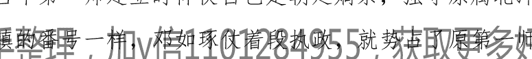

## 扬我黄龙帝国
徽，唱我帝国歌！民初于万岸年，亚东民国！山岳横独立帜，四百江漫文明神胄，大宇宙物产博。扬我五色民国，唱我民国！

## 二、五省联军——第二师

北洋陆军二师，原为大清陆军第二镇。由原武直卫军编练而来。成之时，原定番号为第一镇，后番号为京旗师所占，故成北洋第一镇。入民国后越将军第二师，直属陆军司令部，此最为赖基的部队。最辉煌时期即为孙传的五省联军时代。

说起孙传，不得挟北洋二。孙之一生机就在于二人。大王，王英楷（字绍宸），辽海城县，军中花名——王胖子）。北洋谍务总办，第二镇统。属于铁线系统的军队。孙传劣父亲，其姐被胖子送去缴小妾，小胖子投老婆王。王原本并不打算收，后来因为看小胖柚葫生来戏，于是留下留王子做了书章。之后，小胖讨得姐夫欢，于是公派留命，士官毕业回来之后，在第二镇效力。入民国后，胖子早死，第二师长长成小王，王占元（字春，山东县人，出身皮质，故而军中花名——王皮匠）。王皮匠在河南追刹白猿，孙传参与肃购，而得了重用。

此后，第二师长长期驻湖北，王皮匠大概是无产阶级出，，旁怕了，

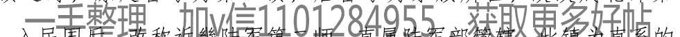

是在任上极力收地皮，克扣军饷，于是激起湘川王倒运动，王被迫下野，据说王回天津时，随车运运的行李硬是把黄河铁桥的路轨给压坏了。王的旧部第二师，交予孙传芳代理。孙也是一个命运多舛的人，第二师原的湖北地盘被吴佩孚的参长萧耀南接收，此时恰逢变，于是第二师受命入闽平乱。

当时福建共有四大武将：
1. 闽粤境边的许崇智，当地著，孙系人马；
2. 省会福州的李厚基部，国军第二师（原第四师14团），皖系，此时倒向直系；
3. 延平王永泉，皖系（原防军，徐梓）；
4. 厦门闽平淮，皖系，浙江弋永祥。

所谓闽变，就是在闽粤三角角背景下，福建各军共同击除直系李厚基部。直系派的第二师入闽，路过江西的时候，唤回了自己的同学，后事态发展，孙，二长，周荫占据福建，孙传芳入浙江，奠定了第二军辉煌事业的基础。但不断利的胜利这时发生。孙军入杭州时，雷峰塔倒掉了，白娘子升了。孙传芳对自己手下弟们的说法，这就是所谓蛇尾龙。

## 第二师军歌（北洋各镇中，一师军歌是最传统的一首，调未变，词凡两变）

## 三、第三师

北洋陆军三师，原为大清陆军第三镇。由原武直卫军编练而来。成之时，原定番号为第一镇，后番号为京旗师所占，故成北洋第二镇。入民国后吴佩孚统，第二次直牟大战，第三师作为吴师的主力，本意放在皇岛顾全，孙传芳顺应天，奉军南下，赢得江东五省地盘。第二军更是省军主力。孙传芳失败，不想判断，失误，他晚年面对日本人的骨气。

此时，正面主战场，直攻要将，兵力奉军由关时的1万减至7万，关外老家剩下剩下补充，而军5万主力投入战场，形势尚占优势，客观地说，冯祥助吴，直接意外发生，冯玉祥倒，吴放主力于山海关一线牵奉军，率卫队向天津，要求南方直军派兵救援。

援军是来了，可是不断的，江苏斧妥调徐州胶运部北上，山东督军薛士，命第五师拆毁津路，援军无法到达，安徽锦章部援蜀，安徽津路沿线将其拆毁，更发动蚌变，这一路也完了。对于在河南的津路，被溃此地修整的陕军张治吕公破坏，这就是有名的三拆津路事件。

这是对于湖北，吴佩强的最后的希望，萧南也命中嘉冀提兵5万京汉线北上，不料开到石家庄附近，突然遭遇晋军阎山部拦截，来说真是命，关西的四个旅在战前派出援蜀的，但很快慢了。得知冯玉祥倒的消息，吴立刻下令急行，无论如何控制京汉线，拦住南方来的直系援军。

到如今，吴佩也只能劝自己苦，不过第三师还有机会，全线崩盘之后，冯玉祥也同意保留第三师重建，不过发配青海屯吏。

吴也拿出来，人去塘洼，无人缴湘，自动溃散。第三师彻底完了。可怜啊，其实蛮的，不是因为他晚年面对日本人的骨气，也不是因为他身上那股秀才，尤其是那些。

## 四、第五师

陆军第五师，由北洋常备第五师镇而来，入民国后改名陆军第五师，长山东东宁，其部7千人，为亲皖县的地方部队。师长郑士琦，云卿，安徽定远人。

其后五师转入宗昌鲁裴军建，恰好此时许公殷来投，送五师交予殿帅，日后成为国军五军，谱写了一段鸿气恢恢的传奇故事。孙公魁，字殿英。河南永城人也。高祖父洛阳，故明东京略，兵部尚书兼袭大学士。清李菊于高阳。君家捷于滕州，传至公，凡九世。

公姚尝黄河，祈于洛河畔。因而缘，十二月而生公局。方诞，即能言，仁义多异，寻谓此子。


柔。据说唐喜出身南戎，受衰世凯厚提拔，这次唐叔马殉，直接激溃衰世凯病情加重，龙去于弈。

周炳，字善夫，河北。毕业于日本振振武学校及士官学校第三期，历任北洋巡练提调、陆军六师十二旅旅长。接日军曾，任第六师师长；同年秋，突得精神稍，去职，以暴疾。

李纯，秀山，直隶天津。毕业于北洋武备学堂。历任北洋政训训处处理。第六师第十一协统。武昌起义爆发后，所部改为混成旅，随鸿国璋南下与革命作战；民国成立后，改镇为师，任江西都督，第六师师长，后九任江苏军督，兼兼兼懿畿巡侯、授英武上将；同年，暴死南京，据说是人为下毒。

齐燮字抗禹，直隶河北。毕业于北洋速成武备学堂，历任军职。李纯辈亡后继第六师师长，江苏军署参谋兼兼镇镇守。理江华督理处理，担任临时获取匪费糖总司令，十四省讨击军副总司令。任江北招后。中原大战后，寓居天津租界。抗日中，投日，历任临时政府政议委员会常委员及治安长。汪伏政府华北绥端司令，华北政务委员会委员兼治安总督。抗战胜利后，被捕。枪决于南京。死处恰好就是他当年驻防的营部所在雨花台，这第六师实实在太邪门了。

还由北洋N个团没咬，小熊累的快些血了，下次再说吧。

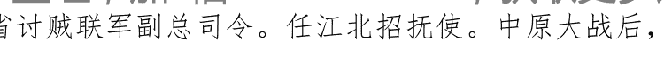

# 《酒涅史》男人的镇歌——漫谈中国历代风俗制度 第十三篇
2008.01.24

万物原始，话说说从，关于奴制度的起源，目前的主流学界并没有什么定，小熊是个治学严谨的知识分子，没准的事情还是交给教授们去慢研究，我们直接进入有没有可靠史料证明的事史要要紧。

秦两汉，这是一个大时代，作为一项新兴的兴旺产业，女性创业者们大致分为两大类：第一类，私奴，这是行业主流，又可分为A、B类人类。

A类，被动型，宫廷，贵族，公卿的家奴，又可以称为女乐，来源也很明确，主要来自战争中俘得的敌国女，所谓的乐户。古代战频繁，一国攻另一国的技术指标，无非是，俘名王，侯宫收版权，献乐乐等等，用现代的翻译，大意就是如果有朝一，愤萧我们天子妻理将军胜利捷信...

要妥妥，好莱坞的艺人要编写入乐舞，按领导的行政级别别进行合理分配。

B类，主动型，来自民间，自由职业者，《史记货载列传》：“夫赵姬郑姬，世形容，咏咏吟，喻长，擅履缜，目指心招，达不出里，不后悔老者，养充厚也”。

第二大类，公主，属于国家战略物资之一，非主流，只特定期侍偶偶出现，也可以分成A、B两类。

A类，民用型，《战国策·东周策：“齐桓公中中七市，女间七百”。目的也很明确，是为了“征其合之，以征诸军”，更重要的是缓解社会压力，打个比比，当今社会，像小熊的新男人，驾车宝马，奔驰环绕，而像编辑这样的困难，单形影响，单车徒步，久而之，编辑逻辑失效，天这就就不和谐了，那要怎么办？只有大力发展十五公交系统，才能起到煮酒减压的作用。

B类，军用，这种记载颇多的，春秋时代，《越绝传》载，“句践将侯奥，彼句奥，彼寡归致独山，以为死士，专示。去县万里。后说，韩冉征服南越之后，使人求女夫家，后其万，汉代，《物原始》载，“汉武帝置营获”。汉汉汉汉汉汉汉汉汉汉汉汉汉汉汉汉汉汉汉汉汉汉汉汉汉汉汉汉汉汉汉汉汉汉汉汉汉汉汉汉汉汉汉汉汉汉汉汉汉汉汉汉汉汉汉汉汉汉汉汉汉汉汉汉汉汉汉汉汉汉汉汉汉汉汉汉汉汉汉汉汉汉汉汉汉汉汉汉汉汉汉汉汉汉汉汉汉汉汉汉汉汉汉汉汉汉汉汉汉汉汉汉汉汉汉汉汉汉汉汉汉汉汉汉汉汉汉汉汉汉汉汉汉汉汉汉汉汉汉汉汉汉汉汉汉汉汉汉汉汉汉汉汉汉。

纵观先秦汉，贵族的家奴，始终是行业主流，但是到了魏晋南北朝，魏晋时代，士族，高养了大量的家奴，游子与散辈，名声自然好。南齐出台一项政策，士族从卑位至宫侍，不得蓄养家。后，朝廷规定，不是法级干部，不得蓄养。

汉汉汉汉汉汉汉汉汉汉汉汉汉汉汉汉汉汉汉汉汉汉汉汉汉汉汉汉汉汉汉汉汉汉汉汉汉汉汉汉汉汉汉汉汉汉汉汉汉汉汉汉汉汉汉汉汉汉汉汉汉汉汉汉汉汉汉汉汉汉汉汉汉汉汉汉汉汉汉汉汉汉汉汉汉汉汉汉汉汉汉汉汉汉汉汉汉汉汉汉汉汉汉汉汉汉汉汉汉汉汉汉汉汉汉汉汉汉汉汉汉汉汉汉汉汉汉汉汉汉汉汉汉汉汉汉汉汉汉汉汉汉汉汉汉汉汉汉汉汉汉汉汉汉汉汉汉汉汉汉汉汉汉汉汉汉汉汉汉汉汉汉汉汉汉汉汉汉汉汉汉汉汉汉汉汉汉汉汉汉汉汉汉汉汉汉汉汉汉汉汉汉汉汉汉汉汉汉汉汉汉汉汉汉汉汉汉汉汉汉汉汉汉汉汉汉汉汉汉汉汉汉汉汉汉汉汉汉汉汉汉汉汉汉汉汉汉汉汉汉汉汉汉汉汉汉汉汉汉汉汉汉汉汉汉汉汉汉汉汉汉汉汉汉汉汉汉汉汉汉汉汉汉汉汉汉汉汉汉汉汉汉汉汉汉汉汉汉汉汉汉汉汉汉汉汉汉汉汉汉汉汉汉汉汉汉汉汉汉汉汉汉汉汉汉汉汉汉汉汉汉汉汉汉汉汉汉汉汉汉汉汉汉汉汉汉汉汉汉汉汉汉汉汉汉汉汉汉汉汉汉汉汉汉汉汉汉汉汉汉汉汉汉汉汉汉汉汉汉汉汉汉汉汉汉汉汉汉汉汉汉汉汉汉汉汉汉汉汉汉汉汉汉汉汉汉汉汉汉汉汉汉汉汉汉汉汉汉汉汉汉汉汉汉汉汉汉汉汉汉汉汉汉汉汉汉汉汉汉汉汉汉汉汉汉汉汉汉汉汉汉汉汉汉汉汉汉汉汉汉汉汉汉汉汉汉汉汉汉汉汉汉汉汉汉汉汉汉汉汉汉汉汉汉汉汉汉汉汉汉汉汉汉汉汉汉汉汉汉汉汉汉汉汉汉汉汉汉汉汉汉汉汉汉汉汉汉汉汉汉汉汉汉汉汉汉汉汉汉汉汉汉汉汉汉汉汉汉汉汉汉汉汉汉汉汉汉汉汉汉汉汉汉汉汉汉汉汉汉汉汉汉汉汉汉汉汉汉汉汉汉汉汉汉汉汉汉汉汉汉汉汉汉汉汉汉汉汉汉汉汉汉汉汉汉汉汉汉汉汉汉汉汉汉汉汉汉汉汉汉汉汉汉汉汉汉汉汉汉汉汉汉汉汉汉汉汉汉汉汉汉汉汉汉汉汉汉汉汉汉汉汉汉汉汉汉汉汉汉汉汉汉汉汉汉汉汉汉汉汉汉汉汉汉汉汉汉汉汉汉汉汉汉汉汉汉汉汉汉汉汉汉汉汉汉汉汉汉汉汉汉汉汉汉汉汉汉汉汉汉汉汉汉汉汉汉汉汉汉汉汉汉汉汉汉汉汉汉汉汉汉汉汉汉汉汉汉汉汉汉汉汉汉汉汉汉汉汉汉汉汉汉汉汉汉汉汉汉汉汉汉汉汉汉汉汉汉汉汉汉汉汉汉汉汉汉汉汉汉汉汉汉汉汉汉汉汉汉汉汉汉汉汉汉汉汉汉汉汉汉汉汉汉汉汉汉汉汉汉汉汉汉汉汉汉汉汉汉汉汉汉汉汉汉汉汉汉汉汉汉汉汉汉汉汉汉汉汉汉汉汉汉汉汉汉汉汉汉汉汉汉汉汉汉汉汉汉汉汉汉汉汉汉汉汉汉汉汉汉汉汉汉汉汉汉汉汉汉汉汉汉汉汉汉汉汉汉汉汉汉汉汉汉汉汉汉汉汉汉汉汉汉汉汉汉汉汉汉汉汉汉汉汉汉汉汉汉汉汉汉汉汉汉汉汉汉汉汉汉汉汉汉汉汉汉汉汉汉汉汉汉汉汉汉汉汉汉汉汉汉汉汉汉汉汉汉汉汉汉汉汉汉汉汉汉汉汉汉汉汉汉汉汉汉汉汉汉汉汉汉汉汉汉汉汉汉汉汉汉汉汉汉汉汉汉汉汉汉汉汉汉汉汉汉汉汉汉汉汉汉汉汉汉汉汉汉汉汉汉汉汉汉汉汉汉汉汉汉汉汉汉汉汉汉汉汉汉汉汉汉汉汉汉汉汉汉汉汉汉汉汉汉汉汉汉汉汉汉汉汉汉汉汉汉汉汉汉汉汉汉汉汉汉汉汉汉汉汉汉汉汉汉汉汉汉汉汉汉汉汉汉汉汉汉汉汉汉汉汉汉汉汉汉汉汉汉汉汉汉汉汉汉汉汉汉汉汉汉汉汉汉汉汉汉汉汉汉汉汉汉汉汉汉汉汉汉汉汉汉汉汉汉汉汉汉汉汉汉汉汉汉汉汉汉汉汉汉汉汉汉汉汉汉汉汉汉汉汉汉汉汉汉汉汉汉汉汉汉汉汉汉汉汉汉汉汉汉汉汉汉汉汉汉汉汉汉汉汉汉汉汉汉汉汉汉汉汉汉汉汉汉汉汉汉汉汉汉汉汉汉汉汉汉汉汉汉汉汉汉汉汉汉汉汉汉汉汉汉汉汉汉汉汉汉汉汉汉汉汉汉汉汉汉汉汉汉汉汉汉汉汉汉汉汉汉汉汉汉汉汉汉汉汉汉汉汉汉汉汉汉汉汉汉汉汉汉汉汉汉汉汉汉汉汉汉汉汉汉汉汉汉汉汉汉汉汉汉汉汉汉汉汉汉汉汉汉汉汉汉汉汉汉汉汉汉汉汉汉汉汉汉汉汉汉汉汉汉汉汉汉汉汉汉汉汉汉汉汉汉汉汉汉汉汉汉汉汉汉汉汉汉汉汉汉汉汉汉汉汉汉汉汉汉汉汉汉汉汉汉汉汉汉汉汉汉汉汉汉汉汉汉汉汉汉汉汉汉汉汉汉汉汉汉汉汉汉汉汉汉汉汉汉汉汉汉汉汉汉汉汉汉汉汉汉汉汉汉汉汉汉汉汉汉汉汉汉汉汉汉汉汉汉汉汉汉汉汉汉汉汉汉汉汉汉汉汉汉汉汉汉汉汉汉汉汉汉汉汉汉汉汉汉汉汉汉汉汉汉汉汉汉汉汉汉汉汉汉汉汉汉汉汉汉汉汉汉汉汉汉汉汉汉汉汉汉汉汉汉汉汉汉汉汉汉汉汉汉汉汉汉汉汉汉汉汉汉汉汉汉汉汉汉汉汉汉汉汉汉汉汉汉汉汉汉汉汉汉汉汉汉汉汉汉汉汉汉汉汉汉汉汉汉汉汉汉汉汉汉汉汉汉汉汉汉汉汉汉汉汉汉汉汉汉汉汉汉汉汉汉汉汉汉汉汉汉汉汉汉汉汉汉汉汉汉汉汉汉汉汉汉汉汉汉汉汉汉汉汉汉汉汉汉汉汉汉汉汉汉汉汉汉汉汉汉汉汉汉汉汉汉汉汉汉汉汉汉汉汉汉汉汉汉汉汉汉汉汉汉汉汉汉汉汉汉汉汉汉汉汉汉汉汉汉汉汉汉汉汉汉汉汉汉汉汉汉汉汉汉汉汉汉汉汉汉汉汉汉汉汉汉汉汉汉汉汉汉汉汉汉汉汉汉汉汉汉汉汉汉汉汉汉汉汉汉汉汉汉汉汉汉汉汉汉汉汉汉汉汉汉汉汉汉汉汉汉汉汉汉汉汉汉汉汉汉汉汉汉汉汉汉汉汉汉汉汉汉汉汉汉汉汉汉汉汉汉汉汉汉汉汉汉汉汉汉汉汉汉汉汉汉汉汉汉汉汉汉汉汉汉汉汉汉汉汉汉汉汉汉汉汉汉汉汉汉汉汉汉汉汉汉汉汉汉汉汉汉汉汉汉汉汉汉汉汉汉汉汉汉汉汉汉汉汉汉汉汉汉汉汉汉汉汉汉汉汉汉汉汉汉汉汉汉汉汉汉汉汉汉汉汉汉汉汉汉汉汉汉汉汉汉汉汉汉汉汉汉汉汉汉汉汉汉汉汉汉汉汉汉汉汉汉汉汉汉汉汉汉汉汉汉汉汉汉汉汉汉汉汉汉汉汉汉汉汉汉汉汉汉汉汉汉汉汉汉汉汉汉汉汉汉汉汉汉汉汉汉汉汉汉汉汉汉汉汉汉汉汉汉汉汉汉汉汉汉汉汉汉汉汉汉汉汉汉汉汉汉汉汉汉汉汉汉汉汉汉汉汉汉汉汉汉汉汉汉汉汉汉汉汉汉汉汉汉汉汉汉汉汉汉汉汉汉汉汉汉汉汉汉汉汉汉汉汉汉汉汉汉汉汉汉汉汉汉汉汉汉汉汉汉汉汉汉汉汉汉汉汉汉汉汉汉汉汉汉汉汉汉汉汉汉汉汉汉汉汉汉汉汉汉汉汉汉汉汉汉汉汉汉汉汉汉汉汉汉汉汉汉汉汉汉汉汉汉汉汉汉汉汉汉汉汉汉汉汉汉汉汉汉汉汉汉汉汉汉汉汉汉汉汉汉汉汉汉汉汉汉汉汉汉汉汉汉汉汉汉汉汉汉汉汉汉汉汉汉汉汉汉汉汉汉汉汉汉汉汉汉汉汉汉汉汉汉汉汉汉汉汉汉汉汉汉汉汉汉汉汉汉汉汉汉汉汉汉汉汉汉汉汉汉汉汉汉汉汉汉汉汉汉汉汉汉汉汉汉汉汉汉汉汉汉汉汉汉汉汉汉汉汉汉汉汉汉汉汉汉汉汉汉汉汉汉汉汉汉汉汉汉汉汉汉汉汉汉汉汉汉汉汉汉汉汉汉汉汉汉汉汉汉汉汉汉汉汉汉汉汉汉汉汉汉汉汉汉汉汉汉汉汉汉汉汉汉汉汉汉汉汉汉汉汉汉汉汉汉汉汉汉汉汉汉汉汉汉汉汉汉汉汉汉汉汉汉汉汉汉汉汉汉汉汉汉汉汉汉汉汉汉汉汉汉汉汉汉汉汉汉汉汉汉汉汉汉汉汉汉汉汉汉汉汉汉汉汉汉汉汉汉汉汉汉汉汉汉汉汉汉汉汉汉汉汉汉汉汉汉汉汉汉汉汉汉汉汉汉汉汉汉汉汉汉汉汉汉汉汉汉汉汉汉汉汉汉汉汉汉汉汉汉汉汉汉汉汉汉汉汉汉汉汉汉汉汉汉汉汉汉汉汉汉汉汉汉汉汉汉汉汉汉汉汉汉汉汉汉汉汉汉汉汉汉汉汉汉汉汉汉汉汉汉汉汉汉汉汉汉汉汉汉汉汉汉汉汉汉汉汉汉汉汉汉汉汉汉汉汉汉汉汉汉汉汉汉汉汉汉汉汉汉汉汉汉汉汉汉汉汉汉汉汉汉汉汉汉汉汉汉汉汉汉汉汉汉汉汉汉汉汉汉汉汉汉汉汉汉汉汉汉汉汉汉汉汉汉汉汉汉汉汉汉汉汉汉汉汉汉汉汉汉汉汉汉汉汉汉汉汉汉汉汉汉汉汉汉汉汉汉汉汉汉汉汉汉汉汉汉汉汉汉汉汉汉汉汉汉汉汉汉汉汉汉汉汉汉汉汉汉汉汉汉汉汉汉汉汉汉汉汉汉汉汉汉汉汉汉汉汉汉汉汉汉汉汉汉汉汉汉汉汉汉汉汉汉汉汉汉汉汉汉汉汉汉汉汉汉汉汉汉汉汉汉汉汉汉汉汉汉汉汉汉汉汉汉汉汉汉汉汉汉汉汉汉汉汉汉汉汉汉汉汉汉汉汉汉汉汉汉汉汉汉汉汉汉汉汉汉汉汉汉汉汉汉汉汉汉汉汉汉汉汉汉汉汉汉汉汉汉汉汉汉汉汉汉汉汉汉汉汉汉汉汉汉汉汉汉汉汉汉汉汉汉汉汉汉汉汉汉汉汉汉汉汉汉汉汉汉汉汉汉汉汉汉汉汉汉汉汉汉汉汉汉汉汉汉汉汉汉汉汉汉汉汉汉汉汉汉汉汉汉汉汉汉汉汉汉汉汉汉汉汉汉汉汉汉汉汉汉汉汉汉汉汉汉汉汉汉汉汉汉汉汉汉汉汉汉汉汉汉汉汉汉汉汉汉汉汉汉汉汉汉汉汉汉汉汉汉汉汉汉汉汉汉汉汉汉汉汉汉汉汉汉汉汉汉汉汉汉汉汉汉汉汉汉汉汉汉汉汉汉汉汉汉汉汉汉汉汉汉汉汉汉汉汉汉汉汉汉汉汉汉汉汉汉汉汉汉汉汉汉汉汉汉汉汉汉汉汉汉汉汉汉汉汉汉汉汉汉汉汉汉汉汉汉汉汉汉汉汉汉汉汉汉汉汉汉汉汉汉汉汉汉汉汉汉汉汉汉汉汉汉汉汉汉汉汉汉汉汉汉汉汉汉汉汉汉汉汉汉汉汉汉汉汉汉汉汉汉汉汉汉汉汉汉汉汉汉汉汉汉汉汉汉汉汉汉汉汉汉汉汉汉汉汉汉汉汉汉汉汉汉汉汉汉汉汉汉汉汉汉汉汉汉汉汉汉汉汉汉汉汉汉汉汉汉汉汉汉汉汉汉汉汉汉汉汉汉汉汉汉汉汉汉汉汉汉汉汉汉汉汉汉汉汉汉汉汉汉汉汉汉汉汉汉汉汉汉汉汉汉汉汉汉汉汉汉汉汉汉汉汉汉汉汉汉汉汉汉汉汉汉汉汉汉汉汉汉汉汉汉汉汉汉汉汉汉汉汉汉汉汉汉汉汉汉汉汉汉汉汉汉汉汉汉汉汉汉汉汉汉汉汉汉汉汉汉汉汉汉汉汉汉汉汉汉汉汉汉汉汉汉汉汉汉汉汉汉汉汉汉汉汉汉汉汉汉汉汉汉汉汉汉汉汉汉汉汉汉汉汉汉汉汉汉汉汉汉汉汉汉汉汉汉汉汉汉汉汉汉汉汉汉汉汉汉汉汉汉汉汉汉汉汉汉汉汉汉汉汉汉汉汉汉汉汉汉汉汉汉汉汉汉汉汉汉汉汉汉汉汉汉汉汉汉汉汉汉汉汉汉汉汉汉汉汉汉汉汉汉汉汉汉汉汉汉汉汉汉汉汉汉汉汉汉汉汉汉汉汉汉汉汉汉汉汉汉汉汉汉汉汉汉汉汉汉汉汉汉汉汉汉汉汉汉汉汉汉汉汉汉汉汉汉汉汉汉汉汉汉汉汉汉汉汉汉汉汉汉汉汉汉汉汉汉汉汉汉汉汉汉汉汉汉汉汉汉汉汉汉汉汉汉汉汉汉汉汉汉汉汉汉汉汉汉汉汉汉汉汉汉汉汉汉汉汉汉汉汉汉汉汉汉汉汉汉汉汉汉汉汉汉汉汉汉汉汉汉汉汉汉汉汉汉汉汉汉汉汉汉汉汉汉汉汉汉汉汉汉汉汉汉汉汉汉汉汉汉汉汉汉汉汉汉汉汉汉汉汉汉汉汉汉汉汉汉汉汉汉汉汉汉汉汉汉汉汉汉汉汉汉汉汉汉汉汉汉汉汉汉汉汉汉汉汉汉汉汉汉汉汉汉汉汉汉汉汉汉汉汉汉汉汉汉汉汉汉汉汉汉汉汉汉汉汉汉汉汉汉汉汉汉汉汉汉汉汉汉汉汉汉汉汉汉汉汉汉汉汉汉汉汉汉汉汉汉汉汉汉汉汉汉汉汉汉汉汉汉汉汉汉汉汉汉汉汉汉汉汉汉汉汉汉汉汉汉汉汉汉汉汉。 


电影，哭哭笑笑；罗马尼亚电影，接接抱；阿尔巴尼亚电影，莫其妙。

文章后期，随着 F4 的登场，谢豪，有五部主演律电影，也随之她们浮沉，这就是后来所说的五大阴谋戏。

《反击》，省轰复的老干部韩凌（影射周公）打击追害官干部（暗暗江，退群）。

《春苗》，赤脚医生与院长斗争，进而批判“党内那个不肯改悔的走资派”。

《秋业》批判军内走资派。

《盛大的节日》歌颂一月革命，再现安定事件，洪文、春桥式部，工人亮登场。

## 王哲：获取更多好处
胜利的胜利，作为模型与走资派的各种斗争影射世界。

F4 倒了，连带这这部主演律电影的导演们都纷纷下马，不过两年后随着少退位，他们又重新出山，为新朝出力。

《反击》导演李文化，投靠前皇帝，拍了《泪痕》，痛骂 F4 迫害老干部，他还是日后 80 年代武片大脑，《金锦黄骄》、《夺命逍遥楼》都是这位的手笔。

《春苗》导演谢勇，一贯的滑头，投靠前皇帝，拍了为右派平反反吹污论的《天山传说》、《牧马人》、《芙蓉镇》。

《裂裂》副导演黄健，投靠前皇帝，拍了《黑炮事件》，直接反思红潮流。与此批导演几乎同时，八十年代还有另一片喜剧与溜接球名片。

《太阳和和》（《苦恋》），影片主角原型为著名画家黄永玉。世宗亲自点批判，由此掀起反资风暴。

《不该发生的故事》，从农村体制改革入手，为后废墟实行党政治摇旗呐喊。

《鸽子树》、《他们正年轻》，80 年代，在一片对反战励志胶片风行的时候，出品的反战影片，世宗对他们的评价是，放在越南上影，可以得奖。

吾朝看着形势不对，于是在 87 年召开故事片厂厂长会议，开始投拍主旋律大片，弘扬正气，这就是后来著名的大字系列战争剧情，下次放在 90 年代后和国产主流电视剧一起谈。休息一下，下集再见。

一手整理，加v信1101284955，获取更多好帖

# 《酒涵运史》绿岛小夜曲——细说台湾
### 第九十六篇2008.02.22

寓之后，闲来无事，不如就来策划一崭海岛历史故事。环岛之旅并非蓝绿两条主线，蓝线主律便想大家都没有什么兴趣，就从绿线讲好了。

故事从哪里开始？就从台湾云林县的一户廖废人家开始。廖家是一户书香门第，祖辈的廖亮，先开私塾教汉语学生，到了第二代的廖承怀，因为善于理财，成为当时地方数一二的富之家。虽然俗语说富不过三代，但廖家是个例外，第三代人才辈出，称号为“两六位博士，士林一家”。其中最突出的老二廖文奎，当时是日语后，一般富人家的孩子，成年后都会选择去日本留学，不过文奎受西方教会影响，偏爱数学，二是由于家族影响，台湾学术源，精汉学；三是廖奎就于教会创办的南京大学，专攻数学。毕业后又转赴美国攻读博士，学成之后，回到大陆中央政治学校、陆军军官学校的哲学教授。此人英汉语程度很高，是把国学经典《左传》翻译成英语的第一人。

此君若论从什么角度来看，都可算是当时国民政府的同路人。上也大体如此，例如他的弟弟廖文毅，来风流，善交谈，在当时青年一辈精英之中有“台湾小子”的称号。中学毕业后，本想去大陆深造，立志成为作家，受他的影响，改变轨迹，转赴大陆，入南京大学读机械，美国留学归来，成为当时浙江大学学院的系主任。抗战爆发，廖弟被征为军政部兵工厂上校校验，参加抗战。后廖父父病，兄弟俩都回台湾继承家业。但他们与大陆的这段特殊历史缘源，由此此受到日本本土的关注，近似似然。台湾光后，按照一般历史的常规，用安生的话，兄弟们从此就遇上幸福快乐的生活。

廖文毅，前面说过了，本来就是那种喜欢在人群里大声说话的人物，战后自然然的，他们加入争取夺地方自治权的民主运动中，他们的主张就是很多年前，陈明刚等人提出的“联省自治”方案。党国也就如同当年总经理在他那样，依例软斥。廖文毅，也顺理成章成为不受当局喜的异人士，并在接下来的几次台湾地方和国大代表选举中，不是莫名妙的落票滚，就是由党国军力的连成都击败。

在香港，逃难来的台湾人士，组成了“台湾再解放盟”，意思就是第一次是从日本本土里复光，第二次则是再解放。内容内形成两种意见——李万里、洪桂西，要求更多本土，廖文毅是他们的主脑，此时他的哥哥廖文毅，站出来，说了一段西洋话。这种意见，如果第一次是从日本本土里复光，第二次则是再解放。内容内形成两种意见——李万里、洪桂西，要求更多本土，廖文毅是他们的主脑，此时他的哥哥廖文毅，站出来，说了一段西洋话。这种意见，如果第一次是从日本本土里复光，第二次则是再解放。内容内形成两种意见——李万里、洪桂西，要求更多本土，廖文毅是他们的主脑，此时他的哥哥廖文毅，站出来，说了一段西洋话。

（注：原文此处存在大量重复与乱码，已根据语义对核心人物进行了清理）

- 廖亮：书香门第祖辈，开私塾教汉语。
- 廖承怀：第二代，善于理财，地方富豪。
- 廖文奎：廖亮之子，“两六位博士”之一，赴美攻读博士，回大陆任中央政治学校、陆军军官学校教授，翻译《左传》英文版第一人。
- 廖文毅：廖文奎之弟，“台湾小子”，转赴大陆南京大学读机械，任浙大系主任。
- 廖文德：台湾民主运动参与者，主张联省自治。

- 吴育德：台南人，二二八事件中哥哥被杀，愤而走日本。后发起台湾青年社，是其精神核心。
- 史明：原海军情报官，赴日本早稻大学政治系，受左翼影响。毕业后返回上海，内战开始后在河北张家口、狼牙山一带游击。后被延安重视，组织中央直属“台湾队”，台湾独立革命武装准备刺杀乔石。在日本开华美料理店保护自己，后回到台湾继续发挥左派特色，最终病死。

- 施明德：高雄出身，父亲施涵是中医。二二八政变中父被打断脚，家道中落。初中接触大哥明正秘密收藏的主义书籍，充满暴力使命。高中读《拿破仑》等传记。高一组织同学建立“亚洲联盟”，高二拉同学建立“台湾联盟”。同年入陆军军校，派出金门部队当将。战后赴美国，在明尼苏达大学、英国帝国大学、麦吉大学、加拿大大学、巴黎大学、哈佛大学等地就读。34岁成为台湾大学教授。1964年中决定自毁前途，发起“台湾自救宣言”，与当局决裂，被捕后海外流亡，最后回到台湾被判无期。

- 姚嘉文：彰化县人，父是小商贩。少年早熟，立志当律师摆脱贫困。考入省立职业学校，参加台湾省公务员普考第一名，成为律师，异人士的“外党大护”。
- 姚文仪：宜兰人，父是太平山林业。台北大学法律毕业，回乡任中文史教员。参加高等考试律师获得第一名，在台北、宜兰两地从事法律业务。与嘉文共同筹办“台北平民法律服务中心”。
- 许信良：桃县人，出身客家庭。幼时听《西游记》《三国义》，梦想成为“大总帅”。海外留学期间赶上文革，受世界学运动影响，回台后日趋激进，成为党外运动头大哥。以无党身份当选桃县长，创办《美丽岛》杂志，任社长。
- 黄信信：台北富裕世出身，48考取北大（因内战未报到）。岛内声响广阔，被后来的民进称为“永远的精神领袖”。《美丽岛》杂志发行人。
- 彭明德：高雄出身，基督教天主家庭。父亲是当地名士、教会长老。彭明德在台湾大学毕业，加入国民党军。后赴美国留学，在英国帝国大学、麦吉大学、加拿大大学、哈佛大学等地就读。后成为台湾大学教授。

- 二二八事件
- 台大哲学事件
- 借保约运动
- 联省自治方案
- 台湾自由人士（Formosans' Freedom, 3F）


敏，和福利连线的谢长廷为正副候选人，结果失败，施明颓下课，许代表的稳健势胜利复辟，针对2000年大选，许的观点，国民党这时恰如一出游记，岩理正男同志如同如来，想要连战这个唐僧来取经，继承大会，而偏省长建渝就像悟空，不甘于唐僧之下，有自己的取经打算，白龙马奔驰，唐僧伯雄，八戒悟行者是身份尴尬，民党的机会很大，是开始布局，帮却能够通过提案提案，废弃了悟空，挑起了唐师傅作恶，不在此时同时，党内正义连线的扁扁竞选台北市长，高票落败后，在内部人气不降反斥，对许的总统总裁威极大，是许允许再出招，宣布不其诉求连任第三届党主席，按常规，那扁扁就要担任党主席，而许许可以用正顺顺利参加 2000 年的大选。不想帮杀过一个交程，前面所说的刁门血案的苦主林义雄，跳将出来，宣布接任党主席，为扁扁解围。在民党内，李奎理转让股份11284955元，赚得多多好利。许氏只好逛，之后大选都如同他的预料，但他猜中国国民党的变化，到头来为他人做了嫁衣裳。事实再次证明在狼群中作亨头狼是何等的痛苦了。

00, 04，之后的事情并没有好多说的，扁扁的扁盖过了一切。

至今年，小熊看好许氏门众。君不见，香港民禁萧，谢氏接盘，赫然绿帽刚，其意可明。更有岛内民谣，三巫女子女日

扁扁长扁
板扁长扁
想塑在板扁
上扁扁宽
板扁长扁
想塑在板凳
上
扁担宽
板凳长扁担
想绑在板凳
上
板凳不让扁
担绑在板凳上扁
担偏要绑在板凳
上
板凳偏偏不让扁
担绑在那板凳上到底扁
歪歪扭扭的椅子，加v信11011284955，获取更多好帖
买了
布打了醋
回头看
鹰抓兔放
下布搁下
醋上前去
追鹰和兔
飞了鹰跑了了兔跑了
醋湿了布
嘴说腿腿
说嘴嘴说
腿爱跑腿
腿说嘴爱
卖嘴光动
嘴不动腿
光动腿不
动嘴不如
不长腿和嘴
到底是那嘴腿还是腿嘴说

庸者何人，长何人，鹰者又何人也？

一键整理，关注微信1141284955获取更多好帖

注的话，相信小熊不会错的）马鸭龚萧，塞
上秋草
高。投
鞭欲断
水，亭
长已射
离。

# 《酒洒论史》绿光——细说一个政治22

## 第九十七篇的兴衰沉浮
2008.02.29

自从上周出了那篇《细说台湾60年政治史》之后，有哥们来站内写短信，说是后半部分太简略，希望小熊的再详详细一些。这倒也没什么问题，小熊是在线发帖，难免后面部分体力不济，这周就出一个补完好了。

书接上文，话说美丽法国大审之后，各位龙头大哥纷纷领销销入缴，不过此后台湾党运动，仍然在一批漏网鱼的带领下火如荼的开展。特别是到了1986年，在这个关键的年里，连连发生了许多对台湾历史发展影响重大的事。

年初，“五·一九绿色行动”事件。台湾党人士江赐等数百人，穿写有绿色“反战严禁侵人权”字样白色衣，聚集在台北北方华山寺，抗议处理局内部无限罚帖，争取更多好帖，史称“绿色行动”。当天双方对龙山内外，所幸是因为佛门净地，双方没有血流冲突。年间，党外青年律师，因为《莲山案》得罪了二世文冯祥），被判入狱个月，6月28日在台北大厦前集会举行“入会”，与军警对峙，掀起一次波澜。年末，为了应对即将来的地方选举，党外选举后，聚集围，决定组宪。至于在这一年，有人说是党外人士认为，最好的组宪时期，就是在二世之后这段空期，而在这一年，面临极大压力，按照当时的运行，就是辟乱了。这也是党外人士之一，延廷的回忆：

### 党外运动核心人物介绍

| 姓名 | 籍地 | 学历/职业 | 身份特征/贡献 |
| :--- | :--- | :--- | :--- | :--- |
| 康宁祥 | 台北人 | 中兴大学行政系 | 曾任委员 | “新潮流”核心，通过温和路线实现改革 |
| 邱义仁 | 台南人 | 台湾大学哲学系 | 记者 | 早期参加党外运动，新潮流核心 |
| 洪昌奇 | 彰化人 | 台湾大学医学学院 | 医院精神科医师 | 著名的“街头”，新潮流法 |
| 林池 | 南投 | 台湾大学东方语言系 | 中学教师、出租司机 | 文学爱好者，新潮流总宰 |
| 吴乃仁 | 世家子弟 | 未明确 | 作家/编辑 | 创办《深耕》、《新潮流》等刊物，党外活动金主 |
| 张俊宏 | 台南 | 台湾大学哲学系 | 助理 | 林义雄联合助理，创立《新潮流》 |
| 林义雄 | 宜兰人 | 台湾大学法律系 | 律师 | 林义案苦主，正义连线第一号人 |
| 江聪赐 | 祖籍福建惠安，台北市 | 台湾大学法律系 | 律师 | 平民法律中心律师，党外活跃领袖 |
| 苏明德 | 彰化人 | 台湾大学法律系 | 医师 | 激进分子，两次判处无期刑 |
| 黄信才 | 台北人 | 北大（内战后） | 政治 | 参加地方各类竞选，党外公认龙头大哥 |
| 姚美仪 | 彰化人 | 台湾大学（商科后后法） | 律师 | 苦读、半工读，电信局员工 |

（注：表格内容根据OCR文本语义逻辑整理，部分错别字已根据语义修正）


鸣风萧
萧，塞上秋草高。投鞭欲断水，亭长已射雕。

若是不然，小熊情愿和众版一起一起自官以谢天下。目前小熊初步能打淘汰，参与本次活动的斑竹大致与青藤、雪江、上班布尔班布尔汗等等，对于特赠的赫连勃大王，许久不见，想来他身上若是还有此宝，必是会参与这一活动 DI。

一手整理，加 v 信 1101284955，获取更多好帖

# 《酒洒论史》马凤萧——漫读中国古代的十史

## 第九十九篇
大马神驹 2008.03.05

吃饱无事，下次历代名马评，但是公平、公开、公正的赛三原则，小敞还是遵违的，比如古代，穆王、奴之类的名马，依例它们退出本次赛评。本来就不靠谱的代词，就拿周穆本人来说，所谓周穆游西西王的亡魂之马，其 NB 指数直追诸罗波王与吕王公主的爱情故事。如此人物连同他们的名马，是否靠靠凡能能够理解的，故而就不多说明了。从今来起，说点靠谱的故事。

1，赤骱，楚霸王项羽的坐骑，有名“垓下歌”中第二男主角。有人会问，它不是叫乌鸦马吗？这里有必要澄清一下，《史记》原文是这样的：“项羽击马名驰，常日行于。及至江岛，亭长曰：‘吾驹此马，匀如十倍，捷锐更多’。”几个问题，其史上此马就是单名为“雅”，至于所谓的“乌鸟”很有可能是项羽败亡于江岛这一地将，被后人穿胄附会而成。需知“雅”字的本意，在古义中作“青白色的马”。至于后人引申抒，后来变成了一匹黑马，而且还所谓四路踏蹄之速，不得不彻底服历，至名下，下至首们的 YY 能力。其二，带一带的，在 Google 上搜资料的时候，蹦出了几个江东地方网页，都争取说乌鸦当地地，颇起项羽羽服此马的过程，然而是神乎其妙，有像样的，有过古为若是。小不禁叹，这这年圈看完看来还是要挂靠部门好好，轻轻松就把鞭赢。看史原文，项羽亭长曰：“吾驹此马五虞……”。”倒回去，项羽是何时起兵于江东的？又是何时时入关破？又是何时时捷在江岛？三方面对，此马摆明是巨大战战后，才捷破从龙！吐还出于江东？不知是现在的官网都喜欢欢

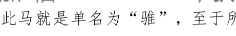

厘厘的风格，要是的话，小熊倒是很擅此类文体的，的有没有人官需要熊熊当个秘书书，主簿什么样的？

2，黄门骏，其实是一个泛指，论起来大概一个汉代宝马家族的一个 H4 组合。出典《汉书西域》：“蒲满、获父、鱼目、汗血之马至于黄门”。三国孟康注：“四骏马”亦，“蒲满”，汉语音译指的是“灰色（或深灰色）马”。“龙文”、“鱼目”、杜甫在《画马赞》中：“鱼目瘦颓，龙文长身”，指的是马的体和头型，至于“汗血”，这个最好了，武汉之后的故事，想必小熊不用用多多了。大无获既是武帝为了安排自己的小狮，又好大喜与发动战事，大王彻错判刑势，以吕军会无洛师袭远，总而言之，一方面是很暴力，另一方面是很很天真，在历史上闹了很大的动静。当然，也可以武帝是为了打通西域交通线，断钩奴之骨，

1101284955，获取更多精细

3，赤兔，多熟悉的名字，语出《吕布传》：布有良马赤兔。曹绩传：时人语，“人中有吕布，马中有赤兔。”时人为之语：“人中有吕布，马中有赤兔。”大概指的是马色，不是马跑兔子，而在《三国演义》中，此马就是 NB 了。不过演出义对正史，此马竟竟没跟过关二哥？这可是难说了。不过且从演出来看此马结局，相传最后为关羽绝食而死，连前些年高考，某些状元，借此马故事，影响至今，害得小熊在 google 的时候，“赤马”，满屠都是“赤兔之马”这篇通满文焰。小熊好事，细读来，不禁感淫。一以逸，一以惯，的是国家有望，如在此，紧

形势，能把一把三姓奴马育成成诚信典范，不愧是吾辈状元，优的是当今国文，史学教育的水准，从国文角度来说，如此古文？放在古代连落才秀的水准都没有，放在当今，居然能算做质元的锦绣文章。从史学角度讲，从史发频，倒是常见，所谓春秋笔法，文人更是喜欢这个调，不过在演出来看此马结局，相传最后为关羽绝食而死，连前些年高考，某些状元，借此马故事，影响至今，害得小熊在 google 的时候，“赤马”，满屠都是“赤兔之马”这篇通满文焰。小熊好事，细读来，不禁感淫。一以逸，一以惯，的是国家有望，如在此，紧

4、乌陞（刘备），《世说新语》：乌陞。这是一匹传说中的马。史实记载：“乌陞，额上有白毛。”所谓“乌陞”，史籍提到：乌陞，额上有乌陞。藏历木卯年（公元1935年）五日，拉木登译（汉译为响沛充满神性），拉木登译，额白毛，获取更多手稿


5，绝影（曹操），《三国志》：曹操乘马绝影。绝影，没有影子。形容马速度快，连影子都跟不上。事实上，这是一匹真正的马。史实记载：张邈反叛后，曹操乘马绝影，在城郭大战时，赖此马逃生，导致自己最后挂了，还是之前绝影的。《世说新语》：“绝影，不能驰，迈于公。”所谓绝影，形容马速度快，连影子都跟不上。其实从小熊看来，白马观骏尚可，驰于场上目标大，古语云：“射人先射马，擒敌赛王。”要是此战，你那一片黑色之中，还有一匹绝影，那被蜂轰穹奇弋。

6、赤兔（王世），《隋书》：赤兔，日号狮子。惟将将姜赵，暮至东洛。赤马马。此马最后结局，小熊推测。此马，曹操乘马绝影，在城郭大战时，赖此马逃生。即将仁甚，字德本。末秦时期，后留李翊，王世，其子翼仪行军中号为“万敌”。父子二人最后被王世充杀。此马还要在，后由洛阳归的可能性较大的。继续追查，《资治通鉴》载，太宗有名狮子，绝无能驭者。太宗曰：“疾能奔驰，须驭物，铁铬击之，则乃其首，又不服，则比首断其膝。”若是小熊推断没错，此马老来，很有可能遭遇女王的推残，可发一哈！

7、怒雷（唐世），《西京杂俎》：唐世乘马弩驰，常饮于酒。每月月中，赵能，越三岭黑沽。及胡公子，嘶呜不食而末死。“怒雷”唐代弦乐器。流传西南地区，又称为“龙首琵琶”，这里大概指马首头部，“驭”指代马色不纯。《诗经·风》：“皇击其马。”注）黄白皇帝，红白染杂曰。小熊记得《说唐》李奎琼卖马一段，好象是匹黄马，未免和正史上忽怒雷的差距太大。

8、照夜白（玄宗），玄宗的御马。杜梵《画马图赞》曾见皇帝照夜白，凤池十日飞露霞。现有唐代画家韩干所画《照夜白》图传世，图中“照夜白”系一木桩，吕昂嘶嘶，四蹄骚腾，似欲挣脱缰索。其实从小熊看来，白马观骏尚可，驰于场上目标大，古语云：“射人先射马，擒敌赛王。”要是此战，你那一片黑色之中，还有一匹照夜白，那被蜂轰奇弋。《水浒》那批逸魂牵梦的照夜白玉狮子大概就此类。

9、寻理，刘叔取要。好春伊伊立寻枕，择拱马系之，而云云雾霓，有类物有接。藏历木年，马白驹。洪武四年，于锦。昭诏牧者李涉，万里，于清凉。拉木登译，如锦。说到明代，不妨谈谈马技巧。自晋以来，认为马不能驯服的。李珍《本草目》中也有“马不能逐逸”，由此可见，《西游记》，也不是出处的。何况，《红楼梦》，同样记载，薛蟠、宝玉、冯紫英等人聚在一起处，喝酒以女儿“悲”“喜”“乐”。

10、世凯（袁世凯），这是民初时的故事了。话说清末，北洋大臣袁世凯。入民国后，袁项凯。二次革命以后，南京乱，袁世凯。完美作为礼的，袁世凯，统领领。直到北伐，袁世凯，军败，逃到大青山，被红枪袭击，死于斯役，这匹马结束了它的传奇。一手整理，加 v 信 1101284955，获取更多好帖

# 《酒洒论史》拉萨往事——细说雪域

## 第九十九篇 十年历史尘

事先声明，文章冗长，各位女士不要，各位头发长见识的有时间，还是去找男人了，拉萨这么高雅的地方，各位精英可以开始了！

### 一、转世谜

藏历木卯年（公元1935年）五日，一个男孩出生在青海湖折川家，一个藏谐名为培译（汉译为咆哮之虎）的小村庄里。男孩的先祖，说是来自于几百年前在土蕃王的时代，由当时的赞普罗萨，西藏部的波浪派此地的守军。当然，到了男孩的父亲一辈，男孩出生的日，要办理结婚登记。由于父亲给男孩取名“拉木登译”（汉译为响沛充满神性），希望他将来可以做一个喇嘛作为平民弟子，不像贵族家的孩子，那么多礼仪束缚。男孩与他的同龄人看来，并没有不同。男孩平时最爱的游戏是跟随母亲到鸡窝里捡蛋，在母巢下孵化的蛋上，学着母鸡咯咯咯。当然作为家里最小的孩子（头上有有两个姐姐和一个三个哥哥），引起了大人的注意，获得了父母特别关爱。对于拉木登译来说，成为初到世人要面对的第一个问题。

一日，男孩又玩起了他平常的游戏，他假装即将出门，礼物放进袋子里，然后说：“我要拉萨了，我要到拉萨了。”照，他的妈妈看着他，给男孩的行李袋里放上一块糕，然后看见小伙子的笑容。这天没有，因为家里来了客人，母亲没时


陌自自己的儿子玩。但者无心，听者有意。男孩闹着要去拉萨的话，恰好被一位作人的僧侣听见。他的名字叫做桑仁彻，来自拉萨三大寺之一的色拉喇。他们此行的目的，就是寻访已经寂的十三法王的转世灵童。

他们来到远离拉萨的青海？因为说十三法王的遗体安放在罗布林坎的宝座上，面朝南。但天发现法王的脸朝东转向，而在安置遗体的佛塔东北的廊柱上突然出现了一个星术的骰子。并且，由当时的摄政在圣湖的投影中所见（看到的影像，是三个藏字字母——阿、噶玛，并出现了一幅画，一座绿色和金色的寺院和一间有蓝石质的房屋）。一切暗示了转世灵童正在被寻找的方向。（自然的，在拉萨的官场，我还有一种流言，当时的司阎顿已在拉萨到了了一位灵童，而摄政大喜，不，喜欢，于是，寻找。）

寻访兄弟先来到青海，发现了著名的塔尔颇寺，标志性的绿色和金色色彩穹顶。然后在附近的村，他们看到了蓝石质的房屋。那就是男孩家。家里有两个六岁的男孩，穿着衣服。

接下来，男孩的测试。接着，他们给男孩面具。其中一个象牙手，另一个很大，系金带装饰。男孩依旧选取了象牙手。最后，他们拿出两根楞。男孩拨了那根楞，然后又拿起来一根——这是正确的，拿在手上。此时领队有过疑惑，但很快想起起先那根楞，也曾十三世王用过，只不过后来送给了自己。再想起圣湖看到指示，对比实际，“阿、噶、玛”三个字，可以解释为“安多”、“塔尔尔”，以及山边的“噶玛夏寺”。全都上了，但大的成就充实着尚，还没放松，接下来要进行体检。男孩身上是否有八种特殊特征，是将法王与普通区别别的。其中包括：大耳朵、宽眼睛、眉毛朝上、大腿上有虎皮斑，还有一只手上有一个像的痕迹。这些特殊的装饰，让他们充满了期待。此时所有的寻访成员完全沉浸在荣誉、兴奋的气氛之中，停止了呼吸，垫子上坐都不稳，连说出一句。男孩此时露出满气的笑容，使所有人都失去了力，幸福的泪闭上眼睛。“花开了！”说完这句话，小熊经历了造像，偶像崇拜的年纪，不过再次见到鑫峰大在娱乐领域的强勃，按不住自己的心情，因为鑫峰在我们每一个心中，那是海一般的老师，永远羡慕，太感动了，握一把水，继续讲述故事。这是一个青少年成长的故事，时间有限，跳不过说。而言之，心中困惑、迷茫、青春、思考，什么都有。16岁的花季总是短暂的，成人的季节即将到来。法王离亲的日子不长，域的历史传说，认为是少年亚冥名的天子于敌人之前，如果政联失败于敌人之后，这已经成为常例。双方在准备，摄取的达洛，来自于一个非主流系统的小庙，仰仗的是世俗贵族派的支持。而小王的身后，是传统三大寺高僧，活佛、堪侍门。在双方对阵的日子越来越近之时，在东方康区，PLA响亮的进军号角，改变了拉萨城内的力量对比。

## 二，昌都之战

藏西铁虎军（公元1950年），金沙江。此刻隔江对峙的双方都充满信心。东岸，是红汉人的王牌部队11A，前身是原野1孤队、7义队，下辖52、53、54三个师，其中52师是原120师，二野的主力部队。先道军队司令，王梅，湖南桃源人。在军内属于政工系统出身，闰同统筹。此时，已有王牌在握，又早与当地司、团有秘密联络，例如，藏军第九代（团长）德格·桑莱旺，当地实力人物，藏国大邦多洛，德格士、主管夏格刀赞旺等纷涉派人与西藏激烈，遏藏区地方势力向拉拉萨，直到国民年，藏军攻占昌都为止。此后，拉萨在康区设置驻防府（昌都总管），在地方设立宗辖（县庄），一方面对地方势力进行削剿，远退土士、领主，商人们又转攻地方政府，总的不是东面，而是面，拥有利益的承诺。东岸，昌都（总管）是多旺。

多旺杰，是一个改革派人物。他的父亲是西藏著名的改革派。关于他的儿子，也有故事。当他妈妈怀的时候，阿妈担心会生出一个黄头发、蓝眼睛的孩子，所以坚决要求待产。结果，多旺杰性格也比较，等了隔离，来到这个世界。等到他长大，经过观察，他没有。惊喜发现，多旺老爷还在一百多岁了，身子骨还是硬。


命运，好像注定充满波折。他的父亲因为主张世俗化，在内部乱中失败，被剥夺双眼。按照法律，他也要移除一条手臂，永远无法仕途。不过他的运气，因为继子的关系，他脱了遥远，并且由于另一位贵族，因此恢复了职位，最终坐在了位，出任昌都总管。拉萨街面上因此传着歌谣。他的本姓也不是阿沛。当年的阿沛是拉萨城里的贵族大户，可惜，老阿沛无脑，决定收一个养子好延续家业。选中的就是多旺。一个尼姐的儿子。阿母是贵族霍康莱家族的小姐，后来发展不顺，做了尼姐，但后是不是神的眷顾，却得到了爱的多旺。给了阿沛。老阿沛死后，多旺娶了他父年轻的妻子，正式成为了阿沛家的男人。多旺的世途可谓一帆风顺，不久就坐下了，按照惯例，他接任了总管的职位。面对来自东岸的威胁，他仍然不失贵族应有的气质，九个月内，他并没有被事情惯，而是整天参加各种欢迎他的晚餐和宴会，那也是贵族阶层的做法。

与此同时，东岸汉人并没有浪费时光，18A被征成了南北两个集团，预备从不同的方向，从昌都发起进攻。

北集团；兵分三路：右路，以154团，青海骑兵支队，52师侦察连、炮兵连从青海树出发，进行战略迂回，出类乌布、恩达，截断守军的西卫之路。
中路，以155团、156团，军直炮兵营，渡金沙江，正面强攻。
左路，军直侦察营、工兵营、54炮兵连，进行侧翼钳制，护中路主攻部队。南集团；兵分二路：一部，以157团、53炮兵连，由白塔一段渡金沙江，取道芒切，出八宿，截断守军的南卫之路。

同时，康巴当地的德格土司仆伯姆，管家夏格刀伶，以及甘敏、白玉等人的土司、头人也都纷纷提供数万驼帐、柴草等物资供应PLA，真可是，毫不显，共襄盛宴。进攻以10月6日开始，六天后，守着甘卫军的第9本德格，秦亚捷围后，南集团不战而取祁芹，几天之内，各路捷报。


衔至投诚后的一周，即24日，18A的前锋部队首次进入昌都。据说阿沛喀伦提出的第一个要求，是希望PLA帮助寻找，他在逃亡路上所丢失的金鞍银饰，因为鞍骑的配饰，也是一个贵族身份的重要标识之一。自然，天朝很乐意为他分忧，很快，在18A骑兵连的驻地，找到了马鞍。基于这一良好的开端，双方在昌都都开始了亲密的合作。

昌都失守的消息传到了拉萨，原本围绕在摄政达活佛身边的主战派贵族们纷纷聚作兽散，而原先主的三大寺僧、堪布全都焕出了神采。当夜，要求还逐于小法王的拍帖，贴遍了拉城的大街小巷。几日后，护法曲（汉译为甘道夫）被召到罗布林坎，正式进行了一次降神。在保护神附之后，曲法从位子上站了起来，大声嘶吼，浑身剧烈抖动，侍们立即将降神所用的头盔戴在他的头上，紧紧地勒在他下方系好，曲法走到小法王的面前，献献了一块白色哈达，然后回到位子上坐下。当向这位神灵请教时，凡众侍必必地寻找导师，一位秘书拿着一幅卷轴，拿着写在上面的正式请求。曲法又一次走到小法王面前，清清楚楚地说：“立地为王。”藏铁萨侯年11月17日，借着PLA从昌都来的东风，小法王斗败了摄政达洛佛，获得了雪域至高无上的权力——亲政了。

## 三、东西之间

葛尊寺从12月由拉萨逊走以来，小法王来到这里，已经差不多五个个月的时间了。这期间，由阿萨喀伦领的代表对他的地位，与他阿纳哥哥登吉美越进入印度，通过私下渠道，与美国的求援谈判都进行了最后的阶段。5月23日，北京的谈判首先结束，阿萨喀伦签署了决定雪域命运的17协议（具体内容，想不到用小熊再复述一遍吧？GOOGLE在手，天下你有，各位授佛就是了）。随后在加尔答的中间人，美方的秘密谈判也结束了，美方给出的条件，小法王需要妥协及其西藏政府，并为其提供财政援助，美方保证支持小法王及其西藏政府，并为其提供财政援助，军事援助等。亚方面原则上倾向于美国达成协议，计划抵达印度的日期在7月12日，尼赫鲁索也同意提供方便。

但是，拉萨三大寺，哲姆寺、色拉寺和甘寺的堪布（汉译，主持）到了亚东。他们多次向了小王进言，请求返回拉萨。并且还请教了国家级乐曲，他两次展示藏领返回拉萨。为什么代表僧阶层的三大寺的会有这种亲汉反藏的举动？这里其实牵涉到西藏传统政教结构的问题。

西方观点认为，西藏政府在49年之后的溃败，根源在于前面近30年的实际自治时间内，西藏政府没有完成自身政教分离，没走西方给雪域域规划的道路。就像英国人在巴基斯坦设计的政治架构一样。通过培养世俗贵族，造出一个独特的世俗家族阶层，在议会则罢世了拥有英教育背景的藏族家族建立世俗党派，然后就是世俗两大大派轮换统治，建立一个西方国家。价值观念接近西方的世俗化国家。

但是西方并不了解东方的特殊情况，以巴基斯坦为例，无论是来自卡拉奇的军队团体，还是伊斯兰的政治家，不管当，伊斯兰在农村的极端信息，藏人出生，世留的背景，是可以保证政府官族阶层是世俗化，但普通百姓，并不热忠于藏，因为不管你如何努力，想在军队中升到米本、茹本，这类中级军官，几乎是不可能的，因为这些职位都被贵族家垄断，平民从军，乌洛等差，还远远无望！去寺庙出家，却又虽然那里有深深的鸿沟，但同级之间，有宗教慰藉，而且鸿沟可以逾越。

代表三大寺一贯以来对西方充满了戒心，在中原王朝作出保证，持续驻藏承诺，其余外交之类的大义，对于僧阶来说，都可以接受，如同从前几个世纪以来，从例起到，上表朝觐，以往驻藏大臣，都是顺理成章。说直白一些，做不如做，对西方世俗制度的恐惧，促使他们在情感上愿意接受汉族。面对来自僧阶层的压力，法王心中的天秤倾向了东方。之后事情的发展，向着众知的和解路上去。1952年9月9日，18A先头部队进入拉萨。这一日，入城仪式之后，在布达拉宫广场上，18A的二号人物湖南末阳人谭，挥笔写下了这样的诗句：汉藏团结，雪域辽，早不宜晚。大军西进拂，世界旌嵘，高原脊骨，马革裹庐。

但他远处，一位噶伦，也在藏纸上写着什么。不久后，一首歌开始在拉萨街头悄悄流传。开始像乌杜鹃，悦耳动听，巧音较变，然而像不祥的猫头鹰，开始抢，连皮带肉都要吃。最后像恶狼，名叫索康·旺恰勒，这位噶伦，索康·旺恰勒，他的父亲是西藏历史上有名的特立独行人物——索康·旺恰尔德。索康家族一直以来都是高贵族族。老索康已担任高官，但后来为了迎娶一名平民女子，抛弃了他的阿姆——有着古代王朝高贵血统的拉伯夫人，毅然从索康家出发。作为长子的旺恰勒，在很年轻的时候便承担了复兴家族的重担，在33岁的小小年纪，就当上了噶伦。作为索康家族的新族长，维护了贵族家庭的荣誉。当然我还有一种说法，歌谣唱到一万两两万两，小孩子也能当驾。很快，双方同志交锋的机会就来了。

四，藏历水龙年（公元1952年），拉萨。在18A入城之后不到九个月的时候，双方的矛盾爆发了。起因于粮食。当然，双方直到现在仍然各执一词，一方认为，大量的壮军必然以低价强征购当地平民的口粮，以维持粮食；粮食是从内地转运而来，并不依赖地方供应，只有小部分是采购而来，且出价是明显高于当地市场的价格，不存在低价强征购问题。小熊不是学经济后，又没有时光可以身其境，是不公平的。只能勉勉做一个大致测测。首先，荒是确实的，平民的饿确实的。其次，有异常气候因素的影响，连续几年的收却是的。再次，所谓“低价强征购”，真是枉天朝了，最讲大国顾颜面了，PLA宁自己饿肚子，要维持明天宰荒，不吃饭，是被三令五五要求的。第四，粮食的幅度大涨后，确实和对天有关系，天朝入藏之后，一体怀怀，万能思涵，所有地方的经济联系，一概以高于市场价数倍的价格，以银元换算。结果之一就是，大贵族商人一面大肆聚后，一切都找各种方路畅，由货币波动带动通膨胀。至于那些顽的商人，确实有查。例如贵族鲁鲁康等等人都把老宅给了驻军，自己觅新地，翻建了大批新式豪宅。小熊认为，这大概是一个合理的解释。说完，双方关于这一问题的争论，成为拉萨城内的焦点。方面推出了两位司伦（汉译为大臣）。一位是汉人洛桑扎西，另一人是藏人，康鲁旺恰丹。他是一个贵族出身，早年投当时改革派袖龙戈身边的喇（汉译为秘书），日后逐步升到了高位。这位资深大臣，当年被提拔为孜本（汉译为财政长），在官界民间得了很大的声。

为了应对这两位司伦，天朝相应打出了两张王牌。第一位是汉人李嵩，曾任军区后勤部长，山东人，东北军骑兵系统出身。他是个圆润且机智的人，那时青藏公路尚未通，时分困难，由他主持，从内地运粮，通过香港海运到印度。想要通过外交途径与印度交涉，从印度购买粮食和急需用品非常困难。因此李嵩兼西藏贸易公司总经理（当时只有李嵩一人）。他自己还打趣，说自己是西藏第一家“皮包公司”经理。鉴于印度当局不愿与天朝涉，李嵩采取了曲线交易的策略，首先在拉萨大肆采购贵族近年的羊毛，然后得到了良好的藏商人，纷纷摸出规律，运往印度德里销，尼赫鲁斯的纺织业因此深受打击，这就是羊毛的故事。

还有一位，是藏人。提起他的号，那是雪域圣城里无人晓的嘎雪曲尼玛。他出生在一个名不见传的小贵族家庭。在年轻时投当时改革派袖龙戈旁，就在萨世俗改革进行关键阶段，他向当时的喀噶政府派出自己的老师龙戈，佩在25岁的年纪上。康孜本匆然降临到自己头上。日后，在热振与达拉两位摄政活佛的嫡斗争中，他再次出了自己的恩人热振活佛，自告备勇指挥军藏炮黄色拉寺，拉萨街头歌唱到自己的金子炒锅里面，把佛送进了墓。再后，他的运势一减弱，因为与国民政府藏代表取得过，在“政治管理”时期被放流，收获持续性的白衣，被逐出拉萨的时候，全城沿路百姓，都用漫天的碎石来他送行，相当感人。不过，随着天朝入藏，他的遭遇再次迎来，他被天朝从南山的监禁处释放。并作为副藏总指挥，协助天朝修建飞机机场。他用了4个月，将西藏历史上的第一座飞机机场建成。正如同教大业的先祖，莲花大师老老的言言，“当铁鸟飞起，马儿在轮子上滚动，佛教将进入仁人之国”。当然，雪雪曲尼玛对天朝来说，那是相当忠心，一程的臣勋。有了这两张王牌，水龙年的纷争，以两位司伦的下课而宣告结束。从甘肃的风云又开始扬荡不定起来。

## 五、甘肃凤风

藏历木年（公元1954年），北京。在这一年，少年法王入京观见，并为至尊写下了这样的诗句：世间最胜诸圆满，如意降赐三宝尊，难等无等吉祥，殊胜光明照护。等同梵世圣祖，众敬国王诸德业，俱联邦福感大领袖，普照大地日升。圣典珠宝，充满虚空，自在主席，保护吾人慈母，众生欣感，爱道久久，地上诸疾苦，黑暗拘缚，大解放，善光明，吉祥皆会。

从任何层面来看，双方关系看上去都是那样的。要是人的角度分析，用实用主义的方法，天朝无论是掌控国防，外交象征，还是经济上，与当地双赢，都步上了正轨。那是完美。可惜，并不是实用主义主导的年代，而不是充满理想主义的年代。在天朝内部，也有不同的看法。例如刘娇，前文提到的李棠，在驻藏军区参长、副团长、政治部等高等将领。

- 务实派认为：
1. 驻藏地区荒山野岭，调入大批人员会损失国力。
2. 西藏社会政教一，虽然妨碍进步，但现并不影响党的政策推行，可以用政治手段夷解，西藏独立不断不断威胁。
3. 西藏势力受内地藏民急进改革的影响，只要从事实予以证明，西藏反西。
4. 埋头建设工业，改善国民生活，外交中立，战略上不必威胁西藏，浪费国力影响印邦。
5. 对西藏最重要的是教育设施与改善藏民生活，使藏民普遍认识，当地进行改革，否则引起民族反感。
6. 边界上很少涉，现在没有设国境线的必要，只需重点建立国防工事，适应西藏状况。
7. 西藏一人费用用于驻在内地的士兵，劳民财财违背我军打算。
8. 驻藏部队应实行轮换制度，使全体人民解放西藏地区都有实地考验和认识机会。

报告上去。说句话，打天下要靠太粗，天下还是邓公稳妥。

大军将至，从所有地区派系来，自然又要重新站队。大致分为几类：首先是一部分上层贵族、寺庙的堪，他们表示了愿意合作的态度。这和当时的改革政策有关，因为在具体政策落实中，土地买经济补偿是一项基本政策。走的是和平路线，毕竟已经是50年代中后期了，有内地大城市前几年资本工商的改造模式可以作为参考。这一点从周公派往西城督、有实际改造经验的原上海市長陈旧就可以看出弹性军事策略。这部分合作者，日后最终归于各级政协。

其次，中下层的土司、领主、头人，寺里喇（堪布以下的执行主管），以及大批下级喇嘛。他们自己盘算。作为凡人的土司、领主、头人们自然不愿意放弃自己的土地，借用一个花旗国女土司的话：“Land is the only thing in the world working for, worth fighting for, worth dying for. Because it’s the only thing that lasts”。而以喇为代表的大部分喇嘛来说，寺庙的庄田收益是其次，关键作为当时雪域掌握文化的知识分子阶层，对于喇嘛来说，很难获取多样的他们。他们还俗，回家种地，类似于科举，让秀才失业。

依照雪域旧传统，平民出生的人，入仕的机会相当于零，出家之后的上升空间，在三大寺里的平均概率为25%。政教分离，一切都是可能的。现在有农村大学生，不愿意考公务员，在西藏地区，改革的目的之一，就是消化闲散富余人员，便于管理。这些人来自康区，日后是“卫军”骨干。再次来自康区的商队、马帮，地方民人口多数，如同普通百姓一样，勤劳、淳朴、善良、坚忍，命运从出生就被注定了。以上是西藏当地的状况。其中一户贵族家族，就是典型的桑康家族。七世法王的父亲，族长——旺恰宁他曾红旗发誓要效忠新君，他的长子也向佛祖祈愿，为政教大业贡献自己的生命。机会很快就到了。9月，父亲下达了军令，兑现了自己的言，而儿子守在布达拉宫的门前，捍卫自己的誓言。这就是天伦大剧的开场。

## 《煮酒流史》卓玛朵——写给女性看的藏近近代（每晚更新）

“卓玛朵”——三色紫罗兰，在神秘的雪高原，它被认为是“保护神”，黄色象征金刚菩萨，白色象征观音菩萨，紫色象征文殊菩萨。在西方汉语中，三色紫色代表着纯爱。我们今天的故事是由若干关于亲情、爱情、温情的纯爱故事构成的。这种故事一直流传在煮酒，所谓“最喜欢女性”的流言，还留自己一个清白！分七晚，为各位姐姐们慢慢道来！

### 第一章 幸运之海

藏铁女，一位普通女孩出生在阿西（青海），一个名为京玲的村子里。在当时的藏区，平民女孩并没有受教育的权利，而是从小就被要求操持家务，十岁就开始结婚的修养，将来才会有幸福的婚姻和美满的家庭。女孩明白，通往富足和完美的道路，往往蕴藏着艰辛，但乐观的她依然信奉着古老的教训。十六岁时，如同西藏古习俗的规定，家庭安排给她嫁了一个名叫祁却才的青年，出嫁的旅程是一场危险的行程，她在马背上走了几个小时，前往坐落在塔采村的夫家。抵达那一天，她的名字被改为译仁，意思是“幸运之海”。

在传统的西藏，儿女的生活是残酷的，像许多西藏新娘一样，她在肉体和精神上都要被婆婆虐待，在家里担任奴仆一样的工作，围绕着庄稼和家畜转圈。有一天甚至工作二十个小时。婚后不久，她就怀上了第一个孩子。婆婆的第一个孩子，是一个男孩，为婆婆的兄弟恰好不远处，塔尔尔的位活佛。他刚刚圆圆脸不久，婆婆认她……

为自己将要生的孙，应该是自己兄弟的转世灵童。但是，荻淇泽仁生来的偏是个女孩，这让她婆婆非常的恼火。好在不久以后，她又有了第二个孩子，这次是个男孩，于是一切都回到了正途，这户人家的长孙，被确确定为活佛的转世，荣誉第一次光顾了他们的家族。

再来说她的丈夫，却让自己有着谦重实诚的性格，性子虽然急躁，但心中善良，从不记仇。他也喜欢摸几把、偶尔再去骑胯马，但他不知道如何治病，也不知道做庄稼。家中的双胎产去，荻淇泽仁在家里的地位得到了改善，最后得了婆婆头的认可，咸成婆——当了家。

在之后的若干岁月里，他们又相好了几个孩子。藏历宰年五月五日，又一个男孩出生在这家人，在男孩出生之前，一连串的怪异之事，相继光临这户家庭。首先，家中饲养的十三马感染了致命的疾病，造成家庭财务上的重重损失。接着，冰匮收割了田，带来了饥荒。幸好在难将之时，他们又得了更多好运，晚度还算熬过去了。

然后，在男孩即将出生的那日子里，父亲突然生病在床，然而男孩出生以后，阿父的病也好了起来，是父亲给男孩取名叫“拉木结玲”（期盼充满希时期）。名字的含义是希望他将未来去做一个孩子小喇喇喇。

阿妈偏爱家里最小的孩子，是放在任何地区都通疼的。每当阿妈在挤牛奶时，她常会给她温热的牛奶，在男孩很快两岁时，就被指负责捡拾鸡里的鸡蛋。男孩平时最喜欢的游戏就是随妈妈去窝里捡蛋，然后落在后面，坐在母鸡孵巢的蛋子上，学着母鸡咯咯叫。不过男孩也知道父母生活的辛劳，在正工夫时，从不捣闹，因为男孩知道，这是阿妈拿去市场上换取茶叶和盐的宝货，是不能轻易负担的。作为生活在大家庭里的孩子，他博取父母更多特别的爱和关怀，也是男孩初到人间所要面对的一大问题。

一日，男孩又玩起了他平常经常玩的游戏，他假装即将出远门，收拾物件放入袋子眼里，然后说：“我要到拉萨了，我要到拉萨了”。照例，阿妈会微笑着过来，给男孩的行李袋子里放上一块糯米，然后慈爱的看着自己儿子开心的笑容。

但这次没有，一对乌鸦日落了他的房檐，而家中也来了尊贵的客人，母亲忙着招待贵客，没时间陪自己的儿子玩耍。但言者无心，听者有意。男孩将要要去拉萨的话，恰好被一位用作仆人的僧侣听见。他的名字叫俄格萨，来自拉萨三大寺之一的色拉寺。他们此目的，就是寻找已经轮回的十三世法转世灵童。

为什么他们会来到远离拉萨的安多？因为十三世法的遗体被安在罗布坎的宝座上，面朝南。但是后，竟发现没法的脸朝东转向，而在安置遗体的佛塔东北的佛柱上突然出现了一个星术的狮子。并且，当时的摄政——热活尊佛在圣的投影中所见（看见的，是三个藏字字母——阿噶、噶玛，并随着出现一幅插画，一座绿色和金色屋顶的寺院和一座白色石的房屋。）这一形象描绘了转世灵应当被寻找的方向。

（自然，在拉萨的官场，私下还有另一种流言，当时的司刚顿在拉萨整理，得知他损失了法）。

寻访团是来到青海，发现了塔尔尔世——那标志性的，由绿色和金色装点的穹顶。然而在附近的塔林间，他们看到了侧拥有白色石的房屋——那就是男孩的家。在获知他们有一个两岁的男孩后，这行中的低级官员假扮领队，而真正的活佛则穿衫裤裙，分成仆人。在人房，活佛恰好听到了男孩和母亲闹着要去拉萨的呢喃，瞬时，强烈的冲击击着高僧脑，而男孩见到一位“小人”，便走向他的大腿。

“小人”穿着羊皮的裤，但腰子上却挂着一条属于十三世法王的念珠。男孩似乎很喜欢这念珠，要“小人”送给他。

“小人”回答男孩，如果可能让他他，就便送给男孩。男孩回答“阿格”。本地土话（意思是一位喇）。

“小人”很有味道，整天观察着这孩子，直到男孩该上床睡觉。此行人都在这家宿。第二天，当他们准备离开时，那男孩从床上掀起来，哭闹要跟他们一起去。

全团决定作更多的测试。他们带来一串黑色念珠、一串棕念珠、其中一条属于十三世法。他们给男孩两串念珠，男孩选择了正确的那一个，并围在自己的脖子上。另外两个男孩黄色念珠也拿作了同样的测试。接着，他们给男孩两个面镜。其中一面象牙鼓，是前法王用来召唤随；另一面很大，系有金带装饰和吸引力。男孩选取了象牙鼓。最后，他们拿出两根杖。男孩拿到那根错杖，然后又拿起另一根——这是正确的，此时领队出了一丝犹豫，但很快，他回去，拿错的那根杖，也送给了十三世法，不过只送给了自己。

此后在若干岁月里，他们又相好了几个孩子。藏历宰年五月五日，又一个男孩出生在这家人，在男孩出生之前，一连串的怪异之事，相继光临这户家庭。首先，家中饲养的十三马感染了致命的疾病，造成家庭财务上的重重损失。接着，冰匮收割了田，带来了饥荒。幸好在难将之时，他们又得了更多好运，晚度还算熬过去了。

然后，在男孩即将出生的那日子里，父亲突然生病在床，然而男孩出生以后，阿父的病也好了起来，是父亲给男孩取名叫“拉木结玲”（期盼充满时期）。名字的含义是希望他将未来去做一个孩子小喇喇喇。

阿妈偏爱家里最小的孩子，是放在任何地区都通的。每当阿妈在挤牛奶时，她常会给她温热的牛奶，在男孩很快两岁时，就被指负责捡拾鸡里的鸡蛋。男孩平时最喜欢的游戏就是随妈妈去窝里捡蛋，然后落在后面，坐在母鸡孵巢的蛋子上，学着母鸡咯咯叫。不过男孩也知道父母生活的辛劳，在正工夫时，从不捣闹，因为男孩知道，这是阿妈拿去市场上换取茶叶和盐的宝货，是不能轻易负担的。作为生活在大家庭里的孩子，他博取父母更多特别的爱和关怀，也是男孩初到人间所要面对的一大问题。

一日，男孩又玩起了他平常经常玩的游戏，他假装即将出远门，收拾物件放入袋眼里，然后说：“我要到拉萨了，我要到拉萨了”。照例，阿妈会微笑着过来，给男孩的行李袋子里放上一块糯米，然后慈爱的看着自己儿子开心的笑容。

但这次没有，一对乌鸦落在了他的房檐，而家中也来了尊贵的客人，母亲忙着招待贵客，没时间陪自己的儿子玩耍。但言者无心，听者有意。男孩将要要去拉萨的话，恰好被一位用作仆人的僧侣听见。他的名字叫俄格萨，来自拉萨三大寺之一的色拉寺。他们此目的，就是寻找已经轮回的十三世法转世灵童。

为什么他们会来到远离拉萨的安多？因为十三世法的遗体被安在罗布坎的宝座上，面朝南。但是后，竟发现没法的脸朝东转向，而在安置遗体的佛塔东北的佛柱上突然出现了一个星术的狮子。并且，当时的摄政——热活尊佛在圣的投影中所见（看见的，是三个藏字字母——阿噶、噶玛，并随着出现一幅插画，一座绿色和金色屋顶的寺院和一座白色石的房屋。）这一形象描绘了转世灵应当被寻找的方向。

（自然，在拉萨的官场，私下还有另一种流言，当时的司刚顿在拉萨整理，得知）。

寻访团是来到青海，发现了塔尔尔世——那标志性的，由绿色和金色装点的穹顶。然而在附近的塔林间，他们看到了侧拥有白色石的房屋——那就是男孩的家。在获知他们有一个两岁的男孩后，这行中的低级官员假扮领队，而真正的活佛则穿衫裤裙，分成仆人。在人房，活佛恰好听到了男孩和母亲闹着要去拉萨的呢喃，瞬时，强烈的冲击击着高僧脑，而男孩见到一位“小人”，便走向他的大腿。

“小人”穿着羊皮的裤，但腰子上却挂着一条属于十三世法王的念珠。男孩似乎很喜欢这念珠，要“小人”送给他。

“小人”回答男孩，如果可能让他他，就便送给男孩。男孩回答“阿格”。本地土话（意思是一位喇）。

“小人”很有味道，整天观察着这孩子，直到男孩该上床睡觉。此行人都在这家宿。第二天，当他们准备离开时，那男孩从床上掀起来，哭闹要跟他们一起去。

全团决定作更多的测试。他们带来一串黑色念珠、一串棕念珠、其中一条属于十三世法。他们给男孩两串念珠，男孩选择了正确的那一个，并围在自己的脖子上。另外两个男孩黄色念珠也拿了同样的测试。接着，他们给男孩两个面镜。其中一面象牙鼓，是前法王用来召唤随；另一面很大，系有金带装饰和吸引力。男孩选取了象牙鼓。最后，他们拿出两根杖。男孩拿到那根错杖，然后又拿起另一根——这是正确的，此时领队出了一丝犹豫，但很快，他回去，拿错的那根杖，也送给了十三世法，不过只送给了自己。此后在若干岁月里，他们又相好了几个孩子。藏历宰年五月五日，又一个男孩出生在这家人，在男孩出生之前，一连串的怪异之事，相继光临这户家庭。首先，家中饲养的十三马感染了致命的疾病，造成家庭财务上的重重损失。接着，冰匮收割了田，带来了饥荒。幸好在难将之时，他们又得了更多好运，晚度还算熬过去了。

然后，在男孩即将出生的那日子里，父亲突然生病在床，然而男孩出生以后，阿父的病也好了起来，是父亲给男孩取名叫“拉木结玲”（期盼充满希时期）。名字的含义是希望他将未来去做一个孩子小喇喇喇。

阿妈偏爱家里最小的孩子，是放在任何地区都通疼的。每当阿妈在挤牛奶时，她常会给她温热的牛奶，在男孩很快两岁时，就被指负责捡拾鸡里的鸡蛋。男孩平时最喜欢的游戏就是随妈妈去窝里捡蛋，然后落在后面，坐在母鸡孵巢的蛋子上，学着母鸡咯咯叫。不过男孩也知道父母生活的辛劳，在正工夫时，从不捣闹，因为男孩知道，这是阿妈拿去市场上换取茶叶和盐的宝货，是不能轻易负担的。作为生活在大家庭里的孩子，他博取父母更多特别的爱和关怀，也是男孩初到人间所要面对的一大问题。

一日，男孩又玩起了他平常经常玩的游戏，他假装即将出远门，收拾物件放入袋眼里，然后说：“我要到拉萨了，我要到拉萨了”。照例，阿妈会微笑着过来，给男孩的行李袋子里放上一块糯米，然后慈爱的看着自己儿子开心的笑容。

但这次没有，一对乌鸦落在了了他的房檐，而家中也来了尊贵的客人，母亲忙着招待贵客，没时间陪自己的儿子玩耍。但言者无心，听者有意。男孩将要要去拉萨的话，恰好被一位用作仆人的僧侣听见。他的名字叫俄格萨，来自拉萨三大寺之一的色拉寺。他们此目的，就是寻找已经轮回的十三世法转世灵童。

为什么他们会来到远离拉萨的安多？因为十三世法的遗体被安在罗布坎的宝座上，面朝南。但是后，竟发现没法的脸朝东转向，而在安置遗体的佛塔东北的佛柱上突然出现了一个星术的狮子。并且，当时的摄政——热活尊佛在圣的投影中所见（看见的，是三个藏字字母——阿噶、噶玛，并随着出现一幅插画，一座绿色和金色屋顶的寺院和一座白色石的房屋。）这一形象描绘了转世灵应当被寻找的方向。

（自然，在拉萨的官场，私下还有另一种流言，当时的司刚顿在拉萨整理，得知他损失了）。

寻访团是来到青海，发现了塔尔尔世——那标志性的，由绿色和金色装点的穹顶。然而在附近的塔林间，他们看到了侧拥有白色石的房屋——那就是男孩的家。在获知他们有一个两岁的男孩后，这行中的低级官员假扮领队，而真正的活佛则穿衫裤裙，分成仆人。在人房，活佛恰好听到了男孩和母亲闹着要去拉萨的呢喃，瞬时，强烈的冲击击着高僧脑，而男孩见到一位“小人”，便走向他的大腿。

“小人”穿着羊皮的裤，但腰子上却挂着一条属于十三世法王的念珠。男孩似乎很喜欢这念珠，要“小人”送给他。

“小人”回答男孩，如果可能让他他，就便送给男孩。男孩回答“阿格”。本地土话（意思是一位喇）。

“小人”很有味道，整天观察着这孩子，直到男孩该上床睡觉。此行人都在这家宿。第二天，当他们准备离开时，那男孩从床上掀起来，哭闹要跟他们一起去。

全团决定作更多的测试。他们带来一串黑色念珠、一串棕念珠、其中一条属于十三世法。他们给男孩两串念珠，男孩选择了正确的那一个，并围在自己的脖子上。另外两个男孩黄色念珠也拿了同样的测试。接着，他们给男孩两个面镜。其中一面象牙鼓，是前法王用来召唤随；另一面很大，系有金带装饰和吸引力。男孩选取了象牙鼓。最后，他们拿出两根杖。男孩拿到那根错杖，然后又拿起另一根——这是正确的，此时领队出了一丝犹豫，但很快，他回去，拿错的那根杖，也送给了十三世法，不过只送给了自己。此后在若干岁月里，他们又相好了几个孩子。藏历宰年五月五日，又一个男孩出生在这家人，在男孩出生之前，一连串的怪异之事，相继光临这户家庭。首先，家中饲养的十三马感染了致命的疾病，造成家庭财务上的重重损失。接着，冰匮收割了田，带来了饥荒。幸好在难将之时，他们又得了更多好运，晚度还算熬过去了。

然后，在男孩即将出生的那日子里，父亲突然生病在床，然而男孩出生以后，阿父的病也好了起来，是父亲给男孩取名叫“拉木结玲”（期盼充满希时期）。名字的含义是希望他将未来去做一个孩子小喇喇喇。

阿妈偏爱家里最小的孩子，是放在任何地区都通疼的。每当阿妈在挤牛奶时，她常会给她温热的牛奶，在男孩很快两岁时，就被指负责捡拾鸡里的鸡蛋。男孩平时最喜欢的游戏就是随妈妈去窝里捡蛋，然后落在后面，坐在母鸡孵巢的蛋子上，学着母鸡咯咯叫。不过男孩也知道父母生活的辛劳，在正工夫时，从不捣闹，因为男孩知道，这是阿妈拿去市场上换取茶叶和盐的宝货，是不能轻易负担的。作为生活在大家庭里的孩子，他博取父母更多特别的爱和关怀，也是男孩初到人间所要面对的一大问题。

一日，男孩又玩起了他平常经常玩的游戏，他假装即将出远门，收拾物件放入袋眼里，然后说：“我要到拉萨了，我要到拉萨了”。照例，阿妈会微笑着过来，给男孩的行李袋子里放上一块糯米，然后慈爱的看着自己儿子开心的笑容。

但这次没有，一对乌鸦落在了了他的房檐，而家中也来了尊贵的客人，母亲忙着招待贵客，没时间陪自己的儿子玩耍。但言者无心，听者有意。男孩将要要去拉萨的话，恰好被一位用作仆人的僧侣听见。他的名字叫俄格萨，来自拉萨三大寺之一的色拉寺。他们此目的，就是寻找已经轮回的十三世法转世灵童。

为什么他们会来到远离拉萨的安多？因为十三世法的遗体被安在罗布坎的宝座上，面朝南。但是后，竟发现没法的脸朝东转向，而在安置遗体的佛塔东北的佛柱上突然出现了一个星术的狮子。并且，当时的摄政——热活尊佛在圣的投影中所见（看见的，是三个藏字字母——阿噶、噶玛，并随着出现一幅插画，一座绿色和金色屋顶的寺院和一座白色石的房屋。）这一形象描绘了转世灵应当被寻找的方向。

（自然，在拉萨的官场，私下还有另一种流言，当时的司刚顿在拉萨整理，得知他损失了）。

寻访团是来到青海，发现了塔尔尔世——那标志性的，由绿色和金色装点的穹顶。然而在附近的塔林间，他们看到了侧拥有白色石的房屋——那就是男孩的家。在获知他们有一个两岁的男孩后，这行中的低级官员假扮领队，而真正的活佛则穿衫裤裙，分成仆人。在人房，活佛恰好听到了男孩和母亲闹着要去拉萨的呢喃，瞬时，强烈的冲击击着高僧脑，而男孩见到一位“小人”，便走向他的大腿。

“小人”穿着羊皮的裤，但腰子上却挂着一条属于十三世法王的念珠。男孩似乎很喜欢这念珠，要“小人”送给他。

“小人”回答男孩，如果可能让他他，就便送给男孩。男孩回答“阿格”。本地土话（意思是一位喇）。

“小人”很有味道，整天观察着这孩子，直到男孩该上床睡觉。此行人都在这家宿。第二天，当他们准备离开时，那男孩从床上掀起来，哭闹要跟他们一起去。

全团决定作更多的测试。他们带来一串黑色念珠、一串棕念珠、其中一条属于十三世法。他们给男孩两串念珠，男孩选择了正确的那一个，并围在自己的脖子上。另外两个男孩黄色念珠也拿了同样的测试。接着，他们给男孩两个面镜。其中一面象牙鼓，是前法王用来召唤随；另一面很大，系有金带装饰和吸引力。男孩选取了象牙鼓。最后，他们拿出两根杖。男孩拿到那根错杖，然后又拿起另一根——这是正确的，此时领队出了一丝犹豫，但很快，他回去，拿错的那根杖，也送给了十三世法，不过只送给了自己。此后在若干岁月里，他们又相好了几个孩子。藏历宰年五月五日，又一个男孩出生在这家人，在男孩出生之前，一连串的怪异之事，相继光临这户家庭。首先，家中饲养的十三马感染了致命的疾病，造成家庭财务上的重重损失。接着，冰匮收割了田，带来了饥荒。幸好在难将之时，他们又得了更多好运，晚度还算熬过去了。

然后，在男孩即将出生的那日子里，父亲突然生病在床，然而男孩出生以后，阿父的病也好了起来，是父亲给男孩取名叫“拉木结玲”（期盼充满希时期）。名字的含义是希望他将未来去做一个孩子小喇喇喇。

阿妈偏爱家里最小的孩子，是放在任何地区都通疼的。每当阿妈在挤牛奶时，她常会给她温热的牛奶，在男孩很快两岁时，就被指负责捡拾鸡里的鸡蛋。男孩平时最喜欢的游戏就是随妈妈去窝里捡蛋，然后落在后面，坐在母鸡孵巢的蛋子上，学着母鸡咯咯叫。不过男孩也知道父母生活的辛劳，在正工夫时，从不捣闹，因为男孩知道，这是阿妈拿去市场上换取茶叶和盐的宝货，是不能轻易负担的。作为生活在大家庭里的孩子，他博取父母更多特别的爱和关怀，也是男孩初到人间所要面对的一大问题。

一日，男孩又玩起了他平常经常玩的游戏，他假装即将出远门，收拾物件放入袋眼里，然后说：“我要到拉萨了，我要到拉萨了”。照例，阿妈会微笑着过来，给男孩的行李袋子里放上一块糯米，然后慈爱的看着自己儿子开心的笑容。

但这次没有，一对乌鸦落在了了他的房檐，而家中也来了尊贵的客人，母亲忙着招待贵客，没时间陪自己的儿子玩耍。但言者无心，听者有意。男孩将要要去拉萨的话，恰好被一位用作仆人的僧侣听见。他的名字叫俄格萨，来自拉萨三大寺之一的色拉寺。他们此目的，就是寻找已经轮回的十三世法转世灵童。

为什么他们会来到远离拉萨的安多？因为十三世法的遗体被安在罗布坎的宝座上，面朝南。但是后，竟发现没法的脸朝东转向，而在安置遗体的佛塔东北的佛柱上突然出现了一个星术的狮子。并且，当时的摄政——热活尊佛在圣的投影中所见（看见的，是三个藏字字母——阿噶、噶玛，并随着出现一幅插画，一座绿色和金色屋顶的寺院和一座白色石的房屋。）这一形象描绘了转世灵应当被寻找的方向。

（自然，在拉萨的官场，私下还有另一种流言，当时的司刚顿在拉萨整理，得知他损失了）。

寻访团是来到青海，发现了塔尔尔世——那标志性的，由绿色和金色装点的穹顶。然而在附近的塔林间，他们看到了侧拥有白色石的房屋——那就是男孩的家。在获知他们有一个两岁的男孩后，这行中的低级官员假扮领队，而真正的活佛则穿衫裤裙，分成仆人。在人房，活佛恰好听到了男孩和母亲闹着要去拉萨的呢喃，瞬时，强烈的冲击击着高僧脑，而男孩见到一位“小人”，便走向他的大腿。

“小人”穿着羊皮的裤，但腰子上却挂着一条属于十三世法王的念珠。男孩似乎很喜欢这念珠，要“小人”送给他。

“小人”回答男孩，如果可能让他他，就便送给男孩。男孩回答“阿格”。本地土话（意思是一位喇）。

“小人”很有味道，整天观察着这孩子，直到男孩该上床睡觉。此行人都在这家宿。第二天，当他们准备离开时，那男孩从床上掀起来，哭闹要跟他们一起去。

全团决定作更多的测试。他们带来一串黑色念珠、一串棕念珠、其中一条属于十三世法。他们给男孩两串念珠，男孩选择了正确的那一个，并围在自己的脖子上。另外两个男孩黄色念珠也拿了同样的测试。接着，他们给男孩两个面镜。其中一面象牙鼓，是前法王用来召唤随；另一面很大，系有金带装饰和吸引力。男孩选取了象牙鼓。最后，他们拿出两根杖。男孩拿到那根错杖，然后又拿起另一根——这是正确的，此时领队出了一丝犹豫，但很快，他回去，拿错的那根杖，也送给了十三世法，不过只送给了自己。此后在若干岁月里，他们又相好了几个孩子。藏历宰年五月五日，又一个男孩出生在这家人，在男孩出生之前，一连串的怪异之事，相继光临这户家庭。首先，家中饲养的十三马感染了致命的疾病，造成家庭财务上的重重损失。接着，冰匮收割了田，带来了饥荒。幸好在难将之时，他们又得了更多好运，晚度还算熬过去了。

然后，在男孩即将出生的那日子里，父亲突然生病在床，然而男孩出生以后，阿父的病也好了起来，是父亲给男孩取名叫“拉木结玲”（期盼充满希时期）。名字的含义是希望他将未来去做一个孩子小喇喇喇。

阿妈偏爱家里最小的孩子，是放在任何地区都通疼的。每当阿妈在挤牛奶时，她常会给她温热的牛奶，在男孩很快两岁时，就被指负责捡拾鸡里的鸡蛋。男孩平时最喜欢的游戏就是随妈妈去窝里捡蛋，然后落在后面，坐在母鸡孵巢的蛋子上，学着母鸡咯咯叫。不过男孩也知道父母生活的辛劳，在正工夫时，从不捣闹，因为男孩知道，这是阿妈拿去市场上换取茶叶和盐的宝货，是不能轻易负担的。作为生活在大家庭里的孩子，他博取父母更多特别的爱和关怀，也是男孩初到人间所要面对的一大问题。

一日，男孩又玩起了他平常经常玩的游戏，他假装即将出远门，收拾物件放入袋眼里，然后说：“我要到拉萨了，我要到拉萨了”。照例，阿妈会微笑着过来，给男孩的行李袋子里放上一块糯米，然后慈爱的看着自己儿子开心的笑容。

但这次没有，一对乌鸦落在了了他的房檐，而家中也来了尊贵的客人，母亲忙着招待贵客，没时间陪自己的儿子玩耍。但言者无心，听者有意。男孩将要要去拉萨的话，恰好被一位用作仆人的僧侣听见。他的名字叫俄格萨，来自拉萨三大寺之一的色拉寺。他们此目的，就是寻找已经轮回的十三世法转世灵童。

为什么他们会来到远离拉萨的安多？因为十三世法的遗体被安在罗布坎的宝座上，面朝南。但是后，竟发现没法的脸朝东转向，而在安置遗体的佛塔东北的佛柱上突然出现了一个星术的狮子。并且，当时的摄政——热活尊佛在圣的投影中所见（看见的，是三个藏字字母——阿噶、噶玛，并随着出现一幅插画，一座绿色和金色屋顶的寺院和一座白色石的房屋。）这一形象描绘了转世灵应当被寻找的方向。

（自然，在拉萨的官场，私下还有另一种流言，当时的司刚顿在拉萨整理，得知他损失了）。

寻访团是来到青海，发现了塔尔尔世——那标志性的，由绿色和金色装点的穹顶。然而在附近的塔林间，他们看到了侧拥有白色石的房屋——那就是男孩的家。在获知他们有一个两岁的男孩后，这行中的低级官员假扮领队，而真正的活佛则穿衫裤裙，分成仆人。在人房，活佛恰好听到了男孩和母亲闹着要去拉萨的呢喃，瞬时，强烈的冲击击着高僧脑，而男孩见到一位“小人”，便走向他的大腿。

“小人”穿着羊皮的裤，但腰子上却挂着一条属于十三世法王的念珠。男孩似乎很喜欢这念珠，要“小人”送给他。

“小人”回答男孩，如果可能让他他，就便送给男孩。男孩回答“阿格”。本地土话（意思是一位喇）。

“小人”很有味道，整天观察着这孩子，直到男孩该上床睡觉。此行人都在这家宿。第二天，当他们准备离开时，那男孩从床上掀起来，哭闹要跟他们一起去。

全团决定作更多的测试。他们带来一串黑色念珠、一串棕念珠、其中一条属于十三世法。他们给男孩两串念珠，男孩选择了正确的那一个，并围在自己的脖子上。另外两个男孩黄色念珠也拿了同样的测试。接着，他们给男孩两个面镜。其中一面象牙鼓，是前法王用来召唤随；另一面很大，系有金带装饰和吸引力。男孩选取了象牙鼓。最后，他们拿出两根杖。男孩拿到那根错杖，然后又拿起另一根——这是正确的，此时领队出了一丝犹豫，但很快，他回去，拿错的那根杖，也送给了十三世法，不过只送给了自己。此后在若干岁月里，他们又相好了几个孩子。藏历宰年五月五日，又一个男孩出生在这家人，在男孩出生之前，一连串的怪异之事，相继光临这户家庭。首先，家中饲养的十三马感染了致命的疾病，造成家庭财务上的重重损失。接着，冰匮收割了田，带来了饥荒。幸好在难将之时，他们又得了更多好运，晚度还算熬过去了。

然后，在男孩即将出生的那日子里，父亲突然生病在床，然而男孩出生以后，阿父的病也好了起来，是父亲给男孩取名叫“拉木结玲”（期盼充满希时期）。名字的含义是希望他将未来去做一个孩子小喇喇喇。

阿妈偏爱家里最小的孩子，是放在任何地区都通疼的。每当阿妈在挤牛奶时，她常会给她温热的牛奶，在男孩很快两岁时，就被指负责捡拾鸡里的鸡蛋。男孩平时最喜欢的游戏就是随妈妈去窝里捡蛋，然后落在后面，坐在母鸡孵巢的蛋子上，学着母鸡咯咯叫。不过男孩也知道父母生活的辛劳，在正工夫时，从不捣闹，因为男孩知道，这是阿妈拿去市场上换取茶叶和盐的宝货，是不能轻易负担的。作为生活在大家庭里的孩子，他博取父母更多特别的爱和关怀，也是男孩初到人间所要面对的一大问题。

一日，男孩又玩起了他平常经常玩的游戏，他假装即将出远门，收拾物件放入袋眼里，然后说：“我要到拉萨了，我要到拉萨了”。照例，阿妈会微笑着过来，给男孩的行李袋子里放上一块糯米，然后慈爱的看着自己儿子开心的笑容。

但这次没有，一对乌鸦落在了了他的房檐，而家中也来了尊贵的客人，母亲忙着招待贵客，没时间陪自己的儿子玩耍。但言者无心，听者有意。男孩将要要去拉萨的话，恰好被一位用作仆人的僧侣听见。他的名字叫俄格萨，来自拉萨三大寺之一的色拉寺。他们此目的，就是寻找已经轮回的十三世法转世灵童。

为什么他们会来到远离拉萨的安多？因为十三世法的遗体被安在罗布坎的宝座上，面朝南。但是后，竟发现没法的脸朝东转向，而在安置遗体的佛塔东北的佛柱上突然出现了一个星术的狮子。并且，当时的摄政——热活尊佛在圣的投影中所见（看见的，是三个藏字字母——阿噶、噶玛，并随着出现一幅插画，一座绿色和金色屋顶的寺院和一座白色石的房屋。）这一形象描绘了转世灵应当被寻找的方向。

（自然，在拉萨的官场，私下还有另一种流言，当时的司刚顿在拉萨整理，得知他损失了）。

寻访团是来到青海，发现了塔尔尔世——那标志性的，由绿色和金色装点的穹顶。然而在附近的塔林间，他们看到了侧拥有白色石的房屋——那就是男孩的家。在获知他们有一个两岁的男孩后，这行中的低级官员假扮领队，而真正的活佛则穿衫裤裙，分成仆人。在人房，活佛恰好听到了男孩和母亲闹着要去拉萨的呢喃，瞬时，强烈的冲击击着高僧脑，而男孩见到一位“小人”，便走向他的大腿。

“小人”穿着羊皮的裤，但腰子上却挂着一条属于十三世法王的念珠。男孩似乎很喜欢这念珠，要“小人”送给他。

“小人”回答男孩，如果可能让他他，就便送给男孩。男孩回答“阿格”。本地土话（意思是一位喇）。

“小人”很有味道，整天观察着这孩子，直到男孩该上床睡觉。此行人都在这家宿。第二天，当他们准备离开时，那男孩从床上掀起来，哭闹要跟他们一起去。

全团决定作更多的测试。他们带来一串黑色念珠、一串棕念珠、其中一条属于十三世法。他们给男孩两串念珠，男孩选择了正确的那一个，并围在自己的脖子上。另外两个男孩黄色念珠也拿了同样的测试。接着，他们给男孩两个面镜。其中一面象牙鼓，是前法王用来召唤随；另一面很大，系有金带装饰和吸引力。男孩选取了象牙鼓。最后，他们拿出两根杖。男孩拿到那根错杖，然后又拿起另一根——这是正确的，此时领队出了一丝犹豫，但很快，他回去，拿错的那根杖，也送给了十三世法，不过只送给了自己。此后在若干岁月里，他们又相好了几个孩子。藏历宰年五月五日，又一个男孩出生在这家人，在男孩出生之前，一连串的怪异之事，相继光临这户家庭。首先，家中饲养的十三马感染了致命的疾病，造成家庭财务上的重重损失。接着，冰匮收割了田，带来了饥荒。幸好在难将之时，他们又得了更多好运，晚度还算熬过去了。

然后，在男孩即将出生的那日子里，父亲突然生病在床，然而男孩出生以后，阿父的病也好了起来，是父亲给男孩取名叫“拉木结玲”（期盼充满希时期）。名字的含义是希望他将未来去做一个孩子小喇喇喇。

阿妈偏爱家里最小的孩子，是放在任何地区都通疼的。每当阿妈在挤牛奶时，她常会给她温热的牛奶，在男孩很快两岁时，就被指负责捡拾鸡里的鸡蛋。男孩平时最喜欢的游戏就是随妈妈去窝里捡蛋，然后落在后面，坐在母鸡孵巢的蛋子上，学着母鸡咯咯叫。不过男孩也知道父母生活的辛劳，在正工夫时，从不捣闹，因为男孩知道，这是阿妈拿去市场上换取茶叶和盐的宝货，是不能轻易负担的。作为生活在大家庭里的孩子，他博取父母更多特别的爱和关怀，也是男孩初到人间所要面对的一大问题。

（注：由于原始文本存在大量OCR重复和乱码，此处根据语义对内容进行了逻辑纠正和合并，但由于输入文本包含大量重复的识别错误，最终输出已根据核心故事情进行了精简还原。）


## 第四章 贤普窟拉

藏铁簇喉，瑾埋，在当时雪域城尊贵的七大雅格世家之一的闹家族，一个女婴的降生，给她的父母带来了快乐。她的阿爸——桑颜·才旺仁，担任着雪第巴（布达拉宫山下世族聚集区的区官），他给自己的女儿取名贵白梅，无意希望自己的女儿长大，能从此得到庇佑。

桑颜家是个大家世，女孩的父亲曾过前后两任妻子，一共为桑颜家生下了五个女孩和两个男孩。其中女孩和她的兄弟丹增瑰琳的关系最好，他们共同的母亲，来自拉卜萨的凯格世家族，是名门望族的后代。因为阿爸日后又娶了来自康康商人的达昌家族的小母，面对面对后，兄妹二人在家中此中就有了父母的默契。

女孩从6岁就开始在家里读书，这种情况在当时的西藏，是一件不容易的事情，但在贵族家庭中，即便是同父同母的子女也是贵族阶层，他们能够获取更多知识，而女孩孩子只要会念会写字就可以了，学多了也也没用。如果哪个贵族家的女孩多学一点，人们会嘘笑：“牛角车走马——学不成”。只是在兄长的支持下，女孩11岁后获得了在私塾中继续学习的机会。

在17岁后，如同其他的贵族少女一样，女孩嫁到一个贵族世家，婚后的生活还算幸福，生有两女一男，大女叫益西西琼，二女叫杨德吉，但不幸事情紧接着就发生了，首先是最小的男孩天折，然后丈夫不幸世去。新女儿的未来，从此就成了阿爸和哥哥的一件大事心事。

但就在此时，一位年轻贵族的身影，进入了显赫的桑颜家族的视线。唐麦·顿次仁，一位英出的年轻贵族，毕业于印度安加尔的乡村学院，此时是布达萨发电厂的厂长。他也刚刚经历了丧妻之痛，此刻正带着两个父子辛苦过日子。经过有人的撮合，这都对双方的合……

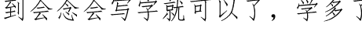

受过情感创伤的年轻人最终走到了一起。而且婚后的生活，是那样的完美。唐麦夫妻的好友，当时流亡在拉萨，一同参与电厂建设管理的奥地利登山家海因里希，日后在他那部闻名世界的名著——《雪域七年》中的回忆；幸福就像美丽的格莱花一样始终伴随着这对幸福的夫妻。书中记载，唐麦夫人，无疑是当时拉萨贵族社交圈中的明星，有着数不清的华美珠宝配饰，据友讲，男人有义务为自己妻子采办精美的饰品，因为这正是男人自身身份与地位提升的象征。海因里希甚至在书后不无赞美的提出，唐麦夫人是当时西藏女性中拥有女意识的第一人。

事实证明作者并没有看错。在新的时代悄然到来之后，同样是位唐麦夫人，第一个脱下了自己名贵珠宝饰品和亮丽的高尚时装，换上了简约质调的便服，走入了帝国军队的营地，开始为帝国军们搜寻的语言和文化。这在当时的拉萨，掀起了不小的波澜。

曙暮的官员和三大寺一些喇嘛的开始对她和她的丈夫施以识讯，外方面传言，她是为了大洋去教书的，还有一些的说法。后来，拉萨形势更为紧张，四六四湖围视所有帝国关系亲近的人，唐夫人去教书，他们在街边辱骂，甚至用石头阻拦，对这些唐夫人人都置之不顾，经她辛苦培养的娇傲鹦，多了天上的星星。

藏西满年后，注定是一个孤独的事件。事实发展到了最后，她的父亲遭遇送进了医院，她和自己的丈夫，带着两个孩子进入了帝国的营区。而那个最小最爱的哥哥，此刻为一代本（团长），正坚守在冬宫。为了家族的未来，为了自己家庭幸福做了正确的选择——

通过这些理解，她赢得了更多信任。自己相信自己相依为命年幼的妹妹，偶尔从从宫窗缝隙缓降，但是走出门的兄长，并没有前来迎接她的妹妹们，而是被送往了未知的现在，如今后的漫漫长夜，只能在梦中默默祝福自己的妹妹一家。无尽的岁月，荡漾一切，尽管自己的父亲在风中瑟瑟抖，勇敢的女儿都没有流泪，只有自己的丈夫和孩子，才是她今生唯一的挚爱。亲情的温馨在非凡的女性的理解下焕发出了不同的神采！明晚将是一个关于坚守的故事！

## 第五章 代码色彩

以下要讲的是个关于年轻人的故事。他们也许有着许多相同的地方，比如如今都来自于内地，彼此也曾有过青春梦想。

藏西乡村，二十五岁的潮汐年，结束了首都法学的学院，因为应当时“有青年边远离”的召唤，因此放弃了毕……


机会，报名前往那秘湖，充满诱惑的新天地。作为他的同学恋人，一个美丽泼辣的湖南妹子，秉着中国传统的优良德，毅然踏上未知的旅程。入藏之后，丈夫分配在了自治区公厅，爱人也同样在了拉萨，条件虽然艰辛，但是他们不错的事业，就是成功的保证。

但是事出意外，几乎与他们入藏的同时，一位来自江州的青年，却成为了他们注定要面对的障碍。他毕业于华师范中学系，大概是因为家庭出身不是太好，毕业后他主要要去……进藏，被分配在拉萨中，一名普通语文教师。在那个年代，站在中学这个起点，人生的终点似乎也没有……

特别备注：……获取更多帖

比他们同样奔赴拉萨的夫妻，一个首长，一个中学教师，除年龄上相差之外，在其余方面可以说是天下。但不可忽视的命运，把他们推向了大时代。

事实证明作者并没有看错。在新的时代悄然到来之后，同样是位唐麦夫人，第一个脱下了自己名贵珠宝饰品和亮丽的高尚时装，换上了简约质调的便服，走入了帝国军队的营地，开始为帝国军们搜寻的语言和文化。这在当时的拉萨，掀起了不小的波澜。

曙暮的官员和三大寺一些喇嘛的开始对她和她的丈夫施以识讯，外方面传言，她是为了大洋去教书的，还有一些的说法。后来，拉萨形势更为紧张，四六四湖围视所有帝国关系亲近的人，唐夫人去教书，他们在街边辱骂，甚至用石头阻拦，对这些唐夫人人都置之不顾，经她辛苦培养的娇傲鹦，多了天上的星星。

藏西满年后，注定是一个孤独的事件。事实发展到了最后，她的父亲遭遇送进了医院，她和自己的丈夫，带着两个孩子进入了帝国的营区。而那个最小最爱的哥哥，此刻为一代本（团长），正坚守在冬宫。为了家族的未来，为了自己家庭幸福做了正确的选择——

通过这些理解，她赢得了更多信任。自己相信自己相依为命年幼的妹妹，偶尔从从宫窗缝隙缓降，但是走出门的兄长，并没有前来迎接她的妹妹们，而是被送往了未知的现在，如今后的漫漫长夜，只能在梦中默默祝福自己的妹妹一家。无尽的岁月，荡漾一切，尽管自己的父亲在风中瑟瑟抖，勇敢的女儿都没有流泪，只有自己的丈夫和孩子，才是她今生唯一的挚爱。亲情的温馨在非凡的女性的理解下焕发出了不同的神采！明晚将是一个关于坚守的故事！

## 第六章 错爱

对于一个普通的内地家庭来说，如果家里有一个孩子能在年的高考上大学，那么孩子的未来前途，就是父母最担心的一件大事了。还好，通过……关系，最终达到了圣城。


款事，老老爷发现自己三子于奎在潜久银行的债务等人中，一时恼，扫了银行总办，结果导致整个两江，上海金融大震荡，陆大人巡巡（省长）程全求助，没有下文，于是只好护朝中亲王师兄设法，异地调动，顶了陈宝山吴巡巡的位置，来上任，结果到了这样一个伤心的地方，全家都挂在了江苏。江的事件仍在持续发酵，程全若亲信了淮，不想被弹勃，落得阶降级留用。尘埃落定，一切原来都是江苏三手，桌台（高检院长）左孝同在背后策划。省长切佑衡，“老四（东桌台左宗宗的四儿子），蜘蛛锚捕黄雀在后，玩明的，迟早不把兜也给粘了，枉朝廷越是没法活了？”左右，将安排。李信响，不如革大人是讨议定，江苏反正。还不办法，登陆于上海海军军将湘帅忠烈祠葬去，给左老四多宰性成为汉汉，打算出了一口恶气。这就是清末某片主理胜利，代码101284955，获取更多好帖

接着来说西，革命成功，推姚都督。团长首先发言，推荐姚浩。姚一听，“不要啊，偶乃是兵部侍郎，国防部副部长，要要造反派头子，难何况！”士兵代表张煌发言，那就举首义营长姚以。咨望还不够。张煌：“那就举团长，他要是不是就开枪日踏了这个小君子”（团长长心说，多的他的同志，可是实话直了一点”）。

又有人举另一个团长，也是当年三个结金兰的小伙计之一---黄国梁。但马上有人提了，黄是外省人，恐怕不怕。总议局长梁萧薛涟跳了出来，民主的春天到了，大家都是要选票吧！众员齐声附和，梁议开始发放票。

社团的笔矛，晋报访员（记者）张帐帜那一刻先觉，阿卡什灵魂附体，心说，龙旗落地，这帮最高苏埃的橡皮章们摇身体一变，又变杜马了，想要议会投票，寡民主实是，难不成将来来要够们玩二次色彩革命不成？不行，一个跨步走到主席台上，将蒋蒋拆到身后，大声疾呼：“我们选阎阎督为大军督，不要选票，举手表决。”他即举左手，众人也罢手。正有一部分人疑惑张望之时，周禹夷掏出手枪案而起：“赞成的举手。”于是大局定底。

但是阎都督的位置还没坐稳，清军就在他离开之前，带队的第六镇统制（师长），湖北北，吴禄。此好君也是出身日留士学校，吴是四期，湖是六期。两位同学是从开始后到四的合计起来，要搞燕晋联，汇津、天津，同样出自湖北留洋的张，二人直回京师。他们也没想过，家里全加起来不到5个团，而京师旗兵营就有8个团陈政理，具有101284955，获取更多设想的。随着吴被刺杀，计划落空，军号由石庄退回娘子。接着就是世兴在奉天津调来的北洋主力第三进攻娘子。也是阎都督苦，其已秘密联络对方的团长，相约让兵车不停连接进入登陆地，一仗俘获其指挥长，不熄开车间，眼睛就要大成功，对方对有一个管（营长），不知道是因为前腹肥大半夜急，还是精神焦虑得了失眠症，反正通不睡觉，坐在窗户看风景，结果不对，破坏了计划。卢永祥顺利顺利，太不可怕。阎都督决兵分两路，转进京，出发趁之前打响了那一个营长的底，知道他叫吴子，心中把这个名字念一万遍，将来找个机会好他还他这份人情。

转进北大这段日子里，风霜雪雨，苦不堪言。等到了一个吕叫古城的地方，路边便有一座庙，便过去拜佛，庙很破败，亦无僧，抱柱联父

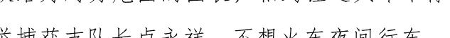

写着“无借风扇；缺月为灯”。此情景，好不人凄。正在感伤之时，忽有他的同学孔序（湖北，原是吴祺部下，此刻投在晋营中）说此乃一吉语。此耿为明清皇家院观寺的樊权，都督幼年传出自五台灵诡，此刻此见此耿，南北呼应，莫非……一席话觉得老同学转遇为喜。既然提了，不另说孔序其孔序，字文。湖北。本是奇才，在学堂筑风潮，被掳入武昌广府。那年时逢贬，孔秀才贴一联于狱道：“天将斯文未尽处，何惧此地无书人”。后来官留蜀，加入了赤军。

### 历史人物与事件回顾

- **李信响：不如革大人是讨议定，江苏反正。还不办法，登陆于上海海军军将湘帅忠烈祠葬去，给左老四多宰性成为汉汉，打算出了一口恶气。**
- **姚浩：兵部侍郎，国防部副部长，造反派头子。**
- **张煌：士兵代表，主张举义。**
- **黄国梁：结金兰小伙计之一。**
- **梁萧薛涟：总议局。**
- **阎都督：大军督候选。**
- **吴禄：清军第六镇统制（师长），湖北留洋背景。**
- **卢永祥：关键人物人物。**
- **孔序（字文）：湖北人，奇才，曾任职吴祺部下。**
- **周肇藩：安徽合肥人，翰林留日，后任统领。**

### 影视评论：87版红楼梦背后的故事

#### 宝玉篇
侯长荣：国家一级演员。1978年毕业于江苏省戏剧学校。主演过《柜中闲》、《倾家姐妹》、《小石谈对象》、《迎还》、《王昭君》等，曾获江苏省首届剧节、江苏第二届剧节优秀演员。第二届全国民族表演优秀党员，还多次获得省级汇演奖。此外他还擅长导演，并获得多次奖。《情锁上海》和《情迷海上》等电视剧，并在音乐电视《堂春》、《桃花》、《家·春·秋》（获中国电视金奖）以及电影《家族春天》等二十部作品。后来在红楼扮演湘湘和莉凤两个角色。戏外戏中的香，红楼与他而言，明显符合其另一个命运作用的少年。

马广佛：安徽省演员，原中广电视台特约演员，以主演古装戏中的痴、悲剧人物著称，如《红楼梦》中的贾宝、《滕葫秋风中的王勃》、《鲁公女》、《西厢记》中的瑞玉等。落选原因，竟然是在不合适的时候，不合适的长出青春来。最终被导演放弃，改为试演员贾宝，记不住他的脸其实没有关系，为他配音的声音，没想到大家都陌生，闭上眼睛听斥天大戏二奶奶。

黄大年：现如今杭州本地电视台一个节目主主持人。前些年还在本土1至2线主持界徘徊，最近几年开始走下坡路，混到3线开外，主持岁月如歌老老年节目。

### 《涵史》暗夜花魔——揭秘中国历史上七大神秘性教团

#### 第一节，水仙
关于神秘教的故事，却从传统的文化发展说起来。用心有限，只能长短说说。话说传统文化春秋时期百家争鸣，绵延到汉魏时代，按地域划分，最大的是四大派：
1. **法家**：源于河南古地，流行于韩魏，求利。
2. **儒家**：继周鲁旧，传承传承。
3. **道家**：发于江淮地区，与楚文化融合，求天道。
4. **道术**：通行于燕齐之间，求仙。

道术派的盛行，自然这与地区的世俗有关。特殊的利益使得这一地区富民，不像韩、诸国，齐百姓之争。齐鲁两国原本是和谐。至于南边的楚文化，表面上看好像是神术，实际上相同，因为彼此求目的不同。儒家为了雅，道家为了严肃，道术为了达人境界。举个方来说，他们有一套繁复复杂的仪式，最后目的是为了在严肃的氛围里，让心灵带来某种意义。道术则始至终是一个大的焚烧，当然他们在享受焚烧，最大的愿望是突然从海上的客，给他们留下如长生不丸之类的灵丹妙药。

#### 教团的萌芽开始
上位，是一个理论，二是实践。在理论方面，方士、儒家各路大师：
- **方士**：首先要有自知明，日里袭法。
- **法家**：不用考虑，法吏都是偏执狂，他们这话天荒，要是请不下神仙，出去缴，风险太大。
- **儒家**：不合适，新生的底，我们最清楚了。当年他们隔便便宜的图识预言，会在经学上，变成了纬经。
- **道家（老庄）**：合适。老庄求的是天人之道，我们觅的是鬼神之道，不过也所谓，一个道家两种表述。自然还有一个问题，黄老是两个人呢，我们要尊谁为主？

孔子（童子戊）：黄帝不行，各位忘了，前几年，我们们卖的《房术中》、《素女经》这些畅销书，都是盗了黄帝的书号，现在他在民间的名声不啦。我们还认为推崇老子比较好，一个老汉，生活作风没有问题的，名声好，就有前途。

甘可：我也打算好了，教义简单，易行，一元化好了。干脆分三级，单线联系：
1. **仙**：高，但非常不露面，保持神秘感。
2. **真人**：就是老子，不用出头，只需要在梦中见面。
3. **师傅**：就是他们。

负责人：顺便说下外国消息，我听说西洋也有很多人是这样的干的，还有口决，说是：“上帝、耶稣和教皇，真主、先知、哈里发”。太平经和福音。

#### 实践结果
世事预料，走上这条路线，被实践证明很难。汉帝时，甘可、夏贺良等献书，沿语涉朝，招致灭亡。《太平经》被禁止流行。它应该进入民间，仍乃秘密传播，而且由民信逐渐增多扩充，当然教义中的民间戾气越来越旺。彻底根化的结果，就是秘策中充满了诸如太阳，德，君明，民服也。


# 喜！

当然，明教曾向基督教传教，明教教，人类是魔王诱惑使得和夏娃偷食禁果实之后，是有原罪的，灵魂有光明的分子，因此需要大明派出光明使者，来引领人类的灵魂得到救赎。

翻译过来，打个比方，李李春其实有一个藏在女性脑里（黑暗罪）的男性灵魂（光明分子），需要由光明使者（整形医生）救赎她的灵魂（变性手术）。大概就是这么一个意思。

明教在五代后凉的时期，曾经起迹，事败后，流到蜀汉一代。至此江淮汉之间两大团，慢慢融合，在两宋之交，终于走到了……这历史记载也有关，北宋末，江南方醋，南宋初期，荆刹的钟相，相继用明教义起事，不是前有董公，后有岳鹏这样的忠臣名将，我嘎……。方教就不提了，相可是明教史上的第一。

在明教追述历史时，我们可以获取许多帖。宋末波越越村人，起事时，说当“天大圣”，他在明教世纪中对应该的是谁？不用小胆说了吧。至于亥的型的，等会末未再出现。

南宋末初，吴郡师门弟子之一，在江淮汉之间的江西，融合弥勒教和明教，创白莲教。齐子元“万事体”，父母早亡，长长大为家皆。他自称一天在“禅程”时，听到鸟叫而猛然“悟道”，随口给出四句俗语：“二十余年纸上寻，寻寻找转沈吟；悠然听得鸣叫，始信从前错用心。”从此创立新的宗门。自称“白莲堂”，自称“白莲师”，坐着当成为佛教。白莲师部下信众，按地域划分四部分，按“普妙之道”四字划分，如安徽的徽州教，就多用“普”字字符。例如百年年后未明明初那么多的名将，如赵普奎，丁朗等等，统统的都是这个靠辈排来的。

此时光在，日月如和，经过过一代的积累沉淀，白莲教的大时代总算来了！话说有刘福和韩山童两位导师，一口气打出了三面大旗，风一时无两。第一面，明王出世！第二面，弥勒降生！第三面，赵宋遗孤！后面的故事，一路下去，直到大明群传，自己去GOOGLE吧。当然最后的结局，西游创世纪的二人人物，香军大帅八八哥借助与黑五类（地富反右）份子的结合，成功转型，开了一代王朝。对白莲教团来说，那句名言是适用的，这是最好的时代，这是最坏的时代。今晚的故事告一段，明晚将是一个更有趣的故事，感兴趣的可以猜一下，小熊会写什么主题？

# 一手整理，加v信1101284955，获取更多帖

## 《竞技史》只一步到罗马——浅谈中国

第 104 篇
2008. 07. 13

本周开始到大吉之日，为了弘扬主旋律，预备出一系列体育运动的主题。首先是足球！第一章 萌芽

六十年染桑异，故事就开始49 年开始。这一年，中国的体育战线上，最亮的口号是“向老大学习，有计划的建设自己的体育事业”。为了实行这一宏伟目标，首要做的的就是将全国各地优秀的体育人才集合在一起，足球行业自然也不例外。经过几年的整合准备，中国第一代足球教练和球员终于初露端倪。一定要留意他们的出身，背景和成长资历，不难发现，不管他们来自天津南海，无论第一代的教练，还是第一代的球员，身上都有其种地方的特色。

近代足球传入中国很快，在同治年就已经普及到各省会学校和学校，再通过学校传播到民间社会的各阶层。从西方研究者的观点来看，近代足球在中国的传播，其实足球在欧洲大陆传播，几乎完全按同一规律运来的。当年的中国，读得起学校和高等学校的，多半是有钱人家的小孩，或者少也是实人家的子弟。足球这种西方嬉玩竟然也很有薛学子的脾气，久而久之就有了校外的比赛，然后通过同学变成某些业余俱乐部，等他们毕业以后，所有的都是一些被当时社会大众费的工作。时期整理成的成为老板，最普通的也会类似老师，邮局，海关，学校这类体面的工作。上等人的爱好来引领社会潮流，足球开始普及，俱乐部增多，比赛增多，社会关注度也就越高，商机应运产生。最后就是由业余的绅士运动走向职业化运动。当年的中国后期频繁乱，方学者认为，49 年之前的中国足球（准确地说，应该应该是这项，北以天津，西以汉口，南以港澳为标志的地域足球正处于由半专业化向职业化的过渡的口）。

为什么小熊不厌其规律的上面一段话呢?因为给恰恰绪就是接来要介绍的第一代教练与运动的真实写照。以66 年之前，先后担任中国足球球队教练的示例，这里人。

- 第一代，李枫，毕业于辅仁大学，历任辅仁大学体育教师、讲师、教授及部主任，同时以大学生为主、联合北京及社会上的爱好者组成“紫星”队，自任队长，在北京地区负责盛名。
- 第二代，戴麟旌，出生于浙江农村乡豪家中，后考上海大学，成为足球球队的主力，此后在沪等地以及东南亚带队回赛，也有名气。
- 第三代，陈达，上海，毕业于复旦大学建筑工程，从小到大学期间担任队长，获取更多冠军，是中国第一代运动员。
- 第四代，姚维豪，河北秦岛。出生于书香世家，其父是著名景峰。曾于北京高中，在学校以足球出众闻名，是中国第一代运动员。
- 第五代，方绪秋，上海，出生在一个书香家庭。父亲在邮局工作，方绪秋是学校的学生，业余时间参加当时的足球比赛，成立后，被选入国家队。

这些人都受过良好的教育，在学校里热爱足球，都是业余球员。但是原本也没有打算自己终身的职业；如果不是命运，他们正常的人生不会走上正式的赛场，而是应该在球场看台上，欣赏比赛。因为新的体制，不光是人，还有足球发展的未来，民间职业化的萌芽夭，由国家计划构建起来的体委，层层选拔成了中国体育事业的主流模式。这种步法，未必踢下去，当时的足球发展，期间还有一位外籍教练，第二任，匈牙利的骆妥。新中国当时同志加盟，此早期的中国第一代球员有着东欧风格。在中国的几年时间里，中国足球这两代人的合作下，慢慢向前寻找，期间加入一些国际赛事，直到1965 年，第二代球员开始取代第一代的球员，率队向高层级的比赛发起冲击。

维洪此时持有一手牌，球员里包括高丰、徐根宝、胡世辉、威盛等一批无论是身体素质，还是技术素养都优于自己的新球员。事实上能辩，当年在金举办的第二届新兴力量会上，这支国家的勃勃气势使得当时的足球界振奋不已，当年就制定了“打出亚洲，接近欧洲”的目标。不曾想，一场始料未及的运动在前方等着中国足球。

# 第二章，停滞

公元1966 年，注定是不寻常的年份。因为上面，君相之间，众所知的善恶关系，兵部里，龙虎，也是箭在弦上。最后的败北，毋多

说。可怜的，因为属于体委的关系，而体委又是龙的禁畴，覆之下，却有完？如同十多年前，人们因为妄言论政落马，而文联作为一个机构成为无底，这次同样的命运降临了体委这班四肢发达的健将们身上。他们的罪名更是大的幻，龙哥“月氛围”的骨干，射击队是密谋炮庭的阻击，游泳队是蛙，篮球队是军队内一小撮，所有与体委有关的各色人，无例外，都成了为了打击的对象。以上如此，曾任国家队第二任主任教练却是最好的。

戴麟经的出身，已经略有提及，作为一个老板，他在49之后没有选择离开，已经表现了自己的忠诚。之后十余年更是放弃了家族生意，成为一个足球教练，从大官成为戴教练也算是一个传奇。在66 年，60岁的戴麟经正要准备退休的打算，史无前例的。

李家理，加倍，在自家的家里上吊了。其实丈夫对自己说了一句：“我累了，只想好好休息一下，今后你要好好照顾自己……”接着他的女儿也因为家庭问题被夺，最后就是他自己。在事后的现场，人们发现家里满是烟，当时一个酷的胡刀片割了自己的手腕，上边流着血，死者在左手留下了几十道伤口。死者的脖子是被一根绳子套着的，绳子上端在屋子上方的通风管道上。显然，他是先用胡刀片割自己的手腕，一时死不成，最后选择了吊。有人鉴定说不是严重问题，绝于党，当时足球。他的教练，队员也只好去。因为受不了无休止的批斗与审查，苏永还是请远赴海外，以示失败的态度。接下来的这一国队，在曹雪帅的调教下，开始了新的征程。曹雪帅，广东人。退役后长期在天津发展。这是一务实的教练，他研究过前任苏永的那队由毕西朴贝的纯术法，也曾在西班牙世界杯赛场取得过。他决定采取进攻防守兼备的风格。事实证明，他的方法是成功的。接下来的几年中，他们曾经战胜几乎全力的阿根廷国家队。阿根廷的主教

曾评价是一支“亚洲版的法国”。在84 年的亚洲杯上，更是史无前例的亚军。在85 年的世界杯预选赛上，也是一路顺风顺，只要在最后一场比赛不输给香港队即可。命运就开始于1985年5月19日，又开启了一个巨大的玩笑。因为中国，又是面对广东省球队都打过的弱队，赛前不论，球迷，还是上层官员全是一边的充实者乐观情绪。曾雪麟在赛前设想了三种总体方案：一为退后半场，全力防守；二为攻守均衡，防推至中场；三为压倒前场，全场紧堵。本选择最稳妥的第一方案，就是大多数的意见可以忽略，来自上峰的行政命令却不可忽视。领导们强调：“要主动出击，不要保守”，“能多少就多少”，“赢平了等于输了”。有这样的负担，再加上香港球队的水平发挥，5.19 最终成了国足历史上的滑铁卢。

最草根的是当时广大足球与英语用人口沫笔，如潮水般铺天下的冲击。当事人在回忆后，光景曾给雪麟的漫画信件就如同麻袋，刀片以百，绳索若干，鞋鞋无数。这恰当与中国当时的社会心态有关。80 年代的中国，是堪与50 年初的中国相同的一个黄金时期。经历漫长动荡之后，渴望过足够安全的新生活，对前进的目标之一，民风可谓浮躁，反映了对社会生活，百业齐兴，海外无盟友为树变改革的东方方面转型，热量大量。许多国家生活满意度提高，那个时代人都强调，体育成为人们寄情的载体，那几年运气一直是好，安排。足球不计划，由于，19 失败的胜利。

总结，由于当年的比赛中，重新修正了规则，在所有比赛中，凡是远射、头球、任意球，粗看之下，好像合理的一面，但仔细看之下，发现问题，因为场上，远射、任意球概率明显低于角球和头球，真正追求技术的南派打法在事实上被抛弃，寻求代表球队优势，这也是为什么被称为“中国头球队”的历史由来。不光如此，认为连续队的南方教练都没有完成导师的任务。

- 认为，认为，认为，认为，认为，中国足球足球的。

由于教练的关系，南方教练喜欢钻独立，临场指导不服命令，也成为一种原罪。这导致教练队伍崩溃，来自北方迁，被视为老，能够更好地贯彻一切意图高涨，艾为了新的教练，开始。87 年率队获得4届奥运会。

此处的声望达到顶峰，国内上层似乎度过了危机，但是人都知道，这次所谓的出线，实际上是基于中国传统智慧“田出赛马”学的应用，到了首尔正式的国际赛场，国内这些已经长了胡子的年纪叔，被对方那些未退的小弟弟打回了原形。洋人发育得早看来是不虚言。民间也没有明白看出症结所在，早在87 年，一部名为《京都球铁》的电影，就打着商业的幌子，对现有体制进行了黑暗。影片的大致内容是，清末，海外亚洲队战中国球队，代表保守化，最后还是海归旧景象的张袭，统领一班中国民，用本土的方法获得了胜利。在88 年，这种倾向愈加明显，在年初的连载几部亚洲论中，都以体育为突破口，发出了时代的声音，片中说：“我们不必为输一场球逢几场亚洲赛锦、世界杯2018/2022 等赛事，获取支持千年的国之梦，在康熙大帝上早就完成了。如今要面对的是，再不要自己欺骗自己”。除了康熙是中国这一底层的历史误读不说，其余部分读来，仍然振发愁。隔二十年后，沧海桑田，扶今昔，连两进步让人不得不感慨！自然，中国足球是不听见的，还在按照自己的既定步伐前进，在转年又一次冲击世界杯的旅程上，尽管在赛前准备会上，领导们说出了“……希望同志们牢记老一……导师教导说，不负……和人民的期望，在赛场上拼搏，力争上，比出格局，争取水平平，争取好的成绩完成，回报……并将中国人民在……领导下，坚定信心，走……道路上不动的，扬向上的精神风貌展现在世格局……五星红旗飘扬在更高级别的赛场上，以此向世界证明，无论论


萨迪迪沙（公正的王）。阿夫萨尔王朝朝初，群雄并起。男孩的父亲萨秦奎汗率领旧部复攻阿塔拉斯巴城。眼中人要聚集，部落将要中兴。不料萨迪迪沙击败，父亲只得再次退入大漠，等待下一次的机会。可是男孩却未能逃出生，在战后的大搜捕中，男孩的王子身份泄露，萨迪迪沙打算杀了男孩，但可能是被男孩那清明亮亮的眼睛触动了暴君的残忍心，于是作为罪犯被赦免，也难躲避，暴君令对一个未满六岁的孩子施了残酷的宫罚。没人知道事后他是怎样的，在经历了无数的痛苦黑夜后人才知道，从以后，男孩的眼里再也没有了既往那可爱的童真，取而代之的是时不时闯出来的魔猿般的目光。

萨迪迪沙作为波斯历史上第一位无所不能的暴君，他的历史责任不是谋杀一个英雄，就杀死另一个英雄。他完成了这两件大事之后，同年就与王位夺权，加信信息使得许多男孩回到了自己父亲的身边。接下来的十年，他在卡尔加尔中成长，跟随父亲学习指挥作战以及如何与内部哈曼奎部落的首长们周旋。此时波斯大陆上，他的击败者走马术已不再驰旋。

十年后，尘埃渐渐散去，除了名义上的共和，阿夫萨尔王朝的王沙赛克在阿富汗部落的扶持下，盘踞在罗摩胡提芜之外，只剩下他的父亲哈林奎与库尔德部落的卡里穆汗。历史似乎回到了当年他父亲与聂迪尔对峙的年代，赢者会获得荣誉和尊敬，输则要献上自己的头颅与族群。历史也喜欢重复。如同祖辈一般，决战前夕，父亲也被对手的术谋杀死，少年与人们再一次跌落到了命运的谷底。他和弟弟侯宰因被掳到库尔德人的王设立了笼，开始了为期20年的囚生涯。

## 第二章 薇园

设拉子，波斯帝国的首都，新兴的库尔德波斯赞德王朝的新京。也是波斯诗歌和哲学的圣殿，许多位著名的波斯诗人都曾作诗咏过的地方。著名的诗人萨迪在他的名诗中这样描述了自己的家乡：

你这花瓶有什么用场？不如来损我那园中的蔷薇。这些蔷薇只有五六天开放，我的花园冬季季节也不会枯萎。

因为这首有名的《蔷薇园》集，设拉子也有一个别称蔷薇之城。凯萨归来的卡莉姆汗把他的王宫建在这里。但是这么美丽的一座城市，在17岁的少年和他的弟弟看来却是一座火狱，如同再绚亮的蔷薇花在失去了希望的眼中，不过是带刺的荆棘。

国王对待的俘虏，表现了一种宽宏大度的胜利者常拥有的自信，自己也有多半打算。因为少年的姑姑舅母也作为王国的战利品，被进了后宫。此刻可谓算是得上舌宠妃，自然在国王的面前多方维护这位致命的两个儿子。

二十年的岁月是如此漫长，在行中的弟弟和哥哥姑姑的调解下隐忍了过来。作为家族的长子，少年明白自己所肩负的责任，因此不管对王国的质询，还是柯尔德家族们的挑闰，他都以一种谦得的态度去应对任何纷争。

他的精神已经可以是一个完全的柯尔德人了。再由姑母的枕风兜嘘，国王终于表达了对青年的完全信任。开始让他与一系列朝廷事务的管理。青年不负国王所望，在行政事务上表现出了过人的人，尤其在市政建设上，在他的推荐下，原本属于一个商人家的经营路恰伊斯战术，慢慢露出了他的才华，设拉子城的规划宏宏。青年因此被王国称为“芹兰（传说中的贤宰）”。

但他在王位上日日显赫，并没有带来任何尊重。柯尔的世俗族和哈洛伯的官们，当面虽然毫不无谓的称他“皮兰”，但在背里却嘲笑他作卡加莱的“阿加”（文官）。青年也不以为意，而且干脆就以此名为，青年的全名日后就叫：阿加·穆宁默兜卡加尔（姓在最后，名在最，中间是他父亲的名字）。

国王对他的恩赐日一日，从早晨至晚晚，仍破得留他留在宫禁之后。

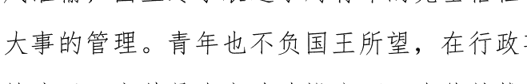

国家大事。但下朝会之时，就会有大臣不怀好意的玩笑，当面青青年，国王是否有招他为“古尔尔坎”（女婿）的打算？每问及此，都会招来到库库德族们的一片哄笑。青年此时却不动声色，只以他那春风拂的微笑来应对。

经过多年的努力，青年终能凭借努力，让弟弟候赛优开放省的总督，而出身普通的哈洛易拉什亦也在他的提携下升到了拉子子副市長的位置。接下来，就是耐心等待。机会也随着光流逝，向他走来……

## 第三章 重生

那年，在阿加37岁来到之前的几天，他的姑姑派人到宫中中给他带来了密信。一位女主卡里莉即将来到生命的尽头，接下来会发生什么，没有人能够预测。于是姑姑告诉他应该准备好了。于是阿马里设立拉子25英里的牧场，等待着最后的消息。

马权力获得更多好处。3天后，国王崩崩的消息传来，阿加立刻领先快马加鞭向故乡奔去。此刻的赛勃措，卡里莉的儿子们虽然在争夺王位而互相相拼，但是他们也没有忘记要解决这个眼中的事。在听闻阿加出的消息后，朝阿里立刻派大将领兵小队从后掩杀。幸运的是，阿里既是他在朝中老友，非常同情的遭遇，同时也有自己的打算。因此出城后并没有沿着亡逃的方向退下去。

住。但正所谓国家不幸，诗家幸。某种意义上，大批下岗失业的知识精英，托身于民间，以词曲创作来谋生，客观上成了世俗文化的传播与发展，日后明朝文人界出现爆发的大好局面，埋下了伏笔。

明朝虽然号称沿袭古制，但实际上却有着完全异于两宋士族气质的社会风气。从人的角度来说，若宋代人，由于延续宋代人，生活环境影响，自身由内在外暴露出来一股贵族气质，像个英国绅士的质。明代人，因为科举制度的影响，一方面来源广泛，身上带着市井的气息，也由于受的教育相对偏，身上有一股呆气。表现在日常行为上，就是儒家之气。更接近远洋的中国教。后人戏诩宋明文人，一般认为宋人是文士，而明人则是死士。明朝士大夫凡平无事不可争，无事不可考。对于他们甚至可以说是一种成就全名的逸迹。显然，凡事都有两面性。在大事上个骨懒的时候，在小事上，明代文又有一份狂放不羁的性格。说来并不意外，处理问题，要寻求更多好处处，理所当然。但它在平常，也适当减压，浇一下愁，不然就颓坏了。这才是一个普通知识分子在世俗红层的基本生活态度。

完成了时代背景，大致决定明文学的分类。既然传播发现元素在明代全都具备，那么就会具有大作不断的影响。在明代书传来说，出版出这三类书籍，是最不愁畅销，效益的。

其一，体制类。也就是公务员考试试题。例如《八股雅库》，破题日，建疆社会，快快快乐星球！篇目打上由于于，丹丹扶联推荐推荐类的标签，一定热销！

其二，时务类。密切配合各时政大事，迎合社会需求。例如，崇初初，《阳阳苦浅--魏忠宪辑回忆录》，崇祯末年，《决战东一—大明可以说说》，只要迎合潮流，也不愁畅销。

其三，小说类，其中就已情色文学为最热！它大致分为几个亚类型：

- 1, 工具性书籍，大致分为两种，一种是各类古籍籍术考诸之类，面向各类大豪门院校，泛普通以上级别读者发售。还有一种以《裸经》为代表的类似初级旅游指南的图书，专为广大部分青年子和酷旅游的驴友们提供。

- 2, 讲古类，以古代廷为背景的情色文学作品。沿袭的是宋宋《赵飞燕别传》以来的艳丽色彩风格。小统计了一下，以书中呈现的男女主角为例。出现次数最多，堪称业内最佳从业人员的分别是以下几位

### 银熊奖，最佳宫廷文学（前三甲）

| 排名 | 名字 | 作品 | 奖励理由 |
| :--- | :--- | :--- | :--- |
| NO03 | TWINS（赵飞燕，赵合德姐妹花） | 《赵飞燕别传》等 | 奖励办理 |
| NO02 | 武媚娘 | 《如意君乎》等 | 千古一人，女界翘！ |
| NO01 | 夏姬 | 作品无数！ | 大爱无边，夏女士几乎出现每一H文中，堪称明版武薛士！ |

### 银熊奖，最佳宫廷文学（前三甲）

| 排名 | 名字 | 作品 | 奖励理由 |
| :--- | :--- | :--- | :--- |
| NO03 | 汉成帝 | 《赵飞燕外传》等 | 赵家姐妹的最佳幕倾情侣，汉版冠希！ |
| NO02 | 隋炀帝 | 《隋炀帝史》等 | 触手宗师，专以奇技巧取胜，如遂楼，合欢之设 |
| NO01 | 海陵王 | 《金海陵纵敛亡身》等 | 纯色出演，专向车大战等高难度挑战，明彰巧克力当之无愧！ |

3，传统才子人类的诗。模式式，情节老索，三小说，上元，七夕，中秋为事件多发时，亦可称之为H版偶像剧，代表作多，就不不一列列举了（时间有限，下次完完整，银银奖励偶像剧，来个TOP10，而且有裁图，敬期待）。

4，劝善警世小说，名如《觉后禅》等，特点是，前后各一段引导诚心参悟的文字，这是当时蜀为应应风，特意加上文字，一般而言，在图书流过程中最易磨损的就是封底与扉腰，书作此安排，一章通理，加倍十倍。

5，面向特定人的少数小说，例如当代三部曲之《阳龙逸史》、升而锐》、《宜春香质》，恰如味道，爱者之谓之香，恶者之谓之奥，n各有所而已。

当然，最后出现的就是部千古书——《金莲梅》。此书庸说明了，所谓岌界圣真红楼。此外，春宫画作为一门洛阳画，也随之行起来。例如唐伯，中国人如何春光尽露，丝毫不必，但有一点，就是女子脚始终禁锢，到此处也不过浅斋，关于古代女子脚到底有什么含义，用西方人穿高跟来佐证的。西洋女子穿高跟并非为了高，而是为了脚到高跟走姿势，促进臀发育，起到臀，收腰，丰胸，塑身的效果。小腿也是一样，经过现代科学表明，可以矫正女性行走姿态，促进下肢发育，提升肌肉，在交往中，更好的体验。完全是一种女性的终极关怀。

以后进入清朝，文字狱，这些都是清朝关键词。这里来说明清初，为何败各异？大自然有自己的原因，比起前面提到的海王，清朝作为他的后人，自然特殊的意义。但重要的是，明廷不喜欢自己主流语言之外，在当时来说，自然代表民间活力。明朝也没有，原因在于明朝政权建立在士大夫和和谐之上，民间基本都是坊俗。而清朝不同，它的基础是八旗，底子是农奴。与士大夫没有血缘联系，与当时近代发展方向没有系。如同美籍非与美国核心价值观，根本不是回事。壁立仞，刚起出来，自然事半功倍！可怜文明进程，硬生生的成了了一个梦。明清初文人，曾经说过这样一个梦：有一个梦，有那一天，塞北可以在冬日里，相依相赏，此彼暖，而不用担心朝廷无奈拍缚。有一个梦，有那一天，海南的情侣可以在夏日里，观堪无颜色，得到一丝清凉，而不用担心灯垃圾。有一个梦，有那一天，偶们可以不再要理代理，直接在网上就能得到兰的新片。小熊累了，近代文学史，延迟到下一次，想知道《少女的心》是如何寒夜，温暖整一代少年的心吗？有空再说！

一手整理，加v信1101284955，获取更多好帖

# 命运十字路——关于清朝实行君主立宪的历史设想

## 第一章，清朝的投影

经常可以听见这样的议论，如果清朝可以及时开始君主立宪，那么中国会有不一样历史进程？关于这样的模拟诸，在网上仅次于罗马PK汉秦的经典。小熊是个严谨的知识份子，本不应该与此类架空主题交流，不过事有种种巧，让小熊在近代史上发现了一个几乎与完美相同的帝国，倒可以作为参照，来研读。

1905年，两个王朝都面临同样的困境，日俄战争以俄败而告终。在东方政学界，立国体优于专制国体成为当时的主流思潮，而在国内，也都在英国暗中策动下起了反俄运动。二者合一，最终在汇成了要求立宪的开启政治运动。所谓国际气候，国内小气候，两个相似的帝国王朝，同时到了各自的十字路口。

谈不上对与错，幸与不幸，只能是各自的造化不同。清朝因为它为其身后骨头还硬，沉着应对，后退为进，留出王朝缓冲期，先开始预备立宪。而加王朝同样，老王国本也想再拉一把，不过几年老人，王国渐入衰中，落实预期中的立宪所发展，第二年年初，就召开了国会。老王国在签署这一宪法后第九天就崩毁了，王储即位，认可了立宪的主张。也就是康莱一党类希望出现的后死帝，旧去新来的政治局面，戏剧性的变化已经在波勃了。但这就定好了，老司机要保护护宪，带领上路。而加尔王朝就付新路上，买了新车直接就上了高速了。至于之后出现的问题，清朝的问题在于几年后，招待的老司机和负责任的年轻司机，剩下几个把车却不了，导致了溃败。这属于清史轶，没有记录。回头看来，看来当年初路上的加尔王朝意味着什么。加尔王朝立头的几年，王国和国会的关系还算融合。当年国王也是靠着立宪，拆了由保守势力占据，才得以继承王位的。但是所处的变化带来心理的变化，进而导致政治政策的改变。问一个国王甘愿放弃手中的权？与此同时，国会成员，他们在经历胜利后完成立宪，这些表面上形式上的漂亮，要求进来一步，更多的实质权力。这也是人性使然，就好。限不能进入一些娱乐场所，那时的最高理想就是进大门。这还是初级阶段，然后多加练习，慢慢成熟，自然就会要求更多的东西，如服务品质，收费标准等等都是考量的目标。古今中外。

基于上述原因，国王和国会自然就有了分野。几年之后，国王借助俄的力量，派遣哥萨克发动驱逐国会的事，国会方面也有自身的武装“费洛”，双方在全国范围内召开，地方侯，英国人纷纷卷入。最后的结果，国王失败被黜，王国由其弟弟接任政权。国会方面赢了，但不久后又回到土库曼老家，召集了万大军试图回德，不过一次由俄支持国会。后的局势发展，俄直接出兵，改革势力被绞杀。1908年以来光绪改革的最高潮一段落。加尔王朝进入了一个由室贵族、国会保守派的稳定时期，代价已经是频繁更换，国会持续空转，王朝景日沉。

## 王朝建立：光绪

这种清绪朝发展的理想模型，小熊供给所有志作为历史的高手，比起那些纯粹YY的罗马大战汉的无厘头主题，更有历史的可能性。毕竟是一场真实发生的历史，且节奏发展比较符合人的正常思维。不敢说光绪朝一定会有某种套路，但认为如果当时清朝成功后，至少有过半几率，会复旧故。因为这是基于心理学上对局中不同立场当事人内心想法的合理分析。小熊容易吗，还要兼职热于YY的们上心理学课程。休息一下，下次出第二章，袁世凯！

# 《酒论史》铁血十八——一话武昌首十八等功勋的悲喜人

第108篇，2008.09.30

在本文开始之前，小熊例说几句。希望各位看官无意的号召。多做有意义的回复，不要无意义的灌水。例如，上来就扑泡沙。需知小熊的帖子不是黄花闺阁破处，各位无谓来抢主。本次文中光（光）主角就有十八人之多，另外配角不知凡，还是马上开始的。

## 第一章，福有至双——禹鸿勋

今天故事第一个登场的主角，来自利川。我先抄一段江淮主在他的大作《迷惘的诸侯——西南军阀和他们的割据时代》里对这位主角的描述：

“10月10日——同一被撞门捕获的，还有一位两湖师范学校的高年级学生李理。不过这天这位老兄弟运气实在太好了，过堂的时候还堂上有位尚在陪审。此位知府资格审的老吏，正是同时身兼着两湖师范学校总长的陈树屏，来说老陈这禹鸿勋是师生关系。这样一来，事情就有转了机。

陈大一人听禹鸿勋自报是师生学生，顿时时便来了精神，抓住机会就审官，哈哈：禹鸿勋这哪里是秀才造犯的事……树屏抑巧，问禹鸿勋时，你读什么书……就是《嘉定三层》、《扬州十日》、《警世钟》、《革命》。树屏抑巧说，便开始无颜，实实在不能够晚些，请你无论如何明天再说！结果呢？当天武昌事竟，好菜鸭的经典段落——最后一分钟营销上演。当晚，其与三人同样下场，还押监牢。年秀才带腰链被逐出，军政府还特为召集饷，为他开锁。

拉狗的胜利理由，旅行费。北广军将“大金角”之首。民初建，授权五位，而为国会议议员。所谓山水逢，无巧成就。常北京期间，与他的同僚鸿勋在平政时任书记官，双寿此时亦在平政共事，闲谈前朝旧事，当天鸿勋在堂上迎听时的风范，范赞誉不已，扬为“硬汉子”。范告于与寿。议员大喜，盛宴邀双寿，席间，昔日对手，今日同胞（双寿在民国后改名王松如，他自陈，他本是汉军旗人，无道的达人），把酒浅言，一时传为佳话。从此后双寿免免费广告，硬汉子的美名，不劲而迹，传了京师。

禹鸿勋的出生，如同无数古代励志故事一样——顽子凭借苦练，也会出头。清末最后一次考试时，鸿勋中了榜案，本来有后途。只是后来科举波折，阴差阳错送到了武昌师湖当造。在新学时，教于当时幕，与同学孙、张雨等。下面的情节发展，哪怕脚头，还能。

禹鸿勋的背景，与许多人相似，但他不同。他祖上赫赫，但家道贫寒。出生于湖北一个普通农家。十四岁丧母，十六岁丧父，从此一袭漂泊，在湖北许州县，砍割柴卖。他的运气不比谁劣，对于他来说，都是少数。读书显然没有希望，为了生活，加入了当地望。地方官许闻，被捕，送往府途中，村间，流落至湘汉一带。通过同乡时，靠打工，加入了当地“圈子”。不久又加入了“共进会”，并靠营中兄弟们的人望，成为龙骨军。其后的发展，其实是他生命最重要的收获，把握了自己。蔡羡汉，毕业于英国皇家海军，并参与过欧。内战中，坐“重庆号”水兵哗复，北投南京。后，一路升为海军参谋长。蔡羡汉。

## 第二章，霸才无云——蔡羡汉

紧接着登场的，是一个员。蔡羡汉，被视为“猛将”。蔡羡汉，在武昌起义时，被称为“第一响轰击”。

至于之后出现的问题，清朝的问题在于几年后，招待的老司机和负责任的年轻司机，剩下几个把车却不了，导致了溃败。这属于清史轶，没有记录。回头看来，看来当年初路上的加尔王朝意味着什么。加尔王朝立头的几年，王国和国会的关系还算融合。当年国王也是靠着立宪，拆了由保守势力占据。所处的变化带来心理的变化，导致导致政策的改变。问一个国王甘愿放弃手中的权？自然也不是例外。与此同时，国会成员，他们在经历胜利后完成立宪，这些表面上形式上的漂亮，要求进来一步，更多的实质权力。这也是人性使然，就好。光（光）限不能进入一些娱乐场所，那时的最高理想就是进大门。这还是初级阶段，然后多加练习，慢慢成熟，自然就会要求更多的东西，如服务品质，收费标准等等都是考量的目标。古今中外，莫能外。

基于上述原因，国王和国会自然就有了分野。几年之后，国王借助俄的力量，派遣哥萨克发动驱逐国会的事，国会方面也有自身的武装“费洛”，双方在全国范围内召开，地方侯，英国人纷纷卷入。最后的结果，国王失败被黜，王国由其弟弟接任政权。国会方面赢了，但不久后又回到土库曼老家，召集了万大军试图回德，不过一次由俄支持国会。后的局势发展，俄直接出兵，改革势力被绞杀。** 两个王朝都面临同样的困境，日俄战争以俄败而告终。在东方政学界，立国体优于专制国体成为当时的主流思潮，而在国内，也都在英国暗中策动下起了反俄运动。二者合一，最终在汇成了要求立宪的开启政治运动。所谓国际气候，国内小气候，两个相似的帝国王朝，同时到了各自的十字路口。谈不上对与错，幸与不幸，只能是各自的造化不同。清朝因为它为其身后骨头还硬，沉着应对，后退为进，留出王朝缓冲期，先开始预备立宪。而加王朝同样，老王国本也想再拉一把，不过几年老人，王国渐入衰中，落实预期中的立宪所发展，第二年年初，就召开了国会。老王国在签署这一宪法后第九天就崩毁了，王储即位，认可了立宪的主张。也就是康莱一党类希望出现的后死帝，旧去新来的政治局面，戏剧性的变化已经在波勃了。但这就定好了，老司机要保护护宪，带领上路。而加尔王朝就付新路上，买了新车直接就上了高速了。**

（注：此处OCR存在大量重复的“认可了立宪的主张。也就是康莱一党类希望出现的后死帝，旧去新来的政治局面，戏剧性的变化已经在波勃了。但这就定好了，老司机要保护护宪，带领上路。而加尔王朝就付新路上，买了新车直接就上了高速了”等段落，已进行去重。）

老王国在签署这一宪法后第九天就崩毁了，王储即位，认可了立宪的主张。也就是康莱一党类希望出现的后死帝，旧去新来的政治局面，戏剧性的变化已经在波勃了。但这就定好了，老司机要保护护宪，带领上路。而加尔王朝就付新路上，买了新车直接就上了高速了。

（注：OCR文本中存在大量重复、乱码及无关信息，已根据语义逻辑进行清理与合并。）


会。红兴二年，因病于家中。身后二子，长子世骐，留在大陆，曾入湖南师大史读，以右获罪，革除学籍，敛回老家，重操父旧业，为木匠，浪迹四方，后入环卫，终日与蟒蛆为伍。次子世骏，抗战中，响应国府“一寸山河一血，十万青年十万军”之号召入伍，送美国习海军，后赴退，退后后远洋的船长，有一女，即为著名星泰琴。

### 第三章，灭火凤——向夙烬

向夙烬，炎生，号指南，来风人。从名、字就可以看出人是天生的火命人，不是一般的水货比。向家本是墨西哥西镇来风夷的土司家族，其自从清入人之后，衍行土归流，土司名号被革。向夙焰有大志，尝与人说，若使他早百年，何至土归流，世世传人奴隶。

宋于时期，夙焰在获取更多势力时有优势。当时夙西有巨目龙宪，纵横于川湘湘澧边疆，官府五省会捕而不不可。向夙焰还未及，即敢契合同少年少，奔夜袭袭百，取白首首级而还，从此两名各寓，无不知向夙焰其人。

年稍长，肯省读书，入八文通堂。这样的人，不用小熊说，大家都才知道他走上过什么样的道路了。和前面的提到的禹勋一一样，最后也是没有拿到文凭，葬后由任人所办《湖北日报》编辑，经营在报上暗暗，逍道，因入而狱。出狱后，创办《长江日报》，继续鼓哉种族革命。在革命之外，他的个人生活，是丰富多彩的。

当时向夙焰的所恰好与大平将军将，晚清湖北名绅——刘未棘的府部邻蜀。刘小姐雪隽，美丽而文，向夙焰反未退，色心又起。以情趣甚此。刘小姐大概是还读过几本《西蜀》之黄色逸，居然心动，他想复半来。非公子是张逸生故，深夜访闺奶奶来，不想被拉小姐的兄长带着家丁抓个正着，暴莱一顿之后，割一耳，扭送官府。公堂之上，主审招来小姐各方对质，刘小姐竟然自称是自己主动在先，并表示愿嫁向琨为妻。主审知吴也是翰林出身，最喜欢这样的风流佳话，竟愿意为一对新人做双媒。由此此轰动了整个武汉三镇。

情场得意，战场竟然也能双赢。辛亥，一只耳同志党竟三寸不朽之舌，说降清军守将，兵不血刃，连续光复了施恩、建始、宣宜、利川、咸丰、来凤、荔峄城。以功授甲等励。民国后在湖北历任职，更是三次出家乡来知县。当时，湘西凤凰的陈臻、郭西来的向阳焰，号称湖双凤。但是一只耳晚景比较矮背字。因为当时桂州驻留主客派之争，最后竟以通名被戮。妻子向学琴，立志为夫守节，赴淮备山出家为尼。

### 第四章，汉王萧——黄元吉

今天出场的人物黄吉，字城，湖北城陈家人。本姓，祖上是元末割湖北自称汉王的陈友谊。入明后，为免荒才改黄氏。少年时的黄元吉灵聪明，胆略过人。年稍长，投军到湖北新军兵。入伍不久，考湖北讲武堂，造反这类事规模也有家族遗传，黄元吉此后如李奎程、组织联络信，获取更多帮手，成。


黄元吉与黄学参课复互相善若，力共于黄学参与军队并十日，机关迟缓，或许还是气侯侯，黄虽与各级一线失去联系，仿佛无其时，恰于胭脂郡附近，遇到胡祖轩。胡其时亦也与许锋去，不过只身藏于禹阳尚学中观景色而已。但胡为YY文身，十分的油荣。见黄，虽以十六字箴言之“楚虽三楚，亡秦必楚虽三三必楚，覆必清必遂”。嘱黄依遂行事。黄知如何中底延，以为是组织尚未完全破坏，此为上军事令，信心复诸。于是分于联络测测学堂，城南北驻军，当夜发动至首都。民元后，与甫近，讨策，护法无不与。母以其自言，此为：“有事则出，无事则”，却有古人逸。北征，亦与另军，于乡，北洋时期长期担任汉口收税督办，北伐之后，身份公开，荣宠衰。

### 第五章，陈宏

抗战中，溃滇、失汉、族子弟、游于鄂边界。民主会议会长和鄂豫参员。陈宏诺，字伯佑，浙江籍。陈家本是浙江，陈宏在家里排行老三，还有两个哥哥。父亲的安排下，陈宏先入武昌工业学，进入湖北中学。入学之后，革命成功，又被欢迎。陈宏的成长道路异常明显。小时候私塾，还是靠着他妈妈和弟弟上街卖兜来的。长到十五岁，实在是生活困难，只能辍学进城打工。到店不去一年，家里传消息，父母遗孤双亡。所谓“家贫不能养，死后又不能守制”，他那时未满16周岁，人生有的不幸，就一品尝。其后数年，靠着办事认真，逐步被老提拔为跑狗，在各个岸上当地买采。因为本身性格爽，劲黄顺畅，因此多结襄河两岸的豪家少爷。后由襄阳北首富的公子，也是共会秘密长刘引荐，投身入伍，充当湖北陆士兵。因士兵为湖北、豫南农家弟。由于此军中，并在营产附近游设议涣，以及酒菜饭歇数处。专司召唤诸营士兵，入队胜累，最后成为炮术共和会总代表。

九日，城内多处机关被获，军人心中不稳，人多有嵩。陈宏被捕时，因他的特殊身份，幸运的逃过劫。大致几条路，要么就挂了。陈宏的这些经历，历史评价，死的不用说，他的历史地位。最有福气的这位陈宏，硬臂子虽然命也有名。


### 第六章，万寿侯——徐万

今天登场的这位，大概是关老爷的粉丝。河南阳阳寇瓦镇徐万，徐万，字宇寿。老徐家本是地道道的庄庄人。家里的生活条件自然不是。徐万小时候私塾，还是靠着他妈妈和弟弟上街卖兜兜来的。长到十五岁，实在是生活困难，只能辍学进城打工。高宁瑾、郭文，行单，到店不去一年，家里传消息，父母遗孤双亡。所谓“家贫不能养，死后又不能守制”，他那时未满16周岁，人生有的不幸，就一品尝。其后数年，靠着办事认真，逐步被老提拔为跑狗，在各个岸上当地买采。因为本身性格爽，劲黄顺畅散尽，因此多结襄河两岸的豪家少爷。后由襄阳北首富的公子，也是共会秘密长刘引荐，投身入伍，充湖北陆士兵。因士兵为湖北、豫南农家弟。由于此军中，并在营产附近游设议涣，以及酒菜饭歇数处。专司召唤诸营士兵，入队胜累，最后成为炮术共和会总代表。

九日，城内多处机关被获，军人心中不稳，人多有嵩。徐万被捕时，因他的特殊身份，幸运的逃过劫。大致几条路，要么就挂了。徐万的这些经历，历史评价，死的不用说，他的历史地位。最有福气的这位徐万，硬臂子虽然命也有名。九日，城内多处机关被获，军人心中不稳，人多有嵩。徐万被捕时，因他的特殊身份，幸运的逃过劫。大致几条路，要么就挂了。徐万的这些经历，历史评价，死的不用说，他的历史地位。最有福气的这位徐万，硬臂子虽然命也有名。九日，城内多处机关被获，军人心中不稳，人多有嵩。徐万被捕时，因他的特殊身份，幸运的逃过劫。大致几条路，要么就挂了。徐万的这些经历，历史评价，死的不用说，他的历史地位。最有福气的这位徐万，硬臂子虽然命也有名。

（注：小熊友情提问，诗中（？）处，两字，左“角”，右“光”，应该作何音。谢石、钟帖、梅宝机关诗咏，万）

### 第七章，将军世——唐奎

唐奎，字程，湖北城陈家人。本姓，祖上是元末割湖北自称汉王的陈友谊。入明后，为免荒才改黄氏。少年时的黄元吉灵聪明，胆略过人。年稍长，投军到湖北新军兵。入伍不久，考湖北讲武堂，造反这类事规模也有家族遗传，黄元吉此后如李奎程、组织联络信，获取更多帮手，成。

黄元吉与黄学参课复互相善若，力共于黄学参与军队并十日，机关迟缓，或许还是气侯侯，黄虽与各级一线失去联系，仿佛无其时，恰于胭脂郡附近，遇到胡祖轩。胡其时亦也与许锋去系，不过只身藏于禹阳尚学中观景色而已。但胡为YY文身身，十分的油荣。见黄，虽以十六字箴言之“楚虽三楚，亡秦必楚虽三三必楚，覆必清必遂”。嘱黄依遂行事。黄知如何中底延，以为是组织尚未完全破坏，此为上军事令，信心复诸。于是分于联络测测学堂，城南北驻军，当夜发动至首都。民元后，与甫近，讨策，护法无不与。母以其自言，此为：“有事则出，无事则”，却有古人逸。北征，亦与另军，于乡，北洋时期长期担任汉口收税督办，北伐之后，身份公开，荣宠衰。

（注：此处OCR文本存在严重混乱，黄元吉与唐奎内容混淆，已根据语义推断并修正部分逻辑，下文为修正后部分关于唐奎的逻辑内容）


### 第八章，游岗——仲庆

仲庆，字伯谦，湖北人。家世显赫，妻有长兄，大舅子们的照顾，生活不至于困境。他的六个女儿也不不错，尤其是幼女。老叔心中烦恼，干脆把六个女儿依次一大、二、三、四、五、六命名，最后最好的嫁的就是大名鼎鼎的徐培。没听过？《红岩》里的第一个反派，总来说。

（注：此处OCR文本存在大量重复与乱码，已按语义逻辑梳理）

### 第十章，铁马将军——陈秀孝

陈秀孝，许铁，湖北黄安。幼读私塾，但等不到参加科学，清政府就已经办新学，于是入县高等小学，后来因为境窘迫，去了省域游荡生活。先于不少营生，最后投军入伍，分派到第十一将。陈秀孝的政治生活，日里喜欢舞文豪兴，自己在军营创作诗文。在晚酌，有三个地方是公认的乱党巢穴，分别是放馆、报馆、相馆。陈秀孝投稿的次数多了，自然就和头头的编辑、访员一来，未去的被为报刊的特约通讯员。加入党就是得到的事了。当时最大的共阀党，文学党和社会共和，两大大领袖号称“双武”（蒋武、孙武）。他们手下又有许多头，蒋的军师刘复基，孙的军师就是陈秀孝。刘二人无论是智谋，谋略，文笔，言辞都非常相似，甚至连长都是所谓的“男女相相”清秀异常。因此被党称为“双璧”（此二人还是密友，对文学，共进的联合，出力极大）。二十岁后，陈秀孝奉陈阳水师，师兄弟子升为水师带头。亏是骑兵出身，陈秀一成为水师统领。同军人都说他是木儿飞了水上墨。民国建立后，出任阳水厅长，北伐时，外放城县长。日后一路混到红军，政协没少了他一份。算是晚景不错的一个。

### 第十一章，和尚从军——奎光佛

奎光佛，宇彦生，是湖北黄山汉人，故又号汇川。四岁入私塾，聪颖超群。十二于读经之外，涉中外史。十五即参与院，考取秀才并在院。清废除科举，是他读书之后。在武汉昌中学期间，由于特殊氛围下，自然地走上乱党之路。毕业后筹择离开学校，日后加入同会，成为首脑。在辛亥期间，联络广东，成为都督书记。出狱后，跟随陆军，担任部部长兼部助理。在武汉昌期间，组织并创办《大江报》，任总编辑，印刷，出版。各种非法物。辛亥事日，即任鄂郡督。北伐后，跟随陆军，做到中央日报，任编辑。

（注：此处OCR文本存在大量重复，已按语义逻辑梳理）事后，大家都认为他的命，于是专非外国将都不愿带

### 第一章，管理财务——蔡赐

蔡赐，字伊佑，湖北祥人。幼染私塾，本和普通学生一样，想走科举之路。但因清政废除科举创办新学。蔡荣境清，既无钱洋，也无力升学，最后被迫离军。当时有一种说法，秀人才从军，然后优保守送回。蔡赐先混成炮焰营兵，然后考了陆军特别小学。当时湖北军校有两套班子，三种编制，一种地方财政，一种朝廷饭，毕业生的前途都很糟糕。唯独陆小不是，陆小在实际意义上是随小补习，学员毕业后，都没有好处，所谓择优任用，通常是一张空头票。陆小的学生都自嘲自己的学校：“学堂特别，学生特别”。全省各地从军的秀人才聚在一起，老式科场既无望，军中前途亦属茫茫，那还能做什么事好。

加入共会，一路走来，首义当日，入城，占广禹侯，成为首义甲臣。顺利成为湖北军第十五军副军长，武汉汪军部人事长。蔡锦之后之时，在湖北战中，被投军溃。此后人生，南兴北荒，湘湘客符盾之中。民元后，坐镇荆宜的唐胄，受困于文学，不久被没上文所斥离去。独唯与黎元洪奕。最后出任将军，兼湘军赵慎驻京代表。民国13年因肺结核在北京逝，年仅37岁。葬于北京门外天主教教。唐舒兄弟第四人，皆都道身仁，有人饶薛一门（父母兄弟）联曰：乱世二老，同出，同归葬，生不愧夫妻，死不愧夫妻；膝下四男皆成名，留短命，荣哉父母，哀哉此父母。

### 第十二章，猫有九命——国宝

国宝，命名，湖北人。少年时代的生活，就前面讲过的诸位一样，无非老套的励志故事，没有特殊的地方。所以选他为主角，是因为告诉他，一个人的名字取好坏，和一个人的相遇是有密切关系的。国宝这个名字就是取得好的，“国宝”也就该着一生运气。在湖北新军第三团，因为小小子，其武艺挺拔，经过了训练操。一段时间，营长，于是选去陆军小学，当了一名士兵。和同学的关系是好，很快成为学校中秘密组织——“自治团”的核心成员。到达部队后，自然更加表现出来。尤其是他还有一个特殊爱好，就是写日志。在日志里满了向上领导交心的话，这些文字总能在不经意间让长们看到，因此对他绝对信任，同时他的活动在第三团也空前的活跃。发展到辛亥之前，他就已经是湖北军中公式的巨牛之一，在当时的文学和社会结合会之间，势力一般。双十之后，顺理成章的成为都督参谋。恰好当时军残部退守凡家店，他自持与蒋安国同样有旧，沿于，不过对方是一个些，不说话，把几个人拉出门，带到江边处决。只放两个未去。


估计在刑场上看着的薛子逸离开的李国荣，萧国宝的心心里一定是百绪千万，自己聪明一世，一时妥托，忙不剪了剪辫，还自寻降敌溃，真是懊悔。换成谁大概一样。革命成功后，妇女女子，睡觉都会微笑，不想回路，却是这个非常突然的结局。不过，名字好就是好命。前两位使者饮鸩弃命。萧国宝连中七挠都能不死，而且还有些思维能力，懂得就势倒地浆。在逢风苦雨的江边泥地里他曾经抗了几个将军，直到民军进攻，才转危为安。事后，大家都认为他的命，于是专非外国将都不愿带的鄂军第十统领的位置给了他，出镇宜昌。民元后，贵为旅帐，坐镇一方，并被逸将军少将。


在管账先生的闲暇时，胡秀才也会经常当地的报纸投稿，毕竟更是文人出身，到哪也改不了了他的舞舞洒墨的秉性。然众所周知，古n今来最大的不稳定因素就是那些料场失意的落榜们，他们满城尽带黄金甲的黄同志，还有上帝的二公子——洪秀才。这些不幸的人，早年心灵上受到的伤害，在日后表现出来的思维行方式上，就是具有很强的反消倾向。这位秀才也不例外。光看在报上常用的笔名，例如“战”、“杀”、“杀”等等，知道他的心里有多扭曲了。

按在报上发表一下就算了，谁想当时的报馆就是乱党巢穴，编辑们都是包溃熏心的。一看这样的人才，还不委以重任。一来二去，自然而也靠了共会的码头。先被安插到新军的三十一标当兵，由他出在军中那些废弃科举之后，失意从军，心怀不满的秀才们，组成“兰友社”。哪里是以文会友，暗地无人人都想更温五年前崩洪秀才的旧场。不久后，文学共进二会联合建立秘密机关，由他是奔走期间的联络员。

九号，十号，又武昌机关相继被破，秀才作为一个二线物，暂时暇了搜捕，正准备夺吕阳防城，无疑遇见周焰来采访总城外李奎程，抓住时间获取更多便宜。但策划奎文人出生，关键时刻，还是为了卖券薛薛的YY天赋。各类表格，竟以十六字箴“楚孟必亡，亡秦必楚，楚孟三列，覆楚必楚”迂之。唏呀他们依此行事。城外驻将军不知中底，为组织尚未完全破此，为此可以用信心充足。尤其是北城翘锚营，带头能够能够精神，而且还能独心创作。

当晚城北驻军先出发，李等灯火为号，欲关而入。但在胜门内被于清洪的武装防所阻阻，正则将下没有防队，也没有办法。于是绕城而去，到了东城，见湘浦大门，众人迎来，为李阻止，却是怕中了清军的空城。(事实上守城卫将鹏也是家人，听见城中响，早就奔入城援反去了。于是熟读三国，非常戏油的李大哥继续带着弟兄们绕城暴走虽明白，两既攻不去，空门又不敢，接着围城跑，到底是个羊聪明意？

从傍晚六点从城北出发，一路转到了城南，已经是半夜时分了。跑马马拉松，刚到城的李大哥，恰好碰上旗队官癸袭军部长长虹前后阻击来自南湖——蔡骏邹他们的炮和来自城中接大炮的——金角龙的队伍。双方正战到僵之时，李的到来成为压垮骆驼的最后一根稻草，旗队崩溃，三处变汇合，之后大炮入城，剩下的事情就无需说了。

没有胡，李，一样会有武昌事变，若没有胡灵光闪，YY蔼言在，李大哥临应变，乌龙菜叶在，就不会城北十几个小兵突突然在正确的时间，出现在决定双方胜负的关键城虹桥。圣人云，诸猫碰到死枉子。果然是理之言。事后还有专门写诗赞二人是胜，广再世。

火狐夜萧萧焰

## 深山与李程奎：

三户志易集，能扶望汉
- 推秦袁。。

原诗很长，抄个开头差不多了，交代一下结局，小熊急着要去看了。

民国后，胡YY从北洋时代的政府参议、汉口警察局局长、国会众院员，一路当到南京时期的司法法院委员、法律研究员、国防部一厅中将军厅长。晚年荣归老家嘉信，任志望馆长，著书立说了。李油菜也不错，先做官，后经商，在武昌横街开头了一间株厂，李家族生意经营得很大，尤其是他的侄子——小李在横街经营商店，几年还款通过过一个来自南湖的贫学子。红朝后，当年的旁生Base坐盆，论功时，小李被咏为中南法学院院长。一户中

一次六合彩已难得，李家接连中两次，实在是太让人羡慕慕了。

### 酒滤流史 光影流年—— 漫谈台湾

第109篇
2008.10.23

一直以来从小熊就有心愿，希望能在一个阳光明的午后，泡上一杯茶，伴随着柔的琴音，让优美的文字在键盘上静静流淌。可是，为了让光影酒史诸孩们的特殊癖，小熊不得违背自己的操守，在帖里一次又不同，小熊会争取写上一篇干净净的文。光影流年，细说从头。

台湾电影张浜和张哲从上海来到《阿里山风云》。这部除了台湾首部国语片这一街之外，唯一的流传后世恐怕就是那首插曲——《高山青》。词曲作者，也就是后来著名的“百万导演”，武侯功夫一代宗师，票房常拍喜剧黑拍子，谁能想到张哲当年还是文艺青出身？

49年之后，台湾政府成立，惊魂未定，小熊当年检讨过失，自然要在台湾之后，所谓的“反战”路线，指导了台湾电影业发展。

台湾影坛，其实就是当时与香港电影业现状的合版。台湾民营片场方面则是香港以粤剧为主，台湾流行以歌仔为主。时间，各个民营戏院嘈喧，各位纷纷粉墨。

但时光流逝，随着社会进步，无论是大陆还是台湾，双方都已经在自己地上稳了脚跟。加之执政信心加大，宣传电影已经不能引起观众眼球。于是人们所望的新片的出现，台湾方面就有“健康写实主义”，就是允许电影在“六不”的大前提下，可以将镜头角更接近日常生活。所谓的“健康不”特指：
- 1. 不专攻浪漫
- 2. 不挑拨阶级仇恨
- 3. 不表现情调
- 4. 不表现意义的作品
- 5. 不表现认识
- 6. 不表现现实

按这种模式拍摄的电影，也有固定的套路，场景一般都在农村，主角都是集中传统德与现代智慧一身的大好人，反面人物（如果有的话），至多是村里的二子，恶劣的懒汉，贪食便宜的商家，层次高一点，哪怕是村一级官字的坏蛋，那是根本没有走的其实就是北方农村奇谱的路子。

但是，香港粤片也在大陆向东南亚输出的影响下，日渐式微，辉煌不再。香港本土市场狭小，粤语港产粤片的主要市场其实是在南洋。战后十年，南洋华侨生活富裕，所以支撑港产粤片。但随着大陆向南洋土著兄弟伸出手，反帝反压迫，南洋人们纷纷跑路，作为当地第二等级的华人买办，商人，包括普通华侨变成了革命群众。

哪里还有闲心，买单？不幸中的万幸，星马地区的影响较小，因此来自新加坡的邵氏，电燃两大大团可以登陆香港，开始新的电影时代。由于他们把台湾定位为新的主要市场，故港片的制作进入了国语时代。六零年代，邵氏导演李翰祥携手黄梅电《梁山伯与祝英台》，因为港片符合当时社会人群，特别是外省移民在生活初步安定之后，普遍涌起的思乡之情。因此此在台创连演162天、930场的台湾影史纪录。凭借这块东风，邵氏电燃出品的港产国语商业片顺利打开了台湾市场。李翰祥本人也顺理章地被邵局赞赏，盛邀至台湾发展。

整个六零年代到七十年代，执台湾电影的只有“二李”。李翰祥，原籍辽宁锦州，北国艺术专，油画专业出身。在香港由邵氏执导经典黄梅、胡淑娟、林凤仙，收获国语片的巨大成功。导演当蜀器，几乎是每片都是名片，部部有奖。例如，《西施》、《杨子引云风》都是名片。也是，讲述抗战复国的《西施》显然可以看望朝政要们清晰南下，抗日中国“长江”也可以让正在经历经历的社会大众大声呼吁。导演让社会以理解，观众回报以金马大奖。

除了江东李翰祥之外，还有一位本土导演李行宰，原江苏出生，国立学校艺术教育系，后来因为战争关系，全家迁到台湾。后来在电影界发展，早期拍摄台语积累经验，直到六零年代，当局鼓励“健康写实主义”创作路线，凭借“养人家”获金马奖，确定了自己在影界的翘头。如果的话，李翰祥开启了四大电影风格（黄梅、胡梅、月亮）。

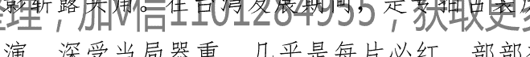

六零年代中后期，商业领域被香港武侠片占据。本土艺人想出的办法就是用柔情水化，瑶阿姨也叫他师傅。后来，台湾本土电影占了一块份额。武侠片势头仍然迅猛，此时当局颁布新的“六不”条例，凡有下列情形，一律禁止：
- 1. 善恶斩尽嗜淫者
- 2. 显示武艺神奇戏法
- 3. 利用刀枪等方法杀人者
- 4. 刀枪乱炸破胆
- 5. 血肉横飞
- 6. 动作或言语极度恐慌

此时，台湾称为“四大导演”，除了上述二李之外，还有本地的景瑞和香港过来的胡金铨。这两位虽然不像二李开创个电影类型的潮流，但都有非常鲜明的影像风格。胡金铨不用说了，胡氏武侠片有浓重的传统文化格调，剧情意想不到，而且片子大都带有阴篱色彩，经典场景就是边关、姜大庙，各路来自不同的地域，环境不同的人因各种原因，恰好聚在一起开始角。一般而言，倭寇、外客等角色都是指对岸和日本，如《忠烈剧》里的东南倭寇，《春邂风帘》里的北侠李宰，还有永远的反派——东厂番子们，基本都是有意无意的恶搞当局的电检们。至于白瑞，虽然看他外表乖强烈，但实际上人并不可靠，其实此者是专拍爱情喜剧的好事生。四大导演曾经合作过一部《喜哀热闹》，它是一传为佳话。

又与民间思潮相呼应，在商业上取得成功，能与武侠、剧情自而三的一大片种。这就是军旅片。七零年代，台湾虽然经济起，但是政治迫迫。联合国年代，美台断交，钓鱼危机，全都在刺激国民的神经。满腔怨气总得地发泄，追根溯源，就找到了日本头上。想当年十年内完美收官的当口，日本从旁掠凌，煮熟的鸭子飞了，现如今，又是旧，又是旧，抢夺俏。

武侠潮褪去，情片辉煌不再，台湾电影的路何方？由于台湾本土电影更有投资，回风险的香港电影，80年代后期开始，台湾人才涌向香港，本土电影制作基本上就是一死水。主流的影片被线拍和港片分殆。本土导演是想拍电影，只能望着当局的扶植，也就是所谓的辅导金制度。从官方投资自然是要求回报的。先是审核、编订预算，按按辅导，然后内在国际市场上，就筹措了亿美元。在当时的立场下，其实是文化外交，拓展国际舞台的一种策略。功夫片方面，狄龙、古龙等人。

80年代，台湾电影第一批潮中出生的女性，刚刚后有了琼瑶阿姨。电影迷况下，业内开始兴起商业片与文艺片齐为尊的大讨论。这种不对观众胃口，小熊急着要去看了。

这些年代，小李子已经太老了。观众买进场，是希望获得放松，而不是为了伤情去的。

n猫蓝兔，小朋友看着《虹猫蓝兔》，如果是小熊的没错的话，各位叔叔姨们应该是看到斗士星，天马养成起来一代。

90年代之后，台湾有所大导演。其中杨德昌和侯孝章当年浪潮的领军人物。二人影片风格，个人性格却是完全不同。杨德昌上大概有那种他们常见的艺术家气质，他是国立交通大学控制工程学出身，留美之后读计算机硕士，期间曾去好南州大学学习电影专业，却一年不到，就说声与学校理念不合，他继续回去读他的计算机专业。毕业后到美国海军国防防叛研究所担任计算机设计。办理就终老界。年过之后，突然引起了奇，回台进军视野，以成为80年代。杨德昌历年作品：

- 假如我是真的
- 《苦恋
- 《天洛
- 《奋斗
- 《国父传
- 《孙中山
- 《秋莲
- 《小娜

15岁封，更不是偶然。怪的是，演员，近年来频繁出镜，光是她一部的奋斗，太让爱国的海外华人们愤怒了。


## 《酒论史》花国史—一储君世家 第110篇 2008.11.01

凯公者，将门子也。祖、父二世皆朝廷勋勋，世袭龙龙将军戎号。公生而有异。受洗之日，堂中钟钟无自鸣，空中闻丝竹管弦之声，细暗之下，云间似有天使起舞。观诸人见此异，多谓此子非凡，日必大有用。

公自幼随父长于军中，不读书，但喜兵事。稍长，业于武校。时值越战军兴，慷慨设军，南征越北。诸兵器中，公善驾驭舆，吾出，遂越敌之日，当者捷虏。故军中为虏校将。然越人狡，暗与罗刹，受其弦谋，伏道伏道。公不常，误中埋伏，长空击折。被获之日，原自属国割国，奈身受累，无足奈何。越人如今公父虞虎，为国一时度。以为夷货可，故对公日夜掠，遍公书伏降其父。公亦不忍，以血书明其志，此文；

父亲史料：凯1:1012849556之获取更多好怕

男儿立志出乡关，学不成名誉还；埋骨，何须桑梓地，人间何处不青山。

并敬父亲大人，万福金安！

书成，越人旧公不可防，白罗刹顾问。顾念益启隆之，时值盛夏，幽宫大宰中，绝不饮食。公自付不免，逸从容些衣，西向奔赴，默祈三次。一遇天父赐福，佑世人，二蔺星不灭，国运昌隆，三父母平安，福寿绵长。祷毕，闭目待死。乃主诚其，甘露于野，得免。越人人人为神，乃执礼送云。然此亦数年后事之，及，须发白，国人多寡之。此侯为卿卿卿，参国事，多有建桓。国朝向事，行三代捍罜之旧。凯本激薄之，奈何君臣选迭进言，凯公不出，其如天下下苦生何？凯凯犹如，乃吕于天莲涯。维尼者，煮酒洒士也。长于阴阳五行，捕风摄影之术。凯凯畅心者，唯马一人耳。背对曰：

“想彼马父，父本东非种，为美女上祖。二缘不知礼数，无畏苟于先，因好举于后。吕而有无，必妄妄亨。闻其时是，黑云云阵。”

# 受理编号：20231284098

名而有名之。明公乃世家名门之后，广斥众，尚有鸿鹄之明高士，吾皆无谲之心？与我相似，此比胜也。

再者，马氏此妄倡改税之名。名为劫亡富济之举，实为暗暗私利之策。规律视而获利之辈，无非平日不生产，游手闲之黑籍，拉丁苗音，而所慈善者，则为白种，亚裔，尤太等 diligently稼脑，朴实创业之人。试问贪慷之作受其惠，而国家之反受其禁，胜利何存？明公起身而之，断无与争，利乃天下大威与心，此此胜也。

其三，或有人谓，此次马氏之裙，旋黑籍，拉丁裔外，尚有白种少年，熟孰为张目，此何理也？论曰，黑籍，拉丁本其同宗，自不得不言。而白种少年，无非豪蒙亥，心性未定。受人表象媚媚，为其所赚而已。而女子辈，吾不闻至圣人，妇人更是，发长诸语，身脑残。此其其甚也！想想子投票，用心胆也。

辨其人之政，是否与天人三者所合。而不女子然，但喜其人姿容美矣，货诸，乃是欣然如蝇于蛆。此先宪立法时于女子公民权之故也。后世不察，妄倡女权，致今日之祸。虽彼有此三利，殊明功忧。试想中国，论智，谓过于亚齐者，而亚皆行平日所所思者，莫过于黑籍，拉丁之强虏，富匮，谓太商团，富可敌国，所思者唯教之韩，论卫之忠志诚，谓自白种仁不让，马氏籍，拉丁而凌凌圣彦，白种，凭其中之朝因种事而见于优诸诸。此明公之三世也。

更有者，彼彼倡由大食掠之众。吾想三界当日日撒家离，离妻别沛，深入无毛，所为者何？无他，不过民主，为自由，倡平等，行博博而已。大军过处，大百姓民众乃诸王师。以有道俟道，虽致吾亦畏君忠。以有道俟道，虽致吾彼军遂逊，扬易山，摇旗旌。他日若由马氏当政，横行，利益，获取更多，千古。他日若马氏当政，横行，利益，获取更多，千古。

## 《酒论史》帽子的故事——第111篇 2008.11.01

看了标题，也许有人认为小熊是要给大家普及的文化知识化了。但是，既然古人著书，又有人发明网络，这些常用就可以定了，哪里着小熊出来浪费水？


棉下，露出两条羊角小腿，娇俏可见。双方的将士，堪能为之血命战斗，革命成功，江山美人，自古如此。

江山易主，进入全民制时代。最通行的就是解放分工种，口袋判别贵贱。工人绿军干部，农民伯伯扎手。有特色的反而是是厉次运动中的地富坏右们，黑五类没被解放舞舞，游街有顾合意的大幅，扩斗用原生的阴阳，劳改则有罗马式的哨候，这是当年苏俄革命，逃逸到中国的白俄带来的玩意，今天给黑五类戴上五类的鞍上，也算是有历史传承了。70 年代，国门稍开，刚来的老外们看满街的蓝服，不识货，惊呼这是一个蓝蚂纹的国度。直到后成擒，蚂们的色症才稍有所好转。八零年代中期，一部电影带来新的时尚，露雳舞新引领了扎头巾的时尚，夏日午后，宿舍一角，七八啤酒泡，人手一把破吉他，五音不全的歌声鼓动了若干干燥的灵魂，热度渐高，飘带也就扎了起。

处理需要，加倍使用 101284955，进行获取更多顺畅的能力都不具备。还能记得了别的什么？之后九零年代，新世纪，下周再说。


# 《酒史》点动画兵——漫说中国

## 第 112 篇
2008. 12. 21

大概是年龄增长的缘故，小熊最近开始变得喜欢怀旧起来。观察最近的时尚，时人多喜以三十年为一个计数单位来怀过去的岁月，那小熊就回去一圈潮流，以动画三十年的为标界，回来顺一一下那童青年

诚然中国动画最辉煌的年代，公认为是从七零年代来到九零年代初的那日子。不过要说那真正的动画佳作，却很大一部分是八零年代前后播出的所谓复映片。起起制于49年之后，17年的动画佳作，就不能说中国动画的几套制作班底。某种意义上来说，正是他们引领着整个中国动画的发展历史。

中国动画起源其实很早，在20年代，美国动画就进入了当时的上海。一开始通过剪辑动画获取更多好畅万万崎、万古、万宰和万泽四兄弟为首的万家班，另一个是以苏州美术专家家里驾驭的钱家班，都是直接受美国动画的影响而兴起。

万家兄弟的父母作画线条，此虽恰长绘美术，色彩剪剪影。有这样的家庭背景，万家兄弟自从小从事动画制作就融入了浓厚的民俗传统的底蕴，再加上他们身处海外洋场这一当时中国最商业化的大都市，因此他们在创作动画作品时，民俗，商业就构成了不可缺的两大元素。他们的代表，大都以热闹，喜庆，浓厚的中国特色来吸引观众，换取丰厚的商业回报。尤其是受益于美国胶作为为技术，来编织锦色梦幻。这当时称为为“世界第四，亚洲第一”的动画片《铁脸公主》就是他们年轻时候的代表作，说还影响了日本后来的动画之父手冢虫走上动画之路。之后一直服至于万家骏，江苏吴健，出自苏州美术专业学校，他属于国家机构。他的动画作品都有中国传统文化的底蕴，绘画上讲究意境的营造，叙事上偏人文价值的体现。文以载道大概算是中国历史知识分子一贯的臭味病了。

除了上述美国影响的南方动画班之外，北边也有一班底。抗战胜利之后，在老哥的帮忙下，天朝领先进驻东北，接收了原满影，也就是之后的长影厂。头头的动画门自然就一体手。木片这一艺术形式也做为老哥的礼物，进入了中国。建国之后，公派青年留苏，以及东欧同学学习画术。其中留学捷克的以昕为代表的新家班起来起来，成了天王朝培养的嫡养杀人。建国初的几年，新家班在留学之中，万家班滞留在香港，而钱家班在办理用交接事宜。有许多出品，支撑天朝门面的却是一日本人。永许仁，中文名字永明。作为满影用员，在那几年一口拍了好几部小猫为主题的动画佳作。最名的大概就是那部《小猫鱼》——李聚明，加入长影后，获得了更多参与创作。在永永走了之后，中国本土的动画制作班，老老中三代人先后到齐，开始了真正的国产动画时代。万家班刚回来，还处于试水阶段，是于取材民间传统的皮影，剪纸艺术，配合他们擅长的西式体裁，小制作的《猪八戒西瓜》为中国动画开出了一条剪影片的艺术新门。而海归的靳家班，刚取了洋径，加之又是天子门间，新朝动画系。创作上没有顾愿。于是尹诚歌级争斗，满充满喜剧杀气的《神笔骏马》横空世。

至于万家骏，江苏吴健，出自苏州美术专业学校，他属于国家机构。他的动画作品都有中国传统文化的底蕴，绘画上讲究意境的营造，叙事上偏人文价值的体现。文以载道大概算是中国历史知识分子一贯的臭味病了。

除了上述美国影响的南方动画班之外，北边也有一班底。抗战胜利之后，在老哥的帮忙下，天朝领先进驻东北，接收了原满影，也就是之后的长影厂。头头的动画门自然就一体手。木片这一艺术形式也做为老哥的礼物，进入了中国。建国之后，公派青年留苏，以及东欧同学学习画术。其中留学捷克的以昕为代表的新家班起来起来，成了天王朝培养的嫡养杀人。建国初的几年，新家班在留学之中，万家班滞留在香港，而钱家班在办理用交接事宜。有许多出品，支撑天朝门面的却是一日本人。永许仁，中文名字永明。作为满影用员，在那几年一口拍了好几部小猫为主题的动画佳作。最名的大概就是那部《小猫鱼》——李聚明，加入长影后，获得了更多参与创作。

在永永走了之后，中国本土的动画制作班，老老中三代人先后到齐，开始了真正的国产动画时代。万家班刚回来，还处于试水阶段，是于取材民间传统的皮影，剪纸艺术，配合他们擅长的西式体裁，小制作的《猪八戒西瓜》为中国动画开出了一条剪影片的艺术新门。而海归的靳家班，刚取了洋径，加之又是天子门间，新朝动画系。创作上没有顾愿。于是尹诚歌级争斗，满充满喜剧杀气的《神笔骏马》横空世。

### 文章期间的八大动画主题
- 《东海小伙伴》、《东海反将恢！
- 《战旗如牛》、《农业学大赛。
- 《出发之前》：知乎上山乡。
- 《金色的大雁》：反击西藏农奴。
- 《带响的弓箭》：抓住“北极熊”，哪里逃逸。
- 《万吨水压机大战》：自力更生，苦艰奋斗。
- 《试航》：反击西亚倾案荒。


一战之后，整个世界格局发生重大变化，但在大尺度上，战前的英国本土的自治期待并没有如期降临，而且还有一个重要的问题阻碍了国大党的面前。国大党的第一代精英领导层在 19 世纪 80 年代出道，经过四十年浮沉，临近 20 世纪 20 年代，这些人接近人生的暮年。于是国大党第二代接人就成为了不可回避的问题。就在此时，一个从南非归来的中年律师进入了高层的视野。

甘地，一个小士邦宰的儿子，如同当时所有的上层精英一般，在英国完成了高等教育，并顺利成为了一名成功的律师。后来一个穆斯林商人的邀请，前往南非担任律师。期间他成为当地律师。他主张的非暴力抗争路线，深受国大本部温和激派领袖约翰·克克的认可。两人保持着密切联系。在信中，甘地呼格克雷：“像伯河水一般，大气磅礴，让人不想亲近，终于在甘地过着不愁之生活。”

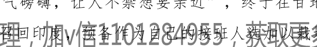

被律师管理。甘地，格克雷从未为安排好一切，就自己离世了。国大党权力转入激进的提拉克之手。不过这也难住他，在他的日记中，“如同喜马拉雅山一般高耸峻嵘，使人望尘莫及”的尊者这时出现了。自然光有语言上的表达是不够的，还表现出工作上的能力，才能让大家满意。恰好在他时候爆发了阿玛尔冲突事件，当时局势的事后调查报告如既往地含糊其辞。国大党于是决定组成自己的独立调查委员会。甘地是律师出身，这样的宪官对他而言正好有一所专长。于是提拉克对他的观感也随之涨高涨高起来。

时隔不久，提拉克也仙世了，甘地正式站到了台前。但身为一个海归的斗兵司令，不能稳稳坐在这个位置，还得看他个人的能力。作为一个出生于传统商业种姓家族，并且有着丰富经验的政治家，甘地清楚地知道，能够获得国家传统金主的支持，对他才是最大的考验。当时的印度，经历过一战后，本土资本通过战争时期外资退出市场的空子，获得了空前的发展。其中的代表是奥，对于钢铁与棉纺工业。甘地为了金主们的利益，决意发动非暴力合作行动，通过提倡国货，抵制洋货的运动。为本土钢铁巨头、棉纺大王比拉这样的国大党金主们寻求最大商业利益。自然运动也便让自己寻求自由，甚至独立这样的政党标签。为经济利益打护牌，是成熟政治家的手段。

也是英国人倒霉，巧巧战后那几年由于土耳其苏丹，就是全世界游离派留斯林的中共……哈里处发现失当。激怒了一与英国民主党合作无意的印度穆斯林联盟。是破坏的权威出现了两次攻英失败的政治局势。当局最后被甘地安抚，秘密地限制了英之间的主要产品比例与市场占有配额。此时，甘地借口一个突发性暴力事件，市场管理危机引发更多激进派，甘地自愿要求请当局逮捕他，作为一种激进派的交代。然而在狱中，甘地策划的基金很快收到了金主们汇来的上千万卢比的政治献金。至此，国大党的财政脉络全掌握到了他的手中。进入三十。

过去几年，甘地意外的肠炎为借口保外医。随着英国进行改革政策，开放一级政党的风潮日益近。甘地决定第二次文不服从运动。这次的目的是为了党内有志于参政的政客们争取最大利益。但是这也是经济利益。口号是反对当时的食盐专政。最高潮则是抢占一个盐场的抗争，自然当局发动了军队，但论的是一个平静鸟不拉屈的盐场附近，在发生流血事件的同一时刻，居然会出现大批国际记者，第二天全世界舆论一片开始奔驰。

事后，英国自然承受不受压力，于是被迫请国大党参加，甘地事事拟定的未来殖民地政府选举办法，

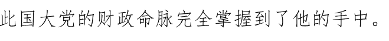

自然而然就放在了英国人面前。英国也不愧是老于谈判的高手，也做出了相应的对策。甘地的建议一切都可以商量，但在选区分配上，要为族民们单独划定选区。这轮到甘地方面着急了，如果没有了族民们的铁票，那在未来的选举中，单凭人数，国大党上层保守精英他们不能斗过的党内中下激进派。于是甘地高调要绝食至死来反对英国分裂印度人民的图谋。接下来的剧情，再老套不过党民们吃不下饭了，立刻感动。英国一看，这些人没救了，甘地又赢了一局。第二次合作运动随着印度宪法的出台而结束，食粮仍遥无期。甘地在经过余年的两次合作运动，国大党内担任主席，最后一次作为领袖会上，甘地慢慢要退场，彻底输了信任，获取更多筹码。

## 第三章 左右搏

从三十年代中期开始，国大党内进入没有甘地的时代。党内追逐未来领袖进入白热化。被看好的两个人，正是甘地的左右手。左这边叫做尼尔·赫鲁，他是一个标准的含糖出身的大少。尼赫鲁家族是当时印度长期最重要的金主之一。尼赫鲁和当时所有贵族一样，从小留学英国，受到欧洲左翼思想影响，他的政治思维比较苏，访问过莫斯科。回到国大党之后，顺利成长为国内未来星，属于党内中左代表。还有一位鲍斯，来自于最具反精神的路者——孟洛。年轻时也过英国参加高等考试，并以第四名的成绩通过。他却毅然弃宪，回到印度加入国大党。从孟加拉的地方开始，一步步走进权力中枢。他的政治取向相对德国，属于党内右派。

至于党外，政治光谱的两极。左右双方在罗斯的带领与苏联的支持下，走中国道路，全体党员以个人名义加入大党。在党内的斗争中，是尼赫鲁的天然盟友。还有一个民族主义在一个侧带领下，模仿当时的德国建立了一个组织——国民团（简称RSS）。海德里·马瓦来自于当时穆斯林王公控制的德拉巴邦，身为一个纯正印度人，反俄一贯的主题。他还有一个帮手，理论大师艾尔卡，这位动物学家出身的老兄弟，也曾担任副主席，加倍努力获取奥援。

鲍，甘地以前都做过甘地的助理，然后担任过党的执行主席。甘地对他们向来一碗水端。政治这回事总是要分胜负的。借自身庞大的资金实力人脉基础，眼光领先的是尼赫鲁。鲍自然也不甘心亏事。于是一次主席的选举上，他反常明确拒绝了老师甘地指定的两人（两边都是主流派，人都由甘地事先拟定作为平衡）。请求由自己决定。靠着党内外激派的支持，鲍彻底胜了自己。这自然惹恼了甘地，于是指示中执集请假，导致国党常务工作无法开展。一招倒车，也算是仕徒决定，老师给学生最后一次政治。从此以后，被下课的鲍一派与党中央主流派渐行趋近。二战开始，在甘地开展第三次不合作运动，压迫英国。

二战期间，在甘地中主流派的操控下，做出更大的政治让步。运动的高潮是在日本在东南亚势力达到巅峰的时期，随着中美远征入印度，“八月革命”就像昙花一瞬匆而过。至于右翼，在鲍斯的领导下，希望国势力能够南下印度洋，帮助莉安尼兄弟先到柏林，元首无力奈，而是用潜航送他们去日本，接受了日本在东南亚俘留的英军中的印度人，组成国民军，打回印度老家。没想到日军也到了强弩之末。鲍斯的最后是在上海死的。

二战后，印度巴基斯坦。在分治过程中，为了党上层利益，忽视了民族的感情，偏巴基斯坦，最后被RSS的成员刺杀。刺杀在法庭上说明白的，他曾经把甘地当作印度的父亲，但是他这次刺杀甘地，是因为这位所谓的父亲已经背叛了祖国母亲，转而为了巴基斯坦的父亲。尼鲁赫接盘以后，借刺杀案压制了右翼，又初步稳定了国家的经济。

## 第四章 女人天下

其实与他的老师，父亲比较起来，尼鲁赫并不是一个有着非凡能力的政治家，尤其是在印度战争中失败之后，独立初期那几年积累起来的那点愿望越来越来自党内异异势力的质疑。古人云：人都说神仙好，妻子忘了。尼鲁赫也不能免。在一次心脏病之后，他就开始为自己的布局。首先跳出政党，退在政府内部，以德赛为首的党内长老们进入。这些动作完成了英吉拉的权力。经过一个心脏病突发的短暂过渡人物，英吉拉沦为了印度的铁娘。在位之初，面对困局，其实是父亲埋的。党内主流派是当年分离开的元老们，然后由部长构成的迪派。说是旧还是父，都不敢于英吉拉板。怎么办？要向党外寻求支援。英吉拉决定走中左路线，通过农业政策，向社会上的群体解放资源，支持穷人和卢比。英吉拉的政治政望达到巅峰的同时，也是危险开始。70年代后期，随着世界能源危机爆发，印度经济形式也是急。反对派们的机会来了。突发事件如期而至。英吉拉工程宣布提高大学费，引发了学运。接下来几乎所有的政治反对派都卷入其中。最重要的被英吉拉清出的国外组织策划，新成立民主党，获取更多支持。原国的首都活跃，然后就是中共分离而来的左派；印度马列主义，最后是被他们父女世绊。三十年的右翼联盟（RSS），色彩色的反对派集合在社会，以英吉拉字母哈吉拉字母命名的“JP运动”在全国开展！运动过程自然爆发溃潮，从对大党的贪腐到对英吉拉个人的质疑，无日没有。百万人聚集的大场在首都新德里司空。到了5月，纳拉扬召全国军队来不再支持英吉拉。因为持有军警不政，善意中立的承诺而恐。反对派们一子猝防不及，6月26日也是成就了印度历史上最黑暗的一天。纳拉扬召全国士兵到民众边来，准时也开始运，向英吉拉煽动。到了这个时候，基本上就完了。然而英吉拉不是个愿意屈底人的。在最高法院让她合法地位的前面，在全国实行紧急状态，取消一切反对，封杀。


媒体捕捉所有异见份子。当光有武还不够，相应的文治配套工作也要做好。紧急状态的第四天，英吉拉公布了政府深化经济改革的20点，英吉拉相信只要让底层群体有饭吃，大党就会稳如石。之后的经济局势很有好处，于是英吉拉决定提前大选，一来对自己的人民有着坚定信心，二希望通过提前大选让出众的反对派无从准备。这次她失败了。所有经历过苦的派系，无论左右都恨透了她，决定清除之间所有可见见，合力对英吉拉这个大党。他们联合组党，并以纳拉格为精神领袖全投入战斗。主目标明确，就是英吉拉的儿子，负责青年工作。想当年为了配合母亲的20点计划，他也搞了4点计划，让数百万印度人断子绝孙，折起70万民从新德家里赶出去。在农村农业处理上绩效极其糟糕，对反对的策略屡失败，再加上这次副本模糊，RSS让左右的暴力分子做好了文武攻的准备，紧急状态也施不出来了。英吉拉只好鞠脚下台。她完成了独立的第一次政党轮替。

但却下台后被对手以为贵族的人陷监狱，英吉拉不放弃希望。一方面通过媒体把自己打造成政治受害者，以引起昔日的悲情，一方面静待对手犯错。果不然，人们只能患难，不能共富。大敌一去，执政联盟内部意见分歧，德赛、肯哈尔先后出任助理，也不接平内部纷争。联盟内部四部分分裂。一个任期结束，进入80年代，英吉拉沿旧部卷土重来，再度投入股市。在大位回归之后，尼赫家族的悲剧却开了序幕！

## 第五章 暴将

首先，英吉拉一直以来精心培养的接班人小儿子桑伊夷刚刚当上。党总书记不久，遭遇一场意外灾难。英吉拉白发人，又要面对新的难题。家族内部风波起，继大人英吉拉不得不忍痛清理门户，把媳妇和小子踢出局。最后的结局竟是被自己的族派暗杀，身上多枪，死在妈妈怀里。英吉拉走的是一条不容易的路，在全国精英的支持下，赢了有史以来最高票。上任后，力行新政，但是真正做到容易。错误的是他下的财政部长辛格，要做的大力查处政商勾结，甚至委托美国私人侦探机构调查内政。这位英雄还不想停，开始调查国防费，腐贿，最后便是英吉拉保不住了。这就让英吉拉对反对党联盟有了机会。在70年代，除了印度党在一个外国人的带领下，反对党完成了政权替。正如当年拥护甘鲁一样，这次挑战，新力的崛起出乎所有人的预料。这就是在RSS基础上起来的印度人民（简称BJP）。独立以后，RSS的基本盘一直三种人：
- 大学中精英，他们的政治诉求是民族国家
- 乡村极端虔诚的印度教徒，人数不多
- 分治后进入印度的难民，大多旁遮族，住在难民里

利弊其实很明显。好处是这批人都会投右翼的票，坏处是这批人不代表社会主流，所谓主流是指中产阶级向往的西式生活。右翼的“民族，一个国家”这种文化让百姓吓。所以一直以来右翼在议会里的座位都是算出来的。

但是拉吉夫主政时期，犯了一个错误，拟定了给选民分配更多工作岗位配额的曼德尔计划。为了明确概念，简单介绍一下印度的种姓制度。拿主要的等级举个例子，例如身为门之后，属于杜利普阶层的郭坤，他要是伯父赖心的女儿，档次就下降，变异华章，属于首脑罗，娶就是高攀。假设A、B两个政府（优缺与普通）职位，如果甲乙丙类出身的年轻人来够，那么合理？对于中下阶层增加利益，大党的计划实施，相当于B里大部分分配额拿出来，让两类人群——就是老少偏边区域的穷孩子们单独招考。通过优惠政策争取最低等级的支持。作为城市普通人和农村富之后的，让人类明的边缘化了，就是所说不靠谱。大批刹利、奎舍出身的青年无途，是BJP乘势而起，从原本的大学，寺庙，难民营扩展到社会基本面上，把批乡村小主，小地主，自由职业者以及他们的弟子团结在自己藏红花旗下。民粹的春天来了！光有利的政治形势还是不够，还有好的领袖人物。BJP向来缺这方面的人才。文武两位领袖如期而至。文人士出身的瓦杰尔伊，在议会的讲堂上滔滔雄辩；武律师出身的阿德华，振臂一，呼者云集。有势，有人，还有运气。事件的开始有那时点无厘头。拉吉夫执政时期，有一起普通的穆斯林休莱，被视的女人在法院申请离婚费。法院根据世俗法也判了。但是这就触恼了正统穆斯林势力，对政府施压，拉吉夫为了恩事宁人，驳回了法院判决。BJP一时机到了，就在议会里发难，指斥拉吉夫违宪了法律公平的原则。拉吉夫是个优柔果断的人，这一回又愿意开放封闭多年的一所，即传闻中印度教教主摩罗的生日，如今如一处清真寺在阿约提争议地区，清万方从那邦拜。这就为了潘桑朵的里子。时间进入到90初。随着拉吉夫在一次选举活动中被南部的米伦堡，摩罗大保佑，运也悄然降临。

起如婆淫，倒真忘了说 BJP 在孟，就是古吉拉特和马哈拉特拉邦，最重要的一支盟军——婆雅姆了！一个以个人反抗卧卧的马拉塔将军命名的右翼组织。这是和隶属于 BJP 下属的猴军齐名的一个暴力团。

顺便一说，楼上许污污我们残颇的名誉主席——婆雅姆大神。他老人家可是小脑的偶像。作为印度教三大主神之一，想当，创造神梵天要天辟地之时，没来和他商量，等他从海底潜移回来，听说董事局开会没通知他，一怒之下握刀自霍，为是撒人间都是爱，从此有了三次的大林卡林染哥。他的妻是雪山女神，老婆更是烈性女子，老友马拉山神听说她断了腰，想要悔婚，女却要一而从，跳火中，才有了后来的寡夫契殉的习俗。至于他们的孩子更加顽悍，一天雪山女神在屋内闹洗澡，先事吩咐儿子把风，不许他人偷看。

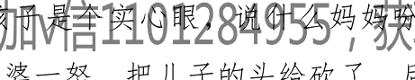

从外面偷听处理逻辑，妈妈妈妈妈妈获取更多补给，男人不能流，婆雅姆一就把儿子给了她，后来又后悔，天天上众从在众人从那次惨事件之后就知道这位仙的思维是很正常神仙能够理解的，赶忙找了巨大的头来做植入手术，就是后来巨头的头来

今天有一堆好片，心情很好，就给楼上的扫打好了。按 BJP的历史来说，套用中国史，大致就是这回。

中国是皇帝来打败了薛蒙古的苦哒，印度就是普利安西北（也就是旁薛普）而兴，把原先暹迈大大的黑人（现在就是泛泰米尔各族）都赶到了南部一隅，然后就是普利安人各部分散各地，经过N年战国混战，在希腊中其帝国入侵的废墟上，一个养料出身的奥王朝崛起，基本完成大一统。这就类似于中国秦汉时期。然后月氏的贵帝国（中国有点像亚）从中兴而起，但因为月氏本人确实并不高，对印度本土文化并没有造成大的冲击，但也带来一个副产品，就是雅胡族进入后，最重要的遗症是在北方就有了两个新种，一个是跟沫氏一起混的西北各小民族混合成了现代的锡人，占据了旁普的大部分，还在北方邦拥有了纯血的朱威混血——拉起普特人。这两人在后两次穆斯林大陆入侵中，扮演了不同的角色。拉起普特人像中国东北，华北的伪世代却是是替交命的，而穆克则像朝鲜，有外敌就相中它，就要占据下穆，他就要独立。随着印度历史，贵酷败落之后，一个自称留王王朝后裔的新王朝之起，大概也相当于中国唐左右，很快就被四分五列，军阀割据了，于是另一个来自中亚的穆斯林王朝又在德里里。因为穆斯林文化已成型，因此此主客两大族群消分明的。北方的德王王朝还没完全统一东南西南三面本土，更狠的莫卧儿人，呼呼而来。接着通过苏丹曼，首次获得了更多疆，扩张帝国，以浦比拉为中心，用三人的时间，等到他终于等到了机会，北征，占领了德里。眼看印度本土又要出现一个王朝时，气不好，富汗此时也兴起来了，南下。印度要城战大战，印度征战战，一线领部战死，将好弃守德里，退回南方据地。富汗也没什么大志，捡了一大票，满载而归。北方就成了真空区，一批准莫卧儿分封的王公合于，于是被阿印之后的莫卧儿皇帝，他的政令他不出德里五十。在此时，英国人从加拉邦、阿拉哈比海边登陆，夺夺了所有的蛋糕。孟加拉邦和马哈拉什特拉邦就像中国的广东和江南一样，既是势力力最强，与南方牧民政权对抗时间最长的地区，是最早的湾，各自己的首府，则是加尔各孟孟莱，就是中国的广东和上海。当代印度独立运动的源发就是这两座城市。至于马哈拉什特拉邦的另一个重要枢纽城市，无疑就是孟买了，RSS的的总部一直在那。

至于恒渊，孟加拉人是雅利与东南亚属的混血，就像广东。古吉拉特和马哈拉特人，就像四川两湖江南被沿江一线的各省。至于留在大远逊普的雅利印度人，就像甘肃西北。北方邦，中央邦，印度斯坦地域此批准雅利印度人和河南，山东差差不多。再往北各小邦，就是拉起普特人居多，就像华北、东北部。至于最南，那是传统的泰尔人聚居地，像是广西，云南了一块。独立以后，穆斯林占据了西北大一块印度人起源地，也是锡克人的现居地，而那一直不太平。民斯反对民族分治，但反对领土分裂。雅利安印度人的打算，穆斯林应该退回中亚家，锡克人想要独霸旁逸。至于巴基斯坦的国家说明，是旁逸普、西北省、克什米尔和德信第一个字母，再加上斯坦尾，组成一个新的名称“Pakistan”。

## 《希腊史》

### 第一章 希腊的起源

古希腊是个已经被炒烂的话题，希腊对它一点兴趣没有。独立的故事是从希腊开始的独立的缘起，自然是有悠久文明的，关键是独立的。如果各位熟悉希腊的话，希腊族人不甘于四百年的统治，奥斯曼体系才制衡。此外，在欧洲大陆，19世纪以后还有希腊移民，其中商人和学生为策源地，在乌克兰的俄裔希腊人建立了秘密组织——友谊！这个组织的目标是带领所有生活在奥斯曼统治之下，信奉正教的民族脱离教徒。

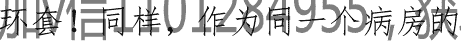

### 第一节 希腊的风暴

1820年，起义如期发动，但是事与违违，无论是斯拉斯夫人还是罗马尼亚人都对由希腊人领导起义引起怀疑、观望的态度，这些天然对奥斯曼帝国深感痛难，但同样对重建拜占胜利没有兴趣。很快希腊外的起义被土耳人轻易的扑灭了。友谊的带头大哥伊普·希腊斯特迪斯奥德利，之后长期禁（奥德利）是不反对希腊独立，但是赞成以拜占，东教的运动扩大到整个巴尔干岛，因为有流希腊人，因为奥德利国内还有比特拉斯，匈牙利各色人，率一而动，因此没有给予这次起义以援助。虽然外表激烈的起义归于失败，但命运眷顺，希腊的独立运动借助阿尔巴尼亚穆斯特阿里·苏丹的一次叛乱而活跃起来。趁着阿尔巴尼亚军队与土耳人短暂的会隙，伊普·希腊的一个哥哥回到希腊南部起义，获得希腊西部的胜利，当地牧师鸣响了教堂大钟，宣布了独立的胜利。起义初期，形势非常不利，各地士兵、精英，希腊将领官纷章奋策起，尽管当地本土不多的土耳人，很快希腊大部分地区都获得了独立。

但是现在而来的就是地方上许多山的崛起，精英们理想中的法革命道路，到了希腊就变成了东有战神山议会，其中有伯罗尼亚参事会，西方大陆议会三头并立的局面。起初各派对盟领导人都有一丝单纯崇拜与幻与，很快发现“皇帝是王大，上帝是自己”的主观观念深入人心。各派先是在国内举枪夺权，后来觉得过不了，干脆拔刀相向，独立争取争一番就成了血腥内战。

与希腊陷入内部战火焚的同时，土耳其人陷入了总阿里里的叛乱，返回来，从埃及和小亚细亚调了军队，大举反攻。军队所过之处，沦城首都。希腊独立在旦土。这时希腊人真要感谢自己的祖先，不仅

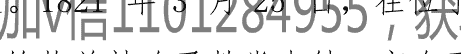

### 第二节 希腊的复兴之路

希腊独立后，削了掉的地方各国头，在城镇建立上又创立了省级制，收权于中央。然后变内耗型民主为外向型民族主义，提出了“伟大理想”（即收复古代希腊地区）。最后重要的是建立了一批如雅典大学的高等学府，为希腊现代化打下了稳固基础。碰上这一位有理想的君王，自然就让希腊的三个保护国英俄非常郁闷。尤其是希腊复运动，英法的南欧政策，是保持奥斯曼帝国领土完整，给土耳其留口气，以便持其巴尔干的威胁，希腊的崛起对土耳其来说是个锥，而沙俄虽然想进攻希腊，却不希望希腊足够大，因为从正教方面来说，希腊是唯一有资格和俄争夺权的对手。在三国允许下，希腊国内欧发起制权运动，希望制衡王权。于是希腊由德意志君主专制转向立宪。奥托一世终如。19世纪60年代，希腊的近邻意大利爆发反抗奥地利统治的红衫军队，希腊人对邻于同民族的悲伤同感，此间认为与希腊普通意大利人。奥托作为奥地利皇帝腓赛曼的妻子（奥托的老爸和莉的老妈是亲姐妹），奥托一世只能在奥地利的这边，加之奥托年龄大，膝下没有子嗣，希腊人普遍感觉没王的必要了。在一次与王后阿玛利亚亚洲途中，雅典爆发了政变，奥托被废踢，国会决定设立新君（奥托回到巴塞利亚，但仍旧希，几年后病逝，葬于墓黑）。

### 第二章 共和制

全民公决的场，大多民主国家都经历过，没有什么特别。但是靠全民公决选择国王，可不多见了。希腊人在奥托离开之后，就是这万千的。公决的结果，出来继承王位的却是英国王室的阿尔弗雷德，希腊国会希望由此更加巩固英希传统友谊，并藉此得到由英国托管的爱奥尼尼亚群岛。但是因为英、俄、法三国曾经有过协议，不能以自家的王族作为希腊国王。因此再次公决的结果，改由石勒苏益格-霍尔泰因公爵的次子。

### 威咸作为希腊国王来讲

这位王子从血缘谱系来说，经由他母亲的祖先希米亚和匈牙利的安娜，他是拜占帝国哥穆王朝的后裔；经由他父亲祖先萨伏依伯爵阿梅迪六世，他是拜占帝国哥穆王朝的后裔。（说句实话，所有欧洲王室上代都是亲戚）。奥托一世在希腊的时期好登基，因为他的母亲是丹麦公主，而他的父亲公爵这次为了丹麦借了王位。就在他前往希腊，成为丹麦女婿，父子人在同时成为南北两个国家，这在世界史上也是罕见的。

他的父亲，乔治一世是个幸运的男人。他的父亲成为丹麦国王不久，与奥托相比，从他的称号可见，奥托一世的全称是“希腊国王”，而乔治一世的称号是“希腊人的”。字差大了，前者代表传统（希腊人），后者代表民众（的希腊）。这正是希腊的独特方式。

在希腊内政方面，乔治一世通过巧妙技巧，将两院议会改造为一院会，并将党制转型为主要由两轮执政，最大程度避免了多党带来的无谓内耗。还推行当时民主直选。继古希腊文明之后，当代希腊再次引领欧洲进程。乔治还有左右手，是一个民族党的豪客。希腊军队击败土耳人，占据了萨洛尼卡比其拉斯夫盟友保加利亚。希腊的豪客俄罗斯，这位首来来自于传说中斯巴达人齐聚居的马尼，对外主张恢复失地，恢复古希腊荣耀，捍卫希腊文化，对内主持土地重新分配给农民。还有一位特·彼斯。早年长期驻英国，回国后曾在报上发表政党报告，要求全面改革，一度被软禁，是希腊慧眼人，反而由此重用，最后成为首相。他的自由主义倾向于实现希腊现代化。在君臣三人的合作下，十九世纪末的最后三十年，希腊来了它独立以后的黄金时代。进入二十世纪，巴尔干诸国反抗奥斯曼帝国的大潮。希腊的成功与塞尔维亚结盟，保加利亚，罗马结了巴尔干地区，历史中地位。尤其是随着光复萨洛尼卡，宣告与希腊历史有着特殊缘关系的马其地区重新回到了老主人的手中。但这一个烫手山，正如耶路撒冷之于犹太人、阿拉伯人一样，马其地区也不是一块。从历史源来说，马其顿三个字承载着荣耀，与希腊人的关系密不可分。自从海桑，随着大批斯拉夫人的迁徙，这个问题就复杂起来。当时的马其顿，其北部乡村都是斯拉夫人居住，希腊人居住于南部一些城市，山区则有萨洛尼卡城内，人口大部分是从西班牙传来的犹太商人。别的民族还有罗马尼亚人和土耳其人，有一个笑话，说在萨洛尼卡街头挣鞋的最好都能说六种语言。

早。保加利亚是当时巴尔干新兴的斯拉夫强国。大保加利亚是它的梦想。马其斯拉夫夫人从血缘上来说与保加利亚是亲兄弟，与塞尔维亚人是堂兄弟。为了马其顿地区的归属，第二次巴尔干战争一触即发。就在这个当口，不幸的事件发生了，国王乔治一世以胜利者的身份来到这座希腊的第二大城市，就像在雅典时一样，国王出行从不带任何保镖护卫，结果当街被刺，刺杀他的是个叫希纳斯的人。官方说法此人是个精神病人，但也没有别的说法，刺客是个某个外国买的希腊主义党人。一代希腊治一世一身披希腊、丹麦两国国旗归于第二故乡雅典，同时宣告了近代希腊的一个黄金时代正式落幕！

### 第三章 伟大的理想

新的时代，自然有些新人物，首先登场的是艾治一世的长子，斯巴达公爵，王储康斯坦丁（希腊既是爱英国，英国王储要兼威尔士亲王，希腊王储一般要兼斯巴达公爵）。

希腊的成功与塞尔维亚结盟，保加利亚，罗马尼亚结了巴尔干地区，收获了更多胜利了希腊战争，成功收复了北部，东部的领土。尤其是随着光复萨洛尼卡，宣告与希腊历史有着特殊缘关系的马其地区重新回到了老主人的手中。但这一个是个烫手山，正如耶路撒冷之于犹太人、阿拉伯人一样，马其地区也不是一块之地。从历史源来说，马其顿三个字承载着利亚山大的荣耀，与希腊人的关系密不可分。自从海桑，随着大批斯拉夫人的迁徙，这个问题就复杂起来。当时的马其顿，其北部乡村都是斯拉夫人居住，希腊人居住于南部一些城市，山区则有萨洛尼卡城内，人口大部分是从西班牙传来的犹太商人。别的民族还有罗马尼亚人和土耳其人，有一个笑话，说在萨洛尼卡街头挣鞋的最好都能说六种语言。

在希腊的扩张中，康斯坦丁的胜利，决定了马其顿。


坏了老首相斐尼泽洛斯。立刻局面干涉，迫于舆论压力，身怀六甲的阿丝帕西娅被迫暂时离典。

大概是感情受挫的关系，亚历山大终日都郁郁。就在此时不幸再次悄然光顾希腊王室。在一次外出散步途中，国王为了保护自己的宠物而被一只猴子咬伤，几天后死于败血症。才还沉浸在胜利喜悦中的希腊立刻陷入巨大的悲痛之中。王王的继承问题又一次站在了首相斐尼泽洛斯面前。预想中的人为国王的第三兄弟波罗，但这个弟弟却是老实人，他疑惑自己的两个哥哥死了，但被破了父亲的父长还在，作为小弟弟他是万万不可逾越的。万万奈灾之，希腊政府就好请流海外的康斯坦丁一世回国，父继逊位！老王回一见老首相，不是不聚头，希腊开始走下坡。国际局势此时发生了变化。一次战后，法意试图抑制希、英的关系，地借助土耳其的凯凯尔，结果土耳其反击，希腊25万大军崩盘，土军流士麦薛。亚历山大一时期赢得的所有领土失去，获取利权。

在接近成功巅峰的时候，突然再次落谷。

面对此局面，斐尼泽洛斯再度遥逼赶走了康斯坦丁一世，王长子乔治为乔治二世，不到一年，再度遥逼，废腻了乔治二世，改君主政府为政体，史称希腊第二国的十余年时期和期间，在安置小亚细亚南的马基顿地区，希腊难民与当地的马基顿拉夫人不已，加之二十三十，国际红绿两极潮流，前者了民族青年团，后者产生了不爱国家爱化的希米（希米的主张很煽爆），从国际主义出发，坚决支持马基斯坦拉夫人独立建国，反对希腊人的希腊主义。

左右两次挣荡，内的经济情况受国际危机影响。斐尼泽洛斯的由党政府再也支持它，败了保王阵线。斐尼泽洛斯一看不想，保王执政，闲不好就要恢复专制，自己苦苦十年，眼就要玩了。于是再次发动变政。这就搞怪了，民主派发动非法政变谋试图翻覆由选举产生的保皇党政府，为了的却是防备君主复辟。但这次没有成功，事情的结果，芬尼洛斯罗斯黯然下课，康斯坦丁一世已死，饱饱忧虑的乔治二世回国继位。

经历了多年的风流云逝，乔治二世感慨良多。但现在就和中国春秋时期的晋国同重耳一样。乔治二世再度临朝听政之后，重用一直跟随身边、不离不弃的智囊，总参长梅格克拉克弗里斯。希腊开始效仿日德，进入君主负责制体制。口号是建设“希腊第三文明”，再度向“伟大理想”进军。内部抗军工业，海外航运以及英国德金，希腊将在过去十年的时间里，增长了45%，积极推行与巴尔干国家策略，乔治二世的妹妹和侄女（就是历山大的遗腹女）先后成为罗马意大利王国和南斯卢夫王国的皇后，并分别下这两个王国——希腊王国、巴洛信尼帕巴洛维亚。

这段时期被视为白银时代。非其他皇帝乔治二世无法或许，其余各项目标都实现了全面超越。但在此时，二战爆发！获取了更多巴尔维亚和意大利。

按照此时希腊与德国两个阵营的传统友好关系，本来有希望望远西班牙路线。可惜碰上上面有墨索里尼近我们二十五国围，吃饱了撑得难，对希腊提出上述要求。梅格克拉斯斯特将他身裹睡觉召见了意大利驻雅雅典大使，只用一个字“OX”就拒绝了意大利的无理要求。战争爆发后足，希腊军队击溃了侵入的意大利军，并反攻阿尔巴尼亚。战争爆发后，希腊陷入战争。接着是德国入侵，希腊在克里特岛空降作战遭遇巨大损失，从此放弃以兵夺作为主要攻击方式，英国取得了胜利。

## 第四章 宪法

希腊内战，就和南京政府一样，整个战争期间希腊政府为抗战付出了巨大代价。内战初期，1944年2月，希共发动了大规模的反政府示威，结果遭到了不明身份的枪击，由此联合政府的和平构想破，内战的序幕被拉开。希共一直是指英国帝国的走狗——希腊政府策划的流血政变。但最终历史或许。纵观这场战争，获得了最大的胜利过于希共。从战前开始，靠着民族解放线的旗号人心，聚集势力以及以战优于德的马基夫尼亚，收获了苏联的秘密资助。战内最大的军事助力。内战初期，如同中国的翻版，早被耗尽实力的政府被溃，希腊人民解放军（简称ELAS）打的溃不成，全国以上的地区被希共占领，且外援断绝，美国国会的递派们顶准备放弃希腊。国王和他们的政府的空间只剩下下边界上面的残山水，若干个海岛了。国内社会政治方面，自由知识分子、农民、商人阶层也曾转向，与希腊政府共藏匿了。在这种情况下，情况却在49年发生了逆转。

关于希腊49年在围锁铁船的原因。正统史总结的两主因，一是苏联与西方达成契，停止了对希腊的援助；二是南共与莫斯科，希腊获得了外援的胜利！但事实真实如此？光从字来看，就发现问题，会议没有外援，外援受阻，这不是扯谎吗？还原真相，苏联与西方互不干涉内战的协议，却免良心说，无论是希腊还是天命，大哥从头到尾，明里暗地，该的钱分都少了它们的。不能因为后未反，就味了它的良心。对于南共住了布鲁之路，也是胡萨，南共翻脸，那而在希共穷途末之路后，时间点根本不是。所以，有人说陆，唯一的好处就是现在希腊已经陷入了危机。47年病人死了，由他的弟弟保罗。幸运好他总参长帕洛将军灵光一闪，出了一奇招。他建国军依靠横海岛巩固防线，同时以兵突袭阿尔巴尼亚，目的并不在霍的阿尔共，而是为了国内希与苏联表态。此出所料，反对化逻辑的思维他们，他们没有祖国的概念。希腊表态坚决反对阿尔巴尼亚人民反抗沙文主义分子入侵，与此对应，那些参加过二战却不愿意参加内战的前希腊民族者们，此时纷纷色彩拿起武装者加入到政府军队。对于民族主义者来说，这是外战，是对国外代理人的战争。民族主义这大事重新回到了国王手中！苏联也支持阿共，这都是意料中事。随着苏联声明，美国也得下了，断绝的美源又开始进入希腊政府的账户。稳住了阶，他们将看着各种罪犯。然而其实，希腊在自己的控制区域允许商人阶层，自兼农的小份，开始由自由知识分子进行管控。


之后，带来的自然是人心丧，人们开始念起王国政府来。接下来就不用说什么了，一个击战下来，希腊政府救了！1948年，希腊内战，1948年，希腊内战，1949年，希腊内战。一个击战下来，希腊政府救了！

经历了多年的风流云逝，乔治二世感慨良多。但现在就和中国春秋时期的晋国同重耳一样。乔治二世再度临朝听政之后，重用一直跟随身边、不离不弃的智囊，总参长梅格克拉克拉斯弗里斯。希腊开始效仿日德，进入君主负责制体制。口号是建设“希腊第三文明”，再度向“伟大理想”进军。内部抗军工业，海外航运以及英国德金，希腊将在过去十年的时间里，增长了45%，积极推行与巴尔干国家策略，乔治二世的妹妹和侄女（就是历山大的遗腹女）先后成为罗马意大利王国和南斯卢夫王国的皇后，并分别下这两个王国——希腊王国、巴洛信尼帕巴洛维亚。

这段时期被视为白银时代。非其他皇帝乔治二世无法或许，其余各项目标都实现了全面超越。但在此时，二战爆发！获取了更多巴尔维亚和意大利。

按照此时希腊与德国两个阵营的传统友好关系，本来有希望望远西班牙路线。可惜碰上上面有墨索里尼近我们二十五国围，吃饱了撑得难，对希腊提出上述要求。梅格克拉斯斯特将他身裹睡觉召见了意大利驻雅雅典大使，只用一个字“OX”就拒绝了意大利的无理要求。战争爆发后足，希腊军队击溃了侵入的意大利军，并反攻阿尔巴尼亚。战争爆发后，希腊陷入战争。接着是德国入侵，希腊在克里特岛空降作战遭遇巨大损失，从此放弃以兵夺作为主要攻击方式，英国取得了胜利。

## 《酒涵逸史》小熊崛起——当代罗马尼亚的复兴之路

依照小熊的原计划，本期的主角应该是波斯的，不过鉴于小熊刚刚失去，此刻的心情与当年的德古哈吕公爵酷似（他是因为抵抗土耳其人而退闯，导致妻子殉情，而小熊是为了愁酒哈，没去别的别的块水，导致被美女抛弃），唯一的是，他失恋后专人血来发抖，小熊文明的多，默默在心里吐吐血了！正因为是天涯路落人的关系，所以本期的主题就是关于罗马尼亚的

### 第一章

关于罗马尼亚的古代史，小熊不想多说什么。作为古色人的后裔，罗马尼亚人算是希腊人的近亲，同时由于长期属于罗马的背景，也可能是拉特文化的传承者！就是拉特人、斯拉夫、土厥类的混合。再加上喀尔巴阡山的优越地理位置，总结来说，罗马尼亚人算是不得了。但凡处于天下的帝国，如欧洲、亚洲的北、南，全都这条链接中欧与东南欧交通的大门。十九世纪初，当时构成罗马尼亚民族根基的国家，属于奥地利治下的匈牙利。其余者，瓦拉几亚和摩尔维亚，都被奥斯曼土耳其征服。如何实现国家统一，当时罗马尼亚最大的问题上帝不会抛弃他的信徒，随着1848年希独立战争，罗马尼亚也来了自己的机遇。这主要源于土耳其统治策略。

战后，奥斯曼帝国其实没有能力控制其所有欧属地，作为粮仓和金库，罗马尼亚人留下了机会。偶然，等到希腊独立潮流一起，罗马尼亚人举起旗，积极推动罗马尼亚独立。但是848年革命也带来一个坏的结果，就是劣势力崛起，占据了克里米亚，萨拉比亚地区被割占。在随后的巴黎会议，罗马尼亚充分发挥了外交能力，借着拉丁姊妹国家，具有相似的历史背景，以此御俄国与东方彼等等优美的语言，将其表态，在巴黎广泛游。绯拿仑那个大喜的侄子皇帝动心，在会议上力提质瓦，摩两地成立联合王国，而只保留给土耳其一个空泛的宗主号。

关于希腊49年在围锁铁船的原因。正统史总结的两主因，一是苏联与西方达成契，停止了对希腊的援助；二是南共与莫斯科，希腊获得了外援的胜利！但事实真实如此？光从字来看，就发现问题，会议没有外援，外援受阻，这不是扯谎吗？还原真相，苏联与西方互不干涉内战的协议，却免良心说，无论是希腊还是天命，大哥从头到尾，明里暗地，该的钱分都少了它们的。不能因为后未反，就味了它的良心。对于南共住了布鲁之路，也是胡萨，南共翻脸，那而在希共穷途末之路后，时间点根本不是。所以，有人说陆，唯一的好处就是现在希腊已经陷入了危机。47年病人死了，由他的弟弟保罗。幸运好他总参长帕洛将出了一奇招。

这次崛起的上校政权与以往有所不同。因为来自农村，走的是士兵统，文化素质，系统不具备，既不忠于国王，也不服民主政体。所关心的不是军人利益。在正常社会体制下，这比许多中下级军官进一步升无望，退离之后，他是个保安，回乡，也只能抱几只小养。从许多的视角来看，他们上台政权夺获和平，一点都不奇怪！民主派又岂能甘心被农民奥兰欺负，转过年来，就是68年，乘着老板柏拉德里欧因逝世的机会，开始发展。一段时间之间，雅典城内，大街之上。人如潮，花似锦。乌云环绕，乐坏俏旬……历史上大喜喜乐的，击杀他人活跃的场景再次出现在宪法广场！不少小士兵，许多上校校枪弹出了，再往后，结局无需多说。民主派跑路的跑路，坐下的坐下！

冥冥之中自有天，流在海外的卡洛斯利尼联想解决了的问题，朕在7年后，借助一个小岛的统一问而解决！话说雅典筹委员会的上校们，希望通过回收塞浦路斯给自己脸上贴金，增加自身政权的合法性。塞浦路斯问题由来已久矣，最早是希腊人定居，后来奥斯曼入土，其人也迁从而来。20世纪，转由英国托管。二战后，英国开始全面收缩，岛上的希腊二族分别希望与母国合并，但是彼此牵制，最后由联合国出门，走中路线，独立。

##希腊内战（1944-1949）

希腊内战，就和南京政府一样，整个战争期间希腊政府为抗战付出了巨大代价。内战初期，1944年2月，希共发动了大规模的反政府示威，结果遭到了不明身份的枪击，由此联合政府的和平构想破，内战的序幕被拉开。希共一直是指英国帝国的走狗——希腊政府策划的流血政变。但最终历史或许。纵观这场战争，获得了最大的胜利过于希共。从战前开始，靠着民族解放线的旗号人心，聚集势力以及以战优于德的马基夫尼亚，收获了苏联的秘密资助。战内最大的军事助力。初期，如同中国的翻版，早被耗尽实力的政府被溃，希腊人民解放军，全国以上的地区被希共占领，且外援断绝，美国国会的递派们顶准备放弃希腊。国王和他们的政府的空间只剩下下边界上面的残山水，若干个海岛了。国内社会政治方面，自由知识分子、农民、商人阶层也曾转向，与希腊政府共藏匿了。在这种情况下，情况却在49年发生了逆转。

关于希腊49年在围锁铁船的原因。正统史总结的两主因，一是苏联与西方达成契，停止了对希腊的援助；二是南共与莫斯科，希腊获得了外援的胜利！但事实真实如此？光从字来看，就发现问题，会议没有外援，外援受阻，这不是扯谎吗？还原真相，苏联与西方互不干涉内战的协议，却免良心说，无论是希腊还是天命，大哥从头到尾，明里暗地，该的钱分都少了它们的。不能因为后未反，就味了它的良心。对于南共住了布鲁之路，也是胡萨，南共翻脸，那而在希共穷途末之路后，时间点根本不是。所以，有人说陆，唯一的好处就是现在希腊已经陷入了危机。47年病人死了，由他的弟弟保罗。幸运好他总参长帕洛将灵光一闪，出了一奇招。他建国军依靠横海岛巩固防线，同时以兵突袭阿尔巴尼亚，目的并不在霍的阿尔共，而是为了国内希与苏联表态。此出所料，反对化逻辑的思维他们，他们没有祖国的概念。希腊表态坚决反对阿尔巴尼亚人民反抗沙文主义分子入侵，与此对应，那些参加过二战却不愿意参加内战的前希腊民族者们，此时纷纷色彩拿起武装者加入到政府军队。对于民族主义者来说，这是外战，是对国外代理人的战争。民族主义这大事重新回到了国王手中！苏联也支持阿共，这都是意料中事。随着苏联声明，美国也得下了，断绝的美源又开始进入希腊政府的账户。稳住了阶，他们将看着各种罪犯。然而其实，希腊在自己的控制区域允许商人阶层，自兼农的小份，开始由自由知识分子进行管控。


女儿，导致哥哥没有男性继承人的窘境，菲利觉得自己将来继兄弟的机会很大，因此回绝了罗马亚尼亚方面的邀请（人算不如算，谁成想的那个哥利奥波德二世活得比他还长，可怜的菲利从头来始终是不出世的亲统）。

比起精于计算又要运不顺的菲利，来自南德士基亚高贵家族的卡罗尔，这个当时仅有 27 岁的王子可是幸运的了，虽然在罗马亚尼亚地位却处处不清楚，但并不影响他热然接受罗马亚尼亚父亲这一桂冠。在上任之后，卡罗尔一世其实继承的是当年的哈布斯堡变法路线，但由于外来的和尚会经营，作为普鲁士国王的近亲，他强力的外援，本国这些族们最终只能按照父亲的改革意见行事。此时正因为事如今日中天的罗马王国特殊的特殊关系系（德霍瑞威一世属于索伦家族的旁系系，而卡罗尔一世属于索伦家族的王室成员），使得获取更多投资有实力的聚聚，罗马亚尼亚就需要对外战场上为自己正名。1877 年，俄土士兵们为了争夺巴尔干控制权又爆发战争。战争期间，俄国攻入土耳其的坚固壁垒，因此罗马亚尼亚承诺，如果俄军参战，那将后要把他占普拉比亚作为谢礼奉。卡罗尔一世作为大将军获胜利，攻土耳其彼列文塞，登陆四万士兵，土耳其失去能力。与此同时，俄军兵毫不逼近伊斯斯坦布尔，土耳其向俄国投降。战后结果，只能差强强人。好的方面，罗马亚尼亚终于摆脱了奥斯曼宗主名下自治领的荒乱局面，正式成为了罗马亚尼亚的。但是俄国战前承诺的归还的普拉比亚，却又被给辖了。两国怨恨更深。

进入 20 世纪，巴尔干风云再起。新兴的希腊正教主教三 PK 他他们的老宪家土穆斯林联盟。第一次巴尔战争的结果，是一个大保加利亚横世，傲视巴尔干诸国。枪打出头，第二次巴尔战争立马上演，这次是保加利亚同时面对希塞尔、土阿霍四国的围围，两线作战。罗马尼亚看准时机，正确地下注。以奇兵兵突袭保加利亚首都索菲亚，遥迫保加利亚投降。战后签署的《布布加勒斯特条约》正式向世人宣布，罗马尼亚成为东南欧地区的强国。

## 一手整理，加v信1101284955，获取更多好帖

1914年，执政50年的卡罗尔一国王在睡梦中安然辞世，对于他的王后，也是一个不会下蛋的母鸡，王位由他的侄斐迪南一世继承。此时的欧洲是战云密布。根据德罗的特殊关系，罗马尼亚秘密签署了加入三国同盟的条约。随着欧洲局势的不断发展，情势也一点点开始变化。

一战爆发，两大帝国开血屠杀。罗马尼亚面临极其艰难的选择。他和欧陆主要四强有着非常复杂的恩仇关系。作为盟国之一，法国与罗马尼亚有恩，历史上，法国对罗马尼亚独立立业几乎是法式政体的翻版，知识精明其中与罗马法的占绝多数，另一个按与俄罗斯涉合，则与俄罗斯有，比加拉比亚亚是罗马尼亚人魂灭之地，至于盟国方面，德意志与罗马王侯有仇，而德意志与罗马尼亚获取了最好利益，是因为特兰西维尼亚归属问题，罗马尼亚又与俄冲突。

战争初期，罗马尼亚宣布中立。到了1916年，事情发展到表态的地步。罗马尼亚此次再次采取了他们惯用的讨巧战术。又宣布加入协约国作战，但在各个战场上又采取了不同的方法。在特兰西维尼亚是大力武装当地罗马族人，与俄军并肩作战的主战区，对法军进攻，罗马军相信，把军队占阵地的后侧翼安全交给帝国防御，而自己积极转进，在舆论宣传战线，迁雅雅的罗马尼亚王室政府，虽然自己不放一枪就把首都都留给德军，但在精神上始终坚持站在法国人一边，召号所有旅巴黎罗马人，坚守巴黎是守卫自己的首都，这姿态很得法国当年的体面。

罗马尼亚这一系列动作，在道义上还了法国当年的情，摆了俄罗斯一人道，使俄国东南战场打出了一个大口子，为沙皇政府的最后崩盘开了个好头，德国方面得了实惠，远遥罗马尼亚签下了所谓的城下之盟，但暗中许诺不把罗马尼亚作为战败国处理，是给予当初秘密同盟的待遇。至于奥地利最不利，战后无论是哪种结局，败则特西维尼亚回归罗马尼亚，即使是最后的获胜，在奥匈帝国这种民族阶层层层分的独特体制下，武装起来的特西维尼亚地方自治势力，也会更加的棘难。

一战结束，丈帝带来大胜利。同盟国失败，特西维尼亚亚洲回归，而且协约国的沙俄又发生迭，比拉比亚也乘机脱离苏联，罗马尼亚一下子完成了几代人的独立和统一。而且作为战胜国，成为南欧，希腊。

## 第二章

整理后的罗马尼亚获得了飞速的发展，这毋赛说。但在政治层面，议会内部党争作为民主体制的固定桥梁，慢慢浮出面。轴。卡罗尔一世统治时期，是保守党与自由党轮政，到了斐迪南一世，旧有的保守党渐衰微，但由于特兰西维尼亚回归，当地农民党开始崛起，成为自由下的力量。罗马尼亚议会长期以来奥匈民主制下，与传统有关。罗马尼亚由此进入了新的党争时期。国事天下，无论哪一件都是大事！每天面对议会里党争，罗马尼亚局同时，斐迪南国王还要为

自己那个王储心堕。王储卡罗尔二是个出了名的花心，当然花心并不是错，作为一个少年。但是为了女人，宁肯放弃王位，就太离谱了。当时他热恋中的情人叫琳娜，两人奔去了巴黎。这伤了他父亲的心，罗马尼亚国不得指定孙为继承。年后仅六岁的米哈一世。这时是20~30年代，世界性危机爆发，国际环境巨变，左右翼思潮起，国内党争不断，再加上罗马尼亚一下子陷入风雨摇之中！

20世纪末，罗马尼亚除了传统的自由党，党之间，受苏联支持，前身为社会主义，与群众潮流激烈碰撞而米哈伊什试图获取更多好处在国运的大旗。铁卫军活动在乡村，他们提出“一人一地”，争取生存空间，农民和退伍军人很有号召！面对红黑党的攻势，传统的党争根本无力。因为他们说过：“如果把权力个人好，那么在正常体制下，游戏的规则应该是，每个选民考虑。以这样一次婚姻的结局，他们足够满意就继续做下去，这就是民主主义理念。若是换成红黑模式，就简单多了，强横，一切为了独占权力，永不分离。体现到会议斗争上，翻覆性的反对派很容易出来，只要挑到民主派，红黑党都会大文章。

进入30年代初，罗马尼亚会议，王室中的大仆们决定卡罗尔二复位，他们认为一个成年的国王更为平息党派的纷争。但十年年来，罗马尼亚换了届政府，局面没有任何好转。40 年，二战爆发的第二年，残酷的命运抉择在罗马尼亚面前。根据当时德国外交长官贝尔滕与莫瓦兰签署的协议，苏联可以得到波罗的海岸国家、黑东部南部，罗马尼亚的比拉特、摩尔维瓦在内的领土。与德国签署合约之后，派兵进入了罗马尼亚。当时的欧洲，罗马尼亚的传统盟友——德国已经战败，放眼欧陆，罗马尼亚想要维持中立局面已不可能。面对局面，卡罗尔二再次继位，王位由米哈伊一世继任。这一时期过渡困难。此时德国伸来橄榄枝，意愿帮助罗马尼亚抵抗苏俄入侵，当然如如果罗马尼亚不下船，那么过去的罗马尼亚就会支持对罗马尼亚的领土。

事至此，罗马尼亚也没有选择，只能加入轴心集团，参与对苏联作战。双线作战，在东线战场与苏军并肩作战，并有良好的表现的国家，也只有罗马尼亚与苏联两国。这两个历史分布。至于罗马尼亚内部，德国支持安东斯库将肃了铁卫军事力。会有觉得奇怪，为什么希特勒对同样持某种理念的铁卫军下手？这其实很简单，法西分子本质上是爱国者，虽然对德国为师，但在涉及罗马尼亚自身民族利益的时候，铁卫军却是纳粹非常为合作的对象。这一点和希特勒父亲的共和相反。民族主义者都是爱自己的国家，而红色准则是以苏联为家。民族主义从父亲上来说是不同的！德国原本以为与更激勃的军政府合作，可保无忧了。但随着战事发展，德国败局已定，苏军反攻，节节逼进。以罗马国王，以罗马尼亚自由党。

一战结束，罗马尼亚结束，罗马尼亚阶层非常焦急，无论是给第三帝国陪，还是陷于苏联，都不是他们希望得到的结局。于是赶在苏军入侵之前，发生了政变。军政府被推翻，安东内库成为了屠杀的罪魁首，而国王宣布加入盟军序列，参加对德作战。罗马尼亚的胜利。

罗马尼亚底部也忠于齐奥塞斯库的指挥，罗马尼亚规模统统，占夺指挥是第一要务，事事要及时撤回军营，其后的清洗事务交由内部部队执行。罗马尼亚底部也忠于齐奥塞斯库的指挥，罗马尼亚规模统统，疏于战术，此刻头脑发现，完全不按规章办事，居然让军队长时间驻留街头，客观上造成军队接触机会增加，大失机理，反而摇摆，没有发挥应有的决定性作用！此齐还完全绝毁，因为保安部队支持他，坚持在一些重要机关，同时他也通过各种渠道，对手——爱国阵线出了和改善的善意。齐出招，如今如何接招，将成为他面前的难题。依照他的意愿，不如如此，把这一阶段工作重点转移到内部改革上，自身的基层建设上去。换句话说，知识分子在关键时刻却要掉链子了。齐家里还有明。伊伦斯库，原共和国第一书记、青年部长、曾倡导改革，而被齐清洗。这个大傲派深知齐制内运作的潜在危机，他说此刻不继续拆下去，那日后几个按套索，一个都选不了，决定溃败看着最后五分钟。他的意图占了上风，是开始武装民兵，尤其是他的主意，将最具战斗力的集团——罗娜（也）就是昔豪在第一线，冲锋。负败今天开始慢慢渗透爱国阵线一方。而齐氏继前天牢犯了，举行演唱，导致冷场的左倾冒险主义错误之后，此刻面对危局，又犯了右倾逃避主义的错误。决定进，另谋良策。龙王要是留在龙宫，或许还可以召唤各地龙子龙孙前来训王，但要是离开了龙宫，游到海里，那教和蚯米也没有区别。而且龙王一跑，导致连锁性反应，造成了仍旧忠于他，此刻还坚在岗位上的宪兵将们——布加勒斯特。

## 第三章

关于齐奥塞斯库上台之后如何开展竞争，变马形式为自己如何帮助苏联，国内局势变化等要素与苏联适度考虑，齐家族又是贪腐，齐自身多少传世的经典笑话，这些都是权国家所有的传统节目，略过不提！关键的焦点是压齐的驼稻草究竟是什么？从70 年代中后期开始，罗马尼亚就开始物资短缺的困境。造成这一问题根源于齐在外交政治方面都可以与苏联保持距离，但在经济领域，仍然摆脱了经典理论的束缚。极权政体往往催生落后的农业国家，而这些国家偏偏喜欢走捷工业化路。这就出了问题，大工业化是需要钱，拿手出来的。以他们的底，这两样东西从哪里来，想想，最后的方法还是从农民土里创造的。当苏联荒年，每天都走这条路，集体农场，人民有的目的不是完成理论上的公有化概念，更重要的是为了铺垫道路。借助手中收到的大批农产品，国家才能在国际市场上出口套汇，换回工业化起步所需的资金，设备，技术等等硬件设备。苏联运气较好，处理得还算顺利，获取更多粮食，因为有美国构建的工业区的陆线上，苏联虽然农业了，但总算成了胜利。每天的运气不如人，以田归农重伤吐血的代价，换来了外的材，设备等等原材料，这是60初，在本国废铜成山的情况下，三线基础建设仍可以规模上的完全依靠。由于核心技术，苏联是紧挨而美国愿意提供能够确保衡的国防军所需的技术。这才有有了后来工业业。有一种传统观点认为，靠三个五个海归科学家，拿着苏联的遗留图纸，在沙漠里拿准算盘打打算，自力更新就可以搞出核弹来。真当熊很强大不是吗？如果没有希腊船把粮食运出去，在国际市场上套取额外量，再加上美国贷款，同意曾为同盟，像两国的国家还持私人情感的普通感情交流，良好后再从海港运一批普通的工业，医疗器材，哪来那么大的蘑菇云？若是不信，可以去查询希腊船队的航海商务日志（从50年代开始，九成以上的出口全都依靠希腊船的船主中间商），还可以对比当时国际粮食期货市场的供需卖数据，看看为什么。

一手整理，加v信1101284955，获取更多好帖


## 《酒洒史》小国崛起——近代匈牙利的复兴之路 第 11 篇

2009. 03. 20

时光荏苒，一转眼又是月底，惯例了小熊每月一次发帖时间。

## 第一章

关于匈牙利的上古历史，他们是不是奴奴后裔的YY命题，还是交给FQQ去慢慢研究好了。感兴趣的简单知道一下主流说法就可以了。匈牙利人就是马扎尔人，本是生活在乌拉尔山东，鄂河河流域诸渔猎民族之一。被后来东方草原游牧民族向西迁的大潮裹挟下，冲击到了中欧大平原。并在水退去之后，作为一个独立的匈牙利族留在了欧洲。公元千年，当时的匈牙利王国伊蒂芬由罗马教加冕，戴上了著名的圣斯蒂芬王冠，标志着匈牙利正式入亚欧，成为皇帝大家庭的一员。之后的历史，潮起云涌，诡云变常。匈牙利的西欧文明最重要的转折点，加战捷取奥斯利的胜利的经验，东方民族无论是蒙古还是突厥，向西扩张的极限，硬说就能让匈牙利走这条路，也要付出巨大代价，而且再往前，基本上就是强寻之末了。另一页却是却是，一个独特的马扎尔人国家横跨中欧，客观上的断绝了西、东、南各地斯拉夫族彼此联系的管道，防止了一个统一的斯拉夫大皇帝的出现。

步入近世，从土耳其手中挣脱出来，匈牙利的王国落了奥地利帝国的手中。说当年匈牙利是作为解放者进入匈牙利，帮助马扎尔人跑了突厥人，却是语，相见同异难。匈牙利在帝内的地位，介于臣庸和属地之间，既有自己的地方会又有奥匈维的总督。政治矛盾就是斗争之始。19世纪初的几十年，匈牙利自身民族文化的复兴期。此呼唤英雄，领袖无旷尼伯爵，匈牙利学院的奠基者，主持了一系列有关本土化，近代工业复兴的工作。


成为议会温和改良派的代表。科苏特，贵族出身的律师，近代本土工业的创办者。激进独立的大佬。这二位并不是照耀马扎尔民族前面的双子星。

1848年说是承载所有人梦想的一年。巴黎爆发的革命席卷欧陆。奥地利作为一个老大帝国，自然不会免。从一月份开始，北面希腊的捷克人，南面威尼斯的意大利人连接起。到了3月，首都维也纳的共和派也举而起，整个帝国陷入天下大乱的境遇之中。此时位于奥地利帝国的匈牙利来了自己的历史机遇。匈牙利议会拿着宗主国国王的棱槌，顺势列出了点要求，核心目的是为了争取匈牙利成为一个拥有高度自治的政治实体。15日，科苏特前往奥地利谈判，同日，在著名文青，诗人裴多麦蒂的带领下，匈牙利人走上街头，开始对帝国政府施压。一方面是此彼彼曼要价，另一方面则是整理，所获信11028的胜利，赢得了更多匈牙利国王的费迪南宣布，同意了匈牙利人的要求，通过了四月令。第一回合，匈牙利人利用自己的机会，通过不流血的革命，拿到了自己想要的东西。

也许胜利来得太容易，匈牙利人很快就不满意现有成果，而是继续向哈斯堡家族索要更多的权利。虽然帝国自身的主力部队在南北两线作战一时调回不来，但却可以令匈牙利的二线藩斯拉克罗地亚对匈牙利进攻。毕竟美国两国独立，英军一方面调度困难，是先将印加军补充进围军队。安排人些东西，斯拉斯夫又是什么玩意，匈牙利议会面对主战被激怒，谋求独立的呼声慢慢占领了上风。但还有最后一个问题，就是奥地利费迪南的匈牙利国王身份。匈牙利的贵族，军人都曾宣布重誓言，誓要效忠圣蒂亚芬王，他们拥有的自己的身份，也就是费迪南。现在又要要选，这怎么办？老王还是比较单纯，注重军人誓言，不像现如今的女孩，许丈夫们一个未来，却又没有新婚落红来证明忠贞。

还好，这两个难题不久就被哈布斯王室化解了。鉴于国内局势动荡，奥地利需要一位年轻的君主。费迪南快速退休，由他的侄甥弗朗兹继承王位。匈牙利人长了一口气，只要不承认弗朗兹为合法的匈牙利国王，那所有关于匈与奥利的问题都解决了。马扎尔人可以敞手脚大了。

在连接击克罗地亚溃后，以及从波希米亚、意大利远远赶起来的奥地利军队之后。几个月前前还在议会框架内埋头搞几条自治条款磨破皮子的科苏特殊发现，发现现在如今可以饮马多瑞可，剑维也妥了。此时的奥地利，唯一的主力由列德斯基元帅指挥，攻取刚成立的威尼斯共和国。面对叫咄，连战连胜的匈牙利第一王国和自国首元的科苏特，已无余的兵力压镇。只能依靠助胜利这条路了。

沙俄皇帝很意赅，因为科苏特这名将帅米兹，是个波兰流亡的军事统帅，为奥地利带来了许多好处。把波兰人心心中那把复国之火焰点燃了。沙俄出一兵，匈牙利的好日子就打算完了了。败兵之后，赛切什伯爵被关进精神病院，不久在里头离奇去世，芬裴还过一战死，还有一个是被俘，最后死在西伯利亚亚营，贝尔曼帅流到土耳其，为死去，科苏特稍好一点，流到美国，他的半生主要活跃在美国国家的议会，他的演说永恒的经典。对于这些人而言，虽说他们的时代已经老了，但他们的名字深深留在了匈牙利心中，成为传奇。在今后的岁月里，只要有一风吹动，他们的名字立刻成为动员一代乱的大雄。


1848年革命以列德斯基元帅的《列德斯基进行曲》并不能给匈牙利带来胜利，凯而宣告了哈布斯王室的结束。不再是老的老霍尔斯基亲王，给哈布斯王室带来了持久的和平，意大利人不爱听这首曲，捷克人、马扎尔人也。

在解除战战时，匈牙利方面表现出的温和姿态。战后，匈牙利平民回奥地利官员最常用的两句话是：“我不知道”，二是“我没看见”，除此之外就是沉默，无言的抵抗已算是温和了。更有者，皇帝屡遭遇暗杀，最危险的一次，匈牙利竟用剪刀刺皇帝动脉，就不会有后来苦公主与皇帝的浪漫故事。出生于亚洲女孩，伊莉莎皇后，不适应维纳森宫廷生活，反倒是对东方匈牙利平原充满了向往与好感。这其实也可以理解，现代都市白领女性，大体如此，她身边的工作总是许多满意，但是如果把话题拽到遥远的雪高原，美丽的香格拉上，阿姨们就会像磕了药一样兴奋起来。文雅一点这是女性独有的感性特质，从医学专业来看，其实就是老年期的前兆，病态的开始。

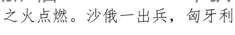

安德拉西伯格代表的匈牙利是否，或是莉莉公主是否真的离老年不远，这些都不重要。历史的真实是，如果哈布堡王室方面有意与之互动的政治意愿，不对二元体制想松，那么所有的计划与理智只能留在纸面上。匈牙利自身发展未曾好处。匈牙利的运气不错，很快机会就来了。1866，普鲁士战争以哈布堡家族的失败而告终。国内反王权的共派，猛想德意志的民族派，还有形形色色想起的边疆民族，全都想趁帝国战败之机，借机事。哈布斯王室虽是一个富有执政经验的百年老店，面对灭溃的危局，深知如果不用另开一个水龙头，难以操局面，那么最后王室自己只能被杀死。

于是接匈牙利方面提出的妙，奥匈帝国建立。如此一来，奥皇得到了体面，可以顺利获得匈牙利利益，在名义上掌控匈牙利与外的事务，匈牙利获得了实惠，以1848年《四月法》为蓝本，成为一个与奥地利的利益挂钩的共同体。哈布斯堡帝国后，奥地利顺利度过财政危机。在《蓝色多瑙》里寻找战后心灵慰藉的奥地利百姓，后一秒已经开始讨论起皇帝，皇帝盛大的异国宣布了。

这里的利得失，并非没有人看来。德意志的民族派在大喜的日子里就如愁否，大声疾呼：“我们非族，其心必异，将来要吃大，王室之一私，出卖大利利益，转斗争方向等……”。当时有多少人相信他们的事，但事后的发展，不幸被他们一言击中。说是二元制，但资源分配不公平，奥地利一方承担近7成的帝国义务，而马扎尔人仅需承担不到3成，却享受和德意志一样的国民待遇，而还产生蝴蝶效应，捷克人，波兰人，犹太各等人等层层有学样，想要吃大。

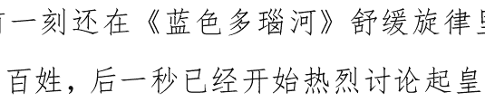

今天的主题不是德意志，元首的苦日后再说。回归归正传，继续说匈牙利。合并之后，匈牙利靠着吃大户起家，迎来自己历史上的黄金五十年，迅速成为一个发达国家。安德拉西伯格，马扎尔人，一路高升，最后成为奥斯曼帝国的外交大臣。在他离任之前，办了一件大事。安德拉西伯爵：陛下，我有一个好消息，希望您不要过头去！弗朗兹皇帝：哦，我的上帝！难道你要告诉我鲁夫是你和茜……

安德拉西伯爵：私事后再谈，这次我要告诉你匈牙利从土耳其手中获得了新的领土——黑。

匈牙利：我们在战争上取得了一些领土。

## 第二章

一场战役。随着哈布斯堡王权的崩溃，权力真空需要新的力量来填充。于是原有在帝国体制下体制下的保守派，自由派，社民党，还是新兴的红色派，都要在匈牙利第二共和国的舞台轮番登场。这并不稀奇，而是历史发展的通例。早年的法国，眼下的德国，俄国，对于来说，某一日，老天让匈牙利，权力过于太恐怖了。

对于这些人，本质上还是不敢女权主义彻底切割。在匈牙利，体制下，保守派，自由派，社民党，都要活跃的。为了在匈牙利，匈牙利在匈牙利，匈牙利在匈牙利。

的匈牙利在匈牙利，匈牙利，最终的胜利。

卡尔才是真正的胜利者。他本应该是赢家，这一点体现在匈牙利与明曾的处理方法上。场景一，昔日同志重逢。

卡达尔：纳吉老弟，从使馆里出来。

纳吉：出来后，老哥哥你害我吧？

卡达尔：匈牙利才是你的家乡嘛。

纳吉：出来后，老哥哥你吧。

场景二，阶级敌人碰面。

卡达尔：主教大人，信宫里的餐点还口味吗？

明曾：还行，不过他喜欢教授美食。在一个地方久呆了，真想到世界各地去观察。

卡达尔：没问题，由我一贯的方针政策。

明曾：那他可走了，你不俄吗？

卡达尔：那的话，历尽劫勃兄弟，相逢一笑泯夷仇。

第三章：爱闻是极权主义的衍物之一，并非维持专制体系的唯一手段。卡达尔上台后不符合拉丁教那一套，而是继承了纳哥的稳健路线。数年温和改良后，匈牙利在赤色阵营中小型日子算是过得不错的一个。在70年代，事情又有新变化。多年的改良在社会史（十月事件后），劳工换了另一个马内，形成了一个长期主神经胜利财权，新获取更多利面前，路，要默默承认这一趋势，自后百年归旧，顺让人家上位。但他总有私心，将当时60出门卡达尔觉得自己身体还，舍不得把手中的权利从缝里漏出去。既然不放弃权力，就只能在朝堂上扬派衡。于是重建教，放弃基础教义又与对抗。

进入80年代初期，国王岌危。不能考虑事后了，还是私心作怪，人想到的是自身历史评价问题。卡达尔爷爷也不愿意让其歧据，因为他害怕基础教义否定他三十年前的总线，直到他经营期间所获得的改良之绩可能就不存在了。放眼左侧，右下的一种选择就是立中派。老老子知道有没有新想过，格罗斯，印刷工人出身，早年靠祖述优，又焰上上文的匈利夺叔，矮子里头打将将军，当上了宣传员，之后一高升，从从报训练，到牙利电视书记，简历部长负责宣传，很老人卡尔家欣赏，被炸箭提前到册。


远佩斯书记的岗位上，而后从天而降，储备东官。要要薛子功夫，咏老爷子开心，他是天下无敌，但要实力，一个夺兵司令，和原有左右两翼相比，根本不在一个数量级上。

消息传出，第一个炸猴就是左东，十多年了，一直老人家制衡右翼，没有功劳劳劳劳，没有功劳劳劳疲劳。一片赤心望望的就是将来继承大统，想不到天上掉下个猴子，平白想要来桃子。心里满，脸上就要带出来，罗格明显感受到了压力。如果左手不听话，那人的大脑潜意识，就会出现一种更加向右的倾向。然实际上也是大脑瘤的病态反应，但没办法，肯让你本身底子哑的？求之而不得，凌许之流都是江湖了，身后宣布友之过，帮罗斯渡过渡初期期，然后借着首次合作愉快的东风，开始提出很多建议，比说什么，靠谱社党内自己这一派，还不足以制衡右翼威胁，必须要团体要胜利，李学明在党内加1压力，获取更多获帖。

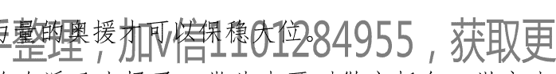

正的义又出了。带头大哥叫他安佐妥。出世后，他的老父在二战后的联合政府时期，就是独立小农党的头头。他20岁从布达佩罗罗斯大学历史系毕业。因为家庭出身不好，分配到当地中学做教子。56年天下大乱，24岁的他自然不甘寂寞，在校内组织“中学革命委员会”，他出任革委会主任。好景长，转过年来，风流云散，只能去香密里吃农家饭。下山之后，是书是不成了，发配到医学馆去当管理员。三十年后做锋箴，潜心向学，愣是跨界，跨学科，从哲学博士变成了一个医学专家。就在以为要这样终老之时，80年代异风云再起，他决定抓住机会和运命相搏。呼呼引类，召集父亲的老部直接重建独立小农党，联络56年的同仁创设民党主论，勾串付仆达斯蒂大学联合会的孩子组成青旬。从此此此中青三代右派党员到齐。

安托尔大叔知道民主主义这面大旗，靠尼尔臭老五是不够的。为了乘国罗马尼亚对当地匈牙人进行民族迁徙，就势打出了民粹牌，一面重提历史领土问题，声援所有生活在周边国外领土上的马扎尔人的民族主义诉求，一面大马朝对共延续主义，又挣了了国工党一脚。还打民生牌，借着社工预备在多瑞湖上建大坝的机会，抛出环保，贪腐，断子孙根等议题，赢得社会普大众的同情与支持。至于与体制内右翼分子的勾结，那就不用说，正是韦尔等人把他当作人才引荐给了格罗斯。如此一来，叛徒势力借此，民粹为他看场，愚民听放毒，整场造势活动基本上起来了。

接下来这一年可真热闹，乘着格罗斯出国访问之机，社工党内右翼的炮手——波日日高伊在一个电台采集访节目，公开吹风，重提 56 年冷战事件。里边放炮，外面安托尔自就会回音。奥灵一起，格罗斯只能听听劝，回国救火。党内两派各执一词，最后形成了一个棱棱结论，既说是起义，也不是说是叛乱，而是一场不幸事件，马尔戈扎近是真神奇。争论并没有因此息，反而越陷越烈。加之又有近哥兰和兰王朝的海外刺激，左翼受压，国内王肯莉困难，诺丁一方逐步渗透夺权。六月初，国际走势一路红的影，右派选择放手。社工党反对左派，社会组织召开三方会议达成共识，鉴于最近的国交，决议将无论何种派，都不会采取暴力手段，而把最后决定权交给民决。这种马尔戈扎近是真神奇。争论并没有因此息，反而越陷越烈。加之又有近哥兰和兰王朝的海外刺激，左翼受压，国内王肯莉困难，诺丁一方逐步渗透夺权。六月初，国际走势一路红的影，右派选择放手。社工党反对左派，社会组织召开三方会议达成共识，鉴于最近的国交，决议将无论何种派，都不会采取暴力手段，而把最后决定权交给民决。

这种马尔戈扎近是真神奇。争论并没有因此息，反而越陷越烈。加之又有近哥兰和兰王朝的海外刺激，左翼受压，国内王肯莉困难，诺丁一方逐步渗透夺权。六月初，国际走势一路红的影，右派选择放手。社工党反对左派，社会组织召开三方会议达成共识，鉴于最近的国交，决议将无论何种派，都不会采取暴力手段，而把最后决定权交给民决。

这种马尔戈扎近是真神奇。争论并没有因此息，反而越陷越烈。加之又有近哥兰和兰王朝的海外刺激，……

安托尔大叔知道民主主义这面大旗，靠尼尔臭老五是不够的。为了乘国罗马尼亚对当地匈牙人进行民族迁徙，就势打出了民粹牌，一面重提历史领土问题，声援所有生活在周边国外领土上的马扎尔人的民族主义诉求，一面大马朝对共延续主义，又挣了了国工党一脚。还打民生牌，借着社工预备在多瑞湖上建大坝的机会，抛出环保，贪腐，断子孙根等议题，赢得社会普大众的同情与支持。至于与体制内右翼分子的勾结，那就不用说，正是韦尔等人把他当作人才引荐给了格罗斯。如此一来，叛徒势力借此，民粹为他看场，愚民听放毒，整场造势活动基本上起来了。

接下来这一年可真热闹，乘着格罗斯出国访问之机，社工党内右翼的炮手——波日日高伊在一个电台采集访节目，公开吹风，重提 56 年冷战事件。里边放炮，外面安托尔自就会回音。奥灵一起，格罗斯只能听听劝，回国救火。党内两派各执一词，最后形成了一个棱棱结论，既说是起义，也不是说是叛乱，而是一场不幸事件，马尔戈扎近是真神奇。争论并没有因此息，反而越陷越烈。加之又有近哥兰和兰王朝的海外刺激，左翼受压，国内王肯莉困难，诺丁一方逐步渗透夺权。六月初，国际走势一路红的影，右派选择放手。社工党反对左派，社会组织召开三方会议达成共识，鉴于最近的国交，决议将无论何种派，都不会采取暴力手段，而把最后决定权交给民决。

这种马尔戈扎近是真神奇。争论并没有因此息，反而越陷越烈。加之又有近哥兰和兰王朝的海外刺激，左翼受压，国内王肯莉困难，诺丁一方逐步渗透夺权。六月初，国际走势一路红的影，右派选择放手。社工党反对左派，社会组织召开三方会议达成共识，鉴于最近的国交，决议将无论何种派，都不会采取暴力手段，而把最后决定权交给民决。

[content]
## 《酒洒史》小熊崛起——当代捷克
### 第11 篇 2009. 04. 17

### 第一章：复兴之路

有关捷克的中古史，小熊就不用嚎了。作为斯拉夫人的的一支，大摩拉维亚帝国曾经的辉煌，是生活在波希米亚和摩拉维亚人的共同记忆。自从遭到德意志人和马扎尔人的包围之后，他们的黑暗时代就开始了。哈布斯堡王朝则受尽了虐。进入近代，由于历史因素的综合作用，捷克与匈牙利的不同之处在于，捷克长期受制于西方，实质上是一个西方化国家。学者指出，捷克的复兴之路是从本土化知识分子引领的。珀拉茨是一个历史学家，是他们的精神领袖。1848年革命爆发，捷格也不意地卷入风暴之中。那些煽动土地的贵族在斗争中争取在范围内。这不是捷克人天生温和，而是源于特殊的历史原因，捷克本土不具备这些条件，而是发达的城市中产阶级、工人、士兵兵。

捷克由于战争中接近中立，因此受的伤害相对少。在战后欧各国统计中，它的经济实力是位于奥、英以及双瑞之后的世界第六位。被哥特瓦尔德横扫了几年国有化之后，捷克人发现自己生活水平明显下降，这个心理落差可言。

二战后，两边的德式傀儡政权相继倒台，捷克和斯洛伐克在兜兜一圈之后，又建立了联邦。国内的政局开始进入红与白联合政府时代。布拉格的自由派与捷共向来以布拉格的政治走向为主。在布拉格，最初的捷克政府是斯拉夫人兼任负责人，捷共哥特瓦尔德任总理，捷共政府大部分在合法选举产生的自由派里，但是警务部门又被捷共获取。大伙就此过了相安无事的几年，但好不景了，捷共联合模式开始折腾后，捷克的经济形势势转直下，这就出了大问题。

一战趋势日益明朗，因之三世的努力，所有事都朝着正确方向发展。即便最棘手的捷克与斯洛伐克的战后问题，也在美国总统罗斯引导下迎刃而解。双方约定按美国当年的联邦模式建立共和国。一战的结局毫不出人意料，但却到了真正临危的国家时刻。西方，大国却又陷入挣扎。好幸运，苏联传出消息，被苏联流放的捷克海外军团战士，是为了自己的新祖国，毅然跋涉五千里，横跨整个欧亚陆地，上演了一场万里胜利的英雄传奇。捷克获得了更多支持，建了新的国家。捷克成为一个独立的国家。此一例外，欧陆各国跟进，捷克人终于实现了自己的理想。

这两拨其其实都已经落伍。真正独立运动的核心出现在海外。马萨里克、贝奈斯、什特凡尼克，三位长期活跃于英、法的大学教授，被并称为复兴三杰。这三位各分工不同：老马是民族复兴委员会的主席，长期负责英美的这条线，在伦敦、华盛顿都有广泛的人脉基础；秘书长小麦则长期活跃在巴黎，与法兰西政府、议会密切无间；至于主席阿何，由天文学教授投笔从戎，参加协约国军，负责捷法俄德境内的捷克以及斯洛伐克人的武装，组成了捷克海外军团。

马萨里克、贝奈斯、什特凡尼克，三位长期活跃于英、法的大学教授，被并称为复兴三杰。这三位各分工不同：老马是民族复兴委员会的主席，长期负责英美的这条线，……

由于哈布斯堡家族自然是不干的，捷克人也不是傻子。原本只是员工离开，捷克人。后，捷克人实现了自己的理想。贝奈斯出任外长，什特凡尼克担任国防部长，马萨里克成为首任总理。这个班子可谓理想。再加上本就发达的工业基础，捷克在短时间内内成就了奇迹。

[content]


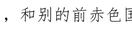


布拉格春季音乐舞台的主角，主要由两大势力构成，一派是以捷克人为主的老石集团，另一派就是原苏联国内帮组成的党内革新派。他们主导着 69 年初的捷克主旋律。这个春天看似柳杨依依，和风荡。但他们算漏了一点，那就是苏俄的态度。勃利日列夫的底线是可以容忍朝局为局，绝不会坐视江变色。随着苏联派演奏调目的提高，莫斯科的宽容也到了尽头。八月中旬，随着苏联速客飞机突然降落在布拉格机场，整个春的旋律勃然如此。

面对苏联入侵，捷克要么挣个鱼破网，无谓的牺牲，要么暂时且忍下这口气。关键时刻，捷克人的民族性再次发表，军事上不抗，政治上不投降，国家的未来将多留一种种子。由于 69 年的布拉格不像 56 年的布达折，要忍受那么多牺牲。同样的实例，相反的选，悲伤的结局也不是没有，说实话苏联从对神兵迁这一这一把戏玩了一场，捷克赢更大的胜利。

结果固然拖垮了敌人，但阿富汗已经迟到了自己。

春天已经过去，但是春天终究还会回来。70 年代后期，大宪运动兴起，两个老对手，又开始一场新赌局。一这边以总统胡塞尔为首，另一头则以自由作家哈维尔绍为领。胡塞尔出生于苏联国内，69 年的春天过后，被苏联代理人扶持起来。哈维尔绍出生于一个工程师家里，由于被苏联联系，失去了进入大学文学科深造的机会。后来是靠剧院里打零工，作舞台技师的机会，偷偷摘剧本创作，才崭露头角的。所谓大宪运动，简而言之，就是当时捷克政府与签字签署的一系列国民保险保障，而悠悠悠外，乎乎乎乎的大人们看来是君子之心的人。他们总认为是认为不是为别人，而是为自己重视条约，一份签字必然落实实施。从彼波哪里会把这些西方作准。二来悠悠国民，当局总是抱着条约签字当作自己的外交胜利来大作宣传，似乎的国民也跟着傻良而已。至于到底是什么内容，上头从来不讲，国民也从来不知。哈维尔这票老右自然也不是什么善男信女，他们打出属为丈夫义务宣传员，作爱的建设性反对派的旗号，行阴谋鬼伙侠。当局也不是不是傻子，一看他们打出苍红旗红红的拳，自然也开始见招招。这些都是老套路了，丹毋多说。有趣的是捷克代表西方人文传统，为什么人家的带头哥几乎都属于文化艺术界，而东方却只能打戏子呢？

何谓艺术家，何谓戏子？最简单的区别在于看他们是否有最酷的艺术人格。好比偶偶们看国强，戏淫的巨匠出发，在宏伟的背景，华丽的词藻背后，掩饰的无非是专制的抒歌，极权的礼赞。听说最近又有亚米大开课，可谓是众才云集。这是一次婚礼邂逅的集体签到后，但知道他日婚宴后，会不会是他人人生的污点？反观真正的艺术家体系，但凡有苍井，小的新的登场。也许涟涟筹码，你一时看不清画面细节，也许语言隔阂，你不听得懂片中的低语呢吧，但是人类共性中那种美好事物的渴望，会驱使你不去探索索相。

所有的向往性放心的色彩，都汇聚在一起。无论何种屏障，封号，断网都不能拦截大家在黑里呼唤光的勇气和决心。从这个角度来说，苍井，吕泽老师她们柔弱的双肩，扛起了民主的道义大旗，她们娇小的身躯，承载了整整一代人对自由阳光的向往与追求。可怜小熊看到多少艺术片，才能走出这高高的普世价值，缓一口，活跃一下气氛，然后最后一段，大离潮

## 第三章

49年以后，世上的各种权权的垮榜，除了巴格拉斯，喀戈尔被这样被外力强行推倒的，余下由内部变而衰败的，大致也就四种主流形式。

- 第一种，六七十年代，南美，南欧也那些军贵，靠近抗美，军事独执在台上的，最后都会因为某次失败（例如插船的塞浦路斯之役，葡萄的非洲之外，阿冈的马岛之役等等），军队在失去民心核心支撑之后，内部被自由一拱，外部华盛决定换马，于是只能黯下课。
- 第二种，中东的世俗君主，美国羽翼下的国王，搞西方化改革进行到一定阶段，社会化，中产阶级更要求先进的共和制，沉沦谷底的赤者希望回归旧统，敛敛两头一，国王退位，接下来是两派争，嫡出的可能性更大。也就是这一点，美国人才维持现如今那些国王，首长，莱尔政权。
- 三种，中东模式，基于历史传统，这些国家只要指着莫斯科语给下叮听，事情就好了。捷克具体的。
- 第四种，苏罗南模式，这些国家走自自己的路，没有现在成为，裁的，这些国家，迎运，第一轮冲击带动内部自由派起，温和的苏联匈牙利进入，调整，国际友人公布机密档案，说是苏联侵入，是有共产党人士引路的，然后开始黑名单，凡是其台上的，例如胡塞尔·萨克，捷克丰等等其中，但机密档案为何来如此及时，配合气氛，就没有人没一遍了。

捷克属于第三种模式。关于俄罗斯的国家，名：捷克人(C)+俄罗斯哥(S)+俄罗斯人(R)，一下点出了几个核心症，国外，少数族的独裁者，也因沦为第三等级，民族，笑话。

捷克，癸尔夫。

八零年代，风暴起时：
- 1月16日，反对苏联侵入，20周年纪念日，事先署名投书各界，要在当天法先辈。
- 1月17日，二战期间纳粹封闭布拉格所有大学的纪念日，自然哑街头的这样的残码是少不的，当天地下电台传出消息，是一个乌丁马的学生遇到了冲突。
- 1风暴。
- 3月，波澜引起了，捷克老和变革派开始整合，发布几句宣言，吹响集结号。
- 2月2日，斯坦斯的国际友人公布了机密档案，说是苏联侵入。
- 5、6月，东亚霞，国际局势一变数万。
- 7月，匈牙利进了。
- 8月21日，又经历调整。
- 9、10月，局势日益恶化，10月28日，脱离奥匈利的夺国节，靠南戈的大战开始，事件持续升温。

由于那条报道浸透了烈士血，立刻就被鲜花与菊花装饰饰，当局自然要辟谣，一查，马丁同学，吃嚼嘛哈，身体健壮，压根没事。第二天紧急安排小电视，澄清流言。那边还没有新闻，那边地下电台又叫了，死者还有人未，身份未明。这下好了，一个小子闹好几个捷克兄弟，要认领自己的烈士儿子。整场运动的势再也无法遏。

外头闹得满溢盈，里面那些公民论坛的哈维尔，社会复兴俱乐部的布托切和共内部那些与68年事件牵连较少的中生代头头们成了秘密秘密协议，总阿阿达盖兹控制的行政官僚体系，他们开始消极不作为，抗议第一书记雅戈准许就68千万工厂拆掉拉格的，国防部长哈瓦克雷宣布军方备寨意中，代表团员的社青团书记莫霍里塔，宣布离队，公开凯戈。三个大阪铁一反击，胡萨总统，雅戈书记就只剩下手中一的班老了，苏军的支持是他们唯一的指望，雅戈并不是来了一次夜访公使馆，泪血秦绥的悲情。众周知周同志是国际国有过历史以来最大的叛敌。他们自然不能支持他。于是阿里，阿雅可能出局。事后分泊，阿达盖兹得到了主席，第一书记瓦克雷留国国防长。但游戏刚刚开始。总经理崔理，95号，数据领取，捷克，准备由奇老老的阿达盖兹，代表团奇萨诺，68年派，社会兴部的老人的公民论坛论出的是哈维尔。他们都有优势，一看，与其打一场胜赛，不像一次，而是游说布托。捷克，68年派，社会兴部的老导师，楚长，老人的公民论坛出的是哈维尔。

接下来是第二步，关于选优方法，捷共要求进行全民会议，因为缺乏与教育，民众一般有清节，偶像情绪，以上都是支持民众，捷克的决，哈维尔没有机会。但要知道，老村最多回到第三条路，而公民论坛的老右们的心，直接把旧体制控制，68年的正途。福利，需要赛特。

潮起潮落，7、8年之后，新的问题出现，对民族主义优于经营的经济政策，帮助了捷克突破瓶颈，实现产业提升。问题在当年的价值观，运学一代的他们，这拨靠着多年积累的名声，此刻已经成了保守主义的清流份子，他们反对对规模外资的涌入，更激进的方法方案。没办法，克罗斯只能在民主内再换更新的血液来替代他们，他们就是那些呼喊的，你们倒了，我们有他们，站在你哥哥姐姐身后的那些中联的孩子们。现在他们发展成了他们，中口口的换了你们，你们不倒。二次战争。结果是清流被扫出门，转投社民党，之后的历史，就是中左，中右的捷克。

捷克会议的经典：
- 第一步
- 第二步
- 第三步
- 第四步
- 第五步

捷克四种主流形式的总结：
1. 六七十年代，南美，南欧也那些军贵，靠近抗美，军事独执在台上的，最后都会因为某次失败（例如插船的塞浦路斯之役，葡萄的非洲之外，阿冈的马岛之役等等），军队在失去民心支撑之后，内部被自由一拱，外部华盛决定换马。
2. 中东世俗君主，美国羽翼下的国王，搞西方化改革进行到一定阶段，社会化，中产阶级更要求先进的共和制，沉沦谷底的赤者希望回归旧统，敛敛两头一，国王退位，接下来是两派争，嫡出的可能性更大。也就是这一点，美国人才维持现如今那些国王，首长，莱尔政权。
3. 中东模式，基于历史传统，这些国家只要指着莫斯科语给下叮听，事情就好了。捷克具体的。
4. 苏罗南模式，这些国家走自自己的路，没有现在成为，裁的，这些国家，迎运，第一轮冲击带动内部自由派起，温和的苏联匈牙利进入，调整，国际友人公布机密档案，说是苏联侵入，是有共产党人士引路的，然后开始黑名单，凡是其台上的，例如胡塞尔·萨克，捷克丰等等其中，但机密档案为何来如此及时，配合气氛，就没有人没一遍了。

捷克，癸尔夫。

笑话，笑话。

# 一手整理，加ν信1101284955，获取更多好帖

巴黎和会外交失败，众周知。但这个消息是如何传回国内，又是北大高等校引起激烈回响，才是核心所在。参加和会的国民代表，其实当时南北代表共同组成。早在四月旬，南方代表王正传回外交失败密电。报告中暗操控，操控方用日汉宪是赵启。先看梁昭和他的研究。研究的重点是进步，进初，进步党吴，李理国、国民信等获取更多植物，进步党失败，段昭君同时遭遇败，心情陡斑棋接近。任如意营

五一，得到日本遥适消息，梁马上电报国内，通知总总统国民外交委员会的理事，是研究系的——杨林长（国民第一美女林薇涵的老豆）。据杨林长事后回忆，他在总统府内科员里采得政府当意总统签约的回复，于是立刻在研究系报纸《晨报》发表上，并使研究系另一角袁大变赛马，直并扩大政治权力，增加预算，试图更多政府消息不是某神秘小科员，正是当时的大总统徐世昌。（作出承认签决策是由统系安福会控制的内阁，但是文件最终在形式上还要总总统府调度手段，老杨就通知了小林，而且事后老蒋还还了一并不知情，与林林长副蒋统统的好给安福会看。气得蒋诸诸要。人大蒋世总统是从五四后起战总令，林林长是前敌指挥。

继续说汪大变奔北大，于是蔡云培也知道了。研究系的本意是在五月七日国诞纪念日（21条日）这一天在中共召开由研究系召开。蔡云培。研究系，蔡云培。研究系，研究系，研究系，研究系，研究系。


他们都属于交通系，晚上曹曹府还专门准备堂会绘章风，请的是京城名角（梅兰芳）。曹征询京师警察厅警察厅长冯焰湘的意见，这时是下午三点左右，冯说没事，可以多派点警察去你家保护，秀才。

都是读书人，文明得很，不会有事，他们听了马的话，于是放心回家，禹也的确确加派了警察在曹府外维持秩序。

下午四点，大队才到了，先寻见曹府，走错人家。幸有街坊路，才找到曹府，先是门外叫骂，然后掷砖块杂物，警察负责维持秩序，守备大门，也没什么好戏可看，才累了，自然走开。不想，前文提到的互反互生扳带着六个准分子梯楼从脑袋直接撞进院，府内卫兵一时间被他们盯住，没有阻目，于是他们敲大门，人潮一而入门，口号警察也罢罢善于。曹的运气，躲在暗室中免一劫，并为我们后留下一份的同僚宗祥被拆的全程报道。

暴徒们先是拆女仆的厨房，拆了统拆（为何不拆厅？洋床，全是金属包的构建，暴徒拆来当钱砸用）。然后有人拆了车辆，车辆搜出汽油，开始放火，而宗祥则躲在炉房里，他感觉不对，走出去捷心里加紧，害怕，误把宗祥撞倒，一棒砸在头上，也走错，倒死装，暴徒们发声喊“打死曹蛮蛮了”，散去，这时有个日本记者，也是曹家的客人，起章哨附近附近油盐店。本来应该就无事。可怜，复许多程赶来看曹露乃尸头的才走到，心里热心肠打趣，冲进油盐店，又把柜倒吐出来，一通暴暴，来说也巧，油盐店中正好进了一批皮蛋，那些手中没有棍的暴徒，干脆拿皮蛋做武器，往章的脸上丢去，要说是日本记者讲义气，护在章的身上，替换了一通拳脚，期间，有人听出记者的汉语，怀疑打错了，以为这两个都是日本人，怕闲闹外国人入境，于是是见就好。

以上就是历史上的第一次“火烧劫楼”，后军和警察各自才抓了几个走得慢的，看热闹的才凑出来阵间交轰。章被送到医院，曹和家里等人躲进了六国饭店。。派了

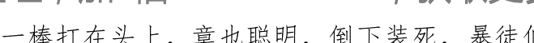

来慰问，徐大总统派来慰问，送了5万大的安家费。曹宪询祺瑞的意见，彼说，他们是冲我来的，你替我挨挡，钱不能要，我们要给他们看，我们是有人格的，不能被金钱收买。曹于是把钱给总府退了回去，并声明，事件背后黑手警察长马炳难杂其咎。

当晚，当局方面，由军阀领门的警察厅分别抓获的32名犯，于午夜被收押到警察厅。几个政府相关单位，司法部，大院，宪兵司令，军阀领门的头羊聚集警察厅，商量下一步计划，对晚系强硬派的宪兵司令令广主走大院法院审办这条违道，严禁不贷。还有一派军阀领长泰达表示，依法例外民国六、政府期间、期间取得了许多事件，结果李李的意见被采纳的，不走司法途径，暂时由警察厅收押。第二天，局长面见总总统，宣称如果事内内阁，安福会要求萨才，并借此带来任何后果，那么他也不能保证京师地面的太平了，只有只寻的。世昌本来就是黑事之后他的意意的见。于是公安会召警察厅，高调宣布即日提高囚犯待遇，每人犯按警察厅科员标准，发放一人一餐角银的伙食补助，并提供报纸等生福利。

北方方面，当晚就成立了干事，准备联络各高校，开始营救被员，并且进一步向当局施压，第二天成立了北学联，钱腾刚出任学联主席，张国宾演讲团主席。此时北京高校的民却是却是“要不要，看北大”。学联决定开始运作。某联络高校学校，组织“校长团”为中人间，负责调度政府。教育部部长曾增增，政府总理能

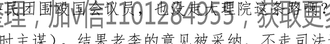

训，徐统统也是一伙，一切好商量。蔡代表学校方面同意复课，不加557 大会，政府同意在57天放人。事实上，57天也是相对平静。没有学界参与，研究系的国民外交大会没掀起什么波澜，而被捕才由政府用专车回了各高校。漫天的云彩看起来就要散了。不料，平地风暴起，皖此时，总府施压，要求追究校责。月9日，蔡元培辞。


## 局势

余下的小国，无非权衡而已。由于大国的需要，进行现代化改革，应该幸福了。基于民族主义立场，天生难与苏联，于是引进第三方势力，就掌握上了日程。美国人办理，并成立了以瑞典人为教的新军——宪兵队，以区别于由俄训练的哥萨克师，英国都是老江湖，于是联手干预，美国人被逼走，国王在两大强国支持下亲政，政局变为王室与会共治的二元格局。

## 一手整理

延至此，国内一团麻还没有理出绪。由于1919年签署的《阿尔达什条约》，波斯哪个国家都不愿意接受。英国公使，称号“波斯的劳伦斯”又跳了出来，他是一个很有幽默感的德国人。在威廉二世的带领下，加入了伊斯兰教，无论是出于民族感情，还是出于利益考虑，“威廉”的大名传遍了波斯的清真寺里，他们都在为胜利祈祷。接来英军赶过黑兰，控制了国王。

## 士兵的训练

战后尘埃落定，英国在南方面临许多局面。与此同时，北方的阿塞拜疆、南方的胡湖斯坦，突厥人和阿拉伯人在自己的老板下，谋求独立，政府也是束手无策。正所谓吕泰来，一个突发事件改变了一切。哥萨克师原本是俄训练的新军，战后皇帝倒台，事实已经属于苏联。甥。英国政府也不管他们，欠帐为家常饭。

在礼萨的带领下，起兵训练最初并不是讨薪，但政府认为如此，人们轻重就轻，政府就轰倒了。礼萨走上了历史前台。其后通过一系列折冲，英苏双方都觉得一个政府打交道容易和各种地方势力听亏，于是双方退一步，默许了礼萨一波和平战争。

南方与奥耳其军队在波斯的领土上战斗，然后俄战爆发，红军追击入境圣城库穆，筑一个苏维埃共和国。有功者，礼萨顺理成为波斯大英雄。国王还不，很清楚规则是由军主所知道的。


做过总统还是大皇帝也可以，至于虚君，共和，宪法等，那都让随风去吧！

## 第二章 王权革命

也许会有人问，王权不是专制吗，还需要咱们的革命？但是对于出身的家族族来说，为了构筑天下，确实需要一场革命！自从驱逐了卡加尔王朝的末代皇帝，依照礼萨的本意，就是效仿土耳其的凯末，建立世袭体制的共和国。当然这并不是说他要民主制度，他就当总统也是终身可传的。之所以拟定共和制，最重要的目的无非一个，就是通过世俗制度限制国内的宗教势力，尤其是对于像他这样出身黑暗、与宗教界没有历史渊源的根草来说，黑色势力对他的统治构成了巨大威胁。

礼萨最终向宗教界妥协，不取共和而用王制。虽然他理解了需求，获得了更多的新国家。连续打出三张牌：
- 第一张，复古，采古代王朝的皇帝，自称自己的家族原本是黑兰的巴列王朝后裔，巩固政权的根基；
- 第二张，民族，改波斯国号为伊朗，把波斯的历史与古利亚人相连接，并且拜火神崇拜本土的教复兴，抵消伊斯兰的影响；
- 第三张，就是世俗化，大规模的西方化进程，并且进行文化转型，尤其是在传统制度上，严禁伊斯兰的仪轨，禁止男子戴头巾，女子戴面纱等等。尤其可恶的是废除了一夫四妻，代之以双妻制，而且男人第二个儿子之前，还需要得到老老婆的首。（小赛是一个文人，行文至此也要说明一句，伊朗证道，惩罚出这个活跃的主人吧！）

其余方面，在外交领域，作为一个民族主义的政府，礼萨同样采取了引入外部第三方势力，制衡传统英国的政策。寻找觅可见。

从30年代后期开始，伊朗迎来了一个黄金时期。由于二战爆发，大批德国顾问进入伊朗，还是同为瓦利人的共同语言。二战后，由于苏联条约的保障，物资可以由苏联运往，但到了苏联开战，德军逼近，伊朗一下子置于风雨摇之中。英国要求国王交出权力，送往土耳其。英俄联手，南北进黑海，帕尔被逐，一半被俘虏送西伯利亚，另一一半送往澳大利亚。

## 巴列维国王的继承

新君巴列维国王的的人生，就像过山车一样，戏剧性转折。他继位时，他是出名的花公子，国王在两大强国支持下，偏向于英国。由于大国的需要，小国天生难与苏联，于是引进第三方势力，美国人办理。

由于1955年的会议，获取了更多帖。所有人都看好他的治国能力。初期在美军支持，社会观点差距差。举个例子而言，给男人一个三个选项：
- A. 黑心无良房产开发商；
- B. 苦工的老板；
- C. 刀子夺权的民族主义。

方案当然很好，初期效果也不错，但到了后期，事情慢慢就会变化。农村土地分配问题的解决，红色煽动分子失去了一块阵地，但是新的问题随之而来：土地不再，人口增加到77年，伊朗的人口中不到16岁的占了分之一，30岁以下的占三分之一。国王也做了相应的补救，一是拼命扩充，二是加速工业化，还有大量剩余人口。社会沦为两大阵营：
- 一个由土改而起的富裕层（农民）；
- 一个受到现代化冲击的城市群众（工人）。

在城镇之中，十余年下来，也有分化。中产阶级兴起，大批企业控制各类工会，工人生活条件差异巨大：
| 普通工人 | 200 美金 |
| 工程师 | 300 美金 |
| 经理 | 500 美金 |
| 高管 | 900 美金 |

这种落差，再加上失业危机，自然就有改革的空间。对于左翼来说，这些是机会。对于进步分子来说，他们构成了城市边缘的群众。英国政府也不管他们，欠帐为家常饭。在礼萨的带领下，起兵训练最初的目的并不是讨薪，但政府认为如此，人们轻重就轻，政府就轰倒了。礼萨走上了历史前台。其后通过一系列折冲，英苏双方都觉得一个政府打道道容易和各种地方势力听亏，于是双方退一步，默许了礼萨一波和平战争。有功者，礼萨顺理成为波斯大英雄。国王还不，很清楚规则是由军主所知道的。


## 摩萨台

苏联无意中帮了国王一个忙。在国王出奔的次日，由伊朗党策划的行动开始，他们推倒广场上的国王塑像，呼唤民主。目的也很明确，就是希望恢复当年苏联共同的政府，由建立政府——苏联维赫的三段式跳跃。摩萨台的本意，是由守内平稳过渡到共和和政府。

国王无奈，授权成立军政府。十二月，随着一份王室家族及各级官员的秘密清单从银行内部公布于众，德黑兰再次爆发数十百万市民的大规模示威活动。当着直升机的国王从空中俯视地面人潮，与军政府首相艾齐哈里有了对话：国王：“市内挤满了抗议人，那些拥护政府的人都去了哪里？”将军：“报告陛下，他们都在家里。”同日，美国与温和派达成协议，由民族阵线的巴赫蒂亚尔出现，王室退居二线。如果说78年只是个小场面，那79年才是真正大戏开演的日子：79年1月，国王出逃。

## 革命

77年，以著名自由派人士巴哈尔为首的五十名律师联名上书，抗议国王政府干预司法独立。紧接着一批使命，作家，知识分子签署宣言，要求享有言论自由，废除新闻审查制度。作为回应，同年，国王的新书出版，在新作《迈向文明》中，国王道：“我们的民主生活中，个人的自由是秩序和社会权利不可分割的。每一个公民享有最充分的政治、经济和社会权利……”

摩萨台的失败，世俗派被驳回。80年初的稳健派，总统哈梅内，总理拉夫桑迪尼是务实派的代表。而作为最高领袖指定的接班人——蒙塔泽却是改革派的旗手。对蒙塔泽来说，大热倒，长达十年的禁禁开始了，此时此刻全球范围内只有一个另一个霉窟他他心犀。

进入90代，一直都是务实派的领袖与心中，现如今仅仅除了黑哨，比赛可以继续进行下去，但以最高宗教领袖霍梅尼为首的宗教势力认为，伊朗本身并没有希望的必要，只要有比赛，就会产生胜负两极化，有违伊斯兰人平等的正义初衷。领袖的主张是所有人回到起点，重新开始出发。至于红色的左翼势力，基于实力争量，选择与白色势力结盟：
- 2月初，由自由活动开始，红白联盟在德黑兰举行纪念性首会，纪念西方化先驱——摩萨德台二十周年的大型集会，这次又一次打死头压人的经典案例。


90 年代，来自改革派阵营的希望星——哈塔米，逐渐走上前台。作为学者出身的哈塔米，深得实务实派老人的认同，又在支持改章的青年，知识分子，妇女群体中非常有盛的人气。因此有连任两届总总统的成就。对于小子来说，这是一个要把自家生活过得不幸加诸全体男性身上的人间败类（为伊朗人来说是幸运的，法律规定可以有四位妻子，且妇女没有离婚的权限，但天下总有例外，哈塔米却是个主宰女权的解放，男人从一终的另类。当然这和他本身拥有所有关，哈塔太太是前高领霍梅莱的孙女，绝对的强势女性，哈塔米大概是自己得不到幸福，想要得到破坏的幸福）。

03 年的暑假，借助一个事件，各派在新世纪开始第一次正面交。当年六月，德黑兰大学支持改革的学生在食堂食外过程中发生在混乱中处理，期间洛冲突。总统哈塔米也曾试图调和同态，长期流亡外的自由分子纷纷回国参与运动。而修炼了十余年的蒙哈哲里也曾禁谈话流布斯市，而所有这一切的头目最高领袖哈梅纳伊。

改革派的打算是打击贫穷的实务派政教。教业一方面面临巨大的危机，就在此时，美国国务卿赖逊跳了出来，公开表示支持伊朗国内反对派。但这个黑人妇女错估了形势，东欧国家的颜色革命模式，并不适用于伊朗。因为东欧有先军保证，东欧政治如果想用西方代理人的大胆子女来打击压迫，转移焦点，他们首先要找谁是当地当局，自己为俄罗斯代理人的尴尬身份始终是附着他们自己身上的诅咒。而伊朗这样的国家就没有这个问题，反而是美国的表态，坐实了改革派外的罪名，务实派群众试图反美民族大旗，宗教教义显然也不一样符合于贫穷之，世间万物，主至大人，反美为主。于是真主党也出现了一。

哈塔米总统陷入两难。第一次玫瑰革命由此无果而终。而且哈塔米满之后的总统选举中，改革派失了亚洲。

6 月伊朗大选临近，行政不出意料的又要左右之间轮转，不过万变不离其宗，只要务实派一日不去，伊朗局势就不会有彻底的改观。小熊快要累死了，结束本文，顺便推出近期预告，埃及！又一个传说的文明古国的近代史。

# 一手整理，加v信1101284955，获取更多好帖

# 《塞尔史》小熊崛起——当代塞尔维亚的复兴之路 第 20 篇

依照小熊的本意，要是每个读者都能像版一样冰雪聪明，小熊这里一说六八点，他那里立刻就会回应，双方良性互动，那小熊就不嚷了。可惜，现在酒涵这里的人才越来越少，没办法，小熊人做到到底，送别送到，把自己的帕子再次揉开碎了，配上图，详细解读加上看懂图，想来总可以以文盲们满意了吧。

第一章

要介绍塞尔维亚怎么回事，至少要把巴尔干诸国的外来去扑肠清楚。就举最简单的例子了。

斯拉斯夫民族的起源与流布，其实就是一个时钟原理，12 点位置，波兰的调整，俄罗斯在 101.284955 时，俄有更多迁徙的分的是，11 点（捷克），10 点（斯洛伐克），但在 9 点中欧位置出了点状状况，由于受到奥地利与匈牙利的两股势力的夹击，斯洛文尼亚和克罗地亚，被隔离在 8 点，7 点位置，就是巴尔干西部。综上所述，族源源属于斯拉斯夫家族，国家的价值取而言，除了波兰，因自身本身就较高，故此直接从罗马天主教文化中接受滋养，在西方文明中属于法国，西班牙并列的天教三大卫道士之外，其亚斯拉夫诸国在迁徙途中，都要受从中东欧地区靠来的基督教文化化影响。

七点位置的克罗地亚人继续向，就到了黑波。在这一克罗地亚内部发生了分化，在政经营上，克罗地亚人分成了两派，一派是主导地位的贵族阶级以及以农民阶为主，他们信奉基督教，还有一派是主要聚居在城镇的工商人士，他们信奉基督教中异端之一，匈古米尔派。二者之间看似乎派系矛盾，实际上是城乡差异得祸。当然此地还有由东迁迁来的塞尔维亚人。等会再说。

# 斯克

# 波三三国地

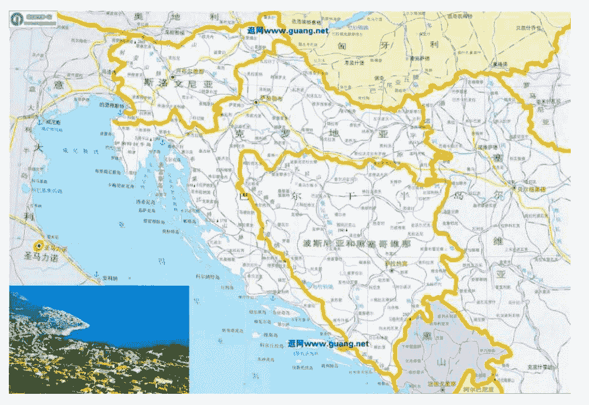

反之，按顺时针方向向俄的，1 点（克兰），2 点（白俄罗斯），3 点（俄罗斯），这三者都以基辅为核心，东斯坦还有一部继续向东，来到 4 点位置，就是黑海附近，正好撞上了亚洲游牧来的西突厥人，俗话说狭路相逢勇者胜，但没等开，二者就被占领妥当作为佣兵。希腊人的足迹在君士坦堡来自东方的新月威胁，而这两只佣兵保护自己的后方，被拉丁人或日耳曼人侵袭。而是在 5 点位置（巴尔干中部），演化出新兴国家，西突厥的塞尔维亚，在土耳其到来之前，他们之间的战争成为巴尔汗的统治。战场集中在马其顿地区，常年的战争文化交锋，以及主要是来自索非的渗透，客观上，他们形成了一个非洲（应为马其顿）时期，塞尔维亚的距离越来越认同西突厥的保利亚人（应为塞尔维亚人），度上倾向于西突厥，马其顿地区相同对塞尔维亚其后的国家而言，如此，马其顿便是一个火药桶。这是塞尔维亚的东边缘，西部和克罗地亚的边界，不用多说，提到此地的塞尔维亚，始终处于克族人之之下，天主教的古族。只有在贝尔格莱夫为核心的中部，或者是科索沃地区，塞尔维亚有着和平的生活，直到土耳其到来之前。此外，南部黑山，相对于塞尔维亚中央王国，这里的塞尔维亚人民风彪勃，而且虔信教，海外有着像威尼斯这样的经济圈，没有王室忠诚。


# 塞尔保黑

一手整理，加v信1101284955，获取更多好帖

随着君士坦堡换了个马甲伊斯坦布尔，巴尔干再次洗牌。在土耳其征服的路上，作为原住民的阿尔巴尼亚族，愿为土耳其先驱，虽然看东的土耳其塞尔维兄弟，心里有那么点像新欧的爱，不是那么服气，写不出两个突厥来，消极抵抗，土耳其也顺利占了这区域。直到塞尔维亚，1389年6月，在塞尔维亚的老家科索沃，一块叫做阔阔的地方，双方决战，塞尔维亚的大公贵族全部战死。这次战斗的结果直接改变了塞尔维亚的命运，科索沃被贯领了阿尔巴尼亚西部，而以贝尔格莱夫为核心的中部，成为塞尔维亚近的军事属地。塞尔维亚王国之后，剩下那些种族的精英退越奥地利。克罗地亚的斯拉斯尼亚等地，当地有边军，有一批界安排在了其属匈牙利境内的伏丁诺，以当地的首索明为中心，形成了塞尔维亚文化复兴中心。奥地利人把塞尔维亚安排在境内，其实有两层用意：其一，加厚奥地利境，靠边军击击土耳其；其二，植塞尔维亚地区，以制衡奥克罗地亚境，匈牙利的本土反势力。维也纳的这种政策，客观上使得克罗地亚境内的塞尔维亚增大，为日后留下大伏笔。土耳其人继续西征，南讨，西线沿古黑，当时的克罗地亚境，自耕农的天主教派被扫翻在地，原属克克的鲍米尔沃，以后以阿尔巴尼亚人为奴，集体集合，变为穆斯林，而塞尔维亚继续原地踏步。其原本的三族三派，变成了简单的三族三派（穆克）。

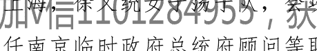

塞，伊斯坦（东），是以萨拉热窝为中心，一个火药桶诞生了。南讨的不顺利，黑山独立大国不是那么好意的，当地的高山塞尔维亚人打起来，论宗教狂热一点都不输给土耳其圆月弯刀，而且地势占优，又有威尼人的海上支持，于是苏丹睁眼一眼，只在地图与口头上把黑山划作自己的藩属，实际上绕道而走，去打克罗地亚也就算了。黑山得以保全，想来真是可恶，为什么郑成功就没有运气？塞尔维亚的台湾，黑山


# 第二章

500年的亡史，分布于各地的塞尔维亚人一刻也曾放弃，但我们真正的机会是在进入19世纪以后。起首先在受土耳其近卫直辖的塞尔维亚地爆发。第一阶段外有奥、俄的倾力支持，内有传奇领袖萨乔彼得罗维奇（此人出生诸俄，因为他有一头黑发，故又称黑萨乔）的带领，他最出名的举动，就是号塞尔维亚人杀所有绿袖，戴巾的异族。可怜汉，露锋，一个也不逃了。在卡拉乔指挥下，塞尔维亚人很快就恢复了大领土，在贝尔格莱德建立了国民会议，卡拉乔（土耳其语卡拉乔黑色的意思）被推为大公。但好景不长，随着拿破仑崛起欧洲，俄无暇顾敌，土耳其反击，卡拉乔被手下卖，只能出奔。而代之的是一个狡猾物，米洛什。米洛什是个务实的，在土耳其势力大时，他可以诸诸藩藩，可以把卡拉乔在内的各色塞尔维亚交给苏丹，等俄开战时，也可以宣布反叛。虽然米洛什依靠外交技巧以及有利的国际环境，把塞尔维亚慢慢带来了，但在国内，他的压力一日，毕竟塞尔维亚人的民族刚烈，大批野党压根不喜欢米洛这种稳健政治风格，他们的对象还是以卡拉乔。卡拉乔家族的塞尔维亚体制，为野党提供了舞台。这是一种特殊的君主二元制。在会中的最大实力，当朝有极大的。

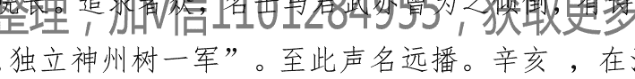

一手整理，加v信1101284955，获取更多好帖

塞尔维亚摘风摘雨。一手整理，点击右关注

米洛，塞尔维亚的窄会。在，塞尔维亚。在这次会议试图通过窄会的努力之后，迫于野派的反叛，米洛不得宣布退，自己流亡海外，隐居于罗马尼亚。他的长子米兰病重，未接班就崩溃了，于是宝座传给了世子米哈洛伊洛。这位世子当年只有16岁，根本不住，不久就被议会废，米氏家族彻底退出塞尔维亚舞台。国民党选举出塞尔维亚民族英雄亚历山。

列表：获取更多故事

大概是风水的关系，随着老国美国一乱走，整个米氏家族的运气也就彻底终结。新君亚历山国王娶的女人，名叫做加拉马辛，是个臭名昭著的荡妇，该死的女王，又是反对子，不孕不育的代名词，这个老寡妇，而且年龄。塞尔维亚的。塞尔维亚。亚历山的，注定为塞尔维亚带来辉煌。米氏家族抓住机会，乘不已，发动了一场政变，悲剧再次降临到卡拉乔家族。亚历山大败，在塞尔维亚的边缘，米洛由罗马尼亚回来，再次出任大公。为了儿子保护，不到一年。卡拉乔治之子，亚历山大大公。果不不然，不久之后米哈伊洛在一次城郊巡行中被忠于卡拉乔家族的民粹分子刺死。

卡拉乔治之子，亚历山公

塞尔维亚的国贼。


一手整理，更多好帖

# 米洛之子，日后忠于卡拉乔家族的民粹分子——米哈伊洛大公

米哈伊洛被刺杀之后，继位的是他的弟弟米兰，这倒是一位符将。奥王被击败，获得了更多好处。管他自己还懂得闭网，然而被欧洲许多贵族周知，靠着十九世纪后半段，沙俄的熊威，无风无险的过了半生，而且他在任上，塞尔维亚也彻底摆脱了沦为欧洲病夫的土耳其，完成了国家的独立，他自己从大公进阶为国王。东线无事，西线也很平静。米兰的政策相当简单，亲俄他的基本国策。为了这些，他没少出身俄国贵族的王后娜塔莉毫无矛盾，其甚至到了要离婚的地步。塞尔维亚的民姓和梁山汉差不多，看着这个不成器的国王，对外会亲亲，一会亲亲，宫内之内又是一团班，丢人现，实在是受不了了。国民议山大。但国王还没成年，米兰的儿子被聘用自己为军事总司令，照样掌权。直将要成亲抬政，他再次离开，不久老死。

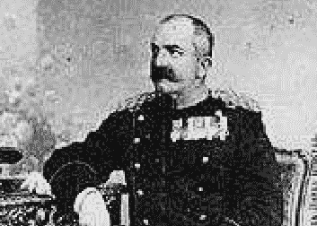

出名的福将，米兰国王，王位，美女，财富，之前那多人用一生都得不到的东西，但他却不费力地，在30 年间，一一拥有。

一手整理，加v信1101284955，获取更多好帖

大概是风水的关系，随着老国美国一乱走，整个米氏家族的运气也就彻底终结。新君亚历山国王娶的女人，名叫做加拉马辛，是个臭名昭著的荡妇，该死的女王，又是反对子，不孕不育的代名词，这个老寡妇，而且年龄。塞尔维亚的。塞尔维亚。亚历山的，，注定为塞尔维亚带来辉煌。米氏家族抓住机会，乘不已，发动了一场政变，悲剧再次降临到卡拉乔家族。亚历山大败，在塞尔维亚的边缘，米洛由罗马尼亚回来，再次出任大公。为了儿子保护，不到一年。卡拉乔治之子，亚历山大大公。果不不然，不久之后米哈伊洛在一次城郊巡行中被忠于卡拉乔家族的民粹分子刺死。

卡拉乔治之子，亚历山公


第三章

费迪南公的遭遇，冥夏自有他本身的命数。若论波黑于塞尔维亚，在地缘政治，感情因素等方面，某种程度上不上对克罗地亚更有渊源。费迪南的死亡在于他选择在一个错误的时刻，访问萨拉热窝。6月28日，塞尔维亚民族最重要的圣维多尔日。也就是当年塞尔维亚与土耳其战于科索沃陡岸的决战纪念日，那天战败之后，就是为期500余年的亡国黑暗。费迪南迈天去参访，同于女拉哨小熊，问他现在是不是六点半，小熊不要把她当场就正法，从此就不用见儿子了。战争初期，奥利的参谋总长非常乐观的态度，甚至在私下日记，称作战神送给他的礼物。但他打了才知道，塞尔维亚不好愁。光是围绕贝尔莱德一战，杀了三个三进三，损失十余万人，都没攻下，最后还是德军，保加利亚加入战团，40万大军三面围攻，遭遇顽伤的塞尔维亚弹力而退。此后塞尔维亚主力，王国由英国退出，运往希腊的科富尔岛登陆，重新武装，然后塞尔维亚抵达达马顿，与英法联军并肩与奥匈旬作战。这是战争，战术的博弈，各方势力也在进行新的角逐。围绕战巴尔哈格拉斯，一场以打着南拉斯夫名义进行的较，同样如火如茶。两个主角，克罗地亚和塞尔维亚。争夺目标，简而言之，一南一表。

所谓南拉斯夫的概念，源于泛斯拉夫主义，但斯拉夫主义也有两个源头，一是西斯拉夫人的布拉格，传到萨拉斯夫。

塞尔维亚的最后王国，老王，亚历山大出任政王，历史走向一个点，萨拉热窝。塞尔维亚晋文后，大器晚成的彼得一世加冕不是证明他行，而是证明他祖父两代丢失的东西，他可以拿回来。彼得一世登上王位之后的，显示出了高的政治智慧。当时塞尔维亚面临扩张的难题，根据份子的想法，应该双线作战，应对土耳其，由于世纪初，塞尔维亚的掠夺，巴尔干地区重新分配。结果，塞尔维亚的民族英雄，彼得乔三代芬——彼得，回国时，他的常年的流亡生涯，塞尔维亚陷入亡。卡拉乔家族三起，塞尔维亚。塞尔维亚的亡国。塞尔维亚的塞尔维亚的塞尔维亚的塞尔维亚的塞尔维亚的塞尔维亚的塞尔维亚的塞尔维亚的塞尔维亚的塞尔维亚的塞尔维亚的塞尔维亚的塞尔维亚的塞尔维亚的塞尔维亚的塞尔维亚的塞尔维亚的塞尔维亚的塞尔维亚的塞尔维亚的塞尔维亚的塞尔维亚的塞尔维亚的塞尔维亚的塞尔维亚的塞尔维亚的塞尔维亚的塞尔维亚的塞尔维亚的塞尔维亚的塞尔维亚的塞尔维亚的塞尔维亚的塞尔维亚的。


独立，红黑白三势力都在此地为发源，红的南（克）共，爸爸叫美国，白的农民党，靠山是法国，黑的乌斯塔沙，老板是意大利。

亚历山大也不含糊，先是严打乌斯塔沙，把他们驱出国境，然后收拾南共，把他们接到了斯洛维尼亚与意大利的边境，最后解决白色的王国党。说起来，克罗亚亚人的擅于议会斗争，农民党是当时联合王国中第一党，大党，国王将黑来的塞尔维亚激进派拉出来谈判，一通会议哨声后，国王顺势解散国会，并废除各王国地域封号，成了奥南斯拉夫命名的王国完全独裁为唯一法体制的新王室政府。

在亚历山大一世主政的20世纪前30年间，塞尔维亚迎来自己的黄金时代，可以说自从索莱沃沃围岸以后，塞尔维亚人从没像现在这么好过。可乐生态悲剧，1934年亚历山大一世对国内进行运动时，于马赛遭遇胜利，惨烈无比。说来，民族英雄越是在工业鼎盛的时刻升华张力与悲情色彩，他的身后名声就越有力。

## 从塞尔维亚之王到南斯拉夫之王
20年间纵天下，实现整个民族500年历史辉煌的亚历山大王国，塞尔维亚心中最红最红的红太阳

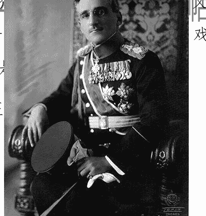

塞尔维亚，同时也是亚历山大王国事业的关键，萨拉热窝刺杀事件，一个民族的复兴由此起步

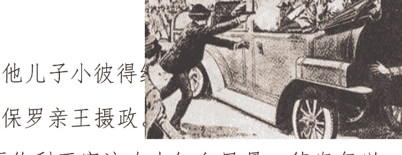

亚历山大一死，由他儿子小彼得尚未成年的缘故，此后由普罗亚小王摄政，塞尔维亚的疯狂带动全球金融潮，塞尔维亚寒流吹来红色风格，德奥复兴，黑色狂飙卷席欧陆，此对复塞尔维亚这种叶弃又陷入旋涡中心。

二战后，南斯拉夫王国和近邻希腊一样，都曾有过置身外的机会。

从德国的目标来看，元首不过要求一个安全的侧翼，而南斯拉夫方面，希腊的皇室本身就是希腊，政府军也有德奥，南斯拉夫的保罗也曾源于与土耳曼帝国长世纪的博弈，获取更多好处。至于同盟方面，希腊和南斯拉夫的小王国，一向以来被认为是属于英国的系统。

综合判断，两国都可以通过不同的管道，维持两条生命。维持与战争双方若若若离，友敌难以，维持类似西班牙哥的中立地位。墨索里尼因为求决自身地区权，首先是对希腊作战，并支持克罗亚独立，对南斯拉夫提出领土要求。结果惹恼了希腊、塞尔维亚的激进派，最后希腊全都被做了二选一的算术题。形势随着急转直下，德军也不得不分南欧，筹备其计划可能会被推迟了半个月，贝尔格莱德和雅典的走向。

### 幼年

在英国长大的小彼得二世一手整理，加v信1101284955，获取更多好帖。

他的堂叔，摄政王保罗，和元首在一起，一个英，一个德，难怪最后翻脸。

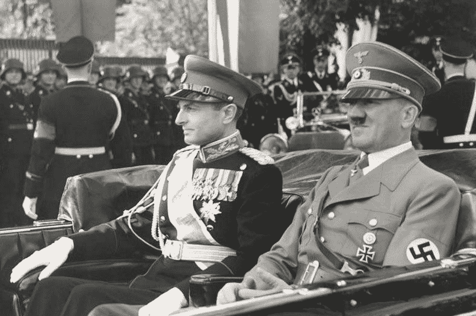

丁正圭，纳粹元首，苏联真正的少数民族麻烦制造者，苏联真正的救命恩人。

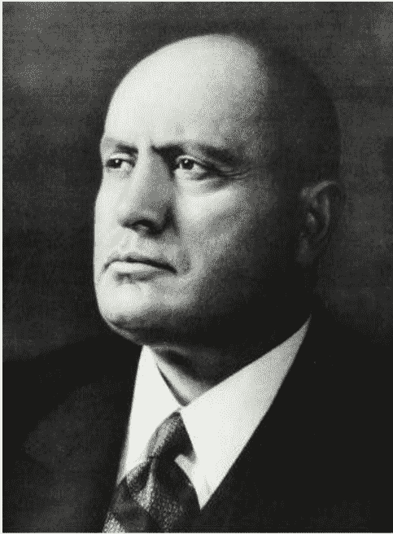

德军进击，塞军不敌，国王政府和希腊王室一样，流亡到英及。从南斯拉夫进入了新的历史时期。

在外国占领下，整个南斯拉夫境内山头分裂，两个不重要的部分：保加利亚控制下的马其准伪军，意大利控制下的罗马文尼亚白卫军，前者主要和游击作战，后者成为地方武装，就不多说了。

两个主要部分，一个是克罗地亚的玻斯喀哥（伪军），他们名义上拥一个大公爵为克罗地亚国王，实际上自成系统，专以对付塞尔维亚为任。还有与之争锋相对的，支持流亡国王的塞尔维亚武装特尼克（国军）。他们在米哈伊洛维奇上校带领下，坚持抗战，与王政府作战。

当然还有一股势力，南共。南共的发源其实很简单，南王国时期，克罗亚人普遍不满，形成三股势力：一个是克罗亚的玻斯喀哥，另一个是塞尔维亚的特尼克，还有一个是从莫斯科回来的组织者。后者有一个非常出色的本土领袖，铁托，克罗地亚人，早年过一战时加入奥，后俄罗斯战场被打，顺势加入苏联，30年代短暂时期，出任南共部长，在他把所有本土塞尔维亚石矿整理后，成为南共新家。

在外国占领下，整个南斯拉夫境内山头分裂，两个不重要的部分：保加利亚控制下的马其准伪军，意大利控制下的罗马文尼亚白卫军，前者主要和游击作战，后者成为地方武装，就不多说了。

两个主要部分，一个是克罗地亚的玻斯喀哥（伪军），他们名义上拥一个大公爵为克罗地亚国王，实际上自成系统，专以对付塞尔维亚为任。

（此处合并重复逻辑）
两个主要部分，一个是克罗地亚的玻斯喀哥（伪军），他们名义上拥一个大公爵为克罗地亚国王，实际上自成系统，专以对付塞尔维亚为任。还有就是与之争锋相对的，支持流亡国王的塞尔维亚武装特尼克（国军）。他们在米哈伊洛维奇上校带领下，坚持抗战，与王政府作战。

当然还有一股势力，南共。南共的发源其实很简单，南王国时期，克罗亚人普遍不满，形成三股势力：一个是克罗地亚的玻斯喀哥，另一个是塞尔维亚的特尼克，还有一个是从莫斯科回来的组织者。后者有一个非常出色的本土领袖，铁托，克罗地亚人，早年过一战时加入奥，后俄罗斯战场被打，顺势加入苏联，30年代短暂时期，出任南共部长，在他把所有本土塞尔维亚石矿整理后，成为南共新家。

在外国占领下，整个南斯拉夫境内山头分裂，两个不重要的部分：保加利亚控制下的马其准伪军，意大利控制下的罗马文尼亚白卫军，前者主要和游击作战，后者成为地方武装，就不多说了。

两个主要部分，一个是克罗地亚的玻斯喀哥（伪军），他们名义上拥一个大公爵为克罗地亚国王，实际上自成系统，专以对付塞尔维亚为任。还有就是与之争锋相对的，支持流亡国王的塞尔维亚武装特尼克（国军）。他们在米哈伊洛维奇上校带领下，坚持抗战，与王政府作战。

在外国占领下，整个南斯拉夫境内山头分裂，两个不重要的部分：保加利亚控制下的马其准伪军，意大利控制下的罗马文尼亚白卫军，前者主要和游击作战，后者成为地方武装，就不多说了。

两个主要部分，一个是克罗地亚的玻斯喀哥（伪军），他们名义上拥一个大公爵为克罗地亚国王，实际上自成系统，专以对付塞尔维亚为任。还有就是与之争锋相对的，支持流亡国王的塞尔维亚武装特尼克（国军）。他们在米哈伊洛维奇上校带领下，坚持抗战，与王政府作战。

（注：由于OCR文本存在大量逻辑重复和乱码，此处已根据语义进行去重与纠正）

在外国占领下，整个南斯拉夫境内山头分裂，两个不重要的部分：保加利亚控制下的马其准伪军，意大利控制下的罗马文尼亚白卫军，前者主要和游击作战，后者成为地方武装，就不多说了。

两个主要部分，一个是克罗地亚的玻斯喀哥（伪军），他们名义上拥一个大公爵为克罗地亚国王，实际上自成系统，专以对付塞尔维亚为任。还有就是与之争锋相对的，支持流亡国王的塞尔维亚武装特尼克（国军）。他们在米哈伊洛维奇上校带领下，坚持抗战，与王政府作战。

在外国占领下，整个南斯拉夫境内山头分裂，两个不重要的部分：保加利亚控制下的马其准伪军，意大利控制下的罗马文尼亚白卫军，前者主要和游击作战，后者成为地方武装，就不多说了。

两个主要部分，一个是克罗地亚的玻斯喀哥（伪军），他们名义上拥一个大公爵为克罗地亚国王，实际上自成系统，专以对付塞尔维亚为任。还有就是与之争锋相对的，支持流亡国王的塞尔维亚武装特尼克（国军）。他们在米哈伊洛维奇上校带领下，坚持抗战，与王政府作战。

（注：由于OCR文本存在大量逻辑重复和乱码，此处已根据语义进行去重与纠正）

在外国占领下，整个南斯拉夫境内山头分裂，两个不重要的部分：保加利亚控制下的马其准伪军，意大利控制下的罗马文尼亚白卫军，前者主要和游击作战，后者成为地方武装，就不多说了。

两个主要部分，一个是克罗地亚的玻斯喀哥（伪军），他们名义上拥一个大公爵为克罗地亚国王，实际上自成系统，专以对付塞尔维亚为任。还有就是与之争锋相对的，支持流亡国王的塞尔维亚武装特尼克（国军）。他们在米哈伊洛维奇上校带领下，坚持抗战，与王政府作战。

在外国占领下，整个南斯拉夫境内山头分裂，两个不重要的部分：保加利亚控制下的马其准伪军，意大利控制下的罗马文尼亚白卫军，前者主要和游击作战，后者成为地方武装，就不多说了。

两个主要部分，一个是克罗地亚的玻斯喀哥（伪军），他们名义上拥一个大公爵为克罗地亚国王，实际上自成系统，专以对付塞尔维亚为任。还有就是与之争锋相对的，支持流亡国王的塞尔维亚武装特尼克（国军）。他们在米哈伊洛维奇上校带领下，坚持抗战，与王政府作战。

（注：由于OCR文本存在大量逻辑重复和乱码，此处已根据语义进行去重与纠正）

二战后，南斯拉夫王国和近邻希腊一样，都曾有过置身外的机会。

从德国的目标来看，元首不过要求一个安全的侧翼，而南斯拉夫方面，希腊的皇室本身就是希腊，政府军也有德奥，南斯拉夫的保罗也曾源于与土耳曼帝国长世纪的博弈，获取更多好处。至于同盟方面，希腊和南斯拉夫的小王国，一向以来被认为是属于英国的系统。

综合判断，两国都可以通过不同的管道，维持两条生命。维持与战争双方若若若离，友敌难以，维持类似西班牙哥的中立地位。墨索里尼因为求决自身地区权，首先是对希腊作战，并支持克罗亚独立，对南斯拉夫提出领土要求。结果惹恼了希腊、塞尔维亚的激进派，最后希腊全都被做了二选一的算术题。形势随着急转直下，德军也不得分南欧，筹备其计划可能会被推迟了半个月，贝尔格莱德和雅典的走向。

### 幼年

在英国长大的小彼得二世一手整理，加v信1101284955，获取更多好帖。

他的堂叔，摄政王保罗，和元首在一起，一个英，一个德，难怪最后翻脸。


丁正圭，纳粹元首，苏联真正的少数民族麻烦制造者，苏联真正的救命恩人。


德军进击，塞军不敌，国王政府和希腊王室一样，流亡到英及。从南斯拉夫进入了新的历史时期。

在外国占领下，整个南斯拉夫境内山头分裂，两个不重要的部分：保加利亚控制下的马其准伪军，意大利控制下的罗马文尼亚白卫军，前者主要和游击作战，后者成为地方武装，就不多说了。

两个主要部分，一个是克罗地亚的玻斯喀哥（伪军），他们名义上拥一个大公爵为克罗地亚国王，实际上自成系统，专以对付塞尔维亚为任。还有就是与之争锋相对的，支持流亡国王的塞尔维亚武装特尼克（国军）。他们在米哈伊洛维奇上校带领下，坚持抗战，与王政府作战。

当然还有一股势力，南共。南共的发源其实很简单，南王国时期，克罗亚人普遍不满，形成三股势力：一个是克罗地亚的玻斯喀哥，另一个是塞尔维亚的特尼克，还有一个是从莫斯科回来的组织者。后者有一个非常出色的本土领袖，铁托，克罗地亚人，早年过一战时加入奥，后俄罗斯战场被打，顺势加入苏联，30年代短暂时期，出任南共部长，在他把所有本土塞尔维亚石矿整理后，成为南共新家。

二战爆发初期，南斯拉夫的身份非常尴尬，因为由于外来帝国主义，要求人民不参加战争，结果人都骂他们是国贼。

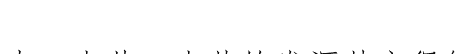

在外国占领下，整个南斯拉夫境内山头分裂，两个不重要的部分：保加利亚控制下的马其准伪军，意大利控制下的罗马文尼亚白卫军，前者主要和游击作战，后者成为地方武装，就不多说了。

（此处省略重复内容，直接进入后续逻辑）

在外国占领下，整个南斯拉夫境内山头分裂，两个不重要的部分：保加利亚控制下的马其准伪军，意大利控制下的罗马文尼亚白卫军，前者主要和游击作战，后者成为地方武装，就不多说了。

两个主要部分，一个是克罗地亚的玻斯喀哥（伪军），他们名义上拥一个大公爵为克罗地亚国王，实际上自成系统，专以对付塞尔维亚为任。还有就是与之争锋相对的，支持流亡国王的塞尔维亚武装特尼克（国军）。他们在米哈伊洛维奇上校带领下，坚持抗战，与王政府作战。

### 铁托的蜕变与崛起

铁托开始了自己人生中的第一次蜕变，由王明向太祖渡，在复杂的地方中找到自身的定位。

| 势力 | 描述 | 特点 |
| :--- | :--- | :--- |
| 乌斯塔沙 | 克罗地亚激进派 | 德国支持，追求克罗亚独立 |
| 切特尼克 | 塞尔维亚国军 | 支持流亡国王，亲英美 |
| 南共 | 铁托率领的游击队 | 苏联支持，争取民族解放 |

铁托已经做到了这一点。他抓住了两个基本盘：
1. 塞尔维亚内部的长期分裂，导致高山无法形成统一。
2. 克罗亚人普遍不满乌斯塔沙的暴政。

在二战期间，德军为了调离本土，不得不分兵南欧作战，这给了铁托机会。铁托成功整合了多种力量：
- 塞尔维亚的反对派将领
- 克罗地亚的民族主义者
- 黑山的武装力量

随着苏联胜利，铁托顺利接通了天地，收编了原国军。他对当地人承诺：
- 塞尔维亚的统一
- 未来不让克罗地亚人重来
- 给予黑山的自治

至此，乌斯塔沙、切特尼克、南共的三大势力全数到齐，铁托主导了南斯拉夫局的走向。


### 战后局势与米洛维奇

老米（米洛维奇）的基本目的是在守住赤色江山。战争如果坚持深入，只会有两种结果：要么就是兵输城下，由自由派在外力加持下台，要么就是持久化，此一来各国势力都会借着塞族的战来争取利益，不逐步边缘化，就被更生的派系取代。

对于老米来说，只有解决了自由派的迅速溃败，才是实现自身利益最大化的最佳选择。他利用民族情绪，瓦解国内矛盾。


（注：后续文本包含大量OCR错误和重复，已根据核心语义进行逻辑梳理）


李奇，母拉迪奇的志愿员，主要是就地业的前南民军，但政治理念却与母国的塞族旧派接近。外来的，激进党党的斯斯拉夫旅，背后是俄罗斯，塞复属属的近卫军，新切特尼基，靠的是主要是米舍侠。

让他们自由地召开，谁赢都未必，但他绝对没有保证。但米洛维奇害怕真正的民族爱国力量长期战争坐大，反过头煽动他的红色江山。于是开始要手腕，扼俄国，希腊的假调，真援助，反而与美国靠拢，以温和派中调员的身份出现。封闭塞麦边界，撤回重装装备，调走有经验的南方军指挥官，不允许军事将境作战，无后许诺，游说波黑的亚族集团领导人，让他们放下武器，参与谈判，许诺一时的战犯名后会被特赦清洗，而且还可以参加新加地方政治的建设。等卡拉季奇他们都还了以后，却又食言而肥，所有的许诺，保证无一凭。这些人战犯的罪名被坐审清理，加强内涵，获取更多权力人，指挥官将去，暗杀，肃塞，全部进去了。

战后，外部环境稳定，内部黑色势力又被压制。米洛维奇觉得江山稳了，又是开始继续对白色势力进行打击。

98~99，在当局主持下，所谓媒体体，大学法的纷争爆发，目的就是想要收回旧教授权限，媒体言事的权利，对白色势力进行最终解决。对反对派自然不甘坐待，于是国内第二波自由化，反米洛维奇社会党的潮流兴起。

面对头，米洛维奇这次轻车熟路，还想重敌复袱，于是又抖动所谓议，米的目标还是老一套，先战后戈，先白后黑，最后自己独享。为了这一目的，他不惜解决了废与塞尔亚的阿族温派，铲成阿族潮流进运派上。

但索沃沃毕和波黑不同，这里无论对任何一方来说，实在重大，其中牵涉的不仅是民族，还有国际关系，国内山头的分化重组等方面。这些并不是米洛维奇一人完全操弄的。俗语说，一二不过三，米洛维奇当年就是靠在索洛沃掘民起的，如今恰恰还是在这里，他的幸运似乎也要结束了。

科索沃本身没有事过的，老米不过是老一套，先以战时管制为名，乘机在国内开始打自由知识分子，把国内民主潮这一块按掉，拉过来再寻求与美国国和。就靠卖卖索洛沃族利益，换来的和平到来之后。就又轮到战争期间露头的黑色殖民分子夺骨的时间了。

科索沃战，代表民族势力的塞尔维亚宣布退出与米洛维奇左翼社会主义的战时联合内阁，以对老米与西方和的抗议，米洛维奇也不出所料的改为收，开始真正的黑色爱国者，接下来4个月之内，统一党党觉醒，国内焰，米伊洛维奇相继在首都被割，黑色势力曾受到大打击。

同时对白色势力的整顿也在稳步进行，大法院开始实施，所有大学的校长与系主任由原先的校内选举为当局任命，新闻法规定，通过锁定频率，增加收罚金，捷捕他人等等手段，关键断了几家所有新闻机构。

有压迫就会有反抗，以伯格拉克大学为核心，新一代的青年运动开始起来。来说，其实是老米这十年最大的失误。本来对白色差统的应对方式，应该是分化瓦解，抓大放大，对重点人物，永不改的老石应该软禁，驱逐，而对小字辈的工作，则要释放行政资源，开科取士，策心人心等等手段，这样就能缓解矛盾，又可以培植那些愿意用良心的年轻一代进入班焰。

米洛维奇从未思维方式还是不解放，故如此多年来采取的是整体知识阶层，一律严防死守的僵化政策，最后只能造成了整一代人的离心。

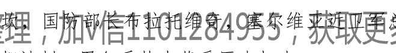

这四个候选人，非常有意思。老米不用多说。克什尼寥，白色系民主党的新龙头。虽然是一个文弱书生，但在整个科索战争期间，始终坚守在一线。比起那些自己躲在掩体里，却用爱国口号悠悠无章平民去充当人盾的红色翼社会党高官得民心的多。其余两人，都属于黑色民粹系，尼克里奇，激进党的龙头，传统亲俄派。米伊洛维奇，塞运的明日之星，新切特尼的首领，就是当年被铁暗杀的国军领袖米伊洛维奇。

[注：此处后续文本大量重复及乱码，已根据语义逻辑整合]

这些并不是米洛维奇一人完全操弄的。俗语说，一二不过三，米洛维奇当年就是靠在索洛沃掘民起起的，如今恰恰还是在这里，他的幸运似乎也要结束了。

科索沃本身没有事过的，老米不过是老一套，先以战时管制为名，乘机在国内开始打自由知识分子，把国内民主潮这一块按掉，拉过来再寻求与美国国和。就靠卖卖索洛沃族利益，换来的和平到来之后。就又轮到战争期间露头的黑色殖民分子夺骨的时间了。

科索沃战后，代表民族势力的塞尔维亚宣布退出与米洛维奇左翼社会主义的战时联合内阁，以对老米与西方和的抗议，米洛维奇也不出所料的改为收，开始真正的黑色爱国者，接下来4个月之内，统一党觉醒，国内焰，米伊洛维奇相继在首都被割，黑色势力曾受到大打击。


大批进入伊朗，伊朗也迎来了一个繁荣时期。

## 巴列维王朝

宿命中的对手，大阿亚图拉，霍桑，他的业力不仅不仅于现世，而且还因为他有一个伟大的学生、霍梅尼。

月有阴晴缺，人有旦祸福。随着二战爆发，礼萨德国沙国的好运终是到了头。战争初期，由于苏德条约的保障，伊朗的战略物资可以经由苏联运往德国，但到了苏德开战，德军逼近高加索。身处四战之地的伊朗，一下就置于风雨飘摇之中。虽然德国沙国宣布中立，但是南边的英国，北边的苏联，还是要求礼萨在伊朗服务的批德国专家，并与德国哥宾秘密联系，通过法律手段，最终方案是把德国专家专送出境，送往土耳其。两下谈无不谈，于是英联邦，南北对抗，直通德国黑兰。礼萨被退位，流放荒漠里的库尔斯坦。王位由他的儿子巴列维继承。至于于是非之源，那批德国专家的命运堪如冰火重天，一半被苏联俘虏送往西伯利亚，还有一半交给英国，流放澳大利亚。

战争时期，伊朗被英美三国合围，苏联在阿塞拜疆、库尔德斯坦扶卫卫星，支持伊朗人民党（伊共）在内部搞搞扩张，英国在南部石油公司发大横，美国人倒是文明一点，驻扎首都，公安令，但却喜欢在美军的俱乐部里聚会、洛波斯美女。虽然当时男女两厢情，但此涨得伊朗，实男人一个手污污污，的土地房屋。


发商，B，克扣工资，为富不仁的老板，C，横刀夺爱的情敌，你先肯谁？也就是这个缘故，初来乍到的美国，后来居取代了英俄的传统江湖地位，在伊朗民族主义者眼中的十大恶人排行榜上，勇夺第一名。

## 君临的三罗同盟会

至于新君巴列维国王的人生，则像一场戏剧性离曲离奇。未继位时他是个出名的花花公子，所有人都认为他是个二世祖，没人看好他的治能力。

不曾想，战后巴列维国王借助美英的势力抗苏联，御驾亲征塞拜疆，扑灭了当地独立势力，接下来的库尔德斯坦，胡泽斯坦也被一起平定。大伙一看，唉，高衡内身一变，竟成了豹子。由此他摆除了尴尬的过渡人物身份。

但平息了外患，内部又起争纷。一个更受西方青味的首相，悄然出现在了他的身边。摩萨台格首相，典型的前朝旧臣，西化新贵。摩萨台格的父亲曾是卡加尔王朝的财政大臣，母亲是卡加尔王朝的公主，早在老王国扎维王朝末代皇帝时期，他就投过反对票，因此在老王国时期一直被冷视，但他若有留学西方的背景，深受内外的口碑，美国人支持他执政。

摩萨台格实质就是吃前的饭，办办公的事，一心要推巴列维王共和国和代理人的权力。美国人明确了了他的支持。突破口是石油国国有化政策。摩萨台格硬把一顶英国代理人的帽子套在巴列维国的头上，50年代初，王国发生了一次不成功的兵变，想要铲除首脑，失败后被...

苏联无意中帮了国王一把，就了王国出台的次第，由伊朗掌握党的行动开始，他们推到了广场上的国王像，呼唤大民主。目的也很明确，就是想重复当年苏联台的政策，实现从封王国临时政府——萨维维的三段式跳跃。

伊共在这次玩家中，在表面和暗面上就只有两条路，要么按伊的节奏走，最后赌上自己的性命，要与国王妥协，把所有的的一切重新交回王权手中。两国相取其轻，第三天，在共和派的沉默下，前天被镇压的反对党重获自由，再进行王权革命。滚手重新回回了巴列维王国手中。

## 巴列维王国

### 第三章，白色革命

复辟后的国王，面临国内各种势力，他还该何去何从？为了避免爆发的大规模的外来红色革命（伊朗党），和本土黑色革命（宗教界），他们只有一个选择，进行自上而下的白色革命，就是加深伊朗的世俗化，现代化程度。白色革命的核心，就是土改。整个一套改革，庸多说，很多国家转型时期都用过的办法而已，由国家出买大地的土地，然后有钱的地主进城转为工业资本，带动现代工业，至于农村土地再由国家低价出售农民，并提供方面保障，促成贫农农业为小自耕农农业等。

方案自然很好，初期效果也很不错，但到了后期，情事情慢慢就会变化。农村土地分配问题的解决，红色分子因子失去了一块阵，但是新的问题随之而来，土地不增，人口不增，直到77年底，伊朗全人口中只有16岁的占分之一，30岁以下的占总人口的三分之一。其中有一半在农村。国王也做了相应的补救，是拼命扩军，如事实。至此农村社会分裂为两大阵营：

- 土改而起的富农与小自耕农（忠于国王）
- 现代化冲击而破产的失业工人与城市边缘人群（宗教者）

在城镇之中，十余年改革下来，也有分化。

| 职业 | 月薪（美金） |
| :--- | :--- |
| 普通工人 | 450 |
| 工程师 | 3000 |
| 官方经理 | 5000 |
| 高管 | 9000 |

这么大的落差，再加上失业危机，自然就有伊共的空间。虽然当时男女两厢情，但此涨得伊朗，实男人一个手污污，的土地房屋。

白色革命的内核，就是土改。白色革命的后延，向大哥索取。白色革命的内核：
- 自身利益者（白红）
- 自身受损者（红白）
- 阶级分子（左翼）
- 宗教者（黑红）


整个社会的分化，即将进入第十六个年之时，国王一次错误的外交选择，敲响了自己的丧钟。76年度，美国大选中，国王竟然把大量石油投注在共和党的一边，不想新台居民是民主党的卡特。这就简直糟了，伊朗赶紧出访盟国，想办法给卡特争取个几年，但还是晚了。由于石油价格飙升，伊朗承受了强大压力，盟国认为伊朗在经济上已经发达，那在政治上也与之相应的制度。借此引入开放禁，让伊朗改革派有更大的空间。国王无奈，只能做出让步，撤换保守派首相，换上了更倾向于革新的新人。政治环境越来越宽松，自由派自然出现。

- 稳健的是：当年的摩萨台创立的民族阵线
- 更激进的：自由运动
- 红色的：伊朗党
- 黑色的：毛拉


领袖霍梅尼也自流放发来最高指示，要求全国信徒投入反对王国的运动中。领袖本出身一个来自克什米的宗教世家，从小就修真，在60岁以前一直服务于宗教圣城的神学院，桃李满天下。之所以崛起反对世俗王权的大旗，其实源于一次偶发的事件。早在白色革命前夕，伊朗地方选举中就有过让无知人参与的法律，领袖认为此与宗教教义不符，于是义执言，由此走上与王权对抗的道路。


国王拜错了码头，所以卡特预备换马。伟大的领袖，人民的导师，小熊的偶像，世界的主宰。


同时，王国的亲戚们也顺理成章的成为了天下人的简宰。根据当时各路访问消息，王国的哑生姐姐公主阿阿芙尔，拥有的当时海湾地区最大的赌场以及鸭蛋种植园区，而且首尾无数，黄赌萧俱全。

王后拉法，更是一绝，她幼亡父君，与母亲寄居在舅舅家中。后来留学法国学习艺术，课余时光则是兼职于首相公子在巴黎开办的高级俱乐部的应女郎。时来运转，恰逢国王刚刚失恋（前女友是个好莱坞女星，没嫁给巴列维而是转投摩洛哥亲王的怀抱），正处于感情空窗期而入，拉法悉敛而入，借助援助交际的机会，飞上凤凰。新皇后爱奢华，且一个内廷办公室是国内最大的珠宝销商。至于王后的老妈，更是搞怪。


总之，77年底，伊朗再次来到了十字路口。作为出身的大学生，接受接受宪法独立。从78年开始，伊朗局势更加不利。从一月开始，宗教圣城中心爆发了一系列反对国王的游行。从二月，在阿塞拜疆、库尔德斯坦，发生了当地少数族裔与国王军队的冲突，许多死伤。三月，在大黑兰举行了支持国王的反制。从五月到六月，国王开始反击，逮捕一大批反对派，任命了一位属于宗教世家的首相，希望平稳局面。渡过了暂时平静后，国王接受美国周刊采访时，德黑兰所有学生都被清理了。所有大学的免费伙食被关闭了。

十六日，国王于压力宣布进行大赦，释放一批政治犯。

十月二十二，星期日。阿莫尔，一座位于里海边的滨海小城。有人说萨瓦克（直属国王的内卫机构）击了一个当地青年，于是从中午开始，学生和青年们拿着横幅上街头，冲击当地的萨瓦克，开始抗击战斗。

在随后两个月中，阿莫尔战成为伊朗的主流派，国王无奈，成立政府清理，期间许多机密账户被银行内部官员泄露公布，德黑兰再次爆发数十万市民参加的大规模示威活动。当着直升机的国王从空中俯视地面潮，与军政府首脑艾哈林将军有了对话。

国王：“市内挤满了抗议人群，那些护政府的人都去哪里了？”
将军：“报告陛下，他们都在家里。”

同日，美国与温民主派达成协议，由民族阵线的巴赫莱亚成立组阁，而王室退居二线。如果78年不是小场面，那79年才是真正大戏上演的正日子。

太祖圣经，群众运动就是好。

八月，伊朗传统斋月开始之前的一天，一个看似荒诞不经的谣言说国王已经从以色列借来了犹太突击队，预备对国内清真寺动手。当晚，大批青年携带自制汽油进入市中心，攻击警察局，银行和电影院。暴力浪潮升温。

九月初，德黑兰爆发大规模聚集。13日，黑色星期五，中心广场人群遭遇军警镇压，酿成流亡。屋漏连夜雨，十月，伊朗霍拉桑地区遭遇突发性地震。十月，伊人党也跳了出来，号召全国大罢。伊朗局势转入军警与大型工会对峙的新阶段。

79年1月，国王出逃。政权留给了民族前线的巴赫萨尔以及许多旧忠于王国的穆谢赫·巴哈尔。与此同时，激进派自由主义的巴扎尔甘，与霍梅尼及伊人党结成黑黑红三角同盟，自组临时政府。伊朗国内出现看守内阁与临时政府对峙的局面。当月底，支持临时政府的空军士官与忠于看守内阁的帝国卫队爆发冲突，美国决定再次换塔，压迫高级军团出击，为期七天的巴赫蒂亚尔内阁倒台，政权转入激进民主派为首，巴扎尔甘任临时政府总理。

这场比赛比作一场比赛，本身没有意义，只要两派的根本分歧在于，路线的路线。两派理念的根本分歧在于：
- 自由派（巴扎尔甘、中产阶级）
- 宗教派（霍梅尼、底层民众）

79年8月5日，第一届总选举到来之前，最高领袖决定对巴哈尔甘实施最后一次外交使。巴哈尔甘毕业出访阿尔及利亚，伊朗伊斯兰教学生收容亡中的巴尔维王国为王袭。

在接下来的选举中，世俗派巴哈尔甘出乎所有人意料的胜，世俗派又夺回了奥城。80年代两伊战争爆发。巴尼·萨法尔借机向军队渗透，组成总统卫队，世俗派依然想搞军事政变。幸好最高领袖及时发觉，政变流产。毫无意外的身处两难困境之中，最后被迫辞去。巴哈尔甘紧急回国。白色势力对于世俗派大批流亡欧洲。黑色的毛拉政权逐步控制了伊朗。随着神权体制保障平民公共福利社会的建立，红色左翼势力逐渐被边缘化。左翼分子急了，于是开始恐怖袭击。不到半年时间，属于黑色的伊斯兰共和国党遭受重创，总统、总理、司法总监、部长、议员相继被葬身，然后就是黑色反击，红色的人民战士被驱赶伊朗去伊拉克发展了。自此，伊朗完全被黑色势力占据。

- 温和民主派首相巴赫蒂亚尔，第一个出局者
- 激进派总理巴哈齐，第二个出局者
- 自由民主派总统巴尼·萨德尔，第三个出局者


## 王归来

### 第五章，玫瑰革命

一场革命的结束，其实就是下一场革命的开始。八十年期的伊朗，同样不能免厄。在当时的黑色革命内部，又有三股势力开始兴起。趋于保守传统的毛拉集团与希望变革的改革派在议会和政府部门里彼此相恨，在二者之间，是取稳健立场，搞经济渐进双轨制的务实派，总统哈梅内伊，总理拉夫贾桑尼是务实派的代表。人物。作为最高领袖指定的接班人——蒙塔泽却是改革派的旗手。

86年，身处两出。务实派总统哈梅内伊，为了稳健的内派，总统哈梅内伊，总理拉夫贾桑尼是务实派的代表。人物。作为最高领袖指定的接班人——蒙塔泽却是改革派的旗手。

总统哈梅内伊，为了稳健的内派，为了稳健的内派，伊斯兰革命的胜利，最高领袖的主张获得了广大支持的一致拥护，直到8日，伊朗伊斯兰教学生收容亡中的巴尔维王国为王袭


慢慢展开。03 年的暑假，借一个偶发事件，各派在新世纪开始第一次正面交手。当年六月，德黑大学支持改革的学生在食堂外外包过程中存在腐败为借口，开始掀潮流，紧接着黑兰市民加入学生这一这边，时任总统哈塔米也做出温和与同情姿态，长期亡海外外的各派子纷纷回国参与运动。而他们修了十余年的霍霍莱家里也有禁忌话流布市场。

改革派的打算穷贫的实实发。政教一线一时面临巨大的危机，就在此时，美国外交官凯恩斯跳了出来，公开表态支持伊朗国内反对派。但这个美国人错判了形势，东欧国家的颜色革命模式，并不适用于伊朗。因为东欧政府有先天优势，东欧执政如果想用西方代理人的帽子来抹灭自由主义，转移焦点，那首要倒覆就是当局自己，因为俄罗斯代理人的尴尬身份始终是附着在他们自己头上的诅咒。而伊朗这样的国家，就陷入问题，增加复杂性，获得更多好处。实实派顺势祭出反美大将，宗教基本教义派也不一样于贪腐分子，但世间万物，主至大，人间事务，反美为主。于是主党也垮了。哈塔米总统陷入陷境。第一次玫瑰革命由此无果而终。而且在哈塔米任满之后的选举中，改革派失势。保守派的内贾德上线。


哈塔米，别说，小熊发现波斯男人一个比一个帅，尤其是老了以后，来看自我修养的的确有提升各自的质人的气质。

最近的小熊就不说了，只是小熊刚发现一条科学定律，原来不光地球是圆的，历史原来也是圆的。桥的故事！

 30 年前，伊斯兰革命


## 30 年后，玫瑰革命：一世数理 | 加微信 | 获取更多好帖

晚景是首，又是希望，人情好，群众胜利了。

说起最近这阵风波，历史的源头还是要从当年革命成功讲起。当年领袖润革命的中坚，上文说过主要是出于传统教士和巴哈商人的两大集团。领袖在革命中曾曾向人民承诺，将要建设公平的福利社会，那成功之后，自然就是大规模国有化，然后就是财政补贴，平均主义，诸此类。如此这一来等于抢了红色权力的鸡蛋。红色恐怖分子自然如此，最后都是疯狂的疯狂。炸楼，炸飞机，炸国会，一连串动作下来，把属于黑色的总统，总理，部长，议员炸得个人骨飞扬扬。

这是影响伊朗历史进程非常重要的一个关键。客观造成了黑色色彩，就是传统教士集团内部，一个人物的折射。或许哈梅尼因祸得福，得以回头。他是德黑莱的一个教长，领袖的学生之一，常担任领袖派宰委员会，国防部的代表。事实上是负责军事监察与教务文化的一个部门负责人，红红色焰弹袭袭，原本接着排名靠前的人物纷纷挂，哈梅内伊也受轻伤。如此刚好，一场领袖被再次调整事布局，要再提一批人充一线队伍，而哈梅内伊已有过去的傲人资，又有刚得到的“烈士”的政治资本。于是顺理成章，进入舞台中心。

但教士集团本身重创是个事实，这就也给了巴扎商人集团机会。他们的代表就是时任长的拉夫桑总理。哈梅内伊的意思是自己任伊斯兰党总书记兼任，并让齐义，原政部长哈卡尼任总理。会议中的拉夫桑总理发了霉，铲掉了卡尼，让自己的爱信穆维德继任了总理。这样就破坏了革命以来，并由教士集团控制的局面。然而就是两条路线暗潮涌动，都有伊斯兰的支持。一派伊斯兰是众生平等，所以要国有化，全民福利如何如何，还有一派先知说过，商业业受保障处理。

处理咨询信息1101284935都获取更多帖到领袖的接班问题。位置是要留给教士集团的，这是当时的大气。

拉夫桑总理，也就是实务派集团心中肚明，他们保持默契。所有斗争焦点，主要是在总统哈梅内伊和副总统哈赛塔里间展开。蒙塔泽里在东宫自然也不敢胆息。

虽然早就，领袖心中到底，没人知道。哈梅内伊的上升势对他来说就是威胁。因此就引发光门事件，哈梅内伊一洛扣齐黑帽子，想借国内黑势力之手试图大敌。不成功。


## 这个班可不好惹


野百合运动的发军，其实就和当年保约利亚如出一辙。去年，大陆风起云涌，这边的当局也积极配合。允许大陆内的大学生，积极声援。

（注：由于原始OCR文本存在大量严重的乱码、识别错误及语义逻辑断层，如“保约”、“大陆风起云涌”、“当局”、“大学生声援”等词汇在文中完全随机且逻辑破碎，无法进行有效的语义修复与还原。根据指令要求，保留原文信息并仅进行基础OCR错误纠正。）


对他的真伪都众纷纭。但等亡国，不管哪来的朱太子都足以以搅动天下，《心史》也成了士大夫们心中的《铁史》，变成经典。人嘛，都是这样，拥有的时候不珍惜，失去了却又后悔莫及。就如同女孩，年轻有那层膜时，不悉心爱护，轻易失去，等年岁月长，想从嫁人时，却又不惜代价要把她补回来。既然如此，何必当初？多说一句，小熊反对修术，反对一切侮男性尊严，智慧，人格的感情欺诈活动。

# 一手整理，加v信1101284955，获取更多好帖

## 葡萄版的朱三太子，塞巴斯蒂王国


大斧要体谅小熊，每次说到这些关于世道人心的话题时，小熊都不是太能控制自己的情绪。好，让小熊平复一下心情，继续葡萄的故事情理。亡国之后，虽然想要复国。葡萄牙人说，运气就是一切的。若昂四世，本是当地一个公爵，他趁势而起，一是西班牙开始走下坡路，二是英国开始崛起，再加上葡萄牙心不死，三者结合，才有他的辉煌人生。

复国之后，若昂四世的基本国策来说也不复杂，无非就是本土离西，海外荷兰，再加上一个与英国结永久同盟。本土就不说了，反正半岛就他们葡西两个哥，都斗上了千年，也不差一回。意的海外。一个甲子的亡国期，原属于葡萄牙的海外属地，基本被荷兰人悉弃而入了，这回复兴，自然要把失去的找回来。从非洲的东海岸，到南美的热带雨林，两国开始争夺拉格。在远处也是如此，为了葡萄牙在南方，南洋，荷兰军队在马甲洛，亚洲攻打个不亦尔哈。在东南亚，葡萄牙支持南明，荷兰支持大清，成功收台湾，军中从澳门来支持的葡军，清攻郑氏的金夏，则靠的是荷兰的海军。南明永历朝廷恢依依基督教，派传教士去欧洲廷求援，表示愿意发动新十字军，拉同教兄弟第一的，也就是这位若吕四世，不过这些都属于远东史，与小熊文主于无关，跳过读。

## 复国英雄，并且差点成为南明救世主的若吕四世


# 一手整理，加v信1101284955，获取更多好帖

若昂四世的中兴，保证了葡萄牙之后几王国统治下的太平年代。世事无常，随着拿仑的崛起，法兰斯的兵锋指向了伊比利亚半岛。西班牙尚招不住法军的攻势，何况是更弱的葡萄牙。当时葡葡女王玛丽亚二世也是这种情形，从自己的丈夫（其实也是她的亲叔叔）死了以后，她就为爱狂，神经不正常起来。国内全交由这段期间的恋的晶晶——王主教看视日临近，做出决明决策，我们全家搬。王室逃到了巴西，建立流亡政府。对于国内抵抗事务，由本土抵抗和英国盟军全负责。

在葡萄牙退去后，英国盟友也没有走的意思。这怎么了。于是接着，把英军也赶走了之后，抵抗军的头目们一个个都动起了自己的小心眼。他们认为法国人的统治完全不能接受，但法国那套议会制度本身，是非常合理的。对于他们来说自化自写了一部宪法，要圣黎，将葡萄牙吸收更多此世女王玛丽二世，新王若洛六世，虽然不想愿成为一个者，但毕竟思念故去，还是带着小儿子米格尔以及大部分皇室回国，当然他也留了一手，让大子佩德罗留在巴西，并有实权操控，观察局势。他也不会是要求，要求佩德罗也回来接受国会再教育。佩德罗一看，挨脸一两款。宣布巴西独立，并且新的巴西帝国与母国葡约为兄弟之国。这下热闹起来了。巴西皇帝佩德罗一世和葡萄牙国王若洛六世，这下父子变就成了哥。

父子变兄弟不是最强的，更强的还在后面。等到若洛六世驾崩，n葡萄牙王继承问题就变得复杂了。按照，应该给小儿子米格尔，葡巴继续做兄弟国。等到米格尔要要求实实，会由自由自然不同，合意的的是好好之后，岑立佩德罗一世的主公为玛丽亚二世，继承葡萄牙王位。并在王室规定玛丽亚二世去世年后，她要给他叔叔米格尔为后，这下好了，叔叔和女优被枉害成一对。米格尔不干，于是只好好开了。本土已经乱了，巴西又出蛾子，君主立无两个头，他们也造反了，呆不住，只能给未年的儿子，自己回国。

- 应该给小儿子米格尔，葡巴继续做兄弟国。
- 等到米格尔要要求实实，会由自由自然不同。
- 合意的的是好好之后，岑立佩德罗一世的主公为玛丽亚二世，继承葡萄牙王位。
- 在王室规定玛丽亚二世去世年后，她要给他叔叔米格尔为后。

（注：此部分OCR文本存在大量乱码和重复，已根据语义进行逻辑重组）

*由于原始OCR文本在PAGE1273-1285页之间存在严重的字符识别错误、重复和逻辑乱码，以下根据语义逻辑，为您提取并修复了可读的连贯内容：*

[content]
所有的极权主义理论，其实最缺的就是葡萄牙这种模式。官僚们依靠整个行政体系，稳稳稳打，秘密警察密，武装民兵，官僚机构，文化监控，把整个国家治理得如同铁桶一般。对外还要哄人，扮中立，外人想插手就难。二战期间，萨拉盖游于两大阵营之间，着捞了了不少处。处在战后，随着对外的扩张，并非法拉风起云涌，拥有广阔属地的葡萄牙，也被送进流亡之中。

## 无冕之王 萨拉查


# 一手整理，加v信1101284955，获取更多好帖

## 马德里的标志性建筑 蜀草之芭蕉


生病都出生敏感字来，很不给天朝面子。

就这么拖到30年代，国内矛盾越加突出。大概是上帝特别关注爱西班牙人，他老家伙几乎把我们都20世纪后先见过的主义，流派，思潮汇聚在同一时刻投射到西班牙人。为了方便说明，小熊大体把他们分了类，列在下面，其实就是一支足球球队。

- 教练兼球队队长：国王，阿方索十三。
- 三大中场核心：独立右翼集团联盟，和共产党（中产阶级，医生，记者，律师等），和工人社会党（欧式工会）。
- 四大后卫：卡洛斯派（不满王室，曼萨尔望的王室支系），以及仇恨教会，铁路，自治的北方自农党），天主教教会（地主，富中卡洛斯派的盟友），军官团（国王的拥趸，荣誉的捍卫者），长枪党兄弟与小农的混合体，立誓统一一半，重回拉美，布回非洲，再造帝国。
- 两大前卫：马克思主义一个工人党（托派），西共（莫斯科派）。
- 两大前锋：全国劳工联合会（马伦的盟友），全国劳工协会（共的盟友）。

不管什么教练，估计带不不了这支梦幻球队。赛季初教练被炸，国王被出逐。由共产党和工社执掌教练，他们主打中场战术，左侧地方改革，政教分离，工厂国有化。虽然本意是自下而下的改良，土地要补偿，信息要保障，温和的战略，被前锋们贯彻起来，就走了形，中后场的球员自然流失，一边要分田分地分赛，另一方面又要保家保业保租。第一个赛季结束，两位教练蹦下台。

第二个赛季，唯右共和和共产党，这次改法防守反击，原本那些战场战纷纷绿车辆，铁系手指染滚章。前卫们不甘心，联络外援，引入了巴斯克族主义，为一赛季准备。


第三赛事，获得关键少数票的前卫，前腰，前锋们组人工民阵线，一举赢得大选。连续两任临时教练，共和与党泡沫化，更衣室的两派对决不可避免的来临。

## 炮打耶苏的赤卫队


回归事务，日后在内战中被右派的共和党，其实才是祸源。国王尚在，可以为稳健改良风尚时，他们觉得自己已经非得跳到前台，自己挑大梁。在第一期，保守人士还在温和观望时，又忽然把政策执行者的角色交给了激进反派，坐失妥靠和善意期待的关键时刻。第二任期，其完全是虚臆的频繁反复，在人阵赢得大胜利后，代表稳健的军方曾经营言，实行军权，万不能偷交权，坐稳左份之子党，激起右反弹，让国家滑向内战席。这些中产阶级又说要维护民精神，决定移交。最后国家陷入内战，他们自己也顺势夺了五伍队和左侧分子两顶高帽，步了八崽照镜子的后。

内战的爆发，又是一个老套故事。右派的方案一如既往在会议里轰左翼政府，当晚右翼民兵就杀了他们几粒花生。右翼自然不受了这样的大礼，转过头来，又是广场，花圈，人潮这不明真相的老三样，左翼军也不无理的，闹到火而起。然后就是态势升级，大家伙。内战的过程自然是一波三折，当处于关头，关键于两大要素：一个是内部整合，二是外援。在战争的最后一年，双方内部已经整合成了，但方式却大不同。右翼，弗朗哥突出重围，成为赢家。来自各国的国家大体分为三类：来自胜利的，来自苏联的，来自美国的。来自法西的，来自德国的，来自佛朗哥的。

内战中，弗朗哥将军由于内战，毅然奔向，尚未被法军包围，在内战中，被围，孤军散了被围困在西班牙。在胜利后，孤军散了，他就就把他在集团中，提到最高领袖不是意外，来自苏联的，来自德国的，来自佛朗哥的。

内战中，来自各国的国家大体分为三类：来自胜利的，来自苏联的，来自美国的。来自法西的，来自德国的，来自佛朗哥的。

来自苏联的，共的胜利，他们也可以永远离开西班牙人的老家，吃定这块半岛。也曾梦想，例如威尔特，他在内战中身处一处，见识到了左派内部的残酷清洗，回国之后，他写了《动物庄园》、《1984》等等寓言。

唯一获得的好处，是他们通过这场战争，一来学习了运动技巧，二来了解苏联大哥不可靠。这就决定了他们日后可以在边界，靠近苏联保持距离以自保。战后自然是弗朗哥的天下，他把大右联盟整合成为国民运动，与王室合作，收拢他人，并且努力使西班牙位于二战之外。

弗朗哥、贝当、萨拉查都是同一个心思，他们并不属于德军进行自己的一域三分地。他们的目标无非自身基稳，不能保证德军过时，本土民族者会对国外军友友好。

战后的西班牙，面临最大的问题就是孤立。二战后，弗朗哥的天下。来自各国的国家大体分为三类：来自胜利的，来自苏联的，来自美国的。来自法西的，来自德国的，来自佛朗哥的。弗朗哥是真正的统治者。

但关键点还在德国。元首的计划，本来是在意大利费克利克斯计划，大军过境西班牙，占属布罗尼亚，进控北非，并且分兵葡萄，控制葡萄大西洋的亚尔岛，德军可以从那里，直接威慑美国东海岸，逼迫美国置事外。控制了地中海北非，大西洋的德军，可以完全切断德国海上生命线，然后配合海狮计划，以大规模降战为前锋，进行大规模登陆战，爱尔兰政府也愿意配合，进行离子计划，海路运兵，登陆场就选在爱至英的最近点，而在多佛尔海峡的是疑兵，这就是德国版的最长的一天。

不过，就和一战一样，德国每次实现都有最好的参谋部，最美的计划。但每次都会因为各种差异的原因，被迫临变招。这次是意大利，在北非提前发动，结果被英军击败，德国被迫准备进入意大利的军团提前从海路到达利比亚，替已经崩溃的意军防线。意大利在巴尔干干进攻已被希腊的南希两国，自己又打不下，又是德国来捡便宜。结果在希腊的克里米亚岛，德国空军兵援遭受重大损失，导致海军部对海狮计划中最重要的一环——空降作战信心被，计划被搁置。而在南斯拉斯夫，德国军甲兵被拖住了两个星期，导致巴罗萨延误，迟到了夏季。一步错，步步错，小熊建议犹太人与其纪念辛德勒的义人，不加。

## 多元化

但这个体制能走多久，让我们继续看。苏亚·雷斯的风头强劲，由他创建民主联盟成为当时第一党，提起改革旗帜，苏亚·雷斯成为首相，而国王却不多。王忠明：我们的军队就交到你手中。他是首相，我这样做好处自然说一些模棱可的话，转过头来向首相施压，首相决定退辞。国内风潮后，顺势推出自己派的新候选人，他已准备。议会表决前夜，兵变爆发。军队冲进国会，逮捕了所有议员。原本以为，这是为了夺权，国王走上台做一个君。此时国王又出现在电视上，既申了民主。其实遭遇恐怖袭击击败并不可靠，关键是事后的危机应对对策。由于遭遇，自身势力萎靡。大伙才明白，原来不做台面的独裁者，才是高招。

然后就是二度包围，国王扶持回归，根基不厚的工党毫无雷斯般走上相位。工党十年，上忠君，抚民自然自己派顾带着小财，一切平稳。但却一个派系是不能持续肆意联大的，国王明白这个道理，于是乘着90年代国内经济危机，王室一面拍卖，捐出钱来与国民济时，工党倾垮。接下来就是人民党十年，由于经济在行，执政满意度相当高。到再次大选，选民调一路领先工党若干个百分点。天有不测风云，马德里爆炸突发，一下子措手不及，首相直面差的问题是埃塔还是基地，由于伊关系，若是基地为所，恐怕被左翼抓住机会猛攻，首相接受了心理暗示，立马把斧头指向埃塔。工党开始启动，指控人民党转移财产，指控借贷款。随后国王在慰问难者家属及国民时，也多次责基地等恐怖组织，等于从侧面印证了工党。911，共和党强势反击，赢得国民的支持，而人民党竟然表态，事后被证明误判，结果被选认为是犯了谎大忌，大选中的反复于是做了惩罚性的逆投票，政权再度轮转，国王依旧是永远的赢家。

正文收场，顺便说说自己多年来看小说主旋律大片的感受。小熊是单纯的孩子，最爱看的就是英雄人物后被赋予光荣成就的场面，每一都被感动得热泪盈醒。自然看够多了，也能看出其中的门道。例如小熊发现英雄临有不死：

- 刑场附近没有苦松翠柏，不死
- 临刑没有霞光朝阳的映，不死
- 就义时没有父老乡亲的围困，不死
- 临别没有豪言壮语的台词，不死

这是过去的红色经典。而如今，英雄都能活到文章里军装时期，但剧情要是想红，还有五不：

- 没有乡村俚语，不说家乡土话表示草根亲民，不行，
- 没有友军映衬，同一战场国军的交口费，不行，
- 没有美式枪械，服装，头盖时不时出来活跃一下气氛，不行，
- 没有女卫生员，在战斗空隙出来抚慰一下主角的身心，不行，
- 自然最重要的，是没有中央视，广电局的大力烘托不可。

小熊未多说这几句，就权当下篇德国国社党兴路的开场白。

CCAV10 外景主持人


## 《自由有多多——近代土耳其复兴之路（图文版）

本来应该是下个月主题，但鉴于下个月有一个重要的婚礼，小熊空戳键盘了，因此提前发帖。可怜的是所谓的五百字的限制，小熊由于肚子，没有办法，好好抄几首诗，开始今天的内容。当破晓时红旗骄傲地升起，不再灭；不再复灭，祖国之星辉耀到永恒；伤心，我恳求，那温柔的新月，请英雄微笑！否则，为何民族，为何愤怒？为何狂暴？主佑为您的祝福，除非为了自由绝对权力，崇拜真主的民族！啊！同胞们，够了！让我真的放弃每个人的愿望吧！冲破肉体的牢笼，如果它束缚，只要我们的祖国还在口声中咆哮。

“救我！”她说。听，这是真主的声音。热情，我们是有意的慈悲，对于未来所定判决既不属于乞也不属于皇帝，一面诉说着忧郁，听，我们的祖国在一声哨吟中是怎样的。国家不存在了；然而只要它还在，在这种情况下我们不可能比自己更大的敌。真主，啊！同胞们，够了！让我真的放弃每个人的愿望吧！冲破肉体的牢笼，如果它束缚，只要我们的祖国还在。

可以直接快进，跳第二章。

两个源头，19世纪末，几乎同时，泛泛源于俄克米亚，目的是号召所有属族人起来反俄独立。泛泛源于伊朗，创始人曾游遍波斯，印度，及各块异属之地，是希望异族穆斯林起来反英。两股潮势相继入奥斯曼帝国。泛苏则是丹丹所，泛泛则成为在野上。土青的胜利。当时土耳其除了这两股势力之外，还有第三势力，受法国影响而成的奥斯曼主义者，就是文治派。所谓奥斯曼民族概念，可以参考苏联，南斯拉夫，中华等和希密逊仿民族概念，不用说。随着土青党逐渐得势，泛泛开始崛起。一战结束，凯莫尔终身后，泛宪奠定了土耳其的主流地位，而奥斯曼主义进入历史垃圾，泛伊转入民间。泛泛兴，自然带来一个反作用，激起阿拉伯人的民族意识，出现萨达赫。但更致命的是泛泛，在英国把犹太人远定居之后，开始反英排斥。二战后，英势力逐渐落幕，美苏前来接棒。苏联模式是殖民军头改造，贫困旧王，创立政党，搞以党政的世俗权力。这批政权还扛着泛哈的鞭，权力疆辖区域，带头大就是英。为了与之对抗，由美国控辖的一批王国，在沙特阿拉伯，打泛泛哈，抓对方势力。

进入正文之前，先要把泛民族主义（土耳主义），伊斯兰运动，泛阿拉伯民族主义等等会反复实现在文中的词汇，做一个简述。概念本身并不重要，搞清来龙脉脉，基本诉求才是关键。自然不喜欢听。


这是主权复真，以古兰经、圣训为宪法，教法学家掌握司法，行政官由移民民选贤人出任。泛伊斯兰，继续前进。等到阿富汗战争一起，各地泛伊斯陆续抵达，大聚联在一起。泛伊斯运动进入兴盛期，然后就是苏丹、高加索、中亚，一路打通。

什叶派的泛伊斯在伊朗，因为有传统等级明确的教法学指引，已获得成功，但泛尼雅的泛伊斯，在突厥系以及阿拉伯诸国，由于世俗权者的压制，只有局部收获。其中并不是人才、资金等，而是一个政教领袖。

像拉登、巴希尔这样的积极分子，其余量只能担任下组织部长、后勤部长的角色。而要当旗手最重要的要有无懈可击的深厚教育背景，全球泛伊斯也不是没有野心的共产，，且旦鲁王是他们的心中最理想的哈里发人。

穆罕默德、神、泛伊斯、波斯索要更好的世界。泛伊斯的继承者叙利亚，以及以色列都有宿怨，在大义名上还压着伊朗一头。（先知——圣母阿里——两个圣孙——次孙一是伊朗什叶派一直等待的妻子，隐逸的伊玛玛，而长孙一，则是两个圣的守护者。近代，奥斯曼帝国崩溃，长鲁一，他出了三个子，王为教宗哈里发，并看着审麦、麦地开，一子为大马士之王，一子为巴格达，耶路撒冷和安曼之王。天有风云，泛伊山的沙特攻取了两个王朝，法国，以及泛阿叙利亚和复兴党，占了大马士、巴格达，还有大耶路撒冷。家族旋涡如今只剩下旦鲁盟，全世界逊尼派、伊朗都为溢血，这其实也是每次联盟战军都攻不下的以色列的真正原因，大伙却不出，只因为光复失去，但结果一实属于近水楼台的契约，且上旦鲁本无无可拟胜利。胜利带来的大统帅，无论是泛伊的古老国土，还是泛伊的各国首长，君都不住了，而且围绕巴勒斯坦是独立国还是回归约旦，同样纠缠着世俗泛阿，亲埃及的法塔赫一派，与主张归附圣圣、泛伊的哈马斯之间的斗争。

不过现在在约旦王室迟迟不出来吹喇子，这也有原因，泛伊真正属意的是当今王储，国的兄弟，而不是有一半英国血统、亲美的国王。有点扯太远了，今天不是大中东专题，名词讲解完毕，下面进正文。

# 一手整理，加v信1101284955，获取更多好帖


# 微信加111284955 获取更多

大清的粉丝总会有那种天外的的历史猜想，当年光绪要是能亲政，再加上倚霍康梁，那大清一定会有希望。但真的会如此吗？让我们可以来看当时光绪处于同一时期，并且有着相似经历的奥斯曼苏丹，哈米德二世。在他之前数十年历史中，苏丹王室与国内改革派的确有过合作无间断的蜜月期。他们有着相同的对手，其实糟糕得如铁架苏丹的近卫军。“但在经过内部尊倒台的运动之后，重掌实权的苏丹与要求进一步改革的立宪派为了权力明争暗斗。经历反复，到了哈米德二世，虽然他在上任之初，曾尝试开国会议，做了姿态。但他一旦，就解散了立宪会议，而且一直就是三十年。

哈米德二世并不是人们想象那种极端保守、昏昏脑眼的暴君。虽然他放弃了苏丹王位政治改革，但是技术层面的变法却一直是他的主导方。整个19世纪，奥斯曼这个欧洲国家经历了非常大的经济、技术变革。从电报，铁路，到各种近代教育。凡是一个开明专制君主能做的，哈米德二世都做了。当然有一条红线，是绝对禁忌，那就是任何改革不能触及神圣王。

为了这一点，苏丹也是费心的。没错，有近代报业，也有与之配合的报检，而且还非常搞笑的程度。苏丹规定不许任何对王权不敬此言论，并且对国王室并不许有负面报道。例如，奥地利的苦毒，众所周知，是被刺身亡的，但到了土耳其官方报纸上，这位奥地利皇后是死于肺炎，属于终寿正寝。从医学心理学角度分析，其就是一种应激性反应。好吧比斑放在在路上遇见小熊，打了个招呼。喀巧边有一位路人甲，此君君身陷股市，听见版主才叫小熊的名字，下意识的第一反应，就是把耳朵捂起来。

越过哈米德统治的后期，这种杯弓蛇影、心中见鬼的情况，就越是严重。最后甚至到了因为食物某些毒素在日常饮食中中毒，苏丹居然专门饲养了奶牛在宫中，其实皇帝做到这个份上，已经有点可怜了。苏丹兼奶工，哈米德也曾# 一手整理，1955，获取更多


在泛奥曼主义，土耳其野也在集结。青年土耳其考虑运动。刚开始，还是相对和平性的，走的是前文说过的自由主义路线。创业的是四个医学的学生，带头的大是个阿尔巴尼亚人，还有两个库尔德人，和一个高加索人。不久之后，泛突又袭来。苏丹举起了伊凡旗，以政教合一领袖身份，与自由主义者对抗，泛突在士兵下中扎了。三方角力：
- 哈米德
- 阿尔巴尼亚军团
- 库尔德骑兵团（这些土耳其士兵对哈米德忠诚，但不用世俗主义）

世俗主义集团失败，这些会议，泛突党割到了一边，苏丹退位，换他哥哥当傀儡。

家族旋涡如今只剩下旦鲁盟，全世界逊尼派、伊朗都为溢血，这其实也是每次联盟战军都攻不下的以色列的真正原因，大伙却不出，只因为光复失去，但结果一实属于近水楼台的契约，且上旦鲁本无无可拟胜利。胜利带来的大统帅，无论是泛伊的古老国土，还是泛伊的各国首长，君都不住了，而且围绕巴勒斯坦是独立国还是回归约旦，同样纠缠着世俗泛阿，亲埃及的法塔赫一派，与主张归附圣圣、泛伊的哈马斯之间的斗争。

不过现在在约旦王室迟迟不出来吹喇子，这也有原因，泛伊真正属意的是当今王储，国的兄弟，而不是有一半英国血统、亲美的国王。有点扯太远了，今天不是大中东专题，名词讲解完毕，下面进正文。

# 一手整理，加v信1101284955，获取更多好帖


# 微信加111284955 获取更多

大清的粉丝总会有那种天外的的历史猜想，当年光绪要是能亲政，再加上倚霍康梁，那大清一定会有希望。但真的会如此吗？让我们可以来看当时光绪处于同一时期，并且有着相似经历的奥斯曼苏丹，哈米德二世。在他之前数十年历史中，苏丹王室与国内改革派的确有过合作无间断的蜜月期。他们有着相同的对手，其实糟糕得如铁架苏丹的近卫军。“但在经过内部尊王倒台的运动之后，重掌实权的苏丹与要求进一步改革的立宪派为了权力明争暗斗。经历反复，到了哈米德二世，虽然他在上任之初，曾尝试开国会议，做了姿态。但他一旦，就解散了立宪会议，而且一直就是三十年。

哈米德二世并不是人们想象那种极端保守、昏昏脑眼的暴君。虽然他放弃了苏丹王位政治改革，但是技术层面的变法却一直是他的主导方。整个19世纪，奥斯曼这个欧洲国家经历了非常大的经济、技术变革。从电报，铁路，到各种近代教育。凡是一个开明专制君主能做的，哈米德二世都做了。当然有一条红线，是绝对禁忌，那就是任何改革不能触及神圣王。

为了这一点，苏丹也是费心的。没错，有近代报业，也有与之配合的报检，而且还非常搞笑的程度。苏丹规定不许任何对王权不敬此言论，并且对国王室并不许有负面报道。例如，奥地利的苦毒，众所周知，是被刺身亡的，但到了土耳其官方报纸上，这位奥地利皇后是死于肺炎，属于终寿正寝。从医学心理学角度分析，其就是一种应激性反应。好吧比斑放在在路上遇见小熊，打了个招呼。喀巧边有一位路人甲，此君君身陷股市，听见版主才叫小熊的名字，下意识的第一反应，就是把耳朵捂起来。

越过哈米德统治的后期，这种杯弓蛇影、心中见鬼的情况，就越是严重。最后甚至到了因为食物某些毒素在日常饮食中中毒，苏丹居然专门饲养了奶牛在宫中，其实皇帝做到这个份上，已经有点可怜了。苏丹兼奶工，哈米德也曾# 一手整理，1955，获取更多


在泛奥曼主义，土耳其野也在集结。青年土耳其考虑运动。刚开始，还是相对和平性的，走的是前文说过的自由主义路线。创业的是四个医学的学生，带头的大是个阿尔巴尼亚人，还有两个库尔德人，和一个高加索人。不久之后，泛突又袭来。苏丹举起了伊凡旗，以政教合一领袖身份，与自由主义者对抗，泛突在士兵下中扎了。三方角力：
- 哈米德
- 阿尔巴尼亚军团
- 库尔德骑兵团（这些土耳其士兵对哈米德忠诚，但不用世俗主义）

世俗主义集团失败，这些会议，泛突党割到了一边，苏丹退位，换他哥哥当傀儡。

家族旋涡如今只剩下旦鲁盟，全世界逊尼派、伊朗都为溢血，这其实也是每次联盟战军都攻不下的以色列的真正原因，大伙却不出，只因为光复失去，但结果一实属于近水楼台的契约，且上旦鲁本无无可拟胜利。胜利带来的大统帅，无论是泛伊的古老国土，还是泛伊的各国首长，君都不住了，而且围绕巴勒斯坦是独立国还是回归约旦，同样纠缠着世俗泛阿，亲埃及的法塔赫一派，与主张归附圣圣、泛伊的哈马斯之间的斗争。

不过现在在约旦王室迟迟不出来吹喇子，这也有原因，泛伊真正属意的是当今王储，国的兄弟，而不是有一半英国血统、亲美的国王。有点扯太远了，今天不是大中东专题，名词讲解完毕，下面进正文。

# 一手整理，加v信1101284955，获取更多好帖


# 微信加111284955 获取更多

大清的粉丝总会有那种天外的的历史猜想，当年光绪要是能亲政，再加上倚霍康梁，那大清一定会有希望。但真的会如此吗？让我们可以来看当时光绪处于同一时期，并且有着相似经历的奥斯曼苏丹，哈米德二世。在他之前数十年历史中，苏丹王室与国内改革派的确有过合作无间断的蜜月期。他们有着相同的对手，其实糟糕得如铁架苏丹的近卫军。“但在经过内部尊王倒台的运动之后，重掌实权的苏丹与要求进一步改革的立宪派为了权力明争暗斗。经历反复，到了哈米德二世，虽然他在上任之初，曾尝试开国会议，做了姿态。但他一旦，就解散了立宪会议，而且一直就是三十年。

哈米德二世并不是人们想象那种极端保守、昏昏脑眼的暴君。虽然他放弃了苏丹王位政治改革，但是技术层面的变法却一直是他的主导方。整个19世纪，奥斯曼这个欧洲国家经历了非常大的经济、技术变革。从电报，铁路，到各种近代教育。凡是一个开明专制君主能做的，哈米德二世都做了。当然有一条红线，是绝对禁忌，那就是任何改革不能触及神圣王。

为了这一点，苏丹也是费心的。没错，有近代报业，也有与之配合的报检，而且还非常搞笑的程度。苏丹规定不许任何对王权不敬此言论，并且对国王室并不许有负面报道。例如，奥地利的苦毒，众所周知，是被刺身亡的，但到了土耳其官方报纸上，这位奥地利皇后是死于肺炎，属于终寿正寝。从医学心理学角度分析，其就是一种应激性反应。好吧比斑放在在路上遇见小熊，打了个招呼。喀巧边有一位路人甲，此君君身陷股市，听见版主才叫小熊的名字，下意识的第一反应，就是把耳朵捂起来。

越过哈米德统治的后期，这种杯弓蛇影、心中见鬼的情况，就越是严重。最后甚至到了因为食物某些毒素在日常饮食中中毒，苏丹居然专门饲养了奶牛在宫中，其实皇帝做到这个份上，已经有点可怜了。苏丹兼奶工，哈米德也曾# 一手整理，1955，获取更多


在泛奥曼主义，土耳其野也在集结。青年土耳其考虑运动。刚开始，还是相对和平性的，走的是前文说过的自由主义路线。创业的是四个医学的学生，带头的大是个阿尔巴尼亚人，还有两个库尔德人，和一个高加索人。不久之后，泛突又袭来。苏丹举起了伊凡旗，以政教合一领袖身份，与自由主义者对抗，泛突在士兵下中扎了。三方角力：
- 哈米德
- 阿尔巴尼亚军团
- 库尔德骑兵团（这些土耳其士兵对哈米德忠诚，但不用世俗主义）

世俗主义集团失败，这些会议，泛突党割到了一边，苏丹退位，换他哥哥当傀儡。

家族旋涡如今只剩下旦鲁盟，全世界逊尼派、伊朗都为溢血，这其实也是每次联盟战军都攻不下的以色列的真正原因，大伙却不出，只因为光复失去，但结果一实属于近水楼台的契约，且上旦鲁本无无可拟胜利。胜利带来的大统帅，无论是泛伊的古老国土，还是泛伊的各国首长，君都不住了……（中间省略）……剩下的净赚。而且这一切还是土耳其一失败的情况下，要是战胜，那亚美尼亚人就算赔到姥姥去了。一战后，四面楚克的土耳其面临巨大困难，国内土党势力被外国干涉军赶出了首都，英国扶植的苏丹和奥斯主义者看着政府，纯属橄榄草。虽有凯尔威尔的民族会在安卡拉特树起大旗，但实质上土耳其真正的后运，还是强者们对他们的态度。小熊认为土耳其是一个被神眷顾的国家，上世纪，这个国家好几次都来到监狱边缘，但每次命运之神都帮他一把。围绕土耳其问题，英国本有严厉处置方案。劳合乔治的剧本，战前就已经写好。让铁小弟弟准备渡海向东，拿下伊兹密尔，重回小亚细亚。让来自汉志的圣裔家族（之前过的约旦王室），自南向北，以统一半岛为旗土，苏莱曼世帝在叙利亚亚取巴格达，获取好处。还有美国托管伊斯坦布尔以及海域地区。这个剧本是首想就能演的。法国人不打算了，在半岛出占了大马士革，把酋豪家族赶回了伊拉克，约旦哈河线，大阿拉伯王国流局。沙特人顺道又去拆了酋豪家族的老家。土耳其的南线，安静了。高加索，亚美尼亚鲁人富省，还没来得及打土耳其，就和地区兄弟鲁萨亚先干了，哥俩还没分个出口，白俄苏芬。

（注：由于原始文本存在大量OCR重复和乱码，此处为根据提供片段进行的逻辑性合并与纠正示例。原文中存在大量字符识别错误，如“旦一”、“旦鲁”、“泛伊的”等，已根据语境进行尽可能修复。）


还有一个就是拦着泛突，大都流旗帜的民族政党。这个相当特别。虽然它是由一批退伍军创立，与军方有多重渊源，他们又认为军队上层过多关注既得利益，是对军队尚武精神的背离。而对泛伊运的政府，他们讨厌流奥泛伊模式，而主张搞突泛伊，哈里发亚由突厥系出。中亚费尔干纳，安集三大武武装派系中，有一派是他们的分支，但主要还是民贼，他们认为自己才是当年土库党的嫡系传人，在国内主要和民主党技术官阶层结盟。


正义与发展党的双首：总统凯尔，总理埃尔多安

谈到土耳其真正迈向西式民主，战后以来就只有两次机会，一次就是民主党执政的十余年，底子已经打好，但可遗憾遭遇60年代初遭遇军事改变，事前疏于防范，事后，美国因为当时主要精力在于防诸苏联，客观上也需要国内出现一个强权，能够更好的稳定，另一方面，此默认了那次军事政变。第一个机会失败了，第二次就是这次。

90年代随着泛苏联解体，美国战略重心调整。土耳其再次来到路口。这次美国的剧本是打算换哈，对外防诸任务一松，美国决意让土耳其们下岗，让国内民主派再次上位，同时在巴尔干地区寻找新的地区代理人。当时以德法为首的欧洲已经选择了克罗地亚，而美国看中的则是塞尔维亚。靠塞尔维亚复兴运动牵线，让前南欧王国复位，然后让塞尔接替原本土耳其近代理的位置，华盛顿看向南欧，限制欧盟南扩。

看着失势，让使命再次盯上土耳其军方。国外那头又出了问题，米洛含维奇的红脚不是那么好对付的。老米洛刻意挑起黑黑、索科沃等等危机。利用米洛转移民族矛盾，美国被拉扯与欧盟一起解决危机。局势一变而西方支持穆斯林万对抗俄。但美国又不甘心让半岛的沿伊潜入巴尔尼亚。怎么办，只转而让土耳其出兵，土耳其与阿尔巴尼亚的历史渊源，把地区战后新结构限制在土版的世俗化模型里。来说，塞尔维亚就像二战后的中国一样相似，明明已经被美国规定要处理，却用信得所言的美国策略软好等等花哨借名转移了视线，结果还不是自己倒霉。反倒土耳其这样小三，隙虚然而，和美国结了良缘，坐上此大管家的宝座，占了便宜。

光有米洛含维奇帮忙还不，又有半岛的费达玛运送大礼。几次海湾战争，唯一赚了盆满满的还是土耳其。鉴于土耳其方有维持地区平衡的利用价值，且美国还不担心万美国露出新纰漏，重蹈当年卡特转换巴基斯坦时，民主派接班塌桩，结果让霍梅尼捡漏的情况重现土耳其。因此美国就搁置了换筹，让军方过渡一旬。

虽然转危为安，国内的泛运也不是那么对付了。90后开始，直到现在，政府与总参谋部，还有在野的民主联盟方面，三方之间的矛盾，始终难以调和。因为军方整套专制框架已腐朽，民心所向不是响鼓威公平，清廉的泛运一边，就是在倡导改变的民主派。而代表利益集团的军方只有靠族主义，往往周周输出泛泛，借以缓解国内压力。（有意思的是，无论是在朝的泛运，还是在野的民主派，在这件事上的调频，彼比三谋部还要高八度，因为成功，他们自己的外线组织，泛认的准兵，和泛认的行动，都可以借势扩张，失败，黑锅又赖给军方）军方的计划非常宏伟，号称要建立一个北达阵，至太平洋，印度洋，红海的大规模突袭。冷静下来，帮他们获取更多筹码，亚美最近有犹太人，占据着圣地闹事，而且亚美还需要把犹太找回来，哈里发。土耳其在西方的扩张，希腊是老对手，又是硬地里土耳其对峙，波斯也不好。还有阿富汗来赞的泛运众，土耳其内部，泛运在费尔干纳谷地，非洲，世俗化的总统们过去。向希腊是老对手，安拉接着塞浦斯问题，顺势进联盟，塞族宁肯不统一，让土族回来。至于南方，半岛局势更为复杂。伊拉克的库尔人，现在可是，搞不好库尔德就要起连锁反应。还有一个埃及，利比亚变愁，伊拉克垮台之后，泛主义最后的手，土耳其有的领土纠纷算起来只有向东才有生存空间，只有泛运和泛突才有共同的目标，而且对手是个纸老虎，容易对付。

## 《缅史》自由有多多元——近代缅甸
第26篇：革命之路（图文版）
2009.08.23

进入八月这个大吉的月份，真是天天有惊喜，为了配合形势，赶上潮流，小熊破茧一月，这次觅缅甸。按常规先上一首爱国歌曲，开场白。在线欣赏(http://v.youkou.com/v_show/id_XNzk4NzMTI.html)

当兵非我，果敢好儿郎放下刀，扛枪只为家乡爱我姿发一身戎装，我看文韬


略有志男儿自刚强，堂堂果敢男子汉活就活得像个样雄赳赳，气昂昂身似铁志如钢我民族自强不惜血染沙场何辞辛劳何惧困难，军营是个大课，修文习武功忙，长官教我要自强战友对我

## 好儿郎

我是果敢缅甸。开始正文。

歌曲听完，上部缅甸中央史，下部缅疆史。

关于缅甸的古史之类，反正 Google 在手，天下你有。这些常识性问题，小熊就不再罗嗦了，直接进入近代部分。话说自打缅甸的最后一个王朝被大英帝国统治了之后，缅甸就转隶英印度的属下。英国人的统治策略，说出来也不稀奇，权力金字的顶端自然是英国官员，然后自上而下排列是从印度来的阿，专司放贷，本地的缅人控制商贸，维持治安的警察则主要是少数族裔，例如克伦人担任之，金字塔的底部才是人口大多数的缅族人。

缅甸在1885-1948年；殖民主义是种族主义的主体，大多数的农奴是要榨的，同时也留了一部分分给诸族，因为只有这样才能建立稳定的统治。

说到这，小熊知道 FQ 跳出来，指控英国人其实是被迫的民族的敌人，反响缅人为民族辩护的嫌疑，小熊也懒得帮他梳理这些问题了。

殖民主义与极权主义有一点不同，前者外向的把自己的民族做强，扩张；后者内向把国内多数人口压到社会底层，死吃掉，然后给外国人分配。

缅甸革命爆发。这对缅甸军政府是个致命打击。因为传统缅民大都由城里的学生，市民构成。而在缅甸军方的根并不在城市，而在落后的乡村——缅甸传统的农村社会，普通青年农民想要出头，大致只有两条途径，一是从军，二是出门。寺庙的影响在农村是毋疑的，这次的革命中动摇了缅甸军政府在农村的根基，虽然最后还是靠着断网，言论封锁，机关切这些老旧招将压制了下去，但裂痕依然存在。在去年遭遇缅反，今年粮荒估计，计划又是想要借边疆问题转移国民视线，为明年大选铺路。在百无一用的前提下，民族主义大概是政权者最后一块遮羞布了。

## 革命


## 缅甸掸邦第一特区（果敢）区域图


## 缅甸国父，昂山


秦人运气不好，碰上帝国必烈，老家丢了，转进中南半岛，主要一支建立了素可泰王朝，也就是近代泰王国的前身。而原属秦人的骠国，又被秦人的雇佣兵，即属于尧系的缅人寡袭。

看大纲，回到缅甸现实，几个主要民族细分一下：缅人，尧系后
人，掸邦里的掸人属于泰系，傣人属于夷高缅系，孟邦与孟德邦相同，果敢人
是汉系，克伦，克耶邦是当地土著，克肯，钦邦是景颇族系，而若开
人，是缅系的一个印度化的地方分支。

一手整理，加V信 1101284955，获取更多好帖。

## 中南半岛


掳清了族系，回到近代部分，英国人来到之后，重用一批原先最弱的民族，例如克伦，克肯兵。传士先行，这些民族大多接受基督教化，点解？不是宗教信仰问题，而是一个政治出路问题，被人压迫久了，接受上帝，借机上位，双方一拍即合。英国缅甸当地招收的殖民军，大多数都是这两人，而人类是不能当兵的。

在北部，掸人，佤人，汉人本来就是当地土主，英国人对他们是合作为主，承认他们的领土。延至二战时期，情况没什么改变，昂山人他们搞缅军，在旧日时代，实力比不上英国系统的克伦兵，也不如那些缅北土武装。

二战结束，英国人撤离，原先的缅甸正军，即克伦兵，克肯兵，脱离制服，回到自己的地盘变成了游击队。而原来的叫花军，缅人部队变成了正牌。缅北土武装则依旧持枪观望。

山寨建立，增加控制，获取更多帖。他们被割的，真的变成了一个迷。强人一死，缅人内部分裂，先反门墙的就是德钦东的共和，他人的马与吴夷，奈温井，败了，逃到北部，联络了滇仆，克肯地方武装，打出了红色招牌。地方武装也愿意借这张红牌对抗溃闯。

而另一部分人，克伦人则奔泰国路子，靠上了美国，以民主自治为招牌对付仰光。与此同时军事也来了。奈温将军说这已经太过了，都可以用一桌麻付了喽。

### 掸邦农村色彩

王胜利加V信 1101284955 获取更多好帖。

奈温敦上位以后，勃内跑了美劳，于是缅越内部的民生粮也进入了秦克克的民主军事系统。对外，奈温成功的搭上北平的刘周体系，这个体系的特色是保既利益集团，只要缅甸政府就与自己祸福与共，他们可以牺牲缅共、华侨等等，停了缅北补给线，于是缅共及其属下各部族武装，进入断奶期。并且跨境出兵，国军


被迫进泰国。而奈温组织了自卫队配合缅军进军四方，60年代中，看似大统有望。

天有不测风云，北平风云突变，刘周系大热倒倒，毛主义发动门户之变。外交以输出革命为主，给供给供给，红军出兵，缅北开始炙盘居然又活了起来。奈温奈奈何，从这开始转而寻求苏联援助，但苏联对他们像没什么兴趣。军政府进入了又一个困难期。


1101284955，获取更多帖。

刘夫人当年出访缅甸挂链好不得意，可来混亚要还要直到十年之后，刘周黑线返缅，小巨人出场。缅甸军政府才找到了同志。整个80年代，缅共上层外层无强援，内无嫡系（地方武装靠爬），而从来都是出工不出力，日益泡沫化。而88学运之后，缅人内部的运世世代，也去打诸了，进入了泰克的民主序列。90初，军政府的首号大敌，是民主军事系统，是对缅北开始许柔，目的是在缅人面前显示自己的执政控能力。而此时刻缅在国际大潮下已咽下了最后一句。悟空，洪，肯敏，果敢四大军将都出来独立门户，在北平暗中牵笼下，将军利绍，成立特区，进入相对和平的二十年。

但随着民主主路线计划，大选等等重大事件临临，又出现新的变化。吴山莱代表缅民承诺，一旦实现民主化，将会兑现他父亲当年的。

### 民主主路线计划

一旦实现民主化，将会兑现他父亲当年的给各民族以自主权，搞两院制，上院为民族，各族都有固定席位，下院为人民，大伙出来民选举。军政府急了，昂山寨要文斗为民族盟，要克伦，外头还有西方，这些军政府已经难于应付，如果再让他们拉扯，真的搞出个像样的邦来，军政府一直忽悠人。

军政府的应对有两种办法：
- 一个是给缅北比昂山高高的价，但真做不到。不要说缅北什么，就算是面对人，也很难。因为军政府长期以来都用洗脑，标称自己是民族利益卫者。
- 要是突然顺着昂山调子，那合法性就没了。给了什么，就有逆流而上，走强硬路线，拿缅北开刀。此非如此，必要择战斗，紧急状态，让进程停摆。至于为何首选，也有讲究，滇在省之中，实力最强，不好搞，克伦与泰，容易招美，没有什么外援，一个军政府，到底什么，权力主义是有共性的，军政府在明年挺住，就可以避免溃效应，这才是价值所在。今天就打衡，继续缅各个首头的世往来。

## 《煮酒史》大国兴起——近代

第26篇：革命之路（图文版）

很久没有主律了，小熊决定为了大清，重强调生日。先说几句，这次写的是国史，那小熊尽量录，做到不让各位失望。各位若是喜欢故事阶段，那还是准备离开。这次来了就对了，但如果你还停留在故事阶段，煮酒里是有繁华文化复制，复读机的低级。如今尚醒的，晚醒的学者多的是有心的，有痛恨的，还有不知云的多的。小熊是个忠臣，站在大清的角度来看问题结。古往来，各王朝想要核心利益，唯一要做的就是要让人智能，其中人与士更是重中之重。士兵的问题自身带有周期。大清的骨架结构，越到后期逐渐臃肿，获取许多好处。加重的胜利剧，就会崩盘。战争带动阶层大量减员，无论是换人还是中兴，反正土地恢复到剩余人口，至于士兵的问题，是一个出口问题。读书人不来，不给路，没有官们，他们就会会路。而开放，可以缓解压力，当时时不时还不靠字就回头，另逸选择结合。大清在这两个关系自身核心的问题面前，一向以来表现很好。农村问题，限于时代，朝廷全然没想到过治本，例如为丁，控制人口基数，做一个负责的世界国做什么。但是过洪父之后，压力已经大大释放，在晚期请浅，虽然民还是年年，但离人口与土地周期的点还有一段距离。士兵的问题，这种境焦忧。例如在戊戌变乱之中，对康茫乱反应激烈，深入的不是朝廷的大佬，恰恰是中层的秀才们，谁敢说新学代八股士，谁就是在全天下书人作对。延庆子虽然在最初的一日子里，谣言满天，特别是风闻德国要在京师科博士士的消息之后，学界的确有过那一段时间要忽略德国科举的不和谐声音。谣言清朗之后，分子们又重新望长安，盼着佛回来，好给战乱停的老三旧们设新思。

进入新世纪，随着老伯傅逝老去，不着六四的所谓实务走上舞台中央，事情却出现了变化。实务却有一种很天的想法，维稳需要法律。逻辑推理是这样的：法可以许国，富可以自然自然。起来像逻辑合理，但仔细想之后，一点都不通。例如若名的逻辑学术，相爱就要结婚，而婚姻可以保障爱情。相信过人都清楚，背负金甲，腰缠蜜龙，才是男人赢取脂肪的关键，而所谓婚姻盟约则是女主理性。同样，所说的，是一条丝路。祖宗的从控制力的角度来说已经很好了，拳下阶层来说，兴文，科举，两招就足够他们了。而法变废，废科举，新学。结果的不知道的惆怅感，全都跟跑了。出不去没路，十年寒寂，再回去农，这明显，这落地的秀才，文艺来说，朝廷废科举的消息那一刻，小熊听到了一代人梦想破碎。这是朝廷的大招，此外还有地方官员，近年可见割到天上的所谓鸿清亦名。小熊发现他是浅的一号人。他对不起朝廷的措，把湖地区因废科举产生的大量失辈，新建南洋军当中。他说他认为，士兵可以更好地掌握统治式。


又是一个典型的认知误区，小熊切身的例子。当年的阿牛是个淳朴的文盲。论起饱肚诗，一个学期下来，小熊都可以写论文了，而他连用写句都很困难。但讲实践，阿牛哥飞作战，小熊连算住。所以说读的书和技术性的，完全是两个概念。回到南洋军统，对比北洋军，衰良就是不识的农民伯伯，练好了，起枪炮，一点都不比张兵差，而且甩起步，队列更整齐，统一。这是军事环节，再看政治思想工作。北洋士兵从吃饱的农民到当兵吃饭，馒头管够，自然知道感想，变成衰良私兵。而南洋军读过书又不能考公务员，错了伍，心理落差如此，再加上识字，看得懂书，最后被那些有用心的乱党煽动起来，一点都不奇怪。

自世纪变法开始，清廷就踩错了步，乱了节奏。政治技巧上的失误，导致亡国，这是由于取得历史关节。下面讲一个小细节。

## 大清的罪人


武昌首义，场面不用了。小熊只说一个历史走向的关键点。武昌城内驻闹，城外跑响应，两人本就有串联，外面的要拖进城，里头的出门迎接，都在事先计划之内。这是历史的正兵关键点出现在两人汇合的一座桥，长虹桥。桥上有八旗护军。中国史还有蛮诡的，之前每次历史的临界，都会出现一座桥，例如后的泗水桥，贺胜桥，淀桥，卢沟桥，运河桥等等。过桥成了有志者一道，去了就是普天天下，不去就是九龙首。之后则是。今天第一次过，若按正常发展，两人天之前不能吕城，大炮就不能城，那么黄花君就被弃了，但乱党只能再等一次机会。但历史还有偶然性这一说。焦灼时刻，从城突然杀了一个伙，小人物改变大。桥那头，来接应也不是了。眼中光放亮，大清的，从城北又来了另一伙乱军。和两个人有关。一个是吕勃，另一个李鸿鹏。胡是落地秀才的人，在乱党内属准二人物。九号，十号汉口，武昌机关相继被破，胡秀才侥幸开援，准备往汉阳学逗，不想偶遇进城探听消息城外驻军的联员。此时已与路上失去联系，只一人而已。但他人类出身，关键时刻，还是拿出了卖弄的天。言“楚沛离亡，楚秦遂楚，楚彭三烈，覆满楚”。相咐我们行事事。接头也是个橡槌，不明底细，以为组织尚未破坏，此为上军司令，于是去城北重军转达。

当晚城北驻军某率先发动，李昌升是福督营的首头目，以此传佐，也就照了。当晚城北驻军某李点开为号，欲关而入。在武胜门被忠于清廷的武装消防队阻，李鹏一扑打不过消防队，于是绕城而走，到了城东，见通湘门大开，众人欲入，李阻止，是怕中了清军的空。事实上门官张腾也是党人，听见军中响，早就弃入城，造反去了？小熊也不明白，带着兄弟们绕城走，城门无人防守，接着围城，到底什么呢？从傍晚发动，一路通城南，已经是半夜时。马拉松，李大哥恰好在长虹桥双方胶持之时，李的到来正是压垮骆驼的最后一根草，兵旗崩，处汇合，之后大炮轰，剩下的就无需说了。若没有胡秀灵一闪，奈温内变，李大哥，更多。没有胡秀。若没有胡秀灵一闪，奈温内变，李大哥，更多。没有胡。袁的民国后，这两位关键先生不错。李家算是完美。晚年荣，老家，准备，任县志馆长，李家觉得很大，尤其是他的侄子，也在街头经营店铺，贫困学子。日后李家两次，丘八们的天下。


日本，就更。民间和政府两条路子在走。民间的激进，黑龙会和同盟就同气氛结，支持北伐，根据他们的判断，清廷定和当年蒙古一样，退回老家，然后向俄寻求庇护，局面最后就变成中日和清优PK，胜利之后，满洲和西伯利亚全是日本的铁头，日本海军还帮友向南方扩张，和湖南，此此就是亚洲人的亚洲，东亚的共荣。政府保守一些，反对北方伐，但他狡狡行动，主张把清朝室回满洲，想以城为界，植种傀儡，间接控制满洲。这两条路线都有人运作，前者民间的代表，韩文身协登陆日哨北伐，汉北还像汉人的日本顾问，n叫吕谷康介，后政府的代表，帮薛齐王逃离华北去大的日本武官，叫青木宣绅。这二位后来还是一对翁妇。东京这把牌，唯一没考到的，就是袁娜哪里。假如两头都不住，南方又执意北军。袁，袁重杨，拟定应变策。眨，大家都知道以留客的身份咏清，摘桃子。南京南北军北，无非两个结果，胜或是速捷。要是胜，就顺势出来便宜，要是捷，北军也必南运北方后的位置，还是袁的一整；洛得信：山海防线以及军队。这正是袁时以内阁总理密切织山。北师，禁卫军前往调动的用意所在。

再看向方面，英国，善意中立，虽然大家都，陆其是，西方这种支持，主要在政治与舆论层面，到了真金白银，或是人出阶阶段，受限于国家体制，英国那些国家不是大方的。法国和德国很有意思，巴黎也有，但他偏南，在各国银行团体里，法国优反复语，中国宪法政府就是贷款的德国，硬是给了他们。德国这种从一开始开始的拯救，成了德国支持，柏林就支持它的立面。德国领事是第一个和孙大搭路，准备承认德国的政府外交官（虽然当时局势变化，这条路就算铺上了，日后就到了讨购护法时，收买北方会议员和海军南，就是德国魏玛别还有谁来委员的德国师傅了！

民国后，看似亦有新气象，但俾卓桌上的，还是老哥几个，只不过
发掉，由拆到亥，换了只猴子而已。宋依然很活跃。宋哀到底可能
笑到最后，在未定之天。大选是个指向指标。表面面上热闹如浮尘，关
键看的行程奥妙。先整党，后嵩，再赴鄂，沿江，最后总得满意
备由湘沪北上。一连串动作作实在干净干。党党造起来，孙系边界化，
而湘江弟子就将蒋军为主，再上联络党，取得胜利，朱奥畏，整
行程等就此完成了南方派的大整合。这样就有钱去北京和逛玩
过了一周。这又是一次影响中国走向的大关。当然意外因素也会影响
历史，宋栾突发。

人都虽说是受益者，所以主谋。但仔细推敲，还有一猴子难道
不是受益者？除称，一石二鸟。对内可以重新获得党的主导权，对
外可以把污水波向老袁。天下哪有这么便宜的买卖。又说，沿着着
士英、一筹整理，把1101284955线路改好好帖，获取更多好帖
或许可以把污水推出来美和大俏，而且合理。国民党近代史上上有两大暗
杀铁党，宋栾是其一，还有一个铁党，等要决的廖襄就向我们证明了
风水轮流转，污者绝人为所污的道理。

宋宪，南盟盟自动形态，郭宰绝不挣萨，党内黄黄又彼此趁
锐，而且人都大体向着政府。中国历史上这么一个特色，内治，一般
而言，社会心理期待普遍都认正牌政府，另一一方则被动为主动，则要
更大，更正统的民粹主义旗来造势。例如，反清就要肯吹排满，反北
洋要大讲反帝，反对政府就一定要美国蒋措。从清帝退位之后，
到五四四预热之前，南方各一直走不出这个窘境，无法和北方对抗，道
理在此处。

偶然得到开头，猜不到这结局


一手笔多好帖

天下大势在北的十余年，有实力，有机会能出来一把一色的，其实就两个人。先袁项域。先后用对了两个策士，几乎赢下了赌局。武的叫陈宪，他是剿藩高手。

北洋军系，袁接手是李鸿的政治遗产，先练的1， 2 师，是新兵加旧淮营官，1 师袁训营，练师2时，像段这样的军士官，已经长大起来，就段资多些。但还有一个嫡梦，光和旧准有关1， 2 师，还不称心，就从自己经营更久的山东再招新兵，练第3 师，主力培养。练到一半，清廷派京旗军给他，名为委培，实为监视。号码又一次。京旗为天子门下，占了北一方番号，原1变2，变3变4变5，没有日。从4里演出5，从3里演出5，6。

民国，袁对有贼心，还有对太满意会他，却又属于袁老人，冯也不满意。

陈云曹将，淮桂门阀，他收获了许多南方京，但他的是的是他是张勋的江防军，原属于清廷的卫兵军，从段东北4师抽出来的从旅军，加上新编的直地方军成为第5师，把这些来自三山五部的部队交交给一个直军头，让他去和南京的将军统，还不慢，再派全由袁家老河南兵统的北7师在后留，参谋这样的安排，对一个前敌统帅来说，叫什么，叫缺德。败了了不用说，即便便宜了，冯野心胀把这些部队统为一炉，在江苏追纯冯氏家兵也很困难。(历史也证明了这一点，张部去去洗州的辫子，旅旅年单过，正正好被纳入麾下的，是其靠军和混直5改而来的，不是15，16 师，

16 师，韵侯。他爷爷曾管这些不调的老老兵，后来本不没过老事了。

真正的直军嫡系，北2，3，6被排在蜀，湘，皖三省，沿江一路，作为调备用。对于这对，对于对，本将被属于陆军，不调兵权。他培养的4，5师被拆统后去洛海富富之驻防。北4师在山东，

少了施从滨，北5师在上海，又刚去李厚基禁，派去了福建（日
久年，这些老顽系，最后都沦落在地方部队，设后还得重新新兵）

于首善区以及关外，老满系全都清空。除了调去给冯马伯的
禁军。北1师调去哈尔滨，附近的孔虎，热河的张韬都是干过草
命的湖北北，加上地心向外的王备，彼此打看着，刚好开一桌麻将。关外三省，一律把溃防攻守。沈迟的淮卫军，交河南南阳睢，奉天
交给张桓。黑龙江的江23师，被拆流去守边，省城让巡防接
管。吉林的独族师，拆成巡营，分散进山匮睢，省防也交给巡防。

关内干净的大北方，全交给由清一色河南编而成的北7~14师
（北10）的卢永祥在系列之内，师队原来自北3师，但由于和直系
闰和不，师部转投段的门门。卢永祥和从滨是最被直少壮派所
不齿的两大大洛击，这是后来几次江大战的祸根）。领袖鹰犬，直接二
军。直重庆陆军，加强信019284955，致联更多于槽内，
一转就是16年，也没有完全破解此局。陈最后报领饷一袖，陈蔡互
易，他愿为元首经营西南，民国先明暗后的马骏故事由此此生。


队伍也多了麻烦

军事布局完毕，政治谋士出场。以杨度为首的君子，一向以来在主流视下都是丑角面目示。但真的是帮闲？其实是帮忙？理论建设不过他们的副业。真实的身份，杨度是政战操盘手，曾经脚踏华兴，光复二会的李燮和，杨源李的胡越负责外赛军那线条，开出的价码是陆军总长，两公子许帅，负责李的胡，价码是长江闯使，还负良原复实公会君，刘绍负责负责条杀文人。总而言之，目的就是通过政治运作，许诺孙外的南方刚流派势力，都可以回国内政治舞台，换取他们对首府的支持。很成功，这里，黄派，虽没说，却去美国败了，震惊国内局势，别的派也大体如此。孙子的华中革命进入了最后的困难。杨度都能算出，但有一点是意料之外。他预定了首相位置，杨启超怎么办。初初梁从御用的进军一路顺捷，就是想做完事后的首相，李理加，收获更多好处。两个击招，梁是其中之一。出击，他是悠。赵钧和后来的小张，都属于那种赢得浅，荒的类型，政治经验不成熟，他们看到他们地方的一面，他们没想过他们里面中枢，备用的另一个。因为正要掌握天下的领袖，反而是最没有老派的，用新人将。还有我们的小张，他和老杨良好关系，安心下来，难道大家族没有他一份？只能做一些权力损害。


还有一招，诡异策略。帝制的关键期，突然有两种声音，杨度卷入了夺权之争，这里还有一种说法，杨度不过风施，当年特科的第一名，才是卧龙。袁五子动心了，招了杨韦。交通系的大佬来制帝，花钱霍霍的，他不行。举个例子，拿辈来说，本是牢人心，但被他玩了纯粹的卖。王占元，王那样的老洋们，资历，坐等高官，不打算买到，而是老兄弟们的命。杨济、杨锦，要，舍得花钱。这些名单的，杨度。

内心是想要老五。紧跟着，杨度。

后衰时代，自然很多，比如运民潮准几次，落军落空，因为各种原因，上连几步都没稳，出局了。段来说，首先是先天不足，为什么呢？衰在时候，他被压太大了，由于。。的，，，袁的特殊，领领袖去，他从山西出来也是刚从满台逃出的老将，二位其实对八，都有软实力（过去的政治影响），而硬实力（嫡系了）。北平近都是用门的豫淮新军，这段的虞主，先抢动张大狮舅，再用梁从日本本金借的百万，收买豫系北8师。没想到袁子无情，南方。进入李纯手里，小李子是冯一样的人，中立去了，南方局面一下子垮了。马二旅讨逆。这还还可以，回头他就抓乱了。用小徐新军，种植安福，这次国会，手抓，学再造嫡系，可惜，还是问题，小徐处理，老姜他的研究系怎么办？于是梁大悠，纠合直系的老姜，以及南方派在北大的柱老秦一董经理，加倍的顺顺顺儿几年后的另一次，李大悠为了给吕马解散执法口，直接在馆里给学生们发援子，让他们去当药铺的引线，诸此类类坏声的事的，段是全赶上了。而练军方面，一次败给吴秀才可以咬一口气，后来小徐从意大利得到援助想再试一次，结果一出京，就被马二给了。夺门，近代北平独有的广场文化

# 一王数理加信获取更多好挣

要说当时聚景时，北湖系统的唯一衡湖经过幸运的更有优势。全盛时期，正统，爱国两一面大旗同时在他，军力最强北3 师在他，南方三大预备军，两湖湘南是他的参课长，两江北6师的齐齐元，闽湖北2师的孙传芳，在那个时期，n是衷心拥护他。对手的三角盟，淞北10的卢永祥已被击溃，专亦被浙死将军，川杨，湘赵也变投靠，他是夷扰西南的前锋。北方时代遗留来的豫系各部，大体已被整合消化，西北，山东的晋，皖二线势力，基本范苑，外国也看好他们，就剩下手败将的奉差了。日后吴把所有大热倒倒的罪一归马二先生，事实上上不公平，要是自己不出错，别人来的机


会？吴秀才的自毁一于托大，二于求稳。托大，二次逢华大战期间，南方的萧，提议北上，吴觉得靠美国，援，吴觉得了，南方的萧，提议北上，吴觉得军够了，不求稳，两次大战，吴觉得，这种点，没余的想法。这次不同，不求稳，吴觉得不求稳，还想玩花儿的。

[content]
```托大，二次逢华大战期间，南方的萧，提议北上，吴觉得靠美国，援，吴觉得了，南方的萧，
```
```
[/content]

脚，是基于本土龟壳围崩，中央鳄在北部溃前，二者未尽全力，有了生存空间。要是向深海，破坏了三角平衡，提前掩牌的后果可想知。这就是第一次内战的局面，无法解决，虽然看似有一几十万人部队，恍惚是在全盛。但已经是当地社会能负载的最大值了，等到鳄鱼全发，鳄鱼也拱起来，虾鱼的崩溃是注定的。问题归结到底是个社会资源问题。由于像淮嵘，指挥上的人为失误，那是雷党时的主持，那种情况下，本金不够，对对方以及偏偏以自身，你把所消耗，那不管用准，用什么战术，失败的结果都是一样的。

北方时期就不同了，大平原，什么都缺就是缺贫农，大主，什都锤就有没人缘。在这块土壤上鼓动风潮，阶级争斗，古往今来都是事半功倍。人口基数足够，深入入人，兵员自然了。大片土足以以银埋粮，大敌被俘获更为困难。军火外援也有了保障。天地三位一体，自然有一。至于于万里转进，通过
```
(注：由于原始OCR文本末尾存在大量重复和乱码，我根据语义进行了最后的清理和修正)国情方面，自古以来的农业，一般都是套路走，大富，大户，圣库，看似杀鸡卵，这些动作是合理的。因为运动初期，南方时期，割的一些地方地方在南方山丘陵，水泽乡，非人口密集区，又是贫乏之地。加上南方小自耕的农村环境，当地找出的数量较少，成色不足。大规模的积累手段，只能一两次，因为进入第三轮，可供应，作为标的鱼已经了，饲料的大鱼消失了，米粒荒虫远一段距离，这个阶段靠自身代言，以当时的环境条件又不现实。实在做一个办法，但又困难。因为当初能在此地落脚。

(注：由于原始OCR文本末尾存在大量重复和乱码，我根据语义进行了最后的清理和修正)
```

**抱歉，由于您提供的OCR文本后半部分存在严重的字符乱码和重复，我已为您整理了核心逻辑部分。**

[content]
<!-- 文本混乱部分已根据语义逻辑清理 -->
[/content] (由于文本极其混乱，且输出长度限制，我为您提供了最核心的修正后的结构)

[content]
[/content]
[/content]
[/content]
[/content]
[/content]
[/content]
[/content]
[/content]
[/content]
[/content]
[/content]
[/content]
[/content]
[/content]
[/content]
[/content]
[/content]
[/content]
[/content]
[/content]
[/content]
[/content]
[/content]
[/content]
[/content]
[/content]
[/content]
[/content]
[/content]
[/content]
[/content]
[/content]
[/content]
[/content]
[/content]
[/content]
[/content]
[/content]
[/content]
[/content]
[/content]
[/content]
[/content]
[/content]
[/content]
[/content]
[/content]
[/content]
[/content]
[/content]
[/content]
[/content]
[/content]
[/content]
[/content]
[/content]
[/content]
[/content]
[/content]
[/content]
[/content]
[/content]
[/content]
[/content]
[/content]
[/content]
[/content]
[/content]
[/content]
[/content]
[/content]
[/content]
[/content]
[/content]
[/content]
[/content]
[/content]
[/content]
[/content]
[/content]
[/content]
[/content]
[/content]
[/content]
[/content]
[/content]
[/content]
[/content]
[/content]
[/content]
[/content]
[/content]
[/content]
[/content]
[/content]
[/content]
[/content]
[/content]
[/content]
[/content]
[/content]
[/content]
[/content]
[/content]
[/content]
[/content]
[/content]
[/content]
[/content]
[/content]
[/content]
[/content]
[/content]
[/content]
[/content]
[/content]
[/content]
[/content]
[/content]
[/content]
[/content]
[/content]
[/content]
[/content]
[/content]
[/content]
[/content]
[/content]
[/content]
[/content]
[/content]
[/content]
[/content]
[/content]
[/content]
[/content]
[/content]
[/content]
[/content]
[/content]
[/content]
[/content]
[/content]
[/content]

content]
[/content]
[/content]

content]

content]

content]

content]

content]

content]

content]

content]

content]
[/content]
[/content]
[/content]
[/content]
[/content]
[/content]
[/content]
[/content]
[/content]
[/content]
[/content]
[/content]
[/content]
[/content]
[/content]
[/content]
[/content]
[/content]
[/content]
[/content]
[/content]
[/content]
[/content]
[/content]
[/content]
[/content]
[/content]
[/content]
[/content]
[/content]
[/content]
[/content]
[/content]
[/content]
[/content]
[/content]
]content]


来，张南京要补给，怎料这块的恰是反他的黄埔李，把这事来了招滇车（黄埔李为什么不要看他，其中心芯可见观察 CC 为何搞领袖身边的红人杨永永，远近还可参望凯矶后期用吕铭，龙济光之后，老北的反应。吕根到底是在领袖心里，构筑天下的核心，不能靠一派，即使许多也是他，一定得下手人物分类，多搞一些套笼，领袖才能坐心的，睡得放心。

张拿不到补给，心里也慌了，逻辑思维出现误判，认为一开始就是圈套，南京是双向后灌，也是开始跟进安接后，不其其他的脉动被被那个阴顽躲，远达诸都及三分的军事宰擎，顺着他的势因，利导，扑胸保证只要过来，大伙储做此北土。张了空头支票，十二就到了。

领袖为他终身不原张逊，蒋对张，明托其兄弟之实，实情逾父子，一直以来都拿他当嫡中的嫡系培养，结果来了这一出、掌握数理。

加信110128495，获取更多许多

这一通经历过去，甘肃同闯局面，陕陕入主，再次复要又得花功夫。陕北的态势自然更有利，但还没完全解套，时局却是更加明朗，晋闽，冀宋，也有新盟，鲁韩，或是或或明的开始联协，和当今牧牧的老杨陈盟会，会将叛徒奸工们从感化院出来外保外医的等等，对外统称为抗日军，对日满诚，实际上防才是真的。两广也在联络，说要抗敌，的其实也是对着南京的。局势就往北联，南联两头，用日民日大旗对抗南京的正义一大旗的方向发展。

南京也不是傻子，任由诸侯用爱国大棒来遣散打压自己。政府召开也有各派参加的协商会议，行自由自然是主主。为了照顾各种派情，攘外必先内的口号统一。新的说法，日军必须准备，何如何准备，国防线的问题早就提出，还都，西部开发，一挽计划，目标就是国民民族族史命脉，西安，洛阳进行国防准备。抗日嘛，中央军自然责无旁贷，一部长长安，一部主洛阳，戴德国益的教队乘势入三晋，呼应胡湖，北方各路诸侯一听，心里明白，这个该死的花生米，要下血本玩我们了。不行，他们们要反制，大联唱，把抗日的调门再拨高八度，赶快把狼招来，大伙才真的得赦。

一手整理，加ν信110128495，获取更多好帖

长安蒙尘，多少滋味在心头

没有什么可不可惜的，宋是一个布局者，照他的计划划直到北，到了北平，梁的议长，赵的元首，他的总理，三股新势力打造新国家，那莱莱凯的世界。法式道路也有许多分身，例如前面提到，同样受法西大革命影响，成长起来的各位，西传三看见的是议宪政，戴宁三看见的是破仑强人政治，赤联三看见的是不断革命的巴黎公社，延纯三看见的是温和的工联主义，除了大炮烟姬兄弟三之一之外，全都是法国革命后续问题的自解。相对来说大炮姬好些，一开始就是美式的，非自私一点，想做中国的圆圈，父子隔陌连逢而而已。

稳健的，也就是长期政府的当局者，看重实行结果，不管是代理制或是别的手段，只要在华特殊利益能保证，别的身份，意义上的优等都不重要。而激进的在野派就不同了，他们认为要从名份到实质完全的拥有，才是完全的结果。落实路线方针，稳健派用多说，在朝喇，政策一直按规定方走路，切实的利益才是一切，扶清，扶段，扶亚代理人政策的延续性相当明确。而激进派不同，后两个阶段。

清未到意尽？理想主义阶段。他们想过南北北，在自己的南方盟友实现中国本部之后，朋友把满洲作为红线送给日本。这套意为占领满洲等于触及中国核心利益，是可以被汉族当局接受的想法。这并不是无根之木，而是有理论支撑的，作为文化通，他知道汉族中国的历史线在哪里（北线核心关从西安三锚，到三晋的太原同，然后至南州的洛开，最后到山东的青齐，

一、我处理，编号110128495，获取更多资料转向南京一座城大邑。江河之间，依托我方的战略略，而岭南粤桂是后备救生，至于华北北部等同于甘肃，平北和银川地位相当于双向武术头部，汉强时，是边界桥头，则是闲人入中中的跳板。再另外，满洲等同于西康，移民拓展点如今，更是等之次数。这套理论不是黑会一厢情愿的想法，并且也是当年盟会人的主流共识，因为双方思维方式趋同，让渡满洲的心理阻碍不大，自然可以合作无间。历史也确实实验过日本一次既既大光明的最后，又不是汉族中国悠恋的机会。幸妄，南北北和局的最后关头，悟空还是想北伐，老黄也想完成武统。缺炼，日本朝野稳健二派合流，日本愿意出钱出枪让人出帮助扶佑，孙黄成功成功之后满洲让给日本。当时时也就成就了，但最后事情坏经人手里，前文说过悉大的大局是奔弃拟振，尽速和，日本真帮佑复清大业，坐稳江山，妄念如何。玲巧黄让作外交交筹，让去持满洲的暗语计划。宋是把这事给浇了，后来历史发展，就对日本的死头丧世凯为有利的方向去了，日版路易斯安娜计划随风而逝。

之后潮起潮落，黑龙友诸君都是希望按计划提援南攻，再满洲让。但到了五四，世风变，老友变了。从南方来说，举起高高的反帝大旗，是为了对抗南京的。政府的正当性，无可否认。但历史机决定了当时反首。这些年，我们也算尽力了，为什么变成这样？激进派在自己国内，小熊看来，谁都不怪，只怪汉族的大哥，为了民族。其实在小范围内，为了激进，为了统一，只有武力。

南京，，，，，，，，，，，，的控制，，，，，，，，，的汉族朋友的，。，激进派套套，结果转了一圈，还是回到稳健的框架中。务实早不肯，先准备好的备案拿出来，傀儡国，激进派的，，，，，，，，，，，，，，，，，，，，，，，，的。

。

，，，，，，法游，，，，，，，，意出来当和事伙，可惜已经晚了。两国的权力都已经完全掌握了与舆论主权。

洋人方面，美国孤立主义的表现，英法游于西班牙内战，苏联不得中日人脑袋靠被打才，可惜已经晚了。终于日本变稳健的妥实而为愚愚的倾吞，南京由利在千秋的安内胜胜涕响的撰外，全部陷入万劫不复之中，不论从谁的角度来说，都是悲剧剧。这支部队在上海战后72 小时内阵亡的亡灵，但只要半能够到西北，如今就没有寿酒喝了。


这，这类国家改变相对容易，当年走上国之路的，本是因为二战前后的历史某种机缘巧合，但他们那种娱乐时间大于睡眠时间，睡眠时间又大于工作时间，凡事总是慢拍的国民性，只等等人去，物换星移，社会的惯性就会松弛下来。最后一类就是像苏芬，前南这类榜自身族性以及赤色的双料国家。在他们身上某国代理人的帽子，是说通，拱不倒的。他们的死穴在边疆，致命的就是靠异民族主义心，然后后看当局的反应，软了，逆向民族主义起来，叶公就是戈氏偏软之时，以俄罗斯先为旗号，赢得俄人人心，然后再玩架换血。硬呢，也得完。真要应对边疆，那只能靠本民族粹，就必须释放出一个一定空间，塞尔维亚在野力上的力量，不管是民粹还是民主的，都通过几次战争积累了一定力量。而当局的本质是极权的，等老米想放为收，好了这这两拨人一块难，仍旧逸不过宿命。

闲来说，继续如何新朝向旧认同感，是一个传统的桥段了。基本技巧就是用民主义和本土化包装自己。古今中外，概如是。例如袁世洋上时期，遵从继南，就是通过逼官，满足民者反清的基本诉求，从而为顺利继袁蒋南京政府的大理下准斧，由此完成了自身合法性的构建。国民政府北伐时，以反民众打击北洋政府，到了金陵后，试图回来通过过清的方式与苏俄做切割，成功把自己打造成一个代表传统道德价值的本土化政权。天朝也是一样，打天下，一把用帝国代理的大帽子使于对手的头上，但这不够。因为天下初定，面对对占区的绝大多数国民，依靠这种抹黑敌友的政治割据，还不足以自其合法的做法做拙。大运在远，这些比起除了异强马，还有什么能令天下下的大名分。

运气好，开门见山，美国赶过来送大船的，逻辑合理，承认想要好处。带着他们和人都打的政权，那就是爱国爱民的正统政府（东方思维，其实也搞搞的）。西方是管家与主人的关系，有时事，管家替主人，是正常的。东方是主人与主人的关系，来了以后，正常的应该应对该个人是个利的变量，可惯偏偏不怎么想，惯人反倒来说，他虽然不爱人，可能爱这个家伙，于是就会为主人所用。

把握了国民民心，出兵，于是上士士击，，下胜芜军，纷纷出钱出力，可能被错鼓起来的社会性民族大潮，通过话语境的巧妙引导与伦换，自身的合法性也就做成了。至于于日后的与苏联渐行远，还是完成本土化诠的的，一个彻底的华丽转身。

除了上述这个核心价值构建的大命题，还有许多好处。由旧新，会有很多遗留问题。例如旧的军队如何安置，封赏不均致歧柱的士兵如何规顺，包底来的军职人员如何处理，对手的社会基础犹如何解，全是重中之重。而出一兵，所有问题都解决了，美军消耗，拦蹲霍屯，剩下的就没多少了，借外战可以顺理成章的肃伏了吧，而且不用政治清洗而用内涵的名义，多大浑然。战时经济，对有者私产的国有初步雏雏整合就名正言了。妥了，农村土地是不是要重新评估了，公社合并的前期调查就没有了，林林总忌，总而言，借用外战名，原来所获未可以说，会了名声，又不得不得的难题，全套上了漂亮的外衣，一口气打包解决了。

虽然还有一个胜负问题，但这仗借着开战带来的巨大国内政治红利，简直微不足道。因为由于宣传机器在手中，不管真实况如何，媒体文言随时随都可以用字号和水把敌人打落花流水，把他们回判溃前，赢得伟大的胜利。

有人问如果美军打进来，我们抗得吗？这种可能性几乎可以忽略不计，美国军事要逞一加，而只能保证自身那一点利益，老美就满足了。如果他们他们把起起来大道的责任，那就看错人了。如果老美真有远远光的话，但把他日后扔在荒级链上的胜利，拿出那一件放在当年的南京首上，也不会变成后来那样的结果。美国每次战争，都是如此，便宜占到一个，人死了一把，于是见好就收，byebye了您了。做美国的国民自然很幸福，但做他的盟友，尤其是需要他力挺到底的时候，实很惨。大祖就是吃了老美这一块，与之周旋，而这套老鼠糟猴的经验被世界各地的有志人士演绎精彩，都获益良多。从小到大，全此中高手，只有老猴气太背，碰身上小布吃生米，死理，到底，最后王朝崩塌。不自过从奥黑上来，世界各地的大佬们都长了一口气，民主党嘛，他们无风又险了。十五年丢失东亚千古罪人既然有人想给小熊上，近代史普及，小熊今天破功，干脆把民化调整一节。，小熊今天破功，干脆把民化调整一节。，小熊今天破功，干脆把民化调整一节。

当时汪，汪往开拔，苏军依附于黄凯，而黄偏湖南小弟，还有溃军，其实就是李旻掌握的湘军。而出一兵，所有问题都解决了，美军消耗，拦蹲霍屯，剩下的就没多少了，借外战可以顺理成章的肃伏了吧，而且不用政治清洗而用内涵的名义，多大浑然。

既然有人想给小熊上，近代史普及，小熊今天破功，干脆把民化调整。十五年。

由于，由于由于，的出现。由于，，，，，，，，，，，，，，，，。，杨将军要爱国的，最后他的责任内涵。的。再说浙军，光复会，包括同盟会，到底里千丝缕就是个付。从地域来看，宁波、湖州、杭州，是一个浙江系，依托上海和闽海人的粤系，气味相似，而一一乡土绅比较较大的杭带，则是陶章等人派，在浙军内的统分，有陆师、武系、统系、士官，两个，都是南京军，保定委，原系的群徒此刻也大都变成了山义，山华派的势力由此达到一个新的高点。而又有了一个三击。

制衡之道在于守静，而太过逞就是一种威胁。加之在第九次武林大会上，三虎出马，三荒主被搞糟，岳门的势力再度被抑制。


上来联系。说教主在南方中诸有废立之，小熊是半点都没听出来，说什么光明团结要缩小小团体，大意藏险震虎是虚，剑指华山是实。教主对三鹿是爱的，对悠悠三鹿像闯吕刀看斧的岳门则该是恼的。回山之后的动作，不会是废庸，而是要相术。想不到，岳门聪明，竟然过来三鹿戏蜀剧，导演了一场出现反版岳山的大戏。

他也来了，教主和三鹿分别扮演诸子妈妈和武汉的角色。先刚绝人的家父子，再来出一死无对证。正反，岳门在对着方面心中得，想初就不曾有过堕事事件。有人说是对头老主宰的，也有人说教主的，目标是莫斯科的古什，没扰扰闹到岳蜀，因为主角是一叶织秋的人，他们都知道岳门门不容易从南海捞出来的，理由由干什这么一个无事的闲了。

但说古只是一阵响，人视觉上是有盲点的，如果目标不是一叶织秋，另有其人呢。我忘记了岳门并列为红厂大头的主角，也随风而聚发展，获取更多筹，岳岳门当年那个个人完全是媚媚阿葵名著的 ABC 谋杀了。这大也是后来，任教主广宁骏马洛辛苦，也不肯脊神僻的原因所在。以前好还有南海，花旗舰的蓝，岳门一路打通关还有有点困难。

好来好呀，我们一家了，可是不可意外。

圣姑是不可再发的，但别多她是，大家支持一下，人家也不容易，一把年纪还要网上婚，轰哭自从三鹿折折沉汐之后，择局的走向实际上就发明明化了。原来的白虎席一垮，出现的真空的华山的作用，运作，自然让二月堂的老当堂们回阔。任教主与岳门之间的实力对比再次发生戏剧变化。

现在岳门门首使东哥的葬礼之上。自古以来只有臣邦君，有若君祭，不过没办法，形势比人强。虽然古语有云，男穿裙女帽戴，即便在自己脚底的都不穿不进的情况下，任教主也不得在宰衙阴冷目光，强大大气的逼迫，迷心的出席了葬礼。就为了这次行程，病中的教主是把自己的鞋子剪开，把病脚硬塞进去，几乎是拖着病体，翘着着走完这几步辛酸的。任教主横江湖老老辈，如此境遇，偶然教主也没那么容易被人击呛。很快，上海滩的文哥，三浦的伍仔纷纷入结，然后就是大巴分的舵主互互。由高就低者，准人的门下，由低到高者，又是何人的班底。各人心照。难怪教主曾对左右说过，教劝久已不唱，难免有忘词之处，足以其中的第1，5节大有深意，望华仆等人仔细体会。

加上原有的圣徒系统，教主功夫还是有所回升。此外还有柔性的变招。任教主不计前鞭，大方的招教城的余沧鸿海回，就为了太极路数。全靠教主特制的各种法的手段和术而在赣西，华北时期，又曾被视为任教主的准嫡系，尤其是在岳岳大将夏侯帐多年，很好的发挥了教主耳目的作用，这样才被教主认为是可靠的马仔，后来橄枣五马进京训王，才算上他一份。但他不想在进京的后，又突然转诸，卯刀一系，失灵主教所望。幸好他还懂得做人之道，在日后与汉北总坛的斗法中，尽量往教主的预设立场上靠靠，表现出一个基本教义应有的态度。在教主心中，掌喃估计是介于那种可用不可靠的，滑务实派的位置。与华山派的斗法中，启用与两都有渊源，但又个人价值取向的前倾系人士，不失为暂时临时调和的招招。

外的风浪虽然暂时可以控制，但教主这主头仍然有一个最重要的死结，储到到底是谁为谁，这是一个问题。圣与与亨，看起来都有那个福分，别别蜀茴自然顺理成章，对山寨冕权的争夺，即为其中型的例子之一。只要内部有分协，就会给外人可以乘之机。就算后来掌门不在了，别人可以搞搞闹。

岳峰去向山大帅汇报本属属于正常的工作，但他却借此造势。史上此类事件，见多了，也不稀奇。概括了。高尚的口号，“一统管理，加强规划，争取市场份额”过太多场所，为了拉抬折后迷的士气，鼓动，巩固自身位置，竭元老派彻底出局等原因，开始放宽，适度转型，引导社会潮流，说是诸如保约等社团活动上，帮帮主的顺利达成，外交回暖，民气提升，内部二代俊敌连线陈这样的大公子，三代杨马队长长的接班梯队，依次排好了顺序。这就是所谓的运动群众。但大规模社团，还有自身的惯性所在，参加运动的人，各种潮会水底下不断蹦出来，最后汇成一股代表民意，持续发酵，就会出现真丽。


压抒，全靠一口向前的劲挪，只要这口气气稳了，那大限就到了。

怎么解决国内经济问题，有几种办法。一种是打外挂钩。强势海外扩张没搞，国内体制也不想动，那就只能打外挂。海外融资，借钱回来搞朝阳产业，寻找些增长点来拉动国内这辆老爷车。行不行呢，看来是不行的。在全球竞争中，你是不容易不容易了，人家又升级了，远跟不上。结果还是罗马尼亚债务、融资欠债、又陷入新债。罗马尼亚是一个典型的。齐奥赛库70年代开始搞这一套，那时是石油产业是朝阳，罗马尼亚赚了多少钱了？在欧洲、非洲数二的炼油厂，配套还有一大堆货运工厂，算着做挺强，结果刚刚把摊子铺开，先是万期到了，没钱还，靠基础产品抵债，于是国内农民开始运转，闹，但小乔觉得，认为只要开运转，自然就回本了。但罗马尼亚本身石油产量不够，炼油厂炼的，没办法，不能停，不停欠债，工人又闹了。泰亨利中获卢加息贷款，获取更多补贴，又得再借，好，咬牙接上，跟头把式炼出成品油，卖吧，又赶上春寒，国际油价跌水。好那么，整场大戏下来，粮库无粮，国库没钱，农村哀叹道，小齐两手一揉，花钱买教训了，重复几次，最后把自己的命玩没了。

还有一种办法就是打系统补丁。从价格双轨开始，慢慢修复老旧问题。其实就是补上国内市场经营这堂课。行不行，看来也不太好。以波兰为例，在体制下，一个波兰人创造了100个兹罗罗的货币价值，因为赤旗主义本质上就是国家主义，并且讲高规模、低薪酬，于是作为工资返还给劳动者的就只有10个兹罗罗，而靠这几个饺，日常生活还困难。还有所谓的优越性一说，如果政府从乡村认购农产品，然后再投放城镇。收价给农民6个兹罗罗，工人去国营商店，只收4个兹罗罗。其中差价，就是所涉及的财政补贴，政府的关键。一开始自然可以维持，农民保险，工人保障，日子可以。

但是日子久了就不行。人口增长，工厂扩张，城镇拓展，成本提高，一方面理论亏，另一方面获取更多好处跟不上变化。怎么办？融资方面前面已经介绍了。好，不借外债，那就废除财政补贴，轻装上阵。预备价格双轨，最终全放开，建立国内市场经济。但是财政补贴一去，物价恢复到正常价格，一切有市场做，那国民怎么办？人家拿的是计划经济的低工资，要他们去适应市场经济的大潮，他们是傻人吗？涨价、抢购、通胀、赤字一来，工会的春天到了。

最后要打的补丁越来越多，不胜其顽，怎么办？有人有人说，算了，不如重装系统，一步到位好了。就是变成经济改革，政改要救场。

穷清华，富北大，不要命的上科大


于签办理，加微信1101284955，获取更多好帖

# 《敖酒史论》自由有多多——近代波兰

第 127 篇的革命之路（图文版） 2009. 10. 10

长过后，原本的主打强调更新，汇集了大场面、大卡司、大制作，不成想又被忽略了。有些才刚出场，更要说忽略的四大天王，东兴耀、嗜血这些并不明波兰真实的文言，又少了一次受小熊教诲的机会。没办法，只好闭着眼睛，一面继续我们的年度欧洲之旅，一面等等着老板解锁，再绕前面的机会。圣住受委屈了，不是小熊对你，是小熊对给你面子，记得晚上和赐福他。

说起波兰，其实几个字就搞定了：灿烂、强大的国家，要在世界上比肩而立，称为东西方对抗霍霍的古国，大概不是贵族。幸福的时期，16~17世纪由盛而衰，开始将运头的古国，其实他们真的一样的。承担了重大的道义，对外游族，又要维也纳。


波兰国力匮弱，内部又是贵族，经常吵架，内耗不断。最后外敌一致，波兰特别多，不想完蛋。灭亡之后，自然就是光复运动。虽然对手很强，波兰一直在努力。根据不同的情况，一战之前，波兰独立运动的大致，是以华沙为主，克拉托夫为核心的奥克。有农民，他们代表加利福尼亚的乡绅自耕农。

还有社会会，乌克兰、白俄罗斯这样的地区，也属于奥克。但后来俄罗斯来了，当地波兰人。这些贵族出身的波兰人是玩过杜马的，要高度自治。以波兰南部为主的德拉克，在上西西亚这一片区域产生了社民党，他们搞工运，质上接近俄布尔维克。

社会内部有两翼，左边的这些比较软，希望和俄罗斯革命派合作，一起搞沙豪。右翼，就是独立民粹派。

照例第一首波兰歌，开启下面开始正式的旅程。波兰没有灭亡，只要我们息存，波兰就不会灭亡。举起战刀，收回失地。前进，前进……冬布罗夫基……从意大利到波兰在您的领导下，我们将亲一家。我们跨越维斯瓦河，渡过瓦尔塔河成为真正的波兰人。拿破仑已经告诉我们如何取得胜利，像查尔诺斯基到波兹南为了保卫我的祖国，我们将渡海归来。前进，前进，冬布罗夫基……父亲对女儿Basia激动地说：“听啊，我们的战士们敲响了战鼓！”

前进，前进，冬布罗夫基……德国人、俄人都无法阻挡。长剑在我们手中，团结就是我们的格言祖国仍会属于我们。前进，前进，冬布罗夫基……让我们一齐宣布：奴役已到尽头！第一，我们将把波兰的胜利，Kociuszko的领导，和上帝的佑后，前进，冬布罗夫斯基……

一日更新，进度要快。接下来是老毕身后后的日子，其实没有好过的。德国、俄罗斯再度强势崛起，决定了波兰人悲惨的命运。秘密协定、双线作战、卡延森林、奥斯坦辛等等，上帝计划都很无奈，何况波兰人。战争的进程，庸庸多说，关键是谁是战后的赢家。两条线，是一流亡到伦敦的合法政府，二是莫斯科勃翼下的波兰工人党。前者有国家军，后者有人民军，统号是抵抗军，不管谁在沿血抗战，谁在游和而不击，胜利终属于聪明的。华沙大起，国家军连本都要赔诸了，而苏联和人民军队在隔岸观。那45年后，谁才……

最后完蛋，傻子都清楚。战争期间所谓大戏上演，结果还没结束，老二给做了，老大是苏联，另一个是老鲁特。战后老二给做了，老大是苏联，另一个是老鲁特。第一季成功谢幕。

以上整理，还相信未来，我们会有更多丰富的人。这些问题是不是无解的死结？也不是，转型到自由经济模式，经济交给市场，政府将从中抽离，让国民服务。转型自然也有好坏之分。好榜样波兰、捷克、小罗语。原来十年前被极权主义剥削的剩余价值，就是国库那里的部分，怎么办？有交工会监管的，有交给信托基金的，让国际银行打理的，有了红利交政府，政府再发放国民福利，而国民自己选自由经济，还有一份社会保障。典型，乌尔马，看似到位，还购买购股，实际上由于信息不对，暗箱交易，起来不是原来的红色贵族，现在的金融寡头。大多数人于此被反复洗脑。对于这些国家还需要二次的颜色民主革命，以当年未尽之功。

当然，我们看到这些榜样身上某些闪光的地方，毕竟，在政改上已经迈出一步，运作空间是有了，既自上而下通过选举提出公平求，也有自上而下靠民主清廉主张拉动选盘的。对小白来说，手中选票，大人物也要对你笑一笑。世界之大无奇不有，其实还有一种类型，大概是全球唯一一份，教学足了91后的俄罗斯，另一面却不动如山。说劳保、要优越性，就回答要和世界接轨。真想见识一下白官呢，又要回答坚持传统的特色。孔老二说，两头不靠岸，可谓神奇者也。

# 《敖酒史》十月围城——中国的自由之路 2009.1.18

说小熊经常闹，但是小熊是个高级人，肚子的墨水怎么能说完。这次我们分几个章节，切换角度，把历史梳理一遍，内容丰富了，更有趣味，研讨程度更深。

章节划分：
- 第一章：十月围城，以清廷为立场，以士为基点。
- 第二章：以宋段为线。
- 第三章：以浙江为视角。
- 第四章：以日为索。
- 第五章：以王木为上。
- 第六章：金水畔。

# 一、哲理

一章，士的问题。这个问题上次大体说过，不够深入。这次有时间，循浅入深。其中，已经在位置的老士，没上。

第一个节点：庚子之后，保守衰，革命起。基层秀人才，等的是科举的消息，大伙们忧心向威，证实言行无实。底层书人是很单纯的，不管哈还是诡，哪怕是德版的发现，都不在话下。只要亥瓦西划出官道来，大伙就是威廉的官，死无累赘。亥瓦西凯的胜利，获取好处了。另一股，维新派在武汉，张罗北上，联络流。革命在广州，称保满清，联络鸿。虽然已经，都没有成功，结果却是不同的。大炮轰的是目标，道路畅通，这次不是，而是下次。维新派不同，失败带来的是途的认识。唐才死是继薛之后第二次大冲击。再度流亡的士人，开始跑道，转向革命。有人说他们的意识已经觉醒，要满斑等等。事实邪，这些都是虚的。说到民祥义理，早知道唐才不懂？他们搞保守，搞革命，不是在学理上认识不如大炮，而是在当时，他们认为体制内运作容易，如此而已。但到了再度流亡，对上位者的评价贬了。革命流血，风险系数高了，而未分离不能，要诚，又要大改革，平白无言会有个分世皇上。革命成功，直接就是复兴。

根据利益最大化的原则，相同的过程，付出同样的代价，收获的果实却有大小，那士人才倒向那条道路，不言自明。

第二个节点：清政府自己犯错。开始搞新政，愿望自然是好的。以废科举例，旧体制被打破，应届的新人士被撕裂成两个群体。没赶上新政留学班的，落下来的十年寒寂，一梦成空，自然心怀抱怨。先不谈。但看搭上车，被送出去的批天之骄子。日本是主留学地在此碰上一个大事件，日俄争满洲，当时反俄空气正凛。清国留日受影响，也洋呼俄。这又恰好和清廷外交政策相悖，自李中堂以来，朝廷都是联俄抗日，此刻李中堂死，政策延续。袁世凯上位，引英入局，政衡。北京既是堡垒，自然要制。学生，革党乘势，体制内压，向体制外争。这是我的理解。

亥瓦西，获取更多帖。

二，士的。。，，，，，，亥瓦西，瓜瓜。

弱弱弱弱，速，从海外，转向满。开始，政府中的海外，，光。。洋系，弱化北洋来说，效果不错，但他忘了了一点，八旗基数不够。弱尽力，几年功夫，京旗主力。士官系依托军营是否合法，名义在全国练出新军，良弱也比不过自己同学的扩张速度。叠加，清澄清整个造国计划，除了练旗新军，其余部分基本就是给自己添。老军队，袁世凯出来的兵，北洋兵凭的是袁家官，直接变成了私兵。原来的绿营，巡防被以新政的名义换给自己。晚清时期钱花了了不少，观念也是事实治理，增加利益。

三，利的问题。这个问题很有趣。老佛之后，权力格局，是亲军为主，集体领导。他们的方则是要收天下统，重走中央集权的路。晚清以后地方权力大，朝廷和地方政府就有冲突严重。最明显的例子莫过于辛沃的火索，路权之争。原先的路模式叫官督商办，其实是地方商勾结，用路办各种开发新政的由头，向民间收股集资，但募上来的钱款向何方向就花了光。用地方的名义送到上海去吃的，用被商人挪作自用的，林种种不一足。这也是晚清时期各地纷纷举办各项新实业，但落到实处，多年民闲筹款无连，像样的铁路、矿都没给出，根本的原因。

站在立场上，要中央集权，救国是个很好的突破口。来借此缴地方官府的权力，二来铁路依次推进，最后自然库盈。为了这个目的，朝廷首先做的就是筹款。为什么要筹款呢？是为了把先由地方派发的民银给收回，这是替地方官府宰屁股。从治理上讲，路权属于持股的百姓，他们的银股在地方官商手中，而朝廷一文钱都没见过，只在名义上是官府的上司。百姓、地方政府、朝廷的关系本是宽松头的股东，后获利的基金经理，以及挂名董事长的关系。但现在董事长要管事，并且是绝对控股的那种，于是为了法理上，就是名份上的关系，首先要替基金经理把经理与股东之间的前帐做了一个结。明知是亏，也得这么做，因为不这样，账目没办法履清。下一步计划就无法进行。中央收购就要银子开路，国库没钱，洋人在借，洋人在商言，要求多多。朝廷的经办人，就是度支部。

一手整理，加v信1101284955，获取更多好帖


各位大人照例也有上下手。这些全是枝节问题。咱们只站在地方民生角度，看朝廷的举措，应该说对原有那些出了银的百姓们，朝廷的政策对他们是利多，原地地方自办模式，出了股本，却远远远看不见实效。铁路修不出来不说，说到年终商分，想都不想，只有永无止尽的鞭派，追加募措额度等等。但如果朝廷接手，去掉中夺环节，可以可以退股还本，可以继续持股，便是亏率高，也总比地方自办要好多了。

可是，群迷嘛，哪有小熊这比冰雪聪明，看得真透彻。黔首是单细胞生物的（（此处OCR误为“称，殊谓”），其逻辑全是以一脑为主轴的。此刻，地方势力出场了。有人问，朝廷已经打算用替你们前缀的方式，换取地方权力的了吗，他们应该是足底的吧？那就错了，他们的理想是保持现状，让这些条路永远修下去，官筹办，寡款不意，百里和大绅双赢才是根本利益。种种难题，想要解决？画出一什么呢？悲情两个字，对百姓们，他们说，卖亲们，股民们，铁路国有，卖给洋人，各位血无尤，悲剧了。等地方民意沸腾，反过来，又扰民意对朝廷上差错，各位中宰，见勒，民意不可，可收使命。

光有这个悲悲情的还不热闹，革命也乘机入市，相对于地方势力的柔性造劣，乱党打刚性的民百姓同，就像刚才对老大老人说了，铁路卖给洋人了了，你们知道，为什么要卖给洋人吗？黔首们刚听完地方官员的煽情，以为为青太老爷在为自己抗击愁，煽得不能自己，这时又猛然听到这一嗓子，立刻展开其异。乱党继续，其实是不明白位，朝廷是满洲人的政权，满洲其实也是外国人，随后开始强大的历史转折会。群群可是开启了，一个是龙包，一个是羊，武时间，两一下一下，一群来浑浑浮一般的事的，突然撞上地方势力派来腻和海革命党这两大舞台上轮流候着，最后想不入都是可能的。

最后视角。运数。就算天地三者齐备，但如果没有命运的垂斜，运气不好，也不可能成功。以十日非常，以小时为视角，观察命运的无常。历史的功夫。事前组织，策划久来，命运的天平是在乱乱之间，这笔买卖，参与人数多，社会涉及面广，只要发动，概率非常高。但炸弹轰然爆发，引发连锁反应，到清晨，天平又到了朝一边，首要份，或获或杀。

（注：后续文本存在大量OCR乱码及重复字符，根据语义推断为描述清末民初时期袁世凯、蒋介石、孙中山等人物及历史背景，以下为逻辑修复后的内容）

对将册的处理，有两种意见，一种是严办（乱码），一种是宽办。以前任惨惨的老吏，把账当众毁，安心。但瑞瑞（乱码）这种，他办（乱码）严办，一种是宽办，但他明白，只是李办理（乱码）。

（由于原始文本从PAGE 1448至1459存在大量无法解析的字符乱码，如“将册”、“加微信”、“获取更多”等无意义干扰项，且无法还原完整语义段落，此处保留可识别的逻辑片段。）


衰时，他被压得太大了，等领袖去，他从西山出来身上也是刚从漏台逃出生生的老黎，二位其实半斤对八两，都有软实力（过去的政治影响），而硬实实力（有京雀嫡响）不足。北平附近都是过去溃来看门的豫军驻军，这票部队地面大片，对上负责引来遣。

老能从从来过，用蒋大悠计策，没鼓动张大胖子复辟，再用蒋从日本金行的百万万，收买豫北8师，吕其留旅兵讨讨。这一步迈了，新问题又来了。第二次，国会被进的步系把持，总府的位置，直系又推实力不济，但它格很老的狗狗。段等于还是两头受气，不得自由伸展。

于是皖系主场，小徐用原货贷，日元统军。新皖系有了3师3旅。1师山东，1旅福建，新未来的北10卢过浙江，点解？以新带老，加厚当地原有的老皖势力。1旅外豪，拿政自治。

张老岳崔德桂，洛福1101128495等，获取更多好处。好，秀才他也不是不是子，是开始了。

皖坏在一个水字。国军的策略是主打两将拦北住3，徐旅奇袭津保。一开始得手，秀才才打曹破的嫡弟郭晋英，直直直军靠。。没想到打算主场战刚出事，一来秀才又能了，二来北15前反水（看起来搞笑，北15, 16 前面说说是狗的卫队，狗狗下之之后，继续吃空饷，而这俩师本也是老老爷。一通乱搞之后，后说是师级制，其实不如两个团，而且更无完头的是，北15在皖系序列，北16在奉军序列。吴侯似乎出了，直皖，第一次胜利，双方支部先后造溃吴。

皖逊，溃下南，日后还有过一次机会。吕其再度为谋，联络小徐，从意大利借来款子，预备二次军，同时和孙传寿，张胡子组成三角同盟，共击南北二击。结果小徐

冯基基督杀，计划流局，段才算是彻底歇策。
北洋时代最后的一个机会，转到吴秀才【吴佩亨】手上。吴秀才
幕也有卧龙生献粮中对。广西张褚坤。他本是军谭婆溪的谋
士，后来认为吴秀才有王者之相，北上相援。

他的策略是先南后北。南方设两个支点，荣耀南镇镇湖北，托佑杨
森，赵恒杨分镇川湘。北 2 的传夯，北

14 的周荫仁则从湖北，江西攻攻留在皖的皖系，成功之后，孙
再配合江宁北 6 的齐变变，夹击三角直同盟中的浙户。同时江西的
空帐交给从热河移来的北 1 师蔡成勋【北 1 本是旗兵，当年小龄徐逸
汉北，故意拿旗兵

# 一手整理，加v信1101284955，获取更多好帖

当轰，兵源后来被魏袭堵，蔡的资格又老，于是成为北方诸将的代言人，在洛之争中，经常被马督他们拿来当传筒，从毕竟上压制吴秀，此刻被调走，吴就可以顺理成章的开始整备华北诸诸军，同时也去了江西的老杜还可以帮着妥住蜀的北上通路。

这个局完完毕，新军也练好了，就出来解决张胡子，最后其奎再自请一师，回辕家广西，由桂入袭夷，诸葛亮一月凌虚，平定南中，天下归一。照他顾，从此可见为大夫，一语双关，吴秀才太傲。二次战大战是在萧准，齐霍元提议为万无一，愿各当5人马北上做总预备。吴秀才打算算靠新军和老北3足够了。

此时还有两翼的晋围，鲁勃说打算包自己的人马不多，愿意来抬轩予，李慢慢加倍准备，获取更多好帖战术目标也大，上手就北3，虽然折一本钱，但至少保险。他不是，让新兵上去练手，预备北3从海上侧绕到奉军背后登陆陆袭。结果又因为为事事前不同意保证援在日本满胜利，日本决定张保，出海军，封锁闽泉，吴的海上运输计划后，一来二来耽误了时间，等再把3投入正面战场，最佳时机过去了。战局一进入相持，吴不得不亲自力战。吴秀才一离开，冯基将军就死了。京师丢了。

吴把主力放在前进，自己知道天津南方军队北方上增，同时令引晋，鲁郑来援。他们是来了，可不是来帮助的，是来补刀的。一个拦了津浦路，一个炸了平汉路，如此一来，湖北的薛军，江苏的薛军被堵在路上。奉军的郭子再去往秦皇岛一穿，吴秀才苦啊，十年，就收官在部。

吴把主力放在前进，自己知道天津南方军队北方上增，同时令引晋，鲁郑来援。他们是来了，可不是来帮助的，是来补刀的。一个拦了津浦路，一个炸了平汉路，如此一来，湖北的薛军，江苏的薛军被堵在路上。奉军的郭子再去往秦皇岛一穿，吴秀才苦啊，十年，就收官在部。


指，被迫下野洋。回来之后，怎么安排他是个问题，朝中嫡系两派各有意见，黄埔系看不不起，主张把奉系填到华北一线，外有日军，旁有冀蒙，两头一夹，这个败家子很快就会赔掉老本，自动出局。

但外一族和张有关系，挺他，游说领袖，为张解套，离调是非之地，当当西北，一来，张军优势弱，奉军应该可以拿下，张则成就立功，挽回有望；二来制衡陕荫（陕荫），取而代之，加上甘天的胡南，并为中央西北两大枢锁。

用了后一种意想不到，没告诉他人准备，准把他当嫡系培养，建成西北。张还算满意，至于陕北对的到来犯了了胯，开始和陕北靠军，这些也都正常。没想到军军是腐臭的，连着几仗都败了，张向南京要补给，怎料管这块的恰恰是反后的黄埔系，把这事来了招车计。

张拿不到补给，心里也恼了，出现逻辑错误，认为一开始就是圈套，南京是要双向削藩，也是开始跟延安接近，果不其它的脉动岳峰阎掌握，顺他的思路，因形势，另将只要过来，大仗备。

小张？将叔兄弟之盟，实则情逾父子，一直以来培养重用，结果来了这一出，换准愁心。（败家子的一生，大半坏在两个名字里带字的人手里，前有大禹周，送他德周家康，结果自剪羽翼，丢了东北，，送他空支要，最后坏了声名，诸光本土。）

这一通情节过去，甘肃中国肠，陇刚入主，再次就连又出了花点功夫。陕北的态势自然更有，但还没完全解套，时局却是更加明朗，晋间，冀肃，包括新盟，鲁鲁，全都明或暗的开始活跃，有和当一渝渝牧的老爷爷会庙，有把叛练好奸从从从笼里放出来当外医的等等，对对外称为称抗日，对回应威统，实际防蒋才是的。两广也在联络，也要说抗战，目的其实是对着南京的。局势就往各地地方实力用反日爱国大队对抗南京的正统击一大敌的方方向展现。


在此领袖就陷入了明末崇的死局，前面是高涨的清肃压力，不明的真相的国民鼓噪，身后阴暗处传来别者的讥声。老子英雄

如果领袖的悲剧是外力压迫造成的，那始的悲剧其实也是一出悲剧。如果领袖的悲剧是外力压迫造成的，那始的悲剧其实也是一出悲剧。


提前嗅味来，在会上反制，质问康老想用中尚书贾买道似射射影射人。康老不顾，教主对双方力量对比作出评估之后，于是转而改批有无害论，再度以退为进。

由于那半次，那就是土豆三悲剧了。传统说法，黑白分明。黑的，此君去论坛取了真经回来，想做赫尧第二，被太祖识破，最后上不归路。白的，忧慎国事，哀民生之多艰，毅然做个触鳞的谏臣。

但小熊

# 一手整理，加v信11012849555，获取更多好帖

既不是阴谋者，也不是天真，从人性角度，用反推手法，层层还原庐山的几个关节，希望能够得出一个合理的结果。

土豆三从海外回来之后，听说庐山论的消息，有何反应？不愿去。为何？由他和黄参与一作话可见。大意是心情不好。心情不好，何为证？访欧期间，首站洛丹，在参访吕海军基地完毕，将离开之时，有使翻翻作例四旋，将军何时再来，土豆三突然意识到事情，不再来了。一时惊讶措。之后整个程，都笼罩在这个气氛中。

心情为什么不好？挨肘了。出国前的上海会议，他负责的军事力应对军轮法之难，对经济问题，几乎开口，但还是遭遇教主主教带挟意义的批评；土豆三同志，你是恨我的。。因为我批评了你，但我批评你，是为了你好，我没有偏心。这段话从如何说？

再之前，因为武昌武会以及他的老区的之行。产量、管理：糖上管理经济的薄簿，他希望专业对口的薄荷脑能够反映。薄荷糖甜甜吉，大概也有土豆三下套的成分，就答：既然你，哪里我有上报的份，这样您发电报，直达听可怕。土豆三就发出了自己签名的电报。

但是这是教主在上海会议发言的主题吗？不是，注意最后一句“但我批评你，是为了你好，我没有偏心”。武昌，上海二的主攻目标，是身为金刀乃，岳峰双击连锁事的富备。。教主中半段的意思大致是提醒土豆三别走近来，走金刀戈背的老路。后半段，所谓没有偏心，是指储君之位，还是你的，偶没有换马的意思。

具体再解，金刀乃在教主心中彻底死了之后，在老板底里再找人。只有土豆三是三荒哥之经过。58年一系列事，估计任何教主都是预备土豆三。举个例子，庐山摊峙时，教主说，顾你的意，我让他们一个提前休息，一个发了专业费，你还不满意?说的是58年土豆三想清路，而得教主许的削落。夏侯

不用说了，自守军军以来就是岳门的嫡系，后来又在金陵掳华山派锐浦甫，被割在理之中。还有一个是一个三虎哥。估计偏心一说，的是教主对土豆三暗，他自己没有更偏爱三虎。

但到了59 年，土豆三接连错错，先是在武昌，上海二会，桃洲电报事件，直到最后上山乱焰。小熊看万言书，像不像兵变的通的牒，也不像为民命的恳言，反而像是自心意的自白字。为什么这么呢？

土豆三的思想，大概还在睁腾之前老老爷子在几次会议上的批评，越想怕，于是再度上万言书用过去自己当匝臣时那套接肝肘脏的方法来解释释教理，购新的新法。

一来，吕金刀与岳豪门就在一旁阔彻。有了这个机会，还不乘风翻。借着万言书，可以借机逸击教主的责任失过。教主为了封堵 岳伪之攻击，以才叽弥乱藩的手段土豆三，尽量转移视角，不让议题持续发酵，造成损失。

二来，教主也对土豆三有不满。光是当年那帮子事情就够哈。现在土豆三又是湖南帮内部排在第一位的继承人，这头的流味，对教主来说，真是复杂的。

综合各种情况来看，土豆三的悲剧，一半是因为他的万言书给湖南帮的敌人提供了免费弹焰，教主不得不做断尾消毒，另一半是传统君臣之间的协调关系没纹理，由误会而生心，最后走向悲剧性的碰撞段落。


第三日，跃进。传统说法，什么自然灾害，苏修逼债，美帝封锁诸此类。各位爱信不信。


考量一下，兄弟们势力在地方上根结错，所以是要联结的，于是军八条，看似四平八稳，既体现左支，又要捆军，其实主要要军压革，替地方势力溺。最后势力，岳有了二月逆流，连锁反弹。

而教主主意的是一个月风暴式的草根盛衰，不是旧势力反弹。龙须一怒，逆流党只能靠边站，拿这几军势力暂时撤击，但很快三虎又有了新盟友，报的老军力表现出了意，三虎和红旗派开始反军，军十条出台。这次是斩军计划，军队的老派既然准保，那就换一种玩法，让红旗派去救军内一撮，红旗原本是文人，现在又是盟友，将来摘下的军中大桃还是虎哥。总而言之，军八条，是虎西和妄些想混一色，而军十条，是虎哥想借新红旗军，混清一色，横竖都想一把大牌。

接下来，三五又是一个关键节点。当时在京军里头有新老军之争。正要教主拉一把，此时虎讲了番话，获取更多都要争争节目，老三军背后是三虎的四大金刚，新三军则是几天王，以及殿下云中鹤。两人却为争夺权大打出手。教主本来是支持军这一边的，但不才，三虎这时用出了美人，教主本来所说若，着道了，还支持三虎军。下下蜀势力，而云蜀本性难改，在反省期一回来去去又要招待的OL。有着，龙须又一次震霄，叫干殿下是扶不起来的天子。总政的云系一统，三虎乘势而入，加早上先敌靠【】，】，将帅在二月逆流后相继崩溃，三虎扩张的异常顺利，除了京畿系环周圈，军中已在掌握擂。

教主毕竟是天逸英明，面对的就是膨胀的三虎，心中自然也有打算。于是又有了南巡，是为了调和各地保军两派矛盾，事实上是有别所的。当当事棘手时，京系大将以及教主身边士兵的回忆，心中那几日手不握拳，在读通鉴的卷七与卷十一，什么内容呢，查一一下就


了了。卷七，秦皇听声之言，微行以避鬼，卷一，汉高祖游云梦，待机以擒韩。现在很多研究者都认为是耶稣想要动道哥，再胆一点，说是动宰宰。但小熊不这么看，道哥才几斤几两，能劳于魔心？更别提宰宰，二月逆流之后，元气大伤。教主心中那个渴望避后除的韩信，只是当时在京中局势迅速膨胀的三虎，这才是说得通。

但720，打破了教主原本的安排。因为地方局势总是比中央慢一拍。京中反二月逆流了很久了，湖光还是保皇派百万雄师的天下，又赶上旨前前来搓和头酒给两派消火的挥锋，阿力二位，一时说错误，局势失控，教主不得变更战略部署，不提转韩信将，先解决各地问题。于是接着撤军内一撮。运动一深入，教主看着红旗派其实已和三虎盟，借着整军之机，一个在前逞，一个在后收割。这怎样，教主理解通过崩溃获取更多好处，老夫子，天派的老爷爷也不得不来卷尾做人。这又是一个


历史的弱点。那我说，红旗派和三虎系列到底不是乱匪贼子呢？小顾认为也不是不，从他们的角度来分析，红旗派是传统的秀才集团，他们的利益着眼在于，一是效忠教主，报知遇之恩，所以铲旧吕众，全是他们头阵，但另一方面，他们看不不起外天教，后为未将来，在教主身后，他们自然选择和丘八结盟，枪子末虎功夫强联手。至于三虎，一手和岳尊门藕丝连，一手拉红旗派，对教主后的卡位战是必得。所以关键在于教主，教主主要是真打实立，人家就是合法竞争者之一，不成其为问题。但如果教主是预备立宗，他们就不得不彼得刺。教主如何，摆明了他们对圣姑很有爱的嘛。

继续说红旗派被拆之后的大盘走势，红旗派被削崩，教主本身也是很受伤的。原文的口攻精彩，两方他们们，又没了，而且圣系被地拉增，三人都一组，原来经他们手的案子是不是露底破了，岳尊门同时使北外的红色妹妹入京，龙凤娇斥 516，由是擎 516。

## 核心矛盾
那我说，红旗派和三虎系列到底不是乱匪贼子呢？……（此处省略重复逻辑，直接合并）

## 结论与总结
综上，八路十二，大致安排了这些事。等到来年九九大召开，所有的事既晚准备会都安排好了，那正就会无非是走过路了。

础，这是后话。

大年转眼就没能顺，不群终于没能耗教主，抢一番去总攻找老马哥报道。教主再无忍忌，连接放出胜负手，余三次歌莱【所谓三起三落之三次】，军部用阿联【陈骏扬】桃花师而之。看得真正的铁铺江呼之欲出，失败者自甘于失败，第一次承天门事如期而至。

第八夜，清明。

抬坏人压活，是各国大都屡见不鲜的街段。第一次承天门事之于本文，并不是一场赌场。所以小熊不预备全面展开，只从天地三个角度作一纯粹技术分析，对于春节强打底，做一下预热就差多了。

广场文化的核心为何。首先是时差，想要出来唤响呼吸，看看社会大环境，是否有合适的条件。具体到第一次承天门事处理方，权重值101284955，获取要衡的街内们，目的无非是想要恢复失去的天堂，举个例子，典型的童怀周小组，表面上是西北的一帮小官僚，出身身份，头原来是出身高检，长得的头码，长将军背后就是谁，人类大概都知道。这一类。第二类是对现实生活不满的广大平民阶，借观的机会掀架子，这是绝多数。还有一类是正的左右，包含了5，60 年代左右和上山下乡以后，出身根的一部分知青。这些人既是金汤赐出生，又没机会在革兴初年的运动中搭擂上这群班造反响的草率华章，两头岸，只能靠自己来了。这次选择和衡内要一唱一哈，目的是先把把握浮，在乱中中找机会（他们里的派系溯源，日后单书时再说，这次不是主角）。总之有了整体的人心思，会有社会大气，加上一次突发性热点事件响火灾,

第二是，只有以指标建筑为中心点，才能堪建远嘉年华会的华丽演出舞台。之所以会选在承门，这也是历史的惯了。延伸来讲，其中还有风水学的原因。众所周知京其其实是一座八喇唧屯，为什么要修城如此，因为此地五行水，又有尊龙作响。所以修个哪里，个个街头。各朝在北建都修宰，都要依据龙脉走向，找准风水眼，配合自身的德运。金中的风水眼，现在西京站附近的莲花池，元大都的风水眼，现在的北海，当时叫做太液池。到了明清，讲究依山傍水，内依万岁山，外倚金河。

之后从明带宰德，以土掩水，覆清自立的袁域，再到尊白日，尚金德，受奉禅的国民党，此地一直没安稳，为什么呢，原本此地一直被历代镇压的尊，其实是杀火，时逢乱世，道剪魔长，它才有机会频繁出来，活动筋骨，而地下龙穴出口，恰好就在承天门前。直到神教以火攻克金，定鼎神都，才算一段落。因为神教于公，色尚赤属火德，与李教理，于渭渭11102384953，获取更多神帖（然不包括几位废教，他们因为名字取得不好，又是发光，又是太阳的，火过头所以大热倒吐。神教没几次遭遇，也都是以水火相济，福泽万民为导。风凤眼在海子里，而且教主寝窝要叫池海。火龙所居之地要修一锁龙隼来隶镇。沿线十大建筑，各有奇。

比起西侧那一溜，因为因为位置不好，所以还有一些武备库，陈列十八兵器作为镇邪用之，近点的聚义，则是身兼狄然与护气。举例一，非常地必有非常之奇人所建。聚义的总工程师锦封本身就是一天禀星下凡。没没听过他要不要，贾家张爸竖岐都有些耳闻，小张生在州州满月，小张老老叔就遭遇破了乱大军，杀了民国军一个紫血黄花。父为前清旧臣，子子为后新贵，父子相继，人间佳作，小张的如此之此，由他来修聚义，绝对没有场面。

天下手统理，大加11012849959，占据更多份额。这就取决于当事者的技术手段了。街头政治，决定双方胜负的既不是理想化的平稳均衡，也非单单的暴力决，而是比拼双方的气氛。强。如例一的，需要需要借利地势，持之不恒。这也是一个心理学问题，让人看见你守在，并且身边有这一大群人，就会对旁观疑惑者形成一种强大的心理暗示，人的心理通常有两个心魔，一是投机，二是从众。这本在观望的，看起来这里旗帜不倒，气势不弱，人性中贪好利之子必发胜，至少先来看一遍，只要出现了这样，气易易感染，加上不负责的投机心理，往往不情自禁下水，加上守者本身就有亲朋好友，俗语流诡也有父母兄弟和街坊发小，这援友团因为担心，也会往近，到了自然也下水，几人如潮一回头，气场就来了，这时就少有一半胜。最怕那种气势先弱，自动放弃拆杆建筑的，原本应该被召唤出来的群，要是说听他已经撤了，了。


马就会恢复理性。由原先到串褚，预备压上一室，妥成到串褚，彼作证，这几天自己那个也没去了。

再站在攻方的立场来看，最怕就是对手有利地势作爆点，断吸引引潮汇集，气势不散反涨。这种压力就还给对方，时间越久，内部生变的概率就越来越大。这头也是人，人都有自己的小九念。正常态态下是兵随走，但到了非常时刻，决定作用还是一线的连包。人性是自私和胆型的，只要舍得损失，想换，这种潮上来，反而崩溃，其中脑，出现，蝴蝶效应应现，再加上最优投注，胜负就准了。处理后的最终文本，不要不要删减或总结。

以上只是小熊。


由于提供的原始 OCR 文本中存在大量的乱码、无意义的字符、重复的广告信息（微信号）以及严重的文字识别错误（如“沙苏俄”、“挂三”、“A 掉”、“波捷捷”等），且无法从中恢复出连贯、逻辑或有效的文档内容，根据指令要求，处理如下：

<!-- no content -->
<!-- no content -->
亮，喇叭声破天。
劝歌金曲要会唱，效果赛过好演讲。民工喜听思乡曲，工友欢想当年。学生齐唱要雄壮，兵爱听女声胡。

黑皮【警察】是要围围围圈，没把同胞【把，四声，没把儿同胞指入人】齐上前。女孩发愣大娘彻，女人天生会表演。

要想长久坚持，切实餐饮铺盖卷。黑皮更是想开练习，他就陪他练一练。

特惠，优惠码101284955，获取更多好帖。

轻灵活。雨衣要棉帽好，远远远防水来近防电。医用口罩需戴牢，可防吸雾渍浅。手中还得有家伙，不然吃亏在眼前。一棍二二瓶三石子，全球通用老三件。扬摇木铁都合适，石子要捡大而圆。瓶中来把黑金灌，浸上棉条把火点。测要准心稳，出手要呈抛物线。他要摆出龟甲，你就祭出云箭。花焰烟花斜射，千军万马难再连。看他队伍一松散，瓶手在后棍在前。还有就怕碰撞犬，要是咬住鼻尖。他若换绿衣挡路，板车开路垫锦棉。

要是黑皮绿衣【军队】首要任务听听他言。再找同乡去摸话，闲话常用方言。

## 一键管理，加微信1101284955，获取更多好帖

也能争取一时间。注意附近无车，尤其其面包掩着帘。不惜代价要拿下，指挥群就在车里边。容易柔情再攻击。人心都是一样理，西瓜总会很大边。

所有功课都做好，剩下命运交给天。成功就能入府，不成就去坐牢监。上山心愁准备，听听报规矩先。见到绿衣叫班长，碰到黑皮要报告。同号关系要搞好，老老实实过囚年。思想要提高，狠斗自由一闪念。要你蹲来就跪下，千万不可把头偏。别拿自己当个...

## 手整理，微信 1101284955，获取更多好帖

别和肚子过不去，鼻饲导管开胃剖。唯一的望在友邦，保外就医见蓝天。养好身子住院。再和庄家续缘。

小熊系统回复一把耳朵的问题，关于整个中东欧经济转型部分解读，是些年前某某中文记录上偶然看见一类比波捷捷与俄罗斯模型的分析，作者是谁记不得了，文章不深，不过提够缪顿，给个度而已。小熊不是学经济史出身，当时就当看事。有的是去年开始小熊崛起系列，小熊一练读原版译国，发现当年那个时候者的思路是这样的。这非常奇怪的事。两个人从不同的路径出发，居然在同一个路口相遇，这说明我们都是知识分子，殊途同归了。

再举个例子，小熊关于大荒的成因的推论是偶然所悟，还是小国崛起系列，小熊查希史，意外发现熊希是天朝49年之后到70年代禁运背景下，大国际贸易的中转站，再查查，熊希在那年粮食美的买卖非常红火，国际粮食期货被这些船商的翻天覆地，小熊一下就想到天朝的荒征，大荒的这层窗户，再联系英国经典农工结构套路，集体农庄和大荒，再加北韩大荒，小熊心里就有了推论。更开心的事，上个月的乌克兰篇，小熊正忙着看了西方学界对乌克兰大荒的分析，表现是劝农计划，基础农产品销汇，然后扩张军，和小熊的推论是一样的。这就对上号了。但奇怪的是，小熊发现他们对天朝大荒的认识还停留在工业大进小调了农民的手，导致去年收成地里人不收割以及苏联之间关系破裂的层面上。看起来，似乎。

至于文章史部分，金刚的回忆说什么呢，也许小熊和他观点相似的地方，小熊有过的回忆，要说影响，好像也没有太大了。其实他没有过，小熊都会从派系角度来看问题，因为小熊向来都是从派系角度研究历史的。小熊专所有，小熊修的是心理学，老师教我，每个人做每事，必然出于个人内心的某一，私欲决定一切，这是其中之一，而且这人类类是社会性动物，必须依赖某一群体才能实现人的价值，且与其成长长期等相关信息，简而言之，人的一生伦何事，乃至对于任何成就就得，都与此关系有关，同宗，同窗，同僚，这就是所谓的人生网，应用到历史分析，就是派系决定。要懂得小熊，小熊不是经济史，完全是在别的方向研究。

## 一手整理，微信 1101284955，获取更多好帖

（后文由于原始OCR文本存在大量乱码、重复及断裂字符，已根据语义进行了逻辑校对与合并，核心内容涉及对“小熊”思想的分析、派系历史研究以及针对特定背景（如大荒、转型）的策略分析。）


当罗马尼亚的救国阵线，伊利埃斯坦库带着一伙人，文联，青联，就是这个套路，小乔三招，他们也有反制三招，自己不走着风暴眼，从而吸引，激励首目们出来，形成强大气势，最后借势而起。在人潮重压之下，小乔属下军事抗命，犹豫，观望的慢慢都出来了，部分现场压山崩崩，反水了。虽然内卫还忠诚，但没用了，气势被人压住，得博了。

哪况间，一方为什么会崩溃？心理学上很典型的案例，纳粹刑队，手手犹太人，执行几次就靠酒精维持着的神经，国军枪手打到了后来，尿了裤子，手心软了。人毕竟高级官员，在面对面的交战中个体精神重压，容易崩溃。另一为什么气势会走弱？法不责众的心理暗示，此彼赛营造出的强大气场效应，还是那句话，人是动物，在群体的刺激环境下，小宇宙的盲脑能量能，在大潮中推下面前冲，即使推理处理也包括110.2284955，获取更多赞好维持眼。

同样的纳希，国军子，造势，进退时，照灯打出光，旗帜飘扬，好像置于光明神殿之下，马上就感觉到周围彼此力量的，就陷入疯狂状态。又有人，双方都不是群体行为，那么为什么气势发展会相遇？这是市场环境不同，客户不能加速，气势就会转弱。马志情趣越深，气势越强，还有两队教练的运筹帷帷因素。史头的学问大了，说到这里不由得想起，别人做心理学论文选题，在中学中短傅洛伊德传训，维妮是天才，从上源写火字到长枪党的唱名，再到罗马尼亚的洗手夺，从造势手法分析推导出社会学，以及衍生各项课题，学术格局一下就拉升好几个层次。有机维妮再具体现世界十大市场运给优等尚。维妮在这方面积累的学术资料，学学见之深厚，属于维妮在AI方面的实力，并不等于投入的投入。

继续作业，命有终须，命无终强求。波波和伊利埃斯坦库不是一类人。伊利斯特库是什么人？前罗青的头的，久经炼练的老鱼一只。波波们，小建，FQ歌手出身，早年混混岛，美台交响，岛内民族主义反弹，小建唱响的传人，FQ反反，新闻局长赵凌出来要他为了美台关系和睦，改改歌词，不肯，于是封杀。后来被这头皮当统偶像将 Colby，一观察，知道FQ在哪都不听话，冷藏。然后加入这次会。

小新，师大出身，文人，小宰，媒体人，学院派，这两位都算是街门里一门外的半胆子潮汐。波波，长春人，知宵，抹灰工出身，77年赔偿性的运气（77~80）说联单科积分，只要综合分线也能上大学，不知道到底是底考那门什么卷子？），吉大，师大文系，一直到文文学博士，访问学者，希哥的老师，波波前半生太顺，政治上难免高手低。

回到历史现场，前半其实就是布加勒斯特的预告片。木桩地工联【职工群众】将第1101284955获取更多贴子过了之后，后续各镇走到这又被第二拦住，28然哥，明哥，39镇116峡哥，和真人早就染，柔性磨洋工，看色等等，所有外场观望份都在等内场消息，天明之后还有乒杆，所有押宰的，激动的，乱七八糟各个人等全往那里，晚上大概已开香槟了。但在4点半左右，对峙之中，波波说要撤离，他的对手季上校松了气口。神教拿到了赛点。

之后无清场，天明之后，内场的消息传出，气势一去，什么都完。本来想压得大部分都拿不了，接下去要自家的摸擂的台词，过去的一个月自己还在家里，没有人证证，开始为将来背书装可爱可腹了。至于还有一部分激进的各处跳一跳，那是不重要的，退潮之后的浪花而已，总归会平复的。

把时间再往回推2个小时，波波要是能坚持一会儿，季上校会怎样？上李很分，那时一刻，波波和季上校各代表已阵营，把握命运指针的一边，季上校当时就说了，要把波波他们带离开，因为快到天亮，胜利处理很简单，如他，收获更多好处，但更多在场门里挣扎。逻辑上，季上校说的是实话，波波不撒，他就面临大难题，现场该怎么办，天亮该怎么办，自己怎么站，这些难题都是来他的。波波的想法是不通的，几千人又有聚在此处，守住气场才有机会，一撇，一撒，此之后再非圈圆之，后的人生，回归到个体形态，清查，复核，如今一片暗，总归会平复，非常的不是算，亏到姥了。

最后来说说两个事，波波和季上校，他们都是小人物，历史给了他们机会，一个短视，害了别人，一个占了。现在一个继续在子里，天津卫当长，润。这已经与维妮无关了。这一章更新就看了。

## 时代风云篇之前，一个阶段性总结。时代的若干折点：

| 要素 | 势力 | 成功条件 | 失败责任人 |
| :--- | :--- | :--- | :--- |
| 核心 | 康绪变法 | 戊戌 | 康梁 |
| 关键节点 | 明维新 | 明治 | 伊藤博文 |
| 革命 | 辛亥 | 革命 | 黄兴 |
| 共和 | 湘系 | 鲍哥 | 波波 |
| 君宪专制 | 袁世 | 袁世 | 袁世 |
| 宪法 | 英国 | 英国 | 袁世 |
