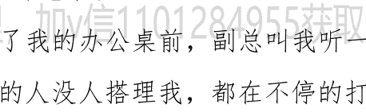
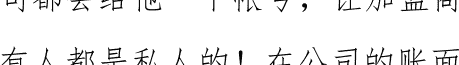
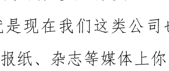
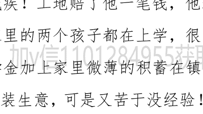
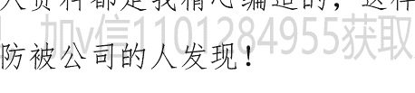
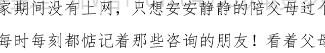

# 【天涯头】惊天骗局（一位在职高级招商主管的自白）

神之手123

☆【首页推荐帖】

当下的中国，形形各色的骗局可以是五花八门，数不胜数！抛开一些小的街头骗局，大型的骗术就有传销骗局，短信中奖骗局，信用卡中奖骗局，连锁加盟骗局等等！

如果我是问你这些骗局中哪最可怕，暴力，最耻，最害人，最有诱惑力？相信很多人会回答是传销或中奖骗局。对于前者有着严密的组织，可怕的是洗脑，一夜暴富的诱惑！后者利用人性的贪婪和趣味的是两种高明的手段，能够设想出这方法的创始人可以说是天才！但是我想告诉大家当今中国最可怕的骗局是形形各色的连锁加盟骗局！之所以说它是最可怕的，是因为它不具备前两种骗局的本质，两者所不具备的无敌的，可怕的，得天独有的优势---哈哈！

本人是一家服装连锁品牌的高级招商主管，鉴于目前仍然在职，所以不能以真实身份透露（说的严重的可能会有生命危险）。我今天想把我的亲身经历公布于众，我虽然不知道有没有用，但我愿尽全力来唤醒网友的帮助——救救那些可怜的加盟商（或准备加盟者）吧！至于动机我会在后面提到的！如果你已经看到现在请你坚持把它看完！

我在此向您发出真诚的恳求！

我是河北人，2001年毕业于北京的一民办高校，学的是营销。家里的条件很不好，父母都是下岗工人，真的希望能够在北京站住脚，把父母接过来享福！毕业后才发现在北京立住所真的很很难！在三年的时间里我换了四份工作。不是我喜欢换工作，也不是我工作努力。我工作很负责命，做事要灵活于找方法，以便做到事半功倍的效果！我要公司才能获得可以立足京城的薪水！要么就是公司不公平，总之总有一种不适的感觉！现在回起来，还是自己那时年龄太晚了，2004年的九月一个偶然的机会我在报纸上看到了在职的这家公司。我被它挑战高薪的薪资条款所吸引，加上我本身优秀，自己的性格我妥了求职，第二天参加了面试！在面试的过程中我表现了相当的自信和良好的面，面试结束后面试官（一位优雅的中国女士，后知道是我们公司的副总）对我说：你的口才很好，公司处在发展之中，需要你这种人才！我当时很感飘飘！随后她向我介绍了我的工作职责，说公司的品牌服装是某某国引进的，生产基地是在广东，北京是招商中心。我的职责就是给有意的客户打电话，邀请他们来京加盟！这项工作并不难，前两天只是听听周围的同事们怎样和客户电话沟通，熟悉之后再自己打！我们的薪水是底加提！底薪不高，收入大半提成，每招来一位客户经考察一定的提成，北京的客户有招商主管接待，谈成了我还有一笔高的提成！从所有新员工都是普通的话员起！这样我就开始了一段难忘的人生。

办公地点位于繁华地地的商业写字楼，五间办公室。一间话室，一间接待室（内隔为八间），每间全封闭，环境幽雅，密闭吸音，可由八位主管在接待来访者），一间财务，一间总经理办公室，还有一间是我们的样品展示店（供顾客参观！）我们话室当初只有十几个人（现在已经近五十人），每人一张办公桌，一台电脑（可上网），一部手机！

我被领到了我的办公室前，副总叫我听一下适应一样就走了！周围的人没人理我，在不停的打着电话！起初我想人打一下工作的注意事项，想一还是忍住了！我用心的听了一会，这份工作是不太难了。公司在各招商网站都发布了招商信息，吸引顾客留联系方式！我从公司从网站拿到顾客的资料（花的），再发给我们。我们只要联系方式打过去，向顾客介绍我们的服装品牌牌怎么样，加盟的细节等等，最后邀请顾客来进行实地考察！难点在于怎样能够通过语言打动客户！

再听了周围同事事了一天电话之后我大体上明白了整个流程，只是关于公司的一些细节不太懂，我整理了大概十条：公司的历史，品牌的历史，已加盟店面的数量，分布情况，如何回答顾客提出的一些刁性问题等等！班后我拿着这些问题去找副总（以下简称韩总）！韩总听了我提出的问题，微微笑笑，只是问我：你想不想拿高薪？我回答当然想！于是她给我一份招商画册；上回回，把这个看顾，顾客的时候问就是！其他的以以后工作慢慢慢体会了！

我带着满脑疑惑回到我的租屋，仔细的看了画册！上面我们的公司已经成立了多年，现在代理的这个品牌在国外已经有几十年的运营经历！服装的款式怎样新颖，材质良好样，加盟有巨大的利润空间，在内的很多电视都有我们的广告！等等。加盟的方式是收取3万元的加盟费（律规定的），首款万元（首批加盟是不允许顾客自己挑选的，只能由公司配给，公司的说法是要了解当地的市场。如果顾客卖不动不能全部返还（公司调整）；如如果卖得好公司年会奖励多少钱！说实话，当时看完画册我都动了，要是有钱的话，我我想回家开一家！我觉得这个项目真的很不错！我想找到了一份很适合我的工作！我一定能够这里实现我的自我价值！下了决心后，我连夜找了一份网吧查看多一份公司的资料，以及竞争对手的资料！想好好一份工作必须做好充分的准备，就像打仗一样，知己彼方能百胜百胜！我在百度输入公司的名称后，一一查出了几千条的相关资讯，我找开了几十条多数都是招商网网站的信息以及公司的主页。不不知道，一看招商网我这才真是吓了一跳！举个例子来说就一家U88招商网就有万家公司在招商。招商类可是五花八门，服装，饮食，首饰，商品，甚至赌博都有只要你能想到的人们需要包罗万万！我看了其中的，都是介绍自己怎样好，怎样赚钱，怎样风险？看多了，我的疑惑产生了！这些连锁品牌运作的方式都是差不多，细节上可能有些入（有的是加盟费，权益金），这会不会是骗子吗？这个念头出现在脑海里我不自主的公司的名称后面加上“骗子”两个字，进行搜索。这次又出了千条链接。我看了很多，大多数是介绍我们公司是一个皮包公司，看完之后，心里已经明白了公司的性质，但我愿意相信！我想：这是不是竞争对手？我又点了一些其它公司（包括一些）。

(步骤!) 我不知道自己是怎么出去逛吧，心里充满了失落的情绪！看着上班的时间快到了，我却不想去了。然而想到昨天已经把身份证、毕业证等的复印件交到了公司，还是要去一次。来到公司，我就韩住了。她叫住了。她又叫过来一个中年男士，姓王，介绍说是我们公司的高级主管。让我以后在工作中有什么不懂都向他请教！由于心里还有有些焉，我还是怎么开口辞职，王主管拍了一下我的肩膀，说：小伙子，精神点！我带你去看看我们的样板店！

这是我第一次来样板间，进门的感觉是很漂亮的，很有味道。各种服装分类层次，色彩搭配很有冲击力！无论这样的店在任何市县，只要不是差，铺位都会相信。只惜我在网络上见到的那些亮眼的衣服在加盟以后都是拿不到的，是一批非常新颖服装。王主管招呼我帮忙，将样品挂了上去，替换了一些老款！在整理的过程中，我摸了衣服的质地，都很不错！看了一下衣服标识，都是公司的牌子！这是怎么回事？既然公司有这些为何加盟商拿不到呢？当时售后拿出一张交给王主管！随后售后的人就走了。王主管和我继续整理，起了家常，发现竟然是老乡，这样顿时感觉亲了几分！为了弄清我的问题，我中午请吃饭！我一口答应了！我很完整完美的时候，我无意中看到了王主管随手放到上面的那张交接单。上面写着衣服的种类，颜色，标码。价位一般是150到300元不等！我并不清楚这是供货的价格还是零售的价格？没关系，中午的时候我会并告诉他！

从样板间回话室，王主管告诉我今天仍然不用我电话，继续听听其他同事！这回听到的时候，我用了自己去观察一个人。我发现每一个同事在跟顾客交流时都有一套东西。有的跟客户套套，有的专业的，有的甚至威胁顾客（告诉客户如果不在快来京考察就没有名字了），有的竟然自称是公司副总（称可以给客户优惠的加盟条件！）这才是八仙过海，更切实！试图正规的品牌会招若如此信口河吗？我听得都快忍不住笑了！到了此时，我就算不问王主管也知道这家公司怎么地道了！但是好奇心却是驱使我在中午时和王主管来到了公司附近的一家餐馆我想弄清楚一些细节。饭桌上我向他问他喝酒吗？他平时不可以，但今天是我第一天正式加入公司，破例可以呀！就这样我们每人都喝了三瓶啤酒；看得他酒量并不大，三瓶肚已经有些瘪了？这时时机差不多了，我给他倒了一酒。再次表达了我对这份工作的“期待”，又对他进行了一番轰炸，然后向他请教工作“心得”！一小时后我已经弄清了我想知道的所有问题！

王教主，加微信1101284955

我们公司说白了就是一家典型的皮包公司！但是却是合法注册的，加盟代表朱（其实是一个退休多年的老老头），公司真正的老板就是前面提到的韩副总！公司根本就没有生产厂家，所谓的品牌就是凭空创造出来的（也已经合法注册），在样板间那里他们看到的衣服是我们公司从各个名牌服饰里购回来吸引顾客的上面的商标是我们公司送到广东，浙江的一些工厂拆掉原来的标签把我们的商标贴上去！至于客户加盟后我们发给他们的货是从大门动植物等等服装批发地淘来的积压货，客户如果想换货，的是那些积压货（这些衣服也是公司重新贴标签的！）价格却涨了不止三倍！试想一下，加盟商拿到的货还且不样式，加盟商拿不到呢？

（由于王主管拍了一下我的肩膀，说：小伙子，精神点！）心里充满了失落的情绪！看着上班的时间快到了，我却不想去了。然而想到昨天已经把身份证、毕业证等的复印件交到了公司，还是要去一次。来到公司，我就韩住了。她叫住了。她又叫过来一个中年男士，姓王……

王主管向他们介绍项目时，我没等，半小时后，我看王主管带他们去了样板间！从样板间出来，我看见那对夫妻脸上充满激情的表情（可能是兴趣！）随后他们很快的和公司签了合同，然后匆匆赶回准备“发财”了！我想他们在家的火车上一定会沉浸在兴奋之中，夫妻俩可能一起策划下一个未来！但是残酷的现实会给他们好好上一课的！过了两个月，我又接到了那对夫妻的电话。他们在电话里向我大声斥骂，说我们公司欺骗了！我平静的听着（此时的我对这种情况已经麻木了，可以说没有任何感觉，即不再生气也不激动）等他们忙够了，我用一种温和的语气告诉他们：有什么问题可以拨打我们的客服（就是售后），电话号码是*********然后挂了电话！这种说法是公司要求的！当顾客把电话打售后时，为非是一些发给他们的差货，质量不好，价格太高，在店里看到的质量只有1%？后者的回答是：“我们的货就是这样，要不要！退货？退费？门都没有！不从屈回来告诉我们！公司之所以敢这么猖妄的，最重要的就是因为我们是“合法”的公司和客户签的合同就是一个没有任何漏洞的网络，只要你签了，就等于掉进了陷里面。基本上所有的加盟商最后都会倒闭，只不过是时间长短的问题。到那个时候你拿出合同发现，里面没有一条能帮得上的你，你想去100%会输！连锁加盟行业往往对客户群体的定位很准确！大多数都是没钱，真正有钱有势的人是不会上看这种生意！所以公司一般情况下加盟费（有的公司是保证金或权益金等）是不高的，往往不会超过12000—30000元，加上首款也不会超出6万！这钱对一个想开店的人还是拿出来的(实在不够也会借的)。加盟者都是外地的，就算想我们上京来打官司！这时公司的“合法”作用就开始体现了！首先查会依据法律法规规定这不是……

盟很难相信那样的公司竟然是假的！基本上所有此类公司的法人代表都不会是幕后老板，都是一些老头老太太，这些“法人”大多数都不知道自己竟然是“公司老板”。目的是万一出现了意外情况，法机关无法调查下去！一般此类公司在北京市都会找两个政府人物做后盾，动动这些公司和反腐难度差不多！

三、包括我们在公司内，既然披着合法的外衣，就会牵涉到税收问题！在我的上主管已经知道了？凡是加盟商在交钱时，公司都会给他一个账号，让加盟商把钱转进去！这些账号的持有人都是私人的。

在公司的账面上根本就见到钱！这样就逃避了税收！而加盟商交钱后拿不到发票的，只会给他们“转账”说法是打到私人账户转账，给公司操作人的私人账户汇，发货比较很快。

四、几乎每一此类公司除了这一个专门的律师外都还有一批打手（平时的名义就是售后）。遇到当上的加盟商来说，合法的就让他随便去吧。他找公安机关反映，公安说这属于合同纠纷。找工商业部门反映，工商部门说他们只能对该公司虚假宣传予以处罚。如果他要起诉最好，先别管官司输赢，托他托佑的他死了！他如果活了，来公司闹，这时我们的“售后”就该上场了！现在把他打一顿，再送到公安局说他扰乱我们正常工作，连药费都不够！是实话这样的客户是很少的！大多数的加盟商在知道要绝望后，都只能吞下这颗苦果！

大部分只能关门大吉，小部分把我们发给他的货当破产处理了，然后自己上点散货继续下去！

今年为止，我已经在这个行业里混了两年多了！我一个人的存款应该达到了二十万块，平均每月都在万以上！可是这两年里我没有一天是真正开心的。我的心、我的思想、我的感情仿佛都丢失了知觉！我经常想，可能这就是这一切必须有所失去吧！

最近一年来，网上对这一行业的投诉和吐槽越来越多，有些媒体也点名揭露了几家骗子公司的内幕！按常规应该对这些想法的人起到了警示的作用，可是结果恰恰相反，这一行业反而却是最疯狂的成长！到为止，北京大概已经有两万家连锁招商公司！每一家（包括我们公司）生意都是“蒸蒸日上”！此外在全国各地开始出现类似的大公司！

有时候我不明白，那些投资者只要在网络上对加盟的品牌认真查一查，都会明白大概。那么为什么还有这么多当者呢？我分析了一下：大多数的投资者都是一些小镇外务人员，年纪大了，打算回乡稳定下来；还有一部分是下岗人员打算自己创业；还有许多各种各种的人，为了一个发财梦！这些人可能不会在网上搜索查询，也可能查到了但不相信，还有人产生了疑惑但是被我们消灭了（我们针对网上的打击有各种各样的说法：对手的恶意攻击啊，其它都是假的我们真的是，我们有注册商标啊，能在某某权威网站（国家的）（真的可以查到，我们花了钱的）查到我们的资质等等！）投资者往往觉得自己是有光的，别人被骗了就是别人笨，他自己是不会选错的（当他明白时黄瓜脸都凉了！）经济的社会里，金钱的魔力越来越大，越来越多的人已经在金钱的诱惑下迷失了（包括自己！）

还有一个原因就是现在我们这类公司也越来越注重媒体的宣传！在网络上、报纸、杂志等媒体上你随心就会看到我们这类公司的广告（包括权威的报刊、杂志；著名的大型网站：甚至电视剧），甚至开始频繁地现在全国各地的正规违规招商展会上，而且能够以豪华装修、庞大阵仗出现，甚至吵吵喧闹、闹到令人害怕的地步，比一场戏表演还热闹，其中实质是在上演一场心理暗示眼下的谎骗之旅。

通常展会开始几天之后，大小如意的意向单离开展台，回四回，到三四天的展会结束，加盟意向单中涵盖大部分已经转换成了投资加盟名单：其实两类名单都很详细考核，做“托的”、受骗的、混杂其中，让你难辨真伪。在这样情况下受骗加盟的投资者，哪怕旁亲好友如何规劝、提醒，都很难回头，和赵本山大叔《卖房》您急得找着北的大师傅状态差差不多。展览公司介绍的这些企业出展费最快，因为骗钱实在容易，不在在那点展费用上和主办单位罗罗喽。

我们公司从成立到现在已不过三年左右，到现在为止，已加盟的客户已将近六百家！

在这里我算了一笔账：一位加盟商我们公司的平均收取是6万元。其中1000元提给话务员，3000元提给接待的主管，6000元（多的）用来拿货发给加盟商(算做3万元的货!)剩余的5万元进入老板的腰包。这样三年来我们老板从这家公司就赚了三千万！租房费、广告费和一些杂七八的费用最少够净利两千万！平均每年700万！我在前面说过，我们公司只是中小规模的。按照我对这个行业的了解，北京2万此类公司，平均每家每年能够净挣天津100万左右。全北京此类公司每年“净挣”200亿！全国呢？我算不出，可怕呀！

在平常的工作中，同事之间的关系冷淡，大家聊天时很少谈到自己的生活！说的是客户的事。更小的如果要避免谈到道德、良心，报之以来的！我就越来越麻木的时候，发生了一件事！正是这件事情惊醒了我，才有了今天的这篇自白！

那是今年八月的一天，我们公司又来了一位考察者。当由于我们主管中一位姓叶的主管！那天我看到的那位考察者的第一眼，心里就一凛——那是个残废人(具体特征我不能说说，公司看到我在写他们，穿的衣服很脏)。是实话这样的客户是很少的！大多数的加盟商在知道要绝望后，都只能吞下这颗苦果！大部分只能关门大吉，小部分把我们发给他的货当破产处理了，然后自己上点散货继续下去！

今年为止，我已经在这个行业里混了两年多了！我一个人的存款应该达到了二十万块，平均每月都在万以上！可是这两年里我没有一天是真正开心的。我的心、我的思想、我的感情仿佛都丢失了知觉！我经常想，可能这就是这一切必须有所失去吧！

最近一年来，网上对这一行业的投诉和吐槽越来越多，有些媒体也点名揭露了几家骗子公司的内幕！按常规应该对这些想法的人起到了警示的作用，可是结果恰恰相反，这一行业反而却是最疯狂的成长！到为止，北京大概已经有两万家连锁招商公司！每一家（包括我们公司）生意都是“蒸蒸日上”！此外在全国各地开始出现类似的大公司！

有时候我不明白，那些投资者只要在网络上对加盟的品牌认真查一查，都会明白大概。那么为什么还有这么多当者呢？我分析了一下：大多数的投资者都是一些小镇外务人员，年纪大了，打算回乡稳定下来；还有一部分是下岗人员打算自己创业；还有许多各种各种的人，为了一个发财梦！这些人可能不会在网上搜索查询，也可能查到了但不相信，还有人产生了疑惑但是我们消灭了（我们针对网上的打击有各种各样的说法：对手的恶意攻击啊，其它都是假的我们真的是，我们有注册商标啊，能在某某权威网站（国家的）（真的可以查到，我们花了钱的）查到我们的资质等等！）投资者往往觉得自己是有光的，别人被骗了就是别人笨，他自己是不会选错的（当他明白时黄瓜脸都凉了！）经济的社会里，金钱的魔力越来越大，越来越多的人已经在金钱的诱惑下迷失了（包括自己！）

还有一个原因就是现在我们这类公司也越来越注重媒体的宣传！在网络上、报纸、杂志等媒体上你随心就会看到我们这类公司的广告（包括权威的报刊、杂志；著名的大型网站：甚至电视剧），甚至开始频繁地现在全国各地的正规违规招商展会上，而且能够以豪华装修、庞大阵仗出现，甚至吵吵喧闹、闹到令人害怕的地步，比一场戏表演还热闹，其中实质是在上演一场心理暗示眼下的谎骗之旅。通常展会开始几天之后，大小如意的意向单离开展台，回四回，到三四天的展会结束，加盟意向单中涵盖大部分已经转换成了投资加盟名单：其实两类名单都很详细考核，做“托的”、受骗的、混杂其中，让你难辨真伪。在这样情况下受骗加盟的投资者，哪怕旁亲好友如何规劝、提醒，都很难回头，和赵本山大叔《卖房》您急得找着北的大师傅状态差差不多。展览公司介绍的这些企业出展费最快，因为骗钱实在容易，不在在那点展费用上和主办单位罗罗喽。

我们公司从成立到现在已不过三年左右，到现在为止，已加盟的客户已将近六百家！

在这里我算了一笔账：一位加盟商我们公司的平均收取是6万元。其中1000元提给话务员，3000元提给接待的主管，6000元（多的）用来拿货发给加盟商(算做3万元的货!)剩余的5万元进入老板的腰包。这样三年来我们老板从这家公司就赚了三千万！租房费、广告费和一些杂七八的费用最少够净利两千万！平均每年700万！我在前面说过，我们公司只是中小规模的。按照我对这个行业的了解，北京2万此类公司，平均每家每年能够净挣天津100万左右。全北京此类公司每年“净挣”200亿！全国呢？我算不出，可怕呀！

在平常的工作中，同事之间的关系冷淡，大家聊天时很少谈到自己的生活！说的是客户的事。更小的如果要避免谈到道德、良心，报之以来的！我就越来越麻木的时候，发生了一件事！正是这件事情惊醒了我，才有了今天的这篇自白！

那是今年八月的一天，我们公司又来了一位考察者。当由于我们主管中一位姓叶的主管！那天我看到的那位考察者的第一眼，心里就一凛——那是个残废人(具体特征我不能说说，公司看到我在写他们，穿的衣服很脏)。是实话这样的客户是很少的！大多数的加盟商在知道要绝望后，都只能吞下这颗苦果！大部分只能关门大吉，小部分把我们发给他的货当破产处理了，然后自己上点散货继续下去！

今年为止，我已经在这个行业里混了两年多了！我一个人的存款应该达到了二十万块，平均每月都在万以上！可是这两年里我没有一天是真正开心的。我的心、我的思想、我的感情仿佛都丢失了知觉！我经常想，可能这就是这一切必须有所失去吧！

最近一年来，网上对这一行业的投诉和吐槽越来越多，有些媒体也点名揭露了几家骗子公司的内幕！按常规应该对这些想法的人起到了警示的作用，可是结果恰恰相反，这一行业反而却是最疯狂的成长！到为止，北京大概已经有两万家连锁招商公司！每一家（包括我们公司）生意都是“蒸蒸日上”！此外在全国各地开始类似的大公司！

有时候我不明白，那些投资者只要在网络上对加盟的品牌认真查一查，都会明白大概。那么为什么还有这么多当者呢？我分析了一下：大多数的投资者都是一些小镇外务人员，年纪大了，打算回乡稳定下来；还有一部分是下岗人员打算自己创业；还有许多各种各种的人，为了一个发财梦！这些人可能不会在网上搜索查询，也可能查到了但不相信，还有人产生了疑惑但是我们消灭了（我们针对网上的打击有各种各样的说法：对手的恶意攻击啊，其它都是假的我们真的是，我们有注册商标啊，能在某某权威网站（国家的）（真的可以查到，我们花了钱的）查到我们的资质等等！）投资者往往觉得自己是有光的，别人被骗了就是别人笨，他自己是不会选错的（当他明白时黄瓜脸都凉了！）经济的社会里，金钱的魔力越来越大，越来越多的人已经在金钱的诱惑下迷失了（包括自己！）

还有一个原因就是现在我们这类公司也越来越注重媒体的宣传！在网络上、报纸、杂志等媒体上你随心就会看到我们这类公司的广告（包括权威的报刊、杂志；著名的大型网站：甚至电视剧），甚至开始频繁地现在全国各地的正规违规招商展会上，而且能够以豪华装修、庞大阵仗出现，甚至吵吵喧闹、闹到令人害怕的地步，比一场戏表演还热闹，其中实质是在上演一场心理暗示眼下的谎骗之旅。通常展会开始几天之后，大小如意的意向单离开展台，回四回，到三四天的展会结束，加盟意向单中涵盖大部分已经转换成了投资加盟名单：其实两类名单都很详细考核，做“托的”、受骗的、混杂其中，让你难辨真伪。在这样情况下受骗加盟的投资者，哪怕旁亲好友如何规劝、提醒，都很难回头，和赵本山大叔《卖房》您急得找着北的大师傅状态差差不多。展览公司介绍的这些企业出展费最快，因为骗钱实在容易，不在在那点展费用上和主办单位罗罗喽。

我们公司从成立到现在已不过三年左右，到现在为止，已加盟的客户已将近六百家！

在这里我算了一笔账：一位加盟商我们公司的平均收取是6万元。其中1000元提给话务员，3000元提给接待的主管，6000元（多的）用来拿货发给加盟商(算做3万元的货!)剩余的5万元进入老板的腰包。这样三年来我们老板从这家公司就赚了三千万！租房费、广告费和一些杂七八的费用最少够净利两千万！平均每年700万！我在前面说过，我们公司只是中小规模的。按照我对这个行业的了解，北京2万此类公司，平均每家每年能够净挣天津100万左右。全北京此类公司每年“净挣”200亿！全国呢？我算不出，可怕呀！

在平常的工作中，同事之间的关系冷淡，大家聊天时很少谈到自己的生活！说的是客户的事。更小的如果要避免谈到道德、良心，报之以来的！我就越来越麻木的时候，发生了一件事！正是这件事情惊醒了我，才有了今天的这篇自白！

那是今年八月的一天，我们公司又来了一位考察者。当由于我们主管中一位姓叶的主管！那天我看到的那位考察者的第一眼，心里就一凛——那是个残废人(具体特征我不能说说，公司看到我在写他们，穿的衣服很脏)。是实话这样的客户是很少的！大多数的加盟商在知道要绝望后，都只能吞下这颗苦果！大部分只能关门大吉，小部分把我们发给他的货当破产处理了，然后自己上点散货继续下去！

今年为止，我已经在这个行业里混了两年多了！我一个人的存款应该达到了二十万块，平均每月都在万以上！可是这两年里我没有一天是真正开心的。我的心、我的思想、我的感情仿佛都丢失了知觉！我经常想，可能这就是这一切必须有所失去吧！

最近一年来，网上对这一行业的投诉和吐槽越来越多，有些媒体也点名揭露了几家骗子公司的内幕！按常规应该对这些想法的人起到了警示的作用，可是结果恰恰相反，这一行业反而却是最疯狂的成长！到为止，北京大概已经有两万家连锁招商公司！每一家（包括我们公司）生意都是“蒸蒸日上”！此外在全国各地开始类似类似的大公司！

有时候我不明白，那些投资者只要在网络上对加盟的品牌认真查一查，都会明白大概。那么为什么还有这么多当者呢？我分析了一下：大多数的投资者都是一些小镇外务人员，年纪大了，打算回乡稳定下来；还有一部分是下岗人员打算自己创业；还有许多各种各种的人，为了一个发财梦！这些人可能不会在网上搜索查询，也可能查到了但不相信，还有人产生了疑惑但是我们消灭了（我们针对网上的打击有各种各样的说法：对手的恶意攻击啊，其它都是假的我们真的是，我们有注册商标啊，能在某某权威网站（国家的）（真的可以查到，我们花了钱的）查到我们的资质等等！）投资者往往觉得自己是有光的，别人被骗了就是别人笨，他自己是不会选错的（当他明白时黄瓜脸都凉了！）经济的社会里，金钱的魔力越来越大，越来越多的人已经在金钱的诱惑下迷失了（包括自己！）

还有一个原因就是现在我们这类公司也越来越注重媒体的宣传！在网络上、报纸、杂志等媒体上你随心就会看到我们这类公司的广告（包括权威的报刊、杂志；著名的大型网站：甚至电视剧），甚至开始频繁地现在全国各地的正规违规招商展会上，而且能够以豪华装修、庞大阵仗出现，甚至吵吵喧闹、闹到令人害怕的地步，比一场戏表演还热闹，其中实质是在上演一场心理暗示眼下的谎骗之旅。通常展会开始几天之后，大小如意的意向单离开展台，回四回，到三四天的展会结束，加盟意向单中涵盖大部分已经转换成了投资加盟名单：其实两类名单都很详细考核，做“托的”、受骗的、混杂其中，让你难辨真伪。在这样情况下受骗加盟的投资者，哪怕旁亲好友如何规劝、提醒，都很难回头，和赵本山大叔《卖房》您急得找着北的大师傅状态差差不多。展览公司介绍的这些企业出展费最快，因为骗钱实在容易，不在在那点展费用上和主办单位罗罗喽。

我们公司从成立到现在已不过三年左右，到现在为止，已加盟的客户已将近六百家！

在这里我算了一笔账：一位加盟商我们公司的平均收取是6万元。其中1000元提给话务员，3000元提给接待的主管，6000元（多的）用来拿货发给加盟商(算做3万元的货!)剩余的5万元进入老板的腰包。这样三年来我们老板从这家公司就赚了三千万！租房费、广告费和一些杂七八的费用最少够净利两千万！平均每年700万！我在前面说过，我们公司只是中小规模的。按照我对这个行业的了解，北京2万此类公司，平均每家每年能够净挣天津100万左右。全北京此类公司每年“净挣”200亿！全国呢？我算不出，可怕呀！

在平常的工作中，同事之间的关系冷淡，大家聊天时很少谈到自己的生活！说的是客户的事。更小的如果要避免谈到道德、良心，报之以来的！我就越来越麻木的时候，发生了一件事！正是这件事情惊醒了我，才有了今天的这篇自白！

（此处重复内容省略）

（此处重复内容省略）

这些公司由于成立时间短，可能在网上找不到它们的投诉，这时候，大家一定不要大意，要多参照后三条的标准去比较，或者多问问亲人，朋友！千万不要头脑发热！此外还有一些高的所谓的技术加盟类的公司，一定要小心，绝不要轻轻松松就能挣大钱的鬼话！如果真的好挣钱，不会漫天的找加盟商！

还有就是有的网友所说的并不是正规的加盟品牌，但这些正规品牌大多数早就招满了加盟名额，它们的费用也是相当高的，并不是几万元就可以做的！我在引用一位给我留言的网友（小洋洋帅）的话：“真正的一个品牌就不可能在一年的时候有六百多家店了，因为真正的服装品牌是不可能这么低的门槛，现在虽然很多品牌是因为竞争的缘故虽然没有加盟，但是货品一套需要的，最少一手货你吧，至少也要有一个三十个左右的款，一手货在我们行业内通常的配货都要二十万左右算了，这还是春天的，是秋季最少要三个三十万左右了，投资不是所有的人都投资得起，而且是货品，生意好得不可没有加盟费的！”

所以我的看法就是在当今加盟市场混乱不堪的时候大家尽量就不要加盟了！想做服装、饰品、小商品类生意的话，不妨自己去各大市场跑那些散货来做。真你有眼光，了解市场，一样可以挣钱的！没有经验的可以向那些有些多问问，还有就是前期的市场调查一定要做好。总之，做生意之前要先问自己是否真的适合做生意！千万不要冒险，不懂行最好不要，隔行如山！千万不要自己骗自己！

# 三. 回复那些担心我安全的网友

再次感谢你们的关注！是你们让我继续坚定的和这个无妥的行业斗到底！

有很多关注我的网友提出说我在“惊天骗局”中把公司写的太详细了，博客中又有我的个人资料！恐怕我会有危险。在这里我首先声明：在“惊天骗局”中的韩赴、王主宰、叶主管、老于等确实有人，但是他们的姓氏被我替换了，还有我博客中的个人资料都是精心编造的，这样做不是欺骗朋友，我只是被骗的人之一！

还有感谢大家的提醒，我现在只在网上上混，永远不会把真实的身份透露出来！这都是通过你们的提醒我才知道的！

再就是我已经巧妙的用一种手段申请了离职，如果顺利我下星期就会找到新的工作了！大家请放心，公司不会引起起心的！毕竟在这种环境里呆了两年，我知道如何保护自己了！

我只想请你们永远不要放弃“惊天骗局”这张贴子，我们能够做到什么样的效果还不知道，能否沉重的击垮这一行也不知道，但是只要我们坚持下去，只要多一个人看到，都是我们的成功！我永不放弃，你们也不会放弃！

# 四. 回复发表“惊天骗局”和我个人经历的记者朋友

各位记者朋友你们好，你们发给我的邮件 都看到了，你们可以随意发表我的帖子，感觉语句不通、或句句还有错别字等可以随意修改！但是很遗憾我不能接受你们的采访，虽然你们都会为我保密！但是这个行业和记者的关系实在是太密了，我无法分辨你们的真用意，请体谅我的苦衷！如果你们真的可以发表“惊天骗局”的话，相信我们这些网友在网上的抗争要有有效的多，真是天大的好事！我不会索取任何报酬，只希望你们能够加入到打击“欺诈性连锁”的队伍中！

# 五.我自己我自己的一些话

我发表“惊天骗局”这个帖子，一求不名，二求无利，我也不需要你们博客的点击率（实话我甚至不知道点击率高有什么用！）我只是在赎救，在为了减少一些受害者而做我该做的事，我永远不会出没水面的。遗憾的是虽然我即将彻底离开这个行业，但是每天仍有许多的骗商不断的在掉这个陷阱中！我个人的力量做到什么样不知道，但是只要所有良知的人都能起来，和这个行业斗到底，不断的揭露它们，我相信会有成功！

最后祝天下人平安！

作者：神之手123 日期：2007-01-19

都有父母，当那些可怜的加盟商被骗得血本无归时，他们的父母也会很伤心，他们又拿什么去孝顺父母呢？所以，我永远不会放弃去帮助那些可怜的加盟商，也永远不会放弃去和诈骗子斗下去！我发现这已经成了我的一种生活习惯，这种习惯已成为自然，它便不再是我的负担，它的为了我的一种生活目标！虽然我不能挽救所有的加盟商，但是我在尽力去做，我问心无愧！所有有良知的人们共勉！

此外再一次的感谢那些一直在关注我自身安全的朋友，感谢你们！！说句自嘲的话，我的生命力比“小强”还强，我会保护好自己！最后向所有善良的人们拜个晚年！

作者：伸手之123 日：2008-02-28 11:41

# 当习惯已成自然

回来过家刚回北京！

回家期间没有网络，只想安安静静的父母过个年！可是心里每时每刻都惦记着那些咨询的朋友！看着父母一年比一年老，而我还是一事无成，心里很难过！真的很想让他们安享晚年很恨自己的能力！但是我以后离开那家高薪的骗子公司，正反来说，我以此为荣！原因很简单，每个人都有父母，当那些可怜的加盟商被骗得血本无归时，他们的父母同样的也会很伤心，他们又拿什么去孝顺父母呢？所以，我永远不会放弃去帮助帮助提醒那些可怜的加盟商，也永远不放弃放弃去诈骗招商打斗去！我发现这已经成了我的一种生活习惯，当这种习惯成为自然时，它便不再是我的负担，相反的成为我的一种生活目标！虽然我不能挽救所有的加盟商，但我是在尽力去做，我心心无愧！所有有良知的人共勉！

此外再次的感谢那些一直在关注我自身安全的朋友，感谢你们！说句自嘲的话，我的生命力比“小强”还顽，我会保护好自己！最后向所有善良的人告晚安！

作者：神之矛123 日期2023-02-28 13:54

# 当习惯已成自然

过年回家回国？

回家期间没有上网，只想安静安静的父母过好年！可心里，看着父母一年比一年老，而我还是一事无成，心里很难过！真的很想让父母安享晚年履行自己的可能！但我并不是后悔离开那家高薪的招商公司，相反，我以此为荣！原因很简单，每个人都有父母，当那些可怜的加盟商被骗得血本无归时，他们的父母同样的体会伤心，他们又拿什么去孝顺父母呢？所以，我永远也不会放弃帮助那些可怜的加盟商，也永远不会放弃去诈骗招商公司打斗去！我发现已经成了我的一种生活习惯，当这种习惯成为自然时，它便不再是我的负担，相反的成为我的一种生活目标！虽然我不能挽救所有

加盟商，但是我在尽力去做，我心无愧！愿所有有良知的人们共勉！

此外这一次的感谢那些一直在关注着我安全的安全的，感谢你们！说句自明的话，我的生命力比“小强”还顽，我会保护好自己！最后向所有善良的人们拜个晚年！

作者:神之手 123 日期:2008-02-28 17:11

# 当习惯已成自然

过年回家回北京！

回家期间没有了上网，只想安静静的父母过个年！可是心里每时每刻都记着那些的朋友！看着父母一年比一年见老，我也是一事无成，心里很难受！真的想让他们安享晚年只根底的能力有限！但我并不后悔后离开那高薪的骗子公司，正反，我以此为荣！原因简单，每个人都有父母，那些可怜的加盟商被骗的血本无归之时，他们的父母同样的会心伤，他们又拿做什么孝顺父母呢？所以，我永远不会放弃帮助那些可怜的加盟商，也永远不放弃去诈骗招商打斗去！我发现已经成了我的一种生活习惯，当这种习惯成为自然时，它便不再是我的负担，相反的成为我的一种生活目标！虽然我不能挽救所有的加盟商，但是我在尽力去做，我心无愧！愿所有有良知的人们共勉！

此外这一次的感谢那些一直在关注着我安全的安全的，感谢你们！说句自明的话，我的生命力比“小强”还顽，我会保护好自己！最后向所有善良的人们拜个晚年！

作者:神之手 123 日期:2008-02-28 17:11

# 当习惯已成自然

过年回家回北京！

回家期间没有了上网，只想安静静的父母过个年！可是心里每时每刻都记着那些的朋友！看着父母一年比一年见老，我也是一事无成，心里很难受！真的想让他安享晚年只根底的能力有限！但我并不后悔后离开那高薪的骗子公司，正反，我以此为荣！原因简单，每个人都有父母，那些可怜的加盟商被骗的血本无归之时，他们的父母同样的会心伤，他们又拿做什么孝顺父母呢？所以，我永远不会放弃帮助那些可怜的加盟商，也永远不放弃去诈骗招商打斗去！我发现已经成了我的一种生活习惯，当这种习惯成为自然时，它便不再是我的负担，相反的成为我的一种生活目标！虽然我不能挽救所有的加盟商，但是我在尽力去做，我心无愧！愿所有有良知的人们共勉！

此外这一次的感谢那些一直在关注着我安全的安全的，感谢你们！说句自明的话，我的生命力比“小强”还顽，我会保护好自己！最后向所有善良的人们拜个晚年！

作者:神之手 123 日期:2008-02-28 17:11
