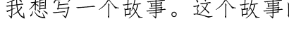
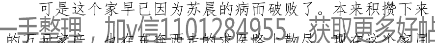
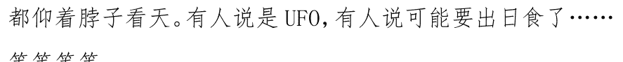
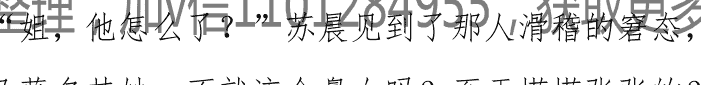

# “苦望”愿您能被这故事感动的一生。晨风文学

## 序章

坐在电脑前，看着显示屏中的一张图片，心有万千感触。

那是一幅摄影作品，潺涓流淌的溪水中，漂着一片绿色的树叶。叶子已经脱离了树木，结束了它短暂的宿命。它并没有归于尘土，再次成为大树的养料。也就是我们平时所说的“落叶归根”的福分，竟与它无缘。

它的宿命，从小溪开始，便已经注定要在漂泊中看着顺流。从它出生的地方，终是在远处。枯……埋入地下……化作一团尘……

叶子并不知道它的宿命将归于何方，事实上，谁也不知道它将在什么时候、什么地方停下来。甚至带着它的小溪不知道。

或许在途中被冲上岸，那里是丛林、草地、亦或是荒野……

或许是随着小溪汇入小河，然后在小河边边的田亩之畔终停留，来年成为庄稼的养分……

或许是随着小溪汇入大河……

亦或是随着大河汇入大海……

一切，或许只有那片叶子在获得自己最终结局的时候会知道吧……

而此时此刻，我所知道的是：这片叶子虽然生命已逝，绿色依然存在，尽管这属于它的绿色很快消失。

这种精神是值得我们每个人反思的。是啊，即便生命已经过去，也要把这最后一抹的绿色留在世间！以证明它曾曾经存在过。

向这片叶子致敬！

想到这里，我想写一个故事。这个故事的主人是我的一个朋友，确切地，我是朋友的妻子和她的弟弟。当我听他们向我讲述关于他们自己的这个真实的故事时，我的心里在梳理：对这个故事的痛苦、希望、现实、无奈、挣扎幸福……我都没有经历过，所以无法感同身受。不过我可以想象，曾经发生过的一幕幕画面串联起来，是怎样震撼灵魂深处的故事！

其实，听了这个故事，我的心情更多的是落落。以至于我好几个晚上彻夜不能入眠。经过反复思量，我终于决定把这个故事写出来。

我的朋友也同意了，还要求我赠书一本。朋友之间无需太多的言语，他的心情我懂。

可是此时此刻，坐在电脑前的我无论如何也无法下笔。文字写出来又删掉……再写出来……再删除…………头一次感到自己的文字是多么苍白无力。

难道……我将如此负了朋友的期待吗？

虚构的故事，始终替代不了现实！

良好，那就不加入任何构思，直接将这个故事蜿蜒道来吧。等完成的时候，看看这些凝聚着人间百味的文字，能否给自己带来心灵的震颤。

故事……还是从主人公诞生的那个美丽的小山说起吧……

(声明：为保护故事中相关人物的隐私，以免他们日后的生活可能受到干扰。本故事中的所有人名、地名均为虚构，如有相似请虚化处理。)

# 一手素材加工：获取更多好帖

天空，万里无空。

似似的的骄阳炙烤大地，知我们躲在树荫里，烦躁不安地叫着。似乎在这炎热的天气里提抗议，却无济于事。在一片连绵的大山之间，有一个山坳。数百枝叶繁盛的大榆树生长在这里，这些榆树需要两人合抱，小的也有瓮口一样粗。榆树的荫下，百十余余房屋坐落在此处。

这是一个美丽而宁静的小村，因为这些不知道存了多少岁月的榆树而得名——榆庄。

整个榆庄都在榆树的荫下，在此处炎热的夏日里并不让人难以忍受。村东有一片地势宽阔的打谷场，这里也只有秋天才最为热闹，家里户户都来这里晒粮食。这个季节却显得有些静寂。

而此时，这里成了孩子们的乐园。有七八个十岁左右孩子正在打球场上玩球。他们分成两伙，在打球场南北两侧各划一个球，抢得亦意亦乐。一个跑得满头大汗毫不在乎的，还有那么一点正规比赛的意思。

按来说，只要是来这里的小男孩遇见大家在玩球，都会禁不住诱惑参与其中。可是在打球场西侧的一棵榆树下，有一个七八岁的男孩却没有和他们一起。他只是静静地看着他们。

他非常想和他们一起玩，一起奔跑。他却不能，因为他是脑瘫痪患者，是一个残疾儿童。就在七年前他出生的时候，母亲难产，导致他在母亲腹中窒息十几分钟，造成小脑完全完坏。他也因此丧失了运动能力。

面对这样的场景，他唯有默默地看着……那些玩球的孩子散了，被大人叫回去吃饭了。空荡荡的打球场边上有一个孤独的身影。他坐在轮椅上，呆呆地望着那条延伸到村外的小路。他似乎在等人。

“小晨，该吃饭了。”一声柔和的话传过来，一个四十左右的妇女出现在残疾孩子的身后。此时黄昏，夕阳洒下金色的温暖，一切染成了橘色。回到家时，饭已经到了桌上。东边坐着一个中年汉子，皮肤黝黑，脸满皱纹，看起来比老许多。

“小晨，你不吃吗？”中年汉子笑了。

“妈，我等一会儿。”妇女笑着，推着轮椅往家里走。路上遇见了。中年汉子，看起来比老许多。父亲王建国，结婚三年后生了一个女儿，叫苏锦。两人一直想有个儿子，于是生了第二个孩子，叫苏晨。也就是这个残疾男孩。本来一家和睦可料苏晨出生就患了脑痪。夫妻几乎都要崩溃了。他们四处求医，也没有让儿子病情有所转，还是落下了。原本在村里算得上富的家庭，一下成了全村最穷一家。对于这样的家庭来说，只有靠女儿努力学习，将来考上大学，找份好工作，才是改变贫穷的唯一出路。夫妻俩倒不是让女儿过上富裕日子，而是一切希望寄托在苏晨身上，他们便是在绝望之下。

可是这个家早已因为苏晨破产了。本来攒下的老家，却在苏晨出生后慢慢变得老旧。明白脑癌治愈希望渺茫，可是哪怕只有一丝希望，他们也不得付出一切。这不是一场命运与生命之间的交易，在命运面前没有公平，所以倾家荡产之后，换来的依然是绝望。苏锦从小就是村里漂亮的女孩。如今已经十七岁，更加亭亭玉立，是个美丽的姑娘。而且学习成绩特别好，在村里读书的时候一直占据第一的位置，在镇上读初的时候也是第一名，高中考到了县，依然是名列前茅。

是非常好，从小到大都在一起。苏锦去了县里读高中，姐俩不得分开。这也是没有办法的事，即使再不舍。弟弟苏晨年龄还小，不懂这些。苏锦却是明白，只有好书读，这个家将来会有出路。夫妻俩为了女儿起名字叫苏锦，希望她能有一个锦绣的前程；给儿子起名字苏晨，希望儿子每天都向初升的太阳一样，充满活力和希望，乐观地度过每一。苏锦去了县里读书之后，苏晨每天都算着姐姐放假的日子，每天都盼着姐姐早放暑、寒假。这样的话，就能每天和姐姐玩在一起。此时正是七月份，暑假即将到来。苏晨每天都站在村口等着，等着眼前出现那个日思夜盼的美丽身影。因为苏晨的残疾，导致了家庭的贫穷。所以苏向志不得不再次扛起这个家的一切重担。只是这年的不幸，已经让这个男人老了许多。以至于他的身体越来越差，还要四处奔波。并且为了让她女儿顺利地考上大学，然后顺利地读到大学毕业。这一切都是为了孩子，可怜天下父母心。

入夜，村里的狗不知道为什么比平日里叫得欢，叫得人也心情神不宁。不仅仅各家户的狗，就连各家的鸡鸭鹅都不进圈，歪着脖子鸣叫不停。这些家畜家禽就好像是比赛一般，令整个村子都躁动不安。各家的主人不断吆斥，丝毫不不起作用。

唯一安静的一家是苏家，家里养的那些家畜家禽早就就给苏晨治病卖掉了。连人都快揭不开锅了。此时刘娇正在揉眼睛，苏向志在给儿子按摩。这些手法全是从一个中医那里来的，长期坚持能让儿子站起来。只是希望依然渺茫。如果一家按照这样的生活下去，这个家还有希望。原本就已经伤疮累累的家，随着夜色已沉。

一阵剧烈的晃动，他们醒了：“啊！”苏向志醒了，睁开眼睛觉得房梁上有东西砸了下来。“快救孩子！”刘娇一边唤着，一边朝苏晨冲过去。他们刚冲出屋子的时候，只听“轰”一声，房梁塌了。石瓦块像雨一般重重掉下来，砸在身上。

一切归于平静，村里的狗和鸡畜都停止了。黑暗中，只听见微弱的问句：“儿子……没事吧……”没有动静。黑暗中只有妻子大声哭，告诉人们：这个世界没有了。苏向志用尽了最后一点力气回答妻子他已经没有了。

其实，这个问题，他也想立刻知道答案。黑暗中只有这声声呼唤告诉人们：这个世界没有了。说完这句话后，他也彻底断了气息。他能感觉到压在他身上的父亲身体渐渐冰凉。两个最爱的人，不惜自己的双肩护着他，此时已经没有机会了。苏晨在这一刻绝望了，他的母亲永远离开了他，而还在痛苦地活着。陪伴他的唯有黑暗。

“快快快！快挖快挖！看看他们还活着！”不知道多久，一阵喧闹声响起来。在村长老的带领下，各家户寻找幸存者。都是乡里乡亲，他们此时只忙着救出一个。。活下来的女人孩子则是无助而嚎啕哭。这一切就像是一场梦……要是真是一场梦就好了！

这篇虽然充满了希望。几双有力的大手扒开废墟，在电光的照射下，人们看到了一幅震心的场景。这场景令人心痛，也令人感动，更令人震撼。从心底涌出一种感觉，模糊了看到这一幕所有人的眼睛，那种感觉压酸。一对夫妻压在一个男孩身上，双手尽量支撑地面。他们已经没有了呼吸，而那孩子……已经睁了过去。

“快救人！小晨还活着！”老村长一声大喊，就有几个男人缓过神。他们连连拍拍苏向志和刘佑的尸体，将苏晨拉了出来。

就在这时，一阵鸣笛声由远及近。消防队和救护车

县城的街道上，热闹热闹攘的人络不绝。每个人都忙着自己的事情，延续着自己的故事。尽管许多人的故事大同小异，基本上是以同一剧本为模子进行的枯燥无味的人生。他们依然乐此不疲地重复一样的故事。对于他们来说，梦想或许很迷茫，甚至不知道自己想要的什么。他们依然为了一个迷茫的未来，而这般迷茫忙碌。也许的茫然也是一件事，太清楚自己想要什么，反而会成为心灵上的负担。

苏薇也同样在这形形色色的人群里（应该是苏锦）。此时此刻，她站在车站的候室里等车。身上穿是一身洁朴蓝校服，胸前印着“苏锦”字样。虽然是一所立中学，但学习成绩很好，而且很有才华。这种美并不单体现在她的容貌上，更多来自于骨子的优雅大方。在学校里，这样的女孩往往堪称完美。

苏锦和苏晨弟俩之间的感情是非常好，从小到大都在一起。

“小锦，车来了。”随着话音，只见一人走进了大巴。“爸爸，你怎么来了？”苏锦看到爸爸，神色惊讶。

“小锦，回家。”爸爸拿着一个手提袋。想到，她拉开包的拉链，里面有给爸爸的酒，给妈妈买的蛋糕，还有弟弟买的玩具。一想到很快就要见到他们，苏锦的脸上浮现幸福的笑容。

是的，家也是自己的归宿，也是一种容纳自己心中爱的地方。痛苦和绝望没有降临在苏头上，可苏锦呢？此时苏锦靠着窗，看着外面的景色。刚过去过一场雨，周围的一切都是翠绿的。远离了城市的喧嚣，马上回到那个宁静的小村。那里是心灵的港湾，有着她最爱的三个。

“谢谢你，这些东西我不要。”苏锦把手提袋塞回爸爸手里。

“小锦，你看这些东西也就是我的一点心意。”爸爸明白她的意思，“我的心思都在学习上，现在不想考虑这些。所以我很歉，真的不能接受。”

“爸爸，我明白。”苏锦看着爸爸，心里有些难受。

“下学再碰碰运气吧。”

“再见。”

张老汉不忍心说，苏锦同样不敢问。这个问题有两个相反的答案，犹如天堂和地狱。苏锦不仅不敢问，更不敢看向自己所在的地方。她怕，怕得那个个不幸的消息。张老汉这个样子，她的心一下凉了半截。若是人人都安好，张老汉早就已经告诉她了。尽管如此，她还是鼓起勇气问了上来。

“……唉！”张老汉没有回答，只是长叹了一声。以苏锦的聪明，已经在张老汉的眼中猜到了。但此时她宁愿自己是一个没脑的傻子，或许在这个世界上，只有傻子感觉不到痛苦吧……

“你爸、你妈……为了救你弟弟……他们……他们……”

张老汉说着说着，泪水铺满的地上，苏锦哭得许多，老泪横横。又是“咣”的一声在苏锦的脑中炸响，这声音就如同一声雷炸般响。苏锦的眼神瞬间没有了神采，身子也软软地倒下去。

“小锦！小锦！”

在地上，彻底晕过去之前，苏锦看到张老汉连忙奔过来，抱住了她，唤着她的名字：“小锦！小锦！快来！”

这是苏锦在意识消失之前，听到的最后声音。也不知道过了多久，心底之处传来一丝酸痛的感觉。

苏锦缓缓睁开了眼睛，只见弟弟在帐篷里，躺在床上。张老汉的老伴奶奶正看着她，神情焦急。周围还站着几个叔婶，都是平日里的乡亲。

“…………”

苏锦在床上嘶吼着，他的声音已经嘶哑，力气已经耗尽，却张着嘴发不出声音。他的嗓子很可怕，周围几个大人都被吓坏了。在前一刻，苏锦痛苦地相信了这个事实：他再看不到爸爸妈妈了。痛苦再次爆发。

“孩子！孩子！”

苏锦看着躺在床上的儿子，流下了泪，安慰着孩子。他才七岁，却要承受这样的痛苦，令人心怜。苏锦只能用口喊：“爸爸、妈妈！”

他的喉咙变得嘶哑，已经发不出声音。他的裤子已经湿了，悲伤过度导致严重失禁。一个靠着的中年汉立刻抱起了苏锦，帮她擦干净裤子。只见苏锦流出来的不是尿液，而是泪水。

“啊！快去叫医生！”刘大娘焦急喊道。话音刚落，有一个中年男人跑出帐篷去找医生。

一声痛苦的呼吸传来，就在这个时候，苏锦被人搀着走进帐篷。她看到了弟弟这个样子，也哭了。她扑到苏锦面前，将他抱在怀里：“小锦……他是怎么了？”苏锦抬头向四周焦急问道。弟弟在她怀里一边不断抽搐，一边无声地呜息。苏锦不知所措，只能紧紧地搂着弟弟，泪流不止。

苏锦心里有一丝空的感觉，弟弟就安静静地过去了……

这个晚上，天空阴暗。星星和月亮都被隐藏在乌云的掩盖之下。也许星星和月亮也不忍看这悲惨凄凉的一幕，藏在了云的身后吧……

这是一个阴天。此时整个村子遭遇了大灾，人们家破亡，承受着巨大的痛苦。帐篷内，苏锦抱着弟弟，眼泪忍不住往下流淌，哭得无声无语。就像心中的悲痛一样，已经变得沉寂。唯有心灵深处的那道深深的伤还在痛着……剧烈地痛着……

其实，苏锦何不想痛快地哭。她根本不能置身于一处无人的旷野，尽情地哭。她要给天看、给地看、给世界看！可此时却不敢哭出声来，因为在她的怀里，还有一个她一样受着如此重打击的弟弟，她怕吵醒这个年仅七岁的孩子。他经历的比自己多了许多。七岁便经历过一场死里逃生，而且是以父母的生命为代价的死里逃生。这对一个年幼的心灵带来了多大的创伤，是难以想象的。可能会成为伴随他一生的道坎。

不得不说，苏锦还算坚强的孩子。换一般的七岁小孩，看到这里可能会崩溃。苏家这几年遭遇败落，一穷如洗。苏锦虽患上了这种被命运判了终生失禁的病，他的心智已经远非同龄孩子相比。就连那些比他大上几岁的孩子，还整日地哭闹闹性，生命在父母的溺爱中。然而苏锦却在曾经对人生有一点不同的领悟。或许是对这个可怜的孩子一点点补偿，尽管这点补偿是如此微道。

此时的苏锦抱着弟弟，只是默默流泪。她的脑海里浮现出父母的音容微笑，回想着这些年和父母在一起的点点滴滴。此时此刻，她只感觉自己和父母在一起的时间太少。

她楚楚记得，上次见到父母是一个月前学校放假。开学那天，父母将她送上校车。车缓缓地启动，苏锦在车上回头看着父亲母亲。父亲又老了一些，头发白了一些，背脊又偻了一些。记得小时候，父亲是高大挺拔的。在她幼小的心里，父亲就是她们的依靠。这才过了几年，父亲就老了，母亲同样老了。对于女儿来说，睁睁看着父母老去，是一件极为心痛的事情。车跑越远，人如同蝼蚁。直到看不见父母，苏锦才回过头来。想起这一次离别，竟然是生死离别。她回头看着窗外的云，偶尔望着满目愁情的女人。苏锦想到这，便涌上一股无助的痛。今后只有她和弟弟相依为命了。这一夜，苏锦想了很多，想着也累了，大脑空白。在一个漆黑的夜里，一个简陋的帐篷里，一个十七岁的少女抱着七岁的男孩，相拥而眠。

“你是我的弟弟，我是你的唯一……爸不在了，你还有姐姐……”苏锦喃喃着，将脸贴在弟弟头上。她昏沉地睡了。

十天后，在部队的帮助下，受灾的人准备安定下来。解放军清理了废墟之后，帮助村民建起简易房；政府发放了粮食、棉子等生活用品；根据受灾情况拨了一笔慰款。活下来的人都得到了安置，遭遇的村民也都得到了家。许多人的痛苦却没有散散，是满目萧条。

在安置父母的那天，苏锦又哭过去。“小锦在吗？”门外传来村老汉的声音。苏锦正在给弟弟吃饭，听见张老汉唤自己。苏锦打开门，张老汉站在门口。“张爷爷来了，快进屋。”倒了杯热水。“小锦，你们这几天都好吗？”张老汉叹了声，关切地问道。

“好多了，要不是张爷爷和叔伯们帮忙，我还不知道该怎么办。”苏锦笑着笑，可那笑容里带着苦涩。

“唉！可怜的孩子！”张老汉又长叹了一声，“以后打算怎么办？”

“今后……”苏锦的神情中出一丝茫然，“还没想。”苏锦一边说道，一边抚摸着弟弟头。张老汉摇了摇头，他不忍看着这可怜的弟弟。事情已经无法逆转，也只有尽人事、听天由命：“小锦，你还是不能带着弟弟去上学吧？”

“可真是……他还小，又是残疾。我不能丢下不管。”苏锦低说道，整理一下衣服。甚至让她心里不敢想离开唯一的亲人弟弟不。一想到苏锦就憋不上气来，终于决定了。

“孩子，听话！”张老汉打断了苏锦的话，“我们大人商量了一下，付大叔愿意收养弟弟。你呢，还去上你的学，将来考个好大学，为你娘争气口。你爹娘要是活着，你说不想上学了，她多伤心啊。弟弟有你来照料，你就放心吧。以后放了假，想弟弟了就回来来看。”张老汉说道，又叹了一口气，点了一根烟咬了两口：“付大叔没了儿子，也不容易啊。有弟弟在他身边，兴许能好些。”

“不容易啊……”苏锦勉强笑了笑，擦了擦眼睛，“张爷爷，谢谢您，也谢谢付大叔。可我不想和小晨分开。我想，我爸妈在天有灵，也不希望我们分开……”

此时，东方的朝霞已经褪去了赤红的颜色，太阳已经高升。人们见到远处光景，必然会在心中不由自主地想到希望，想到光明。可，淮庄的光在哪里？苏锦的光在哪里？尽管政府已经伸出手，可是救丈不暇。以后的一切，还是需要自己面对。尽管政府会继续维持淮庄建家，都是后话了。

不管前路如何，苏锦知道自己要活下去。她带着弟弟，一定要好好下去！这是政府给的津贴，还有一笔补贴。苏锦从手里接过钱，感觉沉甸甸，仿佛千斤重。这些钱是父母生命换来的。面对这一切，自己如此无力。受灾的生命在废墟中被彻底摧毁。

苏锦看着弟弟，满脸泪水。弟弟在帐篷里，哭哭哭哭。看着弟弟满脸泪水的的脸，苏锦无声地哭着。

在村里住了一个月，开学的日期临了。这一天，苏锦用轮椅推着弟弟，再次踏上了上学的路。这次走和以往都不一样。苏锦心里都有一个念头，那就是家。这次离开，家没有了。

苏锦和弟弟，命运注定绑在一起，不再分开。苏锦什么也没有，只有弟弟。其余的都是冷的。阳光似乎无处不在，只是她看着弟弟，泪又软落下了。

弟弟跟她说，能够暂时忘记困难，痛苦。只要引起一个话题，就能暂时缓解心中那个致命的伤口。“姐姐家里有吃的，你吃点吧，这几天你又瘦了。”弟弟还是摇头。

弟弟不再开朗，甚至话少了。坐在车上，身体不停地抖动。他怕唯一的亲人像爸爸妈妈那样突然消失。能从毁灭性的灾难中存活下来，而且做到这一步，对于一个七岁的孩子来说，的确很为难。看到弟弟这个样子，苏锦的心一紧刺痛，就像千万万针在扎着，疼得自己一样。

周围的男乘客看着：一个年轻漂亮的姑娘抱着七八岁的孩子。那孩子将头深深地埋在怀里。这让他们很容易产生联想。尽管这些目光是无意的一视，也能感知到他们心中那些不道的想法，或许还不止。

对于这些目光，苏锦懒得理会，她也没有心情体会。别人怎么想又关乎什么事？她只关心自己的弟弟这个世界上唯一的亲人。看着弟弟变成了现在的样子，她的心像刀绞一样。她不忍心再看弟弟，便将目光投向窗外，看了看熟悉又陌生的小城，泪再次落下。弟弟已经睡着，却依然紧紧接着姐姐的脖子。看来失去亲人的打击，对这个年幼的孩子带来的伤害之深是难用语言描述的。

街道已经变得安静了。小城的一个角落，阳光也渐渐暗了。下班的人行色匆匆，他们有着一个共同的方向。是的，他们都有一个家。打拼累了，倦了，都有一个避风避雨的港湾。

再次回到这个小城，苏锦的心境和暑假回家的时候大不一样。她对未来充满了希望。相信只要努力，可能会过好日子。可现在，苏锦看着弟弟，心里充满了绝望。

苏锦哭哭哭哭哭哭哭哭哭哭哭哭哭哭哭哭哭哭哭哭哭哭哭哭哭哭哭哭哭。

苏锦看着弟弟，满脸泪水。看着弟弟满脸泪水的脸，苏锦无声地哭着。

苏锦看着弟弟，满脸泪水。看着弟弟满脸泪水的脸，苏锦无声地哭着。

苏锦哭哭哭哭哭哭哭哭哭哭哭哭哭哭哭。

苏锦看着弟弟，满脸泪水。看着弟弟满脸泪水的脸，苏锦无声地哭着。

有蓝天，拥有白云。总好在阴影的世界里生存。

或是苏晨听到了姐姐这带着哽咽的一声叹息，回头看着苏锦。他的眼神仍是一片木然，两个悲伤的人，一个已经麻木，一个已经无奈。

苏锦长叹了一口气，眼圈早已红了。她不想让弟弟看到自己哭，强制自己不要流眼泪。再来说，周围还有少人在看着他们，苏锦更不能在这个时候出来。她自幼就是一个自强的女孩，就算是哭泣，也不会在人面前显露自己的伤感与。

周围的议论声渐渐地停了上来，同学们都将目光集中在苏锦身上。被很多人看着，苏锦的脸不禁禁红。她也想要安慰她，却觉得不合适……获取更多帖

作者：晨文学 日期：2018-05-06 09:13

“苏锦，你……想开一些，需要帮助尽管管说，都是同学的……” 几个和苏锦关系比较好的同学走上来安慰。他们也知道，在这个时候，所有的安慰都是那样的苍白无力。可读的安慰话还是要说的。苏锦

“谢谢你们，我没事。”苏锦挤出一丝笑意，声音略显妥柔。说完，便头也不回地走开了。

那些毫无意义的安慰，对于苏锦来说已经是多余的。自己心里的痛，别人却是知道和理解，又能怎样？没有切身经历，谁能真正明白这种痛彻灵魂的愁牢。她此时不需要安

呵，她宁愿和弟弟一起孤独地承受，也不要这些热情的鼓励。自己心里的伤仿只有自己才能慢慢抚慰，这需要时间。不得不说，时间才是让痛苦慢慢淡去，慢慢消失最好的良药。可是苏锦自己并不知道，时间能够帮她抚平吗？这样的苦难，

知道同学们大家都是好意。但是这些好意也仅仅让她的心暖了那么一瞬间。如果连这点鼓励都没有，那个世界就真的彻底冰冷了。在这个问题上，或许谁都无法找到一个明确的答案吧……

回到离开了一个月的寝室，屋里空荡荡的，满目狼藉。放假前，同寝的妹妹都各自收好行李，平日里积攒的废纸等杂物自然是满地乱。

一处理
她就是她照顾的同学回来，事情自然由她来做。而不是苏晨也没法去。轻轻把弟弟抱到自己的床上，只有自己的床上一尘不干。然后又轻轻地拍了拍苏晨的头部：“小晨，姐姐先把房子打扫一下，你乖。”

苏晨木点了点头，呆滞地看着姐姐忙忙乱地打扫着这间并不宽敞的房子。苏晨目光虽然随着姐姐忙碌的身影来回移动，可是眼神中却没有一丝神采，和一个死人也也没多大区别。

我们平时常说的哀大于死，或许就是这个样子的吧。原本以为为忙碌起来会分散一些内心深处的痛，可是看着弟

这个样子，苏锦再忍不住。她背过身，捂着嘴，肩膀抖动。压抑了许久的眼泪终于出来了。她一哭，便不禁想起了在车上时弟弟给她擦眼泪的情景，心中不禁一动。或许自己的眼泪是唯一能够唤醒苏晨在他自己悲伤世界中的弟弟。

想到这里，她缓缓站起来，走到弟弟身边，抱着苏锦的头，痛哭不止。软软落落的眼泪，滴落在苏锦的头上、脸上。

“小……小晨……你看……快看……妹妹……姐姐……又……又，快帮姐姐……擦擦眼泪吧……”她一边哭，一边断断续地的弟弟耳边呢喃。希望能够看到那一丝渺渺的希望。

毫无反应

苏锦就像看着一个陌生人在面前流泪一般。任由泪水滴落在他的头上、脸上，依然沉默不语。苏锦心中不禁冰凉，难道之前的在车上，让她擦泪，说的那句安慰的话，只是一个瞬间的短视符？

苏锦起初还是一边看着，一边带着笑意。那笑容依旧温柔，却满蕴苦涩。毕竟这次出来的目的是，就是想抓住一丝近于渺渺的希望唤醒弟弟，让他走出自闭的世界。这一切都是徒劳的，那一番嚎哭泣，轻柔呢喃，带来的唯有沉默。眼泪还在不断地顺着苏锦的脸颊流下，将苏锦的脸完全浸透，就仿佛苏锦也跟着哭着一般。

轻声呢喃，后来便成了恳求。她恳求苏晨为她擦泪，恳求弟弟走出自己的那个阴暗的世界。可这一切都是徒劳的，她没有得到她想要的结果。这回苏晨是真的哭了，彻底彻底地哭了。

她趴在床上，浑身颤抖不已看着她……苏晨依然呆呆看着她，苏晨猛地坐了起来，擦了擦泪。

这世上最可怕的武器就是人心，人心能够决定情感，情感能够让人疯狂，也能让人变得邪恶；也能让人坚强，也能让人脆弱，也能让人落……落。

在此处，苏锦看着脸的双手缓慢放下。打了一盆清水洗了满泪痕的脸。她深呼吸了一次，笑了……不管苏晨怎么看，她的脸依然盈着满意表情……

她要笑对惨淡的人生，还有那悲惨的命运。既然已经这样，哭泣过了也是一天，笑着过了也是一天。那么，选择后者？她需要希望，不仅仅自己，她还要把希望分给弟弟！这才是苏锦真正需要的，只是此时此刻，她才真正明白。自己心里的伤仿只有自己才能慢慢抚慰，这需要时间。不得不说，时间才是让痛苦慢慢淡去，慢慢消失最好的良药。可是苏锦自己并不知道，时间能够帮她抚平吗？这样的苦难，

作者：晨文学 日期：2018-05-06 09:14

苏锦将东西都收拾妥当，打了个包裹，放在苏晨旁边。这是她的所有：一些日常用物，一些书本，还有一个沉浸在阴暗的世界中的弟弟。苏锦知道，自己可能不能住在这里了。苏晨虽然是个年幼孩子，毕竟是个男孩，别的女孩在一起颇不便。何况苏锦目前的状态，需要的是安静。在这里，多了一个吵闹让她很烦。

苏锦决定，带着苏晨搬出寝室。可是刚收拾完东西，苏锦又住了。一个新的问题：她们俩宿舍？或许可以向学校申请单独寝室，可毕竟是学校，不是慈善机构。万一学校不同意怎么办？苏锦没见过，也没听说过先例。如今这样的却是真切地落在了身上，她的心里也没有底。

或许可以在校外租一间稍微便宜的房子，那也是一笔开销。尽管苏锦手上有一笔发放的补助，可这笔钱是父母留下的，苏锦不可能乱花。

为了弟弟租房合理，苏锦依然有些不舍。毕竟以后需要钱的地方太多，尤其是考上大学之后，那笔学费就不是小数。以前处处来看，似乎除了这两个之外，再没有更合适的。租房的事苏锦打算先考虑，毕竟还不知道学校的态度。如果学校不批准……

“小晨，咱们走。”尽管是对苏晨说的，苏锦自言自语。苏锦推着苏晨离开了寝室，朝向班主任老师所在的教学楼去。学校是否可以安排同一个宿舍？在这个时候，她也只能求助于班主任老师。校长的引导不是普通的学生意见就能听的，何况她不能越级说话。这是规矩。

苏锦此时推着苏晨走在校园中的道路上，心里五味杂陈。她既希望能通过申请到一间寝室，又担心这件事真的办成了，将来自己对不起巨大的恩情。苏锦是个特别要强的女孩，但凡被逼到这份上，她是不会去求主任的。或许学校不批准，苏锦也会坦然接受吧，大不了自己辛苦些。

虽然心里还是很矛盾，但她还是相信班主任尽力向学校申请。毕竟，同情是这世界上尚存在的一种美德。要是这世界上连同情都没有，就会变得比冰川还寒冷，比无底还要黑暗。那是一个多么可悲的世界。好在这个世界上还没有到那个不堪的境地。

同情并不是怜悯，更不是高高上的施舍，而是善意的帮助。当然，即使有些人性格高傲，不需要别人的同情，以为那是践踏自己的尊严。可是他们的行为又有不是伤害好心的援手？何不是践踏别人的善良？接受同情也是一种慈悲。即使是要强的人，也是这类群居动物中的一员。既然是群居动物，就需要融入人群。所以苏锦需要帮助，应该接受那些善意的帮助，也有权力向她提供帮助。

等处理好几个村庄遭受灾难的消息后，领导等肯定已经知道了，毕竟这可一般的灾难。而且苏锦情况特殊，这些年来仅此一例。对于这样一个品学优的学生被破坏了，还是可以办到的。当然，这也只是怀着同情之心的旁观者的期待，也是苏锦所希望的。事情的结果是要学校来定夺。

不到二百米的道路，今天走起来就像是马拉松的里程一般。苏锦每迈出一步，都觉得沉重。尽管把这一切都想通了，可是对于要强的苏锦来说是一种心理上的煎熬。她不是害怕学校批准，而是担心自己这样张口之后会遭到拒绝。那样的话，对于她这样一个基本没有请求过别人的人来说，是个无情而残酷的打击。

终于走完了这条比马拉松长的道路，来到教学楼前。苏锦止住了脚步，站在楼前望着楼门门口。她不知道班主任周老师是否在办公室，此时她的心里的矛盾达到了一个顶点：既希望周老师在办公室，自己的要求学校是否批准就能准确的答复了；可她又希望周老师不在，这样的话她就得向学校求助，靠自己的努力来撑起这一切。尽管后者带给她的将是漫长而艰难的路，可苏锦在贫困中成长后，不怕这些苦难。

犹豫了许久，再次确定。苏锦继续移动，朝教学楼去……今天的阳光格外亮，暑假已经过去，炎热还没有过去。校园里，那些提前来的同学站在树下嬉闹。看到苏锦时，不论聊什么，热闹都停住了。苏锦不知道说什么，空气也没有。

“快看，不是苏锦？”几个女学生看着苏锦，笑着：“你们好。”这一声问候，令那些女学生的脸庞涨起红线。

作者：晨文学 日期：2018-05-06 09:17

苏锦抱着苏晨，走到周老师办公室门口，止住了脚步。她想敲门，将手放了下来。前面的门仿佛把她与另一个世界隔绝。虽然仅仅是一道门，可此时在她眼里犹如沉重的大石。以前从门进去出来都是轻松的，可是今天这门却变得沉重。怀里的苏晨很安静，一句话也不说，仿佛世界上不存在这个人一样。

身后传来声音，是一位和周老师同一个办公室的女老师：“这不是苏锦吗？”虽然不是教苏锦班，但由于每天来送作业，自然很熟了。“赵老师，您好。”苏锦笑了笑，礼貌地打了招呼。赵老师看着苏锦怀里的苏晨，目光稍了一下：“你是来找老师的吧？”苏锦不禁愣住了。周老师点了点头：“苏锦，大家都了。”说完，周老师开门走了，回头说：“进来吧，别在外面站着。”苏锦迟疑了一下，还是跟周老师的身后跨过了那道门。一个中年男老师抬起头，正好看到苏锦，连忙说道：“苏锦来了。”办公室里的其他老师闻言，都抬头看向苏锦。遭受灾难的消息，这些老师们全都知道。此时看向苏锦的目光充满了同情和担忧。他们担心的是苏锦因为家里变故影响到情绪，导致成绩下滑。毕竟这样一个高材生就此

消失，是一件很可惜的事。老师们也都热情地给苏锦打了招呼，同时也注意到苏锦怀里的苏晨。面对这些比平日更热情的老师，苏锦很有礼貌地回礼，然后看了看怀中的苏晨，小声说道：“这……这是我弟弟苏晨……”她的声音小得几乎只有自己才能听见。这声音里含着哀伤。这种悲情，也是一种的力量。

苏锦避开老师同情的目光，低着看着怀中的苏晨，低声说道：“老师，我想申请一间单独的寝室，您可以看到吗？”说完又觉得这个请求有些突兀，便补充道：“因为我爸爸已经……所以只能带着弟弟去上学。其他的……其他同学聚在一起也不太方便……”说到这里，苏锦语塞了。老师们听到这句话后都陷入了沉默，女老师则是皱微皱红，默默地叹息：“可怜的孩子！”所有的老师此时此刻都怀着同情。是的，是同情。对于苏锦来说，由于感受到了自己，也许也是她想要人生生死离别，他们会有什么感受？就是这种感情才产生出来。人间善良同时也最无助的一种情感，那就是同情。同情之人或许会伸援帮助一下被同情的人，但那些只是少数，大部分同情过后也久去了，根本不会为别人的事去影响他们的生活，因为他们有同心力。

然而，此时老师们的心情可而知。如果世上没有相同相似、没有苦难，就不存在什么同情了。想要帮助眼前这个可怜的女孩伸手而已，所以老师们……

堆放着一些杂物。在几个同学的帮助下，将杂物搬了它的空屋子，又靠墙并排放了两组下铺，床铺旁边是一张破旧的木桌和一把学生椅。靠门口两端是一组储物物的铁柜、一个脸盆架、以及垃圾桶、帐篷等。这些便是姐俩人的家了。今后，姐俩将在这个十几平方米的小屋里度过两年相依为命的日子。尽管非常简陋，但是对于姐姐两个来说已经足够了。

夕阳的橘黄色阳光从窗子里射进来，很明显。让人不禁觉得心里舒畅。苏锦这棵飘影中的向阳似乎触碰了向往已久的太阳，心中对未来充满了希望。她相信，只要自己努力，一切都会起来的。

## 一手的微信101284955 收获更多好帖

是弟弟刚收集的柠檬，苏锦看着他拿着整理床铺的动作，他又又整了一道：“小晨，快看，这是我们的新家。以后就要住在这里了。”

一丝神采从苏锦的眼里一闪而过，很快很短却被苏锦捕捉到了。苏锦似乎听到了姐姐的话，才打量了一下这个陌生的地方。随即将将目光投在姐姐的脸上，似乎姐姐的脸才是他目的归归。弟弟这段时间一直是个这个样子，苏锦初还有些惊讶，不过日子久了也就见怪不怪了。

她朝苏锦露了笑，开始收拾床铺。

将一切收拾妥当以后，见苏锦的眼皮开始有些沉重，便将他抱到床上，盖上毛毯。苏锦一靠枕头便合上了眼睛。

沉沉睡着了。这段日子，苏晨除了吃饭、睡觉之外，剩下的时间就是发呆。

心疼地摸了摸弟弟的头，苏锦从书包里拿出新学期的课本开始预习新功课。纵然心情已经糟糕到了极点，可未来的路还很长。她选择了暂时忘记一切不幸，将所有的精力都投入到学习之上，别无选择。更何况，她还有一个时刻都离不开她的亲人在身边，更由不得她消亡。苏锦在这个多月……

灾难，逼着人的心迅速膨大起来。对于少女的天真懵懂，逐渐在她的灵魂慢慢褪去。有时候，苏锦觉得自己和弟弟其实很幸运。

幸运的，他们出生在这个年代，才没有在灾难中被夺走许多好东西。感谢国家在最需要的时候伸出了援手。

如今，没有比共产党治理的天下更加宽仁、更加保障的时候了。这是不争的事实。若是如果没有这些，苏锦和苏晨两个此时已经流浪街头，而且没有人可以可怜他们，帮助他们。在那种境下，活下去都是一种奢望，更何况有书读，有学上。若是换做旧社会，或者再往前推溯到古时各王朝，她和苏锦可能已经连同整个村子那些活下来的人在逃荒的路上，奔往各地乞讨生存。甚至活下来的人会羡慕那些告别了痛苦的死去的人。

苏锦很感谢自己的国家，很感谢这个国家的执政共产党。苏锦相信：只有人民感谢，这个国家才会团结一心，强大永远。

苏锦是不幸的，她的不幸是自己无力抗拒的，她没有任何怨恨。她只相信一条：要用自己的努力，报效这个国家；要用自己的努力，报答向她伸手的老师们；要用自己的努力，报答带来温暖的乡亲们。

夜幕不知降临，苏锦合上书本，抬头看了看窗外。夕阳的最后一丝缕渐渐消失在西方的地平线隐去，这一天就这样悄无声息地走了。一切，一切，包括这间俩刚搬过来的新家。

这一天结束了吗？苏锦抬起美丽的脸，回头看向窗外。对于她来说，这一切是非常辛苦的，仿佛像刻在花梢上留下一道疤痕。可是对于她来说，这一天经历的事情太多、太沉重，以至于不愿去想……

作者：梵风文学 日期:2018-05-06 09:20

窗外是黑漆漆的，小城的霓虹驱赶着黑暗，属于夜的一种喧嚣开始了……

“又一天过去了……”

苏锦叹了一声，看着窗外那条在黄昏的路灯下静静的雨路。或许在这个小城里，也只有校园才有这般宁静。和外面若两个世界。就像此刻苏锦的心，已经和外界的喧闹繁华格不入，难以相融。

由于没有开学，学校食堂的师傅们还没有到岗，所以提前返校的学生都是自己出去吃饭的。苏锦见外面的跑道上有两个学生拎着食品袋朝宿舍走去，才想起自己和弟弟还没有吃晚饭。自己倒无所谓，她绝不让弟弟受半点委屈。苏晨此时正在熟睡，苏锦不忍叫醒弟弟，便套上一件外套，打算去买几个和弟弟一起吃。

苏锦悄悄地打开了门，轻轻地。她不想破坏弟弟的睡梦。

随着“咔”的一声，房门被苏锦从外掀开了。家里回归原本的寂静，只有苏晨微弱的喘声在这寂静中存在着。这里是一片荒芜的世界，苏锦就是唯一的活物……

苏晨猛地睁开眼睛，眼里充满了疑惑。他看着一个惊恐的脸。他看到了什么，苏晨没喊叫，只是睁着眼睛。他的呼吸更加急促，全身也开始颤抖，冷汗浸湿了床单。苏锦不相信会是这个样子，他想……

他伸出手，想要触摸。入手却是一片虚无，梦中能够触摸到的，没有出现在面前。

[img/5e083152ebb12d403cb33_1.png]

看来，看看周围有没有他期望到的情景，可他无力，只能直视地看着。吃力地扭过黑漆漆的窗户，唯有夜空中的星星就像是一只充满哀愁的眼睛，静静地与他对视。此时，也只有几颗星星看到了苏锦，读懂了他的心。那是绝望……

作者:晨风 日期:2018-05-06 09:21

学校大门外的街道上，行人络绎，往来的车辆不断从这里经过。小卖前的招牌亮着，摊贩各自忙碌，他们没有什么高思想，也没有遥不可及的理想，他们都是为了生活奔波，满脸色彩。只为自己的家能够获得幸福，不再像他们这样辛苦。每个破旧的橱窗间，都有几个买饭的学生等着。周围飘散着饭菜的香味，勾着人们的味蕾。苏锦出来，顿时吸引了目光。不仅是因为苏锦的不幸让她引起注目，苏锦的美貌也有较高的回头率。毕竟被人当作傲慢注视了，对于周围的目光，苏锦直接选择无视。

[img/5e083152ebb12d403cb33_2.png]

苏锦走到小卖摊前，买了饭，拎着热气腾腾的往回走。那些随着她的身影，多少留出一丝不舍。他们真心希望苏锦前面多排着几个队伍，好让他们多看一眼。不过此时苏锦已经走进门了，他们注定要失望了。

“苏锦！”苏锦刚走校门口时，几个女同学朝她走了过来。苏锦也迎了过去，这些女同学和苏锦的关系比较要。苏锦出来买饭时她们就已经看到了苏锦。此时特意等在这里想和苏锦说话，让苏锦能够舒心一些。见到几个朋友，苏锦暂时忘记了痛苦，和她们聊着家里的事。苏锦家里的日子，最近看起来很轻松。

苏锦是话最少的一个，平时都是笑着听她们说，偶尔也会两句。看似神色轻松，可她心里是不平静的。她知道这几个朋友是为了逗她开心，故意说一些幽幽的段子。她唯有心里感谢这些热心的朋友。过去的事情已经是历史，随着时间的流逝也会逐渐消失。既然什么都改不了，不如将痛苦埋葬吧。毕竟她还没有走到无路走、退无可走的路上。未来还是充满希望的。尽管如此，可正迈这一步却十分困难。

“我该回去了，我弟弟还没吃饭呢。谢谢你们。”

[img/5e083152ebb12d403cb33_3.png]

无需多言，一声感谢足够。那几个女孩又何尝不知道苏锦心里明白。

“正好，我们也回去了，咱们一起吧。”其中一个女同学朝苏锦笑了。

“苏锦，你去那看看可以吗？”另一个女孩关切地看着苏锦。

“今天有点晚了，我看还是不要去打搅了。”之前说话的女孩使了一个眼神，她知道苏锦的弟弟需要安静。

“对对，催我，一时糊涂了。”想去苏锦那说会的女孩歉意一笑。其实她也是好奇，想多和苏锦说话。

经过这番畅谈，苏锦确实放下了心中不少负面的情绪。她轻松了很多，苏锦也放松了。晨醒来见到她会着急。

夜空中，一轮圆月正如一面明镜挂在黑漆漆的天上。就像一盏明灯为黑暗的夜带来些许光明。同时也看着人间的一切善与恶、哀与情。千万年来，它就这样静静地悬挂在天上，看尽了一幕人间喜悲乐，也见证了历朝历代诸多风云人物。随着时光消逝，如今依然沿着他们的路继续向前。苏锦的故事，仅仅是这圆月见过的无数。对于它来说，或许只是静静地悬挂看着这一切。

[img/5e083152ebb12d403cb33_4.png]

因为任何原因，月光都会带来慰藉。也不会因为任何理由，打破寂静。可是对于苏锦来说，自己经历的都是全部。或许这就是月光吧……

此时，宿舍楼空空荡荡。毕竟离开的日子还有几天，提前返校的学生是一部分。

作者：晨风 日期：2018-05-06 09:32

苏锦才停止了哭泣，渐渐平静下来。苏晨这个时候也不再颤抖，他抬起来来，揉捏擦拭着苏锦脸上残留的痕迹。

“姐姐，以后不要告诉我我就离开好吗？我……害怕……”话说到后面，苏晨的声音越来越小，最后小得几乎只有自己才能听见。

“好……”苏锦深吸了一口气：“以后不管去哪，都会告诉你的。”

“嗯。”

门口不知道什么时候出现了几个女同学，她们一脸地看着苏锦。这一瞬间，让苏锦的心里再次燃起了希望。

苏锦站了起来，慢慢走到门口：“不好意思，打扰你们了。”说完，不等几个同学回答，便关上了门。

苏锦回到房间，苏锦愣住了。因为她看见苏晨的身下已被浸湿了一大片，他还在浑身颤抖，冷汗浸透了床单。

“小晨！你怎么了？别叫姐姐！”

苏锦那呼吸急促起来，猛扑上前抱起弟弟。

“小……小晨，哪里不舒服？快……快告诉姐姐！”苏锦因为担心弟弟生病，就连说话都口吃起来。苏晨没有回答，只是将头埋在姐姐的怀里。很深、很紧……好像要把姐姐的衣服把自己揉进苏锦心里一样。

苏晨的身体逐渐不再挣。良久，苏晨的双唇才微微动了一下：“姐，不要离开我，好吗？”话声微弱得近乎不见，却字字清晰地传入苏锦耳中。此时，苏锦也哭了，她都明白了。眼泪瞬间夺眶而出，她像疯了一样搂着苏晨：“不会的，不会的。姐姐不会离开你的……”

她整理了一下衣服，紧紧抱着苏晨，像灼热的太阳冲进苏锦的心房。她把原本弱不堪、包裹着痛苦的心灵城堡燃烧殆尽。这座城堡叫做快乐。她把因为失去父母所珍藏的悲伤，在这一刻全部爆发出来。

“不……不会的……就是死也死在一起……”姐姐……姐姐……妈妈妈妈……姐姐不会离开你的！”苏锦抱着苏晨的头，凄凉而又悲痛地哭着。她紧紧搂着苏晨，一刻也不肯松开。似乎要把弟弟融到自己身体里面似的。此时铁石无心的人在场，看到这一幕也会不禁禁泪下。

也不知道过了多久，苏锦才停止了哭泣，渐渐平静下来。苏晨这个时候也不再颤抖，他抬起来来，揉捏擦拭着苏锦脸上还残留的痕迹。

“姐姐，以后不要告诉我我就离开好吗？我……害怕……”话说到后面，苏晨的声音越来越小，最后小得几乎只有自己才能听见。

“好……”苏锦深吸了一口气：“以后不管去哪，都会告诉你的。”

“嗯。”门口不知道什么时候出现了几个女同学，她们一脸地看着苏锦。这一瞬间，让苏锦的心里再次燃起了希望。

苏锦站了起来，慢慢走到门口：“不好意思，打扰你们了。”说完，不等几个同学回答，便关上了门。

苏锦回到房间，苏锦愣住了。因为她看见苏晨的身下已被浸湿了一大片，他还在浑身颤抖，冷汗浸透了床单。

“小晨！你怎么了？别叫姐姐！”

苏锦那呼吸急促起来，猛扑上前抱起弟弟。

“小……小晨，哪里不舒服？快……快告诉姐姐！”苏锦因为担心弟弟生病，就连说话都口吃起来。苏晨没有回答，只是将头埋在姐姐的怀里。很深、很紧……好像要把姐姐的衣服把自己揉进苏锦心里一样。

苏晨的身体逐渐不再挣。良久，苏晨的双唇才微微动了一下：“姐，不要离开我，好吗？”话声微弱得近乎不见，却字字清晰地传入苏锦耳中。此时，苏锦也哭了，她都明白了。眼泪瞬间夺眶而出，她像疯了一样搂着苏晨：“不会的，不会的。姐姐不会离开你的……”

她整理了一下衣服，紧紧抱着苏晨，像灼热的太阳冲进苏锦的心房。她把原本弱不堪、包裹着痛苦的心灵城堡燃烧殆尽。这座城堡叫做快乐。她把因为失去父母所珍藏的悲伤，在这一刻全部爆发出来。

“不……不会的……就是死也死在一起……”姐姐……姐姐……妈妈妈妈……姐姐不会离开你的！”苏锦抱着苏晨的头，凄凉而又悲痛地哭着。她紧紧搂着苏晨，一刻也不肯松开。似乎要把弟弟融到自己身体里面似的。此时铁石无心的人在场，看到这一幕也会不禁禁泪下。

也不知道过了多久，苏锦才停止了哭泣，渐渐平静下来。苏晨这个时候也不再颤抖，他抬起来来，揉捏擦拭着苏锦脸上还残留的痕迹。

“姐姐，以后不要告诉我我就离开好吗？我……害怕……”话说到后面，苏晨的声音越来越小，最后小得几乎只有自己才能听见。

“好……”苏锦深吸了一口气：“以后不管去哪，都会告诉你的。”

“嗯。”

“小晨，饿了吧？”

[img/5e083152ebb12d403cb33_5.png]

下午睡得已经很多，苏晨毫无无意。他在姐姐的怀里一动也不敢，生怕吵醒姐姐。他扭了扭窗：窗外是苍茫的夜空，星星依然睁着眼睛与苏锦对视。苏晨微微一笑，在心里默默说道：“谢谢……”这个微笑，还有从心里说出的谢谢，苏锦看不到，也听不到。只有苏晨自己知道为什么要对着星星微笑，为了什么默默地感谢姐姐……

====写到这里心里不是滋味，酸酸的，很难受 作者：梵风文学 日：2018-05-07 13:44

第二天，校长和主任老师一起来了。苏锦因为学习成绩较差，加上性格比较内向，一看就觉得需要学校的帮助。她的境况，校长从周老师那了解了大概。此次前来，一是看他们姐俩；二是看他们还需要学校帮助；三是告诉苏锦，学校已经把全部费用都给了她，让她安心地学习。这让苏锦非常感谢和感动，校长对苏锦说的一番话，她足以在心中记一辈子：“苏锦同学，我不是因为你的不幸才帮助你，而是因为你成绩优异。或者比较差，我是不会帮助你的，更不会前来你看。你父母虽然不在了，可他们的希望还在，这个不用多说什么，你是一个聪明的孩子。你需要做的就是重新振作起来，用实际行动和两年之后的那张答卷，来慰藉他们的天之灵。姑娘，加油！”

番话让苏锦心中燃起了希望：她若再难，也要坚持走下去的人生希望。她仿佛看到两年以后，自己对着天空迈出人生第一步的答卷，父母现在天空中的笑容……

> “谢谢校长！谢谢周老师！我会的……”苏锦的声音已经哽咽。原来在这个世上，她并不孤单……

作者：景风 日期:2018-05-07 20:31

几天的时间很快过去，开学的日子到了。苏锦希望这美好的梦想将来能加倍获得更多。她睁开眼睛看着窗外将要对的事情、面对的人要多起来了。而这些未知的一切无论哪个处理不好，都会带来想象的困扰。苏锦尤为担心的是。她穿着塑料袋都没有收，脱下外套，换了睡衣。然后关了灯，趴上了床。

“小晨，累了，想睡了。以后什么叫醒我。”苏锦的温柔语调透着些许倦。苏晨点了点头。苏锦将他的头接在怀里，沉沉地睡去……

[img/5e083152ebb12d403cb33_6.png]

心里已经承载了许多沉重的东西，有的时候压得她喘不过气来。

看着睡得正着，她真不忍心叫醒苏晨。这个孩子承受的实在太大了，多一刻让他沉浸在梦里，就少一刻痛苦。可是……苏锦锦不得不叫醒弟弟。

“小晨！小晨！起床了！”

苏晨睁忪的双眼，显然，他还不舍弃梦中的一切。他知道，姐姐不会再叫他，所以他努力地睁着眼睛，告诉姐姐他醒了。尽管这段时间他一直在昏昏沉中度过，可是他知道，他得听姐姐的话，因为他爱他的姐姐。他更加害怕因为他不听，姐姐会不要他。他知道这不可能，更多的是内心害怕失去她。她一下子长了好几年，再不是那个在球场场边向我们要的孩子了。

更多的是内心害怕失去她。她一下子长了好几年，再不是那个在球场场边向往的孩子了。她有些犹豫再三还……

灾难……令人心疼！

“小晨，姐姐要上课了，中午回来。从以后以后，大部分时间你都要一个人呆着，要乖……”这些话，苏锦已经说过不知道多少次了，苏晨也不知道多少次点头同意，没有像那些不懂事的孩子一样吵闹。可苏锦还是放心不下，毕竟是灾难发生之后，自己第一次长时间离开弟弟。这叫她怎么能放心地放下？

她不是没有想过把弟弟带到课堂上去，不过犹豫再三还否定了这个想法。班主任老师会会同意且不说，学校已经对他们姐弟破例照顾了，以苏锦的性子也开不了这个口。她不想因为自己的事情给老师们带来不便，给全班带来烦扰。尽量苏锦很安静，不会在课堂上捣乱，但是带着一个七八岁的孩子上课，确实过不去。

苏锦眯起眼睛，就像是一只很乖乖的小狗一样，听话地点点头。苏锦抽出被苏晨压下的腿膝，起身脱睡衣。一抹堪堪完美的肉色出现在屋子里，只是没有人围观。观赏的只有空气，还有躺在床上的她。苏锦穿上外衣，简单洗洗脸，冲出门买早餐了......

清晨的校园，空气格外清新。苏锦走在微凉的晨风中，不熟悉的几棵树透着青息。东方的天空泛起一片鱼肚，朝阳即将升起。新的生活也即将开始......

作者：晨风文学 日期:2018-05-08 16:40

当黑暗的黎明过去
希望即将到来
就好比最严寒的冬季
尽肆虐地扼杀生命
可是当春天的脚步临近
大地上依然是处处充满绿意
生生不息

只要生命还在
希望就不会绝踪迹
尽管等待的过程一般痛苦
像涅槃一样炽热
但只要活着
决不放弃

苏锦为了弟弟，为了在天堂里看着自己成长的父亲母亲、为了自己那未知的未来，她只有坚强！坚强地走下去……

可有的时候，坚强是被逼出来的。

未来的事情能够预知？当下的事情是最重要的。对于苏锦来说，当时的事情就是弟弟苏晨还没有吃早饭。整理家里苏小晨、父亲。苏锦炽热地喂弟弟弟弟，自己也吃着。昨天没有吃饭，她此时有些饿了。

姐姐弟俩吃完早点，离自习的时间还有十五分钟。这时候，其他的同学已经陆陆续进入教室。苏锦却依然在寝室里忙着。

作者：晨风文学 日:2018-05-09 10:16

“小晨，来，该尿尿了。”苏锦拿过尿桶就要给苏晨接尿。苏晨摇了摇头表示没有。

“不行，姐姐中午才回来，现在不尿出来，到时候憋坏的。”

苏晨这时点了点头。

把苏晨叫醒掉之后，还有十分钟就要早自习了。此时寝室楼里已经空空如也，只剩下了苏锦一个在忙碌的人。

苏锦把弟弟放在床上盖好毯子之后，确定没什么遗漏的事情了，顺手拿起书包匆匆地出门了。临走前还不忘叮嘱弟弟几句，然后关上了门。

“今天叫早了，以后晚睡小哑吧……”苏锦这样想着。

开学第一天的校园就像新发芽的小草一样，处处充满了生机。寂静的一个月后，校园又热闹起来。这些天都是在毫无人气的寂躁中度过的。直到今天学生才齐聚。

那些走读的学生陆续进入校园。他们的有坐校车的，有的是自己骑单来的，接接好的则是父母接送。接听完父母的耳朵都听了老老的唠叨。他们面对父母的唠叨，多多滋生反感和抵触情绪，甚至顶撞的几乎都是有的。

这些都是他们此时拥有的真正的幸福。这种幸福对于苏锦来说已经成为一种永远的奢望。只有失去，才真正明白珍贵。父子优养而亲临待的痛苦，不是那些生活在蜜罐尚未知的少年少女所理解的任性、骄纵、叛逆；他们自以为地燃烧着青春，浪费了自己的时间；选出一副唯目自大的样子，却不知道茫然恰恰是自己。因为他们不知道为什么要活着，只知道随波逐流。

作者：晨风文学 日期:2018-05-09 14:28

在这些同学走向教室的学生中，有一个身影引人注目。这个身影是那么美丽清纯。她是所有男同学目中的女神，是公认校花。尽管穿着朴素，却不仅没有掩，反而将纯洁展现得淋漓。

“那不是苏锦？”
“是啊，她看起来有些后悔。”
“苏锦，地震的事你还不知道？苏锦住在家里。”

事情处理完毕，苏锦回到学校后，全班都对她表示关心，她……”

“苏锦，好好听课！下午第一节是体育课，我替向体育老师请假。来办公室，咱们聊聊。坐下吧……”周老师并没有走神的苏锦吸了一口气，让苏锦坐下了。

被叫到名字之后，苏锦再也不敢走神了。她不知道自己今天是怎么了，竟然第一次等着下课，还心神不安。以前从没有这样浮躁过。在她的心里全是弟弟。她不知道弟弟一个人在寝室里怎么样了？有没有害怕？有没有哭？有没有

想到她不敢下去了，因为那两个字是……脸抖……

作者：晨风文学 日期:2018-05-10 23:44

下课铃终于响了，这也是中午放学的铃声。周老师讲完课将课本合上。看了苏锦没有多说什么，走出了教室。

之所以才找苏锦谈话，是因为他知道苏锦走神的原因。与其急着找她谈话，不如让她先回去照顾弟弟。该的话她再说。

苏锦将桌上的书迅速收一下，便迅速朝寝室跑去。

她的举动令同学们不禁震惊。以前的苏锦不是今天他们看到的这个样子。

“她家所在的村子地震了，你不知道？”
“啊！”

第一次听到这个消息的同学反应都是一样的，他们脸上的表情都是惊讶的，至于从心里是怎么想的就不得而知了。

人心，是这个世界上难以琢磨的东西。

作者：晨风文学 日期:2018-05-13 15:05

苏锦一口气跑回寝室，这一路上不止一次告诉自己不要胡乱想。就在打开寝室门时，她甚至能听见心跳发出的“咔咔”声。有的时候，事情出乎意料。我们通常都有一个比较形象的说法，便是天地捉弄，或者是命运的玩笑。或许老天也了，运气也不忍对这对可怜弟弟。此前的预想到的种种事情并没有发生。打开寝室门的那刻，苏锦看到那个崩溃的人安静地睡在床上。听到开门声，苏晨朝门口侧过头，可是无论如何也看不到。如此，苏锦出现在他的视线里。或许是从家里地震之后，自己和姐姐分开这么久。

“姐，你回来了……”这声唤得几乎听不见，但在苏锦耳朵里，如听到了世界上最震撼的声音。这不禁苏锦长地舒了一口气。看到弟弟逐渐恢复，苏锦知道自己以后可以安心上课了，这无形中减轻了她很多压力。

“小晨，一个人睡着习惯吗？”苏锦脸上的担忧被微笑取代。关上门，来到弟弟面前蹲下，一脸柔情地看着。

“嗯，下午去上课吗？”苏晨点头，眼神里充满期待。他希望得到肯定的答案。

“是啊，下午还要上课。不过中午有两个小时。”苏锦希望自己告诉弟弟下午不用去课了。可是由于作业，“小晨，今天中午带你去食堂。”

“哦。”苏晨轻声叹句。他喜欢安静，不喜欢食堂那样嘈杂的地方。苏锦勉笑着点了点头。给弟弟穿好衣服，苏锦推着苏晨走进嘈杂的食堂。苏晨在这一刻感觉自己一个人的世界被打破了。周围传来的不断嘈杂声如同占领精神世界的恶魔一般，顺着他的耳朵进入脑子里圈。他甚至觉得头都要炸开了，有一种想要呕吐的感觉。为了让姐姐担心，他极力地克制这种感觉。就在苏晨觉得真难以忍受之时，一股香风淡淡飘入他的鼻孔。这种香气是姐姐生俱来的味道，永远闻不够。这种味道和那种呛鼻的粉味不一样，而是让他舒畅的姐姐体香。

作者：晨风文学 日期:2018-05-22 23:05

“小晨，要不……回去吧。”苏锦看到了弟弟的不适，轻声问道。苏锦摇摇头强制控制自己的身体，尽量放松。他举起头对姐姐露出一抹艰难的微笑：“没……！”

“苏锦！”随着一声呼唤，周围安静了不少。看见这一幕的学生止住话语，时刻关注着这边每一个细节。校花来了，男同学错过这一机会。再加上苏锦的事已经在全校传开，她也就更加引起关注了。

话语刚落，周平就过来了。他是学生，本来是每天回家吃午饭的。可是喜欢苏锦之后，他的午饭和晚餐都在食堂打发了，为了能见到苏锦。

“哦，是周平啊。”苏锦淡然一笑，苏锦已经变得似乎是另外一个人了。想不到，一个月后，苏锦已经变得如此普通。就连打招呼都变得这么普通，不冷不热、不远不近。就好比本来晴朗的天空变得阴云密布一般，冷意毫不掩饰。在苏锦的世界里，只剩的一些暖意也都给了苏晨。

作者：晨风文学 日期:2018-05-22 23:06

苏锦看着周，可注意力始终在苏晨的身上。这一点周围也感觉到了。

“你弟？”周围为了打破尴尬，寻找着可以聊几句的话题。

“是。”苏锦的回答依然简单干练，甚至有些冷慢。“别站着了，快找个地方坐吧。我来……”周围说着就要接苏晨的轮椅。

“不用了，”苏锦不等周围的手出来，执着苏晨走到临近的一个空座位。

“在我们等着，我去打饭。”周围不等苏锦回答，便朝着打饭窗口跑了过去。苏锦想阻止却已经来不及，想去拉拉，发现周围已经远了。

苏锦坐在苏晨旁边。语文课堂上，周老师正在讲新学期第一课《林黛玉进府》。苏锦坐在第一排。尽管周老师讲得很好，可是苏锦不知道。

“好，同学们，大家阅读了课文中林黛玉刚进府时，贾出场的一些主要人物的神态、动作、对话。那么，从这些人物的言行中，我们来分析一下这些人物的性格……”周锦说到，突然止住。拿起笔在黑板上，“哎哟哎哟，“苏锦！”

啊！”苏锦被周老师猛叫到名字，过了足足秒钟后反应过来。站起来的同时，脸立即红了起来。

“苏锦，好好听课！下午第一节是体育课，我替向体育老师请假。来办公室，咱们聊聊。坐下吧……”周老师并没有准备走神的苏锦吸了一口气，让她坐下了。

被叫到名字之后，苏锦再也不敢走神了。她不知道自己今天是怎么了，竟然第一次等着下课，还心神不安。以前从没有这样浮躁过。在她的心里全是弟弟。她不知道弟弟一个人在寝室里怎么样了？有没有害怕？有没有哭？有没有

想到她不敢下去了，因为那两个字是……脸抖……

作者：晨风文学 日期:2018-05-10 23:44

下课铃终于响了，这也是中午放学的铃声。周老师讲完课将课本合上。看了苏锦没有多说什么，走出了教室。

之所以才找苏锦谈话，是因为他知道苏锦走神的原因。与其急着找她谈话，不如让她先回去照顾弟弟。该的话她再说。

苏锦将桌上的书迅速收一下，便迅速朝寝室跑去。

她的举动令同学们不禁震惊。以前的苏锦不是今天他们看到的这个样子。

“她家所在的村子地震了，你不知道？”
“啊！”

第一次听到这个消息的同学反应都是一样的，他们脸上的表情都是惊讶的，至于从心里是怎么想的就不得而知了。

人心，是这个世界上难以琢磨的东西。

作者：晨风文学 日期:2018-05-13 15:05

苏锦一口气跑回寝室，这一路上不止一次告诉自己不要胡乱想。就在打开寝室门时，她甚至能听见心跳发出的“咔咔”声。有时候，事情出乎意料。我们通常都有一个比较形象的说法，便是天地捉弄，或者是命运的玩笑。或许老天也了，运气也不忍对这对可怜弟弟。此前的预想到的种种事情并没有发生。打开寝室门的那刻，苏锦看到那个崩溃的人安静地睡在床上。听到开门声，苏晨朝门口侧过头，可是无论如何也看不到。如此，苏锦出现在他的视线里。或许是从家里地震之后，自己和姐姐分开这么久。

“姐，你回来了……”这声唤得几乎听不见，但在苏锦耳朵里，如听到了世界上最震撼的声音。这不禁苏锦长地舒了一口气。看到弟弟逐渐恢复，苏锦知道自己以后可以安心上课了，这无形中减轻了她很多压力。

“小晨，一个人睡着习惯吗？”苏锦脸上的担忧被微笑取代。关上门，来到弟弟面前蹲下，一脸柔情地看着。

“嗯，下午去上课吗？”苏晨点头，眼神里充满期待。他希望得到肯定的答案。

“是啊，下午还要上课。不过中午有两个小时。”苏锦希望自己告诉弟弟下午不用去课了。可是由于作业，“小晨，今天中午带你去食堂。”

“哦。”苏晨轻声叹句。他喜欢安静，不喜欢食堂那样嘈杂的地方。苏锦勉笑着点了点头。她推着苏晨走进嘈杂的食堂。苏晨在这一刻感觉自己一个人的世界被打破了。周围传来的不断嘈杂声如同占领精神世界的恶魔一般，顺着他的耳朵进入脑子里圈。他甚至觉得头都要炸开了，有一种想要呕吐的感觉。为了让姐姐担心，他极力地克制这种感觉。就在苏晨觉得真难以忍受之时，一股香风淡淡飘入他的鼻孔。这种香气是姐姐生俱来的味道，永远闻不够。这种味道和那种呛鼻的粉味不一样，而是让他舒畅的姐姐体香。

作者：晨风文学 日期:2018-05-22 23:05

“小晨，要不……回去吧。”苏锦看到了弟弟的不适，轻声问道。苏锦摇摇头强制控制自己的身体，尽量放松。他举起头对姐姐露出一抹艰难的微笑：“没……！”

“苏锦！”随着一声呼唤，周围安静了不少。看见这一幕的学生止住话语，时刻关注着这边每一个细节。校花来了，男同学错过这一机会。再加上苏锦的事已经在全校传开，她也就更加引起关注了。

话语刚落，周平就过来了。他是学生，本来是每天回家吃午饭的。可是喜欢苏锦之后，他的午饭和晚餐都在食堂打发了，为了能见到苏锦。

“哦，是周平啊。”苏锦淡然一笑，苏锦已经变得似乎是另外一个人了。想不到，一个月后，苏锦已经变得如此普通。就连打招呼都变得这么普通，不冷不热、不远不近。就好比本来晴朗的天空变得阴云密布一般，冷意毫不掩饰。在苏锦的世界里，只剩的一些暖意也都给了苏晨。

作者：晨风文学 日期:2018-05-22 23:06

苏锦看着周，可注意力始终在苏晨的身上。这一点周围也感觉到了。

“你弟？”周围为了打破尴尬，寻找着可以聊几句的话题。

“是。”苏锦的回答依然简单干练，甚至有些冷慢。“别站着了，快找个地方坐吧。我来……”周围说着就要接苏晨的轮椅。

“不用了，”苏锦不等周围的手出来，执着苏晨走到临近的一个空座位。

“在我们等着，我去打饭。”周围不等苏锦回答，便朝着打饭窗口跑了过去。苏锦想阻止却已经来不及，想去拉拉，发现周围已经远了。

苏锦坐在苏晨旁边。语文课堂上，周老师正在讲新学期第一课《林黛玉进府》。苏锦坐在第一排。尽管周老师讲得很好，可是苏锦不知道。

“好，同学们，大家阅读了课文中林黛玉刚进府时，贾出场的一些主要人物的神态、动作、对话。那么，从这些人物的言行中，我们来分析一下这些人物的性格……”周锦说到，突然止住。拿起笔在黑板上，“哎哟哎哟，“苏锦！”

啊！”苏锦被周老师猛叫到名字，过了足足秒钟后反应过来。站起来的同时，脸立即红了起来。

“苏锦，好好听课！下午第一节是体育课，我替向体育老师请假。来办公室，咱们聊聊。坐下吧……”周老师并没有准备走神的苏锦吸了一口气，让她坐下了。

被叫到名字之后，苏锦再也不敢走神了。她不知道自己今天是怎么了，竟然第一次等着下课，还心神不安。以前从没有这样浮躁过。在她的心里全是弟弟。她不知道弟弟一个人在寝室里怎么样了？有没有害怕？有没有哭？有没有

想到她不敢下去了，因为那两个字是……脸抖……

作者：晨风文学 日期:2018-05-10 23:44

下课铃终于响了，这也是中午放学的铃声。周老师讲完课将课本合上。看了苏锦没有多说什么，走出了教室。

之所以才找苏锦谈话，是因为他知道苏锦走神的原因。与其急着找她谈话，不如让她先回去照顾弟弟。该的话她再说。

苏锦将桌上的书迅速收一下，便迅速朝寝室跑去。

她的举动令同学们不禁震惊。以前的苏锦不是今天他们看到的这个样子。

“她家所在的村子地震了，你不知道？”
“啊！”

第一次听到这个消息的同学反应都是一样的，他们脸上的表情都是惊讶的，至于从心里是怎么想的就不得而知了。

人心，是这个世界上难以琢磨的东西。

作者：晨风文学 日期:2018-05-13 15:05

苏锦一口气跑回寝室，这一路上不止一次告诉自己不要胡乱想。就在打开寝室门时，她甚至能听见心跳发出的“咔咔”声。有时候，事情出乎意料。我们通常都有一个比较形象的说法，便是天地捉弄，或者是命运的玩笑。或许老天也了，运气也不忍对这对可怜弟弟。此前的预想到的种种事情并没有发生。打开寝室门的那刻，苏锦看到那个崩溃的人安静地睡在床上。听到开门声，苏晨朝门口侧过头，可是无论如何也看不到。如此，苏锦出现在他的视线里。或许是从家里地震之后，自己和姐姐分开这么久。

“姐，你回来了……”这声唤得几乎听不见，但在苏锦耳朵里，如听到了世界上最震撼的声音。这不禁苏锦长地舒了一口气。看到弟弟逐渐恢复，苏锦知道自己以后可以安心上课了，这无形中减轻了她很多压力。

“小晨，一个人睡着习惯吗？”苏锦脸上的担忧被微笑取代。关上门，来到弟弟面前蹲下，一脸柔情地看着。

“嗯，下午去上课吗？”苏晨点头，眼神里充满期待。他希望得到肯定的答案。

“是啊，下午还要上课。不过中午有两个小时。”苏锦希望自己告诉弟弟下午不用去课了。可是由于作业，“小晨，今天中午带你去食堂。”

“哦。”苏晨轻声叹句。他喜欢安静，不喜欢食堂那样嘈杂的地方。苏锦勉笑着点了点头。给弟弟穿好衣服，苏锦推着苏晨走进嘈杂的食堂。苏晨在这一刻感觉自己一个人的世界被打破了。周围传来的不断嘈杂声如同占领精神世界的恶魔一般，顺着他的耳朵进入脑子里圈。他甚至觉得头都要炸开了，有一种想要呕吐的感觉。为了让姐姐担心，他极力地克制这种感觉。就在苏晨觉得真难以忍受之时，一股香风淡淡飘入他的鼻孔。这种香气是姐姐生俱来的味道，永远闻不够。这种味道和那种呛鼻的粉味不一样，而是让他舒畅的姐姐体香。

作者：晨风文学 日期:2018-05-22 23:05

“小晨，要不……回去吧。”苏锦看到了弟弟的不适，轻声问道。苏锦摇摇头强制控制自己的身体，尽量放松。他举起头对姐姐露出一抹艰难的微笑：“没……！”

“苏锦！”随着一声呼唤，周围安静了不少。看见这一幕的学生止住话语，时刻关注着这边每一个细节。校花来了，男同学错过这一机会。再加上苏锦的事已经在全校传开，她也就更加引起关注了。

话语刚落，周平就过来了。他是读生，本来是每天回家吃午饭的。可是喜欢苏锦之后，他的午饭和晚餐都在食堂打发了，为了能见到苏锦。

“哦，是周平啊。”苏锦淡然一笑，苏锦已经变得似乎是另外一个人了。想不到，一个月后，苏锦已经变得如此普通。就连打招呼都变得这么普通，不冷不热、不远不近。就好比本来晴朗的天空变得阴云密布一般，冷意毫不掩饰。在苏锦的世界里，只剩的一些暖意也都给了苏晨。

别的不快。别人说什么就让他们说去吧，又不能管人家的嘴巴。只要自己对得起自己的良心，行的端做得端正，那些谣言自然会不攻自破。

苏安静地吃着饭，一双眼睛滞地看着姐姐美丽而冷冰冰的脸。饭菜再好，对苏晨来说索然无味。他几次想找些话来说，可几次都是欲言又止。

饿坏了苏晨，苏锦才自己吃。这个时候饭菜都凉了。

苏锦看着这些同学，她又想到一个故事。

一个人抬头看着天上的云，周围的人好奇，不知道这人在看什么，也跟着朝天空看。歪着脖子看。有的人说UFO，有人说可能要出日食了……等等等等。

那个第一个天的他醒过来，发现大家都是傻地歪着脖子，就问：“你们在看什么呢？”

周围的人很奇怪，问：“你在看什么？”

“我在云啊！”

“有病！”

想到这两个有着张意义的故事，苏锦已经没有了刚才的不快。别人说什么就让他们说去吧，又不能管人家的嘴巴。只要自己对得起自己的良心，行的端做得端正，那些谣言自然会不攻破。

苏晨安静地吃着饭，一双眼睛滞地看着姐姐美丽而冷若霜的脸。饭菜再好，对苏晨来说索然无味。他几次想找些话来说，可几次都是欲言又止。

喂完了苏晨，苏锦才自己吃。这个时候菜都凉了。

“苏锦，饭菜都凉了，吃了对胃不好。我再去打些热的。”苏晨刚要起身，便被苏锦叫住了：“不打紧，这挺好的。再说，浪费粮食是不对的。”苏锦说完，继续吃已经凉了的饭。

下午四十分，苏锦从午睡中醒来。苏晨也跟着醒了，知道姐姐要去上课了，便有些不舍地看着姐姐。

“小锦，姐姐又要去上课了，晚上回来给你买吃的。”苏锦走到门口外，此时就看到弟弟仰着头大眼睛正看着她，看着她那即将在他眼前消失的身影。那眼神充满了留恋与渴望。

“这是希望我不要走吗？还是盼着我晚上早点回来？”

苏锦的眼睛不禁红了。不容犹豫，她还是出了卧室，轻轻地关上了门。

来到周老师办公室门口，苏锦犹豫了片刻，最终还是抬起来敲了敲门。里面传来周老师的声音：“请进来”。

办公室里只有周老师一个人，其他老师都去上课了。

周老师抬起来：“哦，是苏锦啊。”说着站起来，挪了一把椅子放在自己的座位对面：“坐吧”。

苏锦有些不好意思，周老师微笑着说：“坐吧。我们现在不是老师和学生，算是朋友吧。既然是朋友聊天，哪有站着说话的。”

她整理了一下，苏锦心里有些局乱。周老师取了很多贴纸，掉了这些水，放在苏锦旁边。在苏锦对面坐下。

“苏锦，你和你弟弟……生活得还习惯吧。”

谢谢周老师。我们挺好的。”

“那就好。你将来有什么打算呢？”

“不用说，我也知道你和你弟弟两个人。你一定希望弟弟将来能过上好日子，对不对？”苏锦点了点头。“对于你来说，唯一的出口就是考上好大学，将来才能承担这一切。而考上好大学不是这么简单的，需要付出。我知道你一直很努力，作为你的班主任，我也对你寄予希望。”

听到这些话，苏锦心中一暖，顿时感动万分：“谢谢周老师。”

“那么，你告诉我，上午课堂上你是怎么回事？”

“周老师……我……”苏锦不知道怎么回答。

“不是什么，面对事情都需要克服。作为朋友，我不想看到你消沉的样子。我知道你是担心弟弟一个会出意外，对吗？”苏锦不知道如何回答，只是看着周老师，等着他说。

“这样，我去寝室让保洁阿姨每天照顾一下弟弟。你该放心了吧？”苏锦已经流出了泪，说不出话，忍不住点了点头。

“还有别的困难吗？”苏锦哽泣道：“没有困难了，谢谢周老师。”

周老师叹了一声：“你的处境我理解，这也正是我担心的。你要再像这样下去，成绩堪忧，前景堪忧。”

“周老师，我保证不会这样的了。”苏锦站起来，朝周老师鞠了一躬。

“好，我相信你。我等着以前那个苏锦，不想看到现在这个样子的苏锦。快点调整过来……有些话周老师也不说太深。苏锦是个聪明的女孩，自然明白他的意思，点到为止即可。”

周老师的神情中满是心疼和怜爱，长叹一声：“唉！这孩子真不容易……”

事情与苏锦所预料的一样，三天后，整个储翔中学就有一个关于校园浪漫的故事开了：周晨和苏锦好了。一天，沸沸扬扬的桃色新闻铺天盖地，说什么都有。大多数的言论都无例外出于嫉毁，说尽了周晨和苏锦的坏话。

大概的意思是周晨喜欢苏锦，也仅仅是花公子看上了冰美人；而苏锦平日长得冷冰冰，纯净清高，也仅仅是一个爱虚荣的女人罢了。看上的无非是周晨的家境和财富。

针对这些言论，周晨只是摇头苦笑。若真的他们说的那样，自己已不是如意获得了学校芳心。此时的处境可谓是本无风流事，枉担风流名。

苏锦则是直接忽略，她实在是没有多余的精力去管这些闲言蜚语。

唾是能淹死人，但也并非淹死所有人。唾沫能够淹死的只有两种人：一个是靠所所谓的名誉活着的众人；其二，就是把名声看得比性命重要的人，说白了就是由于在意他人如何看待自己。前者离苏锦非常遥远，后者恐怕存在于礼教分明的古代。

对于这场流言波，周晨和苏锦要好。那些嫉妒的人开展争辩，甚至差点出手。这件事在校园里闹得人尽知，最淡定的两个主角。他们班主任是无法淡定的。

作为晨的弟弟，苏锦有些处了。

“，，，，，，，，，的两个。，苏锦和苏晨在洗澡。

“锦，，，，，，，，，，，，疼的，

。，，，，，，，，，，，，弟弟的背影。

在理智的前提下，本能也要让步。处理好关系，争取好处。自己，不如一切随缘。锅炉房的师傅已经下班了，锅炉也停了。所以这个时候没有热水，喷头出来的水是凉的。

这样连该拥有的也会失去。

入夜，女生宿舍一片漆黑。洗漱间传出哗哗的水。里面有两个身影。苏锦和苏晨在洗澡。为了避免尴尬，苏锦只能在后带着弟弟去洗澡。

此时，苏锦正呆在一张椅子上，喷头的水洒着他小小的身体。苏锦赤裸着身体，一手拿着喷头，一手在弟弟身上。自己一边瑟瑟发抖，却依然坚持着。

“姐！好凉……”苏锦一边叨着，一边清楚地结巴巴。

“小晨，坚持一下，很快就洗完了。”苏锦说着，将喷头转过来自己的身上。她只觉得到处凉凉的，简直像掉进了冰窟。自己咬牙能坚持，可是苏锦还小，怎么受得了？想到这里，苏锦有些不知所措。

总不能让弟弟长期不洗澡。放假是可以校外的澡堂，带着弟弟进女浴室还是不行。看着苏锦不停抖颤的身子，苏锦的心仿佛都揪紧了。她

“睡吧，一会儿就不冷了。”苏锦说着关了灯，将弟弟得得紧了。

半夜，苏晨在姐姐的怀里拱来拱去，尽力用身子贴紧姐姐。这样一来把苏锦也弄醒了。

“小晨，你怎么了？做梦了吗？”苏锦打开灯，见苏晨眯着眼睛，缩着身子发抖。苏锦皱起眉头，摸摸弟弟额头，发现弟弟额头热。

这个时候校医不在，而且门卫也睡了。苏锦无助地四处张望，目光落在门口边的铁子上。她立刻迈步过去，从里面拿出一个塑料袋，里面装着一些常用药。

“哗啦”一声，袋子里的药倒出了。片刻之后，终于找到了感冒药和退烧药。还有一包。倒了一杯热水将药化开，苏锦便喂苏晨了。做完了这些，苏锦再次摸了摸苏晨的头。还是那么烫，苏晨在药的作用下出了一身汗，体温也降了一些。

第二天经过校医的诊，苏晨的病情是稳住了。苏晨体弱，抵抗力很差。寻常感冒发烧，吃点药、打两针就能过去了。对于苏晨来说，每次发烧都是要了他的半条命。日子一天过去，校园里的花草经历了两次枯衰。五月将至，六月也不远了。一转眼，苏锦和苏晨在这个学校度过了近两年的时光。如今的苏晨已经九岁，身体也长大了一些。不过同龄的孩子还比瘦小许多。

每天都是前一天的复制，平淡无奇而理所当然。有时想，要是能够抓住时间，命运就掌握在自己的手里了。可又能预料未来，沿着自己设定的康庄大道走下去呢？

如果真的掌握了命运，摆脱了茫然，人生旅途中的诸多路口也就无法迷心智了。前路将是一马平川，只等着到达梦想的终点。这可是真的实现的话，人生也将失去来自于未知的神秘。没有未知的未来是可悲的，那会使你少拼搏努力。一个人如果没有努力的理由，就没有未来，那样会更可悲。唯有前路未知，才能让人充满希望地走下去。

只有的人想要的是什么，一生茫然。就算真的达到了梦想的终点，面前也会变成一座高峰。那个时候就会发现身边还有更高的巅峰。这样的人生才有价值，才有意义。

然而，时间不会轻易抓住它，在你身边触手可及的地方。窗外，大雨倾沥。雨滴打在玻璃上上啪啪响。似乎也在窗子里的温暖。透过窗子钻进屋里。并不知道，里面的世界并不属于他们，一旦进来就会蒸发。不过还是不舍。

住在这间屋里也将接近两年，不久就要从这里离开。尽量向大学，苏锦依然有些不舍。这段时间苏锦很辛苦，她要一边复习准备高考，一边照顾弟弟的生活起居。每天都在忙碌中度过，今日消失。一开始，她不相信弟弟会这么听话。她原本想弟弟开始自己还能得了，可时间久了会因为受不了而哭闹。苏锦已经做好了心理准备接受她预想中的结果。可事实再次出了意料，苏晨竟然连满意的情绪都没有，每天安静地等着姐姐回来。从早晨到中午，从午后到晚上，一直等到姐姐下晚自习。每一天对于他来说都是孤独的，只有晚上姐姐回来后，才能让他有片刻的开心和幸福。随着时间的流逝，灾难带给苏晨的伤害逐渐消失。他的笑容也多了不少，话也多了起来。苏锦看在眼里，心里也渐渐放松了许多。

她把弟弟只为孤独再次闭关，便向周老师申请，晚上自己在寝室温习功课。苏晨在每天晚上姐姐温习功课的时候，偶尔还会撒娇……

这是苏锦在空余时间一点一点教他的，对姐姐们教的这些东西，苏锦很用心地去记，去学。所以苏锦对书本有着极强烈的向往。

“好吧，那就给你看。”苏锦说着，将苏锦抱了起来放在自己膝盖上。

她一手揽着苏锦的腰，一手指着书本温柔地说：“诺，你看这个。”

（注：此处包含广告码信息）

当苏锦的目光落在苏锦的书面上时，立即摇了摇头，“还真的好算。”

“我就说嘛，你不懂。”

“不好不好，不看了。”苏锦扭一扭，拱进姐姐的怀里。

“好，姐姐听你的，再看一会儿就睡。”苏锦轻抚着苏锦的背，怀里传来苏锦轻微的喘息。苏锦笑着看了看她怀中熟睡的弟弟，然后继续耐心地地复习起功课。

=======

故事也写了这么久了，我希望更多人能看到感动，朋友们要是你们感动就评论看到你们的存在好吗？谢谢……

=======

世上最舒适的摇篮，莫过于此时苏锦的怀抱。而这个最美好舒适的摇篮只属于苏晨一个人——至少苏晨是这样认为的。

尽管他有着无人无法承受的痛苦，可拥有的也是旁人无法得到的幸福。如果命运是公平的，倒也勉强觉得通。如果命运连这点补偿都没有，苏晨的世界将会是绝对的黑暗。

造物主也可能允许绝对的东西存在，来打破宇宙规则中的两极平衡。

在这样的忙碌和平静中，高考的日子终于临近了。同学们紧张备考试生活结束了，接下来的一个星期是自由复习时间。

对于紧张度过了三年高中生活的少男少女们来说，这七天是最轻松的，也是最不轻松的。

轻松的是身体得到了彻底的放松，没有了繁重的学业，这七天甚至可以尽量玩耍；不轻松的是面对人生转折点，心里大事只有值得的。

只是有一个人是例外的，例外显得似乎这一切和她什么关系一样。苏晨依然每天过着一样的生活：复习功课和照顾弟弟。

和高考的日子一起来临的，还有苏晨的生日……

“小晨，你快过生日了。告诉姐姐，这回要什么礼物？”

寝室里，苏锦一边收拾着书本，一边柔声问苏晨。苏晨没有答话，便转过头看着弟弟。此时苏晨正在用十分期待的眼神看着苏锦，见姐姐问自己要什么礼物，他没有回话，只是看了看桌上的书籍。苏锦见状不禁道：“你要书？”

苏晨摇摇头，说道：“不是，猜错。”

苏锦不禁一愣，立刻想到了什么。下一刻，她的眼眶泛红，哽囔着说：“小晨，姐姐以后给你一个最好的礼物，也是给爸爸妈妈的……”

（注：此处包含广告信息）

十年寒窗的寂寞，只为一朝榜名。其实读书人和今天高考是一样的，读书十载为最后一搏。

和以前不同的是：在高考榜上的上一天下；高考仅仅是第一个转折点，未来的路还是要自己走。

高考并不是唯一的机会，却是不得不的一次机会。

六月七天，天气有些阴。或许老天为了即将入场的孩子，用灰色的云层遮住骄阳，代替了炎热。

阴暗的天空色彩相近，是苏晨此时的心情。他看向窗外，毫不掩饰地体现在他的神情中，难看出他在心里默默地祈祷着。

思绪早已飞向考场，那里有一个最为牵挂的人正在考卷上奋书……

考场中进行的是一场没有硝烟的较量，也是自己的一场较量。在这场较量中，苏锦并不孤单。因为她知道，有一个人在她并肩作战，尽管那个瘦小的男孩不能帮助她填上答案，却依然用自己的祈祷和祝福，默默地支持着她。

分差，学生的命根。平时一分两分并不重要，可放在现在，一分抵千金。此时此刻，每一分都要悉心，每一分都珍贵，否则失去最后的衡量。

能够用金钱衡量自己的后半生？一分之差，天壤之别。公平，却又残酷。残酷没有半点讨价还价的余地……

上午的考试结束了。这两个小时对于有的人来说转瞬即逝，对有的人来说如同一个世纪般漫长。从考场涌出的那张脸上，有欢喜、有忧愁、有麻木、有悔恨……

从这些少女脸上就能看到人间百味。每个考点的门口都聚集着很多家长。他们的心情比考场里面的子女还要焦虑。“可怜天下父母心”这句话，从这些家长的身上就能得到充分的验证。

苏锦轻松地走出考场，从她的神情看不出来，她对自己的考试还在回想。那些家长在校门口等着，有的打着伞的，有的焦急地寻找自己的亲人。可她知道，在一个安静的小屋里，有一个幼小的身影静静地坐在那里等她回去；而她知道，在头顶的天空中，也有远在天国的父亲、母亲正看着自己，期待着自己的这份答卷……

走出考场，她便加快了脚步。因为她不想让等的人等太久了……

天空中下起了小雨，那些家长中没有带伞的已经焦了。

目光都聚焦在考场门口，盼着自己的孩子走出来。“儿子，考得怎么样？”

这一幕是温馨的，这场考试的结束，也同样在父母心中。

最为酸的是苏锦，看到自己湿湿的脸颊流下眼泪。她闭上眼睛，感受着落在脸上的凉意，仿佛看到了爸爸妈妈朝自己迎接她。

苏锦知道，他们的期待，容不得失误。

“姐，你怎么哭了？”

一进寝室，苏锦见苏晨满脸水，有些担忧。

“别哭，这是下雨。”苏锦微笑对弟弟说道。

“对，外面在下雨。我犯晕了。”苏晨松了一口气，继续问道：“姐，怎么样啊？”

“放心吧，姐姐的学习成绩还有什么担心的？先去吃饭吧。”

由于外面下着雨，苏锦从食堂买了饭回来，一路怕淋湿了饭一直揣在怀里。

“姐，你身上都湿透了。赶紧换衣服吧，别着凉。这两天千万不能生。”苏晨抬起手，抹了姐姐额头上不断往下水的头发。

这顿饭苏晨吃得几乎狼吞虎咽。他吃饭从来没有这么快过。

“小晨，你慢点，慢点吃！”苏锦一边喂饭，一边埋怨着。

“不行不行！慢不下来！必须快点！”苏晨满口饭菜，含糊说道。

“你再这样，姐就生气了！”苏锦本来慢点，可苏晨迫不及待地张着嘴巴看着，让苏锦也有些无奈。

“我……我饱了。”苏晨打了个饱嗝。

“真的吃饱了吗？”苏锦有些半信半疑。

“唉！你呀……”苏锦摇了摇头，无奈地叹了一声。弟弟的用意她怎么会不知道？苏晨是想尽可能地腾出一些时间来，让姐姐好好睡一觉。

简单地收拾一下餐盒，苏锦也躺在了床上。见苏晨圆睁眼睛看着自己，便有些不解：“小晨，你是干干什么？快睡觉！”

“姐，你下午几点走？”

“问我做什么？”

“大概一点吧，提前考场。”

“啊？为什么？”

“呵，好吧，我睡了。”苏锦说完，便侧身面向苏晨，闭上了眼睛。片刻后，她的眼睛又慢慢睁开。可见苏晨紧紧抱着她，觉得好奇。苏锦悄悄撑起身体，把脸移到苏晨上方，可见苏晨正放着闹钟。

“小晨，别看了。姐姐要睡觉的。”

“姐，你为你付出那么多，让我为你起床。”

听到这句话，苏锦刚触碰到闹钟的手住了。这一刻，她石化般愣住了。她不相信九岁的弟弟能说这样的话，字字句句出现在耳边。苏锦抚着苏晨的头，眼圈微微泛红。她有些咽道：“好，那……姐姐等你。”

她从来睡得这样安稳。要是没有苏晨叫，她会一直甜睡到第二天清晨。此时此刻压在她心中的一切都在这一瞬间放下，只等待着一声呼唤……

紧张而有序的高考在两天后结束了。

苏锦一直在学校等到发榜那一天。她以692分的高分考入一所重点大学——京都师范大学。

事实上，以她的成绩足够考北大这样的一流学府。可是这两年受到学校和老师们的关怀与照顾，感恩之心未改变。

苏锦的理想就像周老师那样，把自己的一生投入到教育事业，用心去感化更多的孩子。算是对母校的一份报告。

因为报志愿的事，周老师曾找她谈话，建议她填报北大。苏锦的一番坚定的言辞服了周老师。周老师只好半是无奈、半是赞赏地尊重了苏锦的选择。毕竟京都师范大学也是仅次于清华北大的名牌学府，由苏锦自己的选择了。

校园宁静得只剩下晚风拂动树的声音，周围的空气也携着青草的气息，随风弥散。

高三的同学们都已经考完领了录取通知书回家去了，高一和高二的学生这个时候还在晚上自习。偌个操场上，只有苏锦推着坐在轮上的苏锦，沿着跑道散步。

“姐，你看，那两颗最亮的……”苏锦抬起手，指着天空。

“姐，你说他们看见吗？”

“能看见。”苏锦的声音越来越低，有些酸涩。

“爸爸、妈妈，你们看到了吗？”

“看到了。”苏锦心里轻松轻松，放心了。

黑暗和伤痛已经过去。在那个暗夜里没有星辰，没有月亮。只有两个身影孤独地相依。今晚，暗夜仿佛被破了一个口，露出了星辰和月亮。他们充满了慈祥的目光。

“姐，你累吗？”

“不累。”她感受到了亲情，看到了希望。尽管这一切那么遥远，那么渺茫……但是，希望，便是让人好好下去的动力。

他就离开了两年，心里充满了留恋。然而新生。

苏锦走了，存在于她的世界中的黑暗的灰烬已经消散，光明引导着她带着弟弟走下去，走向希望，走向未来……

刚才突然看到网上出现了苦望的新闻了，还不错，挺开心的推荐你们也去搜索一下。

终于回到了阔别两年的家乡。两年没有回来，家乡也变得有些陌生，再不是以前的样子了。

大部分村民都在政府的扶持下了新房。只有少数的简易房里还住着一些家里比较贫困的乡亲。他们也将动工建园了。

### 2365 楼
村里的那些老榆树下的不到半数了。它们是榆庄的根，是榆庄的魂。有了它们，榆庄才是真正的榆庄。

### 2366 楼
好在两年前那场灾害没有将这些绿色的生命赶杀。可怕的是，我们失去了原本美丽的村子，也失去了许多好贴。

### 2367 楼
就像失去亲人的心心中的疤一样，这便是榆庄的伤疤，永远不可能完全愈合的伤疤。人们只能被逼出来的乐观继续生活下去。

### 2368 楼
{IMAGE}http%3A%2F%2Fimg3.laibafile.cn%2F%2Fm%2FF302955487.png {IMAGE}

### 2400 楼 
在这样的家里生活了几天，苏锦都不舍得离开了。可是，现实让她不得不咬紧牙放下这样的温馨，再次背起行囊离开……

### 2407 楼 
入夜的榆庄，比以前安静了不错，就连狗的叫声也变得稀疏，而且都走了。

“小晨，明天姐姐就回来，两个月之后回来接你，你在家里要乖，要听付大叔和付大姨的话。”苏锦一边收拾着东西，一边有些不舍地对苏晨说道。

### 2430 楼 
评论多了我就快点写出来。一天更新多少，看评论其实我想想看看有多少人在看。

### 2432 楼 
说出这些话，苏锦是下了几次才才起勇气说出来。她要进城打工，赚学费上大学。尽管高中这两年学校把她的一切费用都包了，还得到了老师和同学们的一些捐款。再加上攒攒攒，也有一些积蓄。可这点钱远远不够读大学的费用，所以她必须去打工挣学。大学是她和弟弟未来的希望，她决不能因为任何困难放弃这个对于来说唯一的希望。

### 2438 楼 
没告诉他为什么要离开两个月。可苏晨心里什么都明白，什么都能理解。他虽然再不舍，也不能阻止姐姐打工攒学费去上大学。他恨自己什么都做不了，什么都帮不上姐姐。唯一能做的就只有支持姐姐。至少不给姐姐增添负担。

“……等你……回来……”苏晨的嘴角颤抖着，很久才哽咽着说出这句掩饰不住的话。眼泪，已经从他的眼角无声无息地流下。

### 2444 楼 
“哭什么，两个月很快过去了。记住，你是家里唯一的男人，要坚强。”苏锦伸出手，擦去弟弟脸上眼泪。男人这个概念对于一个年仅九岁的孩子来说，还十分遥远。可是灾难逼着他不得不提前长大。苏晨强制性地忍住了眼泪，重重地点了点头……

### 2447 楼 
清晨，苏锦看着熟睡中的弟弟，顿时生百般怜爱。她轻轻地吻了一下苏晨的额头，悄悄地将一些钱塞到他的枕下。毕竟苏晨还在付大叔家里度过了两个月。都是受累的乡亲，付大叔家并不宽裕，所以苏锦毕竟算是留一些钱作为苏晨这两个月的伙食支出。

正在做早饭的付大叔见苏锦拎着包走了出来，便问道：

“小锦，起这么早，这就走吗？”

“大姐，我要走了。这两个月，拜托您了。”

“啊！小锦醒了之后，我就……”苏锦说着，便停住了脚步。回头看了看屋里的孩子。随后低头，大姐明白了。

“小锦，这些钱你带上。”

“小锦，起这么早，这就走吗？”

“大姐拿过几个馒头，还有几个鸡蛋装进袋子。塞到苏锦的手上。”

“孩子，这些钱你带上。”

“小锦，起这么早，这就走吗？”

“大姐，我要走了。这两个月，拜托您了。”

“啊！小锦醒了之后，我就……”苏锦说着，便停住了脚步。回头看了看屋里的孩子。随后低头，大姐明白了。

“小锦，这些钱你带上。”

“小锦，起这么早，这就走吗？”

“大姐，我要走了。这两个月，拜托您了。”

“啊！小锦醒了之后，我就……”苏锦说着，便停住了脚步。回头看了看屋里的孩子。随后低头，大姐明白了。

“小锦，这些钱你带上。”

“小锦，起这么早，这就走吗？”

“大姐，我要走了。这两个月，拜托您了。”

### 2450 楼 
苏锦在街上走着，看着路边的霓虹灯闪烁。

### 2456 楼 
苏锦在街上走着，看着路边的霓虹灯闪烁。

{IMAGE}http%3A%2F%2Fimg3.laibafile.cn%2F%2Fm%2F3309.png {IMAGE}

### 2463 楼 
苏锦在街上走着，看着路边的霓虹灯闪烁。

### 2464 楼 
苏锦在街上走着，看着路边的霓虹灯闪烁。

### 2500 楼 
苏锦在街上走着，看着路边的霓虹灯闪烁。

### 2507 楼 
“黎总。”

一个身形肥胖的男人从楼上走了下来。他长得又黑又胖，一双眼睛很小，眯成一条缝——

看到苏锦，他嘿嘿一笑，露出一满黄牙齿。

虽然没有接触社会，但社会的一些事情苏锦也多少听过。心里能增强了防范意识，便说道：“不起，黎总、罗总，我还没考虑……”

说着便要转身走开。

“既然来了，就是有机会。”黎磊笑了。

“黎总，罗总，我还没考虑……”

“既然来了，就是有机会。”黎磊笑了。

### 2516 楼 
苏锦在街上走着，看着路边的霓虹灯闪烁。

### 2517 楼 
苏锦在街上走着，看着路边的霓虹灯闪烁。

### 252 楼 
苏锦在街上走着，看着路边的霓虹灯闪烁。

### 2520 楼 
苏锦在街上走着，看着路边的霓虹灯闪烁。

[content]
一天下来没有任何进展，此时已经是天将晚，再找不到落脚的地方，苏锦就要露宿街头了。天空也只下了一个。瓶里的水也由于六月的酷暑，由冰凉变得温热。天气很热，苏锦的心却是冷冰冰的。不再落脚片刻。黑夜不会因为有人无处落脚而迟来。很久就黑了，街道两边的霓虹灯亮了起来。它们本来属于黑夜，城市的黑夜是属于自己的。那些像活跃的灵魂一样，永远永远，永不疲惫。夜生活就像一个感性的魔鬼，勾引空虚的人们花光口袋里的最后一分钱。他们疯狂地唱，疯狂地舞，就是这世界上最狂脱的物种一样，扭动着腰肢不停。

而这些问题，身处暖笼中的人是不会想的。每个人都有自己的世界，那些狂欢的人们不懂苏锦的世界，苏锦也同样不懂他们的世界。像是两个处在平行线上的物种，永远也不会有交集。或许，这才是生活的本质，是世间悲态。尽管百味杂染，却处处透着冷静。不知道这些林立的冷冰冰的钢筋混凝土构建的方盒子，带走了人们原本暖意；还是人的心本来就是冷的，于是有了这些水泥方块。

面对这一切，苏锦没有感到痛苦，也没有感到悲哀，有的只是困惑。

由于面对这一切，苏锦没有感到痛苦，也没有感到悲哀，有的只是困惑。困惑是白天自己为什么找不到工作，至于痛苦和悲哀她才懒得去，也没有力气去想。

苏锦她现在竭力尽了。她无力地躺在长椅上的，仍然是白天的时候就凉着。

从塑料袋里取出剩下的馒头，最后还是剩一个馒头和最后半瓶水。苏锦处于自我保护，用上衣蒙住了脸。她躺在长椅上陷入沉睡。

苏锦连弟弟也没有想，只想睡觉。因为她太累了！

和黎两个人都默契，仅靠言语就能明白对方的意思。

“干得不错，这些是你的。”黎总说着，拉开抽屉取出一个牛皮信封。从那个信封的厚度来看，里面的还不少。

罗经理接过牛皮信封，毕毕满满地退出了黎总办公室。她心里有了数，知道这里没有给她什么事了。

黎总也随后起身，走出办公室，直朝罗经理的卧室走去。

今晚，睡在那儿的人并不是罗经理，而是那个经历了苦难与挫折，涉世未深的女孩……

### 2808楼
作者：凤风文 日期:2018-12-16 19:10

一声尖叫，苏锦连忙被子抱了过来，搂住自己的身体。她睁睁眼睛，发现地上发生了好多粘稠的血。

她看到的是妈妈，她抖着将视线移开去处。虽然没有看到那不想看到的一团红影，心里依然小鹿乱撞怦怦地跳个不停。

苏锦只感觉到脑中轰隆地一声，犹如九霄之上脚下的一个炸雷，仿佛就响在耳朵里。在她的认知里，自己怕已经是失了。她不相信豺会主动放弃被它掠获的羔羊。

其实的时候，豺不得不放弃已经到了嘴边的肉，因为身后有比它更凶猛的老虎，或者狮子。比如，那个电话里的大嗓霸对于某一只豺来说，就是一只老母老虎，或者说是河东狮。

苏锦无暇去想是哪一只母老虎救了自己，她怀疑自己是不是在做梦，做了一场有那红团出现的梦。她闭上眼睛，希望再次睁醒的时候，看到的是每天清晨所看到的一样，还是那熟悉的一切。

此时此刻，本能苏锦感到害怕，感到绝望。因为就在她睁开眼睛的一瞬间，她发现原来这一切都是真的……

麻木地在街道上，虽然阳光明朗，天气炎热。可苏锦感觉到的透彻骨髓的冷意，这种冷意来自于内心里的。

她已经去过医院，经过医生诊断，她依然还是处身。只是不知道发生了什么事情，让她彻底结束了这次要命的countdown。不用猜，苏锦也知道那个狼是所谓的罗。

这个人物对她的好，原来只是她在一厢情地感。丽箱里把她收集。希望的关怀包裹在最底是一颗顽心。

苏锦路过一家公共澡堂时，迫不及待地走了进去。在女浴室里，她将一身衣服脱去，尽量用淋浴喷头冲洗自己的身体。她想要洗净自己一个月在肮脏的地方所染的一切，洗净那洗手摸过的身体留下的腥味，洗净附在自己身上的不幸……

痛痛快洗了一个澡，苏锦才想起来，因为走得够忙，自己的还在酒店的寝室里。再次走在大街上，苏锦眼神变得冷漠了许多，此时此刻，这世的一切在她的眼里是多么目可憎。

“苏锦，你去哪里了？”罗经理见苏锦走进了酒店，和平一样若无其事地打招呼。苏锦没有回话，只是冷冷地看了一眼。这个眼神中充满了恨意、鄙视、轻蔑，甚至在苏锦这个眼神中，罗经理看到的影像已经不是一个人。这个眼神，恐怕她也无法忘记，就算到老也得不到安宁。这可能是善良人的对邪恶的灵魂唯一给予的惩罚了吧……

拿了东西走出酒店，苏锦的脚步比先快了一些。她要回家，她要许多家。在这个用钢筋混凝土起来的坟窟的世界里，她多呆一分钟都觉得恶心。

她看着泪眼，脸上的表情却是笑着。
她哭的，是因为苏锦受了委屈……
她笑的，是这个充满了讽刺的世界，还有那些伪魂……
她哭的，是自己的悔恨，悔恨自己将人生看得太简单……
她笑的，是自己的纯洁与真诚，换来的却是伤害……
她要回家，因为等待在地方才是这世上难得的一片净土。等在的人们永远不会伤害她……

==

朋友们如果感动就请给你们朋友推荐吧，谢谢了，还有评论起来让我看到你们。评论更新加快。

### 2809楼
作者:晨风文学 日期:2018-12-19 15:06

朋友们评论起来，评论越多更新越快。我爱你们评剧情的话，看得我心暖。

### 2917楼
作者:晨风文学 日期:2018-12-22 20:00

望望在看吗？如果有请评一下，我好更新，谢谢……

### 3034楼
作者:晨风文学 日期:2018-12-23 14:55

在付大叔家里，苏晨坐在轮椅上，他看着门口，手整理着。他知道，姐姐就是从门口离开的，所以每天都看着、盼着，等姐姐。

“小晨，吃饭了。”付大叔推着苏晨回屋里。

苏晨看着门口，付大叔和付婶已经把菜端上了桌子上。

“嗯！”苏晨点了点头：“姐姐走了一个月，也该回来了。”苏晨虽然脸上挂着笑容，说话的语气却掩饰不住的失落与期盼。

“是啊，姐姐快回来了。一定会带很多礼物。”付大叔安慰道。

“如果姐姐现在出现在我面前，我什么礼物都不……”尽管这是可能的，苏晨还是怀着心情说着。

“大叔，您和婶真好。”苏晨意识到自己之前似乎有些妥，便话一转。一个九岁的孩子能有心智，不知道他的运气，还是他的不幸……

（此处省略大量重复的楼层信息，已按要求合并正文）

此时此刻，深夜人静……苏晨一个人躺在被子里，用被子蒙了头，只得被子里发出呜鸣的哭声。一个月以来，他每天晚上都是这样的。他一边想姐姐，算着姐姐将要回来的日子。这三十个日夜，苏晨的心无一刻不在期盼、思念着。他又无处发泄，于是只能向自己的泪水倾诉自己的心事。

“等到我足够六十的时候，姐姐也该回来了吧？”

苏晨想着。不知道他预计的日子是长了还是短了呢……

那件事情发生之后，苏锦本来想回家去。可想起聚取通知书上印的数额，她便咬牙咬了下来，找了一份新工作在建筑工地搬砖、运水泥的小工。这是她最不愿意做的苦力活，她毕竟是一个如花似玉的女孩，这种繁重的劳动不适合她。可在现实面前，被逼到没有退路的人，谁还能顾上这些？活下去已经是件困难的事情。

苏锦来到工地的第一天就认识了一对中年夫妇。男的叫赵洪，是一个高大精壮汉子，从他铜色的皮肤和隆起的肌肉看出这是一个长期干体力的男人。他的妻子董姨是一个普通的乡下妇女，吃苦耐劳、朴实善良。他们的儿子赵磊就在城里读高中，所以董阿姨也从乡来到工地打工。

“你去跟苏锦说说，别让她挤宿舍了，让她跟咱们一起吧。”董阿姨跟赵洪说道。在工地附近，赵洪夫妻租了两间租金低廉的房子，为了在城里上学的儿子方便。董阿姨想让苏锦搬过来住，除了心疼苏锦之外，还有另一个想法，是为了赵磊的学习成绩。

“这……不行，人家是个姑娘，和咱们一起住合适吧？”赵洪刚有些犹豫。

“闹什么，咱不是两间屋子吗？你和小锦睡外边，我和苏锦睡里面就行了吗？再说，你不把小锦当自己闺女一样对待吗，有啥不合适的？快去！人家多不容易……”董姨一边说着，一边往外推着赵洪。

“你傻啊，人家是一个姑娘，我说事不合适，还得去说。”赵洪没好气的瞪了自己一眼。

“哦。”董姨觉得想得周到，听完丈夫的话便去找苏锦。

晚上收工时，在工地灯光下，三个身影被拉得很长。赵磊收拾了很多东西。屋子里飘出饭菜的香味，不得不说，赵磊的手艺还是不错的。在一个家庭里长大的孩子，自然是什么家务都会做。赵磊是一个普通的男孩。名字普通，长得普通，学习成绩也同样普通。暑假开学读二，比苏锦小两岁。

“爸，妈，你们回来了。快吃饭吧。嘘，还有客人啊。”赵磊看到跟夫妇身后的苏锦，憨憨一笑。

赵大叔从口袋里抽出一支皱巴巴的烟点燃，吸了一口道：“是啊，这是你小婶。以后她就往咱们家了。”

“哦！”赵磊应了一声，便去厨房盛饭了。

“忙了一天，身上脏死了。你们去洗脸吧。”赵大叔一边抽着烟，一边对妻子说。霍婶顺便带着苏锦去了小小的洗手间。

此时的苏锦一身土，掩盖了她的美丽。不得不说，洗净一切污垢，给她带来新的面目。然而，她积累的污垢失去了生命。洗手间里，苏锦再次变成纯净、美丽的容颜。

“爸，你怎么不去洗脸？”赵磊把菜端到桌上。

“你傻，人家姑娘在里面怎么能进去！”赵洪坐在桌前，对于这个儿子，什么都不满意。

席间，赵磊打量苏锦，又不好意思，偷偷地。苏锦更加害羞，低着头红着脸。

“咳咳……吃饭！”洗完脸的赵刚从洗手间出来，看到苏锦直尴尬地盯着大家，有些不好。赵洪自然看出了儿子的不妥，咳嗽两声提醒儿子别看了。

这顿饭，赵磊和苏锦一个心不在焉，一个羞涩不已，还没吃饱。十八岁的少年少女就在春心萌动的年龄。他们对爱情只有懵懂的认知和冲动的向往。这种反应也是正常的。至少他，记得苏锦刚才，看着他，心里想好多。

饭后，苏锦帮着收拾，赵洪刚靠在破旧的沙发上看电视，赵磊急匆匆地去上习了。此时此刻，屋里只有赵洪夫妇和自己，让苏锦有一种相似曾过的感觉。这种氛围是家的氛围，在以前也曾经拥有过。可是，这种家的感觉在夜之间被灾难毁得面目全非，又在很多挫折中被时间拆得支离破碎。剩下的只有无数日夜的孤独和悲伤。这种孤独随着时间的流逝越加深邃，这种悲伤也没有因为时间的流逝而减淡半分，因为它太深太深。

赵大叔这个人表面上大大咧咧，内心比人细腻；董姨温柔体贴，凡事都听他的；赵磊性格腼腆，憨厚老实，也会说。这几天，苏锦安顿下来，渐渐发现自己已经不知觉融入了这个温暖的家里。在那几个瞬间，她产生了一种错觉，感觉自己有了自己的爸爸、妈妈。太久没有过这种享受，所以会有这种思念。不论怎么，大叔一家已经成为了亲人。

“小锦姐，什么事？”赵磊看到苏锦，心里有些紧张，手脚乱。

“等你下学回来，我帮你复习吧。”苏锦淡淡一笑，让自己再次红了脸。

“啊？哦……好的……”赵磊先是一愣，有些不敢相信。赵洪刚和妻子相视一笑，希望苏锦能在学习上帮帮赵磊。

苏锦白天和赵洪一起干活，晚上还要辅导赵磊复习。每天都是如此。苏锦过的是一种很累的日子，可她并不辛苦。每天都是早出早晚，接不完的砖、运不完的水、干不完的活……这就是生活在底层的宿命。他们就像一个不停运转的机器，用双肩扛起一份责任，没有尽头！直到生命终结，才结束这忙碌而辛苦的一生。

炎炎烈日下，苏锦已经被晒得黑了，和工地上其他人相比，还是白了不少。但若是熟悉的人看一个月，会大吃一惊。苏锦和一个以前相比，简直判若两人：她不仅变得黑了，而且大腿上的肉更实了一些，手上也起了一些茧子。这一切都是繁重的劳动所造就的，都是因为这份不该属于女人尤其是她这样美丽的女人该从事的劳动造成的。尽管如此，依然影响她的美。如果说以前的苏锦属于小玉型的美，温婉清雅，如一杯泛着淡淡清香的若

茶；此时的苏锦多了几分健康之美，再加上她纯洁的心灵，精致的身轭，她的美并没有被繁重的劳动所减分。

她堪称一件艺术品，是由天然所生，又经生活创造而成的艺术品。这件堪称完美的艺术品不是泥，不是木头，不是钢铁，也不是油彩，她是生命的艺术，不屈的艺术，纯洁的艺术！

只有这样的艺术人才让人不仅欣赏，更感到佩服……她整理着内心的，苏锦面对的很多东西都得到了回。

因为她是她的女儿足够强大！

尽管她是个输赢的女孩……

时间，就在忙碌和辛劳一天一天过去，大学开学的日子越来越近了。按照行程，苏锦应该在三天前就该动身回家她弟弟了。在这座小城里，在这一两间并不宽敞的房子里，有她舍不得的亲情。

苏锦已经领了这个月的辛苦所换来的工资，怀揣着这笔用汗水换来的血汗，她的心格格外踏实。这几天不用去上工，苏锦也因此好好休息几天。白天，赵洪刚和董阿姨去上工，赵洪刚去上学，只有苏锦在家里收拾收拾屋子、做饭。尽情地享受这种久了的家的感觉。

今天，苏锦去街上买了许多菜，准备了一桌丰盛的晚餐。这滋味一因为明天只是在厨房忙碌的时候，她的心里有些不是滋。因为明天她就要离开了，离开这个虽然没住多久，却充满了亲情的家。如果有选择，她真想搬一子也不离开，可她，只能准备一饭来感谢谢的大叔大姐姐对自己的照顾和关爱。

晚上吃饭的时候，一家人都没有说话，气氛有些沉默。然而，苏锦心里并不难受，这时间苏锦的每一刻都给了她辅导课程。起初，赵刚的心跳得不止，毕竟有过这一个比较还漂亮的姐姐每天如此近距离地离他辅导的课业，换做谁也不能一下静心来。后来再见苏锦为认认真地辅导自己，赵刚也开始对对自己的胡思乱乱感到懊愧。他是努力要把自己的心态放平和，让自己更好地接受这个漂亮姐姐的耐心辅导。这种优秀的家教可是不容易遇到的，所以赵刚十分珍惜。经过这段日子的相处，赵刚逐渐熟悉了这种生活，一开始在苏锦面前脑海中频频见、陌见，取而代之的是一股亲情的随便，而这种感觉只是在赵刚一人心里发生的，而是所有人都，特别是苏锦。在她心里早已把这当成了家，把这一家三口都当成了亲人……

“他爹，你过来一下。”

饭后，苏锦正在帮赵磊辅导功课。霍阿姨刚完碗，来到赵洪刚身边，对他使了一个眼色。赵洪刚应了一声，目光有些不舍地从电视上移开，慢吞吞地来到厨房：“哈事儿？”快了。

“小锦明天中午就要走了，我们要去送送孩子。”

“这个还用你说，我已经向工请了假。”

“我是说，明天上午我们去商场，给小锦买件好看的衣服。”霍阿姨笑着说：“反正大学大了，也不能让孩子寒着啊。”

“哦……对对对，还是你想得得到。行，就这样！”赵洪刚笑了笑。

霍阿姨说着，便从兜里掏出张百元大钞。这些钱，每一张都沾满了夫妻俩的汗水。霍阿姨将钱塞到赵洪刚手里：“你拿着，明天用这钱给小锦买衣服和一双鞋子。”

“这……这有点不够。”赵洪刚拿着钱，露出为难之色。

霍阿姨笑非笑地瞪了丈夫一眼，赵洪刚会意，立刻满脸嬉笑：“好好好，我交公，我交公！真的是，哈事儿都睁不住你的眼睛。”说着便从兜里掏出二百元偷偷搂出来买酒喝的私房放在了一起的。

“这还差不多。”霍阿姨逗了笑，继续忙活活去了。

七百块钱能用来做什么？可能都不够有钱一顿酒席的花费，也不够那些二世祖晚上往欢的挥霍。可是对于人家的孩子来说，七百块钱足够让她买一套衣服，体面地入大学。老天还是能够享受的亲情和坦慰，恐怕这些生活在纸箔的空虚中的人所不可得。赵洪刚夫妇二人实在的乡下人，你对他们好，结果流下了泪。赵磊的学习成绩得到了提升。仿佛以前断掉的环节重新衔上了，对于以后的学习有了小的帮助。夫妻二人看着眼里，感激在心里。对于生活在底层的人来说，没有什么比前程更重要的。如果赵磊学习成绩上不去，将来可能会像他那样，一辈子没有发展。

苏锦踏上了回乡的路程。隔着车窗，她看到赵大叔和霍阿姨已经流泪，而自己的泪落下。本来赵磊也想一起来送苏锦，被苏锦劝了回来。只要情在，何必于这些礼。以后见面的机会还有，也不差这一天。

走的时候，赵磊从橱柜里拿出一袋自己省出来的钱，用零食塞进苏锦的包里，颜有些脸地说：“姐姐，这些……确实是给晨的。”

可是，这真的是给晨的吗？谁也不知道，也许赵磊也不晓她吧。

“小锦这几天饭量涨，身体也多了。小锦回来肯定会很高的。”付大姨一边帮住嘴里念着，一边笑着说着。心情好了，胃口自然就好了。这两个月的茶多让苏晨了不少。可是日来，他每顿饭都会吃一些，是为了瘦掉的肉回来。好让姐姐看到一个以前一样的自己。他不想让姐姐为自己多增一份担心，因为知道姐姐已经很累了。他要告诉姐姐，这两个月他过得挺好的。

苏锦愁一笑，露出一牙。算着日子，姐姐也该回来了。

“还有三天了……”苏锦晚上再是一个人躲在被窝里哭了，取而代之的是兴奋。可是迫切的盼这三天也显得很漫长。转念一想，苏锦觉得等待的长短有什么关系呢？只要自己心中想念的那个人离开自己就好……

给朋友们推荐这本书《那些人》三百载爱恨情优，加信(300万字免费连载)看吧

司马寻欢 2019-01-26 09:21:43 谢谢您支持晨风 支持离离望红红包谢谢大哥 嘿嘿

就当这一切是自然和宇宙规则的一场游戏，而自己是规则下的玩家。在这个大世界里没有NPC，或者说身边的每个人都是NPC。游戏的名字，叫做“看谁有勇气玩下去！”

大巴的座椅上，苏苏在苏锦的怀里熟睡着，苏锦则是天马行想着自己的所有困惑，又将这些问题一一解答。她代替不了命运，在幻想着如果自己是主宰命运的神灵，她会如何回答自己。

至于NPC这个概念，没有玩过的苏锦并不懂，也是从一个爱玩游戏的同学那里得到的一个模糊的概念。此却被她拿来解答了自己对命运的困惑。

车辆已经停在站台旁，车门开了。路上的人如潮水般汇聚在各个车厢门口，争先后地挤。前面的所有人都挤上了，苏锦由于推着，才轮到她。

即将上车，”乘员拦住了苏锦。“你的弟弟是残疾，而且身高符合标准。再说上车吧。”乘员看着苏锦的确是坐着轮椅的小孩。

“好吧。”苏锦买了票，推着弟弟，拎着包，按着车上的号找到了座位。

“姐姐，我还没坐过火车呢，原来里面是这样！”苏锦边说着，打开赵磊买的那些零食，喂着弟弟。

“姐姐也是第一次坐火车。”车厢里面人来人去，吵嗡嗡的。时间这些不一样，它不急不缓地挪着，就像蚂蚁一样爬在墙上。它永远保持着速度，不会因为一个人的焦急而停下，也不会因为一个人的焦头烂额而慢。姐弟两个说着，一点也不觉得寂寞。有彼此，再漫长时候愿意等待……

旅客朋友请注意，即将发车。本次列车是前往京都的某方向……请核对车票，坐错的旅客请抓紧时间下车。已经上车的旅客，请保管好行李物品，照顾好孩子。祝您旅途愉快……车里的广播传出了甜美的声音……车车缓缓启动了，就像漂在江河里的孤舟，载着漂泊的人登上前往异乡的旅程。苏锦觉得自己就像是一片漂在河流中的叶子，任由滚涛将他们顺着江流，走向未知的城市，走向未知的未来……

这班车的目的是共同终点。他们或者怀着梦想，或者仅仅为了生计。对于国际化大都市来说，他们仅仅微不足道，但是每个人都有自己的故事，而他们的故事便是全部。漂泊在京都的大军中，有着许多令人心酸的故事。锦靠着车票是唯一的依靠。其他的旅人或许相近。火车在铁轨上，朝着那座城市进行。天色已近黄昏，隔着窗看到远处地面上的太阳变成了火红色，将天边的云染成一片赤红色。在阳光的日子里，最美的应该是西下的景色了。无论是在城里还是乡间。这是光明即将离去，留下一道绚丽的色彩，让人们记住。就像那些伟大的人，虽然生命短暂，却用自己的思想和智慧让人记住他们的名字和样貌。或许是黑暗将来到，所以夕阳才如此美丽，让人记住它的光明。

车的硬座很硬，坐着非常不舒服。尤其是要在这矮邦邦的座椅上一夜，这种滋味可想而知。健康的人都难以忍受这种煎熬，更何况苏晨这个残疾的孩子。为了让苏晨舒服一些，苏锦收起软椅，将苏晨抱在怀里。至少怀里要比座椅柔软多了。不过这样一宿会觉得很难受，可是为了弟弟，苏锦愿意忍受。

忽然，苏锦觉得有一双眼睛总是在看着自己，便抬起头来。心里有些想起那个弟弟，苏锦看着他很熟悉。大眼睛看着苏锦。那长相脱胎一个，一看就知道不是坏人。他的眼神却快冒火了，苏锦看向他也不回回避。不用猜就知道他心里在想什么，肯定是在回想某个场景。

“妹子，你去什么？”

“大眼贼”开口了，苏锦没有理他。

“这是你弟弟？还是你的……”说到他自己都忍不住暖笑，看向苏锦的目光更火热了。苏锦也没看他，始终把目光停留在弟弟身上。

“妹子，我也去京都。你去京都都哪里？顺路的话我送你。京都我待了几年，很熟的。”

苏锦然没有理他。

“第一次出门吧？如今出门外面坏人太多，没有人陪他一起，不安全。”

苏锦终于看了他一眼，然后皱起鼻子扭过去不再看他。“大眼贼”讨了个没劲儿，便再不再搭理。

抱着一个孩子，苏锦的腿早已酸麻了，不由自主地提了提腰活动一下，胸上的那两座肉峰之一一颤。“大眼贼”顿时瞪大了眼睛，眼中闪出一道精光。鼻子一红，鼻血流了出来。

“呼。”他立刻从口袋里掏出纸巾住鼻子，快速站起身，急匆匆地去了两个车厢相连的洗手间。对于“大眼贼”的反应，苏锦只是冷地看了一眼。

他似乎感受到了姐姐，姐姐在害怕，热闹好多，占好玩又莫名其妙，就不流个鼻血吗？至于他慌慌张张的，

“不要理他，也不要看他，知道吗？”苏锦柔地对弟弟说，语气中透着冰寒。

苏锦神情的变化，苏晨察到了。他他还以为姐姐不舒服，便关心地问：“姐姐，你是不是不舒服啊？”

“没事儿，你呢？舒服吗？”苏锦低下头，看着弟弟问道。

“我挺好的，可是……”

“那就好。”苏锦断了苏晨的话，她知道弟弟要说什么。

有些事情她没法跟苏说，毕竟他还是个孩子。只是经历过的事，苏锦的心里隐隐地有一种不安的感觉。

那个“大眼眯”洗完鼻血回来了，依旧直勾勾地盯着苏锦。

火车进入了隧道。车厢内虽然有顶灯，不过光线仍然有些昏暗。那“大眼眯”便伸长了脖子，想看清楚一些。

苏锦又扭动了一下，好缓解她的可怜腰部，它们都疲累了，在身体里发出酸痛的抗议。因为扭发出熟悉的轻微声响，对面的“大眼眯”见苏锦又动了，立刻瞪大了眼睛，盼望看到他想看到的，奈何苏锦这次没注意一些，“大眼眯”再努力睁大眼睛，还想要获取更多细节。

“姐，你累了，让我在座椅上坐一会儿吧。”苏晨抬头看着苏锦那美丽的脸庞。他实在是在心疼她。

“姐没事，你要是累了，就睡吧。”

“我……”苏晨说完一个字沉默了，他也不知道不知道此时该说说什么。

苏锦以为弟弟已经睡着时，心里传出若有若无的叹息。

“小锦，你怎么了？哪里不舒服？”

“姐，我就是想让你歇一会儿，这都到了，呜妈妈……”

“傻弟弟，你看……你还哭了。”苏锦一边抽出纸巾给苏晨擦了眼，一边说道：“你知道吗？有的时候身体舒服不一定真的舒服。对于你来说，没有比小晨舒服更开心、更舒坦的事情了。所以你乖乖地睡睡觉就舒服了。”苏锦轻声细语地说着，仿佛呢喃般，入耳十分舒爽。这是含着香软枕味道的谎言，不是最为善意的。

苏晨就这样在姐姐的怀里舒服而满脸泪痕地睡着……

### 4544楼
作者：晨风文学 日期：2019-02-14 21:53

夜里的车厢是安静的，除了火车的轮撞击铁轨之间的铁隙发出的声音，便是周围已经睡着的那些乘客的鼾声。苏锦睁着眼睛，因为她靠着她睡不着。她看着苏晨，她的脖和腿酸麻麻的。

她不仅睁着，而且不能睡着，因为对面有一个同样睡不着的人。他正在用眨溜的眼睛看着自己。不管这讨厌的家伙的什么主意，苏锦已经察觉到对方的不善，格外小心。

长夜漫，是很熬人的。饶是苏锦很不舒服，再加上防备着“大贼”，禁不住困意的靠着枕。不知不觉间便睡着......

天亮了，火车也站了。醒来的苏晨也隔着车窗看向外面林立的高楼大厦。自出生以来，他见过的最大的城市也只是家里的那座小城。这次来到了国际化都市，自然感觉一切都是那么好奇新鲜。苏晨看了看正在抱着他熟睡的姐姐，他知道姐姐一夜没睡着。因为他半夜浑混沌地醒过几次，姐姐都是第一次发现，然后轻轻让他再入梦乡。当苏晨这次醒来时发现苏锦已经睡着，苏晨看着姐姐熟睡时美丽的脸肤，可是......

“姐姐，车到站了。”苏晨在苏锦耳边轻声叫道，同时在苏锦脸上亲吻了一下，好以这种方式让她快点清醒。

“嗯？”苏锦从喉眼里低应了一声，睁开了那双美丽的眼睛。眼睛尚且时尚，但脸上上传来的混浊告诉她弟弟在叫。

“旅客朋友们注意，京都就要到了。京都都是我国经济、政治、文化中心，是一座国际化都市，同时是一座历史名城。京都都是本次车的终点。保管好自己的行李，准备下车……”车厢里响起了甜美的声音。不知道为什么，那个“大贼”不再盯着苏锦。她听到站了，立刻捡起自己的包，火车缓缓进了站，停在了站台边。到达的人们从车厢出来，这些乘客扛着行李的民工、挑担子的小贩、穿着整洁的白领、时尚的。

年轻人……这一路，大家乘火车，互不认识。下车之后，他们在这个方圆大都市找到自己的住所，开始各自忙碌生活。互不认识的推着轮椅站在台上，脚步很促。到了这座陌生的城市，迎接他们的美好亦或是不幸？防备着“大贼”的苏锦一直忍着没哭，刚刚发生了一件糟糕的事情。苏锦下车后掏了口袋，发现身上带着钱没了。为了安全，苏锦身上只剩下三百块。在这座城市里，钱微乎其微，是没有地方露宿。还好还有录取通知书，可惜她的钱包早就没了。大学就这样被毁了吗？苏锦恨！恨自己的命运，恨那个摧毁一切的贼。苏锦此时的并不是去学校，而是尽快报案。夜幕降临，苏锦推着苏晨走在路上。经过一番折腾，她知道发生了什么。此时两个人都不说话，沉默地在路上。路上十分喧闹，似乎没有黑夜。可苏锦的内心却是黑暗到伸手不见指。

丢失的钱同样无法追回。派出所询问了苏锦周围有没有可疑的人。至于能否追回的钱，就算是抓到了贼，如果他已经销赃了。苏锦核对了从库里调出来的前科资料。苏锦认出了那个“大贼”，原来家伙名叫小同，是个惯犯，涉嫌吸毒和盗窃已经进过两次了。但是没有证明苏锦的钱就是“大眼贼”偷的。“大眼贼”虽然是个不法分子，但不等于这个案子就是她错了。再来说，这么大一个城市里找一个人太大了，只能等到小同再次犯案落网时才能顺便查一下案子。这种机会渺茫。最为关键的是，这个回答让苏锦的一丝希望也化为了泡影。虽然是夜晚，可京都依然十分炎热。苏锦连一丝暖意都感受不到，她的心再一次凉透了，凉得几乎成了一坨。姐俩躺在路边的长椅上，不知何去。苏锦的眼睛，再也忍不住流下了来。

“姐……”苏晨伸出手，替苏锦擦了眼泪。听着身后那条叫不上名字的河，了结这悲剧的人生。可是苏锦冻封的心化了一些。苏晨的一声唤，还有她擦眼泪的动作，让苏锦活了一些。她要活下去，和弟弟一起好好活下去。去学校。不通，不要买回程的车票，回榆庄，一辈子不再出来。

“去，去学校！”苏锦定主，站了起来，推着苏晨走向地铁站......

### 4545楼
作者：晨风文学 日期：2019-02-14 21:55

大学，是每个经历十年寒暑的学子向往的地方。在这里没有家长和老师督促你学习，一切全凭自己支配。来到大学意味着自由生活的开始。有人在这里继续努力向更高的目标。有人进入大学就像进入了天堂，如混日子的态度来打大学四年的时间，到最后才发现写完了文凭的事。不知道从课堂时混起，毕业时几年，最后收获更多好费。这是混混的直观体现。如果谁在大学期间还努力学习，而且不是打算考研的，就是被人看做脑子有病的。四年时候领了一纸文凭，什么也没有得到的大人有意。四年忙碌混过去之后，接下来要面对的就是就业。这时才发现自己除了玩了四年，谈了四年恋爱，什么收获都没有。就业的选择概有两个方向：一个是依靠父母的关系，回家找个稳定的工作继续混，然后结婚生子，退休养老。另一个选择就是去私企应聘，到处碰壁之后才发现自己非但没有工作经验，就连基本的专业技能都能没有，根本不具备任何竞争力。于是产生了很多背上行李回家面对的待业青年。

不仅如此，那些读了四年的人因为现实问题离开，最后竹篮空。大学毕业生的地位很尴尬，没有文化，什么也没了。大学位置很尴尬，没有文化吧，没用。苏锦发现没用。大学路，没有任何路。她依然继续下去。

苏锦看到了录取通知书，很快发现自己了。大学录取了。大学录取了大学。苏锦被安排在宿舍住一晚。因为苏锦带着一个小男孩，诸多不便。苏锦跟着学姐走。苏锦看到了录取通知书，很快发现自己录取了大学。她依然继续努力。

到学校的时候，已经是晚上九点了，负责接待的新生也都各自守在接待处。苏锦推着轮椅，系主任有些疑惑解：“这位同学，你是……”

“这是我弟弟，他身体残疾，所以……”

“是的，因为家乡发生了灾害，我爸妈不在了，我只有这一个亲人。为了照顾弟弟，我只能带到学校来……”

京都就要到了。京都都是我国经济、政治、文化中心，是一座国际化都市，同时是一座历史名城。京都都是本次车的终点。保管好自己的行李，准备下车……”火车停在了站台边。到达的人们从车厢出来，这些乘客扛着行李的民工、挑担子的小贩、穿着整洁的白领、时尚的。

苏锦将自己的遭遇说给主任，希望他能帮自己。一是解决住宿的问题，二是延缓缴学费。

“唉！可怜的孩子！”主任听听苏锦说完，叹息一声道：“我很同情你，孩子。你的要求也不过，只是你这种情况，我在这所学校教了十几年的，还是头一次遇到，我也没有权利批准。这样，我等一下，问问校长。”主任说完，拿起电话拨打了校长办公室，将苏锦的情况概括了一遍。“我先安置好她，以后就没大学上了；她怕学校不安会被送回老家，与姐姐分离。这两条哪一条都是他接受不了。。只是弱小的孤儿，命运无常掌握在自己的手里。不论结果如何，他们必须无条件接受。”主任放下电话：“走，我带你们去校长办公室，校长要见你们。”

一个人可以没有知识，没有文化，但不能没有一颗豁达善良的心。倘若那样的话，人间真的没有一点暖意存在了。一个人就算是粗鲁一些，只要他的心肠是热的，也比满腹冷无情的人可爱多了。这两者，仅仅是两个极端，无奈的极端。

苏锦的命运远坎坷多舛，可运气并不差。这次又遇到了贵人。校长是两者兼顾之人，既满腹经纶，又通情达理。详细地了解苏锦的情况，又和中学的校领导通了电话核实，便立即批了两个条子：

兹有本校新生苏锦同学，因家受灾，父母罹难，只能带着身体残疾的弟弟入学就读。请负责住宿的后勤部门给予安排单独寝室。
校长：魏兆轩

要办理入学签字。校新生苏锦同学，因意外遭遇，校方应予以照顾。由于情况特殊，请先为其办理入学手续，学费延缓缴。
校长：魏兆轩

手拿着两张纸校长亲自书写并盖了印章的批条，苏锦只感觉这两张纸沉甸甸的。沉重得就像两座高山。这是决定她命运的两张纸，对于苏锦来说或许不足，但对于苏锦来说却有着万斤般的沉重。她含着泪鞠了一躬跟系主任去办理手续了。

几天后......寝室里传来苏锦的哭声。擦完脸，好不容易才继续。可是在他刚张开嘴时，苏锦又哭了。“姐姐，我不是……不是……”

“苏锦，你真的好！”现在才想明白，这点好比起来算什么？”想到这里，苏锦起身，擦干了眼泪，朝着寝室门去。苏锦没有回答他，头也不回地回了寝室。

苏锦睁着眼睡。苏锦睁着眼睛，因为她靠着她睡不着。她看着苏晨，她的脖和腿酸麻麻的。她不仅睁着睡，而且不能睡着，因为对面有一个同样睡不着的人。他正在用眨溜的眼睛看着自己。不管这讨厌的家伙的什么主意，苏锦已经察觉到对方的不善，格外小心。

长夜漫，是很熬人的。饶是苏锦很不舒服，再加上防备着“大贼”，禁不住困意的靠着枕。不知不觉间便睡着......

天亮了，火车也站了。醒来的苏晨也隔着车窗看向外面林立的高楼大厦。自出生以来，他见过的最大的城市也只是家里的那座小城。这次来到了国际化都市，自然感觉一切都是那么好奇新鲜。苏晨看了看正在抱着他熟睡的姐姐，他知道姐姐一夜没睡着。因为他半夜浑混沌地醒过几次，姐姐都是第一次发现，然后轻轻让他再入梦乡。当苏晨这次醒来时发现苏锦已经睡着，苏晨看着姐姐熟睡时美丽的脸肤，可是......

“姐姐，车到站了。”苏晨在苏锦耳边轻声叫道，同时在苏锦脸上亲吻了一下，好以这种方式让她快点清醒。

“嗯？”苏锦从喉眼里低应了一声，睁开了那双美丽的眼睛。眼睛尚且时尚，但脸上上传来的混浊告诉她弟弟在叫。

“旅客朋友们注意，京都就要到了。京都都是我国经济、政治、文化中心，是一座国际化都市，同时是一座历史名城。京都都是本次车的终点。保管好自己的行李，准备下车……”车厢里响起了甜美的声音。不知道为什么，那个“大贼”不再盯着苏锦。她听到站了，立刻捡起自己的包，火车缓缓进了站，停在了站台边。到达的人们从车厢出来，这些乘客扛着行李的民工、挑担子的小贩、穿着整洁的白领、时尚的。

年轻人……这一路，大家乘火车，互不认识。下车之后，他们在这个方圆大都市找到自己的住所，开始各自忙碌生活。互不认识的推着轮椅站在台上，脚步很促。到了这座陌生的城市，迎接他们的美好或是不幸？防备着“大贼”的苏锦一直忍着没哭，刚刚发生了一件糟糕的事情。苏锦下车后掏了口袋，发现身上带着钱没了。为了安全，苏锦身上只剩下三百块。在这座城市里，钱微乎其微，是没有地方露宿。还好还有录取通知书，可惜她的钱包早就没了。大学就这样被毁了吗？苏锦恨！恨自己的命运，恨那个摧毁一切的贼。苏锦此时的并不是去学校，而是尽快报案。夜幕降临，苏锦推着苏晨走在路上。经过一番折腾，她知道发生了什么。此时两个人都不说话，沉默地在路上。路上十分喧闹，似乎没有黑夜。可苏锦的内心却是黑暗到伸手不见指。

丢失的钱同样无法追回。派出所询问了苏锦周围有没有可疑的人。至于能否追回的钱，就算是抓到了贼，如果他已经销赃了。苏锦核对了从库里调出来的前科资料。苏锦认出了那个“大贼”，原来家伙名叫小同，是个惯犯，涉嫌吸毒和盗窃已经进过两次了。但是没有证明苏锦的钱就是“大眼贼”偷的。“大眼贼”虽然是个不法分子，但不等于这个案子就是她错了。再来说，这么大一个城市里找一个人太大了，只能等到小同再次犯案落网时才能顺便查一下案子。这种机会渺茫。最为关键的是，这个回答让苏锦的一丝希望也化为了泡影。虽然是夜晚，可京都依然十分炎热。苏锦连一丝暖意都感受不到，她的心再一次凉透了，凉得几乎成了一坨。姐俩躺在路边的长椅上，不知何去。苏锦的眼睛，再也忍不住流下了来。

“姐……”苏晨伸出手，替苏锦擦了眼泪。听着身后那条叫不上名字的河，了结这悲剧的人生。可是苏锦冻封的心化了一些。苏晨的一声唤，还有她擦眼泪的动作，让苏锦活了一些。她要活下去，和弟弟一起好好活下去。去学校。不通，不要买回程的车票，回榆庄，一辈子不再出来。

“去，去学校！”苏锦定主，站了起来，推着苏晨走向地铁站......

### 4545楼
作者：晨风文学 日期：2019-02-14 21:55

大学，是每个经历十年寒暑的学子向往的地方。在这里没有家长和老师督促你学习，一切全凭自己支配。来到大学意味着自由生活的开始。有人在这里继续努力向更高的目标。有人进入大学就像进入了天堂，如混日子的态度来打大学四年的时间，到最后才发现写完了文凭的事。不知道从课堂时混起，毕业时几年，最后收获更多费。这是混混的直观体现。如果谁在大学期间还努力学习，而且不是打算考研的，就是被人看做脑子有病的。四年时候领了一纸文凭，什么也没有得到的大人有意。四年忙碌混过去之后，接下来要面对的就是就业。这时才发现自己除了玩了四年，谈了四年恋爱，什么收获都没有。就业的选择概有两个方向：一个是依靠父母的关系，回家找个稳定的工作继续混，然后结婚生子，退休养老。另一个选择就是去私企应聘，到处碰壁之后才发现自己非但没有工作经验，就连基本的专业技能都能没有，根本不具备任何竞争力。于是产生了很多背上行李回家面对的待业青年。

不仅如此，那些读了四年的人因为现实问题离开，最后竹篮空。大学毕业生的地位很尴尬，没有文化，什么也没了。大学位置很尴尬，没有文化吧，没用。苏锦发现没用。大学路，没有任何路。她依然继续下去。苏锦看到了录取通知书，很快发现自己了。大学录取了。大学录取了大学。苏锦被安排在宿舍住一晚。因为苏锦带着一个小男孩，诸多不便。苏锦跟着学姐走。苏锦看到了录取通知书，很快发现自己录取了大学。她依然继续努力。

到学校的时候，已经是晚上九点了，负责接待的新生也都各自守在接待处。苏锦推着轮椅，系主任有些疑惑解：“这位同学，你是……”

“这是我弟弟，他身体残疾，所以……”

“是的，因为家乡发生了灾害，我爸妈不在了，我只有这一个亲人。为了照顾弟弟，我只能带到学校来……”苏锦将自己的遭遇说给主任，希望他能帮自己。一是解决住宿的问题，二是延缓缴学费。

“唉！可怜的孩子！”主任听听苏锦说完，叹息一声道：“我很同情你，孩子。你的要求也不过，只是你这种情况，我在这所学校教了十几年的，还是头一次遇到，我也没有权利批准。这样，我等一下，问问校长。”主任说完，拿起电话拨打了校长办公室，将苏锦的情况概括了一遍。“我先安置好她，以后就没大学上了；她怕学校不安会被送回老家，与姐姐分离。这两条哪一条都是他接受不了的。只是弱小的孤儿，命运无常掌握在自己的手里。不论结果如何，他们必须无条件接受。”主任放下电话：“走，我带你们去校长办公室，校长要见你们。”

一个人可以没有知识，没有文化，但不能没有一颗豁达善良的心。倘若那样的话，人间真的没有一点暖意存在了。一个人就算是粗鲁一些，只要他的心肠是热的，也比满腹冷无情的人可爱多了。这两者，仅仅是两个极端，无奈的极端。

苏锦的命运远坎坷多舛，可运气并不差。这次又遇到了贵人。校长是两者兼顾之人，既满腹经纶，又通情理。详细地了解苏锦的情况，又和中学的校领导通了电话核实，便立即批了两个条子：

兹有本校新生苏锦同学，因家受灾，父母罹难，只能带着身体残疾的弟弟入学就读。请负责住宿的后勤部门给予安排单独寝室。
校长：魏兆轩

要办理入学签字。校新生苏锦同学，因意外遭遇，校方应予以照顾。由于情况特殊，请先为其办理入学手续，学费延缓缴。
校长：魏兆轩

手拿着两张纸校长亲自书写并盖了印章的批条，苏锦只感觉这两张纸沉甸甸的。沉重得就像两座高山。这是决定她命运的两张纸，对于苏锦来说或许不足，但对于苏锦来说却有着万斤般的沉重。她含着泪鞠了一躬跟系主任去办理手续了。

几天后......寝室里传来苏锦的哭声。擦完脸，好不容易才继续。可是在他刚张开嘴时，苏锦又哭了。“姐姐，我不是……不是……”

“苏锦，你真的好！”现在才想明白，这点好比起来算什么？”想到这里，苏锦起身，擦干了眼泪，朝着寝室门去。苏锦没有回答他，头也不回地回了寝室。

“姐姐干嘛了？”苏晨不禁一个人自言自语咕哝道。

以往苏锦离开，他都不会这个样子的。这一次，苏锦的离开让他觉得有些反常。之所以这样看着窗子往外看，是因为担心姐姐出了什么事。

就在苏晨六神魂无主的时候，一阵钥匙开门的声音传来。

是姐姐回来了！

苏晨一听见，兴奋得差点从床上坐起来，可惜他跟正人不一样，坐不起来......

卧室门开了，苏锦提着一个塑料袋，微笑着走了进来。

那笑容简直就像天使一般，纯净无暇，让人心醉。

“小来，吃好吃的。”苏锦把塑料袋放在桌上，从里面拿出两个餐盒。

餐盒一打开，便有一股饭菜的香味扑鼻而来。苏锦很清楚地听见苏晨咽口水的“咕咕”声。

苏锦把汤碗洗干净，便坐在苏晨对面，一句接一句地喂苏晨吃。

刚吃两口，苏晨姐姐买来的饭菜只够一个人吃饱的量，便问道：“姐，你吃了吗？”

“嗯，姐姐吃过了。”

“傻瓜，别看了，快吃吧！好吃吗？”

“嗯，好吃好吃！”苏晨一边嚼着饭菜，一边含糊地说道。

当饭菜剩下下一半的时候，苏晨摇了摇头：“姐，我吃饱了。”

“难道错的错吗？”苏晨看着姐姐，眼睛里闪着泪光。

“说可是不是好孩子，再吃点。”

“姐，我真的吃饱了！真的。”

“好吧，剩下的晚上热热给你吃。”苏晨的意思，她怎么不知道。姐俩相依为命，早就已经如此默契了。一句含着潜台词的话，甚至一个眼神、一个动作，都能让对方明白自己的意思。

“哦……”苏晨低下头，像泄了气的气球，刚才愉快的气绪荡然无存。

“小东西，姐不是吃过了吗！你还不信。乖，把饭完……”

夜晚，灯红酒绿充斥在这个不夜城的每个角落。一个一个小区外，苏锦手里拿着一个硬纸板，面上写着：京师范大学在校生应聘家教，中小语文、英语、数学、物理、化学均可辅导。本人高考分数692分……

可是，街上人来往往往往，极少有人来苏锦这里看。她整理简历，心里暖洋洋的，觉得是阳光洒在了脸上，精致的脸。

为了赚学费，还上这笔学校的钱；为了让苏锦能够不再跟自己节钱缩食，苏锦打算找家教。目前看来，她想要出去找兼职，除了找家教之外，别的也做不了。

这……是苏锦的世界……更是苏锦一样贫穷的大学生的世界。甚至有些苏锦都不如，只能靠工捡学，只因为……没钱！

在另一个地方，有几个年轻人。他们在酒店的包厢里杯换盏。若是苏锦在场，一定能够认出他们。正是司徒鸿岳和他的几个朋友。他们几杯酒下肚，便有些微醉。开始山南海地兜大山、吹牛皮。相互之间都是朋友，即便有人吹得再大，他们也只有哈哈笑一个乐子来听。

这些人里，只有司徒岳话少一些，他大多都是在听热闹。对于他，和这几个哥们儿出来喝酒，听他们吹吹儿也是一种乐趣。在这里没有名牌高校的学生，也没有家里以千万来计的富豪子弟。只有几个称道弟的年轻人，用酒来表达自己的豪爽，用高高的喧闹来宣泄自己的青春风采。

时候，苏锦早已扛起了本不属于这个年龄该负担的一切。她冷傲、自强、勤奋、努力……

她们甚至因为苏锦的家境而鄙视她。却从未想过，她们挥霍的金钱没有一二是她们自己挣来的。

苏锦没有想这些，她此时只关注苏锦。毕竟篮球有的时候机会会飞出球场，她怕飞过来的球看着苏锦，一直站在旁边护着。

又是一个完美灌篮，又引起了一阵鸣彩……

“好！哥哥加油！”对篮球半懂不懂的苏锦也在司徒鸿岳的精彩进球感到兴奋。此时他的小脸红扑扑的，双手紧握着，紧紧地按在轮椅的扶手上。

苏锦兴奋得不已，看着哥哥此时的表情。这样做显然很有效果，弟弟这样兴奋过。轮椅的扶手已经被苏锦手心的汗渍浸湿洒过一片。

苏锦一激动就会紧张，最直观的反应就是攥拳头出汗不止。这是神经太紧张导致的后遗，如果严重的话，可能引起抽搐，甚至是休克。苏锦担心地捏住弟弟的手，将攥紧手指掰开，擦干了汗液之后，不停揉搓。只有这样才能让苏锦的精力分散一些，从而放松下来。

由于球场周围有很多女生围观，尤其是已经传得人尽皆知的校花苏锦在场。球场上的男生们都十分卖力地展现自己精湛的球技，不玩一些花活儿。对于他们来说已经不重要的，重要的是抢到球，展现一下自己雄性的魅力。

自然界中也是如此，动物求偶的时候也都各自出浑身解数，或比拼力气大、或比拼筑的巢又大舒适又好、或比拼的羽毛漂亮……

这是生命体的一种本能，这种本能来自于一种物种的基因。

围观的男生心思更不在篮球上，他们大多数都时不时地看着苏锦。每个人心中都有一个荒诞的想法：如果我是那个小男孩，该有多好？

可是他们只看到了苏晨的幸福，却直接忽略了他的不幸。

一个孩子不能走路、奔跑，甚至日常生活都不能自理，苏锦加倍照顾，还要贴得多好。就连苏晨抱着哭爆发，满脸的泪痕，他子的痛苦他们并不理解，不知道。他们只看到了这个孩子此时正处在一个大人的身边享受百宠爱。他们理解的还有：为什么苏锦在面对任何人的时候都是一副冷冰冰的样子，唯有对自己的弟弟才有可一见的笑容。简直酷若二人。

晚上，女生卧室门前，苏锦推着苏晨朝卧室走去。晚上的风带着一丝清爽，驱散了白天的炎热。苏锦那柔顺的发丝在微风的吹下，拂过她的脸颊。

“姐，司徒哥好帅！”苏晨打破沉默，突然说了这样一句话。

“是啊，他是很帅。”苏锦淡淡道。

在外人看来难得一见的笑容，此时正浮现在苏锦那精致绝美的脸庞。这迷人的笑容，也只有苏晨才有份份时刻都能看到。

“小晨，你喜欢司徒哥哥吗？”苏锦不经意地问道。

“当然喜欢，他那么帅气，性格还好。怎么会不喜欢？”苏晨随回答，想了想，反问苏锦：“姐，你喜欢他吗？”

“嗯，我也喜欢他。”几乎没有任何犹豫，苏锦脱口说道。这要是别人人在场，一定会产生很多异样的遐想。只是姐弟俩的对话，只有姐弟彼此之间明白真正的意思。他们所说的喜欢，就是纯纯粹粹的喜欢。并不是那种蕴含着男女之情的喜欢。而且这本来就是事实——姐弟俩的确都很喜欢司徒。
