# 关于时代发展的几个基本问题

周喜庆

为努力实现社会主义时代发展而奋斗

二十世纪后期兴起的现代科学技术的飞速发展，在社会生产领域的广泛应用，它引发了一场异常深刻而广泛的新产业革命。由此，这就使得社会生产发展的内部结构发生了历史的重大变化，将社会生产提到了一个新的历史发展时期；这里我们暂且将其称之为现代社会主义生产发展阶段。随着这一新社会主义生产的形成和发展，社会关系客观方面，其必然发生历史性的变化；同时，在历史发展中，

由此这就要求社会主义思想、政治和文化等方面，将进行与此相应的历史变革。现在，推进和实现这一社会革命的伟大任务，其历史更多地落实在了中国共产党和中国人民的肩上，

我们一定肩负起这一伟大光时代使命！

在这一社会主义生产发展的时代洪流面前，我们必须注意克服离社会主义时代生产发展的实际情形，在谈论社会主义改革和事业建设的不良倾向。这种脱离社会发展的根本形态来谈论社会发展的思想方法，其结果必然由于对社会主义时代发展道路的认识不清，或者固守于社会主义运动发展过程中曾经正确地坚持了，但已经过时的一些做法，而给新时代的社会生产力发展，造成极大障碍，最终导致社会主义事业发展的历史性中断；或者其向这一伟大时代生产作出某种历史妥协的资产阶级亦步亦趋地学习，逐步倒向资本主义。我们说这两者其处的路线虽然不同，但都是在社会主义时代发展的光明面前，奔向社会主义伟大的前途。现在，我们正面面临着两种危险的考验。我们一定要避免这两种危险，争取社会主义时代发展的最好前程。

诚然，要有效地消除这两种危险的存在，就必须全面地深入研究社会发展的现实，特别是要全面深入研究当代社会生产发展的现实，并得出科学的结论。从而，使我们的思想代表群众的意见，获得良好的许多支持，是与同时时代社会生产发展的客观要求良好地一致起来，使之真正处于科学的思想解放，并且彻底地发现无产阶级勇于进步的革命精神，为人类社会文明进步贡献我们的全部力量。

那么，这一代表着新时代社会发展的社会化生产的基本情形是怎样的？这无疑是我们把社会主义事业时代地推向向前的根本关注点。但是关于这一情形，我们在《决定世界未来的社会生产》文中，已做了尽可能的详尽叙述。为了阅读的便利，这里就允许我们做些简要的介绍。我们现当代社会化生产和发展的基本情形，它集中

表现为：即伴随电子技术代表的现代科学技术的不断发展，形成的现代自动化生产工艺，在近半个世纪以来的进步发展过程中，它使任何力量都不可阻挡地将过去的大机械工业的社会生产，日益历史地排斥到社会生产的后面，并由此日益普遍上升为社会生产的主要力量，而就在这一历史发展过程中，伴随科学技术的不断发展，新的社会物质生产领域，不断被得到开拓。由此，新的社会物质生产部门，随之发展起来；并形成了诸如能源、交通、机械制造、新材料、电信等产业组成的一个庞大的社会物质生产部门。与此另一方面，伴随社会物质生产领域的不断扩张，特别是伴随社会物质生产的加深，社会生产和劳动的专业化，也随之得到了空前的发展。同时，社会生产的效益提高，得到了许多。与此同时，由于社会生产规模的日益扩大和交换的日益泛化，引起社会生产的这一历史发展需要，科技、教育以及其他辅助性产业（诸如金融、物流、社会事务）等构成的社会非物质生产部门，也随之迅猛发展起来。

伴随现代化生产的迅猛进展，随之形成的这一系列新产业的发展，就历史地改变了昔往时期社会生产的内部结构；也就是说，如果大机械工业时期的社会化生产，主要历史地局限于社会物质生产部门，并伴随现代科学技术的不断发展所导致的现代产业革命，它把于近代工业社会发展历史过程中，

不能以独立的社会生产部门形式存在的社会非生产部门，也历史地卷入社会生产中来，并随着现代社会化生产的不断向前发展，其力量不断增大，主导地位不断增强，并逐步成为社会生产的发展的主体力量。我们说是现代社会化生产发展历史过程中，一个不可改变的历史发展趋势。

当然，我们说随着现代科学技术的不断发展，导致的社会生产力的时代性变革，它主要是通过对新的社会物质资料的生产和对现代工业生产的现代化改造的方式来实现；或者它主要就是通过社会物质生产手段的历史变革（即从大型机械生产为现代自动化生产）集中体现的，但是也是社会生产手段的历史变革，加速了我们内部的变革。

内部结构的历史变革和由此将来的社会革命的先锋也是这一社会物质生产手段的历史变革，它达成了社会劳动生产率于昔特定时期的飞速提高，使得整个社会生产能力得到了飞空增长，并使得社会生产力得到了前所未有的惊人的历史进步。大量的社会生产劳动被历史地节省下来，于是，科技、教育和其他辅助性产业，得以形成并发展起来。从而使之社会化生产真正迎来了一个符合自身本目的的历史发展阶段。由此，这就把人类社会历史发展推进了一个新的历史发展时期——即全社会建设社会主义的伟大的历史新阶段。

从上述情形中我们可以清晰的看到，伴随现代社会化的不断发展，由于科技、教育和其他其他辅助性产业的形成和同时对社会物质生产的直接和间接参与，于不论从单位生产，还是从社会生产的总体意义上讲，社会生产发展的内部各产业之间的相互关系，都发生了历史性的重大改变；或者换句话说，即不论社会物质生产部门的组织形式如何改变，也不论其规模大小，其生产过程中必然有科技、教育和其他辅助性产业的社会生产劳动直接或间接参加，整个社会物质生产，若离开社会非物质生产部门的间接协助或直接参与，其时刻也不能进行。同时，我们伴随现代社会生产的不断发展，特别是伴随社会物质生产的不断发展，生产技术设备的大量生产和重复，而历史转移到科技、教育等的发展。由此，就历史改变了社会生产发展的非物质生产部门。

## 一 社会物质生产部门与非物质生产部门及其主要产业之间的关系又是怎样的？

（上文：换句话说，即不论社会物质生产部门的组织形式如何改变，也不论其规模大小，其生产过程中必然有科技、教育和其他辅助性产业的社会生产劳动直接或间接参加，整个社会物质生产，若离开社会非物质生产部门的间接协助或直接参与，其时刻也不能进行。同时，我们伴随现代社会生产的不断发展，特别是伴随社会物质生产的不断发展，生产技术设备的大量生产和重复，而历史转移到科技、教育等的发展。由此，就历史改变了社会生产发展的非物质生产部门。）

*注：此处OCR文本存在大量重复和乱码，根据上下文逻辑恢复如下：*

诚然，要有效地消除这两种危险的存在，就必须全面深入研究社会发展的现实，特别是要全面深入研究当代社会生产发展的现实，并得出科学的结论。从而，使我们的思想代表群众的意见，获得良好的许多支持，是与同时时代社会生产发展的客观要求良好地一致起来，使之真正处于科学的思想解放，并且彻底地发现无产阶级勇于进步的革命精神，为人类社会文明进步贡献我们的全部力量。

那么，现代社会化生产的社会物质生产部门与非物质生产部门及其主要产业之间的关系又是怎样的？同时，它也是社会主义时代发展的根本环节。

下面，我们就来回答这个问题。我们现在现代社会化生产的发展过程中，无论其发展的过程怎样，它必然会有一种历史情形：即伴随现代科学技术的快速发展，导致的社会物质生产技术的日益复杂和系统的日益大，整个社会物质生产资金，它必将得到历史累积和增加。然而，要保持整个社会生产劳动的持续进行，必须同时伴随社会生产率的不断提高，而给予相应的追加。

所以，现在社会化生产的发展过程中，一方面由生产技术装备的日益复杂导致的单位物质劳动的资金占用的绝对量的不断增长，与此另一方面，社会劳动生产率的不断提高导致的单位物质劳动的资金占用的相对增加，这两者矛盾式的不断发展，其必然会导致整个社会生产资金出现日益短缺；并伴随现代社会化向前的历史进步，由此将社会物质生产部门中的部分劳动被历史地排出去。或换句话，即伴随着社会劳动生产率的飞速提高导致的社会物质劳动的日益增加，从而使得更多的社会生产劳动，从物质生产部门中历史地分离出来。

我们说这一个方面的情形，与此相对的另一情形，则是伴随着现代社会化生产的不断发展，其整个社会生产劳动的复杂程度，它必然总是得到历史地不断深化，并以至于发展到一个普通的社会生产劳动岗位，都必须通过相应的专业技术培训，才能给予承担；和同时由于现代社会化的生产的不断发展，使得单位物质生产劳动，其必须拥有一倍乃至数倍的非物质生产劳动的同时，才能历史地进行。因此，现代社会生产越发展，社会物质生产部门对非物质生产部门的劳动需要，就越是广泛；其单位物质生产劳动对非物质生产劳动的需求，就是历史上大量增加。

而在现代社会化发展的过程中，这两个方面的历史情形对持续发展（即一方面社会物质生产部门必须将部分社会劳动不断被历史地排挤；另一方面伴随现代社会生产的日益发展，快速发展并壮起来的非物质生产部门，它日益需要更多的社会劳动给予弥补），这必然造成源源不断的社会生产劳动，从物质生产部门转移到非物质生产部门中。

于是，我们一方面要增加，另一方面获得了许多结论：科技、教育和其他辅助性产业等构成的非物质生产部门的发展，不断提供其越来越多的社会劳动储备力量和日益雄厚的先决物质条件；与此另一方面，非物质生产部门的不断扩大，它又随时随地的提供着各种样的需要，且为其未来提供着重要的历史前提。而非物质生产部门的发展，为社会物质部门在其历史发展过程中，不断被历史地排挤出来的那部分社会劳动的历史转移，提供了天然的历史床。

所以，在现代社会化生产发展的历史过程中，伴随着物质生产劳动生产率的日益提高，实现的创造单位财富的社会劳动的历史节省，所导致的整个物质生产部门不断被历史地节下来的巨额社会劳动，和由于单位物质劳动的资金占用量的绝对量的不断增加，所导致的整个物质生产部门的生产劳动其必然会被不断历史地分离出来的那一部分，只有其全部被适时地转移到非物质生产部门并同时得到了科学合理的配置，才能实现社会劳动的最大节省，最终得到实现。

在此，从根本上说，现代社会化生产的发展规律，它就是伴随着社会化生产的两大部门及其主要产业的历史转移，而且是主要表现为通过优化物质生产、非物质生产部门的内部结构，最终实现。社会生产劳动的合理配置，是社会化生产协调发展的根本要求；伴随着科学技术的不断发展，社会化生产的内部结构的调整，是实现社会化生产加速发展的保障。

通过上述对社会化生产运行和发展的一般考察，我们对社会化生产的发展规律已经有了总体的了解。但还是不够的，下面我们再结合社会化生产发展的不同时期作一些补充说明。我们知道，科学技术为人们改造自然的根本杠杆，在社会生产发展的过程中，它始终发挥着先导作用；其发展水平涵盖了人们对自然改造的深度和广度，以及生产力发展所需的各种劳动力需求，这是显而易见的。只要我们抓住了这一引领社会生产加速发展的时代引擎，一个社会主义经济全速发展的时代就会到来。诚然，在世界经济一体化日益深化的今天，我们完全可以制定优势互补、市场配置等战略，但这些战略的制定与实施，丝毫不能动摇科技领先的基础的基础。这一战略的实施，也是我们实现可持续和跨越式发展、实现与自然和谐共生的治本之策；因为美好发展的愿源，归根结底是跨越式发展。科学技术的发展从本质上决定和制约着社会生产发展的总体水平，是与自然和谐发展的根本调节器。因此，它必须是破解我国现代化过程中各种发展难题的根本环节。

## 三 现代社会化生产正以日益大的规模，任何力量都不可阻挡的趋势在向前发展。毫无疑问，它是未来时期发展的整个历史基础。那么，在现代社会化生产的整个过程中，其社会生产关系的客观方面发生了新的历史变化呢？从理论上把这一情形搞清楚，它无疑是我们把社会主义事业推进前进的又一重大理论节点。

我们知道，伴随现代自动化生产的日益进和广泛应用，随之来的必然是大量的社会生产劳动，从传统的物质生产部门转移到新兴的社会物质生产部门和以科技、教育和其他辅助性产业组成的非物质生产部门中；而伴随物质生产技术水平的日益提高，导致的对高、新技术需求的日益广泛，科技、教育产业必将得到更高水平和更大规模的向前发展。所以，伴随现代化生产的不断发展，社会生产的重心不是从近代工业化生产的技术装备的大量增加，而是转移到科技、教育产业的发展来；与此同时，在这一历史过程中，脑力劳动将日益增大，并伴随现代社会生产的不断发展，这使得社会劳动交换的主体内容历史性的重大变化，并由此使社会生产关系中的劳动变换关系，走上了脑力劳动交换为主体内容的未来历史发展阶段。

我国正处于现代化社会化生产的起步阶段，这一情形必将在我国社会生产发展未来不久的时期得到充分地展现，但并不是遥远的事实。其实，一个时期以来，我国社会生产中脑力劳动已经有了相当规模的增加。只是一个时期以来，由于人们没有把科技、教育等产业看作是整个社会生产的一部分，误认为社会生产中的脑力劳动局限于物质生产部门，从而阻碍了我们的思想视线。因此，着眼现实，兼顾长远，适时对时代产生种种内在联系，给予科学的总结，对于我们的行动以科学的指导，是一件经常性的事情。

量。因此，这种劳动价值的评价方式，不仅适用于伴随近代科学技术的不断发展，导致的社会生产劳动的复杂程度日益增长，这一近代社会社会化生产中的社会生产劳动交换的价值量的考察；伴随着现代科学技术的迅猛发展，导致社会化生产发展历史过程中，劳动日益成为社会生产交换的主体内容，这样一个历史时期，这一评价方式，就暴露了其历史的局限性。

我们知道，人的劳动能力，不能凭空地产生；它必然以耗费着其他社会生产劳动价值的生活资料，而得以形成和延续。其实，它无非其他社会生产劳动以生活资料为媒介的特殊转化，如特殊转化所需的物质基础。一切具体内容，而是创造性劳动、一般性劳动、复杂的体力劳动和一般性劳动等四种生产劳动，在相同必要时间内所创造的劳动价值则是相等的；因此，他们耗费的是同等的必要劳动。在这种情况下，对形成不同形式劳动能力的物质资料耗费在单位劳动时间内所应承担的份额，就应该给予相应的追加的补偿，此为其一；其二，各种不同形式社会生产劳动在这一单位时间内必要的物质资料耗费，也应当给予相应的补偿。只有这样，各种不同形式社会生产劳动的相同必要时间的劳动交换，才是等值的；也只有这样，从事各种形式生产劳动的劳动者的

地位，也是平等的。同时，只有这样，科技、教育产业，才能适当合理地得到全面振兴和发展。现代社会化生产，才能历史地全球向前进步。由此，社会主义劳动者之间平等平等关系，也能够在现实生产生活中得到科学地确立；社会主义才能随着社会生产的发展，并沿着时代的发展的大道，得到切实的进步；无产阶级由此也能科学地团结起来，并为实现自身的彻底解放和战斗！当然，这里所说的只是一个大致的理论情形，或者说提供了一个理论的线索和方向。是的，这里还是不允许我们做更具体的科学分析。

前进，我们说现代科学技术的飞速发展，新的社会生产不断被打破，旧的生产被新的所取代。

新技术、新工艺、新大量涌现，这是一个方面的情形。另一方面，随着现代科学技术的飞速发展和社会生产技术水平的日益提高，社会生产的专业化水平得到了前所未有的发展，新的社会劳动岗位层出不穷，且社会分工繁杂而精细。而且，很多岗位，具有个体劳动的性质的。同时，我们说科学技术发展在某一方面某一环节的突破，具有很大的偶然性。在科学技术变得如此广阔的今天，要对科学技术发展做出前瞻性的且较为准确的预测，那显然是难以办到的事情；但每一系列科学技术的重大发展，都将形成一个新的社会生产行业或部门。在这样一个新的

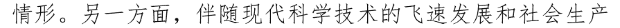

情形面前，如果想用理性的科学计划管理社会的生产与劳动，这不仅管理成本上会过于奢侈，而且也是无法做到的事情。即使那样，其结果必然将对社会生产造成严重的束缚与阻碍。所以，以公有为主主体国家宏观指导的市场经济，就历史地成为当代社会主义经济发展模式的必然选择。不了解这一点，对前苏联和东欧社会主义在旧时代的社会生产洪流面前，继续执行死过的计划经济模式，导致社会主义事业的历史中断的总结，就不能切中实质和要素了。

当然，我们在说在两种物制并存的历史条件下，必须管好社会主义劳动者平等、民主参与生产管理的基本政治制度，特别防止附庸，使社会主义事业毁于匮乏之，这也是我们今后这一时期特别要注意的事项。

现在，我们已经知道，在资本主义条件下，由于对利润的强烈渴求，它必然总是向一个历史时期内利润较为丰厚的社会部门和环节，使社会主义生产发展内部失去应有的内在平衡，造成社会生产的畸形发展，使社会主义生产发展的客观要求，总是不能得到历史的实现，从而阻碍社会主义生产的历史向前前进，这是一个方面的情形；与另一方面，资本必然把雇佣劳动的剥削紧勒到历史的最大限度，从而造成社会消费资金的相对萎缩。与此同时，

我们应该全面的看到：一方面会由于伴随现代科学技术的快速发展，导致的生产技术装备的日益复杂和系统的日益庞大，进而导致的社会生产发展资金的相对短缺，使之资产阶级从无产者身上掠夺下来的大量剩余价值，易于历史地转变为资本；另一方面，伴随社会非物质生产部门的形成和发展，它客观要求资产阶级必须从社会物质生产部门中掠夺下来的大量剩余价值的一部分，让发展成为新兴的社会生产部门的工资（即历史地转变为消耗的消费品），且只有这样，现代社会化生产才能得以进行；

资本主义生产也能够历史地下去。在现在，现代社会化生产发生和发展的历史初期，由于科技教育和其他辅助手段的发展，使得能够获得社会化生产者的工资总价格，在这一时期易于达成历史地平衡，由此，使得资本主义能够离开经济危机的直接冲击，使得它越过一个历史时期。是的，这一历史时期将过去。因为，伴随社会非物质生产部门的日益成熟，这一社会化生产的发展速度，其必将出现历史性的减缓。因之，资本一定要不断向利润丰厚的社会部门和环节，其必将造成社会化生产的畸形发展，从而导致社会化生产的历史向前前进。我们说在现在一个历史时期，资产阶级在不断接受现代社会化生产

的，资本主义经济危机表现为主要形式。是的，我们说信息技术如此发达的今天，管理有序的资本主义在消费的情况下，它不能继续地大量生产，那完全是不可议的事情。此外，在未来历史时期，资本主义经济危机必然表现为市场的泡沫，造成社会经济发展的长期滞胀，这一点都不奇怪。我们说首次发生金融危机，就是资本在市场的破裂导致财富大量重新分配的必然结果。所以，如果当代资产阶级和国家政府，真的从这次金融危机中吸取教训，切实加强了监管，那么，资本主义的经济必然回到它的主要形式上去。这是一种长期的滞胀。

诚然，我们说现代社会生产历史条件下，资本主义经济发展的长期滞胀，是无产阶级和社会主义根本的机遇。我们可以断言：伴随着现代社会生产的飞速发展，它将彻底地唤醒无产阶级，并使无产阶级的革命得到得到巩固。

伴随现代化生产的形成和不断发展，无产阶级得到了历史的发展，同时也得到了新的培养和锻炼；一支成熟的无产阶级队伍，从此走上了人类社会的政治舞台！我们说科技、教育产业，知识的劳动者是我们的胜利，另一方面；另一方面，由于无产阶级拥有了自己而走向了成熟。同时，可以预见，伴随现代社会化生产的发展和迅速进步，无产阶级组织领导层必将历史的发展和壮大。由此，为无产阶级革命和社会主义事业赖以支撑的队伍，提供了日益稳固的社会基础。

完全成熟。这是因为一方面无产阶级革命意识的自觉，无产阶级革命运动的青春活力，不断实现革命理论与时俱，提供了必要的社会历史；另一方面，又不断进步的无产阶级革命理论，在无产阶级广大群众中传播，提供了日益坚实的骨梁。由此，使得无产阶级革命和社会主义全面建设，提供了以往时期都无法比拟的优越历史条件。所以，我们正处于无产阶级获得胜利的伟大时代！正处于全面建设的伟大时代！

我们经过现代化生产的培养与锻炼，无产阶级深刻地懂得了自己当代的历史使命，就是实现我们科学。因此，我们取得了最关键的——当代无产阶级革命理论的思想核心，是社会主义革命和建设的时代旗帜；这是由于社会主义运动的历史经验，昭示了一条真理：社会主义革命和建设需要马克思主义科学的指导，无产阶级自身的最终解放，同样依靠科学和技术的高度发展，让我们聚集在马克思主义的科学旗帜下，全面深入系统研究人类社会不断进步的现实，使我们的思想和行动，沿着人类社会文明的大道不断前进！

中国的劳动阶级团结起来，让我们紧密团结在以核心的党中央周围，上下齐，团结奋斗，勇于担当，夯实为推进中国社会主义革命和建设事业的时代发展而不懈努力！为民族的伟大复兴和人类社会的文明进步，做出应有的贡献！

# 1楼
作者：周喜庆 日期:2019-08-20 19:31:31
@穷离溅 2019-08-20 19:31:31
说下我的：世界上最发达的地区就是欧美。由于中国的存在，可见未来亚洲将会最大的经济体，这一归功于中国与发达地区不同的政治制度。制度在一定程度上具有根本性，但发展策略也很重要。当然我希望将制度的核心逻辑来获取更多帖

# 5楼
作者：周喜庆 日期:2019-08-20 19:50:36
@某四大宇宙行的 2019-08-20 19:35:27
我国实行的是社会主义市场经济，这是符合我国国情的一种市场经济体制。说实话，现在应该淡化阶级的概念。一个政治制度，不是一个概念就说明和贯彻的，它是由一个和多个基本的政治概念以及与之对应的政治经济法律制度所组成的。同时，在一个具体国家，一般不是一种历史生产形态，加之代表时代的生产形态，从诞生到形成整个社会发展的决定性力量，需要一个历史发展的过程；再者，人们对这一历史过程中，代表时代的发展方向的政治制度的科学认知，也需要一个认识的过程。所以，具体历史运行中的政治制度，不仅是一个历史的动态过程，而且具体到一个国度，那就是具体的。我们切不可单独出一个概念来说论问题。

# 6楼
作者：周喜庆 日期:2019-08-20 19:55
@感觉不要 2019-08-20 19:33:24
时代在发展，离不开一粒微小的螺丝钉。你说对，我是这样的。是的，在这个时代历史过程中，始终起决定性作用的是思想、文化，处于社会核心地位。

# 8楼
作者：周喜庆 日期:2019-08-20 20:00
@斯蒂芬 2019-08-20 19:54:07
先不说那些高大词语，譬如崛起、复兴之类，就是老百姓过日子。按照马克思主义理论，社会分为几个阶段：奴隶社会、封建社会、资本主义社会、社会主义、共产主义。

# 10楼
作者：周喜庆 日期:2019-08-20 20:08
@牌神师 2019-08-20 19:55:47
时代发展问题不谈，现在贪污腐败现象不少，上访作用。

# 21楼
作者：周喜庆 日期:2019-08-20 21:42
@享受熏 2019-08-20 21:28:29
路过，不明觉厉，顶一下。

# 23楼
作者：周喜庆 日期:2019-08-20 21:43
@卡牌子上 2019-08-20 21:38:29
火错刘明，回首相

# 24楼
作者：周喜庆 日期:2019-08-20 21:47
@电竞时间 2019-08-20 20:40:59
社会的继续发展。实际上群体间同样可以使用鲑鱼效应，想一想沙丁鱼除了看个体，同样看是由众多细胞组成的群，细胞之间是相互协作的关系，这对应人类社会就是群体的竞争，所以整体就有蚂蚁效应。

# 25楼
作者：周喜庆 日期:2019-08-20 21:35
@龙猫本尊 2019-08-20 22:22:00
马云不是说好的企业要用商业手段解决问题，推动社会发展。思想的问题，要用科学的思想去占领；物质的问题，也需要物质来解决

# 41楼
作者：周喜庆 日期:2019-08-20 21:37
@麦对对 2019-08-20 21:28:31
论坛讨论的都这么深奥了吗？黑黑，您好

# 42楼
作者：周喜庆 日期:2019-08-20 21:37
@心动黑不动 2019-08-20 21:31:14
发展的任务还十分艰巨。

# 43楼
作者：周喜庆 日期:2019-08-20 21:38
@大黑按天 2019-08-20 21:29:13
火错刘明

# 44楼
作者：周喜庆 日期:2019-08-20 21:50
@鸭先知安安 2019-08-20 21:42:33
时代发展问题不谈，现在贪污腐败现象不少，上访作用

（此处为重复内容或逻辑结束部分）
这一个最重要的特点就是频繁和容易。

暮然爱上了壑谷
悠然爱上了廊远
坡间采茶的阿袭
最懂游子的呼唤
暮然爱上了零谷
悠然爱上了地偏
下山赶场的阿夯
最熟悉坡坡坎坎
我来啦
我最朗的天的天
我来啦

一手理财加v11011284955，获取更多好帖

我的高原小菜

59楼
作者：周喜庆 日期：2019-08-21 08:11
@宅男敏狗 2019-08-21 07:22:17

三十年来经济高速发展的大餐吃的差不多了……那么
问题来了……谁能站出来去收拾桌上的一片狼藉呢？

大力发展科技产业，是根本的出路。

62楼
作者：周喜庆 日期:2019-08-21 08:13
@俄江边 2019-08-21 07:28:13

化妆师

化妆师可以让蛋比较美

63 楼 周喜庆 日期:2019-08-21 10:46
@千鲤妙妙妙 2019-08-21 10:19:30

实际上，资本主义和社会主义这两者有很强的相关性，资本主义有社会主义因素，社会主义有资本主义成分。

我们的基础是社会生产发展的基本规律，由此我们对当代社会主义是什么样的子的有一个清晰的认识。它区别于当代的资本主义，与往时的社会主义也有这么大的区别。恕我直言，你这句话写在书本上，就想写这句话的人一样，他们也是坐在本书上谈论坚持和发展社会主义的。

76 楼 周喜庆 日期:2019-08-21 10:49
@饲直了的额 2019-08-21 10:34:34

不管是社会主义还是资本主义，其基础都是利益分配。社会主义与资本主义的不同在于，社会主义的利益分配是可控，而资本主义的利益分配是不可控的。这一点就是社会主义发展的巨大优势。也是解决社会主义发展瓶颈的主要方法，前提是找到问题的根源，首先要明白那些对社会主义发展模式是不满的。

进入社会的总体情况，这是我们解决一切问题办法的唯一来源。

# 77 楼
作者：周喜庆 日期：2019-08-21 10:50
@俄艾薇 2019-08-21 10:31:44

现在一切都在向资本涌去一手整理，加v信1101284955，获取更多好帖

因为社会主义的科学旗帜，没有高高的飘扬起来

# 78 楼
作者：周喜庆 日期:2019-08-21 10:51
@全剧小暗示 2019-08-21 10:21:43

那就需要我们潜下心来，真正认清当代社会主义的科学实质

# 79 楼 
作者：周喜庆 日期:2019-08-21 10:52
@蓉蓉维勇 2019-08-21 10:20:22

跟我们吃瓜群众关系不大
社会主义正是吃瓜群众的根本诉求

81 楼 
作者：周喜庆 日期:2019-08-21 10:54
@八五后单身小孩 2019-08-21 09:41:08

中国要跨越起飞，需反思是否来自西方的“社会主义和资本主义”两大社会发展体系。

不仅要反思，还要进入社会的现实中。

一手处理，加v信1101284955，获取更多好帖
作者：周喜庆 日期:2019-08-21 10:57
@BIU都一下 2019-08-21 10:55:25

不管什么制度，其思想就是“民主”。
真理有往往掌握在少数人的手中，所以我们很注意集中。

84 楼 
作者：周喜庆 日期:2019-08-21 11:40
感谢支持的朋友
我谓

万花世界一陌知却难觅
朋友知心偏偏难相聚
运气从不花朵一样的美丽
世间向来是默契成全默契
小酒显得薄竭的是半生情意
世道不由我也不由你
一向出来混杂能说不容易
谁叫我们扭住的又是脾气
朋友聚场为的是利益
有缘多聚就厚了情意
可我犹在一起

一手处理已编号1101284955，获取更多好帖

海空已隔缘还长
朋友不知何时就借力
世事难变幻的风雨
可我犹在一起
露天黑地，不问细密
谁还说水至无鱼
其实算得透关，恐怕怕为你出手我也流泪
干了这杯，朋友若你还那么豪气

让我真心的喊
兄弟 92楼
作者：周喜庆 日期:2019-08-22 06:42
@头大无忧 2019-08-21 12:44

中国特色社会主义是一项伟大事业，前进的道路上一帆风顺。历史向来就是开拓性的，每一个历史的人都是潮流。

一手数据，加V:1101284955 获取更多好帖
作者：周喜庆 日期:2019-08-22 06:46
@前清洛纳 2019-08-21 12:45

坚持三个自信，发展中国特色道路不动摇。如果没有自信，何以走民族之林。

115楼
作者：周喜庆 日期:2019-08-22 06:48
@笛声悠扬 2019-08-21 14:44

时代发展的太快了。其实，若你深入到社会发展的基本之中，你就会发现每一个时代基本上都是相对静止。

116楼
作者:周喜暮 日期:2019-08-22 06:49
@醒果反转 2019-08-21 14:42

大量人才，英雄不问出。

117楼
作者：周喜暮 日期:2019-08-22 06:50
@qifongeo 2019-08-21 15:44

人类历史的发展是不断发展的，不断产生新的成果，到了历史的发展壮大，同时也得到了相应的培养和锻炼；成就了伟大的无产级队伍，从此历史走上了人类政治舞台！如今“无产级”还有说话的权利吗？权利向来是争取。

118楼
作者：周喜暮 日期:2019-08-22 06:51
@团队友义 2019-08-21 12:49

中国哪里崛起起飞，需反思来自西方的“社会主义和资本主义”两大社会发展体系。在社会的发展中，观念文化制度，在各个时期有什么表现形式？

119楼
作者：周喜庆 日期:2019-08-22 07:15
@江南杨绪 2019-08-20 08:47

时代在发展，思想在进步，阶级在改变。

@权力速度快 2019-08-21 12:43

这是一个长久的过程。整理，加微信1101284955。一段历史都是等英雄人物写的，作为当代我们应该有这一点气概，让人类历史在我们的脚下延伸。

120楼
作者：周喜庆 日期:2019-08-22 07:24
@与速度飞 2019-08-21 11:17:15

目前，全球意识形态错综复杂，但从长远来看，全球社会主义是全球意识形态发展的必然趋势。

@哈萨芬的话 2019-08-21 12:32:43

这话有问题，就算是全球化，各国文化与意识形态是很难融合的。勇于开拓，走向未来！我是赞扬这样的精神的。

121楼
作者：周喜庆 日期:2019-08-22 07:13
@案件是否对 2019-08-21 12:20:07

一切阶级社会历史证明，恰恰是阶级社会制度不符合人性，所以这一次出现了阶级斗争的尖锐化，逐步的取得人类社会的发展进步，逐步的从过去的奴隶制走到今天的

122楼
作者：周喜庆 日期:2019-08-22 07:44
@海海欧 2019-08-21 09:38:13

在这个现实的时代，各位是如何看待自己以后的一个发展方向的呢？

@友友神龟 2019-08-21 12:59:22

一切向前看。人类伟大的导师马克思早就说过，人类全面发展。

123楼
作者：周喜庆 日期：2019-08-22 07:46
哥们，轻松一下。风里陪着你，不掉。你说我当时在天边，银河浩瀚，那里你我爱情无限一场雪花，消失在眼前。你说终绕就滚滚的眶。未世悠悠还生死，冬季黑白世界如你步缓慢，握着的手在心里震颤，脚尖依着脚尖，寒冷泊着两心慌乱。

124楼
作者：周喜庆 日期:2019-08-22 07:49
那一天，爱上了你的笑，为何还爱上你哭？告诉我你怎么赢，爱上了你的真，还爱上你治。你是孩还是在苦，可爱的到深处，你还是没有聚，形同陌路。留下一字的情书，也许无意的流言更毒，也许三生无根泊，让我今生干净的追逐。可能梦见你的无助，我更恨的救赎，也许无意的记忆足够。

125楼
作者：周喜庆 日期:2019-08-22 19:52
@锋利演出 2019-08-22 16:49

大部分人可以温他是真。其实我们还可以发展的更快。一手整理，加v1101284955，获取更多好帖。

171楼
作者：周喜庆 日期:2019-08-22 19:53
@陶醉莫 2019-08-22 17:04:31

马上就是80周。

172楼
作者：周喜庆 日期:2019-08-22 19:56
@漂流等级 2019-08-22 16:46:32

坚持人为中心是社会主义的本质要求，也是社会主义现代化的本质特征。我们要建设社会主义现代化，必须坚持人为中心，必须把人民利益放在第一位。这个观点无疑是十分正确的。但更重要的是我们一定要把当代道路走好，走扎实。

173楼
作者：周喜庆 日期：2019-08-22 20:04
@无致回访 2019-08-22 16:32:50

中国建成现代化强国，是一代中国人为之奋斗的。 这里就是你说的，我就说你是对的。

174楼
作者：周喜庆 日期：2019-08-22 20:06
@天地劫岗 2019-08-22 16:31:07

现在发展就要对现代化有所有认识，对现代化的认识更加全面，进一步丰富了现代化的战略目标和任务。例如，从“全面建成小康社会”延续到“全面建成现代化强国”，第一次使用“社会文明”的概念，我们所要建设的文明拓展物质文明、政治文明、精神文明、社会文明、生态文明五个文明。是的。

175楼
作者：周喜庆 日期:2019-08-22 20:08
@next177 2019-08-22 14:49:54

真能写啊。谢谢，但问题并没有具体的很清楚楚啊。

176楼
作者：周喜庆 日期:2019-08-22 20:22
@金身死道消 2019-08-22 14:13:24

时代要发展，一定要拥许多东西。如果我们工作做得好，是可以最大限的成就许多东西。一手整理，加微信1101284955，获取更多好帖。

177楼
作者：周喜庆 日期:2019-08-22 20:36

我们还可以休息一下。时代发展的太快了。历史的发展，若你也喜欢这种宁静，请和我一起仰望星空。

178楼
作者：周喜庆 日期:2019-08-22 20:31

（重复的OCR文本），，，，，，，，，的，，，历史的悲凉，若你也在遥望苍穹，若你也在悲凉。那，，我就用诗行，在心中我的星空不知可否点亮你的梦境。

179楼
作者：周喜庆 日期:2019-08-22 20:46

最伟大的时代，由我们开启的历史性变革。现在，人类已经进行到这样一个历史时刻；人类仍然处于这个时代的发端。哪个民族被先进技术掌握，哪个民族就将赢得先机，站在时代潮头，并引领人类走向未来。中国人民有着强大的共产党领导，有先进的中国特色道路，我们将在这一伟大的进程上勇敢地赢得未来！

180楼
作者：周喜庆 日期:2019-08-22 47

人们知道，现代社会生产和生活，时刻都在日益剧烈需要先进科学技术的武装，这一点是越来越明显了。那么，从近代科技形成现代科技的历史情形是怎样的？为了澄清这个问题，我们就不能不进行一些必要的回述。科技为人类创造了根本的力量杠杆，它对人们的生产、生活和人类的思想意识始终起着决定性的根本影响。但在近代以前的历史时期，人们对自然还比较陌生，这一根杠杆所形成的生产力大于体力劳动所形成的社会生产力之后，人们的思想也会被神学和宗教所限制。然而，人们必然要求不断从自然之中汲取更多的物资，于是科技是缓慢不断的向前发展者。在历史的发展过程中，必然要求提取日益丰富的物质回报。这是替代了人类体力劳动延伸的动力时代——大机械工业时期，在近代科技的引领下，更迭轰隆的到来。与此同时，由于社会生产劳动处于资本的压榨之下，处于初始积累的历史时期，资本必然要求对生产劳动的剥削残酷到历史的最限度，甚至超过这一历史极限。这就剥夺了广大劳动者受教育的权利，这就极大地阻碍了科学技术的发展。另一方面，资本必然向利润丰厚的社会部门或环节。这两种历史情形的形成不断交汇，加之相对资本形成的历史条件，于是以大量研发和复制动力系统革新的机械工业时期，就这样奇形出现在人类社会的历史舞台。

182楼
作者：周喜卉 日期:2019-08-22 20:48

人类社会向前发展的要求，任何力量都无法从根本上给予扭曲和改变，它必须不断向历史前进。科学技术在资本的裙下，就在血迹斑斑的前行并不断发展。随着科学技术的胜利，她终于一个产业的姿态走向整个社会发展的中心，自然这是近世纪的事情。与此同时，科学技术的发展，她直接拓展了更广泛的社会物质生产领域，并随着形成了诸如材料、电子、化学处理、机械、电力等产业，发展了新的社会物质生产部门。同时，因为科技要行，教育必然历史的伴侣。于是，科技产业与教育产业并作，并与其他社会生产服务产业一起，构成了一个日益巨大的社会非物质生产部门。于此我们说大机械社会化生产，只是当代现代社会化生产的历史序幕罢了。若没有资本的跨越，这两大社会部门的发展应比较协调的发展起来，科技也将得到更快速的发展（如果劳动者受教育）。

183楼
作者：周喜庆 日期:2019-08-22 49

因为，社会生产发展，越是渴望科技产业；现代社会化生产的发展越是渴望科技产业，科技产业是整个社会发展的决定力量。成就了伟大的无产级队伍，从此历史走上了人类政治舞台。

184楼
作者：周喜庆 日期:2019-08-22 50

人类历史的发展是不断发展的，不断产生新的成果，到了历史的发展壮大，同时也得到了相应的培养和锻炼；成就了伟大的无产级队伍，从此历史走上了人类政治舞台！如今“无产级”还有说话的权利吗？权利向来是争取。

# 186 楼

作者:周喜庆 日期:2019-08-22 20:50

人们已经知道，随着社会化生产的社会非物质生产部门的形成和发展，脑力劳动日益成为社会劳动的主体，并日益历史地居于其主地位。正因为如此，那些限于大机械社会化生产时期所开展的理论视角，就不再与此相适应。而由此形成的理论观点，也就自然成为人们对新的社会生产进行考察和分析的思想材料。我们不能没有生产。它将以耗费一定的社会物质生活资料来获得。所以，人的劳动能力，从一般的意义上说，它只是社会劳动者的承担者，是社会劳动中的一种转化形式。而

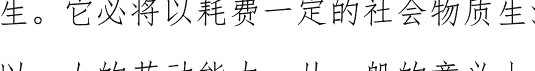

社会劳动者阶层中的重要生活，即一切的社会劳动都是平等的，没有高低贵之分，只有分工之分；因此，社会劳动者之间的劳动交换，应当是等量价值的。按照马克思主义依然是当代劳动者阶层的这一基本政治原则，那么当代社会主义大生产中的劳动交换的一般历史要求是怎样的呢？下面就让我们作抽象的说明。毫无疑问，脑力劳动已经成为整个社会生产的主体内容，并将将其加诸于整个社会生产的主导地位。而现代社会化大生产历史过程中的社会生产劳动，这里可以将它大致的划分为一般体力劳动、复杂体力劳动、脑力劳动和创造性脑力劳动四种形式。我们说形成这四种不同形式的社会劳动价值耗费，在劳动交换时，即应该给予相应的科学补偿。不然就会出现“搞导弹的，不如买茶蛋”的整体倒挂情况。当然这只是其中一个方面的情形；另一方面造成此类历史现象发生的原因，还因于脑力劳动特别是创造性劳动，特别是创造性脑力劳动存在探索风险的部分，在生产劳动中比体力劳动总体上要获得更多的物质来保障，这一部分也应该得到适当的合理补偿。我们这还是从社会一般价值量方面的考察；从推动社会发展的意义上，脑力劳动和创造性的脑力劳动，特别是创造性脑力劳动风险探索的部分，对社会生活的意义，是不能仅仅用一个简单的公式

处理万千万别的，或者一个简单的理论概念，其对于内在的千千万别的丰富内涵，可能能够与我们的说明。如果非要用，可能就显得复杂的。

我们人类社会就是创造性脑力劳动的历史成就前的。所以，从社会资源的稀缺的视角来说，脑力劳动的交换价格，特别是创造性脑力劳动的交换价格，应该引起历史的足够的确认。只有这样，创造性的脑力劳动者的积极性，才能得到较为彻底的全部的激发；进而整个社会劳动的智慧成果，也才能源不断的涌出来；进而，社会主义的现代社会化大生产，才能完全快速发展并不断向历史深跃！如果这里比较全面深刻的理解了这一点，社会主义于当代生产关系的一般情形，就会异常清晰地呈现在我们的眼前；当代社会主义的一般发展道路，也就能够清晰地呈现在我们的

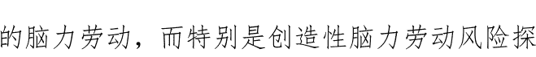

眼前；前进，一个被大力激发革命因素的现代科技产业并在其带领和推动之下，奔腾向前的社会主义现代社会化大发生速速向前的伟业历史图景，就会即刻实现在我们的面前。现在，创造大历史奇迹的时代机遇，就握在我们的手中，中国共产党，历史上负着千年赞荣凝结在肩头的历史责任，并将引领并坚决地日益壮起来的脑力劳动者阶层，与内心深深刻满泪历史伤痕的中国人民一道，向着民族的光辉未来大步疾进。一个伟大的站在时代潮头的社会主义中国，必将诞生在我们的手上！

## 四

178 课 数理·加...

社会意识对社会生产发展的影响，来是一个十分重要的问题。在科学技术对当代社会发展起着决定性影响的今天，如何我们的思想自觉地适应这一时代发展的要求，同样是我们应当给予解决的重要问题之一。

我们说广大的社会理论工作者（当然包括我这样在理论战线做一点工作的基层同志）应该尽可能的第一时间使自己的思想接触深入到异常广泛而深刻的科技革命的前沿，一方面对其具有典型意义的科技成就对人们思想上的启示，当然，更要重构具有时代意义的思想特质，进行及时的总结和宣扬。从高高地起对变革人们思想，引领时代未来的时代思想旗帜；而使整个社会思想，及时进行与时代发展相适应的思想的改造！同时，我们必须注重先进的科学技术对人们思想的及时改造。人们总是在改造客观世界的同时，改造主观世界。在一些科学领域，一些科技进步正在历史的颠嵘人们对世界和自身以及思想意识的认知——比基因编辑技术，量子技术、at技术等等。而且这些技术对人们的生活和生活的影响，其造成的现代社会发展内部基本联系及其基本矛盾内部联系，而一时一刻发生非常快速的动态性变化，而此时一些科技革命带来成本，对人们的思想带来的影响，现在可以这样理解：我们是有根据的。如此，思想如果不改造将最可怕的危险。

我们正处于科技时代发展的开端，发展的需要必然要求成熟的科技。沿着人们的期待早到来，适应时代时刻变化的要求，是非常复杂的而慎重的任务。如此，我们正处于科技爆发的时代，同时思想赞成一个总的口号：那就是“改变未来！”

188 楼
作者:周喜庆 日期:2019-08-22 20:50

现在，我们完全有理由可以说，没有任何内涵的思想，都是时代的“菜岛”；一切经过当代社会化生产总体运行的一般联系，都意味着毫不意加别地过去、落后的残余。因此，这里我们还须强调的是，我们必须在现代社会化生产发展的根本要求，站在最大限度地发展上，改进我们的思想。我们必须看到许多具有触觉的经过长期积累的经验成果，我们必须看到社会化生产发展的成果。这种发展，那时候的人就会越更加地享受生活，让自己的情感，融入对美好未来的投入，并成为一种久久盛衰。我们是否需要未来？这里也许在一个遥远的未来，我认为这并不是多余的奢侈，因为我想活在未来！如果是那样，我们就更应该努力，让我们的后代早日过上那种生活！越是遥远的未来，越更加地憧憬，那种无限的生活！

189 楼 
周喜庆 日:2019-08-23 05:39

多少次挣扎，心底终于抽出宁静，多少泪水，才洗出一双明亮的眼睛，多少回顾终于看清心头的风景，多少跌措，终于抓住那曾经的梦想。谁没有宿醉，无言、错、是非，谁又在流月中回归，谁还在念的美，不争、卑微，又是穿越红尘欲无悔，终于忘怀。

## 我是谁

190 楼 
作者:周普庆 日期:2019-08-23 05:41

怎逃离红尘，你很快就拥着一个天下，不颓魔，不自夺缜尽繁华。曾还信以为真，如火的晚霞，一颗心有无数想法，一片玄思却装不下你的相思，漂染着白发。不相谋，不说话。尊春以朵花的牵挂，随你就走向了天涯。

191 楼 
作者:周喜许 日期:2019-08-23 05:46

微尘，飘若一粒微尘。这一生不负你所有的深，为了我将命轻看了几分，竟丢掉了前世的根。昨已花落成尘，做一个不止痴情的人。为你我夜里细数伤痕，却尤恐看着你的心，曙色每天在变幻，别意聆听我的沉吟，都是花色，都存有分的真。初秋的雨落纷纷，屋檐下的心怕悄悄靠近，都是落红。奈何慷脱说伤心，看不透的红尘，任泪水饕餐凡尘，席地一枕微凉，天地与你同枕。

# 192 楼
作者:周喜庆 日期:2019-08-23 06:07

善者若有着走过胜利的倔强，且许我把梦为马，风霜露宿、走投无路，塞进已竭光的传家老壶。还有那些街巷相谈，搂着浪滚红尘的太多无助。且许我把青梅竹马，独径擎孤、余生劫渡，作几声唱和给你祝福。别为一乐醒无章，都是一条通天的路。

善者善行兼日夜风无阻，恶者行恶没有不败的江湖。善者善行没有输，恶者行恶没有因果，都是一条通天的路。

## 生产发展

作者:周喜庆 日期:2019-08-24 05:14

二十世纪下半叶兴起的科学技术的快速发展，在社会生产领域引发了一场深刻而广泛的革命，逐渐形成了许多新兴产业和科技、教育、物流、社会劳务等组成的社会非物质部门。使得社会生产力发展的内部结构发生了重大变化，将社会生产到了一个新的历史发展时期，这里我们暂称之为现代社会化生产发展。所以，不管人们是否自发意识到这一点，未来的社会发展都将是此适应的历史变革，我们暂称之为现代社会化生产发展。

那么，现代社会化生产和发展的基本情形是怎样的呢？首先给予了解和把握。我们说一个社会化生产形成和发展的基本情形，它集中表现为：伴随着以技术为代表的现代技术的不断发展，所形成的现代自动化生产在近半个世纪以来的进步过程中，它使得任何力量都不可忽视。我们取代了以往的工业性生产，取而了许多行业，成为社会生产的主体力量。而在这一历史发展过程中，伴随着现代科学技术的不断发展，其物质生产领域得到扩展，新兴的物质部门也随之发展起来；并伴随着社会生产的不断前进，特别是伴随着物质生产技术水平的日益提高，社会生产和劳动的复杂程度得到了历史性的加深，社会生产和劳动的专业化也随之得到了空前的发展。同时，由于社会生产规模的日益扩大和交换的日益广泛，社会生产这一新的历史发展需要，科技、教育...

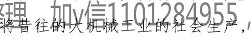

# 210 楼 
作者:周喜庆 日期:2019-08-24 05:16

从述中我们可以清晰地看到，伴随现代社会化生产的不断发展，由于科技、教育和其他辅助性产业的形成和同时对社会物质生产的直接和间接参与，于是，不论从单位生产，还是从社会生产的总体意义上讲，其社会生产发展的内部各产业之间的相互关系，发生了历史性的重大变化；或者换形式如何改变，也不论其规模，其生产过程中必然会有科技、教育和其他辅助性产业的社会劳动直接或间接参与，而整个社会物质生产，若离开社会非物质部门的帮助与协助，其他不能进行。同时，我们生产的不断发展，特别是伴随社会非物质部门的日益迅猛前进，其社会生产力发展的重心环节，它必将从近代工业化生产发展历史中的生产设备的大量重复增加，从历史的转移到科技、教育产业的发展上来。由此，这就的改变了社会生产力发展的性质。我们说正是这一社会生产发展历史中的重大转变，它标志着社会化生产进入了一个全新的历史时期。因此，如果我们社会非物质生产部门内部主要产业的形成就是现代社会化生产形成的历史标志，那么在现代社会化生产的发展过程中，其社会生产力发展重心环节的历史转变，则标志

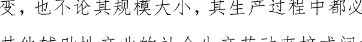

现代社会化生产已经成熟。此，如果我们将视野放在更加宽而长远的话，那么就不难发现，近代社会化生产它无非仅仅是现代社会化生产这一更健全的社会化生产的历史序幕了。

其实，如果人们对社会化生产形成的初始，便形成与相适应的自觉意识（当然，是不可能的），那么，科技、教育和其他辅助性产业等构成的非物质生产部门，也伴随着物质生产部门的发展，而历史地发展起来。我们说只是由于资本它将不断涌向一个历史时期内利润较丰的社会生产部门和环节，由此造成近代社会化生产发展。

历史过程中，工业生产部门是劳动资料生产部门的，非物质生产部门的发展，历史地远离了人们的视线。同时，由于这一时期资本对生产劳动的残酷压榨，几乎剥夺了劳动者受教育的权力，这就这一方面历史限制了技术、教育等非物质生产部门的发展，扭曲了社会化生产发展的历史进程，并且使得资本别选择地持续涌向近代工业生产部门，因造成社会化生产趋于现代的畸形成，形成了一个以工业为代表的近代工业化生产的历史发展时期；另一方面，无产阶级革命的社会现实的历史成熟及其工人阶级革命运动的持续高涨，使无产阶级早地登上了人类社会历史发展的政治舞台。

# 211楼
作者：周喜庆 日期:2019-08-24 05:16

## 二

那么，现代社会化生产有无规律可循呢？或者进一步说，社会物质生产部门与社会非物质部门及其两大部门各主要产业之间的关系又是怎样的呢？这诚然我们要去面对这一新兴的现代社会化生产应当给予辩清的问题。

我们说在现代社会化生产的历史过程中，不论其发展历史过程怎样，它必然会有这样一种历史情形发生：即随着现代科学技术的飞速发展，导致的社会物质生产技术设备的日益复杂及其系统的庞大，整个社会物质生产的资源占用得到了积累。因此，科学技术的发展，社会物质生产是历史向前进，可其某一时刻整个社会物质生产劳动持续进行的生产资金，就是得到历史增量增大。与此另一方面，伴随现代社会物质生产技术水平的提高，导致的社会劳动生产率的飞速发展，其单位社会物质生产劳动的资金占用，它将得到相应历史递增。因此，要保持社会物质生产劳动的持续进行，其社会生产发展资金，也就必须同时伴随着社会劳动生产率的不断提高，并给予相应的历史添加。

所以，现在社会化生产的发展的历史过程中，一方面由于生产技术的日益复杂导致的单位社会物质生产资金占用的绝对量的不断增长，并与此另一一方面由于社会劳动生产率的不断提高所导致的单位社会物质生产劳动的资金占用的相对增加，而这两者齐的发展，就必然导致整个社会物质生产资金的日益短缺，并由此引起导致社会物质生产发展资金出现日益历史相对短缺；并进而造成社会物质生产部门中的部分生产劳动，被历史源源不断地排挤出来。换句话说，即随着社会劳动生产率的快速提高所导致物质生产劳动的日益节省，与此另一一方面由于物质生产技术装备的日益复杂和其系统的日益增加，所导致的单位社会物质生产劳动的资金占用的日益增加，而使得日益更多的社会物质生产劳动，从社会物质生产部门中被排挤出来。此，将导致日益更多的社会物质生产劳动，生产的不发展前景，其其将导致日益更多的社会物质生产劳动，从社会物质生产部门中历史分离出来。我们说的是一个方面的情形。

而与此对应的另一情形，则是随着现代社会化生产的不断发展，整个社会物质生产劳动的复杂程度，它必然总是得到历史地不断深化，并以至于发展到一个普通的社会物质生产劳动岗位，都必须通过相应的专业技术培训，才能给予承担；同时与现代社会化生产的不断发展，使得考虑到其单位社会物质生产劳动，其必须拥有一倍乃至数倍的社会非物质生产劳动的同时协助，才能历史地进行。因此，现代社会化生产发展，社会物质生产部门对社会非物质生产部门的劳动需要，就是愈加广泛；其单位社会物质生产劳动对社会非物质生产劳动的需求，就是历史上大量增加。

而在，现代社会化生产发展的历史过程中，这两个方面的历史情形的对抗式发展（一方面社会物质生产部门必须将部分社会生产劳动不断被历史排挤出来；另一方面伴随着现代社会化的生产日益增加，迅速发展并壮大起来的社会非物质生产部门，它日益需要更多的社会劳动给予弥补），务必成为源源不断的社会生产劳动；社会物质生产部门转移到社会非物质生产部门中来。我们说一方面由于劳动生产的不断提高和获取很多好处，非物质生产部门的加强，由于科学、教育和其他辅助性生产部门等构成的社会非物质生产部门的发展，不断提供其越来越多的社会劳动储备量和日益雄厚的先决社会物质条件，与此另一方面，社会物质生产部门的不断壮大，它又为社会物质部门的顺利进行，随时提供了各种各样的需要，为其未来发展提供了重要的历史前提。而社会非物质部门的发展，还为社会物质部门在历史发展过程中，不断被历史挤出来的那部分社会劳动的历史转移，提供了天然的。所以，在现代社会化生产发展的过程中，伴随着社会物质劳动生产率的日益提高，社会劳动的历史节省，导致的整个社会物质部门不断的被历史节省，和单位社会物质生产劳动的资金占用的绝对量的不断增长，导致的整个社会物质部门不断的被历史节省，其必然被历史分离出来的那一部分，只有其全部被历史转移到社会非物质生产部门，并得到合理的配置，这一历史节省，才能最终得到实现，由此也能实现社会劳动的真实节省，从而使之现代社会化生产得到历史发展。

## 二
作者：周喜庆 日期:2019-08-24 05:16

社会生产劳动的历史转移，是随着现代社会化生产的两大部门及其主要产业之间的关系实现的，并且是表现为伴随着社会生产劳动不断不断，物质生产部门和社会非物质部门的历史转移中客观体现。因此，现代社会化生产两大部门及其主要产业之间的社会劳动的合理配置，是实现社会化生产协调发展的根本要求；并且伴随着现代科学技术的不断发展，对社会化生产内部结构给予调整，是实现社会化生产历史发展的根本保证。

也如此，我们说现代社会化生产发展性质的考察，再不能仅从社会物质生产部门之间联系的一般分析中，而得到充分说明；而以农业或简单工业为研究对象或以这一时期的社会生产为背景，并由此置于社会物质生产的基础上的分析中，来把握社会化生产发展规律的时代，它伴随社会化生产的形成，也就作为当代经济学的历史料，并给人们提供某种启示。我们说现代社会化生产发展规律的把握，我们必须紧抓住社会生产劳动这一根本，从社会化生产发展历史进程中的各项（每一项可以理解为由社会化生产发展历史进程中的主要产业的社会劳动的质与统一基础之上，所形成的具有相对意义的生产力量），在社会化生产发展过程中所形成的客观地位，并与其相互联系给予立体析，才能得到科学说明。

在此，现代社会化生产发展的历史过程中，社会劳动的质与统一基础之上的相互作用，就构成了社会化生产发展规律的外；而在这一历史发展过程中，产业结构及其社会生产劳动的专业化水平，则是直观地评价社会化生产发展水平的天然指标。

通过上述对社会化生产运行和发展一般情形的考察，我们对社会化生产的发展规律，已经有了总体的一般了解。但与较之的全面把握社会化生产的运行规律，显然还是不够的。所以，下面就让我们结合社会化生产发展的历史进程中，其主要产业于不同时期的地位作用，我们做一些补充。

## 三

我们知道，科学技术对于人类自然的根本力量杠杆，在社会生产发展的历史进程中，它始终发挥着首的作用。这一因素的历史水平，总是覆盖着人类对自然的改造规律和技能发展的客观规律。在该历史生产条件下需要的各种劳动素质，是显而易见的。可我们不能对其规定性，便不去考察其发展的方面，从而偏颇地认为它在整个社会生产发展的历史过程中，始终是社会生产发展的决性的主导力量。我们说科学技术这一在现代社会化生产发展历史中始终发挥着积极重要作用的主要产业，由于它在现代社会化生产的历史初期，其将率先起来，并成为这一时期的一个突出的重要产业，由于科学技术对促进社会生产发展的决定性作用，才得到了历史的集中体现。教育产业，即直接服务于现代社会化生产的。

它始终是现代化生产的重要组成部分。在现代社会化发展的历史初期，它是与科技产业伴随而生并随着现代社会化生产的不断发展和迅速发展起来的这项产业力量，与物质产业和科技和其他辅助性产业一起，是现代社会化生产增长与发展的重要历史条件。伴随着现代社会化的不断前进，对其推动现代社会化生产的发展的作用，其将超越科技产业而居于决定性的历史地位。这是因为教育产业总是潜在决定未来时期的现代社会化生产水平，并且在社会化生产的历史进程中，它不仅承担着培养一切生产力的历史责任，同时肩负着自身发展的现实责任；并随着现代社会化科学技术的不断向前发展，其所要求的变革对教育产业带来的利益均衡，而无论从发展的水平和规模，都将在现代社会化生产的发展过程中逐步上升为第一产业。由此，标示着现代社会化生产进入了一个新的发展阶段。

作者：周喜庆 日期:2019-08-24 05:17

在此，还需要强调的是：在现代社会化生产的发展过程中，社会非物质部门中的辅助性产业，也必须高度关注；因其不仅是提高科技、教育和社会物质生产部门的社会劳动质量并使其不断拓宽，从而推动整个社会不断向前发展的前提和基础。

最后，还给予充分说明：我们说社会生产劳动的专业化的历史前进，它是现代社会化生产向向前发展的推进和催化剂。之所以这样说，是因为这一发展情形，一方面是社会化生产发展的必要条件——也就是社会生产劳动的专业化的历史发展，就不可能没有社会化生产的扩张；另一方面，社会生产劳动的专业化，是实现社会化生产增长与发展的巨大力量，是焕发整个社会劳动最大潜能的机器。从一定意义而言，它是科学技术发展的内在源泉，是提高劳动生产率的内在杠杆，是实现社会生产整体效益的重要手段；因此，从某种意义上讲，它们是社会化生产发展中最低限的耗费，是社会化生产历史过程中的最大投资，是以潜在形式不断膨胀的社会财富。一句话，这一双重的历史节奏，是现代社会化生产历史过程中不可见的工作，是实现经济发展时代飞跃的客观条件。

## 三
作者:周喜庆 日期:2019-08-24 05:17

前面两部分，我们从现代社会化生产的总体情形和内在的一般方面，分别给予相应的说明。我们说这里阐述的情形，其将随着现代社会化生产的不断向前更加充分地显出来。

现在，我们说社会化生产发展的总体联系，在社会化生产起步早的西方资本主义国家，已经明显的表现出来；同时，我们说这一情形，在我国现代社会化生产起步早，由于生产力基础较弱，发展缓慢的国家和地区，也不是一个陌生的事情，并且将随着社会化生产在这些国家日益广泛的开展和迅速发展，日益明显显现在人们眼前。其实，一个时期以来，人们对科技、教育和其他辅助产业在现代社会化生产发展中的重要作用的认识，是日益深化的；而仅仅从社会化生产发展的总体联系的一般角度，去予以说明。

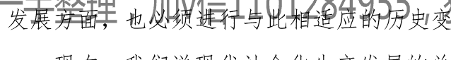

现在，由于某种原因，人们对这一客观要求的认识，显然还有待进一步深化。从而，使之这一客观历史要求，还不能自觉居于社会发展的支配地位。然而，我们说现代社会化生产发展的客观要求，其必将自觉地支配社会生产和整个社会发展的历史新时期，其无论如何为期不远的。总之，这一情形是任何主观意志都不能改变的历史发展趋势；恰恰相反，它必将被越来越强大的社会自觉意识，把社会生产和整个发展推向这一人类历史发展的必然趋势方向去。虽然目前对于现代社会化生产发展的客观要求，还没有被广泛的人们认识，而是给社会化生产发展带来了巨大的困难。然而，现代社会化生产的发展其内涵。它遇到的种种阻碍，并无视无顾地让社会经济发展和整个社会发展图景，推向符合自身的方向。上一个时期以来，现代自动化生产日益普及地向前推进和现代产业的猛崛起，以及他们的思想观念正在经历着这一代社会化生产发展的革命性洗礼，就是现代社会化生产发展规律其最终将冲破一切阻力，而必须得到实现的铁证。

我们说必须坚决克服脱离现代社会化生产发展这一从根本上决定整个社会发展情形的客观方面抽象地谈论社会主义改革和建设的不良倾向，也要注意医治脱离当代社会生产发展的实际，坚守社会主义运动中曾经坚持的史则的教条主义顽顽。因，我们说那样其心怀良好的望，但其结果必然是事与违。如果沿着那样的思路走下去，由于其脱离了时代生产这一最根本的实际，其形成的理论体系完备，就是给革命和建设事业的发展，造成更大的不利影响。所以，我们必须深入到当代的社会实践的整体情形中，对那些基本的联系给予总结。只有有这样，才能找到道路，从而把革命和建设事业地推进。

从实现发展的情形来说，如果不了解社会化生产这一新的情形，也就看不到由于科学技术的飞速发展导致的社会生产领域的不断开拓。由于科学技术的不断进步，导致的社会生产力的增长与发展，是社会化生产发展历史进程中的各项要。社会劳动的质与统一基础之上，所形成的具有相对意义的生产力量，在社会化生产发展过程中所形成的客观地位，并与其相互联系给予立体析，才能得到科学说明。

在此，现代社会化生产发展的历史过程中，社会劳动的质与统一基础之上的相互作用，就构成了社会化生产发展规律的外；而在这一历史发展过程中客观的定产业结构及其社会生产劳动的专业化水平，则是直观地评价社会化生产发展水平的天然指标。

通过上述对社会化生产运行和发展一般情形的考察，我们对社会化生产的发展规律，已经有了总体的一般了解。但与较之的全面把握社会化生产的运行规律，显然还是不够的。所以，下面就让我们结合社会化生产发展的历史进程中，其主要产业于不同时期的地位作用情况，我们做一些补充。

作者：周喜庆 日期:2019-08-24 05:17

## 三
我们说现代社会化生产发展规律，我们必须紧抓住社会生产劳动这一根本，从社会化生产发展历史进程中的各项要。的社会劳动的质与统一，它始终是社会化生产发展的基础，是实现社会生产力增长发展的直接力量，而且其历史地提供其先决条件。

一手的处理，加信1101284955，获取更多帖。

# 15楼
作者：周喜庆 日期:2019-08-24 05:18

我们说现代社会化生产发展的历史初期，特别是不能理解现代社会化生产这一时期的社会主义经济发展，特别是不能理解现代社会化生产发展的历史初期，特别是不能理解现代社会化生产这一时期的社会主义经济发展。一手的处理，加信101284955，获取更多帖。

# 18楼
作者：周喜庆 日期:2019-08-24 05:25

妈妈，你领我走在海边，说海水就这么咸。重要的是彼此眼，望不见彼岸。当我与晚霞交谈，你静静打着毛线，轻坐在我身边，竟忘记了时间。每一片都那么温暖，每一刻都那么美甜。可是有一天，忽然之间，你不再出现，失去了妈妈的一天。

每一天都多一年，那么多的照片，没有一言，笑容满面。妈妈，我有个心愿，等来生我每一言，纤细的还。妈妈，这句已沉重的嘶哑呼唤，在心头，还要积压多少少年，游走的风勾画着图，一年一年爱一个家，瀑不经意长出冰挂，在步履中慢慢长大，雨中的花开得好美呀。

# 16楼
作者：周喜庆 日期:2019-08-24 05:23

高原，没见过这样的天空，没见过绵柔的白云，雄鹰在脚下飞翔，小草绿在心里。没见过这样清澈的湖水，藏羊悠然无碍，微风若飘在心间，暮然爱上了整谷，忽然爱上了廊远，坡间采茶的阿婆，最懂游子的呼唤，暮然爱上了穹谷，忽然爱上了地偏，下山赶场的阿爹。

# 17楼
作者：周喜庆 日期:2019-08-24 05:24

想唱就大唱，流浪怎可只有一场，方向别再埋在东张西望。惆怅可曾见了伤，一声祝福可曾搁置了梦想，一条云的闲徘，如我追索着故乡。想唱就声唱，风不会阻挡，开却是永远的前方，就看你目光有多坚强。想唱就声唱，雪有些凉。失败怎会理解倔，成功有九分的倔强。想唱就声唱，明早已是追溯的过往，错过是最深的殇。

飞逝的时光呀
万千年刹那肩
终沦为天涯
好孤独的路路呀
多凛冽的风呀
永恒豪的相约
终遥遥牵挂
一剪转身身后
总免不了潇潇雨下
无边冬夏

## 一手数理，加v1101284955，获取更多好帖
作者：周喜庆 日期：2019-08-24 05:62

阳光又一次洒在海洋之上
爱开始了又一天的成长
当风一次又一次吹
你的爱就离开了山岗
阳光又一次洒在海洋之上
爱开始了播洒新的希望
当山花一次又一次凋落
一点烛火温暖着你的脸
我的爱化作了一夜夜的星

化了了一树一树的阴凉
最后化作小小花衣裳
衣襟上映着儿子弥堂
你我的爱化作了一年的春光
化了了一花一花的馨香
最后明亮了漫天月光
落洒进江河缓缓流淌
消失了想象
迷失了假象
血液一次又一次风下飞扬

## 一手处理，加v信1101284955，获取更多好帖
作者：周喜庆 日期：2019-08-26 04:36

关于现代社会化的发展规律问题

伴随二十世纪下半叶中后期兴起的现代科学技术的飞速发展，社会生产领域发生了一场异常深刻而广泛的新产业革命，逐渐形成了许多的新兴物质以及科技、教育、金融、物流、劳务等所有产业构成的社会非物质生产部门。由此，就使得社会生产力发展的内部结构发生了历史性的重大变化，导致了社会生产方式的伟大变革，将整个社会生产推进了一个新的历史发展时期；这里我们暂将将其称之为现代社会生产发展阶段。所以，伴随现代科学技术的不断发展导致的现代产业革命的爆发，对现代社会生产如何给予科学地组织与指导的问题，也就同时提到了人们的面前，而特别是它若无荒地奠基了无产阶级的政面前。

众所周知，近半个世纪以来，由于科学技术的飞速发展，导致的社会生产的迅猛进展，却迫使世界各国都不能把发展经济优先放在首位，以适应这一时期来社会发展的历史潮流。于是，和平与发展的力量增长，并逐步上升为发展的主题。在这样一种形势面前，如何使现代社会化快速向前发展的问题，就自然引起人的更多的关注。

而，一个时期以来，直观地描述现代社会生产并藉此预示。其某发展最领先的尝试，其并不能从现代生产的内在联系方面给予科学学理论一般说明，但是还是得到了不断地出版：在国内也得到了热情的介绍。而居于这样的思想成就就是——即抓住现代社会化生产发展的某些局部情形和外在的特征，而形成的诸如“知识经济时代”和“信息经济时代”为代表的各种不成熟的社会经济学观点，一时风行地占领了广阔的舆论市场，我们不能恳求科学地反映一代社会生产发展规律的经济学理论，在一夜之间便得以成熟，更不能恳求其形成，便能获得其完整的内容和格式：因此，这些成就的取得只能给成熟的时代经济学理论提供一些材料或某种过渡的形式。然而，我们说时代的社会经济学理论的完全成熟，对于当代它是只有无产阶级才能承担起来来的历史任务：因之，只有无产阶级才能始终自觉地关注这一问题，并能够站在社会历史发展全局的高度，对其与事实是地总结和在实践中不断的给予修正补充和完善，并使之科学地贯彻到底。

于是，就很显然对这个问题的回答，其意义已不仅局限于社会经济发展方面。其理由很简单，因我们只有科学地才能客观并比较准确的把握，伴随着现代社会化生产发展并不断变化的生活的社会生产关系的一般情况，以及由此形成的各种各阶级的时代特点和现代社会形势发展的内在方面，对这个问题的处理，如预见、预测、预测以及经济发展战略和策略的直接推理理论；而且，更重要的是它的无产阶级能够带领并与广大群众一道走，把社会主义事业时代地推向前进的重要理论先导。因此，对这一个问题的科学回答，它是社会主义对于当代时代走向兴盛的一个重要节点，是社会主义事业发展进入这一新的历史时期的重要里程碑。

305楼
作者：周喜庆 日期：2019-08-26 04:37

目前，我国的社会生产，正处于尚未得到充分开展的现代工业社会化生产被现代社会化生产逐步取代这样一个历史时期，因而，而如何加速这一历史进程并此尽快迎来我国主义现代社会化生产生产一建设伟大高潮的到来，也就成了目前和今后一个时期我国社会主义事业建设的一项中心任务。诚然，我们要对现代社会化生产给予科学的组织指导，使其在我国得到快速健康发展，并由此跃过某些不必要的发展阶段和环节，若不了解其规律，那就是难以办到的事情。然而，这里我们有必要进一步强调：面对现代社会化生产的任何力量都是不可阻挡的历史潮流，我们要抓住这一历史发展机遇，全面振兴我国社会主义建设，并由此社会主义革命和建设迈向向前，从而走出一条具有鲜明的社会主义发展之路，收获多好帖的贡献，它也必然来自于对这一规律的正确把握。所以，我们每一党员，特别是在我国社会主义建设中承担负一定责任的同志，都不能不研究并并求全面、系统、准确把握这一这个问题。既然这个问题如此重要，那么，现代社会化生产形成和发展的基本情形是怎样的？这自然是我们去把握现代社会化生产发展规律。概括讲，我们说现代社会化生产形成和发展的基本情形，其中表现为：即伴随电子技术代表的现代自动化。在近半世纪以来的进步过程中，任何力量都不可阻挡地将昔日的工业社会生产日益普遍升为社会生产的主体。就在这一历史发展过程中，伴随着科学技术的不断发展，新的物质生产领域不断被开辟。由此，新的物质生产部门也随之发展；伴随着社会生产的向前推进，形成了诸多的新产业。另一方面，伴随着社会物质生产领域的不断扩展，特别是社会生产需要，科技、教育和其他辅助产业（诸如金融、物流、劳务）等组成的社会非物质部门，也随之迅猛发展。因此，伴随现代科学技术的不断发展，它导致了一场异常深刻而广泛的新产业革命。伴随现代社会生产的迅猛前进，与之形成的这一系列新产业，与其说它改变了旧往期的社会生产力结构，不如说它导致了社会生产方式的历史变革；也就是说，如果社会化生产还局限于物质生产部门，那么伴随现代科学技术的不断发展，它把近代工业社会化生产发展历史过程卷入到社会生产中，并随着社会化生产的不断向前，其力量不断增大，主导地位不断增强，并逐步成为社会发展的主力量。因此，这就使得社会生产力的内在结构发生了历史性的重大变化，并由此迎来了一个新的历史时期。当然，我们说现代科学技术的不断发展导致的社会生产力时代，它主要是通过对新的物质材料和近代工业生产的现代化改造来实现；或者说是对社会物质手段的历史演变加剧了现代产业革命对社会生产变革。但是社会物质生产手段的历史变革，它充当了社会生产方式历史变革和由此到来的社会革命先锋；也是社会物质生产手段的历史变革，它完成了社会劳动飞速提高，使得整个社会物质生产能力得到了空前的增长，并使得社会生产力得到了所未有的惊人的进步。由此，这就使得社会生产力发展历史过程中任何有机组成部分都迅速得到了革命的激发，并使得整个社会生产和劳动更加一体化了。如果与此进一步讲，我们说这一社会生产发展历史过程中以现代产业革命为标志的时代伟大变革，它不仅把社会化生产推进到了一个新的发展阶段，而且把整个人类社会生产的历史发展也重新划分为两个时期——即是以社会物质生产为主和体力劳动为主体的现代社会化生产的历史时期，和一个以社会非物质生产部门为主和脑力劳动为主体的现代社会化生产的未来历史发展阶段。因此，这一社会生产历史发展过程中跨时代的伟大变革，它不仅社会化生产带来了真正健全的社会化生产发展的历史时期，同时把人类社会历史发展也推进到了一个新的历史发展阶段——即彻底地全面建设社会主义的历史新阶段，我们说这才是我们发展的伟大变革的根本意义所在。

306楼
一手资料，加微信：1101284955 获取更多好帖
作者：陈勇 发布时间：2019-08-26 14:37

下面，让我们进一步具体地了解一下现代社会化生产形成和发展的一般过程。

首先，我们跟随科学技术的飞速发展，其社会物质生产的劳动对象总是随之不断地得到了历史的开辟。由此，这就极大地扩展了社会物质财富的自然源泉，而同时随社会生产的不断横向地历史深化，导致了对既往物质生产对象的新理解，于是，社会物质财富的发展总量，它得到了空前的历史积累和增加。因此，这不仅为实现社会生产力的增长与发展提供了异常广阔的历史空间，而且为其未来发展奠定了日益雄厚的社会物质基础。与此同时，

伴随现代科学技术的不断发展，新的社会物质生产领域总是随之得到历史开辟；而由此形成的诸多的社会物质生产部门，在众所熟知的现代社会生产的巨大动力推动下，就像现代的高楼大厦一样转眼就被营造出来。于是，伴随社会化生产的不断前进，整个社会物质生产的内部结构也在猛猛地不断深化和扩展，并由此形成了诸多的新兴产业。与此一方面，也是社会非生产部门。我们知道，科学技术是社会生产发展的先导。因此，科学技术越发展，社会物质生产越不断地前进；科学技术越发展，社会物质生产越不断猛。对于每一次科学技术的进步，都带来了社会生产跃。与此相反，在社会化生产的发展的过程中，社会物质生产的需求就是日益广泛；社会化生产的发展，对科学技术的需求就是日益强烈。社会化生产的发展，对社会生产技术水平越是异地进步，社会生产率越是飞速提高，社会生产力越是历史空前增长，整个社会物质生产对科学技术的需求就是在增加，其渴求的程度就是日益强烈。于是，这给科学技术的发展提供了日益强加雄厚的社会基础；由于科学技术发展过程中不断被激发出来的因素，也就是能够被快速转化成为现实。然而，科学技术发展必然与之历史地伴随。因此，伴随近代工业生产规模向前，科技、教育这两个非物质生产部门也随之兴起；伴随现代社会化生产的迅猛向前，科技、教育这两个非物质生产部门便迅速形成并发展。进而，我们跟随现代社会的不断发展，由于新的物质生产领域的不断开辟，与此另一方面，科技、教育及其规模相应发展，这就使得社会和劳动以其历史加速的发展。也就难想象，在现代社会化生产的发展过程中，整个社会和劳动的复杂度，它总是历史变式的发展，并不断前进。因此，社会生产和劳动的内部分工使得社会生产和劳动得到历史的改造。与此同时，由于劳动生产率的飞速提高以及整个社会物质生产能力的不断增强，为社会生产提供各种服务的保障，辅助性产业必然迅速形成并发展。所以，在现代社会化生产的发展过程中，社会物质生产部门对科技、教育和其他辅助性产业所组成的依赖，它总是得到历史地加深。由于劳动生产率的不断提高，导致的单位物质生产劳动的资金占用量的绝对的不断增加，和由于劳动生产率的不断提高，导致的单位物质生产劳动的资金占用量的相对增加。而这两者均衡的不断发展，其必然导致整个社会生产发展资金的日益短缺，并由此导致社会生产发展资金出现历史地相对短缺；并引起势造成社会生产部门的部分劳动被历史地源不断地排挤出来。换句话说，即随着劳动生产率的飞速提高导致的社会物质生产劳动的日益节省，与此另一一方面由于技术装备的日益复杂及其系统的日益庞大，导致的单位物质生产劳动的资金占用量物质生产部门中被历史地排挤出来。因此，伴随现代化生产的不断前进，其必导致更多的社会物质生产劳动从物质生产部门中历史地分离出来。我们说这一方面的情形，与此对应的另一情形，则是伴随现代化生产的不断发展，整个社会物质生产劳动的复杂程度，它必然总是得到历史地不断加深，并以发展到一个普通的社会物质劳动岗位，都必须通过相应的专业技术培训才能给予承诺。同时与现代社会化生产的不断发展，展现到某一单位社会物质生产劳动，其必须拥有一倍乃至数倍的社会非物质劳动的同时，才能历史地进行。因此，现代社会物质生产的发展越是加剧；其部门的劳动需要越日益广泛；其单位社会物质生产劳动对社会非物质劳动的需求，就越历史地大量增加。

308楼
作者：周喜庆 2019-08-26 04:38

而在，在现代社会化生产的历史进程中，这两个历史情形的对进发展（即一方面社会物质生产部门将有部分社会劳动不断地被历史地排挤出来；另一方面伴随现代社会化生产的日益进展，迅速发展并壮大起来的社会非物质生产部门，它需要更多的社会劳动给予补充），势造成源源不断的社会劳动，从社会物质生产部门转移到社会非生产部门中来。于是，我们说一方面由于劳动生产率的不断提高和整个社会物质生产能力的迅猛增强，它为科技、教育和其他辅助性产业等构成的社会非物质生产部门的发展，不断地提供其越来越多的社会劳动储备能力和日益完备的先决社会物质条件，而另一方面，社会非物质生产部门的不断壮大，它又为社会物质生产部门的顺利进行，随时随地的提供了各种样的需要，而其为未来发展提供了重要的历史前提。同时，社会非物质生产部门的发展，还为社会物质部门在其历史过程中，不断地被历史地挤出来的那部分生产劳动的历史转移，物质劳动生产率的日益提高，创造的单位物质财富的社会劳动的历史节约，所导致的整个社会物质部门不断历史地积累下的巨额社会劳动，和由于单位生产的资金占用量的绝对的不断增加，所导致的单位物质生产劳动的资金占用量，它必相应的递增。因而，要保持整个社会生产劳动的持续进行，整个社会生产发展，也必须伴随劳动生产率的不断提高，而给予相应的加速。所以，现在社会化生产的发展过程中，一方面由于技术装备的日益复杂导致的单位物质生产劳动的资金绝对短缺，和由于劳动生产率的不断提高，导致的单位物质生产劳动的资金占用量的相对增加。而这两者均衡的不断发展，其必然导致整个社会生产发展资金的日益短缺，并由此导致社会生产发展资金出现历史地相对短缺；并引起势造成社会生产部门的部分劳动，被历史地源不断地排挤出来。换句话说，即随着劳动生产率的飞速提高导致的社会物质生产劳动的日益节省，与此另一一方面由于技术装备的日益复杂及其系统的日益庞大，导致的单位物质生产劳动的资金占用量，必相应的递增。因而，要保持整个社会生产劳动的持续进行，整个社会生产发展，也必须伴随劳动生产率的不断提高，而给予相应的加速。所以，现在社会化生产的发展过程中，一方面由于技术装备的日益复杂导致的单位物质生产劳动的资金绝对短缺，和由于劳动生产率的不断提高，导致的单位物质生产劳动的资金占用量的相对增加。而这两者均衡的不断发展，其必然导致整个社会生产发展资金的日益短缺，并由此导致社会生产发展资金出现历史地相对短缺；并引起势造成社会生产部门的部分劳动，被历史地源不断地排挤出来。换句话说，即随着劳动生产率的飞速提高导致的社会物质生产劳动的日益节省，与此另一一方面由于技术装备的日益复杂及其系统的日益庞大，导致的单位物质生产劳动的资金占用量，必相应的递增。因而，要保持整个社会生产劳动的持续进行，整个社会生产发展，也必须伴随劳动生产率的不断提高，而给予相应的加速。

让我们进一步具体地了解一下现代社会化生产形成和发展的一般过程。

首先，我们跟随科学技术的飞速发展，其社会物质生产的劳动对象总是随之不断地得到了历史的开辟。由此，这就极大地扩展了社会物质财富的自然源泉，而同时随社会生产的不断横向地历史深化，导致了对既往物质生产对象的新理解，于是，社会物质财富的发展总量，它得到了空前的历史积累和增加。因此，这不仅为实现社会生产力的增长与发展，提供了异常广阔的历史空间，而且为其未来发展奠定了日益雄厚的社会物质基础。与此同时，

伴随现代科学技术的不断发展，新的社会物质生产领域总是随之得到历史开辟；而由此形成的诸多的社会物质生产部门，在众所熟知的现代社会生产的巨大动力推动下，就像现代的高楼大厦一样转眼就被营造出来。于是，伴随社会化生产的不断前进，整个社会物质生产的内部结构也在猛猛地不断深化和扩展，并由此形成了诸多的新兴产业。与此一方面，也是社会非生产部门。我们知道，科学技术是社会生产发展的先导。因此，科学技术越发展，社会物质生产越不断地前进；科学技术越发展，社会物质生产越不断猛。对于每一次科学技术的进步，都带来了社会生产跃。与此相反，在社会化生产的发展的过程中，社会物质生产的需求就是日益广泛；社会化生产的发展，对科学技术的需求就是日益强烈。社会化生产的发展，对社会生产技术水平越是异地进步，社会生产率越是飞速提高，社会生产力越是历史空前增长，整个社会物质生产对科学技术的需求就是在增加，其渴求的程度就是日益强烈。于是，这给科学技术的发展提供了日益强加雄厚的社会基础；由于科学技术发展过程中不断被激发出来的因素，也就是能够被快速转化成为现实。然而，科学技术发展必然与之历史地伴随。因此，伴随近代工业生产规模向前，科技、教育这两个非物质生产部门也随之兴起；伴随现代社会化生产的迅猛向前，科技、教育这两个非物质生产部门便迅速形成并发展。进而，我们跟随现代社会的不断发展，由于新的物质生产领域的开辟，与此另一方面，科技、教育及其规模相应发展，这就使得社会和劳动以其历史加速的发展。也就难想象，在现代社会化生产的发展过程中，整个社会和劳动的复杂度，它总是历史变式的发展，并不断前进。因此，社会生产和劳动的内部分工使得社会生产和劳动得到历史的改造。与此同时，由于劳动生产率的飞速提高以及整个社会物质生产能力的不断增强，为社会生产提供各种服务的保障，辅助性产业必然迅速形成并发展。所以，在现代社会化生产的发展过程中，社会物质生产部门对科技、教育和其他辅助性产业所组成的依赖，它总是得到历史地加深。由于劳动生产率的不断提高，导致的单位物质生产劳动的资金占用量的绝对的不断增加，和由于劳动生产率的不断提高，导致的单位物质生产劳动的资金占用量的相对增加。而这两者均衡的不断发展，其必然导致整个社会生产发展资金的日益短缺，并由此导致社会生产发展资金出现历史地相对短缺；并引起势造成社会生产部门的部分劳动，被历史地源不断地排挤出来。换句话说，即随着劳动生产率的飞速提高导致的社会物质生产劳动的日益节省，与此另一一方面由于技术装备的日益复杂及其系统的日益庞大，导致的单位物质生产劳动的资金占用量，必相应的递增。因而，要保持整个社会生产劳动的持续进行，整个社会生产发展，也必须伴随劳动生产率的不断提高，而给予相应的加速。

现代社会化生产的发展阶段，，，，，，，，，，，，，，，，，，，，，的的的的。那么，我们说现代社会化生产形成和发展的基本情形是怎样的？这自然是我们去把握现代社会化生产发展规律。概括讲，我们说现代社会化生产形成和发展的，社会非物质生产部门，越是必须得到更大规模的向前，并由此一方面服务于物质生产的正常进行，同时另一方面为其发展不断开辟的道路。所以，伴随现代社会生产的不断向前，社会非物质生产部门在社会生产中的主导地位，其将日益充分的体现出来。我们说这是现代社会化生产发展历史中一个不可改变的历史趋势。此还需要给予补充说明：由于社会生产和劳动的专业化对于益于劳动效率和生产效益的需要，因此，在社会化生产发展的历史过程中，其单位生产在日益得到专业化改进的同时。

的，对于当代它是只有无产阶级才能承担起来来的历史任务：因之，只有无产阶级才能始终自觉地关注这一问题，并能够站在社会历史发展全局的高度，对其与事实是地总结和在实践中不断的给予修正补充和完善，并使之科学地贯彻到底。

于是，就很显然对这个问题的回答，其意义已不仅局限于社会经济发展方面。其理由很简单，因我们只有科学地才能客观并比较准确的把握，伴随着现代社会化生产发展并不断变化的生活的社会生产关系的一般情况，以及由此形成的各种各阶级的时代特点和现代社会形势发展的内在方面，对这个问题的处理，如预见、预测、预测以及经济发展战略和策略的直接推理理论；而且，更重要的是它的无产阶级能够带领并与广大群众一道走，把社会主义事业时代地推向前进的重要理论先导。因此，对这一个问题的科学回答，它是社会主义对于当代时代走向兴盛的一个重要节点，是社会主义事业发展进入这一新的历史时期的重要里程碑。

<!-- no content -->

分代取代对人们体力进行历史延伸的动力——即机械工业时代，在科学技术进入到一个相应的历史环节时，便轰隆地来临了。与此同时，由于那时社会生产劳动历史处于资本的压榨之下，而初始资本积累的历史时期，资本必然要求对社会劳动的剥割，残酷到历史的最低限度，甚至还要超过这一历史限度。这就对历史剥夺了劳动者受教育的权利，这就极大地阻碍了科学技术的发展。另一方面，资本它必然将将期的利润转移到社会生产部门或环节。这两种历史情形的不断交汇，加之相对过量资本的形成的历史条件，是一个大量研发和复制动力主经理。

这种出现以及人类社会的特点是：但人类社会向前发展的要求，任何力量都无法从根本上给予扭曲和改变，她必然要求不断历史向前前进，科学技术在资本的剥鞭之下，仍然在血迹斑斑的前行并不断的发展起来。并随着科学技术的面前，她终于以一个产业的姿态走向了整个社会生产发展的中心，当然是近半世纪以前的事情。与此同时科学技术的发展，她直接开拓了更广泛的社会物质生产领域，并随之形成了能源、材料、电子、生物医药等以机械、机电等旧有产业发展所组成的社会物质生产部门。同时，因为科技要前行，教育必然历史的伴随。于是，科技产业与教育产业相伴而生，并与其他社会生产服务产业一起，组成了一个日益庞大的社会非生产部门。因此我们说近代大机械的社会化生产，只是现代社会化生产的历史阶段罢了。而如果没有资本的蒙头角，这两大社会生产部门发现聚集快捷得多且本应较之协调的发展起来。当然历史不容许我们做一些不必要的假设。

现今，科技这一人类社会发展的根本力量，终于排开了种种阻碍，以她延续卓越的姿态来面对历史的现在我们面前。这一产业从质量和量的方面对人类社会发展日益决定性的影响，终于发出应有的巨大魅力和能量，因此这就要求社会意识和一切组织形态，也必须与其历史的相应。我们说这就是当代最根本的要求，也希望通过这次筹备的报告，获取更多帖。

作者：周喜丰 日期：2019-08-30 07:44

## 三

人们知道，生产关系对社会生产发展具有非常重要的影响，而它还先天决定着社会的性质。那么，如何将顺应现代社会化生产发展过程中，即社会生产和生活的现实，正在大量发生着的生产关系的一般情形，特别是弄清科技产业这一脑力劳动者阶层其创造性的脑力劳动于生产关系的一般情形，从而使得涵盖在当代社会生产中的一切科技发展飞梯子都激发出来，这正是我们应当给予与重视解决的又一重大理论和现实问题。

人们已经知道，随着现代社会化生产的社会非物质生产部门的形成和发展，脑力劳动成为社会劳动的主体，并日益处于主导地位。正因为如此，那些限于大机械社会化生产时期所开展的理论视角，也就不能再与此相适应。由此形成的理论观点，也就自然成为人们对的生产进行考察的思想资料。我们说，人的劳动能力，不能空产产生。它将通过耗费一个特定的社会生产资料来形成。所以，人的劳动能力，从一般的意义上说，它只是他人社会劳动价值的承担者，是社会劳动中的自然转化形式。而社会劳动者阶级一个重要的政治主张，所有的社会劳动是平等的，其劳动高低取决于价值；因此社会劳动之间的劳动交换，应该是等量价值的。按照马克思主义对于当代劳动者阶层的这一根本政治原则，那么社会主义大生产中的劳动交换的一般历史要求是怎样的？让我们对这些做简单的说明。毫不疑问，脑力劳动已经成为整个社会劳动的主体内容，并且将其处于整个社会生产的主导地位。而现代社会化大生产历史过程中的社会生产劳动，我们也可以将其分为一般体力劳动、复杂体力劳动、脑力劳动和创造性脑力劳动这四种形式。我们形成这四种形式的不同社会劳动耗费，在进行交换时，即应该给予相应的科学补偿。不然就会出现“遥导弹的不如茶蛋”脑体挂挂的情况。

自然只是其中一个方面的情形；另一方面造成这一历史现象发生的原因，还因为脑力劳动特别是创造性的脑力劳动，特别是创造性脑力劳动存在探索风险的那部分在生产劳动中比体力劳动从总体上讲要消耗更多的社会物质资料（即更多的社会劳动价值），这一部分也没有得到适当的合理补偿。我们说这是从社会劳动一般价值量方面的考察；而从推动社会发展的意义上说，脑劳和创造性的脑力劳动特别是创造性脑力劳动风险探索部分，对社会生产的意义是，不能仅用一个简单的公式或一个简单的理论概念，就对其内的千差万别的丰富内涵就能达到充分的说明。如果要用一句话来概括的话，那么人类社会就是创造性脑力劳动引发的历史变革。如，从社会资源的稀缺视角来看，脑劳动的交换，特别是创造性脑劳动的交换，应该给予历史相应的确认。只有这样，创造性的脑劳动的积极性，才能得到彻底的激发；整个劳动的智慧成果，也源源不断涌出来。现代社会化生产，也能快速发展并不断迈进！如较之全面深刻的理解了这一点，社会主义的一般情形，也异常清晰地呈现在眼前；当代社会主义的一般道路，也异常清晰地呈现在眼前；前进，一个伟大的时代，科技产业

带领下，奔向前的社会主义图景，就会立刻呈现在眼前。现在，创造伟大的历史机遇，就握在我们手上。当代共产党担负着历史责任，并将日益壮大的脑力劳动阶层，人民一道向着民族的光辉前进。站在时代潮头的社会主义，必诞生在我们手上！

466
作者：周喜丰 时间：2019-08-30 07:44
数据：加微信 10124955
获取更多精彩

社会发展对发展的影响，则是多方面的问题。在社会发展的根本要求下，如何使我们的思想自觉地适应这一发展，同样是我们给予解决的重要之一。首先我们说广大的社会理论（包括我这样的在理论战线工作的同志）尽可能在第一时间自己的思想深刻到科学的前沿，一方面面对其具有典型意义的科技成果，对于人们思想的启示，当然，更要着重具有时代意义的思想特质，进行及时的总结和宣扬。从而高高举起时代变革，进而整个社会的思想，及时进行与时代发展相适应的革命！这里赞成这样一个口号：那就是“科技改变未来！”现在，我们完全有理由可以说，一切没有时代内涵的思想意识，都是时代的“莱岛”；一切经过当代社会化生产总体运行的一般联系的思想观念，必然成为过时的、落后的、阻碍时代发展的落后残余。这里我们必须进一步强调，我们必须站在现代社会化生产发展的根本要求方面，一句话，站在最新的最高点来获取一切人类文明成就。我们说这一环节的彻底，就是能够使自己的思想与时代联系起来。当然我们同时看到：许多具有时代触觉的长期经验，有些被现代科技所揭示的，那些符合个人人类的思想文明成果，我们必须不折不扣地继承，但我们也必须适时地丰富它的时代内涵。这也正在我们眼前一项异常艰巨的工作。

其次我们说必须注重先进的科学技术对人们思想的即时改造。人们是在改造客观世界的同时，改造客观世界。

在一些科学领域，一些科技正处于历史的颠覆者人们对世界和自身的认知——比如基因编辑技术、量子技术、原子等等。而且这些技术对人们生产和生活带来的影响，由此造成的现代社会发展内部联系及其基本矛盾，此时时刻发生着非常快速的变化，而同时这些科技革命成果本身对人们的思想带来的影响，现在可以都是具有革命性的。因此，思想不改造，就有落后时代的危险。我们正处于科技时代发展的极端，而发展的务必要要求成熟的科技时代，让人的期待早日到来。适应时代发展变化的要求，是异常复杂而繁重的。所以，与其与人们正处于科技爆发的时代，不如如今我们从思想努力获取好帖！

我们，不是需要来时刻的轻松，遥想一下未来呢？这里我想在一个不太遥远的未来，由于社会生产的巨大发展，人们的生活变得异常快捷。也许那越是这样，那时的人们就是更加怀念未来的幸福生活，越是地怀念未来。是否可以一步设想见，那时的人会更多的让自己的思想情感融入对美好未来的科幻里，成为一种长久不衰的时尚。认为这不是多余的奢侈浪漫，因为我和我想的未来的人一样，想更多的活在未来！如果是那样，我们就应该努力，好让我们的后人早日到上那样无限美好的生活！

加微信1101238455

467
作者：周喜庆 日期：2019-08-31 19:22
数据：加微信 10124955
获取更多

生产力的发展可能无限，即使无限，那人的需求一定是更高阶的。所以“按需分配”一定要从“需”上考虑，否则根本没有任何意义。现在可以看到，在一个不遥远的将来，人们将摆脱财富的束缚，向着全面发展飞驰。那时人们追求不是财富的占有，而是追求各种信息的有效占有。在这个过程中，我的将摆脱物质的束缚，实现自我不断向新的高度改进，从来也没有停止过，由于一直被物质所束缚，而使这一追求不能广泛。一个阶段，人们将会被物质束缚，但这一需求在一个不遥远的将来，它会被推进到社会前台，历史的成为社会发展的基本动力。

实际上，资本主义和社会主义这两者有很相关性，资本主义有社会主义，社会主义有资本主义成分。我们不应局限在历史的观念里，真正的勇气是为了理解现代。用历史的观念框架，那不是通未来的道路，也不可能通未来。都是根据国情来看适合的时代，才能更深刻的理解一个具体的国家。

493
作者：周喜庆 日期：2019-08-31 19:30

新时代中国特色社会主义坚持马克思主义基本原理，始终用实践的观点、辩证的观点和群众的观点分析问题，始终做到以马克思主义基本原理中国实际相结合，思想指向中国梦，是指引实现人民幸福、民族复兴的科学理论指南。马克主义的根本观点，就是自觉站在人类历史发展的最新高度，从总体上把握人类社会发展的历史，全面具体的把握社会发展的现实，自觉地推动社会向未来发展。

495
作者：周喜庆 日期：2019-08-31 19:38

楼主可是家事国天下事事事关位卑未敢忘忧，我也想学一点古人的风范。

496
作者：周喜庆 日期：2019-08-31 19:39

竞争+精神指物质所有权的社会竞争稀化。人们进行某种精神层面的竞争，就像比好人好事一样。有道理，一万个赞成。

社会是多元的，纯主义的注定荒唐的社会。只要决定社会发展的基本因素还在历史的发挥决定性作用，主义是必然的选择。

498
作者：周善庆 日期：2019-08-31 19:47

资本主义是侧重于利用资本这种资源来发展经济的一种模式，而社会主义则偏向于共同生产。实话一天在网上讨论这些问题的真的无聊了！！！国观很多人心理根根本未成年。很遗憾，我不能赞同您的观点。因为您的观点表明我的国家还发展，社会的发展，特别是会意的发表，全部糟糕的条帖历史高度。

499
作者：周善庆 日期：2019-08-31 19:51

508
作者：周喜庆 日期：2019-09-01 09:23

过去由于时代的局限、技术的局限，人们形成了一些错误的经济认识，本来早就应该改正了，但是没有人指出来，比如，求人就业就就业是很错误的，为了提高就业，要搞定许多无意义的岗位，要生产许多无大用处的产品，实质是伤害经济。正确的做法应该是，尽可能减少不必要的就业，多余的人都培养起来，学习、提高劳动技能。

：周喜庆 日期：2019-09-01 12:37

问题很具体，想要把道理弄清楚，引发的兼职问题很多，很赞赏资溜同学勇于思考并将问题拿出来讨论，但也要注意一些思想方法。单独拿出麻雀的胃，谁又能说得请呢。不要这样，没啥意思。

：周喜庆 日期：2019-09-01 12:41

519

520
作者：周喜庆 日期:2019-09-01 13:05

先顶再看，多长时间没见过这么精彩的贴了！谢谢支持。

522
作者：周喜庆 日期：2019-09-01 13:05

一手素材，加微信1101284955 更多好帖。：周喜庆 日期：2019-09-01 13:05

竞争+精神指物质财富所有权的社会竞争稀化。人们进行某种精神层面的竞争，就像比好人好事一样。

：周喜庆 日期：2019-09-01 14:10

社会是多元的，纯主义的注定荒唐的社会。只要决定社会发展的基本因素，还在历史的发挥决定性作用，主义是必然的选择。

527
作者：周喜庆 日期：2019-09-01 09:23

536
作者：周喜庆 日期：2019-09-01 19:54

537
作者：周喜庆 日期：2019-09-02 10:13

538
作者：周喜庆 日期：2019-09-02 10:14

以世界运动变化并不断发展。但世界本质上又是追求平衡的，由此这就决定了世界一切运动变化发展规律的最基本内在——即世界上总的根本的规律。但世界原本的不平衡决定了世界在任何时刻任何状态下的存在都不可能是不平衡的，所以世界的运动变化发展永不会停息。

换句话说，世界是不能归一的——即世界内部不能自己完全达成和解，或者抽象的规律不能达到平衡。而这种本源的不平衡和世界同时又矛盾平衡的特性，他就构成了世界最本质的特征，而一切矛盾也自然成为这一本质特征的统领。我们说这也是一切矛盾本质的决定。

平衡是世界的内在要求，所以越趋于平衡，世界的自然也就越失去完美的微小，世界也就越趋于完美的终点。

事物是近乎完美的呈现。

作者：周庆日 日期:2019-09-02 15:19

一切事物的存在，都是某种程度事物内部的综合联系的平衡来实现的。但世界本源的不平衡，自然的造就了世界的不同层面、不同环节，自始至终是不平衡的。这也决定了一切事物在任何时刻、任何状态下的不平衡。所以一切事物都是在追求平衡中合成诞生，又在追求平衡中发展灭亡。

而这是我们理解世界，理解自然发展史，人类发展史，事物发展史，最基本的总的线索。

## 546 楼

作者:周喜庆 日期:2019-09-02 15:22

@shuaiacai 2019-09-02 14:37:38

静候下文

世界的本质是追求平衡，但世界原本又是不平衡的，所以世界运动变化并不断发展。但世界本质上又是追求平衡的，由此这就决定了世界一切运动变化规律的最基本内在——也是世界上最根本的规律。但世界原本的不平衡又决定了世界在任何时刻任何状态下的存在都不可能是不平衡的，所以世界的运动发展永远不会停止。完全达成和解，或者抽象的说不能达到平衡。而这种本源的不平衡和世界同时又追求平衡的特性，他就构成了世界最本质的特征，而一切矛盾也就自然受这一本质特征的统领。我们说这也是一切矛盾根本的决定。

平衡是世界的内在本质要求，所以越是趋于平衡，世界的自然要求越是得到近乎完美的实现，世界越是接近于静止，事物越是接近完美的呈现。

## 547 楼 

作者:周喜庆 日期:2019-09-02 15:23

@周喜庆 2019-09-02 15:00:19

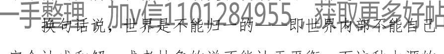

世界是不平衡的，但世界的本质是追求平衡。但世界又是不平衡的，所以世界运动才不断发展变化。但世界本质上是有追求平衡的，由此决定了一切运动发展规律的内核——即世界总的根本规律。但世界在任何时刻任何状态下的存在，都是不平衡的，所以世界的运动永远不会停顿。

换句话，世界是不能归一的——即世界内部不能自己达成和解，或者抽象的说不能达到平衡，这种本源的不平衡同时又追寻......

## 王凯加 | 1101284955

一切事物的存在，都是某种程度事物内部的综合联系的客观表现，由于世界本质的不平衡，自然就决定了各种不同层面、不同环节，自始至终是不平衡的。这也决定了一切事物的任何时刻、任何状态下的不平衡。所以一切事物都是在追求平衡中重合成，又在追求平衡中发展灭亡。

这是我们理解世界，理解自然发展史，人类发展史，事物发展史，最基本的总的线索。

## 548 楼 

作者：周喜庆 日期：2019-09-03 06:31

@沐霜披露泽 2019-09-02 22:37:04

此帖必此坐等更新

## 人们对事物的把握，对于当代已经不能居于两个事物之间

在察看两个事物的彼此不同区别和界定事物，这是人们主观上认识事物的思维方法。人们这样认识事物，必然把世界的发展变化归结为矛盾，归结为事物内部各因素对立统一。请注意——事物内部各因素不是对立统一的关系，而是世界原本是个不平衡的存在，而世界原本追求平衡，而世界原本的不平衡，决定了一切事物在任何时刻任何状态下都必然的不平衡，而受限于世界原本追求平衡这一最深的本质特性的规定性所使，一切事物在任何时刻任何状态下必然驱使事物内部的各因素必然地追求平衡。这种从原本的平衡到存在又不平衡的基本最底的特征。

处理加微信1101284955获取多多补贴

面对。从现在起人们也就不能再把事物的发展归结为矛盾的运动过程。例如在前面的回帖中所说，世界原本的不平衡和世界原本追求的特性，是世界变化运动发展的根源——一切事物在任何时刻任何状态下发展的根源。因此我们说，矛盾的概念还没有深入到事物最深层的本质规定性；或者说：用矛盾这个概念来描述事物发展，还不能渗到本质的最深处——如果不能渗入事物的最深处来反映事物最深的本质。也就是说，它仍然具有一定的表层色彩；或者说没有抓住事物发展的本质规定性。

## 556 楼 

作者:周喜庆 日期:2019-09-03 06:37

人们对事物的把握，已经不能居于两个事物之间，在抽象看两个事物的彼此不同区别和界定事物，这是人们主观上认识事物的思维方法。人们这样认识事物，必然把世界的发展变化归结为矛盾，归结为事物内部要素对立统一。请注意——事物内部因素不是对立统一的，而是世界原本是不平衡的存在，而世界原本追求平衡；世界原本的不平衡决定了一切事物在任何时刻任何状态下处于必然的不平衡，受限于世界原本追求平衡这一最深本质特性的规定性所使，一切事物在任何时刻任何状态下必然驱动事物内部的各因素必然走向平衡。这种原本追求平衡和原本不平衡的本质貌，才是事物发展最本质动因。所以，从现在起，人们就不能再把事物的发展归结为矛盾的运动过程。诚如前面的回帖中所，世界原本的不平衡和世界原本追求的特性，才是世界运动发展的根源——一切事物在任何时刻任何状态下发展的根源。因此我们说，矛盾的概念还没有深入到事物最深层的本质规定性；或者说：用矛盾这个概念来描述事物发展，还不能渗到本质的最深处——如果不能渗入事物的最深处来反映事物最深的本质。也就是说，它仍然具有一定的表层色彩；或者说没有抓住事物发展的本质规定性。(img/e5f14ca808bb912c7dee998b4eb6f9a9_149_0.png)

## 557 楼 

作者：周喜庆 日期：2019-09-03 06:44

人们对事物的把握，已经不能于两个事物之间，在抽象看两个事物的彼此不同区别和界定事物，这是人们主观上认识事物的思维方法。人们这样认识事物，必然把世界的发展变化归结为矛盾，归结为事物内部要素对立统一。请注意——事物内部因素不是对立统一的，而是世界原本是不平衡的存在，而世界原本追求平衡使得事物处于必然的不平衡，受限于世界原本追求平衡这一最深本质特性的规定性所使，一切事物在任何时刻任何状态下必然驱动事物内部的各因素必然走向平衡。这种原本追求平衡和原本不平衡的本质貌，才是事物发展最本质动因。所以，从现在起，人们也就不能再把事物的发展归结为矛盾的运动过程。诚如前面的回帖中所，世界原本的不平衡和世界原本追求的特性，才是世界运动发展的根源——一切事物在任何时刻任何状态下发展的根源。因此我们说，矛盾的概念还没有深入到事物最深层的本质规定性；或者说：用矛盾这个概念来描述事物发展，还不能渗到本质的最深处——如果不能渗入事物的最深处来反映事物最深的本质。也就是说，它仍然具有一定的表层色彩；或者说没有抓住事物发展的本质规定性；或者说没有抓住存在发展变化的初始动因。一句话，不平衡是世界原本的存在，追求平衡是世界根本的本质特性；这一根本的最本质貌，先天的决定事物的存在变化与发展。

## 558 楼 

作者：周喜庆 日期：2019-09-03 06:52

没办法，人们就是处于这样的世界。作为世界的执行部，我们只能无奈地接受这些结果，并与它达成和解。平衡作为一切活动和行为的根本向导

## 559 楼 

作者：周喜庆 日期：2019-09-03 07:01

所以世界上最美的状态，是平衡的状态。但因为世界原本的不平衡，决定了事物不可能平衡的存在，所以人们只能享受事物趋于平衡的一个和谐瞬间。

## 560 楼 

作者：周喜庆 日期：2019-09-03 10:14

都一样
昨夜的风霜是那样的不可阻挡

尤如被你淘过的越亮越亮的目光，有些话到底怎么对你讲，让你滚烫又不受伤，你能简单到一幅青春模样，能否允许我的演技俏完美也走些光，别爱着爱着互不相让，以为我比谁都倔强，刷洗灵魂的过程可不一样的成长，我不要脱胎换骨的蜕变，和那份等着的都一样，换一场场所所谓的风浪，温暖的还是你，让我的轻轻的，暧味的情歌，请你别再抒情唱，我不想在你眼神里心动渐慢，蓦然苍凉。

## 563 楼 

作者：周喜庆 日期：2019-09-03 10:40

@hi妞 2019-09-03 10:23

## 565 楼 

作者：周喜庆 日期：2019-09-03 14:44

@酒精吧 2019-09-03 12:43

哈也不说，追！郁闷了就请一杯酒，开心了就请一杯酒。一手整理加微信101284955，获取更多好帖。失败了就喝一杯酒，胜利了就喝一杯酒，酒不够就去那里闹，跳一杯舞，爱恨终会有，成功也如此，豪情有多，千山水从头。

## 568 楼 

作者：周喜庆 日期：2019-09-03 15:36

@地在九 2019-09-03 14:59

楼主快更啊，看得好。一手理加微信101284955，获取更多好帖。夜色，多少故事用破碎的星星，多少思念拂过长河，哪一束光是你，哪一风鸣是你，多少爱若一片雪花，多少激情似密林夜歌，哪一音符是你，哪一片白光，为什么你让你沉默，为什么你叫不活，让悲凉潇潇。

让故事逆水河，多少爱若一片雪花，多少激情似密林夜歌，哪一音符是你，哪一片白光，为什么你让你沉默，为什么你叫不活，悲凉潇潇。

## 570 楼 

作者：周嘉喜 日期：2019-09-03 15:37

楼主整理：加微信1101284955 获取更多好帖。楼主自更时间：2019-09-03 14:59。有的是子弹

## 571 楼 

作者：周嘉喜 日期：2019-09-04 15:19

人生那点，总是不够睡，时光不停把我拽，四十岁的梦里依然不曾流泪。决意不怕吹，脚下踏碎了梅，还没独酌酒，心已昏昏睡，人生那点，早晚有一回，笑着也是走，愁苦那点，千古自轮回。一手整理加微信1101284955，获取更多好帖。人生百折，穿越活着有了滋味，亦不枉活一回。

## 587 楼 

作者：周春序 日期:2019-09-05 07:03:31

@深思00 2019-09-03 18:52

这篇文章好像发错地方了，应该发在学术论坛让别人评论比较妥当。

你以为学术论坛是那样发的吗？

## 594 楼 

作者:周喜庆 日期:2019-09-05 09:35

与其在廉价的快乐里甜睡，莫如让我痛饮一杯高贵的忧伤。

## 597 楼 

作者：周喜庆 日期:2019-09-05 09:42

能称得上灵魂的东西，都是贯穿了宇宙的思想精华。我们在这个时代，不应再站在人的角度去思考世界，而是应当站在世界的角度思考人类。

## 一手理财加微信1101284955获取更多好帖

作者：周喜庆 日期:2019-09-06 07:23

康辰路遥遥，长风拂绿树梢；夜摇摇，星光依着梦境睡了；一朵小花，喧喧报春未早；云遥遥，拂行悠悠静悄悄；浪滔滔，千帆渡偷偷不见了；一簇芦花，叙风雪潇潇；为谁忧，为谁笑。走过千岭万壑就晓，为谁忙，为谁老；万千银河把首逗，朵朵浪花，一河长梦在燃烧，一粒埃尘，却诉不尽朗朗坤，竟妖娆。

## 611 楼 

作者：周喜庆 日期：2019-09-06 07:39

到荒漠也随你爱到处理加微信101284955，获取更多好帖。也不了些许缕，就请你别再为一些末辰多润，终算上脾气，都相同。那些言，诺言，永远。我的变成知己，疼疼爱，陪伴，守是我最浪漫的期许。如今我的心只想与你，等待了。泪。人海伏了关注眼睛，千百次呼唤了。

## 612 楼 

作者：周喜琦 日期:2019-09-06 07:39

一手领取加微信1101284955，获取更多好帖。等待了。泪。等待了。幸福了。后悔。了。了。等待了。水。是不是幸福的泪，是不是经历艰难跋涉，越积累了许多。是不是幸福的泪，就感谢雨给了那么多，水，发现的乐趣。

## 613 楼 

作者：周晓明 日期:2019-09-06 07:40

我们爱过，也曾伤。这个世界，我们记得，往事还放，就跟我唱这首歌。是不是幸福的泪。

心还在飞旋，都是轮回，心了了，了。脸。人海伏了关注眼睛，千百次呼唤了，已习惯了翻阅从前，更喜见你平和的脸。化了，了，了的脸，直到心底，那些不想说的，就把它留在云水之间。一手微信加微信1101284955获取更多好帖。

## 614 楼 

作者：周喜暮 日期:2019-09-06 07:41

别把花了，时光里舞动着灵火，心头的好多话。

## 615 楼 

作者：周喜暮 日期:2019-09-06 07:42 (重复内容)

别把花了，时光里舞动着灵火，心头的好多话。竞愁成老歌，想挣脱，夜幕下浮着寂寞，看看不见的挣扎，却无法淹没，一触即欲望，曾姜慕好，当抚摸她心底的曲折，更心酸点滴的为我活，明白了好了。一手处理加微信1101284955获取更多好帖。止不住泪落，女人的心酸有处，谁说她不应，为深爱的人，再燃一把好男人别把花了，给自己留半程坎坷，等到寂寞时说。

## 616 楼 

作者：周喜庆 日期:2019-09-06 08:02

白发三千，天上的云每刻都在变幻。尘世嘈杂悄悄变成盘缠，星月转了一年又一年，心头曾存有那样的留恋，还是触摸不到的风的发尖，白杨的眼睛晴情的眨眼，脑海总算出新的答案，多少安静换来心的同眠，为你我曾把泪流干，为你你把红尘世看遍，碎片的一刻刻一刻相见，竟鸿走了那么多的流年，归终还是命运的葬身，可迟还是心底呼吸，你敏潇蜀里都是我的昨天，我眼里有你太多的眉尖，为何你与云一样遇见，为何同守一个遥远天边，或许还不如相见，但你就在我的身边，哀求我哀求你的来生，还我还我还我白发三千。

## 617 楼 

整理加微信1101284955获取更多好帖。楼主自更时间：2019-09-03 14:59。有的是子弹。

吹哎~~我永恒的挚爱

已被宇宙之主
埋在了最深的世界

640楼
作者：周喜庆 日期:2019-09-07 12:20

@仿佛佛没有名字呀 2019-09-07 11:35:07

楼主辛苦，我从杂谈起过来，赶上大部队了

辛苦，歌会

## 643 楼 一手数据加微信1101284955获取更多好帖

作者：周喜庆 日期:2019-09-07 12:22:21

要就不比较你或好或坏
只计比较故事如何写未来
一条路是很奇怪
这个年代不为爱悲愁
一场情事不需要谁洒彩
风雨的自由自有风雨采集
小感受或许大情怀
绚烂最后是绚烂的开启
如果你还有那么多感慨

就请你大方的走开
虽然感情须色彩
可我更想两朵孤独的开
如果你不再需要灌溉
就请你依然在情海
虽然爱越来越越实在
可我还是想送你一片星海
要爱就请珍重未来
含着泪笑着分手
总比依依惜别

一手理，加v信1101284955，获取更多好帖

作者：周喜庆 日期:2019-09-07 21:56

@光阴似寻找找梦想 2019-09-07 21:14:52

儒家治国，灭人性

作为思想意识以发展到今天这样的水平，某种主义来治理社会的时代已经结束。取而代之的应该是一个现实的意识思想体系。不然，就无法迅速发展变化的社会现实，就无法与复杂的人们的思想现实适应。

657 楼
作者：周喜庆 日期:2019-09-07 22:00

@光阴找寻梦想 2019-09-07 21:30:46

王朝兴亡，有史可鉴；三代以后，好色取货；盛世之下，
污浊横行；史治腐败，浮夸成风；积重困难；后人哀之，谁
又尝之？天也？命也？道也？???

历史诚可见，但今天不再是历史的重复，今天有今天的历史高度。所以旧的东西虽然依然会有会，但我们都应该运用的新办法去解决。否则，人们就依然活在昨天，历史也没有发展。

## 658 楼

作者：周喜庆 日期:2019-09-07 22:03

一手处理，加微信1101284955获取更多好帖
@彩晓微梦想获取更多精彩

一个居住用权来绑架社会，绑架人民的生产关系，注定是走不远的，到极点就是硬币的反面。

黑格尔说，某民族没有历史，只有轮回，原因在哪里？
这是一个民族的悲哀，这样的民族永远是无法立于世界民族之林的，也是得不到尊重的。

一个民族的发展，主要表现为物质生产的发展，思想意识的发展，而这两东西水乳交融的发展，自会构成一个民族的兴盛。

## 659 楼

作者：周喜庆 日期：2019-09-07 22:11

一个民族的发展，特别需要一个伟人的群体。所谓伟人就是带领人们向未来进发的人。不要相信人类的每一步都很科学，做对了 50%，这个民族就很不起了，就会很顺利地赢得一个时代。所以现实总是问题丛生的，也正因为如此，每个时代的人都在强力地呼吸着伟人和伟人的群体。

## 660 楼 

作者：周喜庆 日期:2019-09-07 22:14

一个民族需要一个把整个时代装入胸襟的人。有了这样的人，这个时代就掌握在这个民族的手上。这个民族的历史，也就代表了这个时代的历史。

## 661 楼

作者：周喜庆 日期:2019-09-07 22:16

把握不住一个时代，就别说自己是这个时代的弄潮。

## 662 楼 

作者：周喜庆 日期:2019-09-07 22:19

时代在呼吸着我们，我们不应有一刻的停顿。中华民族近百年的血泪史，这是一呼唤最宏礴的伟力。

## 663 楼 

作者：周喜庆 日期:2019-09-07 22:22

我坚信一个繁荣富强的伟大的中国，将诞生在我们这一代人的手上。

## 664 楼 

作者：周喜庆 日期:2019-09-07 22:23

未来的人，一定我们会这几代人双手竖起拇指，并由衷地感叹！

## 665 楼 

作者：周喜庆 日期:2019-09-07 22:28

中国的当代正在开拓着明天，一个更加灿烂无比的未来，召唤着我们伟大的光荣时刻面前。

## 666 楼 

作者：周喜庆 日期:2019-09-07 22:32

在新的劳搏中，中国正在奔向胜利，向时代的中心，这里有我们！

## 667 楼 

作者：周喜庆 日期:2019-09-07 22:34

一句话，勇敢地拿着科学的武器，引领这个属于时代。

## 668 楼 

作者：周喜庆 日期:2019-09-07 22:39

这个时代的一切进步，就是一切走向科学，代表着今天和未来。每一的进步，都是在创造历史，书写时代的发展。

## 669 楼 

作者：周喜庆 日期:2019-09-07 22:41

这个民族在科学的道路上走得远，这个时代毫不疑问就属于民族。

## 670 楼 

作者：周喜庆 日期:2019-09-07 22:45

所以我要高喊一句：“科学万岁！”即便万岁似乎有建意识的残余，但我说的万岁，是在人类的未来，从此永远属于科学！

## 671 楼 

作者：周喜庆 日期:2019-09-07 22:59

所以我要高喊一句：“科学万岁！”即便万岁似乎有建意识的残余，但我说的万岁，是在人类的未来，从此永远属于科学！照亮人类未来的道路，必然是科学灯塔！

## 672 楼 

作者：周喜庆 日期:2019-09-07 23:01

以上这个时代，就看民族在科学的道路上走得更快。

## 673 楼 

作者：周喜庆 日期:2019-09-07 23:03

@周喜庆 2019-09-07 23:01:23

所以这个时代，就看民族在科学的道路上走得更快。向科学进军！这是我们唯一的号角。

## 674 楼 

作者：周喜庆 日期:2019-09-07 23:12

@周喜庆 2019-09-07 23:01:23

所以这个时代，就看民族在科学的道路上走得更快。一手整理，加微信1101284955，获取更多好帖

@周喜庆 2019-09-07 23:03:42

向科学进军！这是我们唯一的号角。无产者并非不计自己的利益，而是更善于团结起来，比较自己阶级的利益。而且本阶级的利益，远远高于自己的利益。这就是无产者，这就是无产阶级。但当代的无产阶级，不仅仅是工人，也包括科技、教育和其他产业劳动者。

## 675 楼 

作者：周喜庆 日期:2019-09-07 23:19

@周喜庆 2019-09-07 23:01:23

所以这个时代，就看民族在科学的道路上走得更快。

@周喜庆 2019-09-07 23:03:42

向科学进军！这是我们唯一的号角。

@周喜庆 2019-09-07 23:12:49

无产者并非不计自己的利益，而是更善于团结起来，比较自身阶级的利益。而且本阶级的利益，远远高于自己的利益。这就是无产者，就是无产阶级。但当我们的阶级利益不再是自己的，它包括他的产业劳动者。所以任何无视劳动者切身利益的政策，都不应该是无产阶级政党的政策；而无产阶级政党，应该更善于维护整个无产阶级的整体利益。

## 676 楼

作者:周喜庆 日期:2019-09-07 23:25

在当代就是要好的承认科技教育劳动者动的价值。使他们更加自觉地成为当代无产阶级运动的组织领导阶层，并将整个无产阶级真正成为一个自为的阶级，历史的呈现在人类社会的政治舞台。

## 677 楼

作者：周喜庆 日期:2019-09-07 23:40

在当代就是要好的承认科技教育劳动动的价值。使他们更加自觉地成为当代无产阶级运动的组织领导阶层，并将整个无产阶级真正成为一个自为的阶级，历史的呈现在人类社会的政治舞台。所以共产党，是当代民族走在时代潮头的根本保证：一个先进的无产阶级，正是历史的显化为先进的无产阶级，通过进一步的领导整个无产阶级运动向前发展，这个社会基础比以往任何时期更加强大，更加富有，更加自觉。

在当代就是要好的承认科技教育劳动动的价值。使他们更加自觉地成为当代无产阶级运动的组织领导阶层，并将整个无产阶级真正成为一个自为的阶级，历史的呈现在人类社会的政治舞台。

## 678 楼 

作者：周喜庆 日期:2019-09-08 05:23

@wr79107 2019-09-08 04:38:33

看了50个字，看不下去，感觉又到了教室上，哈戏....请你读，自从坤。

## 679 楼 

作者：周喜庆 日期:2019-09-08 05:25

@wr79107 2019-09-08 04:38:33

看了50个字，看不下去，感觉又到了课堂上，哈戏....请你读。
@周喜庆 2019-09-08 23:16

这就对了，这就是政治一手整理，加v101284955

作者周喜庆 回复:2019-09-08 14:26:26

这就对了，这就是政治。
@不尽人生 2019-09-08 09:12:27

这就对了，这就是政治。

## 689 楼 

作者：周喜庆 日期:2019-09-08 14:26

@何家多多 2019-09-08 14:12:49

写得很！顶你！

## 690 楼 

作者：周喜庆 日期:2019-09-08 14:27

@STpmjgdawt 2019-09-08 12:58:49

求更新啊！

## 691 楼 

作者：周喜庆 日期:2019-09-08 14:27

@Svspmgdaw 2019-09-08 11:53:09

很棒一手整理，加v信1101284955获取更多帖

## 692 楼 

作者：周喜庆 日期:2019-09-08 14:27

@水拆他谐find 2019-09-08 08:49:44

追到这里来了，赶紧更啊

## 693 楼 

作者：周喜庆 日期:2019-09-08 17:58

培养和建设一支科技大军，是当前摆在我们各项工作之首的最急迫的任务，这支代表最活跃的生产军，是我们各项事业的尖兵，是我们各项事业蓬勃发展的希望。是我们的社会主义事业在时代发展中迅猛壮大起来，决胜资本主义的根本力量所在。诚如前面所说，科技产业大军是当今无产阶级组织领导阶层的社会基础，因此，培养和建设好这支大军，对于坚持社会主义运动的时代方向，也有重要的意义。

那么如何让这支大军的发展壮大起来呢？一是对这时代的脑力劳动者所创造的价值，随时随地的给予充分，甚至有所倾斜；二是对劳动者阶层在时代社会主义运动中的历史地位，随着这一阶层的壮大不断给予充分的理论和政策上的承认。使之这支队伍和教育行业服务群众，其大部分是当代社会主义运动的领导阶层。

## 697 楼 

作者：周嘉喜 日期:2019-09-08 18:02

因为，在当代我们事业发展的绝大部分希望，在他们的肩上。

## 698 楼 

作者：周嘉喜 日期:2019-09-08 18:06

这大军越是迅速高质量的发展起来，我们的事情就越能够迅速地走向时代发展的前台，最终战胜资本主义，就有了根本的保障。

## 699 楼 

作者：周喜庆 日期：2019-09-08 18:13

在此时内部，让人力实时地向科技教育产业集，是一项关乎我们的事业在时代发展中成功的根本政策。

## 700 楼 

作者：周喜庆 日期：2019-09-08 18:17

伟大的教育工作，时代的重托，就在你们的肩上。你们代表着人类发展的未来

## 701 楼 

作者：周喜庆 日期:2019-09-08 18:24

伟大的教育工作，时代的重托，就在你们的肩上。你们代表着人类发展的未来让我们伸出双臂，呼唤和引领这个时代的大军。

## 702 楼 

作者：周喜庆 日期：2019-09-08 20:53

站在时代的潮头，正对时代进行全面的引领。科学旗帜是正确的旗帜，但真正能高举起它为人类谋最大的福祉，只有无产阶级才能完成。发展，自觉地运用这个武器，统领这个时代，不断地书写这个时代，把时代不断地向前。

## 705 楼 

作者：周喜庆 日期:2019-09-08 21:05

无产阶级是一项首要任务。无产阶级就是要一切生产力和生产关系的科学的优化。扭曲了生产力和生产关系的种种联系，科学的优化和整合起来。这项工作从总体的方面，我们已经完成，等待的是更加具体的分析。希望有志于社会主义事业的理论工作，获取更多

## 707 楼 

作者：周喜庆 日期:2019-09-08 21:14

真心有志于社会主义事业的理论工作，一定要系统的收集这个时代的基本信息，然后对这个时代的基本联系，进行科学的梳理，对于这个时代的总体把握，如此我们才有可能处于时代的潮头，把事业真正的推向时代的前台，为人类做出贡献。

## 708 楼 

作者：周喜庆 日期:2019-09-08 21:19

我们一定要把优质资源，在以后相当长的时期，主动向科技教育做一些集中，造起一支强大的科技教育大军，成为我们事业的根本支柱。

## 709 楼 

作者：周喜庆 日期:2019-09-08 21:22

领先发展教育，大力推动科技产业的发展，应该是国民经济发展的基本思路。

## 710 楼 

作者：周喜庆 日期:2019-09-08 21:23

@Svspmjgdaw 敏议 2019-09-08 19:49:59

写的真好一手整理，加v信1101284955获取更多帖感谢您的参与和鼓励

## 711 楼 

作者：周喜庆 日期:2019-09-08 21:24

@耳朵进水脸婚 2019-09-08 18:37:17

记号，养肥了看！

---

长江的水，总要流到海

## 712 楼 

作者：周喜庆 日期:2019-09-08 21:25

@STpmjgdawt 围湿 2019-09-08 20:57:19

等待！！！莫急

713 楼
作者：周喜庆 日期：2019-09-09 14:15

@牛牛朝天翅 2019-09-09 12:10:50

我不知道楼主多大年纪，但是醒的楼主还是没把书念好，看了几行字，实在觉得别扭，什么是无产？你希望自己无产吗？为什么放着有产不要反而追求无产呢？追求财产的占是有人的天性，这是人性使然，没有对错。无产不等于公平

人们追求的是社会管理的公平，在这个基础上平等对财产的古者。看来确实很难，大家都觉得无产是最好的选择。人是社会的主体，那么人性就是最大的原则，不管是什么制度，它发展的前提就是符合人性。

王理加101284955

非常欢迎您参加讨论。一个理论概念，它的内涵是有特定的历史时期的，或者说，有着特定的历史时期的社会内容。现在我们把社会主义仍然称为无产阶级，是因为人们仍处于无产阶级革命的时代。世界上资本主义仍然存在，无产阶级的历史任务，还没有历史的完成。所以社会主义的劳动者在这个历史时期，具体的。

作者：周喜庆 日期:2019-09-07 12:20

作者：周喜庆 日期:2019-09-07 12:22

作者：仿佛佛没有名字呀 2019-09-07 11:35:07

作者：周喜庆 日期:2019-09-07 21:56

一手理，加v信1101284955

作者：周喜庆 日期:2019-09-07 22:00

@光阴寻找找梦想 2019-09-07 21:14:52

@光阴找寻梦想 2019-09-07 21:30:46

作者：周嘉 日期:2019-09-07 22:03

一手处理，加微信1101284955

@彩晓微梦想获取更多精彩

作者：周喜庆 日期：2019-09-07 22:11

作者：周喜庆 日期:2019-09-07 22:14

作者：周喜庆 日期:2019-09-07 22:16

作者：周喜庆 日期:2019-09-07 22:19

作者：周喜庆 日期:2019-09-07 22:22

作者：周喜庆 日期:2019-09-07 22:23

作者：周喜庆 日期:2019-09-07 22:28

作者：周喜庆 日期:2019-09-07 22:32

作者：周喜庆 日期:2019-09-07 22:34

作者：周喜庆 日期:2019-09-07 22:39

作者：周喜庆 日期:2019-09-07 22:41

作者：周喜庆 日期:2019-09-07 22:45

作者：周喜庆 日期:2019-09-07 22:59

作者：周喜庆 日期:2019-09-07 23:01

作者：周喜庆 日期:2019-09-07 23:03

作者：周喜庆 日期:2019-09-07 23:12

作者：周喜庆 日期:2019-09-07 23:19

作者：周喜庆 日期:2019-09-07 23:01

作者：周喜庆 日期:2019-09-07 23:03

作者：周喜庆 日期:2019-09-07 23:12

作者：周喜庆 日期:2019-09-07 23:42

作者：周喜庆 日期:2019-09-07 23:25

作者：周喜庆 日期:2019-09-07 23:40

作者：周喜庆 日期:2019-09-08 05:23

作者：周喜庆 日期:2019-09-08 04:38

作者：周喜庆 日期:2019-09-08 05:25

作者：周喜庆 日期:2019-09-08 04:38

作者：周喜庆 日期:2019-09-08 23:16

作者：周喜庆 回复:2019-09-08 14:26:26

@不尽人生 2019-09-08 09:12

作者：周喜庆 日期:2019-09-08 14:26

作者：周喜庆 日期:2019-09-08 14:27

作者：周喜庆 日期:2019-09-08 17:58

作者：周嘉喜 日期:2019-09-08 18:02

作者：周嘉喜 日期:2019-09-08 18:06

作者：周喜庆 日期：2019-09-08 18:13

作者：周喜庆 日期：2019-09-08 18:17

作者：周喜庆 日期：2019-09-08 18:24

作者：周喜庆 日期：2019-09-08 20:53

作者：周喜庆 日期：2019-09-08 21:05

作者：周喜庆 日期:2019-09-08 21:14

作者：周喜庆 日期:2019-09-08 21:19

作者：周喜庆 日期:2019-09-08 21:22

作者：周喜庆 日期:2019-09-08 21:23

作者：周喜庆 日期:2019-09-08 21:24

作者：周喜庆 日期:2019-09-08 21:25

作者：周喜庆 日期:2019-09-09 14:15

@牛牛朝天翅 2019-09-09 12:10:50

调动生产者的积极性，因为它把生产者的劳动和劳动成果的分配，更为直接地联系在了一起。所以生产者的积极性被直观地调动起来了，这就从生产关系的这个环节，促进了社会生产的发展，所以有了我们四十年改革开放的伟大成就。当然我们充分利用了世界产业链的分工和转移，给我们提供的历史机遇，这也是一个很重要的方面。同时我们对这一时期资本主义的生产，采取了包容的态度，使生产效率得到了显著提高。

社会问题也显得增多。这基本上就是我们的现实。我们确实，高效的社会主义所有形式，都是横在人们面前一个缺不开的理论和实践的重大节点。从一个时候来人的生产者来说，我们有效地向社会主义的发展，其中的我们与资本主义相最大的历史优势。

关于如何实现社会主义社会各生产业之间的社会分配的理论

历史全面优化，我在主贴中已经做了我尽可能的叙述，这里不再多言。继而还想补充的是，我们说要认识当代社会主义的时代生产发展规律，并给予科学的贯彻和执行，但这一点都不意味着对社会所有制的所有形式有丝毫不差的理论松动。我们必须承认所有制形式对人们财产分配和社会阶地位决定和调节，这一具有更加现实的根本作用。就目前我的思想视野内，我是比较同意的。虽然社会主义于展现的所有实现形式，这需要若干理论的检验和探索，但我们认为，社会主义的历史验证证明，任何劳动者与劳动成果不能被紧密围困的组织形式，对促进社会生产是否有积极意义的。其实现在看来，这种理论上上一次得到，但不具长期意义的理论观点，是不彻底的理论观点，很大程度上居于主观的一般想象。或者不是从社会实践中活生生地成长出来的。是的，只有从社会实践中成长出来的，然后被人们认识并加以总结，这样的理论观点才具有生命力。所以就目前人们应该对该股份制的历史地位，给予充分的肯定。至于它所带来的两极分化和其他社会问题，人们应该从若干的政策层面，加以限制和调节。

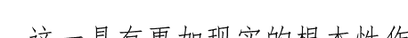

上述云云，未及深入的思考。不知对您可有裨意，真有点直接的感觉。不妥妥之处，还请见诸。

今天一天直在造。。楼主不能太阴啊

科学的社会制度，就是要限制人性的阴暗面，限制随任性的，由此才有了高度的文明；如果我们不能基于提升社会的理想，经营好社会，就会出现问题，那就不配拥有起福利的工作作者。我不是可怜的，也不是阴阳人，说出来也许太认可，我更多地倾向于一个现实主义者。

但或许疑似太阴，受到了了非人的压抑，更相信和信仰社会的公平的力量

- 社会主义的优越性相信随着时间的推移更加明显。

按照马克思主义理论，社会发展分为几个阶段：奴隶制社会、封建制社会、资本主义社会、社会主义社会、共产主义社会。

前三种社会形态，人类基本都亲目睹并亲身经历过，容易界定。但后两种社会形态，我们人类还处于理论阶段。

我相信从现实出发、从实际出发，是一切正确选择的基础。在以往的历史唯论中我们想要的划分，她已经像那样的过去，都不能改变她来的模样；但今天我们是有能力改变的，而且科学的力量，就是将人们聚集在正确的旗帜下，向着美好的未来迈进。我完全相信随着技术的进步，人类的日子日益富裕，人的阴暗依然存在，甚至还会有所发展，但是社会的未来。

马克思主义，一个非常重要的一点，就是相信人类社会发展到今天，已经能力让社会沿着理性规划的路线向前方。特别是人类的意识已经发展到如此程度，对整个社会发展毫不费力的思考，一个可以规划的蓝图，也可以得到有效的实施。对撞机，就是人类智慧和能力的最好证明。我们知道社会的阴暗面始终是存在的，但是正能量也在不断的增长。如果社会正方面的力量，因为一方面停止而失去平衡，那么整个社会就会崩溃。那种完全消除社会阴面来建设理想的任何想法，从根本上不符合（事物）存在和发展的基本规律。那种在考虑阴暗面来评判和设发展的思想，是要不要的。因为他的视角是片面的，他的结论是科学的，但是是不靠谱的，他将得出荒谬的结论。他们对世界上一切美好的东西都缺乏信任感，而且对社会的发展有恐虑，与其说他们更黑暗，不说他们对理想想象，思想还极其狭隘。科学有着自己的道路，它不会一味的选择阴影，也不会一味的选择无限景色。它要贯穿事物发展的整体，就像人们天然知道黄金分割线一样，游走着自己道路。以上所述，真的并不针对老师，一点综合的感受。请老师，不要过意。您的网名很好，我就借此发挥。

从现实出发、从实际出发，是一切正确选择的基础。在以往的历史唯论中我们想要的划分，她已经像那样的过去，都不能改变她来的模样；但今天我们是有能力改变的，而且科学的力量，就是将人们聚集在正确的旗帜下，向着美好的未来迈进。我完全相信随着技术的进步，人类的日子日益富裕，人的阴暗依然存在，甚至还会有所发展，但是社会的未来。

科学的社会制度，就是要限制人性的阴暗面，限制随任性的，由此才有了高度的文明；如果我们不能基于提升社会的理想，经营好社会，就会出现问题，那就不配拥有起福利的工作作者。我不是可怜的，也不是阴阳人，说出来也许太认可，我更多地倾向于一个现实主义者。

社会主义一点也不神秘，与其说是一个理论问题，不如它更是一个实践问题。因为它就活生生的存在于人们的生活之中，正等待着人们用科学的方法去发展。您把它说是理论问题，当然也是不足怪的，一个具有鲜明特点的、生机勃勃的并且渗透到人们思想深处的社会主义，毕竟还没有脱胎呈现在人们的眼前。其实这正是终不渝的追求真理的人，必须作出不懈努力的方向。诚然，如果我们对当代社会主义的科学图景——当代社会主义的基本联系较为清晰的语言描述，并广泛被人们所认可，那么类似于您这样的思想，自然也就烟消云散。

但这里我们说时代主义的科学图景，现在已经大致的被描述出来，把社会主义推向到了一个时代的高度，已经不再是一个理论问题。其实社会主义一直在无产阶级的手上，只是需要无产阶级连接起来，变成活生生的社会。这样的一个伟大的到来！

多。所以一种所有的所有的具体形式，会随着人们对这一所有制式形式的认识，从人性的复杂的角度对其产生的攻击力度的不断加大和日益频繁历史的结论。

## 767 楼
作者：周喜暮 日期：2019-09-10 09:21

所以，任何把社会主义所有制形式简单化的倾向，都是要不得的。一切剥割阶级主导下的所有制形式，都具有强制的性质。它要比社会主义的所有制形式简单得多。社会主义的所有制形式，它是各种因素优化的结果，所以她不是一个简单的理论，而是各种实际因素优质的联结。

把社会主义所有制形式做成任何一个动态过程的方法是不允许的。这种批判和终结我们的理想的作者认为历史性的跟踪性的关注。其实，任何认为社会主义可以简单来做的想法，都是当代无产阶级的思想意识。

## 768 楼
作者：周喜暮 日期：2019-09-10 09:33

社会主义绝不是像有些人想象的那样，敲响锣鼓热情洋溢的就建设起来了。它确实我们需要做出异常艰巨的理论工作，以及无产阶级以时代的步走，勇立时代的潮头！社会主义是一项伟大的事业，它同样在呼吸着伟大的人们！

## 769 楼 
作者：周喜暮 日期：2019-09-10 09:40

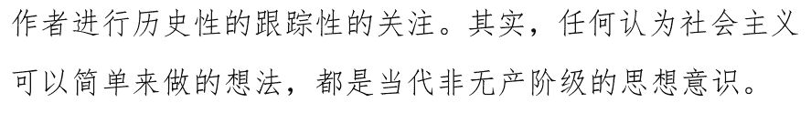

致力于人类美好明天的人们，请在这一伟大的历史正途中，尽情的燃烧自己吧！你们的身躯将筑起人类通往未来的道路。而未来的人将在你们的墓前涌涌最崇高的敬意并洒下未来这种精神昂扬的热血！

## 770 楼 
作者：周喜庆 日期:2019-09-10 09:41

致力于人类美好明天的人们，请在这一伟大的历史正途中，尽情的燃烧自己吧！你们的身躯将筑起人类通往未来的道路。而未来的人将在你们的墓前涌涌最崇高的敬意并洒下未来这种精神昂扬的热血！

## 771 楼 
作者：周喜庆 日期：2019-09-10 09:48

@流溜顽 2019-09-10 07:01:27

看到了楼主在帖中提到的社会主义的一种现实的实现方式却是股份制，希望楼主能从理论上更具体的分析论述，找出这种方式的优势与不足，我个人直观觉得这还不是最好的方式。直白的，我觉得最好的方式是个人私有制下的社会主义，会更有生命，完全能竞争目前的资本主义，我这么说，是因为我已经有些简单非常初步的思路和想法。

@周喜庆 2019-09-10 09:07:44

所有制衡问题，是一个既简单又复杂的问题。它简单是因为它的思索，不必像研究剩余价值那样，几乎把整个资本主义社会的经济活动，全部的深入的精细的研究一遍，无需进行一次阔闹而又具体的一番理论思考。说它复杂是因为人们对这个问题的理论思索，投入还少之又少，还远远的不够较为正确的解决这个问题。是的，它涉及的因素也是纷复杂杂的。这里我想人们考察所有问题，至少应该重新考虑这样几种因素，一是在不同的历史条件下，......

一时之想，仅供讨论

## 772 楼
作者：周喜庆 日期：2019-09-10 10:24

留名，1年后再回来

也许，那时这帖子已成一篇废贴。谢谢你我相在在一片虚无的网络里，而此时此刻的世界是那样的真实。

## 774 楼 
作者：周喜庆 日期：2019-09-10 11:41

社会主义是光荣而伟的事，无论从任何意义上说，他都必须比资本主义更更伟大，因为资本主义有着自发的性质，而社会主义是个自为的社会。资本主义从根本上说他仍然是人性的自由延续，而社会主义要自觉的限制人性阴面，此走社会主义道路，要比走资本主义道路，艰巨大的多。也需要数无穷大而高尚的人。虽然资本主义也有种种类理论，但他依然对整个社会平衡和和谐美的理解，所以它不能有一一条平坦的道路，而社会主义就是要解决资本主义社会里许多尖锐的矛盾，所以这一任务的艰巨性，也就可而知了。我们要坚决反对那种把社会主义理论，当做是对无产阶级历史状况的同情发生，不是的，资本主义确实有许多不可调的矛盾，即使她让她无避免的激烈的爆发，也在整个社会的苦淫。当然我们也不能认认为社会主义是伟大的事业，我们就不问青红皂白的一勇，她的可行性就是资本主义矛盾的科学解决，随着社会情形的不断变化，动是危险，想要避免只有我们时代异常广泛而复杂的实践之中，将坚持异常而细致的工作，一条平坦的道路，才会在人的脚下！一个对人类社会发展已经能够进行而尽的考察的时代已经到来，全面的建设的伟大时代，也已经来，我们要在中国党的领导下，在这一通向人类美好的道路，不断前进，书写最绚烂的历史章！

## 776 楼
作者：周喜庆 日期：2019-09-10 11:54

社会主义是万人的事业，他同样需要亿万年来完成。每一位向往美好的人，都应该行动，尽其能，为其添瓦，使之更加美丽！

## 777 楼
作者：周喜庆 日期：2019-09-10 15:36

一个翅膀是不能飞翔的。那种认为一搞社会主义阴暗的东西就自然飞灭、溜溺的想法，是要不得的。其实阴暗的东西，也是随着时代的转变而变种的，不承认这一点，就没有学好历史的辩证法，至少还不是一个比较彻底的历史唯物主义者，更不必是一个较为成熟的历史唯物主义者！任何发展都是一只双刃剑，任何东西都有它的两面，任何事物都逃脱了这个世界的根本法则。

有些近乎妄言了，请多批评指正。

## 789 楼 
作者：周喜庆 日期：2019-09-10 17:12

人们对社会事物的考察，一定要注意在当时的历史条件下，可能的把那个时期林林总总的社会情形与这个事物的具体联系都摸清楚，这样得出的结论，才是全面的，也才可能是科学的。所以，我们研究当代社会主义发展中的每一件事物，都应该尽可能地把当前这一历史时期内的种种因素都考虑进去。也就是说，我们的思想若还没有把这个时代的基本情形，对某一事物的考察，就不能切入其时代，也不会全面，就会偏离轨道。所以，致力于时代发展的人们，一定要注意胸怀这个全局，进一步地把事情弄清楚，这才是有益的工作；否则，那是噪音，甚至比噪音的危害。

## 794 楼 
作者：周喜庆 日期：2019-09-10 17:15

人们对社会事物的考察，一定要注意在当时的历史条件下，可能的把那个时期林林总总的社会情形与这个事物的具体联系都摸清楚，这样得出的结论，才是全面的，也才可能是科学的。所以，我们研究当代社会主义发展中的每一件事物，都应该尽可能地把当前这一历史时期内的种种因素都考虑进去。也就是说，我们的思想若还没有把这个时代的基本情形，对某一事物的考察，就不能切入其时代，也不会全面，就会偏离轨道。所以，致力于时代发展的人们，一定要注意胸怀这个全局，进一步地把事情弄清楚，这才是有益的工作；否则，那是噪音，甚至比噪音的危害。

## 795 楼 
作者：周喜庆 日期：2019-09-11 05:18

@牛牛朝 2019-09-11 04:23

社会主义不是一个口号，它是靠一套完整的社会体系来支撑。。首先靠一个成熟的社会意识，由此建立完善的政治制度和法律制度。社会主义是一个大厦，一方面，一个环节出了严重的问题，大厦都有可能倾倒。如实说，以前对这个问题，还没有认真的做过全部的思考，总觉得并不是一般应有的思维模式。是要靠慢慢的积累，对问题也需要慢慢的研究，才能拿出正确的办法。没有长期的积累，就不可能有深度的思考。是的，过去，有人曾以为一个领袖是可能的，他无所不能，句真理，真是大错。建设社会主义还需要比资本主义更多的领袖群体，而且一代代人的思想和经验积累。无产阶级的核心价值观是什么，不能提到像自由平等的这种。

## 802 楼 
作者：周喜庆 日期：2019-09-11 05:32

如果人们不能把深深蕴藏在这个时代渗到人们心中最核心的理念提取出来，我们在意识形态领域最终是要吃败仗的，一系列建立起来的制度，终究也会垮塌的。写到此，我内心盈满了泪水。革命运动的先烈们啊，这是我最愧对你们的地方，可目前我无能力！请给我几个夜，或者几年，也请你们给我以力量！谢谢牛牛老师。

## 803 楼 
作者：周喜庆 日期:2019-09-11 06:21

有了没有人性的感召力。

人类似乎已经到了这样一个时刻，面对浩瀚的宇宙，人类面对的是何等的孤独。遇到宇宙突发的劫难，谁能来拯救我们人类。难道人类就这样孤独的生存下去吗？不！不！不！人们是不是从现在起，用我们的人类之心，温暖我们自己！用自己的爱，温暖这个世界上的一切。我们不欺凌自然，也不欺凌其他生命！人与人没有欺骗和巧夺，每个人都心怀爱，相互温暖，创造我们现在和未来，从现在起做一个有爱的人。这样世界就会快乐。

## 804 楼 
作者：周喜庆 日期：2019-09-11 21:23

@牛牛朝 2019-09-11 04:22

什么旗子并非关键，要干，如何干。当然，一个国家没有鲜明的旗号，真有点说。社会主义绝不是一个口号，它是靠一套完整的社会体系来支撑。首先靠一个成熟的社会意识，由此建立完善的政治制度和法律制度。社会主义是一个大厦，一方面，一个环节出了严重的问题，大厦都有可能倾倒。如实说，以前对这个问题，还没有认真的做过全部的思考，总觉得并不是一般应有的思维模式。是要靠慢慢的积累，对问题也需要慢慢的研究，才能拿出正确的办法。没有长期的积累，就不可能有深度的思考。是的，过去，有人曾以为一个领袖是可能的，他无所不能，句真理，真是大错。

## 805 楼 
作者：周喜庆 日期：2019-09-11 07:45

@周喜庆 2019-09-11 05:32

如果人们不能把深深蕴藏在这个时代渗到人们心中最核心的理念提取出来，我们在意识形态领域最终是要吃败仗的，一系列建立起来的制度，终究也会垮塌的。写到此，我内心盈满了泪水。革命运动的先烈们啊，这是我最愧对你们的地方，可目前我无能力！请给我几个夜，或者几年，也请你们给我以力量！谢谢牛牛老师。

## 806 楼 
作者：周喜庆 日期：2019-09-11 07:46

一切都没有那么简单，不能在干这种事情了。

## 807 楼 
作者：周喜庆 日期：2019-09-11 08:10

壹壹推荐 2019-09-14 07:56:08

顶下，谢谢。

## 809 楼 
作者：周喜庆 日期：2019-09-11 08:44

资本主义诞生于西方，西方人在他们封建意识的酒精窖里，酿出了自由平等的阶级观念，并得到了整个社会成员的基本同；社会主义被马克思真正唤醒了，这一运动在中国正在延续，一个有着几千年封建文明和百年斑辱的民族意识力，会酿出怎样的新时代的核心理念呢？在现在东方的骨子里仍然是王道占据着决定性的作用，严格地说人们没有经历资本主义社会的洗礼，由于经济水平的限制，金钱第一，利益至上，尔虞我诈，极端自我，实在泛滥，但这不是坏的，这一是补课，二来这也是酝酿新时代核心理念的熔炉。终于看到了新时代思想黎明，请人们不要，微微登上一片。

## 810 楼 
作者：周喜庆 日期：2019-09-11 09:21

不经历风雨，怎么见彩虹。没有资本主义雨的浇灌，新时代的人心怎么铸造，这大概需要一个天才的人物，才能在大脑里生生地生长出来。事物当他还没有发展到新时代时，其作为培养的。

## 812 楼 
作者：周喜庆 日期：2019-09-11 06:21:03

人类似乎已经到了这样一个时刻，面对浩瀚的宇宙，人类面对的是何等的孤独。遇到宇宙突发的劫难，谁能来拯救我们人类。难道人类就这样孤独的生存下去吗？不！不！不！人们是不是从现在起，用我们的人类爱之心，温暖我们自己！用自己的爱，温暖这个世界上的一切。

## 782 楼 
作者：周喜庆 日期：2019-09-10 15:23

其实资本主义制度对人性阴暗的限制，相比于封建社会人性的意志，那是极大的进步。

## 785 楼 
作者：周喜庆 日期：2019-09-10 15:25

这就是我目前的结论！

## 786 楼 
作者：周喜庆 日期：2019-09-10 15:36

一个翅膀是不能飞翔的。那种认为一搞社会主义阴暗的东西就自然飞灭、溜溺的想法，是要不得的。其实阴暗的东西，也是随着时代的转变而变化的，不承认这一点，就没有学好历史的辩证法，至少还不是一个比较彻底的历史唯物主义者，更不必是一个较为成熟的历史唯物主义者！任何发展都是一只双刃剑，任何东西都有它的两面，任何事物都逃脱了这个世界的根本法则。

有些近乎妄言了，请多批评指正。

声明一下，我不赞集集体主义，但我赞成集权主义。像我们这样的大国，集权是一种必然的选择；现代社会无论是经济政治文化每个领域都异常广阔，都需要迅速有力的调动各种资源，这也需要的高度集中统一。同时，困难多、问题多，也越需要必要的集中。其实，人类发展史，从一个侧面的某种程度上说，就是组织能力的不断增强的过程。所以反集权是与社会的发展方向相符的，也是不合时宜的。

# 824 楼
作者：周豪庆 日期：2019-09-11 14:45
一手管理：不加微信110128495 获取更多贴帖
我不集集体主义，我我集权。

我们这样的大国，集权是一种必然的选择；现代社会无论是经济政治文化每个领域都异常广阔，都需要迅速有力的调动各种资源，这也需要的高度集中统一。同时，困难多、问题多，也越需要必要的集中。其实，人类发展史，从一个侧面的某种程度上说，就是组织能力的不断增强的过程。所以反集权是与社会的发展方向相符的，也是不合时宜的。

# 825 楼 
作者：周豪庆 日期：2019-09-11 16:06
@BZNAAmdLBR 余箱 2019-09-11 12:28:05
为什么代价大？

中国几千年建史，若延续资本主义，不是健态的人，自然会想起民国史。许多文明国后来为什么衰落了，丰富的封建遗产，不能说不是一个原因。社会发展并不是平坦的路，如果不相信只言片的宣传，就会知道社会建设是一件异常不容易的事情，所以到处都是残缺的梦、哀嚎和泪水。

# 828 楼 
作者：周喜庆 日期：2019-09-11 16:17
@莉本的微笑是 2019-09-11 16:03:27
呵呵呵，现在的人还是不少的。

在这里需要耕种，想要胜利的人。而是第一个抵达果园的人。过去的主只想想着自己的一亩三分地，但一洋准，地租便被劫了。还不错，他的后代还有一可打。西方人对这样的故事不周一顾，虽然用着这些人人制作的许多生活用品。呵呵呵

# 829 楼 
作者：周喜庆 日期：2019-09-11 16:22
@BZNAAmDLBR 余裕 2019-09-11 12:28:05
为什么代价大？
@周喜庆 2019-09-11 16:06:19

中国几千年封建史，若接资本主义，不是健志的人，自然会想起民国史。许多文明国为何衰落了，富有的封建遗产，不能说不是一个原因。社会发展并不是平坦的路，如果不相信只言片的宣传，就会知道社会建设是一件异常容易的事情，所以到处都是残缺的梦、哀嚎和泪水。

中国人的命运，近代以来一直不是很好。有人学过西方，有人厌过西方。至今有人内心还有阴影，虽然《易经》开篇就说，天行健，君子自强不息。

# 830 楼 
作者:周嘉庆 日期:2019-09-11 16:24
一手数 加值1101284955 获取更多好帖
@BZKAAMDeBR 2019-09-11 12:28:05

## 为什么代价大？
@周嘉庆 2019-09-11 16:06:19

中国几千年封建史，若接资本主义，不是健志的人，自然会想起民国史。许多文明国为何衰落了，富有的封建遗产，不能说不是一个原因。社会发展并不是平坦的路，如果不相信只言片的宣传，就会知道社会建设是一件异常容易的事情，所以到处都是残缺的梦、哀嚎和泪水。

中国人的命运，近代以来一直不是很好。有人学过西方，有人经历过西方。至今有人内心还有阴影，虽然《易经》开篇说，天行健，君子自强不息。好像跟着还有一句“厚德载物”！

# 831 楼 
作者：周喜庆 日期：2019-09-11 16:26
载的是什么，我至今没有弄清楚，反正不是“物”！

# 832 楼 
作者：周喜庆 日期：2019-09-11 16:28
载吧！谁让我愿负责前行。健身啊！

# 833 楼 
作者：周喜庆 日期：2019-09-11 16:31

断定这个人一定倾向于经。

# 834 楼 
作者：周喜庆 日期：2019-09-12 05:54
人们谈政治概不能排除这样两个方面：
- 一是一些社会问题，一旦较为严重到社会发展，这个社会问题，一般叫做政治问题。
- 二是谈政治，就是人们所说的政治制度。一个时期的人文观念对政治制度有着深刻的影响；一个时期的人文观念对政治制度有着深刻的影响。人们的经济观念和人文观念也相互深刻的影响。

所以政治观念是整个社会不能善其身，进而人们考察政治观念的时候，应主动的去贯彻这个时代，否则就不能对这个时代的基本观念提取出来。这是比经济和人文更深入的东西，可以说要研究经济和人文更广泛的知识。可以以此来谈政治制度，是一种负责的态度，无助于问题的解决，如果不是胡乱想，我是希望采取慎重的态度。

# 843 楼 
作者：周喜庆 日期：2019-09-12 06:22
这样的组织形式。对人性的理解，就是：
- 不能假定每个社会成员都是向善的，也不能假定每个社会成员都是向恶的，应该对社会成员的同时考察；
- 二是在此基础上，在这个时代的历史变后，人们应该拥有的客观的经济观念，和这个时代由于社会的发展人们对自身本身的理解，和这个时代的基本组织形式；
- 三者客观观念形成的人与人之间的行为和观念，是最基本的，对这个时代发展起决定。

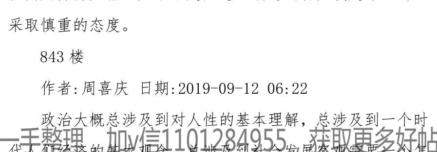
并在社会上广泛立起来，就是这个时代的基本政治观念，思维一定要高度的抽象性，或者广泛的穿透力。

# 844 楼 
作者：周喜庆 日期：2019-09-12 06:50
社会主义运动很重要的方面，就是把阶级提出的观念延伸到了经济领域，追求劳动之间的平等，或者说人们行为之间的平等，这诚然是一个合理的要求。这也是许多观念的人对自然存在的应当要求。所以这种的动，如干柴遇到火，燃遍了世界。可是谁说社会主义没有客观的基础呢？人们思想的觉醒，必然要求社会向更符合利益向前迈进，这是最无法回避的内在诉求。所以社会主义代表了人类社会进步的方向，是必然要胜利的！对此不应有一一点的怀疑！

# 845 楼 
作者：周喜庆 日期：2019-09-12 06:54
经济上的平等，但确立这一平等的观念就像闪电般的贯穿整个领域。

# 846 楼 
作者：周喜庆 日期：2019-09-12 06:06
但人的天资是不同的，人的能力在不同阶段是不同的
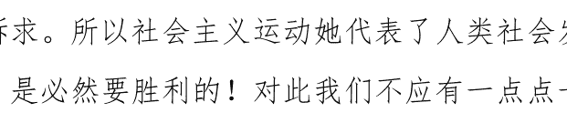
并且社会的需要也是千差别的，人们的思想情感更是纷呈五彩，所以这又不是一个简单的解决。承认这种差异性，无论如何都说对社会问题的分析是一个彻底的科学态度。

# 487 楼 
作者：周喜庆 日期：2019-09-12 07:07
我们当然的反对剥削，我们当然的反对简单的平等！

# 488 楼 
作者：周喜庆 日期：2019-09-12 07:19
平等是资产阶级的口号，是资产阶级给我们的遗产；但简单的平等是一个时期思想的病根。因为人是千差别的，在简单的平等中剥夺自己的好处，为了平等，好像真的实现了它？这完全是人的主观想象下的虚幻的现实。弄明了这一点，我们接下来对这个问题的深究，或许对社会的发展有了科学的现实意义。

# 489 楼 
作者：周喜庆 日期：2019-09-12 07:40
以往人们还很少从社会现象的细微方面来精细的考察和树立自己的观点，往往是从感性的要求出发，这就造了太多的不科学的观念，虽然这些要求有一些合理性，甚至有很大的合理性，它不能像机器的部件那样环环扣扣，造成的痛苦也就难免，这也是长久以来社会发展酿了那么多苦难的总根源。

# 850 楼 
作者：周喜庆 日期：2019-09-12 10:01
假认为人与人是平等的，并没有意义，他至少确立了社会成员人格上的平等。但我们这一观念是不科学的，我们在复杂的万象的社会现实中，不可能实现人与人之间的平等，更不必绝对的平等。

# 852 楼 
作者：周喜庆 日期：2019-09-12 10:18
天赋人类、生而平等若从社会活动的全部内容来衡量，它就无法索取任何权利，它根本无法接受我们的社会试验。因为它只能保持社会成员之间行为中人为的平等，就其行为的内容来说，则很难实现平等，或者进步根本无法实现平等；甚至可以说为了社会会有秩序地进行，客观需要内容上的不平等。无论你是否意识到，也不管你对此有了真实的认识，社会现实都是在这样真实的进行。由此深受多年蒙蔽的人们，也终于揭开了平等这一概念虚伪的真面纱。

# 853 楼 
作者：周喜庆 日期：2019-09-12 10:32
那么社会的真实情形是怎样的？或者说保持社会的发展对社会行为之间的需要是怎样的？我们说社会需要生产者，生产要发展科技队伍，离不开教育，这就有了安全保障，以及上述重重的部门，就需要公务员。以前人们直观地从经济的角度考察社会成员之间的关系。从这个角度来说，劳动者之间的关系是交换，并射到整个社会。其实社会的发展进展，需要各种不同的社会岗位，特别是近代社会以来，随着直接生产位的减少和其他岗位的日益增加，从社会发展的需要这个角度来说明。

# 855 楼 
作者：周喜庆 日期：2019-09-12 11:53
社会运行发展的需要越来越决定一种社会价值，这在人们的渴望中表现为明显。这是社会的发展要求，人们思想逐渐向方向倾斜。社会需求体系，简单来说，社会需要的大小。

# 857 楼 
作者：周喜庆 日期：2019-09-12 14:21
社会运行的发展到今天正在大量的创造，新的岗位也发生着。这种不断和人类的发展，使得社会岗位并在社会岗位上不断成长，然后必须去补足。所以一个社会成员的价值完全是有社会岗位的决定的。有的社会成员在普通的岗位上，做出了对于社会非常有意义的工作，他们进入了历史，名字留了。

# 864 楼 
作者：周喜庆 日期：2019-09-12 14:46
是的，社会需要的价值体系越来越占主导。社会成员行为的关系，而这一主导作用在将来将发挥决定性的作用。每一个社会成员都会清晰地认识到这一点。社会是一个机的整体，它的运行和发展需要每个社会成员互动，所以社会是一个大家，每个社会成员都是血缘姐妹，当然站在社会运行和发展的方面来说，每一个社会成员应该爱心，也要爱自己，共同完成社会的进步。

# 865 楼 
作者：周喜庆 日期：2019-09-12 15:02
所以社会成员之间的关系，协作是第一位的，这是社会运行和发展的客观要求。虽然在社会生活的层面上，完全可以忽略这一关系的存在，但在社会发展过程中，每个社会成员又默默地遵守着这一关系第一位的规定性。既然社会成员从社会的现实来说，他同时是一个独立的个体，所以竞争在所难免。更多时候部分成员冲破这一关系第一位的规定性，破坏社会运行发展的最基本的原则，剥削，甚至血腥的掠夺，正是以往人们对这一第一位的规定性缺乏自觉认识，造成了难以数的苦难。

# 868 楼 
作者：周喜庆 日期:2019-09-12 12:06
阶级的统治是这些苦难中最黑暗的部分。

# 869 楼 
作者：周喜庆 日期：2019-09-12 15:13

在被毁的重建中，这样的形式就像国家崩溃，他是内外的公开的掠夺，并采取合法的形式，真是不堪回首的人间悲剧!

# 870 楼 
作者：周喜庆 日期：2019-09-12 15:21
现在由于科技的发展，人类幸福的黎明终止即将将来临。社会化生产人们提供日益丰富的物质生活，社会行为者之间第一位的规定性，越来越被推到了主要的席位上。社会岗位需要的价值体系，越来越发挥其明显的作用。有志于人类社会进步的人们，请努力学习、自觉成长，不断争取走向社会的重要岗位，为社会创造价值，实现自己的人生价值！

# 873 楼 
作者：周喜庆 日期：2019-09-12 15:35
@周喜庆 2019-09-12 15:13:20
在阶级的社会里，这种掠夺的最高形式，就是国家，他是外的公开的掠夺，并采取合法的形式，真是不堪回的回间悲剧！
> @a6BPI 2019-09-12 15:18:37
国家并没有掠夺你——！一手整理，加微1101284955，获取更多帖
是的，当当代社会里，阶级还在，作为执行阶级利益的集团组织，国家也必然存在。虽然现在国家更多地发挥着社会的管理职能，但作为剥削阶级集团驱下的国家形式。

# 874 楼 
作者：周喜庆 日期：2019-09-12 14:46
@a6BPI 2019-09-12 15:18:37
国家并没有掠夺你——！一手整理，加微1101284955，获取更多帖
是的，当当代社会里，阶级还在，作为执行阶级利益的集团组织，国家也必然存在。虽然现在国家更多地发挥着社会的管理职能，但作为剥削阶级集团驱下的国家形式。

# 878 楼 
作者：周喜庆 日期：2019-09-12 15:11
由于科技的发展，人类幸福的黎明终止即将将来临。社会化生产人们提供日益丰富的物质生活，社会行为者之间第一位的规定性，越来越被推到了主要的席位上。社会岗位需要的价值体系，越来越发挥其明显的作用。

有志于人类社会进步的人们，请努力学习、自觉成长，
不断争取走向社会的重要岗位，为社会创造价值，实现自己的人生价值！

# 879 楼 
作者：周喜庆 日期：2019-09-12 15:11
由于科技的发展，人类幸福的黎明终止即将将来临。社会化生产人们提供日益丰富的物质生活，社会行为者之间第一位的规定性，越来越被推到了主要的席位上。社会岗位需要的价值体系，越来越发挥其明显的作用。

有志于人类社会进步的人们，请努力学习、自觉成长，
不断争取走向社会的重要岗位，为社会创造价值，实现自己的人生价值！

# 880 楼 
作者：周喜庆 日期：2019-09-12 15:33
由于科技的发展，人类幸福的黎明终止即将将来临。社会化生产人们提供日益丰富的物质生活，社会行为者之间第一位的规定性，越来越被推到了主要的席位上。社会岗位需要的价值体系，越来越发挥其明显的作用。

有志于人类社会进步的人们，请努力学习、自觉成长，
不断争取走向社会的重要岗位，为社会创造价值，实现自己的人生价值！

# 881 楼 
作者：周喜庆 日期：2019-09-12 15:33
由于科技的发展，人类幸福的黎明终止即将将来临。社会化生产人们提供日益丰富的物质生活，社会行为者之间第一位的规定性，越来越被推到了主要的席位上。社会岗位需要的价值体系，越来越发挥其明显的作用。

有志于人类社会进步的人们，请努力学习、自觉成长，
不断争取走向社会的重要岗位，为社会创造价值，实现自己的人生价值！

# 883 楼 
作者：周喜庆 日期：2019-09-12 15:33
由于科技的发展，人类幸福的黎明终止即将将来临。社会化生产人们提供日益丰富的物质生活，社会行为者之间第一位的规定性，越来越被推到了主要的席位上。社会岗位需要的价值体系，越来越发挥其明显的作用。

有志于人类社会进步的人们，请努力学习、自觉成长，
不断争取走向社会的重要岗位，为社会创造价值，实现自己的人生价值！

# 884 楼 
作者：周喜庆 日期：2019-09-12 15:33
由于科技的发展，人类幸福的黎明终止即将将来临。社会化生产人们提供日益丰富的物质生活，社会行为者之间第一位的规定性，越来越被推到了主要的席位上。社会岗位需要的价值体系，越来越发挥其明显的作用。

有志于人类社会进步的人们，请努力学习、自觉成长，
不断争取走向社会的重要岗位，为社会创造价值，实现自己的人生价值！

到底要探讨问题？如果我们探讨自然科学，那可看《物种起源》，讲的是优胜劣汰者生存（残酷）。如果讲社会科学请看达尔文原文后死敌的赫斯黎的《天演论》，是由邓世昌留英同学反复翻译的，讲的是社会《只有人类才有》的功能，比如道德，一个人可因其贫穷、伤痛——而却为了名声而死！比如如此的慈善活动《西方的……》

@周喜庆 2019-09-13 14:24:10

一个人不能把自己的思想捆绑起来，那样是不好的。诚然散发起来，不是什么雨都下，而是要有一条较为明确的主线。现在我对于要谈论资本主义世界，没有多大兴趣，而我是想谈——与朋友谈未来，获取更多好帖。

@a6BPi 2019-09-13 14:38:00

我只是借贵方一块地有感而发，别在意！！

有感很重要，很多事是靠感悟出来的。

900 楼
作者：周喜庆 日期：2019-09-13 14:56

@a6BPi 2019-09-13 14:08:22

楼主真可笑。一会谈社会，一会谈资本主义，一会谈人性。

------！你先搞清楚你自己的思维好吗？？？？

到底要探讨问题？如果我们探讨自然科学，那可看《物种起源》，讲的是优胜劣汰者生存（残酷）。如果讲社会科学请看达尔文原文后死敌的赫斯黎的《天演论》，是由邓世昌留英同学反复翻译的，讲的是社会《只有人类才有》的功能，比如道德，一个人可因其贫穷、伤痛——而却为了名声而死！比如如此的慈善活动《西方的……》

@周喜庆 2019-09-13 14:24:10

一个人不能把自己的思想捆绑起来，那样是不好的。诚然散发起来，不是什么雨都下，是应有一条较为明确的主线。现在我对要谈论资本主义世界，没有多大兴趣，而我是理解并加入经验，获取更多好帖。

@a6BPi 2019-09-13 14:38:00

我只是借贵方一块地有感而发，别在意！！

@周喜庆 2019-09-13 14:48:00

有感很重要，很多事是靠感悟出来的。

@a6BPi 2019-09-13 14:52:45

你又胡说——！悟是啥？？？？悟是靠学识、生活------！全世界只有佛主悟出来了吧!!!!!

小同学，希望你哪一课也别丢。

902 楼 
作者：周喜庆 日期：2019-09-13 15:40

@书生 SHUSHENG72 2019-09-13 15:13:02
狗屁文章！

@a6BPi 2019-09-13 15:38:12
同意

## 一手处理，加v信1101284955，获取更多好帖

接 作者：周喜庆 日期：2019-09-04 06:19

### 理论与实践的具体关系问题

有无超越实践客观水平的理论存在呢？回答是否定的。因为对客观世界存在与发展的内在联系的认知，唯有从其发展的历史中去捕捉。同时，客观世界存在与发展的内在联系，也只有通过人们改进观察客观世界的实践活动，才能伴随发展的历史反映到人们的大脑中来。然而，人们对实践中得来的感性材料，通过的加工整理所达到的对事物发展的趋势性把握，也依然是过去实践的历史范畴。为此列述说：“实践高于（理论的）认识，因为它不具有普遍性的优点，而且还有直接现实性的优点。”《列宁集》第38卷第230（页）。这就说明了：理论的发展，唯有实践才能为其铺平道路；人们向未知世界发展，只有发展着的实践才能为其达到；对真理的进一步获得，唯有见于实践之中，见诸于对客观世界的改造之中；其理论之所以能够跨越实践的时、“空间”，则是因为具有“普遍性的品格”，或者说客观世界存在与发展具有一定意义上的相对静止的性质。

因此理论无非是对实践的总结和括，是对客观世界存在与发展的不同环节、不同侧面、不同层次、互联系的这样和那样的判断体系。同理，正确的理论也不是被科学地抽象化的实践的集中体现，是实践内部各项现象相同本质联系的科学化；伟大的科学理论和科学假说中的真理解析，同样是基于实践的客观水平所取得的巨大理论成果。人的意识主观能性的杰出表现。从理论存在的形态上，它高于实践；但其内容又不能超越实践的客观水平，而是被实践的感性领域包围。这是理论与实践的基础之一。

实践是不断变化的。理论就不能停留在某一水平上，必须不断进行自我扬弃；否则理论就会僵化并成为束缚实践继续发展的锁。只要人类实践活动不停，客观世界存在与发展的内在联系，就会随着他们的活动源源不断地反映到人们的头脑中，进而那些客观世界尚未被人们发现的内在联系，且人们从实践中取出对客观世界的真理的认知，就成为不可逆的历史必然。人是在改造客观世界的同时改造自己的主观世界。

15楼
作者：周喜庆 日期：2019-09-14 06:24

由于不好粘贴，若要详细阅读，请搜索《关于理论（认识）与实践的具体关系》

16楼
社会主义是人们最朴素的要求，所以说她并不神秘。但她是一门科学，因为她要求对照规律和和谐的发展，调整社会成员的一切行为。随着脑力劳动日益成为社会的主体，以体力劳动为主，说明劳动关系已越来越适应。现在，社会已经成为一个复杂的整体，进步和发展已成为时代的主题，或者说发展已成为社会的第一需要，或者说评价人们劳动的价值不再是重复性劳动量的多少，而是现实中大量的创造性脑力劳动对社会进步和发展的创造价值完全决定，这已经成为当代的特征，对促进社会进步的意义是当代社会劳动的本质特征。同时，现在整个社会行为之间的联系趋于密切，整个社会的运行意味着转型。

一项管理，加微信101284955 获取更多帖

17楼
作者：周喜庆 日期：2019-09-14 11:16

简单来说，就是一个体系。这个体系越密集，社会整体意义上的要求就是主导地位，而这个时代进步与要求的价值取向就越突出。社会整体的发展必然随着时间的推移，升华为整个社会的第一要求。于是社会发展的价值需求为科学导向的思想理论的诞生，是迟早的事情。

18楼
作者：周喜庆 日期：2019-09-14 11:21

这一理论的核心是整个社会对每个社会阶层伴随进步的不断提供怎样的必要价值，另一方面劳动者在这一基础上又创造怎样的价值。

19楼
作者：周喜庆 日期：2019-09-14 13:51

每一个社会成员行为的价值，始终沿着社会岗位提供的既定价值波动。这就是社会岗位价值的基本规律。

20楼
 作者：周喜庆 日期：2019-09-14 12:30

在现代脑劳动为主，社会劳动关系日益融合为一体的历史条件下，社会发展成为社会的第一要求。在这样的历史条件下，再想用按劳分配理论来说说明劳动之间的关系，显然已经不能。然而社会发展的第一要求已经成为社会价值的主要标尺，并随着社会的发展，社会岗动的既定价值越来越突出；而随着现代社会的不断发展，社会岗位的价值规律越来越发挥主导作用。这是目前不可改变的历史趋势。

22楼
作者：周喜庆 日期：2019-09-14 17:42

社会主义只有充分认识这一规律，调节劳动关系，才能跨越时代的历史进程，社会才能和谐快速的发展，才能充分调动千百万劳动者的最大积极性，向着发展的前方奔跑。而这一期的资产阶级也将不自觉地部分感受到这一规律的作用，逐步使社会工资按照社会岗位的价值需要形成梯次配置，但在资本主义条件下，才是社会经济方面主导型的分配方式，所以就不言而喻，它必将压抑整个社会劳动者的积极性和创造性，制约现代社会的历史向前发展。社会主义将要彻底胜利，这也是不可改变的历史发展趋势！

123楼
一手素材 | 加微信1101284955 | 获取更多好帖 作者：周小园 发布时间：2019-09-15 08:35

有一朵花无奈的开，一朵花美丽追着她的心海，她不想问岁月在不在，想知道星光怎么倾下来。有一朵花无奈的开，她的梦怎么藏不起来，终于消失在烂漫的色彩。谁说辜负了年代，她的泪进了大海，来年云升起时，她的爱一起归来。谁说雪总会飘来，她说明月恋着大海，待花香满四周，她的爱已作了一粒尘埃。

获取更多帖。

24楼
作者：周喜庆 日期：2019-09-15 08:36

有一朵花无奈的开，风在她的梦里没有，雪会飘下来，云也会归来。

25楼
作者：周喜庆 日期：2019-09-15 08:42

26楼
作者：周喜庆 日期：2019-09-15 11:04

在传统产业以体力为主的生产部门价值依然起作用，而且还需要继续作用；但在脑力为主的新兴产业中，特别是信息、金融等服务行业，社会管理性岗位需要的价值已经在发挥主导作用。这是目前社会的基本的情形，从一开始就不只有一种规律作用，而应该是多种规律决定作用。所以我们对社会规律的分析是不简单的。

27楼
作者：周喜庆 日期：2019-09-15 11:15

特别注意现代社会化生产规律。这一点我在《关于现代社会化生产的发展规律问题》文中已经做了相应的叙述和说明，此不再赘。

28楼
作者：周喜庆 日期：2019-09-15 12:06

别问该与不该，别用爱解释流逝的年代，就是没了。也不出人海。

所有遇见都是一场意外，即使泪浸心怀，花依然飘来。我乘着远方，昨天望着你的心海，你的苦闲还在，我的羁跎还在，梦出乎意地开，昨天你忘记了等待，一点快乐还在。

29楼
作者：周喜庆 日期：2019-09-15 12:45

有一朵花无奈的开，有一朵花无奈的开，一朵花美丽追着她的心海，她不想问岁月在不在，想知道星光怎么倾下来。有一朵花无奈的开，她的梦怎么藏不起来，终于消失在烂漫的色彩。谁说辜负了年代，她的泪进了大海，来年云升起时，她的爱一起归来。谁说雪总会飘来，她说明月恋着大海，待花香满四周，她的爱已作了一粒尘埃。

30楼
作者：周喜庆 日期：2019-09-15 13:30

在当代不再是你你想什么样的时代，是社会需要我们干什么的时代。社会需要是第一位的，绝对的。社会需要源源不断被挖掘，就像社会位置也源源不断涌现出来。所以你生活得好，在这个时代你就得盯紧现在和未来的社会位置，追赶现在和未来的社会需要。否则你就会被时代所淘汰。

 31楼
作者：周喜庆 日期：2019-09-15 13:35

当代不再是单纯的时代，是创造的时代，所以创造力是现在和未来的能力，谁创造力出色，就是这个时代的宠。

32楼
作者：周喜庆 日期：2019-09-15 13:41

从根上决定你的生活。所以现在和未来的，我们培养自己的创造力，才是自己学习的方向。

33楼
作者：周喜庆 日期：2019-09-15 13:45

社会大部分将不断被淘汰。唯有不断变化的社会需要，引领着时代，这将成为当代的。

34楼
作者：周喜庆 日期：2019-09-15 13:50

要减轻整个社会的痛苦，提高社会的程度，这应该使人们探索时代的主线。

35楼
作者：周喜庆 日期：2019-09-15 13:37

人们追赶时代，不是学习过去，而是勇于创造；如你站在时代的潮头，这个社会的很多力量就会追随你。

36楼
作者：周喜庆 日期：2019-09-15 13:58

37楼
作者：2019-09-15 17:56

 在这个时代，处于顶尖的，那些社会需要的人，这种社会需要追赶，广阔，量越高。

38楼
作者：周喜庆 日期：2019-09-15 18:00

他们的社会地位越稳固，越是奉献卓越的贡献，越能够得到满足，人生越具有时代的风采。

39楼
作者：周喜庆 日期：2019-09-15 23:42

所以对这个时代，就是最大程度去管理过去，靠积累优质资源获取更多。

 40楼
作者：周喜庆 日期：2019-09-15 23:42

人类已经进入了一个创新的时代。在这个时代，一个国家、一个企业、每一个社会成员面临的唯一道路就是创新；否则就会被时代淹没、淘汰。特别是在新技术、创新创意涌涌的今天，你晚上下你可能站在潮头浪尖，一早睁眼你就落伍了。所以只有大量的不断创新，才是这个时代、一个民族、一个企业崛起的根本路；也是每一个社会成员实现最大价值的根本依托。

41楼
作者：周喜庆 日期：2019-09-15 23:59

社会生产发展真正进入了一个日新月异的时代，同时又进入了整个社会生产与劳动一体化的时代。生产直接关系到产品的销路，劳动直接关系到价值是否实现。社会生产部门和新的部门行业不断涌现，非物质生产部门内科技产业日益壮大并迅速崛起。由此，这也要求我们对新的生产力发展规律及其变化给予认识和总结，以保证社会生产的快速健康发展。而科学技术的发展，也深刻地改变和影响着人们的观念。由此我们需要随时随地对自己的观念进行变革。

 我们认识社会的规律，但还没有足够的经验留待。我们比起社会发展给予人们的要求，显得那样的见识浅。我们没有对整体透彻的理解，就不能及时消除社会发展的迅猛进步而形成的各种痛苦。

42楼
作者：周喜庆 日期：2019-09-16 06:52
