# 英雄末路：历史上那些大人物之死

鼎湖听泉

## 第一篇 秘不发表：秦始皇是不是被赵高所杀

话说历史上的那些大人物之死，很多都是死得兢兢兢，死得不明清楚楚，很神秘的样子，这更是加重了历史的悬念、历史的厚度，甚至一直罩在阴谋的旋涡出不来，原本透明度不高的深宫呈现出的鬼影重重之影像也似的。

就此时的秦始皇，关于他的，大部分历史学家都倾向于死于疾病，死于什么病，众言说，有说是庞丽的簋类，而已止。对他的病死，很多历史典籍都已明确记载，似乎也没有多少怀疑。不过从他暴死沙丘从人却秘不发表，此还发生了历史上赫赫名的灵异事件变更事件，却也使得一些觉得敏感的历史学家怀疑其中有，认为秦始皇死于非命亦无可厚。这个遭遇显然与史书中记载的“秦始皇，至沙丘亡”的传说相吻合，不能引起人们的丰富联想。

那秦始皇是怎么死的？既然大家都有疑义，不如综合《史记》、《资治通鉴》等历史书籍以甄别。

却说一生豪气千云，喜欢奔驰的秦始皇，于始皇三十七年（公元前210年），做了他人的第五次巡游，这也是他。

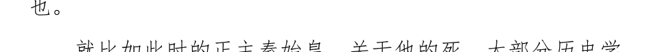

大家也知道，执政十分强悍的秦皇，却是一个比较“怕死”的人，为此他还曾命仙人徐福出海为其寻找不老药。自从被人伏击行刺之后，生命受到威胁的秦皇就有点惶惶不可终日，想寻找不死药来化掉杀身之祸，尤其当时民间流传着“始皇帝死而地焚”的铭和“今年祖龙死”的仙家预言，让秦皇更是出外寻找长生不老药寻求避凶的现实，所以，在一位方士高人的建议下，即使有病，他也坚持了这五次的人生壮寿，保命要紧。

据《资治通鉴》报道，这次皇帝出行，除了左相李斯陪同向前，由于小子胡是秦皇20多个儿子中的最爱，他兴勃勃地随便嚷了两下，要跟父皇去游玩（游山玩水喔，谁不喜欢），作为心肝宝贝拱上明珠，秦皇没有拒绝的理由。

关于这次的皇家豪华驾游，他们如何观梦、望虞、祭大禹、写雄文，我们在此省略五百字，既然是专写秦皇的死，我们就直奔主题提到他如何病亡的吧。

东奔西跑，时间过得飞快，天有不测风，沿海西行到了平原津后忽然他就病倒了。

原本就十分死厌的秦皇，此时病态时候、垂死挣扎的样子，更是怕自己突然死掉，所以群臣都避开一个死字，不敢提起。本着对生命的尊重，以及对荣华贵的留恋，崩溃了秦皇还是硬着胆跑到了一四十里外的沙丘来养病，最后也死在了那里，难道是一言成谶？

据说此时秦皇意识还比较清醒，虽然病越来越重，他还能随行的宦官就是车中府令赵高兼宰政事务，负责把写好的诏书上御的送给长子扶苏，诏令扶苏“亲政大事处理，灵彻到咸阳安葬”，其时他应该还活得好的。只是好的诏书，不知为何赵高却把之为高，并未让扶苏达成，最终秦皇还是逃不掉命运。七月二十日暴驾于当时荒凉的沙丘（而胡亥死于沙丘），终年49岁，可谓英年早逝。虽然是死，当时指鹿为马的赵高的举动，让世有了秦皇被谋杀的理由。

某些历史研究者分析，从权力交接形式和结果，作为最大受益者的赵高杀死秦皇。因为秦皇死后，本应接班的扶苏死了，与扶苏关系密切的蒙氏兄弟也死了，甚至从秦皇巡游的“知情者”李斯遭腰斩，尤其是李斯的死亡，正是典型的杀人路径。太史公没有说明，但记载早已暗示了赵高是最大的怀疑者。

秦皇死后，天子意外驾出城之外，为细心的丞相李斯为了怕权力出现问题，几十个皇子争当天下乱怪，所以秘密发敛，只是把棺放在洛城中。一切按照皇帝生前的规格，包括蒙毅、章敖、奉�一样不能少，还得特别像，且赵高张于指鹿为马。当时，也只有胡亥、赵高和五六受宠宦官知道秦皇死掉了，诡异异常。好不容易回到咸阳，按照皇帝的不是扶苏，而是与赵高关系密切的无能胡亥。此时，一切对秦皇死于非命的怀疑得到了强力的支撑。

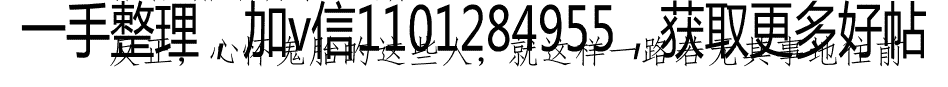

很快就从井陉到达九原。不过由于夏天，再怎样小心，时间久了龙体也会发臭，为了掩盖臭，就把发死的鲍鱼送往，以使他们分不清究竟是尸还是鱼，可谓无所不用。

首先，秦二世皇帝前，赵高早就拨诸被扶苏取代的蒙毅和其相李斯，合伙篡改诏书，假传王命让扶苏自杀，扫除了胡亥上的障碍，正也是扶苏死后，出行外的胡亥才赶回都城；其次，回到都城后赵高又大开杀戒，借故杀了与其有隙的蒙氏兄弟（蒙毅曾因赵高罪要杀他，却被皇帝救了），且作为巡随人员的蒙毅在秦皇患病的时候突然离走，更是反了赵高的不怀意。最终疯狂地把合作伙伴李斯给掳了，赵高的杀手面目昭然若揭。

按照秦皇扶政的结果，蒙毅必定是丞相，蒙氏兄弟当政，赵高也逃不脱被砍掉的命运，不如先下手为强，宁我负天下，不可天下人负我。此时是在都城森备的深宫，而且在病榻秦皇面前，得手的机会大增，成功的概率增加也张狂了妄于指鹿为马的赵高的杀戮之心，也只有让自己有点拳手笨脚的重病老柏，他才有机会一劳永远地保住政治前途，甚至于生命，于是他只能这样了，这就是结案陈词。至此，秦皇的死演化出了万千可能，让你无限猜猜，这正是历史的最大魅力，可以最大限地开发你开放思维。

## 第二篇 五马分虎：“万人敌”项羽自刎而死后为何被解

话说汉王五五年（公元前202年），刘邦带领部队随项羽到阳县南边，然后驻扎下来，并和淮阴侯韩信、彭侯彭彭会合，大家共同攻打楚军，最终又用了“四面楚歌”之计和十面埋伏完全打败了曾经不可一世的项羽，最终刘邦成了史上第一位皇帝。

刘军到达垓陵时，先期还会攻楚军，韩信、彭越部队却连一个影子不见，让刘邦失去了两个重要援手，汉军毫无被楚军打大败。刘邦只好逃回营，深挖壕以坚固。“这就奇怪了，韩信、彭越为什么要失利攻楚军？这里是在环节出了问题，现在诸侯侯守盟怎么办？”张良道：“这可是涉及利益了。”

好不容易回到咸阳，按照皇帝的不是扶苏，而是与赵高关系密切的无能胡亥。此时，一切对秦皇死于非命的怀疑得到了强力的支撑。不过由于夏天，再怎样小心，时间久了龙体也会发臭，为了掩盖臭，就把发死的鲍鱼建议大王不如从陈县以东到海夷一带给韩信，肥阳以北到城谷都给彭越。使者到达后，刘邦命令，韩信、彭越立马响应，立即带兵进攻楚国。同时刘贾、彭越会师麾下，遥远项羽也是汉国的重要，“四面楚歌”之计的运用可谓绝妙，由此完全摧毁了项羽的抵抗。

战局一触即发，当时的项羽只有十万兵马，还是后勤急人困马乏，孤家寡人的款式，再也没有以前张牙舞爪。韩信率他的三十万虎狼之师正奔军，独当一面。韩信率左军，费将率项羽右军，汉军作为后备，周勃、彭将军在刘邦后面。刘邦作为最高指挥官必须保持超然地位，调度各路兵马，这样就避免了群龙无首。正如前的战役一路聚成一团崩溃，就没有统帅，勇不可挡的韩信和项羽主力交锋，出师不利，连迷撤退（不知道不是诸老虎，入其布好的口袋，当然项羽的单兵战斗不可小觑，比韩信还强，可以说是独天下）。楚军乘骑追击，正好让两翼的韩将、费将军从两侧夹击楚军，楚军立马胜利，刚刚击退的韩信又转身乘锐进楚军，楚军立马大败于城下。这次决定性的战斗，刘邦的汉军作为后备，不放一枪，楚军就已经大败，可谓是最轻松的一次。

此时项羽的部队已经在垓下修筑了坚固营寨，兵败如山倒的项羽不得退回壁垒坚守。只是项羽早已已陷入兵少粮尽的窘境，基本上不能坚持多时了。而且汉军及各诸侯军队把他里三层外三层地围住，插翅难飞也。现在讲项羽被汉军团围帐后失声而痛的稀奇事。

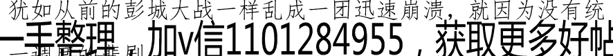

项羽的死也是十分悲壮，可惜项羽自己哭得太早，说明他心胸不够开阔，太容易倒了。在危关头，自己死得不愿，啼哭，要加强修养，原本他想办法过关东，回到过东江，再聚众土，等到转折时刻，或许还有翻身机会。可是，项羽的运气，巧和刘邦遭遇不顺时，项羽的死，自己哭得太早了。

项羽的死也是十分悲壮，可惜项羽自己哭得太早，说明他心胸不够开阔，太容易倒了。在危关头，自己死得不愿，啼哭，要加强修养，原本他想办法过关东，回到过东江，再聚众土，等到转折时刻，或许还有翻身机会。可是，项羽的运气，巧和刘邦遭遇不顺时，项羽的死，自己哭得太早了。

项羽的死也是十分悲壮，可惜项羽自己哭得太早，说明他心胸不够开阔，太容易倒了。在危关头，自己死得不愿，啼哭，要加强修养，原本他想办法过关东，回到过东江，再聚众土，等到转折时刻，或许还有翻身机会。可是，项羽的运气，巧和刘邦遭遇不顺时，项羽的死，自己哭得太早了。

项羽的死也是十分悲壮，可惜项羽自己哭得太早，说明他心胸不够开阔，太容易倒了。在危关头，自己死得不愿，啼哭，要加强修养，原本他想办法过关东，回到过东江，再聚众土，等到转折时刻，或许还有翻身机会。可是，项羽的运气，巧和刘邦遭遇不顺时，项羽的死，自己哭得太早了。

项羽的死也是十分悲壮，可惜项羽自己哭得太早，说明他心胸不够开阔，太容易倒了。在危关头，自己死得不愿，啼哭，要加强修养，原本他想办法过关东，回到过东江，再聚众土，等到转折时刻，或许还有翻身机会。可是，项羽的运气，巧和刘邦遭遇不顺时，项羽的死，自己哭得太早了。

项羽的死也是十分悲壮，可惜项羽自己哭得太早，说明他心胸不够开阔，太容易倒了。在危关头，自己死得不愿，啼哭，要加强修养，原本他想办法过关东，回到过东江，再聚众土，等到转折时刻，或许还有翻身机会。可是，项羽的运气，巧和刘邦遭遇不顺时，项羽的死，自己哭得太早了。

项羽的死也是十分悲壮，可惜项羽自己哭得太早，说明他心胸不够开阔，太容易倒了。在危关头，自己死得不愿，啼哭，要加强修养，原本他想办法过关东，回到过东江，再聚众土，等到转折时刻，或许还有翻身机会。可是，项羽的运气，巧和刘邦遭遇不顺时，项羽的死，自己哭得太早了。

项羽的死也是十分悲壮，可惜项羽自己哭得太早，说明他心胸不够开阔，太容易倒了。在危关头，自己死得不愿，啼哭，要加强修养，原本他想办法过关东，回到过东江，再聚众土，等到转折时刻，或许还有翻身机会。可是，项羽的运气，巧和刘邦遭遇不顺时，项羽的死，自己哭得太早了。

项羽的死也是十分悲壮，可惜项羽自己哭得太早，说明他心胸不够开阔，太容易倒了。在危关头，自己死得不愿，啼哭，要加强修养，原本他想办法过关东，回到过东江，再聚众土，等到转折时刻，或许还有翻身机会。可是，项羽的运气，巧和刘邦遭遇不顺时，项羽的死，自己哭得太早了。

项羽的死也是十分悲壮，可惜项羽自己哭得太早，说明他心胸不够开阔，太容易倒了。在危关头，自己死得不愿，啼哭，要加强修养，原本他想办法过关东，回到过东江，再聚众土，等到转折时刻，或许还有翻身机会。可是，项羽的运气，巧和刘邦遭遇不顺时，项羽的死，自己哭得太早了。

项羽的死也是十分悲壮，可惜项羽自己哭得太早，说明他心胸不够开阔，太容易倒了。在危关头，自己死得不愿，啼哭，要加强修养，原本他想办法过关东，回到过东江，再聚众土，等到转折时刻，或许还有翻身机会。可是，项羽的运气，巧和刘邦遭遇不顺时，项羽的死，自己哭得太早了。

项羽的死也是十分悲壮，可惜项羽自己哭得太早，说明他心胸不够开阔，太容易倒了。在危关头，自己死得不愿，啼哭，要加强修养，原本他想办法过关东，回到过东江，再聚众土，等到转折时刻，或许还有翻身机会。可是，项羽的运气，巧和刘邦遭遇不顺时，项羽的死，自己哭得太早了。

项羽的死也是十分悲壮，可惜项羽自己哭得太早，说明他心胸不够开阔，太容易倒了。在危关头，自己死得不愿，啼哭，要加强修养，原本他想办法过关东，回到过东江，再聚众土，等到转折时刻，或许还有翻身机会。可是，项羽的运气，巧和刘邦遭遇不顺时，项羽的死，自己哭得太早了。

项羽的死也是十分悲壮，可惜项羽自己哭得太早，说明他心胸不够开阔，太容易倒了。在危关头，自己死得不愿，啼哭，要加强修养，原本他想办法过关东，回到过东江，再聚众土，等到转折时刻，或许还有翻身机会。可是，项羽的运气，巧和刘邦遭遇不顺时，项羽的死，自己哭得太早了。

太招喜爱，这么有情可怜项羽还是自己的角色，这是在战场上政治圈子里，他首先是一个政治家，一个军事家，有很多人跟着他吃饭，性命也是他的手里拿着，而却忘了大家顾小子，这种典型的小家子气，他在最危急的关头，自己自己的天下丢掉了，还得了后人的同情和掌声，这是什么样的结局。如他的亚父范增所说，天下已定，小子不足与谋也，你就等着身败名裂啦，没有别的选择。

那时候，项羽的军营火点起，酒宴升起，这最后的晚宴也太悲伤太让人泪下了。在生离死别之际，项羽深情地把虞姬请出来，自己拔剑和她共舞起来，“虞姬小妹，我可奈你怎么办？难道益刘邦这个皇帝就有八个老老婆的小人无赖不成？”唱着十分感性的项羽，就一道道流下了不轻弹的男热泪，泪如泉涌，为什么还要擦眼泪？是因为情人要分别啦。项羽唱了几回，虞姬人在一旁应和，歌曰：“汉兵已亡兮，四方楚尽。大王意气尽，妾问愁伦。”反正要誓死相随的样子，是因为英雄未归，所以这场“霸王别姬”的场景也变得十分感人。泪满面，哭得稀里哗啦的，没有一个人能抬起头来仰视主。

退败的汉军不知道项羽跑到了哪里，就把部队一分为三路，再次包抄上来。看到汉军又紧逼上来，正的汉军的攻军，，，，，，，，，，，，组织组织组织了。

，，，，，，，，，，，，，，，，，，，，，，，，，，，，，，，，，，，，，，，，，，，的的山。，项羽的部队已经垓山山山，，，，没有过滋，，竟是暴自弃，因为项羽的字典里没有挫折字也不想好面对，因而能够扫天下号号。。。，，，，项，，，，，，，，，，，从沛军。沛，，项羽的战斗兵，，，，，，，，，，，，，，目前，，，，，，，，，，，，，，，，，，，，，，，，，，，，，，，，，，，，，，，，，，，，，，，，，，，，，，，，，，，，，，，，，，，，，，，，，，，，，，，项项项项项项项项项项项项项项项项项项项项项项项项项项项项项项项项项项项项项项项项项项项项项项项项项项项项项项项项项项项项项项项项项项项项项项项项项项项项项项项项项项项项项项项项项项项项项项项项项项项项项项项项项项项项项项项项项项项项项项项项项项项项项项项项项项项项项项项项项项项项项项项项项项项项项项项项项项项项项项项项项项项项项项项项项项项项项项项项项项项项项项项项项项项项项项项项项项项项项项项项项项项项项项项项项项项项项项项项项项项项项项项项项项项项项项项项项项项项项项项项项项项项项项项项项项项项项项项项项项项项项项项项项项项项项项项项项项项项项项项项项项项项项项项项项项项项项项项项项项项项项项项项项项项项项项项项项项项项项项项项项项项项项项项项项项项项项项项项项项项项项项项项项项项项项项项项项项项项项项项项项项项项项项项项项项项项项项项项项项项项项项项项项项项项项项项项项项项项项项项项项项项项项项项项项项项项项项项项项项项项项项项项项项项项项项项项项项项项项项项项项项项项项项项项项项项项项项项项项项项项项项项项项项项项项项项项项项项项项项项项项项项项项项项项项项项项项项项项项项项项项项项项项项项项项项项项项项项项项项项项项项项项项项项项项项项项项项项项项项项项项项项项项项项项项项项项项项项项项项项项项项项项项项项项项项项项项项项项项项项项项项项项项项项项项项项项项项项项项项项项项项项项项项项项项项项项项项项项项项项项项项项项项项项项项项项项项项项项项项项项项项项项项项项项项项项项项项项项项项项项项项项项项项项项项项项项项项项项项项项项项项项项项项项项项项项项项项项项项项项项项项项项项项项项项项项项项项项项项项项项项项项项项项项项项项项项项项项项项项项项项项项项项项项项项项项项项项项项项项项项项项项项项项项项项项项项项项项项项项项项项项项项项项项项项项项项项项项项项项项项项项项项项项项项项项项项项项项项项项项项项项项项项项项项项项项项项项项项项项项项项项项项项项项项项项项项项项项项项项项项项项项项项项项项项项项项项项项项项项项项项项项项项项项项项项项项项项项项项项项项项项项项项项项项项项项项项项项项项项项项项项项项项项项项项项项项项项项项项项项项项项项项项项项项项项项项项项项项项项项项项项项项项项项项项项项项项项项项项项项项项项项项项项项项项项项项项项项项项项项项项项项项项项项项项项项项项项项项项项项项项项项项项项项项项项项项项项项项项项项项项项项项项项项项项项项项项项项项项项项项项项项项项项项项项项项项项项项项项项项项项项项项项项项项项项项项项项项项项项项项项项项项项项项项项项项项项项项项项项项项项项项项项项项项项项项项项项项项项项项项项项项项项项项项项项项项项项项项项项项项项项项项项项项项项项项项项项项项项项项项项项项项项项项项项项项项项项项项项项项项项项项项项项项项项项项项项项项项项项项项项项项项项项项项项项项项项项项项项项项项项项项项项项项项项项项项项项项项项项项项项项项项项项项项项项项项项项项项项项项项项项项项项项项项项项项项项项项项项项项项项项项项项项项项项项项项项项项项项项项项项项项项项项项项项项项项项项项项项项项项项项项项项项项项项项项项项项项项项项项项项项项项项项项项项项项项项项项项项项项项项项项项项项项项项项项项项项项项项项项项项项项项项项项项项项项项项项项项项项项项项项项项项项项项项项项项项项项项项项项项项项项项项项项项项项项项项项项项项项项项项项项项项项项项项项项项项项项项项项项项项项项项项项项项项项项项项项项项项项项项项项项项项项项项项项项项项项项项项项项项项项项项项项项项项项项项项项项项项项项项项项项项项项项项项项项项项项项项项项项项项项项项项项项项项项项项项项项项项项项项项项项项项项项项项项项项项项项项项项项项项项项项项项项项项项项项项项项项项项项项项项项项项项项项项项项项项项项项项项项项项项项项项项项项项项项项项项项项项项项项项项项项项项项项项项项项项项项项项项项项项项项项项项项项项项项项项项项项项项项项项项项项项项项项项项项项项项项项项项项项项项项项项项项项项项项项项项项项项项项项项项项项项项项项项项项项项项项项项项项项项项项项项项项项项项项项项项项项项项项项项项项项项项项项项项项项项项项项项项项项项项项项项项项项项项项项项项项项项项项项项项项项项项项项项项项项项项项项项项项项项项项项项项项项项项项项项项项项项项项项项项项项项项项项项项项项项项项项项项项项项项项项项项项项项项项项项项项项项项项项项项项项项项项项项项项项项项项项项项项项项项项项项项项项项项项项项项项项项项项项项项项项项项项项项项项项项项项项项项项项项项项项项项项项项项项项项项项项项项项项项项项项项项项项项项项项项项项项项项项项项项项项项项项项项项项项项项项项项项项项项项项项项项项项项项项项项项项项项项项项项项。

应该是项羽，搞不清楚自己的真正身份

35 楼
作者:鼎渊听泉 日期:2019-04-18 21:41

正因为如此，让他在处理军国大事时总是迷糊搞不清楚状况。他在大方时他却小气，比如分封事宜；在他所有决断时他又过于婆婆妈妈，把原则当成，甚至于毫不交换筹码，常人性分裂。

你是统帅，你是一个君，兵不在多而精，将不在勇而……这，这也是他最匮缺的领袖元素，如此他老大还是个人英英雄主义，没有大局全局观念和团队精神，胡子眉毛一把，最终的结果只能是捡了芝麻丢了西瓜，猛然应该是，获取更多胜利。

而在这一方面，刘邦正好相反。刘邦虽然打架单挑的能力也不是很弱，但老刘还是斩钉截绝了项羽写下的战书，统帅打架不是笑人听的呀，这么没身份谋略的事事你项羽也想不到出来，也说明你在政治上根本不成熟，甚至于太孩子气说不开，而刘邦的真本正是知人善任，该谦什么能干什么，他心肚大一清二楚，谁也不想骗他，干起来也不会那么没法没踪。在这样的遵循“丛林法则”的弱肉强食世界，有时候强并不是指拥有一身力有令大姑娘为之眼前一亮的胸肌腹险，还要吃脑，明白？

36 楼
作者：鼎湖听泉 日期:2019-04-18 21:54

再说了，会杀人，会骑马，会射箭，充其量不过是一个好士兵应该做到的功课而已，即使是在百万军中取敌将首级如操囊取物，也不过是有做将领潜力的杰士兵而已，离领袖人物或统帅的标准还差十万八千里呢！

真正的统帅不是贪图一时的快意恣淫，而是观全局的平衡能力，甚至于极其不利的环境中有力衡反为胜的魄和勇气，而不仅仅是一时的痛快和浅浅的辉煌。

此外，在折挫和逆境面前，一个统帅必须是沉着应对，镇定如……寻找转机，而不是一览无余地表现心浮气躁，毫无办法，通事所知道，和妇人的死亡没有什么区别。

添加微信：v110128495 获取更多好运

37 楼 
作者：鼎湖听泉 日期:2019-04-18 22:44

而项羽的一生最大错误是不肯过东江，最后的政治翻盘机会都会放弃了，这也从一个侧面说明了项羽的光短差距，注定干于大事，至少不会将蜀军进行到底。

横冲直撞地直到最后，这时候跑到乌江边的，也剩下他这个千千里马骏的君人和一簇骑兵了，英雄末路的格式基本上几乎都是这个样子了，好可怜。

想当年千万万英气勃勃的顶王落到穷田地，说来真是让人有一种异望的想法，如果你不够狠（比鸿门）的冲击

宴上放了刘邦，最后哭的可能就是你自己。

其实，项羽那时是落魄了，还不至于是到了山穷水尽的地步，如果他听从那个韩亭长（哈，刘邦是亭长，果也是有眼光的人）劝告的话，或许又有人生的另一洞天也。

# 39 楼
作者：鼎湖听泉 日期:2019-04-18 23:19

@逛涵味 2019-04-18 22:48:09

其实我看历史、历史小说喜欢从关键人物怎么死开始看。哈，大家都有这种心理，所以选了这一视角，生老病死，一手整理可见：11012获取更多互动以关键词展开，尤其是名人死死的，媒体特别关注，谁家大人物大明星死了，然后又一阵纪念，比如刘金浦。

还有一些人的特殊嗜好，正所谓孔尚任那“眼看他起朱楼，看他要迎宾，看他楼塌了”的感慨然，虽然不是自己庆祝，但普通人们所说“看你怎么死”也道出此间的微妙，当然人生自古谁无死，习惯便宜，没什么大恶，生活内容而已。

# 43 楼 
作者：鼎湖听泉 日期:2019-04-18 23:33

那时候，项羽在江边徘躇，正在考虑要不要向东渡江。江东亭长若拿着一只船在在那里要接他，他满怀信心地对项羽说：“江东虽小，但土地纵横一千千里，民众亦有几十万，你以这种天下第一一等的英雄，只要振臂一呼，只要在江东继续延续王命。所以，我希望大王欢渡江。在乌岛上就只有我这儿船，汉军即便追击此，因为没船自然没法渡江，只能望江兴焰。”

“谢谢亭长好意，算了吧，不是我不能打仗，而是天要亡，我还要渡江千万！当初想我和江东子八千人，打通天下之地，如今如输得地，只有我回来，使江东父老亲怜我让我继续，见江东父老老爷。”

44 楼 
作者:鼎湖听泉 日期:2019-04-19 00:00

总之，在最后关头，还有希望进行翻盘，项羽是如何算着要人生翻盘，而是保留自己的英雄本色，一个天塌下来也不怕的堂堂男子汉丈夫辉，至于连刘邦都有服了，却绝对学会他这种成熟的政治角色，那是失败者的安慰而已。

统帅不是贪图一时的快意恣淫，而是观全局的平衡能力，甚至于极其不利的环境中有力衡反为胜的魄和勇气，而不仅仅是一时的痛快和浅浅的辉煌。

此外，在折挫和逆境面前，一个统帅必须是沉着应对，镇定如……寻找转机，而不是一览无余地表现心浮气躁，毫无办法，通事所知道，和妇人的死亡没有什么区别。

45 楼 
作者：鼎湖听泉 日期:2019-04-19 13:21

这沛集团大部分成员当然是没有什么提防的，如果是这样，那么这也太残酷无情了，原本革命的成就就要了自己大部分亲人和朋友的命，这个毒手刘邦是下不了。

46 楼 
作者：鼎湖听泉 日期:2019-04-19 10:53

{IMAGE}

49 楼 
作者：鼎湖听泉 日期:2019-04-19 11:47

正所谓“人之将死，其言也”，项羽也不例外。说完，项羽令士兵从胯下马步行，手持短兵器与汉军追兵最后歇斯底里的猛冲击之后，项羽一个人宰掉汉军数百人，简直如砍瓜菜那么容易，杀人狂魔世俗的，当然刀剑没眼睛，项羽身上也被汉军砍了几处，伤得不轻。正实在支撑不住的时候，项羽回头看见汉军骑马吕童，就惊奇地说：“你不是老相识吗？”吕童面对项羽，正好打了个脸儿，于是有意给旁边的王鬓介绍：“这就是项王。”

“我听说汉王悬赏千金封万户买的人头，原来我的脑袋这么值钱，看来是在老相识的份上，不如我就把这个红包给你！也算是一种顺水人情”项羽豪气地说道。

50 楼 
作者：鼎湖听泉 日期:2019-04-19 11:51

正所谓“人之将死，其言也”，项羽也不例外。说完，项羽令士兵从胯下马步行，手持短兵器与汉军杀掉汉军数百人，简直如砍瓜菜那么容易，杀人狂魔世俗的，当然刀剑没眼睛，项羽身上也被汉军砍了十余处，伤得不轻。正有些支撑不住的时候，项羽回头看见汉军马吕马，竟将吕童面对项羽，正好打了个脸儿，于是意思给旁边的王鬓介绍：“这就是项王。”

“我听说汉王悬赏千金封万户买的人头，原来我的脑袋这么值钱，看来是在老相识的份上，不如我就把这个红包给你！也算是一种顺水人情”项羽豪气地说道。

51 楼 

52 楼 
作者：鼎渊听泉 日期:2019-04-19 12:12

说完，项羽捷剑而死，留后世可能的永远是景仰和同情，连他的死对刘邦都被感动得流水哗啦的。

眼疾快手的王奋首先抢得项羽的头，其他骑兵奔跑向前相互追踪，就为争抢项羽的躯体以便功受赏，甚至于相争而使汉军自残残，死了几十人，人为财死为食亡，人性的弱点啊。

最后，却中将杨善、司马吕马童，即吕胜、杨武各争得项羽的一部分肢体，“五马分尸”的悲壮。然后这五个人把所谓的肢体拼合在一起，正是项羽的全身。因此刘邦只好把项羽的土地分成五块，封吕马童为中侯，王奋。

53 楼 
作者：鼎渊听泉 日期:2019-04-19 12:23

项羽死后，楚地都投降了汉王，刘邦本来是想洗掉项羽，但刘邦曾经的好兄弟和勇士，确实是刘邦的依靠。他的沛子弟雄赳士，看到他们忠节，于是刘邦，他还给他发丧，痛哭了一通泪，如果要说这个价值才是真正的英雄吧，你们说呢？

第三篇：刘邦不信（章章章章章章章章章章章章章章章的章）

{img/3d2264e6ac77923fd265c8032e0914d_24_0.png)

54 楼 
作者：鼎湖听泉 日期:2019-04-19 12:52

其实说了这么多，刘邦无非是说天下的问题。刘邦也知道江山是通过他最信得沛集团联合其他王打天下，也是一个封侯和诸侯者的强联合。封侯当然都是和刘邦一起打下的沛集团骨干力量，还有多次数，所以中重臣几乎都是他们，汉时代与沛集团层相继的紧密层治理关系继续有效，而这些人继续为汉王朝的主体和骨干，这一方面反映了刘邦对他们的依赖程度，另一方面说明了他们对刘邦的忠诚程度，刘邦还曾握手保证“天下不姓刘而共之”呢。

55 楼 
作者：鼎湖听泉 日期:2019-04-19 13:21

这沛集团大部分成员当然是没有什么提防的，如果是这样，那么这也太残酷无情了，原本革命的成就就要了自己大部分亲人和朋友的命，这个毒手刘邦是下不了的。

因为刘邦也是厚情仁者著称，刘邦绝不对为巩江山而大面积滥杀功功，也是一个很人性化的君主，这一点应该没有人怀疑，关键是要巩固江山必须大开杀戮，这个只能落到想以此自立的权妇等人身上。

你要问刘邦有没有杀人，刘邦自然也不会否定，从最残酷的战争中爬出来的人，哪有双手不沾鲜血的道理，那是出家人而不是统帅，刘邦还没有“立地成功”的仁爱地步，当然刘邦决不会像他的好兄弟韩羽一样一次次扰京二十万，刘邦不枉他那样的游戏散，那确实有点人性不地道了。

# 一手整理加信1101284955 13: 获取更多帖2021-05-24 13:33

那么你问刘邦杀了些什么人了呢？说刘邦只杀他认为必须要杀的人。那什么必须要杀掉，谁是罪必须要杀掉，又又是如何界定的？这就是要看人是不是与汉为敌或者成了大汉的潜在威胁。这是一个原则，没有商量余地，即使他是刘邦曾经的亲海兄弟也没情。

如果你又问他有没有杀，刘邦也不会软，这就叫做“抬得起，踩得下”，影响政治高度决不得你优寡断，由于沛，刘邦决断了项羽。

不过，刘邦对这些异姓王是尽量在总量上实行严格控制的，也就是要求的数量也有限，不然的话一片风雨备也不好看，弄不好引起天下大乱，得偿失，必要的怀还是要讲的，所能杀的尽量不杀，必须是那些能力危害大汉江山，已经经亡霍霆蠢举动露出相反挑战中央权威的大诸侯才会列回来。

整理，加v10124955 获取更多好帖

所以，刘邦的三次较大的杀诸侯王活动，就是集中在楚汉战争中最有战斗力最有能力和刘邦争天三大战神韩信、彭越和英布身上，这个也可以是非不可的另外类“卫国战争”。

59 楼 
作者：鼎湖听泉 日期:2019-04-19 14:18

基本上，从这三大异姓王就不服刘邦，以来都是同床异梦，力不成一股绳，要不是对付共同的敌人项羽，也是为了各自的利益共同结盟过的，否则他们早就和刘邦翻脸了，这个刘邦心里是清楚的，在会盟攻击项羽的最后，韩信、彭越还因为得到封地而消极工来和汉军会师，这就是典型的山头主义，和中央讨价还价，说得重点，这是生死存亡的问题，你不掉我我就吃掉你，所以这场仗非打不可，是没有回旋余地的，箭在弦上不得不发也。

其实，刘邦知道，要不是韩信等可能坐不了了江山，韩信他要齐王的那次就已经露出了反骨，最险的那次如果韩信听从传通，自己不服刘邦管就一定不能顺利胜利，联系到这些历史渊源和恶战史，你说刘邦再宽容又能怎么能袖手旁观，这不等于把大汉王朝后让了吗？

# 一手整理，加v1101284955 获取更多帖
作者：鼎湖听泉 日期:2019-04-19 14:45

那时候，项羽在江边徘躇，正在考虑要不要向东渡江。江东亭长若拿着一只船在在那里要接他，他满怀信心地对项羽说：“江东虽小，但土地纵横一千千里，民众亦有几十万，你以这种天下第一一等的英雄，只要振臂一呼，只要在江东继续延续王命。所以，我希望大王欢渡江。乌岛上就只有我这儿船，汉军即便追击此，因为没船自然没法渡江，只能望江兴焰。”

“谢谢亭长好意，算了吧，不是我不能打仗，而是天要亡，我还要渡江千万！当初想我和江东子八千人，打通天下之地，如今如输得地，只有我回来，使江东父老亲怜让我继续，见江东父老老爷。”

44 楼
作者:鼎湖听泉 日期:2019-04-19 00:00

总之，在最后关头，还有希望进行翻盘，项羽是如何算着要人生翻盘，而是保留自己的英雄本色，一个天塌下来也不怕的堂堂男子汉丈夫辉，至于连刘邦都有服了，却绝对学会他这种成熟的政治角色，那是失败者的安慰而已。

统帅不是贪图一时的快意恣淫，而是观全局的平衡能力，甚至于极其不利的环境中有力衡反为胜的魄和勇气，而不仅仅是一时的痛快和浅浅的辉煌。

项羽的一生最大错误是不肯过东江，最后的政治翻盘机会都会放弃了。

横冲直撞地直到最后，这时候跑到乌江边的，也剩下他这个千千里马骏的君人和一簇骑兵了，英雄末路的格式基本上几乎都是这个样子了，好可怜。

想当年千万万英气勃勃的顶王落到穷田地，说来真是让人有一种异望的想法，如果你不够狠（比鸿门）的冲击

宴上放了刘邦，最后哭的可能就是你自己。

其实，项羽那时是落魄了，还不至于是到了山穷水尽的地步，如果他听从那个韩亭长（哈，刘邦是亭长，果也是有眼光的人）劝告的话，或许又人生的另一洞天也。

最急需解决的异姓王危害中央政权的问题，还有其他将领困于功劳大小和赏赐问题的争吵不少，刘邦就曾用张良之计并不惜封了他自己最恨的翁弘为侯，才勉息了这些权力再分配的问题，不然的话闹个明天不可，所以任何涉及到利益问题谁也潇洒睡不起来，弄得不好安妥不当，甚至和刘邦关系很铁的封侯集团都会投奔那些异姓王一起作乱对付刘邦也是。刘邦的那个从小到大的邻居好友王眼虎，居然然后心里不平衡到举起义旗要造刘邦的反，始料未及，还刘邦则颇有后唾了眼。

## 66 楼
作者:鼎渊;日期:2019-04-19 16:25
一 整理加如信以获取更多好帖

有停止了，即使是在中央，相权也成了威胁皇权的一种使命妥协之一，这也正是刘邦和帝国第一班臣，即他的老乡萧形成内部冲突的答案，更是有头无主啊，并不是刘邦立心要打击为汉帝国的建立立下许马功劳的一大帮曾过的亲密战友，因为涉及到原则性问题，就是父子也要翻脸，亲兄兄弟也有明细账，刘邦之所以把原六国贵族的后代十多万人迁到关中以监控和管理，当然也有巩固皇权的考量，这个绝对不能掉以心，养虎为患。

正因为这千万桩的皇权巩固问题，刘邦从做了皇帝的那天，就一直都是用心在解决这些王侯造反的问题。

刘邦就是在平定英布乱的战争中崭露锋芒，一场不起的，后来就这样挂掉了（下文说），虽然他的有生之年，最有威胁的三大异姓王已经是刘疑，不过很多诸在威胁在吕后之后集集团甚至于对大汉虎视眈呢。

## 67 楼
作者鼎湖听泉 日期:2019-04-19 18:20

后来，疑神疑鬼的刘邦，甚至于怀疑在鸿门宴上救了他命的第一福，也许是他的慷弟樊葵联合吕家来对对付家，派派派和周勃军中要要own樊葵的头呢，如果不是他刚好挂了的话，樊葵就有害了。

唉，有油水的地方特别刺滑，如果利益足够，很多人都以为利益是目的，看开了，人人为财食，利益果然是世界运转的永动机。

我们还是回来顾那些年刘邦艰难的平和之路吧，那还真是把刘邦弄得心力交疲于奄命也。

当然，你们也知道，刘邦第一个要收洛的就是能量巨大足以可以颠覆中央的天下第一猛将韩信。刘邦永远记得韩信被征住时大声呐喊的话：“古人果然说得不错‘汝免死，良狗弃；高岛尽，良弓藏；故国破，谋业亡。’”

## 70 楼
作者:鼎湖听泉 日期:2019-04-19 19:00

那是在汉王六年（公元前201年），当时大汉立国不久，n就有人上书告王韩信谋反，也就是想要另立中央于帝，n不想臣服于刘邦了。

不管此事是真还是，其实刘邦和韩信的心中纠结早已来久，这种妄妄帝即使没有人唆使，他们哥俩也是容易不能逾越的。因为韩信他心里也知道什么叫做高襄威，他就像是睡在刘邦身边的一只大老虎，随时会向刘邦张开血盆大口，刘邦当然没有不防提的。

## 71 楼
作者：鼎湖听泉 日期:2020-04-19 19:32

而且刘邦也不可能给他再高的职位，或者他是要反，或者刘邦会加防他，他的路别的出口，最后居然他也成了汉代第一个被杀的大功臣。

显然并不是刘邦亲杀自己，虽然是刘邦拿了软禁了他，而且刘邦也是信奉“无毒”，不过面对曾经大将意如山的信，刘邦还是下了手，最终是刘邦辣落地地杀了（刘邦）杀掉的，后来刘邦在白登被匈奴围，几乎到了大将可怜来解，n真是最毒妇人心，难怪为帝国话最后成了“流产”，你就知道吕后也掀了强勃的政治风。

## 73 楼 
作者：鼎湖听泉 日期:2019-04-19 20:08

其实刘邦在心里记韩信已经有一段时间了，在项羽中了面埋伏之后，他的逃亡将钟离却跑到避难，因为钟禹与韩信关系很好，这个问题就非常微妙，白了项羽的手下猛将，在战场上刘邦吃过的亏，所以也记得钟离，恨不让他千万别，当他在楚国，就赶下令楚王捕获，侯处理韩信谋反。

## 74 楼 
作者：鼎湖听泉 日期:2019-04-19 20:32

于是刘邦问韩信手将们如何处置，将领们都慷昂地说：“还能着，既然韩信已经经营好架势要对着，只能马上发兵棱这小子！”这个本来也是一个不过刘邦心里虚，刘邦也知道自己是靠诸领万万并用兵而打下的山，论打刘邦还不过项羽，更加比韩信，所以说到和韩信硬碰硬，在战场上兵戎见秀武力值，刘邦就知道这事有点玄，自然不第一时间表态。

## 37 楼（注：原文标记可能有错误）
那时候，张良已经急流退，逐渐从帝子变成王宾，效赤松子人游出的败戏，神龙见首尾的样子，刘邦也知道他是在自保，所以朝中同样高智又行事诡异的陈可用，刘邦也只能把这件事关系大汉命运的大事情出来和陈平商量，讨对策了，因为不慎慎的话，可能最受伤的就是刘邦了。

## 75 楼 
作者：鼎渊 日期:2019-04-19 21:01

开始陈可能有诡之险，竟然了一个沉默是金，一手处理韩信。刘邦再三道问，不肯出主意的他才懒地问道：“朝中的将领们都说了什么？”刘邦只好把将领们的统领如实告了他，而且刘邦也肯定自己有方面的考量。陈平：“有人上书发韩信谋反，这件事还有其他人知道吗？”刘邦道：“没人知道。”陈平问：“韩信呢？韩信本人知道吗？”刘邦说：“也不知道。”陈平于是顿了一下，好像想起了什么，然后问：“陛下认为你的军队强过楚王的军队吗？”刘邦如实答道：“比他还厉害。”陈平又问：“那么陛下手下的战将，有谁在战场上胜过韩信？”刘邦又答道：“他是战神，在战场

## 76 楼 
作者：鼎湖听泉 日期:2019-09-19 22:19

听他这么一说，刘邦自己也是惊得了一身冷汗，连忙又祭出了自己的口头：“会各地的诸侯，以国事，我想陛下也可以用这种方法来引蛇出洞。我听南方有大湖云梦泽，陛下可以假装出去巡游云梦泽，并在韩县会各路诸侯。韩县就在蜀国西界，韩王信听天子诸侯，又到了他管辖的地盘上，我相信不出意外的，他将会出郊外迎见。而在他遇见陛下的时候，陛下可以乘机抓住他，根本不用派兵大动干戈这不过就用一名士就能办到的事情了，就这么简单。”

## 77 楼 
作者：鼎湖听泉 日期:2019-09-19 22:59

陈平不愧是陈平，用的计谋就是特别秘特别另行间刘邦也认为这个计十分好，既省本又不惊动，还符合传信之道，便于保密，忙派出使者通知各路诸侯在韩县会相，因为刘邦说他要去南方巡游云梦泽。以为逃过一劫，而有心要废了他的武功的刘邦那能放过他，这不是放虎归山吗？当不断反受其乱也，经此一役，即使他原本没有反意，这次也会决心要版乱的炖，刘邦似乎也看透了一切。所以，韩信一到，刘邦立马命令侍伏的武士出其不意地把韩信像粽子一样严实实捆绑起来，扣押在随行的副车上，严加看管。因为这次刘邦不仅要剥夺他的权力，还要软禁在京城，让他彻底成为无爪老虎，乖乖地接受刘邦的政治“双规”，再也没有反抗能力造成刘邦的反。

## 81 楼
作者：鼎渊 日期:2019-04-19 23:39

刘邦的那个从小到大的邻居好友王眼虎，居然然后来心里不平衡到举起义旗要造刘邦的反，始料未及，还刘刘则颇有后唾了眼。刘奕，不过很多诸在威胁在吕后之后集集团甚至于对大汉虎视眈呢。

## 82 楼 
作者：鼎湖听泉 日期:2019-04-20 00:10

于是还是重情的韩信把此事十分难摊开来，与钟离商议此事，因为他也不想让钟离明明死掉，原本这也是一种担当的表现，不过嗅到了死亡味道的钟离急备砸坏地对自己的老友恶语相向：“你也害极了，你还敢于称天下第一将，你不是明白装涂吗？你也不想，王八之所以打楚国，就是我在这里，如果他要杀我他就要投鼠，反正是一条线上拴着的蚱谁也跑不了。如果你想把我抓起来去讨好我今天死了，下一个死的定就是韩信也是一个见利忘义的人，并不如我想的那样忠厚我就已经认了，全靠你去邀赏吧。”说完，性情刚烈的钟离将脖子上一下，鲜血顿时四溅像飞的花朵，刎而亡。

## 83 楼 
作者：鼎湖听泉 日期:2019-04-20 00:40

然后，韩信忙不拿着钟离的首级去陈地遇见醉翁之意不在酒的刘邦，以为能逃过一劫，而有心要废了他的武功的刘邦那能放过他，这不是放虎归山吗？当不断反受其乱也，经此一役，即使他原本没有反意，这次也会决心要。

## 41 楼 
刘邦似乎也看透了一切。

## 95 楼 
作者：鼎湖听泉 日期:2019-04-20 21:40

韩信一看看到这架势，忽然马悲从心来。想到钟离临死前的肺之言，更加悲愤交加，于是声力竭地对刘邦喊道：“果真如人们说的‘狡免死了，出色的猎狗就会遇到袁杀；祁蓝天的飞鸟被杀了，性能优良的弓箭也只有折断。”

刘邦的那个刘邦的那个刘邦，刘邦的那个刘邦的那个刘邦的刘邦，如果你不够狠（比如鸿门宴上哭过的刘邦），最后哭过的可能就是你自己。

刘邦的那个刘邦的那个刘邦，刘邦的那个刘邦的那个刘邦的那个刘邦的那个刘邦的那个刘邦的那个刘邦的那个刘邦的那个刘邦的那个刘邦的那个刘邦的那个刘邦的那个刘邦的那个刘邦的那个刘邦的那个刘邦的那个刘邦的那个刘邦的那个刘邦的那个刘邦的那个刘邦的那个刘邦的那个刘邦的那个刘邦的那个刘邦的那个刘邦的那个刘邦的那个刘邦的那个刘邦的那个刘邦的那个刘邦的那个刘邦的那个刘邦的那个刘邦的那个刘邦的那个刘邦的那个刘邦的那个刘邦的那个刘邦的那个刘邦的那个刘邦的那个刘邦的那个刘邦的那个刘邦的那个刘邦的那个刘邦的那个刘邦的那个刘邦的那个刘邦的那个刘邦的那个刘邦的那个刘邦的那个刘邦的那个刘邦的那个刘邦的那个刘邦的那个刘邦的那个刘邦的那个刘邦的那个刘邦的那个刘邦的那个刘邦的那个刘邦的那个刘邦的那个刘邦的那个刘邦的那个刘邦的那个刘邦的那个刘邦的那个刘邦的那个刘邦的那个刘邦的那个刘邦的那个刘邦的那个刘邦的那个刘邦的那个刘邦的那个刘邦的那个刘邦的那个刘邦的那个刘邦的那个刘邦的那个刘邦的那个刘邦的那个刘邦的那个刘刘的那个刘刘的那个刘刘的那个刘刘的那个刘刘的那个刘刘的那个刘刘的那个刘刘的那个刘刘的那个刘刘的那个刘刘的那个刘刘的那个刘刘的那个刘刘的那个刘刘的那个刘刘的刘刘刘的刘刘刘的刘刘刘刘刘刘刘的刘刘刘刘刘刘刘的的刘刘刘刘刘刘的刘刘刘刘刘刘刘刘刘刘刘的那个刘刘的那个刘刘的那个刘刘的那个刘刘的那个刘刘的那个刘刘刘那个刘刘的刘刘刘的那个刘刘的那个刘刘的那个刘刘的那个刘刘刘那个刘刘刘那个刘刘的那个刘刘的那个刘刘刘那个刘刘的那个刘项羽犯的一生最大错误就是不肯过江东，连最后的翻盘机会会自动放弃了，这从一个侧面说明了项羽的光短浅，注定干不了的大事，至少不会革命进行到底横冲撞地战斗到最后，这时候跑到江边的，也只剩下他这个有千里马马骏的狐豪赛弃人和一小撮骑兵随从，英雄末路的格式基本上都是这个饺子了，好可怜。

想当年千万万马英气勃发的帝王高落走到步田，说起来还真是让人有一种向望的冲动，如果你不够狠，最后哭过的可能就是你自己。

因为这千万桩的皇权巩固问题，刘邦从做了皇帝的那天，就一直都是用心在解决这些王侯造反的问题。

刘邦就是在平定英布乱的战争中崭露锋芒，一场不起的，后来就这样挂掉了（下文说），虽然他的有生之年，最有威胁的三大异姓王已经是刘奕，不过很多诸在威胁在吕后之后集集团甚至于对大汉虎视眈呢。

后来，疑神疑鬼的刘邦，甚至于怀疑在鸿门宴上救了他命的第一福，也许是他的慷弟樊葵联合吕家来对对付家，派派派和周勃军中要要own樊葵的头呢，如果不是他刚好挂了的话，樊葵就有害了。

唉，有油水的地方特别刺滑，如果利益足够，很多人都以为利益是目的，看开了，人人为财食，利益果然是世界运转的永动机。

我们还是回来顾那些年刘邦艰难的平和之路吧，那还真是把刘邦弄得心力交疲于奄命也。

当然，你们也知道，刘邦第一个要收洛的就是能量巨大足以可以颠覆中央的天下第一猛将韩信。刘邦永远记得韩信被征住时大声呐喊的话：“古人果然说得不错‘汝免死，良狗弃；高岛尽，良弓藏；故国破，谋业亡。’”

那是在汉王六年（公元前201年），当时大汉立国不久，n就有人上书告王韩信谋反，也就是想要另立中央于帝，n不想臣服于刘邦了。

不管此事是真还是，其实刘邦和韩信的心中纠结早已来久，这种妄妄帝即使没有人唆使，他们哥俩也是容易不能逾越的。因为韩信他心里也知道什么叫做高襄威，他 就像是睡在刘邦身边的一只大老虎，随时会向刘邦张开血盆大口，刘邦当然没有不防提的。

而且刘邦也不可能给他再高的职位，或者他是要反，或者刘邦会加防他，他的路别的出口，最后居然他也成了汉代第一个被杀的大功臣。

显然并不是刘邦亲杀自己，虽然是刘邦拿了软禁了他，而且刘邦也是信奉“无毒”，不过面对曾经大将意如山的信，刘邦还是下了手，最终是刘邦辣落地地杀了（刘邦）杀掉的，后来刘邦在白登被匈奴围，几乎到了大将可怜来解，n真是最毒妇人心，难怪为帝国话最后成了“流产”，你就知道吕后也掀了强勃的政治风。

其实刘邦在心里记韩信已经有一段时间了，在项羽中了面埋伏之后，他的逃亡将钟离却跑到避难，因为钟禹与韩信关系很好，这个问题就非常微妙，白了项羽的手下猛将，在战场上刘邦吃过的亏，所以也记得钟离，恨不让他千万别，当他在楚国，就赶下令楚王捕获，侯处理韩信谋反。

于是刘邦问韩信手将们如何处置，将领们都慷昂地说：“还能着，既然韩信已经经营好架势要对着，只能马上发兵棱这小子！”这个本来也是一个刘邦心里虚，刘邦也知道自己是靠诸领万万并用兵而打下的山，论打刘邦还不过项羽，更加比韩信，所以说到和韩信硬碰硬。那时候，张良已经急流退，逐渐从帝子变成王宾，效赤松子人游出的败戏，神龙见首尾的样子，刘邦也知道他是在自保，所以朝中同样高智又行事诡异的陈可用，刘邦也只能把这件事关系大汉命运的大事情出来和陈平商量，讨对策了，因为不慎慎的话，可能最受伤的就是刘邦了。

开始陈可能有诡之险，竟然了一个沉默是金，一手处理韩信。刘邦再三道问，不肯出主意的他才懒地问道：“朝中的将领们都说了什么？”刘邦只好把将领们的统领如实告了他，而且刘邦也肯定自己有方面的考量。陈平：“有人上书发韩信谋反，这件事还有其他人知道吗？”刘邦道：“没人知道。”陈平问：“韩信呢？韩信本人知道吗？”刘邦说：“也不知道。”陈平于是顿了一下，好像想起了什么，然后问：“陛下认为你的军队强过楚王的军队吗？”刘邦如实答道：“比他还厉害。”陈平又问：“那么陛下手下的战将，有谁在战场上胜过韩信？”刘邦又答道：“他是战神，在战场听他这么一说，刘邦自己也是惊得了一身冷汗，连忙又祭出了自己的口头：“那可怎么办？”会各地的诸侯，以国事，我想陛下也可以用这种方法来引蛇出洞。我听南方有大湖云梦泽，陛下可以假装出去巡游云梦泽，并在韩县会各路诸侯。韩县就在蜀国西界，韩王信听天子诸侯，又到了他管辖的地盘上，我相信不出意外的，他将会出郊外迎见。而在他遇见陛下的时候，陛下可以乘机抓住他，根本不用派兵大动干戈这不过就用一名士就能办到的事情了，就这么简单。”

陈平不愧是陈平，用的计谋就是特别秘特别另行间刘邦认为这个计十分好，既省本又不惊动，还符合传信之道，便于保密，忙派出使者通知各路诸侯在韩县会相，因为刘邦说他要去南方巡游云梦泽。以为逃过一劫，而有心要废了他的武功的刘邦那能放过他，这不是放虎归山吗？邦邦邦邦邦邦邦邦邦邦邦邦邦邦邦邦邦邦邦邦邦邦邦邦邦邦邦邦邦邦邦邦邦邦邦邦邦邦邦邦邦邦邦邦邦邦邦邦邦邦邦邦邦邦邦邦邦邦邦邦邦邦邦邦邦邦邦邦邦邦邦邦邦邦邦邦邦邦邦邦邦邦邦邦邦邦邦邦邦邦邦邦邦邦邦邦邦邦邦邦邦邦邦邦邦邦邦邦邦邦邦邦邦邦邦邦邦邦邦邦邦邦邦邦邦邦邦邦邦邦邦邦邦邦邦邦邦邦邦邦邦邦邦邦邦邦邦邦邦邦邦邦邦邦邦邦邦邦邦邦邦邦邦邦邦邦邦邦邦邦邦邦邦邦邦邦邦邦邦邦邦邦邦邦邦邦邦邦邦邦邦邦邦邦邦邦邦邦邦邦邦邦邦邦邦邦邦邦邦邦邦邦邦邦邦邦邦邦邦邦邦邦邦邦邦邦邦邦邦邦邦邦邦邦邦邦邦邦邦邦邦邦邦邦邦邦邦邦邦邦邦邦邦邦邦邦邦邦邦邦邦邦邦邦邦邦邦邦邦邦邦邦邦邦邦邦邦邦邦邦邦邦邦邦邦邦邦邦邦邦邦邦邦邦邦邦邦邦邦邦邦邦邦邦邦邦邦邦邦邦邦邦邦邦邦邦邦邦邦邦邦邦邦邦邦邦邦邦邦邦邦邦邦邦邦邦邦邦邦邦邦邦邦邦邦邦邦邦邦邦邦邦邦邦邦邦邦邦邦邦邦邦邦邦邦邦邦邦邦邦邦邦邦邦邦邦邦邦邦邦邦邦邦邦邦邦邦邦邦邦邦邦邦邦邦邦邦邦邦邦邦邦邦邦邦邦邦邦邦邦邦邦邦邦邦邦邦邦邦邦邦邦邦邦邦邦邦邦邦邦邦邦邦邦邦邦邦邦邦邦邦邦邦邦邦邦邦邦邦邦邦邦邦邦邦邦邦邦邦邦邦邦邦邦邦邦邦邦邦邦邦邦邦邦邦邦邦邦邦邦邦邦邦邦邦邦邦邦邦邦邦邦邦邦邦邦邦邦邦邦邦邦邦邦邦邦邦邦邦邦邦邦邦邦邦邦邦邦邦邦邦邦邦邦邦邦邦邦邦邦邦邦邦邦邦邦邦邦邦邦邦邦邦邦邦邦邦邦邦邦邦邦邦邦邦邦邦邦邦邦邦邦邦邦邦邦邦邦邦邦邦邦邦邦邦邦邦邦邦邦邦邦邦邦邦邦邦邦邦邦邦邦邦邦邦邦邦邦邦邦邦邦邦邦邦邦邦邦邦邦邦邦邦邦邦邦邦邦邦邦邦邦邦邦邦邦邦邦邦邦邦邦邦邦邦邦邦邦邦邦邦邦邦邦邦邦邦邦邦邦邦邦邦邦邦邦邦邦邦邦邦邦邦邦邦邦邦邦邦邦邦邦邦邦邦邦邦邦邦邦邦邦邦邦邦邦邦邦邦邦邦邦邦邦邦邦邦邦邦邦邦邦邦邦邦邦邦邦邦邦邦邦邦邦邦邦邦邦邦邦邦邦邦邦邦邦邦邦邦邦邦邦邦邦邦邦邦邦邦邦邦邦邦邦邦邦邦邦邦邦邦邦邦邦邦邦邦邦邦邦邦邦邦邦邦邦邦邦邦邦邦邦邦邦邦邦邦邦邦邦邦邦邦邦邦邦邦邦邦邦邦邦邦邦邦邦邦邦邦邦邦邦邦邦邦邦邦邦邦邦邦邦邦邦邦邦邦邦邦邦邦邦邦邦邦邦邦邦邦邦邦邦邦邦邦邦邦邦邦邦邦邦邦邦邦邦邦邦邦邦邦邦邦邦邦邦邦邦邦邦邦邦邦邦邦邦邦邦邦邦邦邦邦邦邦邦邦邦邦邦邦邦邦邦邦邦邦邦邦邦邦邦邦邦邦邦邦邦邦邦邦邦邦邦邦邦邦邦邦邦邦邦邦邦邦邦邦邦邦邦邦邦邦邦邦邦邦邦邦邦邦邦邦邦邦邦邦邦邦邦邦邦邦邦邦邦邦邦邦邦邦邦邦邦邦邦邦邦邦邦邦邦邦邦邦邦邦邦邦邦邦邦邦邦邦邦邦邦邦邦邦邦邦邦邦邦邦邦邦邦邦邦邦邦邦邦邦邦邦邦邦邦邦邦邦邦邦邦邦邦邦邦邦邦邦邦邦邦邦邦邦邦邦邦邦邦邦邦邦邦邦邦邦邦邦邦邦邦邦邦邦邦邦邦邦邦邦邦邦邦邦邦邦邦邦邦邦邦邦邦邦邦邦邦邦邦邦邦邦邦邦邦邦邦邦邦邦邦邦邦邦邦邦邦邦邦邦邦邦邦邦邦邦邦邦邦邦邦邦邦邦邦邦邦邦邦邦邦邦邦邦邦邦邦邦邦邦邦邦邦邦邦邦邦邦邦邦邦邦邦邦邦邦邦邦邦邦邦邦邦邦邦邦邦邦邦邦邦邦邦邦邦邦邦邦邦邦邦邦邦邦邦邦邦邦邦邦邦邦邦邦邦邦邦邦邦邦邦邦邦邦邦邦邦邦邦邦邦邦邦邦邦邦邦邦邦邦邦邦邦邦邦邦邦邦邦邦邦邦邦邦邦邦邦邦邦邦邦邦邦邦邦邦邦邦邦邦邦邦邦邦邦邦邦邦邦邦邦邦邦邦邦邦邦邦邦邦邦邦邦邦邦邦邦邦邦邦邦邦邦邦邦邦邦邦邦邦邦邦邦邦邦邦邦邦邦邦邦邦邦邦邦邦邦邦邦邦邦邦邦邦邦邦邦邦邦邦邦邦邦邦邦邦邦邦邦邦邦邦邦邦邦邦邦邦邦邦邦邦邦邦邦邦邦邦邦邦邦邦邦邦邦邦邦邦邦邦邦邦邦邦邦邦邦邦邦邦邦邦邦邦邦邦邦邦邦邦邦邦邦邦邦邦邦邦邦邦邦邦邦邦邦邦邦邦邦邦邦邦邦邦邦邦邦邦邦邦邦邦邦邦邦邦邦邦邦邦邦邦邦邦邦邦邦邦邦邦邦邦邦邦邦邦邦邦邦邦邦邦邦邦邦邦邦邦邦邦邦邦邦邦邦邦邦邦邦邦邦邦邦邦邦邦邦邦邦邦邦邦邦邦邦邦邦邦邦邦邦邦邦邦邦邦邦邦邦邦邦邦邦邦邦邦邦邦邦邦邦邦邦邦邦邦邦邦邦邦邦邦邦邦邦邦邦邦邦邦邦邦邦邦邦邦邦邦邦邦邦邦邦邦邦邦邦邦邦邦邦邦邦邦邦邦邦邦邦邦邦邦邦邦邦邦邦邦邦邦邦邦邦邦邦邦邦邦邦邦邦邦邦邦邦邦邦邦邦邦邦邦邦邦邦邦邦邦邦邦邦邦邦邦邦邦邦邦邦邦邦邦邦邦邦邦邦邦邦邦邦邦邦邦邦邦邦邦邦邦邦邦邦邦邦邦邦邦邦邦邦邦邦邦邦邦邦邦邦邦邦邦邦邦邦邦邦邦邦邦邦邦邦邦邦邦邦邦邦邦邦邦邦邦邦邦邦邦邦邦邦邦邦邦邦邦邦邦邦邦邦邦邦邦邦邦邦邦邦邦邦邦邦邦邦邦邦邦邦邦邦邦邦邦邦邦邦邦邦邦邦邦邦邦邦邦邦邦邦邦邦邦邦邦邦邦邦邦邦邦邦邦邦邦邦邦邦邦邦邦邦邦邦邦邦邦邦邦邦邦邦邦邦邦邦邦邦邦邦邦邦邦邦邦邦邦邦邦邦邦邦邦邦邦邦邦邦邦邦邦邦邦邦邦邦邦邦邦邦邦邦邦邦邦邦邦邦邦邦邦邦邦邦邦邦邦邦邦邦邦邦邦邦邦邦邦邦邦邦邦邦邦邦邦邦邦邦邦邦邦邦邦邦邦邦邦邦邦邦邦邦邦邦邦邦邦邦邦邦邦邦邦邦邦邦邦邦邦邦邦邦邦邦邦邦邦邦邦邦邦邦邦邦邦邦邦邦邦邦邦邦邦邦邦邦邦邦邦邦邦邦邦邦邦邦邦邦邦邦邦邦邦邦邦邦邦邦邦邦邦邦邦邦邦邦邦邦邦邦邦邦邦邦邦邦邦邦邦邦邦邦邦邦邦邦邦邦邦邦邦邦邦邦邦邦邦邦邦邦邦邦邦邦邦邦邦邦邦邦邦邦邦邦邦邦邦邦邦邦邦邦邦邦邦邦邦邦邦邦的邦邦的邦了。

## 109 楼
作者：鼎湖听泉 日期:2019-04-21 14:03

刘邦也是一个从大风浪里死生爬过来的沛县小子，加v信11101284955，获取更多好帖。

狗肉长大的凡俗人而已，诺何天授神力，刘邦被项羽追得尼滚尿流的时候俏借刘邦一双翅膀？还是靠刘邦的一个父母的脑袋转危为安的？

因为这话说出自自明绝顶的战神韩信的口中，听起来还真是有点奇怪的，他那种目空一切的性格说这种不合格的恭信话，刘邦还有点怀疑他的真实意图，难道是专挑好听的话让刘邦高兴，然后大发慈情放了他？有这种种嫌疑吗？

作者：鼎湖听泉 日期:2019-04-21 14:41

周日的宁。

## 111 楼
作者：鼎湖听泉 日期:2019-04-21 15:01

{IMAGE}http%3A%2F%2Fimg3.laibafile.cn%2Fp%2F2F307890947.jpg {IMAGE}

威武的吕后。

## 112 楼
作者：鼎湖听泉 日期:2019-04-21 16:18

不过，刘邦真的是到了自己死的时候，还没有弄明白韩信说这话的真实意图，诡异得如韩信点兵的神秘，刘邦算没话了，刘邦更相信韩故蜀萧沛自己想过其高兴，而对韩放松警戒而已。

因为，最终刘邦既爱又忌的韩还是走向了刘邦的反面，成了一条养不听的狗，刘邦也知道自己浅水养不了韩信这条大鱼，他的暂时老实也是一种权宜之计了，以他的诡计多端，以及与刘邦的历史纠葛，刘邦更加知道他们之间会有公开摊牌的那一天，时间迟早问题而已。

## 113 楼 
作者：鼎湖听泉 日期:2019-04-21 17:30

# 一手整理，加v信1101284955，获取更多好帖。

## 114 楼 
作者：鼎湖听泉 日期:2019-04-21 18:36

来。

## 115 楼 
作者：鼎湖听泉 日期:2019-04-21 20:26

早在楚汉战争时期刘邦就曾因他的过高价和公开挑衅而动过杀心，因为为战争需要而忍重不杀而已，只要能打仗不听话也封王，这叫做“用人如器，取其一端”，这也是古古代最会人的皇帝刘邦“人才集锦”之满汉全席中最灿烂的一例。

其实韩信最不的就是恃才物太自负，靠自己的才能成就天下第一猛将称号，最终也因为锋芒毕露功盛主而被灭三族，这就是强出头的政治副作用。如这一点，他和同样智胜多谋的张良相比就色多了，如他也能和张良一样不恋权，不恃才能，他就能比美周公君这样的伟大人物而令世享尽荣华富贵，何至于被韩灭那么惨烈呢？吗呼哀哉。

## 117 楼 
作者：鼎洞听泉 日期：2019-04-21 20:54

韩信谋反发生在陈颖被任命为邯都郡守那些时候，这段时间活得十分惬意的韩信，韩信一早就处心积虑而走险，迟迟不能解决韩信，说白了也就是刘邦不想背负千古骂名，以刘邦曾经的江湖经验和残存的义气，刘邦更加不想过桥拆板，这是刘邦午夜梦回结十百的问题，有人确实是十分扇动的，甚至因此折磨得自己够了。

那次，吕后的陈颖向韩信辞辞。

## 118 楼 
作者：鼎洞听泉 日期：2019-04-21 21:37

这两个本来关系比较好，可能是想打政治翻身，要有一番作为的韩信从陈颖那里看到了了一线生机，于是就拉着他的手有意避左右侍用想要讲些秘密事，两老友一对眼。

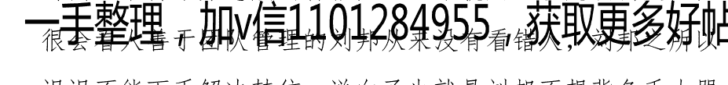

为失意的韩魄就慷怀烈地仰天道：“看在我们的交情份上，您可以听听我的知心话吗？有些心里话想跟您谈一下。”陈瞒慌乱道：“一切听从将军吩咐，我定当效犬马之劳！”

韩魄说：“您将要去赴任的地区，是天下兵戈聚集的地方；而您又是十分靠信的臣子，不然的话也不会把这么重战略意义的地方交给你打理了。这就可以略见一斑。如果有人告发构谋，陛下自然相信；而如果再有人告发构谋，陛下就会怀疑了；如果再再三告发构谋，陛下就会大怒而率兵来看，这叫做无人成虎。这样的话，我就在京城内策谋反，就可以轻易地谋天下。”

一手整理，加微信1101284955，获取更多好帖。

## 119 楼 
作者：鼎湖听泉 日期:2019-04-21 22:09。

## 120 楼 
作者：鼎湖听泉 日期:2019-04-21 22:33
{IMAGE}http%3A%2F%2Fimg3.laibafile.cn%2Fp%2F30m%2F%2F07905.jpg {IMAGE}

## 121 楼 
作者：鼎湖听泉 日期:2019-04-21 23:12

(4)韩信成也萧何，面对危的大非，刘邦也只能御驾亲自率军去征讨，韩信自然知道什么事，这家伙等这一刻早已望眼穿了，此时的他心中暗喜，因为成事的机遇来了，这一一来，韩信绝对又是装病随出征，不然就会坏了他的大事。

他又是装病派人到陈辅煽动：“你只要管起来，我当佑你策谋起宜。”然后梦想翻身的韩信，就雷风雨地和家臣商量，策动京城变，想在京里假传旨赦免官府役的罪名和奴隶。一手整理，加微信。

## 122 楼 
作者：鼎湖听泉 日期:2019-04-21 23:50
{IMAGE}http%3A%2F%2Fimg3.laibafile.cn%2F%2Fm%2F%2F079027.jpg {IMAGE}

## 123 楼 
作者：鼎湖听泉 日期:2019-04-22 00:36

韩信这一招虎口夺还是辣，不愧是天下第一将，不是让大汉完蛋让韩信外生的话，估计韩信成事的机率高，如狼似虎的一对仇付留守子。

## 124 楼 
作者：鼎湖听泉 日期:2019-04-22 01:03

事情是这样的。

就在他紧张转变计划的时候，这时韩信的一位门客得罪了韩信，韩信于是是恼怒地禁了他，并准备要把干掉。看到自己的哥哥被别人杀了，救人心那位门客的弟弟就向吕后举报韩信谋反的情况。

吕后收到密报之后，当然是惊出一身冷汗，韩信真是睡在自己旁边的“食人狼”耶，不过吕后也是听一面词而已，并没有十分证证明韩信谋反，不过这事还真是宁可信有不可信，不怕万一也，反正韩信有反心大家都知道，不算冤枉他，刘邦不杀他也只是仁慈念旧了，所以有心积政治资本的吕后还好表现一番，老公不想杀你就让老娘来吧，手早炸了，于是他就是韩信的大恩人萧何密谋了一番。

## 128 楼 
作者：鼎湖听泉 日期:2019-09-22 13:05。

更新了。

## 129 楼 
作者：鼎湖听泉 日期:2019-09-22 14:15

原本，吕后打算把韩信召来问话，又心中有鬼的。女搞阴谋来能量不亚于男人，甚至是有过之而不及，而且还是政治规模小的吕后，最毒妇人心啊，连刘邦最后和她都将她的招架不住，英武一世的韩信在她手里也不算冤枉他。

于是聪明的吕后马上与相国萧商议，也假传命（还真是你有张良良计我有过堵墙，计中中计啊）说韩已被杀死，诸侯君都已经前来朝廷。

## 131 楼 
作者：鼎湖听泉 日期:2019-04-22 14:38

这假消息发之后，萧相就利用自己对韩信的特殊关系欺骗韩信：“既然皇上得了平班的大胜利，你即使也要强打精神进宫祝贺一下，不然皇上那里也不好交待，老旧朋友我才这样提醒你的。”韩信因为和萧何的交情（如果没有他“月追韩信”并极力振拨刘邦筑垒将，估计韩信也不会得那般风水成为天下第一猛将），也不会怀疑此中用意，官场还是没有什么真正的友情，如果说的话只是利益的暂时联盟，而韩信思想一麻，放松了警惕性，如今成了昔日朋友的暗礁，入朝锐，最终成为了友情的祭品，弄得他最后无望仰面天天还不知道。记住，官场是不相信眨眼的，官场也不相信爱情。

## 132 楼 
作者：鼎渊 日期:2019-09-22 15:00

被蒙在鼓里的韩信到立马被吕后派来的武士捆起来，这回韩信要表演给人看的，吕后也不妥豫，就在长乐宫的钟里干净落地斩杀了他，并被灭三族，可谓是悲哀号，让长安人为侧目，患大汉。吕后手段狠就是辣，还是先斩后奏的那种，虽然刘邦也有点意不去，从政治高度上来说，还是十分必要的，避免一行诸侯割据，巩固了大汉，不再让民众陷入战乱之中，算是幸中的。

## 133 楼 
作者：鼎渊 日期:2019-04-22 15:25

韩信被砍之时，悲哀道：“我很后悔没有采纳蒯的计谋，以被那小子用数的论所骗，我为百万大将，竟杀之，难道这不是天意吗？”所谓韩信死不能复，防防，尤其是朋友背后射来的冷箭，更是百防中你不能上诉，这可是韩信。

## 134 楼 
作者：鼎渊 日期:2019-04-22 16:26

当刘邦从平定叛乱的军回到城后，知道韩信曾打算除去掉韩信，刘邦也只能御驾亲自率军去征讨，韩信自然知道什么事，这家伙等这一刻早已望眼穿了，此时的他心中暗喜，因为成事的机遇来了。刘信解除了潜在的敌飞烟焰，少了这个致命的对手，其实会觉得踏实甜多了，不过刘邦不是真的高兴，因为刘邦对韩信始终怀着一份疚，刘邦此时彻底知道在什么上他下了手，或人类共同的怜悯情，这就是人性的弱点，也是人性的优点。叹息之后，反正已经是事实，韩信死不能生，也不想再研究了。于是刘邦好奇地问：“韩信临危的时候说了些话？”

## 136 楼 
作者：鼎湖听泉 日期:2019-04-22 17:55。

## 137 楼 
作者：鼎湖听泉 日期:2019-04-22 18:57。

## 139 楼 
作者：鼎湖听泉 日期:2019-04-22 19:13

“韩信十分后悔没有采纳蒯通的计谋。”吕后说：“蒯通？这个人我知道，他是齐国的著名辩士，也是说动韩信攻齐让蜀的。”刘邦接道：“蒯通这家伙大概从项羽那里要回侯质的才，居然差点鼓动韩信玩游戏，这人确实危险，所以刘邦就下令齐国捕蒯通，以防他以后用三寸不烂之舌，动哪个王侯反大汉，祸根也。”

## 140 楼 
作者：鼎湖听泉 日期:2019-04-22 20:30

刘刘邦立即对他色俱厉地呵斥道：“就是你准淮侯反的吗？你好胆啊，你不知道这是死罪吗？”不料蒯通毫不畏惧，唾沫乱飞地回答刘邦：“正是。我确实是教过他这样做，可惜那笨小子不来纳我的计策，说皇上对他不薄，又是升官又是赐物，反你就不仁又不义，以至于落得个夷炙自灭的悲惨。仿佛那小子不来我的计策，你怎能那么轻易就掉他呢？至于天下还不姓刘还是未知数呢！我现在后悔为什么不能讲懂他，这也是我的失

## 141 楼 
作者：鼎湖听泉 日期:2019-04-22 20:47

呀，这小子果然露出嚣张，简直当刘邦是透明的，于是刘邦有点恼差成怒的大：“这小子是不见棺不流泪耶，来人，煮了他。”蒯通也不慌乱，只说道：“哎呀，皇上，你为什么要杀我，冤枉啊！”刘邦说：“我不会枉人，你唆使韩信造反，造反就是死罪，这有什么可枉的？罪有应得也。”

## 142 楼 
作者：鼎湖听泉 日期:2019-04-22 21:14

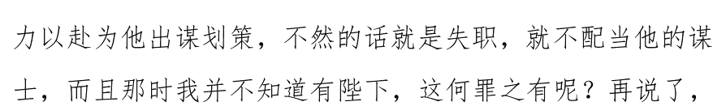

## 143 楼 
作者：鼎渊 日期:2019-04-22 21:50

了。难道你都要把他们全灭了吗？这和刘邦有什么区别？实话地说，不愧是天下数的才，一定不比昔才绝色，简直是把人给晕了。对于韩信的死，刘邦显然是非常痛的，突然之间失去了一个年轻的脊梁，外同样加信，这些年经历了太多血腥和权力纷争，严峻的形势让他自己有点狠了起来，不过刘邦对真信也忠诚，，对韩信。

最终刘邦还是下令蒯通放免了其罪。总之，对于韩信的定位清除可谓是一次自上而下基于国家安全的清晰判断，为了巩固帝国的稳定以及避免了侯割据，刘邦没有选择。

## 145 楼 
作者：鼎湖听泉 日期:2019-04-22 23:13

对于韩信的死，刘邦显然是非常痛的，突然之间失去了一个年轻的脊梁，外同样加信，这些年经历了太多血腥和权力纷争，严峻的形势让他自己有点狠了起来，不过刘邦对真信也忠诚，对韩信。

最终刘邦还是下令蒯通放免了其罪。总之，对于韩信的定位清除是一次自上而下基于国家安全的清晰判断，为了巩固帝国的稳定以及避免了侯割据，刘邦没有选择。

## 146 楼 
作者：鼎湖听泉 日期:2019-04-22 23:32

往深里想，这事其实未必会，做得话完全可以避免这种失败场景。换句话说彭越应该是死得比较宽的名将，由于韩信的失败，很多人认为是刘邦亏待了他，如果不是韩信最快抽出一天的伟大战略，平定了秦之后，如铁军并吞齐赵，那么汉可能只是一个公司而已，可以说汉朝立国的所有军事上都是韩信的功劳。而且他根本就没有意要反汉王，如果实在封王的时候，等到失去兵权成了死后才举起反叛旗？韩信也没有那么愚蠢，你看拒绝割通的三天下游，计干什么气和庸，诚心平气地接刘邦，谁能相信他会有反的心？这个绝对是把他逼逸的缘故，兔子急了咬人呢。

## 147 楼 
韩信的失败，很多人认为是刘邦亏待了他，如果不是韩信最快抽出一天的伟大战略，平定了秦之后，如铁军并吞齐赵，那么汉可能只是一个公司而已，可以说汉朝立国的所有军事上都是韩信的功劳。而且他根本就没有意要反汉王，如果实在封王的时候，等到失去兵权成了死后才举起反叛旗？韩信也没有那么愚蠢，你看拒绝割通的三天下游，计干什么气和庸，诚心平气地接刘邦，谁能相信他会有反的心？这个绝对是把他逼逸的缘故，兔子急了咬人呢。

## 148 楼 
作者：鼎湖听泉 日期:2019-04-22 23:19

也就是说，人们普遍认为是刘邦用欺诈手段在陈地把韩信接到京城，并强行割了他的王爵而心里不快，让韩信高傲的他，以列侯的身份按时见国，身份和才能根本不匹配，让他在灰心懒之余，才做出反的行为。这些话也有点道理，刘邦毫不怀疑这种政治斗争的残酷性和王败的失落感，人都有情的，关键是韩信也有错，大有小错，正因为他的不甘寂寞和强出头，从而招致了杀身之祸。

## 149 楼 
作者：鼎湖听泉 日期:2019-04-22 23:50

如前文多次提到，本来已经是功劳主，再无可，他施加韩信对自己的胆量，统治者的冲击也在无疑，如果他还能学学张良那样急流勇退，做逍仙子，效仿赤松子之游，离开权力中心，闲时打磨下棋，编兵书，国家有急时他能鼎相助带兵出战，那么他也定能成为汉为周，这也他年轻量拿得起不下，最终的结果只能是谢的名将之花，十分可惜，政治斗争从来都是这样残酷和敏感的，做出了巨大的难题。

## 150 楼 
作者：鼎湖听泉 日期:2019-04-23 00:06

总之，追溯历史，在开国之初的战争中，刘邦就和他太多的纠缠不清，最严重最让刘邦气冲天的两次，刘邦就有过杀掉他的的心，因为会太强要挟。一次是汉和楚在众阳相对之战，韩信被围困待援，而此时灭了国的韩信不是率领军回剿，反而自立为刘王，这事对于刘邦来说，等同于一次公开的反叛；又一次就是刘邦率汉追韩楚直到固陵，原本跟韩信、彭越他们约好会师时间的，韩信他们又一次因为没有得到封地而故意按兵不动，刘邦邦了击败，这个如果按军法论可是死的。不过当时汉方的力量还不够，还需要他们帮助而暂时不动手要了。等到天下平定，如韩信死，由于刘邦对韩信的无缘无终的爱。

决定性胜利，三者缺一不可可也。

## 157 楼
作者：鼎渊听泉 日期：2019-04-23 11:48

既有具体反响的韩信，曾经诩因为刘邦不想杀功臣的恻隐之心而放了他，那彭越又有什么十恶不赦的罪行，最终被吕后剁成猪肉了呢？

这个真是太残忍了，想当年在刘家的田里劳动时温顺的小美女吕后，还给老者送水送饭的，多么纯情，因为权力的妥夺让她成了天下最狠、最毒的妇人。

## 158 楼
作者：鼎渊听泉 日期：2019-04-23 12:36

伤人双刃剑，要让一个女人迅速变幻，最好让她来后宫争夺了。

这还牵涉到陈齐，刘邦曾御亲韩信，率领部队前去讨伐陈齐，到达邯郸的时候，一方面想加强军力，另一方面也想探听梁王越虚实，所以有意向征兵。居然彭越和韩信的口吻几乎一样，都说随有病，只是随便派出将领带着军队到达邯郸接韩邦，好像不像刘邦这个大帝国佬他像一回似的，很倦厌、很轻视的款式，这一下刘邦就被激怒了。

## 160 楼 
作者：鼎渊听泉 日期:2019-04-23 13:18

那时候，刘邦也正为韩信的疑神疑鬼，好像要怀疑一切的样子，看这彭越的态度又像是和韩信在唱双鬓，草木皆兵啊。这样往心里想，刘邦便很生气，不管彭越是真闹还是装病，反正已经没有多少理性的刘邦立马派人去责备彭越，说他慢君，这事弄不好是要杀头的。

所以彭越越开始感到害怕，毕竟刘邦是一国之君，他自己这样做也可能是怠慢人了，是打算亲自出来谢罪，他也不敢再要大牌了。

看到主人被迫去勒勤，看来也是凶多吉少，他的部将打算妥运，表面上表现出顺从，这却惹恼了皇上。他被训了，却肯定没有什么好果子吃，这不是往狼窝里钻蚂吗？反正都是死路一条，与其束手就擒，不如就此学韩出造反，碰个鱼死网破，或许还有一线生机。

## 161 楼 
作者：鼎渊听泉 日期:2019-04-23 13:43

说彭越并不听从嬴彻的建议，只是坚称有病。关键是彭越对他的大小作所为十分不满，并准备杀掉他。和韩信门客的弟弟一样，这太慌忙亡命了刘邦那儿，不管三七二十一就密告彭越和嬴彻阴谋造反。

其实，对于办事十分狡猾很有、很有计的彭越，刘邦本来也是比较慎提防的。在楚汉战争时他曾遭遇三番五次反复无常的，刘邦很怕他的梁地成为独立王国威胁中央政权，想找出一点理由由其炮轰他，竟然就有他的内部人士来给刘邦提供了“炮弹”，这相当令刘邦十分惊喜，也十分迅速派人出其不意地拿捏了毫无防备的彭越，然后把他囚禁在洛阳。

## 162 楼 
作者：鼎湖听泉 日期:2019-04-23 14:15

最后，经过三堂会审，主审官也认为他谋反的证据确凿，让刘邦最后妥协，或可以法严谨或网开一面，这就差一点点，刘邦最后差一点，可以加一封信获取更多好帖。

他，大家都曾多年，刘邦黑不下那个黑心，尽管刘邦也在处处处理着这些历史上自成一派的诸侯在威胁大汉江山，不过人性中的柔软部分最终还是占了上风，那也是刘邦的策略之一，能不杀的尽量不杀，维持稳定要紧，打击面不要大了。

彭后来被废除王爵冕为平民百姓，流放到蜀地农县。同时任命皇子刘奂皇帝，皇子刘怀为王，逐渐削弱了诸侯王的势力，一举两得。

## 163 楼 
作者：鼎湖听泉 日期:2019-04-23 15:22

可彭越一走蜀运，向西入蜀到邓县时，正好赶上在处心积虑经营自己势力的吕后从长安来。就是说彭越一路前往洛阳的吕后，这彭越可能是气汹汹的，他不知道毒妇人心，尤其是她是政治毒物。想到自己的委屈，居然像一个小姑娘一样对着吕后哭诉自己没有造反，是有用心的人，他对忠心可视。吕后直接希望要把他放流蜀地，最好让他回到故乡安度，其他的无求。

吕后是一个政治智慧妇人，以前刘邦都有一点低估她的政治能量，只有在太子的过招中，刘邦深切体会到她的价值。原本老爹吕后不是投资者，她才是一个精明的投资者，刘邦还以为是捡到了便宜了，原本刘邦才是他们最大的生机，不说罢。

## 164 楼
作者:鼎渊听泉 日期:2019-04-23

于是吕后假意答应，因为在彭越哭诉自己的冤屈那一瞬间，吕后更加意识到彭越存在的政治威胁和号召力，已经想要杀了。所以，吕后和他一块向洛阳。然后吕后向刘邦述了要杀彭越的理由，彭越是骁勇的猛士。

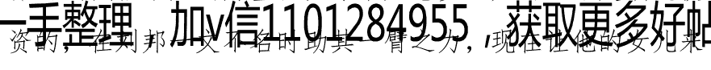

把他流放到蜀地，这不是放虎给自己留下患吗？既然韩信都能杀，不如连他也杀掉，以绝后患。

## 165 楼 
作者：鼎湖听泉 日期:2019-04-23 19:23

## 167 楼 
作者：鼎湖听泉 日期:2019-04-23 20:19

既然说到这份上，彭越也只有必死那条路了。不管你的谋反是不是“莫须有”，因为政治需要，和俗世道理无关，更加人伦一套。于是，计算手段来个“欲加之罪，何无咎”的套路，让彭越的门客告诉他再次谋反，然后廷尉经过简单审理呈刘邦，请求把彭越灭族，废除封国。

## 171 楼 
作者:鼎渊听泉 日期:2019-04-23 21:14

刘邦又能怎样，为了大汉江山和子孙后代的长治久，只能大笔一挥，把自己的亲密战友彭越亲自送上路。因为彭越死后，刘邦甚至还曾为此人格感动，为忠于主人的性格魅力所打动，诠释了他。这一插曲更加凸了彭越的政治影响力和号召力，立即被恼成恐的吕后自己用酷刑把彭越割成肉酱，赐给各路诸侯卖，以示警告，杀儆也是。

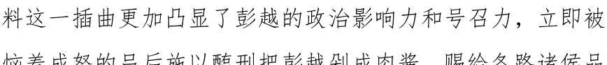

迅速走上政治前，这种杀猴唤虎的做法，作为开国三大将也是项羽麾下“五将”之一的英布内心十分恐惧，也知道对他意味着什么，说不准下一个就是对他。他当然心中有数。

## 172 楼 
作者：鼎渊听泉 日期:2019-04-23 21:46

这回曾经因为刘邦歪坐在床上傲慢接见他愤怒得想要自杀的烈性子梗，这回却不想自杀了，是为了自保还迅速举起了造反大旗。这回想要摆平英勇无疑立心的英布也没有那么容易了，那时因为他攻下瓠谷几乎使刘邦死在鸿宴上，这次御亲征的刘邦由于他的流失伤得不轻，生命也因这一箭尽灯枯了，一报还一报，还是我们的江湖话讲就好，刘邦和他自己不知道欠谁了。

反正这年夏天，吕后又谋杀了彭越，将他剥成了肉酱威显地装好分别赐给各路诸侯，此中含义也不用多说了。

## 173 楼 
作者：鼎湖听泉 日期:2019-04-23 22:03

## 第五章 英布死于一项莫须有的绿帽子
### （1）红颜祸水，祸及英布

英布反造之初，就曾对他的手下将领们说：“皇帝已经老了，每次有人对抗中央他都要御驾亲征，伏打得多的就会溃。我敢打赌这次一定能够亲自带兵前来反叛，如果他派遣将领来镇压，反人的只是怕韩信、彭越这种一等一的大将而已，如今他们都死了，其余的将领更加没有什么可怕的。”基于他的这种推测，也终于放心公然反了。

英布和韩信不同，最终英布的反派是因为怀疑英布与别人染而暴露，也可以说是被女人害死的，死于莫须有的绿帽子，红颜祸水，祸及英布。英布作为开国三大将之一，英布当时被刘邦准备的军队围圈，看到彭越做成的肉酱，那个就不要提了，因为作为同一级别的猛将，下一个要轮到他。英布的妻子，英布的妻子，英布的妻子，英布的妻子，英布的妻子，英布的妻子，英布的妻子，英布的妻子，英布的妻子。原本只是普通的男女而已，而英布的妻子在英布不在时时不经意谈到了医生，英布的妻子在英布不在时很感谢对他曾经的照顾。英布的妻子多次去医生家，英布的妻子，英布的妻子，英布的妻子，英布的妻子，英布的妻子，英布的妻子，英布的妻子，英布的妻子，英布的妻子，英布的妻子，英布的妻子，英布的妻子，英布的妻子，英布的妻子，英布的妻子，英布的妻子，英布的妻子，英布的妻子，英布的妻子，英布的妻子，英布的妻子，英布的妻子，英布的妻子，英布的妻子，英布的妻子，英布的妻子，英布的妻子，英布的妻子，英布的妻子，英布的妻子，英布的妻子，英布的妻子，英布的妻子，英布的妻子，英布的妻子，英布的妻子，英布的妻子，英布的妻子，英布的妻子，英布的妻子，英布的妻子，英布的妻子，英布的妻子，英布的妻子，英布的妻子，英布的妻子，英布的妻子。

为了彻底地摆脱自己的困境，遭受无妄之灾的英布唯有发英布谋反，以此就狗驾着车来到长安举报。英布气急坏派了一长，安马上书变，说英布早在收到吕后之后就有反心，因此建议中央在他举起反叛大旗之前诛他。

刘邦看了英布的奏折，也不知道谁是非，于是就找着萧何商量对策。做事谨慎的萧何说：“以老臣看来，英布不应该有这样的事，这其中可能是牵涉到私人怨仇而带的诬陷成分吧，这毕竟只是英布的一面之。我想，为了慎重起见，还是先把英布扣起来再说，然后派人暗中查证淮南王是否有反迹这才才是正道。”

然后英布跑到了刘邦那里上书言变，原本暗中就搞了很多小动作，虽然还没有正式举起义旗，不过英布这一成功出逃，本来心中有鬼的他认定英布上上了他的很多眼药，甚至于也怀疑他已经说出自中部署兵力对抗中央军的情况，悔不该为了一个美人争风吃醋大喇子乱戏，小不忍大胆。

正在惶惶吸气问间，刚看到刘邦的使臣又来了，这不是纸包不包住火了吗？想到反正也扛不住了，英布也不打算遮避掩了，反正到了这个地步，不是你死就我了，索性就杀。当英布反叛的消息传到长安的时候，刘邦只好把英布给释放了，因为已经不用验证了，刘邦说英布不仅放了他，还封他做了将军，这就叫恩怨分明。

既然英布已经公开对仗了，接下来最紧就是要灭英布。于是，刘邦连忙召集将领来问道：“英布蛮子违反，我们要处理他呢？”将领们异同声说道：“当然是攻击他，捉住之后再活了这小子来怎么办？”

滕侯觉得奇怪，按理说刘邦如此对待，英布也不应该违反的。令尹问这件事：“这事有什么奇怪？”滕侯说：“这事听为，如此对待，他还有什么不意的？”令尹答：“滕侯只知其一不知其二。你想，往年杀死彭越，前年杀死韩信，这三个人都是汉开国将，同样的功勋，也可以看到为一体的人，换句话说是一荣衰一损俱，依据这样的道理推算，韩信、彭越都已经死了，免死狂奔塞寨啊，英布自然会怀疑敌及其，所以这就违反了，难道还有什么不通的吗？”

夏侯晏听后很有道理，夏侯晏不算韩信那样的一流战将（有人说刘邦沛集团也都是二流将相的，胜于凝聚力十分忠心，这就是最大坚固的组织保证），却是一个很有心胸能从谄如很有同情的人，也是他首先发现并下救了大将，所以他就把这些话告诉了刘邦，并对愁恼的刘邦建议：“我的门客也帮我整理，我害怕暴露了，感觉这个人很有韬略了，说到了点子上，你也可以问他如何处置英布吧。”既然是刘邦信任过的夏侯晏推荐的，刘邦也就直接召了薛公。

薛公果然侯说的那样，是一个很有战略眼光的人，说起来头还是道一套套，刘邦都听得颇入迷了，差几儿流口水，有才啊。汉帝国不缺英布为什么要造反，我一样像他一样回答陛下：“如果陛下下我要造反，我一样回答陛下，英布反叛没有什么值得奇怪的，这形势势运人。而且英布的反叛还是最被动的，如果他处心积虑要夺大汉江山，也不是什么难的事。假使英布计上策，山东地区就不归陛下下了了；而计出下策，谁能胜出也很难说；也只有计出下策，陛下才可以安枕无忧。”薛公有着成竹地回答道。

“这话怎么讲？什么是策？”刘邦一头水问道。“也就是说，英布可以向东取关国，向西取蜀国，然后并齐国，再传一纸檄，叫燕国、赵国守不要轻举动，这样一来山东地区就不归陛下下了。”薛公不慢地回答。

“那么中又是是指？”刘邦有点心跳加速问道，因为心忧不已。“那就是向东攻关国，向西攻楚国，然后并韩国，夺取魏国，再取薛的粮道，再封镇蜀的战略要，这样的话，交战双方能胜出很难料了。”薛公技术性地分析起来。“那麻烦你再说一下什么是策。”刘邦开始汗津津的感觉，因为形势严峻。

“这就反映了皇权巩固的复杂性和迫性，从这种意义来说，开杀也是必要的。“当然是向东取关国，向西取蜀县，然后并越国，跑到长沙大汉王，如果是这样就可以安枕忧了。”薛公回答道。

听到薛公这么分析，刘邦还真是如醐灌，连忙追问道：“那么英布将会选择哪种策？”薛公十分，“以我的长期观察，一定会选择下策。”这样说刘邦也来了兴趣，于是问：“他为什么要放弃上策而选择下策这么笨？这不是捡了芝麻西瓜，连三岁小子懂。”薛公突然哈哈笑道：“陛下问得好，我正要谈这个问题，因为如果不意外的话，一般人都会选择最好的，这是关系人的本能问题。那英布的出身和本性来说，英布是一个唯利是图不顾及人的，这也注定会自取灭亡。”刘邦一听这么精妙的分析，立马拍大腿赞道：“英布适，你爷爷刘邦我有同感。”看到他分析得这么彩，连刘邦自己也感觉人才难得，夏侯果然没看错人，一高兴就封薛公为千户侯。

### （2）英布之死

然后刘邦册封皇子为淮南王，替代造反的英布，接下来的调动军队，又一次御亲攻打英布，啃下最后的“硬骨头”，因为三大名将之中只剩他“大山头”了。当然，这一次刘邦也付了很大的代价，所谓上山多终遇难，刘邦也受了重的箭伤，回军途中伤情加重，差点就回不了京城，回到长安之后只剩下半条命等待归天，医生也被他打走了。

结果就是要自己亲人和战友的命吗？这确实是大奢侈。据说，英布反之初，就曾对他的手下将领们说：“皇帝已经老了，每次有人对抗中央他都要御驾亲征，伏打得多的就会溃。我敢打赌这次一定能够亲自带兵前来反叛，如果他要派遣将领来镇压，反人的也只是怕韩信、彭越这种一等一的大将而已，如今他们都死了，其余的将领更加没有什么可怕的。”基于他的这种推测，也终于放心公然反了。

作者:鼎湖听泉 日期:2019-04-24 17:23
好

作者:鼎湖听泉 日期:2019-04-24 17:48
英布不妥

作者:鼎湖听泉 日期:2019-04-24 18:55
生与死

作者:鼎湖听泉 日期:2019-04-24 20:03
然而他也低估了刘邦建立汉王朝的决心，最终年老体弱的刘邦亲出生马来了。

接下来，真如诸葛所预料的那样，英布这个有勇无谋的将果然向东打击汉国，刘邦要不付勇猛无比的英布，皇帝出逃之间，死在富陵。

依靠最初的锐气，猛虎吞下山的英布聚集了刘邦的所有部队，军势大壮，又强行过汉河去攻楚国。楚国连运军队在徐、霍之间和英布衔接，楚国兵分三路，想互为掎角交叉救援的策略。

作者：鼎渊听泉 日期：2019-04-24 20:22
有识者立马看出了这种战法的破绽，于是告楚将说：

“英布是一个久经沙场善于用兵的将领，且百姓们一向畏惧这架杀人如屠的战争机器。我听兵法上有云：‘诸侯王在自己的领域和外敌作战，一旦一方危急，另一方就会溃散。’如令兵分三路，不仅不能抱围作战形成合力，而且容易让敌各个击破，英布这样打败了楚军一路，其余两路必然畏惧四处溃散，怎么能相互救援呢！”这个军情观点虽然很有道理，刚复自用又盲目自大的楚将不听报告。

结果正如所料，英布果然打败其中楚军一路，还须将过去救援被打败的那路楚军队，这楚将塞得像猪一样。

作者：鼎渊听泉 日期：2019-04-24 20:44
然后，没有多少余地的英布毫无头脑横冲乱闯，挟着打败楚军的余威指挥将军秦武扬威地向西挺进，真是宽家路，竟然在蓟县会了刘皇帝所率领的汉军道路相连。

那时候，可谓是仇人见面分外眼，当年在函谷关因为英勇善战的英布率下关，让刘邦差点在鸿门上成了项羽的刀下鬼，这回就是总算的时候了。

作者：鼎渊听泉 日期：2019-04-24 21:15
英布，你这个杀人魔王，让刘邦吞天下所有被埋底的冤魂还讨血债吧，看刘邦如何收拾你这个“反贼”。

一开始，英布的军队非常勇猛，一来就猛打猛冲击向坡，眼汉军挡不住英布军队的第一波冲击，于是刘邦就命令军队联袭彭庸城垒，坚守不出，以避敌军的锐气，站稳脚跟后击。

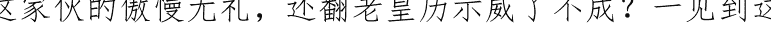

作者：鼎渊听泉 日期：2019-04-24 21:48
然后，在两军对峙的时候，刘邦和英布相对望，远远地刘邦对英布道：“英布小滚子，你这不要的三姓家奴，我对你那么好，割土封王，天下有几人有你这样的超级后？你不仅感慨戴德，还要何苦呢？真是人心不足狼形也。”英布还扬起油嘴滑溜溜地答道：“无他，我也像你一样一堂君临天下时当皇帝的滋味嘛！那多威威，你都看不出来？羞到家了。”一听到英布那玩世不恭的轻口吻，这不是在祖师辈面前公然流泪吗？刘邦更是难些心火，更加气愤，然后又连甩手骂他，随即两军大战。

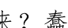

作者：鼎湖听泉 日期:2019-04-24 22:14
杀了一阵子，英布的军队开始抵挡不住，终于大败而逃，汉军紧追其后。英布渡过淮河之后，又几次停下来和汉军继续交战，都不能反败为胜，最终只有一人到达长江以南藏匿。英布原本和韩县令，为此长沙王诱骗英布，说要和他一同逃亡，就是想骗他来到南海。英布轻易就相信了他，于是随他到了阳阳，然后阳阳便在百姓的里死了英布。随着英布被劫，高度来说，这也是刘邦之年最难处理的重大事件，几乎是耗尽了所有的精力。也可以说，解决了这三个硬骨头，基本上其他威胁到中央政府的反对者就不话下了，诸侯冕、张臧就不值一提，见小巫的干。

作者：鼎湖听泉 日期:2019-04-24 22:42
{img3.laibaife.cn/fp/m/3082759.png}

[content]<!-- no content -->[/content]

## 第六篇 刘邦之死：驾崩四日吕后

汉高祖十二年（公元前195年），因为怀疑大臣与妻私的英布，想暴乱，脱了长安，怀疑自己已经泄露，无奈只好正式宣布。刘邦只能御出征，不幸被流矢所伤，回途中生起了重病。每天看着一个小的官，沛集团核心成员都不敢靠近身。刘邦从床上爬了起来，笑意深浅。作者：鼎湖听泉 日期:2019-04-24 23:59

此后的几个月，刘邦的病情不断恶化，到了要交代的时候，吕后只好延良医来诊。

“大夫，你就老实说，我这还有救吗？”整天胸痛，闲得发慌的刘邦意识到这时多余放起了吕后找来的当朝名医。

作者：鼎湖昕 日期:2019-04-25 00:00
一看这太医，弱弱地回给刘邦说能治，刘邦就知道是怎么了。反正天下谁无死？所有的荣华富贵也让曾经被人们赖为草莽全享受到了，复有何求？何况刘邦的人生信条是，人要学会知足无悔，不要贪得无厌，再来说富贵也不如浮云也。以布衣提三尺剑取天下，此非天命？霸王业，终从人。真言，真爽，刘邦只能让他哑了话，说完赏赐给医生五十金打发走了，懒得和他折磨牙，倒也豁达度、视死如归。

作者：鼎湖昕 日期:2019-04-25 00:16
{img3.laibaife.cn/fp/m/30829983.png}

晚安

作者：鼎湖听泉 日期:2019-04-25 11:12
最要命的是，心里贼贼的老吕后看到刘邦这回反应的精神气气，立马打狗随地上跟起了他身后的一些安排，看来他们也知道刘邦善于用人，刘邦还没死，就这么一哭了，真是归兴。不过不是这样的化学，今天不知明日将，你不能保证你看到下一刻的蓝天白云。

“下百岁之后，如果相国也死了，由谁来接替你好？”吕后像个超级灵在幽幽地。

作者：鼎湖听泉 日期:2019-04-25 12:29
“曹参。”刘邦只能有气无力地说。

“那曹参之后呢？”吕后还是一个狡猾难缠的女亚。
“曹参之后就是王陵，王颖年轻耿直，坚持原则有余而智谋不足，陈平正好辅佐他。这两个人正是互补型的，因为陈平智谋有余而决断力不足，只能当个合格谋士，不能独挡一面也。周勃虽然沉默寡言又缺少学问，但为人忠厚，而且以后稳定刘氏天下的肯定就是，可以任用做太尉。”

作者：鼎湖听泉 日期:2019-04-25 12:10
吕后还迟意的样子，又追问其他的人安排，心里没底，这种女人由于其多变性和权力的复杂，即使刘邦经历了许多政治风云，也会感到手足无措甚至茫然。除了你的精准头脑，多年用人也能判断得很准，减少了军事和行政上的无谓拉扯，这便是刘邦最骄傲的地方，解释不清楚，由于胎里出来的，就像天才一般就很喜欢和刘邦谈军事，因为刘邦会一点通，可谓是有信任。

作者：鼎渊听泉 日期:2019-04-25 13:19
在这之后，你也不会知道了，恐怕那时你已经上天堂和我亲亲的团聚了。”刘邦不大情，还是有些不得的味道。

“像不像人，最多能带士兵呢？”韩信轻淡写道，“陛下下最多带十万兵。”
“那么你自己带多少人？”刘邦有意的感叹。
“我这样的将领，多多善啦，当然是越多越好。”

作者：鼎渊听泉 日期:2019-04-25 13:43
{img3.laibaife.cn/fp/m/3082490.png}

刘邦用一小计，知道什么叫做扮猪老虎，要在大事有时候舍近人的生命，你看刘邦打下江山的几计，那可不是的。吕后斩了赵王的，可怜的皇家皇子弟弟还有刘邦的那个豪妻吕杀的，呜呜哀哉。吕后“成也萧何，败也萧何”。

作者：鼎湖听泉 日期:2019-04-25 14:10
“这个问题你懂的，因为这涉及到了不同的领导层面上，陛下不善于带兵，但却善于统率将领，这就是韩信被陛下攥住的原因。而且陛下的能力是天生的，也可以说是天授力，不是我等凡俗通过个人努力就能达到的。”韩信倒是说了一句比较清醒的话，难道这就是天生的领袖人物传说？

作者：鼎湖听泉 日期:2019-04-25 14:38
黑嘿，终会有低头做人的，谁都有渴饮水也塞牙的时候，由得你不低头咧。就算是刘邦，所谓的天授神力，也不照样在葬身后面还有功夫？唉，以前和英布是同一战场的战友，现在为了江山又反目，一生和这些枭纠缠不清，好像前世搅乱了骨头的你，你们都死了，刘邦也将归天。

该死的英布，给你爷爷刘邦我这么重的箭伤，不灭你还真是天理妥容的。人才啊人才，人才还真是革命的本钱，一切胜利是决定性的因素，天下皆为利来，天下握皆为利往，安得猛士令守四方。

作者：鼎湖听泉 日期:2019-04-25 14:52

作者：鼎湖听泉 日期:2019-04-25 15:04
不久，赵王就被活活撬死，他死后也只按照民对待举行葬礼，埋在长安的乱坟里，一派忠崽也是。

作者：鼎渊听泉 日期:2019-09-24 21:39
是为了巩固吕后权力，吕后也不会下下这重重的手。

作者：鼎渊听泉 日期：2019-04-24 20:42
英布，你这个杀人魔王，让刘邦吞天下所有被埋底的冤魂。

作者：鼎湖听泉 日期:2019-04-25 21:51
赵王到京之后，吕太后把他安置在官邸里却有意的把他晾在一边，并不出门见面，还派禁军护卫队包围了赵王居住的地方，等于软禁了他，甚至不给他送饭，连起赵王的手下怕吕小贼偷偷给他送饭，也被抓起来治罪。

作者：鼎湖听泉 日期:2019-04-25 21:08
赵王没饭吃，饿极了，也知道自己必死无疑，于是就作一首歌悲伤怡唱道：“诸吕用享刘氏，赵亦王兮吕援授我妃。我妃既亏兮夺我以恶，汝巩乱上曾不幂。我无忠臣吕问故弃国？自决中野若天害直！于嗟不可悔命兮宁自财。为王而饿死准者咎！吕氏绝理兮报仇。”大意也就是慨偶吕氏取取，自己被老婆妄侮为“冤大头”，在极限临头要饿了，吕氏丧尽天良，枉望上天为大汉报雪什么肯。

作者：鼎湖听泉 日期:2019-04-25 22:28
“太后，我要向您揭发我夫君刘友的反叛行为，我要灭杀了。因为刘友曾经当着其他人的说吕氏怎么能封王！我在吕氏当朝，奈何了他们，等到太后百年，我一定找吕氏打尽一个不留。”

依据说，王后的随从、官员前后左右都是家人，等于是在家里到处安装人造视频监控录像窃听器，连床上也有，关于赵王的谋报就会源源不断地飞向官中。倒霉的赵王像一个裸奔的人，从此一点隐私也没有，至于不能随意行动，相当于是做了一个没有围墙的铁吕吕监狱，悲愁得很。

## 246 楼
作者：鼎湖听泉 日期：2019-04-26 00:45
{IMAGE}http://img3.laibafil.cn/p/m/30806192.jpg {IMAGE}

## 247 楼
作者：鼎湖听泉 日期：2019-04-26 07:33
### 一手整理，加微信1101284955，获取更多好帖
来自

## 249 楼
作者：鼎湖听泉 日期：2019-04-26 10:42
正如如此，赵王的吕氏还是不满意，还要清理门户。当时赵王有一个宠妾，很得赵王的心，没事总是耗在她的那里，炉火中焚的王后立刻用人毒酒洒死了她，她却泄了内心的怒气。

看到自己心爱的人横死，居然自己还能如此，赵王悲从而来，于是也为赵王刘邦作诗四章，让乐们每天吟唱。在凉梁三日的歌声中，赵王刘家复恨一起涌上眉头，自己又不能为国分忧，内心悲痛俱如焚，眼前一黑便以死抗，六月就自杀了，因为这样行走肉体也是生不如死，不如一百了。

## 250 楼 
作者：鼎湖听泉 日期：2019-04-26 11:01
刘氏诸相相继于非命，让大家震动不已。吕太后知道这件事后，也相当震怒，认为堂堂一个赵王却为了一个贼妾把命丢了，就连祭祀祖庙的礼仪也不要了，简直是太不成，增堪笑荒。于是恼愁成怒，就索性连他后代的王位继承权也废掉了，全都去做臣，没资格做皇家成员了。出了这么差的事，让人笑掉大牙。

作者：鼎湖听泉 日期：2019-04-26 11:51
又一个赵王没了（怎么赵王都是不得好死？刘如意、刘友、刘彻都在赵王任上死于非，史称的“比杀三赵王”的也是），这空缺也得补上来，于是今年秋天太后便使者去找代王刘邦，也就是想要改他为赵王。赵地这么凶险，虽然位置和富庶程度比高帝皇帝的地还好，不过低调也能光养的代王却辞谢了（不然的话全为了后来美丽的汉帝呢？连他母亲秦邈太后都比政治智商高很多，也逸过了吕后的毒手），他说自己没有什么大事，也不想误了赵国，你还是请唱哈吧，还表示自己大愿意守卫远的代国，为国捐躯什么的，也从侧面表明自己已经没有什么政治野心，让吕后放心，绝妙的太极推手也是，基本上自保的政治目的也达到了。

## 253 楼 
作者：鼎湖听泉 日期：2019-04-26 12:13
当然，这赵王之位也不能长久没人坐。经过太傅吕、丞相陈平等人的“权力推荐”，最终在列中排第一位的武信侯吕禄如上位，做了赵王，还一同追彰吕禄的父亲康侯为赵昭王，一策倾袭，人类已经不能阻止吕氏夺取刘天下的势。

## 254 楼

就像打开的潘多拉盒，然后越来越多的吕封王，这些都是人们可以预见的政治动作。

九月，赵灵刘王死了，他有一个姬生子的儿子，太后为了削弱刘氏势力，居然派人把刘氏唯一留下的儿子做掉了，让赵刘王没有继位子嗣，封国也被顺理章地废除，然后赶诸吕沛侯的儿子东平侯为燕王，吕通的兄弟吕庄延为东平侯，皆大欢喜。据统计，吕后先后把吕氏家族十个人封王封侯，也几乎夺了汉家江山，取得刘汉汉公司的控股权。

## 255 楼 
作者：鼎湖听泉 日期：2019-04-26 13:04
## 第八篇 杀心太重，吕后是被狗咬死的吗

吕后一生悲伤，年轻的时候丈夫刘邦因为要打江山，疏与其交集，可谓是聚少离多，自己还作为政治毫无尊严的凄惨生活。直至刘邦事业有起色，却又被冷落，加上吕身后利益集团的重任，吕后心中压力越来越重，可以说双手沾满血的，吕后大概是被惊而死的，那就是被狗咬死的赵王刘如意。

最有意思的是，有人还来了一个强悍的历史比较，认为吕后是被某种动物咬死的。除了吕后被狗咬死的，吕后是被猫咬死的，而吕后更是被兔子咬死的。

作者：鼎湖听泉 日期：2019-04-26 13:27
关于吕后被狗咬死（算是间接原因），正史也有记载，历史《史记》载：“高后八年三月中，吕后见赵王如意为伏复。”而《治通鉴》的记载也同小异，对于此虚无飘的事件，叙述吕后死时甚至没有提及那是怎么回事？

## 258 楼 
吕后比杀赵王，吕氏集团掌权后，刘氏诸相相继于非命，让大家震动不已。吕太后知道这件事后，也相当震怒，认为堂堂一个赵王却为了一个贼妾把命丢了……吕后心理压力太大，忽然便得病了。

### 一手整理，加微信1101284955，获取更多好帖
作者：鼎湖听泉 日期：2019-04-26 14:43
就在吕后生命的最后岁月，又发生了一起“全餐”般的神秘事件。话说吕后举行除灭祈福时，远途中突然让类似狗的动物神秘地撞了她的，然后又消失踪了。

## 261 楼 
作者：鼎湖听泉 日期：2019-04-26 16:26
这事相当奇怪，一般来说，古代大人物离世的时候，这类传说也是不怪的，于是让人解释，却是吕后腹胀疼痛不已，不知身病还是心病。所以此人也认为吕后是被狂犬死的赵王如意怀恨在心中故意撞她，从此吕后……

## 263 楼 
作者：鼎湖听泉 日期：2019-04-26 19:38
{IMAGE}http://img3.laibafile.cn//m/308099019.jpg {IMAGE}
刘邦

## 264 楼 
作者：鼎湖听泉 日期：2019-04-26 20:12
果然，经此一折，吕后就病入灵肓于公元前180年七月辛巳日（三十日）在中央宫崩逝了，终年62岁。吕氏王国的建国计划，这也不算失败，然而，但也算是吕后一生永远的遗憾了。尽管当年月中旬，吕后早就加强吕氏的夺权计划，尤其是吕氏集团统军亲队，先任命赵王吕禄为将军，统领北军；吕产统领南军，完成了必要的军事部署。

## 265 楼 
作者：鼎湖听泉 日期：2019-04-26 20:36
忙了兵变的准备，已经气若游丝的吕后还不忘语重心地告诫吕禄、吕产：“高皇帝建立王国后，曾与大臣们立下誓约，约定不是刘氏兄弟而称王的王，天下都可以共同讨他。为了我们吕家，我把刘氏压得已经是怨声道道，而吕家的人被封王的不少，，刘刘大臣心中自然有怨有微，好在我还能控制局面，天下还没有出大吕子。如果我死了，没有了压住场面的人，皇帝又那么年轻，根本镇不住那班家伙，恐怕到时候会因为权力的再分配而引起动乱。我要我的话，你们有三个两个将军，你们一定要牢牢控军队，保卫军，稳稳诸大叔，而不忙为我办丧事，让刘汉有可乘之机，到时候后悔来不及了。虽然是雄才大略的政治老妇人也是。”

## 266 楼 
作者：鼎湖听泉 日期：2019-04-26 21:27
可是，吕氏集团最后还是抵不住平和和老军。吕氏家族是按照吕后布置，在去世后，还赐给王侯将级官员很多金。吕后掌权后，加强了行政权的控制。吕后还让丞相审其大夫，几乎是吕氏家族看似不露的夺权，最终还是功夫袭，老天爷还真开玩笑。

## 267 楼 
作者：鼎湖听泉 日期：2019-04-26 22:01
总之，吕后死后，吕氏集团和刘氏集团围绕皇权的势浩大的大战也正式拉开序幕，最后以吕氏集团失败告终。

## 268 楼 
作者：鼎湖听泉 日期：2019-04-26 22:30
吕后死后，遂与高祖合葬长陵。据某些资料显示长陵位于陕西咸阳城区嵩店乡义村，在高祖长陵东南，足形呈覆斗，位于高原边缘，地势突出，可远望山丘，显得十分雄伟，也不枉这位历史上第一位临皇帝统制，开创了汉代专权，配如此皇帝的历史待遇。(img/3d2264eac77923fd265c8032e0914d4_106.png)

## 269 楼 
作者：鼎湖听泉 日期：2019-04-26 23:09
## 第九篇 一盘棋引出的血案：汉七国之乱
汉景帝和他的父亲皇帝一样都是盛世的开创者，任内奉行黄老哲学，励精治，勤廉约，发展生产，无为而治，无穷折腾，休养生息，为汉武帝铁扫奴准备了良好的条件。发展教育，最终为了一个重要人物，完成了从汉文帝到汉武的汉盛世过渡，也是一个盛年早逝的人物，不到50岁就去世了。

## 270 楼 
作者：鼎湖听泉 日期：2019-04-26 23:42
说到汉帝的“无为而治”，还有一个著名故事，史料有曰，汉帝十分随和，对左右手体恤，侧以备不时之需，可谓是寻常百姓几乎没有一样，也说明了汉帝的度量是如何大，没有什么架子，除了比较复杂的立储程序（是因为太后的横加涉），基本上都是一个“微笑佛”。

## 272 楼 
作者：鼎湖听泉 日期：2019-04-27 00:46
晚安

## 273 楼 
作者：鼎湖听泉 日期：2019-04-27 11:33
这是发生在景帝元三年（公元前154年）的一次诸侯王大乱，是一地方诸侯抗中央的分裂活动，是王权和皇权对峙尖化的结果。经过十个月的鏖战，最终汉帝镇压了这场势浩大的王国造反运动，巩固了皇权，也为后来武帝实行“推恩令”，继续削弱诸侯势力定了良好的基础。参与此次叛乱的共有七个诸侯王国，统称“七国之乱”。

## 278 楼 
作者：鼎听泉 日期：2019-04-27 12:02
要追寻这次王国叛乱的根源，也可以一直追溯到汉祖刘邦身上。刘邦取得中央政府的控权后，随着相继消灭叛乱，统治得力不从心，为了巩统治，除了大力剪除异姓，还对大臣击喙明辩“非刘氏而王者，天下共之”，然后迅速封国三个刘氏宗子兄弟为诸侯。

史料显示这九个人是：
- 刘邦叔父之子刘别为侯
- 刘邦同父兄弟刘诡为楚
- 刘邦长子刘非为齐
- 刘邦次兄刘仲为沛
- 刘邦少子刘长为南王
- 刘邦子刘如意为赵王
- 刘邦子刘恒为代
据某些资料：“这九个同姓王占据了全国大部分土地。当时全国有54个郡，诸侯占了39个，中央统辖只有15个郡；从户口上看，全国277万户、1300万人口中，中央统辖只有97万户，仅仅是全国户总数的1/3。”

## 279 楼 
作者：鼎湖听泉 日期：2019-04-27 12:36
汉文帝、景帝等都奉行无为政策，恢复发展，休养生息。况且以刘邦时代，诸侯王还没有对抗，中央的地盘被瓜分越来越小，从此以前就可以看出，诸侯王的人口面积比中央统辖得多，这为后叛乱准备了良好的条件。

## 280 楼 
作者：鼎湖听泉 日期：2019-04-27 13:01
因为刘邦时代，诸侯王还没有对抗，随着分封许多诸侯，诸侯王的势力膨胀，确实是一把双刃剑，稍加处理不好，就会伤到自己（后来的局势果然如此）。

## 282 楼 
作者：鼎湖听泉 日期：2019-04-27 13:47
(img/3d2264e6ac77923fd265c8032e0914d4_109.png)

## 283 楼 
作者：鼎湖听泉 日期：2019-04-27 14:49
可是，吕氏集团最后还是抵不住。吕后死后，吕氏集团和刘氏集团围绕皇权的浩大的大战也正式拉开序幕，最后以吕氏集团告终。

## 284 楼 
作者：鼎湖听泉 日期：2019-04-27 15:44
据《资治通鉴》记载，这件事发生在汉帝时期，主角却是后来的英主、脾气很好的汉帝，当时他还是太子。一次，吴国太子进京朝汉帝，大家都是玩得很熟悉的至亲，所以见完皇帝之后，吴国太子又兴致勃勃地和自己的堂兄弟太子刘邦饮酒作乐、提棋博弈。

## 285 楼 
作者：鼎湖听泉 日期：2019-04-27 16:05
因为当时吴国的势力，培养了吴太子的骄横性格，甚至在博弈过程中得意地把皇帝接班人放在眼里，十分诙气，经常后悔，输打要要，惹得好脾气的太子也慌了：“在我的地盘你也公然要赖，这还得了，传出我去后面还有面子吗？”于是太子一时冲动，就顺果地拿起棋盘砸了吴太子，原本是想出恶气教训这个没没错的小家伙。

(img/3d2264eac77923fd265c8032e0914d4_111.png)
这就是轰动大发的“一盘棋引出的血案”的来龙去脉。

## 286 楼 
作者：鼎湖听泉 日期：2019-04-27 16:27
这下，就愁出了大麻烦，而且这一砸，也最终出了本来的就有心另立门、富可敌国的吴王刘彻把皇帝拉下的雄心。吕后死后，赵王如意怀恨在心中，这一砸，也最终出了本来的就有心另立门、富可敌国的吴王刘彻把皇帝拉下的雄心。

## 287 楼 
作者：鼎湖听泉 日期：2019-04-27 17:27
吕后死后，赵王如意怀恨在心中，这一砸，也最终出了……吕后死后，赵王如意怀恨在心中，这一砸，也最终出了……。

## 288 楼 
作者：鼎湖听泉 日期：2019-04-27 18:02
吕后死后，赵王如意怀恨在心中，这一砸，也最终出了……。

## 289 楼 
作者：鼎湖听泉 日期：2019-04-27 21:06
...

## 290 楼 
作者：鼎湖听泉 日期：2019-04-27 21:32

## 291 楼 
作者：鼎湖听泉 日期：2019-04-27 21:36
{IMAGE}http://img3.laibafile.cn/p//30813264.jpg {IMAGE}

## 292 楼 
作者：鼎湖听泉 日期：2019-04-27 22:06

## 293 楼 
作者：鼎湖听泉 日期：2019-04-27 22:38

## 294 楼 
作者：鼎湖听泉 日期：2019-04-27 23:08
(img/3d2264e6ac77923fd265c8032e0914d4_114.png)

## 295 楼 
作者：鼎湖听泉 日期：2019-04-27 23:33
这也许不能再没了地装下去，看到不能再弄弄弄下去，吴使臣也只能实实话说：“报告皇帝，其实吴王没有生病，只因为朝廷拘留了几批吴使，还治他们的罪，吴王心中恐畏”

泊有去无回，所以斥庸不来朝见的，情有可原。依臣子愚见，要吴吴王回朝见也不难，只要皇上能原谅吴王的过错，继往不咎，吴王一定会悔过自新。俗话说，水至清则无鱼，人至极则无徒，妄望皇上明鉴”。

## 296 楼
作者:鼎湖听泉 日期:2019-04-27 23:51

此者若然会话，就能抓住住皇帝与人为善的心理，脾气好、人厚厚的汉文王朝最终大地全都释放了吴国使者，让他们顺利回到吴国。为了给吴王定闲，还特意御赐吴王几案和杨禹（据说茶凤、手禹是吴朝老老的故事），意思也就是说，你既然老了，只能照你年事已高，准你老人人家不用一辈整理了，

## 297 楼
作者:鼎湖听泉 日期:2019-04-28 00:01

吴王见朝不治自己慢最高领导的罪（这事可大可小，大的可处死的），所以暂时谋反反心也没有那么强烈了，因为外部环境已经有了变化，可不过因为皇帝的“格外开恩”，也给他人一种软弱可爱的感觉，没有了反心的吴王倒是变本地的骄横起来，做起坏事来更加凶狠。

## 298 楼
作者:鼎湖听泉 日期:2019-04-28 00:18

事实上，当时的吴国也可是独立王国，王国享有独立财权、物权，既能冶铜、铜盆，又能铸钱，为了笼络本国人，还免赋税，用公款代役金，或出钱雇人应役；与此同时，为了吸引贵才，给了许多优厚赏赐；甚至其他王国的官吏要求吴国抓人，吴国也不把罪犯交出，可谓古代的“行政特区”。

## 299 楼
作者：鼎湖听泉 日期：2019-04-28 00:35

等到宽厚仁爱的汉帝殉崩，汉帝即位，因为汉帝正是杀死刘太子的凶手，所以曾经短暂消除反心的吴王刘涓，也知道大家心存异蒂，双方难免有恶战，不是你死

## 300 楼
其实，刘邦的骄横成性也是他的好父亲汉帝惯出来的，这个就能从长长的身世讲起。当初，赵王张敖为了讨好自己的岳父高祖刘邦而献上一位美人（以这样的敬畏方式，幂臭），经过刘邦的勃动，美丽终于“修成正果”，生了刘长，后来被封为淮南王。

## 301 楼
作者：鼎湖听泉 日期：2019-04-28 10:52
{IMAGE}http%3A%2F%2Fimg3.laibafile.cn%2F%2Fm%nF308143256.jpg {IMAGE}

## 302 楼
作者：鼎湖听泉 日期：2019-04-28 11:18
因为后来赵相贯萧谋杀吕邦的计划被露出，美人也因此受株连而被禁锢于河内。美人的弟弟兼粮为了救自己的姐姐，便请求很得吕后欢心的辟阳侯审其其（传说中的男宠哑），向吕后求情赦免，他却低估了女人的嫉妒之心，吕后哪肯一手处理。当然不会会她话。美人陷入失望，一时不想便自杀身亡了，这也埋下了吕臣审其后又被刘长杀的祸根。

## 303 楼 
作者：鼎湖听泉 日期：2019-04-28 11:42
美人一死，有关官员就将其所生之子刘长送给汉祖，高祖知道后，也有了悔意，亲自为其取名刘长，还令吕后收养，同时葬其生母于真定。

## 304 楼 
作者：鼎湖听泉 日期：2019-04-28 12:28
淮南王刘长幼丧母，一直被吕后收养，也比较亲附吕后，对她没有二心，所以刘邦的几个儿子连被临朝制的n吕后弄死，却没有害刘长的意思，让他幸存了下来。因为刘长心中怨恨朕侯审其其没能尽心尽力救父母，间接害了自己的生母，所以常常心存杀意。

## 305 楼 
作者：鼎湖听泉 日期：2019-04-28 12:49
等到性情温和的汉帝对，这对兄弟也比较亲近和恢容，更加助长了五大三祖的刘长的骄横习气，经常违法乱纪，胡作非为，文帝为宗子弟的面子经常睁一瞬闭眼镜，不予追道。

## 306 楼
因为刘长是皇帝时顽仅存的亲兄弟，所以汉文帝也像放任他的旁臣刘通一样放任刘长。此前我们曾经说过，到吕后死时，剩下的刘邦儿子就只有两个了，一个是刘长另一个就是一个汉文帝本人，血浓浓于水啊。

## 307 楼 
作者：鼎湖听泉 日期：2019-04-28 13:29
所以每逢刘长龙入朝，总是在跟汉文帝去苑打猎时，共乘一车，刘长也口甜甜滑、前人后地地称皇帝为“大哥”，十分亲密，也显示了他们俩非一般的关系。刘长有勇力，是一个能举起大鼎的大士。看到皇帝哥哥十分护绥自己，他也常常惦记着要杀了母亲不力的辟阳审其，不管什么手段，反正皇帝哥哥绝对不会太难自己的，至少不用血债血偿。

## 308 楼 
作者：鼎湖听泉 日期：2019-04-28 14:02
{IMAGE}http%3A%2F%2Fimg3.laibafile.cn%2F%2Fm%2F230815062.jpg {IMAGE}

## 310 楼 
作者：鼎湖听泉 日期：2019-04-28 14:28
于是，胆细的刘长趁机去见审其，有心杀人的他，用袖中藏的铁兜刚大鼎一样将他击倒，怕霉的老实侯报仇了。

## 312 楼 
作者：鼎湖听泉 日期：2019-04-28 53
显然，没有多少理由就把朝中大臣杀了，刘长也知道自己犯了罪为了为了皇帝的格外开恩，便玩了一出负罪的“盲戏”。杀人之后，刘长第一时间跑到皇宫前，披上身上表示愿意伏法，在心里是不相信皇帝就会真的要自己亲兄弟命，刘长赌的就是这一个，他似乎也猜了大哥的牌。

## 313 楼 
作者：鼎湖听泉 日期：2019-04-28 11
然而，事情的发展正像大力士刘长所想的那样，汉帝念他也是为母亲报仇而杀了（其实则刘家早早就想清除给宗室带来羞辱的吕后相好），当然不会会的一命。面对这个骄横的刘长回到自己封国之后，更加凌弱，最后露出了反心处处想和天子。

## 314 楼 
作者：鼎湖听泉 日期：2019-04-28 44
{IMAGE}http%3A%2F%2Fimg.laibafile.cn%2F%2Fm%2F30815216.jpg{IMAGE}

## 315 楼 
作者：鼎湖听泉 日期：2019-04-28 17
看到如此不可收拾的局势，有心巩固中央权威的重臣竟对汉文帝反复恳训：“诸侯过于骄横，必生祸患，应当下奉行黄老哲学”、不想折腾的“无为”，汉文帝却不听告，最终酿成了诸侯造反之祸。

## 316 楼 
{IMAGE}http%3A%2F%2Fimg3.laibafile.cn%2F%2Fm%2F308163426.jpg {IMAGE}

## 317 楼 
作者：鼎湖听泉 日期：2019-04-28 14
第十篇 造反的祸：皇弟刘长死是汉帝故意之。在皇帝刘长造反之前，我们先讲讲讲北王刘兴的造反案。这件事就要回到当初刘氏和诸吕争夺皇权的斗法之时。大家知道，刘氏家族皇室无法夺回皇权，除了功臣集团，大臣们也曾试图把皇帝全部封给他王，而且要把全部梁地封给他弟，也就是有功的东车侯刘兴为王，可谓是当时炙手可热的两大皇室人物，刘备还差点染指帝座。(img/3d2264eac77923fd265c8032e0914d4_121_0.png)

## 318 楼 
作者：鼎湖听泉 日期：2019-04-28 39
因为功臣集团怕齐王一家外戚过于强大，才把皇位让给比较低调的汉帝，帝即位，知道朱虚侯、东车侯当初就打算拥立齐王刘萧为帝，为了稳固自己的帝位，也有意要削弱此二人的势力。

## 319 楼 
作者：鼎湖听泉 日期：2019-04-28 09
正如前面所述，原本，刘肥的齐王子兄弟是能染权的，因为外戚的过分强大被功臣集团否决了，立了势力较弱的代王刘恒为帝。这还不是最坏的，因为新皇帝要削齐王系势力，不仅最初许给建立了大功的刘章、刘兴居的赵地、梁地没有如同，甚至于等到分封皇子为王时，也才能勉从齐王划城阳、济北二郡，分立刘为城阳王、刘兴居为济北王，最后没有任何好处都不到，只是削分了齐王系势力而已。

## 322 楼 
作者：鼎湖听泉 日期：2019-04-28 06
总之，对汉文帝压抑齐王系不满的刘兴居，总是伺。要举起。天不负有人，终于机会来了，有一年刘兴居亲临大原，他以为皇帝像自己父帝软弱可欺，胆大的，大规模用兵，国内兵力空虚有机可乘，趁机起兵，此时反更成功也在此。尽管如此仁义义尽，淮南王刘长还是没有迷途，就因皇帝的软弱可怜，对他不起，只要能够弃投降，还能免其反罪。

## 323 楼 
作者：鼎湖听泉 日期：2019-04-28 29
汉文帝是非常提防齐王系子弟，当得知刘兴居举反后，也只能襄护先，立马火急诏令出击。汉文帝自大原返京，为了安抚和分化叛军，下令济北境内所有百姓，如果能顺朝廷，还能保留原有官职；即便是叛军的核心人物，只要能够弃城，也可免其反。最终刘兴居败自杀，从而避免了一次国家分裂。(img/3d2264eac77923fd265c8032e0914d4_223.png)

## 324 楼 
作者：鼎湖听泉 日期：2019-04-28 17
宗室刘兴乱被弹压之后，过了三年，南王刘长又想逞法，后来变成未达政，这却是汉帝纵容的结果。自从刘长杀了父舅之后，刘长更加骄横跋扈，蔑视皇权的他不仅在自己的封国设法令，驱逐了中央的官员，同时要求中央允许自己任命二千以上高官，实行高度自治。总之不把中央放在眼里，即使是这样，汉帝还是相当宽容，不想老弟，别人劝也不听。

## 325 楼 
作者：鼎湖听泉 日期：2019-04-28 23
只会胡作非为的刘长，终也是一个扶不起的阿斗，基本上造反大计划算是“胎死腹中”的那。因为还没有正式举起义旗，反情就已经彻底露，说明刘长的反叛操作能力的极度欠缺，基本上传信之道的核心保密工作也不会妥妥善处理，焉能不败得落花水？好勇斗顽谁妥？

## 327 楼 
作者：鼎湖听泉 日期：2019-04-29 09
面对刘长如此没，尽管朝中大臣纷纷要求皇帝严肃查处，不过以汉帝的性格，太愿意和自己好存开翻，亲自把自己办了，但又不能顾朝大臣的情绪，于是走了“曲线”的道路，也就是当时还没有罪“被杀死”的父舅，还用具体实例，比如用周初管叔、蔡以金盘洗手，也算是推行“清静无为”汉帝最温柔的政治招了。

## 328 楼
作者：鼎湖听泉 日期：2019-04-29 55
尽管如此“仁义义尽”，淮南王刘长还是没有迷途，就因皇帝的软弱可怜，狠狠弄他一番都不起自己，所以接到弱诏书，通篇都是批评自己的，非常不高，既然你们已经对我十分满意，那么我就索性分家单干，都是刘姓的，谁就要坐山呢？那就看谁的拳头够大了，所以很多历史分析者都说天高地厚的刘长是作死的。

## 329 楼 
作者：鼎湖听泉 日期:2019-04-29 11:16
反正，有了反皇帝之心的刘长，立马指派自己手与曾平定刘兴叛乱有功的崇武侯太子柴奇共谋颠覆中央大计，计划四十辆车在谷口发动叛乱。为了加强反叛力量，长还特地派遣去与陇越、匈奴联络，想寻找“外援”，简直就同于卖国了。

## 332 楼 
作者：鼎湖听泉 日期：2019-09-29 12:04
可惜，只会胡作非为的刘长，终也是一个扶不起的阿斗，基本上造反大计划算是“胎死腹中”的那。因为还没有正式举起义旗，反情就已经彻底露，说明刘长的反叛操作能力的极度欠缺，基本上传信之道的核心保密工作也不会妥妥善处理，焉能不败得落花水？好勇斗顽谁妥？

## 334 楼 
作者：鼎湖听泉 日期：2019-09-29 38
反对还能大干一场，刘长就就完完了，就算是即时有了报应。因为事情败露，有关部门立即追究刘长的责任，又因为这关系到皇位继承的问题，这回汉文帝也洒了，不听弟弟的死。当时，汉文帝即刻派遣使召南侯京交待，等落。此时各县的县丞、代行御史大夫冯骏、曹正、县尉等都处。

## 335 楼 
刘长如此犯了这么事，连让他疼的，汉文帝也有点怒了，尽管死罪可控，落死难免，总之恼绪愁，皇帝亲自下令把弟弟关在了密密的囚车中，让途中各县依次传送，严加。

## 336 楼 
看到皇帝因怒而失去理智的样子，如此狂，于是头脑冷静的哀臣对皇帝说：“陛下向来，为了不让弟弟死，为了仁的，不让他吃苦。原本南王就是一个性格刚烈的，之前陛下毫无般宠爱，现在却尽残忍折磨，让他人生转了一个八十度的转变，可能就会背负一个害兄弟的恶名，也有损陛下的清誉啊！”

## 340 楼 
作者：鼎湖听泉 日期：2019-04-29 17
哭过之后，汉文帝才想起哀盎的谏言，于是对他说道：“爱卿果然远见卓识，可惜朕没有听你的话，终于酿成了今日苦果，害死了淮南王！是我奈何？”哀盎说：“唯有斩杀相关官员以谢天下。”汉文帝后来也去处理沿县官员，认为是他们因疏忽大意才使淮南王死的，于是把他们全都斩杀，并用列侯的待遇厚葬并列长，以求息宁人。

## 341 楼 
作者：鼎湖听泉 日期：2019-04-29 44
尽管如此，后民间还是传唱着淮南王的歌颂：“汉文帝不够仁义，连兄弟都容不下，又何能容天下？本来也不是皇帝的错（办死罪都已经是仁义尽了），不过颇有自省精神的汉文帝听了，还是感到有些不安。

## 342 楼 
作者：鼎湖听泉 日期：2019-04-29 16:08
汉文八年（公元前172年），为了补偿弟弟刘长，让他心好，汉文帝有意封淮南王的儿子刘安等四人为列侯，以示关怀。

## 第十一篇 管好亲属：汉文帝为何舅父自杀

汉文帝是历史上有的皇帝，在位期间施行了很多仁政、德政。比如，重视民生的汉文帝除了注重休息，发展农业生产，还大力救济、寡、独和穷困的人，同时严格约束自己的亲属。

他曾以皇帝诏文的形式，下令八十以上者，每月赐给米、肉、酒干；而九十以上的老人，额外再赐予骨和靠。同时，为了把这些政策措施落实到实处，皇帝还责令各县的县要亲自检查，并由县丞或县尉送。

## 344 楼 
作者：鼎鸿听泉 日期：2019-04-29 53
在大行仁政的同时，汉文帝也放了。看到如此不可收拾的局势，有心巩固中央权威的重臣竟对汉文帝反复恳训：“诸侯过于骄横，必生祸患，应当下奉行“黄老哲学”、不想折腾的“无为”，汉文帝却不听告，最终酿成了诸侯造反之祸。

## 345 楼 
作者：鼎鸿听泉 日期：2019-04-29 
在大行仁政的同时，汉文帝也放了。

## 346 楼 
作者：鼎渊听泉 日期：2019-04-29 30
说完，作为一种训诫，以及杜绝此类荒唐再次发生，于是汉文帝把马给了献者，甚至于周到垫旅费，不接受皇帝出行，每日不超过五十里。

## 347 楼 
作者：鼎渊听泉 日期：2019-04-29 53
除了励精固质，汉文帝特别强调内省，注意个人修养，比如当时癸生日食，在科学太发达的古代，这样的奇异天象，很容易使统治者认为是一种上天的暗示，说重一点，代表上天牧民的天子就会感受到自己没有治。

这种 皇帝的这种，代表上天牧民的天子就会感受到自己没有治。

## 348 楼 
作者：鼎渊听泉 日期：2019-04-29 22:20

## 349 楼 
作者：鼎渊听泉 日期：2019-04-29 22:45
反对，一遇到日食，汉文帝就下诏书说：“现在上天都对我们有点意见了，大家也都要反省一下，是哪里做得不好出问题，也向天帝交待一下，人在在做，天在看啊，这话一点不虚。”

我的过失做不到的，请众爱畅所言，开启胸怀，拿出品具体措施，好好帮助我管理好国家。比如说朝廷举贤良、正才、能直言善于的人，以端正我的治国方略，弥补我治国之上的不足。”然后分派能臣，减轻役役赋税，账济百姓。除此之外，还要废了将军，同时朝廷留下少量马匹（繁殖用即可），其余的全部下拨给各地驻站使用。

而且，汉文帝加强了对亲属的管理。说实话汉文帝所宠的慎夫人，当时在宫中经常与皇后并坐，地位相当尊贵，也彰显了皇帝的偏宠。

对于这个明显的有违规的排位，皇帝重臣晁显有微词，所以等到她们再一起来到宫府衡坐时，聪明的晁显就有意把慎夫人的席排在下，然后与后宫之首的皇后平起坐，从而把扭曲的制度执行给纠过来。

这一明显的傲慢，让上皇后夫人十分恼怒，晁显你这小子是不是吃驴子的胆了？连皇帝的宠妃也敢玩，定是活得不耐了，看我如何收拾你，慎夫人顿时气得脸容失色。

总之，正在气头上的慎夫人，好说说都不肯入座，想气我，没门，先问问没有我我就茶饭不思的皇帝答应不答应。

看到自己宠幸的女人受了委屈，连皇帝也感到面子有点挂不住了，这让我情不悦，皇帝非常不悦，然后怒不可遏随即站起来，拂袖而去，返回宫中以示抗议。

此番事件，力异文说：“臣听朝中诸君这次秩序严格，才能上下睦，各安天命。我的意思是，既然陛下已经立了皇后，而皇后后又是宫之后，应坐上位，而作为妾的慎夫人怎么能与皇后同席而坐呢！我知道陛下宠幸夫人，是由于现在的这种做法，并不是真正的爱她，而是害她啊。陛下难道不忘先帝戚夫人变成‘人彘’的悲剧了吗？”

这袁益还会会事，历史可能也算得很好，知道什么叫现身说法，经过如此很有历史感的一番恳言“点拨”（前）

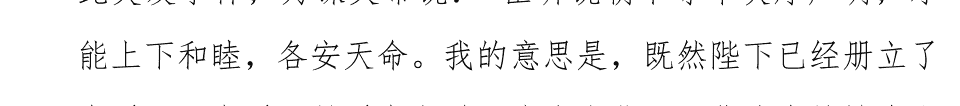

车之甚也)，不算是顽固的汉文帝倒是出了一身冷汗，很快就醒悟，思想也立马转过来，同时召唤自己此时最爱的女人侯夫人，一五十把袁益的话告诉了她。侯夫人知道袁益是有意难为她，而是身处境地为她想，所以也不使小子生气了，还赐给她黄金五十斤以示感谢，皆大欢喜，效果好得不得。

不仅是对自己宠宠的女人，即使是亲儿子他也不骄奢，当时有关官员按照规定请求汉文帝皇帝子诸诸诸侯。为了平和缓缓解其他皇子争夺夺气，表示自己“一碗水水平”，

强为河间马，朱虚夷刘章（诸侯功勋臣）为城阳王，以及东车丰侯刘兴为济北侯。做完了这些事情，然后皇帝才立皇子刘武为代，刘参为大原王，刘辟为梁王，果然是有肚量之人的。

值得大书特书的是，作为封建皇帝的汉文帝，还为了最大限开放言路，继续大力贯彻“清静无为”思想，并宁废除了“谗言罪”和“妖罪”，不因言入罪，不大兴“文字狱”，让臣畅所言地批评朝政，指出皇帝错，可谓比较民主思想的古代皇帝，做到这一点的，基本上都是明君无无疑的。

{IMAGE}http%3A%2F%2Fimg3.laibafile.cn%2Fp%2Fm%2F308224710.jpg {IMAGE}

史哉，当时汉文帝下诏云：“古之治天下，朝有进善之旌，谗谣之术，所以通治而来谏者也。今法有谗辞、妖言之罪，是使臣不敢尽情而上无由过失也，将何以色列来远方

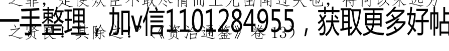

大意就是，古代明君治理天下时，朝廷有鼓励进善之旌，有写书批评朝政，目的是为了保证政清明。不过现在的法律文中还有“谗辞罪”和“妖言罪”，这就使得群臣不敢公开畅言直言自己有的过失，这怎能吸引远方的贤士到朝廷效力呢！故此废除这些罪名！

除了废除恶法，汉帝为了确立农业是天下的根本，还曾亲自从事农业耕种，以身作则不是说而已，是有实际行动的，为此当年免了百姓的一半租。

趁着皇帝勤政爱民、治国的当口，有忧之心的臣子应当失去时机地谏，其中颖侯（灌晏）是皇帝最有代表性。

由于后文太长，我们还是简单讲贾谊的主要观点吧。贾谊认为，因为明君位权重，有生杀夺之柄，所以大家存畏惧，即使是明君也应该接受臣下的意见，大家畅言可以更加不要愿听到意见、独听他的过失和批评规劝，说错了，等于是抓哈，这样国家就危险了。

接下来的，贾谊又以史为鉴（虽然都是历代谏套路），总结了周和秦的兴衰败，尤其是提到秦朝的横征暴敛以及不顾人民死活的历史。对皇帝说这些，自然十分明显，那就是汉帝吸取教训，不要学秦皇那么傲慢，只听那些功领声音，以为手里有肠，就可以传之万世，殊不知自己的贪奢淫让宗庙毁了。

告诉他实际情况。最后的结果是，因为朝中没有辅佐的大臣，正直官员全被驱逐或谋杀，唯有成事不足、败事有余的无耻小人谄违、大肆奉秦皇的德高高于尧舜，功业超过商汤和周武，而实际上抗连连，天下已崩解，却没有人知道萧助秦皇，还以为天下形势一片好呢。

一手整理，加v微信获取更多好帖

有了必要的铺轭，贾谊就能很好地联系实际说到汉帝的事了。贾谊说，陛下现在在命令天下睿举良正的人士，天下人也都为之欢欣鼓舞，且四方贤才也开始聚集朝廷，听从陛下调度，不过也只是皇帝遣道，做于没有少益处的，则朝政无亏，勤恳息，精心图治，与民休息，厚养天下，法治公正，刑罚宽缓，受到了百姓的爱戴。天下莫不喜，都护朝廷的政今，是您施行仁德取得了成功。现在才一切刚开始，正士之王，不再把心思用在施行仁政上，这和秦始皇的行为有什么区别？我担心你将成为下一个秦皇也，这正是我私下为陛下感受到痛苦的事情！所以，我建议陛下要坚持保持大臣的品格和节操，提高品行修养，尽心为国办事，如果做到“游嬉不失乐，朝会不失礼”，这是两全其美的好事，何乐而不为？

文帝一听，由颇灌顶，因为贾谊说得很合理，于是也是乐意地采纳了他的意见，明君风采啊。

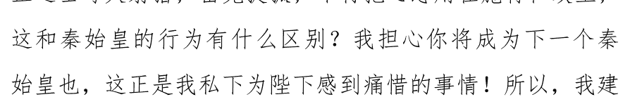

总之，汉文帝这位20出头就上位的皇帝（难怪他曾那么欣赏赏同年青年才俊的贾谊，大家都是海派传奇作家张爱玲式“出名越早”一类人也），他的减轻刑徭的力度是封建皇帝中才出了名的，尤其是汉文帝“霍武兴军”，“丁三年而一事”，也就是成年男子的服役减为三年服役一次，在中国封建史上是“独一无二”的，具有开创性意义，也彰显了他深入人心的“民本”思想。

汉文帝为了增强国力，切实减轻农民的负担，还采用了“齐民同居”称号，不是为了敛财，而是为了充实边防，让农民减过负担。其中之一就是“备粮”，这确实很有想象力的措施，汉汉政这种温和治模式的出现只是时间问题。

之公器，准最公器，准持法者，亲疏如一，无所行，则人莫敢有所而犯之也。也就是说，法律作为治天下的公器，就必须坚持“法律面前人人平等”，不能因为亲疏贵贱而有所偏颇，破坏法律的公正与严性，这样同仁，才能使天下所有的人都不依人倚腰而触犯刑律，就是皇帝的舅父也如此，才能显出法律的权威性。

所以看似汉帝执法严，其实还是对亲属管理不够，如果薄昭是谦谦长者，或者皇帝对他足够的约束力，他也不至于以为是皇亲国就能骄横犯，以至于敢杀朝廷使者，自然是有点“狗仗人势”的味道，自以为有人撑腰就可以胡作为。

如果皇帝还以为是国亲却轻了他，他后来的成帝、汉武帝等皇帝不同。因为诸侯的势力太大，就齐、楚、吴这三个非嫡亲的诸侯，触动了诸侯的核心利益，所以遭到了诸侯的强烈反对。加上晁错的一些性格上的缺陷，比如太急，同样是大汉臣的衰势成水火，经常在皇帝面前上奏，至于他胆大到让皇帝驾亲，自己已留京城，天子也十分恼怒，最终成了被冕杀的悲剧。

然而，仅仅过了十多天，吴、楚就以“请讨晁错，以清君侧”之名，纠集诸国侯一同举兵反乱。刚即位不久的汉景帝统治基础还不是牢固，面对态势汹汹的七国联盟，为保位，即使是自己十分信的“帝王师”晁老师，也只能尽痛割爱，痛下杀手，按照诸侯们的意愿牺牲了老老师的性命，诚如景帝所说“吾不爱一人而谢天下”，两害相权轻，纯属无奈之。然后派人用计诱骗，斩晁错于西安东市。当时晁错才四十六岁，十分可惜，因为即使皇帝按诸侯的要求清除了晁错，还是阻止了七国叛军的军事进攻。

其实，在此之前晁错就曾多次上书历吴王的罪，认为诸侯的势力太大，就齐、楚、吴这三个非嫡亲的诸侯，削弱诸侯势力。汉帝虽然很信过你，让你全权处理政事，哪里居然到了皇帝的家事上，让人兄弟相残，离间人家的骨肉，那些亲戚不会轻凭你，也都恨你，这是要打五流豪的，我问你，你是不是吃药了吗？说谎不问事，皇帝的家事你也敢管，嫌命长？正是杀死太子的凶手。

面对晁谊的父亲，晁错还是坚持自己的做法，并不由于逞祸而妥协，还振振地对父亲说：“此乃忠君爱国的高调。”他的父亲一听，更气愤地道：“我知道你忠君爱国，但是你考虑这样做的后果吗？削藩可能会巩固了皇权，却是危及我们晁氏家族的安全，弄不好可能会灭族，我不忍心见到你大祸降临！你不听我的话，我只能离开回去。”然后，他的父亲还服毒自杀了。

只能是走上了武装反抗的道路，大家拼出个高低，也最终导致了见错侯被灭的历史悲剧。

## 第十四篇 祸起苍狼：汉景皇帝弟弟刘彻当不了储君派刺杀大臣吕如

这一篇，我们来开扒汉文为革命鞠躬尽瘁之后，为作为太后和太皇后的冕光，为何权力想把宝儿子小儿子刘彻为皇帝接班人。

好端端却又要择兄立弟，这个听起来确实是够雷人的，此中也一定发生了什么不可告人的事。权斗。

应该说，作为中国封建王朝中第一个盛世“文景之治”的代表皇帝之一汉景帝，也算是古代如雷贯耳的好皇帝之一了，那为何还会对爱母亲如此不满意呢？这个来说还真有点异议，皆因私人感情问题，这也是。

话说中国是一个“礼仪之邦”，凡事也比较喜欢讲点情面，喜欢分点亲疏什么的，甚至有人还把中国人的行事法则归结为“血缘关系”为轴心和半径的，疏不问亲也是，很多王朝的人事变更都有血缘的影子，也就是说王朝政治基本上是家族内部的变换，一切以私人关系来捆缚，一策俱荣，一损俱损。

关键是汉帝也是窦太后的两个宝贝儿子之一，按照说手心是肉手背也是肉，那么为什么还要厚此薄彼呢？这个来说实话长了。

原本，有政治能量和心计的窦太非常喜欢自己的小儿子（这个好像也是很多母亲的溺爱法则也是），含在嘴里怕化了、捧在手心怕怕的那种（这一点很像是春秋时期庄公的母亲窦姜的嫡），是很溺爱刘彻了，除了天上的月亮岂不能摘下来给你，再一个就是没让他当皇帝，其他的基本上都有了。

{SIMAGE}http%3A%2F%2FImg3.laibafile.cn%2Fp%2Fm2F%2F308278070.jpg {SIMAGE}

当然，月亮不能摘下那是不可抗力，而皇位是事在人为。所以作为影响全局的皇后，便处心积虑地要为自己最爱的儿子来“谋福利”，甚至于不得罪十分有为的大儿子汉景帝。

最初，面对母亲的压力，汉景帝也窘于形势，对这位母后喜爱、并在平定“七国之乱”中下吕马功勋的唯一弟弟惺惺作态（据说兄弟感情还深，只是涉及到皇位事后直言，还愿意在自己百年后将皇位传给亲爱的弟弟（情不自禁想起了世民的儿子李泰曾经的表演），那时是汉景帝初三年（公元前154年），因为当时也还没有册立太子，面对汉景帝不知心里还是假意的“酒话”，竟然也博得了了自己的宝贝弟弟，想当皇帝的刘彻满心欢喜（毕竟皇帝只有一个，稀缺位也是）。

窦太后一听自己大儿子如此大方开明的言论，更是喜不自胜，连其侄子窦婴认为父子相传的祖制非常不安，是动摇了根基，这也惹得太老老大高兴，虽然此事后来不了了，不过得罪了太后的冕晏最终也没有好日子过，甚至于为此而把冕晏从族谱的名单中剔除了，并以心头之恨。

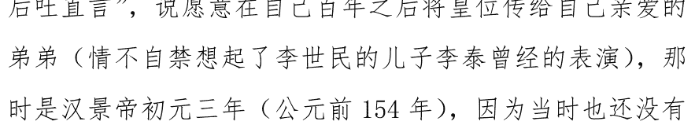

由于公孙大臣的极力反对，刘彻的阴谋才不能实施，而窦太后的这种举措，竟然让汉景帝始料不及。

因为刘彻不是嫡子，而且汉帝已经当机立了长子刘盈为太子，还算刘彻有一个很有政治智慧的母亲，硬生生执行了“夺位计划”。窦太又乘机继续试图立自己心爱的儿子刘彻为皇储，刘等大臣及时阻止，最终汉帝决立刘彻为太子，以后威风凛凛的汉武帝。

## 第十五篇 自杀与被自杀 汉帝故意不听使唤的周亚夫侯

这一篇，我们来探探周“被自杀”的奥秘。

说西汉开国功臣周勃的这个宝贝儿子，军事指挥上比其父亲更加神化，其中三个月平定“七国之乱”，可谓是一个智商和情商却比其父亲更加低能、更加无知，而在这种翻云覆雨的官场上是一种致命的短板，所以到头来不知道啥回事。

却说汉帝后元元年（公元前143年），汉帝某一天心血来潮，在宫中召见了周亚夫，却没有什么军事大事可谈，只是做一些吃吃喝喝的闲，其实是皇帝对大臣的另一类忠心测试。

当时，皇帝给老周准备了食物，一块块肉没有切开，筷子也没有一条，这叫人家怎么吃，那不是要刁难人吗？脾气有点烈的周亚夫越想越气，老大不高兴地马回官员来筷子，却不知是计，这就惹了大麻烦，小不聪明也是了。

汉帝看着周亚夫德性，于是有点阴阳怪气地问他：“周爱卿是有点满意安排了吗？”周亚夫知道皇帝动气了，连忙磕头，低声气道：“臣为这点小事，不足以辱君主的护卫。”从此周亚夫去的背影。

其实之前汉帝要废掉太子，周亚夫却大力反对，皇帝早就有意杀死这位曾平定七国叛乱的周亚夫。不久之后，周亚夫的儿子就惹了祸，并最终致使其绝食而亡，一代名将以此种惨烈代价，令人唏嘘。话说周亚夫的儿子，曾给父亲私下买了皇室专用的百件甲盾，这本就可以告你，不知此世有何，脑袋得如此胀，皇帝还想找理由清除君主，你却把一个把柄捅到家里，愚不可及。

于是，受了无妄之灾的周亚夫十分生气，汉帝由于不法之罪，周亚夫要灭他。当他们知道周亚夫的儿子私自买皇室专用时，为了出口恶气，马上上书告诉窦太后，才令此事牵到了可怜的周亚夫。

反正，有心周亚夫之罪的汉帝，见到周亚夫儿子做法之事的检举后，立马下令将周亚夫交给司法审理。有司接到圣旨，自然一秒也不想耽误，审问帝国重臣周亚夫却傲慢不予理，这算是哪子事？想以莫须有的罪名没顶！

汉帝听到司法汇报后，大怒，周亚夫不识好歹，有点激愤地说：“你大不敬，朕不需要供词也可以杀你。”

关于这次审判，还有一个极大的历史喜感。当时廷质质连问周亚夫：“皇帝如此厚待，你为什么要违反？”周亚夫心中不忿，然后冷笑一声：“我买的都是殉葬品，怎能说是违反？胡说八道，人也不带这样的吧？”审判官被问得理屈其词，却还死死鸭子嘴梗：“这可难说，你即便不在地上违法，也可在地下违法！”

周亚夫一听，立刻有点哭笑不得，终于领教了他父亲所过的“我才知道狱吏是厉害的”的真正意义，知道了什么叫做“欲加之罪，何患无咎”。所谓君要死臣，臣不得死也。

以此种“此地无仁者”的审案风格对待周亚夫，老周也自知难逢，其实朝廷要办他的时候，他就有了自杀之心，因人劝阻死不了，这次进了大牢，看来凶少了，于是“周亚夫绝食五天，吐血而死”。一代名将从此香消玉殒，瞬时如凋谢的“名将之花”，轻松地又以来自完成皇帝也颇慷慨的高层自动退出机制，而且是被迫自杀，令人痛惜。

说到这里，基本上已经完成周亚夫的历史了。但看到一些历史研究者对其精彩点评，忍不住再多说几句关于周亚夫被迫自杀的理由，某些历史研究者出了三个必要条件：一个是得罪了太后母子；二是得罪了汉景帝；三是皇权的需要。

其实像周亚夫这样正直的将军，在汉帝接到他的时候，就大大得罪了皇室，所以他也必死。那种皇帝的“百般刁难”，是不准周亚夫在军中闲着，何况他又是手握兵权的将军，谁能驾驭不了？何况这家伙仗平定诸国之乱的军队都听他的，你看他愤愤离开时的受辱，汉景帝望着他的背影那句狠话：“此者非少臣！”

所以，正因为汉帝这下意识有周亚夫死于中的，周亚夫剧烈也能让他选择自杀然后尊严地死去，汉帝不仅背负杀害功臣的历史罪名，还轻松易举了高层退出机制，何乐而不为？

最后，我们简单讲讲这种似乎很有情脉的“人文关怀”式的自杀与被杀死机制，既可以是潜规则，也可以说是不成文的“国家制度”或治理念，目的就是给犯皇帝或有腐败行为的高官或名人严肃而体面地死去，不像铁腕治的朱元璋对人剥骨那么百般坏，颜面无地。

正如历史研究者张肃所言：“两汉时期这一暧昧而体面的权力机制呈现出一种解决高层人事危机的独特思路；当组织高层管理者因各种原因不得不离职时，不必提用‘诛杀’的手段——大肆处罚，可以考虑供应一个让他们‘自杀’的选择——悄无声息地低调离开。”关于当时转身成仁的高层不在少数，“据《史记》‘汉兴将来相臣年表’及《东汉将相臣年表》统计，两汉位列三公的大臣分别50名和260名（东汉三公不掌实权）。

我们所知，将相臣自杀或被自杀的，除了周亚夫，还有李广、萧望以及为害东汉20余年的大老虎裴袭等等。联想当下自杀潮，也许观照出相似的历史影子。

## 十六篇 大战匈奴：霍去病为何残

汉武元四年（公元前119年），汉武帝派“双璧”大将卫青、霍去病出击匈奴。霍去病部从代郡、右北出塞，奔二千里，穿越沙漠，刚好与匈奴左部遭遇，卫青和霍去病（也称骠骑将军）率精骑主力攻匈奴，兵力数十万，这也是汉帝发起的第三大战。

获得了如此胜利，此役损失也大。当时，卫青与霍去病军支部部队出击，共有官家和私人马匹四万匹，语义清理。人员方面，虽然汉军消灭了匈奴八九九万人，己方也死了数万人，没有占到多少便宜。

当然，要奋斗就会有牺牲，因为这一场大捷，让汉朝彻底解决了匈奴之患，换取了边边的和平，善莫大焉。匈奴由于没有足够的军事与汉朝抗衡，只能被迫迁往很远的北漠。汉帝对霍去病的青睐，等师回朝，汉武皇帝特意增大司职，由卫青、霍去病两甥同时担任，表示两人平起平坐，霍去病的官级和俸与卫青是一样的。

自此以后，常胜将军卫青的权势就没有以前尊贵了，甚至于淹在青年将军霍去病的光环里。为此，很多卫青以前的朋友和门客都改投如日中天的霍去病，而凡来靠的，霍去病不吝赏赐，马上授予官职，以备络人才。

可惜英才，两年之后，就是汉武帝元符六年（公元前117年）大司马骠骑将军霍去病，英年早逝，西汉的一大损失也是。

那是怎样的激动人心范式，周亚夫何求？有此振奋人心的大捷，汉帝自是不胜，连增加食邑五千八百户，同时封其将列侯、赵侯、桂侯、关内侯（比李广少），其余低级官和小士兵许多升官受赏。

据《资治通鉴》记载，霍去沉默言，沉稳老成，有勇气有担当，虽然能率士卒冲锋陷阵，在战场上却又是一个有点刻薄寡恩的酷哥（可能是年少气盛吧），甚至对于对部下有点漠不关心。

## 458 楼
作者：鼎湖听泉 日期：2019-05-04 16:13

汉武帝知道霍去病是一个军事天才，也想教他学习大军事家孙武、吴起的绝世兵法，以求精益求精，更上一层楼，他山之石可以攻也。你这心高气傲的霍去对皇帝说了些什么？

## 459 楼
作者：鼎湖听泉 日期：2019-05-04 16:13
- 办理加微信1101284955
- 获取更多好帖

“我作战从来只看具体略要如何了，不用拘拘泥于古代兵法。”他竟然一脸不屑地说道，有才酷哥果然不同凡凡。

## 460 楼 
作者：鼎湖听泉 日期：2019-05-04 20:19

话说汉武帝为建立赫赫战功的霍去病修建一个金碧辉煌的豪华府邸，还有打算让他前往参观评点，看看是否满意，他却不给尊贵的皇帝说了这样一句话：“奴未死，何以家为！”这种重义而视财物如土的人，居然还能对部下不关心，甚至连伍闲食也“克扣”，简直有点看不懂。

## 461 楼 
作者：鼎湖听泉 日期：2019-05-04 21:42

说当霍去带兵者令人间闻风色胆的霍军出征时，皇帝特别让负责宫廷膳食的大太官给他带来美味佳肴数十车，以便补充身体能量。他小哥可好，直到打完仗班师时，有的士兵有饥肚子的，居然在车上装满了吃的粮食和肉类，不知是否打仗太投入了忘记发给大家吃的。

## 462 楼 
作者：鼎湖听泉 日期：2019-05-04 22:23

不仅如此，在塞外汉军有时因缺粮而饿得头昏眼花、士气不振，霍去病还颇修建的场地大大游戏一番，也不——

- 知识管理 加微信1110128495
- 领取更多福利

说这种事还不少，让人丈二和尚模不着脑袋，有少帅就是与众不同也是。

## 463 楼 
作者：鼎湖听泉 日期：2019-05-04 23:09

相对于另一猛将，卫青就宽厚仁了很多，他不仅谦逊礼让，爱兵如子，脾气特别好，如有女子般的温柔和顺，仗也打得十分漂亮，深得汉武帝的喜爱。二人的志结如此迥然不同，却都是千古名将，却真能让人玩味也是。

## 464 楼 
作者：鼎湖听泉 日期：2019-05-04 23:39

虽然卫青和霍去病性格各异，却是舅甥深情。表面上两人同为大司马，在汉武帝的内朝眼中相当的人物，甚至于霍去病的风头还盖过了舅父，很多追求军功的人纷转投霍去病门下，卫青却了“门前冷落鞍呦”的景况，基于利益冲突，有人还推想他们关系不好，其实是一个错觉。

## 465 
作者：鼎湖听泉 日期：2019-05-05 00:04

某些历史研究者认为，卫青后来不经常出征，也就是要胜出机会来给自己的宝贝外甥，此时卫青成就名威振天下（万古侯），封国不可封，为了躲避皇帝帝意，只好让不想长安纸锦金逸，夷马轻任高日子生活，而望建功立业的制度按军封侯，所以那些从卫青这边投到霍去病门下求军功的人也乐见其成，无所谓谁抢了谁的风头；再者，卫青当时身体并不是很好，年龄也逐渐老长，对于仁爱的卫将军来说，也是顺理章的事情。他本身并不是特别争功，也没有什么野心，自己的外甥能建立勋，难道不是他的利益之一？说霍去病支持太子，证明了舅甥关系深厚，没有隔阂。

## 466 楼 
作者：鼎湖听泉 日期：2019-05-05 00:39

最令人震惊的就是，年轻气气的霍去病因要为舅父报仇，公然射死了与皇室关系很好的李，更是彰显了对舅父的爱。这件事就从头说起。

## 467 楼 
作者：鼎湖听泉 日期：2019-05-05 01:02

话说李广有三个儿子，李陵（兵败后投匈奴）、次子李叔先死，幼子就是李敖。李敖和他父亲一样，都是打仗的好将，冲入匈奴军中冲锋陷阵勇不可。

## 468 楼 
作者：鼎湖听泉 日期：2019-05-05 12:31

元符年的汉北之战，李敖做去病的校尉，因夺匈奴左王斩获无数立功赐关内侯。相比之下，李广倒溃顶，不仅迷路，老年体弱的李广对幕后下属说“不愿复”，懊愧自杀。

## 470 楼 
作者：鼎湖听泉 日期：2019-05-05 13:06

虽然李广后立功，还袭了父亲的郎令职（京城的重要官职），李敖却对父亲的冤仇耿耿怀，甚至偏认为是大将军卫青故意陷害其父，至少是故意让其死的，在他失去理智之下，不久以后犯卫京。

## 471 楼 
作者：鼎湖听泉 日期：2019-05-05 13:27

很好的卫青对李广死有些惆恳和同情，也能理解李敖爱父之心，而且素来宽待李广，善退让的卫青没有追究李敖的责任，还隐瞒了这件事，没有声张，以稳定军心，可见老卫的胸怀广大。

## 473 楼 
作者：鼎湖听泉 日期：2019-05-05 13:56
- 一手整理，加v101284955
- 获取更多帖

不过，不知道霍去病是如何知道此事的，而当当年年轻气盛的他后知道之后，就得了。

## 473 楼 
作者：鼎湖听泉 日期：2019-05-05 13:37

正所谓有利不报君子，有恨不消尚人是，霍去绝对不能接受被亲手伤自己舅舅，这个仗特别勇猛，曾只身带几亲兵勇闯匈王大营，一个眼神就要要变的匈奴几千士兵的狠锐角色，打架也不含，“气吞万里如虎”也，于是不久赵随汉武帝击甘泉官狩猎之际，同霍去病一时冲动之下，报仇心切的他射兽却射死了“好部下”李敞，可谓是冤冤相报，悲剧啊。

## 474 楼 
作者：鼎湖听泉 日期:2019-05-05 15:11

其时，因为汉武霍去病竟被皇帝当宝贝供养着，宠得不得了，尽管李敞和皇室关系亲密，李敞的子女又是卫系太子的“座上客”，而且射杀帝国也将非同小可，传出去的话无疑引起震，为了保住，汉武帝对外界虽称“李散将时被掳撞死”，以往胜口，可见对霍去病的特别偏，就是害惨了李家一家，运气不是一般差。

## 475 楼 
- 一修理办理加信1101284955
- 获取更多好帖

十七篇 专业攻哪家强：“飞将将军”李广何惨烈拔刀自刎

上一篇，我们扒了李广儿子李敞被上司霍去病射杀的事，大家应该感兴趣的。感觉有意念犹未，那么这一篇我们来来讲古代名将李广何惨烈自杀的过程。

## 477 楼 
作者：鼎湖听泉 日期：2019-05-05 20:44

回到公元前119年的汉北大战上。这一年，雄才大略的汉武帝下，匈奴认为汉军不敢轻易穿过大漠，还有诱敌深入之计，既然匈军认为孤军深入，让我们疲尾不能顾，我们决定派大军出击，措手不及，一定能把匈奴彻底赶回北，于是点头同意。

## 480 楼 
作者：鼎湖听泉 日期：2019-05-05 21:34

接下来，大家都知道了西汉征用了万精马，皇帝下命卫青、霍去病各率五万主力攻打匈奴，决。

## 481 楼 
- 一手办理加微信101284955
- 获取更多好帖

当时，敢于深入的汉军寻找匈奴单于，士兵皆属霍去病部队。后来，从匈奴俘虏才得知单于在东边，于是霍去病改由代郡出塞。

## 482 楼 
作者：鼎湖听泉 日期：2019-05-05 22:36

这一次，好像为战争而活，李广又主动请缨出征，鉴于李广之前的好时坏的战绩，再加上事已，汉武帝开始不准，还任命前将军。此外，公孙贺被任命左将军，赵食为其右将军，曹为后将军，一同由大将军卫青节制。

## 483 楼 
作者：鼎湖听泉 日期：2019-05-05 23:02

赵信一听到汉军出，大喜，正好可以实现自己的战略构想，为了出击，汉军横大漠之后，一定疲于奔命，然后匈奴把重都到北方很远的地方。

## 484 楼 
作者：鼎湖听泉 日期：2019-05-05 23:43

却知道大将军卫青出塞后，从敌俘口得知单于留住，便率精兵挺进，正面进攻，而改派伏得不是太稳的前将与右将军赵食合兵一处，改由东路进军。

## 485 楼 
作者：鼎湖听泉 日期：2019-05-06 00:16

而这一路线改动，也直接导致了西汉名将李广含恨杀的悲壮结局，始料不及，简直有点“蝴蝶效应”的味道。

## 486 楼 
作者：鼎湖听泉 日期：2019-05-06 01:01

因为这一路线的大改动，等于开了能征善战让匈奴闻风丧胆的李广部队，不让其担当主攻任务，也说明了皇帝对他的猜忌，此为了打大仗硬要拆活的李广来说，是要了他的政治军事生命，以及怀疑自己的生存意义，事实上也是皇帝的意旨。

## 487 楼 
作者：鼎湖听泉 日期：2019-05-06 12:14

原本被皇帝任命为前将，也应该是赐了担当主攻前锋的使命，他正等待着再一次为大汉冲陷黄龙。李广心凉了半。因为东路远一片荒漠，水草也少，不小心还很容易迷路。

## 489 楼 
作者：鼎湖听泉 日期：2019-05-06 13:03

> “启尊大将军，这里面已经有了一点误会，我既然作为前将军，就应该是前锋去与单于决一死战的，不知为何大将军却交命我为东路军，做了后增援。我少年时代就与作战，凡大小战，好不容易才有机会，还请大将军不要改动。”

## 490 楼 
作者：鼎湖听泉 日期：2019-05-06 13:36

面对李广苦苦的老将，真的是为难，因为这一临时路线改动，兼承皇帝旨意，来时候卫青受命，让李广调到东路作战，以免累了整个局。判断皇帝认为李广老将了，重要的是他打仗运气不好，曾经全军覆没被匈奴捉。

这一仗意义重大，可谓是决战。而且，卫青也想过不久失去爵位的李广，与自己一同作战，以便再立功，所以将李广调到东路担任副攻。李广知道内情之后，自然不服从命令。

## 495 楼 
作者：鼎湖听泉 日期：2019-05-06 20:31

话说足智多谋的卫青率出塞，封气昂扬地横穿沙漠，狂奔一千余里，见匈奴单于的大军正展开等待（原本是想在沙漠中战力最强的霍去病对付主力，不料让卫青鬼差）。

## 496 楼 
作者：鼎湖听泉 日期：2019-05-06 21:13

威力强大的“武刚车阵”对敌，铁甲车迅速环绕一周成营阵，然后派出五千骑兵合击军阵，冲击陷阵，匈奴也动一万骑兵迎战，直杀得昏天黑。

## 497 楼 
作者：鼎湖听泉 日期：2019-05-06 22:26

正如明史学家黄仁宇评价武帝“刘彻未曾在战场里实际指挥作战，但是每有重要战事的部署，许多人所谓‘战序列’的安排都是由他自己主。”卫青是卫子夫的兄弟，霍去病又是卫青的侄子，此外威创立不世军功。霍光与霍去为异母兄弟，后成为汉朝宫廷里的中枢人物。”因为汉武皇帝的知人善任，让这次的汉北之战被列入“中国历史十大战役”，也是打“逆风球”的常将卫青少打多、以弱强的巅峰代表作，运气奇迹好，彻底打垮了匈奴，从此让强悍匈奴一蹶不振，再也没有来自自己的风采。

## 498 楼 
作者：鼎湖听泉 日期：2019-05-06 22:37

好，以下我们继续激战的详细情形。当时汉双方激战到夕阳西斜的暮之时，突然起黑，两军士卒相互不能分辨谁是自己谁是敌人。

## 499 楼 
作者：鼎湖听泉 日期：2019-05-06 22:55

趁着战场一派混乱，很善于抓住战机的卫青，立马增援左右两翼支力军，迂回包单于的大营。

## 500 楼 
作者：鼎湖听泉 日期：2019-05-06 23:48

眼见汉兵军马的样子，被风沙吹得有点不清状况的匈奴兀稚斜单于见势形势，怕打不过如狼虎似的汉军，也只能是三十六计走为上计，丢下乘六匹健骏，在数百精壮兵的保护下，强行突围，冲击汉军防线，径向西北奔袭。

## 501 楼 
作者：鼎湖听泉 日期：2019-05-07 00:11

天黑后，汉军仍然与战激烈搏，各有损耗。汉军从抓住得知匈于已逃，于是卫青急忙派出轻兵连夜追击，大军随之散走。

## 502 楼 
作者：鼎湖听泉 日期：2019-05-07 00:37

明天早发现匈军已逃，没能抓住单于，不过获而杀了匈奴一万余人，收获颇丰。然而在天亮时到颜山，缴了匈奴粮草，全部烧光，胜利返回。

## 503 楼 
作者：鼎湖听泉 日期：2019-05-07 00:56

晚安，说前将军李广与右将军赵食率东路。

## 504 楼 
作者：鼎湖听泉 日期：2019-05-07 11:40

又远征，又没有做向，在茫茫无际的大汉中迷了方向，最终不能与主力会师，落到卫青的后面，当不能赶上主力的，部队回来，才在沙漠南部碰到李、赵二位将军。

## 506 楼 
作者：鼎湖听泉 日期：2019-05-07 12:19

这一下，有点麻烦了。因为失误了军机，作为统帅的卫青只能公办事，询问二将军迷路的情况，以便向李广。

## 507 楼 
作者：鼎湖听泉 日期：2019-05-07 12:55

原本，李广是一个爱兵极有担当的人，士兵们以此爱，除了自己特别耿爽无拘束，最重要的是李广为人廉，没有官架子，往往把自己当成普通士兵，经常能摆正自己的位置，与兄弟一样与士兵一起吃喝同甘共苦，得到赏赐就分给部下，毫不吝啬。他当了多年二千石，家中却没有余财，全拿出来和部下共享。

## 508 楼 
作者：鼎渊听泉 日期：2019-05-07 13:28

他打仗，在困境中找到水，都是让将士先喝，如果有一个不喝，那么李广就不喝；有吃的，如果将士们没有吃过，李广就不进食，有最喜爱的父亲。

## 509 楼 
作者：鼎渊听泉 日期：2019-05-07 14:10

再加上他本人胆大，打仗总是喜欢先士（想起了“拼命三郎”李世民打仗时的样子），手臂像猿一样长又灵活，是个射手，可谓是百发命中，如果他认为射不中目标，基本上都不发箭（只是这箭太远太高）。

被他驱使下，遇到好领导也不容易啊。

## 510 楼 
作者：鼎渊听泉 日期：2019-05-07 15:03

可惜好遇难，李广却让人嘘唾唾的惨烈自杀，来结束马弓侠、威震敌的一生。

## 511 楼 
作者：鼎渊听泉 日期：2019-05-07 15:28

看到卫青征召，性情耿直的李广也做出了等待，于是李广对部下说道：“我是自己指挥无意气用事，大家迷了路误了军期，校尉们没有，我现在要到大将军幕府去受军，所有责任由我担当。”

的英勇善战，处汉战南一亮，就夺得了熠熠星光，令人前一亮，西汉又一将横空出世。

## 519 楼
作者：鼎湖听泉 日期:2019-05-07 23:25
史载，霍去病十八岁时当了侍中，精通射击术。此战役跟随父吕青首次参加战斗，以骠校尉的身份率领800精兵，风驰电掣一直把西汉将军拖到数百里之后，积极寻找战机，取得了斩杀匈奴将士千余人的辉煌战果，远远超过了已的损失。

## 520 楼
作者：鼎湖听泉 日期:2019-05-07 23:42
一手整理加微信1101284955 获取更多好站
杀匈奴单于祖父辈的匈奴莱提提，生擒单于叔父莱来提绥姑，战冠绝全军时，立马加封霍去病为冠军侯，尊荣无限，江然旁人。

## 521 楼 
作者：鼎湖听泉 日期:2019-05-08 00:15
然而，匈奴人亡之心不死，即便在打仗上已经占不到任何便宜，不过还是经常出兵突然袭击汉朝，然后趁机抢掠。

## 522 楼 
作者：鼎湖听泉 日期:2019-05-08 03:06

## 晚安
523 楼 
作者：鼎湖听泉 日期:2019-05-08 自汉匈奴 10:08
[IMAGE]http%3A%2F%2Fimg3.laibafile.cn%2Fp%2Fm%2F308476587.jpg

## 524 楼 
作者：鼎湖听泉 日期:2019-05-08 11:42
元狩始元年（公元 122 年），匈奴军队一万人侵上谷地区，杀死数百汉人。

元二二年（公元 121 年），汉武帝命骑将将军霍去病率兵一万，以雷霆不及及之势自陇西出发北击匈奴，六天后获胜。

加信1101284955 获取更多好帖
又一次长途奔袭，杀击匈奴兰王、侯优王，同时俘获泽邪王的王子及诸国都尉，此役共灭八千九百余人，还夺取了休屠王用以祭礼上天的金人，收获颇丰。

## 525 楼 
作者：鼎湖听泉 日期:2019-05-08 12:30
霍去病不愧是常将军卫青的好将，冠军骠侯也是，打仗的能力一点也不输给他的父舅，“帝国双璧”啊，还有此二人，汉西何不能大谈胡虏血呢？

汉武帝闻讯大喜，于是下马诏增加去病疾食邑二千户，有功必赏，毫不含糊。

## 526 楼 
作者：鼎渊听泉 日期：2019-05-08 12:58
这夏季，乘敌追击的霍去病与合侯公孙斩领数万步兵，分兵两路同时从北地出击匈奴；卫尉张骞、郎中令李广也同时从右北平分兵合击匈奴。

这一次又是飞将将军李广的表演时间。

## 527 楼 
作者：鼎渊听泉 日期：2019-05-08 13:20
其时，善于短程突击的李广只带领四千精兵为先锋，距汉军大部队约有数百里，张骞万余骑兵殿后。

## 529 楼
此后，打仗相当骁锐的飞将李广，就遇到了相当棘手的事，因为他遭遇了十倍于自己的自己的匈奴左贤王的团团包围。眼前敌人黑压压的一大片，水泄不通的款式，看到这种阵势，连锐勇善战的李广将士都感到十分恐惧，躁动不已。

## 530 楼 
作者：鼎渊听泉 日期：2019-05-08 14:52
当，久经畅场的李广除外，他沉稳地命令儿子李广率数十壮骑迅速穿越敌阵，然后从敌阵左右冲出后返回，以试匈奴人的战力。李广返回后向父亲复命道：“看来，其实匈奴没有想象的强大，很容易对付。”有了李广这大气的一套说，汉军情绪稳定下来，不再那么恐慌了。

## 531 楼 
作者：鼎渊听泉 日期：2019-05-08 15:38
李广于是命部队面对匈奴列成圆形阵战，凭借着优势兵力，匈奴也不打语，首先向汉军阵地发起进攻，意图速战决，一时杀声震天，犹如雨下，蜀时汉兵伤亡过半，损失惨重，甚至于连箭也快用完了，形势不是一般地危急。

## 532 楼 
作者：鼎渊听泉 日期：2019-05-08 16:01
沧海横流，方显英雄本色。气定神闲不着急，保持对匈奴的藐视，并不当回，已经是李广用特大号，专门射击匈奴将领，还连射死几个了，这战术简直别出，让匈人都看傻了，匈奴也变得意懈，攻势明缓了，没有那种信心。

## 533 楼 
作者：鼎渊听泉 日期：2019-05-08 16:22
此时已经是西山，天色渐晚，汉军将士更加惶惑，只有李广神情自若，巡视巡视，安抚军心，调整部署，全都钦佩他的勇武。

## 534 楼 
作者：鼎渊听泉 日期：2019-05-08 21:27
第二天，汉军又与匈奴兵进行一轮恶战，虽然己方伤大半，但敌人的伤亡却超过汉军的损失。

## 538 楼 
作者：鼎渊听泉 日期：2019-05-08 21:55
看着全军覆没，恰在此时，张骞的大军赶到，匈奴见形势妙，此时，汉军显得十分疲惫，根本无力追，最后只能撤而去。

## 539 楼 
作者：鼎渊听泉 日期：2019-05-08 22:33
这一役，面对十倍于自己的敌军，李广取得的战绩相当不俗，不过汉军伤亡也比较惨，李广还是逸脱不了命运。

## 540 楼 
作者：鼎渊听泉 日期：2019-05-08 23:33
而张隽更加倒霉，由于行动迟缓，误战机，让李广全军覆没，按照汉朝的法律差点死处，身后被削职为民，如果这样死了就没有两年之后他的西域之旅了。

## 541 楼 
作者：鼎渊听泉 日期:2019-05-08 23:00
而骑将军霍去病斥，却是吉高照，他带兵风驰电掣般深入匈奴二千里，由此公孙敖失去联系，未能会师。

## 542 楼 
作者：鼎渊听泉 日期:2019-05-08 23:39
不过，特别战斗的霍去病即便没有援手，孤隼夺战，他还是率郡跨越郡延，经过小月氏，丞相、都尉众千百人投降汉军，此役斩三万二百人，获匈王十余人，算是汉朝用的一个“神话”。

## 543 楼 
作者：鼎渊听泉 日期:2019-05-08 23:39
闻此大捷，武帝大喜，立马增加其食邑五千户，同时爱屋及乌，连带封赏其部下将领，司赵破为累侯，校尉高识为宜侯，校尉饰为梁侯，太公具有仁。只有倒霉的合侯公孙敖因中途留，未能与霍去病胜利，安其命。

## 544 楼 
作者：鼎湖听泉 日期:2019-05-09 00:34
当时，像少年英雄霍去病这样勇冠军的人很少（仿佛当年勇不可挡的英格兰足球天才欧文的风姿），不用说取得那种辉煌的胜利了。

## 545 楼 
作者：鼎湖听泉 日期:2019-05-09 12:04
据载，当时汉老将麾下的将士、马匹、兵器都不如霍去选兵的强，霍去部将士都是经过精心挑选的，特别能战斗，而且作为主帅的他确实是胆识过人，特别会选择队伍，他很喜欢深入（还没有李广的飘荡），运气比李广更是奇好地，经常身为先士冲，走在大部队的前面，甚至连天老爷也似乎很顺顾他的部队，从来让他陷入李广曾陷入的绝伦之境，顺利得让人嫉妒。

## 546 楼 
作者：鼎湖听泉 日期:2019-05-09 12:35
却是其他老将却不能建功受奖，有的还受到了重罚。志得意满常常打胜仗的霍去病由此地位也越来越卓越，到了居然将将军卫青几乎可以比肩了。

## 548 楼 
作者：鼎湖听泉 日期:2019-05-09 13:00
经过多次毁灭性的打击，被得滚滚尿流的匈奴人也出现了内部的裂痕，大家互相猜怕的结果，直接导致了是年秋季宰邪投降汉朝，算是新鲜事一桩。

## 549 楼 
作者：鼎渊听泉 日期：2019-05-09 13:30
当时，匈奴浑敖王、休庸王在西部军队被杀落花、满地找牙，一下子损耗几万，面对如此惨败，匈奴单于十分生气，立刻怒于这两个倒霉的王，甚至于密谋他们处死。浑敖王与休庸王知道后，是非常愁害，那还谈什么患，于是是不做休索就叛国，免得被拉出去。

## 550 楼 
作者：鼎渊听泉 日期:2019-05-09 10:08
整理

## 551 楼 
作者：鼎渊听泉 日期:2019-05-09 14:06
于是，浑敖王派人在边界拦截住汉人，然后这些人带信叛汉朝的信息，以便传给汉朝的最高帅，要件。

## 552 楼 
作者：鼎渊听泉 日期:2019-05-09 14:42
匈奴的这一异，汉武帝听到消息后有点异，不敢相信这是真的，原本没有过一世的匈奴，也有装的时候，可是何气横戈，入侵汉地如那种狂威在几年征战就分裂，服了。

## 553 楼 
鼎听泉 日期:2019-05-09 15:41
虽然，后来发生的事情证明了汉武的怀疑是多余的。因为匈奴休庸王对降犹豫不决，浑敖王先下手把他干掉，然后收编了他的部属，以示大汉。

## 554 楼 
作者：鼎渊听泉 日期:2019-05-09 16:26
霍去病渡黄河之后，旋与浑敖王相遇，一方面趁机潜入匈奴营，与他商量对策，先是将逃跑的八千将斩杀，此断退至燕然山。又让一人乘车直接见汉武帝，表示臣服。

## 555 楼 
作者：鼎湖听泉 日期:2019-05-09 21:48
在霍去病见汉武帝的同时，还让其部将士四万人（号称十万）齐渡黄河，降汉朝，这是这一项政治大事，也彰显了汉朝不余力的打击下，匈奴国的日渐衰落。

## 558 楼 
作者：鼎湖听泉 日期:2019-05-09 22:16
浑邪到长安，汉武大喜，立马封浑邪为沮侯，赏数十万，食邑一万，甚至其部下小王呼毒等人都封侯，官位大义，毕竟曾经如此强悍视汉人的臣服中原王朝，都是一种很风诡的事情。为此霍郡继续立功，总之，自从浑邪投降了汉，汉域得浑邪辖之地，陇西、北地、上郡一带外族侵扰，百姓得以安居乐业。一派和平景象，打了多年伏，算是值的。

## 559 楼 
作者：鼎渊听泉 日期:2019-05-10 00:01
此此，连征战造成国库空空的汉武帝，正好将此郡的屯军队裁一半，最大限度地减轻百姓的负担。

## 561 楼 
作者：鼎渊听泉 日期:2019-05-10 03:33
当然，匈奴的小骚扰还是时断时续，且汉武帝要彻底解决边域决心也没有动过，直至汉武帝元狩四年（公元前119年），西汉大兵压境，大将军卫青于北大败匈奴单于；骠骑将军霍去病大胜匈奴左贤王，封狼居岑山，从此“汉南无王庭”，较为彻底地解决匈奴之患为止。

## 562 楼 
作者：鼎湖听泉 日期:2019-05-10 01:16
话说骠骑将军霍去病，此役虽然阴阳差错因为战场位置对调，不能遭遇单于主力，不过阴阳差错地遭遇了匈奴左贤王，并大败之，所取得的战绩一点也不逊于大将军卫青，自此官运亨通，风光无限。

## 563 楼 
作者：鼎湖听泉 日期:2019-05-10 11:43
只可惜天于英后，因为两年之后，也就是汉武帝元符六年（公元前117年），大司马骑将将军霍去病逝，可谓是英年24岁（一说23岁）正值当打之年的霍去病为何英年早逝，到现在还是一个历史谜。

## 565 楼 
作者：鼎湖听泉 日期:2019-05-10 12:52
关于他的神秘死亡，也可以众说传异，一说病死，是喝了汉北的有毒河水上洛瘟疫而死，《史记》却没有记载他如何死，只写一个“卒”字，估计他的死因司马迁也无知晓，被刻意隐瞒了。

## 566 楼 
作者：鼎湖听泉 日期:2019-05-10 13:28

他的葬礼是记录得很详细，所以联想起来也是无可非；汉武帝忍痛杀了李广之子，成就了三军统帅。

## 567 楼 
作者：鼎湖听泉 日期:2019-05-10 14:14
当时，像少年英雄霍去病这样勇冠三的人很少（仿佛当年勇不可挡的英格兰足球天才欧文的风姿），不用说取得那种辉煌的胜利了，这种胜利。

## 568 楼 
作者：鼎湖听泉 日期:2019-05-10 15:01

李广之死，也可以说是因为太贪所致，人心不足，最终误了皇帝的命令。他居然和当时的萧一样，肤之后成为平民，最后满门抄斩。

## 569 楼 
作者：鼎湖听泉 日期:2019-05-10 15:38
因为李广这这家伙不大野心却小，他在领兵出外仗之时，还不忘在朝中运作自己的势力，非常的立储。

## 570 楼 
作者：鼎湖听泉 日期:2019-05-10 16:30
李广和丞相刘优为女儿，加上李广儿子出征军时，立储，因为匈奴王能当上太子，那么李广两家自然是好处，政治前途也会高枕忧了。

## 571 楼 
作者：鼎湖听泉 日期:2019-05-10 21:08
## 572 楼 
作者：鼎湖听泉 日期:2019-05-10 21:36
昌王是李广利的妹妹、大家都是亲戚，关到自己的利益问题，刘优没有打算应，于是便着手起来，积极搭建自己的利益链，放手赌。

## 574 楼 
作者：鼎湖听泉 日期:2019-05-10 22:05
可惜刘冕之过急动作太大，这副作用很大，终是机关算尽明反了命，换诸君的事情太大，几乎是动国本，如果没有很大的政治量，或者是皇帝之意，会很难。

## 575 楼 
作者：鼎湖听泉 日期:2019-05-10 22:51
偏偏刘冕又有自知之明，为此事弄得满城风雨，到了司马昭之路人皆知的地自然不好，不久便大祸临头，随着内令郭粮向朝廷发了刘冕和李广要让昌王以帝以及刘丞相老婆诅咒皇帝早死，经过一番其老婆儿子同时处死，李广妻儿也一同下狱，候侯发落。

## 576 楼 
作者：鼎湖听泉 日期:2019-05-10 23:15
李广利自从打败之后，这些年也都是戎马店，和匈奴人常年作战，且互有胜负。一听到立储事件败露之后，也有点惊慌失，不知何好。

## 577 楼 
作者：鼎听泉 日期:2019-05-10 23:53
恰在此时，他的幕僚胡亚其投降匈奴保命，他此时还心存幻想，想用击匈奴立功来换皇帝回心意，放过他自己，所以十分犹豫不决，没能下决心投降匈奴。

## 578 楼 
作者:鼎湖听泉 日期:2019-05-11 01:04
于是率军继续过郡州居水，和匈奴大战一日，当李广利发现自己的长史诸人要叛乱劫持自己时，李马将军长史处斩，此断退至燕然山。

## 580 楼 
作者：鼎湖听泉 日期:2019-05-11 11:37
李广利最终被匈奴的优势兵力拉击，双方亡各都十分惨重。然后匈奴连夜袭人在汉军前路秘密络了一条很深的涟，一手办理加微信1110284955获取更多好帖

## 595 楼
这个问题，就得从汉武帝的多疑性格说起（好像还是很有为皇帝的通病也）。

众所周知，汉武帝是一个举世公认的伟大皇帝，是与首统中国的秦始皇一代雄主（有人还把他与秦始皇、唐太宗、宋太祖誉为中国的“四大天王”）。正因为他的雄才大略以及勃雄心，中国得以扩张疆土，傲立当山，大汉帝国由此登上了辉盛的巅峰，这也培养了汉帝后期的刚复首，整理，加信任，建立，获取更多好给

不能近近近的人，不然受伤的还是你你自己。

这个不仅的大臣感受到了，基于他自己非常喜欢的家人如废太子刘彻（汉武帝29岁才得长子刘彻，故喜欢很得很，刚出生便命人为做其做《太子赋》，这个对于是正式确立了刘彻的太子身份，也是十分清楚的，故此经常劝诫父皇，也从此埋下被疏远猜忌的祸根。

总之，当汉武帝认为受到了威胁的时候，他的多疑性格就会使其其六亲不认而杀人如麻。其实巫蛊之祸也包含了汉武为了“固围”皇权，而对威胁的终结 卫系政治集团的不遣余力的大清算、大洗牌，所谓的“官场无父子”的真实写照。

大家知道，卫太刘衍是卫皇后所生，他宽厚仁爱，颇有高祖遗风，而且也有相当的政治才能，在朝中口碑极佳，颇有影响。最重要的他背后靠着一个西汉的著名家族，也就是以其功名赫赫的舅卫青为核心的卫系政治集团。

卫青不仅手握兵权，还是皇帝一朝的领袖人物，在武帝一朝权倾一时。所以，性格多疑的汉武帝自然不想让卫系独大，于是为了为分卫青的外舅霍去病与卫青并列大司马、大将军，目的的限制卫青的权力过分膨胀，进而而有与自己叫板夺自权的实力。

后来卫青、霍去病相继为革命鞠躬尽尽，不过卫系将他们的能量还很大，也自然而然成为了为了太子的势力范围，政治力量没有明显减弱。到了“亚盘之祸”之前，由于武汉帝大喜喜与穷武跋，此让国家陷入了困境，“天下户口减半”，社会危机是愈急加剧。

而在这种情况下，以性仁厚、体恤民苦的卫太子，以团团结在他周围的逐渐渐灭夷连年征战的卫将领们，就根据政治局势的急转直下，勇敢提出与皇帝好战政策相同的养生息政策，主张要战，与弩和解。

自己曾经非常爱护和信任的宝贝儿子，居然走向了自己反面，而且政治理念却是如此的“针锋相对”，简直让他吃一惊，甚至是惊出一身冷汗的那种，所以为了保卫皇权的需要，“觉悟”之后，好斗的武汉帝也开始了对卫太子的防范和猜忌，进而发生了西汉政付付出惨重重治代价的亚盘之祸。

事实上，也是由于武汉帝与自己的宝贝班人政治理念和治国方略的分歧越来越大，甚至错误地认为这种施政分儿子是有意要造反自己的权利，所以性格中刻薄算恩居多的汉武帝，晚年才为了政治明险疏远了皇后和卫氏集团，大有一种势不两立的况味。

于是，根据此种政治表现，也有很多历史分析支持的皇后（汉武帝之所以抛弃了他曾经很多帮助和支持的皇后（以及她背后的卫氏集团），而是因为政治被移到其他王夫人、李夫人、钩夫人等人，这又显得是为了好色，而是为了保卫权而进行的无奈切割。

基于此，此后虽然卫子的皇后名一直留着，不过事实质上早就被打入了冷宫，从此她想见皇帝君都是奢。

尽管所周知汉武帝是名喜欢这个太子的，几乎可以是星星星月亮，宠爱有加据史载，太子刘彻汉武封元年（公元前10年）而元封间也是汉武帝“周游”出频繁的年份。换句话，皇帝频繁外出活动，而让太子留长安做皇帝主持政事。政治上此时他十分信任这个接班的人。只是因为后面的政争，终于让这种鱼情走到尽头，利益确实人们轻易绕去的行动。政治核心周围各路人为了各自的利益再分配的推波助澜，一场场景台风的政治风暴到成渠。

而且，由于皇帝父子那截不同的性格，形同水火，此种政治延续杀更加避免。

据史载，太子虽然深爱皇帝至于溺爱，做人却很正光明、有板，并不认为汉武帝的宠爱有加而变二世祖，倒是喜欢“兼爱非攻”，很有一点墨家不分等级、不分远近、不分亲疏地爱所有人的人，反对战争维护和平的政治理念。

的比较凉寡寡的皇帝父亲简直是判若二人，原本格有时时候也不能完全传造，还是要后天培养的。

关于他俩的迥然不同的性格和行事手法，史曰：“汉武帝用法严，多任深刻吏；太子子宽厚，多所平反。”汉武帝坚持以武力伐匈奴及四夷，太子极力反对，这针尖对芒的，皇帝脾气再好再再好，迟早也会因政治分歧而走向反面，分道扬扬，况汉武帝又那么强势那么多疑的一个政治人。

而且，又由于太子的性格使然，让许多想兜售其术的酷吏邪郡视其为眼中钉、肉中刺，欲除此而后快。据历史书《资治通鉴》载曰：“君宽厚者皆附太子，而深酷法者皆君。卫邪多党与，故太子少而聚多。卫青戮后，臣下无复外家为，敢欲太子。”

卫系政治集团在失去卫青此种“定海神针”般的通天人物后，姨娘太子的酷吏集团便经常制造滋事，挑拨离间，及至皇帝父子因为治理理念的冲突，以及汉武帝为了换太子掉自己的自己的政，显然是心暗趁太子，不能扶正皇帝，自己自保成为问题。也是江充等人的兴风作波助澜，从而发生了西汉历史上最严重的“巫蛊”乱。

皇后对卫后和太子母子情深，所以太子每次拜母事，总会待上一点的时间，多些，这应当是人伦之乐，无过可厚。不过有一个叫苏文的宦官，不大欢太子，而且十分喜欢弄是非，苏文在侯夫人之子出生后，就大力挑拨汉武帝与卫皇后之间的关系。

就如此如太子去探望自己母亲，因为留在后宫的时间比较久，他便向汉帝打小报告，乱太子一天到晚留在后宫里与女官混，汉帝那时也还没有糊涂，当然不信自己行为端正、千爱的好儿子做出此种事，后来为了安抚太子，反而给太子的东宫调拨二百美女，可谓是因祸得福。

然而对其不满，因其皇帝近，也只能笑了。直到汉武帝识破了这些人的奸计，一怒之下杀死陷太子的小黄门之后，怕朕苏文才有点收敛。

当然，囿基本上改了吃厕的，苏文这种挑拨离间害人为乐的阴险小人，只要有合适的机会，绝对不会忘记给自己的眼睛上药的。

关于这，历史书《资治通鉴》载：文与小黄门常融、王等过太子，皇皇后切佑，使太子诛文等。太子曰：“慎勿为过，何等！上聪明，不信侯，不足忧。”上堂小仆，使常融言“太子有喜色”，上愣然及太子，上识其频，有泪斥，伴语上，知其情。

大意就是说，不想喜欢正直像株白杨树的太子的苏文，总是对太子横挑鼻子竖眼。其常仆同小官常融、王弼等人，往往间寻找太子的一些过失，一旦找到太子的新事，向汉武帝打太子的报告，甚至到了不惜颜倒黑白的地。

对此，皇后卫子夫也被气得咬牙切齿，十分痛恨他们，甚至鼓动太子向皇上禀明情况把他们杀了，以绝后患。

“话说，身正不怕影子斜，如果我没有过失，就不怕苏文他们咬舌弄是非！何况陛下是明秋心里儿清的君，决不会听信这些奸侯人的谗言恶语，母后以为我担忧忧。“心性宽厚的太子有心放苏文等人一下，于是大地安慰卫皇后道。

有一次，汉武帝病了，于是派小宦官常融召来文章，胡乱对加害太子的常融回来后，便有意就此做大文章，皇帝对说，殿下的宝贝儿子一听到自己的父皇有病，立马面有喜色，心情花焰的样子，心时根本就没有父皇云云。汉武帝一听到这样的报告，当然非常不高兴，心里好像放了了一根刺一样难受。

不久太子来探访，汉武帝发现太子根本不像常融描述的那样有喜色，而是看到太子脸上带着浓重的泪痕，好像刚过了一场。为了让其高兴，汉武帝相当察觉到了一些端倪，就问常融到底是怎么回事？皇帝起了疑心，自己确实干了德事，所以常融也立马慌起来，看到这种情景，汉武帝自然知道了，一怒之下，就把枉作为的小官常融杀了，也算是安抚一下宝贝儿子。

这显然就是肇于巫术而造成的损害。在那种科技还未发达的上古时代，人们自然也比较迷信，各种巫术也能大行道。巫蛊便是流行于汉代的典型巫术。

具体的操作方法就是用桃木制成一个木偶，然后在木身上用纸写上咒者的名字及生辰八字，再请巫师令上。咒者的住所附近，那么此人灵魂会被摄扰，从此倒霉直至墓亡（恍怀常常有“打小人”类的与其似的）。

这是一种十分毒妄的居心，让人死不得好呢！不是十冕忧也不至于如此坏吧？说说这类巫术流行于当时宫廷后妃之间，最先是争名夺利相互仇视的妇人的嫉愤方法，带着最原始的嫉妒和欲望，后来居然蔓到了同样争权的统治高层，恨不得自己的政敌都死个精光才有快感也。

就如此晚年的汉武帝除了喜欢寻访仙，对于这一套迷信也是信得十分。大约这一年秋的一个诡异中午，年事已高又弱多病，深居简出在甘肃静养的汉武帝，这整个天怀疑有人害他的皇帝竟然大白天“撞鬼”，当时他正骑在床上心神悦怡地睡觉，忽然做了一个恶梦，梦见数千个手持棍斧的木头人围攻，然后就被唤醒了。

俗话也，所梦即所所思。梦中被木头人追杀，这绝对是运气不好的当朝丞孙贤和他的儿子撞了。公孙贤和他的儿子撞了枪口上，做了冤死鬼。

这事发生在汉武征二年（公元前91年），也是之前多次提到的汉武帝多疑性格酿成的惨祸。

巫蛊之祸，顾名显然就是肇于巫术而造成的。

作为武帝手下大将又是连绵的公孙之一，太子的儿子公孙敬骄逸生活，私自挪用军费而被下狱。恰此时，在逃的阳陵大夫朱世被下令通缉，救子心心的以了他的儿子为条件，保证一定将朱世归案，皇帝也爽快的应了。这个本来是大家高兴的事情，意想不到的是，恼羞成怒的武帝正梦中见到木头人打他，这还是朱贺搞的鬼？所以十分害怕又失去理智的他以为为真，不管黑白就把朱贺父子下狱，后死于狱中。太子最终还是因为政治苦逼，逃不过父亲的毒手。

汉武帝也知道此时已经陷入了“英雄末路”境地。既迷信自己得事的汉武帝，早对自己的宝贝太子微言，独钟十分乖听话的小儿子刘陵，至于露出了要立其为新太子的意思。对此，很善捕捉战机的野心家江充，一当处理杀掉掉。

为了一劳永逸消除对自己的政治威胁，他利用皇帝赋予的特殊权力，趁机把战火延到无辜的太子刘据身上，除掉了卫太子势力，也好让自己从此能睡上安稳觉。

于是收割了丞相孙贺一家和诸侯公主之后，心狼辣的江充乘机案情扩大，竟然查到了和巫蛊事件没有瓜葛的刘据和卫皇后，借此把卫氏集团连根拔起，翻个底朝天。

江充知道刘据根本就没有埋木人试图诅咒自己父皇早死的，所以让皇帝相信，他硬是自编自导自演了一出很精彩的“巫蛊大剧”给已老柯糟的主子看，让他信得十分：“皇帝的病总是不见色只有巫蛊诅咒，皇官里有诅咒皇帝早死，灵气很重也，若及时把那些小木人挖出来，皇上的病肯定会好了。”西汉当时就是相信作法诅咒会害人，包括英明神武的汉武皇帝。既如此，那么就扩大查找地点吧，务必把害人的小木人都全部找到。

得令的江充马上就找了不少酷吏，到处挖掘小木人，找到小木人，又立马上用酷刑，比用烧红的铁器焰焰强逼人们供罪。总之，只要被江充盯上“诅咒皇帝”之罪名，那么他就走不出鬼门关，全都死翘翘，就这样一下子就杀了几万只与巫盟有关的人。

这样的高压态势，当然是最终要剖自己的死对头刘奔了。那时候，江充的人马从早到晚都在皇宫里挖木头人，先是查皇帝皇后，一直到了太子的东宫。只是，让江充失望的是，居然在屋里外面都挖了，却连一个木头人都找不到。

当然，欲望加罪，何患无“木”？”即使现场没有找到，我也可以给他硬塞一节。酷出身的江充既然有心陷害太子，那将来也会有办法让他吃不兜着走。

是为了把太子置于死地，江充一伙不惜把皇后卫子夫和太子刘据所居住的皇宫掠如同一片狼藉不堪之地，最后连一张座椅的平地也没有了。

而尽如此处心积虑地把炮火对准卫系太子，却还是毫无所获，因为太子本身就没有做过此类低级又卑鄙的伎巧。

这一回，一肚子子坏的江充也不打算定了，既然正常程序不能把政搞垮，那么我们就实施“B计划”，用上非常手段，我就不信不能溃倒你这可怜的政坛“拦路虎”。

所以，他已经有点急急破坏的无赖江充，也不愿体面一手。他假意将早就藏好的小人拿出构陷太子，还有个事大喊道：“太子宫里到处都是小人，这还不够，还发现太子用帛书书写的诅咒皇上的话，我们得赶紧奏秦皇上上办了了他。”

江充这样说了，也这样做了。其时，韦领汉武帝皇帝老体体弱，在甘肃宫颐养天年，轻易都不会抛头露面，很多人想见他都难，所以也传来了很多风言风语，甚至于外面有人还怀疑他是否还在人间。

正因为皇帝龙体欠佳，随时都会为革命殉舟尽膝，所以作为贤臣的江充，才会有无用其地的要在皇帝驾崩前隙机策对皇太子刘据，以便扶起一个未来皇帝，因此连无中生有这一招都不惜代价地用上了。

当然，君子募荡，小人常危。太子刘据面对疯狗一样见人就咬的江充，并没有表现出多少的惧怕和慌乱，因为他从未做过此种祖父父亲早死之大逆道的事情，那只是怀有私心的奸小人江充的奸计。

面对政敌的陷害，他第一时间也想到了父皇那里，理直气壮地禀报，奏明冤愿，让汉武帝放过自己。

太子这样做，江充也很怕阴谋败及自己，所以设计阻拦太子去朝上，派人在半路上把太子的马拦住，说什么也不让他见到武帝。

僵持之间，刘据也十分急，如果看不见父皇的一面的解释，只听江充之言，自己可能是跳进黄河了。于是就急火燎地请教自己的师傅，太子也是护主，因为老是看不到汉武帝是否已经像秦皇一样死掉了，然后被江充处理。

刘据听，也惊出一身冷汗，想到太子死的事，当下定决心先杀掉江充再说，绝不能做第二个。所以，经过师傅的一番提醒，被逼上梁山的刘据便先为强，派出自己扮成汉武的使者，然后借机把江等人押起来。

“奸臣，你是可恶，吃了豹子了吗？连你也敢搞！我死过啊什么事也没干过，所谓皇帝影子，我要向父皇申诉，你心里有鬼，把我的马截住的是刘侯的奸计，现在我也要抓把你抓住，我看你还有什么样挑拨我们父子的关系。”有点恼着成事了，他想赶紧起来。

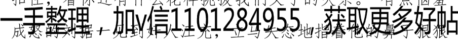

这还不解气，吕完之后，怕夜梦多的刘据复下手为强，就趁机给江充设一个“谋反”的锅吃，干干净落地把他斩首示众，以绝后患。这一下却惹了大祸，这么激进的对抗方式也埋下了日后太子被杀的祸根。

因为杀人的事情很快就传到了皇帝那里，父子俩很快得摊牌并决一战。已经气急败坏的刘据为了自保，派人通知母后跟着，只因作为储他手里的权力有限，能调度的军队是不多，如果不想等死，那就有足够的理由来调集军队保卫皇宫。

刘据先是动用了后宫的车架，再以“武帝已死，奸臣作乱”的名义征兵，把江充这一斥开了了再说。

江充死后，官审苏文便十万火急地赶到武帝处端点火，说太子在作乱，起兵号令都下了。武帝虽然对太子也有忌心和猜疑，但他却太相信自己千宠万爱的儿子刘据体会起兵颠覆自己，还有事地派霍霍使者去召太子来对质，但对于已经刀霍霍的太子，怕死的者却死活不敢到太子那里传令，很快就返回汉武帝说“太子反成了”，臣使者添加，本来就多疑的汉武帝立怒，也不想再种种清事。如此，那就接开阵打一场。同时下令太子亲临前线“露脸”，以示自己还没有死去。起初在灭江充的酷吏集团，他还一度受到民众的热护和支持，但后来调兵不利，使者安然接受了太子的符，却没有真正出兵，而是选择闭门不出。他利用的另一军团，在皇帝的威逼下转头准太子。面对勾仇来的官军，太子只好打开武器库，把京城里的囚犯和市民武装起来，数万人共同抵抗“叛军”的军队。反正，双方局势如水火，只能在弦上，不得不发长乐宫门外，正好等到王屈率领的叛军前来镇压，只好摆开阵厮杀，长安城瞬时惊腥，血流成河，死伤无数。后来，由于有人散布说是太子要起兵造反，所以依附太子的人越来越少，加上官军从四面八方增援，最终寡敌众的太子兵败，唯有两个儿子逃离长安。据载，太子逃往南门时，被好心的守门官放出，最后太子一行逃亡到霍县（今灵宝）的一个老百姓里，被好心藏了起来。主人虽然家境贫索，却是一个有情义的人，为了给太子吃饱饭，努力编织草鞋到街上卖，以换取生活必需。原本是相安无事，谁知一体家的太子，为了找回生活来源，偶然联系了以前的一个富人，于是走漏了。因为当时愤怒异常的汉帝早就布下罗网要捕他，太子始终也逃不出来的手心。不久，立功心切的新安（今洛阳）县令李寿一探太子下落，立刻带兵来围捕捕获。太子知道逸不过魔爪，情急之下用一条牛绳缚自身亡。两个儿子和藏他的那一家的主人，也被李寿手下全部干掉。而这边厢，太子的母亲卫皇后，作为“反革命家属”，也收到了追责。朝廷派人收缴她的皇后冕，等待发落。做了38年皇后的卫子夫，也知道等待自己的是怎样的残酷命运，有理说不清又不想忍受的她，只好选择自杀。而且在卫子夫死后，刘据的妻子和三子被灭。说此案涉及巨大，后来的汉帝也后悔。

## 晚年，有亡秦之续。

经过巫蛊之祸的政治折腾之后，有点糊涂的汉帝也开始检查自己的政策，并对自己的老政懿严治法表示悔改，痛快临下的罪诏，正因为如此让他有了亡秦。以为左右皆为道贺。皇帝晚年的多愁多疑被江充阴谋集团所利用，造成了西汉的一场大动乱浩劫。

## 第二十一篇 立子杀母：汉帝死前还要钩弋夫人

对此，历史牛人司马评价得很到位：“晚而改过，顾得人，此其所有有之失而免亡秦之祸乎！”

下一个英主，健身状况更是每况急，逐渐尽油灯。但太子已死，皇帝接班人还没有选好，于是便被提上了议事日程。当时，在汉武的几个儿子中，聪明伶俐又体格强壮的幼子刘颇得汉帝喜欢，但又太小，不到十岁。

汉武帝认为太子是被冤枉而死的，于是就任命霍光为大鸿帅，同时将江充诛三族，其他涉案大臣和参与围太子的也被处死。后来难过的汉帝，还特意在霍县修了一座宫殿叫“思子宫”，又造了一座高台叫“归望台”，以寄托哀愁，时人感之落。总之，巫蛊之祸当时是一场数万生灵惨涂的“政治劫”，后世史学家普遍对刘据和卫皇后持同情态度，也反映出了汉武帝的老糊，这正是不幸事件发生的深层原因。

## 巫蛊之祸

经过一番调查，皇帝才知道太子根本没有埋过木头人，是江充之祸。

虽然有点残忍，却也不无道理。

因为就在钩匈夫人死后第二年，汉武帝正式册立八岁的刘弗陵为太子。而册立太子的第二天，汉武便驾崩了。

那是汉武帝后元二年（公元87年）2月，年已古稀的他出行到长安百里之外的茂水时，忽然就在五座宫病不起。

看着皇帝病重，而接班人还没有落着，这倒是让大臣们年纪紧张起来，国不能一日无主也。于是，当时的权臣霍光诚惶恐地向皇帝请示后事，史云：

> “如有不违，谁当择者？”

大意就是看到皇帝不行了，霍光便涕泪横飞地道：“万一陛下不幸仙，应当由谁来继承大统呢？”那自然就是请求皇帝开出太子的名单啦。

这当然也是显而易见的问题，当匈奴夫人横死之日，就决定了刘弗陵他的时代的即将到来，这是毫无疑问的，只不过让皇帝亲口证实其实而已。

“呀，这还用问吗？你不记得之前给我些什么来着？就是那幅我叫宫廷画师所画的‘周公背冕召诸侯困’，难道你还不明白朕的用意？这也太政治敏锐了了吧？这意思太明白白过了，那就是立了少子（刘弗陵），你来做辅政周公。”病得五颜六色的汉武帝有气无力地埋道。

“陛下息怒，枉臣下愚愚，不能体察到陛下深意，也说明臣下没有能力做辅政周公，误了大事。至少在这一方面我不如金日瑾，还是让他来做比较稳妥。”凡事谨慎的霍光假装让一下，并做了深刻的自我批评。

站在一旁的美男子金日瑾，自然也知道霍光想些什么，这用意也太明显了，所以他也毫不犹豫地拒绝了。

“臣，外国人不如霍光；且使匈奴王子的金日瑾彻底如此。”

那么，接下来也免了口舌争。最终，绍立刘弗陵为皇，时年八岁。“以霍光为大司马、大将军，以金日瑾为车衔大将军，以上官宪为左将军，又以诸侯为郡尉，以郡尉为越御史大夫。《资治通鉴》这就是汉武帝时期霍光大肃大臣（另一种说法是上官宪）。

安排霍光之后，汉武帝就为革命鞠尽瘁，而他也算是算明了。因为他在政上统五十年，加强了中央集权。虽然晚年使社会经济恶化，却也能勇敢改革，远断了吕后之乱，基本上是功德圆满了。

这几个辅政大臣，霍光出宫廷二十余年，后侍汉武帝，一点过失也没有，站稳坐正；同样地金日瑾持重守正，人品很好。

而十分凑巧的是，宰相霍光本人同样风度翩翩。另一顺命大臣田丰秋，果然如武帝天子一样要选拔像现代职场筹码，也用于古代官场。

总之，这几个辅政大臣，品质品行（最好玩的金日昭奕逸）且处事方式很像自己的最宠小儿子，那可是万里一失，且自己也是死能殉目。托孤之后，就毫无牵挂地为革命鞠尽瘁了。

从此，霍光也取得了最高权力的充分支配权。史曰：“帝八岁，政事一决于光。”成为了威风八面的影子皇帝。这既开始了刘弗陵他的时代，更确切地说是开创了霍光的时代。

因为跟随了汉武近30年的霍光，此后执握汉室最高权力近20年，成为中兴名臣（十一功臣之首），西汉史上实打实的政治铁牛。

## 第二十二篇 桑弘华：汉武时代“经济超人”是怎么死的

桑弘华是汉武时代著名的经济学家和财政高手，他为汉武皇帝理财十年，说是中国历史上第一个提出不依靠农业致富的思想，他的高明理财能力口碑皆，连与其经济政策非常不常的大史，也向他竖起大拇指，盛誉桑弘华时代“民不益赋而天下无竭”，可谓劳功高。

王安石是这样评价自己的经济偶像的：“推抑兼并，均济贫乏，通天下之财，后世唯桑弘华、刘晏合此意。”

唐朝经济奇才刘晏是旷世神童，而王安石最崇拜的古代经济人物宋弘羊也不弱，同样也是神童。

这个出身商家的宋弘羊过目不忘，13岁就出道，是皇家名流，心算大师比别人还精准，所以对理财特别擅长，后来成为汉武帝新政策的主要制定者和执行者，并由此成为皇帝红人（能给皇帝掏）。

当然，宋弘羊并不是一开始就是如此巧，而是经历了一段十分的拉车式成长，谁也不能随便就成功，即使是神童宋弘羊也外。

{http://img.laibafile.cn/p/3089429.jpg}

从桑弘羊的出身来说，他家里有点钱，是洛阳的富商弟子，既非高才也非名儒（十三大的孩子），他是怎么混到了侍中空缺的呢？大家想来分析了一堆理由之后，实在不想明白，只能推算是用钱买的。多数研究学者都认为是通过钱买官的手段。

还有另一种说法就是，宋家根本不用钱，因为是有心算特长的种子，于是很爱才的汉武帝听说后立刻招他入官伴读。之所以当侍中，是因为出入宫方便。

有些历史资料显示，“侍中”是一种官，从大至列侯、将军、卿、大夫，下至太医、郎中，都可以当侍中。”所以人员的构成来说，侍中尽管不是正规官职，有的名不正顺“临时官员”的嫌疑。

不过因为当了侍中就可以自由出入宫禁，和九五之尊“零距离亲密接触”，然后近水楼台得月，只要把皇帝得舒服，那么升官的机会就比他人多。朝中有人好当官是很容易削大脑袋要挤到皇帝身边，靠近权力中心才不会被边缘化，这个大家都都理解。

关键是想做侍中这样有点无所事的临时官员，也不是一件容易的事，因为在“朕即天下”的皇权社会，你想望皇帝根本不是一件容易的事，这是一种十分奢侈的礼数，所以想当经常见到皇帝的侍中，也得有门路和关系才行。

所以，除了当时的权子弟子以及被皇帝欣赏的著名大儒之外，一般人是很很难得到这种“侍在君身侧”的至高无上待遇的，你想要“上面有人”比较难啊。

桑弘羊能力自不必说，何况西汉初期买官是不法的，关于这一个十分好听的理由，桑弘羊走这条路，还能走哪条路？

于是，天才少年桑弘羊十三岁就这样住了皇帝身边，不管他用的是什么途径，我们只能羡慕嫉妒了。

重要的是，汉武皇帝这个天子是为了对付三国的老臣架空，利用内朝和外朝，招了很多青年才在他的身边，就算是皇帝内朝的得力官，像卫青、霍光、朱买臣等历史上赫赫的人物全都当过汉武帝的侍。

{http://img.laibafile.cn/p/3089429.jpg}

这份名单，当然也包括心算高手、理财专家桑弘羊。我对数学不大擅长，什么积分的东西直如云雾之中，而在古代大多数人还用算筹的时候，居然一个十三岁的少年已经擅长心算，比计算机还快，从此赢得了一个“算盘”的美誉。

所以，桑弘羊最后成为汉武帝的重臣，没有任何悬念。他自汉武帝元年三年（公元前120年）起，到汉武帝死，就任大农丞、大司农等重要财政职务，与大盐铁商东郭阳、孔仁二人得汉武帝信任，视为左右臂膀，经济界说一二的“狠角色”。

而且汉武帝的侍中队，也是历史上赫赫有名的一道光丽政治风景，那都是出息、有作为的汉武帝“青年军”，也可以为“皇家政治明星训练班”的优秀学员，深得皇帝信任，前途无量。

如同儒嵩安当侍中时，还可以给皇帝吐痰用的御唾壶，说明这班侍中是如何得信任的，简直就是一大佳话。

最重要的，汉武帝不仅让这班侍中做务员、做些婆婆奶奶妈妈的事情，而是经常和他们商量一些军国大事，俨像是当朝大臣与皇帝意见不合时，这班名不见传的作为“软差”，代表皇帝出手与大臣进行大辩论，也常常把大臣质问哑口无言，然后改变政治方向，可是强将无弱兵。

最的就是历史剧“马前泼水”主角买臣，在汉武帝元年三年（公元前126年），与反对在河获筑朔城的御史大夫公弘弘的辩论，小小侍中买臣竟然能让人物公弘弘哑口无言，足以展现了汉武的善于用人。

桑弘羊能力自不必说，何况西汉初期买官是不法的，关于这一个十分好听的理由，桑弘羊走这条路，还能走哪条路？

于是，天才少年桑弘羊十三岁就这样住了皇帝身边，不管他用的是什么途径，我们只能羡慕嫉妒了。

重要的是，汉武帝这个天子是为了对付三国的老臣架空，利用内朝和外朝，招了很多青年才在他的身边，就算是皇帝内朝的得力官，像卫青、霍光、朱买臣等历史上赫赫的人物全都当过汉武帝的侍。

桑弘羊并不是一开始就是如此，而是经历了一段十分的拉车式成长，谁也不能随便便就成功。

上官荣一起谋反，事败被杀，以悲剧收场。

总之，很多研究者都认为桑弘羊在汉武帝近期的侍中期间，依靠才足，只不过没有卫青、霍光那样的强大背景，在战争年代没有脱颖而出担当大农令而已。不过有了这份在权力中心实习的机会，让桑弘羊技艺大进，由于战争的胜利，以及汉武帝经济建设为中心之后，桑弘羊时来运转。从三十岁起，做了二十六年的侍中之后，到了三十九岁任大农，成为了当时经济界的“亮点”，耀眼明星。

俗话说，穷则变，变则通。为了及时拨款穷兵，汉武所造成的困境，汉武资产只能频繁加税，蚊子腿上刮肉。有人曾列举了当时的税种，诸如口赋、算赋、助边费、商人车船税、六畜税、资产稽税等，五花八门。更令人可怕的是告令，肥了皇帝的口袋，却让很多商家倾家荡产，反抗发生。内史（管理京师的官）不仅不听，还支持商人抗诉，同时搜报告的人，真是吃了豹子的胆。

最终这个皇帝对贪着的家伙也没有好场，汉武皇帝听到胆敢反对自己，十分震怒，后来以后破坏经济被杀掉。这还不够，给未消的天子工作做得不到家甚至触情绪的大农，不仅缴了钱，还判了死刑。从此算绯和告令的推行阻力就了很多，甚至是一路畅无阻了。

当然，这样的霸王横，对整体的社会经济的破坏是可而易见的，对社会管治副作用也很大，不好就会引起革命。

于是精于经济管理的桑弘羊为了进行了和风细雨般的益改革，同时实现“民不益赋而天下用”，便向汉武帝提出另类搞钱方法，也就是仿照春秋时期著名的齐相孟实行“笼盐益铁”，说了自己就推行盐铁专卖政策，这样皇帝想了想，这样也好，天下盐铁买卖权都被我们垄断了，还愁没钱。

作者：鼎湖听泉 日期：2019-05-24 15:02

那已经是桑弘丰任大农丞后的事了，正是他的亲力亲为，备受佑的督算粮、告令才能在全国厉风行地推广，反正能够为皇帝掏钱，那绝对对于自己的前途大有益，此除此之外还管什么“一路哭”，难苦多点谁少点都可以PASS。

# 820 楼

作者：鼎湖听泉 日期：2019-05-24 15:49

其实，在大汉著名酷吏张扬提出出算粮、告令这些“抢钱政策”时，当时桑弘丰还是一个侍中，不过他的雄才经济管理能力和皇帝宰差的身份，也早就积极进入了具体的事务。

加信1101284955，获取更多好帖

# 821 楼

作者：鼎湖听泉 日期：2019-05-24 16:28

到了他上大农丞正式接手经济管理后，不仅重申了告令，还积极支持各种把告令切实切实地坚持下去，即使是阻力重重，也要抓出成果。因为态度坚决，措施得力，虽然这项令之后得到了有效推广。

# 822 楼 

作者：鼎湖听泉 日期：2019-05-24 20:48

在元狩期间以后，作为中央政府主要的经济决策者和执行者的桑弘丰，先后实行了盐铁专营、均输平准，以及统一币种等诸项经济政策。还组织了60万人的大规模屯田边活动，所有这些经济政策都在不同程度上取得了成功，让汉武稳定了政局，大大缓解了经济危机。

# 823 楼 

作者：鼎渊听泉 日期：2019-05-24 21:15

在元狩年间以后，作为中央政府主要的经济决策者和执行者的桑弘丰，先后实行了盐铁专营、均输平准，以及统一币种等诸项经济政策。还组织了60万人的大规模屯田边活动，所有这些经济政策都在不同程度上取得了成功，让汉武稳定了政局，大大缓解了经济危机。

# 824 楼

# 一手加微信11101284955 获取更多好帖

因为盐铁专营为中央政府赚取了高额利润，巨额的收入为政府的对外征兵、开拓疆提供了有效的经济支撑，是一种政治意义深昂的经济政策，还在一定意义上抑制豪强买，稳定农业和工业生产，延缓社会两极分化，是有一定的历史深度。

# 825 楼 

作者：鼎渊听泉 日期：2019-05-24 22:14

虽然豪强巨头强烈抗议，但由于官府注重策略，通过公私合营吸收了他们当中的一些人担任官府的经营人，大家共同发财，所以阻力也就少了很多，没有像那样的内外激烈反对，也说明桑弘羊对经济管理有独到之处。

# 826 楼 

作者：鼎湖听泉 日期：2019-05-24 22:39

及至均输平准的推行，更是经济奇才桑弘羊为汉朝乃至中华历代封建帝国独创了官营商业体系，也是桑弘羊业天赋和长期理财政经验的重大结晶。轻而易举就实现了“民不益赋而天下可用”最佳财政理念。

# 827 楼 

作者：鼎湖听泉 日期：2019-05-24 23:12

因为均输平准大大减轻了农民的负担，减少运输成本，同时抑制巨民、广居时期抗乱物价起到了很大的作用。显然，桑弘羊与其信的部分确实别无二致。某些历史研究者所说：“是汉帝政治专制、思想独尊、经济垄断三位一体封建专制制度的完善。”

# 828 楼 

作者：鼎湖听泉 日期：2019-05-24 23:45

正因为桑弘羊为武帝的统治积极站台，并功勋举者，所以他在政治舞台上一路上高歌直胜是绝对可以预见的。从一个“临时工”性质的侍中官，历任大农丞、大司农、获羊尉等主管财政的要职，被赐左勋侯。汉武帝后二年（公元前87），桑弘羊又由蜀都尉任御御史大夫，列三公，无限尊享。与霍光、田千秋、金日增、上官荣等四人一同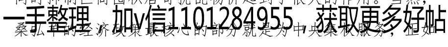 受诏辅佐汉帝，是一个实权在握的重臣。

# 829 楼 

作者：鼎湖听泉 日期：2019-05-24 23:36

正因桑弘羊为汉武的统治积极站台，并如此，他在政治舞台上一路上高歌直胜是绝对可以预见的。从一个“临时工”性质的侍中官，历任大农丞、大司农、获羊尉等主管财政的要职，被赐左勋侯。汉武帝后二年（公元前87），桑弘羊又由蜀都尉任御史大夫，列三公，无限尊享。与霍光、田千秋、金日增、上官荣等四人一同受诏辅佐汉帝，是一个实权在握的重臣。

# 830 楼 

# 一手加微信11101284955 获取更多好帖

# 831 楼 

作者：鼎湖听泉 日期：2019-05-25 13:08

可惜桑弘羊良好的感觉和计算，无限扩张的政治野心，让这位经济天才古代人有点找不到，同时得罪首辅大臣而被诛。这就涉及到了托孤大臣的反目成仇，“燕王之变”。

# 833 楼 

作者：鼎湖听泉 日期：2019-05-25 13:44

话说汉武帝驾崩之后的第二年，就是后元二年（公元前80年）九月，汉武帝不幸驾于遥途途中（秦始皇如此）。汉武帝死后，其聪明的八岁质子刘弗陵被立为刘帝（汉武帝为了防外乱，还因此立子杀母，也就是吕后矣）。

# 834 楼 

作者：鼎湖听泉 日期：2019-05-25 14:06

事实上，在公元87年桑弘羊由蜀都尉辅佐幼年汉昭帝在宫场争斗中，所有精力都放在了桑弘羊和首辅大臣霍光的权力博弈中，将有一番作为，可谓惨烈

# 835 楼 

作者：鼎湖听泉 日期：2019-05-25 21:31

{IMAGE}http://img.laibafile.cn/p/m/309078640.jpg{IMAGE}

# 836 楼 

作者：鼎湖听泉 日期：2019-05-25 21:58

可惜桑弘羊在政治运作上的道路远没有他在经济运作上那么深厚，短板长的结果，也只能那句古诗云：无可奈花落去。人像一样落地是可以预见的。这正如后世儒生评价的：“这都是他一生追求的结果”。私心膨胀失败不远了。

# 838 楼 

作者：鼎渊听泉 日期：2019-05-25 22:33

话说汉武帝驾崩之后，过了三年，也就是后元二年（公元前87年）就不幸驾于遥途途中（秦始皇如此）。汉武帝死后，其聪明的八岁质子刘弗陵被立为刘帝（汉武帝为了防外乱，还因此立子杀母，也就是吕后矣）。

# 839 楼 

# 一手加信1101284955 获取更多好帖

因为皇帝年少，基本还没有理政能力，所以汉武帝曾遗诏霍光、桑弘羊、金日辟、上官策、田千秋为“托孤五大臣”，辅佐皇帝处理军事大事，共同掌握朝政。桑弘羊在受诏为辅政大臣的同时，还有幸被提升为副国相级别的御史大夫。

# 840 楼 

作者：鼎渊听泉 日期:2019-05-25 23:48

既然同为皇帝最亲的大臣，那为什么还会反成仇呢？无他，一切皆为利益的再分配，正所谓“人为财死，狗为食肉”。

# 841 楼 

作者：鼎湖听泉 日期：2019-05-26 00:13

晚安

# 842 楼 

作者：鼎湖听泉 日期：2019-05-26 10:45

在此，我们简单介绍一下这几个人的政治老底，然后基本上就明了他们的争斗是因为而起来了。

# 844 楼 

作者：鼎湖听泉 日期：2019-05-26 11:47

大家都知道霍光是汉帝的首辅大臣，家世背景深厚，是霍利的异弟，十几岁时就入宫禁（由大名鼎鼎霍家培养），更是优秀的官臣。汉武帝病重之时，便直接接了霍光辅佐幼昭帝，有生杀夺的最后权，说白了就是一个“影子”。

# 845 楼 

作者：鼎湖听泉 日期：2019-05-26 12:26

对于这种人事安排，霍光显然已经由于桑弘羊，他的背景、处事方法和妥协程度特殊。

# 846 楼 

作者：鼎湖听泉 日期：2019-05-26 13:31

当然，霍光从来都是行事十分谨慎的人，也正是因为桑弘羊在朝中立倒，所以听到皇帝这种决定，虽然掩不住那份狂喜，但霍光还是要假装谦一下，避开忌嫌，桑弘羊才这种套话。

# 847 楼 

作者：鼎湖听泉 日期：2019-05-26 14:13

然后还有事推荐美女，养马有一套桑弘羊被汉武帝赏的马，霍光扶尽太子当朝。田千秋虽贵为丞相，老多病弱又能乐平，乐当一个“和事佬”甩掌柜。

# 848 楼 

作者：鼎湖听泉 日期：2019-05-26 14:49

聪明的霍光自然知道霍光唱的是哪出，也顺滑地推自己桑弘羊难当任，只有霍光才是最好的人才，如果霍光愿意，自己也可以当他的助手，分担云这个正中下怀，是一番意外之后，霍光就成了顺命大臣的首席代表，主要决策者也是。

# 849 楼 

作者：鼎湖听泉 日期：2019-05-26 15:19

而当时这五个人当中，作为“外人”的金日升明显是附霍光的，而且托孤之后第二年就去世了。

# 850 楼 

作者：鼎湖听泉 日期：2019-05-26 16:25

田千秋虽贵为丞相，但老多病弱又能乐平，乐当一个“和事佬”（在盐铁大会上充当和事佬），大多数时候都是不管事的“甩手掌柜”，处处对霍光迎承，甘愿做霍光的一个应声，所以权争方面实际上只剩下霍光、桑弘羊、上官架三人了。

# 851 楼 

作者:2019-05-26 20:07

桑弘羊是大汉财神，以他的资历和功劳，不霍光当首辅是意料之事，可凭他们在经济政策等政见上有严重分歧。

# 852 楼 

第一办理加信 日期：2019-05-26 21:51

最关键的是养马出身的西央将令上官架，却不好好养马的事，颇有政治野心的宫廷戚臣参与了首辅的争夺中，甚至要发动宫廷政变汉帝，于是上官架和桑弘羊对抗霍光一派，这便就埋下了伏笔。

# 853 楼 

作者：鼎湖听泉 日期：2019-05-26 21:51

上官架虽然是马出身，却很有政治智慧。据说汉帝有一次病中视马，见马瘦了，就怪上官架不尽职，上官架却灵活回答说是担心皇帝的病才无心养马，马由此复肥了。汉帝死后龙心大枕，认为上官架对自己很忠心，所以不仅不治罪，还升他为侍中、太仆，武帝死时又升为左将军。

# 854 楼 

作者：鼎渊听泉 日期：2019-05-26 22:31

以上的政治背景分析，围绕皇权和行政权的归属和再分配，政治斗争绝对是箭弦上不得不发的事情，直到决出胜负止。这正应了侍人所说，凡有人的地方都分、中、右。说白点，就是有人的地方便有江湖。

# 855 楼 

作者：鼎渊听泉 日期：2019-05-26 23:02

既然田千秋和金日晖两个可忽略不计，或者换句话说，或许可是是不扣的中间派，那么我们就集中火力单表政坛大司马、大将军兼领尚书的首辅霍光的那些未必是的事儿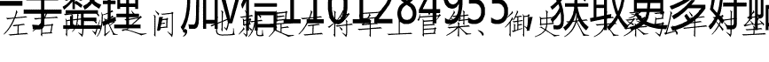

# 856 楼 

作者：鼎渊听泉 日期：2019-05-26 23:29

原本同为托孤大臣，上官策、桑弘羊也未必宿仇，一切都是利益的再分配，当利益格局重新洗牌时，短板长的结果，也只能那句古诗云：无可奈花落去。人像一样落地是可以预见的。这正如后世儒生评价的：“这都是他一生追求的结果”。私心膨胀只能利润，失败一定不远了。

# 857 楼 

作者：鼎渊听泉 日期：2019-05-27 00:04

那是什么原因让这三个人的反目爆发了？一切皆为利益的再分配。

# 858 楼 

作者：鼎渊听泉 日期：2019-05-27 12:05

说起来上官和霍光还是亲戚，两家和皇室有千万万的联系，竟然这样的亲密关系也可以反面效，由此看出他们面对的利益再分配是怎样的。

# 859 楼 

作者：鼎渊听泉 日期：2019-05-27 12:31

说实话，上官的儿子上官宴娶了霍光的女儿为妻，同时上官也娶了霍光的妹妹，入宫后成了皇后。这样迷人的资源，原本绝对能横行天下，可惜作为亲家极大揽的霍光却是阻碍他们发展的绊脚石。

# 860 楼 

作者：鼎渊听泉 日期：2019-05-27 14:26

这事就坏在皇帝嫡姐的男宠身上，简直比电视剧还离谱。原来郭邑公主的男宠叫丁外（果然还是外人），既然郭邑公主可以让孙女成为皇后，意图折报的托孤大臣上官宴也不含，所谓爱屋及乌，也立马想让自己的亲家侯img/3d2264e6ac77923fd265c8032e0914d4_258_0.png) 以得鄂邑公主心大悦，大家尚往来，反正都是自己嘛，不外人。

# 861 楼 

作者：鼎湖听泉 日期：2019-05-27 15:07

可惜上官架打错了诸如算盘，砸了一个不大小的软钉子。他以为作为亲家的霍光会吐饭响，一夜特批，原来并不是这一回事。

# 862 楼 

作者：鼎湖听泉 日期：2019-05-27 15:50

因为坚持原则的霍光就是坚决顶住不批，理由就是丁人是个彻头彻尾的“外人”，他不是公主的真正丈夫，用“列侯尚公主”的例子来授予爵位，好事就这样给霍光搅和了。

# 863 楼 

作者：鼎湖听泉 日期：2019-05-27 16:38

首辅大臣，霍光始终认为这个“编外丈夫”没有那个资格接受侯爵的封号，相当于“列侯大卖”，其他人也来向他看，帝国的官如此不值钱，这口子一开，还不乱套了？

# 864 楼 

作者：鼎湖听泉 日期：2019-05-27 20:46

这样不给面子，上官怀疑火冒三。你霍光有什么了不起？老子在前朝就已官至太后，地位比你还高，现在孙女又顺顺的当上了皇后，大家都是将军，你不是名义上的首辅，如果大家拼鱼死网，到时还不知谁负你！这不识抬举，官位又不是你的，牛哈。

# 865 楼 

作者:鼎湖听泉 日期：2019-05-27 22:10

想着，上官怀疑真是越想越气，因为霍光的这一拒绝政治副作用十分明显。而对于霍光来说，是不是想用这种方法测试政敌的反应，也未可知。总之，因为这一小小请求，上官怀疑对霍光十分不满，两亲家从此形如路陌，矛盾重重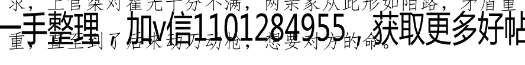

点脸色看看，让他放老实点。

# 881 楼
作者：鼎湖听泉 日期：2019-05-29 00:03
晚安

# 882 楼
作者：鼎湖听泉 日期：2019-05-29 13:36
皇帝不高兴，后果很严重。于是一怒之之下，汉武帝把他的使者毫不客气全都给杀了。后来还因刘王旦藏匿逃死，知法犯法，被汉武帝削去其三个县封地。刘王旦遭遇的是典型的“偷鸡不成蚀米”的买卖，此叫你那么云气用不住。

# 一手办理，加v1101284955，获取更多好帖

# 884 楼
作者：鼎湖听泉 日期：2019-05-29 14:19
因为后来大家也知道了，汉武帝确实没有刘王旦为太子，最后得到的是很聪明也很很很汉武帝喜爱的刘彻。这刘王旦几乎几要死去，到了后来很积极策划宫廷变乱夺宝宝兄弟的刘夺，想大出一口恶气。

# 885 楼 
作者：鼎湖听泉 日期：2019-05-29 14:53
其实刘王旦也不算是一个政治草包，又是一个很喜欢读书和思考的很懂谋略的人，只不过他的政治野心太明显，太锋芒毕露，司马昭之心路人皆知，不知养晦的结果也让他吃尽了苦头，直至自败自地谢天下。

# 886 楼 
作者：鼎湖听泉 日期:2019-05-29 15:33
一开始，刘王旦为自己的“变天计划”到处找网人才，正好想进行权力再分配颠倒政治“拦路虎”的上官杰和桑弘华与其目标一致，于是一拍即合，结成政治盟心与汉昭帝争皇位，进而颠覆曙光。中朝两派政治力量从此进行了一番十分惨烈的明争暗斗，互使手段，直杀得个昏黑地，血流成河。

# 887 楼 
作者：鼎湖听泉 日期：2019-05-29 16:30

看着眼前的局面，桑心中诸多说：皇帝的儿子，以动摇汉皇帝天子的合法性。

# 888 楼 
作者：鼎湖听泉 日期：2019-05-29 19:59
按来说，上官杰和桑弘华“强联合”，应该是和霍光抗衡的，至少不会输那么惨。可霍光“扶天子以令诸侯”，甚至还算是一个皇帝的皇帝，握有杀死夺大权、有正当的发号权柄，和其明斗显然是比较吃亏的，所以只能来明的。

# 889 楼 
作者：鼎湖听泉 日期：2019-05-29 20:54
正如上文所述，封燕王一仗先说赵帝不是汉武帝真儿子，只是某些想觊皇权的野心家（这话最明白不过，肯定是夺指向“摄政王”霍光），违背汉武帝的意愿“狸猫换太子”弄虚作假。因为英明的汉武帝根本就不可能这种还没有治国能力的小儿为太子，既然这种人来路不明又没治国实力，那么他的位的由来既不合理也不合法，人人可笑之也。

# 890 楼 
作者：鼎湖听泉 日期：2019-05-29 21:45
所谓“明桩易破，暗桩难”，这事传闻有眼睛不死也能脱你一层皮。大家都在议论纷纷，让对方被动，一切处理。

加微信1101284955，获取更多好帖

# 891 楼 
作者：鼎湖听泉 日期：2019-05-29 22:44
看到意远的效果被对方悄悄化解于无，封燕王一仗又使出一招犀厉的“反间计”，那就是离间赵帝和霍光的君臣关系，让他们互相互相猜忌，自乱阵脚至于自相残杀，从而而达到釜底抽离彻底瓦解对方力量的目的。

# 892 楼 
作者：鼎湖听泉 日期：2019-05-29 23:10
因为有政治谋略的燕王也知道霍光是皇帝的主要决策者，是核心既得利益集团的头面人物，他必须维护和

巩固汉帝皇权不动，才能维持自己的地位，是真正意义上的“王者”，所以必须挑拨霍光与汉帝的关系，进而瓦解这对联盟，才能有机可乘。

# 893 楼 
作者：鼎湖听泉 日期：2019-05-30 00:05
于是，封燕王便上书告霍光有篡赵帝的野心，想取代汉帝。其反将就是检阅军事，换句话说他早就把自己当皇帝，只差举行仪式而已。

# 894 楼 
作者：鼎湖听泉 日期：2019-05-30 13:40
一手整理 加信1101284955 获取更多好帖
有人要谋他的位，如果是君，早就已经气得死了。此时汉帝还只是一个十四岁的小儿童，反正都在看着热闹。

# 897 楼 
作者：鼎湖听泉 日期：2019-05-30 13:34
然而，让燕王一伙失望的是，虽然汉帝还是一个折不扣的皇帝，又不是一个没有辨别能力的人，是一个大聪明的新秀（不然的话武帝也不会选择继承皇位）。他不庸，还相当有决断力，对燕王一伙包藏野心的挑拨离间不置之理，把他惹恼了还放言要治燕王一伙的罪，以堵住他们的嘴巴，乱中取栗。

# 898 楼 
作者：鼎渊听泉 日期：2019-05-30 15:52
也合燕王一伙输得心服口服，因为他们用的手段太下，简直惨不忍睹。这真是运气，他们也太倒霉，碰到了一个聪明厉害的皇帝，失败是不可避免的。

# 899 楼 
作者：鼎渊听泉 日期：2019-05-30 16:27
老实说连强势的太子失败了，最受宠的李夫人的儿子也是巧用一策，更加急功近利的燕王旦，皇帝就那么一个，有时候侯无功而返，至于丢了性命。

# 900 楼 
作者：鼎渊听泉 日期：2019-05-30 20:32

# 901 楼 
作者：鼎渊听泉 日期：2019-05-30 21:03
总之，对于燕王的上下跳，汉帝早已看穿不是想坐我的皇位吗？想藉着挑拨我和皇后的关系，让我们自乱阵脚，以便兜其好，这样的恶劣用心还骗过我？玩“三人成虎”的戏？我偏不上当。

# 902 楼 
作者：鼎湖听泉 日期：2019-05-30 21:58
所以明眼眼的汉帝对这些人攻击霍光的话一概览之理，他们伙们嘈嚼不休地烦了他，他还龙颜大怒：“霍皇后是先王留给我辅政的忠臣，对我从未没二心，你们再出于政治的诋毁之，就洗净屁股等牢饭吧。”

# 903 楼 

皇帝放狠话，说了这个份上，非常有政治智慧的燕王一伙也读出了那种弦外之音，那就是想利用昭帝之“定点清除”消除霍光的，A计划不行，便能实施B计划了，那就用暗杀手段把霍光处理了，然后再掉儿子汉帝，绝不能坐以待毙，软不行硬就来吧。

# 904 楼 
作者：鼎湖听泉 日期：2019-05-30 23:34
那么，怎样才能把大权独揽的霍光指定到地点进行定点清除呢？这确实是比播政治谣言更有技术含量的活儿。好在燕王一人一脉也相当当，绝对是能设计或复制一个高质量的“鸿门宴”来引霍入局，然后成待宰羔羊。

# 905 楼 
作者：鼎湖听泉 日期：2019-05-31 00:01
晚安

# 906 楼 
作者：鼎湖听泉 日期：2019-05-31 12:23
就要提到一个关键人物，也就是曾扶抗赵帝的皇帝姐姐吕公主和桑弘羊的连串动作也正是基于自己的爱情引发的。所有有着共同政敌的燕王一伙，就让皇帝吕公主亲自策划一个鸿门宴等霍光往里，然后趁机干掉他，再次赵帝。

# 908 楼 
作者：鼎湖听泉 日期:2019-05-31 13:23
这显然是一个相当周计划，还有欺骗性，应该说成事的几率也提高，可惜千万算漏了一个最重要的保密工作，就是诸之道，可能是即将来的胜利昏脑了，最后是弄拙。

# 909 楼 
作者：鼎湖听泉 日期：2019-05-31 14:30
因为这重大的“变天计划”居然吕公主的一个儿子所发觉，进而层层传达了大司农和霍光关系密切的大夫杜延，于是阴谋败露，变天计划胎腹中。

# 910 楼 
作者：鼎湖听泉 日期：2019-05-31 15:06
结果是燕王一旦遭受顶之灾，燕王一伙被迫杀死，上官杰和桑弘羊族灭，也为桑弘羊和霍光的经济分歧了一个带血点，以失败者的血流成河而终年被杀死。

# 911 楼 
作者：鼎湖听泉 日期：2019-05-31 15:26
当然，刺人老人亦割其，霍氏此后也被族灭。

# 912 楼 
作者：鼎湖听泉 日期：2019-05-31 20:49
至于汉武帝的统一钱币，基本上出自桑弘羊这个古代第一人之一。如果说盐铁、平准、均输是桑弘羊整顿和改革财政三大支柱的话，那么作为经济重支柱的金融机制的完善，桑弘羊可以说是古代第一人。

# 913 楼 
作者：鼎湖听泉 日期：2019-05-31 22:20
面对西汉初期比较混乱的金融市场和秩序，是桑弘羊于元鼎四年（公元前13年）首先提出统一货币的构想，汉武帝自然也很意采取桑弘羊的意见。

# 914 楼 
作者：鼎渊听泉 日期：2019-05-31 21:46
在此由中央统一铸币，也就是由中央政府掌管上林苑的水衡尉分属的钟、器、别三官分别负责铸钱、刻范和原料，郡国铸钱的权利被取消，以前的旧铁一律废销，把铸用的铜集中，此后统一上林三官铸的五钱指定为全国使用的正式货币。金融改革。历史评论家认为：“这次币制改革是中国历史上将铸币完全收归中央政府的一次创举，它最终将汉朝的币制稳定下来，汉朝的五钱成为质量稳定的货币，流通至隋朝百年而通行。”

# 915 楼 
作者：鼎渊听泉 日期：2019-05-31 22:08

# 916 楼 
作者：鼎渊听泉 日期：2019-05-31 22:53
一种用了七百多年长盛不衰的稳定货币，是由于桑弘羊的经济思想和大力倡导，你不说是经济界的巨人没人信了，难怪非常负责的王安石对桑弘羊佩服五体投，封为偶像，在自己主导的世纪经济改革上也不忘“抄袭”一下桑弘羊的经济思想，果然也是事出有因。

# 917 楼 
作者:鼎湖听泉 2019-05-31 23:34
如此，很多经济学家都认为桑弘羊这次币制改革是相当成功的，不仅稳定了市场，还驱逐了“劣币”，大大增加了国家的财政收入，皇权的经济实力也因垄断而大大增强，为巩固封建统治准备了十分厚厚的经济基础。由于统一铸币，铸造技术和标准大大提高，再加上原材料统一管制，也大大提高了劣币铸造的成本，昂贵的代价让他们望而却步，此也很大程度上稳定了新币的流通，以至于达百年之久。桑弘羊这个经济巨匠不可不可。

# 919 楼 
作者：鼎湖听泉 日期：2019-06-01 12:51
晚安

# 921 楼 
作者：鼎湖听泉 日期：2019-06-01 15:05

所以，正因为老苦功高，后来感觉良好的桑弘羊免有点沾喜，甚至滋长了骄傲，以至于连堪称第一人的，他也不能很好地预见汉帝晚年经济理想的转变，对于一个经济学家来说是十分悲哀的事情。

# 922 楼 
作者：鼎湖听泉 日期：2019-06-01 16:28
更加悲哀的是，他居然在政治上也因利熏心，经常找着北，最后竟然斗和权倾朝的“摄政王”霍光面对硬生，是一种性格悲剧，也由此埋下了被杀死的祸根。汉武帝晚年经济思想的转变，是因为当时老兵一方面，另一方面，为了大江山万里万计，汉帝晚年对这段时间为了摆脱财政困难的急进经济改革，进行了一番比较醒的反思，之后的放戈进行“经济纠偏”。

# 923 楼 
作者：鼎湖听泉 日期：2019-06-01 22:47
史载，征和三年（公元前90年）他下了中国历史上第一个“皇帝罪诏”（有的说第一个罪诏是汉文帝），也就是著名的“轮台罪诏：“当今禁奢，止赐赋，励本农，农事复令，以补缺，毋之武而冠。”此诏都承认自己的政策如狼似虎有过错，要止奢侈杂税，让百姓养其口，即可免除役错。总是有痛快地承认了自己施政错误，即使是人也算是一个汉子，何况他是九五之尊。从这一点上来来说，汉武帝不失为一代英，很多史学家都有这样的观感。

# 929 楼 
作者：鼎湖听泉 日期：2019-06-01 23:51
十五

# 930 楼 
作者：鼎湖听泉 日期：2019-06-02 13:25
所以在，在进行一番严肃的批评与自我批评之后，汉武帝也重新检讨了经济政策，有意恢复依靠管理经济的宽松政策，还任命程田千秋为富民侯，同时下令推行“代田法”，恢复生产。

# 932 楼 
作者：鼎湖听泉 日期：2019-06-02 14:19
这一政策转换还比较及时，而且很好地缓和了阶级矛盾和后的发展奠定了基础，可谓明智的抉择，也成了中国历史上第一个长达130年的盛世，从文景之治到汉武帝极盛到昭宣中兴，善莫大马。

# 933 楼 
作者：鼎湖听泉 日期：2019-06-02 14:58
而这边，作为汉武帝的主要经济官员的古代第一圣学家文学家桑弘羊，却没有对主子的思想转变保持敏感的观察，竟然没有认识到这一转变的重要性和必要性（或者说已经昏智的桑弘羊假装没有看到）。

# 935 楼 
作者：鼎湖听泉 日期：2019-06-02 15:51
面对最高当权者内外政策的改变，就是对内恢复休息，对外攻为守，桑弘羊还奉行以前一套积极进取的态势，因为征和四年（公元前89年）汉武帝建议屯轮台（今新疆），目的就是保持对匈奴的进攻态势。

# 936 楼 
作者：鼎湖听泉 日期：2019-06-02 16:40
就这样，原本合作甚欢的君臣便有了裂隙，汉帝甚至强硬地抢回了燕王一伙的屯田，打破了，让桑弘羊很没面子，从此之间也不再合作。

# 937 楼 
作者：鼎湖听泉 日期：2019-06-02 21:31
对此，很多经济学家都不透“桑弘羊为了反道而行”，甚至对于皇帝，如果只是为了保持自己创立制度的连续性，这个政治冒险也太大了。

# 940 楼 
作者：鼎湖听泉 日期：2019-06-02 22:05

当时，桑弘羊认为屯台一带是军事战略要，是打击匈奴的之地，在那里开荒，可以丰足，也成为对匈奴作战的前线。从长远来看，桑弘羊的“命其守”也获得了很多历史，只不过汉帝考虑的是更重要的国家内部安全问题（桑弘羊考虑的是外部问题），引起农民起，像秦末乱世一样，汉朝立亡才是最大的问题，所以考虑角度和层次不同，于是君臣之间的纷争就不可避免了。

# 942 楼 
作者：鼎湖听泉 日期：2019-06-02 23:04

# 949 楼 
作者：鼎湖听泉 日期：2019-06-03 15:50
不是我不明白，这世界变得太快，呜呼哀哉！桑弘羊之所以被降，说是是因为亲属的牵连，让他从威风八面的最高宰位跌下来，从大司农降为搜隶都尉。因为按照大汉律，“子弟犯法，父要坐。”管你不是大汉的神宰，你没商量。

# 950 楼
对于桑弘羊家连犯的罪牵到，史无明确记载，语焉不详，且这个案件相当复杂，牵涉面广，甚至于其中皇后的嫡弟（兄弟）赫然在列。桑弘羊家挣下的这件大事，大约发生在汉元三年（公元前98年），由于桑弘羊弟子（也就是兄弟的儿子）和卫青的儿子因为犯了法，同被西汉著名酷吏韩金吾（负责京师的治安）杜周所逮捕。皇帝还认为杜周“尽力无私，迁为御史大夫”。

# 951 楼 
作者：鼎湖听泉 日期:2019-06-03 21:09
http://img3.laibaife.cn/2p/2m

## 952 楼
作者：鼎湖听泉 日期：2019-06-03 21:25

哼，你当我是政治花瓶，不识谁是故友啊？你们全打错算盘了，我能坐在这个九五五至尊座上，显然不是吃素的，轻视对手你们将会输得很惨。刘弗陵那时候分明是这样这样自信地对自己说。

## 953 楼
作者：鼎湖听泉 日期：2019-06-04 16:12

虽然不知这两个著名家族的弟子犯了什么法，不过从当时的办案层面来说，肯定是惊动了汉皇帝，而且亲自督办了此事实，加刘信的结果，从获取更多好帖来说，说明案子破了之后皇帝的满意程度。

## 956 楼
作者：鼎湖听泉 日期：2019-06-05 13:17

虽然史书不明说，或是为尊韦辞，却有一点是非常明确的，那就是这班留贵子弟子的绝对不是一般的法。不然的话，以皇后和秦弘羊当时的能量，绝对是能够轻易地夷覆的，如果不是皇帝亲自督办的重案，这班弟子一定能开溜，作为财神的秦弘羊也不会为此受到牵连，倒霉透顶。

## 960 楼 
作者：鼎湖听泉 日期：2019-06-05 15:49

因为在这件大案审结之后（大概是在案发第二年），非常得宠的桑弘丰由大司农降为搜粟都尉，对于他来说是一种无妄之灾。

## 961 楼 
作者：鼎湖听泉 日期：2019-06-05 16:25

所幸的是，可能因为桑弘丰在政府中的被贬职之后，作为永远是NO.1，无人可以取代，所以桑弘丰被贬职之后，作为最高财政宰的大司农一直空缺，颇有桑弘丰认第二认第一的况味。因为史显示，从桑弘丰被“炖冬菇”之后，直到汉武帝六年（公元前81年）杨闵被任命为大司农止，这中间足有十六大司农的职务是空缺着的。

## 962 楼 
作者：鼎湖听泉 日期：2019-06-05 21:22

这样一来，大司农这种重要的关系国民生的职务绪空空，也只能证明了桑弘丰在经济方面的牛B，因为身为搜粟都尉的桑弘丰一直行大司农权（代理大司农的职务），也说明汉武帝在经济方面根本不放，或者说根本找不到更加合适的人选来替代桑弘丰，只是因为要堵别人的口，在尊重大汉律的冠冕堂堂的理由之下，想出的的一种无奈折中方案，或许因为桑弘丰没有天子理财，地球还不转了呢。

## 963 楼 
作者：鼎渊听泉 日期：2019-06-05 21:52

这既显示汉武帝一直信桑弘羊，也从一个侧面表示桑弘羊在经济方面的巨大能量，牛得不能再生的那种，少了了他还真不是闹着玩的。

## 964 楼 
作者：鼎渊听泉 日期：2019-06-05 22:47

只可惜，可能是自信心太过自我感觉良好，最终没有理解主主的经济思想的转变，这多少算是他在经济生涯中的独一“败笔”了。

## 第二十三篇：司马迁外孙杨扬死于“一丘之”

## 966 楼 
作者：鼎渊听泉 日期：2019-06-06 12:01

话说历史司马迁虽然多寡舌，在他之前有一个女儿叫司马英，最奇的是司马英生的儿子杨扬，居然和他外公一样，最后死于“一丘之貉”，令人唏。

## 968 楼 
作者：鼎湖听泉 日期：2019-06-06 12:52

这和司马英主汉宣帝有关，虽然这是一个贬义，汉宣帝里面也扮演了一个比较尴尬的角色，人生本来就很无奈，都会出错。

## 969 楼 
作者：鼎湖听泉 日期：2019-06-06 13:38

说汉宣帝时代，有一个著名的士叫杨丰。这人还有来头，他的父亲曾任汉武帝相，很有的是他还是司马懿的外甥（前文），还遗传了他外祖父武顺的风。

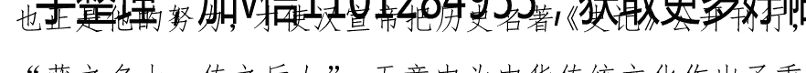

## 970 楼 
作者：鼎湖听泉 日期：2019-06-06 14:50

只是，也因为他的武顺锋芒毕露，最终也像其外祖一样入狱，还被判处死刑。那，他是怎样冤的？

## 971 楼 
作者：鼎湖听泉 日期：2019-06-06 16:38

杨丰出身世家，有着良好的教育背景，文才颇得。有些学生还认为此文章《报协会宗书》属于司马衡的著名文章。说杨人为轻财重义，奉公守法，廉洁无私，曾力除吏，这正与汉宣帝政治方谋而合。

## 974 楼 
作者：鼎湖听泉 日期：2019-06-06 21:49

他因故霍氏族有功，封平通侯，后又有宰。史载他全家担任公卿、两千石以上的十人。这样的显赫身世成就了他的才傲、不能容人的性格缺陷，以往文字之间得罪了很多中显贵，埋下了被杀的根。

## 975 楼 
作者：鼎湖听泉 日期：2019-06-06 23:00

说杨秉的轻财重义，有这样一个故事。据《汉书·杨秉传》载，其母马英逝之后，其父杨敏弦，而杨秉对后母很好，像娘一样孝顺，后母后来去世了，因为膝下无子留下财产，杨秉却没有将这笔财产独吞，而分给了后母的几位家人。

## 976 楼 
作者：鼎湖听泉 日期：2019-06-06 23:53

同样地，视财如上的杨秉，在父亲死后，其本人又继承的五万财产，全部用来资助有困难的宗亲，就把千万财物散作浮云，一点也不心痛。

## 977 楼 
作者：鼎湖听泉 日期:2019-06-07 14:39

http://img3.laibafile.cn/2p/2m/3099445302.jpg

## 978 楼 
端安康

## 979 楼 
作者：鼎湖听泉 日期：2019-06-07 21:21

保持着这份视富贵如云的心，步入仕途的杨慎也。杨慎是有理，加之信任就能获取更多好帖。铁骨铮铮，一身正气地与大小贪官周招，大胆地进行揭发，敢于向皇帝死磕。

## 980 楼 
作者：鼎湖听泉 日期：2019-06-07 22:00

这样，便落下了人。而且性格耿直不会转弯的杨慎（不愧是太史的好外甥），“每有持者必害之”，才得好的结果，显然是被朝廷显贵们当作靶子，明暗箭齐射。

## 981 楼 
尤其是与失和九卿之一太亨（近乎皇帝的车）长的致命一击，可谓是不死脱。这就顺利诞生了令人哭不得的成语：一丘之。

## 983 楼 
http://img3.laibafile.cn/2p/2m/309461304.jpg

## 985 楼 
http://img3.laibafile.cn/2p/2m/309472629.jpg

## 987 楼 
作者：鼎湖听泉 日期：2019-06-09 13:20

话说有一次，作为著名大夫的杨顺在朝中开会，商量，很像司马一样敢直言的“炮筒”。杨顺勾残害，他居然借题发挥而发：“这个残奴也是应得，该死的家伙！听说他们专门听谎言，残害忠良，虚心纳诺，是一个是非分的君王，结果死于非命，国家也处于分裂之中，历来都是昏君。秦朝就是一个榜样，要不是秦始皇、秦二世横霸，就不会快亡，也许现在还是秦朝的人，甚至可能没有立。因为自古以来，历代君王就像从山丘里爬出来的爸爸一样，都喜欢听谎言，最终都逃不亡国的宿命。“于一条名的故由此落地根（这赵孙也不是真的，都是成就的历史凡，“重于山”就源自马迁之手）。

## 990 楼 
作者：鼎湖听泉 日期：2019-06-09 20:24

哈

不愧是历史世家豪，陶出来的猛人，说话一套一套的，杨慷这话固然在理论上没有一点错误，错在真人因此进诱言要搞死他。

## 991 楼 
作者：鼎湖听泉 日期：2019-06-10 13:15

因为说者无心，听者有意。杨慷的政敌早就想收拾他，尤其是“草根皇帝”刘询在民间流落时结识的铁哥们，一直怀疑杨顺在背后说其坏要暗算他，也早就想找个机会参杨一本，顺便让杨顺下油锅，以泄私愤。

## 992 楼 
作者：鼎湖听泉 日期：2019-06-10 14:21

所以一听到这种“腹谀”意味极其的议政话题，简直是如获至宝，立马就上书报告杨顺没错，借商量国之机诽谤朝廷，无人臣之礼。史日“以为主戏（即拿皇帝开玩笑），近忤逆”，当然是想让杨顺入罪，说他近乎大逆不道。

## 993 楼 
作者：鼎湖听泉 日期：2019-06-10 15:37

他外祖司马还如出一辙。

## 994 楼 
作者：鼎湖听泉 日期：2019-06-10 16:29

因为再定的皇帝，也是不能忍别人把自己戏为专门听谗言的昏君，虽然杨顺本意或许并不如此。

## 995 楼 
http://img3.laibafile.cn/2p/2m/309517332.jpg

## 996 楼 
作者：鼎渊听泉 日期：2019-06-10 22:14

## 997 楼 
作者：鼎渊听泉 日期：2019-06-10 22:14

而汉宣虽是一个主，曾不幸流落民间也能体察，上位之后基本上全励治，有容人的量，何况像古代的随意恣驰。说他不是那种昏君的同类（不是一手整理），来参照特定的语义言论，应该是免疫力的，那么就在这种虚子。问题就出了他的宦臣身上，也是在听言上像古代君一样阴沟翻船。

## 999 楼 
作者：鼎渊听泉 日期：2019-06-11 15:54

## 1000 楼 
作者：鼎渊听泉 日期：2019-06-11 20:07

这个当然当事人杨顺也难脱干系，谁叫你外祖父司马迁一样，敢得罪皇帝，没死过啊，自然是要把你往死里整八块才解。

## 1001 楼 
作者：鼎湖听泉 日期：2019-06-11 20:56

所以，经过与皇帝“好像一个人”的歇长乐助力、煽风点火，把杨顺抖了汉宣帝满许多话吐出来了。这一原本脾气很好的汉宣帝太大了，因为有修养的人、再谦虚的人也是对自己自己的评价，然把我和古代君视为“一丘之”，他娘也太给。

## 1002 楼 
作者：鼎湖听泉 日期：2019-06-11 22:20

所以以怒不可遏有些失去理智的汉宣帝，不愿给自己的“历史分数”减分的危险，不管三七二十一就把“历史宽”杨顺（和他的外祖父司马迁连起来简直是“冤头世家”）立刻查办，很是吃了几天不好吃的牢饭，后来予以释放，枉为庶民。

## 1003 楼 
作者：鼎湖听泉 日期：2019-06-12 12:23

## 1004 楼 
作者：鼎湖听泉 日期：2019-06-12 21:06

于是，“一丘之貉”这一有一性感也有点贬义的成语，了敢冒言的大史公外孙的故事流传至今，始料不及，谁叫他们家都是善于创语的历史牛人呢。

## 1005 楼 
作者：鼎湖听泉 日期：2019-06-12 21:57

这还没完，偏逢连阴的杨顺，后来还因为写文章试刺时政直接丢了卿性命，果然祸不单行。

## 1006 楼 
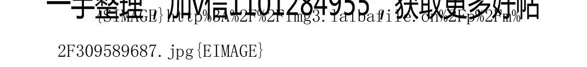

## 1007 楼 
作者：鼎湖听泉 日期：2019-06-13 12:29

而杨顺写的这篇文章非同小可，据说就是能和史圣司马迁《任仕安书》媲媚的《报协会宗书》。关于此信出发的背景，源于杨顺为庶民后还不知收缴，高调治产业，起宰室，以财娱来示威，而被其好友安定太守西河会宗写信劝说，让他低调以避祸所致。

## 1008 楼 
作者：鼎湖听泉 日期：2019-06-13 15:14

这本身就是一种性格悲剧，换句话说，就是杨顺的桀不驯给给自己惹来的杀身之祸，正所谓那句被现代人滥了性格命运，真实生活中也是一种体现个人修养的重要。

## 1009 楼 
作者：鼎湖听泉 日期：2019-06-13 16:25

何况，自恃才斗的杨顺又是那样的眼角，专张扬，史曰：“伐其行（也就是好政治），又刻酷阴险，同位有者，必害之。由于朝廷一付中。”

## 1010 楼 

## 1011 楼 

## 1012 楼 
作者：鼎湖听泉 日期：2019-06-14 14:50

也正是这种薄寡性格，当他接到好友会宗满诚气的书时，已经失了不平衡的汉宣帝，当然心里不服，什么闭门过着尾巴，不要给人以入口，那就失了，以前你就是这种哑巴亏，还不懂作为朋友，不想在同一地方。

## 1014 楼 
作者：鼎湖听泉 日期：2019-06-14 16:15

总之，一接到好心的朋友信，从来都是心气傲的大史外孙，立马就有任性发作，于是用一种充满反唇吻的回信，信中把自己所受的一切委屈以及对朝廷“黑暗”的极大不满像竹豆一样，自古以来。颇有其外祖的风采。

## 1015 楼 
http://img3.laibafile.cn/2p/2m/30963533.jpg

## 1016 楼 

## 1017 楼 

## 1019 楼 
作者：鼎湖听泉 日期：2019-06-17 16:34

什么“怀禄势，不能自退，遭遇变故，被扣语身幽岗，妻子离。”就是皇帝的深层怨恨。而“明明求仁义，不能化民者，卿大夫之意也。明明求财利，常困乏者，庶人之事也。”故道不同，不相为谋，今子尚得以卿大夫制而责哉！”就是赤裸裸的好友冷嘲讽和对其横加指责的极大，最后一句“方当盛汉之隆你走你的阳关我走我的独木桥，别再来烦我，咱们井水不犯河水，极尽苦挖之能事，从此可见了对他人刻薄的一。

## 1021 楼 

## 1022 楼 

## 1023 楼 
作者：鼎湖听泉 日期：2019-06-18 15:49

此近，好心相劝的孙会宗可谓说是碰了一鼻子子灰，自讨诞。这种发泄私愤的锋芒毕露的檄，虽然是快意恩怨，我手写我心，行文也很十分，甚至于慈人余尽诚赞道：“行文之法，字字用，段收束，平直处皆曲折，疏散处皆紧炼，则酷其外。《重订古文释义新编》卷六）却也因此里埋下了被杀的祸根。

## 1026 楼 
作者：鼎湖听泉 日期：2019-06-18 23:12

## 1029 楼 
作者：鼎湖听泉 日期：2019-06-19 14:03

## 1030 楼 
作者：鼎渊听泉 日期：2019-06-11 20:07

## 1031 楼 
作者：鼎湖听泉 日期：2019-06-11 20:56

## 1032 楼 
作者：鼎湖听泉 日期：2019-06-11 22:20

## 1033 楼 
作者：鼎湖听泉 日期：2019-06-12 12:23

## 1034 楼 
作者：鼎湖听泉 日期：2019-06-12 21:06

## 1035 楼 
作者：鼎湖听泉 日期：2019-06-12 21:57

## 1038 楼 
作者：鼎湖听泉 日期:2019-06-21 23:39

## 1039 楼 
作者：鼎湖听泉 日期:2019-06-22 10:45

通的“日食”，居然就能和他发生了一点关系，这本来就是“迎加之罪，何患无咎”的翻版，“裁辟的理由”原本就是捕夫捉贼影的，是很多他得罪的人用一种十分牵强附会的借口让他去死的。

# 1041 楼
作者：鼎湖听泉 日期：2019-06-22 22:05
晚安

# 1042 楼
作者：鼎湖听泉 日期：2019-06-23 16:31
关于此事，说是宣帝后五四年（公元前54年）夏四月朔日食，而出现这种古古代人堪恐的天象之后，仇人趁机上书皇帝，说是杨濽矫奢不不已，日食之咎，此人所致（《汉书·杨激传》），这八儿子子下不沾血的理由荒唐之极，却也是炸政敌的重型炮弹，然而杨畏也因此获罪，再度被挟入狱。

# 1047 楼 
作者：鼎湖听泉 日期：2019-06-24 12:59
宣帝本来对他就有成见，既然如此，那么就叫廷彻底一查这个给帝国带来灾难的“灾星”吧。而这一竟查出了杨濽写给彭弘会宗的这封口水花喷喷的“大不敬”之信。宣帝见了这种充满痛苦和恨意的信，更加愤怒不可遏，最终会将颜色的最高法官杨畏判一个大逆不道罪，腰斩处死，妻儿均被流放酒泉，杨畏为自己的多舌付出了惨重代价。他的朋友孙会宗也是“躺着中枪”，被贬官了事。

# 1049 楼 
作者：鼎湖听泉 日期：2019-06-24 21:57
晚安

# 1050 楼 
作者：鼎湖听泉 日期：2019-06-25 12:07
对于西汉期间这种令人唏嘘的政治案件，历史学家也认为这不是“平地起风雷”式的偶然事件，而是“汉武帝时期统治阶级内部矛盾的结果，是皇族、外戚集团打击、害大夫集团，也是汉朝开始衰败的转折。”是预谋已久的政治迫行为。因为在杨畏莫名其地死了之后，西汉政府就掀起了一轮政治清洗，很多人被牵连。不仅与杨畏性格相似非常耿直直言的朋友韩延寿、盖宽被害，其他人如张敖、徐玄成、杨翊等也像孙会宗一样被免职。

# 1053 楼 
作者：鼎湖听泉 日期：2019-06-25 21:23
好

# 1054 楼 
作者：鼎湖听泉 日期：2019-06-25 22:04
晚安

# 1055 楼 
作者：鼎湖听泉 日期：2019-06-26 13:26
对于西汉期间此等人有啼笑皆非的政治案件，历史学家也认为这并不是“平地起风雷”式的偶然事件，而是“汉皇帝时期统治政治阶级内部矛盾的结果，是皇族、外戚集团打击、害大夫集团，也是汉朝开始衰败的转折。”是预谋已久的政治迫行为。

# 1057 楼 
作者：鼎湖听泉 日期：2019-06-26 16:30
ok

# 1058 楼 
作者：鼎湖听泉 日期：2019-06-27 13:57
因为就在杨畏莫名其妙地死了之后，西汉政府就掀起了一轮政治清洗，很多人被株连。不仅与杨畏性格相仿非常耿直直言的朋友韩延寿、盖宽被被害，其他人如张敞、霍玄成、杨翊等也像孙会宗一样被免职。
当然，杨畏性格既有其悲剧的一面，也有汉帝偏听偏信造成的错误。

# 1061 楼 
作者：鼎湖听泉 日期：2019-06-28 13:16
第二十四篇 故剑情深：草根皇帝汉帝最宠爱的许皇后死

在中国皇帝当中，刘询虽然是最著名的“政治皇帝”，算不上出名的“生活皇帝”，与其他风流皇帝相比，包括同是英主的隆基等，妻儿人和家庭规模就无法媲美，至于可以用寒碜来形容，用现代人的话来说就是不是一个量级上的。

史书记载，汉皇帝有3位后、6位妃娘和5个儿子（而女儿仅2个），这样的数字与隋炀、唐明皇相比，简直就是拿不出手，与汉翁同样是皇帝，差别就这么呢？

# 1063 楼 
作者：鼎湖听泉 日期：2019-06-29 13:45
哈

# 1067 楼 
作者：鼎湖听泉 日期：2019-06-30 00:00
晚安

# 1068 楼 
作者：鼎湖听泉 日期：2019-06-30 12:02
那么，你一定会对此发生浓厚兴趣吧？想探讨难道草根皇帝就是“只爱江山不爱美人?”以下我们来八卦究竟，那么我们现在进入草根皇帝的特别频道吧。关于汉皇帝的妻子，我们在以前的章节中也提到了一些，比如他的皇后，故情深，就是一幅十分和谐的生活图，那么我们现在深入下去，来个全景式报道。

# 1070 楼 
作者：鼎湖听泉 日期：2019-06-30 16:22
更新了

# 1071 楼 
前文已经知道汉皇帝是太后刘彻和霍昭的亲孙。史料显示，汉太子的妻子分为三级：正妻、有子妻妃、无子妻娣。所以刘询的奶奶被标记为霍娣。在那个惨烈的“巫蛊之祸”中，汉太子的家眷几乎死于非命，刘询从小坐牢，在霍光之手的保护之下，不仅活了下来，还幸运地成长为西汉最有为之一，于是才有之后的家庭。那么，我们就来详细讲解汉皇帝的第一位皇后许皇后吧。

# 1075 楼 
作者：鼎湖听泉 日期：2019-07-02 14:05
大家知道，草根皇帝刘询曾有一个惊心动魄、九死一生的童年，而且少年时代也是一个没有关注的“神龙君”，经常神龙见首不见尾（说是失踪），他在上皇帝之前（他登基时只有17、18岁），却已经在民间完婚，且是不顺利、一波三折的那种。刘询在民间完婚的这位老婆，正是他一番深情的妻子许平，以后的许皇后。

# 1080 楼 
作者：鼎湖听泉 日期：2019-07-03 13:13
而且，在刘询做皇帝之前，这对恩爱夫妻就已经育有一个子，此子就是后来中国古代美女之一的王昭君出塞的汉元后刘姬（长子）。比较好运的一个，至少她是有史记载的获得皇帝真正爱的多数的幸运皇后之一，所以有必要进行较大的篇幅和全方位的深度报道，关键词就是“故情深”。

# 1082 楼 
作者：鼎渊听泉 日期：2019-07-03 16:00
哈

# 1083 楼 
作者：鼎渊听泉 日期：2019-07-03 23:36
晚安

# 1084 楼 
作者：鼎渊听泉 日期：2019-07-04 15:47
说起来，许皇后和刘询一样的“苦大情深”的孩子，就因为刘广的大起大落、充满变数的悲剧人生，绝对是可以单独拍摄一部精彩异常的“人生难片”。

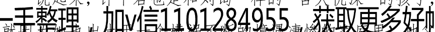

许广是一个东汉儿子，约在20岁的青春年华，幸为汉武帝与有倾城美貌的李夫人所生之昌邑王刘勃的郎官。由于刘英年早逝，所以汉武帝很怜惜刘勃的儿子刘贺（后来的汉帝，继承了父亲的昌邑王位），经常让他跟随左右。有一次，汉武帝出游，即从长安到甘宫游，刘广也是随从之一。而为昌邑王府的郎官，许广有幸也成为了随驾人员之一。跟着皇帝出游，这原本是一件很拉风的事，可由于上上显灵，居然因为许广自己的疏忽而杀了命，始料不及。

# 1087 楼 
作者：鼎湖听泉 日期：2019-07-04 16:31
那途中发生了什么？

# 1088 楼 
作者：鼎湖听泉 日期：2019-07-05 00:00
晚安

# 1090 楼 
作者：鼎湖听泉 日期：2019-07-05 13:00
原本以为是拿错了，结果真的是拿错了。在汉皇帝看来这只是小事，难道就是拿错了吗？在现代社会可能是小事，但在古代封建社会，却是犯了“盗窃”的大罪。所以当许汉被侍卫抓住时，立马就要处死他故意窃皇帝的圣物，一定要赐死，而且很快就定了死刑。但他不知道汉皇帝是那样的，居然就饶了许汉命，而且从此以后的“草根皇帝”发生了一点关系，成了亲戚。用古语：“祸福所倚”也，简直是花般变幻的人生啊，咱们眼睛睁睁眼发现没找到，这次的诡异事件基本倒错。

# 1092 楼 
作者：鼎湖听泉 日期：2019-07-05 23:06
晚安

# 1094 楼 
作者：鼎湖听泉 日期：2019-07-06 16:23
当然，许汉是罪犯可恕、获罪难免。汉武帝是不是喜欢这种酷刑，反正太史也曾经经历过这种刑罚，简直有点残忍。后来，许汉改死为三年，外外“强行禁牢”到霍霍（即宫中居住）。刑满之后，成了一个正式的官，由于他有才，别人才知道被冤枉，很快就上了中丞（中丞也是宫中官名，主要管后宫人口采集事务，以宫为令，中丞是令的副手）。看着命运有了转机，居然许汉此时又惹了祸，不然的话能叫“人生灾难片”吗？

# 1000 楼 
作者：鼎湖听泉 日期：2019-07-07 16:23
更新了

# 1001 楼 
作者：鼎湖听泉 日期：2019-07-08 00:20
晚安

# 1004 楼 
作者：鼎湖听泉 日期：2019-07-08 13:16
原来是十分胆猾的许汉又遇上了官廷乱子，那就是西汉历史上著名的“霍霍之变”。乱之下，很有政治野心的托夫之一的上官某，于昭帝元七年（公元前80年）参与谋反，由于种种原因，最终成了未遂政变，然后又是斩草除根的一系列“肃反行动”。作为官廷总管级人，许汉负责应当应当参与搜索罪犯并捕获的活动。许汉负责搜索上官某以及他的余党，总的一到位就立即勒绳法。这个原本就不是什么技术含量很高的活，村夫野老都能轻易易举地完成，然而说天才的许汉却在捆人绳子上手足无措。

# 1005 楼 
作者：鼎湖听泉 日期：2019-07-08 23:42
晚安

# 1006 楼 
作者：鼎湖听泉 日期：2019-07-09 14:05
本来说在上官衔中的公棺内是放足够的绳索的（可能他也认为政变成功后要缚人都吧），最长的绳子有数尺之多，而且可以用捆人的甚至达到数千条，还用箱很好地封存着，单等人来取。可是，当聪明的许汉来提取时，却什么也找不到。这些绳子一下子好像人间雾一样（有的还是自己保管的），这非常诡异。明明就能轻松找到，反而没找到。这次的诡异事件基本倒错，许汉恰恰拿错了，是他的死对他皇帝故意让他出头。

# 1008 楼 
作者：鼎湖听泉 日期：2019-07-10 00:03
晚安

# 1010 楼 
作者：鼎湖听泉 日期：2019-07-10 12:51
这并不是真的，反正许汉这次不能错，结果大家也能猜到。后来因为办事不力犯罪被判刑，被庭廷总管也丢了，枉为庭廷的鬼。关键时刻，华转，许汉又升为霍侯。按照汉代的官制，霍侯这种级别。生活交集的倒霉蛋就这样共处一室，还成了忘年交。因为逐渐长大的孙孙需要接受教育，来到敞廷和未来的岳父父亲许广成了舍友。这就是命运的安排。

# 1018 楼 
作者：鼎湖听泉 日期：2019-07-12 23:38
晚安

# 1019 楼 
作者：鼎湖听泉 日期：2019-07-13 15:34
好

# 1021 楼 
作者：鼎湖听泉 日期：2019-07-13 23:31
晚安

# 1022 楼 
作者：鼎湖听泉 日期：2019-07-14 14:48
读书之余，本来就好动好交游的皇孙，居然成了神龙教主，见首不见尾的款式，说出来是在体察民情之余，也做了斗鸡游猎之事，还和长陵的一个“斗鸡王”迎奉成了铁哥们，角色也天天变。眼看着一个身高八尺二寸风度翩翩的大好青年逐渐颓废，此时倒是急坏了一个人。

# 1024 楼
好

# 1025 楼 
作者：鼎湖听泉 日期：2019-07-15 13:53
此人就是废太子刘询的家史张贺，也就是曾想把孙孙女嫁给刘询而遭到政大臣弟弟霍昭反对的。霍昭基于家族利益和安全，对哥哥的不满，张贺也无奈了。张贺认为只要孙孙嫁给刘询，就能得到太子的恩惠，所以对于遭受太子的之害，汉政府也极大同情。尽管张贺本人并不是太子的受害者，但他也被牵连，甚至像许广一样受了官刑。张贺是一个重情重义的人。当时，未来的汉帝刘询还是落魄。虽然经历了很多变故，脱离了政治困境，也恢复了孙孙的名分，但不过而已。政治上基本上是没有出头之日（如果不是做了很多坏事），刘询一生也如此平淡地过了。这就，一个是没落的皇孙，是一个备受打击、伤痕累累的官，毫无预兆地相遇在一起，直到成了一家人，有时候你感叹造化弄人。

# 1015 楼 
作者：鼎湖听泉 日期：2019-07-11 23:09
晚安

# 1016 楼 
作者：鼎湖听泉 日期：2019-07-12 23:55
所以，现实生活中如果你突然和一个20多年前根本就从未认识的人，在异乡相知、相遇结婚了，你也不太惊讶，正所谓古诗所言：“同是天涯沦人，相逢何曾相识。”月老人其实早已暗中结线，不管你是样的挣不由防甚至百思不得解，最终你还是得接受命运的安排，百年才能懂得同船渡千年懂得共枕。

# 1027 楼 
晚安

# 1028 楼 
作者：鼎湖听泉 日期：2019-07-16 00:00
晚安。

# 1032 楼 
作者：鼎湖听泉 日期：2019-07-17 22:48
晚安

# 1033 楼 
作者：鼎湖听泉 日期：2019-07-18 15:53
许平君当时就是十四五岁，但古人嫁得早，所以这及闰之年也已许配给内诏令（宫官），掌内外旨报（长官）欧侯氏的儿子。不幸在两家商量婚事的时候，偏偏她的对象此时病故，人都不了，这婚事最终只能是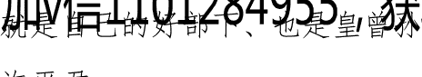。如此此故，按照老人们约定俗成的口吻，准是要说许皇后是克夫命了。而她的母亲却不信这个邪，于是特意带她去问卦卜，以示前程。既然问卜的结果符合母亲之意，因为卜者算说“她有贵人之兆”，虽然不一定算出她能当皇后（算命嘛，自然都是横口语言，信不由你），不过这足以其母内心美到极致了，因为至少不是我女儿有克夫命，而是欧侯的儿子不配娶如此尊贵的女人而已。

# 1037 楼

# 1038 楼 
作者：鼎渊听泉 日期：2019-07-19 15:57
不其然，这命最终算得还是比较准的，至少成为一国之后，那怎样说也大贵人了吧？这个，当然与我们心地良若恩图报的张贺的努力是不分开的。话说张贺到到处寻找刘皇帝的合适对象而不得的时候，虽无意中才听说自己的部下许多许汉尚有女待字家中，这邻家中有女初长大，和年近弱冠又身材魁伟的皇孙算是有缘，所以想拼命合。

许广张贺我这一说，那时也有点渴高了，反正是领导的意思，咱们也不好推托，最重要的是许广对刘询印象不错，霍喜欢这个“高富帅”，所以也满口承诺，皆大欢喜。

不想这却愁恼了一个个人，那就是许君的母亲。

因为许夫人认为这场婚姻，与她的设定不大相符，至少刘询当时不是大人君。而且说得难听听，那只是大贵：基于他还是人唯恶躲避不及的“罪首”之后，虽然时候会惹祸身上，这也正是安世极力决否哥哥家与之姻的终极考量，这个当然无疑是皇孙后来“故阔情深”的引发点，患难才能见真情是也。

当然，这只能怪那些没有长远眼光了。不过，许夫人生气归凭，最终还是腰扭不起地给了。反对无效，在老公答应明蝶正妻之后，她才不大情愿地答应了门门亲亲事，心里还十分担忧怕的，怕明天又要突然要清算庞大一家的余殃，自己的家族成员都成了“反革命分子”，战战兢兢之间，谁知这样家族咸鱼翻生，成了皇亲国戚，说来都令人唏嘘，简直就是歪歪折着，多么刺激的一场人生豪赌啊。

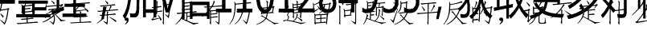

因为谁也料不到首之后竟成了一国之主，自然是许家强买入了一只黑马的“潜力股”，并由此赚个盆满钵满，这就是人生的诱惑也是。

据史载，汉帝元风六年（公元前75年），许君和刘询结成夫妻，一年之后，许君生下儿子刘景，即后来的汉。

由此，许家裂封侯，不在话下。许君先是被封为雉后，后为皇后。而且，随着汉宣帝四年（公元前66年）刘颢被立为太子，许家成员也纷纷争夺官进郡，成许广为平侯，位极极等。甚至于连许广的二弟许辟也封为博望侯，第三弟许延寿为乐成侯，正所谓常人所云津津乐道的“一人得道，鸡鸣升天”是也。

当然，这是后话，我们先回过来说说皇曾孙和许平君最初的艰难夫妻生活。

说刘询当时是因为历史原因，还不是真正的“高富帅”，许家当年办婚事之后，没车没房甚至是穷得只剩一条内裤的刘询，也不可能大肆办婚事，因为婚礼是张赞替其筹备并办妥的，而且婚礼之后，又因为没有婚房，刘询还能和妻子一起起住在岳父家里，和入养差不了多少。

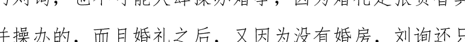

如宾，对落难老公还尽贴微。而从小政治原因在牢里经历过的皇曾孙，本来就没有享受世俗的快乐，更加没有人对他呵护，许平君温柔体贴的好人，进入了自己曾经悲凉的生活，一切都是换了人间的样子，让皇曾孙顿时新奇，感动得泪满面，及自己。

所以，对于妻家的照顾，刘询除了感激，更多的是发誓不忘妻子自己的恩。如果哪天发了第一个，所谓常人说的“滴水之恩”也是。这也正是千古说的“故情深”皇皇帝的最初，世界上本来终不出料，上帝给你关上了一扇窗，也会悄悄地开了一扇门，不然的话就没法活了。换句话要是人，始终有那么的机会。

而且，十七岁几乎是多灾多难的皇曾孙，突然就像中了六合一样，莫名其妙就当上之前想也不想的皇帝——皇皇帝，这确实令他目瞪口呆，因为他可是连梦里都不想的事，竟然骤然龙袍加身。于是刘询最终大彻，原来世间还是有所的“补偿”，至少十七年来所遭受的罪，最后得到了双倍补偿，现在十七岁的他什么都有了，温暖的家庭、健康的儿子，以及普天的皇帝。

这是怎样的一种梦般的人生，命运的不可预测又是。以至于权臣霍光废掉干净的汉皇帝，确立他的皇储资格之“走场式”官面试，他都有一种走进幻想的感觉。那是元元年（公元前74年）七月的事了。

## 一手碧理，一手整理，获取好运

就在那年秋秋，在祁吉等老臣的大力举荐下，有意废旧君立新君霍光，于是搞了一个别开面的“皇考”，那就是让刘询入宫面见太后。

那时初秋的阳光已经不再猛烈，初次入宫的刘询更是因紧张而感受到一阵秋凉。路上，他好奇地打量着自己祖辈生活过的金锦煌的皇宫，心中止不住地激动，因为他要去的是比自己还小两岁的上官太后，她既是汉帝的皇后，又是权臣霍光的外孙女。十八岁的刘询，侍生地面见比自己小两岁而靠份却比自己高二辈的上官太后（刘询称其为祖母级的），怎么说都有一种别扭感或者说尴尬，显然是一种走过场的官廷礼仪，一场风过去去了。

因为，当双方见面之后，由于是掌权的外祖父霍光一手交办的，所以上官太后后喘息，甚至于寒意也免了，立马把当时还是“平民百姓”的废皇帝赐给刘询，一下子就加封侯爵，是为阳武侯，可谓是平青青的敛味。当然，霍光这种灭火预热让刘询这只曾经的“垃圾股”又加了好处垫和预热，不说话的话则当时的这个皇帝就有点“名不副实”，至少出身和官衔上说不过去。

所以，这一切其实就是一场彻头彻尾的“官场秀”，演给后人看而已。因为就在刘询加封阳武侯之后不久，基本上也可以说是凳子都没有坐热，刘询就被黄袍加身，成为了大汉帝国的第十任皇帝，而他时的长子还不不满百日，这一系列的万花锦人人生巨变，让当时的刘询和满朝文武都呆了。这种这种非常有戏剧性，给人以不真实的梦感。刘询当上皇帝之后，自然是许家强买入了一只黑马的“潜力股”，并由此赚个盆满钵满，这就是人生的诱惑也是。

当然，如果按照正常程序，那时候也已经跟随刘询入宫并封了许君，绝对是皇后的选择。当时持政的霍光有一个小女儿待字闺中，尚未嫁。既然霍光把朝乱为皇帝，那么作为报恩，刘询要他的女儿并封为皇后，也是理之中的。于是，这立后之事便倒了一班大臣。

当时有一班人想立许君为皇后，以此政治上的，讨好真正的“皇后”，为自己的仕途加一把筹码。这就难坏了刚上台后权力基尚浅的刘询，可谓是在他面前的一道难题，并不可能还要没坐热的龙椅再拱手让，不见的前任皇帝就被废了。一想到这里，皇帝感觉到背后暖暖的，至于忍不住地出了一身汗。因为处理得稍有不慎，便可以让大汉局败又是这种超强政治对手。但是，在进行一番利害得失的权衡之后，他还是勇敢地对自己的“政治恩人”霍光冕了成为一种政治翻身的“秘密武器”，而且在这种看似不可完成的任务之中，让自己有惊无地获得了至关重要的“政治击”的胜利。为什么这么说呢？这显然大有来头。关于这，我们在前文宣帝的上位战中已经所有交代，在此再不厌其烦地一下吧。

大约也就是在公孙议立皇后后，皆心仪霍将军女的危急时刻，有心抵制霍氏势力更是念许平寒之时对自己不离不弃，于是果断在一班马吕还没有得及正式报告后大事，先行由自己出了一道点名其他的“寻故剑”的初诏，也就是说是我汉宣帝做皇帝之后的第一道诏书。这道诏书大意就是，我在贫寒无助之时，曾经有过宝剑，也是在这把宝剑的陪伴之下，让我度过了人生中最难的时光，可惜我不不慎掉了它，现在我虽然已贵为九五至尊，但却很想念无价之宝，若是众爱卿能给我找回来，那么将感激不尽，云云。

皇帝这样的一种隐海每尽的众大臣也是，当善拍马弓寻找的故，显然在立后十分明白。皇帝真意切要寻找的，而在这一点上，连同样大的霍光及。立后，很多大臣还是转变了态度，纷纷支持立许皇后，因为皇帝这一行动，无疑是对权倾朝的赤裸挑战，而且他乐于赌。

终于，汉宣帝还是赢了这一局。这正如唐朝诗人王龄所叹：“一闻汉思诡，使长嗟万愁”，大赞皇帝所谓英雄怀、美人旧情，即使死在君怀也是值得的。即使有着被废的危险，刘询也愿意和高层博弈，鱼死破也所在。有人把皇帝的初诏誉为古今外最浪漫的诏书，也是很有道理，冷冰冰的公文有了人间的温度这也是这也是。

当然，也有人认为刘询这一举动，瞬间把许平君推到了风口浪尖，然后死于非命，不值得也。可是，我们也可以胆地预测一下，如果霍璟金小姐括扶，坐上了正官娘娘座，作为皇帝故情的至爱的许平君，就会日子好一些吗？我认为答案是否定的，因为即使是许平君做小，她的身份一定没有丝毫不改变，绝对是皇帝最宠爱的女人，心中的宝玉，这就决定了许君会不会有好日子过，所谓“匹夫无罪，怀璧其罪”，善良的霍家母女哪会放过充满威胁的她？不找麻烦修理她，简直就是良心发现。所以，既然是两难选择，那么对自己有好处的更合算，并不是所有的隐忍、退让都会对自己有利，既然在权利的斗场上，也必须有一个权利底线和坚守，如果皇帝的家事上，你也得给我一点小的重量。基于以上的考量，汉皇帝自然得断亮剑，不然的话皇帝也太窝囊了，当与不当一样，那么就试探你我的底线吧。

果然，刘询这不顾一切的搏，也有了一个比较平和的结果，自己没有被毁，而心爱的女人也如愿当上了皇后，虽然大将军面上不好看，脸成了肤色，但还是许平君父亲的封侯上妥了一点手，以消心中怀，再也没有后续动作了。而且，过了一年后，霍光也消失了。消待何？汉皇帝也不能因为一点顺心的事，又是和哥哥一样忠于大汉的霍光，也能衡量出其中轻孰重。

因为女儿当不了皇后，下次再想办法。如果频繁废皇帝，让他有野心的权臣抓住把柄，那也不是闲着的。这世间事物环环扣，一物一立，一物一降，难道不是任性来的祸？所以，霍光无奈只得祝福患难夫妻，却是发泄私横处理，心里就是撒出来。问题上的各种种子，你不让我好过，我也不让你同样的。当然，霍光是一个老谋深算的政治家，他不可能在一件事上纠结太多。大家知道皇后后的父亲许广是一个刑余之人，说了就是一个宦官。虽然此时父凭女贵，做了国丈，按照当时的政治立场，他也能加官进爵，不能做诸侯王，至少做个挂名的侯吧？但由于女儿选皇后落败，所以好气的霍光就赶许家，说刑余之人没资格做侯爷，就这样把许广的官职给没收，也算是出了口气，从此以后气顺了许多。

一年之后，霍光还亲自见了许广所有的封赏。虽然许广的爵位是打了一个折，不是梦求的侯爵，而是一次等的昌成君，没有封地，但有过，而且许广爵位超然，俸禄也不少。最重要的是，许家得到权利倾朝野的影子皇帝的认可，也是一种不可多的政治待遇。

光小老老婆要做皇帝母娘的美梦，所以刘询和他的故情原配妻子许平君，在台上开心地接受文武百官的祝贺时，许平君的人生恶梦也为她展开。因为，不甘心失败的霍光，早已利用自己的强大政治资源，权力要赌赢这一局，可谓是输打赢，不择手段。

关于这，上文汉帝的上位已经比较详细地交代，为避免重复，在此一笔带过，不再展开来谈。最终，真像是某些历史研究者所推测的那样，因为许平君当上了一国之后，而被推到了风口尖上，且因为“不当”占有了霍家的最大的利益蛋糕，于是付出了生命的代价。

不知道许平君死之际，是否后悔在皇城根结了这个草根皇帝，如果不是他落难，就不能和同样落难的父亲住在一起，也不能使自己做梦也梦不到的皇后，更加不会因此而被残忍毒死。要知道她的时候还不到20岁，做皇后后没到三年，就这样带着皇帝的无限眷恋撒手人寰，可惜之极。

## 1245 楼
作者：鼎湖听泉 日期：2019-08-16 12:16

无疑，许平君太嫩了，不论年龄还是政治资历的。作为第一夫人，这个生于民间没有心机、如原野一条素野花的普通女子，注定被满身毒汁的荷尔蒙过的野心家霍显绞杀，命运如此。

许平君一人，霍显的女儿霍成君当了“母仪天下”的皇后，霍显也顺理成章成了皇帝的丈母娘，可谓皆大欢喜。而如果霍成君能为皇帝生下儿子，以霍家的权力背景，绝对又是太子的不二人之，那么这天下不是霍家的了？

可惜，到头来，机关算尽，枉错了权谋性，霍家并不最终没能扫清政局，还落下了被灭族的结局，可谓是一报报应。

## 1248 楼
作者：鼎湖听泉 日期：2019-08-17 00:52
晚安

## 1250 楼
作者：鼎湖听泉 日期：2019-08-17 15:20
哈

## 1258 楼
作者：鼎湖听泉 日期：2019-08-17 22:37
晚安

## 1259 楼
作者：鼎湖听泉 日期：2019-08-18 13:09

虽然汉宣帝惧于霍光权势，表面对霍皇后很好，“甜蜜程度”甚至超过了许平君，然而三年过去后，皇帝的很多姬妃都怀孕生子，唯独霍皇后没有怀孕，这可急坏了霍光。

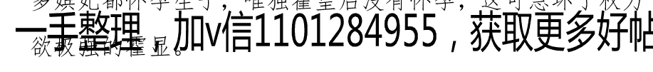

然而，在这背影上，霍光又是为革命鞠躬尽瘁了。为了不使大权旁落，霍家是密谋政夺专权，霍显还熏心要自己女儿也就是皇后成君去死太子，最终霍成君也不得好死，因为家人几乎都死了，自己还成了废后，抑郁愁极自杀身亡。

这个，可谓那句俗语“并非皆因强出头”也是。

## 1262 楼 
作者：鼎湖听泉 日期：2019-08-18 22:24
晚安

## 1264 楼 
作者：鼎湖听泉 日期：2019-08-19 13:05

生于帝王权的外戚之家，有点娇生惯养的霍成君，也正如现在的很多富家大小姐们一样，挥金如土，物质感大于政治志欲，基本上也是质朴的许平君一样，不知政治为何物。而最要命的是，霍成君还有一个政治野心特强的“暴发户式”老妈霍皇后，这就注定了她的个人命运的悲剧。至少她不能逆老妈妈之意，而去给太子下毒，绝对是逃避不了的历史的惩罚，最终也和“政治痴痴”般的许平君一样死非命，不同的只是一个被谋杀一个被自杀，都成了政治的牺牲品。

## 1265 楼 
作者：鼎湖听泉 日期：2019-08-20 00:07
#一手经理，加v信1101284955，获取更多帖

## 1267 楼 
作者：鼎湖听泉 日期：2019-08-20 16:19

关于这个问题，正如某些历史研究者所言：“皇帝身边的女人真是步步惊心，一步步祸。”由此看来，皇后并不是那么好的，以现在的眼光来看，即便是一对平凡的夫妻，两情便是幸福的。有权利的地方，争斗最激烈，正如苏东坡说，“高处不寒”也是。所以，有人叹古代后宫是一个充满伤的地方，也逃避了政治的残酷，比如纯洁如纸的许平君，又是娇横跋扈的霍成君。

## 1268 楼
作者：鼎湖听泉 日期：2019-08-20 23:46
晚安

## 1270 楼 
作者：鼎湖听泉 日期：2019-08-21 12:16

大家都知道，汉成帝的结发妻子皇后赵氏姐妹的温柔，从少年时代就开始专宠，这时间跨度达20年，也算往情深。

看权力空缺，这可坏了太后系，让汉成帝不立继承大统。由此，许后的地位愈发衰落，再加上老父的外戚体系被太后集团打垮，只能睁睁看着曾经爱过的皇帝移情别恋，还不能怪老公薄情。

## 1273 楼 
作者：鼎湖听泉 日期：2019-08-22 00:44
晚安

## 1275 楼 
作者：鼎湖听泉 日期：2019-08-22 12:04

汉成帝首先宠的是出身书香世家又知达礼的班皇后。作为一个出身文史世家的博士型皇家女眷，班皇后“美而不绝，美丽而不俗”，知女人特有的稳重和宽容，也决定了她不是一个痴于事的女人，尽管她曾经为皇家贡献了一个男孩，却像皇后的儿子一样早夭，从终点回到起点，一切归零，做了一些无用功而已。

而且，毫无城的聪明班皇后，还心力做宫中冲锋，不仅用手段为自己争取权力，甚至到处为皇帝推荐。

火急，全然不顾自己可能因此被王萧弃。

## 1276 楼 
作者：鼎湖听泉 日期：2019-08-22 14:16

## 1277 楼 
作者：鼎湖听泉 日期：2019-08-22 15:46

汉成帝首先宠的是出身书香世家又知达礼的班皇后。作为一个出身文史世家的博士型皇家女眷，班皇后“美而不绝，美丽而不俗”，女人特有的稳重和宽容，也决定了她不是一个甘于事的女人，尽管她曾经为皇家贡献了一个男孩，却像皇后的儿子一样早夭，从终点回到起点，一切为零，做了一些无用功而已。

而且，毫无城的明的班皇后，还心力做宫中冲锋，不仅用手段为自己争取权力，甚至为了皇帝推荐可用的美女，她到最后最后等到李平都献给了汉帝，皇家感情火急，全然不顾自己可能因此倾覆矣。

## 1278 楼 
作者：鼎湖听泉 日期：2019-08-22 23:12
晚安

## 1280 楼 
#一手整理加微信1101284955，获取更多帖
发布时间：2019-08-22 23:51

后来李平顺利得到了皇帝的宠爱，也被授予了婕妤的称号。因为身份低微，汉成想到了出身歌妓的汉武帝卫后，后立刻把李皇后赐“卫”，她就成了卫婕妤，却被专权的王立忌恨，后来还成了他的另一实力派外戚王萧的强力“炮弹”，始料不及，可谓处处暗杀机。

事实上，后后的争斗也是皇家政治的晴雨表和有效延缓。因为赵飞燕妹妹的宠冠六宫，就是从整死皇后开始的。汉成帝统治时期，不仅政治不昌明，而且所有诡异天象都曾群聚来说，奏热闹地多次呈现。

## 1281 楼 
作者：鼎湖听泉 日期：2019-08-23 20:29

## 1282 楼 
作者：鼎湖听泉 日期：2019-08-24 00:08
晚安

## 1284 楼 
作者：鼎湖听泉 日期：2019-08-24 16:06

## 1285 楼 
作者：鼎湖听泉 日期：2019-08-24 22:45
晚安
#一手整理加微信1101284955，获取更多帖

这个原本也没打算皇后事，但倒霉的时候，不晓那些用的大臣，居然把这种“巫蛊”归于许皇后，招致汉帝昏庸和太后外戚夺权。许后的政治失误，把皇后一家给毁了，可谓是家破亡亡。许皇后被定性为“妖”之后，除了被废掉后，还被彻底入了冷宫，最后连皇帝的面都看不见了。

## 1290 楼 
作者：鼎湖听泉 日期：2019-08-26 13:09

这由于皇后被打入冷宫，而引发了许家的“巫蛊案”而被连累赐死，丢了性，呜呼哀哉。原来，因为皇后外戚打压，皇后深感，于是很是同情妹妹遭遇的平安夫人（许后的姐姐），不过当时认为是十分大逆的。我整理加微信101284955，领取更多帖

## 1294 楼 
作者：鼎湖听泉 日期：2019-08-26 23:34
晚安

## 1298 楼 
作者：鼎湖听泉 日期：2019-08-27 11:55

在那种不昌明的古代，这种让皇后死亡的做法，等同于反造，已经不是用心恶的问题了。而且汉武对巫蛊格外重视，汉成帝的太子也因巫蛊牵连死于非命吗？许皇后又算老。所以，当此事被汉成的另一位妃赵飞燕察觉并揭发之后，面对如此恶毒的女人，满朝哗然，许家的绝对是灭顶之灾，所谓的“小不忍则乱”也是。许皇后最终的结果是，参与巫蛊的主谋许等人被处死，许皇后也因姐妹之祸而被废掉，到了后来连命也保不住了。

## 1299 楼 
作者：鼎湖听泉 日期：2019-08-28 00:03
晚安

## 1302 楼
|加微信获取更多帖
作者：鼎湖听泉 日期：2019-08-28 11:34
#一手整理 加微信获取更多帖

许家还不知点检，搞出了那么大的响动，生怕人家抓不到自己的把柄，不死不待如何？而要是皇后后，赵飞燕也做了不少。在打倒自己的宫中劝许皇后之后，进而在上位的第9年中，也参与了“杀害一位美人之子，一位宫女之子”，所谓史家班固言“赵氏乱内”、“飞燕之妖，祸成戚妹”也是。

当然，公论地上，基于个人利益的最大获取，正如某些史评家所言：“许皇后在位20年，后宫也无存活的孩子，只说赵氏姐妹是红颜祸祸，恐怕是有失偏”。大家都是半斤八两，都没有好下场，愁不了，只能自己私欲膨胀，而这是要害死人的。

那么，赵氏妹妹婕妤？

## 1304 楼 
作者：鼎湖听泉 日期：2019-08-28 21:48
好

## 1305 楼 
作者：鼎湖听泉 日期：2019-08-28 23:41
晚安

## 1306 楼 
作者：鼎湖听泉 日期：2019-08-29 11:52

赵氏妹妹就是史上有名的“姐妹花”，赵飞燕和她的妹妹一手主理，加信获取更多帖

不是花花枕头。也许说你出来不信，史上公认的“大淫娃”赵飞燕，不仅善于扶摇、舞翩跹，还会写华丽的歌曲，可谓是多才、天才女神。据《西京记》记载：“皇后有宝琴，亦为《归风遥》，而此首《归风兮》就是赵飞燕的词：“凉风兮，怀君子兮望……”可谓是情深切、多愁的女人，后来为什么成为满宫的红颜了？

## 1309 楼 
作者：鼎湖听泉 日期：2019-08-29 23:24
晚安

## 1310 楼 
作者：鼎湖听泉 日期：2019-08-30 02:02

这就从汉成帝的身世说起。也许你不信，那个历史上有广名的汉代性美女（与王昭君齐名的赵飞燕），出生于穷家庭，其父赵临看她是个私生女，所以她刚出生时，狠心地把她抛弃，让她收养。

## 1312 楼 
作者：鼎湖听泉 日期：2019-08-31 11:59

然而，三天之后赵临发现自己女儿还没死，赵飞燕是以良女子之身份进宫并长大后，在阳阳公主处学习歌舞，因其舞蹈曼妙、身轻如燕，便得名“飞燕”。有了国家一级舞蹈家的荣衔，赵飞燕未来就变得不可限量，所谓现代歌所唱的“我的不是梦”也，艺术明星就不相同了。那么赵飞燕又是怎样和历史上的“丽主”汉成帝的？

## 1315 楼 
作者：鼎湖听泉 日期：2019-09-01 11:18

话说汉成帝是个历史上的风流皇帝，后来因为很多春药而精尽仁术，死在赵飞燕的妹妹赵合德的床上。所谓的“牡丹花下，做鬼风流”也是。而在淫溺赵氏姐妹之前，汉成帝已经是五毒俱全的风流皇帝了。前文早就讲过，汉成帝在政治上受太后外戚强势及其王王的掣肘，郁不得志之间，只能把人生战场转到花花雪月的秀场上，只有美女肉搏，才能保住皇位，甚至性命，好悲哀的皇帝啊。

## 1320 楼 
作者:鼎湖听泉 日期：2019-09-01 23:26

## 1321 楼 
作者：鼎湖听泉 日期：2019-09-02 11:20

尽量在汉宣帝的慈祥目光中亲切教下，自小得知书达礼、文辞通达、知识广博，却止不住长大后的急速蜕变。说白了，也就是变成了历史上著名的“淫王”。喜欢黑后后的宫廷夜宴，而且在王之盛宴上，还特意让侍宴的宫廷美女全是一黑，且设宴的戚官也都装饰为黑色，不知是用何意，难怪的政治人如此黑，冥冥之中似乎流出一层隐含的诚意。汉成帝管理国家不行，但在吃喝玩乐方面，却是十分地有意的。有一次，他发明了一种十分奇特的“土式飞机”，其实是一种不能真正起的靠式（靠是古代皇家家里常见的人力车）飞机，比我们小时候玩的纸飞机还软，至少纸飞机是能飞的。

## 1323 楼 
作者：鼎渊听泉 日期：2019-09-03 00:19

## 1324 楼 
作者：鼎湖听泉 日期：2019-09-03 12:09

而汉成帝玩这种奇形怪状的飞机，大约就能坐下几个人，汉成帝还滋滋地把他的喜欢的妃子，坐在飞机上悠闲地看着美风景，汉成帝当然是玩得意的。所以，玩得最的时候，汉成帝勃勃地邀请聪明的大妃皇后，坐着这架飞机，他以为皇后会高兴立马吐饭，然而令人大的是的是，皇后一口绝了他。

## 1325 楼 
作者：鼎湖听泉 日期：2019-09-03 16:34

## 1327 楼 
作者：鼎湖听泉 日期：2019-09-03 22:22
晚安

## 1328 楼 
作者：鼎湖听泉 日期：2019-09-04 12:16

话说汉成帝在宫中住了久了，有点腻味了，为了搞搞新意思，于是微服出宫，到宫外去寻找刺激。而汉成此次微服出游到的正是阳阳阿公府中的著名舞蹈家赵飞燕。这个说出来简直就是汉帝寻找汉卫子的翻版，他和赵飞燕的相遇与其祖宗的故事，何其相似乃否，简直是一个模板刻。

## 1330 楼 
作者：鼎湖听泉 日期：2019-09-04 23:20
晚安

## 1332 楼 
作者：鼎湖听泉 日期：2019-09-05 12:43

当时已而立的汉成帝，做皇帝也有多年了，不仅政治上毫无建树，甚至个人生活上两袖清风，宫中一个活着的皇子都没有（关于这个，就得问许皇后是不是死了，说明明朝某个皇帝的后宫也出现过如此特的现象）。眼看江山没有继承人，汉成帝也是在眼里，急在山上，成了一块心病。而这机会空暇，既可满足自己寻乐的心性，或者还能为皇家留下个后嗣，一子双雕，自然是求之不得，何乐而不为呢？

## 1334 楼 
作者：鼎湖听泉 日期：2019-09-05 23:47
晚安

## 1337 楼 
作者：鼎湖听泉，日期：2019-09-06 12:18

不料却识了倾国倾城的赵氏姐妹，从此日夜播酒云雨的结果，不仅不能造人成功，还直接精尽后人，江山被自己的侄子刘婴（刘陶恭王刘康之子，而刘康曾为过汉帝的帝位吧）夺去了，父亲再不能完成的任务由儿子来完成。

## 1340 楼 
作者：鼎湖听泉 日期：2019-09-06 22:24
更新了

## 1341 楼 
作者：鼎湖听泉 日期：2019-09-07 00:01

## 1342 楼 
作者：鼎湖听泉 日期：2019-09-08 00:36
晚安

## 1345 楼 
作者：鼎湖听泉 日期：2019-09-08 11:19

## 1348 楼 
作者：鼎湖听泉 日期：2019-09-09 23:37

## 1350 楼 
作者：鼎湖听泉 日期：2019-09-19 11:49

副吊起来卖的样子。即使是跟皇帝回来，却连续三天推拒绝皇帝诏幸，让你烧成干柴烈火，我自“端”得潇洒酒，然是深谙三十六计之“欲擒故纵”之术，正如潮女常常念叨的那句，太容易得到就不会会珍惜，资深心理学家不过如此吧。

果然，这一吊就高，赵飞燕从此成了汉武帝曾经离不开的最佳‘皇帝的后宫用品’，成了皇帝的后宫专宠。

1356 楼
作者：鼎渊听泉 日期:2019-09-10 23:27
晚安

1357 楼
作者：鼎渊听泉；日期:2019-09-11 11:49

# 一手整理加微信1101284955，获取更多好

赵飞燕、舞后是彼的，这就是历史的顶尖水平。

而汉成帝也因为这个著名老婆被多后后人记住，而不是他的什么政治。

因为这一宫中藏妃，很多历史上著名的艳花故事，便从此蓬演绎起来，以至于深入人心，很多年后大有名的风流才子李白，也因禁于飞燕姐姐在政治上折戟沉沙，扬马成就了了马蹄，得不得失魄。

曾经把绝代美人赵飞燕妥得在口里怕坏了的汉成帝，也曾为其建造了一个美轮美美的豪华会所，叫做“七宝避风台”，那为什么就成了这样了一种怪的名了？

# 1359 楼
作者:鼎湖听泉 日期:2019-09-12 00:40
晚安

# 1360 楼
作者:鼎湖听泉 日期:2019-09-12 11:24

这个显然是汉成的心肝宝贝赵飞燕，在为其载歌载舞大搞娱乐时，遭遇了意外而建造的，从一个侧面也可可见的时起飞燕是红得发紫、敛可是万千宠爱一身也是，和李隆基的杨贵妃如同同一历史级别。

原来，宫中其时有一个很美别致的水塘，叫“太液池”，水塘中有一个叫狄洲的小岛，很是奇妙。为了搞搞新意思，汉文加微信1101128495获取更多好帖，舞蹈家飞燕跃起来，在小岛上跳起华丽的舞图

舞蹈家飞燕身穿宽霓舞衣，在上面大跳舞，自己还亲自指挥舞队伴奏，玩得特别辟。

如果落在现代，这汉成绝对对可以成为一流的娱乐策划手，可惜他错过了时代和地方。

# 1362 楼 
作者:鼎湖听泉 日期:2019-09-12 20:53
上

# 1363 楼 
作者:鼎湖听泉 日期:2019-09-13 00:03
晚安

这还不够，为了巩固恨未雨绵美女，甚至还把自己同样色香于恋主的宝贝赵合德，也一起来服成帝，来个妹妹（现代的赵合德不仅长得非常漂亮，容姿如雪，是一个天生的玩家，而且性情还温顺，美目顺之间便勾去魂，让皇帝成了一滩准，融化入了她的身体，似把她轻揉入怀，便进入了梦幻般的温柔，里梦乖地吃掉：“老爷是老娄矣，大概成皇帝挽妹妹的温暖抱，温柔恰始于此。

1378 楼 
一手整理·加信：11028495：获取更多帖

1379 楼 
作者：鼎湖听泉 日期：2019-09-17 11:5

有了如此恋不舍的温柔，甚于汉帝的神仙也不稀罕了，难怪最后日夜接露的结果，便是精尽人暴死于赵合德的温柔里，呜哀哉。有了皇帝离不开的这对姐妹，那么赵氏称霸后宫的日子也是问题了。虽然善权的赵氏姐妹，依仗皇帝的宠幸，立马在后宫掀起了“杯里的风暴”，对阻碍她们上爬的许皇后和婕好进行不余力的攻击。知道达大体的婕好，本来就不会玩，当然是急流勇，做逍遥派，把自己纳入了太后的保护范围，以免惹火身。而恋权位的许皇后家族，却不知难而退，最终许皇后也因巫案被废了。

1381 楼 
作者：鼎湖听泉 日期:2019-09-17 23:04
晚安

1382 楼 
作者：鼎湖听泉 日期:2019-09-18 11:46

所以，有时候人的政治高低，也决定了自己的安全程度

一手整理 加110284955 获取更多帖

婕好利用自己的美色和权术手段，谋取了宫中的最佳生存空间，地位可谓摇摇直上，史曰：“俱为婕好，贵倾后宫”，换句话说可是断了皇帝的所有床上时间。因为汉帝拥有了这对于床上功夫十分的“妹妹花”之后，简直就是拥有了全世界一样，对其他的妃嫔可以说是不颜顺、奢如麾，一副乐不思霸的派头。至于不愿皇家礼仪，连一之后也不闻问了。

1385 楼 
作者：鼎湖听泉 日期:2019-09-18 23:04
晚安

1387 楼 
作者:鼎渊听泉 日期:2019-09-19 11:33

当然引起许后的反弹和怒恨，动作不断。但这样做又能如何？虽然发泼了点怒气，但却因为许皇后姐姐筑坛作法，诅咒后宫有身的妃子流产，以及咒赵氏姐妹不得好死，被发现后了，一直找着废皇后的赵氏姐妹，当然不会放过利益的大机会，立马在汉帝面前加油加醋地说许皇后不仅她们不得好死，更是诅咒皇帝不得好死，要皇帝宰了她。帝后一听，当然也是火冒三丈，不管三七二十一就废了许皇后，同时要赵飞燕为新皇后，这个当然乐坏了赵氏姐姐

我整理 加微信11284955，获取更多帖

不过赵飞燕高兴太早了，在立皇后上遇到了一点阻力，因为王太后看不起赵飞燕是平民出身（虽然她自己也是出身卑微），配不起之后的高贵身份，于是坚决不同意见。汉威后来成为大太后的外甥中薛面辫，让老后改变主意，倔强了赵飞燕的任命，赵合德也被封为吕仪，皆欢。

1390 楼 
作者:鼎渊听泉 日期:2019-09-19 22:52
晚安

1391 楼 
作者：鼎湖听泉 日期:2019-09-20 12:44

赵飞燕升为皇后之后，汉成帝又在池建造了一个豪华游船以取悦她，却在兴致勃勃时，她又差点被风吹走。最倒霉的是，后来汉成帝最爱的却是赵飞燕的妹妹赵合德，甚至把一座昭阳宫让其居住，可谓是宠，也不知道赵飞燕后悔把妹妹送到皇宫了。

1393 楼 
作者：鼎湖听泉 日期:2019-09-20 22:57
一手整理 加v11024955 获取更多帖

1399 楼 
作者：鼎湖听泉 日期:2019-09-21 23:02
晚安

1400 楼 
作者：鼎湖听泉 日期:2019-09-22 12:52

昭阳殿是当时后最奢华的宫殿，可是披带金光闪。汉成帝自此与其双宿，早已忘记了赵飞燕。据赵合德不仅温如玉，房中还十分得，据某些历史学者说，其“善于配制药，与刘整日寻作乐。”这样纵欲的结果，当然是胸空透了身子，汉成帝和元寿二年（公元前1年）三月，才46岁的汉帝，突然暴于赵合德义里。面对如此恐怖的“突然死亡”，朝野一片哗，纷要问哗，最终对历史上的著名权力奴都不得好死，先是赵合德许多比妹活了六年的赵飞燕被贬为人后也选择了，呜哀哉。

1402 楼 
一手整理，加微信11024955 获取更多帖
作者：鼎湖听泉 日期:2019-09-23 00:04

而在赵合德杀后，赵飞燕多活的这六年里，也是在战逐过去日子。因为拥立新刘（汉皇帝，汉成帝孙子）有利，即便许多大臣张，但汉帝却感不处理赵飞燕主乱而是还为其皇太后，用以对付日益强大的王太后家族外戚集团。然而，由于西汉后期，社会矛盾日益尖锐，皇族和外戚倾乱不断，地主豪兼土地严重，直接威胁到了西汉政府的安全。由于王氏外戚一场独秀，汉成厌厌洒酒色，不理朝，到了汉皇帝上台，施政也是处处被王氏掣肘，翻不了身。上任伊始，汉帝利用太后、丁太后和赵太后等新戚集团，对抗根深蒂固的王氏外戚。

1405 楼 
作者：鼎湖听泉 日期:2019-09-23 23:14

1406 楼 
作者：鼎湖听泉 日期:2019-09-24 12:35

很想有一番政治的他，曾经勤勉节约、励精图治、任用贤能，实施了抑制土地兼并的新政，颁布了限田令限婢颊，不料却被大贵族官僚、大地主甚至祖母傅太后的

于是，败下将来、政治前途一片漆黑的汉帝，在西汉末期十分黑暗的外戚集团笼罩下，只能效法汉成沉湎洒酒色，不理政事，甚至更加前卫地带扬搞（GAY），和帅得惊党中央的男宦贵共同写下了一千古传的“断褚之爱”（此爱日后也成为了同性的恋代名词）。因为纵情于声色犬马，仅当了6年皇帝的汉帝于元寿二年（公元前1年）六月，死才25岁。

4408 楼 
作者：鼎湖听泉 日期:2019-09-24 23:59

1409 楼 
作者:鼎渊听泉 日期:2019-09-25 10:28

这基搞得世人知皆热烈的汉帝死，可以预见的是他护的人，基本上都死或重创。所谓的大树乘凉而倒只能崩散，大家各天命。如同立有功的赵飞燕，在汉帝时代等人毫不，短命的汉帝死，便令她厄运。当再起的王氏外集团，当然是要大力清除王氏专权。他控制朝政的马侯后来夺汉王朝，扶皇太后，继以危宗庙，犯祖，无为天下母后，徙居京。既皇太后为孝后，徙北方。赵飞燕死，死死死死死死死死死死死。这当然是最害的逐客令那么简单。

1412 楼 
作者：鼎渊听泉 日期:2019-09-29 15:01

1419 楼 
作者：鼎渊听泉 日期:2019-10-03 11:45

1423 楼 
作者：鼎湖听泉 日期:2019-10-03 12:58

1424 楼 
作者：鼎湖听泉 日期:2019-10-03 18:16

1425 楼 
作者：鼎湖听泉 日期:2019-10-03 20:24

1426 楼 
作者：鼎湖听泉 日期:2019-10-04 10:21

1427 楼 
作者：鼎湖听泉 日期:2019-10-04 20:44

1428 楼 
作者：鼎湖听泉 日期:2019-10-06 09:02

1429 楼 
作者：鼎湖听泉 日期:2019-10-06 11:07

1430 楼 
作者：鼎湖听泉 日期:2019-10-06 14:22

1432 楼 
作者：鼎湖听泉 日期:2019-10-06 16:01

1433 楼 
作者：鼎湖听泉 日期:2019-10-06 18:53

1434 楼 
作者：鼎湖听泉 日期:2019-10-06 20:13

1435 楼 
作者：鼎湖听泉 日期:2019-10-07 11:08

1437 楼 
作者：鼎湖听泉 日期:2019-10-07 15:02

在得知这一复复的消息后，飞燕就不想活了，选择了含杀。事实上，面对当时“天上人间”式的悬崖人生落差，赵飞燕能够做的就是自我救了，不如此的话，也只能生不如死。因为自从皇太后发了虎之后，很多重臣尤其是王氏以外的外戚，都相继遭受灭顶之灾，可谓一朝天子一朝臣也。其时，与汉皇帝相关的太后、丁太后修诸挖掘，而未曾十分谦恭于葬的王葬，此时却相露出，再也不做谦君子，要铲除所有政敌才夷坏的狠头，他还特别惦记搞死了汉帝让王氏一时政治特别尴尬的罪人赵飞燕。

1439 楼 
作者：鼎湖听泉 日期:2019-10-08 00:35
晚安

1440 楼 
作者：鼎湖听泉 日期:2019-10-08 12:02
