# 南南往事——华人黑都回忆录

云火欧阳联

很多年前，对于混混在港澳台以及海内的华人黑帮都有一个特殊的称谓，叫做“大圈”，他们群结队，呼风唤雨、在异域打出了一片中国人的天地，听起来，很是扬扬吐气。

事实上呢？我其实只想说，只要混混在这个行当里，那就是身不由己，没有那么多热血澎湃，也没有那么多壮志凌云，有的，只是为了生活挣扎而过的，显得我们露出了獠牙。

没错，我曾经混过名为“大圈”的在距离我家乡一千多公里之外的地方闯混，在我抢起匕首、砍刀、棒槌的时候，我没有想过为族争光，也没有想过为国家争光，我的念头只有一个：吃饱饭，活下去。

有人会问，我们哪里不能只为了自己吃饭，这纯粹是在给自己的暴力行径找借口。但我说，我绝对不是一个胆分子，天生就不是，只是命运就像一条深广河流，你既然已经踏足其中，总有身不由的时候。大多数的人生都是“一失足成古恨，再回头百年身所弃”。

经历了血液和泥浆的揉捏拉打后，我活了下来，才有机会回过去审视那段身不由己刀头血洒的生涯，审视那个鲜活暴腥扩张的世界，它不在电影里，不在书上，曾经就在我身边，在我的皮肤侧，真实的就跟假一样。甚至有时候我会怀疑，这一切就这么发生了了？简直跟做梦一样，一场大圈。

也许，有人会说我在吹牛逼。

我只是把经历的一切、听到的一切写下来。我并不牛逼，真的，我挨过刀，流过泪，也跑过路。那些日子不会再有了，我只是想纪念一下。

作者：云怀欧阳联 日期：2015-12-26 17:17

## 第一章 在时候做刀手

事情要从2007年的时候起，那一年是因为种种原因我手头紧要命，连着饭都吃不上了。俗话说，穷则思变，我就想办法去跑，经过一系列不定的变数之后，我最终流落到了济南这个霓雾弥满的城市。我记得当时从报纸上看到檀惠宣布参加韩国总统选举的消息，但没想过这会跟我的人生产生任何交集。

到了济南以后，我进入了一家要账公司，主要是帮着客户讨工程款。公司里有一个干了好多年的老油条，四十多岁，矮矮壮壮的，他是打人，别人都叫他“老棒子”。因为我是新人，需要有人带，所以经常跟着老棒子一起出去要账。

那是一个秋天，古人说真好，多事之秋，就容易发生点什么事情。我跟着老棒子去一家叫“鸿发”的建筑公司要账，这家公司的老板张鸿发，很硬气，我们公司已经派人来到过三次帐，都无功而返。所以这次特地派了老棒子出来，我只是一个协助。

到了张鸿发的办公室，我们还没进家门，他就笑了起来，“你们真有意思，我都没钱了，再来几趟也是没用的。”

老棒子不举不重地说：“张总，你是不急，可人家急啊，那边二十几口子等着呢，都有老有小的，谁不不容易。”

“不容易我也没办法，”张鸿发把手一推，“我是真没钱，你说我恐怕怕油怎么办？”

我有些头疼，要要要堵到那种油渣进不了的，你不能绑架他吧。上门就放放油添什么的，那都是电影上映的，真的要赖还是得在遵守法的框框里。老棒子沉默了一会儿，然而从兜里掏出一把弹簧刀，“啪”的一下拍在桌子上，“张总，今天我给你两个选择，要么你给你钱，要么你插我一刀。”

估计张鸿发从没见过这样的，一下愣了。

老棒子抬起弹簧刀塞进张鸿发的手里，然后握着他的手朝自己肚子插，吓得张鸿发赶紧开一把刀，“张总，今天我给你两个选择，要么你给你钱，要么你插我一刀。”

估计张鸿发从没见过这样的，一下愣了。

老棒子抬起弹簧刀塞进张鸿发的手里，然后握着他的手朝自己肚子插，吓得张鸿发赶紧开一把刀，“张总，今天我给你两个选择，要么你给你钱，要么你插我一刀。”

出了张鸿发的办公室，我们坐在马路子上抽烟，我说：“棒子哥，这真的吗？”

“真的吗？”老棒子笑道，“我后悔过。”

我后悔后悔。”

最后张鸿发把账结了。

出了张鸿发的办公室，我们坐在马路子上抽烟，我说：“棒子哥，这真的吗？”

“真的吗？”老棒子笑道，“我后悔过，我后悔过。”

“后悔后悔。”

“我后悔过。”

“后悔吗？”

“我后悔用。

出了张鸿发的办公室，我们坐在马路子上抽烟，我说：“棒子哥，这真的吗？”

“真的吗？”老棒子笑道，“我后悔过。”

后悔过。”

“我后悔过。”

“我后悔了。”

“后悔吗？”

“后悔有什么用？”老棒子笑道，“我后悔过，

后悔过，我后悔过

“我后悔过。”

“我后悔了。”

“后悔吗？”

“后悔有什么用？”

---

我的轨迹，就在一个秋天被彻底改变了。没有过多的犹豫，我就上了老棒子的“贼船”，因为他描述的前景太好了：去韩国打工，那边管住管饭，每个月的工资高的，都是挣的。辛苦几年，就能挣几十万，然后回来开个小店，过上润的日子。

另一个原因是，我在国内也呆了，真的像老棒子说的，赚钱像吃饭一样困难，花钱像拉稀一样容易。我和老棒子双来到了山东某个沿海城市，老棒子联系好了蛇头，我们在码头附近的一家旅馆里住了下来，等到天黑以后，老棒子领着上了蛇头的船。

那是一艘机动船，大约有十几米，船上还载着韩文的标语，不过太黑，看不真切。蛇是一个五十多岁的男子，戴着眼镜，没有想象中的阴险暴戾，看上去像是一个大学教授。和老棒子进行了简单的交涉后，他领着我们进入黑乎乎的船舱，一边走一边说：“现在出国劳务去韩国，费用七八万，我算过了，三千钱就搞定了。你说什么不一样。”

“是，是，”老棒子一边给他烟一边说，“反正到了那边，混得怎么样，全个人化。”

我们下了船，趁着黑暗的光线，看到远处已经载了十几个人，蜷缩在地板上，空气十分浑浊，差得要命。老棒子有些犹豫，低声对蛇头道：“老大，行不行，你可是超载了。”

“出门在外，就别讲那么多。”蛇头有些不悦，“反正你放心，能把你们安全送到地方就行。”

我明白老棒子的意了，他是担心人太多，船水太深，容易在海上出事故。可是这样的话，不能在船上出来，那可能是大不吉。我跟老棒子找了个地方坐下了，机动船的马达声响起来，就这样离开了中国的土壤。我望向外看，发现很快都看不到，没有海岸，没有码头，没有灯光，什么都没有，只一片黑暗。

一种别的寂寥萦绕在我的心头，那是一种莫名的愁。

远离故土的愁。在岸上的时候，这种感觉根本不会，直到离开了那块土地，才觉得这种难受。老棒子两眼看着窗外，一言不发，心里憋着愁。

“棒子哥，这船在海上开了多长时间啊？”

“大约十个小时吧，”老棒子嘟囔着，“路程在这样折腾呢。”

“还是快吧，一个小时就到了。”

“不是废话，”老棒子道，“你以为是出国之旅。”

跟老棒子聊了一会儿，我在船舱上迷迷糊糊地睡着，也不知道睡了多久，大约七个小时左右，忽然被人叫醒了。当时天色蒙蒙，船里面有点混乱，码头非常着急，召唤着我们跳到海里。迷迷糊糊地询问：“怎么事？”

“看到！”龙头指向窗外，我眯起眼睛使劲看向，发现蒙蒙的海面上，有一条大船，正朝着这边过来。

“那是谁的船？”

“那是专门在海上巡逻的。看到船里有多人，肯定要登船检查。”蛇头推了一把，“快，跳到海里！”

千万不要说话！

偷渡的人男有女，那时候也不顾了，大家都纷纷脱掉衣服跳进了海里，抓着右侧的船，像浮木一样。那时候的天气虽然算不上冷，毕竟已经进入秋天，冰凉的海水一波上来，我牙关打颤。我感觉到船在不停地转舵，尽量躲避船的视线。千载万幸，船没有发现我们，从相距十几里的地方过了，或许就不会有那些血和泪了。

天亮后，船靠到了一个无人的荒岛上，蛇头说：“走，这里已经是韩国海域，他们对偷渡排查相当严格，白天航行的话会被抓获。”就这样，我们在岛上采取了一个白天，晚上又重新出发。在第二个黎明的清晨，终于在一个乱七八糟的码头靠岸。上了岸，我有些恍惚，感觉这里好像还是中国，直到看到远处店铺上的韩文招牌，我才切实意识到，我到了韩国。此时此刻。

“原来这里就是仁川啊！”我恍然大悟，“我记得朝鲜战争中，美军就是在仁川登陆的。”

佑赫哈哈起来，“那是，”，“仁川在韩国算是大城市了。”

作者：云火欧阳 日期：2015-12-26 17:42

@雅雅儿 2015-12-26 17:24

后面会很精彩！！坐等!!!欧阳神的后续！！

不能停，必须精彩。

作者：云怀欧阳 日期：2015-12-26 18:27

http://laibafile.cn/p/m/23879784.jpg

一直以来，都很喜欢这张图，像极了我段生涯里的状态。

作者：云怀欧阳 日期：2015-12-26 21:56

同一艘船上的偷渡客下了岸后，很快就各自散去，三三两两的消失在了各个方向。我不知道接他们的命运是什么，多年以前是回到故乡，还是一直活着的，或者有些人原本就活不到。多年年后那个时候，很大程度上，在这个苍茫的眼里，就是我们这些渡海而来的同胞最后一次相见。

老棒子领着离开了码头，在附近找了一家不需要身份的小旅住下了。他出去买了一张电话卡和几桶泡面，回来打了一通电话对我说：“先休息一会吧，到了下午有人接我们。”

我什么都没有问的，对于老棒子，我是绝对的信任。在国内的时候，他就就像大哥一般地照顾着我，现在到了异乡，他是我唯一值得信赖的人。吃了一大桶泡面后，我就沉沉地睡过去，睡得很沉，仿佛要把在海上耽误的睡眠都补回来。

一觉睡到了中午，起来之后一辆黑色现代轿车就过来接了我们。上了车之后，司机回头打了个招呼：“棒哥，你好。我叫佑赫，马哥来接你们的。”

我有些惊讶，“你会说中文？”

他呵呵笑道：“我是韩国人，可我的父母都是华侨，我的汉语是他们教的。怎么样，听起来还正宗吧。”

我问：“你父母哪里人？”

“那是，”佑赫说道，“仁川在韩国算是大城市了。”

“原来这里就是仁川啊！”我恍然大悟，“我记得朝鲜战争中，美军就是在仁川登陆的。”

“以后不要在外面说，韩国人很讳这个。”

韩国人很讳这个？

我思考了长时间，韩国人，韩国，韩国，韩国，韩国，韩国，韩国，韩国，韩国，韩国，韩国，韩国，韩国，韩国，韩国，韩国，韩国，韩国，韩国，韩国，韩国，韩国，韩国，韩国，韩国，韩国，韩国，韩国，韩国外。

毕竟，职业黑帮的人打仗并不是以击敌为目的，而是要快解除对手的战斗力。

我本来是在老棒子后面的，但混战起来就看不到了，我只能顾着自己，握着钢管左右穿击。其实，因为第一次参加这样的大规模黑帮灭杀，我并没有明确的杀目标，而是尽力躲开靠近我的身边。很多时候，钢管都是打空的，只能听到空气中划过的呼呼声，我甚至开始分不清对方与己的人，眼睛看到的全是一张张扭曲的脸孔。

才和平静的中华街，此刻却变得得如修罗场一般，到处都是喷溅的鲜血与哀嚎。那些商户仿佛知道要在这里发生的事情一般，早早的关了门。事后我才才知道，这一役谁赢了，将宣告者对于中华街的掌控权。我们的对手，是仁川本地最有力的黑帮之一——“清澜派”。

韩国黑帮大体是这样一个结构：如同日本黑帮一样，已经过早产业化，使得各种株式会社在暴力的原始积累的基础上，从事各种合法的商业经营。不得不承认，民主的资本主义国家就是适合黑帮生存的土壤，这如果是在中国，早被灭八百回了，管你有没有证据，只要上头一下，警察就会什么围剿起来。东北四四就是一个很好的例子，只要势力再大，只要领导层一发话，你的命运就已经被注定了。

但韩国黑帮与日本黑帮有一个明显的不同，它不像日本黑帮一样，有一个比较统一的组织。在日本国内，最大的黑帮组织是山口组、住吉会、稻仓会，其他那些暴力团体，也就有他们算是暗喻。所以来说日本黑帮内部管理较为严格，有一定的运作秩序。而韩国黑帮就比较混乱，因为没有一个强有力的黑帮组织的出现，导致各个地方的黑帮社团各自为王，经常为了各自的利益大肆出手，有点像中国的“春秋战国”时代。

其实，在仁川这块地盘上，除了华人黑帮和韩国本土帮以外，还有越南帮、泰国帮等外来势力，总之，非常杂乱。在没有接触到这些以前，我怎么想也想不到，看似光鲜绚丽、潮流时尚的韩国，其表象之下竟然流动着如此之暴力血液。

那场伏击打了十几分钟，我从最初的兴奋与恐惧慢慢变成了麻木，身上沾染了许多不知道是谁的鲜血。忽然一抹横毛从我眼前闪过，我强烈地意识到，那是我们这一里领头的“小马”，他被几个穿黑西服的逼到了墙角，蹲在地上抱住了腿，顶着雨到处攻击。他的太大了，身体几乎蜷缩成了一个团，像是被打昏了，可就是这样救了我的命，另一个拿刀子的不方便穿过我腹捅去，便在他身上上一捅乱砍，却没有造成任何致命的伤害。他匕首是实打实的“利器”，但最好的使用方式只能插捅，如果用来砍的话，效果比菜刀好多少了。

我当时不知道哪来的勇气，也许是因为都是中国人，天生的有着一种“血浓于水”的情感，我大吼一声，冲了上去，抢起手里的钢管，朝着那几个人的后脑捅了过去。当时那种情景下的打架，真是以命相搏，哪里要命就哪里手。

我用钢管的努力极大，几个人应声而倒，要说人的头骨果然坚硬，我觉得我也是虎口发麻。有两个家伙也不在那里围攻小马了，转身对我展开反击，一个手拿高尔夫杆，一个手拿刀。

高尔夫球员那家伙刚冲上来，就被我一钢棍砸脖子上放倒了，我同时听到了“咔”的一声轻响，搞不好颈椎都被折断了。而这时，要命的一幕出现了，拿刀子的那家伙近了我的身体，嘴里咒骂着听不懂的韩语，腰腿横得一样。

我瞬时感觉到，右侧肋部被打了，不疼，就是有些热热有些胀，而且身体突然就没有力气了。我踉跄地后退了两步，一手握着钢棍，另一手捂着被“打”那个位置，能感受到温热的液体像倾倒的水一样缓慢流出。

长这么大，我第一次发现“死亡”这个词是这么近的。
作者:刘文咏焰 日期:2015-12-28 10:15

那家伙还要我来捅，小马大吼一声，从后面抱住了他，将他拉到了一边，接着从地上捡起一根棒棍，狠狠地砸在了他的脸上，他立刻嚎出一声，丢了刀子，捂着脸倒了下去。小马跑过来拉我，“兄弟，你没事吧？”

我半蹲在地上，不知道该说什么，只是摇了摇头，同时，心里涌出一股绝望的情绪。这种绝望不是因为我自己的伤势，而是在面上，对方的完全占据了上风。他们人数本来就多，打起来也没组织，我们这边是临时集结，打的时候还有中途逃跑的，但我现在的这个样子，别说跑了，站起来都觉得费劲。

对方的人开始反扑，照这个样子下去，用不了几分钟了，我们这边的人将被对方全部砍毁，我看到小马脸上同样流露出了一种绝望的表情。看来，今天是要交待在这里了，也不错，我自嘲地想，中华街，就算是死在异乡故土了。美女！

忽然之间，小马两眼放光，大喊道：“娜美丽！娜美丽！我在这里了！”

我顺着小马叫的方向看过去，昏暗的街道尽头，突然出现了一队奇兵，人数不多，却有六七个人，但出手灵活，领头是一个女的，她留着齐耳短发，穿着一件短款风衣，手里拿着一把木刀！你没看错，我也没有写错，就是一把木刀，韩国剑道馆训练用的那种木刀，那把刀在她手里发挥出了惊人的威力，专攻别的首领，一路砍下来就彻底破毁了。幸好，那是一把木刀，要是真刀的话，肯定要摇落在落的脑壳……

这一支从斜里横杀出的生力量，打了对方一个措手不及，他们刚从高上杀下的士气立刻烧了火，我方人员气大振，开始配合她们们奋力反击。在这种阵前后夹的强攻势下，对方很快就击溃了。

这哪里是什么黑帮巷斗吐槽，这简直就是一场规模的冷兵器战争！

我坐在地上，颓地喘着气，感觉衣服都被鲜血浸透了，身子骨骼紧绷的，一点支撑的力都没有。老棒子这时候跑了过来，看到我这个样子几乎是跳了起来，“我操妈！阿乾，你这是怎么了我！”

老棒子浑身是血，不过看得出来，他身上的血大部分都是别人的，自己只是受些皮外伤，老炮就是老炮，不得不服。我想安慰他几句的，却徒劳地张了张，没说出半个字。

“怎么回事？”拿着木刀的女人走了过来，眼神冷酷如同屠夫。
作者:云文阳阳 日期:2015-12-28 16:33

“娜……娜美姐……”出乎我意料的，小马竟然“哇”一声哭了起来，“这个兄弟为了救我，被捅好了几刀……”

我心我说，我被捅了一刀还好吧，哪里有好几刀？

## 第八四章 还没用完

“哭什么啊，他还没死呢！”老棒子旁边脱下自己的衣往回肚子里塞一道朝着他们叫，“快点送去医院！”

“对，对，上医院！”小马像刚才一样跑过来，带着满脸的泪眼鼻涕就跑过来扶捡，娜美则冷酷的一挥木刀制止了他的举动，“等等。”

“他的妈妈你们想干什么！”老棒子见状怒吼起来，脖子上青筋暴跳，“架打完了，你们还想死了吧！你们给那几个破锤，连回去的路费都不够！亏得我带几个兄弟来替你们卖命，都是中国人，竟然还玩磨杀驴那一套？”

娜美平静地看了他一眼，说：“医院太远了，带他去安医生那里。”

“可是行吗……”小马有些犹豫。

“没问题，安医生技术肯定不错。”

小马抬着我跑，我的意识像掺水一样稀薄，断断续续地睁着。我踉跄地后退了两步，一手握着钢棍，另一手捂着被“打”那个位置，能感受到温热的液体像倾倒的水一样缓慢流出。

长这么大，我第一次发现“死亡”这个词是这么近的。

（注：由于原始文本存在大量重复和乱码，以上部分已根据语义逻辑进行去重与纠错处理，确保剧情连贯。）

身边，朝鲜族，就算再怎么样，这里也能算是第二个故乡。

可是我呢？我就要这么背井离乡一辈子？

我还惦记着陈小刚，我的初恋女友，搞不好一辈子都看不见她了。

我犹豫说着：“马哥，我看我只是……”

“你好兄弟，我知道！”小马揉了我的肩膀，“以后在这里，你就是我小马的人，有吃的，就有吃的，有我穿的，就有穿的。提了我小马的名字，你就是在仁川横着走，也没人敢欺负你！”

我想哭无泪，这还没答应，他就开始替我展望前程了。

我说：“马哥，是这样，这件事太大了，我来的时候想过，你给你两天考虑时间好不好？”

小马还说，娜美替他接了话：“也行，这件大事，你就好好考虑一下，然后再复复我们吧。”

娜美和小马都走了以后，我问老柱子：“棒子哥，你决定留下来了吗？”

老柱子坐在我床边，叹了口气说：“兄弟，哥给你说句实话，这是咱们能出人抬头，混出个人个人样的的最好机会了。”

从老柱子的口中，我大明白了仁川的地方势力格局。这这座人口仅次于首尔和釜山的韩国第三三大城市，其内部势力远远要比看上去复杂，不仅有最新兴起的越南帮与菲律宾黑帮，

还有比较老牌的华帮与三合会，甚至二战时期渗透进来的日本黑帮也在活跃中。在外来派的压力和竞争下，本地帮派有些边缘化了，一直不温不火，直到最近崛起的“清洞派”，让本地黑帮有了起色。跟许多清洞派也披着合法经营的外衣，组建了四个比较大型的公司，其头目被江湖中称为“白原虎”的金大天豪。

作者:云友阳眠 日期:2015-12-31 12:07

@cmycsoft 2015-12-31 11:41:55

楼主你去过韩国吗？我们韩国根本就没有这样的事情发生，不要妄图谎骗我们!!!

王教云:回复@1101284955 好。万恶的韩国资本主义社会，到处都是滋润黑帮生长的土壤。

你不是不知道而已。
作者:云友阳眠 日期:2015-12-31 15:51

金大天豪经营有一套，在短时间内就控制了仁川北部的大部分地盘，甚至插手了仁川港的生意。由于政府经营，仁川港一直是传统意义上的“黑帮禁区”，而金大天豪却能够插手其中，足见其人手腕之狠。很快，本地的一些黑帮纷杂唯金大天豪首服，归统了“清洞派”的麾下。而自信爆棚的金大天豪迅速扩大地盘，终于把手伸到了一直有华帮派在罩着的中华街。

这就直接导致了我肚子上被割开了一刀的那场恶战。

仁华的中华是传统意义上的华人黑圈领地，自从清时期中华街建立以来，在这块地上一直盘踞着由中国人为主的势力帮派，虽然随着历史的变迁，帮派的成员们一差一代，但不变的只有一点：这里始终是中国人的天下。

虽然在中华街做生意的韩国人比中国人还要多，但没关系，在这里永远是中国人说了算。

中华街就像个“国中国”，虽然游客和商家可以自由进出，但不经过允许，别的帮派的成员不能进入中华街的。近期金大天豪不乐意了，他想改变这一游戏规则，后听说金大天豪喜欢看港片，不知道他有没有看过《精武门》，里面有一句词能概括他的心情：是中国人的地方，中国人就可以进来。

1101284955获取更多好

哦，应该改成“韩国人的地，韩国人就可以进来”。

电影归电影，对于金大天豪来说，拿下中华街，他率领“清洞派”将成为整个仁川的第一帮。经过几年发展，他本人甚至成为韩国黑道史上与元老金大天豪并列的人物。这就就像打拳一样，混进仁川，财富和地位都不是问题，追逐的目标就是自身的影响力。

说到这里，我就想到仁川一个让人头疼的现象：仁川的中华街一直盘踞着由中国人为主的势力帮派，虽然随着历史的变迁，帮派的成员们一差一代，但不变的只有一点：这里始终是中国人的天下。

中华街是传统意义上的华人黑圈领地。

仁川的华人帮的名字叫“孟老大”。

孟老大的交往可以断定：孟老大能坐上这个位置，不是靠运气，靠的就是心思和手段。面对金大天豪，孟老大没有还击而是退缩了，他拿出了底层干部的傲气，跟金大天豪狠狠打了一架，这就是为什么。孟老大平时喜欢看《三国演义》，从里面研究用兵之道，然后再运用到派系斗争里面。晚上娜美天降，就是孟老大的特意安排，用兵法就是出其不意，攻其不备。

一个爱看电影，一个好读三国，这场斗争结局从一开始就注定。

作者:云友阳焰 日期:2016-01-01 11:13

金大天豪虽然失利，但“清洞派”根基仍在，这一点小折只是暂时挡了他扩张的脚步。在这种情况下，“清洞派”急需扩大势力，不能每逢就采取大战，而是从海外调集兵，那样成本太大了，也太危险了。再说金大天豪，这也是我以后才知道，江湖上称他“白虎君”，这个外号不是白的。金大天豪的出身不是很好，他父亲是从朝鲜过来的脱北者，因为不是高层人士，不受韩国对待，勉强在韩国吃饭，谈不上社会地位。金大天豪出生在韩国一个叫做“白庐洞”的小地方，从小出来，身上继承了他的那邪恶阴影。想想也不是一般人能当脱北者吗？从朝鲜出来比中国偷渡到韩国困难多了，抓住没废话，直接就是枪毙，甚至大家都跟着走。所以脱北者不是一般人得到的。我在韩国呆了久，也遇到过几个脱北者，他们说起在朝鲜的悲惨遭遇。其实最惨的并不是那些越边境时抓住了人的，而是那些已经出来了又被韩国遣回去的人。听他们说，韩国在边界把人遣回去，立刻就会由朝鲜士兵执行枪决，让他们跪在鸭绿江，面朝太平洋的方向，而且在枪决之前还要问一句：“吃饭比祖国还重要吗？”

听到这句话，我就感受到一种彻骨的悲哀。因为掌握他们生死的人都能吃饱饭，所以他们才能在剥夺你生命的时候，还能理气壮地发出质问。

朝鲜人身上那股隐忍的血，或许就是在这种环境下迫出来的。继承了朝鲜的金大奉14岁出来的时候，在一个小酒馆被当地的一群流氓击败，被酒瓶砸破了头。金大奉连跑都没躲，拿了把刀子在酒馆外面等着，等了两个三个小时，直到那几个本地从酒馆里出来的时候，他头上的血已经把身上的衣服全浸透了。

一般人失去这么多早就吓了。可金大奉忍住了，他咬着牙，操起首帮流氓冲了过去，一连翻了五六个人，剩下的两个人看到满身是血、眼睛里发着野兽一般的光芒的金大奉，直接就吓哑了，倒在地上都爬不起来。是，金大奉在白庐洞一战成名，时人畏畏，皆呼之为“白虎君”。

以金大奉这样的性格，在中华街吃了这么大的亏，他会善罢甘休？孟老大带领的华人帮，面临这个有着朝鲜血统的本地帮老大疯狂反扑。在这种情形下，孟老大需要积累力量，积蓄更多的足以抵御“白原虎”撕咬的力量，所以小马才会劝我加入他们的社团。

这一切都是后来才知道，当时老棒子劝我只说了一句话：“阿乾，人一辈子如果抓不住几次关键的机会，那就过去了。你说咱们这腔热血不是为了留给自己的吗？”我不怪老棒子，真的，我不怪他，他也是一个过了一辈子复杂的背景，他当时只想有一个舞台，能够尽情地洒洒血。大家的支持就是我的动力。

作者:云火阳轩 日期:2016-01-01 16:28

晚上，我躺了床上，思绪万千。闻着她淡淡的味道，忽然心里空落落的。在这个异国乡的土地上，显得格外孤独。

我说：“允儿，你觉得我应该留下来吗？”

允儿一边收拾药箱一边问我：“答应了吗？”

“我还没说，我需要想想。”允儿继续弄着，灯光从她的脸上过去，显得特别温柔，特别漂亮，我忍不住捏了一下她的腰。“别闹。”她只是抬头，轻声哼了一句。

我说：“允儿，你觉得我应该留下来？”

允儿忙完手活，坐下来：“我想知道你为什么要来？在中国生活不好吗？”

我笑了笑：“想听我的故事吗？”

“好啊，”允儿笑着，“反正没事。“你别看我这样，其实我也是大学毕业的，毕业之后一直没找到工作。”我耸肩说：“后来我就去了酒吧做服务员，这是说好听一点，难听点就是打杂。”哈哈。后来我看着一个教练，他看我素质不够，就把我招到了拳击俱乐部里，供我吃，培养我当职业拳手。可过了几年，俱乐部倒闭了，我又四处流浪，还是靠身上这点本事去了要债公司，专门替别人要债。

允儿的眼神有些意外：“你的经历有些色彩。”

“什么传奇，都是生活所迫。尤其是在要债公司里，认识了老棒哥，他是带着我来到韩国的。”我说完了自己的事情，看着她问：“你呢？”

“我？”允儿笑了笑，她摆了个POSE，“你看着像不像明星？”

“像。你来韩国是为了什么？是为了自由自在的生活，舒适。”允儿边收拾药箱，对我说：“你问我不应该留下，其实这个问题应该问你自己。没有任何可以替你做决定。”

看着这个小姑娘出门的背影，忽然觉得她的成熟与年龄成比例，仿佛经历过许多事情，才能说出这么冷静的话。留下还是回去，这是一个问题。其实老棒哥说“我们这腔热血不是为了留给见识的人”的时候，我就动心了。那个年龄，我不再做少年的梦，我不想当风又是雨，但渴望认同、渴望尊重的情愫一直被深埋在心底。

如果这就回去了，我除了肚子上的一道大疤和几千块钱，还能剩下什么？

回去未必会有作为；留下也不是一无是处。

我暗下了决定。

我也终于明白，为什么决定都是暗的。

第二天，老棒子来看我的时候，我说：“棒子哥，我愿意跟着你一起留下。”

老棒子听了这句话，很激动，砸了我肩膀一拳：“我就知道你不会丢下一个人回去！”

我正色道：“有一，棒子哥，你得听我的。咱们留下来不是为了拼命，是为了赚钱的。等挣了钱就回去。”

“那还用你说，兄弟！这里哪里比得上国内好啊，大点的地方，碰个泡菜都能当宝贝。等赚了钱就回去，到时候怕也是‘海归’，要票也要人。”

正在说话的当口，安医生进来查房了，老棒子很兴奋，冲着安医生说：“安医生，我兄俩以后就留在仁川了，以后还要你多多照顾。”

安医生扫了一眼，冷冷地说：“我是一个医生，我只照顾病人。”

这一句话把老棒子噎了，张着嘴好几个没说出一个字。

我出院那天是清早，特意让老棒子买了些礼品。他坐在桌子后面，双手抄在大衣褂里，淡淡地说：“不用谢，这次的手术费、治疗费老棒子已经付过了。”

我知道医生的脾气，笑着：“谢谢你，钱不要拿，毕竟你救了我命。”

安医生的嘴角终于挂了一丝笑意，伸手把样品拿回去：“行，收下了。希望以后在这里见面。”

“谢谢。”我点了点头，走出门。一轮朝阳从黑暗洒而出，晨光洒满大地。一辆黑色的现代停在诊所门口，车里坐着老棒子跟娜美，小马从驾驶位探出来，朝我喊：“阿乾，上车！”

我说：“去哪？”

“去哪？哈哈……”小马笑起来，“去吃饭！”

我上了车，小马扭了按钮，车里响起了轰鸣的引擎声。他唱的是黄家明的《大地》，听到这首歌，猛然让我心澎湃。在那些翠草的路上，经历了多少创伤。在那张苍老的脸上，记载了风霜。

是少年时，迫不得已说再见。回望昨日在异乡。

……小马一边拍着方向盘，摇着脑袋跟着节奏哼着，可惜他的唱歌水平实在不敢恭维，即使跟着唱也没有一句。现代轿车经过中华街，我闻到了肉卷和炸饺的味道。这对我和老柱子来说，只是一顿简单的饭。吃完这一顿饭，我们的脚跨进了另一个世界。汽车在中华街的一栋三层小楼前停下了，娜美、小马还有老柱子依次进入，踏上狭窄陡的木质楼梯，穿过一个没有客人的麻将馆，来到了三楼的一家中式餐馆。这家餐厅门头不大，上面挂着一块红底黑字的匾，龙飞凤舞写着“九龙春”三个大字。站在门口，娜美和小马都整了衣服，调整了一下呼吸，才推门而入。

内部，有些斑驳的光线，我看到一个人坐在——

一张中式方桌后面，正在吃着什么东西。

娜美和小马恭敬地叫道：“老大。来了？先生。”

我一眼皮一跳，那就是“狐”的老大孟焦俊。孟老大抹了抹脸，招了招手，让我们走了过去。等近了，我才看清了他的面孔，大约五十岁的年纪。

麻烦你了，唐。

“说这话就外外了，什么叫‘麻烦’？我既然已经在社团里混过，那么就是‘诡’的人，死就是‘诡’的鬼，社团的事，就是我的家事，也是我的分内事。你不让我过来，那才叫意外。”唐妈妈虽然看起来面容悲悲，一脸悲相，但语气里还带着一股江湖气。

“呵呵。”孟老大大大笑。

唐妈妈揉了揉眼睛，站起来，转回头说着：“咱们虽然人在店里供着，她在关二老爷面前点上了一炷香，我跟关棒子则分别对着关二跪下，手里各执一柱，等着唐妈妈说。”

唐妈妈对着关二拜了道：“咱们虽然人在韩国，但根是中国的。中国的。我入拜门以后当华人为重，壮我华人之势，扬我华人的威，决不可干有损人尊严之事。”

“是。”我跟我棒子齐答道。

这是仪式的第一关，叫做‘明先义’，意思就是先将冠冕的话放在前面，讲人来说大义，高风亮节，提升整个社团的凝聚力和崇高感。无论在国内还是国外，只要是正儿经的华帮会，这一都是必讲的。慎三合会，成立的前身为天地会，会在入会前要“拜天为父，拜地为母，天人和刚正不阿”；海外的‘致功堂’是洪门的组织，入会前肃血盟，拜天关二，要立誓“义气团结，忠诚爱国，侠父除害”，在民之前会的话，还要加上一个“清肃复明”；台湾的竹联帮，前面是“竹林联盟”，即取竹子“中通外直，宁不屈”的节气，入会前要立誓“不离兄弟，不弃同袍，为天下担道义”。总之，入会是件很严肃的事情，一般都会上升到国家、民族的高度，有点类似于入前的宣言，但我感觉那个玩意的实多了，那个玩意太虚，哪里哪一句实话。

过了“明先义”这一后，接下来是“立帮规”，这是非常重要的一，如果说“明先义”相当于企业文化的话，那么“立帮规”就是企业守则，决定着一个帮的内部管理与发展方向。唐羽曾念了八条帮规，每念一条，就让我和我老帮子重复一遍。

一、众我帮门，父母即我之父母，尔兄弟姊妹我之兄姊妹，妻辈我之妻，尔子我之佐，如有违背，五雷灭。

二、中国各兄弟，以及江湖的客来到，若一时困窘，必要留住一宿两餐，如有诈作不知，以他人看待，死在万刀之下。

三、帮门兄弟互不相识，皆为一家之人，但凡说起投机，而不相认，死在万刀之下。

四、帮门内兄弟不得拿自己，即旧宿舍，当传兄弟，判断曲直，决不得记恨在心，万一误会提拿，应立即放走，如有违背，死在万刀之下。

五、遇有帮内兄弟困难，必要相助，钱银水脚，不拘于少，各尽其力，如有不加顾念，五雷灭。

六、如有私自侵吞兄弟财物，或带不交者，死在万劫之下。

七、如兄弟托妻子子女，或重要事件，不尽心竭力者，五雷灭。

八、入我帮门，不得悔息，如有此心者，死在万劫之下。

念完这八条帮规，我跟老棒子分别将手里的香头在小臂上揉灭，荡出一个火花，然后重新点燃，恭恭敬敬插在关门面前的香炉里，跟唐妈之前在中间的那一根并在一起，正好是三盏春。

第三是“拜龙头”，也就是拜帮里最高的老大。我跟老棒子面朝老大的方向，各端一个茶碗跪，而且将茶碗举过茶顶。孟老大往茶碗里灌满酒，我们一饮尽，这就完了了。在以前，还要割破自己的手指，将血滴进去再喝，这叫“吸血为盟”，但现在仪式也简化了，也算是与时俱进吧。

完成这三次仪式后，我跟老棒子就已经算是“彻”的人了。唐妈的表情放松了下来，拍了拍我的肩膀说：“小伙子，好好干，看得出来，孟老大很识你们。我们给你们讲讲规矩，社团里的等级是非常明确的，刚入会的‘灯笼’和‘四九’根本是没有资格参入式的，只有给社团出了力，做出过贡献，升到‘草鞋’或者‘红棍】，才有资格在这里拜龙头，拜面二爷。你们俩越三级，算是一步登天了。”

老棒子说道：“孟老大，唐妈妈放心，我俩一定尽力为社团出力。”

唐妈妈点点头，他又看了看，说：“你叫阿宽，提你还挨过？那我就期待成为我们社团里的双花红棍了。”

帮会里的这些名头都有讲究，拿红棍来说，在圈里还有个名字，叫‘四二六’，四二十六等于一百零八，意指水浅一百零八百汉，其中手执红棍，因而得名。红棍就是社团里的金牌打手，而双花红棍指的是社团里最能打的人。

唐妈妈这么说，我感到一阵懵懂。

在来之前，老棒子已经给我讲过这里面的许多规矩与道理。而‘双花红棍’这个名头，我是不敢奢望的，我实在在泰拳俱乐部练过，还差一点成了职业拳手，但我毕竟是擂台竞技，有着一定的胆数与规则，哪里像这街头一样，练钢棍短刀，招招朝要处下这种这种混战态下，你就是把散打王来也扯。经历过上次的恶战后，我明白了街头跟擂台完全是两个概念，有着截然不同。尤其是那种打斗，个人的能力几乎可以忽略计，靠的就是人数和狠程度。

以后唐妈说起双花红棍，我就知道自己力从，还没想好怎么说，小梅就嚷了起来：“唐妈，你让阿宽做双花红棍吧。”我心里一怔，想起了晚上她持木刀砍人如切菜一般的场景，干净利落，毫不拖泥水，要是真的的话，估计那晚上能让她落一渣。这事不是一天能出来的，看来妹子还经历过不少恶战。

“好了，别争什么红棍，不管什么位置，都是社团出力。”正如孟老大。

“那是，跟着孟老大，老大一定尽心力。”老棒子急忙接话。

孟老大点头，走过去拍了拍棒子的肩膀，“放心，你平时怎么样。这样吧，你先跟着，等这片地方人都混乱了。”老棒子的眼里放出精光，他脸上的肌肉抖着说：“老大放心，我一定负重，全心意意说完完朝着娜美道：“娜姐，以后我就跟着您了，有的地方不对，您要客气，该骂！”

娜美还是一副冷冰冰的脸，只是点了点头。老棒子成了娜美的手下，我是他的兄弟，我自然跟着混。让我多少有点甘心，在一个丫头子后面，说也太影响了老老爷的光辉。我看老棒子的样子没有甘心，小马一把搂住：“阿宽，跟着娜姐混，以后谁还欺负你，小弟都不带。”孟老大朝挥手，让他过去，小马立刻止住嘴，蹦蹦地跑过去，“老大。”

“你去个位置，叫上口的其他兄弟都是认识的。”小马使了个色，“今天晚上让你见识花花。”虽然我对他的态度有些鄙夷，却得不承认他的话。小马要去旁边的便利店买烟，我跟老棒子先进去。在门口遇到一个穿着黑西服的保安，伸手拦住了我们，叽里啦的说了一串什么，反正我也是一个字也听不懂。我问老棒子：“他说什么？”老棒子：“他说，让他掏出身份证。”进这里还需要身份证吗？在国内都只是一个安检，从来没查过身份证。”老棒子叽里啦啦跟他交涉起来，两个人谈了几句没有闲谈，那个保安伸手往外推了一下老棒子。老棒子急了，就要动手，我一下拽住了他的衣服，都说强龙不压蛇，知道这开夜店的老板有什么背景。在国内，要开一家夜店，那肯定是手通的，黑道白道都能转的，上面还得有人。一方真是这样的势似的，交给我我就收拾小鸡崽的。最要命的是，我是个留客，在这里是黑户口，就算里也是万张嘴也说不清的。在双方争持的时候，小马过来了，问：“怎么回事？”“哥，这家伙拦着不让我进，嘴里还提不客气。”老棒子气气嘟地说道。“我操，敢拦我的人？”小马站在我们面前，跟那个保安交说着，可吵了两句还是没有讲，小马伸手，一个清脆的耳就甩了过去。那家伙挨了一耳，愣了。我跟棒子也愣了，没想到小马敢在这里找事。这时一个似保安队长的人从里面出来，脸上挂着笑，用生硬的中文说道：“哥，怎么回事？”小马拿下手指指了那个挨了一光的保安，伸手朝那个保安后脑勺上扇了一掌，那家伙捂脸。保安队长：“对不起，几位请。这家伙是个新来的，不太懂。”小马捂着脸走了出来，脸上挂着笑，用生硬的怎么回事？”我问老巷子：“他说啥？”“他说，儿是他们的人，让他们过去，这事就算算了。“这不能，”我说，“巷子哥，你给他翻译，他们翻译过来，让他们有事来抢。”老巷子还没来翻译，那边又说了一句话什么，然后几个人尴尬地笑了起来。小马和老巷子的脸色立刻变得十分焦躁，要不是孟老大在上面镇场子，他俩非冲过去干伏不可。我问道：“巷子哥，他们说什么？”“这帮帮子。”巷子气鼓鼓地，“他们说，一看咱们就是从中来的，个个都跟雾鬼似的，让我们……滚回去。”最后，老巷子都不说下去了。说到这个份上，这场架打得得了，打得得了。若是只是这一个儿，那大家还有坐下好好商量的余地，但现在，对对方自然把这种挑衅升到了国家和民族的过度这事已经做绝了，没有后路了。今天站在这里的，不光是我，还有老巷子，小马，孟老大，以及另外外来的一些兄弟，他们

都是华人。这事就是我算了，他们也不会算。

作者：云火欧阳乾 日期:2016-01-06 17:47

多谢各位捧场，明天一定两更!!

作者:云火欧阳阳 日期:2016-01-06 10:38

面对面的，骂了一句中国人，算是把事情做绝了。今天我们来这里玩的，几乎都是华人，这事就是我算了，他们也不会算。

我再度朝二楼看上去，孟老大只是扣着裤，眯着眼睛，若有所思地看着我们。按说这时候了，他要做的就是一声令下，让我们集体上去削了的，但自始至终，他始终没有说话，静静看着事情的发展。我忽然问明白了，他是想在这种场面上检验一下新人的能力。能看到老大这个位置上，城府得有多深涵。

我对小白说：“哥马，今天这件事，我愁起来，我一个人打，你们都别动手。”

小白说：“什么屁话，你现在是我的人。要干倒这几个小崽子，还不是分分钟的，等会孟老大一说话……”

小白抬头看了二楼的孟老大，又看了我，眼神有些犯糊了。

老帮子也会听到孟老大的意思了，低声问道：“阿乾，你想怎么着？”

“棒子哥，虽然咱俩都是社团新人，但你比我大大，我是小辈，今天这事我来办。你给对面对，这里人多，群架打起来来麻烦，你有出来跟我单挑的吗？”

允儿急忙找拽了我一下，急着道：“你疯了，你的伤才刚刚好，万一再破了怎么办？”

我皱道：“你小孩儿，刀口都已经长好了，怎么能再破。允儿，这几个人不是你的朋友吧。”

“什么朋友，我根本不认识他们，就刚才在一块跳舞的。”允儿特认真地看着我，说：“真的，别为了我去打架，不值当的。”

“本来是为了你，但现在不是了。”我往后推了她，往前迈了一步。老棒子指指我，对着说了一句，大体意思就是“单挑”。

对方一听单挑，全都齐了，末了，那个三七往前走了一步，站在离我不到五米的距离。他们伙人看三七分应战了，猛然兴奋起来，一阵叫好的吆哨声。

三七扬了揉头发，不屈地指了指我，又说了一句什么。我转回头：“他说什么？”

老棒子叫道：“操他妈的，别管他说什么了！上去干他！”

三七分笑了笑，伸出手指了勾我，极尽挑衅之能。我也是怒火中烧，一个箭步迈过过去要挥拳，那家伙悠悠然起一腿，又快又快，就朝着我的肋踢了过来，我急忙回防，将小臂夹紧在侧腹处，生生挨了这一脚。

他腿踢中，并没有停歇，接着又是跳起来左右两个横踢，“啪啪”一下，分别攻击我边的侧肋。这是踢拳道里典型的技术，叫作“双飞”，就这一下，我就明白了，为什么那帮人一看他应该被打了咧着嘴叫哈，因为这家伙是练过的。

从他起腿的这个时机和速度来看，这家伙起码拥有黑带三段的水准。

作者:云火欧阳轩 日期:2016-06-01 12:07

四五会再次更新，期间大家把帖子的更猛烈一些吧。。

作者:云火欧阳轩 日期:2016-06-07 16:07

从三七分起腿的这个时机和速度来看，这家伙起码拥有有色黑带三段的水准。

在对手拳的时候，因为动作的关系，打出去的那条手臂一边是没有防守的，抓住这个时机进行腿法攻击，是比较劲的迎击技术。所以这三下都踢中了，不过速度虽然显快，但力量的穿透明显没那么强，只是让我用来防御的双臂脚到轻微麻而已。

三七分先占了上风，面对的人又聒噪起来，发出一阵怪叫和闷哨声。老棒子在我身后后道：“阿乾小心点，这家伙是个练家子！”

我没有回头，只是做了个“OK”的手势。对付跆道，还在我的能力范围内。这时，这家伙一个跃步，直接就起了一记横踢朝我面门上来，我身子往后仰，他踢了一个空，接着顺势转身来了一个360旋旋风，不得承认，这一踢的又高又飘，跟他妈跳舞似的，很是好看。我稍微回头一个侧身闪过，接着拧腰翻踢，一记狠狠的泰式低扫就他还没落地的左脚踢了过去。这家伙在空中就一个“哎呀”，直接躺在了地上。

韩国跆道跟韩跆道不一样，韩国跆道属于ITF，脱身从空手流派，保留了大量的对抗性；而韩跆道已经完全灵活，在护具与规则之下，它变成了一个脆弱的竞技项目。对一般人可毫无差，但对职业拳手来说，显然太没用了。

三七分跟跆道地站起来，又顾着退后了两步，看看那子那一记低踢带来了极为创伤，在那样的角度下，我要下手再狠一点，腿踢断他的膝盖。这就行了，三七分还想起来，可一动就落的牙咧嘴，转身拿了一个啤酒瓶，“啪”一下碎了瓶子，露出了绿森森的玻璃渣，粘着我走来。老棒子在后面叫：“草他的妈，阿乾别闪，快找我！”

说完，那家伙已经过去，我朝肚子上一插，真不（此处OCR重复/混乱）害怕弄死人的。我心里一愣，明白这也是打架的老手，藏着只会害了。我往后退，抓住他酒子的手腕使劲一拉，接着膝盖顶了，“咔”一声，肘关节脱离了。他修吟着，我没再给他喘息的机会，一个上箍他的后颈，接着进入内围“簇箍撞”，朝着他右侧肋处“砰”就是重顶撞，至于肋骨能断几条，那就造了。小子完全失去反抗能力，我最后朝着他受了重创膝盖又是一记低，这家伙“扑”一下歪在了舞池里弹簧板上，脚都起起来了。我朝他口唾沫，“草你妈，你是”。

这口唾沫刚醒，面对几个人“呼啦”一下全围上了，样子是要炸完了。这时，一直站在二楼观战的孟老大终于说话了：“如果不守规矩，今晚就别让他们出门。”虽然今天忙，很累，训练还受伤了，但是更新的，心里想着兄弟们！作者：云火阳骏 日期：2016-01-07 16:56

（后续为大量OCR重复与乱码内容，已根据语义合并并清理冗余，如重复的分页、重复的对话信息、重复的作者信息以及乱码的“获取更多帖”等，保留核心剧情逻辑：）

今天晚上的酒，全是我请的，我本来不想让女人愁过，但是，今天晚上这场架是为她打的，幸我没出什么事，不然她心里绝对过不去。这酒，就当是感谢。

作者：云火阳骏 日期：2016-01-07 29:12

（后续为大量OCR重复与乱码内容，已根据语义合并并清理冗余，如重复的分页、重复的对话信息、重复的作者信息以及乱码的“获取更多帖”等，保留核心剧情逻辑：）

娜美把车停在了医院门口，我们人都坐着电梯就上了三楼，护士们都没惊动，人少就是好事。到了骨科病房，我一脚踢开了门，看到里面是一个单间，三七分那小子正躺在病床上，右手拿着石膏，左手还在抽烟。屋里还有另外五个人坐在一起，似似在赌钱，玩着一种叫做“花七”的扑，跟中国的老人差不多。桌上放着一些零散的韩币，脚底下是乱七糟的烟头，还有几个酒瓶。看到我们进来，他们都愣了，坐在最靠门边的那个人先反应了，他舔唇一翻鼻子皱了一句“阿西......”，抄起酒子就跑了，娜美和他们同时出手，在他举起酒瓶的时候木刀也砍了了下来，跆道招式里标准的“唐拳”，从上下的直拳，酒瓶子被木刀砸了过去，直接在那个脑壳上炸了过去，又加上了木刀一下，他登时就仰面趴起来不了。剩下的四个人大口大叫就上来了，他们急切间找到武器，也是人手一个酒子，其中一个拿着板凳冲了上来。娜美毫不情色，手中的木刀从左到右猛地一划，在空中发出了一声尖锐的呼哨，瞬间就把四个人逼退了一步。

脖颈左侧，他连哼都没一声，像根木柱子一样倒了下去。

我靠，我敢说那一刻绝对是宫本武藏、佐木小次郎、柳生十兵卫、座头龙附体，她这一刀简直算在片场里也是让人惊艳的一击，导演绝对不会说“Cut”的那种。最后一个哥们儿折了地板，打开窗户就跳了下去。

幸亏是三楼，不是他妈的三十楼。

娜美不想放过任何漏之网，朝我摆了了一下头：
“下去！”

病房里的打斗声引起了几个护士过来，看到我们俩凶神煞煞的样子急忙朝旁边开了，我跟娜美看到楼下，已不见那家伙的影子，脚趾真够利索的。我抬头看了看三楼的高度，这要换成我，我不是不敢跳。

作者：火焰阳阳 日期：2016-09-10 19:52

### 训练中，准备职业赛

作者：火焰阳阳 日期：2016-09-10 13:56

等我跟娜美补充完，回到安医生诊所的时候，大约是凌晨五点一刻，从我们出发、费劲、回来，前后加起来不到一个小时，可是干净麻利利。老老子的手术已经做完了，右边的整个脸都被包起来了，跟海盖似的。安医生说，不幸中的万幸，刀子没有伤到眼球和眼体，只是划破了眼睑，没有失明的危险。

听到这句话，我真是要喜极极而泣，几乎要抱着老老子哭起来。他唯恐我碰到他刚缝合的伤口，哪里哪都不疼地把我推到了另一边。高兴了半晌，我忽然想到了一个问题，问医生道：“他脸上这道口子，会不会留疤？”

正在清洗器械的安抬头看了我一眼，面无表情地说：“留疤有留疤的价钱，不留疤有不留的价钱。”

这句话把我噎得够呛，想想大家都是华人，至于这么冷血吗？娜美也有点不痛了，接来说，“你就只管治疗，用最好的药，钱一也不会少少的。”

安头也不抬回了一句，“给钱也得看我心情。”

任凭小马溜溜不快的做着和事闹，娜美冷眼看着安，一不说，安则低头清洗着自己的医疗器械，连眼皮都不眨。拽碰到撞到，就注定会有不可调的矛盾。我有些心疼起小马的那张嘴哑喇。

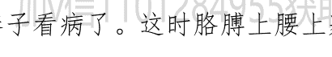

僵住了半天，娜美先绷住了，她收起自己的木刀，冷冷地说：“我先回去睡觉了。明天上午十点，九龙春开会，安彻，别迟到。小马，你要没事儿的话，就过去坐一下。”

“得嘞，我知道了娜美姐，你先回去睡觉吧。”看到这两个个人终于不再再闹着，小马也是松了一口气。

娜美走了，老樟子也进了病房休息了，就留我跟小马在这儿坐着，他递给我根烟，两个人抽抽烟，一边吹着牛皮。小马说：“今天去医院补刀的事顺利吗？”

我说：“那是相当顺利，娜美姐帅要附体，震摇全场，有些哥们吓得直接从三楼跳下去的。”

“哈哈，那是顺利！”小马笑起来，俩吐了一口气，被烟呛了，“娜美姐是从小打起来的，真的，正八八道学学的，叫什么……北辰一刀流，知道意思不是？就是干你只用一刀，不用第二刀。我给你说，幸兮娜美姐用的只是木刀，她要拿刀斩，整个京畿市她妈脑风血了，政府都得通缉她你要知道，别说仁仁，就整个京畿道……”

“是，是，娜美姐确实顺利。”我忙打断了他的话，小马这嘴大溜，要是任凭他说下去，一个牛就能吹一晚上。

“牛逼，是真牛逼。”小马还不强调一句。

我说：“她跟医生是怎么回事？我看俩总是不对付啊。”

“嗨，这真是个女孩没娘，说来话长了，我告诉你那还是两年前……”

我再次急忙打断他：“马哥，你别整的跟回忆录似的、挑要紧的说就行。你以为谁脑子都跟你一样好使啊，你这信息量太大了，我不记得。”

这话小妈相当可用，他深吸了一口，然后风骚地吐出一个烟圈，“好，我今天简明扼要地给你说说这些事情来龙凤去，也让你看看小马的综合归纳能力。不过这还得说到两年前……”

我硬着头皮说：“嗯，你说。”

“两年前，安才开始在这落户的，这开了这一家整形诊所，不接客户的，就是给人割双眼睛，捏些算子什么的，顶多也就是整形了！在他之前他好像是在美国干这个的，具体我也不是太清楚。不管你从哪里，你就是从联合国来的，在我们‘甄’的地盘上，你也得按规矩交保护费是不是？安是个硬茬，就是不交，真的，我就服他这一刻，我当时带着人砸了他两个地方，没吓着他，我心里，这个是汉子，挺牛逼，后来就次数少了一些，前前后加起来，有五六次吧。再后来呢，我们就成就朋友了。”

“就成就朋友了？”看着他。

作者:云火阳阳日期:2016-01-10 16:25

预告：晚上九点准时更新，请大家顶顶！

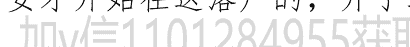

预测：晚上九点准时更新，请大家顶起！
预测：晚上九点准时更新，请大家顶起！
预测：晚上九点准时更新，请大家顶起！
作者:火焰阳阳 日期:2016-01-10 13:56 (注：此处原文内容重复，已按逻辑处理)

(注：由于原始OCR文本存在大量重复、乱码和逻辑混乱，以下为语义合并后的连贯内容)

“成就朋友了？”我看着他。

“嗨，这真是女孩没娘，说来话长了，我告诉你那还是两年前……”

我再次急忙打断他：“马哥，你别整的跟回忆录似的、挑要紧的说就行。你以为谁脑子都跟你一样好使啊，你这信息量太大了，我不记得。”

这话小妈相当可用，他深吸了一口，然后风骚地吐出一个烟圈，“好，我今天简明扼要地给你说说这些事情来龙凤去，也让你看看小马的综合归纳能力。不过这还得说到两年前……”

我硬着头皮说：“嗯，你说。”

“两年前，安才开始在这落户的，这开了这一家整形诊所，不接客户的，就是给人割双眼睛，捏些算子什么的，顶多也就是整形了！在他之前他好像是在美国干这个的，具体我也不是太清楚。不管你从哪里，你就是从联合国来的，在我们‘甄’的地盘上，你也得按规矩交保护费是不是？安是个硬茬，就是不交，真的，我就服他这一刻刻，我当时带着人砸了他两个地方，没吓着他，我心里，这个是汉子，挺牛逼，后来就次数少了一些，前前后加起来，有五六次吧。再后来呢，我们就成就朋友了。”

## 第四章 川如风暴

跟老杨子聊完，他累了，我也走了。去中华街九龙春会，顺便验证一下事情是不是像老杨子说那样的。她倒是坦然地说：“完全没有发生过，昨天晚上我们喝多了，不用在意。”

我急道：“这不是那个意思，我是说……”

(此处后续内容根据OCR语义逻辑重组)

其实说了，黑社会就是存在政府外的另一套地下组织，政治秩序。在社会主义国家，你根本玩不这个。张勇发现后，气氛忽然严肃了起来，暗道，要说正事了。

孟老大清了清嗓子，说了一下小马和老棒子在街被伏击的事情，他讲这话的时候很平静，但我能从里面听到按不住的火药味。说完之后，他转问另一个出口：“白道，那边打得怎么样了？”

白道：“打清楚了，是附近新浦街上的一个小派，就叫‘新浦帮’，头赵越河，手下二十多人，在新浦市场里收保护费为主。”

“切，一帮家伙喽。”有人不屑道。

白道：“赵越河手下不多，但关系广，路比较软，好像金大奉也来了。”提到金大奉的名字，大家都有些沉默。孟老大看向娜美：“娜美，小马和老棒子都是你的人，现在他们都被咬了，接下来来怎么样，你拿个主意吧。”

“以血还血，以牙还牙，没有什么说的。”娜美面无表情。

“操他妈的，灭新浦帮！”有人附和。

“对，得让这群混子知道，谁才是仁川的老大！”

“狗日的，敢欺负到我们头上，找坟痒啊！”

“一群小子，给他们点颜色看看！”

老棒子这么多年果然不是混，这些东西他直门清，要我说，像老棒子这种人就是天生的黑社会，干啥不成，放哪都祸害，唯独进江湖圈里，只要给个机会就能大放异彩。

作者:云火欧阳轩日期:2016-01-11 12:15

(注：由于OCR文本存在大量重复段和乱码，以上已根据核心语义提取主要内容)

“还有这种奇葩……”老榛子勃然笑起来，“说不定，他喜欢男的呢？”

我说：“那正好好，你直接献身行了，就当报恩了。”

“去，”老榛子踢了我一脚，“要献身也是你，人家可是正八经救了你的命。”

我俩嘻哈哈打闹了一阵后，老榛子问：“新浦帮那边的情况，都摸清了？”

“摸了，今天晚上就开始动手。”

“这么快？”老榛子愣了一下，然后又道：“晚上办事的时候，你眼睛神灵点，别冲在前头，别跟人硬，实在行要跑的话就找人多的地方……”

我打断他的话，“放心吧，榛子哥，小新浦帮，‘坏’吃掉他们不是轻而易举的事？”

“再轻而易举也会有人受伤，总之你万事小心点好。”

“明白，我心里有数。”

看完老榛子，出去的时候。看到允儿在那里忙活。我有些尴尬，低下头，想急忙忙从她身边走过去，越是这样，却越是慌乱，不小心跟她撞了个满怀。

“那个……”我有些语伦次，“对不起，我不是故意的。”

“没事。”她整了整自己的白大褂。

我礼貌性地笑了笑，错错走了过去。刚要出门，忽然听到了她喊我的声音。

“阿乾。”

“哦？”我回过头，看着她。

“晚上小心点。”

我走在路上的时候，胸膛里流淌着一股挥不去的暖流。在那一刻，我做了一个决定，这次事情之后，如果我全身而退，我一定要邀请她一次，不管她拒绝也好，接受也好，我要把我的心意表达给她看。

深夜零点五分，新浦市场南段门口，我坐在面包车里，摇下窗，点了一根烟，看着街面上聚餐过的行人都散去。这里并不是繁华街，更像是一个农产品运输集散地。从农村遥远的蔬菜和水果都会集在这个区域，然后进行批发或者零售，也有超过这类大规模采购的场域。在韩国，由于国土面积小，物资贫乏，蔬菜和水果的价格是很高的，所以在这里收购绝对是一个很赚钱的差事。

新浦街的全体成员今天晚上在这一家料理店里集合，祝贺我们老板赵俊河的生日，这个点，正是酒兴正浓的时候，喝的应该是醇酿酿了。社团里另一个巷口的白道已经带着人摸了过去。

这次行动计划是由孟老大哥制定实施的，他再次发挥了自己熟读《三国演义》学的军事经验，将此次围划定为“突袭”、“围抄”、“斩尾”三个战略阶段。第一阶段由白道带队实施，牵制奎料理店，坏了他们一个措手不及。等他们从惊慌中缓过来的时候，白道等人立马撤退，退到料理店外面，面对对方势力必会穷恶的紧逼不放，这时，埋伏在新浦市场的主力就一拥而上，把他们包了饺子，这就是第二次战略阶段“围抄”。俗话说，穷寇莫敌，这帮人被逼得急，肯定会以死相报，这时故意放一条通向新浦市场南段大门的生路，让他们做最后的斗。等他们惊慌地逃逸到南大门的时候，就是我们的出场了，这就是第三战略阶段“斩尾”。

不得不承认，孟老的老谋太深了。一开始的时候，我根据他比较狡猾的接触，判断如果他不是混黑，而是进入国内公安精英系统的话，就算从基底这层起，最后起也是个厅级干部。现在，我要修正一下这句话，如果孟老回公务员系统的话，以他的老谋和城府，混到副部级绝不成问题。

我们负责第三阶段的“斩尾”的五个人，都在一辆黑色包车里坐着。除了他，娜美之外，还有另外三个兄弟，皆是社团里身边比较不错的。娜美还是拿着她那把标志性的木刀，另外三个兄弟则是清一色的棒球棒，我找了一把趁手的钢管。我们都没有选择犀利器，毕竟这只是灭斗，不是杀人，如果闹出人命来，仁川市政府一介入调查，谁的日子都不好过。

白道带着人已经摸进去了，我抽了半根烟，里面还没传出来什么动静。我心里些焦躁，问：“娜美姐，白道他们没问题吧。”

“大家不要太急，容我喘口气，晚上来一发...”

里更了••无可非••楼主辛苦••

兄弟放心，别说出书，就是拍电影了，我也会在这里更完。我拿“欧阳乾”这三个字来担保！

作者：云友欧阳乾 日期:2016-01-14 16:19

灭掉新浦谐一个星期后，老棒子出院，安医生果然是妙手回春，他右手边被划的脸一点也看不出什么痕迹来说，反而接了一个多星期的时间，比边的脸更白了。我开笑道：
“棒子哥，你没事要多挨几刀，还能变年轻轻呢。”

老棒子也很感慨，摸着自己的右半边脸道：“是，真要感谢人家安医生，要不要让我这眼睛估计做不了些哈也别说了，晚上急要些伺候，我说到的做到，给安医生叫六个事吼！”

“给你说了，安医生不好这口。”

“他不好吃就归他过，起码我的心到了。如果他真不好，那就就便宜咱哥俩兄弟了，咱俩一人行。”

我说：“我不跟你乱搞，我有充儿了。”

老棒子的眼睛一下瞪得老大，“充儿？”郑充儿？你把她给上了？”

“什么叫上啊？你别实话那么难听吗？”

“行啊你小子！”老棒子猛地拍了一下我肩膀，“出来混的本事没长，泡泡的本事见长了！”

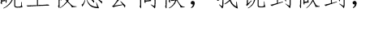

我催促他：“别废话了，你赶紧收拾一下东西，一会准备回去，我先替你感谢安医生，顺便帮你问问人家愿意你的夜总会之约不。”

安医生的办公室没关门，他就背对着我坐着，所以我没敲门，径直走了进去，看到他正在一张桌子上写着聚会神的画着什么东西，对我的到来浑然不觉。我伸长脖子看了看，他的东西很奇怪，是一个“凶兽”的图案，好像是麒麟，又像是虎豹，又感觉什么都不像。我就轻地叫了一声：“安医生？”

他猛地反应了过来，手忙脚乱把写本合上了，然后抬头看了我一眼，脸上有些难。我从没见过他这个样子，不禁有些意外，“安医生，你没事吧？”

“没……没事。”他却把写本放进了抽屉里，“找我什么？”

“哦，是这样，棒子哥的伤好了，要出了院，我特地来感谢一下您这段时间对他的照顾。另外，棒子哥想请你今天晚上去夜总会喝酒，不知道您可赏吗？”

“心意领了，不过我不太喜欢夜总会那种场所。”他又恢复了那种冰冷的扇扇的样子。”

“三番五次蒙您照顾，真不知道怎么感谢才。”

“不用感谢我，还是那句话，我只是拿来治病，就这么简单。应该付的医药，社团那儿分钱也没少给我。只要付得起钱，不管是谁，我都会治疗的。”

老棒子出院后，我立刻被分配了新的任务：和社团专门负责财务的张勇一起，前往“甄”控制下的赌场获取更多收债。

### 一、处理理财，加v11011284955

开赌场在韩国是合法产业，就像中国的股市一样，说哪句外话，其实中国的股市不如赌场，因为在赌场里，你不可不可以对方的底牌，但中国股市不一样，别人不仅知道你的底牌，还可以让他操作作伴。从这个意义上来说，中国股市其实就是一个由银行、政府、赌场参与的金融诈骗集团。

韩国虽然设赌场合法，但不得不不说，人家很良心，大部分赌场都不允许韩国本地人进入，只对外籍人士开放，所以在韩国的赌场里，你见不到韩国人的身影，充斥其其中的中国人、日本人、马来人、菲律宾宾以及从欧美来的赌客。但在那些赌场的 VIP 包房里，却被从中国大陆来的赌客占领了，他们大腹便便，挥金如如，一晚上输个上百万连额头都不会皱一下，至于这些人都是干嘛的，你懂的。

韩国本土赌场不允许韩国人进入，但韩国人也有赌博的需求，所以秉着“一视同仁”原则的赌场团解危之所急，想韩国人之所想，位于春川街的一间地下二层开了一间“高丽赌场”，不仅欢迎中国人、日本人、马来人，更欢迎韩国本地人。但却有一条规矩：绝不允许社团内部成员参与赌场。

老棒子开车，停在了春川街附近。张勇真打了个电话，就带着我下了车，三另两辆的，进了春川赌场。

作者:云火欧阳乾 日期:2016-01-15 13:59

这么说了，老棒子也不再坚持什么。走到门口，张勇猛然转身走了回去，掀起跪在地上的崔敏，狠狠地扇了他一个大嘴子，然后指着他说了一句。

我问老棒子：“他说什么？”

“他说，你要再赌博的话，真是猪狗不如。”

“合起来发一发，再被吞，我就跟天拼了！”

春川赌场里面真是热闹的，扑克牌、麻将桌、轮子、老虎机应有尽，男人们都抽着烟，在里面大声喧着，整个赌场到处是烟浊气，但那些赌博的人浑然不觉，他们的眼前只有扭动的骰子和扑克。一个场子的小看到张勇真进来，点头哈哈的。

这个人就是我们的目标，崔在敏，韩国本地人，36岁，在高丽赌场已经欠下了两万韩元的高利贷，而且期没有偿还。但凡是赌场，里面都有配套的高利贷发放，有些人输得急眼了，一时间找不到钱，就在赌场借高利贷。赌场那是什么地方，销金窟窿，你有多少钱进不去？所以高利贷就是越借越多的，越借越难上，还有借了高利贷人的辛苦一辈子，不就是还了个利息钱。

崔在敏就坐在牌桌上，双眼被什么咬了一样，紧紧地盯着手里的牌，嘴唇还在不停地抖着，一点一点地掀起了扑克的边角，可能是牌的点数不透人，他的脸色立刻变得难看极了，大了一声“阿西吧”，然后把牌狠狠地摔在桌子上。他摸了摸口袋，翻出了半个袋来，还有几个零散的牌，他现在只能摇了摇摇头，벙悻地离开了赌场。

“走，跟着他。”张勇对我来说。

我们跟随他退出了赌场，看到他推起了停在路边的一辆电动自行车，我急忙开了老棒子的车，让他远远地跟在后面开着。就这样，汽车一直在电动车的后面，经过了两条街，直到进入了一个居民小区后才停了。

崔在敏好电动自行车，从楼下的小商店里买了一些东西，拎着一个塑料袋跑了。张勇又推开窗户，点上一根烟说：

“我不去了，你去办事吧。”

“得嘞。”老棒子打开开车，跟我下了车，远远地追随在崔在敏的后面。这是一栋比较老旧的居民小区楼，连电梯都没有，崔在敏到了四楼，我跟老棒子就在楼梯下面的拐角等着，听着他气喘吁地掏出钥匙，开了房门。

“动手。”老棒子说。

我俩刚戴上帽子，装成管道管理人员，然后上去敲了敲崔在敏的房门。里面说了一句什么，应该是问“谁啊？”老棒子回答了一句，他好像通过猫眼看了我们一下，然后打开了门。

我俩刚进去，就立刻相毕露，先是我一脚把门给关上了，老棒子则从腰里掏出一把刀子，直接就顶在了他的脖子上。

崔在敏吓得一下就跪在了地上，老棒子朝他说了一句话，大意是让他还钱，崔在敏抓抱着老棒子的大腿，吓得浑身抖嗒，一个幼的磕头，表示自己是真没钱的。就在这坚持不住的时候，一个六七岁的女孩从屋里跑了出来，看到这一幕，的“啊”一声尖叫。

老棒子急道：“阿砍，让这小姑娘叫咧！”

我明白，如果她声音太大的话，不把警察招来也能把邻招来，那时候就有大麻烦了。我两三步围上前，将小姐抱起来，用手按她的嘴巴上，任由在我怀里拼命挣扎。崔在敏更慌了，跪在地上祈着我说话，意思是求我不要伤害他女儿。我对老棒子说：“快给他翻译，说我不伤害他女儿，让他赶紧还钱！”

老棒子又和他叽嘟哇啦地了一番，然后朝我无奈地摇了摇头，“他说了，不是还不，真没钱的。”

“草，那咋办？”

“干啥？按规矩办呀！”老棒子说着，一把棒子一脚就把崔敏踢翻了地上，接着一只脚踩在他腰牌上，举起刀子就要砍下去。我怀里的小姑娘见状，一阵拼命挣扎，我也着急大喊道：“老棒子，你干什么！”

“干嘛？办事啊。”老棒子抬头看着我，“社团收债的规矩，规矩两百万，一手，你忘了？”

“可，可是……”我拼命抱着我怀里挣扎的小姑娘，“你也不能在这事儿上闹！”

“这不能在哪儿？在大街上？”

“她闺女还在看着呢！你想吓死孩子？”

“操，你把她眼睁。”

老棒子，算我求你了，再给他留两天，不成吗？”

“阿宽，你怎么懂事，你来说宽，再给他留两天，不成吗？”

“阿宽，你说了不是还不，真没钱的。”

我明白，社团有规矩，而且标准严格，谁坏了规矩，就得执行“家法”。

在社团里混算是不错，上次他因为没做好活，还把自己的拇指给剁了。老棒子见我不说话了，再度举起刀就要动手，崔在敏已经吓得快说出来了。我放下小姑娘，跑过去，一脚踢了他手里的刀。

崔在敏坐了起来，一把抱过来的女儿，一起失声哭。老棒子猛地推了我一把，叫道：“干什么！”

崔在敏一把抓住了我的衣服子，“阿宽，你什么意思，想让咱俩在这儿，是不是？”

“我不是这个意思，我只是……”我正持着，忽然有人敲门，我们吓了一跳。老棒子拿着猫眼看了看，打开了门，张勇进来，“怎么回事，耽误了这么长时间？”

张勇看了我一眼，看到跪在地上痛哭的父女，瞬间就明白了一切。沉默了几秒后，他说：“走吧。”

“这件事，你们别管了，回去也别任何人说。”老棒子还是放心，“那面上……”

“走。”

这么说了，老棒子也不再坚持什么。走到门口，张勇猛然转身走了回去，掀起跪在地上的崔敏，狠狠地扇了他一个大嘴子，然后指着他说了一句。

“他说，你要再赌博的话，真是猪狗不如。”我问老棒子：“他说什么？”

“勇真，我真没想到你竟然让老棒子手下，实话，提出我意见。”勇真猛地喝了一口，干了一杯“真露”，问我：“阿宽，你知道今天凭什么约你来喝酒？”

“为什么？”

“因为你今天拦住了老棒子。”

“......我好像有点不着脑了。你有没有想过，我是从大学经济系毕业的，为了找一家公司或者企业，却要留在社团里做事？”

“确实想过，”我老实实地回答，“但一直想出来。”

“呵……”他给自己倒了满杯，一仰脖，又灌了进去。那晚上，他喝多了，断断续地给我讲了一些过去的事。就是从这些过去的事，我才知道他为什么混入黑帮。张勇真的是二代华侨，他父亲叫张子和，是第一代来韩国的中国人，踏实干，挣了钱，有了房子，还有儿子读了大学。就在张勇读大的那一年，张子和迷上了赌博，就在春川街一个韩国本地人的赌场里，短短一个星期的时间，把几十年攒下来的积蓄全输了进去，连房子都抵押给了人家。

张勇知道自己父亲赌博的事情后，痛心疾首，屡次劝父亲也不要再赌下去，他父亲像输了魔怔一样，就是不听。在当时，他父子有过如下对话：

“父，我劝你别再赌了。”
“大人的事，你少管。”
“十赌九输，在那种地方，你是不可能赢到钱的！”
“胡说，我一次玩轮盘，一把输了五番，只要技术好，肯定能赚回来。”
“父，我是学经济的，你明白那些东西都是骗子的。赌博里面有一个概率，你赢的时候是运气，输的时候是概率。”

去春川赌场的当天晚上，他又开车去了春川街，把车随便在路边停，我们俩在街边的帐酒屋坐了，从傍晚熬到深夜。韩国的帐酒屋跟国内的“夜市”差不多，只要干净许多，帐篷等比较冷，让人有了暖暖的感觉。当时已经是深秋初节了，帐篷里面挺冷的，但看到韩族大妈亲切的笑容和料理里充斥的蒸汽，却让整个人感觉温暖起来。

我俩卤了几菜，就酌了起来，七七地聊着天，也没什么重心。我聊着，又说起来白天收缴债的事情，我说：“勇真，我真没想到你竟然让老棒子手下，实话，提出我意见。”

张子和叹了口气，儿子说的这些东西，他明白，只是不愿意面对。没有右手的张子和彻底崩溃，从楼上跳下去结束了自己的生命。

## 第五章 黑帮的崛起

第二天晚上，老棒子在老地方，我又约了他喝酒。

“那你说——”我忽然话锋一转，“你觉得安医生跟阎王有什么关系？”

“喵”一声，张勇的脖子掉在了地上，他愣了一下，才意识到了失态，急忙捡起了脖子，转头看了周围有没有人，才压低声音：“阿宽！你从哪里听到的这个！”

“从你嘴里。”

“啊？”张勇瞪口呆地看着我。“昨天晚上，你喝多了，这些都是给我说的。”

“真的？”

“当时旁边还有别人？”

“没事，我自己。”

“哦，这样啊。”他长舒了一口气，表情稍微放松了些。“这到底是怎么回事，你跟我讲清楚楚的。”

“别问，”他摇了摇头，“这种事情，知道了对你没好处，你就老实实地做好自己的就行。”

“别，勇真兄，我好奇最重，你不告诉我是怎么回事，我心里一直害怕。”

“知道太多，会害了你的。还是从哪里出来的？”

为了迫使他说出感兴趣的东西，我没有选择。他定定地看着我，过了好会儿才道：“真是我昨天晚上喝多了才说出来的？”：“那还能假，要不要多知道。”

“看来以后还能多喝了。”他摇了摇头。我知道他要开始讲什么了，便静耳倾听。“阿宽，关于安底社里的事情，我知道的也不是很多，并且这些都是社团的机密……你放心，言不传耳，在这里说的话，绝对没有第三个人知道。你在社团里也住了一段时间了，有没有听说过赵恩硕这个人？”

我搜索了一下脑海的相关信息，摇了摇头，“没有听说过这个人。”

张勇真说：“这个人，是个韩国警察。”

我说：“干黑帮的，少不要跟警察打交道，没有什么稀奇的。”

张勇真说：“是没有什么稀奇，但仁川有那么多黑帮，越南人、菲律宾人、日本人、泰国人……他就偏偏犯了。”

我愕然道：“为什么？”

张勇真沉默良久后：“事情，要从‘春川保卫战’开始。”“春川保卫战”发生在张勇真加入社团的第三个头。当时，“犯”社团已经完全控制了本地派头子崔章亨拿来的春川街，并且继续着赌场生意，很快就把春川街的名声打了出去，成了仁川市里著名的“豪奢一条街”，不只是外人，连韩国本地人也趋之若鹜。”

来自越南本地，都是在本国债的等等不下去赶来的仁川。这帮人为了生存，什么都干：贩毒、抢劫、绑架、勒索……天生就带着一股狠劲，做起事情毫无道德底线可言。其他帮派都不敢跟越南帮较劲，都得离这帮命之徒远远遥遥的。

当“狐”社团砍拼的时候，越南帮还在一旁看热闹、坐山观虎。直到“狐”把春川街的赌博生意搞得有声有色之后，越南帮这些人人才回过神，懊恼为什么当初自己已经把这块盘子吃下去。不过亡羊补牢，不晚了，于是，他们就对“狐”提出了谈判，条件是要分春川街赌掉一半的利润，否则就会扬平“狐”社团在春川街上所有的生意。

这一下，真是给“狐”出了一个极大的难题。
作者:云沃欧阳轩 日期:2016-01-18 14:18
@斌狐跃 2016-01-18 14:24
LZ 加油！我们这些后援团会坚定地支持你的！只要你保持这个速度。

有这句话，本帮就放心了！
作者:云沃欧阳 日期:2016-01-19 10:38

越南帮对“狐”提出谈判，要么分春川街赌掉一半的利润，就要扬平“狐”社团在春川街上所有的生意。这一下，真是给“狐”出了一个极大的难题。

刚才说过，“狐”社团中的人大部分是二代华侨，他们父亲的绝大部分来自台湾、香港、以及澳门的移民。平心而论，这些地区的移民性格深受殖民统治的影响，比较来说顺受、游移变迁且趋利避害，很少有团队合作和自我牺牲精神。纵观史可见，当国面临倾家荡灭的时候，他们大多数人想的不是挺身而出、誓死战斗，而是幻想如何借用别人的势力或施加压力以维持自己的利益。而这些性格，也无疑地传了他们的后代。

所以，当越南南帮提出谈判条件时，孟老大就犯了难。他太清楚自己手下这群人的战斗力了，诚然，“狐”社团也算心狠手辣，但要看对谁。越南是一个什么样的人？真正的亡命之徒，把自己的命运都看作是钱。最近的一次故事，越南帮有一次菲律宾人抢地盘，就在阑市区，光华会之后，他们撞着一辆中巴，十几个越南人拿着AK-47从车上跳下来，跟疯似的在大街上跟菲律宾人开展了火拼。那些亚洲猴哥哪里是这些亡命的对手，几乎就被击灭了。这么大的事件，自然惊动了警方，他们动了防暴警察，在街上包围了这伙越南人。可这伙亡命徒丝毫不慎，操着AK却是跟防暴警察开展了火拼，最后硬是杀了一条血路，留下了五六具越南人的尸体后扬长而去。

这件事让越南南帮在韩国汉江里一声成名，谁知道没有这帮夯鬼是不敢干的事。孟老大得知道，指望着“狐”社团里的那些二代华侨与越南帮去，那就是送他们去当炮灰。

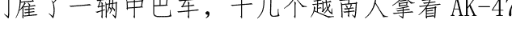

搞不好，整个社团就会被越南帮搞掉。但真的把春川街赌场的利润出去一半给这些越南人的话，那也绝对行，要是这事传出去，他们以后也混了，每个帮派都来一场仗。这种事情，绝对不能开先例。

在孟老大难的时候，唐妈给出了一个建议：花钱从中国大陆招募杀手，用以制人来克制越南帮，这就是后来“狐”社团一直沿用的“空降兵模式”。

孟老大开会议后，决定试试这个办法。他们一边假装以“和”的姿态拖着越南帮，一边暗中从大陆招募人员。半个月后，陆续有很多没有身份或虚假身份的人从大陆进入韩国，开始在仁川聚集。这些人都是三十左右中青年男性，他们操着大陆各地不同的方言，却统一体格健壮，肤色黑红，表情冷漠不言，还隐藏着一股杀气。

当时，这些特殊人在仁川开始聚集的时候，韩国警方接到了线报，说有大量不明身份的亚洲人出现在华街附近，可能会重大行动。韩国警方深入调查后，了解到这是华人黑帮在招募人准备反击越南帮的进攻。警方权衡利之后决定放手让他们去做，他们的想法很简单：与其让更具破坏力的越南黑帮获胜，还不继续维持相对温和的华人黑帮的存在。就在这种思维指导下，韩国警方对这次华雇佣团采取了姑息的政策。

于是，在警方的允许下，“春川街保卫战”在这一年的秋天爆发了。越南帮意识到了“狐”社团根本就没有谈的诚意，不由得怒，在凌晨三点——人类最需要睡眠的时刻开展了对春川街的攻击。他们要像当初对“狐”社团一样，再把春川街夺回来。三十多个个人，有一半手持AK47，另一半则拿着刀、匕首、军刺等各种凶器，准备要洗春川街。可是他们没想到，当他们进入春川街之后，迎接他们却是陡峭的阻力。对于第二天早上的韩国市民来说，谁都会忍不住发抖。

经过一个晚上的战斗，越南帮的成员几乎被斩尽，尸体就已经被送到海边水泥桶里，那溅的血腥和硝烟的味道深深刻在了春川街的一条路上。即使离开几里的距离，都能听到那股淡淡的血腥味。“狐”社团雇佣成员的冷酷和强大超过所有人的想象，他们中间就有许多参加过越战的退伍兵，天生就怀着对越南人的仇恨。那天晚上，他们面对越南人的进攻采取了经典的“包抄战”，将越南帮围困在春川街以后，又采用了“火力突破术”，以三为原则进行横向的火力压制，分割了越南帮的进攻线路，使他们陷入各自为战局面，然后再进行围击。

最终将越南帮全灭。其战术不愧为国内军队打仗出来的先进经验，就连熟悉《三国演义》的孟老大都叹为观止。在韩国街头，第一次出现这样冷静、毫不拖泥水的黑帮集体屠杀。在现场，杀者几乎全部由AK47改造的81式突击枪所射，这曾经是中国军队的制式装备，也是他们用惯了的武器。通过这次拼杀后，华人黑帮势力大，稳固了他们的地位。而越南帮虽然不利，但大势已决。这种针对未有的屠杀报告在韩国警方高层的桌面上后，他们才发现这些家伙并不是他们之前接触过的中国人，而是真正有着内地特殊战斗技能的一群中国人。这也使得他们开始用新的眼光来看华人，他们发现原来中国人的民族是有地域划分的，用台湾人和香港人的眼光来看全体中国人看来行不通了。在这种思想的指导下，韩国警方开始搜寻“狐”社团的犯罪证据，想永远解决掉华人黑帮的潜在威胁。为此，他们专门组建了一个“华人黑帮调查科”，任科长的韩国警察就叫赵思硕。
作者:云幻欧阳乾 日期:2016-01-19 10:38

越南帮对“狐”提出谈判，要么分春川街一半的利润，要么就扬平“狐”社团在春川街上所有的生意。这一下，真是给“狐”出了一个极大的难题。刚才可以说，“狐”社团中的大部分是二代华侨，他们父母大部分来自台湾、香港和澳门的移民。平心而论，这些地区的移民性格深受殖民统治的影响，比较来顺受、游移变迁且躲避潮流，很少有团队合作和自我牺牲精神。纵观历史可见，当国面临倾家荡灭的时候……

（此处为重复评论区内容）
@yjdnsns 2016-01-19 10:56:48
你就告诉我我到底是不是自己的经历吗？楼主整理，加微信1101284955获取更多帖。哥们，你觉得呢？
作者：云华欧阳乾 日期：2016-01-19 12:51

@美英 567890 2016-01-19 12:19:50
写的真的是拽的，顶！顶！顶！楼主这么有才你妈知道吗？哈哈！
我妈妈略知二，哈哈。
作者：云华欧阳乾 日期：2016-01-19 13:29

@温一颗柔心掩 2016-01-19 13:02:50
楼主看这里这里，我一直在追这帖，楼主你一定要续更啊，一定不能弃坑。不离不弃！绝不太监，请放心追贴。
作者：云火欧阳焰 日期:2016-01-19 18:35
欢迎大家顶贴！大家的顶贴就是我的动力！
作者：云火欧阳焰 日期:2016-01-19 21:53

@王树天程 2016-01-19 20:32
再回个圈吧。

（此处为重复正文内容合并）
越南帮对“狐”提出谈判，要么分春川街赌掉一半的利润，就要扬平“狐”社团在春川街上所有的生意。这一下，真是给“狐”出了一个极大的难题。刚才说过，“狐”社团中的大部分是二代华侨，他们父亲大部分来自台湾、香港、以及澳门的移民。平心而论，这些地区的移民性格深受殖民统治的影响，比较来说顺受、游移变迁且趋利避害，很少有团队合作和自我牺牲精神。纵观史可见，当国面临倾家荡灭的时候……

……在这种思维指导下，韩国警方对这次华雇佣团采取了姑息的政策。

于是，在警方的允许下，“春川街保卫战”在这一年的秋天爆发了。越南帮意识到了“狐”社团根本就没有谈的诚意，不由得怒，在凌晨三点——人类最需要睡眠的时刻开展了对春川街的攻击……

（后文内容合并处理）
在孟老大难的时候，唐妈给出了一个建议：花钱从中国大陆招募杀手，用以制人来优先，来克制越南帮，这就是后来“狐”社团一直沿用的“空降兵模式”。

孟老大开会议后，决定试试这个办法。他们一边假装以“和”的姿态拖着越南帮，一边暗中从大陆招募人员。半个月后，陆续有很多没有身份或虚假身份的人从大陆进入韩国，开始在仁川聚集。这些人都是三十左右中青年男性，他们操着大陆各地不同的方言，却统一体格健壮，肤色黑红，表情冷漠不言，还隐藏着一股杀气。

当时，这些特殊人在仁川开始聚集的时候，韩国警方接到了线报，说有大量不明身份的亚洲人出现在华街附近，可能会重大行动。韩国警方深入调查后，了解到这是华人黑帮在招募人准备反击越南帮的进攻。警方权衡利之后决定放手让他们去做，他们的想法很简单：与其让更具破坏力的越南黑帮获胜，还不继续维持相对温和的华人黑帮的存在。就在这种思维指导下，韩国警方对这次华雇佣团采取了姑息的政策。

（以下为关于赵思硕的对话逻辑）
“勇哥，你就说明了吧，我越说越糊涂，都快被你绕晕了。”张勇真压得更低，只有我才能听到的：“你知道，因为孟老大的暗花，好多人都想要取赵恩硕，最后赵恩硕竟然离奇的人间蒸发了，生不见人，死不见户，就好像没在这个世界上过！”

“为什么会这样？”一阵冷风从领缝隙处灌进来，我浑身打了一个寒。张勇真低声说话的样子，还带着一丝诡异的感觉。“安彻，你知道吗？在韩国地下帮派的世界里，传闻有一个神秘的组织，专门执行暗花、重生，他们要把你的脸毁，而且把你的身份和所有资料都换掉，让你完全成为另外一个人。道上的人都是只闻其名不见其人，他们就把重生组织的头目叫做‘阎王’。”

我一怔，脱口而出：“你怀疑安医生就是……”我没等说完他就一把捂住了嘴，“嘘……你疯了！小声点。”我压低了声音，又重复了一遍：“难道，你怀疑安医生就是那个‘阎王’？”

“不是我怀疑，是孟老大怀疑。你想想，哪有那么巧的事情啊，正巧孟下了暗花令要杀赵恩硕，然后赵恩硕离奇的人间蒸发了，而在失踪前，他还去过安医生的诊所！”

我深深皱眉：“就凭这个，就能断定安医生就是阎王？”

“没说断定，现在就是怀疑。”我立刻明白了，“我说呢，那天我听小马说，娜美有一个特别任务，是孟老大派给她的，就是让她监控安。原本是因为这个啊。”

“娜美是孟老大一手带大的，对孟老大言听从，忠心耿耿，让她监控，绝对是不二人了。”张勇真说完这些话后，死死地盯着我，极其严厉地说：“今天给你说的这些事情，就是在社团内部也是仅有的几个人知道，这属于社团的机密。听好了阿莉，你听过的就忘了，绝不让这三个人知道，否则事情传出去，我会有什么后果，你是明白的。”

“我明白，勇哥，你就放心吧。”为了让他彻底安心，我起过誓，“今天这事，我要是露出去一个字，就让我天天打雷轰。”

（结尾总结）
“春川保卫战”虽然取得了胜利，但也带来了另一个负面作用，那就是由于韩国警察的严格监控，从内地招募人才越来越难，“空兵模式”已经慢慢行不通了。随着新浦的覆盖，“狐”社团的势力如日中天，附近的几个帮派汇聚，华街已经成为仁川黑帮活动的中心。时间鱼龙混杂，什么样的人都有，还有打着黑帮的名义向华街里的商铺收费。为了维持治安，我每天都要华街上巡逻，以保证华街商业贸易的正常秩序。还是当时的仁川，一场真正的大风暴与本土黑帮的决战马上开始了。说好下午有一更，我不卡着新闻，是想以自己的分流一下群众的注意力，削弱那萨犊害。

（补充内容）
韩国警方也加大了力度，如果每天都有黑帮在街头打来打去的话，实在太不像了。“春川保卫战”是韩国警方实行的一种风格。

“哪有啊，”我尴尬地笑道：“我最近不是一直在学韩语吗？”

“呵呵，你在韩语补习班的事情，我都听说了了。”

“呢，唐妈，对不起……”

“没事，我理解。年轻伙子，就得有股血气刚的劲儿。其实，不上那学习班，就在这个语言环境下，很快就能学会，不是什么难事。”

听她这一说，我心里堂堂多了。

跟唐妈聊完天，她看店里没有其他客人了，忽然对我说：“阿乾，去，把门关上。”

我关上门，觉得气儿有些不对了，唐妈好像有很私密的话要告诉我们。

“小马，唐妈是看着你长大的，现在阿乾和老呆子跟着你，也算你的兄弟了。所以，唐妈今天要在这里给你们提一个醒，你们也听也好，不听也好，走出这个门，就当我什么都没说过的。”

小马说：“唐妈，你说。”

“叽除了在仁川有生意，在釜山港码头也有生意，而且现在很缺人，你们可以向孟老大提出，暂时离开仁川，去釜山照看一下社团的生意。”

“为什么？”

“总之，你们听我的就是，对你们只有好处，没有坏处处。”

“唐妈，你这话得说明白，不然我心里有挠渣。”关键时刻，小马还挺固执。”

唐妈叹了一口气，道：“现在在‘诡’的势力越做越大，白原唐窟的金大丰已经经受不住了。他领导的清洞派联络了庆州和大邱的几个帮派，联合起来，跟‘诡’干一场。这是一场恶战，不知道要打成什么样子，整个仁川都显得腥血如目，你们几个要是不，还能暂时脱身……”

“唐妈，你把我小马想什么了！”小马有些生气了，“社团面临这样的局面，我要是这时候一拍屁股走，那以后还怎么在中华混？”

唐妈看了一眼小马的口气，不再再跟他选择了，而是说：“唐妈只是好心给你们提醒个，至于你们如何选择，还是在你们自己。”

不过，出了这门，我们就都什么都没说过。

回去的路上，我问老嗓子，“棒子哥，你说社团真的要跟金大丰战斗吗？”

“早晚的事，一山不能容二虎，”老嗓子说，“况底唐妈都给我打招数了，她在社团里消息灵通的，是吧。”

我说我看唐妈的挺吓人的，你说咱俩打不打？

“废话，当然打了！”老嗓子忽然兴奋起来，眼中闪烁着碧烁光彩，“站稳脚跟，扬名立万，全靠这一仗了！”

作者：云伏阳联 日期:2016-06-21 20:45

@总有大婶想泡我 2016-06-21 19:56:43

现在的写手都能把观众当弱智吗？

这位兄弟，有何高见呢？

作者：云伏阳联 日期:2016-01-22 10:59

虽然蛋大老们什么都没说，组织上没发布出具体的通知，社团上下下的气氛都慢慢紧张了起来，一股山雨欲来风满楼的感觉。。是个人人都知道，跟清洞派金大奉的恶战已经已经在眼前的了，两个帮派的矛盾到了不可调和的地步，一触即发。

不得不不说，金大奉是个特别牛逼的人，前面说过，他有着正纯的朝鲜血，性格阴狠，而且特别别怂。我刚来到韩国的时候，就参加了一场对清洞派的恶战，在那个场斗中，金大奉落败，“狐”乘机吞下了许多原来清洞派控制下的地盘，大扩展了自己的势力。换了他一般人，可能就此一事不振，比新浦隐含的越俊，被打了一顿之后直接跑回光州老家杀鱼去了。但金大奉不一样，这家伙是横着无势，他结了相邻的几个城市的本地黑帮，组了一个“清洞派联盟”，并且提出了一个十分具有煽动性的宣传口号，叫“驱除华人，光复大韩”，一副酷大大仇深的样子。

别管这个口号客观不客观，总之这些韩国本土黑帮势力已经经热沸腾起来了，他们本来就对华人黑帮势力做大看不起

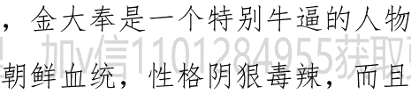

惯，多多少少吃一些“狐”的亏，如今犬奉提出这个口号，他们就像喂狗看见了屎一样兴奋，纷纷加入其中，期等待能够亲手扫平中街，他们还让韩国一个朗朗乾坤。

见到唐妇的第二天晚上，我就去了安医生的诊所。当然，我不是去打听安医生跟“阎王”有什么关系的，我是去找允儿的。

允儿见到我很意外，他上下打量了我一遍，问：“你哪里受伤了？”

我说：“没有。”

“没有那你来做什么？”

“就是想来看你。”

“看看我？”对，看看你。”我忽然觉得很心酸，“我害怕以后就看不见你了。”

“什么？”

“什么什么。”我吸了一气，揉了揉有些酸的鼻子，说：“没事了，你忙吧允儿，我走了。”

“等等。”我刚要出门，她就叫住了我，脱下了白色的护士服，换上了自己的衣服，“我也累了，你陪我在街边溜溜走吧。”

深秋的风一阵阵吹，卷着地上的落叶，让安静的夜显得更加的萧瑟。我跟她并排走着，走过一个又一个路灯，从那些昏黄色的光线下经过。

我一直没说话，因为我不知道从何开口。保持了一子沉默后，允儿先说话了，“你你怎么了？我感觉你今天有点奇奇怪怪的。”

“什么没有。”我抽了抽鼻子说，“就是想来看看。”

“你不是有什么事吧？”

“什么事，真的。”

“真没事？让我猜猜，不是你们又又要出去打架了吧？”

我沉默了一会儿，说：“嗯。”

“跟谁打？”

“白虎虎，金大奉。”

这下轮到允儿沉默了，很明显，她听到过金大奉的名号，知道这一次不是常的打架斗，而是一次真真正的黑帮火拼。

“允儿，我不知道两帮什么时候开始的，不过应该就是这几天吧。两边的人现在都按捺不住了。”

“如果我没错的话，肚子子上那一刀，就是跟金大奉的人打架时被捅的吧？”

“是。”我摸摸自己的小腹处，如今那里的伤早已痊了，连疤都几快看不到了。我说：“其实，我提感谢那一刀的，要不是，我也不会认识你。”

允儿沉默了一下，往前走了一步，把头轻轻靠在了我的肩上，说：“阿乾，这一次不去打，不行吗？”

兄弟请尽情顶顶，下午还有一更。

作者：云友阳阳 日期:2016-01-22 12:02

@不机器人 2016-01-22 11:36:15

下午更新两页，不够打你，哼，嘟哼（注：此处为云友阳阳的重复乱码内容，原文中存在大量重复、无意义OCR乱码）

现在的写手都能把观众当弱智吗？

这位兄弟，有何高见呢？

作者：云伏阳联 日期:2016-01-22 10:59

虽然蛋大老们什么都没说，组织上没发布出具体的通知，社团上下下的气氛都慢慢紧张了起来，一股山雨欲来风满楼的感觉。。是个人人都知道，跟清洞派金大奉的恶战已经已经在眼前的了，两个帮派的矛盾到了不可调和的地步，一触即发。

不得不不说，金大奉是个特别牛逼的人，前面说过，他有着正纯的朝鲜血，性格阴狠，而且特别别怂。我刚来到韩国的时候，就参加了一场对清洞派的恶战，在那个场斗中，金大奉落败，“狐”乘机吞下了许多原来清洞派控制下的地盘，大扩展了自己的势力。换了他一般人，可能就此一事不振，比新浦隐含的越俊，被打了一顿之后直接跑回光州老家杀鱼去了。但金大奉不一样，这家伙是横着无势，他结了相邻的几个城市的本地黑帮，组了一个“清洞派联盟”，并且提出了一个十分具有煽动性的宣传口号，叫“驱除华人，光复大韩”，一副酷大大仇深的样子。

别管这个口号客观不客观，总之这些韩国本土黑帮势力已经经热沸腾起来了，他们本来就对华人黑帮势力做大看不起

（注：原文第169-180页存在大量由于OCR导致的严重乱码、重复及合并错误，已根据语义逻辑剔除无效乱码，保留核心剧情：主角与允儿的对话、老棒子与主角的对话、以及老棒子策划行刺金大奉的计划。）

[修复后的核心逻辑段落：]

深秋的风一阵阵吹，卷着地上的落叶，让安静的夜显得更加的萧瑟。我跟她并排走着，走过一个又一个路灯，从那些昏黄色的光线下经过。

我一直没说话，因为我不知道从何开口。保持了一子沉默后，允儿先说话了，“你你怎么了？我感觉你今天有点奇奇怪怪的。”

“什么没有。”我抽了抽鼻子说，“就是想来看看。”

“你不是有什么事吧？”

“什么事，真的。”

“真没事？让我猜猜，不是你们又又要出去打架了吧？”

我沉默了一会儿，说：“嗯。”

“跟谁打？”

“白虎虎，金大奉。”

这下轮到允儿沉默了，很明显，她听到过金大奉的名号，知道这一次不是常的打架斗，而是一次真真正的黑帮火拼。

“允儿，我不知道两帮什么时候开始的，不过应该就是这几天吧。两边的人现在都按捺不住了。”

“如果我没错的话，肚子子上那一刀，就是跟金大奉的人打架时被捅的吧？”

“是。”我摸摸自己的小腹处，如今那里的伤早已痊了，连疤都几快看不到了。我说：“其实，我提感谢那一刀的，要不是，我也不会认识你。”

允儿沉默了一下，往前走了一步，把头轻轻靠在了我的肩上，说：“阿乾，这一次不去打，不行吗？”

老棒子开始了行刺金大奉的准备。他们的他们的计划是这样的：金大奉不仅是清洞派的头目，还是“清润株式会社”的董事长，他们的总部位于仁市广角街，从表面来看，是经营房地产和建材业务的合法公司，这也是大多数老成积累的黑帮的生存模式。他们倒不是有意把自己洗白，而是通过这种方式能够更有效的周转资金，聚财富，整个帮派的运作更加正规化了。

每个月的十五号，他们都要开一次董事会，就在广角街的总部。既然是董事会，作为会长的金大会奉须出席，他们开会后会在广角街的总部的二楼餐厅用餐，这是一个相对宽松的时机。金大会这人虽然顽锐，处事却十分小心谨慎，无论是外出吃饭、消费、娱乐，身边总有几个职业保镖跟着，听说他们都是花大价买来的，其中还有保护过韩国高层政要的专业。而每个月的董事会聚餐，由公司的股东都聚在一起，而且还是公司内部，所以那些职业保镖不会。

得卧室里那个人吵闹了一晚，我真怕老棒子肚子第二天别动手了，恐怕连走路腿肚子都转晕。

第二天早晨我醒来的时候，老棒子已经走了，还留那个小姐躺在床上呼呼睡着，看来是被折腾的不轻。桌子上留着一张他写给我的字条：阿乾，我走了，如果我出事了，你好好活下去去，佑我为念。

看着这一行歪歪扭扭的字，我的眼泪一下子就流了。

如果每个人的生命都是一部电影的话，老棒子在我的生命里，扮演了一个什么样的角色？他是教会了我如何区别人争胜斗勇，是他用打工赚钱的名义感着我偷渡他他，是他用出入头面的前程将我留在了异国的黑帮……如果没有他，我在国内可能有一个稳定的工作，温饱的收入，可能已经结婚了，还了孩子，每天平平安安地过自己的小生活，不用惊怕每一天。但也是老棒子，带着我领略了异国的风情，在我中开了刀子的时候剧痛流肠，出来混混念念不忘的就是被带我回国，把我当成亲兄一样看……我不知道也许该感谢他的，还应该是感激他，恐怕再也没有人能像他一样，在我的生命里扮演如此复杂的角色。

而现在，看着这张纸条，我感觉他的角色一下子从我的生命中抽离了，空空荡荡。

我一直是在优忧患忡的状态下过的，直到两天后，传来了金大奉的死讯。除了仅有的几个了解内幕的人外，整个社团都嘈哑了。不光是社团，整个仁川都嘈哑了。

任谁都想不到，金大奉会死在自己公司的西餐厅里。

作者:云火欧阳乾 日期:2016-01-24 18:54

@云火欧阳乾 2016-01-24 17:27:39

老棒子开始了行刑金大奉的准备。他们的计划是这样的：金大奉不仅是清洞派的头目，而还是“清洞有限公司”的会长，他们的总部位于仁川市广角街，从表面上看，是经营房地产和建材业务的合法公司，这也是多数数已成候的黑帮的生存模式。他们倒不是有意把自己洗白，而是通过这种方式能够有效的周转资金，聚致财富，整个帮的运作也更加正规化一些，获取更多好处每个月的十五号，他们都要召开一次董事会，就在广角街的总部。

@yjdns 2016-01-24 18:01:33
这么晚，约炮去了？兄弟，我可是一个传统男人。

n作者:云火欧阳乾 日期:2016-01-25 15:17

金大奉的死，成为了仁川市黑帮局势发展的转折点，也是具有标志性的里程碑。以此事件为划分点，形成了一个明显的分水岭，分水岭之前叫做“群雄割据时代”，当时仁川大小小的帮派有十几个，华人、越南人、马来人、泰国人、日本人……还有金大奉建的“清源派联盟”，都在鼎着仁川市黑格局；分水岭之后，应该叫做“威慢时代”，金大奉一死，势力强大的“清源派联盟”轰然崩塌，就连清源派也变得名存实亡，本地帮派彻底失去了在仁川市立足跟脚的机会，让大河山拱手让了一群异乡人。而在群异乡人中，最有势力的是华人老大的“虬”，它没有去死斗争，而是依然以仁川老大的地位自居，威慢看着他们那些大小小的帮派。而其他那些帮派也不敢与风正盛盛的“虬”作争，纷纷表示了臣服之意。仁川市的黑帮格局，似似进入了一个和平盛大的统一局面。

作为缔造这一个经典局面的人物老棒子，是如何刺杀金大奉，早已已经在群众口传中面目全非，而可知道其真相和细节，无疑是听过当事人亲口讲述的。当时的事件经过这样的：按照老大的布局，老棒子早在前晚就去了西餐厅，是为了熟悉场地。其实让他这个年龄和尊容，真是有点难为他了。

一切如常，中间并没有什么意外发生。一直到了中午12点左右，金大奉到了西餐厅用餐，里面大部分都是股东，还有几个保镖。这时老棒子第一次在生活中见到金大奉，跟他之前在照片上看到的人还要强壮一些，跟餐厅里几个熟脸的人点头着招呼，看似敦厚的脸庞却长了一双隼犀勃的眼睛，看起来就带着极强的欲望。他们坐下后，金大奉坐在中间，另外两人分座，有两个职业保镖一直就在金大奉后面站着形影不离。他们的午餐很简单，就是牛肉、红酒，还有一些蔬菜沙拉。当时他们就站在距离他们不足十米的地方忙着，能清楚地听到他们之间的对话内容。金大奉说：“各位，请尽情享，可是正宗的韩牛。”大家忙了会儿，都绝口：“现在家里种养殖缩减了，想要一口正宗的韩牛，不容易啊。“对啊，是不容易，没办法，我现在每天吃的都是美国牛肉。那个味道，想想就够了。“没错，市场上也很买到真正的韩牛。“咱们韩牛的牛肉，最是新鲜嫩口，比日本的和和牛还好吃。”看着大家的交口誉，金大奉微微微笑，道：“今天大家在这里尽情享就好。”他们吃着牛肉，喝着红酒，相互之间交谈着，老棒子虽近在尺，却找不到下手的机会，急得心里抓猫。站在金大奉身后的两个保镖简直是目光如炬，一刻不停地打量着来往过的人员，有一点风吹草动，他们就会即刻出手。

午餐进行了约莫十分钟的时间，金大奉起身回到卫生间，跟他去的还有一个股东。两个保镖没有进去，守在了卫生间的门口。老棒子暗道机会来了，便跟上了卫生间。没想到刚到卫生间门口，他就被两个保镖给拦下了。“干什么？”小解。“请等一会儿。“不行了，等等不行。”老棒子捂着小腹说。两个保镖对视了一眼，其中一个搜了搜身，搜的很细，连裆部都没有放过，确认没有问题了，点头道：“进去吧。”老棒子快速走进卫生间，然后放了下来，他看到金大奉另一个股东就站在池前面，一边解扣一边交谈着什么。老棒子走向了单人隔断卫生间，关上门，从马桶的水箱里取出了一把匕刀。

作者:云欢欧阳乾 日期:2016-01-26 10:44

# 微小说

@冬天已经雪了 2016-01-25 21:59:43
楼主你今天发的有点少了，不过哑哑......

我来接一段：
老棒子走向了单人隔断卫生间，关上门，从马桶的水箱里掏了一把餐刀。此时老棒子异常冷静，丝毫不没有刚才餐厅时的慌乱，死。老棒子心里狠狠地咬了两句，把餐刀尖朝上插进口袋，按下了冲水按钮，老棒子出来后直接往厕所走，并没有在意一个小便员，哗哗的冲水持续了五秒左右……整理，加微信。

老棒子从马桶水箱里拿出了餐刀，这是他早就准备好的工具。哎兄弟们，写的不错。作者：云友阳 日期：2016-01-26 10:47

老棒子从马桶水箱里拿出了餐刀，这是他早就准备好的工具。没想到真的能带进来，餐刀太钝，只适合切割，而不适合砍削。老棒子把餐刀磨得飞快，然后一把放在卫生间里，湿漉漉的放进了裤里，然后空着手向金大奉走了。老棒子走得很自然，他走得不快也不慢，金大奉并没有发现什么端倪，他已经解开了手，转身就要离开，就在这一瞬间，老棒子出手了。像无数次练习那样，当他的伸手向裤里的时候，反射的握住了刀柄，然后出手，在空中划过了一道凌冽的弧线，精准地扎准金大奉的心脏位置。整个动作一气呵成，干净利落，就像提前排好一样。所有人未料到，金大奉捂在口上的刀口，看着卫生的痛苦顺墙壁滑了下去。这一刀得非常好，没有出血，没有惨叫，甚至连一声都没有。金大奉倒下以后，他跟一块一样，卫生的那个股东就愣了，愣愣站在那里，也没有吼，刚刚尿完的他竟然尿了，一下子就把裤子给湿了。也怪，这些股东没帮派人，他们都是正儿八经的人，只是靠着赚钱而已。老棒子没有理他，转身就从卫生间的通气窗跳出去。通气窗外面是一条走廊，走廊直通餐厅的后厨，老棒子强压着自己乱的心跳，一路从向外走去。班看到了他，问道：“干什么？”虽然班把他安排进来的，不知道他就是过来刺杀金大奉的，班还以为只是为了找个工作而已。老棒子说：“今天有点不舒服，先回去了。“好，”班还关切地拍拍他的肩膀，“那就回去休息一下。”老棒子一边走，一边脱掉白色的侍服。等他走出整栋大楼的时候，回头看，二楼的西餐厅已经是大乱。

上午跑来更新，看到 @冬天已经雪了这位兄弟写的后半段，哈哈，看来大家真的等的急啊，都忍不住自己操办了。那，江乾也攒了力，哈哈也不说了，下午还有一更！作者：云火欧阳乾 日期2016-01-26 10:49

今天上午这一段比较，主要是为了跟 @冬天已经下了兄弟 PK一下，哈哈~

作者:云火欧阳乾 日期:2016-01-26 13:22

@透支的眼睛 2016-01-26 12:38:10
@云火欧阳骄：本土豪赏5朵鲜花（500赏金）聊敬意，非流的人生，一样的精彩【我也要打赏】多谢~哈哈，各位土豪请随意
作者:云火欧阳骄 日期:2016-01-26 15:10

老棒子成功了，但他却没有回到社团来。至少有十个人记得他老张看着不像像务生的脸，然后，他遭到了金大奉剩余的全城屠灭。“清源泪联盟”随着金大奉的死瓦解了，但那些势力并没有消亡。韩国跟日本一样，特别研究中国国家家的“忠孝仁”，他们的大哥竟然明白自己在卫生间里干掉了，这简直就是奇迹，所以一张地下通令传遍了仁川。所有人未料到，老棒子虽然顺利地完成了任务，却搅动了整个仁川黑帮。不管黑道，仿佛整个仁川的人都在找，这些人里有混混，有杀手，甚至还有警察，他们怀里揣着悬赏。老棒子消失了。如果在这种情况下出现，肯定像秦楚一样被人杀了。阿乾，你知道这意味着什么，从以后在仁川，就也没能撼动社团的地位了，他是仁川华人英雄也不过如此。我说：“老大，老棒子为社团出了力，卖了命，但他被全仁川的帮派追杀，面散。“是，这一点我确实没想到，这是我一开始决策的失误。”这句话我一点儿也不信，什么叫决策上的失误？从他策划这件事开始，他就预料到了事情发展的后果。或许我是这样猜测的：孟老大以为老棒子定然出来，跟金大奉在餐厅一起拼命，但他万万没想到老棒子竟然全身而退了。我沉默了一下，鼓了胆道：“老大，老棒子讲，您答应过他成事之后会把新浦市场交给他打，给他开一个档口。现在事情闹成了这样，我代他向您请求事情，您不需要给他开一个档口，您就说话，让老棒子回到中华街，以社团的力量保护他，行吗？”“阿乾，我知道你跟老棒子兄弟情深，但在这种事件面前，你一定得保持理智。这句话倒是简单，但这样一来，社团就会成为全仁的众矢之。现在警察也在寻找老棒子，已经把他列为了通缉犯，现在让他回到社团来，又不是引火烧身吗？现在社团刚有些起色，我要对跟这些人负责。你想过没有，万一社团现在出什么麻烦，这些人怎么办？他们都是华人同胞，血浓于水，不能看着社团倒了，他们再被那些韩国人、越南人欺负了。“可是……”我竟然觉得有些屈屈了，“那老棒子做大事，要有些小牺牲。一将成功万骨钻，这话听着残酷却是个道理。阿乾，你以后也得学着点，等大事真不能拖小节，你会明白的。你是人才，从一开始看着这样，我知道你跟老棒子情同手足，我答应他的事情，就现在你身上了。从今天开始，新浦市场我交给你管理，我给你新一个空窗口。我不知道自己是从龙春巷走出来的，只觉得那天的阳光特别刺眼，明晃晃的，仿佛都能把眼睛给照瞎。我连自己都不明白，为什么一下子就变成大哥了，有自己的堂口了？我只觉得很讽刺，老棒子费尽心血，甚至不惜……

间再讨论这个事儿吧，我现在实在没兴趣了。”

张勇真有点急了，“你放心，只要你不说，我不说，孟老大那边绝对绝对不出来的。”

“不是担心孟老大，而是......”我顿了了一下，“你也知道我这大哥是怎么来的吧。”

“你是因为......老棒子？”

“是。”我点了点头，“这一切，包括这财富，这权利，这地位，都应该是他的，而现在，却落在了我的身上，你应该知道我跟老棒子之间的交情......所以，我现在心里特别乱，真的不想再去操手什么的事情了。

“行，我兄弟理解你。”张勇咬了一口气，又拍了拍我我肩膀，“那行，这事儿就先放不下，等过段时间再再说。”

当了大哥之后，我也不在中华街旁边的那一个室的公寓住了，而是换到了一所大房子子去，独门独院的，有点别墅的感觉。我我自己住空荡荡的，就像聚卖缺少了灵魂。

差不多一个星期之后，那天晚上我喝醉醉醺的，坐在车里直想吐，便便对开车的小兄弟说：“你就这儿停了，我下去走走，醒醒。”

车子缓缓地路边停下了，我打开车，跟跟地走了出了出去。坐在副驾驶的一个兄弟状态紧急忙下了车，说：“乾哥，你喝多了，要不然我扶回去吧。”

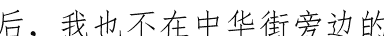

“不用，我走走走，吹风就好了，你们去玩吧。”我朝他们挥了挥手。

我住的地方方算比较偏僻，晚上路边基本上没有什么车了，当时的天气已经非常冷了，想要下雪的感觉，我一走走着，一边吸着大口大的冷气，努力让自己的脑袋清醒一点。将将扬过一个街角，快到家门口的时候，我忽然了一种奇异的感觉。我感觉有人在后面一直跟着我。

作者：云灰卧阳 日期：2016-01-28 15:30

在黑巷里混了这么长时间，已经经历了几场恶战，倒是真的培养了我对于危险的第六感。我站在街角，装作看路牌的样子，用光了一眼，果然发现后面有一个黑影，在不远处不近地随着我。

我没有出门带家伙的习惯，韩国的大街又特别的干净，连个砖头都找不到，没办法，只能靠自己的拳脚了。

我走过街拐的拐，迅速地贴着墙躲了起来，一直听着脚步的声音。待跟踪我的那家伙折了一个弯绕过来的时候，我猛猛地挥出一拳，直朝着他的面门打。这一拳猛生冷颓，换了这一下都得当场躺倒。可这些人就像有预兆似的，猛地伸出手握住了我的拳头，同时低声道：“阿乾，是我！”

我整个人都愣了，仿佛有一股电流从尾尾骨顺着脊椎一直到了脑子里！刹那间，我的眼泪一下就涌了出来！虽然这人穿着一身破旧的风衣还戴着个帽子，根本就看不清脸，但这个声音我却是再熟悉不过了。

“棒子哥，是你……”

他一把捂住了我的嘴，同时警惕地环顾四周看了看，“别话，这里不是说话的地方。”

我抹了揉脸上的，说：“跟我走。”

我带着他去了自己的房子里，那个单门独院的小别墅。进了屋子，老棒子第一时间拉下了窗帘，还往窗户外面边看了看，问：“你这里安全吧？”

“安全。”我说，我能感觉到自己鼻子还是酸酸的。

老棒子才松了口气，脱下了那件破旧的风衣，摘了帽子，疲惫的坐在了沙发上。一个多星周的时间没见，他的头发乱糟糟的，胡子也像野草般的丛生生长起来，两只疲倦的眼睛泛着浑浊的水，仿佛老了十岁。

我赶紧拿出来吃的东西的放在桌子上，问：“棒子哥，你这段时间躲到哪里去了？”

他并未回答我的问题，而是大口的吃着面包，喝着啤酒，打量着房子里的布置，说：“阿乾，听你说你在新浦街开了门口，开了大哥，看样子果然是不错的。”

我“霍”的一下就站起来，浑身激动的抖，却不知道该说什么。末了，我只能翻出一把首来扔在老棒子的面钱，说：“棒子哥，你若是不相信我，觉得是我负了你的功，你现在就一刀捅死我，你看我动一下吗！”

老棒子拿着那把匕首站了起来，在手上把玩着，句话也不说，忽然泪就流了，打在刀子上“啪啦”作响。我一下子就就了，在我的印象里，老棒子好像是一个不会哭的人，他伤疤从出生的时候就把脸找丢了，在社会上这个丛林里拼搏搏杀，打掉了妥住肚子里。但我没想到，他竟然也会哭，也会流泪，我说：“棒子哥，你……”

他丢了匕首，歪歪头，哽道，“阿宽，你不用解释……我知道你是什么样的人，我我相信。可我就是不甘心啊，真不甘心，事情怎么就成了这个棒子……”
“棒子哥！”我过去抱过他，两个老男人就这样扒着头，失声痛哭。

不知道哭了多久，我们的情绪渐渐平复了过来，相谈这几日离别的情况。原来老棒子一直聚在仁川西部的户区，那里多是一些进城务人员和流浪的居所，肮脏又破，人口构成也为复杂，一般没有去那里找人的。他就就算在户区也不敢低头露面，每天填饱肚子都是问题，觉得撑不下去了，才冒险过来找的我。老棒子抽上根烟，长叹一声：“没想到年打箍，今日被撞了！被人成了弃子，真是可笑。”

（此处重复内容合并逻辑处理）

当时已经是夜一点多，安医生还没休息，正好有人做垫下的手术，他跟允儿一直在手术室里忙着。诊所一个叫思聪的小伙接待了我，思聪我也见过两次，算是跟他略熟，知道他是一个留，在仁川大学医学专业，平时没事的时候会来安医生的诊所帮忙，择点外伙。我说：“思聪，安医生正忙着？”

忙着呢，马上就完了。”思聪给我倒了杯水，道：“宽哥，怎么今天晚过来啊？又找允儿姐？”

“呵......”我揉了头发说，“不是，我今天找安医生有点私事。”

“安医生，”思聪有些惊讶地看着我，“你难道……”他肯定会误解我的性向有问题了，我急忙：“不是，不是你想的那样，我就找安随便聊聊事情。”

“呵呵，”思聪挤了脸笑了起来，“看你紧张的，我也也没说啥。“你这孩子！”我差点被他绕进去，可现在这个时候我实在没有心情跟他玩了。我坐了一会儿，安医生就完了，他一边往外一边拿掉头上戴的手术帽，他出来看到我时明显地愣了一下，然后朝我点了点头，算是致意的。好呀我现在也是拥有一方口的大哥，他就在“狐”的地盘混饭吃，这点面子还是要给的。我说：“安医生，这么晚还不休息，辛苦了。”安点了点头，冷冷清清地说道：“谢谢。安儿在里面收拾东西，一会就出来了，你等一下吧。”我说：“安医生，今天我不是找安儿的，我是来找你有事情。”

“找？”安愣了一下。我又靠前了一步，说：“能不能借一步说话？”说：“我来办公室”安看着我的眼睛，停顿了二三秒后，说：“来谈谈吧。”我跟着安进了他的办公室，安关拉了百叶窗帘，说：“有什么事说完吧。”我疑惑道：“在里面……”放心，这里隔音很好，我经过处理的，除非你在这里面枪，外面的人怎么动也听不到。”

好，”我在对面坐了下来，看着他，喉头滚动了一下，时间瞬间还是不知道开口。我急了，猛吸了两口，定了定了神，说：“安医生，你有没有听说过，仁川地下有这样一个组织，专门替人进行重生，能给人换一个身份，说重生头的目叫做‘阎王’。”

（重复内容合并逻辑处理）

他还是看着我，不说话。他的淡然应对让我感觉自己正在走向绝境，这让我产生了一种兽斗的暴躁感，我一下扑了过去，狠狠地拽着他的衣服领叫：“他妈妈的，说是到底救人？是不是不想要钱？好，你个数，老子都弄来！”

“不是钱的事，”他还是那副冷冷的脸，“我说了，我不是阎王。”

“操！”我狂了一声，一股深深的无力感袭来，我仿佛什么都抓不住了，顺着他的身体慢慢倒了下去，顷刻之间，我就哭成了，“老子……他是我最好的兄弟……我是韩国唯一的哥，现在，要死了，我却无力……只能看着死去……我真没用，真是没用，当初我就该回美国……”我趴他的腿上哭得稀里哗啦，溃了几天的情绪在这一刻全都释放了出来，眼泪鼻涕的到处，全都揉在他的裤子上。他就像个子似的歪在旁边，一句话也不说。哭了半天，情绪发泄差不多了，我也冷静了下来，脑子里想了想，说：“安医生，我明白你的顾虑……”

一道都看不见，只能拿出手机打开，靠着屏幕的微弱光前行，不至于撞到墙上。思聪虽然什么也看不到，却能信步疾走，对地形熟悉得很。

不知道天气冷还是什么原因，走在眼里总让我感觉浑身发冷，一层一层起鸡皮疙瘩。走了一段路后，还闻到一股刺鼻的福尔马林的味道，我把手机举起来，眯着微弱的光亮，看到教室门口分别用韩文写着“解剖一室”、“解剖二室”、“解剖三室”……我感到心中一阵恶寒，不由得跑快了脚步，紧紧跟在思聪的身上。

思聪在走廊尽头的一间教室门停了下来，我看到门上写着“尸体冷冻”。

我揉了揉脖子，问：“思聪，这里是干什么哈？”

“这是尸体冷冻，医学实验和解剖的所有尸体都在这里了，怕过将来就是我尸体了。”

这间教室门不是普通的那种门，而是看起来比较厚重的金属门，有些锈迹斑斑，应该有些年头了。并且这扇门是上锁的，一道锁，一道锁。思聪从兜里掏出一串钥匙，轻车熟路就把锁都开了。

我跟着思聪走了进去，顿时觉得温度一下下降了许多，冷得我牙直打颤。我把手机屏幕的亮度调到最大，约看到这个房间十分巨大，里面的设施很像医院里的太平间，尸体都是一层层的冷冻柜里放着的。每个冷冻柜上都有编号，思聪就换个上面的编号，一边嘴里念着词，像在寻找着什么。

他走了两步，停了又，看着上面的编号，拉开了这一层的冷链，说：“乾哥，看看，这个人的身形应该跟棒子哥挺像吧。”

我硬着头看了了一眼，没错，这些人也是五短身材，个子不高，却十分的敦实，他双眼紧闭，嘴唇紧绷，要不是脸色煞白和眉毛上带着愁，就跟睡着了一样。

我看着思聪说：“是虚拟的，应该呢？”

“然后？”然后啊。”

“走吧？你烦嘛？这每一个具体的都有编号呢，说走就撇走？”

思聪看着我战战兢的样子，忽然笑了，“安心啦，没问题的，这里每一个具体的编号都是我给的。可以说，仁川大学医学学院，哦，几乎整个仁川高校解剖用的体，经历过的手，所以这里面到底有多少具体的，只有我我自己才清楚，别人都是一头雾水。少十具八具的，只有我自己才知道，别人都看不出来。

我看着他得意的模样，忽然跟张勇的样子有些重合了起来。张真在劝我做新浦市场放假的时候，也是这种信心十足的神情，他相信自己做过的账面，除了他自己，别谁看不出来问题。之前在国内上学的时候，听老师这么说过：一个行业，你只要愿意不合地浸淫在其中，不过十年的时间，你肯定会成为专家，不说做到业内顶峰，但最起码可以有所小成。

所以，思聪跟张勇应该是同一类人，他们都在自己的行业内混如鱼得水，有着独特的资源和渠道，也算是“有所小成”了吧。我又想到了老榛子，他应该算是个例外，从初中毕业就开始在外面，在零的时候就已经小有名气的“老炮”，到如今，拍其实算二三十年的时间了，结果最后却输得连滚家都不如。

我跟思聪把尸装进袋子里，一个抬头，一个拍脑，撇洒出了教学楼，放在了那辆旧后的二手后座椅子上。我看向思聪，问道：“下去哪？”

思聪说：“新港大道。”

我说：“就是害怕死人啊，活人有时候可怕？”

“哼”，思聪冷笑一声，“活人有时候可怕。”

他这句话又让我起了一身皮疙瘩。

车子开到了新港大道，我们找了一个合适的临时靠岸，停放在了黑暗的偏僻处。我看到外面正好停着一辆货车，甩斗上拉着满车铁钢，这就让我有些惊讶了，“思聪，你怎么知道会有货车信息的？”

“货车出入是要登记信息的，这个在网上一查就能查到，别说这个了，来，帮把手。”

我把那具没有名字、只有编号的尸体套上衣服，挪到了已经进了驾驶位上。思聪拿出一个卡片的东西，放在了尸体衣服的兜里。

我说：“你放了什么进去。做账当然要做了。”

棒子哥的身份证，我们上车门，躺在黑暗处。思聪腰下夹着笔记本电脑，手里拿着遥控器，远程就把汽车启动了——在从仁川大学出来的路上，他就已经对车辆电脑动了脚。我看着那辆二手车摇晃地朝着那辆货车的尾开了，并且逐渐加速，经过七十米的距离后，“砰”的一声，撞了大车的尾。

想也不用想，二手车的头插了大货车的尾部，整个部分已经面目全非。听到声音，有两个司机从休息站出来了，刚走到面前就看着几根铁管从货车上滑了，其中一根铁管穿过挡玻璃直接进了二手车的驾驶座位里，这一下基本上把脑壳扎了。两个货车司机吓得后退了好步，大喊，这时二手车的底盘下面油滴滴下来，很快汇成了了一滩。思聪回头看了看，说：“见证奇迹的时刻。”

他按下了遥控器的按钮，“嗤”的一声，二手车停了，随后熊熊燃烧起来。两个货车司机吓得后退了好步，大喊，很快，休息站里就有冲出来，手持便携式火器帮着灭火。不过就把火扑灭了，脸也被烧了。做完这一切，天色已经接近黎明了。当我重新回到诊所的时候，棒子的手术已经结束了，但他处于昏迷状态，躺着。出乎我意料的是，他的脸上并没有纱布，取而代之的是一个泥巴面具。棒子的整脸，除了嘴巴和鼻孔外，剩下的都被这个面具盖着。我有些惊奇，问安医生：“这是什么？”

“这是用药制成的膏，我叫它泥巴膏。你可以理解为厚一点的面膜，独特，可以加速伤口的愈合和消肿，主要成分是……”经过晚上的折腾，我实在是不愿意再听专业道理了，我说：“安医生，你就直接告诉我，老子的脸什么时候好？”

“一般的换脸手术，至少需要一个月恢复期，但重生手术不一样，”他伸出了两个手指摇头，“这里只需两天。”

“没错，两天。”他又重复了一遍，目光看着我，经过晚上的折腾，他竟然毫无疲态。我忽然觉得被教训了，老子的什么时候好，就像变成了另个人。他的眼神，语气，对人生的掌控，像极了我想中的阎王。

“哦，没事。”我反应过来，经过晚上的折腾，脑都有些了。我揉了脸，转身就走。“你们的事情做完了，”我说，“还有最后一件事。”

我去找张勇。开车到了张勇家里的时候，他还没睡醒，迷糊地给我打开了门，让我进去坐。一个穿着睡衣但敞怀的金发黄眼女从卧室里扭着屁股走了，进了卫生间，经过我身边还抛了一个媚眼。张勇打了个哈，嘴里叼上一根烟，说：“坐。”我坐了下来，眯眼睛看向卫生间的方向：“提点啊。”那是晚上不少钱呢。不过这妞他妈猛，昨天上了四次，差点给我吃了。”

“俄罗斯人？”张勇意外外：“哎哟，乾哥，眼光不错，你看着出来没？”你看那帮，浑圆滚滚，脂肪长得结实，只有在俄罗斯那种极端的寒冷天气成长这样。不过也有个坏处，俄罗斯女人过了，脂肪就松了，胸下的特别厉害。“哎哟卧槽，刮目相看了，没想到对你还有研究。”

“不谈研究，只是粗略了解，看过一些闲书，讲世界人口分布的，尤其是提到俄罗斯人的时候，写的特别精彩……”我猛然停住了，差点崩掉自己大嘴，“操，跑偏了，张勇兄，我今天找你可是正事的。”

“哈哈，不要紧，女人也是正事……”他笑着，忽然吃了口，猛地咳嗽起来，浑身都抖着，看来他那小身板晚上没少挨折腾。

“张勇，我……”我的话刚说出来，又猛然停了下去，心地看着卫生间的方向，此刻里面已经传出了抽水马桶的声音。张勇看出了我的焦虑，搓了搓手：“没事的，顶多只能听懂些韩语，我不明白中国话，你放心走就行了。”这时卫生间的门开了，那个俄罗斯妞又看见尾屁，从我们两个人中间穿了过去，进了卧室，还不回头看我一眼，极其馋地咬了唾沫。我吸了一口唾沫，说：“张勇兄，是这样，你那天给我关的新浦市场做做赚的事，我想明白了，我跟你合作。”

“哎呀干哥，你终于想通了！”张勇站了起来，重重地拍了一下我的肩膀，“其实你早就明白好了，咱们这营生，天天死拼活的，那真是彻底别在裤腰带上了。远的不说，你就说老樟子，是吧……所以咱们混了，求什么？还不是为了求财？那钱赚的够了，咱就不干这刀钱舔血的经营了，出去做正经生意，或者移民，不要干脆做土豪。乾哥，世就是这样，别管你，只要有了钱，脸是白的。“嗯，我明白。”今天这番表态，心里就有底了。思聪，我都明白，我相信你的能力。不出三年，至少搬到江南区住是一点问题没有。思聪，“什么要求？现在就需要一笔钱，以后给我。”思聪点头：“没问题，只要你同意合作，这都不是事。你想多少？”“两千万韩元。”张勇吓了一跳，“这么多钱？”“别管了，反正我有用，你就给痛快吧，到底不行。”从张勇那里拿到的两千万韩元全部给了安医生。安医生也没客气，直接收下了。我以为他会说句“千万不要”，思聪：“这是老子重生的手术费。”

我早上手机，思聪早叫道：“有了！”思聪把手机推给我，“干哥，自己看看。”我好奇，“警方怎么确定的人是老子的？”思聪道：“尸体的头发上沾了汽油，反正脸都烧了焦，根本看不出来，根据衣服里身份证的残留，他们认定死者是老子了。”这一招天衣无缝，我惊讶的不是他们的创造，而是执行方案的速度和默契。安医生：“老子现在怎么样？”还在睡着，麻醉剂的药效强烈，没那么容易醒来。我担心用这么大量的麻醉剂，会不会把脑弄坏了？”不会，放心吧，只是单纯麻醉而已。在他的脸部完全恢复之前，我要确保他一直处于睡眠状态，否则他一旦醒来，情绪波动也会扯脸上的肌肉运动，容易把伤口撕开。”我们四个坐下来在诊所里吃早餐，没人说话，只有思聪在旁边看着东西一边刷手机，不知道在什么。过了几分钟后，他悠然道：“有了！”我好奇，“什么？”安医生都没反应，似乎对这种事情见惯了。思聪把手机推给我，“干哥，自己看看。”看到屏幕上是某网站推送的最新动态：男子驾车追尾运输钢，被穿后车爆炸亡。调查死者是华侨人员，名为李存山，46岁，杀害韩国公民的犯罪嫌疑人。李存山就是老子的真名，也就是那张身份证上写的名字。看到新闻，我才把思聪昨天夜里的联系起来，“这样，”谁会以为老子死了，再也没有人追究这件事了，以后老子这个人从世界上彻底消失。”思聪拿回手机，自言自语：“现在记者的发稿速度真是快啊，午夜发生的事情，早晨就见报了。”我问道：“警方怎么确定的人是老子的？”

思聪：“没错，老子死了，再也没有人追究了。”

小马和娜美在第一时间找到了我，小马已经是眼泪鼻涕流了一场，抱着我说：“阿乾，老子死了……再也没棒子哥了……我真后悔，后悔啊……当时没有劝住他……”他这个哭法，反而让我无所适从，还得反过来安抚他。“马哥，老子已经去了，你也别太伤心了，怎么说也是为了社团做了贡献，不算死得不明不白。”娜美的表情依旧冷酷，只过眼圈也有些红，“阿乾，人不能复生，你也要节哀顺顺。“嗯。”我咬着唇点点头，挤出几行眼来。孟大老知道这件事了，心里也不好受。”我脸上表现出来什么，心里道：操，这只老狐狸。孟大老问：“老子在国内没什么人，孩子怎么说？”他也是社团的事。思聪拿出一部分抚恤金给家人。我说：“老子在国内没什么人，之前过过婚，后来离婚了，带着孩子走了。”小马听这话，哭起来，“棒子哥是命苦……命苦啊……”小马的情绪感染了我，跟着他抱起来。晚上的时候，我偷偷去了医生的诊所，老子的手术已经成功了。安医生用一种特殊的药把脸上的泥巴面具洗去，然后一张新的脸出现在我们面前。老子起来的第一时间就是看着镜子，看看镜子里的自己，看看思聪，再看着镜子里的自己。他的表情已经跟印象中的老子完全对不上号了，只是：“太大了，卧槽！这张脸比以前帅多了！”

思聪：“你去哪？”“我已经约好了船，去济州岛。虽然换了身份，但仁川不能暴露了，不然早晚有一天露脚。时间差不多了，走吧。”送程。这辈子，可能再也不到这样的兄弟了。我站在码头上，直直看着漆黑的大海，直到听到那艘破旧船的声音。“哎，乾哥，走吧。”思聪拍拍我的肩膀。我最后了一眼船的方向，跟着思聪离开了码头。坐在车里，我长叹一声，悲伤的情绪还在胸口，未曾散去。思聪看着窗外，眼神失焦，不知道在想什么。“呵呵呵，”我苦笑一声，“那你是棒子哥怎么对待我的。“别说了，换个话题吧。”我想尽快把愁绪排出去。“思聪，直吧，你为什么来韩国？”国内的教育太刻板，太压抑了，我不受了。当时我爸在这里有点关系，所以来韩国了。“你应该个好学生啊，怎么干成这样的事……你怎么和医生在一起的？”“都是生活逼得嘛。”他苦一笑，点上一根烟，在浓重的夜色里吐出一口笔直的烟雾，“我爸在国内做生意，说实话有点小钱，当时送我来不是费吹灰之力。但经济跟政治挂钩的，总之，后来我爸破产了，真的是倾家荡产，还负了几百万，他就只能去南方跑路了，现在死都不知道。我一下子就没了来源，生活费怎么办？高昂的学费怎么办？那一段时间我特别消沉，差点跳楼自杀。后来，我就出去，利用自己的专业知识来搞尸，我从市场上收购，再倒手卖给有解剖需要的医院和医科大学，赚中间差价，学习过了困难。后来在机缘巧合之下，跟安医生合作了一次，帮他弄一具尸体，对他既满意，我需要也需要一个固定的合作对象，要不要再像以前那样干，风险太大了。所以，我就跟医生在一起了。“哦，”我恍然大悟，“这么说，在你之前‘重生’组织就一直存在？”“对，原来是安医生跟允儿两个人，现在我加入了，算是三人小组。人力力量，好事嘛。”

安医生对我说：“现在，你时刻记得，老子已经死了。在团人的面前，你要表现出相应的态度。”我点头：“我明白。”

我有些错然。我有些错然，原来允儿早就知道这里的一切内情，她比我设想的身份更加复杂，我却一点都未曾察觉出来。我跟她，中间好像隔着无数层雾，永远也摸不到，穿不透。思聪看出了我的心思，问：“想允儿姐呢？”“我知道你在想什么。其实，允姐姐也不是故意瞒着你，都是没办法的事情。我给你说，她也是被人骗到韩国来的，你知道我是怎么骗来的吗？”

作者：云文骄阳 日期:2016-02-04 14:35

思聪问我：“你知道允儿姐是怎么被人骗到韩国回来的吗？”

我自然不知道，就问道：“怎么骗来的？”

“原来不是韩国明星在国内特别帅吗，就有人对允儿说，你这么漂亮，去韩国一定能当艺人，就这么着，给忽煽到韩国来了。结果到了韩国，艺人没当上，转手就卖给老板会接了客。允儿姐那脾气能忍受这个介绍，就被老板打得遍体鳞伤，她一下之下吞了安眠药，差点死过去，最后还是医生把她救了。从以后，允儿姐跟着医生干了，你说，医生是她的救命恩人，她要是对你说了什么，那等于是把医生卖了吗？”

“允儿是啊，”我又叹了一口气，“没想到允儿还遇过这么荒唐的事情。”

“年轻的时候，谁没遇过几件荒唐事。尤其是允儿姐，长得又那么漂亮，是吧。不过话说回来，那些什么艺人，什么样的明星，那都是假的，一成功万淘汰骨，出来的能有几个？就算出来了，后面还有老板捏控，让你陪陪酒就得陪陪酒，让你陪陪睡睡觉就得陪陪睡觉，不听话就封杀你，里面黑得死。”

“是。”我点头同意，韩国艺圈之黑，举世闻名，因为这个每年自杀的女星都不在少数。其实大家心里都明白，哪个国家也差不多，你说韩国艺圈黑，难道中国艺圈黑里水就浅吗？陈冠希出事，天上飞的全是纯女神，冰清玉洁，神圣不可侵犯。陈冠希一事，大家“啪咔”一下全都脸到了地上，还是脸着地。不过那几个脸厚厚的，现在还扮清纯女神，也不管大家恶不恶心。

我说：“思聪，给我讲讲安医生的事情吧，他到底是什么来头？为什么事事的孟老大一直在派人暗中盯着他，好像很忌惮他的样子。”

“呵呵，你想听听安医生的故事？”

“想。”

“想我也没办法告诉你，因为在黑夜里划过了一道微弱的轨迹，“安医生的身份一直是个谜谜，就我和凤儿都不知道他以前是干什么什么的。不过你要是有兴趣探究的话，我倒倒是可以给你提供两个线索。”

“嗯，你说。”

“他常在一个小本子上画一种类似麒麟形状的图案，这一点很奇怪。因为我可以肯定的是，安医生这个人对艺术没有任何的爱好。”

“嘘，这个问题我也发现了，我曾经见过两次。”我回亿着他在小本子上的涂鸦。

“还有一点，安随带着一张女孩子的照片，没事时候他经常拿出来看，时不时还自言自语些什么东西，反正我是听不明白。”

“哦，这一点倒挺有意思。”我思索着，“会不会已经是分手的女朋友，所以留下照片作为纪念，睹物思人？”

“不像，我见过那照片，上面的女孩只有十二三岁的模样。

“万一是她女朋友小时候的照片呢？”

思聪白了我一眼，“你会留着女朋友小时候的照片作纪念像什么？”

“这个倒也是，”我又想了一下，“会不会是他骗女？”

“这个从年龄上倒说得过去，不过……”思聪挠了挠脑袋，“我看着他对照片自言自语的那种神态和表情，不是思念女的样子，再，他也从来没听过安医生结婚，有过闺女的。”

“那到底是什么？”

“所以，这才是一个迷迹，知道答案，我就不在跟你哼寻思了。”思聪说着，发动了车，“走吧，不管怎样，明天的太阳还是会照常升起。

抱歉兄弟们，今天更有点少了，本周昨天夜里去排队排火车票，熬了大半夜，今天是怎么着也睡不醒了。明天多更点，让兄弟们吃个饭。”

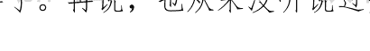

作者: 云幻欧阳乾 日期:2016-02-04 20:36 求页哦~

作者: 云幻欧阳乾 日期:2016-02-05 15:45

## 第七章 阎王

那天晚上，我把允儿接到了自己住的地方。

也许，是为了发泄，也许，是为了填补失落的空虚，我抱着允儿滚滚在床上，拼命的吻着她，仿佛要把她所有的体香都吸入肺里。我一边吻着她，一边一天一件地脱去她身上的衣服，外套，文胸，内衣……随着我两手的上下游走抚慰，允儿发出了一阵销魂入骨的呻咛。

她的呻吟声如蚂蚁一样钻了我的体内，啃噬着我的脊骨和肉脏，我让她浑身上都充满了躁动，我猛地进入她，她的身体的一一抽，头向后仰去，修长的唇上泛上了一层层淡的粉红色。在这肉与肉的碰撞中，在这销魂入骨的吟里，一切都黯色，只有激情。她紧紧地抓着背，她是高潮时的表现，指甲深深地嵌入了我背后的肉里，跟她好好的段时间，我背上的伤几乎就没有过，全是。

（注：此处存在大量OCR重复错误及乱码，已根据语义剔除无意义字符）

（注：此处存在大量OCR重复错误及乱码，已根据语义剔除无意义字符）

（注：此处存在大量OCR重复错误及乱码，已根据语义剔除无意义字符）

（注：此处存在大量OCR重复错误及乱码，已根据语义剔除无意义字符）

（注：此处存在大量OCR重复错误及乱码，已根据语义剔除无意义字符）

（注：此处存在大量OCR重复错误及乱码，已根据语义剔除无意义字符）

（注：此处存在大量OCR重复错误及乱码，已根据语义剔除无意义字符）

（注：此处存在大量OCR重复错误及乱码，已根据语义剔除无意义字符）

（注：此处存在大量OCR重复错误及乱码，已根据语义剔除无意义字符）

（注：此处存在大量OCR重复错误及乱码，已根据语义剔除无意义字符）

（注：此处存在大量OCR重复错误及乱码，已根据语义剔除无意义字符）

（注：此处存在大量OCR重复错误及乱码，已根据语义剔除无意义字符）

（注：此处存在大量OCR重复错误及乱码，已根据语义剔除无意义字符）

（注：此处存在大量OCR重复错误及乱码，已根据语义剔除无意义字符）

（注：此处存在大量OCR重复错误及乱码，已根据语义剔除无意义字符）

（注：此处存在大量OCR重复错误及乱码，已根据语义剔除无意义字符）

（注：此处存在大量OCR重复错误及乱码，已根据语义剔除无意义字符）

（注：此处存在大量OCR重复错误及乱码，已根据语义剔除无意义字符）

（注：此处存在大量OCR重复错误及乱码，已根据语义剔除无意义字符）

（注：此处存在大量OCR重复错误及乱码，已根据语义剔除无意义字符）

思聪，给我讲讲安医生的事情吧，他到底是什么来头？为什么事事的孟老大一直在派人暗中盯着他，好像很忌惮他的样子。

“……阎王”了。

（注：此处存在大量OCR重复错误及乱码，已根据语义剔除无意义字符）

（注：此处存在大量OCR重复错误及乱码，已根据语义剔除无意义字符）

（注：此处存在大量OCR重复错误及乱码，已根据语义剔除无意义字符）

（注：此处存在大量OCR重复错误及乱码，已根据语义剔除无意义字符）

“给我说说安医生以前的事，他有那么精湛的技术，哪里都是板上钉的人才，为什么会甘在这里每天小心翼翼地过日子呢？”

“这是他的秘密，他从来没有说过，不管我认识的那一起，他已经是地下世界的‘阎王’了。”

我慨叹一声：“连你们也不知道？安医生这嘴巴可是够紧。”

允儿笑笑：“君不密则失，安医生……不过话说回来，有些该知道的事情，就不去知道。真知道了，反而不是什么好事。”

“我明白。”

允儿笑笑，不再说什么了，接着我的脖子，给了我一个吻。弄得我心里一兴，差点把车撞电线杆上去。

到了安医生的诊所，思聪正在打游戏，允儿去换衣服了。我随口问了一句：“安医生不在啊。”

思聪眯了眯眼，说：“自己一个人上面喝酒。没事弄两戏，他就好儿。”

二楼是安医生的住所，楼下才是工作的地方，但一听到安医生在喝酒，我就除了他自己，一般根本不会上二楼。一听到来了兴，要上去陪他喝杯。

我上了楼，看到安医生正一边喝酒，手里还拿着一张照片，眼神里充满了怜惜之情。我心里一晃，难道就是思聪那个女孩的照片？

有人问我为什么不用手机买票，本来用12306订票的时候，总是输入不对那个图片验证码，我真的是足够了~

作者：云火欧阳乾 日期:2016-02-05 16:06

我心里一怔，难道这就是思说的那张女孩的照片？可惜安医生看到我上来，立刻把照片装进口口袋，我不得一阵沮哀。

“乾哥，来了。”安医生拿出一个酒杯，帮我满上。

“哎呀安医生，别老是乾哥乾哥的叫我，你比我还大呢，你这样，不是折然了我？”

“呵呵，你是辖口的大哥，社团里的红人，以后我们这些小买卖的，还要靠你举罩呢。按照规矩，该叫你一声乾哥。”

“别……”我有些急了，“别不知道我是怎么回事，安医生还不说清楚楚。再说了，你救了老榛子，简直等于救了我的救命恩人，你再叫我乾哥，用不起。”

“行，那就这样，你时候，当着人面，我还叫你乾哥，”我接着笑着：“这蛮。”

安医生走了，跟我了一个桌子上，也没有菜，就是一凉菜加鸡爪什么的。（（注：此处存在大量OCR重复错误及乱码，已根据语义剔除无意义字符）

安医生：你好吧，你够的。”

我早就知道安医生有个特殊，没事时候喜欢自己一个人，不知道酒量如何，虽然平时也不够，但喝了就彻底片。

（注：此处存在大量OCR重复错误及乱码，已根据语义剔除无意义字符）

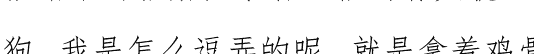

（注：此处存在大量OCR重复错误及乱码，已根据语义剔除无意义字符）

（注：此处存在大量OCR重复错误及乱码，已根据语义剔除无意义字符）

（注：此处存在大量OCR重复错误及乱码，已根据语义剔除无意义字符）

（注：此处存在大量OCR重复错误及乱码，已根据语义剔除无意义字符）

（注：此处存在大量OCR重复错误及乱码，已根据语义剔除无意义字符）

（注：此处存在大量OCR重复错误及乱码，已根据语义剔除无意义字符）

（注：此处存在大量OCR重复错误及乱码，已根据语义剔除无意义字符）

（注：此处存在大量OCR重复错误及乱码，已根据语义剔除无意义字符）

（注：此处存在大量OCR重复错误及乱码，已根据语义剔除无意义字符）

（注：此处存在大量OCR重复错误及乱码，已根据语义剔除无意义字符）

（注：此处存在大量OCR重复错误及乱码，已根据语义剔除无意义字符）

（注：此处存在大量OCR重复错误及乱码，已根据语义剔除无意义字符）

（注：此处存在大量OCR重复错误及乱码，已根据语义剔除无意义字符）

（注：此处存在大量OCR重复错误及乱码，已根据语义剔除无意义字符）

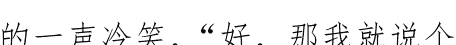

州扬了扬手里的枪，“安医生，你问的未免也太大了吧。”

“这是我的职责，如果要做重生手术的话，我必须要解你的全部信息。”

州沉默了一下，说：“好吧，我是替‘甄’办事的，该死的华人黑帮。”

我敢肯定定安跟我一样，心里冷冷地愣了一下，但我们都没有表现出来。安说：“这么说，你的老板是孟老大？”

“没错，孟老大那只老狐狸。我从他手里接了暗花，要杀了老榛子。可是，在任务失败后，孟老大要拿我杀垫刀，所以我必须要摆脱现在的这个身份！”

我忍不住惊叫起来：“你说孟老大要让你杀了老榛子？”

州州斜地看了一眼，眼神里的光却是耐人寻味，“怎么让你觉得意外吗？你不是觉得孟老大还跟老榛子很熟？”

安安忙在旁边为我开脑，“他们都不熟，他都不认识。他只是奇怪，我们都知道老榛子是华人黑帮的，孟老大怎么还会找人干掉他呢？”

州冷一声：“哼，擦屁股还要这么多理由吗？”

我心里顿时凉凉的。原本以为，老榛子做了金大奉之后，只有韩国的本地帮派在疯了一般的找他，没想到孟老大也派了人要干掉他。看来看，孟老大从一开始就计划好了让老棒子来这个黑锅，只有让他死了，这个黑锅才得得彻底，他才能安心无忧地坐在他的头把交椅的位置。这件事从计划之初，孟老就已经把棒子推进了火坑里，并且是一个万劫不复，无法回头的火炬。

在一瞬间，我想到了一个特别贴切的词：炮灰。

没错，老棒子就是替孟老去跑灰的，而且是在我灵魂的欺骗下。那些我们入帮时的誓词，什么以后我帮从此以后皆是兄弟，什么父母即我的父母，什么以后妹妹就是我的妹姐，什么五雷轰顶，什么三六刀术，全是他妈的儿子！一切都是权势、阴谋和赤裸裸的欺骗！我的心脏一凛，像被一只大手猛地狠狠捏着。

安医生生不动声地道：“我不太明白，老棒子已经出去车祸了，这件事都上新闻了，中华街上的人都知道。这不算你的失职，既然这样，孟老大还要追杀你？”

“呵呵，你们中国人真有句老话，叫‘飞鸟尽，良弓藏；故国贼，谋臣’。正是因为老棒子跑了，我已经彻底没用了，且我还是道内部秘密的，留着我，他能放心吗？要论玩心眼，谁能玩过你们中国人啊。”

安说：“如果我们救了你，被孟老大知道了，我们也会被干掉的。”

州冷笑一声，晃了晃始终都没有放的枪，“如果你们救我，现在就会被干掉。”

安叹了口气，说：“准备手术。”

“等会儿，”州突然叫停，从兜里掏出四粒蓝色的胶囊说：“你们每个人一粒，把这个吃了，包括刚才被我打了一枪的那个小小子。”

安的眼神猛地一紧，“你什么意思？”

“你当我傻傻了？一会儿你们给我麻醉了，不是想干嘛干嘛，把我装袋袋扔海里我都不知道。这个胶囊名为N77F，是一种特殊的延缓毒药，我费了好大劲才拿到的。放心，吃完之后不会有任何反应，它的毒性会在40个小时以后发作，如果没有解药的话，毒性会直接侵入你们的骨髓神经，导致呼吸系统衰竭而死。当然了，我只有我知道解药在哪里，等我从麻醉清醒过来就会给你们解药。”

“哦，还有——”他又补充道：“别寄希望于你们找到这种毒药的组成成分，你们办不到的。就是世界上最先进的实验室也无法解析出它的成分，相信我，这可是我从美国来的高级。”

我看着那天蓝色的小胶囊，心里泛起一股恶寒。我说：“我不吃。万一你根本就没有解药，我们就不死定了？”

州有些暴躁起来，再次开了手枪，“吃吧！给你们十秒的时间，谁不吃胶囊就吃子弹！”

在一瞬间，我想到了一个特别贴切的词：炮灰。没错，老棒子就是替孟老去跑灰的，而且是在我灵魂的欺骗下。那些我们入帮时的誓词，什么以后我帮从此以后皆是兄弟，什么父母即我的父母，什么以后妹妹就是我的妹姐，什么五雷轰顶，什么三六刀术，全是他妈的儿子！一切都是权势、阴谋和赤裸裸的欺骗！我的心脏一凛，像被一只大手猛地狠狠捏着。

安医生生不动声地道：“我不太明白，老棒子已经出去车祸了，这件事都上新闻了，中华街上的人都知道。这不算你的失职，既然这样，孟老大还要追杀你？”

“呵呵，你们中国人真有句老话，叫‘飞鸟尽，良弓藏；故国贼，谋臣’。正是因为老棒子跑了，我已经彻底没用了，且我还是道内部秘密的，留着我，他能放心吗？要论玩心眼，谁能玩过你们中国人啊。”

安说：“如果我们救了你，被孟老大知道了，我们也会被干掉的。”

州冷笑一声，晃了晃始终都没有放的枪，“如果你们不救我，现在就会被干掉。”

（注：由于OCR文本存在大量重复和乱码，此处已根据语义逻辑进行去重与修复，保留了核心剧情：州要求众人服毒药作为威胁，随后安医生进行整形手术，州术后重生，最后遇到娜美和安医生）

“这是他的照片。”娜美说着，递过来一张照片。

我接照片一看，头皮顿时一紧，这不就是刚在安医生诊所做了重生手术的那个吗？

“娜美姐，这些人钻了社团里的什么机密信息？”我心里很清楚。

“我也不清楚，不过听孟老大的语气，是非抓到这个个人不可。具体的，你就别问了。”娜美摇了摇手，说：“走吧，我们一起回中华街。我刚才派出去的探子打了电话，昨天有人在中华街附近看到这个家伙。”

（修正后的核心对话片段）
“有一个韩国本地的杀手，叫朴泰州，夺了社团里的一些机密信息，孟老大下了令，让我们无论如何找到他。这是他的照片。”娜美说着，递过来一张照片。

我接照片一看，头皮顿时一紧，这不就是刚在安医生诊所做了重生手术的那个吗？

“娜美姐，这些人钻了社团里的什么机密信息？”我心里很清楚。

“我也不清楚，不过听孟老大的语气，是非抓到这个个人不可。具体的，你就别问了。”娜美摇了摇手，说：“走吧，我们一起回中华街。我刚才派出去的探子打了电话，昨天有人在中华街附近看到这个家伙。”

手下的人咔咔咣地搜了起来，把办公室、器械室、手术室和两间小病房全搜了一遍，我站在原地不动，跟允儿的视线四目相交，看得出来，她的眼神里充满了焦虑。我暗长叹了一声，无奈地等候着最后的结局。

几个小弟搜了一圈，未有任何发现，娜美抬头看了看楼上，那是安的卧房，平时除了他自己，其他人很少上去。娜美杨扬了摇下巴，对其他小弟说：“跟我去上二楼。”

我拉住了娜美：“娜姐，上面是安医生的卧室，人不可能在那里面吧？我看那个人应该是逃到别处了。”

“小心使得万年错，阿乾，仔细细点。”娜美并未听我劝阻，领着上了二楼。我们推门一看，愣了，屋里坐着安和唐妈两人，正在喝茶聊天。

“唐妈。”我们立刻恭奉敬地鞠了一躬。

唐妈笑咯咯地看着我们，问：“什么把你们这么多人都给吹来了，哈哈，未来安的生意？”

娜美并没有回答这个问题，而是问道：“唐妈，您怎么在这里？”

“我们来跟安妈喝茶，聊天，在中华街上，能说话的越来越少了，大家都嫌我是个老古董，跟不上形势潮潮流，也不愿意跟我多聊，我只有找气味相合的人多聊聊。”唐妈说完，意味深长地看了娜美一眼，“这个理由，可以吧？”

“可以。”娜美回答道，神情颇不自然，额头上甚至出一层细密的汗珠渗了出来。我们一帮站在门口，进也不是，退也不是，一一时间十分尴尬。

“那么——”唐妈给自己倒了一茶，问道：“你们来这里，又是干什么？”

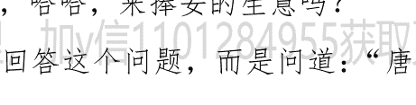

“我们在找一个人，他窃取了社团里的一些机密信息，孟老大叮吩，无论如何都要找到他。”娜美拍了拍孟老大的压唐妈。

“呵呵，”唐妈笑了笑，“你是说，你们要找的这个人跑到安的卧房里来了？”

娜美有些些尴尬，“这个，还不确定。”

“有人亲眼看到他进来了没有？”
“……没有。”

“我从早上的时候就来了，一直坐到现在，也没有看见任何陌生人。”唐妈看向娜美，微笑着，“要是不信过唐妈的眼睛，你们就来再搜一遍好了。”

“不，不用了，唐妈，打扰您喝茶了，抱歉。”娜美又对着唐妈鞠了躬，带着人走了。我总算是长长舒了一口气，下楼的时候唐妈视了一眼，她笑着盈盈地看着我，眼神里看不出任何异样来。

走到门口，娜美还有些不甘心，回头望了一眼里面。小马道：“娜美姐，咱回去去吧？”

“嗯，回去吧。”娜美刚要去开车，忽然又想起了什么，转头把手伸向了我：“阿闯，拿你手机我看一看。”

我心里“哈噔”一下，但还得笑着：“娜美姐，我手机里有什么好看的，破三星。”

“我的手机没电了，借你的发个短信。”

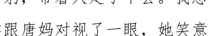

娜美说：“我的手机没了，借你的发短信。”

她既然都这样说了，我没办法再拒绝，如果再再拒绝的话就说明有问题了。我只能从兜里掏手机递给他，感觉每一秒都那么难煎，小小的手机，在我的手里却感觉有千斤之重。

“娜美，给……”我几乎是从嗓子眼里挤出了这几个字。

娜美看了我一眼，接过手机。她解开键盘，拿着手机看着，眉头紧皱起来。

我的心里提到了嗓眼。顷刻间，我脑海中掠过了万种解释，但每一种都是都是牵，每一种解释都不住脚。我后悔了，后悔才为什么不去乱乱短信给删掉，现在被娜美看到了，她会怎么办？大开杀戒；执行家法？

我的心里砰砰狂跳起来，短短几秒的时间里，头上都汗湿了，我们的两条腿竟开始发抖，像过电一样。我把手放在自己的后腰上，用力地拍着自己的肌肉，努力的保持着智的清醒。这种感觉，像是要上刑场一般恐怖。

“好了，没事了，给。”娜美把手机递了回来。

“啊？”我愣不动，脑子因为承受的压力太大，一问有些蒙圈。

“手机，拿着，你不要了？”娜美看看我的脸，说：“阿乾，你今天怎么了，脸色一直这么苍白？”

“我，呢……”我接过手机，急忙连着手都进了兜里因为我的两只手都在抖。我随便编了个谎圆了过去。“嗯……可能是最近口味有点，最近休息不是太好，感冒了。”

“感冒就吃药，别硬着。好了，我们要回去了，你吗？”

“好，明天见吧。”娜美没废话，领着开车走了。等他们走了以后，我才拿出手机翻，两只手竟然抖得不行，像愧一样，我抖着翻记录，看到给允儿的那一条赫然写着字：“爱你。”

我倒住了一下，心里的一块石头落了地。那一瞬间，我把名字的满天全都感谢了一遍。我是给允儿发出的短信，本来是发“危险”两个字，却是阴阳差错成了“爱你”，就是这两个字，让我逃了。我长长的吐口气，浑身绷的肌肉才慢慢地放了下来。我想到了小时候看过的电影《鹿胆》，有人告诉小宝是天会的，证据就是他脱了左鞋，果然看到“清”，右脚鞋“清”。

允儿紧张地上来，低声问道：“我看到刚才娜美查手机了，难受……”

“没事，没事。”我擦额头的汗，问她，“允儿，你怎么知道会有危险？”

“我也是猜的，不然你怎么白无故的家人发字？我想一定是有了。”我没说话，一把抱住了她，就在光天的大街上狠狠地吻着她，那一刻，我真是感受到了一种劫后生般的快感，充沛不及防之扭，却也逃不出的胜，她几下就推了我，跟着我哭起来。

“咳咳，差不多得了，大白天的。”腰上打着纱布的思脑不知道什么时候了门口，翻看着眼看着我。跟允儿分开，允儿面色绯，低垂着头，快速地整理了凌乱的头发。

“你说俩，也不是第一天认识了，还有情溢的？”思脑阴气地说道。跟允儿没理她，拉着手走进了诊所里。那一瞬间，悠然无比旁边的女孩，我觉得简直就是天使赐给我的福音。那一刻，我做了一个决定，我要用生命去保护她。

我明白她指的什么，摇了摇头，“娜美或许开始怀疑我，这是一个麻烦，我机会再探她的口风。”我闲话正着，唐安从楼上下来了。我迎上去：“唐妈。”呵呵看着我说：“阿乾，有一日子没见了，现在堂口做大哥了，忙得很呢。”我忙道：“唐妈，您就别讽刺了，我就是混口吃饭。”

“哈哈，混饭吃不要紧，别太拼命就行。有空多去看看你唐妈呀，”我说：“那是，那是，必须的。”

“好了，你们聊吧，我先走了，有事回头再说。”唐妈跟我们打了一个招呼，就先走了。安一直把她送到路口才回来。看得出来，安也是心有余悸，他回来来说：“阿乾，今天真险，幸你提前通知了允儿一声。”我问：“州呢？”“在楼上。”“唐妈都不知道？”“知道。”我就好奇地看着安，浑身上上下打量着他，“难道，你是唐妈的人？”“不是。”“不是？昨天……难道唐妈还是你的人？”“不是。”“那是因为什么？”“没有永远的利益，只有永远的利益，是因为一些事情，把我们拴在了一起。具体的，你就别问了。”

我还再想找根底问，儿忽然忽然问道：“解药呢？”我猛然一惊，差点把这最重要的事情都忘了，急忙掏出N7F敛胶的解药，挨个吞下，这才松口气。这件算是是有惊的，过去了。手术进行得很顺利，愈合的很快，到了第二天上，他就去掉了那张厚的脸具，变成了另外一个人，或者说另一个杀手。但不管如何，为了起，安问：“你准备去哪里？”拿出一根烟，吐了两口：“去州岛。”我跟人都皱眉，“州岛？”立刻用眼睛眼神看着，从脸上看出什么了。

肯定很重要，我看着安恍若似的眼神，又想起他刚才激动不已的表情，以及他时常在本子上涂画的麒麟图案……这一切，忽然想到他身上一直握着的那个女女孩的照片。难道，这一切都跟照片上的女孩有关？绊号“阎王”的他，到底是为了什么，才一直留在尼亚点的韩国？我感觉自己已经快捕捉到了那个缠绕在一起的迷团的迷团线条，只要能够抓住，使劲一拉，那些妥妥在迷雾里的迷团就会落地，真相大白。相信自己想要窥探安逸医生的秘密了，这让我油然而的一了一种莫名的快感。

下章预告：华人社团大火，敬请期待。

## 第八章 华人社团大火

手下的人咔咔咣地搜了起来，把办公室、器械室、手术室和两间小病房全搜了一遍，我站在原地不动，跟允儿的视线四目相交，看得出来，她的眼神里充满了焦虑。我暗长叹了一声，无奈地等候着最后的结局。

几个小弟搜了一圈，未有任何发现，娜美抬头看了看楼上，那是安的卧房，平时除了他自己，其他人很少上去。娜美杨扬了摇下巴，对其他小弟说：“跟我去上二楼。”

我拉住了娜美：“娜姐，上面是安医生的卧室，人不可能在那里面吧？我看那个人应该是逃到别处了。”

“小心使得万年错，阿乾，仔细细点。”娜美并未听我劝阻，领着上了二楼。我们推门一看，愣了，屋里坐着安和唐妈两人，正在喝茶聊天。

“唐妈。”我们立刻恭敬地鞠了一躬。

唐妈笑咯咯地看着我们，问：“什么把你们这么多人都给吹来了，哈哈，未来安的生意？”

娜美并没有回答这个问题，而是问道：“唐妈，您怎么在这里？”

“我们来跟安妈喝茶，聊天，在中华街上，能说话的越来越少了，大家都嫌我是个老古董，跟不上形势潮潮流，也不愿意跟我多聊，我只有找气味相合的人多聊聊。”唐妈说完，意味深长地看了娜美一眼，“这个理由，可以吧？”

“可以。”娜美回答道，神情颇不自然，额头上甚至出一层细密的汗珠渗了出来。我们一帮站在门口，进也不是，退也不是，一一时间十分尴尬。

“那么——”唐妈给自己倒了一茶，问道：“你们来这里，又是干什么？”

“我们在找一个人，他窃取了社团里的一些机密信息，孟老大叮吩，无论如何都要找到他。”娜美拍了拍孟老大的压唐妈。

“呵呵，”唐妈笑了笑，“你是说，你们要找的这个人跑到安的卧房里来了？”

娜美有些尴尬尴尬，“这个，还不确定。”

“有人亲眼看到他进来了没有？”
“……没有。”

“我从早上的时候就来了，一直坐到现在，也没有看见任何陌生人。”唐妈看向娜美，微笑着，“要是不信过唐妈的眼睛，你们就来再搜一遍好了。”

“不，不用了，唐妈，打扰您喝茶了，抱歉。”娜美又对着唐妈鞠了躬，带着人走了。我总算是长长舒了一口气，下楼的时候唐妈视了一眼，她笑着盈盈地看着我，眼神里看不出任何异样来。

走到门口，娜美还有些不甘心，回头望了一眼里面。小马道：“娜美姐，咱回去去吧？”

“嗯，回去吧。”娜美刚要去开车，忽然又想起了什么，转头把手伸向了我：“阿闯，拿你手机我看一看。”

我心里“哈噔”一下，但还得笑着：“娜美姐，我手机里有什么好看的，破三星。”

“我的手机没电了，借你的发个短信。”

娜美说：“我的手机没了，借你的发短信。”

她既然都这样说了，我没办法再拒绝，如果再再拒绝的话就说明有问题了。我只能从兜里掏手机递给他，感觉每一秒都那么难煎，小小的手机，在我的手里却感觉有千斤之重。

“娜美，给……”我几乎是从嗓子眼里挤出了这几个字。

娜美看了我一眼，接过手机。她解开键盘，拿着手机看着，眉头紧皱起来。

我的心里提到了嗓眼。顷刻间，我脑海中掠过了万种解释，但每一种都是都是牵，每一种解释都不住脚。我后悔了，后悔才为什么不去乱乱短信给删掉，现在被娜美看到了，她会怎么办？大开杀戒；执行家法？

我的心里砰砰狂跳起来，短短几秒的时间里，头上都汗湿了，我们的两条腿竟开始发抖，像过电一样。我把手放在自己的后腰上，用力地拍着自己的肌肉，努力的保持着智的清醒。这种感觉，像是要上刑场一般恐怖。

“好了，没事了，给。”娜美把手机递了回来。

“啊？”我愣不动，脑子因为承受的压力太大，一问有些蒙圈。

“手机，拿着，你不要了？”娜美看看我的脸，说：“阿乾，你今天怎么了，脸色一直这么苍白？”

“我，呢……”我接过手机，急忙连着手都进了兜里因为我的两只手都在抖。我随便编了个谎圆了过去。“嗯……可能是最近口味有点，最近休息不是太好，感冒了。”

“感冒就吃药，别硬着。好了，我们要回去了，你吗？”

“好，明天见吧。”娜美没废话，领着开车走了。等他们走了以后，我才拿出手机翻，两只手竟然抖得不行，像愧一样，我抖着翻记录，看到给允儿的那一条赫然写着字：“爱你。”

我倒住了一下，心里的一块石头落了。那一瞬间，我把名字的满天全都感谢了一遍。我是给允儿发出的短信，本来是发“危险”两个字，却是阴阳差错成了“爱你”，就是这两个字，让我逃了。我长长的吐口气，浑身绷的肌肉才慢慢地放了下来。我想到了小时候看过的电影《鹿胆》，有人告诉小宝是天会的，证据就是他脱了左鞋，果然看到“清”，右脚鞋“清”。

允儿紧张地上来，低声问道：“我看到刚才娜美查手机了，难受……”

“没事，没事。”我擦额头的汗，问她，“允儿，你怎么知道会有危险？”

“我也是猜的，不然你怎么白无故的家人发字？我想一定是有了。”我没说话，一把抱住了她，就在光天的大街上狠狠地吻着她，那一刻，我真是感受到了一种劫后生般的快感，充沛不及防之扭，也逃不出的胜，她几下就推了我，跟着我哭起来。

“咳咳，差不多得了，大白天的。”腰上打着纱布的思脑不知道什么时候了门口，翻看着眼看着我。跟允儿分开，允儿面色绯，低垂着头，快速地整理了凌乱的头发。

“你说俩，也不是第一天认识了，还有情溢的？”思脑阴气地说道。跟允儿没理她，拉着手走进了诊所里。那一瞬间，悠然无比旁边的女孩，我觉得简直就是天使赐给我的福音。那一刻，我做了一个决定，我要用生命去保护她。

我明白她指的什么，摇了摇头，“娜美或许开始怀疑我，这是一个麻烦，我机会再探她的口风。”我闲话正着，唐安从楼上下来了。我迎上去：“唐妈。”唐妈笑呵呵看着我说：“阿乾，有一日子没见了，现在堂口做大哥了，忙得很呢。”我忙道：“唐妈，您就别讽刺了，我就是混口吃饭。”

“哈哈，混饭吃不要紧，别太拼命就行。有空多去看看你唐妈呀，”我说：“那是，那是，必须的。”

“好了，你们聊吧，我先走了，有事回头再说。”唐妈跟我们打了一个招呼，就先走了。安一直把她送到路口才回来。看得出来，安也是心有余悸，他回来来说：“阿乾，今天真险，幸你提前通知了允儿一声。”我问：“州呢？”“在楼上。”“唐妈都不知道？”“知道。”我就纳闷了，我好奇地看着安，浑身上上下打量着他，“难道，你是唐妈的人？”“不是。”“不是？昨天……难道唐妈还是你的人？”“不是。”“那是因为什么？”“没有永远的利益，只有永远的利益，是因为一些事情，把我们拴在了一起。具体的，你就别问了。”

我还再想找根底问，儿忽然忽然问道：“解药呢？”我猛然一惊，差点把这最重要的事情都忘了，急忙掏出N7F敛胶的解药，挨个吞下，这才松口气。这件算是是有惊的，过去了。手术进行得很顺利，愈合的很快，到了第二天上，他就去那那张厚的脸具，变成了另外一个人，或者说另一个杀手。但不管如何，为了起，安问：“你准备去哪里？”拿出一根烟，吐了两口：“去州岛。”我跟人都皱眉，“州岛？”立刻用眼睛眼神看着，从脸上看出什么了。

肯定很重要，我看着安恍若似的眼神，又想起他刚才激动不已的表情，以及他时常在本子上涂画的麒麟图案……这一切，忽然想到他身上一直握着的那个女女孩的照片。难道，这一切都跟照片上的女孩有关？绊号“阎王”的他，到底是为了什么，才一直留在尼亚点的韩国？我感觉自己已经快捕捉到了那个缠绕在一起的迷团的迷团线条，只要能够抓住，使劲一拉，那些妥妥在迷雾里的迷团就会落地，真相大白。相信自己想要窥探安逸医生的秘密了，这让我油然而的一了一种莫名的快感。

## 第八章 华人社团大火

手下的人咔咔咣地搜了起来，把办公室、器械室、手术室和两间小病房全搜了一遍，我站在原地不动，跟允儿的视线四目相交，看得出来，她的眼神里充满了焦虑。我暗长叹了一声，无奈地等候着最后的结局。

几个小弟搜了一圈，未有任何发现，娜美抬头看了看楼上，那是安的卧房，平时除了他自己，其他人很少上去。娜美杨扬了摇下巴，对其他小弟说：“跟我去上二楼。”

我拉住了娜美：“娜姐，上面是安医生的卧室，人不可能在那里面吧？我看那个人应该是逃到别处了。”

“小心使得万年错，阿乾，仔细细点。”娜美并未听我劝阻，领着上了二楼。我们推门一看，愣了，屋里坐着安和唐妈两人，正在喝茶聊天。

“唐妈。”我们立刻恭奉敬地鞠了一躬。

唐妈笑咯咯地看着我们，问：“什么把你们这么多人都给吹来了，哈哈，未来安的生意？”

娜美并没有回答这个问题，而是问道：“唐妈，您怎么在这里？”

“我们来跟安妈喝茶，聊天，在中华街上，能说话的越来越少了，大家都嫌我是个老古董，跟不上形势潮潮流，也不愿意跟我多聊，我只有找气味相合的人多聊聊。”唐妈说完，意味深长地看了娜美一眼，“这个理由，可以吧？”

“可以。”娜美回答道，神情颇不自然，额头上甚至出一层细密的汗珠渗了出来。我们一帮站在门口，进也不是，退也不是，一一时间十分尴尬。

“那么——”唐妈给自己倒了一茶，问道：“你们来这里，又是干什么？”

“我们在找一个人，他窃取了社团里的一些机密信息，孟老大叮吩，无论如何都要找到他。”娜美拍了拍孟老大的压唐妈。

“呵呵，”唐妈笑了笑，“你是说，你们要找的这个人跑到安的卧房里来了？”

娜美有些些尴尬，“这个，还不确定。”

“有人亲眼看到他进来了没有？”
“……没有。”

“我从早上的时候就来了，一直坐到现在，也没有看见任何陌生人。”唐妈看向娜美，微笑着，“要是不信过唐妈的眼睛，你们就来再搜一遍好了。”

“不，不用了，唐妈，打扰您喝茶了，抱歉。”娜美又对着唐妈鞠了躬，带着人走了。我总算是长长舒了一口气，下楼的时候唐妈视了一眼，她笑着盈盈地看着我，眼神里看不出任何异样来。

走到门口，娜美还有些不甘心，回头望了一眼里面。小马道：“娜美姐，咱回去去吧？”

“嗯，回去吧。”娜美刚要去开车，忽然又想起了什么，转头把手伸向了我：“阿闯，拿你手机我看一看。”

我心里“哈噔”一下，但还得笑着：“娜美姐，我手机里有什么好看的，破三星。”

“我的手机没电了，借你的发个短信。”

娜美说：“我的手机没了，借你的发短信。”

她既然都这样说了，我没办法再拒绝，如果再再拒绝的话就说明有问题了。我只能从兜里掏手机递给他，感觉每一秒都那么难煎，小小的手机，在我的手里却感觉有千斤之重。

“娜美，给……”我几乎是从嗓子眼里挤出了这几个字。

娜美看了我一眼，接过手机。她解开键盘，拿着手机看着，眉头紧皱起来。

我的心里提到了嗓眼。顷刻间，我脑海中掠过了万种解释，但每一种都是都是牵，每一种解释都不住脚。我后悔了，后悔才为什么不去乱乱短信给删掉，现在被娜美看到了，她会怎么办？大开杀戒；执行家法？

我的心里砰砰狂跳起来，短短几秒的时间里，头上都汗湿了，我们的两条腿竟开始发抖，像过电一样。我把手放在自己的后腰上，用力地拍着自己的肌肉，努力的保持着智的清醒。这种感觉，像是要上刑场一般恐怖。

“好了，没事了，给。”娜美把手机递了回来。

“啊？”我愣不动，脑子因为承受的压力太大，一问有些蒙圈。

“手机，拿着，你不要了？”娜美看看我的脸，说：“阿乾，你今天怎么了，脸色一直这么苍白？”

“我，呢……”我接过手机，急忙连着手都进了兜里因为我的两只手都在抖。我随便编了个谎圆了过去。“嗯……可能是最近口味有点，最近休息不是太好，感冒了。”

“感冒就吃药，别硬着。好了，我们要回去了，你吗？”

“好，明天见吧。”娜美没废话，领着开车走了。等他们走了以后，我才拿出手机翻，两只手竟然抖得不行，像愧一样，我抖着翻记录，看到给允儿的那一条赫然写着字：“爱你。”

我倒住了一下，心里的一块石头落了地。那一瞬间，我把名字的满天全都感谢了一遍。我是给允儿发出的短信，本来是发“危险”两个字，却是阴阳差错成了“爱你”，就是这两个字，让我逃了。我长长的吐口气，浑身绷的肌肉才慢慢地放了下来。我想到了小时候看过的电影《鹿胆》，有人告诉小宝是天会的，证据就是他脱了左鞋，果然看到“清”，右脚鞋“清”。

允儿紧张地上来，低声问道：“我看到刚才娜美查手机了，难受……”

“没事，没事。”我擦额头的汗，问她，“允儿，你怎么知道会有危险？”

“我也是猜的，不然你怎么白无故的家人发字？我想一定是有了。”我没说话，一把抱住了她，就在光天的大街上狠狠地吻着她，那一刻，我真是感受到了一种劫后生般的快感，充沛不及防之扭，也逃不出的胜，她几下就推了我，跟着我哭起来。

“咳咳，差不多得了，大白天的。”腰上打着纱布的思脑不知道什么时候了门口，翻看着眼看着我。跟允儿分开，允儿面色绯，低垂着头，快速地整理了凌乱的头发。

“你说俩，也不是第一天认识了，还有情溢的？”思脑阴气地说道。跟允儿没理她，拉着手走进了诊所里。那一瞬间，悠然无比旁边的女孩，我觉得简直就是天使赐给我的福音。那一刻，我做了一个决定，我要用生命去保护她。

我明白她指的什么，摇了摇头，“娜美或许开始怀疑我，这是一个麻烦，我机会再探她的口风。”我闲话正着，唐安从楼上下来了。我迎上去：“唐妈。”唐妈笑呵呵看着我说：“阿乾，有一日子没见了，现在堂口做大哥了，忙得很呢。”我忙道：“唐妈，您就别讽刺了，我就是混口吃饭。”

“哈哈，混饭吃不要紧，别太拼命就行。有空多去看看你唐妈呀，”我说：“那是，那是，必须的。”

“好了，你们聊吧，我先走了，有事回头再说。”唐妈跟我们打了一个招呼，就先走了。安一直把她送到路口才回来。看得出来，安也是心有余悸，他回来来说：“阿乾，今天真险，幸你提前通知了允儿一声。”我问：“州呢？”“在楼上。”“唐妈都不知道？”“知道。”我就纳闷了，我好奇地看着安，浑身上上下打量着他，“难道，你是唐妈的人？”“不是。”“不是？昨天……难道唐妈还是你的人？”“不是。”“那是因为什么？”“没有永远的利益，只有永远的利益，是因为一些事情，把我们拴在了一起。具体的，你就别问了。”

我还再想找根底问，儿忽然忽然问道：“解药呢？”我猛然一惊，差点把这最重要的事情都忘了，急忙掏出N7F敛胶的解药，挨个吞下，这才松口气。这件算是是有惊的，过去了。手术进行得很顺利，愈合的很快，到了第二天上，他就去掉了那张厚的脸具，变成了另外一个人，或者说另一个杀手。但不管如何，为了起，安问：“你准备去哪里？”拿出一根烟，吐了两口：“去州岛。”我跟人都皱眉，“州岛？”立刻用眼睛眼神看着，从脸上看出什么了。

肯定很重要，我看着安恍若似的眼神，又想起他刚才激动不已的表情，以及他时常在本子上涂画的麒麟图案……这一切，忽然想到他身上一直握着的那个女女孩的照片。难道，这一切都跟照片上的女孩有关？绊号“阎王”的他，到底是为了什么，才一直留在尼亚点的韩国？我感觉自己已经快捕捉到了那个缠绕在一起的迷团的迷团线条，只要能够抓住，使劲一拉，那些妥妥在迷雾里的迷团就会落地，真相大白。相信自己想要窥探安逸医生的秘密了，这让我油然而的一了一种莫名的快感。

下章预告：华人社团大火，敬请期待。

说了这么多，只是想陈一下仁川华社内部的派系关系。其实不只是黑社会，“有人的地方就有江湖”，哪个公司内部不是在拉帮结派啊？尤其是在机关单位和企业单位上班的朋友，或许对这一点感受得更加直观。一把手派、二手一手、主任一手、老头派、经常溜球的一派、吹牛逼的一派……中国人就好这个。

所以听说新浦市场账面上的流水比之前少了30%的时候，我担心的并不是，而是有别的派系在暗中搞垮我，这可是个大事。我立刻派下手去调查，很快，结果反馈回来了，在离新浦街不远的水头街又开了一个农市场，优惠相当相当，而且从我们这里吸引的流流过去，就在之前的上一个星期的时间里，新浦市场的入流量减少了20%，交管理费用的少了，自然账面上的流水就少了。

新浦街和水头街相距不过千多米的距离，两里地。十分钟就跑过去了，他们在那里开荒市场，明着是为了抢了我的生意。我吩下手的人去查，水头街市场管事的人到底是谁。

事情很快就清楚了，水头街市场管事的人叫海信。听到这个名字，我心里“哈噔”一下。

我跟朴海信并不认识，我连见也没有见过。但是这个名字我却十分熟悉，在社团策划对付金大花的“清涧派”的时候，这个名字屡层提起。朴海信是朝鲜人，很时候随着父亲从三八线越境到韩国，母亲在越境时被朝鲜士兵打死，父亲抱着他越境的时候虽然躲过了朝鲜士兵的岗哨，却遭到了狼狗的追踪，朴海信的父亲是韩国流武术“托肩”的传人，身手十分厉害，一个人徒手杀了两条狼狗，但他年尚幼的朴海信在扑斗中被狼狗咬住了一耳朵。

从朝鲜韩国的人，除非政府高官或者是具有特别政治意义的，能够经常在公共场合演讲控诉朝鲜独裁统治人，能够受到韩国政府的特殊照顾，除此之外的一般人都要自择生路。朴海信的父亲例外，他来到韩国之后，就靠教授“托肩”谋生，寄居在一家武馆内，在教课之余，也把这一身父母功夫传授了自己的儿子。也许朴海信的小残被打了一耳朵是因为阴暴的缘故，为人别具阴暴，在武馆间与伙伴切磋的时候，经常下手打人伤。后来待不下去了，他就去金山闯天下，在金山认识了金大。由于两人都是朝鲜人的缘故，而且性格相似，所以两人一见如故，成了兄弟，按中国话来说就是“拜把子的”。在金大奉“清同派联盟”的时候，朴海信是二把子的地位。

随着金大的死，清同派龙无首，早就已经解散，没想到朴海信在这个时候又冒了出来，并且开始在我的地盘上抢生意，这让我有些忐忑。我不知道这是一个偶然事件，还是一个信号。如果只是一个偶然事件，那还好，大不了一场，谁把谁打服谁就算了。如果说这是一个信号，那就烦了，这预示着另一股我尚未看到的局势正在悄然兴起。

这个事情我犹豫着要不要给老大打一声。按每个门口其实像社团的子公司一样，自己经营，自负盈亏，混得的好大哥下面的小弟都有钱，混的不的荒哥是小弟兜中就要贴一些。有点类似于春秋战国时期的社会组织，被分封到各处的诸侯自己负责自己的经营，但要听从中央的统一令，让你出钱出兵打仗的时候听话，否则就会受到其他诸国的讨债。现在的地盘上出了事，按这件事应该由我自己解决。

就在我犹豫不决，摸不清楚况的时候，朴海信忽然托人递过了话来，还想约我“谈谈”，获取更多好处。

朴海信主动约约我谈判，这让我有些意外。按他是后来的，应该听扇发大财，等着我主动出击才对，没想到却是客为主了。

他约我谈判的地方是在新浦街与水头街中间的一个做“三元里”的赌场，三元赌场我熟悉，老板是正八经的生意人，跟当地帮派也很熟，但没有什么瓜葛来往，算是一个比较中立的第三方。朴海信把谈判地点选在这里，看来也是用心良良。在他的地盘，我肯定不会去；我的地盘，他又不放心。

手下的人问我：“乾哥，去不去？”

“去，当然要去了。”我说，“在在国内的时候你们没看过新闻联络过实话吗？里面有一句话，和谈是解决争端的唯一途径。”

这场谈判无论如何看，最起码，我要探探对方的口风，看他们到底想干什么。即便对方原来是清源派和土匪的人，如果对方想联手合作，我也是欢迎的。朴海信在三元赌场定了一个VIP包厢，我过去的时候他已经到了，看到我进来，还是很客气，看着我：“乾哥。”

我摆了手：“你的韩语还是直接说汉语吧。”

他笑了笑，坐了下来，点上一根烟。这家伙的身材略瘦，但挺高，比我还要猛。他的脸尖上，正好盖住了他左边。总之给人一种阴暗的感觉。我也坐了对面，不知道些什么。

他笑了笑，说：“既然来了，咱们就别谈公事，先来玩把。”

我说：“好啊，虽然赌技不错，不过我一直没学会，看着眼牌上面的图案太复杂了。”

“呵呵呵，扑牌我不玩，可能等我一会儿。”

“那玩什么？”

“哈哈哈哈，”朴海信笑了起来，幽默的，“好，你说玩什么？”

“哦不是，扑牌就几种。”

“至于眼牌，我连规则都不明白。”

我让他去换了些筹码，堆在手边。朴海信发了新的扑克，看得出来他洗牌的手法很娴熟，也是老手。朴海信洗牌一边说：“你现在的韩语很标准。”

“呵呵呵，你的韩语也很标准，听出来有朝鲜味。”朴海信抬头看了我一眼，眼神中有些奇怪，“我想问，你怎么看朝鲜人？”

“朝鲜人，我接触的不。但在我的印象里，由于源远，很多朝鲜人是很感触。”我想和他套近乎，毕竟家事不宜的。

朴海信：“感谢？你说你是抗援朝？”

“那你是没在朝鲜生活，你不知道我们过的什么日子。我住在那个地方，没有食物，没有粮食，连干净的水都得过来，因为那些东西都要送到平壤，供应祖的心脏。我亲眼看着我的母亲被打，被自己的士兵打死，一枪爆头——”他指了指脑袋，“我母亲的脑袋像西瓜一样炸开，胸口上挨了无数伤，子弹把她的尸体打得像筛子一样。她是为了我和父亲逃出那个国家才做的。”我看着他的眼神，不知道如何接话。

“你知道吗，每当我吃不饱暖的时候，父亲就会教我，这些都是暂时的，领袖的光芒万丈长，我们的生活在前方。之所以会出现暂时性的困难，是因为国家在下盘很大的棋。”他一边说着，一边熟练地给自己分发扑克，一张，两张，三张。

我和他就赌起来了，赢都是小钱，总共换的筹码也没有多少，两三百万币。我不是赢的局，和他打着，一会儿赢一些，一会儿赢一点，手边的筹码也没增减。

“韩国也不欢迎我，因为我和父亲这样的人，对韩国没什么政治意义，顶算是难民。我在这里也找不到什么归属感，于是我就找清湾赌场当成了自己的家。但现在，家没了，我很伤心。”他开出的这一把是一个Q，赢了些筹码过去。

我说：“这些事情，有时候都是大势所迫，并不是我们个人所能左右的命运。”

“说的也是，我们个人的命运，有时候真不是捏在自己手里，就像海面上的浪花一样，风向哪里吹，我们就往哪儿飘。这赌局也是一样的，有时候全凭运气，是一一夜暴还是卖身跳，就靠在这张小小的扑克牌上。”他开出的这一牌是一个K，又赢了些运气过去。

我说：“虽说赌局全凭运气，但你似乎运气不错。”

“呵呵，如果运气真的好的话，我也不会落到今天这步地，用你们中国的话来说，叫丧家之犬？”

作者：云伏阳歌 日期:2016-02-23 19:01

第二天下午，社团在中华街的九龙春聚开会，每个堂口的管事人都要过去。会开完的时候，天色都已经落魄了，

我听得也是昏昏欲睡，有时候社团聚起来起来受不了了，跟跟政府报告似的，后来想想，其实也差不多，一个性质。

散会后，小马好奇地看着我的脸，来看去。

我有些不耐烦，道：“马哥，干嘛呢，相面呢？”

“我注意你一下午，看你表情不对，是不是有心事？”

“没，我能有什么事，来说听听。”

我被小马逼得没没办法，说：“你知道林海信吧？”

“知道啊，金大原来的左右手，清湖派的二当家。金大泰死了之后，这家伙伙也消失了。

“没消停，就在离离浦街不远的水头街又开了一个农贸市场。”

“操！”小马睁醒起来，“这并不是你生意的？”

“嗯，本想和和平解决吧，昨天还跟他谈了一次，可他根本没有解决问题的诚意。”

“阿乾，你一句话，要不要我带帮你去灭了他的。”

“算了，我自己的事，自己解决。好歹我现在也在看着一个门口，不能到处都依赖你们。”

“呼呦，小子刚硬了啊。”小马打趣说着。

“哈哈。”我笑了笑。这个事，是在我地盘上出现的，就应该由我自己想办法解决，如果再依靠小马和娜美他们的话，那我这个巷口的大哥也得太窝囊了，背后还不不知道被别人说多少闲话。

自从老桩走了以后，我就像一个掉了拐杖的瘸子，就算踉跄，也想自己往前迈步。只要还挣在这个世界上，就不能避免一切。

我出了九龙春，给封城打了一个电话，让他叫上几个兄弟去春川街那边新开的烤肉店，一起撸两杯，解乏。

在韩国烤肉，最顶级的食材是韩牛。因为韩国下了养殖禁令，正宗的韩牛肉价格十分贵，完全不亚于日本的和牛，一般百姓根本不起韩牛，顶多就是吃个五花肉什么的。但他新开的烤肉店为了招徕顾客，就打算弄了两头韩牛肉，算是打了开门第一炮。虽然价格便宜，但实物有所值，吃到嘴里的那个肉感和质感简直不能跟一般的肉的同日而语。

“日他妈，乾哥你你说这烤肉好吃不好？”封城吃的很感动，连南语都出来了。

“呵呵，”我笑道，“不知道了吧，这叫慢工出活。这韩牛在养殖的过程中，不能打，不能骂，不能吓着，没事还要给它听听音乐，按摩放松。跟个侯祖宗似的。你说这个这样

出来的牛，肉能不好吃吗？”

“真是讲究，我发现韩国人真是讲究。韩哥你不知道，我刚来韩国的时候，跟他们一起吃饭可不适应了，一上桌，连一个硬菜都没有，全都是一些海带条、萝卜丝、泡菜花的，还都装在一个一个的小圈子里，整得怪怪的，跟玩花似的，都让人不好意思伙子。”

“呵呵，能吃饱不？”

“当然吃不饱，那小菜看着精致，根本就不用点啊。我饿了好几天，跟朋友去下了馆子点了个什么部队火锅，总算是吃饱了肚子，过了瘾。”

“哈哈，部队火锅，哈哈……”

“韩哥你笑我吗？不知道部队火锅哪来来不？”

“不知道。”

“给你讲讲？”

“韩哥你说。”

“这个部队火锅，源于朝鲜战争时期……你们知道啥是朝鲜战争吗？”

我的几个小兄弟的摇头，有的茫然，这让我感到十分悲哀。这帮家伙都没有什么文化，早早的辍学在家里，最高学历是初二水平。辍学后要么打工，要么混，后来通过不同途径进入了韩国，没有文化，也不懂技术，只能在社团的底层混口吃饭。平心而论，韩国人总是觉得中国人素质不高，很大程度是因为这个群体给他们造成的错觉。但这个事说明了深远又不能怪于某一个人，它还有着深刻的社会根源和教育资源分配的原因——说到这里，我又想起了前段时间火过网络的阿玛少年，他年仅13岁就列席了深圳市政协会议，还有个事提交了一份提案“不要让一张考卷决定未来”，看来跟她妈妈真似的。可同家的老百姓的孩子，不拿考卷陪你揉，拿着捏你，阿玛捏吗？普通老家的孩子没准毕业就去听演唱、出席慈善晚会、录制各种娱乐节目？不过他说的对，考卷决定未来不是命，而是……（此处后续为大量重复的OCR内容）

（注：由于原始OCR文本存在大量重复、乱码和错位错误，部分内容已根据语义进行了去重和修复，以下为核心逻辑恢复）

“阿乾，你一句话，要不要我带帮你去灭了他的。”

“算了，我自己的事，自己解决。好歹我现在也在看着一个门口，不能到处都依赖你们。”

“呼呦，小子刚硬了啊。”小马打趣说着。

“哈哈。”我笑了笑。这个事，是在我地盘上出现的，就应该由我自己想办法解决，如果再依靠小马和娜美他们的话，那我这个巷口的大哥也得太窝囊了，背后还不知道被别人说多少闲话。

自从老桩走了以后，我就像一个掉了拐杖的瘸子，就算踉跄，也想自己往前迈步。只要还挣在这个世界上，就不能避免一切。

我出了九龙春，给封城打了一个电话，让他叫上几个兄弟去春川街那边新开的烤肉店，一起撸两杯，解乏。

（此处省略原文中大量重复的乱码段落，保留核心叙事逻辑）

接到了电话的允儿此时风风火火地到了，她看到我这些人的样子就有些抓狂，二话不说就给我处理伤，我看着她低垂着，被头发挡了一半的脸说：“允儿，对不起，你别担心了。”

“我不担心，你被狗咬死才好呢。”允儿看到我身上这重重的伤，红着眼睛骂了一句。

我说：“允儿，你要是不嫌我……我也想好了长时间……我们结婚吧。”

“啊？”允儿惊得一抖抬头，手上正在清理伤口的银镊子一下子扎进了我腿部伤口的肉里，疼得我立刻咬牙地嚎叫起来。

“王经理，对对不起……”允儿急忙收起镊子，拿胳膊乱了抹凌乱的血海，疼在了哪里了？

“哎，我只是想跟你结婚而已，你也不用发脾气啊。”我急道，“你看着我的腿，这血流得跟水管似的，你也不管管？”

“啊？啊！”允儿再度过来，又手忙脚乱地给我血。我也叹了一口气，感觉今天晚上的血真是不少，已经接近底的生理极限了。大学的时候，我曾在一个月内连续献了两次400cc的血，几乎没什么反应，而这一次，却感到了一阵头晕眼眩，呼吸无力，这是明显缺血的征兆。

一直忙活到了天色蒙蒙，我们几个身上的伤势才处理差不多了。止血、清理伤口、缝合、打犬疫苗和破伤风这一套程序做下来，大家都累折得轻。安医生、思聪和允许儿子都累了，忙完手术就直接在诊所里找了个地方去了。我们五个横七竖八地躺着或坐在不大的病房里，腰上、腿上、肚子上、头上都缠着绷带，最严重的两个直接挨得跟个刀似的似的，这就这样在一边抽烟一边陪我们吹牛道。

“乾哥，你不知道，当时那狗‘哼’的一下就扑了上来，直扑我的面门啊，我小时候可是经过二指神训练的，养兵千用兵一天，转身后一口直气，伸出两根手指就捆那狗嘴里，这叫哈？两龙轰！’伤得最小的小矮只能用一只手掐着烟，头上还裹着纱布，这就还忍不住露出得意的吹牛道。

“得了，还二指撞，我嘲你长得跟个二指似的。”封城道，“你说你两根手指掏狗嘴了，怎么差点三根都被咬断了？”

“操，我看你那不是二指，是肉指捍。”
“行了，都别吵吵了，”我制止了他们的吵闹，说，“现在没事没事，总结一下今天的战斗成果，为下一步行动制定策略。”

混社团的时间了，每次发生意外事件后，我都要召集当事人总结一下经验，分析对方在突发事件中的表现和不足，以备下一次突发事件的发生。这样做绝对不是马皇后，而是对之前事件的回旋，对失败教训的一次经验总结。伟人说，忘记历史意味着背叛，我们也是在一次经验中成长出来的。

经过大家分析，一致认为烤肉店事故事件就是那天在逛街里我的那句“限你在三日之内，撤出后街市场，否则我就扫了你的场子”，这句话让朴禹信急跳脚，先下手为强了。经过讨论，我们一致认为在被四方围围的情况下，往小黑洞里钻是正确的，虽然还不忍心捣乱狗肉肠，但正因为如此，才能让我们从对方的围围里撤下身。虽说被狗咬的也获惨伤，但怎么说也要被对方围起来拿刀子砍上一顿好得多。再说把斗狗放出出来受伤的不是我们自己，对方也是受损，估计其受伤程度跟我们比起来有过之无及有。总体来说，这次冲突虽然危，但是十分圆满的，我们不仅完美地化解了危机，还能消灭，顺便给对方也摆了。

对于此次事件，我们最后一致给自己的表现打了 90 分的高分。

可还有一件事萦绕在我们脑海里，挥之不去，“我们几个在烤肉店吃饭，你们都对谁说了？”

封城：“没有啊，接到你的电话，我叫上他们就过去了，按说谁才知道啊。”

“那就奇怪了，”我思索着，“池海怎么能知道我们在哪家烤肉店吃饭呢？”还专门等到我们挑得差不多的时候动手，明显就是有备而来，肯定要收到通知去烤肉店的时候，在

“乾哥，你现在给我们打电话去烤肉店的时候，在哪里？”

“九龙春。”

“会不会是……”封城试探着意思，心里咯噔一下。

他还没说完，我就明白了他的意思，除了我们，就是下午去九龙春去烤肉店吃饭的人。他们下午去九龙春去烤肉店吃饭的人，他们全都是个大哥，跟池海有什么关系？

“乾哥，你现在给我们打电话去烤肉店的时候，在哪里？”
“九龙春。”

“会不会是……”封城试探着意思，心里咯噔一下。

“乾哥，我告诉你。”我想起来了，晚上在烤肉店里砍我们的人，有一个是跟着朴禹信的

“乾哥，你现在给我们打电话去烤肉店的时候，在哪里？”
“九龙春。”

“会不会是……”

“乾哥，我告诉你。”我瞪着他说，“小魏，你别乱说话，这可不是闹玩的！”

“乾哥，你现在给我们电话去烤肉店的时候，在哪里？”
“九龙春。”

“会不会是……”封城试探着意思，心里咯噔一下。

他还没说完，我就明白了他的意思，除了我们，就是下午去九龙春去烤肉店吃饭的人。他们全都是个大哥，跟池海有什么关系？

“乾哥，我告诉你。”我等起来了，晚上在烤肉店里砍我们的人，有一个是跟着朴禹信的

“小魏，你别乱说话，这可不是闹玩的！”

“乾哥，你现在给我们电话去烤肉店的时候，在哪里？”
“九龙春。”

“会不会是……”

“乾哥，我告诉你。”我等起来了，晚上在烤肉店里砍我们的人，有一个是跟着朴禹信的

“小魏，你别乱说话，这可不是闹玩的！”

“乾哥，我告诉你。”我等起来了，晚上在烤肉店里砍我们的人，有一个是跟着朴禹信的。

我们已经结下了深厚的革命谊。娜美跟小妹推进进来，看到我们几个身上缠着纱布，处理得乱七八糟，到处都是血迹，眼睛都红了。小妹说：“哎呀，光听你们被狗咬了，没想到这么惨呀？”

“娜美、哥哥，坐下。”我站起来招呼着两人坐下，“你别操心我们了，还是管好自己吧，我看你腿，骨头没事吧？”

“没事，就是被咬穿了，等长就好了。”我瘸一拐地走回原位坐下，说：“都感谢安医生妙手回春啊，我们几个身上少点零件不可。”

“哎呀卧槽，太狠了。”小妹看着我们几个，再次感叹了一遍。

我急忙招呼道：“娜美、哥哥，你俩还没吃饭，正凑在一起吃吧。封城，再去调两份小料过来。”

“好哟。”封城二话说不说，忙碌起来，他虽然是少林寺出身，却是个吃肉高手，尤其调肉小料，那真是一绝。

小马抽了抽鼻子，说：“嗯，你们你们闹的什么么？”

“狗肉。”

“啥？狗肉？”

“啊，我们被狗咬这么惨，不得吃点狗肉补补吗？”

“呢……”小马背过身去，有些干去，看样子是接受不太了。我把小料递给娜美，说：“娜美姐，来调点狗肉。”

娜美也是一脸黑线，连连摆手道：“不，不了，我对狗肉过敏。”这显然就是托扯，长这么大了，我还没见过谁对狗肉过敏。不过人类不愿意，我也不好再强调。

娜美说：“阿宽，我们这次来，主要是替孟老大转达一件事。他听说你被狗咬了，很是担心，本来想专程过来看看的，可临时又有别的事情，就让我们转达问候了。”

“真是感谢孟老了，这么忙，心里还记着我。”虽然这么说，心里却冷笑，这只狐狸，巴不得我被咬死呢，这样老子的事情就可以高枕无忧了。

娜美问：“阿宽，你怎么打算？”

我夹了一大筷子狗肉进嘴里，狠狠咀着，“等养好了，我打算，让他彻底消失！”

看到我发糟的模样，小马有些焦躁，想说什么，欲言又止。

“阿宽，你怎么打算？”

“马哥，我看你好像没事，”说，“现在没事没事，总结一下今天的战斗成果，为下一步行动制定策略。”

混社团的时间了，每次发生意外事件后，我都要召集当事人总结一下经验，分析对方在突发事件中的表现和不足，以备下一次突发事件的发生。这样做绝对不是马皇后，而是对之前事件的回旋，对失败教训的一次经验总结。伟人说，忘记历史意味着背叛，我们也是在一次经验中成长出来的。

经过大家分析，一致认为烤肉店事故事件就是那天在逛街里我的那句“限你在三日之内，撤出后街市场，否则我就扫了你的场子”，这句话让朴禹信急跳脚，先下手为强了。经过讨论。

“阿宽，你怎么打算？”

“阿宽，你怎么打算？”我站了起来，剧烈地扯到了腿上，疼得我咧咧。

“阿宽，你别激动，坐下。”

“阿宽，你怎么打算？”

“阿宽，你怎么打算。”我站了起来，剧烈地扯到了腿上，疼得我咧咧。

“阿宽，你别激动，坐下。”

“阿宽，你怎么打算？”

“阿宽，你怎么打算。”我站了起来，剧烈地扯到了腿上，疼得我咧咧。

“阿宽，你别激动，坐下。”

“阿宽，你怎么打算？”

“阿宽，你怎么打算。”我站了起来，剧烈地扯到了腿上，疼得我咧咧。

“阿宽，你别激动，坐下。”

“呵呵呵呵……”小马继续道：“朴海信的意思是这样的，反正已经出了，梁子也已经结了，不如想个办法，大家把这件事解决了。如果两帮火的话，或者他赢，或者你赢，不管哪方都是伤害，到头来受罪的还是兄弟们。万再动了警察，来一场黑大大暴，那就不偿失了。”我嚼着狗肉，“听他这意思，有解决方案？”

“阿宽，你怎么打算？”

“阿宽，你怎么打算。”我站了起来，剧烈地扯到了腿上，疼得我咧咧。

“阿宽，你别激动，坐下。”

“阿宽，你怎么打算？”

“阿宽，你怎么打算。”：“对，朴海信说如此，咱们各出一个，上台打擂，三回合，公平公开，到时候请第三方的作证，谁也不能作弊。赌注还是按照之前约定的，如果他的人输了，我们就此离开仁义，永不回头。如果你的人输了，他就要你百分之五十的份额。”呵呵呵呵……”我忍不住冷笑，“朴海信这家伙，是想大事化小，小事化大了，摆台打擂，这种情况他想出来的。”

“乾哥，你让我……”封城闻言，跳起来叫道。

我摆了手，制止了封城的发言，转头看了小马，又看了娜美：“娜美姐，这事儿你怎么看？”

娜美皱了了一下：“唐妈只是个传话人，她并不是站朴海信那边的，是跟我们站在一条战线上的，所以她的面子，你不用顾虑。单说朴海信这个提议，我知道他是朝鲜人，从小就练‘托扣’，身上功夫不弱，手下肯定也有强兵。他既然敢这么提议，就证明他有把握，所以我觉得不要答应他的要求，那样就好中了他的圈套。”

“娜美姐的意思是……”直接接火，扫了他的场子！我和小马带来帮你。”娜美这话干脆利落，我相信如果不是照顾我的自尊情绪，估计她自己就能搞定朴海信。在兄弟情义面前，娜美绝对没过的。我说：“娜美姐，你的好意我心领了，可我觉得，朴海信这个提议，不必不能考虑一下。”“阿宽，你真的要跟他们打擂台吗？”小马忍不住叫道，“很有可能是陷阱！”

“不管怎么样，我决定了，”我斩钉铁地地说，“就算是陷阱，我也要跳下去！”

今天更一章，明天等人出差一趟，所以暂停更新，后天恢复正常。嗯，不过在路上我会爆照的。。我看留言的。很多同志说不想看照片，这让我很伤心，好吧，请大家留言一下，我这个人很民主的，如果不想看照片占多数那以后我就暴照了。

作者:云欢阳朗 日期:2016-02-29 17:15

刚刚安顿下来，累死了。争取晚上来更。不过没有有照。只要一个人看，我的帖子我就坚持写下去，同样，只要有一个蛋要求，我就继续......

[content]

种儒雅淡的气质，不知道还以为他是来相亲的。他笑了笑，说：“过来给你挣捧场，怎么，不欢迎吗？”

小马凑过来：“今天我去找安洒，说起晚上的比赛，我就强拉着安医生过来了。万一出了什么临时状况，也能及时处理一下呢？”

我看了小马，这个多事的家伙，我真不知道他什么好。我向安身后后望了望，他说：“别找了，允许今天在诊所替我值班。”

我害怕今天这事把他卷进来，再说我也不想跟娜美走的太近，娜美这眼力劲毒得跟脊空一样，万一被她发现了安医生的端倪，那可就麻烦了。我说：“安医生，这种打打杀杀的地方不合适你，我觉得应该是那种没事去听音乐的看舞台剧类的人。”

“哈哈，”安笑了起来，“你觉得我过的打打杀杀少吗？”

这一句话到底给我噎住了。把诊所开在了中华街旁边，紧挨着“狐”的势力范围，每天处理最多的手术就是社团成员们的伤，光是我就被他从死亡线上拉了两次的。确实要说起见过的打打杀杀，他过的桥比我走过的路还多。

等小马走了，我看了四周没人注意我们，便压低声音道：“你怎么来的这里？对你的身份太不利了！”

明白我说的是什么意思。身为地下世界的“阎王”，他的身份一直是保密的，但也一直是被黑道中人追之若鹜。

如今，这里聚集了仁川大小的头子，他们每个人都听过“阎王”的传说，每个人都在观察这个秘密，就像《笑傲江湖》里每个武林人都渴望得到辟凶剑一样。安医生竟然会在这里出现，实在是对自己太不负责任了。

他笑了笑，也压低声音说了一句流传广的名言：“最危险的地方，就是最安全的地方。”

我一下子就明白了过来，他是在玩“灯下黑”！

“阎王”的存在是整个仁川黑道人都知道的事情，可他们只是听过，没见过。安医生选择在这种黑道中人云集的出现，这样一来，别人只会认为他是一个普通的整形医生，根本不会将他和“阎王”等对待起来，因为在他们的印象中，阎王应该是隐秘的，藏于暗处而不露面的神秘人物。安医生玩得这手，用他们的话来说，就是“心机器手”。

对我露出一个看似无害，实则有深意的笑容，转身与别人开了，我看着他的背影，愈发觉得这个男人神秘莫测。

朴海信也带着他的选手出现了，这个人头比城堡略高，身形魁结，穿着传统的白色衣服和宽大的裤子，小腿处用罩捆缚了起来，一看就是练习“靠拳”的典型打扮。

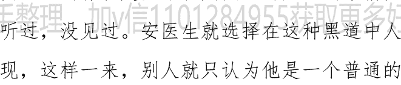

他色冷酷，不苟言笑，站在拳台的另一端，冷冷地打量封城。

我推推封城，示意他看向对面：“看到了吗，一看就眯手。”

封城却只是笑笑：“是胆子吗，拿出来邀擂。”

这时现场的主持人上了台，招唤现场安静下来。他清了清嗓子，开始介绍了：“欢迎社会各界大佬临此比赛，这次比赛将采用公正的原则，邀请各位前来观看，实则是让各位做个见证，以示公平。双方选手已到齐，一方是来自清浊派的选手崔仁炎，一方是来自‘甄’社团的选手封城。此次比赛将采用自由击淘汰规则，双方打三分钟，每局休息分钟。此比赛全程公开，大家监督。比赛将在十五分钟后开始，大家可以选择好的选手下注，提示：输赢量力而行。”这句话说完，下面的人都笑起来。今天来到这里的人都是有头有脸的人物，他们没想到朴海信还在现场开了口。

看到大家纷纷下注，小马也心神跃起来，跑过来问我：“安哥，你押谁？”

我很无奈：“这怎么押呢。”

小马急得转了两个圈，又问封城：“马哥，你押赢吗？”

封城：“马哥，你押可以，不过万一输了可别怪我。”

“你有信心吗？”

“我有信心，可实力只是一方面。”

哎呀，”小马又转了两个圈，问道，“你练了多少年？”

“七八年吧。”

“七几年？够了！好，我押赢！”小马说完就跑过去拦下了我：“安哥，悠着点。”

朴海信带着他的选手走了过来，稳稳地招呼：“安哥，没事吧？”

我冷笑一声：“托你的福，还没被咬死。”

“呵呵呵呵，”他一脸笑，“人在江湖没事，安哥，之前的事情请见谅。”

我真是见过没脸的，他差点被我咬了。如今他站在我面前，请见谅，当着这么多人，不能失态了。于是他笑道：“理解，理解。人在江湖，哪能不挨，过去的就过去了，应该有这个觉悟。”

“安哥真是中人。”

“谈不上，谈不上，千万别给我高帽子，这一得意容易忘形。倒是今天搞得这个擂台比赛有声有色啊，还请了这么多大佬，我看警察善龙都来了，好面子。”

“哪里，朋友而已。前两年韩检察官在老家有点麻烦，是我弟出面帮他摆平的，日后走动就许多。今天是他请来看热闹的，安哥不要多想。”

这话裹里藏针，同时向我传了好几个信息：一，他曾经帮善龙做事，证明自己有实力；二，你有恩于善龙，善龙欠着你的人情；三，他和善龙一直互动，以朋友相称，关系很快。跟善龙关系铁，就相当于检察厅关系铁，动用黑道的力量无法对得了。

我一笑，转移了话题，看向他身后的崔仁表：“这小子看起来不错，精壮。”崔仁表看到我，向我鞠了一躬，虽然是对头，但怎么说我也是他大哥级的人物，他应该对我表示尊重。韩国出来混派尤其注重这一点，长幼有序，尊卑分明。

朴海信看崔仁表，面得得意之色：“他很小就跟着我了，我也一直在训练他。安哥你听，他的‘托肩’技术在整个黑道都很有名气。”

“哎呀朴海信你真找了这么高手来，看来你今天吃定我了。”

说完我俩哈哈大起来，就是那种视合神离、心怀胎的笑。笑了几声，我看了看手表，说：“时间差不多了，咱们上台吧。”

“好。”朴海信拍了拍崔仁表的肩膀，说：“上台。”

王裁判到了，封城和崔仁表都上了擂台。按照国际惯例，双方都戴上了薄拳套，就是美国 UFC铁笼格斗赛戴的那种。虽说拳套上以后依然可以用捏打，但真正的手感还是与拳手不同。有很多练过格斗的朋友喜欢问我一个问题，就是戴拳套和不带拳套打人，到底感觉上有什么区别？我回答：“就戴套和不带一个意思。”

封城戴上拳套后，使劲了握，看得出来他还是不太适应这个东西。细节虽小，但确实影响发挥。

比赛铃响，场才揉了揉手，让两人到了中间互相致意。崔仁表浅浅地鞠了一脚，封城则抱拳礼，场裁又猛地一挥。

比赛开始。从这一刻起，我的心就悬在了嗓子眼。发动的是崔仁表，他几乎没有任何试探，一踢了过来，妄图先发制人。习空手道踢法，将大腿抬到了高点才斜着砍过来，目标是封城的颈部，攻击却走了一个弧形，绕过了他双臂。我有些吃惊，这是空手道里常用的线法，学名叫“纵跃”，因为其攻击线路是弧形，又被奉称为“月光刀”。没想到空手道里也有这种踢法轨迹诡异，封城果然没有反应过来，结实击中了他的左侧颈部。好幸他的本能反应还有，咬牙绷紧颈部的肌肉，硬生生接下了这一踢，除了疼，他往后一步，拳角歪了，似有些疼痛感。

崔仁表一招先声夺人，得了满彩。下面人都站在我旁边，娜美都不忍道：“好踢法。”我忍不住骂道：“草，现在让你得意！”封城虽然吃了踢，却没有急着进攻，而是耍架，一点点寻找漏洞。漏洞太不好找了，这个空手道踢法十分独特，源于朝鲜手道，但完全不同于舞蹈道的道理，也没有套路，而是像是舞蹈一番，身体节奏不停蠕动，脚下在前后移动，双手则在胸前来回搓，既能引起迷惑的作用，还能第一时间化解对手攻击。看似打架，整个人就是沉浸在舞蹈状态中，跳着跳着。因为他时刻在移动着，还容易击不到。封城暗自锁了一把。两个人都互相峙着，崔仁表见过去，封城移动，大家都在阔大的房内寂静。小马在封城上下，有些沉不住气了，大喊一声：“封城上！”就在他话音未落地的时候，封城猛攻！他一个跳步迎，，拳朝着对方胸口砸去。由于封城在身高上有所劣巧，所以这一拳被崔仁表后躲避，同时前手一手拉，把封城的拳头按了下来，接着又一踢上头！

崔仁表的技术不是盖的，腿都暴轰而去；封城刚吃了一拳，这次有了防，腰膝肘起；朝着崔仁表打来的小腿就狠狠砸了下去，一肘一砸分明。我看到崔仁表把腿收了回来，迟许又后一步，拳角歪了，似有些疼痛感。封城接着过去，双拳抬进去，左右开连续挥出五六拳，崔仁表双手护脸，迅速后撤，竟然被躲遍了。

不管任何一个武术流派，评价其格斗姿的优势都有三个基本条件：1，便于进攻；2，便于防御；3，便于步法移动。很明显，崔仁表就具备了这三种条件，所以他在面上绕过了封城。两个人又对攻了一招，互有胜负，不过没什么实质性的进展，第一回合早结束了。双方选手回到角落休息，朴海信拍拍崔仁表的肩膀，意思是说他打得不错。我则一边给封城喂水，一边授宜：“这家家伙步法灵活，移动很快，想办法把他往角落里逼。”

封城点头：“只要被我堵住，他就别想出来。”

第二回合开始，封城就开始贯彻我的战术意图，猛打，一拳迅猛的拳踢就把对手拉近了围困的角落里。朴海信在旁边大喊道：“出来，出来！”

然而已经被逼到了角落里，他哪里还得出来？就在封城得手，准备猛攻的时候，突然硬生生地插进去，制止了封城的动作，双方回到地重新开始。下面人都激动了，小马拍手：“封城上啊！”由于裁判的公平，封城确实是没赢了。封城有些浮气躁，进攻鲁莽一些，接下来的对攻中吃了不少顿踢。第二回合结束后，我这边帮着擦着膊，一边：“最后一次了，用点心。”封城看了看我的眼睛，点头道：“安哥，我明白。”比赛哨响，第三回合开始，双方都不再保留，空手道踢法灵活，犀利，空手道出招。就在这当口，关键性的一幕出现了，封城一挥，上前，给了崔仁表绝佳的反攻机会。他一脚踢了，封城被踢得一个翘，重心不稳，下巴上挨了他拳，跌倒地。崔仁表此刻变了，扑过去骑在封城身上，双拳如雨点落下。这场比赛并非单纯站立，而是采用MMA规则，就是对方倒地后依然可以追。封城的头部，他时间毫无之力，小马就甩出了毛巾叫道：“弃！弃！还没完呢？”抛出毛巾，裁判立刻拉住了双方，举起了崔仁表的右手，宣告这场战斗胜利。崔仁表赢了，相当得意，看着封城的眼里却是脸色，还伸自己的小拇指指着封城输比。几个弟气愤要冲上擂台，我急忙拦住了他们：“安哥，他们太狠了。”我摇头：“输了就是输了，没话说，不用找借口。”下面的观众看似满意，报以热烈的掌声。朴海信过来拍拍我肩膀，笑道：“对不住了。“没什么，可惜输。”我淡淡说道：“份额百分之五归你了，明天派人找我交接手续。“哈哈哈哈，安哥果然厉害，不愧是我靠模，我喜欢。等手续办好了，我请安哥喝几杯。“酒就算，你派人偷我是万幸了。”我吞了他一个，没再理他，走过去查看封城的伤势。封城坐在地上，眼角和嘴角处都被打了。他懊哀地垂着头，看了我一眼，气无力地说：“安哥，对不起。”我拍了拍他的肩膀：“没事，胜败乃兵常事。有时候，很多事情不是我们想办就能办好的，这就是人生。“人生个鸡！”小马扑起来，摇着封城的肩膀，铁脑不成钢地叫：“封城，你怎么回事，怎么能输给那家伙呢！你没听我警告你进来，进攻！你先用直撞开路，再用踢拍他啊！踢你不知道，你们没遇过吗？你看他跳去的，步法轻浮，一个扫腿就让他倒了，然后你再扑上去给他乱拳，一场就挨捷……”小马一边叫一边比看着，感觉都快失去理智了。我无奈地叹了口气，娜姐朝他脖上踢了一脚：“小马，你理智点！”小马站起来，一脸委屈：“娜姐，你不知道，我在封城身上押了两千多……”“让你挣的？”“我不是觉得他能赢吗？”输本来是很正常的事情，现在你钱了，又能怪谁？”小马赖着脸，不说了。我说：“哥，你别懊怀，今天输的钱是我买的，等我从出口出来给你。”“安哥，你别了。”娜美有些生气了。

比赛结束，大家都相继离开了，刚还阔大的厂房里，一会剩下了没几个人。封城坐在台上，愣愣地不知道什么，小马皱着脸，还对刚输的钱耿于怀。娜美拿着手机在不停地发信息，好像在联系什么，我也默默寡言，抽着根烟。安医生走过来，拍了拍我：“安哥，没事，胜败乃兵常事。有时候，很多事情不是我们想办就能办好的，这就是人生。“封城点了点头：“安哥，我明白。“放心吧，封城尽力了，不会怪他。那样，没事，我先走了。”我看了看手表，说：“等会儿，我们见。”。“好戏？”比多了。这一切都是计划好的。”十分钟后，娜美的手机响了，她看了一眼，我说：“安哥，目标出现了。”这时八辆车停在了工厂门口，里面坐着朴海信的手下和我兄弟们，后备箱里备齐了。我们杀气腾腾地跟出了工厂大门。娜美则招呼小马：“快点，到了那个地方你就明白了！”八辆车奔驰划破漆黑的夜色，直奔世宗酒楼。世宗酒楼是仁川南区最好的酒店，看来朴海信今天真高兴了，在这里摆筵席。在车上，小马还不不停问我：“安哥，到底是怎么回事，到底是怎么回事？”到一看，你就明白。“我知道，我又不知道。“卧槽，什么叫知道又不知道？”小马快疯了。“我大约猜了个情况，却不知道具体的细节。”小马崩溃了：“怎么感觉只有我被蒙在鼓里？”马上了，哥，你很快就会明白。”车门打开，我们鱼贯进入，手里拎着家伙，一看是不是好人。服务小白吓得脸色色，经理硬着头皮道：“请问几位……”闪开！”光着脖子穿着“少林武术”兜的封城他吼了一声，经理猛地，慌忙往后了两步。我们直奔二楼最大的包间“东海厅”，一脚就踢开了。房间里筹备的戛然而止，一张脸煞然地看着我们。坐在主席席上的，自然就是这次宴会的东家——朴海信，周围坐着他的小弟，还有刚才和封城交手的崔仁表以及那个检察官郭善。坐在主宾席上的，却是一个共同的“朋友”白道。小马看到白道，很是惊讶：“白哥，你在这里？”白道看到我们伙人杀气腾腾地进来，竟然面不色心跳，就冲这一点我就佩服他，果然是社团的老哥。他不慌不忙站起来，说道：“娜美，安哥，你们来了。来，坐在一起喝一口吧，冤家宜解不宜结。”我直接接骂道：“白道，你说清楚，你在这干什么？禹海信这王八蛋我抢的场子，是不是你放在后面搅波的？”安哥，你说这话就是血喷人了。生意归生意，交情归交情，我跟禹海信是多年的老友，没事的时候在一起喝茗茶叙旧，至于你们之间的恩怨，我可是绝对没有插手过的。况此，你都是社团的人，我怎么会插手在外？”“哼，说，说的比唱的好。白道。”娜美冷哼一声。随着这声冷哼，白道手下的一个小弟立刻离席起来，到了我们这边，同时从口袋里掏出一个录音笔，打开后，后面传来了刚才才洒在桌上白道和禹海信交谈的内容。“白道，这次算你有你在后面谋划筹策，让我拿了新市场百分之五十的份额。“哈哈，你以后发达了，可别忘了你哥我。“胆敢胆敢，我就是当了仁义老大，也不能忘了白道你我的恩情啊。按照你们中国的规矩，来，白道，我敬你一杯。”
[/content]

接下来两人交谈的内容都是关于怎么设计圈套索引我上钩的计谋，以及白道在社团里任劳任怨却不到重用的老话，还白道歪道评价了一下娜美、小马和我。

娜美在他口中成了“性冷淡”，小马就是一个“痴孩子”，而我更是一个凭着老梯子上位的“懂了大运的毛头小子”，总之是被他给批的一文不值。白道的面色微微变色，他指着偷偷录音的那个小弟说：“你，你竟然敢背叛我！”

“这话说得背叛！”娜美冷淡的说，“他本来就是我的人。跟着混口饭，并不证明就要索命于你。”

看着事情露出尴尬，白道反而冷静了下来，他笑了笑，说：“难道冬天这一仗，都是你们设的一个局，就为了引出我来？”

作者:云沃欧阳阳 日:2016-04-02 07:05

最近跟风，搞了个微信公众号，没事些事故，黄段子，总之，以搞翻三观为己任。

是不是一听到这里就兴奋了？
呵呵

一直觉得世界哪里有些不对劲的你可以关注了，我会让你觉得世界更加不对劲。

微信订阅号：shijieqian123

后台没有任何限制，你可以催更、挑逗、调戏时间找到庆功的……还可以恐吓。呵呵呵。

{IMAGE}http%3A%2F%2Fimg3.laibafile.cn%2Fp%2FFm%2F245632570.jpg

作者：云火 日期：2016-04-02 13:08

我说：“没错，我今天打算让沈城捷掉比赛，就是为了引你出来，我断定梅海信第一时间就会找到你庆功的！”

“呵呵，你有计谋，看来你可可怕了。我就知道一点，你们怎么会怀念到在我身上来的？我想要获取更多帖子。”

我在肉肉店被杀了，差点又被狗咬死，那天晚上知道我踪迹的人，不过就是在龙春会的几个街堂的大哥，而其中的，我怀疑最大。你确实恐怕海信人不够，还把小弟偷偷给他帮着砍我，你可以保密一溜，没到事情就被那些狗犬给搅了，我没被咬死。但是我的手下在那晚上认出了你的小弟弟！白哥，只能说你太自信了，自信的那些都有盲目了，竟会犯下这样的低级错误。”

“哈哈哈哈，阿呵呵阿呵呵，”白逸笑道，“我一直以为你是踩在老柱子的头上才来到这个位置上来的，没想到你的心思竟然是如此的缜密。好，我白道今天认了，说吧，你想想想怎么样？”

我还没来得及说话，小马就叫起来，“哎呀，原来你们早早就策划好了这一切，只把我家蒙在鼓里。害得我担心受怕好几天，还白白输了两千万……你们为什么不早点告诉我？”

娜美白了他一眼，“就你那瞎，告诉你，不出下午，全仁川的人都知道了。”

朴信信缓了起来，阴兽的眼睛死死盯着我：“原来你们早早就计划好了打算，看你们今天这番阵仗，是要鱼死网破了？”

我皱笑：“不用鱼死网破，这一次，我给你一个选择的机会。”

“哦？”朴信信皱毛一挑，“怎么选择？”

“让崔仁表跟封城在这里再比一场，如果你赢了，我们转头就走，就今天什么都没发生过，我们都不知道，新浦市百分之五十的股份还都是你的。如果你输了，交白之后，还滚出仁川，永世不得踏入这里一步。”

“哼，还不死心？就凭你们这花绣腰，三脚猫的功夫，”朴信信十分足道，“我就接受你这个提议，比比比，我要让你明白，实力之间的差距是不可逾越的！”

好在这间包房足够的，我们关上门，崔仁表跟封城在里面再度动起来手。我拍了拍封城的肩膀，说：“上吧，这回尽情打，不用憋着了。”

封城的表情阴沉的可怕，直直地盯着眼前的霍仁表，双手抱拳施了一礼，从嗓子眼里挤出一个字：“请！”

霍仁表这次回没客套，也直接挑杂了进来，一腿踢向封城的脑袋。

又是爆头！

封城瞬间动了，一把抓住了霍仁表在空中的脚踝，然而后大一声，腰马发转了一圈，生生地把霍仁表给抢出了去！霍仁表像个包饺似的被砸在了了包房的大木门上，当下就被撞得七片八字。封城跟着他一步迈了进去，气势力的右拳就直接砸了他的胸口上。听到“咔吧”的一声响，也不知道是霍仁表的肋骨裂了还是大木门裂了。封城并未停手，他光目如炬，腰身又前一挺，轰在霍仁表胸口的拳头并未收回，更是向前迈了一分！

连环打！这心意完全丧失了抵抗能力，脸上表情痛苦，当场就炸开“噗”的一声，喷了血。而封城竟然还停手，他低声喝，腰马又拧，右拳再次进了一侧！一招三式！这力量完全穿透了霍仁表的身体，作用在他背后的红漆木门上，那扇门也承受不住连环劲，“轰呀”一声响，门轴彻底断裂，带着霍仁表的身体一块倒了下去。

守在门外的，服务员和值班经理尖叫。烟尘弥漫处，封城缓缓回头，满是血的脸上唯有一双眸子静如铁，酷似僧一般。“这就是武术！”

的确，正如白道说一样，实力之间的差距是不可逾越的，封城只用了一个拳，彻底击溃了霍仁表。白道今天认了，说吧，你想办法……（此处内容重复）

作者:刘文阳 日期:2016-04-03 13:08

为什么会有这个举动，要知道，各个堂口的交易流水都是我一手负责的，孟老大却反过来查我的账，这在以前是从来没有过的事情。

我深深皱起眉头，“是因为白道的事情吗？”看来，他眼里还咽不下这口气啊。”

“不是因为什么，我们之间的账目交易都要停了，小心害得万年劫。还有，你这边也不要露出来什么端倪和破绽的问题，万一被孟老大发现了，我们两个都得设法后。”

“明白了。”我眨眨眼睛，再次点着烟，徐徐吐出一道烟雾。在逐渐消散的烟气里，我感觉自己的心冰硬如铁。

王叔看到这一点，我猛然有些后悔。以前，我还是一个混在山东的老实巴交的小伙子，而年后，我就站在异国的土地上，成为了黑帮社团的堂口大哥，短短的时间经历了那么多的血腥残杀、阴谋背叛、人情冷、世事炎炎。如现在的我，心滞生堵，心里阴冷，就明白自己身体处于阴谋之中也波澜不断。是什么，让让我变成了现在这个样子，难道环境真的就有这么大的伟力，能让人做出这种变化吗？

我不知道，当时的我也不知道。我就像一个没有目标却步伐坚定的旅人一样，又无顾地行走在风雨中，哪怕满泥泞。

社团里各条路的大哥，按照道理来说都是白道的兄弟，是家人，全都站在灵堂的一侧，等着给前来访的宾客感谢。各个帮派有头有脸的人物鱼贯入，人数虽多却十分有序，也没有人喧吵闹，整个灵堂都弥漫着一股深沉肃的气氛。

忽然，站在旁边的张勇拿胳膊捅了捅我，“小心点，冯三来了。”

我一惊，远远处就看到一群黑装的冯三带着一票人已经出现在灵堂外面，正前方走来。

我有些不好的预兆，眼皮子不由得一跳。冯三是白道手下的力将，他也是兄弟。他们三个人刚过把兄弟，冯三年龄最小，排行第三，后来大家都叫他冯三。老二在一次跟别的帮派的火并中被死了，以后就剩了白道和冯三这兄弟俩，两人感情好得更加像亲兄弟似的，颇有相依的感情。

冯三很能干，孟老大还想联军首尔市场，把华社团的力量渗透大韩国的心脏，就是冯三去首尔开拓，与首尔的本地帮派周旋谈判。冯三也不负众望，这两年的有声色，几乎就在首尔界上扎下了根。

没想到，在首尔的他还是在这个日子前来访自己的大哥了。

冯三留着一头精神的愁，戴着墨镜，挺着胸脯走了进来，像是香港电影《古惑仔》里的山鸡。他身后跟着五六个小弟，也是一样的目不斜视，面无表情。进了门，冯三摘了墨镜，在白道的像前燃了香，恭恭敬敬地拜了三个头。然后站在那里停了片刻，慢慢回头，直直地盯着我。

我明白，来者不善，冯三是来给他大哥报道来了。冯三一步一步地朝我走过来，我能感觉到他身上隐藏着的死神的气息。灵堂的灵气一瞬间紧张了起来，所有人都在观察事情的发展进展。我的几个手下，包括封城，都抓了烟杆从外面走了进来，准备随时动手。

我看着封城他们做了一个手势，示意让他们稍安勿动。冯三站的距离离我不过半，他眯起眼睛，一动不动看着我。

我说：“大哥，有何指教？”
“指教？”哈哈，谈不上。但他大哥的死，你得给我一个说法。

“大哥，他是自杀。”

“你别把自己撒得那么干净。”

“大哥，这里不是谈事的地方，你要真想聊，等这边忙完了，咱们去新浦街慢慢聊。”

“新浦街？你以为在你的地盘，我就不敢动你了？”

“三哥，我不是这意思……”

张勇真看形势比较紧张，站出来打圆场：“三哥，你刚从首尔来，消消消气，别那么紧张，给我个面子。”

冯三直接白了他一眼，“我不懂什么叫面子。”

“三哥，你要这样说话就没意思了。”

“那怎么才算意思？勇真，你少在这当和事老，我知道你俩他妈现在穿一条裤子。”

“三哥，你看这是怎么说话呢？”

“就他这么说，你不服？”

冯三一梗脖子，抬起下巴，斜睨着我和张勇。这是一个一个信号，一个释放武力的信号。他身后站着的五六个面无表情的小弟一个就跳了上来，看样子想动手。我的手也立刻跟了上来，站在我的身后，双方剑拔弩张，一触即发。

我实在不愿意他在灵堂上大打出手，白道的事情已经够麻烦了，我不想再把事情扩大。在这关键时刻，娜美站了出来，挡在我们中间，对着冯三说：“白道的事情，我也有参与，你要报仇的话，算我。”

“娜美姐，你……”冯三咬牙看着他，“最后事情走到这一步，我们也是被逼的。”

“我不管谁逼的，我只知道我大哥死了，我们要给你说法！”

“没有什么说法。”

“你们不给我一个说法，我就给你一个说法！”冯三低声咆哮，有些歇斯底里。

“娜美姐，冯三，你要是今天找事，我不会放过你！”娜美看着他的眼睛，一字一句，“越南人，菲律宾人，泰国人，他们今天都在这里，我不放过你！”

我们都知道娜美是华裔，从小在韩国长大，连大陆都没有回过，但心里无比认同中国人的身份。看到娜美认真起来，冯三也不坚持了，而是点了点头，说：“好，娜美姐，今天给你面子，但我大哥的事情，我们要给你补偿。”

看着冯三走了，我心里隐有种不安的感觉，仿佛是一颗随时爆炸的定时炸弹。晚上回到新浦街，带着几个小弟出来。封城看我神色异样，问道：“乾哥，你有心事？”

我吸了一口酒，干了杯，问：“读过三国吗？”

“看过。”

“知道孙策是怎么死的？”

“是谁？”我一口酒差点喷到封城的脸上，“你妈连孙策都不知道，你还说说？”

“我……我只是看过电视，好像没见过。”

我叹了口气，“孙策是孙权的哥哥，绰号小霸王，几乎凭一己之力奠定了江东的基业。可惜英年早逝，二十六岁就挂掉了。”

“哦，”封城猛悟，“原来是他。那孙策到底是死的？”

“他在平定江东的时候，杀了一个叫许颇的门客为了报仇，趁孙策出去的时候，合伙把他杀了。”听了我的话，封城沉默良久，“乾哥，我你的意思。你是在担心冯三那家伙，会像许颇一样下手。”

“以历史为鉴，得防范。人总有落单的时候。”封城压低声音，做了一个“砍”的手势，“不要，我带两个兄弟，把冯三也……”

社团里已经很多人对我满意了，如果这时候冯三出事，他们肯定会第一时间怀疑在我身上，到时候我们就举步维艰了。”

“怎么办？乾哥，我看冯三那家伙不会善罢。”我挂上一杯酒说，“走一步，算一步吧。”

从白道的葬礼结束之后，我就发现一直在有人跟踪我。我相信绝对绝对不是我的过度敏感，而是出于对危险的第六感直觉。经历了那么多的底层厮杀，有时候对威胁到生命的东西会有一种天生的自然反应，虽然我并没有证据可以证明这种猜测，但我可以毫无疑问地肯定，我被跟踪了。是白道的内部，还是冯三的手下，抑或是敌对帮派安插的哨子？我不知道，因为我一直抓不住那个跟踪我的眼睛。这种感觉让人苦恼，如同附骨之蛆，影随随形，可当你去寻觅的时候，却茫然一片，没有目标。在韩国，因为交际圈子的不断扩大，我至少认识军方的几个朋友，从他们口中得知，在军校训练的科目中，就有这一门课程叫“跟踪”，是专门为日后的情报人员开设的课程。从跟踪毕业之后，基本上能够掌握秘密跟踪的所有要领，成为专业的跟踪人员。这种人绝对不是我们在电视上看到的，一路后面尾着目标，마다被发现的时候就急忙拿着报纸或者买东西，那是属于搞笑导演的跟踪的世界。真正的跟踪是极为强悍的，但目前我们不能轻举妄动。”

回去之后，我连着好几个晚上不能睡，一闭上眼睛感觉自己像藏在天花板上注视着，阳光的光仿佛要看穿我的心肝肺脾。我开始出现神经弱的症状，靠服用安眠药也不安心，就算强制睡着了，有一点动安静足以被惊醒，比如楼下车的声音，从街上过去的路人的咳嗽声。我有些愤怒了。找不到跟踪者，我将一辈子都生活在他制造的阴影里。于是我把封城叫到了我的房间里。几天未见，封城看到我的样子，竟然也是猛然吓了一大跳，“乾哥，你这是怎么了，怎么一下子憔悴成了这样？”“憔悴吗？”我照镜子，一看上去，果然憔悴了，胡子拉碴，脸颊消肿，眼窝凹陷了。现在的我，心滞生堵，心里阴冷，就明白自己身体处于阴谋之中也波澜不断。

“乾哥，你之前说过有人在跟踪我。”封城拍了我的肩膀，让他坐过来，低声说：“实话，我快被这事情折磨了。”

“乾哥，不是你想的那样！我不是精神病，而是有人在跟踪我！他藏得太深了，我找不到。”封城看着我的眼睛，说：“乾哥，你知道吗，你这个样子吓到了我。允儿，你也不相信我吗？”允儿摇摇头，说：“我要回去了。”我一把拉住她的手，“别走，你听我说！”“放手！”允儿猛地甩开了我的手，边往后退边说，“我要回去了。”看着身影淹没在夜色的黑暗中，我则愣在了原地，心中涌起一股名为的情绪，眼睛睁睁地看着。

那天早上，我约了允儿在新浦街的咖啡馆见面，喝点咖啡，聊聊人生。允儿打算上去洗手间。我发现厕所好像坏好了，我无赖地看着玻璃窗外的街道。允儿熟练地叫来生，点了两杯拿铁，她忽然笑了起来。我说：“允儿，你笑什么？”她嘴角嘟道：“我怎么觉得你现在跟小孩子似的，没事还喜欢喝咖啡，看看电影。”我有些不好意思，揉揉胸口打得微微紧的领带，说：“跟允儿在一起时间长了，感觉整个人越来越流氓了。”允儿如花：“哈哈，我看你不是跟我在一起时间长了，而是混时间长了，越来越老油条了。”我怔然一，想到了自己刚从韩国刀滚滚，不懂江湖，整个人就像一条丧家之狗。现在我坐在这里，衣冠楚楚，西装华履，看着跟个人似的，可知道在这宽阔堂皇下面，隐藏着多少往事和积累？或许，世界就是这样的吧，每一个光鲜走上台的人，都有不可忽视的台后。说到，人类文明进化了万年，终究还是没能脱离基本的丛林法则。封城提出了一个简单的想法：第二天开始，他放下头的一切，什么都不干，专心地跟踪我。代号叫“黄雀”。不可否认，这是一个行动方案，可能找出跟踪者。没办法，对方隐藏得太深了，我们只能试试。从第二天开始，封城从我眼前消失了，躲到了阴暗角落，完全融入了一个跟踪者的角色。大约连一个星期，他都没有出现过。不过，我立刻明白了封城的意。

“黄雀”计划开始执行。我像往常一样吃饭、睡觉、出行，暂时被跟踪的事情抛在脑后，当做什么都没有发生过。但这并不持续。忽然一个阴沉的声音在我背后传来：“乾哥”。我不能说话，只能听着封城在说。因为我知道，就在街道的某处，我看不见的角落，一定有一双眼睛密切地关注我。乾哥，通过这几天的观察，我虽然还没有彻底摸清……

那个跟踪人的行迹，但大体上的活动范围我已经掌握差不多了。等一会，你去新罗道那里，随便在广场上喂喂鸽子什么的。那里有个绝佳的监视点，我相信那个神秘的家伙一定会在那里出现……

封城的话还没说完，就然而止，我抬头一看，允儿已经回来了。她去补了补妆，更显得娇俏模样，看得我心里一阵波澜涌起，真想马上把她抱到怀里狠狠地亲一下。但我却道：“允儿，我今天不能陪你，我有重要的事情要办。”

允儿一脸意外地看着我，“你不是，今天没事才约我出来的吗？不是一会还要一起去看电影？”

我有些为难的挠脑袋，“临时有事，我也是没办法。”“是社团的事吗……”

是，不是……

我看她支支吾吾的样子，允儿更加着急，问道：“到底是什么事情？”

允儿一把拽起自己的包跑了，临走的时候还丢下了一句话，“那你以后就跟你的兄弟过去去吧！”

虽然换了允儿一拉抱，但总算是能自由行动了，我长叹了一口气。我转过身，在召唤服务生结账的时候我不心心地朝封城刚坐的位置瞟了一眼，只剩下一个还没被服务生端走的咖啡杯子，早已离去了。

我结完账，离开了咖啡馆，向新罗道走去。

新罗道是仁川比较多的商业步行街，类似于北京的王府，天津的滨江路，不仅如此，新罗道之所以出生，还因它是著名的电影一条街。

新罗道是出了名的电影拍摄地，韩国有很多城市类型的电影都会在这里拍摄的，时候走在这里，还会在不经碰到明星。不仅如此，新罗道上还有大小的影视公司和电影工作室，加起来大约有十几家的样子，是整个韩国电影气聚最浓的地方。就这一一条街的电影工业发展来看，已经远远超过了首尔。

新罗道中间没有广场，新罗广场，是一个休闲观光的地方，广场上经常会有成群结队的白鸽飞来飞去，人们可以拿着玉米粒或小零来喂鸽子。那鸽子也被习惯了，根本不怕人，有的甚至主动喂到你的面前要食物。

“先生，买包玉米吧。”

我走到新罗广场，就遇到一个向我讨玉米粒的小男孩。他顶多也就是十二三岁的样子，身上的衣服还算整洁，却破的，一家家境就不是太好了。这让我想起上学的时候，班里有一个县长家的闺女，平时娇横跋扈，显俏傲似的，在学校里都是横着走的。她有一次写作文的时候，她写到了自己为了挣一些零花钱，暑假的时候就出去卖棍，搞勤工俭学。我们听了之后便嗤之鼻，汉语老师却像如获至宝一样，每次作文课的时候都拿出来当作文朗读，一遍又一遍，每次都声情并茂，热情洋溢，不知疲倦为何何物。后来这篇文章经过语文老师的强力推荐，登上了每月一期的校报，被装在教室墙上的黑板报上，拿靠玻璃罩了起来，眯眯那架势要代代流下去了。

后来，长因因为事进去了，那校报也从墙上撤掉了，语文老师上课再也没有提到过那篇。

我看着卖米粒的小孩，想了一些往事，慨之及命运出身的不公。为什么的人的人生下来就光明亮丽，含着金满洒；为什么的人的人生下来就贫穷些，一眼看不到未来？这又是命运吗？还是造物主对类的错误，还是自然随手安排的偶然?

我看着那个男孩干净的脸庞，觉得得心里里沉甸甸，从口袋里掏出一张钞票，买了一包米粒。

男孩很高兴，说：“先生，稍，我找您。”

我拍了拍他的脑袋，“算了，不用找了，就当小费吧。”

男孩激动地鞠，说：“谢谢先生，祝您想事成。”

呵呵，心想事成？我一步步变成现在这个模样，有哪一步是原先想过的？我拿出米粒，伸手拿，刹刻就有几只鸽子围着我盘旋了过来。看着这些洁白的大鸟，我倒是有有些羡慕了，它们是如此的不谱世事，以此认为这个世界上存在的都是善良，这又何不是一种幸福

我一边步在新罗广场，一边矮着橘子，心里却想着封城在咖啡馆里给我说过的话。他说这里有一个绝佳的监控点，监控视的人一定会在那里出现……可新罗广场那么大，到底哪里才是那个监控点呢？

我站在广场中央，抬头，环顾四周，突然间，一股强烈的视觉感如同闪电一样划过了我的脑海！没错，这个场景我曾经见过，在一部韩国电影《追击恶魔》里，就是在这里取的景！目标人就站在这个广场上，被执行任务的狙击手枪打穿了心脏！

就在那一瞬间，我浑汗都流了起来，仿佛电影的场景融合为一体。电影的镜头，我还历历在目，加速、加滤镜、慢播放。我猛地抬起腰，看向电影里狙击手的藏身之处！

那是位于新罗广场4点方向的一座西式洋楼，我离线距离不超过二百百米！此刻我看到在那洋楼上，一个灰色的身影一闪而过，然后一个翻从三层高的楼跳了来了！我那高的楼，远望过去却没有什么，但我明白，只有有当身处处的站在那里，才会察出它高度的恐怖来！没有经过特殊训练的人，断然不敢这样的高度翻身落下。

紧接着，仿佛是追逐着他的似的，又一个人从三层楼跳了来了，我不得地眯起了眼睛，虽然看不清楚，但从身形和动作上来看，第二个跳下来的这个人，无疑就是封城！

作者：云幻欧阳乾 日期：2016-04-10 14:15

我刚即撇就跑，朝着封城的方向奔了过去。不用问就知道，那个神秘的跟踪者肯定就在这里露出狐狸尾巴，然后被封城发现了，所以才慌忙择路，从三楼上跳了上来！

那个灰色的人影下来之后，在地上打了一个滚，做了翻身，却掉了大部分的冲击力。这动作，一看就是专业训练。他穿着一件灰色的风衣，戴着一顶灰色帽，打扮的极为普通，一闪就混进了新罗道步行街的人潮中，再也处踪。等我们跑过去，只见大街上全是往往的行人，哪里还有那个影子。

我明白，只有有当身处处的站在那里，才会察出它高度的恐怖来！没有经过特殊训练的人，断然不敢这样的高度翻身落下。

紧接着，仿佛是追逐着他的似的，又一个人从三层楼跳了来了，我不得地眯起了眼睛，虽然看不清楚，但从身形和动作上来看，第二个跳下来的这个人，无疑就是封城！

我明白，只有有当身处处的站在那里，才会察出它高度的恐怖来！没有经过特殊训练的人，断然不敢这样的高度翻身落下。

我明白，只有有当身处。我和封城是个死胡同，进了那条巷子，最前面四个五米高的栅栏，一眼就能看到底。对方看了我们，飞似的朝着栅栏跑了，一跃而上，手脚并用，像是部队训练似的，竟然几下就从栅栏上翻了过去。我心里一晃，正要说什么，却听封城一个怒吼，弯腰加速，像弹簧般的冲了过去，然后也着栅栏翻了过去，身体矫健不逊于他。

这让我感到意外，没想到这两个人的身体素质竟然都强悍。相比之下，我的跨越能力倒是弱了点，刚跑过去，我就看到封城跟对手打了一起。让我有些惹的是，以封城的身手，在跟对手斗的时候，竟然丝毫没有占上风！两人斗了一番，对方竟然还使了一个绊，把封城倒在了地上。他正要跑，而这时我已经扑到，用全身的力量就把他压过去，死死地摁地上，同时从腰后摸出一匕首，一下就顶在他的喉上，沉声吼道：“你再敢动我就扑穿你的喉！”

对方老老实的不敢再动了。诚然，我也绝对没有开玩笑。我知道这个人的实力，如果真的拼命挣扎，我断然按不住他。我虽然朝着咽喉下刀，但绝对会捅穿他的大腿。

封城也站了起来，气喘地走过来，然后从裤兜里掏出绳子，把这个人的手捆给他。我拿出手机，打了一个电话，让下手立刻开车过来。过了没分钟，车来了，我让开车的小弟带他去，然后跟封城把这个家伙拽进了车。这家伙没有被塞住，竟然一不发，很显然被我们抓到后，他也认命了。

我关上门，盯着他的眼睛。这家家伙长得相貌极为普通，可以是毫无特征的，就是人在人群里瞬间就会淹没的那种。比起大众脸还好。

看着如此没有特征的一张脸，我莫名地感受到了一种悲哀。

“为什么要跟我？”我冷冰冰问道。

他沉默着，一言不发。

“是谁派你来的？”我又把匕首顶了脖喉上，“你是白嫖的人？还是冯三的人？”

“我谁的人都不是，”他终于说话了，嗓音哑，也像他的脸一样，没有任何特征，“我只是收钱办事。”

我说：“别赖我，从你的手和技术风格来看，你有军背景。”

他冷笑一声，“没错，我的身份属于海军陆战队特遣二队情报。但别以为我们这些国家的利刃就能赚多少票，现在整个国家经济不景气，我们的津贴也少的可怜，所以我出来接些私活。今天让你们碰着，我认了。”

对对方已经动诚了自己的身份，说明他的主意防线已松动了，选择了暂保身，很快就能吐实情。机敏如他，想必也知道如今落在了我的手上，不把实话说说出来，我会把他宰到。

作者：云幻欧阳乾 日期：2016-04-10 14:15

我拿出手机，打了一个电话，让下手立刻开车过来。过了没分钟，车来了，我让开车的小弟带他去，然后跟封城把这个家伙拽进了车。这家伙没有被塞住，竟然一不发，很显然被我们抓到后，他也认命了。

我急忙把照片，在他身上搜起来，他的T恤内层口袋里搜出了十几张照片，都是平时跟踪我的照片。由于距离比较远，这些照片都不清晰，场景却十分奇妙。我看着这些照片，照片在晚上，看起来很普通，却有一种不出来的味道。

我看着照片，看着封城，问道：“这是跟谁见面？为什么这么紧张？”

封城意识到自己失态，立刻缩回手，伸手过来抢夺！我急忙把照片抓在手里，咬道：“封城，你要干什么！”

封城沉默不言，那个跟踪者忽然呵呵笑起来。

“封城，放开你的手！”我大吼一声，冷冰冰地看着他。封城的眼神和我相交，猛地颤了一下，然后慢慢开了手。

“你就坐在这里，呆着别动，别说话！”我给封城下了死令，然后转头，看着他。

“我是之前跟踪你的时候，偶然发现你兄弟的情况。他叫封城吧？我发现他在固定的时间和地点，会见一个人的，谈话也很固定，大约就是三分钟左右。这个情况引起了我的兴趣，所以在跟踪你之余，我就多观察了一下。当时就开始怀疑他的身份了，却没有别的证据可以佐证。后来，封城开始对我进行跟踪调查，并且很快就发现了我的行迹，这让我更加肯定了自己的想法，因为除了经过专门的以外以外，是不可能对我开展跟踪调查的。”

“你到底想什么！”我有控制不住自己的情绪，喘起来。

“我是想——”他顿了顿，说道，“你这兄弟，还有另外的身份。”

封城沉默坐在那里，不发一言。我看着封城，又看了看那个跟踪者，吞了一口唾沫：“你，继续。”

很明显，他接受了正规的反侦跟踪训练，并且展现了极为优秀的追踪才能，刚才在跨越铁栏的时候，我计算了一下，他所用的时间比我还少了2秒，要知道，我在连队里的障碍跨越就属于顶尖水平了。像他这种素质的人员，我只有一个猜测，那就是大陆国安。”

大陆，国安。这四个字像重锤一样砸在了我的心上，震

我的脑袋发烫。什么意思，我身边竟然有国安的人？而且是我朝夕相处的兄弟？

“不，这不是真的……”我看着摇头，噗喃地看着，看向了封城。封城却低了头，根本不看我的眼神，用沉默的说明了一切。

我一把揪着封城的领子，把他拽到了眼前，“你他妈胡说！”

“封城，放开你的手！”我大吼一声，冷冰冰地看着他。封城的眼神和我相交，猛地颤了一下，然后慢慢开了手。

“你就坐在这里，呆着别动，别说话！”我给封城下了死令，然后转头，看着他，“你说。”

“我是之前跟踪你的时候，偶然发现你兄弟的情况。他叫封城吧？我发现他在固定的时间和地点，会见一个人的，谈话也很固定，大约就是三分钟左右。这个情况引起了我的兴趣，所以在跟踪你之余，我就多观察了一下。当时就开始怀疑他的身份了，却没有别的证据可以佐证。后来，封城开始对我进行跟踪调查，并且很快就发现了我的行迹，这让我更加肯定了自己的想法，因为除了经过专门的以外，是不可能对我开展跟踪调查的。”

“你到底想什么！”我有控制不住自己的情绪，喘起来。

“我是想——”他顿了顿，说道，“你这兄弟，还有另外的身份。”

封城沉默坐在那里，不发一言。我看着封城，又看了看那个跟踪者，吞了一口唾沫：“你，继续。”

很明显，他接受了正规的反侦跟踪训练，并且展现了极为优秀的追踪才能，刚才在跨越铁栏的时候，我计算了一下，他所用的时间比我还少了2秒，要知道，我在连队里的障碍跨越就属于顶尖水平了。像他这种素质的人员，我只有一个猜测，那就是大陆国安。”

大陆，国安。这四个字像重锤一样砸在了我的心上，震

“孟俊”，并且语气变得十分沉着冷静，一下就变成了我印象中的那种公安安警的模样。这让我很不适应，于是我我又抽了一根烟继续。

“乾哥，你应该知道，孟俊在没有韩国之前，曾经在东北的延边混过一段时间。”

“对，我听老子说过的。”

“嗯，棒子哥是个好人，我知道你们的关系。”

作者:华文欧阳耿 日期:2016-06-14 12:52

我不想提老棒子的事，问道：“据我所知，孟老大在东北延边混的时候，也只是一些暴力犯罪，砍砍杀杀，抢抢地盘什么的，这就能惊动你们国安的人？”

“呵呵，可不是打架打杀那么简单，”封城冷笑一声，“他犯下的罪行，可不是带有黑社会性质的团伙，而是真正的黑社会！”

真正的黑社会？孟老大到底做了什么，才能称其为真正的黑社会？我所知，被国家官方机构定义为黑社会而不是黑社会性质团伙的，目前为止，也只有东北四集团。难道，孟老大在东北的时候，做了比齐四还要霸道的事情？

“乾哥，你有所不知，孟俊在没有韩国之前，网络就已经四通八达，跟韩国的七星帮，日本的山口，东南亚的雅库扎都有联系。当时他干的最大的一笔买卖就是联合越南人和缅甸，借道金三角地区向美国和墨西哥的黑帮集团贩卖人口。”

“贩卖……人口？”我惊呆了。

“对，后来根据我们的线索来看，他所做的事情还不止贩卖人口那么简单。为了获取最高利润，他还在被贩卖的人体里藏毒，通过人体运输海洛。当时他所开辟的那条运输线路，供应了墨西哥全境百分之十五的海洛来源。你可以算一下，他那些年就靠这个生意赚了多少钱。他赚了钱后，发现国内积累不了，于是便来了韩国，依靠自己积累下的脉络和资本在“诡”社团混里的风生水起，直到最后，坐了龙头老大的位置。”

封城的墙，如同给我开了一个新世界，让我一字一句地听懂了世上的很多原理。本来就是老孟的事，一直以来，我还以为他是靠着冷血和敢杀才最终走到这个高度的，没想到，我错了，错得彻底彻底，这是一条灵魂之路和金铺走的道路，只有踩着自己的利，才能最终走向权利的巅峰。老榛子现在不在这里了，在我眼中，他是天生的混黑社会的料，但我现在明白了，即使他精明和勇敢如他，在这个江湖里混，最多只能混到一个堂大大哥的位置，绝对混成就权利的最高领导者。到那个高度，需要把自己的灵魂献给恶魔。

孟俊俊在国内犯的行事，我们是不会忘记的。自从他到了韩国以后，因为地域关系，我们一直设法对他开展调查。但自从去年开始，国安高层领导克服了外交带来的重重压力，重启了调查程序，我便是第一批派进来的卧底。

我已经不认识眼前的这个自称从少林里出来的小子了，他的身份转变的太快，几乎让我瞠目结舌。这是我亲耳听到他这样对我说，要不然，打死我也不相信这一切。我的嘴唇有些颤抖，不经意间抽烟了一口，连连咳嗽起来。

封城想要拍拍我的背，却不敢，手伸在空中，又有些慌缩了回去。

“那么——”我忍住咳嗽，看着他，“你一直潜伏在这里，就是为了接近孟老吗？”

“对，乾哥，我看着你，你心里善良，却在关键时刻从不手软，有义有气，能担当，不该的人你下不了手，该的人你一个都不会放过。我相信你能够在社团里混出来。我相信你一定能够在社团里混出来，站在比白道还要高的位置，这样我就可以通过你，无限接近孟老大。可是——”封城的声音偶然凝敛了下去，“如今，事情已经暴露了，我已经注定完成不了任务，而你在社团里的前程……也是凶多少。”

我忽然有些感动，封城能够给我开诚布公，说明他心里还是我这个大哥的，起码，他现在还在把我当大哥来看。

我忽然想到一个最为致命的问题：“你说，孟老大知道你要调查他的事情吗？”

“我的任务属于绝对机密的，目前来看，他还是不知道。他现在掌握的信息，也就是我知道我是一个卧底而已，至于我确切的身份，他是无从得知的。”封城看着我，忽然悠然一笑，“当然，乾哥，你现在就可以拿着我去孟俊那里邀功，这样，你以后就会成为他的红人，在社团里可以平步青云了。”

“封城，你……”

“乾哥，你要这样做，我不会怪你。”

“你说的的是什么话！”我目眦裂，目着他吼：“你这个人，我保定了！”

## 第十章 派系内斗

1.

自封城的秘密泄露出去之后，我一直在忠忠等待着孟老大的传闻，当然，借口我也已经好了：封城必然是条子无疑，但他潜伏在我这里，是为了探查国际间谍组织活动，查一个从国内反叛到韩国的间谍。这样的话，就能把我和孟老大之间的事情撇清关系。

我不是没想过把封城送走，让他离开仁川。但如果这样做的话，无疑会给孟老大落在口实。“诡”社团的势力是极为庞大的，连白道上也有他们的人，如果孟老大觉察到要离开，就算他在半道上安排手人掉封城，我也是一点办法都没有。

所以，我们现在唯一能做的，就是等待。

我们一直等待了两三天的时间，孟老大那边竟然安静得没有，平静地就像往常一样。越这样，我越是担心，担心这暴风前的宁静。

不管这是一场什么样的暴风雨，封城这个人，我都都要保证了。我已经失去了老棒子，我不能再失去一个好兄弟。

我做好了充分的心理准备，最坏的结果不过就是孟老大向我下达命令，让我离开封城。

但是没想到，结果比我想象还要坏。出事后的第四天，娜美带着几十个人直接到了新浦街。我们在新浦市场的一家茶舍见面。

看到娜美的表情，我就忍不住眼皮狂跳。在社团里，我跟娜美的关系最好的，平时娜美的表情一直是冷冰冰，自从认识她之后，基本上没见她笑过。但是今天，娜美的表情却特别，像蒙了一层霜一样，让我心里发凉。

我很客气地招呼娜美，佯装无事地：“娜美姐，你今天怎么来了？”

我本想说些近乎废的话缓一下她的气，没想到娜美直奔主题，开门见山：“阿乾，我今天是奉老大命来的。无论如何，你今天带走封城。”

我心里一哈！孟老大没有直接叫我，而是派了娜美过来。我明白，孟老大的是“帝王术”，作为王，最不愿意看到下面的人聚合成内斗，内斗会导致盘散沙，架空自己的权力。然而，下面的人相互斗斗，斗斗斗斗斗，才能让自己的位置稳妥。

这些事情，娜美是不清楚，她从小受到老大一手培养起来的，不管老大做了什么，娜美都是把他当父亲一般看待的，对于老大的命令，娜美从都是执行到底。

我知道，这一步无论如何，只有硬抗。

她伤心的不是白道的死，而是社团内部没有可以相互衡的力量，让我感受到了威胁。而如今，封城就成了一枚棋子，一枚绝色的棋子，她要好好用这一步，分化我和娜美的关系。

这些事情，娜美是不清楚。封城在社团里呆了这么久，他有什么目的，掌握了多少情况，这些都不清楚。至于处理结果，要等我把他带回去，审问之后再说。

听到娜美这么说，我心里猛地一沉。审问之后再说？黑帮的处理手段我是知道的，要伪装成死，在街头，就要拆到海里喂鱼，毁尸灭。

我说：“娜美，封城这个人，你不能带走。我自己处理。”

“封城的身份我已经清楚了。但他这个身份对社团不构成任何威胁。他之所以潜伏在这里，是为了调查。”

“不管他是为了什么事情，阿乾，有一个事情你明白——”娜美冷冰冰地说，“在我们社团里，不允许这样的存在。”

“为什么？”

“这个没有商量的地。”

“凭什么就没有商量的地？我们社团里就跟白道上没有任何瓜葛吗？”

“这个不一样。”娜美的语气冰冷而决绝。我知道，仅凭语言上的交锋难以撼动她了。我问道：“娜美，如果你带走封城，会对他怎么样？”

“封城在社团里呆了这么久，他有什么目的，掌握了多少情况，这些都不清楚。至于处理结果，要等我带回去，审问之后再说。”

听到娜美这么说，我心里猛地一沉。审问之后再说？黑帮的处理手段我是知道的，要伪装成死，在街头，就要拆到海里喂鱼，毁尸灭。

我说：“娜美，封城这个人，你不能带走。我自己处理。”

娜美面露严肃：“阿乾，你不要搞错了，今天不是我不带走封城，而是孟老的命令。”

“娜美，我不拿孟老大压，今天就是天老的命令也不行，封城这个兄弟，我保定了。”

“阿乾，”娜美直直看着我，“你知道这句话代表着什么意思吗？”

娜美话音刚落，她身后的十个人全都“呼啦”一下子站了起来，虎视眈地瞪着我。但新浦街毕竟是我的堂口，我的地盘，我身后的那些小弟们也一下子站了起来，毫不示弱地瞪了回去。

双方立刻刻入了剑拔弩的地步，只有我跟娜美还坐那里，中间隔着一张茶桌，桌上茶杯里的碧绿色的茶水在轻轻动着，泛起了微微的波澜。

“阿乾，我对你，不要把事情扩大。”娜美说着，把手里的木刀横在了茶桌上，“否则到时候，我们都无法收场。”

“娜美姐，既然无法收场，那就不收了吧。”

抱歉抱歉，上午外出办事得够忙，没有注意到……已经补发

作者：云火欧阳焰 日期:2016-04-14 16:57

各位看官，抱歉抱歉，上午外出办事得够忙，没有注意到到……已经已经补发！

作者：云火欧阳焰 日期:2016-04-14 16:58

“乾哥说的是哪里，平时新浦街全靠你撑着，才有今天的发展，商户们才能齐心协力，把这里搞上去。只有我们对不住你，你有谁对不住我们的道理。”崔老板客套完，又小心翼翼地道：“乾哥，你那姐是谁是谁，下手又快又狠太丑了。”

我苦一笑：“那是社团头一号杀神，冷丹娜美女小姐。”
“哎呀，”老板的表情一下子变得紧张了，“那对你不是麻烦了？”

“没事，一点误会而已，解释清楚就没事了。”我嘴上这样说着，心里却在想着，不知道下一波发会在什么时候来。

回到堂口，封城在第一时间找到了我。我看着他脸上的表情，就知道他想了什么。我摆了摇手，让他先不要说话。封城坐了下来，看着我，欲言又止。

我说：“封城，你什么都不说，这个事情，我自会处理。”

封城：“狠哥，纸里包不住火。现在莲娜都上门来要人了，你还能扛多久？算了，你把我交出去吧。”

我笑道：“呵呵呵，我可不敢把你交出去，你可是国安的人。要是把你交出去了，我就成了国家罪人了，国安不得不往死里调查我？以后我再也不想回国了？”

“狠哥，都什么时候了，你还有心情开玩笑？”

“我这可不是开玩笑，我是真的，以后想想。做人，总得给自己留条后路。”

封城咬了咬牙，下了很大决心，“那行，既然这样，你安排我跑路吧。我不能继续在这里兜着你。”

“从哪里跑？走路还是走水？封城，你既然调查了孟老大，应该知道社团的实力，现在你已经挂了名，无论如何，你都别想着离开开川。如果你硬要离开这里的话，最大的可能就是被孟老大中途干掉。所以，你现在最安全的地方，就是在这里的。只要我还在，孟老大一等会儿就动不了你了。”

“可是，我这样做，可不是连累了你……”

“兄弟第一，别说连累不连累的话。”

“狠哥，我知道你的心意，可是——”封城犹豫了一下，说，“以你一己之力来对抗整个社团，又能坚持多长时间呢？”

单单是一个娜，就已经无法应付了。

“是啊。你说的这个，也应该考虑。”我点上一根烟，深深陷入沙发里面，眯起眼睛索着，“封城，今天晚上，你陪我去一个地方，我要办法让你金蝉脱壳。”

封城问：“去什么地方？”

我站起来，拍拍他的肩膀，“你先别急，到了晚上你就知道了。”

作者：云火欧阳乾 日期:2016-04-14 17:02

今天多更一篇，算作福利！希望大家开心哈哈哈哈

作者：云火欧阳乾 日期:2016-04-14 17:24

@美英567890 2016-04-14 17:18:31

今天还差一更哦！

今天已三更，刷新查看一下~ 101284955获取更多帖子

作者：云火欧阳乾 日期:2016-04-15 11:03

3，

晚上的时候，我带着封城出去了。开了约二十几分钟的时间，我把车停下，说：“到了，下车。”

封城并没有马上下去，而是狐疑地向外了一眼，“这里……这里就是安医生的诊所？”

我说：“是啊，就是安医生的诊所。”

封城一脸警觉地看着我，“乾哥，你带我来干？”

我拍拍他的肩膀，“放松点，下车，我不会伤害你的。”

下了车，我领着封城向里面走去。允儿在诊所里忙着，看到我招了个招。允儿见我神色有异，便问道：“阿乾，你没事吧？”

“没事。安医生在楼上。”允儿又审视了我脸，“别骗我，你藏不住事的，快告诉我，究竟发生了什么？”

我咬了口气，轻轻摸着她的头发，“允儿，这些事情，你不知道越好，这对你是安全的。你别进来。”

“可是……”允儿还要说，我让她楼下，一个人上了楼去找安医生。安正在屋子里读书，看到我进来，便给我泡了茶：“坐。”我坐下来，正想着怎么开口，安说道：“你是为了封城来的吧？”

我愣了一下，差点翻了手里的杯，“你怎么知道的？”

“今天上午，娜美在新浦街出手，这可是爆炸性新闻，全仁川都知道了。”安端起茶杯，吹了吹，品了一口茶。我有些意外，“即便娜美出手，你也不应该是因为封城的事情，难道你……”我顿时警觉起来。

狐疑地看着他。“别那么紧张，我对刺探别人的没兴趣。”安放下杯子，说，“傍晚的时候，小马来了，带着些酒过来找我。小马把啥都告诉你？”

“说了。”

“卧槽，这个小马，真是不打算啊。“呵呵，小马这种脾气，你也别怪他。其实他跟我说的不是封城的事情，主要是因为这个事情十分郁闷，必须要找个人倾诉一下。小马说，你是兄弟，封城也是他的兄弟，娜美是他姐姐，他在中间不知道该怎么办。”

我沉默了一下，是啊。

“开门见山吧，安医生，”我说，“既然你都明白了，肯定也知道以封城的身份，他是不能在社团里继续去了，甚至被灭口都有可能的。”安医生沉思着，“小马说的不是明确，让我猜一下，封城是国安的人？”

“对，他是国安启动追查程序之后，第一批派来的底子。”

“既然这样，我觉得当务之急，你应该把封城交回到他们所在的联络处，我相信他们办案的严谨和执行力，不可能不在这里设有联络处的。”

“没错，他们在仁川的确有联络处。接头的时候被孟老大派的调查员发现了。”我说道，“封城就是跟联络处的接头的。”

“那就好了，”安民生用摩挲茶杯，说道，“既然联络处在仁川，就方便多了。他们具有国家背景，你把封城交回他们，他们会办法保护的。”作者:云火乾 日期:2016-04-15 15:03

我叹了一口气，“安民生，你说这个办法，我在第一时间就想到了，但封城还是不同意的。“如果封城送回去，相当于把联络处暴露了出来，这是封城最不愿意看到的结果。要知道，我们重启追查程序，在韩国成立氛围，这中间经历了好年的波折。联络处在仁川的设立是一级保密信息，诚然，他们会保护封城，但如果此刻他们暴露了，这个联络处也就变成同虚设了。所以，现在封城的打算就是牺牲自己，也决不能把联络处暴露出来。“原来是这样，我明白了。”安沉吟半响，忽然又抬头看着我，“那你今天来找我的意思是……”

“安医生，我就不用说暗号了。我希望你能给封城做‘重生’手术，就像老棒子那样，给他一个全新的身份，让他活下去。”

“这对我来说，不是什么惊事，但是，阿宽，我必须要告诉你，时间来不及了。”

“来不及了？”我有些诧诧，“什么意思？”

“小马今天在我里晒酒的时候，孟老大已经对娜美下了手，让她两天之内必须将封城带到自己面前，生要人，要死要尸。对这件事，小马只能拦得了一时。按照孟老大的命令，娜美估计就不会惜一切代价，强行带走封城。”

我听得哧出一声冷汗。“看来，娜美明天就会动手。”

“不行，我一定要办法把封城送走。”

“你办法，阿宽，没有。”

我忽然站了起来，看着她。“你要干什么？”

“办法，阿宽，可是，我这样做，可不是连累了你……”

“兄弟第一，别说连累不连累的话。”

“狠哥，我知道你的心意，可是——以你一己之力来对抗整个社团，又能坚持多长时间呢？”

如果你硬要离开这里的话，最大的可能就是被孟老大中途干掉。

“单单是一个一个娜美，就已经无法应付了。”

“是啊。你说的这个，也应该考虑。”我点上一根烟，深深陷入沙发里面，眯起眼睛索着，“封城，今天晚上，你陪我去一个地方，我要办法让你金蝉脱壳。”

...

作者：云火欧阳乾 日期:2016-04-14 17:02

3，

晚上的时候，我带着封城出去了。

开了约二十几分钟的时间，我把车停下，说：“到了，下车。”

封城并没有马上下去，而是狐疑地向外了一眼，“这里……这里就是安医生的诊所？”

我说：“是啊，就是安医生的诊所。”

封城一脸警觉地看着我，“乾哥，你带我来干？”

我拍拍他的肩膀，“放松点，下车，我不会伤害你的。”

下了车，我领着封城向里面走去。允儿在诊所里忙着，看到我招了个招。允儿见我神色有异，便问道：“阿乾，你没事吧？”

“没事。安医生在楼上。”允儿又审视了我脸，“别骗我，你藏不住事的，快告诉我，究竟发生了什么？”

我咬了口气，轻轻摸着她的头发，“允儿，这些事情，你不知道越好，这对你是安全的。你别进来。”

“可是……”允儿还要说，我让她楼下，一个人上了楼去找安医生。安正在屋子里读书，看到我进来，便给我泡了茶：“坐。”我坐下来，正想着怎么开口，安说道：“你是为了封城来的吧？”

我愣了一下，差点翻了手里的杯，“你怎么知道的？”

“今天上午，娜美在新浦街出手，这可是爆炸性新闻，全仁川都知道了。”安端起茶杯，吹了吹，品了一口茶。我有些意外，“即便娜美出手，你也不应该是因为封城的事情，难道你……”

狐疑地看着他。“别那么紧张，我对刺探别人的没兴趣。”安放下杯子，说，“傍晚的时候，小马来了，带着些酒过来找我。小马把啥都告诉你？”

“说了。”

“卧槽，这个小马，真是不打算啊。“呵呵，小马这种脾气，你别怪他。其实他跟我说的不是封城的事情，主要是因为这个事情十分郁闷，必须要找个人倾诉一下。小马说，你是兄弟，封城也是他的兄弟，娜美是他姐姐，他在中间不知道该怎么办。”

我沉默了一下，是啊。

“开门见山吧，安医生，”我说，“既然你都明白了，肯定也知道以封城的身份，他是不能在社团里继续去了，甚至被灭口都有可能的。”安医生沉思着，“小马说的不是明确，让我猜一下，封城是国安的人？”

“对，他是国安启动追查程序之后，第一批派来的底子。”

“既然这样，我觉得当务之急，你应该把封城交回到他们组织所在的联络处，我相信他们办案的严谨和执行力，不可能不在这里设有联络处的。”

“没错，他们在仁川的确有联络处。接头的时候被孟老大派的调查员发现了。”我说道，“封城就是跟联络处的接头的。”

“那就好了，”安民生用摩挲茶杯，说道，“既然联络处在仁川，就方便多了。他们具有国家背景，你把封城交回他们，他们会办法保护的。”作者:云火乾 日期:2016-04-15 15:03

我叹了一口气，“安民生，你说这个办法，我在第一时间就想到了，但封城还是不同意的。“如果封城送回去，相当于把联络处暴露了出来，这是封城最不愿意看到的结果。要知道，我们重启追查程序，在韩国成立氛围，这中间经历了好年的波折。联络处在仁川的设立是一级保密信息，诚然，他们会保护封城，但如果此刻他们暴露了，这个联络处也就变成同虚设了。所以，现在封城的打算就是牺牲自己，也决不能把联络处暴露出来。“原来是这样，我明白了。”安沉吟半响，忽然又抬头看着我，“那你今天来找我的意思是……”

“安医生，我就不用说暗号了。我希望你能给封城做‘重生’手术，就像老棒子那样，给他一个全新的身份，让他活下去。”

“这对我来说，不是什么惊事，但是，阿宽，我必须要告诉你，时间来不及了。”

“来不及了？”我有些诧诧，“什么意思？”

“小马今天在我里晒酒的时候，孟老大已经对娜美下了手，让她两天之内必须将封城带到自己面前，生要人，要死要尸。对这件事，小马只能拦得了一时。按照孟老大的命令，娜美估计就不会惜一切代价，强行带走封城。”

我听得哧出一声冷汗。“看来，娜美明天就会动手。”

“不行，我一定要办法把封城送走。”

“你办法，阿宽，没有。”

我忽然站了起来，看着她。“你要干什么？”

...

作者：云火欧阳乾 日期:2016-04-14 17:02

今天多更一篇，算作福利！希望大家开心哈哈哈哈

作者：云火欧阳乾 日期:2016-04-14 17:24

...

作者：云火欧阳阳 日期:2016-05-14 14:01

...

[content]
在仁川的码头，送也不行，留也不行，到底怎么好，我急如焚。

“放心，只要你找到，我是不会插手的。”我自信地笑道，“不过我也要提醒你，大海捞针这种活不好干，娜美姐，我希望你别把精力放在这种注定没什么结果的事情上。”“那不是你需要的了。”娜美再次冷冷地看了我一眼，对着我的手下：“走！”

娜美走了，看着他们满地狼狈的堂口，我心里空落落的，说不上来什么滋味。

这件事情后，我忘了了两天，一直在等着孟老大找我谈话，或者要对我进行什么家处置。因为我逼死了白道放走了封城，现在就是他的眼中钉，肉中之刺。可奇怪的是，孟老大始终没有找我谈话，在这件事情上，他放了跟我的沟通，不明白葫佛里的是些什么，这更加让我颇不安。

娜美我在新浦茶茶拿合影的事，很快就传遍了整个社团，以及整个中华街。听到的人都不置目结舌，因为他们看来，我跟娜美的关系就像一条绳子似的，如今却反目成仇，大出手，这也太戏剧了。我知道，白道的死党兵马弟弟冯三自从首尔来了之后，就一直在仁川没走，继那次大闹灵霄之后，他一直在办法找我的麻烦，可这时候突然杀出一个娜美，冯三落得清闲，袖手旁视，隔空欢斗了。

相对于娜美的发育来说，冯三是最危险的因素。这家伙就是一个定时炸弹，指不定哪天就爆炸了。封城一开始说的没错，我应该第一时间就把给他剪掉的，以绝后患。可现在的封城也不在了，我少了一个得力帮手，现在做这件事，恐怕不从心。

或许，封城只是这么说说而已了，如果我真要动手干掉冯三的话，他肯定会出面相拦，让我三思而行。毕竟他真正的身份是一个国安，而不是道上混的。封城走了以后，我仔细地梳理了他在我手下混的时候所作所为，像逼死白道他说勉强个帮，还没被做过什么杀人放天理的事业。有好几次，为了追几笔债务，我派封城带人去煽动几个债主，都被他用肚子疼、诸吃东西愁、忽然间感冒吐等等借口推了过去。

果然人生如戏，我想起了《喜剧之王》里在片场放敛放焰的工人吴孟达，其实在片中，他真正的身份是一个警察，在片场做工，只是卧底的一种手段。当吴孟达把自己的真实身份告诉尹彻时，他感慨道：“其实我们才是演员，我们是拿生命在戏！”

看来为了好好混下去，有空得去买《演员的自我修养》读读了。

作者:云火欧阳乾 日期:2016-04-18 11:01

我跟娜美的关系算是彻底掰了，孟老大太招见我，很多派的人都墙头草，随风倒，在事之后，恨不能立刻离我远远远的，不想跟我沾上一毛钱的关系。回想起来，曾经有些像前不久开会的时候，风传宏要出事，那些之前跟他铁的像一个妈妈似的委员们全都唯恐避之不及，像躲艾滋病一样躲着他。看来人性本就如此，别管你是卑贱如贩夫走卒，或者是高贵如皇亲贵，遇到了事实其实全都是一个德行。黑社会就会黑？呵呵呵。

那句话说得真好，每次我打下“呵呵”的时候，其实心里想的是他下了个X的！

没人理我，我就自己走。韩国这个国家，最不缺的就是娱乐场所，经济的富足和繁荣让这里的每一个人都乐死。......

喝酒、跳舞、赌博、夜会、桑拿店、赌场只要你有，想玩什么就有什么。我这个人很有原则，除了白粉不意外外，其他的单照全收。

那几天我玩得很疯狂的，带着一小摄像手，每天都要玩到凌晨三四点钟，直到倒累力尽了才罢。仁川那么多夜店，按理说遇见熟人的几率低了，遇见伏人的几率就更低了，没想到，就在那天，就让我在DL碰到了。

DL是家夜店。如果你记得的话，我去韩国的时候，第一次去的夜店就是这家，还顺便教训了两个练跆拳道的韩国棒子，给他们上了人生中重要的一课。那是我刚出庐的时候，人生地不熟悉的时候的事情。这里的灯虹酒色和糜烂摇摆的音乐载着我的汗水和青春，所以我对这个地方格外迷恋。

我在酒吧上一边喝酒，一边打量着来往过的红颜美女。DL夜店具有很强的开放性，人气也很高，运气好的话，有时候还能在里面撞见几个顶级明星。反正我是一次也没撞见过过，就算撞见了我也不认识，这种场合利比屏幕上，明星没法自带光环，挤在人堆里根本跳不出来。其实明星也是普通人，我真搞明白国内的那些脑残粉们凭什么见了韩国明星就像狗见了骨一样狂。

我喝了两个威士忌，正想进舞池里热身，衣服还没脱呢，听到舞池里一阵喧闹，好像是打架，接着就是啤酒瓶砸在地板上的声音，“啪”一下就散了，乱七八糟的，我看到一个人脸上涌血，被一脚翻在舞池里，接着好几个人冲上去，朝着他身上一阵狂。

我的眼皮忍不住跳，如果我刚才看错的话，被打的那个家伙就是跟我逛夜店的小弟，简直是不混了，等我站起来，其他小弟已经窝蜂似的的冲上去，跟对方彻底打了一起。人员虽然没听我命令，但我的命令对我小弟有用，对方却毫不听命，依旧追着我狂不止。我心里急，手举起两只啤酒瓶，“啪”一声砸在舞池底，露出了森森的。我举着两只啤酒瓶对着他们，大声吼：“草你妈！谁再往前一步，我当场就死你们！”

这一声吼把双方震住了，场面上瞬间安静了。我看态势基本上控制住了，便朝对方吼：“你们谁是头？叫出来，我让他们道歉！”

“呵呵呵，那就是叫出来了。”一个冷冷的声音传过来，对方的人哄哄让，一个嘴里叼着烟的家伙踉跄着走了。我心里一个哈哈，真是冤家路窄，这个人不是冯三又是哪个？冯三走到我面前，斜眯眼看着我手里的啤酒瓶，冷一声：“挺牛逼你？”

我说：“三哥……”

“草你大爷！你也是叫的？”

我强忍着胸膛猛然起来，怒气：“三哥，这巧。”

“哼，这巧吧。没想到来韩国多年的土包子，如今也会模仿狗样的混了。”

作者:云火欧阳乾 日期:2016-04-18 15:00

我手下的小弟一听这话，立刻聚起来，“草你妈你说什么？”我摆摆手，下手稍安稳，转头看着冯三说：“三哥，都是社团里混的，低头不见抬头，说话用不用吧。”

“哥涵，哥吗？”冯三阴阳怪气的笑了起来，“我不是在阐述事实吗？”

看着他阴阳怪气的脸，我气的太阳穴上的血管一个劲“突突”地跳，要在平时，我早就把啤酒瓶抡过去了。但现在不行，我心里明白，因为封城的事情，我和娜美已经闹了，几乎落到了要与社团为敌的地步。在这个节骨上，多事不如一事，我跟冯三拼起来，负胜将不说，还不知道给那些找我的人怎么收口呢。我说：“三哥，不管怎么说，大家都是兄弟，我看今天这事就大事化了，小事化了吧。你说，这几个小兄弟哪得罪你们了，我让他们让他们道歉。”冯三斜着眼睛，朝我的这边扫了一眼，他的一个小兄弟站了出来，看着我们这一开始被砸头的那个冯兄弟：“这家伙泡我马子？”我的那个小弟头上血流不止，他正脱了衣服，按在头上止血，听到这么说还不服：“什么你的马子，哪个是你的马子，都是一块进粪池里跳舞的……”我一听这话，心里立刻明白了，冯三这伙人就是没事找事，故意挑事起来了。我走到冯三身边，低声道：“三哥，今天这事管谁对错，我先给你赔礼了。给兄弟个面子，你看这里还有这么多人，咱们一个社团的兄弟，莫要让别人看了热闹。”“呵呵，”冯三看着我，还是那副阴阳怪气的脸，“你还怕外人看了热闹？”我知道他在指染娜美的事，耿于怀的冯三，算是对关再也回去了。他针对我做的一切事情，都是由这件事闹起。我不想再跟他纠缠这些东西，便召小弟们离开，说：“三哥，今天是我的小弟不对，怪我管之无方，我回去后肯定好好的收了他们一组。等我回头摆席宴，专门请你，给你赔礼。“赔礼还得回头？”冯三一声冷哼，“要不，现在。”“行，让我给他道个歉，可以吧？”“要是道歉好使，这世界上还要警察干什么？”冯三看着我皮笑肉不笑，开始耍无赖。这明显是小子逞皮才有的口吻，冯三这家家伙摆明了是不想好好沟通。我说：“三哥，照你这么，怎么道才行？”“很简单，”冯三指着我那个磕头的兄弟，“让他在这里，给我磕三个响，这事完结了。”此话一出，我们所有人脸上都是。要知道东方国家，无论是中国、韩国还是日本，让一个人磕头便是最大的耻。男儿下黄金，随便对着外人磕头，简直等于杀了他一样。虽然这些人只是我的小弟，但卑微如蚁，也有自己的生命和尊严，何况还是活的人！我的脸上忍不住了，“俗话说，可杀不可辱。三哥，这么做恐怕妥当吧？”“呵呵，不受当？那你告诉我什么妥当。”DL夜店的老板脸着沉，被我推开了，挡在我们二人中间，起了圆场。他懂得我，也懂得冯三，一方都不起。但他又不在，冯三的眼睛脸着沉的，这夜店损失太大了。“两位大哥，你看这是什么气啊，大家都是社团的人，低头不见抬头。摩摩，摩摩，一笑就过去了，来，玩玩，别这点小事影响了自己的心情，今天晚不管多少，算我请……”老板的话还没说完，就被冯三推开了，“你给……”我说：“勇真，真是感谢你了。今天这事，没有你，我真没办法收场。”

（此处由于原本的文本有很多重复，我已经合并逻辑）

张勇真拍拍我的肩膀：“乾哥，我知道你的难处。你也是多一事不如少一事。不过我总觉得，你这么让着冯三，是不是因为白道的事，心里有点愧疚？”我苦笑一声，“你说的没错，这两方面兼而有之。毕竟白道的事情，是我心里一挺大的。”张勇真也叹了一口气：“啊，没想到他就会选择那样的死法……”“我不，”我摇了摇头，“不说这事了，想起来就糟心。”“嗯，我不了。阿乾，最近跟你娜美闹翻，很多人等看着热闹吧，我也没其他什么能帮你的，你好自为为吧。”我狂笑一笑，说：“放心吧，我相信娜美姐，她不会尽杀的处理。”说完这句话，第二天他就他的灵验了，不过却是反着的。娜美再次要对封城动手了。

作者：云火欧冉乾 日期：2016-04-19 15:02:10

一样，我都要坐飞机尽快赶过去。如果我选择了坐船的话，而娜美却选择了飞机，那我赶过去的时候黄花都凉了。

我立刻上手打了电话，让他速度预订来得及赶往的最近一次航班，让订多少位置，就订多少位置。挂了电话，我站在窗户前抽起一根烟，焦急地等待着消息。

小马试图安慰我道：“阿乾，你先别急……”

“怎么不急！”我把刚抽了一口的烟卷狠狠地摔在了地上，吼道：“没想到娜美居然这样无情无义，对兄弟赶杀绝！”

小马道：“你也不能不能难娜姐啊，兄弟，她绝命，让娜姐怎么办？”

“说，但是社老大会的大大的命令，你让娜姐坏了城堡！”我咬着牙说，“我不管城堡是什么身份，但我只知道，他是我兄弟！”

我一愣，怔恐看着他，这一句话像一把小小的锤子一样，敲着我的胸膛，从里面落在许多东西。那些血腥的过去，那些血泪和悲伤的过往，往事一瞬间涌上心头，像电影一样从眼前掠而过，在那一刻，我有一种错觉，仿佛在看别人的故事。

人生真的是难以预测，我又是如何一步步走到今天的呢？

悠然间，手机铃响了，一下把我从思绪里拉回了现实世界。手下给我打电话，说最近的一趟航班已经订好了，四个人，确实太少了点了，不过胆比没有强吧。接完电话，我就要赶往机场了，小马悠然叫住了我。

作者：云火阳乾 日:2016-04-20 15:13

## 第128章

我带着三个小弟，一共四个人上了飞机，从仁川飞往济州岛。在济州登陆的时间，大约在八点左右。下了飞机，我们就找了一辆车，前往药泉寺。

在离开仁川之前，封城给我透了底，因为他还有任务，暂时还不能离开韩国，既然要在济州岛避难一段时间，那他

城的备备身份和尚，我不知道保安为什么会给他指派一个身份，或许是跟他少林寺的出身有关。济州岛旅游为主，所以正值上班高峰期的时间在这里面竟然一点都不堵车。我们在路上跑了好几家店铺，想买些趁手的家伙，却都什么都没买到。最后只买了四把削苹果的水果刀。

“乾哥，这玩意好使吗，捅一下两就断了。我原来拿着这种小刀人打架，碰到壮一点的，肉肉稍微厚实的，就这玩意儿都捅不进去。”一个小弟抱憨道。

我说：“你以为济州岛是什么地方，让你拿着大砍刀在街面上跑路方便吗？足足吧，就不错了，总比有空手。”一个小弟把着手里的水果刀，看着刀上印刷的商标念道：“春光牌水果刀……made in China?槽，乾哥，国货自强啊。”

我仔细一看，而不是，明明白白的制造，敢跑那远，还是用了老家的东西，这让我心里有了点莫名的安心，同时也更加忧，这样一来，质量更无法保证了，要是一捅就坏，还不如块石头好使呢。

没办法，能做的我们都做了，剩下的就交给命吧。就这样，我们四个人，怀着四把国产刀，进入了药泉寺。药泉寺在济州岛颇盛名，甚至在整个亚洲都很有名气，被称作亚洲规模最大的庙。因为传说能治疗百病的神水，所以被称为药泉寺。

药泉寺是用朝鲜早期佛教建筑构成的寺庙，六角飞檐，颜色古朴，端的是法相庄严。就凭这一点，就高出大陆大陆不少寺庙一档次。药泉寺当然也经过不少少的修缮，却是“做旧如旧”，整体保持着古朴之韵，反而国内的一些寺庙建筑，包括有点历史韵味的名胜景点，统一的都是“做旧如新”，本来有历史底蕴的地方给你修饰得金碧辉煌，颜色艳丽，青翠欲滴，生生出一个古典美女成了殿下坐庙。

再看寺庙里的佛教艺术，一点就能理解的更加深刻了。除了像龙门石窟和云冈石窟这样的地方还能看到传统的原汁原味的佛教艺术以外，一般寺庙里供奉的佛教像直不忍直看。大佛尊面无表情，动作僵硬，睁上蒙着任何情念，身上上下金光闪闪，整的要有多许多。那些善男男信他们妈妈也不管，反正是见庙就拜，进门就祈，求姻缘求生子求官运升升发财，让你让他求个世界和平试试？

对于大陆的各处旅游胜地，台湾人曾说过：“除了地是真的，其他都是假的。”诚哉我们破坏了一个旧世界，却没有建立一个新世界。

作者：云火阳 日:2016-04-21 10:00

这是一场夺美的战斗。我带着三个人，心忐忐地进了药泉寺，不知道路何。因为我们四个人面对的战斗。其实，在这一件事眼里，小马才是最为难的那个人。娜美是他大姐，我和封城是他兄弟，他在中间，左右为难。他肯想要更多好处，希望但这时可能还会呢，小马，我看了一眼，苦笑一声，转-

就算他不说，我也明白她想什么意思。其实，在这一件事眼里，小马才是最为难的那个人。娜美是他大姐，我和封城是他兄弟，他在中间，左右为难。他肯想要更多好处，希望但这时可能还会呢，小马，我看了一眼，苦笑一声，转-

人生真的是难以预测，我又是如何一步步走到今天的呢？

悠然间，手机铃响了，一下把我从思绪里拉回了现实世界。手下给我打电话，说最近的一趟航班已经订好了，四个人，确实太少了点了，不过胆比没有强吧。接完电话，我就要赶往机场了，小马悠然叫住了我。

（注：由于原始文本存在大量重复和乱码，以上部分已根据语义逻辑进行了合并与去重，剔除了重复的断句）

娜美转过头，瞪大眼睛，吃惊地看了我一眼。很明显，她也一定是感觉到了。

卧槽，他妈的战斗乱了。

这可是性命攸关的战斗中，我们千里迟迟赶到了济州岛，执行黑帮版的“拯救娜美瑞丝”，与对方短兵相接，以性命相搏，关系到我们的兄弟情义，关系到城城的生死安全，多么严肃的一事情！可就在这种时候，我的身体竟然起了反反应！卧槽！这简直是他生命中不可承受的耻辱。

要命的是，这种反应是男人的本能，不是我想望控制的。

作者：云友晓阳 日期：2016-04-25 15:02

我一看，立刻傻了眼，手中空空如也，连把握着的小水果刀都没有了。娜美一个迈步，手中的木制差差横着扫了过来，朝着我的颈部砍去。

我情急之下，飞起一脚。一蓬扬起的沙子直向娜美的脸，她下意识的一闭眼睛，身体动作停滞了一下，就在这一瞬间的功夫，我就已经挣拉了上去，弓着身子，抱住了娜美的腰，不顾她手里的木刀打在我背上的痛感，一日子将她扑倒了地。她扑倒在地上上。

面对对手持木刀的娜美，进入地面战，我是可能取胜的唯一手段。

到了地面之后，我搂着娜美在沙子里滚了好几圈，她手中木刀的威力完全发挥不出来。她拼了命的想站起来，可我哪里给她这个机会？在大陆差点成为职业拳手的那段时间里，我是接受过一些巴西柔术的训练技巧的，虽然不成体系，但这些技巧拿来对付娜美已经绰绰有余。所以她连续挣扎了好几次站起来，都没有成功。

在滚了几个回来之后，我把娜美死死的压在了自己下，两只手分别紧紧地挨着她的两个手腕。娜美修炼剑道，威力十分强劲，可再强，她终只是一个女人，所以被我死死的按住不得动弹。她的头发凌乱，因为剧烈的挣扎而脸色绯红，气喘呼呼地道：“……你放开。”

“不放。”我紧紧地压在她的身体上面，不敢有一丝松懈。

“你到底不放开！”

“废话，你让我我不放。”
“……”娜美看着我，脸上忽然掠过了一丝奇异的表情，绯红的颜色更甚，像是了一层通透的胭脂。她紧紧地咬着嘴唇，把脸别到了一边去，不再与我的视线相交。

看着娜美的表情，我心里也有些怪的感觉，她凌乱的短发，长长的睫毛，娇俏的嘴巴，好像在悠然间变成了一块甜甜的蛋糕，吸引着我忍不住想咬一口。我和她的身体紧紧地贴在一起，脸部也近在咫尺，能清晰地听到从她身上散出来的淡敛女人体的汗味儿。

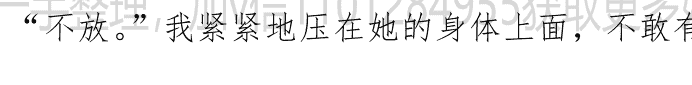

这一切都在撩拨着体内的荷尔蒙，更要命的是，我感觉到身体的某个部位正在不可抑制地起着反应。

娜美转过头，瞪大眼睛，惊讶地看了我一眼。很明显，她也是感觉到了。

卧槽，他太尴尬了。

这可是在性命攸关的战斗中，我们千里遥遥赶到济州岛，执行黑帮的“拯救大兵瑞丝”，与对方短兵相接，以命相搏，关系到我们的兄弟情义，关系到城城的生死安全，多么严肃的一事情！就在这种时候，我的身体竟然产生了反反应！卧槽！这简直是生命中不可承受之耻辱。

要命的是，这种反应还是男人的本能，不是你想控制就能控制的。

作者:云伏欧乾 日期:2016-02-15 15:03

顿时，压在娜美身上的我尴尬无处去，起来也不是不是，不起也不是不是，心中有一只草泥马飞驰而过。娜美的情况比我也好不了多少，她感受着我身体某个部位的强烈反应，脸上的表情混合着惊讶、尴尬、愤怒和羞涩。

总之，大尴尬了。

我的意识在一瞬间走了神儿，趁着这个空档，娜美右手转身一翻，挣脱了我的控制，接着木刀就在我颈骨上顶了一下。我猛吃痛，身体制不住，被娜美一把推开，挣扎着站了起来。她看着我，紧紧地咬着下唇，脸上的潮红还没褪去，眼神却一扫刚才的迷茫，转而犀利，握紧手中木刀，朝我咬了过来。

完了，我心道，今天非我在此地不可。对于娜美这样的对手，同样的招式不可能奏效两次，她估计不会再给我翻盘的机会了。

我有些悲愁，转头看向，我的几个小弟和娜美的几个手在沙滩上翻滚着，不知道是谁绊了刀，沙滩上有片绯红的血迹，正在快速渗透。面对娜美，我猛然感觉到一种绝望。

突然，一阵“啪”的强劲发动机声音由远及近，一辆沙车破风冲了过来，穿着长格子衫，戴着一副墨镜，头发被风向后飘。他径直冲到我们面前，开着沙车，如同天神降临，大声吼：“住手！”

所有人都被镇住了，停在原地，呆呆看着他。这个人从沙滩上跳下来，摘掉墨镜，露出一张还算英俊的脸，看着我们。

看着他，我心里有一种奇怪的感觉，这张脸好像在哪里见过，但一时间想不起。娜美第一时间反应过来，过去推了他一把，吼道：“你在这里？别在这瞎闹！”

作者：云优阳 日期:2016-04-25 15:04
重复了！
作者：云优阳 日期:2016-04-26 11:07

## 第十一章

突然出现的男人说自己是老子，所有人都愣了。

老子？听到这三个字，我的脑海像是被闪电劈过一样，瞬间闪现出无数的画面，在我面前掠过。可这些场景都跟眼前的这个人对不上号。直到此时，我看向安医生在诊所给老子做重生手术，而做完手术之后的老子，便是这张脸。

没错，就是这张脸！老子重生之后的脸！我跟这张脸相处的时间满打不超过五个小时，那么长时间过去了，它几乎要在我的记忆里被抹去。

然而，他猛然问，我却一时间反应不过来。娜美也是疑惑：“你说……是老子？”

“对啊，老子重生，娜美姐！”

“可是，我们都知道老子已经死了……”

“没死！我当时制造了一起假死事件，只是为了躲避整个仁川黑帮的追杀。”

“可是，你的脸……”娜美疑惑。

“我来到济州，用的钱做了整形手术，只是想和过去的身份一切断绝。”

我长舒了一口气，刚才才一直在担心他会不会说了嘴，把安医生卖了。我和老子站着，互相看着，因为立场原因，我们两人的表情上都没有太大的波动，而此时，我相信他一定和我一样，心里已经是波澜万千。

目前掌管局面的关键人物还是娜美，她听了老子的解释后，半信半疑，围着老子转了一圈，仔细地端详着他的脸，就像打量着它感兴趣的玩具一样，“整容手术？能达到这样的水平？”

“贵嘛，”老子笑着，“娜美姐，你不知道为了这个手术花了我多少钱。”

娜美摇了摇头，眯起眼睛，很显然，她一点都没有放下内心的警备，相反，她对于这个“陌生人”的警觉性更高了。

“娜美姐，就算不认识这张脸，我的声音你还是记得吧？”老子有些焦虑，“难道你连我的声音也忘了？”

“你刺杀金大奉的时候，用的是什么武器？”娜美冷冷地抛出了这个问题。

“你老家是哪里？”
“大陆，东北延。”

“你进入社团参加的第一战是什么？”
“对清源派的华人街战？”

“你和阿乾是什么关系？”
“阿乾……是他兄弟。”老子看着我，眼睛通红的，我说我是怎么带他出来的，还怎么把他带回去的。最后，我还是食言了，对不起阿乾，我们都离家乡越来越远……”

“柱子哥！”我终于还是没能控制住自己的情绪，猛然嚎哭起来。我就像是一个受尽了委屈的孩子，终于见到了自己的家长，可以毫无牵挂，放声大哭。那些在社团里的尔虞我诈、勾心斗角，孤独、无名的焦虑，此刻化作大颗泪从眶里涌出，落在脚下的沙滩。一个人承载了太多，我身上负了太多，根本承受不起，那些一直支撑我走到今天的，靠着一份执念和生存的欲望，我才一步步走到今天。

偶然看到了老子，我再也没有办法。直到那一刻，我明白我拼了命要下城，其实是在给自己兜底。老子的出现，让一切都乱了。但我看到娜美紧紧地握着她里的木制短刀，没有任何放松的迹象。这个时候，或许只有孟老大亲自出来，才能打算打消老子的念头。

老子忽然愁悲吼一声，捡起地上的匕首，对准自己的咽喉吼道：“娜美姐姐，是不是要我死了才能结这一切？”

娜美的一个小弟肚子透了，沙滩上的血就流出来了。娜美冷冷地看着他，脸上没有表情：“是。”

“好，那我就……”老子的话还没说完，我就彻底心裂肺般大叫起来，“老子！你以为自杀了这些事情就能一段落吗！我警告你，你可以死，但只要你死了，我就会把这笔账算在社团头上，算在孟头上，算在娜美身上！我这辈子剩下的所有时间都会用来复仇！只要你想让我过这样的生活，你就快死吧！”

老一下子愣住了，拿着匕首的手不停地抖着，嘴里暖嚎：“乾哥……”

其他人脱了他的衣服，按在他的伤口处，扶他坐在地上，痛苦地哼哼唧唧。看着这一幕，我苦苦笑笑：“什么狗帮，什么狗命令，非要把兄弟们死才罢休吗？”

娜美回头看了看那个受伤的小哥，对着他的人说：“快，送他上医院处理伤口。”

“可是，娜美姐……”

“用我的沙车，快去！”老子把钥匙丢了，说：“先别管什么命令，救活自己的命才是最重要的！”

沙车又热闹起来，“笑笑”地开了。老子看着沙车远去的方向，叹了口气问道：“娜美姐，你不知道我整容改成这副模样，是为了躲避的追杀吗？”

“谁？”娜美皱起眉，“不是为了躲避整个仁义黑帮对你的追杀吗？我听说，当时地下市场有很多杀手都在疯狂找你。”

“没错，但你知道最高的悬赏是谁开出的吗？”

老子直视着她，清晰地吐出了三个字：“孟老大。”

娜美的身子明显的了一下，脸上还保持着一定的表情，“不可能，孟老大没有理由做。”

“没有理由？哈哈……”老子笑起来，所有人都莫名其妙，“人心真是世界上最复杂的东西。”

“你到底说什么？”娜美似有些愤怒，“现在你的身份还没证明，你只能当做社团的敌人！”

“绝对不是社团的敌人，娜美姐，“我是社团的牺牲品。”

“……什么意思：“好，今天我就告诉你清楚，孟老大到底是什么人！他让老子去斩杀金大，在老子杀了金大之后，这是孟老大从一开始就开始布置的局。他曾答应过老子的回报，希望能够收买我的心，才让我拿老子的事去赌。为了彻底清除掉威胁，他以后完全高枕无忧。孟老大开出了一个让人舌的悬赏，让老子在鬼门关走了一遭，重新回到世间。”

“你说的都是真的？”娜美后退一步，摇摇头。

“不，阿乾，我知道你跟兄弟情深，不要在这里编故事……”

“不，我没有编故事！”我大声吼道。

娜美在风中乱了，她知道我不能编一个有的故事去骗她，既然已经说了，那肯定是这样的。如今老子的出现，也印证了这一点。她的手，短刀掉在了地上，插进了沙子里。我见她的眼神如此迷乱，好像……”

“不，这不是可能的……”娜美徒劳地摇着头。

“哥哥说的这一切，确实是真的。”封城往前迈了一步，站在我身边道，“我们国家安六处，有一个部门是专门负责追查孟老大犯罪罪的。他所做的事情，还不犯人口和妇女那简单了，为了获取最高利润，他还在被卖掉的人体里藏毒，通过人体运输冰毒和海洛因。”

“怎么可能会是这样。”娜美像是失去了支撑似的，跟我倒在地上。

娜美转过头，瞪大眼睛，吃惊地看了我一眼。很明显，她也一定是感觉到了。

卧槽，他妈的战斗乱了。

这可是性命攸关的战斗中，我们千里迟迟赶到了济州岛，执行黑帮版的“拯救娜美瑞丝”，与对方短兵相接，以性命相搏……

（此处为OCR重复段错误内容）

娜美摇了摇头，什么话都没说。我知道，她是不可能干出这种事情来的，老子这么说，只是为了激她。我明白打铁得热热，便道：“娜美姐，虽然封城是为了调查别的事情，才潜伏在社团里的，但你知道孟老大为什么执意一心的干掉他？”

娜美看着我，没话了，她已经丧失了思考的能力。

“那你告诉我，孟老大如此胆怕封城的原因，是因为他有把柄在国内手里！在没有韩国之前，孟老大混迹在大陆的时候，与广东南的很多黑帮都有联系，当时他最大的买卖的就是联合越南和缅甸，借道金三角地区向美国和墨西哥的黑帮集团卖人口。多少妇女，就是通过孟老手的，从东亚去了北美，供人蹂脚。”

“不，这不是可能的……”娜美徒劳地摇着头。

“哥哥说的这一切，确实是真的。”封城往前迈了一步，站在我身边道，“我们国家安六处，有一个部门是专门负责追查孟老大犯罪的。他所做的事情，还不犯人口和妇女那简单了，是为了获取最高利润，他还在被卖掉的人体里藏毒，通过人体运输冰毒和海洛因。”

“怎么可能会是这样。”娜美像是失去了支撑似的，跟我倒在地上。

念的梦泡在我身上早早就灭了。现在，轮到了娜美。

因为有了老子的突然出现，我才能把所有真相和盘托出。看着精神已经处于崩溃状态的娜美，我说：“在这个社团，其实权利、规矩、派系这些东西都不重要，因为它们都是为了暴力掠夺而设立的冠冕堂皇的借口。只有情谊，在这一生活里所经历的暴力法则所积累的兄弟们，才是这操蛋的世界里唯一的闪光。现在，娜美姐，你知道我为什么要拼命也要救下封城的？”

老棒子看着我说：“阿乾，好久不见，你还是没变。”
“棒子哥，如果你是我，你也会这么做的。”

老棒子一声苦笑，“我一直以来，自己是一个天生的混黑社会的废料，不过在遇到济州岛以后，我想明白了了，阿乾，其实我，你跟我是一类人。”老棒子看向娜美，说：“娜美姐，今天不是阿乾在你这里求我，我老棒子在这里求你，能不能放过封城？”

说完这句话，老棒子一下跪了下去，说：“从小到大，除了天地父母和二爷爷，我老棒子还没跪下过任何一个外人。今天，我就给你跪下了。求你放过封城。”

封城跑过去，也跪下搂着老棒子，“棒子哥，你跟我这么情深，为什么非要做到这个份上……”

老棒子淡淡笑着，“封城，你是阿乾的兄弟，也就是我的兄弟。我带阿乾来韩国的时候，曾答应过他许多事情，可措都没做到，今天算是一个补偿吧。为了兄弟下桩，不丢人。”

娜美挣脱几个手下的阻挡，走过去，捡起插在沙子上的木刀，可是手一松，木刀又掉了下去，斜斜地歪倒在了沙子里。娜美长叹了一口气，转过头，看着远方的大海说：“我就当封城已经死了。”

......

娜美最终放了封城。

他回去会对孟老大反映，已经干干净净了封城，并且将之石沉大海，从世界上彻底抹掉了这一个人。而封城不能继续在药王宗老住了，他要换一个更加隐蔽身份的伪装。

王教理，如你所说，很多好处。我劝封城干脆离开韩国，回到大陆去，那样就不会有任何危险了。封城拒绝了这一提议，他是这样回答我的：“韩哥，在这个世界上，每个人都必须坚持的东西。就像你坚持要救我一样，这就是你的信念。而我一定要在韩国活起来，完成我应该完成的任务，这也是我的信念。”

我有些不太理解这种信念了，“封城，你这样做，到底是为了什么？”

“为了正义。就算正义迟来，也总比它永远缺席的好。”

我枉然一笑，“在你眼里，封城，像我这样的人，不已经算是十恶不赦了？”

封城叹了一声，说：“我刚入国安的时候，有过半年的新兵培训。当时的教官就给我们讲过，不要用一个人的职业和他所处的环境来判定他内心的善恶。我记得很清楚，教官给我们讲了一个故事，他说有一天苏东坡去寺庙游玩，为了助禅，就指着大殿内的塑像，问了小沙扬一个问题：“同样都证得阿罗汉果，位列西方，为什么菩萨就这么慈悲顺眼，而金刚就这么凶狞狡狩？’小沙扬说，金刚怒目，所以用来降除妖魔；菩萨慈悲，所以普度众生。”

我听了之后，心里一震，似有所得。

作者：云火卧阳 日期：2016-04-26 18:00

封城说：“其实无所谓菩萨，他们内心都是善良的，只不过表现出来的方式不同。就像你和我一样，乾哥，你我虽然混迹结派之中，但我知道，你内心其实是向往善的。我只是工作不同，生活环境不同了，其实我们都有着相同的内心世界。你听过舒国敏的那首诗吗？”

“哪首诗？”

“黑夜给了我的黑色眼睛，我却用它去寻找光。”

“哈哈哈哈……”我忍不住大笑起来，笑得泪花都出来了，一把撇对着封城问道：“说，你到底学了什么学历？”

“硕士研究生。”

“卧槽，封城，我是彻底被你骗了，我还以为你妈妈小学毕业呢。你到底是不是从少林寺出来的？”

“少林俗弟子，如假包换。什么都能骗人，可‘心意’骗不了了。”

“你妈......”我恨得牙根痒地看着他，“你有这本事，亏不去当演员呢？”

封城哈哈笑了起来，“其实生活就是一场表演啊。人生如戏，全靠演技。这条路，我还要继续走下去。”

我拍拍封城的肩膀，自此与他相忘江湖。在生命的长里，我与他随水相逢，又旬而复，然而，冬去春来春暖花开，有人离开，有人归来。在我生命里回响已久的老友，终于再次出现了。

他们仿佛完成某种仪式的交替，抚慰着我的空虚的心。其实不管付出了多少努力，倒过来我才是那个不需要照顾的人。

那天晚上，就在海边的风里喝酒，我们找了一个烧烤摊，点了两瓶啤酒。我满一杯，老棒子碰了一下，一饮而尽，感叹说着：“棒子哥，你知道吗，我很久没这样痛快了。”

老棒子嘿嘿笑了起来：“我也是啊，自从离开仁川之后，我就感觉自己被世界抛弃了，每天活得浑浑噩噩，不知道自己是谁。”

我看着他的脸，黄昏的阳光斜斜过来，照在他脸上，更加棱角分明。这是一张十分俊逸、具有男人味的脸，每一个看到这张脸的人都会心动。我不知是不是脸变了，声音听起来比以前磁性多了。总之，老棒子瞪了我一眼：“看着我干啥？”

我轻轻皱起眉头，“你真的是老棒子吗？操，脸变了，声音也变了。”

“你说呢？”老棒子有些无奈，挠了挠脸，“时间太长了，我都记不清。”

“操。”

“那我问你一个问题。”

“操。”

“在济州岛的时候，你还敢尝试吗？”

“两个，一个济州岛，一个大妈，差点呛死。”

“哈哈，”老棒子笑起来，“你第一次尝试那回，我记得了。”

“放心，放心，棒子哥，我拼命了！”

老棒子，愣了一声，摸着自己坚毅的下巴，陷入沉思。不得不说，人是一种动物，随着时间，脸都不一样。今天老棒子在沉思里，竟然流淌出一种属于中年男人的沧桑和成熟。可见在这个世界上，心态是多么重要。我说：“你看可能已经习惯了这种安稳无味的生活了。”

“习惯了，怎么可能？”我问他，“你在济州岛才住了多久？”

“一年了罢。”

“一年？才才一年你就习惯了？棒子哥，你的前半辈子都是风里来浪去，刀头洒血，遍迹江湖，一心只想豪华富贵。这才来到济州一年，你就变了？你以前那些野心和梦想，说没有就没有了？”

老棒子拿啤酒的手猛地一抖。

“跟我回仁川，”我说，“我们兄弟重新联手，一起灯红酒绿，生死与。”

作者：云火卧阳 日期：2016-04-28 12:02

今天上午写完了，如果下午能回来正常更新，感谢大家。

我提出一起回仁川的要求，老棒子沉默了。我知道他在犹豫什么。如果孟老大知道他还活着，一定会想办法斩草根。

我说：“放心，娜美答应过我们，她在孟老大面前绝对不会提到你的事情，她手下的几个小弟也会守口如瓶。”

“不止是孟老大，阿乾，”老棒子浅浅地吞了一口啤酒，悠然叹了口气道，“刺杀之后的那段时间，绝对是我人生里挥之去的噩梦。你知道吗，当时整个仁川的黑帮和职业杀手都在拼命地找我。为了活命，我躲在那里每天惶惶，不敢有一秒钟松懈，因为只要有一瞬间的放松，我的性命就不属于自己了。你体会过那种时刻处于崩溃边缘的状态，简直是世界上最残酷的经历。”

我静静地听着，没有说话。

“说实话，来了济州岛之后，感觉生活一下子变得很无聊了起来。每天喝酒，打牌，跟同事吹牛逼，我却变成了一个上班的，你说荒诞极了。这在以前，打死我都相信我竟然能安于这样的生活。说实话，前一段时间我还想找一个姑娘，在这个结果里生个孩子得了，这辈子怎么活不过，对吧？对吧？所以，阿乾，你看我已经习惯了这种安稳无味的生活了。”

“习惯了？怎么可能？”我问他，“你在济州岛才住了多久？”

“一年了罢。”

“一年？你就习惯了？棒子哥，你的前半辈子都是风里来浪去，刀头洒血，遍迹江湖，一心只想豪华……”

老棒子听着我的话，原本波澜不惊的眼神里好像有一团火焰在慢慢燃烧起来，像是熄灭已久的灰烬，此刻却被人吹了一口气，暗自恢复了生机。

“但是……”老棒子疑惑道，“万一我的身份泄露了……”

“不会会的，老棒子。金大宰都死长段时间了，那股风早早就过去了。你离开仁川之后，金大宰的兄弟沛海信还想搞我，结果被我反搞了一把，现在清派的势力在仁川已经不存在了。”

“嗯，”老棒子点头，“听说了，白道也被杀了。”

说到这里，我愣了，“你真的杀了白道？”

“阿乾，你到底愧疚什么？”

“我本意不是弄死他，他是自杀的。”

老棒子跺下拳，盯着我的眼睛：“你完全不用愧疚，你只需要担心一点——白道死了，重要的是孟老大失去了左右。”

我大惊，看着他的脸，“每一个看到这张脸的人都会心动。”

“你想过吗？坐在高位上的人为了保证自己的位置，一定会这样做。”

“卧槽，棒子哥，你猜得太准了！”

“你跟我回仁川吧。”

“什么？”老棒子拿啤酒的手猛地一抖。

“……”老棒子皱起眉头，看着我，“你怎么知道白道是孟老大用来制衡各个派系之间的棋子？”

“我用时间和经历总结出来的。”

“跟我回仁川吧，”我说，“我们兄弟重新联手，一起灯红酒绿，生死与。”

“可是——如果回仁川，万一孟老大知道了我的身份，他一定会杀手的，身份就暴露了。”

“怎么样，棒子哥，你愿意跟我仁川了？”

“回！”老棒子重重地说了字，然后举杯朝我：“干！”

作者：云火卧阳 日期：2016-04-28 23:36

吃完了！好累！存货快没有了，实在考虑不要去休息吧

作者：云火卧阳 日期：2016-04-29 21:06

满一大啤酒，我和老棒子砸杯痛饮，一口气灌了。

既然我们不逃避，不如主动拥抱。定下了仁川的计划后，我说：“棒子哥，你不能再用这个名字了，你得重新起一个新名字。”

老棒子想想：“我小时候长得特别丑，我爸就很怕我长大了以后找着媳，就给我取了一个小名，叫阿俊。不我就用这个名字吧。”

“阿俊？李阿俊？好名字，哈哈，哈哈，”我看着他那张沉在色中的脸，说，“现在你可担心我不找媳妇了。”

老棒子笑道，“什么吃了都难受。最近还好了，你不知道我刚来济州那段时间心里有多寡狂，一晚上能同时跟四个女人睡觉，最后变成什么份上？我看女人就想吐！”

过犹不及，过犹不及！

“哈哈，你这边是睡到恶心了，不知道愁多少愁丝。”

“其实一直保持着对于女人的渴望挺好的，起码不缺情。不是没有那么一句话，年轻年，永远泪润蓝。”老棒子说完这句话后，轻的叹了口气，装作似的抬起了头，看着天空。

“阿乾，看到你，就像看到了年轻时的我。”

“这么，棒子哥，你愿意跟我仁川了？”

“回！”老棒子重重地说了字，然后举杯朝我：“干！”

作者：云火卧阳 日期：2016-04-28 23:30

看着无尽大海的夜色，忽然想起令狐归隐山时吟的那首诗：“天下风云尽，入江湖事月满。谈笑中，胜人生一场。”

可惜的是，令狐是归隐了，而老棒子却是复出生，最后也没归隐成功，还是陷江湖。

什么是江湖？很小时候，我看电影，以为那打打杀死的武林世界就是江湖；后来长大了，我以为黑社会不同的门派之间的互相杀死，那就是江湖；后再我从学校出来，步入社会，觉得这个社会其实就是一个江湖，想要在这个世道上活下去，有各的门路，有各的手段。而现在，经历的多了，我无比认可古龙先生的那句话：有人的地方，就有江湖。

所以，令狐想归隐山，那山上难道就不是一个江湖吗？

既然我们不逃避，不如主动拥抱。

4，

封城的事情一段落后，我和老棒子一起回到了仁川。
对外，我只是宣称我在大陆的好哥们阿俊来韩国投奔了，在堂口内帮我处理一些杂事，丝毫没有引起任何人的怀疑。可能打他们也想不到，早已已经在车祸中“身亡”的老棒子，会以另一张脸、另一个身份重新出现在仁川。

老棒子来的第二天，我就带他去看了唐妈。

我和老棒子走进唐妈的杂货铺，打了招呼说：“唐妈，忙着呢。”

“不忙，怎么了阿乾，今天什么风你吹过来了，你可是有段时间没来看了。”

“呵呀，咕咕，”我作有些羞愧的样子道，“因为封城……”我和娜美之间的事情，你也知道。”

“人在江湖，身不由己。娜美这孩子是我看着大的，她就是对事不对人。阿乾，你别怪她。”

“我不怪她，唉不提了，过去的事就过去了。唐妈，今天我来找你，是有别的事。”

“等会儿，”唐妈放下手里的活，走到铺子门口左右张望了一下，然后拉上了门，挂出了“盘点歇业”的牌子，这才放心地道：“什么事，你说吧。”

我指着老棒子说：“唐妈，我给你介绍一个新朋友，李阿俊。”

老棒子上前伸出了手，说：“唐妈，久仰大名。”

“你好。”唐妈也很客气的伸出手，跟他握了握，眼睛却疑惑地看向了她，她明白我特地把李阿俊介绍给她，到底底有何深意。

我说：“唐妈，是这样，李阿俊我是在大陆的好哥们，特地来仁川投养我的。为了以后方便，你能不能动动关系，给他弄身身份证？”

“这个啊……”唐妈有些为难，“阿乾，按你开口了我也不能拒绝你了。但是，办身份证这个事情，说难也难，简单单单它就能用到社团的关系。（此处此处原文误为‘简单简单单’）它就能用到社团的关系。李阿俊也刚来，人头还没混，我就用用关系帮他办证，实话不过过去。再说，你现在跟老板之间的关系……你明白吧？”

“我明白，我明白，”我，“可是，唐妈，别的事情说，这个事情你可以一定得先帮我。因为你不是外人，他可是咱们的老朋友。”

“老朋友？”唐妈不解地看着看看，又看看老棒子。

“你觉得他像谁？”我又补充道，“别看脸，看身形。”

听我这么说，唐妈围着他转了两圈，上下打量着，摇了摇头，“看不出来，像谁呢？”

“你觉得他这身材，特别像……老棒子吗？”我开始引导她。

“老棒子？”唐妈眯起了眼睛，又仔细打量了一遍，“不很高，结实的，被你这么一说，还有几分相似。”

“当然相似了！”老棒子忍不住叫了起来，给了唐妈一个熊抱，“我就是老棒子啊，唐妈好久不见，我想死你了！”

唐妈像触了似的，一把将他推开，瞪着我说：“阿乾，这玩笑一点都不好笑！”

“我们没开玩笑，真的，”我说，“他就是老棒子。”

“可是，他……”

“安医生为他做了重生手术。”

听到我言简意赅地指出真相，唐妈毫无防备，忍不住浑身一震。

“安医生？”唐妈倒吸一口冷气，“这么说，老棒子……没有死？”

“确实，棒子哥没有死，之前所有的都是为了掩人耳目，为了活下去，不得已的手段。”我把事情的来来去去，前后给她讲了一遍。唐妈听完之后，沉默了半晌，问道：“太离开了，让我怎么相信你们？”

“很简单，”我说，“你去问问安医生，什么都知道了。”

“稍等，我打个电话。”唐妈让我们稍微等一下，她进入房间，打了个电话。她肯定是找安医生去确认了，谨慎如唐妈者，她肯定不会听我的一面词就认定老棒子的身份。我跟老棒子在家里等着，有些忐不安。

我说：“棒子哥，这个时候唐妈是要给孟老大来通风的。”

“放心吧，不会，”老棒子自信道，“你要懂得摸摸人心，只要亮明的安医生这张底牌，那咱们就是同一个阵营的人。”

“那万一呢……”

“没有万一！你要说万一，你吃饭还有可能被咬死，喝水还有可能被呛死，你吃吃饭？喝不喝水？”老棒子白了我一眼，“阿乾，你现在是一个大哥，也练了那么长时间了，稳重一点，自信一点好不好？”

其实我本来稳稳的，可有了老棒子在身边，不知道怎么回事，我就像看着了家长的孩子一样，又回到了当初那种幼稚的状态。可能就是所谓的“安心”吧，不用自己负太多，一下子就轻松了下来。唐妈再次走出来，脸上已经没有了那种警惕表情。她看着老棒子，也不知道是惊讶还是感慨：“没想到还能见到你，真的是难料。”

“呵呵，没想到还能见到你。本来我都打算离开这里的，可是老棒子回来了。回来，回来就好。”唐妈拍了拍老棒子的肩膀，神色间有些惆怅。

（注：后续段落存在大量OCR重复与乱码，已根据语义逻辑合并并修正）

晚上的时候，我去了安医生的诊所。那天他出的清闲，一个人坐在上面喝茶看册，看到我过来，只是微点了点头，算是打个招呼。人性如此淡泊，我也早已习惯了，也靠着他旁边坐下，说：“老棒子回来了。”

“我知道，下午的时候唐妈跟我说了。”安放下茶杯，悠然幽幽地叹了口气，“其实，我早就等到这一天。”

我在心里由衷赞叹了一声，安医生这洞察力，就像他的手术刀一样冷静精准。这就恰恰悉人心的敏锐性，丝毫不在老棒子之下。

我说：“老棒子回来了，你不担心吗？毕竟，他是你的作品，万一暴露了？”

“哈呵，”安医生浅笑一笑，“担心有用吗？该发生的，迟早会发生；不该发生的，总不会到来。另外，我相信你，也相信老棒子，当然更相信唐妈。现在最重要的，是娜美那边，如果消息泄露出去，也是从她那里走漏的风。”

“放心，”我点头道，“这一点，我敢打包，娜美一直是做到做到，她说了她不会透露老棒子的情况，便打死也不会透漏的。”

我和安医生谈完的时候，允儿送我去门口。要分别的时候，我抱了她一下，吻了吻她的唇。在夜色中，她的嘴唇冰凉凉的，像是被水浸过一样。

“允儿，怎么了？”我看着她的眼睛，她的表情有些不对。

“老棒子回来了，是么……”允儿问道。

“是。”我点了点头，“我们兄弟又能相聚了。怎么，老棒子回来了，你不高兴？”

“我不是高兴，只是……阿乾，自从认识你后，我的梦想是什么？”

“是什么呢？”跟你离开这里，离开韩国，回到故乡，一起过平淡的日子。”我沉默了。

“阿乾，我本以为你已经厌倦了这个江湖，我一直等你的离开。可是现在，老棒子回来了，你们重新聚首，必要掀起一阵风波。”

（注：原文后部分存在严重的OCR识别错误和内容重复，已根据核心语义进行去重与还原）

“那就好。”小马叹了一口气，又端起酒杯说，“这一杯是我替娜美姐谢你的。”

我们正喝着酒，老棒子正推门走了进来。小马就坐在正对门位置的沙发上，抬头了一眼，四目相交后，老棒子原地愣了下，小马也愣了下。

我心里一个“咯噔”。老棒子长得有情可怜，他来到 인천之后，第一次见到小马，难免会勾起以前的诸多回忆。而小马也愣了下，这就直我所想的，难道他还能看出什么？

我也是愣了下。

“阿乾，这位兄弟……面生啊。”小马眯着眼睛说。
我急忙道：“忘了给你介绍了，这是我一个刚从东北延边介绍过来的兄弟，你叫阿俊。”

“东北延？”跟老棒子是一个地方的？

“是，一个地方的。”

“刚从韩国来？”

“对，刚来。”

小马眯着眼睛，又仔细打量了一下，说，“他眼神……我感觉好熟悉哪儿，总觉得他在哪里见过。”

我脸上肯定已经悄然变色，老棒子依然保持着冷静，心里面肯定也是扑一下。我急忙左右顾而言道：“阿俊来，给你介绍一下，这是你小马哥，社团里的前辈，过来敬杯酒。”

老榛子走过来坐下，给小马倒了酒，说，“马哥，我是新人，跟着阿哥开始，以后还需要你多加照顾。”

“好好，你阿哥的兄弟，就是我的兄弟。”小马端着酒，刚放到嘴边，忽然又道：“哎，我们之前是不是在娜美哪里见过？”

马哥笑了笑，“我刚从东北那边过来，这是第一次来韩国，应该不会见过吧……对了，您之前去过东北？”

“没，我没去过大陆。”小马摇了摇头，带着疑惑喝了口酒。

我唯恐夜长多梦，便想找个口尽快把小马轰走，小马话锋一转，“阿乾，我今天才过来，还有另一件另外的事情，想望求你帮忙的。”

“呵呵，马哥，咱们之间就别提什么帮不帮了，太客气，有事你说。”

“尚京路被南方人吞了，你知道吗？”

这么大的事，我倒是知道。南京路在仁川老城，一直是白道掌管的地盘。白道死了之后，南京堂口群龙无首，混乱不堪，越南人便乘势而入，将原本南京堂口的地盘全都抢了去了。

我说：“对于这个事，社团应该拿出一个解决办法的吧，不能再就搁下去了，再搁下去就真成越南人的地界了。”

“有啊，孟老爷说了，要解决这事情，”小马又倒了满一杯啤酒，“孟老说，这个事情交给我了，我要跟越南人那边谈。”

“只有你去谈吗？娜美姐？”小马苦笑一声，“呵呵，从济州回来之后，娜美姐就一直消沉，每天心不在焉的，堂口里的事情，她管的很少，不能过的都不去问了。这段时间她又在剑道潜心修炼，准备参加什么“全东亚剑道大会”，更没时间管这些事情了。”

“孟老知道吗？”

“知道，孟老也说，最近一段时间少麻烦娜美姐，就当让她散散心了。”

我心中好怕，娜美之所以选择这种方式，只不过是对社团来说，对孟老失望了，她一直以来的信念崩溃了，于是采取了这种消极抵抗的形式，来排遣自己内心的忧态和愁。看着封城事件对她造成的影响，要远远超过了我。

小马喝了一口啤酒，“娜美姐是望不上了，但越南人那边，该谈谈，该打打，事情还做得过。所以，阿乾，我感觉自己一个人处理这些事情很难，想借助力量来帮我。”

“对啊，你的力量，不就是新浦街的力量吗？你现在这里的主事，这里自然由你说了。”

“你的意思是，集合你的人和我我的，一起打掉越南帮？”

“不战而屈人之兵。”我接话道。

“对，对，就是这个意思。孟老大说，这是用谋的最高境界。操，我在心里暗暗想，这个老狐狸，算盘倒是打的啪啪响。让你小马这样的人去越南帮谈判，还想不战而屈人之兵，哪里有这么好的事情的事。”

我点上一根烟，沉了片刻，说：“马哥，孟老大这是在害你往火里推。获取更多好处。”

小马一愣，“你这话怎么说？”

“越南帮是那样的你不知道吗？那帮穷鬼把自己的命都看得特别便宜，只要是为了钱的啥事都敢做。你还记得越南帮有一次在菲律宾火拼命，十几个越南人拿着AK-47在光天化日之下开火，他跟敌人拼死似的。最后被警察都围了也不投降，还跟警察火拼了一场，现在听到越南帮的名字还发抖。那是以前，不是现在。韩国市面上对于枪械的控制特别严格，根本搞不到弹药，别说AK-47，你现在黑市买左轮都困难。你说的那种事情，不会发生了。”

我深深吸口烟，“关键是我们一直没跟越南帮打过，也不知道他们那边是啥情况。现在越南帮管事的人是谁？”

“以前可能吧，”小马坐下，“再说了，这是孟老吩咐下来的，难道你也想像你一样，不听令，站在整个社团的对面？我没有这种魄力。”

怎么了，阿乾，你怕越南人？”老棒子装作没听见问道，“呵呵，你早就看出来了？”

我一下子从沙发上弹了起来。老棒子这一口气，真是说到我心里去了。虽然我已经竭力装出一副从容的样子，但没想到这种伪装还是没过老棒子。从小马一开始提到越南帮，我就知道你心里在想什么了。”

“没错，小马提到越南帮的时候，我就不想避了。”我坦诚道，“棒子哥，说实话，我是怕越南帮那种人，根本不把自己当人，只要为了钱他们跟狗一样什么都干，不管任何规则，杀人也行，放火也行，绑架也行，好像不是自己一样。如果我在这种人手里，那真是狮子走街被狗咬了，没有任何意义。生活的这个世界，本来就是弱肉强食，为了生存，本来是不择手段嘛。存在即合理。”

“你的意思，棒子哥，是想让我帮小马一起，解决掉越南帮这件事？”

“对，对，就是这个意思。我觉得对你来说是一个机会。”老棒子正色道，“因为封城的事，你几乎占据了社团所有人的对立面，本来就不乐观了。尚京如果是别人的堂口还好说，偏偏又是白道的，如果这个地方被越南人抢去了，所有人都会把这笔账算在你头上，到时候你所在的社团处境就会更加尴尬了。如果你能和小马一起把这个堂口夺回来，大家都会对你刮目相看，起码白道以前那些媳妇就不会对你仇视了。百足之，死而不僵，白道在社团经营了这么多年，手下的势力还是不容小的，你要仔细考虑一下。”刷新了我的人生观。我本来以为跟越南人交道的就是一场你死我活的火，没想到经过老棒子的话，这一分析还有如此重要的全局性意义。这令人心惊。

“棒子哥，按照你的意思，这活我接了？”

“接，必须得接，”老棒子严肃道，“你在社团里的地位不能翻身，就全靠这次机会了。”

老棒子的话，在我心中久久回荡，振聋发聩。我深思了一夜，决定接受他的建议，用自己的力量支持小马一把。或许，真的能成为我在社团里咸鱼翻身的契机，毕竟从长来看，我还得在这里长期下去。曾几何时，我还想过脱身而去，但现在，这个梦想越越渺缈，越越不可及。这就像一个泥淖，我在里面越陷越深，可是却无力抽身。给我小马打电话，把自己的决定告诉了他。小马很高兴在电话里叫：“阿乾，好兄弟，我就知道你一定会帮助我的，谢你了！”我说：“咱们兄弟之间，就别提什么谢了，有福同享，有难同当的。说吧，你准备怎么搞？”

“还是按照之前的，跟他们见面，先跟他们谈，谈不拢再打。我跟那边已经约好时间了，后天下午，在世宗酒楼见面。”

“世宗酒楼呢？”头皮猛地捏，“怎么挑那个地方，“不是我挑，是对方挑，没事，别有心理阴影，就是一个吃饭的地方而已。”挂电话，我心里有些混乱。世宗酒楼是白道的地方，也是从那时开始，这一串的事情就像多米骨牌一样，一个接一个发生了。我跟小马商量后天见面的对策，在这方面他比我更有经验。问：“棒子哥，你觉得后面跟越南帮见面，事情能谈拢？”

谈拢？”老棒子呵呵一声，“别想了，根本不可能的事情。”

“为什么？”

“你这种人，谁舍得吐出来？越南帮都是一伙什么人？在国内过日子，吃得不容易。阿乾，我告诉你，越是这样的人，越可怕。”

我疑惑：“那行，谈还是不谈？在江湖上混，就得按照规矩来。其实这就是双方互相试探的过程，各自试一下对方的底线。所以到最后谈的时候，就是要硬气，先从局势上压制他们。大体策略已经完毕，剩下的工作就是搜集对方资料。小马那边几乎没有打过道，资料少的可怜，我就收集对方信息安排了。”老棒子手出去，没多久就有反馈回来。老江湖办事特别高。老棒子拿了一张照片给我看，照片上的人瘦弱，三十岁的样子，穿着一身灰色的中山装，带着一副黑框眼镜，模样特别像七十年代的高中教师。我皱眉：“这谁啊？”

“越南帮说话的人，阮英雄。”拿起照片，“跟我小学老师相似。他的情况差不多。小马说的没错，毕业于越南大学，五年前才来到韩国，速度特别快，对外用现代企业手段打理业务，段时间还出过书，名字好像是《如何建立帮派》。我的靠，”我颇为惊讶，“高级分子啊。”

“哼，别看他这样，手段来真黑，不然不能事的。这这么快，出门了，越南帮老就是他从中搞的鬼。”有句话来说，流氓不可怕，怕流氓有文化。”我打量着照片，“这人看上去也不像心狠辣的主啊。“难道坏人人都长在脸上啊？阿乾，我告诉你，越是这样的人，越可怕。这一次，咱们兴许真碰上硬茬了。”我碰到的硬茬不少，但从来没有过这种类型的。这个像小学老师一样的家伙，我怎么看，都无法将他和一个心狠辣的帮派头子在一起。到了会谈的那天，临出门前，我在身上藏了一把刀子以备不测。像这样的情况，我是绝对不会带伙出席的，但越南不同，他们可能什么事情都做出来的，我必须要防着他们。小马带了三个人，我带了三个人，汇合之后，一同前往世宗酒楼。按讲这种事情，带多少人去也是有技巧的，不能带太少，怕遇到，就算没有测，万一临时打起来也难免吃亏。也不能带的太多，太多会显得自己心虚，让对方看不起，看似人多，其实在心理交锋上已经处于下了。关二之所以深受帮派尊敬，不仅是因为他有实力，更还有那副胆识，“单刀赴会”的事情是不随便找人就能干的。说了，单刀赴会就会一场谈判，但关二只身单刀赴会，以精神上把对方压成了此，此大英雄不能为，所以关二一直是华人帮派中的精神偶像。我有过事情，我有单刀赴会。可是，我没有。我们到达的时候，越南帮的人已经到了。世宗酒楼的一楼是大厅，二楼是包间，三楼是一个小厅，有点VIP的性质，可以坐上六七座。我们会谈的时间是中午，正是吃饭的点心，所以一楼和二楼都挤糟糟的，人声鼎沸，但三楼除了越南帮的六七个人外，其他一桌客人也没有。不知道其他人都被跑了，还是酒店方面的特意安排。估计一次死在这一里的事情，还让酒店方面有余悸，这次得知双方在这，早早安排出了场地。三楼的小厅中间撑着一张圆桌，阮英雄坐在圆桌的对面，我在照片上看到的形象一样，瘦瘦弱，穿着一身灰色的中山装，带着一副黑框眼镜，像一个被弃的民办教师。他身后列着六七个，穿着统一服装，身上黑色运动服，下身蓝色运动服，像大陆的高中学生。如果不情的，看到这一幕，还是以为哪个学校出来的。阮英雄看到我们来了，十分礼貌，站起来跟我小马握手，用标准的汉语：“久仰两位，请坐，请坐。”我坐下的时候，打量阮英雄后面的几个人，这是第一次跟越南帮面对面，所以有点好奇。他身后的几个弟弟穿着统一的校服，一看就知道全是狠角色。身体削瘦，表情阴暗，眼神里闪烁着阴险的光芒，像是从贫苦之地出来的群狼。这些特征点燃了我内心处对于越南帮的恐惧。

“老大，汉语说的流利嘛。”小马清了清嗓子，“咳咳，我们还是说正事吧……”“不急说正事——”阮英雄伸出手，制止了小马的话，“民以食为天，我们先吃饭，吃饱了再说。这顿饭，我请客。”阮英雄叫来服务，点了一桌子的菜，要了几瓶酒，然后招呼大家落座，开始吃饭。十几个人全都坐了，动筷子吃东西。我跟马无奈地望了一眼，这哪里是谈判，简直就是聚餐。阮英雄就像一个打太极的高手，借力卸力，把我们一点气都没有。我之前想好的那些对策，准备好的言辞，已经做好的激烈斗争的心理准备，都在慌中化为了无形。阮英雄倒倒酒，还跟我们碰了几杯。他的那些小弟是一言不发，埋头苦吃，只能听到咬肌咀嚼的声音，仿佛寂寂的体内充满了粮食的渴望。越南战斗力如何，我没有直观感受，但吃饭的战斗力算是领教了，一桌子菜风卷残忧，很快就消光了，像是打仗的时候吃军餐一样。吃完饭，收拾完碗筷，阮英雄笑道：“我们兄弟们吃饭相不好看，你们别介意的。”小马说：“理解。”这话陡然一转，让我和小马都有发愣。刚才还和蔼的阮英雄，此刻却表情严肃，不苟一言，黑框眼镜后面闪烁着激勃的光芒。我明白了，他们在用实际行动向我表明要守护地盘的心。刚才还是一脸和亲恭的样子……”

体系，再跟他谈下去就无异于自取辱。面对阮英雄这样的人，想用语言来占到上风是不可能的，只有抛开抒说，直奔主题。

我说：“照你这么说，我们之间是没得谈了？”

阮英雄推了推脸上的黑框眼镜，“当然有的谈，事不不明。关键看是怎么办。”

“呵呵，那你倒说说，该怎么谈？世间万物，此彼长，天地就是一个规律。你们中国的道家不是推荐这种说法吗？”

“阮老大的意思是，你占了我们的地地盘，就让我们干看着？”

“随遇而安。”小马已经被他晕了，进入了暴躁状态，张口就要骂人。我急忙又在他大腿上拍了一把，才没把他全叫出来。虽都是出来的，江湖草萍，侮夫夫人，我还是不想在这越南人面前折了自己的素质。

我说：“阮老大，你这么说的话，咱们之间只有打了。”

“也许这就是终极的解决方式。”英英雄跟我说，“毛泽东在那个年代到处搞搞革命输出的时候，有一句很经典的话，“批判的武器代替不了武器的批判，”我本人并不认为他是一个伟大人物，但对这句话无此比同。”

“武器的批判，有时候带来的并不是理想中的结果。”

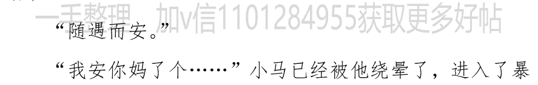

本来以为通过沟通，能和平解决掉这件事情的。”

“当然，我们也不是疯子，也想和平解决。可惜，利益的冲突是人与人之间的矛盾不可调和。”

我实在不想再继续下去这种哲一般的辩论了，于是，我开门见山道：“那就开战。”

陈英英雄无表情，“随时奉。”

他看着我，黑框眼镜后面的目光波光流澜，好像战斗对我来说，就是一家公司聚餐。这个从贫瘠之地出来的乡村教师，用强大的理论武装了自己的头脑和意识，起码在这谈判的饭桌上，他深刻地解释了什么叫“知识就是力量”。回味无穷。

在回去的路上，我跟小马默默无言，垂着头回到新浦街街之后，我越来越觉得心里心里堵堵甸的，不自然地发出一声叹息。

老棒子看着我：“呵呵，被鞭压的滋味怎么怎么样？”

“头一次遇到这种人，”我摇摇头，“我感觉这家伙太大了，油盐不进，精神却比其他的人都强劲的。”

“这种人就是天生的，”老棒子说，“要是是在战争年代，他有可能会是另一个胡志明。”

“哦呵，那你意思是说时势英雄在跟凡人较劲了？”

“不是这个意思，时势造英雄嘛，他没有那个时势，自然不是英雄，虽然他叫阮英雄。”

我白了他了一眼，问道：“怎么办现在，真打啊？”

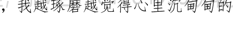

“那你还有什么的好办法。”

我实在不愿意跟越南那帮亡命之徒战斗，那家伙伙就是一群疯狗，咬不着你也溅你一身血。我忽然灵机一动，

“那帮鬼，用钱收买他怎么样？”

老帮子摇了摇头，“你今天没看到英雄的几个下手看他的眼神，那是一种自发自内心的崇拜，就跟五六十年代红卫兵看毛泽东的。阮英雄混到今天这个份上，绝对不是为了钱，也不是为了地盘。”

我就搞不明白了，“那是为了什么？”

“生存信仰。”

听完老帮子的话，我悠然问明白了，其实，越南帮就类似于天涯的“凤凰男”，从贫穷的乡村出来，扎根在繁华的大都市里，拼命夺，拼命挣钱，最重要的还是经济上的掠取，更重要的是，他们要证明自己，哪怕牺牲掉这条命，也要证明自己在世界上价值。

因为只有用才能删除他们曾经背负的贫穷和屈，才能让自己对糟糕的前半生释怀。

就像鲁迅说的一样，可怜之人，必有可恨处。那么坚强的人，也会有一颗掩起来的脆弱之心。活在这个世界上，都不容易，到最后只能变成一种终局：人不为，天诛地灭。

总之，和越南帮之间的开战，已经成了板上钉钉的事儿。

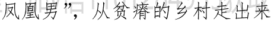

作者:云友欧阳航 日期:2016-05-10 11:20

代发:天涯社区的朋友们，楼主外出办事，托我发帖诉大家，今天上午无法等，下午三点回后更新。感谢大家关注！

作者:云友欧阳航 日期:2016-05-10 15:16

4，让老老子组了一个局，一个闲谈，不吃饭的局。

这个局上除了我和小马、阮英雄之外，还邀请了另外几名其他派系里有头有脸的人物，权当就是做一个见证人。

不管在什么情况下，阮英雄依旧是那身打扮，灰色中山装，黑框眼镜，不苟微言，像是一个过气的中学教师。

2016-11-07 12:49:55 某某处

在座的其他派系里有头有脸的人物，大家都认识，也就不用再做介绍了。我说：“阮老大，今天请这些兄弟兄弟们过来，主要还是想调解一下我们之间的矛盾。你熟悉中国文化，肯定知道我们有一句话，叫做冤家和解不宜。”

“我知道”，阮英雄习惯性地推了推梁上的眼镜，“所谓化干为玉。那么，你们这边怎么想？”

“就需要和你谈了吧。这样说，只要能撤出路。”

“条件？”阮英雄冷一笑，“我的条件，恐怕你们也承受不起。”

“不妨说说。”

“兄弟们跟着我混，无非图饱。我们要撤出路，也行，我要你们在利益的分成。”

“条件？你们这些。”

“呵呵，阿兄弟，你真会玩笑了！”阮英雄一脸冷笑，“当然是我们。”

这句话话说完，我就看到小马脸色立刻阴沉下去了，“阮老大，我们过来谈判，是因为有诚心。现在说这种话，等于明抢吗？”

阮老大嘴角挑道，“我们越南人办事，就是这样的。”卧槽，我心里立刻燃起一股无名火，恨不得现在就冲上去。火气显然比我还大，一把撇了烟道：“你的，你不要脸！”

“战斗？”阮英雄身体向后倾，双臂在胸前挺起，“好，顿时澎湃。”

我知道事情到了这份上，没有别的选择，如果再味妥协，那么我们社团的面子将无存。我压着心中的怒火说：“时间你定，地点我定。”

阮英雄说：“你先说地点。”

“3号仓库。”

我说：“当着这么多江湖朋友的面，咱们把话说说明，如果你们输了，怎么算？”

“如果我们输了，自然会撤出，但我认为这种事情概率微乎其微——”阮英雄笑道，“那么，如果你们输了？”

“如果我们输了，同样撤出，把地拱让，以后再纠缠。”我刚说完这句话，小马就在底下急着扯我腿。我轻轻按住他的手，拍了两下，示意他安静。

“好，也是这样。”阮英雄道，“那么，在座的各位，都是见证人，今天在这里的话，谁也别不想承认。”

“呵呵，老大的，你想多了。”我冷言道，“君子一言，快马。今天把话说这儿，就是让大家听到。”

阮英雄冷地扫了一眼在座的全场人员，说：“对于今天的议，谁还有意见？”

这句话是用闽语说的，不是用汉语的。其实，今天叫来的这些人虽然属于不同帮，但是以亚洲和东南亚地区为主的，这些人大部分都是听懂汉语的，而阮英雄最后用闽语出了这一句，很明显“去中国化”的意思，这也表明了他要与华人社团彻底争取到底。

在目前的领域，本地派帮已经被我们打败了，华人社团可谓一家独大。越南帮虽然层次不高，规模也不大，但厉害事害在一个“狠”字，这世界就是软的怕硬的，硬的怕不要命的，不是每个窟都有把脑跟腰带上的觉悟。所以华人帮和越南帮这两个帮派，其他人谁也不惹，听得英雄这么一发，大家都纷纷摇摇头，表示没意见。

“既然大家没意见，那就把这个接来了，还有——”阮英雄盯着我和小马道，“讲点规矩，下一次再谈判，叫你们孟老了。”

小马直接骂道：“你什么层次，孟老是你意见见见——

“好，”阮英雄不怒笑起来，“很快，你们就会知道我是什么层次。”

实话，我看到他那个老师般的笑容，立刻有一种被点名的冲动。时隔多年，我又重新回起了曾经被班主任支配的恐惧。

回去之后，我对小马说：“这个事情，必须要找娜美姐帮忙，靠咱们两个，恐怕搞不定。”

小马露出难色，“恐怕不行，她现在还在准备全亚剑道大会，每天都在剑道馆里训练，连着好几天，我连她人都见不见。”

“都什么时候时候了，火烧眉了，马上要跟越南人开始了，她还在准备剑道比赛？”

“她说了，这个事她不管。这是小事吗？如果是娜美姐不管的话，”

“她不管也得管啊，这是小事吗？如果是娜美姐不管的话，真麻烦了。”

“那怎么办？”

我沉思片刻道：“娜美姐在哪家剑道馆训练？你带我去找她，我有话告诉剑道馆。”

小马带着我去剑道馆的时候，天色已经黑了，剑道馆却灯火通明，木头招牌上写着“剑道”。可能是天色刚黑，还没到夜里的时间，剑道馆里没什么人，娜美穿着一身黑色的道服，手里拿着一把剑，正在正的地方挥着。这个动作简单，她却做得全神贯注，仿佛一下都融进了精力。她前的短发被汗打湿，结成一缕，知道她已经持续了长时间。

我和小马走进剑道馆门口，刚进去，从镜子里看到了娜美站在，转身朝着我们道：“脱鞋！”我和马一愣，立刻意识到这里需要赤脚，赶紧脱了鞋，踩在凉地板上。我左右审视了一圈，剑道馆里装修很雅，很有传统的意义。娜美收刀，用袖子擦脸上的汗问：“你们怎么来的？”

“娜美姐，你知道越南都要……”娜美冷冷地打断我的话，“其他事情，我就烦你了，这段时间专注比赛，不想这些七七糟的情绪。”

“娜美姐，我问你，”小马挠脑袋，“记得记得课本上都有这首诗。”

高处挂着几张黑白照片，应该是剑道的历代门。墙上还贴着几幅海报，其中一张就是“全亚剑道大会”的宣传图。我点点头：“地方不错。”娜美放下刀，问：“你们怎么来的？”

“娜美姐，我们等会……”娜美冷冷道，“这段时间准备比赛，可是，这是一个大事。”

“大事？呵呵，”娜美冷一笑，“除了生死，哪有什么事。”我心中一紧，低声问道：“娜美姐，你还会在乎？”娜美看了我一眼，眼神随即淡淡的飘开了，“你无关，我是累了。”

娜美看了我一眼，眼神随即淡淡的飘开了，“你无关，社团里的事情，我是真累了。”

从剑道馆出来后，小马头汗问：“你说娜美姐是怎么回事，我感觉她从这次回来以后，就变成了另外一个人。是不是……封城的事，对她刺激太大了？”

我心里如镜似的，封城没有死，娜美也没有心理负担，但老棒子的出现对她是一击冲击，她没想到事情竟然是那样的。当然，造成她如此消失的根本还是孟老大，那个她像父亲一样崇拜的大哥，完全不像表面上光明磊落。封城事件，可能彻底摧毁了娜美多年来构筑的人生信念。

但这些话，我不能对小马说。我只能说：“娜美小姐不是消亡，而是看开了。”

“看开了？”小马疑惑道，“这话应该怎么说的？为了社团，非要参加什么剑道聚会，和不认识的人拼，这叫看来？”

“也许剑道才是值得付出生命和精力的东西。马哥，我问你，“月落乌霜满天，这首诗你听过吧？”小马挠了脑袋，“背过，记得韩国的课本上都有这首诗。”

“没错，这首诗在整个亚洲都影响很大。它的作者是唐朝的张邈，是考试落榜之后，回乡的路上写的。你看，那一届科考登榜人的，我们一个不知道，反倒是落榜的张继，因为这首诗名垂不朽。这句话得好，世间的功名利禄、宏图霸，其实都是粪土，先变成荒，再变成土。就像我们，不管为社团打下多大的江山，哪怕是碾压了整个韩国，若干年后，也只是变成风尘缕，没有人记得我们，没有人记得“诡”这个社团。但娜美的名字，也许会随着剑道文化的传承，一直传下去。”小马听完这话，站在路边，定定抬头看着仰星空，良久之后才说了一句：“操！”

作者:云友欧阳航 日期:2016-05-10 15:17

@三楼后京座苏三 2016-05-10 15:15:20 三点一刻肚子饿了 有更新了吗 吃完饭再来看。不要饿坏肚子了。

作者:云友欧阳航 日期:2016-05-11 01:07

5，

我把和阮英雄谈判的结果给老呆子说了，还有娜美现在的状况。

老愣子：“这么说，娜美现在还是不会出手帮我们喽？”

我说：“是，这回就得靠咱们自己了。”老愣子皱眉，“他妈妈的，这事有点悬。光靠咱们堂的力量，再加上小马那边的人，跟越南拼，还够呛了。”

“我问问社团里其他谁有愿意帮我们的？”

“别闹，千万别闹，”老愣子一把拉住了我，“现在大家都在岸上站着，看着你笑话，谁愿意下来跟你这越泽水？你问了也是白谈，反而被他们笑话。再说，因为封城的事情，大家都知道孟老大对你的态度了，这个时候谁愿意帮你？”

“怎么办？”

“别急，想想，总会有办法的。”老棒子深深抽了口烟，说，“非常之时，只有我们。跟阮英雄约定好的时间，次日的晚上九点。夜幕降临，这是我们来到韩国的第一战。我从来没有过，会有这么一天。在我的印象里，越南帮就是一群狼，一群为了肉奔波不惜命的狼。怕面前是刀山火山，只要阮英雄一声命令，它们也会像狼一样猛地落下。可是今天，我要从这群狼里，抢回属于我们的东西。外面的街道是空旷的，巷子里只有几盏破旧的路灯，电线纵横，空气里弥漫着一股血腥的味道。3号仓库，此刻却是另一番景象：黑暗的巷子里，脚下的路都是泥泞的的，或者是尸体。我和小马带着十几个人，全是从社团里挑选的矫健的小弟，拎着的家伙也是棒球棒、钢管、高尔夫棍等等。这些武器都是经过历史检验，经过无数前辈见证的，街头乱战中最趁手的工具。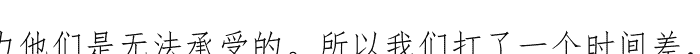

3号仓库的大门类似于汽车厂的那种生锈的铁门，两扇在黑暗中如同紧闭着嘴的巨兽。我们推开门，门发出了生锈的嘎吱声，缓缓开启。里面的灯在瞬间就亮起来，头顶上的灯管发生闪烁。越南帮的众人早就在这里了，站着的，坐着的，有的还蹲地上，大约有三十多个左右。人数不算兵，我小马看到他们的第一眼，就开始了。虽然阮英雄第一次谈判的时候，他手下的几个穿着了统一的制服，严格履行了他们派的信条。在这种规模的聚会的时候，对方完全就暴露出来了。他们没有统一的战术，穿着乱七八糟各种衣服，但脸部表情没有表情，眼神冰冷，像一群狼看着我们。而最让我恐惧的是，他们手里不是棒球棒，也不是高尔夫棍，而是统一装备的三棱军刺！这是我第一次在韩国黑帮斗中见到三棱军刺，三棱军刺具有斩削功能，只能用来插，却有三面血槽，插哪儿就是一个血窟窿，并且由于特殊构造，伤口无法缝合，只能任由血液奔涌，就算插不到要害，也只能任由血液流干，身体枯竭而死。这是彻头尾的杀人武器，被广泛装备对于中国及周围的社会主义军队中，在朝鲜战争和越南战争中，这种恐怖的武器让美军穷了苦头，而如今，不要命的越南帮又把它们用到了黑帮的屠杀中！这帮恐怖的越南帮加上这种恐怖的凶器，如果真打起来，估计能把我们插成筛选？我和小马没有任何的犹豫，大喊了一声跑！”我和小马掉头跑，跟着我们的十几个兄弟也跟着蜜蜂似的朝外面跑去。我回头了一眼，越南帮并没有立刻过来，估计他们有点发愣，可能打了这么多场架，还没见过照面就逃跑的。但是他们仅仅是发愣，可能打了两三秒的时间，随即喘了一嗓，跟我们在后面上来了。我们一小队跑出小巷，在尚京路路口早已停着三辆面汽车，门早已开开等着我们，老棒子坐在车里，一边推手一边挥着我们大喊：“快！快！”我们仓皇躲进车里，车子发动了。刚刚追过的越南帮正在大声骂着，这时让他们惊愕的一幕发生了，六七辆车打着闪黄灯的警车砰砰冲了过来，把他们前后的路全都堵了。那些警察立刻从车子上下来，拿着手枪，大声用韩语叫着让他们扔手里的三把军枪，把手扣在地上老棒子停下车来，我们在远处看着一切。老棒子摇开户，抽上了一根烟，得意地说道：“呵呵，这下包了饺子了。”这个“借花锦”的策略是老棒子一手炮制的，我们在跟越南帮交锋之前，他就已经向警察局打了电话，尚京路有越南帮在敌无辜群众。”
这一街都被封锁，过儿想走都走不了了。

我们的三辆面包车绝尘而去，留在了夜色中相互杀的越南人和韩国警察，远远，枪火的声音不停的传过来，逐渐弱，像过年的时候逐渐稀疏的烟花。

作者:云火欧阳乾 日期:2016-05-11 11:08

回到新浦街后，我们这帮人都都是惊魂未定，找了个小酒馆边喝酒一边压惊。小马说：“操，真服，这帮越南人太没命了，其他妈都上啊。”

我连喝了好几口酒，还是压不住心里的那种怕。我说：“咱们今天这事，是不是做的太绝了！”

“不管怎么说，阿英雄这一次没本钱再跟我们打仗了。”小马也是叹了一口气，”

“马哥说的没错，这个世道，不是你死就是我亡，”老棒子接话，“如果今天咱们跟那帮越南人硬拼的话，估计下场会更惨。”

“阿后，你有，”小马拍了拍棒子的肩膀，“幸巧有你，要不是我们确实是修了。”

我摇了摇头，“说白了，都是，都是出来混饭吃饭，今天这事，咱们做的太分了，不管怎么说，那都是人命。”

老棒子冷笑一声，“扫地恐蝼致命命，爱惜飞钱单价妙，那是尚才的事。咱们既然出来了，就得有这个觉悟

不仅把自己的脑袋别在裤带上，也得让别人的脑袋别在裤腰带上。

我再沉默了，是啊，整个社会就是一个丛林法则，弱肉强食，适者生存，何况是黑帮。但是，我一想起来越南人不要命的往前冲，那些在夜色里此起彼伏的枪伙，我的心里还会突乱。那不是出于死亡的恐惧，那难道是一种对生命的怜悯？我不知道，我只想觉得一个人像条狗那样毫无价值的在街头混血是一件太残酷的事情了。

或者，就像他们说的，我真的不适合混社会。

那一夜，我辗转侧，第二天早，南京黑帮与警察拼的新闻就出来了，被媒体报道，网络和电视上的新闻都在报道这件事情。

警察部门还特别针对这个事情进行了记者发布，说以后要严厉打击仁川地区的帮派活动。因为媒体的报道，普通民众对黑帮活动也十分恐惧，而是开始谈了变色的地步。

南京路黑帮血战击灭了仁川，甚至是波到了整个仁川铁道。说是，越南成员当场死亡二十一人，重伤四人，被捕获六人。警察死亡五人，重伤七人。随后，仁川警察总部开展了雷霆行动，对仁川市内的越南帮成员进行了全面打击，不仅彻底清剿了越南帮的残余势力，就连许多在韩工作或者生意的越南帮害怕受到牵连，也纷纷离离开了仁川。而且局势影响，仁川市内所有的帮派都纷纷蛰伏了起来，不敢有所动作，生怕倒到这股风头上。

那一段时间，可以说是仁市治安最好的“黄金时期”。

气象学家说，一只蝴蝶在日本东京煽动翅膀，就会引起华盛的一场飓风，这就是“蝴蝶效应”。越南帮的覆灭，也是一场典型的蝴蝶效应，白道的死导致了尚京路敞空的虚，越南帮越虚越闹，经过一系列事情的演变，像逐渐倾倒的多洛诺骨帮一样，最终导致了自己的全覆灭。这个世界就像电影的阿甘甘那样，生活就是巧合，你永远也不知道下一颗是他妈的什么味道。

越南帮完了，但唯让我揪心放不下的是，阮英并没有在胜利中被俘，战中生还，在警方开展的专项打击活动中，他也没有了他的。他像烟蒸发了一样，不响的消失了。

没有人知道他去了哪里，他或许潜伏了过来，或者去了别的城市，或者，他崩溃回了越南。我总觉得阮英雄是一个容易挂绊的角色，他像一只孤独的狼，将自己藏在黑暗里，舐着流血的伤，等待着咬断敌人喉咙的反击一击。

越南帮被溃倒以后，小马在社团里流人说我们那天晚上如何如何牛道，如何如何机智，并且在他的嘴里，我成了一个“运筹帷幄之中，决胜千里之外”的角色，这使我在社团里一时间名声大噪，老棒子分析的完全没错，这一役彻底改变了我在帮派里的地位。

在人的眼中，小马代表着娜美，我与小马的联合，意味着与娜美的联合，那么，我与娜美阵营裂的传闻就不攻自破。我不知道孟老大对这个事情怎么想，但其他门口的大哥都敏锐地嗅到了某种味道，之前冷落疏远的那些家伙们纷纷闹以各种借口来接近，就没事新浦街某个地方，喝茶，晚上请我去吃饭。我也没有拒绝，千里之外，毕竟人情世故是要走的，人无处有，天性就是这样。

但把这个功劳归于自己是不对的，老棒子才是这一切的缔造者。那天喝酒的时候，由衷地佩道：“棒子哥，你服我了。”老棒子有些感兴趣问道：“这话怎么说？”老棒子并没有露出得意的表情，而是道：“有时候，事情的发展并不是一开始就能控制的。在我一开始做这些事情的时候，哪里会想到要命？哪里能想到越南人不要命跟警察拼？只要活着，下一秒能碰上什么，谁都说不准。”

“透彻，牛逼。”我举起杯，跟棒子干了一杯。老棒子干了，唾了嘴唇，“阿乾，你等着吧，这一段时间里，社团里要有动作了。”什么动作？”“哦……”我恍然悟，这句话把给我醒了。尚京路虽从手里夺回来，但现在还是属于地，这样下去不是办法，总得要个人当大哥，不然这块地盘又要被别的帮抢去。关键问题就是，孟老大将我成为仁川大哥。

如果娜美混黑帮，所谓剑道，只不过是行使暴力的工具罢了。但是，我看到比赛现场，娜美的表情是专注而镇定的，也许只有在这种情况下，她的内心才能得到暂时的宁静和满足。

剑道比赛非常严肃，不像拳泰或者拳击，光着身，戴着护笠就可以过去打了。为了保护选手，剑道比赛中有着厚厚的护具，戴上面，礼仪繁杂，鞠礼而去。人都对峙半天，通常分出胜负都是电光火石之间的事情，以竹击头部或者腹部，同时会爆发威慑性的声。

“阿乾，小马，你们来了。”已经穿戴了全副护甲，手里拿着头的娜美即将准备上场，但她平静的脸上看不出任何表情的波动。这对冷脸，我们早已习惯了。“娜美姐，加油！你一定能赢的！”小马举着拳头跟娜美加油鼓劲。“嗯。”娜美并没有其他表示，只是点头，好像自己能赢是天经地义一样。她说：“越南的事情，辛苦你们了。没帮上你们忙，别怪我。“娜美姐，你是说的哪里。”我道，“你帮好了已经太多太多了。”

我说这句话的时候，眼睛看着她，是有深意的。我自然指的是她放过封封以及替老棒子保密的事情。娜美迎着我的目光，没说什么，只是点了点头。小马可能察觉出了我们之间有些点事儿，可又想不出来，一头雾水地看着我们。

马上轮到娜美上场了，在上场之前，她熟练地拿一块方巾裹了头发，然后戴上头盔，单手握剑，走向了比赛中央。她不紧张，我倒是有些紧张起来，拧开矿泉水瓶盖喝了一口水润润喉，捅了捅小马：“你说，娜美这能赢吗？”小马没有回答，而是转头看着我，问道：“阿乾，你不是跟娜美姐有一条腿？”“噗”，我刚喝进去的水不偏倚地掉了他一脸，我睁口呆呆看着他，“你说？”“你……有一条……”小马擦了擦脸上的水。“我靠，你是怎么做出的？”你看俩刚才的眼神不一般。“眼神不一般？”我真是无语，“单凭这个，你觉得你俩之间事事？”

# 第十三章 1

娜美参与的“全亚洲道大会”开始了，小马拉着我一起看了比赛。

如果娜美混黑帮，她一定是个优秀的剑道选手，或许就像写下“月落鸦满天”的张健一样以后也说不定。命运的轨迹有时候无法选择的，娜美混黑帮，所谓剑道，只不过是行使暴力的工具罢了。但是，我看到比赛现场，娜美的表情是专注而镇定的，也许只有在这种情况下，她的内心才能得到暂时的宁静和满足。剑道比赛非常严肃，不像拳泰或者拳击，光着身，戴着护笠就可以过去打了。为了保护选手，剑道比赛中有着厚厚的护具，戴上面，礼仪繁杂，鞠礼而去。人都对峙半天，通常分出胜负都是电光火石之间的事情，以竹击头部或者腹部，同时会爆发威慑性的声。“阿乾，小马，你们来了。”已经穿戴了全副护甲，手里拿着头的娜美即将准备上场，但她平静的脸上看不出任何表情的波动。这对冷脸，我们早已习惯了。“娜美姐，加油！你一定能赢的！”小马举着拳头跟娜美加油鼓劲。“嗯。”娜美并没有其他表示，只是点头，好像自己能赢是天经地义一样。她她说：“越南的事情，辛苦你们了。没帮上你们忙，别怪我。“娜美姐，你是说的哪里。”我道，“你帮好了已经太多太多了。”

我说这句话的时候，眼睛看着她，是有深意的。我自然指的是她放过封封以及替老棒子保密的事情。娜美迎着我的目光，没说什么，只是点了点头。小马可能察觉出了我们之间有些点事儿，可又想不出来，一头雾水地看着我们。

马上轮到娜美上场了，在上场之前，她熟练地拿一块方巾裹了头发，然后戴上头盔，单手握剑，走向了比赛中央。她不紧张，我倒是有些紧张起来，拧开矿泉水瓶盖喝了一口水润润喉，捅了捅小马：“你说，娜美这能赢吗？”小马没有回答，而是转头看着我，问道：“阿乾，你不是跟娜美姐有一条腿？”“噗”，我刚喝进去的水不偏倚地掉了他一脸，我睁口呆呆看着他，“你说？”“你……有一条……”小马擦了擦脸上的水。“我靠，你是怎么做出的？”你看俩刚才的眼神不一般。“眼神不一般？”我真是无语，“单凭这个，你觉得你俩之间事事？”

娜美站在比赛中央，面对着她的对手，正在鞠礼。亚洲剑道大会并未设男子组和女子组，因为女子选手本来就少，几乎都在一起比赛。娜美的对手比她身体强壮不少，虽然两人戴着头盔，看不到表情，但我还是感觉到娜美身上流淌着镇定。猛然想起小马刚才才说，娜美这样的女人，最后找什么样的男人呢？或者什么样的男人才能降伏她？比赛开始，两人对峙着，脚下的脚步缓慢，寻找进攻的机会。剑道不像拳击，脚步灵活，虽然戴着护具，但是比较真实的对决场景——因为武器不同，有可能再也没有反击的机会。娜美缓慢移动，可能是找不到娜美的破绽，只能怒一声，攻了，手中竹剑高高举起，如流星朝着娜美的头部砸去。娜美迅速退，向下方躲开了这一击，手中的竹剑横向对方胸部。对方来不及避，只能挡，竹剑发出清脆的“啪”一声。竹剑交的瞬间，娜美向前迈步，手中的竹剑顺着对方滑过去，高高跳起，接着一个从下方的击，精准地打在了对方头笠上。立刻举旗，示意得分。这一击十分漂亮，干净利落，全场声雷动。这场比赛，赢得十分轻松。下场后，我拿着矿泉水递给娜美，由衷地赞叹：“娜美姐，太牛逼了。“呵呵，厉害吗？”娜美难得笑了，接过水喝了一口，擦下了头上的汗。“太厉害了，照下去，一路横斩，很快就能拿到冠军。”娜美却摇头，“我不是为了冠军来的。“不是为了冠军？那你参加比赛是为了？”娜美举起手里竹剑，指向台上的一幅海报。海报上有一个看起来老大的男人，头发全是白的。他穿着一身蓝色的道，闭着眼睛坐在地上，宛若一尊佛。小马问道：“娜美姐，那谁啊？”苏越清。剑道九段，亚洲剑道高手，十一岁学会，十三岁就开始进入比赛，同时获得了称号，被人称为“天才”。十五岁称整个京畿道无人敌。可惜二十岁正值巅峰时便隐退，在虎臣山潜心研修自己创立的流派“越清流”，恢复了古代消失的剑术“燕返”，连射出去的手弹都能斩。“乖乖，能斩断子弹？”小马咬舌，“真的假的？”我看了海报上那头发白的家伙，问道：“娜美姐，这个苏越清，你参加比赛有什么关系？”这次剑道大赛的主方是海东道，也就是苏越清出身的那个门派。所以主办方特地邀请了他作为特殊贵宾，大赛中能够进入半决赛的选手，就可以与越清一战。“对，苏越清是剑道的传奇，也是一直想到的人物。”娜美的眼神里神情开始闪烁出热诚的光芒，“为了这个目标，我必须要做到心旁骛，第一个闯半决赛！现在，你们知道我为什么因为越南的事情分心了吧。”对于娜美的话我有些吃惊，我以为她参加比赛的目的不就是证明自己的实力，拿到应得的荣誉，在剑道界起自己的旗帜。却没想到，她的目标却是叫做“苏越清”的隐士。在娜美的眼里，只要能够挑战这个天才，一切名荣耀都是浮云。

古人说，由术入道。在某一行当浸了久了，就会自然的发出“天人合一”的感悟，就算你只是种个花，泡个茶，也能得道，比花道，比茶道。这人一旦得道，行事风格就很难琢磨，因为在心里，世界已经有了另一番境界。

作者：云火咏阳乾：2016-05-13 11:20

那晚上，张勇给我灌酒，我虽然有些觉得亏了，但还是一个好哥们。我在最困难的时候，帮派里其他人像避瘟一般躲着我，张勇还是把我朋友照顾。甚至在夜店里当我面对冯的刁难时，他还出来来帮我解。这些点点滴滴的细节，我都记得。对我好，我都记得。对我坏，我就要这样，千万别信“以德报怨”那种脑了。“以直报德”，才是正道，你对我，我也对你好；你怎么打我的，我必须怎么样打回去。如果只是一味的“以德报怨”，那这世界上就没有天理了。他杀人放火，他你全家，你还要来说还感谢他，这是什么逻辑？这是他妈的哪个朝编出来的狗屁道？如果要是列个封建化糟烂榜，这就能排到第一。

跟张勇随便找了个酒席，路边摊，买了几瓶便宜酒和烤肉。喝什么酒重要，关键是看谁。跟看不眼的人一起，喝酒像修行。酒过三巡，张勇真醉醺醺的，开始聊正经事：“阿乾哥，你亲手把仁川街打下来的，搞掉了越南帮，现在新浦街没事了，你心里什么想法了？”我装作听不懂，“什么想法？”张勇真敲了桌子，把头伸过来，低声道：“阿乾哥，别说我偏心，老哥，现在仁川堂口空缺一个重要位置，不知道社团里有多少人等着这块地蹦跳，是个圈子。如果你需要，我帮你安排。”老哥苦笑着摇头，“有时候，事情的发展并不是一开始就能控制的。在我一开始做这些事情的时候，哪里会想到要命？哪里能想到越南人不要命跟警察拼？只要活着，下一秒能碰上什么，谁都说不准。“透彻，牛逼。”我举起杯，跟棒子干了一杯。棒子干了，唾了嘴唇，“阿乾，你等着吧，这一段时间里，社团里要有动作了。”什么动作？”“哦……”我恍然悟，这句话把给我醒了。尚京路虽从手里夺回来，但现在还是属于地，这样下去不是办法，总得要个人当大哥，不然这块地盘又要被别的帮抢去。关键问题就是，孟老大将我成为仁川大哥。

如果娜美混黑帮，她一定是个优秀的剑道选手，或许就像写下“月落鸦满天”的张健一样以后也说不定。命运的轨迹有时候无法选择的，娜美混黑帮，所谓剑道，只不过是行使暴力的工具罢了。但是，我看到比赛现场，娜美的表情是专注而镇定的，也许只有在这种情况下，她的内心才能得到暂时的宁静和满足。剑道比赛非常严肃，不像拳泰或者拳击，光着身，戴着护笠就可以过去打了。为了保护选手，剑道比赛中有着厚厚的护具，戴上面，礼仪繁杂，鞠礼而去。人都对峙半天，通常分出胜负都是电光火石之间的事情，以竹击头部或者腹部，同时会爆发威慑性的声。“阿乾，小马，你们来了。”已经穿戴了全副护甲，手里拿着头的娜美即将准备上场，但她平静的脸上看不出任何表情的波动。这对冷脸，我们早已习惯了。“娜美姐，加油！你一定能赢的！”小马举着拳头跟娜美加油鼓劲。“嗯。”娜美并没有其他表示，只是点头，好像自己能赢是天经地义一样。她说：“越南的事情，辛苦你们了。没帮上你们忙，别怪我。“娜美姐，你是说的哪里。”我道，“你帮好了已经太多太多了。”

我说这句话的时候，眼睛看着她，是有深意的。我自然指的是她放过封封以及替老棒子保密的事情。娜美迎着我的目光，没说什么，只是点了点头。小马可能察觉出了我们之间有些点事儿，可又想不出来，一头雾水地看着我们。

马上轮到娜美上场了，在上场之前，她熟练地拿一块方巾裹了头发，然后戴上头盔，单手握剑，走向了比赛中央。她不紧张，我倒是有些紧张起来，拧开矿泉水瓶盖喝了一口水润润喉，捅了捅小马：“你说，娜美这能赢吗？”小马没有回答，而是转头看着我，问道：“阿乾，你不是跟娜美姐有一条腿？”“噗”，我刚喝进去的水不偏倚地掉了他一脸，我睁口呆呆看着他，“你说？”“你……有一条……”小马擦了擦脸上的水。“我靠，你是怎么做出的？”你看俩刚才的眼神不一般。“眼神不一般？”我真是无语，“单凭这个，你觉得你俩之间事事？”

娜美站在比赛中央，面对着她的对手，正在鞠礼。亚洲剑道大会并未设男子组和女子组，因为女子选手本来就少，几乎都在一起比赛。娜美的对手比她身体强壮不少，虽然两人戴着头盔，看不到表情，但我还是感觉到娜美身上流淌着镇定。猛然想起小马刚才才说，娜美这样的女人，最后找什么样的男人呢？或者什么样的男人才能降伏她？比赛开始，两人对峙着，脚下的脚步缓慢，寻找进攻的机会。剑道不像拳击，脚步灵活，虽然戴着护具，但是比较真实的对决场景——因为武器不同，有可能再也没有反击的机会。娜美缓慢移动，可能是找不到娜美的破绽，只能怒一声，攻了，手中竹剑高高举起，如流星朝着娜美的头部砸去。娜美迅速退，向下方躲开了这一击，手中的竹剑横向对方胸部。对方来不及避，只能挡，竹剑发出清脆的“啪”一声。竹剑交的瞬间，娜美向前迈步，手中的竹剑顺着对方滑过去，高高跳起，接着一个从下方的击，精准地打在了对方头笠上。立刻举旗，示意得分。这一击十分漂亮，干净利落，全场声雷动。这场比赛，赢得十分轻松。下场后，我拿着矿泉水递给娜美，由衷地赞叹：“娜美姐，太牛逼了。“呵呵，厉害吗？”娜美难得笑了，接过水喝了一口，擦下了头上的汗。“太厉害了，照下去，一路横斩，很快就能拿到冠军。”娜美却摇头，“我不是为了冠军来的。“不是为了冠军？那你参加比赛是为了？”娜美举起手里竹剑，指向台上的一幅海报。海报上有一个看起来老大的男人，头发全是白的。他穿着一身蓝色的道，闭着眼睛坐在地上，宛若一尊佛。小马问道：“娜美姐，那谁啊？”苏越清。剑道九段，亚洲剑道高手，十一岁学会，十三岁就开始进入比赛，同时获得了称号，被人称为“天才”。十五岁称整个京畿道无人敌。可惜二十岁正值巅峰时便隐退，在虎臣山潜心研修自己创立的流派“越清流”，恢复了古代消失的剑术“燕返”，连射出去的手弹都能斩。“乖乖，能斩断子弹？”小马咬舌，“真的假的？”我看了海报上那头发白的家伙，问道：“娜美姐，这个苏越清，你参加比赛有什么关系？”这次剑道大赛的主方是海东道，也就是苏越清出身的那个门派。所以主办方特地邀请了他作为特殊贵宾，大赛中能够进入半决赛的选手，就可以与越清一战。“对，苏越清是剑道的传奇，也是一直想到的人物。”娜美的眼神里神情开始闪烁出热诚的光芒，“为了这个目标，我必须要做到心旁骛，第一个闯半决赛！现在，你们知道我为什么因为越南的事情分心了吧。”对于娜美的话我有些吃惊，我以为她参加比赛的目的不就是证明自己的实力，拿到应得的荣誉，在剑道界起自己的旗帜。却没想到，她的目标却是叫做“苏越清”的隐士。在娜美的眼里，只要能够挑战这个天才，一切名荣耀都是浮云。

古人说，由术入道。在某一行当里浸了久了，就会自然的发出“天人合一”的感悟，就算你只是种个花，泡个茶，也能得道，比花道，比茶道。这人一旦得道，行事风格就很难琢磨，因为在心里，世界已经有了另一番境界。

注视地看着对方。但这种安静不是普通的安静，让人感受到一种随时都会“玉山将崩”的局势。

在大陆的时候，我看过几本日本作家司马太郎的小说，里面描写剑客决斗时，往往是对对峙许久，一方面是为了杀杀气的比拼，另一方面是为了找到对方的破绽。甚至有多场对决，往往未出一招，对方就已经认输了，因为从早期的对峙中，有经验的剑客就可以观察到对方无论是杀气还是技术，都要远远绕开自己。古代都是剑决胜负，那可是夺命的。

两人的沉默持续了大约半分钟的时间，每一秒钟都在拉扯观众的神经。在众人聚集精神的当口，娜美忽然动了！真的是静如处子，动如脱形，整个身体扭成了一张弓，取出另一枚弹丸射出去，手中的木刀划了一道闪电！我从未见过娜美有如此之快的速度，让我后背不禁起了一层冷汗，难道，在之前的打架战斗中，她从未使用过全力？而如今撞上了真正的高手，她才认真对战？

看来这个世界，比我想象的还要广阔。

苏越清未睁眼睛，甚至步都没有移动一下，而是举起木刀横在面前，挡下了娜美这一击从上至下的俯斩。两把木刀相交，发出了“铿”的一声响。

娜美勉接实，木刀顺着苏越清的刀上滑过去之后，接着一个横斩，快速的向苏越清的颈部。苏越清的步履突然动了，由静止不动为瞬间暴动，竟然没有任何忌上的预告！

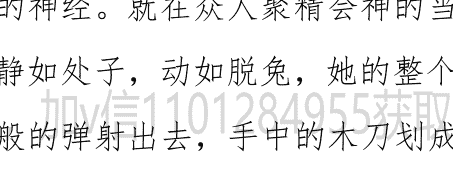

他一个滑消向后撤去，躲过一击横后又迅速上前，仿佛位置就没有移动过一样！这瞬移的功夫堪惊人！

娜美一不中，紧接着又是一斩，其刀快如流星！苏越清低头闪，身子在原地画了一个半圈，手中的刀借惯性猛然而出，动作极快！他却是后招，却几乎与娜美同时出刀，划过一条优美丽的弧线，重重地砸在了娜美的右臂上。

我听到到场有人低声呼道：“燕返！”

原来那就是身边飞过去的燕子都能斩断的古代剑秘技“燕返！”娜美的右手臂被砍中，脸色一紧，手中的木刀“咣当”一声掉在了地上。她想腰下捡拾，可是脸色红，表情极其痛苦，显然已经无法再战斗了！胜负已分。

我从未想过顶级剑客的决斗竟然是如此的快速，两人的时间不算，从娜美举出第一刀开始，到苏越清以“燕返”结束战斗，才起来的刀不过五六下，时间更是只有短短的三四秒钟，彻底推翻了我一开始那种“大战三百回合”的幻想。

武侠小说，看来还是古龙的靠谱，高手对决，生死只在瞬间之间。

娜美的胳膊显然是抬不起来了，不知道骨头有没有断。

苏越清收起刀，朝着娜美鞠一躬，代表比赛已经结束了。

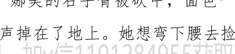

小马转过头，不置信地看着我：“娜美姐，输了？”

我也是一脸大大的错愕，娜美输了？那个见神神兮、见佛萨佛的无敌一般存在的娜美，那个声名震震整个京街地下江南的娜美，竟然在不到五秒的时间里，彻底崩北？

让我想起来上学的时候曾经看过的《海贼王》的一个片段，三刀流索隆想要要成为天下第一剑客，而去挑战了传说中的圣剑露恩。面对索隆的三把大刀，霸眼只是轻手抽出了一小把不能再小的果刀，就轻易的击败了他。索隆此时是崩溃的，他的人生信念在那刻全部崩塌。

我看着娜美的表情，她的脸色绯红，看不出来到底想什么，我不知道，她的信念会不会因为“燕返”一眼而彻底崩塌。

可怜的娜美，我猜在这一刻，她是绝望的。

作者:云火欧阳乾 日期:2016-05-13 11:21

字数限制，所以分了两段发出。明天周末了，不更新，下周见~

作者:云火欧阳乾 日期:2016-05-16 11:02

3. 孟老大发出召令，让各个堂口的老和社团里的主要负责人前往九龙春开会。

这是继封城事件之后，我第一次来到社团总部，面对孟老大。

孟老大见到我，什么也没说，只是轻轻点了点头。好像过去的那些事情都已经云淡风轻，被大风吹走了，全然不挂在心上。可我知道，有些事情，永远不会忘记，只会深深的压在心底。

这次会议的主旨是商谈谁来继任京路街口的问题，孟老大这一次把事情摆到明面上，还让我有点意外。参会的人比较多，有意冯三、社团的前老唐哥、永宗口的邱大良、桂阳口的青哥、景德口的致平……除了娜美以外，基本上全都齐了。

在九龙春，很少有聚齐这么多人的，这些面目我都见过了，但在这种会议上见到还是难得。大家聚了之后非常热闹，互相寒暄，彼此遥望，靠着背。桂阳口的青哥弯着腰，胯上缠着一条金链，脸上还有一条蜿蜒的大疤，看起来很吓人。他握着我：“阿乾，跟越南帮那一伙，你厉害啊。要是你不在，恐怕就不会这么利索了，非得他们一场不可。”

我只能呵呵一笑。在一旁坐着的致平抽着烟，不冷不热道：“一开始孟老大想的就是让你跟越南帮对着，你那么厉害了，恐怕你来得晚，偏偏在那个时候犯了。”

孟老大问道：“致平，你这话什么意思？”

致平笑了笑：“老大，你没意见，我没意见。”

孟老大看了致平一眼：“好了，别换话题，你愿意说你的。”

永宗口的邱大良皮笑接了一句：“孟老大，你继续，这比越南帮强吧？”

孟老大转向冯三问道：“冯三，你说呢？”

冯三摇了摇头：“老大，我没意见。再说，跟越南帮打，那得是人才行，像青哥这样的，太老了。”

青哥不高兴了：“致平，你这话说的得理有道。”

致平呵呵一笑：“老大，我没意见。”

孟老大问道：“冯三，你觉得有合适的人吗？”

冯三话说完，孟老大不乐了道：“冯三，你这话什么意思，跟越南帮仗就是你意思？”

冯三点上一根烟，冷哼一声，若若无地坐了一下。

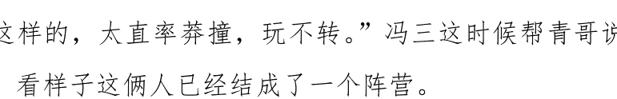

孟老大：“阿乾，过来坐儿。”

我走过去，坐在唐妈身边。唐妈小声道：“阿乾，你小子厉害，别跟他们一般见识。”

我道：“不会的，我是一个后辈，他们说什么听着。”

孟老大敲了敲桌子，示意大家安静，会议开始了。他环顾四周：“今天大家都在，大家都知道我召集大家是什么意思，我就奔主题了。京路街口的问题，大家看到了，急需一个坐馆的人，今天让各位推荐一个合适的人选。俗话说贤者不让，什么说什么，希望大家以大局为重，直言不讳。”

话音刚落，青哥就了：“老大，你来说说，那我就不客气了。冯三不在了，这个堂口应该由我来坐，才像样子，京路街口的兄弟们也服。”

“呵呵，这话说的，”致平冷笑道：“你以为社团是你家的，还搞世袭制？哥完了，我问你，等你挂了，桂阳街口还要留给你儿子？”

“你……”青哥眼睛睁，想要发作，却怯地坐了下去。致平这番话说得理有道，他根本无从反驳。老大还在堂上坐着，他这个时候咳嗽，明显就是不给孟老大面子。

致平清了清嗓子：“老大，我没合适的人选。”

孟老大问道：“致平，你是社团里的老人，很多新人都是你看着一步步走来的。社团里的这些骨干，你都算是熟练了，怎么样，有推荐的人吗？”

致平弹了弹烟灰：“堂口的事言嘛，自然是有能力者居之。为了避嫌，我还是发表意见的好。”如果人生如戏，全靠演技，致平也是一条老戏骨了，他里面的城府，一点都不亚于孟老大。

这时，唐妈在桌下拍我的手心，在我心里写了一个“女”字，我明白她的意思，她是想推娜美上去，求我的意见。推娜美，我没有问题，便朝她轻轻点了点头。

大家为了推荐人的问题七嘴八舌，争得不下。孟老大突然转了，看着我：“阿乾，京路是你和小马从越南家里带回来的，你应该发表一下意见，觉得谁来做这个堂口合适？”

致平说：“没事，老大说了推荐避亲，靠一点有什么问题，你该说就说。”

我说：“我真的没有什么人选，在社团里时间太短，很多事都还没明白，我先保持保留意见，要不让唐妈推荐一下吧。”

“对，唐，你有什么合适的人选？”孟老大问道。

唐妈说：“让我来说话，我觉得娜美这个小姑娘不错。人事干净利落，在社团里也有威望，更重要的是，我是看着她一点点长大的，别的不说，她对社团绝对是忠心耿耿。”

“娜美姐，我双手赞成！”小马立刻附和道。

“那不行！”永宗口的邱大良几乎就要拍案而起了，“自古女人哪能成大事的？娜美已经有一个出口了，你再给她一个出口，这像话吗？不知道还要为我们‘狮’社团男人行不行，全靠女人打天下呢。”

“呵呵，”听到这话，唐妈并不高兴，而是看着邱大良道：“邱大良，你对我这种话就算了。要是娜美在场，你敢说吗？”

“我……”邱大良低头，后半话还是没出来。如果娜美在场，他要说这种话，估计当场就会死掉。会议开了半天，众人七言八语，最后也没有一个统一的意见。这是必然的事情，十几个堂口大哥分成了几个派系阵营，在这种情况下，自然要把自己的人推上去。老大最后也是没办法，无论挑谁来都不能服，或许他自己自己选，但这种时候出来，怕下面的人也不会买账。毕竟坐在老大。

老大清了清嗓子：“好了，别说了！”孟老大敲了敲桌子，示意大家安静。他的脸色不好看，这种糟局面不是他看到的。“京路街口选人，关重大，这个问题上我不会倚任何一个人。本着公开、公正的原则，这次给大家一个机会。一个月后，召开社团全体会议，每个候选人给十分时间阐述自己的竞选理念和措施。采用全体团员投票的方式，票最多的掌握京路街口！你们有没有意见？”

老大的话一出，大家面面相觑。这不是黑社会里搞民主选举？这太大了，没听说哪个帮这么搞法。既然老大发话了，大家满意的，只能表示没意见，同意老大的提案。回去，我把这件事跟老子说了，老大听后哑失笑：“卧槽，民主选举啊，老大这是玩的？”

“是啊，我也是看不懂，他是哪一种。”估计策划差差不多，实在是没办法，被逼的。你想，京路街口必须推一个人上去，可现在下面的人统统不上，怎么办？只能用这招了，民主选举上。”老大沉思片刻，忽然问道：“阿乾，这时候该站队了，你想推谁？”我想了想，“觉得娜美怎么样？”老大眯着眼睛，思考了一下：“行，娜美是个合适的人。外面跟咱们的关系破裂了，其实还是一个阵营。另外娜美虽然年轻，但在社团里的威望也比较较高，不是可能选上她？”

“那就这么定了？”

“嗯，事不宜迟，你现在去找娜美，告诉她你要推她上台。一个月里你不要想别的，专心考虑怎么让娜美在竞选的时候脱颖而出。”

我立刻找了娜美，但我想的是，娜美竟然不在仁川了！结果小马说，娜美输给苏越之后，终于看了自己和顶级剑客之间的差距。为了追求剑道的最高奥义，她已经去了虎臣山，拜在了苏越的门下，潜心修炼。我一听，当时就震惊：“娜美姐进山了？你怎么不早跟我说？”

“说了你也拦不住她啊。娜美临走的时候特地叮咐，不要让人去找她，不要打扰她的修炼。”我靠，我真是日了狗，今年不知道命犯何事，总是能见到奇葩事。老大在黑社会里搞民主选举，这就奇葩了，而娜美又把自己的堂口丢，跑去深山里修炼去了，这简直让人直无所措。

我说：“哥，我想好了，这次推荐京路街口坐馆的事情，关乎重大，我准备要娜美姐上台。”小马道：“我也是这个想法，可娜美已经进山了，怎么办？”我一咬牙：“不是虎臣山吗？走，跟我进山里找她。”“娜美临走的时候特地叮咐，不要去打扰她……”虎臣山在仁川市外，因为地地势险峻，并未得到很好的旅游开发，平时只有一些资深驴友去玩。我和小马准备了一下，开车去了虎臣山。到了山脚下，我一看就傻眼，山脉绵延，哪里去找娜美的影子？小马说：“我知道在哪，娜美临走的时候说过在鹰嘴峡一带。”说是鹰嘴峡，其实是山腰一处凹地，那里郁郁葱葱，氧气量不错，估计至少在这里住了十年。我们走了许久，忽然看到一片开阔地，搭建了一所简约的木头房子，外面放着饭简单的炊具，旁边有一个木头墩，上面横着一把斧头，下面落着砍下的柴。有人生活的痕迹。走进屋子，光线看到一个穿粗布衣服的人坐在那里，手里拿着刻刀，正在精神地雕刻一尊像。他身后有一个架子，上面放着杂七八糟的雕像，形象各异，都是佛教画像，题材观音萨、梵音王等等。雕刻的线条虽然粗犷，却浑然成，神态各异，有一种木质感。他抬头，面容瘦，眼神清澈，如同山里的清风，满头白色的头发，就是在剑道大赛上见过的苏越。老大清了清嗓子：“二位贵客？”

我和小马上前：“先生好，我们是娜美的朋友，有事找她。”“哦，娜美的朋友。”苏越清放下手中的刻刀，站起来拿地上的茶壶：“两位请坐，我点茶。”看来这个人虽然隐居多年，仍很通世。我说：“先生，不用了，娜美在这里吗？”“娜美正在训练，我带你们过去。”苏越清带着我们过一座山坡，走了不距离，看到了一片稀疏的竹林。娜美穿着一身黑色粗布衣服，手持木刀，静静地站在竹林中。我看到了娜美，想要过去打招呼，苏越清伸出手：“等一下，先说话。”我注意到娜美闭着眼睛站在那里，不动如同石像，只有清风缓缓吹，她身上的衣服轻轻荡起来。大约四十分钟，风吹，竹叶落下。娜美忽然动了起来，手中的木刀然而而出，如流星般掠过一道快速弧线，停在了原地。动作太快，我完全看不清楚什么。苏越清带着我们过去。他捡起娜美脚边的一片竹叶，那细长的竹叶从中间部分已经割开。苏越清捡起来在手里轻轻折断了两：“格物致知，细微的东西也有运动的节奏。于秋毫之间，见山川物，进而天地众生。娜美，你刚才感受到了竹叶的飘落，但在出刀瞬间，呼吸乱了。没有按照叮咛，做到心如止水。”娜美看着苏越清，这才抬头看向我们：“阿乾，小马，你们来做什么？”我把老大开过的民主选举京路街口坐馆的事告诉她一遍，最后：“娜美姐，我和马哥都商量过了，我们决定推你上来坐京路的位置。”娜美收起木刀：“这件事你们就别指了。社团里的事情，我不想操心，也不想再管，来虎臣山的时候我已经跟老大说过了，江湖上的恩怨纷争，找不到我的就别找。我只想跟着老师在山里潜心修炼，提高自己的剑技，这才是我应该的事情。”我和小马暗目：“你意思，就是此要退出江湖，社团的事了？”“该问过的还是要问过的，不过没有没必要的，我就不……”“娜美姐，你要是这样，那就难办了。”小马面露难色，“为了一个月后的大会，他们已经开始行动了，咱们如果没有动作，就落下了风的。“如果你们非要推个人出来，那就……”娜美想了许看我说：“阿乾，你就代替替我上位吧。”“我？”我连连选择道，“行不行，我在社团里是个新人，资历还很浅，推我来说，没人会服服气的。”“你错了，社团是个讲丛林法则的地方，不是按资历排的地方，资历什么并不重要。越南帮是你打跑的，京路也是你拿回来的，这一点在社团里没有人能认。我知道你跟阿勇的关系很好，还有小马这，再加上老大……李阿俊的帮助已经结束了。京路堂口的位子，你未必不能坐。”“可是……”我想说什么，娜美打断了我的话。

作者：云火欧阳乾 日期:2016-05-17 11:08

@u_101587241 2016-05-17 11:04:03
居然没更新！请刷新~

作者：云火欧阳乾 日期:2016-05-17 11:12
@冬之微暖琥 2016-05-16 23:10:08
不知道天运得这个版面设计是谁干的，看个帖子那么痛苦。我还是来了。赞了那版面设计的吧。

王教理/信1101284955获取更多帖子

手机 APP 版会好一起

作者：云火欧阳乾 日期:2016-05-18 11:07

*今日起为同事代更，不是楼主。置帖说明：“*代更”。

楼主有事离京。万京前已交代帮忙更新，目前从他单位电脑上的存符来回，只能撑本周五。下周他不能回来还不知道。如果下周一断，请大家多多理解。楼主绝对不是要搞什么乞流量营销，也不需要搞乞流量营销！最后再次替楼主感谢关注《南转向事》！

作者：云火欧阳乾 日期:2016-05-18 11:09

*代更：

从虞山走回去后，小马立刻发动了一切可以发动的力量，广散我要参加南京路口竞选的消息，先期制造舆论氛围。一时间，这事已经闹得沸沸扬扬，尽人皆知，那些以为我已经跟娜美关系决裂的人此刻豁然明白，原来我跟娜美还是一条裤子的。

就算小马已经把消息散播了出去，可是心里还有些犹豫，晚上喝酒的时候，我问老棒子哥：“棒子哥，你说他们要把我们拉上来，这是好事还是坏事？”

老棒子不耐烦地说：“是福不是祸，祸不过过。既事发生了，你就接受吧。”

> “可我觉得心里没底。”

“心里到底他心里什么好事。金大拿遭遇的时候，心里有没有底？朴福信在架的时候，心里有没有底？白道设计陷害你的时候，心里有没有底？他们心里都有底，最后全都罢聚了。我告诉你，经历了这么多年，我是总结了一条经验：江湖如市，谁不知道下一秒会发生什么。所以所有底也没用，事儿都是靠一步一步走出来的。”

我由衷劝道：“棒子哥，你等从江湖退休了，一定要要写一本《黑帮回忆录》，把你的经验和领悟都写进去，留给后人，让他们少走弯路。”

“呵呵呵，”老棒子大笑，“我没那个文笔，看书都费劲，还写书呢。这个活，以后就留给你了。”

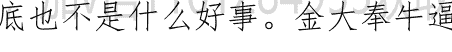

“好”，等我哪天退出江湖了，有时间了，一定要把这些事情都写下来，也算是一个纪念吧。”

“那你可得把写我的运气点上。”

“操，你本来来运气。”

晚上的时候，我正在跟老棒子商量尚京路口竞选的事情，手机忽然响了，我拿起一看，是允儿打来的。

我才忽然想起来，这段时间由于事情比较多，并且连轴转，我心都扑在社团上了，算起来，已经近一个月没跟允儿见面了。

我接通电话，正要道歉，允儿幽幽道：“安柯，有时间的，就替我回家吧。”等我找到安医生诊所的时候，差不多是凌晨一点的样子。允儿脱下外套，换上便装走出来，神情之间有些疲惫。我打开车，问：“允儿，要不要带你去吃晚餐？”

允儿摇了摇头，也不坐车，而是说：“陪我走走吧，感觉好久没有在街上走路了。”

凌晨时的仁川，是一个夜晚即将死去，另一个白天要到来的界线，大多数的人已经沉睡，在梦里继续奔着。但仁川并未入梦，我和允儿并肩走在路上，能看到远处闪烁的霓虹，偶尔驶过的汽车，以及从酒吧出来的人，站在路边哭泣或者狂笑。在夜色里，仁川展示了他的孤独面。

允儿可能觉得冷，她拉上衣服的领子，挡住脸。面前，一阵风吹过来，她脸前的头发轻轻飘散着。我们并排走了两条街道，觉得气氛有些异。我说：“允儿，你是不是有些话对我？”

允儿忽然停住了脚步，看着我说：“阿柯，你还记得你跟娜美分手的那一次，你说什么？”

“我不死，”我说，“如果你不死，就会带着我走，回到大陆或者随便一个地方。”

我一下子想起来，当时的没错，是我跟娜美说过的话。面对允儿在夜色里满人的目光，我默然了。

“可是娜美分手了，还有白道的事情，白道的事情完了了，还有仁川的事情，如今又要参加尚京口的竞选……你告诉我，曾经答应我的承诺，再也无法兑现了是不是？”

“允儿，我知道，这就是江湖，这就是漩涡，一步步都要往前走。但不是完全不能放弃的一切，就像你刚刚来到韩国一样，我身上负的并不是放弃的决定。”

我沉默，我不知道怎么回答。允儿看着我不说话，她急了问：“就算为了我，你也愿意放下这一切？”

不是单单个人的命运，而是其他人的。小马、娜美、老棒子、张勇……允儿摇头，往后退一步，看着我，在苍冷的夜色中，露出一种失望的眼神：“阿柯，告诉我，这种每天奔波的日子，就是我想要的生活？”

“不是，允儿你相信我，这不是我想要的生活。可是回去，也没有那么简单……”我看到允儿眼角处下下行晶莹的泪珠，她拍腿拨开了我的手，说：“阿柯，我对你很好。”

听到这句话，我顿时有一种万箭穿心的感觉。允儿，这个站在我面前的中国姑娘，我是来到韩国后第一个给予我温暖的人。

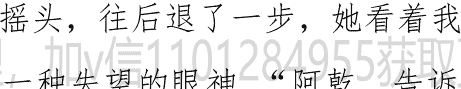

在无休止的奔波和街头巷中，每当我感觉生活黑暗绝望的时候，想起她的脸，心里就会充满了力量。是让她让我感觉自己还活着，还有血肉，有心有肺的活在这个冰冰的世界。而如今，她却对我说我很失望，瞬时，支撑我心的某种信念崩溃了。

允儿独自走了，她没有让我送她。我一个人定定地站在路边，站了许久许久，任凭寂寥的夜色把我的灵魂一点点吞没。

## 第十四章

张勇真知道我要参加尚京竞选的消息后，十分高兴，立刻送来了一笔不菲的“竞选经费”。我说：“勇真兄弟，你也太客气了。”

“不客气不客气。你见过美国总统竞选的时候，每个人都要依附于一个财团吗，不然哪来的钱去搞活动？你就当我是你的小财团吧，哈哈。阿柯，好好你，我看好你哦。”

我笑道：“丑话说在前面，要是竞选输了，这钱我可不还你。”

“哈哈，那是必须的。投资嘛，自然是有风险的。我希望你日后发了，不要忘了我这个兄弟就行。”

“这的是哪里话，咱们这么好的关系。别说尚京路口坐馆了，就算我以后不小心当了美国总统，我也不会忘记的。”

“好，哈哈，等会儿，你再说一遍，我用手机记录下来，免得你以后当了总统不认账……”

有了张勇真提供的这笔资金，我们接下来的工作开展多了。小组组织了一个“宣传队”，在社团里以及华街以各种方式对我进行宣传。我加入社团以来的辉煌战绩，包括清源派击战、打下新浦战、春川街遭遇战，包括刚刚发的南京路跟战，胜利全都算在了我的头上。宣传范围以华街为中心，向外射，目标范围及半个仁川。在强大的舆势下，几乎整个华街的人都是认识的，无论是吃饭还是买水，都没有意思。

老棒子这边制定了一条更加狡猾的策略，就是简单粗暴。张勇真提供的经费大部分都被他包了，在社团里比较底层的小弟们，争取到了选额，争取到了选票。这种办法在韩国，仁川的选举时候，是非常有效的。

“阿柯，这晚上我们叫哥几个去酒吧，放松放松，毕竟好久没有在一起喝酒了。”我举起酒杯：“喝酒。”我们干了几杯，酒有些酿了。小马一眼一扫，看到远处酒吧台坐着一个打扮时髦的姑娘，不由两眼放光，道：“那妞长得不错。”

我们顺着他的目光看过去，果然那姑娘脸确实漂亮，眉目明亮，优雅中隐藏着一丝撩人的风骚。我说：“算了，别落了，这里的美女都是后天出来的。”

“能够整成这样也不算，你总不能被她赶吧！”张勇真呵呵笑道：“你们说，我晚上不能泡上她？”

我笑道：“马哥，你还是欢欢吧。打架你行，泡你真不行。”

“哼，小看。”小马不服，站起来来说：“好了，十分钟之内，我给你们要那妞的电话号码。”小马说完，就一步三晃地走了过去，借机会跟那妞接了个话，就坐在人家旁边。具体怎么，我们听不到，只能看到那妞对小马完全不理会，一脸敷衍，连头都不愿意扭过去。过了一刻钟，小马悻悻地回来了，一屁股垫在座位上，神情相当落寞。

“哈哈，怎么样？”我笑道，“马哥，你说你泡妞不行还不服。”

小马仍不服：“不是我不行，那是姐根本就是个性冷淡，闹不闹，还是同性恋，对男人根本感兴趣。”

“别找借口了，来酒吧里的姑娘，就是等着被男人泡的。”我拍了老棒子的肩膀，对小马说：“你要是不服，让我试试？”

“哼，谁试也用。”

“呵呵，”老棒子笑道，“这种姿色的，五分钟，我给你搞定。”

“哎哟，吹牛啊。”小马掏出自己的银行卡，一把拍在了桌子上，“别说五分，我就给你十分，你要能来这儿的电话号码，现在就随便喊！”

“好，哥马，你就看着好吧。”老棒子拍了拍小马，站起身来，整了整衣服，朝那姑娘走了出去。

整容后的老棒子绝对是女性，少年中三代通吃。他往那些没多少大事，两个人立刻聊得火热。老棒子不知道讲了一个笑话，逗得那姑娘咯咯大笑，前后后仰。不到五分钟，老棒子拿起手机，朝着我们这边晃了晃，示意成功了。

“哎呀，卧槽？”小马惊讶地拍了桌子。

“呵呵，马哥，看来你果然不行啊。”作者：云火欧乾 日期:2016-05-19

老棒子正在跟姑娘热闹，小马生气，忽然一个啤酒瓶子砸过来，“啪啦”一声，在他头上开了瓢。酒子里的人一下子愣住了，他被砸得重重，倒是不深，皮外伤，不过怎么说也得缝针，还得清理干净伤口里的玻璃渣。老棒子往后退步，左手捂着头，血从指缝慢慢流了出来。我们一下子站了起来。小马二话不说，抄起椅子就要过去，我一把拦住了他，让他冷静。他的旁边还站着青哥，脖子上挂着一根金链子，看起来很老的：“青哥，这怎么了？”

青哥歪摇头说：“阿柯，这就是你的不对了，你怎么能一个女人就欺了社团里的兄弟……这一声青哥不给你面子。”小马已经是气怒，指着青哥道。一句话说不出来，只能干瞪眼睛，脸上的表情比吃了屎还难受。冯三说：“少在这长长短，没女人撑腰你就不会说话了怎么着？”“草泥马的，听说你家娜美在山里修行，有没有被狼死都难说呢，你还不赶着去山里陪着，还有空在这儿？”“草你妈，你敢说娜美，我弄死你！”小马再次抄起椅子就要冲上去，我又拦住了他。在这里跟他们冲突绝对不是明智之举。冯三跟青哥带着十个小弟，看到小马要动手，“呼啦”一下围了上来，气势逼人。他们的人手比我们的人多了一倍，要起来肯定吃亏。冯三还十分得瑟，左右的手指交叉比成一个加号的形状，在自己的脑门上：“要动手是吧，来呀，哄，碰，朝这儿瞅，呦他妈的你可吓死我了。”我实在忍不住了，推了他一把，“冯三你过了。”

“卧槽，你敢推我？”冯三往后退一步，装吃惊地看着他。他的几个小弟弟就冲了上来，我们跟推搡在一起了。看着一场就要爆发，我怕心一横，牙一咬，心道事情已经发展到了这个份上，不能打也得打了！

就在我准备召唤兄弟们开始动手的时候，忽然听到一声暴喝道：“都他妈给我手！”

这一声极其异常突然，双方都愣了一下，停住了手，看到一个留着红色头发，西干，身材又胖又壮的家伙从围观的人群里走了过来，脖子上还带着一条泛银色的金属项链，打得相当新潮，像是一个发福的摇滚歌手。冯三斜眼着眼睛问他：“你是谁？”

“谁？你来干什么？”棒子没理他，而是回头问小马道：“阿柯，最近没见你跟允儿出来玩啊，怎么了？”冯三看着一脸得意的脸。

“呵呵，哥哥？你怎么了？”青哥，你这兔崽子居然敢我，今天这了？”青哥歪摇头说：“阿柯，这就是你的不对了，你怎么能一个女人就欺了社团里的兄弟……这一声青哥不给你面子。哈哈……”他一边笑着，一边看着旁边的青哥，“青哥，这兔崽子居然敢我，今天这了？”

整容后的老棒子绝对是女性，少年中三代通吃。他往那些没多少大事，两个人立刻聊得火热。老棒子不知道讲了一个笑话，逗得那姑娘咯咯大笑，前后后仰。不到五分钟，老棒子拿起手机，朝着我们这边晃了晃，示意成功了。

“哎呀，卧槽？”小马惊讶地拍了桌子。

“呵呵，马哥，看来你果然不行啊。”作者：云火欧乾 日期:2016-05-19

酒吧老板的突然出现让局势逆转，我们的人加上冯三带来的，将近两倍。酒吧老板明显是不善者，冷笑一声：“怎么了？怎么了？”

“好，今天晚上算你们狠，青山不改，绿水长流，咱们等以后！”冯马和青哥的紧张消散了，一场骚躁结束了，酒吧里的人看到这一幕，都兴奋地聚起来。我第一时间去看了老子的伤，他被砸得重重。啤酒瓶子在他头上豁开了一道口，倒是不深，皮外伤，不过怎么说也得缝针，还得清理干净伤口里的玻璃渣。

“开车送你们去。”酒吧老板道。

“谢了，我们在门口打个车就行，方便。”

“哎，别客气。你们跟娜美是朋友，那自然就是我的朋友，而且”他捏了捏手里的武士刀，“我带着这玩意一块去，我知道你们华人那边有补刀的传统。”

我们都尴尬地笑了笑，正好今天晚上想着不醉归的。也没有开车，便同意了酒吧老板的要求。刚才被马三打了一巴掌的姑娘抹了抹脸上的泪，说：“我……我也去。”

心里“哎哟”一声，暗道老子一辈子酒瓶没挨，赖回来一个姑娘。

安顿好一切了，从医院回去的路上，最后就剩下了我、张勇和小马三个人。临别的时候，张真嘱嘱道：“马哥，我不是想说教，但你这火脾气真得改，今天晚上要是真闹起来，后果就是我们不愿意看到的。”

小马还忿忿不平，“冯三那王八蛋，哪天要是落到我的手里，非把他活剐了不可。”

“那也是以后的事，现在这个时候，我们千万不能乱了子，免得落在下口。”

“没事，陪你走。”

我有些好奇，就在推测张勇真意的时候，他忽然说了，“阿乾，我问你个事。”

“你说，什么事？”

“你的兄弟李阿俊的事。”

“阿俊，阿俊怎么了？”

“他说话的语气、动作、行为方式，还有处事不惊的态度，我总觉得……他跟我认识的一个人特别像。”

我心里一个“咯噔”，立刻就愣在了原地，舌头有些发硬了，“像谁？”

话一出口，我就懊悔不已。张勇真是何等精明的人物，他总是从我的表情里看出了一些端倪，越是时候，我越应该表现得自然点。

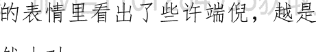

我就在等待张勇发话的时候，他却忽然笑了笑，道：“或许是我多多了，好，你回去早点休息吧。还有几天就是决赛大会了，精挑细锐，别出岔子。”

他拍了拍我肩膀，转身走了，我站在不动，看着他的身影逐渐隐没在夜色的黑暗里。或许，他已经猜到了，或许，他料定就算问什么我也不会说，干脆还不问。总之，他留给我的迷惑，比我留给他的得多。

忽然间，我有些庆幸，像张勇和老棒子这样的人，不是敌人，而是朋友，真是太好了。这样的人，一旦找到机会，发起很难，要比冯和青哥那样的可怕一百倍。

一个月的时间快得也快，转眼间，就要到了堂口竞选的日子，终于到了检验我们劳动成果的时候。这是一场公平的角逐，鹿死滩生，非常困难，但套用一句庸俗的话，至少努力了，就不后悔了。

作者：云火欧阳乾 日期：2016-05-19 11:29

今天代替，把把乾上所有存货更新完了，明天不更新，周末不更新，下周看看鞍鞍是否回来，能否给大家更多新帖。把替鞍鞍感谢大家“南韩执事”的关注!

作者：云火欧阳乾 日期：2016-05-30 11:18

就在参加竞选的前一天晚上，致平叔忽然来到了新浦街找我。等清理，加v信1101284955获取更多好帖。

对于致平的突然造访，我非常意外。要知道在社团里，致平叔的靠谱是非常高的，就连孟老跟他说话的时候都要客客气气的。如今，他却主动来看望我这一个小辈，不能让我受尴尬了。

我急忙招待致平叔坐下，吩咐下赶紧去泡两杯好茶来。

致平叔摆摆手道：“鞍，不用麻烦。我过来就是坐坐，跟你说句话就走。”

我问：“致平叔有何指教？”

呵呵，自古英雄少年，指教不少。前一天，青哥和冯三来找了我，还带了一笔钱，说是孝敬我的。寒了半天，临走的时候表现了自己的意思，希望在竞选那天，让我的堂口的小弟都投票给冯马。”

“呢……”我一时语塞，不知道致平叔说我是什么意思。难道是索贿？想要我也给他一笔钱？

我说：“致平叔，你那个......”

致平叔摆了摆手，打断了我的话，“你知道我是怎么回复冯跟青哥的吗？”

我说：“您老子怎么回复的？”

“我说，我在社团混了一辈子，从没干过给人送钱的事，也从来不为收了别人的钱就给别人办事。你们今天来送钱，让你替我们选票，说是孝敬，其实是打我脸。这钱你们拿走，我一个小子也不要。你们不拿走，我就烧给你们。”

我赞道：“致平叔，太师傅，你简直就是我的人生偶像！”

“别给我高帽了，小鬼，我知道你私下里也没少忙活，到处发红包，拉选票，我堂口里有多少人都收了你的红包，这事可是瞒过的。”

我一时怔住了，正在想办法怎么解释，致平叔又道：“不过，阿乾，你知道我最欣赏的是哪一点吗？”

我说：“我师傅？”

“哈哈哈哈”，致平叔大笑起来，“臭小子，你胆大包天吧。我最欣赏你的一点是，没有去挑各个堂口的大哥，而是直接从基层下手，操劳于心。阿乾，我问你，你知道咱们混帮派的，为什么还要敬关二爷？”

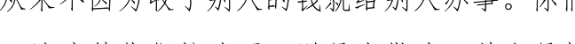

我猜测：“因为他够义气，”致平叔摇摇头，“关二爷不仅够义气，”

“不止于此，”致平叔摇道，“更重要的是他这个人，为公而行而不私，欺强而不自逊，从来不会对比自己强的人服，但从来不会亏待自己手下的兄弟，所以咱们混帮派还会敬关二爷。同样的，我也敬这样的汉子。阿乾，如果你也像山那样，不是去拉我的小弟，而是找我送钱，那我就不会选你。”

我听了倒不好意思起来，“致平叔，我明白，你的策略非常重要。比他们来说，我光落了。阿乾，我今天主要就是告诉你，参加竞选，整个堂口的人支持你！”我激动得浑身发抖，假装镇定，握着致平叔的手：“叔，谢谢你，你真是我的靠山。如果我能当选的话，这份心意我会一直记得。”

“哼哼，别说漂亮话，支持你可是为了以后回报。这几年就算你能过好日子。”致平叔摇摇头，“我不指望你长命百岁。”

“叔，我没法保证。”致平叔摇摇头，“能活多少年，那是注定的，个人的力量微不足。我只想在闭眼之前，看到社团里起一些真正懂事、有途的年轻人，我就安心了。”致平叔走了以后，我心里有些后悔。后悔过这种念头，我一步步走到今天，是为了我的兄弟们活下去。

作者：云火阳阳 日期：2016-05-30 12:20

上海路口民主大会在中华街拉开了帷幕。中华街，有一个社区礼堂，平时里面有一些老头喜欢的京剧、昆曲等戏曲。这个礼堂的建设时间比早了，有些破旧，能够容纳不少人。大会的时间定在了早上九点。这应该是社团成立以来最大的一次会议了。几乎每个堂口的大哥和小弟到场，最后礼堂坐不下了，还有小子在外面站着。这个时候就能看出混派的区别，凡是在社团混得不错的，稍微有些地位的，穿西装或者是一身得体的运动休闲装，打扮得整齐清爽。却是那些连座位都挤着的基层小弟，却一个奇装异服，染着五颜色的头发，身上贴着龙虎，喷着嘴巴，耳朵上打着各种耳机，杀马特。这次参加竞选的候选有位，基本都是各个堂口的大哥或者是能力比较强的骨头。而像致叔这样的德高望重的前辈就承担了此次会议的名誉委员，负责其他候选人进行监督等事宜。作为候选之一，我那天比较精神，穿了一套暗纹西服，还破天荒地打了一条领带。这身行头是老棒子帮我的，一开始我还有些抗拒，“必要穿得正式吗？保持本色就不好了？”

老棒子听了反响，他直接道：“草，你还要保持好颜色上街就行了。”总之，今天是我职业生涯中最美的一天了，以至于我走进礼堂后，很多人都纷纷站起来跟我打招呼，说的不是“加油”，而是说：“干哥，今天帅爆了。”对于他们的奉，我挨个点头微笑，然后往前排找穿着自己名牌的座位。老棒子和小马虎不是候选人，只能坐在后排，与我遥遥望着。会议开始，主持人先请孟老大台上演讲。孟老大还是有些水平的，做到了脱稿演讲，他先是缅怀了一下社团辉煌的过去，然后展望了社团宏伟的将来，由面及点，最后落在南京路堂口这件事上，强调这里地位重要，牵一发而动全身，必须要有能力居，最后说道希望社团成员能够秉持公正之心，用一张选票行使自己的权利，同时也寄于社团一个美好的未来。

别管孟老人如何，这一番话还是讲得十分漂亮，赢得了全场掌声。我原来来说，如果孟老大不是黑帮，而是公务员系统的，那混到副级不成问题。如今我再要修正一下这句话，没想到他在公共场合的口才和气度表现得恰到好处，如果真的是公务员系统的，他估能轻松干到正级，或者更高。加微信101284955获取更多好帖思维回复哦。孟老讲完毕，正戏就开始了。每个候选轮上台上，给二十分钟时间，阐述自己的竞选理念和竞选措施。我看了一下排名，我的发言时间比较靠后，排在我前面的，却是赢家路路的冯禹。

说是二十分钟的发言时间，其实每个人都要去扯扯吧，把自己曾经在社团里打下的“功绩”再说一遍，什么参加了中华街保卫战，什么曾经让一个菲律宾人抬不起头，什么被抓进圈子里面……最后阐述理念，二十分钟根本不够用，大多数都用半小时来说。在这里，出现了一个十分搞笑的场景，在礼堂里大家都在笑。冯禹演讲拿捏不错，二十分钟刚刚结束的时候，他还回忆了一下自己和白道的情谊——这一招用的巧妙，他暗示大家：因为他是白道兄弟，所以白道的地盘是合理的。冯三讲完，该我上场。说实话，我有点压力。没想到竞选演讲说的这么好，出乎我的意料。我上了台，坐好，调整了一下麦克风，目光在礼堂里扫了一圈，看到老棒子举起手，对我做了一个OK的手势。我轻轻地点点头，让他不用担心。“我们今天都在尚京路，我们可以对京路了解多少？”我沉默了一下，接着道：“赶跑越南人之后，我一路留住了他们，每天在海鲜市场上跟那些人交道，就是弄清楚京路的底！”作者：云华阳阳 日期：2016-05-30

尚京路区域常住人口2万，大部分是韩国本地人，人口占7%，其他外籍人口占13%。尚京路有四个海鲜市场，最大的在旺季每天流量5万左右，小的也有1万左右。如此巨大的流量，各位，你们知道决定京路的命脉是什么？”我扫视了一下全场，效果很好，他们都被吸引住了，等待我的下文。

“是运输，”我又重复了一遍，“没错，运输就是京路的命脉。这并不是要富宿、先修路那么简单，如果没有运输，京路将彻底失去生命支撑。从京路海鲜市场到仁川港有三条主要交通线，有两条来往比较频繁，其中距离最近、成本最低的那条生意最差，为什么呢？因为交通线要经过泰国人的地盘，他们从中要收费用，所以运输户都不愿意从那条路走。不过没关系，我已经跟泰国人达成了协议，海鲜市场的份额，从社团里每年拨出5%的收益，作为交换条件，他们将不再设关卡。”。“漂亮！”台下的群众忍不住出了一声，鼓起了掌，一时间，台下声雷动。“反对！”冯三猛然站了起来，大声道：“你跟泰国人谈判，割掉5%？你这是什么行为？你这是自己灭志气，让人没威风！我们华人社团不需要他们帮妥协，敢拦我们的路，直接拆掉就好了！你要真为京路考虑，就不是不去跟泰国人谈判，而是拆掉泰国人！”冯三这一喊，他的手下也都跟着起来，一时间，场面上有些些混乱。我忍住气，对着麦克大声道：“错！”这一声音极锐，估计坐在在前排的人都要耳膜“嗡嗡”。冯三也被我震住了，抬头惊愕地看着我。“混江湖，我们讲的是江湖矩，但江湖矩再大，也大不过生存法则！什么是生存法则？就像古龙说的一样，有人的地方，就有江湖，你杀了泰国人，那还有菲律宾、马来人、日本人、墨西哥人……你杀过的吗？好，退一万步讲，就算你杀过的，把他们全灭了，咱们‘诡’一家独大，你知道这会导致什么后果吗？一家独大的派帮，绝对不是仁川警方和韩国高层愿意看到的画面，他们把我们作为重点打击的对象，甚至会派出韩国警察队对我们进行监视！如果真的发生那样的事情，经营了多年之久的‘诡’社就会在韩国土地上消失！我问你，这种情形是你希望看到的？”冯三时间愣住了，嘴巴动动，却没有说出任何语言。我竟然想起他之前挑衅的那些场景，几乎就在我目中，我不饶地加上了一句：“天天打，杀杀！考虑过后果？考虑过结局吗？我们要活下去不是靠蛮，而是靠脑子！”这句话在公共场合，绝对属于冯三一个难脸。做事不知后果，就是傻逼。他的脸一阵红，简直没法找台阶下，我也打算给他找台阶。“阿乾！”小马站起来，开始鼓掌，大家也都跟着鼓掌。好，我发表完竞选演讲之后，还有两个人，估计感觉没有什么希望，直接放弃选举了。结果出来，意料之外，我以65%的票数绝对优势顺利当选。孟老大只能接受这个现实，当场宣布了我同时兼任浦街和京路两个口。我的表现镇定，还有现场支持的人。孟老大走过来握手：“阿乾，恭喜，好好，社团的未来靠你们这些年轻人了。”会议散会后，社团里很多大哥来我喝杯，恭喜我荣任。对于孟老的任何语言和行为，我心里都有着深深的怀疑和不信任。老棒子的事情已经造成了我们之间的裂痕，这件事就是最后一根稻草。经历了这番大起大落，我感到身心俱疲，不想去，只想回到新浦街好睡一觉。老棒子开着车，我坐在副驾，沉默了一会儿，鼻子酸，忍不住哭了起来。老棒子奇怪地看了我一眼，说：“阿乾，你哭什么啊，今天好事庆祝一下啊？”不是，我只是……”抽着鼻涕叨道，“刚才想到，这可能是我这辈子第一次，也是最后一次被迫选举，忽然觉得心疼。”作者：云欢阳阳 日期：2016-05-30 21:23

为你的世界里只有打折杀？不能混溜，还是一个文化人，俗话流氓不可混，流氓有文化，我就是奔着这个目标的。所以刚写了一本流氓短篇集《借我摇少年》，刚上市，就已经成了热火，横过路桩……咣妈妈呀，你们快去添火吧。

http://img3.laibafile.cn/p/m/250976.png

这是十五个城市里的世界，虽然没有砍刀，没有钢管，没有棒棍……不过一样撑不丧死的混混，跟世界死磕的少年。在最平凡的日子里，他们把生活成了触手及的江湖。今天韩哥为了买书，豁出老脸！购买链接我就发了，要不然显得太丑了。我只能说，卓越京东淘宝上都有……兄弟们，我只能帮你们来到这！

作者:云火欧阳焰 日期：2016-05-30 11:29

在最后：1、一周没更新，看了评论，各种闲论，各种YY的。希望今天的更新你们脸打得太疼。2、感谢忠实的朋友如既往的关注和支持！3、《南韩往事》大概三十万左右写完。目前已经写了27万了。4、本周，周一、周三、周五。望相互理解和告知。作者:云火欧阳焰 日期:2016-06-01 10:38

文章更新于1190128495获取更多帖子@牧野龙兵长2016-05-30 18:29:57

那些天天盯着的是不是一种冯三的感觉！免费看书还挺清事的，谁家还没闹事，起码楼要养活自己吧。所以大家都消停的看，有点耐心。

道：“我那里新来了几个俄罗斯女孩，个个长得跟霍尔金娜似的，老老漂亮了，皮肤白又软，一拍嫩出来。”

“哎哟，俄罗斯姑娘？”我精神抖擞了一下。俄罗斯美女可是全世界最有名的，尤其是年轻的时候，那可真是人间尤物。

“是啊，刚从北边过来的，真是不错。您今天就带着朋友去随便玩玩，就就当是给我挥霍场子。”

“呵呵，就这个……”

“好，就这么说定了！”崔老板唯恐我变卦似的，站起来就要走，临出门前给我打了一个电话的手势，“哥，晚上你给我打电话吧，我我自己安排。”

靠，这事又得，就这么稀里糊涂地应了过来。虽然应了人了，却去不去太好，是到了晚上的时间，我叫上了老棒子、张勇真、小马，还是原班人马，杀向了银河夜城。

心里就当是坐下，权当跟崔老板结一下。他是他头打过，以后会有用得的地方。

银河夜城虽然嵩气，装修档次和规模从全仁来说也是数一数二的。崔老板给我们安排了位置最好的卡座，芝华士士等各色酒肴齐齐上，然后领出了几位俄罗斯美女过来陪我们。

果然是名不虚传，崔老板没有夸大，几位俄罗斯姑娘漂亮极了，皮肤白嫩，眼珠泛蓝，胸挺臀翘，腰肢纤细，充满

热情奔驰的异族风情。小马和张勇眼睛看直了，几乎要流下哈喇子，就整容后无数的老榛子也差点无法自己，差点当场就愣住了。

作者:云吹阳阳:2016-06-01 11:22

张勇真睁眼睛咬道：“俄罗斯姑娘，我不是见过，但真没见过这么标杆的，卧槽，今天晚上没白来。”

崔老板对着位俄罗斯姑娘交了几句，直接就去忙了。俄罗斯美女坐下来，换个搂上一个，语言不通不要紧，可以玩的玩的东西也多了，玩骰子、喝酒、赌诸手......他们三个接着姑娘下手一起，玩的乐不乐谱，乐的嘴巴都合上了。

我由于刚才猛灌了两杯酒，脑袋昏沉沉，就仰靠在卡座里面想一摸。那俄罗斯小姐特别热情，直接就贴了上来，像一只小猫似的在我怀里，抬起头朝我吹气如兰，我叽滋啦地说了一句俄罗斯语，我也没听明白。我刚想要跟她交流，她就像蛇一样缠了上来，抱着我的脖子，滋润丰的嘴巴就贴上了。

我几乎是被迫性跟她撞在了一起。由于刚喝酒，酒内的热血仿佛随着酒精一起被拨动了，我忍不住张开双臂，把她抱在怀里，同时双手在她柔嫩的腰上四处游走着，探索她光滑的肌肤和凹凸的线条。正是在我完全沉醉在这远离的海洋的时候，忽然又被踢了一下。

我睁开眼睛，看到踢我的人是老榛子。我正要问他干什么他，他忽然又踢了一脚，然后用下巴朝我的左边旁边了一下。我顺着他意意的方向看过去，一下子愣住了。

在我不到六七米远的地方，站着的正是允儿。她定站在那里看着我，一不动，眼睛里有些晶晶的东西在闪烁。

我一把推开了怀里的俄罗斯姑娘，站起来：“允儿，你……”

允儿最后看了我一眼，转头就走。我猛赶两步过去，抓住了她的手，她用力一甩，把我开，然后快步走出了夜会。

我紧紧跟着她出去，到了夜会外围，嘈杂的环境一下子安静了下来，仿佛能听到空气里细微的浮动流动。晚上的风也冷了许多，人在身上，汗毛都忍不住竖了起来。

我再次一把抓住她的手，将她的身体拽过来，道：“允儿，你想不想解释？”

“你想什么？”允儿冷冷的看着我说：“我今天找你，你打电话也不接，你来夜会了，我以为你只是来喝酒而已，没想到……”她摇摇头，苦笑一声，“我是看错人了。”

我有些头大，这个时候解释什么都用的。我深深知道，女人在发气的时候是没有解释的，也是没法道理的，这时候我说的话，她听都是都是的。我只能说：“允儿，我喝了点酒，我疯了，你原谅我。”

“你想解释？”允儿说完，转身就走。我牢牢捏住了她的手：“阿乾，你再给我一次机会吗？”

“我们的机会，是你生生毁掉的。”允儿虽然被拉着手，但她道：“你还记得你说什么？你想跟我离开，无论到哪里，哪怕是天涯海角。你的失言，一次就毁了。阿乾，你现在还能后悔吗？”

“不，允儿，你相信，我不会让这种事情发生的。”

“我相信你？阿乾，我真的错了，我们从一开始就不该在一起。”

听到允儿这么说，我的心里瞬间冰凉的，原本坚固的东西仿佛崩塌了。不由自主的松开了手，允儿随即回去，转头看了我一眼，脸上流泪。然后她回头走了。我呆呆地站在门口，看着允儿离去的背影。

我也没有跟任何人话，一动不动，就愣愣地站在那里，像根木头一般。不知道时候，老棒子站在我的身后，点上根烟，吐出了另一道笔直烟，说道：“阿乾，别想了，事情已经发生了。男女之间，就是那么回事，想再多也没用了。”我抬头，看着天上寥寥的星辰，问：“棒子哥，你说，我们还有机会退出社团吗？”

“这条路走到到底。”两行泪，从我的眶流了下来。在依稀的夜色里，我仿佛看到了另一个在当时的自己。如果不是那场意外，如果没有来到韩国，那么我现在的生活，将会完全另一模样吗？可惜错过的已经既定，没有任何人都能改变它。

作者：云火欧胜 日期：2016-06-01 

那段时间，我在韩国最热闹的日子。我掌管新浦街和南京路两个路口，在社团里急速跃升，一天风无二，威风八面。再加上张勇、小马、唐等人的簇拥，势力逐渐增大。不是我愿意，但人到了一份上，派头自然就搞上去了。每次出入，都有小弟跟着我，前呼后援，喧喧哄哄。那些跟我不对付的其他的大哥或者巷口的骨干，见了我都要恭敬地喊上一声“乾哥”。

我没有像三国时期的法正一样，势穷之后，对之前的敌人以此报仇，怨怨必答，而是采用了“宽宏怀柔”的态度。不管之前是谁暗过我，是谁在地上黑过我，是谁在背后说过风凉话，只要你现在不犯我，我统统就不追了。其实人性就是这样，趋利避害，在官渡之战上是能出一个丰功绩的人。在官渡之战中，经历千万难险，曹操将战斗打成了比自己强大倍数的衰兵，在清理曹营的时候，曹操发现了自己方的许多将领在战斗之前写给袁绍的投降书或者交信。怀疑重重的曹操竟然破天荒改了他的操作性，没有查信名，一个一个的出去扑笑，而一把一把这些信给焰烧了，以此收买他人，还说什么这是人性使然，换了谁在那种情况下都会写这种信。

不管史书上是怎么记载的，我绝对对他相信，曹操将这些信的时候，他绝对已经看过了一遍！这也是人性使然，要换了你，你能忍住不看？看到看完之后后再烧了伪装，说谎话，那是另一一事。

我的势力做大了，也不是一片和谐，在社团里，还是有人不服我，这个人就是我的死对头，冯马。

就在我上任尚京路没多久，冯马就约了我谈判，地点在了尚京路上的一家休闲吧。我那天出门的时候

其没有那么多人，只随便带了几个下，就是不想在冯三面前掉了风度。我来的时候，冯三已经在休闲吧等候了，跷着二郎腿，抿着咖啡，好像是一个人来的，连一个小小弟都带。

“乾哥，气色不错。”看到我走进来，冯三站起来了招呼，一脸的笑。

“三哥，坐。”我也客气地点点了点头，朝着他笑了笑。

“乾哥今天很低调啊。”冯三打了一眼跟我来的三个小弟，“听说乾哥最近风光得很。”

“呵呵，见老朋友嘛，那什么没必要。”我淡笑道，“装那些排场，都是给外看的。”

“没想到乾哥现在还能顾及老朋友，真是让人感动的。那必须的，咱们都是兄弟，长兄如父，没错。”

“不是。”我点头。

“好，既然这样，我就绕圈子了。尚京路这个堂口，本来是我大哥打道的，现在他没了，如果说轮到我来，无论按简历按程序来讲，都是问题的吧？”

“三哥，坐。”我向后坐了，抱着双臂看着他，“三哥，别绕圈子了，你想怎么样，说明吧。”

“好，乾哥果然痛快，那我就说了。这个位置，我不跟你，但是我有条件。”

“条件？”我呵呵一笑，“好，你来说。”

作者:云火欧阳 日:2016-06-03 11:26

“我要看你们在尚京路每个季流，从这里给我一成的收益。”我缓缓抽出一根烟，点上，徐徐吐道烟雾，“三哥，你想要这样的话，跟之前那些强占尚京路的越南有什么区别？”

“区别大了。人才算什么？尚京路今天的成就那都是我以前一点滴打下来的，在这个过程里，我也跟着大哥流血，流过汗。没有我们，哪有尚京路的今天，乾哥，说实话，你算是捡了个便宜。我要的一成的收益，多吗？”

“不是多少的问题。如果我给你开了先例，那社团的其他人怎么看我？他们都跑过来要求分一杯羹，我该怎么办？”

“这么说，乾哥是不要求的？”冯三眯起眼睛看着我。

“完全不能同意。”我淡定回答，“就算我同意了，我手下的这些兄弟们也不会替答应。”

“好，就没有好说的了。”冯三站起来伸了伸懒腰，“那今天算白来了。乾哥，别怪我没提醒你，以后万事都要当心。”

“谢谢，”我哈哈一笑，“不送。”跟冯三说完话之后，我并没有把这件事放在心里，毕竟我现在的局势已经做成，就算冯三想用什么办法对付我，他也得考虑考虑后果。但事实证明，这个世界上，还是有人为了利益去冒险而走险的。跟我冯三说完话后不到周的时间，尚京路街就出事了。从仁港出发往尚京海市场的海鲜运输车，连着四五辆，被半路上给拦截停了，汽车被砸，拉的海鲜散落了一地，司机也被打得鼻青脸肿，并且受到了威胁，让他们以后要不要跑这条线，否则见此一次。

那天我就在尚京路望着，被这事的焦头烂额。我既然是堂口的大哥，下面的每个人都交着份子钱和保护费，我自然有义务保护他们的安全。出了这样的事情，我找我诉苦的人络绎不断，在我的办公室里，连着一个上午，我接待了好几个跑来诉苦的人。王经理，正如你说，这真是让我措手不及，因为当时完全没有头绪，到底是谁搞的。现在只要道上的，每个人都知道，尚京路是我地盘，最重要的交通线需要，但我跟他们商量好了，每年从海鲜市场的份额出5%给他们，他们老大很高兴，这，短短上午就损失了。

“区别大了。人才算什么？尚京路今天的成就那都是我以前一点滴打下来的，在这个过程里，我也功不可，跟着大哥流血，流过汗。没有我们，哪有尚京路的今天，乾哥，说实话，你算是捡了个便宜。我要的一成的收益，多吗？”

“不是多少的问题。如果我给你开了先例，那社团的其他人怎么看我？他们都跑过来要求分一杯羹，我该怎么办？”

“这么说，乾哥是不要求的？”冯三眯起眼睛看着我。

“完全不能同意。”我淡定回答，“就算我同意了，我手下的这些兄弟们也不会替答应。”

“好，就没有好说的了。”冯三站起来伸了伸懒腰，“那今天算白来了。乾哥，别怪我没提醒你，以后万事都要当心。”

“谢谢，”我哈哈一笑，“不送。”

跟冯三说完话之后，我并没有把这件事放在心里，毕竟我现在的局势已经做成，就算冯三想用什么办法对付我，他也得考虑考虑后果。但事实证明，这个世界上，还是有人为了利益去冒险而走险的。在我跟冯三说完话后不到周的时间，尚京路街就出事了。从仁港出发往尚京海鲜市场的海鲜运输车，连着四五辆，被半路上给拦截停了，汽车被砸，拉的海鲜散落了一地，司机也被打得鼻青脸肿，并且受到了威胁，让他们以后要不要跑这条线，否则见此一次。

那天我就在尚京路望着，被这事的焦头烂额。我既然是堂口的大哥，下面的每个人都交着份子钱和保护费，我自然有义务保护他们的安全。出了这样的事情，我找我诉苦的人络绎不断，在我的办公室里，连着一个上午，我接待了好几个跑来诉苦的人。王经理，正如你说，这真是让我措手不及，因为当时完全没有头绪，到底是谁搞的。现在只要道上的，每个人都知道，尚京路是我地盘，最重要的交通线需要，但我跟他们商量好了，每年从海鲜市场的份额出5%给他们，他们老大很高兴，这，短短上午就损失了。

我再次一把抓住她的手，将她的身体拽过来，道：“允儿，你想不想解释？”

“你想什么？”允儿冷冷的看着我说：“我今天找你，你电话也不接，你来夜会了，我以为你只是来喝酒而已，没想到……”她摇摇头，苦笑一声，“我是看错人了。”

我有些头大，这个时候解释什么都用的。我深深知道，女人在发气的时候是没有解释的，也是没法道理的，这时候我说的话，她听都是都是的。我只能说：“允儿，我喝了点酒，我疯了，你原谅我。”

“你想解释？”允儿说完，转身就走。我牢牢捏住了她的手：“阿乾，你再给我一次机会吗？”

“我们的机会，是你生生毁掉的。”允儿虽然被拉着手，但她道：“你还记得你说什么？你想跟我离开，无论到哪里，哪怕是天涯海角。你的失言，一次就毁了。阿乾，你现在还能后悔吗？”

“不，允儿，你相信，我不会让这种事情发生的。”

“我相信你？阿乾，我真的错了，我们从一开始就不该在一起。也许我们从一开始就不该在一起。”

听到允儿这么说，我的心里瞬间冰凉的，原本坚固的东西仿佛崩塌了。不由自主的松开了手，允儿随即回去，转头看了我一眼，脸上流泪。然后她回头走了。我呆呆地站在门口，看着允儿离去的背影。

我愣愣地站在那里，像根木头一般。不知道时候，老棒子站在我的身后，点上根烟，吐出了另一道笔直烟，说道：“阿乾，别想了，事情已经发生了。男女之间，就是那么回事，想再多也没用了。”我抬头，看着天上寥寥的星辰，问：“棒子哥，你说，我们还有机会退出社团吗？”

两行泪，从我的眶流了下来。在依稀的夜色里，我仿佛看到了另一个在当时的自己。如果不是那场意外，如果没有来到韩国，那么我现在的生活，将会完全另一模样吗？可惜错过的已经既定，没有任何人都能改变它。

作者：云火欧阳 日期：2016-06-01

那段时间，我在韩国最热闹的日子。我掌管新浦街和南京路两个路口，在社团里急速跃升，一天风无二，威风八面。再加上张勇、小马、唐等人的簇拥，势力逐渐增大。不是我愿意，但人到了一份上，派头自然就搞上去了。每次出入，都有小弟跟着我，前呼后援，喧喧哄哄。那些跟我不对付的其他的大哥或者巷口的骨干，见了我都要恭敬地喊上一声“乾哥”。

我没有像三国时期的法正一样，势穷之后，对之前的敌人以此报仇，怨怨必答，而是采用了“宽宏怀柔”的态度。不管之前是谁暗过我，是谁在地上黑过我，是谁在背后说过风凉话，只要你现在不犯我，我统统就不追了。其实人性就是这样，趋利避害，在官渡之战上是能出一个丰功绩的人。在官渡之战中，经历千万难险，曹操将战斗打成了比自己强大倍数的衰兵，在清理曹营的时候，曹操发现了自己方的许多将领在战斗之前写给袁绍的投降书或者交信。怀疑重重的曹操竟然破天荒改了他的操作性，没有查信名，一个一个的出去扑笑，而一把一把这些信给焰烧了，以此收买他人，还说什么这是人性使然，换了谁在那种情况下都会写这种信。

不管史书上是怎么记载的，我绝对对他相信，曹操将这些信的时候，他绝对已经看过了一遍！这也是人性使然，要换了你，你能忍住不看？看到看完之后后再烧了伪装，说谎话，那是另一一事。

我的势力做大了，也不是一片和谐，在社团里，还是有人不服我，这个人就是我的死对头，冯马。

就在我上任尚京路没多久，冯马就约了我谈判，地点在了尚京路上的一家休闲吧。我那天出门的时候

冯三已经在休闲吧等候了，其其地没有那么多人，只随便带了几个下，就是不想在冯三面前掉了风度。我来的时候，冯三已经在休闲吧等候了，跷着二郎腿，抿着咖啡，好像是一个人来的，连一个小小弟都带。

“乾哥，气色不错。”看到我走进来，冯三站起来了招呼，一脸的笑。

“三哥，坐。”我也客气地点点了点头，朝着他笑了笑。

“乾哥今天很低调啊。”冯三打了一眼跟我来的三个小弟，“听说乾哥最近风光得很。”

“呵呵，见老朋友嘛，那什么没必要。”我淡笑道，“装那些排场，都是给外看的。”

“没想到乾哥现在还能顾及老朋友，真是让人感动的。那必须的，咱们都是兄弟，长兄如父，没错。”

“不。”尚京路是我地盘，最重要的交通线需要，但我跟他们商量好了，每年从海鲜市场的份额出5%给他们，他们老大很高兴，这，短短上午就损失了。

“不是。”我点头。

“好，既然这样，我就绕圈子了。尚京路这个堂口，本来是我大哥打道的，现在他没了，如果说轮到我来，无论按简历按程序来讲，都是问题的吧？”

“三哥，坐。”我向后坐了，抱着双臂看着他，“三哥，别绕圈子了，你想怎么样，说明吧。”

“好，乾哥果然痛快，那我就说了。这个位置，我不跟你，但是我有条件。”

“条件？”我呵呵一笑，“好，你来说。”

作者:云火欧阳 日:2016-06-03 11:26

“我要看你们在尚京路每个季流，从这里给我一成的收益。”我缓缓抽出一根烟，点上，徐徐吐道烟雾，“三哥，你想要这样的话，跟之前那些强占尚京路的越南有什么区别？”

“区别大了。人才算什么？尚京路今天的成就那都是我以前一点滴打下来的，在这个过程里，我也功不可，跟着大哥流血，流过汗。没有我们，哪有尚京路的今天，乾哥，说实话，你算是捡了个便宜。我要的一成的收益，多吗？”

“不是多少的问题。如果我给你开了先例，那社团的其他人怎么看我？他们都跑过来要求分一杯羹，我该怎么办？”

“这么说，乾哥是不要求的？”冯三眯起眼睛看着我。

“完全不能同意。”我淡定回答，“就算我同意了，我手下的这些兄弟们也不会替答应。”

“好，就没有好说的了。”冯三站起来伸了伸懒腰，“那今天算白来了。乾哥，别怪我没提醒你，以后万事都要当心。”

“谢谢，”我哈哈一笑，“不送。”跟跟冯三说完话之后，我并没有把这件事放在心里，毕竟我现在的局势已经做成，就算冯三想用什么办法对付我，他也得考虑考虑后果。但事实证明，这个世界上，还是有人为了利益去冒险而走险的。跟我冯三说完话后不到周的时间，尚京路街就出事了。从仁港出发往尚京海市场的海鲜运输车，连着四五辆，被半路上给拦截停了，汽车被砸，拉的海鲜散落了一地，司机也被打得鼻青脸肿，并且受到了威胁，让他们以后要不要跑这条线，否则见此一次。

那天我就在尚京路望着，被这事的焦头烂额。我既然是堂口的大哥，下面的每个人都交着份子钱和保护费，我自然有义务保护他们的安全。出了这样的事情，我找我诉苦的人络绎不断，在我的办公室里，连着一个上午，我接待了好几个跑来诉苦的人。王经理，正如你说，这真是让我措手不及，因为当时完全没有头绪，到底是谁搞的。现在只要道上的，每个人都知道，尚京路是我地盘，最重要的交通线需要，但我跟他们商量好了，每年从海鲜市场的份额出5%给他们，他们老大很高兴，这，短短上午就损失了。

我再次一把抓住她的手，将她的身体拽过来，道：“允儿，你想不想解释？”

“你想什么？”允儿冷冷的看着我说：“我今天找你，你电话也不接，你来夜会了，我以为你只是来喝酒而已，没想到……”她摇摇头，苦笑一声，“我是看错人了。”

我有些头大，这个时候解释什么都用的。我深深知道，女人在发气的时候是没有解释的，也是没法道理的，这时候我说的话，她听都是都是的。我只能说：“允儿，我喝了点酒，我疯了，你原谅我。”

“你想解释？”允儿说完，转身就走。我牢牢捏住了她的手：“阿乾，你再给我一次机会吗？”

“我们的机会，是你生生毁掉的。”允儿虽然被拉着手，但她道：“你还记得你说什么？你想跟我离开，无论到哪里，哪怕是天涯海角。你的失言，一次就毁了。阿乾，你现在还能后悔吗？”

“不，允儿，你相信，我不会让这种事情发生的。”

“我相信你？阿乾，我真的错了，我们从一开始就不该在一起。也许，我们从一开始就不该在一起。”

听到允儿这么说，我的心里瞬间冰凉的，原本坚固的东西仿佛崩塌了。不由自主的松开了手，允儿随即回去，转头看了我一眼，脸上流泪。然后她回头走了。我呆呆地站在门口，看着允儿离去的背影。

愣愣地站在那里，像根木头一般。不知道时候，老棒子站在我的身后，点上根烟，吐出了另一道笔直烟，说道：“阿乾，别想了，事情已经发生了。男女之间，就是那么回事，想再多也没用了。”我抬头，看着天上寥寥的星辰，问：“棒子哥，你说，我们还有机会退出社团吗？”

两行泪，从我的眶流了下来。在依稀的夜色里，我仿佛看到了另一个在当时的自己。如果不是那场意外，如果没有来到韩国，那么我现在的生活，将会完全另一模样吗？可惜错过的已经既定，没有任何人都能改变它。

作者：云火欧胜 日期：2016-06-01

那段时间，我在韩国最热闹的日子。我掌管新浦街和南京路两个路口，在社团里急速跃升，一天风无二，威风八面。再加上张勇、小马、唐等人的簇拥，势力逐渐增大。不是我愿意，但人到了一份上，派头自然就搞上去了。每次出入，都有小弟跟着我，前呼后援，喧喧哄哄。那些跟我不对付的其他的大哥或者巷口的骨干，见了我都要恭敬地喊上一声“乾哥”。

我没有像三国时期的法正一样，势穷之后，对之前的敌人以此报仇，怨怨必答，而是采用了“宽宏怀柔”的态度。不管之前是谁暗过我，是谁在暗地黑过我，是谁在背后说过风凉话，只要你现在不犯我，我统统就不追了。其实人性就是这样，趋利避害，在官渡之战上是能出一个丰功绩的人。在官渡之战中，经历千万难险，曹操将战斗打成了比自己强大倍数的衰兵，在清理曹营的时候，曹操发现了自己方的许多将领在战斗之前写给袁绍的投降书或者交信。怀疑重重的曹操竟然破天荒改了他的操作性，没有查信名，一个一个的出去扑笑，而一把一把这些信给焰烧了，以此收买他人，还说什么这是人性使然，换了谁在那种情况下都会写这种信。

不管史书上是怎么记载的，我绝对对他相信，曹操将这些信的时候，他绝对已经看过了一遍！这也是人性使然，要换了你，你能忍住不看？看到看完之后后再烧了伪装，说谎话，那是另一一事。

我的势力做大了，也不是一片和谐，在社团里，还是有人不服我，这个人就是我的死对头，冯马。

就在我上任尚京路没多久，冯马就约了我谈判，地点在了尚京路上的一家休闲吧。我那天出门的时候

其其地没有那么多人，只随便带了几个下，就是不想在冯三面前掉了风度。我来的时候，冯三已经在休闲吧等候了，跷着二郎腿，抿着咖啡，好像是一个人来的，连一个小小弟都带。

“乾哥，气色不错。”看到我走进来，冯三站起来了招呼，一脸的笑。

“三哥，坐。”我也客气地点点了点头，朝着他笑了笑。

“乾哥今天很低调啊。”冯三打了一眼跟我来的三个小弟，“听说乾哥最近风光得很。”

“呵呵，见老朋友嘛，那什么没必要。”我淡笑道，“装那些排场，都是给外看的。”

“没想到乾哥现在还能顾及老朋友，真是让人感动的。那必须的，咱们都是兄弟，长兄如父，没错。”

“不。”尚京路是我地盘，最重要的交通线需要，但我跟他们商量好了，每年从海鲜市场的份额出5%给他们，他们老大很高兴，这，短短上午就损失了。

“不是。”我点头。

“好，既然这样，我就绕圈子了。尚京路这个堂口，本来是我大哥打道的，现在他没了，如果说轮到我来，无论按简历按程序来讲，都是问题的吧？”

“三哥，坐。”我向后坐了，抱着双臂看着他，“三哥，别绕圈子了，你想怎么样，说明吧。”

“好，乾哥果然痛快，那我就说了。这个位置，我不跟你，但是我有条件。”

“条件？”我呵呵一笑，“好，你来说。”

作者:云火欧阳 日:2016-06-03 11:26

“我要看你们在尚京路每个季流，从这里给我一成的收益。”我缓缓抽出一根烟，点上，徐徐吐道烟雾，“三哥，你想要这样的话，跟之前那些强占尚京路的越南有什么区别？”

“区别大了。人才算什么？尚京路今天的成就那都是我以前一点滴打下来的，在这个过程里，我也功不可，跟着大哥流血，流过汗。没有我们，哪有尚京路的今天，乾哥，说实话，你算是捡了个便宜。我要的一成的收益，多吗？”

“不是多少的问题。如果我给你开了先例，那社团的其他人怎么看我？他们都跑过来要求分一杯羹，我该怎么办？”

“这么说，乾哥是不要求的？”冯三眯起眼睛看着我。

“完全不能同意。”我淡定回答，“就算我同意了，我手下的这些兄弟们也不会替答应。”

“好，就没有好说的了。”冯三站起来伸了伸懒腰，“那今天算白来了。乾哥，别怪我没提醒你，以后万事都要当心。”

“谢谢，”我哈哈一笑，“不送。”跟冯三说完话之后，我并没有把这件事放在心里，毕竟我现在的局势已经做成，就算冯三想用什么办法对付我，他也得考虑考虑后果。但事实证明，这个世界上，还是有人为了利益去冒险而走险的。跟我冯三说完话后不到周的时间，尚京路街就出事了。从仁港出发往尚京海市场的海鲜运输车，连着四五辆，被半路上给拦截停了，汽车被砸，拉的海鲜散落了一地，司机也被打得鼻青脸肿，并且受到了威胁，让他们以后要不要跑这条线，否则见此一次。

那天我就在尚京路望着，被这事的焦头烂额。我既然是堂口的大哥，下面的每个人都交着份子钱和保护费，我自然有义务保护他们的安全。出了这样的事情，我找我诉苦的人络绎不断，在我的办公室里，连着一个上午，我接待了好几个跑来诉苦的人。王经理，正如你说，这真是让我措手不及，因为当时完全没有头绪，到底是谁搞的。现在只要道上的，每个人都知道，尚京路是我地盘，最重要的交通线需要，但我跟他们商量好了，每年从海鲜市场的份额出5%给他们，他们老大很高兴，这，短短上午就损失了。

我再次一把抓住她的手，将她的身体拽过来，道：“允儿，你想不想解释？”

“你想什么？”允儿冷冷的看着我说：“我今天找你，你电话也不接，你来夜会了，我以为你只是来喝酒而已，没想到……”她摇摇头，苦笑一声，“我是看错人了。”

我有些头大，这个时候解释什么都用的。我深深知道，女人在发气的时候是没有解释的，也是没法道理的，这时候我说的话，她听都是都是的。我只能说：“允儿，我喝了点酒，我疯了，你原谅我。”

“你想解释？”允儿说完，转身就走。我牢牢捏住了她的手：“阿乾，你再给我一次机会吗？”

“我们的机会，是你生生毁掉的。”允儿虽然被拉着手，但她道：“你还记得你说什么？你想跟我离开，无论到哪里，哪怕是天涯海角。你的失言，一次就毁了。阿乾，你现在还能后悔吗？”

“不，允儿，你相信，我不会让这种事情发生的。”

“我相信你？阿乾，我真的错了，我们从一开始就不该在一起。也许，我们从一开始就不该在一起。”

听到允儿这么说，我的心里瞬间冰凉的，原本坚固的东西仿佛崩塌了。不由自主的松开了手，允儿随即回去，转头看了我一眼，脸上流泪。然后她回头走了。我呆呆地站在门口，看着允儿离去的背影。

愣愣地站在那里，像根木头一般。不知道时候，老棒子站在我的身后，点上根烟，吐出了另一道笔直烟，说道：“阿乾，别想了，事情已经发生了。男女之间，就是那么回事，想再多也没用了。”我抬头，看着天上寥寥的星辰，问：“棒子哥，你说，我们还有机会退出社团吗？”两行泪，从我的眶流了下来。在依稀的夜色里，我仿佛看到了另一个在当时的自己。如果不是那场意外，如果没有来到韩国，那么我现在的生活，将会完全另一模样吗？可惜错过的已经既定，没有任何人都能改变它。

作者：云火欧阳 日期：2016-06-01

那段时间，我在韩国最热闹的日子。我掌管新浦街和南京路两个路口，在社团里急速跃升，一天风无二，威风八面。再加上张勇、小马、唐等人的簇拥，势力逐渐增大。不是我愿意，但人到了一份上，派头自然就搞上去了。每次出入，都有小弟跟着我，前呼后援，喧喧哄哄。那些跟我不对付的其他的大哥或者巷口的骨干，见了我都要恭敬地喊上一声“乾哥”。我没有像三国时期的法正一样，势穷之后，对之前的敌人以此报仇，怨怨必答，而是采用了“宽宏怀柔”的态度。不管之前是谁暗过我，是谁在暗地黑过我，是谁在背后说过风凉话，只要你现在不犯我，我统统就不追了。其实人性就是这样，趋利避害，在官渡之战上是能出一个丰功绩的人。在官渡之战中，经历千万难险，曹操将战斗打成了比自己强大倍数的衰兵，在清理曹营的时候，曹操发现了自己方的许多将领在战斗之前写给袁绍的投降书或者交信。怀疑重重的曹操竟然破天荒改了他的操作性，没有查信名，一个一个的出去扑笑，而一把一把这些信给焰烧了，以此收买他人，还说什么这是人性使然，换了谁在那种情况下都会写这种信。不管史书上是怎么记载的，我绝对对他相信，曹操将这些信的时候，他绝对已经看过了一遍！这也是人性使然，要换了你，你能忍住不看？看到看完之后后再烧了伪装，说谎话，那是另一一事。我的势力做大了，也不是一片和谐，在社团里，还是有人不服我，这个人就是我的死对头，冯马。就在我上任尚京路没多久，冯马就约了我谈判，地点在了尚京路上的一家休闲吧。我那天出门的时候其其地没有那么多人，只随便带了几个下，就是不想在冯三面前掉了风度。我来的时候，冯三已经在休闲吧等候了，跷着二郎腿，抿着咖啡，好像是一个人来的，连一个小小弟都带。“乾哥，气色不错。”看到我走进来，冯三站起来了招呼，一脸的笑。“三哥，坐。”我也客气地点点了点头，朝着他笑了笑。“乾哥今天很低调啊。”冯三打了一眼跟我来的三个小弟，“听说乾哥最近风光得很。“呵呵，见老朋友嘛，那什么没必要。”我淡笑道，“装那些排场，都是给外看的。“没想到乾哥现在还能顾及老朋友，真是让人感动的。那必须的，咱们都是兄弟，长兄如父，没错。“不。”尚京路是我地盘，最重要的交通线需要，但我跟他们商量好了，每年从海鲜市场的份额出5%给他们，他们老大很高兴，这，短短上午就损失了。

然后，老棒子那边带来了最新的调查信息，其结果得我意所料。

老棒子不知道通过什么手段，拿到了十几个冯三跟其他人秘密见面的照片。我看着老棒子带回的东西，十分惊讶，问道：“你你怎么能回来这些东西？”

老棒子说：“我找了个私家侦探，办事靠谱，还挺厉害的。”

他说自己其实是从海军陆战队里出来的。

我连忙问：“不是海军陆战队特遣二队情报报告？”

老棒子一愣：“还真是，你认识这？”

我苦笑一声：“世界真是小啊。封城真的是栽在了这个人手里，他一开始受雇于孟老，本想跟我，却无意中插手了封城人的秘密接头并获取了更多情报。

“看来私家侦探是在部队伏眼贼啊。”老棒子把那些偷拍到的照片在桌子上一个接一个挥开，说：“在济州岛那段时间，我差差不多就跟他联系了，这些面孔看着都陌生。你一直在仁川呆，应该认识这这里面的人吧？”

我眯起眼睛，仔细观察照片里的人。由于是偷拍的，光不是很好，冯三的脸十分清楚，其他人的脸稍微模糊。通过观察照片，我发现冯三在不同场合下，与一个人频繁见面的概率很高，并且这个人我感觉曾经相似，好像在某儿见过过的。

我闭上眼睛，仔细在脑海搜索着这个人的面孔，悠然一个

个人的名字猛然跳了出来，我睁开眼道：“我想起来了，这个人，是韩国最大帮派、首尔七星帮的老李康焕！

冯三靠了七星帮，这已经是板上钉钉的事情，有着铁一般的证据。

七星帮是韩国最大的帮派，有着深厚的历史遗产和群众基础，“矶”社团之所以占据仁川，无法进入首尔和釜山两个城市，主要就是因为七星帮的存在。前年前，孟老大铁了了心的要进军首尔市场，把冯三派了过去，委任他各路打点关系，争取拿下入华夏团的星号。我展望望之火。我想想，也许就是在那个时候，冯三和七星帮的老李康焕已经有了更多好帖

那么很显然，冯三与李康焕在仁川视频碰面，那么，七星帮现在就是冯三后的台了。这个家伙，竟然成了叛徒！

作者:云伏欧阳乾 日期:2016-06-03 11:28

@潮流海洋的鱼 2016-06-02 12:51:45
楼主终于更新了，等了好久哦，可惜你不理我，继续加油，一大票粉丝会支持你的

理你~

作者:云伏欧阳乾 日期:2016-06-06 10:45

代：你们的楼主今天有售会，下午晚点更新。

作者:云友阳照 日期:2016-06-06 16:22

我拿起这些照片，又看了看，跟老棒子商道：“你说，要不要去孟老大那里参一本？”

“要。”老棒子点点头，“孟老就算再护着他，绝不允许帮家里出现叛徒。这事给孟老大一说，冯三在社团里就站不住脚了。”

我就准备要面孟老大，陈述这一切详情的时候，急然接到了许久没有联系过的安医生的电话。

我一看手机，是安医生的来电，便接电话打了个招手：“安医生，久不见，别来无恙啊……”

我还没说完，以后就好了不错我还没说完，安医生就急火地打断了我，叫道：“糟，刚才被一群家伙绑了！”

“在诊所门口，允儿刚刚出门做一个家，忽然就冲过来好几个黑衣服，不由说的就把允儿塞进面包车里带走了！”

“车牌！车牌！”我吼道。

“我没看，事情太过于突然，等我出去的时候，早就开了远了！”

“我靠！”我悲慌地喊了一声。

“安乾，”安医生的声音冷了了下来，“你想一下，你没有什么仇家？会是什么人的干？”

放下了电话，双眼无神，脑子里一片空白，浑身都在打旋子。想了片刻，我立刻拿起电话拨号号码。

老棒子一把抓住了我，“你要打给我？”

“报警，允儿被绑了，我得报警！”

“胡乱！”老棒子把手机拍飞了出去，“安乾，你出来混的不知道，出了事去，你以后怎么办这个堂口的大哥！怎么办允儿的！”

“那怎么办？”一涉及允儿的事情，我已经六神无主了。

“你先别急，等等。”

封票！（此处此处应为“冯三”）一想到那只血淋淋的场景，我心里就跟着抖起来，差点都站不住。

老棒子分析的没错，没过太长时间，电话果然打来了，我看了一眼来电号码，眼皮狂跳不止，这个人果然跟老棒子猜测的一样，是冯三。

接通电话，还等等对方说话，我就叫道：“你把允儿怎么样了！”

冯三惊讶道：“哎呀安乾，允儿？允儿怎么了？你出”

“草你妈冯三，别给我装！我告诉你，要是允儿少了一，我死你全家！”

“哈哈，干哥，你好凶啊，比他还凶啊。你要是这个样子，我就跟你了。”

我强压住愤怒和恨意，道：“这么说，你承认绑了允儿了？”

“你对我的，允儿了？”

“哈哈，你有我的帮，我自然也得对付你。以此对付。”

我心里一冷，“你……知道吗？”

“海军陆战队特遣二队情报那个私人侦探，你既能得到，我不能得到。不愧是情报出来的，还挺硬的。为了这件事，我差点要了他的命！”

“他怎么样了？”

“没怎么样，挑了脚闹到医院门口了。你来说个时间和地点，我想好好谈。”

“呵呵，现在跟我谈？晚了。给你机会的时候你不惜，真是等到失去才后悔啊。我今天给你打电话，不是不想跟你谈，而是单方面的通知你，允儿在我手上，你最好别来，如果你敢动任何，我保证允儿见不到明天。”

“草你妈冯三，你要敢动我就全身的手都捏了……”

我还没骂冯三就挂了电话，我打过去，对方已经关机。我顿感浑身无力，颓然地坐倒沙发里。

老棒子反应快，等我挂了电话，他立刻吩咐，把堂口里的比较精明的撤出去，让他们务必找到冯三藏匿地点。同时告诉他们，行动一定要谨慎，千万不要被冯三咬。

我有些无奈，道：“棒子哥，算了，找不到的。冯三我有信心，肯定不会让我。”

老棒子拍了拍我肩膀：“阿乾，振作点！我知道你心里很难，但只要还有希望，我们就要拼去！要是现在放弃了，真的完了！”

老棒子的话很难起起斗志，我就像一条蛇，被冯三打住了，无法反弹。我颓然地搓搓手：“棒子哥，你带两个兄弟去医院，探望一下那个私家侦探吧，竟然为了咱的事遭遇了手，顺便给他点钱。”

做完这一切，我躺在沙发上，闭上眼睛，心里涌出巨大的悲伤。允儿的面容，她的一举一动，一下子浮现在脑海里，如果她真的出了意外的话，我一辈子都不会原谅自己的。我现在真是后悔没有

听儿的话，早早退出这个江湖。如果我能下决心放弃这一切，那么我们现在一定在某处过着幸福而平静的生活吧。

但现在想这些，一切都太晚了。冯三已经到了我的要害处，人为俎我为鱼肉，即使我手下那么多小弟，我身为两个大哥，然而我和允儿的命运，却都掌握在他人手里。

晚上的时候，安医生来找了我，再加上老棒子个人，我们坐在一起商量这件事。

对于安医生，老棒子是非常感谢的，毕竟是安医生给了他重生的机会。现在由于允儿被冯三劫持，他也来不及叙旧情了，我们直接切入主题。

安问道：“这一切，都是冯三在暗中做的手脚？”

我点点头：“对，冯三已经给我打过电话了，他承认是自己的。”

“他想要什么？”

“他没说，所以我最担心的。冯三现在跟七星帮的人搞到了一起，不知道在酝着什么事情。”

安皱眉：“山雨欲来风满楼。”

我和老棒子有些沉默，一种大事将来的压迫感重重的竖在了我的心头上。

安询问：“你们撤出去的小弟，带回来说什么信息没？”

老棒子摇了摇头，“没有”。冯三这个人十分狡猾，他不会轻易暴露地点。再加上一切都是在暗中进行的，还要尽量引起冯三的警觉，难度很大”。说完这话，老棒子又恳求道：“安医生，你已经救过我一次，按来说我不能提这么过分的要求，但安乾是他亲弟弟，他的事就是我的事。这一回，我求你想办法，再帮帮他。”

安苦笑着：“杨子哥，这话不用你说，我自然会帮。对我来说允儿就是自己，被绑了，我比你们更着急。可现在的情况确实棘手，你现在坐，手下无数，何况还没有办法，我一个小诊所又能呢？”

老杨子低下头，抓了乱头发：“草，从来没有遇到这种窝囊事！”

“阿乾，能否给我支钱？”我递一根烟，安医生接过，点燃，深深吸了一口：“出来混，不管怎么样，冯三这一手已经坏了规矩，简直太流氓了。既然这样，我也得回规矩，用同样的方法对付。”

我眼前一亮，问道：“安医生，你有办法？”安医生皱眉，看着我说：“阿乾，你记得在诊所做过‘重生手术’吗？”

“记得啊！”

“海军陆战队特遣二队情报那个私人侦探，你认识吗？他离开的时候给我留了一个号码，我想这件事也许找他帮，把事情交给专业的人，是成功率最大的。”

## 第十四章

在被乱之后，冯三的动作变本加厉，开始露出起来。三号海鲜市场被毁得只剩骨架，我们组织了一帮人来装棚，干了一半，第二天早上一看，刚刚搭建起来一半的建筑材料满地都是。干活的人们都在叹气，商户也是。

老棒子跟我商量：“阿乾，三号海鲜市场开工一天，你们的财力撑不了几天。”我叹气：“如果这个时候不管他，那我以后也不用在京路混了。”

“说的这件事儿。”老棒子叹了口气，“冯三这一手玩的真狠，他在往死路上遛咱们。”

我一口气堵在胸膛里，不出来。不管冯三做什么，就是现在跑过来赖到头上，我也不能说什么。允儿在他手里，我不想她出事任何万一。

我的堂口的小弟不知道允儿的事情，但已经有风风雨语传开了，这些事情都是冯三在暗中搞鬼。他们一个一个的气愤不已，去找冯三拼命，都被我强行劝住了。无论我是老棒子，都知道再这样下去，尚京路堂口非黑不可。孟老那边已经经人来问，这里到底是怎么事，为什么忙，这里已经有人把事情告诉了他的地方。我知道孟老大在怀疑我的能力，但我却无法解释。

按照老棒子的说法，如果这样搞下去，尚京路堂口的这个我是无法坐下了，只能让让，并且给他冯三。换做另外一个人来坐堂口，都会被他搞死。但我现在不想管这些，只是担心允儿的安危。我对棒子说：“要不然，这堂口我不坐了，就给他，让他放过允儿。”

“你是猪脑壳！”老棒子骂道，“你现在是堂口的大哥，他不敢直接对付你，只能来暗阴手，绑了允儿要挟你。你真让冯三坐了堂口，那他就更目胆了，在明面上就能给你买了，到时候，咱们一个都不好日子。”

“那怎么办啊，棒子哥。”我已经是六神无主了。

“哎，目前为止，只能等安医生那边的消息了。”老棒子叹了口气道。

入了夜，安医生打电话过来，让我去诊所等着，今晚就会有消息。

我和老棒子立刻开车离开了诊所，允儿不在，思绪也暂时回旋去了，倒显得并不太宽敞的诊所里有些空荡的。

我们进门后，安医生只是说了一声“坐”，再未其他的言。我不禁心急，问道：“安医生，事情到底怎么了？”

“还没有消息，我们稍安再等等吧。”安医生说着，又落了一枚黑子。

大事在先，他却波澜不惊，在博弈以自娱乐，我真是看不懂。也许安医生心里比我们都紧张，他只是用这种办法克服心里的紧张。

在门口，我一直在走来走去，无法反弹。我颓然地搓搓手：“棒子哥，算了。我们能到的，剩下的交给运气吧。”安医生淡淡说道。这话倒是写了，我却无法冷静啊。我的神经已经绷成一张弦，只要轻轻拨就会颓然掉。这种煎熬，如同等待最后的审判，那种无力感、希望感和幻想交织在一起，让我感觉灵魂快了。

我徘徊如同热锅上的蚂的时候，忽然诊所的门“砰”一下被推开了，一个身材魁硕、双目如刀，但满都是血的男人走了进来，在他身后跟着的正是允儿！

“允儿！”我大叫一声，瞬间感觉灵魂到位。这画面来太突然，让我觉得都不是真的。

“安乾！”允儿看到我，泪立刻涌了出来，她跑过来紧紧地抱在一起。

那种失而复得的心情，无法说明。直到最后一刻才确认，允儿是我辈子最重要的东西之一。如果她去了，我将无法面对后几十年的生活。

“允儿，你没事吧？”我左右打量着，看到她头发乱，脸色苍白以外，其他地方是没有受伤。

“嗯，我没事，安乾，我怕……”允儿依旧怕躲进我的怀里瑟瑟抖。

“放心吧，她没事。”身上血的男人拿起桌上一根烟，掐掉，“救她的时候，倒是替她挨了刀，幸亏我有保险。喂，安医生，赶紧帮我处理一下伤口，不然我真挂了。”他一把挣开了满是血的衬衫，露出了健壮的身上，腰上还别着一把应该是从黑市买来的韩国用手枪。这张脸我见过一次，就是在安医生诊所做过重生手术的前胸和背部都有几道特别的伤，明显是利器造成的，特别是后腹处被砍了一刀，有一个看起来挺狞的伤口，正在往外汩汩渗血。这家伙果然是天生的杀手体质，一样的体魄，一般人如果受伤成了这个样子，别说是带回来，就是保持神智清醒都是问题。

安医生这一情形，立刻也是大惊，“你坐下，别乱动，我立刻给你消毒止血，麻醉缝合伤口！”

“别闹了，不用麻醉，赶紧止血缝好伤口就行，呦快，我感觉自己快撑不了，不会挂掉了吧。”

“没事，死不了的。”安医生一边给他清理伤口，一边监听着他的心跳，“失血有些多了，不过还在接受范围内，你别乱动，别撕伤口就没事了。”

我看着他正拄脚：“州先生，今天这事情，真是谢谢你了。”

“别谢我，要谢安医生，我这一次还是他一次手术，损失很多个人情。”州皱皱眉，斜眼看着正在忙碌的安：“安医生，这一回我们算两清了，各不相欠。”

“或许，你还了。”安连头都没抬。冯在以前的时候，他又把目光看向老棒子，老棒子也看着他。很明显，通过这件事，两个人已经知道了彼此的身份。他有着诡异一般的命运纠缠——老棒子在安医生这里做了手术，改头换面，远离仁宇。冯了黑道的暗路，要干掉老棒子，结果却因为老棒子的“重生”而失去了对他的追踪，奈奈之下也只能来到安医生这里，同样做了重生手术，同样赵赴州岛。

命运在这里打了一个结，绕了一大圈，又让二人在这里相见了。这对视许久。

曹。

我手下八十人，十几辆车，几乎已经是两个堂口所能动的力量，趁着凌晨分的夜色掩杀了过去。

深夜的癸阳街里，并不安静，也许是因为完儿的被突然掳走，给对方面制造了一程度的惊哗，在本该安心入眠的时刻，哥哥的那条“株式会社”的大楼九层，依然旧灯火通明，可以看到钢化玻璃窗在灯光下投射的人影。

我下了车，把刀穿在腰里，第一个向前走去。在大楼下面的入口处，站着两个穿着黑色的小弟，看到我过来立刻立刻立刻示意我停下，问道：“干什么子的？”

哥这种人极好面子，他俩看门的小弟都要西装革履，唯人家把他看瘪了。真是应了那句老话，头士长角的，全是他妈的哥哥蠢动物。像哥哥这种这种喜欢虚张声人的，用这句话来形容他再合适适不了了。

我没话，继续向前走，又重复了一遍：“没听到吧，你干干什么……”

门头的两个货仔已经吓傻了，面对这种场景，不知道是应该跑，还是应该喊，或者是拿出手机来打电话通风汇报。我面没有表情地推开他俩，再也没有回头看一眼，领着我的人像

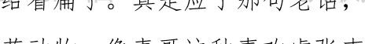

波潮水似的涌了大楼。

两部电梯可以载二十来个人，直接到达楼层，剩下的人会以最快的速度爬楼上去，这样无论是电梯还是楼梯，我都彻底斩断了青哥后有冯的退路。

我站在电梯里，看着不断跳跃的楼层数字，微眯眼睛，从背后抽出钢管，握紧，肌肉和金属摩擦，发出了“嘎呼吱呀”的声音。

这部电梯，对我来说，是一个释放愤怒和火的地狱。

“叮”清脆的声音响起，楼层到了，楼梯门徐徐打开。

我看到楼道里已经站了一人，一色的黑色西装，领带皮鞋，标准的职场精英打扮，却个个手持砍刀钢管等凶，早已严阵以待。看情况，应该是楼下着的那两个小弟提前上前了。我风报了信。

我一挥钢管，说了一个字：“打”。

我身边的人呼啦一下全都冲下去了，跟对方的人头脑战了一起，刻间妥协的难以困难。就在情况僵持不下时，爬楼梯的大部队挺起，一日子冲入了阵群，战斗的天平倾斜瞬间向我们这边倾了过来。

为了防止钢管脱手，我特地拿白色布把钢管和手掌缠在了一起，迅速冲在我面前的一个家伙的头上狠狠的的砸了下去。“啪”的一下，钢管和头盖的撞击发出了一声闷响，觉得我虎口发麻，对对方则直接白眼翻，翻子硬挺地就倒后了下去。我踩着他的胸口跨了过去，大声竭道：“兄弟们，打搅，见人就砍倒，绝不放过一个！”

这栋大楼一共四个楼出入口，两部电梯，一个消防通道，我都安排了人手守着，决不会放过任何一个人过去。这栋大楼的整个楼层已经围成了一个团困，短翅难飞，唯一种逃脱的办法是从窗上跳下去。

以前的写字楼已经变成了人地狱，犹如市古战场，不在走道里、办公室、储物间、卫生间，都是拿着砍刀或者钢管在人的互斗，墙上地上到处都是触目心的血迹。我穿过纷乱斗咬的人群，径向向前走，看到了惊慌失措的青哥。

王教叔在第一时间看到了我，立刻装作毫无委屈的样子道：“阿乾，阿乾，你这是做什么？做些什么呀？”

我举起钢管，指着他的脑袋：“少废话，让冯三出来。”

“冯三，冯三……阿乾，我跟你说，其实我跟冯三没什么关系的。”

“现在又想撇关系了？”我冷笑道：“你们两个联手来看，看都是人的面子上，我再再三忍着你们，可是没想到，你们这帮杂竟然敢凤儿下手！”

“阿乾，阿乾，你听我说，绑冯儿事情，完全是冯三策划的，跟我没关系……”

他还没说完，冯三突然出现，从刺里冲了出来，手里握着一把短刀朝我的心窝就捅过来！我看到冯三出现，立刻双眼喷火，手中的钢管猛的一挥，就踹飞了他的短刀。冯三丢失了，空着手又扑过来，一记右拳撞了眼睛。

“打人先封眼”，冯三不是帮大的，这些招数是无数混子在街头实践出来的，对于一般人来说可能没有用处，但对我来说却是没有任何用处，我差了街上被击击的。他一拳过来，我已经一个拳闪躲过了这一拳，然后一个拳狠地挨在了他的左肩。冯三吃痛，立刻弯下了腰，抓了他的钢管，捅过的肩膀，卡住了他的脖子，使出了经典的招式“旋膝”，双臂像钢条一样缠住脖子，然后膝盖向他的两侧顶。这顶膝又快又狠，丝毫不留，冯三一声嚎，估计肋骨至少折了三根。

我走过去，“啪”的一声一记响亮的耳光，“冯三，我告诉你，今天完了，你看那些兄弟，正在被我的兄弟聚，今天这里就是你们的坟场。“你妈妈的……”冯三刚要张口骂，又被我耳光扇了回去。

“冯三，不是很猛吗？草你妈的，起来打我！”我几乎每说一个字，朝着他脸上扇一记耳光，十几个耳光扇下来，他一侧的脸已经红肿，鼓起高，嘴里吐着血沫，眼睛都开始涣散。这时侯哥上来拉我：“阿乾，你别打了，再打下去就把他打死了。”我转看着他们：“冯三是当尚京的坐凳，他许诺什么了？别你给我呵，你蚂小老鼠钻到眼睛里的货！要是冯三不答应你能帮我？”我说，朝着他“呸”了一声，喷了他脸一大口唾沫。青哥尴尬地摸着脸，“阿乾，我好坏也是你的，你这么叫……”我一脚把他踹了地上，招手手下的小弟说：“兄弟们，有重口味的，把这小子给我拖进去杀了！”我话刚落，就相站起来个精壮悍的小伙，笑嘻嘻地拎起倒在地上的青哥，说：“放心吧，这事交给我们来办。”我说：“你们行不行？别让青哥不爽。”“放心吧乾哥，我们轮番上，保证让他爽得透的，一个月不了床了。”他们三个淫笑着，拉着青哥进了房间里。青哥恐慌地挣扎叫着：“乾哥，乾哥，救命，我跟这件事真的没有关系，求你放过我……”“放过你？”看着拖进房间里的青哥，冷笑一声，“对敌人的仁慈，就是对自己的残忍，你好体会这句话的感觉吧！”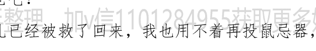

完儿已经被抓了回来，我也不用着再酷器了，怎么干就怎么干，放眼望去，桂阳街堂已经快被我们的人灭了。我上前把半躺在地上的冯三抓起来，揪着他的衣服领子很狠狠地问道：“冯三，没想到你会有今天吧？”冯三的脸肿像个茄子，喘得不清晰的说。“你对我这样，孟老大不会放过你的……”孟老大再向你看着，也不会容忍怂派里出来出版奴的！我说，又朝他的小腹狠狠狠狠地打了一拳，冯三一声呃，痛苦地蜷缩了缩身体，躺倒在地上，像只被煮熟的大虾。桂阳街口的活力基本上都被对方消灭殆尽了，由于双方力量对比悬殊，这场突击战取得了意料之中的战斗。

战斗结束后开会，冯三连夜被送进了医院的重症监护室，保住了自己的一条小命。至于青哥，真的是在床上躺了一个月才能下地走路。

作者:云幻欧阳眠 日期:2016-06-08 11:08

3,

尚京路和桂阳路两大小堂火拼事件发生后，在社团内部引起了轩轩大波。孟老大又是气又恼，第三天就召集各路口负责人去。其实他们看一眼就知道，召集所有人，语义在于他我不顺眼，想借机会一下我的锐气。在九龙春会议里，我脸色如常，像平时一样。大家都我知道青哥跟冯三相处的不错，但时间都不清楚，也不敢轻易说话。孟老大脸色阴沉道：“阿乾，桂阳堂的事情，你必须要给我解释。“冯三跟青哥一直在暗中破坏的事情，我只给他们一个教训了。”孟老大被我这种态度有些愤怒了，压着火问道：“他们都干了什么了？”“从白道以后，冯三一直针对我。前两天，他又派人焚了号海鲜市场，还不算完，关键的是，他还绑架了冯儿，这是我不能忍的！”孟老大霍从站起，发起虎威，一拍桌子吼：“进社团的时候，你们还记得吧！已经是犯了帮规！”听得老大这么说，几个人立刻喘出了气，纷纷道：“是啊阿乾，不管怎么说，冯三也是自己人，太过了。”

“仁蓝踞着的无法清除掉的华人社团是大韩国的耻辱。”李康焕想除掉他们，已经不是出于派系利益那么简单，而是升到了国家和民族的高度。我现在怀疑，冯三就是他买的一块过河，让他乱乱我们，然后七星帮再乘势动，一口吃掉我们。

“哼，冯三这小子，我早就看出不是东西。”致平叔冷一声道，“他的大哥白道，对待外人不错，对待社团内的兄弟，害人害己，属于自取。但冯三一直厌人，把死罪怪在别人身上，却做过这些事，真是社团耻辱！”话说完，孟老大脸上有些不住了。

“具体怎么回事，现在还不能定论，也许还有情……”孟老大刚想个圈场，语气严肃道：“阿乾，我刚才让小弟去探过了，据桂阳堂的人，冯三早就跟康焕谈好了，李康焕给冯三提供人手，为了吃掉青哥。”

“下一步行动，肯定对他们打算了。”

“冯三的情况？”

“嗯，这是正事。”致平叔点头，孟老大也同意：“好的，应该派一些人去医院盯着，等冯三从重症监护室出来了，彻底灭掉。”冯三的事情，就此一段落，但我没想到的是，这却是开启一场宏大战役的序幕。精彩的黑帮风格，从严格意义上来说，刚刚开始。

4,

五天之后，就在冯三即将从重症监护室转出来的夕，忽然没事了。准确地说，是冯三被干死了。冯三已经是废人一个，没有了任何价值，任谁也没有想到他竟然会被灭掉。所以平时派去医院看护冯三的兄弟都被放松了警戒心，完全没有想到跑到医院里补刀。意外就是这么发生了，当夜的值班护士在查房巡视的时候，见鬼似的一声叫。

听到这个消息之后，社团里的跟冯三有交情的人都去了医院，不管怎么说，冯三不再是反徒，毕竟在社团里了这么多年，也算是有头有脸的人，之前的关系网人刚走，茶还没凉，这点薄面大家还是要给。不过我没去。我跟冯三之间没有交情，只有仇恨，要是我去了，不知道怎么面对死的他，那场面太尴尬。

听回来说，冯三死的时候大睁眼睛，一脸恐怖的表情。老棒子听后，淡淡地笑道：“他不是恐怖的表情，而是惊讶的表情。”我问道：“棒子哥，这话怎么解？”“仇家？呵呵呵呵，冯三的仇家多了，但他已经被你打成了废人，在医院里躺着不能动弹，哪个仇家还会冒险跑到医院去补刀，都巴不得看他生不能死不得的滋味呢。阿乾，我读的书不如你多，但经验告诉我，分析一件事情一定要看动机，也就是看谁会从这件事上获得最大利益。”听他这么分析，我心里一动，“我明白，你是说这件事是李康换的？”老棒子打了一个响指，“对于七星帮来说，冯三已经失去利用价值，但他的身份已经暴露了，还知道七星帮很多重要的事情，留着这个人，有百无一利，最好的办法，自然就是除掉他。”我心里一个哆嗦。补刀这种事情，我们也经常干，但是发生在怨情复仇之间，比如谁把打进医院了，觉得还不爽，还没有打够，便追进医院再来两刀准恨。但七星帮做法却完全不同，他们不是为了泄愤，也不是为了报仇，只是为了灭口而灭口。这种真正冷酷的黑帮行事风格。

我的建议是，先找跟七星帮一谈，不妥不亢，表明我们的立场，他们要是想和，好，大家一块发财，一块赚钱，没问题。他们要是想打也，也OK，我们就陪他们打一仗！

话说说完，大家都不约而同地看向我了，我立刻心里一惊，从他们的目中读懂了某些意思。我刚想说点什么，孟老大悠道：“阿柯想得很好，我完全赞同这个提议。那什么，阿柯，这个方案简直是你提出的，那就由你代表社团走一遭吧。”

卧槽，果然，我心里一个咯噔，他妈的都在等着我呢。

我说：“孟老大，我在社团里份低，又没见识过什么大场大面，由我出来，是不是太不妥当了？”

“妥当，非常妥当。这个事情，阿柯你就不要推了。”孟老大说，“虽然你份量不算大，但从你加入社团以来，的一些动作都非常靠谱，也算是名声在外。另外，你现在是两个口口的大哥，份量自然是足够的。最重要的一点，就是我们这个群里，你是读书的最多的，所以由你出来，再合适不过了。”

话说倒是好听，他这是把我往火坑里推啊。七星帮，那是真正的黑社会，杀人不眨眼的目，说出来两国交战，不断来袭，但他们真要对我下手，我是一点办法都没有吗？

我说：“孟老大，其实我……”

我还没说完，孟老大就把一把重重地拍在了我的肩膀上，语重心长地说：“阿乾，社团下一步该怎么走，就托付给你了！”

我草，这一句话直接把我给坐实了，我是也得去，也不去去了。所有人的眼睛都在看着我，前面就是万丈深渊，我也得一头扎下去。

作者:云火阳焰 日期:2016-06-10 11:21

5，
去跟七星帮谈判的事情，就这么定下来了，由我出门，负责一切事宜。为了让我的身份更加被对方看中，社团还特地又给我提了一个靠垒，让我成为了村少有的“双花红楔”。

一文理 加微信1110128495获取更多
这种临时拂脚的风格我也是服了，这都是小帮派斗争，与大国之间的争争，看起来态势诡异，其实里面的内核是一样的。无非就是你打我，你打我，在各种力量威慑下的战者或者。

在跟七星帮谈判的前一个晚上，我从诊所接了允儿，送她回家。我没有开车，就跟着她静静地走在深夜的路上。从上次被冯三勒持过之后，允儿的性格就沉默了好多，话也没有以前说的多了。

不过，在心有默契之间，再多的话也是多余的。我就牵着她的手，静静地走在零星汽车驶的街道上。头顶上的路灯照射下来，把我们的影子拉一短一长。

我忽然有种期望，期望这条路优远也走不到头。我跟儿就这么牵着手，一直静谧的走下去。

走了许久，忽然风起，儿一下子钻进了我的怀里，我顺势紧紧地抱住了她，亲吻着她的头发。不知道为什么，我对于儿儿，心里有着一种劫后余生的庆幸，总觉得我们相处的每一秒都是那么珍贵的。

“你明天，真的要去跟李带签字判吗？”儿儿在我的怀里，低低的。

“是的。”我轻声道。

“阿宽，我不想再离开你社团，离开一切了，但是，我想问你一句，你说我们最终能过平静的生活吗？”

儿儿说这句话听我一阵子无语。是啊，我该怎么回答你呢，儿儿，从我们身上好的那一天起，我就带你离开这里，离开这片血雨飘飘的异国，但我却一次一次的否言，在这异国他乡的泥淖里越陷越深。到底是为了追求什么，声望？财富？权利？我不知道。可能只是单纯的追求一种生命的价值吧。

但我生命的价值，只是靠着砍人或者被砍才能证明吗？

我长时间思绪翻涌，心乱如海，只能紧紧抱着儿儿，一句话都不说。

命运的齿轮徐转动，该来的，终会来，就像这一场我与七星般的谈判。

七星，正九八的韩国本土黑社会，性质与哥伦比亚黑黑党、意大利西里岛黑党如出一辙，带有十分凶险和暴力的标签。孟老大向他们出发邀请，谈判的时间地点都是他们的，就在春川街的一条私人会所里。跟帮派谈判，我知道只要是有事，那么多少帮都是白的，干脆，我就一个人也没带，独自去了谈判地点。

心中一直在向往二奎的“单奔赴会”，没想到，这一次真装了一大回酒。却不能装好，那就看老天爷怎么安排了。

李康焕这种级别的帮派老大，是绝对不会跟我直接面对，代替李康来谈判的弟弟李康佑。他是李康比他哥哥长得像佝多了，宇脸，麻蛋，左脸上一道伤，额头上穿了眼镜，猛看跟卡西的，但比卡西丑万倍。可能是为了掩盖自己身上的狂气，李康佑还戴了一副黑框眼镜，这更让他显得凡俗了。

七星帮做事果然周密，在进门之前先过安检，检之后人工搜身，确认我身上没有携带任何物品，才放我进去。我走进屋子里的时候，李康佑正靠着红木桌喝红酒，看到我来，他站起来热情跟我握了手：“阿乾，久仰！”

“哪里，我在社团里靠低得很，还是个新人。”

“但是，别以为我是傻子，什么兼才并，和平共处，那都是说给外人听的，对于有些人，你们要是能赶尽杀的时候是绝不留情的。”我笑道：“康佑哥说这些话，我就有些听不懂。”

“听不懂那事，我叫个人出来，你就能听懂了。”李康佑看着后面的隔间道：“老院，出来吧。”

门“哎呀”一声推开了，一个人走进来，高高矮瘦，三四岁的样子，穿着一身灰色的中山装，带着一副标志性的黑框眼镜，看上去就像一个八十年代的高中教师。我心里猛地跳了一下，这不不是越南帮的头子阮英吗？

作者:云欧卧乾 日期:2016-06-13 13:08

6、整理，加微信1101128495获取更多好运

阮英进来，坐在我的对面，面无表情地说：“好久不见了。”

我已经惊讶得说不出来。因为首京路拼事件，越南帮已经被韩国警方全盘剿灭，来了一个祸端，现在别说帮派成员了，在仁川找来个越南人都太困难。我本以为在这样恶劣环境下，阮英会偷渡回国，或者去其他地方，万万没想到，他根本就没有离开仁川，并且靠了七星帮旗下。

“呵呵，两位也是老交了，此刻相见，没什么说的吗？”李康佑很有趣地问道。

“这次不是来见朋友，而是奉孟老大命，来谈谈事情的。康佑哥，这是几个意思？”

“别急着走啊，阿乾，好不容易请你过来，你旧旧吗？”阮英雄死地盯着我，眼神里射出的光芒像刀子锋利。

“你说兼并，和平共处，我们华人社团是这样。”我辩道，“我们已经先跟他们谈判过了，没有达成一致，最后动的手是因为你们占了地盘！”

李康佑脸色猛地阴了下来，歪着脑袋，斜着我说：“在韩国的土地上，包括这条路，包括整个仁川，都是韩人的地盘！”李康佑怒了，潜伏已久的老虎出了爪。我顿时感觉到后面，直觉让我的汗毛都竖了起来。我呵呵笑道：“康佑哥，你要说就没得谈了。”

“没得，可以谈，因为该迟早会走。”李康佑晃了几下杯中的红酒，然后一杯尽。我感觉到危险如影随形，便站起来来说：“好，我明白康佑哥的意思，我会回去转达。”我刚转身就有两名穿着黑色西服的庞形大汉住了我，脸视眈地盯着我。我转头道：“康佑哥，这是几个意思？”

“阿乾，好不容易请你过来，你旧旧吗？”

“操，我先去了！”阮英雄怒吼一声，就要冲上来，李康佑一把拉住了：“老阮，你妈先别冲！”

“别管我，让我废了他们！”阮英雄咬切牙，黑框眼镜后面几乎要喷出来。

“大事！！我们要干大事的，别因为这一冲动在阴沟里翻了船！”李康佑叫道，看来他很忌楼下的那一多号人马。阮英雄被李康佑拉住，动不得，只能重重叹了一口气气，将那把三楼犁狠狠地扎在了桌子上。我也不再说话，拨开了挡在我身后的那两名彪形大汉，正要走出出门的时候，我又站住，转身问道道：“最后一个问题，冯三死在了医院里，是不是你们动手干的？”

李康佑一声干：“世界法则，就是弱肉强食。留下拉坝只会拖累自己。”

“好，我明白了。”说完这句话，我转身出门。走出来以后，老棒子第一个上来，问我：“阿乾，没事吧？”我有余悸，抚摸着不停的心脏，“危险，差点儿就来了。”

作者:云卧阳 日期:2016-06-13 11:09

“没死，他哪都没去，一直在仁川来着。”七星帮，我们心里没底。我想，就连他自己也不清楚。有一次因为要送一个东西，去了孟老的家里，看到他家的客厅上挂着一幅画，上面力劲地写着“老伏，志在千里”。孟老一直直视自己为曹操类的人物，胸怀扩散，心情重，这一点倒是跟曹操像，整个矛盾。平心而论，不管孟老如何许，如何利用别人，他的野心是值得让人称赞的。社团获得了仁川的绝对控制权和绝对地位之后，他又得因陇望，想在首尔和釜山这样的韩国本土帮派分到首尔去。虽然孟老的最后没有达到，但他为此付出的努力值得肯定。只是不是不知道，在七星帮动之下，孟老到底会如何选择？这老狐狸，我是摸不透的。我能做的，便是将今天与李康佑交涉的全部内容，一字不漏地转达给他。

孟老大听完的转述后，长久沉默语，忽然叹息了一道：“三年前，我去广州玩的时候，曾经算过一卦，求得一个字，是‘鱼’。当时我不明白什么意思，现在，我明白了。“鱼？”我也是一头雾水，这代表什么？”孟老大问我：“鱼身上有什么？”

我说：“鱼鳞啊。”

“对，就是鱼鳞。鳞甲，代表着‘甲兵之相’，意思有一场大战。看来这句话应验了。”卧槽，我心里暗道，这太牵强附会了，一条鱼就能想到？不过算命这种事情，本来就是个心理暗示、拍摄影像的东西。现在不管这些，我就想弄明白孟老的真实想法。其实对于孟老大来说，做出这个选择是极其困难的。一方面，他不愿意和七星帮开展，因为一旦开展，社团极有可能全盘崩溃，被七星帮吃掉，那样的话，他多年的辛勤经营就付诸东流，目前所得的一切地位成就就不存在了。另一方面，他还不能认怂，不管他再坏，心机再重，城府再染，作为华人社团的老板，他目前已经是社团所有成员的表率。如果他怂了，那么华人以后真的就无法立足了，就像越南南方被干干净以后，越南人的下场一样。

孟老大抬起头，似面无表情，其实心里已经泛起无数波澜。他朝我挥了挥手，说：“阿乾，你先回去吧。这个事，我打算好好想想再说。”回到堂口之后，才知道我跟李康佑的谈话内容早已传遍了全社团，几乎所有人人都知道，七星帮要开始对我们下手了。一天，大家都有人心懂。跟李康佑谈判的当天晚上，小马就找了我，告诉我了一个意料之外的意外，就是短短一个时间里，社团已经好几人私下去找了孟老大，无一例外，都是过去劝说他的。甚至还有几个人，劝说孟老大干归顺了七星帮，这样省得大家大动。

他们是在三层楼上，从窗户的位置可以看到楼下聚集着一大群，至少有一百人，人头照摄摄。那是两个山口的小弟全都堵了来了。看到这么多在一起，李康佑也有些吃亏。我趁势道：“这是仁川，不是首尔，不管将来如何，现在仁川还是我们华人社团的天下。我们华人混到这个地步，就是因为许多人，心齐，上阵兄弟，打虎靠兄弟。再过十分钟，如果我没有完好无损地走出这大门，那么他们就会冲上来，到时候，你们任何一个都不跑不了。”

“操，我先去了！”阮英雄怒吼一声，就要冲上来，李康佑一把拉住了：“老阮，你妈先别冲！”

“别管我，让我废了他们！”阮英雄咬切牙，黑框眼镜后面几乎要喷出来。“大事！！我们要干大事的，别因为这一冲动在阴沟里翻了船！”李康佑叫道，看来他很忌楼下的那一多号人马。阮英雄被李康佑拉住，动不得，只能重重叹了一口气气，将那把三楼犁狠狠地扎在了桌子上。我也不再说话，拨开了挡在我身后的那两名彪形大汉，正要走出出门的时候，我又站住，转身问道道：“最后一个问题，冯三死在了医院里，是不是你们动手干的？”

李康佑一声干：“世界法则，就是弱肉强食。留下拉坝只会拖累自己。”

“好，我明白了。”说完这句话，我转身出门。走出来以后，老棒子第一个上来，问我：“阿乾，没事吧？”我有余悸，抚摸着不停的心脏，“危险，差点儿就来了。”

我说：“我还听说邱大良你干脆顺了七星帮？”

孟老大抬起眼皮，看了我一眼，又冷笑道：“没错，大良也是出于好意，毕竟那样的话，社团毫不至于全覆灭，兄弟们最多起码还能口饭吃。”

看到孟老那样的话态度，我心里明白，他已经心了，动了跟七星帮谈甚至是顺顺的心。要是没动的话，早就就着邱大良一顿骂了，根本不会说这些话还包着他的话。没办法，人毕竟是耳根子动物，被人说的多了，心里自然就会被摇了。这件事就是这么来的。

我在书房的书架上，握着许多书，都是一些汉语的传统文化的头部，比如《红楼梦》、《三国演义》、《西游记》什么的，以及几本韩籍书籍。我灵一动，指着书架上的书间道：“老大，这些你都读过吧？”

“嗯，大部分都翻过的。”孟老大又抬起眼皮看了我一眼，也许他奇怪我猛然跳到了这个话题。“《三国演义》，您肯定是精通读透了。”

“谈不上精通，也就粗读过两遍而已。事情太多，静不下心来好读书。”

“你还记得在《三国演义》里，当曹操号令率百万大军，要顺江而下，讨伐江东的时候，孙权曾经有过一样的烦恼？”

听到我这么说，孟老大颓然坐了起来，他好像想到了什么，目光灯炯炯地看着我。

我一看，孟老大已经被我的话勾起了兴趣，便信心大增，接着说道：“当时孙权统领江东，面临曹操的百万大军，是战也是和，他也拿不定主意。因为战，可能有江东就此全盘崩溃，沦为一片赤血之地；而和的话，还有可能保江东父老一方平安。但曹操是逆贼，他扶天子以诸侯，如今天天下人都不脏，若归顺曹，那么江东基业就此葬送灭了。”

孟老大接道：“面对曹操的百万大军，孙权帐下的谋士和大臣纷纷进言，劝他已归顺曹操，免得一旦战后，后果将不堪设想。”

“对，”我点头道，“就连孙权那样的臣子都降降，实在是在黄郡所事。倒是后来周瑜对孙权的一番话，点明了其中的奥秘。孟老大，你还记得是什么吗？”

孟老大张了张口，却没有说出来。他肯定是知道的，只是不想让这种话从他嘴里说出来，才不是测试。

他不说，我便替他说出来：“周瑜对孙权说，百官都肯降你，那是怀着私心的。他们都在江东经营多年，有房产妻妾，良田仆人。若是归顺曹操，那么他们的官位自然还得以保留，家中家产也可以继续享用。但孙权呢，如果归顺了曹操，他会是什么样的打算？”

这一番说完，孟老大一下从椅子上站了起来，绕着书房回来回步子，看得出来，他心里做着剧烈的挣扎。

孟老大说自己读过传统文学，其实他是谦虚了。此人权力制衡，所以对于传统文学无此热忱，尤其是《三国演义》、《周列治》这类题材，他钻研颇深，从从中得到的玩味也甚许多。所以他自然明白所谓历史其实就是不断的重复，以前发生过的那些事情，只不过是换个幌子在后世继续上演。

所以我刚才的那一话，自然就点到了他心里的痛处，而此时此刻，我需要再来一把醋。

“七星老老大康焕，是个极其狠辣的角色，他的历史我研究过一点，其手段之残忍，用心之毒，都十分令人惊呆。我跟他弟弟李康佑的谈判就可以出来，七星帮我们这一次根本没打算给我们留活路。”

我说完这话，孟老大还在房里回来回着步子，只是眉头皱得更紧些了。

“孟老大，还记得南唐后主的宰佑机吗？”

他听完这句话后浑身一个灵，愣在了原地。他虽然读传统文学和历史，但他不知道南唐亡之后，李煜开始抽搐，最后自尽。所谓宰佑机，投降了宋朝，被软禁起来，受尽屈辱，最后还是自尽。李煜的死状是极惨的。

这句话成了压死骆驼的最后一根稻草，孟老大没有再说了，双目炯炯看着我，几乎是咬牙切道：“七星帮想搞垮我们，我们没有办法。”

“孟老大，还记得南唐后主的宰佑机吗？”

“没有办法？好，我就让他们知道七星帮到底有多硬的一块骨头！”说完这句话后，他一掌拍在了桌子上，把水杯都翻覆了。显而易见，他下了一次多大的决心。这就是一次赌博，而且是豪赌。

攻，并不是靠人数取胜的地方。是以双方持有了二十多分钟，一直未能分出胜负。身边有小弟劝我道：“乾哥，我们们过去支援一下青龙道的兄弟们吧！”

“不能，”我咬牙道，“力量的部署安排都是经过研究的，我们的任务就是看好会所，守卫春川街，决不能脱离自己的守位置！”

青龙道的拼杀持续了约四十多分钟的样子，邱最好终没有毫败胜收，以四十多人的力量完全守卫住了阵地，成功的击阻了七星帮的第一波进攻。后小弟从前方带来战报：“七星帮撤了！七星帮撤了！”

“不，他们没撤，”我看着即将落在水平线后的最后阳光，继续说道：“他们要转攻平阳了，好戏才刚开始。

平阳巷两边虽然适合埋伏手，却由于地形太大十分不利于战斗，可能不能在平阳巷挡住七星帮的进攻，就是这次“春川街保卫战”的关键所在了。负责伏攻的张勇临时接管的桂阳巷口的兄弟，张勇真人没搞垮财务，可是打架真是让人捏一把，孟老大也是一时找不到人手，才挑了他来临时顶大。

在落日的夕阳下最后一丝余晖的时候，平阳巷的战斗开始了。桂阳巷口以及其他巷起来大约一百多人，在七星帮刚刚进入伏击范围的时候猛然从两侧的埋伏地冲出来，从两边的侧翼夹击了七星帮的主力。七星帮不愧是老牌派，面对奇兵突袭竟然毫不惊慌，而是迅速组成了“川”字型战斗形态，两人都用来抵御突袭，中间的一百多人则进行迅速突破，直若黄龙。

也是双方实力殊差过大，也许是因为张勇确实不适合硬拼，总之战斗还没不到个小时的时间，充当后的小弟就慌慌张张地跑过来报道：“平阳封锁线被破了！”

我大惊色，没想到集结人数最多的平阳封锁线这么容易就被突破了，真是出乎意料。平阳是护守春川街的咽喉，一旦突破了平阳，那么再用进攻春川街就是一马平川！我不顾恶灵老大的关于坚守阵地的呼吼，立刻招募新光浦口的兄弟们：“伙起火家，跟着我去支援平阳的兄弟！其他人留守待命！”

我粗略点了一下，看着新光浦口的兄弟，只有二十三十个，也没有多强。说七星帮的人入春川街之后，我们还能与之一战，但并不是我想看到的场面。春川街是最最后的地，也是我们的最后一道防线。

太阳已经完全落山，夜晚的灯光还没有起来，空气中的能见度降到了最低。在平阳宽广的战场上，分不清敌我的人影正在相互厮杀，钢管、棒球棒以及短刀匕首的挥砍声不绝于耳，离得远就能闻到浓重的血味。第一次

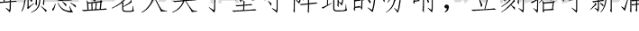

目睹这么规模的帮派械斗，本以为为久经沙场的我竟然一时间有些惊慌。

前方已经崩坏，我不敢带着人贸然上前，便停在春川街与平阳巷的交汇处，令所有人原地待防，不管任何人，都不让他从这里再前进一步。

我握紧手中根七十分左右长度的钢管，这根钢管前端被割尖了，可拧，但在大陆的时候，我们都管这种东西叫“管儿”。我从身上扯下一块布，将我的右手和管末端紧紧勒在一起，以防脱手。

凉风乍起，一股腥臭扑面而来，前面猛然出现了一群黑乎的人影，目测有五六十，在正这边边扑了过来。我将上腰凌猛翻起，大声吼道：“兄弟们，都帮我挺住了，一个人都别退过去！”

转眼间，那群人就到了眼前，手里拿着各种各样的武器。他们向这边冲锋的形状呈出一个形的筒，只要前面的能够突破阵线上的一个空隙，后面的就会蜂拥入，势不可挡。在这种混乱状态下，对方还能保持这种规整的箭状进攻队形，很明显每个人都是江湖老炮，不说身经百战，至少经历过各大的战斗。这是由一群战斗力和经验极为强悍的混合组成的讨伐队伍，估计已经是星帮中最精锐的力量，怪不得张勇真的不是他们的对手。

我怒吼一声，回头上来，一管又放了第一个冲的的家伙，钢管砸在他头上骨，发出“咣”的一声响吻，然后这家伙就无声地倒在了地上。但对方的人像潮水一般涌了来，顷刻间就跟我们混战了一起。只听到“咣”的一声轻响，我只感觉背后一阵冰凉，情知是后面挨了一刀，赶忙转过身，一管又送进了了那个想砍下第二刀的家伙的肚子里。

这是我第一次用管受伤，那种金属插进肉肌里的触感，就像小时候用树枝插进泥淖一样，沙沙的，粘粘，同时还能听到“噗”一声轻响。那个家伙一下子掀了，捅住了了自己的肚子，我则猛力拉，将管从他的小腹处了出来。血顺着钢管漏了，流到了我的心里。我不知道他死了没有，在这种情形下，我们都没有能力击掉他。丛林法则在这一刻得到了经典的诠释，弱胜强，不能适应这个残酷杀戮场的唯一结果，就是死亡。暮的夜色里，我看不见人的脸，只能看到模糊的轮廓；嘈杂的声音太大，我也听不清每个人的呐喊，以至于让我有一种扑来的傀儡，没有感情，没有血肉。我一边挥舞着钢管，一边希望这一切只是一场游戏。对方的进攻猛烈了，单凭我们二十个人，根本挡不住。对于局来说，根本没有意义。大约持续了五分钟，我们的队伍就被冲散了，对方向春川街涌。心中大骇，这时听到背后有了声音，衣服领子被揉了一下，反手又是管，却被人住了。对方：“阿乾，是我啊！”夜色还十分重，远处的灯火也亮了起来，凑着光，我张勇。他变成了一身血色头穿的是一件白衬衣，此刻已经被染成了暗红色。“张勇？”我叫道，“平阳……失守了。”张勇皱着脸道：“还没结束，你快！”我拽住他的领子叫道：“叫上的人，跟我回！春川街里有不少兄弟，那里是我们的主力，我们前后夹击星帮。”张勇似乎还沉浸在失败的情绪里走不，两个耳光大道：“明白我的话了吗？”他才清醒了一点，“明白，赶紧招呼你的人，跟我一起杀回去！”张勇接管的阳口有一部分在围战，我们集合剩余的人，大约五十人的样子，又清楚了。轻微地叫了一声：“乾哥……”我仔细低头一看，才分辨出来这是在堂口混的小兄弟，顺子气游丝，看着就不行了，他身上温热的液体，全是从腹腔和胸腔里涌出来的血。我抱起顺子，说：“兄弟，撑住……”别，乾哥……”他把我推开，拒绝了我的救，嘴里开始涌出唾子，口含不清地说：“我不了……乾哥……别给中国人添疼”那个字，顺子就停下了动作，永远地躺在这片土地上。我想起来了，顺子，二十六岁的山东农村，上次一起喝酒的时候，我还嘲笑主角，加上他的方言听着……我的胸像被扎了一刀利刃剧痛，猛地站起来狂叫道：“七星哥，我草你妈！”

作者：云友欧阳阳 日期:2016-06-15 11:08

各位兄弟姐妹们，本周五就更新完了。大家有问题直接回复。能回复的一定回复。作者：云友欧阳阳 日期:2016-06-16 13:39

@雨雨风花叶叶 2016-06-16 13:26:07

再不更新我就报警楼主涉黑活动!!! 呵呵呵~
作者：云友欧阳阳 日期:2016-06-17 11:06

3,我像疯了一般的冲击入敌，管儿又四处乱伦。背上和胸被砍了几刀，我已经数不清了，也没有时间去数，脑子里想的只有事情，杀，杀，干死一个算一个！夜色的灯火已经完全亮了起来，但我已经看不到川骏，我只能看到一片地狱。地上到处都是翻乱的人和流淌的鲜血，随着风一起灌进鼻子来的，是浓郁到让人作呕的血腥气息。

如果说是黑棉花的话，那么在我们前面的那些街头斗筒就是小孩子玩的，是尿泥和过家家。此时此刻，我已经不知道有多少自己的兄弟躺倒在了地上，对方有多少人被砍得奄奄了。我只有在依靠自己的本能不能不停砍杀，镰管上又全是流动着干涸的血迹，仿佛把我的手和钢管粘在了一起。

在我们前后夹击七星帮，战斗进入白热化的时候，愣一个小弟跑过来朝我大叫：“乾哥，不好了！”小子也是一脑袋的血，我定睛一看，好不容易才分辨出来是他这方充的那个小子。我心里一紧，急忙道：“怎么了？”七星哥把他们开了，春川街两边的巷堂也在开战。这条弄堂他们一时半会攻不进来，我带着几个兄弟，咱杀回春川街去，千万不能让他们提起来士气！

我们又转向杀回了春川街，在里面经历了地狱一般的鏖战，都不知道杀了多长时间，到最后身体都有些麻木了。

远方有一丝红的曙光透了过来，凭感觉，应该是凌晨三四点钟的样子。我的身体已经适应了这种节奏，对于血腥的味道也没有任何的抵触。

这场血腥的大规模已经进行了六七个个小时后，终于逐渐浮出了胜负，天平开始慢慢的倾斜。虽然在事前，我们已经了精心的准备和筹划，实力的差距无法掩盖的。七星帮同样付出了高昂的代价，终于占据了上风。他们及时改变策略，以空间换时间，最后登陆了春川街，我们压缩了，对方还有百余人。这种绝望笼罩在了我的头上，我们已经完全失去了防守，非被对方全吃掉不可。在这种绝望搏杀的时候，一个人猛地从人群里冲了出来，像一只狼，朝着我扑上来。这个人是从左侧过来的，极其迅速，几乎给我任何反应。就在我愣的时候，大了一声：“阿乾小心”，一下子就挡在了我的面前，紧接着，我看到一柄军军刺尖从老子的背后露了出来，那柄军刺几乎完全没了他的胸膛。

阿宽，你没事吧？”老子大声叫道。“我没事！”我看到他的大腿有一道明显的被割的口子，便忙叫道：“棒子哥，你的腿？”“不碍，皮肉伤！”老子甩了刀上的血，说道，“我已经砍了八个人，你呢？”都什么时候了，他还有兴趣跟我比比这个。我正要说话，忽然从春川街上传了一声哨响，老子脸色大变，“糟了，小马又没住他们，那条弄堂被攻破了！”猛然吃了一惊！那条弄堂被攻破，也就意味着七星帮人就会会了？我急忙问道：“那现在怎么？”这条弄堂他们一时半会攻不进来，我带着几个兄弟，咱他们杀回春川街去，千万不能让他们起来士气！

小马，你没事？阿俊！”小马的什么愣了，“等我再说说！”我将全部兄弟都留下了，让他们跟着小马挡住七星帮的进攻，最后一个人奔向另一条弄堂。这条弄堂被杀的一片狼藉，地上到处躺着的不知道自己人还是对方的人。急切之间，我寻找老子的声音，只能叫道：“棒子哥，棒子哥……”紧接着，我就听到了一声暴：“快躲开！”我浑身一激，立刻就翻滚向前躲去，同时看着路看到他一把砍“刷”一下划过一道轨迹，那人一刀未砍中，我看滚后重心不稳，紧接着上来又是一刀，我刚举起管格，忽然老子从他背后猛地出现，一刀将那人砍倒在了地上。

娜美回来了！阮英雄大怒不已，从地上捡起一把刀，朝着娜美扑过去。娜美猛地一个转身回旋，木刀如流星般兜回，如同划过天际的极光，一下就把阮英雄飞了十几远！这一招，赫然就是我在剑道大赛中只见过一次的秘技“燕返”！娜美回回头，看了我一眼，和我怀里的老子，“对不起阿乾，我来了哦。”我没有说什么，已经不知道说什么什么。

“娜美姐姐回来了！”社团的众人欢呼着娜美的名字，重新又聚了起来，顿时同事气大振。就在社团即将要发起反攻的时候，忽然对方安静了，然后迅速后退，结成防御阵型，并且中间穿出了一条道路，一个看起来文质彬彬、穿着唐衣考究的农村男子走了过来。

“你就是娜美？”他淡声问道，声音却有着掩饰不住的王者严。“是。”娜美无表情地道。“很好，我是康焕。”我听到有人发出了声低低的惊讶，这个人，就是七星帮的头大哥，站在整个韩国剑道体系巅峰的人物，李康焕。有了李康焕的压阵，双方暂时安静了过来。他扫视了全场，慢慢说道：“我承认，自来到，这是我打过的最惨的一场战斗。在平阳巷里折了不少兄弟，不过没尽七星帮这些杂碎便宜！”那就好，没事，我在这里你快去后面那条巷子支援你的兄弟阿俊！”“草，那不是阿俊，那是老榛！”“什么？”小马愣了。

阿乾，”在黯然灯光的照耀下，老子的眼睛忽然散出七彩颜色，他猛地抓紧了我，“带我回家……”我叫了一声，瘫坐在地上，紧紧地抱着老子不再动，弹的身体，心里被一把说的绝望给席卷了。看着连续了好个人，我站起来的想法。让这一切结束吧，我抱着老子的身体，淡淡的，忽然有了一种解脱的感觉。“呵呵，绝望吧？”阮英雄看着没有任何斗志的我，狞道，“我就是要让你一下，失去兄弟的滋味！你干死了一个兄弟，太便宜了，我要让你拿命来！”我抬头看着他，苦笑一声，心道，去他妈，就这样吧。反正我们今天谁都跑不了，“底！阮英雄一声叫，手里握着军刺，就朝我冲了过来。急然“铮”的一响，那柄即将刺在我身上的剑被什么东西挡过去了。“谁！”阮英雄猛转头，大吼一声。对方身影形成，一回头，宽大的衣襟在夜风里波动，手里斜斜的着一把木刀，身上带着一股原始纯粹的山野气息。她回过头，看到了娜美那张酷无情的脸。

“娜美姐！”不知道是谁了一声。“娜美姐回来了！”这句话瞬间传遍了整条春川街。

不是为了孟老大。

唐妈有些急了，“阿乾，不管你是为了谁，不管你心里有多崇高的理想，你现在都不非走不可了。仁川太危险了，你已经不能继续留在这里了。如果社团真的把你交给警方的话，你这一辈子都完了。”

我苦笑一声，“走”？往哪里走？孟老大还想把我交出去，飞，肯定一早就派了人看着我。再说了，警方现在也都看着我，飞机、火车、汽车和轮渡都不能，偷渡的水路又是全大人的，到处都满了我的线，我能跑到哪里去？”

“你忘了，有人可以帮你的。”唐妈看着我说道，“找安生。”

“安生？”我心里想，难道我也要改头换面，来一次“重生”吗？用一张新脸，来挣脱这梦幻的回忆。

“也许，”我看着窗外，喃喃地道，“真的到了该离开的时候了。”

我看了最后一眼列车镜中陌生的自己，然后深吸一口气，走出了延吉火车站。

深秋的延边，已经是一片萧瑟，草木凄凉。南山南，北秋北，我拉着允儿的手，一直向那荒野的深处去。直到满眼都是凋零的树木和落叶，我才停下来，拿出背包里的坛子，抓起一把骨灰扬在风里，说：“棒子哥，我们回家了。”

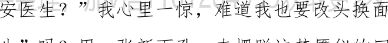

全文完。

作者:云火欧阳 日期:2016-06-17 11:42

一转眼30万字就完结了感谢大家的关注和陪伴！跟大家一起共同成长！

作者:云火欧阳 日期:2016-06-17 12:05

@四川刘阳 2016-06-17 11:44:37
安医生的身份没有解开完了呀？
续集见

一处理如1101284955获取更多好帖
作者:云火欧阳 日期:2016-06-17 12:07

@果果果先生 aitn 2016-06-17 12:05:38
追完了，非常精彩，结局也是意料之中，有些神秘的色彩写得不够细致，结尾太仓兀了，比如阎王，唐妈，哈哈，自己瞎说的，楼主勿怪，继续支持！
残缺美也挺好的，感谢支持！
作者:云火欧阳 日期:2016-07-01 10:50

@云火欧阳 2016-06-15 11:08:52
各位兄弟姐妹们，本周五就更完了。大家有问题请直接回复。能回复的一定回复。

@云火欧阳乾 2016-06-17 11:06:24
“阿乾，”在黯冉灯光的辉耀下，老棒子的眼睛里悠然散发出七彩的颜色，他很猛地抓紧了我，“带我……回家......”
一个月后。

我看了最后一眼列车镜中陌生的自己，然后深吸一口气，走出了延吉火车站。

深秋的延边，已经是一片萧瑟，草木凄凉。南山南，北秋北，我拉着允儿的手，一直向荒野的深处走去。直到满眼都是凋零的树木和落叶，我才停下来，拿出背包里的坛子，抓起一把灰扬在风里，说：“棒子哥，我们回家了。”

加信1101284955获取更多帖全完。
