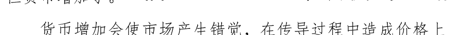

# 雨夜谈经

## 巴山夜雨 2016abc

有人说，巴山夜雨是中国诗坛最漫长的一场秋雨。
如今已是秋天，正是巴山夜雨的时候。
这个世界，仿佛正在经历一场漫长的秋雨。

说到，突然想起抖音上常听的一首歌：池塘的水满了，雨也停了，天边的淅沥到处处是喧闹。稚嫩的童声总在耳旁回响。

回说天涯，有质量的帖子感觉越来越少，理性的观点越越来越少，我想开个帖，和大家就经济问题进行交流。

一手整理加微信11101284955，获取更多好帖

作者：巴山夜雨 2016abc 日期：2019-08-23 22:51
这几天的政策非常密集。大家发现了没有，政策密集的时候，正是下行压力越大的时候，比去年下半年，更准确说是去年四季度。

## 1楼
作者：巴山夜雨 2016abc 日期：2019-08-23 23:00
很长一段时间时间，一直有一个观点，叫人口红利消失。这个观点对吗？不对。虽然老龄化，年轻人减少，但人口红利还没消失，只是被房地产挤占了。随着房地产泡沫破裂，被占用的机会释放出来，动力仍然剩余。只是个问题，房地产泡沫催生了收入泡沫，目前的收入水平不支持中国产品的竞争力，所以下一步必然要走的一步，就是降收入、降成本，得降低低价房、药价等各种价格，再配以经济结构的等一系列措施，只有这样才能重新启动制造业。这是走出中国经济困难的必然的一步。

## 2楼
作者:巴山夜雨 2016abc 日期:2019-08-24 08:44
黄台摘瓜：通缩的意思吗
从货币角度讲，是个这个意思。通缩的道路，坚决反通胀引发通胀。

## 一手整理 加微信1101284955 获取更多好帖
一旦通胀，就进入死循环，尤其在目前，一定要注意通胀。
如果出现通胀，会成为不可承受之重。
要避免中间环节成为通胀之源。
所以要大力发展物流，以市场的方式促进中间环节降本、降价均衡。
前几天强总提出要允许老百姓摆摊，就是要平抑抑物价。
只有降价格，才能降收入。

## 6楼
作者：巴山夜雨 2016abc 日期：2019-08-25 18:53
@古韵唐风 2019-08-25 02:27:55
喝酒了，随便说说。。其实经济是个很复杂的东西，不是脑门一热，发展个新行业就可以解决的事情，也不是拿着历史样本去对比，就能得出答案和解决办法的。。历史显然在不停的重复和上演，看似好像有很多相似的地方，却因社会科技生产力不同，承压力不同。。要是按照以前的历史样本，房价该崩掉了。。所以很难去判断承压位置和承压线，不过不可否认的是他会有一个承压线，超过就会崩溃，历史已经给我们看到了很多的结果……
很好加微信1101284955，获取更多帖

## 9楼
作者：巴山夜雨 2016abc 日期：2019-08-25 19:42
@古韵唐风 2019-08-25 02:27:55
> “要是国内未来几年转型不成功，以后就业就是个麻烦事情因为没有密集劳动产业，社会无法容纳太多的岗位”

这个判断是狠，未来让人忧虑。因为技术进步不是短时间能实现的，个人的，降收入、降成本（老百姓生活成本），是目前可以采取唯一的对策。

希望软着陆，是以为还有时间；现在看，根本没有时间。
各方面政策的调整，能感觉到高层的焦虑。
但从整个画风，仍然不能决定硬着陆。
实行硬着陆，要凝聚共识。改革开放之初曾有一场大讨论，很好，实现了广泛的思想统一。现在也需要这样一场大讨论。

## 10楼
作者：巴山夜雨 2016abc 日期：2019-08-25 19:58
现在很多人判断是通胀，基本不错，但通胀随时可能变成通胀。
因为停滞，就是滞涨。
已经整理的很多信息，对商业的反馈是非常直接的。
小商贩驱逐完了，就一定发生通胀。
因为定价机制扭曲了。
现在要珍惜环境（市容），让小商贩进城经营。这点很重要。

## 11楼
作者：巴山夜雨 2016abc 日期：2019-08-26 09:50
目前经济工作的主线是什么？没人说的清楚。
或许会，是供给侧结构性改革。那什么叫供给侧结构性改革？又没有人说的清楚。
要把目标具体化。

统一目前的经济工作，一句话表述，就是救援制造业。
- 减费是为制造业服务
- 解决中小企业融资贵是为制造业服务
- 压贷、降房价是为制造业服务
- 推出创新也是为制造业服务

高层对目前经济评价，是三个不平衡：
- 金融与实体经济不平衡
- 房地产与实体经济不平衡
- 制造业下滑是主要原因

所以救援制造业，是目前经济工作的主线。这条主线，也明白了应该怎样操作。在目前情况下，就是降收入、降成本，老百姓的生活一方面整理，敢于反对，敢面对，救援制造业的方法路径说清楚，让大家接受认可，这样才能凝聚共识。这是转折，需要一场大讨论。

## 12楼
作者：巴山夜雨 2016abc 日期：2019-08-26 10:30
说一下LPR。表面上，是为压低利率，实际影响多了，短期没有影响，长期追求货币政策的独立性；为外汇储备及汇率准备。
目前的基础货币，美元占三分之二，汇率也绑定美元，货币政策要与美国保持一致，这就是为什么中国要去杠杆。中美分离，经济上背离，一强一弱；政治上分离。
MLF是以后发行货币的主要工具。熟悉的人都知道，用国债会损害央行的独立性。用MLF作为发行货币的工具，需要基础货币减少，这是为外汇及汇率改革准备。

## 13楼
作者：巴山夜雨 2016abc 日期：2019-08-27 10:43
为什么每次记得要验证？还是内容有问题？

## 14楼
作者：巴山夜雨 2016abc 日期：2019-08-27 11:12
做一个大胆的判断。雄安、海南、上海新片区、深圳示范区，都是大招。还有哪里？

没有东北和西部。昨天往六个自治区：江苏、黑龙江、河北、云南、广西、山东，没有西部？西部没问题？西部重要？西安以西是甘肃，甘肃往西是青海、新疆，甘肃连接东部，打通大陆从甘肃开始，东部向西部辐射从甘肃开始，建设一带一路经济带从甘肃开始，全面振兴西部也要从甘肃开始。看地图，从兰州到西宁距离很远，缺乏衔接，中间少个镇。嘉峪位于中间位置，交通枢纽，从区位优势来说，前几天高层的甘肃之行表面是生态文明，不应仅于此。加上最近一直提西部，应该憋大招，而这个大招就在嘉峪一带。从战略上来说，应该有这一步。

## 15楼
作者:巴山夜雨2016abc 日期:2019-08-27 16:11
对于房地产税的推出时间，有很多预测，有的希望快，有的希望慢甚至不要推出，实际上这些想法都是基于个人利益的一厢情愿。几乎可以肯定地说，房地产税一定会推出，但一定不会快。今年不会，明年也不会，后年不知道。一定要考虑居民的承受力。这是最重要的。假设100万的房子，按0.5%的税率征，足够了，也是5000块钱。这5000块钱，有很多居民拿不起。拿不起来怎么办？人少就好，人多了就不好，是一个增加不稳定因素，一个是增加征税成本，成本太高的话会征税效果打折扣。这是高层顾虑的。再就是时机问题。现在不是开房地产税的好时机。现在正在进行体制改革，如果财政有钱了，体制改革的动力就没有了。一定要先体制改革，再谈房产税，那时才是税的时机，也有有利于向公共财政转变。

## 一手整理，加v信1101284955，获取更多好帖
作者：巴山夜雨 2016abc 日期：2019-08-29 10:43
说起降成本，大新闻来了，上海开业了。老百姓收入下降，必须降成本，降各种生活成本。上半年，医药行业利润创新高，金融业尤其是保险创新高，都不可持续。从行业角度讲，今年医药、保险业利润的高，以后会下降。这些行业高利润是不存在的。

## 19楼
作者:巴山夜雨 2016abc 日期：2019-08-29 10:10
这几天的抖音，大家终于团结起来，都在吵，一个叫豪豪的女人。

## 一手整理
这些不公平，恶的。
抖音上的豪豪事件，仍然没有过去。虽然已经封号了，人们还是不停地在骂。女人骂，男人骂，外地人骂。仿佛这个女人犯了十恶不赦的罪。这个女人并不是什么文化、算不上漂亮、从草根起来的。为什么他们不愿意放过？这个女人只不过有点色。

## 一手整理，加微信1101284955，获取更多好帖
这些不公平，恶的。
这些不公平，这些被处是不公平的。

## 20楼
作者:巴山夜雨 2016abc 日期：2019-08-29 14:38
现在的声音越来越少了。

## 21楼
作者：巴山夜雨 2016abc 日期：2019-08-30 01:21
这些不公平，这些被处是不公平的。

## 23楼
作者：巴山夜雨 2016abc 日期：2019-08-30 02:28
这些不公平，这些被处是不公平的。

## 24楼
作者：巴山夜雨 2016abc 日期：2019-08-30 04:21
这些不公平，这些被处是不公平的。安达信有应是不公平的。

## 25楼
作者：巴山夜雨 2016abc 日期：2019-08-30 04:22
康美药业会退市吗？一定。

## 26楼
作者：巴山夜雨 2016abc 日期：2019-08-30 05:54
上证报中国证券网 发展改革委网站8月30日消息，国家发展改革委员会、科技部等五部发布《关于进一步推进产业转型升级示范区的通知》（以下简称《通知》）。《通知》指出，地方申报、专家评估和统筹研究，拟支持北京京西、大连沿海、黑龙江天津、江苏南京、江西萍乡村、河南广东韶、贵州六盘水等建设第二批产业转型升级示范区。五部将进一步落实有关政策文件，研究细化投资、创新、产业、土地、金融等方面的支持政策，继续安排中央预算内投资支持示范园区和重点园区建设。去产能的新招式，区域去产能。

 一手整理，加信1101284955获取更多帖
## 27楼
这些不公平，这些被处是不公平的。

## 28楼
作者：巴山夜雨 2016abc 日期：2019-08-31 00:02
去年这些夜，花灯如炬，月上阑，感受很好。

## 29楼
作者：巴山夜雨 2016abc 日期：2019-08-31 00:43
这些不公平，这些被处是不公平的。

## 32楼
作者:巴山夜雨 2016abc 日期：2019-09-03 10:15
这两天的金融委，最大的看点是加大周期调节力度和深挖潜力。投资都要深挖潜力，既说明问题严重，也说明没有项目。

## 33楼
作者：巴山夜雨 2016abc 日期：2019-09-03 10:36

## 34楼
作者：巴山夜雨 2016abc 日期：2019-09-03 10:43
危机的根源不同，应对危机的路径也不同。大萧条是因为通缩，目前的中国是因为通胀。通缩要降息，通胀要加息。所以货币政策的主线是加息。

## 35楼
作者：巴山夜雨 2016abc 日期：2019-09-03 10:04
PMI49.5，加大周期调节，财政政策进一步发力，说明8月份数据很好，M1下降、M2可能很大。

一手整理，加v101284955 获取更多好帖
作者：巴山夜雨 2016abc 日期：2019-09-03 14:16
13:29【银保监会要求损害消费者权益乱象开展自查三家银行保险机构被通报】银保监会发布关于三家银行保险机构损害消费者权益情况的通报，直指“对分红型产品承诺固定收益、“以银行存款名义销售保险产品”等欺骗投保人的问题，涉及大型商业银行、一家人寿保险公司一家财产保险公司。银保监会相关负责人进一步指示，各银行保险机构要结合损害消费者权益乱象整治工作，围绕违规收费、销售误导、赔拖巷等侵害金融消费者八项基本权利的各类违法行为为开展。

## 40楼
作者：巴山夜风 2016abc 日期：2019-09-04 11:15
【科创板第三轮审现场开启：财务核查、保荐执业质量为重点】在监管高压下，今年以来已有8家科创板企业撤回申请材料。有业内人士表示，现场检查手段的强化能抑制节奏。（21 世纪经济报道）

这种表达的是不满。

在政治局的公报中这样表示，可以理解成是一个很严厉的批评。

所以有了第二天上交所暂停 80 家公司申报材料的审核。

理由是因为补半年报。

再就是信息披露为核心？就是你把上市公司的信息披露真实准确完整，不能像现在这个样子老爆雷。

第三个就是注册制。全句通读一遍就会产生理解，科创板要坚守注册制，但是你要明白什么叫注册制。科创板也开板了，谁

## 什么叫注册制？说了这么长时间，科创板也开板了，获取更多帖子。

没有人说得清楚，或者没有人愿意说清楚。

为什么这个样子？博弈。

提出科创板后，有三个值得关注。一是证监会派专门到上交所任职指导实施科创板和注册制；二是上交所前段时间公开招聘科创板和注册制方面的专家；三是向社会公开征集资市场改革和注册制课题方面的论文。

为什么要这样做？难道注册制真的那么深，靠自己的力量就理解不透操作不好吗?

他山之石可以攻玉。

内部的协调无法解决的时候就要借助外部的力量。

为什么内部无法解决？博弈。这也是为什么改革很难的。

在这样的背景下再来看资本市场的改革，恐怕很多人的愿望会落空，全面实行注册制可能非一朝一日能够办到的。

43 楼
作者:巴山夜雨2016abc 日期:2019-09-04 14:34

在层屠龙记里面，屠龙刀和侍天剑都断了。吴坟草是个很坏的铁匠，把屠龙刀接了，却拒绝把侍天剑接上。

屠龙刀代表权力。权力可以更替，但不会真空，所以屠龙刀一定会接上的。只是权力更替是要流血的，所以屠龙刀上多了一道血痕。

侍天剑代表监督。侍天剑断了，再也没有接。

## 一手整理，加信1101284955，获取更多帖子。

作者:巴山夜雨2016abc 日期:2019-09-04 17:18

@lordmasterkingJ 2019-09-04 16:39:15

我最近在读随想，叔叔，现在什么时候说真话，变得越来越难了。

我，总是在时代的裹挟前行。

如果都不说真话，自己也没有必要说真话。

重要的是要让自己快乐。

我很喜欢这个帖子的氛围，没有人看，没有人评，这样挺，彻底变成记录自己的平台。这一点还要感谢天涯。

## 46 楼
作者:巴山夜雨2016abc 日期:2019-09-05 10:26

### 勇担历史使命 全面深化资本市场改革

2019-09-04 作者:吴振华 来源:经济参考报

当前，中国资本市场正在进入一个新的发展时期，以设立科创板并试点注册制为代表的资本市场改革正在快速推进。我国经济正从高速增长转向高高质量发展，正处于新旧动能转换、经济转型的关键时期，在这一背景下，资本市场要认真落实好中央的各项要求，全面深化改革，为经济特别是高技术产业提供良好的发展平台，助推中国的高质量发展。

进一步深化资本市场改革，坚持市场化、法治化、国际化方向，坚持稳中求进，以科创改革为突破，加强资本市场顶层设计，完善基础制度，提高上市公司质量，牢培养各类机构投资者，为更多长期资金持续创新创造良好条件，构建良好市场生态，增强资本市场的活力、韧性和服务能力，使其真正成为促进经济高质量发展的“推动器”。

本次会议提出的资本市场改革的要，多年来中央提出的系列陈述一脉相承，进一步明确了资本市场在我国建设现代化经济体系和经济高质量发展过程中具有重要作用。

市场化、法治化和国际化是资本市场一直以来坚持的改革方向；以科创板为改革的试验田和突破口，总结可复制推广的经验，加速完善基本制度，推进关键制度创新，则是这一轮改革的路径；改革的目标是打造一个规范、透明、开放、有活力、有性的资本市场，上市公司质量、市场生态环境得到优化，使资本市场能够充分优化资源配置的功能，为新技术企业提供发展平台，服务于创新发展战略，服务务实经济，助推高质量发展。

到目前为止，科创板运行已经有一个一个月的时间，整体来看，市场运行平和，发行制度、上市审核、交易机制等重大的改革和创新成效正在显现。

下一阶段，证券监管、交易所、中介机构等要认真领会，持续提升市场活力。深化资本市场改革，不仅是资本市场自身发展的需要，也是促进我国经济新旧动能转换、经济高质量发展的需要，肩负着引领经济发展向创新驱动转型的使命。

具体来看，一方面，要关注科创板的发展情况，以及总结各项改革创新的教训，要着手研究资本市场的总体方案，加强顶层设计，全面统筹主板、创业板等市场。另一方面，要完善制度，从优化总量和改善存量的角度，提升上市公司质量，强化信息披露监管，进一步完善回购和并购等制度，提高透明度和预期。

优化市场环境的同时，要打破长期资金进入A股市场的障碍，活跃市场交易。同时要培育具备竞争力的中介机构，在防范风险方面，建立对股权质押的长效机制，强化市场传播。

49 楼
作者:巴山夜雨2016abc 日期:2019-09-05 10:34

这是经济参考的文章。有些信息需要传递，再读这篇文章，看得清楚。

## 李克强主持召开常务会议 部署精准措施做好“六稳”工作

国务院总理李克强9月4日主持召开常务会议，部署精准措施做好“六稳”工作。

会议指出，上半年经济延续平稳、稳中有态势。当前外部环境越严峻，国内经济下行压力加大，各地政府要加快地方专项债券发行使用，带动有效投资弥补短板。

党、国务院部署，增强紧迫感，把“六稳”工作放在更加突出位置，围绕自己的事，用好周期性政策工具，在落实出台政策基础上，梳理重点领域关键问题。多措并举稳，紧抓推进高校院校扩招和职业培训，研究进一步增加高职、技校招生规模和技能资金规模。保持物价总体稳定，启动困难群众社会救助和保障标准与物价挂钩。切实落实减税降费，优化营商环境，激发市场活力增后劲。及时运用降准和定向降准等政策工具，引导金融机构完善考核机制，将资金更多用于普惠金融，加大对实体经济特别是小企业的支持力度。要责任，确保经济运行在合理区间。为加快发行地方专项债券，会议确定，一是根据地方重大项目建设需要，按规定提前下达明年专项债额度，确保年初即可使用，并扩大使用范围，用于铁路、轨道交通、城市停车场等交通基础设施，城乡电网、天然气网和储气设施等能源项目，农林水利、城镇污水处理等生态项目，职业教育和托幼、医疗等民生服务，冷链物流设施、水电气热等市政和产业基础设施。二是将专项债可用作项目资金范围明确为上述重点投向的重大基础设施领域。以省为单位，专项债资金用于项目资金的规模占该专项债规模的比例为20%左右。三是加强管理，防止出现“拉拉子”工程。按照“资金跟项目走”的要求，专项债向后期完成、前期工作准备充分的项目倾斜，优先考虑发行使用的地区和今冬春具备施工条件的经济社会效益比较明显、群众期盼、迟早要干的项目，同时也要防止一味而上，确保项目取得实效。

会议还研究了其他事项。

51 楼
作者:巴山夜雨2016abc 日期:2019-09-05 10:48

读了这篇，想起的第一句话，就是事急矣。

52 楼
作者:巴山夜雨216abc 日期:2019-09-06 10:26

@lordmasterkingJ 2019-09-05 22:05:35

您怎么看。

法律是普遍适用的，不管市场经济还是计划经济。

现在的局面就是不尊重法律的结果。

金融风险在恶化。

从国会里面能读得出来。

从另外两件事也能读出出来：一是上海建立金融稳定联席会议制度，一是强调地方政府在金融稳定方面的责任。这表明局势可能超出控制范围，得不再引入新的力量。

朱嘉理，加v1101128955，获取更多帖子。

从另外件事可以佐证这个判断。这两天金融稳定会议里提出防止出现群体性事件。目前的风险点主要在中小机构，城商行、农商行、农村信用社这类机构融资成本一直在上升。现在降低利率会导致利差收窄，风险加大。银行可以承受，小银行无法承受。要实现利率的目标，必须给银行提供便宜资金，降准。

三十六里有一招，叫晴天海。解决小微企业融资难，或许另一个目的是解决流动性。所以降，也可以看风险风险信号。

54 楼
作者：巴山夜雨216abc 日期:2019-09-06 10:32

原标题：美国与日本达成了一笔大交易。参考消息网9月5日报道，称美国总统在日本首脑会议后，如此评价：这次交易是意外的，美国国内对玉米的需求远低于预期，75万克的进口量以后可能成为巨大的导火索。一轮贸易战来，日本的地位提升了。

科创板也开板了，谁

## 韩国与日本达成贸易协议。

美国与日本达成贸易协议，进一步增强日本的影响力。

实际上G20，安倍也来到中国，也是想调停人，在各方博弈中增加筹码。韩日之间有争端，曾向美国求救，现在被累。韩国越弱，美国在半岛事务中的发言权越大。最大的反对者不是别人，是朝鲜。

朝鲜裹挟其中，东北亚局势发生巨变。对东北亚局势来讲，对投资来讲，也会出现拐点。

55 楼
作者:巴山夜雨216abc 日期:2019-09-06 10:39

从作者角度，还是保留完整的内容，除非非原则。希望老师理解。

56 楼
作者:巴山夜雨216abc 日期:2019-09-06 15:02

经典经济理论告诉我们，从长期看，货币是中性的，宽松无益于增长，随着泡沫的破裂，经济会回到原形；问题在于宽松不是向大众均衡发放货币，这样宽松会分化加剧，使穷的人更加穷，危机爆发，社会动荡，这也是世界上民主主义起的根本。泡沫破裂，各国试图以宽松方式缓冲危机，因为宽松的边际效应已经接近零。要深入改革，没有第三条路。日本忍了，我们应该向日本学习。

57 楼
作者:巴山夜雨216abc 日期:2019-09-07 20:59

@lordmasterKing 2019-09-07 18:34:17

叔叔上次说的话，请推荐几本书可以吗我想跟叔叔长期学习一下。

客气了，我也是半瓶子醋，有时间多看书，向经典学习。

前几天放高温，每天泡图书馆，看了一本薛尔兆丰的经济讲义，觉得不错。

60 楼
作者:巴山夜雨216abc 日期:2019-09-07 21:44

【监管指导银行压降规模】银行行业业务再次受到监管指导。记者获，近期监管下发了一份同监管文件，将同业资产、同业负债与一级资本挂钩，根据评审来确认最低标准值。华东一家城行的同业负责人表示，文件由当地银监局在8月底下发，8月中旬签，文件提出了监测指标和参考标准，指导对象主要是城商和民营银行等，没有硬性规定压降时间。该人称，其所在的银行已经开始了压缩业务。（经济观察报）

与预期相符，这条新闻值得关注。包商银行事件监管层的调整有助于金融市场化。包商银行事件监管层的震动远比市场的震动。原本为包商银行是一场暴雷，却发现还是一个意外。超过20万的同业资产把整个银行系统捆绑到了一起。哪一家银行暴雷的影响都是系统的。所以包商事件后，监管变得稳妥。对扬州银行的处理也变得更加慎重。压降同业，就是要消除系统风险。这条信息似乎也给压降的影响带来一盆凉水。

61 楼 
作者:巴山夜雨216abc 日期:2019-09-07 21:52

@lordmasteringJ 2019-09-07 18:34:17

叔叔上的话，请推荐几本书可以嘛我跟叔叔学习一下。

客气了，我也是半瓶子醋，有时间多看书，向经典学习。

62 楼 
作者:巴山夜雨216abc 日期:2019-09-09 10:10

市场利率高不是因为基准利率或基础利率，而是各种网贷、小贷及影子利率。降低市场利率最有效的办法就是打击互联网金融，以银行避免金融风险和市场空缺。这也是正在做的，也是银保会提出的。所谓一二五就是在新增的贷款中，大型银行对民营企业的贷款低于1/3，中小银行低于1/3，三年以后，银行对民营企业的贷款占比例低于50%。这里的逻辑并不错，是结构性去杠杆使得国企、地方政府扩张受到限制，银行直面未来发展方向重新选定，转向民营企业。这包含了银行在未来资源配置上的初步框架，即大银行在国企、地方政府配置中， 仍占主要地位，中小银行以民营企业为主。在这种背景下，降LPR的空间有限，效果也非常有限。从逻辑上来说，还是回到一二五，降利率的主要手段。未来是存量社会，将出现结构调整。

63 楼
作者:巴山夜雨216abc 日期:2019-09-09 10:10

【网贷行业迎来监管风暴】金融行业监管朝着更加深邃的方向迈进。日前，记者从业内人士处悉，有两家网贷供应商在杭州的数据风控疑似警方控制，一位高管被带走。一二五逻辑。

64 楼 
作者:巴山夜雨216abc 日期:2019-09-09 12:24

【农业农村部：力争取2020主要作物化肥使用量保持负增长】农业农村部对十三届全国两次会议建议的答复称，将推进化肥减量效。一是调结构，干旱和贫瘠地区减少化肥投入，同时优化氮磷钾配比；二是精准施肥，提高化肥利用；三是有机肥替代，结合果莱土地，大力推进禽养殖、兼耕田，用有机肥替代部分化肥。

65 楼 
作者:巴山夜雨216abc 日期:2019-09-09 14:37

建设绿青山，增加森林覆盖，回归简单、集约、和平社会，这样也不错。

66 楼 
作者:巴山夜雨216abc 日期:2019-09-09 14:37

最近世界上几十个经济体宣布降息，这意味着全球陷入衰退。虽然中国的经济下滑很害，但外资流出并不多，8月份外汇储备略有增加。这主要是两个原因：一个是外汇管制，一个是中美利差扩大。十年期国债收益率目前超过了100个点。中美利差扩大导致外资流入。这给中国提供了一个难得的汇率改革的机会在外汇储备算宽裕的时候发挥政策空间。一个是放外汇管制，一个是减少售汇限制。缓慢地释放外汇货币贬值的压力。要注意两点：一是保持利差，只要有利利差，外资就会流入与流出冲抵。二是要保持定力，管好货币供给闸门，减少贬值预期。这是收缩中的机会。预计外汇管制别放宽松。

67 楼 
作者:巴山夜雨2019-09-09 16:44

实际上G20，安倍也来到中国，也是想调停人，在各方博弈中增加筹码。

71 楼 
作者:巴山夜雨216abc 日期:2019-09-09 17:17

小编贴，可能是因为说08年的刺激政策是中国的痛点。这句话实际上不是我个人的观点，官方的表述里就有这样的意思。对目前经济的判断，高层有一个“三期叠加”的说法，就是经济增速换档期、结构调整阵痛期、前期刺激政策消化期。这个消化期的提法，隐藏的就是上面的意思。所以建议删贴时要好好考虑一下。

72 楼 
作者:巴山夜雨216abc 日期:2019-09-10 10:36

【买买买!外资连续9月增持中国债券 持仓已突破2万亿 美国国资金尤其活跃】中债登和上清所最新统计的债券托管数据显示，8月债券托管总量已达819025.46亿元，其中外资持债总量7月增加119.17亿元至20282.24亿元，占比达2.48%。随着摩通宣布将9只期限为5至10年的中国债加入诸多指数，外资购买中国债兴趣将更加浓厚。（券券中国）全球经济下滑，资金避险，中美利差扩大，从去年7月份开始。应抓住机会进行汇率改革。

73 楼 
作者:巴山夜雨216abc 日期:2019-09-10 11:14

规范网络平台将抑制网购，促使人们走出家门进入实体店。

在金融领域，整顿银行保险业，加强金融监管，降低金融业盈利水平，减少抽血效应。

制药行业，扩大带量采购，行业反腐将拉开序幕，降低销售费用，促使药价下降，提高医疗保险金使用效率，缓解缺口不足问题。

房地产业，进一步收紧，促使房价、房租进一步下降。以上调整都是调结构。

还有一个最重要的领域，就是分配。这个正在做，在力还要加大。

# 一手加微信1101284955 获取更多好帖

泡沫退去，水位下降，会露出真实面目。

现在仍在探底的过程中。
探底的过程就是收入下降的过程，政策要怎么改变进程，要么为进进程准备，不变的是结果。

看清楚趋势，并为未来做准备，这就是底层思维。

74楼
作者:巴山夜雨2016abc 日期:2019-09-10 11:30

昨天是9月9日，一个伟人相关的日子。

看电视，经典味道流传，唱了沁园春。

伟人有两首沁园春，一首是雪，一首是长沙。

个人更喜欢长沙。

如果雪表达了伟人的豪迈，长沙展示的是年轻人的意气风发与奋斗。

在长沙这首词里，以前觉得最平淡的是这个“稠”字。

亿万昔峥嵘岁月阔。

后来读了伟人的传记，发现最卖的就是这个“稠”字。

曾经经历不尽的磨练、奋斗与血淋漓，只用一个稠字来表达。

以往的付出，曾经的努力，那么多的磨难，根本不值一提。

这是什么样的胸襟、气魂和乐观主义者才能写出的文章。

# 一手整理，加微信110128495，获取更多好帖

厉害。

伟人就是伟人。

75楼
作者：巴山夜雨abc 日期:2019-09-11 10:01

这几天，猪肉成了头条新闻，国家层面为抓猪肉问题也下了大力气。

发改委、农业农村部、自然资源部，包括国资，频繁下要解决生猪问题，力度足够，不仅给补贴，养猪占用一般耕地也不用审批。且不说是否用力过猛，这个精神还是值得表扬。

体现的是对通胀的高度重视。

8月份的数据已出。CPI同比上涨 2.8%。这个数据高不高？

在经济衰退、失业增加的背景下，这个数据很高了，更何况PPI还下降 0.8%。

这是滞涨的前兆。

在经济周期里，凯斯主义者更相信政策的力量，往往采取以牺牲价格的方式来换取失业率下降。这种政策短期或有效，时间长了效果衰减，价格上升，失业率不再下降，甚至恶化。这就是滞涨。

现在的价格上涨虽然是不确定性造成的，但滞涨就是上涨，非货币通胀也是通胀，只是这种通胀打乱了政策的脚。

## 76楼
作者：巴山夜雨2016abc 日期：2019-09-11 10:23

【国家外汇管理局：取消合格境外投资者投资额度限制 扩大金融市场对外开放】为贯彻落实中央、国务院关于形成全面开放新格局的重大决策部署，进一步扩大我国金融市场对外开放，经国务院批准，国家外汇管理局决定取消合格境外机构投资者（QFII）和人民币合格境外机构投资者（RQFII）（以下合称“合格境外投资者”）投资额度限制。（外汇局）

__________________________________________________

为什么一定要抓住目前的有利机会进行汇率改革。

一是汇率的压力实在太大。

190万亿的M2，加上经济下滑，收益率下降，汇率的压力大到无法想象，这也是因为外汇管制如此严厉的原因。

但是外汇管制长期失效。不能期望以管制的方式在较长的时间内维持外汇的稳定。

二是长期把资金在在国内出现很多问题，不仅影响资金汇率，内部也会出现资本乱象，各种炒作，比如最近出现的炒鞋。

三是今天的中国和当年的日本是不同的。

因为日元可兑换，日本泡沫破裂，出现了资金外流、外汇压力加剧了价格，实际日本国内是一个紧缩的货币环境，这也为日本制造业的重新崛起创造了条件。

所以中国一定要抓住目前的机会，在不断开放增加流入的同时，放松外汇管制，释放外汇压力，尽快实现汇市场的平衡。

在内部，因为房子基本停贷，资本大量外流的压力对我们小很多。

77楼
作者：巴山夜雨 2016abc 日期：2019-09-11 10:30

【资本市场改革路线12项重点任务 实施注册制、推进创业版改革】9月9日至10日，证监会召开全面深化资本市场改革工作座谈会，分析形势，研究布置全面深化资本市场改革重点任务，证监会党委书记、易刚在座谈会上发表演讲。会议提出了当前及后一个时期全面深化资本市场改革的12个方面重点任务。（证券时报网）

维持前几天的分析，不需改变。更加漫长。

78楼
作者:巴山夜雨2016abc 日期:2019-09-12 10:06

都有大事，一刻不能放松。

昨天晚上就有很多大事，很多大事，至于无法单独地对每件事进行处理，需要综合起来评。

昨天晚上的大事，综合来看是四件，一个是国务院召开常会，二是公布8月信贷社融数据，三是银保监会表示没有限制房地产企业新增贷款，四是银保监会表示支持金融机构挖掘消费金融潜力。

这几件事放在一起，内容很多，信息巨大，我按照自己的思维中闪的先后顺序作一下点评。

是M1M2。

8月份M2增加8.2%。我第一个想到的是这突显了管理层维持广义货币和社融与国民经济增速相匹配的决心。

无论如何，从近期其他一些相关数据及动态，如 PMI, PPI, M2 无论如何不应该超过8。然而超过了，只有说这突显了一种决心心。

在已经找不到亮点的宏大背景下，M2成了唯一的亮点。为什么能够突破8？

两个原因，一个是专项债占比增长46%，一个是票据增长了2400亿。在信托、委托贷等表外融资萎缩的情况下，票据是唯一实现的大幅增长。

什么？不知道，没据依据，只能猜。

7月份，M1增长3.1，8月份，M1增长3.4，然而，7月份非金融企业贷款下降了1.3万亿，8月份增加了5000多万。

8月份的数据，依然应该值得高度关注的新增贷款及新增贷款中的居民新增贷款，分别是1.2万亿和6500亿。居民新增贷款依然超过全部新增贷款的50%以上。

依然，是因为7月份也是如此。7月份全部新增贷款为1万亿，其中居民新增贷款5100亿，也是超过50%。

新增贷款增加了，那去哪儿了？是不是存起来了？

看存款数据。

8月份居民存款增加了2700亿。7月份呢？7月份居民存款下降了1000亿。

钱去哪儿了？买房了？买车了？可以M1很低，3.1和3.4。

实际上只有一个结论，还债了。

说到这儿，需要回忆一些前段时间和前几天的信息，之一是报道说个人信用卡风险在加大，二是银保监会要求严查和控制信用卡风险。

为什么？一个是银行防风险，一是控制居民杠杆进一步上升。

把这些信息再结合上面提到的第四条，即支持金融机构挖掘消费金融潜力，什么意思？

说明居民杠杆已经到了不可持续的程度，政策也只能在放一手理财，让利。获取更多好帖

数据就先说这儿，再说一遍。会的公告篇幅较大，内容也多，这里只能说一下脑子里闪过的关键词。要加强保障，主要是加强基本保障；脱贫攻坚；要尊重居民意愿加大老城区改造，持续推进棚户改造；抓紧规划和实施一批惠民的项目。与以往基调不同，这里特别值得深入理解的是“尊重居民意愿加大老城区改造，持续推进棚户改造”这句话的意思是前段时间推动的老城区改造进展顺利，硬推难度很大，如果居民不同意，也不能硬推；那怎么办？对策就是“持续推进棚户改造”。也就是依靠房地产。这意味着开发的政策开始某种程度上的调整和放松。写到这里涉及了第一提到的第三件事，就是银保监会表示并没有房地产新增贷款额度限制，里面的逻辑是一贯的。当然，还有另一个背景，就是这两天报道，8月份融资比下降了5.8%。79楼 日期:2019-09-12 13:30机的演变是不缓慢的，因为杠杆放大作用。就像山滑坡一样，一开始很慢，随着形势不断积聚，速度越来越快，直到触碰山滑坡发生剧烈猛撞，危机也会伤害，会出现标志性事件。这次贷款一年后，尾部效应，实际是高潮在到来。

山滑坡如此，危机也是如此。80楼
作者：巴山夜雨 日期:2019-09-12 14:25我想预测下年的房价。现在房子太多了，没有未来。从具体走势上，从供需两个方面判断。房地产是钱堆出来的，那么房地产企业的钱是从哪里来的？要么借钱，要么卖房子形成经营性现金流入。只能加大度房子，这样供给多，价格下跌。从需求端来说，上面讲了，现在杠杆已经到了不可持续的程度。

这种说实在，这数据真是看不懂。“住宅新开工107053万平方米，增长8.9%，“住宅竣工面积29336万平方米，下降9.6%”，从年初开始，新开工一直在增长，竣工面积一直在下降，这是怎么回事？

87楼
作者：巴山夜雨2016abc 日期:2019-09-16 14:32

有时候读文章，会感受到什么叫字如金。

有时候读着读着，总有些词汇或语句会挑动你的神经。

一些词汇或语句的出现，会让你觉得扎眼。

这时候你要注意了，可能就是需要关注的点。

这就叫敏感。

比如51楼国会的全文，“要切实落实减税降费措施”，减政这两个字，是不是觉得突兀？再比49楼，经济参考那篇文章，“到目前，科创板开运行有一个多月的时间，整体来看，市场运行平稳，发行制度、上市审核、交易机制等重大的改革和创新得不舒服地塞上。这也显示了态度的总基调。

这几天一直热议的深改十二条，原话，“科创板要坚守定位，“这句话与政治局”“科创板要坚守信息披露为核心的注册制是非常的，换一种说法可能意味着含义大有不同。

再比如深圳示范区那个文件，有两个地方让人觉得字如金又内涵丰富，是一个要有序推动居民参与，一个与香港的关系，互联互通，就是这四个字。

多读，多想，多观察，时间了会有能力的提升。

89楼
作者：巴山夜雨2016abc 日期:2019-09-16 15:05

【全球进入超级央行周 国内货币政策望保持稳健继上周欧洲亚洲宣布降息并从11月起重启量化宽松，本周全球将进入“超级央行周”，美国、日本、瑞士、英国、印度、挪威、土耳其、南非等国央行将陆续公布最新利率决议。特别是美联储的议息会议，市场予以高度关注，并普遍预期本月宣布再次降息的可能性较大。（证券时报）

山滑坡如此，危机也是如此。82楼
作者：巴山夜雨 日期:2019-09-16 24:25我想听起来还是律在起，政策可以改变。

【结构性存款“假”结构调整后预期收益低】为了整治结构性存款业务中存在的乱象，监管层不断出台文件。北京银保局印发了关于规范开展结构性存款业务的通知。北京地区各大银行在销售结构性存款产品是否存在违规乱象。（证券日报）

打掉金融是第一步，整治结构性存款是第二步。先试点，再推。结构性存款比金融复杂。防风险与降利率是一个两难的选择。

86楼
作者：巴山夜雨2016abc 日期:2019-09-16 11:19

8月份，房地产开发房屋施工83156万平方米，同比增长8.8%，增速比7月份回落0.2%。其中新开工107053万平方米，增长8.9%，住宅竣工面积41610万平方米，下降10.0%，增速比7月份收窄1.3%。其中住宅竣工面积29336万平方米，下降9.6%。

8月份，商品销售面积1849平方米，同比下降0.6%，降幅比7月份收窄0.7%。其中住宅销售增长9.9%，楼面积下降1.7%，商业用房面积下降25.6%，降幅比7月份收窄3.8%。土地成交款6374亿元，下降22.0%，降幅收窄5.6%。

--------------------------------

说实在，这数据真是看不懂。“住宅新开工107053万平方米，增长8.9%，“住宅竣工面积29336万平方米，下降9.6%”，从年初开始，新开工一直在增长，竣工面积一直在下降，这是怎么回事？

95 楼

作者:巴山夜雨 2016abc 日期:2019-09-17 09:53

想了想，为了保持理解的完整，再说几句。

就是最后一段。

“资本市场的运行受到各个方面因素的影响，十分复杂，一些本意是好的改革在实践中未必能起到设想中的作用，这在A股改革的历史上是有经验教训的。”

这句话什么意思？

我的理解是发行定价。观点是市场化发行，结果定价很高，上市公司超额募集了许多资金。

科创板发行的时候，观点是市场化发行，结果定价很高，上市公司超额募集了许多资金。

这是前段时间，科创板开时间不长，证监会下发了一个让很多人莫名其妙的文件，就是科创板上市公司并购重组管理办法。是不是很滑稽？

这个文件实际上是意识到了问题，给上市公司找一个花钱的途径。

然而在当时，询价的时候，以市场化原则进行，也真的不能错。

对于这个这个问题，如果从短中长三个期的不同的角度来看，可能会有不同的评价。

所以个人以为，这个观点值得商榷。

如果再往深里想一层，各失其位和利益博弈或是助推一现象的原因。

96 楼 

作者:巴山夜雨 2016abc 日期:2019-09-17 10:18

【央行开展 2000 亿元 1 年期 MLF 操作中标利率 3.3%】
中国央行开展 2000 亿元 1 年期 MLF 操作，中标利率 3.3%(前次为 3.3%）；今日有 2650 亿元 MLF 到期，另有 800 亿元回购到期。（证券时报）

---利率下降，MLF 收回 650 亿元。

前面也说过，利率降不像作用不大，这不是决定成本的。

况且，中国的货币政策主要是数量控制型，已经降准了，释放了很多，实实在没必要再降息。

降息只能降低存量成本，对宽宽信用没有帮助。

老是随波逐流，真没有净下心来于点别的。

97 楼 

作者:巴山夜雨 2016abc 日期:2019-09-17 10:26

【韩国首例发现非洲猪瘟】据韩联社报道，韩国农林森食品部 17 日表示，京畿道坡州市的一处养殖猪场发生非洲猪瘟疫情，这是韩国首例非洲猪瘟病例。农农食品部表示，该养殖猪场的猪病于当天上午 6 时 30 分许确感染非洲猪瘟。

非洲猪瘟不传染人类，但一旦感染猪病毒，致死率非常高，尚未预防或治疗非洲猪瘟的疫苗或药物。（金十数据）

哈哈哈哈。

我觉得需要思考的一个问题是，这一轮非洲猪瘟下来，人们的饮食习惯会有什么改变。

还记得三鹿奶粉事件后，人们基本上不喝牛奶了。至少我就是就是，好几年没吃牛奶了。

98 楼 

作者:巴山夜雨 2014 2019-09-17 12:38:53

# 一手理：加信1101284955 获取更多好帖

局势和今后的态势，我想问问，是继续换点美元好，还是拿着人民币等着买房子？房子也不知道什么时候能降幅。

你的问题实际上是对未来汇率走势判断的问题。这个真的很很难判断。

如果是财富管理，个人认为多一些配置总是好事。实际上不管你怎么选择，都有成本，要是利息，要是贬值。

个人觉得，未来谨慎向好吧。现在的政策虽不多，基本还是向好的。至于买房吧，等信息总合理解位一天。

100 楼 

作者：巴山夜雨 2016abc 日期：2019-09-17 15:46

【邓海清：MLF利率不变，大概率标志着7月以来的降息预期落空】
经济学家邓海清表示，2019年7月以来，降息预期持续存在，但是降息预期从未实现。这次9月17日MLF到期，几乎是最后一个窗口。因此，这次MLF利率不变，大概率标志着7月以来的降息预期落空。邓海清认为，在当前条件下，中国银行不行降息：维持市场空间没有打开之前，债券市场没有变。

----------

这届央行与上届比很大。这从骨子里来紧缩的。从政策制定角度，因为没有经验，最初的政策一定趋于严厉，如果执行中太严了，再放宽也不迟，是正常的逻辑，才能知道在哪里。资管新规可以看出，银保会也，是真的去杠杆。去杠杆伤害了一些人的利益，于是有了斗争。这个词很准确。所以我说，总体感觉，还是走在正确的路上。

101 楼 

作者:巴山夜雨 2016abc 日期:2019-09-18 12:22

【四部门印发《京津工业节水计划》】
工部、水利部、科技部、财政部印发《京津工业节水计划》。力求到2022年，重点耗水行业（钢铁、石化、化工、食品等）节水目标，用水（不包括企业内部用水）下降到3亿立方米，规模以上。（证券时报）

102 楼 

作者:巴山夜雨 2016abc 日期:2019-09-18 15:24

【为遏制市场上茅台酒的价格“高温”】
9月18日上午，2世纪经济报道记者从多位茅台经销商处获悉，9月17日晚间，贵州茅台销售有限公司下发一则《关于经销商提前执行第四季度剩余计划和配售指标的通知。（2世纪经济报道）

有段时间了，天天都是茅台。

一家酿酒企业及其领袖的举动，竟然能触动整个市场的神经，这本身就显得怪异。有句话，事出反常必有妖。茅台领导层换届后，有很多地方都显示出妖或灵异的一面。

最让市场震动的还是设立销售公司。这不是同业竞争吗？这不是利润转移吗？这不是与证监会、交易所相关规定违背吗？这不是涉嫌侵害中小利益吗？稍微有点法律认识、有点敬畏意识、有点知识进退意识，都不会做，然而茅台做了。这说明了：威权和任性。

还有一件事，股东大会，以往参会的股民都可以买上两瓶飞机茅台，这次取消了。董事长到宾馆看望，有股民提出意见，新董事长现场可以购买。于是一场忙乱，可以买上了。要知道参加股东大会的股民是非常多的，动员几千，这个决定不知道增加了多少工作量，现场不知道是一个怎样的乱景。然而决定就这么随意地做出了。那时不再卖酒的决定又是谁做的呢？

第三件事，新董事长上任后，到汾洋、汾酒两家同行企业学习调研。昨天还是前天有报道，茅台高管到泸州老窖考察调研。学习调研可以吗？曾有过其他酒类企业到茅台调研。亚当·斯密说过，同行之间是很少坐在一起的，因为当一方谈论价格时，另一方站起离开了。同行是冤家，是竞争关系，你怎么谈价格？达成价格协议？那不是垄断了？这说明什么？这说明我们国家的领导是有意的，或者至少是满脑子的官员意识。不知道什么叫市场，不知道什么叫市场意识，不知道什么叫市场规则。

其他的事也有不少。比如渠道整顿，比如多位高管落马，也比如今天这件事。这一件事情一件地连起来，总让人觉得特别诡异。当然，如果放大看，也不太诡异。茅台乱象不是一件好事。

103 楼 

作者：巴山夜雨 2016abc 日期：2019-09-19 09:55

@lordmasterking2019-09-18 14:14 这个问题有点难，楼主说m1, m2发生变化意味着什么，这里准是不好吧。实际情况是复杂的。

M1是反映短期存款，M2是广义货币。当你买东西的时候，M1增加，M2增加，购买行为就会拉升价格，所以物价上涨。因为需求增加，M1增加反映生产经营，收入和利润增加，宏观上M1是反映生产经营，需要匹配资金，资金越多，M1就反映生产经营旺盛，M2是反映经济活动的一个重要指标。M1是反映短期存款，M2是长期资金，反映的是未来的信心。

这些都是理论上，可以一般的分析。M2是广义货币，是全部资金存量，也是债务。因为现在是信用，所有的钱都是借的，向行的。央行创造了钱，商业银行供给，企业工资，你去买东西，钱又回到了银行，这就形成了资金循环。因为经济增长，需要的央行增加货币，实体的钱增加，你的财富和购买力提高，广义货币增加。经济收缩的时候，盈利能力变弱，而借钱是有利的，人们投资减少，都去还债务，这时M2收缩了。从经济周期来讲，M2收缩是正常的现象。现在要强行维持货币扩张，实际是反规律的，因为反规律叫逆周期调节；打通货币传导机制才难。央行的能力是有限的，只能决定货币市场，不能决定商品市场，所以通过货币政策传导机制根本无法实现。但起发出的窗口不同。以前是房产，现在是影子银行和基建。如果是好项目，能产生现金，问题也不大，这样的项目越来越少。结果就是产生了无效资产，不是实际财富的增加，货币增加会使市场产生错觉，在传导过程中造成价格上升，有可能造成通胀预期。理性预期学派认为政府干预会导致波动增大，就是这个道理。比如这次猪肉事件，政策在两个极端摇摆。

106 楼 

作者：巴山夜雨2016abc 日期：2019-09-19 11:33

省最低工资调整：京沪陕渝已涨贵州河北跟进

# 经济参报 点击上方↑↑“经济参报”关注我最低工资标准的调整关系到每个人的钱袋。记者杭理，今年以来，重庆、上海、陕西、北京等地已经调整最低工资标准，贵州宣布将从2月起上调，河北9月底有望跟进，山东确定今年不做调整。山东日前指出，鉴于山东最低工资标准能够保障劳动者基本生活，统筹考虑山东发展状况，为避免成本过快上涨影响企业竞争力，确定2019年不再调整最低工资标准。

107楼 作者:巴山雨2016abc 日期:2019-09-19 14:44

国务院办公室发布《关于促进全民健身和体育消费推动体育产业高质量发展的意见》，再次强调推动体育产业成为国民经济支柱产业。体育消费再迎利好，居民健身和跑步有望更方便。9月17日消息，国务院办公室发布《关于促进全民健身和体育消费推动体育产业高质量发展的意见》（下称《意见》），再次强调推动体育产业成为国民经济支柱产业。《意见》提出十个方面共三十项利好措施，刺激体育消费和体育产业发展。应该把体育产业化和夜间经济联系起来，看比赛，吃烧烤。

108 楼 

作者:巴山夜雨2016abc 日期:2019-09-19 14:54

夜间经济也不仅仅是一条街，而是让整个城市都亮起来来，反正现在为电力过载。要把城市装点得每天都是节日气象，吸引人们在夜间出门在家。

109 楼 

作者:巴山夜雨 2016abc 日期:2019-09-20 17:17

【中投信公司董事长有关金融处置处】首席官陆在2018年报媒体会上表示，中央金融具有很强的实力，多年积累了良好的形象，参与金融处置有助于稳定和提振市场。在需要时，中央金融能力充分发挥自身优势，参与金融处置工作，防范化解风险。后一段对金融处置的基本思路，是从银行事件得出的教训。对金融处置采取大规模救助，依靠商业银行已经不行，工行已经出手，下一个靠谁？

120 楼 

作者:巴山夜雨2016abc 日期:2019-10-15 17:47

【陕西出台《实施意见》推进城镇旧小区改造】近日，陕西省住建厅与省发展改革委、省财政厅联合出台《关于推进全省城镇老旧小区工作的实施意见》和《城镇老旧小区改造中中央资金申报指南》。全省2000以前城镇老旧小区共计9351个，涉及19.59万户居民。下一步，陕西省按照《实施意见》要求及各地上报的2019年城镇老旧小区改造计划，做好专项资金下达工作；各地也将提前包装2020年城镇老旧小区改造计划及任务清单，做好项目储备工作。（陕西日报）这个信息很重要。自上次国常会提出推进老旧小区改造要尊重群众意愿并持续推进小区改造后，老旧小区改造话题逸了一段时间。昨天，李在西安听取了老旧小区改造汇报，今天陕西就出台了实施意见，政策信号明显。

121 楼 

作者:巴山夜雨2016abc 日期:2019-10-16 10:07

昨天公布了两组数据，m1, m2变化意味着什么，这个问题有点难。

122 楼 

作者：巴山夜雨2016abc 日期:2019-09-20 17:21

中央农村工作小组办公室、农业农村部发布《关于进一步加强农村基地管理的通知》。又要清理整顿宅基地，这是想干啥？

123 楼 

作者:巴山夜雨2016abc 日期:2019-09-20 17:28

政策如此密集，让人应接不暇。十九个部门联合下文，提高对外承包项目高质量发展，百万亿级基建冲刺。

124 楼 作者:巴山夜雨2016abc 日期:2019-09-20 20:32

楼市接盘侠。这个文件的出台，应该和土地管理法有关。土地法修订后，有很多放松农村土地管控的呼声，尤其是允许城市居民在农村购买宅基地。这个文件对这件事进行了重申，就是严禁城市居民在农村购买宅基地。这个文件还有一个规定，就是严格限制城镇合并，不允许强制农民上楼。第三个规定就是对宅基地进行清理，超标的按程序处置可能是乱建又有抬头，需要清理整顿。全市调可能还是保持农村土地政策的稳定以及对农民上问题的谨慎，给各种想法的人刹一下车。至于接盘，确实有这样的考虑。陈锡一次做报告时明确说，如果让城市居民到乡下买楼，城里这么多楼怎么办。是不是有的考虑，就不知道了。

126 楼 作者:巴山夜雨2016abc 日期:2019-10-15 17:31

还写吗？哦，可以回复了，明天继续。

# 125 楼

作者:巴山夜雨 2016abc 日期:2019-10-16 10:31

上面说过老旧旧区改造问题，本来是要尊重群众意愿。尊重群众意愿的结果就是很难推进。所以上次国常会后，这个问题很少少说了。现在又提出来，说明还是要依靠这一块来拉动投资。这也是对下行压力加大最好的政策。

PPI下降，投资动力不足，四季度要投资冲刺，那 M2 凭什么会增加 8.4?

两人原因吧，一个是房地产融资政策出现了边际宽松；再就是存在说不清楚的债务黑洞。

# 126 楼

# 一手整理 加信11011284955 获取更多好帖

作者:巴山夜雨 2016abc 日期:2019-10-16 10:31

实际上这段时间，还有一个重要的事情，就是前段时间金融委会，要是要发政策性银行的作用。国行、农业发展银行、进出口银行。后来又有报道，国行已停付五个月的 PSL 贷款发生了 300 多亿。棚户区、房地产已经启动了。

## 127 楼 

作者:巴山夜雨 2016abc 日期:2019-10-16 10:31

【响应取消外股比例限制 花旗请求在华新设立全资证券】证券时报记者获，花旗集团计划在中国设立一家全资证券公司。此前，它的主要竞争对手摩根大通已被批准新设摩根大通证券（中国），而高盛集团也已经提交了在中国的设立全资券商的申请。获知情人士透露，花旗集团最初可能不在我国设立投行部门，而是专注于经纪和期货交易，同时扩大在中国的托管服务。（证券时报）

**【重磅】金融业开放进程再加速 外资保险准入条件放宽 外资银行业务范围扩大】10月15日，国务院公布关于修订《中华人民共和国外资保险公司管理条例》和《华民外资银行管理条例》的决定。银保监会首席律师刘洪春15日在国务院政策银行例行吹风会上介绍，下一步，银保监将尽力出台《外资银行管理条例实施细则》、《外资保险公司管理条例实施细则》等相关配套制度，形成更加完善的对外开放制度体系。（中国证券报）

# 一手整理，加微信1101284955，获取更多好

这是两条新。第一条比第二条重要：

128 楼

作者：巴山夜雨 2016abc 日期:2019-10-16 10:50

银行保险的开放，尤其是银行，象征意义更大，短期内或者说进一步开放的政策出台前，没什么多大的影响。

第一条很重要，说重要重要的是值得期待的。因为券商面临重大的发展机遇。这个机遇就是资产证券化和大力直接融资、大力发展资本市场。

还有一个机会，就是大资时代来了。

以后人们不买房了，钱往哪儿流？管制开放，外流是一个渠道，很大一部分还会会在国内，就是资本市场，当然不是现在，是资本市场真正规范透明和市场化以后，是市场真正起到资源配置作用以后。总之是一个趋势，所以对券商而言，面临着一个很好的发展机会。

以前外资也不俏，他们看得很清楚。前两天说法国国兴银行要在国内设立独立券商，现在花旗也提出来，就是看到了里面的机会。

对国内券商来说，是机会，也是挑战，所以后券商的分利，加大可能实现获取更多市值。

对这老百姓来说，也是好事事。

至于银行保险，尤其是银行，不要期望太多，银行是最重要的金融机构，拂手让人是不可能的，至少很长的一段时间。

再者，现在银行风险还没爆发出来，水分太多，外资不会遇到现在在进行规模并购。

129 楼

作者：巴山夜雨 2016abc 日期：2019-10-16 11:16

【央行今日进行 2000 亿元 MLF 操作利率为 3.30%】央行

今日进行 2000 亿元 MLF 操作，操作为一年期，利率为 3.30%，与此前持平。（央行网网站）

前段时间时间报价跌了 5 个点，就有人说是降息，这个理解不对。

LPR 影响的是市场端，只有政策利率下降才叫降息。

货币政策司长也提了，下一步的重点是降低风险定价，银行的苦日子正要到来。

130 楼 

作者:巴山夜雨 2016abc 日期:2019-10-16 14:05

【国家邮局联合多部门摸底领邮领域包装情况】一手整理加更多帖住房和城乡建设部和商务部派出调研组，在北京、陕西、重庆、辽宁、湖北、浙江和广东等地开展领邮领域包装情况摸底调查。调研组指出，要推进领邮领域包装，快速推进电商企业共同落实环保要求，推进产研结合和产业联动，构建多方共同格局。（国家邮政网站）

132 楼

作者:巴山夜雨:2016abc 日期:2019-10-16 14:20

【生态环境部:京津冀及地区PM2.5平均浓度同比下降4%】生态环境部印发《京津冀及地区秋冬大气污染治理攻坚行动方案》，要求京津冀及地区秋冬期间（2019年10月日至2020年3月31日）PM2.5平均浓度下降4%。天津市关停钢铁高炉8台；河北省压减钢铁1400万吨、焦炭产能300万吨、水泥产能50万吨、平板产能660万吨；山西省压减钢铁175万吨、淘汰焦炭产能1000万吨；山东省压减焦化产能131万吨；河南省压减钢铁1000万吨用高炉以下转炉。（第一财经）

去产能最好的办法是切断资金链，用市场的办法去产能。资金链断裂，经营以为继自然就停了。这种行政

133 楼

作者：巴山夜雨2016abc 日期：2019-10-16 15:17

@大搜2019-10-16 11:45

楼主，您说的户区、房已经启动了，这段我太明白？上次国常会提出持续推进户区改造，户区改造的资金来源是国家开发银行的PSL专项贷款。所以国开贷款发生，意味着户区改造已经启动。

现在金融政策对房地产出现了边际宽松，现在政策期望是，一方面希望价格下行，一方面保持一定的成交量。对拉动经济来说，房的成交量是最重要的。

134 楼 

作者:巴山夜雨2016abc 日期:2019-10-16 15:47

如果到了老旧小区改造再次强推的时候，只能说明能招数都完了。这叫人力有时而穷。政策决定短期，坚持长期，制度是经济的框架，规矩。整理加微信，获取更多好帖

十年加大放水以后，现在由规律话说。还是要认清规律、尊重法律、顺应规律，该改的要，该忍的阵痛要，敢于向不利经济增长的顽疾动，机会不是每天都有，没有人会等着你，过了这个村就没这个店了。威尼斯商人，那时候意大利兴，后来还变成农业国家？

135 楼 

作者:巴山夜雨2016abc 日期:2019-10-17:42

美股新一轮财季开启大型企业表现超预期2世纪经济报道 向秀芳 广州报道2019-10-17 07:00

随着大家企业财报出炉，新一轮美股财季正式拉幕。在周二美股收盘前，沪500成分公司公布业绩，摩根大通、联合健康和强生等许多公司业绩超预期，仅高盛、富国银行两家公司不及预期。

看来威尔特是美国经济没有大问题。前几天美储重启购债规模每月600亿，威尔特否认这是QE，因为威尔特认为本次宽松与08年的宽松完全不同，08年是基于危机和经济下滑，这次基于短期资金需求和防风险。

由于美国经济主要靠内需拉动，特朗普上的减税、修理加税以获取增长的影响，所以判断美国股市见顶可能尚早。对美元来说，宽松会产生影响，但因为全世界的经济都不行，美元指数仍是强势状态。

136 楼 作者:巴山夜雨2016abc 日期:2019-10-17 10:55

防控金融风险 各地频出组合拳2019-10-17 作者：记者张莫 刘惟真 实习生 朱银霞/北京天津报道 来源：经济参考报

【大中】地方金融监管持续升级。最近一个月内，湖北、四川、黑龙江、上海等地密集部署地方金融风险相关工作，开启新一轮的金融风险排查和清理整顿，重点聚焦非法集、网贷、融资担保等领域，建立监控平台，加强对风险的预警。在排查风险、清理整顿的同时，地方金融监管重心转移到自身监管体系的构建，补齐监管短板。目前，山东、河南、四川和天津等地出台了地方金融条例，也在酝酿中。地方金融监管条例增加了监管的灵活性，为银行发展提供空间。

137 楼 作者:巴山2016abc 日期:2019-10-17 15:58

@大搜提琴2019-10-17 19:41

楼主，我感觉这次开放的新闻不少，如前两天部门发文为外资进入国内市场提供便利，外资强调外汇压力很大，汇率压力很大，已经破了，就很难回来，至于双方达成什么样的共识，现在预测还早。

143 楼 作者:巴山夜雨2016abc 日期:2019-10-17 13:46

@股海人生2019-10-17 13:52

所有的问题核心在于循环，但是现在人都喜欢笑。A股的问题是商誉/质押/上市，以及A股确实很多，但有些问题是深层次。商誉很高，前两年大量并购，溢价很高，这两年形势不好，发现盈利不能实现，就亏损了，市场上叫暴雷，实际上就是投资失败，失败了就得确认，这些都不算哈。

145 楼 作者:巴山夜雨2016abc 日期:2019-10-17 14:46

现在都说质押风险，实际上质押有什么风险？暴了仓就完了。有人会说造成股票崩盘，我看就是唬人，哪有那么严重呢。从624到664，有问题吗？该崩跌就崩跌，市场就需要教训。崩的人都是私利。暴了仓的谁损失最大？券商。实际上市就是救券商。

148 楼 作者:巴山夜雨2016abc 日期:2019-10-17 14:51

一手整理，加微信，获取更多好帖

资本市场改革道路很漫长。前段时间要推进证券法修改，千万不要抱大希望。希望越大，失望就越大。感觉。

147 楼 作者:巴山夜雨2016abc 日期:2019-10-17 15:37

【最高法终审乔丹体育与球星乔丹商标纠纷：未损害肖权】昨天，最高人民法院审理乔丹公司商标争议案，判决其商标并未损害肖权。乔丹体育于1991年注册“丹桥”商标，2000年将企业名称改名为乔丹体育。2012年，球星乔丹起诉乔丹体育侵犯其姓名，请求注销其多项商标。商标评审委员会裁定驳回其申请，乔丹提起行政诉讼，随后双方打了8年官司。最高法认为商标没有体现乔丹个人特征，不具有可识别性，不构成损害肖像权。（新京报）

测这个公司的老板是个很低调的人。

148 楼 作者:巴山夜雨2016abc 日期:2019-10-17 17:44

现在我只关心房子，什么时候能买上便宜的房子啊

# 一手整理，加微信1101284955，获取更多好帖

看看房地产税什么时候出来，那个时候大概差不多了。房地产税意味着彻底放弃了房地产。

148 楼 作者:巴山夜雨2016abc 日期:2019-10-18 10:04

昨天的话题，再聊几句。实际上现在房价下跌，只是从买者角度，可能觉得离位还有差距。没办法，只能等。在等待的过程中，你要焦虑。有时候我们考虑问题，必须要用到博弈论，博弈论的方法就是不管对方是什么样的，博弈论的方法只要你坚信房价一定会下跌。

这样才能发展。因为各种原因，下跌可能未必如你愿，对你来说，只要你相信房价下跌就够了。这种决心为全球经济和金融市场注入了正能量。

151 楼 作者:巴山夜雨2016abc 日期:2019-10-18 10:23

【新华社：金融开放连续释放了什么信号？】近日，国务院常务会议明确，全面取消在华外资银行、证券公司、基金公司业务限制，多位业内人士看来，信号一：在全球经济发展、自由贸易不确定性上升的背景下，中国“以我为主”的开放进程没有停滞，而在加速。体现在金融领域，“全方位、立体式”的开放格局清晰。从近年来的开放，无论是银行、证券、保险业等具体行业的开放，还是从便利外资流入、取消外资准入条件和额度限制，彰显着中国在经济稳健发展支撑下，与全球投资者互利共赢的信心。

信号二：随着全球投资者和境外机构的不断进入，市场参与方的类型也将不断增多，金融市场的生态将更加丰富。可以预见，中国金融业将在竞争合作的过程中不断“内功”，提升自身竞争力，走高质量发展道路。对于中国投资者来说，这意味着能够享受的金融服务提升。我国金融市场有巨大的潜力，金融机构也有很大的成长空间，对外资有很吸引力。未来，随着外资在我国金融机构中的占比提高，境外市场的管理经验和经营模式将在中国市场融合。”厦门大学经济学院教授韩乾说，这有利于我国金融机构的服务能力，促进金融市场健康发展，提高我国金融市场的国际化水平和国际竞争力。

信号三：随着中国金融业开放步步加速，金融市场各个领域的改革也将不断进行，改革和开放相互促进、相辅相成，金融市场制度建设的速度超出预期。

# 一整理加v获取更多好帖

金融市场开放步步已经可以看出，我国正通过不断的市场化改革来响应这些需求，探索出多方有利的机制。在金融产品种类的开放、交易规则的变化、注册的试点探索等都有着明显意义。未来，为了适应金融开放的节奏，中国金融市场的改革力度值得期待。

152 楼 作者:巴山夜雨2016abc 日期:2019-10-18 10:40

这几天开放的力度确实挺大了，中美共同又提到了金融和汇率，新华社的文章又提到超预期，看来确实值得期待。汇率操纵的帽子，可能要摘了吧。

资本项目可兑换，整个时间表？

汇市场化？这个最应该期待，尤其那个逆周期因子，可以取消。汇市场化，放松外汇管制，改变售汇限制，给资本进入以更多的自由度，让市场决定价格。改革这么多年，各个领域改革最慢的就是金融，没有哪一项是市场化的，利率、汇率、刚性兑付、资源配置，没有一项，确实难言市场经济。确实改了。

153 楼 作者：巴山夜雨2016abc 日期:2019-10-19 10:32

【10万亿结构性存款欢迎监管！】银保会新规对结构性存款现行监管进行了系统梳理，并要求执行《理财办法》关于理财品销售的相关规定，实施专区销售和录音录像，设置万元人民币或等值外币的销售起点，并要求在销售文件中约定不少于24小时的冷静期，加强结构性存款合规销售。（证券报）

这个文件来得很快。9月份，北京下了整顿结构性存款的通知，刚一个月就全面铺开，这突显了主管部门的紧迫感。

出重磅消息，中国银行被罚了超 5000 万元，其中三名员工被终身禁止从事银行业工作，另外还有员工禁止从事银行业工作3年、警告、罚款合计25万元等行政处罚。出事的银行是中国银行的吉林省分行以及吉林市分行，分别被罚了 2900 万元、2250 万元，合计超过5150 万元。（中国基金）

[点击查看全文]

【保险会首次处罚企业员！一人被禁入保险业两年】因欺骗投保人、给予投保人保险合同约定以外的利益，时任阳光保险股份有限公司呼浩中心支支公司人员王某，被禁止进入保险业2年的处罚。（国际金融）

## 一手微信1101284955获取更多好帖

如果说政策频繁出台体现的是紧迫感，加大处罚力度则体现了严厉的态度，紧迫感和严厉的态度体现的是问题的严重性和解决问题的迫切性。

157 楼
作者:巴山夜雨 2016abc 日期:2019-10-19 10:59

今天周末，太阳出来了，该出去去活动活动了。

苏东坡说，相逢何必归去，明日黄花蝶也愁。我怎么竟体会到了一种时间流逝的伤感？

158 楼
作者：巴山夜雨 2016abc 日期:2019-10-21 09:40

@lordmasteringJ 2019-10-19 22:03:03

请问您怎么看 {IMAGE}http%3A%2FFimg3.laibafile.cn%2Fp%2F122F312867137.jpg {IMAGE}

这个没有什么可分析的吧。随着特朗普的上台，全世界的价值观都被粉碎，现在哪儿还有盟友，都是利益。

现在美国仍然强大，就像秦秦制六国，只要美国不出问题，都是被制服的份。

## 二手经理，加v信1101284955，获取更多好

作者：巴山夜雨 2016abc 日期:2019-10-21 09:52

【证会：推进创业改革并试点注册制 深化新三板改革】10月20日，证会副李奎在“第六世界互联网大会资本市场助力数字经济发展论坛”上表示，引导数字经济和实体经济深度融合，推动经济高质量发展，是时代赋予资本市场的重要使命。证会将紧紧围绕“打造一个规模、透明、开放、有活力、有秩序的资本市场”这个目标，通过全面深化改革提升实体经济的质量和效率。证会已制定了全面深化资本市场总体方案，下一步将按照“稳中求进、做好协调、能快速办”的原则，加快推动落实落地。（证券日报）

看似力度很大，实际上是一个形式。

首先这是示范区文件要求的，不得不做。

形式上也不外上海模式，深交所审核，证监会注册，本质上还是审批制。

只是这个审批制与原来的增加了交易所环节，程序更复杂了。

真正的注册制不是这个样子。应大力加强强化中介机构建设，包括规范、约束、信用、处罚，让中介机构成为审核的主体。

就象当年的价格改革一样，资本市场也面临价格关关。

161 楼 
作者:巴山夜彻 2016abc日期:2019-10-21 10:22

【《电子商务交易产品质量网上监控规范》等一批重要国家标准在义乌发布】10月20日，国家市场管理总局、国家标准化管理委员会在浙江义乌召开新闻发布会，批准发布《电子商务交易产品质量网上监控规范》等一批重要国家标准。义乌作为“世界小商品之都”，近年来在标准化工作领域取得了显著成效，此次发布的国家标准不仅涵盖多个消费领域的国家标准，同时与经济社会发展、百姓日常生活相关，涉及工业制造、环境保护、社会服务、电子信息、家居服务、农业安全等诸领域。（市场监管总局）

## 【国家邮政局联合部门摸底调查快递领域包装情况】

近日，国家邮政局联合国家发展部、司法部、生态环境部、住房和城乡建设部和商务部派出组，在北京、陕西、重庆、辽宁、湖北、浙江和广东等地开展快递领域包装情况调研。调研小组指出，要推动快递、电商企业共同落实包装环保要求，推动产学研结合和关联产业联动，构建多方共治的工作格局。（国家邮政局网站）

第二个新闻是前几天的，从一系列的新闻事件，可以看看到以往的两个事件，也要在一起看。

一个是上半年，国务院召开过一次专题会议，要严打虚假仿劣产品。

再就是两个月前（？），国务院出台了规范网络平台的意见，要规范平台对质量的责任。

这些事件放在一起，你可以视之为去产能，也可以视之为整体健康，也可以等待理性对待网络平台的发展。泛滥、无序发展的情况受到抑制，落实包装环保要求，会增加物流成本，预计未来相关政策将陆续出台，实体商或商业将迎来投资拐点。

## 一手整理加v1110284955，获取更多帖

162 楼 
作者:巴山夜雨 2016abc 日期:2019-10-21 11:35

## 大中小

近期，国家统计局发布2019年9月房地产开发投资增加9800亿元，同比增长10.5%，与8月持平。在2019年三季度经济运行发布会上，国家统计局经济运行统计司长宏斌表示，房地产市场总体较稳，将坚持房子用来住不是用来炒的，把房地产作为短期动力手段。统计数据显示，9月房地产开发投资土地购购面积1544万平方米，同比下降2%，比8月缩小5.4个百分点；土地成交款1860亿元，下降18.2%，比8月缩小3.8个百分点；9月商品销售面积179万平方米，同比下降7%，比8月缩小0.5个百分点；房屋销售额1491亿元，增长7%，增速0.4个百分点。这篇文章前几天对房地产的一个分析，确实依靠房地产拉动经济。

163 楼 
作者：巴山夜雨 2016abc 日期:2019-10-21 14:45

## 一手整理，加微信101284955获取更多帖

债券改革解决不了地方城投的黑洞。贵州某地市已发生实质性违约，个人觉得这一波是很痛的。现在有一个词，叫破解艰难，就是困难大家一起承担。以地方债的处置思路，大概是三个：一个是破产相关方一起承担；第二个债务置换，新债还旧债，短债变长债，高利率债变低利率债；三个就是用资本市场的力量，推动新区上市，用民间资本缓解债务压力。这个已有安排，计划十月份的一个重要会议，讨论机构改革问题，看这方面是否有突破。

165 楼 
作者:巴山夜雨 2016abc 日期:2019-10-23 11:35

昨天逆回购2500亿，隔夜拆借利率不降反升，达到2.79%，银行资金状况变得紧张，看怎么应对。

166 楼 
作者：巴山夜雨 2016abc 日期:2019-10-23 16:58

@lordmasterkingJ 2019-10-23 15:58:05

叔叔你怎么看

## 一手整理加微信101284955获取更多好帖

树立标签，以后房价不能低了，要芝麻开花……我看就是投资冲刺，很难有别的解释。深圳的住房政策这两年有两次变动，每次都打着人才的幌子。实际不是人才以及对人才如何奖励是企业的事，就是一个借口。示范区出台有段时间了，除了创业板看不别的动作，再加上压力很大，那就先盖房子子吧，别的事以后再说。现在有形的手太多，不是什么好事。

170 楼 
作者：巴山夜雨 2016abc 日期:2019-10-23 17:23

**【注意！】财政部修订此法与每家上市公司密切相关**

财政部日前对《中华人民共和国会计法》进行修订，形成了《中华人民共和国会计法修订草案（征求意见稿）》，并向社会公开征求意见。（上证报）。值得关注的是，修订后的处罚规定将单位负责人也纳入范围，并增加了处罚力度，特别是罚金金额。其中，对“伪造、变造会计数据、会计账簿，提供虚假或者隐瞒重大事的财务会计报告”有违法所得的，责令其退还或没收违法所得，对单位处违法所得一倍以上五倍以下的罚款，但不低于十万元；无违法所得的，对单位处十万以下。主管人员和其他其他直接负责人员，处五万元以上五十万元以下罚款。这个修改看似是法的一种暗示，市场预期不会出现。

171 楼 
作者：巴山夜雨 2016abc 日期:2019-10-24 09:30

**【国务院：推进进出口稳提质 优化外汇管理】**

2019年10月23日，经国务院同意，总理李强主持召开国务院常务会议，听取部门汇报，要求着力破除政策落实，进一步做好外贸工作，推动进出口稳提质，优化外汇管制边际宽松。（中国证券）

173 楼 
作者:巴山夜雨 2016abc 日期:2019-10-24 09:35

【数据】央行公开市场今日进行6000亿元天期逆回购操作。（第一财经）

## 一手整理，加信101284955获取更多好帖

@lordmasteringJ 2019-10-23 19:39

你赞同吗？我认为房价不会大涨的，但是房租要慢慢上涨。叔叔，长期决定成本，短期决定供需，房租上涨从基本面没有支撑。

175 楼 
作者:巴山夜雨 2016abc 日期:2019-10-24 11:18

## 首次发债利率3.48%

此前，联合评级对电力、化工有限公司主体长期评级、中期评级均为AAA，展望稳定。基于对主体长期信用状况以及中期债偿还能力的综合评估，联合资信认为公司债风险极小，中期债偿还能力极强，违约风险低。（21世纪报告）。战后，理念开始转变，登陆资本市场或许遥远。

## 一手整理，加v信101284955获取更多好帖

@lordmasterkingJ 2019-10-24 21:00

我觉得对未来的局势还乐观啊。以我的观察，在经营写帖子的人，基本上都不是乐观者。要不然，为什么前几天关闭论坛呢？

181 楼 
作者：巴山夜雨 2016abc 日期:2019-10-25 11:10

【商务部等14部门印发《关于培育国际消费中心城市的指导意见》】2019年10月14日，经国务院同意，商务部等14部门联合发布了《关于培育国际消费中心城市的指导意见》，指导推进国际中心城市培育工作。《指导意见》指出，培育国际中心城市的工作目标是，利用5年左右时间，引导基础条件、消费潜力大、国际化水平较高、地方强势强的城市开展培育建设，基本形成若干国内、辐射周边、面向世界的具有全球影响力、吸引力的综合性国际中心城市，带动形成一批专业化、特色化、区域性国际中心城市，使其成为扩大引领消费、促进产业结构升级、拉动经济增长的新载体和新引擎。（商务部网站）

## 一手整理加111284955获取更多好帖

在重点工作里面，第二条，建设新型消费圈，重点开展步行改造工作；第五条，加强消费环境建设，开展城市环境美化建设，完善便捷高效的立体交通网络，建立健全高效物流配送体系。我怎么读来去，还是大投资的节奏？

182 楼 
作者：巴山雨夜 2016abc 日期:2019-10-25 11:24

【Libra迎国会大会 扎克伯格遭遇6个小时“围攻”！六大支付机构退出来看六大关注点】自6月份Libra白皮书发布后，引发了世界范围内的热议，美国国会曾多次召开听证会对项目存在的风险提出提问，多国央行出于维护主权货币及反洗钱角度表达了对Libra的反对态度。金融界对此讨论颇多，认为若 Libra能够实现白皮书所描述的愿景，将会对现金金融体系带来巨大的冲击甚至颠覆。（券商中国）。

如果数字货币是非主权的，从老百姓角度，确实应该迎。在标识区的文件里，像是允许深圳在数字货币方面进行研究和先行试点。

183 楼 
作者：巴山夜雨 2016abc 日期:2019-10-25 1:36

## 一手整理加信101284955获取更多好帖

回购5000亿！股民惊了！这两天，公开市场连续开展7天逆回购操作，投放规模达5000亿元。值得一提，央行在10月25日没有到期的情况下，净投放5600亿元。直观来看，央行在上月开始频繁向市场“补水”，净投放依然不理想，金融市场流动性紧张，一点也不差。而且，现在放水的效果越来越弱，利率从2.7%降到了2.5%。这句话引起了股民的关注，这句话改成了“世界上最长的路”，其实是“世界上最远的路”（中国基金）。

184 楼 
作者：巴山夜雨 2016abc 日期:2019-10-28 10:02

## 央行上周“补水”5600亿，MLF或延后

上周，央行在5个交易日连续开展逆回购操作，投放规模合计5000亿元。值得一提，央行在10月25日没有到期的情况下，净投放5600亿元。直观来看，央行在上月开始频繁向市场“补水”，净投放依然不理想，金融市场流动性紧张，一点也不差。而且，现在放水的效果越来越弱，利率从2.7%降到了2.5%。这句话引起了股民的关注，这句话改成了“世界上最长的路”，其实是“世界上最远的路”（中国基金）。

186 楼 
作者:巴山夜雨 2016abc 日期:2019-10-28 20:20

## 区块链助力产业升级的不是来炒的

上周末，A股没有交易，但一场针对区块链概念的互动进行。据我们统计，10月25日~26日，涉及“区块链”的问题达830条，而之前仅有54条。（每日经济）。这个周末，区块链无疑是最重磅的新。对这个问题的理解，一定要在刻刻起来。在会议召开前夕组织治理，明显是为了会议准备。区块链将成为国家治理的重要手段，有助于建立一个涵盖全体人员、企业、单位诚信体系。从治理方面，更加真实全面的数据有助于提升管理水平、管理效率和降低成本。在经济方面，可以较大程度解决信息不对称问题，为目前的融资难题提供保障。以上是短期目标。中期看，区块链能够在诸多领域产生经济效益。目前，区块链的应用还是数字货币领域，政策是规范和引导而不是禁止，或许在短期内会出现一波虚拟货币的浪潮。

187 楼 
作者:巴山夜雨 2016abc 日期:2019-10-28 10:32

## 中证报头版：大幕拉开 新三板改革路线图

全面深化新三板改革大幕拉开。市场各方对新三板的关注在于完善市场分层，设立精选，在此基础上配套体系形成交易、投资者适当性、监督管理等制度体系。（中国证券报）。这个什么意义呢。市场先分层？好吧，你们先去分层，分好了再告诉我。近期资本市场信息很多，看着动作也很大，实际都没意义。总结一下。

188 楼 
作者：巴山夜雨 2016abc 日期:2019-10-28 14:02

@陈陈俊 1968

本人IT行业，区块链也大概明白，技术层面有用，但是驱动领域产生经济效益，感觉是否太高看了它？你是IT行业，观点应该更准确。我的感觉是应该从短中长三个角度来看待。短期肯定是信用重建和社会治理，这应该也是政策的主要原因。中期看，因为全透明、点对点、参与主体广泛，在商业领域对解决信息不对称问题，对提高决策效率、降低交易成本、更好资源配置等方面肯定有不小益。它毕竟只是互联网网络，评价太高确实客观，现在的调子有点高了。有好的观点欢迎分享。

189 楼 
作者：巴山夜雨 2016abc 日期:2019-10-29 11:12

@lordmasteringJ 2019-10-28 17:36

你赞同吗？我认为房价不会大涨的，但是房租要慢慢上涨。叔叔，长期决定成本，短期决定供需，房租上涨从基本面没有支撑。

192 楼 
作者:巴山夜雨 2016abc 日期:2019-10-29 11:27

关于货币政策，稳健还是明年的基调。天易刚说完一句话，如果哪个经济体还能正常的货币政策，那这个经济体中国经济是结构性问题，是这么多年放水积累来的，是钱太多而不是钱太少的问题，放水不解决问题，收缩和结构性改革解决问题。

193 楼 
作者：巴山夜雨2016abc日期:2019-10-30 10:58

今天没有什么大事，不值得放在这里，随随便写写，没有边际

不是一次正式的会议。

至于会议的程序，更准确地说，会议的流程，用经验主义的方法去想一想，应该也不乎领导致词，主题发言，专家讲课，座谈交流，如果再细致一些，也可以再加上征求建议。也因为从客方来说，再增加一个参与游览，这样基本上就了。

在经济学里，有一个很重要的假设，叫信息缺称。

召开一个国际会议，要投入很多资源，只是不知道这些资源投入进去后，效率会怎么样。

197 楼
作者：巴山夜雨2016abc 日期:2019-10-30 11:14

# 一手整理加微信101284955，获取更多好帖

从经济学的角度来看，焦虑很多时候是因为信息不对。

比方说你买了股票，你不知道宏观形势会怎么发展，会不会有系统性风险，你也不知道你买的这股票到底会怎么样，是不是是有泡沫，所以你焦虑。

也比方你想买房，你不知道房价会怎么走，不知道政策的走向到底会怎么样，不知道政策在市场上到底会起到什么作用，你找不到买点，看不清趋势，所以你焦虑。

比方对未来。你知道是一个大变革的时代，但你不知道形势会怎么演变，未来是什么什么状态，不知道个人命运会有怎样的起伏，所以你焦虑。

怎么办呢？

我看没有别的办法，就是静下心来，努力去学习。诸葛亮很聪明，鲁迅的评价，是多智近乎妖。原因是诸葛亮这个人爱学习。你知道的越多，很多事情，在你面前，就没有秘密可言。

## 199
作者：巴山夜雨 2016abc 日期:2019-10-30 11:34

我们是不是应该抱有希望？

在故乡里，鲁迅给我们描述了一个奇异的画面：在海边沙滩上，蔚蓝的天空上挂着一轮金色的月亮，碧绿的地上站着一头戴着项圈的少年。

又出现了这个奇异的画面，只是在这个画面里，只有一块地上，却没有了那个少年。

为什么？

幻灭。

所以，鲁迅说，希望是无所谓有，也无所谓无的。所以，鲁迅也是一个悲观主义者。

# 200 楼
作者：巴山夜雨 2016abc 日期:2019-10-30 14:30

【银保监会发布“商业保险”监管文件：2020年6月末前清理完成存量】21世纪经济报道记者获悉，银保监会近日正式下发《关于加强商业保险监督管理的通知》（简称“205号文”）。205号文包括六个领域，规范商业保险企业经营行为，加强监督管理，压实监管责任，防范化解风险，促进商业保险健康发展。（21世纪经济报道）

理乱象现象确实该一治，现在很多时候就是调整指标的工具。

## 202 楼
作者：巴山夜雨 2016abc 日期：2019-10-30 14:51

【商务部：前三季度全国网上零售额达7.32万亿元 同比增长16.8%】今年三季度，我国网络零售市场保持平稳增长，实物商品网上零售额取得更多好成绩。其中，实物商品网上零售额达5.77万亿元，同比增长20.5%，增速比同期社会消费品零售总额增长12.3个百分点，占社会消费品零售总额的比重为19.5%，比上年同期提高2.0个百分点，对社会消费品零售总额增长的贡献率达43.7%。（商务部网站）

我怎么感觉快递的少了？

## 203 楼 
作者：巴山夜雨 2016abc 日期：2019-10-31 10:01

【统计局：10月官方制制造业 PMI为49.3% 非制造业 PMI为52.8%】2019年10月份，中国制造业采购经理指数(PMI)为49.3%，比上月下降0.5个百分点。10月份，非制造业业务活动指数为52.8%，比上月回落0.9个百分点，表明制造业总体保持扩张态势，增速有所放缓。(国家统计局）

经济活动继续放缓，稳增长压力进一步增大。

## 205 楼
作者:巴山夜雨2016abc 日期:2019-10-31 10:10

【36家上市银行业绩“超预期”四大季度报表1.8万亿】目前，已有36家A股上市银行财报出炉。从NIM、不良率和资本充足率在内多项指标来看，36家上市银行业绩整体良好。加信11028495获取更多好帖，稳增长的主力军。(21世纪经济报道）

在企业利润普遍下降的背景下，银行业绩超预期，表明结构性问题并非没有得到缓解，而是进一步加剧。

下一步压低LPR报价、压低风险溢价的力度将增大。

## 205 楼
作者:巴山夜雨2016abc 日期:2019-10-31 10:18

【美联储连续第3次降息!会有第4次?鲍威尔给出关键暗示 中国行大概这么做】美联储在美国东部时间周下午2点(北京时间周四凌晨2点)公布了最新货币政策声明。这份声明显示，美国联邦基金公开市场委员会（FOMC）在此次会议上决定将其基准利率下调25个基点至1.5%到1.75%的目标区间，符合市场广泛预期。去年美联储加息4次，而进入2019年后，美联储已分别在8月和9月两次宣布降息，降息幅度都是25个基点。（21世纪经济报告）

中国央行不是不想降，而是不能降。通货膨胀、汇率、资本流动，都对货币政策形成制约。可以采取的办法，只能压低市场利率，给企业带来。

## 207 楼 
作者:巴山夜雨2016abc 日期:2019-10-31 10:28

12月分别将在首都圣亚哥举办的APEC领导人正式大会。就房价上涨问题引发民众愤愤，阁组内取消APEC领导人正式大会的魄力。（央视）

## 208 楼 
作者:巴山夜雨2016abc 日期:2019-10-31 10:35

【SOHO中国：公司否认任何出售相关资料】SOHO中国在港交所公告称，关注到媒体报道其拟出售公司股份及成交量。截至目前，确认没有出现虚假市场。（每日新闻）

知道吗？只是没见到书面的材料，像是口语的一句话。

## 209 号
作者:巴山夜雨2016abc 日期:2019-10-31 17:14

【财政部发布关于加强国家统一会计制度工作的指导意见】督促各单位执行国家统一会计制度效果，对加强单位内部信息质量具有重要意义。通过加强国家统一会计制度赋予单位职责，依法设置会计账簿，根据真实的经济事项进行核算，不得设置外账和提供虚假的财务报告。（财政部网站）

两绑，发展市场需要不断提高财务信息，而在推进企业改革、化解地方债务方面的使命还没有完成，会计事务所对于严苛未优选择。这就是问题的复杂性，只能一步来。

杠子死的可能性不大。

## 108 楼
作者:巴山夜雨2016abc 日期:2019-11-02 09:40

【百强房企10月销售规模同比13.7%】在经历了季度末的一波业绩冲刺后，得益于恒大为代表的房企在国庆期间集中促销，规模同比两位数的增长。（上海证券报）

【住房不炒基调依旧明确】专家建议调控继续以稳为主。近年来，“住房不炒”一直都是楼市调控政策，过去的“金九银十”，楼市收官及房产交易数据，“稳定，“一段时间内不会放松”（证券日报）

【国务院党组会议：当前要突出抓好“六稳”工作保持经济运行在合理区间】李强格主持召开党组会议，学习贯彻党的十九届中全会精神，会议强调，当前要突出抓好稳就业、稳金融、稳外贸、稳外资、稳投资、稳预期，保持经济运行在合理区间，推动经济社会持续发展，为实现两个百年奋斗目标、实现民族伟大梦想努力奋斗。（新华网）

六个稳里面，有三个和房地产有关，稳就业、稳金融、稳投资。如果不允许经济进一步宽松，对房的依赖时间内无法解除。边界宽松的信号越发明显。

# 12 
作者:巴山夜雨2016abc 日期:2019-11-02 09:47

【证监会：持续加强私募监管力度 完善私募基金法规规则推动优化税收政策】证监会1月1日消息，为引导私募机构提高规范化水平，证监会上半年组织各局对97家私募机构开展专项检查。证监会表示，本次检查重点对交易合规性、流动性风险、非法资金运作、跨区域经营私募机构的业务和资金往来、产品兜底情况、业务隔离、风险隔离等制度的有效性，自缴自担和利益冲突等情况进行了检查。（中国证券报）

早想收拾，私募寒冬到来。

## 13 楼
作者:巴山夜雨2016abc 日期:2019-11-02 10:21

【银保监会：持续整治金融市场乱象 守住不发生系统性风险的底线】1月1日下午，银保会党委书记郭树清同志主持党委会议，学习传达党的十九届中全会精神，并结合银保会工作实际，提出贯彻落实要求。（银保会）

四加强自身建设，努力打造监管“铁军”。提升金融监管能力，完善改进监管方法和手段，发扬自我革命精神，敢于刮骨除瘤、壮士断腕，持续加大纪律反腐力度，打造成支忠诚干净担当的监管队伍。

从万用的词，可以说出一个部门的工作状态。现在整体工作的总基调是稳中求进，在金融领域，则要处理好加大监管效果的关系。

在三大部门里面，最值得点赞的是银保会，在整顿金融市场乱象方面大刀阔斧，有干劲，勇气十足。其次是央行。央行的工作整体还好，就是定力不足，在宽松与紧密之间反复回摆，导致效果不理想。最后是证监会，最需要加大改革力度的。

## 14 楼 
作者:巴山夜雨2016abc 日期:2019-11-02 09:29

【劳动部周五的数据显示，美国10月非农就业增加2.8万万预期增加8.5万，实际增加13.6万】数据公布后，国际黄金线下探4.9%，标普500指数涨2.8%，纳斯达克指数涨3.5%。专家说，想要经济就要研究，这句话不重要，美元与英镑汇率是，现在几了，效率更高。这是美国能取代的一个重要原因。

【贵州推进“十百千”乡村工程】贵州省办公厅近日发布的《贵州省“十百千”乡村振兴实施方案（2019年）》提出，将打造10个县、100个示范镇、1000个示范村，通过示范引领和带动，推进乡村振兴战略。根据方案，围绕公路沿线、特色产业聚集区，以重点打造“十百千”现代样板。根据规划，初步构建乡村振兴政策框架，提供可复制、可推广的经验。（新华社）

## 18 楼 
作者:巴山夜雨2016abc 日期:2019-11-03 10:47

【海南换挡：房产潮退、自贸区待兴招商并举】海南自贸区圈内，流行年龄不超过40。前三季度，海南固定投资下降16%，增长4.8%。这些数据，或许让我们明白海南以及南方农业的深层背景。执行力不是主要原因之一，发展规律、集中办大事与效率的关系，是最需要反思的地方。

## 19 楼
作者:巴山夜雨2016abc 日期:2019-11-03 11:37

【多款网售电子烟参与“双十一”促销】1月1日，国家烟草卖局、国家市场监督总局发布通告，要求电商平台将电子烟产品及时下架。1月2日，淘宝、天猫、京东、拼多多等电商平台仍有电子烟及相关产品出售。多个商家和平台对记者表示，暂未收到有关电子烟下架的具体通知。（京报）

这则新闻比较有趣。一看文件，似乎每个平台没害，只是略显狡猾。那个文件是工商局和烟草卖局联合下发的，里面说：“自本公告印发日起，就促电子烟生产、销售企业或个人关闭互联网销售网站或客户端；就促电商平台及时敦促。”

既然是敦促，那就应该有一个敦促的环节，所以各平台暂不下架不能够错误。那谁来敦促？肯定不是烟草卖局。应该是工商局。那工商局为什么敦促？工商局会说，我是发文单位呀，总不能让我发的文件再敦促一回，那不是找麻烦吗？我还以为你是指其他单位呢。所以工商局也有话说。那问题出在哪儿？烟草负责局。首先可以确定，这个文件是负责局起草的，然后找工商局联合下发。你既然找工商局联合下发，工商局就成了发文单位，就不能再用敢这样的字眼，而是直接索要。这样读文件的人才不会产生歧义。现在文件动用几个部门联合下发，就是想解决冲突的问题，现在协同不好，反而闹出了笑话。哈哈，可见。

# 一手整理，加v信1011024955，获取更多好帖
作者:巴山夜雨2016abc 日期:2019-11-04 10:26

@a6BPi 2019-11-03 13:23:53

你是谈论还是论道？？？？？？?

--------------------------------

最不喜欢这种口吻说话的人。以后别来了。

## 223 楼 
作者:巴山夜雨2016abc 日期:2019-11-04 11:19

中国人还是很有智慧的，这也是我认为学习历史的很多有意义的地方。我的观点比较偏激。以前上学的时候，老师说过，说东周列国志是一部不错书。

房屋销售是不是做得很好？确实很好。

不信你看看上市房企的数据，看看钢铁水泥的产量，那些数据可可是假的。

这是怎么做到的？忽悠。

涨价去库存忽悠悠，降价去库存也可以靠忽悠。下跌、反弹，下跌、反弹，十八层地狱，每一层都不能空着。

但是，房价下跌的趋势不可避免。

为什么如此坚信？把政策连起来，就是这个趋势。 

【基点】2019年11月5日，人民银行开展中期借贷便利(MLF)操作4000亿元，与当日期量基本持平，期限为1年，中利率为3.25%，较上期利率下降5个基点。今日不开展逆回购操作。（央行网站）

降息了。信号意义明显，下行压力担忧，不具备持续性。

【央行：拟在河北省、浙江省、深圳市试点开展大额现金管理】为推动大额现金管理工作，探索大额现金管理实现路径，中国人民银行起草了《中国人民银行关于在河北、浙江省、深圳市试点开展大额现金管理的通知（公开征求意见稿）》（央行网站）

背景交得很清楚，避免市场引起震动。把深圳列入，也是为数字货币准备备

【住建部等6部门通报整治住房租赁中介机构乱象第一批违法违规典型案例】住建部等6部门通报整治住房租赁中介机构乱象某某平台发布虚假房源信息。

六门门下是亮点。整顿经济秩序，整顿社会秩序，整顿金融秩序，整顿地产秩序。

【发改委印发《区域医疗中心建设试点工作方案》各省、自治区、直辖市政府，国务院各部委、各属机构：为贯彻落实党中央、国务院决策部署，深入实施健康中国战略，推进卫生健康领域供给结构性改革，着力解决群众看病难问题，推动区域医疗中心建设，经国务院同意，将“区域医疗中心建设试点工作方案”印发给你们，请认真贯彻执行。（发改委网站）

## 利好茅台？

以后老百姓看病方便了，身体健康了，喝点茅台庆祝一下，没毛病。

【中国人民银行副行长郭一飞到华为公司考察调研】郭一飞一行到华为总部调研，郭一飞副行长先后参观了华为园区、华为数字化转型展厅，并与华为轮值董事长徐军共同见证了中国人民银行清算总中心与华为公司的战略合作协议签署，以及中国人民银行货币研究所与华为公司关于金融科技研究的合作备忘录签署。

确实是华为。数字货币推出早了，没有三五年估计推不出来。

@lordmasterJ 每天来叔来看一看，前段时间中国某位经济学家国内的所有宏观政策已经失去了作用，要过苦日子，我不知道您怎么看，说实话，我认为房价是崩不住了，透了那么多房子，百姓恐慌型购房，已经将未来两代的力量消耗得差不多了，还有一点是，现在国家鼓励居民贷款购物，我觉得简直太荒唐，我看到媒体有这样的文章。我对未来来说实话有些悲观，有些数据我自己也看到了，不知道是不是又要重头再来。

货币政策失效，这个不用说了。

是被政府给自己夸大了。不管民选还是非民选，都会在你脸上贴金。

对于房地产，从去年到今年，应该已经看清楚了，就是想稳稳长就业确实离不开房地产，并且这个局面也不会一天天甚至一年两年能够改变，所以对房地产的政策一定会不断动摇，从博弈论的角度，政策是期望扩大价格下行同步的。

对于重头再来，我一直整顿经济秩序、整顿社会秩序、整顿金融秩序，实际上就是重头再来，好听一点的说法，叫做第二次创业。
