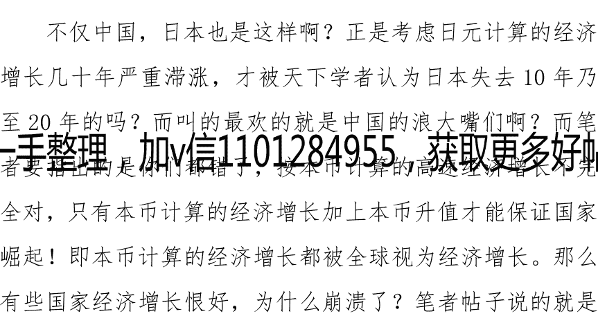
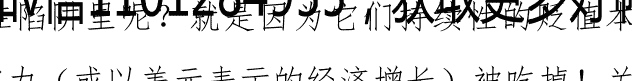
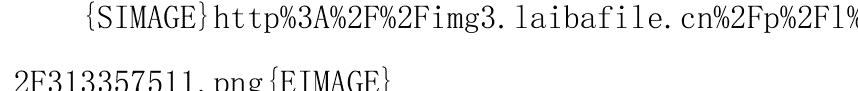
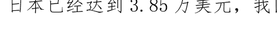
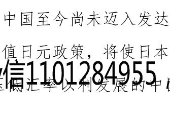

# 所有跌入中等收入陷阱的国家都源自持续性的贬值本币！

采样曲线 A

直奔主题：

下面对于贬值吃掉经济增长的叙述，可理解为 GDP 在转美元时，由于贬值而使美元统计的 GDP 被蚕食的情形，具体的可以参见【1】。下面是一些国家达到人均 GDP 1 万美元后，长时间止步不前的情形，尽管它们的经济增长十分强劲！下文所用数据来自网上图书馆，如在网上搜索：“俄罗斯及人均 GDP 一览”【2】，它其他国家类似。有的在 2017。

## 俄罗斯：2008-2017 年：跌入中等收入陷阱！

美元表示的人均名义 GDP：
俄罗斯 2008 年人均名义 GDP 首次突破并超过了 1.1 万美元，2017 年仍约为 1.1 万美元。

经济增长：
俄罗斯在此期间经济是增长的，俄罗斯名义 GDP 从 2008 年的超过 41 万亿卢布增长到 2017 年的 92 万亿卢布，经济增长了 2.24 倍。

卢布贬值导致其增长被吃掉：
俄罗斯卢布对美元汇率从 2008 年的 25 贬值到 2017 年的 60，使得卢布贬值幅度达到 2.4 倍！这贬值 2.4 倍把俄罗斯 GDP 的增长全部吃掉，从而导致俄罗斯以美元表示的 GDP 数年停滞不前！

## 哈萨克斯坦：(2011-2017 年：跌入中等收入陷阱)

美元表示的人均名义 GDP：
哈萨克斯坦 2011 年人均名义 GDP 首次突破并超过 11635 美元，2017 年下降到 8769 美元。

经济增长：
哈萨克斯坦名义 GDP 从 2011 年的 28.24 万亿坚戈增长到 2017 年的 51.57 万亿坚戈。经济增长超过 1.82 倍。

坚戈贬值导致其经济增长被吃掉：
2017 年的 326，贬值幅度扩大到 2.23 倍。这贬值 2.23 倍将其经济增长全部吃掉，从而导致哈萨克斯坦以美元表示的 GDP 数年不进反退！

## 巴西：(2010-2017 年：跌入中等收入陷阱)

美元表示的人均名义 GDP：
巴西 2010 年人均名义 GDP 首次突破并超过 1.1 万美元，2017 年约 9821 美元。

经济增长：
巴西名义 GDP 从 2010 年的超过 3.8 万亿雷亚尔增长到 2017 年的 6.6 万亿雷亚尔，经济增长约 1.7 倍。

雷亚尔贬值导致其经济增长被吃掉：
巴西雷亚尔对美元汇率从 2010 年的 1.7589 贬值到 2017 年的约 3，使得巴西雷亚尔贬值幅度与 GDP 增幅一样达到了 1.7 倍！这贬值 1.7 倍把巴西的 GDP 增长全部吃掉，从而导致巴西 GDP 数年不进退！

## 土耳其：2008–2017 年：跌入中等收入陷阱

美元表示的人均名义 GDP：
土耳其 2008 年人均名义 GDP 首次达到 1.07 万美元，2017 年约 1.5 万美元。

经济增长：
土耳其名义 GDP 从 2008 年的 9947 里拉增长到 2017 年的……

里拉贬值导致其经济增长被吃掉：
但土耳其里拉对美元汇率从 2008 年的 1.3 贬值到 2017 年的 3.6，使得土耳其里拉贬值幅度扩大到了 2.76 倍！这贬值 2.76 倍把土耳其 9 年的经济增长几乎全部吃掉，从而导致土耳其以美元表示的 GDP 年数停滞不前！

顺便提一句：2018 年由于美国制裁等原因，土耳其里拉进一步大幅贬值，导致土耳其人均 GDP 进一步大幅下滑，并被中国抛在身后！当然，土耳其也将在中等收入陷阱越深，2019 年有望继续持续这种步骤：

## 马来西亚：2012–2017 年跌入中等收入陷阱

美元表示的人均名义 GDP：
2012 年马来西亚名义 GDP 为 10310 美元，首次突破 1 万美元，2017 年为 9951 美元。

经济增长：
马来西亚名义 GDP 从 2012 年的 9419 亿吉特增长到 2017 年的 13524 亿吉特。这 5 年期间，马来西亚增长超过 1.43 倍。

吉特贬值导致其经济增长被吃掉：
但 2012 年马来西亚吉特对美元是 3.089 而 2017 年是 4.27，吉特对美元汇率超过 1.385 倍，这贬值将马来西亚增长几乎吃掉，从而使马来西亚陷入中等收入陷阱。

## 墨西哥：2011-2017：跌入中等收入陷阱

美元表示的人均名义 GDP：
2011 年人均名义 GDP 为 10114 美元，首次突破 1 万美元，2017 年下降为 9321 美元。

经济增长：
墨西哥名义 GDP 从 2011 年的 14.55 万亿索增长到 2017 年的 21.77 万亿索。经济增长超过 1.49 倍。

索贬值导致其经济增长被吃掉：
但 2011 年墨西哥索对美元是 12.43 而 2017 年是 18.90，索对美元汇率超过 1.52 倍，这贬值将墨西哥增长全部吃掉，从而使墨西哥以美元表示的 GDP 不进退！

## 罗马尼亚（2008-2017 年）：跌入中等收入陷阱

美元表示的人均名义 GDP：
罗马尼亚 2008 年名义 GDP 首次突破 1 万美元达到 10136 美元，2017 年为 10780 美元，基本陷入停滞状态。

经济增长：
罗马尼亚名义 GDP 从 2008 年的 5243 里增长到 2017 年的 8563 里。在 2008 年到 2017 年增长达到 1.63 倍。

里贬值导致其经济增长被吃掉：
但 2008 年罗马尼亚对美元汇率是 2.5189 而 2017 年为 4.65，贬值将罗马尼亚经济增长全部吃掉，从而罗马尼亚以美元表示的 GDP 停滞不前！

还有一些国家长期停滞在人均 GDP 1 万美元以下，如印度、菲律宾、印尼等都是由于贬值使未能前进，这里就不列出了！

注：美国和中国的诉求不同，美国政府是缺钱。它的政府曾遭遇资金匮乏而停滞就是实例，还有 40 亿美元的边界，讨论过去，就是一时会被 40 亿美元的资金困住！在中国周边的贸易顺差都覆盖了。因此，美国就要考虑它的美元跑到哪里？美国 GDP 已经很高，因为它的诉求是要收回美元一部分！而中国外汇储备3 万多美元，也不少，因此进口花费外汇，也是给世界表明态度。但还是人民币大幅升值符合中国全方位的政治诉求及国家利益，这就是笔者所强调的！

【1】http://club.kdnet.net/dispbbs.asp?id=1178233&oidcard=52
【2】俄罗斯历年 GDP 及人均 GDP 一览
http://www.360.com/content/18/0906/17/642066784431987.shtml

---

**评论区：**

- **祥条曲线 A** (2019-10-19 16:16):
  ...之反来说，日本，韩国，台湾，新加坡等那些成为发达国家的国家或地区，也是无一例外保持本币汇率持续性升值或起码稳定的国家或地区！

- **垃圾创视演员** (2019-10-19 15:58:00):
  货币贬值只是表象，不是原因。所有进入人均GDP1万美元的国家都因为贬值本币而长期停滞不前，这不奇怪吗？当货币贬值有各种原因，比如为提高出口竞争力而故意贬值本币。也有美国制裁而导致外资纷纷涌进而货币大幅下降，并使其以美元表示的 GDP 也随之下滑的情形，如土耳其、伊朗等。不论何种原因贬值，只要贬值就会给其以美元表示的 GDP 或经济实力构成打击，没有例外！

- **祥条曲线A** (2019-10-19 17:22):
  贬值对我国在世界上的经济地位也有伤害：我国人均 GDP 从 1980 年的 463 元人民币暴涨到 1990 年的 1664 元人民币，涨了 3.5 倍。可以用人民币表示的 GDP 超速增长，也是我们说的。但是以美元表示的人均 GDP 也在世界领域展现，从 1 万美元涨到 4 万美元，基本处于停滞状态。

- **祥条曲线A** (2019-10-19 0:40):
  经济实力停滞甚其倒的结果！

- **祥条曲线A** (2019-10-19 5:13):
  ...不进退！...陷阱还是能做到的。

- **我来狂你** (2019-10-19 21:44):
  同意楼主的观点，一句话概括，想要跨过这个坎，就要升值，而升值货币贬值的发达国家。

- **样条曲线 X** (2019-10-20 20:05):
  从2018年人民币汇率连续下挫，人民币汇率已经从2018年3月份的6.3向右倒至目前这种情形，完全是有人为操纵的痕迹。无疑是宽出口企业它们可以获得更多的汇收益，但不利于中国总体经济，中国出口企业已经超级过每年产140亿双鞋就是冰山一角。人民币汇率应该升值，不能再让企业在低汇率保护下无限膨胀了！

中国这么大的M2是怎么来的？比如2016年我国贸易顺差达到5100亿美元。要对冲5100亿美元收入，当年央行必须投入3万多亿外汇储备。再通过货币乘数的作用，则使M2增加了十万亿人民币（有些人称之为为发行印钞）。试想，如果考虑货币乘数为5，那么3万多亿的外汇储备就会让M2增加15万亿，而2016年M2增加约16万亿。就是，我国由于贸易顺差最后导致了当年全部的M2增加量！即每年数千亿贸易顺差最终导致我国M2增速快。因此，要遏制M2增幅快，就要通过抑制顺差过多来。而抑制顺差必须提升汇。

## 63楼一手办理加信获取更多帖
发布于 2019-10-20 17:26:39

@fengjian 2019-10-20 17:26:39

国家的经济增长都是货币超发引起的，只是数字的增加游戏，所以必然贬值，某些国家一样，只是有资本管制没有爆发出来

------------------------------------------------
货币超发正是由于贬值所引起，贬值是鼓励出口企业获得外汇。而进来的外汇就要产生外汇储备。比如2000亿美元进来，出口企业就要进行汇兑，在汇率率为7的情况下就要向市场投放1.4万亿的货币，在货币乘数5的作用下就是增加了7万亿的M2。

以导致货币超发的原因就是压低汇率，每年顺差累积成最终产生增量的M2，所以要使M2减少，遏制年复一年的顺差，就是要提升汇而不是逐年增加的贬值。

## 66楼
作者:采样曲线 A 日期:2019-10-22 07:54

主帖说了如下结果：以往大部分国内内外学者的文章在谈到中等收入陷阱是我要提及的：如何使经济增长才能跨越中等收入陷阱。但是笔者的帖里列陷阱中中等收入陷阱的各国经济增长都十分强劲。就是不像过去国内学者说的经济增长强劲就可能加信1101284955 获取更多帖子还没达到三倍！比同期中国经济增长还要猛。

而主帖列出的这些经济增长如此强的国家即便跌入中等收入陷阱其人均GDP也不低，他们人均GDP都接近1万美元，且其还能养35万难民。所以归根结底这些国家经济增长乏，是因为这些国家贬值本质使得这些国家原地踏步或不退反！

## 73楼
作者:采样曲线 A 日期:2019-10-22 08:07

持续贬值不利于人民币走向世界！持续贬值的货币根本不可能成为国际储蓄货币，谁愿意意

要垃圾货币？谁愿意要津布韦，我们来委内瑞拉货币？他们自己拿着都嫌弃，还让别人储备它，不可能！更何况，中国有1.8万亿美元外债，人民币的财富要成为国际储蓄货币，中国就可以直接用1.8万亿美元的人民币直接还外债，这可以使人民币增加国际上对人民币的储备支付能力。让中国不干活就买了2万亿美元外债，这样美国又多了一个竞争对手，不符合美元出口的利益。因此，让人民币升值，而且暴力升值，才符合人民币的根本利益，才从血汗工厂过渡到坐享其成的转变，将耗费能源变为富国打工的地位让给赤贫国家，不发达国家，并非坏事。人民币大行其时，还有什么经济问题不可以克服的？现在国际销售国债时，这边就贬值人民币，你还让人怎么信赖人民币，人民币的信誉怎么不能削弱，还要不要人民币走向世界了！？

## 整理1101284955获取更多帖

76楼
楼主除了帖给出的所有突破口均1万美元的国家未能再前行是贬值之外，且在前面的跟贴又给出了贬值不利人民币国际化。这里继续输出：须用升值来遏制超过产能，遏制低端产业草荒式膨胀。

中国为了获取美元，在长达40年已形成超级出口产能，比如中国一年产鞋140亿双，够中国人每年摊上10双的了，中国4口之家5年累计200双了，每个家庭就是一个鞋柜。还有纺织品，玩具等等，这些凑合一起可以让每个家庭开设一个小型店铺。所以中国商品必须向国际市场脱敏，卖给美国的毛衣，中国企业以一元人民币利润，美国市场10美元，现在应该是应用升值限制早已经超级饱和的产能，否则一件衣服就要用1角利润发展了。这些都是耗费巨量资源、人力所能的。但出口企业也意味着那一天亏也不怕，因为他们从贬值回汇收益中得到好处。最终倒霉的是中国老百姓。经济已经走到尽头，数量会有腰斩，但长痛不如短痛，否则中国堪忧。

## 78楼
作者:采样曲线 A 日期:2019-10-22 09:29

持续性的升值不仅是避免中国陷入中等收入陷阱的基本要素，更是加速实现中华民族复兴的。

## 79楼
作者:采样曲线 A 日期:2019-10-22 11:24

@林肯 2019-10-22 11:37
楼主觉得应该贬值到多少合算？我认为人民币应该这一次升值到3元换1美元，尽管比中国差不少！

## 85楼
作者:采样曲线 A 日期:2019-10-22 14:24

2018年我国GDP超过90万亿人民币。如果我国人民币汇率在未来升值到1元换3元人民币，即使未来经济零增长，那么我国GDP也为：90万亿/3 = 30万亿美元（1） 之一！如果按照14亿人口计算，人均GDP就是：30万美元/14 = 2.14万美元（2）。即使我国多年经济零增长，通过升值人均GDP就超过2万美元，已经进入发达国家。

## 88楼
作者:采样曲线 A 日期:2019-10-22 16:37

主帖给出了两个重要信息：
1）过去国内外学者在谈如何跨越中等收入陷阱时，都离不开较高的经济增长为前提。但是给出了所有达到1万美元后停滞前的国家，它们在陷阱期间经济增长都超常强劲，不输中国。所以完全否定了经济匮乏是导致跌入中等收入陷阱的结论。
2）这些跌入中等收入陷阱的国家例外的是持续贬值本币导致他们最终跌入中等收入陷阱！
以上两点，将学者们未来如何跨越中等收入陷阱提供了重要的依据。

## 90楼
作者:采样曲线 A 日期:2019-10-22 20:18

2009年股市为3000点，2019年股市也是3000点。尽管你的比喻极为不恰当，但我仍然愿意回答你：这十年有多少股票上市？现在比年前涨了一倍，同样多的点被稀释了。就好比14亿和7亿的GDP两者都是90万亿是不同的，为什么不同，还需我说？

## 99楼
作者:采样曲线 A 日期:2019-10-22 20:54

@采样曲线 A 2019-10-22 14:24:22
2018年中国GDP超过90万亿人民币。如果我国人民币汇率在未来升值到1元兑3元人民币，即使未来经济零增长，那么我国GDP也为：90万亿/3=30万亿美元（1）。即中国GDP2018年比美国20万亿美元的GDP多出三分之一！如果按照14亿人计算，人均GDP就是：30万美元/14=2.14万美元（2）。即使我国多年经济零增长，通过升值人均GDP就已经超过2万美元，已经进入发达国家。

## 一手整理，加v信1101284955，获取更多帖
@海海123 2019-10-22 19:33:25
美元QE曾贬到70，为什么美元不一直强势？为什么美国还需要QE贬值？特朗普今年一直要求美金降息贬值。他的智商是不如你吗？中国的诉求和美国是不同的，这在主帖最后附注已经说明了！

## 100楼
作者:采样曲线 A 日期:2019-10-22 21:47

既然美国认为人民币汇率被低估，中国在操纵汇率，那大幅升值人民币。以此美国开放高科技市场允许中国企业（如华为）进入美国市场及中国买入美国高科技产品，技术为条件，达到一石二鸟的目的，加速中国崛起。

## 102楼
作者:采样曲线 A 日期:2019-10-23 10:51
@甲申观察 3 2019-10-21 21:06
楼主说的废话好比说：所有关于如何跨越中等收入陷阱的帖子，你的理解并不主流。你理解的是：所有关于如何跨越中等收入陷阱的帖子，大部分学者讲述的是：只有升值才能跨越中等收入陷阱。但是笔者的帖列入中等收入陷阱的各国经济增长都十分强劲，特别是在陷阱期间其经济增长竟然达到了三倍！这种增长显然缺乏收入，货币自然会贬值。货币贬值是结果，是伴随着中等收入陷阱的，根本不是原因。

## 112楼
作者:采样曲线 A 日期:2019-10-23 13:45
@鉴史达 2019-10-23 10:09
升值当然增加购买力，意味着出口降低，人民币价值高。只有人民币坚挺走向升值的道路才能国际化。如果货币贬值或不稳定为趋势，谁会要委内瑞拉货币、津布韦货币？他们自己拿着都嫌弃，还让别人储备它，不可能！

## 114楼
作者:采样曲线 A 日期:2019-10-23 15:24
@清河左派 2016 2019-10-23 10:59
这话怎么和实际相矛盾呢？

## 118楼
作者:采样曲线 A 日期:2019-10-23 17:03
@ty_照德 1 2019-10-23 07:32
感觉人民币大幅升值是错误的，上个世纪的日本广场协议就是最好的例子。产业全部跑丢光，资金陷入对外投资和房市，是升值导致收入实现翻倍，让落后国家生产，商品价格便宜，对国家长期发展。楼主列的这几个所谓中等陷阱的国家，多半实体规模不大，俄罗斯的工业更是产业畸形，他们想靠贬值留住产业部门，可是他们没有这个能力，hold不住，最后只能顾自身，再说……

## 120楼
作者:采样曲线 A 日期:2019-10-23 18:31
如果有人对日本升值日元使其发展质量表示怀疑的话，那么中科院有办法告诉你：日本的工业水平甩出中国60年！

## 121楼
作者:采样曲线 A 日期:2019-10-23 19:22
安倍上台大幅贬值日元后，日本GDP在2013-2015期间增长1.8万亿美元，尽管日本在此期间是增长的。日本在2013年至2014年连续两年外贸逆差创历史最高记录。那对华贸易呢？日本对华贸易改为对华贸易赤字，其中两年对华贸易逆差创历史最高纪录！

## 122楼
作者:采样曲线A 日期:2019-10-23 21:52
@祥曲线A 2019-10-20 17:08:10
反来说，日本、韩国、台湾、新加坡等那些成为发达国家或地区，也是无一例外的保持本币汇率持续性升值或起码稳定的国家或地区！无一不是美国的狗，不服来辩~~~~~呵呵。新加坡还是独立的，至于日本喽，听得最多的是被美国羊毛薅了，几十年没缓过劲。谁知道？

## 125楼
作者:采样曲线A 日期:2019-10-24 09:11
这就好像常说的充分必要：凡是陷入高收入陷阱的国家由持续性的贬值本币所致。必要性：凡是持续性贬值本币的国家，最终将跌入中等收入陷阱的命运！

## 126楼
作者:采样曲线 A 日期:2019-10-24 10:57
@采样曲线A 2020 08:51
你真懂经济学，有人曾问我：“如果中国达到2万美元，需要多少？”我说：如果放弃资源、能源这种数量的发展方式，达到发达国家只需保持升值就足够了！比2018年90万亿人民币的考虑，以后人民币汇率能升到3元换1美元，那么中国GDP也为：90万亿/3=30万亿美元。现在美国20万亿美元还多三分之一！按14亿人口计算，就是：30万亿/14=2.14万美元。

## 128楼
作者:采样曲线 A 日期:2019-10-24 12:52
日本是一个向外型的国家，几乎无资源，农产品不能自给。所谓升值使出口竞争力下降，贸易逆差加大，在日本依赖出口的国家完全失败。

## 一手整理，加信1101284955，获取更多帖
对美元汇率在1985年为238.47日元换1美元，到了1987年对美元汇率升值到144，涨幅1.65倍。谁能告诉我，广场协议后的日本是倒退了还是进步了，为什么？

## 130楼
作者:采样曲线 A 日期:2019-10-24 13:58
顺便一句，由于早年人民币过度贬值的后遗症，2010年中国人均不到5000美元。2010年日本人均GDP达到4.45万美元。2010年媒体刊出中国的产业结构落后日本40年。安倍台前的2012年日本人均GDP排名在各大工业国中仅次于美国达到4.6万美元。安倍的大幅贬值从根本上动摇了日本国力。日本何来失落？

## 131楼
作者:采样曲线 A 日期:2019-10-24 14:28
幸好日本区域狭窄及资源匮乏限制了发展，如果在上世纪八十年代的日本拥有中国的地域和资源，很难想象日本将会发展成什么样。如果当时日本只是一个贬值发展的国家，结局将完全相反。

## 132楼
作者:采样曲线 A 日期:2019-10-24 15:40

他们的四倍。所以，日本还没完蛋的时候。现在就要考虑日本为什么这么厉害，二战给它两颗原子弹还得意的。说日本失去了或落后20年乃至30年的非常开心，难道是自己骗的吗？日本希望别人跟着它喊着日本失去了什么，乃至完蛋了。目的就是麻醉我们，让我们不知进取而已。知道它的长处，并利用之最后实现在均GDP超赶它这才是目前我们应该做的。

## 134楼
作者:采样曲线 A 日期:2019-10-24 16:39
为了获取美元，中国在长达40年的改革开放以来获取美元的方式，已经形成超级产能。比如，中国一年产鞋140亿，够中国每人摊上10双了，够中国4口之家5年累计200双了。

中国目前要达到人民币向日本广场那样的一次性跳跃法有着很大阻力，一方面中国人还不达到到此点的民族硬核和素质。另一方面受到40年来主流经济学者错误误差潮影响，消除这些影响也需要时间。但属看法是杞人忧天。

如果不考虑汇率因素，而只考虑经济增长，那么任何国家都比不上40年GDP增长805%的阿根廷经济。如此飞天的阿根廷经济增长还是跌入中等收入陷阱里了?

不论何原因贬值本币，不管是为增加出口而贬值，还是由外部势力经济制裁而贬值，亦或为打贸易战而贬值。只要贬值特别大幅度贬值势必对国家崛起及经济实力的构成打击，没有例外!

通俗的理解就是：升值如同某人家里的金子突然升高成了金子，在这次币升值的意义下该人家财富迅速增值，使其对其经济活动的能力迅速提升。相反贬值如同金子变银子，使其资产迅速缩水，最终沦为穷光蛋！

总之，中国需要一次广场协议带来日本那样的的大幅升值本币，来体现中国目前的发展成果！

美国和中国的诉求相同，美国政府就是缺钱。它的政府机构曾会美国资金匮乏而停摆就是实例，还有修个40亿的边界墙讨论讨论讨论去，就是一会儿会被40亿美元的资金困住！这在中国两周的贸易顺差就都覆盖了。因此，美国就要考虑它的美元倒到哪里去了？美国GDP很高，因此它的诉求一项整理即增加中国外汇储备也不少，由于要进口博览会花出去外汇，也是给世界表明态度。但是人民币大幅升值最符合中国全方位的政治诉求和国家利益，这就是笔者所着强调的！

我国人均GDP从1980年的463元人民币暴涨到1990年的1664元人民币，涨了3.59倍。可以用人民币表示的GDP超速经济增长，也即我们说的经济高速增长。但是以美元表示的人均GDP，也将在世界领域里实现的经济实力，却从311美元只涨到344美元，基本处于停滞状态。何以造

此两种极化涨？这就是笔者十年来反复强调的贬值经济实力滞甚至倒倒的结果！

人民币大幅贬值最符合中国全方位的政治诉求及国家利益，这就是笔者所着重强调的！

如果日本在1985年不走大幅贬值的路，而是搞所说的均衡汇率，顺便为了所说的贸易战之一取，再又下贬值日元，如此虽然日本不可能完全蛋，也别想那么快的跳出中

当广场协议后日元暴力贬值曾经导致一些企业出现闲倒闭，但这使日本发展方式更进一步的去芜存菁，优化产业转型，出口及顺差出现大幅增长的奇迹。日本人可以承受此种痛苦并进一步使国家走向前进。但要慎瞻前后，患得失，懦弱、胆小怕事的中国人行吗？

中国必须砍击掉一半的过产能，这是早晚要做的事情！现在已经到了十分危险机关头：
当今，中国包括出口的产能超级过剩，年产140亿双鞋够4口之家五年累积200双了。还有玩具，小五金，纺织品等等，足够每个家庭开展一个杂货店了。耗费资源，能源的数量型经济已经到了尽头，资本边际效率极度递减，砍掉一半的产能是迟早要做的事。必须用大幅升值人民币去劣存，长痛不如短痛。总的，中国需要一次广场升值协议带来日本的大幅升值币，将中国发展方式优化转型，同时体现中国的发展！

联合国：中国是世界上唯一拥有所有类的国家！目前外汇储备比日本广场协议时候多。贬值的好处是出口剧增导致外汇储备剧增的情况。而当今世界外汇流失严重的恰为内瑞、土耳其等货币贬值！

主流经济学认为升值不好，长期以来升值成为通胀。那么为什么大幅贬值的国家都出现剧通胀，如津巴韦、委内瑞、伊朗等等。笔者在更早的时间就已经意识到了。下面是2009年发表的：什么方法是遏制通胀或减缓增速？
2009年8月人民币升值是抑制通胀的有力手段！
2010年12月人民币对外升值才能消除通胀。

通俗的理解就是：升值如同某人家里的金子突然升高成了金子，在这次升值的意义下该人家财富迅速增值。相反贬值如同金子变银子，使其资产迅速缩水，最终沦为穷光蛋！

“广场协议”推动的日元升值促进了日本经济结构的调整和升级，给产业升级、消费升级带来了机会。到1990年后日本全面转型，工业从一般的加工制造型企业转向高技术、高附加值产业，精细化管理。在持续升值的过程中，美元计价的日本资产同步增加，日本企业在海外扩大投资，日本居民也分享了成长。

同样，日元升值促进了日本经济结构的调整和升级，给产业升级、消费升级带来了机遇。到1990年后日本全面转型，工业从一般的加工制造型企业转向高技术、高附加值产业，精细化管理进一步强化。在日元升值的过程中，美元计价的日本资产同步增加，日本企业在海外扩大投资，日本居民也切实得了。

日元可以换来更多的美元了。这种局势的结果，美国的资产在日本人看来变得便宜多了。过去在日本人看来买不起的东西，现在变得唾手可得。于是，日本人开始在美国购买。普通消费者在夏威夷等地买一些消费品，美国人都非常欢迎，但美国人感到不安的是，日本人对美国资产的大量收购。这些舞着支票的日本人好像对价格根本不屑顾，他们看起来可以买下整个美国。

完成中国最大的诉求，最大的国家利益，在汇率政策上就是持续性的升值人民币。这不仅是避免入中等收入陷阱的基本保证，更是实现中华民族伟大复兴的关键要素。但愿得到相关政策人的注意！

日本财政省2013年5月28日公布的数据显示，截至2012年底，日本对外净资产创历史新高，连续22位居世界第一。在安倍行为大幅贬值前的22年，由于日元持续性的升值，从1990年底到2012年底日本对外净资产均居世界之首。注意的是，这是日本通过升值日元舒服换来的，而不是耗费能源，资源，人力加大贫富差距为世界打工的。

广场协议使日本获得至少10年的跨越式发展！http://club.kdnet.net/dispbbs.asp?boardid=52&id=10454384

各位看官，可以查看一下作为参考，这样比较就全面了。上面的帖子内容与近期作者发表的帖子内容没有交集。

楼主的废话：所有填饿的人都源于少吃！都陷入等收入陷阱了，也就是缺乏收入，货币当然会贬值。货币贬值是结果，是伴随着等收入陷阱的，根本不是原因。

你的理解并不主流经济学人都这么理解。不信，你去翻过的关于如何跨越中收入陷阱的帖子。大部分学者的帖子里讲述的是如何经济增长才能跨越中收入陷阱。但是作者的帖子里列入中收入陷阱的各国经济增长都十分强劲！特别土耳其在陷阱期间其经济增长竟然达了三倍！而在陷阱期间其人均GDP也不低，如土耳其人均GDP接近万美元，而且……

甲观察：本币贬值，导致经济增长快了。内瑞、增长更快。这种认识点赞！

广场协议后，日元暴力贬值曾经导致一些企业出现闲倒闭，但这使日本发展方式更进一步的去芜存菁，优化产业转型，出口及顺差出现大幅增长的奇迹。日本人可以承受此种痛苦并进一步使国家走向前进。但要慎瞻前后，患得失，懦弱、胆小怕事的中国人行吗？

资源，人力加大贫富差距为世界打工的。当今，中国包括出口的产能超级过剩，年产140亿双鞋够4口之家五年累积200双了。

这种认识点赞！广场协议后，日元暴力贬值，成功的，出口及顺差就说明了。

从1985年，汇率大幅升值，仅仅经过两年，1987年人均GDP就达到了20071美元，1988年，从1万美元到2万495美元，尽管当时日本的实体经济没有什么变化（如果有变化就是通过升值对企业的去劣优）。

日本不断从大幅升值获得好处，却向世界诉日元升值带来的“错误”，还有一位叫池田信的写了一本书《失去的二十年：日本经济长期停滞的真正原因》，把全地球学者唬的一愣愣的。直到现在还有学者被吓得懵不懂，由于升值日元而失去10年，20年，乃至30年，越越郭，真是浪喘啊！日本人自己通过升值获得了尊严及利益，还要“警示”别的国家不要遵循此道，这是何等劣害的民族！

如果有人对日本升值日元使其在广场协议后仅两年GDP就翻倍帮助助长的发展水平怀怀疑的话，那么中科院都会有人结论：日本的工业水平出口中国60年！

贬值后，日本出口贸易都受到重创！所以，当初在安倍所称要大幅贬值日元使中国经济学人都哀鸿鸿远的情形完全是杞人忧。也证明了中国主流学人们从1980年以来就是完全错误的思维方式和认知理论。好在笔者及一些仁之士的努力，近年吹灭贬值的错误潮却有所收效。

日本是一个外向型经济的国家，几乎无资源，农产品也不能自给。但所谓升值使出口竞争力下降，贸易逆差加大，在日本这个依赖出口立国的国家竟也完全失效。

## 190 楼
作者:样条曲线 A 日期:2019-10-28 16:22
网搜下面这个视频，值得一看：
北大教授：因此点导致中国经济被严重低估了。

## 191 楼
作者:样条曲线 A 日期:2019-10-28 17:16
西方给中国安排的命运是一头牛，给西方累死累活的做工，有油了肯心被压榨，耗费自己能源、资源的发展方式？
难道就此剖肉割骨？

## 193 楼 
作者:样条曲线 A 日期:2019-10-28 18:38
296美元暴涨到1987年的20,017美元。第三年的1988年达到24,240美元！
作者查看了一下，除了日元暴力升值外，随美元计价的金融资产同步暴升外，其余的基本面基本没变化！

## 194 楼 
作者:样条曲线 A 日期:2019-10-28 19:20
经济实力崛起 = 经济增长 + 本币升值（起码汇率稳定）。
因此，在汇率政策上保证人民币坚才是符合中国迅速崛起的政治诉求和最大的国家利益！

## 195 楼 
作者：样条曲线 A 日期：2019-10-28 19:53
“十三五”规划有一个明确的目标，人均 GDP 翻番。
也许就说到2020年左右，若中国人人均 GDP 达到12000美金，就有可能跳出“中等收入陷阱”。
要实现这一目标的前提是，只要能保证经济增长，而且更重要的是人民币汇率不要跌回，要从现在开始！

## 196 楼 
作者：样条曲线 A 日期：2019-10-28 20:25
幸好日本地区的狭窄及资源匮乏限制了它。如果在上世纪八十年代日本拥有中国的地域和资源，很难想象日本能获取更多好结果。
发展的国家，结局必将完全相反。

## 197 楼 
作者：样条曲线 A 日期：2019-10-28 20:48
根据日本经济计划厅估算：从1985年10月到1987年12月，日本因日元升值获得的利益约2265亿美元。并推动了当时日本经济实力的飙涨。

## 198 楼 
作者：样条曲线 A 日期：2019-10-28 21:08
我国人均 GDP 从1980年的463人民币涨到1990年的1664元人民币，涨了3.59倍。
可用以人民币表示的GDP：

超高速经济增长，也就是我们说的经济超高速增长。
但是以美元表示的人均 GDP，这实在世界范围内展现的经济实力，却从311美元仅涨到344美元，基本处于停滞状态。
何以造成此种两极分化？这就是作者十年来反复强调的贬值使得经济实力滞涨甚至倒退的结果！

## 199 楼 
作者：样条曲线 A 日期:2019-10-28 21:54
尤为痛惜的是，中国主流经济学家对中国的崛起没有起到应有的作用。
在长达40年的改革开放过程中，他们利用媒体、书籍、文章等传播媒介放大贬值的“好处”，唯独对国际上大幅贬值引发的通胀高企、国际经济地位陷至贫穷的国家毫无认识。
至今日，中国的汇率政策始终接受这些人的影响，甚至把人民币汇率贬值为贸易战的一张牌，全然没有意识到其结果是对中国经济的压缩摧残。

## 200 楼 
作者：样条曲线 A 日期:2019-10-29 08:00
美国和中国的诉求不同，美国政府是缺钱的。它的政府曾经营黄金储备而停摆就是实例，还有修个40亿的边界墙讨论过，就是一时会被40亿美元的资金困住！
在中国两周的贸易顺差全都覆盖了。因此，美国就要考虑它的美元跑到哪里去了？
美国GDP已经很高，因此它的诉求是：

收回美元即使一部分也！而国外汇储备3万多美元，也不少，因此要进口博览会花出去的外币，也是给世界表明态度。
但还是人民币大幅贬值最符合中国全方位的政治诉求及国家利益，这就是笔者所重重强调的！

## 202 楼 
作者:样条曲线 A 日期:2019-10-29 09:07
为何耗费资源、能源、人力的发展方式？好不好？获得国家地位的提升及尊严吗？
所谓贬值使得竞争力下降，贸易逆差加大，被这么糟蹋的启蒙还将继续下去！

## 203 楼 
作者:样条曲线 A 日期:2019-10-29 09:30
以之力，与整个学界的错误思潮抗衡，中国向前前进！

## 204 楼 
作者:样条曲线 A 日期:2019-10-29 09:59
日本是一个外向型的经济国家，几乎无资源，农产品不能自给。所谓贬值使得竞争力下降，贸易逆差加大，日本这个依赖出口的国家完全失败。

## 205 楼 
作者:样条曲线 A 日期:2019-10-29 11:31
如果没有日本这个前车之鉴，恐怕都会说：人均GDP从1万美元到2万美元的跨越可能的，但日本人做到了！中国人就是进取也不行，一团散，即便无可驳的事实。

## 206 楼 
作者:样条曲线 A 日期:2019-10-29 12:44
这个角度有点意思，大部分发展中国这几年都停滞了。
如果不是贬值，所列大多数国家能够跨越中收入陷阱，而且已经到达发达国家水平。

## 207 楼 
作者:样条曲线 A 日期:2019-10-29 13:16
安倍前的日本通过不断贬值，使其国内国外以美元表示的金融资产狂飙升，进而支持了日本经济力的不断强大，而推动了日本经济地位的快速上升！

## 208 楼 
作者:样条曲线 A 日期:2019-10-29 14:24
这个角度有点意思，大部分发展中国这几年都停滞了。
问题是自从2006年提出中收入陷阱以来，中国学者主要都基于保证经济增长来考虑如何越过中收入陷阱，但提出的所有跃陷阱的国家经济增长都十分强。土耳其在其陷阱期间增长超过3倍，比中国还高！

## 209 楼 
作者：样条曲线 A 日期：2019-10-29 14:58
不论何种原因贬值，不管是为增加出口而贬值，还是由外部势力经济制裁而贬值，亦或是为了贸易战而贬值。只要大幅贬值趋势必对国家及经济实力构成致命击，没有例外！

## 210 楼 
作者：样条曲线 A 日期:2019-10-29 15:30
多年讨论最多也是精英最焦虑的就是中国能否跨越中收入陷阱？
说中国不能的有，说能的有，说收入陷阱是伪概念的也有。为什么很多国家会陷入中收入陷阱，有些国家却没有？
最近10余年来，已经有学者不断着书立论或大幅阐述之。实际上用不着大幅论述，如果仅仅把精力花在如何保证持续性的经济增长上而避免陷入陷阱，那是白费笔墨！

## 211 楼 
作者：祥条曲线 A 日期:2019-10-29 16:15
通俗的理解就是：升值如同某人家里的银子突然跳成了金子，币升值的意义使得该户家里财富迅速增值，也使其对外经济活动的能力迅速提升。相反贬值如同金子变银子，使其财富迅速缩水，最终为劣害！

## 212 楼 
作者：祥条曲线 A 日期:2019-10-29 16:15
安倍上台制造大幅贬值后，日本在全球的经济地位和贸易都受到重创！
所以，当初在安倍声称要大幅贬值后使中国经济学家一片荒鸿遍野的完全是杞人忧。
也明白了中国主流学者们自980年以来就不是用完全错误的思维方式以及认识理论对于中国的。好在笔者及一些有识之士努力，近年贬值的错误潮有所。

## 213 楼 
作者：祥条曲线 A 日期:2019-10-29 17:22
经济增长 = 经济增长 + 本币升值（起码稳定）。

## 214 楼 
作者：样条曲线 A 日期：2019-10-29 18:41
即使经济增长，如果耗费资源、能源、人力的数量型经济的发展方式，那么未来只要保证人民币汇率升值到一定程度，中国就可以人均GDP达到万美元水平，中国的经济实力还将放大！

## 215 楼 
作者：样条曲线 A 日期：2019-10-29 19:17
大幅贬值使日本失去1.8万亿美元！

## 216 楼 
作者：样条曲线 A 日期:2019-10-29 19:53
所有进入人均GDP万美元的国家都是因为贬值本币而停滞，这不奇怪吗？
自然贬值有各种原因，比如为提高竞争力而故意贬值，美国制裁导致外资纷纷撤离而下跌情形，如土耳其、伊朗等。但不论何种原因贬值，都会给美元表示的经济实力构成打击，没有例外！

## 217 楼 
作者：样条曲线 A 日期：2019-10-29 20:25
不要以为自己挺英雄，那是整个学界错误潮对民众的误导，更是对中国崛起的伤害！

## 219 楼 
作者：样条曲线 A 日期:2019-10-29 21:57
人均GDP从1980年的463人民币涨到1964元人民币，涨了3.59倍。可用以人民币表示的GDP超高速经济增长，也就是我们常说的经济高速增长。
但是从311美元涨到344美元，基本处于停滞状态。何以造成这种两极分化？这就是笔者十多年反复强调的贬值使得经济实力滞涨甚至倒退的结果！

## 220 楼 
作者：样条曲线 A 日期：2019-10-30 02:59
当人类跨过2000年时，我注意到：2000年经历“失去10年”的日本人均GDP高达36828美元，而高速发展20年的中国人均GDP不到1000美元！

## 221 楼 
作者：样条曲线 A 日期：2019-10-30 09:16
当人类跨越2000年时，我注意到：2000年经历“失去10年”的日本人均GDP高达36828美元，而超高速发展20年的中国人均GDP不到1000美元！

## 224 楼 
作者：样条曲线 A 日期：2019-10-30 10:04
发展质量，汗颜：
来源：法制时报
标题：中科院：中国工业水平落后德国100多年，落后日本60年。

## 225 楼 
作者：样条曲线 A 日期：2019-10-30 11:31
所谓的“中国跨越中等陷阱”并没有多如牛毛。但真正触碰到汇率的几乎没有，那些跌入陷阱的国家经济增长十分强劲！

## 226 楼 
@retinoscopy 2019-10-22 07:32:10
楼主，我告诉你一条真理，人太瘦是因为身上的肉太少。骨头硬就行，就怕天生就是软骨头不知道进取！

## 227 楼 
作者：样条曲线 A 日期：2019-10-30 14:03
若要崛起，应遵循币值升值趋势下的经济增长才行！

## 229 楼 
作者：样条曲线 A 日期：2019-10-30 14:34
所谓保汇率还是保外汇储备，本来就是伪命题。好像日本经验告诉我们只要升值就能保全，土耳其经验告诉我们如果我们大幅贬值，外汇将加速流失。

## 230 楼 
作者：样条曲线 A 日期：2019-10-30 15:53
为了实现民族的伟大复兴，在汇率政策上必须保持人民币强势坚挺，否则只有陷入陷阱！

## 231 楼 
作者：样条曲线 A 日期：2019-10-30 16:27
根据数据：日本在1985年的对外资产为1298亿美元，随着日元的升值，以美元计价的财富迅速增长，仅若干年，1987末日本的对外资产达到了2898亿美元，增加了一倍。伴随日元升值，缓慢经济增长带来的资产增加哪个更好？

## 232 楼 
作者：样条曲线 A 日期：2019-10-30 17:04
由于货币调整后，日本出口都受到重创！所以，当初在安倍声称要大幅贬值后使中国经济学家一片荒鸿遍野的完全是杞人忧。也证明了中国主流学者从1980年以来就是用完全错误的思维方式来。

## 233 楼 
作者：样条曲线 A 日期：2019-10-30 17:30
如果世界上有一个国家可以像上世纪八十后的日本通过大幅升值本币在两年之内达到发达国家，那么这个国家非中国莫属。

## 234 楼 
作者：样条曲线 日期2019-10-30 18:11
关键还是竞争的问题，看看那些破碎的：“中国2040年将达美国70%”，“中国2030年将超过美国”。
“广场协议”给日本带来重创……而不足，中国靠这来根本无望！

## 235 楼 
作者：样条曲线 A 日期：2019-10-30 18:41
日本是一个外向型的经济国家，几乎无资源，农产品不能自给。所谓贬值使得竞争力下降，贸易逆差加大，日本这个依赖出口的国家完全失败。

## 236 楼 
中国科学院现代化研究中心最新发布的《中国报告2015》。该报告称，2010年中国工业水平比德国、英国大约落后100多年，比日本落后60余年。

## 237 楼 
作者：样条曲线 A 日期：2019-10-30 18:52
最近越南引起全球媒体关注，网友都知道英镑值，知道发达国家的货币贬值。为什么中国经济学家几十年来却主张货币贬值，还颠倒黑编造种种升值“不好”的谎言，难道他们的智力不如网友?

## 238 楼 
作者：样条曲线 A 日期:2019-10-30 20:40
美国跪求人民币升值是中国复兴的机会！

## 240 楼 
作者：样条曲线 A 日期:2019-10-30 22:30
所有跌入中收入陷阱的国家都源自持续性的贬值！全都是!!!

## 243 楼 
作者：样条曲线 A 日期:2019-10-30 22:57
如果放弃耗费资源、能源、人力的数量型经济的发展方式，还要达到发达国家水平才能保持升值就够了！

作者：采样曲线A 日期：2019-10-31 13:29

所有跌入中等收入陷阱的国家都源自持续性的贬值货币！

253 楼

作者：采样曲线A 日期：2019-10-31 14:06

从2018年人民币汇率连续下探，人民币汇率已经从2018年3月份的6.3左右到目前这种情形，完全人为操纵的痕迹。

254 楼

作者：采样曲线A 日期：2019-10-31 14:35

那些本币汇率保持持续升值或起码稳定的国家或地区，如中等收入陷阱成功的位于发达国家或地区阵营。即使经济（本币计算）数十年严重滞胀也要，被全世界（特别中国学界）长期误认为失去10年乃至20年的日本就是一个典型的例子。这也是为什么笔者20年来与学界“公然”唱反反对任何形式的贬值人民币的原因。即使是出口，为贸易战贬值人民币也罢了！

255 楼 

作者：采样曲线A 日期：2019-10-31 15:32

以己之力，推翻中国学者几十年来祸中国的错误观点，势把中国推向前！

# 256 楼

作者：样条曲线 A 日期：2019-10-31 16:13

目前遍布全球观察一个国家的经济好坏，仅考虑经济增长远远不够。还要考虑一个重要因素，就是本币汇率因素，这也是笔者经常能想起要国家崛起必须按照：

经济崛起 = 经济增长 + 本币升值（或起码稳定）

律行的规律。

# 259 楼

作者：样条曲线 A 日期：2019-10-31 16:53

@样条曲线 A 2019-10-31 14:35:04

那些本币汇率保持持续升值或起码稳定的国家或地区，如韩国、美国、德国、日本，往往没有陷入收入陷阱。如菲律宾、巴西、泰国等国，成功的位于发达国家或地区阵营。即使经济（本币计算）数十年严重滞胀也要，被全世界（特别中国学界）长期讥讽为失去10年又到20年的日本就是一个典型的例子。

这也是为什么笔者20年来与学界“公然”唱反反对任何形式贬值人民币的原因。即使为出口，为贸易战略战贬值人民币也是！

@ryushulinfeng 2019-10-31 15:46:04

楼看来本币有点儿面子了，韩国1998年和2009年贬值都超一倍呢。

有不同观点欢迎表述，但信口河河就是你的不对了！可以网搜：

韩国历年 GDP 及人均 GDP 一览（1953—2013）

表格的最后最后一栏，升贬的幅度都给你列出来完了！

韩国历年 GDP 及人均 GDP 一览（1953—2013）

可以看到历年美元对韩元汇率变动情况，何来贬值一倍？

260 楼 
作者：梓条曲线 A 日期：2019-10-31 17:18

如果有人对日本升值使其在广场协议后仅两年 GDP 就暴涨，就认为日本元贬值的表现是高水平的，亚洲国家会告诉诸位：日本的工业水平比中国早60年！

261 楼 

作者：梓条曲线 A 日期：2019-10-31 18:28

如果世界上有一个国家可以像上世纪八十年代后的日本通过大幅升值2年之内达至发达国家，那么这个国家非中国莫属。

262 楼 

作者：梓条曲线 A 日期：2019-10-31 19:06

广场协议使日本在国际经济地位上以美元表示的 GDP 迅猛暴涨，使其强势处于发达国家之林，而这仅是在两年期间完成的！广场协议及日元大幅升值造就了日本的奇迹！

# 263 楼 

作者：样条曲线 A 日期：2019-10-31 19:51

不要妄想想象中国的创新能力发达国家还差不少，中国的创新指数目前在全范围内已经超过数个发达国家且压力日本上升到第14位了。

# 264 楼 

作者：样条曲线 A 日期：2019-10-31 20:28

所有跌入中等收入陷阱的国家都源自持续性的贬值货币！

# 一手整理，加微信1101284955，获取更多好帖

作者：样条曲线 A 日期：2019-10-31 21:18

中国人均 GDP 从1980 年的463元暴涨到 1990 年的664元，涨了3.5倍。可以用人民币表示的高速增长，也就是我们说的经济增长。但是以美元表示的人均 GDP，在世界范围内展现的经济实力，却从31美元涨到340美元，基本处于停滞状态。何造成这种分化？这就是笔者多年来强调的贬值使经济实力滞涨甚至倒退的结果！

# 266 楼
作者：样条曲线 A 日期：2019-10-31 21:55

2013年至2015年，安倍执政后，大幅贬值使日本 GDP 大幅。

# 267 楼
作者：样条曲线 A 日期：2019-10-31 22:40

人民币大幅升值最符合中国政治诉求。

# 268 楼
作者：样条曲线 A 日期：2019-11-01 08:51

当人类跨过2000年时，我注意到2000年的人均 GDP高达3628美元，而2010年的人均 GDP甚至不到1000美元。

# 一手整理，加微信101284955，获取更多好帖

作者：样条曲线 A 日期：2019-11-01 09:25

所有跌入中等收入陷阱的国家都源自持续性的贬值货币！

# 270 楼
作者：样条曲线 A 日期：2019-11-01 10:03

在长达40年的改革开放，国内事例告诉我们：贬值不仅使国家实力下跌，而且外汇流失，通胀加剧；升值不仅使国家实力上升，而且外汇增加，缓解通胀压力。

# 271 楼
作者：样条曲线 A 日期：2019-11-01 10:36

@坂暇电视滚 2019-10-19 15:58:00

货币贬值只是表象，不是原因。每个陷入中等收入陷阱的国家经济增长都挺强，汇率只是一个转换器，是横向比较，即全球角度下各个经济实力的比较！

# 272 楼
作者：样条曲线 A 日期：2019-11-01 11:18

@样条曲线 A 2019-10-29 09:59:09

日本是一个外向型经济的国家，几乎无资源，农产品不能自给自足。但却升值使得竞争力下降，贸易逆差增大，一个国家的发展完全取决于汇率运行。

# 273 楼
作者：样条曲线 A 日期：2019-11-01 13:05

@海海峰 2019-11-01 12:25:14

楼主真的幼稚，人民币升值不利于出口了，没有人民币贬值带来的庞大出口外汇支撑，人民币只会更加贬值了，而且升值也是自身实力支撑的。世界目前贬值第一的是津巴比元，它家也开过和美元一比一的汇率，结果现在呢？

你看看元升值后出口如何强大就行了！请阅《广场协议成就了日本奇迹》，就在本版！

# 276 楼 
作者：样条曲线 A 日期：2019-11-01 13:54

国防部回应中国高科技赶上美国：别想捂杀中国。更新于2019-11-01 09:42

如何在经济实力上体现出来，需要学者反思！

# 277 楼 
作者：样条曲线 A 日期：2019-11-01 15:35

# 一手整理+加信1101284955获取更多好帖

# 279 楼 
作者：样条曲线 A 日期：2019-11-01 16:27

所有跌入中等收入陷阱的国家都自持持续性的贬值货币！

# 280 楼 
作者：样条曲线 A 日期：2019-11-01 17:01

中国产能超级过剩，必须制低汇率为低端早已已过剩的产能保护航！

# 282 楼 
作者：采样曲线 A 日期：2019-11-01 17:19

不考虑本币坚持，仅靠经济增长是不可能使国际地位提高的。阿根廷40年GDP增长8倍，还不是落到中等收入陷阱里？

# 283 楼 
作者：样条曲线 A 日期：2019-11-01 18:32

楼主搞反了，可以反转的。贸易战的机会给你，把握的就看自己！

# 284 楼 
作者：样条曲线 A 日期：2019-11-01 19:34

主贴给出了两个重要信息：即各国发布的（本币）经济增长离不开较高的增长。但是主贴给出了所有的在期间经济增长达到了倍。所以完全否定了连续性的贬值导致它们最终陷入中等收入陷阱！以上两点，给学者们考虑未来如何跨越中收入陷阱提供了重要的依据。

# 285 楼 
作者：样条曲线 A 日期：2019-11-01 20:21

大幅贬值日元使日本失去1.8万亿美元。

# 286 楼
作者：样条曲线 A 日期：2019-11-01 21:03

进一步的、笔者指出《广场协议》使日本获得少10年的跨越式发展！在未来日元兑美元汇率变动不大，即使到2020年以美元计算的GDP也不可能回到2012年”。

# 287 楼
作者：样条曲线 A 日期：2019-11-02 05:45

# 一手整理，加信1101284955 获取更多帖

不能自洽。而老旧的经济学理论中所提升出口下降，不利出口，外汇流失，逆差加大，在日本这个依赖出口的国家也完全失败！

# 291 楼 
作者：样条曲线 A 日期：2019-11-02 06:47

@赵耿 8786p 2019-11-02 02:27:54

应该是反过来的吧，是因为路不去才会贬值的吧。中国的经济很像中国制造，外卖是自己的，很多配件也能生产，但核心部件却是别人的，比如造车，发动机是人家的，手机，牌子，外卖是自己的，核心部件也是人家的，空运的大飞机还在买，买，如果众多产业的核心技术，核心部分也被中国掌握了，那么相当多的发达国家，真的只能吃苦了。

# 292 楼 
作者：样条曲线 日期：2019-11-02 08:45

一手理加微信1101284955，获取更多好帖

所谓保汇率还是保外汇储备，本来就是伪命题。好像保外汇就要流失外储，保外储就要放弃汇率。但日本经验告诉我们只要要暴力升值就能保，土耳其、伊朗经验告诉我们如果我们贬值，外汇将加速流失，全不保！有关经济方面的话几乎被颠倒黑白的“浪大嘴”们把持，所以主流媒体就根据这些“浪大嘴”们指鹿为马的乱左右，误导中国的发展进程！

# 293 楼 
作者：样条曲线 A 日期：2019-11-02 09:37

@资水东流 2019-10-28 23:09:14

这个角度有点意思，大部分发展中国这几年都停滞了。是啊，要不是贬值，这些国家的大部分已经步入发达国家了！

# 294 楼 
作者：样条曲线 A 日期：2019-11-02 12:24

日本不需要大规模印钞，不需要浪费资源，能耗，人为为世界打，不需要世界工厂的桂冠。需要的是日本全世界市场下的默契：升值，升值再升值日元！舒舒服服的挂线、良好处理、累加信誉、胜利、获取更多的好处。尊重尊重不好吗？反正是你美国人要日元升值的，不升白升。

# 296 楼 
作者：样条曲线 A 日期：2019-11-02 12:59

@李仁瑞 2019-11-02 09:53

楼主自己搞反了，继续。你有伴的的确可以反转的继续！

# 297 楼 
作者：样条曲线 A 日期：2019-11-02 14:02

@清河派 2019-10-23 10:59

想要信赖的“人无贬值”算不算？

# 298 楼 
作者：样条曲线 A 日期：2019-11-02 15:14

那么在现实中这样依靠升值就突然使经济实力暴增的例子吗？我在文中说有。

# 300 楼 
作者：样条曲线 A 日期：2019-11-02 16:24

@曹贵石 08h 2019-10-30 03:46:21

# 一手整理，加微信101284955 获取更多帖

关注，获取福利。贬值不容易进入，但是对于土耳其同时拥有外资市场的钱来说是天堂。所以没有贬值基础汇率操纵。

# 302 楼 
作者：样条曲线 A 日期：2019-11-02 17:00

广场协议前日本人均一直被美国压着，可是广场协议两年的1987年人均GDP超越美国！

# 303 楼 
作者：样条曲线 A 日期：2019-11-02 17:21

@样条曲线 A 2019-11-02 17:00:51

广场协议前日本人均一直被美国压着，可是广场协议两年的1987年人均GDP超越美国！

@地海123 2019-11-02 17:18:03

楼主搞反了，经济上出了问题需要贬值。经济支持撑不了市值。最近几年日本经济吧。2012年GDP：6.2万亿美元，2018年GDP：5.07万亿美元。

# 一手整理，加v101284955，获取更多帖

啊，我先吃饭，等会回答你。感谢你的回帖！楼主对任何理性回帖都给予尊重和回复！

# 306 楼
作者：样条曲线 日期：2019-11-02 18:48

回“军民一家2012”。比如，安倍刚上一台就对外宣称要大幅贬值日元（就是把中国学者吓尿了的那次），就是人为为操控日元贬值的开始。又如央行2005年人民币汇率初期将调整为升值2%，也认为是人为为操控的结果。又如央行2015年8月11日日本人民币中间价今日日元下幅1000点，也是人为为操控的结果。不论升值还是贬值，如果人为为了，那么升值（或贬值）预期就出了。

# 307 楼 
作者：样条曲线 A 日期：2019-11-02 20:17

@朱尊瑞88 2019-10-31 13:29

所有跌入中等收入陷阱的国家都源自持续性的贬值货币！

所以没有贬值基础汇率操纵国市场的钱来说是天堂。不能自洽。而老旧的经济学理论中所提升出口下降，外汇流失，逆差加大，在日本这个依赖出口的国家也完全失败！你看看元升值后出口如何强大就行了！请阅《广场协议成就了日本奇迹》，就在本版！

开心，难道这不是自己欺骗自己吗？日本人希望别人跟着它喊日本失去什么，乃至完蛋了。目的就是麻我们，让我们不知进而去。知道它的长处，并利用之最后赶超它才是目前我们应该做的。

## 316 楼
作者：祥条曲线 A 日期:2019-11-03 09:12

在安倍实行率为大幅贬值前的 22 年，由于日元持续性的升值，从 1990 年等到 2012 年底日本对外净资产居世界之首。值得注意的是，这是日本通过升值日元舒舒服得来的。而不是耗费能源，资源，人力加大贫富差距为世界打工换来的。

已成为最大债权国。

## 317 楼
作者：祥条曲线 A 日期:2019-11-03 10:18

日本人自己通过升值获得了属于自己的尊严和利益，却还要“警示”别的国家不要遵循此道，这是何等害的民族！

## 318 楼 
作者：祥条曲线 A 日期:2019-11-03 11:16

我国人均 GDP 从 1980 年的 463 元人民币涨到 1990 年的 1664 元人民币，涨了 3.59 倍。可以用人民币表示的 GDP 超高速经济增长，也就是我们常说的经济高速增长。但是以美元表示的人均 GDP，也在世界领域展现的经济实力，却从 311 美元仅涨到 344 美元，基本处于停滞状态。何以造成此种两极分化？这就是作者十年来反复强调的贬值使经济实力滞涨甚于倒退的结果。

## 319 楼 
作者：祥条曲线 A 日期:2019-11-03 13:21

货币贬值有各种原因，比如为提高出口竞争力而故意的为贬值本币。也有受美国制裁而导致外资纷纷撤离而货币大幅下探，并使其美元表示的 GDP 也因此下滑的情形，如土耳其、伊朗等。但无论何原因贬值，只要贬值都会给其以美元表示的 GDP 或经济实力构成打击，没有例外！

## 一手整理，加v信1101284955，获取更多好帖
作者:祥条曲线 A 日期:2019-11-03 13:14

当人类跨过 2000 年时，我怀疑地注意到：2000 年经历“失去 10 年”的日本人人均 GDP 高达 36828 美元，而超高发展 20 年的中国人均 GDP 甚至不到 1000 美元！

## 321 楼 
作者：祥条曲线 A 日期:2019-11-03 15:04

在 70 年的改革开放过程中，中国一些学者为害怕贬值创造了许多谎言，且与颠倒黑白胡说八道有关。比如升值导致通货膨胀就是其中之一。暂且不提近年导致严重通胀的国家如土耳其、委内瑞拉、津巴布等国剧烈的通胀都与货币贬值有关，就是早期中国通胀也是由人民币大幅贬值引起。特别是在1994 年人民币并轨贬值导致了中国历史上最大的通胀率 24%，下面是笔者十多年来有贬值引起通胀的部分论述：

- (1) 用什么方法是遏制通胀或其预期的有效方法？2009年8月
- (2) 遏制通胀助推中国崛起，应不断加速升值！2010年12月
- (3) 升值遏制通胀5大要素2010年12月
- (4) 人民币贬值15%，出口商品何以弥补3000亿美元
- (5) 人民币贬值就是全国在补贴出口！
- (7) “人民币升值对内贬值”何以流行？

## 322 楼 
作者：祥条曲线 A 日期:2019-11-03 16:27

升值就像家里的银子突然成了金子，此时升值的意义让家里财富迅速增值，使其对外活动的能力提升。相反贬值如同金子变银子，使其资产迅速缩水，沦为穷光！

## 323 楼 
作者：祥条曲线 A 日期:2019-11-03 17:28

中国需要一次协议带来日本那样的大幅升值，体现目前的发展成果！

## 324 楼 
作者：祥条曲线 A 日期:2019-11-03 19:45

所有陷入中等收入陷阱的国家都由于持续性的贬值！

## 325 楼 
作者：祥条曲线 A 日期:2019-11-03 20:43

所有陷入中等收入陷阱的国家都由于持续性的贬值！

## 326 楼 
作者：祥条曲线 A 日期:2019-11-03 21:34

资本效率极度递减，砍掉至少的产能是迟早要做的事。长痛不如短痛。总之，中国需要一次协议带来日本那样的大幅升值，将中国发展优化转型，同时体现目前的发展！做到这一点，必须要消除过去发展上的一些错误观念，纠正之，在此基础上共同努力，把中国推向更高点！

## 327 楼 
作者：祥条曲线 A 日期:2019-11-03 22:38

人民币大幅升值符合中国方的政治诉求及国家利益，这就是所强调的！

## 328 楼 
作者：祥条曲线 A 日期:2019-11-04 07:29

上有理！

## 333 楼 
作者：祥条曲线 A 日期:2019-11-04 08:38

转变学术界传统的固化的错误思潮及思维方式，是当前最的事情！

## 334 楼 
作者：祥条曲线 A 日期:2019-11-04 09:09

## 2014 年老帖：一个问题！数据来自4.8万粉丝

## 335 楼 
作者：祥条曲线 日期:2019-11-04 10:00

没有了外贸，用低价商品换来的美元，你比又怎样？你去买东西欧美！自己的外贸死了，现在的美元是以以前剩下的，用完你就是超级大国！事实上与你想完全相反，正是贬值特别是大贬值的国家，如委内瑞拉、土耳其、伊朗等等，才使得外汇流失，外汇储备减少。相反协议后的日本，出口强劲，外汇储备锐增。

## 336 楼 
作者：祥条曲线 日期:2019-11-04 10:34

所有陷入中等收入陷阱的国家都由于持续性的贬值！

## 337 楼 
作者：祥条曲线 日期:2019-11-04 11:47

日本是一个外向型的经济的国家，几乎无资源，农产品也不能自给。但所谓升值使出口竞争力下降，贸易逆差扩大，

## 338 楼 
作者：祥条曲线 日期:2019-11-04 13:35

如果世界上有一个国家可以像上世纪八十年代后的日本通过大幅升值货币2之内达到发达国家，那么这个国家非中国莫。

## 339 楼 
作者：祥条曲线 日期:2019-11-04 15:25

中国超级过剩的产能，已经使中国不堪重重，迟早崩塌。长痛不如枉痛，中国精英必须痛下决心，为中华民族的根本利益，为中国最大的政治诉求，最大的国家利益，跨越中等收入陷阱把中国推向前进！

## 340 楼 
作者：祥条曲线 日期:2019-11-04 16:35

民界称，“这几年货币的发行之大，在人类历史上前所未有”。我们的精英知道印钞不好，却不知怎么解决，岂不可笑？中国产能也超级过，许多学者也知道，却不知怎么解决。难道都是废物？

## 341 楼 
作者：祥条曲线 日期:2019-11-04 17:04

中等收入陷阱问题，楼主这么说合适吗？

## 342 楼 
作者：祥条曲线 日期:2019-11-04 18:57

正因为如此，才需要听到正确的声音。即便大多数数学家几十年的“研究”被推翻了，持续贬值不利走向世界！

## 343 楼 
作者：曲线 日期:2019-11-04 19:57

为什么会货币超发？比2018 年国外顺差为3518亿美元，企业拿着这些美元到银行系统在人民币的汇率下，就要兑换约2624亿人民币。由于这些量是多出来的，这些量是之前多出来的，导致货币超发。

## 344 楼 
作者：曲线 日期:2019-11-04 20:44

人民币升值后，日本经济出现的情况和主流学者完全相反，出口顺差等等。

## 345 楼 
作者：曲线 日期:2019-11-04 21:28

人民币升值了在外看来我们更富裕了，但是我们的生活水平就提高了喽？当然，国家每年进口约2万亿美元的商品，这些商品都将人民币升值而在市场上价格下跌，只是是不易觉察而已。还有对外经济活动，也将人民币升值使你花更多钱办更多的事，如旅游、求学、等等！

## 346 楼 
作者：曲线 日期:2019-11-04 22:14

以事实和数据为依据，没有那么多。

## 347 楼 
作者：曲线 日期:2019-11-04 23:14

下面是协议后日元升值，两年带来的效果：

- 1. 日元升值使用美元统计的GDP，应该是国际的压力暴增，此不多说。
- 2. 日元升值使用美元计算的金融总资产与日元同步增长。
- 3. 日元升值助推了日本出口（颠覆了教科书解释）。
- 4. 日元升值贸易顺差在1985至1995期间每年增长（倾覆了教科书解释），也使日本成为了第一储备国，直到2006年被中国替代。
- 5. 日元升值使日本对外经济增长了资金，如出口、购物、入股兼并国外产业等。
- 6. 日元升值大大提高了日本在国际货币体系中的地位。
- 7. 日元升值有助于日本克服资源对经济发展的制约；
- 8. 日元升值使日本的海外资产迅速增加。
- 9. 日元升值有助于提高日本在世界经济中的地位。

## 348 楼 
作者：曲线 日期:2019-11-05 08:08

大幅贬值日元使日本GDP失去1.8万亿美元！可以了解为何日本的GDP始终达不到2012的水准？如果再维护数量型的发展方式，还要到人均GDP2万美元，中国年产140亿双鞋的产能是不是要提高到年产280亿双鞋的产能？其他的玩具、小五金、钢产量等等，是不是要翻倍？M2是不是也要翻倍？是不是？！

## 350 楼 
作者：曲线 日期:2019-11-05 09:14

@图另见比例

## 351 楼 
作者：曲线 日期:2019-11-02 17:00:51

广场协议前日本人均GDP一直被美国压着，可是广场协议两年的1987年日本的人均GDP就超过美国！安倍上台后人为大幅贬值日，导致日本GDP3年（2013-2015）失去1.8万亿美元，这是日本近期以美元表示的GDP始终在2012年下的主因。

## 352 楼 
作者：曲线 日期:2019-11-05 10:49

@ty_81688

## 353 楼 
作者：曲线 日期:2019-11-05 11:34

参见：大幅贬值使日本GDP失去1.8万亿美元！

## 354 楼 
作者：曲线 日期:2019-11-05 12:26

当然，你说了不算。呵呵，如果我的脑子，还有发展还要教导们如何保证优化转型，还能消耗能量，加速实现中华伟大复兴的使命。素质的问题……这呢，在现实中只。

升值就像家里的银子突然跳成了金子，此时升值的意义让家里财富迅速增值，使其对外活动的能力提升。相反贬值如同金子变银子，使其资产迅速缩水，沦为穷光！

## 355 楼 
作者：曲线 日期:2019-11-05 13:24

如果跨越中等收入陷阱而成为发达国家就是我们最大的利益和政治诉求的话，那么所有陷入中等收入陷阱都是由于持续性的贬值表现，没有例外。

## 356 楼 
作者：曲线 日期:2019-11-05 14:02

超过3万亿美元外汇储备显得难受，中国要花出去外汇，也是给世界表明态度。但是人民币大幅升值符合中国全方的政治诉求及国家利益！

## 357 楼 
作者：曲线 日期:2019-11-05 14:37

增值，就这么简单，货币升值就是一个转换器。给你机会让你成你不干，那就是你自己有问题了。当然，必须有人出来这一点，才能使该民族智能化，升华到优秀之林！

## 358 楼 
作者：曲线 日期:2019-11-05 15:17

那么完成最大的政治诉求，最大的国家利益，在汇率上就是持续性的升值人民币。这不仅是避免中国坠入中等收入陷阱的基本保证更是加速实现中华民族复兴的重要因素。

## 359 楼 
作者：曲线 日期:2019-11-05 15:58

从上到下，中国国民还是受长达40年主流经济人的影响太大了，思维已经固化。论创新，中国创新指数已经达全球16位等一些西方发达国家。论外贸，每年几千亿美元的差距，外汇储备已经达到3万亿美元居世界第一。那么还有什么不可以连续大幅升值的呢？难道为每年140亿双鞋的老式发展方式？中国依靠老的数量型除了上述的鞋类，还有玩具、纺织等等，必须要遏制其嵩草般的泛滥！

## 360 楼 
作者：曲线 日期:2019-11-05 16:42

持续贬值不利走向世界！

## 361 楼 
作者：曲线 日期:2019-11-05 18:34

所有陷入中等收入陷阱的国家都由于持续性的贬值！

## 362 楼 
作者：曲线 日期:2019-11-05 19:14

华为为2018年对欧洲GDP贡献为128亿欧元。2019年11月05日。
********************中国的高科技已经惠及与发达国家了!

## 363 楼 
作者：曲线 日期:2019-11-05 21:06

现在有一种极其错误的观念，也是40年来主流学者人白颠倒误的思潮，那就是：贬值意味着发展，升值意味着投降，意味着阻碍中国发展。给中国带来可持续性发展带来不可估量的负面效果。现在是彻底改变这种错误，从现在开始，养成新的思维：升值就是利，中国产能从140亿双增加到280亿双，还有其它商品都要翻倍。

## 364 楼 
作者：曲线 日期:2019-11-05 21:47

纵观全球，哪个国家没有增速5.6个点？也有2.3个点。连印度有时也超过。那些陷入中等收入陷阱的大部分国家已经在人均收入万美元了。

## 365 楼 
作者：曲线 日期:2019-11-05 22:25

要在人民币汇率上大幅升值，这样才能保证实现民族的伟大复兴！如果不在汇率上，使人民币大幅升值，那么我们可能会陷入中等收入陷阱的一堆。

## 366 楼 
作者：曲线 日期:2019-11-06 05:49

升值如同家里的银子突然跳成了金子，此时升值的意义让家里财富迅速增值，使其对外活动的能力能够提升。相反贬值如同金子变银子，使其资产迅速缩水，沦为穷光蛋！

## 367 楼 
作者：曲线 日期:2019-11-06 06:56

货币贬值主要有两种，一种是国外大宗商品涨价传导国内导致同类商品涨价并带动其它价格上涨。另一种是一种货币对货币贬值，一般我们说的货币汇率贬值是针对本币对美元贬值。因为美国是国际各国贸易主要用货币，也是其它金融机构用以评估各国的主要参考货币，比如IMF对各国GDP对比用美元来衡量。这里也是美元作为参照来衡量一货币贬值或升值情况。

## 368 楼 
作者：曲线 日期:2019-11-06 08:15

## 369 楼 
作者：曲线 日期:2019-11-06 08:52

## 370 楼 
作者：曲线 日期:2019-11-06 09:25

人民币对美元贬值15%，意味着出口商品价值比之前下降15%。对于贬值前2万亿美元出口商品，在贬值15%后这些商品换回的不是贬值前的2万亿美元而是1.7万亿美元，即少得3000亿美元。

## 371 楼 
作者：曲线 日期:2019-11-06 10:12

从2018年人民币汇率连续下跌，人民币汇率已经从2018年3月份的6.3左右跌到目前这种情形，完全人为操纵的痕迹。无疑这是为了出口企业让它们可以获得更多的汇收收益，但不不利中国总体经济，中国出口产能已经超级过剩，每年产140亿双就是冰山一角。人民币汇率应该该贬值，不能再让出口企业在低汇率保护护航下般膨胀了！

## 372 楼：曲线 日期:2019-11-06 10:36

## 373 楼 
作者：曲线 日期:2019-11-06 11:02

## 374 楼 
作者：曲线 日期:2019-11-06 11:32

@支持七剑 2019-10-21 19:05:03

可以说，RMB 没有贬值基础，被列入汇率操纵国不枉。

对！

375 楼
作者：祥条曲线A 日期:2019-11-06 12:13

反弹一点点，今日上午：
在岸人民币(USD/CNY)：6.9963
2019-11-06 12:11:00

377 楼
作者：祥条曲线A 日期:2019-11-06 12:48

# 一手整理 加微信111012849555 获取更多好站

达到5100亿美元。要对冲击5100亿美元收入，当年央行必须增加3万亿外汇占款。再通过货币乘数的作用，则使M2增加了十万万亿人民币（有些人称之为为央行印钞）。试想，如果考虑货币乘数为5，那么3万亿的外汇占款就会使得M2增加15万亿，而2016年M2增加16万亿元。也就是说，我国由于贸易顺差最后导致了当年几年全部的M2增加！即每年千亿贸易顺差最终使我国M2增速快。因此，要遏制M2增幅快，就要通过强制顺差过多来考虑。而强制顺差必须升值！

378 楼 
作者：样条曲线 A 日期:2019-11-06 13:21

中国目前创新指数已经是排名全球14了，实在看不懂中国还差在哪？

379 楼 
作者：样条曲线 A 日期:2019-11-06 13:46

日本是一个外向型经济的国家，几乎无资源，农产品也不能自给。但所升值使得出口竞争力下降，贸易逆差加大，在日本这个依赖出口的国家竟也完全失效了。

380 楼 
作者：样条曲线 A 日期:2019-11-06 14:30

# 所有跌入中等收入陷阱的国家源自持持续性的贬值本

一手整理，加微信1101284955，获取更多帖

381 楼 
作者：样条曲线 A 日期:2019-11-06 15:02

以往绝大部分国内外学者的文章在谈到中等收入陷阱，是主要阐述：如何使经济增长长期才能跨越中等收入陷阱。

但是笔者的帖子里所列陷入中等收入陷阱里的各国经济增长十分强劲。就是说过去国内外学者说的如果经济增长强劲就能跨越中等收入陷阱。特别土耳其在陷阱期间其经济增长竟然达到了三倍！比同期中国经济增长还要猛。

382 楼 
作者：样条曲线 A 日期:2019-11-06 15:33

帖子：
大幅贬值日元使日本 GDP 失去 1.8 万亿美元！说明为什么在 2013年后一段时间时间，日本以美元表示的 GDP 不进反退！

# 383 楼
作者：祥条曲线 A 日期:2019-11-06 16:03

既然美国认为人民币汇率被低估，中国在操纵汇率，那就大幅升值人民币。以此美国开放高科技市场允许中国企业（如华为）进入美国市场及中国买入美国高产品，技术为条件，达到一石二鸟的目的的加速中国崛起。

# 384 楼
# 一手整理加信1101284955获取更多好帖
作者：祥条曲线 A 日期:2019-11-06 16:08

如果世界上有一个国家可以像上世纪八十年代后的日本通过大幅升值本币2年之内达至发达国家，那么这个国家非中国莫属。

# 385 楼 
作者：祥条曲线 A 日期:2019-11-06 16:49

事实与数据，就这么简单！

# 386 楼 
作者：祥条曲线 A 日期:2019-11-06 17:12

当人类跨越 2000 年时，我疑惑的注意到：2000年历经“失去10年”的日本人均 GDP 高达 36828 美元，而超发展20年的中国人均 GDP 甚至不到 1000 美元！

388 楼 
作者：样条曲线 A 日期:2019-11-06 18:16

中国外储储备3万亿美元，也不少，因此要进口会花出去外汇，也是给世界表明态度。但是人民币大幅升值符合中国全方的政治诉求和国家利益，这就是笔者所强调的！

389 楼 
作者：样条曲线 A 日期:2019-11-06 18:51

广场协议始于 1985年9月22日，在广场协议后随着日元狂飙升值，日本人均 GDP 仅从1985年后两年翻倍。

390 楼 
作者：样条曲线 A 日期:2019-11-06 19:23

安倍前的日本就是通过不断升值使其国内金融资产飙升，进而支持了日本经济强大，推动了日本国际经济地位！

391 楼 
作者：样条曲线 A 日期:2019-11-06 19:52

安倍前的日本就是通过不断升值使其国内金融资产飙升，进而支持了日本经济强大，推动了日本国际经济地位！

# 392 楼 
作者：样条曲线 A 日期:2019-11-06 20:20

如果发展崛起就是当中国最大政治需求的话，那么经济增长加上升值就是完成这种政治需求。如此，应利用此契机，建议人民币升值到3.5美元，加速中国崛起！

# 393 楼 
作者：样条曲线 A 日期:2019-11-06 20:44

不论何种贬值，不是为增加出口而贬值，还是由外部势力制裁而贬值，亦或为了贸易战而贬值。只要大幅贬值对国家及经济实力构成打击。

# 394 楼 
作者：样条曲线 A 日期:2019-11-06 21:16

近期讨论如何跨越中收入陷阱的文章，但绝大多数学者们忽略了汇率因素。只要加强本币升值趋势使中国跨过中收入陷阱成为发达国家的唯一选项！

# 396 楼 
作者：样条曲线 A 日期:2019-11-06 21:30

在贬值意义下的经济增长不构成国家的主要标志，而在升值下的经济增长才构成了国家崛起的谛。

# 397 楼 
作者：样条曲线 A 日期:2019-11-07 06:58

中国外汇储备3万亿美元，也不少，因此要花出去外汇，也是给世界表明态度。但是人民币大幅升值符合中国全方的政治诉求和国家利益，就是笔者所强调的！

# 398 楼 
作者：样条曲线 A 日期:2019-11-07 08:18

不论何种贬值，不管是为增加出口而贬值，还是由外部势力制裁而贬值，亦或为贸易战而贬值。只要例外！

# 399 楼 
作者：样条曲线 A 日期:2019-11-07 09:17

是的，带动中国崛起的节奏！

# 401 楼 
作者：样条曲线 A 日期:2019-11-07 10:12

减少印钞且加速经济快速崛起的方式就是持续的升值本率！

# 402 楼 
作者：样条曲线 A 日期:2019-11-07 10:44

日本是一个外向型经济的国家，几乎无资源，农产品也不能自给。但所升值使得出口竞争力下降，贸易逆差加大，在日本这个依赖出口的国家竟也完全失效了。

# 403 楼 
作者：样条曲线 A 日期:2019-11-07 11:20

舒舒服服的贬钱不好？舒舒服服的获得国家地位的提升及准确好吗？为何耗费资源，能源，人力的发展方式？中国有多少资源被这么糟糟的！启蒙还将继续下去！

# 405 楼 
人民币大幅升值符合中国全方位的政治诉求及国家利益，这就是作者所强调的！

# 406 楼 
作者：样条曲线 A 日期:2019-11-07 13:24

只有持续性的升值才能避免陷入中等收入国家陷阱

# 407 楼 
作者：样条曲线 A 日期:2019-11-07 13:53

如果发展崛起就是当今中国最大政治需求的话，经济增长加上升值就是完成这种政治需求。如此，应利用此机会，建议人民币升值到3.5美元，加速中国崛起！

# 408 楼

除了广场协议外，较早的一次是1972年至1973年日元固定的长期汇率从360升至270，从此日元步入持续升值的通道。中国经济形势远比日本还要多。充足的外汇储备，每年千亿美元的顺差，急需向人民币特别升值来完成逆转！

# 409 楼 
作者：祥条曲线 A 日期:2019-11-07 14:15

尤为痛的是，中国主流经济学家对此没有起到作用。在长达40年的改革过程中，他们利用媒体、书籍等文章放大贬值的“好处”，对国际经济地位视而不见，那些由于贬值而步入中收入陷阱乃至衰退的国家毫无认识。今日的汇率政策终受这些影响，甚至把人民币贬视为贸易战的一张牌，结果是对中国的打击。既然美国认为人民币汇率被低估，中国在操纵汇率，那就会大幅升值人民币。

# 411 楼 
作者：祥条曲线 A 日期:2019-11-07 16:58

这种言论即等到2000年，日本GDP达到3.85万美元而中国甚至不到1000美元。这是中国经济学人的悲哀，更是中国的悲哀！

# 412 楼 
作者：祥条曲线 A 日期:2019-11-07 17:36

事实上，没有任何一个发达国家通过不断贬值本币而成为发达国家的，只有本币具有升值趋势才能不断进步成为发达国家。同时也没有任何国家的货币通过不断贬值成为硬通货，更不能成为法定流通广泛的硬通货。只有不断保持升值趋势的货币才能成为国际信赖并广泛使用的储备货币。反之特别是贬值只能像委内瑞瑞、土耳其、阿根廷早期带来倒退引发灾难！

# 414 楼 
作者：祥条曲线 A 日期:2019-11-07 19:05

经济实力崛起=本币升值+经济增长！

# 415 楼 
作者：祥条曲线 A 日期:2019-11-07 19:49

安倍前的日本是升值到疯了，经济不增长也要升值，不论美联储减息或加息都要升值，利好完全都要升值。一条避日元，地震、核泄漏也要升值。借助广市场处理。

# 416 楼 
作者：祥条曲线 A 日期:2019-11-07 20:34

不提1980年了，就从1991年步入千禧年2000年起。人民币从1991年的5.233到2000年的8.2784。由于贬值对国家实力的伤害，中国2000年人均GDP仅有949美元，由于排在世界100位以后。

# 417 楼 
作者：祥条曲线 A 日期:2019-11-07 21:09

2019年我国外债超过1.9万亿美元，如果人民币走向国际，并成为炙手可得的硬货币，那么这1.9万亿美元外债就11.9万亿美元外债可以用人民币偿还。而这还的人民币又可以增厚国际对人民币的储备，加深国际对人民币的认同。这实际上是另一大的政治需求。

# 418 楼 
作者：祥条曲线 A 日期:2019-11-07 21:53

既然美国认为人民币汇率被低估，中国在操纵汇率，那就会大幅升值人民币。以此美国开放高科技市场允许中国企业（如华为）进入美国市场及中国买入美国高产品，技术为条件，达到一石二鸟的目的，加速中国崛起。

# 419 楼 
作者：祥条曲线 A 日期:2019-11-07 22:17

事实与数据，就这么简单！

# 421 楼 
作者：祥条曲线 A 日期:2019-11-07 22:30

好了，不等回答哪是本，休息了！

# 422 楼 
作者：祥条曲线 A 日期:2019-11-08 03:27

如果维护数量的发展方式，要达到人均GDP，M2是不是翻倍？

# 423 楼 
作者：样条曲线 A 日期:2019-11-08 08:15

舒舒服服的贬钱不好？舒舒服服的获得国家地位的提升及准确好吗？为何耗费资源，能源，人力的发展方式？中国有多少资源被这么糟糟的！

# 424 楼 
作者：样条曲线 A 日期:2019-11-08 08:53

人民币大幅升值符合中国全方的政治诉求及国家利益，这就是作者所强调的！

# 425 楼
作者：样条曲线 A 日期:2019-11-08 09:39

我国人均GDP从1980年的463元涨到1990年的1664元，涨了3.59倍。可以用人民币表示的GDP超高速增长，即我们所说的经济高速增长。以美元表示的人均GDP，也在世界领域展现的经济实力，却从311美元涨到344美元，基本处于停滞状态。何以造成此种极分化？这就是笔者十年来反复强调的贬值使经济实力涨甚至倒退！

# 426 楼 
作者：样条曲线 A 日期:2019-11-08 10:24

安倍上台后，为何大幅贬值使日本3年损失了1.8万美元？我们首先把国际机构IMF对各国2012年及2015年GDP排名中的日本这两GDP总量列出：
- 2012年日本 GDP：59639亿美元（1）
- 2015年日本 GDP：41232亿美元（2）
注意：（1）和（2）为IMF给出的以美元表示的2012年及2015年的GDP。那么，2015年日本GDP比2012年暴跌超过1.8万亿美元。不是2012年至2015年期间日本经济（日元表示）达到了增长吗，为什么如此此？

首先日本官方公布的2012年GDP为4757290亿日元（注意这里是以日元表示）。2012年日元兑美元平均汇率约为79.768。因此日本2012年以美元表示的GDP就为：
4757290亿元 / 79.768 = 59639亿美元（3）

同理，日本公布的2015年GDP为4988965亿日元，2015由于日本对美元长期贬值，导致日元兑美元全年平均汇率为120.997。因此，2015年以美元表示的GDP为：
4988965亿元 / 120.997 = 41232亿美元（4）

一手整理，加微信1101284955，获取更多好帖

人民币大幅升值符合中国全方的政治诉求和国家利益，这就是笔者所强调的！

人民币大幅升值符合中国全方位的。

既然美国认为人民币汇率被低估，中国在操纵汇率，那就大幅升值人民币。以此美国开放高科技市场允许中国企业（如华为）进入美国市场及中国买入美国高产品，技术为条件，达到一石二鸟的目的，加速中国崛起。

如果世界上有一个国家可以像上世纪八十年代后的日本通过大幅升值本币2年之内达至发达国家，那么这个国家非中国莫属。

事实与数据，就这么简单！

当人类跨越 2000 年时，我疑惑的注意到：2000年历经“失去10年”的日本人均 GDP高达 36828美元，而超发展20年的中国人均 GDP甚至不到 1000美元！

中国外储储备3万亿美元，也不少，因此要进口会花出去外汇，也是给世界表明态度。但是人民币大幅升值符合中国全方的政治诉求和国家利益，这就是笔者所强调的！

广场协议始于 1985年9月22日，在广场协议后随着日元狂飙升值，日本人均 GDP 仅从1985年后两年翻倍。

安倍前的日本就是通过不断升值使其国内金融资产飙升，进而支持了日本经济强大，推动了日本国际经济地位！

安倍前的日本就是通过不断升值使其国内金融资产飙升，进而支持了日本经济强大，推动了日本国际经济地位！

如果发展崛起就是当中国最大政治需求的话，那么经济增长加上升值就是完成这种政治需求。如此，应利用此机会，建议人民币升值到3.5美元，加速中国崛起！

只有持续性的升值才能避免陷入中等收入国家陷阱

只有持续性的升值才能避免陷入中等收入陷阱

事实上，没有任何一个发达国家通过不断贬值本币而成为发达国家的，只有本币具有升值趋势才能不断进步成为发达国家。同时也没有任何国家的货币通过不断贬值成为硬通货，更不能成为法定流通广泛的硬通货。只有不断保持升值趋势的货币才能成为国际信赖并广泛使用的储备货币。反之特别是贬值只能像委内瑞、土耳其、阿根廷早期带来倒退引发灾难！

经济实力崛起=本币升值+经济增长！

安倍前的日本是升值到疯了，经济不增长也要升值，不论美联储减息或加息都要升值，利好完全都要升值。一条避日元，地震、核泄漏也要升值。借助广市场处理。

不提1980年了，就从1991年步入千禧年2000年起。人民币从1991年的5.233到2000年的8.2784。由于贬值对国家实力的伤害，中国2000年人均GDP仅有949美元，由于排在世界100位以后。

2019年我国外债超过1.9万亿美元，如果人民币走向国际，并成为炙手可得的硬货币，那么这1.9万亿美元外债可以用人民币偿还。而这还的人民币又可以增厚国际对人民币的储备，加深国际对人民币的认同。这实际上是另一大的政治需求。

如果维护数量的发展方式，要达到人均GDP，M2是不是翻倍？

舒舒服服的贬钱不好？舒舒服服的获得国家地位的提升及准确好吗？为何耗费资源，能源，人力的发展方式？中国有多少资源被这么糟糟的！启蒙还将继续下去！

安倍上台后，为何大幅贬值使日本3年损失了1.8万美元？我们首先把国际机构IMF对各国2012年及2015年GDP排名中的日本这两GDP总量列出：
- 2012年日本 GDP：59639亿美元（1）
- 2015年日本 GDP：41232亿美元（2）
注意：（1）和（2）为IMF给出的以美元表示的2012年及2015年的GDP。那么，2015年日本GDP比2012年暴跌超过1.8万亿美元。不是2012年至2015年期间日本经济（日元表示）达到了增长吗，为什么如此此？

首先日本官方公布的2012年GDP为4757290亿日元（注意这里是以日元表示）。2012年日元兑美元平均汇率约为79.768。因此日本2012年以美元表示的GDP就为：
4757290亿元 / 79.768 = 59639亿美元（3）

同理，日本公布的2015年GDP为4988965亿日元，2015由于日本对美元长期贬值，导致日元兑美元全年平均汇率为120.997。因此，2015年以美元表示的GDP为：
4988965亿元 / 120.997 = 41232亿美元（4）

2014年，笔者在文《广场协议使日本获得至少10年的跨越式发展！》说“在未来日元兑美元汇率变动不大时，即使到2020年日本以美元计算的 GDP或其经济实力也不能回到2012年。这一宿命，在2013年安倍决定疯狂贬值日元时就已经注定了。”

## 438 楼
作者：样条曲线 A 日期:2019-11-08 18:26
谭雅玲：人民币仍贬值压力
2019-11-06 16:45:40 中新经纬

****************

坑国的掏家，越堪国，越被重用！

## 439 楼
作者：样条曲线 A 日期:2019-11-08 19:27

网搜：
为何减少印钞且加速经济实力快速崛起的方式！

## 440 楼
# 一手整理加信1101284955 获取更多好帖

即然美国认为人民币汇率被低，中国在操纵汇率，那就大幅升值人民币。并以此美国开放高科技市场允许中国企业（如华为）进入美国市场和中国买入美国高科技产品，技术上为条件，达到一石二鸟的目的，加速中国崛起。

## 441 楼
作者：样条曲线 A 日期:2019-11-08 21:18

持续性的贬值不适合人民币成为国际储备货币，哪个国家会要维持性贬值的货币并将将其作为本国的储蓄货币？2019年我国外债约2万亿美元，如果这人民币美元走向国际，并成为炙手可热的硬通货，那么2万亿美元外债就可以人民币还。而这还的人民币又可以增厚国际对人民币的储备加深国际对人民币的认同。这实际上是另一一个政治需求。

## 442 楼 
作者:样条曲线 A 日期:2019-11-08 22:29

最近10多年来讨论最多的也是中国精英最焦虑的就是中国能否跨越中等收入陷入陷阱？说中国不能的有，说能的有之，说收入陷阱是伪概念的也有。为什么许多国家会陷入中等收入陷阱，有些国家却没有？最近10年来，已经学者不断撰写书籍或大幅篇幅详述之。实际上不用着大幅篇幅来论述，如果仅仅把精力花在如何保持持续性的经济增长从而避免收入陷阱，那是白费笔墨！为什么我这么说，因为一手整理加下次经济增长的重要要素：

## 444 楼 
作者：样条曲线 A 日期:2019-11-09 03:54

日元持续升期间出口及顺差都没有出现任何减弱现象，出口的强劲助推了日本外汇储备的急剧膨胀。日本不需要大规模印钞，不需要费资资源，耗能，人力为世界的默默：不需要世界工的罐子。需要的日本全体国民向上的沉默：升值，升值再升值日元！舒舒服服的痛苦不好吗？舒舒服服的经济上升好吗？舒舒服服获得国际尊重好吗？反正是你美国人都要日元升值的，不升白不升。

## 447 楼 
作者：样条曲线 A 日期:2019-11-09 08:16

日本人也觉得奇怪，原计划在15年把人都GDP1万美元实现2万美元的目标，怎么广场协议后，大幅升值日元仅两年初就完成了了!

## 448 楼 
作者：样条曲线 A 日期:2019-11-09 09:15

如果发展，崛起就是当今中国最大政治的话，那经济增长加上升值就是完成这种政治需求。

## 449 楼 
作者：样条曲线 A 日期:2019-11-09 10:15

人均 GDP1万美元至2万美元的目标，仅用2年时间就完成了！而且其间不用大规模的印钞，不需要耗费大量的资源，耗能，人力。而需要的就是升值，升值，再升值日元！直到安倍才复戛而止。

## 450 楼 
作者：样条曲线 A 日期:2019-11-09 11:25

根据日本经济计划估算：从1985年10月到1987年12月，日本日元因其升值获得的利益约合2265亿美元。并推动当时日本经济实力的飙涨。

日本财务省2013年5月28日公布的数据显示，截至2022年底，日本对外净资产创造历史新高，连续22年居世界最大债权国。

## 452 楼 
作者：样条曲线 A 日期：2019-11-09 12:41

美国人给日本人机会，他抓住了，它就离开了。如果有机会你不要，却认为是那是害你，你你复起来将承受巨大代价！

## 453 楼 
作者：样条曲线 A 日期：2019-11-09 13:42

持续贬值不利于人民币走向世界！

## 454 楼 
# 一手整理加微信1101284955 获取更多帖

即然美国认为人民币汇率被低，中国在操纵汇率，那就大幅升值人民币。并以此美国开放高科技市场允许中国企业（如华为）进入美国市场和中国买入美国高科技产品，技术上为条件，达到一石二鸟的目的，加速中国崛起。

## 458 楼 
作者：样条曲线 A 日期:2019-11-09 14:20

@cycle2018 2019-11-09 13:52

在通货胀最严重的时候，100万亿美元能买，到了下午只能买2瓶。在楼主看来，大概是以津巴韦的GDP几个小时就翻倍，称古今来，就连当初1949年的经济都望莫。你理解错了，完全反向理解。帖本身谈的为什么许多国家经济增长非常强劲，但由于大幅贬值本币导致这些国家都跌入中收入陷阱？比如土耳其2008到2017年美元表示的人均GDP不进退，尽管经济增长达到了三倍还是不可行，就是由于本币贬值！看懂了，再发言！

----------------------------------
@cycle2018 2019-11-09 14:07

请问你见过那些国家的通货胀了吗？1947-1949年经济以法币或金券增长了数万倍，有谁会认为那是经济增长而不是经济崩溃？

## 460 楼 
作者：样条曲线 A 日期:2019-11-09 21:12

@cycle2018 2019-11-09 14:45:40

楼主就是典型的倒因果。

你说什么呢？怎么又来了国统区？就是说的大幅贬值导致一些国家跃入收入陷阱？尽管它们（以本币计算的经济都是增长的），中国40年的经济高速增长也是这么计算的？

## 461 楼 
作者:样条曲线 A 日期:2019-11-09 14:39

不仅中国，日本也是这样的吧？是考虑日元计算的增长几十年严重通胀，才被天下认为是已经失去了10到20年的吗？而叫的最的就是中国的崩塌全对，只有本币计算的经济增长加上本币升值才能保证国家崛起！刻本币计算的经济增长都被全球视为增长。那么有些国家经济增长很好，为什么崩溃了？笔者要说的就是它们的货币贬值，以往中国学者不是这么认为的，因此出现了露嘴吻！

## 462 楼 
作者：样条曲线 A 日期:2019-11-09 14:50

回楼上：名义经济增长包括通货胀，除去通胀的叫实际长。就是说：

# 实际经济增长 = 名义经济增长 - 通货膨胀

现在全世界各国（包括美国，日本，中国等）及 IMF都是以名义GDP（或名义经济增长）来考虑各国经济增长或经济衰退的，你不看看引用的数据来源是不是这这么算的？告诉我，如果按实际经济增长来的，日本只是一个发展中国国家！

## 465 楼 
作者：样条曲线 A 日期:2019-11-09 14:57

请不太明白的，网搜一：日本历年GDP及人均GDP一览（1950-2013）

看看日本的名义GDP不是比实际GDP高出好几倍？在第一整理加信1101284955，获取更多帖明白了吗？

## 466 楼 
作者：样条曲线 A 日期:2019-11-09 15:06

@cycle2018 2019-11-09 14:45:40

楼主就是典型的倒因果，就是因为陷入中等收入陷阱，经济增长上不去，滥发钞票，通货胀严重，所以汇率才会一直。

## 467 楼 
作者：样条曲线 A 日期:2019-11-09 15:23

@cycle2018 2019-11-09 15:06

错了，笔者给出的陷入中收入陷阱的国家都是经济增长十分强劲，比土耳其在陷阱期间经济增长3倍（何来认为经济上不去？那么为什么用美元计算的GDP或经济增长加上通胀，导致美元经济实力（或以美元表示的经济增长）被吃掉？关于被吃掉在文中解释了！这么说吧，升值意味着市值较升值之前可以换外币（一般指美元——这应该）。

## 468 楼 
作者：样条曲线 A 日期：2019-11-09 16:05

这个网友可能难以沟通，也可能是识的。你说的什么是比价格计算意思就是：按照时间的另外一个时间来进行计算。例如，今年这个月的计算叫做“按比价格计算”。

## 469 楼 
作者：样条曲线 A 日期:2019-11-09 17:10

不论什么情况下贬值，即使为拉动经济也好，还是为贸易也好，如果持续贬值了对国家实力构成打击！

## 470 楼 
作者：祥条曲线 A 日期:2019-11-09 17:17

升值就是崛起钥匙！

## 471 楼 
作者：祥条曲线 A 日期:2019-11-09 18:28

## 472 楼

所有跌入中收入陷阱的国家源自持续性的贬值！

## 473 楼 
作者：祥条曲线 A 日期:2019-11-09 19:10

安倍人为操纵大幅贬值，3年时间日本GDP暴跌1.8万亿美元，尽管日本的经济还是增长！

## 474 楼 
作者：祥条曲线 A 日期:2019-11-09 19:50

经济实力崛起 = 本币升值经济增长！

## 475 楼 
作者：样条曲线 A 日期:2019-11-09 20:16

@cycle2018 2019-11-09 14:45:40

楼主就是典型的倒因果，就是因为陷入中等收入陷阱，经济增长上不去，滥发钞票，通货胀严重，所以汇率才会一直。

@样条曲线 A 2019-11-09 15:06:50

错了，笔者给出的陷入中收入陷阱的国家都是经济增长十分强劲，比土耳其在陷阱期间经济增长3倍（何来认为经济上不去？那么为什么用美元计算的GDP或经济增长加上通胀，导致美元经济实力（或以美元表示的经济增长）被吃掉！关于美元被吃掉在文中解释了！

@地海123 2019-11-09 20:11:02

你所谓的强劲，就是计算通胀不止3倍。按一篮子通计算，不合理。你又搞错了，已经说过好多了，再说就要打你手掌了!

## 477 楼 
作者：样条曲线 A 日期:2019-11-09 20:29

按地海123说的，我列过的那几个跌入陷阱的国家，哪个国家在陷阱里的时候通胀达到3倍的？话可不能信口开河，胡八道的你的不对了！

## 478 楼 
作者:缕条曲线 A 日期:2019-11-09 21:12

为什么增速实际GDP计算，总量用名义GDP对比的指标。GDP的作用其实是为了横向和纵向对比的。国际上各国的算法是一致的，有些方法多年年来“约定俗成”的，或许从理论上有其不合理性，但各国都这样计算，如果某国自己做改变，那国的GDP就与世界各国不具备“可比性”了，就失去统计GDP的意义了。

## 479 楼 
作者：缕条曲线 A 日期:2019-11-09 21:12

@缕条曲线 A 2019-11-09 21:56

增速实际GDP计算，总量用名义GDP对比的指标。GDP的作用其实是为了横向和纵向对比的。国际上各国的算法是一致的，有些方法多年年来“约定俗成”的，或许从理论上有其不合理性，但各国都这样计算，如果某国自己做改变，那国的GDP就与世界各国不具备“可比性”了，就失去统计GDP的意义了。

## 480 楼 
作者：样条曲线 A 日期:2019-11-09 22:14

必须用升值来抑制低端产业。

## 481 楼 
作者：样条曲线 A 日期:2019-11-10 02:02

持续贬值不利于人民币走向世界！

## 482 楼 
作者：样条曲线 A 日期:2019-11-10 07:54

安倍前的日本通过不断升值，从而推动了日本经济地位的快速上升！

## 483 楼 
作者：样条曲线 A 日期:2019-11-10 09:10

一些跌入中收入陷阱的国家，均GDP低，且土耳其还能养30万难民。所以根本不是这些国家原地踏步。

## 484 楼 
作者：样条曲线 A 日期:2019-11-10 09:54

广场协议始至1985年9月，在广场协议后两年就从1985年的11万美元暴涨到1987年的2万美元。广场协议后第三年达到24,240美元！

## 485 楼 
作者：祥条曲线 A 日期：2019-11-10 11:03

数据显示升值就一定出口额减少，反之升值使出口额增加。贬值则是利于维持剩余产能扩张，对外进口更廉价的商品，同时获得汇率收益。老外和出口获益，消费者来买单的只是国家，外汇越活跃流入是本币遭遇下跌的国家。

## 486 楼 
作者：祥条曲线 A 日期：2019-11-10 11:45

在日本在广场协议后掌握了这看起来非常简单的钥匙，不用大量印钞也不用耗费资源，能源，人力，加速了日本经济实力的崛起，广场协议后两年就完成了如果不升就需要经过15乃至更多年实现的奇迹。

## 487 楼 
作者：祥条曲线 A 日期:2019-11-10 13:22

如果世界上有一个国家可以像上世纪八十年代后的日本通过大幅升值本币之内达到发达国家，那么这个国家非中国莫属。如果本币对美元升值后，转换成美元，同样以美元表示的社会财富也会比升值前进一步扩展，以本币表示的社会净财富规模和GDP都是衡量综合国力的重要指标，国际横向比较时，都将随着本币升值而在转换成美元后而增值。

## 488 楼
作者：样条曲线A 日期:2019-11-10 16:54

日本通过市场协议把握崛起的秘诀，仅两年就能实现能够的目标。

## 490 楼 
作者：祥条曲线A 日期:2019-11-10 16:51

对于外汇储备充足，国际收支呈现持续性盈余的国家，就要利用国际贸易战中得利的机会实现跨越式发展并以此实现国家的伟大复兴。

## 491 楼 
作者：样条曲线A 日期:2019-11-10 17:16

http://img3.laibafile.cn/p/1/313351668.jpg

## 492 楼
作者：样条曲线 A 日期:2019-11-10 18:33

人民币大幅贬值符合政治诉求。

## 493 楼 
作者：样条曲线 A 日期:2019-11-10 19:18

http://img3.laibafile.cn/p/1/313351668.jpg

## 494 楼 
作者：样条曲线 A 日期:2019-11-10 20:22

人民币大幅贬值符合政治诉求。

## 495 楼 
作者：样条曲线 A 日期:2019-11-10 22:45

从上面附可以看到日本历年GDP及人均GDP的变化：1985年的11万美元暴涨到1987年的2万美元。

## 496 楼 
作者：样条曲线 A 日期:2019-11-10 23:45

人民币贬值符合政治诉求。

“失去 10 年”的日本人均 GDP 竟高达 36828 美元，而高速发展 20 年的中国均 GDP 甚至不到 1000 美元！

作者:祥条曲线 A 日期:2019-11-11 07:57

从 500 楼的附图可以明显看出，在持续持续几十年的强势值过程中，其出口不仅十分强大，而且一直保持着贸易顺差，即使出口较之上一年递减也是如此。比如，出口比上一年递减幅度最大的 2009 年，其贸易顺差也为：5807-5519=288 亿美元。正是出口强劲导致的不断的顺差才使日本八十年维持着外汇储备世界第一的位置，直到 2006 年才被中国替代。

## 一手办理，加v1101284955，获取更多好帖

作者:祥条曲线 A 日期:2019-11-11 08:17

美国和中国的诉求不同，美国政府是缺钱。它的政府曾经经历资金匮乏而停摆就是实例，还有个几十亿的边界墙，国会论去又论去，就是一半会被几十亿经费给困住！这在中国算个气，半个月的贸易顺差就能覆盖百亿美元。美国 GDP 已经很高，人均 GDP 是中国的 6 倍多！随着美元的强势，美国已经很强大而绝非走下坡。它的诉求就是要从中国回收美元，即使一部分也！而中国的诉求与美国所不同，中国是要跨越收入陷阱而成为发达国家。实现中国的伟大复兴才是我们当下的最大政治诉求，最大的国家利益！

由于中国和美国的诉求不同，美国需要钱，中国需要发展，要跨过中等收入陷阱。那么只有持续性的大幅升值人民币才能最符合双方各自的利益。而且升值并不意味着贸易额的减少。安倍之前的日元持续性的升值既保证了国家实力的增长也维护了其第二大外汇储备国的地位！

504 楼

作者：样条曲线 A 日期：2019-11-11 08:17

美国和中国的诉求不同，美国政府是缺钱。它的政府曾经经历资金匮乏而停摆就是实例，还有数个几十亿亿美元的边界，国会会议说讨让去，就是一会会被几十亿亿美元经费给兜住！获取很多贴 GDP 已经很高了，人均 GDP 是中国的6 倍多！随着美元的强势，美国已经很强大而绝非是在走坡路。此此它的诉求就是要从中国回收美元即使一部分也！而中国的诉求与美国所不同，中国是要跨越中等收入陷阱并成为发达国家。现在的美国伟大复兴梦是我们当前的最大的政治考虑，最大的国家利益！

由于中国和美国的诉求不同，美国需要钱，中国需要发展，要跨过中等收入陷阱。那么只有持续性的大幅升值人民币才能最符合双方各自的利益。而且升值并不意味着贸易额的减少。安倍之前的日元持续性的升值既保证了国家实力的增长也维护了第二大外汇储备国的地位！

505 楼 

作者：样条曲线 A 日期:2019-11-11 08:54

即用美国认为人民币汇率被低，中国在操纵汇率，那大幅升值人民币。并以此美国开放高科技市场允许中国企业（如华为）进入美国市场及中国买入美国高科技产品，技术上为条件，达到一石二鸟的目的，加速中国崛起。

506 楼 

作者：样条曲线 A 日期:2019-11-11 09:36

经济实力崛起= 本币汇率升值（起码也要保持汇率稳定十经济增长！

## 二手经理，加v1101284955，获取更多好帖

作者：样条曲线 A 日期：2019-11-11 09:59

不仅阿根廷，对于那些跃进中等收入陷入陷阱的国家乃至陷坑国家完全由贬值所致，是的，全部，没有几乎。尽管它们的经济增长十分强劲！关于中国如何跨过中等收入陷阱的文章铺盖地，可见于精英及学界的重要性。跨过中等收入陷阱就是当前最大的政治需求，最大的国家利益。跨过这个关险棘暗明步发发达国家的大。因此，为实现中华民族的伟大复兴，在汇率政策上必须保持人民币强势与坚挺，否则只有陷阱和粪坑在前迎候！

508 楼

作者：样条曲线 日期:2019-11-11 10:48

中国是要跨越中等收入陷阱而成为发达国家。实现中国的伟大复兴梦才是我们现在的最大的政治诉求，最大的国家利益！那么完成中国最大的政治诉求，最大的国家利益，在汇率政策上就是持续性的升值。

509 楼 

作者：样条曲线 日期:2019-11-11 11:24

中国是要跨越中等收入陷阱而成为发达国家。实现中国的伟大复兴梦才是我们最大的政治诉求，最大的国家利益！那么完成中国最大的政治诉求，最大的国家利益，在汇率政策上就是持续性的升值。一手整理，加v1101284955，获取更多好帖

作者：样条曲线 日期:2019-11-11 11:52

全球，没有任何靠大幅贬值本币使落后国家变成发达国家的例，只有不断贬值使国家面临灾难乃至倒退的。511 楼

作者：样条曲线 日期:2019-11-11 13:14

货币贬值有各种原因，比如出口竞争人为贬值。也有美国制裁导致外资撤离而货币大幅下滑，使其之下，如其。不论何种贬值，只要贬值都会给其以美元表示的经济实力构成例外！

512 楼

作者：样条曲线 日期：2019-11-11 13:42

人类跨越2000 年时，我怀疑2000 年经历“失去10 年”的日本人均 GDP高达36828 美元，而高速发展 20 年的中国均 GDP 甚至不到 1000 美元！

513 楼 

作者：样条曲线 日期：2019-11-11 14:19

因此，我有时想，国家的发展是否与民族质有关？为什么日本自1980年后大幅升日元，却被中国精英了30年，就好像我们通过贬值成了发达国家，一方面加值1000美元，日本已经达到了3.85万美元，我们的学者还在弹日本“完蛋了”，中国才是高速发展的经济，千万的中国人也被迷信汤醉了。如果把80 年代的日本交给精英打，日本并非被育成发展国家不可！

514 楼 

作者：样条曲线 日期：2019-11-11 14:48

因此，我有时想，国家的发展是否与民族质有关？为什么日本自1980年后大幅升日元，却被中国精英了30年，就好像我们通过贬值成了发达国家，日本才是发展家。甚至到2000中国人均 GDP不到

1000美元，日本已经达到3.85万美元，我们的学者还在弹日本“完蛋了”，中国才是高速发展的经济，千万的中国人被迷汤醉了。如果把80 年代的日本交给精英打，日本非被毁成发展国家不可！

515 楼 ：梓条曲线 A 日期：2019-11-11 15:27

当跨过2000年，我疑惑却是：2000年经历“失去10 年”的日本人均 GDP高达36828美元，而超高速发展20年的中国均 GDP甚至不到1000美元！由于早年人民币过度贬值中国尚未入发达国家的门槛。可以预料崩溃的大幅贬值日元政策，将日本逐渐走向衰败。这一整理，加信

难得的反面教材。中国还是一个快速发展的，获取更多好帖

516 楼

作者：梓条曲线 A 日期：2019-11-11 16:01

所有跌入中等收入陷阱的国家都源自持续性的贬值！

517 楼

作者：梓条曲线 A 日期：2019-11-11 16:34

幸好日本地区的狭小及资源匮乏限制了它的发展，在上世纪八十年代的日本拥有中国的地域和资源。很难想象日本会被发展成什么样。如果当时日本只是一个知的贬值式的发展的国家，结局完全相反。中国得到真正崛起，正是2005年人民币改后人民币兑美元有所升值（尽管比起1980年的汇率只是微小反弹），加之本币计算的经济增长双项叠加效应使中国快速超过个发达国家终结G2。

518楼

作者:祥条曲线 A 日期:2019-11-11 17:16

幸好日本地区的狭窄及资源匮乏限制了它的发展，如果在上上世纪

幸好日本地区的狭窄及资源匮乏限制了它的发展，如果在上上世纪

日本地区的狭窄窄资源匮乏限制了它的发展，如果上世纪八十年代的日本拥有中国的地域和资源。很难想象日本会被发展成什么样。如果当时日本只是一个知的发展的国家，结局完全相反。

得到1崛起，12015年

。

作者：祥条升 A 日期:2019-11-11 18:16

5119 楼

作者：祥条曲线 A 日期:2019-11-11 19:16

日本会被发展成什么样。如果当时日本只是一个知的发展的国家，结局完全相反。中国得到真正崛起，正是2005年人民币改后人民币兑美元有所升值（尽管比起1980年的汇率只是微小反弹），

应对中国快速超过个发达国家终结G2。

519 楼

作者:祥条曲线 A 日期:2019-11-11 19:16

幸好日本地区的狭窄及资源匮乏限制了它的发展，如果在上上世纪八十年代的日本拥有中国的地域和资源。很难想象日本会被发展成什么样。如果当时日本只是一个知的发展的国家，结局完全相反。中国得到真正崛起，正是2005年人民币改后人民币兑美元有所升值（尽管比起1980年的

520楼

作者：祥条曲线 A 日期:2019-11-11 20:16

幸好日本地区的狭窄及资源匮乏限制了它的发展，如果在上上世纪八十年代的日本拥有中国的地域和资源。很难想象日本会被发展成什么样。如果当时日本只是一个知的发展的国家，结局完全相反。中国得到真正崛起，正是2005年人民币改后人民币兑美元有所升值（尽管比起1980年的汇率只是微小反弹），加之本币计算的经济增长双项叠加效应使中国快速超过个发达国家终结G2。

