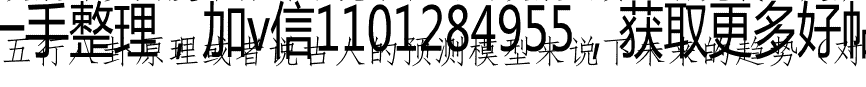
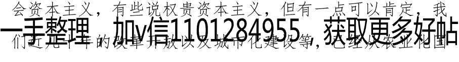
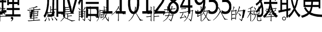
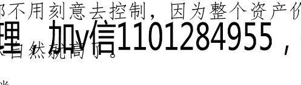
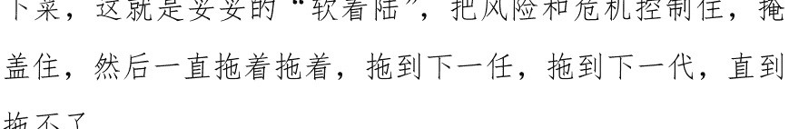
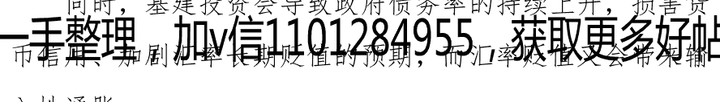
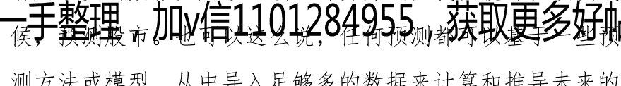
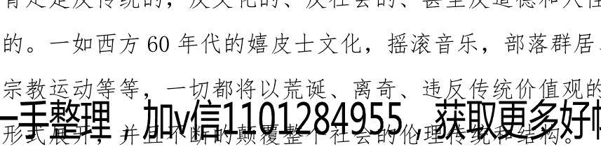
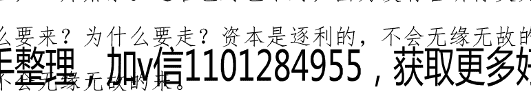
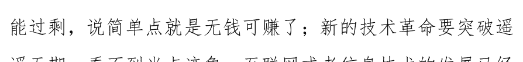

# 拔开雾看未来

作者：鲍丁医命0 日期:2019-06-26 14:24

我发现天涯能人其实挺多的，也都是有阅历的人。人类社会在短短的200多年时间里完成了从机械化到电子化-网络智能化的发展阶段，我们这一代人也经历了从收音机-电视-电脑-互联网-移动通讯等，在短短的几十年里见证了从政治、经济、文化到科技的种种革命性突破和飞速发展。当然，现在还远远谈不上实现真正的智能化社会。

作者：鲍丁医命0 日期:2019-06-26 14:24

看到具有突破性的技术革命，经济和社会的发展也似乎来到了一个历史性的转折点。而国内的形势明眼一看就明白，也到了了转折阶段。

+ 1

作者：鲍丁医命0 日期:2019-06-26 14:24

在这个重要时刻，我觉得有必要从各方面对未来的发展态势有一个预判和展望，从历史、科技、文化及逻辑推演等等方面来论证未来社会的发展种种。诚如孔子所言“不知命，无以为君子也”，能够对未来的发展和运气及时的掌握和了解，我们才能从容地面对危机和困难。此次邀请大家都能贡献自己所学，共同来探讨未来的发展趋势，只要您有理据，尽量客观地来预测未来。（喷子和五毛钱请忽略）。我们可以从经济、社会、科技、文化等各方面进行预测，包括人口问题、股市发展、科技发展、甚至手机以后的发展以及量子理论对未来科技的影响和变化进行探讨，以便于看清未来。这件事，我觉得对于你而言，都是一件有意义的事情。

## 2楼

作者:鲍丁生命0 日期:2019-06-26 14:27

我先搭引卦，从神秘学、历史对应角度、政治和经济发展等多维度来探讨如今社会的趋势。首先我还是从：

这部分对感兴趣的朋友可以忽略，但可以看看后面现实历史对应的（未来发展）。

## 4楼

作者:鲍丁生命0 日期:2019-06-26 14:28

基因决定命运，因果轮回，在我看来看来这个世界是不变的天理法则。基因是先天的，与生俱来的，对于一个人来说，是几代人基因的传承和组合；对于一个国家来说，是几千年文化的积淀和继承。因此，我们只能在命定的时空里挣扎。

下面，我从五行八卦的原理和角度来分析某国的基因问题和命运趋势：

以卦象论，小乔之卦辟木在外，乾金在内，按照一个“人”的情况来分析，那就是属于外弃仁义道德，内里刻凶之人；按照五行分析，那就是贪财坏印的局面，就是为了利益可以不择手段，出卖灵魂，却最终自欺欺人，名声败坏而自食其果的结果。就是说一个人发财了如果不能守财，那只是一个过路财神，由于他自己的能力、性格、才德等因素，德不配，最终还是返回贫穷。

以一个“人”的命运来比，我们可以这样想象他的一生：小时候很穷，可是聪明，善于学习新事物，不甘落后。

成立立业之后，性格中暴躁的本性显出来，贫寒之下出生，棍横之下出生。他通过积累最初的资本来换取更多好处，他能做表文章，给人留下好印象。而立业以后，他认识到，只有依靠强者，跟着老板做生意，才能改变自己贫落后的命运。机巧的是，正好碰到了经济上升期，老板们也需要像这样一个小个子给自己打手，做一些他们不愿做的事情。于是，机会来了，他跟着老板做点加工，赚点辛苦钱。不管怎么说，那明显比干农活还有钱赚。后来，他开起了家庭工厂，也引入了一些外来资本一起做生意，经过一段时间的艰苦创业，终于跻身小老板的行列，跟着经济上升的老板们发了不少横财。

从一个穷人到一个暴发主的经历让他等如此，贪婪的本性暴露出来，他没有想着如何保住自己的财富，而是想得更大，赚得更多。于是，一方面开始模仿老板的生意套路，赚投机巧的快钱；另一方面他想从老板那里赚更多的钱，获得更多的利润。可是此时经济已经上升结束，老板自己的生意也开始不行，怎么能容许曾经的小马仔骑到自己的头上来，于是，老板出了自保的需要，同时也想教训一下这个不自量力的暴发户穷小子，就开始慢慢地跟他做生意，甚至想办法把他从前的利润吐出来。他自然不愿意，在经历几轮混闹后，老板不再打算合作，双方关系彻底。这样一来，他一方面把预期的钱都用来投资快钱，结果被套住血木无忌；另一方面，老板又不让他赚钱，他整个财富的本性，他不愿意跟他做生意，于是暴发户的神话被迅速打下黄钟。手动整理，加微信1101284955，获取更多好处

内外交困的他只能选择缩减开支，省吃用的维持一份曾经的辉煌。所谓墙倒众人倾，由豪入仕难，他的脾气开始变得暴躁，依靠以前积攒的财富慢慢坐看山空。经历了贫穷-富裕-又贫穷这样一个轮回后，一切像黄雀一梦。最后，无非是这种局面，他要能充分认识到自己的错误，准确前后，让老板重新接纳他，继续以前的合作关系。

虽然回不到以前了，但跟着老板混，总比回去当农民强；要是顽固不化，固步自封，最后在贫穷交加中不断卖空家庭资产还债和维持生活，然后妻离子散，结局悲惨。

## 6楼

作者:鲍丁医命0 日期:2019-06-26 14:29

由小观大，见微知者，我们从个人的命运模型中窥见一个命运节点，经济趋势已经从富裕到穷的阶段，我们将经历长时间的衰退和物资通胀交替发展的螺旋下跌过程，国家的财富与普通人的财将被一轮一轮消耗和洗涤，几乎没有任何人能保住富。从小观大，见微知者，我们从个人的命运模型中窥见一个命运节点，经济趋势已经从富裕到穷的阶段，我们将经历长时间的衰退和物资通胀交替发展的螺旋下跌过程，国家的财富与普通人的财将被一轮一轮消耗和洗涤，几乎没有任何人能保住富。保住现金，不要以为资产保值，甚至不要以为未来唯有能让我们平安无忧，那就是两个字：“人”。在你们以后的人生中将深刻认识到这两个字。

## 7楼

作者:鲍丁医命 日期:2019-06-26 14:29

所谓经济基础决定上层建筑，下面我按照五行八卦原理从经济角度、生活方面、自然等方面来看某国的发展趋势：2019年戊戌年，坎，贪财坏印通俗说的就是为了追求投机取巧发展了错误的方向，为未来埋下祸端。以土为主，造就虚假繁荣，实则掏空自身。本年的特点是偏财，即偏财。从经济来说对普通人而言，即一些外快、灰色收入等所得会失去；对国家而言，即一些经营、小营、民营、非核心资产的打击和消灭。另外也表现为一些灰色产业链，民间借贷等非核心资产的清理和整顿，破产。包括对股市而言，资金如水，土旺水不流动，只能继续寻求涨，死气沉沉。年初冬水戊克土出现了一定的反弹，但是这种自然灾害发生。

作者：鲍丁医命 日期:2019-06-26 14:30

2019己亥年，还是财坏印，本年的特点是围绕核心和中心，即核心资产和核心产业的清理和规范从影子行业转向正规行业的整顿；货币政策以正面的财政引导为主；企业整顿以国企为主。首先，土地经济依然是本年的主旋律。由于没有替代的产业以及此前对土地经济的依赖，政府还是竭力维持这个稳定，甚至不惜以实体经济不断倒闭为代价。为了利益，用一切手段维持一份繁荣明显显然，今年与去年相反，土地经济的维持将导致其他的不景气，失业状况会跟随产业向纵深发展，一些正规产业、正规行业也将面临危机。内忧外患的暴风雨慢慢聚集，但人们手里还有粮，资产价格还处于高位，还能安心中希望未来的繁荣和美好。

## 9楼

作者:鲍丁生命0 日期:2019-06-26 14:31

我们将面临各种手段对货币的清洗，社会财富在这个阶段将经历第一次洗劫。后面会有第二次、第三次......

2020庚子年：困卦。本年运转西方，庚子大劫在历史上是非常著名的，60年前的自然灾害，120年前的八国联军战争、180前的鸦片战争等等。

## 10楼

作者:鲍丁生命0 日期:2019-06-26 14:35

下面，我们来说政治。

不管我们如何界定当今某国的社会性质，比如有些说资本主义，有的说权贵资本主义，但有一点可以肯定，我们在处理资本主义问题时向工业化国家迈进，也可以说我们处于资本主义的初级阶段。那么，看看资本主义的老历史，我们会发现有很多相似之处，并且也可以预见到未来的社会发展。首先，我发现以为只有公务员多，原来以前的政府管制主要是从1933年开始。伴随着罗斯福的“新政”展开，在“命令与控制”理念下建立起一套政府管制和机构。1933年起，通常以字母命名：

- NIRA（工业复兴署）
- AAA（农业调整署）
- SEC（证券交易委员会）
- TVA（田纳西河管理局）
- WPA（工程管理署）
- NLRB（劳动关系局）
- PCA（公共事业委员会）
- OCC（价格办公室）

到最后，这些政府的“字母”几乎都搭配完毕。

## 12楼

作者:鲍丁生命0 日期:2019-06-26 14:36

这些机构由于成立或分离，因此政府往往很少注意它授予了新的职能。加上法律的冲突，结果就是行政混乱、重复、浪费以及权力冲突，导致了过度膨胀。到70年代，政府管制平均每年发布700亿美元，并且造成了市场的扭曲和低效率，以及寻租的产生。

## 13楼

作者:鲍丁生命0 日期:2019-06-26 14:36

这个结果直接导致了社会效率的大幅下降，生产率由上升为下降，国际竞争力趋于恶化。在初期，政府还采取了干预。1971年8月，总统尼松以突然的方式宣布了他的“新政策”第一阶段：实行工资管制和停止使用金本位。这被称为“尼松冲击”，时期遭遇了短缺。此次冻结仅一个月便开始解冻。这时，美国政府转而采取财政双紧缩政策来控制物价。虽然如此，1973年第三季度至1974年第三季度，粮食、石油、面粉等必需品价格猛涨。这时石油危机，石油价格从3美元上升为12美元，整涨了四倍。1974年4月，工资管制到期自动取消，加上美元贬值等因素，物价达到了历史最高记录。

## 15楼

作者:鲍丁生命0 日期:2019-06-26 14:44

政府管制失灵的原因，新兴的公共管理理论认为传统的管理理论是建立在三个假设基础上的：

- 政府是万能的、无知的，它掌握着充分的信息。政府在管制过程中有能力进行理性的计算，使得管制符合最优或改进。
- 政府是爱父的、仁慈的，是为全体大众谋利益的，没有私心大公无私，政府亦如此。
- 政府是有能力的，政府有能力完成自己承诺。

然而却是：首先，政府实际上具有有限理性，而不是全知全能。有限理性指人们不能取得完全的需求和技术信息，也不能对复杂多变的需求和技术做出灵活的反应。其次，政府是由一群带有经济利益的“经济人”组成的。所谓的“经济人”假设就是人都是理性主义者，他们天生追求效用和利益的最大化，直到这种追求受到抑制为止。再次，一个国家未来的发展趋势具有很的不确定性，决定了政府不可能跨越限制成为超人，可以预知未来，掌握世间所有真理，拥有最充分的分析材料，制定出完美无缺的政策，而且在政策的执行过程中都能够完全按照计划进行。此外，由于管制部门自身存在部门利益，因此管制者往往容易被管制者所“俘获”，所以政府的管制就会出现失灵。

## 17楼

作者:宛医命 日期:2019-06-26 14:45

由此可见，经济危机的态势必然倒逼政府进行行政体制的改革和反思。我们可以看到一次国家进行大改革的时期，我们是对的。接这次就是2018年了，经济衰退的态势下进行部门的整合与分割，或者说利益的再分配。当然这些改革其实都留在表面，跟百姓关系不大。但是，美国是一个内生的国家制度，就是说他有能力在错误的时候及时发现并进行自我的纠偏和修复来到更好的进步，而我们呢，也许更多的是进行不彻底的保守型的修复。

## 18楼

作者:宛医命 日期:2019-06-26 14:46

事实上，美国政府的发展历史发现有很多相似之处。

## 29 楼
作者：厕丁医命 0 日期:2019-06-28 11:48

不仅是美国，整个西方世界于70年代开始陷入了“滞胀”的泥潭。西方七个主要发达国家的GNP平均年增长率为2.4%，失业率为5.3%，消费物价指数年增长率为9.4%。而在在此之前的1968~1972年，该七国的平均增长率为4.3%，平均失业率为3.2%，物价平均上涨率为4.8%。

## 30 楼
作者：厕丁医命 0 日期:2019-06-28 11:49

差不多经济衰了一半还不止。

## 31 楼
# 一手整理加信1101284955 获取更多好帖

美国的经济复苏和政治改革从里根总统开始，因此有人把里根比喻为最伟大的美国总统之一。

## 32 楼
作者：厕丁医命 0 日期:2019-06-29 14:39

经过了20世纪70年代整十年在“滞胀”泥潭中的痛苦挣扎，到1981年里根台上，他看到的是2位数的通货膨胀、高失业率以及超过20%的高利率。

## 33 楼 
作者：厕丁医命 0 日期:2019-06-29 14:40

1981年2月，里根总统向美国国会提交了《经济复兴计划》这一纲领性文件。其所采取的政策措施主要可以分为三大类：

## 34 楼 厕斗帝命 日期:2019-06-29 14:41

一是在宏观经济政策领域，加强货币管制，降低税率，压缩政府开支，减少财政赤字。在加强货币管制方面，鉴于美联储具有很强的独立性，因此里根政府只能要求美联储实施和《经济复兴计划》相一致的货币政策，实际上就是紧缩的货币政策。在减税方面，主要是降低个人所得税和企业。

## 35 楼 厕斗帝命 日期:2019-06-29 14:46

二是在社会福利政策方面“开倒车”，继续推行自尼克松政府以来的“逆向改革”，提出大幅度削减政府福利开支的主张。在《经济复兴计划》设计的削减联邦政府支出方案中，削减的内容涉及社会福利支出的约200个项目，如食品券、失业保障、新生家庭补贴、医疗保健、学生营养补贴、住房补贴、失业者培训等。

## 36 楼 
作者：厕丁生命 日期:2019-06-29 14:47

三是在政府管制方面加大力度继续推行自70年代开始的宽松管制改革。这方面的主要内容包括：
（1）暂停已制定但尚未执行的所有章条例；
（2）成立以副总统特朗普为首的总统特别工作小组负责这项工作。如果1988年，这个小组就撤销了；
（3）进一步放松包括能源在内的政府管制；
（4）把部分管制权由联邦政府下放州政府和地方政府；
（5）取消民主党政府对工资和物价实行放宽对金融市场的利率管制。

## 37 楼 
作者：厕丁生命 0 日期:2019-06-30 17:21

“里根经济学”的这一套政策首先在降低通货膨胀率和失业率方面取得了明显的效果：消费物价指数在1983年以大幅度回落，1986~1989年下降3~4%。同时，经济增长方面，1984年GNP增长高达6.8%，为战后之最。失业率1983年后以后连续下降，从9.6%下降到1989年的5.3%，为1973年以来最低。美国经济摆脱了“滞胀”，并为后届政府带来“政策红利”。

## 41 楼 
作者：厕丁医命 日期:2019-07-04 12:50

我先来说大家最最关心的房地产吧。

## 42 楼 
作者：厕丁医命 日期:2019-07-04 12:50

其实真没啥好说的，稍微有点脑子的人都应该明白，这是畸形经济模式下产生的畸形资产。放在长远一点的时间段来看，未来随着人口的衰退，城市的变迁，很多房子甚至城市都会变成民宿、鬼域或者废弃。但是这是改善生活的必需，需要整理。

手动加微信信息等属性，获取更多信息

## 43 楼 
作者：厕丁医命 日期:2019-07-04 12:51

西方国家，比如美国人做过一项调查，在1890到1990近100年的时间里，房价几乎没有变化，每年的平均增长只有0.2%，增幅甚至无法消除土地和人口的增长，因此发达国家的富人很少有投资的，投资渠道都集中在股票、债券、基金等方面。

## 44 楼 
作者：厕丁医命 日期:2019-07-04 13:04

有时我觉得房地产是用来消灭产产的，但不然。按照理想2013、2014年经济开始直线滑坡的，所以会有2015年的股市，通过高杠杆消灭部分中产。但之后美元的大流量流失说明高层并没有意识到外汇的重要性，或者说没有想到这么多年的印钞导致社会资本的巨量冲击，靠股市消灭中产没有多少效果。于是房地产被推到了风口浪尖上。

## 45 楼 
作者：厕丁生命 日期:2019-07-04 13:04

其实买房这个事情一直以来都是富阶级的事情，普通百姓买不起很正常，就算是回到20年前，普通百姓买房子也是奢侈的事情。

## 46 楼 
作者：厕丁生命 日期:2019-07-04 16:10

回想2015年的股市，杠杆的灾难也发生在市场上，只是表现的方式可能会不同。上涨激烈而快速，下跌可能会比较慢而深。房地产周期像股市一样，上涨周期很长，比如说30年，那么它的下跌也不可能在1年内完成，至少8-10年左右，期间有快、慢、反弹、震荡。

## 47 楼 
作者：厕丁生命 日期:2019-07-04 16:11

上涨是一个过程，下跌也是一个过程。按照90年初，房价是300多元一个平方，而工资是160多元，买一套差不多需要万元。到了30年后，按照政府公布的平均工资在5千左右，房价增长了三倍。如果未来工资继续增长，十年后人均工资只有万，那么房价降一半就合理。

## 48 楼 
作者：厕丁生命 日期:2019-07-04 16:11

还是要考虑其他因素，比如过剩、老龄、房税等。随着科技的进步，未来房子也不是可能的。在我看来完全没有必要纠结于房子，这个世界是由先进的生产力和科技推动的，十年后可能是另一种模样，什么是保值的？

## 49 楼 
作者：生命 日期:2019-07-04 16:12

当然，把资产炒成那么高，可惜股票不是必需品，不然也不稀奇。跟房价最密切的就是就业和人口流入，如果你对自己的发展还有足够，从繁荣到衰败的例子可以考虑到很多城市未来的结局。

## 50 楼 
作者：生命 日期:2019-07-05 12:02

想得再长一点，随着科技的发展，清洁能源的发现和利用，新材料的突破等，房子也未必像电视机一样的命运。未来，我们可能会入住会走的房子，会胆房子，会潜水的房子，会飞天、悬的房子，能折叠的房子，随带的房子等等。人类自然的躲避自然的灾难，一款可以任意移动或会飞行的房子，难道不比固定不变要承受地震、海啸、龙卷风、暴雨等自然灾害的房子好吗？

## 51 楼 
日期:2019-07-05 12:03

这些看似很科幻的想法，在我看来是很现实的，想想近50年来科技的发展速度，这些不需要太的时间就能实现。自动驾驶的出现可以让我们在行的房子里睡一觉就到目的地了，可以去任何想的地方旅行或居住；《飞星环游记》的故事也许是我们房子的终极梦想。总之，人们的观念和生活方式随着科技的发展而改变。

## 52 楼 
日期:2019-07-05 15:30

办理加微信101284955

## 53 楼 
日期:2019-07-05 15:31

在股市里赚钱的我觉得只有三个人：第一种是有消息的人，当然不是那种小道消息，而是真正有利益关系的内部消息的获得者，这些和一般百姓是无。第二种是庄家，也就是有本事操纵股票的人，当然还分小庄庄，小庄的风险大一点；第三种就是趋势投资者。前面二其实都属于同一类，都是利益关联的交易，而我要的是第三个人。

## 54 楼 
日期:2019-07-05 15:32

其实不管国内股市怎么被诟祸，有一点是很明显的，那就是每隔几年都会有一波行情，然后鸡犬升天的炒作。这种傻瓜式的利用人们的博弈心理的市场行为，只要你能把握好的，赚钱是很很容易，这就是我说的趋势投资者。

## 55 楼 
作者：诡丁戏命 0 日期:2019-07-05 15:32

对趋势投资者而言，大多数时候是看数的，只要空隙有获利者。所以别管什么股市还是投机，只要你有半年或一年的时间用来沉浸在其中的人，发财的人那不可能比专业的赌手输，只要你有好运。一手整理，加v信101284955

## 56 楼 
作者：诡丁戏命 日期:2019-07-05 15:34

说点电子产品的未来：显示技术已经初见端，在不久的将来快速应用和普及。目前使用的液晶显示技术从浪费的上看都会被淘汰。未来通过激光投影和成像技术，在空间中折射清晰的、多维影像，像科幻电影一样。

## 58 楼 
作者：厕丁医命 日期:2019-07-06 23:23

从远一点看，这个社会是由效率主宰的，一个没有效率的国家都会被淘汰，而且现在是落后国家的发展进程。如果不能融入那些高效的国家，早晚都会像历史一样，成为。

## 59 楼 
一手整理，加微信101284955

我们再来说局势，随着贸易升级，我们的政治注定了二元分化的，体制内和体制外，就是统治的关系。这种阶级对抗很明显；而当经济困难的时候，这种对抗会越来越激烈。

## 60 楼 
作者：厕丁医命 0 日期:2019-07-06 23:26

因为上面没钱了，不能从外部挣钱。这样的日子能混几年吧，等到老，自己。

## 61 楼 
作者：鲍丁信命 日期:2019-07-08 00:00

我们常说人失业的问题，其实如果失业了如何？对个人来说，失业意味着没有收入；对国家来说，失业意味着贸易顺差。

## 62 楼 
作者：鲍丁命 日期:2019-07-08 00:01

假如我就国家比成一个家庭，来说大家都能明白的道理。

## 63 楼 
作者：鲍丁命 日期:2019-07-08 00:02

首先，这是一个比较穷的家庭，生了一大堆伙子，靠自己种蔬菜养猪还得天天吃饭，常常挨饿。因为资源有限，就那么一块，怎么弄都不够了。做生意又没有技术和经验，也没有本钱，那只有打工一条路。

## 64 楼 
作者：厕丁医命 0 日期:2019-07-08 00:03

正好，老板们的生意从低端产品进化到高端产品，就把一些低端的产品给这个穷家庭去制造。依靠人多和辛苦整理，加微信获取好帖，有一定的财富的。

## 65 楼 
作者：厕丁医命 日期:2019-07-08 00:04

可是资源环境破坏的太厉害了，挣的都是血汗钱，不是长久之计，需要另谋出路。于是我们开始学习模仿老板们的生意模式，比如开个棋牌室、弄个歌舞厅、炒个古玩（当然这是比喻），让辛苦活的孩子们别只知道赚钱钱，也会娱乐花钱。

## 66 楼 
作者：鲍丁医命 日期:2019-07-08 00:04

这种生意或爱好一开启，就停不下了。一方面，为了一辈子的开始了各种享乐，花天洒地；另一方面，他们发现辛苦干活不如棋牌室里接一天麻将赚得多，或者炒个古玩大家都可能发财，于是大家都想投机取巧快钱。

## 67 楼 
作者：鲍丁医命 日期:2019-07-08 00:05

为了维持和扩张这种生意模式，这个家庭决定从银行贷款，这些贷款一部分用于扩大加工，增加产能；一部分贷款给孩子们，继续炒作投机。

## 68 楼 
作者：鲍丁医命 日期:2019-07-09 00:15

随着资本的扩张，暴发户家庭满意了。大家锦衣玉食，该旅游的旅游，该出的旅游。

## 70 楼 
作者：厕丁医命 日期:2019-07-09 00:16

我们可能会入住会走的房子。

## 71 楼 
作者：鲍丁命 日期:2019-07-09 00:17

这种计算，工资呢？按照政府公布的平均工资水平。

## 72 楼 
作者：鲍丁命 日期:2019-07-09 00:17

这种后，工资只有千，那么房价就不合理了。

## 73 楼 
作者：厕丁医命 0 日期:2019-07-09 00:18

目前显示技术已经初见。

## 74 楼 
作者：厕丁医命 日期:2019-07-09 00:18

我们不需要这些时间，这些不需要的。

## 75 楼 
作者：厕丁医命 日期:2019-07-09 00:19

我们不需要这些，这些不需要的。

## 76 楼 
作者：厕丁医命 日期:2019-07-09 00:19

这些不需要的。

## 77 楼 
作者：厕丁医命 0 日期:2019-07-09 00:20

这些不需要的买的。

## 78 楼 
作者：厕丁医命 0 日期:2019-07-09 00:20

这些不需要的买的。

## 79 楼 
作者：厕丁医命 0 日期:2019-07-09 00:20

这些不需要的这些。

## 80 楼 
作者：厕丁医命 0 日期:2019-07-09 00:20

这些不需要的。

## 81 楼 
作者：厕丁医命 日期:2019-07-06 23:26

## 82 楼 
作者：厕丁医命 日期:2019-07-06 23:26

## 83 楼 
作者：厕丁医命 日期:2019-07-06 23:26

## 84 楼 
作者：厕丁医命 日期:2019-07-06 23:26

## 85 楼 
作者：厕丁医命 日期:2019-07-06 23:26

## 86 楼 
作者：厕丁医命 日期:2019-07-06 23:26

## 87 楼 
作者：厕丁医命 日期:2019-07-06 23:26

## 88 楼
作者: 厕桶医命 0 日期:2019-07-26 15:50

既然选择了悠悠，就不能让孩子们明白这个道理。怎么悠悠呢？

- 1、深诸孩子们性格的家长们知道大家都喜欢投机快钱，那就让他们投机吧。把钱都投资到各种资产购买，变成不动产；把钱都投入赌场里，消灭得更快。如果这些手段还不能引诱，别急，还有办法。
- 2、对那些守财奴，唯一的法办法就是抬高生活成本，你总要吃药看病养孩子吃饭，这些省都省不了，加钱！事实上这些都不用刻意去控制，因为整个资产价格抬高后，社会

## 89 楼
作者: 厕桶医命 0 日期:2019-07-26 15:52

有人说通缩了物价会低，老百姓生活日子很好，那是做梦呢。

我们就这么想。以前这个家庭属于暴发的生活，住的别墅、开的破屋，吃的温饱；现在习惯了奢侈的生活，住的贵族学校，开的宝马、请的保姆、上的老师，每天开支巨大，物业费、油费、维修费、高档海鲜、培训费、旅游费等等，这些生活成本本来怎么可能一下子降下来？就算产能过剩了，可是整个流通环节和销售环节都要有成本，所通过流通要等这个家庭的生活成本下降下来以后才有可能的。在到达通缩前，我们还需要经历漫长的滞胀阶段，就是经济衰退和物价高涨的并行阶段。

从另一方面来说，不把孩子的钱掏空弄穷了，家长们怎么放心呢？

## 90 楼 
作者： 虏门医命 日期：2019-07-26 15:52

所以有什么阴谋阳谋，这个家庭不是一个人可以左右和决定的，是他的基因和结构决定的，这就是一个发展的自然趋势，是我们目前面对的情况，是必然的选择。所以给老板打工赚钱，签订单做生意，对一个家庭是如此重要的。

## 91 楼 
作者： 虏门医命 日期：2019-07-26 15:53

在接下来的三十年里，我们走的是火运，火是耗神，就是不断消耗自身能量（破财）的运……

## 92 楼 
作者： 虏门医命 日期：2019-08-04 23:36

目前辛未月，到了子时，就是甲戌日。这个周末是金日，刷帖频繁，克制文火。

有人说今年是未来十年里最好的一年，这话真的没错，以后就会懂得。不过你们不知道的是，现在还是天论最放松的时候，再过几天就立秋了，等到了秋金肃的时候，会迎来更加严厉的管制。所以还能堵得瑟瑟几天，就尽量得瑟吧。

## 94 楼 
作者： 禹丁厄命 0 期：2019-08-07 00:24

今日辛末月丙日，丙火热烈，辛辛而亡。水势猖狂，妄言成灾。此二日汇率破七，股市暴跌，热闹非凡。不过从美股周线月线来看，这次下跌还是属于正常调整，几个月后依然会新高不断，这也符合美国的经济现状，温和而蹦的前进。实际上已经没有年轻人的了，经济垂垂老矣，时间还不到，也就是说，月线级别的顶部还没到。

## 95 楼 
作者： 禹丁厄命 0 期：2019-08-07 00:30

有没有危机，其实只需要看一个指标就足够，那就是黄金指数。黄金其实是经济危机和战争危机的最直接，最敏感指数，黄金突破平台趋势，说明经济下跌一个台阶；黄金大涨，经济危机的前兆；黄金暴涨，战争爆发；等等。。

## 96 楼 
作者： 鲍丁医命 0 日期:2019-08-14 00:44

黄金啊黄金，昨说呢？看黄金总感觉有一种罪恶感。

## 100 楼 
作者： 鲍丁医命 0 日期:2019-08-15 23:57

小编怎么了，连黄金二字都不能打，还删掉？难道这敏感

## 102 楼 
作者： 鲍丁医命 0 日期:2019-08-16 00:00

黄金是罪恶的，是因为期份黄金指数涨的人，就如同一手经理。

## 103 楼 
作者： 鲍丁医命 日期:2019-08-16 00:00

然而黄金又是正义的，所有虚幻的泡沫，在黄金面前裸装。如同指数涨的时候，一切资产都在缓慢瓦解，崩溃......

## 104 楼 
作者： 鲍丁医命 日期:2019-08-16 00:09

这应该是黄金的第一波上涨，显得缓慢而冗长，配合股市的调整，预估上涨到多少，我就说了，今年是序幕。

## 105 楼 
作者： 鲍丁医命 日期:2019-08-17 51

继续说吧。一个正常的国家，在经济上抬头，应该做的是发展工业和科技水平，提高生产效率和竞争力。只有在经济衰退和萧条阶段，政府不得不启动大规模基建项目，通过投资的方式带动就业。

## 13 楼 
作者： 鲍丁医命 0期:2019-08-17 55

在这个世界上，我觉得美国是一个伟大的国家，因为一直在做正确的事情，而日本是一个幸运的国家，因为一直及时改正，同样走在正确的道路上。

## 17 
二战后的美国获得了大量的科技人才，同时发生了与苏联的冷战和军备竞赛，使得聪明的美国成功摆脱了对基建投资的依赖，转向依靠私人消费和私人投资拉动经济。50代以后，美国一方面研发奠定了科技强国的基础，另一方面收入向居民部门倾斜，藏富于民，私人消费成为经济增长的主要动力。

## 14 楼 
作者： 厕丁医命 日期:2019-08-22 12:56

我觉得日本当年是勇敢而幸运的，因为发现错误而及时改正，用壮士腕的勇气破解了房地产泡沫，紧缩了贷款和财政等一系列政策。用现在流行的语言，这就叫“硬着陆”。快速破解泡沫，打击投机，让那些投机份破产并鼓励实业，把剩余资金全部转向制造业。

## 19 楼 
作者： 厕门医命 0 日期:2019-08-22 16:37

另一个发达国家日本就相对笨。二战结束后的日本长期将基建投资作为推动经济的重要手段，虽然也发展了工业和科技，基建一直是政府发展经济的主导方向。大规模的基建投入使得日本的基础设施水平远高于其他发达国家，其公路密度和铁路密度是美国的4.8 倍和2.4 倍。于是，随着90年代房地产泡沫破灭，日本经济陷入了流动性陷阱，失去了30年，直到现在还没有走出困境。

## 120 楼 
作者： 厕门医命 日期:2019-08-22 16:37

我觉得日本当年是勇敢又幸运的，因为发现错误而及时改正，用壮士腕的勇气刺破了房地产泡沫，紧缩了贷款和财政等一系列政策。用现在的语言说，这就叫“硬着陆”。快速破解泡沫，打击投机，让那些投机份子破产，并鼓励制造业，把剩余资金全部投入制造业，让整个社会再次静心发展实业和科技技术。

## 121 楼 
作者： 厕门医命 日期:2019-08-23 00:06

我们难以想象，一个三十年来经济不断衰衰，没有通胀，被巨大泡沫淹没的国家，竟然在科技工业上一直紧跟着这个世界最前端先进的技术却没有被淘汰落后？照理经济是决定社会进步的，一个国家经济衰退，科学技术这些也会衰退或缓慢发展。可是我们现在的日本，在工业上不逊于德国，在电子技术领域不逊于美国，可以在世界上科技的发展上一直和西方国家并齐驱。

## 122 楼 
作者： 厕门医命 日期:2019-08-23 00:07

是的，这就像同一个曾经破产的家庭，依然排名在世界上的前列一样，说明当年的财富是有规律的，及时改正，才有了今天的成就。

## 123 楼 
作者： 厕门医命 日期:2019-08-24 09:17

其实日本的幸运还要追溯到早期，我们还处于同治时期，日本就已经进行了明治改革，而且用了二十多年的时间，通过学习全盘引入了西方的文化和技术，“脱亚”，走上了资本主义的道路，迅速成为亚洲强国，乃至世界强国。

## 125 楼 
作者： 厕丁医命 日期:2019-08-24 18

而明治维新的前期，日本还是一个极度落后的国家，处于封建小农状态，经济总量只有中国的十分之一。通过二十多年的明治维新，一跃成为世界国。

## 126 楼 
作者： 厕丁医命 日期:2019-08-24 19

之后的日本又走了歪路，妄图统治亚洲。而我们胜利了，虽然付出了巨大的代价，但战后通过民主建设和重建工作，使日本快速恢复了元气。从1945年到1968年，日本的生产总值超过德国，仅次于美国。如今，他们依然跻身发达国家之列。

## 128 楼 
作者: 厕门医命 日期:2019-08-25 10

有人说我们在经济模式上走日本道路，这也是最好的结果，也是最优的选择。但是按照目前情况来看，似乎已经失去了时机，而且我们现在已经做得很不彻底。

## 129 楼 
作者： 厕门医命 日期:2019-08-25 11

我们当然也不会去储蓄道路，因为傻子都知道那是在下菜，这就是所谓的“软着陆”。把风险和危机控制住，掩盖住，然后一直拖着拖着，拖到下一代，直到拖不了。

## 131 楼 
作者： 厕门医命 日期:2019-08-25 21

又删一段，补上。最好的时机当然是2015年股市崩盘的那年，顺势彻底打击金融投机。记得当年还长篇转载了某大佬的文章，看顺势走日本道路的想法。

## 136 楼 
作者： 鲍丁延命 日期:2019-08-25 22

有人说我们会走前苏联的模式，这个对也不对，对的是体制相似，结局应该也类似；对的是时代不同，经济模式和类型不一样，也不会完全类似前苏联模式。我只能说，我们会挣得更多，活得更累。

## 137 楼 
很多人跟我说民族劣根性问题，文化基因问题，认为亚洲民族或我们存在先天的缺陷，很难根治，国人很难像西方一样达到一种文明的高度。其实我觉得都不是问题，看着我们的邻国日本大家都知道了。日本从一个封建诸侯国到文明强国，仅仅花了20多年的明治维新就做到了整个日本文化和国民性的改变，而这一切的源头，在于全盘引入了西方的文化科技和制度。而二战后的日本在一片废墟的情况下下，同样花了20多年的时间，就在经济文化上和欧美平起平坐甚至更好。难道日本作为亚洲民族是个特例吗？

## 140 楼 
作者： 宛门医命 日期:2019-08-28 11:30

记得早年动车刚出来的时候，大家都认为人都坐惯了绿皮车，绿皮车的脏乱差同样会移植到动车身上，不可能大家自觉做到的像国外一样干净的环境。而事实上大家做到了。这就是大环境对个人的影响。所以说个人的命运大不过国家的命运，国家的命运大不过社会的命运，社会的命运大不过人类的命运，人类的命运大不过老命运。

## 144 楼 
作者： 宛门医命 日期:2019-08-28 35

历史浩荡荡的齿轮会碾碎一切。美国在1930年的城镇化率为56%，而在中国2015年城镇化率为66.9%，已经超过了美国。美国最大的公司是钢铁公司，1967年是国际商业公司，1977年是机器公司，2017年是苹果公司。在前50年里，美国被钢铁、通讯和石油垄断；到后50年，则被先进的电气领先；而最近50年里，则被高科技、互联网领先。这是一个正常的国家，也是符合历史发展规律。

## 145 楼 
作者： 宛门医命 日期:2019-09-03 11

为什么基建投资不创造增长，反而会拖累社会发展？其实很简单。因为基建投资存在巨大的挤出效应。政府本身创造收入都是通过税收或者发债。相对而言，政府支配的收入越多，居民和企业的收入越少。如果政府投资越多，意味着居民和企业的支出越少，基建投资其实挤出了消费和企业投资，并且创造新的增长。

## 146 楼 
作者: 鲍丁医命 日期:2019-09-03 12

同时，基建投资会导致债务的持续上升，损害通胀。增加信用的扩张。

## 147 楼 
作者： 鲍丁医命 日期:2019-09-03 15

其实苏联的发展道路跟我们有很多相似而且可以参考的地方，比如苏联的发展始于美国的经济大萧条以及二战后的衰退使得当时苏联处于封锁形势，他们正是利用了美国时机大力发展了经济和军事。战争的不断发生使得贸易增大，而我们的发展似乎走了一条良性循环的发展道路。

受益于西方经济的升级迭代，溢出了附加值低的产业链，以及电子信息革命性的突破带来的经济繁荣。可以说和苏联其实幸运，有一次繁荣的机会。

## 148 楼 
作者： 鲍丁医命 日期:2019-09-04 32

但是，随着冷战的结束，各国倾。原本是军为主，后则是轻工为主。苏联的重工业失去了市场，被击溃。产业结构的单一以及体制决定的经济转型必然成功。首先是军事顺利，本国企业被外来挤垮导致大量人口失业。

## 149 楼 
作者： 鲍丁医命 日期:2019-09-04 33

其次苏联当时的对策不是保护本国产业，而是推动私有化。说白了就是政府破产了，没钱了，需要卖家。前苏联各国私有化，几乎是拆毁大楼。经过私有化，大量国有资产私有。

## 150 楼 
作者： 鲍丁医命 日期:2019-09-04 35

另外，那些攫取了巨额资本的寡和其他富豪，有钱也不愿意投资本国工业。一方面，他们清楚投资本国工业竞争不过船舶来；另一方面，他们清楚自己的巨额财产来路不正，随时可能被秋后算账。于是导致大量的资本外逃。

## 151 楼 
作者： 厕丁医命 日期:2019-09-05 57

我始终觉得历史不仅相似，而且充满了因果关系。比如苏联的繁荣源于美国和西方的经济大萧条，而它的快速衰落却是西方经济的繁荣初期和产业（技术革命）更新迭代的早期。它就像一个西方的反面教材，在物竞天涯中逐渐出来的。

## 153 楼 
作者： 厕丁医命 日期:2019-09-05 59

我们的繁荣正好和苏联相反，跟着西方经济的繁荣和产业革命的发展而坐上了西列车，享受了整个世界经济繁荣的盛盛宴。那么，按照因果关系，我们的衰落也必然发生在整个西方经济的衰退过程中。

## 154 楼 
作者： 厕丁医命 日期:2019-09-06 21

如果按照五行八卦的分析，苏联地北方，五行属水，而世界上60%是北方，五行属水。苏联地北方，五行属水，而世界上60%是北方，五行属水。60%是北方，五行属水。属于北方，属于北方，北方属水。

与完善的，毕竟我们没有大数据做支撑，没有足够的先例做旁证，只能求在逻辑和关联性上推导出最具有可能性的答案。

来自
222 楼
作者:唐壬医命 日期:2019-10-24 07:39

预测在我们的生活中其实很普通，最典型的就是气象预报，人们都在听、在看、在信并在预防和规避；其次如经济领域的股市预测，那些大根K线理论不停地在给股民上课洗脑。这些东西对我们来说并不神秘，因为我们知道，只要有足够的数据，足够的计算方法，我们就可以预测未来的趋势方法或模型，从中输入足够的数据来计算和推导未来的发展趋势和结果。五行八卦也一样的，在我看来就是一个预测模型，只不过是用来预测命运的工具。既不是迷信不是多神神秘，就像预测股票我们喜欢“江理理论”什么似的，其实道理都一样。如果我没看过“江理理论”，我也觉得很神秘；如果“江理理论”是我们老祖宗发明的，是否会被斥为迷信呢？

来自
222 楼 
作者:唐壬医命 日期:2019-10-24 08:04

闲话少说，还是规观正传吧。很多人担心未来会回到“文哥”或“毛左”的时代，理由是现在时不时出现这些方面的言论，而担心经济不好会使历史倒退；更有一些人们还沉迷在过去年代那些疯狂的事件，让自己恶念重生，甚至还做起打土豪分田地的梦，唯恐天不乱。而我要的是，这些都是人欢怀天方复复！因为时代不同了，未来的社会不会一个由50、60后主导的社会，他们很快就会被埋进历史的故纸堆里。

来自
224 楼 
作者：闲丁医心 日期：2019-10-24 08:05

# 一手整理如微信1101284955 获取更多好帖

十年二十年后，那些既得利益的50、60后都将逐渐老去，并逐步的退出社会舞台，那些曾经的露梦也会被埋葬。我想的是：未来是属于年青人的，属于00后，甚至是10后的，绝不是我们这些60、70、80后所想的那样倒回历史。在我看来，这就像一群清朝遗老在争论良朝廷还是变法维，殊不知几年以后，一拨一波的年轻人早就打着革命的风风起云涌的改变了国家和时代。他们才不会理解你的什么“毛左毛右手”，他们有自己的生活方式和想法。因此，想知道未来，就多了解了解他们吧。

来自
## 225 楼
作者：厕门帝命 日期:2019-10-24 08:06

70后80后的人本没有经历过他们父辈的那些事情，属于既得利益的二代，他们没有理想和情怀，没有那些父辈的历史感和使命感，也可以说没有什么野心。他们属于自私的现实主义者，或者说，他们有着资本家原始的贪婪和欲望。等到50、60后退出，这批生意比较擅长的老人上台了，他们会成为未来十年的的主流，引导人们如何在一锅里抢饭吃。他们有一定的西方理念和法制思想，所以不会乱，但又满足现状而需要保护自身的利益，于是维持现状让自己的利益最大化成为他们的选择。因此，阶层固化，利益主题。

# 一整理加v信101128495 获取更多帖子

来自
226 楼 
作者：厕门帝命 日期:2019-10-24 08:07

90后生于计算机时代，是被游戏玩坏的一代，指望他们肯定指望不了了。他们属于废青一代，在父母身边啃老，加上阶层的固化和经济的低迷，也无力面对现实，颓废或许形成这一代。那么，我们只能指望00后和10后了。十年二十年后，他们成为这个社会的主流。00后是很奇怪的一代，在梦想和现实之间，沉迷于cos，知道他们是一群有梦想的人，于是他们会分裂为二类：一类成为主流，反权威、反社会的；另一类人用自我的方式对抗这个社会。参照西方的社会发展，我们会看到未来将会经历60年代所经历过的。

来自
227 楼 
作者：闲子医心 日期：2019-10-24 07:07

# 一整理加微信10128495 获取更多好帖

年龄方面，主要还是从社会的发展状态以及历史特点去推理。比如从社会趋势来说，我们经历的是西方主义初级阶段：
- 阶层固化必然导致阶级对立
- 资本断层会导致社会不公
- 机械和自动化使人们无法在工作中展现自我，产生叛逆
- 那些在富裕中出生和成长的一代突然发现社会充满了平等、偏见、腐化和堕落

价值观念被颠倒过来，他们不再遵循传统和生活方式，转而通过强烈的感官刺激来麻痹自己，放纵自己的效果。

来自
228 楼 
作者:庞丁德命 日期:2019-10-24 08:08

从历史特点来说，一个本身没有的或者不需要的文明出现了，并消耗自身的能量和稳定性，那这个文明肯定是反传统的、反文化的、反社会的，甚至是道德和人性的。如西方60年代的摇滚音乐、部落主义、宗教等等，一切都将荒诞、奇、违反传统价值观。

# 一整理加微信10128495 提取更多帖

来自
229 楼 
作者：庞丁德命 日期:2019-10-24 08:08

这就是我推出的未来社会的基本思路和模型吧，具体在细节方面还有待完善。以后我们会像香港一样成为一个娱乐死的社会，在泡沫经济的发展下被恶俗所包围。在那个时代，许多人还在做纯文学的梦想，还在谈论理想与尚，还被崔健的歌激动着。

来自
230 楼 
作者：鲍丁医命 日期:2019-10-24 23:57

下面，我想可以说关于经济的轮子，主要是反思下今经济发展出现的问题和即将到来的大衰退。

来自
234 楼 
作者：鲍丁医命 日期:2019-10-24 23:58

经济问题说难真的是很难的，因为各种因素相互制衡，要理解逻辑很复杂的。但是其实简单，只要抓住主要矛盾的焦点，就能迅速看到真相。我没有学过什么经济学，但是我是懂的，更容易看清晰的面目。

来自
235 楼 
作者：鲍丁医命 日期:2019-10-24 23:59

从轮回的角度，我觉得现在的西方经济又回到了世纪70年代那个状态，将迎来漫长而痛苦的滞胀期。从经济的角度，我觉得所有问题都可以归结为2个问题，即货币过剩和产能过剩！这其实是一个矛盾，我们设想一下，随着社会发展和新技术革命的产生，整个社会需要大量的资金进入每个生产领域，赚取高利润，同时提升各种产业的效率和科技，推动产业发展。如90年代随着互联网的开拓和发展，新技术产业需要大量的资金投入，产生巨额的利润，直至产能过剩，技术瓶颈无法突破，资本退出。

来自
236 楼 
作者：庞丁信命 日期:2019-10-25 00:00

西方国家的各行各业都在经历这样一个过程后出现了产能过剩的局面，资本退出后无处可去。而资本是需要赚钱的，实体产业赚不到钱，那就去金融市场赚钱，于是推荐了股市，导致了金融市场的利率。同时，一部分资本输出到了发展中国家，通过对发展国家的投资来输出产能，赚取利润。

# 整理，加v信10128495 获取更多帖

来自
237 楼 
作者：庞丁信命 日期:2019-10-25 00:01

从历史特点来说，西方经济复苏后的发展逻辑基本上是一个逻辑：技术的突破带来了产业繁荣，也产生了大量的货币。经历了差不多70年代的发展后，瓶颈出现，产业进入过剩和衰退阶段。此时，过剩的资本从各行业流向成为问题？

来自
238 楼 
作者：鲍丁医命 日期:2019-10-25 01:39

# 一整理

解决过剩一般有几个办法：
- 让货币贬值：这种情况直接导致通胀，如果你知道钱不值了，第一反应就是买入各种资产，导致价格上升。
- 让资产贬值：打击资产价格，让投资损失惨重，把钱蒸发，这样做的结果直接导致实体产业一片萧条。
- 回收货币：国家经济控制基本采用货币放水和回笼资金，导致流动性紧张，企业困难。
- 资本引流：资本为了躲到安全的地方，可是这样的地方有？

来自
240 楼 
作者：鲍丁医命 日期:2019-10-25 01:40

我们想象一下，资本过剩有多可怕。假设我们手里许多钱，如果看到某个行业很赚钱，大家会一拥而入进入这个行业发财，然后很快这个行业就饱和，就开始低价竞争，直至大家都无钱挣。之后，实体产业产能过剩是可以想象的。当所有行业都无钱挣的时候，过剩资本会去哪里？会垄断炒高价格。资本是嗜血的，当市场上无钱挣的时候，资本会像香港一样，炒高一切资产，从价差这种原始的方式获取巨额利润。这就是滞胀的由来，经济衰退而通胀，一切都是祸源。

来自
241 楼 
作者：厕卜信命 日期:2019-10-25 11:40

有人也会说现在是在通缩，整个面上紧张，负债高企；其实这个说法没错，美金开始放水，人民币开始通胀，都是来源于资本过剩和资本不足进行经济调控。

来自
242 楼 
作者：厕卜信命 日期:2019-10-25 11:41

货币与经济发展的关系就像有人比喻的“水多了和面”，或者就像老子说的“治大国若烹小”，火候搭配需要恰当与合理，就能出美味的食品。实际情况是，这样的火候是很难掌握的，政府对经济控制的战略发展很难顾及长期的后果和控制的时效性，即使美联储也不行。

来自
243 楼 
作者：厕门纪命 日期:11:42

随着经济社会的发展，货币投放似乎永远大于回收的速度，所以有人说现代社会货币总是贬值的。西方经济用于消灭货币的方式就是每隔一段时间来一次经济危机，消灭掉剩余的货币，获得获得的良性发展。

来自
244 楼 
作者：厕门纪命 日期:2019-10-25 16:34

# 一手整理在加信10128495获取更多帖

2008年的次贷危机中走出来，从80年代里根总统开始的货币宽松政策，确保了发展和繁荣了美国的经济，但是随着十年发展后产业变得狭窄，大量积累的资本无处去，最后就成了华尔街，繁荣了金融市场。这些资本在金融市场如鱼得水，兴风作浪，后来就导演了一次次资金风暴，把全球的卷入了这场风暴中。按照道理08年的美国其实90年的日本一样，都应该因为货币过剩无法控制，国家应该通过货币紧缩来出清债务和资产贬值的方式，完成一次经济危机的阵痛。可是美国人没有，美国人依仗其美元的霸主地位，通过资本输出把危机“转嫁”给了全世界。也就是说，大量剩余资本（美元）输到了全世界，其中很大一部分分到了中国。我们则高兴热烈的接受了这些资本，并在跑步的股后面跟着4个跑炮（4万亿），于是经济准尘而去，“水和面”的调和失去了了控制。

来自
245 楼 
作者：鲍丁信命 日期:2019-10-25 16:35

经济规律只可能迟到。经过十年的扩张，美国的次贷危机似乎变成了世界的次贷危机，大家都被绑在同一条船上，谁逃不掉。08年后的十年，扩张没有可以转嫁的。

来自
246 楼 
作者：日期:2019-10-25 19:54

如果不破泡沫，那么泡沫是迟到，代价是整个国家和民生的凋零。

来自
247 楼 
作者：厕门纪命 日期:2019-10-25 19:55

还有一种方法，就是等待。在全世界都能产能过剩的情况下，这个目前也变得现实的。唯一的办法只有等待，等待其他国家先破，或者把其他的泡沫给制割。当然战争是最有效的办法，产能过剩引起的，通过战争的方式快速解，经济，机会。

来自
248 楼 
作者：厕门纪命 日期:2019-10-25 19:57

自从有了汇率以及全球化的发展以后，我觉得现代战争已经演变为经济战争了，通过控制和影响，汇率，避免了真实的战争。比如90年代的日本就是一个非常著名的案例，日本产业快速发展，由于那个著名的广场协议（日元升值），日本快速实现了货币过剩，当时的日元升值了一倍，老百姓凭多了一的钱。于是开始在全世界买，同时进口成本也降低了一倍，大家开足马力生产；可是升值导致了产品出口，大量的资本转向了房产，升了资产价格，导致最后的崩盘。

来自
249 楼 
作者：广仁信命 日期:2019-10-25 19:57

这是日本的故事。如果当年破泡沫做了正确的事，保住了货币信用，我们试图通过汇率来维持增长，那么最后的结果就是委内拉化。

来自
250 楼 
作者：广仁信命 日期:2019-10-25 19:58

所以，现代战争只需要通过汇率战和贸易战就可以解决了，除非是一个完全封闭的国家。对于那些资源国，只要打压石油等资源价格，他们自然就会慢慢枯竭，经济停滞；对于那些陷路国，封锁贸易渠道，他们自然就无法自给足，回归原始社会。

来自
251 楼 
作者：厕门医命 日期:2019-10-25 20:00

这里有人也会有疑问，既然西方货币过剩，为什么还跟我们打贸易战，不让我们赚外汇呢？他们应该巴不得输美元啊？这个道理很简单，因为资本是要获利的，只有当你的市场没有过剩，资产价格还在低位的时候，大量资本会过来赚钱。而目前的情况是，产能过剩资产价格高企，资本已经无利可图了，他们自然要撤离。难让你白赚钱呢？有人说美元所到之处，一片繁荣；美元走后，一片萧条。这话说也不对，因为没有告诉你美元意味着什么，为什么要走？资本是趋逐利的，不会无缘故的走。

对于过剩的资本，也许你们会想到存银行，可是西方国家国储行是负利率；会想到买国债，可是有些国家国债也是零利率或负利率；想到投资股票，可是股票是有风险，而且都在历史高位。为了应对贸易战带来的大量资本回流的冲击，美联储前两年进行了加息和缩表行动，也就是扩张，更容易看清晰的面目。

来自_252 楼 
作者：厕门医命 日期:2019-10-25 20:17

按照目前的情况，全球都能产能过剩，资产价格高企，货币过剩的情况下，西方该如何解决这个经济难题呢？

来自
253 楼 
作者：鲍丁医命 日期:2019-10-25

所以，扩张，衰退。美国扩张的。

扩张。扩张。扩张，扩张，扩张，扩张。由于扩张的，扩张的，扩张，扩张，扩张，，，，，，，，，，扩张，泡沫，泡沫，是扩张的。

来自
254 楼 
作者：鲍丁医命 日期:2019-10-25

从扩张的，扩张的。

## 259 楼

作者:泡卜医命0 日期:2019-11-05 11:10

如果按照货币流动性来观察汇率的方向，我们可以看到美元指数从 2010 年以后一直在不断缓慢的升值，到 2014 年年中后进入一个加速的态势，一直升值到现在。这也可以理解为近 10 年年来美元一直在持续流入美国，到 2014 年后美元加值回流美国，而国际上的汇率贬值机会不断开始上演。从人民币汇率图表我们也可以看到，也是从 2014 年后开始汇率贬值，说明我们的美元开始持续的流离和流，或者说外资企业开始不断的撤离。

## 264 楼

# 一手整理 加微信1101284955 获取更多好帖

作者:泡卜医命0 日期:2019-11-05 11:03

为了应对国际持续不断的美元流入，美联储在 2015 年开始进行了美元加息操作以及后来的缩表等一系列的行为，以对应对大量货币对国内经济的冲击。

## 265 楼 

作者:泡卜医命0 日期:2019-11-05 11:11

美元紧缩全世界，这句话也对不对，因为这不是什么阴谋诡谋，是其他国家的产能资产高起资本无利可图，自然夺其路而走，寻找安全的避风港。而美国是被迫紧缩货币，以防止过货币对本经济的冲击。

## 266 楼 

作者：厕卜信命 日期:2019-11-05 11:12

有人说未来美元指数会不断升，甚至到 150 都有可能的。
我说那是痴人说梦呢。前面说了，美国并不是主动紧缩世界，让大家日子难过，其他更是美元贬值，因为贬值有利于出口，把本国的高科技高新技术产业变卖给其他发展国家，带动本国的产业发展和就业。可是美元的持续流入以及资金的避险需求使美元贬不了值，也就无法带动出口，成了全球最大的贸易逆差。随着特朗普同志的上台，这种贸易逆差正在被逐渐的逆转，而美元的持续流入也进入尾声，因此我们看到今年美国开始降息了，就是说开启了汇率贬值的道路，所以我估计未来美元指数到 80 不是梦，

# 一手整理加v信1011028495

到手可整理加v信，及时回复，长获取更多好帖