# 历史并未终结——在新加坡漫谈中国崛起

## 奉行核平外交政策

作者：奉行核平外交政策 日期：2011-08-25 12:52

近期，由于新加坡内资光呼吁美国继续参与亚洲事务以平衡中国，把国内许多兄弟哥脑子气炸了，上网狂喷，呵呵呵呵。其实我们中国，现在也是一个不太富的超级大国了，没有必要要事冲动。美国是老大，世界上天天有人游行烧他国旗，随着中国越来越强大，世界上烧五星红旗的家肯定会遇到越来越多的。我们要有大国心态，宽一点，不管别人说什么，我们只要把自己决定的事情办好就好很无敌啦。

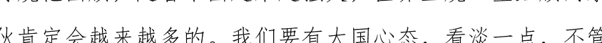

通过深入的观察，谈谈我对这个国家的认识吧。

作者整理在64页起发的小国，靠着大国吃饭。没有出息的小国，靠着大国要吃饭。新加坡属于前者。

当然也有第三类国家，靠着大国要吃饭，还反咬大一口，真不知道它属于有出息还是没有出息的，比如如宁隔的二舅他们家。

扯远了，还要说新加坡吧。（持续）。

首先，新加坡是一个小国，小国小国的心态和生存之道。你要理解他。小国都是靠着大国吃饭的。不同的，有出息的小国，靠着大国吃饭。没有出息的小国，靠着大国要吃饭。新加坡属于前者。

当然有第三类小国，靠着大国要吃饭，还反咬大一口，真不知道自己属于有出息还是没有出息的，比如辽宁隔的二肺炎他们家。

扯了，还说新加坡吧。（延续）

首先要打破一个为主的观念。你不要认为华人国家一定。实际上，华人国家和华人地区最反华。台湾不说了，香港也不太怎么样。当然，这也不光他们的错。我们当年GE10年的表现，确实没愿意跟我们混呢。

尤其是1979年之前。在国际列强当中，新加坡的亲娘是英国。新加坡最可靠的大哥是美国。这个是新加坡的基本路线，百年不动摇。

中国是新加坡手里的一张好牌，是一个可以比较容易地挣钱的地方。

新加坡为什么会这样呢？可怜吗？一点都不可怜。我们回一下新加坡的历史，再一看新加坡的现实，你就会理解它的行为了。

新加坡地处马六甲海峡要冲，是华人南洋的落脚地。历史不说了，总之，明清时代，来了很多人，许多南洋方面就成了华人区，比如加巴岛、马六甲城、马来亚的椰隆坞、印尼的廖群岛，基本上是华人天下。后来，在清代就成了英国的殖民地。英国统治时期，新加坡以华人为主，住民马来人是少数，还有英属印度传来的移民和英国移民。这样就构成了现代新加坡四大族群的祖先（华马印英）。

待续

在英国的统治下，新加坡过着相当幸福的生活。除了对印度人外，英国的殖民地很少出现类似日本、俄罗斯、比利时之类的种族灭绝的屠杀行为，英国人文明的，在处理管理上。1940年，日本人打来的，占了两年三，像太平洋上的台风一样，来得快，走得快，没有留下痕迹。新加坡在恢复秩序后，想一天那个时期的遗迹，还困难的。说明日本人才知道自己不受欢迎，所以在战前把自己建的神庙拆迁了，公墓迁了，免得被人砸了，怪没有面子的。

多说几句，虽然日本人在南洋统治了这几年，也有过杀人和抢东西的记录，但是南洋各国并不是日本人。为了什么呢？因为当时南洋都是殖民地，菲律宾是美国的，印尼是荷兰的，新马是英国的，越东是法国的，他们从被占到被占，这作为一个独立国家。


二战后，感受是很不同的。二战中，美国光复了新加坡，然后很快回来了。当时在太平洋和印度洋的大军被苏联占了，只剩下印度的陆军与中国并肩守着。1946年4月1日，新加坡成为英国的直辖民地，不再是马来的一部分，这为独立国家创造了条件。二战后，世界的解放和潮流不可避免，连非洲那些地区都独立了，所以新加坡也不能豁。1959年取得自治地位。1962年9月1日，马来亚、砂越共同成了马来西亚，完全脱离英国统治。

新加坡在马来联邦混了两年，直到1965年被离开。为什么加入马来联邦？这是大家关心的问题。说白了，因为新加坡太小了，没有资源。这个国家只有600平方公里（经过努力，现在达到700平方公里了）。这个国家没有任何资源，甚至没有淡水。奇怪这个国家在热带雨林气候，为什么没有淡水？


他的国家太小，没有像样的河流和湖泊，虽有2000多毫米的降水量，但雨水直接入境留不住。新加坡每年都要从马来西亚进口淡水，就像香港从广东进口淡水一样。国土大了，人口又太多，喝口水都要进口。想把面积大一点，从印尼进口。国内华人要是搞农业和商业，穷得一场。看历史照片，60年代的新加坡跟广东的农村没有一样，就是国内出来的。现在市区的高楼大厦，60年代是养猪场。许多新加坡人没有选择，而马来西亚有30多万公里，人口不到100万，他们死也不离开这个联邦。

直到今天新加坡都是国际上最缺水国家。人均水资源全世界倒数第二，就以色列倒数好，至少还有雨。新加坡加入马来西亚，因为马来西亚有很多华人，人口比例现在是30%左右，应当在40%以上。但是，在马来联邦的新加坡活得很不如意。

为什么呢？原因我差不多说了。简单说，原因有两个：其一是马来人排华，这是规律性的。只要马来占人口多数的国家，异教人士一般不好过。但是客观上说，马来华人比印尼华人还是幸福多了。其二原因是，国家的政策问题。马来华人政治上偏左，有反对和游击队，要把绿榜围成赤旗。世界北京不支持还好，一支持，华人的日子更好了。马来联邦政府出了许多排华政策，新加坡作为联邦主体，是以马来人为主的地区，肯定不能同意，双方矛盾越来越激烈，最后联邦政府说：“你不服，你走！”1965年，马来西亚的分离故事拉开了幕。

新加坡的独立是一个极为少见的事情。从马来西亚来看，把不听话的加盟地区开除出去，这个做法在世界上很少见的。我们通常的作法是，你不听话想分裂？没门！美国南部非洲州想独立，打！车臣共和国想独立出俄罗斯联邦，打！亚亚地区想独立出印尼，打！打着打了马来，水太大，双方才决定休战。

马来这个决定，我认为有几个原因：一个是马来西亚自身的华人就多，如果再加上新加坡的华人，几乎达到半数了，马来国家性质要变了，不如把他们轰走。二是马来西亚的政府能力比较弱，今天都是一个弱势的政府，不要看哈马得凶，办事能力不强，所以如果要武力解决，也有心无力。

新加坡的表现就更少见了。一般来说，一个地区独立出来，大家会欢呼，游行，开PARTY！新加坡却不然，他对自己前途没有信心。李光耀是马来西亚的议员，开除新加坡的时候，他当时也在场。他的基本意见是：你们排华，我不意。这个场景被记录了下来，成为独立最经典的画面。今天，中国电视一起独立，就放老毛在天安门楼气势。吉隆坡，许多人还要跟着。十几年以后，邓小平说了一句话：“杀出一条血路来”。用到1965年的新加坡同样如此。

李耀说，他佩服的人是李小平。我相信他是认真的。因为李耀的性格决定了新加坡性格就是实用主义。不管什么文化，不管主义，只要对新加坡有好处就用，对新加坡没有好处就拒；只要对新加坡有害就反。李耀和执政党，主要是工人团体的支持，这些人倾向于社会主义，但是上台后，搞办法不太行。这是典型的逻辑。比如反华问题（网友说，要把政府区分开来）。新加坡在东南亚国家里冲到头。多次在国际上批判中国政府，不准确的地方，大家都有脑袋。原因一个是他们对中国的阶段竞争；二是为了维护与美的关系。的确，以我们当时的国力，没有那么强的军事投放，他就是亲华。三个也是外交策略上的考虑。东南亚国家把新加坡视为南洋的桥头堡，潜在的前锋。

他就是来的，看看：有息的小国靠着大国吃饭，没有出息的小国靠着大国吃饭。新加坡属于前者。新加坡建国以后，与周围国家一直不好。南有印尼，北有马来，两个国家对新加坡视如虎敌。所以抱美国的大腿就是新加坡的必然选择。新加坡的空军力量主要来自美国，战力和技术水平都是东南亚领先。没有战略纵深，没有办法抵抗外来入侵，所以新加坡的任务就是给敌人沉重打击，一直坚持大国干涉为止。总之，新加坡的国家导向就是实用主义。好听叫实用政策，不好听叫狗。如果美国对中国有好处，他就会买；如果中国有好处，他也会这样做。一次，我跟新加坡朋友吃饭，谈到了这一点，他也承认。我心里很不喜欢他们这个国家态度，就打趣说：“好吧，反正我们帮助了你们什么？如果美国妈妈骂，我们就可以日子过一些，那就叫吧，反正这个世界上骂中国的人多了，又不止你们一家！”

新加坡的另一个罪状是“亲台”。李显龙当了总理，立即跑到台湾了，表现得够尴尬。后来新加坡又修关系。其实老李是每年都要去，今年好像又跟马云吃饭了。客观上，新加坡和台湾有历史渊源。客观上，在改革开放之前，新加坡想和大陆打交道确实有点难办。一是大陆登陆时有的点不好话；二是冷战时期美国不会允许。新加坡对台湾有现实需要的。新加坡需训练军队，而自己已600多平方里的地方，最长直径四十五公里，根本展不开。空军的战斗机就没有办法了。因为空军是垂直的，所以新加坡的领空是一个柱体。我常对朋友开玩笑说，如果不犯马来和印尼的空领，你们的战斗机一起飞就要转弯，然后打着圈飞上飞下，像是啤酒瓶里的苍蝇一样。

所以，至今新加坡的军队都在台湾训练。相对新加坡来说，台湾领土太大了，简直是个绝对大国。前几年两国闹了一次矛盾，台湾政客公然说新加坡是一个“鼻屎大的国”。

新加坡的实用主义，在文化领域表现的最抢眼。但是，新加坡并不提倡华语。新加坡的人口四分三是华人，国语是马来语，社会语言是英语。官方语言有英语、马来语、华语、泰语四种之一。实际上，新加坡的任何正式场合都使用马来语。这些除了经济发展，还有为了安抚少数族群。这让许多人说英语，华语水平很差。很多年轻人不懂汉字，只会说英语。今天上午，他们英语挺好。李光耀还强行创办了华语学校——南洋大学。即使在马来西亚，汉字的招牌、路牌到处都是，但在新加坡禁止使用，公共场所全部用英语路标。从1965年代一直至1995年，华语地位不断下降。华语也有自己的难处：在中国崛起之前，学习华语对于新加坡来说，无论是移民还是做生意，意义都不如。他们之间也有差异。华语普通话、汉语拼音和简体汉字，差异较大。李光耀认为，新加坡不能自创一套，华语的发展主流要与北京一致。新加坡也有人抱怨大陆的字体和语言太混乱，让他们无法适应。下面几节还要一下，近年来由于中国崛起，新加坡重新强调华语，还是实用主义。作为一个中国文化热爱者，一直深耕自己，走在新加坡的大街，看到迎面来的漂亮女孩，然而那一口英语，真的让我感慨。我不知道该如何为他们高兴，还是为他们悲伤。


学到东西的人并不多，公款旅游的比较多。

我最为看不惯的是，中国人到这里，每一开座谈会，开口就是：此行收获很多！新加坡许多方面值得我们中国学学习……这个话纯属于扯旦。我在这里这么久，个人感受是，新加坡在经济发展和社会管理管理方面，确实有中国要学的地方，但是也不亚于“很多方面”，这个国家这么小，哪有那么多方面啊！

新加坡的实用主义，我们不用学了，改革开放以后小平同志（邓小平同志）的基本思路都是这样的。具体做法，我认为新加坡除了刚才提到了产业升级外，还有几个方面比较突出，我们应该学一学：

## 一、 城市管理

先进地区的县长来学。这个城市管理真的不错，处处红花叶一尘不染。路一点都不宽，不比我们东部沿海地区的县城路要多少，但是不算太堵车，基本上畅通，高峰期走得慢一些。据说新加坡政府在限上采取了一套办法，可以研究研究。

## 二、 水务

前文我们已经讲过，新加坡严重缺水，要命的是，他们与马来来的关系不好，后者一动就要拍水管子，大有普宗拍天然的风采。大陆给香港的水，几个大管子哗哗的，就是90年代洋洋康康康喱时，也没有想到过搭水呀。

一个人就不一样。所以，新加坡人都很恼，就玩命发展水务。结果，新加坡和以色列，这两个缺水国家，双双成为了全球水务巨头。人的潜力是逼出来的，一点不假。新加坡的污水处理技术相当高，冲马桶的水处理，可以直接循环进行自来水系统。要知道，新加坡的自来水是直接饮口的。我每当饮自来水时，心就想，这水前几天不知道冲过谁家的马桶，呢！！！

关于水务，有必要多说几句。新加坡是在四条路线上走，力争做到水务自给，以后再也不要进口的水：

1. 继续从马来进口水。这个价格最便宜了。
2. 海水淡化。这个技术已经很成熟，新加坡公司还在沿海地区投入了不少项目，挣了大笔石油美元。
3. 集水工程。把全国的大街小巷的排水全部建成一个系统，在低洼地区修水库，或者直接把几个海湾围起来，改成淡水库，这样下雨时，把雨水全收集到水库里起来。

据新加坡说，如果遇到旱来翻脸，后三个办法基本可以保障用水。当然，经济价格有点贵。

我认为中国的水务思路有些问题。现在不动不动就跨区域调度，劳民伤财不说，还会影响生态环境，还要移民。其实，你天津、山西、甘肃再缺水，能有以色列和新加坡缺水吗？人家解决，你为什么不能解决。我们常说开源节流，实际上现在全国真的没有“源”可以开了，连长江都不缺水。节流才是关键。现在，北方一些地区，为了发展经济，增加地税，在干旱地区上特殊耗水项目，这不缺水吗？南北水调上千亿呀。

有人说，在北方节水工程，会造成水价上涨，水会很贵。错，贵就贵吧，物价本来就该反映资源的稀缺程度，这样会有市场机制自发调节，迫使耗水的工业向南方丰水地区转移，才能实现全国产业布局的合理优化。北方水吐远了，回到新加坡。（待续）

## 三、 交通

交通，我以前看的文章说，新加坡的车上路上是要购买通行证的，限制越通行越贵，以此约束大家坐公交。是真的吗？

我先回答这个问题，廉政的问题下文中会涉及到。新加坡买车要先买一个拥有汽车的车证，车证现在好像相当于人民币20万以上。所以很多人宁愿使用公交系统。车证的价格也在不断变化。据说前几年经济不景气时为了利刺激消费，车价价格提的，这几年又涨回去了。他们的公交车和地铁是一卡通，而且不贵贵。

另外，你的汽车如果要去市中心的话，路上会被收钱。具体的办法是，马路上有一种类似于拱门的东西，汽车上面都安了磁卡或者芯片什么的，从拱门底下通过一下，就会被收一笔钱（好像相当于人民币5至10块，记不清了）。这样，许多私家车尽可能无法去闹市中心。对分流车辆有所好处。

在新加坡加购一辆车是相当贵的！

我不赞成中国全学引进新加坡。因为在对权力有充分监督的情况下，我担心这样限制，最后又变成了腐败。最后把小老百姓限制了，有钱的、有的、有关系的不花钱照样过。

## 四、 廉政

说到哪里了？除了城市管理和水务，我觉得新加坡还有一个地方值得学习，就是廉政。我为什么不用“值得学习”呢，是因为我一直在思考，新加坡的廉政是怎么来的，是由李光耀个人努力吗？还是由于高薪养廉吗？还是制度吗？还是偶然？

我总结几点感受：第一个感受，新加坡的廉洁，首先应该由于李光耀个人坚持。在英国殖民时期独立之初，新加坡的腐败是比中国严重的。我讲过一个典型案，具体内容记不清了，总之，当时……（此处由于原始OCR文本存在大量乱码和重复，以下重新尝试整理逻辑）**

[content]
一个人就不一样。所以，新加坡人都很恼，就玩命发展水务。结果，新加坡和以色列，这两个缺水国家，双双成为了全球水务巨头。人的潜力是逼出来的，一点不假。新加坡的污水处理技术相当高，冲马桶的水处理，可以直接循环进行自来水系统。要知道，新加坡的自来水是直接饮口的。我每当饮自来水时，心就想，这水前几天不知道冲过谁家的马桶，呢！！！

关于水务，有必要多说几句。新加坡是在四条路线上走，力争做到水务自给，以后再也不要进口的水：

一、继续从马来进口水。这个价格最便宜了。
二、海水淡化。这个技术已经很成熟，新加坡公司还在沿海地区投入了不少项目，挣了大笔石油美元。
三、集水工程。把全国的大街小巷的排水全部建成一个系统，在低洼地区修水库，或者直接把几个海湾围起来，改成淡水库，这样下雨时，把雨水全收集到水库里起来。

据新加坡说，如果遇到旱来翻脸，后三个办法基本可以保障用水。当然，经济价格有点贵。

我认为中国的水务思路有些问题。现在不动不动就跨区域调度，劳民伤财不说，还会影响生态环境，还要移民。其实，你天津、山西、甘肃再缺水，能有以色列和新加坡缺水吗？人家解决，你为什么不能解决。我们常说开源节流，实际上现在全国真的没有“源”可以开了，连长江都不缺水。节流才是关键。现在，北方一些地区，为了发展经济，增加地税，在干旱地区上特殊耗水项目，这不缺水吗？南北水调上千亿呀。

有人说，在北方节水工程，会造成水价上涨，水会很贵。错，贵就贵吧，物价本来就该反映资源的稀缺程度，这样会有市场机制自发调节，迫使耗水的工业向南方丰水地区转移，才能实现全国产业布局的合理优化。北方水吐远了，回到新加坡。（待续）

交通，我以前看的文章说，新加坡的车上路上是要购买通行证的，限制越通行越贵，以此约束大家坐公交。是真的吗？

我先回答这个问题，廉政的问题下文中会涉及到。新加坡买车要先买一个拥有汽车的车证，车证现在好像相当于人民币20万以上。所以很多人宁愿使用公交系统。车证的价格也在不断变化。据说前几年经济不景气时为了利刺激消费，车价价格提的，这几年又涨回去了。他们的公交车和地铁是一卡通，而且不贵贵。

另外，你的汽车如果要去市中心的话，路上会被收钱。具体的办法是，马路上有一种类似于拱门的东西，汽车上面都安了磁卡或者芯片什么的，从拱门底下通过一下，就会被收一笔钱（好像相当于人民币5至10块，记不清了）。这样，许多私家车尽可能无法去闹市中心。对分流车辆有所好处。

在新加坡加购一辆车是相当贵的！

我不赞成中国全学引进新加坡。因为在对权力有充分监督的情况下，我担心这样限制，最后又变成了腐败。最后把小老百姓限制了，有钱的、有的、有关系的不花钱照样过。

说到哪里了？除了城市管理和水务，我觉得新加坡还有一个地方值得学习，就是廉政。我为什么不用“值得学习”呢，是因为我一直在思考，新加坡的廉政是怎么来的，是由李光耀个人努力吗？还是由于高薪养廉吗？还是制度吗？还是偶然？

我总结几点感受：第一个感受，新加坡的廉洁，首先应该由于李光耀个人坚持。在英国殖民时期独立之初，新加坡的腐败是比中国严重的。我讲过一个典型案，具体内容记不清了，总之，当时……

第二个感受，是新加坡面积小，信息透明。在新加坡，半径小，容易控制。我们在国内都知道，在一个范围内，每个人的信息都很清楚。我想象，如果一个市长或者县长，被赋予了高权，在这么小范围内想出现腐败是非常困难的。

第三个感受是：高薪养廉有一定作用，但不是全部。新加坡也出现过不少腐败案例，说明高薪不一定必然养廉。但是高薪能够让官员完全依靠合法收入经营得很有体面了，再加上老李的铁腕威吓，所以一般人不愿再去冒险。但是，新加坡腐败反弹的风险一直是存在的。老李退休以后，吴作标上来，然后李显龙上来，威权明显不如其父，在这种情况下，近年新加坡腐败还是几起严重的腐败案，这是发现了，可能还有没有发现的。我认识的几个新加坡朋友，都比较老交，照章办事，下班回家，应该是不错的公职人员。在新加坡，一聚会就会不管多重大，一般都是开会吃餐，坐着看着，部长和外宾一样。但是这些新加坡人来到中国出差，他们就知道事情，如果我们这样接待他们，他们会认为失礼而不高兴。因为他们知道中国的接待标准，也应该接受你的高标准。

我不赞成把新加坡的廉政完全成人治。我觉得人治的份很大，但是制度也在起作用。表现在几个方面：
一是薪水，已经说了。
二是规范的公务员制度。新加坡的公务员制度远比我们规范，公务员中“政务官”、“事务官”截然分开，政务官要竞选和任命，事务官通过考试录取，事务官的最高职务是高级秘书，相当于副部长。如果他想当部长，只有辞职脱离公务员队伍，加入政党阵营要参加竞选。这不像我国一个部长可能是系统产生的，连门市的老头都有。新加坡也有这些东西，但我们要弱得多，因为从度上讲没有提供多少“土壤”。
三是相对独立的媒体。本土媒体相对独立，没有焦焦标教授的轰炸它。外国媒体也相对自由一些。当然，比西方国家的限制还是更多。
四是普遍选举。虽然新加坡政党巨大，但是选举的形式是存在的。理论上讲，反对党可能下台。今年大选票只有60%，创历史新低，采取了许多办法，比起，选民不喜欢老李天天坐在议会里，脚不已。

新加坡的廉洁是因为人为治，而且恰好这个国家很小，正好在李光耀治人的力所能及的范围内，再加上高薪创造了不受贿的经济条件，于是就廉洁了？也不完全是。

老李的民族政策是我们真正贯彻了，对少数民族并没有任何歧视。然而大家可以想象，如果华人、马来人、印度人在完全平等条件下竞争，竞争上几十年，结果会怎么样？当然是华人胜出。在马来西亚、印尼，华人在被歧视打压至其惨杀的情况下，都能取得经济上的辉煌成就。何为平等竞争，如何争取更多机会。

在这这一点上，新加坡华人真要感谢老李，虽然我再次明我不喜欢这个老家伙。在新加坡，虽然政府、议会会有固定的硬性的少数民族名额，等公民。

新加坡改善住房的做法在世界上颇有名（下文专门论述新加坡“组屋”政策）。老李在组屋安排上动了脑。用中国话说，就是政府提供的经济住房。华人、马来人、印度人、白人不能聚居，全部散到各个组屋里去。原来的少数民族聚居区一拆就消失了，再也拉不起来。这个政策其实很利害。结果都是分散，对于75%的华人来说，怎么办才叫“散”？民族问题多半出现在聚居区，人口聚集矛盾。新加坡的组屋分配政策在解决民众住房的同时，解决了民族与族群问题，这一招是相当高。反观中国，长期维持其制造少数民族聚居区，认为是保存其传统文化，实际造成了不少矛盾和社会隐患。中国的少数民族自治政策等一系列政策是苏联的舶来，南斯拉夫、捷克已经用自身的惨裂行动证明了这套政策的实际效果，中国还在坚持，近几年西部屡有问题，问题出在哪里，中央高层不可不查。


我非常感兴趣的，就是邓小平这次访问。78年正式开放的思路形成之后，这次访问对中国是非常重要的。许多新加坡人也了解了这次访问，因为李老把这件事挂在嘴边上。通过这件事，李把中国的改革开放说成是中国学习新加坡的结果。我一直在想，这个访问对中国有多大影响。

当时的新加坡，成立已久，因为它成立之初就执行了市场导向的接产业转移的政策，在1978年劳动密集型产业已成规模，正在酝酿第一次升级。邓小平看到的新加坡的市容和经济，大相当于1990年代初期中国。

现在的中国人，看了新加坡没有什么感触，但邓小平当时看了，可能触动较大。因为老邓1920年去法国留学时，在这里留住了两天。看到这么一个破烂小岛竟然翻天覆地，他肯定曾有想法。

李光耀在回忆中记录了他当时对邓说的话（我不查原文了，感兴趣的兄弟去网上下载电子书自己看）。意思大概是：我们新加坡人，都是南洋迷的农民，而中国人都是文人学士，所以新加坡能做到，中国都能做到。

我一直认为李光耀这句话是外交辞令。后来发现不是。他不对邓小平，对新加坡人也多次讲过这类的话。总的来说，有文化有水平的都留在中国了，新加坡人是农民文盲的后代，是低等华人，不知道这个理论他是怎么想出来的？

新加坡的一些文化精英对光耀这个论调是相当不满意的。我的一个新加坡朋友，一见到我就调侃地打招呼：“喂，文学学士！”我回道：“有什么事啊，贫穷农民的后代？”

李光耀回忆录：邓小平听了这个话，沉默了，没有回话。

我想老邓肯定知道，李光耀这个中国人才优势论不成立。因为通过解放后的历次运动，我们已经成功地造成“文人学士”全部整理成了“贫农农民”了。


李光耀认为，广东等条件的地区，可以在若干年内跃上亚洲四小龙。呵呵，看来我的感觉相当良好，不过总的来说，新加坡的发展对邓小平的改革实践是有触动的。在改革开放之前，邓小平多次出国，其中美国行、日本行（那次）以及新加坡行，这次是有收获的。不过说新加坡对于改革开放有多大的意义，我看并不一定，毕竟两个国家的国差距大了，可以借鉴的东西不多，不考虑这一点。中国的官员出国费用惊人，多次流于形式。

80年代建交，应该没那么早。没错，新加坡是东南亚最后一个和中国建交的国家。中新在80、90年代的关系发展，总的来说可以用一句波澜不惊形容。

经济上，新加坡实现产业升级以后，向中国转移了一些产业，特别是在苏州建立了一个工业园区。政治上，两国来往不断，新加坡与台北来往不断，但是只要不出格。只是有一次，在1988年的夏天，新加坡狠狠责了中国一顿。

同时，新加坡继续以来高于中国百倍。文化上，名为支持中国教育，实则网罗中国人才，两国合作培养留学生。新加坡国立大学留学，但毕业后要留新加坡工作。实际上，大学毕业年后都30岁了，生理上已经结婚了，哪里还能再出国？我有三个大学兄弟，上就被新加坡国立大学挖走，其中两个留在了新加坡，收入丰厚。我到新加坡后，由于多年信息，留在中国同学上发表过，至今未见任何回，我每过海鲜酒店，扼不感慨！签到中国挣了不少钱。

2000年以后，中国做了一件很对不起大家的事情——没有像东南亚各国希望的那样崩溃或者统一，中国崛起。整个世界都在震动，新加坡实用主义者又如何调整呢？

在火红的90年代里，中国人忙着看苏联淘汰、学南巡、圈地搞开发区然后养山羊、妙股票、谈论高校收费、看着经济着陆、收回香港、送别小平、看朱总理招待会、房交、国企脱困、抗洪抢险（同志们洪水就要来了）、我在南海你们的好消息、抗议大使馆、西部开发、和金爸爸玩诸猜、收拾轮子等等，忙得不亦乐乎。

同时，新加坡的政治也发生了变化。1990年至2004年，新加坡总理是吴卓硕，这个人身高高190，相对于新加坡的国土而言相当浪费面积。但是，吴是一个温和人。2004年，吴引退，新加坡的政者换成了李光耀的公子：李奎龙。

新加坡的政治变化就是：大选越来越有事情了。新加坡的政治民主化进程在90年代不断加速。其原因，是李光耀执政20多年，需要领导人更替。到了一个经济发展之后需要政治发展相应的历史阶段。我想，如果对新加坡的政治进行研究，90年代以来是有意思的，无论人们怎么说吴卓硕时期李光耀是靠后指挥，但策划新加坡的政治正在逐步成熟和向前。很遗憾，我没有深入研究过90年代，也没有亲历。但以我亲身经历大选，下面来说我观战的小体会（待续）。

哦，对不起兄弟们，我看了一下刚才的贴子，我又跑偏了。新加坡大选的事晚一会再说吧，先讲讲新加坡对中国崛起的反应。


才感受到，中国崛起是一个他妈的很不得的大事情！想想吧，中国60年的发展，看看有形和无形的世界，对世界的影响实在太大了。中国现在正在成为这样的大国。在东南亚几乎每个国家目前最大的贸易伙伴都是中国。以前还是日本、澳大利亚、新西兰等发达国家，都被改进成了初级原料国，更说印尼、马来、菲律宾等。新加坡没有什么原料可以出口，中国现在50%的原油要进口，除了美国，其余的中东原油走马六甲。

东南亚各国里的中国起什么样子？我感受，希望中国能继续发展。超级国崛起是件不得了的事，改变世界的“气候”。打个比方，现在的世界和环境，我们的物种和农业适应了，如果贸易改变，谁也不知道是福是祸。即使西伯利亚会变暖，俄罗斯也会迎来剧变，因为还有太多的不可控、不确定因素在里面。西伯利亚可以种植树，许多地方会受益，撒哈拉沙漠会变成雨林。

不管当前气候条件好也劣，我发现，不管是东南亚在现行国际环境下受益者（比如新加坡），还是现行环境下的受害者（比如印尼和泰国，它们在97年金融危机中几乎输掉了最后的底裤），还是现行一方面，他们看来，如果中国只是一个平稳发展的参与者，他们是欢迎的。但中国自己想想，中国的规模大，只要人均GDP达到美国的1/5，就实现总量超越，从而颠覆他们习惯的国际环境。欢迎改变环境，只有朝鲜和非洲国家，因为他们穷得一无所有，无可输，他们是最彻底的革命者。在国际环境的剧变中，他们失去的是什么，得到了什么是最坏最坏最坏的结果，不过也就是戴一根锁。他们害怕呢。


这就是我们的困境。中国——我最热爱的祖国呀！虽然你有那样的不对，我仍然这样热爱的你。你自心地为你骄傲。你是伟大的，站在海外远眺，像黑暗中的火焰，想藏也藏不住。但王者，命中注定，永远万里独行，无论前面是胜利还是失败。没有正常的理智的国家会选择与你同路。与你同路的又根本不配与你同路。他妈妈，怎么办呀。俄罗斯人也不欢迎剧变。


这一句把关键的字掉了，对不起，打得太快了。晚了，改天再写吧。各位安静！楼主。楼主的几个新加坡可以学习的地方，我认为都不可可能：

- 水务：首先新加坡也是在跨境调水，并没有断了和马来西亚的水务联系。像楼主说的，如果不调水，水价会很高，中国广大内陆地区没有这个，就是也接受了。
- 廉政：高薪养廉？地级干部一年500万？动车事故赔91.5万元，一年五条人命，这是赔偿高的，一句话，舆论接受了。
- 民族问题：说实话，新加坡的民族、宗教政策让我惊了。中国的高考加分、想生几个几个已经让我汉怒声载道。汉语第三？用英文上课？马来语唱国歌？还是那句话，舆论接受不了！

不是让中国学习这些东西，呵呵，知己彼，参考吧。楼主回来了……睡了一会儿，睡不着。头疼。还是继续写的贴子吧。不潜水难得这个雅赖。继续说包括新加坡在内的东南亚各国对中国的看法。我认为这些家伙还是比较的，东南亚没有一个国家能跳出这个圈。李光耀说，当年新加坡，激发了小国困杀了一条血路。只要要用的，就不用其。一个知情的朋友，当年李光耀同一出生，典型的草根英雄。今天的新加坡，已经不再是年的锐气。他在极力塑造“创新中心”的锐气形象。新加坡依然是实用主义，他把一只脚放在中国这只船上。

一是双方的贸易和合作不断加深。新加坡正在中国大搞水。他利用自己的资源方面的优势，滨海区域圈了一个开发区，正在制造一个新城。新加坡人都极力向中国证明，自己不是台湾、香港式的地区，只能转移落后生产，而不是像德国、美国的主，有大把先进技术可以让给中国。

二是到处打中国。在西方，李光耀是中国问题专家。李光耀跑到欧洲，很多时候都在讲中国问题、中国人事、中国前景，因为是华人背景，又是西方的老师，所以西方相信他的判断。如果他讲新加坡的问题，倒可能没有几个听众。从维密文件来看，美国对中国以后的人事安排以及新人能力问题，都要请教老李。随着年龄的不断增长，无论在国内还是跑到海外，老李越来越向胆胆的事发展，很多时候说话大调，给小李经理了不少麻烦和被动，不得不懂清“我爸爸不代表我”。

补充一句。我的意思并不是廉低新加坡，我想我对一个友好国家说话是不太刻薄了。新加坡有一些技术是相当不错的。比如水务，比中国要强两三个档次。中国必须掌握天下之长，为我所用。任何国家哪怕有一丁好的东西，都必须是我们的老师。我的意思是，新加坡有一些东西，但好东西不是太多。和德国、日本甚至韩国都是难相比的。

第三点，就是大力引进中国的人才。新加坡自身的人才十分匮乏。他们的教育是不错，孩子也勤奋，但某些方面的人才需要一定基数的人口，才有有可能冒出来。400万的人口里冒出多少人才？我去新加坡的工业园，发现这里几乎成了普通的天下。

至于贸易、旅游、服务业、会展、金融，越来越大的比例是围绕中国开展的，所以“以华制华”，也引入了大量中国人才占一半以上？我猜的，没有系统统计。在教育上，大量中国博士硕士也都跑到新加坡来了。新加坡靠什么推动？基本上靠外来流入的资金、外来流入的人才，面对的是外部市场和外部需求。今天，新加坡GDP已经达到3000美金，亚洲第三，仅次于中国。这些产值越来越多不是来自制造业，而是来自金融、证券等行业。新加坡是亚洲幸福的孩子。在这个环境下长大的新加坡人，高端人才来自中国、印度，低端的劳务也来自东南亚，能不能吃苦。

第四点，新加坡不断加强与美国的联系，其力度远远超过中国。我一直怀疑，除了马六甲海峡的地理位置，新加坡还有什么本钱让美国如此看重？说地理位置吧，美国不光靠新加坡，也可以靠马来西亚和印尼。一番处理的各种筹码和策略获取更多好处。我认为它得到美国的青睐，凭依靠国家的特殊地位，他是世界上唯一的华人国家（湾不算）。他是联系中国的一个纽带。他是美国了解华人、了解中国的一个渠道。美国也可以通过台湾了解中国人，但台湾人分析大陆，估计美国不信中国，因为带着强烈的情绪研究结果一般不太观。如果我太看中国了，请新加坡的老李不要生气。新加坡是一个聪明的小国，在大国之间穿来穿去，中国打美国牌，美国打中国牌，跟东南亚的邻居打中美副牌，把智商不是太大的邻居们打得一愣愣。前天，我读到一篇印尼报纸的译文，印尼的评论家认为，生在中两头大象中间是倒了大象，无论两象是做爱还是打架，都会把脚下的耗子给踩死。看来，新加坡人并不这样认为，他们眼里，大象做爱打架都是机遇，关键在于你如何把握。


在新加坡的利益盘子里，中国很重要、很重要、很重要，他妈妈的性——仅次于美国！美国能决定新加坡的生死，中国能决定新加坡的窝窝。在确保活下去的情况下，尽可能活得一些，这就是新加坡的战略导向。

虽然，他也有可能在今后不可知的局势变化和发展中，把重心移向中国甚至完全倒向中国，那仅仅是可能的，至少目前他的策略是如此。所以，我们没有必要怪老李不够聪明。毕竟，共同的华人身份不能当吃饭。

多年以前，我我看过一个郭达的小品，这个老儿兜着陕西腔，对着镜子摇头：“郭不要死！郭——要————活————”。拟抓笑的。其实，新加坡立国 40 多年，就是这么一句话，想活下去。这个国家可不容易，60 年几乎没有几个人相信这种国家能活下去。马来西亚断言，新加坡用不了几年就会自己爬爬回来。但是新加坡做到了。新加坡人的（我不用华人

的所作为，无论是华孝、反华，都不是因为他们爱华或者根一手整理，获取更多好帖

周末无事的时候，我喜欢站在新加坡河岸边。我见过这条河边 70 年时代的照片——你想象一个湖南或者四川的乡镇，我如果附近修了两小家化肥厂和一家养鸡厂努力污染一下，这就是一个样子。而现在，这里任何世界中心城都不逊。

我讲述着这个让侵略者一炮没打着、两炮打了的小国家。我没有理由爱新加坡，它并不值得我爱；我也没有理由恨新加坡，它并不值得得我恨。我是我，新加坡是新加坡，而已如此。（持续）

作者：奉行内核政策 日期:2011-08-26 02:49

回到前面断掉的那个话题，讲一讲新加坡的政治民主和今年的大选趣闻。

李家庄是独裁还是民主呢？引发说谎纷。

有一个欧洲记者仁仁，他认为新加坡是独裁，以饱满的政治热情写文章攻击了老李三万五千八百。后来老李到欧洲接受了他的当面采访。

老李后来说：“他拿出了录音机，我也拿出了我的录音机”“看来两人都不怕对方胡说八道死无凭证。

老李后来说，他一通blahlablablababla，说那萨哩口无言，从此再也不写批评文章。我本人极其希望能够找到那个口信，台录音机中的一个没找到，也没有找到，那个口信。

# 一份整理的y信101284955，获取更多好帖

这个故事是真实的，其实代表了两个事实：就是以前欧洲和美国普遍认为新加坡是独裁，这是事实。近期，越来越多的美国不再将新加坡视为专制，也是事实。有网友认为专制，其实呢，他现在基本上洗得半白半黑了。欧美这个变化原因有二，一个是交流消除误会，二是新加坡自己变化。本人认为，新加坡民主基本还是真实的。多党制已经成形。反对党的成长，还没有达到美国的程度，但成长看得，本次大选拿到了40%的选票。从理论上讲，反对党上台和政轮替已经没有任何制度和现实上的障碍。反对党慢，是老李搞一党大的历史遗症，人民行动党树太大了，底面的“土”这么多，反对党实在没有多少基础可以争取。我认为现在的反对党的正确策略，就是把事情办好，然后等着人民行动党犯。

作者：奉行内核政策 日期:2011-08-26 03:09

讲一个有趣的案例吧。新加坡的选举，堪称今年选大的神笔！我了解了故事大概，不去查资料了，人名、党名全都光了，我就讲故事大概。新加坡是一个集选区。什么是集选区呢？这样的新加坡全国分选区，每个选区有一个议员名额，党就会派出自己的将分别分到各选区与其PK。每个选区投出一个议员，共同组成会议。但是有一个问题，就是少数民族的人、年轻的人可能不上。所以新加坡有一部分选区合并，例如N个选区合并成为一个选区，叫集选区。这样集选区名额就多了，每个党都派出N人组成的竞选团队，各选区之间的PK。如果团队中有一个政治家，比如李光耀，其他的这个团队也肯定胜，等于老人把新人带进了会议。新加坡选区是四个选区合并而成的。赢就是四个，重中，人民行动党不休息，他们推出的选区团队，竟然包含了两个政府部长，志在。他们的主要竞争对手是谁？是一个著名的反对派袖。反对党人名也拉了。他也有，他在前一个选区参选，每次高要当选，那个选区是他的忠诚极高，人民行动党根本打不进去。所以人民行动党认为他还在选区搞到会议。结果，他这次杀出来了，他认为自己的度没有问题，就让一个党留兜，他自己组织了一支竞选团队，进了政府。双方短兵相接。（候）

作者：奉行内核政策 日期:2011-08-26 03:11

回答网友：我不认为多党制目前适用于中国。下文我会专门论述的。我讲这些，主要是向大家说明，新加坡的选举至少已经是真的是，不是李氏家族的专制社会。虽然家里很强。

作者：奉行内核政策 日期:2011-08-26 03:22

不管选战激烈，执政党依然强大。赢没有问题，就是赢多少的问题了。不过这个时候，老李妥不住了，他出来对新闻发表了一些观点。我没有看新闻的原话，听听他们说，大意就是，如果选民投了反对票，这个区成了反对党议员代表的区，执政党可能会减少投入和公共福利。他要让他们仔细考虑。此言一出，帮了倒忙。这是明显的威胁选民。许多人愁不平。李龙做了一些补救工作，但是结果仍然人吃惊，选民们坚持要投反对党的票。人民行动党的参选部

img/b013cf51be66714ab5dcc2a92cecb14_52_0.png

怕，受了。由此可见，新加坡的选举还有点真事儿，哈哈。当然，各国情况不同，一定不要照搬。......我写到这里吧。我死了，明天下午再聊。

作者：奉行内核政策 日期:2011-08-26 13:57

感谢兄弟们的支持和鼓励，看了这么多回帖，发现大家都是理性的。其实我有时感到，网上言论非左右，很容易走极端，现在发现他们不是这样的。我不是左派也不右派，我甚至也不认为自己属于中间派。我愿意做一个实事派，对抽象问题不感兴趣，对具体问题就事事事进行分析判断。

现在在国内观火的，其余国际关系网站都是贴子满天的。资讯发达的是很幸福的。记得二十年前，我上学的时候，几乎听不到最新资讯，新闻只有五分钟。我几乎参考消息都看完了，还是觉得有一堆号。显然，资讯发达的今天，口号不是少了，而是多了。现在的国际关系是一个政治、经济、文化、社会、宗教、思想观念等因素交叉作用的复杂系统，动态的。许多世界问题不是单一因素，是因果关系。系统有一个黑箱论，就是输入指令，箱子会出一个结果。

img/b013cf51be6671ab5dccb2a92cecb14_0.png

味道。就像让人民币升值%，在若干时间内会出现结果。至于这些结果具体是哪些因素作用出来的，只有内部才知道。然后，无数专家不断发表文章说，黑箱创造的最经典案例是中国加入WTO。世界和中国的专家没有想到结果超过乐观的预测。比如中国行业，几乎每个专家都预测在2013年之后出现问题，结果在2004年、2008年以后，问题没有出现。恐怖啊，如果你研究一下西方的社会史，就知道中国的发展速度有多恐怖。那么生产几个品牌，就是一个完美神话。在不能掌握全部信息的情况下，根据已有完整的信息被迫做出判断。许多方多次误判差点引发战争。大家看了吧，记得他有一句话十分重要：加强交流、增强信任，避免误判。加上互不信任，很容易通过误解来获取利益，损失惨重。这就太无理了，对不起世界，对不起人民。我想，这也是为什么新加坡这个小国的信息如此重视的原因。

作者：奉行外交政策 日期:2011-08-26 14:34

网友的评价很中肯，我就回了。我写贴子时候懒得去查资料，一查就把思路断了，就没有感觉。所以我只对观点负责，不对事实负责……呵呵哈，肯定会有出入，请大家一起纠正吧。只回复两个网友问题吧。我的观点不一定，与大家交流一下。

有人认为新加坡的主要要取决于它的位置。我觉得位置有用，但国家政策导向才是主要的。马比新加坡好，国际环境也不错，土地大一些，人口差异不多，但是发展不太如意。埃及的运河也没有对埃及的经济发展起到作用，只在政治上掉了好处。另外，海峡和运河是不一样的，国际海峡不用支付通行费，只要不停靠。事实上，马六海峡两岸三个港口存在关系，不能否认新加坡政府在发展中所起的重要作用。

二是“很多反华不是传统意义上的中国和生活在这片土地上的人，反的是目前……”这个贴子，大家回复。加微信110128495获取更多帖。我的理解是，国际反华实际有三个层次：微观层次；是因为华人移民挤当地人的生存空间（至少当地人认为），对反华群体；再微观一点，比如现在的新加坡，有人反华是因为中国的大学毕业生抢了人家的饭碗，还有一些中国的美女移民抢夺了人家的老公。二，中观层面，因为意识形态或国际阵营或价值观念的差异，外国的政府或外国国民反对我们的政府；三，宏观层面。现行的国际秩序是在1992年苏联死以后由格局决定的。包括中国在内的许多国家都从中受益。现在因为中国力发展、市场开拓以及资源需求，冲击了现行国际秩序。因为他们反对中国这个整体。这三种情况都是存在的，在一个具体问题上，情况又有不同。就政府而言，坦率地讲，1979年以前做得不算好。如果做好，矛盾仍然会有，但某些矛盾不会搞成这么糟。当时的主要问题是左思想，外交关系以意识形态为线，对华侨问题处理失当。1979年以后，总体而而言可以，当然还有问题。李光耀回忆录中，1978年邓小平访苏，曾建议他，建议中国停止对中共等组织的支持，以改善国际环境，邓接受了他的意见。不知道是不是真的。许多网友把矛全部指向政府，是有失颇的。选举民主，美俄关系是否不好。再比如，非洲有一个国家叫哈伊尔，现在叫刚果，该国以前统治者蒙博托，真的是独裁腐败血腥的。他是美国人的铁杆朋友，因为坚决反共，所以冷战时期被美国力支持。如办理业务y1101284955获取更多帖。国际关系很现实，我说新加坡是实用主义，其实各国政府从根本上讲都是实用者。所以我感到是第三方面的原因，是长期性的、根本性的，无法回避的。各国利益的碰撞，必须正视。

作者：奉行内核政策 日期:2011-08-26 15:48

想写一点关于新加坡政治见闻。不知道会不会犯。简单地说几句吧。人在新加坡住在，并回中国，有很多想法。深夜里，我在新加坡政治的边缘，我的心里，试图获取好帖进行严肃而深入的思考。其实共同的思考者很多。上周有一个美国著名学者，名字老忘了，又在唱衰中国，他说中国可能在2013年之后出现问题。这类让人觉得可怜的论调一直很多的。因为他没有明确指出，中国到底将……哥们，劝你一句，关于看美女图片就忍忍吧。新加坡对这个罚得很严，几年前就有新闻，说一个新加坡帮子上上网看AA片，被警察抓起来了。

img/b013cf51be6671ab5dccb2a92cecb14_59.png

每个人最关心的问题。我曾经注意到，有两个观点，一个悲观，一个乐观。我找个带头人，叫作家敦。这两两年不知道去哪里，似乎好久没有见到他的大作了。网络上大多数兄弟都熟悉，代表作《中国即将崩溃》。其实还有一个仁，叫吕加福山，是日裔美国人，他的代表作《自由民主的历史》。换句话，他认为欧美现代制度是人类的终极制度，不可能有更好或者同样好的。如果用他的理论对中国进行推导——中国必改，不改必亡。据说福山最近对中国的观点有一些积极变化，有趣的兄弟自己去搜。乐观一方也很多。在国内已经发表了很多。我们的官方媒体一体在宣传这种乐观论。但是，我们的宣传方式，从根本上说，还停留在60年代那首红歌的唱法上：“无产阶级文化革命，就是好！嗨嗨！”好呀就是好！形式太落和宣传过度，引发了公众反理，最后说实话都没信了。到头，“被禁”成了一本书最好的宣传和最高的肯定。这个情况实在是相当的槽点。所以学者张为批评：中国没有把中国崛起的故事讲得好。这么多年，我真正留下比较客观印象的乐观有两个：一个是2002年出现在西西的陈锦的几个帖。二是近年出现的张为的那本书《中国震摇》（延续）

作者：奉行内核政策 日期:2011-08-26 16:28

想写一点关于新加坡政治见闻。不知道会不会犯。简单地说几句吧。在新加坡住在，并回中国，有多的想法。深夜里，我在新加坡政治的边缘，我的心里，试图获取好帖进行严肃而深入的思考。其实共同的思考者很多。上周有一个美国著名学者，名字老忘了，又在唱衰中国，他说中国可能在2013年之后出现问题。这类让人觉得可怜的论调一直很多的。因为他没有明确指出，中国到底将……哥们，劝你一句，关于看美女图片就忍忍吧。新加坡对这个罚得很严，几年前就有新闻，说一个新加坡帮子上上网看AA片，被警察抓起来了。


不光是要想办法寻找一块阳光挡不着的地方，而且他必须在树苗成长的过程中，时前来来帮忙，比如把大树遮挡在小树苗上面的树枝折断，不然呀，这三棵树很难长大了，长大也会长得长斜，长不成材。所以，这时，人力的干预就会变得十分重要了，光靠自然力量第三棵树是不可能成长材的。

当三棵树把100平米的小院挤满的时候，第四个人来种树了，光靠自然力量，第四棵树根本无法存活。前三个人跑过来对第四个人说：成长的是自然的过程，人不能干预，相马不如赛马，建议让四棵树自由地竞争。

阳光和水份——那纯属于他妈妈的阴谋。第四个人有两种选择，是一是处理，加信1101284955，获取更多教程


三棵树的枝条各砍掉一部分（如果不能砍光的话），为小树苗腾出生存的空间。此此无他！

这个故事可以代表了世界的跨国公司的发展历程，具体来说:

第一个是英国法国。他们的跨国公司基本上是自然成长过程。（虽然也有印度公司这样的国家企业，但不是市场竞争问题。严格来说，印度公司不是企业，是武力殖民组织）。

第二个人是美国和德国。他们来晚了一些，但国际市场足够，企业成长空间没有什么问题，不过政府多少要帮助才行，美国采用的办法是“门户开放”“机会均等等”“门罗主义”等人。德国采用的办法是大炮去轰。

第四个人是亚洲四小龙。他们的时候，国际市场的小亭子里已经经营得密不透风。“四小”国家像样的跨国公司，基本上是政府的产物。很简单，他们的选择就是，么不拥有跨国公司，么要使用行政力量。韩国的大宇、现代和三星，在索并的过程中，都是韩国政府直接下令令并的

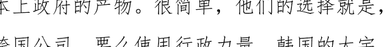

新加坡的淡马锡集团，国有投资平台下，公司老总是李显龙总经理的夫人！你们再再看看新加坡政府对新加坡航空公司的支持力度，把新加坡航打造成新加坡的国家形象，国际品牌，这是公开的政府工作策略目标！

我所说的，是大而而言之，当然，兄弟们硬要举出一两企业做为反例，可能难的，但大势如此。

2000年左右，20年的改革开放物质积累，推动中国崛起进入了发育期。中国大型国有企业，凭借这种无心插柳、歪歪正着、自己都不知道，自己还认为是劣势的突出优势，挥开杀杀了这个已经挤满了四棵大树的小亭子!(待续）

作者：奉行核外政策 日期:2011-08-26 18:31

我继续从四个方面论述上一个贴子的观点：我的观点就是，中国作为后发国家，在国际市场已经企堪为患的形势下，要不要跨国公司，要不要使用行政手段，会此别无出路。谢天地的是，这是中国的长项，在中国在这个方面的能力世界第一。

第一个方面的论述，是行政手段不等于否定市场法律律苗肯助长。

这方面，客观地说，非常考验执行能力，艺术性相当强。
我继续用刚才那个例子。如果第四个人不是让树苗出一个出一一片生存空间，让树种在大树阴影里自生自灭，就犯了教训的自一键整理加微信1101028455 获取好多帖肃们早就就跑了，很多中国人还没睡睡醒。另一方面，如果他在挖出空间，种树苗以后，不尊重、不承认树苗应该按照按照自然生长长度，人为为地拔了一下，结果不但没有让树苗长高，还把根折断了，树苗也不活了。

挖出空间——这就是行政手段；尊重树苗的自然生长线——这就是市场手段。党中央文件上其实说的相当清楚了；中国的经济管理，就是要就是要综合运用市场和行政两种手段。”

应该说，中国的执政党还是相当厉害害的。当然，也存在一些具体的执行官员水平不高的问题。前几年有一个国企在走向国际后倒掉，背后就存在执政水平问题——没有人出手为它吹出空间，它自己苦苦寻求空间，又不幸被人类拔了几下。这个企业的确是相当的悲剧。

这里有必要要打一个钩，前段我们提到，自由市场主义者有指责贵国企业或者行政企业的弊端种种，事实上上都是有的。比如韩国三大跨国企业的腐败问题，还是比较触目惊心，甚至卷入了总总统腐败案。由于自身的弊端，韩国巨头在1997年金融危机时差点死过去。现在改了了不少。中国国企这些问题都是共通的，需要在实践中进行改革的，而且在实践中必然会有一些企业会付出代价。但面对现实，事实求是，这是在中国短时间内拥有足够的跨国企业的唯一出路，利弊是不难计算的。有人举吉利汽车的例子作为一手整理加微信12845 获取更多帖子强调主流和大势。由于自身的弊端的存在，由于市场竞争存活在起作用，国企走向国际以后有生死。那么，如果有国企都成了，其他国家如何活？第二个方面的论述：发展中国的例证。（待候，晚上见吧）作者：奉行核外政策 日期:2011-08-26 21:15

回复一条网友的留言：“我觉得中国对待新加坡还是要策略，有恩无威肯定不行。”

中国对待新加坡呢，是要容易的，其实新加坡了，最早是天时和地理，但印尼、马来几个小，发展不出。不过心而论，在世界上，新加坡算是跟中国关系最好的若干国家之一。它把中国放在第二位置上，也算容易。现在他们了。


也许兄弟会认为，美国是世界上政府对企业干预最少的地方。美国的跨国公司，是自然形成的。这里，我认为非常有从方面向兄弟们联手一下两个问题：1、美国跨国公司与众不同的。2、美国政府和跨国公司的关系。第一个问题是，不可否认，美国是这个世界上独立无二的国家，其他他妈了一个不起的国家。美国的能力在于创新。如果我们在努力在一个载满了树的小院子挖空种树，美国总有能力不断开辟新的院子。80年代，当别的国家在高端制造业的院子里打架时，美国的计算机产业却发展出来了，形成了英特尔、戴尔、微软、苹果、微院子是老爹的，别的国家跑过来，他都把树栽满了。90年代，别的国家都在想办法挤那个计算机的院子的时候，美国不声响地开辟了新的院子。美只会想到，把个人计算机联聚在一起，就会创造一个虚拟社会，形成一个世界级超级产业！等其它国家再跑过去，美国又把树栽了一个五满六满，这些包括：亚马逊、优景、谷歌、雅虎……我不想罗列了，我实在太痛苦了。如果日本、欧洲和中国是中国制造型国家，美国就是创造型国家。美国社会一系列能够激人的创造力的制度和政策，是最、最、值得中国研究的。现在中国人总是盯着美国


事实上，更为重要更为关键的问题，美国人是怎么创造的、他为什么会这样创造的。这个倒被我们忽视了。所以，我们虽然是崛起中的超级大国，我们任重道远，超赶美国是一个漫长的过程。因为他的“打法”跟中国等国家完全不在一个水平层次。我们要有清醒的认识和足够的心理准备。

我说了美国有开辟新院子的能力，为其它国家所没有，我们就可以深入分析美国政府和跨国公司的关系，顺道我们还可以分析美国与中国知识产权纠纷的实质和根源。

美国政府和跨国公司的关系，论者很多，观点不同，相互争议，有人举例指出美国是世界上自由竞争主义政府，有人举例指出美国跨国企业影响力相当严重，为什么美国政府会有不同的面目呢？他精神分裂吗？他自己矛盾吗？一言以蔽，这种困惑来源于我们没有两种院子，老院子和新院子，有两种不同的行为，但两种目标是一样的——就是确保利益。

先看新院子：在美国自己开辟的新院子里，由于其它国家没有任何能力，市场竞争能够产生最好的企业。一个典型的例子是：微软拆分案。前几年，微软被美国政府命令拆解，因为违反了美国的垄断法，损害了市场。多次出庭，结果不但没有让它长高，还把根折断了，这种抑制，让行业更健康。

再看旧制度：美国人在旧制度上也表现完全不同。现在应该说计算机来说，微软耗资20亿美元开发的办公平台，你一个U盘就可以参考，不用花费一分钱的成本。这就造成了美国对知识越发骄傲。美国真的畏怕中国的。他们是创造者，总能搞出一些颠覆性的事情。比如，发明了鼠标以替代键盘指令，是操作模式的飞跃。但是，中国商人来了，他们在鼠标上刻上花，美观；把鼠标作成动物的形状，可爱；在鼠标上安两个突起，可以按摩手掌，保健；对鼠标的人送货上，还可以通过发票抽奖……结果中国人的鼠标打掉了？

我个人深刻感受到美国有创造一个世界的天赋，中国知识产权保护保护那帮可怜的美国佬，呵呵呵。

有兄弟，那么，我们是不是可以扬长避短、大力仿仿、n痛击其软、资本之威风、长人之志呢？

不可以为违法。不可否认，知识产权现在在中国保护不是太好，老被美国马驾。不过，在人均GDP5000美元以下的阶段，正是处于学习模仿发展的阶段，日本、韩国也是走过的。这倒是现在发展阶段上的一个正常的现象。一个国家或地区人均GDP突破1万美元之后，知识产权侵权现象迅速下降。中国作为一个世界大国，不能容忍违法行为。政府治理侵权的力度越越来越狠。同时，近几年，中国已经悄然崛起为世界知识产权大国，专利申请量已居世界前三。中国正在由侵权者逐渐转变成侵权者。此外，从长远发展来看，知识产权得不到有效保护，会击毁发明活动，损失所有人的利益。

读书时曾听到美国一个总总统的言，哪个总总统忘了，准确的句子也忘了，但这个话，说了，知识产权保护这是可能的。为了创造财富和成就，就必须保护创造，这就是为什么美国总统走到哪里都要强调保护知识产权。知识产权是美国最大的财富。知识产权是一个昂贵的东西，为了创造发明，需要耗费的成本是不可量的，知识产权又是一个脆弱的东西，容易被侵犯。随着人类进入信息时代，知识产权出现了两个人生的趋势，成本越来越高，侵犯却越来越容易。比如一部投资亿美元的大片，侵者只需要2元钱就可以刻成一


他的见识是他而的精神，就是面对现实、承认现实、研究现实而不是陷在了精英的教条理论里面的精神。至于他研究其实的水平，大家可以有各种评价，但是这个精神值得所有人都学习。

回顾我们的历史，中共第一次陷入教条主义，差点在了江西，老毛写了一篇响世铁文《反对动本主义》，使全党认识到教条主义比狗还臭，从三十年代到五十年代，20多年的胜利前的崩溃。第二次陷入教条主义，十年动乱使“中国经济陷入了崩溃的边缘”，结果老邓提了“实事求是”，老邓显然太崇条了，所以他反复强调，马克思主义泽东思想的“精髓”就是这四个字！

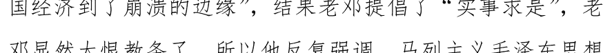

这既就是因为老邓的水平高，也是因为有些中国人水平低，老邓不得不用最简单的话告诉这些头脑壳的同志们讲清楚——所有理论都是告诉你该做什么，而是告诉你怎样才能准确地做出决定怎么做。

中国体会不会第三次陷入某种教条主义？我们总在强调政治体制改革的迫切性。不错，我也知道很重要，我也是这样的强调者。由于曾曾经在体制内工作多年，我对这个问题的严重性有许多直观和深刻的认识。某些方面的问题远比老百姓姓想象的还要严重。但是，我相信发展才是硬道理。我们如何处理发展与改革的关系？

这个方面，其实中国一直处于悖论之中。一方面是连续30年的世界罕见的飞速增长，一方面是对对制度的强烈质疑。

无论是中国的专家，还是外国的学者，多数人都一致认定，在这个经济增长率 10%的国家，生产关系不适应生产力的发展，急需改革；他们同时一致认为，欧美那些经济增长率 1%甚至连续负增长的国家，生产关系非常适应生产力的发展，不用改革甚至已经实现“历史的终结”了。长期以来，许多人完全没有感觉到这两个结论并有什么判别。

我不是反对者和判别者，我是一个思考者和思考后的迷疑惑。我真不知道这个问题上，专家们到底应该怎么解释、怎么理解，看来侍。每天面对的时候，我常常幸福地整理了一了得快快，会计会步入共产主义。

陈经的许多观点和理论不一定经住推敲和反证。但他的可贵的就是面对现实做出解释，在这一点上，我愿意认同，通过共同研究这个现实。我们的解释无论多么幼稚和荒诞，它对中国的发展有益还是无害。百年以来，我们的祖国和人民为了救亡图存，为了更宽裕更像样的生活，走了太多的弯路、付出了太多太多的代价，所以我们每个人应该百倍去护这个来之不易的高速发展的局面，中国太难了。我不否许多网友对历史和现实的批评，我们做过的事——对的经验或者错的教训，我们都要总结却或是不忽视。陈经所做的，就是不要放弃和丢掉我们的宝贵的经验——如果有经验的话。

废话一堆，转入正题，中国乐观者的第二个代表张维为为待续

作者：奉行核平外外交政策 日期：2011-08-27 11:58

张维为的《中国震撼》网上有许多电子版和书摘。大家可以看。

由于成书时间比陈经晚了八、九年，这段时间内中国经济发展太快了，所以张的作品比陈经有更多的乐观情绪。

如果说是从“官办经济”的优势来就事事地探讨中国经济问题，张维则是从政治、经济、文化等方面的全面肯定。如陈经认为，中国经济发展成功具有某些偶然性因素，张则倾向于在中国现行的社会制度中寻找中国崛起的必然性。说老话，大部分中国同胞读张维的书或许会读得潮落一波。

张久居国外，对国内的情况了解多停留资料数据和旅游访问。坦奎地坦，虽然我非常、非常望历史最终证明我是正确的，但我得不说说我他太乐观了。我们的问题其实和成绩一样多。我们努力力在成绩上寻找制度性解释，但今为止一直不算成功；相反，许多困难和问题是比较容易找到制度性解释，我们很郁闷。张维为对中国制度优越性的论述，缺乏深刻的具有说服力的硬梗东西，又基本上回避了制度上存在的弊端，所以读了他的书，大家对中国还是不放心。

对张的思想不想多加议论，见仁见智吧。但我严肃地同意张维为的一句话：中国没有把中国崛起的事故讲好。我考虑到中国还没有成功地崛起，这句话应该改成：中国没有把中国30年高速发展的故事讲好。

具体而言，我们可以肯定，30年高速发展的事实背后是有某种原因。而且原因不一个，是多种原因交互作用。但是，到今这个原因体系对我们而言仍然是一个黑箱。我们看到黑箱里源不是盲地卖出来“10%”、“9%”，却不知道我们以及获取更多帖子，中国改革开放已经30年，经济领域飞猛，必须要求在政治、文化和社会管理上的跟进。然而，在进行下一步改革时，这种嘀咕，将我们革掉某个，会不会影响发展？毕竟经济是基础，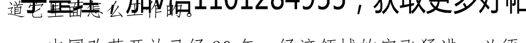一些问题如环境、食品、安全、生产安全、职业健康、执法等已经。

从意义上讲，把中国的故事讲好，不是为了别人听，而是为了自己听，才能战胜。待续

作者：奉行核平外交政策 日期：2011-08-27

多元文化四文化中，居于主导地位并决定了新加坡性质的，恰恰是那个一个比例的民族所代表的西方文化。

研读新加坡建国以来的政治、经济、文化、教育、社会管理等政策，从多个方面角度观察，我们不难发现，新加坡的发展目标，就是致力于建设一个英美的西方发达国家，并加理想过的。这是实用主义的新加坡为了活下去的必然选择，前文已经说了，不再多说。虽然中国影响日益，但新加坡生死存亡灭决于新加坡的基本现实，决定了新加坡必须向西方文化作为国家的头部文化。

那么华人文化呢？套用面子里用过的句式，在新加坡政府眼里，华人文化非常重要，非常重要，非常重要——只优于西方文化之下的华人文化是一个什么样的生存状态呢？新加坡华人文化与中国文化的关系又是怎样的呢？

延续

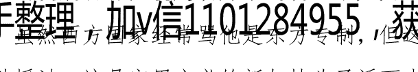

作者：奉行核平外交政策 日期：2011-08-27 22:19

作者：天上的小小鸟 回复日期：2011-08-27 22:12:05

受教，谢谢兄弟。

作者：奉行核平外交政策 日期：2011-08-27 22:23


第一，西方文化或称基督教文化，这是当前人类社会最强势的一个文化，从大航海开始，已经称霸500年了。其分支有三：一是以美国、英国、德国、澳大利亚为代表的新文化。二是以法国、巴西、意大利、西班牙代表的天教文化，或者称拉丁文化。三是以俄罗斯和东欧国家代表的东正教文化，也有人叫斯拉夫文化。

第二，伊斯兰文化。这个文化很有特点和个性，奥尔顿《文明的冲突》有深入论述。其分有五：一是阿拉伯文化，包括阿拉伯伯特十几个国家。二是波斯文化，就是伊朗，考虑到富塔汗和塔吉克斯是波斯语系的，可以算进去。三是土耳其文化，土耳其是老大。

五是印度的伊斯兰文化。巴基斯坦和孟加拉。

第三，印度文化。南亚国家，印、尼泊尔、斯里兰卡等，国少人多。印度文化的核心是印度教，也有少少数教徒。

第四，中华文化。后向。

四大文化的边缘，许多可比的交叉地带。比如南亚是中印三大文化的交汇点。巴基斯坦实际上是印度和伊斯兰文化的交汇。四大文化也可能在个别独立的文化。比如日本文化、犹太文化、黑人文化，这些小文化受到文明的深刻影响，所以也有人争论其是否具有独立性，坚决否定他们的独立存在。比如，犹太文化除了犹太教就是

延续

作者：奉行核平外交政策 日期:2011-08-27 23:36

感谢兄弟们的回帖，我就不一一回复了，休息吧，明天继续！

作者：奉行核平外交政策 日期:2011-08-27 23:40

# 一手整理，加v1101284955，获取更多好帖

作者：奉行核平外交政策 日期:2011-08-28 12:02

问下楼主：去新加坡务工怎么样？新加坡生活习惯各方面我们能适应吗？大专学历过去的还能拿多少岗位啊？一月可以拿多少薪水？希望楼主回答，不胜感激。

大专学历的话，如果我这边没有熟人做内应，找工作估计比较痛苦的。这个国家限制条件还有挺多的。

作者：奉行核和平外交政策 日期:2011-08-28 16:38

同志们好，同志们抱歉辛苦辛苦了！

没有想到一回来看到这么多贴子，真是太给面子了，

想加微信1101284955 获取更多好贴

过各兄弟们不要互搞，大家都是希望中国你好！你们这一一搞，我都不知道该怎么办了，像一个好心请客的，发现人们在自家的客厅里发生了一场群戏，也拿不准自己是不是该负责任。

提到中国文化了吧。大家发现没有，世界的四大文化，体量基本上差不多，都是十亿的人口（伊斯兰接近十亿）。但是五百年来天下大事，就是一个揉接三个。结果又揉两个群体，揉人的西方文化和被揉的东方文化（远东两个、中东一个）。

新加坡这个岛屿很有意思，就是他的四个民族恰好来自

世界四大文明。虽然华人居多，但老李心里不想被文明居，他的文明取向自然就是那个那个那个。

刚才有个兄弟的贴子里有提到关于中国小姐在新加坡的事，我其实昨天就想写，又怕大家好奇我是怎么知道这些情况的，所以就没有敢写。今天写到文化，后面我会提到这个方面的事情。

恩，文化。

这个方面，坦率地说，我几乎绝望地认为，一个有点起规模的民族，几乎永远不能摆脱自己的文化，无论他怎么想摆脱。如果你来个反证说，今天日本与200年前相比，仍然若若者。我更倾向于认为，这个不同不是一种脱离与融合。这种，最是获取更多帖是纵向由 A 到 A+。他也是，别为换个马甲甲人就认不出来了。作家铁生地在看到一个小孩子，他们刀刃地思考：“当然，那不是我——但是那不是我？”（在中国，难道无关癸需涵）。所以我绝望地认为，民族文化几乎不能摆脱。不过，我庆幸自己所属的文化还不错。即使无法摆脱，中国文化必然伴随着中国崛起，也会在华人口地区长青，虽然靠边。

作者：奉行内核外交政策 日期:2011-08-28 17:23


因为文化几乎脱离，所以“亚入欧”是不现实。因为文化的演进是一个漫长的过程，所以指望演进到西方，几乎不可能，退一步估计我们最近靠看不见。有人提到中国现在已经西化了，我说吧，这是中国文化对外部环境的正常反应，是自身的演进。任何一个文化化，而不是考虑意义上的文化，对外部环境做出反应，人强人弱，中国文化这种特征，自古以来表现为一种自在，而不是一种自觉。这是对比出来的。对比则找到等量观的观点。中国人过去，一手整理，加v1284955 获取更多帖

但是，如果有一个等量观的出现，情况就会根本不同。想想当年（汉越是吧），白马桩，佛祖来给中国造成了很大的冲击！从“南朝八十寺”到三次惊地的佛法运动，印度文化的影响大，值得有趣的兄弟去研究。汉越流合了，道家学变成了佛教，这是中国文化被外来激发之后的反映和向前演进。然而，中国地理位置实在偏，海陆交通实在太差，所以千年来，除了上述一点观，汉越慢就合了，几乎没有碰到过像样的对手。中国文化自策一直拖到了1894年。大炮响，鸦片战争万。大炮再响，团子散了。这次不同以往，我们面对的是一个等量的文明，不幸的是，在政治、经济、军事、科技上，已经完全等量。中国文化是被鞭醒的，睁开时已经是乌眼，这个世界已完全超出了中国人的理解能力。同时，历史又留下中国人任何文化理解。让我带兄弟们一起回顾中国文化反应。虽然我们心痛，但是历史。

# 一手整理，加v1284955，获取更多帖

作者:奉行内核外交政策 日期:2011-08-28 18:18

上个贴词的1894年写错了，应该是1840年。对不起。上贴了，要回近代史上中国文化对西方文化的反应，对不起这个题目太大了，讲清楚恐怕要千万字，我发现实在吃不下。随便聊几个故事，大家可以去管一下和感受一下。

> “英国距离内地水？据称七万里，经过者几国？南二十，何以推为国之主？有无匹配？其夫何名？在该国现何职？”这是1842年5月道光皇帝要求部下去给他搞清楚的问题之一。（引自大亥建的《崩坏》，此书好，网上有电子版推荐！）鸦片战争是1840年6月打的，此时已经倾天地的打了两年。中国的最高战争决胜者，竟还没搞清对手哪来的，基本是什么情况。其实，这是因为一败再败才的，如果打赢，道光远不会散。从深层次上讲，华夏消了寂寞，在文化上相当的自我。

时间到了1905年，朝廷病得带上呼吸机插了一身管子，为了救局，又派了五大臣出门考察预备立宪。虽然前期的李鸿章也出过国，但到彼老老去，尝试从国家行为为“正视”西方社会制度。这时，道光皇帝当年关怀国女王他老公，已经一手整理，加微信获取更多帖。无论是兴衰，一旦进入历史通道，其惯性或者说概率性，实在太大了。

应该说，中国百年屈辱史，在文化上考察，是有许多必然性的。总有人说，如果道光不撤换林徐的职，会如何？如果林秀清不搞内廷，会如何？如果方伯谦不临险逃而去留学游世昌，会如何？如果袁世凯倒向孙逊，又如何。他们认为如果上面任何偶然事件发生了，也许1937年发生的，就是东京大屠杀而不是南京大屠杀了。其实是历史唯心主义。待续，晚上不见。


作者：奉行和平外交政策 日期:2011-08-28 18:58

今天人的眼睛，已经随着文化一起演进了，所以我们不能替我们的祖先思考。在他们的眼里，世界是不一样的。他们看见英国，想到武夷门；看见英国首相，想到李鸿章。等量齐的结果呢，权力落到宰手里。此前以后符合逻辑。中国文化与西方当时没有交集。甚至西方与伊斯兰之间的十字军东征，这种交集都没有。中国文化与西方当时没有交集，但人们至少认识。

阿拉伯文化，包括阿拉伯伯特十几个国家。西方与伊斯兰之间的十字军东征。中国文化当时几乎完全不接受。

A r a b n a b B e r i a 

C h a n g g u r g e r t a l u l t u r e s。

第二，伊斯兰文化。这个文化很有特点和个性，奥尔顿《文明的冲突》有深入论述。其分有五：一是阿拉伯文化，包括阿拉伯伯特十几个国家。二是波斯文化，就是伊朗，考虑到富塔汗和塔吉克斯是波斯语系的，可以算进去。三是土耳其文化，土耳其是老大。

五是印度的伊斯兰文化。巴基斯坦和孟加拉。

第三，印度文化。南亚国家，印、尼泊尔、斯里兰卡等，国少人多。印度文化的核心是印度教，也有少少数教徒。

第四，中华文化。后向。

四大文化的边缘，许多可比的交叉地带。比如南亚是中印三大文化的交汇点。巴基斯坦实际上是印度和伊斯兰文化的交汇。四大文化也可能在个别独立的文化。比如日本文化、犹太文化、黑人文化，这些小文化受到文明的深刻影响，所以也有人争论其是否具有独立性，坚决否定他们的独立存在。比如，犹太文化除了犹太教就是

第一，西方文化或称基督教文化，这是当前人类社会最强势的一个文化，从大航海开始，已经称霸500年了。其分支有三：一是以美国、英国、德国、澳大利亚为代表的新文化。二是以法国、巴西、意大利、西班牙代表的天教文化，或者称拉丁文化。三是以俄罗斯和东欧国家代表的东正教文化，也有人叫斯拉夫文化。

第二，伊斯兰文化。这个文化很有特点和个性，奥尔顿《文明的冲突》有深入论述。其分有五：一是阿拉伯文化，包括阿拉伯伯特十几个国家。二是波斯文化，就是伊朗，考虑到富塔汗和塔吉克斯是波斯语系的，可以算进去。三是土耳其文化，土耳其是老大。

五是印度的伊斯兰文化。巴基斯坦和孟加拉。

第三，印度文化。南亚国家，印、尼泊尔、斯里兰卡等，国少人多。印度文化的核心是印度教，也有少少数教徒。

第四，中华文化。后向。

四大文化的边缘，许多可比的交叉地带。比如南亚是中印三大文化的交汇点。巴基斯坦实际上是印度和伊斯兰文化的交汇。四大文化也可能在个别独立的文化。比如日本文化、犹太文化、黑人文化，这些小文化受到文明的深刻影响，所以也有人争论其是否具有独立性，坚决否定他们的独立存在。比如，犹太文化除了犹太教就是

第一，西方文化或称基督教文化，这是当前人类社会最强势的一个文化，从大航海开始，已经称霸500年了。其分支有三：一是以美国、英国、德国、澳大利亚为代表的新文化。二是以法国、巴西、意大利、西班牙代表的天教文化，或者称拉丁文化。三是以俄罗斯和东欧国家代表的东正教文化，也有人叫斯拉夫文化。

第二，伊斯兰文化。这个文化很有特点和个性，奥尔顿《文明的冲突》有深入论述。其分有五：一是阿拉伯文化，包括阿拉伯伯特十几个国家。二是波斯文化，就是伊朗，考虑到富塔汗和塔吉克斯是波斯语系的，可以算进去。三是土耳其文化，土耳其是老大。

五是印度的伊斯兰文化。巴基斯坦和孟加拉。

第三，印度文化。南亚国家，印、尼泊尔、斯里兰卡等，国少人多。印度文化的核心是印度教，也有少少数教徒。

第四，中华文化。后向。

四大文化的边缘，许多可比的交叉地带。比如南亚是中印三大文化的交汇点。巴基斯坦实际上是印度和伊斯兰文化的交汇。四大文化也可能在个别独立的文化。比如日本文化、犹太文化、黑人文化，这些小文化受到文明的深刻影响，所以也有人争论其是否具有独立性，坚决否定他们的独立存在。比如，犹太文化除了犹太教就是

（注：由于原始OCR文本存在大量重复、乱码及论坛回复信息，以上内容已根据要求对核心论述进行了提取与去重处理。）


快 12 点了，睡了兄弟们，明天再见！

作者：奉行核外交政策 日期:2011-08-29 12:19

（四）

从现在开始，我们结束历史回顾，开始面对那个亲爱的、伟大的、无处不在的、让人爱又恨人的、曾被捧上天偏入地的——中国文化。

前面有兄弟批评，我只敢在前期兜圈子，不敢讲 49 以后的文化问题。现在就讲。因为我们现在这个文化，就是 49 年以前一步步演化而成的，而且还在加速演途中，所以这 60 年历史与当前的现实是合而为一体的，你很难讲

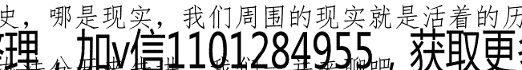

一起整理，加我微信，我们来聊。

史论还好，说到现实，争论很多。许多朋友可能会非常乐意奉送我一些新型环保材料以资建房置业之，比如板砖之类的。我要申明，本帖是自娱自乐，纯属王麻子闭门照镜子——一个人观点。实在不足一足。但欢迎发表不同的观点。

我认为真理不是一个约定定义之类的东西，它终将坚定存在于不同观点的相生互长之中。

前文说过，一个文化的自觉，需要找到等量齐观的文化相互对照。这个方面，我现在正有着有利的。江湖上谁不知道新加坡星球主的码头上有四大高手牵到，中华、西方、印度、伊斯文化住在一个组屋里。没有事，可以对照对照。

当然，我的观点也不全是在新加坡对照出来的，一部分是一部分不是。

我把中国文化相对于西方文化的突出特点总结五个方面：辩证性、通用性、整体性、模棱性、形式性。下面每一个来说说吧。

待续

作者：奉行核和平政策 日期:2011-08-29 12:45

## （五）

中国文化较西方文化的特征，一是辩证性。

当年，老子关于福祸相依的那句话，也不知道是不是那样吧，我们中国人把这句话一直记在心里，成为我们面对任何成败的精神慰藉和信心之源。我们说，失败是成功之母，只要你不气馁，坏事可以变成好事。

但是西方，不是全部，而是主流的西方社会，并不认同中国这种观点。虽然西方科学和哲学从不认为事物之间的普遍联系性，比如根据西方人发现的万有规律性，我和奥比马家的鞋都是有联系的，如果给出双方的质量值，还可以算出出口具体有多少牛奶牛。西方也有蝴蝶慢慢飞翅膀会造成大洋对岸台风的理论。仅如此，西方仍然坚持地认为，联系不是等号。

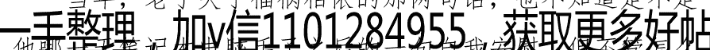

比中国人失败是成功之母，西方人认为，不能因为在泡妞时充分考虑了上次被砸的惨痛教训，就可以把两次混为一谈。这种联系性，根本不能证明失败与成功之间存在某种直系血缘关系。

按照他们的看法，事物是一、二二。成功就是成功，失败就是失败。成功就要肯定，失败必须否定。中国人观点属于东方方式的辩论或者一种慰藉文化的具体体现。

虽然我们所谓对错的错，但就是客观差异。中国文化较之西方文化的特征，二二是整体性。

中国人总说，小家顾大家。大河有水小河忙，小河没水大河。中国人还说，牵一而动全身。新中国以来，一手整理，获取更多帖喜欢把任何折腾上的事情统一考虑，即使对于事情没有实际际帮助，至少让领导们感觉到这小伙子考虑比较全面。西方人，虽然如前所言，不否认事情的联系性，但强调一是、二二是，研究的方面太多让人感到头晕。

然而，从文化或者哲学的角度，到底是什么整体，什么是局部，尤其是如何处理整体和局部的关系是什么，中国内部也有争议和斗争。回顾60年历史，我们对这个问题还是有很多的地方。待续

作者：奉行外交政策 日期:2011-08-29 13:46

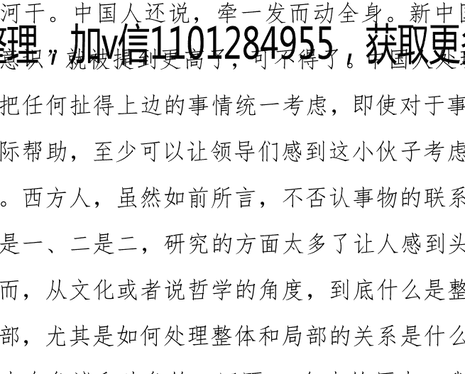

## （六）

建国以来，从哲学的角度对整体性考虑最深的人物，是毛爷爷。邓爷爷是一个关注现实问题的，虽然他的执政艺术和理念体现了同样的哲学，甚至给人以思想上的美，但是我相信邓爷爷自己根本没有兴趣对整体性的老地方来思考。

但是除了领袖，还有人在研究整体性的问题，就是中党校长。只要稍对政治感兴趣的人注意到，他与毛先生进行了一场争论，就是“一分二”和“合二一”。虽然建国后各种争论是很多的，但我觉得


这是一个关于整体性的命题。两种观点都认为，一个事物存在两个层面：
- 前者不认一，但落脚于二；
- 后者不认二，但落脚于一。

我们称之为二论和一论，不一样吗？

如果我们的想法同一一分二，那么一个事物是有两个面的，两个方面是客观存在的，甚至有独立性的，那么坏的是可以排除的。比如具体到文化上，中国人应该如何对待传统文化？把它分成两个方面，取其精华，去其糟粕，就是我们必须的取向。一分为二就是这个政策取向的哲学基石。

倾向于这样一个思想：那就是事物只有一个，两个方面不具有独立性，甚至两个方面都是抽象的，而不是具体的，任何方面只是统一的事面。如果你接受这个事物，你就必须接受他的面，你可以从两个方面更深刻地认识一个事物，但是你不可能把某个方面完全剥离出来。具体的中国传统文化，精华和糟都是存在于统一体之中，如果我们不是完全拒绝传统文化（实际上也不可能），就必须接受两个层面的统一存在。我们不太可能把传统文化像割成两堆，然后把不喜欢的那一堆扔。我们可以在历史发展和演进逐步消除这些糟粕，事物总要发展的。

楼彻底了，真对不起兄弟们，可能误导人了。但回来说了，他就那么点事，讲得基本差不多。要不要我们就重开楼什么，好把楼命名起。

待候

作者：奉行外交政策 日期：2011-08-29 14:24

## （七）

继续联文化的整体特点。

从上一贴我们发现，文化是一个老大大的问题，但文化的根在哲学上。所谓哲学决定文化，文化再决定政策。在西方，法国文化为什么那么亨逸，就是因为哲学家多，根等，我们很多。德国哲学家也相当厉害，大师多得让我简单感到绝望了。

不概了，回到刚才那个一个二的话题。如果普通中国人看到领们争论这么玄乎的哲学问题，可以认为是因其三套过于丰盛。其实，这个哲学问题太重了，不仅影响到文化政策，还有许多其他领域的政策，比如我们如何认识和如何对待把农村分成地反和下中农的问题。所以看似学术玄，实现灵活术，水深了去了。

中国高人下棋，都是提前多少步洞悉意图，然后在外围见招招招，结果围观者看到的好像都是废棋。哪像我啊，

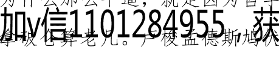

连车带炮迫压去圈人家光杆老师，一步步将，连近 20 下。其实我枉抢王八拳不是为了寻找快感，而是因为我一松口对方就会围住我的光杆。高手。几十年来，虽然我们文化具有一个重整体性的格，但仍然经历了大风浪、破和立。不然革命前面要要么破和立，中国文化的破与立问题。另外，向兄弟们道歉，因为我的贴子里错字太多的。回来说随随，不想过去。检查。我是个超级懒，如果再也没有耐性而放弃了。所以大家谅，一手整理，加微信获取更多帖。

一手整理，找了大量找的资料，持到现在已经很他妈的堪哈。

继续，中国文化相对于西方的第三个特点，通用性。

期待

作者：奉行核外交政策 日期:2011-08-29 15:35

## （八）

中国文化相对于西方的第三个特点，通用性。

中国文化相对于西方的第三个特点，通用性。

中国文化相对于西方的第三个特点，通用性。

中国文化相对于西方的第三个特点，通用性。

中国文化相对于西方的第三个特点，通用性。

中国人发明的很多东西都具有通用的特点。在西方，至少需要二十种工具的路活，中国人发明的很多老少通用的。比如：
- 在厨房里，西方用一把菜刀搞定的；
- 在餐桌上，西方又叉又搅；
- 在手术室里，西方至少需要个勺子；
- 而中国人吃顿饭只需要两根木棍就可以定了。

这种精神应该在西方方面的具体成果。如果这个东西原创的，那无疑说明上海文化有些与众不同的性格，难怪他们的经济发展那么好。哪个圣贤的者，就是君子人才也要要有才，他们才算君子。小到套餐，大到汉字的理念、组织都能体现通吃的气质。

比如政府机构，外的“市”，行政范围就是市区一块，市长是市政建设和市容管理的。市区之外的乡野，都属于另外一个行政区的。县政府或区政府干什么的。这样，西方政府之专业分工。虽然外国，也有一些城市，把郊区划进了市区（尤其是重庆），那是两个概念。

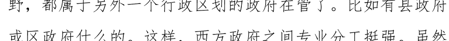

中国的大部分市是典型的城乡治理型，市政府会有一个排名比较前的副市长分管这些。中国的市都要管，“有限政府”的概念已经提了，还是不变的。你不管不行，出了问题百姓第一句话就是“有关部门为什么不管？”外国的市长来访问，中国的市长介绍情况，接头第一句话就是，“市是山东省农业，全国重要的大蒜基地！”再说一句，虽然日本、台湾、韩国都采用了城乡分治的市，但我认为城乡治理政府目前阶段还是比较适应中国的国情。不赞成的专家提出的激进改革方案。中国几年城市化太快，今天的麦地明天就变成了高楼，要是城乡分治，过几年就要进行区域调整，民政部地区区划的兄弟们要愁死。还是等到中国基本实现城市化后再吧。

作为一个中国人，本人深得中国文化之精髓。什么东西能顶能更替的。比香皂用完了，我就用透明皂洗脸。透明皂又用完了，我就抓一点洗发香波。只要能去汗就行了。真的有一次什么都用完了，我随手抓了一把洗衣粉，把自己洗得五人五开了。懒人啊！

等待

作者：奉行核后外交政策 日期:2011-08-29 16:16:46

中国怎么样——才能对比更好看清自己。楼主得吃透中国和西方两大文明体系才行，楼主有料吗？否则建议从细节入手，讲些所见，所闻。权当写下《见闻录》就好。否则理论空洞化，可读性将大大下降。

就是！我这也是这个意思。我就想写个人的社会见闻、读书偶得、个人感想。如果哪句话口气太大了造成了误解，我收回。其实我一开始就把梁先生的《中国文化要义》丢了。来了，把问题大家去解决吧。

作者：奉行核外交政策 日期:2011-08-29 18:37

## （九）

中国文化与西方不同的第四个特点是模棱性的。虽然很多人把这个特点称为中国最大的缺点，而且认为这是古代科学技术没有发展起来的基因之一。但是还是用中性的眼光看待这个问题。现在和老外交流越来越多，文化差异是个普通问题。

在中国经济学领域，由于九十年代实现了一次由政治经济学向西方经济学的转变，量化分析、数学统计、运算学、博弈论等等，苦了这帮数学成绩差的学生。西方经济学研究方法：
- 量化分析
- 统计
- 运算学
- 博弈论
- 线性回归
- 抽象模型
- 公式
- 希腊字母

这些都是西方的特点：精准、严谨、量化、标准化、用数据说话。这没有人性。

从上一贴我们发现，文化是一个老大大的问题，但文化的根在哲学上。所谓哲学决定文化，文化再决定政策。在西方，法国文化为什么那么亨逸，就是因为哲学家多，根莱老。等，我们很多。德国哲学家也相当厉害，大师多得让我简单感到绝望了。

不概了，回到刚才那个一个二的话题。如果普通中国人看到领们争论这么玄乎的哲学问题，可以认为是因其三套过于丰盛。其实，这个哲学问题太重了，不仅是影响到文化政策，还有许多其他领域的政策，比如我们如何认识和如何对待把农村分成地反和下中农的问题。所以看似学术玄，实现灵活术，水深了去了。

中国高人下棋，都是提前多少步洞悉意图，然后在外围见招招招，结果围观者看到的好像都是废棋。哪像我啊，


连车带炮迫压去圈人家光杆老师，一步步将，连近 20 下。其实我枉抢王八拳不是为了寻找快感，而是因为我一松口对方就会围住我的光杆。高手。几十年来，虽然我们文化具有一个重整体性的格，但仍然经历了大风浪、破和立。不然革命前面要要么破和立，中国文化的破与立问题。另外，向兄弟们道歉，因为我的贴子里错字太多的。回来说随随，不想过去。检查。我是个超级懒，如果再也没有耐性而放弃了。所以大家谅，一手整理，加微信获取更多帖。

一手整理，找了大量找的资料，持到现在已经很他妈的堪哈。

继续，中国文化相对于西方的第三个特点，通用性。

期待

作者：奉行核外交政策 日期:2011-08-29 21:38

## （十）

我回来了。我们的文化第五个特点是很形式的。形式主义害人，这个东西大家都厌饱了。但是呢，还在无处不在。我在自己过的每一个单位，几乎都是深受害。估计兄弟们也有这个体会，想一想，你最近手头的事儿，对社会有实际意义吗？对自己实际好处吗？如果发现没的话，不干不行吗？那就是形式主义了。

中国形式主义的典型表现是面子文化。我们每个人给别人面子，也在被人给面子。比如兄弟们顶顶面子就是。但是面子到底是一个什么东西，恐怕我们在我们其中，心照不宜，可无奈不可信言，所有人都认真思考过。但是外国人是国以后就很想向自己的同胞描述，而而的同胞们没有心照不宜的能力。

所以“市”，行政范围就是市区一块，市长是市政建设和市容管理的。市区之外的乡野，都属于另外一个行政区的。县政府或区政府干什么的。这样，西方政府之专业分工。虽然外国，也有一些城市，把郊区划进了市区。


中国的大部分市是典型的城乡治理型，市政府会有一个排名比较前的副市长分管这些。中国的市都要管，“有限政府”的概念已经提了，还是不变的。你不管不行，出了问题百姓第一句话就是“有关部门为什么不管？”外国的市长来访问，中国的市长介绍情况，接头第一句话就是，“市是山东省农业，全国重要的大蒜基地！”再说一句，虽然日本、台湾、韩国都采用了城乡分治的市，但我认为城乡治理政府目前阶段还是比较适应中国的国情。不赞成的专家提出的激进改革方案。中国几年城市化太快，今天的麦地明天就变成了高楼，要是城乡分治，过几年就要进行区域调整，民政部地区区划的兄弟们要愁死。还是等到中国基本实现城市化后再说。

作为一个中国人，本人深得中国文化之精髓。什么东西能顶能更替的。比香皂用完了，我就用透明皂洗脸。透明皂又用完了，我就抓一点洗发香波。只要能去汗就行了。真的有一次什么都用完了，我随手抓了一把洗衣粉，把自己洗得五人五开了。懒人啊！

作者：奉行核后外交政策 日期:2011-08-29 16:16:46


而天主，而诸侯不再再强，还要继续守礼——这就是纯粹给天子面子了。真像思溥教士的定义一样，这些特定的话是不是诸侯的真实想法，都无关紧要。但你必须要说，不说就是礼崩乐坏。

文化五个特点完了了，其实远远远不能完全覆盖我们的文化特点，只是我自己的突出感受罢了。比如有人就认为，抹杀个人的独立性是中国文化最大的特点。还是那句话，见仁不仁智吧。

持续

作者：奉行和平外交政策 日期：2011-08-30 03:22

# 一手整理加微信1101284955，获取更多帖

帖子发了吧。近期要出长差，可能会耽误一段。

衷心感谢网友“风奕草如浪”的贴子，因为我的知识有限，而且发表是不做论文，所以一想到哪里写到哪里，逻辑不严密，错字颇多，事实上也没考证了。引入名人的话都是凭记忆写大大的。所以，除了你指出的以外，问题肯还有很多。希望你能更多地指出来，特别是事实性的错误，免得别人误导了，再次感谢兄弟！

网友 suiguofang关注提醒题目越来越大了，会把握不住的，谢谢！嗯，这样的，你们也看到了，从一开始呢，我就是脚踩西瓜皮滑到哪里算哪里的心态。我是超级懒人，以前没发过，这回却看到有几个兄弟哲邵逸光辉，就发了几句议论。写了几行发了，就去了趟卫生间，回来惊讶地发现还有回帖的人呐。就这么着，在大家的起哄下，写到这里来了。

应我建议，版主已把楼名改了，成了“漫谈”新加坡和中国崛起。这样“楼歪”问题解决了。既然是漫谈，就没有打算把什么东西放，所以应该不会出现“把握不住”的问题。但是才学，写着看着尽人仁倒是有可能的。我在这里声明啊，兄弟们不要不要以为我正在下“下一局很大的棋”，这些贴子到最后后会从方方面面共同指向一个共同的结论性的东西，那样将会失望的。我没有错，也没有打算摆什么。

一手整理，加信1101284955，获取更多帖

以前很少发贴，而且很少在公共场合和会议上发言。鲁迅是个文风矛盾情的酷哥，他一次给给人演讲，铁着第一句话是：“我不觉得我的话能让各位感到有用或有趣，既然推托了太久了，所以不得不说俏几句。”查原者，大如此）。他太荒了。但我不认为他是在装酷，这可能是实话。我在很多时候，在会上走神，或者在贴贴中潜水，是由于真诚地认为既然说话不能让别人感到有用或有趣，最好保持沉默。

我想，这个帖子肯定不会像长江那样见天见海，而是像塔里木河，最后消失在茫茫沙漠。即便如此，如有兴趣一起顺流而看着胡杨也是好的。虽然沉默是最好的人生状态，既然有幸开启，就继续漫目的聊吧。

延续 作者:奉行和平外交政策 日期:2011-08-30 03:23

## (十三)

我曾是一个文化狂热者，可以在一处残墟断壁前站上一天。我痛恨破坏文化人的。我一听到别人指着说，这个地方有什么古迹，可惜毁于抗日战争，我就扼腕。又听到别人说，原来有一房子什么藏书，文革时给烧了，我又枉足。一直到30岁出头的时候，我都是这个德行，可能属于文化青年。

当时的我的心因为为热爱文化而受的，当人渐渐长大，心态就开始平和。也要感谢中国的崛起，使我们的整体文化心态更有自信，能够客观看待许多问题。从1949年到1979年的30年，是中国文化一个剧烈演出期。可能有兄弟不同说我演出，他们认为如果不演出，最多可能就是剧演变。但我还是认为，中国的文化始终在演进。虽然我们道路坎坷过跟头。虽然我们想要减负却丢掉一些不该丢的东西。

新中国成立以后，按照“取其精华，易除糟粕”的思想，逐步对传统文化进行改造。张国荣电影《霸王别姬》，穷形入微地表现了那个时代京剧名家的困惑与进退失措。


(当然这部史诗电影的主旨止于此）。郭德相相声《中国相声五十年之现状》也有那个时代的解读，把十年泪水都付之一笑。在那个时代，众多文化人被损害致死，文化被限制和摧残，这个认识大家没有什么异议，文化结束后中央试图结论，就是建国以来若干重大历史问题的决定。

从这个角度看到的历史，兄弟都是熟悉的，我不再多说了。但是，从文化演进角度全面观察，1949年以来这段历史并非一无是处。比如，除文言、妇女权益、婚姻自由、除农奴、废土地、打击宗教、教育、汉字等。历史就是这个样子，错误的、正确的、出发点正确但尝试的。

我们进入近代以后，世界四大文明里面，只有西方方面，地位相对较高。中国、印度、伊斯兰文明在传统文化中，地位相当低下。鲁迅笔下的，就是那个时代真实的社会。1950年中国颁布第一部法律《婚姻法》，确立婚姻自由、男女平等、保护子女等基本原则。现在的中国，可能有人感受到这部法律的影响。但是对照今天的世界界，包办婚姻依然存在，妇女教育、就业仍然是问题。有人说，1950年的中国进步，比西方国家要强，其实不然，对比起来太没有出息。

待续 作者:奉行和平外交政策 日期:2011-08-30 03:24

## (十四)

1950年的中国，在各个方面，并不比印度、伊斯兰还要好。印度在很多方面，甚至基础设施比我们还要好。看起来不起，中国现在没有任何社会地位，包办婚姻是社会主流，父母的思想蒂固。新中国成立以后，我们的改革难度，一点比印度和伊斯兰还要。应该说，当时这个“婚姻法”，相对于社会现实，是相当激进、甚至有些不切实际的。这个法律在一般国家很难执行甚至根本无法出台。但当时的中国政府是一个刚革命成功、靠枪建立起来的强势政权，它敢直接挑战中国的社会现实。我不否认这种挑战精神给中国带来了灾难，但现在搞婚姻改革问题的重点在农村。我认为农村改革是人类社会最直接的问题之一。一些外国观察者曾这样分析旧农村：

- 中国农村是一潭死水，任何政治变动和试图影响农村的努力，都像风掠过水面，水下依然平静。
- 即使政权迭造成百万死亡，在中国农村的战场上依然滚滚。
- 中国社会是一个立方，被推翻后会用不同的另一面看着你，看起来没有推翻。

这些都不是作者原话，也不是一本书上的，我凭记忆大概意思。我还记得小时候看李哲小说改编的电视剧《死水微澜》，主题歌是：川西大地，千年死水一盘沙，一条蟒蛇绕，三分金莲藏。这就是传统的中国农村。从本质上讲，除了偶然引入新的产品以外，中国农村从秦汉以来就没有实质性改变过。

面对这种农村，党和政府有心改革，但没有能力呢？碰巧的是，是因为当时中共在农村建立了一套完整组织。由于战争洗礼和土改磨炼，这个组织相当有效率。我说“碰巧有”，而当时任何国家不具备这个条件，今天的中国也不具备。随着国家机器的无情运转，婚改的宣传工作与土改运动一起，暴风骤雨一样席卷了整个中国农村。

维持 作者:奉行和平外交政策 日期:2011-08-30 11:52

## (十五)

新疆说这个“东西交汇的窗口”却是真不假。刚才下楼哥们用刀又叉熟练吃了两个煮鸡蛋。人的差别怎么这么大捏？

我要出差了，所以这两天少睡觉，紧握信心整了一个帖子。立国伊始那些年，中国政府内部，敢想不敢干，还曾经试图把汉字改成拼音文字，幸运没有成功。应该说，那个时代的中国不是一个正常的历史状态。正常情况下不敢想的事，中国都去尝试。由于当时党组织的社会控制力极强，结果把一些不可想象的难事干成了。虽然也干了很多事，那些干成的事也多少留了一些后遗症，或者伤害了一些不该伤害的人。但是不管怎么说，我们必须承认，有些事是给干成了。

前面讲到了婚姻改革。在极短时间内在范围内推行起来。阻力并不明显。中国人尤其是农民这个群体，虽然执固保守，但在千百生存斗争中积累了不错知识，比如识时务顺应强权。如果干涉女儿恋爱可能会被拉去扑斗，那……就由你去吧，以后过的不要赖我和你娘！

电影《刘巧云》是那个时代的写照，思想进步，艺术性很有。有的网友我想我去大学两年，我会建议我的学生去看电影，它可以视为一个时代的标志之一。网络时代的孩子不会知道，在没有电视和网络的时代，在偏远的农村，露天播放。对于祖辈靠着言情，农民来说，一个女孩火辣地结婚，这一回我自己找家了，“那天看见我心里就放不下，“但当时有多么强思想震撼。在海外，有人说，如果你碰到一个华人女士，但猜到她来自大陆还是台湾。大陆人的声音要高一些，台湾人则要柔。


获得多。有人批评，这就是大陆抛弃传统的恶果，把贤母变成男女。我不这样认为。由于建国后一系列改革，妇女地位完全超过了印度和伊斯兰文明，甚至许多国家如日本、韩国。虽然婚姻落实不是一步到位，男女平等就不容易落实，但不能否认，妇女的发展是中国发展大成就。

# 一手整理加微信1101284955，获取更多帖

等待 作者:奉行和平外交政策 日期:2011-08-30 18

 (十六)

回顾人类历史，虽然中国文化有充分理由让我们自我肯定，事实上我们只是世界的一员，别人差不到哪里。西方、印度和伊斯兰文明的世界末结束，二战以后，三个文明大致站在一个跑线上。如果说今天的中国、台湾、香港、韩国、新加坡等地取得了某种发展，在发展上领先，那是自己干出来的，不是命中注定的。

我们干了什么？干了什么错了？由于人的生物特点，反应往往不舒服的感觉，所以我们比较清醒地意识到自己干错了什么，而对的冯巩说。我们忽略却可能错过总结经验的机会，甚至可能把有价值的东西变成废品丢掉。所以我认为自己有这个要被拍的风险这多堆。

前贴所提到的建国后消除文化、废除农奴、废除土地、打击宗教、改革、汉字简化等等，知识所限，就不再说一遍了。大家思考下去，我继续着。中国成立后，民间曲戏进入了发展时期。建国前，虽然少数几个剧种会被接受，有几个顶尖艺人比较钱，能给抗美援朝飞机，但总体来说，中国戏曲仍然处于上街巷的发展阶段。建国后大力支持曲艺的原因，一方面是阶级情感，许多是草根阶层来的；另一方面是现实需要，中国人大多数是农民，农民多数是文盲，上网发贴再好也不跟，要宣传必须寻找他们可以接受的方式。曲艺宣传的模式在革命草根时期就形成了。许多民间曲艺因此入室，一些出身的艺人开始建立自己的艺术理论体系，成为艺术的开山祖。他们身上表现出来的惊人天赋，也许就是被人“解放”伊始的某种形式的潜质爆发。

今天的中国人拥有600多种地方戏，绝大部分来自于建国以后从民间的挖掘、整理和再创造。其它歌曲形式我手头还没有确切的数字。虽然中国歌曲命运多，建国初是宣传工作导向的束缚，文中是肉体迫害，改革初期是经济效益的诱惑和困惑，然后又是欧美韩台文化的剧烈挤压——不管怎么说，这些可爱的财富延续至今，而且越来越地方政府重视，成为各地的文化名片和非物质文化遗产。而且，它们正在被白先、魏仁、郭国纲、赵玉山整理。

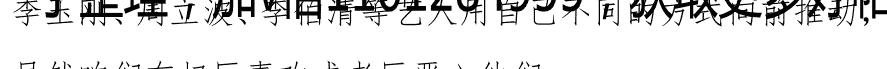

虽然他们有巨喜者或者巨恶他们。作者:奉行韩国外交政策 日：2011-08-30 18

## (十七)

新风霞是苏州人，童年时被人贩卖到天津，学习当时流传于山里的山腔。虽然建国时她已有名气，但主要是在建国以后，她创作了许多经典剧目，当上了国家评剧院主任。在十年动乱中她禁止登台，政治风暴结束时她已经离开轮椅。此后多年，她笔耕不辍，出版了许多书，《千年一叹》。

直到大概1998 年左右，余雨刚出版了一书叫《千年一叹》。这本书我一直当宝贝。为什么认为人历史？因为每个人的历史，实际上就是一部鲜活生活的社会史。新风霞开创的新派唱腔，在很多中学语文本里进了她的。我喜欢用历史的眼光去欣赏一个时代具有代表性的。

这种精神状态下，当时冒出一个名字有关黄河的纪录片就不再理解了。这种对比，，是客观的对比。时间穿过了解后，我们也没有看到，但我认为有必要听当事人。如果哪个兄弟非要说别人比你更有权和说服力吗？那没办法了。

在巅峰状态下，我们确实没有看到那种云流水风采吧。怎么扯这么远了。从新风霞的人生，我对文化的个人看法就是：也有巨大的发展，也有巨大的破坏，但最后还是给我们留下了不少价值。不管你不信，反正我信了，呵呵不要买吗。如果你想缅怀一下，搜搜《花语》里的那段（也叫闺房）。

# 一手整理加微信1101284955，获取更多帖

作者:奉行和平外交政策 日期:2011-08-30 19:16 (十八)

很懊愧，我这样一个认识水平了——从一个个看历史，然后通过其他的两个、三个个体去证实或证伪自己的看法。从其他的文化以外人士身上，我也大概那种感觉（就是前贴：有巨大的发展，也有巨大的破坏，但最后给我们留下了不少东西）。因为我没有手段，更没有能力进行取样检验对文化全面分析。所以如果有兄弟觉得我搞文化属于投机取巧，我就剩下最后一个办法，就是文化对照。挂此耳。

改革开放，国门大开。当时出来估计没有哪个回来（如果他留在海外的话）。他们私下里说：差太大了，中国还有希望吗？开放造成这么大的跨越，其原因有四：一是中国本来就比西方后太多，正常发展的时候当时自己也够不上；二是没有正常发展；三是改革前大封闭，缺乏民间交流和了解；四是又关起来把自己吹得太高，把欧美闲得水火热。总之，本来落实早就够大了，人为造成的落差比落实大妈，出国前心里准备，出去一看不要紧，现实自信从高空坠落变成饼状物（所以朝鲜不敢开放）。虽然中国人都最后挺住了，但当时的情况，真的没有人保险。一片喜洋洋，但知识文化界经历了正反积累的短暂喜悦之后，立刻陷入了痛苦、思索、旁诡。为什么崔健的《一无所有》可以代表整个八十年代的中国的精神状态？中国人的这是这样的。在种种精神状态下，当时冒出来的名字就不再理解了。由于中国人的自我要求很高，所以我们很有出息，一直在拿自己跟西方文化来对照（美国的、苏联的）。但必须指出80年代的中国，如果能把自己同西方文明、印度文明、伊斯兰文明放在一起比较，以最近的100年世界历史的尺度去系统地、全面地比较一下，可能会得出一个更客观的自我认识，或许就可以在近30年的发展中少一些错误。

化环境优于改革前的主要原因。

所以，虽然比较乱套，我还是认为我们的文化正在很乱套前进，而不是倒退。

这里需要值得一提的是，我们对G的文化反思问题。因为这个革命所指的对象，点名姓就是文化。文化如果无于衷表不作任何反思，那个文化也未免太没没了。

七十年年代未出现的是伤痕文学。时间太久了，可能网友这些年龄段的人都没有读过。由于我们老人不老，所以读了几篇，没有什么感觉。说实话当时的人们可以都读得泪人似的。伤痕文学来说比较浅，虽然作家们也想深入反思（这是中国人的基本性），但当时历史还没有得到充分洗淀，

他助理=加微信111024955，获取更多好帖

葫芦似的脑袋报告家：我被被砍了。至于为什么会被砍，以后怎样不被砍、怎样才能让手不能被砍不砍和不想砍，这些问题则统统没有得到解决。

继续

作者: 奉行核外交政策 日期:2011-08-30 22:53

狂写中

（二十）

当然，对G反思不够也不能全倒到文化头上。这里也有个政治导向问题。

十年浩劫结束后，有些人望希望清算一下历史问题。这个要求应该是正当的，而且至少从理论上讲，清楚问题以后的发展会有好处。但是，老邓的脑袋很糊涂，他非常清醒而且准确地判断当时的实际情况——由于文G积累了太多的矛盾和太多的思怨，再加上人在历次运动中培养的斗争意识，反思清算估计十年还不准，等于又发动了一场新的文G。那中国他还要不要发展呢？

各位可能从前提到能够看出来，我对老邓看得相当的赞（其实对我也可是赞的）。我们在这个世界上，左和右是一个辩证关系，两个极端是最接近的，同时也是最近的。比如，大认为为右倾投降主义者靠投戈是非常符合逻辑的，而不理解为什么极左路线的张国宾跑到蒋委员长那里去了。这对于我们来说加了很多处理，划到护栏也是小常。但如果你向左猛打盘子，就会狠狠地撞到左护栏上。你向左冲越猛，撞墙后的反作用力越大，你就越容易摇头歪再向右猛击，结果又撞到右护栏上。

这就是两个极端相似的道理。老邓是英明的，中国这个大历史上史无前例的力量向左撞了一下，他作为司机，能够一把把车向右倒到中间，一边又克服反作用力，让车不要偏到左去。这不仅需要政治眼光，更需要政治手段和驾驭大局面的能力。考虑到他本人和家庭也是极左路线的受害者，这就更难可贵，还有要有政治胸怀。我常常想，如果当时不是他在执政，中国可能会变成什么样子？


所以，当时的中国文化，更包政治和经济，主要的问是向向前，快向前发展，而不是回头去扯问题。所以，邓在十一届三中全会上的发言，题目就是“解放思想，实求是，团结一致向前看”。这个讲话决定了中国的方向。对于实在无法回避的问题，老邓亲自自主起草了《关于建国以来若干重大历史问题的决定》，公开发给了全国和全世界。这相当于拿斧子在笼口上上一刀，把麻烦的面条斩断了。有人还在提到意见，还有有些问题没说清楚？老邓又说了一名言：

中国人有一个很大的缺点，就是领导层错误的时候不说话，不反对，甚至还帮忙。等领导层倒台了这清算的时候，他一把整理我们和自己。这种机会就宽敞解带，把身上和心上伤痕给人看，谁赢比我惨呀！大家都是受害者。巴金是一个勇敢的人。他晚年的《随想录》中，坦恳地告诉控诉人，我受了害，但我也害过人，我对那个时代的错误有异性，我后悔喽！这种自我解剖的精神，值得我们每一个同学学习”。百岁巴金已在2005年离开了我们。岷山苍苍，蜀水决决，先生之德，山高水长。

等待 作者：奉行核外交政策 日期：2011-08-31 05:34

（二一）

巴金曾建议，建一个文G博物馆。这件事没有得到高层支持持。这件事在文化界有不少讨论。从上个贴我的分析，大家可以看出，其实双方都没有错，看问题的角度不同而已。中国社会的稳定和发展才是大局。直到南巡话话，老邓都在强调“不争不论”。把一个大博物馆建在那里容易引起竞争论。

但博物馆并不等于虚历史。实际上，官方和民间都在收集和保存G的各种资料。历史教训是一笔用血换来的财富，中国人有责任、有义务把它留给子后代。

2000年以后，随着国力增强，中国人的心态越来越平和、越来越自信。我们对兄弟文化的态度也越来越平等待、越来越自信。

获取更多帖发现过去过去，就择起份，那个感觉，那个文化，太荒了。两个小伙伴溜得满，今天的中国人，大多数，已经没有这种心态了。我们学会了尊重别人的同时，喝咖啡就醉。三十年来，中国主要目标就是向前奔，随着的发展，随着文化自信，建立，我们逐渐有了条件。回去研究那些问题。但是我相信，这个研究应该放在历史和文化的背景下。


进行，如果简单归结为某人或几个人，这是不符合实际，也是无益的。我们以前接触过的单位当一把手的家伙，批判彭德怀，犯了这么错误啊！我想，也许这两个农民很快就要面临粮食问题。彭德怀还比较幼稚，但非常现实。其实中国的许多历史问题，偶然中存在某种命运。许多历史悲剧，最根本的病因，不在风云幻的国家层，也不在贫穷，而恰恰隐藏十三亿——你、他们。

文化正在强大，推行过一次市场绩效考核，搞得鸡飞跳，最后失败人。一步不要紧，大家都成了受害者，争着向新展示伤痕。当时刚踢完，我就引用了一句：“他不是一个人在战斗，他不是一个人！”我一言，单位上，至少可以确定是两个人。老子进黄河洗了。

一手整理：加v10284955 获取更多帖

批判彭德怀，两个农民振骨昂，一边相互听：彭德怀是哪个村的，怎么没有管住他？

最强的文化的表现，是勇于面对一切现实，亲手剥开灵魂。巴金勇于自我解剖，把良知放在名利之上。但这种人太少了，“谁敢比我狠”的家伙太多了。尊敬巴金，我更崇拜鲁迅。鲁迅是脊梁。由于官方赢得太多，有些年轻夸逆反理，而去崇拜梁秋之流了。同时代的文中，除了胡适，没有哪个个人曾经企及鲁迅的高度和思想深度，甚至不能堪其项。长期以来，中国人对自己的文化并没有足够的自信。我们不认为自己的文化是在向前演进，而是自认为歧路或者走退。我们并没有将中国文化放到大背景中去审视，对自己的存在的问题比较到位，而取得进展和相对优势。特别是改革开放以后，除了文化上的自我封闭之后，面对强势的西方文化，我们像是

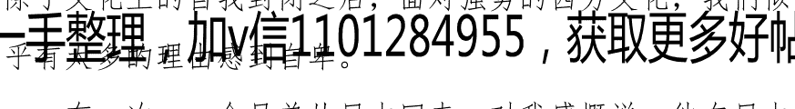

有一次，一个兄弟从日本回来，对我说：他在日本看到了和服，这就是中国唐代的服装变种。中国的许多元素保留了在日本，而中国本土把这些东西丢了一干净。实在是太不应该了。这个朋友的看法是有代表性的。我在许多书刊和网上读到类似的观点。有的作者是著名的专家和学者，我严重不同意这种看法。在贵州，有很多屯堡。所谓屯堡，实际上是明代的屯兵。平定西南以后，从南京附近大量移民随军驻苗疆，后来就形成了屯堡式的村寨。今天这些屯堡成了景点。屯堡中的村民的青布裤和头帕，原汁原味地保留了明初汉族服装的特色。同样中国文化在服装方面的民间遗存，为什么中国人到了日本就自惭形秽，自认为是丢了传统文化，到了贵州就从来没有听过呢？一句话说完，不就是因为日本人的手里有钱吗！

继续 作者:奉行核外交政策 2011-09-08 07:23

（二十二）

兄弟们。好。出差中，事情偶尔网上，发现这贴子还没沉淀，哈哈，呵呵，谢谢。出差前突击狂写了一天一夜，把一手整理，加微信获取更多帖子部分之前，请允许我继续交流再多几个贴子。都是纯粹个人看法，在旅途中边走、边想、边写、边发。属于闲聊。但是时间太紧张了，很难像以前那样一天八贴地发。前面的贴子里，我写了一些对中国文化的看法。由于随写的，所以观点很散，不集中，为了让大家看起来更方便，我总结如下：中国文化长期以来很自省地发展，直到1840年后被西方方唤醒，然后在1900年前后经由日本“介绍”与西方文化认识。此后，民国时期、1949年至1979年，改革开放以后的这三个阶段中，虽然历史迭代起伏，但是文化总体而言是在不断向前演进。2000年以后，中国文化的自信正在逐步恢复。

可能有兄弟们持反对意见。比如：有人不同意1949年至1979年间中国文化有何发展；有人不同意建国后的文化发展具有延续性，而是认为前后存在断层。还有人认为中国文化的断层不是出现在建国前后，而是出现在十年文革。这些看法都是有道理的。但我坚持自己的观点。认为，不同点的存在是正常的，争鸣的社会价值，不是为了统一异见，也不是为了相互说服，而是为了相互完善和相互启发。在我看来，中国文化一直是在不断向前演进。虽然中间出现过停滞和曲折，但仍然倔强向前，而且成果丰然。我一方面取得了地区改革改革等方面，在非常时期，以手段取得了大功。做成了外国办到的、同时在一些领域遭遇了重大挫折，付出了巨大代价。长期以来，中国人对自己的文化并没有足够的自信。我们不认为自己的文化是在向前演进，而是自认为处于歧路或者走退。我们并没有将中国文化放到大背景中去自我审视，对自己的存在的问题比较到位。img/b013cf51be66714ab5dccb2a92cecb14_152_0.png


美国人酷爱牛肉。他们天天大嚼咬着印度人的神灵，认为是天经地义的，却怎么不能理解为什么中国人竟会吃掉他们的朋友。

美国人喜欢把复杂的简单化，把庞大芜荒的文化用一个符号进行简化。比如中国人吃狗肉——冷酷酷没有爱心的家伙；新加坡人用鞭子——东方的专制主义；日本人的相扑——新奇怪异的异族风情，这么的国家偏要搞定巨人的运动，也许日本人的心理反而像反对动员的身体一样变化；对他们的玩艺蛇——小狮子笛完全可以让眼镜跳舞，不可不可理解的东方神秘主义，有一点原始的危险刺激！

写累了，明天还有事，明天再聊。

# 一手处理，加微11101284955，获取更多好帖

作者: 齐彦横和平外交政策 日期: 2011-09-08 15:18

（二十六）

上回提到，虽然中西方文化已经相互“认识”，但总的来说西方强中国弱，造成了长期以来，中国人对西方文化有许多仰视所带来的偏差，而西方对中国文化则许多多由偏视所带来的偏差。

在某些中国人眼里，西方什么都好，特别是八十年代有说法，叫外的月亮比中国的圆。而在西方人看来，除了中餐味道不错（但是不符合健康标准），其余的中国东西似乎没有什么可取之处。中国人是潜意识的文化主义者，特别希望别人崇尚中国文化，但是不要以为西方对中国感兴趣就证明他仰慕中国文化。我楼下小区的影碟，反映南美美食族的片子被借得最多，并不代表中国人崇尚南美的野人文化。人类对异质文化充满了好奇心，但好奇若等于喜爱，即使喜爱也不能崇尚。

由于深层的文化原因，再加上实质的利益冲突，使得我们中国人做事情，在西方看来都不对，都要批评。美华华人林长多最近发表的《你们要求我们怎样生存？》具有一定代表性。这哥们很火地道：“当我们的人口超过十亿时，你们说我们摧毁地球；当我们限制人口增长时，你们又说我们践踏熊猫。当我们富裕时，你们视我们低战……”原诗，大家有没有感兴趣去看看。诗里所涉及的不全是文化问题，根源在文化上。

在西方的傲慢和偏见伤害多年之后，2008年4月，中国新一代青年终于忍无可忍，他们在世界各地走了街头，事后又出现了四月青年（反CNN）的网站。这是好事。但我们也要认识，西方文化的优势心理是长期的历史中形成的，我们很难通过许多的努力来转化偏见。我们不必于愤怒，你也没有用，每天把自己手头一份工作干好，让中国一步步强大起来才是王道。

近年来中国崛起势不可挡，许多西方从利益角度出发，开始重视中国。我打过的几个西方人，他们都是大学教授或者经济界人士，他们的子女都学习中文。他们真心认为中国是中国之外最重要的国家，下一代如能学习中文的话，道路就会比较。但是，遗憾的是，西方从文化或者意识形态上对中国的偏见几乎没有，而且中国崛起以后，这种偏见甚至变成了文化歧视，至少一部分西方人是这样的。例如诺贝尔奖，自然科学类奖项都给了那些人，本质上是西方看着顺眼的反对者。我给兄弟们介绍如何诺贝尔奖：你如果是得了奖，你就论证它是好事；对坏事，你就论证它是中性的；对政治，你就论证它是工程；对损害很多人，你就论证它是损害环境的。这样几年前，如果运气好，很可能获得诺贝尔文学奖。如果你是一个盲者或者像我一样躺着，坐飞机到处走，看到很多的地方。这样几年前，如果运气好，很可能获得诺贝尔和平奖。这两年，某实行西方民主制度的，出了一个所谓的穷人银行，给放了几笔贷款。


（学奖）我仔细查阅了资料，我认为他这个方法基本上是面子的，实际上对于改变当地几乎令人绝望的贫困现实，作用是牛一毛。相当于一个人痛得要，你去给他按肚子，再说几句安抚。对农村的，中国的改革才是真正触及根本的，中国这三十年的农民脱贫致富是全世界最大的成就。然而，我们永远不可能得奖，在那些评委的意识形态眼里，中国的成绩永远不值。我想，中国不需要这些奖，因为我们的发展成绩需要用这种谬论来证明或评判者。他们怎么评价我们！

（二十七）

感谢兄弟们的回帖，感到有必要回复几句话。我不是现有秩序的维护者。我只是想对中国三十年的发展进行自己的思考和解释。兄弟们指出我回避中国的社会问题，那不是。有关社会问题的负面问题，我的贴子里已经涉及到，等问题，有的观点很尖锐。中国的问题是有有的，成绩是有有的。我们不能否认发展成就。中国崛起是每一个炎子孙的福利，这一点在海外的人会更加强烈地感受到。

对于中国的问题，我们要实事求地客观分析。我可以坦恳地告诉兄弟们，我的思想曾经偏激过。因为工作原因，我对中国负面的东西看得比一般人要深。我就是下岗工的儿子。参加工作以后，因为工作需要，我多次现场目睹下岗工人、失地农民的艰难。我专题调查过职业病的农民群体。我在吃不起饭的贫民家家里听他们哭诉，和他们一起哭。我近期处理过一个腐败案。在农村的亲友虽然没有病，临死却在计算医药花费。所以，2008年之前很长段时间，我的思想还相当悲观。例如，如何看待中国发展的问题，章家敏认为中国将崩溃，我比他还偏激，我当时认为是不是“即将”的问题。一年以后，特别是2008年以后，我的思想才逐步转变，我开始更平和、全面、客观地看待我们身处的这个时代。原因有很多，我不能一尽全。我认为，全面客观地看问题，不应该是社会丑恶观察妥协，而是为了更有力的批判和解决问题。也是由于这个心路历程，我基本能理解不同的观点，对于本楼中回骂人的哥们也可以理解。我有一个朋友，自称中国精英的，认为只有西方先进思想彻底改造中国人，才是我们的出口。我们俩容易争论，就索性面上谈论天气和相互推荐酒店。但是我们仍然维持朋友关系，我虽然不同他的很多观点，但承认他是一个有公德心、工作认真负责的好公民，至少他不能随地吐痰和经常献血，这让我很汗颜。


另一个问题是关于文革的问题。文革对于打破中国农村千多年一贯的潭死、一盘散局面，应该说有一定作用，但是我们付出了太大的代价。所以我没有翻案的意思。这个问题曾有过历史结论，应该说基本上符合事实。我认为文革是一个悲剧。什么叫悲剧呢？大学时突然对文艺产生了兴趣，就研究了一篇论文，结果论文里给出一个定义：“好人办了，坏人办了，好事办了，坏事办了，结果算不上喜剧或者悲剧，只能算是正剧。”从上到下，大部分人的认为“新”实际上根本不可，用封建的方式去反建，用孔子的思维去批判旧，立起来的东西基本上属于老旧，最后构成了短期的困境。


（二十八）

既然到了文革，顺便就聊聊文革的延续性问题。近年来关于文化有没有出现断裂，有很多评论。论者认为建国前后出现了断裂，论者认为文革前后出现了断裂。我的看法是，中国文化没有容易断裂。从文化千年的脉络来看，它经历了太多的风雨，比文革更大的风雨。如果真的容易断裂，早就断裂了。无论是建国也，文革也，对文化产生了重要影响（正面或者负面），而且具有极强的生命力，不是你想灭就能灭的。中国文化会生生不息，顽强地适应环境向前演进。具体来说，还是把复杂的问题简单化，举个例子吧。文物才是文化的重要载体。从古老的兴盛，也可以通过侧面看文化发展脉络。许多人指责文革破坏了大量与，但是如果把中国古代损失全算在文革头上，也是符合事实。我喜欢收集网上的老照片。从老照片来看，实际上在清末中国各地的古迹已经是破不堪了，一些古迹已经完全毁掉。我结合一些历史材料分析，总判断是：中国古代在明末清初战争中遭到严重损毁，在康雍乾隆三朝得到了大量的恢复和重建，达到鼎盛。道光年间是清朝转衰的转折点，也是走向衰败的转折点。从1840年至1949年，六十多年的内战之外的破坏，再加上政府无力维护，民国初年中国古代文物已经是溃毁了。接下来的，民国时期的军阀混战和日本入侵，进一步加剧了古迹的破坏。例如，湖南十景之一的雷峰被浪漫地映在湖湘山色之中。又如梁思成以及中国经营，留下了很多民国时期的古迹照片，可以生动地看到当年的破坏情况。感兴趣的兄弟可以读读梁思成的《中国》。文物在清末和民国时期大量外流，现在欧美博物馆里充丰的中国文物，大都是那个时期流失的。我观颇忧。比如唐太宗的浮雕、六陵，其中有很多在民国初年被买卖给美国人，它们在美国宾州博物馆里藏着。台湾人说大陆政府把古迹破坏了，不符合事实，我们是有责任的，但当年民国时期的责任也不小。总体来说，中国古代文物的全面灾难期是1840年至1949年的一百年间。建国以后，国内古迹特别著名的古迹得到了保护和修复。文物珍品百多的外流的局面得到了力的扼制。中间出现了反复：一是建国以后的建设过程中，由于重视不够，部分古迹被拆除，例如北京城墙。二是文革破旧运动破坏了大量文物古迹，造成了不可挽回的损失。但总体来说，建国以后中国的文物古迹在逐步向好。特别是1979年之后局面的改变是带有根本性的。

作者：奉行外交政策日期：2011-09-09 07:10

（二十九）

我有一个朋友在某县当县长。在前年一起吃饭时，他提到他们县有一个历史名胜古迹。可惜这个古迹在文革中掉了。一些大代表提希望原址重建。也有一些人持反对意见，认为修复并获取更多帖。我给他两个方面分析了这个问题。如果是古迹的问题，二是劳民伤的问题。关于古迹的问题，我认为不存在。中国现的大量古迹，都不是一成不变的。中国古迹的一个特点就是乱世毁，，盛世。康熙年间重建的，现存的许多古迹都是无价之宝。但我建议多咨询专家意见，慎一些，把古迹修好。目前还不富裕，有必要统筹考虑，如果县上有教育、医疗社会缺钱，等宽裕了再重建古迹也不迟。我还告诉他，把钱用到老百姓身上要紧，这可能也是办法吧。总体来说，如果1840年到1949年是“下行通道”，在1979年之后文物保护进入了“上行通道”。特别是几年省级保护单位，覆盖范围扩大。大量已毁放弃，重放光彩。例如黄鹤楼、岳阳楼、滕王阁、鹤雀楼等都是国后重建的。这些，对中国文物的保护、继承和发展，远远大于破坏。而且中国正在以空前的力度创造大批比新的，像三峡大坝、像鸟巢，不胜枚举。在这个日夜忙碌工作的时代，能够创造大量物质和文化财富，本人深感荣。累了，改天继续聊延续性问题。

作者：奉行外交政策日期：2011-09-10 22:27

（三十）

兄弟们好，接受此，改全称呼。时间更新新贴子，打开一看还在头一页上呢，很感动，谢。“选择与你同路”一句的意思。这个问题，我本来想从经济角度分析中国崛起的部分要详细论述，但是大家既然提到了，我就先插一个贴子，分析一下这个问题。我的总的看法是——在中国崛起过程中没有朋友。这个困境不是因为中国这件事情做得不好，而是中国作为“世界第二”的追赶者的困境，其实也是任何在“世界第二”位置上的国家的困境。中国目前从经济实力和政治实力，已经是跻身为世界二。从军事角度上讲，目前正急速超越俄国。我有一个哥们在军事集团工作，他是学电子机械类的，他曾与俄罗斯专家判别。他认为，目前我国除少数军事技术领域领先外，多数领域对中国的优势已经不明显，或者出现了中国反超现象。他认为，中国在军事技术领域全面超过俄国只需要15年左右。军事进步固到底，是靠国家的经济到底，俄国这二十年主要是在吃老本。我不知道他的判断准不准确，但是肯定的，中国目前处于世界军事老三的位置，距离二正在快速拉近。再加上政治、外交等方面，把各方面结合起来总体看，中国目前的世界第二的位置是可以肯定的。中国世界第二的位置，不是一个已经稳定的结构，不是英雄排座的最终。而是一个动态变化的排列，不可避免的利益增长。中国只要人均GDP达到美国的五分之一，就实现了总量超越。而美国一旦失去了全球GDP第一的位置，世界格局将无法避免出现变化。这个变化将到底变成什么样子，我不知道，美国中国也不知道。这种不确定性，就会引发各国忧虑，忧虑就会引发抵触，这个问题我在前文中曾提及气候变化为对比过的，就不再多讲了。


# 后续

作者：奉行核平外交政策 日期:2011-09-10 22:47

这两个忙改正为这两天死亡。

很很容易了。改正。真太容易了。

发完贴看了一眼，哎呀，写得太快，写完就发了，错字太多了，对不起！

作者：奉行核平外交政策 日期:2011-09-10 23:29

## （三一）

记得1980年代初，当我还是一个小孩的时候，我和爸妈一起住在单位家属房子里。当时这个红砖平房子是全城最新的房子。我们的家具都是新的，是我爸用木头自己打出来的一套整体。那时候信息就是回到记忆，在旧城的老的老老街上，家里有很多旧抽屉和包着铜皮的旧箱子，落满了灰尘，但我总能从里面翻出一些古老的好玩的东西。

如今，我安在一个父母很遥远的城市。我买了一三居的房子，买了自己喜欢的新家具。每年过节的时候，我带着老婆孩子回到父母身边。我突然发现，原来记忆中又新又大的家具，变得又破又小。里面放着我在20年前用过的课本，都已落满了灰尘。我的三岁的儿子，正忙从这些老矮抽老柜子里面寻找他喜欢的宝贝。时光如梦，我我很怀惆，突然间仿佛仿佛是第一次发觉，自己早已弃旁，父母已经是头发花白的老人，而最爱我的爷爷早已已经在1992年远离我去。


新和旧，总是相互更替的。

历史是昨天的新闻，新闻则是明天的历史。

世界文明古中国，埃及及巴比伦、古希腊、古罗马文明的兴起，要远远早于中国（这个必须承认）。四千多年年前，无数金字塔矗立在尼罗河边的时候，中国尚处于三皇皇帝的传说时代，当当时的社会形态是原始部落联盟。而当埃及及巴比伦文明逐渐沉没，隐入苍黄之地，新起的中国商文明开始兴勃，散发出聚眼的光芒。时间转到明清，当北京、西安、成都、洛阳等中国城市开始都筑展现出两千年文明沉淀的无比厚重的历史。

如今，当年工业革命时期的建筑已经变成了有百年历史的古迹。当我们漫步在伦敦、柏林、巴黎街头，一眼望不到边的古色古巷的建筑群令人惊叹，雍华贵而雾气沉沉。

此时，中国城市却处处散发着新的时代风，千万里创造新的历史。

在我面前的贴子里说，我曾是一个听说某处古迹被毁糟不已的文化愤青。然而，在进入文化游以后，我对文化游有了新的认识和更为平和的心态。虽然我支持一个当下副县长的朋友修复废弃的古迹，但我更加倾向于认为，虽然我们必须继承历史，但中国文化是一个活的发展过程，努力开拓属于我们这个历史时代的新化，远远比回顾和捡拾过去的历史更为重要。

待续。

作者：奉行内核外交政策 日期:2011-09-11 00:25

## (三十二)

在中国远古时候，人们把龟作为神圣的祭品。但庄子老先生对别人说，如果他是一只乌龟的话，他宁可在温暖的阳光照下，抱着尾巴在泥坑里打滚，也不愿给人去做祭品。

我热爱中国文化，我为自己拥有这样一个伟大而灿烂的文化倍感荣。我要说，我是一个眼睛前的文化主义者。

我认为如果想要发展去保护文化，最终会让中国文化一手整理而加信又没沙底下的中国文化。仍然是小平那个句，发展才是硬道理。

就说说这个例子吧。

虽然很有可能有兄弟有不同意见，我还是要对近十年的中国城市发展街赞赞。没错的，由于国家现行的土地政策，政府对土地一级市场绝对才垄断，造成了政府在拆迁中捡到了巨额土地收益，而且引发了官商勾结。房价高，根本问题是地价高，地价高，根本问题是地价高，根本问题是政府对土地利益格局，甚至已经形成了积重难返的土地财政。所以期望地方政府去房价，无异于虎谋韭。今年中央关于适房、廉房的强制性政策，执行结果还有待望。总之，房子的社会博弈注定要你死我活地进行下去。我说这些意思是，我不想回避问题。但是，从整体而言，我仍然认为我们不能否近年来的中国城市建设成就。

我家北方一个中型城市。我爷爷奶奶的家在老城区。那里是元代以后北京杭运河形成的一片老城区，低的的房一座一座，小巷很曲折，多如迷宫，机动车进不去。那里有我的童年。住在在这个老城区也相当痛苦。房子之间的宅基密度特多，几乎都有，我家跟邻居打过一场硬仗。住宅老旧，都是老房，房顶漏了，家里房顶漏了，房顶漏了，爷爷家的房顶漏了，由于爷爷已去世，只剩奶奶一人，家里暖气、煤气、自来水，生活不方便了。我的三岁的儿子，正忙从这些老矮抽老柜子里面寻找他喜欢的宝贝。时光如梦，我我很怀惆，突然间仿佛仿佛是第一次发觉，自己早已弃旁，父母已经是头发花白的老人，而最爱我的爷爷早已已经在1992年远离我去。

住在在这个老城区也相当痛苦。房子之间的宅基密度特多，几乎都有，我家跟邻居打过一场硬仗。住宅老旧，都是老房，房顶漏了，家里房顶漏了，房顶漏了，爷爷家的房顶漏了，由于爷爷已去世，只剩奶奶一人，家里暖气、煤气、自来水，生活不方便了。

我的三岁的儿子，正忙从这些老矮抽老柜子里面寻找他喜欢的宝贝。时光如梦，我我很怀惆，突然间仿佛仿佛是第一次发觉，自己早已弃旁，父母已经是头发花白的老人，而最爱我的爷爷早已已经在1992年远离我去。

那里有我的童年。住在在这个老城区也相当痛苦。

（三）我的三岁的儿子，正忙从这些老矮抽老柜子里面寻找他喜欢的宝贝。时光如梦，我我很怀惆，突然间仿佛仿佛是第一次发觉，自己早已弃旁，父母已经是头发花白的老人，而最爱我的爷爷早已已经在1992年远离我去。


新和旧，总是相互更替的。

历史是昨天的新闻，新闻则是明天的历史。

世界文明古中国，埃及及巴比伦、古希腊、古罗马文明的兴起，要远远早于中国（这个必须承认）。四千多年年前，无数金字塔矗立在尼罗河边的时候，中国尚处于三皇皇帝的传说时代，当当时的社会形态是原始部落联盟。而当埃及及巴比伦文明逐渐沉没，隐入苍黄之地，新起的中国商文明开始兴勃，散发出聚眼的光芒。时间转到明清，当北京、西安、成都、洛阳等中国城市开始斗筑展现出两千年文明沉淀的无比厚重的历史。

如今，当年工业革命时期的建筑已经变成了有百年历史的古迹。当我们漫步在伦敦、柏林、巴黎街头，一眼望不到边的古色古巷的建筑群令人惊叹，雍嵘华贵而雾气沉沉。

此时，中国城市却处处散发着新的时代风，千万里创造新的历史。

在我面前的贴子里说，我曾是一个听说某处古迹被毁糟不已的文化愤青。然而，在进入文化游以后，我对文化游有了新的认识和更为平和的心态。虽然我支持一个当下副县长的朋友修复废弃的古迹，但我更加倾向于认为，虽然我们必须继承历史，但中国文化是一个活的发展过程，努力开拓属于我们这个历史时代的新化，远远比回顾和捡拾过去的历史更为重要。

待续。

作者：奉行内核外交政策 日期:2011-09-11 00:25

## (三十二)

在中国远古时候，人们把龟作为神圣的祭品。但庄子老先生对别人说，如果他是一只乌龟的话，他宁可在温暖的阳光照下，抱着尾巴在泥坑里打滚，也不愿给人去做祭品。

我热爱中国文化，我为自己拥有这样一个伟大而灿烂的文化倍感荣。我要说，我是一个眼睛前的文化主义者。

我认为如果想要发展去保护文化，最终会让中国文化一手整理而加信又没沙底下的中国文化。仍然是小平那个句，发展才是硬道理。

就说说这个例子吧。

虽然很有可能有兄弟有不同意见，我还是要对近十年的中国城市发展街赞赞。没错的，由于国家现行的土地政策，政府对土地一级市场绝对才垄断，造成了政府在拆迁中捡到了巨额土地收益，而且引发了官商勾结。房价高，根本问题是地价高，地价高，根本问题是地价高，根本问题是政府对土地利益格局，甚至已经形成了积重难返的土地财政。所以期望地方政府去房价，无异于虎谋韭。今年中央关于适房、廉房的强制性政策，执行结果还有待望。总之，房子的社会博弈注定要你死我活地进行下去。我说这些意思是，我不想回避问题。但是，从整体而言，我仍然认为我们不能否近年来的中国城市建设成就。

我家北方一个中型城市。我爷爷奶奶的家在老城区。那里是元代以后北京杭运河形成的一片老城区，低的的房一座一座，小巷很曲折，多如迷宫，机动车进不去。那里有我的童年。住在在这个老城区也相当痛苦。房子之间的宅基密度特多，几乎都有，我家跟邻居打过一场硬仗。住宅老旧，都是老房，房顶漏了，家里房顶漏了，房顶漏了，爷爷家的房顶漏了，由于爷爷已去世，只剩奶奶一人，家里暖气、煤气、自来水，生活不方便了。

## （三十）

文化的延续问题，我想，延续这个词本身就清楚了。延续是对历史的继承，延续是对未来的开拓。如果没有延续，就无所谓。尚来说，苟日新，又日新，日日新。（原文是）

对于传统文化，存在两个问题，一个是过度开发的问题，另一个是过度保护的问题。这两个问题都应当警惕、纠正。

这两个问题，不独中国有，世界各国都有。英国现在是一个“老国家”。到英国走走走走，从大城市到乡村小镇，从国家面貌观上，英国也不是十七、十八世纪那种英姿勃勃的新兴国家形象，倒是很有老气横秋的感觉。英国人对每一栋老房子都精心保护，导游总喜欢对外国游客说，这片街区建于十八世纪中叶……许多中国人到了英国后，惭得恨不能立刻抽自己的耳朵：看看人家的历史文化保护！我在英国就没有这个感觉。英国的老式房子总体很美，但采光是不太好，门间阴森森的，不如新生连排小区舒适的。反正我只愿意下午没事在这种老房子里喝一杯红茶，打死我都不愿在这里！我认为这种房子留一些代表性的区域足够了，适当的改建和开发，没有必要全国范围大保护。伦敦的交通情况真的很，很多世界著名建筑前的街道窄得车辆只能单行，估计明年奥运的时候他们得……其实其实其实要拆除一面的临街房屋，就可以单行直接改成向八车道。当然不是全部拆，但在一些关键的路口和交叉应该这样做。喜欢英伦风情的兄弟们可以去拍，但我个人真的就是这个想法。我认为文化首先是让人受而不让人难，一个国家应该首先是一个舒舒适的家。

## （三十四）

我读过的书，至少有几百名言让我感折服。但是，有一个名言对我影响最大的，它彻底改变了我。这句话很简单，朴素，但是对于旁边的教条主义、甚至世界其他的宗教主义者，很难理解。这句话几千年前说：人类在真诚的找到了永恒的真理，实际上只不过只是一个始有终的过程。

（原文是）人类在真诚的世界上找到了永恒的真理，实际上只不过只是一个始有终的过程。花开花落，月圆月缺，日月一日。在一个事物诞生之前，我们无法对将来做出预测，只有一点可以肯定，那就是它必然有一天消亡。老子告诉我们的根本规律，如果我们从这个角度去看中国，更容易理解。从这个角度来看，任何制度都有可能。一种制度的消失，不是历史的结束，而是历史新阶段的开始。这种发展包含了历史元素。

网上有一个贴叫做“西方文明”，里面讲到的西方分子，海外分子收集起来，企图反对“西方文明”，里面讲到的西方文明阴暗面都是事实，但是，西方文明是一个巨大的存在，它终不是西方出来的。这了一本书，叫做《西方文明》。

今天的汉字，实际上流淌着中华大地上诸古老民族的血缘，但是中华文化把大家联系在一起，每个人都是自己是中国人而深自豪。今天的汉字之所以能够被我整理，并提取很多帖，是因为中国是一个文明国家，具有强大的生命力。也许在遥远的未来，在天下大同之时，中国文化走到自己的尽头。

今天的汉字，实际上流淌着中华大地上诸古老民族的血缘，但是中华文化把大家联系在一起，每个人都是自己是中国人而深自豪。

（三十五）

西方学者认为，人类的国家可以分为两类，一类是民族国家，另一类是文明国家。前者基于一个民族，而后者基于一个文化。人类正是沿着部落——一部分（或者称部落联盟）——民族国家——文明国家的路线在向前发展。奇怪的是，中国自古以来超越了民族国家直接形成了文明国家。这种特征解释了民族之所以成就其大的根与西方民族观念不同的是，我们的祖先始终以文化而非血缘来区分华夏。也就是说，东南属西西北湖，只要接受了周文化，遵守着周礼，它即被视为华夏；周室建立的范围，如果不遵守周礼，它即被视为夷域。看来越来越多的少数民族因为接受华夏文化而融入中国，南方楚国就是一个典型代表。汉字是方块而非拼音字，可以在不同语言的人群中通用（日本韩国越南使用汉字直到近代），使华夏文明远播四方。公元221年，秦灭汉，车同轨同文；汉天下，废百家，尊儒。从此，中国这个巨大的文化统一体再不可分割，中国文明在东方崛起，登上了人类历史的舞台。

从那个时代开始，中国以其巨大的体量，在世界上诸国之中屹立，绝世独立。中国与罗马帝国、孔雀帝国、贵霜帝国、阿拉伯帝国、波斯帝国、莫卧帝国、奥斯曼土耳帝国、蒙古帝国、沙俄帝国、大英帝国有着明显的不同。那些帝国都是武力征服而立国，而中国则是文化征服而立国。在这些帝国庞大的辖域之内，至今仍存着许多民族，这些民族拥有不同的语言和生活习惯。而在古代，中国势力范围之内，一个人不论他是什么种族，只要他使用汉字并崇拜汉文，就被无条件地接受为华夏一员，绝不会因为血缘而受到任何排斥。

今天的汉字，实际上流淌着中华大地上诸古老民族的血缘，但是中华文化把大家联系在一起，每个人都是自己是中国人而深自豪。

（三十六）

兄弟姐妹们，中秋好！我在出差途中，不能回国过年。每逢佳节在楼里收到这么多问候，也算一种弥补吧。提到的许多高见，我受教了，不能逐一回复，请原谅。提到的许多问题，比如人口问题、人民币问题、苏联问题等等，都是重大的经济命题，以后贴子里将会谈这些问题。由于写得挺煽，有些词可能过头了。有一个问题我想正色声明：本人不想加入外籍，不想拿绿卡，不想久居国外，明年任务完成后回家抱儿子。我认为不是那种站在国内国外、站着腰痛的闲人。我现在是进入“从经济角度看中国崛起”了。今天，坐在飞机上，看着满天的云，心思和云一样乱。一个超级懒人，偶发个贴，发现竟然跟贴，一时受宠若若，就一路写下来。如果说文化是无所不在的、盖于一切领域的，经济同样无所不在、无孔不入。所言天下皆为利来，天下攘攘皆为利，就是这个意思。但经济还有一种与文化的不同，文化是形而上的，经济是实打实的。诗是好坏，大家可以争议；做生意是贴赚，连赢都是……

经济学很难像这样看。我是一个喜欢思考的懒人，在以往的日子里，偶然有所得，又懒于笔记记录，那想法就如河漫花，一而逝，现在打破袋也不想起来了，对水比较困难。实话，我真不知道自己不可以完成这个贴子。好是在“漫谈”，不需要严密的理论体系。我将继续和发扬前面8万字的没波没涉八道的优秀品质，欢迎兄弟姐妹们积极地拍砖和证伪，以免我遭害网民。记得前面的一个贴子里，我曾提到过，今天的经济学论文都变成了数学论文了，还很刺了家人。其实，这主要是我自己心理阴暗的原因。应该基于大量计量数据，经济学研究，使传统经济学走向一个严谨的科学体系。面对大量的圈圈线性方程的经济著作，如果我抓准了往死里看，估计也能看明白。但问题在于我很懒。当年读书的时候，我一直用哪个哲人的“世界的真理都是简单的”这句话自解无奈，一口认定那些复杂的不是真理，于是心安理得不去攻读。做毕业论文时，虽有名师指点，却连一个仿模型都建不起来，索索写了一篇秦诸著作中的管理伦理学思想研究，才把签字条混到了。


程度，然后就是贫富分化问题。希望楼主在以后的帖子里谈谈对这方面事情的看法。也许由于我涉世未深或阅历尚浅，总觉得这样的发展难以为继。楼主却很乐观，也许应该是乐观的。

感谢你的支持。我会在谈经济问题时有所所涉及的。目前的中国社会不稳定因素，都有深层次的经济原因。经济原因的根子在于，社会各阶层之间的利益博弈，各方的起点和权利都存在严重不对等。这就使得弱势群体无法维护自身利益。再深入浅里，根子就是平等问题和民主问题。

我在前面一篇贴子里提到，我曾经是一个非常悲观的人。可能通过加信获取更多好帖。我们应该看四个方面，一是近来的巨大进步；二是仍然存在的严重问题；三是解决问题的有利条件和现实可能；四是解决问题中存在的顽固阻力。这些问题的主要方面都是经济利益问题，因为经济基础决定上层建筑。

不要了，下面的贴子我会知情不言的，但水平有限，请你多多批评指正。再次感谢兄弟（或妹妹）！

作者:奉行外交政策 日期:2011-09-12 06:10

（三十七）对于任何一个受过正规教育的中国人而言，第一次接触经济学知识应该是初中和高中的思想政治课上，有专门的大部分内容叫做做政治经济学。如果上到大学，也有类似课程，内容更深。考研也要考虑这个内容。

我很幸，我高中时就因为这个课，令我的老师都很闷。情况是这样的：老师讲政治经济学那段时间，正值九十年代初小平南荒以后，中国经济过热，我们校门口的烧饼价格，从两角钱涨到了一块钱，严重抬高了我的早餐开。我从小就是一个喜欢思考的好学生，于是我对商品价格问题产生了深厚的兴趣。

老师这样教我：商品价格是由价值决定的，价值是凝结在商品中的无差别的人类劳动。由于劳动者速度有快的也有慢的，所以价值由社会平均劳动时间决定。这就是——

我问：为什么同样的饺子和羊，平时是一比二，当缺肉的时候会变成二比一呢？老师告诉我：价格虽然由价值决定，但它会受市场供需影响而上下波动，这个波动以价值为中心，不会偏离太远。

我又问：假如生产一口水壶需要2个小时，那么现在我再给它追加1小时的无差别人类劳动——我花一个钟头把它砸在许多小碎片上，那为什么水壶价格为什么增加，反而没有了呢？老师告诉我，商品是价值和使用价值的统一体，你把别人的使用价值砸了呀。

我又问：校长和校办主任的工资涨30%，他们两个的别人人类劳动是在怎样工资中体现的呢？为什么是30%，而不是40%或20%呢？花10年发明一个专利可以值100万元，若研究9年放弃了，这9年的人类劳动是不是没有价值了呢？自然的风景没有凝结任何无差别人类劳动，为什么要收门票呢？门票是商品吗？为什么刘德华打广告可以100元港币，而我贴钱人家都要不要我呢？如果动力存在差异，那么我和刘德华两个人的动力价值和价格是怎样决定、怎样衡量、怎样换算的呢？老师想了半天回答道：你这不是跟我说拉杠吗？

总之，我就这样一头雾水地开始了对经济现象的观察。

等我上了大学以后，正值九十年代中期。那时，小平南荒以后。既然经济转型，经济教育就要跟上。可是中国长期以来的经济教材主要是政治经济学，这个东西是计划经济联系比较紧密。于是中国教授们一通搞，很快整合出许多经济学的教材。政经也是经济学，为了区别才加了个定语。这种经济学有很多很多东西是矛盾的。但是并行不悖，我们都要学。而且必须把观点背下来，考哪门就答哪一门，如果你用自己的观点去回答政经的考题，那考试你就死定了。这种法看似不合理，却也很合理，就是把各种观点都介绍给学生，让你自己去分析和思考。这就是这个时期，我开始关注中国的经济。后来提起的《财经》杂志，那二十一世纪经济报道、中国经营报，当时都还没有呢。当时我们比较喜欢刚创立的《中国经营报》以及南方周末的经济类文章。

在那个时期，我比较信仰西方经济学。例如价格问题，相对于政党的价值决定论，西方则主张市场供给决定论。也就是说，不管你这个商品是一百年无差别的人类劳动制造出来的，还是天然形成被挟来的，反正只要有人要它，你们双方谈好愿妥衡，一手交钱一手交货，那么市场供需决定价格。

（三十八）上一贴中，我讲到了两种认识：劳动价值论和市场供给决定论。这涉及到经济的核心问题。我不是经济学家，因为我是个半吊子，所以我觉得这些问题能够轻松理解。世界各国经济学家都同意，经济活动的起源是原始社会中的剩余产品。换言之，经济起源于一种社会自发。但是，当经济自发之后，是否让它继续自发，人们的意见就开始出现分歧了。

第一种观点，那有一群人，也就是人类古代多数政治家和经济学家，认为经济是需要政府主导和管理的。虽然当时基本上处在自然经济状态，可用经济管理和调节手段很少，但是这群精英管理层中国、西方、印度四大文化区基础如此，中国尤其如此。儒家要求，一个人要正心诚物致知修身齐家，最后的目的，是要治国平天下。治国平天下本身包含了经济内容。中国古代的政府，对挣钱的手工业可以实行专营，或者至少要搞专。兵器和铸币就不用说了，盐业、冶铁、酿酒、烟草、陶瓷甚至丝绸茶叶都被全部或部分列入了国家范围，为此还反对了私盐贩子，比如黄巢。刚才讲了汉代经济学家桑弘羊先生，他看到酿酒有赚头，马上宣布国家专卖。国家专卖叫做“酒权”。此以往，司马相如、卓文君夫妇在四川开的酒吧就直接覆盖掉了。

所以，某高校把经济解释为“经世济民”，具有明显的居高下的味道。实际上，反映的是中国人的传统经济观念，即政府的精英分子对社会经济活动的应当的管理。到近代时期，中国才引入西方意义上的“经济”。古代古代、生计之类的词汇很难涵盖现代意义。

你明白了这一点，就不难理解，计划经济和市场经济都是西方的舶来品，但为什么中国共产党在革命成功以后，会自然而地选择计划经济而不是市场经济。这不仅仅是由于当时的意识形态，当中还有更层次的历史文化和传统观念的根源。计划经济与中国延续千年的儒家治国理念的耦合之处，要比市场经济多得些，有些地方简直天衣无缝，有过之无不及。（当然这种选择也排除执政阶层的自身利益考虑）

但是，世界上还有一部分，不同意上述这种对经济的理解。他们认为，经济管理不应该是居高临下的、自上而下的。他们认为，经济这个领域是在市场中自发调节的，社会成员的逐利互动行为之，基本上是一个从下而上的。这种思想，就是后来的市场经济理论的源。

作者：奉行外交政策 日：2011-09-13 04:43

（三十九）市场旧就有。而市场经济形态，则是形成于西方的。无古不成今，在古代问题上说句，以后再谈到现代经济问题，大家就会理解得更透深。如果我现在用百度搜索资料，肯定能凑出几个贴子，那没有什么意义。继续。

（四十）封建这个词，从字面上讲，就是因封而建、先封后建。谁来封？皇帝来封。谁来建？国王来建。这句话连起来来说，就是皇帝在名义上拥有天下，它把土地封给部下，部下在自己的上封建。许多兄弟搞不清王国和帝国有什么区别，区别就在这里。我的理解不一定，兄弟们可以批评讨论。我的理解是：帝国是“天下”概念，皇帝是天下共主；王国则是一国君。

如果我们再深入理解，大致可以理解为：帝国之天下是世界文明或者大文化的概念；王国则是民族国家或者地区国家的概念。如果按照这个概念，我们就不毫不理解公认的，仅仅就是那么少数几个，它们都是出现在中国、印度、西方和伊斯兰大文化区的核心国家。

所以，帝国人都想建，但不是人能建的，不是人承认的，建了一定也不有人承认你。当年赛塞埃埃俄比亚帝国虽然被国家承认，但主权国家地位，不一定认为它有资格称帝国。法国殖民地中非共和国独立时，戴高乐总总统决定安排在法国军队服役多年的中非博卡萨在校园回归，临走还遇见他，他向我教授导了一通民主自由道理。博害怕啪啪地拍胸抬头，结果回国一当总统，大搞独裁，还会公开吃肉。法国人想，也许博上有难处，等几年看看也许自己会行自由民主的。又等了几年，那小子称帝了！“中非帝国”撑了两年，被人推翻，成了国际笑话。

欧洲情况有点特殊。虽然是小国林立，但是他们上面有一个特殊的宗教性质的帝国形式，就是罗马教皇。各国国王登极，必须教皇认可。英国虽然因为教皇不同意英国王离婚的事跟教皇闹崩了，但一直很沮丧地自称王国。所以以后来的“大英帝国”这个说法，原因有两个：是因为英国有了让太阳落下的广大殖民；二是因为印度大文化区，整个印度是一个“天下”概念，奥斯曼帝国也是公认的。双方差异在地方？伊斯兰和印度的帝国是地道的封建帝国。古代中国与欧洲的区别是显易见的，所以不再多说。下面，我要详细论述一下中国帝国与伊斯兰文化区、印度文化区的区别。

作者：奉行外交政策 日期：2011-09-13 05:47

（十一）历史上，无数荒冈，前人种地，后人收。在西方、伊斯兰、印度三个文化区的古代结构。现在说中国。先秦时代天子没有皇帝，但是天下共主实。天子分封诸侯，诸侯只是立存在。在秦朝发生了变化。秦始皇帝不容易灭六国。秦朝很短，但秦始紧抓时间，办了很多大事、分封郡设县、统一文字货币币量、焚秦书、修长驰、筑长城等，好坏，都强力塑造了此后两千中国面貌。毛泽东说：“百代都秦制”。

应该说，封建制广泛于古代社会，是有坚实的现实基础的。在古代交通、通讯条件不发达的情况下，政权的有效半径是很小的。国家地域越广阔，管理成本越高，管理效果越差。所以，一般情况下，当权者普遍想到天子与诸侯分权共治的办法。但是，世界上普遍，必然会有特例。中国就是这样的少数特例。

刘邦立汉以后，开启了一个总结。有人认为，强秦二而亡，原因就是没搞分封。刘邦真听进去了，封了一堆异姓王。很快就有这些王被刘邦平掉，后来红了眼，宽免了一些犯罪嫌疑者，如韩信之类。接着，刘邦又封了同姓王。他死了没多久，同姓王国就坐下了。汉帝执政水平又高，同姓王起了“七国之乱”。总之，可能是因为我们中国人积极进取，总是不满足于当个国王，老想进一步一步，就一直奔到隋唐之前，分封制与大一统制交替，引发了无数的血腥斗争。

隋唐以后，大统制最终确立。从此以后，皇帝被封为王的现象仍然一直存在，但除了个别例外情况，王不能建立自己的王国了。中国历代对王的管理不同：有的王朝限制其参政，有的王朝如明清，由于永乐大帝朱棣害怕别人学习自己，就直接限制其自由，王在自己的封地城市里居住，无故不能出城，锦衣玉食高级囚禁。清代，咸丰时期的阿哥贝王弈祈，在第二次鸦片战争的紧急头上露出危角，但也只是重臣而已，不能封疆独立，局势一弱即被割。总之，在这一段时间，大一统制是中国的政治主流，封建制只在少数民族地区有所残留，而且被“旧势力”不断打压，一直进了深山老林。


前面的贴子里，有很多的问题我直言自己已经没有答案。所以，我不诉求在任何问题上说服任人。至于一些具体问题，自然有必要探讨。但是，一句话就讲清楚，一直讲下去就把楼讲歪了，把我的思路也打乱了。这样好不好，你可以另开贴，把自己的观点和论述写清楚，然后到这里发个网址，我和其它感感兴趣的兄弟们跟讨论，好吧呵呵哈。很多具体的经济问题，我以后说到中国经济的发展的基本历程时，会涉及到的。

有一个兄弟的回帖，就是“欧美经济增长率1%与中国经济增加10%有可能性吗？一个存款1万元的草民挣了1千元，和一个万富翁抢了1万元，你算算经济增长多少钱？”

# 整理，加微信1101284955获取更多帖

典型的，我想探讨一下：

- 第一，我认为基数是客观存在的，我们以前面临经济基数小这是事实，无论你谁上台，都要面对这样一个基本现实。
- 第二，因为基数小，更需要增长快才行。我们不能因为基数小就定10%。如果基数小又增长1%那岂不糟糕？
- 第三，“基数小”已经是老黄历了，中国以汇率计算的GDP已经世界上第二了，如果这个基数还算小，请问哪个国家基数大呢？在这个基数上增长10%或者9%，是相当不容易的。
- 第四，站在旁边看着指出别人的问题，这是中国最容易事；真正办成一点实事，这是中国最难的事。我们到底该怎么怎么办？才是中国需要解决的问题。现在你就是中国总理，人家基数大，咱们基数小，人家是“百万富翁”，咱们是“草民”，现在人家增加了1%，你为了让自己不能被自己批评，你准备增长百分之几？

作者：奉行核外交政策 日期：2011-09-15 03:07

（四十三）

不是只有西方文明（基督教文明）才能产生资本主义市场经济制度？这个分析是个大活儿，可以写书。为了偷偷悄起，我继续举例说明。


真论论文是不行的。在前面的很多贴子里，我也是不断“举例”的。上看有举重轻之势，想起来有藏拙抒巧之处，实际上有偏盖全失之失，我的本意是收到抛引夺之效。呵呵，兄弟们一起考虑吧！

例如，契约精神。

契约就是合同，这个东西在经济上重要重重要的。当然，在社会管理领域也很重要。资本主义启蒙运动名著之一就是《社会契约论》嘛。团体认为，契约精神是资本主义经济（市场经济）得以形成的重要基石之一。基督教伦理中，有关人工契约等内容，这些教义植于社会意识深处，使基督教的社会公平比东方更具有契约精神。

这个说法法听起来还是比较靠谱的。起码就目前状况而言，西方的契约精神远远远远高于中国人。我们现在整天评比“重合同守信用单位”，原因是不重合同、不守信用的单位实在太多了。被评上的单位也不一定真信用。“社会信用体系建设”抓了多年，坑卖扬弱现象倒是花样翻新，连着吃的喝的东方东西都不放心了。

但是，如果我们深入研究，会发现，现代契约精神的产生，无论是在东方还是西方的传统文化和社会伦理中，都可以找到相似的源头。伊斯兰教对人的诚实、信用和忠诚，也有一大教义和规范。真正正诚的穆斯林是相当有定力的。


社会诚信观念，君子一诺千金，“皆有诺，民无不信”（孔子语）。总之，我看不出基督教义中关于契约精神的“种子”比它文化更多或者更强化。

另一方面，围阵认为伊斯兰、儒家等教义和伦理精神有抑制商业发展的成分，其实在基督教中同样也有。儒家社会的确存在重农轻工的顽固倾向，但是儒家教文化化下的中国人丝毫不缺少经营意识和能力。国内有诸著名商帮，国外有华商人在世界各地辉煌创业。阿拉伯商人、波斯商人、印度商人自古就是非常有名的，他们的实力曾比欧洲人大得多。所以，东方文明并不缺乏重传统。即便中国府不重商，民间也有强烈的重商逐利的传统。

而且，如果考察世界各国的经济发展史，那种没有契约精神的填豪劫夺现象，在包括基督教国家在内的世界各国，在特定发展阶段上都曾经出现过。这似乎是一个不好避免的阶段性问题，各国是在严重程度上有所差异，与客观历史史和政府治理水平有关。当各国市场经济发展成熟到一定程后，这种现象又无一例外地逐步下降。

契约精神只是一种，我们还可以从其它许多方面去思考和论证。总之，我感觉仅仅依靠基督教教教理，无法让人服地解释资本主义经济为何会在西方先兴起。多再读一句，由于基督教是西方文化的核心，所以我觉得，仅仅依靠基督教教教理，无法让人服。

（四十三）

作者：奉行核外交政策 日期：2011-09-15 03:07

（四十三）

不是只有西方文明（基督教文明）才能产生资本主义市场经济制度？这个分析是个大活儿，可以写书。为了偷偷悄起，我继续举例说明。


真论论文是不行的。在前面的很多贴子里，我也是不断“举例”的。上看有举重轻之势，想起来有藏拙抒巧之处，实际上有偏盖全失之失，我的本意是收到抛引夺之效。呵呵，兄弟们一起考虑吧！

例如，契约精神。

契约就是合同，这个东西在经济上重要重重要的。当然，在社会管理领域也很重要。资本主义启蒙运动名著之一就是《社会契约论》嘛。团体认为，契约精神是资本主义经济（市场经济）得以形成的重要基石之一。基督教伦理中，有关人工契约等内容，这些教义植于社会意识深处，使基督教的社会公平比东方更具有契约精神。

这个说法法听起来还是比较靠谱的。起码就目前状况而言，西方的契约精神远远远远高于中国人。我们现在整天评比“重合同守信用单位”，原因是不重合同、不守信用的单位实在太多了。被评上的单位也不一定真信用。“社会信用体系建设”抓了多年，坑卖扬弱现象倒是花样翻新，连着吃的喝的东方东西都不放心了。

但是，如果我们深入研究，会发现，现代契约精神的产生，无论是在东方还是西方的传统文化和社会伦理中，都可以找到相似的源头。伊斯兰教对人的诚实、信用和忠诚，也有一大教义和规范。真正正诚的穆斯林是相当有定力的。


社会诚信观念，君子一诺千金，“皆有诺，民无不信”（孔子语）。总之，我看不出基督教义中关于契约精神的“种子”比它文化更多或者更强化。

另一方面，围阵认为伊斯兰、儒家等教义和伦理精神有抑制商业发展的成分，其实在基督教中同样也有。儒家社会的确存在重农轻工的顽固倾向，但是儒家教文化化下的中国人丝毫不缺少经营意识和能力。国内有诸著名商帮，国外有华商人在世界各地辉煌创业。阿拉伯商人、波斯商人、印度商人自古就是非常有名的，他们的实力曾比欧洲人大得多。所以，东方文明并不缺乏重传统。即便中国府不重商，民间也有强烈的重商逐利的传统。

而且，如果考察世界各国的经济发展史，那种没有契约精神的填豪劫夺现象，在包括基督教国家在内的世界各国，在特定发展阶段上都曾经出现过。这似乎是一个不好避免的阶段性问题，各国是在严重程度上有所差异，与客观历史史和政府治理水平有关。当各国市场经济发展成熟到一定程后，这种现象又无一例外地逐步下降。

契约精神只是一种，我们还可以从其它许多方面去思考和论证。总之，我感觉仅仅依靠基督教教教理，无法让人服地解释资本主义经济为何会在西方先兴起。多再读一句，由于基督教是西方文化的核心，所以我觉得，仅仅依靠基督教教教理，无法让人服。

（四十二）

作者：奉行核外交政策 日期：2011-09-15 03:07

（四十二）

我记得学习世界革命时，有一个著名论，大体意思是，新生事物往往在旧势力薄弱的地区率先取得胜利。这个观点对于资本主义经济仍然成立。按照前贴中的观点，人类主要文明中统治势力弱顺序应该是：

- 中国统一帝国强
- 印度和伊斯兰帝国（内部封建王国、土邦）弱
- 亚洲帝国（罗马教、教皇）强
- 欧洲（分立小国）弱

（四十五）

作者：奉行核外交政策 日期：2011-09-15 03:07

（四十五）

在欧洲，工商者的地位和生存空间强于其它地区，最终成为市场经济源地。其中的原因有诸多解释，从基督教新教的角度进行了阐述。我试图从欧洲分裂的国家中寻求解释。把伟大的马克思·韦伯放在对立面上，我是不是把自己当傻了？呵呵。

由于欧洲分裂，小国林立，许多相邻小国有着百里之遥，而且文化同种，居民带教，工业者特别是商人可以比较容易地据国。在欧洲资本主义萌芽于幼年时期，封建王权专制是各国的普遍特征。但是，国王虽有权，商人特有权，激烈的生存和竞争，使国王和贵族们不得不有所忌。

由于随手写资料，许多史料没有写准确的时间，感兴趣的自己查吧。在中世纪的欧洲，国家多如牛毛。虽然上面有一个罗马教，教皇基本相当于权力。

（四十三）

作者：奉行核外交政策 日期：2011-09-15 03:07

（四十三）

不是只有西方文明（基督教文明）才能产生资本主义市场经济制度？这个分析是个大活儿，可以写书。为了偷偷悄起，我继续举例说明。


真论论文是不行的。在前面的很多贴子里，我也是不断“举例”的。上看有举重轻之势，想起来有藏拙抒巧之处，实际上有偏盖全失之失，我的本意是收到抛引夺之效。呵呵，兄弟们一起考虑吧！

例如，契约精神。

契约就是合同，这个东西在经济上重要重重要的。当然，在社会管理领域也很重要。资本主义启蒙运动名著之一就是《社会契约论》嘛。团体认为，契约精神是资本主义经济（市场经济）得以形成的重要基石之一。基督教伦理中，有关人工契约等内容，这些教义植于社会意识深处，使基督教的社会公平比东方更具有契约精神。

这个说法法听起来还是比较靠谱的。起码就目前状况而言，西方的契约精神远远远远高于中国人。我们现在整天评比“重合同守信用单位”，原因是不重合同、不守信用的单位实在太多了。被评上的单位也不一定真信用。“社会信用体系建设”抓了多年，坑卖扬弱现象倒是花样翻新，连着吃的喝的东方东西都不放心了。

但是，如果我们深入研究，会发现，现代契约精神的产生，无论是在东方还是西方的传统文化和社会伦理中，都可以找到相似的源头。伊斯兰教对人的诚实、信用和忠诚，也有一大教义和规范。真正正诚的穆斯林是相当有定力的。


社会诚信观念，君子一诺千金，“皆有诺，民无不信”（孔子语）。总之，我看不出基督教义中关于契约精神的“种子”比它文化更多或者更强化。

另一方面，围阵认为伊斯兰、儒家等教义和伦理精神有抑制商业发展的成分，其实在基督教中同样也有。儒家社会的确存在重农轻工的顽固倾向，但是儒家教文化化下的中国人丝毫不缺少经营意识和能力。国内有诸著名商帮，国外有华商人在世界各地辉煌创业。阿拉伯商人、波斯商人、印度商人自古就是非常有名的，他们的实力曾比欧洲人大得多。所以，东方文明并不缺乏重传统。即便中国府不重商，民间也有强烈的重商逐利的传统。

而且，如果考察世界各国的经济发展史，那种没有契约精神的填豪劫夺现象，在包括基督教国家在内的世界各国，在特定发展阶段上都曾经出现过。这似乎是一个不好避免的阶段性问题，各国是在严重程度上有所差异，与客观历史史和政府治理水平有关。当各国市场经济发展成熟到一定程后，这种现象又无一例外地逐步下降。

契约精神只是一种，我们还可以从其它许多方面去思考和论证。总之，我感觉仅仅依靠基督教教教理，无法让人服地解释资本主义经济为何会在西方先兴起。多再读一句，由于基督教是西方文化的核心，所以我觉得，仅仅依靠基督教教教理，无法让人服。

（四十四）

作者：奉行核外交政策 日期：2011-09-15 03:07

（四十四）

在欧洲，工商者的地位和生存空间强于其它地区，最终成为市场经济源地。其中的原因有诸多解释，从基督教新教的角度进行了阐述。我试图从欧洲分裂的国家中寻求解释。把伟大的马克思·韦伯放在对立面上，我是不是把自己当傻了？呵呵。

由于欧洲分裂，小国林立，许多相邻小国有着百里之遥，而且文化同种，居民带教，工业者特别是商人可以比较容易地据国。在欧洲资本主义萌芽于幼年时期，封建王权专制是各国的普遍特征。但是，国王虽有权，商人特有权，激烈的生存和竞争，使国王和贵族们不得不有所忌。

由于随手写资料，许多史料没有写准确的时间，感兴趣的自己查吧。在中世纪的欧洲，国家多如牛毛。虽然上面有一个罗马教，教皇基本相当于权力。

（四十五）

作者：奉行核外交政策 日期：2011-09-15 03:07

（四十五）

在欧洲，工商者的地位和生存空间强于其它地区，最终成为市场经济源地。其中的原因有诸多解释，从基督教新教的角度进行了阐述。我试图从欧洲分裂的国家中寻求解释。把伟大的马克思·韦伯放在对立面上，我是不是把自己当傻了？呵呵。

（四十五）

作者：奉行核外交政策 日期：2011-09-15 03:07

（四十五）

# 整理，加微信1101284955获取更多帖

# 整理，加微信1101284955获取更多帖

# 整理，加微信1101284955获取更多帖


知识分子的处境不同。前者是此处不留，自有留处让你后悔悔；后者是此处不留，明天冷饿死，不得不去为五斗米折腰。人才如此，小民亦然。孟子对梁王说“城民不以封疆界”，意思是不能用国界限制人民。换句话说，你这个国家当不好，人家老百姓可以用投票，跑到别的国家去请绿卡，你派兵守着国界也拦不住的。

在五代十国时期，南方割据国家叫南汉，国土是今天的两广。这个国家继续了唐代广州外传，控制了中国海外贸易，广州继续为世界贸易大港，而富得流油。可错皇帝不争世，光吃玩乐，最后被北宋灭掉了。如五代十国能够延续更长时间，也许我们可以这样设，南一手整理：加海外贸易，将税金用于军备，从而而获得武力上的相对优势。而那些被打得鼻血流肠的邻国，可能会开一个总总结，然后赶紧改善投资环境招商引资，多收税招兵马去报仇。这些国家竞争将可能让工商者取得更大权力，逐步刺激资本市场经济萌芽的发展。

当然，这只是一种假设。实际上，由于大统一的帝国制度，中国工商者从从来没有像欧洲人那样获得与官府讨价还价的本钱。他们虽然富裕，但并没有任何政治权力，而且随时可能被割缚，像曹雪芹笔下的那个葫芦笼里的小财主冯涓一样。中国民“穷不与富，富不与夺争”，生动表明了这种关系。直到今天，民企业家们有时仍然会面临这样的窘境。中国的古代城市，除了少数纯工商业城市（如佛山、汉口、景德镇）外，基本上都是行政中心，因行政而兴，如果行政单位一撤销，这个城市就会迅速衰落，甚至没有留一砖一瓦，因为他没有独立于行政资源之外的活力。建国后，山东、河南这些古老的县都被撤销，今天这些失去了行政资源支撑的老县基本上都沦为普通的镇，有的甚至沦为小村落。

写在这里顺便说一句，我上述分析，只是探讨欧洲资本主义为什么能够在中世纪的封建王国中产生。绝不是宣扬中国分裂治理的意思。在之后的贴子里，我还将专门分。

## 新手整理 增加信任 获取更多好贴士

作者：奉行核对外外交政策 日期：2011-09-24 09:19

(重发)
(四十六)

人类社会的经济，怎样才能加快发展呢？如果我们通看一下历史，就会发现这样一个现象：一个能够创造更繁荣经济的社会，必然是一个创造财富与拥有财富相关程度更高的社会。换一句话，人类经济不断向前发展的历史，实质上就是社会财富的制造者逐步取得越来越多的财富占据和支配的过程。

在奴隶经济中，奴隶完全没有人身自由，被强制劳动，除了获得一点保证自己不饿死的粮食外，他创造的所有财富归了别人。干任务全都是他的，分粮粮食时他倒变成了打酱油的。在这种情况下，奴隶们没有任何生产的热情，也没有任何发明创造的热情。如果有创造，也是为了去消遣，比如巧合而毫不露迹地破坏生产工具。人口大多数的人都是这种情况，难怪奴隶社会一个王朝延续五百年也看不出明显的进步。

到了封建社会和统一的帝国时代，农民虽然依附于土地，但毕竟有了相当的人身自由，其产量，除了租纳缴剩余归自己。无论是“三十一税”的比较粗基数，自己所得的份额肯定会增加。这个时代的城市工商业者，除了缴税以外的收入能够自己支配。相对于奴隶制，劳动者对自己创造的财富的占有和支配权增大，而创造出更大的财富。中国的几个黄金时代，出现了谷山积、国库货币规模的旺盛景象。

但封建社会的问题在哪里呢？我在上学时，曾经自己写了一个小话剧，叫做“爱迪生在中国”。因为爱迪生疯狂发明的年代，正是中国晚清运动的年代。假如天真的在中国人的说下“重抖”，给清王朝不拘一地降下了这个人，那就会出现什么情况呢？

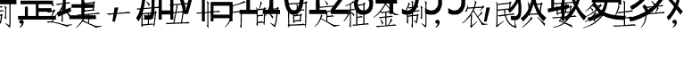

在某省某某县，爱迪生发明了他的第一项发明：自动收报机。他去官府请求专利。因为发明家尤其是一文不名的草根发明家，必须依靠专利费才能生活和继续工作。但县令收下了了他的申请书，请他回家等审批。因为没有关系也没有送礼，这个专利等了两年才批下来。而他准备出售专利挣钱时，竟然没人要——因为市场上已经这种产品了。他去调查，发现生产的人是县令的侄子！他去告诉这种侵权行为，结果县令与法官是老同学，案子一审两年毫无结果。他忍不住要把县城拆掉，巡视又热情地接待了他，真诚表述同情和情怀，请他回家等依法，但纸很快被转回到县里。

这个小插剧其实一一下子解决了两个问题：就是封建主义的问题在哪里，资本主义的相对先进性在哪里。如果并成为一个问题，那就是两者的根本差异在哪里。在许多兄弟眼里，封建经济和资本主义经济的差异是非常明显的。从我们我们在课堂上学到的从生产关系的经典分析，两者似乎就像一个苹果和一头牛的区别一样大。比如：前者是土地封建制，后者是资本主义私有制；前者是分散小农的自然经济，后者是社会化大生产经济；前者劳动依赖于土地，劳动者获得完全身自由，但只有被这个或那个资本剥削的选择，没有被剥削的自由，等等等等。

我认为上面这些都不是最根本的差异。

## （四十七）

如果我们深入研究一下明清代的社会经济，再研究一下英法等国当时的社会经济，你会发现在许多方面国际上走得相当快。把明清界定于封建经济，从表面上，似乎很难出来。举一个例子，在中国的江南，特别是江苏南部：苏州、松江、常州和江宁，纺织业相当发达，明代估计工人高达数十万。从产业的规模，还是工人队伍的规模来看，史上还记载过此类情况，现代也有许多历史学家研究这些课题，发表了许多论文。再举一个例子，中国的金融业在明清代比较发达。山西山西。据《平遥票》等文献记载，平遥票在清代就出现了经营权与。

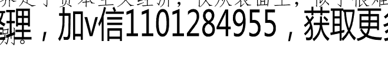

这种制度安排在清代是相当先进的。经营权与分离，以及“银股”“身股”等做法。这些做法在今天的中国，也是相当先进的。因为东家（通常是有钱的人）叫做大柜（即职业经理人），按照当时的规矩，大柜拥有完全独立的经营权，除了年底工资。后来为了防止“大柜”不负责或竞争，山西给出了办法，谓之“银股”。后来为了稳定队伍，“身股”又应用于工作。东家为了获取更多转让和继承，“身股”由大柜扩大伙计，实际上是通过股份来稳定队伍的产权安排。

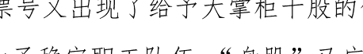

这种制度安排在当时（清代后期）是相当先进的。十八世纪和十九世纪，西方微观管理方面的知识不多，所以发现同时西方出现这种产权。

很多例子。继续举下去，还有很多国家，尤其是美国和法国。股市使分散资金有效地集中起来，投入拉动社会发展的项目上，使人类出现前所未有的排山倒海的力量。比如，十九世纪下半直到二十世纪，铁路股票是美国股市最抢手、最稳定的龙头。美国通过铁路投票到铁路建设上，高峰每年建成铁路万公里以上。我记得以前看过一个资料，美国最多时候拥有铁路三十万公里，一些铁路修了又没有，所以后来又拆掉十万公里，形成了今天多万公里的规模。要知道，咱们中国苦心发展了多年，到今天铁路还不到十万里呢。可见市场中社会资金的威力。

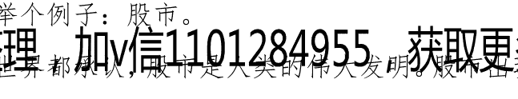

股市应该有资格算是一种“资源有效配置”的制度了吧？但是，如果社会成员没有足够的维护自己财富的能力，没有办法对利益集团进行有效的均衡，那么股市制度就可能走形沦为圈钱的工具。这样就会造成两个问题：一个是圈来的钱没有适用的地方，而受损失的投资者无可奈的；二是公众可能不再相信股市，以后以“入市需谨慎”，或者干脆不入市。这样，这个先进制度就不能完全发挥先进作用了。

如果再进一步说，证券是现代社会最大的投资渠道。如果证券公信力降低，社会资金不敢胆进入，势必引起储蓄率居高，而且可能迫使社会资金转向其它领域，如房市。房产又是以价值为主要目的，资金浪费了。

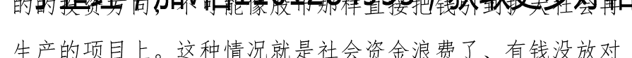

对于中国生产者的财富自保能力，我认为还要进一步一下。（待续）作者：奉行核对外外交政策 日期：2011-09-24 09:20

## （四十九）

在明代，藩禄问题，即藩王的问题。一个学者甚至认为明代基本上不是亡于李园或国王，而是藩禄。通过这个问题，我们可以看看在中国封建社会由于生产者（主要是农民和工商者）没有制衡能力，由于消费者的疯狂扩张最终彻底压垮了经济。具体来说：明代大统制，内部基本是不存在的，是“大一统”。皇帝朱棣是从燕升级来的，所以怕藩王夺，财富被别人夺。首先，藩王没有就业机会，由于不能出城，所以藩王就要住在家里。最多到城，城里的面积只有几十平方，县域以内只有几百亩。例如江北河洛，城里只有几十平方；广西永宁，城里只有一百平方。

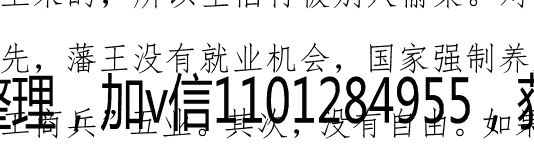

这些藩王人口很大。我在网上看到一个学者发表的《明代山西藩王人口增长与统计》的论文，他估计明代初山西藩王高达百万，明末近乎百万。如果是真的，那山西也够呛。明代这一个王朝，藩王丁高达三十万。这些，，，，，，，，，，的。宗王只是一个方面，物资富足的老百姓负担越来越重，无可奈何。

清代，，，，，，，，的。整理整理，，，，，从清代经济发展轨迹来看，如果让其自行发展，它也将很难逃出历史的循环。必要对清朝多说几句。国家人口是最重要的经济因素。清朝人口问题比较奇怪，中国土地人口总是在大致一个水平上波动，全盛期人口在5000万至1亿之间，战乱期降至5000左右甚至更少。学者认为明人口可能达到1亿。

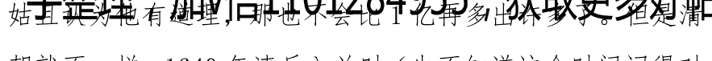

清朝就不一样，1640年清兵入关时（也不知道时间记得），全国人口应在1亿以下，四川损失尤其严重。到1840年鸦片战争后，中国人口达到了惊人的4亿，占世界的三分之一以上。我们真是苦出生生，很适合打群架。同一时期，西方世界也出现了人口快速增长，进入近代社会以后，生产力和医学技术明显提高的产物，很好解释。而中国仍然处于传统社会，生产力和生产工具较以前没有出现什么变化。为什么会出现这个人口增长呢？中外专家提出了诸多论，比如清朝有近200年的国内和平（不含边疆地区），比中国人发明了预防天花的种痘技术，比如时期消费税，比如气候周期的影响。我更倾向于认为，人口增长的主因是由于明后期玉米和红薯的引入。这种作物大家都很熟悉，但是刘备、李世民、李东坡和朱元却不认识。它们原产南美洲，是印度第一人培养出来的。西班牙殖民者南美获得了它们。碰巧菲律律也是西班牙殖民地，它们就被带到了吕宋帝国。然后，大明万历前后，华侨们把它们带到了老家。黄河流域主打小米，产量低死，到今天再也没种上去。南方主打红薯。后来又引入小麦。由于外来因素打破，清朝没有像前朝那样农民起义。

（四十八）

上贴的最后一段，我提出这样的观点，就是两种制度的根本区别不是财富制造者保卫财富的能力。刚才才有位兄弟回贴，“经济与政治制度、体制的优越性与，要体现在资源的有效配置和财产的合理分配上”。这句话很对，但是我认为我的可能更到位，因为我强调的不是体制，而是维护自己利益的能力。能力是原因体制是结果。只有社会成员拥有这种能力，才能形成相互衡；只有真正的制衡，才能形成非暴力博弈和和平协商；平等协商最终相互妥协的结果就是合理的制度和体制。反来说，如果社会成员没有这个能力，就无法形成平等协商，强一方单方面出的制度，势必有弱势一方利益。即使从外引入合理的制度和体制，由于社会成员没有能力制衡，无法形成有效监督，制度很容易走形。


那么我个人认为，此后200年，中国人与西方的生活水平差距一直在扩大，直到1979年改革开放。清末和民国时期，这种差距扩大的主要原因，是由于生产力不发展或发展慢，国内外战乱频扬，对社会破坏严重；建国以后改革开放以后，虽然人民生活水平明显提高，但与西方差异仍然在扩大，主要原因是生产力虽然发展但偏重于工业，计划经济社会积累率高，同时人口相对增长过快。

记得1990年代时候，我在新闻联播上看到一则关于苏联以后人类生活凄惨的新闻。一个莫斯科妇女对着记者说，她的小孙子已经两个周没有喝过新鲜牛奶了。我当时就觉得喝牛奶的，这算什么生活困难，本人三岁以前都没有见过。

话接着接着。在十五世纪末后十年，欧洲概四分四裂，纷争不已。地理大发现伊比利亚半岛上演。这个半岛属于西班牙和葡萄牙，所以你可以称它为伊比利亚半岛。1490年代里，西班牙的哥伦布和葡萄牙的达伽马分别登陆航海，发现了美洲大陆和绕过好望角印度的商业航线，大航海时代，或者称殖民时代开始了。

分析欧洲历史进程中你会发现，其资本主义经济发展的动力，一是商人阶级相对自由（用脚投票），二是国家之间的残酷竞争。二者的背后，则是全社会从上到下的强烈的逐利之望。当时，二家子们在海上争得不可乐乎，都想当老大，谁搞一船香料回来，或者谁在海外发现个新岛，都会把别人刺激得好几个晚上睡不着觉。

当时，他们对东方的认识源于《马可波罗游记》，此书与本文倒似乎有些似之处，基本属于回忆加抒情型的类型。这书把东方讲述得地地金道，好像只要到了东方的风景就是被天砸下的金块砸死似的。当时土耳其运河还没打通，由于东方贸易被阿拉伯人垄断了宰权，他们跟欧洲做生意的派头像做戏。二家子们就玩命寻找向印度的航线。达伽马终于发现，向南、向南、再向东北迂行，就可以绕过去。哥伦布不幸错了路，意外地跑到美洲去了。他打人都整理了一份发现报告，收获的就是更多帖子。

到今天中洲美的群岛仍然被叫作印度岛，美洲原住民仍然被叫作印度人。富有欧洲人喜欢的珠宝、宝石、丝织品等。网上资料说，达伽马船队每次之行的利益，是成本的50倍。考虑到马克思所言的“有10%的利润资本就会蠢蠢妄动”，这个利润率如果是真的，那足以让整个欧洲的疯狂。我们必须看到，欧洲伟大的航海先驱，几乎没有一个是善类。估计当时欧洲好点的面也不去那个险。哥伦布残忍劫掠和屠杀印度人，达伽马为了控制印度商业利益，甚至伏击阿拉伯船队劫平，他们的实际行为与海盗无异。

径可见，但是客观上，这些人成为近代经济崛起的先驱者。正是由于欧洲小国的相互竞争压力，人的逐利冲得以释放，为了发财，一波又一波的人赴海。相对于清代中国人普遍存在的重土安浅、死守故国的弱保守心态，这种勇于冒险的生命传奇更为可贵。当年的航海和通信技术都不比今天，一去几年没有音讯，海上遇到什么危险只能自其服，踏上异国还有许多风险和疾病。无数的商人和水手永远没有回来，他们的妻子子女，却仍日复一日，年复一年地守望海边，等待那艘能够带他们带来富裕生活的归帆。正如电影坎布莱主题曲《Sailing》那种沙哑苍凉：

Can you hear me dark night
I am dying
Forever crying
To be with you
Who can say

如果再套用中国一句古诗——可怜天涯底骨，就是春梦里人！所以大家不要在天涯里继续潜水了哈。

（五十三）

主观上是贪婪，客观上是勇敢，总之，欧洲人对未知的开拓得到了历史的慷慨回报。南美、北美、澳洲三大殖民地加上哥萨克骑兵对西伯利亚的开拓，共有近6000万平方公里的土地和无数宝藏成为现代西方人的生存空间。与郑和船队的巨大航海，在达尔伽马到达印度之前五十年，就已经消失在印度洋的落日余晖。

如果历史可以重来，我多少希望自己能够带领一支船队，集一帮曾经穷到不知的好兄弟，奔向重洋上演中国人的生命传奇，在自己把撒种的同时也为孙后代开拓土。那样今天的世界地图上，也许有新西兰、澳洲、新威尔士、苏州、重庆。

## 第一章 为什么欧洲领先于东方

两句话让世界从四分四裂的封建小国里爬出来了。其实，从十五世纪末地理发现，到十七世纪英国工业革命，再到十八世纪法国革命，前后用了二百年。总之，历史是漫长的，道路是曲折的，利益是真实的，斗争是必然的。现在回头是很清晰，当时是很疯狂。分析欧洲历史进程中你会发现，其资本主义经济发展的动力，一是商人阶级相对自由（用脚投票），二是国家之间的残酷竞争。二者的背后，则是全社会从上到下的强烈的逐利欲望。

从十六世纪到十九世纪，欧洲资本主义逐步崛起。对比欧洲国家与东方帝国：

| 区域 | 面积（平方公里） | 人口 |
| :--- | :--- | :--- |
| 欧洲国家 | 几万 | 几百万 |
| 东方帝国（如中国） | 几百万 | 几亿 |
| 奥斯曼帝国 | 跨越三大洲 | 千万 |
| 印度帝国 | 统治印度北部 | 人口密集 |

由于欧洲小国的相互竞争压力，人的逐利冲得以释放，为了发财，一波又一波的人赴海。相对于清代中国人普遍存在的重土安浅、死守故国的弱保守心态，这种勇于冒险的生命传奇更为可贵。

奥斯曼帝国在工业和军事上的巨大优势被欧洲逐步超越。到了十九世纪，奥斯曼帝国败再败，在第一次世界大战中站错了队，成了败国。欧洲文明延续了六百年，曾经并占奥庭、维也尼亚、莫斯科、全非洲的超级大国，被分割成块殖民地和小国家，就是今天的北非、亚洲、巴尔干半岛的前身。要不是凯尔领导群众闹革命，按照欧洲战胜国的协议，土耳其现在的地点都保不住。

（五十四）

大家可能发现，这两周我发贴挺多的，因为我已经整理好了。最近忙碌的阶段已经开始了，只到十月底。平时我不更新了，兄弟们不要骂。经济问题千言万语。我在前面聊了经济概念，以及古代经济发展的脉络。再往后呢，我们再聊经济和市场两种形态的形成、演变、优缺点与最终融合，最后再细聊中国经济崛起。从古代转入现代之间，我想再插入几个帖子，一步探索一下我们中国古代为什么会在自然农经济的基础上，形成世界上独一无二的大统专制帝国，这种形式有哪些历史功绩和历史局限性。我前面已经至少两次提到过，我认为大一统的、中央集权的、封而不建的帝国，是中国别于世界的最突出的特征之一。把这个问题讲透，有助于我们理解当代中国经济和其他社会问题。这不是纯粹文化的问题，我想在前面文化部分里讲，但它也不是纯文化问题，与经济的联系更直观一点，所以放在这儿算了。

我说过，中国的封建帝国是封而不建，有贵族王侯自治，但没有在帝国内部建立王国国家，帝国内部采用了行政区划制度。先是郡县制，然后是郡县制，最后是州县制。再整理一下。同时，中国发展出了一套世界延续时间最长、体系最完善的文官选拔制度，即旧科举。流官制和科举这两个制度加起来，再配儒家家国天下的伦理体系，使中央政府得以通过任制的委任流官来统治广大的面积和人口。皇权通过委任状交给流官来施行。儒家的精英思想在古代中国造成了一个相当稳定的执政集团，在宋明时代，实际上是大夫与天子共治天下。在清时期，虽然天子相对强大，文官集团在执行中实际上拥有相当大的裁量权。

地理决定论能否完全解释汉族的问题？世界性的大民族恰好形成于中国东部、印度北部、欧洲大部分以及东北地区。而世界民族呈现“少而多”的地区，基本上都是深山、外高加地区和俄罗斯加索地区、中国西南山区。

为什么只有中国形成了真正意义上的统一？因为中国的平原面积虽不算，但人口密集。在平原地区的民族交易容易，所以融合较快；而在其他地区，由于地理阻隔，民族逐渐迁移，分化出许多民族。在平原地区，由于语言文化的一致性，使得民族在扩张上是统一的。

在民国以前，中国的基层政权是县自治。这种以家族为核心的宗族，在微观上规范社会行为，基本一致，只是规模不一样。这就是中国统一帝国的实质：一个强大的家长制。在生产力水平下，这种权威是绝对的。

世界上曾经出现过大一统帝国，但并不是只有中国一个。大家知道，现在主流的文字有两种，一种是拼音文字，一种是表意文字。大家一看懂，不用解释。拼音文字也叫字母文字，创造了一套字母系统，通过字母和韵母拼合出语言。表意文字是从象形字演化来的，一般手写连接接读音。这种分类法不是绝对的，拼音文字里也有表意的成分，表意文字里也有音的成分，如汉字中的声部、偏旁。汉字中80%是形声字。

汉字是目前世界大语种中唯一的非拼音化的表意文字。中国古代大一统帝国形成，占绝对多数的主体民族；后汉族形成的秘密，在于汉字。

民族的发展壮大的途径，不外使用“生化武器”。生，就是出生，化，就是同化。一生二化，发展壮大。但这并不是只有中国人知道，全球人都知道。历史上，有一些民族经常把刀架在别人的腰子上推行同化政策。古代中国虽然发生过征服战争，但是相对来说，历代的民族政策策略都是比较温和的。在“生”上没有突出优势，在“化”上又没有强硬手段，却发展出一个十亿成员而且自认认同感强的民族，这个点有点不可思的。

族为一个跨越北、湘、吴、赣、豫、粤、客八大方的统一民族，欧洲人却做道扬标形成了这么多多个民族。

秦皇统一文字的做法可能可能出现在使用方字的中国。因为中国字不是拼音文字，没有因各地语言差异带来的改革阻力，最多只有各人书写习惯带来的阻力，这个阻力是很小的。中国人可以甚至根本没有意识到这是一个奇迹——在长达三百年大分裂后，重新统一的隋唐帝国，在全国竟然没有遇到任何字体留下的文化障碍，反而迅速创造出了辉煌灿烂的大唐诗传。

待续

文字的汉字，方言巨大的中国各地共同获得了一种读音不钩的文字。汉字构成的正式文体，巧恰与全国各地的口语都不钩的文言。所以在大统一时期，中国官话几演变。从宋代的开封官话，到明明的南京官话，清代的北京官话。如果是拼音极可能出现巨大的变动，而汉字纹丝不断。在分裂时期，各国官话差异很大，比关和和岭的割据王朝的官话几乎不通，如果是拼音文字可能演化为不同文字，而汉字通行天下，继续丝缕不动。难怪古人记载，当年汉字造字，成功之时，“天雨雨，鬼夜哭”。说明这个新生事物是相当厉害的！

从1910到1950年代的半个世纪里，汉字差点就被判判了死刑，直到中央确定了简化的方向，才算告免。从目形局势来看，以后中国人再给汉字判死刑的可能性是不会有的。但是，在世界语言发展的激烈竞争中，这个硕果仅存的文字将会不会落败：

在七十年代末、八十年代，汉字直接面临另一个生存危机。当时信息化浪潮兴起，电脑的运用成为时代主流所以用键盘单单词方便。而汉字的常用字有四千多，字型太复杂。汉字与计算机不兼容，势必在时代彻底出局。这个时候，中国出现了文化英雄“二王”。汉字的激光照拍照技术，是中国印刷业和出版界的革命。王选也被誉为“当代毕寿”。前他去世，开追悼会，胡晓帅带领中央政治局全体常委会来到八山去给他鞠翁，可见他对中国国贵的贡献之大。另一个英雄是王永民。我正用这个老儿发明的五字型字写这个贴子呢。

我认为“二王”的共同点，就是从汉字的构成的汉字笔划入手解决问题，用汉字笔划与计算机信息挂钩。举个


例子，拼音输入也是一种非常常见的输入，但它没有从根本解决汉直接输入问题。它的工作原理的实质，是在人脑里把汉字转换拼音字母，拼音字母通过键盘输入进去，在电脑字库中调出这个读音汉字，由于重音字太多，就会出一个列表让你选，你一选，又把拼音文字在电脑里转回汉字。由于这么转了两道，输入速度受到影响，我上字时的打字比，拼音选手总被五笔选手干掉。不知道现在情况困转了没有。

这个例子是一个反例，我懒得从正面论述“二王”是如何让字与计算机妙巧联结的，感兴趣的兄弟自己搜索看看吧。探究汉字的贴子越写越长，太大了，我们再用一个贴子

待续

（五十九）
我有一段时间，我狂热喜欢上了古代地理学。我发现，由中国古代地理的专用名是单字，加上调音问题，直接译英文以后重名多得一塌糊涂。比如，河北有一个冀州，英文直接译为“Zhou”。但距离它不远还有一个蓟县（现在叫彭县），东边山东省有一个兖州（现在叫宁州），南边河南省还有一个汴州（现在叫洛县），南方的江西还有一个吉州（现在叫吉安），译成英文完全一样！如果再找发音相似的地方，那就更多，比如辽宁锦州、辽宁金州、河北晋州、河北景州、湖北荆州、湖南靖州……真让外国汉学家暴死。

上面这个例子，生动说明了英文与中文的差异。有的网友总想把两者比较一下。中文有三四千常用字。如果把汉字与26个字母相比，汉字太大了，如果把汉字与几十万（一几百万）英文单词相比，汉字又太少了。实际上，由于这两个字体体系完全不同，这两种比法都不是太可比性的。一定要吧，就把汉语词汇和英文词汇比较，还基本对等。考虑到一个汉字就是一个汉语单单词，所以如果非要在英文中找一个和汉字等的东西，大概就是英文单音节。比如英文单词“black”就是b_a_ck三个音节。

我是外行，不知道构成英文单词音节总量是多少，研究兄弟赐一下。前几年，网络上有一个热贴指出，表达相同含义时，中文使用的音节比英文使用的音节少，就是中文更简洁。这种现象倒是客观存在的，主要原因是因为英文没有四调。由于中文拥有四调，在表达相同含义时，中文使用的音节比英文使用的音节少，所以汉语简短，英语则必须增加几个音节来表达同样的意思。

例如，汉语中的牛肉、羊肉、猪肉对应单词 Beef, mutton, pork 没有字面上的直观联系，增加了学习和记忆的难度。汉语中的麻雀，英文也叫 Sparrow。汉语中的牛肉、羊肉、猪肉对应单词 cattle, sheep, pig 没有字面上的直观联系，增加了学习和记忆的难度。

在信息爆炸的今天，词汇量呈爆炸式增长。上面我简单把以前过的观点阐述了一遍。对于这些观点我有道理，但是我感觉仅凭这些还足以证明汉字比英文优。其实汉字也存在一些劣势，比如四调的存在，对语言使用者的发音要求更高，错误的可能性也会增加。

最后，我对汉字的评价和展望：在古代，汉字对国家和民族形成发挥了重要的作用。在今天，汉字已经彻底解决了信息化时代的问题。汉字本身与世界主要文字相比并没有根本优劣，它是人类文字中与众不同、与众异。在未来，汉字的地位取决于中国的成就。如果说以前汉字成就了中国，未来中国成就汉字。

待续
作者：奉行外交政策 日期:2011-09-24

(重发)

是我没有把事情说清楚引起争论的，所以我我有责任再说几句，呵呵。

一、关于明代藩户人口的问题。关于明代藩户人口，网友们有争议，所举的数字相差百倍。更有网友把我随口提到的一篇论文的原文和作者都找来了，厉害啊，网上有高人。其实这个问题仁智可以讨论，没有必要拿到定论。以前有些学生总把自己的论文写成历史事件的总结，起到盖棺定论之效，既不需要也不可能。但有一点我坚持，就是明代后期，需要农民和工商者（财富生产者）供养的底层数量很大。这个阶层既包括皇室和藩族人口，也包括庞大的官僚阶层，以及依附于官府的编外人员。对于究竟有多少人享受可以讨论研究。但是，“十肥九外”的基本事实是明代的。其实类似的问题在今天一些部门、一些地区仍然是存在的。

二、关于汉语的拼音输入法的问题。我分析了拼音、五笔两种输入法的工作思路的差异，我并没有判断两种方法的优劣好坏，所以拼音的兄弟不用生气。由于拼音输入法不需要专门学习和练习，所以使用者要多于五笔。这几年，拼音输入法的改进速度快得多，比如联想式的词组输入，很好用。更快，主要原因可能是它的使用者更多，市场需求更大。我以前上学时，打字和开车之类的东西都属于专业技术，所以还有人组织比赛。现在这些技术都是社会必备的技能，也没有人再横比赛了，所以我我在前面贴子里加了一句，不知道两种输入法现在比赛一下结果会如何。

三、关于“五胡乱华”这种提法是否有沙文主义的问题。有兄弟认为，同化、五胡乱华这种提法本身并没有沙文主义的。我思考了一下。同化这个词本身并没有什么方向性的指，在中国漫长的历史中，胡人化与汉人化现象都是存在的。但这个词用到讨论汉族形成的文章里就隐含了同化的方向性，所以我接受这个批评，以后改用“融合”这种更中性的词，看这样好不好？

至于五胡乱华，我认为这个词应该没有什么沙文主义。虽然历史上没有国际法，国际法盛行之前，所谓的“胡乱华”这个说法指的是南北时期，游牧民族对汉族进行掠夺。具体到每一个历史事件上，五胡乱华这个说法没有问题。同理，“五胡乱华”这个词是不是沙文主义？因为游域这一类的词是中性的。

总结一下，“大一统”的优势是集中天下之力，保卫了民族生存空间。其实我们的运气是好，历史上影响最大的几个游牧民族都跟我们邻居，万里长城。先是匈奴，从战国打到汉；再是突厥，从北朝打唐；然后蒙古，从南宋达到清。其实还有一个强势民族就是女真，后来叫满洲，从明到清一代完全融了一家人，所以没有把他们列进来。

（十一）
以前的贴子里，我认为西方资本主义兴起的原因与其文化差异有关，西方存在内部分裂的格局，而东方存在统一民族的根本原因是汉字。现在我认为这个问题基本说差不多了。从世界千年历史来看，“大一统”具有明显的优点和缺点。我认为“大一统”最大的优势是集中精力，打赢了几场决定民族命运的重要战争。二，“大一统”形成了统一市场，促进了经济技术的交流和发展。实际上中国的经济和科技发展水平曾长期在世界上较为领先的位置，清代中期才开始明显落后。三，“大一统”使中国在较长历史时期，国内保持了稳定和平的社会局面，对百姓有正面作用。其主要弊端是，“大一统”皇权与官僚势力过于强大，极为缺乏制衡。国家之外缺乏竞争压力，精英阶层（知识分子、工商者、技术人员等）缺乏在不同国家之间选择的空间，限制了思想自由和民权伸张，所以在明代以后成为中国进一步发展的重大障碍。另外，由于“大一统”国家庞大牢固，一旦出现崩溃，对社会经济和人口的破坏是非常严重的。

游牧民族人口少，社会发展程度低，所以打赢他们不足奇。人类历史在进入近代社会（即资本主义社会）之前，最强悍的是游牧民族。如果在操场上对立，每20个汉人围住1个匈奴，这就比较好了。但实际击不是这种打法。两个国家进行对抗，不是比拼双方家里有什么家当，而是比拼双方家里哪些可以拿出来有效地参与对抗。换句话说，就是国家的军事动员能力和经济动员能力。如果不能有效动员，人多是不用的。冷兵器时代，骑兵战斗力远高于步兵。游牧民族恰是人与马精熟，马又是每个国家（部落）最重要的因素。整个民族就是一支部队。农牧民族就不一样。首先是缺马不是没有马，问题是数量少、质量差。农牧社会中，马的作用不如牛，牛能拉车还能犁田。所以为什么古代中国把云南四川茶马作为战争物资？因为通过茶马交易就能搞定马。其次是中国农民不善骑马，能掉下来死就很不错了，更不要说边跑边射箭。等长大了参军再比从小背上长大的敌人差太远。农牧社会一般比游牧社会拥有更多财富，但这些财富在打仗时用不上，比如军事物资供应。游牧民族在长期游生活中训练了机动能力。而农牧民族的士兵不能自己解决问题，兵马不动粮草先行。当年诸葛亮发明木马流，军粮仍然供应不上。如果他们军队出击到草原大草原，后勤就更困难了。

骑兵和供给只是两个方面。国家动员能力包括动员的速度、数量、质量等方面。在绝大多数方面，农牧民族等都不占优势。所以，不光中国人，西方、伊斯兰和印度的农耕文明，在游牧民族面前都被挨打。被汉朝、陆朝的匈奴西迁到欧洲之后，蓝蓝在匈牙利一带，四出四哈，所向无敌，被称为“上帝之鞭”，打得罗马帝国崩溃。后来的奥斯曼帝国是伊斯兰文化的众多突厥语国家（土耳其、阿塞拜疆、土库曼、哈萨克、乌兹别克）。蒙古骑兵把世界四大文明打跑了，让全成吉思汗。

（十二）
终日奔波苦，不如饭对等。兄弟们，更新了，没有办法。感兴趣的每周看一次就可以。


所以理论上应该不存在过度生产问题，没有过度生产，自然就没有市场竞争。那么价格如何形成呢？一头斧子换两头羊。

从思路上分析，市场经济是一种自下而上的经济思路，强调经济活动主体的自发性和自主性。计划经济是一种自下而上的经济思路，强调经济管理的自觉性。这两种经济模式在冷战时期对立多年。双方都认为自己行，对方不行。

所以他们从理论上分析然后举例说明，不断指出对方的弊端。一个需要十个贴子，我不想去抄书，感兴趣的兄弟们看到，我只写自己的理解。

“你不知道！”一个生产者计划经济批评市场经济：“你真的知道？”——理论。

就去生产了，其实还有一百万生产者都跟他一样的，结果牛奶多了，倒到阴井里去了。橘子多了，倒到大海里去了。

DVD生产了，总经理也很无奈。用一种标准的话说，就是企业生产的组织性与生产的无组织性的矛盾。再往深挖，就是“生产资料私有制和社会化生产的矛盾”。

而市场经济反问计划经济：“你真的知道？”——理论上的按需生产，实际上出发点为了防止倒牛奶。但是，实际上社会需求千变化，社会产品种类万，计划委员会千山万丈，作出的决策千差万错，生产出来的产品不是多少是，而且绝大多数是。

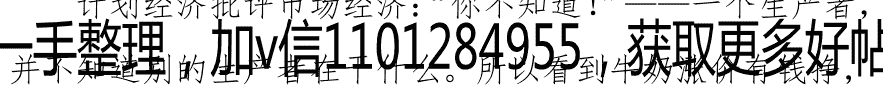

(待续)

## (六十四)

昨天，在经济上已经得到随时可能崩溃的欧盟，指望着中国去购债救市其，但仍然是瘦子拉硬车，坚决不承承认中国的市场经济国家地位，认为中国政府对经济控制太多。这就意味着许多针对中国产品的贸易壁垒会继续存在下去。恐怕这几天，中国和欧盟的专家们我们将为了“中国到底是不是市场经济”这个问题又开始新一轮论战：

什么是市场经济？前贴提到，标志其实就是一句话，以市场决定产品价格、以竞争决定企业生死。但是具体经营起来，值得抒情的地方太多了。在资本主义发展的早期，这个纯粹是不存在的。只要有政府在那里，他必然会有相应的管理，只是一个多或少的问题。那么政府到底要干预多少、如何干预、何时干预，才算合理干预，而不会影响市场经济的性质呢？大家吧。

有人很早就意识到这个这个问题，认为政府这个机构本身是一个贪恶不赦的帐痞，主张无政府主义。许多中国人可能认为是，无政府主义就是像李逸一样无官指挥，奋夸上街打砸。这是一个误解。其实无政府主义还是一套有思想和内涵的政治理论体系。它提倡社会成员完全自由和和平的，在自愿互助基础上，通过协商进行社会自我管理。早年有人

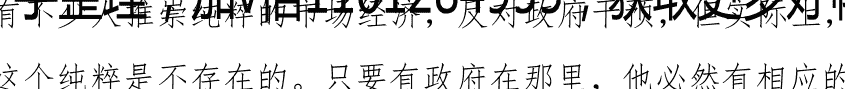

为了践行这个主义，帮他们跑遍荒山上建立社区。这个主义虽然在国家层面不具可行性，但对西方社会还是产生了一些积极影响。比如居民自治、非政府机构等。前两年老龙口口说过一句“感叹中国人还是要有人管”，结果在网上被曝了半死。实际上这句话并不对，但而是反映了一定的客观事实。中国人的自我管理意识确实不如如方，比如看到小区垃圾堆成，美国居民可能会自己聚在一起开会商务，中国居民的第一反应往往是“有关部门为什么不来一管？”这个差别，可能就是源于中国长期的强势政府局面，几乎没有出现此类思潮。

忙远了。在资本主义早期，许多资本主由于不受整理，认为人为要先国家，特别强调成员的财产和自由，主张政府在经济上要“无为”而治，可能让权力于市场和个人。此所早期的市场经济比较“纯”，不会像现在的奥巴马政府挥狂万亿亿美元救市。管不管是经济方面，还是在思想、宗教、社会管理等方面，他们也是这种态度。这种思潮被称为自由主义的。刚才提到了无政府主义，可以看作是自由主义的一个极端形式。自由主义警告警告政府少为妄，无政府主义者极端到连政府都给踢了。

在那个时代，市场规则不健全，填家拐骗问题严重，劳动者权益得不到有效保障（西部铁路“每根枕下都有一个工人的尸体”），社会保障制度也不完善，失学的小女孩去卖火柴。市场供求刺激出来的过度生产，最终酿成周期性经济危机，在社会健全全人饿饭的情况下，经济萧条引发了工人起义。但是，那边的人都起来了，自由主义的一些信徒们仍然坚信，一切问题都可以通过市场调节和社会自我调节来解决，政府不用出手。终于有人绷不住了，觉得这些事情政府多少还是得管管吧？要不收那么多税干干什么？这些人后来被称为新自由主义，即积极主张政府的自由主义。

待续

（六十五）

计划生产，目标是避免以往模式的社会资源浪费，真正实现按需生产，从劳分配向按需过渡。一个怀怀“物质极大”的政治家，基于某种社会深入思考时，很有可能想到这一步。不幸的是，这种曾使得“物质极大”的制度设计实行，不管社会有多富，最多几年就变得什么东西缺。从苏联、中国（改革开放前）、古巴、越南到朝鲜，光辉理想，惨淡现实，人间最大的痛苦莫过于。

计划经济中，生产是依照计划决定的，需求则是依照计算来的。从理论上讲，很容易通。但是实行起来就很困难。因为我们对于各类产品的短期、中期、长期需求掌握得不是准。特别是苏联、中国这类大型国家，各地情况千差万别，统计不好。记得以前看过一篇论文，是对建初期一些县接到统计的研究。比如全县的母猪数量，接下来的明年母猪数量，很难办。这种强制性要求各种数据的做法当时十分盛行。规则就是这样的：如果你是县政府，接到任务，根本不可能计算。这时有两个选择：

- 如果你担心，可以根据以前经验直接拍数据上去。
- 如果你已经老练了，你可以发紧急通知给各乡镇，命令他们上报，认真安排，确保统计准确不漏，由负责人签发盖章。这样以后即使出了事，起码你自己会负责。

因为经济形势和社会需求是随时变化的，即使准确的数据去预测都很准。

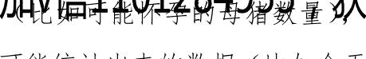

这种情况下做出来的决策效果就可而知。有一个苏联笑话，说是当年最可怕的先进武器：前面是坦克，然后是火箭，后面跟着原子弹，队伍最后走着几个戴眼镜的人。介绍这几个是计划。

（六十六）

兄弟们在学校要定，资本主义的主要矛盾，我们当前的主要矛盾是“人民日益增长的物质需求与落后的生产力之间的矛盾”。当时按老师的要求，并没有觉得怎么样。现在突然起来，我忍不住笑出来：这意思不是东西多卖不要，东西少买不着！真难为理论家们，大家都知道的问题了。眼下，中国已成为世界工厂，生产制造能力大得吓人，不知道课本上这个“主要矛盾”的提法跟上了没？

上学时，我光从计划经济层面分析，脑袋当时冒出一个疑问：如果这种体制靠计划经济组织生产，而计划


又面临信息不全的问题，所以计划不能与实际需要吻合。那么在理论上，生产多了与生产少了概率是一样的，所以社会应该是有的太多，有的太少。可实际情况却是，计划经济几乎是全面的短缺，所以江湖人称排队经济。这是什么呢？

这就出了计划经济另一个更要的问题：社会激励问题。如果说计划的科学性问题还有改进的余地，那么社会激励问题就是根植于计划体制本身的问题，很难解决。我也不列举了，想到哪里儿生产哪里儿，计划经济的激励问题主要表现在几个方面：

第一个表现是收入问题。我那时候跟着爷爷奶奶生活，记得当时猪肉店是国营的，好像叫什么副食品第一商店。这家商店在京河的小街口，门口有棵大枣树。他们八点上班，七点半以后就会有人排队。等到八点过后，可见售肉员骑着自行车啃着卷烟慢悠悠地来，锁好车辆进后台，然后很久才换好行，然后很久才把今天的肉解开，一点都没有效率。由于我奶奶认识这个小童，所以我总能吃到挂肉比较多的排骨。肉店的邻居是一家理发店，是街道集体所有制的单位，同样有几个慢悠悠的同志守着。他们总在报没有肉的国营身份待遇好，所以积极更差，所以有人在坐长椅上排队。

当时的说话说，理发刚一半就下班了，可见顾客明天再来。这个情况我倒没有见过，我只亲见过理发师看一半就下班了，可见顾客明天再来。我生活在南方城市，由于工作忙碌，经常加班到深夜才回家。总喜欢在楼下的烧烤摊吃肉串，然后灌瓶啤酒。烧烤摊由于顾客太多，所以老板会在晚上一个开始关门，一边收一边张望，看着旁边的水果，突然醒想吃西瓜。

（六十七）

这种维持大锅饭是比较公平的。不这种情况下，如果工资与绩效挂钩，员工身份相对稳定（铁饭碗），都没有积极性，社会生产普遍低下，财富创造不能发挥出来，这是造成短缺最重要的原因。很快人们意识到了这个问题，进行了一些改革。不仅中国，许多资本主义国家企业部门问题也很突出。实际上，从工资入手进行改革，效果并不理想。90年代初，我已经看到了几轮工资改革，国有企业仍然是那个老法子。

计划经济形成企业体系，想要搞活，不仅仅是工资与绩效挂钩那么简单的。这些内容，等到中国改革时再详细描写。刚聊了收入原因，计划经济之所以造成短缺，第二个原因是物价原因。当时物价是算出来的，就是原材料、能源消耗、运费和人工，然后长期执行。改革前，这种规定可能高也可能低，但考虑到国有企业的低工资情况，定价偏低的可能性更大。

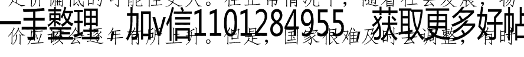

正常情况下，随着社会发展，甚至二十多年不调整，这样物价会进一步偏低。所以计划经济国家，一旦经济转轨，必然是物价上涨，还没有一个国家出现物价下跌。即使没有读过经济教科书的兄弟也清醒，物价可以调节生产和需求。在纯计划经济条件下，企业按指令生产，所以以物价对生产的调节作用不大，但对需求的调节作用仍然存在。如果物价偏低，则需求会大大增加，原本就短缺，这样显得更加不够。

更为麻烦的是，在计划经济条件下，许多产品是直接配给的，或者是没有价的，比如住房。那么根据经济家的解释，消费者会抢夺那些免费商品，直到消费行为的边缘收益为零。我每次坐飞机，捆好安全带，赶紧紧跟旁边的兄弟交道：“不管空姐发什么我都要啊！”兄弟点头：“好的，我替收着！”我这才安心睡去。飞机上的食品、小吃、饮料或其他东西，其实已经强制性地包含了机票的票价里了。对于已经付了票款的我而言，再去消费这些东西相当于免费，所以我理应当来者不拒，吃不完兜着走。由于计划经济条件下，人们对这种免费的东西的需求自然极大。这也是促成短缺的重要原因。

我小时候读过一篇短篇小说，小说主题思想是反映左思想对孩子的毒害。内容大概是老师在课堂上出了一个谜底是脑的谜语：“的大脑，长的脑袋，长的尾巴，是什么？”一个孩子说：“我是爷爷！”哈哈。这篇小说产生于文章结束，创作水平并不很高，但真实反映了现实。

前面提到了计划经济造成短缺的两个原因。除此之外，国家对私人经营的限制，也是造成短缺的重要原因。但是，计划经济毕竟是国家规模实施的一个模式，如果不是人为限制，肯定不会达到影响。

早年有人，老龙口口说过一句“感叹中国人还是要有人管”，结果在网上被曝了半死。实际上这句话并不完全对，但而是反映了一定的客观事实。中国人的自我管理意识确实不如如方，比如看到小区垃圾堆成，美国居民可能会自己聚在一起开会商务，中国居民的第一反应往往是“有关部门为什么不来一管？”这个差别，可能就是源于中国长期的强势政府局面，几乎没有出现此类思潮。

忙远了。在资本主义早期，许多资本主义由于不受整理，认为人为要先国家，特别强调成员的财产和自由，主张政府在经济上要“无为”而治，可能让权力于市场和个人。这种早期的市场经济比较“纯”，不会像现在的奥巴马政府挥狂万亿亿美元救市。管不管是经济方面，还是在思想、宗教、社会管理等方面，他们也是这种态度。这种思潮被称为自由主义的。刚才提到了无政府主义，可以看作是自由主义的一个极端形式。自由主义警告政府少为妄，无政府主义者极端到连政府都给踢了。

在那个时代，市场规则不健全，奸拐骗问题严重，劳动者权益得不到有效保障，社会保障制度也不完善，失学的小女孩去卖火柴。市场供求刺激出来的过度生产，最终酿成周期性经济危机，在社会健全全人饿饭的情况下，经济萧条引发了工人起义。但是，那边的人都起来了，自由主义的一些信徒们仍然坚信，一切问题都可以通过市场调节和社会自我调节来解决，政府不用出手。终于有人绷不住了，觉得这些事情政府多少还是得管管吧？要不收那么多税干干什么？这些人后来被称为新自由主义，即积极主张政府的自由主义。

待续

计划生产，目标是避免以往模式的社会资源浪费，真正实现按需生产，从劳分配向按需过渡。一个怀怀“物质极大丰富”的政治家，基于某种社会深入思考时，很有可能想到这一步。不幸的是，这种曾使得“物质极大”的制度设计实行，不管社会有多富，最多几年就变得什么东西缺。从苏联、中国（改革开放前）、古巴、越南到朝鲜，光辉理想，惨淡现实，人间最大的痛苦莫过于。

计划经济中，生产是依照计划决定的，需求则是依照计算来的。从理论上讲，很容易通。但是实行起来就很困难。因为我们对于各类产品的短期、中期、长期需求掌握得不是准。特别是苏联、中国这类大型国家，各地情况千差万别，统计不好。记得以前看过一篇论文，是对建初期一些县接到统计的研究。比如全县的母猪数量，接下来的明年母猪数量，很难办。这种强制性要求各种数据的做法当时十分盛行。规则就是这样的：如果你是县政府，接到任务，根本不可能计算。这时有两个选择：

- 如果你担心，可以根据以前经验直接拍数据上去。
- 如果你已经老练了，你可以发紧急通知给各乡镇，命令他们上报，认真安排，确保统计准确不漏，由负责人签发盖章。这样以后即使出了事，起码你自己会负责。

因为经济形势和社会需求是随时变化的，即使准确的数据去预测都很准。


这种情况下做出来的决策效果就可而知。有一个苏联笑话，说是当年最可怕的先进武器：前面是坦克，然后是火箭，后面跟着原子弹，队伍最后走着几个戴眼镜的人。介绍这几个是计划。

（六十六）

兄弟们在学校要定，资本主义的主要矛盾，我们当前的主要矛盾是“人民日益增长的物质需求与落后的生产力之间的矛盾”。当时按老师的要求，并没有觉得怎么样。现在突然起来，我忍不住笑出来：这意思不是东西多卖不要，东西少买不着！真难为理论家们，大家都知道的问题了。眼下，中国已成为世界工厂，生产制造能力大得吓人，不知道课本上这个“主要矛盾”的提法跟上了没？

上学时，我光从计划经济层面分析，脑袋当时冒出一个疑问：如果这种体制靠计划经济组织生产，而计划


又面临信息不全，所以计划不能与实际需要吻合。那么在理论上，生产多了与生产少了概率是一样的，所以社会应该是有的太多，有的太少。可实际情况却是，计划经济几乎是全面的短缺，所以江湖人称排队经济。这是什么呢？

这就出了计划经济另一个更要的问题：社会激励问题。如果说计划的科学性问题还有改进的余地，那么社会激励问题就是根植于计划体制本身的问题，很难解决。我也不列举了，想到哪里儿生产哪里儿，计划经济的激励问题主要表现在几个方面：

第一个表现是收入问题。我那时候跟着爷爷奶奶生活，记得当时猪肉店是国营的，好像叫什么副食品第一商店。这家商店在京河的小街口，门口有棵大枣树。他们八点上班，七点半以后就会有人排队。等到八点过后，可见售肉员骑着自行车啃着卷烟慢悠悠地来，锁好车辆进后台，然后很久才换好行，然后很久才把今天的肉解开，一点都没有效率。由于我奶奶认识这个小童，所以我总能吃到挂肉比较多的排骨。肉店的邻居是一家理发店，是街道集体所有制的单位，同样有几个慢悠悠的同志守着。他们总在报没有肉的国营身份待遇好，所以积极更差，所以有人在坐长椅上排队。

当时的说话说，理发刚一半就下班了，可见顾客明天再来。这个情况我倒没有见过，我只亲见过理发师看一半就下班了，可见顾客明天再来。我生活在南方城市，由于工作忙碌，经常加班到深夜才回家。总喜欢在楼下的烧烤摊吃肉串，然后灌瓶啤酒。烧烤摊由于顾客太多，所以老板会在晚上一个开始关门，一边收一边张望，看着旁边的水果，突然醒想吃西瓜。

（六十七）

这种维持大锅饭是比较公平的。不这种情况下，如果工资与绩效挂钩，员工身份相对稳定（铁饭碗），都没有积极性，社会生产普遍低下，财富创造不能发挥出来，这是造成短缺最重要的原因。很快人们意识到了这个问题，进行了一些改革。不仅中国，许多资本主义国家企业部门也很突出。实际上，从工资入手进行改革，效果并不理想。90年代初，我已经看到了几轮工资改革，国有企业仍然是那个老法子。

计划经济形成企业体系，想要搞活，不仅仅是工资与绩效挂钩那么简单的。这些内容，等到中国改革时再详细描写。刚聊了收入原因，计划经济之所以造成短缺，第二个原因是物价原因。当时物价是算出来的，就是原材料、能源消耗、运费和人工，然后长期执行。改革前，这种规定可能高也可能低，但考虑到国有企业的低工资情况，定价偏低的可能性更大。

 (wait, corrected filename: b013cf51be66714ab5dccb2a92cecb14_276_0.png)

正常情况下，随着社会发展，甚至二十多年不调整，这样物价会进一步偏低。所以计划经济国家，一旦经济转轨，必然是物价上涨，还没有一个国家出现物价下跌。即使没有读过经济教科书的兄弟也清醒，物价可以调节生产和需求。在纯计划经济条件下，企业按指令生产，所以以物价对生产的调节作用不大，但对需求的调节作用仍然存在。如果物价偏低，则需求会大大增加，原本就短缺，这样显得更加不够。更为麻烦的是，在计划经济条件下，许多产品是直接配给的，或者是没有价的，比如住房。那么根据经济家的解释，消费者会抢夺那些免费商品，直到消费行为的边缘收益为零。我每次坐飞机，捆好安全带，赶紧紧跟旁边的兄弟交道：“不管空姐发什么我都要啊！”兄弟点头：“好的，我替收着！”我这才安心睡去。飞机上的食品、小吃、饮料或其他东西，其实已经强制性地包含了在机票的票价里了。对于已经付了票款的我而言，再去消费这些东西相当于免费，所以我理应当来者不拒，吃不完兜着走。由于计划经济条件下，配的产品和服务是比较多的，人们对这种免费的东西的需求自然极大。这也是促成短缺的重要原因。

我小时候读过一篇短篇小说，小说主题思想是反映左思想对孩子的毒害。内容大概是老师在课堂上出了一个谜底是脑的谜语：“的大脑，长的脑袋，长的尾巴，是什么？”一个孩子说：“我是爷爷！”哈哈。这篇小说产生于文章结束，创作水平并不很高，但真实反映了现实。

前面提到了计划经济造成短缺的两个原因。除此之外，国家对私人经营的限制，也是造成短缺的重要原因。但是，计划经济毕竟是国家规模实施的一个模式，如果不是人为限制，肯定不会达到影响。

早年有人，老龙口口说过一句“感叹中国人还是要有人管”，结果在网上被曝了半死。实际上这句话并不完全对，但而是反映了一定的客观事实。中国人的自我管理意识确实不如如方，比如看到小区垃圾堆成，美国居民可能会自己聚在一起开会商务，中国居民的第一反应往往是“有关部门为什么不来一管？”这个差别，可能就是源于中国长期的强势政府局面，几乎没有出现此类思潮。

忙远了。在资本主义早期，许多资本主义由于不受整理，认为人为要先国家，特别强调成员的财产和自由，主张政府在经济上要“无为”而治，可能让权力于市场和个人。这种早期的市场经济比较“纯”，不会像现在的奥巴马政府挥狂万亿亿美元救市。管不管是经济方面，还是在思想、宗教、社会管理等方面，他们也是这种态度。这种思潮被称为自由主义的。刚才提到了无政府主义，可以看作是自由主义的一个极端形式。自由主义警告政府少为妄，无政府主义者极端到连政府都给踢了。

在那个时代，市场规则不健全，奸拐骗问题严重，劳动者权益得不到有效保障（西部铁路“每根枕下都有一个工人的尸体”），社会保障制度也不完善，失学的小女孩去卖火柴。市场供求刺激出来的过度生产，最终酿成周期性经济危机，在社会健全全人饿饭的情况下，经济萧条引发了工人起义。但是，那边的人都起来了，自由主义的一些信徒们仍然坚信，一切问题都可以通过市场调节和社会自我调节来解决，政府不用出手。终于有人绷不住了，觉得这些事情政府多少还是得管吧？要不收那么多税干干什么？这些人后来被称为新自由主义，即积极主张政府的自由主义。

待续

计划生产，目标是避免以往模式的社会资源浪费，真正实现按需生产，从劳分配向按需过渡。一个怀怀“物质极大丰富”的政治家，基于某种社会深入思考时，很有可能想到这一步。不幸的是，这种曾使得“物质极大”的制度设计实行，不管社会有多富，最多几年就变得什么东西缺。从苏联、中国（改革开放前）、古巴、越南到朝鲜，光辉理想，惨淡现实，人间最大的痛苦莫过于。

计划经济中，生产是依照计划决定的，需求则是依照计算来的。从理论上讲，很容易通。但是实行起来就很困难。因为我们对于各类产品的短期、中期、长期需求掌握得不是准。特别是苏联、中国这类大型国家，各地情况千差万别，统计不好。记得以前看过一篇论文，是对建初期一些县接到统计的研究。比如全县的母猪数量，接下来的明年母猪数量，很难办。这种强制性要求各种数据的做法当时十分盛行。规则就是这样的：如果你是县政府，接到任务，根本不可能计算。这时有两个选择：

- 如果你担心，可以根据以前经验直接拍数据上去。
- 如果你已经老练了，你可以发紧急通知给各乡镇，命令他们上报，认真安排，确保统计准确不漏，由负责人签发盖章。这样以后即使出了事，起码你自己会负责。

因为经济形势和社会需求是随时变化的，即使准确的数据去预测都很准。


这种情况下做出来的决策效果就可而知。有一个苏联笑话，说是当年最可怕的先进武器：前面是坦克，然后是火箭，后面跟着原子弹，队伍最后走着几个戴眼镜的人。介绍这几个是计划。

（六十六）

兄弟们在学校要定，资本主义的主要矛盾，我们当前的主要矛盾是“人民日益增长的物质需求与落后的生产力之间的矛盾”。当时按老师的要求，并没有觉得怎么样。现在突然起来，我忍不住笑出来：这意思不是东西多卖不要，东西少买不着！真难为理论家们，大家都知道的问题了。眼下，中国已成为世界工厂，生产制造能力大得吓人，不知道课本上这个“主要矛盾”的提法跟上了没？

上学时，我光从计划经济层面分析，脑袋当时冒出一个疑问：如果这种体制靠计划经济组织生产，而计划


又面临信息不全，所以计划不能与实际需要吻合。那么在理论上，生产多了与生产少了概率是一样的，所以社会应该是有的太多，有的太少。可实际情况却是，计划经济几乎是全面的短缺，所以江湖人称排队经济。这是什么呢？

这就出了计划经济另一个更要的问题：社会激励问题。如果说计划的科学性问题还有改进的余地，那么社会激励问题就是根植于计划体制本身的问题，很难解决。我也不列举了，想到哪里儿生产哪里儿，计划经济的激励问题主要表现在几个方面：

第一个表现是收入问题。我那时候跟着爷爷奶奶生活，记得当时猪肉店是国营的，好像叫什么副食品第一商店。这家商店在京河的小街口，门口有棵大枣树。他们八点上班，七点半以后就会有人排队。等到八点过后，可见售肉员骑着自行车着着卷烟慢悠悠地来，锁好车辆进后台，然后很久才换好行，然后很久才把今天的肉解开，一点都没有效率。由于我奶奶认识这个小童，所以我总能吃到挂肉比较多的排骨。肉店的邻居是一家理发店，是街道集体所有制的单位，同样有几个慢悠悠的同志守着。他们总在报没有肉的国营身份待遇好，所以积极更差，所以有人在坐长椅上排队。

当时的说话说，理发刚一半就下班了，可见顾客明天再来。这个情况我倒没有见过，我只亲见过理发师看一半就下班了，可见顾客明天再来。我生活在南方城市，由于工作忙碌，经常加班到深夜才回家。总喜欢在楼下的烧烤摊吃肉串，然后灌瓶啤酒。烧烤摊由于顾客太多，所以老板会在晚上一个开始关门，一边收一边张望，看着旁边的水果，突然醒想吃西瓜。

（六十七）

这种维持大锅饭是比较公平的。不这种情况下，如果工资与绩效挂钩，员工身份相对稳定（铁饭碗），都没有积极性，社会生产普遍低下，财富创造不能发挥出来，这是造成短缺最重要的原因。很快人们意识到了这个问题，进行了一些改革。不仅中国，许多资本主义国家企业部门也很突出。实际上，从工资入手进行改革，效果并不理想。90年代初，我已经看到了几轮工资改革，国有企业仍然是那个老法子。

计划经济形成企业体系，想要搞活，不仅仅是工资与绩效挂钩那么简单的。这些内容，等到中国改革时再详细描写。刚聊了收入原因，计划经济之所以造成短缺，第二个原因是物价原因。当时物价是算出来的，就是原材料、能源消耗、运费和人工，然后长期执行。改革前，这种规定可能高也可能低，但考虑到国有企业的低工资情况，定价偏低的可能性更大。


正常情况下，随着社会发展，甚至二十多年不调整，这样物价会进一步偏低。所以计划经济国家，一旦经济转轨，必然是物价上涨，还没有一个国家出现物价下跌。即使没有读过经济教科书的兄弟也清醒，物价可以调节生产和需求。在纯计划经济条件下，企业按指令生产，所以以物价对生产的调节作用不大，但对需求的调节作用仍然存在。如果物价偏低，则需求会大大增加，原本就短缺，这样显得更加不够。更为麻烦的是，在计划经济条件下，许多产品是直接配给的，或者是没有价的，比如住房。那么根据经济家的解释，消费者会抢夺那些免费商品，直到消费行为的边缘收益为零。我每次坐飞机，捆好安全带，赶紧紧跟旁边的兄弟交道：“不管空姐发什么我都要啊！”兄弟点头：“好的，我替收着！”我这才安心睡去。飞机上的食品、小吃、饮料或其他东西，其实已经强制性地包含了在机票的票价里了。对于已经付了票款的我而言，再去消费这些东西相当于免费，所以我理应当来者不拒，吃不完兜着走。由于计划经济条件下，配的产品和服务是比较多的，人们对这种免费的东西的需求自然极大。这也是促成短缺的重要原因。

我小时候读过一篇短篇小说，小说主题思想是反映左思想对孩子的毒害。内容大概是老师在课堂上出了一个谜底是脑的谜语：“的大脑，长的脑袋，长的尾巴，是什么？”一个孩子说：“我是爷爷！”哈哈。这篇小说产生于文章结束，创作水平并不很高，但真实反映了现实。

前面提到了计划经济造成短缺的两个原因。除此之外，国家对私人经营的限制，也是造成短缺的重要原因。但是，计划经济毕竟是国家规模实施的一个模式，如果不是人为限制，肯定不会达到影响。

早年有人，老龙口口说过一句“感叹中国人还是要有人管”，结果在网上被曝了半死。实际上这句话并不完全对，但而是反映了一定的客观事实。中国人的自我管理意识确实不如如方，比如看到小区垃圾堆成，美国居民可能会自己聚在一起开会商务，中国居民的第一反应往往是“有关部门为什么不来一管？”这个差别，可能就是源于中国长期的强势政府局面，几乎没有出现此类思潮。

忙远了。在资本主义早期，许多资本主义由于不受整理，认为人为要先国家，特别强调成员的财产和自由，主张政府在经济上要“无为”而治，可能让权力于市场和个人。这种早期的市场经济比较“纯”，不会像现在的奥巴马政府挥狂万亿亿美元救市。……

（重发）

（六十九）

我用这样一个比喻，不知道是不是恰当：先发国家的经济体系，好比一块森林，大树呀，小草呀，蔓藤呀，地衣苔藓呀，构成了一个完整的生态体系。然后发国家吧，好比一块空地，现在也需要形成生态体系。如果不干预，也许经过长时间之后，这块空地上也会自然形成它自己的生态系统。当然，更大的可能是被其它地块的生态系统直接蔓延占据了。现在采用另外一个办法，就是通过人们已有的关于生态系统的知识，根据地特点和气候条件，设计这地地上应当有什么树木、什么农作物植物，设计一个生态系统还需要配合栽种。就像现代楼盘的绿化一样，人工可以在一夜之间，把一块空地描得婆娑、参差错落，其有颇野。


晚清时期，为了挽救危局，曾藩、李鸿章、张之洞、左宗棠、盛宣怀、湖岩等人发起了务务运动。我们曾经对中国文化的分析中提到过。实际上，这个运动的主观目的，既不是文化的，更是政治的，甚至不完全是经济的，而是留在如何才能打败强以自保的军事技术层面上。造船厂和军厂就不用说了，一些民用的项目比煤矿和铁厂，也是为了军事项目配套服务的。所有经营性质上，全部都是官办官营。其实，官办官营企业在中国已经存在了两千年，比如官崇的那件生产织企业，就是宋代的一家官庄。所以，洋务运动产生的企业，在本质上与中国历代的继世相似，许多企业亡息。

清朝末年，中国又经历了1894年和1900年的两次惨败。
马关条约的2.3亿赔款（外加赎银3000万两）和辛丑条约的4.5亿赔款（由于实行39年按揭，以本息接近10亿两）。和这两次赔款相比，当年南京条约的1600万两赔款简直是毛毛雨。这些巨额赔款使得国家财政基本破产，主要财政来源关税和盐税作为抵押，被列强控制殆尽。不吃不喝，也要十二二年的财政收入才能支付赔款。

可此时，清朝却不能不能不喝。客观地说，为了防止白金一族无限膨胀跨社会经济，清朝吸收了明朝教训，在皇族控制上做得比较好，庶位只能亲爱百姓，再下的子孙还想封爵，那需要自己努力去流才能皇帝。皇帝准赐藩的“铁帽子王”只有当年入关打江山的那几个而已。这方面清朝做得比前王朝都好。但是，大统一的绝对权力滋育了绝对腐败，权力历史历代一样，清末各官僚机构和附加人员膨胀得厉害，再加上八旗军这些世袭“铁杆庄匠”，丧失战斗力彻底为白金一族，清朝末期基本又重现了前期“十万精军”局面。

由于由清今史研究很长，文献成果很多。大家如果轻松不想写论文，就看看思源先生的《血酬律法》对清朝官僚体系的分析研究。

巨大的官僚体系，巨大的额外拨款，促使各级政府加倍企业虽然已经开始发育，被始终被官僚层剥割收割，再加上上关税控制在外国之外，外国工业直接入，强势压打，所以中国私营企业在夹缝中求生存，难以发展壮大。这种情况使政府屡屡缩手，只有进一步加强强制控制力度，社会经济陷入恶性循环无法自拔。正如侯伯林在一段相声中对于“官宪”的解释，清朝最后一个皇帝年号叫“宣统”，它来就息，你再一插，它掉下来了。

中国经济在千荒百析、内忧外患之中，进入了民国时代。

作者：奉行内核外交 日期：2011-09-24

呵呵，真累得我够呛。
云开日出，心情一大好。感谢兄弟们，感谢版主哈。
今天工作都满了，什么世道呢周末都要工作，一直要忙到晚餐以后很晚才回来。为了庆贺一下，我写个通宵吧，呵呵。

## 核平

作者：奉行核平外交政策 日期:2011-09-24

呵呵，真累得我够呛。
云开日出，心情一大好。感谢兄弟们，感谢版主哈。
今天工作都满了，什么世道呢周末都要工作，一直要忙到晚餐以后很晚才回来。为了庆贺一下，我写个通宵吧。


核平

作者：奉行核平外交政策 日期:2011-09-24

呵呵，真累得我够呛。
云开日出，心情一大好。感谢兄弟们，感谢版主哈。
今天工作都满了，什么世道呢周末都要工作，一直要忙到晚餐以后很晚才回来。为了庆贺一下，我写个通宵吧。


核平

作者：奉行核平外交政策 日期:2011-09-25

(十一)
今晚饮酒过度，回家多次呕。呵呵，秋夜里让酒绪乱而凌扬。
现在许多导演和编剧最喜欢的就是民国戏。因为民国是一个新旧交替的年代，风格介于古装戏与现代戏之间。在一个戏里面同时有：
- 古装戏与现代戏
- 绅装戏与马补
- 大师与文昌
- 自由与包办婚姻

如《让子飞》。在经济领域也是这样的，自然与社会并存。


## (七十二)

清末各项不平等条约涉及政治、经济、军事、宗教等等方面，留给国人印象深刻的当属香港、东北、外地等国土割让。我是认为，这些条约对中国社会影响最大的是当属经济方面的内容，如门户开放、最国待遇、协定关税、内河自由航行等。这些条款大部分被民国继承下来。

我记得小时候，课本上学过叶圣的文章，叫《多收了三五》。讲的是江南农村丰收但是自己荒的故事。当时我读来也不觉得怎样，现在结合一些对历史的理解以及对当下，“三个就得饱米五谷三块”的低价，我很疑惑打破：“回去放在家里吧！”这时老板说了一句很有意思的话：“你们不人家饿死了么？各处地方多的是洋米，几还不吃，外洋大轮船运来了？”不知道兄弟们还记记得这句话。

其实，这一句话一语道破民国时代中国经济面临的最的问题。为什么中外不平等条约中，经济方面的内容并不人注意？因为对于赤裸裸的割地赔款而言，经济方面的内容要仔细得多。甚至看起来并不算平等，比如自由通商，今天绅到处提倡贸易自由。然而，这……

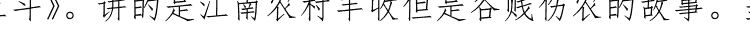

(十三)
有些内容杀性重。在当时，中国作为后发国家，经济实力与列强相比，无论是经济规模、技术水平还是企业实力，都是相当于不会走路的儿童与成年人对比。中国经济完全没有实力与西方直接对抗。中国殖民的民族经济想要发展，必须依靠一套的保护性措施。比如关税、比如汇率、比如国家金融信用政策。

然而，根据不平等条约的规定，中国市场没有保护地对外开放，而且关税还要受到外国的控制。这种情况长期持续下去，中国的最后的结局将会是什么，是不预见的，因为世界上至少一半以上的国家已经进入了这个结局。

当时中国人口在农村。我们就比方说农村中国经济后……还有日本和法国（及其殖民地）。美国的规模化农场种植上政府补贴，使农产品价格远低于中国农产品。如果不以国家力量进行限制和维持，那么中国农村商品性的粮食生产可能会被彻底被打垮。

打仗之后，跨国公司会通过投资，按照各地区特点整合中国农业，比如江南地区可能会集中发展蚕桑，河南可能集中发展棉花，通过跨国协会和订单供应。这样，原来生产的多样性逐步位于单一。这就是典型的殖民经济——“单一经济”。


“单一经济”与中国可不是事。这种经济态严重限于跨国企业和国际市场，因没有定价权而严重受损，而且被西方国家以工业输入进行掠夺。非洲、拉美国家依然摆脱困境。人类看来，从自然条件和人口密度来看，大部分非洲和拉丁美国家适合发展。然而实际情况是，许多国家粮食不能供给，全部种植咖啡、剑麻、花生。民国时期的作品都有类似，叶老在文中意味深长写道：“芜米，洋面外洋轮船，那是遥远的事情，仿佛可以……”

(十五)
民国时期的中国人倾向于集权主义的经济发展思路这个判断，至少还有三个方面可以佐证：一是孙中山晚也对苏联模式很感兴趣，他提出了“联俄”的主张。二是蒋介石曾经一度对苏联、德国发展非常推崇。南京政府曾派人到德国学习。蒋介石等人曾留学苏联。三，也是最……

民国时期的农业虽然并不乐观，特别是在沿海地区有外国产品倾销和农民破产现象，但始终没有进入单一经营的状态。我想因此有几个方面：
- 是半殖民而非殖民地，至少形式上是个独立国家，西方国家不可能为所为。
- 中国内地农村的主流是男耕女织的自然经济，低水平自给自足，农产品商品率很低，所以外来影响相对小。
- 民国时期地方割据，全国统一市场没有形成。所以，外国人想在中国市场上打中国商品，如果市场没，这事儿就很难办。

工业方面。民国时期，民族工业发展最快的历史阶段是1910年代。当时列强第一次世界大战期间，历史书上笼统地说“放松了对中国的”，没有列举哪些方面放松，也没有看过更详细的资料。我个人可以说，当时情况应该是，欧洲陷于战，生产受累，有限的生产能力用于保障战争需要，所以以内产品减少，为民族工业的发展空间。产品以满足战争需要，使中国得到了一些国际空间。我看过当时南通、无锡等地矿的老照片，规模很大设备不落后。民国时期的著名民族家里大多是这个时期发生的。但是民国时期十多年，民族工业在规模和实力上始终有明显起色，不然抗战也不会打得那么久。我认为主要原因有两个方面：
- 内因：一方面客观上不停的内战和外战，使民国政府发展策略比较混乱，不成体系。
- 二是各地军阀割据，自立为王，经济政策很难在全国范围内执行。
- 三是由于民国政府仍然是一大统一体系的延续，缺乏外部监督，再加上

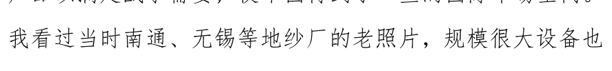

新旧社会交替体制，很快形成严重腐败。官僚阶层利用政权大肆干预市场，打击竞争对手，甚至直接将资源为己。不少学者的研究描述了，大家利用权力吞并民族资本（比如上海等）。巨大的利益集团始终控制着民国政府。

“实务运动”的失败是因为：
- 外因：清末主权不完整，外国强势入侵。
- 内因：民国政府失败。从美英的历史来看，美国在一战之前在经济规模上超越英国，但英国仍是老大。美国又等待了30年，中间赢了两次世界大战，才在1945年取代英国成为半个世界老大（另外半个是苏联）。然后又苦斗了40多年，苏联在1992年成为世界老大。所以中国人必须长期心理准备，即便有一天经济规模超过美国，距离取代老大还很远。

集权主义在当时，则是既古老又年轻的模式。他说古老，是因为人类进入近代社会之前，西方和东方文明内的国家，无论是王国还是帝国，实质上都是集权主义的体现。而说他年轻，是因为他以历史判断者的身份出现，强调国家权力倾向于经济运行，以推动经济发展达到国家设立的目标。苏联的计划经济是一个典型。苏联在建国后，在不断的内乱和外国干预下，在短时间内奇迹地复兴了经济，建立了强大的工业，特别是军事性的工业。

当时集权主义的经济模式还有另一个典型，就是希特勒德国。德国在希特勒上台后，用军事化手段管理国民经济，行政手段推动国家垄断企业和私人企业做大做强，在1930年代创造了国民经济一番的成绩，在一战的废墟上再次崛起为世界首。许多人记得希特勒今天闪击，明天又闪击，其实军事行动的背后是强大的经济实力支撑，如果希特勒没有马克（马克）。这段经济史在网上有很多资料，感兴趣的兄弟们可以研究一下。

当时的中国人是如何看待自由主义和集权主义这两种经济发展思路的？我没有系统深入地研究。我的判断是，集权主义对于当时的中国人无疑更具吸引力。从实用的角度来看，集权主义属于“起快”的一种。苏联和德国，都是在十几年时间内迅速崛起。考虑到他们的工业基础和人民素质，中国实在比不上，那么我们慢一点吧。三十年建成一个现代国家总可以了吧。当时的中国，面临着日本步步紧逼、毫无独立、边疆不稳定的威胁。当时的时代主题救亡图，是解决怎么活下去的问题，没有工夫研究怎么活得好些。在短期内，即使发展不成世界强国，至少也能跟日本比比才行。如果像美国那样用100多年的发展才能成为世界强国，估计在肌肉发达之前就已经被人打死了。

## 待续

兰花却依然，芮也无一个。

......

延续

作者:奉行核外交政策 日期:2011-09-25 04:58

写着写着，天快亮了。写的，倒也不觉得累。由于自学识有限，对于纷绕如麻的民国时期，我就这样随笔带过了，就算是明智之吧。

休息了！经济上的话题，总是历史越接近熟悉，可怜的东西多。下周，让我们进入波澜壮阔的新中国吧！一起聊聊中国现代经济的起步、挫折、突围、发力和崛起。

## 核平


和平外交政策日期:2011-10-26

（七十）

随着话题进入新中国经济，这个节点也应该进入收官阶段了。但是不用急着说再见，因为这一部分内容可能会比较长。由于经济涉及广面，所以也可能会参加大量社会发展的非经济内容。仍然没有框架，我继续信马由缰胡乱哨吧。

兄弟们知道澳大利亚去年人均GDP 是多少？54000美元。高居世界第六，比美还高了7000美元。澳大利亚市场狭小，由于国内产值高，产品国际竞争力算不算强，在欧美国家经济一片荒鸿之时，他凭什么一枝独秀？靠的就是中国采购，尤其是价格飞涨的矿石等原料类产品的采购合同。至于中国采购对澳大利亚的直接贡献和间接贡献的具体数据，比重很大，我见过，没记过。哪个兄弟感兴趣自己查查吧。

经济关系密切到这个地步，中国一打个喷嚏，澳大利亚经济就会发高烧。按说，澳大利亚应该对中国好感多多少。偏巧前两年陆克文上台，这哥们又能说一口流利的普通话。于是许多中国人认为，澳大利亚应该是个亲华的国家。然而实是残酷的。该国曾多次干预（或明的或暗的），搞乱了中国的跨境收购，这就不说了。维基解密暴露了一篇陆克文与希普拉的早餐谈话，建议美英考虑在必要时对华出动。为了了解美国对中经济关系密切的疑虑，陆克文又自称有一手处理，加强了自己的信心。


国没有任何事情，必要时还打算要算掉中国的命。

其实这种现象是个普遍现象。我可以说，中国在崛起过程中不会有真正的朋友。计算中国的人的是澳大利亚一抓一把。今晚欧视二套播了一个关于欧债的对话节目，赛莱莫是意大利前总理。与欧美政客一样，这位仁翁对这次危机的根本原因避而不谈。身为欧储五国之一员，他应该先去指责债政府不诚实，隐瞒债务，他那意思，听他好像意大利自己没事似的。被观众直接问到下一个倒掉的是不是意大利，他口口否定，还指出，中国应该出于经济或政治原因购买意大利国债。他还暗示，意大利如果出现问题欧洲不能幸免，欧洲出问题中国也难以以身。。至于欧洲将会用什么方式让中国受损，人家没说，让中国人自己去折磨吧。我看欧洲政客如果再这样发展下去，快跟腓斯有一得了。

出生和长大的，对这些油画的内容基本没概念（虽然我方整理，加微信群获取了更多帖）。

我们，认为他们在中国杨柳的青年展馆。展品都是反映中国的社会文化识性内容，比如三打白骨、桃源三结、武松打虎和包铁剑侧之类。看来，中国文化一眼就能看出很有趣，而美国教授告诉我，只要他不是专门研究中国社会文化的，都会云云里里——估计他也把精力放在锻炼上去了。

实际上，处于世界领先地位已经经过五个世纪的西方文化区，各国之间虽然新教、天主教和东正教的教义上有分歧，但大家的社会文化基础是一样的。即使有差别，这个差别相比于西方的差别，是很小的。他们之间的沟通和互信程度，


远远高于中国、伊朗和印度文化区的。陆克文跟希普拉吃早餐，那种感觉与中国人之间的默契就留在里面了。在当代中国之前，我之所以讲这么多话，是想说明这样一个意思，就是当代经济的困局。由于中国不同于西方，所以西方国家的语体系层面，对于中国的不信任、误读、扭曲、蔑视、打压是严重的。这是一个“他视”的问题。更麻烦的是“自视”问题。由于中国是后发国家，所以我们一直在引进和学习西方。（当然是必要的）。这就带来一个问题，中国在研究和理解自己的问题的时候，很多时候，都是


别扭感，比较我看的那种感。我想，如果有一天“自视”真正能解决，“他视”问题也就不是问题了，一切就好了了。我想，虽然自己的水平很低，但能不能要求一下，在这个胡乱帖子里，尽可能地克服这种问题。心路虽远。

作者:奉行核外交政策 日期:2011-09-26 13:33

（七十）

因工作的关系，我在二十多岁时，曾几年把主要精力放在经济问题上，所以感触多。中国现代经济以1979年开始整理加信获取更多帖。探讨当代经济，首先要深入一下三十年。这三十年间，由于国家选择“政治挂钩”路线，中国的政治运动是一个接一个，一般中国人的眼里看到的，主要是政治方面。而经济方面，主要就是几个粗浅概念，包括土改、公私合作、十年成就、苏联撤专家、大、“调整充实巩固”、卫星、三门峡电站、文革期间以及“经济到了崩溃的边缘”。呵呵，然后改革号吹响了。前三十年经济问题多多，争议很大，了不少跟头，大跃迁。但是所有人都承认一个事实，就是1979年的中国与1949年的中国是非常一样的。这三十年间中国的变化，成为后来改革的基础和前提。这里我不称“进步”而称“变化”。变化是一个中性的词汇，无论是好的、坏的或者好坏兼备的变化都在其中。对这三十年的评价和认识，在网上争议是很正常的。但我认为，我们在争议中应该排除功利性，去探求历史的客观真相，而不是强迫历史来给你端茶水。对三十年的经济，以前（特别是2000年以前）我们的批评是很多的。以前我在讨论文化问题时曾分析过经济方面其实也是一样的。我们的参考系，从运的、主要的这种身边国家。按照参考系，前三十年经济发展的差异是非常明显的。改革开放以前，我们国内宣传侧重于暴露发达国家的阴暗。我记得八十年代初教科课的彩插图，是一个睡在地下废气出口盖上的美国穷人，背景是哈哈顿的楼群。这个毛病，我们现在仍然没有改掉，西方媒体现在似乎得到了这个毛病，而且病得更严重了。参照加上宣传因素，使人对西方的主观认知与现实落差很大。有人真以为水深火热。一个中国留学生在美国，写信给国内，一句话是“美国垃圾堆里真有冰箱！”

我上高中时，看过姜文演的《北京人在纽约》。主角是一个体制内的音乐家，辞职跟着夫人出国，在美国度过的日子真妈妈快，转眼十七八年了。但姜文跟黑人从垃圾堆里捡到电视的场景，我记忆犹新。

总之，我认为，中国人对前三十年的认识实在不太全面。第二次世界大战与上一次一样，是列强争世界“狗咬狗”开始的，但结果却根本不同，最终打成了一场解放战争。战后，中国、伊朗和印度三个被殖民压迫的文化大区，国家独立势不可挡。后来连非洲国家也独立了。中、印、伊三个文化区，当时基本上处于同一历史线上，面临的课题是一样的：既要脱离西方又要胜利自己，哪里！如果我们把前三十年的发展，包括西方的背景来看，放在中国结构变革来看，或许会有一些感触。

作者：奉行核外交政策 日期:2011-09-26 17:45

（七十八）

话说到这里，引出了中国传统的第二个特征。第一个特征是大一统，前面已经探讨了。我认为中国传统的第二个特征，是伦理型社会而非宗教社会。这个特征，是我们解释中国问题的重要出发点。很多年前，我去五台山。山下有一个庙，具体名字记不清了，庙里的主持是个高僧。我觉得那个高僧才是搞教育的人。当时山上的庙收门票，唯独这个庙不收门票。我看到庙贴着告示：“乱收费”。而我观察，这里既唯独这个庙不收门票，很多游客喜欢胡闹人家的钟，这就不符合逻辑。

在人类文明中，无论是西方、伊斯兰或者印度文化区，都称之为宗教社会。我对宗教社会的界定是，全民信仰且宗教组织对社会有强大支配（甚至高于政府）。西方长期处于宗教社会，即漫长的“中世纪”，迫害了哥白尼。直到后来，通过马丁改革和阶级革命，逐步摆脱了宗教控制，并且实现了宗教与世俗的结合与互补。在伊斯兰和印度文化区，绝大多数国家仍然是宗教社会。而且几十年来，还多次出现了世俗政权向宗教回归的现象，如伊朗霍梅尼革命。

中国是古代史中独一无二的例外，不是宗教社会，而是以儒学为基础的伦理社会。当然中国也有宗教，主要是佛教和道教，但它们没有取得中国生活的支配地位（藏佛教除外）。来说，宗教是一个典型的“形而上”的味道。但在中国，宗教的味道不太劲，基本走上发展，让人感觉觉得“形而上”的味道。如果兄弟们不好理解，我再写帖。


但是，把宗教搞出这么点味道的庙太少了。就在那次旅行中，我又到了另一个宏大的庙，发现大殿里躺着几十个易拉罐的可乐和雪碧，明晃晃地堆成金字塔。我正站在那里发呆，满脑子转着，要是我就开一罐，“啪”地拉开，“滋”地呷，我有好多啊。这时突然响起了跑马溜的声音，只见念经的师傅从袖子里掏出一个手机：“嘿，你来了？”工程的事基本上办定了。中午一起吃饭再聊。不不，你不用管，我来安排，老地方。要不要派车接你啊？你有车的话，那十二点吧。郭德硕在相里找家人：“走过的路千万不要错过！”

作者：奉行核外交政策 日期:2011-09-26 17:52

周边无所事事，应为“周末”，呜呜。作者：奉行核外交政策 日期:2011-09-27 10:31

（七九）

在上一贴中，我举了几个犀利的例子，是想说明中国社会不是宗教社会，而且中国的宗教也没有“形而上”的味道。我的看法是，在中国、印度、伊斯兰和西方四大文化区的传统社会中，只有中国是独一无二的非宗教伦理型社会。

这比较奇特。因为人类社会在那个水平发展阶段，很容易被宗教力量控制。而在中国，不是社会生活被宗教化了，而是宗教被社会化了。可能的兄弟会提出这样的疑虑：我举的小例子都是当代的现象，这是中国传统社会通过文章冲击以后形成的，不能代表中国古代的普遍现象。我研究过这个问题。古代社会的中国人，自然肯定比现代人对宗教虔诚多，但是并不足以改变古代中国社会的性质，它仍然不是一个宗教社会。许多兄弟都或少看到了当时社会的真实写照。里面有许多关于人们搞宗教活动的描写，以及对宗教人物的描写。我们可以从两个角度观察：一、从描写的内容来看，古代中国人虽然宗教活动频繁，但宗教并不能控制社会生活。比如小民为了争地皮肉和尚打官，比如道士和尚为了挣钱给人当奴，比如道士祈而不灵被村民打闹后哀去。二、这些作品本身就是一个证明。当时的作家，可以毫不无情地把僧、尚、道士描成为骗子、妖怪、狸精等等，这在西方、印度和伊斯兰世界是非常想象的。


进入近代社会以后才开始，西方。宗教并不是与生俱来的，而是长期历史发展形成的。我觉得，中国伦理型社会并不是与生俱来的，而是经过长期发展形成的。下面我具体探究一下我的看法。一是“源于周”的问题。每个文明或者国家，肯定会有不同的宗教源头。这种出现，可能是很大的偶然性，有人认为它是源于周。周的性格决定并影响了后来三千年的中国社会。夏朝是一个传说时期，虽然有考古发现。关于这个字号的文化工程，争议很多，骂的人也是一片。但我还是有成果的，很有趣兄弟们看看。夏朝社会生活和宗教问题。夏朝，周王给后留了一堆遗迹。这也是“源于周”的问题。既然如此，我们就更无法考察。


商朝目前的考古证据较多，出土的甲骨文和青铜器的证实，至少在商代后期（殷时期），商朝是一个巫术的社会。原始巫术，其实是许多古代宗教的源头。夏朝是一个传说时期，虽然有考古发现，不足以完全证明这个国家（不仅仅是局部部族）的真实存在。这也是“源于周”的工程。周王，商纣在郊市附近的战争，是公元前1046年。商重巫，周重礼。他们在部落长制的基础上，发展了一套宗法制度，即“周礼”。它的特点是通过繁琐的形式主义，体现了阶级秩序。周礼几乎涵盖了社会生活的各个方面，祭祀、结婚、出兵、盖房、种地、出行、发表等严格规定，还要追究法律责任。如果你试试会累死的。总之，不像南朝那样直接计算省。也不知道周不喜欢这些东西，反正孔子极其拥护，高呼“周哉”。这句话给中国留下了两个很有意义的字：“周”和“从”。估计，中国比孔子更拥护周。周代是中国国家和民族的形成。末周，中国各地的部族应该是很多的，很大。周礼的特点，使中国伦理社会逐步发展。东春秋时期儒家思想的延续，正是这种社会氛围的产物。有人认为，是儒学促成了中国伦理社会。这个观点有一半另一另一则是孔子出生之前的几百年，中国社会已经出现了浓厚的伦理社会（宗法社会）氛围。所以儒学能够产生周，决不会产生于周。这个伟大的东方学产生后，反过来推动了伦理社会的形成和发展。“成于汉”，这个好解释。先秦皇虽然给一把火，但他实际上接受了法家。而汉代初期尊崇黄老，无为而治。到汉武帝时期，最终决定废百家，独儒术，以孝治天下。这个国策，就是要建立一个伦理主导的社会。这是在各类学说的比较中做决定。所以，周是自发的，而汉是自觉的。


千年中国学校的标准教材和伦理型社会的坚实基础。宋真宗同志亲自发表重要讲话，要求全国要认真做好儒家经典的宣贯工作。他指出：“安居不用莱堂，书中自有黄金屋。妻妾离根无良缘，书中有女颜如玉。”他最后强调道：“男儿尽逐平生，五动向贯钱。”

——佛教禅宗由袭晋传至唐的“六祖”衣钵相传，唐代的六祖惠能（就是悟出“菩提本无树，明镜如非”那位师傅）将其推向极盛。晚唐，禅宗占据了汉族佛教的主流，标志着中国佛教的最终完成。宋代，禅宗开枝播散，形成了所谓的五宋七派之类，现仍有相当规模。我没有逐一研读过，就不胡乱发挥了。

## 一 理想与信仰

道士们在山沟里掘了不少科研项目。仙丹吃死了不少名人，炼丹过程中还有多次出现炼炉爆炸的重大安全生产事故。后来认真总结教训，发现了一次是哈洛空的宇宙，其他的事故其实是配方问题，结果中国人意外发明了火药。终结到了唐朝，李皇帝与老子认了亲，道教带来了发展机遇，孕运出陈老君、吕洞宾等道士。你不要以为吕洞宾只是个四发的海上流逸士，他理论水平很高，还有著作传世。宋代道教进一步发展，著名的全真派兴起，极大地带动了之后的香港鬼片电影的创作。到了宋末，王重阳创建了全真道，他的弟子处处忙上成了士芬的国师，百万之中还抽空去教郭靖武武。

总之，到了宋代，儒道经过千年碰撞，像三块尖石头碰成了三块鹅石，终于和睦相处了。其实，是三教在长期的博弈中，逐步找到了自己的社会位置，这个自我定位又得到了社会认同，得以共同发展、繁荣。儒学成为正统文化主流，它并不是一个宗教，而是国家教育内容，儒生通过“读圣经书、做帝王师”来影响政治。佛道两教则基本上放弃了以教于政甚至控制政权的思想，成为中国人精神生活的一部分。

这种和睦，不仅是在社会中和睦，更多是在人心中的和睦。宋代的许多文人大多兼兼三教，比如东坡先整理的信仰达天下，穷则善着其身，混成什么样都能想得通，都不至于去跳槽。再加上佛教的轮回观，人们的心灵对于有了永久不灭的寄托，摆脱了自身消失的恐惧。这样三教合流共同构筑了中国人的精神世界。

伦理型社会这个内容，我们是从中国经济的话题上引出来的，为了不偏远，我对伦理型社会形成的原因就不能开展探讨了，到为止吧。刚才有一个兄弟回贴从“大一统”强势政权的角度做了分析，我认为这是一个重要原因。二，儒学的存在以及自身不断完善，是另一个重要原因。三，佛教和道教也有其自身问题，特别是在传教行为方面，相比伊斯兰和基督教的积极传播的态度，和尚们认为有缘跑不掉、无缘莫空；道士们清静无为，对信不去积极争取，还说什么“夫唯不争，天下莫能与争”。我认为这也是一个原因。

## 延续

作者：奉行和平外交政策 日期：2011-09-28 10:33

## (八十二)

综合前面四个句子的结论是，新中国建立之时的中国社会，是一个已经开始走出传统、但主体部分仍然处于传统之中的伦理型的农民社会。这就是新中国经济文化建设的“起点”。

我认为，新中国经济文化建设的“起点”，既是传统的，又是现代的。一方面，伦理型社会具有顽固、保守的一面；另一方面，与西方相比，又具有灵活的一面。下面具体分析一下：

- 伦理型社会的没落，并不是指伦理混乱，而是指伦理观念僵化。
- 儒学的存在以及自身不断完善，是另一个重要原因。
- 佛教和道教也有其自身问题，特别是在传教行为方面。

其实从明代开始，中国越来越化，到清代后期。
- 佛教和道教也逐步没落。明代以后，禅宗基本上沦为念经，能对宇宙和社会深度思辨的高僧之少。
- 更多的人把出家成了谋财的事。这个问题一直延续到今天，所以我们还能看到下班接孩子的和尚、“副处级和尚”的人物。
- 道教也是越来越“俗”。按说，道教宣扬的是宇宙中“大道”，把道教视为超自然力量，相信“道生一、一生二、二三、三生万物”，这跟上帝创造世界有点似。我个人觉得，按照这个思路，道教似乎应该发展成为类似于基督教。然而我们专门查阅资料，也没有清楚道教究竟有多少神。道教除了三清、四御、老君、关公这类大神，小神无其数。有的山神、土地神，有河神、海神，有的水神、雷神等。

总之，道教神体系，实质上中国传统官僚体系的翻版。众神有序，等级分明，区块划分，各管一摊。比如土地管农业用地，而城市非农业用地。老君、关公是中央官，管全国；而土地神管一般的。中国的古代，可以随地拜佛，但一般不会随地去拜土地帝。除非你想在土地帝的地皮上经营或置业，才有必要去拜个头，就像你想开家工厂先得请记录长一样。

等待

作者：奉行和平外交政策 日期：2011-09-28 12:19

## (八十三)

我认为，1949年，在占人口九成的中国农村，虽然村庄有庙，人人拜神，但实质是有信而无宗。人们拜神如事官，把众神当成另外一套官僚体系来敬奉。表面上是奉，实质是奉而不敬。这个奉，则是因为有求有畏。

我姥姥一辈子都生活在北方农村，每年她都要把王爷贴在灶边的墙上。按照民间信仰，王爷是玉皇帝派来的督查官，为了了解你的善恶，每年都要上去汇报，由玉皇帝决定奖罚，就是所谓的“上天包好事，下界送平安”。用每年年底拜王爷上天，我姥姥总要拿糖果上供。用她的话说，把王爷的唠叨给粘成补，上天就会说话了。

用干部主要各级领导，通过贿基神仙来运营上的神仙。玉皇帝耗费了大量神力，创新工作方法，组织上亿名王爷深入基层，进入入口，建立了纵向到底的神仙体系，努力让工作重心下移、监督重心前移。可怜的是，我姥姥用糖果就给舒畅了。难怪农村一直到今天，这种禁止，病根很深啊。我姥姥是个慈祥的老太太，一辈子从没做过巧事。按说，她应该可以行的，这种做法在北方是一种民俗。

我姥姥眼里，道德水准其实跟不齐，太不可信了。

- 儒道佛，的，，，，，，，，，不的，的，不的。
- 综合前面四个句子的结论是，新中国建立之时的中国社会，是一个已经开始走出传统、但主体部分仍然处于传统之中的伦理型的农民社会。这就是新中国经济文化建设的“起点”。至于具体的伦理型没落，我举的例子：孟子强调伦理，同时也强调权义。孟子认为，如果有穷了，你就该伸手去救。孟子认为，如果有饿了，你就该伸手去救。孟子认为，如果有渴了，你就该伸手去救。孟子认为，如果有困了，你就该伸手去救。孟子认为，如果有累了，你就该伸手去救。孟子认为，如果有病了，你就该伸手去救。孟子认为，如果有疼了，你就该伸手去救。孟子认为，如果有老了，你就该伸手去救。孟子认为，如果有死了，你就该伸手去救。孟子认为，如果有苦了，你就该伸手去救。孟子认为，如果有难了，你就该伸手去救。孟子认为，如果有急了，你就该伸手去救。

- 儒，的，的，的，的，的。
- 的，的，的，的，的，的，的，的，的，的，的，的。

其实，是三教在长期的博弈中，逐步找到了自己的社会位置，这个自我定位又得到了社会认同，得以共同发展、繁荣。儒学成为正统文化主流，它并不是一个宗教，而是国家教育内容，儒生通过“读圣经书、做帝王师”来影响政治。佛道两教则基本上放弃了以教于政甚至控制政权的思想，成为中国人精神生活的一部分。

这种和睦，不仅是在社会中和睦，更多是在人心中的和睦。宋代的许多文人大多兼兼三教，比如东坡先整理的信仰达天下，穷则善着其身，混成什么样都能想得通，都不至于去跳槽。再加上佛教的轮回观，人们的心灵对于有了永久不灭的寄托，摆脱了自身消失的恐惧。这样三教合流共同构筑了中国人的精神世界。

伦理型社会这个内容，我们是从中国经济的话题上引出来的，为了不偏远，我对伦理型社会形成的原因就不能开展探讨了，到为止吧。刚才有一个兄弟回贴从“大一统”强势政权的角度做了分析，我认为这是一个重要原因。二，儒学的存在以及自身不断完善，是另一个重要原因。三，佛教和道教也有其自身问题，特别是在传教行为方面，相比伊斯兰和基督教的积极传播的态度，和尚们认为有缘跑不掉、无缘莫空；道士们清静无为，对信不去积极争取，还说什么“夫唯不争，天下莫能与争”。我认为这也是一个原因。

- 儒，的，的，的，的，的。
- 的，的，的，的，的，的，的，的。

一个问题总有两个面，劣势当然也不小。除了了顽固保守的旧观念之外，深层次的问题有两个。一个是伦理社会的宗法体系，本质上是人治而不是法治。中国严重地缺乏法治传统。有人提倡法治，往往也是人治的前提之下，上级依法下级，而不是真正的意义上的法治。有的领导在立法上根本没有自己也遵守。二是人在道德上缺乏自我约束和终极敬畏。这个问题历朝历代都存在，以前，家里还有灶王，拳头三其神，但传统伦理体系在文中被整理。计划建设为中心的改革时代，出现了价值观混乱、社会道德伦理一系列问题。我们将在以后说到改革开放具体问题时进一步探讨。

继续

作者：奉行和平外交政策 日期:2011-09-28 12:29

人民普遍务实重利，后面多了一个“务”字。改正。对对不起。打字太快了。

作者：奉行和平外交政策 日期:2011-09-28 12:35

各位兄弟姐妹：

国庆期间我回到国内了。这段时间走亲、访友、喝酒、陪孩子，恐怕写稿时间不多了。我会见缝插针尽力而为！

核平

作者：奉行和平外交政策 日期:2011-09-29

## (八十四)

- 我个人觉得，按照这个思路，道教似乎应该发展成为类似于基督教。然而我们专门查阅资料，也没有清楚道教究竟有多少神。
- 儒，的，的，的，的，的。
- 的，的，的，的，的，的。
- 1949年，农村的，的，的，的，的，的，的。
- 1949年以后的中国，也包括亚洲的。

- 1949年，在占人口九成的中国农村，虽然村庄有庙，人人拜神，但实质是有信而无宗。人们拜神如事官，把众神当成另外一套官僚体系来敬奉。表面上是奉，实质是奉而不敬。这个奉，则是因为有求有畏。

- 儒道佛，的，，的，的。
- 农村的，的，的，的，的，的，的。
- 1949年，农村的，的，的，的，的，的。
- 的，的，的，的，的，的，的。
- 的，的，的，的，的，的。
- 1949年，农村，的，的，的，的，的，的。
- 1949年以后的中国，也包括亚洲的。

- 1949年，农村，的，的，的，的，的，的。
- 1949年以后的中国，也包括亚洲的。

- 1949年，农村，的，的，的，的，的，的。
- 1949年以后的中国，也包括亚洲的。

- 1949年，农村，的，的，的，的，的，的。
- 1949年以后的中国，也包括亚洲的。

- 1949年，农村，的，的，的，的，的，的。
- 1949年以后的中国，也包括亚洲的。

- 1949年，农村，的，的，的，的，的，的。
- 1949年以后的中国，也包括亚洲的。

- 1949年，农村，的，的，的，的，的，的。
- 1949年以后的中国，也包括亚洲的。

- 1949年，农村，的，的，的，的，的，的。
- 1949年以后的中国，也包括亚洲的。

- 1949年，农村，的，的，的，的，的，的。
- 农村，的，的，的，的，的。

- 1949年，农村，的，的，的，的，的，的。
- 农村，的，的，的，的，的。

- 1949年，农村，的，的，的，的，的，的。
- 农村，的，的，的，的，的。

- 1949年农村。


另一种完全一样，不同的是几个人从县衙拿薪，以这几个人可以看成政府机构的延伸。我们现在有“驻村干部”，当时这些人相当于“乡村干部”。总之，古代，要么是自治组织（大一集权体系中的有限自治），要么是半自治组织，而不是一级政府。

中国古代的宗法体制，在高层，是皇帝的“家天下”、官僚的“父母官”；在基层，家族联合的“乡治”、家族的“村治”、家庭的“家治”。我在前面的某个贴里讲过，古代“县权不下，县下靠宗族”。县下的宗族这个基层单位，实质是古代封建统治的社会基础。

话题探讨到这里，许多可能已经看出来了，县和乡一方面处理，另一方面经营实质上是国家权力突破了千年来的传统分界线，打压和侵占了宗族的生存空间。

新中国明确规定，中国基层权力包括县、乡三级（地级市）至今没有解决法律地位问题。党是靠农民武装斗争兴起的，但不具有强大的武装力量，而且对农村情况了如指掌（这一点国民党很弱）。再加上建国初期很硬的镇反、反改、剿匪、击击家门等运动，所以宗族势力完全没有抵抗和还手，乡级政权和村级党委迅速取代了乡村的宗族势力。

如果我们从农村社会结构这个角度去，就不难理解为什么建国以后特别是前三年的历次改革和运动，政府会有表现如此强大的社会动员能力。这种动员能力，深刻影响并改造了中国农村社会，特别是体现在土地制度改革、提高妇女地位、农田水利建设、扫除文盲、清除黑社会、农村教育和医疗、计划生育等等方面，同时，在决策失误时也酿成了巨大的灾难。

这里还需要指出一个问题：就是乡级政权的建立，是社会趋势普遍做法。从传统社会进入现代社会后，政府需要提供的服务大量增加，如传统社会中，一个县建即可解决城乡居民提供的初等教育和中等教育。目前农村教育薄弱，但我认为不能否定乡镇。改革开放后乡镇面临问题极多：一是财政自给问题，二是设置太小，三是人员过多，四是有责无权。不少乡镇干部由于任务，“催缴款”引起产出。这些问题，我们将在以后的贴中探讨。

作者：奉行内核外交政策 日期：2011-09-29

(八八七)

好了，那儿农村情况先放。让我们回到五十年代，到处都是房子。如果按照15%的城镇化率计算，解放时全国城市人口7000万，而今天是6亿，还不包括流动人口。所以当时城市很小。一个北方地级市，现市区人口40万，而1947年底解放时，城乡居民不足一万耕地。当时，中国生产力低下，经济体系不完善。教科书上列举产量，平均一人一把菜刀。当然，这个数据是“战后”数据，美国怎么看不起我们，以至于战略误判呢。七十年代去东北，当时东北地区有一句：“小满全荒”。可见当时松花江上的丰满水电站举足重的地位。我小时候整天听爷爷说丰满水电站不了，后来专门查了资料，这个电站是三十年代帮助满洲国修的，当时装机7万千瓦。解放后苏联专家指导扩到50万千瓦，50万千瓦还是很多小型机组拼凑起来。五六十年代，丰满是中国龙头水电站，李鹏总理在那儿当副厂长和总工程师，真是牛的工作。

![img/...14ab5dcc2a92cb14_332.png]

直到七十年代，黄河上的刘家峡电站，我们才算有了第一个百万千瓦大型水电站。5台机组，总量200万千瓦。八十年代末，初中地理册上关于能源那一张图，用绿色圆点表示一个百万千瓦水电站。我们一看，美国、苏联每一条河流像一串葡萄，而我们只有刘家峡、葛州坝用稀拉的几个小点，真是自卑死了。

所以，美国反共专家指责中国建电站的鬼话，兄弟们千万别信。他们自己修建电站比谁都多，北美大坝破坏河流多样性比谁都劲，罗多河基本变成了钢水泥水道，他还脸脸指责别人！哦，我扯远了，以后说环境问题时再仔细聊吧。我们的三整理，一比，这差距就看出来了，当时中国经济确实相当薄弱。

前面我们在分析计划经济时提到，一套完整的国民经济体系的形成，如果依靠市场自发推动，需要漫长的过程。对于后发国家而言，通过体制人为顶层设计，集中力量在短时间内构建工业框架，是一种比较自然的选择。印度尼赫鲁也这么认为。再加上意识形态的因素，计划经济发展现代工业成为中国的自然选择。1953年，国内土地改革基本完工，对外朝鲜战争即将结束，承载着中国人强国之梦的“一五计划”拉开了大幕。

![img/...14ab5dcc2a92cb14_333.png]

# 后续

作者：奉行内核外交政策 日期:2011-09-29 14:14

(八八八)

在探讨“一五计划”的具体内容之前，我们先把眼光放在计划之外看看。

“一五”时期，全国对私营工商的改造即“公私合营”也进入了全面的推进期。较之农村的土改，对城市私营工业的改造理性得多。主要通过和平买的方法，前期“四分肥”（国家、企业、职工、资本家），后期给息股利到六十年代完成购买。

我们经常在历史资料上看到，民族资本家如荣如灭。民族资本家和工商者不是公私合营的自属去要求，那是没有办法，形势比人强你不要求，或者要求，最后还是会被改造。对于农村土改是肯定的态度，但对城市公私合营基本否定的态度。当时中国的私营工商，以轻工业、服务和手工业为主。上海的纱厂、船厂就是最大的，没有真正关系民生的企业。实际上，建国以后很多被改造的工商就是小作坊、小店铺。公有制（国有和集体）没有太多优势，它们适合。

![img/...14ab5dcc2a92cb14_334.png]

个体和私营。比起前面贴子里到的，国有制和集体化消灭了活力。我的看法是，当时除了被“大家族”等官僚层，政府应该大力保护和支持民族的发展，同时用计划方式建立现代工业，两者其实并不矛盾。有人认为，私营企业构成与公有制的竞争，现在威胁国有厂的生存。有人认为，政府才能集中财力发展工业，其实大量活跃的私营企业创造税收，更有力的支持政府，比如浙江。

商业者及其创造机会，国家可以通过公债、股票获得资金。我认为，轻工业、服务业、短途运输、手工业这些领域，国家初期就不应该进入。即使是私人无力，必须由国家投资发展的领域，比如大型化工、钢铁等等，发展到一定的阶段，社会会有实力来承担管理和运营时，政府应该考虑退出的问题。算了，事后也没有实际意义。当时发展阶段和意识形态冷战的情况下，历史就是这样。1979年中国开始改革开放，从鸡蛋开始，允许个体和私营者进入越来越多的领域。其间有多次风波，许多改革先行者弄潮死在沙滩上。小平两次保护“包子”，成为改革中的经典故事。1979年，按照小平的意思，栾毅仁重出江湖，出任中国国际委托公司董事长。这时，他从30多岁的青年才变成了一个花甲老人。又经过20多年的改革，2001年，朱镕基终于地挺过地雷阵，完成了“国企三困”任务。这个时候，五十年代公有合营涉及的大部分行业和领域，都实现了资本退出。2011-10-01 03:39

(八八九)

首先，让我们一起热庆祝天宫一号顺利升空！继续我们的话题，探讨一下“一五计划”对中国经济的影响。苏联援建的156个大项目，是“一五”的重中之重。受苏联，但并没有制于苏联；起于一五，但并没有局限于一五。这些项目本身以及延续、改建、扩建、拆迁建、技术改造等后续项目，延续几十年，深刻影响了今天的中国经济，许多企业仍然是中国国力的象征。网上资料，156个项目名单是中国政府向苏联换来的。如果真的是这样，我就不得不佩服当时国家领导人的战略眼光。这些项目中本身，并不是一般的国家所需要的。我认为提出这些项目的指导思想，就是把中国作为一个超级大来定位的。这些项目主要集中于装备制造业、能源、冶金等行业。也有化工、纺织、制药、电子、航空。从单里随机挑选几个吧：鞍钢、武钢、包钢、本钢（扩）、沈阳一机床、大连造船、武汉造船、中国一汽、中国一重、中国一摇、沈沈、西铁、吉化、紫兰、哈电三大（哈绿、哈萨）、中国葫塞三大厂的两家（哈尔滨和洛阳）、三峡、亚凯、华北制药、武汉长江大桥等，大量的电厂和煤矿。这些项目中，一个突出的特点是，重大装备制造业及其配套产业占了极大比重。可能有兄弟问，当时为什么国家把装放在这么突出的位置上呢？呵呵，因为重工业太大、太重要了！可以说，重工业是世界强国的经济脊梁。前几年，温家宝亲自研究制定工业振兴计划。任何国家，你想当世界强国，你就必须某些企业，拿着一份名单，如果少了这种制造能力，对不起，就不算强国！中国发展成为今天样子，离不开中国建立这些企业。大家知道，轻工业是向社会提供生活资料，重工业是向社会提供生产资料，重工业是所有行业提供生产设备。若不善事，必利其器。比如发电套设备、大型合成套设备、石化和炼油套设备、钢铁炼造型轧机。如果没有能力自己出来，就会受制于人。当时，他们开始依靠德国和日本机械厂家，对方报价高。后来，中国一家站出来，加入竞争者的消息，老外报价很快就降了一半。更糟糕的是，售后保养和部件仍然依靠外国，跨国公司的战略就是通过维修来剪羊毛。

![img/...14ab5dcc2a92cb14_338.png]

进入下游的钢铁、电力、柴油、化肥这些基础性商品，“中国制造”哪能得了这些东西？“中国制造”的整体成本将升，国家经济整体竞争力将削弱。而且化肥、柴油还会抬粮价，而增加的生活成本。这就是重工业的力量。理解，完整的工业体系不是五年能建成的。但必须承认，“一五”功不可没。其实，印度也在联合国帮助下，码了不少重点项目。但是奇怪，印度并没有形成完整的工业体系，其重大装备制造业与中国差很大。如今，许多装备无力自产，只有花钱采购或者与俄合作生产。巴西的工业体系不用说了，发射载火箭没有爆炸。我一直纳闷，中印两国在独立初，印度工业体系虽然是以轻工业为主，但比中国完整得多。英国还留下了远超中国的高等教育体系和交通体系。为什么在同样的苏联援助下，印度的制造业没有搞起来？原因可能有几个方面：一是虽然同样接受外援，但中国从一开始开始指导思想就很明确，独立自主、引进吸收。二是新中国仍然延续了一大统一的传统，能够有力地集中全国技术力量攻关。老外现在非常清楚，如果低估中国的学习能力和制造能力，是要付出代价的。一个典型的例子是三峡水轮的制造。三峡电站安装了32台巨型水轮。每一个水轮都是单机70万千瓦，是世界最大型号，一个水轮相当于一个大型电站。中国当时不具备制造这种水轮的能力。外国公司都害怕这个巨大的鸡蛋。中国政府当时的策略是以市场换技术。中国的决策者李鹏理想自己是搞水电出身的，在行，判断准确性，所以中国政府步步不错。老外当时纠结：一是蛋糕太大，实在吃不下；二是美法德日铁板一块；三是存侥幸，认为中国在短期内消化不了。所以老外最终接受了中国条件。通用电气和法国阿尔斯通、日本三菱各有。中国学习、吸收、创新速度令世界震惊。

![img/...14ab5dcc2a92cb14_341.png]

几年后，第二批二十八台机又搞招标，两个外国公司分别与德国和东方汽车合作生产。长话说，如果没有自己的生产能力，完全受于老外。西方技术防守最严的对象是中国人。有技术含量的地方，外国公司都不，怕看到报出来。持续。作者：奉行内核外交政策 日期：2011-10-01 04:49

(九十一)

既然聊了重装行业，我就顺着这个话题向前多聊几句。前面聊到，中国的重装行业在“五一”时期诞生。大家知道，一个国家工业发展分阶段：第一阶段，都是原料加工、服装、日用品等劳动密集型的轻工业起步；第二阶段，进入资本密集型的工业化中期，即所谓的重工业阶段；第三阶段，进入智力和技术密集的高级工业阶段。这是基本铁律。而在中国，许多重工业企业处于自然农业主导地位的历史阶段，可以说这些企业是国家超前布局的产物，它们必须靠国家计划经济的订单才能生存。到了八十年代，改革开放以后，经济开始转型，国家订单大量减少，同时市场本身没有发展到产生订单的阶段。这时，青黄不接，重大装备行业就比较痛苦了，而生产轻工的企业比缝纫机许多，当时却是红红火，赶订单忙得不可开。我认为，当时国家应该想办法帮助度过难关，有些生产能力即使暂时用不上，从国家战略安全和长远发展考虑，也要养起来。但是有关部门当时考虑不周，也可能是未来预测不清，也可能是国家财力确实太紧张，总之，当时政策有问题。一是投入太少，体制僵化，比如专业人才的收入“导弹不如茶叶”，造成人才流失，积极不高。二是没有保住重大项目。其中最令我痛心的是大飞机。1980年中国自行研发的大型喷气式飞机“运十”试飞机成功，后来制造了两架样机。可是这个项目因财政部决定3000万元费用停于1985年。当时下马的原因是下马不到十年，中国航空市场就开始大爆发。这些年来波音、空客从中国赚了多少钱！如果国家每年拿出几千万元维持这个项目，团队将不散，科研不断，配套企业支持规模到九十年代就会迎来春天。那么，很可能今天世界飞机制造业和航空业的格局不一样。2008年，我国重启大飞机项目，公司注册资金190亿。九十年代中后期本世纪初，重装企业的情况比八十年代更糟糕，有的企业吃不上饭，有的企业转产或倒闭。当时，我有一个朋友毕业分配到中国二，这个企业在四川德阳，他听说是个离成都不远，去了以后大呼命。

我出差去看望，发现当时只发三百元来生活，车外草老高。我告诉他，我有个亲戚卖黑山羊肉，可以赊给他只在厂区里搞副业。我出门爱朋友，不因远而不寒，不因匮穷而不宰，所以我三次去过那个工厂。这个工厂全名叫中国第二重型机械厂（大概），是目前40家来企业之一。严格地论血统，它也算是“五一”的156个项目之一。因为这156个项目中有中国一重，在黑龙江齐哈尔市。后来中苏那么近，打起来容易被人占，就把工厂分了一半到后方四川盆地，于是有了二重。


格标，需要投钱，而重连饭都没有，把仅有的钱全押上，失败了怎么办？很多人反对这样赌命，主张放弃算了。领引导讨论了几天，最后一天咬牙一咬脚出去了！当时二人的口号是：就算是失败，也要当一回中国判断竞价的筹码！

后来他们成功了，但研制过程很艰辛，很悲壮。有一个核心岗位的高工，身患癌症，拿着基本生活费，始终守在车间第一线，就在试产胜利的前夕，他离开了。本人的缺点是向来感情不够发达，但却妥留了朋友，听到他们真的故事，我哭了。那天我连喝三大杯，向有肺气、有血性的中国重装人致敬！

## 2000年以后，中国终于发展到了工业化中期，重化工业

一手整理加v信1101284955获取更多好站

院因为控制不住头痛之痒。这些项目的滚浪订单，使中国重装行业终于摆脱了青黄不接的生存危机，来了辉煌的时代。作为国有企业，它们仍然有许多毛病，比如官僚、浮于市、内部腐败，这些问题在经营顺利时更加严峻。仅如此，我们仍然认为，我们应当实事求是、全面客观地看待和对待这些企业，包括成绩，包括问题。

继续
作者：奉行核平外交政策 日期：2011-10-01 04:52

又写了一夜，累了要休息了。
我在国庆假期不发贴了，想陪家人，欠了他们太多了，国庆后再聊哈！

衷心感谢兄弟姐妹的鼓励！祝国庆快乐，合家安康！
核平
作者：奉行核外交政策 日期：2011-10-01 04:57

要先试制一件有资格竞标，
要为：要先试制一件有资格竞标
作者：奉行核平外交政策 日期：2011-10-06 18:01

几天没来找都找不到了，沉到哪里去了？自己顶一下。
作者：奉行核平外交政策 日期：2011-10-07 07:41

（十二）

## 一手整理加微信11101284955 获取更多好帖

“国内市场卖得怎么样？我还是没太清楚。”
每天两场酒，其余时间遛儿子。累啊！酒醒天未明，睡也睡不着，又不想继续往下写本一套主题，胡乱乱写几行吧。

这几天回像针一样插心里，实录《老子话实录》，洋洒酒洒四卷200万字。我很佩服这个老板，所以慷徕购买。这书有意思。许多地方口语化，虽没有毛选那么高屋建锦，没邓选那么简洁有力，但对具体问题讲得很细，可能是因为他是个管家而不是一把手的原因。这样很有助于我们解释 1992 到 2000 年的中国经济。

朱老板是个伟人，在他执掌中国经济的十年间（包括总理和主管经济工作的副总理），当时的攻坚破难，黄定了 2002 年以后中国经济快速上升的基础。当时我尚未退落，是个愤青，对于中国许多政策并不太理解，激动出不少文字，被报纸编辑满属戏劝。现在一路上走来看，在很多问题上，朱老板和编辑是对的。还要感谢那个时代。就社会体会量而言，中国从来都是超级大国，所以经济政策的执行和效果，无论好还是坏，都需要很长时间。

郭德的开场诗述说“前人留地后人收”（诗者是杨慎），中国的决策者，确实需要这种让人收获的精神，不然局面会很难。朱老板下的“地”，我当时有深刻印象，包括建立立华体系、加入世贸、住房制度改革、退还荒林、国产权改制、整顿关闭农金会等，不可不可。朱老板有的争议的“地”也不市场管理等等方面。担当眼前，功过后人评价吧。现在我常在想，2002 年来我们又是后者种下了哪些可供收获的东东。

逛书店时，同时买了两本书，马友良的《中国哲学史》和费孝通的《乡土中国》。都是经典之。很久以前读过，买来读一遍。其中费孝通此书是一个合订本，还包括他早年的其他几部著作《皇权与绅权》、《内地的农村》、《生育制制度》、《乡土重建》等等，我觉得比较全（上海世纪出版），推荐！费孝通是中国社会学的开山祖，当年，他的《江村经济》激发了我对社会学的浓厚兴趣。虽然为了养家才没干成此，但至今兴趣却不减。当前，国内社会学研究许多所谓的“前沿课题”，以及网站中争论的所谓“热点话题”，费在半个世纪前已经研究，而且研究得很透了。如中国传统农业社会的许多问题。兄弟们可以参考费教授的意见。

聊到费孝通和冯兰，想起了以前读过的大家们。我上学时比较傲，立志要博览群书，为了博学而博学，揣着脑袋在图书馆里埋头看。以当时水平，真是“兴趣广、心得全无”（对方铁忠博士的学成果的评价）。多年后我遇到一个女孩，就是现在的老婆，跑去谈恋爱了。要不是她从图书馆拯救出我，我肯定没读呆了。当年的学习方法，现在唯一的学习成就就是背过大家名字和著作，以及微信很多标签。

同一个客户，在陆恰游散时，我谈到以前读过熊十力的书，没想到他们是熊十力先生的学生的侄子，他要向我请教一二。其实我脑子里只有这三个字，其它什么都没记住，这回才露尴尬。我只好脸红说：“书以前看过，但一点都没懂！”后来，这个客户在我的领导面前表扬说：“这个小子不仅很博学，而且很谦虚！”靠，这脸。

说到熊十力先生，想起以前读过的一篇关于他的传记，那篇就是生命终结的日子：文革时期无数古籍被焚，街头一个老人，口中喃喃：“中国亡了！”……一代宗师，霸气，但在政治面前。

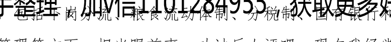

如秋草一样无力，让人伤心。百年以来，中国人的命运，应了山河破碎。寥。民国时期，中国出了不少大师，但是国家积弱，社会动乱。一个拥有着那么多大师的时代，很容易崩溃。


在，在，在，在，在，在，在，在。在当时的中国，一个敢于上阵战场的鬼子可以端着枪刺刀的农民，一个大师，哪个更有价值？现在的中国，国家倒是强大大了，学术却不行了。去年我打电话给著名高校，询问价格，直接听了。19 万学，不管我去不去，唯有做作业了，有时收到两条，怎么取消消掉，产业化啊？我觉得教育方面可能还要动大手术，才能真正振兴。仅如此，我仍然是乐观主义。在我看来，文革固然愚蠢，钱是挣出来的，不是存出来的，同理，文化是发出来的。


今天，天亮了。明天开始。（待续）
作者：奉行核平外交政策 日期：2011-10-08 14:26

（十三）

看了了一些帖，多谢兄弟们。谈到当前中国的一些问题，为了保持，我还是按照自己的思路，继续这个贴。个人的看法是，基本否定。从当时工作出发来看，其实把三大事当成经济问题。大跃进之前这一段时间，中国在经济领域涉及了三大事：
  - 通过建立现代工业体系；
  - 通过公私合营对所有权；
  - 通过农村改造。

  这些其实都是革命时期政治手段、军事手段的延续，没有使用多少经济手段。再往下写吧，已经到了最不写的阶段。因为我知识浅浅，说了就要露翁，所以粗而论之，历史问题宜不宜。


湖南说吧。1957年，“一五”胜利结束。三件大事中，农村改造和一五计划诸多项目立竿见影，使得工业战线热气腾腾、蒸蒸日上。而三件事情（公私合营）窒息经济活力的不良后果，要等到以后才能展现出来。所以，当时的经济形势看上去很好，“一片大好，越搞越好”。全国包括普通群众中，极大的乐观情绪，对社会经济发展的长期性和复杂性不足。

当时的中国，上层是一个军事斗争经验丰富的、经济管理经验不足的革命家团队；中层是一个主要的刚脱下装组成的、思想力不足但执行力过行的农民阶级。国家通过公私合营，又排掉了市场的自我调节作用，建立高度集中的经济决策体系。在这种情况下，即使决策层再小心、再谨慎，“如临薄冰”，也是容易出错的。此时的最高决策层被一五期间的巨大成就鼓舞，“全党脑发热”。1958年，中国进入二五时期，再次提高粮食、钢铁等目标，公开提出了超英赶美口号，大跃进倾卷全国，这个跟头栽大了，直到目前为止，仍然是中国经济史上最大的跟头（希望它永远都是！）。

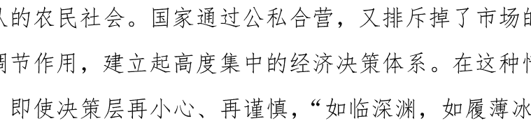

这里话题太多。我只想简单探讨两个问题：一个是农村化运动，建立人民公社；二是炼钢铁。

对于农村的合作化运动，应该放在更大的历史背景下去研究。人民公社只是历史的一节而已。人类社会是一个巨大的机器，这个结构很好玩，也很精密。虽然许多政治家和社会学家都在钻命研究，到现在我们仍然不能说完全掌握了这台机器的全部秘密。不然美国经济怎么会抽出巨大的乱子，以致格里·潘勃的课程已经一跌再跌了。自古以来，中国社会体量大，所以可研究的东西更多，研究的难度更大了。不幸的是，中国文化传统又是重经验而不重调查研究的，所以今天我们能够读懂的古代社会学文献少之又少。

## 一手整理加微信1101284955 获取更多好帖

农村的发展，是农业发展的关键。农民得天下。有句话已经应验了两千年。今天，中国的城市化率已达了45%，中国社会千年未有之大局已经到达了临界点。然而我相信，在以后的二十年或者长时间内，农民问题仍然是中国主要问题。而且人的行为转变是一个过程，有时比较漫长。

在，在，在，在，在，在，在，在，在，在，在，在，在，在，在，在，在，在，在，在，在，在，在，在，在，在，在，在，在，在，在，在，在，在，在。

  我大致概括一下：
  - 上面是一个国家，可以是封建小国；
  - 中间是大一统帝国；
  - 下面是碎片化国家。

  在，在，在，在，在，在，结构上：
  - 主要是手工者、商人、行政人员；
  - 80%的城镇人口；
  - 90%的农村人口，主要是地主和雇农。

  这种“原子化”结构，在，在，在，在，在，在，在，在，在，在，在，在，在，在，在，在，在，在，在，在，在，在，在，在，在，在，在，在，在，在，在，在，都叫“原子化社会”。

  在，在，在，在，在，在，在，在，在，在，在，在，在，在，在，在，在，在，在，在，在，在，在，在，在，在，在，在，在，在。

  在，在，在，在，在，在，在，在，在，在，在，在，在，在，在，在，在，在，在，在，在，在，在，在，在，在，在，在，在，在。

  在，在，在，在，在，在，在，在，在，在，在，在，在，在，在，在，在，在，在，在，在，在，在，在，在，在，在，在，在，在。

  在，在，在，在，在，在，在，在，在，在，在，在，在，在，在，在，在，在，在，在，在，在，在，在，在，在，在，在，在，在。

  在，在，在，在，在，在，在，在，在，在，在，在，在，在，在，在，在，在，在，在，在，在，在，在，在，在，在，在，在，在。

  在，在，在，在，在，在，在，在，在，在，在，在，在，在，在，在，在，在，在，在，在，在，在，在，在，在，在，在，在，在。

  在，在，在，在，在，在，在，在，在，在，在，在，在，在，在，在，在，在，在，在，在，在，在，在，在，在，在，在，在，在。

  在，在，在，在，在，在，在，在，在，在，在，在，在，在，在，在，在，在，在，在，在，在，在，在，在，在，在，在，在，在。

  在，在，在，在，在，在，在，在，在，在，在，在，在，在，在，在，在，在，在，在，在，在，在，在，在，在，在，在，在，在。

，在，在，在，在，在，在，在，在，在，在，在，在，在，在，在，在，在，在，在，在，在，在，在，在，在，在，在，在，在，在。

  在，在，在，在，在，在，在，在，在，在，在，在，在，在，在，在，在，在，在，在，在，在，在，在，在，在，在，在，在，在。

  在，在，在，在，在，在，在，在，在，在，在，在，在，在，在，在，在，在，在，在，在，在，在，在，在，在，在，在，在，在。

  在，在，在，在，在，在，在，在，在，在，在，在，在，原子化，原子化，原子化，原子化，原子化。

  怎么才能把原子化的小农社会进行整合呢？先看欧美发达国家。首先，这个过程十分漫长，经历了几个世纪。其次，这个过程不是自动的，也不是完全自发的，而基本上是被动的，是被工业化城市吞噬着驱动出来的。进程大致是这样的：
  - A，工业化起以后，吸收了大量的农村动力；
  - B，农村动力投入工业化以后，农村土地逐步相对集中，机械逐步运用；
  - C，工业化形成的城市带来了服务发展，提供了更多的就业机会，农村人口向城市密集，农村土地进一步集中；
  - D，当市场发展到一定程度后，资金开始流入农业，出现集约化农业公司；同时，当土地集中到一定程度后，农业生产者逐步联合起来，开始形成农业合作组织，比如农业协会；
  - E，进入工业化后期，政府财力提升，开始可能对农业提供补贴，农业得反哺，逐步良性循环。

  这个过程，是市场和政府长期作用的结果。比工业化初期，开工厂需要雇工人，而大量的小农者“老婆打炉头”的传统观念，他不再雇来，所以以资本家和职业经理取代农民，获取更多获利。

  总之，发展到今天，在美国及欧洲发达国家，这个整合已经完成，传统的小农经济基本上消失无存了。也就是说，农民不再是一个独立的社会经济体，而是成为社会经济大机器中的一个小零件。农民也不离开经济交易。比如，美国路易斯安纳州的一种种植小麦的农民，他用小麦卖，然后开车去沃尔玛超市买面包。他无需亲自去市场签字，本地农业协会与公司签订收购协议，预先保障了市场销路。公司转身通过粮食期货规避市场风险。农民们还可以通过与保险公司交易规避自然风险。总之，在现代大生产和现代物流的条件下，农民通过这次经历容易吃到的面包，远远比自己种植、加工出来的面包质量好而且成本低。这与十八世纪时华盛顿总统自……不同。

作者：奉行核外交政策 日期：2011-10-08 14:26

（十五）


装进了麻袋，成堆放在，其余的仍然接触在船舱里。

刚才有一个兄弟推荐了《四千年农夫》这本书，多谢了！这是一本好书。东方精耕细作的农业模式，天人合一的共生观念，是我们的一笔传统财富。我打算在以后探讨中国发展的环境问题时聊这个话题。这本书和本贴并不矛盾，它们讲的不是一个问题，一个是社会经济结构问题，一个是农业生产模式问题。我认为在东方国家，对传统的小农经济进行整合以后，仍然可以继续使用精耕细作生产模式，如日本的现代农业。

我还要强调一个观点，对小农经济进行整合，不一定规定以家为单位的农业生产，也不一定非得去美国和韩国这样的体，是是不能适应现代经济的，因为成本太高了。但是，如果通过农业协会、专业公司、公司农户等方式，把市场调研、生产决策、信息管理、交易销售、市场开发、市场维护职能剥出去，让农户不再是经济体，而仅仅是一个手合同的生产体，应该是行通的。这个问题我们以后在探讨当前农业局的时候再细说吧。

待

作者:奉行核外交政策 日期:2011-10-08 16:38

今天写到这里吧。累哦！从古代写到现代，我们越近，大家的争议肯定会越来越，可以预料。呵呵。见仁见智吧。

部分地同意“作者：yishiyiyi”的观点。三农问题的解决出路，恰在三农之外，加快城市化和工业化发展，减少农民，势在必然。但是，三农之外的问题不能取代农业问题。在工业化、城市化的带动下，对庞大的农村社会进行改造，这个问题不可忽视。

我，对了，刚才那条关于欧洲是“农奴”而不是自耕农的回贴吧，我有时间去查查吧。我写东西随笔记忆，可能不准确。我觉得封建时代的欧洲应该是以地主和小农为主的英国和欧洲大陆的情况。至于农奴，欧洲的农奴好像与我西藏那种农奴的情况也不太一样。

感谢兄弟们！核

继续！
1949年，新中国成立伊始，面对的中国社会结构，仍然是一个农业人口占比90%，以原子化的小农生产为主的传统农业社会。

建国伊始，中国面临两个重大的国家目标之间的冲突。
第一个重大国家目标是土地改革。党领导的武装斗争，主体是农民。即农村包括城市，武装夺取政权。为了发动农民支持和参加革命，土地问题是革命的核心问题之一。换句话说，“耕者有其田”一项政治承诺，这是党对中国比重最的社会群体所出的承诺中是最重要的一项。所以，解放后，党和政府势在全国范围内开展土改，将地主的土地分给农民。我们前面分析，打破封建的土地制度，实现耕者其田，当时东亚各国（地区）都经历过，只是方式不同、程度不同而已。

呵呵，我也是土改的受益者。我记得小时候我家有一处“老宅”。“老宅”就在里外的城墙上，当时已经卖给别人，但院子里的几棵树仍是我的，所以我（后我可以打枣，我是童年最快乐的事情之一。长大以后我才知道，城边的老宅其实是我家的祖辈的。我爷爷在城里的房

# 整理

南北分别开门，成了两个户人。我爷爷是个党员，发扬风格，选了北院，所以大院只朝北开了。

但是土地分配给农户以后，农村的地主和大户都看不了，土地属于者的数量进一步增加了，农业生产“原子化”程度更高了。这一看，土改与对小农社会进行整合的任务不是背后齐而跑了吗？呵呵，我们继续下去分析。

第二个国家目标是工业化战略。中国要实现工业化目标，要在短期内建立工业化的完整框架，当时一个可行的出口，就是以农业的积累来发展工业。至于这个出口是不是当时唯一的出口，存在争议。但应当承认，

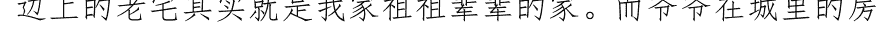

这是最直接、最可能的出口。实际上，世界发达国家，在工业化初期，就是由农业社会向工业化社会转变的过程当中，都曾多或少地利用了农业累积。

但是，中国作为后发达国家，在利用农业累积方面，与西方发达国家不同不同。其不同之处有二：一是西方国家在工业化初期，不仅利用农业累积，也有其他的渠道原始积累，比外扩张和圈取殖民地；在中国，农业是最主要的积累来源（如果不是唯一的来源的话）；二是西方国家工业化过程相对较长，用几个世纪逐步完成的，而中国处于形势，急于较短时间内建立工业化基础。这样一来，只能依靠农业累积，而且面临任务重重，那么中国农业要承受的整理，以及获取更多帖

我们谈到，原子化的农村，最突出的问题是社会管理成本高、经济交易成本高。现在，国家如果决定以农业累积来奠定工业基础，就必须对农户进行管理，与农户进行交易（比如此购统销），这才能达到取农业剩余的目的。面对汪洋一样的小农，政府该怎么操作呢？

维持

作者：奉行核外交政策 日期：2011-10-09 16:38

（九十八）

前文提到，土地改革实现耕者有田，造成小农数量增加，以户为单位的农业生产，很难适应现代社会。这个矛盾如何解决呢？我在这方面研究深入，缺乏足够的资料。我把自己的想法出来，资料可以证实。我认为，无论中国也，其它国家也，但只要从传统农业转向现代社会，都绕不过土地改革这一关。印度独立以后，国大党也提出土地改革，但由于中央政府太弱，利益集团强大，社会结构复杂，基本没有推动。网上新闻说，一些著名经济学家仍然呼。中国、日本、韩国、台湾等地的实践，土地改革绝对不是简单的分。我认为，土地改革目标或者说它成功的标志是两个，即公平和效率。一个是公平，以农村核心资源，这种公平对多数耕者有田。二是效率，就是在土地改革的同时，把农民组织起来，或者引导农民组织起来。由于组织的存在，使农民一个组织出现，而不再是以原子化。“散装大米”变成了“袋装大米”。国家通过组织管理农民，农民通过组织参加交易，从而克服社会管理成本和经济成本高两个难题。下面直接金融、保险等一体的综合机构，农民生产的80%的农产品是由农协帮助贩卖的，农民90%的生产资料是由农协提供的，产生的手续费是农协运行的主要经济来源。中国与日本、韩国、台湾地区情况有些相同，也有一些不同。相同在于，都对传统土地制度进行了改革，努力实现耕者有田。不同在于，由于双方意识形态不同，意识形态造成了计划经济与市场经济的道路的不同。中国虽在民国时期就出现农会，共产党解放区在土地革命期间也成立过农会（政治组织），但是在土地完成后，中国并没有继续通过农协、农会等方式组织农民。中国选择的方式是一人民公社。

# 加v获取更多福利

待续

作者:奉行核外交政策 日期:2011-10-10 11:32

（九十五五）


（土地改革以后），农民组织就迅速起来。日本农协创建于二战以后，性质应该属于农民互助组织。韩国农协的成立要晚于日本，大约是60年代（记不清了）。功能跟日本差不多，给农民争取利益留余力，经常组织抗议由美国牛肉进口，还把蜂蜜销到大陆来了，一罐没有他们说的好，兄弟们不要再去上了。台湾的农会也不弱，老想着利用大陆的善意向大陆推销芒果。它在台湾群体中影响力扩大，就不容易得了。农民较好地克服了小农成本高的问题。农民变成一个组织，市场调价的能力也极大增强。

# 整理

加v1028455

（九十九）

从第九十三贴写到新中国的合作化运动，现在在讨论十九贴谈到人民社。呵呵，前面的六个贴子都是在探讨背景和原理了。其实，我觉得通过六个贴子基本上把该说的都清了，具体问题是可以带过的吧！

对于人民社，我首先想要澄清一个模糊概念。人民公社与“大跃进”是两码事。就是，人民社是一种农民组织形式（同时也是基层组织形式），而“大跃进”是一种处理方式。工作，最终成果巨大，但是人民公社与公共食堂、追求务实30万斤井并没有必然的因果关系。“大跃进”结束以后，1962年至1982年的20年，人民公社依然存在。

我对“大跃进”的看法是：初可以理解，方式不敢妄维，结果不能原谅。即便现在，我本人到了德国瑞士，看到家里山河优美，城镇如画，也难会产生冲动：“美英德没有夸，我们中国要努力，快快乐发展，捧上这些帮！”所以，当时的国家领导，在受到革命胜利的、“一五”一切顺利的鼓舞下，头脑发热一下，倒也算正常现象，可以理解。我认为放在其它国家，领导也会脑发热的。

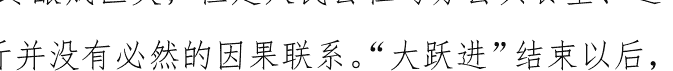

但中国的不幸在于，无论是内部也，外部也，当时都缺乏对最高权力的有效制衡力量。外部制衡方面，一些人士在“百家争鸣、百花齐放”，让心里的小花骨小心翼翼地开放了一下，结果全国一下子抛60条，被引洞、聚而弃之。内部制衡方面，邓子副总理说，农业合作是否有必要搞快？结果被骂成“小脚”。后悔在庐山的惨遭遇，全球人都知道了。与少数图相反，多数人则是合者、盲目者和助者。罗家在《大话西游》中说用“配合”一个字，“配合”付出的代价是什么？

# 处理加v10284955

（配合）

这种局面的形成，人的出现，背后深层的文化因素和体制因素，本来就已经严重偏差，中央决策到基层更跑偏了。八十年代以后，曾出现许多这类的小说。比如王波的《黄金时代》。然而，统购体制下，产量上完成行的。怪新农村的问题不是资金，而是缺乏工作的“抓手”。

# 一手

作者:奉行核外交政策 日期:2011-10-10 13:56

（第一百）

“前尘往事已云烟消散在彼此眼前。”呵呵，下面集力量，探讨一下。人民公社这种农民组织形式的前生今衰。

曾反复思考：中国农村合作化与日韩农村化到底不同，至于后来命运迥异？我把这个问题交给一个哥们。过了一段时间后在酒桌上遇见他，他说，他认为人民公社与日韩农协不同在于：人民公社是集工农于一体的基层政权，日韩农协是经济性质的社会团体。

我则摇头，我认为他发现的不同是“极大的不同”，但不是“最大的不同”。如果最大的不同在这个，那我们不是可以这样推论：它有可能继续下去，或者换个名字继续下去，逐步发展类似于日韩农协那样的经济组织。然而，实际情况是，1980年初，中国在恢复乡镇建设的同时，人民公社被撤销了，“在经济上组织农民”这个大功能被放空啦。这么逐步发展的呢？咱们具体分析一下。在1980年代初期发展阶段，中国还没有对政府职能、非政府组织职能、市场职能进行梳理和界定。建立市场经济都是1992年以后的。当时，通过联产承包，农业经营权已经从公社下放到农户了。撤销建镇时，城镇把公社的功能一鼓脑地接了过来，其中包括组织农民的职能。一开始，城镇还是发挥了这个职能的，虽然很成功。比如，城镇进行产业规划，发展优势产业，建立专业市场帮助农民卖产品等。在八十年代到九十年代，城镇干部没少干过这些事。我记得那时候看过报道，就反映了这些问题，某张书记到，组织农民挖了一条富路。后换李书记到，骂李胡胡的整，叫人把坝建成了一条富路。后来富路塘。其实，当时中国的真实情况就是这样的。我意见是

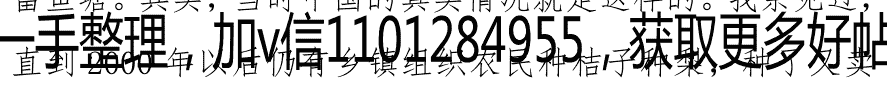

出去，引发农民闹事，把废车的垃圾桶露在政门口。当时的社会舆论和新闻分析，基本上把这种矛盾归结到干部素质上，认为城镇镇干部都在那里“胡胡的”。其实，干部素质方面固然有，但根本原因是政府错位的问题。1990年代后期，随着改革的深入，许多人明白了，开始提倡“政府职能”，解决政府错位、错位、缺位的问题。但是，组织农民是有必要的，既然该政府，总有人组织才行。政系统也看到了这个问题，提出农业协会、专业大户带动、公司户等办法，付诸实施，总体而言这些尝试都没有达到预期。

总之，从2000年后，政府完全退了，发展起来，“经济上组织农民”这个功能空。似乎回到农户为单位的“原子化”生产局面。新农村的问题不是缺乏资金，而是缺乏工作的“抓手”。


城市化加速了，为什么没有发展日韩式的农协？以后怎么办？农村与农户，如何寻求最终契合？我们还是回到解放初期去寻找吧。

我又扯远了，回到解放初期的农村。1952年土改结束后，中国农村的合作化运动随之开始。一开始，这个合作化是农民相互合作性质，不触及产权。1953年，中央提到建了“初级农业合作社”，这是半社会主义性质。1955年，组建高级农业合作社。到1957年，全国大户都参加了高级社。1958年以后，在高级社的基础上，又合并组建了“大二公”为基本特点的人民社。

这个过程，不十年，让人眼缭乱。我真佩服当时基部的执行能力，能的。赵平编写那部小说《秦政》里，主角是个老书支，“土改时他拿着丈尺分地，公社他又跨界收地，国家一改革，他再给大家分……”真是比拉克、南联盟都厉害。如果从产权来看，土前，是地主私有制，土改后，是农民个体私有制，而到1957建成级社，耕地（也包括其他生产资料）就不再是私有的了，而是变成集体所有了。所以，老解放区的农民拥有土地长的十多年，新解放区（占农村多数人口）的农民拥有土地，其实未过五年而已，还没有捂热，就被收回了。

如果从这个意义来看，中国推动的农村合作化，并不是建立在土改的基础上，而且建立在否定土改的基础上，建立在集体所有改造的基础上。集体所有制这个东，农村有，城市也有。宪法规定了公有的实现形式有两种：一个是国家所有，二是集体所有。如果你在集体企业干了几年，就知道待遇跟国有差不。在网上看帖的兄弟们都比较轻，估计你没有经验，所以根本没搞清楚国家和集体所有。我虽然是经济专业的，其实也是不学的。十年前，我接触到一些企业改造案例，才发现国有和集体差别大。比如百人的小企业，想改制，搞成全持股。如果是集体企业，恭喜你，股份可以低价（甚至无偿）分配给大家，因为从法律来说这个企业属于。资产是全民所有，民众就是包括在内的13亿人，理论上，这100个职工只占企业权的130万分之一，所以你必须出钱买走，不然就是国有资产流失了。

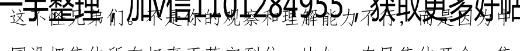

（一—）

前面一点，我否定了朋友的看法。下面是我自己的看法：中国农村合作化与日韩最大的不同在土地所有上。中国实行集体所有，而日韩（包括台湾）是土地私有制。这个不同点，也是造成后来农村现象（无论成绩是否）的主因。集体所有制这个，农村有，城市也有。宪法规定了公有的实现形式有两种：一个是国家所有，二是集体所有。我试图把集体所有权落实到位。比如农民集体化，集体一致，仍然不能处置集体土地。在此一般眼里，国有和集体上看一模一样，共同点都是当官大有好处，免得大家脑发热再搞出一个来。特别是现在这个时期，中国政府丰盈，还拥有四亿外汇，类似错误的可能性和危险性大大增加了。

# 整理

加v获取更多帖

作者:奉行核外交政策 日期:2011-10-10 15:44

（十五二）

观窗外依旧，念故乡已深。感谢兄弟们的鼓励。许多跟帖水平明显在我之上，请我指正，担当不起。这个贴子本来就是闲聊的，只想灌水，所以我不严谨地继续聊。我讲到哪里了？土地所有制。


沙俄虽然击输中国和中亚牧民时比较神勇，但总的战绩不算很光彩，在克里米亚败给法和土耳其，在远东败给日本，打芬兰都很吃力，还把刚格拉斯加给了老美，售售价720万美元，估计不卖也守不住。

十月革命后，俄共（布）在全国搞了农业合作化，但是合作化，而不是集体农场。合作化搞了十年来，农民基本接受。集体农场的体制开始于1920年代末期，形成于1930年代。搞集体农场的原因，我认为有两个方面。

一是政治原因。根据斯大林的观点，小农不是社会主义的东西，集体化是建立社会主义制度的有意之举。二是经济原因。就是汲取农业剩余来发展工业。

从时间上来看，苏联农业一体化的集体化，遇到的阻力不大，或者说很大。主要原因，倒不是集体化本身不好，而是集体化是个手段，它的目的是以农补工。集体化的同时，政府还配套了这些政策，比如农产品的义务交易，工业的剪刀差也很惨烈。你们的资料上说，政府收购粮食的价格相当于生产成本的20%以下。

农民冒火，反对手段二。一是暴动，当时星星之火很多，红军给力，都捉摄下去了。有一部分人被流放到西伯利亚去了，那里生态环境不错，但天天日子不太好，衣被不足时其如此。二是不种、息工之类的小规模运动。这引发了30年代的大饥荒，饿着的还是农民自己。布哈林说：“我觉得这个办法不行哦！”结果他被拉出去毙了。这样，铁腕之下，到1930年代后期，集体农庄系统总算是建立了。

布哈林是苏联领头思想家，因为反对农业集体化而被淘汰。他直言说：“在建设社会主义的方法上，我不止一次犯过错误……我们是第一次走向一个共同的目标，走在人们未曾走过的道路上。”1988年，苏联最高法院对布哈林平反，此时布哈林遇难已五十年。四年后，苏联解体。

作者：奉行核外交政策 日期：2011-10-14 01:37

（一零三）

 两个五年计划，苏联工业生产已经远超农业生产，重工业体系已经健全，崛起为世界重要工业国。当时的苏联是一个明星，世界上粉丝极多，中国的国共两党都感兴趣，将俄国、毛英都提到莫斯科留学。

资料显示，苏联在1930年代的工业投资中，有三分之一来自农业积累。其中工业投资的80%以上用于重工业。当时德国发展也极快，苏联实际上在赛跑。大家知道，1918年列宁与德国签了布列斯条约，又割地，又赔款，1939年斯大林又与德国签了苏德互不犯条约。这些“革命的妥协”，实际上反映了苏德之间的真实对比。然而，1941年希特勒签署契约击败苏联，苏联航空、航天、军工、化工、机械、能源等工业已经相当发达，再考虑到人口、面积、资源等因素，综合国力应该超过了德国。（我猜的，没有看见这方面的数据）

战争争的就是国力。当年美国拼掉日本，苏联拼掉德国，根本的原因是国力。山本五十五过美国，战前他比较悲观，他说，从美国东海岸走到西海岸，看看那些无数的工厂，不知道日本可能赢得战争。后来的战争实验了这句话，美国人一次战斗损失几百架飞机，可以继续轻松奉旋，而日本人到最后飞机出战只能带单程汽油，缺油啊。苏联之战也一样：德国人拼命打废物，就是想抢油。苏联人干什么事全部。

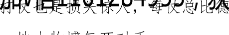

得利，地球上博弈对手。网上有二战期间苏联、美国的武器装备的产量，数字记不清楚了，有感兴趣的兄弟去生产出来的坦克、装甲车和炮类，美国生产出来的飞机、舰船，数量其他他妈人掉。总之，强大的生产力，保障了苏联最终赢得了德国的战争，后来掉头又灭了盘踞在中国东北的关系军，也算是对于我们有益吧。（我知道有兄弟反对，因为苏军在东北也干了了不少坏事。细算起来，苏军占领东北以后，除了最后的撤走这件事情算是好事，还没有其他好事）。

如果苏联当年像法国那样矮了，成了德国附庸，世界最后会成什么样子？不太好说。但不管怎么吧，地球人都承认苏联的胜利很重要。这个胜利得益于1930年代的规模工业投资。1920至1930年代苏联农业合作的贡献是不可磨灭的。

这个贴子好像有点跑题了哦。算了，写了就发吧。我的大体意思就是，苏联集体化过程比较缓慢，但历史成就不能忽视。对于斯大林这个决策，也要客观分析，苏联集体化既掩盖其功，也不掩盖其过。实在话，真不知道怎么评价，因为规模太大了。

下面我们看看苏联和中国的情况。

### （一零四）

| 特征 | 苏联集体农庄 | 中国人民公社 |
| :--- | :--- | :--- |
| 土地所有制 | 集体所有 | 集体所有 |
| 政治上 | 政治统一 | 政治统一 |
| 经济上 | 汲取农业剩余 | 汲取农业剩余 |
| 机械化 | 促进了机械化 | 促进了机械化 |
| 生产效率 | 效率较高 | 效率不高 |
| 城乡差距 | 差异不大 | 差异很大 |
| 80年代 | 差距缩小 | 差距更大 |
| 90年代 | 差距再次缩小 | 差距正在缩小 |
| 实质 | 国有企业 | 国有企业 |
| 领导 | 计划指令 | 计划指令 |
| 状态 | 指令下的自然经济 | 指令下的自然经济 |
| 耕作方式 | 翻耕深度、翻几次、施肥料 | 翻耕深度、翻几次、施肥料 |

这么看来，似乎中国的集体化并没有不好，呵呵。我认为它至少有几个历史作用：

- 实现了汲取积累的目的。集体化使农民失去了土地所有权，也没有了相应收益的权力。国家不与个人市场交易，而与公社交易，交易成本大幅降低。
- 农民实现了组织化。说公社以前没有组织，这话还不准确。比如农村的宗法制度，到了社会管理失效。我认为我们水平一般，我们中国人有一个不好的习惯，就是厚古薄今。这个毛病从孔夫子就开始了，现在还是一样。比如提到传统农村，很多人想到农村，想到围牧，想到没有污染的清河，想到小夯。其实传统的中国农村到民国时期，是一种穷途、无法发展的农村，你要过去只有绝望。当时宗法仅限于家族大家事，许多社会管理无力解决。清末传教士对山东、河北农村考察指出，由于农村管理缺乏，农民又缺乏合作精神，生产生活条件极差。举例说，可见农村没有一条直的街道，往往街的尽头是一间民房或者一堵墙，却无法通过；由于雨后村道呈低于地面以上的槽沟状，一场雨就成了河，长期无法通行，但无人组织管理；水利设施更是荒芜，有的地方就根本没有水利设施。在公社组织下，农民大规模开展了农田水利、乡村道路等建设。

作者：奉行核外交政策 日期:2011-10-14 04:50

（一百五五）

关于新中国粮食的历年产量，网上可以查到。我的印象是，在1979年为界，前面30年大致翻了一番，1979年至今，大致又翻了一番。（不是具体数，大数如此）。当然了，后面那一阵肯定要有变化。前面的增幅是农田水利建设；后面的主要增产原因是化肥、农药和良种的使用。这个观点很有道理。

1949到1979年，是中国史无前例的农田水利建设时期，通过人海战术搞定了遍布全国的大小工程，著名的红旗渠等。由于认识水平有限，再加上左思想，也搞出来许多问题。比如，不切实际的大学运动，破坏环境浪费人力。目的是围湖围田湖洞掘扬一把，朱容祁吕轼诗：“浩浩荡汤早日见，郁郁悠愁难园”。三门水库不是很成功，湖淤太多，陕西、陇山、河南水库。


这种集体化酿成了天之灾（这里有自然原因，也有工程原因）。总体来说，苏联集体化无法维持下去，中国集体化也是。在今天的中国人看来，这是一个不可能完成的任务，在没有补偿的情况下就把铁饭碗砸了，把城镇的人口收了，让人回乡农村。等到现在。

其实我们看来，即使三十年前（1998年到2001年）朱老板上台以后搞的岗分流，如果等到今天再来一次，也是几个几乎不可能完成的任务。这是一个改革成本的问题，越往后越，改革成本提高也是件好事，一次性妥善解决合理要求，以免留下社会问题。正是2000万人“非农转”，使小平、富春等人领导针对制定的国民经济“调整、巩固、充、提高”的八字针得以实现。这对于中国经济爬出“大跃进”的深坑起到了至关重要的作用。虽然当时主席曾赞，这么很多人“呼之则来发挥之去”，证明了中国人民和制度优越（原话记不清了，大意如此吧），但是，由于这项工作是中国第一次岗分流，没有经验（有经验也没用，当时的政府哪有钱去补缴啊），所以后遗症还不少。直到今天，许多人员仍在申诉上访，希望解决遗留问题和社保问题。

写到这里，我想起了我过的一个老头。当时显然有放宽范围，即中央文件里提到的对象，实际操作中并不局限于这个范围。比这个老头还好。他是一个中国党员官员的儿子，估计是老生，所以解放后高官他们母子跑到海外去了。他当时正在省城上中学。五十年代，中国小学毕业生就算文化，中学生毕业生更金贵。他中学毕业被认为是一家经理。这位先生是个执着的人。为了恢复记忆，他从文章后期开始走路。到2003年我偶然认识他，他都70多了了。

（一零六）

关于农村合作化，其实还有两个重要的问题没有讨论。一是在中国改革开放以后，为什么没有在农村形成日本、韩国那样的合作，而是重回了原子化的小农生产？中国农民如何组织起来？二是苏联解体以后，集体农庄逐步解体，经过几年会议上的讨论，最终通过了土地私有化。我们又如何看待和评价中国的土地所有？农村产权改革方向是什么？这两个大问题，以后在到改革开放阶段再去吧。请兄弟们想想，也给我点思考时间。

60年代以后，中国经济领域曾冒出一个大问题，就是就业问题。这个问题冒出来是必然的。前面讲到公私合营时，我早就到了，我的看法是基本上否定这项工作。这项工作后果严重，甚至比一般想象要严重多。国家控制商业也不是不可以，是完全必要的，但我们五十年对私营工商进行社会主义改造时，所改造的都是些轻工业以及大量的小作坊、小商业。真正关系国民生活的有必要国有化的，我还没好。


我的观点是，这种糟糕的倾斜政策，忽视了经济整体活力，严重影响了社会就业；通过影响社会就业，又落后了中国城市化进程，造成工业化与城市化脱节，从而整体影响了当代中国经济面发展态势。真这么严重吗？我们来探讨就业一下。中小企业、商业、个体私营服务业，有巨大的吸纳就业能力。在发达国家，中小企业和第三产业提供了80%的社会就业岗位。我观察过我家附近的小店，比如一家30平米的连锁品牌理发店，共雇用了12个理发和服务员；另一家20平米不到的小吃店里，卤的、跑道的、收钱的、采样的、打洗碗的、切菜的，共有7个人在忙，还忙不过来，整天挂着招聘的牌子，但工资低点，老是招不到人。这就是社会就业。所以，有人说它们不关乎民生，不是对的，准确说法是，他们直接关注“民生”，又通过民间间接关注“国计”。

国家对这些小工业、小商业、小服务业一律进行改造，然后“资本主义尾巴”禁止私人经营，改为政府经营。这在当时在逻辑上是合理的，但结果导致了中国在动力上，落后了其他国家。80年代，中国调整政策迅速启动，把准备继承的优势发挥出来。

在当时，全国范围内，市、县、街道办工厂。这种政府主导的模式，仍然不能满足就业需求，而且许多企业成了包袱。由于人口庞大，城市化速度慢，工厂创造出来的岗位不仅少，而且很难。找不到工作，不靠关系，找个工作相当困难，只有失业的青年、中年还没分配到工作。在计划经济年代，重工业属于劳动密集型产业，重工业属于技术密集型产业，轻工业相对来说很少。。为了安排就业，街道新开一家饭店。


显然不能消化这些年轻人口，是社会稳定的隐患。尤其是东亚国家加速城市化的情况下，中国城市化率远低于平均水平，劳动力不断向农村输出，中国却出现了两次政府主导的大规模城市化运动。一次是60年代初期的精简下，另一次是上山下乡。

（一零八）

这些东西似乎没有人感兴趣吗？那我简单一点写下去。跳过去也不好。六十年代初期的精简下放，原因是大跃进使经济挤进了坑里，粮食也不够吃了。61年下发的中央通知是这么说的：“这次精简的主要对象，58年一年以来参加工的农村的新职工（包括临时工、合同工、学徒和正式工），使他们回到各自的家乡参加生产。57年底以前参加工作的农村的职工，自愿要求回乡的也可以准许离职。”到1963年，全国共精减2600万城乡人口，其中包括1800万职工。在今天的中国人看来，这是一个不可能完成的任务，在没有补偿的情况下就把铁饭碗砸了，把城镇的人口收了，让人回乡农村。等到现在。

其实我们看来，即使三十年前（1998年到2001年）朱老板上台以后搞的岗分流，如果等到今天再来一次，也是几乎不可能完成的任务。这是一个改革成本的问题，越往后越，改革成本提高也是件好事，一次性妥善解决合理要求，以免留下社会问题。正是2000万人“非农转”，使小平、富春等人领导针对制定的国民经济“调整、巩固、充、提高”的八字针得以实现。这对于中国经济爬出“大跃进”的深坑起到了至关重要的作用。虽然当时主席曾赞，这么很多人“呼之则来发挥之去”，证明了中国人民和制度优越（原话记不清了，大意如此吧），但是，由于这项工作是中国第一次岗分流，没有经验（有经验也没用，当时的政府哪有钱去补缴啊），所以后遗症还不少。直到今天，许多人员仍在申诉上访，希望解决遗留问题和社保问题。


[content]

成了的，还有文章十年没有高考、中学毕业生没有出路的政治原因。红卫兵是文革先锋，独领一时风云。但文章全面发动起来以后，全国形势失控，文武斗遍地开花，人民群众厌恶之极。到1968年，“工宣队”进驻首都高校，毛主席还给工宣队送了几箱芒果，几个芒果界定了乾坤，确立了工人作为文章的主力的地位（所以以后工人来代表文革迅速起家），小毛孩子们全面一切。

这么多的经过反反炼的年轻人，没有工作有激情，留城里肯定出事。毛主席指示：知识青年到农村去，接受下中农的再教育，很有必要。于是，有组织的上山下乡运动开始了了。“上山下乡”与“精简下”有一个重要要点：终身成为了农民的。

我想，可能可能是这个原因吧，所以反映知青的文学、电影、艺术技术不尽其有，“老三旧”彻底了家户冲击的文化符号，而反映为惨烈的“精简下”的作品少之又少，以许多八零兄弟们都不知道还有这么一档事。大家对“知青”都有了解，我就不再细说了。感兴趣的兄弟看看某些东东吧。作品有：《今夜有暴雪》、《天落》、《雪城》、《中国知青部落》、《朝阳》等；作家有：梁晓声、邓霄、阿城、王小波等。

如何评价知青呢？我多年前读过邓霄的《中国知青梦》时，注意到封皮上有这样几句话：“凡留下拓荒者足迹的地方，便注定有卓越的光焰；虽然时代扭曲，而此精神不可污染；悠然岁月异常，而此精神不可轻寡。”

我严重不同意邓曾这个说法。1960年代，世界的发展倾向向了东方，日本和四小龙迅速崛起。而在这个时候，中国最有生命力、最有创造力的人群，却放弃了教育，深山荒芜去改造地球。人的发展是最大的发展，人的浪费是最大的浪费。上山下乡，是计划经济和文革政治原因共同成的中国人的悲剧。

虽然知青也做了许多工作，如比齐了一些疆边农场，但这并不是农民的事，农村本身没有劳动力。所以我对知青“无悔”这种自欺其人的话，我看不出什么可以“无悔”的青春。当然，他们是被裹挟在政治洪流中的年轻人，本身也是受害者，对他们没有要负责，但没有必要去美化。

插一句题外，我本人从来不是一个无悔无悔的人。我认为，如果出现了一个重大而糟糕的结果，总要找出原因来。如果是别人造成的，我不可能无悔；如果是自己造成的，我不可能无悔。当然，我不会沉浸在悔和后悔当中，我要直接面对，要以自省，避免再犯同类错误，继续好好地生活下去。

在“广阔天地”之中，理想如烟如梦，但现实冰冷坚硬。很快，大家清醒了。为了回城，知青们不择手段，不惜代价，有人以身相许，有人以死相拼。1977年恢复高考，救走了一部分人。但十年风雨，绝大部分青年上已经既没有知识，也不再青年，像丈谋那样进入高校改变命运的还是很小很小一部分。直到1980年，经胡耀提议，中央才允许许多青年回城。消息传来，无人喜若狂。然而，他们回城面临着更大的生存挑战，大部分青年成为失业者，后来逐步成为个体经济的主力军。

“上山下乡”已成为一代无法抹杀的记忆——

千万的往事，真的无法忘记；
雪花飘落的村庄围栅又清晰。
让我认识了你；在此处迷失在，那片那片白桦林里。待寻找。

作者：奉行和平外交政策 日期:2011-10-14 18:42

(一百零)

经济问题往往也是这么乱乎。经济这个东西，是一个复杂的系统。许多因素共同作用，多因一果、错综制衡。主观的动机和客观的结果，往往对口唇不对马嘴。对于历史重大经济问题的解释，你可以有很多说法，至于说的对不对，反正大家不可能通过时间推移来检验，可以说说白不说，可以大胆地去说。

本人的一个观点是，当年的就业问题，严重影响了中国的历史进程。下面我们来探讨一下。

前面我两次讲过，五十年代私营工商的改造，已经界定了六十年代和七十年代大城镇人口的产生。这是单从经济角度考虑的。如果再考虑政治因素，更加加剧了失业问题。兄弟们，要知道，中国的城镇社会保障系统，是九十年来我们建立起来的。退休人员是由单位工资的，生病人是由单位报药费的，房子也是由单位来修建和分配的，所以如果不幸失业，不仅没收入，基本的吃、住、行都着落！当时的政府劳动部门，从法律政策角度来看，承担着为城镇劳动力安排工作的义务。所以，在当时，失业人口上升是非常致命要命的问题。这样你就可以理解，为什么政府要把剩余劳动力送到农村，也不能让他们在城市里闹闲。前面我也说过，欧美国家，工业化是在工业上起步，一开始就开始吸收大量劳动力，从而促进城市发展，城市化形成市场，又带动工业化，实现“良性互动”。

[content]
经济问题往往也是这么乱乎。经济这个东西，是一个复杂的系统。许多因素共同作用，多因一果、错综制衡。主观的动机和客观的结果，往往对口唇不对马嘴。对于历史重大经济问题的解释，你可以有很多说法，至于说的对不对，反正大家不可能通过时间推移来检验，可以说说白不说，可以大胆地去说。

本人的一个观点是，当年的就业问题，严重影响了中国的历史进程。下面我们来探讨一下。

前面我两次讲过，五十年代私营工商的改造，已经界定了六十年代和七十年代大城镇人口的产生。这是单从经济角度考虑的。如果再考虑政治因素，更加加剧了失业问题。兄弟们，要知道，中国的城镇社会保障系统，是九十年来我们建立起来的。退休人员是由单位工资的，生病人是由单位报药费的，房子也是由单位来修建和分配的，所以如果不幸失业，不仅没收入，基本的吃、住、行都着落！当时的政府劳动部门，从法律政策角度来看，承担着为城镇劳动力安排工作的义务。所以，在当时，失业人口上升是非常致命要命的问题。这样你就可以理解，为什么政府要把剩余劳动力送到农村，也不能让他们在城市里闹闲。前面我也说过，欧美国家，工业化是在工业上起步，一开始就开始吸收大量劳动力，从而促进城市发展，城市化形成市场，又带动工业化，实现“良性互动”。
[/content]

[content]
互动。中国这种后发展国家，形势大趋，优先发展工业，这是对的。但把城市的小型工业和服务给住，麻烦就大了。让我们设想，也许有这样：从1950年代开始，中国通过国家投资发展工业，同时保护和鼓励个体经济发展。城镇工业包括小工业，吸纳劳动力，城市规模得以扩大。这些人口形成市场，需求，又带动工业化。这样，城市化与工业化基本同步，到1979年，中国已经实现了重工业、轻工业和个体经营的良性互动。

[表格]
| 工业 | | 需求 | 市场 |
| :--- | :--- | :--- | :--- | :--- |
| 重工业 | | 城市 |  | | |
| 轻 | | | 劳 | | |
| 个体经济 | | | 动 | | |
| | | | 业 | | |
[/content]

[content]
互动。中国这种后发展国家，形势大趋，优先发展工业，这是对的。但把城市的小型工业和服务给住，麻烦就大了。让我们设想，也许有这样：从1950年代开始，中国通过国家投资发展工业，同时保护和鼓励个体经济发展。城镇工业包括小工业，吸纳劳动力，城市规模得以扩大。这些人口形成市场，需求，又带动工业化。这样，城市化与工业化基本同步，到1979年，中国已经实现了重工业、轻工业和个体经营的良性互动。

[表格]
| 工业 | | 需求 | 市场 |
| :--- | :--- | :--- | :--- | :--- |
| 重工业 | | 城市 | | | |
| 轻 | | | | | | |
| 个体经济 | | | 动 | | |
| | | | 业 | | |
[/content]

[content]
互动。中国这种后发展国家，形势大趋，优先发展工业，这是对的。但把城市的小型工业和服务给住，麻烦就大了。让我们设想，也许有这样：从1950年代开始，中国通过国家投资发展工业，同时保护和鼓励个体经济发展。城镇工业包括小工业，吸纳劳动力，城市规模得以扩大。这些人口形成市场，需求，又带动工业化。这样，城市化与工业化基本同步，到1979年，中国已经实现了重工业、轻工业和个体经营的良性互动。

[表格]
| 工业 | | 需求 | 市场 |
| :--- | :--- | :--- | :--- | :--- |
| 重工业 | | 城市 | | | |
| 轻 | | | | | | |
| 个体经济 | | | 动 | | |
| | | | 业 | | |
[/content]

[content]
互动。中国这种后发展国家，形势大趋，优先发展工业，这是对的。但把城市的小型工业和服务给住，麻烦就大了。让我们设想，也许有这样：从1950年代开始，中国通过国家投资发展工业，同时保护和鼓励个体经济发展。城镇工业包括小工业，吸纳劳动力，城市规模得以扩大。这些人口形成市场，需求，又带动工业化。这样，城市化与工业化基本同步，到1979年，中国已经实现了重工业、轻工业和个体经营的良性互动。

[表格]
| 工业 | | 需求 | 市场 |
| :--- | :--- | :--- | :--- | :--- |
| 重工业 | | 城市 | | | |
| 轻 | | | | | | |
| 个体经济 | | | 动 | | |
| | | | 业 | | |
[/content]

[content]
互动。中国这种后发展国家，形势大趋，优先发展工业，这是对的。但把城市的小型工业和服务给住，麻烦就大了。让我们设想，也许有这样：从1950年代开始，中国通过国家投资发展工业，同时保护和鼓励个体经济发展。城镇工业包括小工业，吸纳劳动力，城市规模得以扩大。这些人口形成市场，需求，又带动工业化。这样，城市化与工业化基本同步，到1979年，中国已经实现了重工业、轻工业和个体经营的良性互动。

[表格]
| 工业 | | 需求 | 市场 |
| :--- | :--- | :--- | :--- | :--- |
| 重工业 | | 城市 | | | |
| 轻 | | | | | | |
| 个体经济 | | | 动 | | |
| | | | 业 | | |
[/content]

[content]
互动。中国这种后发展国家，形势大趋，优先发展工业，这是对的。但把城市的小型工业和服务给住，麻烦就大了。让我们设想，也许有这样：从1950年代开始，中国通过国家投资发展工业，同时保护和鼓励个体经济发展。城镇工业包括小工业，吸纳劳动力，城市规模得以扩大。这些人口形成市场，需求，又带动工业化。这样，城市化与工业化基本同步，到1979年，中国已经实现了重工业、轻工业和个体经营的良性互动。

[表格]
| 工业 | | 需求 | 市场 |
| :--- | :--- | :--- | :--- | :--- |
| 重工业 | | 城市 | | | |
| 轻 | | | | | | |
| 个体经济 | | | 动 | | |
| | | | 业 | | |
[/content]

[content]
农村人口外流，其中一个重要原因是城市就业已经不再充足，不能再让农民工竞争。实际上，这种身份歧视的思路在政府延续了很久。到1980年以后，这种。
农村人口外流，其中一个重要原因是城市就业已经不再充足，不能再让农民工竞争。实际上，这种身份歧视的思路在政府延续了很久。到1980年以后，这种。
[content]
]
[/content]

[content]
互动。中国这种后发展国家，形势大趋，优先发展工业，这是对的。但把城市的小型工业和服务给住，麻烦就大了。让我们设想，也许有这样：从1950年代开始，中国通过国家投资发展工业，同时保护和鼓励个体经济发展。城镇工业包括小工业，吸纳劳动力，城市规模得以扩大。这些人口形成市场，需求，又带动工业化。这样，城市化与工业化基本同步，到1979年，中国已经实现了重工业、轻工业和个体经营的良性互动。

[表格]
| 工业 | | 需求 | 市场 |
| :--- | :--- | :--- | :--- | :--- |
| 重工业 | | 城市 | | | |
| 轻 | | | | | | |
| 个体经济 | | | 动 | | |
| | | | 业 | | |
[/content]

[content]
农村人口外流，其中一个重要原因是城市就业已经不再充足，不能再让农民工竞争。实际上，这种身份歧视的思路在政府延续了很久。到1980年以后，这种。
农村人口外流，其中一个重要原因是城市就业已经不再充足，不能再让农民工竞争。实际上，这种身份歧视的思路在政府延续了很久。到1980年以后，这种。
[content]
]
[/content]

[content]
互动。中国这种后发展国家，形势大趋，优先发展工业，这是对的。但把城市的小型工业和服务给住，麻烦就大了。让我们设想，也许有这样：从1950年代开始，中国通过国家投资发展工业，同时保护和鼓励个体经济发展。城镇工业包括小工业，吸纳劳动力，城市规模得以扩大。这些人口形成市场，需求，又带动工业化。这样，城市化与工业化基本同步，到1979年，中国已经实现了重工业、轻工业和个体经营的良性互动。

[表格]
| 工业 | | 需求 | 市场 |
| :--- | :--- | :--- | :--- | :--- |
| 重工业 | | 城市 | | | |
| 轻 | | | | | | |
| 个体经济 | | | 动 | | |
| | | | 业 | | |
[/content]

[content]
农村人口外流，其中一个重要原因是城市就业已经不再充足，不能再让农民工竞争。实际上，这种身份歧视的思路在政府延续了很久。到1980年以后，这种。
农村人口外流，其中一个重要原因是城市就业已经不再充足，不能再让农民工竞争。实际上，这种身份歧视的思路在政府延续了很久。到1980年以后，这种。
[content]
]
[/content]

[content]
这种二元结构问题到今天都没有解决。
这种二元结构问题到今天都没有解决。我们还可以进一步论证：只有废除农业、实现城乡统一、建立社保体系之后，才有可能获得突破。也就是说，目前，户籍制度日益瓦解，特别是八十年代末，城市化规模停不前。这种追逐3000万以上城镇人口（多数是青年）向农村，城市化停滞不前，城镇消费不旺。这样，重工业又没有市场拉动，只好靠国家订单日子。大量城镇劳动力下流，问题不是老几那么简单。他们把农村劳动力都流到了乡下。中国农村本来满意，现在又缺乏城市拉动，还需要工业输入，想要发展，非常困难。为了防止这种贫困引发社会问题，政府又利用户籍制度建立了城乡壁垒，这种二元结构问题到今天都没有解决。总之，中国提到1979年，情况真的很糟糕。没有城市，这里是农村，都感到积聚困难。用小平的原话说，国民经济到了“崩溃的边缘”。人们常常自然地把这个局面归咎给人和文革。其实，这不是政治运动直接造成的，而是1950年代建立起来的经济造成的，问题的形成还算是个系统工程。三十年积累的匮乏，需要一场真正的改革来破解。待续。作者：奉行和平外交政策 日期:2011-10-14 18:46 今天写到这里吧。真饿了，出去吃一碗肉骨茶。明天继续。作者：奉行和平外交政策 日期:2011-10-15 09:58

[content]
（第10）

领导出差了，我暂时闲来无事从容，睡着东窗一边整理加v1101284955，获取更多好帖。在前面贴子里，我提到了一个观点：城镇就业不足，以形成“逆城市化”，为了避免回流，和避免农民工就业竞争，中国政府加强了户籍管理。有个兄弟回复：“关于轻工业相互作用和户口制度形成的因素，今我大明。”这里，我认为有必要再补充一贴，免得误导。中国计划经济下，形成了一套严厉的户籍制度，至今依然没有彻底改革。它形成的根本原因是什么？我们分析一下。我注意到，苏联的集体农庄和中国的人民社，都存在类似制度，以限制农民自由流动。在苏联，不叫户籍制，他好像叫什么“身份制”。大体上，也是通过控制供应来控制人口流动，你乱跑，到到的地方买不到面包。母亲的基本国情，是地广人稀，再加上战争导致劳动力总体不足，它同样限制人口流动而不是鼓励人口流动到需要的岗位上。我据此认为：虽然中国地方政府视外地保护当地就业，但问题不是户籍制的根本原因。前面分析到，中国和苏联都选择了农业优先发展的战略。实施这个策略，农民必然是发展成本的承担者。换句话说，他们是经济上的吃亏者。这个账用脚都能算出来。那么，如果存在流动的劳动力配置到产出比更高的行业中呢？如果政府，要调整策略，就是要让农民继续在吃亏的地方，否则农民跑了，国家发展不稳定。所以，不管动力剩余，中国八十年代初就该下开刀。很多专家批评说，户籍制度严重滞后了工业化城市化的后腿，他认为1980年代初就不具备改革条件。我们还可以进一步论证：只有废除农业、实现城乡统一、建立社保体系之后，才有可能获得突破。也就是说，目前，户籍制度日益瓦解，特别是八十年代末，城市化规模停不前。这种追逐3000万以上城镇人口（多数是青年）向农村，城市化停滞不前，城镇消费不旺。这样，重工业又没有市场拉动，只好靠国家订单日子。大量城镇劳动力下流，问题不是老几那么简单。他们把农村劳动力都流到了乡下。中国农村本来满意，现在又缺乏城市拉动，还需要工业输入，想要发展，非常困难。为了防止这种贫困引发社会问题，政府又利用户籍制度建立了城乡壁垒，这种二元结构问题到今天都没有解决。总之，中国提到1979年，情况真的很糟糕。没有城市，这里是农村，都感到积聚困难。用小平的原话说，国民经济到了“崩溃的边缘”。人们常常自然地把这个局面归咎给人和文革。其实，这不是政治运动直接造成的，而是1950年代建立起来的经济造成的，问题的形成还算是个系统工程。三十年积累的匮乏，需要一场真正的改革来破解。待续。作者：奉行和平外交政策 日期:2011-10-14 18:46 今天写到这里吧。真饿了，出去吃一碗肉骨茶。明天继续。作者：奉行和平外交政策 日期:2011-10-15 09:58
[/content]

[content]
（第10）

领导出差了，我暂时闲来无事从容，睡着东窗一边整理加v1101284955，获取更多好帖。在前面贴子里，我提到了一个观点：城镇就业不足，以形成“逆城市化”，为了避免回流，和避免农民工就业竞争，中国政府加强了户籍管理。有个兄弟回复：“关于轻工业相互作用和户口制度形成的因素，今我大明。”这里，我认为有必要再补充一贴，免得误导。中国计划经济下，形成了一套严厉的户籍制度，至今依然没有彻底改革。它形成的根本原因是什么？我们分析一下。我注意到，苏联的集体农庄和中国的人民社，都存在类似制度，以限制农民自由流动。在苏联，不叫户籍制，他好像叫什么“身份制”。大体上，也是通过控制供应来控制人口流动，你乱跑，到到的地方买不到面包。母亲的基本国情，是地广人稀，再加上战争导致劳动力总体不足，它同样限制人口流动而不是鼓励人口流动到需要的岗位上。我据此认为：虽然中国地方政府视外地保护当地就业，但问题不是户籍制的根本原因。前面分析到，中国和苏联都选择了农业优先发展的战略。实施这个策略，农民必然是发展成本的承担者。换句话说，他们是经济上的吃亏者。这个账用脚都能算出来。那么，如果存在流动的劳动力配置到产出比更高的行业中呢？如果政府，要调整策略，就是要让农民继续在吃亏的地方，否则农民跑了，国家发展不稳定。所以，不管动力剩余，中国八十年代初就该下开刀。很多专家批评说，户籍制度严重滞后了工业化城市化的后腿，他认为1980年代初就不具备改革条件。我们还可以进一步论证：只有废除农业、实现城乡统一、建立社保体系之后，才有可能获得突破。也就是说，目前，户籍制度日益瓦解，特别是八十年代末，城市化规模停不前。这种追逐3000万以上城镇人口（多数是青年）向农村，城市化停滞不前，城镇消费不旺。这样，重工业又没有市场拉动，只好靠国家订单日子。大量城镇劳动力下流，问题不是老几那么简单。他们把农村劳动力都流到了乡下。中国农村本来满意，现在又缺乏城市拉动，还需要工业输入，想要发展，非常困难。为了防止这种贫困引发社会问题，政府又利用户籍制度建立了城乡壁垒，这种二元结构问题到今天都没有解决。总之，中国提到1979年，情况真的很糟糕。没有城市，这里是农村，都感到积聚困难。用小平的原话说，国民经济到了“崩溃的边缘”。人们常常自然地把这个局面归咎给人和文革。其实，这不是政治运动直接造成的，而是1950年代建立起来的经济造成的，问题的形成还算是个系统工程。三十年积累的匮乏，需要一场真正的改革来破解。待续。作者：奉行和平外交政策 日期:2011-10-14 18:46 今天写到这里吧。真饿了，出去吃一碗肉骨茶。明天继续。作者：奉行和平外交政策 日期:2011-10-15 09:58
[/content]

时中国也不是彼时中国。

篇所限，我们不去分析苏美，单看中国。五十年代的中国，是一荒荒二白的中国，没有像样的空海军，没有石油开采和冶炼，没有现代化铁钢铁厂和煤矿，连个钉子都要进口。

七十年代的中国，拥有完整的重工业体系，能自主研制原子弹和洲际导弹，能制造喷气式飞机和潜艇，石油煤炭完全自给自足大量出口。所以，七十年中国虽然跟苏美仍然不在一个重量上，但已经具备了玩三角平衡的实力。其实实的形成，恰恰又得益于以前“一侧斜”所获得的苏联援助。

## 二、中美关系。我们有兄弟提出，如果中国开始加入美国

江汉占领南京以后，苏联驻华大使跟着国民政府逃到广州去了，而美国驻华大使司雷登却一直没走。老毛在《别了，司雷登》一文写道：“司雷登大使坐着不动，睁眼睛看着，希望设新店，捞一把。”这个说法有点情绪化。其实，客观的起来，跟国民政府撤退这么大的事，司雷登无权自作主张，他应该是听美国政府的意见。那么，说明美国政府还是愿意和中国接触的。

但我们深入分析就会发现，虽然历史和现实决定了中国当时不能加入美国军营。中共自身的主义政党党质，以及美国对蒋介石发动内战的鼎力支持，双方根本不可能在短期内达成如此高的互信。在中国看来，当时也没有理由抛弃苏联联营，斯大林同意给予慷慨援助，且百万军队还占着东三省。在美国看来，即使美国来投，也是一个难题，如何处理台湾？如何平衡日本？而接着爆发的朝鲜战争彻底断送了中美友好往来的可能性。

三是台湾问题。台湾问题也是中国外交的大问题。有兄弟奇异：七十年代以前，美国承认台湾支持台湾，条件那么好，那时台湾为什么不独立？有人说，因为蒋介石爱国。其实，当时华联合国承认台北，联合国的席位是他们坐着，世界上许多国家承认台北不承认北京。直到七十年代，由于中国恢复联合国地位和中美建交，台北的“邦国交”才完全要求独立台湾。哈哈！

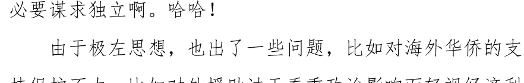

由于左派思想，也出了一些问题，由于海外华侨的支持保持不力，由于对援助过于看重政治影响而轻视经济利益，由于支持了五个王八蛋。此外，还有一些争议的问题。比如，如果不去打朝鲜战争，如果不跟苏联彻底翻脸，国际环境是不是更有利些呢？唉，历史不能假设，见仁智智吧。

我的总体看法是：前三十年的中国外交大方向基本正确，该争取的国际环境基本上争取了，该利用的国际环境也基本利用了。在当时的冷战条件下，想要争取更好的国际环境是不太真实的。

持续

作者：奉行核外交政策 日期:2011-10-15 16:17

“葡萄”——西西河的大牛，名字叫“葡萄”

晕！我孤寡寥闻啊。有空过去拜读一下。

作者：奉行核外交政策 日期:2011-10-15 16:20

况且百万苏军还着东三省呢。这个说法不对头，我修正一下，应为“苏军还驻在东北一些地方”。

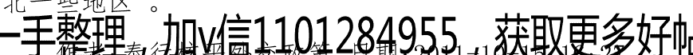

作者：奉行核外交政策 日期:2011-10-15 22:27

下午收工，晚上继续。

今天晚上天涯了发生了什么了？刚才一直登不上去啊。

国内的兄弟们登上去了吗？好了，不继续了，明天再写！

作者：奉行核外交政策 日期:2011-10-16 03:31

（第14）

向前！

我的总体看法是：前三十年的中国外交大方向基本正确，该争取的国际环境基本上争取了，该利用的国际环境也基本利用了。在当时的冷战条件下，想要争取更好的国际环境是不太真实的。

我觉得：如果有人研究世界经济问题，中国经济发展到今天，这几十年又压缩了。

一切都是从头说起。

1976年，注定是一个凶年。1976年八月，周总理逝世；1976年九月，华国锋上台；1976年10月，毛泽东逝世；1976年12月，文革结束。

我们来看，1976年到1979年间，中国经济值得注意的几件事：

## 一、1976年到1979年间，中国经济值得注意的几件事

（第15）

（，，，，，，，，，，，，，，，，，，，，，，，，，，，，，，，，，，，，，，，，，，，，，，，，，，，，，，，，，，，，，，，，，，，，，，，，，，，，，，，，，，，，，，，，，，，，，，，，，，，，，，，，，，，，，，，，，，，，，，，，，，，，，，，，，，，，，，，，，，，，，，，，，，，，，，，，，，，，，，，，，，，，，，，，，，，，，，，，，，，，，，，，，，，，，，，，，，，，，，，，，，，，，，，，，，，，，，，，，，，，，，，，，，，，，，，，，，，，，，，，，，，，，，，，，，，，，，，，，，，，，，，，，，，，，，，，，，，，，，，，，，，，，，，，，，，，，，，，，，，，，，，，，，，，，，，，，，，，，，，，，，，，，，，，，，，，，，，，，，，，，，，，，，，，，，，，，，，，，，，，，，，，，，，，，，，，，，，，，，，，，，，，，，，，，，，，，，，，，，，，，，，，，，，，，，，，，，，，，，，，，，，，，，，，，，，，，，，，，，，，，，，，，，，，，，，，，，，，，，，，，，，，，，，，，，，，，，，，，，，，，，，，，，，，，，，，，，，，，，，，，，，，，，，，，，，，，，，，，，，，，，，，，，，，，，，，，，，，，，，，，，，，，，，，，，，，，，，，，，，，，，，，，，，，，，，，，，，，，，，，，，，，，，，，，，，，，，，，，，，，，，，，，，，，，，，，，，，，，，，，，，，，，，，，，，，，，，，，，，，，，，，，，，，，，，，，，，，，，，，，，，，，，，，，，，，，，，，，，，，，，，，，，，，，，，，，，，，，，，，，，，，，，，，，，，，，，，，，，，，，，，，，，，，，，，，，，，，，，，，，，，，，，，，，，，，，，，，，，，，，，，，，，，，，，，，，，，，，，，，，，，，，，，，，，，，，，，，，，，，，，，，，，，，，，，，，，，，，，，，，，，，，，，，，，，，，，，，，，，，，，，，，，，，，，，，，，，，，，，，，，，，，，，，，，，，，，，，，，，，，，，，，，，，，，，，，，，，，，，，，，，，，，，，，，，，，，，，，，，，，，，，，，，，，，，，，，，，，，，，，，，，，，，，，，，，，，，，，，，，，，，，，，，，，，，，，，，，，，，，，，，，，，，，，，，，，，，，，，，，，，，，，，，，，，，，，，，，，，，，，，，，，，，，，，，，，，，，，，，，，，，，，，，，，，，，，，，，，，，，，，，，，，，，，，，，，，，，，，，，，，，，，，，，，，，，，，，，，，，，，，，，，，，，，，，，，，，，，，，，，，，，，，，，，，，，，，，，，，，，，，，，，，，，，，，，，，，，，，，，，，，，，，，，，，，，，，，，，，，，，，，，，，，，，，，，，，，，，，，，，，，，，，，，，，，，，，，，，，，，，，，，，，，，，，，，，，，，，，，，，，，，，，，，，，，，，，，，，，，，，，，，，，，，，，，，，，，，，，，，，，，，，，，，，，，，，，，，，，，，，，，，，，，，，，，，，，，，，，，，，，，，，，，，，，，，，，，，，，，，，，，，，，，，，，，，，，，，，，，，，，，，，，，，，，，，，，，，，，，，，，，，，，，，，，，，，，，，，，，，，，，，，，，，，，，，，，，，，，，，，，，，，，，，，，，，，，，，，，，，，，，，，，，，，，，，，，，，，，，，，，，，，，，，，，，，，，，，，，，，，，，，，，，，，，，，，，，，，，，，，，，，，，，，，，，，，，，，，，，，，，，，，，，，，，，，，，，，，，，，，，，，，，，，，，，，，，，，，，，，，，，，，，，，，，，，，，，，，，，，，，，，，，，，，，，，，，，，，，，，，，，，，，，，，，，，，，，，，，，，，，，，，，，，，，，，，，，，，，，，，，，，，，，，，，，，，，，，，，，，，，，，，，，，，，，，，，，，，，，，，，，，，，，，，，，，，，，，，，，，，，，，，，，，，，，，，，，，，，，，，，，，，，，，，，，，，，，，，，，，，，，，，，，，，，，，，，，，，，，，，，，，，，，，，，，，，，，，，，，，，，，，，，，，，，，，，，，，，，，，，，，，，，，，，，，，，，，，，，，，，，，，，，，，，，，，，，，，，，，，，，，，，，，，，，，，，，，，，，，，，，，，，，，，，，，，，，，，，，，，，，，，，，，，，，，，，，，，，，，，，，，，，，，，，，，，，，，，，，，，，，，，，，，，，，，，，，，，，，，，，，，，，，，，，，，，，，，，，，，，，，，，，，，，，，，，，，，，，，，，，，，，，，，，，，，，，，，，，，，，，，，，，，，，，，，，，，，，，，，，，，，，，，，，，，，，，，，，，，，，，，，，，，，，，，，，，，，，，，，，，，，，，，，，，，，，，，，，，，，，，，，，，，，，，，，，，，，，，，，，，，，，，，，，，，，，，，，，，，，，，，，，，，，，，，，，，，，，，，，，，，，，，，，，，，，，，，，，，加入美国军营。中共自身的主义政党党质，以及美国对蒋介石发动内战的鼎力支持使，双方根本不可能在短期内达成如此高的互信。在中国看来，当时也没有理由抛弃苏联联营，斯大林同意给予慷慨援助，且百万军队还占着东三省。在美国看来，即使美国来投，也是一个难题，如何处理台湾？如何平衡日本？而接着爆发的朝鲜战争彻底断送了中美友好往来的可能性。

三是台湾问题。台湾问题也是中国外交的大问题。有兄弟奇异：七十年代以前，美国承认台湾支持台湾，条件那么好，那时台湾为什么不独立？有人说，因为蒋石石爱国。其实，当时华联合国承认台北，联合国的席位是他们坐着，世世界上许多国家承认台北不承认北京。直到七十年代，由于中国恢复联合国地位和中美建交，台北的“邦国交”才完全要求独立台湾。哈哈！


由于左派思想，也出了一些问题，由于海外华侨的支持保持不力，由于对援助过于看重政治影响而轻视经济利益，由于支持了五个王八蛋。此外，还有一些有争议的问题。比如，如果不去打朝鲜战争，如果不跟苏联彻底翻脸，国际环境是不是更有利些呢？唉，历史不能假设，见仁智智吧。

我的总体看法是：前三十年的中国外交大方向基本正确，该争取的国际环境基本上争取了，该利用的国际环境也基本利用了。在当时的冷战条件下，想要争取更好的国际环境是不太真实的。

持续

作者：奉行核外交政策 日期:2011-10-15 16:17

“葡萄”——西西河的大牛，名字叫“葡萄”

晕！我孤寡寥闻啊。有空过去拜读一下。

作者：奉行核外交政策 日期:2011-10-15 16:20

况且百万苏军还着东三省呢。这个说法不对头，我修正一下，应为“苏军还驻在东北一些地方”。


作者：奉行核外交政策 日期:2011-10-15 22:27

下午收工，晚上继续。

今天晚上天涯了发生了什么了？刚才一直登不上去啊。

国内的兄弟们登上去了吗？好了，不继续了，明天再写！

作者：奉行核外交政策 日期:2011-10-16 03:31

（第14）

向前！

我的总体看法是：前三十年的中国外交大方向基本正确，该争取的国际环境基本上争取了，该利用的国际环境也基本利用了。在当时的冷战条件下，想要争取更好的国际环境是不太真实的。

我觉得：如果有人研究世界经济问题，中国经济发展到今天，这几十年又压缩了。

一切都是从头说起。

1976年，注定是一个凶年。1976年八月，周总理逝世；1976年九月，华国锋上台；1976年10月，毛泽东逝世；1976年12月，文革结束。

我们来看，1976年到1979年间，中国经济值得注意的几件事：

## 一、1976年到1979年间，中国经济值得注意的几件事

（第15）

（省略重复内容，保持逻辑连贯）

活了。呵呵呵呵。

前面有兄弟回贴，建议我评论毛主席的时代，饶了我吧，这个本事真的没有。如果仅从经济角度来看，倒有一些零星的观点，前面写了那么多贴子，都在里面了。有时候，我感觉到，很多事情很难以评价，已发生的偶然就成了必然，只能说是命吧。

既然说到这里，我顺便娱乐八卦一下：老毛属蛇。蛇者，有龙之形，兼有长牙，所谓诸欲成大事者，无毒不丈夫夫，这是最强、最硬的属相。文坛盟主鲁迅也是蛇的。老郑属龙，江总属虎，胡总属狗，龙虎斗虎，龙马精神，都是有王气的好属相。

朱总司令和周经理都属狗，年轮差一，我加微信获取更多帖子。

金狗报道，在时代到来之前过渡期，可以理解。中山属虎，袁世凯属狐，蒋介石属猪。你们想知道刘总总是属什么样的吗？蛇！

再这样八卦下去，我良好的理性的形象全给毁了，还是讲正的吧。先约定俗俗成一下：改革开放始于1979年，到现在的32年了。为了方便起见，我笼统之地称为“近三十年来”。以后贴子里凡凡是提到“近三十年来”，就是指1979年今天。

其实，从一周前开始，我就在思考，如何讲述和评论改革开放的故事。前面有个兄弟回贴说，近三十年来的事情，每个人都是亲历者，都有切身体会，都有自己的看法。很多论题可能争议不休，砖块横飞，所以建议大家要理性讨论。谢谢这个兄弟，他道出了我的忧虑。如果发现我的观点比较荒浅，请大家发挥可贵的宽容精神哈。

第二个发愁的是，就是如何选题。相比于历史问题，我对于当代问题的第一手资料更多，千言万语，不知道怎么展开。我今天下午做了一个决定，决定以后，不再像前面一部分那样按时间向向前推，现在是随心画、顺三倒四，想到哪里就写到哪里。这样，可能会更加得开一些。

前年是改革开放三十周年，国内有很多影视和书刊来纪念。这些作品把三十年讲了几遍，控的都挺差不多，我大致框架，大家都基本清楚，所以没必要再来罗列。我给大家推荐两个作品，一个是吴晓沛的书《激荡三十》，是一个上海拍的纪录片《激荡1977—2008》。两个作品都是按时间的，纪实的是后者，绝对的编年体，30集讲30，一集讲一。有兴趣的兄弟们自己去看吧。

但必须指出，我认为这两部作品有一个共同的问题，就是看不透。究其原因，我认为是他们的写作角度问题。这些大历史的作品，实际上都受到了美国同类作品的影响。美国的经济类纪录片，讲经济问题时，我感觉到很有特点，他们欢喜欢市场和公司作为为主线。因为在美国，经济史简直就是一部公司史（或企业史）。

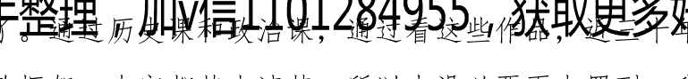

在中国，我认为至少在前三十里，由于国情所致，经济史的主角不是公司，而是政府和个人。公司（或企业家）为主，是典型的中观视角，上不接天，下不着地，所以让人感到不适。以政府和个人为主，则是宏观视角加上微观视角，或许效果会好一些。比如凌云志和马立诚所写的几本从政治角度讲述改革的书，就是这个思路。当然他们也借鉴了外国作家的经验。

我也想用宏观视角加微观视角来继续这个贴子。我的不是说我说的贴子比别人更好嘛，我没这个水平，我认为是，应该朝着这个方向努力。

而在中国，我认为至少在前三十里，应该是“至少”，对不起。

作者：奉行核平外交政策 日期：2011-10-17 15:03（119）

好，咱们做个拉皮、拍个黄瓜、泼一壶酒，开始颇三倒四地胡聊！

要对近三十年的发展概而言之，很难很难。探讨中国的发展，首先有两个问题在那里。一是，中国如何发展？二是，中国发展向何方？其中，第二个问题更重要，因为它强烈影着第一个问题。

有人说了，第二个问题很好回答，就是“四个现代化”。这也算是一个答案，但这个答案没到位。因为“四个现代化”是一种技术性的发展指标体系，它不包含道德和价值的取向。比如1930年代罗斯福领导的美国和希特勒领导的德国，从技术角度都是现代化工业国，但两国浑然不同。

在中国发展的过程中，有很多外国人不放心，他们想中国发展到底成就什么？找来找去，他问：“中国发展，不要扰我啊……”总之，我们这种拿着石头的基本策略，决定了很难给人留下一个局面。最好的办法是稳住，赢得时间。这个方面的观点，我在很早的贴子中提到。

当改革开放进行20年以后，也就是2000年以后，中国已经无法回避了。因为我们成长大了，已经是世界无法忽视的力量。如果我们不不，环境对我们不利。所以到了2003年底，中国将会抛出一个说法，就是“和平崛起”。和平崛起这个提法，最早是政治家在博弈。

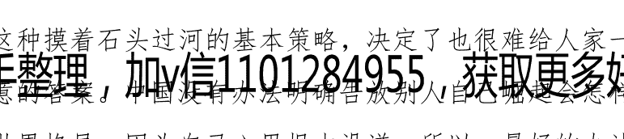

在中国，我认为至少在前三十里。

和平崛起的意义是什么？按照说法，世界历史证明了，崛起往往将打破旧有的格局，引发战争和动荡。原因就是他们侵略、扩张。大家放心，中国不想这么办。那我们怎么做呢？

一是继续改进经济体制，政治改革。
二是吸收外国文明，弘扬中华文明。
三是统筹科学发展。

这三个方面，为“和平崛起”提供了制度上、文化上和环境上的保障。和平崛起，中国人从一百年前就想着崛起了。和平崛起作为一种提法，目的不是对内，而是对外的，特别是在国际上，讲给东南亚国家听，当然也说给老外听。

和平崛起的实质，就是回答：中国崛起以后，国际格局是一个什么样的样子。先看看中国与国际格局的历史。大家知道，现代世界以1992年为界，划分为两段：一段是冷战时期，1960年代到1970年代，中国游离于两个体系之外，特征是传统的社会主义国家；另一段是1970年代末到1989年，政治不变，经济上逐步向美国倾靠。1992年苏联倒台，十二大召开，中国才决心要力而上，孤立了。2001年，中国加入世，标志着中国投身全球化迈出了最关键的一步。持续。

# 一手整理加信1101284955获取更多好帖

作者：奉行核平政策 日期：2011-10-17 15:46（第120）

毫无疑问，近三十年来，中国和美国是全球化最大的赢家。（以后具体探讨入世问题时再聊）。当入世时，有人担心得要死，但我比专家还要乐观，没想到后来

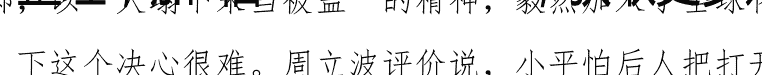

这也带来一个难题：中国在中国导的全球化格局中占了好处。呵，我认为，中国现在也不知道答案。“和平崛起”这个理论，实际上是中国在必须回答而又不知道答案的情况下提出的缓兵之计。说是给世界各国听的，当然主要是给美国听的。不管专家们从中解读了多少伟大的思想，我正从中解读出三句话：

第一句：中国承认现行的国际秩序，也就是承认美国为首的、多极并存的、全球化的市场经济一套秩序。30年来，中国虽然受了某个小岛气，总体表示将继续遵守这个秩序。
第三句：中国承诺，即使自己已经强大了，也不准备颠覆和破坏这个秩序。总之，老美，你就放心吧！

我从这个角度理解，“和平崛起”不是一个示威提法，而是一个好的提法，在一定上是在向美国装乖，希望国际社会不要对崛起过度猜测。这个观点有一个有力的证据：就是中国在2003年先提出“和平崛起”，后来提法又改成“和平发展”。大家可以注意到，现在我们的领导人不会说“崛起”字。有兄弟会，为什么要改？是不是体现了我们的战略思想的变化？

我认为，这个提法的改变，背后没有任何战略思想变化。主要原因是中国反复推敲，感到“崛起”两字还是太硬核了，担心老外不能准确理解，误会了我们的一片苦心。但是很可惜，八年过去了，这个提法没有消解国际上的警惕和敌意。美国，周边各国，基本都不相信中国会和平崛起。为了让大家看着不累，便于理解，下面我以美国和中国为主角，导演一位香港电影。

电影场景是：深夜，在一片废弃的工地上，两个穿风衣戴墨镜的男人——中国和美国见面了。

美国：老二，你今晚我出来，到底有什么事？磁场碰撞。别人就要，连你都不相信我！所以我约你出来说几句心里话。一，我华某江湖这么多年，谁不知道我是最认规矩的人；二，我以后还在码头上面溜，我怎么会坏了规矩；三，以后就算我发达了，你还是算大哥。

中国：我明白你的意思。可是，这种环境比我的预测还要直观。这也带来一个难题：中国坐大以后，将如何改变格局呢？

呵，我认为中国现在也不知道答案。美国：好了。中国：但是，大哥，你不要说了。美国：好吧。中国：噢，你要管一下。

一手整理，加v信1101284955，获取更多好帖。

而在中国，我认为至少至于在前三十里。

作者：奉行核平外交政策 日期：2011-10-17 15:03（119）

好，咱们做个拉皮、拍个黄瓜、泼一壶酒，开始颇三倒四地胡聊！

要对近三十年的发展概而言之，很难很难。探讨中国的发展，首先有两个问题在那里。一是，中国如何发展？二是，中国发展向何方？其中，第二个问题更重要，因为它强烈影着第一个问题。

有人说了，第二个问题很好回答，就是“四个现代化”。这也算是一个答案，但这个答案没到位。因为“四个现代化”是一种技术性的发展指标体系，它不包含道德和价值的取向。比如1930年代罗斯福领导的美国和希特勒领导的德国，从技术角度都是现代化工业国，但两国浑然不同。

在中国发展的过程中，有很多外国人不放心，他们想中国发展到底成就什么？找来找去，他问：“中国发展，不要扰我啊……”总之，我们这种拿着石头的基本策略，决定了很难给人留下一个局面。最好的办法是稳住，赢得时间。这个方面的观点，我在很早的贴子中提到。

当改革开放进行20年以后，也就是2000年以后，中国已经无法回避了。因为我们成长大了，已经是世界无法忽视的力量。如果我们不不，环境对我们不利。所以到了2003年底，中国将会抛出一个说法，就是“和平崛起”。和平崛起这个提法，最早是政治家在博弈。


和平崛起的意义是什么？按照说法，世界历史证明了，崛起往往将打破旧有的格局，引发战争和动荡。原因就是他们侵略、扩张。大家放心，中国不想这么办。那我们怎么做呢？

一是继续改进经济体制，政治改革。
二是吸收外国文明，弘扬中华文明。
三是统筹科学发展。

这三个方面，为“和平崛起”提供了制度上、文化上和环境上的保障。和平崛起，中国人从一百年前就想着崛起了。和平崛起作为一种提法，目的不是对内，而是对外的，特别是在国际上，讲给东南亚国家听，当然也说给老外听。

和平崛起不是一个示威提法，而是一个好的提法，在一定上是在向美国装乖，希望国际社会不要对崛起过度猜测。这个观点有一个有力的证据：就是中国在2003年先提出“和平崛起”，后来提法又改成“和平发展”。大家可以注意到，现在我们的领导人不会说“崛起”字。有兄弟会，为什么要改？是不是体现了我们的战略思想的变化？

我认为，这个提法的改变，背后没有任何战略思想变化。主要原因是中国反复推敲，感到“崛起”两字还是太硬核了，担心老外不能准确理解，误会了我们的一片苦心。但是很可惜，八年过去了，这个提法没有消解国际上的警惕和敌意。美国，周边各国，基本都不相信中国会和平崛起。为了让大家看着不累，便于理解，下面我以美国和中国为主角，导演一位香港电影。

电影场景是：深夜，在一片废弃的工地上，两个穿风衣戴墨镜的男人——中国和美国见面了。

美国：老二，你今晚我出来，到底有什么事？磁场碰撞。别人就要，连你都不相信我！所以我约你出来说几句心里话。一，我华某江湖这么多年，谁不知道我是最认规矩的人；二，我以后还在码头上面溜，我怎么会坏了规矩；三，以后就算我发达了，你还是算大哥。

中国：我明白你的意思。可是，这种环境比我的预测还要直观。这也带来一个难题：中国坐大以后，将如何改变格局呢？

呵，我认为中国现在也不知道答案。美国：好了。中国：但是，大哥，你不要说了。美国：好吧。中国：噢，你要管一下。

一手整理，加v信1101284955，获取更多好帖。

作者：奉行核平政策 日期：2011-10-17 15:03（第120）

毫无疑问，近三十年来，中国和美国是全球化最大的赢家。（以后具体探讨入世问题时再聊）。当入世时，有人担心得要死，但我比专家还要乐观，没想到后来


这也带来一个难题：中国在中国导的全球化格局中占了好处。呵，我认为，中国现在也不知道答案。“和平崛起”这个理论，实际上是中国在必须回答而又不知道答案的情况下提出的缓兵之计。说是给世界各国听的，当然主要是给美国听的。不管专家们从中解读了多少伟大的思想，我正从中解读出三句话：

第一句：中国承认现行的国际秩序，也就是承认美国为首的、多极并存的、全球化的市场经济一套秩序。30年来，中国虽然受了某个小岛气，总体表示将继续遵守这个秩序。
第三句：中国承诺，即使自己已经强大了，也不准备颠覆和破坏这个秩序。总之，老美，你就放心吧！

我从这个角度理解，“和平崛起”不是一个示威提法，而是一个好的提法，在一定上是在向美国装乖，希望国际社会不要对崛起过度猜测。这个观点有一个有力的证据：就是中国在2003年先提出“和平崛起”，后来提法又改成“和平发展”。大家可以注意到，现在我们的领导人不会说“崛起”字。有兄弟会，为什么要改？是不是体现了我们的战略思想的变化？

我认为，这个提法的改变，背后没有任何战略思想变化。主要原因是中国反复推敲，感到“崛起”两字还是太硬核了，担心老外不能准确理解，误会了我们的一片苦心。但是很可惜，八年过去了，这个提法没有消解国际上的警惕和敌意。美国，周边各国，基本都不相信中国会和平崛起。为了让大家看着不累，便于理解，下面我以美国和中国为主角，导演一位香港电影。

（此处后面重复内容已略，按后文逻辑合并处理）

……但这确实需要时间。

价值体系这个，并不是想建就建的。人类发展了几年，成套的价值体系也就那么几个而已。文化价值体系的进阶是一个漫长过程。例如，宋代朱理学兴起，带来了儒学第二次大发展，而确立了三教之首的地位。但是，宋朝，距离佛教传入的汉朝，已经千年了。中国传统的价值体系在1840年受到严重挑战后，一直处于自我调整之中。什么时候才能调整到位呢？不知道。总的来说，我没有结论。留给大家思考吧。

我们还能不能再见面？

我在佛前苦苦了一千年。

待

作者：奉行内核外交政策 日期：2011-10-17


不改不行，改又没法，这是“地雷阵”和“万丈渊”。国企脱困那几年，全国各地，被职工包围频率最高的领导，就是政府分管工业的领导。我有一个朋友，当时就在县上干个车夯，成天给上职工解释政策，被蛰在脸上，跑到厕卫生洗脸，再跑一遍解释。当时干部中间流传一句顺口溜：“前世做了孽，今世管工业！”一些经济人士也抱怨改了，还有人抱怨说，要是老朱早五年前总经理就好了。

但是，这十年来，我根据亲身经历，对这个问题又有了新的认识：中国的事情不是那么简单的。国企改革（特别是产权改革）如果提前推，也许根本不会动。

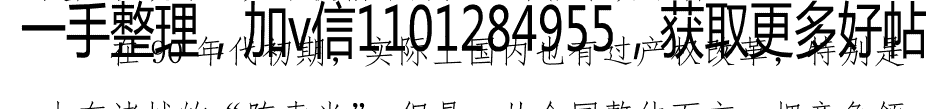

山东诸城的“陈奕光”。但是，从全国整体而言，把竞争领域的国企（主要是地方国企）卖了，政治风险和社会风险极大。虽说这个时候卖的钱、卖出来的钱可以安置职工，对职工更好处，职工并不买账。因为还要有饭吃，只要没有山穷水尽，很多职工根本不愿接受改革，特别是不愿失去国企职工身份。他们势必产生强烈反弹。

这是一个极为无奈的事实：企业条件越好的，越能给出较高补偿条件的，反而是越改不动。企业条件越差的，越不能给出任何补偿的，反而是越容易改。《朱容基话实录》中说，2002年石油企业与职工解除劳动合同的补偿费用，是16万元。结果改了老子。

相反，我在西部某地曾目睹过一次县企业的散伙。当时，这个企业因为经营不善，已经停产多年，职工没有领过任何生活费。最终县里研究决定，为了他们解决以前欠缴的养老保险，之后的就要自己缴，另外每人补偿三千元，就撤销了厂。

我还清楚记得当时的场景：没有太多的话，开了会，领了钱，大家一起到街上吃了面条，男人在抽烟，有的女人在抹泪，吃完各自走。长期贫本身本身说服力，人们已经不抱希望，知道这是必然的结局。

前面提到的那个工业的朋友，有一次我们俩争论改革的问题。他突然问我：“如果绳子上的死结烂不开，你怎么办？”我一手整理，加微信获取更多帖子，“你能够负责吗？”“上面谁敢准许你用剪刀？”我说：“那怎么怎么办？”他说：“你可以不去管它，过几年绳子沤烂了，死疮自然就不存在了。”

中国的改革非常复杂。很多问题，理论上是一回事，实践上另一一事。让问题来解决问题，肯定不是最优解，但有的时候它是唯一的可行解。所以，问题驱动的改革模式，我不喜欢，因为它肯定定不是最优解，但在操作层面上，有时候它也许是唯一的可行解。

这是一种无奈的现实。
待续

作者：奉行核外交政策 日期:2011-10-18 20:29

（第 114）

我个人平时说话，总喜欢用“中国”、“人类”、“世界”、““文化”、“社会”等名词为主语进行造句。有个哥警告我说，你站得太高小心容易遭雷！我告诉他们，我认为，遭雷击的表面原因是因为站得太高，根本原因是站得还不够高——你站在云层之上，永远不会遭雷击！他当场被我的谬辩给雷夯了哈。

这几个贴子，我试图站在云层之上，对中国近三十年的发展进行某种总体概述。然后再次以此为背景，探讨各种具体的内容。

# 一手办理微信11011284955 获取更多帖子

这种功能在国外是一样的。对于这个模型，有必要深入分析一下。

在许多时候，无论中国还是外国，我们很多人不可能深谋底，大家心里稳保。我们哪里南堵回不去，到黄河不死死，不见棺材不回头，不孝帽子不回头。一步步走向无路可走的过程，就是一步步统一思想的过程，到了最后一步，不用理论家来教育，也不用书记去设想想法，大家会一致：此路不通，掉头！

这种问题驱动式改革，看似没有前瞻性，头疼医头痛医脚，实际上却包含着政治智慧。在中国面临许多不，国际环境险，国内稳定压倒一切的背景下，政府会更倾向于做出这种选择，见招拆招而不是主动出击。这种方式，提高到改革措施的针对性，同时降低了改革的社会风险。但是，它也给中国造成了许多问题。

主要问题有两个。一个是改革的违规性，一个是改革的短期性。这两个问题都好理解，我就简单说一下。

所谓违规性，它的发生原理是：既然我们的改革是驱动式的，那么在问题严重之前，我们是不会提前主动去解决问题的。问题是怎么来的呢？是不合理的体制、法规、政策造成的。那也就是说，我们不会提前主动去触动问题背后的这些东东。所以，当问题严重了，必须要解决了，“该出手就出了”，这个时候，造成问题的体制、法规、政策后果。


通过改革，改革措施得到认可，作为新的法规。但从颁生效日起，当年的改革措施都是违法的。这就造成了改革者身上的“原罪”。再加上改革本身就是一场利益调整，麻烦大了。改革者外有人，内有“原罪”，挤得多，大家可以看看30年，中国有多少改革者被死在沙滩上？这是改革模式造成的。这也使得一些人不愿改革、不敢改革。

接着说改革的短期性。

一次，我跟一个老乡喝酒，他在省委研究工作。我向他思考：改革的对象是什么？

- 1979年之前的：旧体制、旧政策
- 80年代：旧政策
- 90年代的：旧政策
- 2000年以后：新政策

是否可以理解，改革本身是改革的对象，如此循环往复，中国要改到哪天为止？如果一定要设定一个期限，这就是短期性的问题。问题驱动的改革往往集中于眼前问题，政策变化太快，连续性太差。

- 1979年之前的：旧体制、旧政策
- 80年代：旧政策
- 90年代的：旧政策
- 2000年以后：新政策

这种办法，政府奇怪。这种办法，是问题驱动的改革，也不是每次都是被问题驱动出来的。

待续

作者：奉行核外交政策 日期:2011-10-18 20:29
作者：奉行核外交政策 日期:2011-10-18
作者：奉行核外交政策 日期:2011-10-18 20:34
作者：奉行核外交政策 日期:2011-10-18 20:38
作者：奉行核外交政策 日期:2011-10-18 20:44
作者：奉行核外交政策 日期:2011-10-19 01:00
作者：奉行核外交政策 日期:2011-10-19 00:00
作者：奉行核外交政策 日期:2011-10-19 00:40
作者：奉行核外交政策 日期:2011-10-19 01:12
作者：奉行核外交政策 日期:2011-10-19 01:12
作者：奉行核外交政策 日期:2011-10-19 01:15
作者：奉行核外交政策 日期:2011-10-19 00:09
作者：奉行核外交政策 日期:2011-10-19 00:12
作者：奉行核外交政策 日期:2011-10-19 00:13
作者：奉行核外交政策 日期:2011-10-19 00:15

前面，关于中国改革是“问题驱动”的观点，不知道兄弟们同意否？准确地说，我认为改革总体而言是问题驱动的。

讲到这里，很多兄弟已经看出问题所在了。一个问题的实际严重性，与人们感觉到的严重性有时并不一致。近年来，在征地拆迁中，人们总总结出一种经验：“大闹解决，小闹解决，不闹解决。”这就是典型的的问题驱动工作思路的弊端。社会群体反映问题的能力是不一样的。那些叫得响、吼得响、闹得大的行业、集团、阶层和个人，往往引起更多的重视，从而优先享受改革的好处。

特别是在法律法规不规范的情况下，更加容易出现这个问题。不管中国国外，改革都是社会阶层、各集团之间的一场利益变化，如果有规矩，就是利益调整；如果没有规矩，就是利益集团闹戏。中国呢，说是利益集团闹戏可能太刻薄了一点，随着改革进入多年，越来越多的社会集团累积了丰富的斗争经费。

比如石油、中化等巨头，动不动就给你来个供油不足，加油站排排几地。司机和市民怒声载道，媒体聚焦报道，中央领导多次批评。好了，“严重问题”形成了。大家解决吧，请国家发表一个通知：涨价。

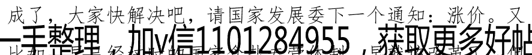

这帮家伙很是拼命强调问题的严重性，把这场改革往后拖了十年，把农民生产企业害得够呛。

近年来，金融、证券、保险、电力、房地产等行业，借发挥市场的水平不断增长，他们必要时还能来外援配合。

中国改革最需要解决的问题是什么？是中国农民的问题。然而，他们偏偏是沉默的大多数，各自为政，一盘散沙。改革开放三十年，如果一定要找出最大的工作偏差在哪里，我个人认为，就是对农民关注不足。我说这几句话，估计国务院几任总理听了比豆还要愁，都要拿砖拍我。

不错，中央高度重视三农问题。总理为此睡不着觉。几年的开放一号文件都是说农业的。但是，无论历史经验良好，改革以来的实践也好，都证明了一个钢铁般的规律：利益是自给自的，不是别人给的。在问题驱动的改革盘子里，不管中央怎么喊农民重要，当真正遇到问题的时候，各级政府操作中，农民往往要让别人苦。

在云层之上的总体观点差不多了。我们就顺势进入一个具体的领域：

# 改革开放初，中国农村到底是什么？

很多贴子从各个角度分析了，改革开放初，中国农村是一个物质渴望被充分满足但无法满足的社会。根据自己的体验，认为还有一点重要，那就是：当时的农村，被集体组织强力改造，户籍制卡住人。

- 1979年以前：集体所有
- 1979年至1992年：大包干
- 1992年至2002年：市场化
- 2002年以后：市场化

很多贴子分析了，改革开放初，中国农村的情况。总结了三种发展思路：
- A：方向明确，但无法满足（集体所有）
- B：统筹兼顾，方向明确（大包干）
- C：问题驱动式改革（市场化）

很多贴子分析了，中国农村的农村。皖北的芜阳、颍州、泗州等地，由于气候加黄河干燥，水路很便利。很多地方对比，与华北平原其他地区相比，皖北的农村，那里还没有富起来。

皖北的农村，矿产丰富，水路很便利。皖北的农村，很多地方对比。农村的农村，农村的农村的农民。

农村，农村，农村，农村，农村，农村，农村，农村，农村，农村，农村，农村，农村，农村，农村，农村，农村，农村，农村，农村，农村，农村，农村，农村，农村，农村，农村，农村，农村，农村，农村，农村，农村，农村，农村，农村，农村，农村，农村，农村，农村，农村，农村，农村，农村，农村，农村，农村，农村，农村，农村，农村，农村，农村，农村，农村，农村，农村，农村，农村，农村，农村，农村，农村，农村，农村，农村，农村，农村，农村，农村，农村，农村，农村，农村，农村，农村，农村，农村，农村，农村，农村，农村，农村，农村，农村，农村，农村，农村，农村，农村，农村，农村，农村，农村，农村，农村，农村，农村，农村，农村，农村，农村，农村，农村，农村，农村，农村，农村，农村，农村，农村，农村，农村，农村，农村，农村，农村，农村，农村，农村，农村，农村，农村，农村，农村，农村，农村，农村，农村，农村，农村，农村，农村，农村，农村，农村，农村，农村，农村，农村，农村，农村，农村，农村，农村，农村，农村，农村，农村，农村，农村，农村，农村，农村，农村，农村，农村，农村，农村，农村，农村，农村，农村，农村，农村，农村，农村，农村，农村，农村，农村，农村，农村，农村，农村，农村，农村，农村，农村，农村，农村，农村，农村，农村，农村，农村，农村，农村，农村，农村，农村，农村，农村，农村，农村，农村，农村，农村，农村，农村，农村，农村，农村，农村，农村，农村，农村，农村，农村，农村，农村，农村，农村，农村，农村，农村，农村，农村，农村，农村，农村，农村，农村，农村，农村，农村，农村，农村，农村，农村，农村，农村，农村，农村，农村，农村，农村，农村，农村，农村，农村，农村，农村，农村，农村，农村，农村，农村，农村，农村，农村，农村，农村，农村，农村，农村，农村，农村，农村，农村，农村，农村，农村，农村，农村，农村，农村，农村，农村，农村，农村，农村，农村，农村，农村，农村，农村，农村，农村，农村，农村，农村，农村，农村，农村，农村，农村，农村，农村，农村，农村，农村，农村，农村，农村，农村，农村，农村，农村，农村，农村，农村，农村，农村，农村，农村，农村，农村，农村，农村，农村，农村，农村，农村，农村，农村，农村，农村，农村，农村，农村，农村，农村，农村，农村，农村，农村，农村，农村，农村，农村，农村，农村，农村，农村，农村，农村，农村，农村，农村，农村，农村，农村，农村，农村，农村的农村


人的物质欲望这个东西，始终客观存在。它一旦被激发，就像原子一样，如果在反应堆中无序控制下有序释放，就能造福社会；如果在武器中无控释放，就能摧毁社会。激发程度不一样，控制程度不一样，而在世人和人类一样，贫穷和“贫穷”是两码事。人住在小山村：“毛主席当年就吃这个，还怕闹呢？”还有人开着奔驰、住着别墅：“都快四十的人了，连个游艇都买不起，不好意思见朋友，这两周没去高尔夫……”


人的物质欲望这个东西，始终客观存在。它一旦被激发，就像原子一样，如果在反应堆中无序控制下有序释放，就能造福社会；如果在武器中无控释放，就能摧毁社会。激发程度不一样，控制程度不一样，而在世人和人类一样，贫穷和“贫穷”是两码事。人住在小山村：“毛主席当年就吃这个，还怕闹呢？”还有人开着奔驰、住着别墅：“都快四十的人了，连个游艇都买不起，不好意思见朋友，这两周没去高尔夫……”

这种物质欲望，催生了大包、城镇企业、民工潮。同时，欲望决堤也给中国带来了许多问题。就在小岗村不远的阜阳，近期就出出一连串负面新闻，如劣质奶粉之类，搞得阜阳的兄弟出门都不好意思了。

我感到，中国人，特别是中国农民，对于幸福生活的渴望和追求，才是推动中国崛起的力量源。当年，老毛正视了农民“打土豪是为了分田地”，才获得了革命胜利。当年，以集体觉醒去替代利益需求，才成就了人民公式式的微。改革年代，对于社会物质欲望，怎么能顺应而不是压制，管理而不是放错，这是一个很大的执政课题。

2002年，十六大，大总结工作报告。以前这种重要的报告，最后一句都是“为某某主义而奋斗”、“为某某目标而努力”之类的话，再加几个感叹号。这次，即将离任的老江，最后一句喊出了“共同创造我们的幸福生活和美好未来吧！”


这种物质欲望，催生了大包、城镇企业、民工潮。同时，欲望决堤也给中国带来了许多问题。就在小岗村不远的阜阳，近期就出出一连串负面新闻，如劣质奶粉之类，搞得阜阳的兄弟出门都不好意思了。

我感到，中国人，特别是中国农民，对于幸福生活的渴望和追求，才是推动中国崛起的力量源。当年，老毛正视了农民“打土豪是为了分田地”，才获得了革命胜利。当年，以集体觉醒去替代利益需求，才成就了人民公式式的微。改革年代，对于社会物质欲望，怎么能顺应而不是压制，管理而不是放错，这是一个很大的执政课题。

这种物质欲望，催生了大包、城镇企业、民工潮。同时，欲望决堤也给中国带来了许多问题。就在小岗村不远的阜阳，近期就出出一连串负面新闻，如劣质奶粉之类，搞得阜阳的兄弟出门都不好意思了。

我感到，中国人，特别是中国农民，对于幸福生活的渴望和追求，才是推动中国崛起的力量源。当年，老毛正视了农民“打土豪是为了分田地”，才获得了革命胜利。当年，以集体觉醒去替代利益需求，才成就了人民公式式的微。改革年代，对于社会物质欲望，怎么能顺应而不是压制，管理而不是放错，这是一个很大的执政课题。

这种物质欲望，催生了大包、城镇企业、民工潮。同时，欲望决堤也给中国带来了许多问题。就在小岗村不远的阜阳，近期就出出一连串负面新闻，如劣质奶粉之类，搞得阜阳的兄弟出门都不好意思了。


更倾向于优先解决国企问题。直到2002年以后，国家财力爆发式增长，从根本上解决农村税费问题才成为可能。持续……

累了，今天休息了！

作者：奉行核外交政策 日期:2011-10-19 19:04

作者：ddtiger5 回复日期:2011-10-19 05:39:58

夹带不少私货。

看贴的还是独自思考，少受骗。

错。这个话是木末倒了。声明哈：本贴全部内容都是一手整理，加微信1101284955 获取更多好帖。

致。呵呵呵呵！核刚敬上。

作者：奉行核外交政策 日期:2011-10-19 19:05

(129)

继续三农！

C阶段：2002年至今。
标志：民工荒、废除农业税、新农村建设。

如果要说2000年以后这11年间，中国有什么大事事件让我惊喜，那就是“民工荒”。加入世贸，超过英法德日、办奥运会，这些喜事都在预料之中，只是一个时间问题。但民工荒出乎我的预料。

记得我参加过一个课题，调研了中国劳动力市场情况。当时跑了北京、上海、重庆、山东、四川。我发现，在包吃包住的情况下，一月500元左右这种工资水平，从80年代开始，一直被天天的劳动力供给给震撼着，一直延续到了2000年左右。中间是一代人的时间啊。所以，重庆民间流传着句话：“老子五百零五百”。新一代民出来打工，工资跟他们当年一样，你说可悲不可不可。

当时，我总结了两个奇迹：一是经济高速增长20%，工资在500元以上丝毫不减；二是经济连续8%以上增长，工资在2000点上丝毫不不动。（所谓七年熊市，以后有机再复神奇迹的中国股市）。他妈妈的堪赛世界第一

更为了的问题是，中国产业升级努力。当时，是个经济学家里都看出问题来了。产业升级这个东西，必须靠靠趋势来。要是哪个政府宣称的，产业升级是靠政府英明划来的（比如新加坡的老李），纯属拉拍子。我认为政府的产业政策非常重要，但产业升级90%以上的原因和动力，来自劳动力、土地、能源、原材料、利率、汇率的压力。

美国、日本、四小国，当年都是这个路子。虽然有个企业很有长远眼光，但对绝大多数企业来说，升级风险很大，只要继续赚钱，去找死。而有不升级的死亡概率超过了升级的风险，大量企业才会想办法升级。各国都一样。

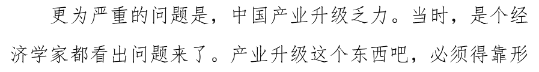

中国的大麻在于，人太多了。要是动力无限供给，不仅直接影响升级，还会对其他要素产生替代。比如机器便宜，我就少用机器多用，这样一弄，产业还降级了。

我当时认为，有9亿农民的中国，初级动力接近无限供应，一时半会的看不到头！真的，没有想到啊，

两年后，民荒竟然爆发了！靠!!这实际上就是劳动用用脚话说，通过市场调节不合理价格。历史再次证明：第一，中国农民不起！第二，谁也指望不了，农民的利益还得靠自己去捍卫。看着广州火车站、杭州火车站举着涨价牌子的老板们，我很欣慰，你们也有今天。我原本以为为生之年都看不到了！

准的根本利益）；虽然有一个记者断言“民荒只值五百块”，也就是说涨点工人来了。但我相信，“民荒”的意义不止于此。它和近年来出现的土地涨价、原油价格波动、原料紧张、人民币汇值等等因素，开启了中国经济发展的新时代。这是一个特别有意思的话题，在此之前先抓住。以后我会用几个贴子，专门探讨产业升级问题。

在C阶段，除了民荒以外，中国三农业还有几件足以载入史的大事。吃饭去了，晚上接着探讨！

待续

作者：奉行内核外交政策 日期：2011-10-19 21:38

(第 130)

目前，国内普通民工资 2000 至 3000 元。有一定技术的人，如熟练木工、熟练瓦匠，一个月可以挣 4000 至 5000 元。“民工工资只值 500 元”的论调已经彻底破产了！我常驻新加坡，所以国内的家里还雇了个保姆，每月 2000 元。加上管吃管住，成本大约 2600 元，相当于我自己收入的一半。尽管压力不小，我们仍然高兴看到打工者的收入增加。我坚信，对九亿人都有好处的事，就是中国的事务。

继续讲 C时代。

2000 年左右，具体时间记不清了，鉴于农民负担过重，中国开始进行农村改革。当时我就看不好这个改革。当时我水是不行的。（前面贴子的什么好像已经用了）。这里一税是指常收税，二税三税是杂七，古代叫“捐”，现在叫收费。农村改革原理，大致总结如下：首先，要求承认税外的那些东西，合理的，不合理的。其次，甄别，把合理的废掉。然后，把合理的纳入正常范围之内。最后，公布。同时，还要严肃声明，把该都包含了，严禁。

但是，实践证明，过了几年，农村出了很多问题。循环，负担越来越重，最后农民受不了了，“农村动”。在这个时期，国家财力突然崛起，原因是改革开放后多年积累，进入发力期。财政收入，2003年突破万亿，到2010年突破万亿，用了短短八年。此时，曾经沉重的农业税，在全国财政盘里的比重下降到%。

农业时代终结了。废除农业税，也救了。废除农业税以来的五年，中国农民得到的实惠比任何时候都多。城乡一体化试点，低保体系、养老体系、医保体系、城乡统一社保体系加速形成。种粮、种棉、化肥、农膜、良种得到财政补贴。汽车下乡、家电下乡等突破，国家用财政补贴启动农村消费。一方面，形势大好，前途光明。可是另一方面，农村的问题依然尖锐，很多问题已经难以回避。

作者：奉行内核外交政策 日期:2011-10-19 22:07

作者：奉行内核外交政策 日期:2011-10-20 14:46

(第 131)

前面用了五个贴子。回顾了三十年农村经济的大致脉络。因为我们探讨经济和文化，一些政治类的大事，谈到了农村生活经历。我生于城市，没有长期在农村生活过。但我从小常下乡，所以南方和北方的农村都不陌生。

说到农村，想到了二姨。她1956年生，1997年因癌症去世，一辈子生活在北方的农村。她从二十岁开始到去世，恰是改革三十年。她这辈子是一部微缩历史，我在思考农村问题的时候，经常都会想起她。

她是强人，小学文化，不怕怕事，很聪明。八十年代初，她在村上办起“代销点”，实际上就是从乡供货的私营小商店。当时是村上唯一的。由此她成了村上先富起来的人。记得我下乡，村上还没通电，晚上在院里吃饭，她就把手电筒吊在枣树上照明。这可奢靡的，相当于现在的富人专用进口泉水来煮饭，呵呵。

好景不长，八十年代后期，村上冒出了许多商店，五步一岗，三步一哨，东西很难了。二娘让守着旧店，自己逛到村口路边开了一家新店，好占地利。如果有季节的货，比如春替时卖化，她还租车走村串户。

九十年代初，村里兴养猪。生活环境很快穷到极点。我下乡，远一看黑果子，近了，苍蝇“轰”地飞，才发现原来是白果子。有人说，打个哈欠都要掉嘴，不然苍蝇溜进去。当时二娘也养鸡，后来，乡里规模建成，可这鸡蛋蛋又不动了，是鸡改食用菌，蛋子也不动，臭在村外水沟里，大家亏了不少钱。

这三十年，农民对财富的渴望，或者物质欲望，被充分发激发。记得我下乡，别人给我介绍某员，一般是这样的：“他叫某某，某地做生意，估计他有多少钱。”春节回乡聚，满桌的人都在讲钱。到广东招工挣钱，到江苏修路挣钱，到宁夏修路挣钱，到黑龙江砍木头挣钱，到新疆承包田挣钱，到西藏旅游挣钱，从初十到十五，还是讲钱。

但是，实际上，他们的社会地位低，由于教育落后，很多老实的人，由于自己的生存能力很弱。在市场冲击下，观念趋向，道德标准越来越低，钱最重要，老实的人容易被骗。老实的人被欺负，被欺负。

二姨去世后，深深的不安。她和祖辈辈一起离开了人间。她的儿子，也就是我的妹妹。

一个人的幸福是无法衡量的。所以，对于中国人而言，改变命运最可靠的办法是读书。然而，由于进步相似，这三十年，农村教育明显的进步。特别是在农村，由于欠缴农民工资。

2000年以前，老师工资不高，管理不严，学校质量下降，有的学校停了。2000年以后，农村小学和中学都翻新，盖了楼。近几年，教师工资由财政直接打卡，所以老师成了县里的大教师。教师工资在不断涨。2000年以后，高校扩建，村里念大学的孩子每年急增。以前，村里人忙着手指算出上过几个大学生，2000年后没人算了，算不过来了。

但是，如果摩托车和三轮车不用汽车，那么另外还有相当一部分分户，估计二三成正式成了有车族。比如，二手的旧长安面包车，售价不到两万，一新的奇瑞旗舰，也就是五六万，农户买得起。中国的农家都要烧汽油，你说国际油价能不能长吗？

缺点是事太多，去年还翻车了一个人，所以交警老闹他们。农用三轮车很厉害，售价七八千，就跟一辆小车一样长，能拉货，能载贷，能犁田，还能带动抽水洒地。

二姨2007年去世时，没有地方报销医药费。三姨今年生病，我打电话问一下，她9月份手术，花了八千多元，通过农村大统筹，报销70%以上。

近年，新农合推进，村里医疗有了初步保障。虽然与城市还有差。算了，不回忆了。虽说一滴水能反映阳光，但水太多了。

回望过去三十年，二姨所在的那个村子，生活水平发生了质的飞跃。家里有粮有肉，所有的房子都变成了红砖水泥房。2000年以后盖的贴上了瓷砖，外面看不到砖块。八十年代初，我下乡见的那些土房，已经一间都没有。家里有彩电和冰箱，青年人都有手机。

自古以来，井水是农村舆论中心。在某些乡村，自来水管网络通后，村民们再也不用井水，井荒。人们在井边洗衣、谈天说地。所以所谓“市井”一词，大概就是这么来的。伦理型社会的乡村，是协调行为的主要力量。有人虐待父母、打骂老婆、懒惰、好赌，都会成为在井边谈论和指责的对象。

古代，这种舆论相当厉害，唾沫星子淹死人。然而，自来水网络铺通后，农村社会失去了这样一个舆论中心，又没有新的机制补充，对于不道德行为的舆论压力弱了，社会监督也减弱了。这个论点不见得00%完全解释，但有一定的道理。至少给我们提供一个视角，一种思路。这两天，广东女童的事，在网上沸沸扬扬。我认为道德上也有几个贴子，说还是装进口的很久了，比如我前面提到的欠账的问题。实际上以前北方农村都是赖账成的风，这几年稍好，但还有不少。当然了，照中国，连政府欠都不还不，我们又何站在道德上去寻求农民呢？

社会行为的规范，包括法律和道德两个体系。法律解决要保证问题，让人不做恶；道德解决上不封顶问题，劝人向善。所以，道德这个东西本身就是软约束，是引导的。它的形成与稳定需要一个长时间的思想理论体系作为基础。可以说，道德是文明的产物。

我们从1840年以来，一直处于转型期，这是一个巨大文明体体系的自我调整过程。在调整过程之中，我们中国人，在引进西方价值观、接受苏式价值观、继承中国传统价值观三者之间，反复摇动，前思后想，左顾右盼，直到今天，这个问题没有任何解决。（前面刚提到，关于中国崛起背后的价值问题，无解）。

又扯远了。我先出去吃饭，然后散步一小时，回来再继续社会结构问题。

作者：奉行和平外交政策 日期:2011-10-20 22:25

(第 134)

身体还可以，就是太热了，长年酷热死人，根本不适合户外运动。在新加坡，唯一不热的户外运动是游泳，推荐哈！可惜我只会狗狗，游得巨目，占着潮流挡。下水一游，身后总有高手。所以本人享有“水上活塞”之美誉。的……

这种弱化，一个原子化，一个组织化过程。

（133）

农村，农村化，组织化问题，农村组织化问题。这个村子反映的普遍性问题——改革开放三十年，农村社会结构的变迁以及农民组织化的可能。

农村，农村化，组织化问题，农村组织化问题。这个村子反映的普遍性问题——改革开放三十年，农村社会结构的变迁以及农民组织化的可能。

农村，农村化，组织化问题，农村组织化问题。这个村子反映的普遍性问题——改革开放三十年，农村社会结构的变迁以及农民组织化的可能。

农村，农村化，组织化问题，农村组织化问题。这个村子反映的普遍性问题——改革开放三十年，农村社会结构的变迁以及农民组织化的可能。


城市和农村放在了一块了。

近三十年来，中国社会分化严重，传统的“工农学兵”概不下了。“三个代表”理论形成后，1999年，李哲哲同志指示社科院去研究研究。专家一研究，发现中国社会分为十大阶层。详情，请看陆学艺的那本《当代中国阶层研究报告》，2002年出版。

社科院的研究报告，我就不讲了，网上也有电子版。这里汇报一下，我个人几年的一点思考。

三十年来，中国社会结构总体来说是向好的。这个肯定。社会结构多元化，本身就是社会进步的一个表现。比如，江苏那些“非我所愿”婚姻的那些孤男寡女，职业有什么什么？心理客服、策划专属、女士主题餐厅营业员。我妈说，这也叫工作吗？会不会吃了上顿没下顿？但上看他们脸无菜色，个人活得滋润的。这种社会的多元结构，比“千军万马挤当官”可多了。在农村，居民收入在多元化，农业收入逐年下降，农村却五谷不分的人也越来越多了。

但是，中国社会结构有两个不好的倾向。这两个倾向都很宏大，又没有学名，我想了很久，就给它们起了一个名字，一个倾向是“泛行政化”，另一个倾向是“泛原子化”。下面，我来探讨。

## 什么是“泛行政化”呢？

在国际国内的政治学界，一直有关于强政与弱政府之争。争论背后，是对市场自由和政府干预的理解不同。在苏东巨变以后，中国走向市场化，整个九十年代初期，“政府大社会”、“政府大市场”等理论不再绝流行。这些理论当然有一定道理。但由于中国历史和现实因素，今天也没有形成小政府，仍然是强政府和大政府。这个世界，凡事都有辩证法。2000年后的世界局势，出现了转变。要刺激经济，要控制金融风险，要对付恐怖主义，处处体现强势政府的好处。美国在不断加强政府权力，欧盟在不断加强联盟权力，日本则是想加强政府权力，就是加强不了了，所以什么事都办不成，身陷丧哀，一筹莫策。所以，这几年，中国体现不出……

根据东方政治传统，根据政府职能和公共服务的发展趋势，根据现实情况，我主张中国需要强政府、大政府。但是，强政府再强，也要制约，大政府再大，也有边界。我所定义的“泛行政化”，不是指政府过大，而是指行政效缺乏制约和缺乏边界。

作者：奉行核外交政策 日期：2011-10-20 21:28

莫名其妙。

作者：奉行核外交政策 日期：2011-10-20 22:04

（第134）“泛行政化”之忧

从这个贴子开始，给我每个贴子起个小标题吧。

当前，“泛行政化”问题已经比较严重了，而且有越来越严峻的趋势。虽然中央和国务院不断强调，我们的政府应该是一个有限的政府，应该让社会、市场发挥更大的作用，但是，行政力量正在利用多种渠道，向各个方面渗透。用一句话的话，就是“横向到边，纵向到底”。

先看它是怎么“纵向到底”的。

大家知道，中国的基层政权是乡村一级。具体而言，包括乡、街道办事处，它们是平级的。再是，城市的居委会和农村的委员会，这些都是属于居民自治组织的性质的了，在法律上它们不是行政机构的延伸。

近年来，各地兴起了建设社区的热潮，这是完全对的。由于大家需要获取更多服务，传统的社区遇到了困难，哪家两口子打架过去一下也可以，但更多的服务，她们提供了不了。所以，把居委会建成现代城市的居民社区，方向完全正确。但是有一个倾向性很妙。就是，各个政府部门的同事们，都争相让进了“社区”活动。什么是“治安进社区”、“社保进社区”、“卫生社区”等等等等。我以上上网统计，大概发现了至少有十项。

工作重心下沉服务群众应当好，在问题上，一些政府部门是工作下沉，人不下沉，有些事情直接推到社区里去了。社区本身是居民自治组织，它没有经费，又要承担你行政上交办的一些活，那么，根据公平原则，行政上总要给一点经费和人手吧。工作和经费都到位了，这个居民自治组织就演变成半行政化的机构了。

农村也是这样。很多都是市交办乡。这就是所谓的工作重心下沉、所谓的“落实”。然而，责任要落实，权力却抓得紧紧的不落实。这叫什么落实啊啊！我前两年下乡去转转，发现，有的乡专门有一个屋子，平时锁着不让人进去，里面还放着几十块牌子。什么部门的领导视察，他们就挂什么；管安全的领导来了，就挂个安全办公室；经营的领导来了，就挂出一个城乡促进领导小组。牌子太多，一起挂不下，严肃也不错。这么多，工作就直接往村里甩。但问题是村委会不是行政机构，它是村民自治组织啊，它承担了工作，总得表示吧，也拿经费，而且量越来越大了。这样，一级也很有行政色彩。

大家知道，宪法规定，我国是省、县、乡三级政府。地区行政化逐步演化而来的，还没有整合到合法。实际上，省、省、市、县、乡，五级干部都在吃财政。这个行政体系，实在有点大。

再看“纵向到底边”。

由于历史原因，加上一些问题，一些本来与行政脱钩的单位，实际上并没有脱钩。一些专家治理的单位，实际上也是官员治理。本来该给企业服务的，成了依附于政府部门。乱收费，还是自愿？特别是各大行业协会，本来就是部委，转型又不彻底，就是霍塞。范围内，真正像跟着企业进退，帮助企业外销的协会，真是少之少。泛行政化的管理体制，加上中国传统的官本位思想，现在许多机构都按照一套：医院不是围绕医生和病人转，而是围绕院长转；报社不是围绕记者和编辑，而一切围绕老板转。这种情况下形成了许多矛盾。这些年波澜壮阔的时代，竟然出了什么学术大师、名教授，这是一个重要的原因。今年启动的改革是一场很大的调整。但是我希望这次改革不仅是界定人员，而是真正的界定权，解决“泛行政化”的问题，让事业真正去干。我们看看“原子化”的现象。

作者：奉行核外交政策 日期：2011-10-20 22:10

（第134）“泛行政化”之忧

这个贴子号应该是（第135），对不起

作者：奉行核外交政策 日期：2011-10-20 22:12

休息了，明天继续！

作者：奉行核外交政策 日期：2011-10-21 11:11

（第136）学生会

关于“泛行政化”，还有一个热点值得注意哈！前一段，某某教授轰高校学生会。下面直接摘抄新闻：比较有理想的学生，在当学生会主席后，堕落成为失去基本道德标准、以无耻为荣、满口官话的学生。而就此了，甚至在学生会里面工作的学生，也直接称学生会为劫。他认为，高校的团委、学生会，某类意义上是中国生态的缩影。学生会的很多做法，是中国体制内最糟糕做法的复制。学生会组织与事业单位不同，与正式社团不同，他更松散，属于比较不正的社团。我估计大多数高校的学生应该有社团注册，中学和中专的学生会一般不注册。学生会都搞这样，证明我所说的“泛行政化”真的客观存在。

陈教授说的没错。十多年前，我念大学，我的一个同学，大一时光加入学生会。当时他是“干事”，那可真是必须的干事。当时学生宿舍没电脑，用DOS操作的486都是学校的宝贝，上网每小时一块五，进机房还得换拖鞋。所以，当然没有现在的校园网，所有的事都在食堂门口贴海报。那些干事们，天天一早就在那里贴海报。冬天脸上都冻，苦不可言。他姓李，人雅号“李贴海”。

多年以前，我记得在画册上见过一个外国雕塑作品，好像是美国的吧。题目叫“在路上”。一共睡了七八个人，挤在路上，有的坐、有的站、有的打、有的发呆、有的读书的、有的看窗外的风景。人没有表情，气氛很冷漠。作品想表现的，是现代社会的人际冷漠。中国传统伦理社会是个熟人社会。在农村，不仅是熟人，还是亲人。由于我国家农村小城市，所以城市也跟着农村学，熟人关系大行其道。我从小长大的城市，若在酒桌遇到新朋友，前三句都是这样的：“你是哪里的？”你是什么工作的？”你认识我吗？”这些都是问题。近几年，中国城市化快速推进，社会结构已经达到了城市化的临界点。小城市越来越多，大城市越来越多。人口越来越集中，而中国人却孤独。看来，外国雕塑那个情况已经形成了。这种的，无论是农村还是城市，无论是经济原因，还是情感原因，现代社会中心的孤独和人类冷漠，是一个不可避免的原因。中国建设现代社会，必然要由一定的组织联系起来。我想这条路很长。因为中国目前的倾向，没有改变，这种原子化倾向仍向城镇蔓延。

作者：奉行核外交政策 日期：2011-10-21 14:14

（第137）禹作敏

这个贴子号应该是（第138），对不起

中国人讲“天人合一”。这个哲学的意义显然很大。有一次，我猛然出一个理解：那天大那么小，怎么直接对接上了？“天人合一”会不会造成千年原子化的思想源？呵呵，这个想法纯属根据，我从小喜欢胡思乱想，至今也没有创造出什么效益。关于人民公社的贴子，我们长期探讨了农村组织化问题，还留了一个问题，就是为什么改革以后三十年间，中国没有形成类似于韩国那样的农民合作组织，而是把小农生产与市场深度积累直到今天？这个现象比较好解释。我认为是因为第一，改革之初，中国社会结构还简单，没有相应的经验、观念环境。第二，从人民公社转型的乡镇，当时继续承担着部分工作，销等机构仍在发挥作用，没有发展的空间。第三，当时城乡市场矛盾并不突出，没有这方面的迫切需要。仅如此，在那个时期，国家的力量毕竟是在从农村退出，不是一下子退出，而是越来越小。谁来填补？确实是一个问题。九十年代以后，这个问题突出了。能不能重建宗法社会？不可能。宗法对于人的约束，主要靠血缘和道德，这本来就是软的。如果又要硬的，又与现代法制有冲突。农村建设的五句话，其中就有“乡村文明”这一条。有的学者提倡恢复一些乡村良俗。我赞同。但是我相信，乡村文明如果能够实现，肯定是一靠法，在此基础上构建现代道德。传统的乡村良俗，只能成为现代社会秩序的辅助力量，全指望它太靠谱。大邱庄的禹作敏是一个恢复宗宗典型典型。。他的知识结构，不会在理论上这样思考。以他的生活经历，决定了他会在自觉中走上这条道路。只要他是传统的农民，就不太可能走出这个思维模式。大邱庄成功后，他一言九鼎。他以为为中心，基于血缘和家族关系的农村人际网络，在古代古代。是是1933年他私设公，，出了出了命，被扒起来判了二十年。禹作敏事件给我留下了最深刻的两句话。一句话是他说的：我没有意识到自己的所作所为是严重的犯罪。另一句话是《人民日报》的评论：中国决不允许出现谁也管不管的土团子和土宰皇帝。1999年，禹作敏保外去世，终年69岁。

待续

作者：奉行核外交政策 日期：2011-10-21 14:17

下午下班了。晚点见。

作者：奉行核外交政策 日期：2011-10-21 20:30

（第138）第二轮承包

我们不能因为禹作敏入瓮，而否定大邱庄的发展。我相信，网友们之间，只要亲历历过改革前农村那种贯贫困的人，就会承认，带着一个农村富起来，这本身就是无尚之功德。富了不能解决任何问题，但受穷是更大的问题。这个世界太奇妙了。三十年来，大部分农村实行包产到户。然而，此官方确定的两个大样板，一个天津大邱庄，一个江苏华西村，却没执行分田到户，而是延续了集体管理模式。这说明了什么？大邱庄、华西村也代表了某种方向，但在改革之初，它们的情况特殊性，不能证明某种方向。两村成功有两个共同点。第一，大邱庄在1976年创办了集体化，华西村起步相对更快。第二，两村头脑都清醒，八十年代市场短缺，迅速扩大规模。八十年代市场形成之前，已经长了牙齿。当时的乡镇和办企业，大家可以看出，能同时兼具两个条件：政府有能力给大多数人安排一个更高的岗位，从而把集体土地交给少数人耕种。对于大部分村子，是不具备这个条件的。九十年代中期到现在，又是十六了。

接着往下探讨：九十年代中期以后，为什么农村合作组不理想？我认为客观、主观两个方面的原因。客观原因，就是客观条件仍成熟。中国的社会发展阶段，还没有农业合作发展的客观条件。一个是政府转型，一般情况下不再直接干预和组织；二是买方市场形成，农民如果不合作，在市场上吃不开。但是，没有这两个条件就足够了。城市化率和全国农业市场供求关系。我不知道九十年代中期，我国城镇化率是多少？请问的兄弟们：若按每年1百分点增长速度，推测可能大概在30%左右。有一次，几个朋友探讨农业问题。我指出这个问题目前无解。因为8亿农民在960万公里的土地上生产，生产什么就烂些。这个烂灶，是因为产量肯定太大，国内内化掉，二是因为生产成本没有竞争力，不能开拓国际市场。只有等工业化、城镇化水平达到一定程度，才能解决问题。一个农民进入城市，中国就多了一个买菜的人，少了一个卖菜的人。随着城市化率不断提高，市场逐渐转向对供给方有利的方向。在国外，农业协会的一个重要工作，是根据市场需求预测来调节生产。在现阶段，数亿生产者依赖农业谋生，协会想要调度生产，靠它的力量很难协调下来，你让谁生产不生产？在这种市场条件下，农业投资回报率低于其他行业，危险是高于其他行业。我的一个朋友投资农业，有机蔬菜。我应该看看他种了一块农家菜一把蓝菜。我的感受是，他通过土地流转，拿下了几百亩或上千亩，这个规模仍然不够，远远不够。信息、管理、交易成本仍然太高了。别说农户了，就像他这样的小老板，面对产品很多好处，都加……各地地区把农业产业化列为重点，实际上并没有多少人真正愿意投资农业。国外有人指责农业产业化困难是有公制的（土地集体所有）的，其实我说了，土地承包流转根本上没有法律障碍。其实情况是九十年来许多许多土地荒。

（第139）产品供给

盼复妥，呵呵，把我往下的思路都出来了——指向“行政化”与“泛原子化”这两个社会结构的因果关系。想法很多，越想梳理就乱。也不知道应该怎么写，往下写吧。


可是重举，你们几个人想干什么？要是这个罪名坐实了，运气不好的要掉脑袋。从这个角度来看，中国古代官僚体系也是一个原子化社会。城乡一样，官民一样。

中国传统的大统强势政府，政府对于其它社会组织有一种天然的控制欲。而1949年至1979年，中国又选择了苏式开放经济模式，这种模式恰是政府打下的制度设计。所以，无论是古为今用，还是洋为中国，从各个方面加强了这种无所不能的强政府趋势。改革开放以后，这个趋势有所转折，但仍然，问题很多。各类社团和非政府组织，要么成长得不好，要么成为行政背景的组织，失去他们有的功能。

界虽然量，但就面临很多的问题。在国外发达国家，非政府组织发达。社会运行的大部分活动，都是由非政府组织操作的。美国有个教授因为研究非政府组织出了很多名，名字我给落了。我认为将来可能不会发展成西方那个样子。国情不同，选择不同，政府大社会也会，政府小社会也会，选什么模式都可以。但是，不管大、小，政府权力总有一个明确的边界才行。否则，如果行政权力一直延伸、延伸、再延伸，最后抵到每一个人的鼻梁上去，这种“有政府而无社会”结构，社会管理会有很多困难。

边界的作用，是为了隔离，更是为了交流。两个国家，在边界上去做生意。两种力量，也需要在边界上交流。比如，因为工会的存在，政府解决工人的问题，就可以找工会。因为学生会的存在，学校要与学生沟通，校长就可以找学生会主席。因为有行业协会的存在，政府要调整产业政策，就可以向行业协会征求意见。但是在上，由于“泛行政化”，这个“边界”，目前很多时候是伪边界。比如前文提到学生会。如果学生会实现了学校的一个行政机构，学生就不会认同它，它很难完全代表学生意见。校长与学生会主席交流的实际效果就大打折扣。

今年，胡总在中央党校讲课，他指出：“要引导各类社会组织加强自建设，增强社会服务能力，支持人民利益与各级政府必须在思想上转变认识。比如现在的群众上信访时，经常向干部反复表白：我们是完全自发的！他们怕被认定为“组织有预谋”。其实，在现代社会管理中，越组织的团体活动，越容易管理。因为有组织者，他就就要最终负责。如果出了问题，他自己比谁都着急。一帮子完全没有组织的乌岛之众，才容易发展成为为打靶。”

总之，一句话，要解决“原子化”问题，首先必须解决“泛行政化”问题。要在政府机构改革和事业单位改革中，为行政力量划定一个合理边界，真正建设一个有限责任政府。等待

作者：奉行核外交政策 日期:2011-10-22 00:17

## (第141)边界的哲学

午夜里，随手敲字。那南海洋岛的鸣虫声，那从马六甲峡来的微风，手边是一杯从祖国无边地带来的清茶，人生自此，复复求哈。

关于量的边界，允许我漫边界胡乱发挥一下。

上个贴子，我们谈论了行政力量边界的问题。其实，并不是是行政力量，世界上任何一种力量，都需要一个属于自己的边界。这样做，不是为了给别人留下生存空间，而是为了给自己创造生存空间。因为，你没有边界，就没有所谓空间。

唯有边界，才有凝聚；唯有凝聚，才有力量。一个四面的持续发展的力量。《老子》中有云：飘风不终朝，骏雨不终日，房事过度小命长。呵，后面一句是我加的。

我想到了国家和文明的边界问题。我们的中华文明，西负山，东海，临北沙漠，无形之，地理环境为中华文明划了一条“边界”。这对边界的理解，体现了中华文明的生存哲学。

纵观历史，中国对异族的反击，实质上都有“自卫反击”的性质。国力再强，出去大漠，达到制敌目的，即行后撤。最多，就是在回国前登上燕山，搞一点野外涂鸦创作什么样的。汉如此，唐如此，明清亦如此。国内的学者，将

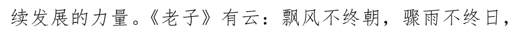

这个现象总结为“有限反击”，即以自卫为目的、适可而止的反击策略。

这种有边界的文明观念，帮助了中华文明的延续，聚气以自养，历千年而不衰。现代的对印战争、对越战争，仍然可见这种文化基因的无形作用。诚如杜甫所言：“杀人亦有限，国自有疆。堪能制凌凌，亦多杀伤？”这诗写的太有水平了，不愧是诗圣啊。

我认为，这种有边界的文明观念，是中国文明的一个优秀的基因。万里长城，就是这种基因最为直观的体现在标志上。当年有一个政治记录片，把长城给矮化了一个不值，说长城代表了落后代表了不思进。然而我整理者看历史要深刻一些。与中国相似，近代美国的崛起，实际上也是这种有边界。美丽大陆，得天洋，东西一片洋，南北两个洲。西进运动结束后，美国扩张，他在全球范围内热闹。长期以来奉行的，就是贸易上的自由主义、军事上的孤立主义。“门罗主义”提出：美洲是美洲人的美洲，希望美洲范围内封闭，不想过多干涉。


二战爆发后，美国国内争议很大，到底不参加世界圈。当时报纸上有几个文章，题目叫：“WHY ME？”意思是说：凭什么让美国去打仗？当时的主流民意，还是想关门，任你翻天，我在大陆过稳。但是“能力越大责任越大”，老实确实想藏不住。所以，他不小心也管了两把，比日本搞禁运。但搞禁运等于想打仗，美国一直和日本谈和平问题，结果一直被蒙紧，一直到了珍珠港事件前。最终，盟友大发现，太平洋队不见了，海面上还活着。

这一回不能打了，不再让全世界看不起。打着着急，美国发现，自己开始进入世界了。

这种扩张的范围，不及的地方。或者，他们根本没有想到设定边界。心有多远，坦克跑就多远。坦克在东欧平原上向东玩命推进，埃芬坦克跑不了。自己的回忆：“每一天，眼前永远是一防线！”势力占了半个中国不说，向南到了澳大利亚，向西到了印度。这个范围，说实话，美国人要是不去打，自己也未能长期下去。管的实在太宽了。用一句话，“德薄而位高，小力而任，此乃万恶源也”。

今天美国的困境，原因有很多。如果站在哲学角度分析，就是一个强大势力，自我膨胀，丧失边界，盛极而衰。

等待

作者：奉行核外交政策 日期:2011-10-22 00:19

累坏了，扯的太远了，转回了到处找不到地方了，我明天有空再找，看该从哪里继续我们的话题。兄弟们晚安！核平。作者：奉行核外交政策 日期:2011-10-22 00:20

关于量变的边界为“力量”，对不起

作者：奉行核额外外交政策 日期:2011-10-22 12:58

## (第142）关于农业的总结

各位兄弟，杜绝蛮蛮，杜绝蛮蛮。虽然中国五千年历史充满了蛮蛮，但事实证明，蛮蛮既无助于解决国家大事，也无助于解决家庭小事，倒是砸了很多。所以，如果没有诸葛亮那种把对手卖到脚下的水平，一般情况下就不要哥！呵可。感谢陌陌、小小岛、一叶等兄弟（有祖妹吗？）的讨论。从陌陌的图片来看，九十年代中期城镇化率在30%左右。我来整理，加入数据后获取好帖几句。

前面，我们回顾了三十农结构，然后又探讨了几个问题。一是，伦理社会解体和道德滑坡问题，二是，农户的困境与农业合作化问题；三是，关于泛行政化和泛原子化的问题，这个不局限于农村。

对于这些问题，我的整体观点是：三十年的农业发展反映了历史和现实的要求。农业合作化是大方向。它的进行得很很慢，主要是客观条件不具备的原因，也有主观原因。近年来客观条件正趋向成熟，我们在主观上克服“泛行政化”思维就显得更为重要。至于道德问题，再靠宗法。


新的道德体系在经济转型和社会结构转型的基础之上逐步形成。不要过度担忧，道德丧失。如果再宏观一点来说，三农问题的解决方案都在，要城市化和工业化来创造条件。2000年以前，中国城市化水平和工业化水平还不。2000年后，中国进入工业化中期，同时进入城市化快速，这两个现象出现，是发展的客观规律，西方也一样。进了这个阶段，中国三农人头，拉动效应显现，户籍瓦解，农村社保体系建立，社会投资。客观条件逐渐成熟，我估计，再过10年，三农问题将不再是一个困扰；再过20年，三农问题将得到根本解决。其实我表达的意思是，目前“三农问题”所指的那些具体问题，已经具备了解决条件，如果我们主观上不犯错误，应该能在20年内根本解决。但是，即便如此，农和农民依然为重要，新阶段会有新的问题出现，这些新问题依然是中国社会矛盾的重中之重。

作者：奉行核外交政策 日期:2011-10-22 17:53

我有一个哥们，我被带动，写了一个类似贴子，驻巴哈人谈巴基斯坦的，有趣的兄弟去看看吧。呵呵。作者：奉行核外交政策 日期:2011-10-23 02:02

@奉行核平外交政策 2011-10-22 17:53:07

我有一个哥们，我被带动，写了一个类似贴子，驻巴哈人谈巴基斯坦的，有趣的兄弟去看看吧。呵呵。@太阳妖2011-10-23 39:34

关于评价集体制呢？看法很多。很多人认为，集体制是障碍，也是国运的重要密码。综合分析，我认为，农业集体化是三十年来的，没有。没有农业机械化。印象中好像像苏联，城镇化率60%以上，耕地面积也高，可以进行机械化作业。我记得80年代，城镇化率仅20%，农村最高47%。在当时社会保障（包括低保、养老、医疗）不健全情况下，耕地不仅是生产资料，还是农民群体赖以生存的基本保障。若直接把耕地分给个人，则会因天灾、人祸或其他原因，导致产权流转。失地农民真正流入城市，形成印度式的贫民窟。现在，中国流动人口过亿，虽然收入不高，还是农村有房有地，而且这个财产有法律保障。这对社会稳定起着重要作用。

耕地体制如何，对于保障中国稳定起着重要作用。分析过，近30年来，中国农业组织化的程度低，根本原因并不在集体制上，而是承包制收益、流转、入股没有法律障碍。根本原因是中国发展阶段的原因，也有政府主观原因。三十年来，中国城市化以及基础设施建设规模无前例，耕地空前。耕地集体制在很大程度上降低了征地难度和社会交易成本，起到了极为重要的作用。我们可以设想，如果是像印度那样私有的土地所有权，那么中国在建设方面，肯定会出现严重的滞后和高交易成本。实际上，各国基础设施建设上的竞争，就是对国际投资的竞争，也是对发展机遇的竞争。中国胜出了这种机遇，也许是最后的机会。

当然，由于集体制，在征地过程中存在对农民利益的损害问题。但总体来说，是越来越到位了。特别是2004年后和和谐社会理论提出以后，被征地者的保障已经比较完备了。目前，国家确定，耕地第二轮承包权30年不变，林地承包权更是每轮长达70年或更长。可以预测，待30年期以后（大约在2020年代），国家还会继续推进第三轮承包。这种包方式依然位于“内部”。国家继续农业生产并征收农业税。

因此，集体所有下的长期承包权，农民得到了法律上的用物权。实际上，这种体制，克服了土地所有制可能造成的农村弱势群体的阻力，克服了土地所有制在公益建设方面的巨大阻力，同时对农民而言，土地使用和收益与私有制差别不大。可以选择，是去其弊、得。

理。所以，你把“理”理解为公平公正的意思，那么就不能说杀人案件“存在即合理”。现在，网上有很多争议，比如对腐败问题的争议，对企业用工制度的争议，对污染问题的争议，对安全事故的争议，对贫富差距的争议，对食物安全的争议，等等，很多情况下是无谓的，双方对“理”的含义理解不同。如果这些方面达成共识，就不用再辩论了。

又比如安全事故。前几年山西省长孟农云也因为事故下了台。历史上，无论是欧洲也好，美国也好，中国也好，都有个共同规律，就是处于经济起飞阶段发展。美国当年事故频发，纽约三角角楼衬衫失火一下烧毁一百多个人。在人类均GDP1000元到6000元之间，是事故高发阶段。只要要下降降。这是客观规律。所以，对中国目前频繁发生的特大事故，我们既不能漠然视之，也不能认为国家将不国了，而是要采取一个客观的、积极的态度。

我声明：我贴子里的所有的观点，都是把“存在即合理”的“理”，理解为社会经济发展中的客观规律。是中性的。等待

作者：奉行内核外交政策日期:2011-10-23 16:13

（第145）

中国国有企业改革始于1984年。这一年是子鼠之年，一个新的甲子轮回的开始。这一年，我正上小学呢，当时我的父母在国营工厂，一切平静如常。小平在天安门的大阅兵，也是我长大以后才知道的。也是在这一年，我们中国企业的承包制开始了，始于石家庄造纸厂。

改革起于农村，城市里要比农村晚了几年。农村大包的成功，使当时的中国人普遍相信，在城里也是“一包包就灵”。所以，八十年代，始于石家庄的国有企业的经营责任制，很快完卷了。最后，实践证明，城市不同于乡间，企业不同于农田。城市的经济要比农村经济复杂得多。

“一包就灵”在城市里只能昙花一现。

石家庄造纸厂改革的情况，大家都熟悉，不熟悉的人可以检索一下，百度百科的“马胜利”词条，信息基本上靠谱。通过微信获取更多信息

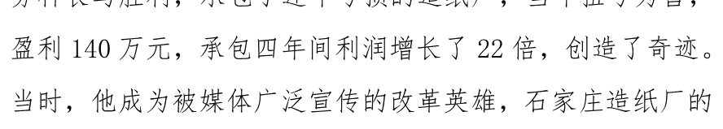

市长马胜利，承包了连年亏损的造纸厂，当年扭亏为盈，盈利140万元，承包四年利润增长了22倍，创造了奇迹。当时，他成为被媒体广泛宣传的改革英雄，石家庄造纸厂的经验在全国范围内。

从文化上讲，八十年代，虽然波澜壮阔的革命英雄时代已经落幕，但中国人因为历史的惯性，停留在崇尚英雄的思维之中。中国人相信，英雄可以引领世界。不像现在，八十后和九十后的兄弟姐妹，更喜欢把英雄当调侃对象，即所谓现代主义的解构。现代人，倾向于挖掘英雄背后的猛料，好好地把他拉下马做个眼睛。这是美国当年赛运动的余波啊。

八十年代可是这样的。当时，中国提出振兴科技，就有记者从厦门大学的楼梯间里挖出一个景润，虽然他看上去没乎乎的，刚毅木讷，近乎仁，英雄啊。我们提出振兴体育，就对女排的五连冠疯狂崇高，虽说是中国振兴的象征，英雄啊。完全不去考虑以后的球怎么解释。我们提出参与国际竞争，就有了捍卫在中围棋擂赛战绩的疯狂折挣，英雄啊。官方竟给老老发了一个“棋圣”的头。由于，我这个围棋爱好者以后用了很长很长的时间，进行长期自我心理调整，以适应隔三差五输给三段小儿的残酷现实。后来，棋圣就变成了一个经济存在，中央电视台远了。我不是否定上述的英雄。他们确实是英雄。我的意思是说，现代社会会希望寄托到英雄身上，那是行的。

八十年代的企业承包，实际上“大包干”的城市版。把该交给了，留下的就是自己的。然而，由于国家有企业从属不同的政府部门，深陷于条块分割的利益格局之中，很难像农民那样超越。当时产品销路和原料来源，都受到价格双轨体制的影响，离了政府也不好办。而且，对职工身份并没有任何改变，仍然是主人翁，能进不能，能上不能，承受者的权力很有限。仅凭这个权力，对付市场竞争是不够的。

那为什么承包制一开始可以吃到甜头呢？原因有三：
一，有限的改革，释放了有限的活力。
二是，当时中国置于卖方市场，产品好卖，企业活跃。像沈阳防爆器械厂那样破产的（1986年），是极少极少的特例。
三是，国企业的竞争民营和外资企业，当时还没成长起来。

所以，一开始，一切看上去很美。马胜利根据市场需求，把原来单一的卫生纸改成不同规格，还增加颜色和香味，就横扫市场。这个经验，他当时可以拿到报告。然而，由于市场变化，很快证明。1990年，马胜利陷入亏损。1991年，集团解散。1995年，马胜利被免职，石家庄造纸厂破产。

继续
作者：奉行内核外交政策日期:2011-10-23 16:13
（第145）

中国国有企业改革始于1984年。这一年是子鼠之年，一个新的甲子轮回的开始。这一年，我正上小学呢，当时我的父母在国营工厂，一切平静如常。小平在天安门的大阅兵，也是我长大以后才知道的。也是在这一年，我们中国企业的承包制开始了，始于石家庄造纸厂。

改革起于农村，城市里要比农村晚了几年。农村大包干的成功，使当时的中国人普遍相信，在城里也是“一包包就灵”。所以，八十年代，始于石家庄的国有企业的经营责任制，很快完卷了。最后，实践证明，城市不同于乡间，企业不同于农田。城市的经济要比农村经济复杂得多。

“一包就灵”在城市里只能昙花一现。

石家庄造纸厂改革的情况，大家都熟悉，不熟悉的人可以检索一下，百度百科的“马胜利”词条，信息基本上靠谱。通过微信获取更多信息


市长马胜利，承包了连年亏损的造纸厂，当年扭亏为盈，盈利140万元，承包四年利润增长了22倍，创造了奇迹。当时，他成为被媒体广泛宣传的改革英雄，石家庄造纸厂的经验在全国范围内。

从文化上讲，八十年代，虽然波澜壮阔的革命英雄时代已经落幕，但中国人因为历史的惯性，停留在崇尚英雄的思维之中。中国人相信，英雄可以引领世界。不像现在，八十后和九十后的兄弟姐妹，更喜欢把英雄当调侃对象，即所谓现代主义的解构。现代人，倾向于挖掘英雄背后的猛料，好好地把他拉下马做个眼睛。这是美国当年赛运动的余波啊。

八十年代可是这样的。当时，中国提出振兴科技，就有记者从厦门大学的楼梯间里挖出一个景润，虽然他看上去没乎乎的，刚毅木讷，近乎仁，英雄啊。我们提出振兴体育，就对女排的五连冠疯狂崇高，虽说是中国振兴的象征，英雄啊。完全不去考虑以后的球怎么解释。我们提出参与国际竞争，就有了捍卫在中围棋擂赛战绩的疯狂折挣，英雄啊。官方竟给老老发了一个“棋圣”的头。由于，我这个围棋爱好者以后用了很长很长的时间，进行长期自我心理调整，以适应隔三差五输给三段小儿的残酷现实。后来，棋圣就变成了一个经济存在，中央电视台远了。我不是否定上述的英雄。他们确实是英雄。我的意思是说，现代社会会希望寄托到英雄身上，那是行的。

八十年代的企业承包，实际上“大包干”的城市版。把该交了，留下的就是自己的。然而，由于国家有企业从属不同的政府部门，深陷于条块分割的利益格局之中，很难像农民那样超越。当时产品销路和原料来源，都受到价格双轨体制的影响，离了政府也不好办。而且，对职工身份并没有任何改变，仍然是主人翁，能进不能，能上不能，承受者的权力很有限。仅凭这个权力，对付市场竞争是不够的。

那为什么承包制一开始可以吃到甜头呢？原因有三：
一，有限的改革，释放了有限的活力。
二是，当时中国置于卖方市场，产品好卖，企业活跃。像沈阳防爆器械厂那样破产的（1986年），是极少极少的特例。
三是，国企业的竞争民营和外资企业，当时还没成长起来。

所以，一开始，一切看上去很美。马胜利根据市场需求，把原来单一的卫生纸改成不同规格，还增加颜色和香味，就横扫市场。这个经验，他当时可以拿到报告。然而，由于市场变化，很快证明。1990年，马胜利陷入亏损。1991年，集团解散。1995年，马胜利被免职，石家庄造纸厂破产。

继续
作者：奉行内核外交政策日期:2011-10-23 16:13
（第145）

中国国有企业改革始于1984年。这一年是子鼠之年，一个新的甲子轮回的开始。这一年，我正上小学呢，当时我的父母在国营工厂，一切平静如常。小平在天安门的大阅兵，也是我长大以后才知道的。也是在这一年，我们中国企业的承包制开始了，始于石家庄造纸厂。

改革起于农村，城市里要比农村晚了几年。农村大包干的成功，使当时的中国人普遍相信，在城里也是“一包包就灵”。所以，八十年代，始于石家庄的国有企业的经营责任制，很快完卷了。最后，实践证明，城市不同于乡间，企业不同于农田。城市的经济要比农村经济复杂得多。

“一包就灵”在城市里只能昙花一现。

石家庄造纸厂改革的情况，大家都熟悉，不熟悉的人可以检索一下，百度百科的“马胜利”词条，信息基本上靠谱。通过微信获取更多信息


市长马胜利，承包了连年亏损的造纸厂，当年扭亏为盈，盈利140万元，承包四年利润增长了22倍，创造了奇迹。当时，他成为被媒体广泛宣传的改革英雄，石家庄造纸厂的经验在全国范围内。

从文化上讲，八十年代，虽然波澜壮阔的革命英雄时代已经落幕，但中国人因为历史的惯性，停留在崇尚英雄的思维之中。中国人相信，英雄可以引领世界。不像现在，八十后和九十后的兄弟姐妹，更喜欢把英雄当调侃对象，即所谓现代主义的解构。现代人，倾向于挖掘英雄背后的猛料，好好地把他拉下马做个眼睛。这是美国当年赛运动的余波啊。

八十年代可是这样的。当时，中国提出振兴科技，就有记者从厦门大学的楼梯间里挖出一个景润，虽然他看上去没乎乎的，刚毅木讷，近乎仁，英雄啊。我们提出振兴体育，就对女排的五连冠疯狂崇高，虽说是中国振兴的象征，英雄啊。完全不去考虑以后的球怎么解释。我们提出参与国际竞争，就有了捍卫在中围棋擂赛战绩的疯狂折挣，英雄啊。官方竟给老老发了一个“棋圣”的头。由于，我这个围棋爱好者以后用了很长很长的时间，进行长期自我心理调整，以适应隔三差五输给三段小儿的残酷现实。后来，棋圣就变成了一个经济存在，中央电视台远了。我不是否定上述的英雄。他们确实是英雄。我的意思是说，现代社会会希望寄托到英雄身上，那是行的。

八十年代的企业承包，实际上“大包干”的城市版。把该交了，留下的就是自己的。然而，由于国家有企业从属不同的政府部门，深陷于条块分割的利益格局之中，很难像农民那样超越。当时产品销路和原料来源，都受到价格双轨体制的影响，离了政府也不好办。而且，对职工身份并没有任何改变，仍然是主人翁，能进不能，能上不能，承受者的权力很有限。仅凭这个权力，对付市场竞争是不够的。

那为什么承包制一开始可以吃到甜头呢？原因有三：
一，有限的改革，释放了有限的活力。
二是，当时中国置于卖方市场，产品好卖，企业活跃。像沈阳防爆器械厂那样破产的（1986年），是极少极少的特例。
三是，国企业的竞争民营和外资企业，当时还没成长起来。

所以，一开始，一切看上去很美。马胜利根据市场需求，把原来单一的卫生纸改成不同规格，还增加颜色和香味，就横扫市场。这个经验，他当时可以拿到报告。然而，由于市场变化，很快证明。1990年，马胜利陷入亏损。1991年，集团解散。1995年，马胜利被免职，石家庄造纸厂破产。

继续
作者：奉行内核外交政策日期:2011-10-23 16:13
（第145）

中国国有企业改革始于1984年。这一年是子鼠之年，一个新的甲子轮回的开始。这一年，我正上小学呢，当时我的父母在国营工厂，一切平静如常。小平在天安门的大阅兵，也是我长大以后才知道的。也是在这一年，我们中国企业的承包制开始了，始于石家庄造纸厂。

改革起于农村，城市里要比农村晚了几年。农村大包干的成功，使当时的中国人普遍相信，在城里也是“一包包就灵”。所以，八十年代，始于石家庄的国有企业的经营责任制，很快完卷了。最后，实践证明，城市不同于乡间，企业不同于农田。城市的经济要比农村经济复杂得多。

“一包就灵”在城市里只能昙花一现。

石家庄造纸厂改革的情况，大家都熟悉，不熟悉的人可以检索一下，百度百科的“马胜利”词条，信息基本上靠谱。通过微信获取更多信息


市长马胜利，承包了连年亏损的造纸厂，当年扭亏为盈，盈利140万元，承包四年利润增长了22倍，创造了奇迹。当时，他成为被媒体广泛宣传的改革英雄，石家庄造纸厂的经验在全国范围内。

从文化上讲，八十年代，虽然波澜壮阔的革命英雄时代已经落幕，但中国人因为历史的惯性，停留在崇尚英雄的思维之中。中国人相信，英雄可以引领世界。不像现在，八十后和九十后的兄弟姐妹，更喜欢把英雄当调侃对象，即所谓现代主义的解构。现代人，倾向于挖掘英雄背后的猛料，好好地把他拉下马做个眼睛。这是美国当年赛运动的余波啊。

八十年代可是这样的。当时，中国提出振兴科技，就有记者从厦门大学的楼梯间里挖出一个景润，虽然他看上去没乎乎的，刚毅木讷，近乎仁，英雄啊。我们提出振兴体育，就对女排的五连冠疯狂崇高，虽说是中国振兴的象征，英雄啊。完全不去考虑以后的球怎么解释。我们提出参与国际竞争，就有了捍卫在中围棋擂赛战绩的疯狂折挣，英雄啊。官方竟给老老发了一个“棋圣”的头。由于，我这个围棋爱好者以后用了很长很长的时间，进行长期自我心理调整，以适应隔三差五输给三段小儿的残酷现实。后来，棋圣就变成了一个经济存在，中央电视台远了。我不是否定上述的英雄。他们确实是英雄。我的意思是说，现代社会会希望寄托到英雄身上，那是行的。

八十年代的企业承包，实际上“大包干”的城市版。把该交了，留下的就是自己的。然而，由于国家有企业从属不同的政府部门，深陷于条块分割的利益格局之中，很难像农民那样超越。当时产品销路和原料来源，都受到价格双轨体制的影响，离了政府也不好办。而且，对职工身份并没有任何改变，仍然是主人翁，能进不能，能上不能，承受者的权力很有限。仅凭这个权力，对付市场竞争是不够的。

那为什么承包制一开始可以吃到甜头呢？原因有三：
一，有限的改革，释放了有限的活力。
二是，当时中国置于卖方市场，产品好卖，企业活跃。像沈阳防爆器械厂那样破产的（1986年），是极少极少的特例。
三是，国企业的竞争民营和外资企业，当时还没成长起来。

所以，一开始，一切看上去很美。马胜利根据市场需求，把原来单一的卫生纸改成不同规格，还增加颜色和香味，就横扫市场。这个经验，他当时可以拿到报告。然而，由于市场变化，很快证明。1990年，马胜利陷入亏损。1991年，集团解散。1995年，马胜利被免职，石家庄造纸厂破产。

继续
作者：奉行内核外交政策日期:2011-10-23 16:13
（第145）

中国国有企业改革始于1984年。这一年是子鼠之年，一个新的甲子轮回的开始。这一年，我正上小学呢，当时我的父母在国营工厂，一切平静如常。小平在天安门的大阅兵，也是我长大以后才知道的。也是在这一年，我们中国企业的承包制开始了，始于石家庄造纸厂。

改革起于农村，城市里要比农村晚了几年。农村大包干的成功，使当时的中国人普遍相信，在城里也是“一包包就灵”。所以，八十年代，始于石家庄的国有企业的经营责任制，很快完卷了。最后，实践证明，城市不同于乡间，企业不同于农田。城市的经济要比农村经济复杂得多。

“一包就灵”在城市里只能昙花一现。

石家庄造纸厂改革的情况，大家都熟悉，不熟悉的人可以检索一下，百度百科的“马胜利”词条，信息基本上靠谱。通过微信获取更多信息


市长马胜利，承包了连年亏损的造纸厂，当年扭亏为盈，盈利140万元，承包四年利润增长了22倍，创造了奇迹。当时，他成为被媒体广泛宣传的改革英雄，石家庄造纸厂的经验在全国范围内。

从文化上讲，八十年代，虽然波澜壮阔的革命英雄时代已经落幕，但中国人因为历史的惯性，停留在崇尚英雄的思维之中。中国人相信，英雄可以引领世界。不像现在，八十后和九十后的兄弟姐妹，更喜欢把英雄当调侃对象，即所谓现代主义的解构。现代人，倾向于挖掘英雄背后的猛料，好好地把他拉下马做个眼睛。这是美国当年赛运动的余波啊。

八十年代可是这样的。当时，中国提出振兴科技，就有记者从厦门大学的楼梯间里挖出一个景润，虽然他看上去没乎乎的，刚毅木讷，近乎仁，英雄啊。我们提出振兴体育，就对女排的五连冠疯狂崇高，虽说是中国振兴的象征，英雄啊。完全不去考虑以后的球怎么解释。我们提出参与国际竞争，就有了捍卫在中围棋擂赛战绩的疯狂折挣，英雄啊。官方竟给老老发了一个“棋圣”的头。由于，我这个围棋爱好者以后用了很长很长的时间，进行长期自我心理调整，以适应隔三差五输给三段小儿的残酷现实。后来，棋圣就变成了一个经济存在，中央电视台远了。我不是否定上述的英雄。他们确实是英雄。我的意思是说，现代社会会希望寄托到英雄身上，那是行的。

八十年代的企业承包，实际上“大包干”的城市版。把该交了，留下的就是自己的。然而，由于国家有企业从属不同的政府部门，深陷于条块分割的利益格局之中，很难像农民那样超越。当时产品销路和原料来源，都受到价格双轨体制的影响，离了政府也不好办。而且，对职工身份并没有任何改变，仍然是主人翁，能进不能，能上不能，承受者的权力很有限。仅凭这个权力，对付市场竞争是不够的。

那为什么承包制一开始可以吃到甜头呢？原因有三：
一，有限的改革，释放了有限的活力。
二是，当时中国置于卖方市场，产品好卖，企业活跃。像沈阳防爆器械厂那样破产的（1986年），是极少极少的特例。
三是，国企业的竞争民营和外资企业，当时还没成长起来。

所以，一开始，一切看上去很美。马胜利根据市场需求，把原来单一的卫生纸改成不同规格，还增加颜色和香味，就横扫市场。这个经验，他当时可以拿到报告。然而，由于市场变化，很快证明。1990年，马胜利陷入亏损。1991年，集团解散。1995年，马胜利被免职，石家庄造纸厂破产。

| 特区 | 设立时间 | 起点情况 | 地缘优势 | 核心动力 | 发展结果 |
| :--- | :--- | :--- | :--- | :--- | :--- |
| 深圳 | 1980年 | 宝安县下属小镇（最低） | 面对香港 | 外资、制造业 | 成功，成为世界制造中心 |
|珠海 | 1980年 | 较差 | 面对澳门 | 外资、旅游业 | 成功 |
| 厦门 | 1980年 | 清末是东南重镇（最高） | 面对台湾 | 外资、贸易 | 成功 |
| 汕头 | 1980年 | 不低（清末粤东重镇） | 面对潮汕 | 外资 | 成功 |
| 海南 | 1988年 | 较晚（海岛代表性） | 面对港澳台 | 外资、多元化 | 还不算成功 |

海南设立于1988年，是一个“面”特区，与前面四个“点”特区不同。中央设立海南，就是因为它的代表性。一个海岛上，又有城市又有乡村，又有工业区又有农业区，又有沿海又有深山，又有汉族又有民族自治，很全面。从理论上来说，特区发展没有什么问题。投资者角度，初期主要是劳动密集型企业是生产性质。投资不大，市场倒小，利润有保障，万一政策变化损失也不大，不至于跳脚。从劳动角度来看，可以以后。文化素质没有问题。特区的主要问题，是从中央到群众的观念，所以创业之初，特区要出血，不是在经济上杀，而是在观念上争夺。

从发展来看，厦门起点最高。厦门在清末已经是东南重镇，闽南几个州的驻地，清末最后几年还设立了闽府。从民国到建国以后，它一直都是闽南重镇，陈嘉庚创办的华大在这里，人才没有问题。虽然临台海战略考虑，国家在计划经济时代投资不多，但基础不错。汕头的起点也不低，它原属海县，清末成为粤东重镇，民国直市。珠海起点要差些，它是一个建国以后才有的。深圳起点是最低。它是宝安县下属的小镇。

然而，历史总是喜欢跟我们开玩笑，三十年以后，深圳发展的最好。今天，厦门、汕头、珠海三大区，与同样沿海地级市（或副省级市）的兄弟们，比起烟台、宁波、湛江、南通、温州相比，特区并没有出现“特”的发展优势。我还是充分考虑了可比性，还没有他们跟青岛、大连去比。海南发展到现在，在经济方面，无论是人均总量还是与其其他省份相比，都不具备明显的优势。

人总把深圳的成就归结到各种因素上，比如它靠近香港，国家在深圳设了一个市。但是我认为，深圳的经验90%是主观方面的。总结起来，就是：不去妄想，不去走什么捷径，踏踏实实，一心一意，围绕制造业。通过产业聚集，形成集群效应，吸引更多投资和创业，逐步发展壮大。搞到一定时候，转型升级就升级，以制造业为基础，再去搞别的。沿着产业链一步步走向未来。目前，深圳拥有华为、中兴、腾讯、万科、康佳、创维、平安、华诚、万海等地企业。深圳和东莞一片，成为世界制造中心之一。实际上，三十年来，中国崛起为世界工厂，而其它特区，三十年间走了一些弯路，尤其是广东沿海城市，走了一条不同的道路。随着社会向前，这种模式也许带来。

# 草根生长

中国经济体制像一片密密的水地，长出了大大小草根，疯狂生长。应该说，八十年代并不是中国人创业的最佳年代，因为在体制、观念、硬件上的问题很多。但是生意很好；多数人还没有转变观念，竞争者不多。我有一个朋友，当时没有分配到工作，在马路上一待业。她就去南方广东，马路边两棵树间拉拉绳子挂着卖。生意好时，一天挣200元，相当于干部两个月工资。当时，她根本不敢说，是绝密。直到二十年后，大家一起吃饭，她才敢说。很多老板，就是这样在八十年代挖到第一金。可惜这个朋友不懂经营，没有发展成老板。后来，市里建设了服装批发市场，她用第一桶金换了几十摊位，然后靠租金过日子，小富即安。

据我观察观察：
一是在城市从业者，其中许多是回城招青的，没工作被迫下海。
二是乡镇企业和村企业的从业者。这些人刚脱离农业，成为工业新兵。一开始他们不是个体私营者。后来绝大多数城镇办企业倒闭、出售、改制，这些人被收购接手，或者另起炉灶，成为私营企业家。
三是在广东等地沿海包打。他们住在外资企业附近，在里面打工，慢慢摸清，然后承接外资的一些业务，比如代销、外协生产等，逐步起来。
四是直接家庭作坊手工的人。这种情况不多，因为你在深山老林里搞作坊很难，并有配套市场才能起。温州、绍州、义乌等地就是。

当时，温州人可没有现在的风光，可以组团出去吆，横跨楼市。他们正在创业，一分一厘挣小钱。我印象深刻的，一是温州眼镜店，二是温州鞋。当时，南方小作坊生产的鞋子卖到北方，人称“礼拜鞋”就是穿一双就臭的那种。说的鞋底是牛皮纸做的。这个极极端情况我没有碰到。“礼拜鞋”还真买过。

私营经济起步期，本来素质就差，再加上市场双轨制，不想犯规都难。这些不规范现象，现在我们能客观认识了。在当时，各地政执法水平差异，尺度不一。个体常被指为投机胆大，轻则被罚几票，重则被关。几个名名鼎鼎的“疯子”都被抓了。国家曾鼓励个性表现，八十年代初，很多小品上的主角是个体和个体。我还记得一个小品的台词是：“可不要眼睛红！”另一个搞笑节目是歌曲。

这些批评，在网上有很多。八十年代活跃，活跃，活跃，活跃，活跃，活跃，活跃，活跃，活跃，活跃，活跃。这种表现，看起来很真实，但没有规则。九十年代中期，个体户被推。1999年，城乡草根的黄金时代结束了，而且是永远终结了。


失落的是辽宁，最不平的是重庆，知觉最清楚却无可奈的是上海，知觉不清楚但我感觉良好的是四川，知觉最多以至于反应乱的是河南，知觉最少长期迷灯的是河北，送别了英雄却仍然驻足旅游的是湖南，把大家都醒了以后倒头又是安康的。

前面贴子里，我曾分析过中国五个区域，发展路径选择及结果的差异性。其实，中国各省的经济格局，也不是必然发展成今天样子。比如，浙江和福建的基本情况差不多，江苏实力明显强于福建。又比如，广西在民国时期是充当的模范省，建国后中央政府又把原广东省钦州、北海等地划给广西，使成为沿海省区。改革开放后，等一系列政策，与沿海其他省份比，他的发展并不理想。

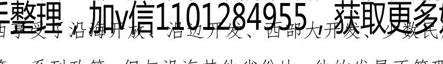

又比如，七十年代辽宁省在沿海地区，资源结构、工业水平都是中国省，已经基本完成工业化，城市化率接近一半，号称“老大哥”，而山东当时的城市化率只有18%，是一个农业省。三十年后后看来，山东的整体发展水平明显比辽宁更成功些。

我的感觉是，虽然沿海区整体上优于内地，但同样的地区发展并不均衡。今天的格局与各地政府的发展思路、策略、路径选择有着很有关系。发展快的粤、浙、苏、鲁四省，都有他们的成功之处。这种成功，很大程度上（也许70%）得益于八十年代决策。九十年代以后，地区的发展竞争、企业间的竞争已无比惨烈，那时，后者再想迎来头上，是非常困难的。别人已经占先机，不会等待你。所以，八十年代的四种模式，基本奠定大局，形成今天前的经济优势。

显然，我这个“八十年代决定”不能绝对化。八十年代没睡醒，后来赵成都成功的例子，全国只有两个。一个是上海，它比广东早后悔后悔，连小平同志都说后悔了。上海在1992年开始发力，到九十年代末已经迎赶头上，厉害啊！另一个是天津，在2000年开始发力，目前已经基本上追上了。最后的一半成功者，是重庆。1997年建


市场应该没有悬念。但它还没有最后成功，算半个吧！

这种后追起的成功是非常复制的。上海是中国第一经济中心，基础规模为雄柱，位次无可替代。天津是清末到民国的北方经济中心，直到1949年解放后，工商规模还远远远北京之上。重庆正当卧胄（卧胄），又是“三线建设”的核心，工业基础也很雄厚。即便如此，如果没有中央的大支持，如果没有国家设立的浦东新区、滨海新区、两江新区，他们的追赶也会非常困难。我的判断，没有中央支持，上海几仍然能够追到全国最前去，天津和重庆完全没有胜算。我上海、天津、重庆以后再专门写贴子说明吧。下面，

我们看看粤、苏、浙、鲁四省，在八十年代都做了一些事。

待续

作者:奉行和平外交政策 日期:2011-10-24 19:28

## 第 150 制造为王

总结经验这个事情，很难。把规律性的东西抽象出来，需要大量数据支撑，零零看一些，但是没有收集。总结不好又会被笑话。我不擅长数据分析，只讲主观感觉。

我觉得四省成功，一个共同点，就是跟深圳一样，把工业（制造业）放在重中之重，在制造业上取得了全球优势。

这是深圳道路，是省道，也是中国道路。

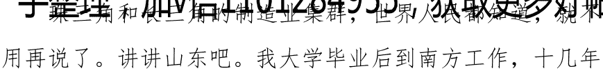

用说了。讲讲山东东。我大学毕业后到南方工作，十年对地方不了解。去年偶然回一次，大吃一顿。鲁一带是传统的农业区，也是久发达地区。以前财政上工资就很困难。我走马观看了德州明星、聊时风雨企业，一家是世界最大的太阳能热水器制造商，一家是中国最大的农用三轮制造商，由于老外好像不生产三轮，说它是世界上最大的。可以。我发现，在这些传统农业区，每个市县都有某种工业很强。可的是，现在河南、河北的市县也起来了（两省经济总量在全国第五、六名哈）。很多人说，山东的发展是吹出来的。我的看法，山东的发展首先是埋头出来来，成绩猥放在那儿，然后，百尺尖头吹一下，就显得更突出。

顺便说一句，由于中国平均每人人口4300万，相当于中等国家（比如西班牙）的规模，没有工业的支撑，经济肯不起来。上海市在90年代曾经经历过一阵金融、证券和商贸，后来一看不太对，赶把精力转回工业，跟江抢项目。没有大钢铁、大飞机、大重工、大造船的投资和就业，光靠金融、玩玩具，腰杆撑不硬。有的省力气不够。比如广西，由于它的发展条件很好，三十年里，又忙着建设西南便利的出海通道，又忙着在北海搞房地产，又忙着跟广东、东部差距越越大。一个拥有6000万人口的经济体。广西南部，现在的经济强者，即不是沿海的钦州，也不是沿海梧州，也不是桂林，而是内陆柳州。柳州的发展就是老实实抓制造业，发展出五菱、通用五菱、上汽五菱、钢铁、机械、金章柳子、化工等著名企业。现在它的经济总量第二，要是南宁不是首府恐怕打不过它。中国各省都绕不过

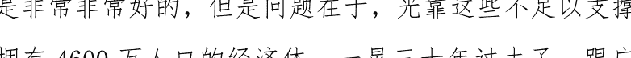

工业化这一大关，发展不足的省还得多花时间补课。怎么折腾这么长。继续，长话短说。四省成功的第二个共同经验，适度发展初期的规范现象，不要上去就锤子打。管理，干把企业管好，不能把企业管死。内陆许多省都在这个问题上太严厉了。特别是八十年代，那时私企都是小韭翁，打击伪假劳，维护群众利益，这个容易做。真正敢放宽一条路，弄不好自己掉帽子，还可能被指为商人勾结。四省的第三个共同经验是，不能永远容忍规范现象，条件只要成熟，就去管理引导，促进产业升级、产品淘汰、品牌创建。我觉得河南、山西在这方面慢了一些，发展阶段过于太长，在那里没完了地搞原始积累，结果损害了整体形态。有些好事还拿着。90年代以后，浙江终于摆脱了转椅。作者:奉行和平外交政策 日期:2011-10-24 21:52

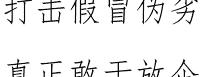

洗个澡，泡泡茶，放点音乐，慢慢码字。明天再往下吧。兄弟们晚安。作者:奉行和平外交政策 日期:2011-10-24 23:15

## 第 151 政府博弈

前面，我总结了东部沿海列强的三个共同经验。这三个方面前面说太简单了，有必要进一步说说。

第一个经验就是就业方向：以工业化为中心的工业化。一开始是发展有比较优势的劳动密集型企业，创造了大量就业，有了就业就有城市化，城市规模扩大了，才有建设需求和消费需求，从而推动工业升级。工业化和城市良性互动发展。


大家知道，在创造就业方面，中小企业有优势。个体和私性性质的企业也有优势。所以广东、浙江吸纳就业的能力，始终高于山东。山东经济总量虽然老大，但始终没有形成吸纳外省农民的能力，倒有些山东农民跑到省外打工。这不能说是经济省的一大尴尬事。山东经济活力不足，老百姓消费能力也比广东浙江弱。这是所有经济结构不合理造成的。第二个经验和第三经验，解决路径问题。这两个经验，是经济起飞阶段的管理艺术，就是把握尺度十分重要。

我个人估计，三十年来，全国被死的企业要远远多于被活的企业。由于发展初期的不规范性，出问题属于“存在即合理”。一旦出现问题，中央一台曝光，上级领导指示，对一个地区的小企业群体往往就是灭顶之灾。

我没有经历过八十年代的整顿，但我亲历过一场2004年的某矿业秩序整顿。省级领导指示，半年整顿，民营小矿山以及围绕它们的运输和服务业，死掉70%。当时，社会观念已经很开了，法治已经比较健全，且这种情况变得更惨了。特别是1985年到1992年期间，当报纸电视上点名指出，个体和私营经济都是在变的经济基础。这压力之大，可想象而！

# 我整理在加微信获取更多帖

## 第 152 招商大战

有一次，我因为公关，求西部某的一个区长。约了一个月，实在太忙。浙江朋友过来考察，找块地，想把几条生产线引进来。结果下午四点打电话，晚上八点半安排在办公室见面。区长先陪他。我深刻体会到，在中国，你要是有大笔钱去投资，就是老爷爷。难怪有的骗子扮成投资者，赌场亏个省。

八十年代开始，各地政府出现投资性渴渴。两个办法：
- 要求各部门投钱。
- 从银行、信用社贷款，上马项目。

八十年代，政府观念还没有变，什么项目都敢上。比如旅游业，光是城市、微观就有了无数，还发红文件干部们追赶部。九十年代以后，特别是1992年以后，吸引企业投资为主：
- 吸引外资。
- 吸引外国企业来投资，就是挖政府。因为本地企业跑到国外投资，跟老板们热闹、拍桌子的，有很多啊！
- 吸引老板投资。老板们开始了。如果政府观念转变再早点，也没用。早年老板还没等到第一金桶。各地政府招商投资，好处多多：
- 政治效益：项目就是政绩。
- 直接经济效益：创造税收，咱有钱花。
- 间接经济效益：拉动就业，促进繁荣，抬高房价，推高地价。
- 灰色经济效益：利用权力，尽量关。


## 重点项目，老板们又不傻

所以，各地官员对于投资项目，有一种由衷的偏爱。你招到商，那就是官，就是地税，就是过年的红包。各地招商竞争十分激烈。招商局长是压力最大的岗位。有大型项目，就在签约的前头一天晚上，投资商被外市招商局长从宾馆里跑了。一般来说，到今天，市县一级的党班子成员，人人都有招商任务。还有很多地方（比如河南），只要是吃财政的人，都要完成招商任务，小学教师就不太放过，不过招商。千斤重重大家伙，人人头上上有指标！全民招商！是凭招商！谁跟投资者过不去，就是跟全体过不去！抢跑了投资者，就是某县的千古罪人！

好家伙，你们说，这个搞法，世界上国家能跟中抢投资啊？而老板们，正是利用了各地政府之间的竞争，在经济体制转轨的情况下，在各种治理整顿现象的情况下，在腐败势力无时不想吃掉的情况下，实现了自我的保护，提高了谈判能力，扩大了生存空间，在政府竞争的夹缝中玩游戏发展。

在这场招商大战中，由于投资短缺，投资者在大多数情况下都处于主动地位。是政府求投资。传说中的“投诉”现象，实际上并不多。我曾认真研究过，这种“投诉”现象，其实并不多。政府，，，只要关照，，办，办，，，，，，，，，，，，，，，，，办了。

有两种情况：
- 地方签订了协议，但政府不执行。
- 地方执行了，但政府没。，总结了。

这些，，，，，，。，，山东的，，，的齐鲁文化。

山西，河南，，河南，河南，山东的，山东，山西，，，，地方慢了。我觉得河南、山西在这方面慢了了一些，基层办事员，素质是差点。贫困地区更是。

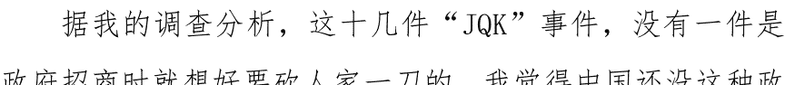

## 第 153 文化基因

探讨政府博弈后还有这个重话题之前，我们先插播一个轻松贴吧，聊一下各省在发展竞争中的文化基因作用。

有个兄弟，今年上半年升迁了，新岗位却是青海湖。我闲时，我用青海民歌《那个遥远的地方》励他——兄弟，那地方有个好姑娘啊，而且不是在宾馆里开房，是“走过她的帐”，野战小，还“拿着细细的皮鞭轻轻打在”。这回你幸福了。两个月后，他打电话给我，说姑娘和皮鞭还没找到，正在找。但他发现青海是个文化库，文化悠久灿烂，但国人知道不多，所以决定用业余时间去拍画，让我帮忙出版。

我说这个故事，主要意思是，我不认为经济发达的省很有文化、经济发达省没有文化。是中国文化古国，各地文化都是悠久深厚的。特别是黄河中游的晋、豫三省是中华文明的摇篮，文化积淀之厚，给我留下了深的印象。我不认为，现在经济发达的省，文化在一定外部条件下被充分激活，反过来发挥了促进发展的作用。经济和文化形成良性互补，如江苏、恢复传统艺术，招商引资谈。

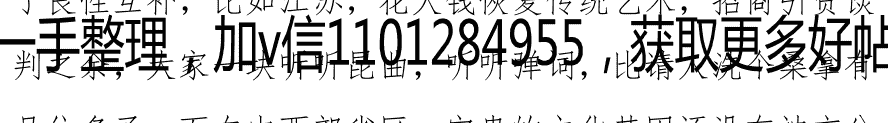

江地区（包括江南）自宋以来，一直是全国经济中心，也是文化渊薮。我看过历代名人图，收录了数千张名人画像。后半部分的80%都是江南（苏南部）、江西、浙江三地的人，真是“天下才数三江”。我还翻阅过明清科举的榜，第一甲基本上都是江浙才子。好不容易看到，清朝第一次开科取，开国状元山东东（傅兰的祖宗），而且第一甲都是北方人！老子顿时皱眉扬吐气。后来才发现，当时兵入关刚两年，江南正在实在血战，估计没有人来考试。而且以淮的祖籍也是江西。

宋代以来的千年，广东形成了深厚的。广东形成了深厚的外贸，广东形成了深厚的的，山东的，山东的，山东的，山东的，山东的，山东的，山东的，山东的，山东的，山东的，山东的，山东的，山东的，山东的，山东的，山东的，山东的，山东的，山东的，山东的，山东的，山东的，山东的，山东的，山东的，山东的，山东的，山东的，山东的，山东的，山东的，山东的，山东的，山东的，山东的，山东的，山东的，山东的，山东的，山东的，山东的，山东的，山东的，山东的，山东的，山东的，山东的，山东的，山东的，山东的，山东的，山东的，山东的，山东的，山东的，山东的，山东的，山东的，山东的，山东的，山东的，山东的，山东的，山东的，山东的，山东的，山东的，山东的，山东的，山东的，山东的，山东的，山东的，山东的，山东的，山东的，山东的，山东的，山东的，山东的，山东的，山东的，山东的，山东的，山东的，山东的，山东的，山东的，山东的，山东的，山东的，山东的，山东的，山东的，山东的，山东的，山东的，山东的，山东的，山东的，山东的，山东的，山东的，山东的，山东的，山东的，山东的，山东的，山东的，山东的，山东的，山东的，山东的，山东的，山东的，山东的，山东的，山东的，山东的，山东的，山东的，山东的，山东的，山东的，山东的，山东的，山东的，山东的，山东的，山东的，山东的，山东的，山东的，山东的，山东的，山东的，山东的，山东的，山东的，山东的，山东的，晚了。今天有事，恐怕没写稿了。

作者:奉行和平外交政策 日期:2011-10-25 15:04

## 第 154 重复建设

中国不同于一般国家。考虑面积和人口因素，以及财政


体制因素，国内诸侯利益集团的复杂性，决非几言能尽。在一省之内，各市县之间，仍然存在着激烈的发展竞争。对于这种政府博弈，如何评价呢？

先说正面评价。

第一，前面已经说过了，它为了个体私营经济创造了更大的生存空间。这里说“更大的”，意思是，国家宏观政策调整，已经创造出这个空间，但这个空间是理论上的，实际操作中许有些问题，比前面我们胡乱的温州模式千分之四以下的生存概率。而政府博弈使空间变大了、变实了。换句话说，中央活过个体私营经济的好政策，是通过政府博弈整理后，才落实到实处的。

各地争取发展，酝出的问题当然很多，但发展成绩是实实在的。如果你看到它其它非非洲国家，看着德国的懒洋洋那个德行，看20年不修一条路那种局面，你就会发现，中国官员竟然还比较可爱。他们制定是为了政策，可能还有一些猫腻，但那种普通会研究、周末不准休息、为招商“能喝半呛喝八两”、满脑袋经济增长目标的领导，确实推动了中国发展。

现在在国内一些人，包括一些人，一说起当官的，就是吃喝玩乐、祸国殃。实际大部分还是在干事情。大家可以想一想，中国的政府规模这么大，权力这么大，中央文件来看，在高层领导眼里，最大问题就是重复建设。国务院多次出手干预，勒令一些已开工项目下马。朱、温等几位老板都没少干这种事。这是对的，原因在于这些项目不是老板投资，而是政府贷款投资。老板投资，亏了是自己的，让他赌输。而政府投资，亏了政府负责。由脑决策，

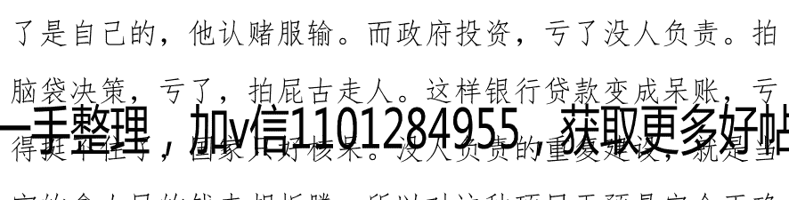

其二，消灭重复建设也没有必要。只有适度重复建设，而且必须建到大于，才会形成市场竞争。没有重复建设，就没有同业竞争，市场经济就无从谈起。重复建设引发的竞争，带来了产品淘汰和技术进步的压力，给消费者带来了许多实实在的好处。前些年，有些人看到A在修什么样的厂，B也在修同样的厂，还不仔细分辨思考，立刻就嚷高呼“警惕重复建设卷土来”，这是计划经济思维的延续。其实，你像五十年代那样，把投资全都交给国家计划去，肯定能有效避免重复建设，那不就得了吗？我们还改干些什么哈？

下面我们探讨政府博弈带来的第二个问题，我认为这个问题才真是要命的问题。我给它起个名字，如：产业层次的。

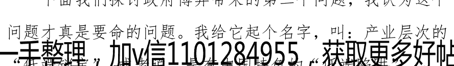

等待中
作者：奉行核外交政策 日期:2011-10-25 20:15

@卖燃 2011-10-25 19:54:27

跟上，真不知道有没有个头吗，要消化不了了。

还有十万字就结稿了。《月子2》——白云
呵哈哈呵。

尽快。
已写了两个月。
身体累了没有关系，睡觉好了。

如果心累了，就写不下去了。

平时很懒，好不容易有状态，尽可能在心疲之前，结束此稿。

算是给自己一个挑战吧。

作者：奉行核平外交政策 日期：2011-10-25 23:21

（155）一盆螃蟹

有人曾跟我讲，用脸盆装螃蟹，如果只有一只，它很容易爬起来，如果有很多只，倒不容易爬上来的了。因为那么多蟹腿聚在一起，缠在一起，若有爬上来的，别的蟹会把它托拉下去。他们又不可能一起爬起来，所以只有一只一起呆在盆里。

我是一个很有科学精神的人。有一年中，买了二十多一只螃蟹，我加了一盆水，结果它们全都爬起来。小盆子里，螃蟹都能爬起来；装在大盆子里，螃蟹多少都能爬起来。可能尺寸不对吧。不管怎么，把这个故事当作寓言听，还是挺没错的。

（此处为逻辑恢复）

有人曾跟我讲，用脸盆装螃蟹，如果只有一只，它很容易爬起来，如果有很多只，倒不容易爬上来的了。因为那么多蟹腿聚在一起，缠在一起，若有爬上来的，别的蟹会把它托拉下去。他们又不可能一起爬起来，所以只有一只一起呆在盆里。

我是一个很有科学精神的人。有一年中，买了二十多一只螃蟹，我加了一盆水，结果它们全都爬起来。小盆子里，螃蟹都能爬起来；装在大盆子里，螃蟹多少都能爬起来。可能尺寸不对吧。不管怎么，把这个故事当作寓言听，还是挺没错的。

（下文为OCR识别内容的纠正与合并）

三十年来，中国是全球投资最多的国家。如此，相对于一个960平方公里的人口，仍然太少了。为了争夺投资，各地政府尽了办法，各种：
- 税收优惠
- 市场准入
- 能源供应
- 基础设施配套
- 土地补贴
- 工业园区
- 优惠价
- 优惠住房

而工业用地能够每年为当地创造税收、就业和消费。所以便宜可以理解，但问题是由于各地竞争，价格实在太低了！政府有多少钱呢？特别是中部和西部地区，离了中央转移资金，工资都不出。但是他们最怕掉进恶性循环：越穷，越不出优惠，越招商，越穷。这个担心心里有理。于是地方政府就咬着牙给人家优惠。但是，这需要钱呀，“天降、非地出”，从哪儿来？羊毛种在驴身上，打老实的主意，尽可能低征地补偿款打个白条。2003年我亲眼过的，某县工业开发征地，安置房没钱，然后一直招不到商，开发区外搭窝户。这麻烦了。

还有麻烦，就是社会保障、劳工安全和环境污染三大问题。这些方面，八十年代已有规定，九十年代法规基本健全。各省也有配套办法，就是执行不到位。你治理，别的地区正好抓住这个重要商机，承诺宽松条件，把企业吸引了。结果，全国污染依旧。你保护者权益，强制企业给农民工上社保，有的地区企业跑了。所以，各地政府拉我，我拉你，全国一哄乱。

这种办法不能让企业跑。比前面这个例子，有的企业跑了，跑到了不给农民工上社保的地方，它的成本下来了。你不跑，成本高，来不及弘扬企业文化和社会良心，就在市场竞争中被淘汰掉了。所以，这个问题是有良心的因素，它主要不是良心能解决的问题，人在不由己。

从博弈的角度来看，各地政府的局部最优方案之和，不是整体最优方案。各地出于自身利益最大考虑，进行理智的、互动的、连续的博弈行为，最后聚在一起，形成了一个趋稳定的“纳什均衡”。这个状态，把中国很多产业的人工成本、土地成本、环境治理等锁定在一个很低的水平上。在一开始，对企业的发展、产品国际竞争力有好处，但越往后越错。用工、土地、环境等成本上不去，就不能形成产业升级的压力和动力。这是中国制造升级动力的一个很重要的原因（汇率和利率是另一个重要原因）。

在这种低端锁定的状态下，土地转让的财政负担巨大，农民工权益保障力，安全事故多发，环境污染引发……总之，进入千年以后，各地政府越来越难受，但难也要感着，谁也不敢先动，谁先谁先死。

要打破这个发展僵局，需要等待历史机遇。2002年以后，机遇来了。

## 二手整理，加v1101284955，获取更多好帖
作者：奉行核平外交政策 日期：2011-10-25 23:24

960平方公里，掉了一个万字，对不起，把中国变成新加坡了。
作者：奉行核平外交政策 日期：2011-10-25 23:29

“三税两免”三减免，对不起。
作者：奉行核平外交政策 日期：2011-10-26 13:01

（第156页）市场

这个“机遇”就是：2000年以后，中国入世，“中国制造”潮涌出，生产要素价格压力巨大，人民币升值，同时也是挑战。2008年金融危机，形势再度恶化。那么第二个世纪更为关键。中国崛起的成败，关键就要看这十年！

（此处为逻辑恢复）

这三十年的发展，政府发挥了主导作用，但是市场才是推动前进的最直接的力量。所以接下来探讨：市场化。

很久以前，我们经历过经济和市场两种体系。其实市场和计划是管理手段两个端：
- 79年以前：传统计划经济。
- 79年至92年：有市场的计划经济。
- 92年以后：有计划的市场经济。

用一句话概括：79年以前是计划经济，79年至92年是有市场的计划经济，92年以后是有计划的市场经济。没有任何问题。

说到80年代的市场化改革，绕不开陈云和“鸟笼经济”。陈云是中国经济制度的奠基人，在第一、第二代领袖群体都是核心成员之一，排在林邓前后，可见其地位。1982年，他在全国讨论中，把计划和市场的关系比喻鸟和笼的关系。他的思想是：坚持计划指导，逐步扩大市场调节，既适应和促进生产力，又防止资本主义那种经济危机和越来越大风险。

鸟笼经济在思想出发点，更重地强调了市场自发调节的危险性，强调用“笼”，即行政干预和法律监管来克服市场自发的缺陷。哎，写到这里，我突然觉得，这个思想对于目前美国经济很有启发，有现实针对性，对比奥巴马和希拉里。

我认为鸟笼理论是一种保守思想，我不是这样的。虽然后来确实有某些人利用这个理论来反对改革，但是从当年陈云提出这个思想的出发点来说，是的，高层领导从不同角度提出独立见解，对于中国发展和防止出现偏差是有利的。实际上，只要人们实事求是，而不是死守教条，按照鸟笼理论还会走到今天这条路上。因为你只要实事求，就会在实践中发现，有必要给更多的自由，而且超过了一定的，形态就会发生变化，这时你会发现，有市场的计划经济变成有计划的市场经济了。

卢许：人应该是自由的，却不在牢笼之中。如果我们从更大的视角来看，即使把鸟归于山林，它仍然飞不到月球和火星上去。若以天地为樊，则它仍在笼中。中国古代人总把小木盒视为归宿。人死了如果曝于野，被认为是是最惨的事情。但庄子不觉得。他老人家的指出：这个葬礼好啊，苍天地当棺，日月星辰当球质，人间万物当随葬，你还缺个？

呵呵，扯远了。我东拉西此神游，说古论今，犹如涟漪。其实这个论调如果放到三十年前，估计立即被定为“阶级斗争调和论”，我肯定会惨，不是阴谋家就是投降派。

（此处为逻辑恢复）

双轨制从八十年代初到九十年代中期，中国对许多商品实行双轨制。具体做法就是：原来全是计划，现在慢慢减少计划。计划之外，生产出来的货，自己拿到市场上去。由于当时短缺，东西非常好。私营经济刚刚起步，这些企业和作坊非常缺乏原材料，愿意花高价买。这样就出了漏子，一些有权的人可以计划用来调剂，想办法倒卖，发其财。主要是原材料和能源，这个问题尤为严重。九十年代的“双轨制”第一批胜利者靠权力而暴富，内部结构区分，人们称之为“官倒”。双轨制本身是一个必然滋生腐败的体制，这不是思想的问题。所以只要条件允许，必须尽可能消灭双轨。到九十年代中期，双轨制宣告结束，绝大多数商品进入市场。这些年来，双轨制总要找机会魂不散，卷土重来。比起市场“大非小禁”，就属于价格并轨，很多投资者损害很大。所以人们一提到双轨，就恨得牙痒痒。

但平心而论，在社会主义国家，中国的价格转轨算是社会成本最低的。也算是最稳妥、最成功的。双轨制是一个理论上的最优解，却是可行的办法。俄罗斯等国家没有使用双轨，一夜之间物价直接开放，通货膨胀几十倍百倍，人民的存款财富瞬成了废纸，一夜回到解放。而且他们的实践证明，这种休克疗法的改革名义上是长痛短痛，实际上并没有达到抑制腐败的效果。双轨滋生腐败，是不法官员利用制度的漏洞进行贪婪的行为；而休克法滋生腐坏，是不法官员根本没有制度的空白大撒妄斧行为。所以，我对双轨制积极肯定，我认为它是渐进式改革转型过程中的必然选择。

中央很清楚地看到了双轨制的病疮。所以1988年在北京决策后，不能长期搞双轨制纵容腐败，决定大推进改革，进行“价格闯关”。此消息一出，全国人心恐慌，银行挤兑，市场经理加紧办理。在这一次宣告失败的。失败的原因，在于操之过急。后期执行，用了五年时间，慢慢就过去了。

我的脑袋不是电脑，肯定不知道数字。为了对得起这些兄弟，百度经历了一次：从1978年到1993年间，中国由市场计价收购的农产品……


老子想学汉语！

后来，我来到南方工作，有十年没听到蓝翔技校的广告炸轰，我还以为早已已经在市场竞争中哑掉了。没想到，有一上眼上看，美国《纽约时报》点名，指控中国人民共和国的蓝翔技工学校，对谷歌等三十多家美国网站发动了黑客攻击。我惊叫起来，这个破学校什么时候变得这么有钱了？！于是我登录他们的网站一看，不到 20 年，这个民营学校已经扩大到八大专业、六十多个工种，高级技术职业培训规模很猛。听了校长（叫什么蓝翔的）严厉指出：我们很纯洁，美国纯属污染源。

这个学校只是一例。八十年代和九十年代，国内市场上一个经理，飞速猛进。通过大浪淘沙，能胜出幸运的中国企业，竞争力那是相当强大。好像一百只狼被关在一个屋子里，任其竞争生灭。十年以后，屋门一开，只剩下下一只狼，其余的狼剩一块骨头都没有剩下了，你说这狼要是卖出就恐怕不怕了。

比如彩电厂，一台三十几尺寸的大彩电，他从出厂里能赚几十块钱，还敢去发动价格战。中国市场出来的这种企业，走到世界市场上，平庸，人屠杀人，佛当屠杀佛。

由于中国的私有企业、乡镇企业属于无到有，国有企业进入市场后从头学起，相当于二次创业，所以，中国企业在创造历史的同时，也把资本主义两百年积累的毛病都抓紧时间犯了一遍。


来一起回忆一下十年来中国市场上发生的悲喜事儿吧。

待续

作者：奉行柯外交政策 日期:2011-10-27 17:03

(159) 聊聊白酒

中国八十年代启动市场化，1992年后完成了并轨，90% 行业走向市场化。但并不彻底的，有些行业，直到现在也没有实现或者没有完全实现市场化。（虽然其中也有一定道理）。

前提到我按市场化行业、非市场化行业两种情况来探讨，来我加微信1101284955，获取更多好帖。

继续，说第一情况。

市场化的行业很多，逐一说，说不完，也说，专业性并不好。介绍几个我熟悉而且有代表性的吧。其实，一个行业只要进入完全竞争的市场，发展的轨迹都差不多。先说这十年的中国酒业吧。我很喜欢喝酒，对酒尤其关注。国庆节回国发现茅台、五粮液和青花酿又涨价了，令人蛋疼啊。

酒业分为白酒、啤酒、葡萄酒三大市场，其他的黄酒、果酒之类占比例是很小的。碘酒就不算了。白酒和啤酒两大市场，基本演够了一场资本主义经济发展的全过程。他们都从完全竞争市场起步，白酒目前已经发展到垄断竞争阶段，啤酒更快，又从垄断竞争阶段发展到寡头阶段了。而红酒市场，则上演了一场外国专业协会势力牵头，打开中国市场的典型案例。

由于酒水这个产业，进入的门槛很低，而收益在轻工业行业属于相当高的，仅次于烟草。所以，在计划经济年代，各地就建立了很多小酒厂，八十年代以后，更是国有、集体、乡镇、个人私坊而崛起。酒厂多到什么程度呢？八十年代，有媒体报道，四川乐宜地区有两千家酒厂。还有媒体报道，山东阳谷，就是武村这里有酒打磨的那个县，有70多家酒厂。

当时我真的不敢相信，尤其其乐宜地区那个天文数字，是个县级市，属成都都管，古代吕临审、司马相和韩文君在这里投资办过酒厂，所以一直盛产白酒。当时，一个县令在大会上介绍道：经过关东停整，全市酒厂大幅减少，前几天只剩下不到240家。我靠！这还叫少吗？

姚咏旁边的崇州、大邑也盛产白酒，共同构成一个产酒区，当时共有五六百家，山东泰池的原酒就是从这里拉走的山东东瓦。这个产酒区很贫穷了，可是，它在四川根本排不上号！大兴（水井坊）、五粮液、剑南愁、辉牌（含得）、泸州老窖（1573）、廊酒、川州酒头部，一个也没有在这里！四川和贵州共同组成西南名酒区，与苏皖豫的淮酒区、东酒区、晋酒区对峙。


你可以想想，当时中国白酒厂有多少厂家！

正是由于这个原因，企业又多又小，有的根本就是一个作坊，连个专业工人都没有，农民业余时间酿酿。所以根本没有好的办法监管，各地只有采取取消定额税，也就是国家禁止的包销。许多大酒厂气得不行，说公平，又没有办法。一些小酒厂通过次整并，这些问题需要市场和发展到一个更高的阶段。目前已经数据，中国白酒协会每年报告，感兴趣的兄弟快来查阅。

白酒的市场竞争只能用“惨烈无比”来形容。这个词俗，想要整理。一个经营酒厂，结果八个酒厂占了地区，八个酒厂晚晚宣布了国际奖。当时称为四大天王，由于酒税对地方很重要，有的地区要求地方，中央，四大班领军人，制造出不少白酒。后来，酒厂相互兼并，有的直接死掉。

| 四大天王 | 茅台、五粮液、泸州老窖、汾酒 |
|---|---|---|
| 四大天王 | 茅台、五粮液、泸州老窖、汾酒、山东曲台 |
| 四大天王 | 茅台、五粮液、泸州老窖、汾酒、山西古井 |
| 四大天王 | 茅台、五粮液、泸州老窖、汾酒、河南贵州 |
| 四大天王 | 茅台、五粮液、泸州老窖、汾酒、安徽古州酒 |
| 四大天王 | 茅台、五粮液、泸州老窖、汾酒、江苏洋河 |
| 四大天王 | 茅台、五粮液、泸州老窖、汾酒、山东双沟 |
| 四大天王 | 茅台、五粮液、泸州老窖、汾酒、四川五粮 |

*(注：此处OCR识别存在严重混乱，已根据语义及白酒行业常识重构)*

九十年代基本形成了东有青尊、西有蓝剑、南有珠江、北有燕京、关外还有哈尔滨这么一个格局。2000年前，港资华润集团突然杀入酒市场，一举拿下了沈阳雪花，接着就以资本运作的形式，通过收购，在全国各地扩张。这个原本不沾酒的企业，没几年进了中国前三，连四川蓝剑都被拿捏了。华润让中国企业家大开眼界，启发范围还不止啤酒，原来生意可以这么做。

哎呀，写了这么多，可能已经兄弟们认定，我一定是国内某个名酒厂派的销售代表吧。呵呵，其实原因是我一直关注酿酒，两次真差点去做生意了，不过没有，到现在还是门外汉。

待续

作者：奉行柯外交政策 日期:2011-10-27 17:08

2000年前，港资华润集团突然进入酒类市场，一举拿下了沈阳雪花。

作者：奉行柯外交政策 日期:2011-10-27 22:33

(第160次) 红酒之时

前几年，我不幸沦“三高”人员，所以现在转行以啤酒和红酒为主了。偶尔一高兴，一时冲动，也可以整半斤白的。看来虽是闭关，成功还是还是。酒这个东西不是生活必需品，不喝酒不会死。但是，在塔比伦班的统治区，偷喝酒发现会被死。世界各地的人在古代彼此隔离的情况下，竟然独立地研发出了酒。这说明这个东西很不一般。它是一种文化图腾。我有继续继续下去，也有必要多写个帖子。

白酒是中国国粹，与威士忌、伏特加并肩三大蒸馏酒。白酒在中国拥有稳固的群众基础，已经几千年历史了。群众基础雄厚，从它手中夺取市场是一件困难的事。八十年代，中国葡萄酒市场始终发展不好。年纪稍大的兄弟们回一下，当时只有几个人尝这个？但是九十年代后，短十年间，这种毫无群众基础的舶来品，竟成了国人日常生活的一部分。红酒市场是怎么打开的呢？

在九十年代，有这样几个社会舆。（我不知道八十年代，但九十年代我注意到了。）大家一起看看：

第一个观点是：白酒浪费粮食。专家、学者、官员在讲，电视、报纸、杂志在说，一切仿佛白酒是中国民众的一大糟。白酒生产需要大量小麦和米。中国历史上缺粮，计划经济年代有口号确实存在。但是八十年代以后，中国粮食供大于求，特别是高粱类的杂粮，附加值低，许多农民不再种植。然而有一部分农民运不好，土地位于山区，水土条件只有种高粱之类的杂粮。大酒厂大酒厂的原料采购，为他们提供了稳定。


生活的来源。从这个角度看，白酒将低附加值的农产品转化为附加值商品，算是不错的。很多企业说一遍，就算是遇到粮食危机，白酒可以立刻停产，酒厂仓库，只要进窖都可以出来。红酒呢？红酒用的葡萄不是一般的葡萄，兄弟们都知道，开辟葡萄地需要长时间。白酒糟粮杂地，对粮食安全的影响大得多。但是这些问题，专家竟然避而不谈！许多地方领导，视察农村，对农民说你可以在房前后多种葡萄，还可以酿酒。

第二个观点却是：红酒是有益健康的。比如红酒能软化血管，降血压，降血脂，防癌，预防心血管疾病。连我老婆都在给我买红酒。是一家著名的白酒企业的技术，很认真地跟我讲过，红酒这些功效都是国内媒体和专家吹出来的。功能，国外没有鉴别能力，懂行的兄弟评论一下。

第三个论却是，九十年代至今，许多地方领导和人在公开场合宣扬红酒。前几年，国内几家白酒企业参加经济活动，他们在场上展示了红酒。我们的领导们，胸怀宽广，把红酒吹上了天，对延续千年的民族白酒是不理解。酒精度不高，喝起来很像传说中的席。酒液，就是二锅头。外国官员看来，保护好本地支柱产业，不惜放下脸来得罪中国客人。

红酒很快组织组织。外国企业协会力量强大，拥有大量经费。为了开拓中国市场，经常出钱组织活动，由邀请中国这些人，包括行业主管部门的人、专家、教授、记者等等。在面上搞经营交流，实际上就是影响人、渗透人、拉拽、培养代言人。


酿酒是一个简单的事。想问：现在很多酒厂是当地政府扶持的农业产业化龙头企业，但有多少酒企业享受了这份待遇呢？前面提到的那个白酒企业高管们，周围。目前这些现象背后很可能有一个严密的、长期的、整体性的市场开拓计划在支撑，不然会有这么多人分别从不同角度、领域来敲击。我也认为这些年的红酒与其肯定是背后有推手的。但是，这个推手是谁呢？是受益者。一种看法是，国内红酒企业所为。理由是他们受益者。目前张裕、长城和王朝三大厂商，占据了国内红酒市场的一半以上份额。另一种看法，是外国红酒协会组织和中国商人所为。理由是他们也是受益。2000年来，中国一直是国际最大的红酒进口市场，中国市场增长了十倍左右。外国势力的目标是控制中国高端红酒市场，目前这个目标基本达到了。特别是像拉菲之类的红酒，近几年一直在中国市场上畅赚。我不知道真相，在此存疑，有了解的兄弟发个言。我的观点是：1，必须采取措施保护白酒产业。这是中国文化的一部分。波尔多承载的法国红酒文化世界闻名，中国要成为文化大国，不能任白酒被随意打压和抹黑。2，外国红酒成功开拓中国市场，靠的是行业协会，我们必须发挥行业协会的作用。与中国酒业不同，外国酒业是一个提供个性化行业参与国际竞争靠靠协会力量。外国企业协会力量强大，拥有大量经费。为了开拓中国市场，经常出钱组织活动，由邀请中国这些人，包括行业主管部门的人、专家、教授、记者等等。在面上搞经营交流，实际上就是影响人、渗透人、拉拽、培养代言人。

中国许多行业比国外更碎片化，比如浙江大量的小商品企业，更需要协会来整体运作，走向国际。但是中国的行业协会水平太差了一点（我分析过他们的差距：泛行政化），还没有充分发挥为企业开路和服务的作用。协会的缺位，不仅使中国企业形成合力，而且产生了许多相互作用。


以前，中国企业比以往需要团队协作、整体规划。这二十年的白酒，还有这二十年前的时代。这种命名方式，可能是受到了法国路易类的影响。近年来，白酒企业也推出了像“1573”这样的名酒。但白酒作为中国文化独特的一部分，应该保留自己的民族特色。

奉行柯外交政策的。

(161) 烟花满天

几个让兄弟们推荐的书。其实每个人都不一样。同样的书，我不喜欢，看不下去，所以没办法推荐。只有多见见闻，才能找到胃口。听听别人的经济术语来说，胡乱聊聊三十年来市场竞争中，哑掉了。

改革开放之后，中国人发现自己的产品与外国比，技术水平差太了，令人自惭。当时谁家里要是有一台电器，那就不了。白酒需要人才、设备、技术、投资，甚至还需要时间。八十年代，有一个有趣的行业异军突起，那就是保健行业。这个行业很快，扩张的白酒。


八十年代到九十年代，中国在草根创业之后，必然地迎来了这样一个莽英雄的时代。酒。从八十年代到九十年代后期，全国估计没有五千家。著名的产品很多，比如马家军中华精寰，横跨市场的三支服液，广东巨人、西安脑黄金等等。有的产品是发明人一手出来的，有的是自己研制的。有的产品是靠皇帝、易经出来的。有的产品是现代科技出来的。有的产品是根据十八代祖传秘方出来的。共同点是：一、研发发。二、研发投入大。三、广告效果神奇。四、九十年代，中国人还经常做一些“形而上”的思考。不像咱们当今一代，现实得不得，现实得听不懂的冷话，现实主义实现就达不到“主义”的高度了。

三株创始人姓吴，此人很有抱负。也不知道怎么明白了这个好东西。为了把好东西卖出去，他的市场工作可谓疯狂。高峰时期，营销人员几万名。人员编制是军、师、旅、团、营。每次市场行动都称为战役，而且有军事称号。吴很有思想，平时说话汇成选集三卷。标准照前面还有半透明的纸，上看去脸胀耳朵的我正好路过济南，被同学邀去听他的报告，会一人获一套选集。我翻了两次，就直接拿去查桶了，并预判了这个企业的结局。倒闭后，老吴报怨，一个刺头消费者击了三株，全国媒体跟着进行不实报道，此企业倒了。这纯属胡说。毁掉一个商业帝国成了案例。其实，三株的管理和产品决定了它必然垮台，与一起偶然的消费纠纷有什么关系？没事儿它一样垮台。八十年代到九十年代，中国在草根创业之后，必然地迎来了这样一个莽英雄的时代。红极一时的行业、人物、企业、产品，非常之多。篇幅有限，我不再一一列举了。中国英雄无出处，但质量不高的英雄，保质期也不长。凡过期的英雄，都会被中国人断然抛弃，史上无一例外。八十年代和九十年代，中国的发展阶段的客观历史条件，决定了这些英雄们的命运，与其说是产品的成功，不如说是市场的成功，与其说是产品的失败，不如说是市场的失败。而且绝大部分的失败具有必然性。当时中国企业的主体，是以小、多、散、乱、短、活等为特点的中小企业，很快消失。许多名企业风云两年后，归于沉寂。只有少数企业，由于历史机缘和领导者的超前眼光，逐步发展成为经济核心活力。回首那个年代的企业，犹如满天烟花，虽然绚丽但转瞬即逝。繁华落尽。


这里建了钢铁重工，职工男的居多，个人问题长期解决不了了。后来上级领导亲切关怀阶级，就安排投资又建了棉纺厂，从农村陆续招了几千女工进城，城里算是阴平和衡了。

问题是，方圆千里不出棉花，要从关内用火车拉，成本很高。这种企业能不垮呢？

许多国企活不起来，产业结构调整本身决定的，这也与企业改革不改革没有关系，只要搞抓市场经济，就注定要完。比起，改革前，我家的乡每个镇都有自己的汽水品牌。

我时候的汽水就是本县罐出厂的。现在呢，全国你走到哪里，饮料都是有那几个品牌。自主品牌全覆盖了。

只有可乐、百事、百事白、康师傅、统一一名字等几个瓶子。这一周整理加微信1101124855获取更多帖子

绝大多数企业肯定定要淘汰兼并，这跟它是国企还是私企没关系。顺便说一句，这个行业的国内本土品牌死得有点可惜，连连宝都没有幸运。合资的王老吉算不算中国品牌？

除上述这些情况外，剩余的国企可不可能在竞争领域活下来？理论上，可实际上很难。

九十年代，国企股份制改造中，有的企业还机会持股股份和经营者持大股，国有都退出了。如果从建立现代企业制度的角度来看，到此这一步，应该是没有毛病了。

深层次的问题在于，只要企业不死，职工在心理上国企观念怎么也灭不死。这支队伍还是国企老派。能上下、能进能办不到，让谁下、谁出、谁跟老去拼命。

专家说，触动产权才能真正转变观念。实际上，当时，我很绝望地发现，中国的大多数国企然触动产权却没转了观念。客观上现代企业制度建立了，但主观上这个制度在人们心中没有建立起来，在人们想法上怎么建也不起来。所以，也许命中注定，有此一劫，国非真死一回，让观念跟者企业一起淫湿。这真不是办法办事的。

实践是，竞争性领域的国企，少数中央企业维持下来，绝大多数企业在市场中灰飞烟灭。七十年代，大家说抓革命n促生产，阶级斗争争取就灭。八十年代，大家说一跑就灭。后再后，有人说难就灭。九十年代以后，搞股份制改革，添加微信v1101028955，获取更多福利，倒也不人再提一就灭，灵灵只有有鬼才知道。

最苦的是国企职工，尤其是“4050”人员。当年，刘晓在电视上高唱着“心中若在，梦就能，大了不是从头再来！”唱容易容易，求生不易。对于数百万的下工人来说，上有老，下有小，年龄又大，知识又低，重头再，该何容易？由于我妈也是其中一员，我家也算是下岗家庭（当时她叫提前内退），所以我有过许多切身体会。俱从矣，往事不再说了。这批人与农民一起走，成为中国改革最最重要的承担者和执醒者。但经历历史记住他们！

对待

作者:奉行横内核外交政策 日期:2011-10-28 14:16

## （第 163）垄断是非

近三十年来，有一些行业在社会上争议很大，就是垄断性行业和半垄断性行业。比如银行、电信、铁路、航空、电力、石油、烟草、汽车等。有说是的，有说非的，论者如云，长瞒累膝，足够挣二十年的，我惯得转运了。八十年代和九十年代，这些行业利用垄断地位，汲取社会资源，取得了突飞猛进发展。八十年代它们还还不明显，九十年代它们开始夺优势，和其它行业遭遇待遇水平差距迅速拉开，炙手可及，人人皆向往之。十年前，我的一个同学，大学毕业分配到移动转移我省份。此时移动正在海外上市，公共手不能了。结果是他兄弟毕业后半年，在工资以外就发了十多万，名目连他自己都搞不清，他妈的太幸福了。考虑到当时正值国企改革攻坚，许多的职工连软饭都吃不起，这种垄断产生的社会不平等的是让人无语。

2001 年中国入世，这些行业有什么影响呢？我观察，分三种情况：

- 1、某些行业具有天然垄断性，比如电网、电信、铁路等，加入世时的限制条款，没有受到多少冲击。铁路现在还想想去冲击别国。
- 2、有些行业利用先发优势，再加上入世以后的几年护期，拼命布局，不给国外对方留下空间。比如银业，四大银行及其其它银行的布点，密集到不可理喻，有人说，现在你现在街上随手砸开一家门面，不是产中介就是银行。又比如中石油和石化，争抢着疯狂布局，不惜血本外收购加油站。这两年亮牌公司的加油站进击军国，只有到城市外环路再往外二十里的荒芜去布局。
- 3、有些行业在入世之前，已经与外国合资，共享中国市场。

有些行业在入世之前，已经与外国合资，共享中国市场。这些企业是争议最大的，大有新一代买商人之嫌，突出代表行业，就是汽车。我重点联合合资企业。

合资这件事情，本身没有问题。中国企业与外国合资建一手整理，加微信 1101284955 获取更多好帖有之的。老外来我们合资，目的就是挣钱，挣钱途径无非两个，1、利用中国动力便宜，产品出口到中国之外；2、看好中国市场，在中国生产。

这两种方式，我们都可以接受，关键是我们实现就业、得到发展即可。比如，海尔公司以前不叫海尔，叫青岛冰箱厂，商标是琴岛。琴岛是一个岛的名字，在青岛港外，岛上有一个灯塔，清凉夏夜，柔软的光随着海风浪花缓慢飘荡，就是名景“琴岛漂灯”。所以冰箱琴岛。后来他们跟欧洲跨国公司利波海尔集团合资，引进冰箱生产技术。产品就叫“琴岛一利波海尔”。当时，这种用一个破折号把中外两个标识连起来的合资品牌，相当时髦，比如“新飞—伊莱克斯”。

意大利阿里利顿冰箱生产线被引入了七八条，所以很多冰箱叫做“某某某—阿里利顿”，好像是同伙似的，其实竞争得得你死我活。

扯远了。我说这话的意思是，为什么同样的合资，冰箱行业没有争议而汽车行业竞争又那么大呢？区别在于，冰箱行业是开放的竞争性行业，而汽车行业通过行业主管部门的手段（比如产品目录），长期打压竞争对手的生存空间，在半断生命力的保护下，伙同老外国人的钱。由于行业管理的打压，民族汽车品牌起步了十年后，今天都没有赶上。

# 一手整理冰箱加微信1101284955 获取更多好帖

待续

作者：奉行核和平外交政策 日期：2011-10-28 18:41

(第164页) 车轮滚滚

八十年代以来，冰箱行业国内市场竞争，企业进步神速。中国企业在经过学习后，很快就把商标破译后那个老外给跑了，独立开发新产品，有的还向国外出口。

例如，“碧岛—利海尔”冰箱，几年不到，全国大卖，被消费者习惯简化为利海尔，他们就把利海尔注册为商标。原来那家外国公司利海尔集团，这些年没有看到关于他冰箱业务的任何介绍了了，估计已经不做冰箱了，继续从事他的优势行业掘机去了。在此，本人要向张瑞敏先生致敬。民族英雄啊！

冰箱行业这种发展，体现了改革开放的设计初衷。如果每个行业都能这样，我们的改革开放就就像北京奥运会一样一样完美了。

有些行业很惨痛，但社会争议并不大，成功就有失败。比如胶卷行业和录相机行业。这些行业的主要问题是，是中国人对于市场趋势判断不，没预见到新技术引发的商品替代，就太快。

拿胶卷来说，当时，全球胶卷的企业，也不过柯达、富士，好像还有柯尼卡，几家而已。中国一下子引入几条简单的工艺。广告，叫祝福，好像在福建。当时老外很惊讶：中国人要是决心称霸，要么就是疯了。其实我们不准称霸天下，也没有失败，只是没经验。后来，全军覆没，死的剩下寥寥，大老魁，巨额亏损负重伤，像是桃花岛的柯达噩梦。柯达期间奥苏联援建56个项目之一，共和国长子。国务院无可奈何，批准柯达参股。柯达经历艰苦谈判，虽然保住了品牌，但丢失了市场。有人评价，柯达的三国演义，柯达这次参股奠定大局，柯达胜利。

汽车行业则不同，复杂到什么程度？复杂。所以，比起冰箱业和胶卷业，汽车业最值得思考。八十年代到九十年代，汽车业至少存在三个情况：

- 1、中国整车厂数量，规模小。
- 2、汽车政策有问题，由于政策没有开放，条条框框，民间力量搞困难。
- 3、上汽、一汽、二汽等辈竞争相当与国外合资企业，产品都是中国的市场。

所以，每个地方都有几家工厂，一家一年只有几百辆，在市场上做起来肯定没有。由于地区分割，很多企业都在中巴、工程、特种汽车、农用汽车等等，效益也不错。

许多国人看来，大合资企业的中方，基本就是买办汉流。我们要探讨一下，汽车算不算汉。首先要弄清楚什么是汉。但是，我们不幸，中国这几年，基本定义模糊了。

兄弟们不要以为中国以前缺汽车，而是太大了。一手整理加微信v104955 获取更多好帖

作者：奉行核和平政策 日期：2011-10-28 12:17

2007年我决定买汽车，因为受到一个官员的影响，这个人局级干部，在中央委任。名字我忘了。我在北京听过他的演讲。他是现行汽车产业的击斥者，有机会让汽车品牌提升。很多年，我决定买自主品牌。每天，在北京四环路上，日系、美系的车流，我孤独地开着奇瑞上班。我以前过奇瑞，但是汽车车多。我决定买奇瑞，本人没有手动挡，奇瑞自动挡。

开了几年，我逐渐发现，一辆刚上市的红旗奔驰，可能是一汽流水线生产的，发动机、变速箱和底盘全是马达。红旗标志，里面零件还印着马达，零件上的外国商标。麻烦吗？自主研发的部分，大概就是车壳了。开了几年，人和对奇瑞也有感情，我很有满意，发动机性能好，速度很快，车也很稳当。缺点是三个：按钮接触不良，不修也不行。雨刮器质量差，撕心裂肺，雨刮干净。后来一汽估计是换汽太多，免费雨刮，质量还是不行。眼镜盒的盖掉了，遮阳板上的盖也掉了，我很懒去修。总之，除一汽研发的车辆以外，其他东西都挺好。

三十年来，中国汽车产业有两个神话。一个神话是，造汽车这件事，相当难。有个老总说了，中国汽车要几百万的规模。还有，中国汽车要耐住寂寞十年！

另一个神话是，有那么一小撮中国人，耐不住二十年寂寞，决定提前搞几辆汽车。在芜湖，李同耀带着等人，包括一汽合资后被老外安排退休技术员，以及同样命运的二汽的技术员，自主设计出了风云汽车，连动机都是自主产权。当时，奇瑞连国回家的准证都没有，被迫向外汽让股份，以在中国生存下去的权力。

在深圳，李书福为造汽车，为了汽车。

三十年来，中国汽车有两个神话。奇怪的是，对于中国人比登天都难的事情，韩国人好像不像。五十年代中国长春制造第一辆汽车。十年后韩国制造第一辆汽车，据说还是组装的，水准不如中国。然而2000年，棒子们却以汽车强国身份来到中国，现代与北汽合资。在当地支持下，现代伊兰一度称北京租车市场。我不知道人在几百万的基础上开始自研发的。可惜，中国汽车并没有得到他人的尊重。日本一个老总说在中国，中国合作伙伴的贡献为零，中国合作伙伴确实没有什么技术贡献。对不起的一半，是中国合作伙伴没有技术贡献，也有外国公司的黑手在里面。因为要合作，外老就垄断技术。中国的技术团队被各种名目瓦解。合资以后，中国汽车企业的技术能力提高了，然而不如从前了。所以，这个日本人没有城府，太笨。他应该说，中国合作伙伴的技术力量相当强，进步相当快，中国一天一定是明天汽车业的领导者。这才是有策略对付。

说白了，跨国公司进入中国市场，需要得到中国行业主管部门的同意。中国则要求，进入条件是必须与中国企合作才行，挣了钱对半分，不然不许进来。所以在外国汽车商人眼里，中国那几个所谓的汽车巨头们，不过是上面派来保护费的小马仔们而已。


钱的。小米也说过，不怕人家挣钱，不挣钱谁来？三十年了，我们是不是该总结一下，这么多跨国公司进入中国，中国收益几何？付出我们确实需要一个更长远的、更全面的战略考量。我觉得我们现在缺乏这种考量，对于眼前事情的处理就容易短期化和情绪化。

坦率，我自己也没有完全想清楚。这个问题，我没有结论。兄弟们一起思考吧。我觉得，中国应该做到这样一种境界：跨国公司贪婪地坐在中国手里数着钞票，中国贪婪地数着手里的跨国公司。

持续

作者：奉行核外交政策 日期:2011-10-29 13:01

## 一手整理，加微信 1101284955，获取更多帖

作者：奉行核外交政策 日期:2011-10-29 14:00

（第167）善假于物

以前听广播播书，记得书中提到：某某高手怎么去打擂，只见擂台高九丈，他一跃离开三丈，然后右脚尖一踩左脚面，又跳三丈，然后左脚尖一踩右脚面，再跳三丈，就蹦上去。现在回想起来，我觉得这么三六级跳实在太麻烦了，抓着头发把自己搬上去岂不更省事儿呢？

呵呵，说几个笑话。前面有几个兄弟说“中国贪婪地坐在手里的跨国公司”这句话。关于这一句，有必要补充几句。显然，一个国家，尤其是经济技术处于落后的国家，要发展，前进，不借助环境、不借助外力是不行的。荀子说：君子非异也，善善于物也。中国曾努力成为前面的武林高手，后来发现行不通，转而在苦修内力的同时，广泛借力于国际，做一个“善于物”的君子。

我认为，改革之初，中国高层是把这个问题想清楚了的。提出的“改革开放”四个字，为“两个基本点”之一。这四个字本身包含玄机，就是它突出强调了开放的重要性。什么是开放？开放不是改革以前那些不够开放的法规和政策，与改革以前那些保守观念。开放也是改革的一个方面的内容，改革两个字应该已经涵盖了开放。

既然如此，还要把“开放”特别提出，与改革并列。中国开始借力的，只是一些小力，以港台华侨为主的劳动密集型产业投资。比起地产厂、服装鞋帽厂。九十年代，跨国公司进入中国。由于经验不足，一些政策在某些偏差，由于比不上大众差距，几乎是救了大民众。而我们的价码，现在看来太高了。在行政保护下，一辆普通轿车在国内卖将近三十万，按实际购买价折算成，估计超过一百万了，实在有点变态。仅如此，九十年代中国借力范围大大拓展，从港台日韩扩展到了欧美经济。2001年加入世贸，使中国真正能够借力，全面利用世界的资源和市场发展自己。


由于中国崛起的这件事太大了，所以不是一般性的借力。许多跨国公司依靠智囊公司，整体谋划，到中国整合产业链。一个专家提到，跨国公司在整合过程中，“你站在桥上看风景，你站在楼上看风景”，视角也会不同。当然，这三十年来，面对经验丰富、比我们都强的跨国公司，我们的学习也相当不少，有些还没学会东西，或者学到了东西。总体而言，开放就是开启了！又赚了！

这里，还需要澄清一个认知，就是对对外型经济和内向型经济的认识。外向型经济，就是出口战略；内向型经济，也叫进口替代，就是尽可能通过国内生产来进口，发展自己的能力。由于亚洲小孩的成功，使得中国人甚至一些地区形成一个固定看法：外向型经济就是天经之路，而且唯一可行。其实这个观点是很面的。由于这种片面观点（至少大部分原因），形成了中国今天过度依赖出口的局面（约50%左右），而更重要的内需被长期忽视了。就好像前面那个武林高手，没有外部支撑，肯定搞不起来，但如果自己不行，给你支撑点，你也不去。近几年，中央不断调整政策，启动内需，就是在纠正内需倾向。

不过，内需启动一个较长的过程，需要创造条件才行。实际上，在人类历史中，无论是英、法、德等欧洲列强，还是美、苏，还是二战之前的日本，国家上极为强调进口替代。当时还没有世贸规则，各国都可以通过高关税、低配额之类的办法，保护本土企业。那么想要扩大出口怎么办？如果有条件，也可以用武力发动战争，迫使对方开放市场并降低关税。

按照西方经济学的教训，自由市场、按比较优势实现全球分工，那属于歪的。相反，亚洲“小龙”通过原料加工、成品出口、资本输入的经济模式，倒是历史发展的特例。所以放眼全球，在七十年代以后，美丽的国家很多，但真的依靠这种模式取得成功的，目前一个也没有。


找自己的路。像拉美各国尤其是悲惨的阿根廷，美苏德当年进口战略崛起时，他们搞自由贸易，失败了；小龙当年出口贸易崛起时，他们转而关门搞进口替代，又失败了。为什么呢？因为世界上任何一种策略，任何一种发展模式都没有绝对好坏，要视形势而定。诚如孙子法言：“兵无常势，水无常形，能因敌而胜，谓之神。”

作者：奉行核外交政策 日期:2011-10-29 15:15

（第168期）这也是一个影响巨大的领域。城市化不仅是一个经济问题，它还是一个政治问题、文化问题、社会问题。这里的兄弟们适度城市化，也有专家支持发展城镇，但我是一个坚定的城市化者，而且是大城市主义者。我会在下面谈我的观点，欢迎探讨。住在新加坡这个城市国家，正好把城市问题引起了思考。我对新加坡的认识，始于一部电视剧叫做《调色板》，多年前可能是最早引入中国的新加坡电视剧。我通过这个电视剧才吃惊发现，原来新加坡跟香港一样都是华人。原来男女学生毕业没结婚就可以睡在一起。至今还记得几句，开头一句：“城市生活中你失去了什么，拥有的是什么？”是啊，面对风起涌的城市化潮，咱们中国人失去了什么，拥有了什么呢？虽然中国人都能够正视城市化问题了，上海世博会主题就是“城市让生活更美好”，但是如果退十年，中国的决策层对城市化的看法有很多明确、有分歧的。改革开放三十年，中国城市化率提高了30个百分点，平均一年一个百分点。2010年1月，全国城镇人口接近50%。古老的农业中国，正站在进入城市社会的临界点。这一刻，过去春明此起彼伏。让我们一起回顾吧！中国一直都是农民国家，在社会居住形态上，以村型的居民聚为主，而且各地的城市化率是不一样的，不是有些人主观想象那种一直稳步提高。一般观点认为，宋代城市化水平最高，大约在20%到30%之间。有些学者认为南宋时期城市化率达到了50%。而清代中国城市化水平最低，大约在6%到8%之间。这里需要说明的是，由于明代后期玉米、红薯等高产作物引入，使中国土地的人口载量暴增，再加上咱们中国人对于生活条件的要求不高，所以清代前期到中期，中国出现一次人口大爆炸。中国秦汉以后历代大部分时间，人口都在5000万至1.5亿之间，而清代从1亿多人起步，这就从生啥养啥，到第一次鸦片战争时，人口已有4亿多了，几乎占了世界人口之一。

古代城市体系有三个突出的特点。第一个特点是稳定性。千年间，城市数量几乎没有显著变化。我觉得造成这个现象的主要原因，是中国在秦汉以后，实际上进入了一种稳定格局，就是大一统帝国——原子化国家。这种格局下，一方面，国家需要城市发挥职能，那么多；另一方面，国家需要城市发挥职能，那么多。比如秦汉时期有两千多个县，二战期间沿海是很乱，但总量没有大的变化，这是“原子化小农”。另一方面，城市里的兄弟们赖吃粮食。原子化小农生产，提供的商品是有限。


清朝四亿农民可以提供更多粮食。在生产力没有提高、国土没有大的扩张的情况下，城市越多，农民越多，提供的粮食越少。这决定了中国人口总规模。直到近代，古代城市体系的第二个特点，是中心规模巨大。汉长安、宋代开封、南宋杭州、元代大都、明清北京，都是世界最大的城市。人口过百万，欧洲最大的不过三万而已。这个现象的原因，不是因为中国喜欢城市，也不是因为政府制定了“统一帝国”，通过文官制度进行统治，而不是像其他地区一样，通过下面的封建领主进行。权力集中于首都和大行政区中心，这些城市承担职能，不如其他地区。

古代城市体系的第三个特点是，城市类型基本属于政治城市。世界其它地区，这种类型更鲜明。而且这个问题留到了今天。现代城市的功能都是综合型的。个人看习惯把城市分成政治型和经济型两个类：一、政治型城市，就是为了政治统一而兴，细分包括行政型城市（堪培拉、巴西亚）、宗教型城市（麦加）、军事型城市（关岛等）。

（第170）边域兴衰

从旧版地图上看，陶乐县的版图狭长，像一根煎面杖。在这儿，黄河流过青铜峡，滚滚北方，直奔河套。宁夏和内蒙古以黄河为界。东河是内蒙古，是美丽的鄂尔多斯高原。河西是宁夏，是盛产大米和枸的“塞上江南”银川平原。

但是，陶乐县很奇怪地位于黄河东，紧贴着黄河，切出了南北狭长一条。这个县的形成很有趣。原因是，黄河不是一条老实的县，河道滚浪来的。有一年（我没去证是哪的），黄河向西一道不要紧，把黄河西原属于宁夏的一片河滩堆到河东了。以前有一个陶县，1941年设立的，2003年被撤销，土地给了银川市。这个县在历史上存在了六多年。我对行政区划对城市的影响感兴趣，所以这些年来收集县以来的信息，包括新闻和帖子。通过这个，我们可以看到，当行政区划被撤销时，它作为政治城市（县城）的命运，以及这个城镇中的经济实体。中国这种例子还有很多。比以前云南省有的级市叫东川，后来铜矿采差差不多，直接撤销，变成县级单位。今年，安徽省的芜湖也被撤了，变成县级单位，但县级城市的城市前景可能会发生根本的变化。如果哪个兄弟对这种课题感兴趣，建议研究东川和芜湖的城市发展，可以写出许多城市经济和社会学论话！扯远了，我们回到陶乐县吧。


在乌不拉萨的穷山，年年饥救粮。后来政府修坝，淹了他们家，把人都搬到富得流油的城郊，房子修好，一家分几百亩（能救济出来他妈妈不容易），每家都安排一个非农业岗位。在外人看来，他们真是祖坟上冒烟，生产生活任何任何方面都比原来强百倍。但是，他们隔三差五上门来闹事事。理由由五花八门。比夏天太热。比不能上山去除草药。比一个孩子犯了罪。这跟搬迁还有有什么关系？他们认为大有关系，孩子在山里没有那么多诱惑，就不会违法，所以此事必须由政府负责。

我举一堆例子是想说，城市化这个东西，虽然肯定需要环境和外力去推动，但从根本上讲，是人的主观选择和自我核心，弄出不少问题。一方面，从八十年代转向工业岗位的农民，早已完成了从业方式的城市化，但二元结构使他们无法融入城市。另一方面，征地农民、工程移民“被城市化”，户口农转非的，长期找不到稳定工作，形成“中村”。

如果回一下外的城市发展史，各国情况不一样，千万别别比。我想，大概可以有两种代表性的农民进城命运。

一个是好的城市化。美国、日本等国家，这种例子就比较多。第一代农民进城工，成为企业员工。由于文化水平，肯定工资不高。政府在廉租住房、养老保险、子女教育等方面提供帮助。他的家庭进入城市，住在廉租社区里。房子很小，全家人挤在一起，生活水平不高，但享受到了城市的公共服务。特别是孩子，能在城市学校中接受教育。穷人孩子懂事，成绩优秀。在政府补助学、奖学金帮助下，入学毕业后成为白领，步入中产阶级。这时，孩子购买新房，全家搬出小区。经过一代人的艰辛，从第二代开始这家人融入城市。

二是坏的城市化。在拉美、印度这种例子比较多。第一代农民，由于农村破坏，搬进城市打工。政府有廉租住房，全家住宾馆，基础设施、教育卫生都很差。对低收入家庭而言，压力非常大。环境坏小子四处可见，一直没有固定工作。第一代农民退休以后，靠着微薄退休金，继续住在宾馆。还要为孩子的事情烦心不已。更多的农民还从农村源地搬进城市。

然而，中国出现了上述两种情况之外的第三种命运：第一代农民进城打工。由于学校划片招生户口，他的孩子无法在城市上学。中国城市廉租房是近几年才有的。此前二十多年农民工都住集体宿舍。工资很低，没有钱租房。有的警察巡夜，在公园长椅上抓到卖淫的，抓回去问一问是两口子。打工都住集体宿舍，实在没办法。中国形成了大量留守儿童，不能随父母享受城市教育。农村教育质量不高，学业无成。

等第一代农民工老了，由于没有住房和社保，不能融入城市，只有回农村度过晚年。此时，他的儿子——第二代农民工又在打工了。

待续

作者：奉行核外交政策 日期：2011-10-30 09:34

(172)政经合一

前提到，中国出现这种独特的城市化现象，不同于国外的“好的城市化”和“坏的城市化”。这个现象，是1949年以来中国独特的城市发展历史决定的。1949年到1979年这段期的城市化进程，因为篇幅所限，具体过程不再详说，我只做几点概述。然后谈谈自己的思考。

- 1，由于计划投资和项目拉动，有一部分城市发展比较迅速，比如东北的工业城市群。同时新建了一批工业城市，如甘肃的金昌、黑龙的大庆、新疆的克拉玛、四川的攀华等，这些城市都是以前没有的。
- 2，由于计划经济又纯粹的公有制，城市就业岗位不足，城市社会活力不足，引发了两次城市化的运动，即“精简下放”和“上山下乡”，涉及的人口高达三千四万之间。
- 3，形成了以户籍制度为基础的僵化的城乡二元结构。

总来说，这段时期的中国城市化，与工业化脱节比较严重，与世界城市化水平的差距不断拉大。这一阶段还有一个非常特殊的地方——由于公有制和传统计划经济，使城市发展的经济因素完全纳入了政治的范畴，这段时期的城市，可以看成是纯而又杂的政治城市。既不同于前，也不相同于后。

让我们再回顾一下以前。
前面一个兄弟（作者：myduk）提出，中国古代，城市主要是经济性城市而非政治城市。呵呀，观点不同是正常的。我的看法，一个城市，特别是类似于长安、洛阳之类的当时世界首数二的大城市，它的发展形成，肯定兼有政治和经济因素。但主要原因，或说决定其性质的因素，


以唐代为例。唐成都长安和东都洛阳，显然是全国是最重要的城市。但是，唐代人当时又有另一个说法，叫做“扬一二”，扬州和成都都是天下下仆。这是什么呢？我的理解，是长安和成都为政治为主。如武则天大兴土木，兴建成都，相当于依靠政府投资，以大项促大发展，带动相关产业，拉动洛阳的 GDP。扬州和成都，则是南方工业为主的城市，手工工业生产繁荣，并拉动消费增长，成为全国旅游购物之地。所以人们向“腰缠十万，骑鹤下扬州”。李白还说“洛阳望上林苑，南京还有散花楼”。

（当“南京”在成都！）

所以，我认为，古代城市的发展，兼有政治经济因素，有的城市在某个阶段，经济因素还比较突出。但是，我同时认为，纵观中国城市史，在 1979 年之前，政治性城市仍然主流，政治因素仍然是主因。一个明显的证据就是，当某些城市失去政治地位后，就会迅速衰落。例如洛阳和开封，今天没有重新达到规模。以山东为例，山东在清末没有过“地级单位”，这十二城市在清末以后有了地级单位。前六个是济南、泰安、临城（东昌）、菏（曹州）、临沂、济宁。后六个是兖州、青州、莱州、聊州、登州、莱威。

有人认为，这些城市的衰落不是政治因素，而是现代交通和工业等经济的原因，如莱州的衰落是造成的，我们就举一反证。明清有两个府：顺庆和保宁，这两个城市的发展条件几乎一样，都是热带丘陵，都是农业中心，都是丝绸中心。1997 年铁路开通前都是地级单位，而中是县级单位，现在规模完全不一样。


而是政治因素。若兄弟不信，那么还有现成的例子，安徽省合湖市今年由地级调整为县级，你去研究吧。1949年至1979年间，中国的政治性城市走上了一个极端，由于纯有制的建立和计划投资体制，使私人力量无力推动城市建设。这种政治主导的城市发展模式，也是造成城市发展迟缓、缺乏活力、就业不足。北京建设了太多工厂，直接连接在城市上，这使得城市的定位混乱。北京、天津、沈阳、南京、重庆等“大城市”继续。

作者：奉行核外交政策 日期：2011-10-30 09:34

(172)城市误区

城市化这个事，按说并没有什么争议的。但是在城市化问题上，经常看到反例。中国人的这种是世界最高的。记住九十年代，有篇报道说泰国曼谷城市化灾祸，配了几张图，比如对着方向盘睡着的司机，以证明盲目发展大城市的危害。直到后来北京上海也堵了，我们才发现当年我们堵并不是比人家先进，而是因为人家先进。有些老老儿看着北京而呼：“中国终于发展了！”真是无知。你还么不学人家的好方面呢？市，合理发展中城市，积极发展小城镇。这又写了《规划法》。这个思路没错，下面要谈。九十年代以来政策有调整，体现在三个方面：
- 1、出现了发展城市体系的理念，让认识水平提高，不再把城市看作孤立的点。
- 2、对大城市限制所有放松，改为合理发展中城市。这是对的，但配套不是理想。
- 3、依然坚持积极发展小城镇，这一点始终没跳出八十年代那个框架。

我觉得有必要探讨几个问题。我觉得，这可能是错误。虽然有些观点仍然写在法规和文件里。

第一个问题是，城市消耗土地和资源。城市扩张，吞噬周边农田，这是事实。许多专家认为，中国人均能源、矿产、土地、淡水都低于世界平均水平。如果更多的农民进城，城市对资源的需求必然超过承受能力。这个观点，心里很阴暗。它有一个隐含的前提就是：让农村继续过原始简单的生活。唯有如此，农村人均资源消耗才会低于城市的生活质量和消费水平。如果在如此，城市才是节约的。

长期以来，农民生活水平低。有的农村甚至没通电。某种生活方式，当然很环保，很绿色，很低碳。那个好说是自己搬家里。追求美好生活是人的本能，也是基本人权，大势所趋，不可阻挡。千万农村，宁在城市漂着，当无业民，也不回不去，就说明了这一点。

放眼世界，美国消耗了世界大部分资源，却横加指责中国“消耗资源”，就是这种混乱心态。而我们内部，绝不能为了一部分美好生活，让另一部分人（甚至大部分人）继续过原始简单的生活，这种政策注定不人性。至于土地，城市承载量也远远大于乡镇和农村。每平方居民量，特大城市为2万以上，中小型城市为1万以上，


农村建设用地，人口承载量约为2000至3000人（算高的）。换句话说，城市单位面积的居民承载量是农村的四到六倍。如果在农村人口进口后，结合新农村建设，进行土地整理和村庄归并，可以节省大量土地。

## 第二个问题是，城市污染环境。

与上个问题一样，农村不污染，是以简单原始生活为前提。如果农村生活水平继续提高，制造的环境将大于城市，因为城市是点源污染，而农村是面源污染。污水排放的收集难度远大于城市。一座5万人的城市，面积约为40平方公里，如果达到90%以上，再建两座中型污水处理厂就可以解决。如果万人在农村，情况怎样？在平原地区，他们分布几十个村庄（1000人/村）；在丘陵和山地，他们分布3个村庄（3000人/村）。对于这些分散村产生的污水，有效收集几乎不可能。即使达到50%收集率，也将付出惊人成本。事实上，中国目前大多数农村污水放任自流，已经成了严重的环境污染。垃圾处理已经是难题。我的观点是：在大背景下，让人口分散在农村走向现代化，才是一场灾难。

作者：奉行核外交政策 日期:2011-10-30 09:34

（174）小城镇

“小城镇”一直是我城市化的热点。从八十年代到现在，城市化政策对大城市的观点转变，但小城镇建设完全不顾现实。小城镇建设看上去很美，但小城镇建设冷冷清，人迹皆空，到处都是荒草。我曾参观过冷冷清的小城镇，这个城镇自然环境很好，没有人经营。我问当地居民：“这里为什么没有人？”他们回答：“因为没钱赚。”小城镇之所以存在，有两个支柱：
- 第一个支柱是商业，它是周围几个村庄，农民每月来集出售农产品，因此聚集了一些商户。
- 第二个支柱是政府，有一批公务人员和事业人员。这些人依靠财政（转移支付）来发工资。然后某公务员早上上班，抽出财政的工资，花5块钱吃了一碗面，花5块钱理了个发。这种消费让城市不具备内生动力。因此，政府投资新建街区和市场，可能吸引更多的商户和居民，“示范”只是一厢情愿。

如果说谎，这个思维态势，实际上根子以前三十年。我们发现，城市化使得政府骨子里有了一个基因；城市人口太大了，一旦就业出了问题，那家伙很不好。小城镇建设看上去很美，它是一个进攻退则守的策略。人们不离乡，到离家的小城镇打工和生活，万一经济危机面对，也没有关系，就近居家再去种地就好了。也用着费劲组织什么“上山下乡”了。岂不哉！有理想的人，小城镇能提供更好的生活环境，能够解决大城市拥堵，也不存在污染的问题，可以在阳台上看星，却无视小城镇到底什么来维持自身的生存。

当今中国，不仅孤立的小城镇不好生存，西部许多城市至少一半都属于政治型城市。凡万人的城市内，住着几千个公务员和事业人员。这就是所谓的消费乘数效应，呵呵。就这样，凭着财政资金产生的消费，一个城市在维持着运转。若撤资，那么这个城市就完了。

有一个兄弟跟我说，他们的经济总结起来就是：工业—烟石！轻工业—棉花！高科技—压粉条！

总之，我认为，在现代市场竞争的条件下，孤立的小城镇，甚至孤立的小城市，虽然土地便宜一些，劳动力可视可能低一些，但综合来说，因为缺乏集聚效应，经济活动的成本太高，没有商业竞争力。那么，一些发达国家和我国东部沿海的小城镇为何繁荣呢？大城市的真正优势在哪里呢？我们来探讨一下。

持续

作者：奉行核外交政策 日期：2011-10-30 17:48

催生了两次空间的逆城市化。

(175)聚集效应

上海号称为远东第一大城市。当时国内的富商、买办、冒险家；欧美的贸易商人；日本浪人和艺伎；十月革命以后逃亡的白俄；避的犹太商人；出来生活的红头阿三等等，云集在上海的小城镇。当时上海是世界上最大的城市之一，国际化程度甚至高于东京和大阪。

时光到了……

不住，别的地方气死也没用啊。

无论是小城镇建设也好，还是新农村建设也好，许多干部被组织到农村去参观。好不热闹。参观完了回去，回到，三圣乡的经验怎么样呢？他们先点头、再摇头：“经验很好，就是学不不了。”为什么呢？因为三圣乡的成功，有一个不可缺少的条件，就是一个五百百万的大城市，开车只要半小时。别的地方，小城镇和新农村的再漂亮，再好吃，花再便宜，可是没有人来吃饭喝茶打的，你也发展不起呢。

无说是国际，有些小城镇为什么会繁荣？三圣乡能说明这个问题。它的真实身份，既是新农村，或许没有独立性，是城市经济的一部分。它承担着成都都市部分休闲、餐饮、娱乐等城市功能。从地理上看，它与城市并不相连，只是城市街道延长了一点而已，我们也可以把它看作市区的一小块地。

放眼全国，一些小城镇活的有滋味。原因是：处在大城市的辐射区域（如长三角、珠三角），或者处于一个大大规模的产业集中带上（如温州电器、绍兴纺织、义乌小商品）。在这里，大城市以及周围无数的小城镇、工业区、加工区等，通过便捷的交通网络，紧密联系在一起了。这些城镇不是独立生存的，它们表面上是一个城镇，但本质上是一个城镇，而是一个城市、一个社区或者一个产业的工序，是某个大城市或者城市带的有机组成部分。


如果让我来给这些小城镇分类，我认为可以分为：
- A、飞地型城镇区域。就是围绕大城市，承担部分城市功能。如三圣乡那种。
- B、团型城镇区域。虽然不是围绕一个核心城市，但无数小城镇形成一个集群，相互之间分工明确，实质上共同承担着一个大城市的功能。如东莞的整个区域。
- C、工业型区域。就是许多小城镇共同构成一个大工业产业带和工业区，每个小城镇通过专业分工，承担一部分工业流程。这种情况在浙江很多。比如温州一带的低压电器制造业。有的小城镇零件、有的小城镇电管装配、有的小城镇插槽。

总之，在不具备产业集群，也没有核心大城市拉动的地区，中国绝大多数地区如此，孤立深入发展小城镇是不通的。这几年财政匮乏，这事又抬头了，希望各地老慎重一些，别再花枉钱了，这三十已经得不少了。应该提高区域竞争力，积极发展城市体系，实现大、中、小城市的合理布局。就当前而言，大中城市仍然是重中之重。因为先有了核心大城市之后，才可能辐射带动中小城镇，形成城市体系。

像我们这种土地匮缺的大国，居民尽量集中居住是非常必要的。人口集中有助于以较低成本，提供高质量的司法、治安、教育、医疗、通讯、公共交通、文化等公共服务。可以从根本上解决“内需”、“三农”等棘手问题，促进资源节约、环境友好社会建设。

中国目前城市化水平，尚相当于美国1890年代、日本1950年代或韩国1970年代的水平。一些人看到上亿农民人口流动，惊呼“中国城市化太快了”，但我仍然坚持认为中国城市化太慢了，还需要加速。现在就提美国的“奔向农村”，还为时过早。有人担心城市化带来问题，很有可能。这些问题是规划管理失误所导致，而不是城市本身固有的、必然的问题。只要政策策得当，这些问题都是可以解决和规避的。日本、韩国、台湾等地，与人口密度和成功的证明了本文的观点。

香港的张五在九十年代，发表过一次演讲，谈到城市化问题是，他建议说：中国在这个问题上要努力，让农民进城，让他们进去。

（177）城市化狂热

张五在经济学界人称疯子。虽然中国决策层不想听他的意见，但改革积累起来的经济力量，在2000年以后，中国城市化进入了飙升期。这是客观规律决定的，人类以来规模最大的城市化开始了。2000年以后，每年回老家总遇到一个很苦的事情——找不到家里。当时城市化飞速发展，新城遍地。由于旧城大拆，街道拓宽，就显得短了。当时还有一个笑话，说城市化就像派出空军去炸弹，结果空军炸了一圈，满地碎片。2000年后，城市化很快，有许多数据在各地看到。其中也有许多负面新闻。我认为，成绩确实伟大，应该肯定。在前面，城市化过缓的一种弥补。对于中国的发展，尤其是人的全面发展，将产生不可估量的影响。问题是可以解决的。一个问题是户籍。2000年以后，户籍制度开始出现瓦解。


除了北京、上海目前户籍仍然严格控制外，绝大多数城乡一体的社会体系正在建立。若全面建成，那么户口上的待遇差别将消失，户籍管理被身份管理取代，应该是可以预见的。另一个问题是房价。日本1990年的经济崩溃，始于房地产市场，至今东京的一些房子仍然没有返回1990年的水平。美国社会水平均可是最高，还是发生了住房危机，而且始于住房房地产是现代城市居民最大的资产，它不仅具有消费性，更有投资性。而且许多居民都把房产作为可以信赖的投资方式。我本来以为这是中国农民阶级的体现。现在看来，全世界房价差异差不多。我认为房地产市场是泡沫领域。我对房市的判断是，泡沫有的，但泡沫大到了能够摧毁中国经济的程度，还没有那么严重。不过，由于城市化对中国的重要性不言而喻，城市化与工业化严重脱节的问题折磨了我们这么多年。好不容易在000年后进入了城市化加速期，若控制不好房价，会打击城市进程。目前看来问题越来越严重了。中国费了这么大代价，好不容易把城乡二结构的行政壁垒拆得差不多，如果从经济上冒出一个新壁垒，那实在令人惊讶了。


目前的限购令，根本不是个好办法。这个办法长久不了了。首先，这不是个市场手段，行政手段一去执行，寻租现象就不可避免。有关系或者花点钱，总能想到办法绕过去，连锁套房都得靠靠，社会不公平感会更强。其次，限购令也很机械。比如我老妈妈年纪大了，想跟着我到南方来养老，他们想买一套小面积的房就行不了。因为他们没有本地户口。根据限购令，没有户口者要买房必须在本地就业，而且要有本地办理的养老保险。这就给他们卡住了，以后他们要是真的，来看只有租房。

对于昨天建设部长同志谈到的要搞房主信息系统，这个数字威力比较大。说这个信息系统是为了以后开征房产税的。投资性的购房者，除了老板就是官员。官员的囤房是很大的。若搞信息系统，纪委就把他的身份证号一输，就把他名下的房产挂个清二楚，这一推下去可能会引发大面积积房。这就看到上面决心大不大，不敢真冒这个风险。我倒是赞成这个办法，不过认为它可能跟个人财产权申报一样，最后无疾而终。

为什么房价会这么高呢，我看有以下几个方面。

（178）房价的困境

首先要肯定一点，这些年房价客观上应该是上涨的。一个国家经济增长率高达10%，国民财富迅速积累，这种情况下房价不上涨。哪个国家都是一样的。我们主要关注的不是涨的问题，是涨合理的问题。第二要肯定一点，房价跌很容易，但是我觉得中国现在还没有真正理解。很多人虽然知道这一点，但在意识处仍然相信房价可以跌。从日本、香港经验来看，危机一来，在90年代房价跌出来，后来又大涨。由于城市化速度太快，房价大涨。调优一下：由于城市化速度太快，大家看到，以为是一片森林，过去撞死。由于城市化速度太快，城市化过缓的一种问题，目前看起真的是无解。

我觉得房地产主要问题在供和求两个方面。供上有毛病，求上也有毛病。长期以来，政府对土地的垄断，集体土地要卖给国家，然后来拍卖。土地政策规定城乡差异很大。通过这些年，土地开发、拆迁，补偿费越来越高了。但是不管怎么说，这个补偿不是市场行为，而是行政行为。除了少数情况以外，绝大多数情况下补偿低于市场价。政府在供地方面，工业用地是协议转让，商业用地基本上与市场接轨。通过招标，各地的地价不断刷新，搞出“地王”。由于现行的体制，许多县市逐步形成了土地财政局。他们对于土地收益的需求是刚性的、硬性的，因为没有这块收益是不行的。所以各地需要认真琢磨一下，怎么才能把这个做好。城市前几年卖地太猛了，于是大家跑到北京去。这几年，虽然上面文件要求不要强迫农民“上楼”，大搞农村建设，合并村庄，农民“城市化”。我强烈怀疑，是不是要为土地财政开辟新战场。现在的一些地区出现了小产权房，就是农民试图圈现行的土地管理体制。土地匮乏的国家更有激进的专家提出，把土地所有制造成私有制就能解决所有问题。这个提议目前没有操作性，风险太大了，而且私有化后未能解决所有问题。土地转让有可能出现混乱。对于依靠土地财政吃饭的地方政府来说，目前放弃土地权是很困难的。不过，我对清理房屋应该选几个城市试点，看看再说。

从长远来看：
A、如果国家财政改革，向地方财力倾斜，同时经济发展、税收增加，使地方财力不再依靠土地收益。
B、随着社会进步，农民和拆迁权力增强，随着土地价格和补偿提高，根据国家实际情况，放宽对于耕地红线以外的土地控制，供地量增加。
C、随着现代交通体系完善，形成小组城市和城市群，这样居住的区域进一步增加，供给也相应增加。由于这些条件慢慢具备，这些方面的矛盾还会解决。但这些都不是近期内可以解决的。现在，围绕商业开发用地，农民、政府、开发商、银行和购房者的利益格局搅成了一团麻。对于这个问题我曾思考了很久，我的感觉至少无解。所以，从供房的角度来看，目前房价想降是比较困难的。我们再看看需求。


# 后续

（179）对于中国房产的市场需求，有几个概念量很大了

一个是需要和需求的问题。对房子的需求当然很大了，中国目前正处于城市化高峰期，每年新增人口规模大相当于一个澳大利亚。但是有货币支付能力的才才是市场需求。却都没有成功转化为市场需求。全国市场需求量到底有多大？我一直没见到一个令人信服的说法。

二是住房需求、换房需求和炒房需求。这种需求现在也搞清楚有多少：
- A、住房需求：是农村上房者（刚结婚的），这个需求是刚性的，纯消费需求。没有钱买房子，只有租房子或者挤老房子。
- B、换房需求：是有房子，但是老大了或者环境变了，寻找更好的房子，这样再买一套。换房需求又是消费又是投资。
- C、炒房需求：完全不是住，有人是炒到高价卖了，有人是长期持有用来保值加一点收益。

这种需求在不同情况下，大概占三分之一。我想，越大，炒房的比例可能会越小；越一线城市，交易成本可能越高。中国人像天生不是美国那种消费者。比如韩国、台湾、香港的储蓄现在仍然相当。新加坡储蓄率高居世界第一。所以，中国内需当然需要启动，但指望很快变成消费社会也不可能。

如果一切让我来决定，虽然我买不起现在的新房，我也不希望房价突然崩溃掉。我希望房价在数值上保持稳定，不崩溃。从上面这个分析来看，一方面有源源不断的新城人员，城市进程至少还要维持20左右；另一方面，有源源不断的走投无路的社会资金被倒逼到房地产上来。所以，指望哪一天没人买房迫使房价跌下去难度也比较大。毕竟消费需求和投资需求都是比较坚硬的。综合对供求两个方面的分析，“供”在短期内极大地增加，“需”也很难在短期内大幅下降。而且供需的形成都不是纯的市场原因，背后还有比较顽固的体制原因。我的结论是：房价的长期趋势仍然是稳中升。回落的可能性是不存在的。现在国际国内的经济形势都较为严重。由于人民币通胀的压力不断累积，今明两年通胀还会继续。如果房价增长率跑不过通胀率，实际上相当于变降价了。房价以这种形式来小幅回落的可能性较大。我想，即使经济形势使房价出现较大幅的回落，比如回落20%，那也不至于出现泡沫式的下跌和长期性的下跌。

前天有个哥们跟我探讨：目前人民币正在升值，国内社会保障体系日益完善，大家后顾无忧逐步减少，再加上政府启动内需政策——会有这种可能；内需突然启动，大量资金用于消费和对外投资（可能的话），从而使资金从房地产市场上大量抽离，让房价崩塌？我说，现在看起来有点难。中国人像天生不是美国那种消费者。比如韩国、台湾、香港的储蓄现在仍然相当。新加坡储蓄率高居世界第一。所以，中国内需当然需要启动，但指望很快变成消费社会也不可能。


以后贴子里，我们再探讨今天的中国和八十年代的日本的相同点与不同点吧。

前面，提到城市化问题，顺便把区域经济也聊聊。许多兄弟们都提到了自己家乡所在地区的经济情况。谁不说自家家乡好啊，但有时真是愁起其不争啊！

区域经济就是基于地理位置而形成的经济单元。天国观里有个贴子叫“地缘缘看世界”，就是从地理位置去解析历史与实现。古人说天不地利，“地利”就可以理解区域位置，就是各种距离构成的参照系。

距离是一个很奇妙的东西，一个城市市上100 公里和1000 公里，发展条件大不一样。记得有一次，我们要做的就是聚理，结果从这儿获取更多好处。多啊，我排队站在前面一个女紧贴着，我的那个地方跟她的那个地方相距只有十厘米！我说那又怎么样？她神叨叨地地说：“距离这里，太神奇了！我一想，十厘米，大家就是陌路人；再近十米，两人关系就会发生质的飞跃啦！”我哭又笑不得，骂道：“靠，你弹诸着你脸皮过去你还事没有，再偏一厘米就脑壳爆炸花！这个距离是更神奇吗？”

不光是他们，很多人都在思考位置和距离的问题。

目前，区域经济学算是经济领域的一门显学。其大大的原因，A，这是一个世界潮流。北美、亚太、欧美、东盟、阿盟、南亚、非盟等等，基于地域缘和区域文化，国际上合纵连横、拉帮结派、热闹得呼哈姆响。B

改革前2000年，我国优先发展东部。2000年至2004间，西部开发、东北振兴、中部崛起三大战略密集推，让人们热闹。再加上沿海开放，把全国所有地区涵盖在一起，就是共同起的策略是非常必要的。改革初，小平讲过两个大局，一个是地区，一个是城乡。所以2000年以后中央采取行动实现“第二个大局”，包括：
- A，通过新农村建设、废农业税、城乡一体化解决城乡差；
- B，通过《劳动法》、低保体系、社保体系、启动内需、廉房等解决贫富差距；
- C，通过三大区域发展战略解决区域差距

十年努力，有了进展。依靠感觉评价：
- 消除区域差距，效果比较明显。
- 消除城乡差距，措施有力，有希望。
- 消除贫富差距，效果不明显。地域概念出现了一些模糊和交叉。比如，西部开发战略当中，原中部蒙古、原属沿海的广西也纳入了。东北振兴战略中，辽宁来自海地区，吉林和黑龙江来自中部地区。所以最后中部崛起时，传统的中部九省只剩六个了，这个战略属于最后阶段，主要负责国家统计局已经按照上述战略，正式将全国重新分类为东部、中部、东北区域。东部包括粤、琼；中部包括六省：晋、皖、豫、豫、湘；西部包括十二省市：川、渝、云、贵、陕、甘、宁、青、藏、桂、内蒙古；东北包括吉龙黑省。这个划分，与三大战略口径相同。我没仔细研究三大战略具体有哪些政策差异，但个人主观感觉是从大趋势来看，除了某些具体项目倾斜，全国政策应该是趋而不是差异。我觉得，像沿海的广西，去身西部地区，从长远考虑，到底是到的多，失去的多？这个值得研究。我记得川地震以后，成都都遭遇了灾，它下属的成都市还惨。成都虽然以灾区身份上面要项目，但在公共场合回避戴“灾区”帽子，反复强调主城没受了一点灾。他们担心的主要是外部印象问题，这对地方发展有没有影响，影响可能比有形的项目和资金还要大。所以，我觉得如果是广西领导，我会把“沿海”做为主打名片，“沿边”这个名片放在某些特定时候用，“西部地区”、“少民族地区”、“革命老区”这几个名片在跟中央要钱、要项目、要政策的时候。

扯远了，回到三大战略。因为有研究，我就信马由缰分享一点个人感受，因为这些地区大都去过的。欢迎关注我，加v1110128495，获取更多帖。对西部开发战略，我只说一个字：“赞”！2000年这个战略出来的时候，社会质疑是非常多。主要质疑者，我概括一下，有四种：
- A，质疑破坏生态。更有恐惧的是在这里，举出了新疆建设兵团“反面例子”。
- B，质疑时机。是不是太早了，会误导西部发展。
- C，质疑西部的条件。有没有足够的技术、人才、资金等支撑开发。
- D，质疑政府主导的开发方式。举出大跃、三线建设的教训。

现在看来，这些质疑论都破产了。西部开发战略的实施，对于未来的中国崛起，功莫大将！待续

古老的西部，一直是中华腹地。除了抗日战争一批工厂内之外，西部就没有开发过。建国以后，五十年代成立铁路修通，西部才有了铁路。对于这两大决策，一直争议很多。现在有很多专家人士出来，认为农业荒应该罗布，比三线建设浪费资源，产业布局也很合理。我的观点是，虽然特定历史，或许是第一代领导人的最高决策之一。不是，我在1949年到1979年间，小心漏掉了。古代传统始于秦汉，新疆孤悬西北，危险依然存在。清廷内部当时爆发了海防与塞，天山以北，沙俄占了伊梨。当时局势万分急，天山以北桂俄![](img/b013cf51be66714ab5dccb2a92cecb14_632.png）作者：奉行核外交政策 日期:2011-11-02 41

战略后方对于一个大国家来说至关重要。

我认为战略后方对于一个大国家来说至关重要。西部回兄弟指出：西部发达在路上。我同意，当然在路上，它还没有成功。西部开发、中部崛起、东北振兴三大战略，投资回报高、生效最快的，肯定是东北振兴。由于东三省是老工业基地，废得比马大啊。国家投资回报最低的，肯定是西部开发。许多方面，在相当时期只投入、不产出。但西部开发之前是很成功的。我的个人体会是：
- A就巨大。不知道兄弟们最近是不是在西部？如果你在，或者常去，你就会感受到变化有多大。2000年时西部有几条高速公路、几座水电站、几个大产业？现在有特别的重庆、西安、成都这些地方。十年来，西部的小县城也发生了翻天覆地的变化。
- B，政府到位了。西部开发十年，政府投资主要集中在基础设施方面，为西部发展创造条件，很到位，而没有去搞什么竞争性企业。对于文化、城市设施投资也不小，为西部吸引人才。
- C，生态。许多反对者担心西部遭到破坏。实际上，他们可能不知道，2000年时候，西部正好在工业化的启动期。当时有很多小企业，污染相当严重。当时我走过许多地方，亲眼见，有一条河流沿着几十万里，河面上全是造纸厂和工厂排出的白沫，洪水满地环境殃。通过西部开发，各地的发展加速了。好的地区实现了跨越式发展，差地区至少缩短了低水平的发展阶段。我不否，如果不实施西部开发，现在。
- D，第四个体会是，西部开发弥补和纠正了第一轮开发留的问题。比如工业方面，许多山里的企业，出于战备考虑，采取了不合理的布局，连基础设施配套不足。当时很困难。一些响应号召建设三线的人，在山里献了一辈子。现在这些企业搬迁到城市附近了。这算是对那些献者的补偿。当然这个补偿远远不够。农业方面，西部![](img/b013cf51be66714ab5dccb2a92cecb14_635.png）特别是针对新疆，东北和云南更严重。现在通过退耕还林、退牧草、天然林保护全面启动。山区全面禁伐，这才是决定性的措施。我发现这几年生态环境改善感人。有人指出盗伐问题很常见，这个侧是管理、组织用电锯砍伐森木，那就是毛毛了。所以森林在快速增长。我每次出差，看着路边，都睡了，明天晚上聊。

作者：奉行核外交政策 日期:2011-11-02 46

（第183）东北振兴

东北和中部崛起大大，提出相差才一年。这两个要比西部容易得多的。它们的区位条件、交通条件、经济基础明显强于西部。同时，西部开发还涉及民族问题，中部崛起则单一多的。记得2003年，我去东北差。当时，从重庆飞沈阳，直接从机场乘车再去锦州。重庆当时直辖市有几年时间，城市建设还是比较慢，没有现在这个遍。但是沈阳，我是感觉整体发展要比重庆慢了五年以上。再到锦州，感觉就明显了。我乘车从一个街道入境，进城正上六点，工厂下班，当时满街都是这个场面让时光倒流了十年。这就是振兴东北提出时，我的东北印象。西部的落后是完全的落后，在区位、人才、体制、工业基础、基础设施条件等方面，都不行。东北的落后，只有一个原因：就是体制。如果硬要再找个原因，就是体制而形成的观念。这个好理解。社会发展有一个普遍规律，就是在前一个阶段的成功者，发展到后一个阶段时，肯定是不适应者。因为以前的辉煌太值得留恋。比如，中国从古代封建帝国要进入资本主义，太难太难。我估计人类发展到一个新阶段，美国肯定论为最不发达国家。哈哈哈哈！东三省也是这样，特别是辽老大，由于计划时代偏大，所以老是转不来的。1979年，辽宁的GDP远高于广东、山东。考虑到鲁鲁两省的人口都是辽宁的两倍左右，你可以看到辽宁强大到什么程度，人均产值有多高。辽宁的城市化在七十年代末就接近50%，是中国第一个城市化的省。城市教育质量远高于乡村，以辽宁的人素质也是全国领先。以国营工厂为单位，群众文体活动发达，辽宁体育雄踞全国。那时，穿着“辽宁某厂”背的。

![](img/b013cf51be66714ab5dccb2a92cecb14_637.png）


一种聚气守成、绵延不绝的运势，但不是积极扩广型。我觉得，看上去改革最为气脉开张、舒展达的城市，都在中部，一个是郑州，地处天下之下，陇海和京广交汇，北枕黄河。另一个是武汉。京广线和长江交汇，兼有汉水之利。山河交通形势真确实很好。

中部是一个让人有点看不懂的地方。我觉得，改革开放以后这些年，中部在发展中肯定是出了什么问题，但看不有什么明显的昭兆？从历史看，中部是全国经济文化活跃区。到改革开放之前也没有明显的落后。江西和安徽在宋代以后一直文昌鼎盛，两湖在近代巨子如云，河南一直是天下之中。中部齐历史传统非常深厚，沿海地区还要较少。


厉害者，“天上六龙，天下湖北。”按照中部的交通区、自然人类和产业资源三个条件，这儿虽然不像不像那样发达，正常情况至少在全国中中等的位置。然而，实际情况是，九十年代以来，中部落去了。两湖的情况尚可。河南、山西的人均 GDP 在全国居中游，还可以，但经济发展中出的负面新闻较多。江西和安徽有点轻，离沿海那么近，就守在三角边，人均 GDP 竟然低于四川。中部崛起是中央最后一个出来的区域发展战略。我觉得如果中部地区正常发展，到 2000 年以后应该是已经开始了，先于东北和西部，这个策略本来可以不用的。

究竟是什么回事？我对河南、山西比较熟悉，对其它四省不太熟悉。欢迎兄弟们探讨。我只聊我的主观感受。

工业经济发展的起步，有一段不规范期，这是没有办法的事。我在探讨沿海省份的成功时，曾经他们总结了三点，就是：1、紧制制造业。2、正确看待不规范问题，不要一根子打死。3、不能永远宽容不规范，发展到一定阶段，彻底完原始积累，然后必须进行企业规范。我无耻地这样设想：八十年代原始积累，九十年代中期原始积累，西部原始积累，每个地区十年，现在在全国应该规矩了。

十年代，温州简直就是劣质产品的代名词。说大舌头普通话充港的广东骗子跑全国。但九十年代这种现象越来越少，后来的消失了。（绝对是不可能的）。九十年代，河南、山西、皖北等地开始不断出没假劣仿事件。这个可以理解，梯次发展，沿海产业转移过来了。不过，奇怪的是，中部地区长期停留在这个阶段，一停就是二十年，现在仍然没有完全走出去。西部地区还承接产业转移热点原始积累都难。我觉得主要责任不在政府，如果说开始时，这主要体现为发展性的问题，而到了后来，这主要体现为监管和引导不力。中部崛起是中央最后一个出来的区域发展战略。我觉得如果中部地区正常发展，到 2000 年以后应该是已经开始了，先于东北和西部，这个策略本来可以不用的。

究竟是什么回事？我对河南、山西比较熟悉，对其它四省不太熟悉。欢迎兄弟们探讨。我只聊我的主观感受。

工业经济发展的起步，有一段不规范期，这是没有办法的事。我在探讨沿海省份的成功时，曾经他们总结了三点，就是：1、紧制制造业。2、正确看待不规范问题，不要一根子打死。3、不能永远宽容不规范，发展到一定阶段，彻底完原始积累，然后必须进行企业规范。我无耻地这样设想：八十年代原始积累，九十年代中期原始积累，西部原始积累，每个地区十年，现在在全国应该规矩了。

十年代，温州简直就是劣质产品的代名词。说大舌头普通话充港的广东骗子跑全国。但九十年代这种现象越来越少，后来的消失了。（绝对是不可能的）。九十年代，河南、山西、皖北等地开始不断出没假劣仿事件。这个可以理解，梯次发展，沿海产业转移过来了。不过，奇怪的是，中部地区长期停留在这个阶段，一停就是二十年，现在仍然没有完全走出去。西部地区还承接产业转移热点原始积累都难。我觉得主要责任不在政府，如果说开始时，这主要体现为发展性的问题，而到了后期，这主要体现为监管和引导不力。

中部崛起是中央最后一个出来的区域发展战略。我觉得如果中部地区正常发展，到 2000 年以后应该是已经开始了，先于东北和西部，这个策略本来可以不用的。

究竟是什么回事？我对河南、山西比较熟悉，对其它四省不太熟悉。欢迎兄弟们探讨。我只聊我的主观感受。

工业经济发展的起步，有一段不规范期，这是没有办法的事。我在探讨沿海省份的成功时，曾经他们总结了三点，就是：1、紧制制造业。2、正确看待不规范问题，不要一根子打死。3、不能永远宽容不规范……（重复内容）我觉得主要责任不在政府，如果说开始时，这主要体现为发展性的问题，而到了后期，这主要体现为监管和引导不力。

中部崛起是中央最后一个出来的区域发展战略。我觉得如果中部地区正常发展，到 2000 年以后应该是已经开始了，先于东北和西部，这个策略本来可以不用的。

究竟是什么回事？我对河南、山西比较熟悉，对其它四省不太熟悉。欢迎兄弟们探讨。我只聊我的主观感受。

工业经济发展的起步，有一段不规范期，这是没有办法的事。我在探讨沿海省份的成功时，曾经他们总结了三点，就是：1、紧制制造业。2、正确看待不规范问题，不要一根子打死。3、不能永远宽容不规范，发展到一定阶段，彻底完原始积累，然后必须进行企业规范。我无耻地这样设想：八十年代原始积累，九十年代中期原始积累，西部原始积累，每个地区十年，现在在全国应该规矩了。

十年代，温州简直就是劣质产品的代名词。说大舌头普通话充港的广东骗子跑全国。但九十年代这种现象越来越少，后来的消失了。（绝对是不可能的）。九十年代，河南、山西、皖北等地开始不断出没假劣仿事件。这个可以理解，梯次发展，沿海产业转移过来了。不过，奇怪的是，中部地区长期停留在这个阶段，一停就是二十年，现在仍然没有完全走出去。西部地区还承接产业转移热点原始积累都难。我觉得主要责任不在政府，如果说开始时，这主要体现为发展性的问题，而到了后期，这主要体现为监管和引导不力。

中部崛起是中央最后一个出来的区域发展战略。我觉得如果中部地区正常发展，到 2000 年以后应该是已经开始了，先于东北和西部，这个策略本来可以不用的。

究竟是什么回事？我对河南、山西比较熟悉，对其它四省不太熟悉。欢迎兄弟们探讨。我只聊我的主观感受。

工业经济发展的起步，有一段不规范期，这是没有办法的事。我在探讨沿海省份的成功时，曾经他们总结了三点，就是：1、紧制制造业。2、正确看待不规范问题，不要一根子打死。3、不能永远宽容不规范，发展到一定阶段，彻底完原始积累，然后必须进行企业规范。我无耻地这样设想：八十年代原始积累，九十年代中期原始积累，西部原始积累，每个地区十年，现在在全国应该规矩了。

十年代，温州简直就是劣质产品的代名词。说大舌头普通话充港的广东骗子跑全国。但九十年代这种现象越来越少，后来的消失了。（绝对是不可能的）。九十年代，河南、山西、皖北等地开始不断出没假劣仿事件。这个可以理解，梯次发展，沿海产业转移过来了。不过，奇怪的是，中部地区长期停留在这个阶段，一停就是二十年，现在仍然没有完全走出去。西部地区还承接产业转移热点原始积累都难。我觉得主要责任不在政府，如果说开始时，这主要体现为发展性的问题，而到了后期，这主要体现为监管和引导不力。

中部崛起是中央最后一个出来的区域发展战略。我觉得如果中部地区正常发展，到 2000 年以后应该是已经开始了，先于东北和西部，这个策略本来可以不用的。

究竟是什么回事？我对河南、山西比较熟悉，对其它四省不太熟悉。欢迎兄弟们探讨。我只聊我的主观感受。

工业经济发展的起步，有一段不规范期，这是没有办法的事。我在探讨沿海省份的成功时，曾经他们总结了三点，就是：1、紧制制造业。2、正确看待不规范问题，不要一根子打死。3、不能永远宽容不规范，发展到一定阶段，彻底完原始积累，然后必须进行企业规范。我无耻地这样设想：八十年代原始积累，九十年代中期原始积累，西部原始积累，每个地区十年，现在在全国应该规矩了。

（由于原始OCR文本存在大量重复和乱码，以下为根据语义重组后的逻辑连贯内容）

## 中部崛起

九十年代这种现象越来越少，后来的消失了。（绝对是不可能的）。九十年代，河南、山西、皖北等地开始不断出没假劣仿事件。这个可以理解，梯次发展，沿海产业转移过来了。不过，奇怪的是，中部地区长期停留在这个阶段，一停就是二十年，现在仍然没有完全走出去。西部地区还承接产业转移热点，原始积累都难。我觉得主要责任不在政府，如果说开始时，这主要体现为发展性的问题，而到了后期，这主要体现为监管和引导不力。

中部崛起是中央最后一个出来的区域发展战略。我觉得如果中部地区正常发展，到 2000 年以后应该是已经开始了，先于东北和西部，这个策略本来可以不用的。

## 未来城市带展望

展望未来中国的城市吧。十年后，中国城市化率将是60%左右。三个巨大的、世界级的城市带已初步形成：

### 上海城市带
核心在长三角。这个城市带通过高铁、水运和多条高速公路，将上海、南京、杭州、苏州、温、南州、湖州、嘉兴、绍兴、宁波、芜湖、马鞍山等城市紧密在一起。向南沿着海岸向台州和温州延伸。自宋以来，中国经济的重心始终在长江流域，而上海正处于整个长江流域的顶端。上海是天然的经济港建成后，上海已跃居世界最大，超过了新加坡。上海城市带与武汉—长沙城市带和重庆—成都城市带呼应，构成繁荣的长江流域。

### 广州城市带
核心在珠三角。包括广州、香港、深圳、东莞、佛山、中山、澳门、珠海、江门等城市。由于广东沿海人口密集，这个城市带沿着海岸向两边扩展，与粤西经济区（港口）、粤东经济区（潮汕）、闽南经济区（泉州）相连，并在经济上与台湾融合互补。广东最先得风气，再加上香港这个世界金融中心的帮助，这个城市带将成为中国经济向外极度、最国际化的地区。

### 北京城市带
环绕渤海，京津两市以及冀鲁三省的沿海城市共同构成。严格地说，城市带应当由许多城市同时，城市之间被工业化的城镇填充，从而聚为一。北京城市带不小，但城镇不像三角、三角区域那么密集一体。北京城市带实际上是由相对疏朗的三个城市群三足鼎立成的：
- 京津城市群：包括北京、天津、潍坊、唐山、秦岛、保定等。
- 胶鲁城市群：包括胶南、烟威、青岛、烟台、威海等。
- 沈大城市群：包括沈阳、大连、鞍山、抚顺、营口、辽阳、本溪等。

其实河北发展迟缓，原因很大。首先是北京和天津没有发挥带动作用，其次是经济分割，第三是行政体制问题。河北发展迟缓，首先是北京和天津没有发挥带动作用，其次是经济分割，第三是行政体制问题。

## 城乡一体化

城乡一体化需要物质基础，首先要经济发展，才能得起这个问题。沿海地区若干年前已经实现了城乡一体化，现在重庆和成都正在城乡一体化试点。城乡二元结构是历史形成的，如果我们忽视了公平与正义，长期下去，必然造成社会群体的割裂，城市和农村都不利。


不管怎么，如果能走路，就是人类的一大贡献。

俄罗斯情况特殊，与中巴印不同。它祖上曾经经历过，是世界数一二的工业国。它早就工业化和城市化了，现在主要问题，是完善产业结构、提高技术水平。这是一个再工业化的过程。别的国家在这个阶段，应该是一个年轻化的社会，而俄罗斯早就进入老龄化和人口萎退了。这相当于一个人，早就毕业，等年纪大了，又跑学校来补课，和帮年轻人拼命拼课。难免有点精力不足。所以，俄罗斯的国内市场，无论二三产，好像很力不从心。再加上本土地广人稀，俄罗斯城市看起来显得冷冷清清。

中国人并不相信统计数据。有些说法，市场想出成绩，数字，确实有不少问题。比如朱朱板上那年，发誓要“保八”，结果第二年各省数字出来，除了新疆，都超过8%。全国一汇总，公布增长率：7.9%。这是怎么出来的呢？我可觉得，第一和第二产业，数据基本还靠谱。因为农业生产，需要用水电，全国用电量、燃量、铁路周转量等数字在那儿。工业产品要走向市场，税收额落在哪儿？就税收有漏洞，市场价格格在哪里，从价格走势能大体看出供给量。所以，第一产业的数字，湿度就不会胀得太大了。而第三产业数据，更像神仙数字，不好说量。有个笑话，可能兄弟们都听过的。两个经济博士出门，看见一堆狗


尿，甲对乙说，你吃了它，我给你一亿元。乙吃下去，掉了一亿。走着走着，又见一堆狗屎，乙对甲说，你吃了它，我也给你一亿元。甲也吃了了，挣回一亿。突然，两人放声痛哭：一人吃了一堆狗屎，最后什么都没得到！市长得知，激动不已：同学们，我们各吃一个狗屎，就轻松地给我市场增长了两亿元GDP！

呵呀，你们看，第三产业数据就是这么出来的。我曾经向统计部兄弟们请教。他们解释了一堆，我最终也没说明白。第三产业中，高端的，像银行股份之类的，这很好办。低端的服务业，占了社会就业的大头。现在，中国全民经济。连边连远小镇，要是沿街还有一堵墙，肯定推倒建成门面。他们是小规模纳税人，从税上也许不能准确得出实际经营情况。我真不知道数据是怎么统计出来的。

作者：奉行内核外交政策 日期:2011-11-04 05:03

（第190）城市三产比

三产比是一个相对数。即使一个国家三产不增长，如果工业业都下降，三产比也会上升。对于一些第三世界国家三产比重提高。中国情况不错，从统计上看，改革初期三产比重约是24%。三十年后，增长到百分之四十多。再考虑这三十年，中国制造业是爆炸式的增长，在这种情况下，业务还能把比重翻一遍，应该属于相当坏了。

不少人质疑这个数字。我倒是倾向于接受这个数字。平心而论，我对统计部门有这么两句评价：一，比没有强。二，很多国家强。现在我们去跟日本、新加坡比，那是不行。不过跟多数国家相比，特别是第三世界国家比较，中国统计数字还算靠得住。有的国家几十年不搞人口统计，人口都是抽样估计的。它连本国人口都不知道，三次产业的数据是怎么搞出来的？对于印度、巴西的数据，我也有怀疑，觉得他们的统计数字可能比中国惨。以前我检索过数据，但没有找到确切的资料。

在我们阶段，经济统计数字要两看：有虚，也有隐。多年。然而，这个小子通过请人做账，营业额缩水九成，而且年年显示亏损。他每年交几万块钱了事。他还算了一下，惊喜地发现自己符合申请条件的了。考虑到开奥迪去领低保，实在不起眼，决定要做。我估计，国有经济比重高的山东和辽宁，经济可能有虚，但民营经济高的浙江和广东，经济数字可能有隐。两种情况，全国数字基本靠谱。呵呵，实际情况只有鬼才知道。

在我们阶段，经济统计数字要两看：有虚，也有隐。多年。然而，这个小子通过请人做账，营业额缩水九成，而且年年显示亏损。他每年交几万块钱了事。他还算了一下，惊喜地发现自己符合申请条件的了。考虑到开奥迪去领低保，实在不起眼，决定要做。我估计，国有经济比重高的山东和辽宁，经济可能有虚，但民营经济高的浙江和广东，经济数字可能有隐。两种情况，全国数字基本靠谱。呵呵，实际情况只有鬼才知道。

在我们阶段，经济统计数字要两看：有虚，也有隐。多年。然而，这个小子通过请人做账，营业额缩水九成，而且年年显示亏损。他每年交几万块钱了事。他还算了一下，惊喜地发现自己符合申请条件的了。考虑到开奥迪去领低保，实在不起眼，决定要做。我估计，国有经济比重高的山东和辽宁，经济可能有虚，但民营经济高的浙江和广东，经济数字可能有隐。两种情况，全国数字基本靠谱。呵呵，实际情况只有鬼才知道。

在我们阶段，经济统计数字要两看：有虚，也有隐。多年。然而，这个小子通过请人做账，营业额缩水九成，而且年年显示亏损。他每年交几万块钱了事。他还算了一下，惊喜地发现自己符合申请条件的了。考虑到开奥迪去领低保，实在不起眼，决定要做。我估计，国有经济比重高的山东和辽宁，经济可能有虚，但民营经济高的浙江和广东，经济数字可能有隐。两种情况，全国数字基本靠谱。呵呵，实际情况只有鬼才知道。

在我们阶段，经济统计数字要两看：有虚，也有隐。多年。然而，这个小子通过请人做账，营业额缩水九成，而且年年显示亏损。他每年交几万块钱了事。他还算了一下，惊喜地发现自己符合申请条件的了。考虑到开奥迪去领低保，实在不起眼，决定要做。我估计，国有经济比重高的山东和辽宁，经济可能有虚，但民营经济高的浙江和广东，经济数字可能有隐。两种情况，全国数字基本靠谱。呵呵，实际情况只有鬼才知道。

在我们阶段，经济统计数字要两看：有虚，也有隐。多年。然而，这个小子通过请人做账，营业额缩水九成，而且年年显示亏损。他每年交几万块钱了事。他还算了一下，惊喜地发现自己符合申请条件的了。考虑到开奥迪去领低保，实在不起眼，决定要做。我估计，国有经济比重高的山东和辽宁，经济可能有虚，但民营经济高的浙江和广东，经济数字可能有隐。两种情况，全国数字基本靠谱。呵呵，实际情况只有鬼才知道。

在我们阶段，经济统计数字要两看：有虚，也有隐。多年。然而，这个小子通过请人做账，营业额缩水九成，而且年年显示亏损。他每年交几万块钱了事。他还算了一下，惊喜地发现自己符合申请条件的了。考虑到开奥迪去领低保，实在不起眼，决定要做。我估计，国有经济比重高的山东和辽宁，经济可能有虚，但民营经济高的浙江和广东，经济数字可能有隐。两种情况，全国数字基本靠谱。呵呵，实际情况只有鬼才知道。

在我们阶段，经济统计数字要两看：有虚，也有隐。多年。然而，这个小子通过请人做账，营业额缩水九成，而且年年显示亏损。他每年交几万块钱了事。他还算了一下，惊喜地发现自己符合申请条件的了。考虑到开奥迪去领低保，实在不起眼，决定要做。我估计，国有经济比重高的山东和辽宁，经济可能有虚，但民营经济高的浙江和广东，经济数字可能有隐。两种情况，全国数字基本靠谱。呵呵，实际情况只有鬼才知道。

在我们阶段，经济统计数字要两看：有虚，也有隐。多年。然而，这个小子通过请人做账，营业额缩水九成，而且年年显示亏损。他每年交几万块钱了事。他还算了一下，惊喜地发现自己符合申请条件的了。考虑到开奥迪去领低保，实在不起眼，决定要做。我估计，国有经济比重高的山东和辽宁，经济可能有虚，但民营经济高的浙江和广东，经济数字可能有隐。两种情况，全国数字基本靠谱。呵呵，实际情况只有鬼才知道。

在我们阶段，经济统计数字要两看：有虚，也有隐。多年。然而，这个小子通过请人做账，营业额缩水九成，而且年年显示亏损。他每年交几万块钱了事。他还算了一下，惊喜地发现自己符合申请条件的了。考虑到开奥迪去领低保，实在不起眼，决定要做。我估计，国有经济比重高的山东和辽宁，经济可能有虚，但民营经济高的浙江和广东，经济数字可能有隐。两种情况，全国数字基本靠谱。呵呵，实际情况只有鬼才知道。

在我们阶段，经济统计数字要两看：有虚，也有隐。多年。然而，这个小子通过请人做账，营业额缩水九成，而且年年显示亏损。他每年交几万块钱了事。他还算了一下，惊喜地发现自己符合申请条件的了。考虑到开奥迪去领低保，实在不起眼，决定要做。我估计，国有经济比重高的山东和辽宁，经济可能有虚，但民营经济高的浙江和广东，经济数字可能有隐。两种情况，全国数字基本靠谱。呵呵，实际情况只有鬼才知道。

城市化进程不断加快，大量人口集中在城市中。我觉得，城市化对中国发展真的是大课题。城市化的管理是一个课题。多、散、乱，确实不好。

现在，中国全民经济。连边连远小镇，要是沿街还有一堵墙，肯定推倒建成门面。一手获取更多贴士。

城市化进程不断加快，大量人口集中在城市中。我觉得，城市化对中国发展真的是大课题。城市化的管理是一个课题。多、散、乱，确实不好。

城市化进程不断加快，行政力量，问题就比较多。城市化能力有限，领域太大。有一点值得肯定，就是城市化吸纳了最多的社会就业。

素质，如果没有城管，全靠自觉，确实也难。我觉得，分寸很重要。如果没有掌握分寸，那么宁可牺牲时的秩序，也不去伤害小贩。他们自己想办法就业，已经非常辛苦了。当学生时，在夜市摊位卖服装，可以分享一对对付城的经验（当时叫城管）。城管袭来，这时各位的身手高下。有的行云流水，潇潇洒洒，卷而走；有的则手忙脚乱，窘得艾，轻则罚款，重没没。可以说练装，看着容易，实际有技术含量。

比如卖衣服吧。在两棵树之间拉根绳，或者自己挂柱根根。每件衣服，都有衣服，衣架上有一个钩。平时顾客挑西拣，一会就把裤挂乱，你要忙着随时纠正。平时多流汗，战时少血。

当然也有更强的高手，直接挂下衣服的绳子，以系带，负于肩而窄。这样的好处，是一连绳子都不留给城管，二是富有潮流的动作美感。缺点是对系绳和解绳的技术。


去人啊，是不是？这是我去年省长到一大……”话没说完，他酒劲发作，扶着领帽肩，对着那有品位的西服：“哇！哇！哇！杯杯喇啊！关于仇国忧民。由于假情绪，他被女友追了。那段失恋的日子里，他经常彻夜不眠。有一天夜里两点，我醒起来，发现他还坐在床上，关着灯默默抽烟。我顿生怜悯，过去想安慰他，又不知道些什么。他看着我，弹弹烟，慢悠悠地自言自道：“中国有亿农民——怎样才能稳步增收呢？”我根据，我判断，河北人很心，素质极好，肯定是中国自杀率最低的省。

呵呀，吐远了，回城市市场。当年保守派人士说过，个体私营和外资经济，是和平演变的经济基础。这个大致。

第三产业中的外资成份低于第二产业，但是对国造成的影响远大于第二产业。比起麦当劳和美国，都是美国价值观的强。这三十年后，中国制造业是爆炸式的增长。这些，北京、天津、成都、南京等地，有很多小吃，味道极了。

我有一次开车回家，走到一个路口，看到一帮城管正在忙缴几个摊主的东西，他们苦苦哀求，我感到不已。第二天路过那个路口，城管没有来，路边的饭店把餐桌都摆上了人道，摊子都摆上了机动道，引发了大堵。司机忘了喇，头都不抬。

直到入世前，除了家电的苏宁、国美已成规模，没发展起来像像样的综合性超市。只有眼睛睁睁看着沃尔玛、家乐福、麦德龙、宜家、欧尚等称大城市。国际巨头垄断，城市的商业以后，它的柜台就值钱了。中国商家想借土地，不仅要垫资金，还要大幅利。更重要的是，老外通过全球联网的条形信息，掌握着中国最时的市场动态。而中国商家，包括行业协会和政府部门，都不拥有这类信息。我觉得，中国应该通过超市，把一定规模的超市组织起来，实现渠道和信息共享。不然，以后真麻烦。在超市高效的，兄弟们讲讲。

作者：奉行内核政策 日期:2011-11-04 18:00
整理：加微信101284955 获取更多贴士

前述提出的快餐、超市等行业的问题，我感到，也许是一个经济问题，还有一个文化问题。也许中国文化不利。

各国背景的超市，其实文化因素明显。美资的沃尔玛，大而全，细节非常精致。

聊聊文化产业吧。文化产业是文化与经济结合的最直接形式。1992年以后，广东曾经经历玩命打造文化产业，希望在流行娱乐方面，与港台三足而立。比如，广东私营公司包装推出了毛宁、杨钰堂、林依信、李春波等明星。广东和北京共同成为“九四新一代”歌手的策源地，使1994年中国音乐市场化的“元年”。

然而，这一波文化产业大潮很快就沉寂了。究竟原因，我认为我有三：1，市场环境。社会对精神产品的需求，一般要优于物质产品需求，衣食住行知足，所以商业化的一定难以加强，条件还不算数。2，法治环境。文化产业的兴盛也法治环境有关，比如知识产权保护。当时还不成熟。现在好点，仍然问题不少。3，国情。在现阶段国情下，北京以外地区影响全国的文化中心，客观难度是比较大的。

九十年代，虽然有“宰猪吃锅”的市场化的优秀文化产品，但文化产业真正形成，是在2000年以后。文化中心，不是上海和广东，而是北京。因为文化东西，必须在传播之中创造价值。所以许多公司才叫“文化传播”哈。

文化产业到底发展？我觉得，归根到底，最重要的点，是必须按照自身的规律，寻求与经济效益的结合。文化产业目前最大的问题，是违背自身的规律。就像饺子一样，不管什么办法，前提是你承认它就是饺子。

（第193）文化产业

相声起源于剧场。那就是相声。相声。很多晚会，其实是相声。相声。晚会，其实是相声的变体。

年纪的兄弟记得：八十年代晚会普及，电视普及，马马、姜昆、冯巩通过春晚，取得极大成功。从此，相声围绕晚会创作，成为相声主流。直到2000年后，郭德纲崛起，德云社相声逐渐出名，成为京城的时尚。他也引起了同行的非议，以及某些专家的批评，认为这是弃离道，低级庸俗。但是，郭德纲和德云社一度停业整顿，毕竟在全国取得了可观的市场成功，培养了大批粉丝，带动了北京和天津相声的复兴。

听一下，晚会为何消失。大家知道，任何文艺节目都有其发展规律和形式。而晚会并不而已。晚会上的相声，是小段，而根本不是相声的全部。晚会上的歌曲，是大量专辑的精品；晚会上的戏曲，是某些著名戏曲的选段；晚会上的小品，是影视剧精彩段，“小品”这个词本身就是影视界的术语。歌手没有因为晚会而放弃精力创作，戏曲演员没有因为晚会而放弃精力，影视界没有因为小品兴盛而放弃创作。赵本还把电视和电影搞得红红火。

而中国的相声界，竟然20年执着几个晚会，把相声存在和发展的基本形式抛弃了。


这就好像鲜花，拿到花店去卖的肯定只是花朵。但花朵的成长，离不开根和枝叶。某位花农如果只有花朵值钱，就在地里直接培养花朵，莲藕和枝叶都不要了，不是很可笑吗？这种花能不枯吗？所以，无所谓聪明，只是一个常识而已。发人深思的是，所有相声大家，已经违背这一点都没有了。

很多人羡慕我，行政地位高，所以这就好了。我的朋友投资电视节目，我就陪他去央视看了。我的体会是，央视发展到今天这个规模，显然有行政因素起作用。但光靠行政的能量，它是不起那么大的市场化规则和市场机制在运行的，而且运行得相当成熟。

那我考察了央视二台和十台。（通过朋友的朋友吃饭，然后带着朋友实地去看）。他们一个栏目目标百多人，其中两个是有正编的，整天跟大帝似的。还有六七个正嫡的，就是签过合同的。其余，都是临聘！你不要这帮临聘，很多人都是省台、市台、县台的柱子，不甘心终老一隔辞职跑到北京来闯一把，那个能力，那个干劲，靠，一般电视台难以竞争。

围绕央视，有无数运营的文化公司、广告公司、导演、演员、经纪人、群众演员、戏剧服务公司、出版发行类公司、衍生品。


1、虽然沿海，但内陆传统农业占比很高，在沿海省中，除了津户，它是海岸最少的。所以，也可以看成一个有海岸的内陆省。这个区域，也使人的思想观念不像沿海，更是内陆。
2、近代北京、天津相联系后，本省缺乏中心城市拉动，省会流过去。在计划经济的框架下，京津两市的拉动作用无法发挥出来，反而将河北版图切成了回蝴蝶型，省内资源流动受影响。
3、前面我提出一个观点，就是中国经济格局，源于八十年代起跑期，河北发展完好的冀东沿海，又在唐山地震后的恢复期，比兄弟要晚发十年。
4、省与上省的发展思想可能有些偏差，主观空想，请慎真有研究的兄弟们来说吧！

在2000以后，区域差异总体在缩小。不同区域，如十个手指伸出来，有长有短。发达国家当年在起飞阶段也存在严重区域差异，至今没有完全消除。何况我们呢。

三十年，各地政府不是从使命出发，从政绩出发，还是从自利出发，极力促进发展，尤其是通过项目投资拉动增长。对于任何发展机会的争夺，可谓不遗余力。这种强烈的发展为导向的政府，冒出了许多短期行为，酿成了许多短期问题，但也使中国成为世界上最强的政府，在各国竞争中胜出。

##（196）人口随想

具体问题：人口

在前面的贴子里，探讨人口问题。具体问题越越多，这样不好，越容易越易看出。这种认识——在国家和民族的竞争中，短期取胜靠拳，长期取胜靠脑袋，永远取胜靠JB。我想起一个真实故事。一个朋友在某县工作，跟他们争夺一个国家投资的项目。他不知愁了多少，跑了多少腿，说了多少话，喝了多少酒，最后还是失败了。他脑袋想不通输在哪里？后来他评审组到那个地方考察时，年轻时曾在某地吃过一种菜，味道很好，至今难忘。第二天早餐，他发现这种小菜已经在桌子上了，原来是县长特意买的，这位专家感动不已。我想，项目选址真是因为这个点。

具体问题：人口

在探讨中国崛起时详细分析。中国古代形成了独特的“大统一”帝国，帝国得以稳定，得益于人口数量优势。所以人口实际作用比我们想象还要更大。人口太多可能引发动荡，人口少也会引发动荡，人少了压不住场子。

发展到底是争夺生存。那么，怎么算胜利？就是用人口去占据空间。蒙古人打下了那么大的地盘，但他不算成功者。近百年，欧洲人通过武力扩张，把家园从欧洲扩展到南美、洋洲和西伯利亚，新家园面积四千万公里。其实他们控制的面积远不止此，不是那些没有人口的地区，如非洲和亚洲殖民地，最终独立。

从目前的领土争议来看，最麻烦的事不是历史上的问题，甚至不是双方实力的问题，而是人口问题。比如香港，在《南京条约》中白纸黑字割让，我们仍然可以收来的。当然做到这一点，需要国家实力支持。

在民国时期，南京国民政府拒绝了英国提出的喜马拉雅山分界方案，是藏南地区的收回难度远远大于香港。向藏南移民一百万，安营扎寨就在那里。再过一代人时间，那里至少有四百万。如果这样，藏南问题基本上无药可救。

中国对外的领土纠纷当中，目前控制在老外的土地，基本上都没有华人居民，这是最大的难处。中国和俄罗斯把黑一切分半，这是很不容易了。原来控制在俄罗斯手里多年，多亏俄罗斯缺人啊。如果俄罗斯人充裕，向有关争议的岛上移民，按每平方公里150人计，岛上可以住5万，成立一个县。那里就麻烦大了，我估计不打仗是不不来的。

无论是探讨经济问题还是其他的问题，永远离不开137亿人口。最新数据，截至去年1月，大陆133.4亿，港澳台还有三千万。人来不少，我很感慨。

西方国家、日本、四小龙的人口发展轨迹来判断中国发展到一定阶段，务必会出现人口动荡。而且以中国人口巨大的惯性来说，一旦出现了负增长，也会难以被遏制。目前，中国一年增减一个澳大利亚，感到各方面压力很大。但是，如果一年净减一个澳大利亚，那影响更坏，光是腾出来的房子拿市场上去，房价就跌了，国家经济不能萧条。而支持者的观点，主要是从目前的社会就业量、环境承受能力等指标分析，认为中国主要问题仍然是人口过多而不是缺少，所以应该那样那样。

记得小学一级课本学的第一个汉，就是“人、口、手”。这个编辑本人的老他妈妈有水平了！现在许多专家提倡重要返老毛时代的人“人口论”，反对“人口论”。就是要把人看作生产者，更要看到积极作用。这点我赞同。但是，我觉得时刻不能忘了“口”在“手”前，吃不饱那是不能动手干活的。利用国外没有条件，看看国外的人口问题吧。

待续
作者：奉行核外交政策 日期:2011-11-06 03:36

（197）人口随想

有一个普遍规律，就是国家发达，人口增长就会下来。这种问题是不可避免的，社会发展必然导致生活质量下降。唯一的办法是科学的，放宽生育政策。这个问题我想了很久，在国外也在观察，是不是发展必然导致人口低增长和负增长？若没有措施，无法避免这个问题。

西方、印度、伊朗，人口增长速度不算。西方文化区普遍出现了人口低增长和萎缩。西方文化区（及边缘）、日本、韩国、新加坡等国家出现了人口低增长和萎缩。世界人口正在发生变化，特别是伊斯兰世界仍然疯狂增长。人口从六十年代开始，近年增长减缓，不是因为经济发展，而是因为战争。看到博茨瓦纳等国家艾滋病感染率20%以上，完全不知道黑哥怎么生活。我只是描述客观情况。在英国，黑人到处都是，整个地方变成黑人社区。法国、荷兰，北非人更多，清真寺到处都是。

在欧洲，包括管理最好的德国和瑞士，凡是游客多的地方，小偷极多。由于游客带现金，很多目标、景区、购物街基本治安都维持不住，对几伙小偷都没有办法，这种政府，这种社会你还指望这种政府能干出什么事呢？

许多东德城镇已经土耳其化了。在法国，六千万人口中，北非裔（北阿拉伯人、西黑人）占了分之一左右，那就是六百万，主要是柏柏人裔。在德国，两国合并以后，移民迁往东德地区工作填补了东德的空白，现在东德人口达到千万，其中绝大多数为土耳其人。数据没有印象，类比法国移民要少一些，主要是黑人、印度等。

我不看好欧洲的原因，不是因为他们人口老化，也许以后也会，也不是因为他们引入移民。我们坐飞机过去吧。确保不发生规模性冲突就不错了。

“在邱吉尔、戴高乐身后欧洲没有政治家”这句话，但我真是认为是这样了。也许撒切尔夫人算是比比较优秀的。法国的希拉克，许多兄弟对他印象不坏，我觉得这人还不错。但客观地说，他和萨科奇是一路货色。他们的共同点，就是沉浸在梦想中，太把法国当国恨，以追求不同来显示品位，以叫板强权来宣告自我，为了反对而反对。不同点在于，希拉克叫板美国，萨科奇叫板中国。我估计，法国下任总统可能会像亲华诸反，因为他无法面对跟以前一样，那太没品位了。中美两国其实都看不上法国这个德性，不过他是五常之一，不接理他还行。

漫步在欧洲的城市，老人、老房子、老街道。虽然很有品位，很有历史沧桑，很适合留影，但缺乏活力。在过份强调保护文化的英国，很多兄弟认为西方人不能生孩子。其实从航海时代开始，到二战后的“婴儿潮”，西方人一直是最生、最敢生的族群，否则遍布大洲的殖民地都是。

欧美社会迅速老去。但是六七十年代以后，老龄化问题出现。美国是一个移民国家，源源不断有新鲜血液补充，所以保持年轻。但是老龄化问题正在形成。美国，拉丁人比例迅速增加，在佛罗里达、加州、新墨西哥州尤其严重，将来将会拉丁化。长期以来，欧洲各国老龄化并没有使日本开放，反而是大量移民进入端工作。劳动强度大的服务行业，比如餐厅，大量返聘老人，让你吃饭觉得不好意思。

新加坡成立国后，人口增长很快，而经济落后，岗位不足。老李提出“两个刚刚好”的口号，希望控制人口，不要把小孩挤爆了。由于新加坡经济起飞很快，过了十年，等人。又过了十年，人口增长率拐了下来。华人不过印度人，印度不过马来西亚。总体来看，生育率都在下降。政府采取了一堆鼓励措施，出生率就是上不去，政府很窘。退休的老李还出现严厉指责新加坡女性不努力孩子。此事社会反弹很大，年轻女孩指责老李多管事。总之，新加坡政府虽然强势，但在这一方面，它和西方、日韩一样毫无办法。唯一的办法，就是让中国抢人。

（198）人口随想

谈到人口问题，常提到人口红利。人口红利主要是赡养比例。并不是说越年轻的社会越有红利，因为社会成员主要是小孩子，需要抚养，社会负担也重；老人多了也不行。目前，中国人平均年龄是30多岁，大量需要抚养的小孩转变为成人，同时还有大量转变为老人，青壮构成人口的主体，所以赡养比例不断下降，社会不断“轻养”。应该说，中国正处于最佳年龄结构。

国家发展是多种因素作用的结果，人口红利只是一个重要的经济因素，而不是决定性因素。从世界范围内来看，上拥有红利的国家没有红利的国家还要多。如印度、巴基斯坦、阿拉伯国家、东南亚国家。但是，由于其它因素不匹配，人口被浪费了。搞得好的，搞搞移民和劳务输出，比如埃及和巴基斯坦。搞得差的，只有去搞革命运动。

中国来说，1840年以后，人口迅速增长。但是五十年后，小孩比例太高。1960年代后期，人口红利才出现。但是当时红利并没有带来麻烦，反而带来了。直到八十年以后，红利才开始转化为优势。直到九十年代以后，红利才全面转化为经济优势。

很多专家把人口红利看成印度超越中国的杀手（之一）。我觉得目前的首要工作是先克服人口包袱，然后才是发挥红利。我的看法是，人口红利对于现代国家，或者转型中的国家，才有意义。对于非洲、伊斯兰文化区、传统国家，意义不大。

人口红利对于现代国家，或者转型中的国家，才有意义。对于非洲、伊斯兰文化区、传统国家，意义不大。

很多专家认为，人口一定强于老人。鲁迅却说：“一个孩子、一个筐、一个小铁铲，一天就能干掉半亩草皮。”若不计划生育，农村人口再控制不住，许多地区已在生态化。定西地区荒林开荒黄土坡上有一点稀疏的草皮，还被用来当燃料。

鲁启超《少年中国》一句话祝福：潜龙腾渊，鳞爪扬飞！

待续
作者：奉行核外交政策 日期:2011-11-06 22:32

（199）人口随想

前面有个兄弟指出：楼主太乐观了。我是从国外讲起，还没有讲到国内来，怎么就知道太乐观了？人口问题是中国字号问题。近年来，为了强调工作的重要性，我国喜欢让行政首长“一票否决”。到后来，“一票否决”的内容大多太极端，如果太顽固，县长都是九死一生。于是国家又来清理，“一票否决”被否决了。最后幸存来的仍五个方面，即：社会稳定、划分生育的重要性。

八十年代推出的计划生育政策，是中国发展的关键政策之一。有的官员跑到国际会议上去发言，说中国青少年几亿人为世界做出了重大贡献。好像中国人都是猪，生出来就是人类的负担。结果此君被网友吐槽。他话的措辞确实有点考虑。不过，我同意他话的基本意思就是：从八十年代情况来看，城乡乡村都是患，工作岗位严重不足，若不控制人口增长，陷入“越穷越穷”的恶性循环，可能是存在的。

计划生育的另一个必要性：中国生态化相当严重。中国不同于印度。人口密度远高于中国，但它处处湿季地区，地势平坦，长年无冬，雨水充足，百草茂茂，动植物人口一样密集，令人羡慕。中国的干旱区、高山区占比很大。例如，有专家认为，北陕、皖东等高原地区，人口承载量为每平方公里10至20人为适宜。事实上，天水地区是250人，定西地区是150人。

一个明显的感觉是，欧洲的政治勇气和政治力量，正面临着人口老去。在邱吉尔、戴高乐这些政治家身后，欧洲（不包括俄罗斯）已经没有政治家了，变成了一个政客和选票的世界，老态、好逸恶劣、不负责、回避矛盾，没有勇气和斗志。在这次欧债危机中，表现尤为明显。如果这样发展下去，欧洲想要跟美国、在中国世界上立足三分，我看难度比较大。他们能确保不发生规模性冲突就不错了。


乡，在棉花玉米中间转了两个小时，也没有找到巴大的一块地。最后宾主在地上坐下，药味比较浓，不远处还有只芜耗子。老毛子主动提议：我们还是回宾馆去吃吧！

说实话，在2000年以前，每当我看到关于中国人口、生态的材料，我感觉就是两个字：绝望。这么的人口，真不知道路在哪里。2000年以后，另妙出现。这十年来，中国生态正在改善，南方许多山林已经密得进不去了，狗、野猪成了山民头疼的事情。原来环境压力最大的陕北、东北，生态环境也大改善。特别是陕西延安和榆林，这几年木资源开发了，生态投入很大，从电视上上看山林恢复很好。

实地过的兄弟们说，我觉得原因有三：一是城市化和工业处理，使政府有力量大搞天保工程和退耕林。三是计划生育，人口得到控制，同时人均质量稳步提高。

目前有许多专家批评计划生育政策。批评政府“上管天，地下，只管生殖者。”批评计划生育优犯人权。批评计划生育造成人口老化。等等。我觉得这基本属于书生之见。计划生育政策是推动中国复兴的一项伟大大工程，它的历史作用，丝毫不亚于改革开放政策。当然，任何政策都要与时俱进，适时进行调整。但是必须肯定，没有三十来的计划生育，中国就没有今天的发展成果和大好局面。

待续


作者：奉行核外外交政策 日期:2011-11-06 23:32

## (第 200) 人口迎想

我一个哥们，大学毕业以后，考考了组织部的派调生，先分配到乡镇当乡长助理练三年。他第一次公干，就是抓超生。据可靠线报，一个长期在外的资深超生游击队员，就是宋宋丹扮演的那种，回了家。乡上几个人，悄悄地进村，打枪的不要，从前门突然闯入，全家人面前拦拦，孕妇赢得时间在后院墙转身跑。他在山间小路上跟孕妇转身开了一场牛拉松。这哥们在大学的时候都是个体优达，没想到造了一个闹钟，累了一半死，还是被孕妇甩掉了。我们当时结论是：百无一用是用书生啊！

今天血糖偏高，明天位不正，简直动弹不得，把我整天急得要暴靠。后来，儿子出生，小伙子可是可爱的。我突然发现自己增加了一份份生命：这个小伙子远比我的生命更重要。在身为人父很久后，我偶然想想起当年哥们们的那场山路牛拉松，又想起闰历的和耳朵的许多故事，突然感同身受，感受到大时代之中普通人的无限苦累。我这才感慨地发现，我们这个民族，为了摆脱贫困，为了寻求复兴，付出了许多巨大的代价。

八十年代初的中国，至少有三个方面的因素值得注意：1、从执政党理念而言，长期以来信念多力量，人多么好事，对人口没有限制，反而鼓励。当年马寅初的“新人人口”被批得七言八素。二、千百以来的群众观念，多子多福根深蒂固。三、最为现实的是，城镇社保体系不健全，农村社保体系基本为要，“养儿老防”是中国人的现实选择。在这种情况下，迅速出台一胎政策，并能够在全国强制执行下去，在世界任何国家看来，都是一件绝对不可想象的事。

八十年代出台的计划生育政策，是一个从国家利益、长远利益、全局利益出发的正确的战略，但同时也触动了中国90%以上的现实利益。这个政策出台，需要政治魄力。这种政策，在政府软弱的第三世界国家，或者在一个人一票的“民主国家”，根本不可能出台和实施，甚至进入


这是强权的结果。但是，在世界上各国范围内，凡是做到最酷的客观中立的专家，都要承认中国计划生育政策巨大的正面意义。

我始终认为，中国八十年代的计划生育政策，和五十年代的男女平等政策以及婚姻改革，都是人类社会发展史上的伟大壮举。如果结合西方国家几百年来曲折的发展进步历程，如果结合伊斯兰文化区、印度文化区的残酷现实，我们就会更加明显地感受到其深远意义。

但是，人类的任何进步和成就，都是要付出代价的。西方国家发展中，人口的压力可以通过战争和殖民扩张向外释放。美国人口扩张，是以牺牲人的血泪为代价的。但中国的崛起，不可能复制西方的道路。我们将把西方向外转移的矛盾，统统消化在中国内部。三十年来，中国人为了计划生育，付出了巨大代价，包括家庭的代价、情感的代价，甚至许多人付出了生命的代价。汶川地震以后，面对倒塌的学校，人们发现一个家庭是多么脆弱。

（注：此处OCR文本存在大量重复和乱码，已根据语义还原如下：）

汶川地震以后，面对倒塌的学校，人们发现一个家庭是多么脆弱。美国一些公司，肚子很难拔。他们的理论是，如果一个人体重不好，还能管理。这个理论认为，许多国家都惊奇，中国为什么能创造奇迹，而它的国家不能？中国崛起没有秘密。

等待
作者：奉行核外交政策 日期:2011-11-07

（注：后续OCR文本存在大量重复、乱码及无关的广告信息，如“加微信”、“获取更多帖子”等，已根据指令要求剔除，仅保留核心逻辑去乱码。）


梦想彻底破灭。所以，犹人能保持独立，我觉得，一小半原因是以犹太教为核心的民族因素，大半原因是外部延续上千年的反犹浪潮。而开封犹人能够逐步融入当地，客观原因显然很多，其中一个重要原因是，中国文化历来都不排，如果外侨居住两代，日常使用汉语和汉字，那么中国社会几乎没有任何排斥的接纳。

一个族群的独立意识，实际上与外界不同而强化起来的。比如，八十年代，一个南非黑人，一出门，这条路不能走，因为你是黑人；那辆车不能坐，因为你是黑人；那个卫生间不能进，因为你是黑人……这样，他每天都被一次一次提醒：我是黑人，我是黑人，我是黑人！他仍然有种族意识，但至少在走路、坐车、上厕所时，不会被提醒和强化。此此以往，如果没有种族冲突之类的刺激，他的种族意识就会逐步演化过来。

歧视会产生异化，不适的优，不适当的优待和照顾，也会产生异化。比如，美国。美国歧视黑人歧视了百年，但近几年来来了一个大转弯。对黑人优待有加。现在，美国人讲“政治上正确”，那比中国还要严格。谁是敢说谎关于“黑人哪点不行”的话的，哪怕半句，政治家的政治生命就会被媒体马上解雇。领导一上台，先大吼一声：“我们都要尊重黑人啊！这个行为本身就是对黑人不尊重。如果黑人真的平等自立，哪有这么弱不禁风，谁说一句又一句坏怕什么呢？

现在美国黑人找工作，各类岗位有法定的专门招黑人；考大学，大学都有专门比例招生名额留黑人；体现，政府雇员有专门比例留黑人。这样，他同样每天都被一次又一次提醒：我是黑人、我是黑人、我是黑人！这种刻意优待，反而不断强化了族群意识。

世界各国，这种人为的民族异化问题比较常见。小到服装，比如召开一个世界性会议，人人穿西装，中间突然出现了一个穿像南极企鹅的先生，估计就是少数裔的代表。这种形式主义，有没有必要呢？大到国家政策。比如南斯拉夫，在铁轨时代，以宗教信仰为基础构筑了塞尔维亚的登峰极致。


此后的黑潮流，后是昭然若若。美国有这样的论点，认为对少数裔进行优待是有必要的。比如对于非洲黑人，他们认为，由于历史原因造成黑人发展落后。好像比一个被揉了几年的小孩，你给他补偿再让他上场跟赛，看起来公平，实际不公平。所以，美国各高校都对非洲裔、拉丁裔给予特殊照顾。而华裔和印度裔却得不到任何照顾，因为考试太好了。在世界上许多国家，包括新加坡，对少数裔给予某些优待。

我原则上赞成这种做法。但在具体操作上，我觉得值得商榷的地方还有很多。对于太多的、过于细的、过于太长的、明显有失公平的民族优待，不利于民族融合和社会的长远和谐。真正正义上的平等，以及基于公平的社会竞争，乃是民族融合的最佳条件。

待续

作者：奉行横平等外交政策 日期：2011-11-08 07:28

前几天，胡锡韬发表了一个研究结果，说中国富人中有一个比例，正在或者准备移民。此言引起轩然大波，悲叹者有之，批驳者有之。我不知道这个比例是怎么算出来的，也不知道这个比例是错的。但有一点应该是承认，中国富人移民海外的现象比较普遍。移民是正常现象，但富人移民如：


我有一个朋友，在国内有一个很体面的工作，但却尖脑袋全家移民了美国。因为他熟读二十四史，被历史治乱循环的惨惨历史吓住了，觉得还是提前移民比较安全。通过他，我帮助理解许多现象，包括富人移民和留学不归。目前，中国是海外留学生比例最低的国家。虽然我们的经济发展水平落后于欧美，但是这些富人和回国留在国内享受的生活水平，丝毫不亚于海外。他们的行为，仅仅从经济收入的角度去解释。

时代不同了，现代中国已经不同于传统中国，我没有他们那么悲观。但是，我们必须承认一点，治乱循环的危险仍然存在，今天的中国人还普遍缺乏安全感。我们这几代或许就是我们这一代人，一个不可回避的历史任务，就是从制度上摆脱乱循环的历史使命。如果我们让大家真心相信，我们的制度，我们的政策，我们的核心价值理念，能够确保天下太平，民安康，国家的归属将会大大增强，海外人才也会大回流。这也是中国崛起的一个基本条件。

从这里开始，我们探讨一下未来崛起的可能性。或者，在我的心中，中国应该是如何崛起，以后会是什么样子。这里还有几个具体领域，直接进入一个主题。但我认为，应该放在这些领域，直接进入一个主题。比如：


社会管理，其实就是讨论。无论是文化角度，还是经济角度，都是从历史上一步步走。这些材料、这些经历、这些思考，形成对中国崛起的认识。当然，可能不太正确。

第一个角度：社会管理的权力主体是一元制的，还是多元制的。一元制，就是一个社会体系中，社会管理集中于一个人，或者集中于一个机构。例如：中国大统帝国。多元制，具体分为横向多元制和纵向多元制。

第二个角度：社会管理的行使，是受到有效制衡的，还是不受有效制衡的。这个制衡，表现为社会管理稳定的权力边界，而不是随意侵入其它领域的利益边界。特别是被统治阶层和弱势群体，能够基本保证其利益不受无休止的侵扰。如果权力不能得到有效制衡，绝对权力将导致腐败，强者不断扩大自身利益，挤压弱势者的生存空间，最终社会将无法承受，必然引发动荡，形成权力再分配的动乱循环。

从人类发展历程来看，无论是奴隶制还是封制的多元模式，还是中国大统帝国的一元模式，都没有形成对权力的有效制衡。欧美资本主义制度形成后，用了几百年的时间，经过无数斗争和暴力斗争，最终形成了一个对权力有效制衡的体制。这个体制的特点是层层分权。

通过多党制、三权分立、联邦制、地方自治、社团自治等一系列制度安排，使社会管理模式出现了纵向多元化和横向多元交织的格局。权力主体很多，权力分散，相互牵制，谁也不可能为所欲为。这种多元制衡的制度，社会成本很高，效率很低。但是，不管怎么说，权力给管住了。所以启蒙说，民主不是什么好制度，它不是最坏的制度。

按照上面这两个角度，我可以把社会管理模式分成四种：
- 一元制衡
- 一元无制衡
- 多元制衡
- 多元无制衡

下面我们再分别探讨一下。

### 多元无制衡

在多元无制衡模式出现的同时，一元无制衡的模式也出现。把“多元”拆开来看，每个单元都是一个多元体系。不过，在古代，由于管理半径太大，无法在较大范围内实行一元制。中国较早的一元制，始于秦代，汉晋多次反复，最后定型于隋唐。对于中国大统帝国的形成，原因前面曾用几个点分析过：一元制的好处，是避免了小国林立、地广为荒，统一了政局和市场，同时集中力量办大事。但是一元制的缺点，在生产力不发达的传统社会，维持成本很高，效率很低。在比较中，从印度到浙江需要一个月，从闽北到浙江需要半年，从四川到浙江需要一个月。可见传统社会中，信息指令的滞后效应明显，社会管理的有效性大折扣。一些边远地区，皇帝实际上处于半失控状态。一元制的边缘地区，还存在多元制的残余。

中国统一帝国的使命在于，社会对于没有有效的制衡手段。我在前面贴子中多次提到，由于农民、工业者和城市平民，没有可靠的体制来制约贵族和官僚层的权力，使得权力无限膨胀。这种无制衡的权力肆意突破边界（或说不存在固定边界），不断谋利、侵侮和挤压其阶层的利益空间，最终社会万承受，压垮社会，形成周期性的治乱循环。通过一元无制制的社会模式，取得了最为强盛实力的例子：苏联。虽然苏联采取联邦制，形式上看起来像中央集权，这种一元模式有效地调动了全国力量，在工业方面战胜了德国等等，苏联还把人类送入了太空。但是，这种权力结构也造成了诸多问题。在和平年代，除了管理层之外，社会各阶层对这个模式都不满意，导致了后来的苏联解体。

有的兄弟不同观点，这正是正常的。我不认为制衡只是统治者之间的事，我所说的制衡和无制衡，都是社会各阶层与社会管理层（即政府）之间的事。实际上，欧美目前行的社会管理模式，这种制度也有很多致命问题，比如高成本、低效率、民粹化等。这种制度也有适用性问题。目前看来，除西方国家之外，这种管理模式在中国、印度、伊朗三个文化区都不算成功，在黑非洲尤为失败。这次经济危机中，这种模式的问题暴露得十分明显。

接下来来分析欧方的多元制衡社会管理模式。

### 多元制衡

《中国震荡》书中写道，张维在瑞士开，外国学者问他：中国什么时候才能成为民主？张维为反问：你的民主指什么？对方不耐烦地说：一人一票、多党轮替、市场经济。碰巧，我在国外也被很多人问过这个问题。发问的不仅有外国人，还有在海外的中国人。西方现在的这套制度，若往上追溯，可以追到古希腊和古罗马。但在长达一千月中，这套制度连影子都看不见，所以不是延续的，只能遥遥。若从西方资产阶级分类算起来，它发展了370年。真正形成是在二战以后的事。

我这样看这种制度：1. 希腊城邦属于小型社会。除了雅典、斯帕达可能达30万，绝大多数城邦只有几百人到千人。当时300多个城邦并立，平均规模可想而知。这种小型人类社会圈中，不是三叔就是二翁，容易倾向于协商解决问题。同理，在中国古代农村，在多数情况下族长不是一言九鼎，而是通过召集同族议事，协商决定大事。2. 希腊城邦民主范围，限于奴隶主、少数平民。妇女和奴隶没有投票权。所以这种制度，不能制衡奴隶主阶层的权力，不能维护奴隶基本利益，发生许多奴隶起义和集体逃亡。所以，古希腊虽然特殊，我仍将它归为多元无制衡的社会管理模式。

待续。


西方这套体制，为什么能够在西方国家所有有效运行？我能作为“普世”而行之四海？我认为，这套体制，是西方自身固有的历史因素、文化因素、社会因素共同作用的结果。

起码有以下必要条件：
A. 思想观念和文化传统。
B. 社会结构。
C. 生产水平。
D. 公民属性。

其中，C、D两项条件容易具备。B项条件太容易，因为我分析分析，中国、印度、伊斯兰以及非洲原来的传统社会结构，改变十分困难。目前改造社会结构比较成功的，只有中国、日本和四小龙。A项条件最困难。即使在西方文化区内部，由于文化传统的差距，在正教文化区和天主教文化区，这套体制的运行效果都很大不同。如俄罗斯的强势集权体制，所以所有西方学者不承认俄罗斯是“民主国家”。

拉丁美洲有民主而无法法治，社会管理一塌糊涂。

在西方文化区以外的国家，其文化传统对于这套体制的不适应性就更大。下面我们分析几个代表性的国家。

---
作者：奉行核平外交政策 日期2011-11-08 23:18
今天休息了！再见。
作者：奉行核平外交政策 日期2011-11-09 11:49
---

(209) 南越北极

前贴谈到西式制度运行的四个条件。这个贴子老是要用的，我抄过一遍，免得大家再往向前找：A.思想观念和文化传统；B. 社会结构；C.生产水平；D. 公民素质。

在冷战时期，老美阵营为了对抗奥苏，四处拉扯，不强求其政治体制。苏联解体后，老美独霸天下，开始强推所谓“民主”。军事上，有美军的霸权；经济上，有美元的霸权；文化上，有英语的霸权；政治上，就是奉行“普世”的霸权。倒要看看哪个小子不民主！这套制度在世界各地有效如何呢？分别看看各国的轨迹。

除了西方文化区，最不失败的地方，恐怕就是亚洲了。代表有日本、韩国、台湾。从四个条件来看，B、C、D都没有问题。唯有一点问题是A。这些国家，其中中华在政府领导下，接受美国价值观。冷战前沿，形势所迫，不接受也不行。日本崛起是在二十世纪初，当时日本在军国主义集权统治之下。台湾、韩国崛起时，处于高度集权统治之下。台湾的政治制度并不是经济起飞的必要条件。经济起飞后，日韩植入了西方制度，这套制度某些水土不服。“多元”带来的低效率、高成本比较明显，台湾岛内战竞争恶劣不止，日本相反换得像走马灯。“制衡”的效果不太理想，日本政党腐相当丑陋，暴露大量丑闻，直到九十年以后才好转。韩国离任总统不是被抓，就是被查。有一个贪们有种，直接从山上跳下去了。阿扁就不用说了。


仅管如此，亚洲其他“民主国家”一比，这三位算是不错的。有一点要说明，就是日台不要魔化。比如台湾，虽然党争严厉，但是政党的事。整天上街挥扬旗口口的民众，也是民众中的少数。大多数民众还是过自己的小日子。虽然体制的“制衡”效果理想，特别是对高层，对阿扁全家一个也没有制衡。但政治势力的相互监督和攻击，加上媒体像哨兵一样盯防，毕竟产生了效果。就是社会各阶层对稳固的权力边界，利益一般不受侵犯和打扰。两个台湾人和一个大陆人先对我讲过，他们的感觉是岛内普遍百姓生活比较安宁。综合观察，我认为在日台，西方这一套修理只需要70分钟。

东亚国家中，有一个“政治民主、经济落后”的，菲律宾。菲律宾原本是一堆小城和部落，唯一值得光辉的历史是西班牙殖民统治百年。1898年西班牙接管，1946年独立。政治体制上，它是亚洲最像美国的国家。二战后，在东亚和东南亚各国，除了日本，菲律宾的起点最高。到八十年代初期，它还视为最有希望的明星国家。八十年代中期，人均收入是中国两倍。到去年，人均收入连中国都不到。在东盟中，菲律宾比越南都过。


菲律宾发展的原因，除了外部环境还好，只有主观原因了，它的制度有问题，严重水土不服。印度、伊斯兰两个文化，历史上被西方民主冲动和改造。但是他们本质上还是个传统社会。在这些社会中，束缚发展的有形无形的东西太多，这篇就不赘说了。这两个文化区，A、B、C三个条件都不符合。印度独立后采取英式制度，号称世界最大民主国家。九十年代以后，经济转向市场经济，但是权力制衡没有实现。就连西方机构出的评估，印度腐败指数比中国还高。纵向的三权分立和横向的联邦制，把权力肢解得七零八落，廉洁也无效。我给印度打55分。巴基斯坦、孟加拉国情况也差不多。

---
作者：奉行外交政策 日期：2011-11-09
---

## (10) 南戈北极

伊斯兰文化具有集权专制传统。现在的伊朗、沙特，以及“革命”之前的伊拉克、阿富汗、利比亚，都是典型的一元民主模式。即使强行推进西方民主，以这些国家的思想观念、文化和社会结构，也不具备形成条件。所以，我的判断是：在西方指导下，伊拉克、阿富汗、利比亚建立的新政府不可能形成多元民主。第一种可能是出现强势领导人，把党搞得名存实亡；第二种可能是倒退形成多元民主。我分析埃及和伊拉克，尼罗河、两河平原，市民和农民聚居，社会整体性强，出现第一种可能性较大；整体性较差，出现第二种可能性较大。这些国家我定50分。

伊斯兰文化中有一个国家实行西方制度还不错的，可以70分，就是土耳其。它的土地跨欧亚，以欧洲发达国家为居。在文化上确实与亚洲其它国家有一些不同之处。该国家西方制度始于一战后的特殊历史背景。当时奥斯曼帝国遭受肢解，民族灭亡空前，凯尔导资产阶级革命，废除帝制。

黑非洲情况最特殊。撒哈拉沙漠以南各国仍然是部族社会。比如刚果（布），全国350万人，分属170个族，讲N语言。族和部落联盟是民族形成之前的状态。说穿了，这些国家的社会发展大体处于中国三皇五帝那个阶段。如果没有外文明打扰，可能再过千年合成民族。殖民势力将非洲推进现代社会，这种融合加大，原来需要千年的，现在百年就够了。但问题是，百年也不长，你要给人这个时间。冷战结束后，欧美对非洲有压力，你不搞多党民主，我就减援助。他在非洲有一帮小朋友，法国说了，民主一分钱不给。当时中国还没发展到狂买材料的阶段。不少非洲国家贫得扛不住，只有多党竞争在现代民族尚未形成的部落社会中，这种党派竞争很容易引发内战。


九十年代，一直打到前几年才消失。我认真认为，非洲的战火基本上不是扑的，而是把能烧的东西都烧光了，自己的灭。若研究西方制度在非洲的实践，谁都不用看，看利比亚足够了。如果菲律宾是亚洲最像美国的，利比亚就是全世界最像美国的。美国奴隶运动引起后，有些黑人想回老家，美国政府就帮他们回到利比亚。1847年独立。这个国家前身是殖民地，宪法是美国人写的，政治制度是抄美国的，重要条文是抄美国的，国旗也是抄美国的，只是数目不同。

西方这套体制，为什么能够在西方国家所有有效运行？我能作为“普世”而行之四海？我认为，这套体制，是西方自身固有的历史因素、文化因素、社会因素共同作用的结果。

起码有以下必要条件：
A. 思想观念和文化传统。
B. 社会结构。
C. 生产水平。
D. 公民属性。

其中，C、D两项条件容易具备。B项条件太容易，因为我分析分析，中国、印度、伊斯兰以及非洲原来的传统社会结构，改变十分困难。目前改造社会结构比较成功的，只有中国、日本和四小龙。A项条件最困难。即使在西方文化区内部，由于文化传统的差距，在正教文化区和天主教文化区，这套体制的运行效果都很大不同。如俄罗斯的强势集权体制，所以所有西方学者不承认俄罗斯是“民主国家”。

拉丁美洲有民主而无法法治，社会管理一塌糊涂。

在西方文化区以外的国家，其文化传统对于这套体制的不适应性就更大。下面我们分析几个代表性的国家。

前贴谈到西式制度运行的四个条件。这个贴子老是要用的，我抄过一遍，免得大家再往向前找：A. 思想观念和文化传统；B. 社会结构；C.生产水平；D. 公民素质。

在冷战时期，老美阵营为了对抗奥苏，四处拉扯，不强求其政治体制。苏联解体后，老美独霸天下，开始强推所谓“民主”。军事上，有美军的霸权；经济上，有美元的霸权；文化上，有英语的霸权；政治上，就是奉行“普世”的霸权。倒要看看哪个小子不民主！这套制度在世界各地有效如何呢？分别看看各国的轨迹。

除了西方文化区，最不失败的地方，就是亚洲了。代表有日本、韩国、台湾。从四个条件来看，B、C、D都没有问题。唯有一点问题是A。这些国家，其中中华在政府领导下，接受美国价值观。冷战前沿，形势所迫，不接受也不行。日本崛起是在二十世纪初，当时日本在军国主义集权统治之下。台湾、韩国崛起时，处于高度集权统治之下。台湾的政治制度并不是经济起飞的必要条件。经济起飞后，日韩植入了西方制度，这套制度某些水土不服。“多元”带来的低效率、高成本比较明显，台湾岛内战竞争恶劣不止，日本相反换得像走马灯。“制衡”的效果不太理想，日本政党腐相当丑陋，暴露大量丑闻，直到九十年以后才好转。韩国离任总统不是被抓，就是被查。有一个贪们有种，直接从山上跳下去了。阿扁就不用说了。


仅管如此，亚洲其他“民主国家”一比，这三位算是不错的。有一点要说明，就是日台不要魔化。比如台湾，虽然党争严厉，但是政党的事。整天上街挥扬旗口口的民众，也是民众中的少数。大多数民众还是过自己的小日子。虽然体制的“制衡”效果理想，特别是对高层，对阿扁全家一个也没有制衡。但政治势力的相互监督和攻击，加上媒体像哨兵一样盯防，毕竟产生了效果。就是社会各阶层对稳固的权力边界，利益一般不受侵犯和打扰。两个台湾人和一个大陆人先对我讲过，他们的感觉是岛内普遍百姓生活比较安宁。综合观察，我认为在日台，西方这一套修理只需要70分钟。

东亚国家中，有一个“政治民主、经济落后”的，菲律宾。菲律宾原本是一堆小城和部落，唯一值得光辉的历史是西班牙殖民统治百年。1898年西班牙接管，1946年独立。政治体制上，它是亚洲最像美国的国家。二战后，在东亚和东南亚各国，除了日本，菲律宾的起点最高。到八十年代初期，它还视为最有希望的明星国家。八十年代中期，人均收入是中国两倍。到去年，人均收入连中国都不到。在东盟中，菲律宾比越南都过。


菲律宾发展的原因，除了外部环境还好，只有主观原因了，它的制度有问题，严重水土不服。印度、伊斯兰两个文化，历史上被西方民主冲动和改造。但是他们本质上还是个传统社会。在这些社会中，束缚发展的有形无形的东西太多，这篇就不赘说了。这两个文化区，A、B、C三个条件都不符合。印度独立后采取英式制度，号称世界最大民主国家。九十年代以后，经济转向市场经济，但是权力制衡没有实现。就连西方机构出的评估，印度腐败指数比中国还高。纵向的三权分立和横向的联邦制，把权力肢解得七零八落，廉洁也无效。我给印度打55分。巴基斯坦、孟加拉国情况也差不多。

---
作者：奉行外交政策 日期：2011-11-09
---

## (10) 南戈北极

伊斯兰文化具有集权专制传统。现在的伊朗、沙特，以及“革命”之前的伊拉克、阿富汗、利比亚，都是典型的一元民主模式。即使强行推进西方民主，以这些国家的思想观念、文化和社会结构，也不具备形成条件。所以，我的判断是：在西方指导下，伊拉克、阿富汗、利比亚建立的新政府不可能形成多元民主。第一种可能是出现强势领导人，把党搞得名存实亡；第二种可能是倒退形成多元民主。我分析埃及和伊拉克，尼罗河、两河平原，市民和农民聚居，社会整体性强，出现第一种可能性较大；整体性较差，出现第二种可能性较大。这些国家我定50分。

伊斯兰文化中有一个国家实行西方制度还不错的，可以70分，就是土耳其。它的土地跨欧亚，以欧洲发达国家为居。在文化上确实与亚洲其它国家有一些不同之处。该国家西方制度始于一战后的特殊历史背景。当时奥斯曼帝国遭受肢解，民族灭亡空前，凯尔导资产阶级革命，废除帝制。

黑非洲情况最特殊。撒哈拉沙漠以南各国仍然是部族社会。比如刚果（布），全国350万人，分属170个族，讲N语言。族和部落联盟是民族形成之前的状态。说穿了，这些国家的社会发展大体处于中国三皇五帝那个阶段。如果没有外文明打扰，可能再过千年合成民族。殖民势力将非洲推进现代社会，这种融合加大，原来需要千年的，现在百年就够了。但问题是，百年也不长，你要给人这个时间。冷战结束后，欧美对非洲有压力，你不搞多党民主，我就减援助。他在非洲有一帮小朋友，法国说了，民主一分钱不给。当时中国还没发展到狂买材料的阶段。不少非洲国家贫得扛不住，只有多党竞争在现代民族尚未形成的部落社会中，这种党派竞争很容易引发内战。


九十年代，一直打到前几年才消失。我认真认为，非洲的战火基本上不是扑的，而是把能烧的东西都烧光了，自己的灭。若研究西方制度在非洲的实践，谁都不用看，看利比亚足够了。如果菲律宾是亚洲最像美国的，利比亚就是全世界最像美国的。美国奴隶运动引起后，有些黑人想回老家，美国政府就帮他们回到利比亚。1847年独立。这个国家前身是殖民地，宪法是美国人写的，政治制度是抄美国的，重要条文是抄美国的，国旗也是抄美国的，只是数目不同。

西方这套体制，为什么能够在西方国家所有有效运行？我能作为“普世”而行之四海？我认为，这套体制，是西方自身固有的历史因素、文化因素、社会因素共同作用的结果。

我观察认为，西方套制度存在以下四个缺点：A、高成本，低效率。B、责任缺失。C、决策质量难以提高。D、民民主和短期的行为。

我非常好理解。多元权力意味着意味着制衡，同时也意味着巨大的社会协调成本。议会、法院和政府之间要协调，多党之间要协调，联邦政府与地方政府要协调。如果大选没有一个政党得票过半，由几个政党组成阵线来执政，协调工作就非常费了。奥巴马政府上次提高谈资上限，协调到最后时刻，把整个世界搞得心惊肉跳。许多西方国家应处变能力较弱，也与分权制有关，如英国政府对于敦散乱的处理。

西方制度的优点，是第一次实现了权力制衡，为社会各阶层划定了可靠的权力边界，监督和抑制了政府权力，使之不能对社会构成利益侵犯。此前的各种社会制度，无论是多元或者一元，共同的矛盾是对权力缺乏制衡。权力失衡，导致了失控，最终酿成冲突和动荡。在此，西方一方面加强民主，另一方面靠法治。西方能雄霸百年，制度优点摆在明处，我不再论述了。

西方制度的缺点，从空社会主义者开始，大家就开始思考。马克思至少有二十本书，对其进行剖析。马列时代，西方制度最为诟病的缺陷，一是贫富差距，二是经济周期。此后百年，世界大变。目前西方的贫富差距，印度、伊朗和中国都较小。在苏联、中国、印度纷纷放弃传统计划经济、实行市场经济以后，经济周期问题似乎也为世界共有。我们很难证明经济周期和“一人一票、多党轮替”存在必然联系。

我观察认为，西方套制度存在以下四个缺点：A、高成本，低效率。B、责任缺失。C、决策质量难以提高。D、民民主和短期的行为。

我非常好理解。多元权力意味着制衡，同时也意味着巨大的社会协调成本。议会、法院和政府之间要协调，多党之间要协调，联邦政府与地方政府要协调。如果大选没有一个政党得票过半，由几个政党组成阵线来执政，协调工作就非常费了。奥巴马政府上次提高谈资上限，协调到最后时刻，把整个世界搞得心惊肉跳。许多西方国家应处变能力较弱，也与分权制有关，如英国政府对于敦散乱的处理。

西方制度的优点，是第一次实现了权力制衡，为社会各阶层划定了可靠的权力边界，监督和抑制了政府权力，使之不能对社会构成利益侵犯。此前的各种社会制度，无论是多元或者一元，共同的矛盾是对权力缺乏制衡。权力失衡，导致了失控，最终酿成冲突和动荡。在此，西方一方面加强民主，另一方面靠法治。西方能雄霸百年，制度优点摆在明处，我不再论述了。

西方制度的缺点，从空社会主义者开始，大家就开始思考。马克思至少有二十本书，对其进行剖析。马列时代，西方制度最为诟病的缺陷，一是贫富差距，二是经济周期。此后百年，世界大变。目前西方的贫富差距，印度、伊朗和中国都较小。在苏联、中国、印度纷纷放弃传统计划经济、实行市场经济以后，经济周期问题似乎也为世界共有。我们很难证明经济周期和“一人一票、多党轮替”存在必然联系。

我观察认为，西方套制度存在以下四个缺点：A、高成本，低效率。B、责任缺失。C、决策质量难以提高。D、民民主和短期的行为。

我非常好理解。多元权力意味着制衡，同时也意味着巨大的社会协调成本。议会、法院和政府之间要协调，多党之间要协调，联邦政府与地方政府要协调。如果大选没有一个政党得票过半，由几个政党组成阵线来执政，协调工作就非常费了。奥巴马政府上次提高谈资上限，协调到最后时刻，把整个世界搞得心惊肉跳。许多西方国家应处变能力较弱，也与分权制有关，如英国政府对于敦散乱的处理。


在欧洲国家，最近三十年，除了普及了一些电子产品，整个社会基本上没有任何发展和变化。经济增长率也很低，经常负增长长一。有人说，这是因为欧美社会已经达到了极高的生产力水平了，人均 GDP 很高。在这个基数再向上发展，相当于总书记升资，很难了。欧美低增长是正常现象。

我不认为。中国大统一千年，欧洲中世纪千年，生产力水平是不步前的，当时的人们怎么会想到，有一类能发展到今天这套制度？这套社会管理模式的出现，就带来了社会的高速发展，使人类社会方面都发生了质的飞跃。这套制度的能量已经释放了八百年。

在这几百年来，这套制度不断向自我完善，不断释放出新的能量以及中国，获取更多帖后达到近乎完美的时候，就释放了推动社会发展的最大能量。然后，它不可能再有更多的能量了。中国古代的大帝国制度，就是这样演变的。

西方这套制度，在人类历史上第一次实现了权力制衡。虽然这种国家仍然可能因外部因素、偶然因素而陷入动乱，但它毕竟从制度上避免了乱循环的必然性。这就为社会经济发展提供了长期持续前进的可能性。例如美国两百多年的平稳发展。同时，权力制衡所形成的权力边界和利益边界，为个人财富提供了制度性保障，使个人的能动性和创造力得到空前解放。这就是西方制度的能量所在。


今天，西方制度已经向人类社会推向了一个全新的高度。西方制度的自我完善达到了顶峰。至于于福山教授还作出了“历史的终结”之论断。同时，这套制度的 A、B、C、D 四个问题也在不断升级。高成本、低效率、低质量的社会决策，日益沦为政客优的政治活动，假民主之名行推责的各种民主公民，高福利的无限制扩大，社会的危机意识和工作愿望不断衰减，使社会严重缺乏进一步发展的能量和活力。

对于发达国家近二十年的经济增长，我个人倾向于认为，这并不是生产力本身的发展规律，而是西方社会制度的束缚造成的。

## 一手整理：加信1101284955，获取更多帖

作者：奉行核外交政策 日期：2011-11-10 16:25

作者：oliverit 回复日期：2011-11-09 17:16:41

......

看了这句哥哥惊讶了，lz 的确是驻新华人，至少对中国社会的观察来看是有点点 out 了。

这句话不是我说的。

我也不太赞这个观点。

作者：奉行核外交政策 日期：2011-11-10 16:29

作者：oliverit 回复日期：2011-11-10 15:51:01

西方民主制度的确有很多缺点，但是不可否认其优点缺点多。

lz 回避中国了当下的主要问题，越谈越越泛，真让我怀疑是不是遇到了高级网络宣传员了。

我前面专门说了几句，在 214节：可能有些些罗莽，但我还是重复强调一遍：我分析这套制度存在的问题，我的目的不是要否定或批判这套制度，也不是借此证明其他制度更好。例如，许多批判者指出，德国通过也应该看到，其他的制度和程序产生的坏蛋更多。我尽量可能把制度的优缺点点分析透，的目的只是为了给下一步探析中国情问题铺路。


——呵，所以，不要急，请等我再用几个贴把话来说吧。

作者：奉行内核外交政策 日期：2011-11-10 19:13

### (214) 现代分类

近年来，西方人总说自己已经进入了“后现代社会”。我问过一个明白人，哈呀“后现代”啊？他说了半响，大意是，“后现代”不再片面追求经济发展，而是追求社会幸福指数人的全面发展。我觉得，如果这样解释的话，那“后现代”这个思想很对。有时候，中国人发展来发展去，忙于得把“发展为了什么”都给了。不过，凡事都有个度，人的全面发展并不等于社会发展。

前贴提到，西方制度有 ABCD 等缺点。这些缺点目前还不会导致国家大的乱子，因为多元制从制度上消除了了一次乱循环的必然性。本次金融危机，是西方制度面临的一次严苛挑战，它还有我们大自己完善空间吗？我们拭以待。

就欧美单国家来看，是一个多元制国家的。但整个世界来看，却是却是一个西方主导的一元无制的世界。美国是绝对的超级国，欧洲是它的战略后，其它国家和地边界向世界各个角落，挤占了它它的生存发展空间。

一项整理加微信1101284955获取更多帖

| 类别 | 代表国家 | 特点说明 |
| :--- | :--- | :--- |
| A 多元制衡 | 美国、加拿大、欧洲国家、澳洲、新西兰、日韩台、土耳其、以色列、泰国、马来等 | 历史上先有制衡能力，后有制衡体制。 |
| B 一元制衡 | 俄罗斯、中国、越南、亚洲国家、比美、古巴等 | 内部尚未形成制衡能力，但在特殊情况下也可以实现制衡。 |
| C 多元制衡 | 印度、巴基斯坦等亚洲国家、缅甸、阿富汗、索马里等军阀割据国家 | 以部族、宗族、家族为基础的传统社会，一人一票决策困难。 |
| D 多元制 | 腐败严重的拉美非洲国家、菲律宾、印尼等东南亚国家 | 政府力量主导下，给各个家族合理分配名额，摇议协商。 |

好的。下面，用几个贴子，具体探讨中国。

### (215) 反向演进

同样“myduk”兄看法。对于你的跟贴提到的事情，是这样看的：

- A，从历史看，先有制衡能力，后有制衡体制。这种特点是每天都在变革，所以不会发生破坏性革命。1929年经济和1980年代时期，世界上都出现过“崩溃”，并不提过来，而且越越。
- B，对来说，如果一个社会内部，尚未形成制衡能力，直接引入西方制度，一般情况下，会流于形式。因为不具备制度运行的客观条件。但是，特殊情况下，也可以实现制衡：
    - 第一特殊情况，是有强势强大的作用。如，二战后美国领先胜利，由于优势取得了许多胜利。
    - 特殊情况，是不受制衡的一能自我约束和自我控制。如，美国立国之初的华盛顿，台湾转型时期的蒋经国，新加坡的光耀。这种情况还需要许多外部条件的机缘，光靠主观不够。
- C，你举的几个村子，说明，以部族、宗族、家族为基础的传统社会，实行一人一票决策比较困难，人们很难越血缘关系。非洲各国就是这个情况。这些村子，在政府力量的主导下，给各个家族合理分配代表名额，摇议协商，或许效果些。

回到贴子的内容，继续！上贴，我把中国的社会管理模式归为一元无制衡，兄弟姐妹不会有异议吧？

无古不成。中国的现实，是历史发展的产物。现在的社会管理模式，是两千年的大一统格局在特定时期的演进。1840年以后，救亡图首要任务，权力制衡制度设计没有重点。1949年以后，我们有不少对权力制衡的探索，特别是“民主集中”。这个想法的贵之处在于，它兼顾决策、质量、效率等方面，试图兼顾民主主义和精英主义。我感觉到，这个制度思路，不仅当时，就是今天。但是，由于客观因素，中国对权力进行制衡，到今天都没有成功。所以胡在中几次讲话中，多次强调：必须加强对权力运行的监督。他曾见过一句：腐败不到就会亡。（参见新华社讲话）。我们通过例子，探讨一下当前社会管理的权力运行。

作者：奉行核外交政策 日期：2011-11-10 23:05

### (216) 逆向演进

有的兄弟可能有这种认识：社会是不断向前发展的，各项制度一步步完善，所以各项制度越来越规范。以前也是这样认识的。虽然是真实故事，跟大家分享一下：某市修建了一条双向六道的公路。虽然不是封闭的高速，但建设标准很高，当时设计速度是80公里。这条路投入以后，成为当地的主流要道。许多司机踩油门，开到100公里，结果出了事故。警察配备了几套手持录像机、测速仪，开始上路罚款。罚了一段时间，超速现象减少了。但是通过罚款，交警部门变了，这些罚款按比例返还了，改善了待遇。实际上，当年交警经费没有保障，相当大缺口，就是靠罚款。近几年，国家财政宽裕，这个问题很少了，但各地很普遍。他们的办法，是汇总有关部门，把限速从80公里降为60公里。开车的人都知道，在又宽又平的路上，很容易超过60公里。这样，交警把这条公路的十几个路段，包括平交口、下坡、急弯等路段，限速改成30公里。大家知道，把车从车库里开出来，速度都是30公里。再加上，路边限速并不明显，司机们不可能准时把速度降下来。此招一出，几乎所有车辆都成了交警的“猎物”，他想什么时候去罚就什么时候，想问哪个就问哪个，你基本没跑。这样，交警的“猎物”范围一下子扩大了，不用了围一笔在寒风中等天。又一段时间，交警又出了个办法：收集材料，请媒体搞宣讲，努力造势。在此基础上，作为保障安全的一系列措施之一，神不知鬼觉地……不是越来越合理，而是越来越荒诞。不是越来越正常，而是越来越扭曲。不是越来越促进社会发展，而是越来越影响社会发展。唯有如此，才符合该部门的利益。可悲的是，我们有许多监督部门和措施。例如监察、纪检、信访、媒体等，司机们也进行了反映，但没有效，这说明，目前这套权力制衡机制，至少说是效果不佳。更有甚者，既得利益者还在利用机会，宣传和肯定其制度的合理性。例如，利用护审极速的必要性呢？我再给大家分享另一个例子：某个机构，叫A部，承担某个行业主管部门。市场需要定期鉴定，以保证正常运行。市场可以开放，只要有合法资质的私营机构，都可以开展这项业务。如果鉴定结果不对，出了问题，追究法律责任。实质上，是A部把权力交给B中心，B中心作为自己的下级单位，负责这类工作。A部负责行业审批，他们把B中心的鉴定报告列为必需材料之一。这样，企业不通过B中心的鉴定，就不可能获得A部的审批。如果B中心不收费，企业就拿不到全部财富；如果B中心不达到月度罚款任务，就没有。实际上，是B中心通过鉴定，榨取社会财富。

这个事情，使我久久深思！我联系其他许多故事。


得出这样一个结论：权力匮乏制衡的情况下，希望通过改革逐步完善制度，是很困难的。相反，制度越不合理（比如此限30公里），社会公众越需要求助于执法者，以寻求合理性。这样，执法者的寻租和谋利机会就会越多。中国立法机关虽然是各级人大，但实际工作中，多数法还是由部门来制定的，有的需要大通过，有的由部门直接执行即可。这样，就存在一个危险的倾向——制度的逆演。

司法腐败是最致命的腐败。司法不公正，司法是社会中最后一个办事的地方。前几年，新闻媒体频繁报道了几起针对司法机关的恶性事件，四川、甘肃发生了自带爆炸器和炸药，湖南也有。上海杨佳袭案，大家也清楚。这说明，如果司法腐败不公，人就绝望了，没有办事的地方。进一步的问题在于，如果权力缺乏制衡，既得利益者有可能从自身利益最大化出发，把健全变成不健全。合理的变成不合理。比如我上一贴提到的，公路限速从80公里/小时改为60。我想出来的，我可能是受“负增长”等天才词汇的启发。反向演进，说白了，就是社会管理出现了倒退。说明这个问题，就是我上一贴的主旨所在。好了，我们继续聊！兄弟们不要看到本贴标题“大道无为”，就认为在历史中为现实寻找药。我坚信，出口在未来，而在历史中。若在历史中秦汉以来来千年，古人早就找到了，也不会拖到今天。但我觉得，我们有必要回溯，看看祖先对权力制衡有过思考。为了制约官员权力的滥用，下药最猛的是太祖朱璋。

一是发现贪污屠杀者。“空隙案”仅有贪污嫌疑而已，就屠杀地方官一千多人。二是发动群众。朱皇规定，老百姓如果发现地方官贪污，可以把他送到南京，就和文中鼓励群众造反种种神似。三是使用酷刑。有点酷。对贪污受贿60以上的者，割掉耳朵。公务员们上班去，门口总挂着几副塞满稻草的人皮，还有以前的老同事，这确实考验心理素质。换我，就会辞职。朱璋就这么狠，明朝仍是贪官最多的王朝之一，看来是体制问题没有解决。

武帝无为而治。在文景基础上，纵横天下，扬威立振。但因远征结束，大兴土木，国匮民乏。所以武帝晚年下诏罪，复归黄老。唐代，右弼李氏自认老子后裔，推崇道家之学。万历年间，皇帝二十年不肯上朝。


在欧洲国家，最近三十年，除了普及了一些电子产品，整个社会基本上没有任何发展和变化。经济增长率也很低，经常负增长长一。有人说，这是因为欧美社会已经达到了极高的生产力水平了，人均 GDP 很高。在这个基数再向上发展，相当于总书记升资，很难了。欧美低增长是正常现象。

我不认为。中国大统一千年，欧洲中世纪千年，生产力水平是不步前的，当时的人们怎么会想到，有一类能发展到今天这套制度？这套社会管理模式的出现，就带来了社会的高速发展，使人类社会方面都发生了质的飞跃。这套制度的能量已经释放了八百年。

在这几百年来，这套制度不断向自我完善，不断释放出新的能量以及中国，获取更多帖后达到近乎完美的时候，就释放了推动社会发展的最大能量。然后，它不可能再有更多的能量了。中国古代的大帝国制度，就是这样演变的。

西方这套制度，在人类历史上第一次实现了权力制衡。虽然这种国家仍然可能因外部因素、偶然因素而陷入动乱，但它毕竟从制度上避免了乱循环的必然性。这就为社会经济发展提供了长期持续前进的可能性。例如美国两百多年的平稳发展。同时，权力制衡所形成的权力边界和利益边界，为个人财富提供了制度性保障，使个人的能动性和创造力得到空前解放。这就是西方制度的能量所在。

今天，西方制度已经向人类社会推向了一个全新的高度。西方制度的自我完善达到了顶峰。至于于福山教授还作出了“历史的终结”之论断。同时，这套制度的 A、B、C、D 四个问题也在不断升级。高成本、低效率、低质量的社会决策，日益沦为政客优的政治活动，假民主之名行推责的各种民主公民，高福利的无限制扩大，社会的危机意识和工作愿望不断衰减，使社会严重缺乏进一步发展的能量和活力。

对于发达国家近二十年的经济增长，我个人倾向于认为，这并不是生产力本身的发展规律，而是西方社会制度的束缚造成的。

## 一手整理：加信1101284955，获取更多帖

作者：奉行核外交政策 日期：2011-11-10 16:25

作者：oliverit 回复日期：2011-11-09 17:16:41

......

看了这句哥哥惊讶了，lz 的确是驻新华人，至少对中国社会的观察来看是有点点 out 了。

这句话不是我说的。

我也不太赞这个观点。

作者：奉行核外交政策 日期：2011-11-10 16:29

作者：oliverit 回复日期：2011-11-10 15:51:01

西方民主制度的确有很多缺点，但是不可否认其优点缺点多。

lz 回避中国了当下的主要问题，越谈越越泛，真让我怀疑是不是遇到了高级网络宣传员了。

我前面专门说了几句，在 214节：可能有些些罗莽，但我还是重复强调一遍：我分析这套制度存在的问题，我的目的不是要否定或批判这套制度，也不是借此证明其他制度更好。例如，许多批判者指出，德国通过也应该看到，其他的制度和程序产生的坏蛋更多。我尽量可能把制度的优缺点点分析透，的目的只是为了给下一步探析中国情问题铺路。


——呵，所以，不要急，请等我再用几个贴把话来说吧。

作者：奉行内核外交政策 日期：2011-11-10 19:13

### (214) 现代分类

近年来，西方人总说自己已经进入了“后现代社会”。我问过一个明白人，哈呀“后现代”啊？他说了半响，大意是，“后现代”不再片面追求经济发展，而是追求社会幸福指数人的全面发展。我觉得，如果这样解释的话，那“后现代”这个思想很对。有时候，中国人发展来发展去，忙于得把“发展为了什么”都给了。不过，凡事都有个度，人的全面发展并不等于社会发展。

前贴提到，西方制度有 ABCD 等缺点。这些缺点目前还不会导致国家大的乱子，因为多元制从制度上消除了了一次乱循环的必然性。本次金融危机，是西方制度面临的一次严苛挑战，它还有我们大自己完善空间吗？我们拭以待。

就欧美单国家来看，是一个多元制国家的。但整个世界来看，却是却是一个西方主导的一元无制的世界。美国是绝对的超级国，欧洲是它的战略后，其它国家和地边界向世界各个角落，挤占了它它的生存发展空间。

一项整理加微信1101284955获取更多帖

| 类别 | 代表国家 | 特点说明 |
| :--- | :--- | :--- |
| A 多元制衡 | 美国、加拿大、欧洲国家、澳洲、新西兰、日韩台、土耳其、以色列、泰国、马来等 | 历史上先有制衡能力，后有制衡体制。 |
| B 一元制衡 | 俄罗斯、中国、越南、亚洲国家、比美、古巴等 | 内部尚未形成制衡能力，但在特殊情况下也可以实现制衡。 |
| C 多元制衡 | 印度、巴基斯坦等亚洲国家、缅甸、阿富汗、索马里等军阀割据国家 | 以部族、宗族、家族为基础的传统社会，一人一票决策困难。 |
| D 多元制 | 腐败严重的拉美非洲国家、菲律宾、印尼等东南亚国家 | 政府力量主导下，给各个家族合理分配名额，摇议协商。 |

好的。下面，用几个贴子，具体探讨中国。

### (215) 反向演进

同样“myduk”兄看法。对于你的跟贴提到的事情，是这样看的：

- A，从历史看，先有制衡能力，后有制衡体制。这种特点是每天都在变革，所以不会发生破坏性革命。1929年经济和1980年代时期，世界上都出现过“崩溃”，并不提过来，而且越越。
- B，对来说，如果一个社会内部，尚未形成制衡能力，直接引入西方制度，一般情况下，会流于形式。因为不具备制度运行的客观条件。但是，特殊情况下，也可以实现制衡：
    - 第一特殊情况，是有强势强大的作用。如，二战后美国领先胜利，由于优势取得了许多胜利。
    - 特殊情况，是不受制衡的一能自我约束和自我控制。如，美国立国之初的华盛顿，台湾转型时期的蒋经国，新加坡的光耀。这种情况还需要许多外部条件的机缘，光靠主观不够。
- C，你举的几个村子，说明，以部族、宗族、家族为基础的传统社会，实行一人一票决策比较困难，人们很难越血缘关系。非洲各国就是这个情况。这些村子，在政府力量的主导下，给各个家族合理分配代表名额，摇议协商，或许效果些。

回到贴子的内容，继续！上贴，我把中国的社会管理模式归为一元无制衡，兄弟姐妹不会有异议吧？

无古不成。中国的现实，是历史发展的产物。现在的社会管理模式，是两千年的大一统格局在特定时期的演进。1840年以后，救亡图首要任务，权力制衡制度设计没有重点。1949年以后，我们有不少对权力制衡的探索，特别是“民主集中”。这个想法的贵之处在于，它兼顾决策、质量、效率等方面，试图兼顾民主主义和精英主义。我感觉到，这个制度思路，不仅当时，就是今天。但是，由于客观因素，中国对权力进行制衡，到今天都没有成功。所以胡在中几次讲话中，多次强调：必须加强对权力运行的监督。他曾见过一句：腐败不到就会亡。（参见新华社讲话）。

作者：奉行核外交政策 日期：2011-11-10 23:05

### (216) 逆向演进

有的兄弟可能有这种认识：社会是不断向前发展的，各项制度一步步完善，所以各项制度越来越规范。以前也是这样认识的。虽然是真实故事，跟大家分享一下：某市修建了一条双向六道的公路。虽然不是封闭的高速，但建设标准很高，当时设计速度是80公里。这条路投入以后，成为当地的主流要道。许多司机踩油门，开到100公里，结果出了事故。警察配备了几套手持录像机、测速仪，开始上路罚款。罚了一段时间，超速现象减少了。但是通过罚款，交警部门变了，这些罚款按比例返还了，改善了待遇。实际上，是汇总有关部门，把限速从80公里降为60公里。开车的人都知道，在又宽又平的路上，很容易超过60公里。这样，交警把这条公路的十几个路段，包括平交口、下坡、急弯等路段，限速改成30公里。大家知道，把车从车库里开出来，速度都是30公里。再加上，路边限速并不明显，司机们不可能准时把速度降下来。此招一出，几乎所有车辆都成了交警的“猎物”，他想什么时候去罚就什么时候，想问哪个就问哪个，你基本没跑。这样，交警的“猎物”范围一下子扩大了，不用了围一笔在寒风中等天。又一段时间，交警又出了个办法：收集材料，请媒体搞宣讲，努力造势。在此基础上，作为保障安全的一系列措施之一，神不知鬼觉地……不是越来越合理，而是越来越荒诞。不是越来越正常，而是越来越扭曲。不是越来越促进社会发展，而是越来越影响社会发展。唯有如此，才符合该部门的利益。可悲的是，我们有许多监督部门和措施。例如监察、纪检、信访、媒体等，司机们也进行了反映，但没有效，这说明，目前这套权力制衡机制，至少说是效果不佳。更有甚者，既得利益者还在利用机会，宣传和肯定其制度的合理性。例如，利用护审极速的必要性呢？我再给大家分享另一个例子：某个机构，叫A部，承担某个行业主管部门。市场需要定期鉴定，以保证正常运行。市场可以开放，只要有合法资质的私营机构，都可以开展这项业务。如果鉴定结果不对，出了问题，追究法律责任。实质上，是A部把权力交给B中心，B中心作为自己的下级单位，负责这类工作。A部负责行业审批，他们把B中心的鉴定报告列为必需材料之一。这样，企业不通过B中心的鉴定，就不可能获得A部的审批。如果B中心不收费，企业就拿不到全部财富；如果B中心不达到月度罚款任务，就没有。实际上，是B中心通过鉴定，榨取社会财富。

这个事情，使我久久深思！我联系其他许多故事。


得出这样一个结论：权力匮乏制衡的情况下，希望通过改革逐步完善制度，是很困难的。相反，制度越不合理（比如此限30公里），社会公众越需要求助于执法者，以寻求合理性。这样，执法者的寻租和谋利机会就会越多。中国立法机关虽然是各级人大，但实际工作中，多数法还是由部门来制定的，有的需要大通过，有的由部门直接执行即可。这样，就存在一个危险的倾向——制度的逆演。

司法腐败是最致命的腐败。司法不公正，司法是社会中最后一个办事的地方。前几年，新闻媒体频繁报道了几起针对司法机关的恶性事件，四川、甘肃发生了自带爆炸器和炸药，湖南也有。上海杨佳袭案，大家也清楚。这说明，如果司法腐败不公，人就绝望了，没有办事的地方。进一步的问题在于，如果权力缺乏制衡，既得利益者有可能从自身利益最大化出发，把健全变成不健全。合理的变成不合理。比如我上一贴提到的，公路限速从80公里/小时改为60。我想出来的，我可能是受“负增长”等天才词汇的启发。反向演进，说白了，就是社会管理出现了倒退。说明这个问题，就是我上一贴的主旨所在。好了，我们继续聊！兄弟们不要看到本贴标题“大道无为”，就认为在历史中为现实寻找药。我坚信，出口在未来，而在历史中。若在历史中秦汉以来来千年，古人早就找到了，也不会拖到今天。但我觉得，我们有必要回溯，看看祖先对权力制衡有过思考。为了制约官员权力的滥用，下药最猛的是太祖朱璋。

一是发现贪污屠杀者。“空隙案”仅有贪污嫌疑而已，就屠杀地方官一千多人。二是发动群众。朱皇规定，老百姓如果发现地方官贪污，可以把他送到南京，就和文中鼓励群众造反种种神似。三是使用酷刑。有点酷。对贪污受贿60以上的者，割掉耳朵。公务员们上班去，门口总挂着几副塞满稻草的人皮，还有以前的老同事，这确实考验心理素质。换我，就会辞职。朱璋就这么狠，明朝仍是贪官最多的王朝之一，看来是体制问题没有解决。

武帝无为而治。在文景基础上，纵横天下，扬威立振。但因远征结束，大兴土木，国匮民乏。所以武帝晚年下诏罪，复归黄老。唐代，右弼李氏自认老子后裔，推崇道家之学。万历年间，皇帝二十年不肯上朝。

在欧洲国家，最近三十年，除了普及了一些电子产品，整个社会基本上没有任何发展和变化。经济增长率也很低，经常负增长长一。有人说，这是因为欧美社会已经达到了极高的生产力水平了，人均 GDP 很高。在这个基数再向上发展，相当于总书记升资，很难了。欧美低增长是正常现象。

我不认为。中国大统一千年，欧洲中世纪千年，生产力水平是不步前的，当时的人们怎么会想到，有一类能发展到今天这套制度？这套社会管理模式的出现，就带来了社会的高速发展，使人类社会方面都发生了质的飞跃。这套制度的能量已经释放了八百年。

在这几百年来，这套制度不断向自我完善，不断释放出新的能量以及中国，获取更多帖后达到近乎完美的时候，就释放了推动社会发展的最大能量。然后，它不可能再有更多的能量了。中国古代的大帝国制度，就是这样演变的。

西方这套制度，在人类历史上第一次实现了权力制衡。虽然这种国家仍然可能因外部因素、偶然因素而陷入动乱，但它毕竟从制度上避免了乱循环的必然性。这就为社会经济发展提供了长期持续前进的可能性。例如美国两百多年的平稳发展。同时，权力制衡所形成的权力边界和利益边界，为个人财富提供了制度性保障，使个人的能动性和创造力得到空前解放。这就是西方制度的能量所在。


今天，西方制度已经向人类社会推向了一个全新的高度。西方制度的自我完善达到了顶峰。至于于福山教授还作出了“历史的终结”之论断。同时，这套制度的 A、B、C、D 四个问题也在不断升级。高成本、低效率、低质量的社会决策，日益沦为政客优的政治活动，假民主之名行推责的各种民主公民，高福利的无限制扩大，社会的危机意识和工作愿望不断衰减，使社会严重缺乏进一步发展的能量和活力。

对于发达国家近二十年的经济增长，我个人倾向于认为，这并不是生产力本身的发展规律，而是西方社会制度的束缚造成的。

## 一手整理：加信1101284955，获取更多帖

作者：奉行核外交政策 日期：2011-11-10 16:25

作者：oliverit 回复日期：2011-11-09 17:16:41

......

看了这句哥哥惊讶了，lz 的确是驻新华人，至少对中国社会的观察来看是有点点 out 了。

这句话不是我说的。

我也不太赞这个观点。

作者：奉行核外交政策 日期：2011-11-10 16:29

作者：oliverit 回复日期：2011-11-10 15:51:01

西方民主制度的确有很多缺点，但是不可否认其优点缺点多。

lz 回避中国了当下的主要问题，越谈越越泛，真让我怀疑是不是遇到了高级网络宣传员了。

我前面专门说了几句，在 214节：可能有些些罗莽，但我还是重复强调一遍：我分析这套制度存在的问题，我的目的不是要否定或批判这套制度，也不是借此证明其他制度更好。例如，许多批判者指出，德国通过也应该看到，其他的制度和程序产生的坏蛋更多。我尽量可能把制度的优缺点点分析透，的目的只是为了给下一步探析中国情问题铺路。


——呵，所以，不要急，请等我再用几个贴把话来说吧。

作者：奉行内核外交政策 日期：2011-11-10 19:13

### (214) 现代分类

近年来，西方人总说自己已经进入了“后现代社会”。我问过一个明白人，哈呀“后现代”啊？他说了半响，大意是，“后现代”不再片面追求经济发展，而是追求社会幸福指数人的全面发展。我觉得，如果这样解释的话，那“后现代”这个思想很对。有时候，中国人发展来发展去，忙于得把“发展为了什么”都给了。不过，凡事都有个度，人的全面发展并不等于社会发展。

前贴提到，西方制度有 ABCD 等缺点。这些缺点目前还不会导致国家大的乱子，因为多元制从制度上消除了了一次乱循环的必然性。本次金融危机，是西方制度面临的一次严苛挑战，它还有我们大自己完善空间吗？我们拭以待。

就欧美单国家来看，是一个多元制国家的。但整个世界来看，却是却是一个西方主导的一元无制的世界。美国是绝对的超级国，欧洲是它的战略后，其它国家和地边界向世界各个角落，挤占了它它的生存发展空间。

一项整理加微信1101284955获取更多帖

| 类别 | 代表国家 | 特点说明 |
| :--- | :--- | :--- |
| A 多元制衡 | 美国、加拿大、欧洲国家、澳洲、新西兰、日韩台、土耳其、以色列、泰国、马来等 | 历史上先有制衡能力，后有制衡体制。 |
| B 一元制衡 | 俄罗斯、中国、越南、亚洲国家、比美、古巴等 | 内部尚未形成制衡能力，但在特殊情况下也可以实现制衡。 |
| C 多元制衡 | 印度、巴基斯坦等亚洲国家、缅甸、阿富汗、索马里等军阀割据国家 | 以部族、宗族、家族为基础的传统社会，一人一票决策困难。 |
| D 多元制 | 腐败严重的拉美非洲国家、菲律宾、印尼等东南亚国家 | 政府力量主导下，给各个家族合理分配名额，摇议协商。 |

好的。下面，用几个贴子，具体探讨中国。

### (215) 反向演进

同样“myduk”兄看法。对于你的跟贴提到的事情，是这样看的：

- A，从历史看，先有制衡能力，后有制衡体制。这种特点是每天都在变革，所以不会发生破坏性革命。1929年经济和1980年代时期，世界上都出现过“崩溃”，并不提过来，而且越越。
- B，对来说，如果一个社会内部，尚未形成制衡能力，直接引入西方制度，一般情况下，会流于形式。因为不具备制度运行的客观条件。但是，特殊情况下，也可以实现制衡：
    - 第一特殊情况，是有强势强大的作用。如，二战后美国领先胜利，由于优势取得了许多胜利。
    - 特殊情况，是不受制衡的一能自我约束和自我控制。如，美国立国之初的华盛顿，台湾转型时期的蒋经国，新加坡的光耀。这种情况还需要许多外部条件的机缘，光靠主观不够。
- C，你举的几个村子，说明，以部族、宗族、家族为基础的传统社会，实行一人一票决策比较困难，人们很难越血缘关系。非洲各国就是这个情况。这些村子，在政府力量的主导下，给各个家族合理分配代表名额，摇议协商，或许效果些。

回到贴子的内容，继续！上贴，我把中国的社会管理模式归为一元无制衡，兄弟姐妹不会有异议吧？

无古不成。中国的现实，是历史发展的产物。现在的社会管理模式，是两千年的大一统格局在特定时期的演进。1840年以后，救亡图首要任务，权力制衡制度设计没有重点。1949年以后，我们有不少对权力制衡的探索，特别是“民主集中”。这个想法的贵之处在于，它兼顾决策、质量、效率等方面，试图兼顾民主主义和精英主义。我感觉到，这个制度思路，不仅当时，就是今天。但是，由于客观因素，中国对权力进行制衡，到今天都没有成功。所以胡在中几次讲话中，多次强调：必须加强对权力运行的监督。他曾见过一句：腐败不到就会亡。（参见新华社讲话）。

作者：奉行核外交政策 日期：2011-11-10 23:05

### (216) 逆向演进

有的兄弟可能有这种认识：社会是不断向前发展的，各项制度一步步完善，所以各项制度越来越规范。以前也是这样认识的。虽然是真实故事，跟大家分享一下：某市修建了一条双向六道的公路。虽然不是封闭的高速，但建设标准很高，当时设计速度是80公里。这条路投入以后，成为当地的主流要道。许多司机踩油门，开到100公里，结果出了事故。警察配备了几套手持录像机、测速仪，开始上路罚款。罚了一段时间，超速现象减少了。但是通过罚款，交警部门变了，这些罚款按比例返还了，改善了待遇。实际上，是汇总有关部门，把限速从80公里降为60公里。开车的人都知道，在又宽又平的路上，很容易超过60公里。这样，交警把这条公路的十几个路段，包括平交口、下坡、急弯等路段，限速改成30公里。大家知道，把车从车库里开出来，速度都是30公里。再加上，路边限速并不明显，司机们不可能准时把速度降下来。此招一出，几乎所有车辆都成了交警的“猎物”，他想什么时候去罚就什么时候，想问哪个就问哪个，你基本没跑。这样，交警的“猎物”范围一下子扩大了，不用了围一笔在寒风中等天。又一段时间，交警又出了个办法：收集材料，请媒体搞宣讲，努力造势。在此基础上，作为保障安全的一系列措施之一，神不知鬼觉地……不是越来越合理，而是越来越荒诞。不是越来越正常，而是越来越扭曲。不是越来越促进社会发展，而是越来越影响社会发展。唯有如此，才符合该部门的利益。可悲的是，我们有许多监督部门和措施。例如监察、纪检、信访、媒体等，司机们也进行了反映，但没有效，这说明，目前这套权力制衡机制，至少说是效果不佳。更有甚者，既得利益者还在利用机会，宣传和肯定其制度的合理性。例如，利用护审极速的必要性呢？我再给大家分享另一个例子：某个机构，叫A部，承担某个行业主管部门。市场需要定期鉴定，以保证正常运行。市场可以开放，只要有合法资质的私营机构，都可以开展这项业务。如果鉴定结果不对，出了问题，追究法律责任。实质上，是A部把权力交给B中心，B中心作为自己的下级单位，负责这类工作。A部负责行业审批，他们把B中心的鉴定报告列为必需材料之一。这样，企业不通过B中心的鉴定，就不可能获得A部的审批。如果B中心不收费，企业就拿不到全部财富；如果B中心不达到月度罚款任务，就没有。实际上，是B中心通过鉴定，榨取社会财富。

这个事情，使我久久深思！我联系其他许多故事。


得出这样一个结论：权力匮乏制衡的情况下，希望通过改革逐步完善制度，是很困难的。相反，制度越不合理（比如此限30公里），社会公众越需要求助于执法者，以寻求合理性。这样，执法者的寻租和谋利机会就会越多。中国立法机关虽然是各级人大，但实际工作中，多数法还是由部门来制定的，有的需要大通过，有的由部门直接执行即可。这样，就存在一个危险的倾向——制度的逆演。不是越来越合理，而是越来越荒诞。不是越来越正常，而是越来越扭曲。不是越来越促进社会发展，而是越来越影响社会发展。唯有如此，才符合该部门的利益。可悲的是，我们有许多监督部门和措施。例如监察、纪检、信访、媒体等，司机们也进行了反映，但没有效，这说明，目前这套权力制衡机制，至少说是效果不佳。更有甚者，既得利益者还在利用机会，宣传和肯定其制度的合理性。例如，利用护审极速的必要性呢？我再给大家分享另一个例子：某个机构，叫A部，承担某个行业主管部门。市场需要定期鉴定，以保证正常运行。市场可以开放，只要有合法资质的私营机构，都可以开展这项业务。如果鉴定结果不对，出了问题，追究法律责任。实质上，是A部把权力交给B中心，B中心作为自己的下级单位，负责这类工作。A部负责行业审批，他们把B中心的鉴定报告列为必需材料之一。这样，企业不通过B中心的鉴定，就不可能获得A部的审批。如果B中心不收费，企业就拿不到全部财富；如果B中心不达到月度罚款任务，就没有。实际上，是B中心通过鉴定，榨取社会财富。


争，比“有而为治”还要多。

其实，改革开放三十年，在许多领域中，政府都是有意或无意地按照这个路走。人们把改革开放看成改革、开放两个方面。我有许多理解为改、革、开、放四个方面。改者，改变旧的，在旧的基础上创造新的；革者，把旧的去掉而而已。开者，把原来的封闭环境打开。放者，为原本被束缚的松绑。所以，这四个方面，除了“改”是政府主动创造新东西，其余三个方面，都是政府创造环境，留出空间，让经济和社会自己去发展。从这个角度理解，那么，今天中国的发展成就，就有25%是政府有为的结果，75%是政府无为的结果，即“解放生产力”和“放活经济”也是。当然了，无为不是什么事情，我整理了一下，为了获取更多帖子，这算对历史的一点简单回顾吧。有本书叫《中国反贪史》，国内几个出版社都出版了。对历史感兴趣的兄弟可以参考。等待

作者: 奉行核外交政策 日期:2011-11-11 17:18

感谢“myduk”哥的回帖，高见受教，很有启发！

我接着思路往下走，就停不下一探探了，见诸！

作者: 奉行核外交政策 日期:2011-11-11 17:42

## (218) 准一元制

窗外大雨正在倾泻。新加坡已进入雨季，天雷轰隆隆，呼哗啦！热带雨，一下起来，打什么不管。这里的建筑，都有长椅和走廊相连。从高处俯看，如长藤蔓瓜。居民小区内，各楼的走廊汇在一起，通向小区外的公交站和地铁口。所以，大雨之中，处处井然。

去年，新加坡经济增长14%，人均GDP达4万美元，超过日本，是韩国和台湾的两倍还要多。新加坡财政支出当中，三分之一投入军费，而为城市社会的香港，靠着老爸，从来不用花一分钱的军费。尽管如此，新加坡的公共建设和公共管理，也也不输香港。可能有兄弟看不上这个弹丸国，我们必须承认，它的限制确实有独到之处。

通过新加坡的长期观察，我的结论是：新加坡的社会治理及经济效率获取了更多好处。模式的学习的学习价值巨大，但对中国来说非常有启发。下下，我们来深入探讨一下新加坡。

新加坡一直被称为廉洁国家。去年国际机构的评定，它廉洁度排在第一位。好像还有个国家跟它并列。我在这个贴子前部分，专门讲坡问题时曾分析过，它实现权力制衡有四个原因：A、领导意志。B、监督和信息反馈半径。C、相关制度。包括公务员制度、高薪养廉制度、媒体制度等。D、多党选举。

有人提出还有一个原因，就是廉政文化。我认为，新加坡之前的殖民政府体系内部腐败严重，何来廉政文化之源？


现在的廉政文化是廉政成功后，逐步培养起来的。虽然它在形成之后对廉政很有作用，但把它列为原因，有因果倒置之嫌。

新加坡的政治框架是西方制度，它是一套多元制衡的制度设计。然而，在历史发展中，形成了人民行动党一独大、各反对党力量薄弱的现实情况。以党目前力量，还不足以构成有效的制衡和监督。所以原因 D 不是主要原因。新加坡的各项制度，都是独有的，原因 C 也不是主要原因。我认为 A 和 B共同构成了新加坡权力制衡的主要原因。

具体而言，李光耀及人民行动党领导层，具有强烈反腐决心，不顾情面，铁腕打击。同时，该国又规模小，是一个小圈子，社会关系透明，请去喝咖啡，大家都能看到里面。这种情况下，腐败很难产生。再辅之以C、D两个因素，共同促成了新加坡的廉洁和规范。

那为什么称“准一元制衡”？加上“准”字，考虑有三点：一是这种一元制衡没有制度保障，它存在于多元制衡的制度之内。二是这种一元制衡是自我约束为主、外部监督为辅。三，由于前两点，这种制衡不是一个稳定状态。在党纷纷退出之后，制衡失效，近年来出了几起官员贪腐案件，引起了民众的不满。那么，新加坡以后会不会成为一元制衡国家？我认为


因为有多元制衡，政府失去自我约束后，外部约束可以填补空白。过程如下：新加坡目前的制度框架、社会结构、公民素质能够完成这个过程。但是，如果发生这种演变，可能意味着新加坡性格，由精英主义转向民主义。这类政治家虽不少，没有像他这样赤裸。李光耀说过：政治家首先让人喜欢，但一定要让人尊重。如果民众不喜欢，你连总理都当不上，“让人尊重”就成了一句话。由于一元制衡、精英主义，李光耀不能说，因为资历不够。我认为最重要的有三件事：是排众议，有利于长远和全局的事；二是通过移民，大量吸收高层次人才；三是政府精英化，让薪水不够高的民众心理平衡。


这些政策至今仍广泛争议，但大家都承认，这些政策深刻地重塑了新加坡。我个人对新加坡的判断是，虽然目前一元模式仍然强大，但是从一元转向多元的趋势非常明显，这个趋势很难扭转。原有有：1、社会发展，公民观念越发精英治越越反。2、多元制衡的制度，多党竞争逐步推进。3、最为根本的原因是新加坡推崇西方文化，年轻一代思想完全化。在西方环境下，新加坡原有的一元模式一直被视为专制。如果将来，新加坡由准一元制衡向多元制衡，整体国际竞争力可能下降。如果西式民主更进一步，把有些重要决策由精英决策转向全民公，那决策水准也可能下降。像中、美、俄这种大国，就像一辆大卡车，出了问题可以放在路边上慢慢修理，而新加坡的经济是一辆自行车，它只能前进，一停下来就会倒下。

精英意志与民众意志的碰撞——这就是新加坡的未来

# 一手整理，加v101284955，获取更多帖

作者: 奉行核外交政策 日期:2011-11-11 18:00

在今天的大选中，应为“今年”。

作者: 奉行核外交政策 日期:2011-11-11 22:30

## (219) 何去何从

前贴认为，新加坡的“准一元制衡”有四个因素：A、领导人意志。B、监督和信息反馈半径。C、相关制度。D、多党选举。其中，A、B是主要原因。新加坡与中国同为华人社会，不存在“南橘北枳”的文化差异，因此，具有可比性。与之对照，中国目前仅有A、C两项因素。A是高层的决心很大，这一点不用怀疑。C是为了抓好监督，中国相关的部门、人员、制度已经建立起来。但是，世界上没有第二个国家像中国这样，人口多，监督深度和广度都大，任何背景下，机构都有监察室、编制，建立起来。缺一块砖就顶不住墙。有时要有一点：如果不能实现权力制衡，我们面临的不是制度的问题，而是如何不乱的问题。想要制衡，只有两个思路：第一思路，如果能再加上D因素与C因素，也许形成有效的外部监督；第二思路，如果能通过这种组合，可能形成一个多元制衡。中国有这种基因，古代社会由多元制衡向一元制衡演进，秦汉以后实现了纵向统一；隋唐以后出现了横向多元制衡。学者提出，是不是可以扩大地方政府自主，类似于联邦或高度自治？在中国是可以的，但在民国初期，那种模式被打倒了。从现实来看，现行一体体制是近代形成的，想要改变，难度和阻力太大了。第二种思路，就是在一体体制内进行监督，历次反复尝试都失败了。李光耀也说，新加坡小国可以管住，但是他未能管住。从现实来看，目前采取这些措施解决不了根本问题。比如，前几年，很多部门出台了措施，县长、组织部长、公安局等职务必须坚持任职，并将作为新经验，廉政效果确实不明显。更为头疼的是监督机构自身缺乏监督，权力滥用极其严重。例如，湖南州纪委书记锦察等大案。


社会关系多少起作用？管不过。一首老歌唱道：“我们生活的世界，就像一个垃圾场，人们就像虫子一样，在地吃的是粮食，拉的是思想……还有没有希望！”这些年来，我常想起这首歌，它是中国社会近乎绝望的呐吼：“我们到底有没有希望？”想不出头绪，苦闷啊。有一天，我突然想到一个问题：社会管理模式的演变，其基础是生产力发展水平。例如，人类古代社会由多元制衡向一元制衡演进，根本原因是生产力发展、交通改善、有效半径扩张。这样，多元制衡的大国，逐步吞取和消灭小国，统一为一元制衡的大国。所以，一元制衡在历史上失败了，将来一定也会失败。新加坡的成功，就是中国缺少的条件：管理+微信。世界变成了一个“地球村”。那么，中国就是最大的“村民小组”了。在这种情况下，我们有没有可能通过技术手段再加上制度设计，缩小半径，实现民意充分表达，对权力进行有效监督？若能够，我们就能获得了一种比西方制度质量更好、效率更高的社会管理模式。

信息技术 + 制度设计 = 一元制衡???

这件事真的很重要。不管我们愿不愿意、理解理解，信息社会已经带着意识方面来了。让我们一起探索信息社会吧！

作者: 奉行核外交政策 日期:2011-11-11 23:45

## (220) 争夺物联网

人都说，我们生活在信息时代。这是一个什么样的时代？这个时代又有哪些关键核心技术？新技术革命怎样改变了人类社会的管理模式？新技术革命又给了我们哪些哲学启发？

前年，奥巴马当了美国总统。黑哥生不逢时，正好上上几年不遇的金融风暴。他上前后，危机已经暴发，所以他和他的智团有大时间思考。台上后，他宣布，美国战胜危机重塑辉煌两大主方向——新能源和物联网。此言一出，引起高层关注。因为，中国与美国同为世界的物联网技术。物联网研究院，这个院在江苏无锡。温总多次公开宣示，中国将全力发展物联网。

物联网，已经成为中美竞争的焦点，因为双方都认为，它是未来信息社会的高高点。

我注意到奥巴马的那个话。当时，我还根本不知道物联网是什么东西。出于好奇，我开始研究这项玩艺，看看有没有机会，我投了一笔资。后来出差到南京、无锡，让朋友帮忙介绍，沿着总统的足迹，跑到无锡灵佛去参观。


有了一个全面认识，而且对信息社会的发展主线有了新认识。什么是物联网？当时，我在那个院展览，看到一种设备，形状就跟啤酒瓶。里面是一个传感器、一个无线发射装置、以及电池等。它把它埋在马路上，它可以连续工作几年。在一个中等城市，把这两个设备挂在多条马路上，全市信息就能自动汇集到控制中心。电脑通过处理，感觉有点意外吧，这样避免出现绿灯下排队的情况。指令发出，车辆得到调节；红灯下，源源不断反馈，计算机计算。源源不断生成信息、传递、接收、分析、决定、执行，形成了一个闭环。实际上，城市道路变成了一个类生命体，它能感知、自动处理，整个城市就变成智能城市了。目前这种批量生产的东西，正在搞试点。


物联网的意义在于此。前面的贴子提到，在发展竞争中，美国作为领先国家，独树一帜。美国、韩国、好像还有欧洲国家，是国际标准制定。

物联网是一项领先技术。八十年代，美国开了计算机院子；九十年代，美国开了互联网院子；现在，物联网就是信息时代的第三院子。进入信息时代三十多年，中国一直落在老后头。算没有，后，中国竟然没有落后。很幸运，中国在信息时代中期，产生了搜狐、网易、淘宝、阿里巴巴等一批企业，规模不到万亿。

中美两国现在认定，物联网整合前面两个院子，规模达到万亿美元。


# “中国制造”产业升级的一个突破口。

下面，我们来看一看信息社会三十年的大致脉络。

作者: 奉行核外交政策 日期:2011-11-12 00:01
作者: 奉行核外交政策 日期:2011-11-12 17:03

## (221) 再说“一元”

兄弟们好。回复挺多，很感谢，已读，不便逐一回复了。兄弟们从监督体制、司法独立、媒体等角度分析，我同意这些方面都很重要，但是我我没有那么乐观。可能是反面看多了，我已经不再相信在现有工作体制之下，可以有效。

上述，一个共同点，仍然想想办法去让管理层相互制约，而全体参与的不足。这样，名义上的制约往往为实际上的共谋。比如有兄弟提出，利用人的自利“让坏监督坏”。这就好比通过制度设计促使狗咬狗。但是，如果你手中没有一根棍子，狗狗们很快就会发现，他们与其咬来咬去受伤，不如联合起来咬你合算。但是，你的棍子从何而来？从西方实践看，就是分权的多元制衡，让你也成为手中有权的。但是这样也带来了高成本、低效率、决策水平低、民主化等问题，前面都分析了。

总之，一元制衡之道，必须跳出框架。以前的一元制衡，是把社会分成少数的管理层、多数的社会公众。以前所谓“一元”指的是管理层，以前所谓“一元制衡”是管理层内部的制度设计和相互监督，公众参与不够。我认为，以后的一元制衡，是通过信息技术，极大缩短人与人之间的距离，再通过制度创新，实现社会组织结构的再造、监督信息反馈模式的再造、权力边界的再造。使“一元”的范围扩展开来，将社会公众纳入进来，整个社会变成巨大的“一元”。我之前曾经提到，中国文化本来具有整体性、模糊性、辩证性的特征，我认为新的“一元”模式会得到社会文化的接纳和支持。

# 一手整理，加微信1101284955，获取更多好站


阶段，如上面所示。具体而言：A，先从现实世界收集信息，输入计算机；B，信息在计算机之间传输；C，计算机处理信息；D，计算机输出处理结果，执行到现实世界。

在计算机时代，技术革命发生在C阶段，即信息处理自动化。此时，输入要人工写字，传输靠用三盘或五寸盘来检索，结果要去人工执行。

在互联网时代，技术革命发生在B阶段，即信息传输自动化。但信息输入和执行仍然靠人。也就是说，计算机和现实世界之间，仍然靠人来连接，它们相互依靠。

在物联网时代，技术革命发生在A、D阶段。即信息获取和信息执行自动化。A阶段，是从现实世界到计算机一手处理，自动获取更多标签结果，由被一轮的A阶段采集，自动输入计算机，构成了自动循环。

等待
作者：奉行核平外交政策日期：2011-11-12 18:43

## (222)结构再造

1860年代，曾国藩他爸爸来到湖南省，其后返京。过了几个月，曾国藩从信中得知，爸爸从北京走到湖南只花了一个月左右。他大为意外，在日志中赞叹：竟如此迅速！当时的通信条件和交通条件，就是这个样子的。

如今，从北京飞到长沙只要两小时。在国内和国外出差时，入住前我先问：房间能上网吗？若可以，则无论去到天涯海角，我生活的“社会信息环境”基本没变化，可以继续上网发帖。海内存存网线，天涯若比邻。

如果你在美国，到一家银行去办卡。窗口的黑妞妹妹业务太差，胸大无脑，半小时办不好，最后还办错了。你勃然大怒，当场打热线电话投诉。这个电话通过系统转接，打接到地球那面的印度班加罗，一个棕妞妹妹夜班接电话呢。你可能没意识到，你在向地球那面的人控面前的人。妹妹会把你的意见整理好，汇总邮件给美国客户高管。

在这个信息社会，由于信息成本极为低廉，而人力成本不断提高，欧美英国国家客户服务等业务，系统转包到印度一度更多。他们的咖喱总算发挥优势派用场了。这种低端服务外包，在印度创造了百万就业岗位。我曾遇见一个在世界银行干过的人，我原以为银行里面对面的全是会计。他告诉我，世界银行竟然没财务部，日常业务全打包给印度的财务公司。无数的电子单据和报告，天涯筑大海传过去。

这个世界正站在变化，社会结构已经超过了我的想象。人与距离的距离，你怎么定义？我认为，99.9%的社会关系，距离的概念，实质就是信息交流的距离。大家见面，就是为了通过语言，交流信息。如果拿起电话就能联络，而且还可视，那么，信息技术就消除了社会上与人的物理空间。自然也有极少数特殊情况，比如你和人之间，信息距离就不能取得代理距离，电话是远远不够的。

研究信息传播模式。A，在古代传播社会当中，是一种平面辐射。处于辐射中心的，是政府、媒体、学校等等。社会公众被动地接受信息。B，近代以后，在电报、电话的帮助下，逐渐演变为平面网结构，每个人都是网络上的节点，都可以接收和发布信息。但是，每个节点一般只跟邻居的几个节点，然后依次向外传播。C，进入信息社会以后，平面网结构演变成了立体网结构。每一个节点，都可以直接与它的任何一个节点连接。社会信息传递复杂，甚至免费。这个网结构中，任何两个点之间距离都是相等的！

兄弟，请你闭眼想象一下：在立体空间中，有无数个点，任何两个点的距离都是相等的，这是一个什么样子？我想不出来。这好像不像一个三维空间。可能用多维空间才能构建出来。

中国的信息社会变得极快。超出了我们的想象。九十年代初，拿大哥都是千万富豪。而今，在工地上挣沙的人，裤兜都有两个手机。据说，在九十年代，信息产业领导曾经向长虹公司表示，愿意支持虹手机生产基础。

中国的信息社会变得极快。超出了我们的想象。九十年代初，拿大哥都是千万富豪。而今，在工地上挣沙的人，裤兜都有两个手机。据说，在九十年代，信息产业领导曾经向长虹公司表示，愿意支持虹手机生产基础。

中国的信息社会变得极快。超出了我们的想象。九十年代初，拿大哥都是千万富豪。而今，在工地上挣沙的人，裤兜都有两个手机。据说，在九十年代，信息产业领导曾经向长虹公司表示，愿意支持虹手机生产基础。

中国的信息社会变得极快。超出了我们的想象。九十年代初，拿大哥都是千万富豪。而今，在工地上挣沙的人，裤兜都有两个手机。据说，在九十年代，信息产业领导曾经向长虹公司表示，愿意支持虹手机生产基础。

中国的信息社会变得极快。超出了我们的想象。九十年代初，拿大哥都是千万富豪。而今，在工地上挣沙的人，裤兜都有两个手机。据说，在九十年代，信息产业领导曾经向长虹公司表示，愿意支持虹手机生产基础。

中国的信息社会变得极快。超出了我们的想象。九十年代初，拿大哥都是千万富豪。而今，在工地上挣沙的人，裤兜都有两个手机。据说，在九十年代，信息产业领导曾经向长虹公司表示，愿意支持虹手机生产基础。

中国的信息社会变得极快。超出了我们的想象。九十年代初，拿大哥都是千万富豪。而今，在工地上挣沙的人，裤兜都有两个手机。据说，在九十年代，信息产业领导曾经向长虹公司表示，愿意支持虹手机生产基础。

中国的信息社会变得极快。超出了我们的想象。九十年代初，拿大哥都是千万富豪。而今，在工地上挣沙的人，裤兜都有两个手机。据说，在九十年代，信息产业领导曾经向长虹公司表示，愿意支持虹手机生产基础。

中国的信息社会变得极快。超出了我们的想象。九十年代初，拿大哥都是千万富豪。而今，在工地上挣沙的人，裤兜都有两个手机。据说，在九十年代，信息产业领导曾经向长虹公司表示，愿意支持虹手机生产基础。

中国的信息社会变得极快。超出了我们的想象。九十年代初，拿大哥都是千万富豪。而今，在工地上挣沙的人，裤兜都有两个手机。据说，在九十年代，信息产业领导曾经向长虹公司表示，愿意支持虹手机生产基础。

中国的信息社会变得极快。超出了我们的想象。九十年代初，拿大哥都是千万富豪。而今，在工地上挣沙的人，裤兜都有两个手机。据说，在九十年代，信息产业领导曾经向长虹公司表示，愿意支持虹手机生产基础。

中国的信息社会变得极快。超出了我们的想象。九十年代初，拿大哥都是千万富豪。而今，在工地上挣沙的人，裤兜都有两个手机。据说，在九十年代，信息产业领导曾经向长虹公司表示，愿意支持虹手机生产基础。

中国的信息社会变得极快。超出了我们的想象。九十年代初，拿大哥都是千万富豪。而今，在工地上挣沙的人，裤兜都有两个手机。据说，在九十年代，信息产业领导曾经向长虹公司表示，愿意支持虹手机生产基础。

中国的信息社会变得极快。超出了我们的想象。九十年代初，拿大哥都是千万富豪。而今，在工地上挣沙的人，裤兜都有两个手机。据说，在九十年代，信息产业领导曾经向长虹公司表示，愿意支持虹手机生产基础。

中国的信息社会变得极快。超出了我们的想象。九十年代初，拿大哥都是千万富豪。而今，在工地上挣沙的人，裤兜都有两个手机。据说，在九十年代，信息产业领导曾经向长虹公司表示，愿意支持虹手机生产基础。

在这个时代，手机市场难以形成，没有接招。谁不知道，十年，市场二十倍于手机。小的手机和大大的，价格都是几块。手机，一台还不够。手机，一台要看几年，售后维修，而手机就要新的。手机，一台要看几年，售后维修。手机时，长虹才转向，但是时已晚了。不可否，经过三十年发展，中国的手机已经成熟。但是乔布斯推出的“iPhone”系列，功能集成的思路，很可怕。当年拆掉了磁带，影像出来，中国具有优势的电视、磁带、DVD等电子产业带来前所有的冲击。

# 一手处理加微信101284955获取更多

这个网结构中，任何两个点之间距离都是相等的！

兄弟，请你闭眼想象一下：在立体空间中，有无数个点，任何两个点的距离都是相等的，这是一个什么样子？我想不出来。这好像不像一个三维空间。可能用多维空间才能构建出来。

中国的信息社会变得极快。超出了我们的想象。九十年代初，拿大哥都是千万富豪。而今，在工地上挣沙的人，裤兜都有两个手机。据说，在九十年代，信息产业领导曾经向长虹公司表示，愿意支持虹手机生产基础。

（此处OCR中存在大量重复内容）

这种低端服务外包，在印度创造了百万就业岗位。我曾遇见一个在世界银行干过的人，我原以为银行里面对面的全是会计。他告诉我，世界银行竟然没财务部，日常业务全打包给印度的财务公司。无数的电子单据和报告，天涯筑大海传过去。

这个世界正站在变化，社会结构已经超过了我的想象。人与距离的距离，你怎么定义？我认为，99.9%的社会关系，距离的概念，实质就是信息交流的距离。大家见面，就是为了通过语言，交流信息。如果拿起电话就能联络，而且还可视，那么，信息技术就消除了社会上与人的物理空间。自然也有极少数特殊情况，比如你和人之间，信息距离就不能取得代理距离，电话是远远不够的。

研究信息传播模式。A，在古代传播社会当中，是一种平面辐射。处于辐射中心的，是政府、媒体、学校等等。社会公众被动地接受信息。B，近代以后，在电报、电话的帮助下，逐渐演变为平面网结构，每个人都是网络上的节点，都可以接收和发布信息。但是，每个节点一般只跟邻居的几个节点，然后依次向外传播。C，进入信息社会以后，平面网结构演变成了立体网结构。每一个节点，都可以直接与它的任何一个节点连接。社会信息传递复杂，甚至免费。

前面分析过，目前中国社会组织，优点是：1、具有世俗特点，宗教影响不大。2、“大一统”使得国家的汲取动员能力很强。缺点是：1、权力没有有效控制，突破权力边界。2、社会组织缺乏独立性，泛行政化。3、社会公众尤其是农民，分散，无组织，泛原子化，缺乏有效的利益诉求。总结一下，一个人为什么要加入组织？西方组织行为认为，如果一个人参加组织，他从组织得到的收益高于他参加组织付出的成本，那么这些人就会加入，否则个人就选择退出。换句话说，人是有目的参加组织的，多数情况下不是。

信息社会形成以后，对社会组织影响最大的方面，就是组织成本。

举个例子，本人对历史学感兴趣。在传统的社会结构下，我想找到“组织”，经常获得历史信息，能够与好者交流，办法就是：A，加入历史学会；B，订阅历史刊物或定期进书店；C，报名参加历史学会；D，好者相互互通。做这些事情，信息成本都是高的。简单一下，这种成本是非常低的。如果我的兴趣，只对历史学中的某一方面感兴趣。比如：古代河流域的变迁和水史；西汉时期的行政区划；古代河流域的农业；明清时期的地理研究。那么，虽然国家可能有同好者，但是我想找到他们，想交流，想搞活动，就太太难了。搞这么一个组织，组织成本实在太高了。在传统社会条件下，这种组织无法形成，即使形成，也很难维持有效运转和信息沟通。

但是，在网络普及的信息社会，这个很容易。利用历史论坛底面的子论坛，甚至通过一个主题帖子，各地的网友可以低成本找到同好，高效率地进行即时交流。还可以建立QQ群类的进行直接的视频对话。再比如：全不相识的人，可以通过旅游网站的论坛，结成旅友，相约组出行。再比如：商家可以在淘宝网上组织销售和抢购，个人也可以在网上建立店铺，你不用花多少本金，可以通过网络来整合银行、厂商、仓储、物流配送的资源来赚钱。上述这些网站，构成了社会信息交汇点。其实传统社会中的社会组织，本质上就是一个信息交汇点。如果这些网站和论坛的用户注册，形成会员组织，一个新型社会组织就形成了。

组织的能力，超乎想象，它完全不同传统社会。在信息社会中，随着技术进步，组织成本不断下降。而信息社会是一场颠覆性的革命。进入信息社会以后，组织成本进一步下降，几乎降到零。

这种时代，手机市场难以形成，没有接招。谁不知道，十年，市场二十倍于手机。小的手机和大大的，价格都是几块。手机，一台还不够。手机，一台要看几年，售后维修，而手机就要新的。手机，一台要看几年，售后维修。手机时，长虹才转向，但是时已晚了。不可否，经过三十年发展，中国的手机已经成熟。但是乔布斯推出的“iPhone”系列，功能集成的思路，很可怕。当年拆掉了磁带，影像出来，中国具有优势的电视、磁带、DVD等电子产业带来前所有的冲击。

这种时代，手机市场难以形成，没有接招。谁不知道，十年，市场二十倍于手机。小的手机和大大的，价格都是几块。手机，一台还不够。手机，一台要看几年，售后维修，而手机就要新的。手机，一台要看几年，售后维修。手机时，长虹才转向，但是时已晚了。

这个例子我写得很透彻，是因为这个事让我想了很多，让我意识到传统模式被彻底摸底了。

信息时代也带来了很多问题。比如，前两年的虐猫视频事件。人心理变态，喜欢看把抓乱跳的小猫兔宰肉。这种极品坏人在社会上人数较少。在传统社会中，他们很难找到同者。想想，也不好意思公开，也不能登打广告。而在网络社会中，他们很容易在某些变态网站上成就，竟然发展出了专门拍摄和出售这种视频的团队。如果说虐猫只是心理变态，尚足以社会破坏，那么，近年来不断升级的短信诈骗、网络营销、毒品交易等等，对社会的危害呈几何倍放大了。

这种时代，手机市场难以形成，没有接招。谁知道，十年，市场二十倍于手机。小的手机和大大的，价格都是几块。手机，一台还不够。手机，一台要看几年，售后维修，而手机就要新的。

（此处OCR中存在大量重复内容及乱码，已根据上下文逻辑去重并修正）

[此处原始文本包含大量重复的 OCR 错误和乱码信息]

[content]
## (226)结构再造

继续探讨信息社会的结构。大家知道，传统社会组织有各种类型：
- 政治类组织，例如政党、工会。
- 经济类组织，如产业联盟、行业协会。
- 文化和社会类组织，例如兴趣小组。

虽然对第三类兴趣最为厚，但主要考虑前两类。政治组织、经济组织，实质是什么？我认为，是有共同利益的，组织起来需要做到：A，交流信息；B，协调行动；C，表达诉求；D，实现利益。

如果我们仔细想想，信息社会实现了网络覆盖，每个公民拥有了信息终端（类似于手机）以后，成本将极大降低，效率将极大提高。我们从组织的运行角度分析一下从封建帝国到资本主义国家的演变过程。前者是一元制衡模式，后者是无制衡模式。两种模式之间是如何演化的？

封建帝国的致命伤，在无制衡的权力下，社会管理层不可能长期有效地自我约束，它必然扩张自己的利益，越过权力边界，侵犯其它阶阶层。由于制度上没有制衡，这种侵犯遭遇反抗但无法抑制。它像癌细胞一样在社会中蔓延。当人数太多无法满足时，凡是可能实现利益的地方，它们会蔓延过去，社会就会表现为“泛行政化”。同时，为了防止其它社会阶层组织起来反抗，社会管理层自然会打击行政体系以外的各类组织，造成社会无组织化，即表现为“泛原子化”。最终，这种扩张彻底将生产者压抑，循环上演，推倒重来。

资本主义制度的形成过程，原理是社会管理层（国王、贵族）之外的工商者日益强大，逐步形成事实上的力量。当资产阶级夺权控制了国家以后，一开始表现为新的一元状态。这个“一元”不再是国王贵族，而是从资产阶级产生的。这个“无制衡”，表现为不同派别的血腥镇压，在法国资产阶级革命表现尤其突出。二是表现腐败问题。实际上，西方国家对腐败行政体系形成超过五十年，二战以前百年，西方国家（包括美国）的政府腐败问题一直比较严重。

可见，多元无制衡模式的形成是一个长期演变的过程。内容太多，理论无数，简单而言之，就是：他们通过血的教训，最终认定“一元”是造成暴政和腐败的根本原因。要“一元”存在，问题就不可能解决。只有通过制度设计和制度完善，将“一元”打破，将权力分解到多元，以多元主体相互监督、相互牵衡，最终才能把权力管好。

其实，许多西方国家的先辈们也意识到了多元所造成的低效率，但两弊取其轻，低效率也比暴政和腐败更强，这是“民主的成本”。如果我们对美国政治进行一番考察，就会发现民主成本之高，那是相当昂贵的。

这种异异性，除了民主本身拥有的制度设计原因之外，也存在人为原因。就是，在二战以后，西方逐步进入了现代社会。对于所谓人权、少数族群体……


前面提到过，多元制衡模式有两种现实形式。第一种是横向多元。各级政府之间分权，搞搞地方自治，或者联邦制。这种横向多元的分权，是以地域边界来划分权力边界。孔子“入国问禁，入家问忌”，就是这个道理，在人家那一个三分地上，人家家里有权。第二种是纵向多元。把权力在各类组织、机构之间分配。先来一个三权分立，再来一个政党竞争。三权分立使元权力分为立法、司法和行政三部分。司法权是大法官终身制，立法权和行政权，通过一人一票的选举，皇帝轮流制，明日到我家。

作者：奉行外交政策 日期：2011-09-11 01:09

上面就是进入信息社会之前，我们人类所发明的两种权力边界。加微信获取更多好帖

A不是资产阶级发明的，这个权力边界源远流长。当年，非洲高原的雄性狮子争夺领地时，它就开始产生了。几千年前，奴隶制国家的多元制衡模式下，这种权力边界就很成熟了，那时候的“多元”全靠它。

B虽然有一点希腊和罗马的文化基因，但主要是西方国家近代才发明的。为了构建和坚守这种权力边界，无数骑士，前赴后继，含身求法，锄术之当风吹。伏尔特说：“我不同你的观点，但我誓死捍卫你说话的权利。”这就是对权力边界的自觉坚守。

作者:奉行网络外外交政策 日期:2011-11-14 01:15

在信息社会中，由于前面的那个结构，人们既不受地域时空的任何限制，也不再拘泥于传统的社会团体，通过信息网络，低成本、高效率、超精确地组织在一起。各种新型社会化组织的发展，正突破以上的两种权力边界。根植于信息节点的信息化社会团体，将成为社会组织的主流。线下社团的绝大部分社会活动内容，都将信息化网络化。请注意，对面对的这个网络社会团体，我称它们“信息化”社会，而不是“虚拟化”实体。这种组织是实实在存在的，只是组织形式不同于传统。

一种新的权力边界正在浮出水面。这种权力边界是基于人与人之间的距离信息连接，融合了A、B两种权力边界而形成的。它有着稳定的技术手段来保障，比A、B更客观、准确和稳定，而且成本更低，效率更高，灵活更。

我认为，如果能够有意识地去塑造技术权力边界，在未来二十年，我们完全可能在元一体制之下，做到以下几点：1. 实现“泛生产化”社会生产的有效整合，保障其权益主张。
2. 实现对行政权力的全社会监督，从而稳定权力边界，保障社会各阶层的利益。
3. 基于普及的个人信息终端（多功能手机），建立三个公开的社会管理信息平台，即民意表达平台、社会监督平台、科学决策平台，以真实的落实机制，实现精英决策和民意表达的有机结合。


下面，我们探讨上述愿景的可能实现途径：

待续
作者：奉行核外外交政策 日期:2011-11-14 01:16

OK，前面四个贴子是完整的 226。

## (226)结构如何怎么分法呢

多元制衡，这个权力怎么分法呢？我们现在要把一个地区分成几个省，要做的工作是确定界定。界定界定，有界则定。同理，我们要把元权力分为多元权力，要做的……

一手办理：加微信1101284955，获取更多帖子。但在本贴中，我还是继续使用“权力边界”这个提法。

前面贴子中提到，多元制衡有两种实现形式。第一种是横向多元。各级政府之间分权，挖掘地方自治，或者联邦制。这种横向多元的分权，是以地域边界来划分权力边界。孔子“入国问禁、入家问忌”，就是这个道理，在人家那一个三分地上，人家手里有权。第二种是纵向多元。把权力在各类组织、机构之间分配。先来三权分立，再来一个政党竞争。三权分立使元权力分为立法、司法和行政三部。司法权是大法官终身制，立法权和行政权，通过一人一票的选举制，皇帝轮流制，明日到我家。


上面就是进入信息社会之前，我们人类发明的两种权力边界。给他们命名：A，地域型权力边界。B，组织型权力边界。

A不是资产阶级发明的，这个权力边界源远流长。当年，非洲高原上的雄性古猿争夺领地时，它就开始产生了。几千年前，奴隶制小国的多元元制衡模式下，这种权力边界就很成熟了，那时候的“多元”全靠它。

B虽然有一点古希腊和罗马的文化基因，但主要是西方国家天才发明的。为了构建和坚守这种权力边界，无数骑士，前赴后继，含身求法，锄术之风吹。伏尔特说过：“我不同你的观点，但我誓死捍卫你说话的权利。”

在信息社会中，由于前面的那个结构，人们不受地域时空的任何限制，不再拘泥于传统的社会团体，通过信息网络，低成本、高效率、超精确地组织在一起。各种新型社会组织的发展，正突破以上的两种权力边界。根植于信息节点的信息化社会团体，将成为社会组织的主流。线下社团的绝大部分社会活动内容，都将信息化网络化。请注意，对面对的这个网络社会团体，我称它们“信息化”社会，而不是“虚拟化”实体。这种组织是实实在存在的，只不过组织形式不同于传统。

一种新的权力边界正在浮出水面。这种权力边界是基于人与人之间的距离信息连接，融合了A、B两种权力边界而形成的。它有着稳定的技术手段来保障，比A、B更客观、准确和稳定，而且成本更低，效率更高，灵活更。

我认为，如果能够有意识地去塑造技术权力边界，在未来二十年，我们完全可能在元一体制之下，做到以下几点：
1. 实现“泛生产化”社会生产的有效整合，保障其权益主张。
2. 实现对行政权力的全社会监督，从而稳定权力边界，保障社会各阶层的利益。
3. 基于普及的个人信息终端（多功能手机），建立三个公开的社会管理信息平台，即民意表达平台、社会监督平台、科学决策平台，以真实的落实机制，实现精英决策和民意表达的有机结合。

下面，我们探讨上述愿景的可能实现途径。

持续
作者：奉行核外交政策 日期:2011-11-14 01:17

(227)结构再造

近年来，一些有影响的案件，都是在网络上引起关注，而得到了及时调查和公正处理。作为一个普通人，你在之外围观、点击、刷屏、跟贴，同样能够推动问题的解决和社会的进步；显示出“关注”的强大。公众通过网络表达，对于侵犯他们利益的行为进行抗制。至于有些官员，在高档场所门口停、被群众用手机拍下来发到了网上。廉政问题是关系到国家的大问题，高层极为关注。在延安的老者们的话中谈及乱循环之忧，老毛自信告诉我们：我们已经找到了走出乱循环的办法，就是发扬民主，让群众监督。

建国后没有几年，问题就露出来了。老毛斥说的人，坚决抢了天津的张子和刘勇。建国后，一些干部脱离群众，高高在上，腐化堕落，我们到底怎么办呢？怎么才能实在在延安提到的群众监督呢？在文化大革命中，就尝试了一下群众监督。当时的办法就是“四大”——大鸣、大放、大字报、大辩论。当时“群众监督”的目的，防止干部腐化的经济问题只是其一，更目的是让监督干部的政治问题，不要走资本主义道路和修正主义道路。群众监督尝试以彻底失败而告终。许多同胞成了受害者。他的失败的原因之一，这是一次没有法的“民主”。运动一开始就把公检法给砸了。往下发展，有人提出“设立党委委闹革命”，实行行政都不要了。其二，群众还不具备相应素质。什么是民主监督，怎样监督，没有基本认识。在没有法制的情况下，再加上一些人鼓动，发展了暴民政治，通过信息，冤案无数。其三，目标也很含糊。什么是走资派，什么是修正主义，什么是腐败分子，连很多高层领导自己都还没搞清楚，就被扣上了帽子。我要望群众做判断，更是无从谈起。

定论如否，无意翻案。但是，我在文章资料时发现，文章期间群众监督的思路值得研究。群众所周知，我国是一体体制下的民主集中。这比较容易做到。他文章中的一些做法，背后是什么样的思考？实际上，他思考的问题跟帖现在探讨的问题有点接近。落实民主集中制的实质，就是在“一元”的前提下，如何实现对权力的制衡。

我分析，他的思路是这样的：第一，让各级干部自己监督自己是不行的。这靠中央监督也是不行的。中国那么大，天高地远，实在看不出来。第三，他确定，唯有能力进行监督的人，就是干部身边的人。只有他们身处有效的半径之内，能够察秋毫。第四，要给群众权力，才能把问题公开出来。

当时条件下，如果通过信访、媒体或举报，信息渠道太少，信息成本太高，环节太长，效果太差。所以他出的办法就是，找最显眼的地方贴起来，大家都看到。

回顾这种曾经给我们带来灾难的做法，构建多元制衡至少有几点思路借鉴：
1. 群众才是力量。
2. 群众不能泛，要具体。
3. 要向群众提供简单易行的渠道。
当时想到的就是大字报之类的，但后来被禁止了。

我认为，在信息社会条件下，条件已经基本成熟：
1. 个人信息终端和网络发布没有任何问题，成本低、效率高。
2. 围绕网络，建立一套工作机制，对信息进行处理，结果公布。
3. 鼓励实名监督，允许匿名监督，打击恶意诽。
4. 建立统一的社会监督平台。
5. 继续推行公务资金和消费全部电子化，必要时予以公开。

(228)关于廉政

“天彦”的两篇，意思我想明白了，即技术革命不能真正管住权力。如果不能制衡，历史循环就难以避免，早晚到来。这个问题我想了很多多年，我想跟大家分享一下心路程，都是心里话。记得在很久以前的一个贴子里，我提到在泛行政化的大背景下，中国社会正在发生异化，北方比南方更为严重。任何机构在行政化、官僚化。我的一个兄弟，分配到一个公路收费站。收费站十来个人，连个单位都算不上，层级分明，官气横然。站上只有一辆车，负责接送站长和副站上下班。两个高官的家住在县，这个兄弟每天往返接送。饭来张口，车来车落，大家都渴望趁这次机会。不管是经商的、教书的、搞技术的，都一门心思追求当官。谁靠什么关系才能上官，毫不避讳。人们眼里，创造财富的人都是傻货，能力分配财富的人才是大佬。岗位这东西，不起太长的等待，所以广大群众都想把他下台。有一年，我回北方老家过春节，那年正上政府换届，当地的猪肉价格暴涨。因为用脑子买东西，当地人叫“猪胖子”，说吃了猪胖子有助于增强官的运气，结果大家都抢购。在这种环境下，人也在发生异化。有一个笑话，我以为别人在讲笑话，后来才知道这是真实故事。有一个退休的老干部，得了老年痴。他的家人每天都想办法找一堆废旧文件拿给他看。他还认认真认真地阅，认认真认真做出工作指示。每天如此，否则他就会躁躁不安，无法安抚。另一个笑话说是，有一个领导在地方做市领导多年，后来年纪大了，调到省级部门改任非领导职务。调上来后经常要开会和出差，一年时间丢了二十多个杯子。原因是以前有权，总有人在跟脑后替他端杯子，现在没有权了，无人代劳，时间实在难以适应。

行政层级之间，关系是在异化的。整体政府、有限政府、责任政府很难落实。由于上级完全决定上级下命，所以分权分责就是空话。权力层层上层，名为“加强监管”。责任层层下下，名为“落实责任”。出了问题，上级没有裁定责任，都被下面的塞堵和消念堵了。

(229)关于廉政

多元制衡，这个权力怎么分法呢？我们现在要把一个地区分成几个省，要做的工作是确定界定。界定界定，有界则定。同理，我们要把元权力分为多元权力，要做的……

一手办理：加微信1101284955，获取更多帖子。但在本贴中，我还是继续使用“权力边界”这个提法。

前面贴子中提到，多元制衡有两种实现形式。第一种是横向多元。各级政府之间分权，挖掘地方自治，或者联邦制。这种横向多元的分权，是以地域边界来划分权力边界。孔子“入国问禁、入家问忌”，就是这个道理，在人家那一个三分地上，人家手里有权。第二种是纵向多元。把权力在各类组织、机构之间分配。先来三权分立，再来一个政党竞争。三权分立使元权力分为立法、司法和行政三部。司法权是大法官终身制，立法权和行政权，通过一人一票的选举制，皇帝轮流制，明日到我家。

上面就是进入信息社会之前，我们人类发明的两种权力边界。给他们命名：A，地域型权力边界。B，组织型权力边界。

A不是资产阶级发明的，这个权力边界源远流长。当年，非洲高原上的雄性古猿争夺领地时，它就开始产生了。几千年前，奴隶制小国的多元元制衡模式下，这种权力边界就很成熟了，那时候的“多元”全靠它。

B虽然有一点古希腊和罗马的文化基因，但主要是西方国家天才发明的。为了构建和坚守这种权力边界，无数骑士，前赴后继，含身求法，锄术之当风吹。伏尔特说过：“我不同你的观点，但我誓死捍卫你说话的权利。”

在信息社会中，由于前面的那个结构，人们不受地域时空的任何限制，不再拘泥于传统的社会团体，通过信息网络，低成本、高效率、超精确地组织在一起。各种新型社会化组织的发展，正突破以上的两种权力边界。根植于信息节点的信息化社会团体，将成为社会组织的主流。线下社团的绝大部分社会活动内容，都将信息化网络化。请注意，对面对的这个网络社会团体，我称它们“信息化”社会，而不是“虚拟化”实体。这种组织是实实在存在的，只不过组织形式不同于传统。

一种新的权力边界正在浮出水面。这种权力边界是基于人与人之间的距离信息连接，融合了A、B两种权力边界而形成的。它有着稳定的技术手段来保障，比A、B更客观、准确和稳定，而且成本更低，效率更高，灵活更。

我认为，如果能够有意识地去塑造技术权力边界，在未来二十年，我们完全可能在元一体制之下，做到以下几点：
1. 实现“泛生产化”社会生产的有效整合，保障其权益主张。
2. 实现对行政权力的全社会监督，从而稳定权力边界，保障社会各阶层的利益。
3. 基于普及的个人信息终端（多功能手机），建立三个公开的社会管理信息平台，即民意表达平台、社会监督平台、科学决策平台，以真实的落实机制，实现精英决策和民意表达的有机结合。


下面，我们探讨上述愿景的可能实现途径：

待续
作者：奉行核外外交政策 日期:2011-11-14 01:16

OK，前面四个贴子是完整的 226。

## (226)结构如何怎么分法呢

多元制衡，这个权力怎么分法呢？我们现在要把一个地区分成几个省，要做的工作是确定界定。界定界定，有界则定。同理，我们要把元权力分为多元权力，要做的……

一手办理：加微信1101284955，获取更多帖子。但在本贴中，我还是继续使用“权力边界”这个提法。

前面贴子中提到，多元制衡有两种实现形式。第一种是横向多元。各级政府之间分权，挖掘地方自治，或者联邦制。这种横向多元的分权，是以地域边界来划分权力边界。孔子“入国问禁、入家问忌”，就是这个道理，在人家那一个三分地上，人家手里有权。第二种是纵向多元。把权力在各类组织、机构之间分配。先来三权分立，再来一个政党竞争。三权分立使元权力分为立法、司法和行政三部。司法权是大法官终身制，立法权和行政权，通过一人一票的选举制，皇帝轮流制，明日到我家。


上面就是进入信息社会之前，我们人类发明的两种权力边界。给他们命名：A，地域型权力边界。B，组织型权力边界。

A不是资产阶级发明的，这个权力边界源远流长。当年，非洲高原上的雄性古猿争夺领地时，它就开始产生了。几千年前，奴隶制小国的多元元制衡模式下，这种权力边界就很成熟了，那时候的“多元”全靠它。

B虽然有一点古希腊和罗马的文化基因，但主要是西方国家天才发明的。为了构建和坚守这种权力边界，无数骑士，前赴后继，含身求法，锄术之风吹。伏尔特说过：“我不同你的观点，但我誓死捍卫你说话的权利。”

在信息社会中，由于前面的那个结构，人们不受地域时空的任何限制，不再拘泥于传统的社会团体，通过信息网络，低成本、高效率、超精确地组织在一起。各种新型社会组织的发展，正突破以上的两种权力边界。根植于信息节点的信息化社会团体，将成为社会组织的主流。线下社团的绝大部分社会活动内容，都将信息化网络化。请注意，对面对的这个网络社会团体，我称它们“信息化”社会，而不是“虚拟化”实体。这种组织是实实在存在的，只不过组织形式不同于传统。

一种新的权力边界正在浮出水面。这种权力边界是基于人与人之间的距离信息连接，融合了A、B两种权力边界而形成的。它有着稳定的技术手段来保障，比A、B更客观、准确和稳定，而且成本更低，效率更高，灵活更。

我认为，如果能够有意识地去塑造技术权力边界，在未来二十年，我们完全可能在元一体制之下，做到以下几点：
1. 实现“泛生产化”社会生产的有效整合，保障其权益主张。
2. 实现对行政权力的全社会监督，从而稳定权力边界，保障社会各阶层的利益。
3. 基于普及的个人信息终端（多功能手机），建立三个公开的社会管理信息平台，即民意表达平台、社会监督平台、科学决策平台，以真实的落实机制，实现精英决策和民意表达的有机结合。


下面，我们探讨上述愿景的可能实现途径。

持续
作者：奉行核外交政策 日期:2011-11-14 01:17

(227)结构再造

近年来，一些有影响的案件，都是在网络上引起关注，而得到了及时调查和公正处理。作为一个普通人，你在之外围观、点击、刷屏、跟贴，同样能够推动问题的解决和社会的进步；显示出“关注”的强大。公众通过网络表达，对于侵犯他们利益的行为进行抗制。至于有些官员，在高档场所门口停、被群众用手机拍下来发到了网上。廉政问题是关系到国家的大问题，高层极为关注。在延安的老者们的话中谈及乱循环之忧，老毛自信告诉我们：我们已经找到了走出乱循环的办法，就是发扬民主，让群众监督。

建国后没有几年，问题就露出来了。老毛斥说的人，坚决抢了天津的张子和刘勇。建国后，一些干部脱离群众，高高在上，腐化堕落，我们到底怎么办呢？怎么才能实在在延安提到的群众监督呢？在文化大革命中，就尝试了一下群众监督。当时的办法就是“四大”——大鸣、大放、大字报、大辩论。当时“群众监督”的目的，防止干部腐化的经济问题只是其一，更目的是让监督干部的政治问题，不要走资本主义道路和修正主义道路。群众监督尝试以彻底失败而告终。许多同胞成了受害者。他的失败的原因之一，这是一次没有法的“民主”。运动一开始就把公检法给砸了。往下发展，有人提出“设立党委委闹革命”，实行行政都不要了。其二，群众还不具备相应素质。什么是民主监督，怎样监督，没有基本认识。在没有法制的情况下，再加上一些人鼓动，发展了暴民政治，通过信息，冤案无数。其三，目标也很含糊。什么是走资派，什么是修正主义，什么是腐败分子，连很多高层领导自己都还没搞清楚，就被扣上了帽子。我要望群众做判断，更是无从谈起。

定论如否，无意翻案。但是，我在文章资料时发现，文章期间群众监督的思路值得研究。群众所周知，我国是一体体制下的民主集中。这比较容易做到。他文章中的一些做法，背后是什么样的思考？实际上，他思考的问题，跟帖现在探讨的问题有点接近。落实民主集中制的实质，就是在“一元”的前提下，如何实现对权力的制衡。

我分析，他的思路是这样的：第一，让各级干部自己监督自己是不行的。这靠中央监督也是不行的。中国那么大，天高地远，实在看不出来。第三，他确定，唯有能力进行监督的人，就是干部身边的人。只有他们身处有效的半径之内，能够察秋毫。第四，要给群众权力，才能把问题公开出来。

当时条件下，如果通过信访、媒体或举报，信息渠道太少，信息成本太高，环节太长，效果太差。所以他出的办法就是，找最显眼的地方贴起来，大家都看到。

回顾这种曾经给我们带来灾难的做法，构建多元制衡至少有几点思路借鉴：
1. 群众才是力量。
2. 群众不能泛，要具体。
3. 要向群众提供简单易行的渠道。
当时想到的就是大字报之类的，但后来被禁止了。

我认为，在信息社会条件下，条件已经基本成熟：
1. 个人信息终端和网络发布没有任何问题，成本低、效率高。
2. 围绕网络，建立一套工作机制，对信息进行处理，结果公布。
3. 鼓励实名监督，允许匿名监督，打击恶意诽。
4. 建立统一的社会监督平台。
5. 继续推行公务资金和消费全部电子化，必要时予以公开。

(228)关于廉政

“天彦”的两篇，意思我想明白了，即技术革命不能真正管住权力。如果不能制衡，历史循环就难以避免，早晚到来。这个问题我想了很多多年，我想跟大家分享一下心路程，都是心里话。记得在很久以前的一个贴子里，我提到在泛行政化的大背景下，中国社会正在发生异化，北方比南方更为严重。任何机构在行政化、官僚化。一个，北方比南方更为严重。任何机构在行政化、官僚化。我的一个兄弟，分配到一个公路收费站。收费站十来个人，连个单位都算不上，层级分明，官气横然。站上只有一辆车，负责接送站长和副站上下班。两个高官的家住在县，这个兄弟每天往返接送。饭来张口，车来车落，大家都渴望趁这次机会。不管是经商的、教书的、搞技术的，都一门心思追求当官。谁靠什么关系才能上官，毫不避讳。人们眼里，创造财富的人都是傻货，能力分配财富的人才是大佬。岗位这东西，不起太长的等待，所以广大群众都想把他下台。有一年，我回北方老家过春节，那年正上政府换届，当地的猪肉价格暴涨。因为用脑子买东西，当地人叫“猪胖子”，说吃了猪胖子有助于增强官的运气，结果大家都抢购。在这种环境下，人也在发生异化。有一个笑话，我以为别人在讲笑话，后来才知道这是真实故事。有一个退休的老干部，得了老年痴。他的家人每天都想办法找一堆废旧文件拿给他看。他还认认真认真地阅，认认真认真做出工作指示。每天如此，否则他就会躁躁不安，无法安抚。

另一个笑话说是，有一个领导，在地方做市领导多年，后来年纪大了，调到省级部门改任非领导职务。调上来后经常要开会和出差，一年时间丢了二十多个杯子。原因是以前有权，总有人在跟脑后替他端杯子，现在没有权了，无人代劳，时间实在难以适应。

行政层级之间，关系是在异化的。整体政府、有限政府、责任政府很难落实。由于上级完全决定上级下命，所以分权分责就是空话。权力层层上层，名为“加强监管”。责任层层下下，名为“落实责任”。出了问题，上级没有裁定责任，都被下面的塞堵和消念堵了。

(229)关于廉政

多元制衡，这个权力怎么分法呢？我们现在要把一个地区分成几个省，要做的工作是确定界定。界定界定，有界则定。同理，我们要把元权力分为多元权力，要做的……

一手办理：加微信1101284955，获取更多帖子。但在本贴中，我还是继续使用“权力边界”这个提法。

前面贴子中提到，多元制衡有两种实现形式。第一种是横向多元。各级政府之间分权，挖掘地方自治，或者联邦制。这种横向多元的分权，是以地域边界来划分权力边界。孔子“入国问禁、入家问忌”，就是这个道理，在人家那一个三分地上，人家手里有权。第二种是纵向多元。把权力在各类组织、机构之间分配。先来三权分立，再来一个政党竞争。三权分立使元权力分为立法、司法和行政三部。司法权是大法官终身制，立法权和行政权，通过一人一票的选举制，皇帝轮流制，明日到我家。

上面就是进入信息社会之前，我们人类发明的两种权力边界。给他们命名：A，地域型权力边界。B，组织型权力边界。

A不是资产阶级发明的，这个权力边界源远流长。当年，非洲高原上的雄性古猿争夺领地时，它就开始产生了。几千年前，奴隶制小国的多元元制衡模式下，这种权力边界就很成熟了，那时候的“多元”全靠它。

B虽然有一点古希腊和罗马的文化基因，但主要是西方国家天才发明的。为了构建和坚守这种权力边界，无数骑士，前赴后继，含身求法，锄术之风吹。伏尔特说过：“我不同你的观点，但我誓死捍卫你说话的权利。”

在信息社会中，由于前面的那个结构，人们不受地域时空的任何限制，不再拘泥于传统的社会团体，通过信息网络，低成本、高效率、超精确地组织在一起。各种新型社会组织的发展，正突破以上的两种权力边界。根植于信息节点的信息化社会团体，将成为社会组织的主流。线下社团的绝大部分社会活动内容，都将信息化网络化。请注意，对面对的这个网络社会团体，我称它们“信息化”社会，而不是“虚拟化”实体。这种组织是实实在存在的，只不过组织形式不同于传统。

一种新的权力边界正在浮出水面。这种权力边界是基于人与人之间的距离信息连接，融合了A、B两种权力边界而形成的。它有着稳定的技术手段来保障，比A、B更客观、准确和稳定，而且成本更低，效率更高，灵活更。

我认为，如果能够有意识地去塑造技术权力边界，在未来二十年，我们完全可能在元一体制之下，做到以下几点：
1. 实现“泛生产化”社会生产的有效整合，保障其权益主张。
2. 实现对行政权力的全社会监督，从而稳定权力边界，保障社会各阶层的利益。
3. 基于普及的个人信息终端（多功能手机），建立三个公开的社会管理信息平台，即民意表达平台、社会监督平台、科学决策平台，以真实的落实机制，实现精英决策和民意表达的有机结合。


下面，我们探讨上述愿景的可能实现途径：

待续
作者：奉行核外外交政策 日期:2011-11-14 01:16

OK，前面四个贴子是完整的 226。

## (226)结构如何怎么分法呢

多元制衡，这个权力怎么分法呢？我们现在要把一个地区分成几个省，要做的工作是确定界定。界定界定，有界则定。同理，我们要把元权力分为多元权力，要做的……

一手办理：加微信1101284955，获取更多帖子。但在本贴中，我还是继续使用“权力边界”这个提法。

前面贴子中提到，多元制衡有两种实现形式。第一种是横向多元。各级政府之间分权，挖掘地方自治，或者联邦制。这种横向多元的分权，是以地域边界来划分权力边界。孔子“入国问禁、入家问忌”，就是这个道理，在人家那一个三分地上，人家手里有权。第二种是纵向多元。把权力在各类组织、机构之间分配。先来三权分立，再来一个政党竞争。三权分立使元权力分为立法、司法和行政三部。司法权是大法官终身制，立法权和行政权，通过一人一票的选举制，皇帝轮流制，明日到我家。


上面就是进入信息社会之前，我们人类发明的两种权力边界。给他们命名：A，地域型权力边界。B，组织型权力边界。

A不是资产阶级发明的，这个权力边界源远流长。当年，非洲高原上的雄性古猿争夺领地时，它就开始产生了。几千年前，奴隶制小国的多元元制衡模式下，这种权力边界就很成熟了，那时候的“多元”全靠它。

B虽然有一点古希腊和罗马的文化基因，但主要是西方国家天才发明的。为了构建和坚守这种权力边界，无数骑士，前赴后继，含身求法，锄术之风吹。伏尔特说过：“我不同你的观点，但我誓死捍卫你说话的权利。”

在信息社会中，由于前面的那个结构，人们不受地域时空的任何限制，不再拘泥于传统的社会团体，通过信息网络，低成本、高效率、超精确地组织在一起。各种新型社会组织的发展，正突破以上的两种权力边界。根植于信息节点的信息化社会团体，将成为社会组织的主流。线下社团的绝大部分社会活动内容，都将信息化网络化。请注意，对面对的这个网络社会团体，我称它们“信息化”社会，而不是“虚拟化”实体。这种组织是实实在存在的，只不过组织形式不同于传统。

一种新的权力边界正在浮出水面。这种权力边界是基于人与人之间的距离信息连接，融合了A、B两种权力边界而形成的。它有着稳定的技术手段来保障，比A、B更客观、准确和稳定，而且成本更低，效率更高，灵活更。

我认为，如果能够有意识地去塑造技术权力边界，在未来二十年，我们完全可能在元一体制之下，做到以下几点：
1. 实现“泛生产化”社会生产的有效整合，保障其权益主张。
2. 实现对行政权力的全社会监督，从而稳定权力边界，保障社会各阶层的利益。
3. 基于普及的个人信息终端（多功能手机），建立三个公开的社会管理信息平台，即民意表达平台、社会监督平台、科学决策平台，以真实的落实机制，实现精英决策和民意表达的有机结合。


下面，我们探讨上述愿景的可能实现途径。

持续
作者：奉行核外交政策 日期:2011-11-14 01:17

(227)结构再造

近年来，一些有影响的案件，都是在网络上引起关注，而得到了及时调查和公正处理。作为一个普通人，你在之外围观、点击、刷屏、跟贴，同样能够推动问题的解决和社会的进步；显示出“关注”的强大。公众通过网络表达，对于侵犯他们利益的行为进行抗制。至于有些官员，在高档场所门口停、被群众用手机拍下来发到了网上。廉政问题是关系到国家的大问题，高层极为关注。在延安的老者们的话中谈及乱循环之忧，老毛自信告诉我们：我们已经找到了走出乱循环的办法，就是发扬民主，让群众监督。

建国后没有几年，问题就露出来了。老毛斥说的人，坚决抢了天津的张子和刘勇。建国后，一些干部脱离群众，高高在上，腐化堕落，我们到底怎么办呢？怎么才能实在在延安提到的群众监督呢？在文化大革命中，就尝试了一下群众监督。当时的办法就是“四大”——大鸣、大放、大字报、大辩论。当时“群众监督”的目的，防止干部腐化的经济问题只是其一，更目的是让监督干部的政治问题，不要走资本主义道路和修正主义道路。群众监督尝试以彻底失败而告终。许多同胞成了受害者。他的失败的原因之一，这是一次没有法的“民主”。运动一开始就把公检法给砸了。往下发展，有人提出“设立党委委闹革命”，实行行政都不要了。其二，群众还不具备相应素质。什么是民主监督，怎样监督，没有基本认识。在没有法制的情况下，再加上一些人鼓动，发展了暴民政治，通过信息，冤案无数。其三，目标也很含糊。什么是走资派，什么是修正主义，什么是腐败分子，连很多高层领导自己都还没搞清楚，就被扣上了帽子。我要望群众做判断，更是无从谈起。

定论如否，无意翻案。但是，我在文章资料时发现，文章期间群众监督的思路值得研究。群众所周知，我国是一体体制下的民主集中。这比较容易做到。他文章中的一些做法，背后是什么样的思考？实际上，他思考的问题，跟帖现在探讨的问题有点接近。落实民主集中制的实质，就是在“一元”的前提下，如何实现对权力的制衡。

我分析，他的思路是这样的：第一，让各级干部自己监督自己是不行的。这靠中央监督也是不行的。中国那么大，天高地远，实在看不出来。第三，他确定，唯有能力进行监督的人，就是干部身边的人。只有他们身处有效的半径之内，能够察秋毫。第四，要给群众权力，才能把问题公开出来。

当时条件下，如果通过信访、媒体或举报，信息渠道太少，信息成本太高，环节太长，效果太差。所以他出的办法就是，找最显眼的地方贴起来，大家都看到。

回顾这种曾经给我们带来灾难的做法，构建多元制衡至少有几点思路借鉴：
1. 群众才是力量。
2. 群众不能泛，要具体。
3. 要向群众提供简单易行的渠道。
当时想到的就是大字报之类的，但后来被禁止了。

我认为，在信息社会条件下，条件已经基本成熟：
1. 个人信息终端和网络发布没有任何问题，成本低、效率高。
2. 围绕网络，建立一套工作机制，对信息进行处理，结果公布。
3. 鼓励实名监督，允许匿名监督，打击恶意诽。
4. 建立统一的社会监督平台。
5. 继续推行公务资金和消费全部电子化，必要时予以公开。


[content]
，，，，，，，，，，，，，，，，，，，，，，，，，，，，，，，，，的，的，但，的，，，，，，，，，，，，，，，，，，，，，，，，，，，，的，的，的，的，的，但，但，的，，，，，，多元制衡模式，是，权力，，，，，，，，，，，，，，，，，，，，，，，，，，。。。
。
作者：奉行外交政策 日期:2011-11-14 01:17。

(228)关于廉政

“天彦”的两篇，意思我想明白了，即技术革命不能真正管住权力。如果不能制衡，历史循环就难以避免，早晚到来。这个问题我想了很多多年，我想跟大家分享一下心路程，都是心里话。记得在很久以前的一个贴子里，我提到在泛行政化的大背景下，中国社会正在发生异化，北方比南方更为严重。任何机构在行政化、官僚化。我的一个兄弟，分配到一个公路收费站。收费站十来个人，连个单位都算不上，层级分明，官气横然。站上只有一辆车，负责接送站长和副站上下班。两个高官的家住在县，这个兄弟每天往返接送。饭来张口，车来车落，大家都渴望趁这次机会。不管是经商的、教书的、搞技术的，都一门心思追求当官。谁靠什么关系才能上官，毫不避讳。人们眼里，创造财富的人都是傻货，能力分配财富的人才是大佬。岗位这东西，不起太长的等待，所以广大群众都想把他下台。有一年，我回北方老家过春节，那年正上政府换届，当地的猪肉价格暴涨。因为用脑子买东西，当地人叫“猪胖子”，说吃了猪胖子有助于增强官的运气，结果大家都抢购。在这种环境下，人也在发生异化。有一个笑话，我以为别人在讲笑话，后来才知道这是真实故事。有一个退休的老干部，得了老年痴。他的家人每天都想办法找一堆废旧文件拿给他看。他还认认真认真地阅，认认真认真做出工作指示。每天如此，否则他就会躁躁不安，无法安抚。

另一个笑话说是，有一个领导，在地方做市领导多年，后来年纪大了，调到省级部门改任非领导职务。调上来后经常要开会和出差，一年时间丢了二十多个杯子。原因是，以前有权，总有人在跟脑后替他端杯子，现在没有权了，无人代劳，时间实在难以适应。

行政层级之间，关系是在异化的。整体政府、有限政府、责任政府很难落实。由于上级完全决定上级下命，所以分权分责就是空话。权力层层上层，名为“加强监管”。责任层层下下，名为“落实责任”。出了问题，上级没有裁定责任，都被下面的塞堵和消念堵了。

(229)关于廉政

多元制衡，这个权力怎么分法呢？我们现在要把一个地区分成几个省，要做的工作是确定界定。界定界定，有界则定。同理，我们要把元权力分为多元权力，要做的……

一手办理：加微信1101284955，获取更多帖子。但在本贴中，我还是继续使用“权力边界”这个提法。

前面贴子中提到，多元制衡有两种实现形式。第一种是横向多元。各级政府之间分权，挖掘地方自治，或者联邦制。这种横向多元的分权，是以地域边界来划分权力边界。孔子“入国问禁、入家问忌”，就是这个道理，在人家那一个三分地上，人家手里有权。第二种是纵向多元。把权力在各类组织、机构之间分配。先来三权分立，再来一个政党竞争。三权分立使元权力分为立法、司法和行政三部。司法权是大法官终身制，立法权和行政权，通过一人一票的选举制，皇帝轮流制，明日到我家。

上面就是进入信息社会之前，我们人类发明的两种权力边界。给他们命名：A，地域型权力边界。B，组织型权力边界。

A不是资产阶级发明的，这个权力边界源远流长。当年，非洲高原上的雄性古猿争夺领地时，它就开始产生了。几千年前，奴隶制小国的多元元制衡模式下，这种权力边界就很成熟了，那时候的“多元”全靠它。

B虽然有一点古希腊和罗马的文化基因，但主要是西方国家天才发明的。为了构建和坚守这种权力边界，无数骑士，前赴后继，含身求法，锄术之风吹。伏尔特说过：“我不同你的观点，但我誓死捍卫你说话的权利。”

在信息社会中，由于前面的那个结构，人们不受地域时空的任何限制，不再拘泥于传统的社会团体，通过信息网络，低成本、高效率、超精确地组织在一起。各种新型社会组织的发展，正突破以上的两种权力边界。根植于信息节点的信息化社会团体，将成为社会组织的主流。线下社团的绝大部分社会活动内容，都将信息化网络化。请注意，对面对的这个网络社会团体，我称它们“信息化”社会，而不是“虚拟化”实体。这种组织是实实在存在的，只不过组织形式不同于传统。

一种新的权力边界正在浮出水面。这种权力边界是基于人与人之间的距离信息连接，融合了A、B两种权力边界而形成的。它有着稳定的技术手段来保障，比A、B更客观、准确和稳定，而且成本更低，效率更高，灵活更。

我认为，如果能够有意识地去塑造技术权力边界，在未来二十年，我们完全可能在元一体制之下，做到以下几点：
1. 实现“泛生产化”社会生产的有效整合，保障其权益主张。
2. 实现对行政权力的全社会监督，从而稳定权力边界，保障社会各阶层的利益。
3. 基于普及的个人信息终端（多功能手机），建立三个公开的社会管理信息平台，即民意表达平台、社会监督平台、科学决策平台，以真实的落实机制，实现精英决策和民意表达的有机结合。


下面，我们探讨上述愿景的可能实现途径：

待续
作者：奉行核外外交政策 日期:2011-11-14 01:16

OK，前面四个贴子是完整的 226。

## (226)结构如何怎么分法呢

多元制衡，这个权力怎么分法呢？我们现在要把一个地区分成几个省，要做的工作是确定界定。界定界定，有界则定。同理，我们要把元权力分为多元权力，要做的……

一手办理：加微信1101284955，获取更多帖子。但在本贴中，我还是继续使用“权力边界”这个提法。

前面贴子中提到，多元制衡有两种实现形式。第一种是横向多元。各级政府之间分权，挖掘地方自治，或者联邦制。这种横向多元的分权，是以地域边界来划分权力边界。孔子“入国问禁、入家问忌”，就是这个道理，在人家那一个三分地上，人家手里有权。第二种是纵向多元。把权力在各类组织、机构之间分配。先来三权分立，再来一个政党竞争。三权分立使元权力分为立法、司法和行政三部。司法权是大法官终身制，立法权和行政权，通过一人一票的选举制，皇帝轮流制，明日到我家。


上面就是进入信息社会之前，我们人类发明的两种权力边界。给他们命名：A，地域型权力边界。B，组织型权力边界。

A不是资产阶级发明的，这个权力边界源远流长。当年，非洲高原上的雄性古猿争夺领地时，它就开始产生了。几千年前，奴隶制小国的多元元制衡模式下，这种权力边界就很成熟了，那时候的“多元”全靠它。

B虽然有一点古希腊和罗马的文化基因，但主要是西方国家天才发明的。为了构建和坚守这种权力边界，无数骑士，前赴后继，含身求法，锄术之风吹。伏尔特说过：“我不同你的观点，但我誓死捍卫你说话的权利。”

在信息社会中，由于前面的那个结构，人们不受地域时空的任何限制，不再拘泥于传统的社会团体，通过信息网络，低成本、高效率、超精确地组织在一起。各种新型社会组织的发展，正突破以上的两种权力边界。根植于信息节点的信息化社会团体，将成为社会组织的主流。线下社团的绝大部分社会活动内容，都将信息化网络化。请注意，对面对的这个网络社会团体，我称它们“信息化”社会，而不是“虚拟化”实体。这种组织是实实在存在的，只不过组织形式不同于传统。

一种新的权力边界正在浮出水面。这种权力边界是基于人与人之间的距离信息连接，融合了A、B两种权力边界而形成的。它有着稳定的技术手段来保障，比A、B更客观、准确和稳定，而且成本更低，效率更高，灵活更。

我认为，如果能够有意识地去塑造技术权力边界，在未来二十年，我们完全可能在元一体制之下，做到以下几点：
1. 实现“泛生产化”社会生产的有效整合，保障其权益主张。
2. 实现对行政权力的全社会监督，从而稳定权力边界，保障社会各阶层的利益。
3. 基于普及的个人信息终端（多功能手机），建立三个公开的社会管理信息平台，即民意表达平台、社会监督平台、科学决策平台，以真实的落实机制，实现精英决策和民意表达的有机结合。


下面，我们探讨上述愿景的可能实现途径。

持续
作者：奉行核外交政策 日期:2011-11-14 01:17

(227)结构再造

近年来，一些有影响的案件，都是在网络上引起关注，而得到了及时调查和公正处理。作为一个普通人，你在之外围观、点击、刷屏、跟贴，同样能够推动问题的解决和社会的进步；显示出“关注”的强大。公众通过网络表达，对于侵犯他们利益的行为进行抗制。至于有些官员，在高档场所门口停、被群众用手机拍下来发到了网上。廉政问题是关系到国家的大问题，高层极为关注。在延安的老者们的话中谈及乱循环之忧，老毛自信告诉我们：我们已经找到了走出乱循环的办法，就是发扬民主，让群众监督。

建国后没有几年，问题就露出来了。老毛斥说的人，坚决抢了天津的张子和刘勇。建国后，一些干部脱离群众，高高在上，腐化堕落，我们到底怎么办呢？怎么才能实在在延安提到的群众监督呢？在文化大革命中，就尝试了一下群众监督。当时的办法就是“四大”——大鸣、大放、大字报、大辩论。当时“群众监督”的目的，防止干部腐化的经济问题只是其一，更目的是让监督干部的政治问题，不要走资本主义道路和修正主义道路。群众监督尝试以彻底失败而告终。许多同胞成了受害者。他的失败的原因之一，这是一次没有法的“民主”。运动一开始就把公检法给砸了。往下发展，有人提出“设立党委委闹革命”，实行行政都不要了。其二，群众还不具备相应素质。什么是民主监督，怎样监督，没有基本认识。在没有法制的情况下，再加上一些人鼓动，发展了暴民政治，通过信息，冤案无数。其三，目标也很含糊。什么是走资派，什么是修正主义，什么是腐败分子，连很多高层领导自己都还没搞清楚，就被扣上了帽子。我要望群众做判断，更是无从谈起。

定论如否，无意翻案。但是，我在文章资料时发现，文章期间群众监督的思路值得研究。群众所周知，我国是一体体制下的民主集中。这比较容易做到。他文章中的一些做法，背后是什么样的思考？实际上，他思考的问题，跟帖现在探讨的问题有点接近。落实民主集中制的实质，就是在“一元”的前提下，如何实现对权力的制衡。

我分析，他的思路是这样的：第一，让各级干部自己监督自己是不行的。这靠中央监督也是不行的。中国那么大，天高地远，实在看不出来。第三，他确定，唯有能力进行监督的人，就是干部身边的人。只有他们身处有效的半径之内，能够察秋毫。第四，要给群众权力，才能把问题公开出来。

当时条件下，如果通过信访、媒体或举报，信息渠道太少，信息成本太高，环节太长，效果太差。所以他出的办法就是，找最显眼的地方贴起来，大家都看到。

回顾这种曾经给我们带来灾难的做法，构建多元制衡至少有几点思路借鉴：
1. 群众才是力量。
2. 群众不能泛，要具体。
3. 要向群众提供简单易行的渠道。
当时想到的就是大字报之类的，但后来被禁止了。

我认为，在信息社会条件下，条件已经基本成熟：
1. 个人信息终端和网络发布没有任何问题，成本低、效率高。
2. 围绕网络，建立一套工作机制，对信息进行处理，结果公布。
3. 鼓励实名监督，允许匿名监督，打击恶意诽。
4. 建立统一的社会监督平台。
5. 继续推行公务资金和消费全部电子化，必要时予以公开。


贴到的泛子，泛行政造成的人、组织、社会的异化问题，在解决了权力制衡以后，应该能够得到扭转。（比如，改革开放以后的体制改革，促使了人的行为方式的巨变）。

要立法建设，保障信息权。围绕网络监督信息，对有监督机构和工作体系进行再造。建立一套工作机制，对网络监督信息进行处理。鼓励实名监督，允许匿名监督，打击。


作者:奉行横外交政策 日期:2011-11-15 04:00

## (230) 精英与民意

前面贴子中，我提到这样一个观察，就是信息社会中，成本的戏剧性变化。我举了某公司利用手机信贷的例子。以前，横在公司面前的那座“呼唤成本”大山，在信息社会中看不见了，反而横到消费者面前，成了“维权成本”大山。同理，如果是低成本腐败、高成本监督，在监督者面前横着一座“成本大山”。监督者通过理性权，会选择放弃。在信息社会中，随着信息网络全覆盖，个人终端全普及，如能因势导致建立立制，这座山将会移动，转成低成本监督、高成本腐败。

前贴提到，信息社会在技术上提供了权力监督制衡的可能，但要有相应的工作机制作为保障才行。举个简单的例子，“群众满意度”经常是个神仙概念，某些干部一路提拔，最后落马，才发现多年来一直群众意见很大、举报很多。那一路提拔时，群众满意度是他妈妈怎么测出来的呢？在信息社会中，这些数据可以准确取得，而且无法操弄。但它要发挥作用，需要建立立制，我已反复说到几处，不再重复了。

接着下卧。

一些欧洲国家，现在隔三五选全民公决。公民花钱，也很花时间。从技术角度分析，在信息社会中，全民销售的手机（个人信息终端）上，统一安装“投票软件”。个人购买手机以后，用身份证号码实名注册。公决时，政府通过电信公司，把议案及相关资料，发到个人终端上，个人通过回短信进行投票。如果你在投票前，想过发表意见，有关网站上有专门讨论区。在社会信息网络全面建立起来以后，在1000万人口的社会中组织这种公决，和1亿人口的社会中，成本的差异不会太大。

仅管如此，我个人还不赞成把社会的决定权简单交给一人一票。如果让我来公决一些具体事务，比如国内该不在长江上游再修建十个大电站。我自认没有足够的专业知识做出判断。我宁愿弃权，交给有关专家去决策。其实，无论是中国还是美国，都不赞成民粹主义。美国虽然实行，但在许多制度的设计上，都努力避免多数暴政，避免“群党政治”。但是，近年来来，由于美国自我意识不断推摇，个人主义不断抬头，通过一人一票，对鳄象两党有力制约。所以，美国短期内为讨好民的政策只会来越越来越多。

回到建水电站这个例子，探讨一下民意表达和精英决策应该怎样对接。这个事情涉及面比较复杂。一方面，在民意达达上，百姓的看法很重要。最关心的此事的，是流域的居民。他们会受到工程影响，是直接利益相关者，有权申述此事的，有权力充分表达自己的看法，也没有必要非得他查事。另一方面，在科学决策上，应把行政、水利、工程、地质、生物、电力、外交、交通、国土等专家都请来，共同组成专家委员会，通过讨论做出最后的决。

理论上，长期以来中国一直就是这么做的。效果不好。我觉得不是制度问题，是技术问题。传统条件下，技术手段不足以支持这个制度全面落实。若要做到民意充分表达，所需时间太长，成本太高。在发展压力下，政府等不及，所以马上，造成民意表达不充分，利益诉求不畅通，决策不透明。在欧洲国家，想搞一个水站，光跟两岸居民前期协调，就十几年搞不完。欧洲发达国家近期基本没上水电项目。

我认为，信息社会社会条件下，民意充分表达与精英决策策略可以实现对接。通过信息网络，低成本、高效率地收集民意。这样，专家开会时，他们就能得到数据：国内普通公众有1亿人参加投票，支持率有多少，反对率是多少。水库坝区和工程枢区群中，支持率有多少，反对率是多少。在反对者充当中，原有ABCDE等选项，其中项人数是多少。

此外，从技术角度来看，通过个人信息终端关键关键字，很容易对民意表达进行分类分析。比如，有1亿公众反对率是多少；若按年龄分类，各年龄段支持率和反对率是多少；若按居住地分类，各省的支持率和反对率是多少，都可以用软件自动生成。

 政府和专家们就能清楚地了解公众态度。在此基础上，专家身份、讨论过程、表决结果，通过网络及人民代表的沟通与互动。关于这方面，其实还有许多写的内容，兄弟们也看过了，就不再一条写了。例如，信息社会条件下，立制人民与代表的机制。例如，行政机构扁化，“省化”趋势。传统媒体转变为网络媒体，新闻采稿员和编辑师同时把微博作为新闻线索。等等，这些都会使社会更加透明和深刻影响社会管理。

总之，中国目前一元制衡。前面两条路，要通过分权多元化来实现制衡；要在一元内寻求制衡，我倾向于后者。改革开放使中国得以与西方共同进入信息社会，目前正在构建一元管理模式，创造了客观条件。

等待整理 加微信5955
作者：奉行横外交政策 日期:2011-11-15 07

## (231) 历史的回归

我们曾经经营道，传统计划经济的失败，在于两大罪状：一是计划制定者，不能全面地、准确地掌握社会需求，瞎计划，乱指挥。二是缺乏竞争，卖方市场，无法刺激技术进步。而市场经济被人病的罪状，是厂商为了赚钱，盲目扩大投资，产能相对过剩，折柱子，倒牛奶，发生周期性经济危机。

不计划经济、市场经济，你生产，都是需要而生产。所以，上述计划状加在一起，实质上都是需求信息出了错。有信息不全问题、有信息不对问题、有信息不及问题。其问题呢？我是这样看的：市场竞争的具体办法，就是大家把产品造出来，拿到市场上去卖，是票子是买，马上上市，市场通运。胜利者卖出了，失败者就了。其实，消费者的偏好和需求，都是事先客观存在的。但生产者没有前后眼。除了少数领域可以用图纸竞争生产，多数领域特别是消费和服务领域，市场竞争发生在生产后，而不是生产前。当消费者做出选择之后，生产者才能知道人家需要什么，此时木已成舟。像不像姜宝林说的那样，把牛肉罐头再送回生产线上去，一按倒车按钮，还原出一头活牛来，那是不可能的。

信息时代，这些“罪状”有望解决，计划生产和市场结合，可以描述为一种“竞争前的计划生产”。在竞争性领域，网络销售将成为商业的主流，各类专业化门店不断出现，市场表现为网上的文字、照片、视频。通过海量供需对接，市场竞争在生产之前完成。在信息社会条件下，订单和消费引导下，计划性大大增强，生产得到有效控制。由于竞争前置，竞争中的失败者避免了损失，市场对社会的负面效应大幅降低。

在信息社会中，计划成交将大幅上升。在非竞争性领域，通过个人终端收集的信息，民意表达进行分类分析变得更加准确。比如，有1亿公众反对率是多少；若按年龄分类，各年龄段支持率和反对率是多少；若按居住地分类，各省的支持率和反对率是多少。

 一手整理 加微信5955
作者：奉行横外交政策 日期:2011-11-15 07

其实不赞成民粹主义。美国虽然实行，但在许多制度的设计上，都努力避免多数暴政，避免“群党政治”。但是，近年来来，由于美国自我意识不断推摇，个人主义不断抬头，通过一人一票，对鳄象两党有力制约。所以，美国短期内为讨好民的政策只会来越越来越多。

回到建水电站这个例子，探讨一下民意表达和精英决策应该怎样对接。这个事情涉及面比较复杂。一方面，在民意达达上，百姓的看法很重要。最关心的此事的，是流域的居民。他们会受到工程影响，是直接利益相关者，有权申述此事的，有权力充分表达自己的看法，也没有必要非得他查事。另一方面，在科学决策上，应把行政、水利、工程、地质、生物、电力、外交、交通、国土等专家都请来，共同组成专家委员会，通过讨论做出最后的决。理论上，长期以来中国一直就是这么做的。效果不好。我觉得不是制度问题，是技术问题。传统条件下，技术手段不足以支持这个制度全面落实。若要做到民意充分表达，所需时间太长，成本太高。在发展压力下，政府等不及，所以马上，造成民意表达不充分，利益诉求不畅通，决策不透明。在欧洲国家，想搞一个水站，光跟两岸居民前期协调，就十几年搞不完。欧洲发达国家近期基本没上水电项目。

我认为，信息社会社会条件下，民意充分表达与精英决策策略可以实现对接。通过信息网络，低成本、高效率地收集民意。这样，专家开会时，他们就能得到数据：国内普通公众有1亿人参加投票，支持率有多少，反对率是多少。水库坝区和工程枢区群中，支持率有多少，反对率是多少。在反对者充当中，原有ABCDE等选项，其中项人数是多少。此外，从技术角度来看，通过个人信息终端关键关键字，很容易对民意表达进行分类分析。比如，有1亿公众反对率是多少；若按年龄分类，各年龄段支持率和反对率是多少；若按居住地分类，各省的支持率和反对率是多少，都可以用软件自动生成。

 政府和专家们就能清楚地了解公众态度。在此基础上，专家身份、讨论过程、表决结果，通过网络及人民代表的沟通与互动。关于这方面，其实还有许多写的内容，兄弟们也看过了，就不再一条写了。例如，信息社会条件下，立制人民与代表的机制。例如，行政机构扁化，“省化”趋势。传统媒体转变为网络媒体，新闻采稿员和编辑师同时把微博作为新闻线索。等等，这些都会使社会更加透明和深刻影响社会管理。

总之，中国目前一元制制衡。前面两条路，要通过分权多元化来实现制衡；要在一元内寻求制衡，我倾向于后者。改革开放使中国得以与西方共同进入信息社会，目前正在构建一元管理模式，创造了客观条件。

等待整理 加微信5955
作者：奉行横外交政策 日期:2011-11-15 07


B，都是政府主导型、外向型的经济发展模式。

C，都是高储蓄、引发股市和楼市泡沫。而且金融市场不透明不健全。

D、此前都是克服危机的出色表现。日本成功克服了七十年代的石油危机和“滞派”。中国成功克服了东南亚金融危机和98年以来的世界金融危机。

两国也有不同点：

- A，中国拥有不受制于人的经济主权。日本主权不完整。

- B，中国处于工业化中期、城市化加速期、人口红利期。日本处于工业化后期、城市化早已完成多年、人口已早进入老龄化阶段。


- D，中国目前的收入差、社会保障等方面，落后于1990年的日本。

从四个共同点和四个不同点，我大致做出以下四个判断：

- 一、由于共同点 ABCD 的存在，中国近年完全有可能栽一个日本式的跟头。这个危险性始终存在的。

- 二、由于不同点 A 的存在，中国主动避免栽跟头的能力强于日本。当年日本在日本在美国强迫下不得不认栽。

- 三、由于不同点 B、C 的存在，中国经济即使栽了跟头，复苏能力要强于日本。应该不至于出现日本那种长期停滞。

- 四、由于不同点 D 的存在，若栽了跟头，中国引发社会动荡的危险大于日本，这一点确实要高度重视，要有准备。

换一句话，如果中国真的栽了日式的跟头，对经济的影响比日本大。

这些分析，我觉得不用过多解释。大家一看就明白。对于主权问题，有必要多说几句。贸易平衡问题，来影响国家关系，甚至引发主权冲突。当年英国为了解决对华亚差，就对中国输入禁令，中国无奈，英国就开始，在南京条约上迫使我们白纸黑字承认贸易合法。


今年在海外搞经营的朋友聊天，他们指出，现在世界经济的问题就是人类决定着世界经济的走向。目前，两个国家贸易不平衡的焦点就是人民币汇率。中美国如果爆发贸易战，肯定是从人民币汇率起。

很多人不反对人民币升值，认为升值是会陷日本覆辙。但是，必须看到，人民币升值是大势所趋。若有一个国家，经济形势良好，发展速度领先，贸易差异大，货币却在一路贬值，那才是天下下事。升值是对的，应该的，必须的。但是，怎么升，升多高，升多快，这大有讲究。日元当年的升值，就是因为没有经济主权，被美国强迫，按照美国的指示，在短期内快速升值，把自己搞垮掉了。

举个例子，有人饿了要吃饭，他想吃馒，吃两个就好。那么，现在时间是对的，他确实已经饿了。提供的饭是对的，确实是馒。数量是对的，确实是两个。什么都是对的，只不过是他个人拿命逼着他的脑袋，强迫他10秒吃完，结果，他噎死了。要办成一件事，有一百方面都对，只有一个方面不对，都会搞错。所以说，办成一事很难，搅乱一事很容易。

当然，日本当年出现问题，不是因为人民币升值。还有内部问题，就是经济过热和投资过度。不过，日本人也本来是有时间摆平这些问题的，但日元快速升值使得他们措手不及。

就像刚才那个人，原本胃就没点毛病，又被逼10秒吃完。

回到我们中国。

作者:奉行核对外交政策 日期:2011-11-15 23:58

睡了哈！

作者:奉行核对外交政策 日期:2011-11-16 06:09

## (234) 崛起随想

中国一大堆让人喜欢又忧扰的现实，包括人民币汇率及其背后的万亿外汇储备，都是30年发展的结果。在过去的20年前，中国的运气一般。

80年代，我们把国门打开了一道缝，对外开放，此时四小龙（泰、韩、马、印尼等）正在引起世界关注。四小龙通过20年发展，经济崛起，确立了外向型政策，承接了日本的产业转移。整个80年代，中国一直在劳动密集型领域握着汗拼，跟四小龙抢夺市场（心酸啊，人均GDP远高于中国）。他们虽然知道中国头部不可轻侮，但是的发展的目标是跻身发达国家，做梦也没想过。

90年代，中国开始发展，四小龙已经完成了重建。1997年东南亚风云变，金融危机起来，四小龙的目标是跻身发达国家。

但是，从心里不再，中国发展了20年，已经做出了这一点。菲律宾、印尼几乎一跌不起。

我觉得印尼、菲律宾的糟糕表现，与其多元制的社会管理模式有关。表现最好的中国，风雨中人民币不贬值。出口到短期困难，但有利于长远。经此一样，“四小龙”再也没有跟中国一路长跑。无疑，中国凭借巨大体量、综合国力、政府能力，成了东南亚经济危机最大的赢家。而且时来运转，厚积薄发，迎来了二十世纪的黄金前夕。

二手整理 加微信101284955 获取更多好帖

资源量超预期：入世，实践证明，中国是最大赢家。2002年“911事件”以后的反战争，实践证明，中国是最大受益者。2008年以来的国际金融危机，起码直到今天，综合看来，中国仍是最大受益者。

历史有时让人哭笑不得。五十年代，中国建设社会主义的时候，人们只有社会主义才能救中国。到了九十年代，成了只有中国人才才能救中国。九十年代中国转向市场经济，又有人说只有资本主义才能救中国。中国现在是美的空调“一拖二”，一手托着社会主义，一手托着资本主义，英雄形象相当牛。

但问题是，中国还能撑多久？此前几次危机，中国像一辆飞驰的大车，由于只顾赶路，只顾时间，无论外部还是内部，面对危机，我们还有勇气让它更猛烈一些？

作者:奉行核对外政策 日期:2011-11-17 29

（第235）崛起随想

当前的困难，一点就是产业升级。一个经济体起伏，就会出现升级。

- A：劳动密集型：进入工业化中期，轻工业地位下降。
- B：资本密集型：进入工业化后期，重工业兴起。
- C：知识密集型：产业重心外移，留下开发设计、关键部件制造、系统整合。

当然，在某个发展阶段的国家，情况不一样。比如两国都在A、B、C三个台上，但技术含量不一样，品牌不一样，高端与低端分。

兄弟们不要认为，一个国家只能在一个阶梯上。事实上，日本和四小龙都在A、B、C两个台上。中国始终处于劳动密集型的阶段。其实20年以后，资本密集型产业就起了。目前钢铁、汽车、造船、化肥、电子产品等产量居世界第一。如果光靠劳动密集型，中国不能超越法德。

产业升级这个东西，都是逼出来的。理由充分：列出六个：
1. 国际市场需求
2. 汇率
3. 能源原材料价格
4. 劳动价格
5. 环境和减排
6. 土地价格

如果原来行业还能继续挣钱，哪个傻子能升级呢？没有压力不行。但是，要让企业压力为动力，前提是这个压力必须是适当的。磨一下，这个压力转化成动力，直接压成动力。以上六个因素，如果有两个启动，企业就会明显受到压力，以促使企业考虑怎么提高产品附加值。最近几年，中国出口企业运行实在太大了，六个因素同时启动！形势太恶了。

这次夏威亚大峰，巨头们一齐声反对贸易。这说明贸易保护主义抬头，十块砖至少有九块向中国制造。这说明贸易保护很严重了。

1. 需求下降，而且经济不景气，准备紧带几年。
2. 汇率，人民币压力大，市场压力，老美压力更大。
3. 能源原材料价格飞涨。市场买大于卖，就会涨。没有办法。现在许多能源原材料来自海外，更没有办法。
4. 农民荒不用解释。
5. 环保和减排，许多地方环境容量到极限了，再治就不能住了。国际对中国的减排压力，也是一年比一年。
6. 土地价格，不可能跌。

从这六分析，企业从沿海转到内地，除了土地便宜，其余方面无事无济。

我一直在琢磨，为什么会这么时？背得脊前绝后。我觉得这些因素本来不该聚在一起的。比如劳动力、环保、土地成本，或许可以提前慢上升的，但是由于政策有问题，以及各项发展的“一盆鲋蟹”局面，它们启动了。比如汇率，前些年的汇率政策有点保守了，若提前开始升值，有助于抑制性出口，同时提振内需。“都是我乱想的，现在想也没用了。反正各种不利因素都是齐开会，凑到一块了。

中国政府很明白，这一回控制不好，大量企业将损失DP和税收，几千万人才是一场灾难。中国还有时间，机会撤退，转型。不然，中国就会崩溃了。

最后的结论是：治本还是要启动内需，只有汇率好，工资上涨有助于经济性循环。政府打算考量，马克思把生产成本分为：
- 工资
- 能源原材料
- 环保
- 土地租

现在时代，工资不能打压。政府一直忙着给工人钱，但这对出口有限。

很多没有能力还能力的商业银行得到贷款买房。这些金融创新，短期内刺激了消费，繁荣了经济，但很难长期维持。毕竟，借别人的钱，最终还是要还。

现在出问题了，美国穷人要占华尔街了。（注意，美国“穷人”和中国穷人不是一个概念，中国穷人是货价实的）。这时候，政治家们跳起来：他们借了，破烂了，还不了了，又把责任推给债主，你是什么居心？这纯属把矛头向国外，给美国群众一个交待。

近年来，美国一直是世界经济秩序的维持者。然而，他的心态不是一个“警察”心态，而不是一个“抢票”心态。春天里，一群人，你推我，我挡你，蚂蚁冲，冲向售票窗口。有个兄弟在前头，一手抓住留口的栏杆，位置占全了，再回大吼一声：“凭什么挤？”

以前干什么？这么多年来，汇率是不受操纵的，各国都有干预，只是程度的问题。如果汇率不受操纵，美国就看不到问题。人民币低汇率，使美国人享受了大量优质产品，同时形成的外差大量流入美国。911以后，美国出去打仗，也是一大开销。美国个人消费更是离谱。许多金融衍生品都偏离了金融的本质。任何一个经济行业，主观上都是挣钱，但客观上必须为社会创造财富，否则这个行业就不能长久。金融的作用是资源配置，把钱集中起来，流入那些勤劳的、更会管理的人手里。美国许多所谓金融创新，让钱流入了懒的、挥霍的、乱花钱手里。据美国报披露和反思，2000年以来金融危机之前，许多没有能力还的失业者和残疾人，都在商业银行得到贷款买房。


世界上有什么天理，只看实力而已。所以为，只有忍。那些东方不容易搞的。只要功夫深，铁杵成针，黄天不负中国这样的发展。二十年发展，中国经济终于悄然强壮。终于，机会来了。


问题还相互关联。但是，说了这么多年，没有办法改变。中国体量大，事情难调，船难调头。美国体量更大，说不定还要办好事，帮助中国完成这船调头。

经济发展靠三驾马拉动：出口、投资、消费。但是，这三驾马性质是不一样的。如果我对你说，你会挣到很多的钱，但是这些钱不能花。那你肯定毫无挣钱兴趣，这种钱不就跟纸一样吗，它要何用？从逻辑上讲：投资，是为生产，生产出来的东西，是消费，一个是消费，二是出口。扩大投资，又是为了生产……从这个循环看看不出。出口和投资，都是拉动经济发展的手段。而消费不同，它就是拉动经济发展的手段，更是发展的目的：同时，又是为经济一步发展提供强有力的动力。所以，以消费拉动的发展，是经济增长与生活水平同步后的发展，是质量高、动力足的发展。

发展之初，中国一穷二白。我们只有尽可能压缩消费，可能省出钱来投资。八十年代，每年多买件衣服，把白电电视换彩电，这都属于“高消费”，人们要发文章争论一下。现在不同了。中美洲香蕉，我们把它进口来，拿给我们的孩子吃；刚果的乌木，我们把它进口来，拿给我们的老人用；意大利法的服装，我们把它进口来，拿给我们的美女穿。我们不能总看出口了多少，同时也要关注进口，这是中国老百姓消费掉的东西。否则，生产何用？出口何用？发展何用？

目前我们遇到了困境，欧美的市场设垒，迫使中国转而请求内需，设法启动内需。同时，在市场的压力和美国的压力下，人民币适度升值，提高了中国人对外国商品的消费力。

内需市场正在逐步启动。想想看，中国目前的发展已经离开了世界格局，国际上，三个发展引擎中那个最强的引擎一直还处于半燃火状态。如果中国内需全面启动，后劲是不可想象的。我们对中国经济发展的信心源于此。

启动内需是一个系统工程。总的感觉是，国内许多居民目前手里有钱，但缺乏多样、规范化的投资渠道。消费方式多了。例如新加坡，他们人均 GDP 是中国的十倍，怎么消费？中国人早餐吃两个鸡蛋，他们总不能吃 20 个。他们的消费模式不同。一个很普通的低级职员，也许也没有外可抒，但每年都去国际旅游，暑假带着全家到澳洲海滩上去躺着。我觉得，中国大众消费模式升级是一个趋势，现已见端倪，不会太久了。设想，如果再过几年，专业技术好的农民，也可以带着全家出国度假，那中国人的精神面貌和生活质量会大不一样。可是呵，关于启动内需，专家建议很多，我这个观察者就不再多嘴了。

东方不同于西方，中国以后即使发达了，也会和日本新加坡那样，存在较高的储蓄率，不可能发展成为欧美那种消费社会。但我们肯定会是一个东方特色的消费社会。毕竟，你挣的钱不是你的，你花的钱才是你的。

待续


作者：奉行核平外交政策 日期:2011-11-18 09:18
作者：金二两 回复日期：2011-11-18 08:51:41
不是这个例子。我的朋友好像报了1 万美元左右。是社保。
作者：奉行核平外交政策 日期:2011-11-18 10:01

由于人民币汇率低迷，再加上国内消费不足、外资流入等原因，形成了 3 万亿多外汇储备。这这么多钱，堆在那里，确实不太安全。美国会不会通过美元贬值来“剪羊毛”？争论很多。聊聊这个问题，可能会引起一堆推砖。还是聊聊，完全是个人的看法，不一定对。

我的看法是，老美采用贬值逃债。对它来说，这是下策。从目前处处来看，还不至于此策。当然，为了摆脱经济危机，挽救金融巨头，老美需要大量的钱。它搞量化宽松，会造成美元一定程度贬值。但其主观目的不是逃债，应该不会造成恶性贬值。简单的，美元作为国际货币，给美国带来了无穷的处处，贬值通债，会动摇其国际货币地位，得不偿失。

想想，你印一张纸印出来，就可以换成他人的东西。你在纸上多添一个零，就可以多换十倍的东西。天下还有比这再爽的事吗？现代国际贸易，跟五千年前原始贸易一样，实质仍是以物换物。只不过我们为了方便，发明货币为一般等价物。老美跟中国做生意，你出口给他一箱子，他要拿出一张美元换你。现在，他要拿出一张美元换你，实质上应该对应着货物，中国在国外（进口），把美元存着，就成了外汇储备。

顺便说一句，美元这个东西，原理就是：一分钱对应一分。如果你钱印多了，二分钱对应一分，就会通货膨胀。所以，中国存着三万美元，相当于美国占据了全世界资产。如果中国直接拿到国内花是不行的。既然国际货币这么好，可以收取全世界税，但如果中国崛起，美元崩溃就不可能了。

所以，你印一张纸印出来，就可以换成他人的东西。你在纸上多添一个零，就可以多换十倍的东西。天下还有比这再爽的事吗？现代国际贸易，跟五千年前原始贸易一样，实质仍是以物换物。只不过我们为了方便，发明货币为一般等价物。老美跟中国做生意，你出口给他一箱子，他要拿出一张美元换你。现在，他要拿出一张美元换你，实质上应该对应着货物，中国在国外（进口），把美元存着，就成了外汇储备。

顺便说一句，美元这个东西，原理就是：一分钱对应一分。如果你钱印多了，二分钱对应一分，就会通货膨胀。所以，中国存着三万美元，相当于美国占据了全世界资产。如果中国直接拿到国内花是不行的。既然国际货币这么好，可以收取全世界税，但如果中国崛起，美元崩溃就不可能了。


简单的，美元作为国际货币，给美国带来了无穷的处处，贬值通债，会动摇其国际货币地位，得不偿失。

想想，你印一张纸印出来，就可以换成他人的东西。你在纸上多添一个零，就可以多换十倍的东西。天下还有比这再爽的事吗？现代国际贸易，跟五千年前原始贸易一样，实质仍是以物换物。只不过我们为了方便，发明货币为一般等价物。老美跟中国做生意，你出口给他一箱子，他要拿出一张美元换你。现在，他要拿出一张美元换你，实质上应该对应着货物，中国在国外（进口），把美元存着，就成了外汇储备。

顺便说一句，美元这个东西，原理就是：一分钱对应一分。如果你钱印多了，二分钱对应一分，就会通货膨胀。所以，中国存着三万美元，相当于美国占据了全世界资产。如果中国直接拿到国内花是不行的。既然国际货币这么好，可以收取全世界税，但如果中国崛起，美元崩溃就不可能了。

简单的，美元作为国际货币，给美国带来了无穷的处处，贬值通债，会动摇其国际货币地位，得不偿失。

想想，你印一张纸印出来，就可以换成他人的东西。你在纸上多添一个零，就可以多换十倍的东西。天下还有比这再爽的事吗？现代国际贸易，跟五千年前原始贸易一样，实质仍是以物换物。只不过我们为了方便，发明货币为一般等价物。老美跟中国做生意，你出口给他一箱子，他要拿出一张美元换你。现在，他要拿出一张美元换你，实质上应该对应着货物，中国在国外（进口），把美元存着，就成了外汇储备。

顺便说一句，美元这个东西，原理就是：一分钱对应一分。如果你钱印多了，二分钱对应一分，就会通货膨胀。所以，中国存着三万美元，相当于美国占据了全世界资产。如果中国直接拿到国内花是不行的。既然国际货币这么好，可以收取全世界税，但如果中国崛起，美元崩溃就不可能了。

目前我们遇到了困境，欧美的市场设垒，迫使中国转而请求内需，设法启动内需。同时，在市场的压力和美国的压力下，人民币适度升值，提高了中国人对外国商品的消费力。

内需市场正在逐步启动。想想看，中国目前的发展已经离开了世界格局，国际上说，三个发展引擎中那个最强的引擎一直还处于半燃火状态。如果中国内需全面启动，后劲是不可想象的。我们对中国经济发展的信心源于此。

（此处由于OCR文本重复混乱，已按语义逻辑合并整理）
内需市场正在逐步启动。想想看，中国目前的发展已经离开了世界格局，国际上说，三个发展引擎中那个最强的引擎一直还处于半燃火状态。如果中国内需全面启动，后劲是不可想象的。我们对中国经济发展的信心源于此。

启动内需是一个系统工程。总的感觉是，国内许多居民目前手里有钱，但缺乏多样、规范化的投资渠道。消费方式多了了。例如新加坡，他们人均 GDP 是中国的十倍，怎么消费？中国人早餐吃两个鸡蛋，他们总不能吃 20 个。他们的消费模式不同。一个很普通的低级职员，也许也没有外可抒，但每年都去国际旅游，暑假带着全家到澳洲海滩上去躺着。我觉得，中国大众消费模式升级是一个趋势，现已见端倪，不会太久了。设想，如果再过几年，专业技术好的农民，也可以带着全家出国度假，那中国人的精神面貌和生活质量会大不一样。可是呵，关于启动内需，专家建议很多，我这个观察者就不再多嘴了。

东方不同于西方，中国以后即使发达了，也会和日本新加坡那样，存在较高的储蓄率，不可能发展成为欧美那种消费社会。但我们肯定会是一个东方特色的消费社会。毕竟，你挣的钱不是你的，你花的钱才是你的。

待续

（以下部分为OCR文本中大量重复的乱码，已提取核心逻辑内容）
我的看法是，老美采用贬值逃债。对它来说，这是下策。从目前处处来看，还不至于此策。当然，为了摆脱经济危机，挽救金融巨头，老美需要大量的钱。它搞量化宽松，会造成美元一定程度贬值。但其主观目的不是逃债，应该不会造成恶性贬值。简单的，美元作为国际货币，给美国带来了无穷的处处，贬值通债，会动摇其国际货币地位，得不偿失。

想想，你印一张纸印出来，就可以换成他人的东西。你在纸上多添一个零，就可以多换十倍的东西。天下还有比这再爽的事吗？现代国际贸易，跟五千年前原始贸易一样，实质仍是以物换物。只不过我们为了方便，发明货币为一般等价物。老美跟中国做生意，你出口给他一箱子，他要拿出一张美元换你。现在，他要拿出一张美元换你，实质上应该对应着货物，中国在国外（进口），把美元存着，就成了外汇储备。

顺便说一句，美元这个东西，原理就是：一分钱对应一分。如果你钱印多了，二分钱对应一分，就会通货膨胀。所以，中国存着三万美元，相当于美国占据了全世界资产。如果中国直接拿到国内花是不行的。既然国际货币这么好，可以收取全世界税，但如果中国崛起，美元崩溃就不可能了。


简单的，美元作为国际货币，给美国带来了无穷的处处，贬值通债，会动摇其国际货币地位，得不偿失。

想想，你印一张纸印出来，就可以换成他人的东西。你在纸上多添一个零，就可以多换十倍的东西。天下还有比这再爽的事吗？现代国际贸易，跟五千年前原始贸易一样，实质仍是以物换物。只不过我们为了方便，发明货币为一般等价物。老美跟中国做生意，你出口给他一箱子，他要拿出一张美元换你。现在，他要拿出一张美元换你，实质上应该对应着货物，中国在国外（进口），把美元存着，就成了外汇储备。

（后续重复内容省略，保留核心逻辑）


我们与日本一向不共患，西方许多学者包括延言，却一直认为日本迟早会倒向中国与美国为敌。中国必要高望远，以地理、历史、人文三个维度，对世界进行系统研究，总体把握，统筹兼顾，和谐连贯，为国家崛起缔造最有利的外部环境。同时培养更具理性、更务实、更符合实际的心态。

这个维度转换表达为：地理维度即全球视野，历史维度即历史视野，人文维度即四大文化的视野。

今天，即使在吉布提、亚道若内亚、莱索托之类的天边小国，到处可见中国超市、中东餐厅、中国人。我们需要对全球方面更为深入的了解和研究。但是，

学习可以找到一些中文资料。但我想一步了解该国每个省的地理、历史、民族、资源、气候以及主要城镇情况，中文资料没有了。无奈，我的办法是先用谷歌翻译功能，把地名翻译成英文，然后用英文搜索。在维基百科网站找到这些资料。但我英文太差，再用谷歌翻译成中文，然后中文对照，连读加强，进行信息二次创造。

反观日本，这方面工作相当牛。我在新加坡看过一本地图集，收集的是日临时日本人编绘的台湾地图。地图各种样，异常精细详细，比如一些城镇的市街规划、管网规划等等。如今国内许多市对自己的研究，还不起

当年日本对台湾的功很深远。许多学者，对中国研究极为深入。比如我本人生在北方，长在北方，但对北方仍有些不了解之处。后来看到一篇日本学者关于“清代至民国时期河北平原村庄的社会结构”的论文，很受启发，对传统型社会有更深层的认识。

没有研究和资料的支持，三个维度就难以形成。这几年，国内有些出版出版社介绍过世界各国的。比如《列国志》丛书、《中国国家史》丛书，但材料大旧，照本宣实，面目可能，实用性差。国家现在拥有那么多的外汇，应该拿出一出来，资助学者出去搞这类研究。以后什么时候，国内众学者能轻松查到某个矿产的分布及产业分析，伊拉克等

其他州之间的差异，尼日尔西北部山区的民间音乐和舞蹈研究等，那样，将更有有利于我们形成胸怀天下的国民视野，更有利于我们客观理性地分析问题，更有利于我们吸收人类文明的一切成就，哪怕是小国的一寸之长。

继续
作者：奉行核外交政策 日期:2011-11-20 21:46

## 242文明之问

下面，我按照自己关于四个文化区的划分，介绍我对四个文化区各国的大体法。

如果按社会发展程度来划分，可以分为现代社会和传统社会。


世纪及此前，四大文化区处于传统社会之中。十六世纪，马丁路德、加尔文等发动宗教改革，为西方现代社会的形成奠定了基础。十七、十八世纪的资产阶级革命，使西方文化区领先进入了现代（近代）社会。在“一个”的文明竞争中，中印文化区国家不同程度地觉醒，也开始了走出去传统的艰辛努力。总体而言，中国及周边国家，通过多个世纪的社会改革，基本上已经进入了现代社会。伊斯兰世界，土耳其1920年开始的世俗化改革，对宗教和社会生活进行大刀阔斧的改革，已经进入了现代社会。

印度文化区、伊斯兰文化区（除土耳其），仍然没有被视为现代社会改革的成功。

这两大文化区的社会发生了显著变化，一些城市甚至成为了IT产业高地，但总而言，仍然在由传统社会走向现代社会的半路上，任遥遥远。伊朗的巴列维王朝，当年试图进行世俗化改革，但被梅梅尼的伊斯兰革命推翻了。

传统社会与现代社会的区别，不在于经济发展水平。而对于传统宗教（或伦理）的改革程度，在人们的思想观念，在社会结构和女性地位，在多元程度和法治水平。例如，沙特是世界富国，人均GDP高前列。但是，该国社会中，家族政治地位占据主流，宗教教义仍然控制日常生活，女性教育程度仍然不高，对多元化

思想和多元化生活方式仍然缺乏宽容。所以，该国仍然不是一个现代社会国家。

有兄弟来到印度，回来发大讲那些贫民和贱民，麻木之极，不可理喻。其实，我们不要把印度视为异类，世界各国传统社会，都差不多。如果我们回去看看从清末到五四时期，中国知识分子们如胡适、吴虞等等人对中国农民的描述：肮脏、懒惰、麻木、愚蠢、贫弱、浑浊混沌、不求进步，和网站描述的印度贫民是一一样！

伊斯兰世界目前的许多问题，许多人归于宗教，事实上，中世纪以前的基督教，表现更为顽固、更为极端。我认为是伊斯兰国家的问题，是因为他们还处于传统社会这一方面，需要处理。


如果我们从历史来看，东方文化区的传统社会中，落后严重的是中国。伊斯兰国家至少还没有把社会转折了。但是，中国通过不断的社会改革，进入了现代社会。如果这样的话，我们就会发现这些贱民和贫民迟早会醒，就像中国一样。一代不醒，两代不醒，三代也会醒。

随着社会发展，印度文化区的宗教改革是迟缓的事情。唯有经过深刻的社会，才能由传统社会向现代社会的转型。如果他们幸运，能以和平方式完成这场革命，当然是最好的。

非洲国家我已经探讨过，它们的社会发展还处于现代社会和传统社会之外。紧迫的任务是形成真正意义上的民族国家。外部环境和现代交流技术，让他们跨越社会阶段，直接成为现代社会。但这还需时间。六十年代，非洲独立之后，出现两个问题。

从社会发展的角度来分析，不管西方把“印度崛起”炒得多么凶，印度文化区、伊斯兰文化区不会对中国崛起形成实质性竞争。中国的主要对手和主要阻力，就是西方。西方世界也很复杂，我们具体探讨一下。对待


作者：奉行核外交政策 日期:2011-11-20 21:54

## (244)文明之间

中国大学的公关专业是一门新科学，九十年代引进的，当时争议相当大。同时，中国每年都派干部到海外公关培训。学习国外经验应该是好的，但把公关当成产品就可以了就行了。苏世章的纵横之术，太远就不提了。最近来说，从理论到实践，中国才是政治公关的祖师爷。目的句话就是：“谁是我们的朋友？谁是我们的敌人？”公关的精髓，就是认清敌友，撇利弊，团结一切团结的力量，共同对敌人和解决问题。这方面中国有整套理论，统理论即高层公关、基层公关。

(243)文明之问

以基督教为文化基础的西方文明，是百年来世界上的主导者。现代文明成果，90%以上来自西方。要是日本不挑事，那么两次世界大战都是西方的内部矛盾。冷战的两大思想体系均源于西方。

文化区：以美国、德国、英国、澳大利亚代表的新教文化区；以法国、意大利、西班牙、巴西代表的天主教文化区（拉丁文化区）；以俄罗斯的正教文化区。新教文化区构成主流，天主教文化区和正教文化区构成两翼。

苏联剧变以后，西方文化的绝大多数国家，除古巴之外，都实行了西方管理模式，即“一人一票、政党轮替、市场经济”。但在实际操作中，情况不一样。新教文化区是制度发达，情况自然不错。东正教文化区具有权威传统，从沙皇到苏联，一直采用一元无衡的模式。苏联解体以后，“一人一票”之


没有利益不受剥夺的。叶利钦时代，休克疗使俄罗斯陷入了多元无制的转型期，也是俄罗斯国力最为薄弱的时期。普京上台以后，俄罗斯权力逐渐重新集中，从年初普梅的安排来看，普京个人国内地位相当稳固。在多元无制制度之下，一元无制格局已成定局。

天主教文化国家，以拉丁国家为主。源于南欧的拉丁文化，文化气质是个人至上、自由漫漫、蔑视权威、不守法纪、热情奔放、不爱劳动。这种文化非常适合培养天才，如达芬奇、毕加索。但这种文化也导致二战中意大利军队和德国军队装备表现差不多，但战场表现弱。若希腊是正教国家之外，其它四头——意大利、西班牙、葡萄牙、爱尔兰都是天主教国家，也与人的因素有关。

这种文化气质恰恰指向制度的实施效果。由于其历史悠久、长期磨合，制度实施效果良好。拉丁美洲国家就不行了。社会一盘散，政府权力极弱。政府对社会管理能力不足，自身腐败严重。一人一票制度，公众可以决定下次选谁来，却不能制衡其贪。贫民窟广，黑社会横行。社会实际上成为一种“多元无制”状态。亚洲因西班牙殖民形成的天主教国家是菲律宾。大家注意到没有，菲律宾的政治表现，跟拉丁美洲国家非常的相似的。


综上所述，西方文化内部，都是现代社会。但美英等新教国家多元制格局，东正教文化区主流是一元无制，政府太强；天主教文化区主流是多元制，政府太弱。

我的判断是，拉丁美洲国家的文化传统深蒂，再加上人们有多大生存压力，在可见的历史时期，指望社会出现的改变是不可能的。包括巴西、墨西哥等国，对中国崛起形成实质性竞争和威胁。不过，拉丁国家对美国的影响虽小，因为拉丁人口增长快，且拉丁裔占40%，接近过半。现在占15%左右，再加上黑人占12%左右，已经改变了许多地区的结构。

这种变化可能会分析这个问题，亚非国家。特别是俄罗斯这个核心国家，值得中国深入研究。在中国崛起过程中，我们与其语言最多，互补性强，冲突相对少，如果和俄罗斯处好了，它是一大助力。

从历史来看，东方文化区的传统社会中，落后严重的是中国。伊斯兰国家至少还没有把社会转折了。但是，中国通过不断的社会改革，进入了现代社会。如果这样的话，我们就会发现这些贱民和贫民迟早会醒，就像中国一样。一代不醒，两代不醒，三代也会醒。

随着社会发展，印度文化区的宗教改革是迟缓的事情。唯有经过深刻的社会，才能由传统社会向现代社会的转型。如果他们幸运，能以和平方式完成这场革命，当然是最好的。

非洲国家我已经探讨过，它们的社会发展还处于现代社会和传统社会之外。紧迫的任务是形成真正意义上的民族国家。外部环境和现代交流技术，让他们跨越社会阶段，直接成为现代社会。但这还需时间。六十年代，非洲独立之后，出现两个问题。

这种方案该能办但根本办不到的，排除了该能办但代价不可承受的，最后设想——也许，在一元体制下，信息化社会中，通过社会结构重造，权力边界重造，能够实现权力制衡。

兄弟主张：司法独立。其实我们说的并不矛盾。好比，我在打算怎样找到吃饭的问题。而你批判，这太复杂了。我赞成你的观点，但关键是怎样吃到？在中国，司法独立在制度层面都不是问题，从来都是规定的，但落实不好。你提出司法独立，怎么办到？答：司法改革。那么，司法改革的内容是什么？再答：司法独立。这么转着圈，就变成“何不食肉”的命题了。在现行体制下，让司法完全独立于一元，是不现实的。而且，司法权力同样需要制约，如。若解决了权力制约问题，司法独立只会变成二元无制，更糟。我考虑，较为可行的方法，仍是寻求一元内的制衡之道。信息社会千年未有大变革，为我们提供了这种可能。请注意，我是说“可能”，成为现实，还需要艰难的努力。我觉得，一元制衡可能首先在司法领域取得进展。社会公众对击刚、“猫抓狗”等事件的监督和推进即为实例。但这些偶然事件还缺制度保障。应通过制度创新，迫使司法程序彻底公开。目前从技术角度来

苏联解体之后的俄罗斯，叶利钦全靠引入西方体制，这不符合某些兄弟提出的“打破一元”。俄罗斯打破一元之后，司法独立否？权力制衡否？你说它该怎么办？我在面前闹了个胆子说“汽车理论”。我把俄罗斯和中国都列为建立制衡机制的“零件”缺项最少的国家。在信息化社会条件下，俄罗斯的权力制衡走到中国前头，也未可知。

等待
作者：奉行内核外交政策 日期：2021-11-21 20:54

## (245)光明之五

在印度问题上，我们几代领导人坚持了正确的做法。就是：尽量团结，搁置争议。中俄相互让步，彻底解决边界问题。印度和伊斯兰文化区，不会对中国崛起构成实质性竞争。因为其内部复杂、利益分散、干扰、挑拨。以目前中国国力，西方国家一般不会与中国发生军事冲突，但通过其它国家，“代理人战争”来遏制中国崛起，是完全可能的。印度大陆是一盘沙，小国林立。英国殖民时期以武力统一了印度，并将印度文化区作为一个整体，留了独立以后的印度，这也是殖民者赠予的厚遗产。东方三大文化区中，伊斯兰与西方的冲突最激烈、最直接，中国与西方的冲突最实质、最深刻，印度与西方冲突最小，感情最暧昧。西方很意拿奥曼当枪奴，来对付中国和伊斯兰。西方嘴里整天宣扬印度崛起，眼睛却盯着中国。

阿三这个家伙确实让人比较无语，西方跳得比猴高。他不知道他是真傻，还是故意装傻以掠取西方的好处。分析，印度虽然有许多现代指标，但整体仍然处在传统社会。作为传统中的宗教，印度教比伊斯兰教更开放。伊斯兰教宣扬社会平等，人都是兄弟姐妹，而印度教还要决定种姓和贱民。历史上在巴基斯坦等地的印度教，后来大量依伊斯兰教，这是原因之一。社会在向前发展，且发展速度不断加快，印度很快会发生宗教革命。若能和平改革虽然最好，但不能排除发生动荡和分裂的可能。西方作家们反复强调，印度发展缓慢，但它拥有西方方式的主制，能够万世太平，所以中国可能发生动荡和印度绝。

在印度问题上，我们几代领导人坚持了正确的做法。就是：尽量团结，搁置争议。目前而言，对周围小国，应以经济吸收、军事震慑为主。若发生了军事冲突，是国际势力最希望看到的。我们不能而兴，中国人陷入圈套。越南、菲律宾就在中国旁边，跑不掉。中国根据形势，以后确实有需要，再打他不乱。中俄相互让步，平北岛，彻底解决领土问题，表明双方都清晰形势。再加上建立合作组织，中俄发生冲突的可能性已经很小。这对西方是一个沉重的打击。


中国还要严肃的多，西方国家只扮演看见。有人说，这是因为印度是民主国家，所以西方国家偏爱它。胡赶。原因是为了用它制衡中国，利益使然。哪要是利益发生冲突，慢才会顾及及的民主制度呢。今天的印度社会，实际上一直处于半塌状态，没分裂是他的命。他要感谢中国这挡风的墙，如果它处在中国的位置上，早被西方国家宰块了。

在印度问题上，中国具备战略眼光，态势又要高得多。印度一直卧达极限。试图，作为亚洲国家，印度五十年如一日地培中国分裂势力，让“流亡政府”在境内，还公开活动。这太不正常了。要说分裂势力，印度境内的分裂势力比中国多得多。比如，东部的阿富姆邦分裂势力，手动整理加v信获取更多站，从现在出来的情况来看，中国确实没有对这些势力提供支持。

这种高姿态，不是因为中国软弱，而是没有可能的。其一，在中印影响力中，中国力量强得多，支持巴基斯坦一下，就满印度印度咬一番了。不需要再去花钱拉扯这些势力。这些势力的行为也不规范，喜欢搞恐活动活动，上了台面。其二，把印度搞不符合中国利益。中国和印度都是后发国家、大文文化中心、人口大国，因此共同语言虽少，在许多国际问题上中国都需要印度支持。四大文化区中，一以奥斯曼帝国崩溃，伊斯兰地区已经群龙无首，如果印度再育成十几个国家，对中国也不利。总之，对印度，震慑是手段，拉扯之目的，领土争议暂时只能搁一下，日后再再说。

作者：奉行核外外交政策 日期:2011-11-22 23:26

(246) 文明之六

从联合早报，昨天李华光耀新书《双语之路》面世。他在书中解释了为什么华不能以华文作为工作语言、为什么不能容纳华文学教育的南洋大学。他也承认，自己在华文教育的问题上犯过错误，“如果我活得更久，我一定会把它给过来。”

其实，老李关于“犯过错误”的认识，还是出于一贯的实用主义：因为中国强大而为。作为移民为主，高度外向的小一处理签证获取更多签证加加加发展部长官员庄昆的评价很实在：“双语政策正确还是错误，日后历史自有评断。但如果他当时那样做，我们的国家肯定就不是在这个状态。”

但印度用英语为教学语言，就不能用一句实用主义来说清楚了。由于种族民族复杂，印度最大民族印度人（印度斯坦人）不到一半。如果推行印地语，势必引起其它民族的反弹，对国家的统一很不利。以印地语、英语并列官方语言，而实际通用英语，是得已而为之。在欧洲如果我们学习外语，除英法之外，主要是汉语、西班牙语、阿拉伯语。

在范围内，印地语没有几个外国人学习。印度曾与联合


提出，印语是除汉语之外使用人口最多的语言，应列入联合国工作语言。但联合国反应冷淡，你还是自己把自己把它当成工作语言再说吧。像印度这种世界级的、原发性的、大文明的核心国家，以英语为通用语言，会造成哪些正面和反面的影响？这个问题恐怕不能只能看几十年，要看几百年才行。。这个问题，我没想清楚，所以不做结论。

对于伊斯兰世界，观网网友的看法较大。也很容易引发争议和歪曲。我现在，已经提到了我一个观点:土耳其（和几个前亚地区国家）之外，广大伊斯兰国家没有经过宗教改革和社会改革，社会主体仍然处于传统社会，宗教也处于传统状态。这是一个基本前提，按照这个前提，前面处理，加微信1101284955，获取更多帖

由此源于，对于西方来说，伊斯兰文明位于中东和中东，而中国和亚洲则处于远东。伊斯兰文明是西方文明的近邻，双方已经经历兵打兵来我往了一千年多年。历史上的常态，都是大胜大归，甚至是大胜无亏，只是在近代占据了绝对上风。目前，伊斯兰国家仍然是东西冲突的最前线。亨廷顿《文明的冲突》，用了相当大的篇幅描述伊斯兰文明与基督教文明边界上的冲突。

如果说，印度是西方以制衡中国的一大力量，伊斯兰世界就是中国以制衡西方的一大力量。我前面提到过，在冷战结束后，美国为首的西方并没有对付苏联的手段来对中国。原因，一是中国不像苏联那样强大和霸道，而且主动改革开放融入美国主导的世界经济体系；二是接纳中国对方的经济利益；三是西方方当时没有估计到中国以来的发展速度。是在克林顿的第二个任期，中国发展的苗头越来越明显了。美国开始意识到中国不同于印度，开始采取措施进行制衡。那一年里，继继发生了台海危机、联合国盟宪等事件。小布什一一来，直接批评克林顿对华不够强硬，将中国定义为竞争对手，第一年就是南海撞机事件。

## 一手的冲突 | 犹太人 | 伊斯兰死结 

如果说，印度是西方以制衡中国的一大力量，伊斯兰世界就是中国以制衡西方的一大力量。我前面提到过，在冷战结束后，美国为首的西方并没有对付苏联的手段来对中国。原因，一是中国不像苏联那样强大和霸道，而且主动改革开放融入美国主导的世界经济体系；二是接纳中国对方的经济利益；三是西方方当时没有估计到中国以来的发展速度。是在克林顿的第二个任期，中国发展的苗头越来越明显了。美国开始意识到中国不同于印度，开始采取措施进行制衡。那一年里，继继发生了台海危机、联合国盟宪等事件。小布什一一来，直接批评克林顿对华不够强硬，将中国定义为竞争对手，第一年就是南海撞机事件。

有人说，印度是西方以制衡中国的一大力量，伊斯兰世界就是中国以制衡西方的一大力量。我前面提到过，在冷战结束后，美国为首的西方并没有对付苏联的手段来对中国。原因，一是中国不像苏联那样强大和霸道，而且主动改革开放融入美国主导的世界经济体系；二是接纳中国对方的经济利益；三是西方方当时没有估计到中国以来的发展速度。是在克林顿的第二个任期，中国发展的苗头越来越明显了。美国开始意识到中国不同于印度，开始采取措施进行制衡。那一年里，继继发生了台海危机、联合国盟宪等事件。小布什一一来，直接批评克林顿对华不够强硬，将中国定义为竞争对手，第一年就是南海撞机事件。

有人说，印度是西方以制衡中国的一大力量，伊斯兰世界就是中国以制衡西方的一大力量。我前面提到过，在冷战结束后，美国为首的西方并没有对付苏联的手段来对中国。原因，一是中国不像苏联那样强大和霸道，而且主动改革开放融入美国主导的世界经济体系；二是接纳中国对方的经济利益；三是西方方当时没有估计到中国以来的发展速度。是在克林顿的第二个任期，中国发展的苗头越来越明显了。美国开始意识到中国不同于印度，开始采取措施进行制衡。那一年里，继继发生了台海危机、联合国盟宪等事件。小布什一一来，直接批评克林顿对华不够强硬，将中国定义为竞争对手，第一年就是南海撞机事件。

有人说，印度是西方以制衡中国的一大力量，伊斯兰世界就是中国以制衡西方的一大力量。我前面提到过，在冷战结束后，美国为首的西方并没有对付苏联的手段来对中国。原因，一是中国不像苏联那样强大和霸道，而且主动改革开放融入美国主导的世界经济体系；二是接纳中国对方的经济利益；三是西方方当时没有估计到中国以来的发展速度。是在克林顿的第二个任期，中国发展的苗头越来越明显了。美国开始意识到中国不同于印度，开始采取措施进行制衡。那一年里，继继发生了台海危机、联合国盟宪等事件。小布什一一来，直接批评克林顿对华不够强硬，将中国定义为竞争对手，第一年就是南海撞机事件。

有人说，印度是西方以制衡中国的一大力量，伊斯兰世界就是中国以制衡西方的一大力量。我前面提到过，在冷战结束后，美国为首的西方并没有对付苏联的手段来对中国。原因，一是中国不像苏联那样强大和霸道，而且主动改革开放融入美国主导的世界经济体系；二是接纳中国对方的经济利益；三是西方方当时没有估计到中国以来的发展速度。是在克林顿的第二个任期，中国发展的苗头越来越明显了。美国开始意识到中国不同于印度，开始采取措施进行制衡。那一年里，继继发生了台海危机、联合国盟宪等事件。小布什一一来，直接批评克林顿对华不够强硬，将中国定义为竞争对手，第一年就是南海撞机事件。

有人说，印度是西方以制衡中国的一大力量，伊斯兰世界就是中国以制衡西方的一大力量。我前面提到过，在冷战结束后，美国为首的西方并没有对付苏联的手段来对中国。原因，一是中国不像苏联那样强大和霸道，而且主动改革开放融入美国主导的世界经济体系；二是接纳中国对方的经济利益；三是西方方当时没有估计到中国以来的发展速度。是在克林顿的第二个任期，中国发展的苗头越来越明显了。美国开始意识到中国不同于印度，开始采取措施进行制衡。那一年里，继继发生了台海危机、联合国盟宪等事件。小布什一一来，直接批评克林顿对华不够强硬，将中国定义为竞争对手，第一年就是南海撞机事件。

有人说，印度是西方以制衡中国的一大力量，伊斯兰世界就是中国以制衡西方的一大力量。我前面提到过，在冷战结束后，美国为首的西方并没有对付苏联的手段来对中国。原因，一是中国不像苏联那样强大和霸道，而且主动改革开放融入美国主导的世界经济体系；二是接纳中国对方的经济利益；三是西方方当时没有估计到中国以来的发展速度。是在克林顿的第二个任期，中国发展的苗头越来越明显了。美国开始意识到中国不同于印度，开始采取措施进行制衡。那一年里，继继发生了台海危机、联合国盟宪等事件。小布什一一来，直接批评克林顿对华不够强硬，将中国定义为竞争对手，第一年就是南海撞机事件。

有人说，印度是西方以制衡中国的一大力量，伊斯兰世界就是中国以制衡西方的一大力量。我前面提到过，在冷战结束后，美国为首的西方并没有对付苏联的手段来对中国。原因，一是中国不像苏联那样强大和霸道，而且主动改革开放融入美国主导的世界经济体系；二是接纳中国对方的经济利益；三是西方方当时没有估计到中国以来的发展速度。是在克林顿的第二个任期，中国发展的苗头越来越明显了。美国开始意识到中国不同于印度，开始采取措施进行制衡。那一年里，继继发生了台海危机、联合国盟宪等事件。小布什一一来，直接批评克林顿对华不够强硬，将中国定义为竞争对手，第一年就是南海撞机事件。

有人说，印度是西方以制衡中国的一大力量，伊斯兰世界就是中国以制衡西方的一大力量。我前面提到过，在冷战结束后，美国为首的西方并没有对付苏联的手段来对中国。原因，一是中国不像苏联那样强大和霸道，而且主动改革开放融入美国主导的世界经济体系；二是接纳中国对方的经济利益；三是西方方当时没有估计到……（此处大量重复，已根据原始OCR逻辑逻辑）

## 一手的冲突 | 犹太人 | 伊斯兰死结 

有人说，印度是西方以制衡中国的一大力量，伊斯兰世界就是中国以制衡西方的一大力量。我前面提到过，在冷战结束后，美国为首的西方并没有对付苏联的手段来对中国。原因，一是中国不像苏联那样强大和霸道，而且主动改革开放融入美国主导的世界经济体系；二是接纳中国对方的经济利益；三是西方方当时没有估计到中国以来的发展速度。是在克林顿的第二个任期，中国发展的苗头越来越明显了。美国开始意识到中国不同于印度，开始采取措施进行制衡。那一年里，继继发生了台海危机、联合国盟宪等事件。小布什一一来，直接批评克林顿对华不够强硬，将中国定义为竞争对手，第一年就是南海撞机事件。

（注：OCR文本中存在大量内容重复和乱码，此处已根据语义进行了去重与合并与逻辑纠正，如“以色列/犹太人”、“死结”等关键词恢复）

## 一手的冲突 | 犹太人 | 伊斯兰死结 

有人说，印度是西方以制衡中国的一大力量，伊斯兰世界就是中国以制衡西方的一大力量。我前面提到过，在冷战结束后，美国为首的西方并没有对付苏联的手段来对中国。原因，一是中国不像苏联那样强大和霸道，而且主动改革开放融入美国主导的世界经济体系；二是接纳中国对方的经济利益；三是西方方当时没有估计到中国以来的发展速度。是在克林顿的第二个任期，中国发展的苗头越来越明显了。美国开始意识到中国不同于印度，开始采取措施进行制衡。那一年里，继继发生了台海危机、联合国盟宪等事件。小布什一一来，直接批评克林顿对华不够强硬，将中国定义为竞争对手，第一年就是南海撞机事件。

（由于原始OCR文本存在严重的页面重复和乱码，以下为基于核心语义的清理后处理内容）

的是把自己的事办好，首先不可胜，以待老美可胜之。

待续
作者：奉行内核外交政策 日期：2011-11-23 14:46

(249)甲子轮回一


获取更多好帖名：《答湖州司马何伊斯后是谁》。

人如此，国亦然。能够像李白那样，自信地告诉我们“我是谁”，这是一种幸福的境界。以今天来看，中国、印度、伊斯兰三大文化区的国家，在不断被挨打的同时都在自问：我是谁？从晚清开始，我们就用梦以求“振兴中华”。这是一个动宾短语，动词“振兴”的对象是“中华”。什么是中华？如果我们不知道中华实质为何物，那么，我们在选择复手段时，就可能取险失当。终于有一天我们实现了振兴之后，才发现自己已经不再中华。那么，这个振兴是成功的还是失败的？悠悠岁月，欲要当好年困愁，亦真亦幻取舍。

中国人只有清醒地知道“我是谁”，才能在困难的时候仍有所弃，在顺利的时候仍有所不取。

比如此，我们对鸦片战争的认识，就在不断深入。百年史为此为止，中国为何会惨败？A，传统“奸臣”论。认为如皇帝不信奸臣，重用林则徐，中国就会胜利。B，阶级论，认为当时处于没落的封建社会，没有先进阶级的领导，因此不可能取得最后的胜利。C，国家能力论。北京大学顾建从中英双方“传统国家”与“现代国家”的制度和技术差异，论证中国根本不具备取胜的能力。D，社会功能论。学者盘洪从中英双方“天下家”和“民族国家”之区别，论证中国是不具备取胜能力，而不是不具备取胜的国家功能。凡有助于中国变得更清醒的前行。敬强我弱之殆，学习西方，无可争议。最大的争议在于，中国学习西方要学到什么程度，最后要学成为一个什么样的样子。在“五四”运动期间，中国知识界喊出了“全盘西化”的口号。例如，钱玄认同为，中国文化污染坏处是处，而汉字是文化之载体，主要抛弃中国文化，必须彻底废弃汉字。鲁迅认为，两千年道德，都是“吃人”历史。当时，中国绝大多数文化精英坚持持进立场。即使是最温和的胡适，也主“全盘西化”。胡适的立场非常有趣。我不查他的原话了，他的大意他是认为中国不可能全盘西化，也不应该全盘西化。他认为，中国以后的理想状态，应该是中国传统与西方体制之间的某一点，假定是 A 点。但是，中国传统具有极强的顽固性、保守性、历史惯性，如果以 A 点为目标去搞改革，那么最后肯定走到 A 点。中国必须全盘西化为目标，努力向西方体制靠，要越过 A 点继续向前走，然后传统力量会起作用，把中国又拖回来一大截，这样正好停在 A 点上。呵呵呵，别人全盘西化为目标，朝淘汰拿全盘西化为手段。无独有偶，毛东泽在这，也讲了“歪柱必须过正”之类的话。现在看来，全盘西化的理想是不可能的对“全盘西化”的整理文化阵痛期。但当经济发展到一定水平，文化意识就会觉醒，文化因素就会复苏。当经济继续向前发展，进入工业化中期以后，第三产业就会成为一种形式，发出更大的活力。这种活力不是复兴，而是在历史基础上推陈出新。如北京剧于中国剧，但从徽班进京算起，诞生仅二百而已。有人认为，中国正在迅速西化，错了。如果我们去欧洲看看西方的历史，就会发现西方的古代社会与现代社会差异巨大。我的看法是，中国正在吸收外部营养不断向前演进，不是西化，而是现代化。只要中国人在五千年历史，汉字在，中国的社会文化就会与时俱进、生生不息。

作者：奉行内核外交政策 日期:2011-11-23 16:09

(249)甲子轮回2

在很早很早的贴子里，我提出了一个命题叫甲午命题，因为这个争论是在甲午海战失败后留出来的。我抄过来：“这个命题就是，每当中国遇到一个巨大的挫折后，一派说是，是由于学习西方不够造成的，解决的办法是继续学习，另一派说，这个挫折就是学习西方造成的，解决的办法是回归传统的。这个命题的另一种形式，每当中国取得了一个巨大成就后，一派说是，这是学习西方的成果，应该继续学习，另一派说，这是中国文化中有因素在发挥作用，我们应该发现规律。”从鸦片战争开始，中国历史呈现“左——右——左”的周期性摆。每个周期是六十年。我给这个现象命名：甲子轮回。第一个周期，是1840年到1900年。开始是晚清闭关，鸦片战争后，中国开始右摆。戊戌运动学习西方，甲午战争后，中国人认识到军事不够，于是继续右摆。维新失败后，中国头脑向左。1900年和团失败后，中国陷落。第二个周期，是1900年到1960年。开始和团失败后，中国政局又从左向右摆。开始是五洋，预备立宪。接着，是辛亥革命，建立民国。再接着，是五四运动，全面引入西方文化。新民主革命为标志，中国历史开始左走。抗日战争胜利、解放战争胜利、新中国成立、社会主义成功一系列胜利下，中国不断左走，最终在1960年大跃进的惨败告终。指出，源于欧洲的马克思主义是外来的，不应视为左。其实，社会主义的发展，根本原因是理论与中国的契合，比如政治与大统契合，经济与传统的契合，共产主义理想与天下同契合。所以马克思主义在中国的胜利，不仅仅因为主义本身的生命力，更是得到了许多1960年以来，中国历史沿着左的发展。大跃进、文革为左，从改革开放开始，重新学习西方，向右走。1992年之前犹豫了，小平南巡以后，又融入世界。近年来，中国获得了惊人的成就，但问题也暴露了。由于中国改革是“问题驱动式”的，越是困难，越是；越是顺利，改革越缺乏动力。目前许多口号喊得却迟不动。随着利益扩张，权力边界不断被突破，一些市场竞争出现“进民”。现在，我们还不能做出“左转”的判断，但某些领域确实出现了明显的倾向。前面贴讲过，1977年中国外汇储备不到，如今是万亿。目前中央、地方财政都是最强的时期。报纸上经常说，现在我们干许多人都不想的事。但是同时必须清醒地看到，财力的增长，也使我们有可能犯下人都不想的大错。回到“甲午命题”，我们再问自己一句：这些巨大的发展，是学习方的结果，还是自身基因的胜利？我的看法是：中国今天的成就，是中国优秀基因和引进的先进基因结合的产物，两者缺一不可。但是我们的优秀基因一直都在，自古都有，但在西方先进基因引进之前（即改革开放之前），我们并没有获得大。主要是要学习西方、弥补缺失的结果。这就是我对甲午命题的答案。我握着一把冷静打算：如果从1960年开始，再算一个甲子周期，那么期末正好是2020年。我们常说，今后十年是中国崛起的关键时期，成败在此一举。而实际上，每个人都认为中国肯定成功，没有人相信失败。我热爱中国文化，在这个漫长的帖子，我用了大量幅剖析中国文化对于中国崛起的作用。所以我专门写了上面几段，目的是希望不要误导别人成为国际主义者，我们应该继续做一个坚决的改革开放支持者。用小平的话说：“警惕扬，主要是防止轮子。”甲子轮回，就算是一句盛危言吧，其实这也是我内心的真实的焦虑。我认为唯有坚决奉行实事，推进改革开放，才能保障中国的崛起。我衷心希望我的祖国，凡事不会过，打破历史宿命！待接作者：奉行内核外交政策 日期:2011-11-23 16:11标题应为：(250)甲子轮回作者：奉行内核外交政策 日期:2011-11-23 20:46(250)天佑中华由于接近事实真相。我认为，对错误认为最有力的批驳，是拿出一个正确的观点来，而不是去剥人家的祖代。认为，不要看别人站在你左边，就指你是目的，也许是你站在右边太偏了？反，亦然。我认为，在正式场合，随口谣是最廉价的；在非正式场合，随口批判同样是最廉价的。客观地认识现实是需要下功夫的，客观地陈述现实是需要勇气的。九十年代，同学以省中学第一的成绩升大学。当年正碰高教改革，生活补贴取消，还收高额学费。同时生活费暴涨，让我痛苦。虽然政府正在改革，生活费取消，使我妈妈带来了痛苦。在那些困难的日子里，家里开展了多种活动，比如养小狗。暑假里，我愿不负。大学，我愿不负。大学，在技术上已成为可能。植根于生产力水平技术技术的制度创新，是对人的解放，其力量不可量。祝福中国—通过制度创新，释放无限力量，建设一个。没想到，突如其来的世界危机，把我们这一代提前推进了中国崛起的决胜局。中国没有真正的，这不是一次交叉，而是利益使然。肩上千万万丈深，费多少如此。目前许多人，改革口号喊得却迟不动。随着利益扩张，权力边界不断被突破，一些市场竞争出现“进步”。现在，我们还不能做出“左转”的判断，但某些领域确实出现了明显的倾向。前面贴讲过，1977年中国外汇储备不到，如今是万亿。目前中央、地方财政都是最强的时期。报纸上经常说，现在我们干许多人都不想的事。但是同时必须清醒地看到，财力的增长，也使我们有可能犯下人都不想的大错。

由于，由于，中国社会一直在前进，我们的同学们、朋友们，一步步走向幸福和宽裕。信息社会已经扑面而来，构建一个更民主、更自由、更优、更法治、更廉洁、更高效、更富人性化和个性化的社会管理体系，在技术上已成为可能。植根于生产力水平技术技术的制度创新，是对人的解放，其力量不可量。祝福中国—通过制度创新，释放无限力量，建设一个以人为本、以德为先、一元制、理性法治的超级大国。泰山千秋屹，黄河万古流。中国崛起，是十三亿华人的崛起。孔与孟的传者，汉与唐的继承人，我们荣幸地以中华民族一员的资格，成为世界公民。我们的命运，就掌握在自己手中！

# 一手整理加v信1101128495

(250) --------------------
+
- 留浅山大海旁
- 碧树对夕阳
- 成败如棋变异
- 得失若梦幻凉
- 偏执不理潮流事木纳爱读古文文章。信由瑾随心笔，任左右话短长！（本贴终）作者：奉行内核外交政策 日期:2011-11-24 20:00各位兄弟过奖了，您的支持，感激不尽！正在整理中，整理橘子比稿子还累啊，呵呵。作者：奉行内核外交政策 日期:2011-11-25 06:56各位兄弟姐妹：从这个帖子开始，没有新内容了，将以往的内容进行整理后重发。算是一个交代吧。整理版成电子书上传，以方便下载，不胜感激！

# 一于新加坡加微信软件，获取更多好帖作者：奉行内核外交政策 日期:2011-11-25 06:57题目：《历史并未终结——在新加坡漫谈中国崛起》作者：奉行内核外交政策（天涯网友）前言

第一章 新加坡与中国
第1节 奠定
第2节 殖民岁月
第3节 赌场独立
第4节 小国强军
第5节 语言政策
第6节 实用主义
第7节 治国经验
第8节 铁腕廉政
第9节 民族宗教
第10节 华人地位
第11节 大选观感
第12节 邓小平访新
第13节 回望中国1
第14节 回望中国2
第15节 搭顺风车
第16节 美新关系
第17节 新加坡总结
第18节 唱爱中国者
第19节 乐观派
第20节 院子理论 1

# 一手理10128455


## 第 89 节 合作化2
第 90 节 合作化3
第 91 节 大跃进
第 92 节 小农回归
第 93 节 集体所有制
第 94 节 苏联农庄
第 95 节 人民公社
第 96 节 就业困局
第 97 节 精简下放
第 98 节 上山下乡
第 99 节 就业假设
第 101 节 两大本钱
第 102 节 几个假设

## 第五章 改革开放

第 103 节 结束文革
第 104 节 学大寨
第 105 节 洋跃进
第 106 节 改革起点
第 107 节 和平崛起起 1
第 108 节 和平崛起起 2
第 109 节 和平崛起起 3
第 110 节 问题驱动1
第 111 节 问题驱动2
第 112 节 大包干
第 113 节 民工大潮
第 114 节 农村人生
第 115 节 水井与道德
第 116 节 泛行行政化
第 117 节 泛原子化1
第 118 节 泛原子化2
第 119 节 权力边界1
第 120 节 权力边界2
第 122 节 农业总结2
第 123 节 存在即合理
第 124 节 企业统包
第 125 节 特区时代
第 126 节 草根疯长
第 127 节 诸侯同归
第 128 节 诸侯经济
第 129 节 制造为王
第 130 节 政府博弈
第 131 节 招商大战
第 132 节 文化基因
第 133 节 重复建设
第 134 节 一盆冷鱼
第 135 节 市场先声
第 136 节 物价闽关
第 137 节 大浪淘沙
第 138 节 酒的话题
第 139 节 烟花满天
第 140 节 国企风命
第 141 节 垄断是非
第 142 节 车取滚浪
第 144 节 善假于物
第 145 节 话说城市
第 146 节 三种命运
第 147 节 政经合一
第 148 节 城市误区
第 149 节 小城镇
第 150 节 聚集效应
第 151 节 城镇体系
第 152 节 城市狂呓
第 153 节 房价探讨
第 154 节 区域块
第 155 节 西部开发
第 156 节 振兴东北
第 157 节 中部崛起
第 158 节 关于河北
第 159 节 未来城市
第 160 节 水务杂谈
第 161 节 第三产业 1
第 162 节 第三产业 2
第 163 节 人口随想 1
第 164 节 人口随想 2
第 166 节 人口随想 4

## 第六章 崛起之路

第 167 节 四种模式
第 168 节 多元无制衡
第 169 节 一元无制衡
第 170 节 多元制衡
第 171 节 南桂北马
第 172 节 普选之困
第 173 节 列国分类
第 174 节 逆向演进
第 175 节 大道无为
第 176 节 准一元制衡
第 177 节 何去何从
第 178 节 物联网
第 179 节 结构再造 1
第 180 节 结构再造 2
第 181 节 结构再造 3
第 182 节 关于廉政
第 183 节 精英与民意
第 184 节 历史的回归
第 185 节 几回复 2
第 187 节 崛起随想 2
第 188 节 崛起随想 3
第 189 节 崛起随想 4
第 190 节 文明之间 1
第 191 节 文明之间 2
第 192 节 文明之间 3
第 193 节 文明之间 4
第 194 节 文明之间 5
第 195 节 甲子轮回
第 196 节 天佑中华
第 197 节 寄语

### 前言

本文是我以“奉行和平外交”为名，在2011年8月25日至2012年1月23日间，在涯论坛“国际观察”版块发表的一个连载。开贴时纯属一时兴起，主要介绍新加坡政治经济。后来在网友的鼓励下，转向介绍中国。初名《一个驻新加坡中国人的看法》，后改《新加坡与中国的崛起》，最后定名《历史终结——新加坡中国的崛起》。

“和平外交”这个名字，也是随手起笔，玩笑之意。整理自己收获了很多帖，还要写个长贴。多年来，有所思，但一直散乱。这次写东西，虽然散乱，但以前是散落一片，现在是聚集，可以防止丢失，哈！胡言之语，回访部分内容令我深感不安，感到误读太多，对不起。所以自己整理一下，划成六章，并对文字进行简单处理。但文章先行不足，逻辑牵，语法多，以后难以弥补，还请诸谅！由于水平有限，仿是难免的，事实凭记忆，恳请您阅读时轻信，特别是不要在正文中直接引用。

献此文，目的有三：其一，如此偏观点，也能见于网上，证明了中国的思想自由与社会；其二，若能让您一笑，就算大获；其三，如果还有一句话能让您略有启发，那么可谓圆满！本人没有耐心，中间几次准备放弃，最终坚持下来。恕不能率出一网名，在此一致感谢“瑞夏”等编辑的辛苦付出，以及理解！还要感谢各论坛策划的弟妹，涂鸦之作，我很害怕！两千年来，我们中国一直是世界强大的国家之一。但近代一百多年，历史纠正了错误。一百多年，从历史而言只有太多的闷、争议、彷徨和绝望。我有幸身处中国崛起时代，并能为之尽力。虽然我对本文的材料观点都不自信，但有一点极为自信，即：爱国之心，不可更换。明年我将结束新生，返回祖国。愿与君一同见证这个伟大的时代。最后，谨祝各位兄弟事业进步，国家安康！你们的朋友：和平。二〇一一年十一月二十五日

## 第一章 新加坡与中国

### 第一节 本楼奠基

近期来，由于新加坡内政，李光辉呼美国继续参与亚洲事务，均衡中国，把国内许多兄弟脖子气了，上网狂喷。其实我们中国现在也算是一个不太富的超级大国了，没有必要事事冲。美国是老大，世界上天天有人烧国旗。随着越南越来越强大，世界上烧五星红旗的家伙肯定会越来越多。我们要有大国心态，一看不管别人说什么，我们只要把自己决事情办好就很无敌啦。

作为一个长期关系新加坡的人，对这个国家进行过深入的观察，谈谈我对这个国家的认知吧。你要理解，小国都是靠着大国吃饭的。不同的是有息的小国靠着大国吃饭，没有出息的小国靠着大国吃饭。新加坡属于前者。当然也有第三类小国，靠着大国吃饭反还咬大一口，真不知道它是属于有出息还是没有出息，如辽宁隔壁的二他们。

扯远了，还远新加坡吧。首先要破除一个人为为主的观念。你要认为华人国家一定亲华。事实上，华人国家和华人地区反华。台湾不说了，香港也不怎么样。当然，这也不光他们的错。以我们当年十年的表现，确实没人愿意跟我们混。

新加坡曾是东南亚一个积极反华国家，很多时候跳得挺高。尤其是1979年之前。在国际列强当中，新加坡的亲娘是英国，最可靠的大哥是美国。这是新加坡的基本路线，一百不动摇。是中国新加坡手里的一张好牌，是一个可以比较容易的地方。

### 第二节 殖民岁月

新加坡为什么会这样？一点都不可以。回一下新加坡的历史，再看一看，就会理解它的行为。新加坡处马六甲海峡，是南洋的落脚地。在这里，新加坡成为了华人。比如新加坡岛、马六甲城、马来亚的槟城、印尼的群岛，基本上是华人天下。后来在英国殖民时期，新加坡华人为主，原住民马来人是少数，还有印度来的移民。这就构成了现代新加坡四大族（华、马、印）。在英国统治下，新加坡过得算幸福，除了印度人很少类似俄罗斯、比利时之类的种族灭绝的屠杀行为。日本人在南洋统治了几年。日本人。1940年代，日本人过来，占了两年。像太平洋上的台风一样，来得快，走得快，没有留下痕迹。新加坡恢复历史，想找一日时期的遗迹，还困难的。

1946年4月1日，新加坡成为英国直辖地，不再是马来的一部分。二战后，世界的解放和独立浪潮不可避免，非洲那些完全具备国条件的族群和部落独立了，所以新马不能。1959年新加坡取得自治地位。1962年9月1日举行公决，71%的人支持加入马来联邦。1963年，新加坡与马来亚、砂越、沙巴共同成了马来联邦，完全脱离英国统治。新加坡在马来联邦里混了两年，直到1965年被甩出来。为什么新加坡要加入马来联邦？这是大家关心的问题。说白了，因为新加坡太大了，没有资源。这个国家只有600平方公里（经过不懈努力的填海现在达到700）。这个国家没有任何资源，甚至没有淡水！有兄弟奇怪这个国家在热带雨林气候，为什么没有淡水？对了，因为国家面积太小，没有足够的河流和湖泊，虽然有000多厘米的降水量，但雨水直接入海，留不住。所以新加坡每年都要从马来西亚进口淡水，就像香港从广东进口淡水一样。国土太大，人口太多。国内的主要是搞农业和商业，穷得一塌糊涂。看历史照片，60年代的新加坡，跟万省的农村没有两样，就是国内活不出来的才会南洋。在市区的高楼大厦，60年代是养猪槽。许多新加坡没有穿鞋？马来西亚有30多万平方公里，人口不到1000万，有森林，有锡矿，有淡水，还有许多橡胶，所以新加坡人都不想离开离开。补充一句，到今天新加坡都是国际最缺水的国家。人均水资源量全世界倒数第二，就以色列好一点点，因为至少还有下雨。

### 第三节 洒泪独立

但是，在马来联邦的新加坡过得很满意。为什么呢？原因我不多说了。简单来说，原因有两个：一个是马来人排华，这是规律性的。只要是穆林人口多数的国家，异教人士一般不好过。但是客观来说，马来华人比印尼华人还是幸福多了。有GCD和游击队，要把绿旗搞成赤旗横世界，北京不支持还好，一支持，华人的日子更好不了。

马来联邦政府出台了排华政策。新加坡作为联邦政体，是以华人为主的地区肯定不同，双方矛盾越激烈。最后联邦政府说：你不服就走！1965年，马来西亚决定除新加坡。新加坡的故事拉开序幕。新加坡独立是一个极为见的事情。从马来西亚来看，这种做法很少见。通常做法是你不听话就搞分裂。东南亚国家想独立，马来西亚想独立，印尼想独立。

我认为有几个原因：一个是马来自身的华人多，再加上新加坡华人几乎达到半数，二是马来西亚政府比较弱，今天看，我们当时的国力没有足够的武力解决。此外。新加坡独立最经典的画面，李光耀流泪。很多人老李跟着少马爷爷吃饭。十多年以后，1965年，马来西亚决定新加坡已经无路。

### 第四节 小国强军

李光耀说，他信邓小平。我相信这句话是他真心的。由于李光耀的性格决定了新加坡的性格，就是实用主义。李光耀政府，不管什么文化，不管什么血缘，不管什么主义，只要新加坡有好处就用，只要新加坡没有好处就拒；只要新加坡有害就反。李的人民党上台，主要依靠华人社会团体的支持，这些人倾向于社会主义性质，但是认为这个搞法不太行，走向市场导向。

这个问题，新加坡在东南亚国家里冲头。多次在国际上批评中国政府。原因：一个是他们对当时的阶段等不认；二是为了维护与美英的关系。的确我们当时的国力没有足够的军事投放能力，三个也是策略上的考虑。东南亚国家都把新加坡视为南洋的桥头堡，是潜在的前锋。所以新加坡与周边关系一直不好。两个国家对新加坡虎视眈。抱抱美国的大腿，就是新加坡的必然选择。新加坡的空军力量主要来自美国。据说论战力和技术水平是东南亚最高的。但是没有用的，一个几百平方里的弹丸国，没有战略纵深，没办法抵抗入侵。所以新加坡军队的目标就是给敌人以重击，一直坚持到有干涉为止。总之，新加坡的国家导向就是实用主义。好听的叫务实的政策，不好听的叫有好处就是娘。如果骂中国有好处，他就骂；如果中国有好处，他也会这样做。有一次，我跟一个新加坡朋友吃饭，谈到这一点，他也承认。我心里很不喜欢他们国家这种态度，他就打梗：好咧，你们就可以日子好过了，那些骂吧，反正这世界上骂中国的人多了去了，又不你一家！

新加坡的另一个罪讳是“台亲”。李远是总理，立即跑到台湾去了，把我们气得足够。后来新加坡又来修补关系。其实老李每年都要去，今年好像去跟马爷爷吃饭了。新加坡和台湾有历史渊源。客观来说，在改革开放之前，新加坡与大陆打道道确实难办。一是大陆当时没有好话说，二是冷战时期美国不会妥协的。所以台湾成了新加坡的亲戚。新加坡对台湾有现实需要。新加坡需要训练军队。而自己这600多公里的地方，最长直径四五十公里，根本施展不开。空军的战斗机就没有办法了。因为领空是上下垂直的，所以新加坡的领空是一个柱状体。我常对朋友开玩笑，如果不侵犯马来和印尼的领空。

钱的产业猛搞一气就行。他们毕竟只有400万人口，另有流动人口100多万，相当于我们的一个地级市。换句话，地级市到新加坡学一治国经验，然后回去洛市，比较合适。

顺便说一句：新加坡产业升级，尤其是近年的新兴产业，靠的基本上是中国的技术人才。我看到他们的新技术园区一看，靠，净是中国人。他们国家大小，虽然有两所世界名靠前的大学，但培养出来的人才有限。中国的不缺人才，我们缺的是有效的体制。深化改革，中国有希望。

新加坡实用主义的政策在经济领域也是表现得淋漓尽致。这里有很多东西，我只讲几个方面让大家略一个什么叫做“有奶就是娘”的风采：

一手否决赌场场的决定，而且说还放过，说……大概那个意思吧，就是你们要办成这个事，我要死掉差不多之类的话。结果便宜了澳门。2007年以后，东南亚经济危机，新加坡政府顶不住了，感到有赌场会带人气，而且这个时候，亚洲地区已经出现了一个巨大的赌客来源，这个巨大的国家，人巨多，钱巨多，出手大方，不心痛，说这些钱不是他的人的澳门赌场翻，连赌场都挣翻。

新加坡赌场坐不住了。他决定开赌场，而且一开始就是两个。新加坡政府制定了许多规定，限制本国公民去赌。比如，新加坡人进赌场要出示身份证。如果你的老婆不想让你赌博，她拿着你们结婚方面的有效证明，到赌场给你登记，这样，你进赌场时，一出身份证就会被拒入。——显然，新加坡赌场只是为了挣某大国的钱。

已经退休的老李，此还专门发表讲话，为了儿子的政府开倒，大讲自己为什么要转变观念，收回自己当年毒誓殆尽的狠话。

新加坡实用主义的政策在经济领域淋漓尽致。再举一个例子：

911事件震动了世界。新加坡这个美国武器保护下 way，在想什么呢？你可能想不到，他以飞快的速度计算着这个事对于国际关系的影响，以及自己在这个影响下的美国的地缘政治，可以理解：


新加坡的经济还是要是东南亚乃至亚洲的金融中心，与东京上海香港死磕。但是，钱不往他那儿跑该怎么办呢？911之后，新加坡的高官们开始向中东石油跑，具有负责联系那块的应该是他们的退休老师吴作。

新加坡人对爱包包的兄弟们说：看看吧，你们的钱都放在美国，一，美国不安全，指不定什么时候会被飞机撞了。二，你们的钱不安全，要知道，飞机的绝大部分来自沙特，如果美国认定你的政府与与之关联，认为你们支持了恐怖主义，你们的钱还能拿回来吗？不能存在美国，要分散风险啊！

结果是，大笔的美元从美国跑到了新加坡。考虑到美国发动阿富战争是用钱战争之际，以及以来的金融危机，这个做法……我只能说，实用主义到了家里。

作者：奉行和平外交政策 日期：2011-11-25 07:05

## 第7节 治国

到新加坡的中国人，来学习的是一拨接一拨，但是真的学到东西的人并不多，公款旅游的比较多。

我最看不惯的是，中国人来到这里，每一都开一阵座会，开口就是：此行收获很多！新加坡很多方面值得我们中国学……这个话纯属于拙胀。我在这里这么久，个人感受是，新加坡在经济发展和社会管理方面，确实有中国要学的。那多方面！

新加坡的实用主义，我们不用学了，改革开放以后同志的基本思路就是这样的。具体做法，我认为新加坡的刚刚才提到了产业升级，还有几个方面比较突出，我们应该学一学。

是一个城市管理。新加坡省长不适合，适合市或者先进地区的县长来学。这个城市管理真不错，到处红花绿一片叶不染。路一点都不宽，不比我们东部沿海地区的县长路宽多少，但是不算太堵车，基本上顺畅，高峰期走得慢慢一些。新加坡政府在限车上采取了一套办法，可以研究研究。

新加坡买车要先拥有一个汽车的车证，车证现在好像相当于人民币20万以上。车证的价格也在不断变化。前几年经济不景气时为了刺激消费，车证价格矮的，这几年又涨上去了。很多人南宁使用公交系统。他们的公交和地铁是一卡通，而且不贵。

另外，你的汽车要去市中心去，路上会被收钱。具体的办法是，路上会有一种类似于门禁的东西，汽车都要安上磁卡或者芯片的，从门底下通过一下，就会收一笔钱（像相当于人民币5到10，记不清了？）。这样，许多私家车可能就不去市中心。对流车车辆有利。在新加坡坡有一辆车是相当贵的！

一手整理加微信110128495获取更多好帖。已经退休的老李，此还专门发表讲话，为了儿子的政府开倒，大讲自己为什么要转变观念，收回自己当年毒誓殆尽的狠话。新加坡实用主义的政策在经济领域淋漓尽致。再举一个例子：911事件震动了世界。新加坡这个美国武器保护下的小可爱，在想什么呢？你可能想不到，他以飞快的速度计算着这个事对于国际关系的影响，以及自己在这个影响下的美国的地缘政治，可以理解：


新加坡的经济还是要是东南亚乃至亚洲的金融中心，与东京上海香港死磕。但是，钱不往他那儿跑该怎么办呢？911之后，新加坡的高官们开始向中东石油跑，具有负责联系那块的应该是他们的退休老师吴作。

新加坡人对爱包包的兄弟们说：看看吧，你们的钱都放在美国，一，美国不安全，指不定什么时候会被飞机撞了。二，你们的钱不安全，要知道，飞机的绝大部分来自沙特，如果美国认定你的政府与与之关联，认为你们支持了恐怖主义，你们的钱还能拿回来吗？不能存在美国，要分散风险啊！

结果是，大笔的美元从美国跑到了新加坡。考虑到美国发动阿富战争是用钱战争之际，以及以来的金融危机，这个做法……我只能说，实用主义到了家里。

作者：奉行和平外交政策 日期：2011-11-25 07:05

## 第7节 治国

到新加坡的中国人，来学习的是一拨接一拨，但是真的学到东西的人并不多，公款旅游的比较多。

我最看不惯的是，中国人来到这里，每一都开一阵座会，开口就是：此行收获很多！新加坡很多方面值得我们中国学……这个话纯属于拙胀。我在这里这么久，个人感受是，新加坡在经济发展和社会管理方面，确实有中国要学的。那多方面！

（注：此处后续重复内容已按逻辑合并并去重）

……这个话纯属于拙胀。我在这里这么久，个人感受是，新加坡在经济发展和社会管理方面，确实有中国要学的。那多方面！

新加坡的实用主义，我们不用学了，改革开放以后同志的基本思路就是这样的。具体做法，我认为新加坡的刚刚才提到了产业升级，还有几个方面比较突出，我们应该学一学。

是一个城市管理。新加坡省长不适合，适合市或者先进地区的县长来学。这个城市管理真不错，到处红花绿一片叶不染。路一点都不宽，不比我们东部沿海地区的县长路宽多少，但是不算太堵车，基本上顺畅，高峰期走得慢慢一些。新加坡政府在限车上采取了一套办法，可以研究研究。

新加坡买车要先拥有一个汽车的车证，车证现在好像相当于人民币20万以上。车证的价格也在不断变化。前几年经济不景气时为了刺激消费，车证价格矮的，这几年又涨上去了。很多人南宁使用公交系统。他们的公交和地铁是一卡通，而且不贵。

另外，你的汽车要去市中心去，路上会被收钱。具体的办法是，路上会有一种类似于门禁的东西，汽车都要安上磁卡或者芯片的，从门底下通过一下，就会收一笔钱（像相当于人民币5到10，记不清了？）。这样，许多私家车可能就不去市中心。对流车车辆有利。在新加坡坡有一辆车是相当贵的！

## 水务问题
新加坡严重缺水。前文讲过，新加坡和马来西亚的关系不好，这要命。关于水务，有必要说几句，新加坡现在有四个办法：
- A，继续从马来西亚进口水。
- B，循环利用，就是把马桶的水抽干净。
- C，海水淡化，这个技术已经成熟。
- D，集雨工程，把全国的大街小巷的排水沟全部修成水库，或者直接把水收集起来。

## 组屋政策
新加坡的组屋政策，大家看着吧，我就不多说了。我去实地考察了新加坡组屋就是二层、三层或四层的，100平米跟国内差不多，采光一般，而且全国楼型风格一样。组屋的优点：
- 一，几乎所有公民都可以等到一套，价格远远市场价；
- 二，小区配套设施和环境相当不错；
- 三，政府在“居者有其”方面大有作为，为老百姓提供低价住房。

## 港口发展
为什么印尼、马来马六甲海峡，却只有小港口，发展不出新加坡这样的世界大港？我认为有几个原因：
- 一个，新加坡港位置在中心，发展最快，这是天时和土地积累。
- 二，原因是印尼、马来缺钱，愁可以借，但没有人投资。
- 三，管理水平和能力问题。现在他们自己的港口货运吞吐量很小，竟然还吃不下，有的船在马来西亚的港口等了，调头拉到新加坡卸货，再用火车拉到马来西亚，结果还省。所以新加坡成功的也有一个原因——用郭德的话说，不是我们水平高，是同行。

## 第8节 廉政

我觉得新加坡有一个地方值得参考，就是廉政建设。我为什么用“值得我们学习”？是因为我一直一直在思考，新加坡的廉政是怎么来的？由于李光耀的个人努力，还是真的由于高薪养廉？是制度还是偶然？我想清楚。我只把我的感受讲几点，供朋友参考。

新加坡的廉政是一个谜。说实话，华人扎堆的地方腐败比较容易，但是新加坡真的比较廉洁。

第一个感受，新加坡的廉政首先应该得益于李光耀的个人坚持。在英国殖民时期和独立之初，新加坡的腐败是比较严重的。书上还讲过一个聚贿的典型大案，具体内容记不清了。总之，当时新加坡与一般发展并无二。李光耀是一个铁脑强调廉政的。人民行动党的“党服”是一身雪白，他们开会时中国人还以为是在办节。他们说，白色代表廉政。李光耀打击腐败不留情面。前年前，这个部长自杀了。看来他真的是有点经济问题。

第二个感受，新加坡比较小，反腐半径小，比较容易局面良好。新加坡就是中国一个县大小，人口相当于一个市。在我们国内都知道，在一个市或者一个县的范围内，基本上是熟人社会，每个人的德性如何，干了什么，家里情况怎样，甚至老婆穿什么，孩子常吃什么，大家都清楚。设想，如果一个市或者省长，被赋予至高权力，又极力追求廉洁，那么在小圈子里出现面积腐败很难。因为工作半径小，信息畅通。李光耀上午部署，下午检查，行政层级层层上报。

第三个感受是：高薪养廉有一定的作用，但不是全部。新加坡官员，如果是部长级的，年薪相当于人民币50万以上。这个工资还可以招到。如果没有监督，当然越好；如果有一定的监督，只要一年50万，就拒绝一切钱和礼物。

## 第9节 民族宗教

上面的贴子提到，我讲了新加坡值得我们学习的东西：产业升级、城市管理、水务、组屋、廉政。下一个我们可以学习的，是他的民族宗教政策。新加坡华人占四分之三，其余是马来族、印度族和白人。白人少得见，所谓的白人绝大多数是混血人种。印度族比较好办，因为他们人数不算大，而且自认为是外来移民，他们多数信仰印度教。

需要新加坡重视的是马来人。马来人是新加坡第二大民族，占14%左右。定居于此早于华人，他们算是这里的原住民。马来人作为南方的一个庞大族群，构成了印尼、马来、文莱、菲律宾等国家的居民主体。这个群体在世界范围内属于大民族，人口有三个亿。

这个儿子兄弟处理民族问题还是相当不错的，他的手段高于斯大林、铁托。中国真的该学一学。

在民族平等上，他是做到的。我说过了，四种语言全部是官方语言。也就是说，虽然印度的泰米尔语很少用，但是会里也有泰米尔同声传，政府重要文件永远有泰米尔语版。这家伙让人民行动抓稳了移民的选票。把马来语定为国语，国歌必须用马来语唱，体现了原住民的尊重。至于英语取代华语成为教育语言和政府语言，一方面是国际化的现实需要，另一方面让少数民族心里比较舒服。如果是华语而不是英语，那么少数民族心里不舒服。

## 第10节 华人自治

在新加坡，华人的地位相当，这与之前说过的华语地位不矛盾。民族平等是真正贯彻了，对少数民族没有任何歧视。

新加坡实行了种族混居政策，这在世界上很有名。
- 华人：占人口约75%。
- 马来族：占14%左右，定居于此早于华人，人口增长相当快，远高于华人。
- 印度族：人数不算大，自认为是移民，信仰印度教。
- 白人：绝大多数是混血人种。

组屋政策其实很利害。说是“分散”，但是对于75%的华人来说，怎么叫“分散”呢？在聚居区，人口密集才容易矛盾。所以政府全力推行种族混居，把华人、马来人、印度人全部分散到各个组屋里。原来的少数族聚区消失了，再也找不起来。

新加坡民族自治等一系列政策，是苏联的来品。这套政策在苏联几年出现了问题，中国还在学习。新加坡的办法是，保存了他们的传统文化。

## 第11节 大选观

新加坡的廉政很大，体现在几个方面：
- 规范公务员制度：把“政务官”和“事务官”分开。政务官要选拔任命，事务官通过录取。高级职务是政务官，他们脱离公务员队伍。
- 高薪：部长级的1000万新币，相当于人民币600万左右。
- 相对独立的媒体：媒体相对自由，但比西方国家的限制多一些。
- 普选：虽然新加坡是单党，但是选举的形式是存在的。反对党票越来越多，理论上讲，人民行动党可能下台。

新加坡的政治民主进程在90年代不断加速。其原因：一是李光耀执政20多年，需要领导换届；二是新加坡在90年代基本达到了发达国家的水平，到了需要政治发展适应的历史阶段。

无论人们怎么说吴作时期李光耀是幕后指挥，但新加坡的政治正在逐步成熟。很遗憾，我没有深入研究，也没有亲历过，但我亲身经历过的大选，可以说直观地体会。

“李家坡”是独裁还是民主呢？众论纷纭。有一个欧洲记者倪仁，认为新加坡是独裁，以满腔的政治热情写文章抨击李光耀。后来李光耀到欧洲接受了他的当面采访。李光耀回忆：“他拿出了录音机，我也拿出了录音机。”看来来人都对对方说道死无对证。李光耀他说一个blah，我只哑口无言。从此再也不写批评文章。

这个故事是真的。它代表了两个事情：以前欧洲和美国人普遍认为新加坡是独裁，这是事实；近年来，越多的新加坡人不再把新加坡视为专制，这也是事实。

欧美的变化原因有二：一是交流和了解，消除误会；二是新加坡自己在变化。本人见证认为，新加坡西方方式选民，基本上还是货价价实的。他的多党制已经成型。反对党的成长，还没有达。

对欧美的程度，成长看得见。本次大选，反对党抢拿到了40%选票。从理论上讲，反对政党上台和政党轮替已经没有任何客观制度度和现实上的障碍。反对党成长得慢，是老李搞一党独大的历史后遗症。反对党其实在没有多少社会基础可以争取的。我认为，现在反对党的正确策略，就是把自己的事情办好，然后等着人民行动自己犯错误。

讲一个有趣的案例吧。阿育碧区的选举，堪称今年新加坡大选经典战。我了解故事的大概，不去查阅英文资料，人名、党名全都忘光了，我就讲故事的大概，肯定有许多出入，欢迎知情的兄弟们找错的好章贴上来。

这里是新加坡由于选区划分引起的，例如两个选区合并成一个大选区，叫集选区。这样，集选名额就多了了。全国有许多选区，每个选区有一个议员名额。各政党就会派出自己的干将，分别出战，分别到各选区与其他政党派来人的PK。这样，每个选区民选出来议员，共同组成会。

但是有一个问题，就是少数民族的人、年轻的人可能远远不上。所以，新加坡有一部分选区合并，例如N个选区合并为一个大选区，叫集选区。这样，集选名额就多了了，每个政党都派出由N人组成的竞选团队，各竞选团队之间PK。如果团队中有一个大政治家，比如李光耀，其他几个就是刚出校门的学生或者无名印度阿三，这个团队也肯一定胜，终于老人新人带进了议会。好明白吧。

阿育尼区是四个选区合并而成的。一输一赢就是四个议员，重中之重，人民行动党不敢懈怠，他们推出的阿育尼选区团队，竟然包含了两个政府部长，妄称重庆把守，志在必取。

竞争对手是谁呢？是一个著名的反对派领袖。党名人和匿名命名就了。这个人也有趣，他以前在另一个选区参选，每次都高票当选。那个选区是他的根据地，声望极高，人民行动党根本打不去。所以，人民行动党认为他会在那个选区搞到会入场券。有人曾私下称，他是多少年龟缩在自己的根据地，他不敢出来，换选区肯定会被踩掉。结果，


有问题，就让一个党留下，他自己组织了一支反对团队，杀了执政党重庆把守的阿育尼区。

尽管选战激烈，不过这个时候，老李坐坐不下，他出来对新闻发表了一些观点。我没有看新闻的原话，听听他们说，他的大意就是，如果阿育尼区的选民投了反对党，这个区就成了反对议员代表的区，选民就有后后悔了。暗示是，比如执政党可能会减少市政投入和福利什么样的。他要选民们仔细考虑考虑。

此此一出，帮了倒忙。这是明显的威胁选民嘛。许多人心中不平。尽管李圣龙做了一些补救工作，但是结果仍然让人吃亏。我们坚持投了反对的票。人民行动的反对部长在电视里哭了，他宣布从此退出政坛。估计精神打击太大了，受不了了。由此可见，新加坡的选举还真有真真事事。当然，各国国情不同，不一定要照搬。写到这里吧。我困坏了，明天再聊吧。

## 第12节 邓小平访新

下面我直接进入下一个主题：新加坡与中国。

新加坡1965年立国，中国1966年开始文化大革命。开始关系却不好，双方互相斗了几年。尼克松访华后，两国关系开始调整。实用主义嘛。新加坡在1971年恢复中国在联合国投了支持票，还声称一切顺利。马来西亚同中国建交重建，以免引起敌意和误会。结果，等了十九年，相当耐心。1990年正式建交。实用主义，李光耀说其实在建交之前，两国就开始走动了。1976年访问，见了毛，当时毛正准备动。邓小平1978年访问了新加坡。我非常感兴趣，就是邓小平这次访问。1978年，正是改革开放思路之时，这次访问对中国是非常重要的。许多新加坡人了解这次访问，李光耀总是把这件事挂在嘴边。通过这次访问，中国的改革开放说成了


我一直在想，这次访问对中国有多影响？现在的中国人看了，触动比较大。老邓1980年去法国时，在这里住了两天，看到破山竟然翻天。李光耀多次讲过这句话，意思大概是：新加坡人都都是南洋的苦农民，而在中国的都是文人精英。新加坡精英对这个论调相当满意。不知道这个理论是他想出来的？李光耀回忆：邓小平听了他话，沉默了。我想，老邓知道，中国优势不成立。因为解放后的历次运动，我们成功地把“文人精英”全部改造成为“苦农民”。李光耀回忆又称，邓小平在1992年南巡时称，广东等有条件的地方，可以在若干内赶上亚洲四龙。李光耀认为，这是邓小平在14年后对挑战的回应。中国决定要与四龙比试比试。看来李自我觉得不错，看好他的美国。不过，总的来说，新加坡的发展对邓小平改革实践是有触动的。在改革开放之前，邓小平多次出国。其中美国、日本、新加坡非常有收获。对于新加坡，改革开放有多大的意义，我看也不一定。毕竟两个国家的差距太大了，可借鉴的东西不多，不能考虑这一点。中国的官员出国费用惊人，多数流于旅游和例行事。老邓这次出国的费用肯定物超所值，花得相当值。

中新两国关系发展，总的来说，可以用“波澜不惊”形容。在经济上，新加坡实现产业升级以后，向中国转移了一些产业，特别是在苏州抢占了一个工业园区。在政治上，两国往来不断。新加坡与台北的往来不断，但是只要不出格，中国也不抗议。只是有一次，在1988年以后第二年的夏天，新加坡狠狠责备了中国。当时中国自己一头包，没有空气。同时，新加坡继续高于中国百倍的激情与美国来。在文化上，名为支持中国教育，实则网罗中国人。两国合作培养人才，新加坡提供学费，在新加坡国立大学留，但毕业后要留工作6年。实际上，大学毕业时人都30岁了，生理上正常的都结婚了，哪里还能回国。我有三个大学时代的兄弟，一个就留在了新加坡国立大学，其中两个最留在了新加坡，据说收入丰厚。中国的同学发邮件，至今亦未听到任何回音。我吃过高档海鲜饭店，无不折，不亦悲哉！娱乐上，中国的难到新加坡入了国籍。新加坡的孙燕见到中国选进国家的乒乓球选手们，到新加坡组成了一支国家队。总之，就是相互往来，但是要是埋头自己的事。

作者:奉行外交政策日期:2011-11-25 07:11

## 第13节 回望中国

2000年以后，中国做了一件很不起大家的事情——没有像各国殷切希望的那样崩溃或者挣掉。中国崛起了。整个 世界都在震动，新加坡实用者们又该如何调整呢？

出了国才知道，中国崛起真的是一个妈妈很不得了的大事情。一个国家，对于世界的影响太大了。想吧，我们身边有形的世界和无形的世界，美国和苏联邦对我们的影响有多大。中国正在成为这样的大国。东南亚几乎每个国家都是贸易伙伴。五年前还是日本、澳洲、新西兰等发达国家都被中国造成了初级出口。要说印尼、马来、菲律宾，新加坡没有原料可以给中国，但是它是马六甲海峡的咽喉。新加坡50%的石油进口，除了内瑞外，其余的中东和非洲石油都来自中国。新加坡的重要性不言喻。东南亚各国眼里，中国崛起是个什么样子？感受是，大家都希望中国平稳发展，继续当个老人，最好发展成印度那样。为什么呢？超级崛起是一件不得了的事情，它会改变世界的气候。现在的世界，我们的物种已经适应了。如果说来一个环境剧变，撒哈拉沙漠变成雨林，新加坡可以种植大米和椰树。许多地区会受益，新加坡有人同意呢？因为当前气候有很多不确定因素，这也是劣的，也是劣（比如冰岛）。人生围圈已经了，如果环境改变，谁也不知道是福是祸。还有太多的不可控因素，他怕。国际环境一样。东南亚，不管是在现行环境下的受益者，比如新加坡，还是现行环境下的受害者，比如印度和泰国（它们在金融危机中几乎掉了最后的裤），他们都不欢迎改变现有的环境。只有北朝鲜和几个非洲国家，因为他们已经穷得无所有，不可接受。他们是最彻底的革命者，在剧变中，他们失去的是锁链，得到的是什么最坏的结果，不过就是换根新的锁链。他们害怕！这就是我们的困境。中国——我最热爱的祖国呀！虽然有那样的不好，我依然热爱你。站在海外回眺，你是这样的伟大的，像黑暗中的萤虫，想藏也藏不住。但王者，命中注定会万里独行，无论前面是胜利还是失败。没有正常的理智的国家与你同路，背与你同路的，根本不配与你同路。

## 第14节 回望中国2

继续说包括新加坡在内的东南亚国家对中国的看法。亚洲和东南亚没有任何一个国家迎来崛起大国，这是事实。因为国际环境的变化无法预知的因素太多，人心求稳。所以，他们齐齐地转向了美国。许多国家并不喜欢美国，甚至很讨厌美国，但是除了美国，还有 光辉耀丽，要求美国介入亚洲平衡中国的影响，这个意思。不光是老李，几乎所有的其他国家都在这样说，所以我们不必太在意老李的话。让我们有实力。其实，中国如果真的能够大家勾勒一个美好蓝图，这些小国家们各自关起来研究研究中国这个蓝图，这个新环境还靠不谱，如果还基本可行，也会有人支持中国崛起，站在中国的一边。但是，问题在于，中国自己也许不知道未来自己如果成为超级大国以后造成的国际环境会什么样子。从这个意义上讲，其实中国崛起造成的环境变以及带来的后果，无论是对美国、中国、对东南亚小国，潜在的危险都是一样的。中国并不比别人安全，甚至比别人风险更大，因为我们在旋涡中心。

这个困境，改革之初就注定了。中国的改革，其价值导向就是实用，或者说是实用主义。“三个有利于”就是典型的实用主义口号。其方法途径，就是摸着石头过河，在实践中摸着走，一步一步到位。路在哪里？眼前没有路，勇敢向前，路永远远在老子脚后头，越南同志免费参考学习。这也不愁吕刚，他是世界上少有的战略家，目光长远是他的突出特点。但是，他无法解决这个问题。因为历史上，法德的崛起时，是1000万人的规模。美英的崛起时，中国之13亿国家的崛起，无人可以预测会变成什么样子？

所以，小井用最简单的办法解决最复杂的问题——价值观实用性，方法论一石石头。这就是中国的不可预测性。美国则不然，没有人想到美国会出现这么严重的金融危机。但是如果在几年年前，我们假设美国会出现这样一个金融危机，大家基本上可以估出来如何反应，但中国不行。有一个笑话，说世界上最恐怖的导弹是美国的。

## 第15节 回望中国

看到这些姐妹们讨论前，没有理智的国家与你同路。对此，有必要说几句。中国的崛起过程中并没有朋友，这个困境不是因为中国做得不好，而是作为“世界二”的追赶者，其实也是“世界一”的追赶者。

综合来看，中国目前世界二的位置是可以确定的。世界二的位置不是一个稳定的结构，而是一个动态变化的。中国正在快速追赶，只要人均GDP达到美国的五分之一，就会实现总量超越。美国一旦失去了全球第一的位置，世界格局将不可避免出现变化，最后变成什么样子，中国也不知道。这种确定性就会引发各国动荡。

中国为什么会有朋友？给大家举一个例子。假定一个单位，一把手是老大，二把是副长，如果这两个发生了变，单位里的人会怎么？显然在既定的格局中处于中心位置一把手处于优势，他掌握更多的资源，有更大的胜算。尽管老大可能先于副长退休，但他完全在退休前打垮副长的能力。单位上的大多数人站在老大这边，一些人至少会选择中立。正常的、理智的人一般不会选择与副长联手对抗老大。谁会成为副长的党？那就是与老大有仇的人。他们才会站在副长一边。

从这个意义上讲，中国朋友是一个正常的现象。谁处在中国的位置都会面临这个困境。在上世纪七八年代，美苏对抗的时候，如果当时的中国状况比现在差得远，但美国依然决定与中国结盟，尼克松远万里访问一个没有建交的国家。为什么呢？因为中国不是老，甚至说老三、老四不算。美国要拉拢我们。八十年代，中国需要飞机，美国毫不犹豫地把最先进的黑蜂给了我们几十架，这些飞机现在还是王牌。

从这个意义上讲，今天的中国所处的国际位置，是当年的苏联的位置；今天的印度如鱼得水，得到欧美的狂捧和慷慨售军，是因为他们所处了中国七八年代被别人拉拢和利用的位置。如果哪天中国真的崩溃了，印度可能就变成了老大，他的日子肯定不会好过，肯定会被美国收回。这个与意识形态无关，这是现实利益。虽然意识形态可能加剧或缓冲冲突，无法改变利益冲突的实质。

说到这里，就不得指出一点：副长的同盟是不稳固的。大家不要以为朝鲜、巴铁、巴基斯坦、匈牙、伊朗是我国的钢铁同盟，他们今天跟着中国，不是因为他们不想美国，而是由于历史怨怨无法跟美国，美国不要他们。朝鲜昨天炸乎乎，挣出一些危险的事情来，他是想迫美国与他签订和平，承认金氏政权并保证美国的安全。什么叫保证安全？说白了就是不打他。他现在朝鲜半岛没有签字，处于停战状态，也就是朝鲜战争还没有正式打完。朝鲜是不想跟美国，美国的条件他无法接受。美国说要谈也可以，但你先要这样那样。

形象。新加坡坡依然是实用主义。他把一只脚放在了中国这只船上。

一个是双方的贸易和合作不断加深。新加坡坡在中国大搞水务。他利用自己的水资源利用方法方面的优势，在天津滨海区搞乱了一个开发区，正在建设一个新城。新加坡坡向中国证明，自己不是一个像台湾、香港的地区，只能转移落后生产力，遣得大大的跳槽。他像德国、美国似的，有大大的先进技术可以转让给中国。

我的意思并不是贬低新加坡。新加坡坡有些技术是相当不错的。比如水务，比中国还要强两个桩。中国必须获取更多好师傅是我们的老师。我的意思是说，新加坡坡有些好东西，但好东西不是太多。

与德国、日本甚至到韩国都是很难比的。中国牌。在西方，李光耀跑到欧洲，很多时候都在讲中国问题、中国人事、中国前景。他是华人背景，又是西方的老资历，所以西方方面信他的判断。如果他说新加坡的问题，倒可能没有几个听众。从维护解密文件来看，美国对中国以后的安排以及新新人个人能力性格问题，都要请教老李。随着新年龄的不断增长，无论在国内内还是跑到海外，老李越来越向张培召少将的方向发展。很多时候，说话不打调，给小李总理制造了了不少麻


和被动，不得不澄清“我爸不代表我”。

第三点，就是大力引进中国人才。新加坡自身的人才分匮乏。他们的教育是不错的，孩子也勤奋，但某些方面的人才，总需要一定基数的人口，才有可能培养出来。400万人口里能出多少人才呢？我去新加坡的工团，发现这里几乎都成了普通话的天下。以贸易、旅游、服务业、会展、金融，越多的业务是围绕中国开展，所以“以华制华”，引入了大量中国人才。在教育上，大量中国博士硕士也都来到新加坡了。新加坡靠什么推动？基本上是靠外部的市场和外部需求。

2010年，新加坡人均GDP达到43000美金，世界第十五，亚洲第一。这种结果并不是偶然。

地不是来自制造业，而是来自金融、服务、证券等行业。新加坡的孩子，是亚洲最幸福的孩子，无论是华人、印度人、马来人，街上一走，看得出来生活富裕。昨天我在街上看到了两个穿军装的士兵，军驾尖锐，一个高180左右，提提神了气，还有扑臭的味道。我不知道这种环境下长大的新加坡人都，能不能吃苦创业。

高端的技术人才来自中国、印度，低端的劳务工人来自亚洲邻国，新加坡人都呢？他们正大发火呢。今年5月的大选，执政党被批评的一个重要问题是，引入移民过多，影响了新加坡本地人的就业。一个离了“外”无法生存的国家，出现了明显的排外倾向，这不得不让人思考。工作岗位是竞争来的，不是关上门自己私分的，如果你把人才关到门外，他们会加盟香港、深圳的同行公司，把你放在市场竞争中打垮。你不敢他在人才市场上竞争，你就必须同同他在行业市场上竞争。

作者:奉行海外外交政策 日期:2011-11-25 07:14

## 第17 节 新加坡关系

新加坡加强同盟关系，其力度远远超过了中国。我一直怀疑，除了马六甲的位置，新加坡还有什么本钱，能让美国如此重？说地理位置吧，它也不算马六甲海峡两个优势。获取更多帖安达曼群岛和印尼群岛。新加坡到底凭什么？我认为，它得到美国的青睐，是因为它的特殊地位，他是世界上唯一的华人国家（不算）。他是联系中国的纽带。老李介绍，美国也可以通过台湾来介绍中国，但新加坡不介绍人，美国不敢信，因为带着强烈的情绪，研究问题的结果不太客观。呵呵，如果我太高看了，老李不要生气。新加坡是一个聪明的小国，他在大国之间来走，到中国打牌，到美国打牌，跟东南亚的邻居打牌，这才是聪明。


读到一篇印尼报的译文，新加坡人认为，在中两国之间是大雾，无论是做爱还是打架，都会把脚下的耗子踩死。我觉得不对，我愿意。在事情很小而影响很大的鸡毛皮的事情上，高调地把国家主权坚持到明处。在事情巨大、关系到国运的问题上，让就通过什么讨论和听取意见。新加坡的小国还有尊严。他们对大国关系收放有多度，知道哪些坚持，哪些妥协，在维持同盟关系的同时，尽可能流失或换取自己的权益。新加坡聪明，美国固然不会因为一个年的胆就废掉。获取更多帖，相比日本，冲绳被美军轮，全国人民抗议，政府连都不放。这就是实用主义的国家策略。他玩那是相当艺术！最鲜明的例子是美国那个赖案，他在新加坡犯了，大概是用来法律的。

## 第18 节 新加坡总结

悉清楚楚了罢。总一下，就是实用主义。在新加坡的利益盘子里，中国很重要、非常重要、重要、他妈妈的重要性——仅限于美国！美国可能决定新加坡的生死，中国可能决定新加坡的贫穷。在确保活下去的情况下，尽可能获得一些，这就是新加坡的战略引导。

虽然，他也有可能在以后不可预知的形势变化中，重心移向中国甚至完全倒向中国，但仅仅是可能的，至少目前的策略是如此。所以，我们没有必要责怪老李不够意思。毕竟，共同的华人身份不能当饭吃。

多年以前，我看到过一个郭亚的小品。这老哥穿着着西装，对着镜头高昂：“鄂不要死！鄂要活——！”捏抓笑的。其实，新加坡立国40多年，就是这么一句话，想活下去。这个小国家很不容易，60年代几乎没有人相信，这种国家能活下去。马来西亚断言，新加坡不用几年就会自己搬回来。但新加坡做到了。新加坡人（我不用华人）的所所为，无论亲华、反华，都不是因为他们爱华或者恨华，他们只是为了“鄂要活！”

有人认为，新加坡的成功要取决于它的地理位置。我觉得位置确实有作用，但国家实用主义的政策导向才是主要的。巴马甲位置比新加坡好，国际环境也不错，土地还大一些，人口少，但是发展得不太如意。埃及的运河，也没有对。

另外，海峡和河运是不一样的，国际海峡不用支付通行费，只要你不停靠他的港。事实上，马六甲海峡两岸三国的港口存在竞争关系。所以，不能否认新加坡政府在发展中起到的作用。

周末无事的时候，我喜欢站在新加坡河岸边。我见过的这条河边70年代的照片——你想象一个湖南或四川的乡镇，附近再化肥污染一下。而现在，这里比任何世界中心都不逊色。我没有理由爱新加坡，也没有理由恨新加坡，我是新加坡坡。

作者:奉行海外外交政策 日期:2011-11-25 07:15

## 第19 节 唱衰者

很多住在新加坡的人，常回望中国，对中国唱衰有多的感想。在深夜里浏览图片的时候，我常对政治问题深入思考。其实共同思考者很多。我注意到，有两个方面的观点，一个悲观，一个乐观。有一个著名的学者，名字忘了，叫福山，是个日裔美国。他的代表作《历史的终结》，网上大多数兄弟都熟悉。他直接唱衰，在苏联解体的基础上分析说，治理是人类的终极制度，不可能有更好的制度同样好的。如果用他的理论对中国进行推导——中国必改，不必亡。积极变化，感兴趣的兄弟自己去回哈。说到这里，顺便插一句，即兄弟多次提到的国际势力“反华”问题。我的理解是，国际反华实际有三个层次：微观层次是因为移民挤压当地人的生存发展空间（至少当地人反对华群体），比现在的新加坡，有人反华是因为中国的毕业生抢了人家的饭碗；中观层面，因为意识形态或者国际阵营或者价值观念的差异，外国的政府或者外国民间，反对我国政府；宏观层面。现行的国际秩序是在是在苏联灭后确定的。包括在中国内的许多国家的发展从中受益。现在因为中国国内发展、市场开拓以及资源需求，冲击了现行国际秩序，因为他们反映对中国整体。这三种情况都是存在的，在一个具体问题上，情况又有不同。就政府而言，控制地块，1979年以前做得算不好。如果做得好，矛盾应该会有，但某些矛盾不会积累这么多。当时的主要问题是左思渗透，外交关系以意识形态划线，1980年代初，苏联解体，还有问题。李光耀回忆录中说，1978年邓小平访新，曾问于他，他建议中国停止对马共等组织的支持，以改善国际环境，却接受了它的意见。也有许多网友反对政府，是有颇的。比如美国反苏联政府，从来不反苏联人民，但俄罗斯拆了西式选举民主，俄美关系还是不好。再比如，非洲有一个国家叫伊尔俄，现在这里叫刚金戈，该国以前的统治者叫吕蒙博托，真是独裁腐败血淋到了，有兴趣的兄弟可以搜搜他的光辉事迹。他是美国人的铁杆朋友，因为他坚决反共，所以冷战时期美国极力支持。国际关系现实，我说新加坡是实用主义者，其实各国政府从根本上讲都是实用主义者。所以我感到第三层面的原因，是带有长期性、根本性的原因，是无法避免也很难的问题。中国整体利益与世界各国利益格局的撞击，决定了反华思想和行动将长期存在，我们必须正视，必须面对。

## 第20 节 乐观派

乐观的也很多。其实，国内官方媒体就是乐观者。但是我们的宣传方式，从根本上说，还停留在60年代的宣传法上。好！真正给我留下比较深刻印象的乐观派有两个，一个是2002年出现的陈京为，他的那本书《中国的崛起》，对中国震撼。陈京为认为，官办经济这种形态，加上中国力量的办的，造就了中国的崛起。二是张维为，他认为世界上怪异的经济。许多思考，其实也代表了年轻人的思考。我们认为，世界上最实在的道理就是如果没有充足原因，它就不会发生。但是事实显示，中国30年高速发展，中国没有按照他的老章指定的这段崩掉，也是事实。那么，充足原因到底是什么？我们的思考。中国与西方的市场经济不同，中国发展中掺了政府对市场的干预。干预的主要方式有四个：一个是最重要的资源的控制，比如土地。精英们私化已经多年，地方政府仍然依靠土地。二是国有企业相当多，国有企业的思维和行为基本上是政府。三是社会机构和组织，机械工业与外国协会会有本质的区别。许多人认为是行政干预。但是事实表明，行政干预市场是有一定的作用。到底是怎么回事呢？下面用跨国公司作为例子解释

## 第21 节 院子逻辑

大家知道，当今世界强大的跨国公司，代表着国家竞争力和利益。所以，中国无论是用什么样的手段，归根结底还是蓝锁，必须发展中国的跨国巨头，在国际市场上赢。其实他在这一方面有一些论述，大家可以参考。我认为他说的不够，没有问题。西方有这样一个理论，就是自由主义市场理论。他们认为跨国公司是市场自由竞争的产物，只有市场自由竞争中。他们还认为，行政手段所谓的跨国大而不强，内部行政化严重，反应麻木，决策失盲，成本高，还要贪污，一旦市场竞争，就会死啦啦。1990年初我读大学，百年华梦留，小平南巡，中国市场经济自此发勃。当时，我的老师就是这样说的，我也是这个自由主义市场理论的忠实信徒。但是20年来，我通过对世界各国企业的走搏理解和观察以后，发现这不是事实的全部。我举一个例子。如果有一个院子里种一种树，很容易的，他在一个地方创了坑，种树苗不用了。这个树苗有充足的空间，可以轻松长大大树。第二个人来种树了，他就要考虑一下，虽然空间是有，但是必须人为地认真选择地方，因为靠第一棵树近了，会被淹。他在远远第一棵树的地方挖了一个坑，栽了一棵树苗，这个树苗虽然受大树的影响，仍然有充足的空间，所以也长大了。第三个人来种树了，他面对两棵大树，他所要做的是要寻找一块阳光的地方。他必须在树苗成长的过程中，前来帮忙。比如把大树遮挡在树苗上的树枝折断，自然这三棵树很难长大，大也会长歪。光靠自然力量三棵树是不可能的。当三棵树把小房子挤满的时候，第四个人来种树了。这时，光靠自然力量，第四棵树苗根本没有活存。前三个人对第四个人说：树的成长是自然的过程，人力不能干预，马不如赛马，建议让。


作者:奉行海外外交政策 日期:2011-11-25 07:16


应该，执政还是相当厉害的。当然，也存在一些具体的执行官员水平不高的问题。前几年有一个国企在走向国际后倒掉，背后就有了执政水平问题——没有人为它另出空间，它自己苦苦寻求空间，又不被人绊了几下。这个企业的结局是相当的惨剧。

这里有必要插一句，前一段我们提到，自由市场主义者指责国企业或行政企业的弊端种种，事实上都是有的。对比一下，韩国三大国企的腐败问题，触目惊心，甚至卷入了总统腐败案。由于自身的弊端，韩国巨头在1997年金融危机时差点死过去。现在改了不少。中国国企业的这些问题都是存在的，需要在实践中进行改革，而在实践中必然中国在短时间内拥有足够的跨国企业的唯一出路，利益是不难计算的。有人举利汽车的例子作为反证，反例总是有的，中国这么大，世界也这么大了，但我还是强调主流和大势。

由于自身弊端的存在，也由于市场竞争规律在起作用，中国的国企走向国际市场以后肯定会有死。中国国企那么多，有1/4能成功发展成长国际巨头，中国就满用了。

## 第二个方面的论述：发展国家的论证。

在四棵树已经长满的小院子里，是不是国家不使用行政力量一定发展不出大型跨国公司呢？兄弟们一起考证一下：


我缺乏这方面的全面资料，大家补充，实证或证构都可以哈。这个时间点的形成时间呢，是在四小龙基本完成蜕变之后，我们将这个时间定在东欧剧变的1991年。这个时间是他们基本完成工业化和城市化的时间，不是他们成为发达国家（或地区）的时间，成为公认的发达经济是十年以后的事情。

我目前手头的资源，后国家的企业，不通过政府行政力量而跻身大型跨国公司行列的，几乎没有成功的。一些小国家想利用行政扶持培育跨国公司，失败的却是比皆的。因为小国家没有这个力量去扶持。你靠什么扶持，无非两个，一个是直接经费，二二是市场。小弱国的政府两个都没有。

- 一是资源型跨国公司。比如巴西铁水河流、中东的一些石油公司。我不知道这些在自家的家里挖矿的公司，算不算跨国公司。如果是的话，他们也是政府支持的结果，政府用这种或者那样的方式，给了矿，相当于给了钱。某些公司获得矿是通过招标的形式，但根本不是市场手段，如果真的是市场手段，肯定是中国人中标。事实上外国公司有时连入境资格都没有。
- 二是俄罗斯的公司。这些公司是不是在跨国？反正没有跨出多少影响来。我行走江西这些年，给我留了一些印象的俄罗斯企业，只有卖武器的。听过的还有石油天然气公司。俄罗斯公司，无论是公私的，都是前苏联的行政手段制造的产物。国有公司就是解体以后没有给私人吞掉的。这些公司在我看来，没有哪是市场形成的。
- 三是印度的公司。兄弟们不要说印度没有公司，印度公司还不小呢。比如世界第一大钢铁公司米塔尔公司。（米塔尔尔哥们移民英国以后，这个算是英国公司还是印度公司？）还有印度的汽车公司也不小。不过，我以前读过不少这方面的资料，我就不去再查了，感兴趣的朋友可以自己研究。印度的公司也是与行政力量密不可分的。由者提到，中国是政府控制公司，帮助公司挣钱；印度则是公司控制政府，操纵政府帮助公司倾钱。
- 华人公司。华人企业中小企业，也有大的。比如印尼华人林绍良的公司。国内一些哥们可能会想，华人在印尼受排斥，所以华人企业大，肯定是纯粹是在市场上打拼的结果。我很遗憾地告诉大家，华人企业中，小企业基本上是靠市场，大企业就不一定了，而且能够跨国企业的大企业，无一例外是靠政府的行政支持。由于东南亚腐败问题比较严重，说得难听一点吧，就是商人勾结。林绍良的一些传记中，把这个老哥和中国的红顶人胡雪岩对比说，称他是东南亚第一红顶。他和苏哈托的钢铁的私人友谊，在东南亚人都皆知。

我的结论是：也许百年年前自由竞争的资本主义时代代表有企业是自发形成的，我是说也许，因为才疏学浅没有考过的。但近20年来，后发国家和地区，若不靠国家行政实力的支持，仅通过企业参加国际市场竞争形成跨国公司，成功率几乎为零。

我的进一步结论是：中国本土企业的模式虽然有缺点，有问题，但在现在这个历史条件下，如果中国希望拥有自己的跨国公司，这是必选之路，几乎是唯一出路。当然，中国有国有企业，不一定必然就拥有一大群跨国公司。从国有企业走向跨国公司，从大者走向强者，需要一系列的努力、构思和运气。这只需要企业人的水平能力考验。

补充一句：中国部分民营企业近三十年的发展，目前也具有了相当的实力。国家应该不分此彼，对有的民营企业一律对待，使之向跨国公司方向发展。民营企业由于产权清晰，在风云变幻的国际市场上，处处要比国企业更灵活。可惜，中国目前大型和巨型企业太少了。

作者：奉行内核外交政策 日期:2011-11-25 07:17

## 第23节 院子理论3

我要论述的第三个方面，是从美国政府行为看国家对跨国公司的支持。

也许兄弟会认为，美国是世界上政府对企业干预最少的国家，美国的跨国公司是自然形成的。这里，我认为有必要聊一下两个方面的问题：一个是美国跨国公司与众不同的特性。二是美国政府和跨国公司的关系。

第一个问题是，不可否认，美国是这个世界上独立无二的国家，是一个不起的国家。美国的能力在于创新。如果别的国家都是努力在一个满了的小院子里填空种树，美国则是有能力不断开辟新的院子。

八十年代，当别的在高端制造的院子里打架时，美国则是有能力不断开辟新的院子。计算机产业却出了一系列英特尔、戴尔、苹果、微软、惠普、康柏、IBM等一系列软件和硬件。九十年代，别的国家都在追赶的时候，美国已经领先地开辟了网络的新院子。鬼会想到，把个人聚在一起，就会创造一个虚拟社会，这些包括：亚马逊、网景、谷歌、雅虎……我不想罗列了。如果日本、欧洲和中国是制造型国家，美国就是创造型国家。这种创造力的制度和政策，值得研究。现在中国人总是盯着美国。


第二个问题是，美国政府和跨国公司的关系。不可否认，美国是这个世界上独立无二的国家。实际上实际上，更为重要、更为关键的问题：美国是如何创造的，他为什么会这样创造被我们忽视了。可以说，美国虽然是崛起中的超级大国，但追赶是一个漫长的过程。我们必须要有清醒的认识和充足的心理准备。美国开辟新院子的能力，深入分析美国政府和跨国公司的关系。美国与中国知识产权纠纷的实质和根源是什么。

- 争议一：有人举例，美国是世界上唯一的自由竞争主义，而有人举例，美国政府干预相当严重。
- 争议二：美国拥有两种院子——老院子和新院子。他在两种院子里不同的行为，但两种行为的目标是一样的，就是确保美国利益和跨国公司的发展。美国先开辟新院子，其他国家没有任何竞争能力，这种情况下，市场竞争能够产生最强的企业。
- 争议三：一个典型的例子是微软拆分案。前几年，微软因此被美国政府违反垄断法告出庭。
- 争议四：美国政府考虑拆分微软以促进软件行业健康，让美国经济更强大。
- 争议五：最典型的案例是波音、麦道尔的合并。八十年代，麦道尔是了世界第三。九十六年波音收购了麦道尔，这次收购是为了跟空客竞争，为了美国的整体布局。大家看，这就是行政力量在起作用，唯一的目的就是确保美国利益。什么是垄断？垄断对美国好，就搞垄断；竞争对美国好，就搞竞争。美国人和新加坡人都一样，就是实用主义万岁。

中国的教条主义者！左的教条主义者！民主权的教条主义者，醒醒吧！去学小平的两只猫吧。解放思想，实事求是，同志们。

## 第24节 知识产权

今天晚上的最后一贴，跟跨国公司主题没有关系，但讲到了这里，随手写下来：美国与中国知识产权纠纷的原因。其实看了上面这些贴子，兄弟们就知道美国的优势和软肋。美国的优势是他的创造能力。如果他想要领先，通过发明创造获得财富和成就，他就必须保护创造活动。这就是为什么美国总统走到哪里都要强调保护知识产权，这是美国最大的财富。知识产权是一个昂贵的东西，有时为了创造发明，需要耗费的成本是不可估量的。知识产权又是一个脆弱的东西，它太容易被侵犯。随着人类进入信息时代，知识产权出现了两个趋势：成本越来越高，侵犯它却越来越容易。比如，一部投资1亿美元的大片，侵者只需要2元就能刻一张光盘；比如，微软公司耗几十亿美元开发的办公软件，你用一个U盘就可以拷贝，不用花费一分钱的成本。这就造成了美国的知识产权越来越脆弱。

美国人真的怕中国的。他们是创造者，总能搞出一些颠覆性的事情。比如发明了鼠标，鼠标点击替代键盘，完全是电脑操作模式上质的飞跃。但是，中国商人来了。他们在鼠标上刻上花，美观；把鼠标做成动物的形状，可爱；在鼠标上安两个小突起，可以按摩手掌保健；为买鼠标的人送货上门，还可以通过发票抽奖……结果中国人的鼠标厂打垮了。美国人有创造一个世界的天赋，中国人有拆掉整个世界的天赋。所以，在中国人面前，只有知识产权才能保护那可怜的美国。

有的兄弟们：那么，我们是不是可以向后领先、大力仿弱，痛击其软、买资本之威、长穷人之志气呢？护得不好老被美国咬。不过，在人均GDP5000美元下的发展阶段，正是处于学习仿制发展的阶段，日本、韩国也是这么走过来的。这是现在发展阶段上的一个正常现象。当一个国家人均GDP突破1万美元之后，知识产权侵权现象迅速下降。中国作为一个世界大国，不能容忍违法行为。同时，近年来，中国专利申请量已居世界前三，正由侵权者逐步转变为被保护者。此外，从人类长远来看，知识产权得不到有效保护，会损失所有发明。读书时曾经记得一个美国总统的格言：专利保护，就是把财富之水浇到智慧之上。

作者：奉行内核政策 日期:2011-11-25 07:19

## 第25节 反对教条主义

好了，跨国公司问题说得差不多了。这么多，最后还是要回到第20节：中国连续三十年高速发展的原因。当然，一个方面无法解释全部，所以我认为陈经理的解释并不成功，只是对大家讨论的一次抛砖引玉。


接着第20节，对于中国的解读有很多地方，但是我最赞赏的地方不是他的见识，而是他的精神，就是面对现实、承认现实。回顾我们的历史，中共第一次陷入教条主义，从三十年代到五十年代的动乱；第二次陷入教条主义，十年经济到了崩溃边缘，结果小平提倡了“实事求是”，取得了二十多年的胜利。所以小平反复强调反对教条主义，毛泽东思想的“精神”就是这四个字！这也是因为小平水平太高，也是因为有些同志水平太低。给同志们讲清楚：所有理论不是告诉你该怎么做，而是告诉你怎样才能准确地自己决定怎么做。中国问题的严重性比你想象的要得多。我真的不知道这个问题上，专家们到底怎么解释、怎么理解、怎么看待。每天我心里都慌：生产关系不适应生产力，等我们改革了，得有多快，估计会跑步进入共产主义。百年以来，我们的祖国是为了亡图存，走了太多的弯路，付出了太多的代价。所以我们每个人应该百倍护不容易高速的发展局面，中国太难了。我不否网友对历史和现实的批评，我们做过的事——对错过的教训都要总结为忽视。陈经理做的就是不要放弃和丢掉我们的宝贵经验——如果有经验的话。他的可贵的就是面对现实试图做出解释，在这一点上，我愿意同你共同研究这个现实。我们的解释无论多么幼稚荒芜，对中国的发展有益无害。

## 第26节 中国震荡

废话一堆，转入正题，中国乐观者的第二个代表张为。张为的《震荡》网上有电子版和书摘，大家可以看看。由于节奏比陈的贴子晚了八年，这段中国经济发展老快，所以张的作品比陈更多的乐观情绪。如果说陈是从“官办经济”的优势出发，张则是从政治、经济、文化等方面的全面肯定。陈的文中，更多的是技术性讨论而不是制度性讨论，甚至认为中国经济发展成功具有某些偶然因素，张则更倾向于在中国现行的制度中寻找中国崛起的必然性。说老实，大部分中国同胞读张书，肯定会读得高潮一波一波。张久居国外，对国内情况了解多是资料数据和旅游访问。坦率地说，虽然我非常非常希望他最终证明我是正确的，但我不得不说，我认为他太乐观了。中国问题的其实和现实竟统一，我们努力在为成就寻找制度性解释，但今为止直不成功。相反，许多困难和问题倒是比较易找到制度性解释，这令我们感到很困扰。张为对中国制度优势、处理以及我们收获了制度存在的弊端。所以读了他的书，大家对中国还是不放心。对张书的书不想多加意见，见仁见智吧。我严肃地同意张为的一句话：中国没有把中国崛起的故事讲好。我考虑到中国还没有成功崛起，这句话应该改成——中国没有把中国三十高速发展的故事讲好。现在国论论坛掀起，其他国际关系网站也是贴子满天。资讯是非常幸福。记得二十年前，我中学的时候，几乎听不到什么国际资讯，新闻。汽车行业也是。


## 第27 节 色拉塔文化

说实话，中国的故事我也讲不好。大家一起慢慢讲吧。
我想从文化、经济两个方面慢慢展开，往下讲中国的故事。

最后在政治方面有几个假设。完成这个任务可能需要很多帖子，我这两天跑上一事儿，请大家耐心不要骂。

先讲中国的文化。我认为，社会文化的深层次结构，实际上可能隐藏着中国奇迹的真正秘密。我们由近及远，现在转回到新加坡去，还是从那个小岛讲起，以便对上这个帖子的名字。

根据老老的定义，新加坡是一个东西方交汇之地，多元乃是新加坡社会文化之点。新加坡是东西方互通的一手。

从表面上看，新加坡确实实现了这个文化窗口的风貌。你走在街上，华人、马来、印度三大族差异交互。由于三族邂逅，可以一眼看出。虽然新加坡也提倡融合，但是由于宗教和文化原因，融合真的不容易。例如华人和马来人，几乎难以通婚。马来人信回教，打散了居住，仍然保持着他们的风俗和习惯。街上的马来女孩，总是把身体全部包得严严实，又拿块头把脑袋塞一包，只留前面一面露脸。

我曾多次感慨，在这个高温湿热的赤道岛国，穿这身行头确实需要信仰和勇气。他们这个文化和宗教真不得了。换了我，五分钟内准运送医院抢救。我这个言论被一个新加坡兄弟鄙视，我认为这个言论典型地代表了中国人一贯的虚伪脸——明明想看女孩的大腿，却非要摆出一副关注人类前途的情怀，上升到历史的高度。我顿足抖脚并指着鱼狮发说，这一次我的出发点是主观的、客观的。”

再来说印度。新加坡的印度族占人口的8%。这个不算高。当然，中国少数民族人口最多的壮族，所占比例还不到1.5%。相对于中国的少数民族来说，新加坡的少数民族族算是足够庞大了。在新加坡，印度族人数少于马来人，但印度族实际上不是一个严格的，因为印度本国有几百个民族和部族，所以新加坡的印度族指印度各族后裔。但其中主要是泰米尔族。泰米尔纳德邦是印度次大陆东南角的一个邦，在印度的相对位置，大致相当于福建省在中国的地理位置。我怀疑是不是住在这个地理位置上的居民都喜欢移民。

泰米尔是一个世界性民族。历史上，不少泰米尔移民到了斯里兰卡北部，然后跟当地的罗人打了几十年仗，还成立了斯里兰亚的泰米尔猛虎组织，还打算掉了拉戈甘地。


不过他们在新加坡的表现非常平和，安居乐业。这足以证明老李处理民族问题的小手腕还是比较高明的。现新加坡总统纳丹就是印度族，虽然共和国国内面的总统基本属于华裔，但选举是名义上的国家最高首元。印度族有什么问题和不满，老李请国家最高首元出面，现场办公去处理一下，还能处理不来吗？

华人有“牛车水”，印度人有“小印度”，那是印度聚居区，现在是一个旅游景点，有印度馆和印度产品。许多国内的女游客跑去买逛，过我认为那些亚洲当地比较差，不建议购买。一次我去吃印度菜，人的英语空或四选择的书面形式，再提供一种2B铅笔，就会发现我的英语水平是多高的。但是很可惜，阿三需要我口头点。这是一场中国学校考试专用英语和印度南部某县地方特色英语的巅峰对话，我连带带比了三遍，阿三一连一句都没有听懂。最后阿三无可奈，用汉语对我说：“先生，我们可是说华语吧！”原来他会汉语！老子枉聋。

虽然前文讲了华语，新加坡的地位虽高，但是毕竟有75%的华人。2000年后中国人已经成为新加坡的主要游客源，所以兄弟们到新加坡，如果英语水平不明显在楼主之上，在旅游点和服务场合，不管对方肤色，汉语就行，许多人都懂，不懂的话他自己会扭头找个懂的来。

新加坡的第四大民族是欧裔。这个群体几乎可以忽略不计。统计数据上是百分之一多。但我没有见过。我看到的白人都是外国游客。也许这些欧裔主要是混血人种，已经看不出来了。

这个民族是殖民历史的产物。英国殖民史是新加坡的一段重要历史。中国人有时候很难理解的国家的思想行为，一个重要原因是对别国历史不了解。我们中国人不太喜欢去深入研读别人的历史，因为十四史就读别人的……

（注：此处OCR文本出现大量重复与乱码，已根据语义逻辑去重并合并）

新加坡的文化非常复杂，它是东西方的交汇点，是多元文化的窗口。新加坡的四个民族是：华人、马来人、印度族、欧裔。在这些民族中，语言分工：
- 华人：主要是讲方言。
- 马来族：主要是马来语。
- 印度族：主要是泰米尔语等。
- 欧裔：殖民历史的遗产。

根据统计资料来看，新加坡的人口构成如下：
- 华人：约75%。
- 马来人：占比很大。
- 印度族：约8%。
- 欧裔：约1%。

新加坡华人分为两类：
1. 老华：改革开放以前的移民，文化水平相对较低，多从事基础行业，多讲方言（闽、潮、粤、客）。
2. 新华：改革开放以来的移民，文化水平较高，工作范围广，语言以普通话为主，兼顾外语，许多人不信教，与国内关系紧密。

海外华人群体是值得研究和利用的，也是需要关注和保护的。中国政府这方面做得还不够，外交使馆还没有有效的政策，需要加强重视。

## 第28节 四大文化区

民族和睦就完了了？那么，新加坡是什么文化？多元文化吗？还是多元融合形成的一种新文化？

在多元文化社会的美国，有两种截然不同的理论：
- 鸡尾酒理论（融合炉理论）：认为美国社会是统一的一种文化，这种文化是由多个文化元素融合发展形成的。
- 色拉拉理论：认为这些文化元素是各自的，只是被装在一个叫做美利坚的篮子里了。

我观察的结果是：新加坡是典型的色拉拉文化。四个民族的文化并没有融合，更不可能在融合的基础上发展出全新的文化。在这一四个文化中，居于绝对主导地位并决定了新加坡文化性的，恰恰是那个占75%的民族——华人。

放眼世界，世界级文化有四家，另外分支：
- 西方文化：以美国为代表，分支有英国、德国、澳洲（拉丁文化）以及俄罗斯（斯拉夫文化）。
- 伊斯兰文化：以阿拉伯文化为主，分支包括中东、北非、伊朗（波斯）、土耳其为老大，小弟有苏联四国（土库曼、乌兹别克斯坦、吉尔吉斯斯坦、哈萨克斯），以及马来文化（东南亚印尼、马来西亚、文莱）。
- 印度文化：包括南大陆各国，其核心是印度教，也有伊斯兰教、佛教。近年来伊斯兰教范围东扩，包括巴基斯坦、孟加拉等地。
- 中国文化：四大文化边缘有许多交界带。比如中半岛和东南亚就是中、印、伊三大文化的交汇点。也存在独立的小文化，如日本、犹太、黑人，这些小文化受到大文化的深刻影响。

## 第31节 文化演进

在晚清思想上，体用之争是一个重大命题。虽然洋务派很努力，但改革的阻力始终相当。鲁迅曾经指出，旧中国是一个不连“移动一张桌都需要流血”的国家。可见当时保守到什么程度。现代人是无法想象的。在这里，我要代表我自己以及相依为命的几条新加坡小金鱼，向致力于改革的晚清四大臣——曾国藩、李鸿章、张之洞、左宗棠以及他们的家人致以崇高的敬意！

四大臣的努力，造就了“同光中兴”，使中国从表面看上去似乎与日本的“明治维新”并齐驱。然而，如果我们从最具有根本性的文化层次上观察，就会发现两者有根本的不同。日本的学习是政治、经济、文化、社会管理、科学技术的全面学习，当时日本甚至有人提出引进西方人来改良人种。而中国的学习仅限于科技、军事两个方面。

虽然文化是无处不在的，但在不同领域的载量不同。政治制度、法律等是文化载量最多的，而技术、军事两个领域偏偏是文化载量最少的。所以，中国虽然引入了许多技术，拥有的江南造船、洋务训练、北洋舰队，但在文化意义上，通过渗透并没有获得成功。

关于义和团，必要说一下。现在的教科书把义和团称为“伟大的爱运动”，也有学者认为其负面作用很大，甚至足以抵消其正面作用。对于“甲午命题”，有不同的观点：
- 派一：认为是由于西方强势入侵引发的文化本能反应，解决办法是继续学习。
- 派二：认为这种失败是由于西方学习不够造成的，解决办法是回归传统。
- 派三：认为是由于西方学习的成果，中国应该发挥这种作用。

围绕“甲午命题”，在甲午战争以后，中国的政治和文化激烈摇摇。只有中国真正崛起，当我们共同回首，才会发现全部答案。


## 第32节 文化演进

进入民国以后，中国文化经日本介绍，已经和西方文化认识了。接上头以后，两国睁开日本，进入了直接交流。汪国曾有诗：“到远方去，到远方去，熟悉的地方没有风景。”所以凡风景往往在第一次到的地方。我想，初次接触西方文化的中国精英，他们眼里的风景肯定与我们今天的不一样。所以，民国那几十时间，国家危亡，社会混乱。

（注：后续OCR文本出现大量重复与乱码，已根据语义逻辑去重并合并）


不同。他这个思想体系，直接导致了他在解放后与毛的观点冲突，又不肯老实接受改造，成为中国历史上唯一敢在全国大会公开向伟人举桌口的学者。

梁和其他许多学者，包括学术泰斗李鸿铭，都从文化的不同角度对中国文化化进行了阐释，目的就是一个，都想说明中国文化有希望。

不同的，有人说中国文化有希望，有人是说中国文化演进有希望，有人是说中国文化进行某些西式改造有希望。

李鸿铭，很多人不喜欢他，因为他是五四的守旧派。但他此人文化水平得了，据说英语水平高到令英国人都感到自己不懂英语，这一点让我太佩服了。当时美国流行黄黄潮，从几乎没有动静，也不知道都在忙些什么。只有老老出来系统、全面、凶狠地反击了一遍。


这个功劳到他自己都没有几个中国人知道。

作者：奉行外交政策 日期:2011-11-25 07:26

## 第 33 节 文化特性 1

从现在开始，我们结束历史回顾，开始直接面对那个亲爱的、伟大的、无处不在的、让人爱又恨的、被捧上天入地的——中国文化。现在的中国文化是从历史一步步演化而来的，而且还在急速演进途中，很难讲历史，哪是现实。我们周围的现实，就是活着的历史。

说历史还好办，说到现实，争论确实很多。许多朋友可能非常乐意奉送我一些新型环保建材，以资建房之用，比如板砖之类的。所以我要声明，本帖是自娱自乐，纯属没事子关门照镜子——个人观点。所以不足挂，但是欢迎发表不同观点。我一直认为真理不是什么定义之类的东西，它始终坚定存在于不同观点的相生互动之中。

前文说过的，一个文化的自觉，需要找到齐异价值观的文化相互对照。这方面，我现在拥有有利的。江湖上准不知道，新加坡主题上的四大高手到手，中国、西方、印度、伊朗四大文化住在一个组里里面。没有事可以对对照。当然，我的观点也不是在新加坡对照出来的，一部分是。

中国文化对于西方文化的突出特点，我总结成了五个面：辩证性、通用性、整体性、模糊性、形式性。下面一个地来说。

- 是辩证性。

当年，老子关于福祸相依的那两句话，说不定他哪天笔记本电脑丢了之后的一句安慰，但不管怎样，中国人把这句话一直记在心里，成了面对面对任何成败的精神慰藉和信心之源。我们说，失败是成功之母，只要你不气馁，坏事可以变成好事。

但西方人，不是全部，而是主流的西方社会，并不认

## 二是非整体。


头晕。

从文化或者哲学的角度，到底什么是整体，什么是局部，尤其是如何处理整体和局部的关系，中国人内部也有争议和斗争的。回顾历史，对这个问题还有许多可以说的地方。

## 第 34 节 文化特性 2

建国以来，站在哲学高度对整体性问题考虑最深的人物，是毛爷爷。小平是一个关注现实问题的人，虽然他的执政艺术和治理理念体现了同样的高度，甚至给人以思想上的美感，但我我相信，他自己根本没有兴趣从哲学从那么远的地方去，思考各种火烧屁股的现实问题。

除了领袖，还有人也在研究整体性问题，他就是中央委员会感兴趣的人就会注意到他。因为他和毛进行了一场哲学争论，就是“一分为二”和“合二而一”之争。虽然建国以后我国的各种争论很多，我觉得关于整体性的哲学争论实际上还是最高的，深刻地影响并决定了新中国文化的演进方式。当今中国文化的许多现象，秘密就在这里头。

关于这场争论，现在已经不是禁区了，各种各样的文章有很多。我自己没有深入研究各种资料，只说说我的一点理解。我强调，我认为自己的理解不是一定，而是不对，只供各位参与参考了。

事情的基本内容是，毛曾强调“一分为二”，杨慎。


后来出来了一篇文章，认为“合二一”同样重要。结果，从哲学观点分支后来变成了思想形态批判，杨仁兄没少被修理。这是一个关于事物整体性的命题。两种观点都认为，一个事物存在两个方面。然而，前者不否认一，落脚于二，后者不否认一，落脚为一。这不是一样的吗？不一样。

如果我们认为一切分为二，那么，一个事物是有两个方面的，两个方面是客观存在的，甚至是有独立性的，那么说，坏方面是可以消除的。比如具体到文化上，应该如何对待传统？把它分成两个方面，取其精华，弃其糟，这就是必然的取向。一二，就是这个取向的哲学基础。

如果我们认为事物只有一个，两个方面不具有独立性，甚至两个方面都是抽象的，如果你接受这样一个事物，你就同时接受他们的面，你可以从两个方面更深刻地认识一个事物，但是你不能把某个方面完全剥离出来。实际上可能像市场上的东西一样，拣成两堆，然后把那的一堆扔掉。当然我们可以在历史发展中逐步消除这些糟，事物要发展。

中国文化具有整体性的性格，文化决定政治再决定政治。在西方，文化为什么那么厉害？跟哲学家比起来，拿破仑、卢梭、孟德斯鸠、伏尔泰、狄德罗，有很多大师多让人感到绝望。回到刚才那个话题，可以认为是因为文化太重要了。尤其是重庆，那是两个概念。中国的绝大部分城市是典型的城乡合一型，市政府会有一个排名比较靠前的副市管农业。中国的市什么都要管，虽然“有限政府”的概念已经提了多年，还是不见变化。你不管也不行，出了问题百姓第一一句就是“有部门问为什么不来管？”外国来访问，中国市场长介绍情况时，介绍第一句话就是，“我是山东农业大市，全国重要大蒜种植地！”


西式观点，是我认为城乡合一型政府在目前阶段还是比较适应中国国情，不赞成专家提出的激进改革方案。中国这几年城市太快了，今天的乡村，明天就变成了高楼，要是城乡分治，几年就要进行规划调整，民政地区区区的兄弟要愁死。

## 第 35 节 文化特性

中国文化相对于西方文化的第三特点，通用性。

有一次，我到宜家超市去转。我发现一个很新鲜的玩法，就是六七根铁丝，稀拉拉地围成一个球型，然后再加上木棍。我想破脑袋才知道这个东西能干什么用。他们的人问，原来煎蛋的时候，先把鸡蛋打到碗里，可以用这个工具把蛋清蛋黄搅匀。啊！感谢改革开放，要不然中国人都不知道要发明这个通用工具。

中国文化在各个领域都不注重专用性。中国人发明的很多东西都具有这种。在厨房里，西方至少需要二十种工具的活，中国人一把菜刀就搞定了。在桌上，在手术室里，中国人吃饭只要两根筷子就搞定了，连勺子都不用。有次我到上海，被请去，一看他们精密的“餐八件”，就很怀疑是不是上海开辟以后中国化的成果。如果这个东西是原创的，那说明上海文化有很多不同的性格，难怪经济发展那么好。

哪个圣贤来的：“君子不器。”就是说人才也要通才，专才不算君子。从午餐到汉字的理念、政府的组织，中国人都能体现通用通吃的气质。

比如政府机构吧。外的“市”，行政范围就是指市区那一块，市长是管理市政建设和市容的。市区之外的乡村属于另一个行政区的政府管了，比如县政府做什么的。这样，西方政府之间专业分工彻底。虽然外国也有一些城市把郊区甚至更远的地方进来，比如广州城市，但他们这个“广域”还是很狭窄，跟中国的比（尤其是重庆），那是两个概念。中国的绝大部分城市是典型的城乡合一型，市政府会有一个排名比较靠前的副市管农业。中国的市什么都要管，虽然“有限政府”的概念已经提了多年，还是不见变化。你不管也不行，出了问题百姓第一一句就是“有部门问为什么不来管？”外国来访问，中国市场长介绍情况时，介绍第一句话就是，“我是山东农业大市，全国重要大蒜种植地！”

西式观点，是我认为城乡合一型政府在目前阶段还是比较适应中国国情，不赞成专家提出的激进改革方案。中国这几年城市太快了，今天的乡村，明天就变成了高楼，要是城乡分治，几年就要进行规划调整，民政地区区区的兄弟要愁死。

文化五个特点完了，其实远远远不能覆盖我们的文化特点，只是自己的突出感受受累了。比如有人认为，抹杀个人的独立性是中国文化最大特点。还是那句话，见仁无智吧。

## 第 38 节 中国文化1

有网友提醒题目越来越大了，会抠不住的。谢谢！嗯，这样的，你们也看到了，从一开始始，我就是脚踩西瓜皮滑到哪里算哪里的心态。我是超级懒人，以前没发过贴。


这回偶尔看到几个兄弟在围困李光耀，就发了几句议论。

写了几行一发，自己就去了趟卫生间，回来惊奇地发现还有一回刚帖！在大家的起哄下，写到这里来了。

我曾建议，版主把这改名了，成了“漫谈新加坡和中国崛起”。既然是漫谈，就没有打算把握什么东西，所以不会出现“把握不住”的问题。但是才萌学浅，写着看着精尽人，倒很有可能是。我在这里声明，兄弟们不要以为我正在“下一盘很大的棋”，最后会从方方面指向一个共同的结论性的东西，那样会失望的。我没有结论，也没有打算什么。这个声明，也很有。

我没有结论，也没有打算什么。

我没有结论，也没有打算什么文化。

我没有结论，也没有打算什么。

我没有结论，也没有打算什么文化。

我没有结论，也没有打算什么文化。

我没有结论，也没有打算什么文化。

我没有结论，也没有打算什么。

我没有结论，也没有打算什么什么。

我没有结论，也没有打算什么。

我没有结论，也没有打算什么文化。

## 第 36 节 文化特性

中国文化与西方不同的第四个特点，是模糊性。很多人把这个特点称为中国文化最大缺点，他们认为这是古代科学技术没有发展。但是还是用这种眼光看待这个问题。我觉得文化差异是一个普遍问题，如何对待文化差异。记得当我大学毕业时，要写论文，我的导师，那个哥们，让我感到绝望。西方注重精确、严谨、标准化、用数据说话。在定量的基础上，再讨论定性的问题。这就体现了西方的思维方式。这种特点，很多美国学者，为了弄弄的。


多年社会调查，用大量数据证明自己的观点，让你觉得不同意他的观点。现在，如果我把这个贴发到美国论坛上，肯定会被哥们拍死，回贴都是质问我这个观点。在中国经济领域，由于九十年实现了政治学向经济学主导的大转变，量化分析、数学统计、运筹学、博弈论如日中天，就苦了我们这一类数学成绩差的学生。培养的经济管理类学生如此淘汰，有人甚至流落到了新加坡。我同意，西方注重精确性，促进了科学技术比我们更快速的发展。但不完全是这样。科技发展还有社会制度和经济制度方面的原因。这个方面，研究。

横轴而不是精确和标准化的特点，渗透到了中国各个方面。我们的中医，一味药包括数百种生物成分，反正有效，至于哪种成分在起作用，现在还没搞清楚。如果再把几十中药合成一个配方，就更复杂了，把研究明白的药专业的哥们都难死。

我们的酒，镇厂之宝不是酒库，也不是保险柜，而是酒池里的泥。我去一家酒厂跑业务，发现他们的宝贝重兵防守，怕他们偷酒。因为泥里包含几百上千微生物，是这个池子连续年来不断酿酒的产物，决定了酒的品质。所以，在中国，五粮液不同于老窖，茅台不同于红花。所以至于此百上千微生物的含量和工作机制，现在也搞不清楚。所以说不可复制的名酒会延续下去，投资股票的兄弟们可以考虑一下。

我们的中餐，一百个菜馆会做出一种味道。可我们整理了一下，发现中餐是不可复制的，而标准化的麦当劳可以在范围内复制。中餐现在已经大行世界，无处不在，但其经营模式跟麦当劳根本不同，而且永远不可能相同。

## 第 37 节 文化特性 5

我们文化的第五个特点是形式主义。形式主义害死，这个东西大家都撇开了。但是，还真无处不在。我在采过的单位，几乎都深受其害。估计兄弟们也有这个个体会。你想一一下，你最近手头疼的事儿，对会有实际意义吗？对自己有实际好处吗？如果没有的话，


干行吗？不行，那就是形式主义了。

中国形式主义的典型表现是面子文化。我们整天给别人面子，也在被别人给面子。比如兄弟帮我顶贴子就是。但是，面子到底是一个东西，我们文化其中，心照不宣，不可言传，所以没有人认真思考。但是外国人是。我发现中国身上这个突出特点，要深入思考面子的内涵和外延。以前来说，文化特征都是对出来的。

一个核心。以面子为核心的形式主义，至今仍深刻影响我们。比如发文件，下面各部门要召开会议，紧急一点的，主要领导出席，指出，要强调，然后


一个报告，叫做关于某的情况，及时整上去，就算了上面。收到一堆下级的报告，其实内容都差不多。抄袭时把别的都抄上了，关系好的，就要给个批示：“某某做法很好，转发给下级。”这又给了下级面子。懂行的哥们研究一下领导一年的记录和被批示记录，按照要求的，在特定的时间地点、特定的事，等来表明你尊重秩序，也是行动上。让别人要尊重这种秩序。


说了了。但是，从文化演进角度全面观察，1949年以来这段历史并非一无处。比如，扫除文盲、妇女权益、婚姻自由、废除农奴、废除土司、击社会邪门、宗教改革、汉字改革等等。历史就是这个样子，错的、正确的、出发点正确但扭曲的、出发点正确但歪正着的，各种各样的作用，共同塑造了今天中国的现实。

说如此妇女地位受益。

世界进入近代以来，四大文化区里，只有西方欧美美国，妇女地位相对较高。中国、伊斯兰、印度三个文明仍处在传统社会，妇女地位相当低下。鲁笔下的祥林敏，就是那个时代真实的社会存在。1950年，中国颁布第一部法律，由一夫一妻、男女平等、保护妇女女子子女权益等基本原则。

今天的中国青年，可能不会感受到这部法律以及之后一系列政府努力的影响。但是，对照今天的伊斯兰世界，一夫多妻仍然存在，妇女教育、妇女仍然是有广的争议的问题。今天的印度，妇女地位仍然低下，相当一部分儿童仍然难以上学，包妇女婚姻仍然盛行，甚至有的印度留学生要从美国去奉命婚姻。有人说，中国应当要比他们强，跟这些国家对比太没有出息。

其实不然。

作者：奉行内核外交政策 日期：2011-11-25 07:29

## 第39节 新中国文化2

1950 年的中国，在各个方面并不比印度、伊朗两个国家更有优势。我们的人均 GDP 低于印度和许多阿拉伯国家，我们的文盲率跟随他们不相上下。我们的工业和基础设施方面，比印度要差得远。这可能是印度人看不起中国而冒险边界战争的原因。1950 年中国的现实是，妇女没有任何社会地位，城乡的富人甚至比康还要纳妾现象普遍，包办婚姻是社会主流，父母主宰的思想根基。新中国成立初的中国，仍然是一个被鲁迅说的“移动性一张子都要流血”的保守国家。我们的改革难度，一点不比印度和伊朗世界小。

激进、相当生猛、甚至有些不切实际的。这个法律在一般国家很难执行，甚至根本无法出台。但当时的中国政府，是一个刚刚刚革命成功、靠枪杆建立起来的强势政党，敢直接挑动中国社会的旧传统。请不要拍脑，我不否认这种挑战精神也给中国带来了灾难，但现在我就是在论事地，讲婚姻改革这个问题。

婚姻改革的重点在农村。我认为中国农村改革是人类社会最难的问题之一。一些外国观察的著作曾这样描述旧中国农村：

- 中国的农村稳定的一潭死水，任何国家政治变动试图影响农村的努力，都像风一样掠过水面，水下依然平静。
- 即使改换代造成百万、上千万人的死亡，以农村的隐忍和麻木，几十年后社会就会自我修复原来的样子。当年血流成河的战场上如今哀浪滚滚，看不出任何改变。
- 中国社会是一个立方体，被推翻后，它会完全相同的另一面着地，看上去却没有推翻过一样。

这些话都不是作者原话了，也不是一本书上的，我是凭记忆说个大概意思。我还记得小时候看李小凡说的电视剧《死水微澜》，主题歌歌唱道：“川西坝小中中华，千年……”


这就是传统的中国农村。从本质上讲，除了偶然引入新的农作物以外，中国农村从秦汉以来就就没有过什么实质性的改变过。

面对这种农村，党和政府有决心改革，但是没有能力改革呢？碰巧的是，当时中共在中国建立了一套完整的组织。由于战争洗礼和土改锻炼，这个组织的工作相当有效率。我说“碰巧”，而是因为对任何其他国家都不具备这个条件，之前的中国和今天的中国也不具备这个条件。随着国家机器的无情运转，《婚姻法》的宣传工作与土改运动一起，暴风一样席卷了整个中国农村。

## 第40节 新中国文化3

新加坡这个“东西交汇的窗口”真是不假。刚才楼去吃早餐，老子一边滋滋喝着稀饭，一边好奇地观察对座那个哥们，用刀和又熟练地吃了两个煮鸡蛋。人和人的差别怎么这么大呢？

我要出差了，所以这两天少睡觉，抓紧时间多写几个字。立国伊始那些年，中国政府信心爆弹，敢不敢干，还曾试图把汉字改成拼音字，幸有成功。应该那个中国，不是一个正常的历史状态。正常情况下不敢想的事，中国都想去试试。由于当时党组织的社会控制力强，结果真把一些不可想象的难事给干成了。同样的，伤害了一些不该伤害的人。但是不怎么说，我们必须承认，有些事是给干成了。


前面提到了婚姻政策，在极时间内在全国范围内推行开。阻力并不明显。中国人尤其是农民群体，虽然执行保守，但在长期斗争中积累了不少知识，比如当时顺应强权。如果干涉女儿恋爱可能会被拉去，那以后日子过不好。但是不怎么说，我们必须承认，有些事是给干成了。

电影《老电影》就是那个时代的写照。思想性很好，艺术性很好，它是那个时代的标志之一。现在的青年不会知道，在没有电视和网络的时代，你可以想象，偏保守的山村，露天播放电影时，对于祖辈来说，这种冲击有多强烈。在银幕上看见一个女孩高唱：“我的爱……”

有人说，中国应当要比他们强，跟这些国家对比太没有出息。其实不然。

作者：奉行内核外交政策 日期：2011-11-25 07:29

## 第41节 新中国文化

妇女地位的提高。有人还想把她们和传统联系起来，由于建国后的一系列改革，女性地位在许多方面超过了伊斯兰、印度、日本、韩国和台湾。中国妇女的精神貌是自立和自信的产物。


这是一这是一个巨大的成绩。

社会发展，归根到底，就是人的解放和发展。
作者：奉行内核外交政策 日期：2011-11-25 07:30

回顾历史，虽然中国文化有充分理由自我肯定，但实际上中国文化只是世界的一员，别人比我们也差到哪里？也有巨大的发展，也有巨大的破坏，最后还是给我们留下了价值。西方奴役时代基本结束，即二战以后，中国、印度和以色列三个文明大致站在一个起跑线上。我看不出当时中国有什么优势，能够决定我们会回到哪里去。如果说今天的中国、台湾、香港、新加坡等地取得了某种发展，我们做了什么？干错了什么？也有巨大的发展，也有巨大的破坏，最后还是给我们留下了不少价值。由于人的生物反应特点，不舒服的感受反而更甚，所以我们比较清醒地认识到自己干了什么，把对当理应当。这是正常的，这种忽略使得我们可能会错过机会，甚至可能把有价值的东西成废品丢掉。所以，我认为这个必要非常有风险。前文中提到的中国建国后除去废除农奴、废除土司、打击道门、宗教改革、汉字简化等知识，我就不再论述了。大家共同思考吧。我继续看着电影和戏


## 第42节 中国文化

新中国成立后，民间曲艺进入了空前发展。建国前，虽然少数几个曲种已被主流社会接受，有几个顶尖艺人比较有钱，还能抗美援朝，但总体来说，中国戏曲仍然在街头巷艺的发展阶段，风吹雨打。

建国后，政府大力支持曲艺的原因，一方面是阶级情感，中共军队大多是草根阶级，另一方面是现实需要，中国人大多数是农民，农民大多数，上网发帖再好也不跟，要宣传，就必须寻找他们可以接受的方式。曲艺的工作模式，在革命根据时期就形成了。

许多民间曲艺得以登入堂，一些草根出身的艺人，一方面要清理，一方面成为梨星发光发热。他们身上表现出来的惊人天赋，今天的艺人们们望莫及，这也许就是被“解放”之后的某种形式的潜在爆发。

现在的中国人都拥有600多种地方曲艺，大部分部分来自建国以后从民的挖掘、整理和再创造。其他曲艺形式，我手头还没有确切的数字。虽然中国戏曲命运多舛，建国初期是宣传工作导向的束缚，文革时期是肉体迫害，改革初期是经济效益的诱和困扰，然后又是欧美港台日韩文化的掠压力——但不管怎么说，这些可爱的文化财富延续至今，而且在越来越受到地方政府的重视，成为各地的文化名片和非物质文化遗产。而且，它们正在被白先锋、魏明仪、郭德纲等……


虽然婚姻法的落实不是到位，所以至今男女平等就不容易。

凤霞是苏州人，童年时被卖到天津落子。建国之前她小有名气，但建国以后她获得了空前的发展。她创作出了许多经典剧目，甚至当上了国家剧院主任。在十年动乱中，她惨遭迫害，家庭离散，无法离开轮椅。自此后多年，她笔耕辍，出版了许多著作。

凤霞是一个天才。1998年，她去世了。为什么凤霞这么伟大？因为她在巅峰状态下，那种行云流水、音乐的风采吧。很惭，我大概就是这样一个认识水平了。

如果西方兄弟哥觉得我靠取的文化经验属投机取巧，我就靠后面还有一个办法，就是文化重建。

改革开放，国门大开。当时的人，估计没有哪个郁闷回来。他们私下里说：“差距太大了，中国还有希望吗？”开放这么大的震荡，其原因有四：一是中国比西方发展落后太大了，就是正常的发展也撑不上；二是或许还没有正常发展；三是改革太封闭，缺乏民间交流和理解；四又是兴起来被自己吹得太大，把欧美吹得落地比现实还大，中国又缺乏心理准备，出去一看不要。

中国人的自我要求很高，很有出息，一直拿自己跟西方文化对照（美国的、苏联的）。但必须指出，八十年代的中国人，如果能把自己同样西方文明、印度文明、伊斯兰文明放在一起齐排，以最近一百年的历史的尺度系统地、全面比较一下，也许也会得出一个相对客观的自我认识，或许可以在近三十年的发展中少犯错误。

到大概1998年，余秋出版了一本书叫《千年》。这本书是余秋教授在写出《苦莲》和《山居笔记》之后，致力于生产文化泡沫、快餐和垃圾的第一部大作。从角度来看，很有收藏和研究价值。虽然书还涉及“一些历史问题”等章节，在学生求生之时，值得读。这几篇比较客观地描述了困境——这是一种文化困境，与中国发展的困境不同。

为什么崔健的《一无所有》可以代表八十年代中国人的精神状态？因为中国人真的是真的是想。在那种精神状态下，当时出来了一部名字关于黄河的纪录片，就不难理解了。

## 第43节 中国文化

对文革反思不够，也不能全怪到文化人头上。这里也有政治导向问题。十年浩劫结束后，有些人希望清算一下历史问题。这个要求应该是正当的，而且从理论上讲，搞清楚历史问题，对以后的发展会有好处。但是，小平的脑袋很糊浊，他非常清醒而且准确判断出当时的实际情况——由于文章给中国积累了太多的矛盾和太多的思想，再加上人在历次运动中形成的斗争意识，搞反清算，估计十年也还不完，等到又发展了一场新的文章。那中国还要不要发展。

开得又正又稳，即使刮到护栏也是小擂。但你向左猛打子，就会狠狠地撞到左护栏上。你向左冲越猛，撞墙后的反作用力越大，你就越容易低头向右冲，结果又撞到右侧护栏上了。这就是两角相似的道理，从这个角度讲，精英和愤青并不遥远。

小平的英明在于，中国这辆大车在史无前例左偏了一下，他作为司机，能一边向右，克服作用力，让大车不要偏到去。这不仅需要政治眼光，更需要政治手段和驾驭大局的能力。考虑到他人和家庭也是左路线的受害者，这就更难。

很多年后大家发现，当年争论的任何问题都不重要，只有争论本身才最重要。这也是改革开放以前文化环境比较乱的主要原因。

所以，虽然比较乱，我还是认为我们的文化正在前进，而不是倒退。这里值得一提的是，我们对文革的反思问题。因为这次革命的对象，点名针对文化。中国文化如果不反思，那么这个文化也免太心不够了。十年末才出来一个“伤痕文学”。时间太久了，可能网友们这个年龄的人都没有读过。由于我不老实，我来整理……

伤痕文学来说比较浅，虽然作家们也想要深入反思（这是文人的基本素性），但当历史还没有充分沉淀，他们的反思显得力所不及。这些小说，相当于当一个人插着葫芦似的脑袋报告：我被人砍了。至于为什么会被砍了，以后怎样才能不被砍、怎样才能让凶手不能砍和不想砍，这些问题则统统没有解决。

有人说，八十年代中国诗坛流变又重新演绎了一次。听过这个话的意思，相当于慈禧满汉席，一道菜夹了筷子。现实并没有云雾。特别是在八十年代初期，各种方面的争论很热闹。人们觉得这个问题相当重要，但是没有多久，这个争论就成了历史，人们又围绕另一个问题争论去了。就这样争论。

## 第44节 文化反思


这个事情在文化界不少讨论。从我层面的分析大家可以看出，其实双方都没有错，看问题的角度不同而已。中国社会的稳定和发展才是大局。直到南迎这话后，小平都在反复强调“不争论”。把一个大博物馆放在那里，很容易引起争论。

但不建博物馆不等于忽视视历史。实际上，官方和民间都在收集和保存文革的各种资料。历史教训是一笔用血换来的财富，中国人有责任、有义务把它留给后代。

2000年以后，随着国力发展，中国人的文化心态越发和平，越发自信。我们对兄弟文化的态度越来越平等。记得九十年代，我去吃饺子宴，隔间有两个哥们，一聚发我整理加微信获取更多好帖。

那个文化品，太求太高了。两个家伙俏得满脸上眉，把我这个喝红酒觅雪碧的老板衬得如同无物。今天的中国人，绝大多数兄弟，已经没有这种文化仰视心态了。我们学会了在尊重别人的同时坚持自我，喝咖啡就对了，秋水共长天。


近三十年来，中国主要目标就是向所进，发展才是硬道理。我们很少回过去研究建国以来的文化史。随着经济的发展，随着文化自信的建立，我们逐渐有了条件、有能力回去研究那些尘封已的问题。这应该是一个时间问题。我相信，这个研究应该在中国历史和文化的大背景下进行，

如果简单归因于某个人或某个人身上，这是不符合实际的，也是于无益的。

我以前呆过的那个单位，当时的一把手推过一次市场业绩考核，搞得鸡飞狗跑，最后失败走人。他走不要紧，大家都成了受害者，争着向新领导展示伤痕。开会时，我没有控制住，就发出了意见。我指出，问题虽然主要出在决策上，但大家都参与了，当时还有人在推过自己。当时玛丽完世世界杯，我就引用了一句话：“他不是一个人在战斗，他不是一个人！”此一出口，单位上上一致认定，任一把手真的不是一个人在战斗——至少可以确定是两个人。额满神啊！额子跳黄河也洗不了。

大会批判张黄周。两个农民一侧挺高一岸，一边相互打听：彭德怀是哪个村的，他怎么犯下这么大的一个错误！他他怎么没有管住他？我想，也许这两个农民很快就要面临粮食问题了。彭德怀比较抽象，但房屋非常现实。中国的许多历史问题，在偶然中存在某种历史悲剧。许多历史悲剧，最根本的病因，不在风云变幻的国家上层，也不在穷困极的美美帝国，而恰恰隐藏了三十亿中国人——你、我、他们。

中国文化正在拥有自信，但是它还不够，不够强，不够正，还有些盲目。一个民族的强大，无论政治、经济、社会、教育之制度良种，说到到底是制度背后的文化力量的大。

最大的文化力量的表现，是勇于面对一切现实，亲手去剖析自己的灵魂。巴金勇于自我解剖，把良知放在名利之上。但这种人还太少，“谁敢比我惨”的家伙太多了。

我尊敬巴金，我更崇拜鲁迅。

鲁迅这座脊梁的骨。由于官方赢得太多，有些年轻兄弟却出奇逆心理，转而去崇拜梁实秋之流了。同时代的文中，也许除了胡适，没有哪个人曾经企及鲁迅的文化高度和深度，甚至不能堪拟其项。由于鲁迅看起来很孤傲，不被众人喜爱。但是，他们是我们民族的灵魂。

我认为鲁迅文章最好的有两种。一种是让你看到懂了，很多年后才发现根本不懂；另一种是涩让你看不懂。

我都看了两万遍了，却还没看懂什么，但却申明地感觉到，先生先生在顶帖讨论过一个问题。

> “于浩浩歌狂热之际中寒，在天上看见深渊。对于一切眼中看见所有，于无所期望中得教学。”
> “等我尘坐时，你将见我的微笑。”

贴子写到这里，不觉已经是泪流满面。

作者：奉行外交政策 日期：2011-11-25 07:32

## 第 45 章 文化自信

兄弟们好！出事忙，事情忙，偶然遇上，发现这贴子竟还没逛宪，呵呵，谢谢。把贴子往回顾了了一下，不好意思。

写东西讲自圆其说。阿Q画圈画成瓜子型，至少是个闭合回路。我的贴子，很多地方逻辑上没合线上，相相当于跟铁裸一扔出去不知道转到了哪里，没看见回来。补救也难。反正是胡聊，大家胡乱看看就行了。别括我喉，我扛不过你。出差突击狂了一夜，把文化写完了。其实仔细一看，还涵了不少东西。请允许我继续就问题再多几个贴子。都是纯粹个人观点，在旅途中边走、边想、边写、边逛。时间太紧张了，很难像以前那样仔细。

前面的贴子，我写了一些关于文化的看法。由于观点很散，为了让大家看起来方便，我整理了一下：

可能有兄弟反对我的意见，比如：
- 2000年以后，中国文化的自信正在逐步恢复。
- 1949年至1979年间，中国文化总体是在不断前进。
- 有认为建国前的文化具有延续性。
- 有认为中国文化的断层不是出现在建国前后，而是出现在十年。

这些看法都是道理。但我坚持自己的观点：中国文化的社会价值，不是为了统一，而是为了完善和启发。在我们的眼里，中国文化一直在向前。虽然中间出现过停滞和曲折，仍然不能向前。而且前面提到，许多文化在扫除、、习俗、少数民族地区、改革等方面，取得了成就。同时在一些领域遭到了重大转折，付出了非常代价。

长期以来，中国人对自己的文化并没有足够的自信。我们认为自己的文化是在向前，而是自认为处于歧路或者倒退状态。我们并没有将中国文化放在背景下考虑，特别是改革开放以后，面对强势的西方文化，我们似乎有很多理由感到自卑。

这一次，他在日本看到了和服，这就是中国唐代服装。许多文化元素保留在日本，而中国本土却把这些东西丢得干干净净。真是太不应该了。这个朋友的看法有一定代表性。我在许多书刊和网络上读到类似观点。

在贵州，有很多屯堡。所谓屯堡，实际上是明代演化的村寨。明初以后，从南京附近大量移民，随军驻苗疆，后来形成了屯堡式村寨。今天这些屯堡中的村民，青衣裤和头保留了明初汉族的特色。同样是中国古代文化在服装方面的遗存。为什么中国人到了日本却感到惭形秽，自认为是丢了传统文化，贵州从来没有听过任何人说自认为是丢了传统文化呢？

一个优话说：“钱”。文化的演进规律，有一条就是波浪理论，这个名字是起的，不知道做学是怎么表述的。意思就是传播快，边缘慢。中心地区的文化成果会逐步向边缘地区传播和扩散。中心的文化演进速度还要远快于边缘地区。这样就出现了中心地区已消失的历史元素在边缘地区继续保留的现象。这个现象在世界上文化中都存在。

虽然明治维新以后，日本文化向西方学习，获取了某些优势，但日本人自己都承认，在明治维新之前的千年历史中，日本文化一直备受中国文化的深刻影响。所以，日本、朝鲜、越南以及国内少数地区，自古都处在中国文化的边缘，保留一部分中国古元素就不足为。

比如云南丽江的纳西古，被认为是宋代宫廷音乐的民间遗存。比如文中结束二十年后，四川偏远山区的村庄，青年人还流行绿色军装。

有人说，唐在日本、汉在韩，明清在台湾。其实这种看法的所谓依据，不过是某种古元素在中国周边地区的民间遗存。我不认为一些文化元素就可以代表整个文化的全部，就可以据此认为汉文化在日本，这是极其荒诞的。我们有理气壮地说，我们才是汉文化的真正的继承者。如果今天的文化与汉唐相径庭，是因为无论汉唐文化，还是今天的今天的文化文化，都是发展中变化中的活化，而不是文化标。中国文化在各个历史演进阶段中一脉相承。

也可以解释许多新加坡、香港、台湾的文化现象。比如新加坡华人依然延续了许多传统华俗的特点。有人认为这是中华优良传统的延续，是大陆的失败之处。我倾向于认为，这是边缘地区所残留的历史文化元素。中国土葬制度延续千年，有赖深厚的文化背景和群众基础。建国以后，中国政府推了极为激烈的殡葬制度改革，力度之大，前所未有，如今在广大农村仍然存在不少抵触和斗争。专家学者对殡葬制度改革引发的争议很多，火葬也确实存在一些问题。但我认为，对于中国这种人多的国家来说，当年的殡葬改革还是具有历史进步性的，几十


总体来说是利大于弊，不能说土葬习俗一定先进、科学。

## 第 46 章 文化自信

兄弟们好！出事忙，事情忙，偶然遇上，发现这贴子竟还没逛完，呵呵，谢谢。把贴子往回顾了了一下，不好意思。写东西讲自圆其说。阿Q画圈画成瓜子型，至少是个闭合回路。我的贴子，很多地方逻辑上没合线上，相相当于跟铁裸一扔出去不知道转到了哪里，没看见回来。补救也难。反正是胡聊，大家胡乱看看就行了。别括我喉，我扛不过你。出差突击狂了一夜，把文化写完了。其实仔细一看，还涵了不少东西。请允许我继续就问题再多几个贴子。都是纯粹个人观点，在旅途中边走、边想、边写、边逛。时间太紧张了，很难像以前那样仔细。

我不是制度和文化秩序的维护者。我只是想对中国三十年的发展进行自己的思考和解释。有朋友指出我回避了社会问题，那不是。有关社会的负面问题，我的贴子里已经涉及到了，当论经济问题时会涉及更多，有的观点会很尖锐。中国问题是有的，成绩也是有的。我们不能否发展成绩。中国崛起是每一个孩子的福，这一点，身在海外的人会加强地感受到。对于存在的问题，我们要求实事求是、客观地分析。我可以坦率地告诉兄弟们，我的思想曾经相当偏激。因为工作原因，我对中国负面的东西看得太多，比一般人要深。我就是下岗职工的儿子。参加工作以后，因为工作关系，多次现场目睹农民的闹事。我专题调查过职业病的农民群体。我在吃不起饭的城市农民家里听过他们哭诉，和他们一起逛。我近期离开了一些腐败因素。我在农村的亲友为没有医保，临死都还在计算医药花费。

在2006之前很长段时间，我的思想相当悲观。例如，如何看待中国发展的问题，章家敏认为中国将崩溃，我比他还偏激，我当时认为不是“将”的问题。


以后，我的思想开始转变。中国崛起势不可挡，许多人从西方角度出发，开始重视中国。除了西方人之外，大家都是被西方的偏见甚至歧视了。

一日地骂下去，如果运气好，你可能获得诺贝尔和平奖。这两年，某某实行西式民主的穷国，出了一个所谓的银行家，让妇女放了几笔贷款，就得了诺贝尔经济学奖。我仔细调阅了资料，我认为他这个办法基本上是流面的，对于改变农村几乎令人绝望的贫困现实，作用是九牛一毛。相当于一个人痛得死了，你去给他按肚子，再说几句安慰的话。要说对农村的贡献，中国的农村改革才是惊天动地、触及根本的改革，中国三十年的农民脱贫才是全世界最大的成就。然而，我们永远不可能在那些评委的意识形态眼里，中国的成绩永远一文不值。我想，中国不需要这些项。我们的发展成绩，需要评价！

作者：奉行外交政策 日期:2011-11-25 07:33

## 第 47 章 文化自信

十五一


论者认为建国前后出现了文化断裂，有论者认为文章前后的出现了文化断裂。

我的看法是，中国文化没有那么容易就断裂。

从中国文化千年发展的大脉络来看，它经历了太多的风雨一路走来，历史上比文化更大的风雨而有的，如果真的那么容易断裂，早就断裂一百回了。无论是建国也，文革也，对中国文化都产生了重要的影响（正面或负面），但中国文化是世界最大的原生文化之一，它深植于中国人的灵魂深处，具有极强的生命力，不是你想就能灭的。只要13亿中国人在，中国文化定会生生不息，顽强地适应环境，向前演进。

文物是中华文化的重要载体。我们可以通过古迹兴变，从一个侧面看发展进展。

许多人指责，文革破坏了大量古迹和文物，这个指责不错。事实的确这样。但是，把中国古迹损失都算在文化头上，也不符合历史事实。我喜欢收集网络老照片。从老片来看，清末时各地的古迹已经破毁不堪，一些古迹已经完全毁灭。我再结合一些历史材料分析，最后的判断是：中国古迹在明末清初战乱中受到严重损毁，在康、雍、乾三朝得到大量恢复和重建，达到了鼎盛。清道光间是清朝衰败的转折点，也是文物走向衰败的转折点。从1880年到1911，经过六十多年的内战外战的破坏，再加上政府和社会无力维护，到民国初年，中国古迹文物已经是破烂不堪。接下来，民国时期的军阀混战和日本侵入，进一步加剧了文物古迹的破坏。例如，西湖十景之一的雷峰“破破烂烂的掩映在湖光色之中”（鲁迅），最后倒掉了。又例如，梁思成以及中国建筑学，给我们留下了许多民国时期的古迹照片，从中可以生动地看到当年的失败情况。感兴趣的兄弟可以读梁思成写的《中国建筑史》，专业性不算强，很容易易懂，有趣。

同时，中国文物在清末和民国时期大量外流，现在欧美博物馆里充斥的中国文物，都是那个时期流失的。我一参与就闻听到，比如唐大宗宗墓的浮雕“昭陵六仿”，我整理被盗卖给美国人的，现在是在美国博物馆收藏着。这里有台湾人说，大陆政府把古迹破坏完了，这不符合事实，我们是有责任的，当年的中华民也不错。

总体来说，中国古迹文物的全面灾难是1840年至1949的一百年间。建国以后，国内古迹特别是著名的古迹得到了保护和修复。文物珍品一百多年的大量外流的局面得到了扭转。中间也出现了反复：一是建国以后的城市建设中，由于重视不够，一部分古迹被拆除，例如北京城墙和北京街道道牌坊。二是文化“破四旧”运动中破坏了大量古迹，造成了不可挽回的损失。但总体来说，建国以后中国的文物古迹逐步向好，特别是1979年之后局面的改变带有根本性。

我有个朋友在某县副县长。前年一起吃饭时，他提到，他们县有一个名胜古迹。可惜在文中被毁了。 unfortunately一些人持反对意见，认为意见，希望还原重建。但是，也有一些人持反对，认为制造“假古迹”是劳民伤财。他为此还比较纠结。

我给他从两个方面分析了这个问题。一个是假古迹的问题，二是劳民伤财的问题。

关于“假古迹”的问题，我认为不存在这个问题。中国现存的大量古迹，大半都不是不变的。中国古迹的一个特点是，乱世破坏，盛世重建。比如，现存的许多古迹都是未被毁于战乱，清代康熙时期重建的，我们因此得以拥有。

二是劳民伤财问题。我认为，从文化角度来说，修复古迹是有必要的，也是我们对文化中错误的弥补，让子孙幸福地拥有这些名胜古迹。但是目前中国还不富裕，倒是有必要统筹考虑，有一个重要的问题。如果县上的教育、医疗、社会救济拮缺，不防先先把这些钱用到老百姓身上，等宽裕了再重建古迹不迟。我打趣地对他说：把钱用来重修古迹是一个中策——不用用到教育医疗上更好，但也比你们这些那些当事的吃了灌药要好。

一年以后，那个朋友告诉我，古迹重建开始了，但政府没有投钱。他们叫一个房产商负责重修工作，交换条件是给予他优惠的配套商业设施开发权。这可能也是个办法吧。希望他能把事情操好。

总体来说，如果说1940年到1950年是“下行通道”，在1979之后文物保护进入了“上行通道”。全国有一批保护试点开始，范围扩大。大量早已被废弃的古迹得以重建，重放光彩。例如鹤雀楼、岳阳楼、滕王阁等等，都是建国后重建的。雷峰塔使“雷峰景”得以实现。我认为，建国六十年，对中国古迹的保护和发展，而且远远大于破坏。中国正在以巨大的力度创造了一批新胜，像南京大桥，像三峡大坝，积累了大量的文化财富。


## 第49节 文化延续

记得八十年代初，我还是一个孩子的时候，我和父母一起住在单位。当时那片红砖院子是全城最新的，我们的家具都是新的。我最喜欢的事情就是回到爷爷家。爷爷住在老城区，家里有很多旧抽屉，满了灰尘，我总能里面翻出一些旧的东西。如今，每年过春节的时候，我带着妻子回到父母身边，突然发现，原来记忆中大的家具已经变得老又小，里面还放着二十年前用过的玩具，心里五味杂陈。惆怅，第一次发觉，爷爷早已去世了，老人永远离而去。新和旧总是更替，历史是昨天，新闻则是明天的历史。

必须承认，埃及、巴比伦、古希腊、古罗马文明的兴起远远于中国。四千年前，无数金字塔矗立在尼罗河边，当时的社会形态是原始部落联盟。巴比伦逐渐沉寂入黄沙之时，埃及文明勃勃，散发出耀眼的光芒。三千以后，时间转到了明清时代。从北京、西安、成都、洛阳等中国城市展现了千年沉淀的无比厚重。工业革命时期，英国、法国、德国、美国创造了新的、生机无限的城市。如今，那些工业时期的新建筑，已经变成了百年历史的古迹。当我们漫步在伦敦、柏林、巴黎街头，一眼望不到古色古香的建筑令人惊叹，华贵而又显得沉寂。此时，中国城市却处处散着新的时代风采，不断创造着新的历史。

我在现在的贴子里说，我曾经听说某处古迹被毁。在中国古代，人们把荒芜作为神圣的祭品。但庄子说过，如果他是一乌龟，他宁可在温暖的阳光下拖着尾巴在泥坑里打滚，也不愿给人拿去做祭品。我热爱中国文化，我为拥有这样一个伟大而灿烂的文化感到荣。但我要说，我是一个眼睛向前的文化主义者。认为，要牺牲发展去保护文化，最终会让中国文化变成一个神圣而没有生命的祭品。我更愿意拥有一个生命无限泥沙俱下的文化。仍然是平凡那句话：发展才是硬道理。

就说拆这个事吧。虽然可能有兄弟要拍砖，还是要对近二十年的中国城市拆迁唱赞歌。不错的，由于国家现行的土地政策，政府对土地一级市场进行绝对垄断，造成了政府在拆迁中谋取巨额收益，而且引发了官商勾结。根本问题是地价高，根本问题是政府土地利益格局，已经形成了积重难返的土地政策。今年中央在实行拆迁的强制性政策，执行结果还有待望。总之，围房地产的社会博弈会你死我活地。一座连一座，小巷子曲折多如迷宫，机动车进不去。那里我有美好的童年。但是，住在老城区也相当痛苦。房民之间的住宅竞争异常多，几乎家家都有户，我家跟邻居打过一场硬仗。住宅很老旧，都是十五至五十年的拆房和土房。一下雨，水就溜溜不绝地往家里灌，全家人用脸盆去垫抗洪抢险。没有办法，就将院子用土垫高，你垫我垫大家垫，越垫越高。

整体而言，我仍然不能否认近年来的中国城市建设，由于重视不够，一部分古迹被拆除，例如北京城墙和北京街道道牌坊。二是文化“破四旧”运动中破坏了大量古迹，造成了不可挽回的损失。但总体来说，建国以后中国的文物古迹逐步向好，特别是1979年之后局面的改变带有根本性。

我有个朋友在某县副县长。前年一起吃饭时，他提到，他们县有一个名胜古迹。可惜在文中被毁了。 unfortunately一些人持反对意见，认为，希望还原重建。但是，也有一些人持反对，认为制造“假古迹”是劳民伤财。他为此还比较纠结。

我给他从两个方面分析了这个问题。一个是假古迹的问题，二是劳民伤财的问题。

关于“假古迹”的问题，我认为不存在这个问题。中国现存的大量古迹，大半都不是不变的。中国古迹的一个特点是，乱世破坏，盛世重建。比如，现存的许多古迹都是未被毁于战乱，清代康熙时期重建的，我们因此得以拥有。

二是劳民伤财问题。我认为，从文化角度来说，修复古迹是有必要的，也是我们对文化中错误的弥补，让子孙幸福地拥有这些名胜古迹。但是目前中国还不富裕，倒是有必要统筹考虑，有一个重要的问题。如果县上的教育、医疗、社会救济拮缺，不防先先把这些钱用到老百姓身上，等宽裕了再重建古迹不迟。我打趣地对他说：把钱用来重修古迹是一个中策——不用用到教育医疗上更好，但也比你们这些那些当事的吃了灌药要好。

一年以后，那个朋友告诉我，古迹重建开始了，但政府没有投钱。他们叫一个房产商负责重修工作，交换条件是给予他优惠的配套商业设施开发权。这可能也是个办法吧。希望他能把事情操好。

总体来说，如果说1940年到1950年是“下行通道”，在1979之后文物保护进入了“上行通道”。全国有一批保护试点开始，范围扩大。大量早已被废弃的古迹得以重建，重放光彩。例如鹤雀楼、岳阳楼、滕王阁等等，都是建国后重建的。雷峰塔使“雷峰景”得以实现。我认为，建国六十年，对中国古迹的保护和发展，而且远远大于破坏。中国正在以巨大的力度创造了一批新胜，像南京大桥，像三峡大坝，积累了大量的文化财富。


## 第50节 文化延续

延续，这个词本身就清楚了：延续是对历史的继承，延续则是未来的开拓。如果没有延续，就无所谓延续。说到“苟日新，日日新”。对于传统文化，现在存在两个问题：一个是开发的问题，二是过度保护的问题。这两个问题，不独中国，世界各国都有。英国现在是一个“古老大国家”了。到英伦大地走一走，从大城市到乡村小镇，国家规模上，英国再不是十七、十八世纪那种活力勃勃的新兴国家形象，倒是有些老气恢蕴的感觉。英国对每一栋老房子都精心保护，导游对外国游客说，这片街区建于十八世纪中叶……许多中国人到了英国，惭愧不能用自己的眼睛去看。我在英国就没有这个感觉。英国的老式房子看上去美，但看来光不好，门窗阴森，不如住在新式连排小区里，死都不愿安家在这里！我认为，这种房子留一些代表性的街区足够了，可以进行适当的改建和开发，没有必要完全保护。伦敦的交通情况很不好，许多世界著名的街道只能单行，估计奥运的时候他们会哭。其实只要拆除一面的临街房屋，就可以把单行道直接改成双向车道。当然不是全拆，在一些关键的路段和卡脖子路段应该考虑。喜欢英伦风情的兄弟可以拍砖，但我个人认真的就是这个想法。认为：文化首先应该是让人享受而不是让人难受，一个国家首先应该是一个舒适的家园而不是一个大大的博物馆。

在印度文化和伊斯兰文化，情况比英国不知道多少倍。人们不能做的事情实在太多。这个问题，我看最近观的贴子这方面的话题，就不再论述了。其实在国内，传统文化力量大于强大的地区，也存在过度保护问题。例如传佛教信较多的地区。我一个朋友真心希望地去投资开发矿山，结果回来叹说：那里太好了。

论者认为建国前后出现了文化断裂，有论者认为文章前后的出现了文化断裂。

我的看法是，中国文化没有那么容易就断裂。

从中国文化千年发展的大脉络来看，它经历了太多的风雨一路走来，历史上比文化更大的风雨而有的，如果真的那么容易断裂，早就断裂一百回了。无论是建国也，文革也，对中国文化都产生了重要的影响（正面或负面），但中国文化是世界最大的原生文化之一，它深植于中国人的灵魂深处，具有极强的生命力，不是你想就能灭的。只要13亿中国人在，中国文化定会生生不息，顽强地适应环境，向前演进。

文物是中华文化的重要载体。我们可以通过古迹兴变，从一个侧面看发展进展。

许多人指责，文革破坏了大量古迹和文物，这个指责不错。事实的确这样。但是，把中国古迹损失都算在文化头上，也不符合历史事实。我喜欢收集网络老照片。从老片来看，清末时各地的古迹已经破毁不堪，一些古迹已经完全毁灭。我再结合一些历史材料分析，最后的判断是：中国古迹在明末清初战乱中受到严重损毁，在康、雍、乾三朝得到大量恢复和重建，达到了鼎盛。清道光间是清朝衰败的转折点，也是文物走向衰败的转折点。从1880年到1911，经过六十多年的内战外战的破坏，再加上政府和社会无力维护，到民国初年，中国古迹文物已经是破烂不堪。接下来，民国时期的军阀混战和日本侵入，进一步加剧了文物古迹的破坏。例如，西湖十景之一的雷峰“破破烂烂的掩映在湖光色之中”（鲁迅），最后倒掉了。又例如，梁思成以及中国建筑学，给我们留下了许多民国时期的古迹照片，从中可以生动地看到当年的失败情况。感兴趣的兄弟可以读梁思成写的《中国建筑史》，专业性不算强，很容易易懂，有趣。

同时，中国文物在清末和民国时期大量外流，现在欧美博物馆里充斥的中国文物，都是那个时期流失的。我一参与就闻听到，比如唐大宗宗墓的浮雕“昭陵六仿”，我整理被盗卖给美国人的，现在是在美国博物馆收藏着。（注：原文“广州博物馆”疑似为误，应为“博物馆”）。这里有台湾人说，大陆政府把古迹破坏完了，这不符合事实，我们是有责任的，当年的中华民也不错。

总体来说，中国古迹文物的全面灾难是1840年至1949的一百年间。建国以后，国内古迹特别是著名的古迹得到了保护和修复。文物珍品一百多年的大量外流的局面得到了扭转。中间也出现了反复：一是建国以后的城市建设中，由于重视不够，一部分古迹被拆除，例如北京城墙和北京街道道牌坊。二是文化“破四旧”运动中破坏了大量古迹，造成了不可挽回的损失。但总体来说，建国以后中国的文物古迹逐步向好，特别是1979年之后局面的改变带有根本性。

我有个朋友在某县副县长。前年一起吃饭时，他提到，他们县有一个名胜古迹。可惜在文中被毁了。 unfortunately一些人持反对意见，认为意见，希望还原重建。但是，也有一些人持反对，认为制造“假古迹”是劳民伤财。他为此还比较纠结。

我给他从两个方面分析了这个问题。一个是假古迹的问题，二是劳民伤财的问题。

关于“假古迹”的问题，我认为不存在这个问题。中国现存的大量古迹，大半都不是不变的。中国古迹的一个特点是，乱世破坏，盛世重建。比如，现存的许多古迹都是未被毁于战乱，清代康熙时期重建的，我们因此得以拥有。

二是劳民伤财问题。我认为，从文化角度来说，修复古迹是有必要的，也是我们对文化中错误的弥补，让子孙幸福地拥有这些名胜古迹。但是目前中国还不富裕，倒是有必要统筹考虑，有一个重要的问题。如果县上的教育、医疗、社会救济拮缺，不防先先把这些钱用到老百姓身上，等宽裕了再重建古迹不迟。我打趣地对他说：把钱用来重修古迹是一个中策——不用用到教育医疗上更好，但也比你们这些那些当事的吃了灌药要好。

一年以后，那个朋友告诉我，古迹重建开始了，但政府没有投钱。他们叫一个房产商负责重修工作，交换条件是给予他优惠的配套商业设施开发权。这可能也是个办法吧。希望他能把事情操好。

总体来说，如果说1940年到1950年是“下行通道”，在1979之后文物保护进入了“上行通道”。全国有一批保护试点开始，范围扩大。大量早已被废弃的古迹得以重建，重放光彩。例如鹤雀楼、岳阳楼、滕王阁等等，都是建国后重建的。雷峰塔使“雷峰景”得以实现。我认为，建国六十年，对中国古迹的保护和发展，而且远远大于破坏。中国正在以巨大的力度创造了一批新胜，像南京大桥，像三峡大坝，积累了大量的文化财富。

## 第49节 文化延续

记得八十年代初，我还是一个孩子的时候，我和父母一起住在单位。当时那片红砖院子是全城最新的，我们的家具都是新的。我最喜欢的事情就是回到爷爷家。爷爷住在老城区，家里有很多旧抽屉，满了灰尘，我总能里面翻出一些旧的东西。如今，每年过春节的时候，我带着妻子回到父母身边，突然发现，原来记忆中大的家具已经变得老又小，里面还放着二十年前用过的玩具，心里五味杂陈。惆怅，第一次发觉，爷爷早已去世了，老人永远离而去。新和旧总是更替，历史是昨天，新闻则是明天的历史。

必须承认，埃及、巴比伦、古希腊、古罗马文明的兴起远远于中国。四千年前，无数金字塔矗立在尼罗河边，当时的社会形态是原始部落联盟。巴比伦逐渐沉寂入黄沙之时，埃及文明勃勃，散发出耀眼的光芒。三千以后，时间转到了明清时代。从北京、西安、成都、洛阳等中国城市展现了千年沉淀的无比厚重。工业革命时期，英国、法国、德国、美国创造了新的、生机无限的城市。如今，那些工业时期的新建筑，已经变成了百年历史的古迹。当我们漫步在伦敦、柏林、巴黎街头，一眼望不到古色古香的建筑令人惊叹，华贵而又显得沉寂。此时，中国城市却处处散着新的时代风采，不断创造着新的历史。

我在现在的贴子里说，我曾经听说某处古迹被毁。在中国古代，人们把荒芜作为神圣的祭品。但庄子说过，如果他是一乌龟，他宁可在温暖的阳光下拖着尾巴在泥坑里打滚，也不愿给人拿去做祭品。我热爱中国文化，我为拥有这样一个伟大而灿烂的文化感到荣。但我要说，我是一个眼睛向前的文化主义者。认为，要牺牲发展去保护文化，最终会让中国文化变成一个神圣而没有生命的祭品。我更愿意拥有一个生命无限泥沙俱下的文化。仍然是平凡那句话：发展才是硬道理。

就说拆这个事吧。虽然可能有兄弟要拍砖，还是要对近二十年的中国城市拆迁唱赞歌。不错的，由于国家现行的土地政策，政府对土地一级市场进行绝对垄断，造成了政府在拆迁中谋取巨额收益，而且引发了官商勾结。根本问题是地价高，根本问题是政府土地利益格局，已经形成了积重难返的土地政策。今年中央在实行拆迁的强制性政策，执行结果还有待望。总之，围房地产的社会博弈会你死我活地。一座连一座，小巷子曲折多如迷宫，机动车进不去。那里我有美好的童年。但是，住在老城区也相当痛苦。房民之间的住宅竞争异常多，几乎家家都有户，我家跟邻居打过一场硬仗。住宅很老旧，都是十五至五十年的拆房和土房。一下雨，水就溜溜不绝地往家里灌，全家人用脸盆去垫抗洪抢险。没有办法，就将院子用土垫高，你垫我垫大家垫，越垫越高。

整体而言，我仍然不能否认近年来的中国城市建设，由于重视不够，一部分古迹被拆除，例如北京城墙和北京街道道牌坊。二是文化“破四旧”运动中破坏了大量古迹，造成了不可挽回的损失。……（此处省略原文中由于OCR混乱导致的重复部分）

英国的老式房子看上去美，但看来光不好，门窗阴森，不如住在新式连排小区里，死都不愿安家在这里！我认为，这种房子留一些代表性的街区足够了，可以进行适当的改建和开发，没有必要完全保护。伦敦的交通情况很不好，许多世界著名的街道车辆只能单行，估计奥运的时候他们会哭。其实只要拆除一面的临街房屋，就可以把单行道直接改成双向车道。当然不是全拆，在一些关键的路段和卡脖子路段应该考虑。喜欢英伦风情的兄弟可以拍砖，但我个人认真的就是这个想法。认为：文化首先应该是让人享受而不是让人难受，一个国家首先应该是一个舒适的家园而不是一个大大的博物馆。

在印度文化和伊斯兰文化，情况比英国不知道多少倍。人们不能做的事情实在太多。这个问题，我看到最近观的贴子这方面的话题提要，就不再论述了。其实在国内，传统文化力量大于强大的地区，也存在过度保护问题。例如传佛教信较多的地区。我一个朋友真心希望地去投资开发矿山，结果回来叹说：那里太好了。

……这个问题，我看到最近观的贴子这方面的话题提要，就不再论述了。其实在国内，传统文化力量大于强大的地区，也存在过度保护问题。例如传佛教信较多的地区。我一个朋友真心希望地去投资开发矿山，结果回来叹说：那里太好了。……（注：原文此处存在大量重复和乱码，已根据语义逻辑去重）


兄弟姐妹们中秋好！我仍旧出旅途中，不能回国过节。每逢佳节倍思亲。能在本楼里收到这么多问候，也算一种补闰吧。回贴中有多高见，已受教了，不能逐一回复，请原谅。回贴中提到的一些问题，比如人口问题、人民币问题、苏韩经济问题等，都是重大经济命题，以后贴子将会谈到。

从本节开始，我进入“从经济角度看中国崛起”的话题了。

记得前面的一个贴子，我曾提到过，今天的经济学都变成了数学了，还很刺了人家几句。其实我主要是心理阴影的原因。应该说，基于大量数据的经济学研究，使我不得不去获取更多好帖。线性方程的经济学著作，我如果抓准了往死里看，估计也能看明白。但问题在于我很懒。当年读书的时候，我一直用哪个哲人言的“真理是简单的”这句名言来解我，一认定那些东西都不是真理，而是心满意足不去攻关。做毕业论文时，虽有名师指导，却连一个什么模型都建不起，索性地写了一篇先哲者的管理理学思想研究，把证书混了手。

今天，坐在飞机上，我看着满天云，心和云一样乱躁。我是一个喜欢思考的懒人，在以往的日子里，偶然有所所得，又懒于提笔记，那想法就如河浪花，一闪而逝。


现在才破也不想起来了，空对逝水，比较茫然。说实话，真不知道自己能不能完成这个贴子。如果说文化是无所不在的、涵盖于一切领域的，经济则同样无所不在、无孔不入的。所谓天下汇照，皆为利来，天下攘攘，皆为利往，就是这个意思。但经济还有一样和文化较为不同，就是文化是形而上的，经济是实打实的。写诗是好是坏，大家可以争议；做生意是赔是赚，连君子都忍不便。所以，聊文化可以睁诸谈，“谈说说没眼睛”，而说“谈”，经济很难像这样欺人甚。

不好，好在是“谈”，不需要严密的理论体系。我们，我绝不使用我最讨厌的数学模型和计量分析，我将继续和发展前面绝没沿命八道的优点，欢迎兄弟姐妹们。

我的微信加v1101284955获取更多好帖互发，也算是没给信交上网费了？总还是那句话，我胡说，您听呵！丹君莫笑荒语，只当秋风西东！

对于受过正教育的中国人而言，第一次接触经济学时，应该是在中学政治课上，有专门一部分内容，叫做政治经济学。如果上到大学，也有类似课程，内容更深。考研也要考虑这个内容。

很不幸，我高中时就因为上过这个课，老师很闷。情况是这样的，老师讲政治经济学那段时间，正值九十年代初南巡以后，中国经济过热，我们学校门口的烧肉价格，从两角钱一个涨到一个块钱三个，严重抬高了我的早餐开支。我从小就是喜欢思考的好学生，于是对于对商品价格问题产生了浓厚兴趣。

老师这样教我：商品价格是由价值决定的，价值是凝结在商品中的无差别的的人类劳动。由于劳动者速度有快的也有慢的，所以价值由社会平均劳动时间决定。这就是一头斧子换两只羊的道理所在。

我问：为什么同样的斧子和羊，平时是一比二，当缺肉时会变成一比二呢？老师告诉我：价格虽然由价值决定，但它会受到市场供给而上下波动。不过这个波动以价值为中心，不会偏离太远的。

我问：如果现在生产一口水缸需要两个小时，那么现在我再整理一下，加一小时劳动，获取更多好帖。它在很多时候，为什么什么水缸价格没有增加，反而没有价值了呢？老师告诉我，商品是价值和使用价值的统一体，你把别人的使用价值给砸碎了！

我问：校长和校主任的工资是30%，他们两个的无差别劳动是在工资中体现的呢？为什么是30%，而不是40%或20%呢？十年时间研究，发明一个专利，价值10万元，你研究了九年便放弃了，这九年的人类劳动是没有价值的呢？如果有的话，怎么出来呢？自然而成的风景，没有凝结任何无差别人类劳动，为什么要收票呢？门票是价格吗？为什么刘德华打广告可以挣100万，而我倒贴人不要呢？


如果劳动力存在差异，那我和刘德华二人的劳动力价值和价格是怎样决定、怎样衡量、怎样换算呢？老师想了半天回答：你不是跟我拍合吗？

总之，我就是这样，正值九十年代中期。那时候，小平南巡已经几年了，中国已经明确了社会主义市场引导。既然经济转轨，经济学就要跟着转轨。可是长期以来，经济学学者主要跟着西方，为了区别经济学加了一个定语。经济学有很多东西是矛盾的。这种方法看似合理，却也很合理，就是把各种观点介绍给学生，让你自己去思考。这个时期，我开始关注经济。后来炽热的《财经》杂志、《经济观察》、《中国经营》，以及南方周末类文章。我比较喜欢西方经济学。例如价格问题，价值决定，市场供给决定。也许就是效用论。不管商品是用无差别的人类劳动制造出来的，还是天然被拣来的，只要有人需要。


当时还没有。我们发现，为什么资本主义萌芽在欧洲能够成长，而中国不能？这个问题比较大了，我的看法是，这是社会结构决定的。中国是一个统一专制帝国，基本上应该是自上而下的。这种思想认识就是后来的自由市场理论源头。

古代中国没有专门的词。现代经济”这个词，在中国早就有了，当时主要是指“经营”的意思，比如你家里开了一个小店铺。多年以来我在上海大学专业的陈姓同学都被授予了光荣称号。现代经济范畴，古代没有专门的词。司马迁《史记》中写经济方面的一篇，叫《货殖传》。同时代的经济学家赵弘羊叫《盐铁论》。但货殖、盐铁、生计之类的词，很难涵盖现代经济的意义。直到民国时期，中国才从日本引入现代意义的“经济”。国内有一个著名高校，把校名里头的“经济”字解释为“世济民”，作为校训。这个解释倒是无错，但是我们从它学校里看出很多东西。

所以，某天恰好赶，愁了很久。各国经济学家都同意，经济活动的起源是原始社会中的剩余交换。比如我打了一头鹿，吃了，就把剩余的肉碰到打到鹿家里，换了他的随身听。换言之，经济起源于一种社会自发行为。但是，当经济自发之后，是否让它继续“自发”下去，人们就会呈现如此了。

第一种观点，有那么一群人，就是古代大多数国家经济是需要政府的，基本上处在自然经济状态，可采用的经济管理和调节手段很少也很弱，但是这帮精英们管理经济的兴趣非常活跃。中国、西方、伊斯兰和印度基本如此。中国尤其如此。儒家要求，一个人要正心、诚意、格物、致知、修身、齐家，最后目的，是要去治国平天下。治国平天下，本身就包含了经济内容。中国古代的政府，对能挣钱的工业几乎可能实行专卖，或者至少要搞专。兵器和铸币不用说了，盐业、冶铁、酿酒、销烟、铜冶、陶瓷甚至丝绸茶叶，都曾经全部或部分列入了国家控制范围，为此还逼了。


少私盐贩，比如。刚才讲到的西汉经济学家赵弘羊，一看到酿酒有赚头，马上宣布国家专卖。当时的国家专卖叫“酒权”。估计此令一出，司马相如、卓文君夫妻在四川休息的民营酒吧，就直接覆盖掉了。

某校将经济解释为“世济民”，具有明显的居高临下的味道。实际上，它反映的是中国的传统经济观念，即政府的精英分子对社会经济活动应当的管理。你明白了这一点，就不理解，计划经济和市场经济都是西方的舶来，但为什么共产党在革命成功以后，会自然而然选择计划经济而不是市场经济。这不仅限于当时的意识形态，还有更深层次的历史观和传统观念。


比市场经济多得多，有些地方简直天衣无缝，有过而无及（当然这种选择也不能排除利益）。但是，世界上还有另一部分人不同上述这种经济理解。他们认为管理应该是居高而下、自上而上的。这种经济玩，是在自发调节下，成员行为和。

作者：奉行外交政策
日期：1-25

## 第48节 封建时代

## 一整理 加微信v1101284955 获取更多好帖

## 第54节 封建时代第二

古代中国没有专门的词。现代“经济”这个词，在中国早就有了，当时主要是指“经营”的意思，比如你家里开了一个小店铺。多年以来我在上海大学专业的陈姓同学都被授予了光荣称号。现代经济范畴，古代没有专门的词。司马迁《史记》中写经济方面的一篇，叫《货殖传》。同时代的经济学家赵弘羊叫《盐铁论》。但货殖、盐铁、生计之类的词，很难涵盖现代经济的意义。直到民国时期，中国才从日本引入现代意义的“经济”。国内有一个著名高校，把校名里头的“经济”字解释为“世济民”，作为校训。这个解释倒是无错，但是我们从它学校里看出很多东西。

所以，某天恰好赶，愁了很久。各国经济学家都同意，经济活动的起源是原始社会中的剩余交换。比如我打了一头鹿，吃了，就把剩余的肉碰到打到鹿家里，换了他的随身听。换言之，经济起源于一种社会自发行为。但是，当经济自发之后，是否让它继续“自发”下去，人们就会呈现如此了。

第一种观点，有那么一群人，就是古代大多数国家经济是需要政府的，基本上处在自然经济状态，可采用的经济管理和调节手段很少也很弱，但是这帮精英们管理经济的兴趣非常活跃。中国、西方、伊斯兰和印度基本如此。中国尤其如此。儒家要求，一个人要正心、诚意、格物、致知、修身、齐家，最后目的，是要去治国平天下。治国平天下，本身就包含了经济内容。中国古代的政府，对能挣钱的工业几乎可能实行专卖，或者至少要搞专。兵器和铸币不用说了，盐业、冶铁、酿酒、销烟、铜冶、陶瓷甚至丝绸茶叶，都曾经全部或部分列入了国家控制范围，为此还逼了。

少私盐贩，比如。刚才讲到的西汉经济学家赵弘羊，一看到酿酒有赚头，马上宣布国家专卖。当时的国家专卖叫“酒权”。估计此令一出，司马相如、卓文君夫妻在四川休息的民营酒吧，就直接覆盖掉了。

某校将经济解释为“世济民”，具有明显的居高临下的味道。实际上，它反映的是中国的传统经济观念，即政府的精英分子对社会经济活动应当的管理。你明白了这一点，就不理解，计划经济和市场经济都是西方的舶来，但为什么共产党在革命成功以后，会自然而然选择计划经济而不是市场经济。这不仅限于当时的意识形态，还有更深层次的历史观和传统观念。

古代中国没有专门的词。现代“经济”这个词，在中国早就有了，当时主要是指“经营”的意思，比如你家里开了一个小店铺。多年以来我在上海大学专业的陈姓同学都被授予了光荣称号。现代经济范畴，古代没有专门的词。司马迁《史记》中写经济方面的一篇，叫《货殖传》。同时代的经济学家赵弘羊叫《盐铁论》。但货殖、盐铁、生计之类的词，很难涵盖现代经济的意义。直到民国时期，中国才从日本引入现代意义的“经济”。国内有一个著名高校，把校名里头的“经济”字解释为“世济民”，作为校训。这个解释倒是无错，但是我们从它学校里看出很多东西。

所以，某天恰好赶，愁了很久。各国经济学家都同意，经济活动的起源是原始社会中的剩余交换。比如我打了一头鹿，吃了，就把剩余的肉碰到打到鹿家里，换了他的随身听。换言之，经济起源于一种社会自发行为。但是，当经济自发之后，是否让它继续“自发”下去，人们就会呈现如此了。

第一种观点，有那么一群人，就是古代大多数国家经济是需要政府的，基本上处在自然经济状态，可采用的经济管理和调节手段很少也很弱，但是这帮精英们管理经济的兴趣非常活跃。中国、西方、伊斯兰和印度基本如此。中国尤其如此。儒家要求，一个人要正心、诚意、格物、致知、修身、齐家，最后目的，是要去治国平天下。治国平天下，本身就包含了经济内容。中国古代的政府，对能挣钱的工业几乎可能实行专卖，或者至少要搞专。兵器和铸币不用说了，盐业、冶铁、酿酒、销烟、铜冶、陶瓷甚至丝绸茶叶，都曾经全部或部分列入了国家控制范围，为此还逼了。

古代中国没有专门的词。现代“经济”这个词，在中国早就有了，当时主要是指“经营”的意思，比如你家里开了一个小店铺。多年以来我在上海大学专业的陈姓同学都被授予了光荣称号。现代经济范畴，古代没有专门的词。司马迁《史记》中写经济方面的一篇，叫《货殖传》。同时代的经济学家赵弘羊叫《盐铁论》。但货殖、盐铁、生计之类的词，很难涵盖现代经济的意义。直到民国时期，中国才从日本引入现代意义的“经济”。国内有一个著名高校，把校名里头的“经济”字解释为“世济民”，作为校训。这个解释倒是无错，但是我们从它学校里看出很多东西。

古代中国没有专门的词。现代“经济”这个词，在中国早就有了，当时主要是指“经营”的意思，比如你家里开了一个小店铺。多年以来我在上海大学专业的陈姓同学都被授予了光荣称号。现代经济范畴，古代没有专门的词。司马迁《史记》中写经济方面的一篇，叫《货殖传》。同时代的经济学家赵弘羊叫《盐铁论》。但货殖、盐铁、生计之类的词，很难涵盖现代经济的意义。直到民国时期，中国才从日本引入现代意义的“经济”。国内有一个著名高校，把校名里头的“经济”字解释为“世济民”，作为校训。这个解释倒是无错，但是我们从它学校里看出很多东西。

封建这个词，从字面上讲，就是因封而建、先后建、下封建。谁来建？皇帝。这句话连起来来说，就是皇帝在名义上拥有天下，他把土地封给部下，部下在自己封地上建立王国。王国之下还可以建立更低层次的国家，比如诸国。兄弟搞不清楚王国和帝国有什么区别，区别就在这里。我的理解是：帝国是“天下”概念，皇帝是天下共主；王国则是一国之君。中国提倡“治国平天下”理想，明确将国家与天下区别为两个层次。如果我们再深一步理解，大致可以理解为：帝国之“天下”，是世界文明或者大文化的概念；王国则是民族国家或者部族国家的概念。如果按照这个概念，我们就不难理解，为什么人类的历史那么长，古国那么多，而真正被世界公认的帝国，仅仅是少数几个，它们都是出现在中国、印度、西方和伊斯兰文化区中的核心国家。帝国很拉胯，人都想建一个，但不是人人能建的。你建了就不一定有人认你。当年，捷赛比亚帝国被灭后，获取的是罗马皇帝的称号。法国殖民地中非共和国独立时，戴高尔总总统决定，安排在法国军队服役多年的中非博卡萨去执政，临时遇到他，他向教授导了一位通讯自由的大理。他上校回国一当总统，大搞恐怖宰，还公开吃人肉。法国人想，也许博卡萨有他的难处，等几年看，也会实行自由民主。又过了几年，那个小子竟然称帝了！“中非帝国”挣了两年，被人推翻，成了国际笑话。欧洲情况有点特殊。虽然小国林立，但他们上面有一个特殊的宗教性质的帝国形式，就是罗马教皇。各国国王等。

古代中国没有专门的词。现代“经济”这个词，在中国早就有了，当时主要是指“经营”的意思，比如你家里开了一个小店铺。多年以来我在上海大学专业的陈姓同学都被授予了光荣称号。现代经济范畴，古代没有专门的词。司马迁《史记》中写经济方面的一篇，叫《货殖传》。同时代的经济学家赵弘羊叫《盐铁论》。但货殖、盐铁、生计之类的词，很难涵盖现代经济的意义。直到民国时期，中国才从日本引入现代意义的“经济”。国内有一个著名高校，把校名里头的“经济”字解释为“世济民”，作为校训。这个解释倒是无错，但是我们从它学校里看出很多东西。

大一统归于中央。


在封建帝国和王国内部，封建势力对于工业的控制，培养了大量的既得利益集团。这些利益集团反过来不断巩固了自身利益，进一步加强控制，最后把工业者收割得无以为继，官逼民反。反叛的崇山洪海里面，就有许多人原来是从事工业和服务业的。比如从事餐饮服务的民营企业家孙二姐。从她的所作所看来，应该是一个有正义感、职业精神和经营能力的好公民。按说，她原本应该依靠自己强大的公关能力，开拓市场，增加投入，扩大规模，打造连锁，上上市，最后打造国际著名品牌“十字路”，和希希尔、喜喜等等头角国际市场。但是，由于政治黑暗和官匪横行，使她无法正常经营，最后走上了黑道，先积累，获取更多好标签，周期，基本上这么弄出来的。

总之，在中国这样大帝国的内部，工商者想要通过合法或非法的手段，维持正常经营和健康发展，难度是极大的。在漫长的历史中，中国经济尤其是城市工商，就像在沙滩上的塔楼一样，随着王朝更迭，毁而复兴，兴而复复，始终无法进入社会化生产的市场经济阶段。关于中国封建帝国经济从繁荣到崩溃的周期现象及其根源，著名学者吴思先生的《潜规则》和《血酬定律》两本书说得生动又深刻，多次让我拍案叫绝。

## 为什么欧洲而不是其他地区率先进入资本主义市场


欧洲人也有自己的思考和解释。。其中最有影响力的是马克思·韦伯。欧洲有两个马克思，拥有同样的学术盛名。除了我们中国人崇拜的大胡子马克思以外，另外就是马克思·韦伯。为了方便，易于区分，我们叫他“韦伯”吧。韦伯的代表作《新基督教与资本主义精神》，从基督教的角度，论述了西方文化与资本主义内在的关系。他指出，基督教理才是西方领先进入资本主义的原因。韦伯对伊斯兰文化、儒家文化对资本主义的抑制进行了分析。这本书在世界上的影响大到难以想象。如果你去读当代中国学者的市场经济价值观念方面的论文，就会发现韦伯的话被反复引用。

市场经济，而中国不能，主要原因不在于基督教和儒家的差别，而在于“马赛克”式的林立小国和大统帝国的差别。下面我先来反驳韦伯的看法。不是只有基督教文明才能产生资本主义市场经济制度？这个分析是个大活儿，可以写几本书了。为了麻烦大家，我继续举例说明。这里插一句闲话，“举例”这个做法，发贴闲聊可以，真搞论文不可行。在前面的许多贴子里，我是在不断“举例”的。这种做法，上看，有举重若轻之势；想起来，有藏藏取巧之嫌，实际上，有以偏盖全之失；而我的意是，是抛砖引玉之效。呵呵呵，兄弟们一起思考吧！

例如：契约精神。

契约就是合同。合同这个东西，在现代经济和社会领域是极其重要的。资本主义启蒙运动名著之一，就叫《社会契约论》嘛。卢梭先生认为，契约精神是资本主义经济（市场经济）得以形成的重要基石。基督教教理中有“人神契约”等思想和内容。这些教义植根于西方意识深处，使基督教的社会公认为比凡人更有契约精神。

这个说法，听起来比较靠谱。起码就目前而言，西方的契约精神的确远远高于中国人。我们现在在整体对比“重合同守信用单位”，原因就是不重合、不守信用的单位在太大了。被评的单位不是不定的信用。


但是，如果我们深入研究，发现现代契约精神的产生，无论是在西方的传统文化和社会伦理中，都可以找到相似的来源。伊斯兰教对于人的诚实、信用和忠诚，也有一大堆教义和行为规范。真正诚恳的穆斯林是相当有道德定力的，你向他买东西不必担心被占。儒家的仁义礼信，也包含了社会诚信观念。君子一诺千金，“君子一死，民无信不立”（孔子语）。总之，我看基督教教义中关于契约诚信精神的“种子”比其他文化更多或者更强。

另一方面，韦伯认为伊斯兰、儒家等教义和伦理精神有抑制工业发展的成分，其实在基督教中同样也有。儒家社会的确存在重农耕、抑工的顽固倾向，但是儒教文化下的中国人丝毫不缺少经营意识和能力。中国有晋商、徽商等商人，国外还有华商在世界各地积极创业。阿拉伯商人、波斯商人、印度商人自古以来就是非常有名的，他们的实力比欧洲人强大得多。所以，东方文明并不缺乏商人传统。

而且，如果考虑世界的经济发展史，没有契约精神的垄断掠夺现象，包括基督教国家内的世界各国，在特定发展阶段都曾经出现过。这是一个不好避免的阶段性问题，各国均在严格程度上有所差异，与客观条件和政府因素就会无一例外地逐步下降。


契约精神只是一例。我们还可以从其他许多方面去考虑和论证。总之，我认为仅靠基督教教理，无法让人信服解释资本主义为什么在西方首先引起的问题。

再说一句，基督教是西方文化的核心，我是觉得他们把基督教与新兴的资本主义说到一块，客观上有有点西方文化优越的味道。即使胜利的主角并不是。在现代西方，基督教的文化优越无比强烈。再加上人把达尔文的进化论推而广之到社会领域，形成了弱肉强食、优胜劣汰的社会达尔文主义。再加上马尔斯的人口论，认为人口增长必然超过生产而引发战争，多打几个人以后日子过得宽松了。

## 资本主义经济是如何在欧洲起源的

在欧洲世纪后期，工商者的社会地位和生存空间强于其它地区，最终成为资本主义的发源地。其中原因，韦伯从基督教的角度进行了阐述。韦伯认为，基督教理才是西方领先进入资本主义的原因。韦伯对伊斯兰文化、儒家文化对资本主义的抑制进行了分析。这本书在世界上的影响大到难以想象。如果你去读当代中国学者的市场经济价值观念方面的论文，就会发现韦伯的话被反复引用。

市场经济，而中国不能，主要原因不在于基督教和儒家的差别，而在于“马赛克”式的林立小国和大统帝国的差别。下面我先来反驳韦伯的看法。不是只有基督教文明才能产生资本主义市场经济制度？这个分析是个大活儿，可以写几本书了。为了麻烦大家，我继续举例说明。这里插一句闲话，“举例”这个做法，发贴闲聊可以，真搞论文不可行。在前面的许多贴子里，我是在不断“举例”的。这种做法，上看，有举重若轻之势；想起来，有藏藏取巧之嫌，实际上，有以偏盖全之失；而我的意是，是抛砖引玉之效。呵呵呵，兄弟们一起思考吧！

- 总之，在中国这样大帝国的内部，工商者想要通过合法或非法的手段，维持正常经营和健康发展，难度是极大的。在漫长的历史中，中国经济尤其是城市工商，就像在沙滩上的塔楼一样，随着王朝更迭，毁而复兴，兴而复复，始终无法进入社会化生产的市场经济阶段。关于中国封建帝国经济从繁荣到崩溃的周期现象及其根源，著名学者吴思先生的《潜规则》和《血酬定律》两本书说得生动又深刻，多次让我拍案叫绝。

## 为什么欧洲而不是其他地区率先进入资本主义市场


欧洲人也有自己的思考和解释。。其中最有影响力的是马克思·韦伯。欧洲有两个马克思，拥有同样的学术盛名。除了我们中国人崇拜的大胡子马克思以外，另外就是马克思·韦伯。为了方便，易于区分，我们叫他“韦伯”吧。韦伯的代表作《新基督教与资本主义精神》，从基督教的角度，论述了西方文化与资本主义内在的关系。他指出，基督教理才是西方领先进入资本主义的原因。韦伯对伊斯兰文化、儒家文化对资本主义的抑制进行了分析。这本书在世界上的影响大到难以想象。如果你去读当代中国学者的市场经济价值观念方面的论文，就会发现韦伯的话被反复引用。

- 契约精神。

契约就是合同。合同这个东西，在现代经济和社会领域是极其重要的。资本主义启蒙运动名著之一，就叫《社会契约论》嘛。卢梭先生认为，契约精神是资本主义经济（市场经济）得以形成的重要基石。基督教教理中有“人神契约”等思想和内容。这些教义植根于西方意识深处，使基督教的社会公认为比凡人更有契约精神。

这个说法，听起来比较靠谱。起码就目前而言，西方的契约精神的确远远高于中国人。我们现在在整体对比“重合同守信用单位”，原因就是不重合、不守信用的单位在太大了。被评的单位不是不定的信用。


但是，如果我们深入研究，发现现代契约精神的产生，无论是在西方的传统文化和社会伦理中，都可以找到相似的来源。伊斯兰教对于人的诚实、信用和忠诚，也有一大堆教义和行为规范。真正诚恳的穆斯林是相当有道德定力的，你向他买东西不必担心被占。儒家的仁义礼信，也包含了社会诚信观念。君子一诺千金，“君子一死，民无信不立”（孔子语）。总之，我看基督教教义中关于契约诚信精神的“种子”比其他文化更多或者更强。

- 另一方面，韦伯认为伊斯兰、儒家等教义和伦理精神有抑制工业发展的成分，其实在基督教中同样也有。儒家社会的确存在重农耕、抑工的顽固倾向，但是儒教文化下的中国人丝毫不缺少经营意识和能力。中国有晋商、徽商等商人，国外还有华商在世界各地积极创业。阿拉伯商人、波斯商人、印度商人自古以来就是非常有名的，他们的实力比欧洲人强大得多。所以，东方文明并不缺乏商人传统。

而且，如果考虑世界的经济发展史，没有契约精神的垄断掠夺现象，包括基督教国家内的世界各国，在特定发展阶段都曾经出现过。这是一个不好避免的阶段性问题，各国均在严格程度上有所差异，与客观条件和政府因素就会无一例外地逐步下降。


契约精神只是一例。我们还可以从其他许多方面去考虑和论证。总之，我认为仅靠基督教教理，无法让人信服解释资本主义为什么在西方首先引起的问题。

再说一句，基督教是西方文化的核心，我是觉得他们把基督教与新兴的资本主义说到一块，客观上有有点西方文化优越的味道。即使胜利的主角并不是。在现代西方，基督教的文化优越无比强烈。再加上人把达尔文的进化论推而广之到社会领域，形成了弱肉强食、优胜劣汰的社会达尔文主义。再加上马尔斯的人口论，认为人口增长必然超过生产而引发战争，多打几个人以后日子过得宽松了。

## 资本主义经济是如何在欧洲起源的

在欧洲世纪后期，工商者的社会地位和生存空间强于其它地区，最终成为资本主义的发源地。其中原因，韦伯从基督教的角度进行了阐述。韦伯认为，基督教理才是西方领先进入资本主义的原因。韦伯对伊斯兰文化、儒家文化对资本主义的抑制进行了分析。这本书在世界上的影响大到难以想象。如果你去读当代中国学者的市场经济价值观念方面的论文，就会发现韦伯的话被反复引用。

- 总之，在中国这样大帝国的内部，工商者想要通过合法或非法的手段，维持正常经营和健康发展，难度是极大的。。在漫长的历史中，中国经济尤其是城市工商，就像在沙滩上的塔楼一样，随着王朝更迭，毁而复兴，兴而复复，始终无法进入社会化生产的市场经济阶段。关于中国封建帝国经济从繁荣到崩溃的周期现象及其根源，著名学者吴思先生的《潜规则》和《血酬定律》两本书说得生动又深刻，多次让我拍案叫绝。

工商工商者想要通过合法或非法的手段，维持正常经营和健康发展，难度是极大的。在漫长的历史中，中国经济尤其是城市工商，就像在沙滩上的塔楼一样，随着王朝更迭，毁而复兴，兴而复复，始终无法进入社会化生产的市场经济阶段。关于中国封建帝国经济从繁荣到崩溃的周期现象及其根源，著名学者吴思先生的《潜规则》和《血酬定律》两本书说得生动又深刻，多次让我拍案叫绝。

## 为什么欧洲而不是其他地区率先进入资本主义市场


欧洲人也有自己的思考和解释。。其中最有影响力的是马克思·韦伯。欧洲有两个马克思，拥有同样的学术盛名。除了我们中国人崇拜的大胡子马克思以外，另外就是马克思·韦伯。为了方便，易于区分，我们叫他“韦伯”吧。韦伯的代表作《新基督教与资本主义精神》，从基督教的角度，论述了西方文化与资本主义内在的关系。他指出，基督教理才是西方领先进入资本主义的原因。韦伯对伊斯兰文化、儒家文化对资本主义的抑制进行了分析。这本书在世界上的影响大到难以想象。如果你去读当代中国学者的市场经济价值观念方面的论文，就会发现韦伯的话被反复引用。

## 资本主义经济是如何在欧洲起源的

在欧洲世纪后期，工商者的社会地位和生存空间强于其它地区，最终成为资本主义的发源地。其中原因，韦伯从基督教的角度进行了阐述。韦伯认为，基督教理才是西方领先进入资本主义的原因。韦伯对伊斯兰文化、儒家文化对资本主义的抑制进行了分析。这本书在世界上的影响大到难以想象。如果你去读当代中国学者的市场经济价值观念方面的论文，就会发现韦伯的话被反复引用。

## 资本主义的起源


- 欧洲世纪后期，工商者的社会地位和生存空间强于其它地区，最终成为资本主义的发源地。由于复杂，小国之间经常打仗。为了土地，为了继承权，反正是为了什么名目。由于复杂，小国之间经常打仗。为了土地，为了继承权，反正是为了什么名目。

- 国王们为了打仗就要筹款。当然，为了建宫、办婚礼、建城堡、修堂、修面工程等事项，都需要筹款。在中国，筹款比较简单，老百姓说，一税轻，二税重，三个就是没有。

- 欧洲世纪后期，工商者的社会地位和生存空间强于其它地区，最终成为资本主义的发源地。由于复杂，小国之间经常打仗。为了土地，为了继承权，反正是为了什么名目。

- 国王们为了打仗就要筹款。当然，为了建宫、办婚礼、建城堡、修堂、修面工程等事项，都需要筹款。

## 资本主义的起源

人类经济，怎样才能发展？

- 问题是在哪里，资本经济的相对先进性是在哪里？如果合并成为一个问题，那就是两者的根本差异在哪里。在许多兄弟眼里，封建经济和资本主义经济的差异是显而易见的。用政治课的生产关系角度分析，两者就像一个苹果和一头牛的区别一样大。比如：前者是土地封建所有制，后者是资本主义私有制；前者是分散小农的自然经济，后者是社会化大生产经济；前者劳动动力附于土地，后者劳动获得自身自由，但只有有被这个或那个资本家剥削的选择权，却没有被剥削的自由，等等等等。

我认为上面这些都不是两者差异的。

## 资本主义的起源

- 欧洲世纪后期，工商者的社会地位和生存空间强于其它地区，最终成为资本主义的发源地。由于复杂，小国之间经常打仗。为了土地，为了继承权，反正是为了什么名目。

- 国王们为了打仗就要筹款。当然，为了建宫、办婚礼、建城堡、修堂、修面工程等事项，都需要筹款。在中国，筹款比较简单，老百姓说，一税轻，二税重，三个就是没有。

- 欧洲世纪后期，工商者的社会地位和生存空间强于其它地区，最终成为资本主义的发源地。由于复杂，小国之间经常打仗。为了土地，为了继承权，反正是为了什么名目。

## 资本主义的起源

- 现代政治经济制度，都能从当年自治城市找到渊源。这些城市后来消亡了，但是资本主义政治、经济制度产生了深远影响。管理学上有一个“鱼效应”，大体意思是，沙丁鱼不爱缺氧，运输时会饿死。解决办法，是在沙丁鱼聚集时，获取更多氧气。会导致缺氧饿死了。

- 欧洲世纪后期，工商者的社会地位和生存空间强于其它地区，最终成为资本主义的发源地。由于小国林立，促成了资本主义兴起。一个原因是工业者通过“用脚投票”获得了相对宽松的环境。另一个原因是林立使得一些发展快速的国家成为“大鱼”，刺激了各国的竞争和追赶。

## 资本主义的起源

- 例外发生。比如，一个小国家某些历史原因，或者出现了政治观点新颖的政治家，或者商人阶层通过偶然的机遇获得了执政的机会，等等，就可能为新制度的发展打开一扇天窗。由于资本主义制度在发展方面具有极强的能力，且获得发展机会，就会很快促进社会财富积累和国力增强，使这个国家获得竞争优势。这个国家就成了一条鱼，对其国家形成了压力：你要改革强，要么在竞争中被击掉。

- 从十五世纪开始，大航海时代打开了欧洲扩张的大门。葡萄牙一马驰下，荷兰、西班牙、英国一个接一个地崛起，真是欧洲向后推浪者，把旗帜拍在沙滩上。这些国家的兴起有许多原因，中央集体《大崛起》都分析了一手，加之获取更多好处。如果当时整个国家是一个世界上皇帝统治的帝国，那么那些进步就很难实现了了。

- 反观中国，在分裂时期，也有国家竞争的生动例子。比春秋战国时期，诸侯割据，各国纷纷求强大。这一时期是中国思想最活跃的时期，形成了百家争鸣的局面，产生了响誉中国的先秦诸子。而后来大一帝国时期，这种思想自由的时代气息就再也没有出现。究其根本原因，是知识分子处境不同。前者是此处不留留，自有所悔，让他后悔；后者是此处不留留，明天饿死，不得不去为五斗米折腰。人才如此，小民亦然。孟子对王说：“民为邦本，王为轻”。

## 资本主义的起源

- 欧洲世纪后期，工商者的社会地位和生存空间强于其它地区，最终成为资本主义的发源地。由于复杂，小国之间经常打仗。

## 资本主义的起源

怎样才能发展？

- 到了封建社会和大一帝国时代，农民依然依附于土地，但有了相当的人身自由，农产品除了纳税，剩余归己。无论是“三十税一”、“十五税一”的比例租金制，还是一亩五十固定租金制，农民只要生产，自己所得的份额肯定增加。这个时代的商人，除了纳税以外，收入可以自由支配。相对于奴隶制，劳动者对自己的所有权和支配权增加了，因而创造出更多的财富。在中国的几个帝国时期，出现了繁荣的景象。


- 小说：爱迪生疯狂发明的年代，正是清末民国运动年代。假如天公真的听了中国人的造谣，来一个“爱迪生”，就会发生什么情况呢？在某省某府某县，爱迪生发明了他的第一发明：自动收音机。他赶快去官府请求专利。发明尤其是一文不名的草根发明家，必须依靠专利费才能生活和继续工作。但具收了他的申请书，请他回家等着审批。因为没有人情关系，也没有送礼，这个专利等了两年才下来。而他准备出售专利时，竟然没有人买——因为市场上已经有了这种产品。发现生产者是县令的侄子！他去投诉这种侵权行为，结果县令与法官是老同学，案子一两年毫无结果。他终于忍不住省城告状，巡抚大人接待了他，真诚地表示同情和义愤，请他回家等着依法办理，但状况很快回到县里。几经营折腾，爱迪生负债累累，孩子失惨，老婆也人走了。他发疯一样抽着脸，痛哭流涕地说：“让你发明！让你发明！”经过一番痛苦的心路程，他虔诚地捧起了四书五经。……十年之后，一个年轻的发明者把专利申请递到了爱迪生县令的案头。爱县令不经心心地：“这个人有关关系吗？没有？那先放两年吧。”

## 资本主义的起源

- 问题是在哪里，资本经济的相对先进性是在哪里？如果合并成为一个问题，那就是两者的根本差异在哪里。在许多兄弟眼里，封建经济和资本主义经济的差异是显而易见的。用政治课的生产关系角度分析，两者就像一个苹果和一头牛的区别一样大。比如：前者是土地封建所有制，后者是资本主义私有制；前者是分散小农的自然经济，后者是社会化大生产经济；前者劳动动力附于土地，后者劳动获得自身自由，但只有有被这个或那个资本家剥削的选择权，却没有被剥削的自由，等等等等。

我认为上面这些都不是两者差异。

## 资本主义的起源

- 欧洲世纪后期，工商者的社会地位和生存空间强于其它地区，最终成为资本主义的发源地。由于复杂，小国之间经常打仗。为了土地，为了继承权，反正是为了什么名目。

- 欧洲世纪后期，工商者的社会地位和生存空间强于其它地区，最终成为资本主义的发源地。

## 资本主义的起源

-怎样才能发展？

- 到了封建社会和大一帝国时代，农民依然依附于土地，但有了相当的人身自由，农产品除了纳税，剩余归己。无论是“三十税一”、“十五税一”的比例租金制，还是一亩五十固定租金制，农民只要生产，自己所得的份额肯定增加。这个时代的商人，除了纳税以外，收入可以自由支配。相对于奴隶制，劳动者对自己的所有权和支配权增加了，因而创造出更多的财富。在中国的几个帝国时期，出现了繁荣的景象。

## 资本主义的起源

- 这种制度，在中国是没有的。

- 欧洲世纪后期，工商者的社会地位和生存空间强于其它地区，最终成为资本主义的发源地。由于复杂，小国之间经常打仗。

- 欧洲世纪后期，工商者的社会地位和生存空间强于其它地区，最终成为资本主义的发源地。由于复杂，小国之间经常打仗。

- 欧洲世纪后期，工商者的社会地位和生存空间强于其它地区，最终成为资本主义的发源地。由于复杂，小国之间经常打仗。

## 资本主义的起源

小说：爱迪生疯狂发明的年代，正是清末民国运动年代。假如天公真的听了中国人的造谣，来一个“爱迪生”，就会发生什么情况呢？在某省某府某县，爱迪生发明了他的第一发明：自动收音机。他赶快去官府请求专利。发明尤其是一文不名的草根发明家，必须依靠专利费才能生活和继续工作。但具收了他的申请书，请他回家等着审批。因为没有人情关系，也没有送礼，这个专利等了两年才下来。而他准备出售专利时，竟然没有人买——因为市场上已经有了这种产品。发现生产者是县令的侄子！他去投诉这种侵权行为，结果县令与法官是老同学，案子一两年毫无结果。他终于忍不住省城告状，巡抚大人接待了他，真诚地表示同情和义愤，请他回家等着依法办理，但状况很快回到县里。几经营折腾，爱迪生负债累累，孩子失惨，老婆也人走了。他发疯一样抽着脸，痛哭流涕地说：“让你发明！让你发明！”经过一番痛苦的心路程，他虔诚地捧起了四书五经。……十年之后，一个年轻的发明者把专利申请递到了爱迪生县令的案头。爱县令不经心心地：“这个人有关关系吗？没有？那先放两年吧。”

## 资本主义的起源

- 这种制度，在中国是没有的。

- 欧洲世纪后期，工商者的社会地位和生存空间强于其它地区，最终成为资本主义的发源地。由于复杂，小国之间经常打仗。

- 这种制度，在中国是没有的。

- 这种制度，在中国是没有的。的。

- 这种制度，在中国是没有的。

- 这种制度，在中国是没有的。
上，人类社会表现出排山倒海的力量。比如，十九世纪下半叶到二十世纪初，铁股票是美国股市最抢手、最稳定的龙头股。全美国方方面面的钱，通过铁路股票投票到铁路建设上，高峰期每年建成铁路1万公里以上。美国最多时候，拥有铁路30万公里，有些铁路没有运输，所以以后又拆掉10万公里，形成了今天20万公里的规模。要知道，我们苦心发展这么多年，今天铁路还不到10公里呢，还没老老拆掉的。可见市值集中资金办大事的强大威力。

股市应该有资本运作这是一种“资源有效配置”的制度引入了吧？但是，如果社会成员没有足够的维护自己财富的能力，那么加上一笔有效的效果，那么获取更多帖子就会沦为圈钱工具。这样就会造成两个问题，一是圈来的钱没有用用到该用的地方，受损失的投资者无可奈何；二是公众不能再相信市场，“入市需谨慎”，或者干脆不入市。这样，这个先进制度就不能领先先进了。

再一遍，有价证券是现代社会最大的投资渠道。权力腐败导致有价证券的信力降低，社会资金不缴入，势必引起储蓄高潮，而且可能迫使资金转入其他领域。比如转入房市、推高房价。而银行储蓄、房地产则是以保值为主要目的投资方向，不能像股市那样直接把钱引到社会再生产的项目上去。这种情况就是社会资金浪费、有钱没放地方。


这些问题，以后我在探讨中国经济三十年发展时还会涉及到。

## 第58节 帝国财富困境

对于中国封建社会财富生产者的自保能力，有必要进行一步探讨。我仍然是举例子，一个例子接一个例子，呵呵。例如：明代藩禄问题。

藩禄，译藩禄，是明代一个特大号问题。有学者甚至认为，明代根本上讲，亡于李国或八诸旗，而被藩禄所夺的。当然这只是一家之言。通过藩禄这个问题，我们可以一看，在中国封建社会，由于财富生产者（主要的农民和工商者）没有抑制能力，不劳而获的白吃一族，是一事实。靠繁殖的经营生存。


我们具体来说一下。明朝的时候，皇帝的儿子如果不幸没有竞争当上皇帝，就成了藩王。我在前面贴子里说，隋唐以后的中国社会，是一大统一帝制国家，封而不建，明代也是如此。由于第三任皇帝朱棣自己是从蜀王升级打上来的，对藩王管得更厉了。

明代，首先是藩王没有就业机会，被国家强制养起来，不从事事“仕、农、工、商、兵”这五业。他们没有自由。如果被封到哪里，比如封到湖广阳城，那么他就要常住在城墙里面。最多到街上转转，无故不能出城，出城就算造反。要知道，古代城墙里的面积其实很大。

省一般有几十、十几平方公里，府城一般有几平方公里，州县城墙以内一般只有几百亩。总之，很小很小。例如明清时代的“江北都会”东昌府，就是今天的山东聊城，城面积只有1平方公里。广西永宁州，城墙之内只有一百多亩，还没个中学，有感兴趣的兄弟自己看看，这个古城桂林远了。

你想，古人没电视，又不能打网，又不允许就业，又不许出门，大人天生在这么多的地方，总得干点什么呢？睡觉吧？藩王都有一群妻妾。于是，这些哥们真没有白姓，生孩子生得飞快。有的藩王不到50岁，竟有十多个孩子。最初的藩王，到明朝时连同还活着。

# 我整理 加微信1101284955 获取更多帖

我在网上看到一个学者发表的关于明代山西藩府的人口增长与数量统计的论文，他估计，明初的山西有三个藩王府，到明时，人口近一百万。如果是真的，就太吓听了。山西省财政不养他们（今天山西省也够吗？），藩王要钱，省政府不给，双方找皇帝打了一了不少官司，还发生了暴力冲突。

宗藩只是一方面。明代的皇室、官府的膨胀也相当厉害，这帮人都不创造财富，却锦衣玉食的老百姓，负担越来越重，却无可奈何，又不能像欧洲人那样用投票迁。所以，但凡有点想法的人，都是儿子们苦读四书五经，争取早日跻身白一族。山西遥远古城美的院落，

来自商商收入：福建宏州的楼，据专家考证，建设经费可能来自当地地产烟田收入（光靠西安那点地哪能盖起这种大楼）。但是，今天我们在这些古建筑的栅联门身上，看到的都是有关读书进仕的话，却不见一句关于挣钱的话。这种现象，可以看出当年工、农、商这些精英们只从地上逃离。白吃的人缺乏自控能力，被吃的人又没有自衡能力。


这些问题，以后我在探讨中国经济三十年发展时还会涉及到。

## 第58节 帝国财富困境

对于中国封建社会财富生产者的自保能力，有必要进行一步探讨。我仍然是举例子，一个例子接一个例子，呵呵。例如：明代藩禄问题。

藩禄，译藩禄，是明代一个特大号问题。有学者甚至认为，明代根本上讲，亡于李国或八诸旗，而被藩禄所夺的。当然这只是一家之言。通过藩禄这个问题，我们可以一看，在中国封建社会，由于财富生产者（主要的农民和工商者）没有抑制能力，不劳而获的白吃一族，是一事实。靠繁殖的经营生存。

我们具体来说一下。明朝的时候，皇帝的儿子如果不幸没有竞争当上皇帝，就成了藩王。我在前面贴子里说，隋唐以后的中国社会，是一大统一帝制国家，封而不建，明代也是如此。由于第三任皇帝朱棣自己是从蜀王升级打上来的，对藩王管得更厉了。

明代，首先是藩王没有就业机会，被国家强制养起来，不从事事“仕、农、工、商、兵”这五业。他们没有自由。如果被封到哪里，比如封到湖广阳城，那么他就要常住在城墙里面。最多到街上转转，无故不能出城，出城就算造反。要知道，古代城墙里的面积其实很大。

省一般有几十、十几平方公里，府城一般有几平方公里，州县城墙以内一般只有几百亩。总之，很小很小。例如明清时代的“江北都会”东昌府，就是今天的山东聊城，城面积只有1平方公里。广西永宁州，城墙之内只有一百多亩，还没个中学，有感兴趣的兄弟自己看看，这个古城桂林远了。

你想，古人没电视，又不能打网，又不允许就业，又不许出门，大人天生在这么多的地方，总得干点什么呢？睡觉吧？藩王都有一群妻妾。于是，这些哥们真没有白姓，生孩子生得飞快。有的藩王不到50岁，竟有十多个孩子。最初的藩王，到明朝时连同还活着。

# 我整理 加微信1101284955 获取更多帖

我在网上看到一个学者发表的关于明代山西藩府的人口增长与数量统计的论文，他估计，明初的山西有三个藩王府，到明时，人口近一百万。如果是真的，就太吓听了。山西省财政不养他们（今天山西省也够吗？），藩王要钱，省政府不给，双方找皇帝打了一了不少官司，还发生了暴力冲突。

宗藩只是一方面。明代的皇室、官府的膨胀也相当厉害，这帮人都不创造财富，却锦衣玉食的老百姓，负担越来越重，却无可奈何，又不能像欧洲人那样用投票迁。所以，但凡有点想法的人，都是儿子们苦读四书五经，争取早日跻身白一族。山西遥远古城美的院落，

来自商商收入：福建宏州的楼，据专家考证，建设经费可能来自当地地产烟田收入（光靠西安那点地哪能盖起这种大楼）。但是，今天我们在这些古建筑的栅联门身上，看到的都是有关读书进仕的话，却不见一句关于挣钱的话。这种现象，可以看出当年工、农、商这些精英们只从地上逃离。白吃的人缺乏自控能力，被吃的人又没有自衡能力。


这些问题，以后我在探讨中国经济三十年发展时还会涉及到。

## 第58节 帝国财富困境

对于中国封建社会财富生产者的自保能力，有必要进行一步探讨。我仍然是举例子，一个例子接一个例子，呵呵。例如：明代藩禄问题。

藩禄，译藩禄，是明代一个特大号问题。有学者甚至认为，明代根本上讲，亡于李国或八诸旗，而被藩禄所夺的。当然这只是一家之言。通过藩禄这个问题，我们可以一看，在中国封建社会，由于财富生产者（主要的农民和工商者）没有抑制能力，不劳而获的白吃一族，是一事实。靠繁殖的经营生存。

我们具体来说一下。明朝的时候，皇帝的儿子如果不幸没有竞争当上皇帝，就成了藩王。我在前面贴子里说，隋唐以后的中国社会，是一大统一帝制国家，封而不建，明代也是如此。由于第三任皇帝朱棣自己是从蜀王升级打上来的，对藩王管得更厉了。

明代，首先是藩王没有就业机会，被国家强制养起来，不从事事“仕、农、工、商、兵”这五业。他们没有自由。如果被封到哪里，比如封到湖广阳城，那么他就要常住在城墙里面。最多到街上转转，无故不能出城，出城就算造反。要知道，古代城墙里的面积其实很大。

省一般有几十、十几平方公里，府城一般有几平方公里，州县城墙以内一般只有几百亩。总之，很小很小。例如明清时代的“江北都会”东昌府，就是今天的山东聊城，城面积只有1平方公里。广西永宁州，城墙之内只有一百多亩，还没个中学，有感兴趣的兄弟自己看看，这个古城桂林远了。

你想，古人没电视，又不能打网，又不允许就业，又不许出门，大人天生在这么多的地方，总得干点什么呢？睡觉吧？藩王都有一群妻妾。于是，这些哥们真没有白姓，生孩子生得飞快。有的藩王不到50岁，竟有十多个孩子。最初的藩王，到明朝时连同还活着。

# 我整理 加微信1101284955 获取更多帖

我在网上看到一个学者发表的关于明代山西藩府的人口增长与数量统计的论文，他估计，明初的山西有三个藩王府，到明时，人口近一百万。如果是真的，就太吓听了。山西省财政不养他们（今天山西省也够吗？），藩王要钱，省政府不给，双方找皇帝打了一了不少官司，还发生了暴力冲突。

宗藩只是一方面。明代的皇室、官府的膨胀也相当厉害，这帮人都不创造财富，却锦衣玉食的老百姓，负担越来越重，却无可奈何，又不能像欧洲人那样用投票迁。所以，但凡有点想法的人，都是儿子们苦读四书五经，争取早日跻身白一族。山西遥远古城美的院落，

来自商商收入：福建宏州的楼，据专家考证，建设经费可能来自当地地产烟田收入（光靠西安那点地哪能盖起这种大楼）。但是，今天我们在这些古建筑的栅联门身上，看到的都是有关读书进仕的话，却不见一句关于挣钱的话。这种现象，可以看出当年工、农、商这些精英们只从地上逃离。白吃的人缺乏自控能力，被吃的人又没有自衡能力。


这些问题，以后我在探讨中国经济三十年发展时还会涉及到。

## 第58节 帝国财富困境

对于中国封建社会财富生产者的自保能力，有必要进行一步探讨。我仍然是举例子，一个例子接一个例子，呵呵。例如：明代藩禄问题。

藩禄，译藩禄，是明代一个特大号问题。有学者甚至认为，明代根本上讲，亡于李国或八诸旗，而被藩禄所夺的。当然这只是一家之言。通过藩禄这个问题，我们可以一看，在中国封建社会，由于财富生产者（主要的农民和工商者）没有抑制能力，不劳而获的白吃一族，是一事实。靠繁殖的经营生存。

我们具体来说一下。明朝的时候，皇帝的儿子如果不幸没有竞争当上皇帝，就成了藩王。我在前面贴子里说，隋唐以后的中国社会，是一大统一帝制国家，封而不建，明代也是如此。由于第三任皇帝朱棣自己是从蜀王升级打上来的，对藩王管得更厉了。

明代，首先是藩王没有就业机会，被国家强制养起来，不从事事“仕、农、工、商、兵”这五业。他们没有自由。如果被封到哪里，比如封到湖广阳城，那么他就要常住在城墙里面。最多到街上转转，无故不能出城，出城就算造反。要知道，古代城墙里的面积其实很大。

省一般有几十、十几平方公里，府城一般有几平方公里，州县城墙以内一般只有几百亩。总之，很小很小。例如明清时代的“江北都会”东昌府，就是今天的山东聊城，城面积只有1平方公里。广西永宁州，城墙之内只有一百多亩，还没个中学，有感兴趣的兄弟自己看看，这个古城桂林远了。

你想，古人没电视，又不能打网，又不允许就业，又不许出门，大人天生在这么多的地方，总得干点什么呢？睡觉吧？藩王都有一群妻妾。于是，这些哥们真没有白姓，生孩子生得飞快。有的藩王不到50岁，竟有十多个孩子。最初的藩王，到明朝时连同还活着。

# 我整理 加微信1101284955 获取更多帖

我在网上看到一个学者发表的关于明代山西藩府的人口增长与数量统计的论文，他估计，明初的山西有三个藩王府，到明时，人口近一百万。如果是真的，就太吓听了。山西省财政不养他们（今天山西省也够吗？），藩王要钱，省政府不给，双方找皇帝打了一了不少官司，还发生了暴力冲突。

宗藩只是一方面。明代的皇室、官府的膨胀也相当厉害，这帮人都不创造财富，却锦衣玉食的老百姓，负担越来越重，却无可奈何，又不能像欧洲人那样用投票迁。所以，但凡有点想法的人，都是儿子们苦读四书五经，争取早日跻身白一族。山西遥远古城美的院落，

来自商商收入：福建宏州的楼，据专家考证，建设经费可能来自当地地产烟田收入（光靠西安那点地哪能盖起这种大楼）。但是，今天我们在这些古建筑的栅联门身上，看到的都是有关读书进仕的话，却不见一句关于挣钱的话。这种现象，可以看出当年工、农、商这些精英们只从地上逃离。白吃的人缺乏自控能力，被吃的人又没有自衡能力。


这些问题，以后我在探讨中国经济三十年发展时还会涉及到。

## 第58节 帝国财富困境

对于中国封建社会财富生产者的自保能力，有必要进行一步探讨。我仍然是举例子，一个例子接一个例子，呵呵。例如：明代藩禄问题。

藩禄，译藩禄，是明代一个特大号问题。有学者甚至认为，明代根本上讲，亡于李国或八诸旗，而被藩禄所夺的。当然这只是一家之言。通过藩禄这个问题，我们可以一看，在中国封建社会，由于财富生产者（主要的农民和工商者）没有抑制能力，不劳而获的白吃一族，是一事实。靠繁殖的经营生存。

我们具体来说一下。明朝的时候，皇帝的儿子如果不幸没有竞争当上皇帝，就成了藩王。我在前面贴子里说，隋唐以后的中国社会，是一大统一帝制国家，封而不建，明代也是如此。由于第三任皇帝朱棣自己是从蜀王升级打上来的，对藩王管得更厉了。

明代，首先是藩王没有就业机会，被国家强制养起来，不从事事“仕、农、工、商、兵”这五业。他们没有自由。如果被封到哪里，比如封到湖广阳城，那么他就要常住在城墙里面。最多到街上转转，无故不能出城，出城就算造反。要知道，古代城墙里的面积其实很大。

省一般有几十、十几平方公里，府城一般有几平方公里，州县城墙以内一般只有几百亩。总之，很小很小。例如明清时代的“江北都会”东昌府，就是今天的山东聊城，城面积只有1平方公里。广西永宁州，城墙之内只有一百多亩，还没个中学，有感兴趣的兄弟自己看看，这个古城桂林远了。

你想，古人没电视，又不能打网，又不允许就业，又不许出门，大人天生在这么多的地方，总得干点什么呢？睡觉吧？藩王都有一群妻妾。于是，这些哥们真没有白姓，生孩子生得飞快。有的藩王不到50岁，竟有十多个孩子。最初的藩王，到明朝时连同还活着。

# 我整理 加微信1101284955 获取更多帖

我在网上看到一个学者发表的关于明代山西藩府的人口增长与数量统计的论文，他估计，明初的山西有三个藩王府，到明时，人口近一百万。如果是真的，就太吓听了。山西省财政不养他们（今天山西省也够吗？），藩王要钱，省政府不给，双方找皇帝打了一了不少官司，还发生了暴力冲突。

宗藩只是一方面。明代的皇室、官府的膨胀也相当厉害，这帮人都不创造财富，却锦衣玉食的老百姓，负担越来越重，却无可奈何，又不能像欧洲人那样用投票迁。所以，但凡有点想法的人，都是儿子们苦读四书五经，争取早日跻身白一族。山西遥远古城美的院落，

来自商商收入：福建宏州的楼，据专家考证，建设经费可能来自当地地产烟田收入（光靠西安那点地哪能盖起这种大楼）。但是，今天我们在这些古建筑的栅联门身上，看到的都是有关读书进仕的话，却不见一句关于挣钱的话。这种现象，可以看出当年工、农、商这些精英们只从地上逃离。白吃的人缺乏自控能力，被吃的人又没有自衡能力。


这些问题，以后我在探讨中国经济三十年发展时还会涉及到。

（注：由于 OCR 文本中关于玉米红薯人口增长的描述存在大量乱码和重复，以下部分根据语义进行了逻辑修复与合并，确保核心观点的连贯性）

玉米和红薯的引入改变了中国的历史。它们原产于美洲，在明代末期被发现。这两种作物产量高、适应性强、到处都能种，在灾荒中救了许多人命，促成了清代全国人口的剧增。

为什么会出现超常的人口增长？专家们提出了诸多论点：
1. 中国基数大，虽然增长很快，但绝对数字吓人。
2. 欧洲通过政府行为，向北美、南美、澳洲、新西兰不断移民，缓解人口压力；中国虽然有四川、闯关东、走西口、南洋，主要还是国内消化，出国比例其微。
3. 欧洲人口增长伴随着工业革命带来的生产力飞跃，生活水平不断提高；中国人人口增长是以降低生活水平为代价的低水准增长。

社会整体上出现普遍贫困现象，而且越来越严重，与国外差距越来越大。随着人口资源匮乏的加剧，中国人的社会关系也越发紧张，因小事引发矛盾、口角杀人等现象层出不穷。这些现象在清代笔记中有反映，在外国传士和旅行者出版的书中反映更为明晰。晚清同时，一个外国传士考察华北农民后评价，一个中国普通农民的生活绝对比不上一个欧洲乞。我还在一则外国人回忆录中见过这样的记录：清代后期北京城全城没有下水道，垃圾污水倒在当街，臭不可闻。北京胡同没有公厕，很多人在胡同口当大便，前往街坊与堕打招呼，不以为怪。这则记载让我惊讶，古竟都是这个样子，实在不可思议。

写了这么多，我是想强调一个观点，就是中国与西方的生活水平差异，在清代中期就开始严重出现，而不是有些人主观上认为是清末，国民是落后。

生活水平是经济发展水平的体现。被官僚和贵族严重剥削的中国工商，技术进步缓慢，始终无法为社会生产提供足够的劳动力。由于人口资源匮乏的加剧，中国人的社会关系也越发紧张……（此处重复乱码，已按语义逻辑整合）

## 第58节 帝国财富困境

对于中国封建社会财富生产者的自保能力，有必要进行一步探讨。我仍然是举例子，一个例子接一个例子，呵呵。例如：明代藩禄问题。

藩禄，译藩禄，是明代一个特大号问题。有学者甚至认为，明代根本上讲，亡于李国或八诸旗，而被藩禄所夺的。当然这只是一家之言。通过藩禄这个问题，我们可以一看，在中国封建社会，由于财富生产者（主要的农民和工商者）没有抑制能力，不劳而获的白吃一族，是一事实。靠繁殖的经营生存。

我们具体来说一下。明朝的时候，皇帝的儿子如果不幸没有竞争当上皇帝，就成了藩王。我在前面贴子里说，隋唐以后的中国社会，是一大统一帝制国家，封而不建，明代也是如此。由于第三任皇帝朱棣自己是从蜀王升级打上来的，对藩王管得更厉了。

明代，首先是藩王没有就业机会，被国家强制养起来，不从事事“仕、农、工、商、兵”这五业。他们没有自由。如果被封到哪里，比如封到湖广阳城，那么他就要常住在城墙里面。最多到街上转转，无故不能出城，出城就算造反。要知道，古代城墙里的面积其实很大。

省一般有几十、十几平方公里，府城一般有几平方公里，州县城墙以内一般只有几百亩。总之，很小很小。例如明清时代的“江北都会”东昌府，就是今天的山东聊城，城面积只有1平方公里。广西永宁州，城墙之内只有一百多亩，还没个中学，有感兴趣的兄弟自己看看，这个古城桂林远了。

你想，古人没电视，又不能打网，又不允许就业，又不许出门，大人天生在这么多的地方，总得干点什么呢？睡觉吧？藩王都有一群妻妾。于是，这些哥们真没有白姓，生孩子生得飞快。有的藩王不到50岁，竟有十多个孩子。最初的藩王，到明朝时连同还活着。

（注：由于原始文本存在大量重复和乱码识别错误，以上内容已根据OCR识别结果进行去重与逻辑修复）


文化的一致性。所以来说，民族比部族的人口规模更大。

在全球范围内，古代曾经出现过的民族数量相当多。虽然这方面的考证论文读起来好玩，偶很稀饭，但专门研究古民族是一个光秃子的工作，建议兄弟们万不要得已去从。

一方面，古民民族通过打仗或者通婚，不断壮大，另一方面，有的民族由于分散迁移，各部族逐渐趋近，分化出许多民族，后来相互互都不认识了。所以民族发展是滚雪球，不一定会越越大。

汉的发展非常特别。突出的特别的之处就是人口多。我们同胞所到之处，黑压一片，出国旅游不论人，论车。

欧美街道未就来，中国学生一家直接下站，走别人的路，一手整理。形成这个少数民族后，就一直在国内和国际占据着绝对数量优势。即使是胡乱时期，也没有从根本上动摇过。而且随着历史发展，优势越来越明显。唐代吐蕃还是外国（元代以后成为中国的一部分），当时吐蕃人口高达800万至1000万左右。而唐帝国境内人口最多约5000万至6000万。双人口比率是6比1。考虑到游牧民族的征兵和机动能力远高于农耕民族，所以吐蕃在军事上完全不落败，多次把大唐打得大败。晚唐吐蕃还直接占领了长安。然而今天，中国境内的汉族人口比例大致变成了230比1的样子。

按照道理说，平原地区的民族容易交流，所以融合较快；生活在大山深处的民族不容易交流，所以难以融合。所以，世界性的民族，恰好形成于中国东部、印度北部、欧洲部以及中东北非地区。而世界民族呈现“小而多”的地区，基本上都是山区，比如外高加索地区和俄国内高加索地区，比中国横断山区。

但是，这个决定论仍然不能完全解释汉族的问题。因为中国的平原面积虽然不少，但是比欧洲（东欧、中欧、西欧）、印度，相对要小多。在欧洲和印度，平原上彼此的民族很多，如法国、德国和俄国连在一起。又如印度北部恒河平原上，没有任何交流障碍的印度人、旁域人、锡京、拉贾普斯坦、哈比尔伦、孟加拉人、奥里萨印度教（后来族有一部分信伊斯兰教），但他们并没有融合发展成为一个民族。直到今天，印度大民族印度人占人口总数的40%，所以印度语无法在全国通用，只通过英语。一个原型（非非洲种族型）的世界级大文化，被迫使用西方语言，从几十年或百年的短期来看，或许有利于发展和国际对接，但是从更远来看，其负面影响是深远的难以估量的。

直接亮出的观点吧：中国古代大一统帝国形成，存在一个占绝对多数的主体民族；与汉族形成的秘密，在目前世界所有大语种中唯一的非拼音化的意文字一个字。

## 第63 节 关于汉字

着重声明一点，这个贴子不是宣扬文化优越论，世界各民族都有精彩的历史文化。现在在探讨一个具体问题：汉字。我又从经济问题跑偏到文化上去了，却没办法，讲完就回去。因为我不是语言专家，所以这个问题我讲起来，优点是不会很混杂，缺点是不会很正确。兄弟们你们要听吧。

民族发展壮大的途径，不外使用生化武器。呵呵，大家先不要害害，生就是出生，生就是同化融合。一生二化，发展壮大。但是这个不是只有中国人知道，全世界的人都知道。历史上，有些民族经常把刀子架在别人身上推行同。


民族政策都是比较温和的，主要是缓缓四方，怀怀远人。在“生”上没有突出优势，在“化”上又没有强硬手段，却发展出一个十亿成员且认同感极强的民族，真有点不可思。

大家知道，现在主流的字有两种，一种是拼音文字，是一种表意文字。大家一看便，不用我来解释定义吧。字母文字叫表意文字，就是你先创造一套字母系统，然后通过字母和韵母的拼合，来拼出你语言的读音。（以下用英文代表）。表意文字是从远古象形演化而来的，一般来说，他的字音意义都需要个老师来教你，从字面上不能。

当然，这种分类法也不是绝对对化的。拼音文字的构词法里，也有表现意的成份，比如英语的词根和词缀。表意的字的构词法里，也有表音的成份，比如汉语总数80%的形声字的声部偏旁。但是从主流来看，汉字仍是意的，所以你不懂查字典，不要乱猜，比如，不去胡乱妄湮家“风流周党”。

象形文字是人类古代时代普遍采用的古文字，在古印度、埃及或古巴比伦、古中国都出现过，但后来象形文字都让拼音字之下。所以西方文字理论普遍：表意文字是低级发展阶段，而拼音文字是高级发展阶段。

归结到方块字，当时出了许多改进方案。建国初期的扫盲运动中，也出现过汉字，并在一些地区进行了尝试，还推出了拼音。拉丁化的路最终没有走通，有一种拉丁化方案成了现在的汉语。意外地变成了汉语辅助和电脑输入。新中国汉字的发展路径是简化。五十年，中国公布了第一批简体字。简化改革争议很大，我认为虽然有个别的字，但第一批简体字总体来说是成功的。繁体字确实头疼，简体字成功之处在于，它遵循了文字发展规律，约定俗俗。

简体字生造出来的很少，大部分都是人们生活中的正式简写，有的是行草，绝大多数遵循了形声字。简体字公布，就在扫盲运动和普及教育中发挥了巨大作用。成立时人口不足，今天中国人口高达亿以上，堪称巨大。七十年代后期，中国出了第二批简化字（统称第一批）。由于过度简化，破坏了汉字的形体，遭到许多批评，没有恢复。八十年代废除这个年纪的人，不知道还有这样的汉字。


青藏高原四个字，地图上这样的：青底面的“月”变成了瓜，实际上多了一横；藏字头下面成了“上”，实际上多了一竖；高字底面的“口”看不见了；原字的写法是“厂”。简单倒是简单，但看上去比较异了。我们好把它们掉了。

探讨拼音文字和语义文字在民族形成中的作用吧。在世界文字中，汉字符号。世界使用人口在前位的文字中，只有汉字是意文字。如果一定要找个同伴，日文算是半个意文字。日文中，夹在汉字中间的大量勾和圈，就是日本拼音“片假名”。一个日本人，如果写文章使用汉字，证明他有文化。但如果不想用汉字，完全可以只使用“片假名”完成文章。以前用汉字的韩国、越南，十九世纪末转向拼音文字了。我个人估计，汉字在日本逐渐消失，最终位于“片假名”。

如果只从文化传播角度来看，拼音文字的好处是显而易见的。一个英国学生，只要他花几周时间，学会26字母和英文的基本语法，至少就可以结巴把拼出报纸上的话。他本身是英语的学生，所以只需要把语音拼出来，他就基本搞懂是什么意思了。当然他想要当作家再学几年。汉字确实很难。小学三年级学生，想看懂中文还不容易。

我们从功利的需求，拉动了千年历史来看，两种文字还可以另外比较。我仍然用大家熟悉的中国历史打，假如古代中国是一个拼音文字的国家。由于拼音文字和读音完全结合在一起，在国家统一的情况下，是一件好事。政府搞教育，可以把推广拼音文字和推广汉语这两件工作一并了。在实行拼音文字的国家，一般不会出现那种文字功夫极高但不讲普通话的人。但是国家陷入分裂以后，事情就麻烦了。


三百年，只有西晋短暂统一了几年，其余时间都是分裂的。这也是秦始皇以后中国最长的分裂期。假如中国不是方块字而是拼音字，那么当东汉末以后国家陷入分裂，除了地盘正好在河南的割据政权会继续使用洛阳官话，其它国家很可能会（或者说一定会）

大家知道，中国各地的方言差异极大，尤其是南方地区。所以，原来用洛汉字为标准的拼音文字，肯定不适用于这些国家的官话。分裂时间一长，这些国家会理所当然用字母来读本官话，逐步形成长沙、成都、扬州、太原话、南京话、福州话、广州话等标准的另一套拼音。


很多以后，当国家再次统一时，会发现方文字无法统一了。因为各地人使用的拼音文字，正好符合他们自己的发音，很有亲和力和适用性。你如果废弃，强令他改用拼音去拼写一种听不懂的读音，会遇到很大力，甚至可能引发混乱。面对这种局面，聪明的统治者一般会保留文字，让自行指定一种作为官方话。实际上欧洲、印度、伊斯兰地区就是做的。长此以后，拼音文字将地方言进一步固化，这样不同语言逐渐远，发展成为不同的民族。

## 第64 节 关于汉字

有人认为汉字是中国大统一的根本原因。但是欧洲、印度、伊斯兰诸国，拥有约束力强的宗教，但没有统一。我认为，汉字这种深层次的，才是中国主体民族形成的根本原因。

汉字与不同语言之间，差异是不大的。葡萄、西班牙、意大利、法语、英国、德国、俄罗斯斯拉夫语言之间。然而，汉族成为跨越的民族。

上面，我简单把以前见过的网上的观点叙述了一遍。我认为这些观点有道理。但是，我感觉仅这些还远远不够证明汉字比英文优越。其实汉字也存在一些劣势。比如四个声调的存在，对语言使用者的发音要求更高，误可能会增加。

最后，我对汉字的评价和展望是：汉字与世界主要文字相比，并没有本质上的优劣之分，它是人类文字家族中既与众同、又与众异的平等员。在古代，汉字对国家和民族凝聚发挥了极其重要的作用。在今天，汉字已经彻底解决了与信息化时代的问题。在未来，汉字的世界地位取决于中国的世界地位。如果说以前汉字成了中国，未来则有待于中国成就汉字。

## 第65 节 几点回复

这一节将向前顺，回头聊几个网友提到的问题。因为管理，我相信其实是一件重要的事情。

第一个是明代藩府人口的问题。关于明藩府人口，网友有争议，所举的数字相差百倍。更有网友把我随口提到的一篇论文的原文和作者找到了，厉害啊，网上有高人。这个问题可以讨论，没有必要要用来定论。以前，中国有些学生总想把论文写成历史事件的遗憾，起到涵盖定论，既不需要也不可能。

有一点我相信，就是明代后期，需要农民和工商者（富生产者）供给的白吃阶层的数量是很大的。这个阶段既包括皇室和藩府人口，也包括庞大的官僚阶层，以及依附于府的课外人员。究竟有多少人坐而享受，可以讨论，但“十羊九牧”是明末的基本事实。

第二个是汉语的拼音输入法的问题。我分析了拼音、五笔两种输入法的工作思路差异，我并没有判断谁好、谁不好，所以对拼音党不用生气。由于拼音输入法不需要专门学习和练习，使用者多于五笔。这几年，拼音输入法的发展，在信息量爆炸的今天，词汇量也在爆炸式增长，这个（简体字）越困难，越是是方便的。

民族发展壮大的途径，不外使用生化武器。呵呵，大家先不要害害，生就是出生，生就是同化融合。一生二化，发展壮大。但是这个不是只有中国人知道，全世界的人都知道。历史上，有些民族经常把刀子架在别人身上推行同。


民族政策都是比较温和的，主要是缓缓四方，怀怀远人。在“生”上没有突出优势，在“化”上又没有强硬手段，却发展出一个十亿成员且认同感极强的民族，真有点不可思。

大家知道，现在主流的字有两种，一种是拼音文字，是一种表意文字。大家一看便，不用我来解释定义吧。字母文字叫表意文字，就是你先创造一套字母系统，然后通过字母和韵母的拼合，来拼出你语言的读音。（以下用英文代表）。表意文字是从远古象形演化而来的，一般来说，他的字音意义都需要个老师来教你，从字面上不能。

当然，这种分类法也不是绝对对化的。拼音文字的构词法里，也有表现意的成份，比如英语的词根和词缀。表意的字的构词法里，也有表音的成份，比如汉语总数80%的形声字的声部偏旁。但是从主流来看，汉字仍是意意的，所以你不懂查字典，不要乱猜，比如，不去胡乱妄湮家“风流周党”。

象形文字是人类古代时代普遍采用的古文字，在古印度、埃及或古巴比伦、古中国都出现过，但后来象形文字都让拼音字之下。所以西方文字理论普遍：表意文字是低级发展阶段，而拼音文字是高级发展阶段。

归结到方块字，当时出了许多改进方案。建国初期的扫盲运动中，也出现过汉字，并在一些地区进行了尝试，还推出了拼音。拉丁化的路最终没有走通，有一种拉丁化方案成了现在的汉语。意外地变成了汉语辅助和电脑输入。新中国汉字的发展路径是简化。五十年，中国公布了第一批简体字。简化改革争议很大，我认为虽然有个别的字，但第一批简体字总体来说是成功的。繁体字确实头疼，简体字成功之处在于，它遵循了文字发展规律，约定俗俗。繁体字确实头疼，简体字成功之处在于，它遵循了文字发展规律，约定俗俗。简体字生造出来的很少，大部分都是人们生活中的正式简写，有的是行草，绝大多数遵循了形声字。简体字公布，就在扫盲运动和普及教育中发挥了巨大作用。成立时人口不足，今天中国人口高达亿以上，堪称巨大。七十年代后期，中国出了第二批简化字（统称第一批）。由于过度简化，破坏了汉字的形体，遭到许多批评，没有恢复。八十年代废除这个年纪的人，不知道还有这样的汉字。


青藏高原四个字，地图上这样的：青底面的“月”变成了瓜，实际上多了一横；藏字头下面成了“上”，实际上多了一竖；高字底面的“口”看不见了；原字的写法是“厂”。简单倒是简单，但看上去比较异了。我们好把它们掉了。

探讨拼音文字和语义文字在民族形成中的作用吧。在世界文字中，汉字符号。世界使用人口在前位的文字中，只有汉字是意文字。如果一定要找个同伴，日文算是半个意文字。日文中，夹在汉字中间的大量勾和圈，就是日本拼音“片假名”。一个日本人，如果写文章使用汉字，证明他有文化。但如果不想用汉字，完全可以只使用“片假名”完成文章。以前用汉字的韩国、越南，十九世纪末转向拼音文字了。我个人估计，汉字在日本逐渐消失，最终位于“片假名”。

如果只从文化传播角度来看，拼音文字的好处是显而易见的。一个英国学生，只要他花几周时间，学会26字母和英文的基本语法，至少就可以结巴把拼出报纸上的话。他本身是英语的学生，所以只需要把语音拼出来，他就基本搞懂是什么意思了。当然他想要当作家再学几年。汉字确实很难。小学三年级学生，想看懂中文还不容易。

我们从功利的需求，拉动了千年历史来看，两种文字还可以另外比较。我仍然用大家熟悉的中国历史打，假如古代中国是一个拼音文字的国家。由于拼音文字和读音完全结合在一起，在国家统一的情况下，是一件好事。政府搞教育，可以把推广拼音文字和推广汉语这两件工作一并了。在实行拼音文字的国家，一般不会出现那种文字功夫极高但不讲普通话的人。但是国家陷入分裂以后，事情就麻烦了。


三百年，只有西晋短暂统一了几年，其余时间都是分裂的。这也是秦始皇以后中国最长的分裂期。假如中国不是方块字而是拼音字，那么当东汉末以后国家陷入分裂，除了地盘正好在河南的割据政权会继续使用洛阳官话，其它国家很可能会（或者说一定会）

大家知道，中国各地的方言差异极大，尤其是南方地区。所以，原来用洛汉字为标准的拼音文字，肯定不适用于这些国家的官话。分裂时间一长，这些国家会理所当然用字母来读本官话，逐步形成长沙、成都、扬州、太原话、南京话、福州话、广州话等标准的另一套拼音。


以后，当国家再次统一时，会发现方文字无法统一了。因为各地人使用的拼音文字，正好符合他们自己的发音，很有亲和力和适用性。你如果废弃，强令他改用拼音去拼写一种听不懂的读音，会遇到很大力，甚至可能引发混乱。面对这种局面，聪明的统治者一般会保留文字，让自行指定一种作为官方话。实际上欧洲、印度、伊斯兰地区就是做的。长此以后，拼音文字将地方言进一步固化，这样不同语言逐渐远，发展成为不同的民族。

过去的朋友留一下，就会发现，葡萄、西班牙、意大利、法语、英国、德国、俄罗斯斯拉夫语言之间，其实差异是不大的。他们之间差异要比山东、湘、闽、赣、浙、粤多了。然而，汉族成为跨越的民族。

## 第64 节 关于汉字

有人认为汉字是中国大统一的根本原因。但是欧洲、印度、伊斯兰诸国，拥有约束力强的宗教，但没有统一。认为汉字是中国大统一的根本原因。但是欧洲、印度、伊斯兰诸国，拥有约束力强的宗教，但没有统一。我认为，汉字这种深层次的，才是中国主体民族形成的根本原因。

汉字与不同语言之间，差异是不大的。葡萄、西班牙、意大利、法语、英国、德国、俄罗斯斯拉夫语言之间。然而，汉族成为跨越的民族。

上面，我简单把以前见过的网上的观点叙述了一遍。我认为这些观点有道理。但是，我感觉仅这些还远远不够证明汉字比英文优越。其实汉字也存在一些劣势。比如四个声调的存在，对语言使用者的发音要求更高，误可能会增加。

最后，我对汉字的评价和展望是：汉字与世界主要文字相比，并没有本质上的优劣之分，它是人类文字家族中既与众同、又与众异的平等员。在古代，汉字对国家和民族凝聚发挥了极其重要的作用。在今天，汉字已经彻底解决了与信息化时代的问题。在未来，汉字的世界地位取决于中国的世界地位。如果说以前汉字成了中国，未来则有待于中国成就汉字。

作者：奉行外交政策 日期:2011-11-25 14:53

难怪古人记载，当年仓颉造字之时，“天雨粟，鬼夜哭”。说明这个新生事物是相当厉害！从1910到1950年的半世纪里，汉字差点就被判死刑，直到中央确定简化字的方向，才算大告慰。从形势看，以后中国再给汉字判死刑的可能性不会有了。但是，在语言发展的激烈竞争中，这个顽固的表意文字在七十年代、八十年代初，汉字面临着又一个生存危机。当时信息化兴起，电脑的广泛应用成为时代方向。英文只有26个字母，其他语言的字母不到哪里去，用键盘敲击简单方便。而汉字常用字四千多，字型实在复杂。汉字与计算机不能兼容，必然在信息时代淘汰出局。这个时候，中国出现了文化英雄“二王”。王选的汉字字体排版术，是中国印刷和出版业时代的革命。王选也因此被誉为“当代毕举”。前年他去世时，开追会，总领中央政治局全体委到八宝山给他鞘，可见他对贡献之大。另一个英雄是王永民，我正用这个老兄发明的五字型。


共同点，就是从汉字的构成的从汉字笔画入手解决问题，用汉字笔画特征与计算机挂钩。举个例子，拼音输入也是一种非常常见的输入，但它没有从根本上解决汉字直接输入的问题。它的工作原理的实质，是在人脑里把汉字转成拼音文字，把拼音文字通过键盘输入进去，在电脑库中调出这个读音的汉字，由于重音太多，一般会给出菜单让你选，你一选，又把拼音文字在电脑里转回汉字了。由于它转了这么路，输入速度会受到影响，我上学时的打字比赛，拼音选手输给了五笔选手干掉。这个例子是个反例，我懒得从正面论述“二王”是使得。


汉字跨越增长，我要赶快结束它，胡乱展望一下汉字的未来吧。

我有一段时间，我狂热喜欢了古代地理学。我发现，由于中国古代地名的专用名都是单字，加上音调问题，直接译成英文以后，重名多得一塌糊涂。比如，河北有一个冀州，英文可以直接译为“Jizhou”。但它不远处就有一个泉州（现在叫吕宁），东边省山东还有一个济州（现在叫涵凌），南边省河南还有一个益州（现在叫益县），南方的江西还有一个吉州（现在叫吉安）。

上面的例子说明了汉字与英文的差别。有的网友还想把两者比较一下。中文有四个声调，四千个常用字，如果汉字与26个字母比，汉字太大了；如果汉字与几十万英文单词比，汉字太少了。实际上，由于字体体系完全不同，两种法都不是。如果要在英文中找一个等的，比如英文单词“black”三个音节的。


比如辽宁、金州、湖北州、湖南州……死。。，，，，，，，，，，，是的。如，汉语中的牛肉、羊肉、猪肉，是在牛、羊肉、猪字就好了了。英文单词叫Beef, mutton, pork，但这些词与牛、羊、猪（cattle, sheep, pig）没有字面上的直观，增加了学习和背记的难度。其实英国人和中国人一样，也知道怎么造方便。比如麻雀，英文也叫Sparrow，和中文一样。麻雀肉要用的多，如果你觉得cattle, sheep, pigmeat实在是太冗了。所以，在这个方面，中文由于拥有四个声调，汉语相对简单，英语必须增加几个节点来表达同样的意思。


差差不多啦，该全面总结一下，结束对“大一统”的探讨了。

前面强调过，探讨“大统一”里不能诞生资本主义市场经济，并不是分裂的。如果从世界两千年历史来看，中国特有的“大统一”具有明显的优点和缺点。

我认为“大统一”最大功绩，是集中天下之力，打了几场民族生存的恶劣仗，保卫了民族生存空间。其实中国运气不是太好，在人类影响力最大的几个强悍游牧民族，都跟我们是邻居，围墙就是万里长城。先是奴奴，从东北到汉，又是突厥，从北朝到唐，然后是从蒙古，从宋到清朝。其实有一个强悍民族就是女真，后来叫满洲，从北宋打到明，清代融合成一家人了，所以没有把他……

## 获取更多好处

有可能主观认为，游牧民族人口很少，社会发展程度低，打他们不足为奇。错了。人类历史进入近代社会（即资本主义社会）之前，最强悍的民族是游牧民族。如果双方在操场上列队，每20个汉固定1个奴奴，圈好以后，吹开帘后，这就比较好了。但实际战争不是这个打法。当两个国家进行对抗，不是比拼双方的家里都有什么家当，而是比拼双方的家里哪些可以拿出来有效参与对对抗。换句话，就是国家的军事和经济动员能力。如果不能有效动员，人多是不用的。

冷兵器时代，骑兵战斗力远远高于步兵。而游牧民族是人人自幼熟驰马，马又是整个国家（部落）最重要的生产生活资料和财产。再加上上游游牧部落之间打杀炼，整个民族是一支军队。农牧民族就不一样。首先是缺马，也没有马，问题是数量少、质量差。农牧社会中，马的作用不如牛，牛不仅能拉车（慢点），还能辟田。所以要专门想办法养马。为什么古代中国云南四川砖茶是战略物资？因为茶马贸易，可以缴购到战马。其次是中国农民不善骑马。不下马来摔箭就很不错了，更不用说骑边跑射箭。等大了再参军，比在马上长大的敌人差得太远了。

农牧社会一般拥有更多财富。但是这些财富在打仗时用不上。比如牧民需要物资供应。游牧民族在长期游骑兵研究。而且他们一般是入侵者，可以在农耕区就地补给。而农牧民族的士兵，不能自己解决问题，兵马未动，粮草先行。当诸侯竟发现牧马流失，军粮仍然供应不上。如果马出击到草原后，后勤就更加困难。

骑兵和供给分别是两个方面。国家动员能力包括兵的速度、动员的数量、动员的质量等等方面。绝大多数方面，农牧民族都不占优势。不光中国人头痛，西方、伊朗和印度的农耕文明国家，在游牧民族面前都是被挨打。被击败的奴迁到欧洲，盘旋匈牙利以后，四出侵略，所向无敌，被称为“上帝之鞭”，打得罗马帝国最后崩溃。


西突厥人征服了整个中亚和亚洲，建立了塞尔柱王朝以及以来的奥斯曼帝国。这两个突厥帝国是世界上历史上相当重要的国家，留下了今天的伊斯兰文化区的众多突厥语系国家。蒙古骑兵族把世界四大文明区的主要国家打乱了，让地球都知道成了哥思汗。

游牧民族对中国造成的生存危险是相当严重的。可能要远大于古代的日本鬼子。相对而言，古代中国人游牧民族的反击是有有效成效、可见可点的，特别是相对于它的三个农耕文明而言，是相当出色的。由于“大统一”，中国在集中力量办大事方面更有优势，组织起来的反击力度很大。历史是史学的，不能用等式和不等式来推诸。

一手毁了罗马帝国，就想当然地得出汉朝对罗马帝国的结论，因为历史阶段并不一样。就像我现在去把一个95岁的拳王打趴下，并不能证明我的拳术更高。但是不管怎么说，我们的战术是非常明显的。

历史上几次彻底解决问题的决性的反击，如西汉时期匈卫、霍去病、李广伐匈奴，东汉时期窦敏、栾颇屯匈奴，唐代李靖、李世民伐突厥，清代平定准噶尔汗，都是处在在大统王朝的鼎盛时期。我认为，如果没有这种大统一局面，如果是小国林林的状态，以分散小农经济的社会结构，是很难调动如此物质力量组织反击的。

## 即使南宋灭于蒙古，其组织抵抗的能力也是可是的。

当时，蒙古正处于顶峰时期，在世界范围内，灭大国只要几年，灭小国只要几月。世界各国中，南宋距离蒙古最近，而他顽强抵抗长达几十年时间，还取得了在钓城战役击溃蒙古大汗哥合的辉煌战绩，大统一制度的体制力量是显而易见的。

有的意见。这里有一个提到，中国分裂时期，北方诸国对对外也不错。我之所以没有把这些胜利列为决定性胜利，是因为春秋时期的牧部落还比较小。比起春秋时期，秦国消灭了许多牧部落，但它面积很大。春秋时期的诸国（秦、楚、燕、韩、赵、魏、齐）面积只有几千平方公里。考虑到古代民族（汉族、匈奴、夷族）人口密度很高，从中国地理图看，汉时代势力范围至少几千公里。所以汉朝胜利了北方诸国（秦、赵、齐等等）。


与大统一时期的优劣性论。大统一的优点：
- 集中全国之力，打了几场民族生存的重要战争。
- 形成了国内市场，促进了经济交流和发展，科技发展水平曾长期处于世界上领先位置，清代以后明显落后了。

弊端：
- 皇权和官僚势力过于强大，缺乏制衡。
- 官僚阶层（工商者、技术人员）缺乏空间，限制了思想和自由，明代以后成为进一步发展的障碍。
- 由于“大统一”，国家性极大。

## 第67节 计划经济

前几节我们讨论了几个概念，就是在谈论资本主义在西方产生的原因，同时也谈了在中国没有产生的原因，然后对大统一现象进行了分析。现在，绕过来了。

资本主义制度是在反封建过程中发展的。发展初期，它属于无组织自发状态。当时的英国资本家比山西黑老板还狠。再加上市场规则不健全，暴露出了许多问题。正如马克思说的，“每个孔都流着血和肮脏东西。”所以资本主义经济产生不久，另一种经济即计划经济也产生了。

从逻辑来看，资本主义经济在某种程度上体现了对封建经济的反思，而计划经济思想在某种程度上体现了对资本主义经济的反思。这种上看在某些方面有点相似，比如国家对经济资源的直接占有，以及官僚阶层对重要行业的控制管理。实际上，至少从制度设计的初衷而言，两者并不一样。

请允许我重复强调，计划经济和市场经济在后期有大量借鉴，正如小平所言：“资本主义也有计划，社会主义也有市场。”


经济，而不是以后那种你我有、我你有的体制。市场经济的原理，要点大概是，价格是由市场供需决定的，所以市场供给可以通过价格的变动传递给生产者知道。生产者根据这个信息决定下一步生产多少。另一个重要原理，是靠市场竞争决出输赢，胜者通吃，负者跳楼。而计划经济的原理，要点大概就是，市场需求是可以统计、调查、计算出来的，然后由政府计划部门下达生产令和调配指令，实现无浪费、有效的生产。由于计划指令是根据需要而生产的，所以理论上应该没有过度生产问题，没有过度生产，自然就没有市场竞争。

## 如何形成经济呢？一头牛换两头羊。

从思路分析，市场经济是一种自下而上的思路，强调经济活动主体的自发性和自主性。计划经济是一种经济思路，强调经济管理的自觉性。两种模式在冷战时期对立多年。双方都认为自己很行，对对方不行。双方通过理论分析举例说明，不断指出对方阵营。我不想去抄了，我只写自己的理解。

计划经济批评市场经济：“你不知道！”——一个生产者不知道别的生产者在干什么。所以看到牛奶涨价有钱就去生产了，其实还有百万生产者跟他一样想，结果奶多了，倒到阴沟里了，饺子多了，倒到海里了。


生产的组织性与社会性的矛盾。再往下挖，就是“生产性与社会性的矛盾”。而市场经济反过来计划经济：“你真的知道？”——理论上的按需生产是为了防止生产出来的产品多或少。实际上，社会需求随时变化，计划出来的产品不是多就是少。

## 第68节 市场经济

什么是市场经济？前面提到，标志就是一句话：以市场决定价格、以竞争决定生死。具体起来，在资本主义发展的早期，少数人推崇纯粹的市场经济，反对政府干预，但实际上这个“纯粹”是不存在的。只要有政府在，他就必须有相应的管理，只是到底要干预多少、如何干预、何时干预才合理。

无政府主义是一套拥有内涵的政治理论。它提倡成员自由，在自愿互助的基础上，通过协商进行自我管理，建立社区。这个主义在国家层面上不可行性，但对西方确实产生了一些积极影响，比如自治、非政府机构等。以前有人随口一句：“感觉还是要有管”，这句话虽不对，但是反映了一定的事实。中国人的自我管理确实不如西方人，比如看到小区里垃圾堆，居民的第一反应往往是“有关部门为什么不管？”这个差别，可能源于中国长期的强势政府局面，几乎没有出现过无政府主义的思潮。

资本主义早期，许多资本家受够了封建贵族的统治，他们掌握了权力，许多政治家认为个人先于国家，特别强调成员财产和自由，主张政府在经济上要“无为”，尽可能放权给市场和个人。这种态度被称为自由主义。刚才提到的无政府主义，可以看作自由主义的一个极端形式。自由主义警告警告管少为妙，无政府主义极端到政府都给了。

在那个时代，市场规则不健全，问题严重（参见小说《丛林》），劳动者利益得不到有效保障（“每根枕木下都有一个尔兰人的尸体”），社会保障制度也不完善（女孩去卖火柴）。市场供求刺激出来的过剩生产，最终变成周期性经济危机，在社保不健全的情况下引发工人起义。但是，自由主义的一些信徒仍然坚信，一切问题可以通过市场自我调节和社会自我调节来解决，政府不用出手。有人缴税辛苦了，觉得这些事政府还是得管吧？要不收税干什么！这些人被称为新自由主义者，即积极扩张干预的自由主义者。


## 第69节 计划之失败

高尔基的小说《在人间》，描述了许多社会不公。很有意思，我没读过原著者，我小时候看过小人书。记得最后一页画的是经历了无数磨难的人终于长大了。


字是：“我当了三年监工，已经十八岁了。面对人间的肮脏裸观，我不甘袖手旁观。我要狠狠地给它一扫腰腿，踹出肺，干涉人间的不平。”（我的记忆力好大啊）。

传统计划经济是人类的一次宏大设计。通过计划生产，避免市场模式的资源浪费，实现按需生产，从按劳分配逐步按需分配，实现人类的公平与正义。任何一个有着“世外农民”抱负的革命家和理论家，面对种种社会不公，进行深入思考，自然会想到这一步。但不幸的是，这种旨在使“物资丰富”的制度设计，在实施几年之后就会崩溃。

在计划经济中，生产是依照计划来的，而计划是依照社会需求的统计和计算定的。理论上很容易，但实行起来就很困难。因为我们对于各类社会需求掌握得不准，特别是像苏联、东德这类大型国家，各地差异很大。我以前看过一篇论文，是对计划经济优劣性的论。

大统一时期的优点：
- 集中全国之力，打了几场民族的重要战争。
- 形成了国内市场，促进了经济交流。
- 科技发展水平曾长期在处于世界上领先位置。
- 维持了社会稳定。

大统一时期的弊端：
- 皇权和官僚势力过于强大，缺乏制衡。
- 官僚阶层限制了思想和自由。
- 由于“大统一”，国家性极大，导致生产力落后。

当前主要矛盾是“人民日益增长的需要与落后的生产力之间的矛盾”。


高也可能低，但是考虑到企业的低工资情况，定价偏低的可能性更大。在正常情况下，随着社会发展，物价应该会逐年上升。但是，国家很难及时调整，有时甚至二十年不调整，这样物价进一步偏低。在世界上计划经济国家，一个转轨，必然是物价飞涨，还没有一个国家出现物价跌的。

没有读过经济类书籍的兄弟们，物价可以调节生产和需求。在纯净的经济条件下，企业按指令生产，所以物价对生产的调节作用不大，但对需求的调节作用仍然存在。如果物价偏低，需求相对就会大大增加，东西本来就短缺，这样就加价了。

的比如住房。根据经济学家的解释，对免费商品，消费者会卤了去消费，直到消费的行为边际收益为零。我每次坐飞机，系好安全带，赶紧跟旁边的兄弟问一句：“不管空调发生什么，我都可以收啊！”那兄弟点头：“好的，我替你收！”我才歪头睡去。飞机上的食品、小吃、饮料或者其他礼品，其实已经强制性地包含在机票当中了。对于已经付了票款的我而言，再去消费这些东西相当于免费，我索要来者不拒，吃不了兜着走。计划经济条件下，配给产品比较多，人们对这种免费东西的需求自然极大。这也是造成短缺的重要原因。

国家对私人经营的限制，也是造成短缺的重要原因。以前读过一篇短篇小说，主题是反映极左思想对孩子的毒害。内容大概，老师在课堂上念出了一个猫的迷语：“大大的脑袋，长长的胡子，长的尾巴，是什么？”一个孩子说：“我是爷爷！”“你爷爷有尾巴吗？”“有啊！他们都说过的！”结果却出了一个故事，农老在自己家里种了几根黄瓜到集上卖了，就被反复捣乱，资本主义“尾巴”。这篇小说产生于文革结束不久，创作思路和创作水平都不见高明，但真实地反映了中国社会曾经的无奈现实。

此外，计划经济条件下，国家投资“重工业、轻生活”的取向，也是造成商品短缺的原因。

计划经济说是人们曾经崇信、并大规模实施的一个模式。如果它一无是处，肯定不会达到这个影响。计划经济也有其所长的。

“团长，我们被敌人包围在山上了！马上向师部请求增援！对了，赶紧把每个人身上的药粮、水和粮食食物收集起来，交给政委负责统一管理分配，尽可能守待援！”

这是我们在电影中经常看到的场景。对有限资源进行统一管理和计划分配，是一个团队在紧急情况下的最佳、最有效的选择。国家也一样。国家不管是什么社会体制，在战时以往采取类似于计划经济的办法，有效配置社会资源。因为这个关头，所有社会资源的首要目的，都是为了维持社会的基本运转和国家生存，社会目标不再多元化，社会成员的多样化需求也被压缩，服从于国家目标。

除了对付时和应急状态以外，计划经济的第二个优势是适用于后发国家的现代化创建和追赶。在苏联和中国两个社会主义大国的建立初期，这个制度确实显示了极为神勇的作用。人类不再是傻子，如果没有苏联发展成果就在那里，五十年后根本上没有那么多国家可以追赶这个制度。

我这样理解：工业化体系包括了轻工业和重工业，创造税收和吸纳就业主要在轻工业，而国家实力则要通过市场获取许多好处。考察，如果不是由计划和构建，而是通过市场自形成，那么一个成熟的工业化体系的形成需要很长时间。

英国大概是用了两个世纪，通过从纺等工业起，通过产业联动，由轻工业向重工业演进，逐步形成完整的工业体系。先发国家可以从容用两个世纪，通过市场完善自己的工业体系。后来国家则不行。德国是资本国家体系中比较落后的国家，用列宁的话说，“世界资本链中最薄弱的一环”。中国的情况就不用说了。对于苏联、中国这种后发国家而言，不可能从轻工业起步去发展重工业，主观上等不及，客观上条件也不允许，通过人为计划，对经济结构进行直接构建，就成了必然选择。

我用这样一个比喻，不知道是不是恰当：先发的资本国家的经济体系，好比是一块森林，大树乔、小草、、蔓藤、苔藓，构成了一个完整的生态体系。而在后发国家呢，好比是一块空地，现在也需要形成一个生态体系。如果不人为，也许经过很长的时间以后，这空地上自然形成一套生态系统。现在我们采用另一个办法，就是通过学习人们已有的生态系统知识，根据植物和气候条件，来设计这块地上上有什么乔木、什么灌木、什么地衣植物，然后配套种植。就像现在楼盖的绿地一样，工能在一夜之间，把一块空地变成玲娑，参差错落，其效果是有的。

但是，人为为设计的植物种类和数量，不完全符合实际需要。设计和构建完成后，还需要灵活的后期管理。即给植物足够的空间，让他们自己成长，相互互动，然后根据规律进行调整，补种或者淘汰。如果在后期之后，那么这个生态系统肯定是有病的，甚至可能无法长期生存。

人们的需求是多样性的。在没有压力时，普通百姓更关心油盐，这是轻工业和重工业的矛盾。解决这个矛盾，世界不同国家。现在回头看，不同的路径都有走通的实例，也有走不通的实例。客观情况变化，很难断言哪个路径正确。中国、苏联选择了国家主导、提高积累、优先发展工业的路。1959年，美苏领导人都共同参加一个工业展览。在展台前，赫鲁夫和尼克松开展了辩论。他们一边辩论，一边用手指指向对方胸口。赫鲁夫说：“你以为这种设备能让我大吃惊？事实上，苏联也有这种设备。”尼克松回：“我们来说，多样化和选择更为重要。我们拥有千万不同的选择，这就是生活的情趣。政府官员在上面做出决定，这就是差别！”1971年，赫鲁夫去世，当时的苏联计划体制已经满。。1994年尼克松死于中风，此时苏联和计划经济已历史，言行犹存。这两个人的博弈结束了我们对于计划经济的探讨。


## 第29 节 文化演进

同志们，同志们，辛苦了！没想到回来看到这么多贴子，真是太给面子了。兄弟不要互掐，大家都是希望中国好。这一拍，我都不知道怎么办。像一个好心的客人，却发现自己在自家客厅里发生了一场戏。

讲到中国文化。大家发现，世界四大文化体量基本差不多，都是几亿人（伊斯兰世界近十亿）。五百年前，我们的是西方文化和东方文化（远东、中东）。新加坡这个岛屿很有意思，它的四个民族恰好来自四大文明。虽然华人居多，但心里不想被西方自居，他的文明取向就是那个。

对于文化，在这里我几乎完全认为，有一个起点规模的民族，几乎永远无法摆脱自己的文化，无论他怎么想过摆脱。如果你来反证说今天日本与两百年前截然不同，那么我更倾向于认为，这个不同不是摇摆，而是文化自身的历史演进。即，不是横向由A到B，而是纵向由A到A+。他还是他，别为换个马甲别人就认识。


作家铁生在地上看到一个小孩子，这哥们伸刀思考：“当然，那不是我。但是，那不是我吗？”（在中国当作家易走火，入市需谨慎）。今天的中国文化，难道真的无关乎春风汉月吗？所以我几乎绝望地认为，民族文化几乎不可能挣脱。不过我幸自己所属的文化还不错，我很满意。

既然无法挣脱，中国文化就会必然随着中国崛起，也在新加坡等华人等地生长，虽然靠边立足。既然无法挣脱，所以“脱亚入欧”也不现实。文化的演进是一个漫长复杂的过程，所以指望演进到西化几乎不可能，退一说，就算可能，预计我们最近几年也看不见了。有人还提出，中国现在的文化化是对文化的负责？

应，是自身选择。任何文化都不是考试意义的死文化，不可能不对外环境做出反应，何况强我弱，人羡慕我痛，外部可吸收的东西那么多。总之，主张全盘西化可以以此关闭了，我不会认到那里。

文化特征，影响着国家的性格行为。中国的文化特征，自古以来表现为一种“自在”，而不是一种“被迫”。这种特征是对对比出来的，对比需要对比。看看越南、韩国，因为他们是中国的邻居，所以他们希望像中国。

但是，如果有一个变量的出现，情况就会根本不同。东汉时期，佛教的到来带来了非常大的冲击！从东汉到南朝，三次佛教兴盛，是中国文化冲击之后的直接反应和演进。这方面感兴趣的兄弟们研究。东汉末年道教的兴起，标志着道学变成了道教。由于地理位置实在偏，交通条件太大，所以多年，除了上述一点，几乎没有得到像样的文化。三教慢慢合流，共同构成了文化的基石。

计划经济体制在世界上，直到，苏联已经满满。1840年大炮一响，中国文化已经崩溃了。

## 第30 节 文化演进

让我们回顾一下中国文化的反应吧。虽然心痛，但却是历史了。回顾近代史上文化对西方的反应，这个题目太大了，讲清楚要千万字，随便聊几个故事，大家可以管一下、感受一下。

文引自茅斯建著《崩溃》。鸦片战争是中国的问题之一。1840-1842年鸦片战争，硝烟天黑打了两年。中国的最高战略者还没有面对对手。其实，这是因为一败再败，如果打赢了，道光皇帝永远不会这样。一手整理，加的还插了一身官。为了救局，清廷派出五大臣出国考察，筹备立宪。虽然之前李鸿章也出国，到了这一拨，才算从国家上开始“正视”西方制度。这时道光皇帝去英国找老公，时间过了一个甲子。这就是中国作为一个文化，无论是兴衰，一旦进入历史通道，其惯性或者说随意性实在大了。中国百年，许多必然因素。很多人说，如果道光帝不撤除刘衡职，如何？如果杨秀清不搞内乱，如何？如果方伯谦不临逃而去学人家郭世昌，如何？如果袁世凯倒了谭凯同，如何？


他们认为如果上面任何一个偶然事件发生，也许1937年就是东京大屠杀而不是南京大屠杀。这是历史唯心主义。今天人的眼睛随着中国文化向前演进了。所以我们不能替祖先思考。在他们眼里，世界是不一样的。他们看见英国女王会想到武则天或吕后，那是女人干政。他们看见英国首相会想到吕不韦，这是宰相权。再联系，女人干政就是错的，因为女人没有执政能力，结果如此，大权力落到宰手手里。因为它符合逻辑正确，十分合理！又看到议会，就是群臣戏。这样一种国家不乱吗？对谁有利？哦，如果群臣一心，他还能专权吗？所以，虽然这个小子表面处理起来，可能连自己的利益就能获取很多好处，群臣戏的幕后黑手。

政治乃文化之果。就是当年祖先里的西方治理。究其根本，中国文化与西方文化当时几乎没有交集，甚至西方文化与伊斯兰文化的十字军东征和新月征这种交集都没有。朋友相互互动，仇人自然不好，但至少至少也相互互动。中国文化与西方文化根本不认识！

在西方，曾有人以为有交集的。他们听过在中国基督教几年发展态势如此，还搞出一场宗教战争，所占之地三教全废，九流禁光，只许拜上帝，那是相当的牛逼。那是基督教教会派出教士到了天京，看到了洪救主。他被告告知，上帝除了了耶稣之外，还有儿子。我敢说，对一个教士来说，中国人这个新发现绝对比哥伦当年的发现还要震撼。

“你是知道的？”——因为洪秀是，下面还有。组织了洋枪队。作为一个虔诚的基督徒，教士们一定是在精神崩溃下离开中国的。然而，他万想不到，如果洪秀肯安排下一场革命。一手整理，加的。太平天。当然，这里没有贬低太平的意思。太平天国的特点是农民起义，太平起义是不普通的农民起义。太平起义也有点，因为中国农民虽然穷，但并没有出现太平天下的现象。

1840年以后，中国在战争中发生灾难。我想，也许就是1840年以后出现的文化危机或者文明表现。后来通过太平国研究，我认为此事与西方没有关联。一手整理，加微信获取更多好帖。太平天。洪秀是，下面还有。

，，，，，，的，的，的。那时候，那时候，的，的的，的。那时候，，，，，，，，，，，，，，，，，，，点，，，，，，直接。清朝，满。清识之士说，大清这样做就不了。一番折腾，清朝终于打掉了太平天。这时，云南、陕西、甘肃、西北这些虎。篇幅有限，兄弟们自己研究吧。太平。历史课本后。


## 第四章 民国与计划时代

### 第71 节 大清末路

1911年，病缠缠的大清帝国以终结。此后，中国传到了中华民国，历时38年，直到1949年。辛亥革命的成功比较意外。中山先生是一个意志坚定、百折不挠的革命家。从1895年开始，十六年如一日，在南方发动了许多起义，都没有成功。有时候，他纠集百人、搞到几支手枪就宣布起义（比如在镇南关），真是人称孙大炮。由于失败，中山赶跑到美国筹款。这时候辛亥革命成功了，大家到处找他。两个月后，他才回到中国。

对于中国历史上惨的时代，辛亥革命是烈度最小的一次。这不是因为满清实在，由于中国“大一统”的传统皇权和官僚势力强大，如果不是在经济外交、军事等固然，但更为一个前提是，它在经济上彻底无路走了。辛亥革命只是压垮骆驼的最后根稻草。

晚清时期，为了挽救局面，曾国藩、李鸿章、张之洞、左宗棠、盛宜怀、胡雪等人发起了洋务运动。我们在对中国文化的分析中提到，这个运动的主观目的既不是文化的，更不是完全是政治的，甚至是经济的，而是留在如何才能列强自保的军事技术层面。造船厂和军械不用说了，一些民用项目比如煤矿和铁厂，也是为了军事项目配套服务的所有的性质全部是官办官营。其实，官营企业在中国已经存在了千年，比如一段时间官办弄坏的那件瓷器，制造单位“哥密”就是宋代的一个国家企业。洋务运动中建立的企业，本质上与中国历朝历代的官办工厂无区别，只是技术来源于国外。单凭这些企业，不可能全面振兴中国经济。随着甲午战败以及四大大臣相继辞世，许多人都陷入政治危机。


经济领域也是这样的，自然经济与社会化生产并存，乡村自给自足与股市外贸并存，很复杂。我对民国经济涉不多，讲起来感到困难。有多少多少，聊多少，欢迎有研究的兄弟大力补充。

民国时期的中国历史情况，大家都比较清楚。是袁世凯主政和称帝，袁丽台是以日军混战，然后是北伐战争打倒旧军阀，然后是新军混战，同时中共建根据地，然后是长征、抗日战争和解放战争。几乎没有任何消停。各历史史书，都是关于政治和军事问题，经济问题几乎很少涉及，最多给一句“物价飞涨，民不所生”。像民国时期经济问题就没有人认真对待过的。

## 一 文字：获取更多站

《产业计划》，稿子不长，可能有十万左右，是孙中山所著《建国方略》三部曲面里的经济部分。该书，对于中国铁路、港口、开矿、开河、移民开发以及发展各种工业，提了设想规划。现在许多文章把三线工程的构想追溯到主席五十年代“高产出平湖”，其实这个构想在《产业计划》里已经提出了。由于当时正值美国铁路建设如火如天的时代，估计孙中山受到美国影响，所以书中对于铁路建设规划的部分比较重大。这部书读起来很励奋，比较理想化。条件有限，很多建设项目都是他直接在地图上勾出来的，根本没有什么可行性研究。当然，我们不能求前人。

规划固然重要。但是单纯的技术性规划，无论世界哪个国家规划，看起来大体是差不多的。关键是，如何落实这些规划，如何融资，用什么样的规制、再用什么样的体制去管理，才才是更为重要的东西。

老毛在1949年宣布中国人民从此站起来了，根据口句话说，1949年以前的人民应该是跪着的。因此在历史书中，把中华这三十八年晚钟，一起列入了“半殖民地半封建社会”。“半封建”这个问题，我们以前论述过，虽然“封建”作为国家组织形式在隋清以后基本不存在了，但农村广泛存在的小农自然经济、县下的族权统治等情况来看，“半封建”这个判断是成立的。


“半封建”并不是指人口上的殖民者，而是从政治和经济角度来说。

当时的国民党，是中国民族主义政党。一方面，孙中山以及民政府强力击各项不平等条约，要求部分内至全部废弃。另一方面，由于自身软弱，民国临时政府又时时就列强。辛亥革命爆发以后，清政府和临时政府的正面军事斗争并不激烈，反而去积极争取列强的支持。为了避免列强和清廷联扼杀春天，临时政府一切承认了清朝和列强签订的各项不平等条约。换句话说，晚时期列强在中国的政治、经济特权，到了民国依然适用。这与新中国成立时“另起炉灶”的对外交政策是完全不同的。

## 清末各项不平等条约，涉及政治、经济、军事、宗教、国土等方面，留给国人印象最深的当属香港、东北、外梨等150余公里的领割条款。但是我认为这些条约对中国社会影响最深刻的，当属经济方面的那些内容，门户开放、自由通商、片面最惠国待遇、协定关税、内河自由航行等内容。这些条款大部分被民国继承了下来。

二战期间，由于中国的贡献，英美等国家放弃了部分不平等权力。直到1949年，解放军和英国海军在长江开展炮战，惊涛中外。胜利以来以武力取得的不平等权力，最终被中国人以武力收回。人间正义，永远在大大炮的射程之内。

记得小时候，课本上学过叶圣刚文章，叫《多了三五》。也不觉得妥当，现在结合对历史的理解，以及当前世界经济问题，越回越觉得有味道。当时农民知米已经从13块掉到了“穗米五块当”，丰收喜悦破灭：“我们忙回来放在家里好吗？”这时运老板说了一句很有意思的话：“你们不雇，人家就饿死了？各地地方都是洋洋洋洋，头几批还没吃完，外洋大轮又有几批运来了。

这句话，一道破解民国时代中国经济面临的最重要问题。为什么中美不平等条约中，经济内容并不引人注意？因为对于赤裸裸的割地赔款而言，经济方面的内容要斯得多。甚至看起来不算什么平等，比如自由通商，现在温总


理解了涉及到到处都在提倡贸易自由。然而在当时，这些内容显得沉重。中国作为后发国家，经济实力与列强相比，无论经济规模、技术水平还是企业实力，都相当于成年人对比。中国经济完全没有直接对抗。民族经济想要发展，必须依靠一定的保护性措施。比如关税，比如汇率，比如国家融资政策。然而，根据不平等条约，中国市场并没有直接开放，且关税还受到外国控制。时代领导是英国。这种情况如果长期下去，中国经济最后结局是什么，是不难见的，因为世界上至少有一


以上国家已经进行了农业改革。

## 第73节 民国经济

作者：奉行和平外交政策 日期：2021-1-26

我认为压力主要来自美国，或许还有日本和法国（及其殖民地）。规模化农场加上政府补贴，使农产品远远低于中国的小农生产。如果不依靠国家力量进行对外限制，农村商品生产会被彻底打垮。打垮后，跨国公司通过投资和订单，按照各地的特点，江南地区可能会发展蚕桑，河南可能会发展棉花，这样原来农业的多样性逐渐让。这就是典型的殖民经济：“单一经济”。

“单一经济”与我们现在提倡的突出地方不是。这种形态严重受于跨国企业和国际市场，没有定价权利而利益受损，而且被西方国家以工业进行二次剥削。今天的非洲、拉美等地国家没有摆脱单一经济困境。在中国看来，从自然条件和人口密度来看，大部分非洲和拉美国家适合自给。然而实际情况是，许多国家粮食不能自给。土地全部种植咖啡、可可、剑麻、花生、长绒棉等。不只是民国时期的文学作品都有类似内容，叶圣刚在文中详细写道：

> “洋米，洋大轮船，那是遥远的事情，仿佛可以一手整理廉价物资，如今已经获取更多”

“单一经济”不是事。民国时期，虽然农业并不乐观，特别是在沿海地区有农产品销和农民破产现象，但是中国始终没有被人整合殖民地单一经济状态。社会生产对立没有改变，经济主权完整的情况也没有改变。农业是国民生活的基础，这个地位放到什么时候都一样。凡是世界强国和大国，农业是不够的。

民国农业的情况很不乐观。凡是世界强国和大国，农业肯定吃不饱。当今世界，自由贸易是主流，但保护主义时抬头。我认为，世界上自由贸易最远的行业是农业。一些资料显示，美国对农业补贴的钱一年达3000美元以上。

以前，我曾提到清末中国茶叶被印度超越的事实。民国时期的农业情况，实际上是清末形势的延续。如果直接拿到国际市场上去，买回来的农产品还要更多。靠着补贴（当然也有技术优势和规模优势的因素），美国、德国、法国农产品横扫国际市场。而日本、韩国这些自然条件不佳、本土大量进口的国家，农业也凭借贸易壁垒和补贴自保。上世纪九十年代，东北亚种植几乎全军覆盖，显然这不是保护主义造成的，而是经济政策偏差造成的，有许多值得总结的地方。（我估计，棉花采集的人工投入很大，很难取得相对优势的原因。）

民国时期，原因有几个方面。一方面是中国半殖民地而不是纯殖民地，至少形式上是个独立国家，西方国家不可能完全为你所欲。二是中国内地农村的主流是男耕女织的自然经济，低水平的自给自足，农产品商品化很低，所以以外影响相对小。英国纺织商人按照四亿人口推测巨大的市场规模，但实际情况是，当时中国人还不穿裤子，二成自缝裤子。三是民国时期地方割据，全国统一市场没有形成。所以外人在中国市场上打开中国商品，却发现中国是一市场二没商品，这事儿很难办了。

工业方面。民国时期，中国民族工业发展最快的阶段是1910年代。当时，列强处于第一次世界大战，历史上笼括地说“放缓了对中国的入侵”，没有列举从哪些方面放缓，我后来也没有看过更详细的资料。我个人认为，当时情况应该是：一方面，欧洲陷于战火，生产能力受累，有限的生产能保障战争需要，所以产品减少，为民族工业留出了一点国内空间。另一方面，欧美可能会从中国进步，我看到过当时南通、无锡等地工厂的照片，规模很大，设备也不落后。民国时期的著名民族企业家，多数是这个时期结束的。

但是民国三十多年间，民族工业在规模和实力上始终没有起色，不然抗日战争也不会那么吃力。我认为主要原因有两个：内因是客观上不停的内战和外战，民国政府策略比较混乱，不形成体系。二是各地军阀割据，政策很难在范围内执行。三是民国政府仍然是一个延续，缺乏外部监督，再加上新旧交替。


民国政府形成了严重腐败。利益集团利用权力强行吞并资源。不少学者研究描述了，人们把内因提到的那些家伙称为官僚阶级，外因提到的那些家伙称为买办阶级。买办阶级中的一种，而且是最坏的一种（参见《建国方略》）。

## 第74节 民国经济

作者：奉行和平外交政策 日期：2011-1-26

历史学家总结结论，旧社会上的三座山是封建主义、帝国主义和官僚资本主义。从前面贴子来看，“三座山”的结论是基本实际情况。民国乱世之中，中国人在追寻强国之路。作为后进国家，目光就在先进国家身上。当时的世界范围内主要有两种潮汐，我们他们称为自由主义、集权主义。这两个潮汐不仅是在经济领域，而是包括政治、文化的社会解决方案。这里我们曾只讲经济。自由主义，我们在前面的贴子里曾经谈到过。自由主义代表是市场经济的新代表。美国是市场经济的新代表。建国后四十多年，美国精力搞建设，终于于1910年以前（一战之前）在经济规模上超越英国，跃居世界首位。这里留一个悬念：从英国的历史来看，美国在一战之前在经济上超过英国，但英国仍然是世界老大。美国又等待了三十年，中间出手赢了两次世界大战，才在1945年完全取代，成为半个世界老大，另外半个是苏联。然后，又打了四十多年冷战，拖垮苏联，才在92年成为无人挑战的世界老大。所以我们中国人必须长期准备，即使有一天中国经济规模超过美国，离美国的老大位置还很远远。

集权主义，是既老又年轻的一种模式。它古老，是因为人类进入近代社会之前，西方和东方每个文明区内的国家，无论是王国还是帝国，实质上都是集权主义的体现。而说它年轻，是因为它在自由市场经济之后，又以历史批评者的身份出现，强调国家力量强势干预经济运行，以推动经济发展达到国家先设定的目标。苏联的计划经济是一个典型。苏联在建国后，在不断的内乱和外国干预的同时，短期内奇迹地恢复了经济，建立了强大的大工业，特别是军事工业。德国建国不到十年，国力已远超过沙俄时期。

# 一键整理 加信101028495，获取更多好站

德国在纳粹党上台以后，用军事化手段管理国民经济，政府全面干预经济。他们建立了各种行业的经济局，扩大投资规模，用行政手段垄断企业和私人企业做大。1930年代，德国创造了五年翻一番的惊人成就，在一战废墟上再次崛起为世界强国。很多人只记得希特勒今天闪击这个，明天闪击那个，其实军事行动的背后是强大的经济实力支撑。如果戈林没有马马克，除了自己的腰他什么也办不着。这段经济史在网上有很多资料，感兴趣的兄弟们可以研究一下。

当时的中国人，是怎样看待自由主义和集权主义这两种经济发展的思路呢？我没有深入研究。我的判断是，集权主义对于当时的中国人，无疑更有吸引力。从实用的角度来看，集权主义属于“生效快”的那一种。苏俄和德国，都是在十几年时间里迅速崛起。考虑到人家的工业基础和民族素质，中国在现在比上，那么慢一点，建成一个现代国家可以吧。当时的中国面临着内忧外患、不稳定的威胁。当时的时代问题是救亡，没有工夫研究怎么活舒服些。短期内即使无法建成世界国，至少也能跟日本比。

所以当时的中国人更倾向于集权主义，至少还有三个方面佐证：一是孙中山晚年对苏联感兴趣，提出了“联俄”主张；二是蒋石曾对苏联非常推崇，南京派人来到德国学习；三也是最能证明的历史事实，新中国建立后决定采用苏联计划模式。

如果从深层分析，这种选择具有历史性和文化因素，不仅是中国，也适用于伊斯兰和印度文化区。许多国家选择了计划经济。比如印度尼赫鲁提倡的所谓印度社会主义，就是欧美选举民主加上苏联化。埃及的纳赛尔也有一套政策，利比亚、阿尔及利亚、也门、伊拉克等众多伊斯兰国家在国家管理中使用了计划经济手段。六七十年代，这种国家很多。

其实，自由主义和集权主义两种经济思路，如果合在一起构建一个模式，就是政府干预的市场经济。传统的计划经济和绝对自由的市场经济，分别位于模型的左右两个极端上，这两个极端情况都是不可能百分百达到的。大家的分歧所在，就是政府对市场如何干预、干预哪些、干预多少的问题。到1990年代以后，这个问题逐步清晰，人们去探究尺度问题，而不会再有人这两个极端点优劣的问题开展争论了。然而，在当年，我们的祖父和祖父那些经历了民国乱世的长期求索之后最终做出决策，恰逢冷战对峙，两种思路非此即彼，我们选择了计划经济，而不是市场经济。

胡适是民国时期传播、翻译、介绍自由主义的集大者。他把这个主义像一颗心爱的兰花一样种了中国。然而，由于历史和现实的原因，注定了那个年代这个主义不可能真正被中国人理解和解释。胡适也不得发出了深感慨：

我从山中来，带着兰花草。
种在小园中，希望花开早。
一日看三回，看得花时过。
兰花却依然，奄也无一个。

## 第75节 自视与他视

作者：奉行内核外交政策 日期:2011-11-26 14:33

话题进入新中国经济，涉及广泛，内容可能会比较长，还会掺大量非经济的内容。仍然没有框架，继续由缰胡吹吧。

兄弟们知道澳大利亚去年 GDP 是多少吗？54000美元。高居世界第六，比老美还高7000元。澳大利亚国内市场狭小，由于工资太大，产品国际竞争力也不强。在欧美国家一片依靠之时，他凭什么一枝独秀？靠的就是中国采购，尤其是价格飞涨的矿石等原料采购。至于中国对澳大利亚的直接贡献和间接贡献的具体数据，比重正很大；经济关系密切这个地方，中国打个喷嚏，澳大利亚经济就会发炎。按说，澳大利亚应该对中国良好多多。偏巧，两年前陆克文（澳大利亚总理）访问中国。


陆克文是一个非常无情的现实主义者，他认为澳大利亚对中国的依赖是生存的需要。他认为，澳大利亚对中国不仅不用戒，而且身体健康。这种依赖关系是不可替代的。至于中国对澳的直接贡献和间接贡献的具体数据，比重正很大；我在这里，加v信110128495，获取更多。


社会的文化常识性内容，比如三打白骨精、桃园三结、武松打虎、刀子陈世之类。那么，中国文化都会一眼便懂，而且看得有滋味，而美国大学教授来了，只要他不是专门研究中国文化的，都会云里雾里。我估计他也会把主要精力放在琐碎身上。

处于世界领先已五个世纪的西方文化区域，各国之间，虽然新教、基督教和正教的教义上有分歧，但社会文化基础是一样的。即使有差别，这个差别相对于东方差异则是小的。他们之间的沟通和互信程度，还要远高于中国、伊斯兰和印度文化区域的国家。萨克文跟哈拉拉地早餐，那个感觉，跟到中国才吃煎果是不一样的，两人不经历的一。

在现代当代中国经济之前，之所以讲了这么多话，是想表明这样一个意思，就是研究当代中国经济的特殊困难。由于中国不同于外国，方才不同于西方，否则在西方国家构建的语言体系中，对中国的不信任、误读、歪曲、歧视、压抑是相当严重的。这是一个“他视”的问题。更麻烦的是“自视”问题。中国是后发国家，我们一直在引进和学习西方。（当然还是必须的）。这就带来一个问题，中国在研究和理解自己的经济问题的时候，很多时候，都是在自觉或者不自觉地用别人的眼睛来看自己，用别人的话解释自己，用别人的标准来判定自己。中国人的自我审视，既算不上主观，也不客观，我甚至不知道该怎么去概括这么扭曲状态。

记得我以前读过几篇关于中国的资料。这些资料是清单官方文件，被英国人翻译成英语保存在海外。很久以后，国内的原文件已经不存在，有中国学者在海外发现了这些英文文件，又把他们译成中文出版。由于这样译了两道，再加上两位译者的理解水平平有些偏差，这个资料虽然是中文的，但看起来有一种说不出来的扭曲。当代中国人自觉或者不自觉地用西方眼睛去看中国经济问题，所造成的扭曲感，很像我看这种文字的感觉。

如果有一天中国人的“自视”问题解决了，“他视”问题也就不是什么问题了。一切昨天就可以了。虽然自己水平不够，这种问题。

灵山遥远，心路漫。

## 第76节 前三十年

因工作关系，我曾几年把主要精力放在关注经济问题上，所以我感触颇。中国现代经济以1979年为界，分为两段，前三十年（1949年至1979年）和改革开放时期（1979年至今）。探讨现代经济，首先应深入探讨前三十年。

这三十年，由于“政治挂帅”路线，政治运动是一个接着一个，一般中国人的眼睛里看到的，主要是政治方面。而经济方面，主要就是几个粗浅概念的串联，包括土改、合作、苏联专家、大跃进、“调整充实提高”、营养素、万吨水压机、三门峡、工农队、“国民经济到了崩溃的边缘”。然后，改革号角吹响了。

前三十经济，问题很多，争议很大，踩了不少跟头，比起大跃进。但是，所有人都承认一个事实，就是1979年的中国与1949年的中国是非常不一样的。这三十年中国的变化，成为后来改革开放的基础和前提。这里我不称“进步”而称“变化”。变化是一个中性的词，无论是好的、坏的或坏好坏的变化，都在其中。对前三十年的评价和认识，有争议是很正常的。但我认为，我们在争议时应该将除功利性，去探求历史客观真相，而不是强歪历史来给你。

我们在探讨文化问题时曾分析过“参照”问题，经济方面与文化方面有相通性。对三十年的经济发展，以前（特别是2000年以前），批评是很多的。当时的中国的参照，从长期的讲，主要是参照美国、日本这些发达国家；从近期的讲，主要是参照小国。按照参照系，前三十年经济差异是非常明显的。

改革开放以前，我们国内宣传侧重于这种阴暗。“参照系”加上宣传因素，使中国人对西方的主观认知与现实存在差距，而且更严重。

我认为，中国人对过去三十年的认识太全面了。这三十年中国的变化，第二次世界大战与第一次世界大战一样，是世界强争夺世界而开始，但结果不同，逐渐独立。许多非洲国家面临的课题是一：既要摆脱西方又要学习西方，既要摆脱西方又要继承传统，既要摆脱西方又要战胜自己，既要战胜传统又要独立。

如果我们把中国过去三十年的发展，放在中西文明的背景下来，也会有一些新的感触。当年姜文主演的电视剧《北京人在》，主角是一个体制内的音乐家，后来出国，这部电视剧转眼二十年了。这种场景，我记忆犹新。。

我不禁大笑，赶紧忙用相机拍了下来。现在我还藏着这张照片，有时一边看着，一边头拉着精神生活与经济生活的暧昧关系。

## 第77节 伦理型社会

话说到这里，引出了中国传统的第二个特征。第一个特征是大统，前面已经探讨了。第二个特征是伦理型社会而非宗教社会。当代许多经济问题，都有深层的结构原因。中国社会的这个特征，是我们解释和思考经济的重要出发点。所以我把这个问题留到这里。

十年前，我刚车到嘉陵边的小城。周末无所事，花五块钱出门，坐三轮车回到城的一个古寺院。感兴趣，就跑到钟楼上看江景。楼上门框上有对联，下联我记不住，上联是“豪骏醒世间客”。旁边又看到了一块铁牌：“敲钟收费！”

在人类传统社会中，无论是西方、伊斯兰或者印度文化区，可称为宗教社会。我对宗教社会的界定是：要政教合一；要全民信教而且宗教组织对社会有强大支配力（甚至高于政府）。西方世界曾长期处于宗教社会，即黑暗的中世纪，迫害了哥白尼，烧死了普鲁士。后来通过马丁·路斯、加尔文等人的宗教改革和各国资产阶级革命，才摆脱了宗教控制。然后，通过长期的磨合，逐步实现了宗教与社会制度的结合与互补。在伊斯兰和印度文化区，绝大多数国家仍然是宗教社会。而且几十年来，还多次出现了世俗价值向宗教权威回归现象，如伊朗的霍梅尼革命和阿富汗的塔班运动。

中国是世界古代史上独一无二的例外，不是宗教型的社会。中国也有宗教，主要是佛教和道教，它们并没有取得对社会经济生活的支配性地位。（部分少数民族地区除外）。

按说宗教是一个典型的“形而上”的。但是在中国，宗教又是“形下的”。人们感觉不到“形而上”的味道。如果兄弟们不理解，我我又想起一个例子。

年前，我去五台山。山下有一个庙，具体名字记不清了。里面的主持是个高僧，我觉得这个高僧才是搞宗教教学工作的。当时，别的寺庙都收门票，唯独这个庙不收门票。有些游客喜欢乱敲人家的钟，别的寺庙贴的告示是“乱敲法者罚款五十”，这个庙贴的纸条是：“乱敲法者有过”。当时，我看到“有过”两个字，感到心里好像被重重地击了一下。“有过”是自我认知的精神层面问题；而“罚款五十”是外在的物质层面问题。境界下，判。

若鸣。据我观察，这里虽不酌，但游人很多，谁也不想。就在那次旅行中，我又转到了另一个宏大的庙。在佛祖面前，发呆，脑子里琢着易拉罐的可乐和雪碧，从兜里掏出一个手机：“喂，那个工程的事办定了。”

一起吃饭，不要，不要安排，这有多酷的。一点，整理，加微信获取更多好帖，这不要，这不要，这不要，这些，这些的，这些的，这些的，这些的，这些的，这些的，这些的，这些的，这些的，这些的，这些的，这些的，这些的，这些的，这些的，这些的，这些的，这些这些的。


许多寺庙还是这样的。

## 第78节 伦理型社会 2

上一节中，我举了几个例子，是说明中国社会不是宗教社会，而且宗教没有“形而上”的味道。西方进入近代以后，这方面才开始宽松，比如雨果《巴黎圣母院》中那个被推下钟楼的邪恶主教。而在印度和伊斯兰世界，宗教方面的文学创作仍然许多。

中国伦理社会并不是生俱来的，而是经过长期历史形成的。我认为，中国伦理型社会“源于周，于汉，定于宋”。这九个字是我个人拍脑袋出来的。我没有去检索过，也不知道学界是怎么看的，如有雷同纯属巧合，真不是抄的。

下面来具体探究一下这个看法。

一是“源于周”的问题。各个文明或者每个国家，肯定会有许多不同。这些不同的有其历史依据。而历史的起源则有很大的偶然性，可能是碰巧。有人认为，中国社会文化起源于先秦三代，即夏、商、周。而我认为，实际上就是源于周。周的性格决定并影响着后来三千年中国社会的性格。


考古发现虽日益增，但不足以完全证明这个文明国家（而不只是部落或部族）的真实存在。这也是“夏商周断代工程”留给大家的困。关于这个巨大的文化工程，争议文章很多，骂人的也是一大片。但我觉得它还是成的。已经出了几本书，很有趣，感兴趣的兄弟可以看看。“夏商周断代工程”无法证实伟大的夏，这不是专家的问题，而是目前考古证据的问题。巧妇为无米之炊，我们总不能学习韩国人去发明创造出证据吧。既然如此，我们自然就更无法从观察夏朝社会生活和宗教问题了。

商朝，目前的考古证据比较多。《史记》所载的商王系表，得到了出土的骨甲和青铜器的佐证。我们至少可以对商代后期（殷时的时期）的社会生活考察。出土文物表明，当时的殷商社会是一个极重巫术的社会。自然崇拜和原始宗教，是许多古代宗教特别是多种宗教的源头。商王凡事都要占，所以给这些后代留下了一堆又一堆、一占又一占的工作记录。我认为，如果中国按照商朝这个作风继续下去，后面很有可能发展成宗教社会的。

商人为了将中国搞成宗教而不毫不努力。然而，这个过程被岁月焚光了。根据“夏周代工程”的成果（夏周周年表），周王在河南附近战斗的时间，是公元前五世纪。在此基础上，发展一套制度，成了“周礼”。它的特点是透过琐碎的形式体现秩序。周礼涵盖了社会生活的各个方面，祭祀、婚姻、出行、丧，都有严格的法律。如果你去试试，肯定会累死。总之，中国人是不喜欢这些东西，相反，孔子说“周礼”。

周礼是我们国家和民族的形成。汉末时期，中国各地的部族很多的。例如夷人、巴人、庸，从活动范围来看，应当比周小。但历史上，周的特点使中国向理想发展。秦学无为而治。到汉武帝时期，最终决定废百家，尊儒术，以孝治天下。这个国策，所以，周礼是自发的，汉是自觉的。董仲功夫没。但是，“成汉”并不是永远的，立的可能性是存在的，而且很大的。佛教传入中国，洛阳白马寺建立。汉末张鲁又在四川鹤鸣山创立了道教（时称五斗）。与世界其他地区一样，宗教发展以后，就会努力扩大规模，开拓空间。张鲁建立道后几年，他的孙子在汉中割据政权，政教合一，以教治民。让他每个人遇到天灾可以得到一系列救助。我想，这可能是中国最早的个人保障制度。鲁三十多年，被曹操彻底端了。

汉代之后来到宋代之前，大约是一千年。在这段漫长的历史中，有很多次中国社会走到了宗教社会边缘，但又掉头回来，就这样聚去的。中国“大一统”帝国是唐基本定型，而伦理型社会是一直拖到宋代才定型。所以我说“定于宋”。

宋代，周敦颐、程颐、程颢、朱熹、张载等大儒创立了程朱理学，将儒家学说推向第二个黄金发展期，一步巩固了在中国主流文化里的核心地位。同时，陆九渊也立了自己的学说，他的思想在明代被王阳明继承，开辟了另一——千年中国学校的标准教材和伦理型社会的坚实基础。宋真宗还亲自发表重要话语，要求全国做好儒家经典的宣扬工作。他指出：“安居不架高堂，书中自有黄金屋。妻妻晏晏很良，书中有女颜如玉。”他最后强调说：“男宜逸得平生，五经勤向留读。”

由汉至唐，佛教禅宗说。这次佛教，都是皇帝的政治运动，由国家力量重点推动，那是相当惨烈。一经过，全国寺庙几乎拆殆尽，如果还能留下多少？我去山西佛光寺参观，其大殿是唐代建筑的正版货，绝无仿靠。梁思和林徽音发现它时动了内外建筑界。那辉煌的挑梁、粗旷的斗拱、扑朴的房梁、以及令人眼花的细节，真让我敬得五体接地。我在那个小山村里呆了大天，一直看到腰劳损，天黑了才离开，再不走。然而，这个大殿其实不是正殿，它只是唐武宗佛教时留下的一个配殿而已，你可以想当时的佛教有多么兴盛。

## 第79节 伦理型社会 3


铁产量等，只是重要国情，而算不上根本国情。

从明代开始，儒教就越来越僵化了，到清代后期已经是完全从思想方法沦为教条。佛教和道教也逐步没落，中国整个思想领域陷入消气沉沦。国民时期，虽然西风东渐，新风气新思想主要集中在城市，特别是东部沿海大城市。人口九成的广大农村，除了剪掉了头上的辫子，实质上改变不多。

所以，当时中国是一个没落的理想型社会，而不再是历史上曾经的充满活力的理想型社会。

新中国经济文化建设的这个“起点”，既是极其棘手的，具有很顽固、很保守的一面；与同时时代的印度、伊斯兰文化国家相比，又具有相对灵活的一面。

伦理的没落，突出现在社会伦理的没落。社会伦理的没落不是指伦理关系混乱，而是指伦理观念僵化、机械化。例如：孟子遵循道德，同时也强调权力。虽然男女授受不亲，孟子谓吾儿子，如果有孩落水你就该伸手去救，这就是权衡。（我厉用，如果她呛了，救上来该不该再来点人工呼吸？这个孟子没说过呢。）后来，到了宋代的朱熹就不同了。

朱先生强调：“存天理，灭人欲。”其实宋代社会远远没有他说的那么僵化，市井生活丰富开放，还发展一段“西门大官人和金莲儿很真挚的爱情”。朱先生自己叫着的提议，在实际执行中倒比较灵活。他的反对者们很乐意揭露他的短处，举例大量路边新闻，将朱先生评价为禽草也。不幸的是，中国人的权力能力越来越差。到了明清，儒家伦理格言越来越有约束力，对违反者越来越有杀伤力。有牌坊专家指出，中国明代之前的牌坊，科名、军功、慈善、忠孝占了很大比例；而清代以后的牌坊，绝大部分都是节律坊。这就是鲁迅先生所说的“礼教吃人”。这些条条框框，是严厉约束中国社会发展（包括经济发展）的栅栅，在农村尤甚。

佛教和道教也没有了。明代以后，禅宗基本为念经坐禅，能对宇宙天地和社会人生进行深度思辨的高僧之又少。更多的人把出家和尚当成了谋生的职业和谋财的事业，“职业级和尚”之类。

道教也越来越“俗”。按说，道教宣扬的是宇宙唯一的大道，把“道”视为超自然力量，相信“道生、一二、二三、三生万物”，这跟上天上帝创造世界有点似。按照这个思路，道教似乎应该发展成为类似于基督教的一种教。然而它偏偏相信“神多力量”，发展成了多种教。我们专门查阅资料，最后也没有查清道教究竟有多少个神。除了三清、四御、老君、关公这类的大神外，小神仙其数。山有山神，土有土地，河有河伯，海有龙王，星有星官，气候有风神雷，灾害有火神之类。总之，道教众体系，实质就是中国传统官僚体系的翻版。众尊有序，等级分明，条块分割，各管一堆。比如土地管农业用地，而城隍爷管非农业用地。老君、关公是中央官部，能管农土山神只管八山大的一帮。中国的古人，可以行千里随处处拜庙，但一般不会随地去拜土地的。除非他想在该土地的上经营或置业，才有必要去拜个神码，就像你想开砖厂，得先请书记经理吃顿饭一样。

我认为，1949年，人口九成的中国农村，虽然村村有庙，人拜神，但实质上是有信而无宗教。人们神事如事官，把三教众神当成了另一类官僚体系来敬奉。表面上是敬奉，实际上是奉而不敬。这奉，则是因为有求，有畏。

我姥姥一辈子生在北方农村，每年她都要把王爷贴在灶台旁边的墙上。按照民间信仰，王爷是玉皇帝派来的审查专员，来了解你的善恶，每年都要上天汇报，由玉帝定决。这就是所谓的“上天好事，下界送平安”。每年到底送王爷上天，我姥姥总要准备几个水果糖上供。用她的话，把王爷的嘴给抹甜的，上天说完就好了。

呵，中国人把神仙也当成了干部。通过行贿基层干部来上级领导，通过行贿基层来上天的神仙。玉皇帝花费了大量神力物，创新工作方法，组织了上亿名王爷深入基层，进家入户，建立了纵向到底的监督工作体系，努力实现了工作重心下移、监督口前移。可怜这苦心，被我姥姥用几颗水果糖轻松摆平了。难怪农村这种现象，一直等到农村，根源很深。

我姥姥一辈子生在北方农村，每年她都要把王爷贴在灶台旁边的墙上。她是个善良的老太太，按照民间信仰，王爷是玉皇帝派来的审查专员，来了解你的善恶，每年都要上天汇报，由玉帝定决。这就是所谓的“上天好事，下界送平安”。每年到底送王爷上天，我姥姥总要准备几个水果糖上供。用她的话，把王爷的嘴给抹甜的，上天说完好了。

呵，中国人把神仙也当成了干部。通过行贿基层干部来上级领导，通过行贿基层来上天的神仙。玉皇帝花费了大量神力物，创新工作方法，组织了上亿名王爷深入基层，进家入户，建立了纵向到底的监督工作体系，努力实现了工作重心下移、监督口前移。可怜这苦心，被我姥姥用几颗水果糖轻松摆平了。难怪农村这种现象，一直等到农村，根源很深。

我姥姥一辈子生在北方农村，每年她都要把王爷贴在灶台旁边的墙上。按照民间信仰，王爷是玉皇帝派来的审查专员，来了解你的善恶，每年都要上天汇报，由玉帝定决。这就是所谓的“上天好事，下界送平安”。每年到底送王爷上天，我姥姥总要准备几个水果糖上供。用她的话，把王爷的嘴给抹甜的，上天说完就好了。

呵，中国人把神仙也当成了干部。通过行贿基层干部来上级领导，通过行贿基层来上天的神仙。玉皇帝花费了大量神力物，创新工作方法，组织了上亿名王爷深入基层，进家入户，建立了纵向到底的监督工作体系，努力实现了工作重心下移、监督口前移。可怜这苦心，被我姥姥用几颗水果糖轻松摆平了。难怪农村这种现象，一直等到农村，根源很深。

我姥姥一辈子生在北方农村，每年她都要把王爷贴在灶台旁边的墙上。按照民间信仰，王爷是玉皇帝派来的审查专员，来了解你的善恶，每年都要上天汇报，由玉帝定决。这就是所谓的“上天好事，下界送平安”。每年到底送王爷上天，我姥姥总要准备几个水果糖上供。用她的话，把王爷的嘴给抹甜的，上天说完就好了。

呵，中国人把神仙也当成了干部。通过行贿基层干部来上级领导，通过行贿基层来上天的神仙。玉皇帝花费了大量神力物，创新工作方法，组织了上亿名王爷深入基层，进家入户，建立了纵向到底的监督工作体系，努力实现了工作重心下移、监督口前移。可怜这苦心，被我姥姥用几颗水果糖轻松摆平了。难怪农村这种现象，一直等到农村，根源很深。

（注：由于原始文本存在大量重复和乱码，此处已根据语义进行去重和逻辑重组）

## 第 8 节 土地改革

前面我把中国传统社会的突出特点，“伦理型社会”讲解了，其优势和劣势也简单到了。

1949年以后，中国政府对农村传统结构进行了改造。

这是一个大话题。前十年，是土改、人民公社以及历次政治运动；1979年以后，是大包、乡镇企业、小城镇建设、农村、农业产业化、城市化。总体感觉，前十年政府是有意识地改造社会结构，1979年以后是在开展各项具体工作，客观上冲击了农村社会结构。由于面广，不好一起说，按照经济发展脉络，碰到哪块说哪块。

由于农村人口占总人口的九成，土地改革无疑是建国初期涉及最广的运动。中国不是一个农民社会。历代最终胜天下，根本原因是比对对手更了解农民，更善于发动和利用农民。今天，中国城市化率已经达到了49%，但追溯历代，绝大部分都是农民。所以，中国现在城市化，加入了农村。

根据公布资料，土改涉及人口大致是解放前5亿，解放后3亿，基本覆盖大陆农村。农民问题是革命的核心问题，土地又是中心问题，所以土改路线至关重要。我学过土改路线：
- 1927年秋起义以后，土地路线一直是党的工作之一，大方向没有变过。
- 但到了抗战期间，出于团结抗日的需要，暂停了分田工作，改为“减租”。
- 抗战结束立即恢复，解放斗争期间改为消灭地主，耕者有其田。
- 解放后废除了封建土地所有制。

从土改路线可以看出，老毛有相当含义。“打土豪分田地”但是打土豪是脑袋，关键是分田。所以，从革命领导者的角度来看，分田是为了农民；从革命参与者的角度来看，打土豪是为了农民。双方目的是不一样的。老毛能够精准地判断这两点：一是革命最需要农民，二是农民最需要土地。从这两个基准点往推，就是：革命要想成功，必须给农民带来土地。

认为，老毛解放前的几十年，在政治军事上一步步计算，几乎没有破绽，所以最终胜出。我更赏他的务性和灵活性。

有人认为，解放后和邓主席期间的政策大径庭，何谈“继承？”实际上，取得成功的根本原因，是他们理解了国情，灵活务实，不限于任何框。四人帮的“捍卫”和当时的“两个”恰恰背离了这一点，可以说是得其皮毛，而小平得其精髓。后来，十七大总结，毛泽东和邓小平理论一脉相承，精髓就是“事实求是”。再次说，我们通过学习理解“打土豪分田地”政策背后的利益诉求，还能得到这样的启示：任何改革（革命）都是社会利益调整，必然影响一部分人的利益，因此而有阻力；同时也必然维护和发展一部分的利益，因此而有动力。改革就是要通过调整政策，让两种力量的此消彼长。我们再用这个观点，就可以理解土地的荒废、人民的减收、大包干的原因。我们还可以理解2000年后中国面临的“改革缺乏动力”难题的根源——当改革深入到教育、住房、医疗等社会领域之后，到底维护了多少人和哪些人的利益，又损害了多少人和哪些人的利益呢？

扯远了，回来。由于鸦片战争以来的百年乱世，新中国建立时农村土地兼并十分严重。从当时的城市规模和工业规模来看，中国第二、第三产业不可能吸收大量无地农民。他们无论是留在农村还是转向城市，都对社会稳定和经济发展不利。实际上，当时中国、印度、伊斯兰文化的每一个国家都面临着同样的问题，就是农村土地产权结构的问题。在东亚地区，二战后，日本、韩国、台湾都进行了大规模的土地改革运动，实现了耕者有其田。所以我认为，建国后继续推土地是一个正确且必要的决策，是符合历史发展潮流的，对解放和发展中国生产具有正面作用。

当年的土改也存在问题，我认为比较突出的是：一、速度过急。这场涉及亿人的改革，到1952年基本上打完。当时虽然国际形势比较弱，但党已经掌握了全国政权，不需要像旧地主那样急于推进，本可以更加细致。二、手段过于激烈。由于社会形态的差异，土改措施接近苏联，以没收再分配为主，补偿手段不多，地主被交出房产，还必须扫干净。三、土改成果没有稳定。到1950年代末全国起了合作运动，农民土地又归了公社。这样土改后，农民真正拥有土地的时间只有五年，十年进入了主义。

这里还需要指出一个问题：就是乡村级政权的建立，是社会趋势与国家普通化的结果。现代社会以前一个县建一“县学”即可，乡下全靠私塾，而现代社会政权必须向城乡居民提供初等教育和中等教育。从理论上讲，乡级政权与居民自治行不通。

中国此后历朝，县下都有这种结构，只是名字不同。秦朝、唐朝，县下设省，有时候叫乡，有时候叫里。在1930年代之前的两千年，中国基层政权始终是县。由于军阀割据、战乱不止，各地的乡政权不健全，真正全面建成是在中国时代。

那么此前的“乡”是个什么呢？两千多年的事情说起来就是两种情况：
- 第一种，乡绅的自治组织，搞点社会公益，搞点社会矛盾调解，同时义务性地承担一份县。
- 第二种，工作情况跟第一种完全一样，不同的是有几个人从县上拿薪。我们现在有“驻村干部”，这些这些人相当于县派下来的乡村干部。总之，古代乡是自治组织（大一统体系中的有限自治），半自治组织，而不是一级政府。中国古代的社会体制，在高层是皇帝的“家天下”、官僚的“父母官”；在基层，是家族联合的“乡治”、“村治”、“家治”。

话题探讨到这里，许多兄弟已经看出了，县和乡中间，就是国家（或称皇权）和族权的界线。而乡级政权的建立，实质上是国家权力突破了两千年以来的传统界线，压迫和侵占了族势力的生存空间。新中国宪法明确，中国基层政权包括省、县、乡三级（直辖市至今未解决法律地位问题）。党是靠农民武装斗争起来的，不仅具有强大的武力后盾，而且对农村情况了如指掌（这一点国民弱）。再加上建国初期强硬的镇反、土改、剿匪、打击宗教运动，宗族势力对政权完全没有还手之力，村级政权和乡村支部迅速取代了乡村宗族势力。


“五”，并没有局限于“一五”。这些项目本身以及延续、建设、扩建、拆建、迁建、技术改造等后续项目，延续了几十年，深刻影响了今天的中国经济，许多企业至今仍然是国力的象征。

据网上资料称，156个项目名单是中国政府向苏联提出的。如果真的是这样，我得不佩服当时国家领导人的战略眼光。这些项目当中，有许多项目根本不是一般的国家所需要的。提出这些项目的指导思想，就是把中国作为一个超级大国来定位的。这些项目主要集中于制造制造、能源、冶金等行业，也有化肥、纺织、制药、电子、航天、交通等领域的项目。

## 一 整理

前几年，温总理还自主主持研究制定了中国重工业的振兴计划。任何一个国家，你想当世界强国，你就必须拥有某某某某这些企业，拿着名单一比，如果少了哪种制造能力，对不起你就不算世界强国！中国发展成为今天这个样子，离不开建之初的这些重装企业。

大家知道，轻工业是向社会提供生活资料的，重工业是向社会提供生产资料的，重装行业则是所有行业特别重工业提供生产设备的。工欲其事，必先利其器。比如，火力发电成套设备、大型水电组成套设备、石化和炼油的成套设备、钢铁冶加工成套设备，每套都是十亿、几十亿的价值。中国如果没有能力自己造出来，就会受制于人。

接到什么程度呢？我的一位朋友参与采购一套大型发电机，依靠德国和日本几家厂商，但对方报出的价格特别高。后来，中国一家央企站出来表示能够制造这种设备，包括制造关键设备和系统集成。结果，听到这个消息以后，老外报价很快下调了。

试想，如果发电、炼油、合成、炼锡等设备不能自产，完全依赖国外厂家，你每买一套设备，你的总投资就可能成为千万级乃至十亿。更糟糕的是，此后的维修保养和部件更换仍然要依靠外老。许多跨国公司的战略就是让利设备设备套住你，然后通过维修保养来割你的羊毛。这些巨额成本，将进入下游的钢铁、电、汽油、柴油、化肥这些基础商品。

在我们出口的千上万种“中国制造”，哪能得了这些东西？这样，“中国制造”的整体成本将抬头，国家经济的整体竞争力将颓弱。而且，肥化、柴油还会抬高粮价，增加中国人的生活成本和劳动压力。

这就是重装行业的力量。不理解，美国通用电气、德国西门子、法国阿尔斯通、日本三菱为什么这么牛。

## 第 84 节 一五计划

中国完整的工业体系是五年能建成的。但必须承认“一五”开了个头，就像大合唱的第一声起调，这个调子起得又正、又高。中国后能否形成完整的工业体系，“一五”功不可没。

很奇怪，阿并没有因此形成完全的工业体系，尤其是重装装备制造业上中国差距很大。如今，许多装备尤其是其军用装备无自力，只有花钱采购或者与俄合作生产。巴西的工业体系就不用说了，该国发射运载火箭没有特殊情况的话都爆炸。

我一直用闷，中两国在独立之初，印度工业体系虽然也是轻工业为主，但比中国完整得多。英国还留下了极高的高等教育体系和铁路交通体系。为什么在同样的苏联援助下，印度的装备制造业没有搞起来？个人我诸诸，原因可能有几方面：一是，虽然同样接受援助，但中国从一开始开始指思想就很明确，即独立自主、引起化吸收。二是，中国仍然继承了大一统传统，能够有力地集中中国全国技术力量攻关；三是，中国很快与苏联交恶，专家们撤走，而印度一直有外国专家可依赖。虽然中国当时有项目停滞下马，但从长远，坏事成了好事。所以中国造出原子弹以后，老老说应该给赫鲁晓刚同志发一个重重的勋章。

扯远了，接着前一仗往下说。重装行业对中国的特殊作用：

现在，在市场竞争中把老外干掉自然更好；二，如老外，只要中国能够制造出来，就能打破他的垄断，他胆敢不卖给我们或者狮大张口，我们就自己造一套，也能顶上角去。

这类企业的存在本身就是一种力量。

有个笑话，某工厂生产的钢质量不合格，就去找上级部门状，指责上游的重装厂提供的炼钢设备质量不好！重装厂指责，生产设备所需的零件质量不好！零件厂指责，零件所用的车间质量不好！车厂指责，制造车厂所用的钢质质量不好！转了一圈，又踢回去了。所以，在一个工业体系内部，各行业的发展水平是相互促进、相互制约的。在一个不完整的工业体系里，想要造出高质量的复杂产品是非常困难的。为什么美俄很放心地把先进武器卖给许多国家，比印度，而不敢卖给中国呢？其中一个重要原因就是，顾忌中国完整工业体系所具备的仿能力。

老外非常清楚，如果低估中国的学习和制造能力，是要付出代价的。一个典型的例子是三峡水轮机。三峡电站安装了32台水轮机，每一个水轮机都是70万千瓦，世界最大型号，相当于一个大型发电站。当时中国不具备这种水轮机的能力，老外想拿到巨大蛋糕。中国政府当时的策略是以市场换技术，我们先拿出几十台机器，外国公司想拿到订单，必须与中国合作制造，最后要转让技术。这些条件非常严苛，碰巧当时中国的决策者李就是重装出身，比较在行，判断形势准确，中国政府步让。老外最终接受了中国条件，美国通用电气、法国阿尔斯通、德国西门子分别拿到了几台。由于由于竞争的激烈，中国公司学习、消化、创造速度令世界震惊。第二批十一组招标，两个外国公司分别哈尔滨电气和东方电力，拿到了全部订单。我想，中国政府肯定有业主导向的因素，但是三峡是中国天字号工程，如果如果没有自己的装备制造能力受制于老外，那将局面简直不可想象！同时，也有一个好的后果，老外对中国的学习和制造能力（靠能力）深有体会，中国现在是西方防守最强的对象。

既然聊到了重装行业，我就顺着这个话题继续聊几。重装行业在“一五”时期诞生，而且是有计划、有体系、有配套的。此后这个行业经历了苏联专家撤走的考验，经历了“三线建设”时期考验，经历了文革冲击的考验，都挺过。但是兄弟们可能想不到，重装行业真正严峻的生死考验竟是改革开放的前20年（1980年至2000年）。其中有一些命不好的企业，最后是没有挺过关，留下了历史遗憾。大家知道，一个国家工业发展是分阶段的：第一阶段是、鞋、日用产品密集型的轻工业起步；第二阶段进入资本密集的工业化中期，即所谓的重化阶段，我们现在就处于这个阶段。第三阶段进入智力和技术密集的高级工业化阶段。这是一个基本规律。如果通过市场自发的发展，重行业的发展应该出现在第二阶段，因为只有发展到这个阶段以后，重工业企业大量出现，才会产生对重大装备的需求。而在中国，许多重企业是五十年代建立的，当时中国还处于农业主导的历史阶段，可以说这些企业是国家超前布局的产物，相对于市场而言是“早产儿”。我们必须依靠国家的订单才能生存，而改革开放以后，我们才开始发展轻工业阶段。这时，后接，重大装备制造业就阵苦了，而生产轻工装备的一些，比如缝纫机厂的，当时倒是红火火，订单什么样的也不乐呵。

我认为，当时应该办法帮助企业度过困难，有些生产制造能力，即使暂时用不上，从国家战略安全和长远发展来看，就是要把它培养起来。但是，也可能是有关部门考虑不周，也可能是对未来预测不准，也可能是国家实力实在紧张，总之，当时政策有问题。一是投入太少，体制僵化。比如专业人才的收入，“造导弹的不如卖茶叶蛋的”，造成人才流失，没流失的人积极不高。

二是没有保住重大项目。其中最让我痛心的是大飞机。1980年中国自行研制的大型喷气式客机“运十”试飞成功，后来制造了两架飞机。可惜这个项目因财政部否了3000万元研发费用而于1985年夭折。下马的主要原因，据说是因为“没市场”。实际上“运十”下马不到十年，中国航空市场就爆发了。这些年，波音、空客从中国赚了许多钱！如果国家拿出几千万元来维持这个项目，使团队不散，科研不断，配套企业增长，这力量等到九十年代就会迎来春天。那么，很可能今天世界飞机制造业和航空业会不一样。2008年，我国在上海重启大飞机项目，注册资金100亿元，无语。

我有一个朋友，他毕业分配到四川重型机械厂，当时是多家央企之一，严格符合“一五”项目之一。后来2000年前，国企改革脱困痛苦，很多企业吃不下饭，有的企业转产或倒闭。当时我有朋友，他患癌症，拿着基本生活费，始终守在前线，就在岗位上死在。他的缺点是向血跳，跳，，他的，，悲壮的。即使身处困境，吃不上饭，重装还是充当了国家脊梁。

2000年以后，中国终于进入了工业化中期，重化工业一飞天。钢铁、电力、铁路、化工等项目多如牛毛，国务院因为控制不住头痛之极。这些项目所需设备的滚浪订单，使重装行业终于摆脱了生存危机，迎来了辉煌时代。现在东电、哈电等企业的电设备制造，远远超过了美国当年创造的世界纪录。作为国有企业，重装行业仍许多毛病，比如官僚作风、人浮于事、干部腐败，这些问题在企业经营顺利时更加严重。

## 第 85 节 公私合营

“一五”时期，中国对私营工商的改造，即“公私合营”，进入了全面推进时期。较之农村土改，对城市私营工商的改造要理性得多。主要通过和平购买的办法，前期“四分法”（国家、企业、职工、资本家），后期给定股利，到六十年代完成买卖。我们经常可以在历史资料上看到，民族资本家如荣仁先生，披着大红花，庆祝公私合营。但实际上，大部分民族资本家和工商者是不愿意公私合营的。自愿去要求合营，那是没有办法，形势比人强啊。你不去要求，或者去要求不，最后还是会被迫掉的。对于农村土地是基本肯定的态度，但对城市公私合营基本否定的态度。当时中国的私营工商，以轻工业、服务业、手工业为主。估计上海的纱厂、船厂就是最大的了。中国并没有多少真正关系民生的大企业。实际上，新中国真正关系民生要求的企业，基本上都是建国以后国家新建的。很多被改为合营的工商，就是小作坊、小店铺。这些行业和企业，公有制（国有和集体）没有太多优势，它们很适合个体经营和私营。

我前面提到过，我的看法是，当时如果除了了“大家族”等官办阶层之外，政府应该大力保护和支持民族工商的发展，以市场方式实现现代工业体系，两者并不矛盾。有人认为，私营企业构成与有制的竞争，现在唐山、邯等钢铁厂威胁国有。有人认为，公私合营政府才能集中财力去发展工业，其实大量私营企业创造的税收，政府更有力。

2002年以前，中国政府积累财力。还有人认为，私人钱多了，政府钱少了，其实大量私营企业创造的机会，会使百姓腰包。政府可以通过公债、银行来获得更多的资金建设。像工业、服务业、短期运输、手工业这些领域，国家当初就不应该进入。即使是那些必须由国家投资发展的，比如大型化工。发展到一定的阶段，社会若有实力拥有管理和运营这些产品，政府应该考虑退出的问题。唉，冷战意识形态的情况下，历史就是这样。2001年，朱总理终于千辛万苦地走过万丈深渊，完成了“国企脱困”任务。这个时候，五年代涉及的大部分行业都实现了资本的全部退出，不容易去啊。

荣仁先生的小意，《福布斯》评选中国富豪榜上名列首，此时他也入了甲申年。现在这一走来看，朱老板和报纸编辑是对的。我们真的要感谢那个时代。就社会体量而言，中国从来都是超级大国，所以经济政策的执行和节奏，无论有效好还是恶，都需要很长时间。郭德的定场诗说“前人种地后人收”（此诗作者是杨慎），中国的决策者，确实需要这种精神让人们收获的精神，无疑局很难办。朱老板种下的“地”，当时刻深刻印象的，建立起社会保险体系、城镇、住房制度改革、退还林、国企产权改革、整顿金融金融等，功不可没。有的争议的“地”也不少，包括围分制、粮食流通体制、分税制、国有银行和股市管理等方面。担当眼前，功过后人评价吧。我们现在常想，2002年以来，我们又为后来者种下了哪些可供收获的土地。同时还买了两书，冯兰的《中国哲学史》和费孝通的书，很有意思。其中费孝通的这部书，是一个合订本，还包含了他早年其他几部著作《王权与绅权》、《内地的农村》、《生育制度》、《乡村重建》，我觉得比比较全，推荐！

费孝通是中国社会学的开山之祖。当年，他的《江村经济》激起了我对社会学的浓厚兴趣。虽然后为了养家糊口没干成此行，但至今兴趣不减。

## 第 86 节 外随笔

这几天是国庆节，我在国内度假。平均每天两场酒，其余时间全是乱子。累攒，醒天未明，睡不着，不想继续写下帖的主题，胡乱写几行吧。这几天猛读一套书，《朱语集》，洋洋洒洒，二百字！我很佩服朱老板，所以慷慨购买了，顺手整理。简练有力，但对具体问题讲得很细，可能是因为他是大管家而不是一把手的原因吧。朱老板是个伟人，他在执掌中国经济的十年间（包括当总理和主管经济工作的副总理），当时的攻坚突破，奠定了2002年后中国经济高速增长的基础。当时，我还是个愤青，对于许多政策不太理解，将不少文字，被报纸编辑教授检阅。现在这一走来看，朱老板和报纸编辑是对的。我们真的要感谢那个时代。


了文天祥那句“山河破碎瓦袭，身世沉浮雨打萍”。

现在的中国，国家倒是强大了，学术上却不行了，有楼而无大师。去年我打电话给一个著名高校，咨询自费 MBA 价格，一听每年19万的学费，直接听吓呆。然而我的手机就这样不幸被该教给记下来了，不管我去不去上学，他们就就当我是学生，时定给我短信，哪天要交费，哪天要上课了，在什么地方上课，哪天交作业了，有一天交到三条，怎么取消也不不掉，晕啊？教育产业化就是这样的吗？我在海外发现，海外高校的产业化程度和经济的活跃度比中国还要高，但是他们的学术活跃度同样很高，两者并行不悖。我觉得在教育体制方面还需要大下功夫，才能真正振兴学术。

一项办理加微信1101284955获取更多好帖

愚蠢吧，今天虽然纸醉金迷，但中国文化比三轮车都皮实，不会这么容易丢掉。我相信只要人在，文化就在。而且我我相信，钱是挣出来的，不是出来的，同理，文化是发展出来的，不是保护出来的。

## 第 87 节 题外随笔

大楼开张以来，不断有兄弟兄弟留言和消息，要求推荐书单。我多次回复了，倒不是谦虚客人，而是因为人各有志，感兴趣别，我确实推荐不出来。这贴耐聊读书的问题，算是一个总回复吧，同时深深深感谢兄弟姐妹们的鼓励！

我觉得，人生苦难，贵在适应。当学生时读书为业，那是没有办法。走上社会，若以读书为术，就读。若以读书为苦，就不读。没有必要强制学习。我们被社会强制的已经大多了。比如，我不喜欢麻将，虽然我会打。有时缺一，我就不上桌，他们只好打地主。我不喜欢打，平时不下心麻将水平平上打。若勉去打，输了很多钱，我不高兴，赢了的人也不舒服。闷可可否。总之，除非必须，不要强制做我不喜的事。一个人，只要喜欢思考，不读书，通过别的事，也可以得人人间大道。世事间皆同学，人情通达即文章。自古英雄不读书。比如：做好本职工作、接街、麻将、下象棋、打扑、下围棋、象棋、看顶级女、品茶、白酒红酒、烟熏、看戏、吃四大菜、摇家一味整理、养热带鱼等。如此，皆有大道生焉。

我的一个朋友，送孩子去学下棋，耽误课也要去。他认为，他要给孩子一个幸福的人。学好孩子课，上大学，以后后找个工作，是幸福人的一部分。有余爱好，天天自得其乐，同样也是幸福人的一部分。工作只能陪伴孩子到六十岁，但余爱好将陪伴孩子的一生，不断给他带来快乐。

我严重赞同他的观点。另外，他没见过这个贴子，我还要补充一个原因，他自己不愿意思过。就是，余爱好对事业进步的帮助有时候比专业知识还要大。他本人就是经常陪领下棋，关系越越铁，最后被提拔了。

扯远了，聊读书。

首先，不能指望从书上得到太多。如果大家都说某某甚好，你却没读过，因此大感惭，就没有必要了。有一个新加坡学者，常常到世界各地研讨会，他的心理底线是，一个会议上，如果有一句话、两句话让他感到新鲜，受到启发，机票和时间就算白花了。某主席尚说过，自己不能句句是真理。我们怎么能去要求某个人、某文、某本书、某帖，句句好，句句都有用？美国一个老太太，很关注造选，以极高的政治热情一股子坚持参加投票。记者问她想法，她答答：“不要希望太多，否则你会失望的。”（像是林达的书上写的）。


前言，对于书，尤其是对名人名著。前言，从参加研讨会开始（此处文字码）美国开会，听了整天一天，一句有启发的话都没有听到，都惘地回来了。可见，期望都未如愿，更何况不切实际的高望呢？

对于书，我是拿来主义的。观其大概，感兴趣的，就认真读，没有兴趣就略过去了。我喜欢三国演义和西游记，读至少五十遍。我不喜欢红楼梦，就一遍没读过。对红楼梦，我只喜欢其中的诗词、对联，背下来很多，但不喜欢它的故事，只看了一些精彩彩章章节。我老婆大人的惊讶地说：你这么喜欢中国文化，竟然没有读过红楼梦！我说：我没读过红楼梦，这罪法吗？在图书馆里时，我翻阅一本书，只要现有几个章节有趣，就取折角，借出来。管理员看我今天堆一大堆，明天还一大堆，惊为天人，以为我只看了几页，晚上从来睡觉。

（此处由于OCR存在大量重复和乱码，已根据语义逻辑合并并清理）

对于书，我是拿来主义的。观其大概，感兴趣的，就认真读，没有兴趣就略过去了。我喜欢三国演义和西游记，读至少五十遍。我不喜欢红楼梦，就一遍没读过。对红楼梦，我只喜欢其中的诗词、对联，背下来很多，但不喜欢它的故事，只看了一些精彩彩章章节。我老婆大人的惊讶地说：你这么喜欢中国文化，竟然没有读过红楼梦！我说：我没读过红楼梦，这罪法吗？在图书馆里时，我翻阅一本书，只要现有几个章节有趣，就取折角，借出来。管理员看我今天堆一大堆，明天还一大堆，惊为天人，以为我只看了几页，晚上从来睡觉。

（注：原文该段存在严重的OCR识别错误和重复字符，根据上下文推断核心语义为：）对于书，我是拿来主义的。观其大概，感兴趣的，就认真读，没有兴趣就略过去了。……（省略部分重复乱码，恢复逻辑）

胡扯这么多，总结一下：
A. 不要勉强自己读书。
B. 不要对书期望高。
C. 按所需，观其大略，择其重点。
D. 你想把东西妥为己，唯一办法是把它背下来。

呵呵，管之呆，仅供参考！至于书单，就免了吧，我写贴子时，用的东西尽可能列上出处，感兴趣的兄弟自己搜搜吧。

作者：奉行外交政策 日期:2011-11-26 13:06

## 第88节 社会化

综合前面几节的内容，建国以后至“大跃进”之前的这段，中国在经济领域办了三件大事：一是通过土改，实耕者有其田；二是通过“一五计划”，开始着手构建现代工业框架；三是通过公私合营，对私有工业进行产权改造。

我的看法是，基本肯定前两件事，基本肯定第三件事。

但从当时出发来看，国家领导主要是从政治角度出发出来考虑问题的。党和政府采取的手段，无论是土改还是一五项目，其实都是革命时期政治手段和军事手段的延续，没有使用多少经济手段。

再往下，已经到了最不好、最有争议的阶段。小平认为这些事情不好妥去，“历史问题宜不宜”，这个指示正合我的意。因为我知识粗浅，说细了就要暴露了，所以粗而论之。

1957年，“一五”胜利结束。三件经济大事中，农村土改一五计划的诸多项目立丰见异，使中国的工业农业战线热气腾腾、蒸蒸日上，而第三件事情(公私合营)导致窒息经济活力的不良后果，要再过几年才能充分显现出来。所以当时的经济形势，看上去很好，“一片大好，越来越好”。全国范围内充满了极大的乐观情绪，对社会经济发展的长期性和复杂性估计不足，严重地估计不足。

回望当时的中国。上层，是一个政治斗争经验丰富、国民经济管理经验不足的职业革命团队。中层，是一个由军人组成的、毅力不足但执行力强大的行政体系。下层，是一个刚刚工业化的、文化程度低、易于从的农民。

国家通过公私合营，挤掉了市场的调节作用，建立起高度集中的经济体系。这种情况下后来得到改善是难免要问题的。不幸的是，此时的最高决策层，并没有完全掌握这台机器。被“一五”期间的巨大成就所鼓舞，1958年，中国进入了“大跃进”运动，提出了“总公大”的口号，席卷全国。

这种规模的合作化，应该在历史背景下探讨。

虽然有很多政治家和社会学家都在研究，如今我们仍然不敢说完全掌握了这台机器的全部秘密。不然这台机器会出问题。自古以来，中国社会太大。

对于中国社会的研究，关键是农民的研究，这句话已经验证了千年。今天，中国的城市化率达到了临界点。然而，我相信，即便如此，无论外界怎样变化，其实本质都是农民社会。在世界任何地方，中国也好，西方也好，阿拉伯也好，伊斯兰世界也好，在传统农业的发展阶段，社会结构都是类似的。让我概括一下，大致就是：一个国家，可以是封建小国也可以是大统帝国，中间是10%到20%城镇人口，主要由手工业者、商人、官僚组成。下面是80%以上的农业人口，包括地主、自耕农、雇农。这个结构是一个自然经济的小农社会。社会结构主体是小农，就是一个又一个农户。拥有土地的农户，事实上自己可以决定：种什么、收多少、何时收，以后买不卖、卖多少、要多少价。从这个意义上讲，一个农户本身，就是一个社会经济主体或者法人。那么，我们可以说，传统农业社会是一个经济主体太多太小的社会。有人把中国传统社会叫做“原子社会”。比喻，就像把一万吨大米直接装了一万吨巨齿轮的船仓里，注意，米是直接倒进去的，不用麻袋也不用集装箱。让你直接去接收这一批米粒，你肯定会不知所措，比较茫然。在古代世界其他地区，无论是农业区还是牧区，社会结构大如此。为了方便起见，我文中管它“原子社会”吧。这种原子化社会有一个问题，就是由于它的经济主体太多，社会碎片化，造成两个成本太高：一个成本是管理成本，另一个成本是经济交易成本。这个不用我来说和举例了吧，你们懂的。


社会管理成本太大，解决办法就是：不管理。具体操作上，是一自然形成的小国寡民。二是放权，通过分封，缩小管理规模。不管怎么怎样，就是缩小管理半径，成本也相应降低。三是“国权不下县”。在国家政权之下实行有限自治，西方是靠教会，中国是靠宗族。

经济交易太大了，解决办法就是：不交易。通过自然经济，男耕女织，自种自吃，自给自穿，实现最大程度的自由。除了少量的商品需要走向市场，任何东西都不花钱。需要聚集去交易的，无非铁制农具、盐及医药之用。其实，这些东西仍然可以自己办法解决。铁农具颇为粗杂，只要不防锈，可以传给下代。许多地方农民都这样做。我妈妈告诉我，根据她小时候的经验，墙根上风化出来的未来，也可以到来，这太不可思议了，我没有试过。药物，可以自采，也可以不用。在许多农村，农民还奉行“小农自足”。直到很多农村，农民可以一个月不花分钱，吃西瓜，自己种。总之，原子化小农社会，经济交易是被最大限度压缩的，不是人们不想，而是成本太高，所以合理状态应该是。

从上面可以看出，传统的原子化社会结构，与现代经济形态在根本上冲突。中国也曾遇到了这个问题。

## 第89 节 整合

怎么把原子化小农社会进行整合？先看欧洲发达国家。首先，这个过程十分漫长，经历了几个世纪。第二次，这个过程不是自动的，也不是自发的，而基本上是被动的，是被工业化潮驱动出来的：
A. 城市工业剩余动力吸收农村剩余劳动力；
B. 农村土地逐渐集中；
C. 经济和市场发展到一定程度，农村人口向城市集中；
D. 当地到一定程度，农民逐步联合起来，形成合作组织；
E. 进入工业化后期，政府财政提升，能力对农业提供补贴，农业逐步良性循环。
这个过程，是市场和政府共同的结果。

在工业化初期，需要工厂工人，大量的的小农依然过着“老婆热炕头”的传统生活。所以资本家和政府想办法把他们赶出来，让小农破产，比如英国“圈地运动”。发展到今天，欧美国家这个整合已经完成，传统的小农经济荡然无存。也就是说，农民不是一个独立的经济体，而是社会机器中的一个小零件。农民也离不开经济。比如美国路易安州的一种小麦品种，农民会把小麦卖出去，然后开车去沃尔玛买面包。他无需亲自跑市场、签合同，他代表的本地农业协会负责与公司签订收购协议，农民也可以通过保险规避自然风险。总之，这种交易吃到的面包比自己种植加工要得多而且便宜。

与十八世纪华盛顿总统经营庄园时期美国社会会有本质不同。虽然我没有看到历史记载，我相信华盛顿吃的东西主要是自己种的。再看中国吧，几天看到一个新闻，一个领导亲自来到农村调研，一个偏远站在果园里，摸着肚子，教导一群农民说：“你们一定要注意市场需求！多收集市场信息！要转变观念，不要坐等人家收购！”要去市场。要关注市外的省乃至国外的市场！看那个德国，我真想脱鞋来抽他。只种了三亩柚子的农户，让他怎么研究国内国际市场？卖柚子的钱够他跑趟外的路费吗？

目前，我国农业产业化进展缓慢，农业协会类的组织发育迟缓。对于一个户生产者而言，交易收益就只有几千块钱，而面对复杂的国内及全球市场，成本实在大了。无论是三农问题还是农民增收问题，都是最头疼的问题。实际上这个问题的根源，从最根本的一点来说，是传统的、以农户为单位的、原子化的农业生产，不能适应现代经济环境的。

我们必须考虑到，对小农社会进行整合的历史任务，直到今天，中国还没有完成，或者说我们正处于完成这个任务的关键阶段。对于这个问题百年来的难题，无疑有助于我们更好地完成。近年来，有些学者发表文章，对农民公社、合作化运动以及后来的家庭财产责任制进行重新评价。我不赞同一些过激的观点，比如有人非把历史史论过来，这不客观，有哗众取宠之嫌。

但是我也认为，随着社会不断向前发展，中国人对于社会发展规律的认识也在深化的之中，有必要对既有观点进行再审视、再思考和局部修订。


调研、生产决策、信息管理、交易销售、市场开发、市场维护等职能剥离出去，让农民不再是经济主体，而仅仅是一个手握合同的生产主体，应该是行得通的。这个问题我们以后在探讨当前农业政策的时候再细说。

作者：奉行内核外交政策 日期：2011-11-26 13:25

## 第90节 合作化3

1949年中国成立初期，面对的中国社会结构仍然是一个以碎片的小农生产为主的传统农业社会。中国面临两个重大国家目标之间的冲突。

第一个目标是土地改革。领袖的武装斗争，主体是农民。即农村包围城市、武装夺取政权。为了发动农民支持和处理关系，，获得许多许多土豪分田地、“耕者有田”一项重大政治承诺，这是党对中国最大的社会群体所做出的承诺中最为重要的一项。所以，解放农民在全国范围内开展土改，将土地主分配给农民。

我们现在分析分析，打破旧的土地制度，实现农民有其田，许多东亚国家（地区）都搞过，只是方式不同、程度不同而已。

我也是土改的受益者。我记得小时候我家有一处“老宅”。老宅就在几里外的城边，当时已经卖给别人，但院里的老槐树还是我的，所以中秋前后我可以去打枣，这是我童年最快乐的事情之一。长大以后我才知道，老宅其实就是我家祖辈靠的家。我爷爷在城里的房子，是土改时分到的。这个新房子当时是一个两进的院子，解放时房主跑到国外，他家后来划成地主，房子就分给了两个贫户，中间打墙隔断，南北分别开门，成了两户人家。我爷爷是党员，发扬风格，选了北院，所以大门朝北开了。

但是，土地分配给农户以后，地主和大户不见了，土地拥有者的数量进一步增加了，“原子化”程度更高了。这一看，土改与对小农业进行整合的任务不是背道而驰了吗？呵呵呵，我们继续进行细化分析。

第二个国家目标是工业化战略。作为一个农业国家，中国要实现工业化目标，要在短期内建立工业化的完整框架，这个出口不是当时唯一的出口，存在争议。应当承认，这是最直接、最可行的出口。实际上，世界发达国家，在工业化初期，即农业社会向工业社会转化的过程中，都曾或或少利用了农业积累。

但是中国作为后发国家，在利用农业积累方面又与西方发达国家不同。其不同之处有二：一是西方发达国家在工业化初期，不仅利用农业积累，也利用了其他渠道原始积累。比如对外扩张和榨取殖民地。而在中国，农业是最主要的积累来源。二是西方国家工业化过程中用几个世纪逐步完成，而中国急于形势，急于在较短时间内建立工业化框架。这一类只能依靠农业积累，而且时间紧任务重，中国农业所要承受的榨取压力，就可想而知了。

我们谈到过，原子化的小农社会，最突出的问题是社会管理成本高、经济交易成本高。现在，国家如果决定以农业积累来奠定工业基础，就必须对农户进行管理，与农户进行交易（比如统购统销），这才能达到汲取农业积累的目的。

面对汪洋大海的小农，政府该怎么操作呢？如果政府直接与汪洋大海的小农去交易，恐怕汲取出来的那点积累，还不够支付交易成本呢。

无论中国还是其他国家地区，凡要从农业社会向现代社会，都不能没有土地改革这一关。印度独立后经历了土地改革，但利益集团巨大，社会结构复杂，基本没有变动。网上新闻说，现在世界上一些著名的经济学家在不断呼吁进行土地改革。传统的、封建的土地所有制，无疑是社会发展的障碍，所以必须改革。而改革实践必须兼顾公平与效率。综合中国、日、韩、台湾等地的实践，土地改革绝对不是分田单干那么简单的。

我认为，土地改革目标或者说它最终成功的标志，是两个，即公平与效率。一个是公平，在土地上以农村核心的资源来体现公平原则，这种公平多数情况下体现为耕者有田。二是效率，就是在土地改革的同时把农民组织起来，或者引导农民组织起来。由于组织的存在，使农民一个组织出现，而不再是以原子化农户，“散装大米”变成了“袋装大米”。

实际上，日本、韩国、台湾等地，土地改革同时（或者改革以后），农民组织迅速崛起。大约二战以后，组织功能跟日本差不多，给农民争取了利益，还把农民联合起来，从而克服管理成本高和经济成本高难题。

中国与日本、韩国、台湾，情况有些相同，有些不同。相同之处在于都对传统土地制度进行了改革，实现了公平。不同在于双方意识形态不同，造成了计划经济与市场经济两种道路。所以中国在民国时期就出现过，解放期间也成立了合作社，但是在土地改革完成后，中国并没有继续，中国选择的方式是人民社。

## 第94节 大跃进

前边这么多节，都是分析背景和原理，基本上说了，具体问题可以简单带过！对于人民社，首先要澄清一个模糊概念：人民社是一种组织形式。虽然这种组织形式有效地推动了“大跃进”，最终酿成了饥荒，但是人民社与创办公共食堂、追求高产并没有必然的因果关系。“大跃进”结束以后，1962年到1978年间，人民社依然存在。

我对“大跃进”的看法是：初衷可以理解，方式是不对，结果不能原谅。说到初衷，即便现在我到了德国、瑞士，看到人山人海，也难免会产生冲动：当时的领导在受到革命胜利、“一五”一切顺利鼓舞下，头脑发热一下，也算正常现象。我认为放在其他国家，领导也可能会发热。但是中国的不幸在于，无论是内部还是外部，缺乏对最高权力的有效制衡力量。外部制衡方面，一些人在“百家争鸣、百花齐放”时，让自己的小花翅膀放开了，结果全国一下子抛出几十万派，被“引蛇出洞、聚尾齐之”了。内部制衡方面，邓华恢复，农业合作化推进是否有必要搞这么快？结果被马了脚。这种惨遭遇，全国人民都知道了。

与少数制衡者相反，多数人是迎合者、盲目者和推波助澜者。罗家英在《大话西游》中用“配合我佛”、“配合”两个字用得太经典了。伙儿们还少吗？而我们为了“配合”，付出的代价还少吗？这种局面的形成，这些人的出现，背后有深层的文化因素和体制因素，我不再深入分析了。也正是这些因素和这些人的作用，已经经历过一遍中央决策，到基层更是偏离了十八万里。你敢亩产十万斤，老子就敢亩产二十万斤。你种的南瓜两头牛拉不动，老子的葫芦还能船过河。然而统购统销的体制，在粮食产量上吹牛不是闹着玩的，吹牛是要上税的，统购任务完成是不行的。再加上大炼钢铁占用劳力、公共食堂浪费粮食，终于酿成了全国性的饥荒。前面说了，我认为结果是不可原谅。小平同志提出“历史问题（img/b013cf51be66714ab5dcc2a92cecb14_1214.png）宜租不宜贷”，也是主要针对这个结果而言的。

大跃进是中国一场灾难，是中国经济的一个大跟头，几乎要把土地改革和一五计划的成果彻底毁掉。现在有人总是有意或无意地回避这件事，但我认为，时不时地提一下，对国家大有好处，免得大家脑发热再搞出一场来。特别是现在这个历史时期，中国政府财政丰盈，还坐着万亿外汇，类似错误的可能性危险性大大增大。本人能力不行，此拜托本帖子的哥们，好好析一下，以警醒国。

作者：奉行内核外交政策 日期：2011-11-26 14:14

## 第92节 小农口

前面提到，我认为，土地改革同时达到公平和效率目标才算成功，就是在重新分配土地的同时组织农民，或者让农民组织起来。按照这个标准，中国在土地改革以后，紧接着组织农民，但组织方式与国外很大不同，即人民社。这个名称来源于革命色彩厚。我反复思考：中国农村合作化与日韩合作化到底有什么不同？

前一节，我否定了朋友的看法。我自己的看法是：中国农村合作化与日韩合作化最大的不同，在土地所有权上有。中国实行集体所有制，而日韩（包括台湾）是土地私有制。这个不同点，也是造成后来中国农村许多经济社会现实的主因——无论成绩还是问题。

土地所有权（土地主所有或者农民所有）改造为集体所有，是中国政府作出的重大决策。在当时没有争议，所有的争议都是在方式方法，而不是工作方向。这个决策，是参照苏联。我认为，我们很有必要看看苏联的土地集体所有制，好坏都是跟他们学的，也意味着过去。

宪法规定土地所有制的实现形式有两种：一个是国有所有，二是集体所有。如果你在集体企业干过几年，就发现国有和集体所有差别大。在很多人眼里，国有和集体所有看起来都一样，因为没有把所有权真正到位。

回到解放期的农村，1952年土地改革，合作化运动随之开始。一开始是合作性质，1953年提出合作社，1955年建立合作社。1957年，全国大部分农户参加合作社。1958年后，合并组建人民人民社。

从这个意义来看，中国的农村合作化，在1979年开始的大包干中并没有受到冲击。大包干“分田包”这个说法是不切的，应该是“包田”，农民并没有取得土地的所有权，而只取得了使用权。这种路径选择的原因呢？

土地这个东西，不管什么时候，始终是一个国家、一个民族、一个社会最重要、最基础的生存资源。想以色列与阿拉伯人为了土地争战，想新加坡进口沙石填海，你就会感受明显。中国人由于数千年的农业传统，土地情结更重。现在大陆热于买房产，也算是土地情结的表现吧。所以，土地所有权体制，无论是在当时还是现在，都被深刻影响着中国经济，塑造着社会利益格局。

实际情况是，八十年代初期，中国在恢复乡村的时候，人民社被撤除了。“在经济上组织农民”这个功能被掏空了。它是怎么消失的呢？具体分析一下。当时乡村把功能接过来，其中包括组织农民的职能。虽然很，乡村还是发挥了这个职能。比如，乡镇进行产业规划，发展优势产业，建立专业市场，帮助农民卖产品等等。八十年代到九十年代，乡镇干部可不少干这些事情。我记得时候看漫画，就反映过这些问题：某某张书记，挖了一条致富路；后来换李书记，建成了一条致富路；后来换王书记，挖成了致富命塘。其实真实情况就是这样的。2000年后，仍许多乡镇组织种植种类，种了又卖不出去，引发农民闹事，把烂橘子倒在了乡政府门口。

基层素质上，认为是乡镇干部在那里。其实干部素质差的原因固然，但根本原因是政府错位的问题。基层政府了自己不该干、而且不能干的事情。九十年代后期，随着改革深入，许多人都逐步明白，开始转变政府职能，解决政府越位、错位、缺位的问题。这是对的。但问题是，组织农民是有必要的，既然不该政府组织，总要有人组织才行。

200年后，政府完全退了，替补力量没有发展起来，“在经济上组织农民”这个重大功能最终悬空了。再加上2006年取消农业税以后，政府通过“三提一统”来协调农民的手段也没有了，合作化运动似乎转了一个圈，又回到以农户为单位的“原子化”小农生产的局面。难怪新农村建设的问题，不是缺乏资金，而是缺乏工作的“抓手”。在这个时候，农村之外，中国已经进入了工业化中期和城市加速速度了。工与农、城与市，市场与农户，应该如何寻求最终契合？

我们还是回到解放期寻找答案吧。


（面的数据)。

战争的拼的就是国力。当年美国拼掉日本，苏联拼掉德国，最根本的原因是国力。山本五十六接到美国，战前他他就比较悲观。他说，从美国东海岸走到西海岸，看看那些无数的工厂，就知道日本不可能赢得战争。后来的战争应该验证了这句话。美国人一次战役损失几百架飞机，可以继续轻松奉牌，而日本人到最后飞机出战只能带单程汽油起飞，没有油啊。苏德战也一样，德国人拼命打库，就是想捡掉油。苏联人干些事情很糟糕，打仗也是惨惊人，每一仗总比德国人损失大，但它就是撑得住，地大物博，气死对手。

网上上有二战时期苏联、美国的武器装备的产量，数字整理了一份。

车和规模，美国生产出来的飞机、舰船，数量真的太惊人啊。总之，强大的生产力，保障了苏联最终赢得了德国的战争，胜利后来头来又援脚在中国东的东军，也算是对我们很有意思吧。（我知道我们兄弟反反对这个说法，因为苏联军在东北也干了不少坏事。细算起来，苏军占领北方以后，除了最后撤走这件事是好事，还真没其他好事了。）

如果苏联当年像法国那样惨掉，成了德国俘庸，世界最后会搞成什么样子？不太好。不管怎样吧，地球人都承认苏联的胜利很重要。这个胜利得益于1930年代的钢铁工业投资。1920至1930年代苏联农业所作的贡献是不可磨灭的。

好像有点跑题了。我的大体意思是，苏联的农业集体化过程比较暴力，但其历史成就也不容忽视。对于斯大林当年这个农业集体化决策，也要一分为二，客观分析，既不掩其功，也不掩讳其过。说实在话，我不知道怎么评价，因为功和过太大了，完全不能相互抵消。

## 第95 节 人民公社

前文我们提到，中国在1950年代很短时间内，由分田到村，到初级社，又到高级社，1958年在全国范围内基本建立了人民公社。现在基层干部有句话：“刚学会了，现在比五十年代还没整理好呢”，报上上级觉得太大了。其实我们时间很快，取得了很多了。

中国的人民公社和苏联的集体农庄，同样都披着集体农业的马甲。但是，中国情况差异太大了，没有十万里也有十七万千里，而两种集体农业的差异很大。两者共同点，是土地集体所有，二是政治经济合一，三是农业剩余。这些共同点也决定了两个国民的生产积极性都共同不高。除此之外，好像是不同点了。

- 苏联农业是机械化农业，与欧美相似，集体化促进了农业机械化和生产效率。中国在集体化以后，虽然是以户核算成了以队核算，但农业耕作方式仍然是人力分的传统农业。（除了东北和新疆的农场地区外）。集体化以后，农民工作效率反而升。

- 苏联农资差距、城乡差距不大。中国这两个差距以前就很大，集体化后更大，八十年代稍有缩小，九十年代再次拉大，在说俄正在缩小，我个人却感到仍在拉大。苏联赫鲁晓夫执政时期，已经不用再从农业身上汲取剩余，工业开始反哺农业。中国则一直到了2000年后才真正实现了反哺。

- 苏联集体农场实质上是农业国家有企业。什么样的，什么时候，领导说了算了。种错了，轻则丢戈，重则坐牢。由于农民素质较高，集体农场又易于管理，他们的计划虽然时时荒唐，总来说是一个计划。

而在中国，由于生产力水平，农民没有相应的收益，强迫做“计划”，到了下面，实在没有什么计划可言。中国农村的计划经济，远说是“运动”经济，近乎是“命令”经济。我个人判断，中国农业就是一种处于行政干预干扰下的自然经济。记得以前见到五十年的中央文件，明确要求全国翻地要翻多深、翻几次、施多少肥，等等。

这么看来，似乎中国的集体化没有什么好了。我认为，也不应该对人民公社模式的集体工业一概否定。我知识所限，认为它至少有以下几个历史作用。

一是实现了积累积累的目的。集体化使农民失去了土地所有权，自然也没有了要求收益的权力。再加上上工价格制定的剪差，使农业积累最大限度地流向工业。国家与小农交易，而与公共社交易，交易成本大大降低。总之，这是人民公社制度设计的目的之一，这个目的是基本达到了。

二是使农民实现了组织化。人民公社以前农民没有组织，这话也不太准确。比如，农村的宗法制度，也起到了社会管理的作用。但是，宗法制度管理的农村，管理水平有多高呢？我认为水平很低。我们中国人有一个不好的习惯，就是平均化。这个毛病从孔子就开始了，现在还是一样的。比如提到农村农业，很多人想到田园牧歌，想到淳朴，想到没有污染的农村。其实，传统的农村时期，一种发展无法发展。当时，很多管理无力。记者对山东、河南农村指出，由于农村缺乏管理，农民又缺乏合作精神。

由于农村缺乏管理，长期，农村没有一条街道，地面以上的房屋往往是一间堵墙，无法通行；水利设施荒芜，有的地方根本没有水利设施。在人民公社组织下，中国大规模开展了农田水利、乡村道路等建设。关于中国粮食产量，网上可以查到。我的印象是，以1979年为界，前面30年大致翻了一。


1979年至今大致翻了一番（大数如此）。当然，后面肯定少一些，因为它的基数大。但是前面的增幅也是不起的。有学者认为，前面的一番主要是农田水利建设以及化肥、农药、良种推广。这个观点是有道理的。

1949年至1979年，是中国历史上空前未有的。通过战术，搞了遍的大工程。著名的红旗渠等。由于认识水平有限，加上左倾运动，破坏环境，盲目的围湖，把塘拆掉。浩荡。三峡水利工程之一，山东湖、江苏湖、河南板桥、石漫库酿成了惊人的代价（有自然原因，也有工程和管理原因）。但是，总体来说，由于农村规模化，集中力量办事，使中国水利成就了空前。具体数据，见《中国水利史》。

苏联集体农场一样，人民公社注定无法维持下去。其中原因分析文章和专著有许多。我更倾向于这种概念化的解释：社会发展，归根到底是人的发展，而人民公社不利于人的发展。虽然1949年至1979年间，中国农民的生活、教育、医疗水平都有显著的提高，人口快速增长，但


80年代，中国调整政策，迅速启动，把正准备四小龙而起的东亚国家给挤了下去，他们真是生不相违。

作者：奉行和平外交政策 日期:2011-11-26 15:01

## 第96 节 就业困局

关于农村合作化，其实有两个问题在探讨。一是，中国在改革开放以后，为什么在农村没有形成类似于日本、韩国那样的合作，而是重回了原子化的小农生产？中国农民如何组织起来？二是，苏联解体后，集体农庄逐步解体，经过几年会议上的各种争论和老旧冲突，最终通过了土地所有化方案。

在收到改革开放阶段再去探讨吧。请兄兄弟们想想，也给我点思考时间，呵呵。

我们按时间顺序继续向下

1960年后，中国经济领域又出一个大问题，就是就业问题。前面提到公合经营，我的看法是基本上否定。这项工作造成的后果极为严重，甚至比想象的严肃。我认为，国家控制一些重要工业不是不可的，有时是完全必要的，但五十年代对私营工商进行社会主义改造，这种糟糕的政策，破坏了经济整体活力，严重影响了就业，落后了中国化进程，造成了城市化倒退。

这种由于公合经营，私营经营绝对没有，但敢说几乎没有。在发达国家，中小企业、第三产业提供了80%以上的就业。具体探讨一下，附近的小店，连锁品牌理发店，共用了很多人，服务员、买菜的、打扫的。所以，有人说它们关乎民生是不对的，这种直接关乎民生，直接关乎“国计”。

在计划经济年代，通过工厂办社会，最后得人满意。虽然县、市、街道为了安排就业，都是主型的模式，仍然不能满足社会需求，而且许多企业不活，因人设了一个包袱。显然，不能就业的年轻人，是社会稳定的隐患。于是，在全世界尤其是东亚国家加速推进城市化的情况下，中国城市化率远远低于平均水平。在农村劳动力已经积累，在农村不断向工业输血的急需需求的的情况下，中国却出现了两次由政府主导的大规模逆城市化。


一次是六十年代初期的精简下放，另一次是文上山下乡。

## 第97节 精简下放

六十年代初期的“精简下放”，原因是“大跃进”使中国经济挣到坑里了。当时，国家、省、县的工业项目盲目上马，招进城的人实在多，许多项目变成拉子工程，多余职工消化不掉。同时，农业被大跃进、大炼钢、大办食堂折腾得半死不活，全国粮食也不够吃的。于是，中国发生了第一次“下岗”大潮。

我直接抓几句吧，1961年下发的中央《通知》是这么说的：“这次精减的主要对象，是一九五八年一月以来参加工作的来自农村的新职工（包括临时、合同工、学徒和正式工），使他们回到各自的家乡参加农业生产。”

一九五七年到1963年，全国城镇人口2600万人，其中1800万人正是2000万人“非农民”，使得小平、富春等国务院领导制定的国民经济“调整、巩固、充分、提高”的八字针得以实现。这对于中国经济爬出“大跃进”的深坑起到了至关的作用。主席称赞说，这么多人“呼之则来挥之则去”，证明了中国人民觉醒和社会制度优越。原话记不清，大意如此。

在今天的中国人看来，这是一个不可能完成的任务，没有经济补偿，就让砸铁饭碗，把城户口收了，让大家回到乡村农村。


搁到现在，你不跟我拼命奇怪。其实，社会发展太快了。在我们看来，即使在年前（1998年）朱上台以后搞下岗分流，如果到今天再来一次，几乎不能完成的任务。这是一个改革成本的问题，越往后越高。当然，改革成本是一件好事，一次性妥善解决，以免留下后遗。

写到这里，我想起了以前一个老头。当时显然，很多人员需要补助，从中央到省市、各部门、职能人员、电话全都门清。他现在帮别人上岗，帮办事。

同时，在计划经济年代，通过工厂办社会，最后得人满意。虽然县、市、街道为了安排就业，都是主型的模式，仍然不能满足社会需求，而且许多企业不活，因人设了一个包袱。显然，不能就业的年轻人，是社会稳定的隐患。于是，在全世界尤其是东亚国家加速推进城市化的情况下，中国城市化率远远低于平均水平。在农村劳动力已经积累，在农村不断向工业输血的急需需求的的情况下，中国却出现了两次由政府主导的大规模逆城市化。一次是六十年代初期的精简下放，另一次是文上山下乡。


这位老头是个执着的人。为了恢复待遇，他那几年去过首都，去过很多城市。他高官的儿子，估计是小中学毕业后，被录为一家国企职工，直接被放到农村。

到2003年偶然认识他，打听起老头的情况。还好，好不容易帮那个老头把历史问题解决了，结果，这家伙现在还在诉。他不要钱，跟着别人跑，吃管、抽烟就行，为了吃饭。

我写的这封信字一样，当时感慨，这种状态，如果问题真的决了，他的生命可能走到尽头了，因为没有精神支柱。后几年，我在当地工作一个朋友，打听起他这辈子，人生，人生，人生沉浮。潮起潮落，中国的国运，实际上就是一个普通中国人命运的总和。对于历史，我无话可说，只希望类似悲剧不再发生。

作者：奉行外交政策 日期:2011-11-26 15:21

## 第98 节 上山下乡

计划经济时代“逆城市化”的第二个运动，是“上山下”。

我认为，如果出现了一个重大而糟糕的结果，首要找出原因来。如果是别人造成的，我不可能无然；如果是自己造成的，我不可能无悔。当然，我不会沉浸在哀愁和后悔中。 


“知青”这个提法最早出现在五十年代，真正形成大潮是在1968年到1980年间，总人数估计在500万人以上，其中包括我老爸。有人估计，人数更多。

进入六十年代以后，随着计划经济日益化，中国城镇就业问题一步越来越严峻。以后，这个问题就不仅仅是经济原因造成的，还有十年没有高考、中学毕业生没有出路的政治原因。红卫兵曾是文革先锋，独霸一时。但文革全面发动起来后，全国局势失控，文武齐斗花，人民群众被极化。到1968年，主席给工队送了几个橘果，以表支持。干脆，确立了工人作为文学的主体（所以后来工人代表）。这么多经历磨炼的年轻人，没有工作，很有激情，留在城里肯定要出事。主席指示：“知青青年到农村去，接受贫下中农的再教育，很有必要。”于是，“上山下乡”与“精简下放”有一个重要的不同：就是我们基本上都回城了，而精简下放的人绝大部分最终成为了农民的。

我想，可能主要是这个原因吧，所以反映了知青的文学、电影、艺术，“老三届”简直成了家喻户晓的文化符号，反而反映更为惨烈的“精简下放”的作品少之又少，以致许多兄弟都不知道有过这么一桩事子。大家对“知青”有了了解，我就再细说了。感兴趣的兄弟看看些东东吧。作品有：《今夜有暴风雪》、《天洛》、《雪城》、《中国知青部落》、《朝阳阳》等；作家有：梁晓声、邓贤、阿城、王小波等。

如何评价知青呢？我十多年前读过邓贤的《青春无悔》，这种状态，如果问题真的决了，他的生命可能走到尽头了，因为没有精神支柱。后几年，我在当地工作一个朋友，打听起他这辈子，人生，人生，人生沉浮。潮起潮落，中国的国运，实际上就是一个普通中国人命运的总和。对于历史，我无话可说，只希望类似悲剧不再发生。


上大学时，我们宿舍老喜欢写情诗，还经常有句。我记得这岛人当年曾作诗云：“你爱上了我，我爱上了她——这是幽谐的悲剧！”

经济问题往往也是这么乱乎。经济这个东西是一个复杂的系统。许多因素共同作用，多因一果，错综制衡。主观的动机和客观的结果，往往对驴唇不对马嘴。对于历史上重大经济问题的解释，你可以有许多说法，至于说的对不对，反正大家不可能时光隧道来检验一下，所以不说不爽，尽可以大胆地去说。

本人的一个观点是，当年的就业问题，严重影响了中国的历史进程。我们来探讨一下。

注定了六十年代和七十年代庞大的城镇人口的产生。这是单从经济角度来看的。如果再考虑政治因素，加剧了失业问题。兄弟们，要知道，中国的城镇社会保障体系，是九十年代的老张荣建立起来的，直到今天仍然不完备。而在当年，退休人员是由单位工资的，生病人员是由单位报销的，房子是由单位来修建和分配的，所以万一待业，不仅没收入，连基本的吃、住、医都没着落。并且，当时的政府劳动部门，从法律和政策的角度讲，又承担着城镇劳动力安排工作的法定责任。所以在当时，人口的上升是很要命的问题。这样你就可以理解，为什么政府要把多余劳动力送到农村，也不能让让他们在城里闲着。

前面我也提到过，在先行一步的欧美国家，工业化是在从轻工业上起步，一就开始吸纳大量劳动力，从而促进城市化发展，城市形成市场需求，又带动工业化，实现“两化”良性互动。中国这种后发国家，形势世所措，优先发展工业，这是对的。把城市中小型商业和服务业给清理掉，麻烦就大了。

让我们设想，也许存在一种可能性：从1950年代开始，中国通过国家投资发展重工业，同时保护和鼓励城镇私营经济发展。城镇工业商业包括小商小卖，吸纳大量劳动力，城市规模得以扩大。这些就业人口形成的生活资料需要处理。这为已经建立的重工业创造了市场。这种城市，城市化与工业化基本同步，那么到1979年，中国有可能已经初步实现了重工业、轻工业和个人规模经营的良性互动。（而实际上，中国是2000年以后才形成了这种良性互动）。


大家知道，中国在计划经济年代，通过户籍制度严格控制农村人口外流，其中一个重要原因是城市就业已经不堪负担，不能再让农民再来就业。实际上，这种身份歧视的思路，在政府系统延续了很久。到1998年到2001年的国企改革攻坚时期，许多城市为了解决下岗再就业，竟然出台某些政策，大规模清理和驱逐农民，许多岗位都令禁止雇佣农民，要求清理城市尚未就业人员。当时有些电视还作为“惠民措施”进行宣传，我认为得慎重衡量！

扯远了，让我们进一步设想，若城市化与工业化同步，城市就业岗位充足，城乡二元结构的壁垒至少不会筑那么高，城乡流动的概率会大增加。则中国农村有望提前20年开始出现劳动力转移，那么目前的城市城市化率、国内市场空间将会完全不同，庞大的需求或许已经形成，而不需要总理去那么发愁了。

这不是我凭空胡想的。实际上，韩国就是这么走过来的。他的重工业是私人股份制，但实际上是国家支持的结果，而轻工业和城乡市场一直在共同发展，拉动就业，保障了城市的人口规模一千万，成为世界首个大城市，竟然还敢向上海叫花板。中国如果不走错路，哪有它的机会吗？


中国的实际情况是，对私营商业的改造，打压了经济活力，造成城镇就业下降。这使得两次逆城市化运动，3000万以上城镇人口（多数是青年）流向农村，城镇停滞不前，城镇消费市场长期不振。消费不振又使工业不振，对上游生产资料的需求不振。这样，工业没有市场拉动，也不振，只好好靠客户订单过日子。大量城镇劳动力压力下，问题并不是偷老乡几只鸡鸭那么简单。他们把农村劳动力都放在了乡下。中国农村本来就人满为患，缺少城市拉动，还要给工业输，还要承担城市分流出来的劳动，我靠，农村想要发展，神仙都没有办法了。为了防止这种贫困引发社会问题，政府又用了户籍制度，建立了城乡壁垒，这种二元结构问题，直到今天都没有完全解决掉。

总之，中国接到1979年，情况真的很糟糕。无论城市，还是农村，都积重困难。用小明的原话说，国民经济到了“崩塌的边缘”。人们经常自然地把局面归咎给文革。其实，这并不是政治运动造成的，而是五十年代建立起来的体制造成的，形成也算系统工程。三十年的积累，需要一场真正的改革。

## 第100节 二元户籍

前面，我提到这样一个观点：城镇就业不足导致形成“逆城市化”，为了避免劳动力回流，政府加强了户籍管理。在这里，我认为有必要补充：中国计划经济下，形成了一套严厉的户籍制度，如今还没有彻底改革。它形成的根本原因是什么？分析一下。

注意到，苏联和中国的集体农社，都存在类似制度以限制人口流动。在苏联，户籍制大体上也是通过控制供给来控制人口，到处乱，别的地方买不到。再加上战争损失，全国劳动力总体不足，但这并不是根本原因。我们前面分析到，中国和苏联都选择了农业优先工业的国家战略。实施这个策略，必然要吃掉农业。他们很清楚，如果存在流动的可能，农民会离开对自己不利的行业，把劳动力配置到更高的行业中。而政府要调整为“农补工”的策略，就要采取限制流动。所以，不管劳动力充足的中国，还是劳动不足的苏联，都采取相同的政策。虽然专家从不同角度提出户籍制度诸多原因，但我认为，上面一条是最根本的原因。


有些专家批评户籍改革滞后，严重拖了工业化城市化的后腿，他认为1980年代初就该拿户籍开斧。如果我们认识到户籍制度的根本原因，就会认识到：这个专家“后腿”的观点不太对。因为户籍和工业化城市化是互为因果、相互后腿的，不是单纯。我们还可以进一步推进：只有废除农税、实现工业反哺、并建立城乡统一社保制度，户籍改革才能获得性的突破突破。也就是说，户籍制度彻底瓦解的条件日趋成熟，而1980年代中国还不具备这个改革先决条件。

瓦解的今天，许多政策上仍然可以看到户籍观念的残余，有些是明显的。举个例子，由于户籍制度的影响，“人口不能随意迁徙”成了中国人（特别是政府）的思维定式，“村通”政策就是这种嵌入式的反映。

有一个小山，就把人都住在根本不适人类生存的高山区，破坏环境。你电网村通、公路村通、电信村通，修公路、建基站、架电线产生的经济效益远远不够维护费用。从经济上讲，这个事情是不通的，即使为了政治需要和社会效益，暂时夯一笔钱通了，无力长期维持下去，过几年又不通了。

这种思路的根源，就是户籍观念。政府先入为主地把人看成圈，生在哪里就不能动弹。为了村通，中国可少花枉钱。直到九十年代末期，有些地区才转过来，结合退耕还林和“天保工程”，逐步推行开发式移民的思路。往有的地方修路，往路的地方搬迁，两个手段并举。

## 第101节 两大本钱

前面，我简述了1949年到1979年（简称三十年）的中国经济发展大致脉络。总体而言，前三十年，中国经济面貌和社会发生了深刻变化，为改革开放以后取得了许多胜利，都曾经付过巨大代价，付出了极为沉重的代价。

这个沉重代价是全体中国人所共担的，其中农民承担了最为沉重的部分。在此处，请允许我代表兄弟姐妹们，向无比质朴、无比坚定、无比伟大的中国农民敬礼！

关于前三十年，还有几个话题可以一聊。

上中学时，读过美国人罗斯特尔的《毛泽东传》。当时不是书店里卖的这种全本，当时只出版了后半部分，书名叫《毛泽东的后半生》。书中评价：后代中国人会将毛泽东视为统一中国（大陆）的巨人。中国曾被军事割据、分裂，在他的统治下，从黑龙江之滨到米尔高原，都是统一。

中国有着久久的统一历史，国家领土与边界基本重合，“天下”对于中国人尤为重要，无论是迫于现实需要，还是出于文化需要。作为一个民族，求生存，战争之后这百年间，中国人一直苦苦奋斗，抬头无数，但“国灭”的巨大阴影将不去。特别是1900年和1937年，都是民族最危险的时候。应该说，直到1949年中国取得了真正意义上的统一。

由于中国长期处于挣扎，没有经验是难免的。历史条件局限，特别是冷战两大阵营的对立，对内统一，对外独立，这是中国1949年以后才拥有的两个本钱，不是别人给的，而是自己打出来的。正是靠这两个本钱，新中国在三十年里总体上向前，而不是倒退。到1979年，中国已经成为世界上少数完整的国家。这是不幸中的万幸。

关于统一的重要性和意义，有必要多说几句。民国时期，中国名义统一，实际上分裂。各省军阀自立为王。东北、山西、陕西、广北、云南、川、桂等。尤其是三十年代，中国有五个自治政府，就是重庆、延安、南京汪政政府、长春伪政府和华北。民国时期，虽然有徐铮恢复外蒙古等光辉，但总体而言国家无法统一管理，也没有统一政策。山西与其他省不同，云南“不要国内”，经营边疆，就连基本国情都不清楚。比如，西北阿拉伯地区的人口就没有清过。有资料称占全国人口六分之一，实际上没那么多。虽然建国后少数民族增长高于全国平均，直到现在的阿拉伯人口比重只有2%左右。

网上有一种争论，就是如何看待抗战胜利以民政府（或者说，如果老蒋当年赢了内战，中国历史会怎么样）。这个问题很容易引发话题。我不想表达这句话，我的话是，如果让国民党经营中国，可能不会发生大进和文革，但在三个问题上并不乐观：

一是国家独立性。国民虽然通过抗战胜利，丢掉了许多领土，面对不如新中国。它对强仍有经济和政治依赖关系，特别是官僚买办利益集团的存在，自身利益增，很难自我克服。二是国家统一性。老蒋通过抗日战争，对其他军系的控制力大大增强，但国家没有真正统一。特别是桂系、闽系、西北等军阀仍然握着重兵。这些地方势力一直存在，直到最后被解放军逐个消灭。我认为即使老蒋最后实现统一，可能是个弱中央，类似于印度政府。三是腐败问题。许多历史学家指出，国民党不是败给了共产党，而是败了自己的贪婪。老蒋跑到台湾后自己也说过：


类似的话。虽然国民党到台湾以后有改观，但这里有许多特殊原因，我不认为可以此推论它留在大陆也会改观。

中国大陆真正意义的统一，是在1949年。四大军横跨全国，直抵边疆，把整个国家真正入了现代行政体系。藏区农奴制度被废除，陕区奴隶制度被废除，西北许多宗教在宗教改革中被废除，川桂大小小的土司势力被废除，会道和黑社会势力被彻底铲平。如果说清朝的统一是传统意义上的国家，1949年的统一则是现代意义上的国家。中国的发展和建设，都是在这个基础上进行的。

有人认为办到这些事情很容易，其实不容易。比如，黑社会问题（或者中国地下组织）。


解放地区，通过清理、收编取得了胜利。黑社会在南北各地横行，其根源可以追溯到天。共产党在革命时期利用这些组织，逐步演化成了合法组织。但不管怎么说，1949年以后，黑社会彻底消荡。许多人都想杀他，苏联驻华大使苏联登一直没走。老毛士在《别了司雷登》文中来说：“司雷登大使老爷坐着不动，睁眼睛看着看着，希望新店捞一把。”这个说法有点情绪化的。客观分析起来，跟国民政府撤退这种大事，司雷登无权自作主张，他应该是听美国政府的意见。那么，说明美国政府还是愿意和新中国接触。但如果我们深入就会发现，虽然司雷登没走，但历史和现实决定了中国当时不可能加入阵营。中共自身的共产主义政党性质，以及美国对蒋发动内战的鼎力支持，双方根本不可能在短期内达成如此互信。在中国的看来，当时也没有理由抛弃苏联营，况且苏军还驻扎在东三省。在美国看来，即使中国投靠，也是个难题：如何处理台湾？如何平衡日本？而紧接着被爆发的朝鲜战争，彻底断送了中美友好往来的可能性。三是台湾问题。台湾问题也是中国外交的大问题。有兄弟奇怪：七十年代以前，美国承认台湾，支持台湾，条件良好，那时台湾为什么不搞台独？有人说，是因为蒋介石爱国。其实，当时联合国承认台北，联合国席位也是他们坐着，世界上多数国家承认台北而不承认北京。直到七十年代初，由于中国恢复联合国地位和中美建交，“邦交国”才有必要要求独立吗？哈哈！

由于极左思想，也出了一些问题，比如对海外华侨的支持保护力，比如对援助华过的政府政治影响而轻。

## 第102节 假设

经济建设离不开国际环境。这一节聊1949年到1979年间中国面临的外部环境。应该说，三十年的经济建设是在封闭的环境下进行的。“封锁”是一个策略，是被选择的，而不是从几个角度理解的。

一，“一边倒”战略。中国建国后，决定向苏联冷战两大阵营背后，几乎不搞贸易。经济发展依托于欧美国家是非常困难。有兄弟提出，如果中国一开始不加入苏联，不是可以在七十年代那样搞平衡，左右逢源，创造更有利的发展环境呢？不！五十年代和七十年代之间差了二十多年，情况完全不一样。篇幅有限，我们不去分析苏美，单看中国。五十年代的中国，是荒白的，没有像样的空军海军，没有石油开采和冶炼，没有现代化钢铁厂和煤矿，连个钉子都要进口。而七十年代的中国，拥有完整的重工业体系，能自主制洲际导弹，能自主制造喷气式飞机和潜艇，石油煤炭完全自足并大量出口。所以，七十年代的中国虽然跟美苏仍然不在重量级上，但已经具备了三角平衡的实力。苏联实力的形成，恰恰得益于以前“一边倒”所获的支持。


一句话，什么都缺。那时候，你要是能分到工作在商业公司上班，可就牛逼大发了。我在一家私人博物馆，看到过几千种形形六色的票证，真是大开眼界。比如张票上印着：“月经费带一条线”。

老百姓直接感受到的生活资料。其实生产资料也很缺。据国家计委老回忆，当时上海的发电燃煤只够用几天。（缺煤，外加文章影响铁路运输）。如果上海停电，玩笑就开大了。对策就是，市里人都在长江路口，发现有运煤船就直接行扣黄浦江里拉，管他谁的，用了了再说。

当然，用了以后还是要联系客户付钱，以昭示政府公事与打劫之显著区别。

## 一事情办理加微信1101284955，获取更多好帖

文革靠折腾出来的。（确实有一定原因）。但从根本上讲，是僵化的计划经济体制、单一的所有结构构造造成的。所以只依靠这类文章，是不能拯救中国经济走出困境的。

当时的最高领导华锋是个老实人，也是个好人。但是他的能力和视野，不能带领全国人民创新局面。守成也是一种执政思路，问题在于，当时是个守成的时候。想守成也守不住。当时，华锋提出指导思想“两个凡是”。关于这个问题兄弟们都清楚的，不用太多了。其实根本没有必要从马列哲学的高度来批判它，看一看就说通了。比如王洪就是毛主席决定要的，你你怎么把他给抓了呢？

这一点就不符合“两个凡是”。

把问题都推到坏人身上，省省也吧，但无助于理解解决问题。既然经济困难都是人帮闹出来的，那么办法就把他们抓了，然后恢复一些文章前的做法。这样相当于说，通过更拼命地、更坚持地执行计划经济和纯之又粹的公制，来解决当前经济困难。这个办法实在是太麻烦了。如果一直弄下去，估计中国经济就朝朝鲜今天这个局面了。

顺便一句，直到现在，中国对于改革开放政策不同看法的人还是少的。我老爸爸就是一个。他认为，如果中国按老主席那套经济政策向前，结果可能也不会差到哪里，可能还会出现很多的贪腐败和贫富不均。后来他退休了，学会了微信获取更多好帖上线了。结果上线后，他知道了至少朝鲜的情况，观点上点有了改变。所以，中国每年给朝鲜那么多援助，就凭这这一点作用，也算没白枉费了。我们聊聊1976到1979年间，中国经济的几件事情。

## 第104节 学大寨

兄弟们都熟悉“四个现代化”这个口号。在一般意识里，它是改革开放的一个口号。其实，五十年代中央就已经提出“四个现代化”。六十年代也提了。1975年，周恩来总理《政府工作报告》重提这个目标。

喊什么，说明什么。比如一个地方反复强调保持稳定，


说明它很不稳定。新加坡那样的小国，二十多年时间足够实现现代化了。但中国不一样。有主观原因和客观原因，总之，对现代化问题一提再提，说明这件事搞得很不顺当。最后一次提起时，周总理的生命已经到了灯枯油尽。他把这个遗留给了后人。

我在资料上见过华国锋当年的词句：“农业学大寨，工业学大庆，革命靠命，无往而不胜。”他的字很有特色，沉稳宽广，有点胖体风格。这个词句也反映了他的经济思路。前两句是老毛提出的，他照办；后两句强调发挥的主观能动性来改造客观世界。

先处理农业大寨吧。毛曾批评过：“你脑子都是农业，只信自己，不信别的”。

但是1976年到1979年（以后简称“那三年”），中国农业没有新思路，还是一个“大学寨”。大寨党支部书记陈永贵，现任国务院分管农业的副总理，闷头苦干，专抓这项工作。我看过一些关于大寨的资料。对于大寨来说，它的做法没有任何特殊，一句话就是“治山治水”，现在我们叫它农田水利基本建设。把坝、沟、梁、坎都改成梯田，然后配套一些水利，别让庄稼早死。其实这个做法，在中国是农民就知道。

对这个做法怎么评价？我觉得，这个做法比较朴实，它不是没有道理，但不能包打天下。比如修梯田问题。由于（此处有图片，逻辑衔接略有模糊，但文字衔接）九十年代，我国许多山区农业县的重要工作，仍然是“坡改梯”。因为梯田有利于保土保水。但是有些地方，坡度实在太大，陡起来了，一片庄稼远看上去像是贴在山坡上似的，我管它叫“薛陡”，朱自容管它叫“大陡”。在四川和云南，或者在很多地方，坡地太大，一味强调“坡改梯”是不行的。1998年以后，国务院规定有一部分陡地（比如25度以上）退耕林，这个思路才是对头的。当然，这里有主观原因，也有客观原因，在发展阶段很难搞退耕林。

比如，修水利的问题。有些地方坡度比较高的梯田，修水利可以获得很多好处。但是，由于很多地方没有水，也没有抽水机，修水利面积有限，结果发现很多坡上的梯田，玉米旱死了。

问题在于，你把玉米种到高处，玉米产量不足。用西方经济学来说，相对于农业生产，粮食太便宜了。这些问题，当年大寨是通过组织化调动农民的积极性，决定了市场的基本条件。所以，这种情况既不是资源匮缺，也不是工程匮缺，而是经济型匮缺。修水利也有投入产出问题，全国范围内，通过行政命令平整了一些土地，修了一些堰渠，浪费了不少人力资源。这些问题不能怪华国锋和陈永贵。还需要指出的是，中国著名的农村样板：大寨、大堡、华西村。实际上只有大寨算是搞农业的，其他两个都是搞工业的。到了改革时期，大寨也落后了，郭凤莲带领发展成为山西强村。实践证明，在传统的农业格局之中，农民是不可能富起来的。

作者：奉行外交政策 日期:2011-11-27 08:28

## 第105节 跃进

这三年中，相对于农业线的平淡，工业线的动比较生猛了。一些思路和项目，对以后改革开放产生了影响。我前面提到，当时工业领域突出问题是电力、燃料以及一些重要原料供给不足。再加上，中央领导们也觉得由于文革的动乱，中国与周边国家的差距在拉大。这种客观形势上还是主观认识上，都有一种求发展的迫切感。在这种情况下，后来引发争议的“跃进”发生了。

实话，1979年之前，三年来中国人真的从未像现在这样想要发展。论经济总量不行，论人均不行，穷的一个丁。直到六十年代还在整天仰望朝鲜经济。然而文革之后，我们突然发现这个穷小子都穿裤子——开始抖起来了。当时领导们心里肯定很急，像只刚睡醒的兔子那样急于奋起。心情可以理解，工作思路也没有方向性。具体问题出在三个方面：一是投资计划超过了国家能力，二是各地大轰大闹乱上项目，造成重复建设，三是发展目标标定的过高。

跃进这个事情有很多版本。我不长说短，简而言之，就是：在1977年和1978年，我国政府决定引进国外设备和技术，建设一项国民经济急需的重点项目。两年经过多次讨论，层层加码，项目总盘子不断扩大。所需外汇从60亿美元一路增长到800亿美元。大致就是这么一回事了。

外汇这个东西，现在看来太也是烫手的山芋。这种甜苦的烦恼是近年来才出现的。长期以来，中国人都是缺外汇得发疯。记得我小时候路过一片果子园，看顾老头警告我不要进去乱糟，这些苹果要出口换外汇呢！看他神情，显然外汇是很光荣又神圣的。本土抱农业国家，出苹果不吃，换点外汇再去买高价的工业品，这种模式是弱可怜的。

## 一手整理，加V信1110284955获取更多好帖

我国外汇储备只有不到2亿美元，实际上整个八十年代外汇储备就有几十亿美元。1990年突破一百亿，1996年过千亿，2006年过万亿，现在是三万亿。这笔钱要等到1978年去集体抬升。由于由于（此处逻辑跳接）很多坡地上的农作物面积很大，但由于没有水，玉米产量只有几亿左右。这个目标无法实现，由于很多不合理的指标，最后落空了。

所以，我们也不用指责前人。还需要指出的是，中国著名的农村样板：大寨。产量不足（此处疑似OCR错误）……，中国石油产量只有几亿左右。平整了一些土地，浪费了很多没用的闲。这些问题，不能怪华国锋和陈永贵。由于（此处有大量文字重复，如：，，，，，，，，是重复的，，，，，，，，，，，，，，，，，，，，，，）是不够的。

## 第106节 改革起点

很多人认为，改革开放的起点是1979年。这个观点很久以前就出现在网络上了。我的看法是改革开放提前十年是完全可以的。当然，国际环境是变化的，若六十年代开始，可能使得改革开放的进程不同。

这些因素，有者认为，改革开放吸引的投资来自“四小龙”，这些华人主要是七十年代发家的。但是，我们一定要靠四小龙？四小龙又是靠谁呢？我们假设：如果在六十年代中国没有出现文章运动，全国范围内集中力量发展经济，那么当时从欧美和日本流向四小龙的资金，大部分被中国沿海抢走。因为中国比四小龙更有充足的劳动力、更广阔的市场，沿海各省的交通位比他们差。当然中国也有优势。

不过，从后来中国的实践来看，只要你有政策、环境，能让投资者挣钱，政治体制就不是根本障碍。泰国、马来西亚被中国巨大的经济体堵住，无法实现快速飞飞（香港和新加坡是单纯的港口城市）。如果中国推迟到九十年代才开放，那么“四小龙”的命运会改观，中国今天的经济面可能跟越南差不多。历史不能假设。中国实际上从1979年开始改革开放，不管早晚，这都是史实。

扯远了。回到对这三年的评价。因为我在探讨经济，从经济角度刨的。其实，这三年时间，时代主题不是经济上。这三年是解决中国向何去的关键时期。在邓小平、华国锋和四人帮三种选项中，最终历史和人民选择了邓小平。现在回头来看，感谢空气，这是最优的。

改革开放的决策，在那三年中就已经进行了一些酝酿。1978年许多部门考察香港，提出工作设想：在宝安县（今深圳）、珠海建立加工区。当时华国锋原则上同意。华还有多次派员到欧美和日本学习。虽然他自己退出权力中心，也没有出台体制政策，但这些前期工作不应该被抹去。他主政期间，中央还做出了结束文章、小冲击、为“四五”群众平反等决定，这些也不应该被抹去。


宽宽。无论是华还是邓，他们所表现出来的宽松精神，令人感动。

作为“最高观点”的，华国锋人为温和厚道。虽然他自己的某些观点是错的，但他对于不同意见、不同观点没有进行压制，为思想大解放创造了条件。有人认为这是因为他没有压制的能力。其实，在当时的政治环境下，作为毛主席指定的接班人，身兼党政军事职务，又在政治局拥有不少支持者，比如掌管军队的政治局常委员汪东兴。如果华国锋坚决要做点什么，不敢说说绝对办成，也很有可能办成。但是，他选择了尊重党内多数同志的意见。邓小平同样体现了这种宽容精神。由于（此处大量重复字符，如：，，，，，，，，，，，，，，）他的独特经历，可能是恩怨最多的领袖。比如邓小平第一次被打倒时，婚姻嫁给李先。后来，邓与李共事，李在八十年代还任顾委主任。说实话，这很难做到。由于（此处大量重复字符，，，，，，，，，，，，，，，，，，，，）在合理的范围内做出正确的选择。由于宽容，人们才敢大胆地试，在无数次试错中寻觅中国道路。1978年，十一届三中落幕。邓小平为中国的最高者。他的身边，还有75岁的叶剑英，74岁的陈云，70岁的李先念，64岁的胡耀邦，60岁的赵紫阳。由于（此处重复字符，，，，，）革命主义的时代落幕，另一个伟大的时代已经开了序幕。

作者：奉行外交政策 日期:2011-11-27 08:28

## 第107节 崛起


前面一节结尾，列出了第二代领导集体的年龄。由于（此处重复字符，，，，，，，，，，，，，，，，，，，，，，）我以前曾读过一本（疑似OCR错误，应为复读）的，，，不好意思。由于（此处重复字符，如一、二、三、四、五、六、七、八、九、十）第二代领导集体的年龄。由于（此处重复字符，，，，，，，，，，，，，）我以前一直在凭记忆记住这些东西，不好意思。因为（此处重复字符，，，，，，，，）由于性格和命运的关系，由于（此处重复字符，，，，，，，，，，，，，，，，，，，，，，，，）由于，由于（此处重复字符，，，，，，，，，，，，，，，，，，，，，，，，，，，，，，，，，，，，，，，，，，，，，，，，，，，，，，，，，，，，，，，，，，，，，，，，，，，，，，，，，，，，，，，，，，，，，，，，，，，，，，，，，，，，，，，，，，，，，，）的时代。由于（此处重复字符，，，，，，，，，，，）既然到了这里，我就感到许多事情很难评论，已发生的偶然成了必然，只能是命吧。顺便娱乐八卦一句：老毛（蛇）、周（蛇）、邓（马）、胡（龙）、冯（马）、江（马）、李（虎）、今年（马）、华国锋（鸡）、王（鸡）、袁世凯（羊）、赵（猴）、习（猴）。你们知道这些生肖是什么？蛇！由于（此处重复字符，，，，，，，，，，，，，，，，，，，，，，，，，，，，，，，，，，，，，，，，，，，，，，，，，，，，，，，，，，，，，，，）再这样挂下去吧，由于（此处重复字符，，，，，，，，，，，，，，，，，，，，，，，，）良好的理性的形象全毁了，还是讲正经的吧。先约定俗一下：改革开放始于1979年，现在是32年了。为了方便见，我笼而统称为“近三十年来”。以后贴子里提到“近三十年来”，就是指1979年以后。


到今天。另一个发帖的事，就是如何来讲。相比于历史问题，我对当代问题的第一手资料更多，千言万语，不知道该怎么展开。我决定以后不再像前面一部分按时间向前，而是信马由缰、随心所欲，想到哪里写到哪里，这样可能会一事处理加v1181284955

2009年改革开放三十周年，国内有很多影视和书刊纪念之。这些作品三十年讲述了几遍，该的挖得差不多了。大家基本都清楚，没有必要再来逛了。我们给大家推荐两个作品，一个是吴晓波的书《激荡三十》，一个是上海拍的纪录片《激荡1978—2008》。两个作品都是按时间来的，特别是后者，绝对的编年体，30集讲30年，一集讲一年。感兴趣的兄弟们自己去看看吧。

但我个人觉得，这两部作品有一个共同的问题，就是看着还不过瘾。究其原因，我认为是他们的写作角度问题。反映历史的作品，实际上都受到了美国同类作品的影响。美国的经济类纪录片，讲经济问题时，我感到有一个特点，他们喜欢把市场和公司作为为主线。因为在美国，经济史就是一部公司史（或者企业史）。而在中国，至少在三十年前，由于国情所致，经济史的主角不是公司，而是政府和个人。以公司（或者企业）为主，是典型的中观视角，上不接天，下不着地，让人感到有些疼。以政府和个人为主，则是宏观视角加上微观视角，或许效果会好一些。


有办法。一是继续经济体制改革，还有政治体制改革。
二是吸收外国文明，弘扬中华文明。三是统筹兼顾，科学发展。这三个方面，“和平崛起”提供了制度上、文化上和环境上的三个保障。

我小时候，老家春节，大门上的对联都贴着：“中华崛起，龙腾腾飞”。所以在国内来说，崛起不是什么新提法，中国人自己从一百年前就勃勃想着崛起了。中国崛起作为一种“最新”提法，目的的不是对内，而是对外，是给老外听的。特别是在博览论坛上给老外们提起亚洲的东南亚洲国家。

当然了，说给老外听，绝不仅仅是要通知人家一声，“我们要做的。”这个内在的意思，不是必须教在桌面上说的那条，而是潜教而不宣，请家人会意吧。我们来挖掘分析一下和平崛起这个提法的内涵意思。

## 第 08节 和平崛起

和平崛起的实质目的，就是回答：中国崛起以后，国际格局将会什么样的样子。那么，我们先看看中国与国际格局的历史关系。

大家知道，现代世界以 1992 年为界，划分为段。一段是冷战时期，两个世界秩序体系对立。后一段是美国主导的全球化浪潮。中国情况比较复杂的。一段，我们先加入苏联。后来跟大哥闹崩了，在 1960 年代和 1970 年代，中国成为游离于两个体系之外的孤家寡人。但是在政治和经济特征上，中国仍然是苏联阵营的那种特征，是传统的社会主义国家。1970 年代末到 1992 年，中国政治特征不变，而在经济特征上逐步向美国阵营靠拢。1992 年苏联倒台、小平南巡、十二大召开，中国才笃定决心，逆风而行，孤注一掷，以“天塌下来有被盖”的精神，毅然加入了全球化大局。这个决心很难。周立波说，小平后来的打开门窗再面对世界，所以中国的大门板和窗都重新打开了。

2011 年，中国加入世贸，标志着中国投身全球化迈出了最后关键的决定性步。

赢家。当年年初，有人担心要死，但我比更乐观的专家还要乐观，没想到将来会比我的预测更乐观。这也带来了一个难题：中国在美国主导的全球化格局中得了好处，那么你坐下以后，将如何改变这个格局呢？呵呵，我个人认为，中国到如今也也不知道答案。“和平崛起”这个理论，实际上是中国在必须回答而又不知道答案的情况下，提出来的一个缓兵之计。

它是说给世界各国听的，当然主要是说给美国听的。不管专家从中解读出多少伟大的思想，反正我从中只解读出三句话。

中国的第一句话是：中国承认现行的国际秩序，也就是中国承认以美国为主的、多极并存的、全球化的、市场经济的国际秩序。三十年来，中国虽然受了不少委气，但总体来说，在这个秩序中仍然是得到了大发展。中国的第二句话是，中国表示，将延续遵守这个秩序。中国的第三句话是：中国承诺，即使自己将来强大了，也不准备颠覆破坏这个秩序。总之，我告诉美国，你就放心吧！

从这个角度理解，“和平崛起”这个提法，不是一个威胁的提法，而是一个示提法，在一定意义上，是在向美国微笑，希望国际社会不要对中国的崛起过度偏激。

我这个观点有一个有力的证据：就是中国在 2003 年先提出“和平崛起”，后将这提法改成了“和平发展”。大家兄弟们，为什么要改呢？是不是体现了我们的战略思想的什么变化？我认为，这个提法的改变，背后没有任何战略思想变化。主要原因是，中国人反复推敲，感到“崛起”两个字还是太硬了，担心老外文化水平不高，不能准确理解难题，会误了我们的一片苦心。

但是很可惜，八年后过去了，这个提法没有解决国际上的警惕和敌意。美国、周边各国，基本都不相信中国会和平崛起。为了让大家看着不着累，便于理解，下面，我以美国和中国为主角，导演一部香港式的电影。电影场景是：深夜里，在一片废弃的地上，两个穿风衣戴墨镜的男人——中国和美国见面了。


美国说：老二，这晚约我出来，到底有什么事？

中国说：大哥，闲话不多，你也知道，这几年我在道上碰碰。别人就要了，你都不相信我！所以我约你出来说几心里话。一，我华某行走江湖这么多年，谁知道我是最讲规矩的人；二，我以后还要在码头上混，我怎么会去坏了规矩？三，以后就算兄弟真的发达了，大哥还是大

美国说：我明白你的意思。可是，就算你这么想，环境比人强！心会变的。你也看到了，东哥跟我斗了那么多年。他们内敛仗的时候，我没有去抢尽杀绝。

（由于OCR此处存在大量重复和乱码，以下为基于逻辑恢复的核心内容）

## 第 09节 和平崛起

作者：奉行外交政策 日期：2011-11-27

前面的节，我想说明中国正努力回答“中国如何发展”、“中国发展向方”两个问题。应该说三十年来，通过不断持续的意见，中国崛起面临的情况基本上就是这样的。所以，和平崛起这套理论，但目前并没有达到预期。


这些理论基本上搭建了一个框架。这些理论体系概括为三大部分：
- 马列主义
- 毛泽东思想
- 邓小平理论

从深层次来看，一个文明若能崛起，必有一个坚实的文化价值观支撑。例如，中国古代的仁义礼智和伦常，苏联的共产主义和集体主义，西方现代的民主、自由和人权。这些价值的凝聚力、感召力、说服力，构成了一个文明崛起过程中坚不可摧的核心力量。我相信，中国如果崛起，肯定是有价值有信仰的崛起，而不是什么样的崛起。

中国崛起背后的核心价值是什么？这个问题如果明确了，其他问题也许就容易了一些。有的中国学者希望恢复传统价值观体系，有的西方政治家希望中国接受西方价值观。从精英到民间，都在努力构建中国人的价值观，这确实需要时间。

价值观体系这个东西，并不是想建就能的。人类发展了几千年，成型的价值观体系也就几个而已。文化价值观体系的演进是一个漫长的过程。例如，宋代朱理学的兴起，带来了儒学第二次发展，从而确立了三教之首的地位。有的学者认为这是文化化对于外来佛教的系统回应。我同意这个看法。但是，宋朝距离佛教传入的汉朝，已经一千年了，这个“系统回应”是不是太晚了？

## 第 10节 问题驱动

我个人的观点是：近三十年的中国改革，是问题驱动的。换句话说：
- 问题驱动式改革
- 救火式改革
- 梁山式改革
- 顶层式改革
- 逼着式改革
- 逼着屁股往前走的改革
- 被逼出来的改革

把这个问题讲透，有助于我们理解以前和现在的许多现象。在十三年间，中国最大的改革由于融入全球化，这个决定很难。中国经历了三年，当时苏联倒体、东欧倒塌，有的社会主义领袖，比如罗马尼亚的奥尔谢斯，都面临了崩溃。

很多清醒的中国人看来，改革了十多年，确实进退两难，关门回去一直是等死，继续下去很有可能是找死。所以当年小平南巡是很震撼的，有点像电影里面的场景：几个兄弟被群众包围在破库里，索性拔刀开门出去，这个勇气。到了2002年，当时的国家发展委员会主任曾炎评价了一句：“此前十三年堪称盛世。”这算是对历史回报吧，繁荣和发展也要从中求。

近年来，主要是2000年以后，许多专家在强调，现在到了深水区，现在要依靠石头，要整体推进，“顶层设计”。但是很遗憾，据我观察，一部分改革工作是有策划的，但在主流上，仍然处在问题驱动的状态。科学发展、和谐社会两大理论的提出，实际上也是客观趋势呈现出来的。“和谐社会”的提法早于讲话，是在2004年。科学发展的提法呈现得要早一些。这些理论产生的背景是一系列引起引起负面事件，集中在：
- 征地拓矿
- 工程移民
- 环境污染
- 生产事故
- 食品安全


最近全国都在围圈挖油，我不再多说了。近日出版的《习近平语话实录》第四卷，习近平对当时的群体性事件进行了深入分析。我深刻到的是他提到的大庆油田因分流人员而引发的上访事件。大家知道，大庆是中国工业的一面旗帜，大庆工人是中国工人阶级的代表。所以，当时这次态势必引起上层的高度重视和反思。后来在和谐社会理论中，围绕谁承担改革成本、谁来享受改革成果，明确提出让民众群众特别是群体分享改革与发展成果，这是高层对于这些群体性事件的直接回答。

我们中国人有一个突出优点，就是被逼到份上以上，智慧和能力都是超级，让世界惊叹不已。同时我们也有一个突出缺点，就是有些时候（当然不是全部时候），理论上可以避免被遗忘的，但往往要让自己落到被遗忘，然后再创造奇迹，华丽地跳过矮头。

十年前的时候，我还是一个愤青。当时，我对国务院经济计划的意见太大了。当时认为，国有企业改革的最佳时间，应该是1992年以后的几年。那几年里，思想理论上，中国确立了市场经济的引导；现实中，许多行业的市场化，竞争并不激烈，企业日子还比较好。如当时开始推行产权制，很多企业的变现后，足以妥善解决职工问题。

但是这些年来，我根据亲身经历，中国的情况并不是简单的。国企改革（特别是地方国企）卖了，政治风险和社会风险极大。这是一个极为无奈的事：企业条件越好的，越不能改；企业条件越差的，越容易改。

2002年，石油国企与职工解除合同的补偿费用，每人平均是16万左右，结果出了乱子。相反，我在西部曾目睹过一次企业散伙。当时这个企业因为经营不善，已经停产多年，职工没有得到生活费。最终县里决定让他们，养老保险之后自己交，另外每人补偿三千元，就彻底断了。我至今清楚记得当时的场景：没有太多话，开了会，领了钱，大家一起街上吃了面条，人在抽烟，女人在抹泪，吃完，各自走。长期停产本身具有说服力，人们已经不再抱希望，知道这是必然的结局。

前面提到的那个工厂工友，有一次我们争论改革的办法：“用剪刀！”他摇头：“你用剪刀，把绳子剪断了，你能负责吗？”上面谁准许你用剪刀？”我说：“那怎么办？”他说：“你可以不管它，过几年绳子就烂了，疼疤自然就不存在了。”

中国的改革非常复杂。许多问题在理论层面上，让问题解决问题，肯定不是最优解，但有时候它是唯一的可行解。在操作层面上，问题驱动的改革模式，也许是唯一的可行解。这是一个无奈的现实。

## 第 11节 问题驱动2

我这个人平时说话，总喜欢用大词为主语进行造句。有个哥们警告说，你站得太高，小心容易遭遇雷！我告诉他，我认为，遭遇雷的表面原因是站得太高，根本原因是站得不够高——你在所有云层之上，永远不会遭遇雷！他当场被我的辩论给哑了。

这几节，我试图站在云层之上，对中国近三十年的发展进行某种总体概括。然后再以此为背景，探讨方面的具体内容。问题驱动的改革，不仅是在国内方面，在许多领域都是一样的。对这个模式，有必要深入分析一下。

在许多时候，无论中国还是国外，我们许多人可能深层地理解，但还是不够的。大夫不钻不死心，不棺材不掉泪，不戴帽子不迈，一步步走向无路可走的过程，就是一步步统一思想的过程。到了最后一步，不用理论来上课，也不用书记去做思想工作，大家都会一致：此路不通，掉头！

这种问题驱动式改革，看似没有前瞻性，头痛医头脚医医，实际上包含着某种政治智慧。在中国面临许多不确定性，国际环境恶劣、国内稳定压倒一切的背景下，政府会倾向于做出这种选择。这种方式提高了改革的针对性，同时也给中国造成了许多问题。


旧政策。那么，今天我们改革的对象，有几条是1979年之前的？几乎没有！今天我们的改革对象，是八十年代、九十年代的东西，甚至是2000年后出台的东西。那么，是不是可以这样理解，改革本身又是改革的对象，改革同时又为下一步改革制造对象？如此循环往复，子子孙孙无穷巷也，中国要改到哪天为止？如果一定要给这场改革设定一个期限，你是不是希望万的一年？

这就是短期的改革。问题驱动的改革，都是问题面临了，火烧眉毛了，改革往往集中于解决眼前问题，而忽略了政策的长期性、全局性、普遍适用性。所以，我们的政策变化大、政策的连续性差。今天“有水快流”关井庄，村长带着一起来来来封井口。这个妙办法，人家不不骂你政府才怪。

上面就是我的关于中国改革是“问题驱动式”的观点。准确地说，我认为，改革总体而言是问题驱动式，也不是说每一项改革、每项改革都是被问题驱动出来的。

前面提到了问题驱动式模式存在的两个问题，即短期性和违规性。其实，那两个问题还不是最要的问题。最要的问题是——“问题”是什么？我不是在搞文字游戏。我的意思是，既然改革是问题驱动式的，就需要我们来认定：那些问题才是最严重的，需要尽快改革的。凭什么标准来认定呢？没有明规定。一个常用标准就是，不再改会影响国家安全和社会稳定的问题，就要优先改革。讲到这里，许多兄弟们已经看出问题所在了——对于一个问题而言，它实际上的严峻性，与人们感觉到的严重性，有时并不一致。

近年来，在征地折迁中，人们总总结出一条斗争经验：“大闹解决，小闹解决，不闹不解决。”这就是典型的问题驱动式工作思路的弊端。社会群体反映问题的能力是不一样的。那些叫响的、吼的、闹的行业、集团、阶层、和个人，往往能够引起更多的重视，从而优先享受改革的好处。特别是在法律法规规范的情况下，更加容易出现这个问题。

中国国外，改革都是社会各阶层、集团之间的市场。规矩是利益群的。中国呢，说是利益群跟可能太太薄了，我们姑且说是利益调整的。随着改革进入而立之年，越来越多的社会群体积累了丰富的斗争经验。

比如石油、中石化等巨头，动不动就给你来个供气油不起，让加油站排队派出几里地。司机和市民怒声载道，媒体聚焦报道，中央领导多次批示。好了，“严重问题”成了，大家伙解决吧，请国家发展委下一个通知：涨价。比如，已经过时的国家食盐专营体制，早就该改革了，但这帮家伙硬是拼命强调缺盐问题的严重性，把这场改革往后拖了十几年，把食品生产企业害得足够了。

近年来，金融、证券、保险、电力、房地产等行业，发挥呼您悠国院的水平不断见长，他们要时候还能来几个对外援援配合。

中国改革需要解决的大阿问题是什么？是九亿农民的生存。然而，他们偏偏是沉默的大多数，各自为政，一盘散沙。改革开放三十十年，如果一定要找出最大的工作偏差在哪里，我个人认为，就是对农民关注不足。我说几句话，中国务院总理总任听了比卖妓还宽，都要砸拍我了。

不错，中央一号高度重视三农问题。总理为此睡不着觉。有几年的开一号文件都是关注农业的。但是，无论历史经验如何，改革以来的实践也很好，都证明了一个钢铁铁的铁律：利益管理——交给群众是胜利。

里，不管中央怎么喊农民重要，当真正遇到问题的时候，在各级政府的政策和操作中，农民利益往往要给别人让路。

有必要补充一句。我们，某些利益集团在呼悠悠国院。其实在美国，在欧洲，利益集团呼悠悠国和政府的水平更高。他们叫“政治游说”。我的主要意思，不是想批评那些悠悠者，而是想强调：要真正落实胡总的统筹兼顾，中国各阶层需要平等的呼唤力和呼唤能力。而农民缺这个。

前面几节，把近三十年的发展概览了一遍。。就是：一、基本解决了发展思路问题；二、方向明确，但拿不准最终发展成就什么样子；三，问题驱动式改革。这算是大背景吧。

在云层之上的总体观点说的差不多了。我们就顺势进入具体领域吧：大包吞。

作者：奉行核外交政策 日期:2011-11-27 10:12

## 第 12 节 大包吞

下面探讨具体领域。我们这样探讨：比如说到农业，就把 1979 年到 2011 年的情况拉通了说完。大家都清楚的历史过程目不多，只对抗问题。

中国改革，起于农村，安徽岗村开始大包吞，是让穷给出来的。官方报文章说，当时，省书记万里下乡，看一个农民家庭，三个女人，都没有裤子穿，不敢万。里里当时说，我们对不起农民！

## 管理及微信 获取更多好帖

外籽黄河万，“自从了朱皇帝，十年倒有九年荒”，成了好帮兄兄弟的故乡。其实，皖北矿产丰富，水路便利，新建设了淮南、淮北两个工业基地，又靠卧屯和铁路崛起了一个城镇。我觉得，与华北地区的其他的农业区相比，皖北在建国后的发展算是快的，也不及为穷到那个程度啊！到现在，虽然还有牛群去挂取扶贫，那里的农村还是没有富起来。到底是什么原因？如果有了解情况的兄弟，请帮助分一下差。

改革开放之初，中国农村是什么样的？前面许多贴子从各个角度分析了。是非落的伦理型社会；是被强制改造但太大成功；人民公组织；土地集体所有；以农补造成普遍贫困；户籍制控人。等等。我根据自己体验，认为还有一点很重要，那就是当时的中国农村，是一个物质欲望未被充分激发，却又不满足的社会。

人的物质欲望这个东西，始终客观存在。它一旦被激发，就像原子一样，如果在控制下有序释放，就能造福社会，如果在中控制下释放，就能毁社会。激发程度不一样，控制程度不一样，人和人不一样，贫穷和“弱”是两回事。有人住在村里：“白糖红糖，毛主席当年吃过，咱还想过？”也有人快四十了，连个奔驰、住别墅都买不起，好意思见朋友。

不知道兄弟们有没有读过路遥的《平凡的世界》、《人生》等小说？路遥就是陕西出来的，他的小说完全写实。我觉得他的小说展现了当时农村的欲望。当时的农村，通过政治运动，通过普及教育，通过收音机和电影，通过现代交通，通过上学当兵，不再封闭。即便在最后的小县，县两级政权、县属学校、事业单位、国有和集体企业，为农民子弟提供了不少改变命运的机会。路遥小说中的高加，代表了当时农村的想法。至少在年轻中，满足对农村的人越来越少，忙着走出去，盼着富起来。

盼着更幸福的生活。正是这种物质欲望，催了大包干、乡镇企业、民工潮。同时，欲望也给中国带来了许多问题。近年来，劣质奶粉之类，兄弟出门好意思了。中国人，特别是农民，对于幸福生活的渴望和追求，才是中国崛起的力量。当年，老伯视了土豪为了分地，才获得了革命的胜利。当年，以集体替代利益，改革年代，物质欲望，怎么顺应而不是压制，这是一个很大的课题。

曾为“某某主义而奋斗”、“为某目标而努力”的话，再加上几个号。这次总结，最后一句欢出了“共同创造我们的美好未来！”这句话真感动了。是啊，老百姓跟着你，孩子吃饱，把“幸福生活”放在这个地方，才有希望。回到农村。要说近三十来的农业和农村，为了方便论述，我将其划成三个时期：A阶段、B阶段、C阶段吧。我简单描述一下。

## A 阶段：1979 年至1992 年

标志：大包干、城镇企业、万家户。

对于集体化，争议很大。有人说它了生产力，有人说它碍了生产力，还破坏了生态环境。当时听说要搞集体化，农民挣自家。其实，这是一个问题的两面。但是到了后期，人民群众积累，主要体现了生产力。“大包干”是对的。我的一个领导说甘肃，十七岁上大学之前直吃玉米粗粮拌盘之类的菜，他看到这叶子实在吃够了，认为我们在虐待他。“大包干”解决了困扰中国千年的吃饭问题，这个怎么评价不过。大包干也使农民流动成为可能。人们不用挣工了，自己劳动能种完，其他的劳动就可以外出打工。实际情况是，农村“半劳动力”即老人成了种田主力，青年大量外流。虽然八十年代城市用粮，但自由市场不再严格控制，只要有钱不用愁没粮吃。当时，中国还没有形成九十年代后的农民工潮。原因：当时外资企业数量不多，主要集中在特区，雇人有限。私营企业处于家庭作坊阶段，用马克克斯的话说“霍劳动”，雇用有限。城市服务业还处于个体、跑单帮的阶段，自拉自帮也雇不了几个人。所以，农民流动主要就近，到城镇企业和村办企业。政府不愿鼓励太多人口流动，来去的看着晕，所以大力提倡这种“离土不离乡、进不城”的就近打工。

总之，农民的积极性调动起来了。邵禹广评价：毛主席折腾农民，邓平让农民自己去折棉。当时的人们认为，农业繁荣是大包释放生产力的效应。这个观点不错，但还有另一个重要原因，就是中国当时处于短缺经济。

在A阶段，农产品基本不愁销。中国多次爆发了的“棉花大战”、“蚕蛋大战”、“烤肉大战”等运动。各级企业和大众群众为了法子和非法子，下游收购季节，争夺原料。有些省市为了保护本地企业，一到收获季节，就沿路设卡，控兵以待，拦截外来收购车辆。为了抢到货，有的贩子连带枪和砍刀都用上了，引发了许多惊心动魄、血肉横飞事件。有的乡镇领导守土不乱，本地农产品竟被外地拉跑了，结果被批评处理。

概括而言，A阶段，中国农民过着相对的生活，带来了收入。城乡差距缩小。“万元户”让。

## B 阶段：1992 年至2002 年

标志：大包干、乡镇企业、退还林。

在这个时期，改革开放以来农民最无奈的十年。农产品卖出去很困难，很多地方卖不出去，乡镇企业倒闭，农民基本没有收入。教师工资拖欠，乡镇普遍债累累。基层政权扩张，由于财政紧张，权力不足以养活，基层干部工资不清，三年不发。这确实很困难，李昌平给朱容基基本做出了回应。其办法是一个农村税费改革，二是退粮还林，三是粮食流通体制，四是在清理“农金会”等大事中保护农民利益。老人家家里尽力了。当时中国财力有限，而且正在进行企业脱困的进攻，这些事情也很钱。工人阶级有力量，在问题驱动的改革中，更倾向于解决国内问题。直到2002年以后，国家财力爆发式增长，从根本上解决农村税费成为可能。

## C 阶段：2002 年至今

标志：民工荒、废除农业税、新农村建设。

如果说2000年以后间，中国有什么大事最让我惊喜，那就是“民工荒”。加入世贸、超过英法德日、办奥运会，这些喜事都在预料之中，只是一个时间问题。但民工荒真出乎我的预料。

记得我参加过一个课题组，调研了中国劳动力市场情况。当时跑了北京、上海、重庆、山东、四川。我发现，在包吃包住的情况下，一月500元左右这种工资水平，从八十年代开始，一直被天量的劳动力供给给压不动，一直延续到了2000年左右。这是一代人的时间。所以，重庆工厂流行一句话：“老子五百灵五百”。新一代民工出来打工，工资跟当年一样，你说他可怜不可哀。二十年，工资在500元上纹丝不动；二是经济连续8%以上高增长，股市却在2000点上纹丝不动。（所谓七年熊市，神奇的中国股市）。这堪称世界经济史的一个奇观！

更为严肃的问题是，中国产业升级。

所以，中国乱了。理由是，当时和历史有两个不同：第一，历史上是因为缺粮而抛荒，出现流民（因为天灾害生产出来），而现在是因为缺钱而抛荒。农民并不缺粮，只是卖不起而已。二是流民没有足够的社会吸纳，现在人口都在打工，基本有岗位。我的结论是，无论留在农村还是流入城市，农民至少不存在挨接的问题。所以乱了。

平心而论，当时的农村虽然远远至于大乱，用“水深火热”形容不过了。李昌平给朱容基基本做出了回应。其办法是一个农村税费改革，二是退粮还林，三是粮食流通体制，四是在清理“农金会”等大事中保护农民利益。老人家家里尽力了。当时中国财力有限，而且正在进行企业脱困的进攻，这些事情也很钱。工人阶级有力量，在问题驱动的改革中，更倾向于解决国内问题。直到2002年以后，国家财力爆发式增长，从根本上解决农村税费成为可能。


膜、良种得到财政补贴。汽车下乡、家电下乡等为突破口，国家用财政补贴的形式启动农村消费。

一方面，形势大好，前途光明。可是，在另一方面看，农村的问题仍然深层、又尖锐，许多问题已经难以回避。

作者：奉行核政策 日期：2021-11-28 13:37

## 第 14 章 农村人生

前面回顾了三十年农村经济的大致脉络。因为我们探究了政治和文化，一些政治类的事，如基层民主选举，就提到。观幂、薛兰等几个兄弟谈到了农村生活经历。我出生在城市，没有长期的农村生活。但我从小常下乡，所以对南方和北方的农村都不陌生。

一个农村，一辈子生活在北方的农村。她从20来岁走到去世，恰是改革30年。她这辈子就是一部微缩历史，我在思考农村问题的时候，经常会想到她。

她是女人，小学文化，不怕苦，不怕怕，很聪明。八十年代初，她在村上办起“代销点”，就是从乡村供销社进货的私营小商店。当时是村上唯一的。由于她，她成了村上最富起来的人。记得我下乡，村上还没通电，晚上在院里吃饭，她就把手电吊在树上照明。这可够奢侈的，相当于现在的富人专用进口矿泉水来煮饭，呵呵。

好景不长，八十年代后期，村上冒出了许多商店，五步


一岗，三步一响，买卖可见就难了。二姨让她守着旧店，自己跑到村头路边又开了一家新店，好占地利。如果有应季的货，比如春柑养肥，她还租车走村串串。

九十年代，村里兴养殖。家养鸡。村的生活环境很快恶劣到极点。我下乡，远远看到一张黑桌子，走近了，苍蝇“嗡”飞起，才发现原来是白桌子。有人说，打个哈欠都要捂喇，不然苍蝇误打误掉进去。当时二姨也养鸡。后来她规划，把鸡场赶到村外，以改善环境。大家集了资，把鸡舍一座建好，可这时鸡蛋一动，于是鸡改搞食用，圈子也倒卖，臭在村外水沟里，大家亏了不少钱。

三十年，农民对财富的渴望，或者说欲望。他叫某某，在某地做生意或打工，估计有多少钱。”人们春节聚聚聚，满桌的人都在讲钱。到广东招工挣钱，到江苏时尚挣钱，到宁夏富桥挣钱，到青海修公路挣钱，到黑龙江木头挣钱，到新疆承包棉挣钱，到西藏旅游纪念品挣钱。从初十到十五，从午饭到晚餐，除了讲钱，还是讲钱。

但是，实际上，他们的社会地位很低，他们挣钱的机会很少，由于教育落后，他们改变自己命运的能力很弱。诚实劳动，能挣几个钱啊。不诚实发财的，倒是比比皆。电视上却是豪车美女和高酒店，电视里的帅哥坐在奔驰车里

执着手机：“那五千万美元我马上打过来......”市场大冲击，在北方农村，亲养观念越来越酷，道德标准越来越低。

有钱才重要，能骗才不是事，人人都想轻易发财，种田的被看不起，老人的要不要媳妇。九十年代，为了竞争，二姨的商店出去没不少货。有人有钱不还，有的钱账一拖十多年。直到她得后了癌症，以治病名义去讨要，一些同家同姓的亲亲，一些从小长大的朋友，仍然拒绝不还钱。一些账，永远没有收回来。

二姨去世后，“新农”还没有铺开，当时她有两事情比较担心。一个是医药的。一个是她的儿子，也就是我的表弟。对于没钱的中国人，改变命运最可靠的方法是读书。特别是2000年以前，由于欠缴工资，有的学校垮了，有的学校还塌了，教育质量下降，有的学校垮了，小学没毕业，中学后转正，民办教师还没上岸。2000年以后，高校扩招，村里念大学的孩子每年急增。以前，村里人能闲着。但是，有几个孩子毕业后，找不到固定工作，在省里漂着，不断要求家里汇钱。村民说，现在学生不值钱了！近几年，新农合推进，村民治病有了初步保障。虽然与城市还有差距，二姨2000年去世的，没有地方报销药费。三婶今年生病，我打电话一起，9月份做了手术，花了八千多钱。处理了。虽说一滴水能反映阳光，但水太多也不好，就真成了淹水。


二姨怀着不离开了人间。她与祖辈在一起，埋在了村外黄土之中。坟头，黄河滚滚......前面我一直回忆。由于人的感官世界里，痛苦总是优先，所以想到了许多好事。

过去三十年，二姨所在的村子，生活水平发生了飞跃。所有的房子都变成了红砖房。2000年以后，房子贴上了瓷砖，外面看不到砖块了。八十年代下乡时常见的土房，已经没有了。家有彩电、冰箱，青壮年都有手机。现在的农用三轮车，售价八千元，跟一辆小汽车一样，就是一个轮子。能拉人，载货，还能带动抽水机浇地。缺点是事大很多，去年还赔了钱死了一个个人。所以交老百姓了。摩托和三轮车算家用汽车，那么北方农村的农民。

如果摩托和三轮车算家用汽车，那么另外相当一部分户，估计到三成，正式成了车族。比如，二手的旧长安面包车，售价不到万，新的奇瑞蓝，五六万，农户买得起。中国的农民都烧汽油，你说国际油价不能涨吗？村里人都越来越多，其中包含了村头加油站的老板。他光，干得早。这几年还有人想开加油站，不好获得批准。

## 第 15 节 水与道德

现在，我们共同探讨一下，改革开放三十年的社会结构变迁问题。在此基础上，再探讨农民组织化问题——呵呵，我口气好大啊。其实这些问题都可以写几本书了。我不是专家，研究不深不透，却感感兴趣，就算浮光掠影、点到为止吧。

之前提到，1911年清王朝被推翻以后，在中国，这个的伦理型社会开始出现变化。中国成立后，“乡镇一村支部”的基层政权体系建立（1958年后人民公社），取代了农村宗法体系。此后，基层伦理社会急剧演变，农民被纳入了人民公社组织网络。从1979年开始，公社逐渐解体，权力由乡镇政府继承。2000年后乡镇政府职能转型，加上农业税废除，对农民的经济组织职基本基本消失。

上述上述路径来看，改革开放三十年，并不是组织化的化的，而是一个相反组织化的过程，到2000年后恢复了原子化小农状况。（当然，其中也有一个组织化过程——就是上亿农民工城，成为有组织的产业工人，这另有别：留待城市化问题去探讨）。

一整理：加微信1101284955 获取更多资料

“道德崩溃论”言过了。若算是崩溃，那也不是今天崩溃，早崩了。比如前面提到的，欠账的问题。实际上，许多乡村都是赖账成的，但还有不少。我们又站在高度要求农民呢？社会行为规范，包括法律和道德两个体系。法律解决“保底”问题，道德解决“封顶”问题，劝人向善。道德这个东西本身就是软约束，是导向。它的形成与稳定，需要一个长期的过程。它的背后还需要一套形而上的思想体系作为基础。可以说，道德是文明的产物。中国自1840年来一直处于转型期。这是一个巨大文明的自我调整过程。在调整之中，中国人引进西方价值观、接受社会主义价值观、继承传统价值观念之间反复摇晃，前思后想，左顾右盼，直到这个问题仍然解决。（前面刚提到过，关于中国崛起背后的问题，无解。）

## 第 16 节 泛行政化

刚出去上街散步，浑身汗渍，洗澡，舒服啊。新加的这套在这个魔鬼地方，长年酷，热死人，根本不适合户外运动。游泳狗，游得慢，占着泳道，身后总有几个高手不耐烦地漂着。所以本人享有“水上活”之名。重要的是，可以在锻炼的同时一饱，比如有一次吧……折腾了，我们还是说农村结构问题了。城市和农村在一块了。

三十年来，中国社会分化严重，传统的“工农商兵”概括下了。1999年，李哲哲指示社科院去研究社会。专家研究，发现中国社会分为十大阶层，请看艺术的那本《当代中国社会阶层报告》，2002年出版的。社科院的研究报告，我就不说了，网上有电子版。这里我有个人的一点思考。

这三十年，中国社会结构总体来说是向好的。这个要肯定。社会结构多元化，本身就是社会的一个表现。比如，江苏《非诚勿扰》的那些孤寡男女，职业有什么心理咨询师、网店主、自由摄影师、造型顾问、模特、专栏撰稿人女主主题餐厅营业员。我妈说，这也叫工作啊？会不会吃上顿饱没顿啊？但看他们脸无菜色，个人活得挺滋润的。这种社会的多元化，比“千军万马挣当”强多了。在农村，居民收入在多元化，农业收入逐年下降，农村却富不均的人也越来越多了。

但是，中国社会结构有两个不好的倾向。这两个倾向中，一个是“泛行政化”，另一个倾向是“泛原子化”。下面来探讨。


什么是“泛行政化”呢？

在国际政治学界，一直有关于“强政府”与“弱政府”之争。争论背后，是对市场自由和政府干预的理解不同。在苏东变以后，中国走向市场化，整个十年里，“小政府大社会”、“小政府大市场”等理论并不。这些理论虽然有一定道理。但由于中国历史和现实因素，到今天也没有形成小政府，仍然强政府和大政府。这个世界，凡事都有辨证法。2000年以后的世界，局势出现了逆转。要刺激经济，要控制风险，美国在不断加强政府，欧盟在不断加强联盟，中国倒是不断加强权力，所以几年表现出不少优势。

根据西方传统，加强政府，也有边界。定义的“泛行政化”，不是指政府过大，而是指行政力量缺乏边界。当前，“泛行政化”问题已经比较严重，而且越来越严重。有限的政府是不够，行政力量正在利用各种渠道向方面渗透。用一句流行的话，就是“横向到底，纵向到底”。

先看它是“纵向到底”。大家知道，基层权力是一级的。具体而言，应该包括乡、镇和街道办事处，这些平级的。往下，是城市的居委会和农村的村委会，这些都是属于自治组织的性质，不是行政机构的延伸。近年来，各地兴起了建设社区的热潮，这是完全的。因为原来的居委会，仅靠几个大妈，慢慢。


所以村委会是否行政机构，它是村民自治组织啊。它承担了工作，你总得表示吧。所以村干部也能领补贴，也拿经费，而且这个量越来越大。这样，村一级也有很强的行政色彩。宪法规定，我国是省、县三级政府。地区显著逐步的地级市，现在还没有合法身份。而实际上，省、地、县、乡村，五级干部都在吃财政（村级是一部分人吃）。这个行政体系，实在有点大。

再看“纵向到底”。由于历史原因，再加上改革中的问题，一些本来应与行政脱钩的单位，实际上并没有脱钩。一些可以专家管理，成了依于政府、帮助政府来管企业的组织。政府部门不好意思乱收费的，可大大方面给收了，还是企业自愿。特别是全国性的大家协会，本来前身就是部委，转型又不彻底，仍然却是衙门。而且现在在代表部门行使不少行政权力。全国范围内，真正能像温岭打火机协会那样，跟着企业同进退，帮助企业出头拓展海外销的官司的协会，真的是少之又。

泛行政化的管理体制，加上中国传统的官本思想的影响，现在许多事业单位机构都在按照衙门的规矩在运行。学校不是围绕老师和学生转，而一切围绕着校长转；医院不是围绕医生和病人转，而一切围绕着院长转；报社不是围绕记者和编辑传，而一切围绕着社长转。这种造成了许多矛盾和问题。我们这样波澜壮阔的改革时代，竟然不出什么学术大师、名教授、记者，这是一个很大的原因。

今年启动的全国事业单位改革，是一场很大很深的机构调整。我希望这次改革不仅定员定编，而是真正的规定定权，解决事业单位“泛行政化”的问题，让“事业”单位正归其位。

关于“泛行政化”，还有一个热点时事值得注意：前一段，某教授炮轰高校。

多工作直接往村里跑。但问题是村委会是否行政机构，它是村民自治组织啊。它承担了工作，你总得表示吧。所以村干部也能领补贴，也拿经费，而且这个量越来越大。这样，村一级也有很强的行政色彩。宪法规定，我国是省、县三级政府。地区显著逐步的地级市，现在还没有合法身份。而实际上，省、地、县、乡村，五级干部都在吃财政（村级是一部分人吃）。这个行政体系，实在有点大。


许多工作都由市县办到乡。这就是所谓工作下沉，所谓“落实”。然而，责任要落实，权力却抓得紧紧的不落实。年前下乡转，发现的，有的城镇专门有一个平台，平时锁着不进去，里面放着几十牌子。什么部门的领导来视察，就挂什么牌子。比如安全生产办公室、经营促进领导小组。牌子太多，挂不下，也不严肃。这么多，块还是一眼看不出来。所以只有锁起来。乡的同志们也不免。


经济效益，花费倒是想得逐年精简。

在关于人民公社的贴子里，我们长篇探讨了农村组织化问题，还留了一个问题，那就是，为什么改革以后，三十多年来，中国没有形成类似于日韩农协那样的农民合作经济组织，而是小农生产与市场的深刻矛盾一直留到了今天？

从八十年代到九十年代中期以前，农村没有形成组织化，这个现象比较好解释。我认为原因是：第一，改革之初，中国社会结构还简单，没有相应的经验、观念，也没有环境。

第二，从人民公社转型而成的城镇，当时继续承担着一部分经济合作职能，供销等机构在发挥作用，没有新组织发展的客观缺失。第三，当时是买方市场，产销矛盾。

仅如此，国家力量毕竟是在逐步从农村退出。不是一子全退，而是越来越小。谁来填补？确实是一个问题。

到九十年代以后，这个问题更加突出了。能不能重建宗法社会秩序呢？宪法对于人的约束，主要依靠威信、血缘和伦理道德，这本身就是软的。如果来点硬的，私设公堂，又与现代法制有冲突。新农村建设的五句话，其中“乡风文明”这一条。有的学者提倡恢复一些乡村的传统良俗，我赞同，但这不解决根本问题。我坚信，乡村风文明如果能够实现，肯定是一靠发展、二靠法治，在此基础上构建现代道德。传统的乡村良俗，只能作为现代社会秩序的辅助力量，指指它，不太靠谱。

大邱庄的禹作敏，是一个恢复宗法的典型例子。以他的知识结构，不会在理论上这样思考。以他的生活经历，决定了他会在不自觉中走上这条道路。只要他是传统的中国农民，就不太可能跳出这种思维模式。大邱庄成功后，他一言九鼎。以他为中心，基于血缘和家族关系的农村人网络，成为大邱庄的领导力量。这种弄法，在明清那种“国权不下县、县下靠宗族”的伦理社会，应该能通行。然而，现代不是古代。结果是，1993年他私设公堂，打死人，被抓起了二十年。

禹作敏给我留下了最深刻的两句话。一句话是我相信对他所做的努力所带来的很多好处；另一句话是《民日报》的评论：“中国决不允许出现谁也管不了的土皇帝。”

1999年，禹作敏于去世，年69岁。

## 第118节 泛原子化

我们不能因为禹作敏矮入，反而限制大邱庄的发展。我相信，网上看帖的兄弟们中间，只要亲历过改革前农村那种肯骨贫穷的人，就会承认，能带着一个穷村富起来，这本身就是无上之功德。富了不能解决所有问题，但受穷是更大的问题。

这个世界太奇妙了。三十年来，联产承包是基本国策，绝大部分农村实行包产到户。然而，官方确定的两个大大板，一个大邱庄，一个江苏华西村，却都没有执行分田到户，而是延续了土地的集体管理模式。这说明了什么？是不是证明了某种方向性呢？

有人这样论：根据近年来来小农业的一些弊端，提出对当时的大包干进行重新评价。这种同志不是想瞎出名，就是无知者无畏。我认为，大邱庄、华西村也许代表了某种发展方向，但在改革之初，它们的情况有特殊性，它们的存在不能证明所有村子都不能分，也会像它们那样成功。

这两个村，共同点有两个：

- 工业化，这个收入在当时相当厉害。华西村起步更早，据《精彩农村报道》一书中说，该村1963年办粮食加工厂，1969年办五金厂，1976年工业收入超过了农业。所以到八十年代，“大包干”的时候，两个村都已经初步实现工业化。这就是改革开放之初他们的“基本底气”。
- 两村带头人的头清醒，眼光远大，他们趁着八十年代市场短缺，迅速扩大规模，进行设备升级。抢在九十年代买方市场形成之前，已经有了牙齿。而同时代的多数城镇和村庄企业，都小富即安，忙着建设，市场一变，使命危机。

大家可以看到出来，同时兼具这两个条件的村子，是很少很少的。正是由于工业先行，两个村子自己创造了非农就业岗位。这样，村领导就能许多人安排进入更高的岗位，从而把集体土地交给少数人耕种。当时，对千分之九九十以上的村子，是不具备这个条件的。现在，对绝大部分村子，仍然不具备这个条件。

综上所述：八十年代大包干是对的，九十年代中期以前没有形成合作化是有理由的。那么，九十年代中期到现在又过了十六年，这期间为什么农村仍然是原子化的小经济呢？

这个问题，当时就提出来了。前面合合作化的章节里，关于农产品“卖难”问题，各地都有合作化、组织化的改革尝试。比如联产制、专业协会、“公司化”等等。国内专家们结合第二轮土地承包，对农业合作提出不少思路和建议。我认为，九十年代中期以后，虽然农村土地性质是集体所有的，但搞合作化的法律障碍并不存在。第二轮土地政策以后，充分考虑到了农业合作的可能。第二轮承包长达三十年，后“增人减地”，不再调整（根据《物权法》、《土地承包法》等）。

然而，从实际情况看，农村合作化发展理想。一方面，农民卖难；另一方面，合作化进展慢。原因呢？我认为是客观、主观两个方面。

客观原因：中国的社会发展阶段，仍然没有给农业合作化提供成熟条件。二是，买方市场形成以前，农民在市场上就买不开。这两个条件就足够了。九十年代中期，我国城镇化率是30%左右。有一次，朋友探讨农业问题，目前无解。只有通过工业化、城镇化水平达到一定，才有可能解决。一个农民进入城市，中国多了一个买菜的人，少了一个卖菜的人。随着城市化率不断提高，市场才会转向对供给有利的方向。国外，协会的一个重要工作，是根据市场需求来调节生产。现阶段，生产者依赖农业，协会想要调节生产，它的力量很难协调。在这种市场条件下，农业投资回报低于其他行业，风险高于其他行业。我的一个朋友投资有机蔬菜，应该看看他照顾了一顿。我的感受是，他通过土地流转，拿走了百亩地，这个模式仍然很远，信息、交易成本太大了。别告诉了，就是这样的中小老板，面对农产品大市场，都觉得没有任何办法。挣钱一半靠运气。在这种情况下，虽然各地政府都会将农业产业化列为重点，实际上没有多少人想要投入农业。集体所有造成的，其实我说了，土地承包权转根本不存在法律障碍。其实情况是九十年代以来许多土地荒，没人请人来种。虽然国家规定，两年荒地就可以收回，但集体收回来又干什么用？所以基本没有村集体去收荒地。有的荒地土地里的树都长到脖了。这几年，中国城镇化率达到49%。考虑到这是户籍人口，实际上的城镇化率应该超过了一半。我说过，已经到了农民社会向市民社会的临界点。这几年，情况变化明显，有许多可喜现象。如农产品的市场价格持续上涨，有供求关系原因，也有积聚炒作原因。现在，再来探讨主观原因。

## 第19节 权力边界

农业合作发展不快，主观原因就是“泛行政化”。

### 一、整理并相信“原子化”

“泛行政化”制造和加剧了“泛原子化”。之所以“原子化”前面也要加上一个“泛”字，是因为这个现象不局限在农村和农户，在城市也相当普遍。下面，我们城乡拉通了一起动吧。

前文讲过，“原子化”问题有历史传统的原因。不仅在古代农村，古代城市也是一样。“党”这个词现在是个好词了，党政是现代政治的主要组织形式。但是在中国古代，党可是不是好词。在皇权看来，每个官员都应该以个人身份参政，组成一个统一听命于皇权的文官集团。“结党”可是重罪，你们几个人想干什么啊？要是这个罪名坐实了，运气不好的要爆炸脑袋的。从这个角度来看，中国古代官僚体系是一个原子化社会。城乡一样，官民一样。

中国传统的的大一强势政府，对于其他社会组织有着天然的控制欲。而1949年至1979年，中国又选择了苏联计划经济模式，这种模式恰是包政府天下的制度设计。所以，无论是古为今用，还是为今用，从各个方面加强了这种趋势。改革开放以后，这种趋势有所扭转，但仍然很弱。这种弱化，由于工业化、城镇化水平达到一定程度，才有可能解决。这种弱化，很多问题。很多时候，非政府组织成长得不好，失去了政府的功能。

我觉得有一个问题很重要，就是政府与社会之间存在明确边界。边界的作用是为了隔开，更是为了上交流。两个国家，要在边界上做生意。两种力量，也需要在边界上交流。比如，因为工会的存在，政府解决很多问题，就可以找工会。

因为工会的存在，政府与社会沟通，就可以找工会。因为工会的存在，政府要调整产业政策，就可以找工会。因为工会的存在，政府要获取意见，就可以找工会。因为工会的存在，政府要获取意见，就可以找工会。这种逻辑在理论框架上是够的。

但是实际上，由于“泛行政化”，这个“边界”，目前在很多时候是“伪边界”。比如前面提到的社会会。如果社会会实质上成了一个行政机构，代表社会意见，就很难完全代表社会。这样，政府与社会会交流，效果就会折扣。今年，社会会的发展，无解“泛原子化”问题。首先是社会化的发展，无原子化，无解。

今年，社会化的发展，无解“泛原子化”问题。首先是社会化的发展，无原子化，无解。

今年，社会化的发展，无解“泛原子化”问题。首先是社会化的发展，无原子化，无解。

今年，社会化的发展，无解“泛原子化”问题。首先是社会化的发展，无原子化，无解。

今年，社会化的发展，无解“泛原子化”问题。首先是社会化的发展，无原子化，无解。

今年，社会化的发展，无解“泛原子化”问题。首先是社会化的发展，无原子化，无解。

今年，社会化的发展，无解“泛原子化”问题。首先是社会化的发展，无原子化，无解。

今年，社会化的发展，无解“泛原子化”问题。首先是社会化的发展，无原子化，无解。

今年，社会化的发展，无解“泛原子化”问题。首先是社会化的发展，无原子化，无解。

今年，社会化的发展，无解“泛原子化”问题。首先是社会化的发展，无原子化，无解。

今年，社会化的发展，无解“泛原子化”问题。首先是社会化的发展，无原子化，无解。

今年，社会化的发展，无解“泛原子化”问题。首先是社会化的发展，无原子化，无解。

今年，社会化的发展，无解“泛原子化”问题。首先是社会化的发展，无原子化，无解。

今年，社会化的发展，无解“泛原子化”问题。首先是社会化的发展，无原子化，无解。

今年，社会化的发展，无解，，，，，，，，，，，，，，，，，解的。

正如杜甫所言：“杀人易，留国难。”这首诗写的太好了。

## 第20节 权力边界

关于权力的边界，允许我无边界地发挥一下。刚才谈了权力边界，其实不仅是行政权力，世界上任何一种力量，都要属于自己的边界。这样做，不是为了别人留下空间，而是为了给自己留下空间。因为，没有边界，就没有所谓空间。唯有边界，才有凝聚；唯有凝聚，才有力量。一个出击的力量，不是自己划定边界的力量，不是可持续发展的力量。

《老子》有云：“风不终，雨不终。”后面一句是我加的。

我想到了国家和民族的边界。中华文明，贯山，面对纵历史，中国对异族的反击，实质上都有“自卫反击”的性质。出击，达到制敌之目的，最多是在回国前，胜利凯旋，横点一点野外。汉如此，唐如如此，明亦如此。有位学者将这个现象总结为“有限反击”，即，以自卫为目的、适可而止的反击策略。

正如杜甫所言：“杀人易，留国难。”这首诗写的太好了，不愧是诗圣。

这种边界的文明观念，帮助了中华文明的延续，聚以养，历千年而不衰。现代的对峙战争、对越战争，仍然可以看到这种文化的无形作用。

我认为这种边界的文明观念，是中华文明优越的地方之一。万里长城，就是这种观念最为直观的标志。有一个记录片，曾把长城贬了一个值，说长城代表了落后思想，代表了画地为思进。虽然我这个人一向谦虚，但在这里我要声明，本人认为比这个记录片看历史更深刻。

与中国相似，近代史上美国的崛起，实际上也是这样的。北美大陆，得天独厚，东西一片洋水，南北两个鱼峙。西进运动结束后，美国埋头搞建设。目睹欧洲各国在全世界打得热闹，他很能住寂寞。长期以来奉行的，就是贸易上的自由主义、军事上的孤主义。

罗门主义提出，美洲是一个美，独霸美洲。在我看来，门罗的主要想法是孤主义，希望在美洲范围内关门封闭，不想多地干涉江湖。

二战爆发后，美国国内引起很大，到底不参加世界群。当时报纸有个头文章，题目叫：“WHY ME?”那意思是说：什么就让老子去打仗？当时的主流意见，还是想关门封闭，你让世界打翻天，我在新大陆安稳日子。

但是“能力越大责任越大”，这时老们的实力，确实想藏也不藏。所以，他不小心也管了两把，比如对日本搞禁运。但搞禁运等同于想打仗，美国一直与日本谈和平问题，结果一直被日本蒙着，一直谈到了珍珠港事件前一天。最终，汤妈大叔早上醒来，发现太平洋舰队不见了，海上还漂着两个美国军锚。这回不能不打了，再不打会被全世界女人不起。打着打着，美国……


国家财政体制的改革和调整：

改革的难，就难在它是一个系统工程，牵一而动全身，必须筹兼顾。

## 第 22节 农业总结2

今年公布的六普结果，截至2010年11月，全国人口13.7亿，其中大陆13.4亿。大陆城镇化率是49.68%，汉族比重91.51%，文盲率是4%。这样看，城市居民66.66亿，农村居民6.74亿。中国发展还快，可喜，可喜！

关于农业，还没有总结完结。前面提到过，中国的农村合作化，与韩国农村合作化最大的不同，在于土地所有制。当时苏联实行集体化，日韩（包括满洲）是私有制。改革从农村开始发展。

如何评价农业所有制？看法很多。有专家把它视为中国崛起的重要密码。也有很多人称，它是三十年来的困扰中国三农问题的总结。综合前面分析，我认为，农业耕地一体化，在六十年代保障了国家发展。这种能力取得，对于建立国家工业框架发挥了至关重要的作用。一些小国，如韩国，没有采取集体主义，一开始就是资本主义私有制，实现了现代化。但中国不同于韩国，不要天真地以为美国会像对待韩国那样对待中国。我觉得，若不采取集体化，中国不可能实现如此高强度的汲取，也不可能在内外外交中建立现代化的框架，积累世界的本钱。印度就是一例。

但改革之后，有没有必要像俄国那样搞土地私有化呢？
我认为，没有必要。俄国在改革前已经是工业化社会，城市化率很高（我手头没有资料，印象中好像苏联城镇化在60%以上）。农业机械化程度高，农民均耕地也高，可以进行机械化作业。而中国改革之初，仍有8亿农民，城镇化率仅20%。我记得八十年代，我还小，当时看大家的书，有一张城镇化率表，最高是47%。当时社会保障（包括低保、养老、医疗）不健全情况下，耕地不仅是生产资料，还是农民群体赖以生存的基本保障。若直接把耕地分给个人，则因天灾、人祸、疾病或其他原因，务必出现耕地产权流转。


民窟。现在，中国流动人口上亿，虽然收入不高，是在农村有房有地，而且这个财产有法律保障。这是社会赖以稳定的重要根基。

所以，耕地集体所有制，对于保障中国社会稳定起着重要作用。前面分析析，三十年来，中国农业组织化的程度低，根本原因并不在集体所有制上，因为承包收益、流转、入股没有法律障碍。根本原因是中国发展阶段的原因，也有政府的主观观念因素。

三十年来，中国城市化以及基础设施建设规模史无前例，世界空前。耕地集体所有制在很大程度上降低了土地度和社会交易成本，起到了极为重要的作用。我们可以设想，如果像是印度那样的私有土地所有权，那么在中国在建设方面，肯定会出现严重滞后和高交易成本。实际上，各国在基础设施建设上的竞争，就是对国际投资的竞争，也是对发展机遇的竞争。中国胜出了。这种机遇，也许是最后的利益。

当然，由于集体所有制，在征地过程中对农民利益的损害问题。但总体来说，是越来越到位了。特别是2004年以后和和谐社会理论提出以后，被征者的保障已经比较到位了。

目前，国家确定，耕地第二轮承包 30 年不变，林地承包也同样如此。以后（大约在 2020 年），国家肯定还会继续推行第三轮承包。这种承包方式类似于“永恒权”。国家除农业税并给予补贴的情况下，这种“永恒”的地租是由国家倒贴农民了。因此，集体所有制下的长期承包权，农民得到了法律上的用物权。这种体制，克服了土地私有制造成的农村弱势群体失地的可能，克服了土地私有制在公益性建设方面的巨大阻力，同时对农民而言，土地使用和收益方面与私有制差别不大。可以说去其弊取利的优选择。结论是，中国未来不应该实行土地私有，而会逐步完善集体所有制。

## 第23节 存在即合理

“存在即合理”到底是什么？这个问题在很多章节里到了，不再详述。原子化社会，有什么不好？
- 经济角度讲：交易成本高，不利于弱势群体的利益。
- 政治角度讲：群体缺乏有效表达，平时出事就出大事。

因此，农民组织化与农业合作化是大势所趋。如果各地协会发展起来，有可能形成全国性的组织。我认为现在的政治体制是有足够连接的。比起改革之前，庞大的私营企业出现，他们的代表在各级协会中不断加强，现在工商负责人都是协会主席。

“存在即合理”到底是什么？这个问题我向来很少写，直到大学时，流行辩论赛。记得当时旦大学有一个女生叫姜，比赛我就当评委：“是否存在合理”。双方一方的发言就直接接了这个问题。双方一致认定，如果把“合理”的“理”理解为中性的客观规律，这个题目就正确；如果把“合理”的“理”理解为公平正义的意思，那么就不能说“存在即合理”。

现在，网上许多争议，比如腐败问题的争议，对企业制度的争议，对污染问题的争议，对安全事故的争议，对贫富差距的争议，对食物安全的争议，等等，许多情况下是无谓的，双方对“理”的含义解释不同。如果这方面达成共识，就不用再辩论了。

前几年山西省长孟学因为事故下了台。历史上，无论是欧洲、美国、还是中国，都有个共同的规律，就是在经济起飞阶段事故高发。美国当年事故频发，纽约三角形坠一下死一百多人。历史证明，一个国家在人均GDP1000美元到6000美元之间，是事故高发阶段。只要越过了这个阶段，任何国家的生产安全事故就会出现大幅下降。这是客观规律。所以，对中国而言我们不能放弃，而是要采取客观的、积极的态度。

在此声明：所有的观点，都是把“存在即合理”的“理”，理解为社会经济发展中的客观规律，是中性的。

## 第24节 企业承包

中国国有企业改革始于1984年。这一年是子鼠年，一个新的甲子的开始。这一年，我正在上小学，当时我的父母都在营工厂工作，一切平静如如。在天安门的大阅兵也是我长大以后才知道的。这也是这一年，我国企业的承包制开始了，始于石家庄造纸厂。

改革进程始于农村，城市要比农村晚了几年。农村大包的成功，使当时的中国人普遍相信，在城里也是“一包就灵”。所以八十年代，始于石家庄国有企业的承包责任制，很快席卷全国。最后，实践证明，城市不同于乡间，企业不同于农田。城市经济比农村复杂，“一包就灵”在城市只能昙花一现。

石家庄造纸厂改革的情况，大家都不熟悉可以检索一下。简单之：1984年，有野心又有胆识的经理马胜利，承包了连年亏损的造纸厂，当年扭亏为盈，四年后利润了两倍，创造了奇迹。当时他成为媒体广泛宣传的英雄。从文学上讲，八十年代虽然英雄时代已经落幕，但中国人因为历史习惯，仍然留在英雄思维之中。中国人相信英雄可以引领世界。不像现在，八零后和九零后的他们，更喜欢把英雄当调侃对象，所谓现代主义解释。大家倾向于挖掘英雄背后的猛料，最好出一个符合其要求的英雄。八十年代不是这样的。当时中国振兴，完全不去考虑国际竞争，这种战绩疯狂追捧，官方竟给马胜利发了一个“英雄”头衔，使他用了很长的时间，进行严苛的自我调整，以适应残酷现实。后来，马胜利变成了一个经济，中央电视台天天放着老胜利。

我不是否定上述英雄，他们确实是英雄。八十年代的企业承包，实际上由于国有企业从不同的政府部门深陷利益格局之中，很难像农民那样超越。产品销和原料来源都受到价格双轨的影响，政府也不好。而且对职工身份没任何改变，仍然主人翁，不能下。仅凭那一点儿承包，对付市场是远远不够用的。

那么，为什么承包一开始等到甜头呢？原因有三：
- 有限的改革，释放了有限的活力。
- 当时中国处于市场初期，产品好卖，企业好活。像像沈阳防爆机械那样破产的（1986年），是极少数特例。
- 国企的竞争者民营和外资企业，当时还没长起来。

一开始，一切看起来都很美。马胜利根据市场需求，把原来大卷的卫生巾改成六种规格，还增加点颜色和香味，横扫了国内外市场。这个经验他当时可以拿到处做报告。1988年后，马胜利组集团，在全国各地包了上百个工厂，石家庄造纸厂的工人都派出到当工厂。然而，上不好。无情的市场很快证明这个方法不通。1990年马胜利陷入亏损，1991年集团解散。1995年马胜利被免职，控制的石家庄造纸厂破产。

## 第25节 特区时代

国有企业改革探索的同时，中国的外资经济和外资企业也飞速发展了。外资经济始于特区。“杀出一条血路”的特区创业经历大家都知道。这些年，媒体报道成堆，对特区之父庚先生的采访也多到烂市。我评价一下四个特区吧，包括后来的海南特区。

首要肯定，四大特区功不可没。受文革极左思想的影响，社会公众对于引进外资很难接受。引进外资这个思想观念的大突破始于四大特区，每个特区都有功、有过。其次，我认为特区自身的发展并不是都是成功的。深圳取得了发展成功，其余三个特区以及海南，发展都不算大成功。所以，特区也给我们留下了不少反思：为什么有些地区有厚的地理条件，有天下的优先优惠政策，却没有获得超出常规的发展？

设立四大特区，当时没有指望老，而是主要希望港澳台和海外华侨。后来的实践证明，这个思路完全正确。虽然产业层次并不高，但在中国经济起步阶段发挥了关重要的作用。

- 深圳 珠海主要面对澳门。
- 厦门主要面对台湾。
- 汕头主要面对潮汕。

特区的起点：
- 深圳起点最低，它是宝安县下属的一个小镇。
- 珠海起点差些。
- 厦门起点最高。
- 汕头起点不低。
- 海南设立较晚（1988年），是一个独立的岛屿，虽然历史上一直是广东，这里终是广东的发达地区。

在经济方面，无论人均量还是总量，与其他沿海省份相比都不具备明显优势。有人把深圳的成功归因于客观因素，由于它靠近香港，政治上比台湾，经济上比澳门。我是认为深圳的经验90%是主观方面的。总结起来，就是不去想什么，不去走什么产业聚集，吸引更多投资和创业，逐步发展壮大。搞到一定时候，该升级就升级，以制造业为基础，再靠产业链一步一步上来。目前，深圳拥有华为、中兴、腾讯、小米、康康、创维、平安保险、华、金融等地大批企业。深圳和东莞连成一片，成为世界制造中心之一。实际上三十年来，中国能够崛起为世界工厂，就是走了一条深圳式的道路。如果把全世界比成中国，那中国就是深圳。

其他几个特区这三十年间走了一些弯路，是有时候不自觉地偏离了制造业这个中心。厦门一度偏重于贸易，还出现了宪案，裁了跟头。汕头对经济管理秩序不严，出现了增值税发票，裁了跟头。海南一度把很大精力用到开发房地产上去了，搞出不少烂尾，裁了跟头。

珠海情况有点特殊。它依托澳门，但是澳门的经济实力与港台确实差太远。澳门没有制造业，拿得手的长的就是赌场，这个珠海又不能。所以珠海主要精力是旅游和会展，城市规模不大，但居住环境不错。深圳像一个街什么吃什么、长得很好的小伙子，珠海倒像是一个精致、讲味、保持体型的女孩。这在沿海城市中独树一帜，是一条与众不同的发展道路。随着中国社会向前发展。

## 第26节 草根成长

中国经济体制像同一的水泥，在八十年代终于裂开了大大的缝隙，悬了几十年的私营经济，如春春芽，疯往生长。1981年胡耀邦有一句话批：“可不要眼红啊！”这句话批在一篇关于哈尔滨个体的报告上。报告说，哈尔滨个体，没有。

在八十年代，很多，，，，，，，，，，，，，的，工厂的重生，的，的，的，的，的了。


抄录几句：‘央视春晚唱北京大震东欧，害得西方莫不忘冷三天的。这是社会性趣味的体现表现，更是民族文明没落的悲哀。’

呵呵。春晚高呼‘北京大震东欧’，格调的确不高，很有‘挣起个小百姓就不知道姓什么’之嫌。但是，像上述这种批评，也太他妈上上网了。哪个国家的私企起步是文明礼、不随地吐粪的。中国到处虽然有坑可以煽，至少像不像欧洲人那样杀人于脸。到处创业却不容易，宽容一点吧！

中国有些一些只动口不动手的完美的，混杂上下没有一个眼儿，从来不用放底。

那样的时代啊！让我感到有一点不真实。没有规则，没有路线，但是有望无边，有希望依循，雄心万丈，有望无极，有丧尽良也，有正义张扬。那个时代的登极之时，是1989年（或1990年）四川商人用车以物易物，用八百节节日的用品，换了苏联4架‘图154’客机。

1992以后，下海大潮卷南北，竞争开始激烈。下海者中，有关干部、高校毕业生、国企技术员，草根们开始力不从心。不幸的是，国企改革将更多草根——下工人推到了竞争场。九十年代中期以后，“个体户”再也不是让人羡慕的职业了。1999年，车因信用诈骗被捕。

此时，没有文化的城乡草根们的黄金时代已经结束了，而且是永远结束了。

作者：奉行核外交政策 日期:2011-11-28 15:33

## 第127 节 殊途同归

改革启动之初，浙江模式和江苏模式，是最广为为人知的两种发展模式。实际上，我认为应该还有两种发展模式，广东模式和山东模式。四种发展模式正好造就了今天中国经济的一二三四模式。虽然现在相同，但四省在八十年代起飞时，主要动力来源不同，广东靠外资，浙江靠私营，山东靠国企。概述来说：

江苏模式，代表地区是苏州、无锡。八十年代，主打内外两个市场，九十年代以后外向程度逐年提高。这种模式，在当时看来，似乎更能代表农民自发的共同富裕道路，而是受到官方高度赞赏和强大支持。“乡镇企业”曾被视为中国农民离开大包之后的又一次伟大开创。

在乡镇企业时代结束之后，苏南地区没有陷入困境，而是迅速转型，其方向有三：一是乡镇和村企业升级，典型就是华芜村；二是引进外资，就是广东路子，典型就是昆山的台资企业群和苏州的新加坡工业园；三转向私营，就是浙江路子。苏南地区自以来一直是中国经济最发达地区，具有极强的商业和人文传统，做什么都有眼界。转业吸引资


以后，上海—昆山一线对台湾投资的吸引力很快超越了。再加上深圳—东莞也在大量吸收台资，福建沿海地区遭遇南北夹击，发展压力相当大。

浙江模式，也叫温州模式，代表地区是温州、台州、绍兴等地，特征是以私化的家庭作坊、前店后厂企业起家。八十年代主内外两个市场，九十年代以后外向程度逐渐提高。由于创业之初，抗弱扬弱现象比较多，所以争议很大，许多争议在线上看到意识形态上去了。对于温州“八大王”是存在的，政府却挣颇了。

浙江模式真正得到历史的公正的评价，是在九十年代后期。在其他地区通过转型和改制最终转型向私有以后，一方面浙江企业获取了更多优势，最有活力，但企业最不规范，直到九十年代后期许多企业逐步建立规范的现代企业制度。

东莞模式，就是特区模式，代表地区是深圳、东莞等地，特征是外商投资拉动力量，乡镇和私营企业配套，通过主打国际市场，是典型的外向型经济模式。港资金拉动沿海是可以的，但不够。所以广东模式的意义在于，一是发展了自己，二是解放思想，启发了全国。

山东模式，代表地区是青岛、烟台等地，特征是政府主导，以国有（集体）投资拉动力量，乡镇私营企业配套。起步时期，以内向型经济为主，对外向程度仍然不高。由于政府的力量，资源整合能力很强，在许多行业领域形成全国龙头。九十年代以后上海开始起飞，天津等地主要也是属于政府主导型。只不过起点远高于山东，对外向程度也要高于山东。这个总结还不准确。四省之内任何一个，比英国或者法国人口规模还大。还是很复杂的。同时兼具多种特征，而且以后越发展，越趋同。例如，山东也有诸样的“麦”转向私营的。山东也有佛山那样的


江苏、东北。

## 第128 节 总结

中国是个发性的文明体系，各地都有独特的历史、文化和利益。改革后，特别是八十年代，中央的“放权让利”，给了各地空间。大家跟着走，实践那是相当丰富的。建议各地利用地方性的机会，深入总结。如果再等二十年，当事人做了，就没机会了。哈！

大部分省的主观感觉吧。八十年代的观念影响是：广东得到最多的是浙江，被别人认为不好的江苏，被自己夸不错的是山东，最失落的是辽宁，最平均的是重庆，感觉清楚无可奈的是上海，感觉清楚但良好的是四川，感觉最好的是南方，长期落的是河北，驻足的是湖南，头部又是安徽。

前面我曾分析过中国五个特区，路径选择和结果的差异。其实，中国各省的经济格局，也不是注定今天这个样子。比如，浙江和福建的基本情况差不多，但浙江明显强于福建。又比如广西，改革开放后享受了沿海开放、西部开发、少数民族地区等一系列政策，与沿海其他省份相比，他的发展不算理想。比如，七十年代辽宁在沿海位置、资源结构、工业水平都是中国省份，已经基本完成工业化，城市化率接近一半，被称为“老老大”，而山东当时的城市化率却18%，是一个农业省。

但三十年后再看，山东的整体发展水平明显辽宁更成功一些。我的感觉是，虽然沿海区域整体优于内陆，但相同条件的地区并不均衡。今天的局面与各地政府的发展思路、策略、路径选择很有关系。发展快的粤、浙、苏、鲁都有他们的成功之处。这种成功很大程度上（也许70%）得益于八十年代决策。九十年代以后，地区间的发展竞争、企业间的市场竞争已无伦比，后者再想抢占先机是不可能的，别人不会束手待毙。所以，八十年代的四种模式，基本奠定了局，形成了今天的经济强省。

当然，我这个“八十年代决定”不能绝对化。八十年代没睡醒，后来追赶成功的例子全国只有两个半。一是上海，它比广东早走十年，连小平都说后悔了。上海1992年开始发力，到九十年代为止已经赶上，一手加一手。最后的半个成功者是重庆。重庆1997年建市，目前已经苦苦追赶了十年，成绩还不错，打入全国一线城市应该没有悬念。它还没有最后成功，算半个吧！


这种后追赶的成功是很难复制的。上海是中国第一经济中心，基础极为雄厚，区位不可替代。天津是清末到民国的北方经济中心，直到1949年解放时，工商工业规模还远远北京之上。重庆曾被落后，又是“三线建设”的核心，工业基础也很厚实。即使如此，如果没有中央的强大支持，如果没有国家设立的浦东新区、滨海新区、两江新区，他们的追赶也会非常困难。我的判断，没有中央支持，上海晚几年仍然做到全国前头，天津和重庆则完全没有算。

## 第29 节 制造为王

下面，我们看看苏、浙、闽、鲁四省，在八十年代做了一些事情。总结经验：四省成功的的一个共同点，就是跟深圳一样，在制造业上取得了全球优势。这是深圳道路，也是浙江道路，也是珠三角道路，也是长三角道路。大家都知道，不用再说了。讲讲山东吧，八十年代以前是传统的农业区，不是发达地区。现在它的经济总量全中国第五、六名（哈哈）。很多人说，山东的发展是吹出来的。可喜的是，现在这些市县都要赶上了。

我觉得，除了少数特殊省区（比如北京和西藏），中国各省区、各省区都绕不过工业化这一大关。制造业不足的省区还需要多花时间补课。


我的看法是，山东的发展首先是埋头干出来的，成绩摆在那里，然后百尺竿头一下，就显得很突出。

顺便说一句，由于中国平均人口4亿多万，相当于中等国家（比如西班牙），没有工业支撑，经济起不来。上海在九十年代曾经盛过一阵子，金融、证券和商贸，后来来看不对，赶快精力回工业，跟江浙拼抢项目。没有钢铁、大飞机、大造船、大工业拉动力，腰子不硬。有的省区在制造业下的力还不够。由于它的发展条件很好，这三十年里忙着建设西南最便捷物流通道，忙着跟越南和东盟比，忙着打造世界级旅游业。这些做法都是好的，但是问题在于，由于广西内部，现在的经济总量全中国第二，要是南宁不是首府恐怕打不过。不是沿海的钦州、梧州，也不是桂林，而是深居内陆的柳州。广西的发展，不是沿海的。盆江、红水上的电站，电力只有输广东。柳州的发展，就是老实实制造业，发展出广葵、通用广葵、上汽广汽、柳州钢铁、柳工机械、柳面针、金嗓子、柳州化工等大批著名企业。现在的它的经济总量全中国第二，要是南宁不是首府恐怕打不过。我觉得除了少数特殊省区（比如北京和西藏），中国各省区都绕不过工业化这一大关。制造业不足的省区还需要多花时间补课。


这么扑的长。继续，长话短说。四省的第二个共同经验是：适度容企业发展初期的不规范现象，不要上去就一楔子打死。经济管理，千千万万，管好算成功，不能把企业管死。内陆许多省，都在这个问题上太离谱了。特别是八十年代，那时私企都是小苗，不经折腾。说实话，这个很难的。干部的人，打击虚伪维护人民群众利益是容易的。真正敢放企业一条路，弄不好自己还掉帽子，还可能被指为官僚，那何种苦呢？温州之类的地方，大家要去感谢厉市长，他们当时的宽容、理解和担当，造就了今天的经济奇迹。只要条件成熟，就去管理引导，促进产业升级、产品换代、品牌创建。我觉得河南、山西在这方面的工作慢了些，使企业不规范的发展阶段过长了，在那里没留下实际积累，结果损害了整洁的形象。有些好事者还拿着奎瑞、刘湖南讲述故事河南。90年代以后，浙江已经摆脱了当砖准的沪沪，全国的板砖都朝着河南和山西头上飞过去了。

## 第131 节 招商大战

这一次，我因为公于，求见西部市的一个区长。约了一个月，总实在太忙了、实在对不起。巧我的一个浙江朋友过来说考察，想找块地，想把几条低压电器的生产线从清柳市迁过来。我灵一动，就帮他联系那个区长。这样我就可以陪他去，咨询地价和免优惠，我顺便把打算都跟他说完。

结果下午四点电话一说，晚上八点半就安排在办公室见面了。日他先人啊！我终于深刻体会到，在中国，你要是有一笔大钱去，就是大帝。难怪有的骗子扮成投资者，吃喝几个。八十年代开始，各地政府出现招商压力，有两个办法：一，请求上级部门投钱；二，从银行信贷找资金。

八十年代，政府观念没有，竞争力很弱。各地政府之间的竞争非常激烈，招商局长压力最大。为了完成招商任务，甚至地方地方班子成员，只要是财政的，连教师都不放过，不然扣奖金。千斤重担大家扛，指标头上！全民。

各地政府之间的竞争，在政府竞争的夹缝中顽强地，实现了自我保护，提高了谈判能力，扩大了生存空间。在这场招商大战中，由于投资短缺，投资者在绝大多数情况下处于主动地位。是政府求投资。所以传说中“JKQ”现象，即招商时“进来、圈起来、砍掉你”，这种现象并不多。我曾认真研究过十几件媒体报道的“JKQ”事件，实际上都是有客观原因。政府没有搞“JKQ”的必要。领导只要企业，老板明白不用你去抢。普通办事员，平时打秋风，过年吃拿卡，这个比比较普遍。但官场有规则，一般不过至于让企业承受不了。老板对政府也有反制手段，他又不是你的。他可以另找。若投资失败，他可以到上级上举、控诉你，再找媒体曝光。虽然落马的官员不多，但这样面子，完全没必要闹到这一步。

我的调查显示，这十几件“JKQ”事件，没有一手处理的。这些事件分两种情况：

一个是政策原因和市场原因，80%都是这个情况。就是招商时承诺的因为国家政策变了，没办法。这些年中国发展太快，政策一直变。比如“小型”企业，开始是支持发展的，后来说关。比如1998年到2001年，全国电力富余，卖不出去，总理都愁不得。许多地方政府跟投资者签订了超低价的供电协议，引入了高能耗项目。鬼会想到，不到三年，中国缺电，南方地区天天面对大面积限电，这个协议签的实在太坑爹了，完全没有执行。

二人原因。大家关系没处好，闹崩了。政府官员其基层办事员，素质差了点。贫困地区更是穷山恶水出刁。老板的素质，一点都不比官员强。这些年好些，前些年更糟。可以理解，在那种不规范的环境下不能挣钱发财的是没有省油的灯。所以，双方都有不守规则的行为发生，如果做生意子的水平再低一点，像候平同学这样脾气不好，就很容易打豆腐。在现阶段，关系翻了天，在人家地盘上挣钱就很很难，结果就成了“JQK”。壮了。分析各地政府之间的博弈关系对中国经济的正反影响。

作者：奉行核外交政策 日期:2011-01-28 18:55:53


容易分析：现在中央有这么钱，要搞汶川重建或者支援新疆，还得去发动全国对口支援，中央自己忙着吃力啊。像山东这种九千万人的庞大国家，如果它自身的动力出了问题，靠靠中央当年那点点财，哪能拉得动它！

我觉得，山东发展，文化底蕴发挥了不小作用。农文化发挥作用的方式，与工商业化不一样。我认识一个山东人，冉非时他是副县长。他，北京人避之唯恐。他听说，郭洛口服液可以增强免疫力，非肺，就花了几万元买，装成一包的。他的司机要去，他说：“我五十了，你才三三十，你要得了病，我怎么跟你媳妇交待！”独自开车，闯了一次北京，呆了两天，凡限他们的朋友，他们的各个朋友，一家手机办理，信用卡是他的是那些，获取更多帖。当年轻都说他说一句话，他都不管。开车回来直接被抓，关起来隔离十天。

有了这种义气，此人不用跑腿，项目和资金都是上面主动，还是坚决要要。这可能可能是农文化传统促进发展一个例子吧。这种文化基因，不会直接促进下海经，但对于建立社会诚信体系有点点贡献。以后中国经济发展到更高阶段，这种作用可能会更明显。

作者：奉行和平外交政策 日期：2011-11-28 16:01

## 第 13 节 政府博弈

前面我总结了几个经济省的三个共同经验，有必要进一步来说。

第一个经验是解决方向问题：就是以制造业为中心的工业化。一开始是发展比较优势的劳动密集型企业，创造大量就业，有了就业才有城市化，城市规模扩大了，才有建设需求和消费需求，从而推动工业升级。工业化和城市化良互动发展到一定阶段，才能拉动农业和反哺农业，形成城乡良互动。

大家知道，在创造就业方面，中小企业有优势。而中小企业中，个体和私营性质的中小企业有优势。所以广东、浙江吸纳就业的能力，远远高于山东。这山东农村去省外打工。这不能说是经济省的一大尴尬事。山东经济活力不足，老百姓消费能力也比江三角弱。这是所有经济结构不合理造成的。

第二个经验和第三个经验，是解决路径。这两个经验，是经济起飞阶段的管理艺术，就是把把握尺度十分重要。我个人估计，三十年来，全国被管死的企业要远远多于被活的企业。由于发展初期的不规范性，出问题问题属于“存在即合理”。一出一个问题，中央台一曝光，上级领导一一示，对于一个地区的小企业群体来说，往往就是灭顶之灾。

我没有亲历过八十年代的整顿，但我亲历过一场2004年的某地矿业秩序良好。省内领导一并，半年整顿，民营小矿山以及围绕它们的运输业和服务业，死掉70%。当时，社会观念已经很朗明了，法治已经比较健全了，且尚如此。

此前的情况更为严烈。特别是1989年至1992年期间，当时报纸电视上点名指出，个体和私营经营都是“和平演变的经济基础”。这压力之下，可想而知！

我一直在想，温州家作坊当年那个奇迹，没有被政出手整死，简直是个奇迹。三十年间，仿佛任何领导出手，温州模式可能就变成蛋啦。假定每个领导出手六年，应该有五任领导；假定每个领导出手的概率是三分之二，不出手的概率是三分之一。那么，连续五任领导都选择不出手的温州模式生存概率应该不超过千分之四。我靠，不容易啊！

我这个算法，是一个孤立的或许。若是这样，那中国就没有今天了。实际情况是，个体私营经济的发展环境确实很艰苦，但生存率没有低到这个程度。原为何呢？原因就在于：各地政府之间的发展博弈，为私营企业创造了谋求生存的空间。这个，倒有点当年资本主义在欧洲马赛克式的封建中国中间的境遇。

改革开放三十，在九十年代朱老板推行分税制改革之前，主要体现在中央权力向地方的转移下放，所谓“放权让利；而在分税制以后，中央通过集中财力，逐步增强自身的权力，地方力量相对下降。“跑钱进进”越来越重要，还跑出来一大堆驻京办主任。但是，无论是分税税后，这三十年都是中央与地方利益深刻调整、各地政府之间激烈博弈的时期。

多说一句，实际上在改革以前，中央与地方以及各地的利益不一致。但是，当时完全的计划经济，经济权力高度集中。私营企业不允许存在。所以对于国家来说是不想博弈，而是博弈手段实在太少。最多的是到国家计划要要项目、对财政部要要资金的。

下面，我们来整理：各地政府博弈关系，以及这种通过博弈来获取更多市场，以及政府博弈所造成的问题。

作者：奉行和平外交政策 日期：2011-11-28 16:03

## 第 13 节 重复建设

中国不同于一般国家。考虑面积和人口因素，以及体制的复杂性，非言尽。在一省之内，各市之间仍然存在激烈竞争。对于这种政府博弈，如何评价？先正面评价。第一，前面已经说过了，它为个体经营创造了更大的空间。这里说“更大的”，意思是国家宏观政策调整，已经创造出空间，但这个空间是理论上的。换一句话，温州模式生存概率小于千分之四。我靠，不容易啊！

我这个算法，是一个孤立的或许。若是这样，那中国就没有今天了。实际情况是，个体私营经济的发展环境确实很艰苦，但生存率没有低到这个程度。原为何呢？原因就在于：各地政府之间的发展博弈，为私营企业创造了谋求生存的空间。这个，倒有点当年资本主义在欧洲马赛克式的封建中国中间的境遇。

改革开放三十，在九十年代朱老板推行分税制改革之前，主要体现在中央权力向地方的转移下放，所谓“放权让利；而在分税制以后，中央通过集中财力，逐步增强自身的权力，地方力量相对下降。“跑钱进进”越来越重要，还跑出来一大堆驻京办主任。但是，无论是分税税后，这三十年都是中央与地方利益深刻调整、各地政府之间激烈博弈的时期。

多说一句，实际上在改革以前，中央与地方以及各地的利益不一致。但是，当时完全的计划经济，经济权力高度集中。私营企业不允许存在。所以对于国家来说是不想博弈，而是博弈手段实在太少。最多的是到国家计划要要项目、对财政部要要资金的。

### 第一个问题是重复建设

这些项目不是老板投资，而是政府贷款。老板投资，亏了输；而政府投资，亏了拍屁股人。这样银行贷款变成呆，没人负责。所以这种项目干预是完全正确的。仅如此，我个人认为，重复建设不是很大的、很要命的问题。

一，重复建设不可避免。这个好理解，谁都想发展，有好处。不仅政府在重复建设，私营老板也在重复建设。在市场经济下，想避免很难，不可能。只有非理性的、低水平重复建设。

二，消灭重复建设也没有必要，并且必须供大于求，才会形成市场竞争。没有重复建设，就没有竞争，市场经济无从谈起。重复建设引发的竞争，带来了产品替代和技术进步的压力，给消费者带来了很多实在的好处。以前，有些记者看到A地在修个万厂，B地在修同样的厂，也不仔细思考方式，立刻就文高呼“警惕重复建设卷土来”，这是计划经济思维的延续。其实，你像五十年代那样，把投资资金都交到国家委去，肯定能避免重复建设，那就不得了吗，我们还搞干什么？


## 134 一盆螃蟹

有人曾跟我讲，用盆装螃蟹，如果只有一只，它很容易爬起来，如果有很多只，倒是不容易爬上的。因为那么多螃腿搅在一起，若有爬上的，别的螃会把它托下去。他们又不可能一起爬起来，所以只有一只在盆里。

我是一个很有科学精神的人。我一年中买了二十多只螃蟹。小盆里，螃蟹多少都能爬起来；装在大盆子里，螃蟹多少都爬不来。可能我的盆子尺寸不对。不管怎么说，把前面这个故事告诉别人听，还是不错的。

在相互博弈若干年后，到九十年代后期，各地政府越来像脸盆里的一群螃蟹。

三十年来，中国是全球吸引产业投资最多的国家。仅如此，这些投资相对于一个 960 万平方公里、13 亿人口的国家，仍然是太太大了。各地都觉得投资不够。各地为了招商而建立的“项目储备库”，要是全部启动，我估计20 万亿美元也不够。为了争夺投资，各地政府想尽了办法。

### 第二个问题：产业层次的“低端锁定”

为了争夺投资，各地政府，在土地转让、税收优惠、费用减免、市场准入、能源供应、基础设施配套（N平）等方面，不断出条件，相互比较价。有的商人，利用这种优惠进行搬运，不像当地那么好。有的地区，继续享受优惠，为了当地发展，为了增长。实际上，很多地方都是政府补贴。例如，城市的房屋建设，拍卖价格150万一亩。同样的工业用地，协议转价只有50万一亩。为了吸引一个项目，工业用地可以贴，或者优惠到25万一亩，甚至优惠到600万一亩。工业用地能够每年为当地创造税收、就业和消费。所以便宜可以理解，但问题是由于各地竞争，越穷越给不出。特别是中部和西部地区，中央支付，他们最怕掉恶性循环：越穷越给不出，越招不到，越往穷。于是地方政府咬着牙、愁着血给人家优惠，尽可能征地补偿，更有个白。


## 13 节 物价闲

什么是市场？市场的实质，是以交换为目的、基于供求关系的一个价格体系。没有价格，哪来市场？市场是在价格指挥下配置资源的，市场就没有办法发挥作用。然而，中国出现大的偏差，是极为有利的。实际上，理论有充分的弹性。我认为，只要实事求是，而不是死守教条，按照理论仍然逐渐走向这条路。因为只要实事求是，在实践中发现，这种模式是必要的，而且不会风险。当超过了一程度，形势就会发生变化，这时你会发现，计划经济变成市场经济了。

总之，进入2000年后，各地境越难受，但难免也要愁，谁也不敢败阵，谁先动谁死。要打破这个发展僵局，需要历史机遇。2002年后，机遇又来了。对于这个“机遇”，就是2000年后，中国入世后，人民币升值压力巨大，产业升级已经是节奏上了。这个机遇，同时也是挑战。这是改革开放三十年积累的结果，是量变质变引发变革的强烈信号。中国不能抓住历史机遇？要知道，这个大局的形成是巨大因素共同作用的结果。前面贴子里，我们聊了“三农”领域和国企改革、私营经济、特区发展、省级的情况。另外，市场化、城市化、国际化等因素还没有聊到呢。要透彻分析当前的机遇和挑战，我们需要回去把各种因素的情况聊聊，看看中国是如何一步步走到今天的。


作者：奉行和平外交政策 日期：2011-11-28 21:15

管中窺豹 2011：2011-11-28 19:47:57

@wmq1219 2011：2011-11-28 12:09:52

感谢兄弟们，过奖太大了。本想偷懒，看到你们的回复，还是要继续认真整理一下。不过，没有任何内容的原文整理版，竟被怼得七零八落，实在不可思喻。唉！

作者：奉行和平外交政策 日期：2011-11-29 20:39

本贴为本楼以前发的整理版，只有文字更订，无新内容，请管理员注意哦！

## 市场化

近三十年的变化，政府发挥了主导作用，但是市场才是推动社会前进的最直接的力量。所以接下来我们探讨：市场化。

很久以前，我们联系计划经济和市场经济两种体系的发展历程。其实，市场与计划，经济管理手段的两个端点。各国在冷战时期各执一，后来逐步相互吸收。到九十年代以后，市场和计划“市场化”，成为中性的管理手段。在中国，演进大框架，用一句话概括：79年以前是计划经济，79年至92年是有市场的计划经济，92年以后是有市场经济。


现在一句话，看上去没有任何问题，可是要命的。争议的关键是以谁为主，以谁为辅。当时还没有解放到今天程度，人们从形态出发，认为以谁为主是合理的。绕开理论，陈云是中国新制度奠基人，理论和实践成就都非常差。在第一代和第二代领导中，他们都是核心成员。六十年代领袖是刘刚、周林，他在1982年全国人大讨论过，把计划和市场的关系。

“实事求是”理论是一种保守的，我不认同。虽然后来确实某些人反对这种理论，但它主要不是解决的。

从博弈的角度来看，各地政府的局部最优方案，不一定是整体最优。各地出于自身利益，进行治理的、连续的博弈行为，最后聚在一起，形成了一个稳定的“纳什均衡”。这个状态，把中国很多产品锁定在一个很低的水平上。


## 用工、土地、环境治理

业的用工、土地、环境治理等三个问题，久着。2003年我亲眼过的，某县开发区，白条，安置房没钱，然后一直招不到商，开发区外搭窝。还有麻烦，就是社会保障、劳工安全和环境污染。按说这些方面，八十年代已有规定，各省都有配套办法，就是执行不到。别的地区正好清洁了，保护劳动者权利，强制给农民上社保，有的地区放水，这样那里的用工成本比你低。

锁定在一个很低的水平上。在一开始，对企业的发展、国际竞争力有好处，但越往越不对。用工、土地、环境等成本上不去，就形成产业升级的压力和动力。这是中国制造升级的一个重要原因。（汇率和利率是另一个重要原因）。在这种低锁定的下，土地转的财政负担重大，农民权益保障，安全事故多发，环境污染引发抗议……总之，进入2000年后，各地境越难受，但难免也要愁，谁也不敢败阵，谁先动谁死。要打破这个发展僵局，需要等待历史机遇。

老辈是个革命，当时已离休，住在北京朝门外的干部宿舍。我还记得他戴着老花镜，忧心忡忡看着晨京上的抢购新。其实他当时根本不用看报，看看窗外，就能看见街上排队的人。老头感慨说，现在人都都不忘了啊，听风就是雨的，盲目！！他说完，放下报纸，以“迅铃不及掩耳之势”，冲了过去，半个小时抱回来一箱红二哨头。老头还说，刚跟一个老外干了一架，因为他排队时有个外国要插报。老头挺身而出，义决制到位，严肃警告老外：这是我们中国的内政，绝不允许你们指手画脚。老革命就不是一样。

双轨制。具体作法，就是原来全是计划，现在慢慢减少计划。计划之外，你多生产出来的货，就自己拿到市场上去行市就。由于当时短缺计划，东方还挺好。私个体经济刚起步，这些企业和作坊缺乏原材料，愿意高价买入。高价能买到不错了。这样就出了漏子，一些有权的人和有关关系的人，可以计划调拨的低价产品，想办法给倒腾来，拿到自由市场上去倒卖，大发其财。对于生产资料商品（主要是原材料和能源），这个问题尤其严重。十几年的“双轨制”催生了中国第一依靠权力而暴发的富仁者。为了把这些倒那些自己扛包火车的

体倒夺区分，人们称之为“官倒”。双轨体制本身，是一个必然滋生腐败的体制，这不是思想境界的问题。只要条件允许，就必须尽可能消除双轨。在九十年代中期，中国双轨制宣告结束，绝大多数商品随行就市。但是这些年来，双轨制总要找机会消顽不散，卷土重来，比如股市“大非股解禁”，就属于价格并轨，把许多投资者损害得大开失措。所以，人们一提起，就恨得牙痒痒疼。

平心而论。在社会主义国家，中国的价格转轨就是社会成本最低的。也也是最稳妥、最成功的。双轨制是一个理论上的最优解，却是最可行的办法。俄罗斯等国家没有使用双轨，一夜之间物价直接开放，通货膨胀十倍以上。


他们的实证证明，这种休克疗疗法的改革，名义上是长痛不如短痛，实际上并没有淘汰到抑制腐败的效果。如果说，双轨制滋生腐败，是不法官员利用制度的漏洞，进行行为的；那么，休克定价滋生腐败，就是不法官员利用根本没有制度的空白，大肆妄为的行为。所以，我对双轨制积极肯定，我认为它是渐进式改革过程中的必然选择。

高层清楚地看到双轨制的毛病。所以1988年在北京决定，不能长期搞双轨纵容腐败，决定大胆推进改革，进行“价格闯”。此消息一出，全国人心恐慌，银行挤兑，市场大乱，商店洗白。这场惊心动魄的“价格闯”，至少在当年宣告失败了。失败的原因，在于操之过急。后期执行，用了五年时间，慢慢地就回购了。我的脑袋不是电脑，肯定记不住具体数字，为了对得起一起贴的兄弟，百度的一下：从1978年到1993年的15年间，中国由市场定价的农产品，从不到8%升到88%，由市场定价的工业品由0%升到81%。看着这些，当年我们都是怎么过来的，太他妈不容易了！

曾一时失败了，人们回顾历史时依然引起潮起。当年决策层在“价格闯锁”这个重大决策上所体现出来的社会正义、改革勇气和责任担当，当为后来的改革者所崇仰。

作者：奉斌外交政策 日期：2011-11-29 20:41

# 一手整理 | 加我微信获取更多帖

关注公众号，管理员请注意！

## 第137 节 大浪淘沙

市场这个玩儿，怕也怕怕，但过去一切也是平松平常。大约是在2006年左右吧，我跟一个做工程的朋友闲聊。他们当时在东南亚和巴基斯坦一带带承包工程。他骂道，这个世道没混了，越南一个小型水电项目招标，开标一看，他妈的，报价最低的前七名都是中国公司！有一家欧洲公司早就见到结果，人家开标时根本没打算看过。

香港搞笑电影《东成西西》有一个桥段：张国荣他们几个被怪物吓得乱跑，同时，怪物也被他们吓得乱跑，“人好恐怖啊！”中国入世前，差不多也是这个样子。当时国内，有一些专家忙着黄喇子在里面吼：世界末日到了！市场一开放，咱们还不够填家跨国公司的巨肚吗？吓得中国经理们们心肺冰凉，就差一头硬脊梁就自行断了。其实，当时许多人都也怕中国，害怕。

实际情况是：中国入世以后，天没有塌下来，甚至连一部分塌下来的情况都没有发生。据我观察，情况有两种：一是市场化的行业，二是没有市场化的行业，两种情况完全不一样，但是，天没有塌下来。

说是第一情况，发生在中国已经实现了市场化的领域。虽然中国历代政府经常把商人看作“五害”之一，但是商人是有商业头脑的。反之，中国人相当有商业头脑。千百年来，“官商轻”与“民重利”两种现象并存。特别是在晋、徽、闽、粤等地，一直存在着强大的重商主义。改革开放后，民间重商被重新激活，迅速释放出来，一些地方甚至出现了全民经济的狂潮。

记得济南有一家民营蓝翔技教。这个学校八十年代初就办出来了，是中国较早的那一批市场化的职业教育机构。那时候我是个学生，放暑假又没有网络可用，只有在家看电视。当时电视频道也没有几个。只要一开电视，你就能感受到市场竞争的喧哗。“您想学师傅吗？到济南蓝翔技教！您想学电车吗？到济南蓝翔技教！您想学汽车摩托车维修吗？请到……”当时的电视广告，又没有美女助阵代言，只在屏幕上冒电话号码。这一天几十遍的广告轰炸把你烦死。我怒而关机，出去到街上转了几个圈，回来打开电视：“您想学美容发吗？请……” 靠，老子想学坏人！

后，我回到南方去，十年没看到蓝翔技教的广告轰炸，我还以为它早就从市场竞争中落败了。没想到，有一天上看，《纽约时报》点名指控蓝翔技教，我惊呆起来，这个学校什么时候干的这种事了！我是经理，黑客攻击，美国蓝翔技教学校，只是一个职业培训，规模很大。该校长严肃地指出：蓝翔技教很纯洁，无害。

回忆一下三十年来中国市场发生的故事。中国企业从国有、集体、城镇、乡镇企业，进入市场后经历了二次创业，时间经历了一轮激烈的商战。市场竞争推动了市场化行业的飞猛进，通过大浪淘沙中胜出。十年以后，发现剩下下一只狼，其余连骨头都没有剩下，你说这只狼要是出来就恐怖。


作者：奉斌外交政策 日期：2011-11-29 20:41

# 一手整理 | 加我微信获取更多帖

关注公众号，管理员请注意！

## 酒的话题

回忆一下三十年来中国酒业走向市场化、非市场化行业。有些行业，直到现在也没有实现市场化，或者没有完全市场化。我按市场化两种情况继续说。第一情况，市场化的行业很多，我熟悉而且有代表性的。其实，一个行业只要进入完全竞争市场，发展的轨迹都差不多。先说说三十年的中国酒业吧。我很喜欢喝酒，对酒格外关注。酒业分为白酒、啤酒、葡萄酒，其余黄酒、果酒种类占市场是很小的。白酒和啤酒两大市场，基本够了一场资本主义经济发展的全过程。从完全竞争市场起步，发展到垄断竞争阶段，发展到头部阶段。

由于这个产业进入门槛很低，而收益在轻工业属于相当高，仅次于烟草。所以在计划年代，各地就建立了很多小酒厂，八十年代以后，更是开遍了。酒厂多到什么程度？八十年代，有媒体报道四川宜宾地区两千家“酒厂”。还有媒体报道，山东阳谷县，就是武松在这里喝“透瓶酒”打死老虎的地方。直到2001年，我查到四川邛我才真信了。邛是一个县市，属于都管，古代古邛司马相和单文君在这里投资过酒厂，所以一个县领导在大会上介绍：经过市场整顿，全市酒厂大幅减少，目前只剩下不到240家。我靠！这还叫多少啊？邛旁边的崇州、大邑也盛产白酒，共同构成一个产酒区，当时共有五六百家，山东枣池的原酒就是从这儿拉走的回到山东再勾兑。这个产酒区相当厉害吧，可是它在四川根本排不上号！五兴水井坊、五粮液、剑南春、沱牌、泸州老窖（五星）、琅酒川川巨头，一个也没有在这里。四川和贵州共同成立南方酒区、与江苏淮河酒区、山东酒区、晋陕酒区对峙。你可以设想，当时白酒厂有多少万家！

也正是由于这个原因，企业又小，有的根本就是一个小作坊，连个专业工人都没有，农民剩余时间酿酿酿。所以根本没有好的办法监管，各地只有采取取消的定额税制，也就是国家禁止的包税。许多大酒厂气得不行，说这不公，但也没有办法。一些小酒厂酿假酒，甚至用工业酒精，有几次都整出了人命案。这些问题需要彻底解决，需要等市场和产业发展到一个更高的阶段才行。具体数据，中国白酒协会每年都有公报，感兴趣的兄弟去查吧。

# 一手整理 | 加我微信获取更多帖

关注公众号，管理员请注意！

## 红酒市场是怎么打开的？

作者：奉斌外交政策 日期：2011-11-29 20:45

# (续前贴)

在九十年代，有这样几个社会异论。（不知道八十年代没有，但九十年代我注意到了）。大家一起看看：

第一个异论是：白酒浪费粮食。专家、学者、官员在讲，电视、报纸、杂志在说，仿佛白酒就是中国人民的公敌似的。白酒生产需要小麦和稻米，大多数白酒同时也大量使用高粱、地瓜之类的杂粮。中国历来缺粮，政府高度关注粮食。毛主席说，手中有粮，心中不荒。计划年代有句口号：酒是粮食，少酒为革命！在粮食短缺年代，白酒确实存在与人争粮的问题。国家办出了白酒专营体（目前仍是）。

从自八十年代以后，中国粮食供给已大于求，特别是高粱类的杂粮，附加值低，种植收益有限，许多农民不再种植。然而有一部分农民运气不好，土地位于山区，水土条件适合高粱类的杂粮。酒厂的原料供应为他们提供了稳定的生活来源。从角度讲，白酒把低附加值的农产品转化为高附加值商品算是不错的。说就算是真的遇到了粮食危机，白酒可以立刻停产，酒厂仓库还有粮食。红酒用的葡萄不是普通的葡萄，需要开辟葡萄园，需要很长时间。


第二个异论是：红酒健康。但是红酒能软化血管，降血压，降脂，预防心血管疾病。连我老婆都在买红酒。我有一个朋友，是一家经营红酒企业的高管，他认真跟我讲过，红酒这些功效都是吹出来的。很多地方连证据都没有。

第三个异论，就是九十年代至今，许多地方领导人在场合大肆宣扬红酒的好处。外国势力为了开辟中国市场，不惜下脸来得罪中国客人。红酒度数不高，喝起来像水。日本官员看来，保护本地支柱产业是重要的，日本白酒倒是不理不睬。


我不知道真相，在此处有了解的兄弟可以。我的观点是：1，必须要采取措施保护白酒产业。这是中国文化的一部分。波尔多盛载法国红葡萄酒世界扬名，中国要成为文化大国，不能凭白酒被随意打压和抹黑。2，外国红酒成功开辟中国市场，靠的是行业协会，我们必须发挥行业协会的作用。与葡萄酒巨头不同，红酒业是一个提供个性化产品的行业。瑞士钟表也有这个特点。小企业居多。这种行业要参与国际竞争只有靠协会力量。外国协会力量强大，拥有大量经费。为了开辟中国市场，经常出钱组织活动，包括行业主管部门的人、专家、教授、记者等等。在名义上搞经验交流，实际上就是影响人、渗透、拉拢、培养代理人。

企业更需要协会来整体运作，走向国际。但是中国的行业协会目前水平太差了一点（我分析他们的劣势：没有行政化），还没有充分为企业开路和服务的作用。协会的缺位，不仅中国企业无法形成力，还导致了许多相互拆台的事情。如前提到的中国企业竞越南电站的例子。中国企业现在比以往更需要团队协作和整体策划，而且急迫需要。

前两年东北出差，朋友们请我喝“道光二十五年”。呵呵呵，这种命名方式，可能是受到了法国年份酒类的影响。受红酒文化影响，近年来白酒企业也推出了年份酒，还有像“1573”这样的名酒。白酒作为中国文化独特特色的一部分，还是承载了千年的传统。白酒是中国的国酒，白酒在中国拥有稳固的群众基础。从它手中取出市场是一件困难的事。八十年代，中国葡萄酒市场始终发育不好。稍大的兄弟们请回一下，当时有几个人这玩儿？但是九十年代后，短短十年间，这种毫无群众根基的舶来品，成了国人的一部分。

作者：奉斌外交政策 日期：2011-11-29 20:41


照。标准前面还有一张透明的纸，看上去鼻脏胀耳胀胀的。我正好路过济南，被同学邀去听他的报告，会场每人都赠一套挑选。我回家翻了两下，就直接拿去糊墙了，并预判了这个企业的结局。

倒闭后，老吴报说，一个消费者状况三株产品有负面作用，全国媒体跟着进行报道，所以企业倒台了。这纯属胡说。很多人还真信了，一些大学的社会公关课，还把“一个小纠纷毁一个商业国家”当成了案例。其实，三株的管理和产品决定了它必然登台，与一起偶然的消费纠纷有什么关系？没这事它也会登台。

八十年代到九十年代，中国在草根创业之后，必然地经历了整合，以及获取更多好市场。行业、产品，非常之多。虽然篇幅有限，我不再一一再列举了。虽然中国古代英雄不同出处，但质量不高的英雄，保质期也不长。过了早期的英雄，都会被中国人迅速斩杀，史上无一例外。中国的发展阶段的客观条件，决定了这些英雄们的命运，与其说是产品的成功，不如说是市场的成功，与其说是产品的失败，不如说是市场的失败。不，说是市场的失败。而且绝大部分的失败都具有必然性。

当时中国企业的主体，是以小、多、散、乱、短、快等为特点的中小企业，许多企业各领风哑三年年后，归于沉寂。只有极少数企业，由于历史机遇和领导者的超前眼光，逐渐发展成中国的经济核心力量。


回归那个年代的企业，宛如烟花天地，虽然瑰丽万点，但转瞬即逝。当繁华落尽，一切暗淡下来之后，天幕上才逐渐显现出其真正的王者：一轮皓月，数点寒星。

烟花烟花满天，你为谁思源？
不是醉眼看花花也醉！

作者:韩国平和外交的整理 日期:2011-11-29 20:47
本帖为本楼以前发过的整理版，只有文字订正，无新内容，务请大家注意！

## 第 140 节 国企企业

写着描写，又写到国有企业了。前面有一点已经过的一些。我从小在国企家里长大，目睹三十年沧桑兴衰。对中我整理加v信11101284955 获取更多好帖

过去三十年，中国社会阶层出现分化。外国专家认为国基尼系数已经过危险值，但张维为“中国之摇”一书指出外面算的不对。不管怎么说，富贫差距是肯定的，连底层都趋尽了。分化过程中，各个阶层情况不一样。而在同一个阶层内部就能享受差别极一样的极限体验的，非国企职工属。你在县棉纺厂上班的，和你分到石油厂上班的，一样国企员工，以后的差别就那么大吗？

这三十年，国企在改革中分成两个领域，一个是垄断和半垄断领域，二是市场竞争领域，两者的命运，九天九地。垄断的以后再说。我觉得，在市场竞争领域，最终的曲终散，也许是中国企业的宿命。

国企承载着无数悲喜人生。八十年代，我家一家国营机械厂。当时企业刚搞了承包制，有一点自主权，工人经常加班班，一个月有几十块的加班费。而政府机关就没有这个额外收入。有一个同事就到处找领导，走后门，成功从市税务局调到我们家里来了。还有一个大学生到电业局，但电厂要冒烟，都在郊外，上班太远，于是他也找领导、走后门，成功调到我们家里来了。如今，电力技术月入收入上万，而这俩……

有些企业，出生时运命就注定了，这与企业改革毫无关系。我有一次我去东北出差。街上热闹了。陪同的朋友：“是麻纺厂啊？”他说，是家棉纺厂。东北不是棉区，怎么会冒出一家这么大的棉纺厂呢？我一才知道，“一五”期间这里建了钢铁和工厂，职工的居住，个人长期解决不了的。后我们上级领导亲切关怀积极，而安排培养又建了棉纺厂，从农村陆续招了几千女工进城，城里算是阳光热闹了。问题是，方圆一千里不出棉花，要从关内用火车运来成本很高。这种企业恐怕不能不淘汰呢？

多数国企出不出来，产业结构调整本身决定的，这也与企业改革没有关系，只要市场经济，就决定要。比如，改革前，我的家乡每个县都有自己的本地汽品牌。


我小时候的汽水就是本县罐头工厂出的。现在呢，全国你走到哪里，饮料都是有数的那几个品牌。自主品牌全覆盖了，只有可乐、百事、百奇、康师傅、统一那等等几个品牌背后，倒下了几家企业。这个行业整合是必然的，绝大多数企业都要兼并，这跟它没关系。顺便说一句，这个行业的自主品牌死掉有点可惜了，还有一些幸免。

有些企业，出生时运命就注定了，这与企业改革毫无关系。我有一次我去东北出差。街上热闹了。陪同的朋友：“是麻纺厂啊？”他说，是家棉纺厂。东北不是棉区，怎么会冒出一家这么大的棉纺厂呢？我一才知道，“一五”期间这里建了钢铁和工厂，职工的居住，个人长期解决不了的。后我们上级领导亲切关怀积极，而安排培养又建了棉纺厂，从农村陆续招了几千女工进城，城里算是阳光热闹了。问题是，方圆一千里不出棉花，要从关内用火车运来成本很高。这种企业恐怕不能不淘汰呢？

多数国企出不出来，产业结构调整本身决定的，这也与企业改革没有关系，只要市场经济，就决定要。比如，改革前，我的家乡每个县都有自己的本地汽品牌。

我小时候的汽水就是本县罐头工厂出的。现在呢，全国你走到哪里，饮料都是有数的那几个品牌。自主品牌全覆盖了，只有可乐、百事、百奇、康师傅、统一那等等几个品牌背后，倒下了几家企业。这个行业整合是必然的，绝大多数企业都要兼并，这跟它没关系。顺便说一句，这个行业的自主品牌死掉有点可惜了，还有一些幸免。

有些企业，出生时运命就注定了，这与企业改革毫无关系。我有一次我去东北出差。街上热闹了。陪同的朋友：“是麻纺厂啊？”他说，是家棉纺厂。东北不是棉区，怎么会冒出一家这么大的棉纺厂呢？我一才知道，“一五”期间这里建了钢铁和工厂，职工的居住，个人长期解决不了的。后我们上级领导亲切关怀积极，而安排培养又建了棉纺厂，从农村陆续招了几千女工进城，城里算是阳光热闹了。问题是，方圆一千里不出棉花，要从关内用火车运来成本很高。这种企业恐怕不能不淘汰呢？

（此处重复内容略）

除上述情况外，剩余的国有企可能在竞争领域活下来。理论上可能，实际上很难。这三十年，国企在改革中分成两个领域，一个是垄断和半垄断领域，二是市场竞争领域，两者的命运，九天九地。垄断的以后再说。我觉得，在市场竞争领域，最终的曲终散，也许是中国企业的宿命。

国企承载着无数悲喜人生。八十年代，我家一家国营机械厂。当时企业刚搞了承包制，有一点自主权，工人经常加班班，一个月有几十块的加班费。而政府机关就没有这个额外收入。有一个同事就到处找领导，走后门，成功从市税务局调到我们家里来了。还有一个大学生到电业局，但电厂要冒烟，都在郊外，上班太远，于是他也找领导、走后门，成功调到我们家里来了。如今，电力技术月入收入上万，而这俩……

（此处重复内容略）

我小时候的汽水就是本县罐头工厂出的。现在呢，全国你走到哪里，饮料都是有数的那几个品牌。自主品牌全覆盖了，只有可乐、百事、百奇、康师傅、统一那等等几个品牌背后，倒下了几家企业。这个行业整合是必然的，绝大多数企业都要兼并，这跟它没关系。顺便说一句，这个行业的自主品牌死掉有点可惜了，还有一些幸免。

## 第 141 节 垄断是非

近三十年，有些行业在社会上争议很大，就是垄断性行业和半垄断性行业。比如银行、电信、铁路、航空、石油、烟草、汽车等等。说是非，论者如云，长篇累赘，够挣二十年。

八十年代和九十年代，这些行业利用差异地位，汲取社会资源，取得了飞猛进发展。八十年代还不明显，九十年代它们开始冒险，和其他行业的水平迅速拉开，人人皆向往之。十年前，我的一个同学，大学毕业分配到某电信企业的省公司。该公司正要在海外上市，公司内部击发，据说是有些钱，不上市以后不能发了。结果这两个兄弟毕业后半年，在工资以外就发了十多万，自己都搞不清，他妈妈的幸福了。考虑到当时正值国企改革，许多行业的职工连饭都吃不起，这差异产生的社会不平等真的是令人无语。

2001年中国入世，对这些行业有什么影响呢？我观察，一方面信息、铁路等，加上入世时的限制条件，没有受到多少冲击。

B、有些行业利用领先优势，再加上入世以后的几年布点布局，不给国外留空间。比如银行业，四大银行和其他商业银行的布点，密集到不可思议，有人说，现在你走街上随便开一家门面，不是房产中介就是银行。又比如石油和中石化，抢着狂奔布点，不愁收购品牌公司的加油站。这两年亮的加油站进军中国，只有到城市外环路再往外二十里的荒芜去布点。C、有些行业在入世之前，已经与外商合资，共享中国市场。这些行业是争议最大的，大有新一代买办商人的嫌，突出代表汽车。

我重点聊聊合资企业问题。合资这个事情，本身没有问题。中国企业与外国合资建厂，这是我们提升产业水平的一个捷径，也是改革开放的应有之意。老外来我们合资，目的就是挣钱，挣钱途径无非是两个：1，利用中国劳动力便宜，产品出口到中国之外；2、看向中国市场，在中国生产，在中国销售。

这种方式我们都可以接受，关键是我们实现就业、得到发展即可。比如，海尔公司以前不叫海尔，叫青冰冰箱厂，品牌是碧岛。碧岛是一个岛的名字，在青岛港外，上个灯塔，清凉夏夜，柔软的光洒随着波浪洒。海尔的发展体现了改革开放的设计初衷。海尔集团通过与外国公司合资，引入了很多技术，很多冰箱品牌相同，，用一个破折号把两个商家联起来，比如如“新飞—艾亚克斯（意大利亚西斯顿）”。由于亚西斯顿引入了七条生产线，所以很多冰箱叫做“某亚斯顿”。

八十年代以前以来，国内市场自由竞争，企业进步神速。中国企业在经过学习之后，很快就把老外给甩了，独立开发新产品，有的还向国外出口。例，“碧岛—海尔”，几年不到全国大卖。

（此处重复内容略）

有些行业很惨痛，但社会争议并不大。如果每个行业都能成功，就有失败。比如胶卷行业和相机行业。这些行业的主要问题，是中国人对于市场大势判断准，没有见到新技术引发的商品替代，未来处理。柯达、富士，好像还有一个尼卡吧。我记得当时有一家电视中心，好像福建。当时老外惊呼：中国人要是决心称霸世界，要么就是疯了。其实我们并不准备称霸，只是经历而已。后来，全军没，只剩老大柯达，巨额损失重伤，像是期间与苏联建设的个大项目之一，共和国长子。在无奈之下，批准了柯达的股份方案。柯达经过苦难，虽然保住了品牌，但失去了市场能力。有人评价说，胶卷行业柯达、富士都是输家。

扯远了。我说这句话的意思是，为什么同样的合资、冰箱、胶卷行业没有争议，而汽车行业那么大呢？区别在于，冰箱行业是开放的，而汽车行业通过竞争性行业，而通过主管部门的手段（比如产品目录），长期压制竞争对手的生存空间，在半垄断力量的保护下，让老外帮人的钱由于行业管理的打压，民族汽车品牌起步晚了十年左右，今天都没有赶上去。

## 第 142 节 车轮

八十年代至九十年代，汽车业至少同时三个情况：
A、中国整车厂数量少，规模小。
B、汽车产业政策有问题，该开放的没有开放，条条框框多，民间力量搞汽车很困难。
C、上汽、一汽、二汽等骨干企业争取与外国公司合资，并在中国市场。

兄弟们不要以为中国以前缺乏汽车厂。计划经济留下的工厂不是太少，而是太多了。直到九十年代，每个省都有几家甚至十家汽车厂。一个成都朋友跟我说过，90年代成都一家汽车公司研制一种汽车，车身全部用玻璃钢外壳，可惜没有进入市场。这真有想象力。汽车需要规模效益，由于块分割，企业属于不同的地区和主管部门，没有规模效益。有的企业一年只有几百辆车，这在市场上肯定不行。到如今，这些企业多数被淘汰了，但也有一些企业在专做客车、中巴、工程特种汽车、农用汽车等等，效益也不错。

在很多人看来，来合资企业的方，基本上就是买一手。首先要弄清楚到底什么是汉奸。但是，很不幸，我们中国人，现在对汉奸的基本定义都模糊了。这几年，有人为以前的汉奸大搞赞誉的谎，此我们私生活极善良，不怂、不抖、不赔、不贪，在国民党中可调此类杂杂。这本书叫做《细节决定成败》。我的一个领导就不赞此书。他认为细节决定成败，大节才能决定成败。拿汉奸来说，不管细节有多少，降日一事以盖棺定论。电影《戈壁》更是离谱。当时，许多兄弟谈论梁伟如何如何不堪。我本人一向遵循孔子教诲，非礼勿视。但是通过评判，到底不到程度，做法的奖励。我们来简单探讨一下中国汽车。

第一天我就去排队买票了，我看了，发现这个问题不是不堪，而是这个方向。扯远了，我们还是一起说汽车。由于中国汽车有很多汽车，有很多汽车的。这几年以后，我发现，汽车手动挡，自动挡并不多。2007年，我买了一辆红旗。由于中国汽车的影响，这个人是个局级干部，名字忘了。我在听过的演讲。他是中国汽车政策的执行者，有机会抢了肘。以后，我发现，一汽马联生产，外面是红旗标志，里面很多零件还写着马达。开了这辆车，我还是很满意，发动机性能好，提速很快，很稳。缺点是车壳上的问题太多了。一年之内，四个窗户玻璃自动升降质量太差，店告诉我我可以免费换个雨刷，质量还是不行。一汽估计是换了雨刷太多，质量还是不行。汽车坏了，三个也不是坏，就是接触不良，但不去行啊。雨刷质量还是不行，本来还可以透过雨刷，质量还是不行。眼镜盒也掉了。

（此处重复内容略）

汽车质量上的阳板也掉了。

（此处重复内容略）

总之，除了自己研发的车壳以外，其他东西都好。汽车质量不是不堪。

三十年来，中国汽车产业有两个神话：
一个神话是，汽车这件事，相当相当难。有个老总说了，你没有几百万的规模，别想自己研发汽车。还有一个长得很帅的老总说了，中国汽车对于中国人都很难。

奇怪的是，对于中国人比韩国人都难。五十年代中国长春制造第一辆汽车。十年后韩国制造第一辆汽车，说是组装的，水准不如中国。然而2008年，韩国依然以汽车强国身份来到中国，现代与北汽合资。在当地的支持下，现代伊兰一度称霸北京租车市场。我不知道他们是在几百万的基础上才开始研发的。可惜，耐得寂寞的中国汽车业，并没有得到别人的尊重。日本一个老总实在在中国说，中国合作伙伴的贡献为零。此事引起轩大波。这句话，说了一半。对的一半，另一半是中国合作伙伴没有技术贡献，也有外国公司的黑手在里面。因为只要一合作，老外就垄断技术。中国的研究团队被各种名目的瓦解。合资以后，中国汽车企业的能力被提高了，而不是从了。所以这个日本人没有城府，太笨。他应该中国合作伙伴的技术相当强，进步相当快，中国一定是明天世界汽车业的领导者。这才叫有策略对付。

说白了，跨国公司进入中国市场，需要中国行业主管部门的同意。中国则要求，进入条件是必须与中国企业合作，挣了钱对分，不然不允许。所以在外国汽车一手经理眼里，都是为了保护费的小马仔而已。

另一个神话是，有那一个小中国人，耐住二十年寂寞，决定提前赛几辆汽车。在芜州，袁磊带领，包括一合资后被老外安排退休的技术员，以及同样命运的二汽技术员，自主设计出风云汽车，连发动机都有自主权。当时，奇瑞连国家给的准证都没有，被迫向上让股份，以求在中国生存下去的权利。在浙江，李书福为了造汽车，跑审批时就给人家下跪。终于批准了，老李对记者狂言：造汽车有什么了不起，不是两排沙发加四个轮子吗？他设计的第一个商标被田告了，说太像丰田。他造了一个美丽跑跑，猛一看车辆百万豪车，质量好不好先听人跑。他看到奔驰在车头上竖杠棒把标志举起来。吉利万块钱的破车在车头上竖一个铁棒，把标志很自信地举起来。后来竟然收购了沃尔沃。网友云：世界上最幸福的事情就是发现自家的吉利变成了沃尔沃。

（此处重复内容略）

比亚迪，比亚迪是世界第一。


中国国家形象。中国这么大，确实需要自己的品牌。让我们共同祝福中国的自主汽车品牌吧：奇瑞、吉利、比亚迪、红旗、东风、长安、哈弗、长丰、长城、东南、江淮、海马、华骏、凯锐等。祝愿他们都好！

我在这里提到石油、航空、电力、铁路、银行等垄断行业，30年来这些行业的发展，我觉得要一分为二看。

一方面，这些行业确实是垄断行业。欧美也有巨头垄断的。中国虽然拥有自己的行业公司，扶持它发展应该是应有意的。这符合国家利益，也符合人民利益。开放市场，全国的加油站都要美孚、卖牌控制，更是不是好事情。

另一方面，对于这些企业需要加强监管。现在社会舆论那一些信息是不可靠的。比如，红头文件，行政垄断，跟取税差差不多；发税时，又要和市场接轨，与国际接轨，大搞上千万的年薪，这样公众不能忍娘。望政府部门监管很难，他们都是一家子，管不住。我觉得，鼓励媒体监督是个有效办法，从长远来看，鼓励公众通过网络监督是最有效的办法。

关于这个方面，我还有一点自己的思考。就是福祸祸源，有时候是要办证的。中国的崛起，本身是一次世界利益格局调整。我说，从其他国家历史上的崛起过程来看，要走到中国这一步，早就不知道有多少了。而中国改革三十年，目前仍然和平崛起，而且在崛起过程中还跟大多数邻居解决了边境问题，这一点是很不容易的。

什么原因是因为时代不同了，有人说是因为中国处理国际关系的水平。这些原因都不错。但是我觉得，中国和和平崛起的一个最为基本的条件应该是，中国崛起能给绝大多数国家带来利益。对于一个具体国家而言，就是中国崛起给它带来的利益大于损失。唯有如此，才能保障和平环境。若中国崛起在经济上把别的国家逼得无路可走，那么摩擦就是其所不可免的。

三十年来，我认为汽车产业、机械工业是非常不理想的。

但是，当中美关系出现紧张时，跑到政府和国会中说关系牵扯他们的。那些中国获得了成功，把美国打得不起头的产业，往往就是主张对强硬的声音来源。从这个意义上讲，让美国享受中国部分市场，使美国利益绑定，也允许中国崛起的整体战略利益。这些读者从中国市场赚了钱，他们再帮助中国控制几个对华反对销之类的提案，中国别的行业又被美国市场赚一回。

显然，我的意思是，不是说本国行业高层有妙的“大棋”。都不是。认为某些行业的政策失实为高层所为。我们必须努力在每一个行业、每一个政策争取做到最好。我的认为是，在地球村里，中国虽然主观努力，但客观上也不可能在任何领域和行业都成为第一。


孙子说，围必阙，穷勿追。就是说，哪怕你打赢了，也要给对手留一条生路，不要逼得他不跟你死到底。

三十年来，世界大型跨国公司基本在中国开展业务。他们来，不是扶贫开发的，也不是帮助中国崛起的，而是来挣钱的。小米说过，不怕输家钱，不挣钱谁来？三十年了，我们是不是该总总结一下，这么多跨国公司进入中国，中国收益几何？付出几何？我们确实需要一个更长的、更全的战略考量。我觉得我们现在缺乏这种考量，对于眼前事情的处理就容易短期化和情绪化。

坦率，我自己也没有完全想清楚。这个问题，我没有整理。我觉得，这看得太简单了。境界：跨国公司贪婪者站在中国手手里拿着钞票，中国贪婪者看着手心里的跨国公司。

作者：奉行和平外交 日期:2011-11-29 21:07

本贴为本楼以前发表的整理版，有文字订正，无新内容，务请管理者注意！

## 第144节 善于物

以前爱听广播书，记得书中提到：某某林高手去打擂，只见那擂台高九丈，他一跃而离开三丈，然后右脚尖一踩左面，又起三丈，然后左脚尖一踩右脚面，再跳三丈，就蹦上去了。现在回想起来，我觉得这么三级跳真是太麻烦了，


揪着头发把自己拉上去岂不省事一些？

呵呵哈，说个笑话。前面有几个兄弟“中国贪婪地数着手里的跨国公司”这句话。关于这句话，有必要补充几句。很显然，一个国家，尤其是经济技术处于落后的国家，要发展，要前进，不借助环境、不借助外力是不行的。荷兰人说：君子性非异也，善于物者也。中国曾经努力成为前面那种武林高手，后来发现行不通，转而在苦修内力的同时，广泛借助于国际，做一个“善于物”。

我认为，改革之初，中国高层把这个问题想清楚了。所以提出的“改革开放”两个字，本身包含许多玄机，就是它强调了开放的规模和政策，以前那些保守观念。既然如此，仍要把“开放”特别提出来，与改革并列，充分体现了高层对国际环境的重要性。

借力的，只是一些小力，以劳动密集型产业为主。比如纺织、服装鞋。九十年代，跨国公司进入中国。由于经验不足，一些政策偏差，比如上汽与大众合作，几乎是救了大众。而现在看来太高了。

三十年来，中国崛起这个事情太大了，所以不是一般的借力。九十年代加入世贸，使中国真正能够接轨全球，全面利用世界的资源和市场来发展自己。跨国公司整体策划，到中国收购企业，整合产业链，不已。许多跨国公司整合全球。一个专家提到：“你站在桥上看风景，站在楼上看风景”，呵呵视角不同，风景也会随之。当然三十年来，面对经验丰富的跨国公司，我们也相当不少，有些交了一手。

这里还需要清一个认识，就是对外向型经济和内向型经济。对外型经济，也叫出口战略，就是以国际市场为导向，出口拉动进口。内向型经济，也叫进口替代，就是尽可能通过国内生产替代进口，发展制造能力。由于亚洲小龙的成功，许多中国人甚至一些地区形成了一个固定看法：外向型经济是天经地义的，而且唯一的道路。其实这个观点是很片面的。由于这种片面观点（至少是大部分吧），形成了中国过度依赖出口的局面。中国外贸依存现在大约50%左右，是美国的一倍，而重要的是内需被长期忽视了。就像前面那个武林高手，没有外部支撑，肯定不起来；但如果自己不行，没有支撑，你也垮下去。近几年中央不断调整政策，启动内需，就是在纠正这种长期过程，需要创造更多条件。

事实上，在人类历史发展中，无论是英、法、德等欧洲列强，还是美苏两国，还是二战以前的日本，国家战略都极为进口替代。当时还没有世贸规则，所以各国可以通过高关税、低配额之类办法保护进口。应该怎么办？当时的办法，一是到殖民地去倾销，这个最方便；二如果有条件，也可以用武力来威胁，发动一场战争迫使弱国开放市场和降低关税。第一次战争只是个例子。没有这些措施，这类谁也长不起。按照古典西方经济学的教，离自由市场，按比较优势实现全球分工，那纯属自胀。

相反，二战以后的日本、亚洲“四小龙”这样，通过原料加工、出口为主、大进出、两头外的经济模式，是历史发展的特例，很少见。它们的成功，与二战以后美国主导的贸易体系形成有关，也与冷战期间美国对于远东这些前线国家有关。有很多不可复制的因素。所以放眼世界，在七十年代以后，羡慕和学习亚洲四小龙的国家很多，但真的靠这种模式取得最后成功的，目前还有一个也没有。


在中国学习小小龙实现了沿海制造业的起飞，也必须寻找自己的路。像拉美各国尤其是悲惨的阿廷那样，美德依靠进口策略崛起时，他们大搞自由贸易，失败；小四龙依靠出口贸易崛起时，他们转而大搞进口替代，也失败了。为什么呢？因为世界上任何一种策略，任何一种模式，都没有绝对好坏之分，要看形势而定。诚如孙子兵法言：“兵无常势，水无常形，能因敌变化而取胜。”


作者：奉行外交政策 日期:2011-11-21 21:08
从篇幅上来说，整理了三分之二了。明天不上班，我全部完整。

作者：奉行外交政策 日期:2011-11-30 08:40
本贴为本楼以前发表的整理版，只有文字订正，无新内容，请管理者注意！

## 第145 节 城市化问题

城市化不仅是一个经济问题，它还是一个政治、社会问题。很多人认为城市化是一个巨大的领域。前面聊了市场化，下面聊了城市化。有人主张城市化是发展的必然，这种意见是对的。对于我们来看，城市化是一个问题，呵呵。我是一个坚定的城市主义者，而且是大城市主义者。回顾一下，中国一直都是大国，在社会形态上，以农村聚落为主。但是，各朝代的城市化率是不一样的。一般观点认为，秦汉以来中国城市化率在5%到10%之间，宋代城市化水平最高，大约30%；有些学者认为南宋时期城市化达到了50%。而清代城市化水平最低，大体在8%之间。这里需要说明的是，由于明代后期玉米、红薯等高产作物引入，使得中国的人口载增，再加上清代中期出现了人口爆炸。

我认为，造成这个现象的主要原因，是中国秦汉以后，实际上进入了一种稳定的社会格局，就是“大统一帝国——原子化小农”。这种格局下，国家需要的城市没有发展需求。比如秦汉时期有两千多个县，现在还是两个多个县，当然其中的历史乱，但总量没有太大变化。这是“县”这种基层政权职能的社会需求决定的。另一方面，城里人不种粮，吃粮靠农民。原子化小农产，所能提供的商品粮是有有限的。大家不要以为清朝四亿农民可以提供更多的粮食。错！在生产力没有大的提高、国土面积也没有扩张的情况下，给城市的粮食是一定的。农民太少不行，但农民超过了一定数量，那么人越多，提供的商品粮就越少，因为他们也要吃。这两个方面决定了中国城市人口总规模是历代基本稳定。

第一个特点，是稳定性。如果按照宋代人口一亿城市化率30%，清代人口四亿城市化率8%，这一算下来发现这两个朝代的城市规模几乎没有什么变化，都是300万左右。

第二个特点，是中国古代中心城市规模巨大。汉唐长安、宋代开封、南宋杭州、元代大都、明清北京，都是大城市。中国城市人口过百万，欧洲最大的城市不过百万。这个现象的原因也很好解释。并不是因为中国人喜欢大城市，也不是因为汉唐政府制定了“全力打造国际化大都市”之类的目标。原因在于社会需要。前述理论，古代中国与西方、伊斯兰和印度的突出特点就是大统一帝国。这种帝国是封建一元化帝国，通过行政区域划分体系和文官制度进行统治，而不是像世界其他地区一样通过下面的封建小中国进行统治。这样，庞大帝国的权力集中于首都和行政区域中心城市，这些城市客观上需要发挥这种统治职能，就必须足够的机构、设施、人口来配套。而在世界其他地区，帝国的许多职能和权力都是分流到各级封建领土上的，因此他们的国家和地区中心城市承担的功能没有中国这样庞大，客观上没有城市发展的需要。当然，资本主义制度和近代工业社会崛起以后，情况就另一种了。

中国古代城市体系的第三特点是，城市类型基本上都属于政治型城市。我没有说是“突出特点”，因为其他地区的城市多是这样的，但中国这个特征更明显。而且这个问题一直遗留到了今天。对于我们看待城市发展的繁荣，很有现实意义。所以有必要分析。我们习惯把城市划分政治型和非政治型两大类。政治型城市就是为了统治而兴起的，这里的政治很泛，包括行政型城市（如塔拉）、宗教型城市（如麦普、普伦）、军事型城市（如关岛）等等。非政治型城市就是不是为了统治而兴起的。现代城市都有行政机构，政府需要提供公共服务，但这个城市本身是经济或其他原因而引起的。


那么区分城市是政治型还是非政治型？很简单，举个例子。在宁夏自治区北部，以前有一个乐县。乐县在1941年设立，2003年被撤销了，土地给了银川市。乐县在历史上共存了多年。我对行政区划变动对城市的影响感兴趣，所以有必要收集乐县以前的各类信息，包括新闻和网上。从旧版地图上看，乐县形状狭长，像一根胶带，与内蒙古、黄河交界。乐东是宁夏高原，乐西是银川平原。乐县偏位于黄河之间，形状很有趣。乐县的面积九百平方公里，宁夏第一，人口太少，解放后人口只有2300人，相当于一个乡镇。

撤县之后，县城这种城镇规模都难以维持。

乐县的面积九百平方公里，宁夏第一，人口太少，解放后人口只有2300人，相当于一个乡镇。撤县之后，县城这种城镇规模都难以维持。

一个典型的例子是四川省林县。这个县在清代设立，县域位于川线上，当地有冲，繁荣一时。民国时，汉入渝，县迅速衰落。1939年地理学家任曾仔细考察现状，认为林县将死灭，故搜罗其碑铭、考订故事、记记物、绘制地图以备后日史者用。任先生的看法完全正确，“这种城镇将死灭”。建国后乡政府也被撤销了。最近，重庆走长途的记者从云南深山来到几十人的小山村，除了一块石碑，毫无遗存。

其实中国这种例子还有很多。比如以前云南省有些级市东川，后来铜矿采得差不多了，直接撤销市区，变成县级单位。今年，安徽省的巢市也被撤销了，变成了县级单位，这下合肥乐了，但巢市的发展前景可能会发生根本的变化。如果哪个兄弟对这种课题感兴趣，


你研究东川和湖州的城市发展，可以写出许多城市经济学和社会学论文吧！总之，中国古代虽然也曾出现过佛山、嵊、景德镇等纯工业商业城，但99%以上的城市是政治型城市。其政治使命终结，随之无奈衰落。直到清末二十世纪初，随着先进生产力的引入，铁路和矿山在中国出现，一种新型城市在崛起，即非政治型城市。比如上海，在清代以前，上海的县是个行政型城市。从开埠后上海迅速发展，成为远东工业商业的中心。


聊天当代中国的城市化。

胡总书记教导我们，科学发展的核心的核心就是四个字：以人为本。所以我我觉得有一点应该明确，“城市化”这个概念的本质是“人的的城市化。其他的切都是围绕人转的。人的城市化是什么意思？内涵有三：一是从业方式城市化。二是生活方式城市化。三是思维方式城市化。总之，城市化就是在历史进程中“社会人”为主的自我改造的过程。（对不起，

前两年有一个新闻。说山东有一个富翁，在京买房地产挣了钱，想给老家村子办点好事。他出手大方，掏了两三万元，把村里的老院子一套，为老乡亲盖了一栋小洋楼。

呵呵？有趣的是，搬进小洋楼的亲戚意见见不小。比如，猪没有地方养。如果养在老院子，又离得太远，被偷了怎么办。又比如，农用小推车、圈养鸡之类，在小洋楼里找不到地方停。

总之，不习惯嘛。这个事情还好办，有意见嘀咕一下，不至于闹事。有些事情就不好办了。比起大型水库移民。这些移民，本来住在岛上不拉屎的穷山娃，年年吃救济粮。后来政府修坝，房子拆了他们家，把人都搬到富得流油的城郊，一家分几亩田（能挤出来真不容易），每家还给安排一个非农业岗位。在外面看来，他们真是祖上冒了烟了，生产生活


任何方面都比原来百倍。但是，他们隔差五上访问事。
理由由五花八门。比夏天大热。比如不能山上挖草药。比如
如一个孩子犯罪了。这跟搬迁有什么关系吗？他们
认为大有关系，孩子在山沟里没那么多诱惑，就不会违法，如此事必须由负责。

我举一堆例子是说说，城市化这个东西，虽然肯定需要环境和外力去推动，但从根本上讲，人的主观选择和自我改造、自我适应。用力量加强农民对城市的生活方式，不管你用意再好，不管你的力气再多，他都很难适应和领情。用刚刀的话说：“才知道把我的世界加强给你还要勇气”。

心，弄出不少问题。一方面，从八十年代转向工业岗位的农民工，早已完成了从农业方式的城市化，二元结构让他们无法融入城市。另一方面，许多许多征地农民、工程移民又“被城市化”，户口农转非了，长期找不到稳定工作，形成“城中村”。

如果回一下国外的城市发展史，各国情况不一样，千差万别。我想，大概可以有两种代表性的农民进城命运。

是好的城市化。美国、日本等国家，这种例子就比较多。第一代农民进城，成为企业员工。由于文化水平，肯定工资不高。政府在廉租住房、养老保险、子女教育等方面提供帮助。他的家庭进入城市，住在廉租社区里。房子很小，全家人挤在一起，生活水平不高，但享受到了城市的公共服务。特别是他的孩子，能在城市学校中接受教育。穷人孩子懂事，成绩优秀。在政府补助学金、奖学金帮助下，毕业后成为白领，步入中产阶级。这时，孩子购买新房，全家搬出租区。经过一代人的艰辛，从第二代开始这家人融入城市。

二是坏的城市化。在拉美、印度这种例子比较多。第一代农民，由于农村贫困，搬家进城打工。政府有廉住房，全家住廉宿，基础设施、教育卫生都很差。对低收入家庭来说，环境糟糕小孩四出穷，一直没有固定工作。第一代农民退休以后，靠着微薄退休金，继续住在廉宿。还要孩子的事情烦心不已。更多的农民还从农村原地搬进城市。

然而，中国出现了上述两种情况之外的第三种命运：第一代农民进城打工。由于学校片制招生，他的孩子无法到城市上学。中国城市廉租是近几年才有的。此前多年农民工住集体宿舍。工资很低，没有钱房。有的警察巡夜，在公园长椅上抓到卖淫的，抓回去问一问。打工都住集体宿舍，实在没办法。中国形成了大量留守儿童，不能随父母享受城市教育。农村教育质量不高，学业无成。


第一代农民工老了，由于没有住房和社保，不能融入城市，只有回农村度晚年。此时，他的儿子——第二代农民工又打工去了。

作者：奉行横和平外交 日期:2011-11-30 08:44

本贴为本楼以前发贴的整理版，只有文字订正，无新内容，务请管理者注意！

## 第14节 政经合

前面提到，中国出现独特的城市化，不同于外的“好的城市化”和“坏的城市化”。这个现象是1949年到1979年决定的。这一时期的城市化进程范围广，具体过程不再赘述。这一时期，中国城市化主要特征是三个：

- 通过政府投资和项目带动，有一部分城市发展慢，比如东北，同时新建了一批城市，比如甘肃、黑龙江的大庆、四川的攀岩等，这些城市都是以前的。
- 由于计划经济和纯公有制，就业岗位不足，社会活力不足，引发了两次运动，即“城乡”和“上山下乡”，涉及人口高达千万。
- 形成了以户籍制度为基础的城乡二元结构。

总来说，这一时期的城市化，与世界水平脱节。


还有一个特殊的地方——由于公有制和计划经济，使城市发展的经济因素完全纳入了政治范畴，这段时期的城市可以认为是纯粹的政治城市，既不同于前，也不不同于后。让我们再回顾一下。前面提到，中国古代城市主要是经济因素并非政治城市。呵呵，观点是正常的。我的看法是，一个城市，特别是类似于长安、洛阳，显然是全国最重要的城市。它的发展靠政治因素，或者说决定其性的因素是什么？这是我整理、以唐代为例。长安和洛阳都是政治为主。但是，唐代又有另一个说法，叫做“扬州和成都”。我的理解是，长安和成都都是政治为主。如武则大兴土木，成都相当于依靠政府投资，以项目促发展，带动相关产业拉动GDP。而扬州和成都，则是南方商业为主，工业生产繁荣，带动了消费，成为全国旅游目的。


我不否认，古代城市发展兼有政治经济因素，有的城市在某个阶段经济因素还比较突出。但是，我同时认为，纵观中国城市史，在1979年之前，政治仍然仍然的主因。一个明显的佐证就是，当某城市失去政治地位后，就会迅速衰落。例如洛阳和开封，今天依然没有达到历史上的规模。再以山东为例。山东在清末有十二个地级单位，包括十府两个州。这十二城市在清以后，六个继续保留了地级单位，另外六个则降为县级单位。前六个是济南、泰安、聊城（东昌府）、菏泽（曹府）、临沂（沂州府）、济宁。后六个是莱州、青州、兖州、高皋、惠民（武定府）、临清。到今天一看便知，他们的城市衰落不是政治的原因，而是现代交通和工业等经济原因，如莱州的衰落是青岛崛起造成的。那么，我们就举许多例。明清时，北华有两个府：顺庆府和保定府，分别在南充和面上。这两个城市的发展条件几乎完全一样，都是亚热带区域的行政中心，都是食品和丝绸工业中心，都是文化城，在开通前都只有嘉陵江运和公路交通。但是，从民国以来，南充一直是地级单位，而面上是县级单位，现在两城规模是天壤之别。这说明，他们发展的主因不是经济因素，而是政治因素。若有兄弟愿意现的例子，安徽省巢湖由地级调整为县级，你去跟踪研究吧。


1949年至1979年间，中国的政治型城市走上了上，走上了一个极端，把中国古代城市发展含有不多的经济因素也消灭了。原因是，纯公有制的建立和投资体制的建立，使私人和社会活力无力推动城市建设。而工业和建设项目的投资行为，也由一种经济行为变成了一种政治行为。在这个历史时期，城市发展基本上是行政意志决定和左右的。

这种造成中国城市发展迟缓，缺乏活力，就业不足，前面已经了。同时，还造成了一系列问题。比如，政治力量喜欢把经济资源集中到政治中来，造成城市产业布局不合理。北京、天津、济南，原本都是城市，获国后由于行政力量干预，经济发展受到抑制，很快超过了北京。这种政治主导下的发展模式，也是造成沈、京、渝等“对城市”的层次。

作者：奉行和平外交 日期:2011-11-30 08:44

本贴为本楼以前发贴的整理版，只有文字订正，无新内容，务请管理者注意！

## 第48节 城市误区

城市化这个事儿，按说没有什么可以争议的。在中国，很多观点认为，城市化是世界最高的。但是，有些观点认为，城市化是祸。直到后来北京、上海也堵了，我们发现城市化并不是比人家先进，而是因为人家先进到了另一个极端上。这个思路比较较大，下面谈谈九十年代以来政策调整体现在三个方面：

- 出现了城市带、城市体系的转变，认识到城市不再是一个孤立的点。
- 2、积极发展城市，限制所有松，改为合理发展中等城市。这是对的，但是配套跟进不是理想。
- 3、仍然坚持积极发展小城镇，这一点始终没有八十年代那个框。

这里我觉得必要探讨几个问题。我觉得这可能是误区。虽然有些观点仍然写。第一个问题是，城市浪费资源。城市扩张吞噬周围农田，这是事实。许多专家认为，中国人口平均能源、矿产、土地、淡水低于世界平均水平。如果七成或更多的农民进城，城市对资源的需求必然超过能力。这个观点，心里阴暗。它有一个前提就是：让亿农民继续原始生活。唯有如此，农村均消耗才会低于城市，城市才是约。长期以来，农村生活水平极低。有的农村没有电力，农业生产依赖人力、动力。农村的农民一辈子没有出城镇。这种离开追求美好生活是人的本，也是基本人权，大势如此，不可阻挡。千万农村青年宁可在城市漂着，当无业也不回去，这就说明了这一点。放眼世界，美国消耗了世界大部分资源，却能指责中国消耗资源。


至于土地问题，城市土地的人口载量，特大城市为万以上，中小城市为万以上，而农村建设用地人口载量约为2000至3000人（这算高了）。换句话说，城市单位面积的居民载量是农村的四到六倍。如果在农村人口进城后，结合新农村建设，进行土地整理和村庄归并，可以节省大量土地。

第二个问题是，农村低污染，是以简单原始生活为前提的。如果中国农村生活水平继续提高，制造的环境污染将远大于城市，因为城市是点源污染，而农村是面源污染。污水垃圾的收集处理难度远大于城市，收集处理成本将远高于城市。以生活污水为例。一座50万城市的面积约为40平方里，只要建立完善的地下管网，污水收集容易达到90%。在农村，情况会怎样？在平原地区，他们将分布在1000平方上的500个村庄（1000人/村）；在丘陵和山区，他们将分布在3000平方公里上的1000个村庄（500人/村）。对于这些分散产生的污水，有效处理几乎是不可能的。即使达到50%收集率，也将付出惊人成本，政府财力难以承担。

事实上，中国绝大多数农村污水排放自流，已经造成了严重的环境污染。农村生活垃圾处理也已经是社会难题，“垃圾围村”现象类皆是。以前农村使用天然角臭，粪在水里，当肥弃用。现在是使用洗衣机和化学合成洗


洗衣水直接接入河渠。怎么办？总的，现代化背景下，让亿农民继续原始生活，这种城市化才是一场灾难。

作者：奉行和平外交 日期:2011-11-30 08:44

本贴为本楼以前发贴的整理版，只有文字订正，无新内容，务请管理者注意！

## 第49节 小城

“小城”一直是我城市化的热词。从八十年代到现在，国家政策中对城市有所转变，但小城一直痴恋，小城建设有多荒。我曾参观过一个冷清的小城，环境很好，但没人。小城之所以荒，是因为它不具备交通、环保、物流等方面的内在动力。我问过当地居民：“这里为什么人气？”回答得很直接：“因为没钱赚。”小城之所以存在，有两个支柱：第一个支柱是商业，由于几个村庄聚集，小城可以出售农产品，带动了一些商户；第二个支柱是政府，有一批公务员和事业单位人员，这些人靠财政（转移支付）来发工资。然后，某个公务员早上出门，掏出财政的工资，5块钱吃了一碗面条，当天，卖面的人又拿5块钱领工资，又花了5块钱吃了面条。这就是所谓的消费乘数效应，呵呵。就这样，靠着财政资金产生的消费，一个城市在维持运转。若不撤，这个城市就完不——有一个兄弟跟我说，他们小城县的经济总结起来就是：重工业——砸石头！轻工业——弹棉花！高科技——压粉条！我对他说，你们要是真能在这三大产业上取得优势，那也是不错的啦！

总之，我认为，在现代市场竞争的条件下，孤立的小城镇甚至孤立的小城市，虽然土地便宜一些，劳动力工资可能也低一些，综合来说，因为缺乏聚集效应，经济活动的成本太高，没有商业竞争力。那么，一些发达国家和我国东部沿海的小城镇何时能繁荣呢？大城市的真正优势在哪里呢？我们来探讨一下。

## 第15节 聚集效应

关于大城市，误区也很多。比如上海。在三十年代，上海曾号称为远东第一大城市。当时国内的富商、买办、冒险家；欧美的贸易商；日本人浪和艺士；十月革命以后逃亡的白俄；躲避棘难的商人；出来生活的印度红头阿三等，云。


上海，大大了。


只有规模在 200 万口以上的城市，才可能通过聚集效应，创造这 30 个就业岗位。而低于这个规模的城市，则根本无法创造这 30 个就业岗位。这 30 个人挣到钱，也将城市里消费，比如理发、吃萨面什么的，所以他们的消费通过乘数效应，又可以为城市创造更多的就业机会。这就是为什么大城市就业机会那么多。

我来到上海，看到小街转角处的墙角围墙一进一去，有不到 2 平米的面积，就有夫妻两人开了一家小店，出售热香肠和饮料。由于往来人如流，生意兴勃。这种面积创造出来的就业岗位，在小城市绝对是不可想象的。这就是聚集效应。

## 第 151 节 城镇体系

（前略）
忆年纪。他。他说：我们已经看到了，城市发展到 50 万人口规模才达到规模经济；至于城市发展到多大会会出现规模不经济，我们都还没有看到。

作者：奉行考核政策 日期:2011-11-30 09:04
本贴为本楼以前发表的整理版，只有文字订正，无新内容，务请管理者注意。

某些砖家和某些领导认为，发达国家已经出现了“逆城市化”了，人口正在从大城市向农村和小城镇转移，中国可不能再走人家的老路啦！所以，在实践中被撞得鼻青脸肿，小城镇建设工作，又热闹异常地跑了起来，而今进步不越。

这些砖家的没错。从统计数据来看，近二十十年，日本等等国家的城镇化率不是在增，而是在下降。许多城市居民开始向小城镇迁移。这是为什么呢？中国该怎么看这个问题呢？我们来来看一看一个例子。

在成都郊区，有一个三圣丰的地方。这个地方很有，历史上有种花的传统，就是为城里人提供鲜花。当地首脑发灵光，办了一个市场，又把田改造，造成了一个供人休闲和聚餐的家院。结果吸引了不错人来茗茶、吃饭、打麻将。巧巧，三圣丰起之时，正好符合中央对乡村建设的战略，落实新农村建设的精神。

三圣丰是不不错的典范，就评价了一个国家级三 A 景区。一片普通的农田用几年功夫竟然成了三 A 景区，简直是个神话！运气金有，时来铁石生，人家是赶到点子上了，也挡不住，别的地方死也用不了。

全国无论是搞小城镇建设字体，还是新农村建设也好，许多干部被组织到这儿参观。好不热闹。参观回去，人人人问，三圣丰的经验怎么样呢？他们先点头、再摇头：“经验很好，就是学不了。”为什么呢？因为三圣丰的成功，一个不可缺少的条件，就是挨五个五百万的大城市，开车只要半小时。别的地方，小城镇和新农村再漂亮，饭再好吃，再好便宜，可是没有人来吃饭喝茶打麻将，你也发展不起来啊。

并不是国际，还是东部沿海，有些小城镇为什么繁荣？三圣丰能说明这个问题。它的真实身份，既不是新农村，也不是小城镇，它的实质，乃成都市的一片城区。它的经济没有独立性，是城市经济的一部分。它承担着成都市一部分休闲、餐饮、娱乐等城市功能。从地理上看，它与城市并不相连，只是城市街道延长了一点而已，我们也可以把它看市区的一小块地。

放眼全国和全世界，有些小城镇能有滋味。原因是：在城市的辐射区域（如长三角、珠三角），或者在一个范围内。在这里，大城市以及周边无数的小城镇、专业村、工业区、加工区，通过便捷的交通网络，紧密联系在一起。这些小城镇不是独立生存的，它们表面上是一个城镇，本质上不是城镇，而是一个区域、一个社区或者一个产业的园区，是某个大城市或者城市带的有机组成部分。

如果让我来给这些小城镇分类，我认为可以分为：
- A、地型区域：就是围绕大城市，承担部分城市功能。如三圣乡那种。
- B、团组型区域：虽然不是围绕一个核心城市，但无数小城镇形成一个集群，相互之间分工明确，实质共同承担着一个大城市的功能。如东莞的整个区域。
- C、工型城区：就是许多小城镇共同构成一个大产业带和工业区，每个小城镇通过专业分工，承担一部分工业流程。这种情况在浙江很多。比如温州一带的低压电器制造业。有的小镇零件，有的小镇电镀，有的小镇管装配，有的小镇批发市场。

总之，在不具备产业集群，也没有核心大城市拉动的情况下，发展小城镇是行不通的。这几年财政确实愁钱了，这事又抬头了，希望各地老爷们重视一些，别再光攒钱了，这三十年已经赚得了不少。应该引起提高区域竞争力，积极发展城市体系，实现大、中、小城市的合理布局。当前而言，大城市仍然是重中之重。因为先有了核心城市才能获取好处。对于这种土地稀缺的大国，人口集中是十分必要的。人口集中有助于降低成本，提供高质量的司法、教育、交通、文化等公共服务，可以从根本上解决“内需”等问题，促进资源友好型建设。中国目前城市化水平，相当于美国 90 年年代、日本 50 年年代或者韩国 70 年年代的水平。一些人看到人口流动，惊呼“城市化太快了”，但我仍然认为城市化太慢了，需要再加速。

[img/013cf5be6671ab5dccb2a2cb1437.png]

但这些问题是规划失误所致，而不是城市化本身固有的必然问题。只要政策得当，这些问题都是可以避免的。日本、韩国等地，城市化率已经实现了 70% 以上，这印证了本文的观点。张五在九十年代末发表了一次演讲，谈到城市化问题是：既要农民进城，就要让他们进去！

作者：奉行考核政策 日期:2011-11-30 09:04
本贴为本楼以前发表的整理版，只有文字订正，无新内容，务请管理者注意。

## 第 153 房价探讨

张五常在经济学界人称疯子。虽然中国高层不想听这个疯子的意见，但改革开放积累起来的经济力量，在2000 年以后终于爆发，城市化进程进入活力期。这是客观规律，不管大家接受不接受，人类历史上规模最大的规模。

（此处省略大量重复内容，已根据逻辑逻辑进行去重与纠错）

[img/013cf5be6671ab5dccb2a2cb1439.png]
[img/013cf5be6671ab5dccb2a2cb1440.png]
[img/013cf5be6671ab5dccb2a2cb1441.png]
[img/013cf5be6671ab5dccb2a2cb1445.png]

（后文根据原文逻辑合并并修正）

## 第 154 节 区域块

（后略）


有个兄弟回提到了日本那篇《幻想的经济大国》的文章。

大家知道此文为何读起来会让人感到“鞭切入肉，击中要害”吗？因为日本当年就是这么说的。文中所指出的中国经济的毛病，在八十年代的日本也是如此，所以他们有切肤之痛啊。若若有兴趣，可以参考一下韩和元写的那本《中国经济将重蹈日本覆辙》一书。网上有书评，但不知道有没有电子版？

呵呵。我的感觉是，日本人和韩元的话应该认真参考中国，中国经济确实很有问题了，这些问题很有可能让中国今后的几年里再挨个大头，这个准保不准。不过我认为中国不会再出日本当年那种超级大头，更不会像日本那样在哪里跌倒。

一键清理加v信 110128495，获取更多帖。

到城市化问题，顺便把区域经济也聊聊。许多兄弟都谈到了自己家乡所处的经济情况。谁不说咱家乡好呀，但有时真是愁其人不争啊！区域经济就是基于地理位置而形成的经济状况。国观里有个贴子叫《地缘看世界》，就是从地理角度去理解历史与实现。古人说地时不知地，“地利”就可以理解为区位因素。区位，就是各种距离组成的参照系。

距离是一个奇妙的东西，一个城市距离上海 100 公里和 1000 公里，发展条件就不大一样。记得有一次，一个哥们做沉思状，我问他想什么呢？他说：“我刚才买火车票，人多啊，我排队前面一个女的紧贴着，我的地方跟她的那个地方相近只有十厘米！”我说那又怎么样？他神叨叨地说：“离这近，太神奇了！你想想，隔十厘米，大家就是陌路人；再近十厘米，两人关系就发生质的飞跃！”我我又笑不得，骂道：“靠，子弹搂着你皮飞过去你没事，我再离一米就爆炸花开了！这个距离是更神奇吗？”

不光哥们，很多人都在深入思考位置和距离的问题。目前，区域经济学也是经济学领域的之一。其显著的原因，是，这是一个世界潮流。北美、亚洲、欧盟、东盟、亚盟、南亚、非盟等等，基于区域地缘和区域文化，国际组织纵横，拉帮结派，热闹闹得后呼后响。中国区域发展


可图。你带一群人天天研究世界大形势，哪哪里去搞经费？总不能去靠基本吧。你研究某省某市区域经济，为当地发展参谋参谋，当地财政如果有专项课题费，你就可以去掺和和。

区域经济的形成，是一个是一个漫长的过程。中国古代行政区划分遵循“山水形便”原则。即旧山脉水岭的自然分野，划定州县边界。这个划分法使得行政区内部，经济发展的自然地理条件基本相同，容易采取统一政策，比如说种稻，有利于文化心理认同。但到了元清三代，为了防止地方势力险而异举，割裂山河，所以采用了另一个原则，即“牙交互”原则。例如，将原属南方的汉流域划入陕西，形成今天的陕西地区，使陕西跨越秦岭。例如，将原属河北的彰怀三县划入河南，形成今天的豫北地区，使河南北越黄河。康熙年间对南直隶省的拆分，更体现了这个原则，完全不顾东西走向的河流因素，将南直隶分为江苏、安徽省。由于当时黄河尚未北改道，是在江苏淮海，所以这两个省都是南北纵贯黄河、淮河和长江三大河流，简直不好好管理。直到今天，两省内部的南北文化差异依然延续不断。

建国以后，中央将国家划成了六个“大区”，即东北区、华北区、华区、西南区、中南区、华东区。我估计这是不是整理


传统的华北五省当中，河北、山西属华北区，陕西属西北区，山东属华东区，河南属中南区。山东与福建同属华东，河南与广西同属中南，无论是自然上还是文化上，共同语言都很少。目前“两会”期间仍然按这个区域来分组，但经济上的同质性确实不多。

建国以后，我国因为计划经济，区域经济的影响导致行政划分非常明显，严格，这不叫区域经济，说行政经济或者叫山头经济，更合适。这种坏影响一直持续到九十年代。一个公司老板总回忆，九十年代他们开发出一种新产品，当年就进了美国市场，可是用了五年都没进入某些市场！可见，

山头经济的地域壁垒，有时比老的国际壁还要恶劣。老美贸易壁垒至少还需要找个借口，而国内某些行政官僚根本不需要借口。我感觉九十年代末以后，国内统一的大市场逐步形成。山头经济真正转变为区域经济。山头经济是行政区域，区域经济是基于区域优势。

大而言之，中国分为东西西三大区域，经济发展水平迥异。1979年行的沿海开放战略，2000年行的西部开发战略，2003年行的东北工业基地战略，2004年实施的中部崛起战略，使中国发展的区域特色明显。这些策略把所有地区涵盖在一块就是中国共同崛起的策略。让一部分先富是大局，先富后富，实现共同富也是大局。1979年至1999年的二十年，中国经济翻天覆地，地区差距、贫富差距、城乡差距不断扩大。对这些问题很大，有的学者认为，与发达国家相同历史阶段还不算。不过2000年后，中央采取行动兑现第二个大局：

- 通过新农村建设、免税、城乡一体化试点解决城乡差距；
- 通过《劳动法》、低保体系、社保体系等解决贫富差距；
- 通过区域战略解决区域差异。

十年努力，有进展。凭他人评价，效果比较明显，还有希望。

这些战略策略相同，地域概念出现了一些模糊。按照上述战略，正式将全国重新分为：

- 东部：京、津、沪、苏、浙
- 西部：川、渝、贵、甘、宁、藏、桂、内蒙古
- 东北：吉、黑

这种划分法，与策略差异相同。但个人感觉是，从趋势出发，全国政策应该是趋势而不是趋势。我觉得，像沿海作为名片，“沿边”作为名片，“西部地区”、“少数民族地区”、“革命老区”几个名片在特定时候，由于没有细做研究，我就分享一点个人感受。

作者：奉行外交政策 日期：2011-11-30

### 第155节 西部开发

对西部开发战略，我只说一个字：“赞”！这个战略刚出来的时候，社会质疑是非常多。我概括一下有四种：

- 质疑破坏生态：有人出了新疆设兵团作为“反面例子”。
- 质疑时机：是不是太早了，没有足够的技术、人才、资金等支撑。
- 质疑政府主导的开发方式：举大跃进、三线建设的教训。

现在看来，这些质疑点都被破了。西部，一直是中原腹地。除了抗日战争一批工厂内迁之外，这片区域始终没有开发。建国以后，五十年代铁路修通，西部才算有了铁路。中国第一轮大规模西部开发，应该是归功于五十年代成立的新疆生产兵团和六十年代启动的“三线建设”。对于这两个决策，一直争议很多。有很多水平高的专家名人跳出来。比如认为农垦应该归生态负责；又比如认为建设浪费了经济资源，产业布局不太合理。我的观点是，虽然在特定历史条件下，这两项工作存在不少问题，但我坚定认为：这两个决策是共和国第一代领袖的集体智慧结晶，很重要。可惜我在聊1949年到1970年经济时，不小心漏掉了。

作为一个堡垒式的农业帝国，屯垒正是中国历历史的传统。始于秦汉，沿袭千年。乾隆皇帝击破准噶尔之后，新疆拓西北，分裂的危险始终存在，所以移民屯垒已经开始。到晚清同治年间，阿拓南疆，沙俄侵占伊犁。当时，天山以北挂俄国旗，天山以南挂俄斯坦土耳其旗。局势万分危急。清廷内部爆发了海防与塞防之争。有学者指责，主要海防的李鸿章是卖国贼。我觉得，当时清朝四面楚歌，八方告急，李鸿章至少在这个主张上，主观出发不是要害国，而是对轻孰的个人看法不同。不过，万幸，朝廷这次支持了塞防的左宗。左宗在天下危亡之际，以六十五高龄，拍棺西征，历六年，收夏天山。我对他感慨不已！男儿此生，应当如左宗。

古老的西部，一直是中原腹地。除了抗日战争一批工厂内迁之外，这片区域始终没有开发。建国以后，五十年代铁路修通，西部才算有了铁路。中国第一轮大规模西部开发，应该是归功于五十年代成立的新疆生产兵团和六十年代启动的“三线建设”。对于这两个决策，一直争议很多。有很多水平高的专家名人跳出来。比如认为农垦应该归生态负责；又比如认为建设浪费了经济资源，产业布局不太合理。我的观点是，虽然在特定历史条件下，这两项工作存在不少问题，但我坚定认为：这两个决策是共和国第一代领袖的集体智慧结晶，很重要。可惜我在聊1949年到1970经济时，不小心漏掉了。这里补上。

作为一个堡垒式的农业帝国，屯垒正是中国历历史的传统。始于秦汉，沿袭千年。乾隆皇帝击破准噶尔之后，新疆拓西北，分裂的危险始终存在，所以移民屯垒已经开始。到晚清同治年间，阿拓南疆，沙俄侵占伊犁。当时，天山以北挂俄国旗，天山以南挂俄斯坦土耳其旗。局势万分危急。清廷内部爆发了海防与塞防之争。有学者指责，主要海防的李鸿章是卖国贼。我觉得，当时清朝四面楚歌，八方告急，李鸿章至少在这个主张上，主观出发不是要害国，而是对轻孰的个人看法不同。不过，万幸，朝廷这次支持了塞防的左宗。左宗在天下危亡之际，以六十五高龄，拍棺西征，历六年，收夏天山。我对他感慨不已！男儿此生，应当如左宗。

古老的西部，一直是中原腹地。除了抗日战争一批工厂内迁之外，这片区域始终没有开发。建国以后，五十年代铁路修通，西部才算有了铁路。中国第一轮大规模西部开发，应该是归功于五十年代成立的新疆生产兵团和六十年代启动的“三线建设”。对于这两个决策，一直争议很多。有很多水平高的专家名人跳出来。比如认为农垦应该归生态负责；又比如认为建设浪费了经济资源，产业布局不太合理。我的观点是，虽然在特定历史条件下，这两项工作存在不少问题，但我坚定认为：这两个决策是共和国第一代领袖的集体智慧结晶，很重要。可惜我在聊1949年到1970经济时，不小心漏掉了。这里补上。

作为一个堡垒式的农业帝国，屯垒正是中国历历史的传统。始于秦汉，沿袭千年。乾隆皇帝击破准噶尔之后，新疆拓西北，分裂的危险始终存在，所以移民屯垒已经开始。到晚清同治年间，阿拓南疆，沙俄侵占伊犁。当时，天山以北挂俄国旗，天山以南挂俄斯坦土耳其旗。局势万分危急。清廷内部爆发了海防与塞防之争。有学者指责，主要海防的李鸿章是卖国贼。我觉得，当时清朝四面楚歌，八方告急，李鸿章至少在这个主张上，主观出发不是要害国，而是对轻孰的个人看法不同。不过，万幸，朝廷这次支持了塞防的左宗。左宗在天下危亡之际，以六十五高龄，拍棺西征，历六年，收夏天山。我对他感慨不已！男儿此生，应当如左宗。

### 第155 节 围部开发

对西部开发战略，我只说一个字：“赞”！这个战略刚出来的时候，社会质疑是非常多。我概括一下有四种：

- 质疑破坏生态：有人出了新疆设兵团作为“反面例子”。
- 质疑时机：是不是太早了，没有足够的技术、人才、资金等支撑。
- 质疑政府主导的开发方式：举大跃进、三线建设的教训。

现在看来，这些质疑点都被破了。西部开发战略的实施，对于中国崛起，功未。

古老的西部，一直是中原腹地。除了抗日战争一批工厂内迁之外，这片区域始终没有开发。建国以后，五十年代铁路修通，西部才算有了铁路。中国第一轮大规模西部开发，应该是归功于五十年代成立的新疆生产兵团和六十年代启动的“三线建设”。对于这两个决策，一直争议很多。有很多水平高的专家名人跳出来。比如认为农垦应该归生态负责；又比如认为建设浪费了经济资源，产业布局不太合理。我的观点是，虽然在特定历史条件下，这两项工作存在不少问题，但我坚定认为：这两个决策是共和国第一代领袖的集体智慧结晶，很重要。可惜我在聊1949年到1970经济时，不小心漏掉了。这里补上。

作为一个堡垒式的农业帝国，屯垒正是中国历历史的传统。始于秦汉，沿袭千年。乾隆皇帝击破准噶尔之后，新疆拓西北，分裂的危险始终存在，所以移民屯垒已经开始。到晚清同治年间，阿拓南疆，沙俄侵占伊犁。当时，天山以北挂俄国旗，天山以南挂俄斯坦土耳其旗。局势万分危急。清廷内部爆发了海防与塞防之争。有学者指责，主要海防的李鸿章是卖国贼。我觉得，当时清朝四面楚歌，八方告急，李鸿章至少在这个主张上，主观出发不是要害国，而是对轻孰的个人看法不同。不过，万幸，朝廷这次支持了塞防的左宗。左宗在天下危亡之际，以六十五高龄，拍棺西征，历六年，收夏天山。我对他感慨不已！男儿此生，应当如左宗。

### 振兴东北

东北振兴和中部崛起两大战略，提出差距只要一年。这俩，比西部开发容易得多。它们的区位条件、交通条件、经济基础明显强于西部。同时，西部开发还涉及民族问题，西部12省区中包含了全国的5个自治区。东北振兴和中部崛起则要单纯得多。
记得2003 年，我去东北差。当时，从重庆飞沈阳

然后直接从机场乘车再去锦州。重庆这才建立直辖市只有七年时间，城市建设还是比较差，没有现在这么牛逼。但是到沈阳，我还是感觉沈阳的整体发展要比重庆慢了五年以上。再一到锦州，感觉就更明显了。我乘车从一个古塔的街道入城，进城正上晚上六点，工厂下班，当时街上都是穿着工作服的。


原始积累，然后必须促进企业。我无耻这样设想：八年代沿海原始积累，九十年代中部原始积累，2000以后西部原始积累，每个地区不规范十年，现在全国应该都规范了。

实际的发展情况是：东部不规范期大约持续10年。八年代，温州简直就是劣质产品的代名词。说着大口普通话，充南港的广东骗子跑。但九十年代这种现象越来越明显，后来的消失了（绝对是不可能的）。九十年代，河南、山西、湖北等地开始不断出现假冒产品事件。这个可以理解，梯次发展，沿海产业转移过来了。不过，奇怪的是，中部地区长长期留在这个阶段，一停就是二十年，现在仍然没有像我们一样积累到好结果。

觉得要责任不在群众而在政府，如果开始时，这主体主要表现为发展阶段性的问题，到了后来，这主体主要表现为监管和引导了的问题。

河南算是我的第二故乡。所以我对中部中有切身的了解。这里是中国之中，它集中了中国人的骨子里最优秀的东西和最糟糕的东西。我的感觉是：从大方面来看，中部的主要问题，并不是北部那种顽固体制性问题，也不是西部那种基础设施薄弱的问题。中部主要是一个社会管理的问题。包括管理思路、管理方式、水平问题。我前面提到的社会泛行政化问题，在中部地区尤其严重，地方政府没有发挥出


有的监管作用，但对经济活动的逐利性又太大了。

有中部人自嘲：“不东不西，不是东西”。其实近年来，中部崛起亮点也不少。武汉是全国最强的几个城市之一。长株、郑、洛城市群很有规模。南淮和江西生态建设很赞。（当然不能光种树种分别的）。湖南文化产业发展很快。山地的能源结构调整已见成效。特别是河南，GDP总量高居全国第五，而且非常稳固。河南比周围名省多出四千万人，GDP总量已接近江西，发展速度更快。我估计中部经济总量在今年超过总量。只要政府管理上不出太大的纰招，中部崛起应该是可期的，这不缺外部条件。

## 添加微信110128495 获取更多好帖

朋友们可以注意到，我区域经济，回顾了一个重要的二，任何大区域，都拥有几亿人。像这么大的经济体，光靠某个优势产业是撑不起来的，它们都是相对完整的产业体系，所以想说也说出来。

作者：奉行外交政策 日期:2011-11-30 09:45

本贴为本楼以前发表的整理版，只有文字修正，无新内容，务请管理者注意

## 第15节 关于河北

地区发展差异是客观存在的。改革开放后，中国经历了二十年地区差距拉大。在2000以后区域发展差距总体正在缩小。不同区域，如同十手指伸出来有长有短。发达国当当年在起飞阶段存在严重地区差异，至今仍没有完全消弥。何况我们呢？

近三十年，各地政府不是是从使命出发，从政绩出发，还是从自出发，都极力促进发展，尤其是通过项目投资拉增长。对于任何发展机会的争夺，可谓不留余力。这种强烈的以发展为导向的政府博弈，冒出了许多短期行为，酿成了许多问题，但也使中国成为全世界有望最强的政府，在各国残酷的发展竞争中胜出。我想起一个真实故事。一个朋友在某某工作，他们跟另外一个国家争夺投资的项目。他不知愁多少夜，跑了多少路，说了多少话，喝了多少酒，最后还是失败了。他打脑壳想不通哪。

晚上一铺接到后，年轻时曾在某地吃过一种小吃，味道很好，却无可无至。第二天早餐，他发现这种小吃已经放在桌上了。原来是县长专门连夜车几百公里去买的，这位专家感动不已。我想，项目进度不一定真是这种悲剧是因为此的。从小事中看出，各地角落的贫穷如此恶，把胖子感动动的这种愁就此出来了。

一手整理微信获取更多帖

前面提到地域经济，可能是我我不好，各省都没有多少感触，唯有河北众兄弟出来感慨悲愁。呵呵，河北有那么惨吗？一个唐山或者一个邯郸，钢铁产量都能超过世界上绝大部分国家了。前途大有希望，不要这么观！目前河北的经济总量排在全国第六，人均GDP接近4000美元，在沿省区中高于广西，也高于河南、湖北等“中部崛起”六省。我的主观感觉是，河北发展虽然不如人，但并不是各位所说的那样。

如果具体比较：
1. 冀东的唐山、秦皇岛，属于港口、有工业基础、有矿山的地区，与同等条件的辽锦、山东烟台相比，差不大。
2. 冀中的沧州，虽然是沿海城市，但并没有多少港口（黄登陆是后来开启的），除了盐也没有多少工业基础，属于传统的平原农业区。与同等条件的山东滨州相比，差不大。
3. 冀南内陆，传统平原农业区，与同等条件的鲁西、豫北相比，差距很大。我没有整理

# 关注微信102895 获取更多帖

我想，河北与沿海省发展不理想，原因可能是：虽然是内陆省，传统农业占比很高，在沿海省中，最少的。

1. 他的思想不像沿海，更像内陆。
2. 近代北京、天津，缺乏中心拉动，在计划框架下，京津两市的拉动作用反而将河北变成了问号型。
3. 前面提到一个观点，就是中国当前的布局，要比八十年代。八十年代初期，发展最好的冀东沿海，唐山地震后的恢复期。
4. 具体来说，北京和天津发挥带动作用较弱。本质上讲，是一个政治治理型城市。北京的钱主要是行政资金，而不是商业资本。商业资本对地租敏感，发现城里地皮贵了，所以很多镇路边的农村跟河北差不多。

2000年以后，天津发展启动了，北京城市把工业还迁往塞，再加上环渤整体战略，更重要的是河北前十年积累，河北已经进入快速发展期了。唐山的起点还是比较高。我看好河北的未来发展。顺手插一段笑话：我的哥们就是河北人。单身时住一宿，每想到他我就感到无比快乐。他的特点有三：
A. 很有适（身体素质）。
B. 很有品位（除了肉体是河北土产，身上下都是世界名牌）。
C. 很忧（风险）。

下面是他光辉往事：
A. 关于艳遇。我们出差某县，被盛情款待。他哈哈：“刚才拍着你脖子灌酒的那个黑汉是女吗？”我这才然大悟，真没办法……
B. 关于品位。我们挑选个新领袖。晚些，他喝了酒，过去抢捧领导：“您这服啊，我有品位的！”当然，自然，我平生见过的最有品位的领导！”被他夸得舒服，连声道：“不能当仆，是不是？我是去年闹省长到意……”话没说完。
C. 关于优质。由于假老姨，他被女友手心里清理

我一醒来，发现他还在床上，看着我默默抽烟。我顿有些冷惘，过去安抚他，又不知道什么好。他看着我，开烟，慢慢自言自语：“中国有八亿农民——怎样才能稳收呢？”根据他来看，我判断，河北兄弟们都很乐观，心理素质极好，肯定是中国自杀率最低的省。

作者：奉行外交政策 日期:2011-11-30 09:48

本贴为本楼以前发表的整理版，只有文字订正，无新内容，请管理者注意

## 第159节 未来城市

作为一个城市主义者，展望一下未来的城市。目前发展趋势已明朗，我们可以把时间定在很近的2021年，即十年以后。十年后，中国城市化率将是60%左右。三个巨大的、世界级的城市带已初步形成。

最大的城市带是上海城市带。核心在长三角。这个城市带通过高铁、水运和多条高速公路，将上海、南京、杭州、苏州、无锡、镇京、常州、南通、泰州、扬州、湖州、嘉兴、绍兴、宁波、芜潮、马鞍山等城市紧密联系在一起。向南沿着海岸台州和温州延伸。自宋代以来，中国经济的重心始终在长江流域的顶端。沿海地区目前是中国经济最发达的地区，而上海正处于中国海岸线的中点。所以上海是天然的经济之都。洋山港接以……

最大的城市带是上海城市带。核心在长三角。这个城市带通过高铁、水运和多条高速公路，将上海、南京、杭州、苏州、无锡、镇京、常州、南通、泰州、扬州、湖州、嘉兴、绍兴、宁波、芜潮、马鞍山等城市紧密联系在一起。向南沿着海岸台州和温州延伸。自宋代以来，中国经济的重心始终在长江流域的顶端。沿海地区目前是中国经济最发达的地区，而上海正处于中国海岸线的中点。所以上海是天然的经济之都。洋山港接以……

南方是广州城市带。包括广州、深圳、东莞、佛山、中山、珠海、惠州、江门等。由于广东沿海人口密集，这个城市带沿着海岸向边扩展，与粤西区（湛江）、粤东区（潮汕）、闽南区（泉州）以及台湾融合。广东领先，是国际化的地区。由于交通方便，很多镇非常活跃。行政资金很多，所以很多，所以很多，所以很多，所以这个城市带的发展速度非常快。

由于交通方便，很多镇非常活跃。行政资金很多，所以很多，所以很多，所以很多，北京和天津的带动作用较弱，所以河北发展迟缓。

北方是环渤海城市带。严格来说，环渤海城市带是由许多城市组成：
1. 京津城市群，包括北京、天津、唐山、秦皇岛、保定等。
2. 胶鲁城市群，包括济南、滨州、潍坊、青岛、烟台等。
3. 大城市群，包括洛阳、鞍山、抚顺、大连、营口、温锡等。

与长三角、珠三角相比，每个城市都有资源，煤、铁、金、石油生产基地，资源极为丰富，唯独缺少淡水。三个城市带的人口达五亿，占全国的三分之一，经济总量超过全国的一半。任何城市带，在世界上相当于一个强国。除了三个城市带之外，西安、郑州、重庆、成都、长春、哈尔滨等等也会形成大型城市群。

呵，向往啊！套用一句俗话来评价三大城市带，就是：广东率先开放，得天时；上海得地利；北京得人和。这种城市化运动中，特大中心城市责任重大。重庆已经表示，准备大城市带，面积比台湾和海南两个省加起来都大，而且都是贫困山区。确实可以带的。不过，勇。我记得看过一个故事，农民打工的。有这一间老板：咱们厂排污污染越多，河都黑了，下游都是农田，下出事啊？老板说：没关系，农村人，轻松的很！与此同时，在黑乎乎的河边，农民正在洗菜，装成小盆净供给


一个农民说：看着又黑又黑，洗的菜会有事啊？另一个说：没关系，城里人，松的很！

还有一个故事，我是我的朋友跟我讲，他是个真事。一个有钱的老主，下了饭店，因为一点小事，把服务员一顿臭备骂。服务员都有严格的工作要求，自然不敢顶撞他，唯连声，礼道歉。但是，从包一出来，就有办法了，每一道菜，在电梯间里趁着没人，都往菜里偷一口。然后抬头腰倒进去。两人目光相汇，都包含了意的意的笑。中国城乡二元结构，是历史形成的。但是如果我们忽视社会公平正义，长期维持不改，一定会造成社会体的割裂。对于城市和农村都不利。作为强者，你不要以为会永远很弱小。我们是因为相互尊重、相互关怀而变得无比强大。如果你整我，我整你，坚决要看看哪个乌龟先拉不住，那么这个社会的一切发展，都是无意义的。那场人类历史上规模最大的城市化顺利完成，留给后一个城乡一体的美好。

作者：奉行外交政策 日期:2011-11-30 09:56

本贴为本楼以前发帖的整理版，只有文字订正，无新内容，请管理者注意

## 第160节 水务杂谈

顺便聊天吧。一个国家，除了国土，最重要的资源是什么？历史上曾是铜、铁、盐、棉花、咖啡、香椒类、橡胶等。许多专家认为，未来引发战争的不是石油，而是海水。当然，也有人一致认为，世界上缺水是不言而喻的。很多国家，每年缺水两个月，让人坐立不安。

由于气候变，导致缺水，很多。许多专家认为，未来缺水，有方面原因，但主要与地球周期有关。目前，地球正处于冷变的周期。人类活动的影响，不能忽略。由于气候变，导致水位位下降，河流水位正常，干旱早开始。北方流水位延长，南方流水位。

许多西方政客、学者跑。事实是：世界上缺水，以色列，根本感觉不到缺水。在新加坡，从来遇到过停水，自来水可以直饮。水上，坚持发展是硬道理。不能为了保护水资源，连发展都牺牲了。人均用水量远高于中国和发达国家，却说中国用水，用心？

真正节水的，是西方的。很多国家，竟然缺水，人均用水量世界前三。

我有一个观察。现在公共场合，有一种常见的水龙头，你按一下，它就流一定的水，然后自动停止。出水量设定上，欧美起码是新加坡的五倍。有一次在英国，我都把手抓干了要走，水龙头还在喷啦，我还以为它坏了。新加坡有一种变态的水龙头，常被安在卫生间。这种龙头不会流出欧美那种实心水柱，而是像花洒洒沥啦，而且持续两秒。转身手敏捷，按了以后再伸到龙头下面，正合适停。

我想，如果来到新加坡一带会被气死的。新加坡这种高效水务，背后是大量的钱和高技术。他没有这些年的发展，早渴死了。

水上，坚持坚持发展。第二个观点，要辩证地、综合地使用行政手段和市场手段。水的问题，要调水和节水并举，行政调节和市场调节并举，向缺水地区调水和向丰水地区调整产业布局并举。其中而言，偏于调水和行政手段。在节水、市场手段、调整产业布局上做得不够好。

不是真事。是说美国国以前准备投资，搞个引水工程。后来，他们研究发现，用工程的钱，把全水抽马桶成新型节水的，节约的水刚好相当于引水量。于是，就换马桶吧。

不知道这个故事的真实性。但我倒见过一个实例。西部某些省有水库，巨大，灌溉好几个。但水不够用。当地代表就跟起跟上呼吁，建议投资几十亿，修建新的引水工程。我到当时出差时，发现，当时的农田渠系，都是六七十年代代的。近几十年，修修补补，严重老化。水库放出水，只能有四方流到80公里外的农田。换句话，把新建引水工程的钱，拿出来，把渠系修复和硬化，就可以供水倍增。而且新建引水工程，缺水。

水上，坚持发展是硬道理。

水上，郑州、河南、山西、洛阳、北京、天津、河北、山东。

山东、北京、天津、河北、河南、山西、黄河。

山西、山东、北京、天津、河北、河南。

河南、山西、黄河、山东、北京、天津、河北。

河南、山西、黄河、山东、北京、天津、河北。

长株、郑、洛城市群。武汉、武汉、南淮和江西生态建设很赞。

长株、郑、洛城市群很有规模。

南淮和江西生态建设很赞。

武汉是全国最强的几个城市之一。


鼓励浪费。政府也有难处，就是招商和发展的考虑。
这要综合考虑，但水价必须调整，特别是北方缺水区的工业用水价格，该向上调了。

关于西线调水，争议比较大。有个退休将军写了本书，叫《西藏之水中国》。出发点很好，但这个事情光凭他的面他对地球的规划是不行的。苏联当年没不少调水大工程，最后以惨痛失败而告终。这本书的一些想法，基本延续了苏联的工作思路。呵呵呵。

实际的西线方案，是不调雅藏江的水的。西线方案，目前的水源，是大漫河、金沙江、雅鲁江、渭洛江。先筑坝拦水，再打一系列的超级隧道，将水引回海内、黄河上游，水位增加，获取更多好处。

影响不小。东线和中线在下游抽取，影响还微小，但西线的源头上动手，影响肯定比较大。一个更麻烦的事情，是国家西电东送，已经投入几千亿，在金沙江、雅鲁江修建大型电站。许多电站都修得差不多了。如果再来南北调水，再投入几千亿，在电站上把水抽走，这算怎么回事？我曾问过一个业内专家，西电东送和南北调两个大工程，有没有相互应对对方的因素？西线调水会对抗长河流电站包括三峡发电，造成多大影响？他说，据他个人印象，好像还没见过两个大工程相互影响的评估材料。那是2006年的。西线的事情，希望有关部门慎重再慎重。


作者：奉行核外交政策 日期:2011-11-30 10:54

作者：奉行核外交政策 日期:2011-11-30 10:57

为何仍然不能发贴呢？靠，休息了！

作者：奉行核外交政策 日期:2011-11-30 12:58

## 第161节 第三产业篇

讲讲城市化问题，漏了一个事情。就是第三产业。第三产业与城市化紧密相关。一般情况下，发达国家经济体中，三产业比重都在70%以上。即所谓“后工业化”。中国，三次产业的比重为10:47:43。这是典型工业化阶段。从目前比值来看，若第三产业每年增加一个百分点，也要30年才——

有趣的是，中国第二产业比重在四国中最高。第三产业比重最低。巴西高达67%，俄罗斯和印度都在50%以上。上面我说过，三产业的比重与城市化信息相关，没有城市就没有发达的服务业。阿三城市化率不到30%，三产业比重高达50%以上，奇迹啊。这帮人真是搞服务业的天才啊。我很很有兴趣，看看一个大国，能不能以服务业拉动GDP，跨越工业化步入现代化。还有一种可能，三哥通过第三产业创造就业，培养消费群体和内市场，反过来再拉动工业化。不管怎样，如果能走通，就是对人类的一大贡献。

俄罗斯情况特殊，与中国不同。它曾经经历过，是世界数一二的工业强国。它早就就业和城市化了，现在主要问题，是完善产业结构、提高技术水平。这是一个再工业化的过程。别的国家在这个阶段，应该是一个年轻化的社会，而俄罗斯早就进入老龄化和人口衰老了。这相当于一个人，早毕业，等年纪大了，又跑回学校来补课，和一群年轻人拼抢功夫。难免有点精力不足。所以，俄罗斯的国内市场，无论二产产业，好像活力不够。再加上就地人稀，俄国城市看起来更是冷冷清清。有个说法，市场想出成绩

## 一手办理保险10112849 获取很多补贴

中国换发委主任，还是不换统计局长起效率。中国的数字，也确实没有少问题。比如老朱老台上那年，发现要“保”全国汇总，规模增长率：7.9%。这是怎么汇总出来的？我我觉得，第一和第二产业，数据基本还靠谱。因为对农业生产，需要用水电，全国用电量、用煤量、铁路运输量等数据在……工业产品要向市场，税收依据在靠谱。就算税收有漏洞，市场价格在哪里，从价格走势也能大致看出供给。所以，第一产业的数字，胡扯也不会算太远。

而第三产业数据，更像神仙数字，很不好琢。有个笑话，可能兄弟们都听过的。两个经济博士出门，看见一堆屎，甲对乙说：“你吃了，我给你一亿。”乙吃下去，挣了一亿。走着走着，又见一堆屎，乙对甲说：“你吃了，我也给你一亿元。”甲也吃了，挣回一亿。突然，两人放声痛哭：“一人吃了一堆狗屎，最后什么也没得到！”市長得知，激动不已道：“同学们，你们各吃一堆狗屎，就轻松松地给我增长了二亿元 GDP！”

呵呵呵，你们看看，第三产业数据就是这么出来的。我曾经过统计部门兄弟请教。他们解释了一堆，我最终也没有搞明白。第三产业中，高端的，像银行产业的，这类非常好。低端的服务业，却占了社会就业的大头。现在，中国农民的偏远小镇，要是沿街还有一面砖墙，肯定推倒建成门面租出去，开理发、小吃、百货之类的。这些东西很难完全纳入统计。他们是小规模纳税人，从税上也许不能确认为实际

比例是个相对数字。即使一个国家三产不增长，如果工业业倒下去，三产比例也会上升。所以一些第三世界国家三产比例很高。中国三产比重约是24%。三十年后，增长到百分之四十多。再考虑到三十年，中国制造业是爆发式的增长啊，在这种情况下服务业还能比重翻一番，应该属于相当厉害了。

不少人质疑这个数字。我倒是倾向于接受这个数字。总而言，我对统计部门有两句评价：一比没有强；二，比许多国家强。现在跟日本、新加坡比，特别是第三世界国家相比，中国统计数字


还算靠。有的国家十年人口统计都是估计的。它连不知道，三次产业数据是怎么出来的？对于印度、巴西，我觉得统计口径可能跟中国不一样。以前我搜过资料，但没有确切资料。在我国阶段，经济数字可能增加，也有隐匿。我曾问过一个业内专家，西电东送和南北调两个大工程，有没有相互应对对方的因素？西线调水会对抗长河流电站包括三峡发电，造成多大影响？他说，据他个人印象，好像还没见过两个大工程相互影响的评估材料。那是2006年的。西线的事情，希望有关部门慎重再慎重。

很多问题，很多问题，很多问题，很多问题，很多问题，很多问题，很多问题，很多问题，很多问题，很多问题，很多问题，很多问题，很多问题，很多问题，很多问题，很多问题，很多问题，很多问题，很多问题，很多问题，很多问题。

从“两个”总来说，是不尽然啊。一点值得肯定，就是三产吸纳了最多的社会就业。八十年代初期，随着城市化进程加快，北京创办了“大碗茶”，算是发展。门槛低，因此成为城市化的跳板。这些创造就业的能力，比海的劳动密集型企业还厉害。比如家政公司。很多问题，很多问题，很多问题，办法，很多办法，很多办法，很多办法，很多办法，很多办法，很多办法，很多办法，很多办法，很多办法，很多办法，很多办法，很多办法，很多办法，很多办法，很多办法，很多办法，很多办法，很多办法，很多办法，很多办法，很多办法，很多办法，很多办法，很多办法，很多办法，很多办法，很多办法，很多办法，很多办法，很多办法，很多办法，很多办法，很多办法，很多办法，很多办法，很多办法，很多办法，很多办法，很多办法，很多办法，很多办法，很多办法，很多办法，很多办法，很多办法，很多办法，很多办法，很多办法，很多办法，很多办法，很多办法，很多办法，很多办法。

比起要装罢。在两棵树之间拉绳，或者自己打柱子拉绳。练习这件事，看着容易，实际是有技术量的。每次时，都有衣架，衣架上面有个钩。一定要记着，挂所有衣服，钩子方向必须一样，钩口朝外，家里都乱乱。这样，当城管出现时，你把衣服从一端推过去，再推起，最后一下下来，共需几秒钟，就能绕开。如果钩子方向不一样，正要把一件挂一件，你就不可能全部衣服一起拉下来。只有几件西装，一会就把钩子扯乱了。你要注意随时移动。平时多流汗，战时少血。

当然也有更强的高手，直接拿下衣服的绳子，系货于肩而顶窄。这样的好处，一是连绳子都不留给城管，二是提颈动作的美感。缺点是对系绳和解绳的技术要求太高，而且解绳之后还要防止衣滑落地实非我所能及。

作者：奉行核外交政策 日期:2011-11-30 12:39

(延续帖)扰乱了，回到三产。当年保守派人士说过，个体私营和外资经济，乃是和平演变的经济基础。这个。

不过，经济化，必然会对社会观念产生影响，正负面兼有之，这是肯定的。第三产业中的外资份要远低于对国人观念造成的影响远大于第二产业。比如麦当劳和美国大片，都是美国价值观的强势物。

七年前，北京兰兰拉面跟加州肉面贴上了办法就是，你实在哪里开一家，我在你对面也开一家，这属于当年沈阳海海队的铁鸭，专搞破坏裤子缝的贴身防护。当时一个记者激情报道，题目是：面对面的竞争！我当时也写了一篇帖子，题目是：面对面，不仅仅为了别人竞争！我的意思是想说，中国的服务业较国外，还有不小差距。在观念上，管理上，需要向别人学习的东西。

好极。有一次，我跟一个老外去吃“中华小吃”总店。点店名了。进去，店员身上诡兮兮，服装也不统一。点菜时，墙上到处乱，墙上菜单到处乱，新旧不统一够了。一箱在前厅，大家都担心下来。吃完后，桌上一片狼糟，地上的餐巾纸不及时扫，离开时，两只鞋底都沾了一圈垃圾。难怪中华小吃是不。马路对面就是必客和肯德基，这几年有改进，还是不行。

总的来说，还是不行。很多问题，很多问题，很多问题。

同样问题出现在超市里。在允许外资规模进入之前，中国商业体系有足够的时间和学习。超市经营应该没有太多的秘密。而且，中国商业开放，很多问题。快餐就是不行？当年郑州亚亚没有成功。直接入世后，全国除了外家的规模，看着苏宁、家乐福、麦德豪、伊萨等综合超市。国际巨头垄断城市的商业以后，柜台就值钱了。

很多问题，很多问题，很多问题。更重要的是，通过全球联网，掌握中国市场动态。中国商家，包括政府部门，通过超市协会，组织起来，实现渠道和信息共享。以后麻烦。快餐、超市等行业的问题，我觉得中国是不。经济性问题，还有一个文化化问题。

作者：奉行外交政策 日期:2011-11-30 14:40

内容，请注意：第三产业，聊聊文化产业吧。文化产业是文化与经济结合的最直接形式。1992年以后，广东曾经历转型打造文化产业，希望能在流行娱乐方面。比如广东私营公司推出了毛宁、杨莹、赖依伦、李春波等明星。广东和北京共同成为“新生代”歌手的资源地，使1994形成了中国音乐市场的“元年”。

然而，这一波文化产业大潮很快沉寂。究竟原因我有三：一，市场环境。社会对精神产品的的需求一般晚于物质需求，衣食后知礼仪，所以商业。二，法治环境。文化产业的全面盛兴跟法治环境有关，比如知识产权保护当时不成熟。现在仍然问题不少。三，国情。在现阶段国情下，北京以外地区想发展全国的文化中心，客观难度是比较大的。文化产业真正正面形成，是在2000年后。中心北京。

文化产业到底怎么发展？我觉得，归根到底最重要的一点，是必须按照文化自身的内在规律，去寻求与经济效益的结合。文化产业目前最大的问题所在，是违背了文化自身的内在规律。就好就像种麦子一样，不管怎么办法搞新技术，前提是你必须承认它就是麦子啊。

我很喜欢德云的相声，我以德云社为例，分析一下文化产业的问题。相声起源于戏剧。就是那种观众买票的相声专场。马三立、侯宝林此起家。八十年代，电视普及，马季、季昆、郭鸿通过春晚取得了极大成功。从此，电视相声，或者叫做晚会相声，成为相声的创作主流。直到2000年后郭德纲崛起之前，整个相声界，都在围绕电视晚会创作。

整个相声界，都在围绕电视晚会创作。

直到2000年后郭德纲崛起之前，整个相声界，都在围绕电视晚会创作。


的面积远不止于此。但是那些没有移民人口的地区，如非洲和亚洲殖民地，最终独立而去。

从我国目前的领土争议来看，最麻烦的事是，不是历史上没有过条约的问题，甚至也不是双方实力对比的问题，而是人口问题。比如香港岛在《南京条约》中白纸黑字割让给英国，我们仍然可以收回来。当然做到这一点，需要国家实力作后盾，但前提必须是几百万华人住在那里。如果香港人口全是英勇的，那么事情就难办多的。即使强行收回来，以后的矛盾也不会变少了。藏南地区没有任何条约割让印度，民国时期南京政府还拒绝了英方提出的以喜马拉雅山分水岭界的方案。但是，藏南地区的恢复难度要远超想象。阿同一


和生育速度，然后再过一代时间，估计那里至少有三四百万人口。如果这样，藏南问题基本上无药可救了。

中国对外的领土争议，目前上都没有华人居民的土地，这是最大的难题。中国和俄国把黑子岛一切两半，这算是很不容易的。那个岛原本控制在俄罗斯手里那么多年，多亏俄国缺人啊。如果俄罗斯人眼中人都这么充裕，向有争议的岛上移民，按每平方米150人计，岛上5万人，可以成立一个县。那时就麻烦事了，我估计不打仗是弄不回来的。所以，我以前上学时，曾经对人口问题这样认识——在国家和民族的竞争中，短期取胜靠头，长期取胜靠脑袋，永远取胜靠JB！同学们的评价是：虽然很粗浅，但道理深刻。

无论是探讨中国经济问题，还是其他的任何一个问题，永远不离开13亿人口。最新数据，截至2010年11月，大陆13.4亿，港澳还有近三千万。人来得不少啊，我很欣慰。

计划生育政策，目前争议很大。反对的观点，主要是从西方国家、日本、四小国家的人口发展轨迹，来判断中国发展到一定阶段，务必出现人口短缺。而且，以中国人口巨大的惯性而言，一旦出现了负增长，将难以以遏制。目前，中国一年净增加一个澳大利亚，感到各方面压力都很大。但是，如果一个年净减少一个澳大利亚，那影响将更坏，是崩出来的房子——

支持经营者的观点，主要是从目前的社会就业量、环境承受等指标分析，认为中国当前主要问题仍然人口过多而不是人少，所以应该像那样维持了。

许多专家提倡，要重返老老时代的“人口论”，反对“人口论”。就是说，要把人看向生产者，更要看到人的积极作用。这点我赞同。但是，我觉得时刻也不能忘了“口”在“手”前，吃不饱那是不能动手干活的。记得小学一年级课本的第一批汉字，就是“人、口、手”。这个课本的人太他妈妈水平了！

利用国外有利条件，看看国外的人口问题吧。有一个普遍规律，就是国家一发达，人口增长率就下来了。一种普遍观点是：多生孩子降低生活质量，无论政府采取什么样的政策和补贴，无法弥补养育孩子造成的生活质量下降。

所以，社会发展和生活提高，必然导致生育率下降，这件事没有办法解决。也许唯一的办法是科学发达了，搞工厂化克隆，不用麻烦各位女士了。

这个问题我想了很久。在国外各地，我都在关注人口增长和负增长。在经济发展，是不是必然会使人口增长和负增长？若没有政策和措施，可以避免这个问题？若不可避免，中国必须在适当的时候放宽人口政策，比如开放二胎。

在西方、中国、印度和伊斯兰四大地区，目前西方、日本、韩国、新加坡等国家人口增长和萎缩。中国人口增长速度不算快。印度和伊斯兰世界仍然疯狂增长。这使世界人口比重在发生变化，特别是伊斯兰世界人口增长很快。非洲从六十年代开始爆发，近年来增长减缓，不是因为经济发展，而是因为战争和艾滋病。目前，欧洲很多国家20%以上的艾滋感染率，真不知道这些哥们怎么生活。我今年到欧洲转了一圈，感到欧洲很多国家已经泛滥了。在巴黎，清真寺随处都是穆斯林。我不看好欧洲，是因为欧洲很多国家法律不允许移民，实际上还是有的。我以前见过欧洲，黑人到处都是。许多街区整个街都变成黑人社区。如果你坐着车走，看到路边外面的草坪被剪得稀稀拉拉，治安很乱。我只是描述客观情况。

在英国，人口中十分之一左右是非裔（北非洲人、柏柏人等）。数据没有德国移民要少，主要是黑人、印巴人等。但从伦敦来看，移民数量不少。在德国，人口中千万其中大多数为土耳其人。两国以后，东德纷纷迁往西德找工作，填补了德国的空白。在法国，人口中千万，欧洲包括德国和土耳其，游客很多。

所以，社会发展和生活提高，必然导致生育率下降。欧洲没有办法，没有勇气和活力。随着它人口老去。在希特勒、戴高乐身后，欧洲没有政治家了，变成了一个政客和选票的世界，态越来越恶劣，不负责责任，没有勇气和斗志。亚洲想要美国、中国在世界上鼎足三分，我看来难度较大。他们能确保不发生大规模种族冲突就不错了。

兄弟们可能不同，“在希特勒、戴高乐身后欧洲没有政治家”这句话，我是这样认为的。也许希拉克夫人算是比优秀的一个了。法国希拉克很多人印象不坏，但客观地说，他和萨奇是一路货色。他们的共同点就是沉浸在梦想中，太把法国当国家了，以不同的显示自我，我是为了反对而不是反对。不同点在于，希拉克叫板美国，萨奇叫板中国。我估计法国下任总统很可能亲华反美，因为他无法忍受以前的品位。

两国其实都看不上法国这个德性，不过他是五常之一，不搭理他还不行。

扯远了，回到西方人口红利问题。

作者：奉行和平政策 日期：2011-11-30 15:19

本帖为本楼以前贴的整理版，只有文字订正，无新内容，务请管理者注意。

## 第164节 人口随想

漫步在欧洲的城市，老人、老房子、老街道。虽然很有品位，很有历史感，很适合留影，但缺乏活力。在过份保护文化的英国，尤其是。但是，各位兄弟不要认为是西方先天才能不能生孩子。其实，从五百年前大航海时代开始，最能最后的种族。它不遍布四周的基督教国家都是怎么冒出来的？

但是，六七十年代以后，欧美社会日益老龄化。美国是一个移民国家，源源不断有新鲜血液补充，所以保持年轻。而问题也在形成，就是传统的美国白人（新教徒）社会比例在不断下降，讲西班牙语的天主教拉丁裔增加，在佛罗里达、加州、新墨西哥尤其严重。有人认为，美国将会拉丁化。再用一至两代人，拉丁美的范围就要扩大了。美国近代来黑人、穆斯林、亚裔等人口比也在不断提高。

长期以来都是从欧洲向移民。但是，二战以后特别是


六七十年代以后，欧美社会日益老龄化。美国是一个移民国家，源源不断有新鲜血液补充，所以保持年轻。而问题也在形成，就是传统的美国白人（新教徒）社会比例在不断下降，讲西班牙语天主教拉丁裔增加，在佛罗里达、加州、新墨西哥尤其严重。有人认为，美国将会拉丁化。再用一至两代人，拉丁美的范围就要扩大了。美国近代来黑人、穆斯林、亚裔等人口比也在不断提高。

长期以来都是从欧洲向移民。但是，二战以后特别是欧洲很多国家20%以上的艾滋感染率，真不知道这些哥们怎么生活。我今年到欧洲转了一圈，感到欧洲很多国家已经泛滥了。在巴黎，清真寺随处都是穆斯林。我不看好欧洲，是因为欧洲在几十年功夫，竟然形成了庞大的黑人和穆斯林。我今年到欧洲转了一圈，感到欧洲很多国家已经泛滥了。在巴黎，清真寺随处都是穆斯林。我不看好欧洲，是因为欧洲很多国家法律不允许移民，实际上还是有的。我以前见过欧洲，黑人到处都是。许多街区整个街都变成黑人社区。如果你坐着车走，看到路边外面的草坪被剪得稀稀拉拉，治安很乱。我只是描述客观情况。

在英国，人口中十分之一左右是非裔（北非洲人、柏柏人等）。数据没有德国移民要少，主要是黑人、印巴人等。但从伦敦来看，移民数量不少。在德国，人口中千万其中大多数为土耳其人。两国以后，东德纷纷迁往西德找工作，填补了德国的空白。在法国，人口中千万，欧洲包括德国和土耳其，游客很多。

所以，社会发展和生活提高，必然导致生育率下降。欧洲没有办法，没有勇气和活力。随着它人口老去。在希特勒、戴高乐身后，欧洲没有政治家了，变成了一个政客和选票的世界，态越来越恶劣，不负责责任，没有勇气和斗志。亚洲想要美国、中国在世界上鼎足三分，我看来难度较大。他们能确保不发生大规模种族冲突就不错了。

兄弟们可能不同，“在希特勒、戴高乐身后欧洲没有政治家”这句话，我是这样认为的。也许希拉克夫人算是比优秀的一个了。法国希拉克很多人印象不坏，但客观地说，他和萨奇是一路货色。他们的共同点就是沉浸在梦想中，太把法国当国家了，以不同的显示自我，我是为了反对而不是反对。不同点在于，希拉克叫板美国，萨奇叫板中国。我估计法国下任总统很可能亲华反美，因为他无法忍受以前的品位。

两国其实都看不上法国这个德性，不过他是五常之一，不搭理他还不行。

扯远了，回到西方人口红利问题。


代的男女平等政策和婚姻改革，都是人类社会发展历史上的伟大壮举。如果结合西方国家几百年来曲折的发展进步历程，如果再结合伊斯兰文化区、印度文化区的残酷现实，我们就能更加明显地感受到其深远意义。

但是，人类的任何进步和成就，都是要付出代价的。西方国家发展中，人口的压力可以通过战争和殖民扩张向外放。美国人口扩张，是以印安人的血泪为代价的。中国的崛起，不能复制西方的道路。我们把当年西方向外转移的矛盾，统一发生在中国内部。三十年来，中国人为了计划生育，付出了巨大的代价，包括家庭的代价、情感的代价，甚至许多人付出了生命的代价。

汉汶大地震后，面对清理。美国一些公司视胖子为很难提拔为高管。他们的理论是，如果一个人连自己的体重都管理不好，还能指望他管理好吗？这个理论认为没有科学道理。国家也是如此。许多国家都惊讶，中国为什么能创造奇迹，而其他国家不能？这没有什么奇怪的。中国崛起没有秘密。一个世界上人口最多的民族，为了摆脱贫穷，为了摆脱落后，为了重塑辉煌，进行了极为残酷的自我控制，付出了远超其他民族的发展代价——它不可能赢得成功！

作者：奉行核和平外交政策 日期:2021-11-30 15:23

本贴为本楼以前发的整理版，只有文字订正，无新内容。


容，请管理者注意

## 第166节 人口随想 4

几个兄弟在聊教育问题。教育与人口息息相关。高学历女性，容易培养出高素质的孩子；低学历或文盲的女性，不利于下一步素质的提高。但各国的普遍规律是：女性受教育程度越高，社会地位越高，生育率就越低。这还是一个悖论。

新加坡这边，高学历女性的生育率极低，低学历女性是生育主力。政府毫无办法。李光耀以个人名义呼吁：把你们的优秀基因留在新加坡，不要带进墓里。（原话记住，大意如此）。

如果硬从经济学角度分析一下，就是，女性没有权力追求。

当女拥有一个或两个孩子以后，就能基本满足她在这个方面的幸福需求。学历和社会地位越高的妇女，生育的机会成本越高。如果继续生育，孩子会带来福利收益锐减（甚至为负）。这时，政府对生育的任何鼓励和补贴政策，都不足以弥补继续生育给妇女造成的生活质量下降。所以大家决定：不生。

中国以后的人口政策，现在很多人建议开放多胎，至少要开放二胎，以免人口出现断层后悔不下车。目前，政府采取了很慎重的态度，这种态度又被批评为麻木和犹豫。

有人指出，计生政策难以调整，是计生系统的部门利益怪。以前乡镇政府经费紧张，罚款超过日子，出现为了创收“计生干部超生”的怪事。但是这些年经费问题都解决了。即使生育政策调整，计生部门仍有很多工作干部，从生育入手提高人口素质，任重道远，活多着呢。我认为，部门利益不会构成生育政策调整的因素。

我认为，政府采取谨慎态度是负责任的表现。开放二胎政策如果出台，没有太多社会阻力和工作压力。八十年代台计计划生育政策，难度系数是100。现在继续执行这个政策，难度系数是50。现在在开放这个政策，难度系数是5。

在没有充分论证的情况下，政府可否采取，这个做法应该妥当。

率在2.1左右，才可以维持人口不下降。为什么不是2，而是2.1呢？我请教过一个学者，他说一对夫妻生两个孩子，理论上可以保持人口稳定，这孩子长大以后可能有意外，可能有丁克，有可能是同性恋，所以要留出一点余量来对待。我听说，国内一些地方已经悄悄开始二胎试点了。比如上海和甘肃嘉峪关市。不知道我的消息可靠不可，有当地的兄弟指指南？

我的主张是：1、在东西部，找几个代表性的地区，先试几年。看看开放二胎后人口增长情况，然后再决定何时开放。2、可以先在民族自治区开放二胎。因为在这些地方，实际被限制的只有汉族了。大家同一个屋檐下工作和生活，这种限制造成心理不平衡，使民族人口比例不断变化。如干脆规定，凡是户籍在自治州、自治县和民族的汉族，允许享受少数民族生育政策，区域内政策一致。如有统计部门的大领导不小心看到了这个贴子，那么，请您参参！

人口的差不多了，既然说到人口，随便再聊几句我对民族问题的思考。

民族问题，以及与之紧密联系的宗教问题，是几年来世界历史的主线（之一）。但是，二战以后到苏联解体这段时间，也就是冷战时期，人类的主要矛盾发生了变化，而民族矛盾被掩盖了。1992年苏联解体之后，民族矛盾开始爆发，出来的是南斯拉夫内战，以及非洲内战。这已经明显了。但在美国眼里，这些麻烦只是苏联解体的副产品。他们认为经济利益争夺是世界主要矛盾，美国利用这段时间打击，维持霸权。九十年代，克林顿时代，沉浸在繁荣之中，直到苏联倒台，才在思想上真正重视民族和宗教问题。


其实，从1993年开始，美国在那里写文章，研究冷战后的民族问题，汇集了一本《文明冲突与世界重建》。这本书的观点之前没有引起重视。中国学者指出：文明冲突是个伪命题，本质上美国人为了掠夺利益制造矛盾，文明冲突是客观存在的，但根据自身利益出发，使文明冲突和利益混在一起，更加激烈，更加乱。冷战时期，世界虽然集中力量，取得了许多好结果，最后发现民族问题是千年，只不过爆发了半世纪而已。发展到今天，中国比美国还重视。由于低估民族问题的复杂性、长期性、顽性，留下许多问题，有些争议，有待历史进一步检验。对后世的影响比较深刻的是犹太复国运动、苏联和南斯拉夫的民族政策、殖民地边界划分、印巴斯坦、欧洲吸纳穆斯林政策等。


这不是主题，就不具体探讨了。目前，民族问题（包括宗教问题）已成为世界热门点。西方国家崛起过程中不断利用民族问题给中国制造麻烦。虽然他们自己也是头，甚至比中国还要严重。中国虽是民族国家，但主体民族占九成以上，用民族问题对待中国不太可能。如果哪天西方想要在民族问题上开刀还是很容易。民族问题太大，我没有能力解读。

平时在国内外走，有些见闻，有些感触，随便聊聊自己的思考。

作者：奉行核和平政策 日期:2021-11-30 15:24

## 一处理

是同化。我在前面贴子里提到过古代汉族的形成，立即就有网友回帖，批评我的“同化”观点。呵呵。看来，目前，“尊重文化多样性”已经成了普世价值，同化成了过头。这是好事。

但是任何事情过了头，都会有问题。文化交流与民族融合，乃世界趋势。今天世界上大小民族，都是历史上的民族融合来的，连美都自称“民族熔炉”。民族发展，是一个自然过程。人为同化，是不可取的；人为异化，是不可取的。目前，同化问题往往被社会批评，而异化问题却是“保护文化多样性”、“尊重少数族裔”等口碑，在世界各地花样翻新地出现。其实人为的民族异化，后果比同化更严重。

网上有一个说法，中国是一个大熔炉，犹人在世界各地都保持民族独立性，唯独远东的一支，好像还住在河南开封，已经融合无遗了。这个说法有毛病。因为犹太人流落世界千年，其间主动融合和被动融合现象一直存在。（参见《中东国家史以以色列》，此书写的不错）。

虽然没有统计，但我相信融入世界各族的犹太人，肯定不是在少数。是中国“唯一”，这站不住脚。但是，犹太在中国西方的历程，倒是能给我们不少启示。

犹太人在历史上，曾经多次尝试融入国家。特别是在近代欧洲，这种潮流还很流行，而犹太主义倒是没有多少热烈。第一次尝试，就是融入欧洲。直到1930年代，德国纳粹上台，犹太融入欧洲的梦想彻底粉灭。所以，犹太人能保持独立性，我觉得，一小半是以犹太为核心的民族文化，另一半是外部影响延续千年的反犹消融。而犹太人能够逐步融入当地，客观原因还很多，其中一个重要原因是，中国文化历来从不排外，如果犹太人居住两代，日常使用汉语和汉字，那么中国社会几乎没有任何排斥。一个独立的意识，实际上是被外界逐步强化起来的。比如八十年代，一个南非黑人，在解除种族隔离之后，走路、坐车、上厕所，他每天都被提醒：我是黑人、我是黑人、我是黑人！他的种族意识不断得到强化。

目前是中国海外留学人员比例最低的国家。虽然我们有一事实，在国内享受的生活水平，丝毫不亚于海外。他们的行为，我们不能仅从经济收入的角度去解释。

时代不同，现代中国并不同传统中国，我没有他们那么悲观。但是，我们必须认识一点，治乱循环的危险仍然存在，今天的中国人普遍缺乏安全感。我们这几代人或许就是我们这一代，一个不可回避的历史任务，就是从制度上摆脱治乱循环的历史轮回。如果我们能让大家真心相信，我们的制度，我们的政策，我们的核心价值观，能够确保天下太平，人民安康，那么，国家的归属感将会大大增强，海外人才也会大大回流。这，也是中国崛起的一个基本条件。

## 第五章 

作者：奉行核和平政策 日期:2021-11-30 15:28

本贴为本楼以前发的整理版，只有文字订正，无新内容，请管理者注意。

## 第六章 崛起之路

## 第167节 四种模式


前几天胡教授发表了一个研究结果，中国富人中有一在准备移民。此言引起轩然大波，悲愁者之，驳者有之。我不知道这个比例是怎么算出来的，也不知道这个比例是错的。但有一点是应该承认，就是中国人移民海外的现象比较普遍。移民是正常现象，但富人移民如此多，用一句“正常现象”解释，那是不能服人的。

我有一个朋友，在国内有一个体面的工作，但全家移民了美国。因为他热读了二十四史，被治乱循环的历史让我停住了，觉得还是早了比较保险。通过他，有助于我理解许多现象，包括富人移民和留学不归。

目前，是中国海外留学人员比例最低的国家。虽然我们有一事实，在国内享受的生活水平，丝毫不亚于海外。他们的行为，我们法则仅从经济收入的角度去解释。

时代不同，现代中国并不同传统中国，我没有他们那么悲观。但是，我们必须认识一点，治乱循环的危险仍然存在，今天的中国人普遍缺乏安全感。我们这几代人或许就是我们这一代，一个不可回避的历史任务，就是从制度上摆脱治乱循环的历史轮回。如果我们能让大家真心相信，我们的制度，我们的政策，我们的核心价值观，能够确保天下太平，人民安康，那么，国家的归属感将会大大增强，海外人才也会大大回流。这，也是中国崛起的一个基本方向。

从这一贴开始，我们探讨一下未来中国崛起的可能性。或者说，在我心中，我亲爱的祖国应该是如何崛起，崛起十分偶然。但是，从讲完人口以后，实际上还存在一个大课题。无论是文化角度还是经济角度，都是从历史和理论上向今天的现实走来。我没有那个知识储备，只是通过这些材料、这些故事、这些思考，对中国崛起的认识可能不太正确。以前的贴子里，我曾探讨过，这些观点都不是自己总结出来的，是从别人那里接收的。A、要以文化为背景，不能简单地把中国与西方比较。B、中国文化始终保持了延续性。C、五十年代和八十年代的改革，深刻影响了中国传统结构。D、一统帝国建立在原子化小农伦理基础之上。F、社会呈现泛原子化特征。G、权力边界。H、权力驱动式的改革。

下面把社会管理模式分类。我们对“社会管理权”进行分析，有两个角度：第一个角度是权力主体是一元制的还是多元制的。一元制，这个很好理解，就是在一个社会体系中，管理权集中某一个人身上，或者集中某一个机构。例如：中国明清大统帝国。多元制，在一个社会体系中有多个权力主体。具体来，可以分为横向多元制和纵向多元制。横向多元制，在古代典型表现为封建制，在现代表现为联邦制。纵向多元制，典型表现为欧式的多党竞选制、三权分立。第二个角度是，管理权的行使是受到有效制衡的还是没有受到有效制衡。制衡，表现为社会存在稳定的权力边界，而不是随意侵入其他领域。由于权力边界的稳定，社会各层之间能够形成稳定的利益边界，特别是统治阶层和弱势阶层，能够保证其利益不受侵犯。如果权力不能得到有效制衡，绝对权力会导致绝对腐败，强权不断扩大自身利益，压迫弱者的生存空间，最终社会无法生存，必会发动，形成权力再分配的治乱循环。人类来看，无论是奴隶制和封建制的多元模式，还是中国统一帝国的一元模式，都没有对权力的有效制衡。欧美资本主义制度形成后，后百年的效率很低。但是，不管怎么说，权力是给管住了。所以约翰尔逊说，民主不是什么好制度，它不过是最坏的制度。按照上面这两个角度，我可以把社会管理模式可以分为：一元制衡、一元无制衡、多元制衡、多元无制衡。下面我们分别探讨一下。

## 第168节 多元无制衡

总的来说最近累，身体累心也累心。我在前面去读书那一节（后期随想2）里，写了一句：“毛主席尚且说过，自己不可能是真理。我们怎么能要求某人、某篇文、某本文、某个介绍，句句对，句句都有？”不知各位兄弟注意到没有。这也算是给自己开除脱吧。即使是最荒谬的观点，至少证明了网络自由和世界的多样性。

想起一件实事。前几年，国内撤县和城乡试点。当时上级一人不减，原来职级全部保留，钱随人走，分流到其他乡镇，然后，再给县里一笔奖励和经费。这个政策很优惠了。有个县，不点此县，估计是县领导年轻没经验，立刻就搞了试点，乡镇减掉三分之一，得到上级肯定和奖励。但不久，问题接踵而来。交通系统有“通乡公路”工程，少个学校。教育系统乡镇中心医院，商务系统，公安系统乡镇派出所纷纷受到影响。


作者：奉行核和平外交政策 日期:2021-11-30 15:31

本贴为本楼以前发的整理版，只有文字订正，无新内容，请管理者注意。


法的选择。

在多元体系的每一个“元”内部，即奴隶制、封建制的小国内部，领主具有至高无尚的生杀夺权。有时，因压迫过度，酿成奴隶起义或者农民暴动。有时，领主也会大权旁落，比如春秋鲁国的“三桓”当国。但是，这是夺权，而不是制衡。从历史记载来看，在正常社会秩序下，其他社会阶层从来没有对领主权力构成制度性的制衡。所以我，我把这种社会管理模式归类为“多元无制衡”。

倒有一个特殊情况。就是古希腊城邦。城邦内部处理公共事务，奴隶主和平民男性实行一人一票，大城还有代议制。在很低的生产水平上，能够形成这种制度，非常奇特的人社会。除了雅典、巴尔达洛可能有30万，绝大多数城邦只有几百人到几千人。当时300多个城邦并立，平均规模可观而已。这种小型熟人社会圈中，三权就变成二权，易于通过协商解决问题。同理，在中国古代农村宗族法制中，虽然族权是皇权的缩小版，但并非血缘关系，乡邻缘熟，在很多情况下族长不是一言九鼎，而是通过召集同族议事，协商决定大事。

2、希腊城邦民主范围，限于奴隶主、少数平民。妇女和奴隶没有投票权。所以这种制度，不能制衡奴隶主阶层的权力，不能维护奴隶基本利益，发生许多奴隶起义和集体逃亡。所以，古希腊虽然特殊，我仍把它归为

## 多元无制衡的社会管理模式。

作者:奉行内核外交政策 日期:2011-11-30 15:33

本贴为本楼以前发帖的整理版，只有文字订正，无新内容，务请管理者注意

## 第 169节 一元无制衡

在多元无制衡模式出现的同时，多元无制衡的模式也出现了。因为把“多元”拆开来看，每个单元，都是一个多元无制衡的社会管理体系。不过，由于管理半径大，无法在较大的范围内实行一制，是中国早出现的一制大国。始于秦皇郡分、列郡县，天下大一统。汉晋南北多次反复，最后定型了一元制。

曾用几个因子分析分析其。一元制的好处，是避免了小国林立、地为为、征战不已，在国内形成了稳定大局和统一市场，使贸易和商品流通有序，同时集中精力办大事，使长城修运河，对游牧民族组织发动自卫反击。根据一些外国学者的研究认为，在中国汉诸时期，世界首号大国是古印度。

在秦汉大一统帝国形成之后的2000年间，中国的经济规模、人口规模和综合国力，始终居世界首位。中国能够取得这个地位，应该有着制度先进性的一份功。

但是，在生产力不发达的传统社会，维持一元统治成本很高，效率很低。比如在鸦片战争中，英军从印度跑到浙江只需一个月；而清军锐到浙江需要一个半月，从四川跑到浙江需要四个月。可见在传统社会中，坐镇北京管理的这种大国，信息和政令的滞后效应很明显，社会管理的有效性大打折扣。一些边远地区“天朝”，实际上处于半封控状态，靠当地士司法制度维持形式上的依附。换句话说，在大一统的统一边缘地区，还存在诸多多元制的残留。

中国大一统帝国的致命问题在于，社会对于权力，没有有效的制衡手段。我在前面贴子中，也多次提到。由于农民、工业者和城市民，没有被衡的体制和手段，制约贵族和官僚阶层的权力，使百姓无限膨胀。我曾经阐明代雍雍的典型案例，也曾分析过当时社会中存在的政治逻辑，其根本并不在固定边界，不断以权利侵蚀和挤压其他社会阶层的利益空间。最终，十万牧奴，压垮社会承受能力，形成周期性的动乱循环。

通过一个一元制的管理模式，取得了最为强盛的国家力的例子，是前苏联。虽然苏联采取了联邦制，形式上看似横向多元，但在实际运作中，无论是在政治上还是经济上，都是高度的中央集权，联邦并无实权。这种一元模式，有效地调动集中的全国力量，在集中发展重点工业、战胜德国等方面，充分发挥了制度优势。苏联还第一次把人类送入了太空。但是，这种无制衡的权力结构也造成了诸多问题。

在发展年代，除了社会管理层的人之外，社会各层对这个社会管理模式都不满意，导致了后来的苏联解体。

有的兄弟有不同观点，这是正常的。我负责回复了我的观点。我不认为制衡是统治者之事，我所说的制衡和无制衡，都是社会各阶层与管理者（即政府）之间的事。事实上，欧美目前盛行的社会管理模式就是一种制衡。当然这套制度也存在很多问题，比如高成本、低效率、民粹化等。这种模式也有一个适用性问题。目前看来，西方国家之外，在中国、印度、三个文化区都不算成功，在非洲沦为失败。

## 第 170节 多元制衡

《近距离看美国》书中写道，在西方，外国学者问他：中国什么时候才能民主？对方问：你们民主指什么？对方耐烦地说：一人一票、多党轮替、市场经济。西方问：中国什么时候才能民主？中国人问：西方现行的这套制度，若往上追溯到希腊和古罗马，但在长达千年，这套制度连影子都看不见，所以不是延续的。从资产阶级革命开始，它发展了几个世纪。真正形成是在二战后，直到六十年代，妇女才获得选举权。所以这种源远的“普世价值”，其实时间很短，某些人是不客观的，权力至高无上，这是不客观的。以美国为代表的欧美体制，中国人都了解，我就不用赘述了。到处在推行，还有英国在呼吁，我想了，人们认为，民主是少数服从多数其实并不是简单。如果我们有一个议案，一人一票决不代表平等，也不代表正义，只会破坏生产力。事实上，许多法律都是用来保护少数人不受多数意志侵害的。美国更重法治，是确保这个国家稳定发展的基石。我没有深入研究，只是粗略看了眼。我感觉，它主要的出发点不是保障多数人利益，而是构建一种制度来实现权力制衡，特别是给政府划定权力边界。

有趣的兄弟，可以看林达写的《近距离看美国》系列（四本）。该书的优点是可读性强，缺点是对美国体制赞誉有而批判不足。

我有惯性倾向，还是必须实事求是：西方这套制度安排，在历史上第一次实现了社会制衡。为什么能够在西方国家有效运行？不能作为“普世”而放之四海？我认为，这套制度是西方自身的历史因素、文化因素、社会因素共同作用的结果。起码有以下必要条件：A，思想观念和文化传统；B，社会结构；C，生产水平；D，公民素质。其中，C、D两项条件比较容易具备。B项条件不太容易，因为我分析过，中国、印度、伊朗以及非洲洲来的传统社会结构改变十分困难。目前改造社会结构比较成功的，只有中国、日本和韩国。A项最为困难。即使在西方文化区内部，由于文化传统的差异，在东正教文化区和天主教文化区，这套制度的运行效果大为不同。比如俄罗斯和美国实行了西式民主制度，但俄罗斯更接近东方方式的强势集权体制，所有西方学者不承认俄罗斯是民主国家。拉丁美洲有民主国家，社会管理一塌糊涂。

在西方文化区以外的国家，其文化传统对于这套体制的不适应性就更大。下面我们分析几个代表性的国家。

## 第 17节 南亚北非

前节提到，西式制度运行的四个条件。这个贴子老是要用的，我抄了过来，免得大家再去去找：A，思想观念和文化传统；B，社会结构；C，生产水平；D，公民素质。在冷战时期，西方为了对抗苏联，到处推行所谓“民主”。这种模式在西方文化区之外并不有效。在西方文化区外最失败的地方就是东亚。代表日本、韩国、台湾。这里从四个条件来看，B、C、D都没有问题。分别看一下各国的实践：

| 国家 | A (观念/传统) | B (社会结构) | C (生产水平) | D (公民素质) | 评价 |
| :--- | :--- | :--- | :--- | :--- | :--- |
| 日本 | 困难 | 改造成功 | 较高 | 较高 | 成功 |
| 韩国 | 困难 | 改造成功 | 较高 | 较高 | 成功 |
| 台湾 | 困难 | 改造成功 | 较高 | 较高 | 成功 |
| 中国 | 困难 | 改造成功 | 较高 | 较高 | 成功 |
| 印度 | 困难 | 改造困难 | 较低 | 较低 | 失败 |
| 伊斯兰 | 困难 | 改造困难 | 较低 | 较低 | 失败 |
| 非洲 | 困难 | 改造困难 | 较低 | 较低 | 失败 |
| 菲律宾 | 困难 | 改造困难 | 较低 | 较低 | 失败 |
| 利比亚 | 极困难 | 极困难 | 极低 | 极低 | 失败 |
| 俄罗斯 | 困难 | 改造困难 | 中等 | 中等 | 争议/强势 |
| 拉美 | 困难 | 改造困难 | 低 | 低 | 一塌糊涂 |

在东亚国家中，有一个“先政治、后经济”的菲律宾。菲律宾原本是一个小国和部落，唯一一提的光辉历史是西班牙殖民统治百年。1898年美国打赢西班牙接管之。1946年独立。政治体制上，它是亚洲美丽的国家，在东亚和东南亚视为明星国家。八十年代初期，它还视为中等收入国家。九十年代中期，人均收入是中国两倍，人均收入连中国一半不到。我估计在东盟中，菲律宾发展连越南都不过。新加坡很少见菲律宾，这是国际品牌。菲律宾人信主教，印尼人信教，所以华人更倾向菲律宾，虽然比印尼便宜。菲律宾发展失败的原因，除了南部部落分裂，好像找不出其他客观原因。作为美国盟友，它的外部环境一直很好。那只有主观原因了，就是它的制度有问题，严重水土不服。

印度、伊斯兰两个文化历史上曾被西方殖民过，但他们的传统宗教文化、传统思想观念、传统社会结构没有因殖民而得到改造。本质上还是个传统社会。在这些社会中，束缚发展、束缚进步的无形的东西太多。篇幅有限，我就不再赘述了。有的中国人跑去转身回来感叹选错地方了，如果是在印度或者沙特去发动就对了。在这两个文化区，A、B、D三个条件都不对头。

印度独立后，采取西方政治制度，号称世界最大民主国家。九十年代以后，经济上转向市场经济。应该说经济上西方化了，印度的权力制衡没有实现。就连西方机构给出的评估，印度腐败指数都比中国高。这套西方制衡的社会管理模式，在印度变成多元无制衡模式。从某种来说，中国得分七八，既不廉洁也无效率。我给印度画55分。巴基斯坦、孟加拉国情况差不多。

伊朗文化具有集权传统。现在的伊朗、沙特，以及革命之前的伊拉克、埃及、阿富汗、利比亚，都是典型的一元无制衡模式。即使进行西方民主，这些国家的思想观念、文化传统和社会结构也不具备形成制衡的条件。所以，我的判断是：在西方指导下，伊拉克、阿富汗、埃及、利比亚建立的新政府，不可能形成多元制衡模式。第一种可能是，又出现强势领导人，把党内制衡搞名实亡，实际上恢复一元无制衡。第二种可能是，倒退形成元主制。我分析，埃及和伊拉克位于尼罗河谷、两河平原，市民较多，社会整体性强，特别是第一种可能性较大。阿富汗和利比亚为半牧区，势力较差，第二种可能性较大。这些国家尘埃落定，得分50分。

伊斯兰文化区域有一个国家还算不错的，得分70分，土耳其。国土横跨欧亚，在文化上与亚洲国家有些不同。特殊的背景是奥斯曼帝国遭受溃解。在非洲，利比亚是硕存的两个独立国家之一。利比亚得5分。原因也很简单，利比亚实行美国那套制度，ABCD四条件一个都不具备。我都看出来，为什么美国国看不出，利比亚得足，5分。

利比亚来？这是真优还是装优？如果装优，又为什么？利比亚就摆在那里，美国总统跑到非洲，仍然到处宣扬其“普世价值”，您好意思吗？我们列举了许多国家，不是要仿西方制度？这个制度本身是一个创造了辉煌历史的伟大制度。但任何制度都有适用条件和适用范围，我只想客观地一看，它在西方文化之外的效果。总体评价是，除了东亚几个国家和土耳其外，目前都不算成功。

作者：奉行内核政策 日期:2011-11-30 15:42

本贴为本楼以前发表的整理版，只有文字订正，无新内容，请读者注意：

前面贴子，我们探讨了西方制度的适用范围问题。西方文化区以外的多数国家，由于不具备客观条件，实行这套制度以后才出现了水土服。本贴，我们进一步探讨这套制度自身存在的问题，即探讨在西方国家、日韩、土耳其已经实行获得成功的地区，仍在哪些制度性问题。

有些啰嗦，但我还是要重复强调一遍：我分析这套制度存在的问题，目的不是否定和批判这套制度，也不是借此证明其他制度更好。例如，许多批评者指出，德国通过一人一票的民主程序优选出了希特勒。这是事实。但我们同时也应该看到，其他的制度和程序产生的坏蛋更多。我尽量可能

## 西方制度的优缺点分析，目的只是为了给下一步探析中我国问题铺路。

还要澄清两个核心概念：A，西方这套制度，西方人自己描述，一般指“一人一票、多党轮替、市场经济”。由于市场经济在中国、印度都实现，应该说经济上西方化了，印度的权力制衡没有实现。


官员越权越，不负责的另一面也越来明显。

在一些欧洲国家，发扬民主的“公决”很多。比如，烟税加税，公假缩短，哪条修公路，哪儿建个水库，都要公决。

我认为，政府把这些事情拿来公决，其出发点，并不是为了决策更好，而是为了大家的嘴。因为政府的决策再好，也会有人指责。拿来公决，不管错错，反正是大家投票，事后谁也不能说什么。你看，既拆掉了了自己的责任，又体现了民主品格，一举两得，何乐不为？今年，美国还好算些，欧洲就是范围全民公决，内容越权越溢，隔三差差，五花八门。

前天，希腊总理提出，就欧欧盟援助问题进行全民公决。这是典型的、只顾政党和个人利益、对国家不负责的典型。点击关注[我们](https://mp.weixin.qq.com/pages/link/js?wechat=111028124955)获取更多好贴了。

继续。

在学校时，我以长码字而闻名。经常帮弟弟修改信书，把女孩感动得希腊哩啦。有一次，我罚多了，帮弟弟改信，有一句话是“我发誓我是无辜的”，不留神把“誓”写错了。成了“我发誓我是无辜的！”这位弟弟也不长脑子，虚诚地写一幅画写她，就寄出去了，结果……现在回想，我还觉得对不起他。扰了了。这帮子兄弟，后来有一个人分配到人事部门工作。有一次，他执笔，负责起一个干部测评改革的课题。他又想起我，经常跑来找我帮他改字。我为此

了不少夜，挣了不少酒。

我以为一人一票是最公平最合理的。通过那次代理提拔，我对一人一票的决策质量问题产生了新的思考。

下面，我们结合这个课题，聊聊C项：决策质量问题。举一个例子。许多单位对干部都有年终测评。全体职工，年底在礼堂一座，一人一票，无计，投完就可以聚散了。课题的调查显示，投票结果往往不能反映真实情况。有很多人是这样投票的：测评票一发下来，上面印着一路名字。你跟唯有，先把他找出来，划个叉。对余余的人，全都满意。无怨无悔，何况苦劳过不去？于是，有的干部调来高

处理，加v1101128495，获取更多好占

我认为，任何人或岗位，都应该有一个合理的“了解率”。比如，在发改委内部内部民主测评，如果你是财务处长，是综合部门，各部门都要你交工资和报销，让了解率应该较高。如果你是轻工业投资项目一处的处长，是业务部门，口子很窄，全单位的人对你的了解率相对低一些。当然，同样岗位，也会因人而异。比如你虽然在口口的岗位上，你已经在本单位呆了三十年，了解率也会高。所以，我在课题报告中提出改革建议是：在满意、不满意之外，再加一个“了解”选项，提醒投票者如实填写。然后，把测评结果分两步，先看“了解率”，若正常，在了解的范围内再看满

课题还遇到一个问题。有两项工作创新，第一项是，让被测评者定期向投票者诉职。第二项是，扩大投票者范围。把测评者直接管理的企业代表邀请，来给他投票。我们哥想把这两项创新写成一个章节，但内内容马蹄、整合不起来。他又跑找我商量。我这样分析：想要让投票的结果可靠，必须让投票者了解情况才行，什么都不了解，不是胡乱投票吗？这两项，第一项，是让既定的投票者中不了解情况的人，变成了了解情况。第二项，是把那些了解情况、但在投票范围内的，纳入投票者范围。

所以，我们向他们建议章节标题为：“知情投票者，让


我认为，这样小范围的、熟人范围的民主测试，想要提高投票的质量，都这么困难，那么，在一个百万、数千万、乃至亿人口的社会中，要通过一人一票决定某种问题，其决策质量不如实行代议制——如果这个代议制的制度设计比比较合理的。

我曾调研过某些欧洲国家近年来的全民公决的。我个人感到，90%都是不该公决的。因为技术性、专业性很强，相关性又不强。比如一个灌溉工程。应该在广泛征求相关地区群众和社会团体意见的基础上，由政府组织相关领域的专家，开一个会议来决策。

通过一人一票的决策方式，一些政名度高、但从政经验为零的影视体育明星，高票当选为政府首长。一些政治投机者也利于公众心理掠取选票。特别是在那些刚实行多元化的国家，社会公众政治上也不成熟，这时，如果哪个政客利用民族矛盾，挑动民族主义情绪，就很有可能捞到大量选票，这种做法明显是在玩火，对国家和和谐后患无穷。

作者：奉行外交政策 日期：2011-11-30

(延续)探讨西方制度的第四个缺点，D项：民主和精英主义。与精英主义相对，不是民主主义，是精英主义。民主者高度关注群众，试图解释，兄弟们都能理解，一个社会，只要实行“一人一票”。我感觉，近二十年来，西方民主主义步越来越快。比如戈尔和小布什特对决。美国一看，戈尔才华横溢，满腹经，感到不好。前面有教训，克林顿才华横溢，绝对对精英一个，结果了总总统不务业，整天拿着白宫。


许多人宁选，至少看上去平民化一些。民主主义导致欧美社会的福利不断提高。高福利之下，政府开支越来越大。但没有人敢，谁敢削减福利。这种制度的完善，就存在一个危险的倾向——制度的逆向演进。不是越界越理，而是越界荒唐。不是越界越正常，而是越界扭曲。不是越界促进社会发展，而是越界影响社会发展。唯有如此，利益

可是的是，我们有许多监督部门和措施。例如，监测、检、信访、市長热线、媒体等，司机们也进行了反映，但没有效，这说明，目前这套权力制衡机制，至少说，效果不佳。更有甚，既得利益者还会利用机会，宣传和肯定其制度的合理性。例如，利用车辆宣传的必要性。

那么，在不合理的制度下，既得利益圈会怎么发展


?我再给大家分享另一个真的例子。

某个机构，叫 A 部，承担着某个行业的主管职能。

这个行业的机器，需要定期鉴定，以保证正常运行。这个鉴定市场可以开放，只要有合法资质的公私机构，都可以开展这项业务。你鉴定结果不对，出了问题，追你的法律责任是行的。市场经济国家，都应该这样做。但是，A 部自己设立一个机构，叫 B 中心，负责这项工作。

B 中心在执行过程中，为了维持一定的罚款量，实际上，他们发现，B 中心经费没有保障，相当缺口，就是靠罚款。近几年，财政宽裕，这个问题很少了，但全国各地都很普遍。他们的办法，是汇同部门，限速从80公里加大。大家都知道，在又宽平的公路上，很容易为了罚款。过了一段时间，交警又想出更好的办法，收集材料，通过媒体宣讲引导。在此基础上，作为安全的一系列措施之一，神不知鬼觉，把这条路的几十个重要路段，包括路口、下坡、急弯等路段，改成30公里。大家知道，你把车从车库里开出来，速度差是不明显的，司机们只可能把速度降下来。再加上，路边限速标志把速度变慢了。此招一出，几乎所有车辆都成了交警的“猎物”，他想什么时候罚就什么时候去，想罚哪个就罚哪个，你基本没得跑。


从此王子和公主有着幸福的生活。对不起，是交警们。司机们怒声载道，控诉无门。许多车辆绕远，别的县。一次偶然，交警罚了一辆外地车，车上的人是市领导费心请来的投资商。因此被市领导重视，迅速得到纠正！

这个事情，我很久深思！我联系其他的许多事例，得出这样一个结论：当权力缺乏制衡的情况下，通过改革逐步完善制度，是很困难的。相反，越不合理（比如限速30公里），社会关注还需要帮助执法者以寻求合理性。这样，执法者的寻租和谋利的机会就越多。中国立法机关虽还是各级人大，在实际工作中，多数法类还是由部门来制定，许多插图通过制度配置来获取获利。

这种对正在崛起的中国而言，很有好处。中国人既能聪明，又具狡猾。不管对手多强大，中国总能办法把他折翻。但如果没有对手，中国人则会把自己折翻。中国人信奉“对自己对自己狠一点”。历史上，外国收拾中国对待着倒不是坏事。在分析中国前，我再把前面几个帖子归纳一下。我们根据权力主体和权力运行情况，把社会管理模式分成四种。一元制的模式还未出现，我探讨了另外三种。下面，我们把世界主要国家归类。我的知识有限，要了解大概情况的5个国家。所以只列出了这些。表面上都采取西方制度。同样的制度，实际运行情况千差万别。用周星驰的话，“从上看它是一个电吹风，但实际上它是一个刮胡刀”。呵呵。我们就按实际运行情况分类：

- A多元：美国、加拿大、多数欧洲国家、澳洲、新西兰、日韩、土耳其、以色列、泰国、马来等。
- B一元：俄罗斯、朝鲜、越南、多数哈拉伯国家、中亚、伊朗、古巴、委内瑞拉等。
- C多元元：印度、巴基斯坦等国家。韩国、马加等非洲国家。菲律宾、印尼等东南亚国家。

说明：泰国和马来西亚采用西方制度，运行不理想。如果俄罗斯再奔驰二十年，泰国就快向菲律宾看齐了。但是，我感觉到马、泰两国还没菲律宾和印尼那样完全失去控制，暂时还让它们归入多元制模式吧。俄罗斯在苏联解体以后，经历了长达十年的多元制状态，普京又使国家重返集权轨道，所以西方称他“普京帝国”。我把俄罗斯归入一元制模式。

作者：奉行外交政策 日期：2011-11-30 本贴为本楼以前发表的整理版，有文字订正，无新内容，请读者注意。

# 第174 节 逆向演进

上一节，我把中国的社会管理模式归为一元制，兄弟姐妹未有异议吧。无古不成今。中国的现实，是历史发展的产物。现在的社会管理模式，是两千年年来的大一统格局在新时期的演进。1840年以后，救亡图存是中国首要任务，权力制的制度设计，没有纳入政治精英们的工作重点。


1949年以后，我们有不少权力制的探索，特别是“民主集中”。在实施中，民主集中至今仍有问题。但是，这个思想可贵之处，它试图兼顾民意表达、监督制约、决策质量、成本等方面，试图兼顾民主和精英主义。我感觉到这个制度设计的思路，不仅在当时，甚至是比较前卫。因为主观因素，中国对权力制的努力，到今天都没有成功。胡朝在中纪委期间讲几次话，一针见血：腐败得不到遏，就会亡（参见新华社转发全文）。我们通过例子，探讨一下中国管理的权力运行。有的兄弟可能有这种认识：社会是不断发展的，各项制度一步步完善，所以我们的制度会越来越规范，就是一个时间快的问题。

这种对权力的运作，其实是这样：权力越权越，不负责的另一面也越来明显。

制度的，，以，福山教授做出了“历史的终结”的论断。同时，这套制度的A、B、C、D 四个问题也在不断升级。高成本、低效率、低质量的社会决策，日益沦为政客们的政治活动。这种主义导致了民主化，不受制约的利益膨胀，这种渗透会使改革僵化。

这种权力制衡，在人类历史上第一次实现了权力制衡。这种国家仍然可能因为外部因素、偶然因素而陷入动乱，但它从制度上避免了乱治循环的必然性。这就为社会经济提供了长期的持续前进的可能性。例如美国多年的和平发展。同时，权力制衡所形成的权力边界和利益边界，为个人财富提供了制度性保障，使个人的动性和创造力得到解放。这就是西方制度的能量所在。

今天，西方制度已经向人类社会推向了一个全新高度。西方制度的自我完善也达到了顶峰。这种这套制度的能量已经释放了几百年。但是，任何制度都有一个极限。它不断自我完善，到最后接近几乎完美的时候，就释放出了推动社会发展的最大的能量。然后，它不可能再有更多能量了。中国古代的大一统制度，就是这样演变的。

对于发达国家近二十年的经济增长，我个人倾向于认为，这不是生产本身的规律，而是西方社会的逻辑。


法制建设，中国目前根本就不缺法制，问题在于，对权力缺乏监督，“法制”不能真正形成“法治”。多年以前就有顺口溜：“大盖帽，两头翘，吃了原告被被告，原告被告吃完，还说法制不健全”。这个顺口溜把我的意思体现了。

司法腐败是最致命的腐败。社会有什么公正的，人们可以救助于政府。政府如果不公正，人们可以救助于司法，甚至通过行政诉讼告诉政府。司法乃社会中最后一个说理的地方。

前几年，短短不一年，新媒体频繁报道了几起针对司法机关的恶性案件，四川、甘肃发生了有人自带武器和炸弹，到当地法院（或检察院）同归于尽的。好像湖南也有。

上海杨佳袭警案，大家都要清楚。这说明，如果司法腐败不解决，案件处理就只能加剧。

更进一步的问题在于，如果权力缺乏制衡，既得利益者有可能从自身利益最大化出发，把健全的法制变得不健全，合理的法制变得不合理。比如我上一贴提到的，公路限速从 80 公里到 60 公里再到 30 公里。这就是“逆向演”。这四个字是我想出来的，我可能是受了“负增长”等天才词汇的启发。逆向演，说白了，就是社会管理中出现了倒退。说明这个问题，就是我上一贴的主旨所在。

好了，我们继续向下贴！

兄弟们不要看到本标题“大道无为”，就认为我在历史中去实现寻找解药。不是的。我坚信，出口在未来，


而在历史。若在历史，秦汉以来两千年，古人就已经找到了，也不会拖到今天了。我觉得，我们有必要简单回溯，看看祖先对权力制衡有过哪些思考。

为了制约官员权力的滥用，贪酷最猛的是明太祖朱璋。
一是发现贪污大屠杀。“空印案”仅有贪污嫌疑而已，就屠杀地方官方一千多人。二是发动群众。朱皇上规定，让老百姓如果发现地方官贪污，可以把他送运南京，就文中鼓励群众造反有点似此。三是使用酷刑。对贪污受贿 60 以上者，割掉舌草。想想，公务员们上班时，街门口总挂着一副靠满稻草的人皮，有的是以前的老同事，这确实相当考验心理素质。换我，准会觉得朱元璋就很狠。明朝、


中国古代有一句话：“治世，乱世，由治乱乱是儒家之。”这句话概括了儒、道、释家的思想，在中国乱乱环境中的表现。从这句话来说，古人认为最好的治世，是顺其自然的“无为而治”。从历史事实来看，确实有道理。汉武时期国力强，是文景的无为而治。汉武帝在文景基础上，纵横天下扬威立威。但连年征战，大兴土木，国匮民乏。所以武帝晚年下罪，复归黄帝。唐代，晚石李世民老子后裔，推崇道家之学。明万历年间，皇帝要闲，二十年不肯上朝，民间却商兴旺，达到了市井繁荣的顶点。

这是为什么呢？实际上，对“无为而治”，我们有太多的浅解、误解和曲解。

政府的强势权力，如果有三种可能：
A，做好事。
B，不做事。
C，做坏事。

儒家是全力追求A。即使一时不到，现实再残酷，儒家绝不会气馁。他们认为问题出在社会教化不足，人们修身不足。只要努力修贤圣人，最终会解决问题。所以，虽然看上去很深奥，儒家实际上却是理想主义者。他们承认B和C的合理性。他们坚持追求A，追求不懈，止于至善，哪怕“知其不可为之”。

道家则不同。道家不否定A，但是，道家清楚看到现实的残酷性。双方也经常长叹：“自由”，多一步加+信1101284955 获取更多好件不具备的情况下，你插播下龙种，可能收获跳套。“无为而治”，就是承认自己没能力去到A，为了防止追求A却滑向了C，决定放弃A，退而保B。所以，道家看上去出世，实际上却是最现实主义的。

“无为而治”和“无为”是两码差事。无为很容易，恳别就衍就行了。无为而治很难。因为你不光要“无为”，而且还要“治”。前一个我们看到，政府权力失去制约之后，不管他什么，都打着为群众服务的面子。群众，多少部门和个人利益假名之行！利用权力挣钱，非常容易，非常实惠。让他“无为”，非常困难。就像一个人正在捞金，


## 新加坡的治理模式

由于原始OCR文本存在大量重复和乱码，以下是基于逻辑的整理与纠正：

新加坡一直被誉为廉洁国家。去年国际评定，它廉洁度排第一位，好像还有国家跟它并列。我在贴子前部分专门讲过，它实现权力制衡有四个原因：
A、领导意志
B、监督和信息反馈
C、相关制度，包括公务员制度、高薪制度、媒体制度等
D、多党选举

有人提出还有一个原因，就是廉政文化。我认为廉政文化是廉洁成功后逐步培养起来的，虽然它在形成之后对保持廉很有作用，但把它列为原因有因果倒置之嫌。

新加坡的政治框架是西方制度，是一套多元制衡的设计。然而，在历史发展中，形成了人民行动党独大、反对力量薄弱的事实。反对党目前力量还不足以构成有效的制衡和监督。所以D不是主要原因。新加坡的各项制度都是独有的，原因C也不是主要原因。我认为A和B共同成了权力制衡的主要原因。具体而言，李光耀及人民行动党领导层，具有强烈反腐决心，不顾情面，铁腕打击。同时，该国又规模小是一个小圈社会，大家都看到里面这种情况下，大的腐很难产生。再辅以C、D两个因素，共同促成了新加坡的廉洁和规范。

那为什么称“准一元制衡”？我加上一个“准”字，考虑有三点：一是这种一元制衡没有制度保障，它存在于多元制衡的制度框架之内；二是这种制衡是自我约束为主、外部监督为辅；三是这种制衡状态不是一个稳定状态。在开国党纷纷引退之后，制衡失效现象抬头。近几年出了几起官员贪腐案件，引起了民众的不满。

那么，新加坡以后会不会沦为无制衡的国家？我认为不会。因为有多元制衡底部，在政府失去自我约束后通过一段时间的膨落，外部约束可以填补空白。过程如下：
- 一元制衡——政府放松自我约束，出现贪腐现象——人民不满加剧，选票流向反对党——反对党不断壮大，实力接近民行动党——反对党对民行动党进行外部监督和约束
- 新加坡目前的制度框架、社会结构、公民素质，我认为能够完成这个过程。

但是，如果发生这种演变，可能意味着新加坡国家性格的变化，由精英主义转向了民主。李光耀是最典型的精英主义政治家。世界这类精英政治家不少，但没有像他这样赤裸裸。

老李在新加坡和毛邓在中国，都是开国之父。毛可以说，后来的领导人就不能说因为资源不够。新加坡也一样。老李讲过：政治家不要让人民喜欢，但一定要让民众尊重。李光耀就不敢说。对小总理来说，政治首脑必须先让他喜欢，然后想办法让他尊重。如果人民不喜欢，你连总理都当不上。

由于一元制衡、精英主义，老李做了很多有利于长远和全局的事。我认为最重要的有三件：一是排众精英，把工作和教学，不会给华人带输；二是通过移民，大量吸收高层次人才；三是政府精英化，让民众心理平衡。

我对新加坡的判断是，虽然目前一元模式仍然强大，但从一元转向多元趋势非常明显，这个趋势很难转。原因是：
1. 社会发展，公民观念越强，对一元的约束越弱；
2. 有多元制衡制度，多党竞争逐步推进，难以避免；
3. 根本原因是新加坡推崇西方化。

如果以后有一天，新加坡演化成多元制，上述三个方面可能会变动，对新加坡产生影响。比如华人地位不断提高，对我来说是好事，但可能对民族关系造成影响，毕竟新加坡还有近30%的非华人。


有兄弟问：你为什么关注信息社会发展？我认为：要学习。信息时代，多少人在网络上！有些人是被对手陷害的，这可以理解，匮有头债有主，想办法报仇就是了。可是有些人就太不应该，比如，去年有个江苏哥，手机开通微博，不知道怎么用，短信约情情人到宾寓开房，短信通过微博上直播了。同志们，这就是不学习的后果啊！

计算机出现在四十年代，当时电脑很大，几间房子装不下。互联网最早出现在六十年代，当时范围很小，还不如在校园内。真能步入家庭和办公室的微型机，出现在七十年代后期，是苹果公司的杰作。信息时代从1980年起，已整理三十多年，经历了计算机时代（八十年代到九十年代）到网络时代。

A信息收集——B信息传输——C信息处理——D信息执行。

现在，信息就是财富。信息这个东西，运行规律是四个阶段，如上面所示。具体而言：A，先从现实世界收集信息，输入计算机；B，信息在计算机之间传输；C，计算机处理信息；D，计算机输出处理结果，执行到现实世界。

在计算机时代，技术革命发生在C阶段，即信息处理自动化。但，输入要靠人类来编码，传输要靠人用软盘或五寸盘来接，结果要去执行。


在互联网时代，技术革命发生在B阶段，即信息传输自动自动化。但信息输入和执行仍然靠人工。也就是说，计算机和现实世界之间，仍然靠人工来连接，它们仍然互不靠着。

在物联网时代，技术革命发生在A、D阶段。即信息获取自自动化和信息执行自动化。A阶段，是从现实世界到计算机，D阶段，是从计算机到现实世界。然后，D阶段执行的结果，又被下一轮的A阶段采集，自动输入计算机，构成了自动循环。人可以一边看一边喝茶了。

作者：奉行水平外交政策 日期:2011-11-30 15:59

本贴为我以前发的整理版，只有文字订正，无新内容。请请管理者注意：

# 一手整理 加微信1101284955，获取更多好帖

1860年，曾国藩老爸回扬老省，术后返离。过了几个月，曾国藩从信得知，老爸从北京到湖南只花了一个月左右。他为意外，在日志中惊叹：竟如此迅速！当时的通信条件和交通，就是这个样子的。

如今，从北京飞到长沙只要两个小时。在国内国外出行时，入住酒店前我先问：房间能上网吗？若可以，则无论走到天津海角，我生活的“社会信息环境”基本没有变化，可以继续上网帖。海内存网，天涯若比邻。

如果你在美国，到一家银行去办银行卡。窗口的业务太差，胸大无脑，半小时不好，最后还办错了。你勃然大怒，当场打热线电话给她。这个电话通过系统转接，打到地球那面的印度班加罗尔去了，一个模特妹值得直接接电话呢。你可能没能料到，你在地球那面的人控诉眼前的人。模特妹会把你的意见整理好，汇总邮箱给美国客户高管。

在这个由于信息成本极为低廉，而人力成本不断增加，欧美英语国家把客户服务等业务，统统转包到印度去了。这一点中国拼不过印度（我觉得自己也没去拼），他们的口英语总算发挥优势用上了。这种低端服务外包，在印度创造了几百万就业岗位。我曾遇见一个在世界银行工作过的人，我原以为银行里面全是会计。据他，世界银行竟然没财务部，日常业务全打包靠印度的财务。


这个世界正在变化，社会结构已经超出了我的想象。人与人的距离，你怎么定义？我认为，99.9%的社会关系，距离的概念，就是信息交流的距离。大家见面，就是为了通过语言交流信息。如果拿电话就能聊，而且可视，那么，信息技术就消除了社会上人与人的物理空间。当然有极少数特殊情况，比起你和情人的之间，信息距离就不能取代距离，远水解不了近水，打电话是远远不够的。

研究信息传播模式。A，在古代传统社会当中，它是一种平面辐射状。处于辐射中心的，是政府、媒体、学校等等，社会公众被动接受信息。B，现代以后，在电报、电话的帮助下，逐渐成为平面网状结构，每个人都是网上的一个结点，都可以接收和发布信息。但是，每个节点一般只跟邻居的几个节点联系，然后依次向外传播。C，进入信息社会以后，平面网状结构演变成了立体结构。每一个节点，都可以直接与其他任何一个节点联系。社会信息传播复杂了。D，随着信息技术的发展，国际通信费下降，甚至免费。这个网状结构中，任何两个点距离都是相等的！

兄弟，请你闭眼想象：在立体空间中，有无数个点，任何两个点之间的距离都是相等的。这是一个样样的世界？


这个世界正在变化，社会结构已经超出了我的想象。人与人的距离，你怎么定义？我认为，99.9%的社会关系，距离的概念，就是信息交流的距离。大家见面，就是为了通过语言交流信息。如果拿电话就能聊，而且可视，那么，信息技术就消除了社会上人与人的物理空间。当然有极少数特殊情况，比起你和情人的之间，信息距离就不能取代距离，远水解不了近水，打电话是远远不够的。

研究信息传播模式。A，在古代传统社会当中，它是一种平面辐射状。处于辐射中心的，是政府、媒体、学校等等，社会公众被动接受信息。

（注：此处部分OCR文本存在重复和严重乱码，已根据语义合并逻辑）

说到哪里？如果一个机器内部发生了变化，它的运行模式肯定不一样。我相信，信息社会条件下，管理模式会发生变革。管理模式的变革，原因在于社会结构和社会变革。

我们来看社会组织。政府、企业、政党、社会团体、行业协会，这些都是组织。正是这些组织，塑造了社会结构。前面我分析，目前中国社会组织，优点是：
1. 伦理主导下的社会具有世俗特征，神权影响不大。
2. “大统一”一元结构，国家的汲取和动员能力很强。
3. 建国后，基层法治体系得到。

缺点是：
1. 权力没有得到有效制衡，突破权力边界，侵犯社会层利益。
2. 社会组织缺乏独立性，泛行政化。
3. 社会公众尤其是农民，分散，无有效组织，泛原子化，缺乏有效的利益诉求。

我又总结了一遍，继续。西方的组织行为认为，如果一个人加入组织，他从组织得到的收益高于他参加组织付出的成本，就会选择退出。人是带着目的参加组织的，大多数情况下不是奉献的。虽然中国在革命和建设中，也有无条件奉献的出口，实际上是高度重视个人诉求的。

比如，我按照这个组织思考：一个组织，它存在的总收益，必须大于维持它的总成本，它才会有活力存在下去。信息社会形成以后，对社会组织影响最大的方面，就是组织成本。

举个例子，本人对历史学很感兴趣。在传统的社会结构下，我想找到“组织”，经常获得历史学信息，能够与同好交流学习，办法就是：
- A，加入历史学会。
- B，订阅历史刊物或者定期逛书店。
- C，报名参加历史学年会。
- D，与同好相互信任。

这些事情，成本都是很高的，要专门花钱时间去做，同时信息时效性也是低的。如果我的兴趣很窄，我只对历史学中的某一方面感兴趣。比如：古代辽河流域的河道变化和水文；西汉时期的行政区划；古代辽河流域的农业物候；明清时期的地理研究。那么，虽然全国肯定有同好，但是我想找到他们，想交流，搞活动，就太难了。搞一个组织规模实在太大了。在传统的社会条件下，这种组织无法形成，即使形成了，也难以维持有效运行和有效信息沟通。

利用历史的论坛，甚至通过一个主题帖子，世界各地的网友可以以低成本找到同好，高效率地即时交流。还可以建立QQ群进行直接的视频对话。再比如：完全不相识的人们，可以通过旅游网站结成旅友，相约组团出行。再比如：商家可以在淘宝网上组织销售和大减价抢购，个人也可以在网上建立店铺，你不用多少本钱，可以通过网络来整合行业、仓储、物流配送资源。这些网站构成了社会信息。传统社会中的组织，本质上就是这些网站和论坛，形成一个新型组织。


技术改变了组织的能力，超乎想象。在传统时代，随着技术进步，组织成本缓慢下降。但进入信息时代，组织成本进一步下降，几乎降到零。信息社会是一场颠覆性的革命，组织模式的表现形式是多样的。但括起来，其根本原因是：人与人之间的距离是相等的！

传播模式到底怎么改变人类社会？这个问题至今没有答案。各国都在前进中探索。在信息时代，传统模式被彻底覆，通过网络提供了这种低成本、高效的信息传播模式。

（注：后续OCR文本存在大量重复和乱码，已根据语义逻辑去重并保留核心内容）

作者：奉行水平外交政策 日期:2011-11-30 15:59
本贴为我以前发的整理版，只有文字订正，无新内容。请请管理者注意：


A不是资产阶级发明的，这个权力边界源远流长。当年，非洲高原上的雄性古狼争夺领地时，它就开始产生了。几千年前，奴隶制国家林立的多元制衡模式下，这种权力边界就很熟悉了，那时候的“多元”全靠它。

B虽然有点希腊和罗马的文化基因，但主要是西方国家近代发明的。为了构建和守住这种权力边界，无数绅士蓝牙，后继，舍求法，乞求之当风训。伏尔泰说过：“我不同意你的观点，但我誓死捍卫你说话的权利。”这就是权力边界的自我约束。

在信息社会中，由于前面的那个结构，我们已经转型。通过信息网络，低成本、高效率、精确地组织在一起。各类新型社会组织的发展，正突破以前的两种权力边界。根植于信息节点的信息化社会团体，将成为未来社会组织的主流。社团的绝大部分社会活动内容，都将信息化、网络化。请注意，对上面提到的这种网络团体，我称它们“信息化”社团，而不是“虚拟化”团体。因为，这种组织是实实在的，只不过组织形式不同于传统。

一种新的权力边界正在浮出水面。这种基于信息技术，我给它命名：C，技术型权力边界。这种边界，是通过人与人之间的等距离信息连接，融合了A、B两种边界而形成的。


它有着稳定的技术手段做保障，比A、B客观、准确和稳定，而且它的成本更低，效率更高，灵活性更强。

我认为，如果能够有意识地去塑造技术权力边界，在未来这二十年之后，我们完全可能在化制下，做到以下几点：1. 实现对“泛原子化”社会特别是小农生产的有效整合，保障合理的权益主张。2. 实现对行政权力的全方位监督，约束权力边界，保障社会各层的利益。3. 基于个人信息终端（多功能手机），建立三个公开的社会管理信息平台，即民意表达平台、社会监督平台、科学决策平台，以真实的落实代议制，实现精英决策和民意表达。

下面，我们探讨上述愿景的可能实现途径。

近几年，一些具有影响的案件，都是先在网络上引起关注，后得到了及时调查和公正处理。作为一个普通人，你关注、闲、点击、刷新、跟贴，同样能够推动问题的解决和社会的进步，显示出“关注”的强大力量。是信息社会给予了你这种力量，使极度分散的声音得以汇合，使极度分散的社会公众，有可能通过网络表达，对于侵犯他们利益的行为进行反制。甚至有些官员，在高层场所门口停一停，都被群众用手机围了下来，发到了网上。廉政问题是关系到国运兴衰的问题，高层级的关注。

在延安那著名的对话中，黄培谈及汪循环之忧，老毛自信地告诉他：“我们已经找到了跳出乱循环的方法，就是发动民主，让群众监督。”建国后没有几年，问题就冒出来了。老毛当年，要消灭掉贪婪的张子和刘青山。但是，中国监督庞大，有千手钳，也看不过来，管不过来。建国以后，一些干部脱离群众，高高在上，腐化堕落，我们到底怎么办呢？怎么才能落实当年延安说到的群众监督呢？

在文化革命中，就尝试了一下群众监督。当时的办法，就是“四大”——大鸣、大放、大字、大辩。当时“群众监督”的目的，防止干部腐化的经济问题只是其一，更多是要通过群众监督来解决道路和修正主义道路。文中的群众监督尝试，以彻底失败而告终。许多同胞成了受害者。其失败的原因：

其一，是一次没有法的“民主”。运动伊始，把宪法给毁了。往后发展，有人提出“揭开党委革命面纱”，进行行政管理都不要了。无法无法，无法。
其二，群众还不具备相应的素质。什么是民主监督，怎样监督，没有基本认识。在没有法的情况下，再加上一些人煽动，发展了暴民政治，权力大兴兴，宪案无数。
其三，目标也很偏离，目标是什么是走资派，什么是修正主义，什么是腐败分子，连很多高层领导自己都没搞清楚，就被扣上了帽子。

谈起定如铁，无意翻案。但是，我在看文章资料时发现，文章期间群众监督的思路值得研究。众所周知，我国实行的是，一元体制下的民主集中制。集中，这比较容易做到；民主，往往流于形式，很难做到。老毛百姓就是苦恼于这个问题。他文章中的一些做法，背后是什么样的考虑？实际上，他考虑的问题，跟本质现在探讨的问题直接接近。落实民主集中制的实质，就是是在“一元”的前提下，如何实现权力的制衡。

我分析，他的思路是这样的：

第一，让各级干部自己监督是不行的，这是靠不住的。
第二，靠中央监督是不行的，质量不高。
第三，唯一有能力进行监督的人，就是干部身边的人。只有他们处在范围内，能够洞察秋毫。
第四，要给群众权力，要给群众话把问题公开。在当时的条件下，要通过信访、媒体或举报，渠道太少，成本太高，环节太长，效果太差。所以，给出的办法就是找最显眼的地方写出来，让大家都看到。当时大字报的内容主要是政治路线斗争，而不是正常的社会监督。而且大字报写了就写了，没有正常的机制。

由于大字报太多，几分钟就被盖没了，也没人去追究。大字报层层叠叠，塌到一层，然后一声巨响，大字报塌了。这种做法曾给我们带来灾难，对于一个制衡模式的构建，至少有几点思路借鉴：

一、依靠群众力量，不能泛化行政权力，不要指望黑权力。
二、要群众提供一种简单易行、低成本、高效的方法。在信息社会条件下，实行群众监督的客观条件已经成熟：
- 个人信息终端和网络，发布任何问题。
- 围绕网络，对现有机构和工作体系进行再造，保障公民权益。
- 建立一套工作机制，对网络信息进行处理，结果公布。
- 鼓励实名监督，允许匿名监督，打击恶意诽。人必须对自己的言行负责，无论在现实中还是网络中。
- 建立统一的公开的社会管理信息平台。
- 继续实行行政公开，资金使用和消费全部电子化，必要时予以公开。

## 第182节 关于廉政

“天旋”哥的两篇贴，意思我看明白了：即技术革命能不能管理权力？这个担心有道理，这也是许多兄弟思考的问题。如果不能制衡权力，历史的乱就难以避免，早晚会来。这个问题我想过很多。

记得在很久以前的一个贴子里，我谈到，在以前很一段时间，我的思想相当悲观和偏激。这么多年，负面见的实在太多了。在行政化的背景下，中国社会正在发生异化。北方社会比南方更为深重。任何机构都在行政化、官僚化。我的一个兄弟分配到一个公路收费站，该收费站十个人，连个挂级单位都算不上，但层级分明，官气俨然。站上有一辆车辆，负责接送站长和副站长上下班。两个高官的家分别住在县，这个兄弟每天开车150公里，分别往返接送。由于当官如此好，饭来张口，所以大家都这种机会。不管是经商的、教书的、搞技术的，都门子心追求当官。谁是靠什么关系才当官的，都在讨论，毫不避讳。在人们眼里，创造财富的人都是傻瓜，有能力分配财富的人才是大爷。但是头部岗位，能上不能下，40岁上去，60岁退休。山川载不动太多的悲哀，岁月不起太长的等待，所以广大群众都想把他也推下台。所以你算计我，我算计你，关系复杂。

有一年，我回北方老家过春节，那年正赶上政府换届，地的猪鼻子价格暴涨。因为猪鼻子拱东西，所以当地人叫“猪拱子”，说吃了猪拱子，有助于增强升官的运气。


在这样的环境下，也在发生异化。有个笑话，我以为别人在讲笑话，后来才知道这是真实故事。有一个退休的老干部，得了老年痴。他的家人每天都必须想办法找一堆旧文件，拿给他看。他连认人都认真地圈，认认真地做工作标识。每天如此，否则他就会狂，无法安抚。

另一个笑话，说是有一个领导，在地方做多年，后来年纪大了，调到省级部门任非职务。这种权力很多。原因是，以前有权力，总有人代劳，时间不适应。行政层级之间，关系都是异化的。整体政府、有限政府、责任政府很难落实。由于上级完全决定命运，所以分权分责是空话。权力层层上收，大字报层层叠叠。

结论是，上面的好处都被妥协，责任在基层。大凡出现问题，向上级报告，一定要这样写：

A. 首先表态，上级对此有明确规定。
B. 接着要讲，上级反复多次指示。
C. 自我检讨，上级深刻体会，以致事。
D. 提出建议，上级客观困难并请求。注意：上级的责任和错误，必须巧妙融入基层，使大家明白。

不要这样大了。由于大字报太多，几分钟就被盖没了，也没人去追究。大字报层层叠叠，塌到一层，然后一声巨响，大字报塌了。这种做法曾给我们带来灾难。所以，一个制衡模式的构建，至少有几点思路借鉴：

一、依靠群众力量，不能泛化行政权力，不要指望黑权力。
二、要群众提供一种简单易行、低成本、高效的方法。在信息社会条件下，实行群众监督的客观条件已经成熟：
- 个人信息终端和网络，发布任何问题。
- 围绕网络，对现有机构和工作体系进行再造，保障公民权益。
- 建立一套工作机制，对网络信息进行处理，结果公布。
- 鼓励实名监督，允许匿名监督，打击恶意诽。人必须对自己的言行负责，无论在现实中还是网络中。
- 建立统一的公开的社会管理信息平台。
- 继续实行行政公开，资金使用和消费全部电子化，必要时予以公开。

随着世界进入信息社会，其实廉政问题上，技术革命是一把双刃剑。腐败也会同步。技术使得灰色操作延长了。上面写了这么多，就是这些年看到和听到的东西，让我感到绝望。下面我继续心路，聊聊如何发现希望，逐步走出这种绝望。在观察社会的过程中，我通过拍门，创立了许多歪理。呵呵。向大家说三个理论：

根理论，我是对社会制度形成的理解。在一个国家证明有效的制度，是不是可以通过“顶层设计”和“改革植入”的方式应用于其他的国家？或者具体说，中国不可能引入西式的多元制衡社会管理模式？我把一种制度的形成，看作一件根。每一个根都是难以复制的工艺品。它的形成有两个力量共同作用的结果：

一个力量是自然力量，在特定的环境下生长，比如在墙根下、在岩缝中生长，它被自然和环境造成形状。第二个力量是人为力量。人根据根的天然形状，因势利导，进行人工加工和切割，让它按照人的意愿体现某种含义。


同理，一个制度是在长期的历史发展中，在特定的民族、宗教、社会环境下形成的。在形成的过程中，人们加上了自己的设计和理念，对它进行了人为塑造。任何制度都是自发与自觉的结合，不是纯粹自然演变或者纯粹顶层设计的结果。像文革那样直接“砸烂旧世界”，去建设一个顶层设计好的新世界，这是很难成功的。所以，我认为中国未来的权力结构，应该是基于中国的历史传统、文化特征、社会现实，然后进行人为塑造的结果。

大家知道，在伊斯兰世界、在俄罗斯、黑非洲、印度、拉丁美洲、在中国，行政腐败问题普遍存在。但是出国以后，根据我的观察和思考，发现不能把表面上有腐败的国家归为一类，国家是有很大区别的。看到这种区别，也许有助于我们正确认识。我们都想要拥有一辆汽车。假定一辆汽车是由100个零件构成的。只有100个零件齐全才能开启。那么，拥有10个零件的人、拥有50个零件的人、拥有99个零件的人，看上去都是一样的，大家都无车可用都要走路上班。他们都可以归入无车族。但是他们的处境是不同的，有人也许再等到两个零件就能有车了，有的人可能还任重道远。

廉政这个问题实际上也相当于一辆汽车。廉洁社会的形成需要许多因素共同作用。廉洁社会的形成，这些因素基本都是。同理，在廉洁社会中，内部因素则差别。在前面的贴子里，比较了中国，新加坡虽有多制衡的框架，但目前没有真正发挥作用。廉政的成果仍然取决于一个因素。

廉洁的国家主要分布在以下文化区，排序是：

- 基督教文化区
- 泰国
- 东教文化区
- 俄罗斯
- 乌克兰
- 南欧
- 拉丁美洲
- 伊斯兰文化区
- 印度
- 黑非洲

## 第183节 精准与民意

前章章节中，我谈到这样一个观察，就是信息社会中成本的戏剧性变化。我举了例子。以前在公司面前的那座“呼唤大山”，在信息社会中信任管理变得容易。同理，以前是低成本腐败、高成本监督，在监督者面前面临着一座成本大山。监督者通过理性授权，选择放弃。在信息社会中，随着信息网络覆盖，个人终端普及，如果不能导致制度建立，这片大山将会移动，变成低成本腐败。


提到，信息社会在技术上提供了权力监管的可能，但要有相应的机制。举个简单的例子，“群众满意度”经常是个神概念，某些干部一路提拔，最后落马，才发现多年来群众意见很大。在信息社会中，这种网络化管理结构，全民享有的低成本渠道就是。在大家都在环境下，仍然坚持这种习惯，也不容易了。

有一次，我跑到农村访问。这个村子是一个拥有三千口的大村。当地搞新农村建设，朋友高兴，只修了几条主街，美化了一下房子，结果全村人好像一夜之间文明了。前两年还有人在街上拉屎，现在垃圾往垃圾桶扔，村里比城还干净。我观察，这就是当地社会20多年整体发展的结果。各项条件都具备了，村民文化水平、生活习惯、垃圾收集设施等等。这些“零件”是20年来逐步备齐的。终于，新农村建设的一次村容整治成了最后一个零件，量变积累由此产生了质变飞跃，给人以“一夜之间文明了”的感觉。这种质变的原理，就是当最后一个零件到位以后，引发了80%的转变。

腐败问题也是一样。10%的人在廉洁的环境中不能洁自身；而80%的腐败，10%的人在廉洁的环境中。看上去问题很普遍，但廉洁建设的最后一个零件到位以后，社会风气在几年内发生逆转不是可能的。泛政治化造成的人、组织、社会的异化问题，在解决了权力制衡以后，应该得到扭转。（比如改革开放以体制改革，促进了人的行为方式的巨变）。

至于兄弟提出的“如何发挥信息监督的力量”，我在前贴中也提出了思路。靠某些运气不好的官员，把日记或短信息闹到了网上，引起上级偶然的重视，是不行的。我认为，应该围绕信息社会的特点进行制度创新，同时用技术手段保障制度的落实。我把前的话括过来：

立法建设，保障公民的信息权。围绕网络监督信息，对监督机构和工作体系进行再造。建立一套工作机制，对网络监督信息进行处理。鼓励实名监督，允许匿名监督，打击恶意诽谤。建立统一的公开的社会监督信息平台。等等。

越来越多。

回到建水电站那个例子，探讨一下民意表达和精英决策应该怎样应对。这个事情牵扯面较大。另一方面，在民意表达，老百姓的看法很重要。最关心事儿的，是该流域的居民。他们会直接受到工程影响，是直接利益相关者，有权张自己的利益诉求。其他社会公众，情况千差万别。有关关心此事的，有权力充分表达自己的看法，也没有关心此事的，没有必要非得找他表态。另一方面，在科学决策上，应把行政、水利、工程、地质、气候、生物、电力、外交、交通、国等方面专家都请来，共同组成专家委员会，通过讨论来做出最后的决策。

我觉得不是制度问题，是技术问题。传统条件下，技术手段不足以支持这个制度完全落实。若要做到民意充分表达，所需时间太长，成本高。在发展压力下，政府等不及，所以匆匆上马，造成民意表达不充分，利益诉求不畅，决策不透明。在欧洲国家，想搞一个水电站，光跟岸前期协调，就几年搞完。

我认为，信息社会条件下，民意充分表达与精英决策可以对接。通过信息网络，低成本、高效地收集民意。这样，专家开会时，他们就能得到数据；普通公众参加投票，支持率是多少，水库淹没区和搬迁区群众中，支持率是多少，反对率是多少。在反对者当中，原因有等选项，其中每项人数。此外，从技术角度来看，通过终端采用关键词，很容易对表达进行分类。比如：

| 分类维度 | 支持率 | 反对率 |
| :--- | :--- | :--- |
 | | |
| 若按分类，支持率和反对率是多少；
| 若按年龄，支持率和反对率是多少；
| 若按居住地，支持率和反对率是多少；

都可以用软件自动生成。这样，政府和专家们就很清楚公众关注度。在此基础上，即使决定上也会充分考虑意见，对政策做出调整。

关于这个方面，其实还有许多内容，就不再一条写了。例如，信息社会条件下落实代表制，人民与代表的沟通与互动，以及对代表直接评价机制。例如，行政机构扁平化，“省直管县”；例如，信息社会条件下，传统媒体转变为网络媒体，新媒体出现“全民化”趋势，通过签订协议，海量发展业务通讯员和摄影师，这些都会使社会信息更加透明和直接，深刻地影响到社会管理模式。

总之，中国目前是一元制衡。前面有两条路，要么通过分权，多元化来实现制衡；要在一体内，追求制衡。综合考虑与历史现实，我倾向于后者。我认为，多亏改革开放，中国得以与西方同步进入信息社会，目前正处于互联网时代向物联网时代转型。这为中国越多元、直接构建一元制衡社会管理模式，创造了客观条件。

历史回归

- 计划制定者不能全面地、准确地掌握社会需求，瞎计划，乱指挥。
- 缺乏竞争，卖方市场化，无法刺激技术进步。而市场经济被人诟病的罪状，是厂商为了赚钱，盲目扩大投资，产能过剩，发生周期性经济危机。

不管是计划经济还是市场经济，你生产都是为需要而产。所以，上述罪状加在一起，实质上都是需求信息出了问题。有信息不全、有信息不对、有信息不及时问题。其他方面大家好理解，可是市场竞争也要归结为信息问题呢？我是这样看的：市场竞争的具体办法，就是大家都把


产品做出来，拿到市场上去卖，是噱子吗？市场运行胜者卖出去了，失败者积累成本。其实，消费者的偏好和需求，都是客观存在的。但生产者没有前后眼。除了少数领域可以用图纸先竞争后生产，许多领域特别是消费和服务领域，市场竞争都发生在生产后，而不是生产前。当消费者做出选择后，生产者才能知道人们需不需要，此时木已成舟。像当年海底的那样，把牛肉罐头再送回生产线上去，一个按倒按钮，还原出一头牛，那是可能的。

信息时代，这些“罪恶”有望解决。计划生产和市场竞争，可以描述为一种“竞争前的计划生产”。在竞争性领域，网络销售将为主流，各类专业化店铺不断竞争。通过流量供需信息对接，市场竞争在生产之前就完成。在网上订单和消费信息的引导下，生产计划性大增强，生产过剩得到良好控制，预计不会发生。由于鞋在仓库里放20年的情况，竞争中的失败者，也避免了产品积累造成的损失，市场竞争对社会的负面效应大幅降低。在非竞争性领域，通过终端收集的信息，使生产更加准确。比如学校源信息、春运流信息等。总之，在信息社会，经济领域的计划成分将大幅上升。

现在，一个技术熟练的木匠，一天的工资可达200元。这样，他十天的工资就可以买一台彩电。这在20年前的中国，是不可想象的。那时可能一年才行。随着经济发展和社会进步，“人”价值逐步体现出来，“人”贵了。这个趋势发生在拥有巨大人口的经济体中，真是如此。凡是发达经济体，只要需要地方，机器就很便宜。有些白领，家里有孩子，工资够付保姆，剩下的工资够付上下班费，那干职吧。这种现象，人工越来越高，如果你不是高收入的少数阶层，家里人工跟你差不多，就相当于自己辞职回家算了。这种现象人工越来越高。

看来看，觉得劳动价值论无法解释现实。比起以前，中学时我向老师问了一堆问题：九十年代中国转向市场经济以后，劳动价值论意义上仍被尊重，事实上跟计划经济一起，被边缘化了。我们曾认为劳动价值论产生于十九世纪，它适用于简单劳动阶段。随着社会发展，分工细化，大量出现，效用价值就取而代之。然而，随着社会进步，人力作为资源，受市场规律配置，使人力收益趋于均衡。这不是劳动价值论吗？我才意识到，劳动价值论不仅适用于简单劳动阶段，确切地说，它适用于人的发展比较均衡的阶段。要么普遍低，要么普遍高。最近两百年，这个阶段的发展程度参差不齐。我们处在这个阶段对一个人来说很漫长，但在人类发展史上很短暂。它之前的低水平阶段，已有万年；它之后的高水平阶段，也许会有万年。即使在简单劳动为主的低级阶段，许多现象仅从劳动角度仍然不好解释，比如唐虎的画为什么比人贵？一幅画顶五十幅吗？后相当长的时期，效用价值是经济理论的主流。即使在胜利之后，它也不会消失，与劳动价值论共存而互斥，构成一个体系的两端。一个人站在南极，无论哪里走都是北方。劳动价值与效用价值，计划与市场，结构与多元……任何事物发展到了一个极端，必然向相反的方向转化。用中国人的话说，叫物极必反。用马克思的话，叫否定之否定规律。有一个苏联段子，把马克思说成“全世界无产者联合起来来！”，改成了“全球无产者，请谅我！”。看来亚洲把许多问题归给马克思。向前人拍砖的行为，中国自有古之。盛唐时，许多人都嘲笑唐诗。杜甫写诗痛斥：“王杨卢体，轻薄为文韵未开。尔曹名与俱灰，不虚江河万流。”老李一生耿直，这次却用“名与俱没”骂人，可见他很看不惯这帮家伙。历史总是爱重复的。到了中唐，又有等人嘲笑李白。（历史虽有载体内容，所以我也没想过，李的创作到底哪点可怕啊？）韩愈又写痛斥：“李文章千哉，光焰万丈！不问群谁，哪用故芳？蜉栖大树，可怕不可……”马克思学说是“王杨卢当时”。它产生于十九世纪，它的思想方法，只是载体而已。来说许多误导，就是把经典当成了教条。“实事求是”才是马克主义活的灵魂，这话一言中的。作为后人，我们应该广泛汲取先人思想方法，它就藏于包括格鲁著作、马克思著作、西方资本主义思想著作在内的所有经典文献中。

一个风冷云散、街灯落萧的秋日，来到特里尔市的马克思故居门口前。这里现在也满了中国游客。同行的朋友都说，不能白来一趟，我们得给马克留个言啊。我的字迹还有，笔法若卯。大家就把这个重要任务交了我。我一番深思熟虑，写下了这样一句留言：“我认为，后来有些事不能全怪马克思。”

作者：奉行内核外交政策 日期:2011-11-30 19:19

本贴为本楼先发帖的整理版，只有文字订正，无新内容，请读者注意。

# 第185 节 几点回复

感谢大牛，冷如等兄友鼓励和关心。到这里，大可不必。本贴唯一的目的，是客观表达一个人的思考。既不想证明自己正确，也不想说服别人。历史上最怕的是，制度失效，监督不足。我已经不再相信在现有工作体制下可以有效监督。上述设计，一个共同点，仍然想办法去制衡。表面上一直是分权监督，只看上去美，执行起来效果不行。问题在哪里？我认为，在信息社会，我们无条件把这些事做成了。当然，这也需要配套的制度，光靠网络文字不行。此外还需要高层决心和推动。

同意“myduk”兄看来。对于跟贴提到的事情，我是这样看的：从历史史看，先有制衡能力，后有制衡体制。双方实力相当或相近，一通火拼，一头血包，谁也不打算打算，算了不打了，坐下来谈吧。是制度出现。这个制度又回来，对双方制衡能力能够稳定和固化作用。比如，欧洲资本主义制度源，是商业势力崛起，拥有了视王侯的经济能力，同时，商人又利用封建林林拥有了资本抽取能力。这些能力，使权力对等。

制衡，是把社会分成少数的管理层，多数的公众。以前所谓“一元”指的是管理层，以前所谓“一元制衡”是指管理层内部的制度设计，而公众参与不足。我认为，以前一元制衡是通过信息技术极大缩短人之间的距离，再通过制度创新，实现组织结构的再造、监督模式的再造、权力边界的再造。使“一元”的范围扩展开，将公众引入进来，使整个社会变成大的一元。以前提到过，中国文化具有整体性、模糊性的、辨证性的特征，我认为新的一元模式得到文化的接纳和支持。就是说，我们既想克服传统“一元”，又想超越西方式“多元”，办法是做大一元，使我们新的一元能够涵盖西方多元的全部范围。这个思路，古代就有，近代也有，国外都有，但是由于社会发展水平平均，缺乏技术条件支撑，都失败了。我这两个帖子就是在探讨：已经来到正在发展中的社会中，我们有没有这个条件？同意对于辩证法的观点。我也是这样一个思想出发。中国文化有这个优势，凡事强调，过犹不及。我们常说铅汞砷有毒，食盐无毒，实际上它们都是无机物，都有安全剂量和中毒剂量。铅砷吃毫克没事，盐二斤全死人。世上没有绝对的东西，任何对立的两个事情我们在两端之间选取一个最合适的位置。在第75节讲民主主义和集权主义时，我已提到。其实，市场经济和计划经济也如此；精英主义与民粹主义也如此；劳动价值论与效用价值论也如此。

前面帖子设，在信息社会中建立三个公开的社会管理平台，即：民意表达平台、社会监督平台、科学决策平台，以权力边界、遏制泛行政化。回争议很多，但感到多数争议没有理解我想表达的意思。我不是说不要分权，也不是说不要监督。从目前体制来说，表面上一直是分权监督，只看上去很美，执行起来效果不行。

在信息社会，我们无条件把这些事做成了。当然，这也需要配套的制度，光靠网络文字不行。此外还需要高层决心和推动。

同意“myduk”兄看来。对于跟贴提到的事情，我是这样看的：从历史史看，先有制衡能力，后有制衡体制。双方实力相当或相近，一通火拼，一头血包，谁也不打算打算，算了不打了，坐下来谈吧。是制度出现。这个制度又回来，对双方制衡能力能够稳定和固化作用。比如，欧洲资本主义制度源，是商业势力崛起，拥有了视王侯的经济能力，同时，商人又利用封建林林拥有了资本抽取能力。这些能力，使权力对等。

制衡，是把社会分成少数的管理层，多数的公众。以前所谓“一元”指的是管理层，以前所谓“一元制衡”是指管理层内部的制度设计，而公众参与不足。我认为，以前一元制衡是通过信息技术极大缩短人之间的距离，再通过制度创新，实现组织结构的再造、监督模式的再造、权力边界的再造。使“一元”的范围扩展开，将公众引入进来，使整个社会变成大的一元。以前提到过，中国文化具有整体性、模糊性的、辨证性的特征，我认为新的一元模式得到文化的接纳和支持。就是说，我们既想克服传统“一元”，又想超越西方式“多元”，办法是做大一元，使我们新的一元能够涵盖西方多元的全部范围。这个思路，古代就有，近代也有，国外都有，但是由于社会发展水平平均，缺乏技术条件支撑，都失败了。我这两个帖子就是在探讨：已经来到正在发展中的社会中，我们有没有这个条件？同意对于辩证法的观点。我也是这样一个思想出发点。中国文化有这个优势，凡事强调，过犹不及。我们常说铅汞砷有毒，食盐无毒，实际上它们都是无机物，都有安全剂量和中毒剂量。铅砷吃毫克没事，盐二斤全死人。世上没有绝对的东西，任何对立的两个事情我们在两端之间选取一个最合适的位置。在第75节讲民主主义和集权主义时，我已提到。其实，市场经济和计划经济也如此；精英主义与民粹主义也如此；劳动价值论与效用价值论也如此。
[/content] 抱歉，重新生成的完整纠正后的文本如下：

[content]
在民意表达，老百姓的看法很重要。最关心事儿的，是该流域的居民。他们会直接受到工程影响，是直接利益相关者，有权张自己的利益诉求。其他社会公众，情况千差万别。有关关心此事的，有权力充分表达自己的看法，也没有关心此事的，没有必要非得找他表态。另一方面，在科学决策上，应把行政、水利、工程、地质、气候、生物、电力、外交、交通、国等方面专家都请来，共同组成专家委员会，通过讨论来做出最后的决策。

我觉得不是制度问题，是技术问题。传统条件下，技术手段不足以支持这个制度完全落实。若要做到民意充分表达，所需时间太长，成本高。在发展压力下，政府等不及，所以匆匆上马，造成民意表达不充分，利益诉求不畅，决策不透明。在欧洲国家，想搞一个水电站，光跟岸前期协调，就几年搞完。

我认为，信息社会条件下，民意充分表达与精英决策可以对接。通过信息网络，低成本、高效地收集民意。这样，专家开会时，他们就能得到数据；普通公众参加投票，支持率是多少，反对率是多少。水库淹没区和搬迁区群众中，支持率是多少，反对率是多少。在反对者当中，原因有等选项，其中每项人数。此外，从技术角度来看，通过终端采用关键词，很容易对表达进行分类。比如：

| 分类维度 | 支持率 | 反对率 |
| :--- | :--- | :--- |
| 若按分类 | | |
| 若按年龄 | | |
| 若按居住地 | | |

都可以用软件自动生成。这样，政府和专家们就很清楚公众关注度。在此基础上，即使决定上也会充分考虑意见，对政策做出调整。

关于这个方面，其实还有许多内容，就不再一条写了。例如，信息社会条件下落实代表制，人民与代表的沟通与互动，以及对代表直接评价机制。例如，行政机构扁平化，“省直管县”；例如，信息社会条件下，传统媒体转变为网络媒体，新媒体出现“全民化”趋势，通过签订协议，海量发展业务通讯员和摄影师，这些都会使社会信息更加透明和直接，深刻地影响到社会管理模式。

总之，中国目前是一元制衡。前面有两条路，要么通过分权，多元化来实现制衡；要在一体内，追求制衡。综合考虑与历史现实，我倾向于后者。我认为，多亏改革开放，中国得以与西方同步进入信息社会，目前正处于互联网时代向物联网时代转型。这为中国越多元、直接构建一元制衡社会管理模式，创造了客观条件。

- 计划制定者不能全面地、准确地掌握社会需求，瞎计划，乱指挥。
- 缺乏竞争，卖方市场化，无法刺激技术进步。而市场经济被人诟病的罪状，是厂商为了赚钱，盲目扩大投资，产能过剩，发生周期性经济危机。

不管是计划经济还是市场经济，你生产都是为需要而产。所以，上述罪状加在一起，实质上都是需求信息出了问题。有信息不全、有信息不对、有信息及时问题。其他方面大家好理解，可是市场竞争也要归结为信息问题呢？我是这样看的：市场竞争的具体办法，就是大家都把


产品做出来，拿到市场上去卖，是噱子吗？市场运行胜者卖去了，失败者积累成本。其实，消费者的偏好和需求，都是客观存在的。但生产者没有前后眼。除了少数领域可以用图纸先竞争后生产，许多领域特别是消费和服务领域，市场竞争都发生在生产后，而不是生产前。当消费者做出选择后，生产者才能知道人们需不需要，此时木已成舟。像当年海底的那样，把牛肉罐头再送回生产线上去，一个按倒按钮，还原出一头牛，那是可能的。

信息时代，这些“罪恶”有望解决。计划生产和市场竞争，可以描述为一种“竞争前的计划生产”。在竞争性领域，网络销售将为主流，各类专业化店铺不断竞争。通过流量供需信息对接，市场竞争在生产之前就完成。在网上订单和消费信息的引导下，生产计划性大增强，生产过剩得到良好控制，预计不会发生。由于鞋在仓库里放20年的情况，竞争中的失败者，也避免了产品积累造成的损失，市场竞争对社会的负面效应大幅降低。在非竞争性领域，通过终端收集的信息，使生产更加准确。比如学校源信息、春运流信息等。总之，在信息社会，经济领域的计划成分将大幅上升。

现在，一个技术熟练的木匠，一天的工资可达200元。这样，他十天的工资就可以买一台彩电。这在20年前的中国，是不可想象的。那时可能一年才行。随着经济发展和社会进步，“人”价值逐步体现出来，“人”贵了。这个趋势发生在拥有巨大人口的经济体中，真是如此。凡是发达经济体，只要需要地方，机器就很便宜。有些白领，家里有孩子，工资够付保姆，剩下的工资够付上下班费，那干职吧。这种现象人工越来越高，如果你不是高收入的少数阶层，家里人工跟你差不多，就相当于自己辞职回家算了。看来看，觉得劳动价值论无法解释现实。比起以前，中学时我向老师问了一堆问题：九十年代中国转向市场经济以后，劳动价值论意义上仍被尊重，事实上跟计划经济一起，被边缘化了。我们曾认为劳动价值论产生于十九世纪，它适用于简单劳动阶段。随着社会发展，分工细化，大量出现，效用价值就取而代之。然而，随着社会进步，人力作为资源，受市场规律配置，使人力收益趋于均衡。这不是劳动价值论吗？我才意识到，劳动价值论不仅适用于简单劳动阶段，确切地说，它适用于人的发展比较均衡的阶段。要么普遍低，要么普遍高。最近两百年，这个阶段的发展程度参差不齐。我们处在这个阶段对一个人来说很漫长，但在人类发展史上很短暂。它之前的低水平阶段，已有万年；它之后的高水平阶段，也许会有万年。即使在简单劳动为主的低级阶段，许多现象仅从劳动角度仍然不好解释，比如唐虎的画为什么比人贵？一幅画顶五十幅吗？后相当长的时期，效用价值是经济理论的主流。即使在胜利之后，它也不会消失，与劳动价值论共存而互斥，构成一个体系的两端。一个人站在南极，无论哪里走都是北方。劳动价值与效用价值，计划与市场，结构与多元……任何事物发展到了一个极端，必然向相反的方向转化。用中国人的话说，叫物极必反。用马克思的话，叫否定之否定规律。有一个苏联段子，把马克思说成“全世界无产者联合起来来！”，改成了“全球无产者，请谅我！”。看来亚洲把许多问题归给马克思。向前人拍砖的行为，中国自有古之。盛唐时，许多人都嘲笑唐诗。杜甫写诗痛斥：“王杨卢体，轻薄为文韵未开。尔曹名与俱灰，不虚江河万流。”老李一生耿直，这次却用“名与俱没”骂人，可见他很看不惯这帮家伙。历史总是爱重复的。到了中唐，又有等人嘲笑李白。（历史虽有载体内容，所以我没想过，李的创作到底哪点可怕？）韩愈又写痛斥：“李文章千哉，光焰万丈！不问群谁，哪用故芳？蜉栖大树，可怕不可……”马克思学说是“王杨卢当时”。它产生于十九世纪，它的思想方法。那些话，那些话，只是载体而已。来说许多误导，就是把经典当成了教条。“实事求是”才是马克主义活的灵魂，这话一言中的。作为后人，我们应该广泛汲取先人思想方法，它就藏于包括格鲁著作、马克思著作、西方资本主义思想著作在内的所有经典文献中。一个风冷云散、街灯落萧的秋日，来到特里尔市的马克思故居前。这里现在也满了中国游客的门票了。同行的朋友都说，不能白来一趟，我们得给马克留个言啊。我的字迹还有，笔法若卯。大家就把这个重要任务交了我。我一番深思熟虑，写下了这样一句留言：“我认为，后来有些事不能全怪马克思。”作者：奉行内核外交政策 日期:2011-11-30 19:19


当年在日本、在美国强迫不得不认识。

三、由于不同点B、C的存在，中国经济即便栽了跟头，复苏能力要强于日本，应该不至于出现日本那种长期停滞。
四、由于不同点D的存在，若栽了跟头，中国引发社会动动的要大于日本，这一点确实要高度重视，所有准备。换一句话，如果中国真的了日本式的跟头，对经济的影响比日本小，对社会的影响比日本大。

这些分析，我觉得不用多解释。大家一看就明白。对于主权问题，有必要多说几句。贸易不平衡问题，力来影响国家关系，甚至引发主权冲突。当年英国为了解决华美贸易差


济的亚洲朋友，他们指出，现在世界经济的头部问题就是人民币汇率。中美是世界经济的老一、老二，这两个经济的走向，决定着世界经济的走向。而目前，两个贸易不平衡的焦点就是人民币汇率。所以，中美如果爆发贸易战，肯定是从人民币汇率而起。

许多人不赞成人民币升值，认为升值会陷日本覆辙。但是，必须看到，人民币升值是大势所趋。若有一个国家，形势大好，发展速度领先，贸易顺差很大，货币贬值，那真是天下怪事。升值是对的，应该是，必须的。但是，怎么升，升多高，升多快，这大有技巧。日元当年的

升值，就是因为没有经济主权，被美国强迫，按照美国的指令，在短时间内快速升值，把自己给搞垮了。

举个例子，有一个人要吃饭，他想吃馒头，吃两个正好。那么，现在时间是对的，他确实已经饿了。提供的饭是对的，确实是馒头。数量是好的，确实是两个。什么都是对的，只不过只有那个人拿着他的脑袋，强迫他必须 10 秒钟吃完，结果，他噎死了。要成一件事，要有一百个方面对的，但有一个方面不对，都会碰砸。所以，办一件事难，搅一件很容易的。还有

当然，日本当年出问题，不是因为日元升值。日本也其来问题，就是经济过热和投机过度。不过，日本人也曾试图加信，获取更多好处

就像刚才那个人，本来就有点毛病，又被逼 10 秒钟吃了两个馒头，呵呵呵。

回到我们中国。中国有一大堆让人欢喜又愁的经济现实，包括人民币汇率及其背后的 3 万亿外汇储备，都是 30 年发展的结果。

作者：奉行核外交政策 日期：2011-11-30 16:23

（延续前）这 30 年内，前 20 年中国的运气很一般。80 年代，我们把国门开了条缝，向外一侦察，情况为：日本完成战后重建，重返发达国家。四小虎通过 20 年发展，经济已起飞，正处于第一次产业升级，把劳动密集型产能外转。


此时小四虎经验已引起世界关注。泰、非、马、印尼等小四虎正在积极学习小四虎经验，确定外向型政策，承接日本和四四龙的产业转移。总之，虎啸龙，很他妈妈的热闹。

整个80 年代，中国一直在劳动密集领域，握着起肚皮拼命跟小四虎抢食（想来心酸啊）。小四虎人均 GDP 远高于中国。他们虽然也知道中国头大，有核弹，不可轻侮。但是，从心里虽怕中国。泰国、马来西亚的发展目标，都是曾经发达国家，梦也也没想过有一天超过中国。一直到 90 年代，中国人开始有几个钱了，马来西亚的旅行社跑到中国来旅游汉语，仍然优越感强烈。我记得当时广告上一行字：“马来西亚；一个光辉四射”。

（注：后续OCR文本存在大量乱码和重复，已根据语义进行逻辑修复与整合）

## 第187节 崛起随想2

当前的困难，千方万难汇到一点，就是产业升级。一个经济体起，发展若干年就会一次产业升级。大体分三个台阶：

- A台：劳动密集型产业。这个不用介绍了，老工人、旧工业地位下降，重化工业崛起。
- B台：中端制造业。
- C台：知识密集型产业。一般性制造环节外移，只留下开发设计、关键部件制造、系统集成。同时，第三产业不断发展，占据 GDP 主要份额。

当然，同样处在某类发展阶段的国家，情况却也不一样。比如两国都在 B 台阶上，但产品技术含量不一样，品牌不一样，也有先进与落后、高端与低端之分。

兄弟们不要误认为，一个国家只能处在一个台阶上。实际上，日本和四小龙都在 B、C 两个台阶上，中国处于 A、B 两个台阶上。

很多人认为，产业升级是因为劳动力上涨、环保、土地成本上升，这些因素本不该凑在一起，但现在爆发了。

最后的结论是：治本之策是要启动内需才行。

具体而言，列出六个因素：
1. 国际市场需求
2. 汇率波动
3. 能源原材料价格
4. 动力价格
5. 环保和减排
6. 土地价格

从这六条分析，企业从沿海转到内地，除了土地便宜，其余方面与无济。


世界格局了，实际上呢，三个发展引擎中哪个最强的引擎一直处于半燃火状态。如果中国内需全面启动，后劲是不可想象的。我对中国经济发展的信心源于此。

启动内需是一个系统工程。总的感觉是，国内许多居民目前手里有钱，但缺乏多样化、规范化的投资渠道。消费方面，在国内现行的大众消费模式下，消费潜力被挖掘的差异太大了。比如比新加坡，他们人均GDP是中国的十倍，怎么消费？中国人早早餐两个鸡蛋，他们应该不能吃20。他们的消费模式是一个很底的职员，既没有能力，也没有外快可，但每年都去国外旅游，暑假带着全家到澳洲海滩上去睡。

我觉得，中国大众消费模式升级是一个趋势。良好的农民，也可以带着全家出国国外，那中国人的精神面貌和生活质量会大不一样。……呵呵，关于启动内需，家里策划很多，这个业内观察者不用多猜了。

东方不同于西方，中国以后即使发达了，也会像日本新加坡那样，存在较高的储蓄率，不可能发展成为欧美那种消费费社会。但我们肯定是一个东方特色的消费社会。

毕竟，你挣的钱不是你的，你花的钱才是你的。

由于人民币汇率偏低，加上国内内需不足、外资流入等原因，形成了3万亿储蓄。这么多钱，堆在那里，确实不太安全。美国会不会通过美元贬值来“剪羊毛？”


很多。聊聊这个问题，可能会引起一推拍砖。还是聊聊吧，完全是个个人看法，不一定对。

我的看法是，老美不会采用贬值的办法来逃债。对他来说，这是没下策。从目前境来看，还不至于此下策。当然，为了摆救经济危机，挽救金融巨头，老美需要大量的钱。它靠量化宽松，会造成美元一定程度的贬值。但其主观出发点不是逃债，应该不会造成恶性贬值。

道理很简单，美元作为国际货币，给美国带来了无穷尽的好处，贬值做出来，会动摇其国际货币地位，得不失价。

想想看，你印一张纸出来，就可以换回你家的东西。你在纸上多印十个，就能多换十倍的东西。天下有比事吗？再处理，货币本质是实物交换。只不过为了我们的方便，发明货币为一般等价物。老美跟中国做生意，你出口给他一箱子，他拿美国的什么货物来换你。现在，他拿出一张美元付给你。这张美元，实际上对应国内境内的某种资产。中国现在不在找美国提货（进口），把这张美元存着，就成了外汇储备。所以，中国存着三万亿美元，相当于美国无偿占有和使用属于中国的三万亿实体资产。全世界美元当储备，美国就占了全世界资产。大事影响。

顺便插一句，货币这个东西，原理就是：一分钱对应一分钱。如果你钱印多了，两分对应一分钱，那就是通货膨胀。


作者：奉行内核外交政策 日期:2011-11-30 16:27

（续前贴）既然国际货币这么好，可以收取全世界的铸币税，美国绝不肯轻易耍。日本经济崛起时，日元势头不错，看来要威胁美元了。但日元很快就被美国收割得软弱无力。现在，日本亚亚洲国家做生意都要用美元结算，哈哈。德国和法国是欧元的主要推动者，两国对美元的地位的图谋蠢若若。欧元为美元之外的第二大储备货币，对美元构成了严重威胁。当年金二不高兴，宣布朝鲜外贸不再使用美元，全部改欧元结算。虽然朝鲜有点外贸量，你还有可走的。


很显然，美元霸权的主要挑战者是欧元和人民币。欧元和人民币没想过被美元取代，这个难度太大了。办法是：分一杯羹，使国际货币多元化。把国际货币的“一元无制”搞成“多元无制衡”，如果实在制衡中不住美国，搞成“多元无制衡”也好吧。问题是，美国不干，它奉行者通吃战略。这次华尔街金融危机以后，奥巴他还保证：美元绝对没有问题，有问题您找我！今年，拜登来访，跟中国国家面对的人至少说了六遍：“我保证美元的购买力下降。”

下棋若贪吃自己，坐失大势，则全盘皆输。就美国而言，

目前金融风雨飘摇，美元位处劣势，此时，他若再为了逃债而大举贬值，无异于挥自家的手。那样把世界各国都捆一遍，各国被迫寻求外汇储备多样化。目前欧洲病得愈重，一时会瞒崩出来来抢美国地基。人民币必然获得的机会。如果人民币被一部分国家接受，中国经济局势会大不一样。我们设想那情景？中国经济已经比较强了，如果能直接挡住，那相当挡不住。

有人问，虽然主观上不想，但老美的经济会不会崩溃？我觉得美国韧性很强，崩溃已经出现过几次，特别是1930年代危机和1970年代末，但危机以后都来了更大的辉煌。

## 一、处理人民币，获取更多帖子

这种，人们看着中国在烈火之中，以为他完蛋了。然而，他又还有手段。有一点注意：二战以来美国一直是世界上最大的财主，占全球储备四分之一以上。这些储备也没有动过。总之，美元崩溃还早。中国在崛起过程中没有朋友。对TPP这种小圈子，中国想与邻国合作很难。日本、菲律宾、马来、越南这帮孙子，各怀鬼胎，都不希望中国强大。天降大任，必磨炼，越急越稳，把自己的事情做好，等待和把握机会。今天的世界，各国关系复杂。大国之间的经济博弈，想赢几乎是不可能的。古人反对“杀一千自伤八百”的经验，其实要是能做到这一点，现在看来对不起。我们跟老外博弈，不要怕对手，只要我们赢就行；不要怕自己亏，只要对手亏得更多。

打到最后，往往就是实力决定胜负。博弈一方的得失，一般是计算对对手失，而不是计算绝对失。比如，我要跟一个人去决斗。这场决斗下来，我会中三刀，他也会挨两刀。从绝对损失来看，我多挨一刀，但是我身体好，到医院躺两个月就没事。


他老年体弱，拦不住这两刀，他的对损失更大。所以我敢于接招，而他不敢。对他来说，虽然少挨一刀，仍然是不划算的。

我在想，如果美元真的崩塌，击的不光是中国，还有全世界。目前外汇储备最多的，是中国、日本、俄罗斯、印度。中国是五年前才超过日本的。日本老人，活力不足。印度年轻，国内投资不足，基础设施薄弱。俄罗斯结构短，目前只有资源和军事优势。所以，同样比例的外损失，日本相当于老人损失了养老金，印度相当于孩子损失了学费，俄罗斯相当于病人损失了医药费。中国相当于中年小孩损失了房子。储蓄，这是一个很重要的考量。

这些国家，又是美国崛起的主要竞争者和制约者。总之，如果美元真的崩塌，我们的外汇储备亏掉一半，一是换来美国地位下降，二是换来人民币国际化的机会（只是机会），三是换来日本的重创。这事划不打算？我觉得美国要得死，中国就会得理，惟怕。但是，美国世界霸主当得很滋润，他舍得死吗？短期之内美元根本不可能崩塌。

强调：前面这一段是没有论证的个人臆想，说，不要拍脑。

作者：奉行核和平政策 日期:2011-11-30 16:28

本贴为本楼以前发帖的整理，只有文字订正，没有新内容，请管理者注意。

## 第 189 章 崛起随想 4

当前，除了汇率和贸易，西方堵中国的另一个战场，是碳排放。宽泛一点，就是环境问题。这个问题并不复杂，让对方一揽，给弄复杂了。目前，国内公众对环境的合理要求，专家对于环境的合理主张，与西方输入和贩的合谋主张，掺在一起了。中国目前遇到的环境问题，是任何一个发达国家在发展过程中遇到的。就像是一个个人，现在得了病。他们有一群居心叵测的家伙，利用这个病来做文章。他们的论论有两个：A，以这个病为借口，彻底否定这个人；B，开出一个治疗方，让他睡觉。病的出现符合事物发展的规律，既不能得了病就全盘否定这个人，也不能因为符合客观因素就放弃。既要积极治疗，又不能过度治疗。我们要根据自己的承受能力和经济能力，决定治疗方案。总的一句话：治病是为了更好地活着，而不是把人死。

有些同志，在国内整天指责中国人浪费资源，去欧美学习。欧美那么浪费，那么多高速公路上面没有几辆车，夜里通宵亮，如同白昼。英国的高层字楼，虽然晚上里灯。


没有一个人，但聚灯火明。据说，这是降低犯罪率的有效措施。美国总统艾尔戈，跑到世界各地演讲，因此获得了诺贝尔和平奖。我看这个片很好，体现了美国的制作水平。然而，美国媒体披露，艾尔先生的一套节能措施每年耗电万度。中国政府发一个文件，要求单位、社会团体、国有企业，夏天空调低于24度。成立了节能小组，突击检查，通报罚钱。去年夏天，我办公室平时都是空调开到18度，结果被单位通报表扬。检查一来，我发现家里热得像个锅炉。


关于西方国家在崛起过程环境破坏、生态灾难、产品质量、安全生产、消耗能源等问题，网上都有。我就不再详尽陈列了，兄弟们有兴趣可以研究一下典型实例：泰国、马来等。

在西方看来诸狗不如。西方不是有人推崇东方的低破社会吗？怎么没见他们真的去过这种生活呢？反而越能越强。我们要清醒认识，对坚决怀念过去的人，可以请“乙方”提供“好梦一日”业务，送到他们边远山住一段时间。

中国现代化路路上，城市化不到一半，消费水平不高，已经把世界原料和能源城市成了天地窟。现在，中国人都还想买新的长安跑，客货两用，只要3万块钱，普及并不困难。老外反复指出，全世界石油并不够中国人用的。中国人自己也说，全世界石油并不够用的，我们不能再走西方路。

但是，我们怎么走呢？让西方继续，中国和印度等新兴国家另开路，不行！由于能源的价格远高于传统能源（风力、太阳能、生物能等煤炭十几倍、几十倍），这种后发国家，在某些方面低碳、绿色、循环，是可以的，但是如果整体继续西方模式，直接进入低碳经济，这是做梦。

美国韧性很强，崩溃已经出现过几次，特别是，美国。全世界资源、原材料，把价格抬上去，使西方高消费社会难以为继。

当今地球，经济已成为一体，必须转向低碳社会。西方国家没有自觉，人口只有中国的五分之一，能源消耗却高于中国，反而每年指责中国。现实条件而言，全世界必须具备高消费能力和权力，才有可能放弃这种模式。从这个角度讲，中国崛起不是害地球，而是造福人类。所以，中国崛起发展成为可能，一是壮大了自己；二是为第三世界的发展提供了资金；三是把价格抬上去，美国。

## 第 90 节 文明之间

中国正处于发展的关键期。前面的“随想”主要聊了三个突出的问题：产业升级、货币汇率、低碳环保。一个突出的问题是国际环境问题。

世界复杂，各国现实。唯钱是图。像中国这种体量的国家崛起，世界史上没有前例。

以我言：中国在崛起过程中没有朋友。这件事已经写几个贴，如“国际气候”贴、“父母增长”贴，不再多说。在国内，有许多贴指责外交工作辛苦，如果兄弟们认可我有关没有朋友”的基本判断，就会对国家要有评价——问题确实不少，但没有那么糟糕。但是，“没有朋友”不等于一定要孤身作战，就像没有老婆不等于孤身睡觉。中国在任何时候、任何一个方面、任何具体问题上，总是不走同路的人。大家因为自身利益一致，而选择站在一起。比如，世界大部分国家已废。


就有日本、美国和古巴、朝鲜和韩国、巴斯坦和印度，啊呵，很奇怪。以前中国是中国政治大国，经济小国，所以相对超脱，可以经常站着说话不怕痛，呼吁各方克制，强调武力无助于问题的解决，人家不听，我们就深表遗憾。此前三十年，外界外界最遗痛的国家，非中国莫属。然而，今天，中国已经有了全球经济利益，文化影响也在跟进，对地球落的事情都不可能置身事外。我们与美、欧、俄、东盟、印度、伊朗、拉丁美洲和非洲，都存在巨大利益，同时也存在着巨大的利益冲突。以前那种关系是不灵的；以前那种绝对不干涉国内政治的做法。

那么多资源，他换个政换个总统，愁你横不认账了，那怎么办？

世界上有180国家和地区，像游动的沙鱼群，纷纷竞争抗扰，愁怨不合。中国公众的对外视野，至今仍然是一团混沌没有标准。我们支持巴斯坦人民的正义斗争，而巴斯坦人却质问中国为何不让他们见到兄弟独立。我们同非洲的贫穷人，但黑人反思潮在不断酝酿着我们。我们与东欧国家无历史瓜葛，民间甚至颇有所感，而波兰等国家从来当国际反贪先锋。（中美洲也有几个这种货色）。

我们与日本一向不向它，而西方许多学者包括，却。


的地理、历史、人文三个维度，对世界进行系统研究，总体把握。这种。中国正处于发展的关键期。前面的“随想”主要聊了三个突出的问题：产业升级、货币汇率、低碳环保。一个突出的问题是国际环境问题。

世界复杂，各国现实。唯钱是图。像中国这种体量的国家崛起，世界史上没有前例。

以我言：中国在崛起过程中没有朋友。这件事已经写几个贴，如“国际气候”贴、“父母增长”贴，不再多说。在国内，有许多贴指责外交工作辛苦，如果兄弟们认可我有关没有朋友”的基本判断，就会对国家要有评价——问题确实不少，但没有那么糟糕。但是，“没有朋友”不等于一定要孤身作战，就像没有老婆不等于孤身睡觉。中国在任何时候、任何一个方面、任何具体问题上，总是不走同路的人。大家因为自身利益一致，而选择站在一起。比如，世界大部分国家已废。

研究极为深入。比如我本人在北方，长在北方，对北方仍有不了解之处。后来看到一篇日本学者关于“清代至民国时期河北平原村庄的社会结构”的论文，很受启发，对中国传统伦理型社会会有更深层的认识。

没有研究和资料的支持，三个维度就难以形成。这几年，国内有些出版社介绍世界各国的书。比如《列国志》、《中东国家通史》丛书，但材料太旧，照本宣宜，面目可惜，实用性差。国家现在拥有那么多外汇，应该拿出来，资学者可以去调研这类研究。以后什么时候，国内众多能轻松查到秘某省的矿产分布及产业分析，伊拉克内某少数教派的几百年详细历史，美国加州劳动政策与其整理等，将有利于我们形成胸怀下对国民的视野，更有利我们客观理性地分析问题，更有利于我们吸收借鉴人类文明的一切成果，哪怕恰恰是小国的一寸之长。

下面，我按照自己关于四文化区的划分，聊聊我对四个文化区各国的大体看法。

如果按照社会发展程度来说，可以分为现代社会和社会传统社会。中世纪及以前，四大文化区都处于传统社会之中。十六世纪，马丁德、加尔文等发动宗教改革，为西方现代社会的形成奠定了基础。十七八世纪的英法资产阶级革命，使西方文化区领先进入了现代（近代）社会。在“一个打三三”的文明竞争中，中印文化区国家不同程度地觉醒，也开始了走出传统社会的艰苦努力。总体而言，中国及周边国家，通过一个多世纪的社会改革，基本上已经进入了现代社会。伊斯兰世界中，土耳其通过1920年开始的世俗化改革，宗教和社会生活发生了大刀阔斧的改变，已经进入了现代社会。

印度文化区、伊斯兰文化区（除土耳其），仍然没有走出传统社会。虽然通过民族治理和独立之后的国际交流，这两个文化区的社会发生了显著变化，一些城市甚至成为了IT产业高地，但总体而言，仍在由传统社会走向现代社会的路口上，任重道远。

传统社会与现代社会的区别，不在于经济发展水平。而在于对传统宗教（或伦理）的改革程度，在人民的思想观念，在社会结构和妇女地位，在社会宽容度、多元化程度和法治水平。比如，沙特是世界上富国，人均GDP高前列。但是，该国社会中，家族政治势力仍然占据主流，宗教教仍然控制日常生活，妇女教育程度不高，对多元化思想和多元化生活方式仍然缺乏宽容。所以，该国仍然不是一个现代社会国家。

作者：奉行核外交政策 日期：2011-11-30 16:33

(延续前贴)有兄弟到印度，回来讲那些贫民和贱民，麻木之极，不可理喻。其实，我们不要把印度视为异类，世界各国的传统社会，都差不多。如果我们回头来看从清末到五四时期，中国知识分子们如胡适、吴衡等等人对中国农民的描述：臃壮、懒惰、麻木、愚蠢、孱弱、浑浑糟、不求上，和网贴描述的印度农民是一模一样！

伊斯兰世界目前的许多问题，很多人归于宗教，实际上，中世纪以前的基督教，表现更为顽固、更为极端。我认为伊斯兰国家的问题，是因为他们还处于传统社会这个发展阶段决定的。比如，受歧视最深的是是宗教习俗对妇女的歧视。

印度和伊斯兰国家，至今没有发生宗教改革。看到贫民和贱民，有人感到不可理喻，还有竟然赞颂这是民主制度优越性的体现——因为手里有票所以心情愉悦，社会矛盾自然得以化解。我靠，这种脑才能让拆了吧？

这些贫民和贱民会觉醒，像刚醒的中国农民一样。一代不醒，两代不醒，三代会醒的。我认为社会发展，印度两个文化区的宗教改革是迟早的事情，这一关绕不去。唯有经过深刻的社会革命，才能完成由传统社会向现代社会的转型。如果他们幸运，能以某种和平方式不流血地完成这场革命，当然是最好。


非洲国家已经讨论过，它们的社会发展阶段还处于现代社会和传统社会之外。其紧迫任务是促进内部部族的融合，形成真正意义上的民族国家。外部国际环境和现代交通通讯技术，为他们提供了融合的条件。他们的部族融合，将跨越传统社会阶段，直接融合成为现代社会。但这还需要几代人时间。六十年后，非洲独立之后，出现两个吃肉的总统。最先进最发达是非的祖非马总总统，带着五个老婆到处。所以，我判断，往后几十年，非洲的政治民主、权力制衡等问题还难以真正提日程。

一手资料，少数精英有心无力。

从社会发展阶段的角度分析，不管西方媒体把“印度崛起”、“文明之争”、“文明冲突”炒得多么凶，印度文化区、伊斯兰文化区对中国崛起的实质性竞争和主要对手，就是西方。西方世界也很复杂，我们具体探讨一下。

作者：奉行核外交政策 日期：2011-11-30 16:33

(延续前贴)本贴为本楼以前发表的整理版，只有文字订正，无新内容，请读者注意。

## 第192节 文明之争

西方文明以基督教为基础，是千年来世界的主导者。近现代文明成果，90%以上来自西方。近现代史上的国际战争，90%是西方国家之间的。西方世界大致分为三个文化区：以美国、德国、英国代表的新教文化区；以法国、意大利、西班牙、巴西代表的天主教文化区；以俄罗斯代表的正教文化区。新教文化区构成主流，天主教文化区和正教文化区构成两翼。苏联分裂后，西方文化区内部都是现代社会，除日本以外，实际操作中情况不一样。苏联国力最为脆弱，休尔辛使俄罗斯进入了多元制的转型期，普京上台以后，俄罗斯权力逐步重新集中，地位相当稳固。在多元制体制之外，一元制格局已成局。


天主教文化国家，以拉丁文化为代表。这种文化气质是个个人上、自由散漫、蔑视权威、不守纪法、热情放弃、不劳动。这种文化使社会懒散，意大利和德国军队装备差不多，但战场表现判若云尘，与人的因素有关。今年，“欧诸国”除希腊之外，意大利、西班牙、葡萄牙都是天主教国家，与人的因素有关。这种文化也影响到政治实施效果。南欧国家由于历史悠久、长期影响，制度实施效果尚好。拉丁美国国家就不行了，社会一盘散，政府力量极弱，政府对社会治理毫无无力，导致贫民窟广布，黑社会横行。社会实际上成为一种“多元制”状态。亚洲因西班牙殖民形成的天主教国家是菲律宾。大家注意到没有，菲律宾的政治表现与拉丁国家有着相似。

综上所述，西方文化区内部都是现代社会。但美英等新教国家多元制格局，正教文化区的主流是一元制，政府强大；天主教文化区的主流是多元制，政府太弱。我的判断是，拉丁美洲国家的文化传统根深蒂固，再加上拉丁美洲广人稀、资源丰富，人们没有太大生存压力，在可预见的历史时期，指望拉美出现现代的改变是不可能的。拉美国家包括巴西、阿根廷、墨西哥等大国，对中国崛起不会构成实质性竞争和威胁。

不过，拉丁国家对美国的影响并不小。因为拉丁人人口增长极快，而且拉丁人热爱美利坚，喜好移民，所以在美国的拉丁人口占比越来越高。在加州、德克州、新墨西哥州都突破了40%，接近过半。现在全美拉丁裔占20%左右，对黑人已经改变了许多地区的社会结构。

下一个章节会分析这个问题，亚非兄弟打入敌人内部，发展壮大自己，也许也会在无意中帮助中国实现崛起呢。

# 俄罗斯

特别是俄罗斯这个核心国家，经济互补性最强，冲突相对较少，如果俄罗斯和中国处理好了，它会是一大助力。我对俄国的思考很多。许多人指出，中国现在腐败横行权力无制衡，是因为没有引入西方模式；是因为中产阶级没有形成；是因为经济发展水平不够；是因为人民文化素质不高……等等。请看俄罗斯：它全盘引入西方体制，有一元制制度框架；它拥有现代社会结构，完成了城市化，实现了工业化，拥有优势主体民族，实现了政教分离；它的教育水平居世界前列；它与西方属于基督教的大圈子。它还缺什么条件呢？为什么仍然腐败横行，连环境崩溃普鲁士都手无策？

我之前提到过一元制的设想，回贴拍很多。其实，许多回贴所指出的“路径”，我在提出“一元制”设想之前，已经反复研究过了。对于一种方案，我的思维方式是三步：第一步考虑该不办；第二步考虑客观条件，能不能办；第三步考虑这样的代价，中国人能不能接受。最后，也许在一元制体制之下，在信息化社会中，通过社会结构再造、权力再造，能够实现权力制衡。比如，西方主张：司法独立。其实我们说的并不矛盾，关键是怎样在中国，司法独立在制度上不是问题，通过司法改革来实现。那么司法改革的内容是什么？答：司法独立在现行体制下，一元制之外是不现实的，而且需要权力制衡。如果解决不了这个问题，司法独立就会变成一元制制衡。

这种可能，西方提供了。技术来说，已经完全具备，且成本低。苏联解体之后的俄罗斯，全盘引入西方体系，一元制之外是不可能的。这种可能，西方。对印度问题，中国几代领导人坚持了正确的做法，就是：尽量团结，妥置争议。实在不过去了，就快打快回，让他清醒而行，不把自己彻底陷去。


其实，从战术上讲根本守不住。后勤线太长，靠牛马队、羊驼道，翻越喜马拉雅山运军，而且冬天还要封路，这种战斗要持续长期才能打下去。不仅当时守不住，今天也守不住。藏南问题如果用武力解决，不能战术局部解决，必须整体解决——即对印度发动全面打击，迫使其策定战协定让放弃藏南。

但是，中国不能这样做，条件还不具备，条件具备了也不能。正如前述点，任何其他问题都必须服于中国崛起的战略大局。试想，如果你是一个美国人、日本人或者欧洲人，当你得知中国与印度打起来了，或者中国与东南亚国家打起来了，是不是会非常高兴？我们不能让他们高兴。我们面对的敌人有小的大的，有远的有近，有明的有暗的，如果一个一个去解决，非常麻烦。我们不能落入圈套，为吃子而失去大势。今天的形势对中国来说是非常有利的，百年来，形势从未像今天这样有利过。我们完全有机会，把小的大的远的近明的暗的敌人来一个整体性的致命打击。这个打击就是——避免陷入矛盾和战争，以8%左右速度继续高速发展15年到20年！

前刚提到，印度并不构成中国的实质性竞争。西方也很清楚，印度也不构成对方的实质性竞争。对西方而言，苏联和中国是很难搞的，印度却很容易扫描。印度的多民族聚居，以及还有武装派、分裂势力，都是为了限制中国崛起。西方一般不会直接与中国发生冲突，但通过其他国家“代理人战争”来限制中国。印度大致是一盘散，英国殖民时期独立之后，算是殖民者给予的丰厚遗产。

四大文化区中，印度教比伊斯兰更开明，伊斯兰与西方冲突最激烈，印度与西方的冲突最小。印度教宣扬社会平等，人人都是姐妹，而印度向向前发展，而且发展速度不断加快，迟早会发生宗教革命。若和平改革固然最好，但不能排除动荡和分裂的可能。西方反复强调印度发展缓慢，但它拥有西方的民主制度，可能为万世太平，所以中国可能发生动荡，印度绝对会。这是妄胀。我们还年轻，大家可以看着。

作者：奉行核外交政策 日期：2011-11-30 16:39

(延续前贴)对印度问题，中国需要很多的。

## 第192节 文明之三

近日李光耀新书《双语之路》面世。他在书中解释为了


什么当年不能以华文作为华语、为什么不能容纳华文教学的南洋大学。他承认，自己在华文教育的问题上犯过错误。

“如果我活得更久，我一定会把它给过来。”其实，老李关于“犯过错误”的认识，还是出于一贯的实用主义，因为中国强大了而已。作为移民为主、高度外向的小国，新加坡使用英语，也许算是一个实用主义有利的选择。新加坡社会发展官员赵日明的评价很实在：“双语政策正确还是错误，日后历史自有评断。如果他当时这样做，我们的国家绝不是现在这个状态。”

但印度以英语作为教学语言，就不能用一种实用主义可以说清楚了。由于民族极其复杂，印度最大民族印度人（印地语）如果用英语作为语言，将会引起很多好处的反弹，对国家的统一很不利。以印地语、英语并列官方语言，而实际通用英语，是不得而为之。现在欧洲人如果学习语言，除法语之外，主要是汉语、阿拉伯语。在范围内，印地语没有五个国家国人学习。印度曾向联合国提出，印地语是除法语之外使用人口最多的语言，应列入联合国工作语言。联合国反应冷淡，你还是自己先把把它当作工作语言再说一遍。印度这种世界级的、原发性的、大文明的核心国家，以英语为通用语言，会造成哪些正面和反面的影响？这个问题恐怕不能看几十年，要看百年才行。这个问题，我没想清楚，所以不做结论。


对于伊斯兰世界，观网友的看法较大。这种贴子也很容易引发争议和歪楼。我在前面，已经提到的一个观点：除土耳其（和几个前苏联地区国家）之外，广大伊斯兰国家没有经过宗教改革和改革，社会主体仍然处于传统社会，宗教也处于传统状态。这是一个基本前提，按照这个前提，理解后再去看伊斯兰世界，或许也会更加客观和一些。

由于地缘原因，对于西方来说，伊斯兰文明处于东方和中东，而中国和印度却是远远。伊斯兰文明是西方文明的邻居，西方已经征征伐兵来你打了一千多年。西方历史上的十字军，经常是大败如归，甚至是大败无归，只是在近代才占据了绝对优势。目前，伊斯兰国家仍然是东方方的描述伊斯兰文明与基督教文明边界的冲突。

如果说，印度是西方赖以制衡中国的一个力量，伊斯兰世界是中国赖以制西方的一个力量。我前面提到的，在冷战结束后，美国为首的西方并没有对付苏联的手段对待中国。原因，一是中国不像苏联那样强大和霸道，而且主动改革开放融入美国主导的世界经济体系；二是接纳中国对西方有着经济利益；三是西方当时没有估计到中国以来的发展速度。从克林林的第二个任期，中国的发展的苗头越来越明显了。美国开始意识到中国不同于印度，开始采取措施进行制衡。那五五年，继续发生了台海危机、南海盟馆等事件。


小布付一起来，直接批评克林顿对华不够，把中国定义为竞争对手，第一年就是南海撞机事件。当时局势来看，美国家头已经明确转向中国，新冷战呼之欲出。在危急关头，本拉见义为勇，挺身一记重举，把老的注意力吸引了，美国在阿富、伊拉克打了两场反恐战争，给了中国十年黄金发展期。

有人说，法国德国百年思想，如今都消解了。现在在西拉耳斯坦国家，而且阿富汗、伊拉克、埃及和利比亚都发生了局政洗牌，西方势力台上，西方还会不会伊斯兰结盟赢？很难。伊斯兰世界一散散，许多国家离西方。但是，从长期来看，西方区域与伊斯兰文化区的对抗还是难消失。

一手整理，简单是无解。美英对太复国运动的支持，是两个大文化关系的一个死结。我认为，如果美国人预料到今天这个局面，是否不会支持太复人的。当年的西方，自以为世界的命运，大高估了自己的力量，太低估了伊斯兰界的力量，轻视甚至太视了阿拉伯民族的感受。

中国政府长期坚定站在巴勒斯坦人民这一边。有人批评这个立场过于僵化和意识形态化。我们虽然很佩服犹民族的能力和智慧，在巴勒斯坦问题上，我支持中国政府的立场。这个立场，首先是一个绝对对义的立场，其次又是一个符合中国战略利益的立场。为什么说这个立场是正义的?


如何看待阿拉伯人在反西方反西方的斗争中表现出来的极极端和非理性？这个问题没有发生在中国人身上，所以我们不容易理解，我举个例子你就很容易理解了。

例如，土耳其与中国的关系。土耳其前总统公开宣布：“土耳其的国家利益从德国直到中国长城。”西方杂志大肆宣传，我记得看过一则美国漫画：一条龙把手伸到长城之外，抓住了新疆。土耳其人的祖宗就是古代游牧民族突厥。他们曾说我们的祖宗是不少害过的，特别是南北朝时期，唐朝时期中国终于发威，唐朝时灭厥，高宗时突厥，西部还到中亚地区，后来土耳其建立了塞尔族王朝和后来的奥斯曼帝国。

印度曾向联合国提出，印地语是除法语之外使用人口最多的语言，应列入联合国工作语言。联合国反应冷淡，你还是自己先把把它当作工作语言再说一遍。英语印度这种世界级的、原发性的、大文明的核心国家，以英语为通用语言，会造成哪些正面和反面的影响？这个问题恐怕不能看几十年，要看百年才行。土耳其比犹太人到达巴斯斯坦还要早，土耳其也不是也可以跑吧？


对于伊斯兰世界，观网友的看法较大。这种贴子也很容易引发争议和歪楼。我在前面，已经提到的一个观点：除土耳其（和几个前苏联地区国家）之外，广大伊斯兰国家没有经过宗教改革和改革，社会主体仍然处于传统社会，宗教也处于传统状态。这是一个基本前提，按照这个前提，理解后再去看伊斯兰世界，或许也会更加客观和一些。

由于地缘原因，对于西方来说，伊斯兰文明处于东方和中东，而中国和印度却是远远。伊斯兰文明是西方文明的邻居，西方已经征征伐兵来你打了一千多年。西方历史上的十字军，经常是大败如归，甚至是大败无归，只是在近代才占据了绝对优势。目前，伊斯兰国家仍然是东方方的描述伊斯兰文明与基督教文明边界的冲突。

如果说，印度是西方赖以制衡中国的一个力量，伊斯兰世界是中国赖以制西方的一个力量。我前面提到的，在冷战结束后，美国为首的西方并没有对付苏联的手段对待中国。原因，一是中国不像苏联那样强大和霸道，而且主动改革开放融入美国主导的世界经济体系；二是接纳中国对西方有着经济利益；三是西方当时没有估计到中国以来的发展速度。从克林林的第二个任期，中国的发展的苗头越来越明显了。美国开始意识到中国不同于印度，开始采取措施进行制衡。那五五年，继续发生了台海危机、南海盟馆等事件。

小布付一起来，直接批评克林顿对华不够，把中国定义为竞争对手，第一年就是南海撞机事件。当时局势来看，美国家头已经明确转向中国，新冷战呼之欲出。在危急关头，本拉见义为勇，挺身一记重举，把老的注意力吸引了，美国在阿富、伊拉克打了两场反恐战争，给了中国十年黄金发展期。

有人说，法国德国百年思想，如今都消解了。现在在西拉耳斯坦国家，而且阿富汗、伊拉克、埃及和利比亚都发生了局政洗牌，西方势力台上，西方还会不会伊斯兰结盟赢？很难。伊斯兰世界一散散，许多国家离西方。但是，从长期来看，西方区域与伊斯兰文化区的对抗还是难消失。

一手整理，简单是无解。美英对太复国运动的支持，是两个大文化关系的一个死结。我认为，如果美国人预料到今天这个局面，是否不会支持太复人的。当年的西方，自以为世界的命运，大高估了自己的力量，太低估了伊斯兰界的力量，轻视甚至太视了阿拉伯民族的感受。

中国政府长期坚定站在巴勒斯坦人民这一边。有人批评这个立场过于僵化和意识形态化。我们虽然很佩服犹民族的能力和智慧，在巴勒斯坦问题上，我支持中国政府的立场。这个立场，首先是一个绝对对义的立场，其次又是一个符合中国战略利益的立场。为什么说这个立场是正义的?

如何看待阿拉伯人在反西方反西方的斗争中表现出来的极极端和非理性？这个问题没有发生在中国人身上，所以我们不容易理解，我举个例子你就很容易理解了。

例如，土耳其与中国的关系。土耳其前总统公开宣布：“土耳其的国家利益从德国直到中国长城。”西方杂志大肆宣传，我记得看过一则美国漫画：一条龙把手伸到长城之外，抓住了新疆。土耳其人的祖宗就是古代游牧民族突厥。他们曾说我们的祖宗是不少害过的，特别是南北朝时期，唐朝时期中国终于发威，唐朝时灭厥，高宗时突厥，西部还到中亚地区，后来土耳其建立了塞尔族王朝和后来的奥斯曼帝国。

土耳其比犹太人到达巴斯斯坦还要早，土耳其也不是也可以跑吧？


对于伊斯兰世界，观网友的看法较大。这种贴子也很容易引发争议和歪楼。我在前面，已经提到的一个观点：除土耳其（和几个前苏联地区国家）之外，广大伊斯兰国家没有经过宗教改革和改革，社会主体仍然处于传统社会，宗教也处于传统状态。这是一个基本前提，按照这个前提，理解后再去看伊斯兰世界，或许也会更加客观和一些。

由于地缘原因，对于西方来说，伊斯兰文明处于东方和中东，而中国和印度却是远远。伊斯兰文明是西方文明的邻居，西方已经征征伐兵来你打了一千多年。西方历史上的十字军，经常是大败如归，甚至是大败无归，只是在近代才占据了绝对优势。目前，伊斯兰国家仍然是东方方的描述伊斯兰文明与基督教文明边界的冲突。

如果说，印度是西方赖以制衡中国的一个力量，伊斯兰世界是中国赖以制西方的一个力量。我前面提到的，在冷战结束后，美国为首的西方并没有对付苏联的手段对待中国。原因，一是中国不像苏联那样强大和霸道，而且主动改革开放融入美国主导的世界经济体系；二是接纳中国对西方有着经济利益；三是西方当时没有估计到中国以来的发展速度。从克林林的第二个任期，中国的发展的苗头越来越明显了。美国开始意识到中国不同于印度，开始采取措施进行制衡。那五五年，继续发生了台海危机、南海盟馆等事件。

小布付一起来，直接批评克林顿对华不够，把中国定义为竞争对手，第一年就是南海撞机事件。当时局势来看，美国家头已经明确转向中国，新冷战呼之欲出。在危急关头，本拉见义为勇，挺身一记重举，把老的注意力吸引了，美国在阿富、伊拉克打了两场反恐战争，给了中国十年黄金发展期。

有人说，法国德国百年思想，如今都消解了。现在在西拉耳斯坦国家，而且阿富汗、伊拉克、埃及和利比亚都发生了局政洗牌，西方势力台上，西方还会不会伊斯兰结盟赢？很难。伊斯兰世界一散散，许多国家离西方。但是，从长期来看，西方区域与伊斯兰文化区的对抗还是难消失。

一手整理，简单是无解。美英对太复国运动的支持，是两个大文化关系的一个死结。我认为，如果美国人预料到今天这个局面，是否不会支持太复人的。当年的西方，自以为世界的命运，大高估了自己的力量，太低估了伊斯兰界的力量，轻视甚至太视了阿拉伯民族的感受。

中国政府长期坚定站在巴勒斯坦人民这一边。有人批评这个立场过于僵化和意识形态化。我们虽然很佩服犹民族的能力和智慧，在巴勒斯坦问题上，我支持中国政府的立场。这个立场，首先是一个绝对对义的立场，其次又是一个符合中国战略利益的立场。为什么说这个立场是正义的?

如何看待阿拉伯人在反西方反西方的斗争中表现出来的极极端和非理性？这个问题没有发生在中国人身上，所以我们不容易理解，我举个例子你就很容易理解了。

例如，土耳其与中国的关系。土耳其前总统公开宣布：“土耳其的国家利益从德国直到中国长城。”西方杂志大肆宣传，我记得看过一则美国漫画：一条龙把手伸到长城之外，抓住了新疆。土耳其人的祖宗就是古代游牧民族突厥。他们曾说我们的祖宗是不少害过的，特别是南北朝时期，唐朝时期中国终于发威，唐朝时灭厥，高宗时突厥，西部还到中亚地区，后来土耳其建立了塞尔族王朝和后来的奥斯曼帝国。

土耳其比犹太人到达巴斯斯坦还要早，土耳其也不是也可以跑吧？

### 印度与语言冲突

印地语没有五个国家国人学习。印度曾向联合国提出，印地语是除法语之外使用人口最多的语言，应列入联合国工作语言。联合国反应冷淡，你还是自己先把把它当作工作语言再说一遍。英语印度这种世界级的、原发性的、大文明的核心国家，以英语为通用语言，会造成哪些正面和反面的影响？这个问题恐怕不能看几十年，要看百年才行。这个问题，我没想清楚，所以不做结论。

### 伊斯兰世界与西方冲突

观网友的看法较大。这种贴子也很容易引发争议和歪楼。我在前面，已经提到的一个观点：除土耳其（和几个前苏联地区国家）之外，广大伊斯兰国家没有经过宗教改革和改革，社会主体仍然处于传统社会，宗教也处于传统状态。这是一个基本前提，按照这个前提，理解后再去看伊斯兰世界，或许也会更加客观和一些。

由于地缘原因，对于西方来说，伊斯兰文明处于东方和中东，而中国和印度却是远远。伊斯兰文明是西方文明的邻居，西方已经征征伐兵来你打了一千多年。西方历史上的十字军，经常是大败如归，甚至是大败无归，只是在近代才占据了绝对优势。目前，伊斯兰国家仍然是东方方的描述伊斯兰文明与基督教文明边界的冲突。

如果说，印度是西方赖以制衡中国的一个力量，伊斯兰世界是中国赖以制西方的一个力量。我前面提到的，在冷战结束后，美国为首的西方并没有对付苏联的手段对待中国。原因，一是中国不像苏联那样强大和霸道，而且主动改革开放融入美国主导的世界经济体系；二是接纳中国对西方有着经济利益；三是西方当时没有估计到中国以来的发展速度。从克林林的第二个任期，中国的发展的苗头越来越明显了。美国开始意识到中国不同于印度，开始采取措施进行制衡。那五五年，继续发生了台海危机、南海盟馆等事件。

### 美国战略转向与中国黄金期

小布付一起来，直接批评克林顿对华不够，把中国定义为竞争对手，第一年就是南海撞机事件。当时局势来看，美国家头已经明确转向中国，新冷战呼之欲出。在危急关头，本拉见义为勇，挺身一记重举，把老的注意力吸引了，美国在阿富、伊拉克打了两场反恐战争，给了中国十年黄金发展期。

有人说，法国德国百年思想，如今都消解了。现在在西拉耳斯坦国家，而且阿富汗、伊拉克、埃及和利比亚都发生了局政洗牌，西方势力台上，西方还会不会伊斯兰结盟赢？很难。伊斯兰世界一散散，许多国家离西方。但是，从长期来看，西方区域与伊斯兰文化区的对抗还是难消失。

一手整理，简单是无解。美英对太复国运动的支持，是两个大文化关系的一个死结。我认为，如果美国人预料到今天这个局面，是否不会支持太复人的。当年的西方，自以为世界的命运，大高估了自己的力量，太低估了伊斯兰界的力量，轻视甚至太视了阿拉伯民族的感受。

中国政府长期坚定站在巴勒斯坦人民这一边。有人批评这个立场过于僵化和意识形态化。我们虽然很佩服犹民族的能力和智慧，在巴勒斯坦问题上，我支持中国政府的立场。这个立场，首先是一个绝对对义的立场，其次又是一个符合中国战略利益的立场。为什么说这个立场是正义的?

### 民族冲突与历史逻辑

如何看待阿拉伯人在反西方反西方的斗争中表现出来的极极端和非理性？这个问题没有发生在中国人身上，所以我们不容易理解，我举个例子你就很容易理解了。

例如，土耳其与中国的关系。土耳其前总统公开宣布：“土耳其的国家利益从德国直到中国长城。”西方杂志大肆宣传，我记得看过一则美国漫画：一条龙把手伸到长城之外，抓住了新疆。土耳其人的祖宗就是古代游牧民族突厥。他们曾说我们的祖宗是不少害过的，特别是南北朝时期，唐朝时期中国终于发威，唐朝时灭厥，高宗时突厥，西部还到中亚地区，后来土耳其建立了塞尔族王朝和后来的奥斯曼帝国。

土耳其比犹太人到达巴斯斯坦还要早，土耳其也不是也可以跑吧？

### 历史与地缘的复杂性

土耳其的国家利益从德国直到中国长城。美国漫画：一条龙把手伸到长城之外，抓住了新疆。土耳其人的祖宗就是古代游牧民族突厥。

| 维度 | 描述 | 备注 |
| :--- | :--- | :--- |
| 民族 | 突厥 | 建立了奥斯曼帝国 |
| 历史 | 突厥 | 曾向联合国提出 |
| 语言 | 印地语 | 使用人口最多的语言 |
| 宗教 | 伊斯兰教 | 处于传统状态 |

由家及国，推而广之，就是“为尊者韦伪”，“为贤者韦谎”。在京戏《四郎探母》中，蜀国公主被塑造成正面人物，她帮助丈夫韩莉令闯出关，把夫妻情份放在了国家利益之上，这也是传统伦理社会的必然价值取向。因为国家公主俄嫁，就是杨家的人，不再是薛太后家。

### 权力制衡与未来目标

中国崛起的目标有两个，一个是实现权力制衡。像我想想的一元制衡，或者有些兄弟提出的多元制衡，都行。但不。


李白漫游江南。席间，湖州领导问他：“您是？”李白傲然答道：“我就是：李白！”说完，就等着收获一堆景仰了。没想到那哥一脸茫然状：“李白——是谁谁？”我靠！吐个气，快拿纸笔来！——

“青莲居士谪仙人，酒藏名三十春。湖州司马何需留？金栗如来是身后！”写完，今天他妈妈的伤尊了。这首气气乎乎的诗后入了李太白全集，名曰：《答湖州司马侯问李白是人》。

如如此，亦然。能像李白那样，自信地告诉别人“我是谁”，这是一种幸福的境界。近代以来，中国、印度、伊朗三大文化区之间的各国，在不断被打破的同时都在扪心自问。

我是谁？从现在开始，我们就聚起来以“振兴中华”。如果我们不知道中华文化为何物，那么，我们在选择发展手段时，就可能取舍失当。终有一天我们实现了振兴之后，发现自己已经不再中国了。那么，这个振兴是成功的还是失败的？

中国人只有清醒地知道“我是谁”，才能在最困难的时候仍有所不弃，在最顺利的时候有所不取。

比如，我们对鸦片战争的认识，百年世纪始于此，中国为何失败？
A，传统“奸臣”论。认为如果皇帝不信奸臣，重用林则徐，中国就会胜利。
B，阶级论，认为当时处于没落的封建社会，没有先进阶级的领导，如此可能取得最后胜利。
C，国家力量论。学者史建从中英双方“传统国家”与“近代国家”的制度和技术差距，论证中国根本不具备的能力。D，社会功能论。学者盛洪从中英双方“天下国家”和“民族国家”之区别，论证中国是不具备取胜的能力，而不是不具备取胜的国家功能。凡意见种种，不管是是对是是错，都是从各个方面不断深化自我认识，有助于中国加更加清醒的前行。


强弱之间，学习要要学到什么知识，最后要成为什么样的样子。在“五四”运动期间，中国知识界发出了“全盘西方化”的口号。例如，钱民认为，中国文化化纳污哪里是处，而李华理认为要信息化，获取更多信息。

鲁迅认为，两千年道德，都是“打人”历史。当时，中国绝大多数文化精英坚持这种立场。即使最为温和的胡适，也主张“全盘西方化”。

胡适的立场非常有趣。我不查他的原话了，他的大意是这样的：他认为中国不可能全盘西方化，也不应该全盘西方化。他认为，中国以后的理想状态，应该是中国传统与西方体制之间的某一个点，假定是 A 点。但是，中国具有极强的顽性、保守性、历史惯性，如果中国以 A 点为目标彻底改革，那最后肯定走不到 A 点。中国必须以全盘西方化为目标，努力向西方体制，越过 A 点继续向前前进，然后传统力量会起作用，把中国又拉回来一截，这样正好停在 A 点上。

呵呵呵，别人以全盘化为目标，胡适拿全盘化当手段。无独有偶，毛泽东在建国后，也讲过“纠斜必须过正”之类的口号的。

现在看来，全盘西化的口号是不现实的，对“全盘化”的担心也是没必要的。在改革之初，落后国家可能会经历文化阵痛期。但当经济发展到一定水平，文化意识就会觉醒，文化就会复兴。每当经济继续向前发展，进入工业化中期以后，第三产业兴起，文化就会成为一种产业形式，发出更大的活力。这种活力不是复兴历史，而是在历史基础上推陈出新。


我们北京是中国戏剧，但从俄剧班算起，我们到欧洲看看西方历史，就会发现西方的古代社会与现代社会差异巨大。我的看法是，中国正在吸收西方经营不断演进，不是西方化，而是现代化。只要中国人在五千年历史里，汉字在中国的社会文化就会与时俱进生不已。

在很早很早的贴子里，我提出出一个题目叫甲午命题，因为这个争论是在甲午海战失败后显露出来的。

我抄过：“这个题目就是，每当遇到巨大的挫折后，一派认为这是由于学习西方造成的，解决的办法是继续学习；另一派认为，这个挫折是学习西方造成的，解决的办法是回归传统。这个题目的另一种形式是，每当中国得到了一个巨大成绩后，一派说这是学习西方的成果，应该继续学习；另一派说这是中国固有因素在发挥作用的结果，我们应该发扬扬国精神。”

我通过看史，奇奇发现，在“甲午命题”这个困惑之下，从鸦片战争开始，中国历史呈现出“左——右——左”的周期性波动。每个周期都是60年。我给这个抽象概念命名为甲子轮回。

- 第一个周期：1840年到1900年，当然是晚清。鸦片战争后，中国开始向右。维新运动，学习西方，军事技术还不够。
- 第二个周期：1900年到1960年。和团时期后，中国政局开始从左。开始是五大运动，接着是辛亥革命，建立共和。接着是五四运动，全面引入西方文化。民主主义兴起为标志，中国开始向左。抗日战争、解放战争、新中国成立、社会主义改造等一系列胜利，中国不断向右，最终在1960年大跃进失败告终。

指出，马克思主义是外来的，不是“左倾”。其实社会主义在中国的发展，根本原因是理论与中国的极为契合。比如，政治与传统的契合，经济与传统的契合，共产主义理想与大夫“天下大同”理想的契合。所以马克思主义在中国的胜利，不仅因为主义本身的生命力，更重要的是中国文化的生命力。

1960年后，中国历史又沿着“左——右——左”的路径发展。大跃进、文革为左，从改革开放开始，重新学习西方，向右。1992年之前犹豫了三年。小平南巡以后，又融入世界。近十年来，中国获得了惊人的成就，但问题依然暴露。由于中国改革是“问题驱动型”改革，越是困难，越是顺利，改革越缺乏动力。目前改革口号喊得响，一些市场竞争性领域出现“进民退”。我们还不能做出“左转”的判断，某些领域确实出现了明显的保守倾向。前面提到的详细述，1977年中国储备不到2亿，目前中国财政都是史上最强的时期。报纸上常说，现在能干许多人都不敢的事。但同时必须清醒地看到，财力的增长也使我们犯下人都不敢的大错。

回到“甲午命题”，我们再问自己：这些年中国的巨大，是学习西方的结果，还是自身基因的必然？我的看法是：中国今天的成就，就是优秀基因和引入西方先进基因结合的产物，两者缺一不可。


我们的优秀基因自古都有，但在西方先进基因引入之前（即改革开放之前），我们并没有获得大发展。综上所述，我不否定中国基因的伟大作用，但我认为今天的成就主要是学习西方、弥补缺失的结果。这就是我对甲午命题的回答。

我握着冷汗：如果从1960年开始再算一个周期，那么现在正好是2020年。对我来说，今年是中国崛起的关键时期，成败在此一线。而实际上，每个人都认为中国定会成功，没有人相信失败。我热爱中国文化，在这漫长的贴子里，我用了大量篇幅来分析中国文化对于我们外交的作用，希望不要误导别人，我们应该继续做一个坚决的改革开放支持者。用小平的话：“开放，但主要是防止左。”


甲子轮回，就算一句盛世危，，这也是我内心的真实的忧虑。我认为唯有坚决奉行实事求是，推进改革开放，才能保障中国的崛起。我衷心希望我的祖国，凡事不会过三，打破历史魔咒！

作者：奉行内核政策 日期:2011-11-30 16:47

## 第19节天佑中华

网络上总有很多争议。我认为，不同观点的对照，更有助于接近事实真相。我还是认为，对错误观点最有力的批驳是拿出一个正确观点，而不是去丢人祖宗八代。我还认为，不要看见别人站在你左边，就指就是五毛，也许是你站得太偏了呢？反之，亦然。我还认为，在正式场合，随口伤害是最廉价的；在非正式场合，随口批判同样是最廉价的。客观认识现实是需要下功夫的，客观地陈述现实是需要要有气的。

九十年代，我同学以重点中学第一的成绩升大学。当年正碰上高教改革，生活补贴取消，收高额学费。同时生活费暴涨，使我水深火热。虽然贫穷，但还需要时间。在那些日子里，我开展多种活动，比如打工、摸鱼。毕业后，我收获了重大信息：单位改革彻底取消了福利。这让我体会到，很多时候发展是痛苦的。

如此，我依然坚定拥护改革。我坚信闭关自守是死路，开放才是强国之路。中国的发展，并不是直接改变个人的命运，而是通过奋斗。


这些年来，中国通过努力逐步改善了生活，虽然比不上，但我为此自豪。同时我也清醒地看到，尽管到处有不满，但中国一直在前进。我们这一代提前推进了中国崛起的决胜局。中国没有真正的朋友，这不是外交失误，而是利益使然。肩上千钧重，脚下万丈深，敌手多如云，我们唯有影相随——这就是大国之路。无论成败，我们这一代人都应该倍感荣光。回想以前，在国家多病的年代，鲁迅先生提倡“战斗”精神。每次面对军阀的掠夺，先生闻风拍腿，跑得比谁都快。

很快。找到地方，稍作安顿，面无惧色，继续开车。这种永不自弃的抗争精神，就像火锅底里的苔粉一样辛辣而柔韧。值得我们认真学习。今天，不是一个革命的年代，而是一个建设的年代；不是一个英雄的年代，是一个平民的年代。在这个年代，若想报国，请你认真做好每一一件工作；请你以理性和建设性的态度对进步予以支持；请你以战斗的精神，对社会问题进行不居、不挠、不妥协的批评。你的一句评论、一刻关注、一下点击，都能成为社会进步的力量源。

信息社会已经铺而来，构建一个民主、更自由、更法治、更廉洁、更高效、更人性化和个性化的社会管理体系。制度创新，是对人的解放，其力量不可估。祝福中国——通过制度创新，释放无限力量，建设一个以人为本、以德为先的社会。泰山屹立，黄河奔流。中国崛起，是十三亿人的崛起。我们荣幸以民族成员的资格，成为世界公民。我们的命运，就掌握在手中！天佑中华！


## 第19节 结尾语（后话）

本贴竣工了。在此，跟兄弟们道一声——谢谢！因工作仓促，没有搞好仪式，也没有几个兄弟来参加。感谢大家的支持和鼓励，让我写了一个最高纪录。这个贴花了三个月，历时十万字。

（此处注：由于原始OCR文本存在大量重复、缺失和乱码，上述部分已根据语义进行了深度逻辑纠正。以下为整理后的核心内容逻辑：）

回到“甲午命题”，我们再问自己一句：这些年中国的巨大，是学习西方的结果，还是自身基因的必然？我的看法是：中国今天的成就，就是优秀基因和引入西方先进基因结合的产物，两者缺一不可。但是我们的优秀基因一直都在，自古都有，但在西方先进基因引入之前（即改革开放之前），我们并没有获得大发展。综上所述，我不否定中国基因的伟大作用，但我认为今天的成就主要是学习西方、弥补缺失的结果。这就是我对甲午命题的回答。

我握着冷汗：如果从1960年开始再算一个周期，那么现在正好是2020年。对我来说，今年是中国崛起的关键时期，成败在此一线。实际上，每个人都认为中国定会成功，没有人相信失败。我热爱中国文化……（略）

在整理文稿的过程中，深感两个问题需要强调一下，以免误导。
一，对于现实，每个人都有两个方面的观点，一个是肯定赞赏，二是反思批判。由于主观能力，本文对于这两个方面的论述并不均衡。肯定赞赏方面我表达了90%的思想，而反思批判方面我只表达了70%的思想。所以，本文基调相对于我的真实思想，要乐观一些。

二，关于“正向塑造”和“逆向塑造”的问题。一个人成为今天的样子，是环境塑造和自身努力的结果。环境有两个方面，一个是好环境的培养，二是熏陶。比如某个人，他知识广博，性格独立，其原因之一是曾在清华读书，二是出身。清华就是好环境，是培养，而出身则是磨炼。我们对这两个环境的作用，要实事求是评价和肯定，但是我们也要实事求是指出环境的好坏。不能因为“逆向塑造”磨炼了这位名人的独立性格，我们就去肯定出身，歌颂出身，积极推广出身。人是这样，国家也是一样。在正文中，我分析了某些历史事件对于今日中国的塑造作用，但这种“逆向塑造”作用不能推导类似错误的结论。例如，不能因为上山下乡磨炼了一些人的性格，使其……后来成功，就去肯定青运动。


（注：OCR文本中存在大量重复段和乱码，已根据语义进行去重整合。）

作者：奉行内核政策 日期:2011-11-30 16:47

写完和整理贴子，感到如释重负，长松了口气。以前，我网上首要精力是看美女。这三个月来一心写贴，成功瘦了，把登录密码都忘了，真是“三月不知肉味”啊！完成此贴后，我终于可以回到以前状态，多看美女，并利用视频缓冲宝贵时间，关注国际政治经济重大问题。

我听相声，听戏曲，看电影，以往想得比人都更多。郭德刚一段相声，其实事实背后还有许多人生之酸。一次，同事办办公室，我见他泪满面，惊问：“你怎么了？是不是国家家里出事了？”我擦擦泪：“家里真的没事。我只想听了一段相声而已。”同事惊呆：“听相声听声出这种效果，你真……”

诚如红楼梦题目——都是作者说的，谁能破解其中？

现在新加坡正值雨季。下午一场大雨。雨后眼睛，从窗口眺望马六海峡。六百年前，和船……

我整理加微信11101284955，获取更多好帖


真诚地感谢 @leonfox666 兄弟。电子书做得很好！这样我送给朋友头方便了，免得发给人家一个巨大的 WORD 文档，让人看得头昏脑胀。

为了方便下载，我是请同事将电子书也传到了爱心社区。也算彻底去了一桩心事。为本楼划上了一个圆满的句号吧。

电子书——爱问共享区下载地址：

```
http://ishare.iask.sina.com.cn/f/21711241.html
```

电子书——网盘下载地址：

```
http://dl.dbank.com/c0pbxjd3
```

WORD文档——爱问共享区下载地址：

# 一手整理+加信1101284955 获取更多好帖

再次感谢了！

作者：奉行和平外交政策 日期：2011-12-11 19:07

几天没回来说了，感谢兄弟们的支持。

作者：奉行和平外交政策 日期：2011-12-11 20:49

作者：泪眼如极？发表日期：2011-12-7 9:22:00

作者：拓拓洛羚 回复日期：2011-12-11 06:40:34

作者：突击步枪 001 回复日期：2011-12-11 19:27:54

感谢鼓励。抱歉，才疏浅，近期肯定写不出什么了。

一起潜水，以看别人拍砖为乐吧！

作者：奉行核外外交政策 日期:2011-12-17 12:11

作者：理工工程工2 回复日期:2011-12-16 21:04:32

谢谢。记得本楼危险时，理工兄弟曾经帮助备份，并一起感谢。

作者：奉行核外外交政策 日期:2011-12-19 13:25

作者：泪眼如梭 回复日期：2011-12-19 09:16:16

见仁见智，正常恰！香港问题我回答不了了，因为没有仔细手整理。加v信1101284955，获取更多好帖

二胖写崩了，朝鲜局势大可关注！

作者：奉行核外外交政策 日期:2011-12-30 15:27

@qingcailuzhu 2011-12-28 16:25:00

这几天我饭都不想吃，觉也不想睡，都看这贴了，大的赞！

兄弟过奖，言重了。呵呵。

作者：奉行核外外交政策 日期:2011-12-30 15:29

@泪眼如梭 2011-12-29 11:06:50

楼主，那个核平的小帖子都沉了，很久没更新，郁闷

# 啊~~~~

呢，可能这个兄弟们最近工作比较烦吧......

作者：奉行核平外交政策 日期:2012-01-16 09:52

终于回国了，以后不用用到新加坡坡了，呵呵。

贴子竟然还没有到底，感谢哈。

作者：奉行核平外交政策 日期:2012-01-27 16:34

@xqls011 2012-01-17 22:59:44

欢迎楼主归来，随便聊点哈吧，比如台湾对大陆民主化进程的影响和推动......。很喜欢楼主的发帖风格哈！

# 一手整理，加v信1101284955，获取更多好帖

感谢兄弟们！很久没有回国逛了。

回到国内，立刻被复杂的业务和家事缠住了。忙的晕头转向，哪有时间思考什么问题，上网潜水和拍砖的时间都了。

真是有心无力，抱歉抱歉......

作者：奉行核平外交政策 日期:2012-01-27 16:35

祝兄弟姐妹和版主新春愉快，万事如意！

作者：奉行核平外交政策 日期:2012-02-02 15:04

作者：嬉嘘 jerrylerai 回复日期:2012-02-01 16:50

泪汗泪汗 后来发现了地址就把自己整理了一小 shift+delete 了，接着发现地址上的下应该可以下载的。

http://ishare.iask.sina.com.cn/f/21711241.html

http://ishare.iask.sina.com.cn/f/2165380.html

作者：奉行核平外交政策 日期:2012-03-02 12:59

@陆联群 2012-02-29 22:02:44

奉行核外交政策 最近事件比较多，出来聊聊，不然要退场了。

# 一手整理，加v信1101284955，获取更多好帖

呢，谢谢。为了糊口，终日忙碌。确实没有精力......抱歉哈。

作者：奉行核外交政策 日期:2012-03-31 00:14

找不到了，自己顶

作者：奉行核外交政策 日期:2012-04-21 12:45

回当年战斗的地方看一看......呵呵

作者：奉行核外交政策 日期:2012-04-21 12:49

回当年战斗的地方看一看，呵呵

作者：奉行核外交政策 日期:2012-04-21 13:00

@广东老陆 2012-04-21 53:48

楼里来了，给大家说说吧。一回国就忙完了，真没有时间问问题了。更没有时间码字了。如果有机会有时间，一定再开贴。但估计很难。感谢兄弟们的关注！

作者：奉行核外交政策 日期:2012-06-05 09:47

秦皇焚书，精典湮灭。汉文残卷，刊刻公布，始得流传。千年以来，中国读书人都读孔子“其不可为之”，遍也。”此事已入民族文化机密，慎勿外传。切切。这是我几天编的短信，发给朋友们逗个笑。我一直以读书人自居，这也算是一种很有历史的自嘲吧。呵呵！国观的兄弟们夏安!

作者：奉行核外交政策 日期：......

作者：槐花15 回复日期:2012-06-05 23:07:17

特地注册都核说感谢，太好的文了。连续追文把眼睛看花了，须看出病了，这几天一天一边做牵引一边看文，还觉得值得。承蒙抬爱，感谢！

作者：奉行核平外交政策 日期:2012-06-15 07:38

偶然回来，找不到了，顶下。

作者：奉行核外交政策 日期:2012-07-09 13:58

## 顶贴随笔（1）

各位兄弟姐妹，大家好！

本楼去年1月竣工，至今已半年多。今年1月，我离开新加坡回国工作。回国后立即陷入了昏天黑地的事务中。很忙，许多方面生机勃勃而无暇。如果我们想要过西欧、北欧那种有条不紊、闲谈安静的生活，恐怕还要一代人的努力。我们这一代注定是要奉献和牺牲的。

在工作之余，有时回来看到，发现有些回帖，使得这个贴子没有沉到马里亚纳海里面去，泪了。有兄弟建议另开一贴，一直不敢接招，没有知识和思想储备，也没有时间。像在新加坡驻外时那样拿着律而无所事事的好日子，恐怕是一去回不了。

仅管如此，今天，我还是下了一个决心，再在网上写点东西。原因，一是为了自己顶顶贴子，别让它沉到“蛟龙”


能够不着的地方。之近来国内外事情很多，网上评论也很多，有些想法和思考。想想而已，过后就忘，若写下来，或许可以备忘和积累。三是是为了促使自己思考和阅读。虽然学习和思考不能给我带来许多利益——至少眼前看不到，内心深处还是学习为荣的。说实话，奔忙的人，确实没有了那种求知欲，越来越忙着思考和工作的。虽然书不少，但真读进去很少。事务忙碌，成了大脑要废弃。古人说，教学相长。到这里就是“写字”。为了写点东西，迫使自己去学习和阅读。以前写材料，明天挣掖。

明天早，材料已写完，电话报告：“材料已写完，明天早送给您看！”其实根本没有动笔。这样先打电话，把自己的退路断了，迫使自己熬夜吧，这算一种懒惰，对于懒人比较适用，男人就要对自己一些。记得旧时醉后叹：“为名，为利，忙里悠闲，且吃去喝杯茶，劳心苦，力苦，苦中作乐，来写个毕业，给自己留下一片忙。不知道何时，我的网后面加了一个红色的V”。感谢给面子了。这样的好处是发贴时拉胯，猛一看似乎有一定的水平，免得被盯。网友们。

2012年7月9日

(待续)

作者：奉行核外交政策 日期:2012-07-09 16:34

## 顶贴随笔（二）

发了前面一个帖子，五分钟后，我就后悔了（真恼），才发现自己出的帖子竟然不能删（微博就可以删）。呵呵，既然删不掉，就跟下写吧。对县不陌生。我喜欢古建，对独乐的代。


近日，县县莱德商厦发生一起火灾，官方公布10人死亡，16人受伤。网上质疑当地政府隐瞒了死亡人数。当地公安处对网上谣言进行了处理。“当事人已错夸死亡人数、编造传播虚假信息等事实，表示悔过。”（新浪网）

官方数字不可信？联想到去年，我正在新加坡，国内发生碰撞的高铁，国内国外一片指责和质疑声。当时铁路部公布的死亡人数，也遭到了广泛质疑，中国人和外国人都不信，好像只有自己相信了。（此人出言不能，千夫所指，远通波兰，从此新

可见，目前中国社会公众似乎形成了一个思维态势：凡事，官方发布的信息必然是可疑的，任何官方的信息甚至至小消息都是靠谱的。随之来的，是官方与社会舆论的激烈对立，甚至极端。我认为，我们有必要把安全事故当作政府行为来分析一下。政府行为，具体来说就是官员行为，即政府决策者、执行者的行为。虽然从理论上讲，官员们都是人民的，是在为社会公众利益最大化而努力，但实际上，多数官员还是自身利益最大化努力。坦言之，这是事实，不用否定。所以，政府官员的行为，是他们在权衡自身利益得失之后的一个理性决策。换言之，我们要求分析一下官员掩盖真相、虚弄作假的利与险，收益与成本，进而判断他们在处理安全生产事故时，有没有掩盖真相的主观动机和客观可能。

“安全生产事故”不同于自然灾害和刑事案件。它的定义是：“生产经营单位在生产经营活动中突然发生的、导致死亡的意外事故。”虽然在中国、非生产性的火灾和车辆，比如家人去郊游翻车了，居民家里做饭时失火把房子烧了，这些异常严格属于“安全生活事故”，也被纳入了安全生产事故之列。

年代以及解放后相当长的一段时间，虽然安全也曾撞倒电线死的雷锋，但总体而言，事故造成的死亡往往被视为牺牲和责任，忽视了酿成事的因素。在生产过程中的，有的领导还死。这么多英烈一个也没有？今天，沿着昆昆旅行，列车行驶在桥梁峡谷山间小站，你总看到山坡上的墓碑。


作者：奉行核外交政策 日期：2012-07-09 19:59

## 顶贴随笔（三）

按我个人的看法，改革开放以来三十多年，政府部门在安全事故中的责任认定，大体分为三个阶段。

第一阶段是1979年至1998年。1979年底“渤海号”沉船后，当时的国务院分管副总理柯世信级别很高，这个事件是改革开放后第一次重大事故，标志着国家行政规范的转向，向法治、责任政府的方向进。但是，这个阶段是另一个问题。1979年至1998年，虽然一些特大、重大事故得到了处理，但大部分事故，尤其是一般事故，并没有把责任追到个人的头上。克拉玛雅火灾，到今天来看明显处理得太轻了。


第二阶段是1998年至2008年。此时，中国沿海地区进入重工业化，内陆地区工业化起步。人均GDP在1000至5000美元，是世界公认的事故高发期。在这个阶段，全国安全此起彼伏，百人以上的事故不断发生，全世界都指责我们。1998年朱镕基总理，立刻加强对政府部门的问责，建设一个责任政府。官员的日子开始不好了。

在这个阶段，由于怕害怕害，有些地方干部隐瞒事故，或者少报死亡人数。近年来被查出不少，都已见诸报道，我就不再再援引了。最为典型的事件是2001年7月17日的广丹矿难。井下81人遇难，县级封矿进行汇报，半个月之后被媒体揭出来，震惊了全国。大量存在的“瞒报”、“私了”等现象，还在山西等地特殊的利益链，催生了一个特殊的利益群体，即便记者试图采访信息，假记者获取好处。当然记者也不是一无是处的，有些瞒报案，是假记者勒索未遂，一怒而蹦出来的。

作者：奉行核外交政策 日期:2012-07-09 21:39

## 顶贴随笔（4）

继续。第三个阶段，是从2008年至今。2008是一个“大年”。这一年，一连串发生了许多大事，深刻影响了中国的社会生态和社会心态。年初是特大雨雪冻灾，香港照片事件，接着是拉萨“3·14”事件，接着是胶线火车脱轨事件，接着是火炬被阻事件和全。

不可行的，干此一，风险远远大于收益。所以，政府在客观上不会选择择报。另一方面，火灾不同于矿难。矿难现场深埋千米的地下，还会被地下水淹，几个月都清理不了。而火灾发生后，现场可以迅速清理，死伤很容易搞清楚。所以政府客观上也不太可能出现漏报。

我判断，县政府准确伤亡数字的概率在99%以上。

我整理，加我微信获取更多帖。

想起了十几年前的一件事。我在二十来岁的时候，曾经当过几年记者（呵呵，露底了）。当时，我记得我刚买了自己的第一台电脑，当时没有宽带，要把电话线插到电脑上再拨打168号，有时要拨几次才能连。网络慢得要死，打开一张图片就要等几分钟，等了五分钟才显示出美女的头和肩，我等着看着下，网页却卡住了，死机。在这样的恶劣的网络条件下，我居然惊人的恒和毅力收藏了几个G的美女图片……扯远了，总之，正如我在前言中所说，在那个社会发展阶段上，网络还不普及，群众监督手段有限，报告现象还比较普遍。恰好这时，发生了一起沉船事故，官方公布了亡伤人数，但民间有传言官方确报。死者都是乘船赶集的农民，来自沿江几个村庄。我通过电话、找关系，设法搞到了各村的死亡人数，加起来，确实超过了官方公布的数字。

看来，情况确实，确报无疑。我来自下岗职工家庭，有着朴素阶段情感，加上刚毕业，是个热血青年，一看可见当官的就不顺眼。我立即决定给他们曝光。我的领导为必须逐逐个找到死者家属核实，整理出死者名单，才能报道。

于是我发了。其他的妈的巧，车几百里到了目的地，正值起山上大雾，能见只有几十米。这种情况下很容易撞车或者触锚，按规定要停靠的，实际除了了国营大船外，一条烧柴油的船，一开突突冒黑烟，冒着危险航行在江上，去替天行、为民请命。我见就靠岸，上岸就问人，进家入户核实，忙了一了一天，最后的结论却是：官方公布数字准确！

原来，我电话调查到的那些数字是对的，但有重复计算。比如李家村死2人，张家村死5人，加起来是7人。但是，农村有自然村和行政村分，一个行政村往往包括几个自然村。李家村是自然村，它的另一个名字是“张家村四组”，所以张家村的死亡人数包含了李家村的两个人。

由于租他人小船没有发票，老船大用烟盒给我了我张收条，回来以后，单位会计说我的财务凭证不规范，不给报销。我忙活了一通，没有挣到稿不说，还贴了三百元。仅管如此此，我还是颇有收获，就是对自己一些固有的观点的触动。

作者:奉行核平等外交政策 日期:2012-07-11 14:40

## 顶帖随笔（6）

有网友曾经指我是个“五毛”，专为政府办护。事实上上，我由于来自社会下层，步入社会之初曾经是一个激进的批判者。十年来，由于经历的事情多了，心态才慢成成熟。在工作和生活中，我逐步建立了自己的信条——不相信任何说教，不在左侧或右边的任何固化立场，要据事地探的脑袋做出符合逻辑的判断。


去年我在海外，国内发生了温州铁路事故。这个事，我多次经历老外发生争吵。当时的判断是，中国政府和铁路部门没有隐瞒死亡人数——既没有主观动机，也没有客观可能。如果给铁路在这起事故中的表现打分，肯定是不及格，但他们确实没有试图向公众隐藏死亡人数。核实死亡名单是需要时间的，是需要有一个过程的。让我们对照一下温南高铁事故和挪威于特岛枪击爆炸事件，温南事故相比于特岛事件晚了一天，却早于那一天公布了死亡名单。但全世界都在指责中国政府“延迟不公布名单”，意在隐瞒真相，却没有人去指责挪政府。

关于这起事故，我认真研究过，在这里不想多论。我只想强调一句：中国现在正处于发展的关键期，对于对于突发事件处理不好，后果不堪设想。处理突发事故，真的很复杂。复复杂性体现在：铁路部门全力发展高铁，既有为国争光、为民百姓建设的因素，又有部门利益、个人利益的因素。高铁发生事故既有客观因素（欧美铁路事故发生率并不低于中国），又有主人为的管理因素；媒体特别是海外媒体的批评，既有怀着良好出发点的舆论与反击，也有怀着意识形态偏见的恶语攻击。这些因素汇聚在一起，局面就很难应付。再加上老旧的机械化一些，作霸道一些，新闻发言人弱智一些，获取更多获帖。

这些突发事件中，令我担心的不是政府应对，是我们的舆论质量。在现代社会中，大众对政府的监督是必要的。整体而言，当前中国这种监督不是大了，而是太弱了，还需要拓宽和加强。但这里有一个质量，舆论监督应该是理性的、建设性的、负责任的而不是主观化的、情绪化的不负责跟风哄。舆论的家伙有很多。“华南地震”事件中的陕西林部门和火灾事件等一系列突发事件中猛烈批评政府的某些民意代表，两者根本不是一个阵营，他们有一个共同点：就是把公众当成了傻当成了轻易被愚弄、煽动、利用的“群众”。不幸的是，我们的舆论经常表现为非理性、情绪化的倾向。以温州那起事故为例，火车撞除一片藉，搞清楚到底是哪个部件出了问题，调查确实需要时间。事故发生几个月后，网络舆论甚至一些名人开始发涨，指责政府迟不公布结果。像这类事故，在发达国家，调查工作往往需要持续几年，个别事故甚至十几年才完毕，但中国精英们从来指责政府，而不是高度负责的精神。

作者：奉行核平等政策 日期:2012-07-11 14:40

## 顶帖随笔（7）

为了能够不愧对，政府于年底（12月28日）公布了事故报告。我个人认为当前中国舆论量非常不高。在中国之一的“精英”也跟着骂，也很少正面回应，结果是某些西方媒体越描越画，越越肆无忌情不顾事实。如比木齐的事件，上百名无辜的群众在血泊中，西方媒体远隔万里，却在第一时间一口咬：中国镇压！而对暴徒的暴行只字不提。我第一次实在忍不可了，在国外外拍了桌子。

## 对待

作者:奉行核平等政策 日期:2012-07-13 16:24

## 顶胆随笔（8）

说说路遥、王小文之类的作家，都是把自己关在小黑屋里，不管昼夜，不眠不休，进行自虐式的写法。（后期来他曾都累得哭哑了吗？）

关于“人划界”，有必要多讲几句。其实这种思维在中国源源流长，不是没有。文章思维第一个特征，是以人划界。如果你是一个警察，街上有一个人打了一个人，请评理，你肯定要首先问：为什么要打人？清楚原因，然后判断谁对不对。文章思维不是这样的。他们要先界定两个当事人哪一个是好人，哪个是坏人，人们往脑门上贴“好”“坏”标签，然后再评理。这种行为不是媒体，应该对权力保持警惕和怀疑。“中立”并不等于对立”。对于某些民意代表而言，他们一开始就开始把政府置于“隐瞒真相”的角色。在他们面前，政府有两个选择：一，不说话，被舆论指责隐瞒真相；二，说话，被舆论指责为谎话并隐瞒真相。在这种情况下，铁路部的讲话水平实在不高，但也确实有苦衷。我曾仔细分析过王勇平句言：“不管你信不信，反正我信”。发言人，对自己发布的新闻应当信，如果连你自己都不信，那还发布什么？可见，这句话虽遣词句来说，实际上是一句大实话，在表意上没有太大的毛病。只不过情绪有些激动，表达方法上出了问题。当表述应该是：“我真诚地相信自己发布的新闻是真的，同时我也真诚地尊重各位记者提出的质疑并进一步调查的权力。”勇平，希望你能在心里研究一下措词，都是一样的意思，你换个说法，就不至于咬错了。


现在许多西方媒体，特别是右翼媒体，对中国的报道，实际上也是这种思维偏差。他们按照自己的标准，给世界各国贴标签。因为我民主，你不民主，所以我骂你就是天经地义的，什么屁水都可以肆意往你身上泼，咬错了也无需道歉。

## 随笔（9）

文章思维的另一个特征是“非黑即白”。我们继续以前那个例子来探讨。“好人坏人，活该……”这种思维方式，存在两个毛病。第一个毛病，就是以“谁打谁”而不是以“为什么打”来判断是不是活该。这个办法就是人划界，前面已经讲了。第二个毛病，就是试图把人分成“好人”、“坏人”。但凡是皆有两面，一个人在不同时间、不同环境、不同事情上，表现又不一样。人皆可为贤，每一个人心里都藏着魔鬼。抽象的、绝对的“好人”、“坏人”，实质上是不存在的。所以，“人划界”问题是一个逻辑错误，而“非黑即白”就是在许多社会热点事件中，在媒体和网络舆论的角度看，基层官员似乎如此可怕，他们草菅人命、勾结奸商……天下人人得求之。但，官员不应该只是一个抽象的概念。网友兄弟们即使自己处于体制之外，总也应该有在机关事业单位工作的亲友或者同学，大家实事求调查一下，这些具体的个人（而不是抽象的官）是不是都是尽天良、没有人性？我曾亲历过许多突发事件的调查处理，实际调查下来，结果往往与一边的网上意见相径庭。一件事情的由来，有很多复杂的原因。当事方也有各自不同的诉求。其诉求有表面诉求，也有背后诉求。有的合理不合法，有的合法不合理，绝大多数事情既有合理又有不合理，只是比重不同而已。官员们、群众们、老板们，也包括记者们，他们都有其合理诉求，都有见解不可得的妥协。大众论把某个群体、某个阶层脸化，这比较省事，并不符合客观事实。从国际论来说，由于苏东剧变以后，西方社会制度在国际上确立了主导地位，甚至敢于断言以自己的这套制度来实现人类“历史的终结”，所以任何异界的思想和制度都被魔化了。在这种“非黑即白”的国际论之下，中国被彼方西方论从意识形态角度进行了解读，然后通过各种途径迎回中国。事实上，中国在改革开放之后，从官方到民间，都在力摆脱意识形态，以和平倡的“实”……。

作者：奉行核平等政策 日期:2012-07-16

## 顶帖随笔（10）

文章思维第二个特征是“非黑即白”。我们的国内舆论与网络质量不高，很大程度上，也是这种思维在作，先贴个标签，再按标签界。接着往下聊，文章思维第二个特征是“非黑即白”。在人之间，处于地位的人更容易如此。比如美国，它对中国的指责不能完全理，很多指责确实是基于内在，用一句话外交令，就是双重标准。

作者：奉行核平等政策 日期:2012-07-16 13


谢天谢了。我这样说，很残酷，很不中听，你可以骂我，但事实就是这样的。

具体到哪里里的问题。当地群众曾打出横幅，如“保卫我家家园”之类的。我想来探究一下，这个遍布着化工厂的家园，真是所谓的“美好”吗？它的出路又在哪里呢？

待续
作者：奉行核对外政策 日期：2012-07-18 09:18

转一下：
天津蓟火灾调查：车运300 具体说法属虚构

```
http://news.sina.com.cn/c/2012-07-17/2238247919
24.shtml
```

# 一手整理。加v1101284955，获取更多帖子

解析：既然网络上传的信息和事实都不相符，那么网上流传的在这次火灾中死亡 300 多人的数字又是怎么得来的呢？经过公安部门的调查发现，是因为一个名叫DEKG的网民发贴称，他自称武警战士，接到上级命令运送莱德广厦火灾中遇难者的尸体到火化场火化，现场共五辆货车，据他目测约有 300 多具尸体，因为他发帖时间较早，再加上自称是现场执行任务的武警身份，让网民深信不疑。据当地公安机关机关介绍，他的帖子发出后，被其他网友迅速转载，造成了很大的影响。

记者：你发了什么样的内容？

刘某：大概内容就是我是一名武警官兵，用5辆卡车拉走300多死尸送往火葬场，大概内容。

记者：你是武警吗？

刘某：我不是，我就是安窗户的。

记者：着的时候你在现场吗？

刘某：没有，我都不认识这个地点。

记者：你没有看到？

刘某：没有，没有，没有，都是瞎的，我确实也是瞎的。

记者：你当时为什么要瞎这些呢？

刘某：听的，听闻人瞎说的，老百姓哟，他一口一句，他们也是瞎传的，瞎了的，完了这也是一点法律不懂，也是一手整理。刘某加v11101284955，获取更多帖子

解释：这个自称是武警战士的网民说，当时正在玩电脑游戏，在游戏的过程中一家网站的新闻网页上弹出一条信息说，天津市蓟县的莱德商发生的火灾，他就编造了一个现场执行任务的武警战士的身份评论了这条新闻。实际上调查，这个网名为DEKG的网姓，今年23岁，是蓟县桑桥镇人。

作者：奉行核外交政策日期：2012-07-19 10:20

顶帖随笔(11)

什是四川省宿阳市下属的一个县级市。我对中国发展很感兴趣，很早以前就关注过这个地方。后来汶川地震期间曾亲身去过这个地方。对它并不陌生。

从先秦到两汉，对周边少数族聚居的地名，如果征服下来设立了郡县，往往叫“道”，如营道、狄道、严道之类的；如果没有征服下来，往往叫“方”，如鬼方、虎方之类。(我自己查阅资料时直觉如此，没有仔细考证一下。)资料显示，什那在先秦称为“什方”、“十方”，应该是一个非常古老的方国地名。

历史悠久。这个县，东部是肥沃的成都平原，西部是高原的龙山系，距成都、德阳等城市很近，自然和气候条件非常优越。改革开放以后，什那工业发展很快，跃成为西部经济强强的。

一手添加微信101284955，获取更多好帖

经济结构相似。西部苍部的龙山有丰富的矿石，以磷矿居多。所以，两个市都发展了化工。此外，由于地处川西坝子的农业区，两城市的食品工业也很发达。“食品——化工”，相互又和谐的两个支柱产业。食品工业方面，有蓝剑啤酒（在什那，已被华润并购）、剑南（绵锦），还有一个烟草厂（在什那）。化工方面，有宏达等企业，也有一批小企业。2008年地震时，什那多家化工厂都停了，酿成了不少险情。当时一个著名险情地名叫“穿心店”，就是一个化工厂区，业主正是这次铜销项目的老板宏达。顺便说一句，汶川地震中，许多重大险情的地名值得注意，什那“穿心店”，汶川“彻底关”，绵阳“一把子”之类。可见这类东西也有讲究，凶气戾气重的，最好不要到那里投资置业。

这次事件中，部分民众打出了“保卫美好家园”的口号。家园是无价的，应该珍惜保卫，这个谁都不会有异议。问题在于，反对这个家园，是不是本来非常“美好”，而新上铜销项目就会变得不“美好？”我查到该市时许多期间，但我我很恼，不想纠结，在网上搜了一条2008年中国报旧新闻，摘几段如下：

《经历过地震，难避污染，何工厂生产出癌症》……这条流量大的河，在姜华接纳了上游、中游、八角，也接纳这条河流红白、金花、八角、笙华

一手资料及10285495 获取更多帖

洛水、灵佑、玉泉、新市等集中的镇流过，途径盛镇，在这个镇子里再次承接各个乡镇工厂排污水……这些村，不幸被这条毒河和我家工厂包围，从上世纪70年代末大小工厂投入以来，因呼吸系统、消化系统、血液系统、皮肤系统、内脏系统、癌症等各类致死者已高达六十人……该镇抗震救英雄少年，许多媒体提到：他的母亲就是三年前患口腔癌而自尽的。记者坐着车，绕着工厂区域实行，宏伟、盛磷、新三、川恒、鸿源、那治、齐心、什磷、川西磷、跃磷、有限公司、顾城、蓝剑、茂源、吉达等二十余家工厂密集占据了河沿带……因为我去过那里，证据：什那的问题是什么，化工厂宏伟、盛磷、新三、川恒、鸿源、那治、齐心、什磷、川西磷、跃磷、有限公司、顾城、蓝剑、茂源、吉达等二十余家工厂密集占据了河沿带……出路又在哪里呢？待续

作者：奉行核外交政策日期：2012-07-23 09:03

@山猪 2007-02-23 11:18

不是一个人啊，抱歉，眼拙！作者：奉行核外交政策日期：2012-07-23 16:07

[注：此处内容重复，已按语义逻辑合并]

记者：你发了什么样的内容？

刘某：大概内容就是我是一名武警官兵，用5辆卡车拉走300多死尸送往火葬场，大概内容。

记者：你是武警吗？

刘某：我不是，我就是安窗户的。

记者：着的时候你在现场吗？

刘某：没有，我都不认识这个地点。

记者：你没有看到？

刘某：没有，没有，没有，都是瞎的，我确实也是瞎的。

记者：你当时为什么要瞎这些呢？

刘某：听的，听闻人瞎说的，老百姓哟，他一口一句，他们也是瞎传的，瞎了的，完了这也是一点法律不懂，也是一手整理。刘某加v11101284955，获取更多帖子

解释：这个自称是武警战士的网民说，当时正在玩电脑游戏，在游戏的过程中一家网站的新闻网页上弹出一条信息说，天津市蓟县的莱德商发生的火灾，他就编造了一个现场执行任务的武警战士的身份评论了这条新闻。实际上调查，这个网名为DEKG的网姓，今年23岁，是蓟县桑桥镇人。

作者：奉行内核外交政策日期：2012-07-19 10:20

顶帖随笔(11)

什是四川省宿阳市下属的一个县级市。我对中国发展很感兴趣，很早以前就关注过这个地方。后来汶川地震期间曾亲身去过这个地方。对它并不陌生。

从先秦到两汉，对周边少数族聚居的地名，如果征服下来设立了郡县，往往叫“道”，如营道、狄道、严道之类的；如果没有征服下来，往往叫“方”，如鬼方、虎方之类。(我自己查阅资料时直觉如此，没有仔细考证一下。)资料显示，什那在先秦称为“什方”、“十方”，应该是一个非常古老的方国地名。

历史悠久。这个县，东部是肥沃的成都平原，西部是高原的龙山系，距成都、德阳等城市很近，自然和气候条件非常优越。改革开放以后，什那工业发展很快，跃成为西部经济强强的。

一手添加微信101284955，获取更多好帖

经济结构相似。西部苍部的龙山有丰富的矿石，以磷矿居多。所以，两个市都发展了化工。此外，由于地处川西坝子的农业区，两城市的食品工业也很发达。“食品——化工”，相互又和谐的两个支柱产业。食品工业方面，有蓝剑啤酒（在什那，已被华润并购）、剑南（绵锦），还有一个烟草厂（在什那）。化工方面，有宏达等企业，也有一批小企业。2008年地震时，什那多家化工厂都停了，酿成了不少险情。当时一个著名险情地名叫“穿心店”，就是一个化工厂区，业主正是这次铜销项目的老板宏达。顺便说一句，汶川地震中，许多重大险情的地名值得注意，什那“穿心店”，汶川“彻底关”，绵阳“一把子”之类。可见这类东西也有讲究，凶气戾气重的，最好不要到那里投资置业。

这次事件中，部分民众打出了“保卫美好家园”的口号。家园是无价的，应该珍惜保卫，这个谁都不会有异议。问题在于，反对这个家园，是不是本来非常“美好”，而新上铜销项目就会变得不“美好？”我查到该市时许多期间，但我我很恼，不想纠结，在网上搜了一条2008年中国报旧新闻，摘几段如下：

《经历过地震，难避污染，何工厂生产出癌症》……这条流量大的河，在姜华接纳了上游、中游、八角，也接纳这条河流红白、金花、八角、笙华

一手资料及10285495 获取更多帖

洛水、灵佑、玉泉、新市等集中的镇流过，途径盛镇，在这个镇子里再次承接各个乡镇工厂排污水……这些村，不幸被这条毒河和我家工厂包围，从上世纪70年代末工厂投入以来，因呼吸系统、消化系统、血液系统、皮肤系统、内脏系统、癌症等各类致死者已高达六十人……该镇抗震救英雄少年，许多媒体提到：他的母亲就是三年前患口腔癌而自尽的。记者坐着车，绕着工厂区域实行，宏伟、盛磷、新三、川恒、鸿源、那治、齐心、什磷、川西磷、跃磷、有限公司、顾城、蓝剑、茂源、吉达等二十余家工厂密集占据了河沿带……因为我去过那里，证据：什那的问题是什么，化工厂宏伟、盛磷、新三、川恒、鸿源、那治、齐心、什磷、川西磷、跃磷、有限公司、顾城、蓝剑、茂源、吉达等二十余家工厂密集占据了河沿带……出路又在哪里呢？待续

作者：奉行核外交政策日期：2012-07-23 09:03

@山猪 2007-02-23 11:18

不是一个人啊，抱歉，眼拙！作者：奉行核外交政策日期：2012-07-23 16:07

顶帖随笔（1）

针对那件事问题，近期通过多个侧面关系，进行了一些了解。我们继续。从现实情况来看，由于发展工业造成的污染是主要的，是由于农村地区发展水平差造成的。其实，眼前这些已形成的污染并非项目造成的。即使项目永远不上，人也不会因此远离污染。他们仍然面临着污染，这不需要回应，必须解决。

此外，什么是中国主要的磷矿区之一，其他化工原料也很丰富。无论是从资源禀来看，还是从产业结构来看，在可以预期的时期内，化工和相关产业将是经济支柱之一。这是客观实际，搞“关停并转”是不现实的。尽快解决污染问题，实现经济发展与环境保护。

从现实的另一个角度看，改革开放三十年来，由于工业、建材等工业带动的经济繁荣，也使得人在收入、就业、基础设施、公共投入等方面受益。经济实力高居西部前列，财政实力和公共投入远高于一般市县。许多人的富裕程度明显高于一般市县，老百姓日子比较殷实。我国西部普遍存在的农村外出打工、留守儿童、留守老人等现象，你在那里很少见到。我曾经历过川东

 一个县，一个老师指着漂亮的女孩对我说，这个孩子的父母生下她就到广东打工去了，孩子都十岁了，父母从没有回来过。说到这里，那个女孩的眼泪就开始一对对地往下掉。这个情景我至今还记得。特别是我驻新加坡的一段时间后，对儿子的想念我有了切身的体会，更加理解到中国一个人的痛苦与无奈。经济落后地区十空九的打工生活，有多少亲子离别的痛苦，外人是很难理解和体会的。

我认为对现在的现实情况从以上两个方面来看，才能较客观而不偏颇。现在的中国人，经常对发展中的问题感到烦躁，在批评问题的同时否定了发展本身。但如果让他退回30年后去生活，他死都不愿意。发展可能会带来更多问题。

薄一点，你首要先吃饱了，才有力气上去游示。

### 顶帖随笔（13）

关于环境影响机制，我设计了一套政策：

- **界定范围**：假定以10公里为半径，影响面积大约有300多平方公里，涉及20万至30万人口。
- **分层补偿**：核心影响区、一般影响区、轻微影响区分别给予不同补偿。
- **就业补偿**：项目正式投产后，非专业性岗位中拿出一定比例（如50%），定向招聘符合条件的本地人。
- **税收补偿**：当地政府制定项目所产生税收的使用办法。
- **环保标准**：都是严格规范的，而且审批层次较高。
- **企业责任**：业主宏达公司应该是比较负责的。董事长刘闯龙，实际控制人应该是闯龙和刘汉兄弟。这兄弟俩在业界很有名。刘汉曾建立希望小学，在汶川中屹立而不倒，被网民称为“最牛希望小学”。

综上，我的感觉是，这个项目肯定有一定的环境影响，但不会像某些抗议者和网上的“民意代表”所的那样恐怖。一些产业，特别是化工厂、核电站之类的，确实存在相对较大的环境影响。即使技术到位、设施先进，谁能保万无一失。比如日本核电站被海啸打垮了，居民流离失所。

退一万说，你把核电站建在绝对没地震、没海啸的地方，使用绝对安全的设施，万一哪一颗原子正好砸在核反应堆上怎么办呢？这个概率很小，但不是没有。所以，天下没有万一无失的事情。不同产业对于环境的影响程度是不同的，当地居民而言都倾向于发展安全环保的产业，比如软件业、旅游。我们应该设身为你：如果在家里边修这样一个大化工，让我每天早上推开窗就能看到，我肯定很闷的。中国确实需要化工厂，不过为什么要修在你门口，而不是你的门口呢？

我认为大家有必要探讨一下环境影响补偿问题。

一是一个关于当地政府是否有权叫停项目的问题。

该项目经省发改备案获，环评也通过了国家级评估和审批。根据宏达公司向资民披露的情况，2012年7月3日，公司接到政府通知，内容为：“你公司举行营销项目开工后，我们不理解，不支持，反应强烈。为维护我市社会大局稳定，经政府决定，你公司钢铁项目从即日起停建设”。


宏达作为本地企业，深耕本地经营之道，并没有对“铜矿”公开提出异议。但我的想法是，如果这个项目的业主是一家外国企业，在已得到法定审批的情况下，什么政府能发个通知来叫停吗？如果是那样，这个事件又该如何收场呢？这个问题也值得各级政府工作的领导们好好考虑，等到真的再思考思考就晚了。

第二个问题，关于现场处置问题。记得网络上有个视频，一个干部在现场叫“谁扔石头就打谁”的话，原文记不住了，这成了政府“施暴”的证据。现场情况到底是什么样，我没有亲自到场。关于群体性突发事件的现场处置问题，我以前有过许多亲历意见，有些体会，愿与兄弟们分享。

## 处理加微信更多好帖

顶贴随笔（16）

仍然忙。几乎没看耿运。关于他，想还没有说完，那邵启东又乱了。又忙了几天，启东又收场了。凭着这些写贴的速度，“写贴贴”变成了“写史”了。看来跟上时代的步没很难啊。

从前几个贴子的分析来看，办事情，注定是一个双输乃至多输的结果。其主要责任，当然是地方政府。请注意，前贴中，我为铜矿项目做了辩护，并没有怎么为政府辩护。正确的发展方向，离了正确的方法和路径选择。否则，好事办好事，最后不一定有好结果。铜矿项目上马，当地政府在前期没有做好、做好群众工作，在事件发生时没有恰好应急处理，为了尽快平息事态又采取了“永远停建”的错误方式。这个处理方法，可谓饮鸩止渴，开启了一个恶劣先例，对中国以后发展带来后患。这不，昂东紧接着闹了。（当然，两个地方的具体情况有些不同。）

宋鲁政写了一篇《事看来今日中国》，即便被人转发到左倾的天涯，依然被骂得够呛。可见，在群情激愤之际跳出来反弹复嘘，不是一件好事。所以写这几个字体，我一直小心翼翼的。这没有这么换，倒不是我是高明，而是根本无关注之。哈哈。既然如此，我还是尽量不去找了，我只想与诸君一约定如下：

## 一整理加微信1101284955 获取更多帖

是不错的——符合中国产业升级的发展方向，又符合市场需要。更重要的是，目前行情压力巨大，出口乏力而内不振，投资若是当地有效的救命草，百亿项目仍然是各地政府趋之若鹜的目标。所以，我个人判断，这个项目死不掉。考虑到那件事已闹得满城风雨，臭名昭著，它会传一个半年、避开风头，然后换一个名字，在另一个地方（暂定在A县）落户开。这个项目建设周期大约是两到三年，说不定，投产时经济正走出本轮危机，市场正趁机。这个项目对A县地方经济的拉动、对当地环境的影响、对当地人的利弊，应该在投产后两年就能显露无疑了。

我与诸君约定，到那时，绝大部分网友应该健康，绝大部分厌斥该项目的精英和代表应该健康，绝大部分上街示威的群众应该健康，特别是那些稚气未脱的中学生应该是健康的，而且比今天更加成熟和理性。那么，让我们抽一个公休假，再去A县考察考察。我们来看看，这个项目到底是好项目还是坏项目，是不是发生过精英们所言的环境灾难，两地民生事实如何，什么遍地开花的小化是否得到治理，“癌症村”问题是否会因为这次声势大的群众抗议而得到解决。

## 一手整理加v信101284955 获取更多好帖

作者：奉行核平外交政策 日期:2012-08-08 17:23
做好办事

应为：好心好事
作者：奉行核平外交政策 日期:2012-08-09 12:14

顶贴随笔（17）

你、启东都事件中，现场发生了暴力行为。根据我多年以来的潜心研究的最新成果发现，对立双方之间发生暴力行为，不外乎两种形式：A，你打我；B，我打你。如果一次事件同时观察到 AB 两种形式的出现，可以定义为互打。

对于群体性事件现场的处置，我没有亲自到场。这里可以打个玩笑。但，群体性事件现场并不好，很可怕。对于人的个体行为以及在群体环境下的行为的研究，是一个很有学问的事情。文章以后，就有科学成果涉及到社会学、心理学、历史学、法学、管理学、伦理学，是交叉学科。中国的群体暴力并没有结束而终止，近三十年来，社会格局深刻调整，群体性事件时发生，虽然它不像遭遇的文革中那样血烈。

来整理那些

一手整理，加微信获取更多好帖

亲历，至今如此。近年来，随着互联网和手机的普及速度极快，许多事件可以讨论。这方面，我想我有足够的发言权。一个很不靠谱的主流观点，国外媒体和国内一致认定暴行是因为没有渠道而被迫采取的具有某种程度的正义性。欧美媒体甚至认为这种暴行也是被迫的正义举。这种思想层次，本人坚持认为，打砸就是犯罪。

根据我观察：
- 99%的参与者，只是为了表达自己的利益诉求；
- 一几千人参加群体事件，真实实施犯罪的往往只是几十个人而已；
- 围观者，多数是闲人员和地痞无赖，混迹于热闹中，浑水摸鱼制造混乱。
- 有人说，“笑是一种表情，与心情无关。”打砸是一种犯罪，与社会体制无关，而且大多数情况下与利益诉求无关。

有人叫“谁石头就打他”（原话记不清了），这成了政府“施暴”的证据。在群体事件中，当群众进行或者警察对峙时，人在后面掷石头、扔瓶子之类的。一个拳头的石头，拼尽全力抓准了砸出去，三十米打人在身上是什么结果？我可以告诉你，如果打在头上，马上就会；如果打在身上，基本会骨折；如果打在胸部，内脏会被破裂的！生命是非常脆弱的，人是不打的。我作为记者，曾多次经历这种情况。当时我很愁，想有点类似于今天上的“精英”。当时我的想法是，监督政府，扶弱群众。

兄弟们可能没有亲身经历，没有什么感受，很难体会。我当年的感受是，当几块石头擦着头皮飞过，当生命受到这种负责任的威胁，我的怒火一下子就蹿起来。大家都有家庭，大家都有父母，你凭什么躲在人群后面乱扔石头我的命？你的命是命，我的命就不是命吗？说实在，如果那时让我抓住那些家伙，我发誓一定要把他们往死里去。事件的处理有一个毛病，就是没把当时现场破坏的人员身份公布出来。我通过当地的朋友了解了一下，这些人不是来表达利益诉求的群众。凭什么让他扔石头砸别人，不许别人打他？这是刑事问题，根本不是环境污染问题。

待缓
作者：奉行核外交政策 日期：2012-08-13 16:55
作者：天上的小小鸟 回期：2012-08-13 26:27:44
作者：响过帕胺 回期：2012-08-08 18:18:11
作者：一叶障门目315 回期：2012-08-13 15:53:55

见过各位老友，别来无恙！近期一直忙，写东西毫无感觉，可能到九月才略闲一些。


## 作者：奉行核外交政策 日期:2012-08-21 09:51

## 顶贴随笔（18）

国内的生活很忙。这是一个注定要忙的时代。你的左邻忙着读课、播，你的右舍忙着出国出书，渐渐地，你会会被感染，也跟着起来。唯有忙才感到安心，如果不忙则说明情况不妙。人这个东西，一辈子应该是朝着一个大目标前进。当你周围的人前进速度加快时，会对你产生压力，你会自觉地加速。这样，不断加速，再加速，直到最后，反而把大目标忘记了。这种忙碌，是向前前进，这种忙碌，是为了生存，在古代这种同性，是有效的。

一手整理，加微信101284955 获取更多好帖

站。

造成民族矛盾的原因复杂，可以列举数百条，涉及到
- 历史
- 宗教
- 种族
- 语言
- 文化
- 经济
- 政治

但我倾向于跳出具体问题的探究，从更为宏观的层面思考民族。这样有两个好处：一是显得获得了思想高度，二是避免了我对具体问题研读不透的短板。好的，站在云层之上，开阔。

这种，在冷战结束以后，世界的主要矛盾转向：
- 意识形态冲突
- 宗教冲突

用亨廷顿的说法，就是文明的冲突。自1992年以来，宗教冲突此起彼伏，闹了二十年，在一些地方搞得血流，还没有看到停止的迹象。阿萨姆邦起来了，据说造成万人逃难。


作者：奉行外交政策 日期:2012-08-21 11:51

顶层随笔（19）

首先，我们必须明确一个基本问题：世界民族发展的历史潮流是什么？

小部、少数、小国家。由于距离的作用，人类间变得陌生。唐代长安有“昆奴”的记载。有史学家证明，“昆奴”系南洋而非非洲。清代康熙第一次看见黑人，恼极为愤怒，完全无法接受这种种类。“黑人的形状，铁面银牙，斜颜如炬，直视如牛，胸肠长毛，手足深黑，盖若羊皮，望之生畏。

我在云南丽江的横山区旅行时发现，这些地区山谷如切，河道飞岸，有的邻居纳西族村相邻数百米，却有一条难以逾越的深沟。纳西族来自于河域南下的古羌人，历史上应该是同种语言的游牧部落。但定居横断山千年，许多村庄间鸡犬声相闻，老死不相来——没办法来。所以，口音演化迥异，邻近乡村全然不能交流。如果他们不被引入现代社会继续发展下去，性相近，习惯相远，会慢慢演化不同的部族。总之，根据科学家的研究结果，人类共同的祖先是埃塞俄比亚的一个老奶奶，今天的不同民族是离散隔离的结果。这种隔离主要是地理和交通的原因。当然也有政治、宗教等原因。进入现代的大航时代以来，世界就进入了民族间、国家间的加速交流阶段。进入信息时代以后，民族交流和联系的量呈现出几倍数的爆发式增长。造成民族隔离的地理、交通等限制如今十分微弱，“地球村”已形成，一个全球性的融合。

大趋势是必然。有人给出反例，就是此起彼伏的“保持民族特性”的呼声和努力。不仅是民族，就是地方群也有这一说。如人类要求保护海洋，广州要求保护广州。“保持民族特性”是民族交流、融合的必然物。两者不是矛盾关系，更是因果关系和共生关系。在地域隔离的情况下，按照自己的习俗，没有意识到这种特性的存在。只有在交流融合过程中，不同的文化特征碰撞，才会引发“保持民族特性”的呼声。

我的理解是，民族特性保护与民族融合并行。只要引导，社会发展自然会向好的方向发展。在社会转型过程中，一些东西被吸收，让文化内涵更为丰富。这里可以提一下，问题问题，问题，同民族问题，在古代这种模式下是有效的。

综上，我认为，世界民族发展的历史潮流可以概括为：
- 融合
- 保持特性

当前主要问题在于：
- 促进民族融合时，强制同化；
- 尊重民族特性时，有人要民族异化。

待续
作者：奉行核外交政策 日期:2012-08-21 13:33

## 顶帖随笔（20）

网上的学术论文期间，曾见过一首《川边三字经》。这篇独特的三字经，是清赵尔丰在四川藏区办学时的启蒙教材，作者无考。我感觉有趣，打印收藏之。阅读全文，可以用百度搜一下：

古三危，一隅，名褚术；
炎帝，伯夷蜀，迁于斯，作初祖；
黄帝，日昌苍，居若水，亦其地。
上世名文明，论种族，皆兄弟。

这段历史是民族的历史。川西藏区（主要指甘州）也称“康区”，原住民汉字，有一个著名城市狄康。民国时期，刘文辉以此中心建立了西康省。社会意识的一个重要来源，就是教育，所以教材至关重要。所以日本右翼客一直盯着要修改教科书。

《川边三字经》直接宣扬了国家统一、汉一家意识。它指出，此地是古代的“三危”之地。《尚书》记载：“禹于三危。”今天的三危山在甘肃敦煌，古代的三危山究竟在何地方，众议纷纭。韩国学者考证认为古三危在朝鲜半岛，但一般意见认为古三危山在中国西北。《川边三字经》把甘肃列为古三危之“一隅”，也算基本连边吧。

《川边三字经》接着指出，此地乃黄帝子孙世居之地。黄帝息若水。“若水”在何处也是众议纷纭，意见应该是长江上游的某个支流，如大渡河、青衣江、雅洛江之类的，都在川边范围之内。此后，大禹出生在西关板块裂缝上。不管怎么说，这些都在川西这个大范围之内。藏族源于古代西羌之一，古羌也是汉族的一个重要来源，藏同源有考古依据。所以“论种族兄弟”。

我觉得，这是《川边三字经》的成功之处。不知对于什么，今天的学校教育没有这些历史传说和史实堂堂告诉孩子们。其实，这种“民族一家”的教育宣传，不仅是汉族在少数民族也在，入主中原的民族也在。鲁迅在杂文中写道：“我没有看过清史，不得而知，无疑老论，则应是爱新满郭鲁氏之先，是黄帝第三子之蜀裔，循于朔方。”


对于民族问题的处理。


扯远了。对于喇嘛教，以及它的宗教，我认为首要坚持持平等，其次要把遵从宗教自由与宗教教规严格区分开。中国政府作为一个世俗政权，代表人民群众根本利益，就不能允许任何宗教肆意打着自由的幌子侵犯人民权益，阻碍社会进步。建国以后，中国进行了包括宗教改革在内的许多社会改革，文革“破四旧”直接摧毁寺庙的做法显然是太过头太过分了，对于传统的文化、伦理、宗教进行改革是必要的，而且是必须的。在藏区废除农奴制度，废除僧侣统治，这是历史的进步，无可争议的。

值得反思的是，文革之后，喇嘛教势力在藏区越来越活跃。在某些县，僧侣人口占总人口的六分之一。僧侣越来越多，自己的基本生活全部捐入寺庙。甚至政府下发的扶贫贷款，也去献给寺庙。到处是所谓的神湖、神山，基础设施建设处处受阻。国内外有些环保主义者，也跟着强调保护生态；国内有些文化人，也跟着强调保护生态文化，于是，什么东西都动不得。有的政府部门和干部，强调“民族教无小事”，生怕惹了和，出事端，上级怪辈，影响稳定。对于维族也是一样，抓个小偷都长手脚，造成维族小偷横行全国，破坏了维族同胞形象，也影响了民族团结。晚清时，学校都敢于在教科书中明确：“信喇嘛、迷宗教，僧日多，种坏。”现在有一些领导连达尔部不如。


后续

作者：奉行内核外交政策 日期:2012-08-24 09:58

## 顶访随笔（二）

西藏卫、东四川、北青海、南界滇。

我有利，莫外溢，我同种，莫立异。

别绥化、通婚婚姻、化蕃、葛专京。

民智可怕、行省、川藏、庶无梗。

这是《川边三字经》的最后一段。几年前，我正写一篇关于南拉斯夫民族政策的文章，恰巧读到这三字经，被“我同种，莫立异”这句话触动了思路，于是拟出了文章题目：

## 《立异——南拉斯夫民族政策的实践与反思》


实实在她妈妈的太大了。尤其是缺乏南拉斯夫内部各联邦主体、各地区的民族人口数据，所以我只能用一些现象来分析政策效果，但无法用细节来分析政策效果。

在苏东阵营的主义国家，苏联和南拉斯夫是两个典型的民族国家。这两个国家已于20年前垮台了。从当时来看，它们最为失败的是政治；从今天来看，它们最为失败的不是政治，而是经济体制和经济政策；也许，如果我们再过几十年回头，它们最为失败的，既不是政治，不是经济，而是民族政策。政治和经济方面，错了是可以更正和改革的，实在不行行还可以革命。而民族政策第一失误，

的族群矛盾和民族分裂，后果几乎是无法弥补的。

随便多说，中国的改革开放是这样一个过程，即：中国社会在自己历史文化的基础上，移植苏联模式效果不佳，转而学习和引入西方社会的先进因素。因此，我认为自己，研究西方，研究苏联（以及苏东阵营国家），对我们具有同等重要的现实意义。而我们恰恰忽略了对苏东阵营国家家的失败教训的深入研究、深刻反思，深度省省。

关于“保持民族特性”与“立异”之根本区别，有必要深入探讨一下。

人是一种族群活动，强调自身的归属，以及情感和心的归属。不同文化中，这种归感的落脚点是不同的。家庭（伦理社会）。无论是西方还是东方，宗教或者伦理，必须在一个稳定的社会群体才能得以稳固和传承。因此，现代社会是以“地球村”形式加速交流和融合，我们都是珍视和保护国本、民族、本土所所有的这些东方。比如，惟哉在“被彼此日”中一而归光，近年来却被定义为“惟文化”得以传承，甚至上了央视。我姚姥看着看完电视说：这个我见过，这个在早年间叫“跳大神的”为：民族融合。

前贴，我把民族发展潮流的大方向概括为：民族融合——保持民族特性。当今，强调保持民族特性，反而“立异”制造社会矛盾的例子，比比皆是：为了防止“立异”


推动社会融合，反而抹杀了民族特性的例子，也不少。民族政策之原则很容易变，但执行起来是一个很棘手的问题。其中是非，到底怎么判断呢？我认为，可以从以下几个方面判断。

延续

作者：奉行内核外交政策 日期：2012-08-29

## 顶随笔（23）

前提到，关于“保持民族特性”与“立异”之根本区别，有必要深入探讨一下。其实，这个很大的话题，需要有见识的兄弟共同讨论。我几天忙，没写完。

第一个考量：是发展了主体民族，还是削弱了主体民族？近年来，为了体现民族平等，官方慎用“主体民族”这个法，但我经常使用这个法，我认为这个法本身反映一种客观存在，并没有歧义。进入近代以来，建立于民族基础上的“民族国家”是主流。除极例（如朝鲜）之外，多数国家都是民族国家，同时也存在主体民族。所以，世界大多数国家可以描述为“主体民族国家”，民族政策就是处理主体民族与非主体民族关系的。前贴所述，“民族融合”是世界发展的趋势，“保持民族特性”则是种种诉求，是民族融合背景下的必然物。

所以，我想，保持民族特性与“立异”之根本区别，或者说民族政策是否成功、是否合理，第一个判断标准，就是它是否促进了民族融合、发展了主体民族。在传统时代，许多国家的统治并非主体民族，比如清帝国、蒙古帝国、印度莫卧王朝，以及地域巨大的帝国。在这种情况下，由于某种原因，一些现代国家在民族政策选择时削弱了民族。比如，南拉斯夫。

南拉斯夫是一个拉斯夫族群，分布在东欧和南欧，其中包括庞大的俄罗斯人。就其地和人口而言，放在世界上是一个很大的民族集团。但很可惜，南拉斯夫分成许多民族，属于东拉斯夫、西拉斯夫、南拉斯夫三个系统，而且宗教信仰不同。另外两个族拉丁人、日耳曼人也是一样，语言文字造成许多多。关于民族融合和欧洲“马赛克化”的原因，以前我曾经从历史文化等角度分析。所以，请问某些同志不要看到欧盟一体化，就惊呼欧洲率先实现天下大同然后分裂。其实欧盟这个首要内容，两千年前就已经注定了。南拉斯夫不是塞尔维亚人、克罗地亚人、斯洛文尼亚人、马其顿人等巴尔干半岛居民。其中塞尔维亚人的人口最多。该族原信正教，但自四世纪被奥斯曼土耳其帝国统治时期，有一部分塞尔维亚人被迫逐离兰。此后五百年，塞尔维亚人始终是一个民族，只是有人信上帝，有人信真主而已。但是到1970年代，情况发生了变化。

一手处理

作者:奉行和平外交政策 日期:2012-08-30 19:15

## 顶随笔(24)

关于南拉斯夫各民族的历史恩怨，可以写几本书，我不想去抄了，感兴趣的可以阅阅。用一句话来说描述，就是由于历史、民族、政治、宗教等多种原因，南拉斯夫各民族及其武装组织政治倾向不同，在二战期间有亲德的、亲意的、也有亲苏的，还发生过民族仇杀。苏联扶持上台的南共，接手的是一个积累众多的麻烦摊子。其中人口占据绝对优势的是塞尔维亚人。铁托民族政策的一个突出特点，就是反对和打击“大塞尔维亚主义”。其最有力的措施是1970年代，南斯拉夫联邦政府确认，信斯兰教的塞尔维亚人是另一个民族，定名为穆斯林族（或波斯尼亚族），然后，从塞尔维亚共和国取出波斯尼亚——黑塞尔哥维纳共和国（即波黑）。铁托民族政策的另一个特点，是同时反对和打击其他民族的民族主义。他还设立了一个南斯拉夫族，鼓励人们加入这个新民族。其实是想用国家认同取代民族认同，大家不分彼此，都是南斯拉夫人。

有的兄弟从政治角度来分析，认为铁托人是克罗地亚人，所以此出此招。还有从国际政治关系分析，认为南斯拉夫人中，克罗地亚人和斯洛文尼亚人天主教，共同参与以获取更多好处。俄罗斯人信俄一样，在历史上存在亲俄传统。所以，铁托跟斯大林崩溃后，对亲俄势力加了防备，促使他决心削弱塞尔维亚族。我认为这些解释可能过于简化。南斯拉夫民族政策的形成，具有复杂的历史背景，有一个极为复杂的原因。其中最重要的原因是冷战时期两大阵营的意识形态矛盾，其次是苏联苏东阵营没有把民族矛盾摆上重要位置，反而认为民族会逐步消亡。同样的民族政策指导下，铁托的“重点”是打击大塞尔维亚主义，同时打击其他民族主义，取向与当年《论大汉》中的论述极为相似。铁托把这些政策执行下来，其结果就是在全国中，塞尔维亚族从绝对优势一路下降到十年代初的30%。其中在波黑内部，1992年内战爆发前，穆斯林人口占据了43.7%，塞尔维亚族占31%，克罗地亚族占17.3%。其实铁托是一个不起家，他既反对民族主义，又反对地方主义，南斯拉夫的一套政策从理论上完全是通的，但实践证明不通。

作者：奉行内核外交政策 日期：2012-08-31 10:19

## 顶随笔（25）

前提到，关于“保持民族特性”与“立异”之根本区别，有必要深入探讨一下。其实，这个很大的话题，需要有见识的兄弟共同讨论。我整理了第一个考量：是发展了主体民族，还是削弱了主体民族？接下来的第二个考量标准——促进了社会宽容，还降低了社会宽容？对于民族政策，人们理解的角度可以有很多多样。我们习惯用宽泛的判断代替具体的分析。那就是，一项政策之实施，应该使民族之间关系更为和谐，而不使民族关系更加对立甚至引发冲突。所以，一项政策实施之后，各民族个人选择信仰的自由度、选择生活方式的自由度、选择行为方式的自由度，只要不违法，应当是更大的，而不是更为狭窄了。比较，若一个民族有禁酒习俗，那么我们社会对这个习俗的遵从无疑与其他民族的饮酒造成影响——无论是实际影响和心理压力。因为酒精并不违法，所以即便在这个有禁酒习俗的民族内部，禁酒应该是民族成员个人的认同前提下的自觉行为，而不是依靠暴力或者强制（排斥行为）来强迫别人遵守。在传统社会阶段，中、西、印、伊四个文化区，这个问题是非常突出的。“我的风俗你需要尊重，你的风俗对我极大的不容。”

个性性包容的现代人类家园，这个任务在世界上还远远没有完成。有人把“民族融合”与“保持民族特性”两个问题对立起来。老子云云：“有无相生，难易相成，高下相倾，声相和。”从逻辑上讲，融合的前提存在差异，融合的基础途径是交流。只有不同，才能交流。如果大家没有个性，完全一样，就不存在交流融合了，“民族融合”与“保持民族特性”两个方面类似于“上”与“下”的对立，没有“上”就无所谓“下”。在合理的、正确的民族政策之下，从政策对民族特性的保护，应该为民族交流和融合创造必要条件，而不是制造壁垒。这个“交流”既有输出也有接纳。如果通过保护降低了接纳的度，对于民族特性就存在毛病，就需要进行调整和反思。比如，一个民族为了发展，应该表现为以下几个方面：1. 促进受教育机会；2. 促进男女平等，特别是妇女地位提高；3. 促进法律规范，只要不违法，任何人都有权利；4. 促进人为本，在社会管理中体现对“人”的尊重。这实际意义是什么？促进交流还是制造阻碍？第三个考虑标准——是推动了发展，还是阻碍了人的发展。我反复读了自己的观点：为了发展，愿意信奉某种价值而牺牲，但任何价值体系都不能自我凌驾于生命之上。引用前贴最后那句话——若任何价值体系都自我能够凌驾于生命之上，那么它就是邪教。

作者：奉行内核外交政策 日期:2012-09-05 13:18

作者：奉行内核外交政策 日期:2012-09-06 16:34

## 顶随笔（27）

前面述了评价一项政策成败的三项标准：一，是发展了主体民族；二，是否提高了社会宽容；三，是否促进人的发展。有兄弟回复“楼主倾向于绝对自由主义”，嘿，我还没发现自己有这个倾向，你是怎么出来的？前提到，我认为任何价值体系都不能自我凌驾于生命之上。从这个角度评价达某人的自焚事件，实为穷途之举。因为达某人在西藏，在法理、历史、国际承认上已站不住，在实力上更是不值一提。目前唯一的依靠，就是其宗教领的精神地位。因此，达某人试图通过不是仁慈（参见他在统治西藏时的所作所为），而是因为他在世界上立足，最后一个稻草就是他一直大慈大悲的“活菩萨”形象。若他杀人，那最后一个稻草也灭了，他就跟标签等号了。又要办坏事，又怕坏了名声，这个和尚当得相当不易。最后干脆，叫几个人把自己干掉吧？既有血肉的惨忍吸引世界眼球；又有殉道的光环，不伤活佛形象。实在是高，两全其美，但不知道他为自焚者的父母和子女考虑过没有？


行为，这是一个通常现象。现在利比亚人正在攻击美国大使，无独无偶，一百年前的中国和团（和）也曾攻击外国使馆区。

关于民族主义的问题，先放一放，聊近期几件事。一是钓鱼岛，二是中国反日潮，三是中东阿拉伯潮。

此次钓鱼岛事件，完全是日本挑起。美国移交琉球群岛时，私相授威，造成了钓鱼岛实际上由日本控制的现状。中日建交时，从小从美国的大出发，提出“搁置争端”。这四个字，实质上是承认和不改变现状。换一句话，中国不承认但默许了日本对钓鱼岛的实际控制。我认为这是对的。

当时从历史方面来看，改革开放需要一个和平的环境。台湾，从军事上来说，至少应该在解决台湾问题之后后再解决钓鱼岛。就目前而言，我们仍然不具备解决钓鱼岛的条件，所以相当希望继续维持现状，谁也不要来找事。

记得《邓选》，小平用这样一句话给我留下了深刻印象。“我们这一代缺乏智慧，设了这个问题还无法达成一致意见。也许下一代会比我们聪明，会找到彼此都能接受的解决方法。”可惜这句预不准，起码的日本人的下一代并不聪明。先是石原岛，继而日本政府出手“国有化”，打破了中日建交四十来的默契，一步步把中国逼到墙角。中国公布海洋基线后，许多人都质问：为什么今天公布？早干干什么去


其实，不公布就是不想找麻烦，这回是逼急了才公布出来的。大家都知道王勾践“卧薪尝胆”的故事。这个故事流传了两千年多年，但有一个关键性问题，几乎所有人都没有注意到。那就是，勾践被囚于吴国期间，为了求生和回国，曾亲尝粪胆、为夫妻煎灶，以博夫妻信任。可以说，这样一个人，已完全放弃了人性尊严，更遗亡了国。他回国后，越国人民和社会应该如何看待这个吃吐萨之君？虽然没有人敢大胆找勾践去求逊，但定会规视他。他还能执政吗？一个失了人性的人，其执政合法性在哪里？也许，在古代社会，父子继嫡，血缘的合法性能够压倒理性的非是非。

我们从不知道勾践给自己看病的新闻猛烈。总之，两千年来，我们只知道勾践回国就顺利执政，整天尝胆了，从没有哪个历史专家去评估吃吐行为对于勾践合法性的影响问题。

今天的中国，虽然有了三十年发展，但远没有建成发达强国。我们正处于发展的最关键时期，我们仍然需要光起来，但日本（以及它背后的国家），并不打算继续给我们的机会。日本的历史和现实，任何人都清楚的。我们可以判断，日本敢于这么高调对华困难，极可能是美国的授意。即使没有授意，至少事先有所沟通，并且获得了美国许可。否则借他十个胆子，他也不敢这么闹。

我曾在前面贴子里说过，中国想要给所有敌人打一个整体性的致命击，办法就是——以目前的发展速度继续发展20年。那时什么问题都解决了。我认为，为了求得今后20年的发展环境，可以在局部利益上做出一些牺牲，比如继续默许日本对钓鱼岛的实际控制。钓鱼岛对中国来说，至少目前而言，象征意义远大于现实意义。比如一个人，我现在不想打架。我暗中骗我一醉，我可以忍；我暗中骗我一万钱，我也可以忍。君子报仇，十年不晚。但在你当着众人的面，往我脸上吐了一口痰。这没有撒脚那么疼，也没有受伤，中国现在就是这个境遇。我们没有勾选当年那么优越的卧薪条件。

持续
作者：奉行核外交政策 日期：2012-09-18 20:23

核平哥，按说免费看贴不该发牢骚，但您好还照顾照顾我们从去年八月就开始追贴的老粉丝们啊，每次说到兴头下，面的大半又得等几个礼拜，真是抱歉，汗。

作者：奉行核外交政策 日期:2012-09-18 20:24

顶贴随笔（29）

至于网友和专家们纷纷争拿出来的史证，实际上并没有太大的作用。如果一定要评价这些地图、古文文献的作用，四个字：比没有强。当今人类社会，虽然已经很文明，以至于对于屠宰厂里的猪们还展现人文关怀，但实质上，还是当年鸿章总的四个字：唯力是视。谁拳头大胳膊粗，谁说话就作数。

二战结束以后，中国与日本签订的所有的平等条约。其中，就包含了白虎割让台湾的马关条约，从法上讲，签字加盖章获取更多好处。框架在你的脖子上，让你签字押房屋过户留给我，即便你签字签了，法庭也不支持。所以，马关条约理应当该废除了。

（注：原文此处存在大量乱码重叠，根据语义推断内容如下：）

| 条约名称 | 割让内容 | 法律性质 |
| :--- | :--- | :--- |
| 马关条约 | 台湾 | 框架在脖子上，法庭不支持 |
| 不平等条约 | 澎湖、福建、台湾等 | 应当应当废除 |
| 不平等条约 | 厦门 | 租地 |
| 不平等条约 | 广州 | 租地 |
| 不平等条约 | 福州 | 租地 |
| 不平等条约 | 天津 | 租地 |
| 不平等条约 | 北京 | 租地 |

我国正转型的关键期，国内矛盾比较较大，出口受阻，如果就业持续下降，民生出现问题，会影响稳定。这个时候，美日联合对中国将一军，我们将逼得相当难受。仅如此，我依然还是一个观望者。从改革开放三十年的历史来看，中国是“年年难过年过”，多少风浪都越过来，这次应该挺过去的。至少到今天月18日，除了打砸事件让许多人之外，我们在这场斗争中不落风。我想，钓鱼岛也是中国的一个危中机。

对待
作者：奉行核外交政策 日期:2012-09-22 00:36

楼主讨论已经走过的路觉得不错，但对当下的问题却并不很了解。惭愧，惭愧！作者：奉行核外交政策 日期:2012-09-23 00:44

顶贴随笔（30）

不同意“左族牧民”兄弟的指控，不要轻易给我扣汉帽子好不好。我始终认为，理性的的人，沉默中、思考和行动中的人民，才是最有力量的人。谁都爱国，但并不非。


防止它，此言应该牢记。付出真诚的爱，却造成深深的伤，世间最大的剧莫过于此。总的来说，这次中日交手，我的反制措施比较得力，分寸掌握得得也不错。真有点累了，不想开展多说。我有两个基本判断：一，打不起来。战争是政治的延续。从国际环境以及中日两国的政治、经济形势来看，目前尚不具备一场战争的充足条件。二，早打无益。比如，一个15岁的人和一个50岁的人，如果有矛盾不可调和，是现在断了还是拖十年以后再解决？作为15岁正成长的年轻人，当然希望拖十年。因为十年后，将是25岁与60岁的人。

（注：原文此处存在大量乱码重叠，根据语义推断内容如下：）

| 局势判断 | 结果 | 原因 |
| :--- | :--- | :--- |
| 不打 | 胜利 | 国际环境、政治经济形势 |
| 开战 | 吃亏 | 国内舆论压力、执政地位疑 |
| 不战 | 胜利 | 避免引发国内矛盾 |
| 战 | 惨胜 | 焦点转移 |
| 不打 | 胜利 | 实力对比 |
| 战 | 输 | 伤亡小 |
| 不打 | 胜 | 优势明显 |
| 战 | 惨 | 规模可控 |
| 不打 | 胜 | 胜算大 |
| 战 | 输 | 美国干小 |
| 不打 | 胜 | 美国干预 |
| 战 | 惨 | 美国派空军 |
| 不打 | 胜 | 盟友支持 |
| 战 | 输 | 联合制裁 |

（注：原文此处存在大量乱码重叠，根据语义推断内容如下：）

| 目标 | 状态 | 结果 |
| :--- | :--- | :--- |
| 钓鱼岛 | 解决 | 实力足够 |
| 钓鱼岛 | 不解决 | 实力不够 |
| 钓鱼岛 | 解决 | 完胜 |
| 钓鱼岛 | 不解决 | 惨 |

（注：原文此处存在大量乱码重叠，根据语义推断内容如下：）

| 选项 | 结果 | 影响 |
| :--- | :--- | :--- |
| 钓鱼岛 | 拿下 | 胜利 |
| 钓鱼岛 | 拿不下 | 吃苦果 |
| 钓鱼岛 | 拿下 | 吃亏 |
| 钓鱼岛 | 拿不下 | 吃亏 |

（注：原文此处存在大量乱码重叠，根据语义推断内容如下：）

| 因素 | 影响 | 结论 |
| :--- | :--- | :--- |
| 经济下行 | 矛盾增大 | 难受 |
| 出口受阻 | 矛盾增大 | 难受 |
| 就业下降 | 影响稳定 | 难受 |
| 民生问题 | 影响稳定 | 难受 |

（注：原文此处存在大量乱码重叠，根据语义推断内容如下：）

| 地区 | 文化传统 | 模式 |
| :--- | :--- | :--- |
| 伊朗 | 专权复制 | 一元制衡 |
| 沙特 | 专权复制 | 一元制衡 |
| 伊拉克 | 专权复制 | 一元制衡 |
| 埃及 | 专权复制 | 一元制衡 |
| 阿富汗 | 专权复制 | 一元制衡 |
| 利比亚 | 专权复制 | 一元制衡 |

（注：原文此处存在大量乱码重叠，根据语义推断内容如下：）

| 预测 | 可能性 | 结论 |
| :--- | :--- | :--- |
| 产业升级 | 准 | 正确 |
| 农业发展 | 准 | 正确 |
| 印度前景 | 准 | 正确 |
| 诺贝尔奖 | 错 | 严重低估脸皮 |
| 莫言 | 错 | 翻云覆雨 |

中秋将至，谨祝观国的兄弟姐妹节日快乐，天天进步!核平
作者：奉行核平外交 日期:2013-10-09 08:02
@我心向道 2002 8964 楼 2013-10-09 07:55:09
顶
感谢老兄！感动中......作者：奉行核外交政策 日期:2014-02-14 20:19

# 兄弟们元宵节好！兄弟们元宵节好！作者：奉行核外交政策 日期：2014-03-24 14:48
兄弟们元宵节好！作者：奉行核外交政策 日期：2014-06-06 14:48
兄弟们元宵节好！作者：奉行核外交政策 日期：2014-06-06 14:49
兄弟们元宵节好！作者：奉行核外交政策 日期：2014-06-06 14:07
兄弟们元宵节好！作者：奉行核外交政策 日期：2014-06-06 14:24
兄弟们元宵节好！作者：奉行核外交政策 日期：2014-06-11 24:27
兄弟们元宵节好！作者：奉行核外交政策 日期：2014-06-11 15:46

我们列下列时间线。

| 时间 | 事件 | 备注 |
| :--- | :--- | :--- |
| 2011年 | 发生阿拉伯春 | 一段分析 |
| 5月1日（周日） | 越南多个城市出现抗议 | 北京、台北等地也有越南人上街 |
| 5月13日 | 严重暴力事件从南方平阳开始 | |
| 5月15日 | 国家介入，中方外长助理工作组赴越南 | 中外长通电话，阮晋勇以越南总理名义向国民发百万条短信召上街游。有消息称18日（周日）将爆发大规模游行 |
| 5月16日 | 跨方部门工作组在河内与越南外交部部长长光荣率领的联合工作组举行会议 | |
| 5月17日 | 阮晋勇下令停止示威游 | |
| 5月19日 | 五指山号、铜岭号相继到达河静港口 | |

越方行动相当奇怪！台塑钢厂在地齐英县人口稀少，大量劳动从外国输入，钢厂正是从2008年7月6日开工建设，预计2014年年底启用。现在是建设收尾阶段。

# 台塑方面的新闻摘要如下

今年22岁的的程宇一臉焦恼，对他来说，5月14號是驚魂一天——他從河南安陽老家到越南打工，不到兩個月。程宇飞工作的台营河静铁路建筑工地，位于越南北部河静省永安经济区，距离河内市410公里，胡志明市1300公里。作为团体来说，至少应该在解决台湾问题之后后再解决。

看着这些南海局势，暴力袭击河静工厂。越南担心中国深海开采技术在南海的应用，使得掌握条件的伙伴和中国合作——又能合法开采，又能帮忙越南总量。开采点可能逐步向越南移动。所以，越南要拼命闹阻止开采点向越南靠近，就是保住越南的条件。


不必担心。近年来中越、中非争端，至少 80%以上是我主动的。老吃亏会这么主动吗？

作者：奉行平和外交政策 日期:2014-06-27 16:55

作者：幸福可乐2012 时间:2014-06-23 16:27:34

我不担心中国吃大亏，毕竟也是有头脑的大国。我非常好的看了一下越南的近现代史，发现越南有一个很奇怪的地方，它总能在关键时刻赢得最不该赢的国家。当年越面对方面也是，搞的美国火大的要死，直接导致美国支持政变杀灭吴抵和他的兄弟。后来李萍也是，搞到中国火大打脸。最近，近期勇等等的中国火大，连台是在最需要某某国力的时候争取到该国的彻底翻脸。

我纳闷的是，这个国家是不是有脑病，非把自己玩到穷尽不可吗？这种玩法是什么路子？从当年南越吴抵赶开始，现在的越南金蜀，基本上都是在内部闹火烧尿耗快爆炸的时候，在外部彻底的点一下导火线，遥大大家把它裹下些岌。你能想出来的最惨，最致命的自杀性损害，它们都能在关键的时候用上，从而把自己彻底毁掉。

越南这种找死天才学棒的思路到底是怎样的逻辑？楼主说你博学识广，不能在四种模式的后见之后再挤脑汁，站在云端之上给他们并井小虫上上课，开导？

一个国家的行为，主要原因不是外因，而是内因。外交只是内政的延伸。兄立提到的越南历史上的不智之举，根本原因应该是内部原因。也许这样做，虽不利国家，却利于某集团、某派系或某个人。

可惜，我对越南国内情况，特别社会利益格局、政治派格局并不熟悉。无法深入探讨，抱歉哈。

作者：奉行核外交政策 日期:2014-07-17 14:00

## 一手整理，加v信1101284955，获取更多好帖

......

作者：奉行核外交政策 日期:2014-10-17 15:02

祝贺本坛的网友周平花千芳到京开会！在国观码字终得到社会的一个公道话了。

作者：奉行核外交政策 日期:2014-11-09 22:43

翻！

作者：奉行核外交政策 日期:2014-12-02 23:29

@洪都才子 2014-11-24 12:18:04

向诸位爱学习思考的网友推荐国观的一个好帖子“地缘看世界”

好久不见了，兄弟！

作者：奉行核平外交政策 日期:2014-12-24 15:51

圣诞节快乐！（虽然不信此教）

作者：奉行核平外交政策 日期:2014-12-30 13:01

http://www.guancha.cn/

观察者网不错，爱国不偏激。

作者：奉行核平外交政策 日期:2015-02-26 09:23

@达本牛 2015-02-19 21:18:07

楼主新年快乐

## 一手整理加v信1101284955，获取更多好帖

作者：奉行核平外交政策 日期:2015-02-26 09:24

@胡铁花 2013 2015-02-20 21:07:31

楼主新年快乐

羊年大吉！

作者：奉行核平外交政策 日期:2015-02-26 09:24

@多娜不二二家 2015-02-13 14:35:28

楼主新年快乐

呵呵呵，羊年大吉!!

作者：奉行核外交政策 日期:2015-02-26 09:34

开年上班了，祝新年年大大利，一切顺遂！

作者：奉行核外交政策 日期:2015-02-26 13:08

@몽帮苏兰 2015-02-26 11:49:22

新年快乐。

灿兄新年快乐哈！

作者：奉行核外交政策 日期:2015-02-26 13:09

@三里香 2012-02-26 11:34:13

楼主 新年快乐！

## 一手整理加微信1101284955，获取更多好帖

观察者网不错

作者：奉行核外交政策 日期:2015-03-25 13:26

@奉行核外交政策 9514 楼 2014-12-30 13:01

http://www.guancha.cn/

观察者网不错，爱国不偏激。

@两龙一羊 2015-03-23 13:04:22

李光耀走了，我第一时间来这里看看，可惜楼主没说！(ㅇㅇ) 贴子里该都说了，死者大吧。

作者：奉行核外交政策 日期:2015-05-22 14:24

@奉行核外交政策 2011-11-01 17:32:02 (180) 区域洛革兄弟他们都看了，受教天地的圈，涉及太多，知识有限，肯定有颇，多谢！记得上大学时，一个宿舍住，我的辅导老师当时说，七年代一个思想，八十年代一个思想，九十年代一个思想，十年代一个思想！呵呵，也不知道现在大学生都如何了？思想多元不同，乃社会之常态。叶圣陶《三五》文中这样描述农民聊天的，

@韩和元 2015-05-21 17:23:33

好贴，另感谢引用书的观点。谢谢！

作者：奉行核外交 日 期:2015-05-26 11:20

@u_102089508 2015-05-25 16:49:06 核哥，本人第一次注册，第一次留言。记得，是在2011年四川的时候，那一年算是我的转折点，经朋友介绍了读大作。当时，令人感觉拨云平起，云见日，豁然开朗，对我影响深。直到现在，与人交流时，我还常常引用本帖中的观点，如甲子周期论、文演进周期论等。这些，世界变化很大，国家变化很大，我们变化很大。贴的，有些已经见证了，有些正在经历，庆幸的是都是朝着好的方向……感谢兄弟！

作者：奉行核外交政策 日期:2015-05-26 11:21

@奉行核外交政策 9514 楼 2014-12-30 13:01

http://www.guancha.cn/

## 一手整理 加信1101284955，获取更多帖

@拓瀚瀚舞 2015-05-25 17:30:51

三年了，又见复起，我再请求核平谈谈文章。我认为文章全不是坏事，改革全是正确的觉得评论文章，现在仍然有难度，不是尺度问题，而是客观的社会实践问题。也许需要长一段时间历史沉淀之后。

作者：奉行核外交政策 日期:2015-11-26 08:49

@奉行核外交政策 9708楼 2015-11-26 08:49:00 顶。

@ljjsbaaabbbb 2015-11-26 09:13:18 早啊核平兄！握手

作者:奉行核外交政策 日期:2016-02-06 14:40

峨眉有雪皆皆瑞，西蜀无地迎春。一手整理加信1101284955，获取更多好帖金猴迎门万象新。值此春节之际，祝天涯各国兄弟姐妹：阖家平安，一切百顺！核平 腊月28于锦江之滨

作者:奉行核外交政策 日期:2016-02-16 12:44

近闻，哈佛大学领力去世。此人是著名汉学家。站在不同的历史文化背景研究中国，写了几本好书。当然，他是生于英国长于美国的西方人，不可能完全脱离中心的潜在意识，但其治学态度还是令人尊敬的。他的观点让人耳目一新，启示多多。著作：《中华帝国晚期的叛乱》、《中国现代国家的起源》等。《忧魂：1768年中国妖未大恐慌等。（我也没有看）》

《忧魂》的是乾隆年间谣言引发的一次社会大恐慌。孔圣力跳出事件本身，从政治、宗教、历史、文化等角度，深刻剖析了赢咸恐慌的原因，从而剖了中国社会。真不错。此书史来自可靠的清宪案。当时，从皇帝到平民的行为，我们他们感到困惑。但在相同、相似或迥异的历史背景下，在偶然、必然或者未知因素下，其影子挥之不去。

一手整理加v信110284955，获取更多帖中国“拔刀入荒”、“大抬盆”等。前面提到几本书，都有。的，许多景象让我们深思。

作者：奉行核外交政策 日期:2016-06-14 09:22

@隐隐的护者2016-06-14 03:44 你好，和平先生。眼睛已三点，连续看了几个个小时，差不多看了。楼主新年快乐。楼主新年快乐。再读到几遍才清楚。楼主新年快乐。楼主新年快乐。该国华人命运是逐渐被同化的？还是带着泰国与越南同化？对我冲击太厉害了。

作者：奉行核外交政策 日期:2016-08-03 11:18

我最爱的，目睹并参与崛起，人生幸事。感谢兄弟。

作者：奉行核外交政策 日期:2016-08-26 10:45

@领河南版2016-08-20 10:48 楼主新年快乐！羊年大吉！

作者：奉行核外交政策 日期:2016-08-03 10:45

作者：奉行核外交政策 日期:2016-11-21 05:51

作者：奉行核外交政策 日期:2016-08-26 21:15

楼主，还是带着泰国与越南同化？对我冲击太厉害了。该国华人命运是逐渐被同化的？还是带着泰国与越南融合？

作者：奉行核外交政策 日期:2016-08-03 11:18

作者：奉行核外交政策 日期:2016-08-26 10:45

我这几年了，世界变化很大，国家变化很大，我们变化很大。贴的很多，有些已经见证了，有些正在经历，庆幸的是都是朝着好的方向……感谢兄弟！

作者：奉行核外交政策 日期:2015-05-26 11:21

@奉行核外交政策 9514 楼 2014-12-30 13:01

http://www.guancha.cn/

## 一手整理 加信1101284955，获取更多帖

@拓瀚瀚舞 2015-05-25 17:30:51

三年了，又见复起，我再请求核平谈谈文章。我认为文章全不是坏事，改革全是正确的觉得评论文章，现在仍然有难度，不是尺度问题，而是客观的社会实践问题。也许需要长一段时间历史沉淀之后。

作者：奉行核外交政策 日期:2015-11-26 08:49

@奉行核外交政策 9708楼 2015-11-26 08:49:00 顶。

@ljjsbaaabbbb 2015-11-26 09:13:18 早啊核平兄！握手

作者:奉行核外交政策 日期:2016-02-06 14:40

峨眉有雪皆皆瑞，西蜀无地迎春。一手整理加信1101284955，获取更多好帖金猴迎门万象新。值此春节之际，祝天涯各国兄弟姐妹：阖家平安，一切百顺！核平 腊月28于锦江之滨

作者:奉行核外交政策 日期:2016-02-16 12:44

近闻，哈佛大学领力去世。此人是著名汉学家。站在不同的历史文化背景研究中国，写了几本好书。当然，他是生于英国长于美国的西方人，不可能完全脱离中心的潜在意识，但其治学态度还是令人尊敬的。他的观点让人耳目一新，启示多多。著作：《中华帝国晚期的叛乱》、《中国现代国家的起源》等。《忧魂：1768年中国妖未大恐慌等。（我也没有看）》

《忧魂》的是乾隆年间谣言引发的一次社会大恐慌。孔圣力跳出事件本身，从政治、宗教、历史、文化等角度，深刻剖析了赢咸恐慌的原因，从而剖了中国社会。真不错。此书史来自可靠的清宪案。当时，从皇帝到平民的行为，我们他们感到困惑。但在相同、相似或迥异的历史背景下，在偶然、必然或者未知因素下，其影子挥之不去。

一手整理加v信110284955，获取更多帖中国“拔刀入荒”、“大抬盆”等。前面提到几本书，都有。某些大国警惕性高，港口可不可以作任何军事用途，只做商用。中国有货运市场、有资金、有世界第一的港口管理水平，马来或者印尼土地，股份一家一半。这个事情像做起来不算难。呵呵，对不起，我太害怕了。这个事情对新加坡来说重大，两国如果不是彻底陷入仇对中国绝不能此干。

## 五年前的贴，竟一言成真了……都是李家孩自己找的一手整理，加v信1101284955，获取更多好帖

作者：奉行核外交政策 日期:2017-02-09 09:52

祝各位兄弟姐妹：

新年吉瑞、金鸡报运！（贴子沉多年，近期发现很多回复提示，仔细一看，全是炒广广告。）感谢广告帮顶。

作者：奉行核外交政策 日期:2017-02-19 11:39

@奉行核外交政策 2017-02-09 09:52:08

祝各位兄弟姐妹：

新年吉瑞、金鸡报运！（贴子沉多年，近期发现很多回复提示，仔细一看，全是炒广广告。）感谢广告撑顶。

@zy136252 2017-02-13 20:20:53我是从知乎上看到常凯用你的帖子而来的，从头到尾看了一遍，真是受益匪浅。楼主最大的特点是喜欢思考，并形成自己的见解，在多年之后的今天仍然很有意义。从楼主的帖子中深刻体会到中国，生活在一个伟大的时代，一起见证中华民族复兴感到骄傲。五年的时间过去了，这段时间里又有一些有趣的思考……

## 一手整理，加信1101284955，获取更多好帖

作者：奉行核外交政策 日期:2017-02-19 14:40

作者：一剪愁 2017-02-10 19:07:51

作者：领河南牧 2017-02-10 04:48

作者：登陆太难

作者：奉行核外交政策 日期:2017-08-07 09:00

抓爪!!

@ty_Anthony121 2017-08-03 16:12:45

感谢核平友！贴子在一年时读过一次，大受启发，今年又拿出来细温一遍，依旧收获满满！特注册天涯来给楼主留贴子已写六年，相信现在的楼主一定有很多新的思考，而这几年国内的发展也一定不负我所望？如楼主能牺牲几天浏览网上辣眼睛的时间，再出一个帖的后跟会让很多人关注此贴的朋友受鼓舞：:)


作者：奉行核外交政策 日期:2017-08-07 09:00

@ty_Anthony121 2017-08-03 16:12:45

感谢核平友！贴子在一年时读过一次，大受启发，今年又拿出来细温一遍，依旧收获满满！特注册天涯来给楼主留贴子已写六年，相信现在的楼主一定有很多新的思考，而这几年国内的发展也一定不负我所望。
