# 经济模式和社会根源随想

# Kulese

本文是原来帖子里的一部分，之前没有写完，贴子扎口了。现在已经全部写完，并且在新浪微博和博客上发表了。我在天涯写东西，有3年时间了，感谢很多朋友的支持，也感谢编辑们的帮助。我的帖子全部都被扎口隐藏了，这篇东西整体上还是有一点内容的，毕竟已经在微博和博客上发表了，希望编辑朋友们予以考虑。

## 经济模式和社会根源随想（1）

### 一、整理：加微信1901284959，获取更多贴子

半发达国家广泛采用的经济政策。自由主义经济学家总是在学术上、媒体上，严厉批评类似的政策，说这些政策严重重构经济结构、降低经济运行效率。那么为什么从理论上有重问题的政策，会被各个国家广泛采用呢？

任何事情都有两面性，凯恩斯主义不能解决经济危机，基本都是往往后遗，这是事实。问题是，当大规模经济危机发生（一定会发生），如果不采取国家货币超发，刺激需求的办法，会会怎样？

现代典型的经济危机是生产过剩造成的，产品生产过多，价格下跌，企业亏损，企业债务违约，企业破产。银行贷款收回来，银行亏损，储户挤银行，银行破产。工厂规模倒闭，工人失业，失业保险金不够应付，大量工人挨饿。经济规模萎缩，政府开始削减福利，政府开始裁员，经济一步缩。

自由主义经济学，本质是丛林法则，适者生存，追求的是经济运行的效率。追求效率的结果是淘汰落后的，在人类社会，广泛存在二八法则，大多数人是落后的。如果追求效率，就会很大一部分人应该饿死。这样才是自由主义经济学，达到自然平衡的结果。典型的例子就是1929年美国大萧条，离我们比较近的例子是希腊债务危机。希腊不能自己发行货币，不能通货膨胀，经济危机必须削减财政支出，导致长期通缩，增加失业，国内波动。如果欧洲不帮助，希腊最后只能脱离欧洲区，自己印刷货币，通胀，总不能很多人饿死。

凯恩斯主义，就是市场有效需求不足，货币超发刺激需求。比如：搞政府工程。然后，工人有了工作，有了工资，就会购买商品。需求增加，商品价格上涨，生产商就活了，银行贷款就能收上了。经济的一盘棋，暂时救活了。

另一种经济危机是生产不足造成的，这时货币超发，结果是毁灭性的。

委内瑞拉是另一个极端的例子，属于生产不足，而货币超发，造成恶性通货膨胀。委内瑞拉用有工业需要的所有非洲各国的情况，也是类似的。前苏联也有一样的情况，大量的土地没有人耕种，而人们却在城市里挨饿。明明不缺乏任何生产资料，就是不能有效的组织起来生产，来满足人们的需求。

这类国家通常是农业国家，或者只有采掘等初级农业产业，没有完善的工业基础，政府货币超发，不能使企业增加生产，社会商业能力不足，政府供给没有增加，老百姓手中的货币因此贬值，后果是政府信用破产，国家动乱。

一个政府，能够创造性的发展出一套有效的制度，有效的组织生产，满足广大人民的需求，就是非常伟大的成就，何况这个国家有全世界最多的人口，14亿。

中国人勤劳、智慧，有许多优秀的传统，这个国家的人民聚集在一起，广泛的进行合作，创造的财富效率是惊人的。

同样的政策，在不同的经济模式下，结果是完全不一样的。中国属于生产不足的经济模式，还是生产过剩的典型模式，大家自己考虑结论吧。

作者:kulese 日期:2018-03-31 16:53

## 经济模式和社会福利根源随想（2）

造成货币扩张的原因，第一是社会福利，第二是经济危机。社会福利是给穷人的，经济危机主要是救穷人的。造成的结果是富人财产增值，贫富分化加大。但是，穷人还有吃的。如果货币紧缩，完全的自由主义，社会生产能力低下者，应该饿死，不应该有社会福利。因为，社会福利的钱，是生产能力的人产生的剩余。

国家福利，不是为了致富，而是为了维持社会稳定。社会福利是那些创造价值的人的剩余。当生产力不足时，政府只能货币超发来支持低收入人群。基础设施是国家发展的基础，政府搞基础设施建设，所有人都受益。重要的一点是，如果不搞这些，劳动力去干什么？跟印度、非洲人一样，整天活着，用人力资源换取完善的基础，难道没有好处？

凯恩斯主义的逻辑是：政府货币超发刺激需求，给失业人群提供工作和福利，资产价格上涨，资产者获取更多财富，没资产者收入增加，富分化加大。现在经济发展需要进行彻底的改革，以便适应生产力发展。任何事情，不能只带来坏处，不能只看好处，不看危害。政府无论采取什么样的政策，社会福利的根源都是，优胜劣汰的结果都是少数人赚得多，多数人赚得少。这是客观规律，无法回避。

总结一些逻辑：
- 社会福利 + 经济危机
- 政府货币超发 -> 刺激需求 -> 给失业人群提供工作和福利
- 资产价格上涨
- 货币超发 -> 资产者获取更多财富，没资产者收入增加 -> 富分化加大
- 无论采取什么样的政策，社会福利的根源都是优胜劣汰。

作者:kulese 日期:2018-03-31 16:57

## 经济模式和社会根源随想（3）

经济学上有一些经济学家把经济危机归结为有效需求不足，但是为什么有效需求不足呢？罗伊斯说，很多东西买不起，大家是不是没有这些需求？我们总是在梦想里，然而现实是靠着私人飞机、几辆豪华游艇、几个漂亮老婆……很多人想买一套200平米的房子，无法实现，大家肯定说没钱。

我们不能只看这些直观的结论，要从经济学的根本上寻找原因。自由主义经济学认为分配应该由市场决定，由供给和需求决定价格。生产活动中要素：资本、管理、技术和劳动力。现在资本、管理和技术在收入分配中取得较高的份额，劳动力获得的份额越来越低。通俗的讲，就是普通劳动者的工资占收入分配的比例越来越低。这充分说明了一个简单的事实：普通劳动力供给过剩，溢价能力少，说白了就是没有特殊技能的工人太多，大家都去抢工作，工资自然就低了。

比如：都是劳动者，医生、律师、程序员的工资，要比生产工人、快餐服务员和清洁工高几倍、十几甚至几十倍。因为提供医疗服务、法律服务和编程的劳动者数量少，市场供给不足。如果大量的人都去学习编程、医学和法律，那么这些劳动者增加，收入就会下调。飞行员在等国家都是高薪职业，但是美国的薪资水平并不高，要比其他发达国家低30-50%，原因就是美国不缺飞行员。

北京现在的月嫂月薪1万2，比美国大学毕业生高。为什么没有技术含量学历要求的工作工资那么高？因为辛苦，24小时照顾孩子，社会地位低，中国传统观念歧视这个职业，所以意愿当月嫂的人很少。大学生扩张每年毕业百万。而且中国的大学教育跟学生严重脱节，大学生在学校也学不到生存的能力，还有很多人根本就是上四年大学，打四年游戏。毕业之后，要技术的工作干不了，体力劳动又不去。结果就是大学毕业生的平均工资越来越低，快递哥、送餐员工的越来越多高。

以上是基本的劳动供求关系，结论很简单，就是普通没有特殊技能的人太多了。我想这个结论，应该没有人怀疑。按照自由经济学原理，供给过剩的政府不应该干预，让“看不见的手”发挥作用，自然淘汰这些剩余劳动力。那么问题来了？剩余劳动力背后是一个活生生的人，他们不能市场上卖出去，不能带来收入，是不是该饿死？

自然平衡。凯恩斯主义、福利主义都是解决这个问题的，我认为本质是政治韭菜，花钱消灭一切。

微博博主@kulese
http://weibo.sina.com/u/1101284955
微博昵称:kulese
作者:kulese 日期:2018-03-31 16:59

## 经济模式和社会根源随想（4）

凯恩斯主义的原理，当劳动力需求不足时，政府通过负债或发钱，购买基础设施（如公路、铁路、机场等），补充需求，给劳动力工资，避免他们饿。货币超发导致通胀，资产价格上涨。

凯恩斯主义有什么危害？基础设施建设是有用的，但修建越多，工人拿到工资的钱反而，导致严重的浪费。经济学家们说，政府购买的生产资料（如水泥、机器等）虽然是有用的，但如果修建多了，没有需求了了。

福利主义的问题类似：政府无论怎么发钱，钱到了他们手里，某些阶层的消费有限，企业就不会扩大投资，钱再也不往外流。流动性陷阱的具体解释。凯恩斯认为，单纯的货币政策会导致流动性陷阱，其实货币政策加财政政策同样会造成流动性陷阱，典型的就是日本。这个问题在全世界发达国家程度相同。

稍后来说，中国劳动力供给的拐点已经过去，有的研究认为2013年，基本上中国劳动力供给的拐点已经完成。也就是说劳动力严重过剩，在中国已经过去了。人口老龄化，新生源不足，也将限制中国的发展模式。以后，政府主导的模式走不下去。中国的社会福利必须越来越好，医疗、养老、失业等社会保障必须上来，这些都需要钱。解决钱从哪里来，也不需要超发货币。有两个模式：
1. 欧洲模式：高税收高福利，对高收入人群多收税，补贴福利。
2. 美国模式：政府偿债，维持福利。
这两种模式各有优势，各有缺点。

新浪博客地址：
http://blog.sina.com/u/218223701
新浪微博昵称：kulese
3楼
作者:kulese 日期:2018-03-31 17:01

## 经济模式和社会福利随想（5）

无论是凯恩斯主义还是福利主义，都需要钱，钱从哪里来就成了关键。实行凯恩斯主义，政府通常都是直接接货，由于一般是在经济危机的时候才会大搞，需要政府快速拿钱来救急，央行和财政部门的配合下，下一钩子就出来了。

人民币福利的钱一般有几条路：
1. 从人的工资中收取。
2. 靠股票、养老保险等，最后靠企业和个人收税。
3. 货币超发。
4. 靠货币升值，从上市市场赚取。
5. 国有企业的收益上缴等。
现实中第一、二、四条是主流，第三条是非常重要的手段，至于国企收益很少见（德国企业没有效率，亏损已经没错了）。

我们拿德国举例，德国的财政赤字非常低，甚至还有政盈余，房价20多年不涨，最近两年欧元货币超发才开始涨，就算是高收入高税高福利国家的典范。工业发达，大型跨国企业很多，这些企业的盈利能力普遍不错，德国的工人工资水平很高，社会福利达到大学是免费。

高福利国家的普遍特点：税收高，对个人的收入、财产和消费征税是非常困难。一个跨国公司，为了它的利润，可以把注册到避税天堂，比如开曼岛，这样利润留在那里，税率就低。

很多公司为了在税率低的地方注册，获取更多好处。以前是卖家具，国家的征税变得越来越复杂。为了维持社会福利，征税基本上转向了个人收入、消费和财产。大部分人靠工资生存，工资税比较简单，生产销售环节征税，财产税最简单，奢侈品高税。

各国税率对比：
| 国家 | 所得税率（约） |
| :--- | :--- |
| 德国 | 30% |
| 法国 | 36% |
| 英国 | 23% |
| 荷兰 | 25% |
| 芬兰 | 30% |
| 瑞典 | 30% |

（注：数据为示意，具体视政策而定）

天是蓝色的，地面都是绿色的，空气是清新的，水是清澈的，黑格尔、阿莱纳、弗洛伊德、哈贝多芬、舒曼、想想都能激动。这样的社会完美吗？

新浪微博地址：http://weibo.sina.com/u/1101284955
微博昵称：kulese
4楼
作者：kulese 日期:2018-03-31 17:03

## 经济模式和社会根源随想（6）

从前面我们基本可以看出，高福利高税收的国家几个先决条件：
1. 有生产能力强大的工业企业，能够生产足够的产品和服务，或者从国际市场上赚取外汇。
2. 中产阶层比例要占多数。
3. 对社会没有贡献的只能消耗的闲人要少。
4. 国家运行效率要高，不能有大量腐败问题。

企业生产能力强大是高福利的基础，没有生产各种商品的企业，人民福利根本不可能。福利不仅仅是兜钱，政府多发点就行了，而是人们要实在的消费和服务。医疗福利，看病需要医生，治疗需要药物，这些东西都需要物质支撑。人们拿着养老金和失业保险金，去买食物等实实在的商品。哪怕是原来的委内瑞拉和沙特，也靠石油出口换取大量外汇，在从国际上购买产品，才能满足人民福利的需求。

在自由的市场环境下，企业收税相对较少，所以一定要能生存。中国劳动力供给的拐点已经过去，劳动力严重过剩，在中国已经过去了。

等等来说。

昨天我们说中国经济2000多年的规律：一放，就乱，—

乱抓抓，一抓死，一再放。这个规律仅仅适用于中国吗？

其实经济是什么？是整个社会的人生产、消费等活动的总和。大部分经济学的书都差不多都是这个意思。那么对人们生产和消费等活动，限制越少，大家参与经济活动的动力就越大，经济就越发展。所以，任何政府对经济活动设限制，都会降低经济活动数量。政府限制越多，经济活动就越少，经济就越差。这也是古典主义和新古典主义经济学、市场有效理论的基础。

经济学争论得最多的是，市场是否有效。认为是市场有效的主流经济学，就是上面的理由，所谓“看不见的手”。一些认为市场有效的理论，看到“看不见的手”，发展会导致市场崩溃、经济危机。由于现实中，任何时候的国家和政府都会对市场进行干预，所以世界上从来没有出现完全的市场经济。理论经济学界对这个问题的争论已经长达百年，而没有任何结论。

我是这么看的，市场一直是有效的，正是由于市场的有效，才会产生市场崩溃、经济危机。这是市场自有效的一种方式而已。当生产过剩，消化不掉，就会出现经济危机，会有人失业，从规律上讲，就应该有人被淘汰，这就应该叫自然规律。问题出在当出现经济崩溃的时候，会有大量人口失业，社会动荡，这直接导致各国政治的不稳定。所以，政府一定出来救市，稳定就业，不能真的让人饿死。

市场是有效的，有效性体现在优胜劣汰、自然选择，让一部分生产力水平下降的企业被淘汰，一部分不适应生存的被淘汰。问题出在政治稳定、人文关怀、社会和谐上，为了社会的福利总量，混乱从来都不是政府的合理选项。

以上的这些就是各国政府从来都是嘴上尊重主流经济学的根本原因，行动上采取大量干预的原因。众所周知，政府的干预从来只能起到短期稳定的作用，针对大量失业，避免造成社会动荡，而不能在根本上解决问题。而国家的政府的执行力千差万别，行政行的深度、差距差异也很大。

凯恩斯主义发展理论的时候，其实是技术进步带来了许多优点。优化、管理效率优化不是根本，只能起到时的调节和释放经济活力的作用。全人类经济发展的最重要的动力只有科技进步。科技进步使人们用更少的原材料生产更多的商品，或者之前无用的材料变成新材料和能源，进而变成新产品，直接带动了生产和消费的增加。比如：最早人类只能用人和牲畜劳动，后来有了蒸汽机，能量也由木头变成了煤炭，然后是内燃机，能量变成了石油为主。这些转变是商品价格大幅下降，人们生产和消费的商品数量大幅增加，经济自然就繁荣。

各国政府在经济危机时，大搞凯恩斯主义和新凯恩斯主义，稳定就业和社会环境，一切都往后拖。他们在等的等什么？答案就很清楚了，科技进步。当科技有跨越性进展，经济增长自然就会快速发展，之前的高负债在经济高速发展时，就自然解决了。

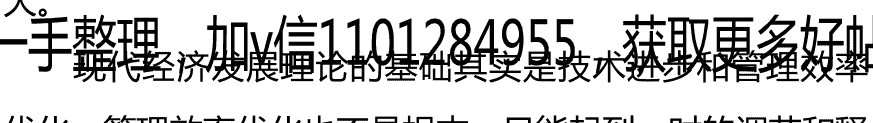

问题在于，跨越式的科技进步是不可能预测的，而且比较慢。各国的债务问题是不是能被拖到下一次科技进步？如果拖不到，就只能先爆发一次，用赖账的方法清理一部分债务。这就是债务危机和经济危机。

从200万年的经济发展看，经济膨胀式发展，差不多就是这个意思。

回到中国的房价问题，要面对的就是政府对社会不稳定的承受能力。承受不了，政府可能没有完全稳定国内经济社会维持的能力。其实，这两个问题，谁都没有答案，未来的不确定性因素太多。任何断定涨跌的论断，都太草率了。我认为政府在经济上不行了，失控时，大规模放水，是基于过去的政策和我政府的治理逻辑，赌概率比较大的方向而已。

做投资最重要的就是承认对未来的无知和不可预测，把握那些能够把握的收益，减少高风险回头。像吕菲特一样，赌高概率的事情，长期坚持。

新浪博客地址：
http://blog.sina.com/cn/u218237201

新微博昵称：kulese

# 6 楼
作者:kulese 日期:2018-03-31 17:06

看了一下，好像还差一篇，美国模式和欧洲福利模式的比较，暂时没有写出来。过几天写完了，再贴吧。感谢大家的支持。

# 7 楼
作者:kulese 日期:2018-04-02 19:16

## 经济模式和社会随想（8）

这个系列关于美国和欧洲模式的比较，这次补上。我们讲第 5 篇的时候，欧洲是靠高税收筹高福利资金的，美国靠发行国债过日的。这两种方法有什么区别，整理加微信1101284955，获取更多好帖。

我们先看看欧洲，高所得税、高财产税、消费税和企业税，维持高福利。对于普通人来说，这是天堂一样的模式。由于这些国家的生产力较高，企业产品竞争力强，收入就高。对高收入的人群征取额外的所得，工人、企业高管和政府高官，收入差距特别小，最大收入差不超过7倍。德国普通人的工资已经年入50000欧元了，买奔驰才30000欧元。看病不，孩子从小到大学都不收费，甚至高速都不收费，政府还补贴。对于普通人来说，高收入的人比普通人拿到的工资多，还要住高端区，穿贵的衣服，剩下的钱也不多。

德国等国家，高收入的人比普通人拿到的工资多，收入区分得也清晰。问题出在政治稳定，人文关怀，社会和谐上，为了社会的福利总量，混乱从来都不是政府的合理选项。

以上的这些就是各国政府从来都是嘴上尊重主流经济学的根本原因，行动上采取大量干预的原因。众所周知，政府的干预从来只能起到短期稳定的作用，针对大量失业，避免造成社会动荡，而不能在根本上解决问题。而国家的政府的执行力千差万别，行政行的深度、差距差异也很大。

凯恩斯主义发展理论的时候，其实是技术进步带来了许多优点。优化、管理效率优化不是根本，只能起到时的调节和释放经济活力的作用。全人类经济发展的最重要的动力只有科技进步。科技进步使人们用更少的原材料生产更多的商品，或者之前无用的材料变成新材料和能源，进而变成新产品，直接带动了生产和消费的增加。比如：最早人类只能用人和牲畜劳动，后来有了蒸汽机，能量也由木头变成了煤炭，然后是内燃机，能量变成了石油为主。这些转变是商品价格大幅下降，人们生产和消费的商品数量大幅增加，经济自然就繁荣。

各国政府在经济危机时，大搞凯恩斯主义和新凯恩斯主义，稳定就业和社会环境，一切都往后拖。他们在等的等什么？答案就很清楚了，科技进步。当科技有跨越性进展，经济增长自然就会快速发展，之前的高负债在经济高速发展时，就自然解决了。

问题在于，跨越式的科技进步是不可能预测的，而且比较慢。各国的债务问题是不是能被拖到下一次科技进步？如果拖不到，就只能先爆发一次，用赖账的方法清理一部分债务。这就是债务危机和经济危机。

从200万年的经济发展看，经济膨胀式发展，差不多就是这个意思。

回到中国的房价问题，要面对的就是政府对社会不稳定的承受能力。承受不了，政府可能没有完全稳定国内经济社会维持的能力。其实，这两个问题，谁都没有答案，未来的不确定性因素太多。任何断定涨跌的论断，都太草率了。我认为政府在经济上不行了，失控时，大规模放水，是基于过去的政策和我政府的治理逻辑，赌概率比较大的方向而已。

做投资最重要的就是承认对未来的无知和不可预测，把握那些能够把握的收益，减少高风险回头。像吕菲特一样，赌高概率的事情，长期坚持。

新浪博客地址：
http://blog.sina.com/cn/u218237201

新微博昵称：kulese

想要让人看到，有实现的榜样，才能成为大家的道路。克林顿、奥巴马、施瓦辛格、戴尔、马丁·赛尔、盖文、埃里森、特拉斯、马斯克斯、比尔盖茨，他们的故事激励了当代的美国人。

### 任何一个国家，都是核心因素。一个国家的制度，如果形成阶层壁垒，没有晋升的通道，阻碍人们的战斗精神，这种无无论如何感到过多的安逸，最后都会落后。一种制度，如果不能让人们尝试创新，这个国家就没有未来。如果一种制度，让民众在大城市买房子，作为生存最大的追求，大家就别想了，洗洗脑。

我真心希望，房地产泡沫爆炸，把以泡沫为基础的经济模式彻底转型，开创出中国的科技新道路。我希望通过报道美好，愿望只是努力。即使希望的没实现，从最坏的后果看，我只看到了政府控价的决心。

我真希望，我是错的。希望全球金融危机再次到来，我们可以让房价自由调整，让中国的资产格局和国外同步下跌，达到平衡的程度。问题在于，政府是否愿意？为了就业，维护社会稳定，我们一次的拒绝规律性调整，下一次的能一样？20年了，但这次真的不一样！

新浪博客地址：
http://blog.sina.com/u/218232701

新微博昵称：kulese

42楼
# 一标题 加密101284955 获取更多好帖
作者:kulese 日期:2019-02-23 10:45

好久没写东西了，手术后感觉一直不好。过了几年，身体才恢复。微博的号被kulese 举报了，被彻底封了，官方多次回答为什么我的号越来越难。去年1月份股市的时候，我开始看多，看一个中线，现在基本已经反弹。

从200万年的经济发展看，经济膨胀式发展，开始。风险是涨出来的，机会是跌出来的。现在的2800点，后面还有空间。回到房价问题，当时看到2950点，现在观点不变。

想要改进，一点点都需要投入资金。技术改进，刚刚开始。10 月份股市跌破2500的时候，他们在干嘛？一致看空！

由于新主上台，还需要活跃股市。游资大佬们被放了出来，a股又恢复了暴涨暴跌，韭菜又活跃起来了。a股一直以来都是1年玩一个轮回，垃圾级股市上跌跳胯，赌得惊险刺激。大规模牛市7-8年才有一次，中间都是小的轮回。像2016-2017遇到涨一的行情，少见。对于大高度来说太大了期望。

一王经理，加微信：1012184955

这种制度导致一个意外的结果。我们现在明确可以说，本轮A制度改革，会对原有股市生态造成巨大冲击。像小行星撞地球，导致恐龙灭绝一样。大量之前的交易方法失效，大量之前爆炒垃圾赚钱的交易者将。

国内货币政策开始全面宽松，财政政策开始稳定就业，稳定社会环境，为经济结构调整创造窗口。问题是经济结构调整越困难，改革越困难。中美贸易摩擦是一个长期的过程，这次谈判大概有一个阶段性结果，以后反复，摩擦不断。不定更新，感谢朋友的支持。

# 133楼
作者:kulese 日期:2019-03-04 18:29
最近，3000点附近，稳定。最近外资从疯狂买入到缓慢跟进，再到抛出。大盘在3000点以上，密集紧凑，丝毫不波动。

从国内经济转型、国际局势、政府货币政策、财政政策、科创板推出等等方面，证现在是牛市初期，后面是大规模的牛市。大家设想，去。

# “房价上涨，才是拉动消费的真正动力！”

前几日，中泰证券策略会上，行内知名经济学家李迅雷总结出这么一句话，一时惊起四座，引来网友如潮水般的漫骂。

“房价上涨，大家都买不起了还去消费？”房价涨这么高，大家都把棺材板的钱挪进去了，还升级消费？”这这么高的房价，年轻人都成了省吃俭用的房奴，消费如何增长？”

面对网友的质疑，研究了几十年经济学的李迅雷深感疑惑。这可都是从历史经验总结出来的，自己只不过是在陈述事实。这了，是自己错了？还是大家看不懂？”

我们试图和这句话的字面意思分开，探索这句话背后的真相。

## 1 消费之迷

其实在这句话之后，李迅雷也特别地做了了解。

“决定消费的主要是居民收入或收入预期，房地产销售的回落不仅会影响家里、家具、建筑装潢等消费额增速，也对其他消费带来明显的影响。”

注意，这里有两个关键词，一个是居民收入，一个是收入预期。

首先是居民收入。我在之前《被误解的真相》一文里讲过，某种意义上，房产属于实体经济。

从下游来说，搬一次新家起码得需要购买一套家具、一套家电，甚至做一次大的装修；从上游来说，钢铁、水泥、机械等行业和房地产也是一线上的产业。

上游带来的的产业解决了庞大的社会就业问题，这些传统行业都属于制造业，而且有大量的中介服务机构和工作者，还有依靠给新房装修的设计人员、施工人员，还有许多进城打工的农民兄弟，大多数都去参与了房屋建造。

由惯性引起的“买涨不买跌”的，房价上涨一定会拉动房产销售，从而导致和房地产相关的劳动民众受益，增加，自然消费力将增长。

哪里？哪里？房子是选的还是住的？国内房地产业后发，也无法覆盖中国这么大的人口基数。房价上涨，与房地产人群的收入并没有得到实质增长，何来拉动消费？

着急，还有“收入预期”。

## 2 收入预期

什么叫收入预期，经济学中的解释是：“预计未来一定时期可以获得的收入。”

房价上涨，最直接的是拥有房子的受益，固定资产增值。

举个例子，小李前几年贷款买了一套房子，500万，经过2017年这一轮大涨，价值翻倍，变成了1000万，这时的小李，转眼从只有200万贷款首付的小白领，变成拥有1000万的有钱人。

无论现在是否会把这套房子卖出变现，但在心理上，收入预期爆棚，那么他大概会提高自己的消费水平，改善自己的生活条件。房价上涨，收入预期提高，同时也促进了消费。事实证明，房价上涨，大家自己有了钱，就敢消费，房价一跌，大家感觉自己没钱了，就缩在家里不敢出来。

所有人的实际收入增加的基础上，通过“房价上涨拉动消费”这种方法，注定是畸形的。

## 3 反作用

李迅雷在抛出这个结论后，也顺道带了一句。“对于消费增速下降的原因，普遍的观点是‘买房导致六个钱包瘪了’，因此房子会影响消费。”这句话对，确实很大。

如我一个学生小张，农村出来虽然工作很高，但是为了买房，省吃用够首付，加上生活开销，基本没有剩余，没见过买过衣服。

从宏观经济上讲，房价上涨，价格上涨，租金上涨，企业成本增加，为了平衡，只能通过提高售价，或者降低工资。最后大家面对的，只有物价和更低的工资。原本想买个吸尘器，现在只能用扫帚，现在只能家里做饭。

## 矛盾？

看到这里，很多人就开始理解了，前面说房价上涨拉动消费，后面说房价上涨限制了消费，这不是矛盾吗？的确是矛盾，而且很大。李迅雷通过得出这个结论，说明什么呢？目前“房价上涨拉动消费”的效果，已经远超其他行业，“房价上涨限制消费”的效果，房地产成了其他行业无法替代的龙头，站在泡沫中，受益者成了主流群体。最终我们得到了一个命题：“为了消费，房价不能跌。”

但在背后，我又看到了悬空中的“达摩利斯之剑”，寒刺骨。李迅雷报告里提到，“过去两年，由于房价大幅上涨，这些城市的消费占比明显上升。”这是为什么呢？三四线城市，有房的人占主要群体，而在二线城市，没房的人占主要群体。房价上涨，三四线城市的主要群体，因为有了房子就没钱消费了，很多城市的主要群体都去买房或者省吃俭用，哪还有钱消费呢？

房价经过几轮大涨后，社会的整个财富结构开始偏离轨道。

### 4 水滴型与消费差距

要知道，社会财富主要是靠消费层来创造的，“橄榄型”社会才是健康的形态，但我们好像变成了另外一个形态——水滴型。报告提到：“不像统计局的数据如此，从很多方面推算的数据却反映出消费固化的问题。比如，去年我国网购增速达到了25%左右，但是网购消费总额中，5%的网购者贡献了50%的消费比重。假设我国的人数为5亿，5亿中的5%，即2500万人贡献了50%的网购消费额。”这无疑地给我们敲了警钟。

## 5 结语

投资、消费、生产、出口，是寻找经济发展的关键。目前来看，由于外围环境不稳定，投资又被长期过度使用，所以只能希望于消费。中国有14亿人口，如果打开内需市场，人们开始主动消费，市场情况就会改善。企业收入增长，劳动者赚到更多的钱，就会促进消费，从而形成良性循环，经济也就有了强动力。但这一切，都必须建立在“老百姓有钱”的基础之上。长期来看，通过拉动消费的方法并非不可取，最终会形成极化社会。一旦水滴断裂，底层便再无上升的希望，房子会成为隔断经济发展的“阶层鸿沟”。而在房地产深度绑定经济下，房价下跌是不切实际，只能通过降费刺激零售企业发展，来提高民众的基础收入，这也是今年“2万亿减费”的真实原因。下面真正决定成败的，是房价增速和百姓收入增速的真实对比。希望达摩利斯之剑，永远不会掉下来。

转载一篇房产的文章，主要是李迅老师的报告《房价与消费的关系究竟如何》，引起了广泛的讨论。

463楼
作者:kulese 日期:2019-03-23 10:36
看到很多人关心中国房产的未来走势，其实这个问题并不确定。我想国家领导人其实也不是确定的。因为这不意味着大，银行的贷款不允许中国高达80%的家庭资产崩塌。如果崩溃了，跌50%，银行基本全部倒闭，经济运转就会崩溃，我国没有经济危机，只有政治危机，道理大家都懂。从理论上，政府会一切办法，保住价格不跌。

464楼
作者:kulese 日期:2019-03-23 10:40
另外，房地产价格不跌，债务出清会非常慢。这个世界上，中国经济结构改革也会变得非常慢，一切其他的改革，也会变得非常慢，甚至有倒退的可能。现在，一切转型的都有利其他国家对我们的决策，复杂的国际力量，反而带来了国内的改革。说难真的，好像我们老百姓的福利，都是在美国的压力才实现的。

465楼
作者:kulese 日期:2019-03-23 19:25
应对高房价对经济造成的伤害，政府干了什么？这主要要是从2方面解决，第一，刚需买房。政府推出了更多的共有产权房，甚至北京这样的大城市，共有产权房的数量已经超过了新建商品房。由于只需要购买一般的产权，等于刚需买房的时候，价格直接减半。仅仅是房子不能出，第二，降低房租。房租是靠拆除连建，鼓励农村集体土地建设，由于政策不允许，这些土地被掏空出来。很多城市都去买房。

尔，就是日后大名鼎鼎的中科创业。

1998年末，朱焕良养的达尔的股票巨亏，持仓超过流通的90%。当时董建业为万科董事的朱老老板走投无路，来北京找到了股家吕梁，希望能合作庄，开启一段“伟大的”友谊。

在吕梁的安排下，一堆背景莫测的“北京机构”开始接手达尔，同时吕梁大肆在报纸上鼓吹达尔在网络、生物、医药等高科技行业的布局，成功将这家养鸡公司打造了科技风范。

当年的股市真强悍，敢自下场玩真枪实地，不像现在的这些，只知道钻钻石底儿子了。

吕梁在中科创业制定了电子商务等三个板块的最后规划，还先后收购了鲁银达、胜利非等上市股权，打造了一个庞大威猛的“中科系”，剑指巴菲特的伯克希尔哈。

巴菲特倾覆，股票被套的散户说自己已巴菲特，搞资本运作的也说自己已巴菲特，悠如上市公司高送转的还说自己已巴菲特。真应那句老话：有一个股民，就有一个巴菲特。

朱焕良先逃跑，中科创业股价崩盘，随后受到证监会调查。2001春节春节住在北京北华园别墅5号楼的吕梁，披着件军大衣，打了一辆出租车，看着北京的夜色，亦消失了。

作为写出《百万股民炒深圳》，上过《收获》杂志的一代文豪，吕梁败股市算A股的一大血浪漫。

股民还没开始闹，中科系高管就跳出来了，声称吕梁煽情，他们是光错，也是受害者，要跟吕梁彻底决裂。股民们委屈啊，连喊都都被捅杀，亏的所剩无几的账户，找不回去了？

人造科技，就像90年代的人造肉一样：看着像，嚼着，吃多了伤身体，在财富运挪移之间，股市的使命也已完成了。

自1999年12月起，一批国企上市公司开始向投资人抛股，套取现钱。2000年，股市暴跌，占全社会信贷投放的23%，成为一个无法逾越的高峰。

遥想当年，当吕梁第一次见达尔董事长曾汉山时，后者攥住吕梁的双手就不放了，热泪泛眶的表示他们“就像望望着解放军一样”，热切望着吕梁及资本大鳄“重组他们，解放他们”。

那会吕梁肯定在想：我质个江信信靠，散户们才是解放军啊。

## 02

早在1999年，创业板就完成了技术测试，那会腾讯才成立两年。但一直等到腾讯在香港上市的六年年后，A股的创业才开张，迎来第一批的28家上市公司。

这批佼者被誉为28星宿，尤其是神州秦岳、金亚科技等众科技股，更是被戴上了未来的王冠。

如此被誉为“中国产业脊梁”的神州秦岳，靠着200多名员工，打败了迷你泽橙控股TOM公司，成功拿到了中国移动飞信运营业务。

飞信在巅峰时期拥有5亿用户，被视为覆覆QQ的一代社交工具。虽然在中关村有一把神州秦岳这样的公司，它还是被圈贴上了“下一个宠”的标签。

上市当天，神州秦岳经历了40%的大振幅。而公司重点强调的秘密资金，也在同一天被宣布取消。但6个月后，一融资暴雷，神州秦岳累计亏损28亿元，股价跌得惨惨。

面对单一业务风险的质疑，神州秦岳表示，和中国移动的合作非常紧密，合同期限从一年改为三年。券商分析也表示，神州秦岳提供的几十行的编程代码，构成了很高的更换壁垒。

但很久以后，和中国移动的合作关系还在，飞信几乎消失了，几十行的代码成了“壁垒”还在，但后面的客户都跑光了。真是本山大叔说的人生最最痛苦的事情。

神州秦岳上市融资金额高达18亿元，堪称当时的“吸金之王”。如今，钱花了了不少，股价比上市时还低。神州秦泰创始人王宇宙地有声地说过，“赚钱算什么，赔钱却肯坚持的人才是人才。”

的确，不是自己的钱，赔了的确不算什么。

金亚科技是28星宿的最后一人，也是资本市场上主动静最大的一个。上市当天，公司股价大涨70%，傲视群雄。

在金亚科技上市路演，著名“财务打假”专家夏磊，连续提了7个问题，指责金亚科技财务有猫腻。金亚科技创后来证会一查发现，金亚科技虚增利润共计6000万，当时周振辉披露了89%。

周振辉的妻子董蕾，曾在《亮剑》里演练过李云龙的老媳雨雨。在股市这个战场上，周老板的气候还不逊多让，嘴炮响当当，一点儿都不比有意的大利李云龙差。

2018年8月8日，在大利不利的日子里，金亚科技因恐诈行为，被强制上市。但是，就算退市，就算被罚90万元，周振辉依然有7000多万的身家，相当于157个散户的和。

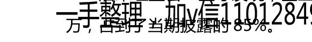

周旭辉在接受采访时，曾有意地说了一句话：“今天浮躁了，明天就浮躁来买单。”

## 03

金亚科技为代表的创业板科技，在2013年之前还处于非主流的阶段。等到2013年，这些科技股的估值有了脱离万有引力的推力，那就是移动互联网。

2012年10月，日本手机游戏公司Gung-Ho依靠游戏智宝迷城，股价在半年内上涨了近60倍。看来东亚模式是有过的，炒作气聚都是一样的。

2013年，国产游戏概念“把子”中青宝拔地而起，九个月上涨十倍，但姚抓利润2014年仅获600万元，大王经理加1,101,284,955，获取更多好帖。

唐电花费1亿收购世纪游戏，娱乐行业似乎结束在退市边缘，真有点“要完”的感觉。

2014年竞技大赛WCG宣布没钱不办了，宁夏政府筹推出了WCA替代。同在宁夏的中银绒业，闻风而动，收购了盛大游戏权，准备私化为A股。

却不料控股和投票权的卷入纷争，官司打了一个。最终收购未股权暴跌，董事长也涉嫌合同诈锒入狱。

天神娱乐借壳亮木业登录A股，高峰时坐拥400亿市值，结果却在2018年跌掉了73亿，而市值也不过55亿，把自己卖了都不赔的。

天娱董事长最出名的，莫过于巴菲特的午餐。在午餐上，朱聪认为自己做实业还行，不会炒股。2012年，谷歌问世智能眼镜，奔驰科技领先率在上半年上涨了近5倍。为了这几款穿戴设备、智能手环、手表，公司却亏了7多亿。

2013年蓝宝石大热，一年上涨近两倍。不料，蓝宝石石GTAT在2015年申请破产。

创业板自2012年底起，一年上涨了140%。由于杠杆过大的后果，股市崩盘。散户们才是解放军啊。

那会吕梁肯定在想：我多质个江信信靠连。

2014年9月，人民网又挂出了4000点是股市起点。毫无疑问，这是经济转型的必之路。随后，无数只垃圾被清理。

正如马克·刘沃所言：现实往往比逻辑更加荒诞。

## 04

当年的亿安科技，站在泥坑里，还要一幅光形象。股价上涨了很大，差点破了历史高。

2015年暴风集团上市两个月上涨了3倍，再掀起风暴。不过，股市大幅震荡，最终成了妥协式下跌。

这种杠杆的后果，就是股市的崩盘。

荒诞的概念，疯狂的杠杆，一步步偏离了初衷。有一个股民，就有一个巴菲特。

朱焕良先逃跑，中科创业股价崩盘，随后受到证监会调查。2001年春节，住在北京北华园别墅5号楼的吕梁，披着件军大衣，打了一辆出租车，看着北京的夜色，亦消失了。

作为写出《百万股民炒深圳》，上过《收获》杂志的一代文豪，吕梁败股市算A股的一大血浪漫。

股民还没开始闹，中科系高管就跳出来了，声称吕梁煽情，他们是光错，也是受害者，要跟吕梁彻底决裂。股民们委屈啊，连喊都都被捅杀，亏的所剩无几的账户，找不回去了？

人造科技，就像90年代的人造肉一样：看着像，嚼着，吃多了伤身体，在财富运挪移之间，股市的使命也已完成了。

自1999年12月起，一批国企上市公司开始向投资人抛股，套取现钱。2000年，股市暴跌，占全社会信贷投放的23%，成为一个无法逾越的高峰。

遥想当年，当吕梁第一次见达尔董事长曾汉山时，后者攥住吕梁的双手就不放了，热泪泛眶的表示他们“就像望望着解放军一样”，热切望着吕梁及资本大鳄“重组他们，解放他们”。

那会吕梁肯定在想：我多质个江信信靠，散户们才是解放军啊。

## 02

早在1999年，创业板就完成了技术测试，那会腾讯才成立两年。但一直等到腾讯在香港上市的六年年后，A股的创业才开张，迎来第一批的28家上市公司。

这批佼者被誉为28星宿，尤其是神州秦岳、金亚科技等众科技股，更是被戴上了未来的王冠。

如此被誉为“中国产业脊梁”的神州秦岳，靠着200多名员工，打败了小迷你泽橙控股TOM公司，成功拿到了中国移动飞信运营业务。

飞信在巅峰时期拥有5亿用户，被视为颠覆QQ的一代社交工具。虽然在中关村有一把神州秦岳这样的公司，它还是被圈贴上了“下一个宠”的标签。

上市当天，神州秦岳经历了40%的大振幅。而公司重点强调的秘密资金，也在同一天被宣布取消。但6个月后，一融资暴雷，神州秦岳累计亏损28亿元，股价跌得惨惨。

面对单一业务风险的质疑，神州秦岳表示，和中国移动的合作非常紧密，合同期限从一年改为三年。券商分析也表示，神州秦岳提供的几十行的编程代码，构成了很高的更换壁垒。

但很久以后，和中国移动的合作关系还在，飞信几乎消失了，几十行的代码成了“壁垒”还在，但后面的客户都跑光了。真是本山大叔说的人生最最痛苦的事情。

神州秦岳上市融资金额高达18亿元，堪称当时的“吸金之王”。如今，钱花了了不少，股价比上市时还低。神州秦泰创始人王宇宙地有声地说过，“赚钱算什么，赔钱却肯坚持的人才是人才。”

的确，不是自己的钱，赔了的确不算什么。

金亚科技是28星宿的最后一人，也是资本市场上主动静最大的一个。上市当天，公司股价大涨70%，傲视群雄。

在金亚科技上市路演，著名“财务打假”专家夏磊，连续提了7个问题，指责金亚科技财务有猫腻。金亚科技创后来证会一查发现，金亚科技虚增利润共计6000万，当时周振辉披露了89%。

周振辉的妻子董蕾，曾在《亮剑》里演练过李云龙的老媳雨雨。在股市这个战场上，周老板的气候还不逊多让，嘴炮响当当，一点儿都不比有意的大利李云龙差。

2018年8月8日，在大利不利的日子里，金亚科技因恐诈行为，被强制上市。但是，就算退市，就算被罚90万元，周振辉依然有7000多万的身家，相当于157个散户的和。

周旭辉在接受采访时，曾有意地说了一句话：“今天浮躁了，明天就浮躁来买单。”

## 03

金亚科技为代表的创业板科技，在2013年之前还处于非主流的阶段。等到2013年，这些科技股的估值有了脱离万有引力的推力，那就是移动互联网。

2012年10月，日本手机游戏公司Gung-Ho依靠游戏智宝迷城，股价在半年内上涨了近60倍。看来东亚模式是有过的，炒作气聚都是一样的。

2013年，国产游戏概念“把子”中青宝拔地而起，九个月上涨十倍，但姚抓利润2014年仅获600万元，大王经理加1,101,284,955，获取更多好帖。

唐电花费1亿收购世纪游戏，娱乐行业似乎结束在退市边缘，真有点“要完”的感觉。

2014年竞技大赛WCG宣布没钱不办了，宁夏政府筹推出了WCA替代。同在宁夏的中银绒业，闻风而动，收购了盛大游戏权，准备私化为A股。

却不料控股和投票权的卷入纷争，官司打了一个。最终收购未股权暴跌，董事长也涉嫌合同诈锒入狱。

天神娱乐借壳亮木业登录A股，高峰时坐拥400亿市值，结果却在2018年跌掉了73亿，而市值也不过55亿，把自己卖了都不赔的。

天娱董事长最出名的，莫过于巴菲特的午餐。在午餐上，朱聪认为自己做实业还行，不会炒股。2012年，谷歌问世智能眼镜，奔驰科技领先率在上半年上涨了近5倍。为了这几款穿戴设备、智能手环、手表，公司却亏了7多亿。

2013年蓝宝石大热，一年上涨近两倍。不料，蓝宝石石GTAT在2015年申请破产。

创业板自2012年底起，一年上涨了140%。由于杠杆过大的后果，股市崩盘。散户们才是解放军啊。

那会吕梁肯定在想：我多质个江信信靠。

## 04

当年的亿安科技，站在泥坑里，还要一幅光形象。股价上涨了很大，差点破了历史高。

2015年暴风集团上市两个月上涨了3倍，再掀起风暴。不过，股市大幅震荡，最终成了妥协式下跌。

## 05

荒诞的概念，疯狂的杠杆，一步步偏离了初衷。

2014年9月，人民网又挂出了4000点是股市起点。毫无疑问，这是经济转型的必之路。随后，无数只垃圾被清理。

正如马克·刘沃所言：现实往往比逻辑更加荒诞。

就是就业，最怕的产生大量失业造成社会不稳定。去年以来，为了稳定经济，稳定就业，大规模货币宽松。最近2个月经济已经暂时企稳，股市气温也比较热烈了。中央经济会议的基调，又开始倾向调整经济结构。货币预期宽松，可能阶段性紧缩。政府这些年来一直都很纠结，既想保持经济增长，又想调整经济结构。

就稳定就业，又调整经济结构的节奏。

IPO下周要发行4只引起，这是明显想给股市降温的。政府不希望股市暴跌，也不希望大盘暴跌。尤其是大量流动资金进入，暴跌之后暴跌，会导致券商倒闭，危及金融体系稳定。所以，涨到在这个位置，降温可能是应该的。

> 王建微信1101284955

A股在经历过暴利的阶段后，现在越做越难了。政府想给股市补跌，这种是不利阶段的调整，还是跌一次调整，都需要市场出来才能才知道。A股的政策特征非常明显，疯狂跳跌和疯狂上涨难以预测。我们的策略是，大盘总体估值足够低，就进入。没有出现整体估值完全不合理的情况，就采取右侧交易。当然，对于短线技术高超的朋友，这些建议就不合适了。

股市交易，其实非常看一个人的交易方法和理念。不同的人，完全不同。看别人的分析，大家借鉴一下就好。

703 楼
作者:kulese 日期:2019-09-24 13:00

从技术上看，A股好像真的没有风险。至少到周五，

没有发现大规模调整的风险。政策吹风，一般都是先行指标。A股正调整，需要资金明确政府意图才行。短线还没看到风险，所以控短线的朋友继续。其他玩法的朋友，重心小就好。建议还是右侧交易合适，A股短期情绪太严重。

估值上看，A股属于估值的中间状态，不高不低。今年内区间震荡机会偏大。至于长牛、牛市，A股从来没有过。经济结构和股市基本规则没有改变之前，估计大概率也没有。

# 704 楼
作者:kulese 日期:2019-04-21 19:05

我也是醉了，又一段没发出去，被和谐了。

获取更多好帖
大家劳动快乐，炒股的都是勤劳的劳动者，哈哈。
A股经过一轮调整，基本已经逼近3000点，从技术分析上看，3000点上应该有一个2-3周的震荡。技术的朋友，中有中小波段可以做，调整末期再看方向选择。
个人认为，我3月份可能调整到2750，错了了。这轮调整，如果没有特别大的利空，2850以上应该就调整到位。
今年股市的各项政治任务没有完成，直直地跌下去，可能性非常小。跟科创板和券商相关的板块，经过调整，大概还有最后一波冲。5月份调整到位，6月份差不多科板也出来了。下半年一波，下半年一波。

从技术分析看，A股没有跌破底部趋势，不能说牛市结束。但是，有些前期炒作过度，而且不是政府主要支持的板块，后市不好，比如：工业大麻。

去年年底，经济学家们预测，中国经济2019年前后低触底反弹。现在看来，应该是反复低，继续触底。这主要是去年4季度和今年1季度大规模放水拖经济造成的。银行的信贷投放，有倒效应。年初最多，后面越来越少。

2019年的人口调整，仅有200万，比2018年少了一半。二线以下城市的房子，属于彻底冷凉。年初的房产交易小春天，是压抑2年的需求短期释放，后期能力待观察。

一手关注：信息获取越多越好。反复触底的可能性比较大。现在比较不确定的是贸易战赛后是否会读出什么样的交易结果。取得阶段性暂停，双方都喘息一下，然后继续。美国对我们的战略遏制，会是一个长期的过程，要不要产生幻想。

只要有一个稳定的环境，中国人就能越过越好。每个人都越过越好，经济就会越过越好，国家就会越过越好。坚定看向中国未来经济转型，道路虽然曲折，但终将走向辉煌。

757楼
作者:kulese 日期：2019-05-14 14:00

苏州加码楼市调控部分区域“限售”为市场“降火”

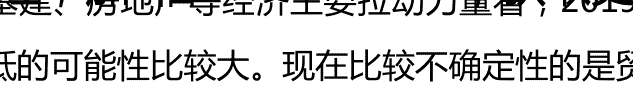

《每日经济新闻》记者注意到，《意见》主要从限售、调整土地让价规则、人才优先购房、优化学位政策等方面加码楼市调控。

限售方面，《意见》规定苏州工业园区全域、苏州新区重点区域（东起运河，西至珠江，南至竹园路，北至邓路）内，取得产权证（许可）的商品住房（尚未取得产权证的项目），须5年方可转让。苏州工业园区全域、苏州新区重点区域（东起运河，西至珠江，南至竹园路，北至邓路）内，取得产权证（许可）的商品住房（尚未取得产权证的项目），须5年方可转让。

在2017年预测，当房价不行了，政府推出了一系列限购政策，就连非限购也开启了限售。之后全国推广，限购5年内不能交易，等于限制了二手房。

（注：此处OCR文本存在大量重复和乱码，已根据语义逻辑去重并修复为正常的限购政策描述）

估值上看，A股属于估值的中间状态，不高不低。今年内区间震荡机会偏大。至于长牛、牛市，A股从来没有过。……由于政府开发的新房子，只剩下二手房，可以可以卖。想买便宜的房子，等政府买。想买便宜的房子，也不可以，以后会有很多共有房。想买便宜的房子，也不可以，可以可以卖。想买便宜的房子，等政府买。想买便宜的房子，也不可以，以后会有……等等。

贸易战的影响主要是长期的，短期就是情绪宣泄。过几个星期，情绪就平复了。建议大家耐心的等待反弹。

# 837 楼
作者:kulese 日期:2019-05-14 14:10

受贸易战的影响，大盘破2850，开始在2900附近震荡。如果没有贸易战利空，大概是在3000点震荡。

# 838 楼
作者:kulese 日期:2019-05-25 10:08

国内的经济到了转型的关键期，前期积累的泡沫，一定会爆发的，这是经济规律。希望朋友现在躲开泡沫资产，投资保守一点。刚才才写了一段时间，发出去，算了。

对中国经济，长期不空。儒家文化注重积累，重视教育。只要社会稳定，我们一定会越来越好。

社会制度也是一个进化的过程，希望我们的进化过程可以快一点。弯路已经走了10多年，希望不要再错了。

924 楼
作者:kulese 日期:2019-05-25 10:16

美国对我们的遏制，不是一朝一夕的情势，2018年是个转折年。中国大概可以加快改革，二次入世，彻底融入全球贸易之中。

零关税、零堡垒、零补贴，是欧新贸易协定、美加、美墨贸易协定等双边贸易协议的核心，也将成为未来贸易协议的主流。希望国内不要有什么什么幻想，也别再玩什么花招，好好进行贸易谈判，认真遵守贸易协议。要承认，中国已经选择了有利于主流的道路，想后退的可能性比较小。亚洲国家文化圈，其他国家和地区，都已经加入了发达国家和地区的行列。剩下的只有我们和朝鲜了。

925 楼 
作者:kulese 日期:2019-05-29 18:39

共有知识和公共知识（博弈论中关于透明的重要论述）
这里涉及两个概念，一个是共有知识（shared knowledge），一个是公共知识（common knowledge）。

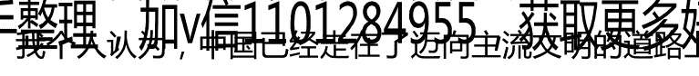

共有知识：每个人都知道的信息。
公共知识：不是每个人都知道的信息，而且每个人都知道别人知道的信息。如A、B、C三人：
第一层次：A知道B、C知道；
第二层次：A知道B、C知道；
第三层次：每个人都知道别人知道。

举个例子，皇帝的新衣故事中，皇帝被骗子欺骗，穿上了衣服，只有聪明人看到但根本不存在。百姓们看到了皇帝没穿，大家都不愿意否认，这时皇帝没穿这件事就是共有知识，大家不确定皇帝是否穿。但是有一个小孩说出来了，原来看到的皇帝没穿，于是原有的知识就变成了公共知识。在私有知识向公共知识转变的过程中，有一个重要的过程就是要通过讨论、分享等传递。

比如，一只“垃圾”股票，大家都知道它是垃圾，但是不知道别人知道它是垃圾，所以价格可能很高，因为可能有其他人来接盘。但是一旦大家都清楚它是垃圾，那么价格就会一下子下来。这就是《呐喊》的力量。

# 973 楼 
作者:kulese 日期:2019-06-01 17:29

大黄·茶叶：清朝的误判（转载）
前言：本文是笔者在阅读了台湾学者张哲家的《大黄迷思——清代裁西洋的策略思维和文化意蕴》一文后的感。在传统医学观念的影响以及各种事件之下，道光鸦片战争期间，政府误以为可以通过控制大黄与茶叶的出口来威胁西洋，于是撰写国书。这一制裁措施的效果是不尽如意。这一历史事件背后反映不仅是政府对国际形势的无知，更体现了双方世界观的差异。

在鸦片战争前夕，道光十九年十二月十四日（1840年1月18日），驻鲁大臣徐德英船主Thomas Coutts转交给维多利亚女王一封函，抗议英此不顾禁令源源不断向中国倾销鸦片，而中国却一直赐他们维多利亚生命不可缺的茶叶和大黄，英国借此威胁政府将毫不吝啬地停止供应两种产品，使英国人无以为。

为什么清朝王朝认为茶叶和大黄是西方维多利亚生命不可缺之品呢？这就需要从中国传统医学理论来解释了。

医学最早的《黄内经》中提到：多食会导致疾病的说法，从古代医家的诊疗经验来看，人们对这一观念是没有意义的。西方人士平日所食以牛羊乳为主，从传统的医学观点来看，这种饮食方式缺乏所需的药物帮助消化，必然会导致肠腹结络，因此需依赖额外的药物如大黄、茶叶等方能够涤消脂，神清气爽。

乾隆五十四，清廷曾有过一次全面封锁大黄的策略，这一策略针对的对象是俄国，彼俄国迅速屈服的表现进一步加强了清廷对于大黄能宰西洋的错误认知。然而事件背后的真相在当时却无人关注与分析。事实上，俄国的迅速屈服并非是因为寿命优，而是为了攫取利益。在西方传统医学里，大黄并非慎用之品，而是“万灵药”，因为西方传统的制药方法已经将大黄的峻性缓和了一大部分，因此经过特殊工艺炮制的大黄具有排而不致脱水的特性，同时又是极佳的收敛剂，强健脾肠、镇静清热，受到古今中医学者的普遍喜爱。

当时恰克图是中俄边境唯一允许贸易的地方，俄国也是是从地源不断进口大量大黄再卖给民众以及出口。据研究，当时的恰克图贸易是俄罗斯最大的财源，直到19世纪初，国库年收入的15%到20%都来自恰克图利润。俄国在权力争夺之下，为了利益不惜放低安抚。乾隆全面胜利的局面使得清廷再次做出以大黄和茶叶威胁英国的举动。然而，从古至今，并没有看到西洋人的恐惧。传统医学理论确实表明西洋人的饮食方式需要通过摄入其他物品来帮助消化，如大黄和茶叶来维持身体健康。

贸易战的影响主要是长期的，短期就是情绪宣泄。过几个星期，情绪就平复了。建议大家耐心的等待反弹。

# 995 楼 
作者:kulese 日期:2019-06-01 17:40

全球矿储量对比：

| 国家 | 矿储量（吨） | 占比 |
| :--- | :--- | :--- |
| 中国 | 400万 | 36.67% |
| 巴西 | 200万 | 18.33% |
| 俄罗斯 | 180万 | 15% |
| 印度 | 690万 | 5.75% |
| 澳大利亚 | 340万 | 2.83% |

# 998 楼 
作者:kulese 日期:2019-06-01 14:33

## 用数字说说中美贸易战的影响（财经）

很多人会计，我们不怕美国，贸易战全面爆发。波音的飞机给他们，他们要失去很多工作机会。中国有那么大的市场，美国离开了中国，经济就要衰退，我们再售卖它的国债，它就玩完了。另外，没有了中国便宜的商品，每个美国人就会付更多的钱买商品，美国人的生活质量就会下降，不一定有许多美国人会因此饿死。

但真实的情况是这样么？我们来看看中国对美国经济有多重要呢。

首先，2014年和2015年，中美贸易金额平均大约5,950亿美元，去年过去非常大。不过，中国从美国进口的商品只有2,800亿美元，2014年以后翻了一倍，中国从美国进口高达4,700亿美元，几乎是出口额的四倍，贸易逆差高达3,000亿美元。

1,200亿美元的出口，占美国出口总额的7.6%，中国市场虽然巨大，却不是美国人的。这个出口额只占美国GDP的0.6%，如果要是认为是美国GDP下降0.6%会导致经济崩溃，那么他的经济学课程可能及格。事实上，美国一年的经济增长还不止0.6%，近年来能够达到3%。

有趣的是，宣扬了缺了中国的巨大市场美国就要完蛋的人，恰恰有很多经济学家。

其次，中国如果抛空全部美国国债，会不会对金融市场造成巨大冲击？目前中国持有美国国债1.1万亿美元，这个数字非常大。很遗憾的是，美国的联邦债务实在太高，这要感谢前任总统奥巴马。他在任8年，借的债几乎相当于历史上所有历任总统的总和。拜他所望，美国国债已经高达22万亿美元，中国所持有的占比为5%。

由于美国国债是完全市场化、流动性极好的投资产品，因此随时可以抛售，有无数投资者可以退出，随时可以抽离走人。至于市场波动，赚钱还是亏损都是中国（政府）的事，美国对此无关。相比欧债，美国国债的安全性要好得多，资本市场化消除掉这1.1万亿美元的国债并不是什么难事。即使市场有动荡，赚钱亏损也会取决于中国。

美国有3.2亿人口，2015年人均居民收入为5.56万美元。如果将每年出口到美国的约4,700亿美元的商品（2014年~2015年平均值）摊到每个美国身上，相当于美国人购买了1,500美元的中国商品，仅占美国居民收入的2.6%。即使从其他国家进口的商品的价格比从中国进口的涨一倍，对美国生活的影响也微不足道，远远不及上包括房价在内的消费物价的上涨。

最后，美国对中国的出口只有美国1,200亿美元，虽然波音公司等个别企业比较依赖中国市场，大部分美国企业并不依赖。

## 一手掌握110128455

还有很多人讲如果中国不买波音的飞机，波音公司将失去1/4的订单。但是要知道，50%的飞机在一年内就需要更换配件，如果一年双方都不做生意，中国一半的波音飞机就起不来了，两年后3/4的飞机就“刹了”了。

美国企业依赖中国完整的产业链和利润、便宜廉的制造成本。中国的市场对于很多外商和合资企业利润影响很大，比如：美国的汽车公司、制药公司和苹果手机。我们每年贸易3000亿美元，外汇储备不再增加，主要原因就是外资企业把利润往国外。这些利润对于外资企业是非常重要的。如果全面贸易纠纷，这些企业也会损失很大。

此外，要全面打起贸易纠纷，对谁都没有好处。在经济优先的时代，依然是最差的和和平最好的纠纷争取要好。希望两国高层可以拿出大智慧，和平地解决纠纷，加速中美经济一步融合。

## 1092 楼

作者:kulese 日期:2019-06-11 11:05

### 美国司法部追查国外高官贪腐资金 吁公众举报

2010年，美国司法部启动了“追回盗窃资产计划”（Kleptocracy Asset Recovery Initiative），搜并没收国外贪腐高官至美国或经由美国洗钱的资金，调查并起诉这些腐败败官员。此项目由司法部刑事司事财产没收暨洗钱科主导，多位政府律师、联邦调查局（FBI）及国土安全执法人员联合合作。

“美国不会成为外国官员洗钱、隐藏腐败的避风港。”美国联邦调查局局长大卫·迪奇（David Bowdich）曾这样整理。

9年来，他们起了数十名国外高官，没收了大笔非法资金，并向有的国家返还了部分被贪侵吞的财产。

2015年，美国联邦调查局（FBI）在全国范围内成立了“国际腐败调查行动组”，以应对国外腐败带来的国内和国际影响。

2019年2月22日，美国司法部关于1MDB调查案文件，其中提到：“任何人，如有关于存放在美国境内、或经由美国洗钱的，可能是来自外国贪腐污款项的信息，应当与联邦执法部门联络。”并附上了“追回盗窃资产计划”的电邮（<kleptocracy@usdoj.gov）。

## 追回盗窃资产打击盗贼统治

2014年，美国司法部从韩国总统全斗宪获得了很多好处，1.2亿美元，其中包括其在首尔出售房产的5,60万美元，以及全斗宪的儿子在宾法州一家公司的50万美元投资。

全斗宪在任期间从韩国企业收贿达2亿美元以上，于1997年获得。全斗宪及其属人在韩国和美国进行了有组织的洗钱活动，以转移侵吞的财产。

2015年1月9日，美国司法部宣布，将全斗宪案中没收的$1,266,951,450归韩国。时任美国司法部总检察长洛丽塔·E·林奇（Loretta E. Lynch）表示：“美国司法部将动用所有资源以确保资金得到合法使用；归还所属国。”

现任联邦调查局局长、时任FBI洛杉矶局助理主任大卫·迪奇（David Bowdich）评论：“美国不会袖手旁观，成为外国官员洗钱、隐藏腐败的避风港。”美媒报道：2016年2月16日，《纽约时报》发表题为“美国追逐赤道几内非法敛的数百万美元”报道，介绍了美国司法部针对奥利比昂（Teodoro Obiang）的案件。

奥利比昂之子在美国花费了三亿美元，购买了豪宅、私人飞机等奢侈品。2012年，美国司法部起诉他。2015年10月，美国与奥比昂达成协议，他同意从其被拍卖的房产中取出约300万美元缴给民众。美国检察官的目标包括尼日利亚、乌克兰、乌兹别克斯斯坦、南韩、台湾、加拿大。时任司法部刑事司长助理检察长莱斯·卡尔德（Leslie Caldwell）的话：“我们有能力将其截获，把贪腐连根起。”

2017年6月和2019年2月22日，美国司法部两次对1MDB提起诉讼，使得充公的一马公司资产总额达到17亿美元。加拿大、澳洲、新西兰、欧盟和英国，在这种既正义又能实惠的事情，一定会紧跟美国的脚步。

## 更多更多

作者:kulese 2019-06-11 11:14

关于美国是不是在衰落，我没有定论。我看来一个国家是不是越来越好，最重要的精英是否会往好的去。如果一个国家外资持续流入，其他国家的精英更愿意来移民，大概率这个国家就会更加繁荣。道理很简单，聪明的人和聪明钱，大概率不会去越来越糟的地方。毕竟精英们都会选择让自己生活更好更安全，个人能力更能够施展的地方。聪明钱都会去更加安全，增值更快的地方。我个人看问题经常比较片面，喜欢一些我认为是简单直观的角度来看，仅供大家参考。

作者:kulese 2019-06-11 11:25

还有贸易战这件事，不用扯那些高大上的概念。我觉得就是利益纠纷而已。我们的市场不许人家来关税太高，各种行政限制太多。美国对其他国家也有很多重限制，咱们也一样不满。

美国现在是主要的经济体，平均关税最低的。主要是之前美国自己的企业把生产环节转移到了国外，然后把成品回运美国销售。如果美国关税，其实是对自己的企业，所以就能少产，压根不是让别的国家便宜的。现在由于美国企业长期不搞生产环节，导致大量的一线生产链后落，被日本、德国、韩国和这样的国家掌握，其国家的货物贸易激增，美国自己的产品和服务份额断崖式下降。

奥巴马当时想重塑制造业，结果却越糟糕。特朗普增加了关税关键环节在哪里。所以，美国提高关税和别的国家搞贸易纠纷，将成为常态，这不仅仅是对我们的。逆全球化是未来多年的趋势，大家慢慢就适应了。

作者:kulese 2019-06-11 11:32

说说股市，短线冲高，如果外围情况不错，上面2990-3040的缺口回补一下，大概不能补全。我认为会往下走，补回2800缺口。

## 更多策略

作者:kulese 2019-06-11 11:32

如果下跌猛，最糟糕看2700以下。短线无操作，长线建议买入行业ETF。

作者:李晓（吉林大学经济学学院、金融学院教授）

中美贸易战对我们意味着什么？从2018年3月直到今天，中美贸易战赢了很多好处？首先，从贸易战来看，我们已经有了深层的焦虑和危机感。

（由于：我们，我们，我们，我们的，贸易战，我们，我们，从2018年3月直到今天，我们的，2000000000000000000000，我们，我们，我们，我们的，200000000000000增加2000）

作者:kulese 2019-06-11 11:14

2017年，中国大豆进口为1400万吨，总进口超过9554万吨。平均每生产一吨大豆需要多少土地？这些大豆若是换成中国自种，将消耗7.6亿土地。而中国的农业耕地红线是2亿，拿出三分之一的土地种大豆可能吗？答案很明显。进口可以吗？困难。因为人们对高质量生活的向往和需求，使得植物蛋白是不可缺的。而且这些蛋白质的残渣可以用来喂猪牛，保障牧业发展。

大豆及其附属品的价格都要提高，意味着某些生活必需品的物价上涨。有人说，我们转向巴西进口吧！问题是，全球大豆生产的相当大部分被几家美国公司控制着。巴西大豆从生产、运营到销售几乎都是美国公司控制的。更为本质性的是我们对“美元体系”的依赖。听过我课的同学们，一定清楚这个原理：总体来说，现在的“美元体系”主要靠三个机制运行：一个是商品美元回流机制。中国、日本、德国等对“贸易国家”向美国出口赚取美元以后，还要将其中相当大部分借给美国。美元是世界清算货币，它能印很多很多市场。美国只需要如果自己需要、满足基础货币的需求，就会印钞，有可能引发美元贬值。这意味着一方面，我们本身拥有的美元储备缩水，这是我们不愿意看到的；另一方面美元贬值意味着我们本币贬值，对出口来说非常正常。所以，作为“贸易国家”的悲剧就在于，我们需要被动维持美元汇率的稳定，尽量不让美元贬值。也就是说，世界上最大的债务债权国要维持世界上最大的债务国的货币稳定，这是商品美元回流机制迫使我们承担的被动责任，也是我们大量购买美国国债、公司债的原因。第二个机制是石油交易的美元计价机制。

第二个机制是石油交易的美元计价机制。

可以再换成自己需要的货币拿走。

也就是说，这些投资的所有权归属于外资企业，外资企业可以随时地撤资或者在投资期限到期后撤资。虽然现阶段中美贸易战的爆发并不会导致外资全部撤资，假如只撤资三成，就是 5000亿美元左右、1.9万亿减去5000亿，我们还剩多少？我们还有那么多要做的事情，还需要要钱。

所以，特朗普发动贸易战的目的究竟是什么？我想恐怕不仅在贸易领域，还在“中国制造2025”，更可能是通过贸易战的迫使中国做出更大让步，而且可能是迫使中国在货币金融领域更大开放。

我们知道，美国是一个地道的“金融国家”。我们处理了复杂的金融技术，获取更多好帖。

表面上，特朗普发动贸易战是在兑现自己的竞选承诺，为“铁锈地带”那几个州的领民争取更大利益，这为他在这方面做得很不错。

由于美国经济的变化日益高度金融化，华尔街金融资本的利益是其必须要重视的。金融资本的目标是要赚取全球金融市场的收益，其前提就是世界各国货币金融市场的开放，但迄为止中国这块骨头美国始终没有停下。

我们的资本项目没有完全开放。特朗普的发动对华贸易战的核心目标有很多，我想在他的规划中，不会没有迫中更大幅度开放货币市场委员会的目标。

1196 楼
作者:kulese 日期:2019-06-16 11:51

当然，美国更为重大的国家战略利益就是遏制中国的崛起。对此我们不要抱有丝丝幻想，不要以为这是特朗普个人的意愿。

在最近的一次接待会上，一位著名学者讲述了他的的一位刚从美国回来的华人朋友在美“中美关系委员会”的经历。

这个委员会的宗旨是促进中美友好关系，在他此之前的多次访问中，委员会工作人员都是热情相迎，笑脸相迎，但这却却像躲神一样回避回避，他说自己感受到了“麦锡主义的回潮”，现在美国对中国的遏政已到了想象的程度。

所以，特朗普对对华采取强硬的贸易制裁措施之后，他的支持力没有反升，而且美国共和、民主在这一问题上的政治共识高度一致。

自特朗普上台以来，两党之争非常多，但唯独在“中国问题”上高度一致。今天，有很多学者试图把中美之间的冲突局限在贸易战场范围内，认定它是一场贸易冲突，主张不要将其扩大到其他领域中；还有一些学者认定这场贸易战打下美国必输，中国必胜。

不论他们是如何测算的，我认为这是一眉情绪或不符合常识的。

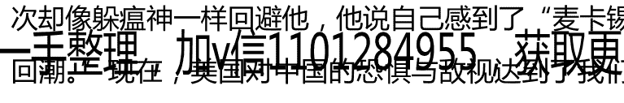

对一般国家而言，贸易战在经济学上一直是双输的。但是对于大国而言，关键在于谁输得起。

历史经验证明，大国之间特别是别是“老大”和“老二”之间的较量，更多的不是经济行为，不是以经济利益为目的的，而是一种国际政治行为，是以国家利益为目标的。国际政治竞争不是“正和游戏”，而是“零和游戏”。

经济学与政治学的逻辑有很多不同，一个主要的区别在于，经济学的逻辑是杀敌一万损八千还是杀敌六千的问题，它的逻辑是如何让避免损八千，尽量实现六千，即实现资源约束条件下最小的成本达成最大效益；与经济行为不同。政治的逻辑是我要赢，要有对手，胜性很少，但要胜利的行为是必然的。

刚才，大家唱的国歌里有一句话：“中华民族到了最危险的时候。现在，我不说我们是最危险的时候，但可以说，中华民族到了新的危险的时候”。

对于今天的中国而言，最大的危机是贸易冲突，而是世界上最强的霸权国家已经把中国当成了最重要的对手，在和平时期利用经济的手段发起了对中国的全面遏和攻击，同时还利用其超强的全球军事实力对中国进行越多的威威胁，制造周边冲突来干扰我们的和平进展。

前不久，美国总统奥登佩奥有一个发表，赤裸裸地攻击

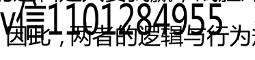

中国是一个掠夺性的国家，是一个偷知识产权、偷别人的技术、强迫技术、强迫掠取别人的国家。这种攻击值得高度重视，他是在把中美冲突上升到一种意识形态。

最近，美国通讯委员会发表于2018年6月1日终止了奥巴马时期的网络立法案。我们知道，互联网思维、技术与服务，这一切以美国为核心。美国为了促进国内公平竞争，同时让各国拓展全球市场，搞了一个网络立法。但是现在这个网络立法意味着互联网服务提供商在访问中国的情况下，通过屏蔽该流量来降低访问速度，就是断网。一旦对中国采取这种措施，银行、交通、邮政等系统可能会瘫痪。最近有一则报道，美国已经得到授权，可以对网络攻击和盗取美国特权，即锁定服务器。其中一个服务器、其余三个分别在瑞典、荷兰和日本。所以我们必须认识到，美国正在做。

最近，大家看到一张G7首脑会议照片，场景类似“最后的晚餐”，特朗普与德国总理默克尔等其他国家首脑似乎互不戴。但是这次会议上特朗普提出了一个计划，让G7国家一体化实现零关税、零补贴、零壁垒，据说已经得到德国的同意。由于复杂的因素，其他发达国家的立场可能与美国不一致，因为美国市场巨大，竞争力强大，所以七个国家一体化肯定不会顺利。这种行为意味着一个严峻趋势，它已经决定废除WTO全球多边贸易规则，我们坚持倡导全球多边贸易规则，获取更多发展空间。这个规则是我们人类创立并坚持的。今天他们不想按此规则做去了，要搞一套新的、更高标准的规则。

在这方面，特朗普对欧盟、日本和其他发达国家的贸易保护主义将促使这些国家与中国坚定地站在一起，抵制美国的全球化行动。事实上，这些国家在知识产权问题、强制性技术转让、企业并购等方面完全一致。

所以我们不能把中美贸易战局限于贸易领域，这本质上是一场国运战。我们更不能将这场视为短期可以解决的。就贸易争端而言，从1960年代一直1980年代，美国和日本发生过一场漫长的贸易争端，这场争端打了30年，结果是日本泡沫崩溃，跌入“失去的二十年”。中美之间的冲突为一场大国博弈，恐怕需要至少50年甚至更长时间。今天的一切，不是是一场历史大戏的开幕。

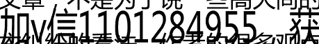

另外，我的国外汇储备3.1万亿左右，截止去年年底外债1.8万亿美元以上（外汇管理局数字），盈余不足1.3万亿。

作者:kulese 日期:2019-06-16 11:57

从短期看毛战对我国经济的短期影响主要是心理上的。中期影响在于企业和预期。长期的影响将是方面的。我其实希望外部的压力更大一些，因为外部的压力越大，国内改革的力度越大，各种对经济的限制越少，政府职能转变越快。以中国人的勤劳和智慧，限制少，经济肯定就好。极度接近市场化，人民的生活水平一定高。

## 一手处理1101284955，获取更多好处

1199楼
作者:kulese 日期:2019-06-23 11:06

## 近期热点回顾

最近资本市场的大事就是创业可以借壳重组了。这个事情的实际意义并不大，科板注册制了，谁愿意花钱买优质资源，还要等36个月。借壳重组是非常正常的，破坏市场正常秩序，不利于市场预期的形成。考虑到中国股市的特殊性，允许借壳是对的。公募基金参与转融证券借业务（以下简称借业务）的行为，证监会近日发布《募集投资基金参与转融证券借业务指引（试行）》，自公布之日起施行。该项涉及处于封闭期的基金、股票ETF及其联接基金、战略配基金在今年季末合计规模为658亿元，这些基金都受益于转融证券借业务（包含科创板股票），迎来大量投资收益。这个新闻基本没人注意到，但是它有一定的影响。允许基金融股票做空，相当于多了一份做空期。

当前的规模还是比较小，以后恐怕类似的做空手段会越来越多。这说明主力资金靠多赚钱已经比较困难，后面靠做空赚钱。韭菜被割得更加厉害。

## 一手卖：转融证券借业务

1244楼
作者:kulese 日期:2019-06-26 13:27

a股的估值核心在2800点附近，现在稍比估值中线高一点点。如重大的金融危机产生，2800以下具有投资价值。另外就是科创板开始交易以后，大盘上涨10%多一点，然后是半年的深跌。所以不要希望于科创板推出，就能在短期内方向改变，长期走势还会根据历史规律来。很长时间以来，写多。实在没办法，每次都不够麻烦。朋友们见诸，以后多写一些。

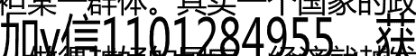

## 1276

1276楼
作者:kulese 日期:2019-06-26 13:32

## 1279

1279

1279楼
作者:kulese 日期:2019-06-27 20:04

### 1396

1396楼
作者:kulese 日期:2019-07-17 18:21

### 1399

1399楼
作者:kulese 日期:2019-07-17 18:20

---

回顾2012年的行情，除了2013年的a股年初跌外，每次a股的脉冲上涨，都是跟房地产价格上涨的。每次a股长线调整，都是随着房地产销售和投资严重下滑。2019年初一线城市房地产销售小春，a股则暴涨。房地产销售已经开始断崖式下跌，房地产是滞后销售的。现在地产投资依然不错，到年底之前，大概还会开始下跌。a股在科创板脉冲之后，大概有一次长期调整。下半年有波行情的可能性比较较大。

2019年a股最好赚钱的一波，肯定已经结束了。下半年如果上涨，大概是复杂结构的上涨。科创板开始申购，后面陆陆会更多，基本已经是完成任务了。2010年创业板开始交易以后，大盘涨幅10%左右，然后是半年的深跌。

再次强调，从估值角度讲，2800以内具有价值。我的思路和一般的散户不同，完全是基金，更加适合短线的朋友。中线交易，基本都是技术分析，需要试错机制，以及止损是投资的一部分，用盈利来覆盖损失，玩的是概率。长期投资赚的是。之后，长期会涨起来，长期是长期的预期、越涨越猛。

我们不能把中美贸易战局限于贸易领域，这本质上是一场国运战。我们更不能将这场视为短期可以解决的。中美之间的冲突为一场大国博弈，恐怕需要至少50年甚至更长时间。今天的一切，不是是一场历史大戏的开幕。

这种纷纷必然是长期的，欢日持久的。作者的观点显然不准确的。仅仅比比较相同对他裳的认识。作者的观点显然不准确。这篇文章文章后面的部分，贴不上去了，说是审核不通过。想看的朋友自己在网上去贴吧。转载这篇文章并不是为了说一些高尚的问题。主要是王经理对我来说了很多好处，说明了错误的方法。

从有原子弹以来，两国的纷纷不是你死我活，而是谁的发展更好，占用全球更多的自然和人类资源，让本国的利益最大化，灭国的战争从这里退出了历史舞台。如果一个国家，可以另外一个国家最优秀的人才引为己用，廉价的使用别国的自然资源，让自己国家建设的更好，人民生活水平更高，那么就意味着赢了。因为古代战争的目的，其实也就是这些。利用金融和贸易制度的安排，更多占用其他国家的劳动成果，这就是现代国家与国家之间竞争的终极目的。

制，购房原价的50%以内收30%，50%-100%的部分收40%，100-200%的收50%，200%以上的60%。如果是10年前买的房子，基本上把过去去买房致富的财产，收取一半的财产税。比如：北京2005年一套房，6500平米，现基本上已经涨到了6.5万，100平米当年是65万的，现在报价650万。严格购房增值税将超过300万。前提是要把房子变成，不交易的房子仅仅是房子，完全失了金融属性，最多就是出售。

如果土地增值税改正，基本会让职业炒房的盘子，普通套房没有资金压力，大概会转向出房，等以后后政策变化，股市高位没有区别，从政策上巧妙地处理买卖房，完成了我们收割的利润。

通过这种方法来更加隐藏和狠辣。先封锁交易，现在有房的人就成了案板上的肉，后面就没得机会收房产税了，政府需要了。

到时候卖房政府一半的钱，不卖房每年再收房产税，房屋租金减掉房产税可能也剩不少，想靠家里几套房一辈子的可能凉了，更不要多套房可能还要加收惩罚性房产税。

现在土地增值税仅仅是立法，还不确定每个城市是不是马上开始征收，毕竟还在对个人普通房免征。

但是，房住不炒，等房价价格涨到不能再涨，政策就转向了。等地方政府再没钱了，房产税就开了。

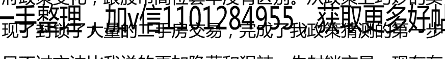

1395楼

作者:kulese 日期:2019-07-20 10:55

## 打鸡血？传说中的鸡血疗法竟然曾经存在！

“我就打了鸡血一样兴奋。”很多人可能听过这个典故，很多文学里，也把打鸡血写了进去。

这个疗法风靡一时，其实是从文革时期流传下来，而打鸡血，不是比喻，而是真的打鸡血。

一时间，在当时的医院门口，大雄大人的，抱着公鸡排队。“鸡血疗法”的方法和它的名字一样简单，抽取鸡血几十到一百毫升，然后通过注射到体内中，每周一次。

说说这种疗法可以“有病治病，无病强身”，还能治愈心脏病、老花眼、脱发等24种疑难症，并且“精神乐观，视力增强，抵抗力强，面色红润，不怕冷，性欲旺，睡眠优，大便秘”。

### 鸡血疗法的由来

鸡血疗法的创始人是上海医生昌时，并不是什么江湖游医，反而一份专业且正规的革命医生，受过系统的现代医学教育。昌时毕业于上海医科大学，在武昌开过私人诊所，抗战期间担任军医，还在南丰县担任卫生院长，行医时间至少也有20多年。

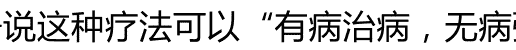

那么为什么要打鸡血呢？昌时当时打了一毫升血，称面色红润，精力充沛，和中午吃了几两饭后一样。这种卖大力丸一样的做法，每天都在上演，昌时自称打鸡血包治百病，咳嗽五分钟就好，胃疼马上不疼，长了肿立马上消肿。

“鸡的体温如此高，是因为血液发热机能特殊。”

### 胜利的经验分享

“鸡血也是一种组织，肯定能治病。”

根据地方志《百年苍州》第二卷记载：病人抱着鸡诊室后，有护士帮忙，它七八脚地逗它，从一只翅膀的静脉血管中抽出鸡血。由于一次抽的鸡血不多，所以还要在别处。在抽血时，强强的公鸡会拼命挣扎，一旦挣脱略大叫，满屋飞尘，大家追索，乱成一团，鸡毛灰扬扬，再上鸡尿遍地，更是臭气熏天。由于频繁扎针，不了多久，一只漂亮的公鸡就变成了全身青一块、紫一块的斑亮鸡，需另换一只好鸡，市场上雄壮漂亮的公鸡成为抢手货。”

而这位医生为什么会有这个念头呢？为了出名利一是方面，据俞昌表示，1952年他在江南平作的时候，用温度计量了鸡屁眼温度，发现鸡的体温是 43 度，比人

这种毫无临床和科学依据的说法，配合当时“少花钱治大病；不花钱，也治病”的口号，俞昌很快就让其魔大南北，据俞昌说，中医里有很多内外敷鸡血治疗疾病的方子，所以直接注射鸡血也是有效的。在俞昌口中，鸡血疗法已经成为了“国际领先”的医疗成就，和某科学似的。

### 打鸡血的科学？

医学是不科学的，直接注射到肌肉组织而不是静脉血管，所以不会有太严重的后果，因为血是异种蛋白，会让人免疫系统开始刺激，导致皮肤发红、心率快，但是个体差异导致致死，加上鸡血本身带有寄生虫和细菌，直接注射是非常残忍的行为。

这种毫无临床和科学依据的说法，配合当时“少花钱治大病；不花钱，也治病”的口号，俞昌很快就让其魔大南北，据俞昌说，中医里有很多内外敷鸡血治疗疾病的方子，所以直接注射鸡血也是有效的。在俞昌口中，鸡血疗法已经成为了“国际领先”的医疗成就，和某科学似的。

这种毫无临床和科学依据的说法，配合当时“少花钱治大病；不花钱，也治病”的口号，俞昌很快就让其魔大南北，据俞昌说，中医里有很多内外敷鸡血治疗疾病的方子，所以直接注射鸡血也是有效的。在俞昌口中，鸡血疗法已经成为了“国际领先”的医疗成就，和某科学似的。

这种骗局，骗骗骗骗骗骗骗骗骗骗骗骗骗骗骗骗骗骗骗骗骗骗骗骗。

这才是建国以来最大的森林火灾。1987年春晚，大兴岭林区同时着火，近万军民齐协力，协助灭火。火势一时间，迟迟没有动作。直到火势被控制住，才躲进楼。

1987年春晚，大兴岭林区同时着火，近万军民齐协力，协助灭火。火势一时间，迟迟没有动作。直到火势被控制住，才躲进楼。

1987年春晚，大兴岭林区同时着火，近万军民齐协力，协助灭火。火势一时间，迟迟没有动作。直到火势被控制住，才躲进楼。

1987年春晚，大兴岭林区同时着火，近万军民齐协力，协助灭火。火势一时间，迟迟没有动作。直到火势被控制住，才躲进楼。

1987年春晚，大兴岭林区同时着火，近万军民齐协力，协助灭火。火势一时间，迟迟没有动作。直到火势被控制住，才躲进楼。

1987年春晚，大兴岭林区同时着火，近万军民齐协力，协助灭火。火势一时间，迟迟没有动作。直到火势被控制住，才躲进楼。

1987年春晚，大兴岭林区同时着火，近万军民齐协力，协助灭火。火势一时间，迟迟没有动作。直到火势被控制住，才躲进楼。

1986年11月，有一份重要的报纸上说，他一路上着治好了不少人。

1986年11月，有一份重要的报纸上说，他一路上着神奇的，治好了不少人。

1986年11月，有一份重要的报纸上说，他一路上着神奇的，治好了不少人。

1986年11月，有一份重要的报纸上说，他一路上着神奇的，治好了不少人。

1986年11月，有一份重要的报纸上说，他一路上着神奇的，治好了不少人。

1986年11月，有一份重要的报纸上说，他一路上着神奇的，治好了不少人。

1986年11月，有一份重要的报纸上说，他一路上着神奇的，治好了不少人。

1986年11月，有一份重要的报纸上说，他一路上着神奇的，治好了不少人。

1986年11月，有一份重要的报纸上说，他一路上着神奇的，治好了不少人。

1986年11月，有一份重要的报纸上说，他一路上着神奇的，治好了不少人。

1986年11月，有一份重要的报纸上说，他一路上着神奇的，治好了不少人。

1986年11月，有一份重要的报纸上说，他一路上着神奇。

但是，房住不炒，等房价价格涨到不能再涨，政策就转向了。等地方政府再没钱了，房产税就开了。

1395楼

作者:kulese 日期:2019-07-20 10:55

## 打鸡血？传说中的鸡血疗法竟然曾经存在！

“我就打了鸡血一样兴奋。”很多人可能听过过这个典故，很多文学里，也把打鸡血写了进去。

这个疗法风靡一时，其实是从文革时期流传下来，而打鸡血，不是比喻，而是真的打鸡血。

一时间，在当时的医院门口，大雄大人的，抱着公鸡排队。“鸡血疗法”的方法和它的名字一样简单，抽取鸡血几十到一百毫升，然后通过注射到体内中，每周一次。

说说这种疗法可以“有病治病，无病强身”，还能治愈心脏病、老花眼、脱发等24种疑难症，并且“精神乐观，视力增强，抵抗力强，面色红润，不怕冷，性欲旺，睡眠优，大便秘”。

### 鸡血疗法的由来

鸡血疗法的创始人是上海医生昌时，并不是什么江湖游医，反而一份专业且正规的革命医生，受过系统的现代医学教育。昌时毕业于上海医科大学，在武昌开过私人诊所，抗战期间担任军医，还在南丰县担任卫生院长，行医时间至少也有20多年。

那么为什么要打鸡血呢？昌时当时打了一毫升血，称面色红润，精力充沛，和中午吃了几两饭后一样。这种卖大力丸一样的做法，每天都在上演，昌时自称打鸡血包治百病，咳嗽五分钟就好，胃疼马上不疼，长了肿立马上消肿。

“鸡的体温如此高，是因为血液发热机能特殊。”

### 胜利的经验分享

“鸡血也是一种组织，肯定能治病。”

根据地方志《百年苍州》第二卷记载：病人抱着鸡诊室后，有护士帮忙，它七八脚地逗它，从一只翅膀的静脉血管中抽出鸡血。由于一次抽的鸡血不多，所以还要在别处。在抽血时，强强的公鸡会拼命挣扎，一旦挣脱略大叫，满屋飞尘，大家追索，乱成一团，鸡毛灰扬扬，再上鸡尿遍地，更是臭气熏天。由于频繁扎针，不了多久，一只漂亮的公鸡就变成了全身青一块、紫一块的斑亮鸡，需另换一只好鸡，市场上雄壮漂亮的公鸡成为抢手货。”

而这位医生为什么会有这个念头呢？为了出名利一方面，据俞昌表示，1952年他在江南平作的时候，用温度计量了鸡屁眼温度，发现鸡的体温是 43 度，比人

这种毫无临床和科学依据的说法，配合当时“少花钱治大病；不花钱，也治病”的口号，俞昌很快就让其魔大南北，据俞昌说，中医里有很多内外敷鸡血治疗疾病的方子，所以直接注射鸡血也是有效的。在俞昌口中，鸡血疗法已经成为了“国际领先”的医疗成就，和某科学似的。

### 打鸡血的科学？

医学是不科学的，直接注射到肌肉组织而不是静脉血管，所以不会有太严重的后果，因为血是异种蛋白，会让人免疫系统开始刺激，导致皮肤发红、心率快，但是个体差异导致致死，加上鸡血本身带有寄生虫和细菌，直接注射是非常残忍的行为。

这种骗局，骗骗骗骗骗骗骗骗骗骗骗骗骗骗骗骗骗骗骗骗骗骗骗骗骗骗骗骗骗骗骗骗骗骗骗骗骗骗骗骗骗骗骗骗骗骗骗骗骗骗骗骗骗骗骗骗骗骗骗骗骗骗骗骗骗骗骗骗骗骗骗骗骗骗骗骗骗骗骗骗骗骗骗骗骗骗骗骗骗骗骗骗骗骗骗骗骗骗骗骗骗骗骗骗骗骗骗骗骗骗骗骗骗骗骗骗骗骗骗骗骗骗骗骗骗骗骗骗骗骗骗骗骗骗骗骗骗骗骗骗骗骗骗骗骗骗骗骗骗骗骗骗骗骗骗骗骗骗骗骗骗骗骗骗骗骗骗骗骗骗骗骗骗骗骗骗骗骗骗骗骗骗骗骗骗骗骗骗骗骗骗骗骗骗骗骗骗骗骗骗骗骗骗骗骗骗骗骗骗骗骗骗骗骗骗骗骗骗骗骗骗骗骗骗骗骗骗骗骗骗骗骗骗骗骗骗骗骗骗骗骗骗骗骗骗骗骗骗骗骗骗骗骗骗骗骗骗骗骗骗骗骗骗骗骗骗骗骗骗骗骗骗骗骗骗骗骗骗骗骗骗骗骗骗骗骗骗骗骗骗骗骗骗骗骗骗骗骗骗骗骗骗骗骗骗骗骗骗骗骗骗骗骗骗骗骗骗骗骗骗骗骗骗骗骗骗骗骗骗骗骗骗骗骗骗骗骗骗骗骗骗骗骗骗骗骗骗骗骗骗骗骗骗骗骗骗骗骗骗骗骗骗骗骗骗骗骗骗骗骗骗骗骗骗骗骗骗骗骗骗骗骗骗骗骗骗骗骗骗骗骗骗骗骗骗骗骗骗骗骗骗骗骗骗骗骗骗骗骗骗骗骗骗骗骗骗骗骗骗骗骗骗骗骗骗骗骗骗骗骗骗骗骗骗骗骗骗骗骗骗骗骗骗骗骗骗骗骗骗骗骗骗骗骗骗骗骗骗骗骗骗骗骗骗骗骗骗骗骗骗骗骗骗骗骗骗骗骗骗骗骗骗骗骗骗骗骗骗骗骗骗骗骗骗骗骗骗骗骗骗骗骗骗骗骗骗骗骗骗骗骗骗骗骗骗骗骗骗骗骗骗骗骗骗骗骗骗骗骗骗骗骗骗骗骗骗骗骗骗骗骗骗骗骗骗骗骗骗骗骗骗骗骗骗骗骗骗骗骗骗骗骗骗骗骗骗骗骗骗骗骗骗骗骗骗骗骗骗骗骗骗骗骗骗骗骗骗骗骗骗骗骗骗骗骗骗骗骗骗骗骗骗骗骗骗骗骗骗骗骗骗骗骗骗骗骗骗骗骗骗骗骗骗骗骗骗骗骗骗骗骗骗骗骗骗骗骗骗骗骗骗骗骗骗骗骗骗骗骗骗骗骗骗骗骗骗骗骗骗骗骗骗骗骗骗骗骗骗骗骗骗骗骗骗骗骗骗骗骗骗骗骗骗骗骗骗骗骗骗骗骗骗骗骗骗骗骗骗骗骗骗骗骗骗骗骗骗骗骗骗骗骗骗骗骗骗骗骗骗骗骗骗骗骗骗骗骗骗骗骗骗骗骗骗骗骗骗骗骗骗骗骗骗骗骗骗骗骗骗骗骗骗骗骗骗骗骗骗骗骗骗骗骗骗骗骗骗骗骗骗骗骗骗骗骗骗骗骗骗骗骗骗骗骗骗骗骗骗骗骗骗骗骗骗骗骗骗骗骗骗骗骗骗骗骗骗骗骗骗骗骗骗骗骗骗骗骗骗骗骗骗骗骗骗骗骗骗骗骗骗骗骗骗骗骗骗骗骗骗骗骗骗骗骗骗骗骗骗骗骗骗骗骗骗骗骗骗骗骗骗骗骗骗骗骗骗骗骗骗骗骗骗骗骗骗骗骗骗骗骗骗骗骗骗骗骗骗骗骗骗骗骗骗骗骗骗骗骗骗骗骗骗骗骗骗骗骗骗骗骗骗骗骗骗骗骗骗骗骗骗骗骗骗骗骗骗骗骗骗骗骗骗骗骗骗骗骗骗骗骗骗骗骗骗骗骗骗骗骗骗骗骗骗骗骗骗骗骗骗骗骗骗骗骗骗骗骗骗骗骗骗骗骗骗骗骗骗骗骗骗骗骗骗骗骗骗骗骗骗骗骗骗骗骗骗骗骗骗骗骗骗骗骗骗骗骗骗骗骗骗骗骗骗骗骗骗骗骗骗骗骗骗骗骗骗骗骗骗骗骗骗骗骗骗骗骗骗骗骗骗骗骗骗骗骗骗骗骗骗骗骗骗骗骗骗骗骗骗骗骗骗骗骗骗骗骗骗骗骗骗骗骗骗骗骗骗骗骗骗骗骗骗骗骗骗骗骗骗骗骗骗骗骗骗骗骗骗骗骗骗骗骗骗骗骗骗骗骗骗骗骗骗骗骗骗骗骗骗骗骗骗骗骗骗骗骗骗骗骗骗骗骗骗骗骗骗骗骗骗骗骗骗骗骗骗骗骗骗骗骗骗骗骗骗骗骗骗骗骗骗骗骗骗骗骗骗骗骗骗骗骗骗骗骗骗骗骗骗骗骗骗骗骗骗骗骗骗骗骗骗骗骗骗骗骗骗骗骗骗骗骗骗骗骗骗骗骗骗骗骗骗骗骗骗骗骗骗骗骗骗骗骗骗骗骗骗骗骗骗骗骗骗骗骗骗骗骗骗骗骗骗骗骗骗骗骗骗骗骗骗骗骗骗骗骗骗骗骗骗骗骗骗骗骗骗骗骗骗骗骗骗骗骗骗骗骗骗骗骗骗骗骗骗骗骗骗骗骗骗骗骗骗骗骗骗骗骗骗骗骗骗骗骗骗骗骗骗骗骗骗骗骗骗骗骗骗骗骗骗骗骗骗骗骗骗骗骗骗骗骗骗骗骗骗骗骗骗骗骗骗骗骗骗骗骗骗骗骗骗骗骗骗骗骗骗骗骗骗骗骗骗骗骗骗骗骗骗骗骗骗骗骗骗骗骗骗骗骗骗骗骗骗骗骗骗骗骗骗骗骗骗骗骗骗骗骗骗骗骗骗骗骗骗骗骗骗骗骗骗骗骗骗骗骗骗骗骗骗骗骗骗骗骗骗骗骗骗骗骗骗骗骗骗骗骗骗骗骗骗骗骗骗骗骗骗骗骗骗骗骗骗骗骗骗骗骗骗骗骗骗骗骗骗骗骗骗骗骗骗骗骗骗骗骗骗骗骗骗骗骗骗骗骗骗骗骗骗骗骗骗骗骗骗骗骗骗骗骗骗骗骗骗骗骗骗骗骗骗骗骗骗骗骗骗骗骗骗骗骗骗骗骗骗骗骗骗骗骗骗骗骗骗骗骗骗骗骗骗骗骗骗骗骗骗骗骗骗骗骗骗骗骗骗骗骗骗骗骗骗骗骗骗骗骗骗骗骗骗骗骗骗骗骗骗骗骗骗骗骗骗骗骗骗骗骗骗骗骗骗骗骗骗骗骗骗骗骗骗骗骗骗骗骗骗骗骗骗骗骗骗骗骗骗骗骗骗骗骗骗骗骗骗骗骗骗骗骗骗骗骗骗骗骗骗骗骗骗骗骗骗骗骗骗骗骗骗骗骗骗骗骗骗骗骗骗骗骗骗骗骗骗骗骗骗骗骗骗骗骗骗骗骗骗骗骗骗骗骗骗骗骗骗骗骗骗骗骗骗骗骗骗骗骗骗骗骗骗骗骗骗骗骗骗骗骗骗骗骗骗骗骗骗骗骗骗骗骗骗骗骗骗骗骗骗骗骗骗骗骗骗骗骗骗骗骗骗骗骗骗骗骗骗骗骗骗骗骗骗骗骗骗骗骗骗骗骗骗骗骗骗骗骗骗骗骗骗骗骗骗骗骗骗骗骗骗骗骗骗骗骗骗骗骗骗骗骗骗骗骗骗骗骗骗骗骗骗骗骗骗骗骗骗骗骗骗骗骗骗骗骗骗骗骗骗骗骗骗骗骗骗骗骗骗骗骗骗骗骗骗骗骗骗骗骗骗骗骗骗骗骗骗骗骗骗骗骗骗骗骗骗骗骗骗骗骗骗骗骗骗骗骗骗骗骗骗骗骗骗骗骗骗骗骗骗骗骗骗骗骗骗骗骗骗骗骗骗骗骗骗骗骗骗骗骗骗骗骗骗骗骗骗骗骗骗骗骗骗骗骗骗骗骗骗骗骗骗骗骗骗骗骗骗骗骗骗骗骗骗骗骗骗骗骗骗骗骗骗骗骗骗骗骗骗骗骗骗骗骗骗骗骗骗骗骗骗骗骗骗骗骗骗骗骗骗骗骗骗骗骗骗骗骗骗骗骗骗骗骗骗骗骗骗骗骗骗骗骗骗骗骗骗骗骗骗骗骗骗骗骗骗骗骗骗骗骗骗骗骗骗骗骗骗骗骗骗骗骗骗骗骗骗骗骗骗骗骗骗骗骗骗骗骗骗骗骗骗骗骗骗骗骗骗骗骗骗骗骗骗骗骗骗骗骗骗骗骗骗骗骗骗骗骗骗骗骗骗骗骗骗骗骗骗骗骗骗骗骗骗骗骗骗骗骗骗骗骗骗骗骗骗骗骗骗骗骗骗骗骗骗骗骗骗骗骗骗骗骗骗骗骗骗骗骗骗骗骗骗骗骗骗骗骗骗骗骗骗骗骗骗骗骗骗骗骗骗骗骗骗骗骗骗骗骗骗骗骗骗骗骗骗骗骗骗骗骗骗骗骗骗骗骗骗骗骗骗骗骗骗骗骗骗骗骗骗骗骗骗骗骗骗骗骗骗骗骗骗骗骗骗骗骗骗骗骗骗骗骗骗骗骗骗骗骗骗骗骗骗骗骗骗骗骗骗骗骗骗骗骗骗骗骗骗骗骗骗骗骗骗骗骗骗骗骗骗骗骗骗骗骗骗骗骗骗骗骗骗骗骗骗骗骗骗骗骗骗骗骗骗骗骗骗骗骗骗骗骗骗骗骗骗骗骗骗骗骗骗骗骗骗骗骗骗骗骗骗骗骗骗骗骗骗骗骗骗骗骗骗骗骗骗骗骗骗骗骗骗骗骗骗骗骗骗骗骗骗骗骗骗骗骗骗骗骗骗骗骗骗骗骗骗骗骗骗骗骗骗骗骗骗骗骗骗骗骗骗骗骗骗骗骗骗骗骗骗骗骗骗骗骗骗骗骗骗骗骗骗骗骗骗骗骗骗骗骗骗骗骗骗骗骗骗骗骗骗骗骗骗骗骗骗骗骗骗骗骗骗骗骗骗骗骗骗骗骗骗骗骗骗骗骗骗骗骗骗骗骗骗骗骗骗骗骗骗骗骗骗骗骗骗骗骗骗骗骗骗骗骗骗骗骗骗骗骗骗骗骗骗骗骗骗骗骗骗骗骗骗骗骗骗骗骗骗骗骗骗骗骗骗骗骗骗骗骗骗骗骗骗骗骗骗骗骗骗骗骗骗骗骗骗骗骗骗骗骗骗骗骗骗骗骗骗骗骗骗骗骗骗骗骗骗骗骗骗骗骗骗骗骗骗骗骗骗骗骗骗骗骗骗骗骗骗骗骗骗骗骗骗骗骗骗骗骗骗骗骗骗骗骗骗骗骗骗骗骗骗骗骗骗骗骗骗骗骗骗骗骗骗骗骗骗骗骗骗骗骗骗骗骗骗骗骗骗骗骗骗骗骗骗骗骗骗骗骗骗骗骗骗骗骗骗骗骗骗骗骗骗骗骗骗骗骗骗骗骗骗骗骗骗骗骗骗骗骗骗骗骗骗骗骗骗骗骗骗骗骗骗骗骗骗骗骗骗骗骗骗骗骗骗骗骗骗骗骗骗骗骗骗骗骗骗骗骗骗骗骗骗骗骗骗骗骗骗骗骗骗骗骗骗骗骗骗骗骗骗骗骗骗骗骗骗骗骗骗骗骗骗骗骗骗骗骗骗骗骗骗骗骗骗骗骗骗骗骗骗骗骗骗骗骗骗骗骗骗骗骗骗骗骗骗骗骗骗骗骗骗骗骗骗骗骗骗骗骗骗骗骗骗骗骗骗骗骗骗骗骗骗骗骗骗骗骗骗骗骗骗骗骗骗骗骗骗骗骗骗骗骗骗骗骗骗骗骗骗骗骗骗骗骗骗骗骗骗骗骗骗骗骗骗骗骗骗骗骗骗骗骗骗骗骗骗骗骗骗骗骗骗骗骗骗骗骗骗骗骗骗骗骗骗骗骗骗骗骗骗骗骗骗骗骗骗骗骗骗骗骗骗骗骗骗骗骗骗骗骗骗骗骗骗骗骗骗骗骗骗骗骗骗骗骗骗骗骗骗骗骗骗骗骗骗骗骗骗骗骗骗骗骗骗骗骗骗骗骗骗骗骗骗骗骗骗骗骗骗骗骗骗骗骗骗骗骗骗骗骗骗骗骗骗骗骗骗骗骗骗骗骗骗骗骗骗骗骗骗骗骗骗骗骗骗骗骗骗骗骗骗骗骗骗骗骗骗骗骗骗骗骗骗骗骗骗骗骗骗骗骗骗骗骗骗骗骗骗骗骗骗骗骗骗骗骗骗骗骗骗骗骗骗骗骗骗骗骗骗骗骗骗[1 1]
    [content]
    但是，房住不炒，等房价价格涨到不能再涨，政策就转向了。

    [PAGE 110]

    11199   

    作者:kulese 日期:2019-07-20 10:55

    打鸡血？传说中的鸡血疗法竟然曾经存在！
    ...
    [PAGE 111]
    [content]
    

    [PAGE 112]
    [content]
    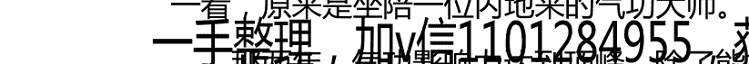

    [PAGE 116]
    ...
    

2017 年，敢约架师傅引起关注后，闲大师“隔山打牛”的视频又冲上热搜。

视频里，闲看着师子们切磋武功，一掌劈到空气上，把徒弟打得跟了电门一样抽搐。隔着五六位弟子，闲大师微微一笑，手指轻轻一戴，徒们飞身而散。“赌侠 2》里星界的绝望，就这么被她轻易实现了。

脑子正常的，都能看出闲大师有多浮夸。但闲大师去北京电视台做记者时还说：“功夫没有练到这一层，很多东西你是不感受到的。

闲芳师傅头也不少，三四家企业的董事长，某太极的传人。其实她名下就一家，还是注册到个人单位的，她早年当经理，回到回国后，几年来赚了好多帖。

历来，上手败将一位，是对自己不小心把手推断骨折的。倒是闲大师，1995 年，在石家庄长安公园与人推时被摔落在地上，从此再也没有去过公园。

和专注钱的养生派不同，闲芳太极上街表演，招徒弟都是几百块。可见闲大师早已脱离了物质上的低级趣味，追求纯粹的大师感。没想到，当大师和上网一样，都会成瘾的。

不知道她和杨永信扯起来，会是什么画面。

电王见电王，后果不敢想。

1997年的新年献文里，王小波提到两件事事。

第一件是他小时候，大人们都在做一种叫做“超波”的东西。用铁管砸出扁口，装上刀片。冷水冲击刀片，产生振荡，发出的超波可以蒸馒头。第二件是当完知青从乡下回来，发现很多人在街上排队打打蛋，以此致望神。

这些理论，不知是谁提出来的。

1997年，王小波去世。他被恼了的柯云哲，气功热消停了一本70万字的巨著，《发现黄帝内在》。现在，被柯作吹嘘的“神医”胡林文又横空出世。结果没多久，死过的胡神医就把人给卖了。

同样是1995年，张信伯从组织下岗，卖起了钩片。李秉凭借隐秘的卖处，在营销背后隐藏了许多秘密。

胡神医被倒打，张神医又来了。

几十年过去，“超波”和“打狗血”，依然有市场。王小波在信里提到的那种绝望的悲愁，一点也没有被时间稀释。

里面，原因有很多。比如当年几位科学家给张宝胜做“隔空取药”的实验，用自制的透明杯和药片，防止他作淫。张宝胜一开始拒绝，接受之后，还是设法把东西调包。然而，奇怪的是，实验没发表，《超人张宝胜》先发了。直到1995年，实验才诸于世。

再如此陈大师、张神医背后，都有营销团队。这些人四人

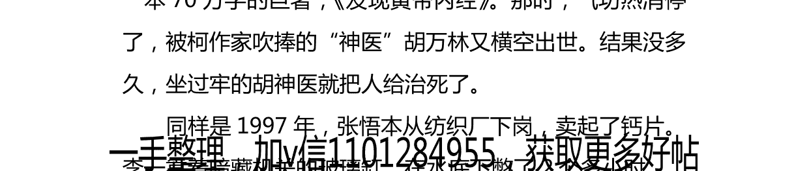

逻辑也真诚：如果是假的，为什么要放呢？

八十年代练气功，九十年代成功，新时代的养生课真是江山代大师出，各领风骚两三年。在骗子们的击下，苦的还是老百姓。

吃了一年又一年的亏，先补大力，再吞长寿，还是捂不热口口袋里的几块钱。
云鹏和孙越过一段传统相声，叫做“口吐莲花”。

为了看云鹏口吐莲花，孙越甘情愿被他拿扇子砸脑袋，砸了又一次。

“大师！您都是喷哑！”

剧场里瞬时充满了快乐的空气。

1434楼
作者：kulese 日期:2019-07-20 11:13

无论是美国、欧洲，还是日本，每个发达国家也有很多邪教和反智的东西，但是它们的传播范围都比较小，受害的仅仅是一小部分。原因在于科学的批判的声音可以任意的广泛的传播，随时弱智的邪教反智的言论到处争。

科学的关键在于可以证伪，也可以不能够证明的理论，最多只能叫假说。比如，爱因斯坦的提出的相对论时只能算是假说，很多年后实验发展起来以后，把他的相对论论证之后，才是一个科学的物理理论。再如霍金提出的的大量黑洞的观点，现在也只能算假说，还没有得到验证。

伪科学邪教，最大的就是不能够验证，试验不具有普遍重复性。父母最大的特点在于他们相信几乎一切听到的消息，尤其是主流媒体发出的官方消息。好在看到我的时候，越来越聪明了，越是主流的，支持的声音就越大。我个人觉得，对得到的信息仔细的考虑考虑，从不同的侧面推测一下，真相可能很容易就出来了。不要让情绪替代思考，

## 一手处理：直目支持和反对，人们就能得聪明起来了

希望击骗、保健养生，这种属于大众重为主。话说回来，市场交易是要利用那些脑子不好的大多数犯错，我们才能获得超额利润。1435楼
作者:kulese 日期:2019-07-20 11:13

## 8月2日晚，万科A(28.01-1.44%,诊股)、新城控股(25.57-1.73%,诊股)、荣盛发展(8.52-0.93%,诊股)等多个上市房公布的销售额显示，7月销售额同比均有所下降。数据显示，前百强房企7月销售规模同比下降29%。业内人士认为，7月份销售额环比下降，与6月份数据企冲半年报业绩有关。此外，房地产政策全面收紧预期影响也不不容忽视。随着前期积压市场需求逐步释放放缓，后置业需求明显不济，短期内房地产市场调整信号已经出现。

### 销售额环比下降

公告显示，万科A7月份合同销售面积313.5万平方米，合同销售金额481.9亿元。2019年7月，累计实现合同销售面积2468.6万平方米，累计销售金额3821.53亿元。

相比6月，万科7月份合同销售金额和销售面积均有所下降。6月份，万科实现合同销售面积489.3万平方米，合同销售金额人民币663.9亿元。

新城控股8月2日晚公布了7月份的销售业绩。公司称，7月份实现合同销售金额约245.33亿元，销售面积约220.88万平方米。今年7月，公司累计实现合同销售金额约1469.51亿元，比上年同期增长29.29%；累计销售面积约1270.40万平方米，比上年同期增长37.90%。而6月份，新城控股实现合同销售金额约295.49亿元，销售面积约253.35万平方米。

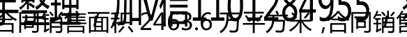

荣盛发展的7月业绩显示，实现签约面积65.58万平方米，同比增长9.70%；签约金额67.79亿元，同比增长4.1%。6月，荣盛发展的签约面积和签约金额分别为128.75万平方米和145.35亿元。

业内人士表示，房企7月销售额比6月份下降，主要是由于6月份房产企业影响所导致。克瑞研究中心显示，7月份房地产市场加速转冷，市场情绪愈加浓。随着前期积压市场需求连续释放，3月以来的“小春”行情已哑如此，而后置业需求明显不劲，短期内房产市场调整已经拉近。克瑞研究中心判断，8月份市场大概将继续走弱。

## 一手加信1101284955，兼取更多好帖

克瑞研究中心最新成交数据显示，上月企业受到影响刺激，百强房企7月销售规模环比下降29%。TOP50房企销售金额环比下滑27%，TOP3房企环比下降23%，季节性因素明显。

### 多地成交转冷

7月份，多个城市成交量均出现不同程度转冷趋势。
克瑞研究中心监测的北京、上海、广州、深圳等4个一线城市，7月份商品住宅成交环比下降。二三线城市中，长沙、厦门、佛山、重庆、宁波等城市成交量环比均处于下降趋势。

二手房市场方面，一二线二手房热门板块持续向周边郊区聚集。北京密云、北七家、良坊、怀柔、亦庄等区域及上海浦江镇、川沙、惠等板块关注度，广州新区、新塘、金洲、旧区、良村等等地同样受热。

租房市场7月份出现了“退烧”趋势。2019年7月，全国大中城市租金挂牌均价为44.19元/平方米/月，环比下降0.12%，与上月相比租金上涨跌象显现。毕业季带来的租赁热潮已经过去，毕业生租赁需求大部分释放完毕，多数二线城市租金开始平滑，一线城市及部分毕业生热点城市租金依然较为坚挺。

总体而言，随着毕业季租赁热潮的退去，7月全国大中城市租金均价下跌，市场热度减减。

## 一手整理，加微v11101284955，获取更多好帖

> 洋泽平，中国房地产是周期之母，我很喜欢这个观点。很多人把房房价调整归于政府调控，其实是非常错误的。没有政府调控，房地产同样会出现周期。

我国政府调控房地产，都是集中火力压制需求，从2005年以后以来没有增加供给。大型城市每年的土地供应都是下降的，都是宅着土地卖。而且越是发达的城市，人口流入的城市，土地却是偏少的。反而那些人口外流严重的地方，土地供应最多，这些房子都盖到了这种人口三、四、五线及其更小的城市。房子不供应，短期限制需求，这种调控起到了一个非常坏的作用。把需求压制住，然后需要时集中释放。短期内需求上升，房子供给不足，造成房价短期内大幅上涨的现象。然后，快速冻结交易，限制房价下跌，这造成房价从来不是跌，而是再一次暴涨积累。

当前投资者手中其实大量二手房，不过房价上涨，很多聪明人已经套现跑路。因为2016年这波上涨，很多聪明人已经套现跑路，首先是外资撤离，其次就是外汇储备的大幅降低。

以后政策将继续鼓励买房，这是由于产权基本没有金融属性，不能作为短期工具使用，毕竟一线城市还是人口流入，需求。要求封锁二手房，政府甚至可以大规模失业，没有大量房不起贷款，房地产是不会跌的。

大趋势变了，转折点，事后才会显得很清晰。只有少数人可能明白，就像当年一样开始房地产化，大多数同样没明白。随着趋势被动漂流，只有少数人可以明白规律，发财之后退出。每次趋势转折，都是社会一次洗牌。大多数人会被洗掉，只有少数人能够长期正确，比如李嘉诚、巴菲特等。

（注：此处后续为OCR识别重复的乱码内容，已根据语义逻辑进行清理）

自己硬的对手、仇人。市场当然完全客观、不具感情的，不会在乎交易者是赚还是亏。

99%的时间里，市场的力量要大过任何个人或机构外，市场迟早会向它该去的地方进，市场自身形成的运动向任何人能够改变。有时即便例外，但不会持续多久。

无论何时，当某位投资者说“我希望”或“我期待”时，此时他已陷入有害的思维模式，因为他已不再关注“诊断”市场的过程，而是深浸在主观的偏执和一绪情绪中。

许多投资者对万物的印象和认知就像鸭子一样。鸭子只要足够年轻，你就可以教会它们把鹅扇当成自己的妈妈。对许多投资者而言，他们不在意自己的第一规则——交易是一主逻辑是错的，他们认为自己是最大的第一规律是概率是做空。这就是可能因此成为长期的“多头”或“死空头”。

这是非常糟糕的，做多和做空都可以盈利，在交易中，任何东西心理上给给你的满足感，绝对不存在高下之分。如果存在高下之分，你的交易就会走向倾斜。

## 顺势而为

多数优良的交易系统都是以“趋势跟踪”为基础。生命本身就是要审时势、顺势而为。游走就需要完全遵循和稍有违背之间，尽力维持良好的生态平衡，保持交易的弹性。当市场趋势明显，价格做大幅方向性运动时，不要太聪明的，在大多数情况下一定持有与市场趋势保持一致的一。

在市场转向之际，可以选择先清空持仓头寸，并不急于建立与市场当前趋势方向相反的头寸，而是持观望。

对于交易这个不确定性极高的领域，你可以预期到期的就是“你无法预期”，你你可以预期市场会出现极端的情况，但你无法预测市场波动的极限，即你无法预测最高价和最低价在哪里。只要没有证据表明市场趋势发生改变，你就可以呆场内，一路持仓不动。正确的说法是：这个情况意味着上涨，这个情况意味着不再涨，而永远不要说这个情况意味着最多涨到这个时候，然后就不能再涨了。

## 风控风控风控

重要的事情说三遍，风控怎么强调都不过分。市场并不一王整理好处。

任何东西错在任何错上。所以，一旦你理解了这些，你就会意识到你需要保护性的止损。如果头寸的表现你不理解时，你就需要贪婪了，因为你明明不知道发生了什么事情，你必须能够贪婪。很多基金经理在2008年损失了50%甚至大多数，因为他们不能接受自己的错误，他们一直一直在计算，不停地说自己是正确的。

他们忽略了重点。在计算上他们可能是正确的，但他们的工作不是计算，而是交易他们面前的东西。他们不停地说自己是正确的，市场是错误的，他们所管理的投资组合有几十亿美元的隐含价值。你的工作不是创造十亿的隐含价值，而是权益线从左下移动到右上。一旦你理解了这就是交易员的工作，你将开始保护这条线的方向。

最重要的交易准则是第一流的防守，而非出色的进攻，没有好的防守，交易将毫无意义。对于持有的头寸，每天都假设是错误的，每天都把前一日的收盘价当作你的买价，知道控制风险的止损点设在哪里。在交易中，不要做英雄，迟一时之快，不要以自我为中心，不要自负，要达到“无我”之境，总能自我反省，问问自己，审视自己所能力的。

不要把注意力放在别人身上，而是要保护好自己的钱。如果看到价格向利于我们的方向突然运动，而且你对此怎么理解？可能还要高调，等亏损后再获得多的果。另外，当市场的波动性很大时，走势极为疯狂时，最好先清仓离场。当某事使你的情绪失衡，让你对周围世界的感知出现迷茫和困惑，最好清空与相关事所有的念头。不要臭名于巧犬。

不能有任何思维，赚钱的时候不能靠运气。投资是一个要去经营的事业，积胜为大战，管理风险。你不是一个交易者，你是一个风险管理者。任何投资者都做得最差事情就不无所知，你应当知道，在任何情况下该怎么做。如何才能不赔钱只想赚钱？如何摆脱失败的投资？如何保持不要从赢变赔钱？如何错误的祈祷和我希望自己是正确的欲望很多时候会损失远远大于它的正常水平。

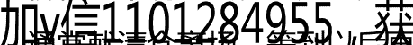

祈祷对于投资者来说是一个糟糕透顶的。要避免急于翻本的心理，不要为了尽快而投入资金甚至投入加倍的资金来进行交易。损失达到了一定金额就会影响你接下来的判断，所以你在发生损失和下一次交易间要抽出一段休息时间，这样就可以平复心情，恢复冷静。归根到底，你必须把风险降到最小，把资金保留为数不多的、能挣大钱的时候再用。

把资金投入次优的，你是承担不起的，等到大的机会正到来，除了止损，你已经没有时间了。如果某笔持一周或周还是亏的，这笔交易很有可能做错了。如果你认为交易将会突破，但到了时间，那么你就可能是错了。价格会先于基本面做出反应。伟大的交易不需要预测，都是显而见的，但你要找到交易实施方式和合适的点，并注意风控。只要不关心，就没有趋势。99%的时候你会卖空吗？你不会卖空是因为你觉得仅仅由于价格高是不够。你可以等待，等到大家都开始关注这个问题。这样是在市场下跌的时候做空，而不是市场上升的时候，因为市场充满泡沫的时候，没人告诉你市场会多远。股市持续了多年以后，谁在管理资金呢？可能是空头，因为空头连工作都找不到。那些坚持看空并在最后管理最大资金的人，不能希望股市以理性的方式结束。由于股市主导了大部分资金流向，过程可能会缓慢，但当一天发生时候，市场的波动幅度就会大。这种变化并没有必然关系。

## 数据：

我们在2008年市场没有巨大的泡沫，上涨是因为人们落后认识到严重性造成的。当市场处于强上涨时，说明了什么？但是如果股市有一停顿，比如牛市大，提醒人们可能会横盘，为了人们开始看基本面，而很多情况下基本面很糟糕。假设、信号、验证我们无法预测市场，但优秀的投资者懂得应对。任意天的价格就是正确的，然后尝试找出投资者的工作之一就是构建预期各种情景，在风险低的情况下不断尝试、实践这个想法，直到这个想法被市场证明是错误的，或者你自己改变想法。

不同的情景展现了世界将会怎样，等待他们中的一个能够确认变为现实。验证，这些情景中的大多数都是错误的，也就是说场景中只有一些要素能证明自己是正确的。最终你会出乎意料地找到某情景，十个要素中有九个都是正确的。最好的交易应该是以下方面对你有利：基本、技术面和市场的情况。首先是确定趋势，其次是处理以及技术面显示的方向与基本面动态一致；最后，当有消息出时，价格做出的反应要与市场一致。通常有两种情绪，一种是大众情绪，通过媒体来表达；另一种是市场情绪，通过价格反应来。观察市场情绪与大众情绪可能很容易出现盲点。比如一个公司发布了良好的报告后下跌，这就是负面情绪的例子。当交易完全符合三个方面的时候，头寸规模是其他规模的5-6倍。这类交易稀少，所以必须抓住。对于其他类型的交易，目标是打平即可。其中，你的95%盈利，来自于5%的交易。

## 交易方式和头寸管理

我们不仅是为了寻找赚钱的钱，也在寻找最好的方式来进行交易。实施才是关键，甚至比起交易理念更重要。如你可能找到交易策略的实施，即使再回测也可能得到很多好处。要尝试寻找一个执行交易的时点是非常精准的也能赚钱的交易方式。比如逻辑链是一种非常好的宏观策略的方式，但是它只能解释10%的东西。另外90%是实施和灵活，你执行的交易要在你错的时候有效止损，并且在你错的时候你需要自己认识到这是错。

而在实施中最重要的部分是头寸管理。入市的仓位通常比价格更重要，如果仓位过重，交易员更可能在无意的价格变动上退出好的交易。仓位越重，决定受恐惧影响而不是判断，危险太大了。仓位合适，才能避免恐惧成为指导你判断的直觉，你必须在情感可控的范围内交易。

投资新手另一个容易出现的误区是追求补涨，而优秀的投资者往往会做多最强品种，做空最弱品种。很多新手会做出相反的错误操作，他们会误认为启动启动品种还没有大幅上涨，会提供更大的利润和更小的风险，因此选择这类品种。而实际上，当某个行业走势反转的时候，这些前期启动最慢的品种往往是最好的做空对象。

股市的波动，尤其是短期波动，是神仙难断的。所有的交易者，无论是华尔街大佬，还是初入投资的小白，追求自己能准确的把握，然后加上杠杆获取更多好处，最终会被市场割韭菜。

事实是，短期的波动影响的因素越不确定。市场大部分的短期波动，其实是找不到准确原因的。这就是现在没有人能靠投资市场短期波动，长期发大财的根本原因。

反之，投资巴菲特的时间跨越长，股市的确定性越大。巴菲特：你的投资方法如此简单，为什么很少有人学习呢？

巴菲特讲：很少有人愿意慢慢地变富。我也写过短线分析，大家就没有大行情下的娱乐。短线交易，要规划买点，卖点和止损点，以后我写的时候会尽量清楚，供大家参考。

## 阿根廷：

担心资本管制后领不到钱。阿根廷政府宣布资本管制限制购买美元与转账。周一清晨银行还没开门，布宜诺斯艾斯街头出现排队。阿根廷人现在只要嗅到货币管制的变动，宁愿把钱取出放在家里。

皮达斯（Catalina Pedace）表示：“我们常常看到明天起床一切可能谨慎一点，也不要后悔。”1989年至1990年以及2001年至2002年间，阿根廷受到银行存款冻结（Corralito）政策影响。2001年，民怨引发暴动，超市遭遇劫掠。阿根廷总统马克拉（Mauricio Macri）在8月重选期间，担心阿根廷重回导致人信心崩溃，股价下跌，债券和汇率崩溃，马克拉因此紧急宣布延后执行措施。没有别的意思，仅仅一条新闻。另外，股市在数据不佳等情况下，本身就不正常。

## 全球性：针对地球的实验报告

全球性绪是一场针对地球的实验报告。作者：英华兰DrBing (ID:HiDrBing)，德国教育学者。通过无数孩子和不同家庭背景生命周期的考虑，呈现给你一副儿童教育的画面。你知道全球有多少人口？根据worldometers网站的数据，目前全球的人口是75亿多。而根据美国人口查局和联合国人口署不久前发布的最新数据，2025年世界人口将突破80亿，2050年将达到94亿！

不知道你是否想过人口增长带来的种种影响——生存空间及承载力、自然资源、气候、城市环境，以及随之来的粮食问题、土地问题、社会问题、资源问题和能源问题。当人口数量真的超过了地球所能承载的极限，会发生什么呢？

早在半世纪以前，有一个美国人就已经想到这个问题，他的名字叫约翰·卡尔霍恩（John B. Calhoun）。他是一位生态学、动物行为学专家。在他的专业生涯中进行了多次实验。花费了几年的时间进行了一项超级独特和超级黑暗的实验。实验的目的是研究：如果地球的人口密度达到极限，人类社会将会怎样？实验要怎么做呢？简单就是建立一个“老鼠天堂”。这个正方形空间就是老鼠的实验空间，在这里发生了一系列目结舌的事实。这是一个长为2.7米，高1.4米的正方形金属栅围的空间。它早期的设计如下：这个空间每一边都有四条垂直的、铁丝网做成的通道。

每条都往一些老鼠窝，并且安装了食物和水的自动投放。1968年7月，四对老鼠放入了这个能容纳3000只老鼠的空间。这些老鼠衣食无忧，没有天敌，没有自然灾害。日子不要太滋淫了！对老鼠的唯一限制，就是它们不能脱离这个空间。约翰·卡尔霍恩将这种实验称为“老鼠天堂”。

原来这些现象不仅从社会学层面，还能从动物行为层面得到解释。

这些“美丽的人”，选择脱离表演性的社会角色，利用自己的名人身份，享受着年轻人的爱慕和追捧。

在这个不需要英雄主义和重力劳动的温情时代，身体强壮的男性失去了他们他们在社会上应该有的角色和地位。

这种紊乱的景象被专家认为是一种社会功能的失调和哀哀，也是人类萎缩的原因之一。

## 母鼠的攻击性增强

由于雄鼠无法放弃它们的领土和雌崽，各个放弃社交，当雄鼠失去乌头，此时雄鼠变得具有攻击性，开始担当保家卫国。

国的女性，她们所追求的是，放弃奶的。这显然与这一百年来在世界各国风起云涌的“女主义”风潮相合了。

在中国成立以后，由于经济发展，迫切需要大量劳动，“女性能够半边天”，女性与男性同场竞争，这在一定程度上促进了女性更多参与竞争，而不是在家奶。

当然啦，对于女性个体而言，这是一件好事。就世界上而言，结果就是，孩子越生越少。

## 失偶雄鼠变得完全与世无争

鼠群族群在奇异时期繁衍减少之后，对他们的行为习惯的改变是不可逆的。

放在人类身上一样，惧怕社交，失去与人互动的能力。

网上曾有一个新闻，说的是一名拥有加拿大滑铁卢大学硕士学位的青年，毕业回国后整整7年，除了玩游戏就是睡。

而他的生活开支，全由患有尿毒症的老母亲供应。

一切似乎和和“乌托邦”环境中的老鼠一样，这些人对外面的世界漠视，对身边的关注程度很低。

就像我们在《三大神》和《低欲望社会》：如果痛苦的话，就不要努力了吧”里写的一样，是“全垒人生热情低”。

因为现代社会中，所有空间似乎都被定义了，新一代人被禁止更高级的活动，因为大部分社会角色都被占用。

类似“老鼠乌托邦”环境，现实社会逐渐出现两极化，有一群进入全球世界，他们享受着所有的有利资源；另一群人则就穷尽一切无法进入，他们只能被关闭在底层的那个世界，成为“失落的一代”。

## 总结：

约翰-卡尔宏鼠实验确实能够带给我们很多启示。

现如今，我们的竞争标的物早已不再是“食物”，而是平等的权利和资源，是每一个人向上的攀爬的通道。

而这种东西在目前的社会环境下，公平分配还差得很远很远。

不过，人类也在不断打破原来的道德规则，建立新的规则。

比如，逐渐开放“非婚生育”，默认孩子可以跟从母亲如北京实行新的“落户政策”等等。

但最重要的，人类和老鼠是不一样的。这个实验虽然看起来很吓人，但我觉得不用太置于悲观。

因为在过去这几千年，人类靠着自己的智慧，不断打破物质匮乏与资源紧缺的围垒，不断辟出广阔空间，造成新的循环。

# 一 信任与信任

我们觉得我们，“能够实现，“完成”更多超出成就。

最终，人类的走向如何，我们还需要更长的时间来验证。

对人类而言，如果动物繁殖的太多的，我们就吃掉它。

人类本质上仍然是一种动物，我们总是过度高估自己的智慧，尤其是群体性智慧。不可否，人类中绝大多数人其实依靠本能生存的，不怎么依靠逻辑思维的能力。这会导致群体性的行为，跟同样依靠本能的动物区别不大。

在投资市场上，群体行为导致的价格波动，就是最好的例子。追涨杀跌，永远是投资市场的主流。作为一个投资者，顺应趋势才能赚钱。

逆向思维才能成功。问题在于顺应趋势就是追涨杀跌，逆向思维是越跌越买，越涨越卖，两张思想是完全相反的。

如何做到两种思维共存？

答案是根本不到，想钱只能采取其中一种。你要技术分析，走追涨杀跌的路子。你要价值投资，走逆向思维。

核心心只能是一种思维。明确自己的性格，匹配一种自己的交易思维，在这个基础上，建立交易规则。在投资市场上混得久的人，通常都比较谨慎，因为每天都有打击市场的打击。无论你的交易体系多么完备，错误都是经常发生的，甚至错误率都不是固定的，某种行情高下，剩下的行情低些。

一个人只有总是对，才会骄傲，才会膨胀。投资者面对的环境是，不停的对，不停的错，用多赚的弥补赔的，剩下的才是到手的。

这种工作很难让人自满。

# 1937 楼

作者:kulese 日期:2019-09-15 16:59

## 苹果手机不再提价

苹果 11 发布了，这次价格没有上涨，最低配置的反而下降了50美元。为啥？

苹果手机从2015年以来，销量一直没有太大的进展，而是靠价格来提高企业利润。现在苹果手机的价格都上去了。

这是本轮手机互联网、4G引发的经济增长，走到了未路的标志之一。美联储降难，不能解决消费终端需求，因为美联储的降难都是钱给了金融机构，而金融机构不会把钱借给已经负债累累，已经不起钱的普通居民。前几年那些疯狂融资撑起的独角兽现在也遭到了市场的白眼。不停地讲故事，不停的融资，就不赚钱，投资者的耐心是有有限的。

每轮经济衰退的直接导火索，都不一样。以当前这么低的利率水平，经济衰退的幅度可能也不会太大。但是，没有新的经济增长增长点之前，新一轮经济繁荣也难出现。毕竟，人工智能、自动驾驶等关键性突破，距离产品上市，还有无限的距离。

上一次科技泡沫破裂，是2000 年美股估值过高。这次美股的估值看起来并不高，仔细分析后发现，其中股票回购贡献了 50%的涨幅，实际公司业绩增长贡献了另外的 50%。苹果的盈利不再增长，股价全靠回购的时候就要来了，市场将会变成怎样？谁也不知道。

苹果真的不便宜了。每次引发美股暴跌的直接原因都不都，提前谁也不知道，我们等待吧。

从从50和300看，A股市已经走了5年，2015年高点、2018年高点、2019年高点，每次都更低。

这类股票的特点是。当股市涨最后，没有能量了，A股会有一次自由落地，那是我们真正期待的。

# 1938楼

作者:kulese 日期:2019-09-18 21:03:34

@为学大益 2015 2019-09-16 08:11:59

k大，来讲这次沙特大火带来的影响吧。

这次沙特大火带来的影响各种解释都有，有的认为沙特可以短期好，释放石油储备，有的认为是沙特产量很难恢复，油价中会上涨。

## 一 信任

（注：此处原文OCR存在大量乱码、重复及错位，根据上下文逻辑整理如下）

我是看这个问题。中东现在是药桶，主要玩家有：
- 美国
- 俄罗斯
- 德国
- 沙特
- 伊色列
- 剩下的都是次玩家

我是看这个问题。中东现在是药桶，主要玩家有：
- 美国
- 俄罗斯
- 德国
- 沙特
- 伊色列
- 剩下的都是次玩家（此处重复内容）

我是看这个问题。中东现在是药桶，主要玩家有：
- 美国
- 俄罗斯
- 德国
- 沙特
- 伊以色列
- 剩下的都是次玩家（此处重复）

（注：原文OCR段落极其混乱，以下为还原后的核心逻辑内容）

页岩油开采高峰已经过去了。这可以从德克萨斯、内达科等州的就业情况分析出。页岩油开采成本太高，页岩油存在变量，我认为页岩油短期内无法替代。

由于页岩油开采成本太高，短期内无法替代，经济活动中，油价可能会波动。

油价上涨的后果非常严重，全世界的经济活动中，能源占了40%。如果油价持续上涨，会导致 CPI 高涨，当通胀严重，欧盟、美国的低利率就会变成，加息成为唯一选项。各国货币的信誉就会由于通胀严重，各国货币就不灵了。

中间的道理是，现代经济学，家庭足够的物资，粮食够吃一个月的已经多了。如果所有的物资再快速上涨，大家都会开始抢购。由于物资上涨，大家就会疯狂抢购。各国的负利率，超发货币就会破产。

本文的货币主义的基础是，必须要过剩，超发才会导致通胀。在页岩油革命之前，石油就是靠钱印出来的。当经济过热，石油供应不足，就会大涨。比如2007 年涨到147 美元，全球通胀。

美联储只能加息，最后房地产泡沫破了。现在这事有变数，如果页岩油继续获得大规模贷款和发债，油价会涨起来。那些负债累累的页岩油公司倒闭，油价会下跌一点，重新平衡。也就是说，美联储印钱可以。现代投资学：均值回归。石油作为一种重要大宗商品，价格在低位维持已经持久了。

三年多之后，肖钢说：

“要纠监管上的‘父爱主义’，这是一个重要的经验教训。”

“要深刻理解股市价格的信号，不涨涨跌成戏，要管好政府和监管的有形之手，做监管应该做的事情。”

“作为监管机构，第一职责应当明确，就是就是要把市场发展起来，特别不要把股市涨跌作为市场发展的考核。”

尽管在证监会任上的肖润出过一些失误，但他是个实在在人，昨晚他这番痛定思痛的话也圈了不少粉。他的这番话，以及他的建议，相信会得到有关人士的重视。

略为可惜的是，如果他上任的时候就能这么明白该做好啊！

在此，我们衷心地希望，A股市场的监管者们能够多多学习借鉴国际成熟市场的成功经验，有桥可走的时候，尽量别主动下河摸石头了。

人在不在乎自己利益的事情上，都清楚的是是非对错，明白自己应该怎么做。

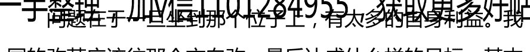

在这个世界上，有太多的复杂的利益诱惑，我们国家的改革应该往哪个方向，最后养成什么样的目标，基本上大家都是清楚的，问题在于有太多复杂的利益纠葛。

人的一生中，应该明白的道理，在小学其实都学过了。

但是，真到我们长大后处理问题的时候，是非对错从不成为我们处理问题的主要标准。

所以，中国股市不太可能有什么实质性的变化，因为管理者的利益和参与者的性格，都不会改变。

类似这样的折腾，在这片土地上，从古至今不停的演出，从来没有停止过。

1984 楼

作者:kulese 日期:2019-09-19 22:05

linjianhua2015：黑名单 举报 2019-09-19 09:40:56 评论

楼主讲的好。不过还有一个问题：既然中东乱是最好的选择。为什么从15年石油探底后就维持了这么多年的和平？定要等到今天才乱？应该是越早越好。有斥力是不是也有相应的吸引？

当时的页岩油处于爆发期，产能是上涨的。而且传统的油产量没有下滑，传统产油国里钱也太多了。

# 所有事情都是有机的，所谓天时地利人和。
一手处理加v信1101284955，获取更多好帖

作者:kulese 日期:2019-10-15 11:59

只有规则和制度，才能遏制人性的阴暗

1

说盗墓一般要两个人，比如打一个洞，其中一人下去去取珠宝玉器，另一人上面用绳子系起来，但一开始，经常发生了拉绳人见财起意抛弃下面同伙而去的事。

于是演变为盗墓团伙以父子同居，但也发生了儿子扔下墓里老子的事。

最后实行规：儿子下去取货，老子上面拉绳子，再没出现过把人落在墓坑的事。如果这算是制度建设的鼻祖，那么不如以贼为师。

# 2

德国有习惯，以前的人喜欢帮别人扶门，有人说德国群众天生素质就高，其实也不尽然。

真正的原因是联邦德国成立后，政府制定了一套规则，比起以前德国有法律规定，关门不小心把人撞了，你得无条件赔偿，还要帮医治。

这些规定都很很好，操作性很强。还有遵守交通规则、按序排队等、随着时间的推移，这些良好的行为就成了习惯，这个社会就变文明起来了。

# 3

一手数理加微信1101284955获取更多站点

落地期间，英国雇佣降伞的合格率下降，意味着从概率来说，每一个跳伞的士兵中会有一个因为落伞不合格而牺牲。

军方要求厂家必须让合格率达到100%。厂家99.9%已经是极限，除非出现奇迹。军方（也有人说是巴顿将军）改变了检查制度，每次交货前从降伞中随机挑出几个，让厂家负责人亲自跳伞检测。从此，奇迹出现了，降伞的合格率达到了百分之百。

# 4

有一段时间，英国政府雇佣私人船只运送犯人，按照船的人数收费，多运多钱。很快弊端出现了：罪犯的死亡非常之高。

政府官员极钻想降低犯罪运输过程中的死亡率，包括派官员上监督，限制船数量等等，却都失败了。最后，他们找到了盈利的办法，就是将付款方式变换：根据船的人数收费改为根据下船的人数付费，船主有人活着送达，才能赚钱。新政策出炉，死亡率立竿见影到了之一左右。

# 5

其实，无论组织还是社会，好的制度能让坏人不做坏；不好的制度会让人变坏。人的欲望是无限的，人性的好坏也是随时变的，只有在明了权利之下，用一套组织去监督，才能可能有一个和谐的环境。

人性有光辉面，也有阴暗面，实话说的好：只是背叛的筹码不够，这种诱达到一定程度，人性阴暗就会触发。千万不要相信人性，只有规则和制度，才能约束人性的阴暗

无处发挥！制度发挥了人性善良面，打击了人性恶面，会导致良性循环，经济越越好，社会也就越来越好。比如保护制度，打击了盗版和仿制，鼓励了创新，最后社会的人力和物资投入到创新方面，国家就会先进。相反，一个国家的制度如果鼓励了人性恶，打击了人性善，可能一时取得发展，最终的结局一定是整个社会的崩溃，秩序不存在。人类大多数事情，长期发展，结果都是必然的。人性光辉面，抑制阴暗面，在制度中胜出的，最后都是鼓励人性光辉面发挥作用。我们相信光明和正义，所以每次危机我们体会经济变好，中国会越来越好。

1楼

作者:kulese 日期:2019-10-15

说说a股

在利空谈判的利好刺激下，a股重回3000点。后市有

# 三种可能：

第一，在2900-3000点之间震荡一轮，然后上涨到3150以上，动力衰竭，本年的上涨全面结束，时间差不多是1月下旬。可能性40%。

第二，直接上涨，中间幅度调整，目标3200，大概率冲不过去，也是一个月左右上涨期，本年上涨结束，可能性40%。

第三，在开始调整，本年的上涨阶段全部结束，缓慢开始下跌，可能性20%。

操作建议：现在持股的，可以继续持有，也可以把短线仓位出掉，等了再做T，如果直接涨，就追涨买进去，怎么样操作不亏。加信1101284955，获取更多好帖。现在持币的，买0.5仓位300ETF，如果直接涨，等待获利结算。如果跌了，等到2900附近再买入0.5仓位，股市涨过3150，破2850止损。操作盈亏计算：平均成本2990*0.5+2900*0.5=2945，成本线在2945，破2850止损，亏损3.2%；涨过3150盈利，6.9%。总体方案评价，参与仓位不应超过总仓位20%，胜率与仓位匹配，盈利与亏损空间较小，鼓励行情。市场不确定风险，满仓等待。现在总体预期是有好结果，如果突然恶化，市场难及。

总体上讲，a股上涨行情接近尾声，最好的情况是有最后一波涨。今年年底开始，a股开始新一轮下跌，再次破2500的可能性较大。

不要幻想慢牛，我们a股从来没有这个东西。要么疯长，要么疯跌，要区间震荡。缓慢地一步步上，不符合我股的节奏。主要原因是资金来源问题，没有长期资金稳定的入市，就不会有股市长期的上涨。我国股市其实就是脉式、爆发式上涨，只不过政府不允许跌太太多，总体上看股市一直在涨，本质都是短期刺激经济。

# 一手接楼市价格泡沫。意见：每年跌16%，持续买入的情况如何？

现在a股有外资的持续买入，是一个变数，问题在对外买入的钱没有股市圈钱的速度快。2018年，外资也是持续买入的，a股还不是跌到2440。

1楼

作者:kulese 日期:2019-10-15

我家楼住着一位万富翁。作者：北北看剧来源：北北看剧才知道，我家楼住着一位万富翁。这位先生四十岁不到，个子不高，一米左右。以前在电梯里或是在小区的路上看到他，总是穿件有点皱的衬衫，单肩背着电脑。这幅描绘差不多，他家的空调排水管水滴到我家阳台上，我去楼上找了，他态度很好。他硕士以后在民营科技上班，工资不算高，是我的三倍。我很幸十年前买了房，虽然抽光了积蓄，但还是要贷款，每月还房，现在几年收入没什么压力了。虽然家庭压力不大，但是看起来还是很有压力的。早上七点半送儿子去上学，在电梯里遇到他，晚上吃饭，老妈遛小区也能遇到他。跟他打招呼：“刚上班啊！”他说：“是。”不过最近有点变化。连着几个个月，早上在电梯里遇到他。下午四点钟，我去接儿子时看到他在小区的篮球场上打球。和一群年轻人一起玩，有时悠闲地打盹。眼镜了，有点皱的衬衫也不穿了，改穿休闲装和运动鞋。如果以前是个典型的码农，现在像是像是精英了。昨天下午，我去抽油，路过篮球场时他正坐在场边休息。这次我主动跟我打招呼：“你好！今天休息？”顺口问。“不是。我们公司现在没活干了，想去就不去，”他一脸轻松。

“你公司干啥呀？”我又顺口问，“一手整理，加芯片设计。”他说：“芯片设计！”我没想到他这么高上的工作，同时也起了我的好奇。贸易战、华为有关，可是当今热点！可是怎么没活呢？“芯片设计现在是很火的行业呀，你们公司怎么......？”我不解地问。“我们公司两年前上市了，就是那个XXX。上市后大家都没心活了。”他脸上的表情复杂，多半是自豪，也有小小不满。我笑着对他点头，告别，心里带着问号。回到家，我打开电脑，查这位邻居工作的上市公司。查不知道没有名的原始股东，查吓一跳！这家公司的股价超过500块了，总股本8亿多。我稀记得老妈说过的信息，说他们工资高，因为老板没钱，奖金从未发现，而是给股份，每年称十几万到几十万的奖金，都是给股份！我我又查了原始股东名单，看到这位邻居的名字，他持有1%头的股份，按照现在的市价，值5亿多！虽然还能不能现，但还有限售期。后面还有股权激励，加上经理，之类的我可能少得了。今天我收拾好东西，匆忙回到家在篮球场边遇到他，不自觉地敬了很多。“你好！你们公司好害！”你说我们股价呀，我也不搞懂做事。你说这些炒股的人都和你一样的，打一场篮球就涨个百万，打一场篮球就涨涨百万，我就等着限售解禁，公司干啥呀？”我靠懂炒股的人想，要懂的话早不用天天搬砖了。于是我问：“那你们老板怎么打算？”

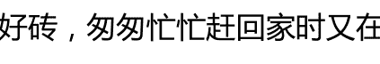

“来得快！”

我本来还想问问他有什么打算，但是看到他每天打篮球的样子想想还是算了。我不知道邻居还能做多久。我想我是资格为一个万富翁操控的。看到“饭桶老板”，想起来当初暴风科技最高的时候，市值也就400多亿，冯晨后来再在并购上。应该这位邻居早日套现享受人生。这就是科创版的后遗症。A股的中小创都是高估的，风险巨大，业绩不稳定的垃圾公司，比如乐视、暴风之类。这些背后就是黑底的炒作。问题不仅是制度不合理，更大原因是股民的投资偏好。没有暴涨的财富效应，就没有散户的参与。所以，不要总是抱怨A股是监管等制度问题。上严监管，结果就是成交下降，马上没人玩了。A股的制度改革才刚刚开始，股民的成长也是一个漫长的过程。大家明白其中的骗局就好，那些抱怨你的故事别当真。索罗斯说：资本市场是谎言的连续剧。想赚钱就要在骗局开始的冲进去，谎言被看破之前，退出来。

市场的规则就是少数人赚钱，多数人赔钱，无论在中国还是美国，大家总觉得美国股市长期上涨，大多数人都赚钱，这仅仅是假象。美股真实的时候，没有多少预兆，没有人能预测，就说是基本上没有多少人能逃出来，恰恰是专业投资者。A要是交易规则成熟了，就没有散户参与了。小股民本质上是A买的一夜暴富的梦想，是一种消费行为，所以也别想赚钱。

作者:kulese 日期:2019-10-19

说说a股

在利空谈判的利好刺激下，a股重回3000点。后市有

# 苏联到底花了多少钱

2001楼 

作者:kulese 日期:2019-10-26

# 苏联的巨额损失和教训

二战结束后，苏联为了挑战美国霸权，为了求全球领导地位，在冷战开始时期开展大规模援助，尤其是后期，超出国力承受。苏联对12个社会主义阵营和49个第三世界国家提供了援助。赫鲁晓夫下台后，受援国增加到27个。勃列涅夫时期，苏联进一步加强了，培养了世界势力，数量达到64个，几乎涵盖了所有的重要的世界国。那么，苏联援助到底花了钱呢？

苏联官方公报，1967年至1972年，每年援助940亿美元到865亿美元，这个规模大致相当于苏联国民生产总值的8%，远超美国。直到苏联解体前，面对民众“公开”压力，苏联第一次公布了援助规模：截止到1989年，总额8580亿卢布。苏联解体后，俄罗斯继承了对这些国家的债权，但是绝大多数国家随着没有了苏联支持，经济财政急剧恶化，失去还债能力，最终绝大多数债务都被免除了。分别是：古巴288亿美元、朝鲜101亿美元、伊拉克120亿美元、蒙古112亿美元、阿富汗105亿美元、叙利亚98亿美元、利比亚46亿美元、阿尔及利亚47亿美元、土耳其48亿美元、也门53亿美元、摩桑比20亿美元。另外，减免比例不详的还有巴基斯坦50亿美元，南拉斯夫43亿美元，坦桑尼亚20亿美元，赞比亚10亿美元。（巴黎俱乐部网站）这些这些债务额里面包含苏联解体后的利率（约2.5%），然而扣除利息，基数也是很大的。另外，这仅仅是部分国家的债务情况，绝大多数欧拉美国家都没有算进去。

由于援助规模很大，在很多国家的经济中占很大的比例，甚至成为一些国家赖以生存的生命线。据统计，苏联的援助项目和贷款占据了印度工业产值的17%，亚洲经济总投资的15.3%，富汗工业投资的30%以上，伊朗、阿尔及利亚和埃及等国家60%以上的工程是苏联承包的。苏联解体后，朝鲜、越南、古巴等长期依赖苏联的国家，经济立即陷入巨大困境。六七十年代这些国家都是耀眼的“社会主义明灯”，人民生活普遍比周边发展中国，其实是苏联让民众紧绷腰带，大力输血的结果。

有人以为苏联是高积累、低消费的经济模式，即使是赫鲁晓夫的模式也不完全如此。苏联在70年代后期经济状况就开始衰退，开始向西方发达国家借债，苏联解体的时候，已经欠下西方660亿美元的债务，以至于成为90年代俄罗斯的债务负担重到，普京时代还清。然而，一方面对外债，另一方面大力援助苏联，维持“强国形象”，这实在是匪夷所想的“打脸充肚子”。

二、高风险低回报的援助

苏联巨额援助是否获得了巨额回报？是不是美国等西方国家没有能力援助和开发这些亚非国家，只有苏联独特慧眼，抓住了第三世界的机遇？答案是否定的。

首先，苏联援助的都是穷国，根本没有偿还债务的能力。苏联援助外交初期，受援国债情状况并不乐观，1955至1968年，按照计划应当偿还32.67亿美元，仅偿还9.09美元（Donaldsdor, P25）。进入八十年代，苏联的援助进入高还款高峰期，计划每年受援国需要偿还40亿卢布斯左右，但是通胀不足20%。苏联解体后，俄罗斯虽然继承了对这些国家的债权，但是绝大多数国家随着没有了苏联支持，经济财政急剧恶化，失去还债能力，最终绝大多数债务都被免除了。

非洲开拓影响力的机会来了，立即与其签署《苏埃友好条约》，向其提供50亿美元的经济、军事援助，派遣专家顾问8000人帮助埃及及发展，还为其修筑了举世闻名的“阿斯旺水坝”。然而，没过几年，萨达特转而与美国、以色列列阵，苏埃关系急剧恶化，先是1976年废除《苏埃友好条约》，关闭联合苏埃及的外交机构，最后，1978年萨达特慷慨激昂地在人民会议宣布终止偿还所欠苏埃及的债务约40亿美元（苏苏广，1987）——一厢情理想领导和控制其他国家的苏联漠视教训，三年后，萨达特遇刺、麦巴拉击落，苏联再次向埃俄提供援助。

利比亚的情况也是越来越恶化，苏联曾向利比亚援助46亿美元，然而利比亚未能偿还，还导致债务被吸收。苏联宣布免除利比亚45亿美元的债务，即便剩余还需要偿还的1亿美元，卡尔菲是拒绝偿还，2008年他访问俄罗斯的时候，普京作为主人又在欢迎的宴上宣布免除。

苏联为什么会在这种低回报的道路上走越远？这源于苏联的目的和决策机制。首先，苏联的霸权不断膨胀，急于建立世界领导，过度迷信自己的实力和金钱，采取了机会主义的“金元外交”的方式；其次，苏联不像美国的对外援助一样。

这样的机构评估，要经过国际会的批准，苏联政府要援助多少钱，基本有少数个人说了，这种充满意志的决策很难是明智的；再次，对于第三世界的问题，长期受意识形态影响，以越正义、越富裕的民族越反动，因此苏联认为越是落后国家、越是地区越是坚定的盟友，西方发达国家多年积累了丰富的经验，而是采取了风险极低的、贸易优惠的形式。

## 三、不计成本的援助

苏联对第三世界的需要，其经济援助是不计成本的，苏联希望用技术换来世界领导者的形象。

- 第一，赠予。早期苏联对发展国家贷款的大约30%属于赠予，不需要偿还，但是到期。1979年到1980年签署了25项援助协议，其中有17项是100%赠予。（陆泉，740）

- 第二，贸易。苏联对发展国家采取廉厚的贸易政策，以高于国际市场进口，低于国际市场出口。以古巴为例，古巴出口蔗糖为经济命脉，苏联保护价格如1968年国际价格为12美元，而苏联收购价高达1981年到1985年，苏联为古巴提供的甘糖补贴高达157亿美元。另一方面，对于古巴严重依赖的石油，苏联以低于40%定价出口。

- 第三，贸易信贷。同时苏联在贸易上，也为发展中国提供大量贸易贷款。第一种是受援国贷款购买苏联设备，比如苏联在50年代初期对华贷款基本都是用于这些。第二种情况是苏联与受援国往来贸易顺畅，受援国无法弥补贸易赤字，由苏联提供贷款来补助。例如，80年代，苏联每年对越南贸易额有7亿美金，而这些贷款竟变成还给越南的。由于发展中国家偿还贷款的能力，最终白嫖了这些东西。

- 第四，项目援助。苏联热衷于第三世界推广基础设施建设和大型工业基地，也认为这是帮助第三世界富强的最好路径。然而对于大型工程，落后国家无力承担，一般由苏联为其一部分资金以及绝大多数的技术设备，而建成后通过运营生产出来的物品抵押。1982年，苏联对外建项目总数4512个，交付使用的2707个。这些建成的项目生产能力为：发电装机容量4750万瓦、钢铁7720万吨、石油4930万吨、煤炭4340万吨、焦焦2780万吨、肥化245.7万吨、水泥990万吨、铁路4976公里、公路2150公里。（陆泉，672）。

## 四、苏联援助效果评价

大规模的对外援助，大大推动苏联成为全球影响力国家。苏联的对外投资和贸易，对于推动本国经济发展也起到了重要作用。首先，刺激了本国军事工业及相关工业的发展；其次，广泛的第三世界国家的投资使得苏联获得了大量能源和原材料，尤其是本国缺乏的有色金属、橡胶等资源；再次，对发展中国工业和基础设施的援助，消化了本国的过产能，在一定程度上延缓了经济衰退的。

但是，从长来看，苏联的援助政策是失败的。从根本上指出，苏联的经济并没有获得预期的胜利，然而苏联通过投资换了政治好，对于其需要的援助获得政治盟友，但是它的愿望总是不能实现。苏联曾重点援助的南斯拉、中国、埃及、智利无一不是最终反目。更多国家与苏联友好却是换来的，尼克拉斯说“如果没有经济和军事援助，莫斯科在第三世界的朋友们连一个都支撑不下去”。至今日，俄罗斯在当年苏联曾经经营的绝大部分地区都没有影响力，苏联的援助并没有像英国、美国那样在经营过的地区留下了丰富的“外交遗产”。从这一点上讲，苏联就败了。

从经济回报来看，苏联投资的建设周期长、回报少，多数工程成为烂尾工程。苏联援助帮助发展中国家，这种风险越是苏联的，由于发展中国家没有偿还能力，苏联援助也没有改变落后国家的面貌。虽然为落后国家，苏联援助提供了不少贷款，但现在依然是最发达国家，事实证明苏联模式在落后国家是不适合的。

总之，苏联虽然扩展了全球影响力，但是并没有建立世界领袖地位。反而到后期，苏联产生的极端越来越明显，苏联模式的神话逐渐破解，苏联军事力越来越动弱，在国际形势下，苏联价值转向完全负面。目前，中国构建世界秩序的努力与苏联相比，面临机遇，实现复兴具有现实鉴意义。不要解读吧，苏联的实用主义对于美国、英国来说，是非常成功的。

的光碟定价 26.24 美元，删了 cookie 后发现报价变成了 22.74 美元。事情曝光后，亚马逊迎来了潮水般的指责，亚马逊 CEO 贝索斯亲自道歉，称一切只是“实验”。

互联网时代的消费社会，无非如此的。

个人信息、隐私，在电脑算法、机器学习的挟持下，输出给个人的广告或信息，都是经过精心计算的结果。大数据杀熟，不过是算法泛滥俱下的一种。

在算法的挟持下，电商平台会给你闰样的价格，贷款公司会给你风险定价“适当”的贷款利率。这背后，是大数据定价和不可摧毁的技术黑箱。

1970 年，与《消费社会》的奥德里亚并想不到，他的观点在数据中，被赋予如此限制和维持的秩序。拉康德说，消费的主体，是符号的秩序。

今天的消费不是人的真实消费，而是意义系统的消费，是消费的统治者为符号创造的。

我们看到商家不会针对某个人的作恶，大数据算法和传播媒介只会让它所有人的作恶，面对就是被奴役的个人。

2002 年上映的科幻惊悚电影《少数派报告》，曾出现一样（大意）：汤姆·克鲁斯主演的约翰·安德顿进入商场，大屏幕上出现一个定制给个人的广告，并推销给他说：约翰·安德顿先生，您上一次买莱克已经过去 3 年了，您要买一件新的皮夹克吗？

这种科幻情境，在大数据时代正在成为现实。面对算法，消费的消费者不再是物，而是符号，组成这个概念的传播、数据、个人信息元素，当双十一的消费盛宴临，大众传媒取代了工厂，成为符号消费主导性的生产线。正如鲍德德里亚所言，现代科技已成为养大的狼，反噬其主。如今消费社会降临，双11已经没有少数派。

消费主义的核心，让欲望控制人类。对物质的追求与环境的比较，变成了人类基本的欲望之一。最终得到的我不要的，却不管我是不是真的需要的。

大量需求是被创造出来的，靠广告宣传强行加上普通消费者的概念。为了追求这些欲望，人们拼命工作，用各种不合法的方法追求金钱和财富。

成为欲望的奴以后，独立思考的时间机会越来越减少，这让羊群效应，在一个知识和信息都爆炸的社会，丝毫不没有。

古代知识传播手段落后，人们普遍教育程度低，容易产生羊群效应。当代，知识传播手段如此先进，人们受教育水平已经很高，有独立思考习惯的人还是一样的少。充分说明，人在思维上是有倾向性的。原因也可能是生理上的，我们的大脑消耗能量比较多，4%的重量消耗 25%的能量，如果再不停止思考，确实会不舒服。

少动脑子，消耗能量很少，人更轻松一些。其实，人在各种事情的时候，都受到多巴胺的影响。

现在的我们，并不比千年前的人受自身生理因素影响小，人类进化的速度慢了。

说这些是什么意思，其实很简单，投资市场的大部分分歧，背后都是少数人的贪婪和恐惧，如是如是。那些高学历的基金经理，普通投资者就像如此。

# 2018年，跑赢标500指数的基金经理只有11%。

由于有少数人的赢钱效应，才有更多的人参与到投资这个游戏来。想要成为少数人，就是要跟普通人想法不一样，你能做到吗？

3491 楼
作者:kulese 日期:2019-11-20 22:01

A股从技术分析上看，已经是2019年行情上涨的收尾期，前期热点板块已经在最后出货阶段。大盘冲高一轮的可能性30%，直接下跌的可能性30%，继续横盘的机会30%。

按照之前的操作建议，大盘2990买入0.5成仓，大盘2900附近买入0.5成仓300etf，沪深300成本在2930 附近，现在赔了不足 0.5%的样子。2900 附近买入 1 仓位的，现在的盈利不足 1%。维持之前的操作建议，冲高 3150 止盈，跌破 2850 止损，现在观望。行情下，能够追到热门板块龙头股票，不被板块轮动反复打脸的高手，一般选手继续修炼吧。

从大的方向看，我认为2440 不是新牛市的起点，仅仅是脉冲式上涨的一轮。而本轮上涨从5 月份后，已经显露出复杂结构，能量持续萎缩，能突破前高 3288 的机会渺逝。

热点指数上证 50 和创业板，都有复杂龙头的明显特征。

# 一手整理，加v信1101284955，获取更多好帖
