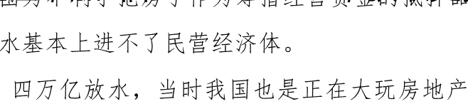
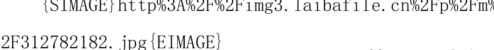

# 黄金价格这个玩法，意味着国际性大通胀时代的降临

高天无影1
作者：高天无影1 日期：2019-08-08 19:01

1、我们还有降息空间吗？我的答案是。世界降息潮，我们没牌可跟。

1楼
作者：高天无影1 日期：2019-08-10 00:20

1、早年牛叉的万元，在伟大的通胀面前不是玩耍。

2、世界性通胀，可能会让山广场跳舞，大妈跑到联合国一手处理这糟糕局面，获取更多好帖。当然了，同样之事可做这样解读：山东大妈用停止去美国国游抵制美邪。

5楼
作者：高天无影1 日期：2019-08-10 00:31

我们必须面对世界性价格体系重构，还有汇率这个因素，问题在于，我们许多没有应变或对冲这种风险的条件和机会。

6楼
作者：高天无影1 日期：2019-08-11 12:34

(记录一个今天突然想到的问题)

昆明人民小康路上有信心：
- 扶贫攻坚，云南好；
- 乡村振兴，云南还是好；
- 旅游反制美邪、台毒等，对云南更好，那些没去的游客只有云南来说玩了。

7楼
作者：高天无影1 日期：2019-08-12 11:33

天地为炉，阴阳为炭。

8楼
作者：高天无影 日期：2019-08-12 11:42

天地为炉阴阳为炭。
坎卦：上六，系用微吝，贞于丛棘，三岁不得，凶。【白话】上六，被绳索重重地捆缚，囚放在荆棘丛生的牢牢中，长达三年不能够解放，十分凶险。《象》曰：上六失道，凶三岁也。
（鱼村的问题，大概就这个事了。）

9楼
作者：高天无影1 日期：2019-08-14 00:04

@专治虚空 2019-08-12 12:44:42
除了印钞，用更大的泡沫掩盖当前的泡沫之外，别无他法。一条死之路。

- 1、资本打死也要往房地产跑，这是共识了。硬币两个面，为何大家都回避看另一面——资本毫不死不进实业实体？归根到底，是投资环境发生质变了。
- 2、计划经济为主市场调节为辅，或鸟笼经济，可能几个好的底念就这。
- 3、......

11楼
一手整理加信1101284955获取更多好帖。各家泼沐尽秋永固。

12楼
作者：高天无影 日期:2019-08-14 09:13

鸟笼经济，这个经济制度是80年代中期的主导路线。是陈云对“计划经济为主市场调节为辅”的形象描述，鸟笼，就是希望对整体经济操控自如，可管制性是其突出特征。其时，是李总理时代。

13楼
作者：高天无影 日期:2019-08-14 09:38

好像是这样。目前山东、江苏、上海等地大规模的“农民中居”摘得如火如荼，还有马上开始的河南，把农民省兜底的钱都挤掉出来，建设美丽家园。

对以上问题的回复：
乡村振兴，不仅单纯是全小康之上考虑了；以后将提振内需、扩大消费这个重要因素了。如此，在立意上它在企取代房地产预期。
是故，我说：乡村振兴蓝图宏伟瑰，其中，又必以村庄规划与治理为要抓手。

一手整理，加v信1101284955，获取更多字体。
作者：高天无影1 日期：2019-08-14 09:51

汇市不破，房市无忧，股市无戏，是我数月前的断言。黄金大牛之利，我于去年年末做出。现在，汇破了一下，但我还不想修正前判。

18楼
作者：高天无影 日期：2019-08-14 10:04

汇市的另一个视角：
1970~1990，日美贸易战，是日元汇被迫大幅的、长久的升值。美邪于我汇破77立即做出汇市操纵结论，这是不是美邪在犯经验主义错误了？我看川建国有多少有点刻舟求剑味。汇率，本质上某一某产品的竞争力为基石，我较底石的程度较高。

20楼
作者：高天无影1 日期:2019-08-14 10:17

去年，我国人均GDP国际排名推进了两位，虽无奈。如果，我们坐视市值下跌，后续国际排名会更难看，是故，仅凭这点，在死守。

@ty_Moments 2019-08-14 09:37
一手整理被打的烂千在林，不如鸟笼。你与别人，没能醒到呢？

22楼
作者：高天无影 日期:2019-08-14 10:32

“天若不信，宁为车之履。”国内的最后一道诏里，有一句意境完美。

23楼
作者：高天无影 日期:2019-08-15 09:58

@高天无影 2019-08-14 11:58
去年，我国人均GDP国际排名进入了两位，引起内外关注，无奈。
国际排名进入了两位，无奈。如果，我们坐视市值下跌，后续国际排名会更看，是故，仅凭此，趋势在死守。汇市不破，似乎我还得做好错的准备。决定对一手整理，加微信1101284955，获取更多好帖。
- 其一、死守【见上述】——前提尚稳；
- 其二、仅凭趋势术，泡沫破，已具溃之势，或者说，修复的代价将很大。
- 其三、渔村，可能升少数在人博弈吧。

26楼
作者：高天无影 日期：2019-08-19 17:54

世界降息潮，我们无牌。原因：地方与国企负债率高，这个现实确实，没法。我们最多做的，是降低实际贷款成本，需知，利息只是贷款成本的一个构成。

27楼
作者：高天无影 日期:2019-08-20 09:23

@高天无影 2019-08-19 17:54
世界降息潮，我们无牌。原因：地方与国企负债率高，这个现实确实，没法。我们最多做的，是降低实际贷款成本，需知，利息只是贷款成本的一个构成。无空间：在当期通胀率面前，利率再降，就是负利率了。

28楼
作者：高天无影 日期：2019-08-21 08:07

@济南阿宝 2019-08-14 12:49:39
纸币贬值可能性大。仅从货币发行看，在地方负债、国企负债既定前提下，如果财政增长放缓，通胀就是不可避免的宿命。

29楼作者：高天无影 日期：2019-08-23 18:08

国内民间资本的方向在哪里？
第一、70~90年，日美贸易战打了20多年，日本资本为规避贸易战的影响，大量的走出本土，其规模之大，近等于在国外打造了一个日本。这个历史案例值得思考。
第二、至少可以说，近期，本国民间海外置业的路径受控，被封住了。换言之，日本例子已不可复制。问题在于，国内外同时没了发展机会的民间资本会怎么样？看来只能大比例资本处于闲置状态。
第三、闲置资本之所以闲置，是不信任或风险高。然而，等待的资本始终处于焦灼不安中。高通胀只会加剧这种不安。因此，如果出现任何投资机会，随时就会创造大量泡沫。

房市，目前基本上处于计划管理状态，既不会怎么涨，也不会怎么跌，鸡肋，调控要的就是这个效果。
作者：高天无影 日期：2019-08-25 09:20

近期，李嘉诚在英国大手笔投资，将会再次证明其无法撼动的财神地位。如果你明白国际大通胀下的经济脉络，你自然会知道咋叫伟大。

作者：高天无影 日期：2019-08-25 09:20

@高天无影1 2019-08-25 09:20
近期，李嘉诚在英国大手笔投资，将会再次证明其无法撼动的财神地位。如果你明白大通胀的经济脉络，你自然会知道咋叫伟大。同样的华夏子孙，智商竟然如此巨大，滔滔者地上，老天？

33楼作者：高天无影 日期：2019-08-25 09:56

太A股，如果再高调的把它当作国企的工具，就需要收割。那样，如果你们有雷、刘东那样的速度，还是会有机会。@高天无影1 2019-08-23 18:32
房市，目前基本上处于计划管理状态，既不会怎么涨，也不会怎么跌，鸡肋，调控要的就是这个效果。本日出台房贷利率的核心在于：
【摘录】四、人民银行一级分支机构按照“因城制市”原则，指导各省级市场定价，根据当地市场形势变化，确定区域内首套和二套个人住房利率上下限。
- 第一、利率，学术语只叫它的价格；
- 二、省主导的利率；
- 三、定价基准等等国家公布的，那是一个非民间所搞的价格，而不是玄乎的东西。
- 四、统言之，那是由省级人民银行决定的价格。

谨记一点，房贷，是商业银行最重要的。未来一段，量还是走，得因事而变。

37楼
作者：高天无影 日期：2019-08-27 11:41

哈哈，大A股看来是图想为庆典。随便说，反正工资玩。

38楼
作者：高天无影 日期：2019-08-27 17:14

你自己的需求啥？这是一个层级的问题，你不可从众。比如，活着，像狗一样活下去，这是自然灾害下的方案优选。再可以说，活着不是问题，那你就考虑最坏到哪里，于是就会放胆一把，这就是李嘉诚60年代房产的选择。今日之房产问题，说白了就是一个赌局。

40楼作者:高天无影 日:2019-08-27 17:31

黄金，即便西方的是300元一克，我们也可把黄金管制起来，不允许它自由地流通，进而可以规定真这样了，黄金与民间没了。黄金就像织女了，你可以意淫着去偷衣服，但永远只是意淫。

41楼
作者:高天无影 日期:2019-08-27 17:38

至于，汇率也可以计划，比如前苏联，就可以规定美元和卢布一比一，你服不服重要。于是存在一个问题，那火红岁月我们离多远？这是一个博弈的结果。

42楼
作者：高天无影 日期：2019-08-28 16:08

靠汽车和夜生活能提振消费吗？本人有点迷糊。

43楼：高天无影 日期：2019-08-29 09:54

农村基地、建设用地入市如何？
先总体结论：
- 第一、政策的试图主要在乡村振兴、村庄规划方面；
- 第二、除了城郊区域，这个政策的最终效果会和些年前的农村土地流转一样，嘻几把折腰一把，没多少的作用。

44楼
作者：高天无影1 2019-08-29 09:54:03
农村基地、建设用地入市如何？

- 第一、政策的试图主要在乡村振兴、村庄规划方面；
- 第二、除了城郊区域，这个政策的最终效果会和些年前的农村土地流转一样，嘻几把折腰一把，没多少的作用。以宅地为例：
- 一、农村建房是有批的，这个可能是城乡，和城市建房需要有多层审批，否则叫违建。
- 二、宅地流转只能限于村内，这条规定上，非本地人去宅地，无法获得许可。
- 三、建房不用批，你可以买带宅地。
- 四、现在不是大干上村庄规划背景下，即便是小村长，也想搞拆迁。外来户的非法房子。

45楼
作者：高天无影 日期：2019-08-29 11:29

@高天无影 2019-08-25 22:39
谨记一点，房贷，是商业银行最重要的。未来一段，量还是走，得因事而变。此处常，如下：
- 其一、讲症，上面：
- 其二、暂观望，等待机会。

46楼
作者：高天无影 日期：2019-08-29 22:47

“为什么人生的之路越走窄？”这个问题有一个典故。上世纪八十年代初，有一个萧青年在日报刊登这句名言“为何人生之路越走窄”，引发极大地共鸣，因为它道出了社会的困惑。现实咋越来越窄？

47楼作者：高天无影 日期：2019-08-29 23:03

素书有云：人国危。

48楼作者：高天无影 日期：2019-08-29 23:09

如果，马云这么说，做一个你的好女人，那就有味道了。

49楼作者：高天无影 日期：2019-08-31 22:39

@高天无影1 2019-08-11 12:34:39
(记录一个今天突然想到的问题)
昆明人民小康路上有信心：
- 扶贫攻坚，云南好；
- 乡村振兴，云南还是好；
- 旅游反制美邪、台毒等，对云南更好，那些没去的游客只有到云南玩了。推而广之，大西南要狗屎运。在天下虚时代，云南自由贸易区可能走向板。中美战术横飞，出口大面积受阻，此大背景下，毕竟，东盟还是大作为。

51楼作者：高天无影 日期：2019-09-02 09:28

@行者 201808 2019-08-31 22:58:28
如果大通胀来临，老百姓们就惨了。哈哈，家无斗储的无产阶级怕个球？百多斤的肉还完好如初。小资产级就要悲愁切了，千辛万苦聚集的那点财富日见其损。

55楼作者：高天无影 日期：2019-09-02 09:41

@行者 201808 2019-08-31 22:58:28
如果大通胀来临，老百姓们就惨了。@高天无影1 2019-09-02 09:28:22
哈哈，家无斗储的无产阶级怕个球？百多斤的肉还完好如初。小资产级就要耍悲悲切切了，千辛万苦苦累的那点财富日见其频。1998~2010年，物价比较稳定，草民收入普遍高速增长时期，大概就是所谓的弥勒佛当世了吧，很难再遇到了。

56楼作者：高天无影1 日：2019-09-02 10:10

我国八十年代，百姓无，，，，，，，，，，，，，，，，，，，，，，，，，，，，，，，，。

50楼作者：高天无影 日期：2019-09-02 09:28

@高天无影 2019-08-14 11:58
这种，，，，，，，，，，，，，，是死守。

59楼作者：高天无影 日期：2019-09-02 09:28

@高天无影1 2019-08-25 09:20
近期，李嘉诚在英国大手笔投资，将会再次证明其无法撼动的财神地位。如果你明白大通胀下的经济脉络，你自然会知道咋叫伟大。同样的华夏子孙，智商竟然如此，滔滔者地上，老天？

63楼作者：高天无影 日期：2019-09-04 09:41

65楼作者：高天无影 日期：2019-08-25 09:20

67楼作者：高天无影 日期：2019-09-05 09:33

作者：高天无影1 日期:2019-09-05 22:10
@高天无影1 2019-09-05 09:33:26

要大干快上基本建设了。

08 年4万亿，大方向本来没问题。问题在于，放的水大比重流向哪里去了？

72 楼
作者:高天无影 日期:2019-09-05 22:17

民营经济从困难走向困难，这是比房地产问题大千万的问题。

73 楼
以金刚经的高度谈个关于房产的个人态度问题：

- 1、彼得·林奇说：房子是世界上除了股票之外他见过的最好的投资品种。他说，房子之所以好，是它可以让你住在，还能为你挣钱。
- 2、房子与黄金相比，具有储藏功能，它们能让你的资产良好的抵御通货膨胀的作用。房子比黄金更好，好在它可以住、可以租，黄金则无此使用功能。
- 3、你说，一个人用很多年的工资才买起套房子，故此得出高房价万恶的结论。从储蓄的角度讲，你要拥有几斤黄金，那需要日积月累，白劳动的确没资格有黄金。

74 楼 
作者_高天无影 1 日期:2019-09-06 16:46

作者：无名氏

关雎鸿，在河之洲。

窈其淑女，君子好逑。
参差衍茂，左右流之。
窈其淑女，劳美求之。
求之不得，穷经思服。
悠哉悠哉，轭转反侧。
参差衍茂，左右取之。
参差衍茂，左右芜之。

75 楼
作者：高天无影 日期:2019-09-07 10:05
@高天无影 1 2019-09-05 09:33:26

要大干快上建设了。

@高天无影 1 2019-09-05 22:10:53

08 年4万亿，大方向本来没问题。问题在于，放的水大比重流向哪里去了？

洞穿水归何方的问题:

- 1、降准是放水。当银行贷款规模扩大，资本引导何方就是个难题。历史地看，这就不是我们的专家和领导所能说明白的。故，我们有必要以4万亿为例扯他几句。
- 2、商业银行是挂房贷风险的。贷款风险的管控手段又以抵押形式为主。由于历史原因，民营经济主体的抵押物累积比较不足，国有企业相对抵押充足。国有经济，一定程度还有国家信用背书。一句话：公有经济有获取贷款天然、巨大的优势。
- 3、民营经济私财积累不足。加之，我国城市居民的储蓄财富70%为房产形式。如果在放水过程中，手中清理，加一房贷经营获取更多。国家放水基本上进步了民营经济。
- 4、四万亿放水，当时我国也是在大玩房地产调控。以上诸要素一合，事情就演化为——我们的大国企天天好起来。

77 楼 
作者:高天无影 1 日期:2019-09-07 10:18

用一种笨蛋吐出一堆大蛋。

别过你们，

就算上帝亲临，对产业经济如何回延伸，也是个头痛问题。

78 楼 
作者：高天无影1 日期:2019-09-07 10:30

商业银行与政策性银行是有大区别的。

后者可以侧重于服从于政策，或者叫社会效益，房贷风险可不在办者。

79 楼 
作者：高天无影 日期:2019-09-07 10:44

再讲放水水的归何方的另一个层面

- 1、放出的水有二用途——其一铁公建；其二、机器设备厂房。
- 2、如果水用于铁公建的占比太大，那终将是危机。
- 3、设备更新改造，那是一个信心比金子更重要的事，这其实也是一个没问题。其取决于经济主体的预期，且只能由其自决，没哪个领导为之计划。

80 楼 
作者：高天无影 日期:2019-09-10 10:18

一次降准不大，多次降准呢？如果你感觉疲劳了，就有问题。

81 楼 
作者：高天无影 日期:2019-09-10 09:22

如果是既定政策持续，如果还是为主，大环境。

82 楼 
作者：高天无影 日期:2019-09-11 10:58

斗争，其含义是对抗的、敌对、死活的关系。斗争，意味着没有余地，也没有妥协。
- 立场已确定么？
- 需要幻想了？
- 似乎，该预判基本前提，这个未来应该是长时间的概念。

83 楼 
作者：高天无影 日期:2019-09-12 19:41

斗争，其含义是对抗的、敌对、死活的关系。斗争，意味着没有余地，也没有妥协。
- 立场已确定么？
- 需要幻想了？
- 似乎，该预判基本前提，这个未来应该是长时间的概念。
《中庸》：不偏谓中，不易之庸。中者天下之道，庸者天下理，能中和，天地之间，万物生长。不偏斗争，便是夫妻关系，也会孕。

84 楼 
作者：高天无影 日期:2019-09-15 10:01

虽然本人看不起A股了，但不妨说一句：
- 先给出结论：未来长时间内，要赚钱，最好在股市里。
- 原因：经济背景越恶化，股市越红火，这是世界规律。何况，我们大朝的文化本来与市场互为表。

86 楼 
作者@高天无影 1 2019-09-15 10:01

虽然本人看不起A股了，但不妨说一句：
- 先给出结论：未来长时间内，要赚钱，最好在股市里。
- 原因：经济背景越恶化，股市越红火，这是世界规律。何况，我们大朝的文化本来与市场互为表。榨下，越好。哈哈，有梦就好。

87 楼 
作者：高天无影 日期:2019-09-16 15:27

计划经济，不论怎么玩，结果都是短缺、匮乏。前苏、前东欧、北欧，都是这个实践结果。大战钢铁，决心不可、执行不可力、规模不可谓。58年到78年，给你二十年，钢铁还是匮乏。

88 楼 
作者：高天无影 日期:2019-09-17 10:05

互联网安全的极端重要性：
- 1、它是意识形态斗争的主战场，必须从政治的高度加以认识；
- 2、互联网的发展已经，
- 3、互联网与万事万物产生融合，是财富之参，必须控制那样管理。

89 楼 
作者：高天无影 日期:2019-09-17 10:24

互联网发展的黄金时代已经迈过高峰，要步入黑铁岁月？那么，未来的高科技就看生物技术的？毕竟，生物技术一项，可能会使人延年益寿。

91 楼 
作者：高天无影 日期:2019-09-17 10:36
@高天无影 1 2019-08-14 10:17:58

去年，我人均GDP国际排名进入了两位，引起内外关注。如果，我们审视市值下跌，则明后年的国际排名更难看，是故，仅凭这点，也势在死守。

决胜因子有三：我准备好收获时，就可：
- 1、死守【见上述】——前提是稳尚可；
- 2、仅凭趋势技术术，处女股一破，已具备溃崩之势，空头投机虫引起。或者说，处女股修复的代价将很大。
- 3、股市等，可能引起很多人在股市超人……博弈吧。汇市，时间紧任务重，同志们要努力。

92 楼 
作者：高天无影1 日期:2019-09-17 14:18
@高天无影 1 2019-09-10 09:22

如果是既定政策的延续，如果还是为主，大环境你不过去。

93 楼 
作者：高天无影 日期:2019-09-17 19:40

索罗斯之流，来一个，来两个。

94 楼 
作者：高天无影 1 日期:2019-09-18 10:26
2019-09-17 19:54

大盘行情后，可以比较指标。初步判断：
- 1、恒生指数，斗争发生在明年；
- 2、斗争事件，似乎避免不了。

95 楼 
作者：高天无影 日期:2019-09-18 14:35
@襄阳在长安 2019-09-18 11:18

大胆展望：浙江老板，身上挂的不是链，而是钱昂了。

101 楼 
作者：高天无影 日期:2019-09-18 16:07
@襄阳在长安 2019-09-18 15:54

短线盘折，没有方向。长线还有大戏。
- 1、最好离场观望一段时间；
- 2、观望期多久？几个月，这需要追踪过程而定。
- 3、大戏——牛市还没完，台阶还得上。

111 楼 
作者：高天无影 日期:2019-09-19 09:00

112 楼 
作者：高天无影 日期:2019-09-19 11:07

经济的畸变，价格的扭曲，多维度的，似乎，在数月后展现。

114 楼 
作者：高天无影 日期:2019-09-20 16:03

经济的畸变，价格的扭曲，多维度的，似乎，在数月后展现。多数建材类价格大跌的概率不小。

115 楼 
作者：高天无影 日期:2019-10-16 09:28
@高天无影 1 2019-09-19 08:43:22

短线盘后折，没有方向。长线还有大戏。
- 1、最好离场观望一段时间；
- 2、观望期多长？几个月，这需要追踪过程而定。
- 3、大戏——牛市还没演完，台阶还得上。
- 1、黄金：本人于9月18~19日讲“短线盘折扬”，又过去近月了，结果又要整几个月——调整远没有到尾。【见下图】
- 2、我要要整几个月——调整还没有到尾。
- 3、纽约黄金很可能会回调到1400一线。

140 楼 
作者：高天无影 日期:2019-10-27 15:35

前面，我谈过对互联网的一个大局的长线判断，即：
- 1、在顶层设计上，企图走近于“两桶油”模式，这是基于互联网在国家-社会治理中的极端重要性之认识。
- 2、民间的数字技术-互联网方向的创业、创新，将再无云们那一代的海阔天空环境。因此，此后这方面的发展，大约会出现的场景是新能源汽车那种场景。
- 3、区块链等，那是个子系统而已。至于其热闹程度，将会与此前的纳米、新能源等等。

120 楼 
作者：高天无影 日期:2019-10-18 09:01

写了几句莫名其妙的话，其实，人的脑袋是极其渺小的，微尘而已。

121 楼 
作者：高天无影 日期:2019-10-18 09:26

122 楼 
作者：高天无影 日期:2019-10-18 09:33

多美的诗呀，我只能出句，请那个同志来添齐。哈哈。

易易：
> “故知天之日，知天之地，则千里而行。”
- 1、比如，有人说3-4年股市总要走，咱们现在认为会变成这样，预计大戏连。

123 楼 
作者：高天无影 日期:2019-10-19 11:43
@高天无影 1 2019-10-18 09:26

第一、乾卦爻：
- 1、初九，潜龙用。讲的是初二晚上，你找不到月亮，月亮藏起来了；
- 2、二爻，见龙显现。这个讲的是初三的月像，就是天的一钩新月挂天上。下类推，乾卦是一初至十五的月像形象之。周易相同是这么理解的。
- 第二、我说的二十一，大概就是寻找潜龙用那种“战日”，然而，我们就可以放“股市逐蝶飞了”。股市：通常要避之唯恐不及。这个时候，就管它不不了。
- 三、是故，不知天命很命；只知道天命，同样命。

124 楼 
作者：高天无一 日期:2019-10-20 09:44

都是天命，但是，你必须足够努力。命运玩弄。二理，古今皆然，因为单靠努力远远不够，你必须知道方向和路径，你必须到达。

大投机家，不世出的高手，机会无处不在、无时不在，关键问题在于，你有那样的能力和水平。换言之，关键是如何造就你自己。所以，以下问题高深、如果你看不懂，那你最后就是毕业一行汗水换一份收获的格律吧。

投资家修炼层级是这样的：
- 第一、初段，先为不胜不可待敌可能的。【守】
- 第二、中段，求其势而不贵乎人——乘势。【功】
- 第三、高段，预知何时战。【择机，从容淡定，无无不可焉。

125 楼 
作者：高天无影 日期:2019-10-20 10:09

通乎成败之数，达乎就开始之理。李，可以这么说的。

126 楼 
作者：高天无影 日期:2019-10-21 09:25

我常想这个问题：假如大A股全开放，自由化地玩，那么那些苍蝇绝大多数是要灭绝的，因其学习能力，十分容易被捕获的。

127 楼 
作者：高天无影 日期:2019-10-21 10:47

关闭近月，股市没可是，就那样。我依然认为会一回事。

128 楼 
作者：高天无影 日期:2019-10-21 20:45

我们的统计局再次宣告：房价涨得惊讶。

129 楼 
作者：高天无影 日期:2019-10-23 17:23

不知道，咱们不熟。

130 楼 
作者：高天无影 日期:2019-10-23 19:10

一个长着翅膀的东西——你可以说是一只麻雀！别浪费精力叫小康社会的后腿。

131 楼 
作者：高天无影 日期:2019-10-24 10:56

看看，愚蠢没领悟住房住了吧？

132 楼 
作者：高天无影 日期:2019-10-24 15:00

观其真君子。

133 楼 
作者：高天无影 日期:2019-10-24 22:54

134 楼 
作者：高天无影 日期:2019-10-26 15:53

世界钢铁协会：2019年9月中国粗产量同比上升2.2%至8280万吨。
- 一、涉及的层面很多。
- 二、如果脱离这样的环境，那些话不过是废话。

137 楼 
作者：高天无影 日期:2019-10-26 16:13

就像冰河时代，那粒坚果已经落下，便是上帝也无法预知事情如何变了。

138 楼 
源自:财经 日期:2019-08-14 09:55:18

关于房市，我看到的是，近期，土地财政的路子更野。其因，大家都得吃饭，活可能被憋死呢？

【转摘】
中新社北京10月25日电（记者虎忌）尽管三季度以来土地市场“退热”，但中国大中城市土地让收入总体仍保持较快增长。中原地产中心发布的数据显示，今年以来，中国50个大中城市“卖地”收入为3.33万亿元（人民币），同比上涨18%。其中，有9个城市土地让收入超过千亿元。这些城市包括：杭州市（2383）、苏州（1431）、上海市（1407）、武汉市（1396）、北京市（1331）、南京市（1298）、天津市（1217）、宁波市（1193）以及重庆市（1154）。此外，福州、广州、郑州、成都、昆明、温州等17个城市土地成交较为活跃，年内“卖地”收入超过500亿元。业内人士，房地产市场的分化体现在土地市场上，不同城市间冷热差异较大，各地土地成交金额和楼面差异。

类似。

## 141 楼

作者：高天无影 1 日期：2019-10-28 17:24

天圆地方。圆者动，方者静。女法坤。观女行止，性燥
急而难静者，慎慎财谋事。能静能安能沉，终无久困之理。

哈哈，闲来无事，给同志们吹个过牛。

## 143 楼

作者：高天无影 1 日期：2019-10-28 20:57

记得上世纪九十年代，安装一台固定电话需要交纳
10000 元的初费。这是国家意志打造一个项目的经典范
例了。

## 一手信1101284955 获取更多帖子

多......。我发现区块链技术可能会导致区域化

因此，我认为区块链还是实成分许多地方。至于办法高
招，那就不是民运操心的了。

【补充关于该问题的进一步估计】

## 144 楼

作者：高天无影 1 日期：2019-10-29 09:30

@三分取一 2019-10-27 08:23:50

黄金的画线要修改了

还得守株呀

# 145 楼 

作者：高天无影 1 日期：2019-10-29 10:07

事后诸葛一一把吧【读下图】：

- 第一、年末末尾，用钱地地方，小黄鱼兑不赢买了；
- 第二、区区猪肉价格咋有能力撬动国际金币？有人的象力太丰富了吧？

# 146 楼 

作者：高天无影 1 日期：2019-10-29 20:36

事后诸葛之复盘复其因：

## 一手整理 加微信1101284955 获取更多好帖

不加微信不看行情，不吃瓜不看戏

# 147 楼 

作者：高天无影 1 日期：2019-10-29 20:51

显然，大A股在如此宏大的背景下，真就是一个小臭臭水塘

# 148 楼 

作者：高天无影 1 日期：2019-10-31 08:18

10 月 30 日央行再回笼资金 2000 亿。

## 118 楼我：

作者：高天无影 1 日期：2019-10-31 08:35

“第二、与农业有关的物品价格似拟蠢蠢向上。”

目前正大兜现。

# 153 楼 

作者：高天无影 1 日期：2019-10-31 10:52

...... 本想对正在召开的胜利大会说两句，再思就没话了。

# 155 楼 

作者：高天无影 1 日期：2019-10-31 10:57

把洋芹、大豆说成中美毛绒衣的大杀器，那是像网红专家召唤将军于层级玩的。我之剑唯鞘债而已，高手真招，一手整理加v信获取更多好帖

# 157 楼 

作者：高天无影 1 日期：2019-10-31 15:19

{IMAGE}http%3A%2F%2Fimg3.laibafile.cn%2Fp%2Fm%2FF313126364.jpg {IMAGE}

## 158 楼 

作者：高天无影 1 日期：2019-11-01 08:11

昨日复盘：n1、美降息利好黄金；
2、美降息消息一出，同时阻挡了本币汇率短线快速拉升。

## 160 楼 

作者：高天无影 1 日期：2019-11-01 08:39

从经验主义黄金金: 金价的大推力取决于美邪把我大天朝朝鬼火所致,此此,美邪降息多金价之影响比较的看只是毛毛雨拉。换言之,金价如果现在目前位价趋势,似乎还是鸡肋玩法。

## 161 楼 

作者：高天无影 1 日期：2019-11-03 20:02

我有必要再重申这个前判:

汇市无破【事实目前已7之上上一段时间了】:

金融方面的伟大斗争。时已11月,我想不出不把汇率一手整理并加信1011284955,获取更多好帖的整理并加信，获取更多好帖

## 164 楼 

作者：高天无影 1 日期：2019-11-04 11:18

股市,劳资依然看不到它有何前途。依然老调重谈,上证3000,那是埋坑

## 165 楼 

作者：高天无影 1 日期：2019-11-04 21:29

我依然要重申房市无忧。还要申申这个辅助观点——调控高调哨呼往往意味着是为放裤的烟雾弹。

## 167 楼 

作者：高天无影 1 期:2019-11-05 09:05

食品价格集体暴动，民间议论激烈的表现出来，而粉碎货币大量放水的企图。这是最基本的形势，由此也决定了股市近期的走势——这种没了水的市你能对它高看吗？

## 168 楼 

作者：高天无影 1 日期：2019-11-05 14:16

@高天无影 2019-11-03 20:02

我有必要再重申这个前则：汇市无破【事实目前已上一段时间了】:

{IMAGE}http%3A%2F%2Fimg3.laibafile.cn%2Fp%2Fm%2F31323377.jpg {IMAGE}

## 169 楼 

作者：高天无影 1 日期：2019-11-05 15:33

{IMAGE}http%3A%2F%2Fimg3.laibafile.cn%2Fp%2Fm%2F310899150.gif {IMAGE}

## 170 楼 

作者：高天无影 1 日期：2019-11-05 16:20

【在岸、离岸人民币兑美元双升破7.00关口内均涨超300点】

## 171 楼 

作者：高天无影 1 日期：2019-11-05 21:43

黄金，较大的操作仍需数月。试盘行为应终止。

## 173 楼 

作者：高天无影 1 日期：2019-11-05 22:03

同志们关注这个新闻了吗？东盟中韩自贸区，其急盼着以至于没到阿途。

## 174 楼

作者：高天无影 1 日期：2019-11-06 11:12

这种损无疑是他所说的，简直了。

## 175 楼 

@高天无影 2019-11-04 11:18

股市，劳资依然看不到它何前途。依然老调重谈，上证3000，那是埋坑，这种小破，劳资一嗓子把它吓下了。

## 176 楼 

作者：高天无影 1 日期：2019-11-06 20:28

好像没话了。

## 177 楼 

作者：高天无影 1 日期：2019-11-07 08:00

转摘一个今早风的财经标题：“失速”的深圳在刷屏！企业无奈出、产业结构调但更危险的是……

## 179 楼 

作者：高天无影 1 日期：2019-11-07 22:32

目下，两难的尴尬纠结在稳物价还是稳经济之间选择，倾向性在前者，这已逐渐明朗——汇率与物价的统一战线。

## 180 楼 

作者：高天无影 1 日期：2019-11-08 08:56

我们有大可能要在国际金融市场进行大斗争。

- 1、这个问题基于这个前提，即我们重向好的国内经济态势持续的相当长时间，使得索罗丝的国家大家吵靠轰。
- 2、金融大斗争的主战场在汇市和恒指，因为只有这两大区域，导致无法限制。
- 3、时间决于问题的积累程度。

## 181 楼 

作者：高天无影 1 日期：2019-11-08 09:21

汇市操盘98 分；恒指 30 分。

## 182 楼 

作者：高天无影 1 日期：2019-11-08 10:07

哈哈，我们的小股民的小胆脏要在折腰中煎熬了。

## 183 楼 

作者：高天无影 1 日期：2019-11-08 14:25

哈哈，本高天一嗓子又把恒生崩下了。

## 185 楼 

作者：高天无影 1 日期：2019-11-08 21:00

哈哈，本高天一嗓子又把恒生崩下了。

> 【181 楼本人这么说的】2019-11-08 09:17:57 评论

港股，维稳用力过头，有可能招更多外盘。操盘手知道物极必反吧？要节制，过犹不及。

问题：

- 1、有人知道我说啥？
- 2、有谁知道我为何这么说？

- 3、直白讲，我是初步认定现在恒指已处于或临近阶段性顶部——有谁能估计出我凭啥做出此预判？

## 186 楼 

作者：高天无影 1 日期：2019-11-09 11:14

@高天无影 2019-11-05 21:43

黄金，较大的操作机会仍需数月。试盘行为将终止。

{IMAGE}http%3A%2F%2Fimg3.laibafile.cn%2Fp%2Fm%2F31323377.jpg {IMAGE}

## 190 楼 

作者：高天无影 1 日期：2019-11-09 19:16

东门大官人：这个语境，已进入这个层面。隋末，韩，放眼当天下，能看懂孙子兵法的人也就几个小学生也能读懂？

> 【进一大牛】

- 1、孙子兵法云：不战而屈之兵
- 2、李靖指的是：劳资给敌人大愁，让敌人自己玩脚。

关于股市的预测整理之一：

## 195 楼 

作者：高天无影 1 日期：2019-11-10 12:38

关于股市的预测整理之二：【本月末，房产首套免税案的公布，你们有一点感情吗？】

摘录如下：“闲得无聊的线。华尔街没有新鲜事。所以，股市还早，时间不够，只有股市。”

- 一、把该图视为
- 其二、前期那个几个箱体，近期无突破，上指在3000之上越久，越是坑，可谓山海。

{IMAGE}http%3A%2F%2Fimg3.laibafile.cn%2Fp%2Fm%2F31334612.jpg {IMAGE}

## 196 楼 

作者：高天无影 1 日期：2019-11-10 12:41

{IMAGE}http%3A%2F%2Fimg3.laibafile.cn%2Fp%2Fm%2F31334612.jpg {IMAGE}

## 197 楼 

作者：高天无影 1 日期：2019-11-10 19:31

典型，为何会在某个时间点某些话？同志们会这么想也不吐蛋了。

## 200 楼 

@高天无影 2019-10-24 22:54

观棋不语真君子

{IMAGE}http%3A%2F%2Fimg3.laibafile.cn%2Fp%2Fm%2F31298355.jpg {IMAGE}

- 1、把该图视为
- 2、那果呢？
- 3、接下来，你们该思考？同志们应该查证各地10月的房价发生的微妙变化，这叫因果链效。
- 4、做了这样的功课之后，你大概不会再靠房市。

## 201 楼 

作者：高天无影 1 日期：2019-11-10 09:52

大A股依然被高天天溜成狗。

## 202 楼 

作者：高天无影 1 日期：2019-11-11 15:55

2019-11-05 21:57:30 评论

股市大局观我主要了两点：其一、3千之上埋坑；其二、两年之后才真正为。中间的波动都没有参与价值。

问题：

谁能懂我为何讲“两年之后”？（理由单一个。）

## 203 楼 

作者：高天无影 1 日期：2019-11-12 07:56

@高天无影 1 2019-11-08 14:25:14

哈哈，本高天一嗓子又把大恒生崩下了。

@高天无影 1 2019-11-08 21:00:48

【181 楼本人这么说】

2019-11-08 09:17:57 评论

港股，维稳用力过头，有可能招更多外溢。操盘手对待物极必反吧？要节制，过犹不及。

问题：

- 1、有人知道我说啥？
- 3、直白讲，我是初步认定在恒指已处于或临近阶段性顶部——有谁能估出我凭险做出此判别？

哈哈，这个同样来奏热闹了。我现在是眼花缭乱，要看的东西多呀。

## 204 楼

作者:高天无影 日期:2019-11-13 10:58

谈一个投资预测里的奇特现象——区块链技术可能会导致区域化。因此，我认为区块链还是实成分许多地方。至于办法高招，那就不是民运操心的了。

【补充关于该问题的进一步估计】

## 144 楼 

作者：高天无影 1 日期：2019-10-29 09:30

@三分取一 2019-10-27 08:23:50

黄金的画线要修改了

还得守株呀

[content] 
118 楼：

作者：高天无影 1 日期：2019-10-31 10:52

## 153 楼

...... 本想对正在召开的胜利大会说两句，再思就没话了。

# 155 楼 

作者：高天无影 1 日期：2019-10-31 10:57

把洋芹、大豆说成中美毛绒衣的大杀器，那是像网红专家召唤将军于层级玩的。我之剑唯鞘债而已，高手真招，一手整理加v信获取更多好帖

