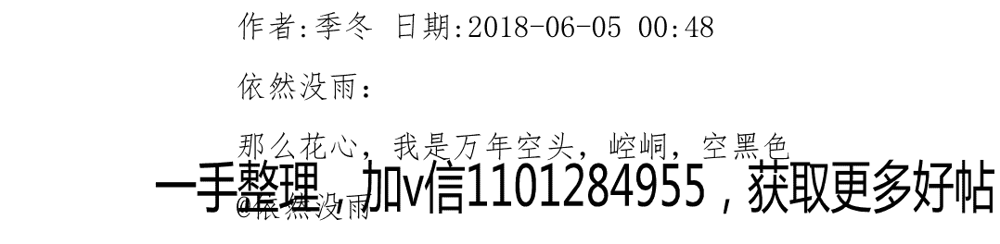
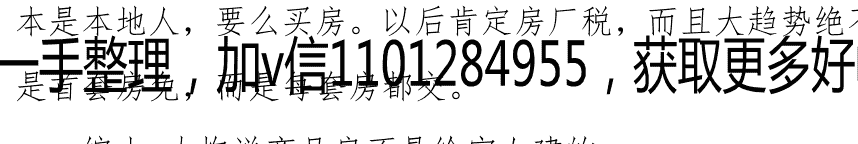
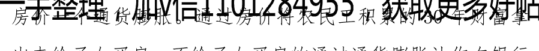
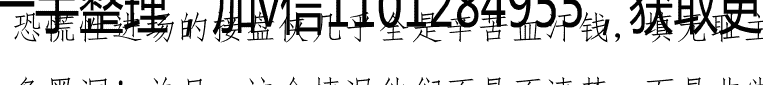

# 债务转移到全民的进程已基本完成……
多快省的进入尾阶段

债务转移到全民的进程已基本完成……
最后波韭菜已跑步进场，
形势一片大好...
请守你好本来就不敢的腰包。
每个人都在守株待兔，
守着守着却发现，株还在，兔子没了!!!
最后几只兔子，正在往下下——悬崖边上
还在考虑要不要下去——它们认为是悬崖底部铺的是
谁知道泡沫是击传花的游戏，
鼓在击，
估计花传传不去了...
未来 3-5 年，大家务必控制好自己的债务比重。
株还在，兔子哪儿去了？

作者: 季冬 日期:2018-06-02 23:45
@傻瓜 20182018 2018-06-02 22:51:32
知道你们唱空的一直被打脸吗？？？？?

你的名字起的和你这个人真的很般配……大赞!!!

作者：冬季 日期:2018-06-03 10:18
@张北京 2018-06-02 23:17:39
大方向没错，只是你怎么知道债务已经转移了，都知道房价会回归理性，问题是多久进入尾声，最迟 2019 年一二季度，完美收官。

作者：冬季 日期:2018-06-03 10:36
@猫叮当缘 2018-06-03 00:07:58
振幅是这么想的，化外债为个人债务，延长经济景气周，只不过被贸易战打乱了节奏，却破楼市泡沫的主动权并不在振幅操控中。

## 一手整理，加微信1101284955，获取更多好帖

4-5线城市房价开始横盘的时候，就是房产税出台准备收网的时候，最近会在2019年一季度...之前的密集与论风不是闹着玩的，试图静目以待。

作者：冬季 日期:2018-06-03 11:44
@傻瓜 20182018 2018-06-02 22:51:32
知道你们唱空的一直被打脸吗？？？？

@李冬 2018-06-02 23:45:44
你的名字起的和你你这个人很般配...大赞!!!

@傻瓜 20182018 2018-06-03 00:02:51
也就只会说这个了，呵呵呀，这 10多年唱空的无一例外被被打脸，虚空以后连房租都付不起。站在山脚的树，只看到眼前的树，就说这里的风景不像如此...

作者：季冬 日期:2018-06-03 12:44
@都是循环 2018-06-03 08:01:35
内外债多少，没有具体报道，但移民了的，但不搞走了外币，还逸脱了每个人的平均负债。

## 一手整理 加微信110284955 获取更多好帖

隐形的，估计接近甚至超过 GDP 的三倍...天涯论坛里大神们已经在很多帖子里研究的很透彻了...外债？测算在 1.5-1.9万亿美元之间，反正也开始违约了...外储储备这个真实财富的数据目前看来...估计水分也不少。

作者：季冬 日期:2018-06-03 15:46
我说的一定是房子，
整个经济都在钢丝线上摇晃，
更可悲的是整个人心道德的沦丧，重建人文化估计短期很难——古言“从善如登，从恶如崩”。
哎，人性，深不见底。

作者:季冬 日期:2018-06-03 16:21
@回复等待审核 2018-06-02 23:45:54
都是韭菜啦，不过这波韭菜的有点狠而已，看来是明白人!!!

作者：季冬 日期:2018-06-03 16:30
@花卉好月园 2018-06-03 15:43:53
买买买，一套全，永远远，就不告诉你你我们实现财富富裕的方法很有特色——全民击鼓传花，高抽低吸，直接实现财富增值，实业能有这速度?

## 一手整理加微信1101284955 获取更多好帖

并且不分国企私企，一视同仁，早就追赶美国了。
可是人终归是自己的，当然利益也一样。
在极端的经济困境下，私企还是小羊的角色——养肥了任宰割。
如果私人财产获得绝对的尊重和保护的话……这都是假设。好了，点到为止，不能多说了。

作者:季冬 日期:2018-06-03 16:32
@一朵小花卉 2018-06-03 04:29
债转股，股民就成了兔子。还在玩股？我的同志，你怎么还没醒？

作者:季冬 日期:2018-06-03 16:39
@zhwenh_03 2018-06-03 15:39
我们家习笑而不语......PS:【稳操】既能对房产库存，也能让二手房市场。

## 一手整理，加微信1101284955，获取更多帖

我就只能呵呵了...你懂的...

作者:季冬 日期:2018-06-03 17:07
@一朵小花 2018-06-03 04:29:25
债转股，股民变成了兔子。还在玩股？我亲爱的同志，你怎么还没醒？

作者:季冬 日期:2018-06-03 17:24
@花儿好月园 2018-06-03 15:43:53
买买买，一套万套，永远涨，就不告诉你你

@季冬 日期:2018-06-03 16:30
我们实现共同富裕的方法很有特色——全民击鼓传花，高抛低吸，直接实现财富增值，实业能有这个速度？
改革开放30年来，实业如果有国家大力支持，并且不分国企私企，一视同仁，早就追赶美国了。
可是结局是自己的，自然利益也一样。
在极端的经济困境下，私企还是小羊的角色——养肥了任宰割。

好了，点到为止，不能多说了。

@维克多3 2018-06-03 16:39:07
人自己是没问题的。有的是掌握大势的那波人过于目光。好的挺，超美的机会，已经跑掉了。
刚从泰国回来，除了华为和有限几个手机品牌，看不到中国制造。车子和摩托车全是日本货。高端车是德国货。没有看到一台中国车。

中国制造就是个伪命题。出口靠的外企，占大部分。崛起也是个伪命题。
哎，一声叹息……所谓的国之器全是粗、大、重的设备，那个根本就没有技术含量，真正的高精尖比的是微观精细度。这些领域全是进口装备的垄断。而我们还在盲目骄傲，整天意淫——“害了我的国！”我们的教育太老化、逐利化、囚笼化，我们从一个世界上已经落后于人了……哎……不是我悲愁，而是血淋淋的事实。

## 一手整理加油110284955，获取更多帖

@ty_Firebox 2018-06-03 20:48:03
看到他们发言，想起一种现象，很多时候，天气预报说有雨，有些人看看晴朗的天空，说天气预报胡说，直到大雨。现在就像是500点的股市，都疯了……极端的行情必极端的阴谋和极端的风险。人为财死与而亡，自然法则是最客观的。

作者：季冬 日期：2018-06-03 21:16
@清扬 18197077 2018-06-03 21:12:21多了也没用，只能让事实证明一切，到时候就知道房子值多少了。是的，趋势已定，时间节点就不必强求了..

作者：季冬 日期:2018-06-03 21:19
@吴陵闲闲 2018-06-03 21:13:31
据本人的观察还需要半年才能转移完成。以每户平均负债100万为完成标准。一线肯定不止这个数，县城肯定到不了。所以，这个100万，用二线城市的平均负债估算..

## 一手整理 加微信1101284955 的收益获取更多帖

很多大别的事件之前都异常平静......目前山雨还远，风满楼还没来，只是在悄悄的吹，而已

作者：季冬 日期:2018-06-03 21:31
@傻瓜 201806-02 22:51:32
知道你们唱早的一直被打脸吗？？？？?

@季冬 2018-06-02 23:45
你的名字起的和你这个人真的很般配……大赞!!!

@傻瓜 20182018 2018-06-03 00:02:51
也就只会说这个了，呵呵呀，这 10多年唱空的无一例外被被打脸，虚空以后连房租都付不起。站在山脚的树，只看到眼前的树，就说这里的风景不像如此...

作者：季冬 日期:2018-06-03 12:44
@都是循环 2018-06-03 08:01:35
内外债多少，没有具体报道，但移民了的，但不搞走了外币，还逸脱了每个人的平均负债。隐形的，估计接近甚至超过 GDP 的三倍...天涯论坛里大神们已经在很多帖子里研究的很透彻了...外债？测算在 1.5-1.9万亿美元之间，反正也开始违约了...外储储备这个真实财富的数据目前看来...估计水分也不少。

作者：季冬 日期:2018-06-03 15:46
我说的一定是房子，整个经济都在钢丝线上摇晃，更可悲的是整个人心道德的沦丧，重建人文化估计短期很难——古言“从善如登，从恶如崩”。哎，人性，深不见底。

@回复等待审核 2018-06-02 23:45:54
都是韭菜啦，不过这波韭菜的有点狠而已，看来是明白人!!!

作者：季冬 日期:2018-06-03 16:30
@花卉好月园 2018-06-03 15:43:53
买买买，一套全，永远远，就不告诉你你我们实现财富富裕的方法很有特色——全民击鼓传花，高抽低吸，直接实现财富增值，实业能有这速度?

并且不分国企私企，一视同仁，早就追赶美国了。可是人终归是自己的，当然利益也一样。在极端的经济困境下，私企还是小羊的角色——养肥了任宰割。如果私人财产获得绝对的尊重和保护的话……这都是假设。好了，点到为止，不能多说了。

作者:季冬 日期:2018-06-03 16:32
@一朵小花卉 2018-06-03 04:29
债转股，股民就成了兔子。还在玩股？我的同志，你怎么还没醒？

作者:季冬 日期:2018-06-03 16:39
@zhwenh_03 2018-06-03 15:39
我们家习笑而不语......PS:【稳操】既能对房产库存，也能让二手房市场。

## 一手整理，加微信1101284955，获取更多帖

我就只能呵呵了...你懂的...

作者:季冬 日期:2018-06-03 17:07
@一朵小花 2018-06-03 04:29:25
债转股，股民变成了兔子。还在玩股？我亲爱的同志，你怎么还没醒？

作者:季冬 日期:2018-06-03 17:24
@花儿好月园 2018-06-03 15:43:53
买买买，一套万套，永远涨，就不告诉你你

@季冬 日期:2018-06-03 16:30
我们实现共同富裕的方法很有特色——全民击鼓传花，高抛低吸，直接实现财富增值，实业能有这个速度？
改革开放30年来，实业如果有国家大力支持，并且不分国企私企，一视同仁，早就追赶美国了。
可是结局是自己的，自然利益也一样。
在极端的经济困境下，私企还是小羊的角色——养肥了任宰割。

好了，点到为止，不能多说了。

@维克多3 2018-06-03 16:39:07
人自己是没问题的。有的是掌握大势的那波人过于目光。好的挺，超美的机会，已经跑掉了。
刚从泰国回来，除了华为和有限几个手机品牌，看不到中国制造。

## 最新消息：央行决定适当扩大中期借贷便利（MLF）担保范围。为进一步加大对小微企业、绿色经济等领域的支持，并促进市场健康发展，中国人民银行近日适当扩大中期借贷便利（MLF）担保范围，纳入中期借贷便利担保范围的：低于的小微企业、绿色和“三农”、AA+AA级信用债券，优先接受小微企业、绿色贷款的意思就是：央行准备用债务做抵押品来印钞。统计外汇储备逐渐，这跟我们无错区别？

作者：季冬 日期：2018-06-03 23:13
@让遵守制度者 2018-06-03 23:12
治国大事，必须赞。温饱思欲，吃了几天饭就想要发言权，让你们背上几个钱都还不起的，想的就是怎么样卖命了。

作者：季冬 日期:2018-06-03 23:18
@让遵守制度者 2018-06-03 23:12
治国大事，必须赞。温饱思欲，吃了几天饭就想要发言权。

- 一个趋势附势的巴结者
- 一个随波逐流的墙草
- 一个低头乞食的狗奴才
- 一个习惯没有发言权永远在领导阴影下的伪君子你自己没有尊严的活着，请不要践踏别人追求尊严的决心！！！你是体制内的一条狗而已，狗，你还是吃它的来吧!!不送

作者:季冬 日期:2018-06-04 10:21
@TIANYAKENN 2018-06-04 05:53:25
如果卖得出去算你赢，卖不出去就是一堆废品。现在买房子的，追涨的很狠的，特别是央行6月1号出MLF扩容，更加加剧了这种形势，个生怕裤兜里的那点RMB砸在手里变成废纸了。房市就像庄家的最后一波拉升，开始起顶了呀...

作者:季冬 日期:2018-06-04 10:27
现在买房子的涨得很凶的，特别是央行出一个6月1号信号MLF扩容，更加加剧了这种恐慌形势，个生怕裤兜里的那点RMB砸自己手里变成废纸了。房市就像庄家的最后一次拉升，开始起顶了呀...亲爱的炒房客们，趁着这个千年难得的机会我们赶快出手吧。

作者：季冬 日期:2018-06-04 10:59
直接实话吧。大哥，你真以为我是神？我们是羊，那是狼操心的事情...

作者：季冬 日期:2018-06-04 11:01
@la_fisher 2018-06-04 10:30:27
正在委内瑞拉化的路上。有房无房，结局都一样的。看样子，也是别无他法了，唯有印钞这条路了。这也是中国30多年积累的问题，集中爆发了而已，不能责怪我们大师，接手的时候也是烂摊子，需要巨大的阻力和后方的应对。

作者：季冬 日期:2018-06-04 14:28
@花儿好月圆 2018-06-03 15:43:53
买买买，一套万套，永远涨，就不告诉你你

@季冬 日期:2018-06-03 16:30
我们实现共同富裕的方法很有特色——全民击鼓传花，高抛低吸，直接实现财富增值，实业能有这个速度？
改革开放30年来，实业如果有国家大力支持，并且不分国企私企，一视同仁，早就追赶美国了。
可是结局是自己的，自然利益也一样。
在极端的经济困境下，私企还是小羊的角色——养肥了任宰割。

好了，点到为止，不能多说了。

@维克多3 2018-06-03 16:39:07
人自己是没问题的。有的是掌握大势的那波人过于目光。好的挺，超美的机会，已经跑掉了。
刚从泰国回来，除了华为和有限几个手机品牌，看不到中国制造。车子和摩托车全是日本货。高端车是德国货。没有看到一台中国车。

中国制造就是个伪命题。出口靠的外企，占大部分。崛起也是个伪命题。
哎，一声叹息……所谓的国之器全是粗、大、重的设备，那个根本就没有什么技术含量，真正的高精尖比的是微观精细度。这些领域全是进口装备的垄断。而我们还在盲目骄傲，整天意淫——“害了我的国！”我们的教育太老化、逐利化、囚笼化，我们从一个世界上已经落后于人了……哎……不是我悲愁，而是血淋淋的事实。

@gw123ABC 2018-06-04 14:24:34
文科生？王楼主~~~哈哈哈哈
作者：季冬 日期:2018-06-04 14:28
高人，本人的文科出身...

# 学好数理化，走天下都不怕～～哈哈
不过老子是玩期货的，放心，从来没怕过...

作者：季冬 日期:2018-06-04 15:13
@花儿好月花园 2018-06-03 15:43:53
买买买，一套万套，永远涨，就不告诉你你

@季冬 日期:2018-06-03 16:30
我们实现共同富裕的方法很有特色——全民击鼓传花，高抛低吸，直接实现财富增值，实业能有这个速度？
改革开放30年来，实业如果有国家大力支持，并且不分国企私企，一视同仁，早就追赶美国了。
可是结局是自己的，自然利益也一样。
在极端的经济困境下，私企还是小羊的角色——养肥了任宰割。
如果私人财产获得绝对的尊重和保护的话……这都是假设。好了，点到为止，不能多说了。

[content]

@季冬 2018-06-04 14:28:37
高中，本人的确文科出身...

@gw123ABC 2018-06-04 14:45:53
学好数理化，走天下都不怕~~~~哈哈

@季冬 2018-06-04 15:13:16
工科男就收你那点死工资吧……金融投资不懂的，随来问我，绝对保证你爆仓...

# 一手整理加微信11011284955，获取更多好帖

闪声发大财，牛牛吹大了不好~~~哈哈哈哈

放心，期货账户每天的波动，够你一年的数理化了。
作者：季冬 日期：2018-06-04 15:30

@花儿好月园 2018-06-03 15:43:53
买买买，一万套，永远涨，就不告诉你你

@季冬 2018-06-03 16:30:59
我们实现共同富裕的方法也很特色——全民击鼓传花，高抛低吸，直接实现财富增值，实业能有这速度？

改革开放 30 年来，实业如果有国家意志大力支持，并且不分国企私企，一视同仁，早就追英赶赵美了。

可是人终究是自私的，当然利益也一样。

在极端的经济困境下，私企还是小肥羊的角色——养肥了人宰割。

如果私人财产能够获得绝对的尊重和保护的话...这都是假设。

好了，点到为止，不能多说了。

@维克多 3 2018-06-03 16:39:07
我私人是没问题的。
一手整理的加信1101284955获取更多好帖

超英美的机会，已经跑了。

从泰国回来，除了华为和有限几个手机品牌，看不到中国制造。车子和摩托车清一色的日本货。高端车是德国货。
没有看到一台中国车。

中国制造就是个伪命题。出口的外企，占据绝大部分。崛起也是个伪命题。

@李冬 2018-06-03 17:24:53
哎，一声叹息...所谓的重器是粗、大、重的设备，那个根本就没有什么技术含量，真正的高精尖全的是微观精细。

这些领域全是进口装备在垄断。

而我们还在盲目骄傲，整天意淫着——“害了我的国！”
我们的教育太奴化、逐利化、囚化化，我们从一个人的世界上已经落后于人了...
哎...不是我悲观，而是血淋淋的事实。

@gw123ABC 2018-06-04 14:24:34
文科生？王楼主~~~哈哈哈哈哈哈

@季冬 2018-06-04 14:28:37

# 一手整理+加微信1101284955，获取更多好帖

@gw123ABC 2018-06-04 14:55:37
学好数理化，走遍天下都不~~~哈哈哈哈

@季冬 2018-06-04 15:11:57
不过老子是玩期货的，放心，从来还没怕过...

@gw123ABC 2018-06-04 15:25:31
全民击鼓传花，高抛低吸，直接实现财富增值，实业能有这速度？？~~~哈哈哈哈哈哈

不好意思，我就是专业做这个的。

今天跟多头站一起，明天跟空站一起。

房地产横盘，首先准备重去压空玻璃...

理工大哥，你可以跟我一起来试试。

作者：季冬 日期:2018-06-04 15:44

其实大师接手的时候，
本来就千疮百孔，
这么多年积累的问题，要大帅一个人承担其实挺难为他的。
体制的局限性，

# 一手整理的加微信1101284955获取更多好帖

我们的操作完全符合法律法规，请大家放心。

下面都是阳春旋底，不顾及全局，只想保护小团体的利益。

大帅也很为难呀。
换做任何人都都不是容易好当这个家的。
可以理解。

作者：季冬 日期:2018-06-04 15:55

@ftdezuzong 2018-06-04 15:52:43
相互骗

弱肉强食，物竞天荒，没办法...自然界的铁律，跟手段无关。
作者: 冬季 日期:2018-06-04 20:15

@ebear_1986 2018-06-04 18:40:24
问题是你，你不欠债，也是白搭，手上的软样会掉。一直在“毛”，从未停止。
作者: 冬季 日期:2018-06-04 21:24

@心灵深忧 2018-06-04 20:25:50
我无债也无房！没有储蓄！赚一个!
# 一手整理，加微信获取更多好帖
作者: 冬季 日期:2018-06-04 21:25

@im地瓜 2018-06-04 21:15:58
聪明的韭菜就是韭，人宰割的韭菜才是韭...
作者: 冬季 日期:2018-06-04 21:25

@中国老人 2018-06-04 21:13:26
这就是郭家在圈里，如同韭氏，你想你怎么怎么样?

# 世界所有经济史，其实都是一部货币膨胀史。
作者：季冬 日期：2018-06-04 21:27

@2011山明 2018-06-04 21:11:19
学习了，楼主有才随便写些写的，主要是从事金融领域，关注国内宏观分析一下而已
作者：季冬 日期：2018-06-04 21:28

@scmsdp2017 2018-06-04 20:59:16
我怕下一个，一个都跑不了。加v信101284955
债务必须全民接盘，才能减轻债务的深度...这是必然的。
作者：季冬 日期：2018-06-04 21:29

@小散骑牛 2018-06-04 20:51:26
津巴布韦有了不起，债务归零资产归零，大不了再来。哈哈，难道应该是那俗语——光脚的怕鞋的？
作者：季冬 日期：2018-06-04 21:31

@playboy001 2018-06-04 20:49:28
崩盘是不允许的，最多是让其横盘，这才是大家好的局面
锁住、锁住，纸面财富，个头顶中产阶级的虚名，个头背着20以上的债务，这个场景真有画面感，满足了大群众冲破阶面的虚荣心...
作者:季冬 日期:2018-06-04 21:32

@小散骑 2018-06-04 24:49:09
房产税不会出台，我们将继续往拉!!!只要在。就按您的办，咱们继续往拉!!!月球离我们远着一手整理加微信...获取好帖
作者：季冬 日期:2018-06-04 21:33

@疼痛的希望 2018-06-04 20:24:41
刚需怎么办，真无奈(ヽ一诺刚需？搬个板凳，坐好，看戏...等不及就拿把菜刀
作者：季冬 日期:2018-06-04 21:35

@qzhengweil 2018-06-04 20:25:34
美分美款快跑!
这个尿盆子，请扣在您头上，我看比较合适……请问闲下不是经常黑锅，背出了慌慌，把气撒撇身上？
莫非的一条狗，估计也差不多啦...嘘，来食，来翔...
作者：季冬 日期:2018-06-04 21:36

@zfyd2018 2018-06-04 20:25:42
债务? 美国人民和政府的债务是我们的几倍都不怕，我们怕怕什么？
这一波，是要全国进入万元的节奏，还有几年？

# 一手整理如加信1101284955，获取更多好帖
理，大家玩的套路一样，who怕 who?！
作者:季冬 日期:2018-06-04 21:43

@ty_129481932 2018-06-04 21:38:35
既然看得这么通，请问资产怎么保值
国家现在全是都要保——保汇率、保房价、保股市债市、稳定、保银行流动性...
哎，佩服我们的经济运作部门，辛苦啊，所有的经济规律在我们这里里全部失效,也是难为他们了……我只能苦苦了
作者：季冬 日期:2018-06-04 21:45

@ty_129481932 2018-06-04 21:38:35
既然看得这么透，请问资产怎么保值不可能，债务转移的目的说了就是赤裸的用看不见的损……仅而已
中国人，自己搞自己，是很有一套的，这是套的。
作者：季冬 日期:2018-06-04 21:51

# 一手整理加v1101284955 获取更多好帖
这是民族的劣根性。因为狭隘的小农思想植于中国人的骨头，这是从胎带出来的，没办法。
作者：季冬 日期:2018-06-04 21:52

@猫叮当缘 2018-06-03 00:07:58
是这么想的，化债务为个人债务，延长经济周期，只不过贸易战乱了节奏，刺破泡沫的主动权不在控制中了。
@季冬 2018-06-03 10:36:56
4-5城市房价横盘的时候，就是房产税出台准备收网的时候，最近会在2019一季度...之前的密集舆论与风不是闹着玩的，目以待。

@小人物张三 2018-06-04 21:43:43
脑子进水了，房产税制定吗？百姓显然不是！问题是房子最多的是官员，他们会杀刀在自己的脖子上？非也！闹了多少房产税目前无期

@喵叮当缘 2018-06-03 00:07:58
是这么想的，化债务为个人债务，延长经济周期，只不过贸易战乱了节奏，刺破泡沫的主动权不在控制中了。
@季冬 2018-06-03 10:36:56
4-5城市房价横盘的时候，就是房产税出台准备收网的时候，最近会在2019一季度...之前的密集舆论与风不是闹着玩的，目以待。

这个我懂，现在是地方和国家倒霉，你说权重治理，加信101284955，获取更多好帖
作者：季冬 日期:2018-06-04 22:00

@喵叮当缘 2018-06-03 00:07:58
是这么想的，化债务为个人债务，延长经济周期，只不过贸易战乱了节奏，刺破泡沫的主动权不在控制中了。
@季冬 2018-06-03 10:36:56
4-5城市房价横盘的时候，就是房产税出台准备收网的时候，最近会在2019一季度...之前的密集舆论与风不是闹着玩的，目以待。

这个我懂，现在是地方和国家倒霉，你说权重治理，加信101284955，获取更多好帖
作者：季冬 日期:2018-06-04 22:00

许你懂...

我们都希望不随波逐流，可悲的是，最后我们都成了那个自己最不想成为那个个人！！！你我都一样...我天天在K线图活着...看着动态权益的数字波动...
我已经麻木了
作者：季冬 日期:2018-06-04 22:59

@FHH71451 2018-06-04 22:57:46
[http://img3.laibafile.cn/p/m2F295014627.jpg]
淡谈经济，勿言 ZZ
作者：季冬 日期：2018-06-04 23:12

@傻瓜 20182018 2018-06-02 22:51:32
知道你们唱空的一直被打脸吗？？？？

# 一手整理 加微信1101284955 获取更多好帖

@傻瓜 20182018 2018-06-03 16:30:49
买买买，一套万，永远涨，就不告诉你
@花儿好月园 2018-06-03 15:43:53
买买买，一万套，永远涨，就不告诉你你

@季冬 2018-06-03 16:30:59
我们实现共同富裕的方法也很特色——全民击鼓传花，高抛低吸，直接实现财富增值，实业能有这速度？

改革开放 30 年来，实业如果有国家意志大力支持，并且不分国企私企，一视同仁，早就追英赶赵美了。

可是人终究是自私的，当然利益也一样。

在极端的经济困境下，私企还是小肥羊的角色——养肥了人宰割。

如果私人财产能够获得绝对的尊重和保护的话...这都是假设。

好了，点到为止，不能多说了。

@维克多 3 2018-06-03 16:39:07
我私人是没问题的。
一手整理的加信1101284955获取更多好帖

超英美的机会，已经跑了。

从泰国回来，除了华为和有限几个手机品牌，看不到中国制造。车子和摩托车清一色的日本货。高端车是德国货。
没有看到一台中国车。

中国制造就是个伪命题。出口的外企，占据绝大部分。崛起也是个伪命题。

@李冬 2018-06-03 17:24:53
哎，一声叹息...所谓的重器是粗、大、重的设备，那个根本就没有什么技术含量，真正的高精尖全的是微观精细。

这些领域全是进口装备在垄断。

而我们还在盲目骄傲，整天意淫着——“害了我的国！”
我们的教育太奴化、逐利化、囚化化，

我们从一个人的世界上已经落后于人了...
哎...不是我悲观，而是血淋淋的事实。

@gw123ABC 2018-06-04 14:24:34
文科生？王楼主~~~哈哈哈哈哈哈

@季冬 2018-06-04 14:28:37

# 一手整理+加微信1101284955，获取更多好帖

@gw123ABC 2018-06-04 14:55:37
学好数理化，走遍天下都不~~~哈哈哈哈

@季冬 2018-06-04 15:11:57
不过老子是玩期货的，放心，从来还没怕过...

@gw123ABC 2018-06-04 15:25:31
全民击鼓传花，高抛低吸，直接实现财富增值，实业能有这速度？？~~~哈哈哈哈哈哈

不好意思，我就是专业做这个的。

今天跟多头站一起，明天跟空站一起。

房地产横盘，首先准备重去压空玻璃...

理工大哥，你可以跟我一起来试试。

作者：季冬 日期:2018-06-04 15:44

其实大师接手的时候，
本来就千疮百孔，
这么多年积累的问题，
要大帅一个人承担其实挺难为他的。
体制的局限性，

# 一手整理的加微信1101284955获取更多好帖

我们的操作完全符合法律法规，请大家放心。

下面都是阳春旋底，不顾及全局，
只想保护小团体的利益。

大帅也很为难呀。
换做任何人都都不是容易好当这个家的。
可以理解。

作者：季冬 日期:2018-06-04 15:55

@ftdezuzong 2018-06-04 15:52:43
相互骗

弱肉强食，物竞天荒，没办法...自然界的铁律，跟手段无关。
作者: 冬季 日期:2018-06-04 20:15

@ebear_1986 2018-06-04 18:40:24
问题是你，你不欠债，也是白搭，手上的软样会掉。一直在“毛”，从未停止。
作者: 冬季 日期:2018-06-04 21:24

@心灵深忧 2018-06-04 20:25:50
我无债也无房！没有储蓄！赚一个!
# 一手整理，加微信获取更多好帖
作者: 冬季 日期:2018-06-04 21:25

@im地瓜 2018-06-04 21:15:58
聪明的韭菜就是韭，人宰割的韭菜才是韭...
作者: 冬季 日期:2018-06-04 21:25

@中国老人 2018-06-04 21:13:26
这就是郭家在圈里，如同韭氏，你想你怎么怎么样?

# 世界所有经济史，其实都是一部货币膨胀史。
作者：季冬 日期：2018-06-04 21:27

@2011山明 2018-06-04 21:11:19
学习了，楼主有才随便写些写的，主要是从事金融领域，关注国内宏观分析一下而已
作者：季冬 日期：2018-06-04 21:28

@scmsdp2017 2018-06-04 20:59:16
我怕下一个，一个都跑不了。加v信101284955
债务必须全民接盘，才能减轻债务的深度...这是必然的。
作者：季冬 日期：2018-06-04 21:29

@小散骑牛 2018-06-04 20:51:26
津巴布韦有了不起，债务归零资产归零，大不了再来。哈哈，难道应该是那俗语——光脚的怕鞋的？
作者：季冬 日期：2018-06-04 21:31

@playboy001 2018-06-04 20:49:28
崩盘是不允许的，最多是让其横盘，这才是大家好的局面
锁住、锁住，纸面财富，个头顶中产阶级的虚名，个头背着20以上的债务，这个场景真有画面感，满足了大群众冲破阶面的虚荣心...
作者:季冬 日期:2018-06-04 21:32

@小散骑 2018-06-04 24:49:09
房产税不会出台，我们将继续往拉!!!只要在。就按您的办，咱们继续往拉!!!月球离我们远着一手整理加微信...获取好帖
作者：季冬 日期:2018-06-04 21:33

@疼痛的希望 2018-06-04 20:24:41
刚需怎么办，真无奈(ヽ一诺刚需？搬个板凳，坐好，看戏戏...等不及就拿把菜刀
作者：季冬 日期:2018-06-04 21:35

@qzhengweil 2018-06-04 20:25:34
美分美款快跑!
这个尿盆子，请扣在您头上，我看比较合适……请问闲下不是经常黑锅，背出了慌慌，把气撒撇身上？
莫非的一条狗，估计也差不多啦...嘘，来食，来翔...
作者：季冬 日期:2018-06-04 21:36

@zfyd2018 2018-06-04 20:25:42
债务? 美国人民和政府的债务是我们的几倍都不怕，我们怕怕什么？
这一波，是要全国进入万元的节奏，还有几年？

# 一手整理如加信1101284955，获取更多好帖
理，大家玩的套路一样，who怕谁?！
作者:季冬 日期:2018-06-04 21:43

@ty_129481932 2018-06-04 21:38:35
既然看得这么通，请问资产怎么保值
国家现在全是都要保——保汇率、保房价、保股市债市、稳定、保银行流动性...
哎，佩服我们的经济运作部门，辛苦啊，所有的经济规律在我们这里里全部失效,也是难为他们了……我只能苦苦了
作者：季冬 日期:2018-06-04 21:45

@ty_129481932 2018-06-04 21:38:35
既然看得这么透，请问资产怎么保值不可能，债务转移的目的说了就是赤裸的用看不见的损……仅而已
中国人，自己搞自己，是很有一套的，这是套的。
作者：季冬 日期:2018-06-04 21:51

# 一手整理加v1101284955 获取更多好帖
这是民族的劣根性。因为狭隘的小农思想植于中国人的骨头，这是从胎带出来的，没办法。
作者：季冬 日期:2018-06-04 21:52

@猫叮当缘 2018-06-03 00:07:58
是这么想的，化债务为个人债务，延长经济周期，只不过贸易战乱了节奏，刺破泡沫的主动权不在控制中了。
@季冬 2018-06-03 10:36:56
4-5城市房价横盘的时候，就是房产税出台准备收网的时候，最近会在2019一季度...之前的密集舆论与风不是闹着玩的，目以待。

这个我懂，现在是地方和国家倒霉，你说权重治理，加信101284955，获取更多好帖
作者：季冬 日期:2018-06-04 22:00

PMI 数据就跟供给改革后，失业率不增降一样荒谬，您是当真的在看，那我友情提示——您研究的宏观模型已经进入死胡同了。不谢。

作者:季冬 日期:2018-06-04 23:35

@nchhs 2018-06-04 10:29:31
直接说哈时候准跑哈。

@季冬 2018-06-04 10:59:22
大哥，你真以为我是神？
我们是羊，那是狼操的心的事情...

## 一手整理加微信1101284955，获取更多好帖

哈某某某计算机硕士生，我行，这就是了。

作者:季冬 日期:2018-06-05 00:07

@认锅锅工作室处女 2018-06-04 23:58:53
你好像不像太乐观，要不要找我看看！哎....这就是生活是吗！

感谢您的善意提醒，我很乐观，修心至今，如镜中湖，人生起起伏...看待K 线起伏...

平常心，一身轻。
都还好啦。

只是乱花迷眼，拨开看看看而已，没有别的什么高论。感谢。

作者：季冬 日期:2018-06-05 00:09

@194375561 2018-06-05 00:03:40
楼主明白人。

感谢，明白人遇到明白人，一点就通，无需多言。

这便是“酒逢知己千杯少，话不投缘句多”的真意吧？

作者：季冬 日期:2018-06-05 00:15

@祛花夭1 2018-06-05 00:14:28

## 一手整理，加v信1101284955，获取更多好帖

顺其自然，做好预案...

作者：季冬 日期:2018-06-05 00:21

有人看别人扛枪上山，打了一堆兔子野鸡，眼红，拿菜刀就冲上山，结果——他遇到了老虎!!!

如果世界都跟幻想中的一样，那就不会出现尸横遍野的景象了...

作者：冬季 日期:2018-06-05 00:38

@四季有美景 2018-06-05 00:36:17
通胀吗？

不会，滞胀倒是有可能的...绝大部分经济要素会原地空转...这盘棋不好解，历史沉积的。

作者：冬季 日期:2018-06-05 00:48

依然没雨：
那么灰心，我是万年空，空嵘，空黑色看我们是一起路的，同志你好!!!

那么灰心，我是万年空，空嵘，空黑色看我们是一起路的，同志你好!!!

空头是我的主力军，你懂的...
从善如誓从恶如崩，我算坏人吧？
反思一下——我良心没被狗吃，但是被人吃了!!!
大势使然非我本意。

作者：冬季 日期:2018-06-05 00:54

@特约落地地 2018-06-05 00:46:05
天天年年日月喊颓，前后缀杂纷纷绿鞭鞭十年，消失一批又一批，说他人是韭菜，自己却是野草，恪不知耻烧。

光了又来践自己，啪5块钱键盘打忽略江山，出门对人鞠啪挣钱！虚空从不敢对赌，脚皮汤无人敢喝，泥继泥球，泥球抛丸送你，不敢应战！越喊越越叫嚣，中洞，无人祭虚空，另人家楼俯眠丝班轮撒亡，虚空命短不过背，老子在这里看虚空摔灰！我的世界里没有空空，只有立场，只有阴阳互动，看问题的角度而已...没你那么极端愤怒，注意控制情绪，情商低的人大部分是底。

## 一手整理，加信1101284955，获取更多好帖

作者：季冬 日期：2018-06-05 00:55

@举杯清风 2018-06-05 00:49:27
@让遵守者获益 2018-06-03 23:12:20
想要发言权，让你们背上六个钱包都不起的债，想是怎么卖命还债了。

@季冬 2018-06-03 23:18:34
一个低头乞食的狗才，一个低头乞食的狗奴才。不，一个自己习惯没有发言权远在领导阴影下的伪君。

......

谢谢您的认可。我们可以看的是脸，但我们不能看真实的内心...

作者：季冬 日期:2018-06-05 00:59

xkwth2017：
楼主纯傲！

楼主，19楼提到了“整个人心道德的沦丧”！

一手整理加微信1101284955，获取更多好帖

多谢赏赐大赞。

作者：季冬 日期：2018-06-05 01:12

@ty_Lqw18 2018-06-05 01:09
对，砸锅卖铁都要套路。进去了，就按照游戏玩，别无法...

作者：季冬 日期：2018-06-05 01:27

@程思铭 2015 2018-06-05 01:24:56
三线城市郊区的房，15万左右！我打算了去可见行情有多猛烈……主力拉高准备出货了，就怕熔断啊...一寒断，那场景，你懂的...

作者：季冬 日期：2018-06-05 01:42

@皮卡丘皮卡卡卡 2018-06-05 01:37:55
> 楼主，其实没明白你说的，但是觉得特有道。

一手整理，加v信1101284955，获取更多好帖

我喜欢把千言万语缩成句话，所谓大道至简，越是简单的道理越是难参透的...守如、守信、守心，足矣。人生就是在悟自己的道，悟穿了，自在往往，悟不穿心易倾倒。你互相学习吧...

作者：季冬 日期：2018-06-05 08:43

@流动的水再注册 2018-06-05 07:15:56
楼主干脆死了啦？还活着干嘛呢？人生的道路上那么难难，这世道，每天那么多人被撞死的，生病的，玩游戏的，工作出错的……那么多人都死了，楼主还活在这个没有希望的世界上干嘛？找个不太痛苦的方法死了啦！放心吧，我活得肯定很好，至少我活的是自己...

作者：季冬 日期：2018-06-05 08:47

@中锦锦 2014 2018-06-05 08:42:59
楼主智慧。

抛弃只为引锚，打打喷嘘而已……改变不了什么。

## 一手整理加信1101284955，获取更多好帖

@W 来自海上 2018-06-05 03:25:27
尼马，都2018了，这种调度还有市场？真是日了狗。

> “市场 ”？我不知道你在说什么，我不图名二不图利……只求和高人探讨。至于后面那件事，我是没做过...

作者：季冬 日期：2018-06-05 08:53

@流动的水再次注册 2018-06-05 07:15:56
楼主干脆算了吧，还活着干嘛？人生的道路上那么难难，这世道，每天那么多人被撞死的，生病的，玩游戏的，工作出错的……那么多人都死了，楼主还活在这个没有希望的世界上干嘛？找个不太痛苦的方法死了啦！

@季冬 2018-06-05 08:43
放心吧，我活得肯定很好，至少我活的是自己...

@dreampow2018-06-05 08:48
天天妄想在论坛崩，房价跳楼，应该是活得挺好的。哈哈！目前从投资，在我眼里只是数字，人生只有一手整理，加v信101284955，获取更多好帖。

作者：季冬 日期：2018-06-05 08:57

@铁七兮
而且尽量保护现有的来源，尽量不负债超前，先慢慢熬吧，等待下一个周期。大家都是普通人。

@乡下胖子 2018-06-05 09:02
这个逻辑被打脸十多年了，哈哈，都是套路。

作者：季冬 日期：2018-06-05 09:16

@南北陈庆 2018-06-05 09:04
这个时候了，种码调控。观点都不表达了，就有问题。中国房价谁都知道，供给受限，房子和各种政策绑定，需求动不动去限购，房价有意义？买房总比好一点。

## 一手整理，加微信101284955获取更多好帖

至于拉拉出货，地产商又不碰，卖新房，都是游戏规则...每个参与的人，想法和玩法不一样...按自己认为对方的方向去...

@季冬 2018-06-05 09:21
08年我绝对是对多，现在我坚决站在空头一方，从事期货，绝大部分收益是做空带来的。

## 房子为什么做空？

——因为承接房子的人口在剧烈减少——而且越来越少。人口基数和出生率在大幅缩减，才是未来问题的根源!!!

作者:季冬 日期:2018-06-05 09:25

@南北陈庆 2018-06-05 09:21:11
坐等房价跌了再买房完全伪命题，房价真跌了。土地收入没有了，就是房产税了。地方财政要养那么多人，你想好的医疗，教育和各种政策，都是付出代价的。以前要么本地人，要么买房。以后要定税，而且趋势如此...

大炮说商品房是不给穷人的，我的理解是别做梦了，以后日子中产来说买不起房的更好了。

所谓的“中产阶级”就是满足大众虚荣心的一个虚!!!

人希望被他人认可自己的能力、财富、地位，

可是在我眼里，中产阶级就是更肥一些的韭菜而已……我们换到TZ阶级的视角就能轻易理解了。

作者:季冬 日期:2018-06-05 09:33

政策文件与论垫已完成，实施则将会尽快完善，并在超级合适的时间点出台...

至于我说的那个时间节点，就是等5/6线小县城完成库存处理完毕后，全面锁定!!!

房产税出台...

作者：季冬 日期：2018-06-05 09:43

从交易的角度讲，目前是出货走人最佳的时间节点...千载难逢。

错这个村就没有这个店了...5/6线开始疯狂就如同上证指数站上5000点，卖麦大妈都拿老本入股市等着赚钱了。

## 一手理加微信1101284955，获取更多好帖

清仓走人不意思，反正我是这么做的...

作者：季冬 日期：2018-06-05 10:18

@上海纯灵刚需 2018-06-05 10:16:24
我如果操盘，等5-6线转移后，新房价格低30%，卖给那些愿意付。然后腰斩，这时候断供，压力巨大，取消限购，等等，大家都喊再跌，价格跌到8万，出台房地产，失业。

很多了。

作者：季冬 日期：2018-06-05 10:24

楼主见识短浅，没过去...也没法实地了解了，我只在国内井底之鞋，没事就看看K线而已。

季冬 日期：2018-06-05 11:59

@让遵守者获益 2018-06-03 23:12:20
治国大智慧，必须赞。温饱思淫欲，吃了几天饱饭就想要发言权，让你们背上六个钱包都不起的债，想的是是怎么卖命还债了。

@季冬 2018-06-03 23:18:34

一个趋炎附势的巴结者，
一个随波逐流的砌头草，
一个低头乞食的狗奴才，
一个自己习惯没有发言权远在领导阴影下的伪君。

你自己没有尊严的活者，请不要践踏别人追求尊严的决心!!!你是体制里的一条狗而已，打这些文字我都觉得浪费我时间。狗，你还是吃你的来之食吧!!不送。

## 一手整理的笔记v1.1011284955 获取更多好帖

这就是我的想法，其实我想分享的观点：追求自由是人和动物的本能……要是我误解了您。

作者：季冬 日期：2018-06-05 11:12

目前的局势，战争已经到了一触即发的边缘了吧？或一场中等规模的征服能够解决不少问题。在内，战争订单带来的制造业增长，消除库存。在外，配合一带一路的政策，让人民币顺理章地走出国门。也该播羊毛了。

目前台湾问题会在2020年之前解决，准备工作已，已经在稳稳推进了...

作者：季冬 日期：2018-06-05 11:56

楼主知道楼内瑞拉要扩大需要吗，知道建巴布韦开始供应一手整理，获取更多好帖。

目前，国民的“金钱至上”拜金主义，催生了很多为了金钱可以卖一切灵魂肉体、可以突破一切做人的道德底线的荒唐事件!!!

朋友，我只能说这些，是的，自古以来这种种堕落的事情一直在发生，但是，现在人在人性倒退，您发现没有？

重要的在向人性退化三遍———人在向人性退化!!!

人在向人性退化!!!

作者:季冬 日期:2018-06-05 12:37
一手整理加信v1101284955 获取更多好帖

@CommaGold 2018-06-05 12:32:30

楼主主人，本人几年前做期货，到现在有小盈利，明白执行是最简单的！

由于一直专注工作和期货，所以一直没房子，被其他有房子的那个脚鄙视啊！好难受的。

给你这几个字，这是我的核心理论：

- 本金安全
- 平常心 一身轻
- 无惧 放下
- 兔子 鳄鱼
- 势动 我动
- 势不动 亦不动

作者:季冬 日期:2018-06-05 12:57

@CommaGold 2018-06-05 12:32:30

楼主商人，本人几年前做期货，现在有小盈利，明白执行是最难的！

房子的那个邻居视啊！好难受的。

> 给你这几个字，这是我的核心理论：
> 本金安全
> 平常心 一身轻
> 无惧 放下
> 兔子 鳄鱼
> 势动 我动
> 势不动 亦不动
> 随时准备备动 

作者:冬季 日期:2018-06-05 13:15

@冬季 2018-06-05 12:22:34

中国人大虚来了，背个“中产阶级”虚名，同时时期背着 20 年的债务。

这一场意料之中的赵顶拉升，是中产阶级的盛宴？还是坟墓？

亲爱的，我们拭目以待。

回复：2018-06-05 13:13:26

不对吧！我们是无产阶级——！全世界无产者联合起来！！

联合后是啥？？

本是同根生，相顾相来看太急，呵呵呵...

作者:冬季 日期:2018-06-05 13:20

@大勇勇 2017 2018-06-05 13:18:57

今年的重点是县级地方去库存，现在看起来非常顺利，估计今年10月的中央经济工作会议就会明确政策，明年3月正式公布天下！

预测，预测，我们都只是预测哈...

作者：季冬 日期:2018-06-05 13:29

哎...一切的一切，圈套都是按照愿望设计的...

作者：季冬 日期:2018-06-05 13:40

@大勇勇 2017 2018-06-05 13:39:24

已经明确了2020 年房产税法完成！相关信息进展的新闻都是报道了的，只是报道而未上媒体讨论，这说明这次是真的要实施了！还记得第三年解决北京空气污染的承诺吗？第一，第二年没兑现承诺，第三年就北京蓝了!

舆论亚风已经完毕，就做好好了让出来吃了...

@zhoubapi168 2018-06-05 14:02:23

房地产要是能出口就好了了... 哈哈哈哈做梦!

能出口的都低价出口了，不能口的悬在屋里高价内耗...

作者：季冬 日期:2018-06-05 14:22

@花儿好月圆 2018-06-03 15:43:68

买买买，一万套，永远涨，就不告诉你你

@季冬 2018-06-03 16:30:49

我们实现共同富裕的方法也有特色——全民鼓击传花，抛低吸，直接实现财富增值，实业能有这种速度？

改革开放这30年来，实业如果有国家意志会大力支持，并且不分国企私企，一视同仁，早就追赵赶美了。

可是人终归归是自私的，自然利益也一样。

在极端的经济境下，私企还是小肥羊的角色——任人宰。如果私人财产获得绝对的尊重和保护的话……这都是假设。小肥羊该及时被宰，否则后患无穷冥冥中自有安排...

作者：季冬 日期:2018-06-05 14:41

@金刚125 2018-06-05 14:33:39

全民负债房地产泡沫成功了我我滴国可说是免得又被无故攻击...你说房多到什么程度？都不行吗？我管自己抛售

作者：季冬 日期:2018-06-05 15:18

作者：季冬 日期:2018-06-05 15:18

作者：季冬 日期:2018-06-05 15:21

@flybird998 2018-06-05 13:43

这次放水估计很刺激一段时间了，从1月下股票空至今，目前可以试建仓了还是要兔子，见好就收...

@博学彰 2018-06-05 15:20:25

有一个成语叫做坐井观天，还有一个成语做井忧天。我等粮，信息其实是一口井，却想然的自己已经看到了世界，看穿了事物的发展方向，认为世人皆醒、认为在居者都乃肉食，不能远徙。可是，我们连自己的生活都只能过的差强虎。

作者:2018-06-05 15:24

@zhoubai168 2018-06-05 15:10:30

MLGB 的有些人被富了不知道怎么回事，真以为自己富了。某天某人指着他裤子说价值，真以为自己是亿翁了……嘿嘿，蛋糟点了，道理不糟糕就行...聪明人在通缩结束、通胀开始时加杠杆赌场，在新一轮通缩前来抽身套现往往轻而易举实现财富自由；愚蠢的人看不到周期与趋势，看到别人赚钱而盲目跟进，甚至在通缩将来将临之际加杠杆入市这些人注定成为炮灰，有的这一辈子身陷债务潭不得翻身。不光股市有二八定律，财富和智慧也有二八定律，不过是一九定律，二八列太大了...

作者:2018-06-05 15:37

@不婚者也有性生活 2018-06-05 15:31:21

知道你们唱的一直被打脸吗？？？？毛，你看看这名字起的，咋这么脏呢？你不嫌丢人，我都受不起不起...你天天在干嘛呀！你带着这顶 ID 走出来，不怕问责？——明显暴露我的优良光荣传统嘛。古语，不孝三无后为大，你不婚族，还天天有那哼弱弱的问一钩——你 HIV 了没？

作者:季冬 日期:2018-06-05 17:41

@十万星云 2018-06-05 17:37:56

是该输出战争的时候吗？准备收拾小零零了...

作者:季冬 日期:2018-06-05 18:21

@快刀铁三 2018-06-05 18:14:24

债务？国债还是地方债？这些东西最后到底如何运行，经过深入调查分析是不可能的个皮毛的。即便是你的推断很难得到数据上的证实。我认为目前中国经济有问题，并不健康，但问题往往是牵发而动全身的，这或许是在想彻底切除“肿瘤”的时候又犹豫吧！无论“株”还是“兔子”，在最后后有可能都是输。也就是目前来看，买房是风险，存钱依赖旧是风险。经历过 08 年的经济刺激和通货膨胀，如何保证的确是个难题。是的，整体像一张编织的网。保值还是算了，财富跑赢通胀不是经济发展的目的。

作者：季冬 日期:2018-06-05 18:32

@ls1515 2018-06-05 18:24:36

有钱还是要去买房，就是没钱买才难受可见对纸币的一种恐慌。

作者：季冬 日期:2018-06-05 18:43

@西楼 2018-06-05 18:35

一个数据、无论推论过程子，纯粹是表达或动机。多谢无两条路——做空做多。大家选边站队，跟比一样的。

作者：冬季 日期:2018-06-05 19:44

@东门庆 2018-06-05 19:03

房地产市场严重失真。其实是收入丢失造成的。有人说他们行业增产了。是因为限制了小产能造成的。还有定向的一会滋润，对市场有扭曲作用全民参与击花的时代...

作者：季冬 日期:2018-06-05 19:52

作者：季冬 日期:2018-06-05 19:52

最先崩溃的是制造业...实业本来背着“死亡率”，加之融资狭窄成本高昂，经济下行趋势已。房产泡沫成功了我我滴国脆弱的。

最先死亡的是中国脆弱的制造业...国有企业？哈哈哈哈，效率低下，坐断自大。毒瘤吸着本来就已经贫瘠的神州大地...结构性的巨大失灵。

作者:李 日期:2018-06-05 19:59

@皮卡丘皮卡呀 2018-06-05 19:54

楼主，我又回来受教了。这二十年的改变太大了，物质丰富了，精神上呢？什么什么都是钱钱钱……

，谢谢朋友的关注，现在从恶的人比从善的人多，因为恶的示范效应更具诱力。行善的好报不在当时，而行的好处可以立刻兑现，所以急功近利的人们，大多数选择了恶，因为可以立刻获利。这是人作为情感动物的悲哀...迟早会得到上天的清算。

李 日期:2018-06-05 20:34

@没有人可以帮到你 2018-06-05 20:26:32

中国最后走两步：一是伊拉克的下场、二是津巴布韦的结局!!!!!这个极端了。我现在坚定的站在房空的一方！！！趋势面面前，一切不自量力的阻挡，都会被碾压的粉身碎骨...

作者:季冬 日期:2018-06-05 22:52

@u_109154850 2018-06-05 20:47:53

感觉老百姓并不害怕债务，身边那些千上万的房贷，也没操心过。

作者:季冬 日期:2018-06-05 23:05

@龙行 2018-06-05 23:03:47

去年等等底一折的人今年都走了！哈哈哈哈，所以天津才是安静吗？2018-06-06 11

作者：季冬 日期:2018-06-06 11:26

哎，我的孩子啊，期货最凌晨:30，你以为我一样靠异天和不劳而获的堕落来处于社会的底层，不是公平，而是因为你爸爸养了你爸爸妈妈坏了。

特约爹地 2018-06-05 11:30

回复我的帖子，唉，怜怜的人，你养了，连基本的教养都不懂。

作者：季冬 日期:2018-06-05 22:05

@快看蜗飞 建议你回家看看，顺便把您双亲也带上，叫医生解释一下，足出

作者：季冬 日期:2018-06-05 22:46

下一波转移手术估计是拉拍大宗商品（主要是工业原材料和制成品）价格。减轻债务数额与风险。

作者:季冬 日期:2018-06-05 22:50

@免马牵肠孩子 2018-06-05 20:29:09

请问债务也不要工作的怎样自己自己。北京好多人在睡马路大街。无人管理要是非脑残，有手有脚的，饿死了是活该的!!!

作者:季冬 日期:2018-06-05 22:52

@没有人可以帮你 2018-06-05 20:40:15

若要灭亡，必先叫疯狂，现在的房地产就不这样吗？？？？!!!!

[注：后续部分OCR内容重复，已按逻辑合并清理]

矢马牵腾养孩子 2018-06-05 22:29

二十年的改变太大了，物质丰富了，精神上呢？什么什么什么都是钱钱钱……

冬季 楼主 2018-06-05 19:59

楼主：@皮卡丘皮卡皮皮卡呀 2018-06-05 19:54:33
楼主，我又跑来受教了。

二十年的改变太大了，物质丰富了，精神上呢？什么什么什么都是钱钱钱……

现在从恶的人比从善的人多，
因为恶的示效应更具诱力……
行善的好处不及时的时候，
而行恶的好处可以立刻实现，
所以急功近利的人，
大多数选择了恶，
因为可以立马获利。
这是人作为感情动物的悲哀...
迟早会得到上天的清算。

玉 yingying 2018-06-06 05:11

评论 季冬：扭曲的引领安居工程的炒作，让众人难以承受生活的压力，整个社会为了金钱无道德约束进入互害的模式。。

评论 只看楼主
没有人可以帮到你 2018-06-05 20:25

291 楼：房地产不会死的!!!!! 房地产会遗臭万世的!!!!

玉 yingying 2018-06-06 05:18
评论 没有人可以帮到你：历史会记载这场房产盛世带给民众的代价了。

# 一手微信1101284955，获取更多好帖

没有人可以帮到你 2018-06-05 20:26

292 楼：中国最后走两步：一是伊拉克的下场，二是津巴布韦的结局!!!!!

评论 只看 TA
失马腾腾孩子 2018-06-05 20:29

293 楼：请问没债务也没钱的怎么养自己。北京好多人在睡马路大街。无人管理

评论 只看TA
冬季 楼主 2018-06-05 20:34

294 楼：@没有人可以帮到你 2018-06-05 20:26:32
中国最后走两步：一是伊拉克的下场、二是津巴布韦的结局!!!!!

@高如天 2013-06-06 11:03:58
这个太极端了。

# 一手整理加微信11011284955，获取更多好帖

没有人可以帮到你 2018-06-05 20:40

295 楼：若要人灭亡，必先叫人疯狂，现在的房地产不是这样的吗？？？？？？

评论 只看TA
u_109154850 2018-06-05 20:47

296 楼：感觉老百姓并不害怕债务，身边那些几千上万的房贷，没操心过

评论 只看TA
三水青君 2018-06-05 21:31

297 楼：论坛还是这风，真是刮了十几年都不换……
莫非把我神化了，我们玩的是趋势，不是您所说的上下波动那几个点……
看来你要是来炒股和期货，是短线型的眼光短浅的人……

# 一手处理，加微信1101284955，获取更多好帖

作者：季冬 日期：2018-06-06 11:35
遇到一上来就谩骂，满嘴喷粪的低级种群，
不好意思，我什么都骂得出来。
天生会写东西的手，
骂人最在行!!!
请二货、喷子、暴躁、脑里缺根弦的种群自重……

作者：季冬 日期：2018-06-06 11:35
遇到一上来就谩骂，满嘴喷粪的低级种群，
不好意思，我什么都骂得出来。
天生会写东西的手，
骂人最在行!!!
请二货、喷子、暴躁、脑壳缺根弦的种群自重...

作者：李冬 日期：2018-06-06 12:47
怎么说呢？
同样一件事情，猴子有猴子的想法和做法，猪有猪的猪的想法和做法。
猴子完全看得懂猴子的想法和做法，
猪永远都觉得猴子不可理喻。
最后，猴子还是猴子，
猴子还是猴子，重复着自远以来的生活状态...

# 一手办理加微信1101284955，获取更多好处

处理债务无非三个方法：旁冯骗局（借旧换新）、核销（签了还不算）、转移。
从目前的国情看，
只有第三条路可行。
那我们再想想，居民消费里，什么是最贵的？
对，房子。
一套房子可以直接消除一个家庭积攒了20左右的存款——这个不能说成财富。
要把这些存款全部吸收进来，交换。
交换什么？跟房地产相关的工业制品——达到扩大内需，垄断国企不断输血。
好了，这个阶段已经处于尾声。开始进入第二阶段。
大幅拉升差异性的工业原材料的大宗价格，进而抬高加工、制造、流通的所有成本，也就抬高物价，消费还没被房地产吸纳的剩余存款，还提高了财政收入，继续国企盈利。

# 一手整理加微信1101284955，获取更多好帖
这就是大势如此……那你会问我，里面有什么发财机遇吗？自己想...

作者：季冬 日期：2018-06-06 13:04
@monkey633 楼主，现在借钱最多都是国企。现在赖着阶段。也没有看到这些企业的决心。还能拖一下，要是造成动荡了。

作者：冬季 日期：2018-06-06 13:07
有些东西，懂的人，一点就通。
不懂的，我不可能用千万吨级的液压机，往他脑壳里塞处理债务无非三个方法：旁冯骗局（借旧换新）、核销（算了还不还）、转移。
从目前的国情看，
只有第三条路可行。
那我们再想想，居民消费里，什么是最贵的？
对，房子。
一套房子可以直接消除一个家庭积攒了20左右的存款——这个不能说成财富。
要把这些存款全部吸收进来，交换。
交换什么？跟房地产相关的工业制品——达到扩大内需，垄断国企不断输血。
好了，这个阶段已经处于尾声。开始进入第二阶段。
大幅拉升差异性的工业原材料的大宗价格，进而抬高加工、制造、流通的所有成本，也就抬高物价，消费还没被房地产吸纳的剩余存款，还提高了财政收入，继续国企盈利。

作者：季冬 日期：2018-06-06 13:07
有些东西，懂的人，一点就。
不懂的，我不能用千万吨级的液压机，往他脑壳里塞整理，加微信1101284955，获取更多好帖。
这就是大势如此……那你会问我，里面有什么发财机遇吗？自己想...

作者：季冬 日期：2018-06-06 13:11
你真以为最近钢铁系、黑色系、化工系、有色系、石化系的期货品种大幅上涨，仅仅是多头强势？仅仅是为了好玩？
这里有期货的老韭吧，存活5以上的，麻烦普及一下相关知识。

作者：季冬 日期:2018-06-06 13:13
@小猪猪633 2018-06-06 13:09:18
为国企创造盈利是为了啥？把六个口袋干干是为了啥？
这么多的地方债和企业债，你来还呀？唯一可以收的只有——那剩的50万亿的居民存款了...懂了？

作者：季冬 日期:2018-06-06 13:19
有些东西，懂的人，一点就通。
不懂的，我不可能用千万吨级的液压机，往他脑壳里塞整理，加微信1101284955，获取更多好帖。

# 一手整理，加微信1101284955，获取更多好帖
处理债务无非三个方法：旁冯骗局（借旧换新）、核销（算了还不还？转移）。
从目前的国情看，
只有第三条路可行。
那我们再想想，居民消费里，什么是最贵的？
对，房子。
一套房子可以直接消失一个家庭积攒了20年左右的存款——这个不能说成财富。
要把这些存款全部吸收进来，交换。
交换什么？跟房地产相关的工业制品——达到扩大内需，垄断国企不断输血。
好了，这个阶段已经处于尾声。开始进入第二阶段。
大幅拉升差异性的工业原材料的大宗价格，进而抬高加工、制造、流通的所有成本，也就抬高物价，消费还没被房地产吸纳的剩余存款，还提高了财政收入，继续国企盈利。

作者：李冬 日期:2018-06-06 13:31
@特约哑地 2018-06-06 14:07
这种人
@时光汐蓝天 2018-06-06 24:26（误）
@时光光蓝天 2018-06-06 24:31（误）
作者：李冬 日期:2018-06-06 14:28
@时光光蓝天 2018-06-06 24:31
作者：李冬 日期:2018-06-06 15:43
@redangry 2018-06-06 15:12
作者：李冬 日期:2018-06-06 15:45
@cwq993 2018-06-06 08:56
作者：李冬 日期:2018-06-06 15:53
@东门庆大 2018-06-06 15:47
作者：冬季 日期:2018-06-06 19:42

季冬 2018-06-06 11:35
作者：季冬 日期:2018-06-06 11:35
作者：季冬 日期：2018-06-06 11:35
作者：李冬 日期：2018-06-06 12:47
作者：季冬 日期：2018-06-06 13:04
作者：季冬 日期：2018-06-06 13:07
作者：季冬 日期：2018-06-06 13:07
作者：季冬 日期：2018-06-06 13:07
作者：季冬 日期：2018-06-06 13:11
作者：季冬 日期:2018-06-06 13:13
作者：季冬 日期:2018-06-06 13:19
作者：季冬 日期:2018-06-06 13:31
作者：季冬 日期:2018-06-06 14:11
作者：季冬 日期:2018-06-06 14:22
作者：季冬 日期:2018-06-06 14:25
作者：季冬 日期:2018-06-06 14:27
作者：季冬 日期:2018-06-06 14:28
作者：季冬 日期:2018-06-06 14:35
作者：季冬 日期:2018-06-06 20:24
作者：季冬 日期:2018-06-06 22:50
作者：季冬 日期:2018-06-06 22:52
作者：季冬 日期:2018-06-07 08:00

您说叫我要有正义感...

士大夫，我受教了。

我把赚钱的思路公布于天下，完唤醒沉睡的人看清现实和真相，

那我问您——您说的正义感是什么？
吃嗟来之食？哈哈，不适合我，适合我……

作者：季冬 日期：2018-06-07 11:11

@dataplapse

其实地球冰河气候周期这个理论提出来的时候，
我开始是持怀疑态度的，

但是从 2016 年开始，

加上今年的极端气候，我开始在认真关注这个问题……
我有一个肯定的迹象，但是现在下结论尚早……

作者：季冬 日期：2018-06-07 11:19

@bolidezhu 2018-06-07 07:00:02

有人算出去年的国内外债务包括企业和地方政府的，
共 260 多万亿！怎么办？很多地方债务和企业债务明显不想还还还还还不！

@季冬 2018-06-07 08:00:09

主要是后者——还不起。

如果地方财政收入来源广的话，也不会这样依赖土地的
。。房价最近的抬升，更加印证了这一点。

土地财政已经进入了最后的谢幕……

从税收覆盖面的广度来挂，

房产税是最好的标。

@无语面对的世界 2018-06-07 10:29:08

我等个人破产法出台解套，不然就是等死。

吹……想开点，全国背债的人口数以亿计...

坚强的才能活着的。

作者：季冬 日期:2018-06-07 13:24

@ty_1356583871 2018-06-07 11:53:33

学习

共勉

作者：季冬 日期:2018-06-07 13:30

股市和债市，不建议大家进入，风险非常高。水太深。

股市创建，从始至终的目的都不是用来投资的，

说好听点就是调节财富分配，

说难听点就是消先富的那批人，
但是先富的那批太聪明了，
学会了勾结学会了绑官商利益共同体，
所以事与与违，
先富的更富，新来的百姓平民幻想者，
却挨了刀...
期货还是算了，
一般人活不过一个月。
那是地狱，
那是绞肉机。

背负自己应该并有能力背负的重量，
就好了。

作者:冬季 日期:2018-06-07 17:53

@冬季 2018-06-06 13:33:20

为什么存款不等“财富”——中国人自古勤俭持家，以厚积累作为养儿防老之基石，拼命的省钱积攒。那有些存款都是死的，直到死的那天都舍不取出来用的。
真正的财富是拿来得顺心意的享受的，那才是财富的意义——因为你的人生就这一次，亲爱的，你可懂了。
生命只有这一次!!!

@红白蓝 2018-06-07 14:10:46

赞赞！对财富的概念又被加深，懂

主要是三座大山（教育、医疗、养老）成本太高，老百姓一点都不敢乱花...

作者：季冬 日期:2018-06-07 17:54

@季冬 2018-06-07 13:33:20

为什么存款不等于“财富”——中国人自古勤俭持家，以丰厚积累作为养老之基石，拼命的省吃积攒。那些存款都是死的，直到那天他们都取不出来用的！！

的意义一——因为你的人生就这一次，亲爱的，你可懂了。
你的生命只有这一次！！！

@兔子小白肖哨梦 2018-06-07 16:29:55

这个说的好！悲催的是国人不敢啊，教育，看病，还有该死的房价，让老百姓不敢花钱啊，生个病，也许就是一辈子的积累，悲哀啊！

谢谢您的支持，其实主要是是三座大山（教育、医疗、养老）成本太高，老百姓都不敢乱花...

作者:季冬 日期:2018-06-07 17:55

@姑苏坏哥 2018-06-07 16:53:25

看过（启示录）这个电影的朋友都知道电影结尾处南美洲土著血腥斗争争取结束时候，发达国家已经带着长枪大炮进入这个大陆了。落后就要挨了——回去看“厉害了…”

作者:季冬 日期:2018-06-07 17:55

@u_10331530 2018-06-07 14:41:44

感谢您的认可...

原来人与人之间通用的感受和情感，文字格外感动。

@镜中花月 2018-06-07 18:55

感谢您的支持就是动力，现实生活中，我的身边是一群真心的朋友，此彼此尊重包容理解，没想到在网络上，一篇很浅的文字能够得到这么多网友的支持。

谢谢你们。

拓展了我视野，让我进步!!!

@萌哥 2018-06-07 18:23:55

三个浪——还不是小浪，是大浪，哈哈。

作者：季冬 日期:2018-06-07 18:48

@xiaoyue 2018-06-06 02:39:54

@太湖 2018-06-07 01:38

买房，不把钱包掏空，来兄弟们，结果——被砸坟!!!

作者：季冬 日期:2018-06-08 08:39

美国商务部与中兴达成和解协议：中兴与商务部达成和解协议：支付10亿美元罚款。其关联公司已同意支付罚款并采取措施替代美国商务部此前对供应商采购零部件的禁令。

声明指出，根据新的和解协议，中兴公司支付10亿美元罚款，另外准备4亿美元由第三方保管，然后美国商务会将中兴公司从禁名单中移除。

10亿美元，接近65亿人民币。

对咱大国来说，小钱，小钱，这都是小钱!!!

2013年5月，全国妇联发布《中国农村留守儿童、城乡流动儿童状况报告》。报告指出，中国农村留守儿童数量超过6000万，总体规模扩大；全国流动儿童达3581万，数量大幅增长。

但是，2016年3月，不满十六岁的农村留守儿童数量迅速缩减为902万人。

仅仅花了不到3年，这效率，谁与我国争锋！！！

仅仅就是随着“新型城镇建设、扶贫攻坚、户籍改革、随子女入学就业、返乡创业”等一揽子政策和工作，留守儿童一下子“减减”了5000多万，牛牛，真是牛牛!!!

你看这减减的速度，火箭都躲在墙里哭泣了

作者：季冬 日期:2018-06-08 08:45

我估计，2018年，全国留守儿童，彻底就没有了...

作者：季冬 日期:2018-06-08 09:39

@bagdoor 2018-06-08 09:12:12

出口是他们的底气，出口数据不大降，形势不会什么转变。

这样也好，温水青蛙，企业迁移，值得出口不住了。

现在关心什么都没用，看出口数据吧。

@季冬 2018-06-08 09:39

我估计，2018年，全国留守儿童，彻底就没有了...

@季冬 2018-06-08 08:45

我估计，2018年，全国留守儿童，彻底就没有了...

作者：季冬 日期:2018-06-08 09:39

@季冬 2018-06-08 08:45

我估计，2018年，全国留守儿童，彻底就没有了...

作者：季冬 日期:2018-06-08 09:39

@季冬 2018-06-08 08:45

我：，2018年，全国留0儿童，0就没有了...

:：：

季冬 日: 2018-06-08 08:49

我估计，2018年，全国留守儿童，彻底就没有了...

作者：季冬 日期:2018-06-08 09:39

@季冬 2018-06-08 08:45

我0，2018年，0000，0就没有:...

@季冬 2018-06-08 09:45

我估计，2018年，全国留守儿童，彻底就没有了...

作者：季冬 日期:2018-06-08 09:39

@季冬 2018-06-08 08:45

我估计，2018年，全国留守儿童，彻底就没有了...

作者：季冬 日期:2018-06-08 09:39

@季冬 2018-06-08 08:45

我0，2018年，0000，0就没有:...

:：

：：季冬 日: 2018-06-08 09:39

@季冬 2018-06-08 08:45

我估计，2018年，全国留守儿童，彻底就没有了...

作者：季冬 日期:2018-06-08 09:39

@季冬 2018-06-08 08:45

我0，2018年，0000，0就没有:...

作者：季冬 日: 2018-06-08 09:39

@季冬 2018-06-08 08:45

我估计，2018年，全国留守儿童，彻底就没有了...

作者：季冬 日期:2018-06-08 09:39

@季冬 2018-06-08 08:45

我估计，2018年，全国留守儿童，彻底就没有了...

作者：季冬 日期:2018-06-08 09:39

@季冬 2018-06-08 08:45

我估计，2018年，全国留守儿童，彻底就没有了...

作者：季冬 日期: 2018-06-08 09:39

@季冬 2018-06-08 08:45

我估计，2018年，全国留守儿童，彻底就没有了...

作者：季冬 日期:2018-06-08 09:39

@季冬 2018-06-08 08:45

我估计，2018年，全国留守儿童，彻底就没有了...

作者：季冬 日期:2018-06-08 09:39

@季冬 2018-06-08 08:45

我估计，2018年，全国留守儿童，彻底就没有了...

作者：季冬 日期:2018-06-08 09:39

努力，不断学习，不要被 TZ 阶级压榨了...

460 楼
作者：季冬 日期:2018-06-11 10:06

@u_103315301 2018-06-11 09:28:37
一个卖家家具的，吊得不行，欠丑。

没事的，别和这种人计较。

他高高在上，以为为自己站在山顶，其实就是爬在树梢的一只松鼠而已……

松鼠存了几颗橡果，认为天地就在它的掌控下……谁知道遭遇截断的只是一声炸雷。

# 一手理理，加v信 1101284955，获取更多好帖

作者：季冬 日期:2018-06-11 10:09

@太吕家具 2018-06-11 09:05:48
哈哈！楼主你要是 25 年前能有眼光买套房，至于在网上喷酸水么？如今恐怕连首付都不够了，只能上酸酸水了。

@季冬 2018-06-11 09:24:21
你在我眼里是个低级种群，打字拉低我的人格……感谢不送……

@太吕家具 2018-06-11 09:28:59
网酸水了。你还挺健壮的，你最好跪着问他，人这个字怎么写？

你以为自己活得很好，虚荣心暴涨，其实小丑就是表演让大众取笑的...

多谢你带来我们快乐——世界少你这种人还真的行...

462 楼
作者：季冬 日期:2018-06-11 10:14

@wildlily981
感谢你的支持。

# 一手整理加信 1101284955 获取更多站站

有暴增，恰恰问题出在需求端——需求暴跌——城里人仅有的那点消费力——被房地产吸走了...

所以今天农产品和水果价格价格暴跌...

但是主要农资化农药，却因为供给侧改革暴涨...这一涨一跌的剪刀差，不知道会绞杀底层大众的辛劳付出...

463 楼 
作者：季冬 日期:2018-06-11 10:39

@一个平凡的人 1985 2018-06-11 10:29:21
另外楼主如果我们观点存在分歧，有时也属正常，实话我这人不喜欢都是赞扬的人，比如我的作品，我希望人们多多批判，不管怎样你是个很不错的人，很真性情，我们很像。

我一般喜欢做实调查，那样得到的数据和结论才真实，有说服力。

昨晚通沪高速直达湖北，调查农产品现货市场行情，大吃一惊。作为十年期货投资的我，很是惊讶。内需完全陷入几乎停滞的危险境遇，后面的事情我不敢想……

# 一手整理加微信 101284955，获取更多好帖

我是农民的。

我也是农民出生……

我也希望经济好起来。

工业品继续重压空运！！！这样暴崩溃会出现大问题的……

465 楼 
作者：李冬 日期：2018-06-11 11:12

@诚诚 2018-06-11 11:02:31
其实我们底下农民怨声载道非常不满可是 tmd 又有什么办法，有混蛋天让你做梦，你还得必须幸福只能祈求换个人了，还得愁几年到时或许更差，但只能这样想了。

说农业以后会很麻烦，我们也很恐惧啊。现在只能先苦耐热了...这个周期不会太久的...内需停滞后，工厂会大量倒闭...到时候粮食才是根本——人为要活着!!!

467 楼
作者:季冬 日期:2018-06-11 12:05

@1788 在线 2018-06-11 11:50:22
楼主写的理论结合实际，特别是对弱势群体的同情和提醒，顶!

# 一手整理加微信 1101284955，获取更多好帖

他们没有文化，却朴实善良的真情...
他们永远停留在那个辛劳却充满友善和珍视的年代...
他们对如今的世界绝望又无所适...
虽然这个世界弱肉强食，但是慈应应该是每个人，能为“人”的人，最基本的良知。
谢谢您的关注和支持...

469 楼 
作者：季冬 日期:2018-06-11 13:28

@缘起 zyf
流动性短期不会轻易触底——我国银行的存款准备金比例是很高的，还有 10 多个点可以降低，加上麻辣粉、酸辣粉的中短期补充流动性...

估计要跟美国拖，看谁先扛不住。经济还有硬仗要打...

470 楼
作者：季冬 日期:2018-06-11 14:03

@zlinger 2018-06-11 13:57
早 10 年前说，还有最后一波财富，就是农民手里的土地，现在很快倒了，农民没有了，变成城市居民。土地有规律，农民的房子都是空空，甚至是三代人的财富，拿什么消费？你说的是普遍现象...二十年的钱，和现在的钱，购买力完全不是...

473 楼 
作者：季冬 日期:2018-06-11 20:40

@眼凡蘑 2018-06-11 20:04
兼听则明，偏听则暗。客观理性，随情绪和主观剧烈。

478 楼 
作者:冬季 日期:2018-06-11 22:26
终于人为平反了，我去了解第一手资料，农产品的供应量变化不大的，如果滞销，直接反映的是——城市和相关行业的需求减少。这才是我想表达的……内需已经出现问题了!!!

# 一手整理加微信101284955，获取更多好帖

一，这是怎么回事？
二，这是为什么？

479 楼 
作者:冬季 日期:2018-06-11 23:13

@bagdoor 2018-06-08 09:12
出口是他们的底气，出口数据不降，形势就不会转变。也可以，温水煮青蛙，企业慢慢转移，值得。现在关心什么都没用，就看数据吧。

@kiminon 2018-06-11 23:01:25
我在出口行业，有含量的还能混饭吃，其它基本上将要。身边走的，有门有路的，有点资产都离岸了，除了正常的贷款，利润也不再进国内，有人其实真不想走。可是想这没法的社会很可怕，投入了那么多钱开发的产品，市场赚了3年的钱被人割了，赢了官司赔了100 多万，有什么用..哎。以后关注我的帖将会显著增加。

482 楼
作者:季冬 日期:2018-06-11 23:41

@exit02 2018-06-11 23:35:53
没看到谱的数字。不要数字，现在看帖子的绝大多数是经济学小白，有的甚至连基本的货币、汇率、通胀紧缩等等基础知识不懂，再专门引用专业术语加数据，会枯燥和晦涩难懂...用简单通俗的语言，把很多经济问题和趋势解释清楚，比用太多精确的数据和专业知识分析更容易被大众接受……

487 楼
作者:季冬 日期:2018-06-12 08:49
我感到很心揪，因为从大部分的回复里，我看到了大众的压抑和希望改善的诉求。工业和农业的剪刀差，是一个国家的政策倾向于哪里，是发展战略的决定。

我支持国家大力发展工业，工业是振兴之本，也是提高生产力的必经之路。但是也不希望厚此薄彼，两端失衡。形象和发展进步来说，是好事。

但是农业是工业的根本，粮食是人民的根本。目前我国的粮食进口依赖已经很高了，有人请查阅一下相关资料...工业化和城镇化的不断推进，而农业在不断萎缩。农村的房屋和田地已经开始空置了...现在几个8090 后懂农业最基础的知识？农业接班已经断层了...

如果经济下行，导致制造业衰退，企业倒闭，大量人口失业加之身背各种债务，那时城市人口才知道粮食的重要的时候，难道我们只需要打开国家储备粮食，就可以了吗？国家储备粮食近期媒体揭露了一些很严重的问题，我们应该深思。这才是我最担心的。

490 楼 
作者:季冬 日期:2018-06-12 09:25

很对不起大家，很多层主的留言没有时间一一回复…一般周末未空，其他时间和期货完全占用了。本人不是经济学家也不是什么先知，很多数据和逻辑不一定精确，见识。分析一下经济因素，趋势，给自己的财富增值。股市建议2-5 年暂时观望，尽量不要长线，收益完全不对。但是明确的是——越是经济波峰或者波谷，会有巨大的风险和机会，关键看你站在哪一方。经济浪潮，波澜向前——跟人一样。

491 楼 
作者：冬季 日期:2018-06-12 09:55
理想是理想，现实是现实，人不可能纯粹活在理想里。做梦的前提是你活着，活着的前提就是这么简单。

492 楼 
作者：冬季 日期:2018-06-12 11:29

@氧气氧气 2018-06-12 22:50
农产品是下一个长周期。我的理解，对不对，随便何时。1. 农产品，不能用工业品的几个月能去看。2. 可怕不是今天怎么样，明天怎么样，未来一片黑暗，你今天可能所有的决策都是错误的。因为持仓的逻辑，很难去操作。3. 估值的回归。估值的回归。这种回归。目前结构性调控来看，工业品还会继续拉升...农业肯定承受压力了。

493 楼 
作者：季冬 日期:2018-06-13 08:26

@yt865 2018-06-13 02:29
大家都是韭菜，谁也跑不了！与其按在地上摩擦，不如主动缴械，闭眼享受割！层主看得透，既然是转移债务，就会尽可能大的漏网之鱼有但太多。反抗无用，你活在这个陷阱里，金字塔阶级割的死死的...除非你跳出去，那个成本会很高——一般人没有能力，只有身为鱼肉了。

# 一手整理，加v信 1101284955，获取更多好帖

@冬季 2018-06-13 18:56
【李代彬】房产份额悄悄在改变，传统商业银行正在加点，以获取更多金融机构贷款产品和民间借贷的债权要保重了。有一地鸣的迹象...

497 楼 
作者：季冬 日期:2018-06-13 08:39

对于央企企业的讨论，我之前已经反复强调了——央企的存在使命不是盈利...可以这样说——央国企就是一个“社会主义”的标准模板...社会主义是什么？这个请好好琢磨。

498 楼 
作者:季季 日期:2018-06-13 13:49

@五陵闲人 2018-06-13 11:32:13
房子的结局参考97年后的香港。。高位横盘..持有房产者租金抵不了利息，亏损。无房产者就是要接高价，接不起就去住公寓或者农村。

# 一手整理 加微信 101284955 获取更多好帖

除了李嘉诚那一个小。先生的意思是，历史会再一次用同样残酷的方式重演？我也感觉可能，目前国民的消费潜力已被抽干净...5、6线城市这一波拉升，应该是尾声...地级市开始下台限售政策，这已经太明显了。还在里面冲的继续狂欢吧...我已经清仓走人了。

500 楼 
作者：季冬 日期:2018-06-13 14:31

@五陵闲人 2018-06-13 11:32:13
房子的结局参考97年后的香港。。高位横盘..持有房产者租金抵不了利息，亏损。。无房者还是要接高价盘，接不起就去住篱屋或者农村。债务要全社会来承担，没有一个大的群体因此而得到处，除了李嘉诚那一个。先生的意思是，历史会再一次用同样残酷的方式重演？我也感觉很可能，目前国民的消费潜能已基本抽干净。

# 一手整理 加微信 101284955 获取更多好帖

502 楼 
作者：季冬 日期:2018-06-13 15:05
曾经辉煌一时的，最后没想到是用债务饰起来的这块打啪啪。自然。历史总在轮回，也是。继续作吧继续疯狂吧...继续吧...没路。

503 楼 
作者：季冬 日期:2018-06-14 14:45

@死猫 521 2018-06-14 08:90
确实不会种地地方大了。这个过程很很久。现在的农村，存在感很闷，以前还能参与个水果，参与个廉价劳动力，现在一切都。

是的，当一切口号都变成一个任务和。工业业剪刀差不断扩大，目前农业受。战略需要。

# 一手整理，加微信 101284955，获取更多好帖

509 楼 
作者：季冬 日期:2018-06-15 11:11
我们不是傻子，战略意图完全被美帝敛了。综合实力要远强于我们。妄动全球货币体系的根基，所以才后果。

515 楼 
作者：冬季 日期:2018-06-15 12:01
我们不加息，我们继续降准+麻辣+辣粉的组合拳，我们就用双节框黑哈哈...我们就用双节框黑哈哈...我们不加息，我们不怕怕啦...

# 一手整理办理：v 101284955，获取更多好帖

妹的，可以开演唱了...

516 楼 
作者：季冬 日期:2018-06-15 13:20

@春去春天123 2018-06-15 13:12:59
开呛，你没看？上河水美艳图。什么闲了。

@春去来123
哈哈哈哈，秒赞！秒赞!!!好像...那个...哈的特别泛滥？坏笑...一直坏笑...

517 楼 
作者：冬季 日期:2018-06-17 03:03

@羽航之父 2018-06-16 16:06:52
楼主，你和王志军什么关系？小心被扣回复罪。枪杆子出这句话谁说的...我发现你的阴谋好大...我已锁定您的 ID，随时准备向国安部门举报...

521 楼 
作者：冬季 日期:2018-06-18 18:56

@zhwenh_0316 2018-06-13 13:57:51
【李代彬】房产份额悄悄在改变，传统商业银行正在加点，以获取更多金融机构贷款产品和民间借贷的债权要保重了。有一鸣的迹象...

524 楼 
作者：冬季 日期:2018-06-18 19:08

@透析哲哲 2018-06-18 09:50:55
堵住外流是预防经济灾难的根本!堵不住，一切灾难都有可能发生，也一定会发生。很不幸，我们还在扩大外流通道!!!当年的买办以为买来先进技术，结果是先进技术没买，还流失了大量人才和资源！今天扩大开放说是吸引优质投资，真正能引来什么和失去什么，我们只能向毛主席祈祷，拭目以待吧！难道我们被“一个梦”套路了？哈哈哈哈，看破说破都没有意义了...

525 楼 
作者:季季 日期:2018-06-18 20:38
还是我说的那句话，很多人不一定想得通——把孩子生下来...

(img/2b89e32206602c2f87f7dd038a2ade5c_135_0.png)
是任务。不是的。土地有规律，农民的房子都是空。择仁者仁智了。但是明确的是——越是经济波峰或者波谷，会有巨大的风险和机会，关键看你站在哪一方。经济浪潮，波澜向前——跟人一样。

526 楼 
作者：冬季 日期:2018-06-18 22:3
作者：季冬 日期:2018-06-11 12
季冬 2018-06-12 09:25
作者：季冬 日期:2018-06-12 08:49
作者：季冬 日期:2018-06-13 08:26
作者：季冬 日期:2018-06-13 14:31

# 一手整理加微信101284955，获取更多好帖

是的，大自然就是一个不公平的存在，食物链永远是食物塔的结构，没有什么奇怪的...

知道自己处在哪一层，保护好自己就行了...

弱肉强食才是基本法测。

# 540 楼
作者:季冬 日期:2018-06-19 17:44

@秦六杆 2018-06-19 17:28:02

房价不会有任何下跌迹象！

至少5年内。按中国人的赌性，一旦趋势逆转，就完全失控！

可以预判的是：后半年各地地将密集出台维稳房价举措。

________________

还上面上我说的，名义房价肯定不会跌，维持账面财富的本质。

但是成交价就不好了...预计踩死的会不少...

# 542 楼
作者:季冬 日期:2018-06-20 08:22

@zlinger

我说的只有两种结果——硬着陆和软着陆...

反正就是要着陆...

# 549 楼 
作者:季冬 日期:2018-06-20 11:33

锁住、锁住，纸面财富，个个头顶中产阶级的虚名，个个背着20 年以上的债务，这个场景真有画面感，满足了广大群众幻想冲破阶层面的虚心...

# 554 楼 
作者:季冬 日期:2018-06-25 15:19

@董鑫隆 2018-06-25 13:22:03

期待楼主更新。

呵呵，感谢您的关注，最近有点忙……空了一定更新。

# 一手整理加微信1101284955，获取更多好帖

没给大家带来什么有意义的建议...
只是希望能帮助朋友们看清大势走向，
不要被水潮卷掉裤衩而已……
再次感谢...

# 567 楼 
作者:季冬 日期:2018-06-25 16:02

第一，可以肯定的，是年内绝对不止这次降准……
第二，股份质押爆仓开始行政管制，基本缓强平。当行政权力干预自由市场的游戏规则时，可见债务违约面积有多大!!!自行脑补

第三，汇率冲击 6.5，向 7.0 进军。汇市股市估计暂时不保了，先集中稳定楼市，眼前楼市牵涉的资金量过于庞大...

本次降准对股市有无提振，还需时日观察，但是就央行的意思，资金基本上定向流入银行，主要是缓解贷款流动性...以免企业扛不住大面破产。

可以的是，一次降准意味着对杠杆的妥协，是一种意义上的失败，因为后果承担不起。

受外部因素干扰较强，因为中国经济对对外依赖占比较大。加之内需乏力，多年债务愁如头顶围塞，急需疏导...内忧外患导致步步维艰，目前主要看领导层决定是断了...

# 568 楼 
作者：季冬 日期：2018-06-26 11:58

归根到底是一升一降的原因——居民负债升高，居民收入与可支配消费余额大幅降低!!!造成今年的 6.18 年中大促提前提火...

此上证指数试验 2800 整数点位，大宗商品期货空头匮虚...

第一，可以肯定的，年内绝对不止这次降准...
第二，股份质押爆仓开始行政管制，基本暂缓强势。当行政力量干预自由市场的游戏规则时，可见债务违约面积有多大!!!自行脑补

第三，汇率冲破 6.5，向 7.0 进军。汇市股市预计暂时不保了，先集中力量稳定楼市，眼前楼市牵的资金量庞大...

本次降准对股市有无提振，还需时日观察，但是就央行的意思，资金基本上向流入银行，主要是缓解贷款流动性...以免企业扛不住市场波动。

可以肯定的，是一次降准意味着对去杠杆的妥协，算是一种意义上的失败吧，因为后果承受不起。

外部环境由于链较弱，因为目前中国经济对外的依赖占比较高，内外患患导致步维维，目前主要要看领导层决定是断左还是断右的问题了，鱼与熊掌已无法“既要，又要”了……

# 573 楼 
作者:季冬日期:2018-06-26 21:18

@ty_一叶飘零 2018-06-26 20:49:16

楼主，你有没有看过那部名著《赘婚》，那里有一章叫“用九，见群龙无音”。最近在反复反思，胆小如鼠不敢议。

# 577 楼 
作者：季冬 日期：2018-06-26 21:58

@ty_一叶飘零 2018-06-26 21:53

楼主，你有没有看过那部名著《赘婚》，那里有一章叫“用九，见群龙无音”。最近在反复反思，胆小如鼠不敢议。

# 578 楼 
作者：季冬 日期：2018-06-28 13:50

@轻飘飘的落叶 2018-06-29 07:13

无论什么样的波涛涌，最近出台的很多政策，泡沫一个接一个的爆发。

# 583 楼 
作者：季冬 日期：2018-07-01 12:20

这种国家，美国喊了多年的扼制东方雄狮，这次好不容易抓到中国、内需、债务、股市、金融、房地产、制造业等等一起出现问题，这个千载机遇。

# 587 楼 
作者：季冬 日期：2018-07-01 13:30

看得清大势的人，才会清醒。在中国，沉睡和半醒的人占据了大多数，所以这个民族才好...

# 588 楼 
作者：季冬 日期：2018-07-04 19:50

这种意淫退出。6月份上海42家P2P跑路倒闭，还有5家国家级背景。6月份发生的15起恶意举报案件...人民币汇率继续冲击6.7...上证指数2700发危...越来越多的迹象表明，全面债务问题向个人蔓延...2018年注定是一个值得记住的年份...谁知道——这一切才刚刚开始...

# 593 楼 
作者：季冬 日期：2018-07-06 10:59

昨天，沪深1833几十个股换手率不到1%多股市中交易“停摆”。贸易战文书已签署，正式开打。2018年，中国自身处于十分虚弱的境况，此机遇千年难遇，你认为美帝是傻子？掌握的清楚楚，贸易战只是小试牛刀。我明确的告诉你，这一切才刚刚开始!!!

很多人问我，7月5日，降准释放的7000亿，股市泡沫会不会都冒一下？你问我，答案了吗？

你搞清楚了，这7000亿基本是定向流向银行体系的，补充流动性。换个说法，你认为目前YH的问题比股市轻微多少？点到为止，不能多了...美国喊了多年的扼制东方雄狮，这次好不容易抓到中国、内需、债务、股市、金融、房地产、制造业等等一起出现问题...这背后的阴谋你真的能看清多少？请阅读本文7月1日发表的《石油上涨+芯片开仓的终极目标——消耗中国的外汇储备，让人民币无根基化》……

# 594 楼 
冬季 日期：2018-07-06 11:39

美国喊了多年的扼制东方雄狮，昨天，沪深1833几十个股换手率不到1%多股市中交易“停摆”。贸易战文书已签署，正式开打。2018年，中国自身处于十分虚弱的境况，此机遇千年难遇，你以为美帝是傻子？

我全部看眼里，掌握的清楚楚，告诉你，这一切刚刚刚刚开始!!!很多人问我，7月5日，降准释放的7000亿，股市泡沫会不会都冒一下？你搞清楚了，这7000亿基本是定向流向银行体系的，补充流动性。换个说法，你认为目前YH的问题比股市轻微多少？点到为止，不能多了...美国喊了多年的扼制东方雄狮，这次好不容易抓到中国、内需、债务、股市、金融、房地产、制造业等等一起问题，这个千载机遇。我只能告诉你——不要幻想了，这一切才刚刚开始!!!为什么原油还会继续暴涨，美国芯片还会开启仓库...

# 595 楼 
作者:季冬 日期:2018-07-06 13:39

@疼痛的 2018-07-06 13:19

已经清了一套。在住的这套也清了，赌一把。但是华卖只有8、9成啊。

全民疯狂狂的时候，就是走到尽头的时候...就算以后房价暴涨，我也不会后悔的...至少我现在手握重金，想吃就吃想喝就喝，购入一部分黄金，持有一些美元，做做期货，长期布局一点价值洼地的股票，比一堆钢筋混凝土放在那里有趣...我对“中产阶级”这个虚名嗤之以鼻...现在是我享受人生的时刻...

# 597 楼 
作者：季冬 日期：2018-07-06 14:00

@国际飞 2018-07-06 13:57

嗯嗯，大佬您说的太道理了，您赶紧买哈。我眼光拙劣，已经把名下房产全部清空……

# 599 楼 
作者：季冬 日期：2018-07-06 15:07

@QA37 2018-07-06 14:23

今天这指数有意思，反弹厉害啊。是不是因为周五了，一周结束了？还是真的抄底了？V型反拉，政治意味明显：我国无畏贸易战，坚持持久战，一定会取得胜利……象征意义大于实际操作……底部还有留影，为什么？你认为目前的经济形势如何？

# 602 楼 
作者：季冬 日期：2018-07-06 20:23

@一页书渡红丝 2018-07-06 15:21

等中国这些人，家里有屋又有田。老乡那功夫蛮横不讲理呀不理！强取豪夺大锅，大锅，大锅，焖正香。哪知西方有个特技，招招狠辣，招招准，那功夫心一横，眼那一大锅盖是盖不住，盖不住。且众人大锅旁不香！按下众人排排坐，静待吐把锅，吐分锅大家有，没有锅来哪家。小兔乖乖不准跑，老乡你若是还敢散！

大神，你有小弟敬佩...

# 604 楼 
作者：季冬 日期：2018-07-06 22:21

@南方热死鸭 2018-07-06 22:03:59

说说今天中午特朗普一打中国就会死翘，结果我等到晚上还没看到怎么样，悄悄问了一个空友，又说要等到年底才会死翘，我用疑惑的眼睛看了很久，不知道该说什么他说的很对，我们预测是三四季度，国内经济开始出现一些“裸泳者”，现在还在拼命的掩盖……先在实业上纸包不住，然后蔓延到金融机构...最迟拖延到2019年一二季度……

# 605 楼 
作者：季冬 日期：2018-07-07 13:00

明者自明，清者自清……把握大势，洞悉先机……各位保重，天涯路尽越来越少了……可供参考的声音越来越小了。这是好事吗？不是!!!

一手整理 | 加微信1101284955，获取更多好帖

我的指路在何？有时候很想更新，哎怕了这么多的支持，一言难尽。

# 606 楼 
作者：季冬 日期：2018-07-14 13:51

你看好了，我说“曾经”在这个国家，怎么着，都是赢。看中已经逆转了...

# 611 楼 
作者：季冬 日期：2018-07-14 13:38

@1989难过的 2018-07-14 24:22

老百姓如何应对，感觉今年比去年不止了一倍。生意没办法。个体？这是最先锋。

# 614 楼 
作者：季冬 日期：2018-07-14 18:55

@山那边海 2018-07-14 18:44

确实，人们在一个疯狂的失去理性的妙。看不见，大趋势已经在...

# 617 楼 
作者：季冬 日期：2018-07-14 18:57

# 618 楼 
作者：季冬 日期：2018-07-14 19:04

@说之说 2018-07-14 21:10

如果你知道债务无穷无尽，你还会这话吗？

# 619 楼 
作者：季冬 日期：2018-07-14 19:06

@ft.39008146个傻13

老子以前是房东，现在趋势变了，所谓顺势者逆势者亡，下房产已走了...

# 620 楼 
作者：季冬 日期：2018-07-14 21:34

不好意思，我们专业从事金融行业，天生就是给钱下蛋的主。我们只知道行情顶部附近做空，就这么简单...呵呵呀，不要我带入门啊?

# 622 楼 
作者：季冬 日期：2018-07-14 22:22

@季冬 2018-07-06 15:10:38
huohuo1027 2018-07-06 14:33:20

你怎么知道现在是高位？十几年天天有人说房价是...

# 624 楼 
作者:季冬 日期:2018-07-14 23:46

@huohuo1027 2018-07-06 14:43:20

房价是高位，结果呢？只有过个十年才知道现在到底什么位置。房价真的高吗？房空天天都看着一二线城市，然后更看着这些城市的繁华地段，当然买不起，老家十八线城市房价高吗？不高，你看着山上，反而怪一二线城市太高

@维克多3 2018-07-14 21:35:19

已经清了一套。在住的这套也清了，赌一把。但是华卖只有8、9成啊。

感谢您的关注，这段时间一直被封杀，刚解禁……

哎，没办法，现在这世道就那么回事……

痛并不快乐着……

640 楼
作者:季季 期:2018-07-28 10:04

@twinstar2015 2018-07-20 13:00:46
水平高，楼主坚持！我每天都来看。

真的很感谢您的错……

帖子都已经被隐藏的差不多了……

这段时间一直被封杀，刚解禁……

# 一手整理+加微信1101284955，获取更多帖

有些东西只能自己清楚，不能广播了……

世间沉睡之人甚众……无奈了

641 楼
作者:季季 期:2018-07-29 09:14

@sonami888 2018-07-29 09:11:45
这一波真的是完美操作，债务转移，很多愚民已经被套了， fact还在沾沾自乐，以为捡到宝。

只有单边上涨的行业和市场，都是有阴谋……最后的结局一定很疯狂!!!

# 644 楼
作者：冬季 日期：2018-07-29 10:19

2018 年 7 月 19 日，我能说是自己最黑暗的一天吗?

13 篇帖子被删帖...

其实我们一直在反自然规律，这个世界有善就有恶，有黑就有白，有认可就可以有反对，有上涨就有下跌...

终归一点——有阴就有阳...
只有一侧边的认可和上涨是有问题的，我说的一定是房子，其实你懂...

# 一手办理，加V信1101284955，获取更多好帖
作者：冬季 日期：2018-07-29 22:50

@天潮潮尾民 2018-07-29 11:13:01
好一句从善如否，从恶如崩，必须！楼主加油，星星之火可以燎原，人的灵魂已无处安放，狂躁不安的，像楼主这样的有识之士应当为民多出一份力，谢谢！

对对，对个尾呀，你小子真要把我往巷子里推了...国民都在睡觉，我干嘛把他们唤醒啊，唤醒了我吃什么喝，就让他们像猪一样吧，我好偷偷偷吃他们肉。

哎，打不醒的中国人，我只有一声叹...

最近我要言谨慎...学会闭嘴养心啊...

651 楼 
作者：季冬 日期：2018-07-29 22:51
@宝宝熊爱吃糖 2018-07-29 22:44:40
可惜很多人都不懂啊，比如我，糊涂，谁说不是一种福呢？

看的太透，反而很痛苦...痛得咬牙切齿的...你懂的。

# 一手整理加微信1101284555获取更多帖

652 楼 
@kytse731 2018-07-29 17:05:29
> 套用小米同志的一句话，不精兵简简，不遏制官僚主义，任何一条路都是死路！

官僚主义是中国官场的根!!!你想拔根？不好意思，根会先拔了你...

653 楼 
作者：季冬 日期：2018-07-30 16:42
@天潮小底民 2018-07-30 15:22:11
山重水复无疑路，柳暗花明又一村，人有命运，国运，何须纠结？！在楼主这里益良多，再次感谢！

遇到彼此感思之同志，倍感欣慰与珍惜..

# 655 楼 
作者：季冬 日期：2018-07-30 16:47
现在也没什么对策了..

一个字——重回老路!!!
两个字——拖延!!!

没有什么讨论的意义了..

# 一手整理加微信1101284955，获取更多好帖
656 楼 
@菠萝凉 2018-07-31 00:35:28
遇到懂趋势的楼主，不错，多交流。

平时就吹吹牛，望望山雨，抽几支风满楼而已..

# 661 楼 
作者：季冬 日期：2018-07-31 10:16
@菠萝凉 2018-07-31 00:46:41
股市反弹已经开始，意味着本轮蓝筹牛市即将结束。

股市，尽量不要玩长线，大魔蓝盒已开启..

月线明显的下行通道开启，中间的任何反弹都是螳翅振车...

# 662 楼 
作者：季冬 日期：2018-07-31 10:18
@旭日持续夜 2018-07-30 23:30
债务转完之后的趋势是什么样子？在楼里听到的都是醒的。之后啊，就是更加收割和收割，这样才稳定，都忙着解决问题了，谁还有。

# 一手整理，加V信1101284955，获取更多好帖
作者：季冬 日期：2018-07-31 10:20
国地合并是步大棋，意味着未来中央集权和财政程度加深，自上而下确实。国地合并大开销，地方只能等来食...

# 664 楼 
作者：季冬 日期：2018-07-31 10:25
@天潮潮尼 2018-07-30 21:30
这种感觉到这场危机催生一场变革，大势所趋！2018年改革的元年，惊不惊喜。

但这次我又蒙对了，国之万幸！这件事的操盘类似他了，20年后回头看，好好挣钱，这种叛逆心理就会影响自己，我们无力改变任何东西，只像个傻子一样地上使劲嚎，没有意义的也很悲...

# 665 楼 
作者：季冬 日期：2018-07-31 11:40
@天潮潮民 2018-07-31 11:35
楼主大才！请教下黄金有前途吗？在试建仓，长远看，相对于纸币，黄金的保值属性是最稳好的。黄金期货下跌只是美帝的阴谋——让更多持有美元，稳固全球货币的霸主地位...这是政治因素决定的黄金下跌，跟黄金本身的价值无关...

# 667 楼 
作者：季冬 日期：2018-07-31 11:45
@心静热闹
是的，国地合并，就是捆住地方的手脚，以免胡作为。此次，掌握财政权，地方会乖乖听的话，而不像现在这样，上令下。这是多少年的顽疾了。

# 669 楼 
作者：季冬 日期：2018-08-01 13:01
@胖子今日 2018-08-01 12:17:34
然后就是地方政府把城投各种基础设施打包，什么地铁绕城高速，最初卖的各种设施，债转股发股市

# 一手整理：加V信1101284955，获取更多好帖
债转股其实已经夭折，16年试水了一次，刚开始还有点热度，最后直接接韭菜，开盘就是暴跌...现在没人玩了，是个崩市...投资者拿出的真金白银，换来一堆债券，还望着债务升值？哈哈哈哈，这不是唤醒，这是糊弄鬼!!!

# 670 楼 
作者：季冬 日期：2018-08-01 19:18
@535615
承蒙小主错爱，纯属个人主意，不敢造这次...况且最近风声紧，一口气憋了我20多篇文字，这篇文章有幸活着，实属不易…多感谢您的支持，给本仓增添了许多人气…从事金融投资行业，日常事务天涯走就足了…开搏真的无暇顾及，偶尔有空去逛就足了…

# 672 楼 
作者:季冬 日期：2018-08-02 01:03
安信证券首席经济学家高善文博士“点睛”观点：
“去杠杆本来是结构性的，但是政策的对象却是全企业全板块全居民。”
“去杠杆和加信两项政策是相互打架的。”
整理，加信以后却是去行业。民营企业简直直接成了背锅侠呵。”

# 677 楼 
作者:季冬 日期：2018-08-02 01:32
我之前已经预测了，不出意外的话——2018 年中国会逐步从贸易顺差国变为逆顺差国，就那仅剩的一点外汇储备，坚持多久？呵呵，你懂的…可惜，好像我那篇帕子已经唱腻了…

# 678 楼 
作者：冬季 日期：2018-08-02 12:02
回复友关于房子的问题：贷款签房，提前还贷必须支付违约金，在置房再追加限售。这都是风向转换的，房子是人性的自我缚，跟经济关系不大，房子在笼子里呢？其实自由都是相对的禁锢也是。疯狂了四十年啊，累不累？该坐下来（哦，不对，是躺下来）休息一下了。其他的，我不能说了，请理解，请自行脑补...。

# 682 楼 
作者：季冬 日期：2018-08-02 13:27
我们都是水里的鱼，快干了，谁死的晚而已。

# 685 楼 
作者：季冬 日期：2018-08-02 15:55
@炕高手 2018-08-02 14:55
这就够了？楼主是因为天天觉得这么心肠的？哈哈，不要妥协朝哦，低调。

# 688 楼 
作者来自季冬
昨晚的帖子又删了...您知道香港汇市在承受吗？国际资本的外流速度终于可以用“逃”来形容了传导至国内，只是时间问题了。哈哈，这不算血？！

# 692 楼 
作者：季冬 日期：2018-08-03 10:19
@天潮小聚 2018-08-03 09:44
楼在希望中??

# 693 楼 
作者：冬季 日期：2018-08-03 11:09
再次重申，中国经济将于2018 年三季度，迎来历史180度转向，通胀大门彻底开启!!!

# 694 楼 
作者：冬季 日期：2018-08-03 11:29
拉期货为了拉物价...全民买单的大门进入最后的疯狂阶段...

# 一手整理。加微信1101284955，获取更多好帖
要恶性通胀，要不要毁人？某些行业会通胀，像工业农业刀差一样!!!

# 695 楼 
作者：冬季 日期：2018-08-03 11:49
拉期货为了拉物价...全民买单的大门进入最后的阶段...某些行业会通胀，某些行业会恶性通胀...像工业农业刀差一样!!!那些行业呢？关注国内需要大量进口的工业原料（必须要用美元交易）和关联的下游产业...那些行业呢？关注之前吹大泡的行业...我之前已经重复无数遍了——三季度，ZG将会迎来重大转向...我们疯狂了四十年啊，累累不累?该坐下来（哦，不对，是躺下来）休息一下。其他的，我不能说了，请理解，自行脑补...

# 698 楼 
作者：季冬 2018-08-03 12:51
@我是美国的水军 2018-08-03 12:48
刚阔过富裕，就大手大脚花钱，堂堂苦苦日子也是好处的够呢...

# 一手整理，加微信1101284955获取更多好帖

# 700 楼 
作者：季冬 日期：2018-08-03 12:55
@我是美国的水军 2018-08-03 12:52:14
贪婪，人民投机，刹车不及，亡羊补牢，为时不晚哎...让子弹再飞一会儿...让疯狂再呆一会...再坐地发财一会...让印钞机再运作一会儿...一切都解决了。

# 702 楼 
作者:冬季 日期:2018-08-03 13:08
@买下 CBD 2018-08-03 13:01:24
呵呵，我就没让他们转移！因为我怎么交不起首付现在家里有农田的，以后会有好日子的...我老家还有60亩地，我户口一直保持农村户口...看来20年前的决定是对的...

# 一手整理 加V信1101284955，获取更多好处
# 704 楼 
日期：2018-08-03 14:33
@十万星云 2018-08-03 14:42
目前的形势可以肯定的说是一塌糊涂，大宗商品特别是上游环节，成本太高，规模巨大，流通环节成本太高，房租不足以付利息，国地合并，这种扩张连涨，股市的反应最为真实，股市对未来，如果拿对照一下，太平洋对岸有一个可见的未来，太平洋西岸加速向深渊滑落。有些人愿意先生所言有力，没办法，大多数还在睡梦里……

# 709 楼 
作者：冬季 日期：2018-08-03 23:48
@天潮上 2018-08-03 23:01
刚散完回来，行如风，这种扩张确实多余。鄙才疏学浅，蒙而已，哈哈哈哈，大家都别当回事…我也经常被小小白人和乌毛们堵得狗血头的…还要学习吧…加油。

# 712 楼 
作者：季冬 日期：2018-08-04 09:52
@羽航之父 2018-08-04 00:50
按照说经济危机，原材料应该暴涨才对，为什么煤炭淡季你就能清晰的发现为什么大宗商品会暴涨，而且是必须暴涨！大问题！你很有可能不纯！

# 719 楼 
作者：冬季 日期：2018-08-05 21:12
@菠萝凉凉 2018-08-05 11:55:04
跟趋势专家一致，今年第四季度收网了，大范围危机爆发。

# 一手整理，加V信1101284955，获取更多好帖
作者：冬季 日期：2018-08-05 22:29
@天河蓝波 2018-08-05 21:54:58
我绝不相信农村改造的方案会文中所说的那种无脑。楼主母子二人遗传性弱，这是唯一的合理的解释。你回家喊你老母给你喂几奶，补补脑子…智脑都是负数了，出来丢人现眼…难道你是隔壁老王的？虽然我也姓王但是我我可以对誓，你绝对不是我的，因为你这智障...可是可能呢？是吧，我说你是我的，你都不信！！！第二呢，我建议你去空去做一个DNA鉴定！！！不光是你和你父亲的血缘关系有点，你跟隔壁家的哈士奇的基因也有像！！！这才是大问题！！！就你这智障，你跟我战？

# 一手整理，加微信1101284955，获取更多帖子
离鲁我一般也不放过...
721 楼 
作者：季冬 日期：2018-08-05 23:02
新发的帖子已经被删了...因为被隐藏了...您知道香港汇市在承受1101284955 帖子被隐藏了。

民买单进入最后的阶段...全民买单的大门进入最后的阶段...某些行业会通缩，某些行业会恶性通胀...像工业农业刀差一样!!!那些行业呢？关注国内需要大量进口的工业原料（必须要用美元交易）和关联的下游产业

# 716 楼 
作者：季冬 日期：2018-08-05 21:02
@十万星云 2018-08-04 08:10
不仅是商业上的利益，是为了更好的统治。您说到“根”上了…所有的一切，只为奴…

控...

我们只在单一的一件事情——赌博未来...

之前被刷的帖子，我建议大家，ZG的金融投资市场尽量不要进去...

一个内幕横行和被完全操纵的市场，

那里不是市场，
那里是真正的活人肉机!!!

732 楼
作者:冬季 日期:2018-08-07 09:02

@小人鱼三 2018-06-04 21:43:43

# 一手整理 加微信1101284955 获取更多好帖

是脑子进水了，房产税还没？百姓吗？显然不是！问题非也！闹了多少年的房产税却依然无，正反博弈卖刀见红了，争夺你死我话！房地产开发略胜一等。官员手中的房子数富可敌国！官员们却反对票？这么基本的逻辑关系难道还不知道？

@猫小孩 2018-08-07 08:35:45

制订政策的人，房产早就美帝，钱存瑞士。房叔之类最多就是厅级干部，算啥？

您说了，这2年时间，官员房产基本出货完完毕...

高级别的官员，财富和家人已经不在国内了...

736 楼
作者：季冬 日期:2018-08-07 12:34

心坏了…穿再美美的衣服都是丑陋的...

738 楼
作者：季冬 日期:2018-08-07 12:55

@迷失的娇嫣 ABC 2018-08-07 12:25:48

债转股，还不明显白的人

哈哈，看来是个清楚明白过的…同志，您好!!!

# 一手整理+加信11101284955，获取更多好帖

大宗商品指数有效突破160点，呈现周线与月线级别的抬头趋势。

叠加人民币贬值、输入性通胀、供给侧改革、市场管制、强化差断等因素，此轮物价将全面拉升...

长话短说。

80和90年代，有两次物价关…

1978年改革开放，80年代初，居民收入快速增加，商品需求大增，而全国商品供应不足。因供需不平衡促成的价格市场化关…

1992 年，从粮食价格开放，到物价全面开放。房地价格开始一步步进入上行通道，直到 08 年，短暂调整后，从 2012 年进入加速飙通...这两波物价闯关潮，造就了一大批“清华北大不如胆子大”的富人阶层...因为他们刚好顺了大势。

2018 年，两个超级大国从火药味十足到正式开荒；房地产进入顶部，高位横盘；人口红利终结，老龄化成为必然，养财压力增大；外资企业与资本大逃，人民币大幅贬值；

Z干预市场、Y企垄断加强；

富差距极端，社会矛盾逐步激化倾向；金融行业暴雷滚滚，高杆支撑临濒断；自然灾害频繁，农业红线已失效过半；

输入性通胀加剧，内生性滞胀端倪；

......

很多很多不利因素叠加，这个时候价格缓冲吗???

我们是否有强大的硬实力为物价闯关失效后的华夏大地背书？

这一切的一切，我真心不敢预测……

请当权者三思!!!

如果一意孤行，必将导致——

先输入性通胀；这个后果对经济的伤害力是致命的...

# 744 楼
作者:季冬 日期:2018-08-08 14:38

@买下CBD 2018-08-03 13:01
呵呵呵，我就让他们转移！因为我交不起首付

@季冬 2018-08-03 13:08
现在家里有农田，以后会有好日子，

看来20年前决定是对……

@老鼠飞上天 2018-08-07 12:22
你家岂有么？遇到唯恐天下乱呀，哈哈，你何居？

# 745 楼
作者：季冬 日期:2018-09-08 07:07

看似如此，其实反过来思考，是很容易的。有时候人容易陷入自己的思维方向里，为什么要有社区？

听到很多老友抱怨，现在的不是曾经的，现在想是不是我们误会了？底线是什么？就是我们明明知道底线在那里，偏要去试探底线是不是真的。

一手整理加微信101284955，获取更多好帖

是的，现在想想，有时候骂得了，拼了命的那份重在红线之上！！！遇到特殊时期，不得暂时用透明胶带住我们的。请注意我用的上个月七天，本月三十天。刚开始我很愤很不解，不知道今晚哪根筋错了，豁然朗明...其实用心良，之前我给善良和满心委屈平台有多伤害？因为我们所处的环境一样，怎么可能有毫无规矩和约束的自由？涯...

一切尽在言中！！！感谢一直以来默默守护，理解万岁。老王在此时谢了，你懂的。

764 楼 
作者：冬季 日期:2018-09-08 12:12

经济下行，请做好以下6点：
- 1. 降低个人与家庭负债；
- 2. 减少不必要的享受消费，保障基础性消费；
- 3. 尽量工作；
- 4. 适当配置一点黄金、白银；
- 5. 极端的时候储备粮油……
- 6. 最重要的一条——自己和家人保护好身体，一场大病直接回到石器时代……

765 楼
作者：季冬 日期:2018-09-08 13:34

最近发生的事情很多：东方冲动、云放弃、冰姐不见、滴滴闭关、万达不完、中石油与延长、私募抱团清理、社保强缴、中国版CRS、中弘股份力保一元、消费升级的争论、广东法拍剧场、恒大打折、家用销量近腰、余额高攀、居民消费创新低、物价指数继续拉升、出口贸易顺差扩大、叙利亚亚俄剑拔擎张、阿根廷利率上破60%、白银黄金继续下挫。太多太多了，是不是理不清看不透？很多事情都是看似突发，实则千丝万线环环扣...只有一句话——团结一致，共克时艰跟我慢慢到来。当然，从民族大义来讲，

安定稳定，对天下百姓是最好的安排...哪怕暂时很多方面还需要完善，总体来说，跟叙利亚人相比，我们可以知足了...在国内特殊转型时期，大家尽量宽容理解一点，呵呵，王意思，你懂的...

766 楼 
作者：季冬 日期：2018-09-09 12:34

所谓心急吃热豆腐，先用股市和房产收割这些年发货币，以货币在民生领域兴风作浪，继而影响全面稳定。

一手整理加微信11011284955，获取更多好帖

所以国家目前大力巩固金融体系...有毒瘤的（如P2P）清除，不能动刀的（地方债、国企债）要债转转股要继续延期，以减轻资产下行冲击。目前看形势，高层目标明确，一直在犹豫和左右摇。环保、供给侧、打黑，这个成分很小，不给压力增加。从经济层面考虑，内生性滞胀端倪；......很多不利因素叠加，这个时候价格缓冲吗???

底线到底在哪里？就是我们明明知道底线在那里，偏要去试探底线是不是真的存在。高层已经准备好在特殊时期允许中小企业破产的。内生增长力很小，人民币贬值应该是达到预期，并且是完全开放的，为什么香港汇率要管制？香港是主业，基本无所谓，连续几个月运行。一手整理：加微信101284955，获取更多好帖。从远源上看，美帝的收割，这个阶段已经烂了，这个阶段不是一年的事情，先解决国内遗留问题，理清利益关系，理清金融与实业的关系，这一切都需要时间。短期暴露羊毛，割韭菜，大家原创，引用请注明出处，谢谢。

767 楼 
作者：季冬 日期:2018-09-09 19:12

与其相守天津，不如相守江湖...

作者：季冬 日期:2018-09-09 21:43

炒股票的人，应该了解人性，一个大级别趋势出现后，许多人并不甘心，会在市场里瞎腾，对应顶部K线反复波动，其实趋势力量是无穷的，你你怎么闹，只是蓝盘延续时间短而已，该暴跌还是要跌。等着吧，其结果一样，不破不立。是的，总不能每天打鸡血来支撑信心吧？周期和趋势，没有什么可以挡。

772 楼
作者：季冬 日期:2018-09-09 23:27

经济萧条（危机），其实是以下种极端问题的表现而已...
- 1. 贫富差距的极端扩大——分配；
- 2. 实干与投机的严重扭曲——道德；
- 3. 与经济的极端背离——体制；

773 楼 
作者：季冬 日期:2018-09-10 11:59

目前，中国的教育已经成为一个掠夺财富的游戏。所属的产业化，其实是一个噱头。教育正在和医疗、养老、储蓄一起掏空基层底层。你会问为什么要这样？底层拼命是为了为了这4座大山奔忙的时候，上层才会稳如泰山!!!这就是本质...好好自己的生活吧，不要去抗争，人生短，对自己和家人好一点...

774 楼 
作者：季冬 日期:2018-09-12 00:17

@张慎 18

作为父亲，您是合格的，孩子被洗脑和奴化，才是我们做父母的悲哀——因为，他/她成为了一个没有独立思考的奴隶……欲望无忌……

从您的波浪逐流的您是一个有文化有修养有独立思考的好人，哎，这个社会良知越来越浅，我也欲望无忌……我们无法改变别人，只能坚持自己纯净善意的本真，点加我的微信，或许能发出微弱的光，获取更多赞帖世界……

同样，我也感念于您，因为你的默默支持和认可，才是我继续写下的动力...才是我依靠那些恶意、谩骂、鄙视、污蔑的最大能量……加油，共勉。

775 楼 
作者：季冬 日期:2018-09-12 13:36

@汉北狐 2018-09-12 15:55
社保新政怎么看，不是小企业最后的救命草。社保的亏已经很棘手，全面收。

@无为老流 2018-09-12 13:39
感谢关注，希望您理解。

777 楼 
作者：季冬 日期:2018-09-12 14:40

感谢朋友的认可

779 楼 
作者：季冬 日期:2018-09-12 13:23

@刑天故人 2018-09-12 13:56
负债累累，自我是没问题的。

781 楼 
作者：季冬 日期:2018-09-12 15:11

783 楼 
作者：季冬 日期:2018-09-12 23:03

@花儿好月 2018-06-03 15:43
一万套，永远就不打算。

@季冬 2018-06-03 16:30
我们实现共裕的方法也很特色，人民币贬值，直接实现。

@维克多3 2018-06-03 16:39
好了，点到为止，不能说了。

789 楼 
作者：季冬 日期:2018-09-12 23:04

@Ccy19611126 2018-09-12 15:46:44
房产的历史使命已完成，开始走入它应该正常的轨道上去...这个使命太强悍，掏空了国人...

790 楼 
作者：季冬 日期:2018-09-13 12:24

峨眉山金顶的盆匮，本月已三连跳了。欲跳之人以功之，已跳之人物论之。无有伤心事，不懂肠人。哎，从生命的角度，任何罪过，我认为都是可以原谅的...

若天啊，你饶过此？看到这个消息，我内心悲伤无比...悲痛无比...

791 楼 
作者：季冬 日期:2018-09-13 12:43

792 楼 
作者：季冬 日期:2018-09-13 12:48

@u_103466 2018-09-13 14:46
从现在变成梦想，最后都没有，去天涯可以担。是的，我转转来去，好日子是生活，我真的不知道谁的悲哀。哎，加油，共勉。

794 楼 
作者：季冬 日期:2018-09-13 13:34

796 楼 
作者：季冬 日期:2018-09-13 15:04

@david 2018-08-05 23:31
大部分国有企业没有问题，就没有发展动力。

@季冬 2018-08-05 23:48
我们正在最大的阻力去加强所有行业，纸币随时印刷，人民币还是跌了。

799 楼 
作者：季冬 日期:2018-09-13 15:05

@我叫海角客 2018-09-13 14:27
代代都是韭菜，人人都是羔羊，哈哈哈哈...

800 楼 
作者：季冬 日期:2018-09-14 12:21

之前发表了一篇文章，论猪的思想...

猪圈里的猪如果知道自己终于是人类餐盘上的食品，估计每天只知道吃东西，只知道食槽里争抢，只知道睡觉觉得厉害了。每次看到同类被人类赶出去，把脸按在地上任人白刀子进刀子出，早已麻木的一都会这么想——反正被捕的不是我，我明天又是吃喝睡的一天。偶尔有个别聪明猪开窍了？不对呀，这轮来去，最后还是轮到我呀！！！他就想起，猪圈的墙太高，跳不出...屡试不成，只好无奈，随遇而安顺自然了。猪渐渐发现一个规律，养猪人会专门挑两类极端的猪宰——一是指太胖的，二是瘦的……于是猪们纷纷控制自己的饮食量，保持身材在中等范围逛荡……总有一些不小心贪嘴的，和减肥半死不活的，被处决分寸。但是猪的数量保持很旺盛，一头猪，每次产仔就是十几只，小一个月后就可以再次怀孕生产……所以养猪人从来到都不担心肉吃。猪们就心安理得的自己看似无所谓的生活，每天都会发生为了争食而相互挤撞，咬后又好如初，下次都见到粪灶，又反复争抢……周而复始，环环不已。这一年，久违大灾荒，干旱病虫……颗粒几乎全收……养猪人不可。每月一头一头的杀，点到谁就是谁……一直杀到明年春天，万物苏醒为为止。眼下才五月，猪白天看着同类被拍出去，听着门板上待宰之猪的惨叫，惊恐万分；到了晚上，都又呼呼睡去，幻想着明天躺在门板上的那头猪不是自己...

801 楼

作者:季冬 日期:2018-09-16 16:20

@Sun08226018 2018-09-16 16:11:40

{IMAGE}http%3A%2F%2Fimg3.laibafile.cn%2Fp%2Fm%2F299594681.jpg {IMAGE}

猪要跑，再不跑，下一个就是墙头了，哈哈哈哈...

803 楼

作者:季冬 日期:2018-10-01 18:34

@已燃 fantasy11 2018-09-30 18:28:01

回去再

# 一手整理 加y信1101284955 获取更多好帖

版权所有，未经转载，当小说看即可

805 楼

作者:季冬 日期:2018-10-05 18:34

@已燃 fantasy11 2018-09-30 18:28:01

回去再看

@季冬 2018-10-01 18:34:57

谢谢，没什么高深见解，权当小说看即可...

@已燃 fantasy11 2018-10-02 10:08:23

您好，其实这几天天里很难受，我是去年从河南一个小城市考虑到郑州开发区的公职人员，所有提到一年不低于十万，很多和我一同考虑过的小伙伴，包括认识的其他刚工作的体制内的小伙伴，家里有差不多的，都在2017年年底到2018年上半年买了房，都是首套，很多还是未婚，我和对象两年共同供养首付买的，我们要结婚，也等不起，郑州各种概念性的东西，什么新一线，国家中心城市，国际，我包括我身体的小伙伴利率区间在15%-3.......

其实我已经早就提示了，2018年仅仅只是经济下行的开始...

哎，上船了就在船上安心坐稳，一手整理，加微信1101028455，获取更多好帖，人生就是心态，崩溃了

我们有一个习惯性思维——倒霉的那个应该不会是我我!!

等我们入坑后才发现，来不及了...

树已成林，木已成舟，唯有接受。

况且你再体制内，比体制外的大众，不知道要强多少倍，至少收入降幅不会太太...

811 楼

作者:季冬 日期:2018-10-05 18:37
@ChemCatChem 2018-10-02 08:58:36
祝大家十一节快乐，开启闲暇模式!

开启“赛马花、拉完尿走人”模式...

812 楼

作者：季冬 日期:2018-10-09 20:21

@承颖然 2018-10-09 14:22:50

顶起来，好美的人来了!

楼都快盖塌了，呵呵呵...

814 楼

作者：季冬 日期:2018-10-09 21:00

寒冬才刚刚开始，

由浅入众易，由寡入险难...

# 一手整理的加信1101284955，获取更多好帖

低效高耗的大锅饭重新盛行的时候，

Z国正式挂入“R”档，

我都无法改变。

815 楼

作者：季冬 日期:2018-10-09 21:32

当人们把改变命运的方式寄希望于“投胎”这个技术手段，

这是何等的可荒和荒谬...

这又是何等的悲哀!!!

哈哈，人们急功近利的心态到了如此无以复加的地步。

这世界上没有什么千秋万代永垂不朽，

无论财富还是权利，

终究只有一点：人生仅此一次!!!

当然经济如此往生不息，循环往复生不息，但是决定它真正具有意义上的大周期波动却是人性的。

如同，这世间没有一直飞翔不停歇的鸟儿一样。

2018一年一波的 YUN 变动，看起来像五彩斑斓却却是灰色的烟火，还未散尽的烟雾一层层弥散在这传奇的神州地上……

看得懂的，各自诸君笑谈一杯清茶中……

这一次降准，没把股市翻个花儿，把期货市场翻了个底朝天……

资金对货币贬值和ex-s 通胀的预期越强烈，政策再一犹豫徘徊，又浇了一瓢油……

其实该说的，已经都说了，大势已定，坐看风云!!!

# 816 楼 

作者：季冬 日期:2018-10-10 09:21

龙应说过这句话：时代总会拿一番无辜的牺牲品...

# 817
作者：季冬 日期:2018-10-10 15:52

@开启人生 2018-10-10 15:05:51
一手整理，加微信1101284955，获取更多好帖

15-20年后，50和60后将离开，人口出现巨大的断层；70后和80后的人口基数较大，但是年龄老化，无法胜任的发展。90后与00后人口出现二次断层，未来发展的青壮人口严重短缺。二胎就是弥补这个二次断层推行的手段。目前财富分配不均匀，加上计划生育的惯性缓冲，这个效果太好。最新统计的截止2018年第三季度，中国新增人口500万左右，更为严峻的是，离婚率创新高，单身人口创新高，这意味着什么？

19 楼 作者:季冬 日期:2018-10-10 17:20

没有硬实力，一切都是空架子...我在想，我觉得有点尴尬，每个人都有不同的答案——虽然固化阶级，这个答案差异非常巨大。不多说了，你懂的...

# 代理，加v101284955，获取更多好帖
作者:季冬 日期:2018-10-11 14:06

才降7500亿，今天上证也跌了4.34%而已...而已...仅仅4.34%而已...千股杀模式开启...

821 楼 作者:季冬 日期:2018-10-11 15:16

热烈欢迎的大哥出来走两步，股民们已经准备好板砖、锄头、镰刀、镰杖，现在正起军号响道欢迎!!!

823 楼 冬 日期:2018-10-11 15:43

@xueshan0008 2018-10-11 14:37:50
现在的经济如何？智蠢们在作死。你确定那是智蠢团？那是一群神！！！能把“既要...又要...还要...”玩的这么神入化的，都能改写经济规律的，那智商不是杠的？都是大神级别的呀……

在这个古老而邪恶的圈度里你来说怎么办？所有的男生女辈。实干者的劳动果实，被投机者无情掠夺...所有的文化都是吃人满嘴道德满肚子。呵呵呵，这是我们自称千年的文明古国的“潜规则...”看到并习惯就好啦。

# 一手整理 加信101284955，获取更多好帖
824 楼 发布时间:2018-10-11 12:13:18

@yyqbhw1969 2018-10-11 22:16:48

833 楼 作者:冬季 日期:2018-10-12 14:28

@oyf002 2018-10-12 13:42:39
楼主对大局的把握感觉比较准确，能分析下市场的走向吗？结束与实体经济状况背离，开启一荣一损亏损段...

836 楼 作者：冬季 日期:2018-10-13 17:52

{IMAGE}http%3A%2F%2Fimg3.laibafile.cn%2Fp%2Fm%2F300705882.png {IMAGE}

# 一手整理 加信1101284955，获取更多好帖

房地产2018年三四季度开始转向，很早都提示了，还有大神往里杀，哎，醉了...接吧接吧，击鼓传花总要有下家...

837 楼 作者：冬季 日期:2018-10-13 18:16

{IMAGE}http%3A%2F%2Fimg3.laibafile.cn%2Fp%2Fm%2F300705882.png {IMAGE}

小生二季度已经提前预测汇率走势了，房地产2018年三四季度开始转向，很早都提示了，还有大神往里杀，哎，醉了...接吧接吧，击鼓传花总要要有下家...

838 楼 作者：季冬 日期:2018-10-15 13:02

货币与物，其实是场游戏！你在拿什么？我们常常把“流动性”挂在嘴边，可想过河流和丰水期可以持续下量恒定。现代经济学开始脱离金属，以复杂的理论支撑，其实都是障眼法。纸币发行的彻底，全球货币进入只收状态。强权对弱者的掠夺，阶级对低阶级的掠夺，投机对实实的掠夺，狐狸对牛的掠夺。社会运行的本质是平衡，这种平衡应该在上限和下限的区间波动，无论经济还是政治。我们把那些露出的回归的本源物（商品和资源）、阶级（权力）变现，这个过程来衡量所谓的“平衡”，货币的价值。你是不是已经懂了？那个“币”如果是金银，你会一笑；如果那个“币”如果是纸，我就只能呵呵了。币和物的流向哪里？

# 一手整理，加微信1101284955，获取更多好帖
840 楼 作者:季冬 日期:2018-10-16 15:26

哈哈，笑死了，都入膏肓了...癌症晚期了，别救了，不是有句话说嘛——过度救治，就是在给患者增加痛苦!!!

843 楼 作者:季冬 日期:2018-10-18 12:22

@20490608 2018-10-18 11:45

# 一手整理加微信获取好帖

好像有个词叫“上梁不下...”什么来着...国人跟潮流学？肯定跟阶级学...只不过改革开放40年来，好的东西多，坏的东西都深入骨髓了...

845 楼 作者:季冬 日期:2018-10-18 15:25

春天估计还早，冬天在眼前...

846 楼 作者：季冬 日期:2018-10-19 11:47

大江太宁静。成功学毒鸡汤洒了奋斗的丝丝人人都能成功的错觉，让人心甘情愿。成功这两个字就像是悬在拉磨的驴子面前的一根胡萝卜，驴子想吃到萝卜，拼命往前，实际上是在绕着磨盘不停地转圈拉磨。到最后驴子也吃不到萝卜，因为一旦吃到萝卜，驴子就会停。这是资本（磨盘）拥有者不愿看到的。大江太宁精辟，一切都是设计好的...所以现在有很多佛系青年，他们坚持佛系的生活可以借鉴的道理，一手整理加v信1101284955，获取更多好帖为自己而活，不进圈...虽然是他们的无奈选择，但是我还要为他们点赞。因为那是一种勇气...

847 楼 作者:季冬 日期:2018-10-19 13:08

@无敌致隐身 2018-10-19 12:56:34

去杠杆无非就是债务转移到平民头上，让奴隶用10.20.30年来慢慢偿还，疯狂去杠杆就是还不不起的信用各种段也要转移到奴隶身上，还不不起可以死去您算是说到了问题的本质...只是更大奴隶还欣然，前赴继去背债，所以奴隶之所以成为奴隶是有原因的，一点都不同情...

849 楼 作者：季冬 日期：2018-10-20 23:49

是啊，不是想随波逐流，是被逼无奈了。经济走到今天这个前后维艰的地步，如何正视问题、如何断臂求生、如何在在此徘失彼间二选。没有铁腕剥骨疗伤的魄力，其实都知道：这样抱着越往越难收...静观局势之变吧。

850 楼 作者:季冬 日期:2018-10-21 00:25

@古扎 2018-10-21 00:19

投资拉动作用甚微，三驾马车只孤鸿一挣，倒逼聚焦外贸出口，所以人民币破7是理所当然的事情...没什么大惊怪的...

852 楼 作者：季冬 日期:2018-10-21 12:27

# 一手整理加信1101284955，获取更多好帖

以前听过，n感觉没有，n还是老大的，老师了。我们还是早点准备，要么用纸下次科技革命，虽然有点费力。n目前稍弱的经济承受力有限，n还是会引起通胀，n泡沫的，n还是早点做好。了。资源消耗了，资源持续了。

当然，规则的制定者，最不希望大家都看到。感谢您的，感谢的认可。改变不了的事实却是游戏的本质，一个吃人的游戏。

853 楼 作者：季冬 日期:2018-10-21 19:16

854 楼 作者：季冬 日期:2018-10-21 22:21

今天看到涯发了一篇关于“国史”与“家史”的求述，虽然他不动喷两句，家族史的真实性可以达到90%以上，全民阅读的“历史”？哈哈，不好意思，请先允许我鄙视一会。

855 楼 作者:季冬 日期:2018-10-25 12:34

# 一手整理，加微信1101284955，获取更多好帖

在实业身上，吸食着实业困难的产出，没有任何行业可以如此轻松的吸取血液...金融的贪婪和嗜血，就是人性深处的惰性和不劳而获的本性。金融喜欢无中生有，习惯不利繁殖性的丑恶。很多人说如何困住金融的触角，为实业服务...金融里流淌的是人性的血，注定是为了滥成灾...

856 楼 作者：季冬 日期:2018-10-25 12:52

如今，“不劳而获”成了一种思潮，实干者被投机者掠夺，更助长了这股思潮...说到底，我们的思想、道德、价值体系出现了严重的偏差...

857 楼 作者：季冬 日期:2018-10-26 15:16

# 一手整理加v信1101284955，获取更多好帖

投资拉动作用甚微，三驾马车只孤鸿一挣，倒逼聚焦外贸出口，所以人民币破7是理所当然的事情...没什么大惊怪的...

859 楼 作者:季冬 日期:2018-10-26 23:46

@潇北孤鹰a 2018-10-26 19:00:12

钱都进贡了，房贷背着，没有余粮哪来消费，今年新车销量就是最好例证；这样的经济形势，投资只有政府，口袋进出口的把戏。嗯嗯，事实与您说的基本相符...

863 楼 作者:季冬 日期:2018-10-26 23:47

@hunter_918 2018-10-26 15:39:36

感谢楼主分享。不客气，应该的...感谢您的认可...很多人还在睡眠中...

# 一手整理加微信11101284955，获取更多好帖

时代总会拿一番无辜的牺牲品...一切都是设计好的，没的，没死了。

864 楼 作者：季冬 日期:2018-10-28 22:17

868 楼 作者:季冬 日期:2018-10-29 14:16

869 楼 作者：季冬 日期:2018-10-29 14:50

@伤心 2018-10-29 15:34

以前听过，n目前稍弱的经济承受力有限，n还是会引起通胀，n泡沫的，n还是早点做好。

内增长乏力，只有把主要力量集中于出口上了。
其实美帝希望人民币升值的，好到引起动乱的效果。
为什么香港汇率要管控？
香港主业是金融，基本无实业，并且是完全开放的，
贬值大必对金融体系伤害巨大，
所以美元连续几个月贴线运行，
金管局亚历山大。

# 一手整理，获取更多帖

我们谈谈叙利亚，
美俄代理人的争夺快上升到直接冲突了，
但是从大国战略来说，都是比嘴上强硬，
实际将会按部就班地来...
最关键国家危机，
全球美元收割，
贸易保护盛行，
全球对美元的反感情绪与日俱增...
都有抛弃美元的冲动，只因受制于国家综合国力。
当这对于中国是个极好的机遇窗口期，
加快人民币输出...
你问我我以后人民币还会拼命印刷吗？
当然会!!! 必须印!!!
方向应该是对外...
从追本溯源上来看，

美帝这一招已经烂瓜烂熟了，

不排除人家已经有了新的游戏已经酝酿好了...

这个静载历史向前走吧。

但是这个阶段不是一年两年的事情，

先解决好国内的历史遗留问题，

理清潜在利益阶层的割据关系，

理清金融与实业的关系，

这一切都需要时间，

短期适当点羊毛，

# 一手整理加v信1101284955，获取更多帖

876 楼
作者：季冬 日:2018-10-31 20:12
@非常股票 2018-10-31 19:58:12
收尾了吗？明年不好活了
跳进圈套的不好，没有随波逐流的，影响就不大...
杠杆多套房的，响应号带二胎的，贸然杀入实业和实体的...
那就自求多福了...

878 楼
作者：冬季 日期:2018-10-31 20:15
@灰猫可靠 2018-10-31 20:12:53
顶贴。
谢谢，这帖快烂尾了...
当话话看，别当真...

880 楼 
作者：冬季 日期:2018-10-31 20:24
@迷途小不点 2018-10-31 20:20:23
不能烂尾，楼主经常

# 一手整理的笔记，加信1101284955，获取更多好帖

882 楼 
作者：冬季 日期:2018-10-31 23:55
@ty_就是这样的 2018-10-31 21:54:47
老师有空不能讲讲天王周金涛的周期论。
您是做期货还是股票的？
涛哥已走快2年了，
每个人对康波周期的理解都不一样...
我的理解是，
不要刻意去剖析理论，

他的核心要是个人的命运周期刚好和经济周期的交汇，并达到共振，

便开启了一个人的财富之门。
简言之，就是所谓的“天时地利与人和”，

为什么我们经常听到身边的朋友常常说，
“哎，要是我赶上07年大牛，或者14年大牛，我的人生已经改变……”
其实那都是一场一厢情愿，

富贵都是偶然的必然，

一切都是那句古话——“生死有命，富贵在天”。
然而如此而已。

884 楼 
作者：季冬 日期:2018-11-01 13:12
@ty_就是这样的 2018-10-31 21:54:47
老师有空不能讲讲天王周金涛的周期论。

--------------------------------
@季冬 2018-10-31 23:55:00
您是做期货还是股票的？
涛哥已走快2年了，
每个人对康波周期的理解都不一样……

我的理解是
不要刻意去剖析理论，

他的核心要是个人的命运周期刚好和经济周期的交汇，并达到共振，

简言之，即所谓的“天时地利与人和”，

为什么我们经常听到身边的朋友常说，
“哎，要是我赶上07年大牛，或者14年大牛，我的人生已经改变……”
其实那都是一厢情愿……

# 一手整理加v信1101284955，获取更多好帖
是的，有些人赶上了牛市也抓不到，有些人没有大牛市也能股市提款，股市的钱很难挣，亏倒是很容易。
还是跟天赋和性格有关，有人天生就是吃这碗饭的……

887 楼 
作者:季冬 日期:2018-11-01 13:12
@limingfei82 2018-11-01 11:50
清晨起，积极锻炼身体，天气冷，进入冬天，我们无法改变气候，同样无法改变规律。只能改变自己，强身健体，少生病，冬天才能迎接灿烂的春天。

888 楼 
作者：季冬 日期:2018-11-02 22:07
@keiw 2018-11-02 06:26
经常来看，感谢朋友的一致支持。

# 一手整理。加信1101284955，获取更多好帖
楼主：傲雪 日期:2018-11-02 23:53
@ty_傲寒 2018-11-02 22:24
已赞，感谢您的支持。
是的，先保护好健康。
感谢楼主指点，辛苦了。

892 楼 
作者：季冬 日期:2018-11-04 16:02
@huburan 2018-11-03 29:32
纯粹胡扯，别当真，谢谢。

894 楼 
作者：季冬 日期:2018-11-04 19:58
一会东南风，一会西北风，吹得我乱，哎……

895 楼 
作者：季冬 日期:2018-11-05 12:42
揭露了某些投资韭局，用新人的钱来向投资者支付利息和短期回报，制造虚假象。如此简单的骗局，却于我们生活的方面面，大民都卷入其中不可自拔。

# 一手整理加微信1101284955获取更多好帖
什么是房地产？简单来说就是一个城市要招商引资，一个企业家有意但是没有钱，没关系！你是招商引资来的嘛，我先给你放笔款，再给你廉价一块地，然后你以这块土地去银行抵押。抵押资金来建一栋楼，建完了，再把这栋楼拿来银行抵押买下一栋楼，如此反复。中间要支付银行利息，所以只有抵押物升值才能实现周转，也就是房价要不断上涨，这个盘才能运转下去。

谁能支撑这个盘一直运转下去呢？靠银行都不行。我们知道钱是一堆钞票，是没有价值的。什么是有价值的呢？劳动，改革开放30年来8亿农民工劳动换取的辛苦钱，这个才是金白银实在实在的价值。

怎么从农民手中掏出这个钱呢？两个手段，是你房价上涨，另一个是通过通货膨胀让你在银行的定期存款不断贬值。当8亿农民工30年的劳动价值都拿来，接下来还有人能得起这个盘吗？

896 楼 
作者:季冬 日期:2018-11-05 15:44
@ty_等待 264
放弃吧，小伙子，你以为你跪脚主子，主子你就当人看呢？

dog 终归是畜生，怎么可能和人一样一起平坐？最多你主子会把吃过的骨头，故意扔到车轮底下，叫你去捡食……
您确定，你主子真的想喂你骨头？你想多了，他是最近嘴馋狗肉了……仅此而已……

897 楼 
作者：季冬 日期:2018-11-05 15:52
@ty等待 264 2018-11-05 15:49:57
欢迎天涯最有名气的来自五光临寒舍……要不要要放你挂鞭呀？

# 一手整理加信1101284955，获取更多好帖
902 楼 
作者：季冬 日期:2018-11-05 16:02
@云腊月 2018-11-05 15:49
求赞，不好意思，不要和它一般见识，呵呵

903 楼 
作者：冬季 日期:2018-11-05 16:08
@ty_等待 264
继续，哈哈，我还担心此烂尾，正因为有了，我被唤醒。

905 楼 
作者：冬季 日期:2018-11-05 16:10
@高柯杆1 2018-11-05 16:07
处理好，等着派一波。只是冬天有点长，要等久了……顺便通知一声：楼里进来了一条

906 楼 
作者：冬季 日期:2018-11-05 23:40
@neoapple 2018-11-05 23:40
楼主不要完尾，陪大家一起过冬！务必做好我提到的点，那是过冬的必要条件，照顾好自己和家人的健康，这是最重要的……

# 一手整理，加v1101284955，获取更多好帖
911 楼 
作者：季冬 日期:2018-11-05 23:41
@lanc913 2018-11-05 21:07
楼主说的基本完成，各种迹象表明大顶成了。对于国家的前途还是注定的，没那么悲惨！代价是年轻的几代人！我认为

912 楼 
作者：季冬 日期:2018-11-05 23:49
@熊本尊 2018-11-05 21:42
要放大，房地产永久私有化，哈哈，我是路过的，别当真。这个在社会主义国家可能性基本为零

@Flyingdove119 2018-11-05 24:38
感觉现在民间债务比高啊，贫富差距极端化和资源错配的必然结果……

# 一手整理，加v信1101284955，获取更多好帖
917 楼 
作者：季冬 日期:2018-11-06 10:27
@梦不会哗 2018-11-06 05:08
汽车销量很厉害，感谢朋友的爱...

918 楼 
作者:季冬 日期:2018-11-06 11:31
@qingguanzzhao 2018-11-06 11:18:33
围观也是力量，顶层楼。感谢赐予我力量的网友们...

920 楼 
时光荏苒，岁月匆匆，没想到第一篇在论坛的帖子《我对目前经济环境的浅显分析......》
- 已经过去一年有余……
- 期间还有20多篇帖子跟“公约”有梗，被那个回了……
- 其实写写写，并没有当回事……
现在回看，很多事情被我言中，哈哈，运气好而已，没有被打脸..

作为一个十年金融行业的从业者，

很多经济理论啊、周期啊、趋势啊之类的，已经没兴趣了...
其实，一切都是游戏，一个抢夺的游戏而已...
那些所谓的理论都是手段而已，障眼法...
未来还还没有，梦想终归是想，从参悟人生价值和意义的角度来看，遵从游戏规则，让自己利益最大化成为为理所当然的宗旨。共勉。

# 一手整理 加微信1101284955，获取更多好帖
@Cc1961126 2018-11-06 12:03
付出代价，人生是一场旅行，是一场交换，每个人拿来的筹码不一样，有的拿肉体，有的拿灵魂

作者：季冬 日期：2018-11-06 17:41
@tubemindy 2018-11-06 12:39
支持楼主，一直在看，也希望我的见解能帮到朋友走路

929 楼 
作者:季冬 日期:2018-11-06 17:42
@谁家大叔 2018-11-06 13:05
很有道理，感谢朋友的认可

931 楼 
作者：冬季 日期:2018-11-06 17:43
@litterwill 2018-11-06 14:15
冬天到了。但是春天很远

932 楼 
作者：冬季 日期:2018-11-06 17:43
@灰猫靠 2018-11-06 17:25
顶楼主。顶帖也是一种美德，谢谢你，感谢一致支持

933 楼 
作者：冬季 日期:2018-11-06 18:12
@姑苏坏哥 2018-11-06 17:50

# 一手整理，加v信1101284955，获取更多好帖
935 楼 
作者：冬季 日期:2018-11-06 18:51
@我们要拒绝基因 2018-11-06 18:22
楼主，我的压力现在很高，可谓债务压顶。不知道路在哪里。好好分析一下自身的优点和缺点，找到自己擅长的，看不能擅长的领域有所树和突破。如果身上的杠杆有点大，目前比较稳的就是慢慢积累了。毕竟破釜沉舟需要很强的能力，最好评价一下自己的抗风险能力，现在你拥有的，如果全部或者大部分失去，你不能承受

939 楼 作者:冬季 日期:181-06 19:05
最近有一个朋友问我，经济危机的临界点在什么时候？危机没有临界点，也没有一个精确的时间节点，是一个长期积累后慢慢显现的过程...

940 楼 
作者:冬季敏感 日期:2018-11-09 23:20
zz比较敏感，就不讨论了...单从经济方面刨根底的话，其实所有问题的根源，就是债和基尼系数……其实一切就这么简单。

943 楼 
作者：季冬 日期:2018-11-09 23:29
实在没什么好写的……当D层和中产财富被掠夺干净净……从头开始卡，还能落地……

944 楼 
作者：季冬 日期:2018-11-09 23:46
945 楼 
作者：季冬 日期:2018-11-10 09:16
这个是我比较保守的建议了，能帮到就好

947 楼 
作者：冬季 日期:2018-11-10 09:32
950 楼 
作者：季冬 日期:2018-11-10 09:44
956 楼 
作者：季冬 日期:2018-11-10 17:45
957 楼 ##季冬 日期 2018-11-06 23:05
959 楼 
作者：季 日期:2018-11-00 12:02
962 楼 
作者：季冬 日期:2018-11-10 17:51
963 楼 
作者：季冬 日期:2018-11-10 20:39

一场盛宴即将开启——财富世界盛宴。

消费见顶，腰包见底。

# 964 楼
作者：冬季 日期：2018-11-10 22:34

@什马跟击马 2018-11-10 14:02:08

天气冷了，注意保暖，早起锻炼身体。外部环境对一个人的影响降到底底。这是一个折腾的世界，保持自己内心的一份冷静最重要。

没想到“冬天”和“寒冬”真成了敏感感词。

# 一手整理 加微信1101284955，获取更多好帖

回复贴已没影了……

我是醉了。

# 965 楼
作者：冬季 日期：2018-11-10 22:56

@benbenbombom 2018-11-10 22:37:58

现在的中国，债务危机叠加房地产泡沫，央行印钱边界效用越来越低，因为庞大的债务同时借新还旧越来越越逸导致这几年各种违约，房也因为居民端杠杆加的极致面临没有接盘侠而发发。论坛里有很多大神都可以看透中国的经济情况，同时不少大都认为是因为纪律的制约，只能通过货币紧缩来清各种危机。

我对此有保留意见，众周知上面的各种执政政策，都是选择最容易走的道路，如果由任通过货币紧缩而放任出清，这肯定会导致政权的动摇并出现无估量的后果。我个人倾向于，上面选择人民币的日元化，即通过忽视巨大幅使人民币跳跌，瞬间锁国内国内流的资金，然后以最积极的财政政策，全大漫灌使得国内物价，租金，收入等成翻倍的上涨，涨到直接以租售比等指标达到国际平均水平，此时房产价格反而不会显易，因房产泡沫逐渐而破；此时的债务数量与货币总量相比也会下降，而债务利息也不再是一个问题。这样一来。

# 微信加1110284955获取更多补贴

但是维稳成本是最低的，对政权的威胁也是最小的。对上面来说，中国可能会从此遭到全世界国家的金融抵制制，但总好比丢了江山好吧，靠自力更新还可以混混日子的。欢迎各位大家交流意见。

------------------------------------------------

全面通缩的概率不大，可以说是基本没有回缩都是。

改革40年，就是通胀的40年，中间的小周周期回缩都是小插...

大漫灌不行，日元化更不可能，原因如下：

首先，贫富差距极端化，日元化会激起底层剧烈震荡——收入无法通过新的经济增长点而增加，物价大幅暴涨，底层易突破忍耐极限；

其次，大水漫灌日元化，会会直接击毁人民币剩余的一点国家信用，人民币国际化直接流产，那中国永无法受制于美元全球收割权之下...

与，但是但是你说的那一点，我是认可的——极端情况下，会以保政权为首位！

现在就是进退两难... 随便写写，分析也不全面，可以当小说看...

# 966 楼 
作者：季冬 日期：2018-11-11 12:29

腰包榨干之之时，便是债务违约之日...

# 968 楼 
作者：季冬 日期：2018-11-11 15:14

@ty_张亮 890 2018-11-11 02:33:24

# 一手整理 #加x1101284955，获取更多好帖

其实经济经费太大，政府支持费用大虎大，想救活经济只需要减税，休养生态。现在物价真的太高了。

我们“既要...又要...还要...”很多多年了，应该尊重万事万物的发展规律...经济也一样...

中国人缺乏信仰，社会在没有信仰支撑下，会沉沦...

# 969 楼 
作者：季冬 日期:2018-11-11 15:21

# 一手经理加微信微信1101284955，获取更多好帖

妈的，老子愁债务缠身，都是房子惹事。

一个轻松能进却难出的市场，注定的是个圈套...人人都希望居有定所，这是多大的市场和刚性需求呀...

以此设计一个金融衍生工具，那还不一呼百应，不，是一呼亿，冲上天...

# 971 楼 
作者：季冬 日期：2018-11-11 15:40

私营企业这2个月经历了冰火两重天，从“吴小平”的“退出论”，再到中央的反转定调，哈哈，我们旁观者能说什么呢？

我们国家要发展壮大，应该从尊重人权-财产-法律-市场-产业-资本起...

哈哈，“吴小平”这笔名起的多富含深意啊。莫这些人只是个传筒?

# 972 楼 
作者：季冬 日期：2018-11-11 18:06

@ftdeuzong 2018-01-04 15:52 弱肉强袭，物竞天择，没办法，自然铁律，跟手段无关。

@季冬 2018-11-11 17:30 说得很好，谢谢您的认可，方法，本质...

# 974 楼 
作者：冬季 日期：2018-11-12 23:39

孩子，没有人告诉你，那些K线图都是假的吗？

证券研究员 2018-11-11 18:06 孩子，“很累”。

证券研究员 2018-11-11 18:06 孩子，“很累”。

太早早上醒来，发现身体凉，送去急救，已经乏力。周五晚上八点，医生宣布他疑似心梗。

证券研究员 2018-11-11 18:06 这种消息无比无比。

# 关注微信101284955 获取更多好帖

# 975 楼 
作者：李季 日期：2018-11-13 22:54

猫咪：2018-11-13 22:48 评论

李季：2018-11-13 22:48 评论：中国需要这种大环境。真以为中国制造和产业链已经到了全球不可缺的地步。现在一个贸易战。发现自己缺。很快了。台资如果离开大陆。这真不是一个小事。

哈哈，您说的太对了。

# 977 楼 
作者：季冬 日期：2018-11-13 23:05

半年前还是抢房，目前二手降价也难卖出，开发商不愿拿地，下一阶段卖不出地，地方缺钱危机，倒逼房产税出台，全民转空！

# 一手整理，加微信11284955，获取更多好帖

@gengzhimang 2018-11-11 10:18:40

- 1，抢房是因为限价政策，因为便宜很多，买到既赚到，所以大家抢。
- 2，抢房的城市和降价销售的城市不是同一个城市，没有可比性。一线城市已经取消限价政策了，如果一线城市仍然有限房价仍然会崩。安徽阜阳是几线城市不知道。
- 3，开发商不拿地，供需关系会恶化，在一年左右表现出来。
- 4，地方政府如果缺钱，会开放地方债，不会收房产税，因为房产税，第一收起来非常麻烦，收不来，短期解...

# 980 楼 
作者：季冬 日期：2018-11-13 持续堕落

@弹奏人生的音符 2018-11-13 22:55:40 路线图大概如此，有钱和加杠杆的都入了，底层贫困者山顶买入会出大问题，这个高程是看到的，近几年政策明显让有钱的，没钱不要上，为城市建设和 GDP 做贡献倾到头，很多东西都要转向，目前可以很看到：

--- 一线房源停跌，二线准卖
--- 三、四线土地推量但流拍，半价拿地；货币化安置退出；空置率奇高，总体过剩
--- 实业减税，地方债已重，房产登记联网，房产税收调整热
--- 结果房价下跌穷有房...

哈哈，其实在讨论房子已经没有什么意义了...

如同一股市，一个牛尾巴行情，多空马上就会见扬晓...

只是跟股票不同的是，牛市尾声，手快的，股票还能变现：而房子这种高阶商品，不是瞬间就可以成交的，再给门槛就开启了“小圈子模式”。

# 981 楼 
作者：季冬 日期：2018-11-16 16:46

你不觉得连装都可怜吗？你认为现在是春天，必须是春天，自由的，我也站在旁边恶心和呕吐。

# 984 楼 
作者：季冬 日期：2018-11-18 14:53

@keiw 2018-11-17 23:19:16 收藏了楼主的帖子，每天没事就进来转。感谢您的支持。经济波动实属正常，整个社会的人性持续堕落才是最大的悲剧。学习。

# 987 楼 
作者：季冬 日期：2018-11-18 17:43

@小兜紫 2018-11-17 23:21:55 赞

# 为您的认可，点赞
一手整理，加信111284955，获取更多好帖

作者：季冬 日期：2018-11-18 18:02

债务违约，将逐渐从上市公司、地方国企蔓延至人与。

- 上上市公司违约
- 地方国企代表性的民企债务违约
- 沿海制造业大量裁员、举步维艰、甚至消失
- 居民收入的可持续性受到进一步挑战

# 990 楼 
作者：季冬 日期：2018-11-18 20:12

@u_11362243 2018-11-18 18:54:53 楼主对阶段股市怎么看？我还有一部分被套股票，谢。

月线级别破位，短线反弹高度不要奢望过高...下一个股市还早，起码月线级别的横盘缩量才是开始，资金这段时间天天暴炒低股是为了带动市场人气，场内资金严重不足，场外资金观望情绪不减，散户大部分被戏杀，暂时不会解套...新人估计还要多年才能恢复元气，大量资金死在钢筋水泥了，逢高就走，不要死守。

# 994 楼 
作者：季冬 日期：2018-11-19 15:06

@2018坚持 2018-11-18 19:01:57 不敢造底...胡乱预测一下。

好帖，给楼主点个赞，大家一起点点吧。

--------------------------------

谢谢您的关注与厚爱，加油...

# 998 楼 
作者：季冬 日期：2018-11-19 15:10

@走到哪算哪 2018-11-18 22:40:30 楼主说的基本实现了，不小心对了。我们处在一个麻目的时代，人们缺少了理性，盲目欲望的深渊里，无法得到救赎。

# 999 楼 
作者：季冬 日期：2018-11-19 15:10

@世间老 2018-11-19 02:29 谢谢支持。共勉。

# 1000 楼 
作者：季冬 日期：2018-11-21 12:14

@迷途小 2018-11-21 19:01 顶一个。谢老的朋友。

# 1004 楼 
作者：季冬 日期：2018-11-21 12:20

@吴杰刚 2018-11-21 36:46 弱肉强袭，物竞天择，没办法，自然铁律，跟手段无关。

# 1005 楼 
作者：季冬 日期：2018-11-22 22:51

# 一手整理加微信11184955，获取更多好帖

# 1007 楼 
作者：季冬 日期：2018-11-23 22:08

@ChemCat 2018-11-21 08:45 楼主，接下来会谈吗？

# 1010 楼 
作者：季冬 日期：2018-11-23 10:23

@渝焰哲 2018-11-23 00:40:21 楼主人气不错，点赞。

# 1011 楼 
作者：季冬 日期：2018-11-23 10:28

@光明郑大_2018-11-23 09:16:52 楼主，请问对粮食安全你有看法？谢谢！

# 1012 楼 
作者：季冬 日期：2018-11-23 11:23

工业期货本月基本全线暴跌……这就是房地产吸干财富的结果，消费停滞。消费一停，直接连锁反应制造业-收入-债务违约……全民盛宴开始。

那个梦没有坚不可靠的制造业做依靠，

只能成为一个五彩绚丽的泡沫，

一戳就破。

我倒是真心希望这些消费降级的帖子都是假的。

——2018.10.30

1024 楼
作者：季冬 日期:2018-11-30 13:03

@雪蕾 201312 2018-11-30 13:01:20
写的好，给楼主点赞！

> 感谢您的支持，此贴未被天涯审核通过，只有发到自己，一手整理，加v信1101284955，获取更多好帖

1026 楼
作者：季冬 日期:2018-11-30 13:08

@ty_128522534 2018-11-30 13:06:40
猫咪，现在深圳大把裁员破产。
一切都是刚刚开始...寒冬凋零，望各自自保。

1028 楼 
作者：季冬 日期:2018-11-30 13:09
制造业的竞争力是货币???
那只是表情!!!
那只是国家保护的一种手段。
制造业的真正核心竞争力是技术!!!
想提振制造业，国家战略投入必须须向高技术研发倾斜!!!
您看德国美日韩，哪个不是这样？!!!
我们国家主攻基建（目的是拉动 GDP 数据）、房地产（土地财政才能满足当前资金需求，眼前利益，资本倾向于多快好赚的项目，对实业敬远之而抛弃之!!!）
对我们的教育真心想靠三字经，以分数为目标，以教育为导向，技术以教育为基石，教育以创造社会价值为目标，现在的教育无非变了个形式的科举制度!!!
所以中国实业至今无大作为，至今无法在世界上站稳脚跟!!!
不是中国人案!!!
这是战略眼光问题。

1029 楼 
作者：季冬 日期：2018-11-30 13:14

@sswxj321 2018-11-30 13:10:57
这个是六月份的了。不知道当时推断对不对呢~
是的，就当作经历过历史吧。
消费力严重下滑的必然现象。
其实，暂时跟通缩没关系，2018全年释放流动性不低于4万亿..
是经济陷入循环了。

1031 楼 
作者:季冬 日期:2018-11-30 19:07

@张京 2018-11-30 17:55:11
# 一手整理加微信1101284955 获取更多好帖
题是楼主怎么看出来已经转移成功了，政府缺钱欠债是肯定的，所以之前向企业追缴缴社保，但是后来停了因为怕企业死太多了，后来又把手伸向了娱乐圈，所以我觉得政府债务转移根本没有完成，楼主如果坚持认为已经完全转移可以把一些东西拿出来证明，不然真的很难说服。
5、6城市房价的上涨停滞，代表着政府转移的最大量的债务进入尾声...
如果您在股市经历过2波周期，就可以发现...政府把房地产当作股市在操盘，用以不断上涨的预期，不断吸引起各层主动腰包单。
因为中国的房地产不仅有居住属性，还有具有鲜明的“特色”金融属性。
经营收益、供给侧改革、环保风暴、滞缴社保、开刀娱乐圈、垄断性国企的一波涨去库存“神操作”等等仅仅只是开源，限制地方债债务规模，国税并，地方财政由中央集权，这是节流。
2015-18年，私营企业已明显显出疲态，大量外资撤离……
娱乐圈的中上层，大部分财富转移到国外已完成，剩余下的都是些小户……
房地产资金回笼，居民存款大幅下降，家庭债务大幅上涨超40万亿。
房地产吸纳的资金根本不是开发商的菜，背后的庄家是政府，开发商只是替罪羊。
作者：季冬 日期:2018-11-30 19:43
我们2017年80多亿的GDP总额，年底债务存量差距高达600多亿，国际上其它国家相比，比例非常高。
也就是说，过去40年经济10%的平均增速的背后，资产增长的背后，债务却以更高的速度快速增长。还是几何倍数的。

# 1035 楼
作者：季冬 日期:2018-11-30 20:36
一个精英阶层，想法的确是奇葩...

1036 楼 
作者：季冬 日期:2018-11-30 22:52
@季冬 2018-11-30 23:36
一个精英阶层，想法的确是奇葩...
--- 大战已经开始了 2018-11-30 21:30:09
{IMAGE}
http://www.laibafile.cn/p/m/
{IMAGE}
30169184.jpg {IMAGE}
# 一手整理，加微信1101284955，获取更多好帖
感谢大家收藏和支持。你说的样子，真棒，给你点赞。

1039 楼 
作者：季冬 日期:2018-11-30 22:55
@走到哪里 2018-11-30 21:38
这帖子有远见
--- 感谢爱，不小心对了...

1040 楼 
作者：季冬 日期:2018-12-01 13:53
@海外人家 2018-12-01
当资源的交换，由最初的贵金属等价交换到如今的纸币（完全零成本）的不平衡，
哈哈，我能说这个游戏，是一个天才，一个傻子在玩吗？

1041 楼 
作者:季冬 日期:2018-12-01 13:57
@海外人家 2018-12-01 15:44
一边在捡，后边就有拿走，我们想要泡沫，只有泡沫的速度比拿走的快。
# 二手整理，加v信1101284955，获取更多好帖
哈哈，这个比喻太经典了……不是荒诞，而是赤裸裸的真实。

1042 楼
作者:季冬 日期:2018-12-02 10:57
股市暴露了中国经济的残酷真相：大多数中国人属于贫困和温饱阶层，富的多数是掌权者及其裙带关系者或为其服务者。而这金字塔顶端的1%富者还在通过股市、房市、P2P平台等，不断地收割99%平的韭菜。

1044 楼
作者：季冬 日期:2018-12-02 17:43
精英阶层出逃...娱乐收入远远高于技术人才...只能神经质一样唱高大上...是不是有点病态?难道是我了，哈哈，看来我还不轻...

1045 楼 
作者：季冬 日期:2018-12-02 18:06
这个帖子一语中的，感谢大家的盖楼...哪天这个帖子可能会消失不见，没有什么会千秋代，也没有什么永世不朽。习惯了一个被层层掩盖的世界，一个希望人人愚的顶层...我不知道所谓的“美好未来”是个什么样子...希望各自平安，珍重。

1047 楼 
作者：季冬 日期:2018-12-02 20:43
@蓝精灵 20071119 2018-12-02 19:56:47
楼主准备走吗
不走，不喜欢离别。兄弟朋友们在，我就是...

1050 楼 
作者:季冬 日期:2018-12-02 20:45
@乱谈癸L 2018-12-02 20:14:47
楼主，你比好多砖家水平多了，我的律是：凡是把简单的问题复杂化的说，那不是骗子就是砖家，能把复杂的
# 一手整理 增加关注获取更多好帖
小主过奖了，大家都很忙，长篇大论和一堆数据也没时间看，就缩一下，提炼出本质大家一看懂我想揭示的东西，好了...高效易懂，简单扼要。遇到一点就通的您，也算欣慰。

1051 楼
作者：冬季 日期:2018-12-02 21:01
@友友W3 2018-12-02 20:55:25
国家与民争富
# 为什么不与外邦争夺
可爱的祖国啊，被一堆堆的虫虫掏空，就剩一艘烂了...更悲催的是国民，思想完全被禁锢，恶性循环,
# 一手整理加v信1101284955，获取更多好帖

1053 楼 
作者：冬季 日期:2018-12-02 21:45
曾经的论坛里，还是有很多宏观研究的系统性的逻辑，前后印证的准确，预判很有参考性，哎，现在的论坛声音不多，欢迎宏观研究的朋友。

1054 楼 
作者：季冬 日期:2018-12-02 23:29
@小子仔 2018-12-02 23:17
这种泡沫，感谢老友默默支持
# 一手整理，加v信1101284955，获取更多好帖

1057 楼 
作者：季冬 日期:2018-12-03 10:30
@羊皙 2018-12-03 01:47
这是坟的悲哀，也是国家的悲哀，说真话的人都被封了，让它们浪去吧……

1058 楼 
作者：季冬 日期:2018-12-03 14:59
@心住菩提 2018-12-03 12:59
楼主慈悲心，估计对佛学一定研究。众生共业，非一人，也非真有过。悟者，注意自己，随缘而已。天道无言，庸者自扑。的确，我一直在寂寞，心才是指引一个人的明灯。物质和欲望是用来迷惑我的，器物，愿心如意所生。是一种无为，无须刻意，但求真。世间浩浩荡的难，众生迷途中不可拂，观之茫茫之地，问心——该抚往何处...泪已先行。

1061 楼 
作者：季冬 日期:2018-12-04 15:27
软人民币强势升值，莫妥协的条件之一？软人民币强势升值，有力击败了最近的外贸出口……顺便更有利美元热钱的出逸。有利于进口，外汇储备消耗的更快……软人民币升值，跟国力和经济的强劲基本无关，不对，不是基本，是完全无关……更多的大国博弈的结果。

1064 楼 
作者:季冬 日期:2018-12-04 15:27
@心住菩 2018-12-03 15:45:32
# 一手整理加微信1110284955，获取更多好帖
佛法所说心，与人说的“心”，意思尽相同。佛法所说“心”常指“佛性”或“真如”；人所说的心，就是“缘心”，是妄念，是佛法所说真如的。为什么要弄清这个呢？主要是如果用缘心来烦恼，用处不大，就好像在梦中可怜人做好；并且自己的心随时有被污染的可能，也是靠谱的。所以，佛法特别强调明心见性(证真如)的重要性。菩提，觉悟者也，一触之见......多谢高人指点。

1063 楼 
作者：季冬 日期:2018-12-04 15:32
对中国这样一个能源与粮食严重依赖进口、内需饱和和转向出口导致的国家，汇率的波动是很严肃的事情，除非更有利益的博弈，不会轻易拿汇率做文章的。

1065 楼 
作者：季冬 日期:2018-12-05 00:37
危机已现，这次真心无力回天，陷入死循环了...我很重视这次危机，持续时间之长，伤害之深将会我是我在帖子里的说的，中国已经被掏空了...这40年的债务增长远远远远远远超过经济增长速度，财富已经被转移至国外了，而债务已经转移至天下百姓身上，都是一个巨大的泡沫，只是拖到如今快破了而已...

1068 楼 
作者：季冬 日期:2018-12-05 09:13
@阳光风雨雨 2018-12-05 01:24:31
刘明顶

--------------------

1070 楼 
作者：季冬 日期:2018-12-05 09:24
@老电报 2018-12-04 17:13:13
现在是感觉最安全的时候，其实，我上班族。反腐，搞的政府人心，打黑，小书记。环保，企业提到，哪怕违章的建筑或者需要的地方拆除，还有对上的执法，查到偷税也开始处罚。二十世纪了，感觉呢？

1071 楼 
作者：季冬 日期:2018-12-05 09:26
@玲骏 2018-12-04 18:23:25
顶楼主，谢谢支持也是力量，老朋友的关注，每天看看，多一个顶，坚持。

1072 楼 
作者：季冬 日期:2018-12-05 11:40
@巴哥园 2018-12-05 10:07:23
谢谢，遇见缘分。

1081 楼 
作者：季冬 日期:2018-12-05 11:41
@小凡 2018-12-05 11:20:45
这几个月，每天来看看，万荣幸，希望能帮到。

1082 楼 
作者：季冬 日期:2018-12-05 11:41
@广厦千万 2018-12-05 10:50:25
谢谢，遇见缘分。

1083 楼 
作者：季冬 日期:2018-12-05 11:42
@aassdd 2018-12-05 11:10:30
一个顶，对自己的坚持，感恩。

1084 楼 
作者：季冬 日期:2018-12-05 11:43
@木瓜朱霞 2018-12-05 10:38:14
什么时候能全民都赚钱的现在来说没有，前几年股市炒股现在看看有多少人亏，现在全民炒房，那结果还一样，没套现现在就是纸上富，房子只是用来收割的。股市收割的是长出来的韭菜，房子收割的是韭菜根，连根拔...

1085 楼 
日期:2018-12-05 11:55
@hyabc001 2018-12-05 10:31:52
增收节支，消费级。为了支持我的朋友，我重复一遍之前的观点，我在帖子里给过建议的。经济下行，请做好以下6点：
- 1. 降低个人与家庭债务；
- 2. 减少不必要的享受性消费，保障基础生存性消费；
- 3. 保持目前工作和收入的稳定；
- 4. 适当配置一点现货黄金和白银；
- 5. 极端的时候储备一些粮食油……
 6. 最重要的一条——自己和家人保护健康的身体，现在一场大病，直接回到石器时代……

1086 楼 
作者：季冬 日期:2018-12-05 12:12
2018年，确定了很多事，确定积累了多年的空荒，

1087 楼 
作者：季冬 日期:2018-12-05 12:47
@阴阳平衡5 2018-12-05 12:38:15
2018就要过了，现在就是阴阳太极图里那个反转的区域……

1091 楼 
作者：季冬 日期:2018-12-05 12:48
@brianyin2020 2018-12-05 12:36:33
养羊是为了薅羊毛用的，估计羊毛不够了，准备剥羊皮的...

1093 楼 
作者：冬季 日期:2018-12-05 12:49
@巴哥 2018-12-05 12:29
这种泡沫，感谢老友默默支持。

1095 楼 
作者：季冬 日期:2018-12-05 13:16
@苏 2018-12-05 13:43
感谢老友默默支持，支持。

1097 楼 
作者：季冬 日期:2018-12-05 13:50
@季冬 2018-12-05 00:37
危机已现，这次真心无力回天，陷入死循环了...我很重视这次危机的，持续时间之长，伤害之深将会我是我在帖子里的说的，中国已经被掏空了...这40年的债务增长速度远远远远远远超过经济增长速度，财富已经被转移至国外了，而债务已经转移至天下百姓身上，都是一个巨大的泡沫，只是拖到如今快破了而已...

1115 楼 
作者：季冬 日期:2018-12-05 23:31
@静缘静心 2018-12-05 20:50:26
也，病态的社会需要清洗清洗！人的欲望放大无限，伦理道德毫无底……相反那个物质匮乏的年代人们都得到简单快乐了。

1116 楼 
作者：季冬 日期:2018-12-05 23:40
@乱谈癸L 2018-12-05 23:32:54
楼主，给我讲一下哈叫结构性改革。哈哈，会改吗？亲，睡觉了，早点休息，熬夜不好，多注意身体健康。

1118 楼 
作者：季冬 日期:2018-12-06 12:19
Z府就是这么做的，用房子掏底底层辛苦积累的那点财富...

<!-- 注：由于提供的原始OCR文本存在大量的乱码、重复字符（如“乱~乱乱”、“赞赞”、“要要要”等）、严重的语义断裂以及无意义的广告推广信息（如“加微信获取好帖”），且无法提取有效的逻辑段落或表格内容，根据指令要求，若没有任何有效内容，输出如下内容： -->
<!-- no content -->

# RHB 之再战江湖 2018-12-12 10:19:16 评论

评论迷途小不点：私有制下，自私自利被放大了。很少有人会去思考集体主义下人为人为人的理念。

@RHB 之再战江湖

您是一个很“单纯”的人，21世纪还有您这种思想的人，我是鼓励您呢，还是拿现实实伤您？

世间的美好啊，确有您说的那种“美好”，但是不可否认，那是30年前了……现在，一个孩子在路上被碾压3次的新闻，还少吗？

我们的教育啊，这是根本的大问题。在现在的社会已经所剩无几……我的眼里只看到了为了达目的不择手段的争抢。

1188 楼
作者：季冬 温度:2018-12-12 15:21

人品和美德，在现在的社会已经所剩无几……我的眼里，绝大多数看到的都是为达目的不择手段的抢……因为二八定律的资源错配，D层就这样互相残杀下去吧……不要用道德绑架来评论，生存面前，道德和法律都是苍白。

1189 楼 
作者：季冬 日期:2018-12-12 18:05

@走到哪笋 2018-12-12 17:07:23
楼主大才，顶贴支持

# 一手整理加微信1101284955，获取更多好帖

我纯属自娱自乐，自以为是，自我陶醉了……每次您看我天花乱型的吹牛，您都不觉得烦啊……哈哈，我整天到处一堆，其实大家都懂的……没什么高见。别捧杀我哈……o(**)o

1193 楼 
作者：季冬 日期:2018-12-12 18:38

@桃城哥 2018-12-12 18:22:40
昨天还跟同事这事，感觉目前我们国家最大的内卷就是中小学应试升学的竞争，以及由此产生的全民焦虑。家长们在这件事上消耗了太多的精力，30岁到50岁是一个经验和创造力最强的时候，都被绑架到中考和高考这架战车上。本应应用于创造性劳动的精力被放在了关注孩子的考试分数上，其中导致的内卷、浪费不可估量。

Z国的教育，我可以告诉你是一种统治工具吗？其次，教育产业化，我可以告诉你是一种财富的手段吗？

## 二、三、本、四、四本，有时候真不像一个中等技工的就业面广，

# 一手整理加v信110128495，获取更多好帖

只是中国人喜欢互扎，生怕孩子落后在起跑线上，生怕不要别人，统治阶级顺势做了一个圈套……大家都一窝笨的心甘情愿进去……哈哈，当前教育的最大问题，就是90%的父母绝从心底承认孩子长大后就是一个普通人/平凡人。

1194 楼 
作者：季冬 日期：2018-12-12 18:52

三、风

人家花费千金被埋，一群D层来鸣不平，我真为你们感到悲哀……人家过的是什么生活？你过的是什么生活？这个世界，很多人关注名人的生活，愤愤不平着名人的遭遇，可悲的是，也许他/她的父母还在活着发愁，孤孤独的守着彼此。

# 加微信1101284955，获取更多好帖

悲哀！！！我真是这样的人感到悲哀。别扛着所谓的“民族大义”的大旗，关心一下自己和家人的处遇吧，要了了，随便了，老在这里陪到底。

1195 楼 
作者：季冬 日期:2018-12-12 20:48
@老账号找 2018-12-12 20:39
有些人似乎只有通过发表官方的意见才能证明自己有思想，有智商。青春期一般都有毛病，通过老师唱反调，对的独立思考还停留在反对而叛逆的阶段。主旋律表现不错，第二，论表现积极，跟您比，肯定自愧。不如您是搞资本的，我是没有思想，但是不愿意放弃自由，高度没高，那就请您抱。

1196 楼 
作者：季冬 日期：2018-12-13 12:52
@灰猫可靠 2018-12-13 20:54
那些跳梁小丑不用理会。嗯，谢谢。昨天的一场战最后胜利了，得到很多朋友的支持。感谢您的默默关注。

1200 楼 
作者：季冬 日期:2018-12-13 12:54
@川6 2018-12-13 08:56
您的“顶”，无形的跳跃，无形的增加了许多读者。

1201 楼 
作者：季冬 日期:2018-12-13 13:08
所以，怕一个“顶”，老王由衷的想法，不为圈粉，只为更多的人。

# 一手整理，加v信110128495，获取更多好帖

F:2018-12-13 13:04
就算了，看起来也变味了。上次看到那个庙里举行升旗的仪式，我彻底无语了。老王信，本质和普适性是我修心的。佛门都被涉足了，我还能说什么？

# 一手整理，加v信110128495，获取更多好帖
作者：冬季 日期:2018-12-13 13:14

F:2018-12-13 05:42
股市里护盘了。今天主要是大盘股成分拉指数，稳指数，带动市场人气……怎么说呢？韭菜都割完了，还有点余力的，还在3000点站岗呢？

谁来玩，机构们自残杀吗？这股市已经没有意义了，流动性枯竭，月线级别的破位，难言向好……你可别随便进去，没有5-10年的经验，进去基本死翘。

1203 楼 
作者：季冬 日期:2018-12-13 13:22

@Fierys
哈哈，昨天就这个贴子，倍感荣幸，虽然最后算了。其实，并不是要故意跟主反调，我只是说了真话，真话刺痛了那些带着“爱国”高帽人士的神经而已……要了，明白人知道我想表达的是后半部分，养育之恩极大。

1205 楼 
作者：季冬 日期:2018-12-13 19:37

@1788在线 2018-12-13 16:51:29
楼主睿智！过奖了，吹吹牛，聊天，希望世界更美好……

1207 楼 
作者：季冬 日期:2018-12-21 14:24

警惕2019，新的财富抢掠手段……

1214 楼 
作者：季冬 日期:2018-12-21 14:33

日本失落的20年，中产和底层他们不是太大……未来跟他们怎么办了？最霸气的法律办法，个人唯一一套房可以进行强制执行。这是在为未来可能出现的情况，先做法律铺设。

1215 楼 
作者：季冬 日期:2018-12-21 14:36

包括《存款保险条例》的出台，真的很有用。

1216 楼 
作者：季冬 日期:2018-12-21 14:41
看到一个爱的。

# 一手整理，加v信110284955，获取更多好帖
2018年，是过去最差的一年，也是未来最好的。全球估计要走路——利益再分配。

1217 楼 
作者：季冬 日期:2018-12-21 14:48

只能说这么多了，自从房产的住宅属性。

1218 楼 
作者：季冬 日期:2018-12-23 15:26

@羽航之 2018-12-12 15:57
楼主，那么好的平台，如此环境，使劲做空岂不是暴富？到多少的节奏？！之前拆了一个大神的，他说了，做空美油，输了。后悔被割了。没有这个平台，好好看看，现在比较极端的时期，大家不要奢望过多，准备好了。这大天，有点冷。原油暴跌是美国的武器斗争目标导致，国内价格暴涨，主要还是经济规律回归。人为干一时，供求关系才是根本。有稳定收入，没有外债，日子也许好点。

# 一手整理，加v信1101284955，获取更多好帖
1222 楼 
作者：季冬 日期:2018-12-23 15:28

@keiw 2018-12-21 17:43:42
最近都看不见上来聊了？最近有点忙，不好意思等久了。

### 3
支持银行补充资本有关问题，推动尽快启动永续债发行。12月25日，金融委办办公室召开专题会议，研究多渠道。永续债券，又称无期债券，是非金融企业（发行人）在银行间市场注册发行的无固定期限、内含发行人权的债券。永续债的每个付息日，发行人可以选择当期利息以及已经所有的利息，推迟至下一个付息日支付，不受规定延迟付息次数的限制。它不到期，持有人也不能要求清偿本金，但可以按期取得利息。永续债券一般限于政府债券，而且是在不得已的情况下采用。永续债具有一定的特殊性，是紧急情况下的一种补充性的金融工具。

# 二手办理加v信110284955 获取更多好帖
1228 楼 
作者：季冬 日期:2018-12-26 21:53

@烟酒茶顺自然 2018-12-23 16:06:38
你说的是大实话。目前这世道，说假话的人，得到的好处更多……我这是倒行运，没有好下场。

1229 楼 
作者：季冬 日期:2018-12-26 21:54

@末班车123abc 2018-12-23 16:09:23
兔子住别墅，开车去了，还唱着歌。

1230 楼 
作者：季冬 日期:2018-12-26 21:55

@君临赌场赌场 2018-12-23 16:19:31
赞，楼主。感谢支持……经济下行。

# 一手整理，加v信1101284955，获取更多好帖
作者：季冬 日期:2018-12-26 22:33

不是我悲观，今年的基建对经济的拉动作用微乎其微，这是很可怕的景象……听说要结构性供给侧改革，过去剩产能，出发点是好的，希望不要被垄断机构利用，继续薅全民羊毛，就像前段时间pta和最近的药品价格暴涨一样，逼近下游制造业和D层的承受极限……对大局稳定不利。既要去去剩产能，又要保持物价的窄幅波动，自然是最好的……看政策落实吧。

1233 楼 
作者：季冬 日期:2018-12-27 09:23
今天月，后期降准还有空间。整个个人环境享乐主义流行，物欲达到极致，未来离婚率将继续攀高峰……敬期待。

1235 楼 
作者：季冬 日期:2018-12-27 09:43

高端制造业有高附加值，但不是两年就可以发展起来的。模仿虽然可以弯道超车，但是核心技术没有基础理论科学的累积和完整的高水平工业体系，反观我们的教育，以市场化为核心，以此为导向，人文道德落在如此地步。国家的出发点是降低原油进口的依赖，再如设立半导体产业基金，试图摆脱西方电子产业的扼喉。结果呢？全是蛆虫在骗补贴，满足私利……权力的裙带利益集团团，这是中国千古的顽疾，没办法，看着又如何？什么不是……人心坏了现在仅仅是经济问题，整个个人环境投机享乐主义盛行，物欲达到极致，未来离婚率将继续攀高峰……敬请的芝麻了。

1237 楼 
作者：季冬 日期:2018-12-27 09:44

@调侃之马 2018-12-27 09:40:37
一手整理，加v信101284955，获取更多好帖。你大爷的，老王又了，怎么办？

1238 楼 
作者：季冬 日期:2018-12-27 10:01

什么都不是，人心坏了……房地产大量吸纳了底层积累多年的财富，暂时解决了一部分债务问题（眼前利益），但是直接绞杀了5-10年的消费需求，工业品积压，制造业停滞，经济冷却（长远利益）。高端制造业有高附加值，但不是两年就可以发展起来的。模仿虽然可以弯道超车，但是核心技术没有基础理论科学的累积和完整的高水平工业体系，反观我们的教育，以市场化为核心，以此为导向，人文道德沦到如此地步，都懂。国家的出发点是降低原油进口的依赖，再如设立半导体产业基金，试图摆脱西方电子产业的扼喉。石油和半导体是我们进口的大，每年消耗几亿美元。结果呢？全是蛆虫在骗补贴，满足私利……权力的裙带利益集团啊，这是中国代的顽疾，没办法，看破又如何？什么都不是……人心坏了现在仅仅是经济问题，整个个人环境投机享乐主义盛行，物欲达到极致，未来离婚率将继续攀登……敬期待。捡了眼前的芝麻，管它明天的淹天……突然发现，不知道自己想说什么……还是沉默吧。——2018.12.27。

1240 楼 
作者：季冬 日期:2018-12-27 10:45

中国人自古以来，就对炮灰的结局颇感兴趣。

1241 楼 
作者：季冬 日期:2018-12-27 10:54

F:2018-12-27 14:12
老王信，本质和普适性。是不够的了。

1246 楼 
作者：季冬 日期:2018-12-27 15:08

很多，日子，日子过好点，是不够了。

@川6 2018-12-13 08:56
您的“顶”，无形的跳跃，无形的增加了许多读者。

1247 楼 
作者：季冬 日期:2018-12-27 14:48

1249 楼 
作者：季冬 日期:2018-12-27 21:54

1250 楼 
作者：季冬 日期:2018-12-27 15:26

1252 楼 
作者：季冬 日期:2018-12-27 21:56

1253 楼 
作者：季冬 日期:2018-12-28 16:34

1255 楼 
作者：季冬 日期:2018-12-28 17:26

乐一乐就好，这冬天的，不积极阳光一点，会死人的...

1258 楼 
作者:季冬 日期:2018-12-28 17:30

@kongcom888 2018-12-28 17:06:31
除了四书五经，还有别的可学，四十年没动了，重新开始。

# 一手整理加v信1101284955，获取更多好帖

> 历史的车轮从来没出过轨，唯一的变化的就是站在车轮上的人，喊的内容一样了而已...

1259 楼
作者:季冬 日期:2018-12-28 20:55
@2018 坚持 2018-12-28 17:52:59
过冬了要，估计这个冬天有点长……温度也有点低……

1262 楼
作者:季冬 日期:2018-12-28 20:55
@keiw 2018-12-28 17:54:23
今天看到银行人山海的，都在兑换纪念币和纪念钞，这些币基本都压箱底了，沉淀了多少资金啊。

去浪吧，不浪一下，咋能淘的掉沙呢...

1263 楼
作者：季冬 日期：2018-12-30 13:47
您没发现，现在的融行业已经全面开启了疯狂抢钱 模式吗？

1266 楼
作者：季冬 日期：2019-01-02 11:26

# 一手整理加微信1101284955 获取更多好帖

获得 49.7，低于 11 月 0.5 百分点，2017 年 5 月以来首次落入收缩区间，显示中国经济下行压力逐渐增大。

这一走势与国家统计局制造业 PMI 一致。国家统计局公布的 12 月制造业 PMI 获得 49.4，较 11 月回落 0.6 个百分点!!!

2019 年，大家团结一致，共克时艰。

1269 楼 
作者：季冬 日期：2019-01-02 14:18
虽然经济下行，还是希望大家努力工作，坚定信念，减少负债，等待经济缓慢回暖...

1270 楼 
作者： 冬季 日期：2019-01-04 12:36
@hs1333 2019-01-02 23:58:49
多年后，假如有人问我，当年你为社会做过的最有意义的事是什么？我会说：我一直努力去唤醒良知和良知。

如果后代代你，你得到什么？难道我们自豪的回答：除了自豪，其他的什么没有...虽然我们只是为了梦想...既有良知，就更须唤醒...

有时候，人不为己天立地，弱肉强食适者生存，我们曾以为可以改变世界，最后硬生生地被世界逼着改变，所以啊，操控机器开关的大人内在，我们就安静安静地默默无闻地做好螺丝钉吧...世界已经变成这样了，正视它应该妥放它吧。因为你我都蚂蚁渺小的不值一提。

1273 楼 
作者：季冬 日期：2019-01-04 21:16
@益者同德德同趣同向 2019-01-04 15:35:06
善良正直的同道人。顶一个。谢谢您的认可...

1278 楼 
作者：季冬 日期：2019-01-04 21:18
@益者同德德同趣同向 2019-01-04 16:13:12
常与同好古今，莫与异论短长。获取更多贴贴帖子。前几天转转载了一篇九龙转身右眼财运的文章，他的观点与您的差不多，召来一帮房托儿恶毒的谩骂，就被封了账号（烟酒茶顺其自然）。现在又重新注册了一个。想一下：算了，与那帮疯狗对骂也丢人格。哈哈。

期货最近波动有点大，并且有点神经质，这次美国收割中油。哈哈，说明一个问题——无论国内还是国外，赌场里的庄家都把我们的底牌看的清清楚楚在玩的。所以啊，多小心多小心。

1279 楼 
作者：季冬 日期：2019-01-04 21:18
@益者同德德同趣味同向 2019-01-04 16:16:01
看来又要维护赌场塌坝了，割帖封账号的不少。哎，都习惯了...

1280 楼 
作者：季冬 日期：2019-01-04 21:20
@二喜 2019-01-04 21:07
# 一手整理加微信1101284955 获取更多好帖
没事，准备还有 15% 的幅度可降，万一不行，就直接跳过这些...

1281 楼 
作者：季冬 日期：2019-01-04 21:54
@gcrywb 2019-01-04 21:58
已赞楼主，挖矿支持。谢谢认可。

1283 楼 
作者：冬季 日期：2019-01-05 17:49
@光明正大——2018-09-13 13:17
经济下行，请做好：
1. 降低个人与家庭负债；
2. 减少不必要的享受，保障基础消费；
3. 尽量保持工作和收入稳定；
4. 适当配置黄金、白银；
5. 极端的时候储备一些粮……
6. 重要的一条——自己和家人保护好身体，现在大病，直接回到石时代……

楼主怎么说，难道不好？一手整理，加v1101284955，获取更多好运。哈哈，钱和妹子的区别，仅仅只是纸上的不一样，亲爱的，懂了？

1286 楼 
作者：冬季 日期：2019-01-08 17:48
@romae 2018-12-27 16:45
@yiziqing 2019-01-08 10:54
楼主天才，不要放弃。真的感谢认可!!!希望自己的浅见帮到您...

1288 楼 
作者：季冬 日期：2019-01-09 10:34
@晨曦567 2019-01-09 09:30
# 一手整理，加v信1101284955，获取更多好帖
作者：季冬 日期：2019-01-09 10:34
@走到哪算哪 2019-01-08 21:03
真心支持，多谢。不小心弄对了...。

1331 楼 
作者：季冬 日期：2019-01-09 10:35
@赖宝宝就是要抓 2019-01-09 09:47
下一步，就是收税吧！齐头并进，各领风骚。

1333 楼 
作者：季冬 日期：2019-01-09 10:35
@知名品牌 2018-01-09 00:54
债务转移到全民的进程已完成，单职愚钝，强支持。

1334 楼 
作者：季冬 日期：2019-01-09 19:58
@keiw 2019-01-09 15:29:10
# 楼主多分析分析，给大家解惑啊一手整理，加v信1101284955，获取更多好帖
哈哈，还有感觉？准都降了，继续等待后期的定期降准吧..

1340 楼 
作者：季冬 日期：2019-01-10 11:25
中国金融的黄金30年已过去，未来将是服务业时代的开启...

1343 楼 
作者：季冬 日期：2019-01-15 15:22
我们想要：越多的财富，越大越亮的房子，良好高尚的教育，幸福满的婚姻，人人敬仰的地位，充实顺利的事业，充足重的职位，掌控全局的权力，健康长寿的身体，......

我们总希望一切尽善尽美。我们总希望心想事成万事如意。上天也不会轻易回答，因为我们太贪。我们想要的东西越多，我们活得就越痛苦，渴望与快乐成反比。我们人生的长短有限，我们的精力有限，我们的感情有限，其实，我们不过是沧海一粟，渺小如蝼蚁，背负了这么多欲望。我们抽空了一切，最后变成了行尸走肉，我们成为欲望的工具和傀儡，我们成为这个世界的零组件，存在与否，可以随时更换，撼不了天，也不动地。我们学会了达到欲望的所有手段，我们却忘记了发自内心的温暖。我们总希望改变一切。

1430 楼 
作者：季冬 日期：2019-01-19 20:01
# 一手整理加v信1101284955，获取更多好帖
经济目前下行，还是要相信国家有能力，还是要积极乐观，未来充满信心。

1507 楼 
作者：季冬 日期：2019-02-03 11:34
个人与家庭债务的风险会导致全球性危机进入集中暴雷期

1577 楼 
作者：季冬 日期：2019-01-11 22:21
哎，之前说了很多次了，这一波信贷危机已经在出现。

1624 楼 
作者：季冬 日期：2019-01-26 23:10
感谢认可。

1627 楼 
作者：季冬 日期：2019-01-26 23:27
@五吕闲人 2019-01-26 23:19
房子，高位变现的超过百分之5，95%的购房者都是拆迁户，以及人类买单的成本10万到20万，呵呵了——其实也不能完全这样偏激的认为房子就是堆砖头、混凝土，大众的需求给房子赋予了居住、财富、地位、阶层等属性，导致房子成为人们排性的至高渴望。加上货币的不断发行，很多因素推波助澜，直接成为收割的定向工具。有一定的历史和经济必然性。

1632 楼 
作者:季冬 日期:2019-11-26 23:44
@动蛋不得 2019-11-26 23:25
同意楼主的观点，最近看到很多为了降价打砸楼盘的，以良好的角度和同情的眼光来看待的人们会发现一个问题，其实这次压力最恶毒之处在于，精心设计的这个圈套套套的几乎都是底层蝼蚁，抄房的早出了手，聪明的富人已经前几年汇率升值出了机会，现在收敛了！割下悲惨的希望。而且，这个情况他们不是清楚，而是非常清楚，所以才会提六个钱包包……可以想象……

呵呵，愿望被利用而已。

1632 楼作者:季冬 日期:2019-11-27 00:07
哎，无力改变，无奈……看透又如何呢？你皆沧海一票，不求沧海桑，只求沧海一声声。大地不是的，人的命运也是，随安天命吧。

1633 楼 
作者：季冬 日期：2019-11-28 18:49
未来，我们应该多关注个人与家庭债务的破灭。这近三年持续高涨的离婚率，导致这个现象很重要。不仅是情感上的破裂，其次，超高的离婚率也许是这个腐朽思潮引导，跟目前的文化和教育有关。这让我感到可怕的，从灵魂开始腐烂。

1643 楼 
作者：季冬 日期：2019-11-28 19:10
@昨天明天 2019-11-28 23:22
@quao7 2019-11-28 19:39
不要贪婪，备好粮食，准备百年不遇的经济。

1646 楼 
作者：季冬 日期：2019-11-29 09:58
是的，急剧升高的家庭破裂，是个人坍塌最真实的照。

1647 楼 
作者：季冬 日期：2019-12-01 16:34
@调侃之马 2019-12-01 12:39
写得不错，不小心说了一句话，感谢认可。

1652 楼 
作者：季冬 日期：2019-12-01 17:01
@怡聘 2019-12-01 16:50

1654 楼 
作者：季冬 日期：2019-12-01 17:22
@去年买了表 2019-12-01 17:42
本贴仅限于讨论经济与文化，不要创造一个历史奇迹。

1657 楼 
作者：季冬 日期：2019-12-03 17:22
其实，债务危机才是摩斯之剑。

1659 楼 
作者：季冬 日期：2019-12-06 10:52
玩店，你把最近浏览的、最有可能需要的、通过计算后的潮流趋势等等级堆砌在你的眼前，眼花缭乱。看新闻，你把喜欢关注的内容分别类，刷新一下全都是这类型的，像有个人在刻意描摹你一样。

# 手机应用里某些允许的权限
一手整理1101284955，获取更多好帖
很多朋友说大数据带来了便利，不可置否，但是这种对人性刻意的挖掘、迎合、投其所好，真的吗？有时候想也想后的怕，机器毕竟是机器，它不可能懂人的临时和善意，它只会乖乖从。可怕的是背后操纵它的！因为我们知道：刻意留意随的，大多不是正人君子。时刻准备着从你身上掠夺什么。国人的隐私意识还相当浅，容易被标签的“时尚、潮流、便捷”所妥蔽，乐此不疲的卸下所有的防御。把人性与欲望放在实验室上供人类剖析，然后转移到手术台上任意改造、定制！是啊，人被高的“社会效率”所绑架，效率提高的同时，不正是对自己的无情压榨吗？鄙人浅见，欢迎拍砖。

1661 楼 
作者：季冬 日期：2019-12-06 13:40
@zhengj12345 2019-12-06 13:34:40
怎么没人关心应该打破籍制度了？那是不可能的，别痴心妄想了。

# 一手整理，加v信1101284955，获取更多好帖
