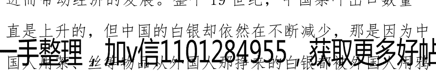

# 形势转变中，未来哪些行业有前景？

作者:丁龙德命 日期:2019-05-27 16:60

都说不好做了，水龙头一关加上贸易趋平衡以后，流动性紧张再加上社会经济运行成本的高起，很多企业都会慢慢坚持下去而选择退出，先是那些负债经营的，接着是那些成本巨大利润微薄的，再接着是那些依赖于产业链的，从工业到服务业，逐渐蔓延。虽然也有很多人前赶后继的创业，想在快干涸的水塘里抢一一口……那么，我来说说未来哪些行业会有比较前景。

## 一手整理，加微信1101284955，获取更多好帖

任何时候都有发的行当，即使是打仗的时候，当然我要说的不是那些那些非法的行当。按照目前的形势，以及我测算的锅底，未来10多年里，我们运行的是火运为主的。也就是说，跟火相关的行业会有一定的前景。

1楼 作者:丁龙德命 日期:2019-05-27 16:51

首先，节约成本成为以后政府的一个主题。就是，面对庞大的行政开支，政府也希望省点钱。那么，那些可以帮助政府提高和优化行政管理效率的行业很吃香（人工智能、数字化等），同理，国企企业也会向政府学习。

2楼 作者:厕丁添命 日期:2019-05-27 16:52

第二、一些文化类行业会有前景。火本身代表文明，形势不好了，就多做点思想政治工作，品德教育，雷锋精神哈的估计这块会很重视。

## 5楼 作者:厕丁添命 日期:2019-05-27 16:52

第三、能源行业。外贸易平衡了，能进口的能源就少了，价格高点卖，要省着用，这里很多相关行业估计会很好。

## 6楼 作者:厕丁添命 日期:2019-05-27 16:54

第四、军队。这个就不说了，会越来越重视。

作者:厕丁添命 日期:2019-05-27 17:26

我说的这些，有缘人自然会明白。

## 11楼 作者:厕丁添命 日期:2019-05-27 17:28

第五、其他还有照明、化学行业等、歌舞艺术、美容装饰品等。当食品行业还是很有前景的。

## 12楼 作者:厕丁添命 日期:2019-05-27 17:30

不过在到达达之前，我们还有一段时间的困难时期要过，因为我们现在正处于暴雨的前夜，也可以说还要经历一个经济剧烈荡阶段，要等稳了才能看到希望，或者说正式可以进入发展阶段。

# 13楼 作者：厕门医命 日期：2019-05-27 17:33

比如 2018 戊戌年，坤土制坎，贪财坏抑。通俗的说就是为了追求财富投机取巧捷，发展了错误的方向，为未来的危机埋了祸端。以土为主的财富就留了虚假繁荣，实则掏空了自身。

本年的特点是偏业，即偏门之财，非核心资产。从经济来说，对普通人而言，即表示一些外块、灰色收入等不正当所得失去；对国家而言，即一些边缘产业，一些小作坊民现象的注解）。另外，也表现为一些灰色产业链，民间借贷，影子银行等非核心金融产业的整顿，破产清理。从社会而言，n也可以从非正规的偏门去解读，即政府对城市的边缘带、边缘（即所谓“低端人口”）的清理和整顿。包括对市小粉红、黄赌毒等绑偏门的社会阴暗面的全面打击。对股市而言，坤土壅帮，资金如水，缺水则死气沉淀，惟年初冬水春木克制坤土，才出现了一定的反弹，但仅此而已。从自然现象来说，戌申水库，全年多雨多水，但戌土厚重，坤土面积大，因此没有什么自然灾害发生。

作者：厕卜添命 日期：2019-05-27 20:06

2019年亥年，还是财星坏印，这次是正财。本年的特点是围绕核心和中心为要点，即对核心资产和核心产业的保护。如金融产业的清理和规范从影子银行转向正规银行的整顿；货币政策以正面的，财政的引导为主；企业整顿以国企、央企为主；收入变化和改革直接从正式工资里体现；反和和社会治理也转向黑势力正面的清理。而8年来的政策还改变，用（土）赚钱、财富还是主要的任务。

# 16楼 作者：厕卜添命 日期：2019-05-27 20:07

一手整理，加微信1101284955，获取更多好帖

土地，虽然是本年的主线，但他可替代的产业，此前对土地依赖性，政府还是要竭力维持这个稳定，甚至不惜以实体经济不断退出和倒闭为代价。甲合土，财坏印，为了利益，用一切手段来维持一份表面的繁荣和资产保值。（明年还没有出现）。今年的热点与去年正好相反，去年的三线到一线城市，会被边缘化，本年重心转向一线城市、中部地区等。对普通人而言，土地会导致其他经济的不气，失业情况从边缘产业向纵深发展，一些正规行业也将面临失业的危机。内忧外患的暴雨慢慢聚集，但人们手里还有粮食，资产仍然处于高位，岁月静好未来的繁荣和美好。

# 17楼 作者:厕丁复命 日期:2019-05-27 20:08

3、在社会民生方面，本年将出现二特征，第一，物价持续通胀。因为甲合土，属水之行业在本年尤其具有通胀，处于萧条和被打的对象，以消费、商业买卖、物流、外卖、旅游、渔业、部分化学等泛流动性、不稳定的事物。4、在贸易争端方面，西方势力在本年对贸易争端还停留在表面，虽然形势不利，但妄拉厉的制裁在时间上还没有到来。5、股市方面，继续的情况，股市如水，土旺之年水不继续向下支撑。6、从自然来说，本年还算平安，去年雨多，今年偏旱，另外北方可能有异。7、最后，政府的货币政策将处于紧缩状态，并将去年开始的对边缘金融服务（如影子银行等）的清理转向正规金融行业的整顿和规范。我们也可以理解为从P2P的暴雷演变到银行理财的暴雷。以象论，“密云不雨，自我郊”，意思由于西方等大环境的影响，我们不能再下雨（释放货币），虽然整个天空看着水，好像要下雨（运造势），其实一滴水都没有，反而会出现大旱。19楼 作者:禹丁伦命 日期:2019-05-27 22:11

2020康子今：困古。本年运转西方，康子大勋在历史上是一手整理的加信年前的自然联军事件、180年前的鸦片战争等。预知后事，就找我字围吧。

# 20楼 作者:禹丁伦命 日期:2019-05-27 22:52

下面来说某某的基因问题和命运趋势。以卦象论，小番之韭木以外，乾金在内，按照一个人的情况来分析，那就是属于外表仁义道德，内里刻凶之人；按照数字五行分析，那就是贪财坏印的局面，就是为了利益不择手段，出卖灵魂，却最终自欺骗，名声败坏而自食其果的结果。也就是说一个人发财了如果不能守财那只是一个过路财，由于自身的能力、性格、才德等因素，德不配财，最终还是返回贫穷。

# 21楼 作者：厕门医命 日期：2019-05-27 22:54

以一个人的命运来比喻，我们可以这样想象他的一生：小时候很穷，可是很聪明，善于学习新事物，不甘落后，又很能做表文章，给人留下好印象。长大了之后他认定，只有依靠强者，看着老板做生意，才能改变自己贫穷落后的命运。而他机巧，正好碰到了经济上升期，老板们也需要这样的穷小子自己给自己打手，做一些他们不愿做的事情。于是，机会来了，他跟着老板吃着香的尝的，经过一段时间时间，他慢慢掌握了老板的生意的门路。一个穷人到一个暴发的经历让他唏有所感，贪婪的本性暴露，他没有想过如何保住财富，而是做得更大。一方面他开始模仿老板的生意，赚得更多；另一方面他从老板那里赚更多的钱。此时经济上升期基本结束，老板的积累慢慢损耗，由于投资太快了，老板自己的生意也不行，怎么会容许小马仔骑到头上，于是老板的地位被迅速打塌，众人由外交困，一切就像黄粱一梦。

# 22楼 作者:厕丁医命 0 日期:2019-05-27 22:56

从小观，见者，我们从人的命运模型中窥一个国家的走向，从目前的时间看，经济的趋势已经走到从富裕-贫穷的阶段，就是三十年轮回。我们将经历长时间的经济滞滞和局部民生高通胀，发展的经济螺旋下跌，国家的财富与人民的财富将被一轮又一轮的洗劫，几乎没有任何人保住财富。因为国家穷了，个人调整，最终造成了长十年的通胀。

## 23楼 作者：奄丁命 0 日期：2019-05-28 11:06

今天的中国就是15年前的日本，好像日本只有产业有前途。不过现在时候还不到，不久的未来可以啊……

## 28楼 作者：奄丁命 日期:2019-05-28 16:42

@奄丁命 2019-05-27 16:51:19

首先，节约成本成为以后政府的主题。也就是，面对庞大的行政开支，政府也希望省点钱。那么，那些可以帮助政府提高和优化行政管理效率的行业很吃香（人工智能、数字化等），同理，国企也会向政府学习。为什么这个属于火？因为火原则上是指事物发展的上升状态，而管理流程的重组和再优化表现了这一特性，人工智能和数字化等只是流程优化的工具。

# 29楼 作者:顾丁命 日期:2019-05-28 21:37

在宏观经济学中，滞胀特指经济停滞、高失业以及通胀同时存在的经济现象，其中生产停滞是经济滞胀的一个表现形式。

# 30楼 作者:顾丁命 日期:2019-05-28 21:37

美国经济上世纪70 年前后所经历的缓慢增长阶段被称为转型的滞胀阶段，其细分为 1968 年中至 1970 年，美国则是 70 年代以后的两次，CPI 增长达到 10% 以上。

作者:顾丁命 日期:2019-05-28 21:39

列举了导致美国滞胀的因素，其中包括美国在上世纪 60、70 年代长期实施的扩张性财政和货币政策，越南战争导致美国预算支出大为增加，上世纪 70 年代初的美元危机，1973 年的粮食危机以及石油危机，1978 年第二次石油危机等。总体来说，美国 70 年之前经济动力逐渐消失。

# 32楼 作者:厕冉命 日期:2019-05-28 21:41

如果美国经济在滞胀阶段面临的经济停滞归于内生动力放缓，扩张性财政政策导致产能利用率持续高等，多种因素的话，高通胀主要归于扩张性的货币政策。

# 33楼 作者:厕冉命 日期:2019-05-28 21:43

随着美元危机，第一次石油危机，粮食危机的爆发，长期低利率的效果显现，美国 CPI 在 1972年后开始飙升。美联储此时由于采取紧缩的货币政策对经济造成更大的打击，不仅没有采取措施，反而让实际增长量高于货币供给。

一个国家的增长需要通过经济周期的自我调整来实现良性循环。进入2世纪60年代之后，由于国内需求消失，制造业下降，美国无法恢复至高速增长，因其扩张性的财政和货币政策刺激社会总需求。

# 35楼 作者:鲍丁命 日期:2019-05-28 21:46

在美国人的心里，70年代是历史上最痛苦、最快的年代。严重污染，尼克松总统被弹劾，比尔·盖昂崛起，两次相似的石油危机，基督石派重新书写美国政治蓝图。70年代的美国不只是光鲜，贫穷、绝望和黑暗……

# 37楼 作者:鲍丁命 日期:2019-05-29 08:36

70年代后，美国政府试图解决大规模周期性失业和通膨胀问题。美国经济由盛衰的转折使得就业体系也做了相应的调整，并成为现代就业策略的重要转折点。

## 38楼 作者：厕丁复 日期：2019-05-29 08:38

1971年美国国会颁布的《紧急就业法》和1973年的《全面就业法》一系列法则就是在这样的背景下产生的，它们构成了70年代就业政策的主要内容。

# 39楼 作者：厕丁复 日期:2019-05-29 13:28

70年代：美股十年不涨、美国“失去的十年”（美国人都在危机中大量借债——20年代是花在汽车、收音机和家里上；而在过去的十年，则是为了房产，或是用来抵抗房价的虚涨）。

## 40楼 一手整理，加微信1101284955，获取更多好帖

从美国股市百年历史的长周期角度，1970-1980年股市是个牛市期。从1970-1980年的短周期来看，股市却维持着激烈波动。1973年月石油危机开始到1974年底的大调整中，美国 S&P500 下跌了43.3%，是股市战后历史最大跌幅；随后在1975年大幅度反弹，到1976年底基本回到1973的高点水平。

## 41楼 作者：厕丁复命 日期：2019-05-29 13:30

在滞胀期间，美联储的货币政策没有能够帮助经济增长，反而由于货币供应量过大，被认为是推通货膨胀的因素之一，银行信贷业务扩张也对通胀的产生到了推波澜的作用。能源和食品价格上涨直接使通胀直直升至两位数。

# 42楼 作者:诡丁医命0 日期:2019-05-29 13:30

1979年发生的经济危机使得美国工业生产下降了11.8%，持续时间44个月。另一方面，大量企业破产，失业率升到战后最高值。

# 43楼 作者:诡丁医命0 日期:2019-05-29 13:30

1979年发生的经济危机使得美国工业生产下降了11.8%，持续时间44个月。另一方面，大量企业破产，失业率升到战后最高值。

# 44楼 作者:诡丁医命0 日期:2019-05-29 13:31

1979年发生的经济危机使得美国工业生产下降了11.8%，持续时间44个月。另一方面，大量企业破产，失业率升到战后最高值。

# 45楼 作者:诡丁医命0 日期:2019-05-29 13:32

1979年发生的经济危机使得美国工业生产下降了11.8%，持续时间44个月。另一方面，大量企业破产，失业率升到战后最高值。

# 46楼 作者:厕丁医命0 日期:2019-05-29 15:28

1970年，已婚家庭占全美总数的52%。

# 47楼 作者:厕丁医命0 日期:2019-05-29 15:29。

## 48楼 2、3 吧

# 49楼 作者:厕丁医命0 日期:2019-05-29 15:30。

# 50楼 作者:厕丁医命0 日期:2019-05-29 15:29

随着新媒体的不断出现，整个美国呈现出多元化、多样化。

# 51楼 作者:厕丁医命0 日期:2019-05-29 15:31

# 52楼 作者:厕丁添命 0 日期:2019-05-29 22:21

## 56 楼
作者: 厕丁医命 0 日期:2019-05-29 22:23

20 世纪 70 年代以后，美国城市发展进程出现了新的现象，即非都市地区的发展速度超过了大都市区，“非都市化时代”或“逆城市化”时代即将到来。

## 58 楼
作者: 厕丁医命 0 日期:2019-05-30 00:22

“胀”阶段是美国“二战”结束后最为艰难的一个阶段。从 1969 年 12 月爆发经济危机，到 1982 年 12 月经济复苏为止，美国有约 13 年的时间停留在滞胀的阴影下。平均每 3 年就有一次衰退，实际 GDP 平均增长率只有 2.9%，而我们获取的多收入占通货膨胀率所有地高涨，年平均通货膨胀率达到 10.46%。

## 59 楼
作者: 厕丁医命 0 日期:2019-05-30 20:34

史见已周知，120 年前的己年，1899 年，美国向英、俄、德、法等国提出在中国中国实行“门户开放”政策，意图扩大在中国的侵略势力。1900 年，参与八国联军侵华，强迫清政府签订《辛丑条约》。

## 61 楼 
作者: 厕丁医命 0 日期:2019-05-30 20:35

“门户开放”政策的提出，标志着美国提出独立的对华政策。这是 1844 年《中美望条约》规定的“利益均占”原则，在帝国主义时代的新发展。

## 62 楼 
作者：厕丁医命 日期：2019-05-30 20:35

美国企通过它快速增长的经济力量，进行畅通无阻的渗透和扩张，绕过其他国家的军事优势，最终达到独占中国的目的。

## 63 楼 
作者：厕丁医命 日期：2019-05-30 20:36

英、德、奥、日、法等出于不同考虑，程度不同地接受了“门户开放”政策。其中英国是切望借助美国阻止其整理加微信获取更多信息。帝国主义各国接受“门户开放”政策，不仅是因为由于运动活动阻碍了它们的瓜分活动，还由于它们都还无力吞并中国，因而在维持现状不断扩张。这反映了帝国主义在华势力均势均可敌的局面。

## 64 楼 
作者：厕丁医命 日期：2019-05-30 20:37

“门户开放”政策以确认对中国的不平等条约为前提，表面上提到“机会均等”，实际上是一项十足的帝国主义政策。所谓保持中国土地和行政的完整，实质是保持一个完整的半封建殖民地的中国，以适应美国扩张的需要。

## 65 楼 
作者：厕丁医命 日期：2019-05-30 20:37

日俄战争冲击了“门户开放”政策。1915 年日本提出的“二十一条”，更破坏了门户开放政策。1922 年的华盛顿会议上，“门户开放”原则得到列强正式承认，并作为列强对华侵略的政策原则被载入于《九国公约》。

## 66 楼 
作者：厕丁医命 日期：2019-05-30 20:38

历史似乎总是惊人的相似，不断的重复着。

## 67 楼 
作者：厕丁医命 日期：2019-05-30 21:46

1899 年夏天金融危机席卷俄罗斯，随之工业生产陷入危机。

日本在 1900 年爆发了第一次经济危机。

## 68 楼 
作者：厕丁医命 日期：2019-05-30 21:47

光绪时期（1875~1908年），虽然政府财政收入迅速增加，但支出增长得更快。1899 年，清政府的开支高达 1.01 亿两，而当年总收入为 8840 万两，其中 2400 万两即占总收入的 30%，用来偿还外国贷款，从 1874 年至 1911 年间，根据合约，政府借款为 1.71 亿英镑（约 10.83 亿），到 1911 年，清政府垮台为止，共还了 3230 万银（约 2.04 亿），还有 1.39 亿银（约 8.78 亿）未还。这种以借钱来还以前贷款的方式，使清政府陷入了一个无望的泥沼中。

## 69 楼 
作者：厕丁医命 日期：2019-05-30 21:48

19 世纪，中国还是生产大国和出口大国，当时的世界依然弥漫着“热”，中国源源不断地输往各地，呈现一片繁华的景象。中国的种植、生产、贸易的扩大自然增加人口，解决就业，进而带动经济的发展。整个 19 世纪，中国出口一直上升的，但白银仍然不断减少，是因为 鸦片战争终结。

## 70 楼 
作者：厕丁医命 日期：2019-05-31 08:29

19 世纪六七十年年代，中国资本主义产生，经济结构发生变化，封建经济逐步解体，同时中国也陷入了资本主义市场。这样，中国呈现半殖民地半封建经济的特征。

## 71 楼 
作者：厕丁医命 日期：2019-05-31 08:29

19 世纪末中国资本主义发展的特征：

- 1. 经济上，小农经济依然主导地位，资本主义萌芽缓慢，但随着西方列强的入侵，小农经济逐渐瓦解，中国逐渐卷入资本主义市场，并继续建立近代工业（包括洋办）。
- 2. 政治上，清政府依然实行君主专制，但逐渐出现了资产阶级倡导的新变法和革命派领导的辛亥革命。
- 3. 工业数量、规模扩大；企业由沿海向内地扩张；棉纺、丝织等轻工业发展；采矿等重工业开始发展。
- 4. 外部环境上，西方列强进行了第二次工业革命，进入帝国主义阶段。继续对中国进行殖民侵略，中国经过两次鸦片战争、甲午战争、八国联军侵华，最终进入殖民地社会。

## 76 楼 
作者：鲍丁医命 日期：2019-05-31 16:59

在 1973 和 1979 两次相似的石油恐慌中，美国通货膨胀直线上升，在 1979 年达到 13% 的历史最高点。

## 77 楼 
作者：鲍丁医命 日期：2019-05-31 17:00

这意味着，如果你把你的工资存在特定的账户中，随着美元贬值，你的 100 美元一年后就剩下 89 美元了。

## 78 楼 
作者：鲍丁医命 日期：2019-05-31 17:00

当钱变得没有任何意义时，中国产生了新的投资和信用手段——信用卡。消费贷款数额在四年里从 6 千亿增加到万亿。

## 79 楼 
作者：鲍丁医命 日期：2019-05-31 17:00

美国人学会如何在价格高涨之前就把东西紧紧预订了，等到通货膨胀时付钱。

## 80 楼 
作者：鲍丁医命 日期：2019-05-31 17:01

“随着成倍的通货膨胀，”波士顿大学的斯库曼教授说，“节约只能吃草了。”

## 81 楼 
作者：鲍丁医命 日期：2019-06-03 15:07

我为什么要拿 60 年前的己亥年来进行对比呢？因为那个阶段在东方，矛盾主要是在内部，很少外部环境的影响。不过我也发现 60 年前的己亥有一个有趣的情况，除了我们知道的“人有多胆，地有多大产”的大跃进事件，却不知道那一年有很多大项目完成了。比如人民大会堂工程完、北京火车站建成、中国革命博物馆和中国历史博物馆建成、北京工人体育场建成等。

## 85 楼 
作者：厕丁医命 日期:2019-06-09 13:10

我们还不知道的，是在60 年前的己亥年，我们大量援助越南，签订了《关于中国政府给予越南经济援助的协议》，越南政府换取更多贴的贷款。这是跟我们现在对非洲以及东南亚国家的援助政策有很多惊人的相似之处呢？

## 86 楼 
顶

## 88 楼 
作者：厕丁医命 日期：2019-06-14 11:31

20 世纪 70 年代末80 年初，一场声势浩大的行政改革在范围内掀起。“新公共管理”是被财政危机逼出来的。一方面是“投入越来越大”，另一方面是“税收困难”，矛盾促使不得不另辟径——这就是我说的行政效率的必然性，是财政困难逼出来的。

## 91 楼 
作者：广仁命 日期：2019-06-14 11:32

新公共管理倾向于决策制定（掌舵）和决策执行（划桨）分离。为了实现两者分离，新公共管理主张通过市场化等形式，将公共服务的生产和提供交给社会力量来承担。

## 92 楼 
作者：广仁命 日期：2019-06-14 11:32

这场政府改革运动，不同程度上解决了发达国家面临的财政危机和危机，目标：

- 1. 提升了政府运作能力，回应了在全球范围内保持竞争力的内在要求。
- 2. “新公共管理”在一定程度上把政府职能定位在掌舵而不是划船者。
- 3. 这样就脱离了具体事务之外，集中精力参与政府决策。
- 4. 同时通过授权和分解责任，引入激励机制，对人员实行聘任或合同制，大大缓解了政府内部管理的紧张，对一些公共事务外包给一些 NGO 去去做。这些在一定程度上改变了西方国家对政府效率低下、机构臃胀、办事拖沓的印象。

## 93 楼 
作者：庞丁医命 日期：2019-06-18 12:47

二战之后，由于抱住了美国的大腿，日本经济却快速发育。在当年的日本，暴户一大把，大街上，白领们拿着一捆一捆的钞票等出租车，利息也是如此。

## 95 楼 
作者：庞丁医命 日期：2019-06-18 12:48

在这波强势崛起中，日本商品在世界各地畅通无阻，连美国市场也被日本企业攻略，导致美国国内出了贸易赤字，只能进口买卖。1979 年，日本向美国出口了近 200 万汽车，而美国卖给日本的只有 1.5 万辆。当时的美国甚至直接放火、砸日系车。

1989 年，美国搞了一套超级 301 条，直接干涉日本内政，强迫它开放国内市场，甚至妥协性地日本修改经济政策。当年，美国连德、英国、法国这些听话的小弟一起，与日本这个反骨仔签订了著名的广场协议。他们一起干预远超外汇市场，使得美元对日大幅贬值。

## 96 楼 
作者：厕丁医命 日期：2019-06-18 12:49

日本政府一看，日本银行不断降低存款利率，刺激百姓把钱从银行拿出来买房。签订广场协议之后的几年，日本的地价搭着火箭上涨，远离GDP增长速度。按照日本国内的地价，把日本卖后可以买下来4个美国。到后来，日本政府也不得不正视泡沫的危险。

## 97 楼 
作者：厕丁医命 日期：2019-06-19 02:02

从 1973 年开始，美国出现了低增长、高失业与高通胀的局面。

1972年至1973年，鸡蛋上涨49%，物价“通胀”之后，鸡鸭鸡鱼牛肉羊等禽肉飞走“齐飞”。在石油危机的推波助澜之下，肉类整体价格上涨了25%。美国民众大呼“牛肉自由、鸡蛋自由”。

1973年通利率维持在3.27%，1973年石油危机影响上涨到6.16%，1974年高达9.2%。1973年，美国失业率维持在5%以下，到1974年底上涨了两个点，到1975年则维持在8%以上。

1973年GDP增增速5.6%，第二年断崖式下跌到5.5%，第三年为2%。

## 99 楼 
作者：厕丁医命 日期：2019-11-15 22:15

以现在的眼光看巴尔扎克的作品，依然具有现实意义的。因为那时的法国，正是资本主义的初级阶段。他的小说能超越时间和空间，保持持久的魅力。

巴尔扎克的《公务员》就是一部小说，揭示出一个官僚体制，以及种种腐败的习俗。“只有庸人才能创造、取悦于庸人”，正直的人很难受。这种地方，一部分人高卑，浪费和摧残了多少才华，聪明的人玩世不恭，天才的人怀大志，勇敢走向绝望。

## 100 楼 
作者：厕丁医命 日期：2019-11-15 22:18

自上而下，庸人都是这个制度的寄生虫：经过多年的斗争，在反复审查中身心交瘁。每天调和各种利害，应付各种阴谋，习惯于断章离析而不是明辨是非。下面的各级公务员原来是诗人、画家，或是医生，一旦卷进这支官僚机器，渐渐地磨掉了热情、意志和希望。他们终于成为群体“奴瘤”，每天在死气沉沉的天地荷筹经营，或者为了保住自己的饭碗，反对一切改革的力量。

## 103 楼 
作者：厕丁医命 日期：2019-11-15 22:23

巴尔扎克充当了他时代的“历史书籍”，他的他的作品意义远不止此。诚然，他所写的官僚体制和公务员是十九世纪法国带有鲜明的时代标记和民族特点。但是，从衙门腐朽的习俗、无职的气氛围，上面的昏庸和底面的怠惰，以及一群庸庸碌小人物的精神状态中，却可以看到某种共性。

## 104 楼 
作者：厕丁医命 日期：2019-11-16 09:19

欧洲资本主义迅猛发展，使他们陷入金钱主义的心理膨胀。“法律跟道德对钱的人全无效，财产才是金科律。”于是人人唯利是图，以致社会风气日下，道德被抛掷到了阴暗的角落，遭受随意的践踏和践踏。这些都是巴扎克在小说中不遗余地描述和鞭挞的。

## 106 楼 
作者：厕丁医命 日期：2019-11-16 10:13

19世纪上半叶的战斗，是历史上阶级斗争最为激烈和局面变换最频繁的时代。新生阶级取代了旧贵族主宰了社会，而这个阶级在原始积累时期又露出了惊凉和怪异的本性。巴尔扎克的笔，栩如生地画出“葛威尔昂”这样的人物。不幸运……看到这一幕“人间喜剧”，人们感受到的恰恰是资本主义崛起带给社会性的悲剧。

## 106 楼 
作者：厕丁医命 日期：2019-11-16 10:54

巴尔扎克：傻瓜旁必有骗子。在骗子眼里，除了同行，天下皆傻瓜——这是他们最大的职业依据也是信仰所在。

## 107 楼 
作者：厕丁医命 日期：2019-11-18 23:45

11 月13 日，美联储鲍威尔指出：“展望未来，我和我的暂时看美国经济状态良好，美股将长牛继续，创造二战以来的神话。”

## 109 楼 
作者：厕丁医命 日期：2019-11-19 08:07

2027 年韩国将实现 L4 驾驶全面商化——科技领域未来。

## 110 楼 
作者：厕丁医命 日期：2019-11-19 08:13

央行发布：中国货币政策维持合理区间，应对通胀压力，广义M2增速合理。

19世纪末中国资本主义发展的特征：

- 1. 经济上，小农经济占据主导地位，资本主义萌芽缓慢，但随着西方列强的入侵，小农经济逐渐瓦解，中国逐渐卷入资本主义市场，并继续建立近代工业（包括洋办）。
- 2. 政治上，清政府依然实行君主专制，但逐渐出现了资产阶级倡导的新变法和革命派领导的辛亥革命。
- 3. 工业数量、规模扩大；企业由沿海向内地扩张；棉纺、丝织等轻工业发展；采矿等重工业开始发展。
- 4. 外部环境上，西方列强进行了第二次工业革命，进入帝国主义阶段。继续对中国进行殖民侵略，中国经过两次鸦片战争、甲午战争、八国联军侵华，最终进入殖民地社会。

提供资金，但与劳动代表的谈判陷入僵局。奥迪在德国拥有6.1 万名员工，该公司正在争取撤离 4000-5000 人。

——差不多 8%，这裁的有点狠啊。现在都知道特斯拉趋势和冲击了，感觉有点跟不上上啊。

## 138 楼
作者：禹丁医命 0 日期：2019-11-24 12:06

《经济参考报》记者日前从国资委获悉，国资委会同有关部门成立专门工作小组并进行深入调研，在广泛征求有关意见的基础上尽快研究制定国有企业改革三年行动方案。行动方案中，将在推进混合所有制改革、加强国资企业监管、增强研发能力、强化财务约束、减负和规范并补充机制等方面提高核心竞争力、提升竞争力领域和关键环节，明确责任的举措，制定可量化、可考的具体指标，推进国有企业改革在重要领域和关键环节取得决定性成果。——重点词，财务硬约束。

## 143 楼
作者：禹丁医命 0 日期：2019-11-25 08:57

英国首相约翰逊：我们将在 1 月 31 日前离开欧盟。

——大难将临临各自。

## 145 楼 
作者：禹丁医命 0 日期：2019-11-25 17:10

据报道，美国联邦通信委员会 (FCC) 22 日一致决定，

初将华为和中兴公司列为构成安全威胁的企业，将禁止美国电信运营商使用“通用服务基金”采购华为和中兴的服务和设备。

## 146 楼 
作者：厕丁添命 0 日期:2019-11-26 08:09

财联社 11 月 26 日讯，美股全线收涨，纳指、标普 500指数再创历史高。道指涨 0.68%，纳指涨 1.32%，标普指数涨 0.75%——万恶的帝国!

## 147 楼 
作者：厕丁添命 0 日期:2019-11-26 22:46

巴西雷亚尔美元汇跌至 4.20 雷亚尔下方，恐创收最Worst整理，加微信1101284955，获取更多好帖。

## 150 楼 
作者：厕丁添命 0 日期:2019-11-26 22:49

巴西经济学家波波认为，目前巴西民众对未来不乐观，消费支出减少，企业不敢投资，就业机会变少，从而形成恶性循环——这经济学家的口吻好像像都一样的。

## 151 楼 
作者：厕丁添命 0 日期:2019-11-27 08:20

天眼数据显示，2019 年以来，有 1884 家影视公司停止，具体表现为公司状态注销、吊销、清算、停业——风停了~

## 152 楼 
作者：厕门医命 日期:2019-11-27 17:18

安信证券高豪文：经济增速下滑不会极大拖累股票市场。

11月27日，在安信证券2020 年度投资策略会上，安信证券首席经济学家家高豪文，在宏观上设法不要太多，要接受现实，自下而上埋头苦干。经济增速下滑已经被权益市场反映，将不会极大拖累股票市场。

——这话他自己信吗？股市跟经济脱了？

## 156 楼 
作者：厕门医命 日期:2019-11-28 08:29

~~~深渔村的故事，将会深刻影响一部分00后，10后一手整理加微信1101284955，获取更多帖。

## 159 楼 
作者：厕门医命 日期:2019-11-28 16:57

昨夜美股又创历史新，目前好像德国和日本还没没史新，估计要等他们高了，才会迎来一波阶段性调整。

## 162 楼 
作者：厕门医命 日期:2019-11-30 08:59

惠誉29日发布报告，警告欧区正陷入低增长、高债务的恶性循环，可能引发一系列政府债券评级下调。报告认为，欧区国家可能重蹈日本自上世纪九十年代以来的通缩“覆盖”。其中，希腊、意大利和葡萄牙风险最大~~~

幸福的家庭都是相似的。

## 164 楼 
作者：厕门易命 0 日期:2019-12-01 11:22

易纲：不搞竞争性的零利率或定量宽松政策：
12月1日，中国人民银行行易纲在《求是》撰文指出，即使世界主要经济体的货币政策向利率方向靠近，我们也坚持稳中求进、精准发力、不搞竞争性的零利率或定量宽松政策，始终坚守好市政策维护市值稳定和保护最大群众福利的初心使命~~~那些等着放水的估计要渴死了。

## 165 楼 
#一手整理 加微信11101284955 获取更多好帖

12月2日市场消息，美国总统特朗普称，美联储应该下降并且宽松（政策）。——美联储不懂老老的生意经啊。
其实他们没有大的分歧，主要是在于对（宽松）时机的看法不不同。

## 166 楼 
作者：厕门易命 0 日期:2019-12-03 08:31

特朗普又让本已紧张的国际贸易形势雪上加霜，以巴西和阿根廷故意让特朗普贬值为，重启对进口这两大南美经济体钢铝加关税。——你们敢贬值，老子就敢加税！

## 168 楼 
作者：厕丁医命 0 日期:2019-12-03 23:21

路透社3日消息称，美国政府一周表示，在断定新的法国数字服务税将损害美国数字技术之后，提议对价值24亿美元的法国商品征税，并考虑就数字对意大利、土耳其和奥地利进行调查。

——刚消停几天，老特就指东西，又开始闹了，顺带让德国的股市降温，高人啊。看来15日前没戏了。

## 169 楼 
作者：厕丁医命 0 日期:2019-12-04 09:14

12月4日街彭报道，算上大银行刚刚公布的贷款人，73,000人，且几乎全部欧洲，当地的负利率政策和经济的宽松迫使银行削减成本。

——金融是经济的风向标，一切似乎都回到了时候。

## 170 楼 
作者：厕丁医命 0 日期:2019-12-05 08:51

北京在售限控房80%遭遇亏损，库存创新高，降价促销，加快周转成常态——居然还有钱的！

## 171 楼 
作者：厕丁医命 0 日期:2019-12-05 23:06

路透对美国10月贸易帐付：手机和其他用品等下降，10月下滑，使得贸易逆差连续个月下降，跌至近半年以来新低，或将在第四季度提振增速。——老特功不小。

## 173 楼 
作者：厕丁医命 日期:2019-12-05 23:17

湖南政府办公厅《关于加快推进企业上市的若干意见》，提出企业“破零”计划，加速企业上市。力争到2025年，全省争取企业上市。一手整理 加微信1101284955 获取更多好帖。

连企业上市都变成可控的任务，这块还有盼么？全国这么多省，目标都是将来要增加几千上市公司，个神啊！

## 174 楼 
作者：厕丁医命 日期:2019-12-06 22:07

美1月非农就业人数增2.6万，失业率创1969年新低——那天非农是一场虚啊。

## 175 楼 
作者：厕丁医命 日期:2019-12-08 22:15

12月8日报道，英国等40个国家德鲁公司发出可能破产的警告。德鲁公司是一家纸币制造商，从1860年起就是英国最大的印钞厂，世界上约1/3的钞。德鲁公司无法生存下去，多达2500名员工将面临风险——我没生意了。

## 182 楼 
作者：鲍丁医命 日期:2019-12-08 22:25

中国1月出口（年率）实际值：-1.1%；前值：-0.9%；中国1月进口（年率）实际值：0.3%；前值：-6.4%。一手整理加微信1101284955，获取更多好帖。

## 183 楼 
作者：鲍丁医命 日期:2019-12-09 17:10

主力合约放量暴跌，鸡蛋上演“过山车”出行——食品价格大起大落，也不用担心明年鸡蛋吃不起的问题。

## 188 楼 
作者：鲍丁医命 日期:2019-12-10 08:09

中国11月份零售销量减少4.1%连续个月下跌。

## 191 楼 
作者：厕丁医命 日期:2019-12-10 08:13

摩根士丹将裁员1500人因全球前景不明——裁员都不实话了。

## 192 楼 
作者：厕丁医命 日期:2019-12-10 08:23

证券日报评论：顶层设计加持，万亿理财有望成为A级。——嘿，拿理财的你们炒股，结局是什么呢？你是相信吧？

## 193 楼 
作者：厕丁医命 日期:2019-12-10 21:47

一手整理加微信1101284955 获取更多好帖。看来要开始全面开放了，地方财政挡牢了。

## 194 楼 
作者：厕丁医命 日期:2019-12-11 17:15

财联社12月11日讯，据德国《图片》消息，特斯拉德国工厂年产量将达5万辆——不用多久估计另一家巨公司，未来二年是快速发展期。

## 196 楼 
作者：厕丁医命 日期:2019-12-11 17:26

福建省计划再度调水泥价格——去库存再来一轮涨价。

## 197 楼 
作者：鲍丁医命 日期:2019-12-27 16:13

居然又活了。大家赶紧说话，春节后估计又关键了，再一次应该是真的。

## 198 楼 
作者：鲍丁医命 日期:2019-12-27 17:54

最近国际市场挺热闹的，哈不了来点干货。预计美国和欧洲股市都在等待德国突破2018年1月高点，日本突破2018年10月高点，然后一起共振下跌，进行一波大的阶段性调整（只是调整，后续还有主升），时间估计在春节前后。一手整理加微信1101284955获取更多好帖。这就叫本末倒置，没有了广大支持，靠一群跳梁丑的叫嚣，它连P都不是。没了人气，你还能玩吗？

## 202 楼 
作者：鲍丁医命 日期:2019-12-27 20:14

是啊，中医更玄，望问切如何科学论证呢？我小时候梦到第二天发生的事情（验的不是自己，是别人的事情），而且像一模一样，科学怎么解释呢？

## 204 楼 
作者：鲍丁医命 日期:2019-12-28 09:49

三季度末口径外债余额超2万亿美元，外汇局：风险指标稳健。——凭本事借的钱，哈哈。

## 209 楼 
作者：厕门厄命 Date:2019-12-28 13:21

12月28日，《证券法》新修订获通过，注册制全面来袭。出新玩法了，这是一个信号。

## 213 楼 
作者：厕门厄命 Date:2019-12-29 13:46

马斯克：拉斯维加斯沙漠隧道交通明年启用，时速250公里：拉斯维加斯地下铁道将采用自动驾驶的运输工具，每小时运行速度为250公里，这接近目前全世界高速铁路的运行速度。整理加微信回复老父位置获取更多帖。

## 215 楼 
作者：厕门厄命 Date:2019-12-30 16:44

首批交付的特斯拉配基础辅助驾驶功能的Model 3标准续航版（中国制造）车型起售价为人民币35.58万元，首批用户均为特斯拉地区员工，2020年1月，特斯拉按照订车顺序交付其他车主。目前，上海超级工厂周产量超过1000台，2020年调整生产班次后周产量预计达到2000台。哈，自己人先用。

## 216 楼
作者：厕门厄命 Date:2019-12-31 08:34

人民论坛：新的春天，我们要继续坚持顶压拼搏、逆风前行，运用好周期调节工具，更重要的是转变作风、开动脑筋、找准着力点，把整体发展潜力激活。

哈哈哈哈，新名词，逆风前行啊。以后就是存量博弈了，不把你们AZ干了了不算完。

一手整理，加微信1101284955，获取更多好帖。
