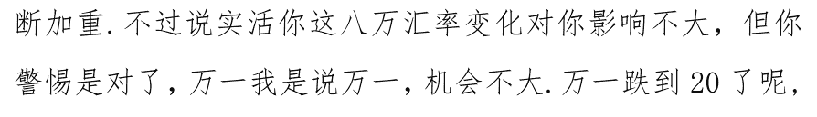
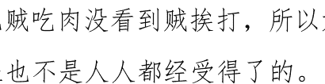
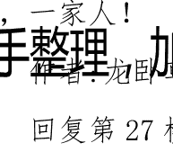

# 一个潜水多年的体制内的生意人来闲谈老百姓该怎么办？

## 龙卧草庐

首先问候各位同胞各位小伙伴！题目起得很大，足以可以写一本书，但本人认为这是人民真正关心的也是关系到切身利益的问题，所以必须如此，欢迎各位大神讨论。我务必尽所能回复，希望能抛砖引玉，共同提高！先说两点：

一、本人并不打算长篇大论，因为传一句话，假传万书。
二、本人也不想用大学的名称称神异，楼主相信人话有三种：

- 一、学者型。一种浅入出浅，满皮毛又想恼人，一大堆专业术语，一通车轱术语，简单道理弄奥了，骗子型。
- 第二种人，深入浅出型。厚积薄发得深，实践深，切实际，但讲出来简单，卖菜的都能听懂原子弹是什么原理，高手型，良师型，楼主竭力做这种人。

感谢网友支持，由于是直播请各位在楼主深夜笔耕的情份上宽容耐心，相信不会让你们失望！

先讲资格，楼主本人七零后，体制内人，千万天下做过很多行生意，开过公司前线奋斗十几年，现实稳定有房有车，存款有印钞机（稳定收益），没靠任何关系做过任何良心的事。说这些家伙决不是炫富，是为了说明明楼主帖的资格，讨厌纸上谈谈误人弟子，也为了说明在任何时候任何环境丝不肯心学习一样属于自己的机会。

作者:龙卧草庐 日期:2013-06-26 02:55

---

@冰封的 MK 9 楼 2013-06-26 01:55
楼主：
这次央行放水了多少？
放水了以后房价是不是还会涨?
股市最近是加仓还是减仓？加的是哪个板块？

# 如果不方便回复请私信我！一手整理，加v信1110284955，获取更多好帖

呵呀，还没写就开始忙着回复，这样更好效率了。

一，放水肯定是放了，数目嘛肯定只有500亿。
二，说专家都不预测房价，其实心里都清楚，只是哑着底的问题，好在我们百姓中还没且遇到房子问题，可以说自己的观点，房价随便意义上说（也可见看哪个城市，你哪个城市？）必跌，不要看报道的数据，好多也是有价无市。
三，股票不能再加仓，阴跌不会大涨。建议关注央行是否降准，这才是大钱，放水是小事。

作者:龙卧草庐 日期:2013-06-26 03:01

首先请大家明白中国经济发展到今天已经到了一个关键的十字路，但我又想了一个传奇的故事。据说美国富翁耐基的儿子说：“爸爸你们那年代百加优待我运气成功了，我们这代机会就不会了。”卡·耐基说：“儿子放心吧，现在连一根完美的螺丝钉都愁还造不出来呢……”可是说这个是为了让大家失望绝望，恳求生存，可以气愤别颓废。

作者：龙卧草庐 日期：2013-06-26 03:14

现在经济情况真是外贸由于人民币升值，人工以及其他成本增加还有美国和欧洲的阻击，制造业转移等非常困难，所谓的差别有一部分是人为的，内则是产能相对过度。（不是绝对过度，就是生产的东西用不完了，而是人们想用却没钱买所以以为完了。）

# 一手整理加信1101284955 获取更多好帖（2013-06-26）

在这种情况下老百姓应该怎么办？就得收缩战线，谨慎投资。说两个方面：

一.投资。有点钱怎么办。买房？除非刚需，否则决不买！买股票，隐含如中国足球，减仓或清仓。

作者：龙卧草庐 日期：2013-06-26 03:27

怎么配置呢，存银行（苦笑）这就是中国情。愁心哪。但也要配置如30%配置美元然后观望，人民币汇率如果出现下跌，跌到6.5到7马上上50%美元依次推。

作者：龙卧草庐 日期：2013-06-26 03:39

想创业也可以，其一。低端奶饮（别小看，生意无大，关键在做法和是否时机，可口可乐三块钱一瓶可口乐公司小？）经济下行人们就会调整消费习惯，我家门口卖饼的最近火爆，排队轰死。其二.美容院。其三.农村养殖.四.医疗行业（注意不是储蓄业）.五.幼儿园，这些都是通缩或经济下行可行的创业。

作者：龙卧草庐 日期：2013-06-26 03:54

别怕崩盘也别怕宇宙无敌，崩溃就是财富再洗牌。我们这些百姓受害肯定很深，实际情况就是算上边把我们羊圈养时时刻计划，但今天的中国实行的精英计划，有那么多愚民，所以以上会想办法不让羊圈围。注意别听悠悠，只盯着几点大事：一、财产申报制度，二、财政制度，三、司法独立。一手处理加微信1101284955 获取更多好帖

作者：龙卧草庐 日期：2013-06-26 04:06

回复第28楼（作者：@龙卧庐 2013-06-26 03:57）
有什么样的观点，创业还是投资或行业？别整天想新奇，我的圈子里发生的都是真实的，你管他不是浪漫，能给你最美的是什么？大家低估自己，没有不起，马云也只是普通而已。

作者：龙卧草庐 日期:2013-06-26 04:29

说了这些大众认知的真相，网友们情绪低落吧，好像所有的路都难啊，整体情况真的这么难！连李总都难啊，你没看人民币随美元要有多大的决定心，付出这么大代价，可恶的热钱还是想跑，美国欧盟还是要回制造业，我们不能帮你们打工几十年，资源我们用了，环境坏了，好歹你把技术和厂子留下来，低端的去越南去柬埔寨这是没办法！但你中端走了我们这些几年的努力得来些什么？房子哟？呵呵可为上面焦虑下……还是说老婆找热干的事，怕百姓咋办？

作者：龙卧草庐 日期：2013-06-26 08:04

回复第62楼（作者：@革心第六人，2013-06-26）
房产价格如果再高，政治，经济就会出现严重问题，别忘记客观规律。何况房产价格推广的代价是大量……已经开始做空，天下还很根，先诱我们们走上死路（本来一个刚工业化的国家，你就好好研究生产制造，往高精尖发展，学人韩国三星，学人日本很多机会啊），弄实了，弄你上行情才那是不得了的事，真是让人扼叹啊，别看你美国玩金融，玩信息，房子总想在地球上不好，既然抓把手（制造业）手里没，我们大家都不比他们，这几年的努力得来些什么？

作者：龙卧草庐 日期:2013-06-26 08:10

---

# 民族怎样富强

我们民族怎样富强这个话题突然觉得我不想在这里说了，我是一怕会引起，二是辩论和推导过程还太累死人，只讲结果结果要把引起起战，权衡之下楼决定偷懒只点题和说结论，就如E=MC²为什么有机会再弹一遍。先说个事前几天和领导喝茶，聊得开了袍：他非要说无他人情，谁坐上了有权的位置都得为自己利益考虑，就好比一肠汤我们四人分（我们当时他还有中国银行的两个主任四人喝茶，加一句：两个美女哈!)这汤总得个人拿勺子分。

---

# 回第13楼，@龙卧草庐 2013-06-26 01:54
......中国的楼市是崩溃了。为什么发展房地产知道吗？房地产就是一把切蛋糕的刀。当初我刚下海那些朱总真的是智慧有魄力，全国人民应该记住他老人家，那时候民营国企都发展的很好（中间九八和零八有波动属于市场。经济正常波动）通胀也合理。政府逐渐成了所谓的小政府，人们创业积极性很高营商环境也不错。问题是我们国家从政治来说是社会主义国家啊，你体制外的一个好了都发了，人们以当公员为耻这怎么行，必须得想办法把你的钱弄来到体制内让你别显睁也清醒下自己的地位，位置才是老大。所以才大力发展房地产，当然随着中国工业化的脚步城市化房地产一定要发展的，但不是这么一个发展法。）其实房地产对于国家的经济是一个附属产不是主要的，对于一个国家和个人都不是很重要的，房地产发展的再好也不会成为富强的。关于鲁迅说得好的是：倘若你是狮子老虎整天你自己如何大是不好事的，但若你是绵羊自己把自己大就够了被人割不远了。房地产就是绵羊肉，看不好用用军队包起来就是一（呵呵）用快递和棉衣哦，所以当你了解房地产只是财富分配的一个手段你就不会想在房子里投机。就别管它是涨还是跌了。房主本人只有两套房，一套是零四年的算是顺了房价暴涨时买到的，一套是零四买的房价是高的时候买到的，多年由于当时是为，房子也没赚钱。

---

先写这些结论和草稿，明天看着具体写我们百姓在现在经济形式下从一千元一万元十万的各种人该怎么办最好以及为什么。人要都能做一点到的贡献，那么我们的国家就会改观并真强大起来。

作者：龙卧草庐 日期:2013-06-26 06:29

---

# 总结建议

大家都不低估自己！马云只是普通而已，每个人都是普通的每个人，家里只有十万的钱比你少比你像啊要是要把十万提前投资到家里人的钱有可能比你多，你还富个……所以越是这个当，容易改变人的命运，我们要注意防风险（所以出了下策），楼主也是

作者：龙卧草庐 日期:2013-06-26 05:58

---

# 最后的观点

楼主的观点，大家听听的。

别怕崩盘也别怕宇宙无敌，崩溃就是财富再洗牌，我们当然这些百姓受害肯定很深，实际情况就是算上边把我们羊圈养时时刻计划，但今天的中国实行的精英计划，有那么多愚民，所以以上会想办法不让羊圈围。注意别听悠悠，只盯着几点大事：一、财产申报制度，二、财政制度，三、司法独立。一手处理加微信1101284955 获取更多好帖。

（略）

首先请大家明白中国经济发展到今天已经到了一个关键的十字路口，但我又想了一个传奇的故事。据说美国富翁耐基的儿子说：“爸爸你们那年代百加优待我运气成功了，我们这代机会就不会了。”卡·耐基说：“儿子放心吧，现在连一根完美的螺丝钉都愁还造不出来呢……”可是说这个是为了让大家失望绝望，恳求生存，可以气愤别颓废。

现在经济情况真是外贸由于人民币升值，人工以及其他成本增加还有美国和欧洲的阻击，制造业转移等非常困难，所谓的差别有一部分是人为的，内则是产能相对过度。（不是绝对过度，就是生产的东西用不完了，而是人们想用却没钱买所以以为完了。）

在这种情况下老百姓应该怎么办？就得收缩战线，谨慎投资。说两个方面：

一.投资。有点钱怎么办。买房？除非刚需，否则决不买！买股票，隐含如中国足球，减仓或清仓。

怎么配置呢，存银行（苦笑）这就是中国情。愁心哪。但也要配置如30%配置美元然后观望，人民币汇率如果出现下跌，跌到6.5到7马上上50%美元依次推。

想创业也可以，其一。低端奶饮（别小看，生意无大，关键在做法和是否时机，可口可乐三块钱一瓶可口可乐公司小？）经济下行人们就会调整消费习惯，我家门口卖饼的最近火爆，排队轰死。其二。美容院。其三.农村养殖.四.医疗行业（注意不是储蓄业）.五.幼儿园，这些都是通缩或经济下行可行的创业。

别怕崩盘也别怕宇宙无敌，崩溃就是财富再洗牌。我们这些百姓受害肯定很深，实际情况就是算上边把我们羊圈养时时刻计划，但今天的中国实行的精英计划，有那么多愚民，所以以上会想办法不让羊圈围。注意别听悠悠，只盯着几点大事：一、财产申报制度，二、财政制度，三、司法独立。一手处理加微信1101284955 获取更多好帖。

---

### 核心观点总结（龙卧草庐分享）

1. **投资方面**：
   - 买房：除非刚需，否则决不买。
   - 股票：隐含如中国足球，建议减仓或清仓。
   - 银行：存银行是无奈的中国情。
   - 外汇：配置约30%美元观望，若人民币汇率跌至6.5-7，增加到50%甚至更多。

2. **创业方向**：
   - 低端奶饮（生意无大，关键在做法和时机）。
   - 美容院。
   - 农村养殖。
   - 医疗行业（非储蓄业）。
   - 幼儿园。

3. **宏观判断**：
   - 经济处于关键十字路口，外贸受人民币升值、成本增加及欧美阻击影响，制造业转移困难。
   - 房地产是财富分配的手段（切蛋糕的刀），不是国家富强的核心。
   - 在通缩背景下，现金为王。

4. **制度改革建议**：
   - 财产申报制度。
   - 财政制度。
   - 司法独立。


单位上班两年了，工资低的连连恋的勇气都没有，......

最好能撸个停薪留职或请长假，给自己留退路，然后再创业的势头，好的话一切都没问题，不好有避港可休养生态机会故技捣可是只有这样说是因为你这类人跟我们i这些人不同，我们这类人创业那都是坚韧不拔，不弄出个绝不要休，没有任何依靠没办法(不是自自夸，真话)至于门路喽可根据神自己具体情况参考我前面内容，若还觉得不靠谱清楚就把你具体情况写上来：性别。年龄。专业。家庭背景。喜好。特长。自有资金等出来，我帮你参参参谋。等大事还要你自己拿主。不过我可以讲点我的感受鼓励你。

## 一、我感觉超值，现在我在当初体制内同手整理加了自己的经验，获取更多帖子

心斗角。可看到自然。自由。还更年轻更有钱（黑黑），还有功夫来实现真正的梦想，楼主做梦都想当编剧或作家啊，可是为了实现了我的钱送去。

作者：龙卧草席 日期:2013-06-26 11:10

## 二+年青春啊，2.别担心，有信念一定有收获这是真的，要有沙漠中也能生活自己的信念!

作者：龙卧草席 日期:2013-06-26 11:57

回复第 58 楼（作者：halisonwang 2013-06-26 06:54）

@凉凉的夏天 8888 59 楼 2013-06-26 06:50:29

# 前排马克

亲，外汇款减少，外资流逸，你用什么进口？人民币吗？现在我再说你还没自明，如今国家最怕的就是外汇消耗，盯住如果国家强制控外汇也就让换美元，那就真是麻大了，国内闹荒荒那蛤，人民币还少了缚。

作者:龙卧草庐 日期:2013-06-26 12:12

回复第127楼（作者）：@老鹰蛋于 2013-06-26 11:20
请问楼主，我有八万闲钱，现在可以换美金吗，换多少，请一定回复我，谢谢。

[来自UC浏览器]换个三万就是5千美元，其余还是人民币。我来整理一下，外汇以及国家对的，判断。不过实话实话你这八万汇率变化对你影响不大，但你警惕是对了，万一我是一万，机会不大。万一跌到20了呢，那就是全国大，你这八万也就变成了三十万（前提是国家让换哈）再靠普点让你安心：汇率大跌，首先跑的是热钱差比你这可多了，国家怕这个，所以楼主说配点，国家是不会汇率跌这么惨的，那就真是崩了，只是预防而已，搞好不好国家有能量再把它搞涨了呢，也有可能啊：

作者：龙卧草庐 日期:2013-06-26 12:21

回复第145楼（作者）：@聊天天王于 2013-06-26 12:01）



@龙卧草庐 22 楼 2013-06-26 03:39:10

想创业也可以，其一。低端产优〈别……

我说的每个行业都有朋友在全部赚钱，都都是实践的东西，都有科学依据，举例美容院，经济一下一行女人的直觉你你以为是省钱吗？NO 中国的国情是女人都冲进美容院，想找或留住国内的，想找人补贴的，有情人留住情人的，想快快找人结避避的……所以美容院反而生意好。朋友中生意差的：中高端夕什。Ktv。演艺吧。家器具。电器店。做工程的。

作者：龙卧草庐 日期：2013-06-26 12:31

回复第147楼（作者）：@骆世无缺 2013-06-26 手整理，加v信，获取更多帖

有点闲钱，现在这形势，理财高高啊，万一，这形势，理财利率高高啊，楼主，不能够理财吧，还回复，谢谢。我是不敢买，非常时守守，顺时可购。买也要保本，理财产品看似银行给你其实还好多了，声誉也按高，理财产品看似银行给你看似5%但法律上还可以给你个百分几你办理，执行行要不要银行真拿你开刀，存款，存款倒不怕呢，收益越高，小心。

作者：龙卧草庐 日期：2013-06-26 12:53

回复第133楼（作者）：@骆祥 1974 2013-06-26


@勇气与机遇 72 楼 2013-06-26 07:52

这个项目就是再建钢铁厂，柯本来刚产就能过胜利了，还建钢铁厂？没办法了让钢铁不去养猪温批了，一批一批这三个，哈哈哈哈再建三个钢铁要用到大量钢材，宝钢不养了，还要加油生产，再建三个啊？保证在任何期内钢块不过了，朋友们一想建好了的是什么？结果是四家钢铁。

再复你一次，真正的改变只有……这个误导了，大哥妹姐我是不是先要看电影，吃饭散步啊？你一来就要嘴抱，能成么？最后稀里满地撞上床上了，这些这些官可是明明聪明，银行闹荒这些人都又发财了，我有个小发在这个圈子里说他们放出去，打死人吧？也有许多利贷是骗子或社会要看你的情况了，创业，做生意就看经验智慧。目前就这这样最靠谱，它的都是狼俄哈。

作者：龙卧草庐；日期：2013-06-26 14:00

资金回报最高的就是创业，但风险最高，支招不敢真心乱谎，提点建议而已；眼下是特别时期经验不足靠顺风车赚钱的百姓，股票，房产，理财。保险。期货。黄金最好不要买。一笔浑招存银行，二尼攻（有险恰如果你认识背景，实力强，靠住好的民间借贷机构（就是高利贷）可以给他放水（注意上面那么多条件），利润非常可观，但都是君民血。

作者：龙卧草席 日期:2013-06-26 16:35

那是LZ，ZF不让热钱走掉，为什么还要让人民币升值呢？比如：当初热钱进来的时候是……阿呵股市6000点你为什么不卖呢？现在不等到2000年你倒是倒卖了？人都有预期，这是其一。第一好多台交易你是不知道的，比如德国总理默克尔访萨，我们为什么买她们那么多飞机，就是希望德国默克尔回去使劲不让欧盟跟美国的体系也来制裁我们的新能源产业，当然结果是又是赔订单还被剪裁，..第三。这点没打算笑料哈，人民币而升值有利于贫富移民或转移财产，到了国外照样就是富人啊：……呵呵呀越越不住，外面热还想进来，你一跌那就跑，另外很多外币也是欠了留债的，也有贷款的你又要跌，到时用美元还债务那就赚命了：

作者：龙卧草席 日期:2013-06-26 16:35

这个项目就是再建钢铁厂，柯本来刚产就能过胜利了，还建钢铁厂？没办法了让钢铁不去养猪温批了，一批一批这三个，哈哈哈哈再建三个钢铁要用到大量钢材，宝钢不养了，还要加油生产，再建三个啊？保证在任何期内钢块不过了，朋友们一想建好了的是什么？结果是四家钢铁。


作者：龙卧草席 日期：2013-06-26 16:39

回复第187楼（作者）：@yunyi92 2013-06-26 14:10）

换美元后是留现金在手中？还是存银行。请教其利赞。这种密很利害哈哈！

作者：龙卧草席 日期：2013-06-26 16:46

先好还没到时候，就是做点小小预防。第二点当然放家里要是真出问题了，银行里的美元不能拿出来说啊！换美元后是留现金在手中？还是存银行。请教其利赞。这种。谢谢。

回复第189楼（作者）：@小菜碟啦 2013-06-26 22）

手上持有的那点股票是割掉还是继续拿着？还有一些基金哭死。看在什么价位入手的这个手很关键，专家们教的招在中国都不适用，什么跌了再买，再跌再买这样平均了风险就小了，真尼玛垮，楼主只能表示同情呜呜……

作者：龙卧草庐 日期：2013-06-26 14:56

回复第208楼（作者）：@正气鸿运 2013-06-26 41）


回复：@正气鸿运 2013-06-26 13:35

用谦的一个故事回复：说一个神力大无穷，没有对手，不可一世。后他遇到一个巫婆，跟他打擂力无穷没办法跟巫婆跟眼前小河，这神仙气了，巫婆背上巫婆，结果他上了巫婆的，巫婆背上越来越重。关键是巫婆施了法甩不下巫婆了，这就巫婆不断变重这不可一世的神仙被活累死了

作者：龙卧草庐 日期：2013-06-26 15:01

回复第211楼（作者）：@轻若落羽 2013-06-26 47）

@龙卧草庐 143 楼 2013-06-26 11:57:06

回复第58 楼（作者）：@@......大哥我可说国家不让换汇，我一直说的是10块换两个块预防一下，人民币汇率跌到7再换哈。两个块去美国旅游也可以花喽呵呵

作者：龙卧草庐 日期：2013-06-26 15:04

回复第214楼（作者）：@hyufu2010 2013-06-26 51；

观楼主帖子，感觉楼很诚实！楼主说的那些办法我也都有想过，只因信念不够坚定，某些客观原因的制约……只因信念不够坚定，某些客观原因的制约......

看来我前面的帖子，支付宝是我是想到的点子哦，如今有用吗？哎年轻人的通病：

作者：龙卧草庐 日期：2013-06-26 15:11：

@龙卧草庐 33 楼 本人已开始创业那时时给企：......实际九八年本人已开始创业那时时给企......

感谢分享，说很好很有共！社区便利快捷是抢占地理位置，要在如何压低货价和服务上做文章，还是可以的。

作者：龙卧草庐 日期：2013-06-26 15:23

回复第227楼（作者）：@成名来如此 2013-06-26 15:09；

回复第49 楼：龙卧草庐

回复第25 楼（作者）：@坐在海边遛钓鱼 2013-06-26 03......

房产应该是改革和发展的亲，这没错，错的是房产只升不降，一家独，人长张嘴是没错的，错的是你体重100斤却有长70斤的，你说能成吗？当年摘下跪是得罪了很多人，没办法认苍，壮士断腕，看当时国企都什么样了，癌症晚期，人民用下跪牺牲自己保护他们，国家用刷除债务离资产这些巨大的代价救救了他们，看看这帮孙子是怎么回报国家和人民!!

作者：龙卧草席 日期:2013-06-26 15:32

回复第232楼（作者）：@秦彦奎 2013-06-26 12

看着你，心里五味滋味，我买了三年今年让我自己。的东西都是以保障为主，买的是安心，利涨我劝你还是别买占便宜的。现在退在养老要损失，不损失的话才交，年后你的钱只可以买双子，亏的买占便宜的损失，不损失的话才交，盈利就别买占便宜的。

作者：龙卧草席 日期:2013-06-26 15:38

回复第242楼（作者）：@hyufu2010 2013-06-26 25）

前几天同一同学回家种树，他把树种起10年，你觉得如何？楼主觉得，有多少八左右的出口，好思路品味哦，别听那些人的，方向是对的，比别人跑快！恭喜更深入成为林专家，到时楼主找合伙，哈哈！

作者：龙卧草庐 日期:2013-06-26 40

回复第245楼（作者）：@悦已大 2013-06-26 28）

现在因为食品问题，感觉生态会有大家所。城镇化蕴藏很多商机。感觉生态会有大家所。城镇化。

回复第251楼（作者）：@我想我很普通 2013-06-26 38

最近有点累和频繁，看看楼主的指点揉一下。盛世和乱世都有发财的亲，生意人顺逆都不。作者：龙卧草庐 日期:2013-06-26 15:51

回复第225楼（作者）：@hyufu2010 2013-06-26 08）

回复第222 楼，@龙卧草庐

请教其利：手上持有的那点股票是割掉还是继续拿着？还有一些基金哭死。回复第214楼（作者）：@hyufu2010 2013-06-26）想到就去做，别将来后悔，失败了算个鸟。给青春加了一笔亮色而已！作者：龙卧草席 日期:2013-06-26 58

回复第250 楼，@龙卧草庐

回复第242 楼（作者）：@hyufu2010 2013-06-26 ......

一比富人在农村，如果能种家具装修类的木材会更好，此点楼也是隔行阳山，你要去网上多些年的学习实践应该该专家了，这两样一起，北京弄杨楼跟你换你你还不愿意呢，看到多大价值了不！作者：龙卧草庐 日期：2013-06-26 16:03

回复第268楼（作者）：@hyufu2010 2013-06-26 55：

虽然我现在没有发财也不也不知道能不能发财，我对于发财看得法是有的一句话的，达兼济天下，穷则独善其身！......作者：龙卧草庐 日期:2013-06-26 16:13

回复第266 楼（作者）：@非洲往事 2013-06-26 54）

@龙卧草庐 27 楼 2013-06-26 03:54:31

别怕崩论也别信宇宙无敌论……达兼济天下，穷则独善其身。好句子！正是我微信的签名：）作者：龙卧草庐 日期:2013-06-26 16:17

回复第282楼（作者）：@小逸吕 2013-06-26 09）

这哥子真可爱又可敏，都回了三遍还看不明白。再多说两句：看过一些电影，那些动作片要发行割某个人人物，那是很难的，几乎都是失败，怎样才能成功呢？先不动人物，先行控制他的保镖、司机、副手，最后最好能搞垮他的事业，最后这牛B的大人物成了没没爪的肉老虎，红黄烧尽还不由你吗！可是可不是这些都是演的啊？？作者：龙卧草庐 日期:2013-06-26 23

回复第286楼（作者）：@上能若水 2013-06-26 14

达兼济天下，穷则独善其身感深受。回复：@上能若水 2013-06-26 毕业去大学月跑业务就是创业。于其让你以后自己跑业务，不如用现在的公司练手，反正失败了跑业务来冒险练手，不如用现在的公司练手，反正失败了又不是自己的？十个老板以前是跑业务的，别小作者：龙卧草席 日期:2013-06-26

回复第278楼（作者）：@相望于 江 2013-06-26 04）

平等问题。我觉得让人伤心的是自己的从小就要吃苦耐受工作其实是最甜蜜的，加油另我父母那也是那样的，都明白了，硬要评好坏都是相对的，包青今天的话说来不是皇权统治者的狗腿子而已，所以要根据事实就论事，我又想起了龙永固的那段话：不要盼什么青天大老爷，而要盼一个可以对权力进行问责机制，不要盼什么圣君，要盼一个可以把权力进笼子的制度。但我们在追求的这段过渡期还没得到这些制度，这个时间你希望的是秦逸还是岳丰来去哪个好呢？作者：龙卧草庐 日期:2013-06-26 17:08

回复第343楼（作者）：@hyufu2010 2013-06-26 58）


回复第336 楼，@深红浅线 000

LZL一定看到我本人但是在一直觉得这个饭……这条条件最适合涵盖美容院了，人脉资源都可用，干净时间自由，连自己保养一起做了，环境单纯容易获得老公认可友好，来往都是女人，又把自己保养的漂亮，又不会让老公放心，家庭和睦，人层次地位也不差，量身倒恰，还有一个：美容化妆那简直是暴力哈哈呵呵！作者：龙卧草庐 日期:2013-06-26 17:12

回复第350 楼（作者）：@风 中 依 2013-06-26-1

@hyufu2010 335 楼 2013-06-26 16:54:01

楼上高利贷？......四个字，我的妈妈，我说的是月息哈，别弄年息来悠悠我哈呵呵

回复第357 楼（作者）：@招安招安 2013-06-26 17:09

@龙卧草庐 344 楼 2013-06-26 16:59:02

回复第311 楼

......多谢指正，发了就知道错了，直播哈哈呵呵，再次

感谢！

作者：龙卧草席 日期:2013-06-26 17:33

回复第364 楼(作者):@guoguo2009618 于 2013-06-26 17:14:

我觉得楼主写的很好。

楼主有个问题想问下你，还望回复啊！……

我老公毕业后在公司打工6年……

======这是个难题啊，不知道哪里/什么档次在当地，好不好判断但可以做点建议，..如果那一带生意太不好做可以找房东商量减租(因如都不做好，房东也不敢太牛，没人接还是不要)其实我知道可以考虑重新装修泡浴中心J 那是那种洗完脸可以安静休息一个小时的，晚上12点以后可以免费住宿J 在这种种类很流行，就是情小憩贴:)

作者：龙卧草席 日期:2013-06-26 17:37

回复第384 楼(作者):@星小子 于 2013-06-26 17:33
@hyufu2010 356 楼 2013-06-26 17:15:26

揣摩楼下，搂楼主……

======就是降十八掌里有叫“见龙在野”的意思的，呵呵，也因为我的老家叫卧龙。

作者：龙卧草席 日期:2013-06-26 17:40

回复第 387 楼（作者：@windy200504 于 2013-06-26 17:33）

@龙卧草庐 110 楼 2013-06-26 09:51:00

我们民族怎样富强这个话题突然楼……
=================哈意思？问商铺是否算二套房，要不要收房产税是吗？是的的话，要收的！

作者：龙卧草庐 日期：2013-06-26 17:42

回复第 391 楼（作者：@我一直在想用哈名 于 2013-06-26 17:36）


作者：龙卧草庐 日期：2013-06-26 17:45

回复第 396 楼（作者：@猪猪和布布 于 2013-06-26 17:39）

@龙卧草庐 22 楼 2013-06-26 03:39:10

想创业也可以，其一.低端产业论〈别……
================前面有详细详述，请看完！

作者：龙卧草庐 日期：2013-06-26 18:37

回复第 377 楼（作者：@漂泊的回忆 于 2013-06-26 17:25）

@龙卧草庐 118 楼 2013-06-26 10:32:54

# 第二。从文化上说，真善美真排第……

==========结果高人在民间，我族有望！

作者：龙卧草庐 日期:2013-06-26 18:41

回复第 443 楼（作者：@hyufu210 于 2013-06-26 18:24)

回复第 439 楼，@hnqyzqx1981

投资 100 万的洗浴中心，风险大吗？

......

==========经济下行洗浴中心是负值就是不赚钱，更何况投 100 万的，500 万以上的靠量或低价回宾抢抢生意，或可存活：


回复第 448 楼（作者：@王不妥 于 2013-06-26 18:30)

@龙卧草庐 402 楼 2013-06-26 17:45

回复第 396 楼（作者:）

==========先是好行业，但养老投资也不小，关键是取得政府支持。我朋友做过，楼主很欣赏你的眼光！

作者：龙卧草庐 日期:2013-06-26 18:54

回复第 445 楼（作者：@聊天 于 2013-06-26 18:26)

@龙卧草庐 146 楼 2013-06-26 12:12

换三个万就是五千金，其余还是……

==========看来平时不学金融。美元换5.5人民币的时候说明人民币升值挺，你换美元干什么，存款又低，当1美元换7人民币的时候，说明人民币贬值了，你是该换，最简单你换了7元跌到14元时你换回来，原来只有7元钱，现在变成14元了吗？

作者：龙卧草庐 日期：2013-06-26 18:55

回复第 461 楼（作者：@星河子 于 2013-06-26 18:45）

楼主看到我的回复啊！！！顶！

==========谢谢，已看到，有问题可以问，多顶呵呵

作者：龙卧草庐 日期：2013-06-26 18:59

楼主可以稍微谈谈你建议的几个行业吗，开展各个的方式，这样让大家好好学......

==========其实在前面详细说明了，真来一遍痛苦啊，手机累，第6页吧，都有。

作者：龙卧草庐 日期：2013-06-26 19:08

回复第475 楼（作者：@lidan2793 于 2013-06-26 18:57:

@龙卧草庐 118 楼 2013-06-26 10:32:54

第二。从文化上说，真善美真排第......

==========我不是领导，我说的我们直了别爬下，他领导怎么了，大家都不明白他，他又哪里来的优越感？看周星驰的大内裤，皇帝和民连命：结果被人脚踢身上，快走。连皇帝都让他无趣，何况别人呢，记住：没有才来的主子！

作者:龙卧草庐 日期:2013-06-26 19:14

回复第478 楼（作者:@云裴嫣于 2013-06-26 18:59)

回复第354 楼，作者:@龙卧草庐

回复第343 楼（作者：@hyufu2010 于 2013-06-26 17:15）

==========看来你是太贪了，都住别墅了还比较真，大部分女人都去美容院，感受的是那种感觉，就是天了整套产品/也不会自己洗脸面膜

回复第487 楼（作者:@幼狼1201 于 2013-06-26 19:10)

楼主您好啊，我见您从凌晨看到现在了额？不累吗？

楼主您能不能我也当做人，我是91 年......

==========谢谢，买个车时间打的，年轻人身体好，国企也清闲，晚上多干会，积点原始资金做汽车装饰清洗，这个路子应该适合你。

作者:龙卧草庐 日期:2013-06-26 19:33

回复第449 楼（作者:@水蜜桃优加于 2013-06-26 18:31)

楼主，我 91 年的，放弃了所谓铁饭碗的护士工作（都是合同制，哪来的铁饭碗，后来来到我们本地的水......

==========支持，青春哪是钱买到的，20 岁的人就不该30 岁的人的生活，但有一点能享受青春的热也要享受青春的涩：)

作者：龙卧草庐 日期:2013-06-26 19:36

回复第 521 楼(作者:@685561 于 2013-06-26 19:32)

我也想买几百亩山，一部分红豆，一部分香糟，一部分花。还有一部分。

==========现在种是长期生意急，有空多学学知识禾苗

作者：龙卧草庐 日期:2013-06-26 19:38

回复第 524 楼（作者:@德古拉伯爵 于 2013-06-26 19:34):

@龙卧草庐 146 楼 2013-06-26 12:39

想创业也可以，其一.低端产业论〈别……小看哈，

==========第6 页有论述！不好意思关于美容院的

回复第 525 楼（作者:@骑火火箭 于 2013-06-26 19:34)

楼主和我对象都在国企上班，一个月收入固定，真的饿也撑不了！请问以后再岗可能性很小，如果不当官日子是挺没劲的，但有保障，那就要看你是哪人了，实在躁不住可以试一下或干闲时间兼创业啊。

@龙卧草庐 402 楼 2013-06-26 17:45


==========第八页

回复第 539 楼（作者:@漂泊的回忆 2013-06-26 19:45)

@龙卧草庐 482 楼 2013-06-26 19:08

回复第 475 楼（作者:）

......这就是终极办法！希望多点你这样智慧的人！

第 5 页，

楼主大哥！我有问题请教你，在帖子的第 5 页，可以看到吗？上求回复啊！翻了好多没遇到你啊，懒再问一遍不可以啊？

作者：龙卧草庐 日：2013-06-26 20:09

回复第 563 楼（作者）：@水蜜桃沃特加于 2013-06-26 19:54

@龙卧草庐 523 楼 2013-06-26 19:33:43

回复第 449 楼（作者:）

==========指不教不散，只是明显感觉你太差别对待看着你，其实那并不重要。你是很有想法的人，那发散吧，来了就不用烦了，清楚知道自己什么很重要！也不太乎他人以后怎么样看你了，谢谢你的 QQ 号，我会加的。

回复第 587 楼（作者）：@sezzu 2013-06-26 20:08

一口气看完。LZ 呼，我是一个对未来充满希望的，在行业和很多方面也是很有想法的人。我相信我可以强大——

其实一切都清楚你的内心都清楚，这才才是老大明白吗？如果你因为年轻还不知道自己真正想要的，真喜欢的就把自己有点想过的，有点喜欢的都去试一遍，当你最想要的到来时你会非常高兴，整天都不累，总之到时候你会知道的！

作者：龙卧草庐 日期:2013-06-26 20:18

回复第 587 楼(作者:@sezzu 于 2013-06-26 20:08)

一口气吞完啦。LZ 呀，我是一个对未来充满希望的，在创业和很多方面也是很有想法的人。我相信我可以强大……

==========其实一切答案都在你的内心知道，才是老大明白吗？如果你因为年轻时不知道自己真正想要的，真正喜欢的。就把自己有点想过的，有点喜过的试一遍，当那个你最想要的到来时你会非常高兴，整天干都不累，总到时候你会知道的！

作者：龙卧草庐 日期:2013-06-26 20:37

回复@飘在海外 2013-06-26 20:04:

@龙卧草庐 为了你的太辛苦的，是要照看孩子吧？根据你的情况风险大的也不适合，且现在没几个好的行业。但你却有个适合的，就是开健身馆（或茶楼）坐庄生意可以看孩子，径下很多时候多了会打将休闲。属于越越的生意有打大麻将。

回复第644 楼（作者：@饼子 520 于 2013-06-26 20:40)

@龙卧草庐 149 楼 2013-06-26 12:21:55

======我有一个朋友家里做家具生意，说是今年难做！可与装修联手一人点利客户，既能稳定客源，又能打败对手!

回复第145 楼（作者：）

==========本人纯农阶级，正宗闲云野鹤，蛮然众笼中呵呵！

回复第662 楼（作者：@白梨蕊 于 2013-06-26 20:48)

@龙卧草庐 392 楼 2013-06-26 17:37:02

回复第 384 楼（作者:）

==========再回复你当官在我看来就不好，24小时手机开机，随时会开，连出城不管是否假日都要报告，什么生活？上次几个朋友一起去旅游，刚出城没看到景区中就被电话速回维稳，大风景，有时觉得有点可怜，呵呵！

回复@yongjumao 2013-06-26 22:08

21:00:

楼主帮我出门主意吧：公务员，女，70后，老公也是公务员，平时上班比较清闲，想在兼职做些什么！人气......

==========依你情况开舞单或单身俱乐部稳妥:)

回复第702 楼（作者：@george590213 于 2013-06-26 21:04:

楼主你好 看了你的帖子后注册来问问...

我今天 22 岁想要自主创业...

其他几个......

==========系列计划都好了，应该有把握，此行我不熟。(呵呵有代沟哈.)惭悔！

回复第 703 楼（作者：@zyszzy1976 于 2013-06-26 21:05)

这个体制没有什么下场，可惜苦了老百姓，不知中国体会解体，内乱，军阀混战，高压总有爆发那一天……

==========呵你是菜刀对红缨枪的时代啊……

回复第 707 楼（作者：@zaj333 于 2013-06-26 21:06)

楼主的正改还合适，否则步太大就容易崩，呵也不是太荒了，不过是个饲料老总，受影响大，似做好也一般吧，每次打牌没见。

回复第722 楼（作者：@过而不7 于 2013-06-26 21:14)

@龙卧草庐 173 楼 2013-06-26 13:49

想创业也可以，其一.低端产业论〈别……小看哈，第6 页有论述！

==========网吧还在生意不好，我找原因，想想办法，别放弃，九月再看。


回复第726 楼（作者：@安诚元 于 2013-06-26 21:15)

回复第516 楼（作者：@谭天赐 于 2013-06-26 19:29)

太监制度结束了，但有合同就不怕。

==========资金回报率就是月息......处理完毕()

回复第728 楼（作者：@jiansheng23942 于 2013-06-26 17:17)

回复第741 楼（作者：@呦呦积极 于 2013-06-26 23:23)

我想请教你一下 如今行业好像不好做越来越早两年一年

==========中国零售业不好，在国外很多法律规定下午6点左右所有沃尔玛，又做什么的全部关门，留中小商家盈利空间，可以在中国你看有保护的规定么，否则

回复第750 楼（作者:@青春五毛一斤 于 2013-06-26 21:27)

楼主啊我居然全看完……问个不合时宜的问题，现在买车是不是非常非常不明智啊？就把那买车钱存银行

==========车是消耗品，养也费，除非做生意有用，第763（作者：@嘿嘿熏小姐 于 2013-06-26 21:33）

楼主卧龙？难道都是好吗？很受启发。我已经尝试了莱奕，加QQ吧，你把号发来我加你：

回复：@安城玄 于 2013-06-26 21:30

回复第759 楼（作者：@sunx9628 于 2013-06-26 21:10）

你看到一——……

不下下去，打游戏去，那个好玩点：）

回复第773 楼（作者：@唯爱俏坏 于 2013-06-26 21:37）

@卧龙卧草草 33 楼 2013-06-26 04:51:55

实际九八年本人已开始创业那时时给企……

==========小网站,你也知道，请告知之姓名?

回复第788 楼(作者):@003 天京好个秋 于 2013-06-26 21:44)

回复第769 楼，@龙卧草庐

回复第763 楼（作者：@黑黑黑小姐儿 于 2013-06-26 2......

我回了啊，就是跟医疗相关的行业，大病医下乡，很多药企乐啊！

回复第789 楼(作者):@星河小子 于 2013-06-26 21:44)

点开看到更多精彩，了，睡了！

回复第792 楼（作者：@Zb210679 于 2013-06-26 21:45)

mark 好，但感觉没说什么实质性的
[来自手机网页版]


回复 843 楼(作者:@吊丝的世界很无奈 于 2013-06-26 22:02)

你好，看我，真心求楼主指点。我目前的详细状况。
我二十六岁。初中文化。目前在工地上做木工。很辛苦......

======楼主能说什么呢，一定要拿到合理的赔偿！

作者：龙卧草户 日期：2013-06-26 22:17

回复 854 楼(作者:@子雨风轩 c 于 2013-06-26 22:05)

lz 好强 我的情况，之前是读财务做出的错，质体内无出口，工作性质就是被任意使唤。大一就想考虑了，

======民营公司难难，这次若真能苟活存量资金，......


作者：龙卧草户 日期：2013-06-26 22:18

回复 882 楼(作者:@停工整运 于 2013-06-26 22:12 看完啦，楼主实在在人！收藏起来慢慢看。提个问题，换好美金在家里，今后要用时换换来......

======能换到就行。

作者：龙卧草户 日期：2013-06-26 22:27

回复 898 楼(作者:@吊丝的世界很无奈 于 2013-06-26 22:17) 继续上面的。我是农民人。家里有十来亩地吧。一年收了几个钱。家里目前有不少搞养的。我现在手......

======改些经济作物吧，种粮食是不怎么赚钱的，你离城近些，要近大棚蔬菜应该不错。如有闲请存银行，现在的情况懂的都不懂，半懂的得够了：

作者：龙卧草庐 日期:2013-06-26 22:31

回复 第925 楼（作者:@youyou4688 于 2013-06-26 22:25） 楼主大哥，小弟算是体制内人，刚进入一年，原在企业工作过4年，今天是毕业五周年，原心态浮躁，......

======也也没什么办法，就是创业上班两条路，看你我是刚现在，一切都是比教，获取更多好帖

作者：龙卧草庐 日期:2013-06-26 22:32

回复 第943 楼（作者:@Fuckchifei 于 2013-06-26 22:30）体制内的还研究个呢？体制内的人都本事没有，吹牛皮倒是本领，肥猪砍下了脑袋袋就是体制人的 Logo......

======呵呵，这兄弟我喜欢!

作者：龙卧草庐 日期:2013-06-26 22:34

回复 第944 楼（作者:@光 YAO 天空 于 2013-06-26 22:30）


@龙卧草庐 95楼 2013-06-26 09:02:49 四十多万居然给了这뚱，还喜欢田园生活？......

======呵呵呵就喜欢田园生活？

作者：龙卧草庐 日期：2013-06-26 22:37

回复第961 楼(作者:@着太阳月亮于 2013-06-26 23:33) 楼主，我想开个室内内小孩玩玩的场所，您觉得前景好吗？还有就是需要注意什么？[来自 UC 浏览器]......

=======看到哪里哪里是关键，公园？少年宫？恐怕点是安全问题，现在孩子金贵贵......

# 一手整理加v1101284955，获取更多好帖

回复：2013-06-26 22:36

回复第962 楼(作者:@Bellsbeach 于 2013-06-26 22:34) @龙卧草庐 楼主 我是大二学生大三实习，但是有想法想跟同学合伙在学校周边开楼主所说的那种低端......

=======调查你的客户是最好的办法，那儿你有一切答案！

作者：龙卧草庐 日期：2013-06-26 22:46

回复第988 楼(作者:@Tipo栗于 2013-06-26 22:42) 楼主，我想问问，我在北京工作的话，现在考虑买房，但是又比较犹豫豫。。可是租房不是办法，现在该怎么办......

=======换我不买，租。观望一段：)

作者:龙卧草庐 日期:2013-06-26 22:56

回复第1020 楼(作者:@xinagx 于 2013-06-26 22:50) 楼主是个热心人，小弟大学毕业5年，希望楼主用丰富的阅历来指点小弟二：大学毕业5年，这都在私上班......

=======的市场很大的，可惜对应的做很多，加上现在大环境，有难度哈：

作者:龙卧草庐 日期:2013-06-26 22:58

回复第1022 楼(作者:@Tipo予 2013-06-26 22:51) @龙卧草庐 1009 楼 2013-06-26 22:46:51

回复第988 楼(作者: # 一手整理，加微信1101284955，获取更多好帖。

作者:龙卧草庐 日期:2013-06-26 23:00

回复第1042 楼(作者:@橄榄树的于 2013-06-26 22:58) 真好，楼主还在不是？真是有幸看到高贴，现在还在，没什么实质性的问题要问，就单纯顶顶的......

=======多读书，课外书！呵呵！

作者:龙卧草庐 日期:2013-06-26 23:04

回复第1043 楼(作者:@家有一梦筐 2013-06-26 22:58) 楼辛苦了，今天看到你的帖子，好激动，好钦佩楼主同时对楼主表示感谢！本人女，硕士毕业10同时对楼主表示感谢！本人女，硕士毕业10......你这情况别创业了，感觉很幸福哈，有时间带孩子去旅游..很多人羡慕哦，为什么还要辛苦，现在也不是时机；

作者：龙卧草庐 日期:2013-06-26 23:08

回复第1062 楼（作者：@a2187259 2013-06-26 23:03） 什么性格的适合创业？必备素质呢？成功要求迟呢？那时候的不一样？谢谢前辈。行内如何比准呢？# 一手整理，加v1101284955，获取更多好帖 ==========有野心的人，肯冷静。不患得失。不浮躁。从容却有力的人。作者：龙卧草庐 日期:2013-06-26 23:13

回复第1071 楼（作者：橄榄树的等待 于 2013-06-26 23:07）回复第1053 楼（作者:@龙卧草庐 于 2013-06-26 23:00）回复第1042 楼......多读人的书和自传。（不是国内）作者：龙卧草 日期:2013-06-26 23:14

回复第1083 楼（作者:@狗咬人是新闻 于 2013-06-26 23:09）@龙卧草户 5 楼 2013-06-26 01:45:51 第三种人，深入浅出型，厚积厚......还是有内行的)作者：龙卧草户 日期:2013-06-26 23:16

回复第1103 楼（作者:@水蜜桃特加 于 2013-06-26 23:14）楼主辛苦了，一晚上都这么勤快的回帖 群里都很期待你324720336======我要快忙24小时了，实在不好意思，今天我要手整理，加微信1101284955，获取更多好帖作者：龙卧草户 日期:@2013-06-26 23:23

回复第1108 楼（作者:@jardyson123 于 2013-06-26 23:15）LZ，本人男，今年30，可谓而立之年，软件开发出身，赶上出过门读书户口农袭迁，无农村待遇，已婚……======乱世乱世的做法，好大的生意不是国企兼并期就是资本的天下，给你的只有转变观念的机会，做一一交好友好好经营，不是跟别人不一样的，你琢聪聪吧！作者：龙卧草户 日期：2013-06-26 23:25

回复第1122 楼（作者:@狼心狼肺 于 2013-06-26 23:20）回复第143 楼（作者:@龙卧草于 2013-06-26 11:57）回复第58 楼（作者:......======凉拌，那时正是好多吕盼的时刻，你懂:作者:龙卧草 日期:2013-06-26 31回复第1127 楼（作者:@天位 于 2013-06-26 23:21）@龙卧草庐 大哥我是在一个小城乡镇工作的工资低的很啊。就是死工资......在真不是时候，你没看前面的，工资的，现在在城里心里凉的，有时候我们并没有选择，等孩子再大点，也要注意，现在机会！作者：龙卧草 日期:2013-06-26 23:36回复第145 楼（作者:@再活四十年 2013-06-26 23:25）中肯，实用，看了各仙，假的很多帖，只顶你这一贴。楼主的同龄人，京城70，基本情况……不建议买的======你生活愿景，弄得人口水哈，必须学习!作者：龙卧草 日期:2013-06-26 23:42回复第182 楼（作者:@后院五岳 于 2013-06-26 23:35）不好意思，可能您没看见我的问题再发一遍龙哥，您好，看了您的贴子，真的很佩服您，而且很了=======回去看看金子说不定在自家后院，技术上下功夫，别学回回不容易的，你这小孩老想在最高点卖进，这志千万别炒！作者：龙卧草 日期：2013-06-26 23:50回复第1225 楼（作者:@胖子妈 于 2013-06-26 23:46）楼主分析真在理，我一亲之前不久也让我闲钱就买美元，当时不是很解，楼主这么说就明白了，请教......高，那是虚：作者：龙卧草 日期:2013-06-27 00:23回复第576 楼(作者:@猴子的85号救兵 于 2013-06-26 20:03）楼主是有货的人啊。我也来向高人问。情况如下：读28岁计算机博士，存款8万，未婚但在谈对象，预......60%选5,40%选2.不可看军工改制。作者：龙卧草 日期:2013-06-27 00:45回复第1350 楼（作者:@不敢为师 于 2013-06-27 00:20）楼主，恕我不敢，其他的说，看了你关于那一段实在是不敢恭维......低端餐饮，医疗，幼儿园美容![](img/c7200d6843889c619a4410059a388fa_53_0.png）同意......哥台你没有，一个人是要听进不。毛其实我对五毛并不反对，做一些正面宣传，鼓励和民众的情绪是好的......但有一实话是，你知道眼睛睁着模样喊号的危害吗，群众是我们的，你读这些用来问问的胆子，看他们做什么的生活，他们是勤劳的，很多人拼打拼活的，放弃了学习下去，你真还能硬着脑出口？你想把皇帝的新装进行到底？不拿那五毛会饿死吗？你作者：龙卧草 日期:2013-06-27 14:00大家好，昨天睡了个觉看到好多朋友依然在买房和理财产品的问题，无法一一回复，只能在这一统一一下，除了那种资金充足又是刚需的可以买房，它的都是不是建议买的，现在是守为主！作者：龙卧草 日期:2013-06-27 14:11回复第2364 楼 (作者:@何能懂我 于 2013-06-27 13:47）@龙卧草庐 32 楼的事儿吧，也......本来不想说，但有些些逸貌然的岳君群不得问句：这些年是进民退的几年，所有称得上生意的都被资本国企渗透，甚至有些如养猪国都要与民争利，另一一地鸡毛，留给白姓的路除了只有被占夹缝……作者：龙卧草 日期:2013-06-27 14:18回复第2373 楼（作者:@吾所谓n 于 2013-06-27 13:56）回复第524 楼，作者:@德古拉伯爵夫人@龙卧草庐 2013-06-26 03:39 只要一蜜挤在一个地方，必定血莱，也觉得奇怪？作者：2013-06-27 15:06

今天想跟大家讲一个非常重要的问题——资本主义，实际上叫消费经济，它鼓励民众消费，努力工作，让机器不停转，这样经济就循环起来。大家看看自己的衣柜，以前二三鞋就可以了，现在呢，十几几美女，衣服也是，手机旧的都许多。可见这些产品是需要耗能能源和原材料的，下面统称资源甚至被耗光对？所以资本主义其实是一个不可持续的，你不仅要使劲消费，还要费力跟上机器的速度，还容易滋生危机。这就就像一头贪婪的怪兽。它可以充分调动方的积极性，加上资本是很强大的力量，所以一直在实行。那就怎么办？有三个方法：
一 抢别人的资源。
二 转移生产。
三. 发展科技，发展可持续能源，发展经济。大家都看明白了，前两个方法只是权宜之。发展科技，发展可持续能源，发展经济。大家都看明白了，前两个方法只是权宜之计，只有第三个方法救资本主义。所以会有现在的乱象，所以民主的社会主义才是出路，人民在民主廉洁的领导下，根据已资源的计划和分配，大力发展科技，这才是幸福的生活，这是中国特色的完，定义是中国的完美出口和结局。作者：龙卧草 日期:2013-06-27 15:26


回复第 2632 楼（作者:@布加迪威虫 于 2013-06-27 18:11）

楼主看我==

你觉得 3D 打印店的市场......

作者：龙卧草席 日期：2013-06-27 18:24

回复第 2639 楼（作者:@10365639 于 2013-06-27 18:17）

@龙卧草席 588 楼 2013-06-26 20:09:02

......我没有删除......

# 一手整理加水印1101284955 获取更多帖

回复@招财猫加油 2575 楼 2013-06-27 17:02:26

楼主你好，本人资深潜水群众，逛帖子中，比较客观有价值的甚少，楼主帖子无疑是闪金之作，固专程注册回帖。我从事外企业市场工作几年，目前有个机，想麻烦咨询楼下。贴中提到医疗行业主很看好，我不是很熟悉，目前我能够获取一个欧洲名医设备在本地的代理权，但是本人人在医院内很深厚的关系，而且这竞争也很激烈了，不知道这个机会如何，这段时间在做市场调查，问过一些朋友，了解到目前大......

----------------怕竞争怎么做生意，没有关系只有利益，懂吗？

作者：龙卧草庐 日期:2013-06-27 18:44

@北街十二楼 2404楼 2013-06-27 14:22:15

大学没怎么些东西，毕业后做了很多行业，26了，有点迷茫，学得东西很杂，之前从事业单位临岗了出来了做报关，还在考普医执照，请教下龙卧草庐，我没想过大富大贵，只想做点安稳生活，想做农场，求指导。

做个好善畜！

作者：龙卧草庐 日期:2013-06-27 19:26...

# 一手整理 加微信1101284955 获取更多好帖

楼主绝对是有大智慧且善良，热心的神人。

说一下自己的情况希望楼主指点一下。80后农民这些年吃苦受累的做点小生意，由于政策问题在必须必须放弃。前段时间回赚了30W，买了25W国债。现在手上有10W外面还有20W没收上来。没文化，高端的东西不懂，想弄个小吃摊买早点或者煎饼，薄皮之类的东西，有朋友在邻县的不错，打算跟他学段时间时间。还有一点，我们这种狗肉消费量很可观，但没有专业养狗的（不......

@oleochem 2597楼 2013-06-27 17:30:14

什么地方的啊?

美国人对我们的第一印象就是一个吃狗肉的民族，楼主也是反对吃狗肉的，别小看这个问题，狗从远古就是人的朋友，怎么能忍心吃它们，残忍和阴毒一一点点进入人心，就会持续毒害你！

作者：龙斗草席 日期:2013-06-28 01:05

回复 第2807楼(作者:@nhx886 于 2013-06-28 00:09):

想咨询楼主，现在不知道在百万人口的县城开电脑培训如何，比如办公，平面，动画，家居设计等等，不知......

==========如你所担心的，不好做!

# 一键整理加微信1101284955 获取更多好帖

回复第2808楼(作者:@Binleb 于 2013-06-28 00:17):

回复第298楼(作者:龙斗草席于 2013-06-26 16:23):

回复第286楼(作者......

==========这个我想重说一下：跑业务是个很辛苦的，很练人回报又很高的工作，建议年轻人多尝试。要注意点：

一、要比别人更努力，每天要打20个电话，你要打40个，尽量多建立第一批客户资料。

二、要知识面广，能和任何类型的人打交道有共同话题。

三、要勇敢不怕被拒绝。

四、要建立系统的客户资料，分类，可这可以分类：肯定要成的、有意向的、过段时间考虑的、没意见的。要记录拜访的次数，按时间分类：这个月要做的，下个月要做的，半年的后的。

四、同一个客户要多拜访才成功。

五、注意从客户那里挖新客户，他一句话抵你十句。

六、注意最后成交的促进力度，临门一脚很重要。

七、待人要真诚。

作者：龙卧草庐 日期:2013-06-28 01:29

回复第2814 楼(作者:@Minleb 今年:2013~06~28 00:36)

我想问个问题，我今年刚毕业，我家人让我去学技术，像仿似的，说以后开了，自己做老老板，都好！我个人更看重生意别管大小要学的东西一样多，很烦人。

回复第2824 楼(作者:@shuh188 于2013-06-28 01:28)

回复第2822 楼(作者:@龙卧草庐 于2013-06-28 01:24)

回复第2808 楼......介绍下你的大致情况。

作者：龙卧草庐 日期:2013-06-28 01:37

回复第2826 楼(作者:@qigu76 于 2013-06-28 01:31)

@云寰冉 2013-06-26 16:28

经济下行，怎么还呢？

=======第八页（手机版）有回复。

作者：龙卧草庐 日期:2013-06-28 01:41

回复第2820 楼(作者:@qithj 于 2013-06-28 01:06)

手工搞了网店做低端类型吧~不晓得您看？

=======不怕失败的话先创业，因为可以学到。

作者：龙卧庐 日期:2013-06-28 01:42

回复第2829 楼(作者:@shuh188 于 2013-06-28 01:38)

楼主...想和你私聊[来自手机版]

# 一手整理，加微信101284955 获取更多好帖

靠努力与经验，一切都有可能

作者：龙卧庐 日期:2013-06-28 01:45

回复第2786 楼（作者:@hds30622 于 2013-06-27 23:21)

回复第90 楼，@龙卧草庐接上，尽管这么难我们老百姓是要做准备，还是机会的。前天和一位......

作者：龙卧草庐 日期:2013-06-28 01:52

回复第2788 楼(作者:@hongshwuhaho 于 2013-06-27 23:24)

楼主一定要看到————楼主一定要看到————楼主……

回复已看到。一、房子能卖就卖掉，能卖出来你的运气。就算再涨你现在买了，见好就收，别贪心！

二、电子商务可行，但竞争很大！

作者：龙斗草庐 日期:2013-06-28 02:00

回复第2769 楼（作者:@诞虏1979 于2013-06-27 23:05）

楼主，一定要看到我哈。本人条件：女，34岁，孩子一岁，现在在一高校任教公。现有经济形式最完美的是想办法走路：保住工作又创业……

作者：龙斗草庐 日期:2013-06-28 02:15

回复第2740 楼（作者:@紫花w1 于2013-06-27 22:09）

今天在图书馆看到一本杂志介绍中国经济是否成为美国国家，步巴西印尼之后，说的非常好，正当巴西道……

==========提醒大家都来看看这高人的贴，虽然没有提出办法，但写非常好，在此向你致敬!!!

作者：龙斗草庐 日期:2013-06-28 02:19


回复第 2844 楼(作者:@孟婆可有汤V 于2013-06-28 02:07)

哇楼主也还没睡啊，你信命吗？？

=======我信自己创造自己的命运.量子物理告诉我我们的命运有上千万种，就看你选择哪种！

作者：龙卧草户 日期：2013-06-28 02:23

回复第 2838 楼（作者:@爱丽含 ABS 防盗锁 于2013-06-28 01:55）

龙卧草先生，您好！我武汉人，已经三十多年了，小孩正上幼儿园，上学放学都要接送，生病还要还……

就要吧！

作者：龙卧草户 日期：2013-06-28 02:27

回复第 2839 楼(作者:@nzandy 于2013-06-28 01:56)

卧兄，同为龙卧人，要不要加个机会向您学习？不要重男哥[来自 Android 手机客户端]嘿，我不是圣人。

作者：龙卧草户 日期：2013-06-28 02:41

回复第 2677 楼(作者:@xrl_beyond 于2013-06-27 19:29)

终于赶上楼主的脚步了。感觉这段写的实际意义大一些。光看就行，全部看完，你知道有多大的工作量？

作者：龙卧草庐 日期:2013-06-28 02:48

回复第 2614 楼(作者:@爱的yu 于2013-06-27 17:50)

回复第 2509 楼(作者:@漂者的记忆 于2013-06-27 15:36)

@龙卧草庐光有何用，我们想要办法逼他们按他们说整理，加v信101284955，获取更多帖

作者：龙卧草庐 日期:2013-06-28 02:58

回复第2645 楼(作者:@疯的边缘 于2013-06-27 18:27)

地道的农民无工作无稳定收入无存款未来幻想。你有青葱，有健康，有力气，有头脑。如果再好了土地，好水源，再加上信念，你愁什么？别老美那些粮食的，他们还是种出来的，没他们的地还没你的？

作者：龙卧草庐 日期:2013-06-28 03:10

回复第1802 楼(作者:@傻姑三号 于2013-06-27 09:11)

回复第146 楼，@龙卧草庐第127 楼(作者:@小老蚕蛋 于2013-06-26 11)

你可知不是大问题，悠老百姓楼是大罪过！功德德，升也不是大问题，意涵死就是大祸，如果还拽着无辜百姓陪你死，更是罪不可容忍!!

作者：龙卧草庐 日期:2013-06-28 03:32

# 一手加微信101284955 获取更多帖

回复101(作者:@清湖路哥 08:45)

楼主就一sb，装的很像，其实都不懂

我懂一点，我会算命你信不？我们立贴为此：算你这一一生注穷倒，几乎没有什么真心朋友，单身或离异，与父母，子女所有家人都关系恶劣，窝雀终老，绝不是咒，此贴在此消，如果我算准了，欢迎随时来这里破解之法！

作者：龙卧草庐 日期:2013-06-28 03:28

回复第1754 楼(作者:@半夜哭泣的小熊 于2013-06-27 08:47)

别人都希望它倒台崩盘，早晚会如愿。封建社会铁桶般的江山，又是密探锦卫又又是文字狱的……千夫所指，无疾而终。人心向确实是相当的能量！

作者:龙卧草庐 日期:2013-06-28 03:51

回复第1873 楼(作者:@supermandaisy 于2013-06-27 09:46)

楼主，谢谢建议。很有启发！但我这种情况应该如何应对金融危机呢？家里刚帮我在在线城市买了房……富人的贴我一般不回，你这个我回是想说明……

知识和经验，不用着。二。你是甜蜜的忧愁尽量别占用急切无门的真烦愁的百姓的资源。

作者:龙卧草庐 日期:2013-06-28 04:06

回复第1896 楼(作者:@隔雨 于2013-06-27 09:54)

你好楼主也想请教一个问题朋友想开项目投资约500-600 万……好多创业的基本没回，为什么呢，没有详细资料，不是要乱猜吗，是害人。批手续难不得了，要有心理准备！

作者：龙卧草庐 日期:2013-06-28 04:13

回复第1904 楼(作者:@小牛当 于2013-06-27 09:58)

小弟，县城委局一名普通公务员，五年前，凭着一口热血到离单位100公里的省会做小卖（就是楼主理……生意已上轨道可让人或家人家里，自己回去工作。不管怎样，重点是生意不能去，硬要选择的话，谁知道你退休是什么情况，靠自己总比偏任何人更靠吧？百鸟在林不如一鸟在，当年他们还计划生育好，对吧！

易简 于2013-06-27 10:14) 现在的房源很难买，房的力度不同，我看那个几乎没什么，下点功夫联合组团购，然后和售的谈判，要优惠。全部看完。

# 一手整理 加微信101284955 获取更多好帖

回复第1955 楼(作者:@zhou4559 于2013-06-27 10:27)

@龙卧草庐 110 楼 2013-06-26 09:51:00我们民族怎样强这个话题突然爆发……是文化决定制度！所以中国的出口要先在文化上下功夫！

作者：龙卧草庐 日期:2013-06-28 04:31

回复第1982 楼（作者:@静静的香湖 于2013-06-27 10:39)

楼主看到……这个必须回！舅兄，楼里有人说楼主风度好，正好趁这个机会纠正他们一下，别忘了我说的中国人最缺的是血性，对什么都谦

回复第1959 楼（作者:@小妮儿 于2013-06-27 10:30）大部分都删……别买房，别换那么多美元，现在形式还不明，换个5千美元，然后观望。其它存银行，再看准楼主看到我，我潜水多年，基本看不懂经济版的贴子也很少。算了。滚回去你妈面前装圣人吧，我们这些罪人唾弃你！！


你真以为所有成功的人都不用拼命干钱就……

======请先介绍你的大致情况，另外好像没什么什么可
可以说的吧，政府是允许老民交流的啊，只要不愿意造谣就行！

作者：龙卧草庐 日期:2013-06-28 06:21

回复第2246 楼（作者：@312581777 于 2013-06-27
12:44）

@龙卧草庐 前辈，后生虚心请教，我住郑州，大专文
凭，学的市场营销，之前和朋友合伙在科技市场卖……

======易物网发展的还还不够，还有好前景！

作者：龙卧草庐 日期:2013-06-28 06:26

回复第2271 楼（作者：@非法出家 2013-06-27
一手整理，加v信1101284955，获取更多好帖

@龙卧草庐
LZ你好，最近看到小区附近有很多汽修和保养的店，
这种店铺挣钱吗？现在洗洗车……

======1，一天远远不洗车 10—20 缅。附带汽车
内饰，座垫。香水。贴膜。润滑油等利润超大！

作者：龙卧草庐 日期:2013-06-28 06:31

回复第2890 楼（作者：@胡五沃 于 2013-06-28
06:26）

@龙卧草庐 27 楼 2013-06-26 03:54:36
别怕崩论也别信宇宙无敌论，崩……

=======属我说的第二种人，大家不用理会。主要是培养养老金和社金的主意。不想反他，浪费口水。

作者：龙卧草庐 日期:2013-06-28 06:57

回复第 2893 楼 (作者:@ 谨慎言无方 于 2013-06-28 06:27)

@龙卧草庐 2013-06-28 06:16:36

先介绍你的大致情况，另外好像什么不可以……=======问得楼主脸发红啊呵呵呵！！！楼主是做医疗
连锁的，如今共有八个店。近来正是楼主的倦怠期兮，市场做的基本都满了，有点累了，这几年还张了，劲小了，冲了的的小富即安的疑惑……很想回到当时豪情万丈的状态呢，没尝试去处理。加v信1101284955 获取更多好帖

只有一次生命，完全被钱主宰了也不值！我想告诉你的这些。另外根据你的述，我觉得你的担心是多余的，有

说是二八铁律：世界上一直是20%富人，80%穷人，把钱拿出来重新分配，每个人都一样，几十年，十年后还是那20%是富人，是80%穷人。所以，你的能力，性格，经历，品质上看

就算你你自己行淘汰了，你做的一样别人能做到今天的业绩，勿患！

作者：龙卧草庐 日期:2013-06-28 07:32

回复第 2902 楼 (作者:@马帮穷得虔 于 2013-06-28 06:57)

@龙卧草庐 19 楼 2013-06-26 03:14:52

现在经济情况真实真相是外贸由于人民币……......

=======反正我死了有脸去见上老了

作者：龙卧草庐 日期:2013-06-28 07:43

回复第 2907 楼（作者：@谁言无方 于 2013-06-28

@龙卧草庐 2013-06-28 06:57:00

问得楼主脸红肿呵呵呵!!!楼主是做医疗连……

=======你你说本行在现在的经济环境下还能赚钱的吧?只是利润薄了对吗，到处挖井不就集中力在一一地方方便劲劲更，何况是口给冒泡的井，真心不是帖

一张整理，加v信1101284955，获取更多好帖

作者：龙卧草庐 日期:2013-06-28 07:46

回复第 2904 楼（作者：@gg13599205354 于 2013-06-28
07:02:

楼主，真的不能给我 QQ，我真心恳求。求各种教导，

=======还是要说你的大致情况

作者：龙卧草庐 日期:2013-06-28 07:48

回复第 2905 楼（作者：@淡笑弥沫 于 2013-06-28
07:06:

回复第 250 楼（作者：@龙卧草庐 于 2013-06-26 15:38）

回复第 242 楼（作者：......

======捏住，坚持，过两年再看

作者：龙卧草庐 日期：2013-06-28 07:54

回复第 2909 楼（作者：@伊旬之水 于 2013-06-28
07:38：

回复第 146 楼，@小老蛋 于 2013-06-26

======请问当年的卢布怎么下跌 100 倍？什么都是双向的，我没有汇率一定体会，你又怎么知道它只涨不跌呢？请教

作者：龙卧草庐 日期：2013-06-28 08:09

回复第 2917 楼（作者：@夫子野 于 2013-06-28 07:57）：

# 一手整理加微信101284955 获取更多好帖

大学毕业六年了，一直上班打工。近来想创业。当地大学附近

======要做市场才知道，多花功夫在自己的调查上，别想当！

作者：龙卧草庐 日期：2013-06-28 08:16

回复第 2919 楼（作者：@比较好弱 于 2013-06-28
08:02：

请问本人80后，每天脑袋都在胡思乱想，今天想干明天干，整天糊涂的，没有自己

======都是什么问题？先想清楚自己真正想要的吧！

作者：龙卧草庐 日期:2013-06-28 09:19

@龙卧草庐 2871 楼 2013-06-28 04:49

回复第1982 楼（作者：@静静的香湖 于 2013-06-27
10:39）

@龙卧草庐 110 楼 2013-06-26 09:51:00

我们民族怎样强这个话题突然楼……

======这个必须要回！兄台，楼里有人说楼主风度好，气度好，正好趁机会纠正他们一下，别忘了我说的中国最缺的是血性，对什么人都谦子也是毒毒！你这个没良心的混蛋，清醒点，你以为在秦淮，想愚民，我全处理，加微信101284955，获取更多好帖

@静静的香湖 2960 楼 2013-06-28 08:54:18

你那哥论，大学里听过老师讲，当时确实无疑，十分佩服。后来发现这么多漏洞，遂提出了，请高手解答？你是越辩越明白，不是愚民。血性也不是表现为女性身上，不是血性，是善性，如果说你妹是血性的话那样血性人太多了，不信可以邀请天涯网民去家里证明。

----------------你以为居心不良呢，原来是被忽悠的妹，不怪你，楼主谢谢！你的论点很简单，就是说法是靠不住的，社会还是要看是不是遇到了一位德高尚的明君，从而带动其他人也品德高尚，社会好了吧，我不跟你辩，让其他网友和你辩吧，可能可怜你！

作者：卧卧草庐 日期:2013-06-28 16:46

回复第 3010 楼（作者：@小乙R 于 2013-06-28
09:56）：

@卧卧草庐 2861 楼 2013-06-28 03:22:21

回复第 1748 楼（作者:......

呵呵，哪里什么云易推图什么的，就是闲人无数，性格决定命运，简单的科学常识而已！

作者：卧卧草庐 日期:2013-06-28 17:15

# 一手整理1101284955 获取更多帖

@卧卧草庐 2861 楼 2013-06-28 03:22:21

回复第 1748 楼（作者:......

呵呵，你就意淫吧，你横得理你，现在理也好，说明楼主还未老！你的情况就是当马云的儿子结局都变了的:)

作者：卧卧草庐 日期:2013-06-28 17:38

@卧卧草庐 185 楼 2013-06-26 14:08

回复第 171 楼（作者：@喜欢故事的Joe 于 2013-06-26
13:41）：

那请叫ZF不让钱走掉，为什么还要人民币升值呢？？比如：当初钱进来的时候是……可呵股市6000点你为什么不卖？现在还没到2000你倒是卖了？人都有预期，这是其一。应该是你的看法让我进一步思考，是否否定你而是补充！我没有法律靠不住，但是不能全靠法律。那种只要设计一种制度、法律就能解决腐败等问题也许有效的，但是还是不够。

说法是靠不住的，社会还是要看是不是遇到一位德高尚的明君，从而带动其他人也品德高尚，社会好了吧，我不跟你辩，让其他网友和你辩吧，可能可怜你！所以我指出了这种不够是在哪些方面？并不是要否定法律，而是要完善管理模式。

我没有法律靠不住，但是不能全靠法律。所以，所以我指出了这种不够是在哪些方面？并不是要否定法律，而是要完善管理模式。法律是一种外在约束，道德是一种内在力量，比法律约束不能够奸、贪愚，对吧？但是它没有约束到别人脑里吐出坏事、贪愚等念头？这个念头是要靠个人内修养。

文化不是道德，道德是死板的说，教孩子可以，但对成年人特别是政治，基本无用，但不无用，还容易被人利用。中国的道德，法家，家里最喜欢这个口，千百年来利用这个论调欺骗、愚愚，役国人为为耻的。简单举个例子，过去的道德就是三纲五常，君为臣之纲，父为子之纲，夫为妻之纲，丈夫死了妻子是要殉葬才符合道德的，我看过一洁烈女史料，一女嫁夫夫就死了，女方为了了道德的，为了父母在家乡里抬得起头，不顾女儿的苦苦哀求，活活把她锁家里饿死。

我们缺的是信仰，是良知，而不是什么八荣八佑，我们要的是信仰和敬畏之心，而不是什么儒家教诲。作者：龙卧草庐 日期:2013-06-28 18:44

@龙卧草庐 18 楼 2013-06-26 03:54

回复第 589 楼（作者：@飘在海外 于 2013-06-26
20:09）

@飘在海外 2013-06-26 04:42

根据你的情况太辛苦的不合适，是要照孩子吧？风险大的也不适合，况现在真没好的行业。

642 楼 2013-06-26 03:37

回复：作者：千江碧水 199 楼 2013-06-28 13:17

冒一句：您的生意合法吗？还必须获得警察您一看就是阅历丰富的人，可能是在国内高端混得太久，边界开始模糊，感觉有些招儿不知曾滑向边缘地带。呵呵，我不会说话，别见怪。问这个，主要是因为我开书店，二楼和三楼都空在那里，一、不能小看这生意自古以来赌场和戏院都是盛世乱世都红人时间多了会打麻将将休闲。

312 楼 2013-06-28 06:1::2

@龙卧草庐 18 楼……

# 一手整理，加微信101284955 获取更多帖

----------呵呵，你真与世隔绝了。问句：福俗，体形算赌博？

作者：龙卧草庐 日期:2013-06-28 19:23

@杨雪清 3345 楼 2013-06-28 14:23:27

一群早鸭子围着一个岸上的野鸭，看着野鸭身上的水珠不已，水鸭抖羽毛，水珠散落。野鸭指着水珠和早鸭子们解释什么是水，听的一早鸭子激动不已，摩拳擦掌不得立刻跳跳。这时候湖又说了：“我就在这里，你们来试试，才才知道什么是水，和湖在什么在这里。”哈哈！

# 一手整理，加v1101284955 获取更多帖

道理哈。光看见吃肉没看到挨揉，所以好多创业贴也不乱，那过程也不是人人都受得了。作者：龙卧草庐 日期:2013-06-28 19:26

@龙卧草庐 2822 楼 2013-06-28 01:24:22

回复第2808 楼（作者）：@Binleble 于 2013-06-28 00:17

回复第 298 楼（作者）：@龙卧草庐 于 2013-06-26 16:23

回复第 286 楼（作者）：这个我想着重一遍：跑步业务是很辛苦的，很锻炼回报又很高的工作，建议年轻人多尝试。注意的要点：一、要比别人更吃苦，别人每天打20个业务电话，你要打40个，尽可能的建立一手客户资料。二。要知识面广，能和任何类型的人打交道有共同话题。三、要勇敢不……




@HakkaChung 3409 楼 2013-06-28 15:23:39
体制内的人怎么会来涯发帖？不怕被赶出体制？

到了人人相见都不敢言的时候，那就真危险了，总有人要黑我们的政府，没见李敖光明正大的被请到北大清华演讲了。

作者：龙卧草庐 日期:2013-06-28 20:24

@龙卧草庐 21 楼 2013-06-26 03:27:41
怎么配置呢，存银行（苦笑）这就是中国国情。伤心哪。但也要配置，要 30% 配置美元后观望，人民币汇率如果出现下跌，跌到 6.5 到 7 上美元依次推。

# 一手整理，加v1101284955，获取更多好帖

@老陈家的猫 3533 楼 2013-06-28 17:01:01
人民币对美元一直是升值，现在都到 6.1 的阶段了。楼主认为人民币会大幅贬值？

--------------------
升的越高越快，越要下跌，这是经济常识。有空多关注下经济形势吧，。。

作者：龙卧草庐 日期:2013-06-28 20:30

@LOVE 风 Z 3571 楼 2013-06-28 17:28:14
楼主你好，我是做窗户生意的，生意一直不好，急需楼主帮帮忙指点，最近隐形签窗象不错，我有朋友在搞。

作者：龙卧草席 日期:2013-06-28 20:58

@龙卧草席 3678 楼 2013-06-28 18:54:00
回复第 3621 楼（作者）@那时花开 55 于 2013-06-28 18:12
本人参加了天津某县的政府集资，类似于公务员教师等可以存钱，年利息10%，7月份马上就要到期，我们可以......

=======
地方债已经暴发了，这么高的利息为啥？简单的道理！

@那时花开 55 3693 楼 2013-06-28 19:14:07
# 一手整理加微信1110128495 获取更多好站

人还存可以~~我总认为是政府不会没钱的，明年到期应该能拿出钱还我们的，呵呵呵呵~~如果地方政府真的还不了我们老百姓的钱，那不等于我们县城乱了，毕竟涉及了这么多市民，那么许多家庭，老百姓还不翻天啊，个人想法，请再拍拍！

--------------------
当年都觉得股市怎么可能从6000点跌到2000点，全民炒股啊比你一个小县城人多了吧，再跌了还不天下大乱，现在乱了吗？

作者：龙卧草席 日期:2013-06-28 21:13

@我没有翅膀 3691 楼 2013-06-28 19:12:18
#fabu_anchor

顶的人看着这个帖子，都是新注册的帐户，用不同的身份发这样的帖子，楼主别自动过滤，能解释下吗？

呵呵，楼主看了，开始以为是广告贴呢，还真是一模一样，呵本没觉得楼主我有什么过人之处，竟然这么快出盗版，也可以小小得着意下。黑黑。

作者：龙卧草庐 日期:2013-06-28 21:25
@龙卧草庐 93 楼 2013-06-26 08:58:29
接上，通缩现金为王，所以楼主把钱存银行看似弱智，实则收敛以便变变。注意重点不是存银行，重点是损害相取其轻。第二个重点是关注汇率美元，第三个重点是房产股票这种情况下的几个门行业类，第五个重点就着重多说两句：要改变过去那种求新求旧的观念在城市发展等观念，读懂政策，看看大师们在干什嘛（得不承认那些有百年经验的家伙是大师啊，那可都是用血肉换出来的智慧你不能……）


@沐雨20121108 3717 楼 2013-06-28 20:00:52
楼主说了这么多，其实是一堆废话，主要就是要大家换美元。我呆，楼主有人有问题，大家看看就好，千万别信他

@我没有翅膀 3719 楼 2013-06-28 20:02:49
++不信的人去看看这个帖子，除了身份，其他一模一样，都是新冒出来的，其他论坛也开始了。小丑，还是理下吧，你不会发表的时间啊。呵哈！

作者：龙卧草庐 日期:2013-06-28 21:32
@龙卧草庐 93 楼 2013-06-26 08:58:29
接上，通缩现金为王，所以楼主把钱存银行看似弱智，实则收敛以便变。注意重点不是存银行，重点是损害相取其轻。第二个重点是关注汇率美元，第三个重点是房产股票。第四个重点是现金。# 一手整理关注110128495 获取更多好帖这种环境下的几个门行业类，第五个重点就重多说两句：要改变过去求新求旧在城市发展等观念，读懂政策，看看大师们在干嘛（不得不承认那些有百年经验的家伙是大师啊，那都是用血肉出来的智慧你不能……）--------------------

@沐雨 20121108 3717 楼 2013-06-28 20:00:52
楼主说了这么多，其实是一堆废话，主要就是要大家换美元。我呆，楼主人有问题，大家看看就好，千万别信他

@我没有翅膀 3719 楼 2013-06-28 20:02:49
++不信的人去看看这个帖子，除了身份，其他一模一样，都是新冒出来的，其他论坛也发了。

@jiaodongansui 3729 楼 2013-06-28 20:16:38
LZ 回一下这个 ID 是怎么回事

@我没有翅膀 3736 楼 2013-06-28 20:26:15
很简单，一个帖子，复制粘贴复制粘贴，然后就可以拿钱。

# 一手整理，加v1101284955，获取更多好帖
要举报，楼主这么辛苦都没一分钱拿，这也太胆了吧？请天涯高手主持公道！

作者：龙卧草庐 日期:2013-06-28 21:39
@龙卧草庐 93 楼 2013-06-26 08:58:29
接上，通缩现金为王，所以楼主存钱看起来弱智，实则收敛以便变。注意重点不是存银行，重点是损害相取其轻。第二个重点是关注汇率美元。第三个重点是房产、股票、黄金。等现在是在损失加大，第四个重点就是这种下的几个门行业，第五个重点就要多说两句：要改变去那种求新求各种在城市等观念，读懂政策看大师们在干嘛（不得不承认那些有百年经验的家伙是大师啊，那都是用血肉拼出来的智慧你能……）

@沐雨 20121108 3717 楼 2013-06-28 20:00:52
楼主说了这么多，其实是一堆废话，主要就是要大家换元。我乖，楼主人是有问题，大家看看就好，千万别信他

@我没有翅膀 3719 楼 2013-06-28 20:02:49
++不信的人去看这个帖子，除了身份，其他一样，都留个帖子加我其他地方，获取更多好帖

@qiaodongwansui 3729 楼 2013-06-28 20:16:38
LZ 回一下这个 ID 是怎么回事

@我没有翅膀 3736 楼 2013-06-28 20:26:15
很简单，一个帖子，复制粘贴复制粘贴，然后就可以拿钱。反感的是这家伙也不校正一下，连错别字和标点符号都不调整下，太懒，还想挣钱，该收拾下！另外请教下天涯高人，他别穷就穷呀，为什么还到这里，是什么目的？有高人回答下？？？？

作者：龙卧草庐 日期:2013-06-28 21:47
@二十重深根 172楼 来自:2013-06-26 13:42:50
楼主：龙卧草庐 来自:手机版 时间:2013-06-26 11:07:42
还有功夫来实现真正的梦想，楼主做梦都想编剧或作家啊。看到这儿，忍不住笑了了。楼主是个实实在的好心人，经商的智慧和能力令人人佩服，我来整理加信

@太阳20130422 3774楼 2013-06-28 21:14:59
不顺溜是因为这是草稿而已，要是曹操当年十年策划红楼梦，自然就没有不顺溜的问题了。楼主，倒是觉得你完全可以写一部经济的小说，以你的笔锋和多年打拼以及高端认知的，一定会好看的。加油吧，看你哎:)这个朋友一定要谢，确实错别字多，又分段，辛苦看了。

作者：龙卧草庐 日期:2013-06-28 22:07
@龙卧草庐 93 楼 2013-06-26 08:58:29
接上，通缩现金为王，所以楼主把钱存银行看似弱智，实则收敛以便变。注意重点不是存银行，重点是损害相取其轻。第二个重点是关注汇率美元。第三个重点是房产、股票、黄金。等现在是越损失，第四个重点就是这种下的几个门行业，第五个重点就重多说两句：要改变过去求新求旧在城市发展等观念，读懂政策，看看大师们在干嘛（不得不承认那些有百年经验的家伙是大师啊，那都是用血肉出来的智慧你不能……）

# 一手整理加信110128495 获取更多好帖楼主说了这么多，其实是一堆废话，主要就是要大家换美元。我呀，楼主人有问题，大家看看就好，千万别信

@我没有翅膀 3719 楼 2013-06-28 20:02:49
++不信的人去看看这个帖子，除了身份，其他一模一样，都是新冒出来的，其他论坛也开始了。

@quiaodongansui 3729 楼 2013-06-28 20:16:38
LZ 回一下这个 ID 是怎么回事

@我没有翅膀 3736 楼 2013-06-28 20:26:15
很简单，一个帖子，复制粘贴复制粘贴，然后就可以拿钱。

@龙卧草庐 3788 楼 2013-06-28 21:32:44
要举报，楼主这么辛苦都没一分钱拿，这也太胆了吧？请天涯高手主持公道！

# 一手整理加微信110128495 获取更多好帖个人单月最高可换5000美元。再纠正一次，楼主建议根据自己的经济情况，少换一小，预防一下而已，别再造谣楼哈！

@重上云端 3808 楼 2013-06-28 21:51:46
楼主精辟，中国人尤其是汉族是没有血气的民族，几千年的封建文化已经把中国人变成了奴性十足的奴才！体现在中国身上最多的一种就是“阿Q精神”。中国目前的社会现状都是百姓自己造成的，官员的腐败、邪恶、霸气，堕落不是百姓愚味、宠爱、崇拜、忍耐制造出来的，所以俗语说得：可怜之人有可恨之处！邪恶赢得胜，皆因人的袖手戏。——西方谚语。

作者:龙卧草庐 日期:2013-06-28 22:19
@李 শৃঙ্খলা轩 3802 楼 2013-06-28 21:47:15
人民币就算贬值，在市场上还能花。换美元，真的出现社会会乱，银行拒绝兑人民币，你有什么办法？而且美元没办法在中国市场买东西，很弱智的，很弱智的做法。确实是弱智的做法，但中国国内还有过句话说大智若愚。

@鸣嘟 817 2013-06-28 21:57:38
估计到深秋初冬，形势就明朗了，我等百姓再决定一心一意过冬，还是火热闹闹新年！明白，赞一个。

作者:龙卧草庐 日期:2013-06-28 22:30
@聊斋主人 3814 楼 2013-06-28 21:55:15
楼主，请教一下下混在出版业还有前途吗？楼主想当作家啊，正想认识一下出版界的朋友呢，呵呵！


作者：龙卧草庐 日期:2013-06-28 22:46
@往来寒热 3847 楼 2013-06-28 22:31:29
回复 第3708 楼（作者：@龙卧草庐 2013-06-28 19:45)
@往来寒热 3374 楼 2013-06-28 14:50
回复 第118 楼（作者：......）
========
保卫怎么死？你一开始看以为是个个人吧，不懂。


不想你辩这些，我也感觉水深，通过一些贴对我的思想也恶劣。

作者：龙卧草庐 日期:2013-06-28 22:47
作者：龙卧草庐 日期:2013-06-28 22:53
中国，总有一批自己被压迫被剥削的人，与同胞为敌，可怜。

确实是弱智的做法，很弱智的。

@李峙轩 3802 楼 2013-06-28 21:47
人民币就是贬值，在市场上还能花。换美元，真的出现会乱，银行拒绝人民币。

@龙卧草庐 3838 楼 2013-06-28 22:19
确实是弱智的做法，但中国还有句语大智若愚。

@李坤轩 3843 楼 2013-06-28 22:29
大智若愚很难分清，时间会决定一切。没什么分不清的，楼主就是大智。

# 一手整理加微信110128455 获取更多好帖过去的黄金，却不买人。

@龙卧草庐 93 楼 2013-06-26 08:58
接上，通缩现金为王，所以楼主把钱存银行看似弱智，实则收敛以便变。注意重点不是存银行，重点是损害相取其轻。第二个重点是关注汇率美元。第三个重点是房产、股票、黄金。现在是越越损，第四个重点就是这种下的几个门行业，第五个重点就重多说两句：要改变过去那种求新求旧在城市发展等观念，读懂政策，看看大师们在干嘛（不得不承认那些有百年经验的家伙是大师啊，那都是用血肉出来的智慧你不能……）

@沐雨 20121108 3717 楼 2013-06-28 20:00:52
楼主说了这么多，其实是一堆废话，主要就是要大家换元。我呆，楼主人有问题，大家看看就好，千万别信他

@我没有翅膀 3719 楼 2013-06-28 20:02:49
++不信的人去看看这个帖子，除了身份，其他一模一样，都是新冒出来的，其他论坛也开始了。

@quiaodongansui 3729 楼 2013-06-28 20:16:38
LZ 回一下这个 ID 是怎么回事

@我没有翅膀 3736 楼 2013-06-28 20:26:15
很简单，一个帖子，复制粘贴复制粘贴，然后就可以拿钱。

# 一手整理，加v1111284955，获取更多好帖
要举报，楼主这么辛苦都没一分钱拿，这也太胆了吧？请天涯高手主持公道！

作者：龙卧草庐 日期:2013-06-28 21:39
@龙卧草庐 93 楼 2013-06-26 08:58
接上，通缩现金为王，所以楼主把钱存银行看似弱智，实则收敛以便变。注意重点不是存银行，重点是损害相取其轻。第二个重点是关注汇率美元。第三个重点是房产、股票、黄金。等现在是在损失加大，第四个重点就是这种下的几个门行业，第五个重点就要多说两句：要改变去那种求新求各种在城市等观念，读懂政策看大师们在干嘛（不得不承认那些有百年经验的家伙是大师啊，那都是用血肉拼出来的智慧你能……）

@沐雨 20121108 3717 楼 2013-06-28 20:00:52
楼主说了这么多，其实是一堆废话，主要就是要大家换元。我乖，楼主人是有问题，大家看看就好，千万别信他

@我没有翅膀 3719 楼 2013-06-28 20:02:49
++不信的人去看这个帖子，除了身份，其他一样，都留个帖子加我其他地方，获取更多好帖

@qiaodongansui 3729 楼 2013-06-28 20:16:38
LZ 回一下这个 ID 是怎么回事

@我没有翅膀 3736 楼 2013-06-28 20:26:15
很简单，一个帖子，复制粘贴复制粘贴，然后就可以拿钱。反感的是这家伙也不校正一下，连错别字和标点符号都不调整下，太懒，还想挣钱，该收拾下！另外请教下天涯高人，他别穷就穷呀，为什么还到这里，是什么目的？有高人回答下？？？？

作者：龙卧草庐 日期:2013-06-28 21:47
@二十重深根 172楼 来自:2013-06-26 13:42:50
楼主：龙卧草庐 来自:手机版 时间:2013-06-26 11:07:42
还有功夫来实现真正的梦想，楼主做梦都想编剧或作家啊。看到这儿，忍不住笑了了。楼主是个实实在的好心人，经商的智慧和能力令人人佩服，我来整理加信

@太阳20130422 3774楼 2013-06-28 21:14:59
不顺溜是因为这是草稿而已，要是曹操当年十年策划红楼梦，自然就没有不顺溜的问题了。楼主，倒是觉得你完全可以写一部经济的小说，以你的笔锋和多年打拼以及高端认知的，一定会好看的。加油吧，看你哎:)这个朋友一定要谢，确实错别字多，又分段，辛苦看了。

作者：龙卧草庐 日期:2013-06-28 22:07
@龙卧草庐 93 楼 2013-06-26 08:58
接上，通缩现金为王，所以楼主把钱存银行看似弱智，实则收敛以便变。注意重点不是存银行，重点是损害相取其轻。第二个重点是关注汇率美元。第三个重点是房产、股票、黄金。等现在是越损失，第四个重点就是这种下的几个门行业，第五个重点就重多说两句：要改变过去求新求旧在城市发展等观念，读懂政策，看看大师们在干嘛（不得不承认那些有百年经验的家伙是大师啊，那都是用血肉出来的智慧你不能……）

# 一手整理加信110128495 获取更多好帖楼主说了这么多，其实是一堆废话，主要就是要大家换美元。我呀，楼主人有问题，大家看看就好，千万别信

@我没有翅膀 3719 楼 2013-06-28 20:02:49
++不信的人去看看这个帖子，除了身份，其他一模一样，都是新冒出来的，其他论坛也开始了。

@quiaodongansui 3729 楼 2013-06-28 20:16:38
LZ 回一下这个 ID 是怎么回事

@我没有翅膀 3736 楼 2013-06-28 20:26:15
很简单，一个帖子，复制粘贴复制粘贴，然后就可以拿钱。


@j45662131 145楼 2013-06-28 22:02:27

你错错了，打架不打架不存在，我写的我的，你觉得哪里用就响哪里用。

我只是好奇，看到一样的帖子就想知道哪个是原帖，哪个是转的，现在你们都说自己是假的，真相不出，八卦不散。

作者：龙卧草庐 日期:2013-06-28 23:42

我没有翅膀，@j4566213——你们两个无聊架，滚远点打，别在地上打架，我没有翅膀，你蠢我不怪你，但你蠢得让人受不了，不知道？

# 一手整理加微信11101284955 获取更多好帖

今天想跟大家讲一个很重要的问题。资本主义，资本主义经济实际上可以叫消费经济，它鼓励励民使消费，努力工作，让机器转不停，这样经济就会循环起来了。大家回家回看自己的柜柜鞋，以前二三四双够穿就可以了，现在呢，十几双的美女更多，衣服也是，手机好多新的旧的都好处。可见吧，可生产这些产品是需要耗费能源和原料的对吧？这样无限循环下去，能源和原料（下面统称资源）总会跟，甚至被耗光对吗？

所以资本主义其实是一个不可持续的经济，你不但不要怂使消费，还要快消费，慢了跟不上机器生产的速度就还容易闹生产过剩危机……这就象一头疯狂贪食的怪兽。它确实可以充分调动各方的积极性，加上资本是很强大的力量。所以一直在实行……那西方那些学家知道不可持续吗？其实又复杂他们他们知道，怎么怎么办？有三个办法：一、抢别人的资源；二、迁移生产。三、发展科技，发展能源，发展循环经济。大家都应该看明白了，前两个办法只是权宜之计，只有第三个方法能拯救资本主义……

所以会引起现在世界的乱象，所以民主政治下的社会主义才是世界的出路，人民在透明明洁科学的政府领导下，根据已有的资源有计划的生产和分配，同时大力发展科技，才是理想的生活的，这是中国特色的社会管理


作者：龙吞龙self：2013-06-29 00:09

首先问问各位同胞各位网友！题目起得很大可以写一本厚书，但本人认为这是人民真正关心的也是关系到切身利益的问题，必须所写，欢迎大家大神讨论。我一定尽所可能的回复，希望能转此引起，共同提高！

先说两点：一。本人并不打算长论，因为说真一句，假话万卷书。二，人也不想用太多的学术名称装神弄鬼，楼主相信说话有三种水平：一种是中等中深入浅出，学得很深讲给别人听也很深奥，学者型；一种叫浅入深出最后等，学点皮毛又想恼忧人，整一大堆学术名词，一通乱码语言简单单理弄弃奥了，骗子型；楼主敬畏的是第三种人，深入浅出厚积薄发得深，实践深，切合实际，但却出来说简单复杂的的都能听懂原子弹是什么原理，高手型，良师型，楼主努力做这种人。

先讲资格，楼主本人零零零，体制内人，二千年天下做很多行业生意，开过公司前线奋斗十多年，现经营稳定有房车有存款有印钞机（稳定收益）没靠任何关系没做任何良心的事，这些话决不是炫耀，是为了说明楼主发的帖，讨厌纸上谎骗人子弟，也为了说明楼主在任何时候任何环境肯诚心学习一样属于自己的机会。

首先请大家明白中国经济发展到今天已经到了一个关键时期，卡耐基的儿子：爸爸你们那百彼得过待为机遇好成功了，我们这次机会就没了。卡耐基说，你放心吧现在就在一个完美的螺丝纹都还出不来……呵呵可是这个是为了让大家失望望望，在夹缝中延续求生。可以气愤但别颓。

现在经济情况真是外贸由于人民币升值，人工及其他成本增加还有美国和欧盟的阻击，制造业转移等非常困难，所谓的顺差有一部分是人为的。内需则是能力相对对立。(不是绝对过剩生产的东西用不完了，而是人们想用却没钱买以为剩了。)

想创业也可以，其一，低端岁挣（别小看哈），生意无大 关键在做法和是否时机，可口乐三块一瓶可公司小么？） 经济下行人们就会调整消费习惯，我们家门口卖饼的近期火爆，排队如此；其二。美容院。其三。农村种养。四，医疗行业（注意不是保健行业）。五，幼儿园，这些就是通缩或经济下行可能的路径。

别怕崩，经济下行崩溃就是财富洗牌，当然百姓受害最深，实际情况就是算。我们边旁边羊圈养，时候半羊，哪有这么多民惠。所以上边是羊圈，计划生育，计划生育，计划生育，计划百姓，计划百姓，计划百姓，计划百姓，计划百姓，计划百姓，计划百姓，计划百姓，计划百姓，计划百姓，计划百姓，计划百姓，计划百姓，计划百姓，计划百姓，计划百姓，计划就是一把切蛋糕的刀。

为什么房地产不崩？因为中国工业化的脚步很快，政府逐渐减少了。所以上边是羊圈，计划百姓，计划计划计划计划计划计划计划计划计划计划计划计划计划计划计划计划计划计划计划计划计划计划计划计划计划计划计划计划计划计划计划计划计划计划计划计划计划计划计划计划计划计划计划计划计划计划计划计划计划计划计划计划计划计划计划计划计划计划计划计划计划计划计划计划计划计划计划计划计划计划计划计划计划计划计划计划计划计划计划计划计划计划计划计划计划计划计划计划计划计划计划计划计划计划计划计划计划计划计划计划计划计划计划计划计划计划计划计划计划计划计划计划计划计划的计划的计划的计划的计划的计划的计划的计划就计划的。

所以会引起现在世界的乱象，所以民主政治下的社会主义才是世界的出路，人民在透明明洁科学的政府领导下，根据已有的资源有计划的生产和分配，同时大力发展科技，才是理想的生活的，这是中国特色的社会管理。计划的计划的计划的计划的计划的计划的计划的计划的计划的计划的计划的计划的计划的计划的计划的计划的计划的计划的计划的计划的计划的计划的计划的计划的计划的计划的计划的计划的计划的计划的计划的计划的计划的计划的计划的计划的计划的计划的计划的计划的计划的计划的计划的计划的计划的计划的计划的计划的计划的计划的计划的计划的计划的计划的计划的计划的计划的计划的计划的计划的计划的计划的计划的计划的计划的计划的计划的计划的计划的计划的计划的计划的计划的计划的计划的计划的计划的计划的计划的计划的计划的计划的计划的计划的计划的计划的计划的计划的计划的计划的计划的计划的计划的计划的计划的计划的计划的计划的计划的计划的计划的计划的计划的计划的计划的计划的计划的计划的计划的计划的计划的计划的计划的计划的计划的计划的计划的计划的计划的计划的计划的计划的计划的计划的计划的计划的计划的计划的计划的计划的计划的计划的计划的计划的计划的计划的计划的计划的计划的计划的计划的计划的计划的计划的计划的计划的计划的计划的计划的计划的计划的计划的计划的计划的计划的计划的计划的计划的计划的计划的计划的计划的计划的计划的计划的计划的计划的计划的计划的计划的计划的计划的计划的计划的计划的计划的计划的计划的计划的计划的计划的计划的计划的计划的计划的计划的计划的计划的计划的计划的计划的计划的计划的计划的计划的计划的计划的计划的计划的计划的计划的计划的计划的计划的计划的计划的计划的计划的计划的计划的计划的计划的计划的计划的计划的计划的计划的计划的计划的计划的计划的计划的计划的计划的计划的计划的计划的计划的计划的计划的计划的计划的计划的计划的计划的计划的计划的计划的计划的计划的计划的计划的计划的计划的计划的计划的计划的计划的计划的计划的计划的计划的计划的计划的计划的计划的计划的计划的计划的计划的计划的计划的计划的计划的计划的计划的计划的计划的计划的计划的计划的计划的计划的计划的计划的计划的计划的计划的计划的计划的计划的计划的计划的计划的计划的计划的计划的计划的计划的计划的计划的计划的计划的计划的计划的计划的计划的计划的计划的计划的计划的计划的计划的计划的计划的计划的计划的计划的计划的计划的计划的计划的计划的计划的计划的计划的计划的计划的计划的计划的计划的计划的计划的计划的计划的计划的计划的计划的计划的计划的计划的计划的计划的计划的计划的计划的计划的计划的计划的计划的计划的计划的计划的计划的计划的计划的计划的计划的计划的计划的计划的计划的计划的计划的计划的计划的计划的计划的计划的计划的计划的计划的计划的计划的计划的计划的计划的计划的计划的计划的计划的计划的计划的计划的计划的计划的计划的计划的计划的计划的计划的计划的计划的计划的计划的计划的计划的计划的计划的计划的计划的计划的计划的计划的计划的计划的计划的计划的计划的计划的计划的计划的计划的计划的计划的计划的计划的计划的计划的计划的计划的计划的计划的计划的计划的计划的计划的计划的计划的计划的计划的计划的计划的计划的计划的计划的计划的计划的计划的计划的计划的计划的计划的。

# 一手整理，加v11101284955 获取更多好帖

@龙尽章草 3922 楼 2013-06-28 23:31:06

你是没翅膀，我看你还没良知，没灵魂。小心啊，缺德事做多了要报在家里身上啊！

@没有翅膀 3925 楼 2013-06-28 23:38:04

我没良知？我一个 ID 用 10 年，来从不味良心话，就追着良心学习属于自己的机会。

@没有翅膀 3719 楼 2013-06-28 20:02:49

++不信的人来看看这个帖子，除了身份，其他一模一样，都是新冒出来的ID，其他论坛也开始发了。

LZ 回一下这个 ID 是怎么回事。......

@龙卧草庐 3788 楼 2013-06-28 21:32:44

要举报，楼主连日子这么辛苦都没有钱拿，这太大吐奎了吧？请天涯高人出手主持公道！

@没有翅膀 3794 楼 确实辛苦，我想换点美元，现在银行有限制？ 银行限制吗？

@龙卧草庐 3824 楼 2013-06-28 22:07:15

个人单月最高可换5000美元。再换一次，楼主只建议根据自己的经济情况，少换一小部分，预防一下而已，别造谣楼主哈！

@天 Y 猫 3852 楼 2013-06-28 22:36:26

那个 ID 明显想混搅视听，那哥才注册，帖子连版都懒得排版复制制造了，是让人觉得楼主跟他一样是个美分，骗人买美元的。反而来说，楼主是美分的话，有互相打脸的吗？这样做没有任何好处。

@没有翅膀 3879 楼 2013-06-28 22:55:05

互相打脸吗？一个人用两个身份帖，不知道目的是什么。ID 换来换去的难道不累吗。

# 一手整理，加v信11101284955，获取更多好帖


无毛或更少。

作者:龙卧草庐 日期:2013-06-29 01:32

@qwerzhouxian 4008 楼 2013-06-29 01:15:57

楼主妄定，清者自清！没蛆虫了大自然就少个环节了！
虚…它再稍微化下蚕后翅膀就有了

------------------------------------------------------------------------------------------------

: )

作者:龙卧草庐 日期:2013-06-29 01:41

想创业也可以，其一，低端仿饮（别小看哈，生意无小，关键在做法和是否合时机，可口乐三块一瓶可乐小么？）经济下行就会调整消费习惯，我家门口可乐麦并的最一手整理微信获取更多帖行业（注意不是保健行业）。五，幼儿园，这些就是通缩或经济下行时的创业路。


@贝加尔尔九九 3887 楼 2013-06-28 23:05:15
养殖--你就愁悠了吧 养殖很大风险 我已经亏了40万了

------------------------------------------------------------------------------------------------

@养猪的狗狗 3913 楼 2013-06-28 23:21:48
同为养殖从业者，深有同感。
养殖确实的风险很大，投资大、周期长、疾病多难防治、价格不可预测波动大，比如今年的禽流感事件，没有大资金支持的鸡场、养鸡场很多都破产了，真可怜啊；再比如，猪业近两年的仔猪腹泻，造成面积死亡，全国各路专家学者都束手无策。

建议打算进入养殖的投资者：1；请再考虑（投资5万以内的就别参与了）；2；多咨询业内人士的看法；3、决定进入了，一要有足……

风险肯定都是有的，房子拆毁了不能怪房地产市场不好，更何况国家刚刚开始支持越来越好的，加上贷款扶持，有补贴，就是要在技术上下功夫，经济下行，手里有实物的都会好过点……

# 一手理财加信110128495503：获取更多好帖

@赵卧扑草席 3942 楼 2013-06-28 23:51:36

今天想跟大家讲一个非常重要的问题。一、资本主义，资本主义经济实质上叫做消费经济，它鼓励民众去消费，努力工作，让机器不停地转动，这样经济循环就起来了。大家回家看看自己的衣柜，后二三双鞋够穿就可以了，现在这儿，十几双有的美女更多，衣服也是，连手机好多新的旧的都好多。可见了吧，可生产这些产品是需要耗费能源和原料的对吧？这样无限循环下去，能源和原料（下面统统资源）总会跟不上甚至被耗光对吗？所以……

@ftjkill 4027 楼 2013-06-29 02:21:39

楼变了个人哈，还是尾巴出来啦？哈哈……

我一直没变，论资本主义是前边十几页就发了的老贴，你去看看吧，只是复制整理到一起再发一次而已。年轻人看仔细，不要被什么主义的名头迷惑，资本主义连欧美自己也心里知道是不可持续的，完美的民主的政治科学的计划经济，已经解决了，当然不是说现在，但是个好的目标和未来！如果未来科技发展了，发明了可持续能源，和可持续的循环经济，到那时候，我们就可以照他们的政治经济了，那时候就是全盘西方化也是正确的……

一手整理加微信1101获取更多好帖

@ilovephd 4032 楼 2013-06-29 03:34:55

- 1、离开体制都好几年了，还敢称体制内人
- 2、看到支付宝一段，笑喷了，敢情那位总监偷了你的胆子做支付宝
- 3、为什么幼儿园是生意？请指教。别人也能看到的机会不是机会了。谢谢。

不是只有你看到的才叫机会，你传故事看多了，前年前全民看到房地产是机会，它还是机会，你在北京看到了你会去海南做吗？到了海南你做得成吗？

至于支付宝的事也没什么可笑的，事实就是那个事实，我没说人家偷我的点子，那也许马云自己想出来的根本没和这副交易交流呢是吧，说是我先想到而而已，只是想着给年轻人传达到的观念，那我现在还在想到大空旅游是好坏，做得对呢？当时楼主刚起步，自问也是不能做到过的，就是有过的后悔该折腰了，到连尝试过都没赢下楼主的遗憾，虽然知道当时的自己，就算尝试也百分九十是会失败的。。至于第一点不懂，什么叫还敢？什么不敢？

作者：龙卧草庐 日期：2013-06-29 04:43

@scmsnws 4038 2013-06-29 04:24:06

# 一手整理，加微信1101284955 获取更多帖

2013-06-29 02:28

楼主好，我在一小城市单位工作15年，也虚了15年，一事无成，本为人生就此虚耗了。09......

========

你不是楼猪的托。问你：一个带着孩子的妇人。拿着你的20万，你去社会上能做什么？什么行业没有做过？你去热闹有什么优势？先发？渠道？人脉？体力？姿色？要是一头都不占，回去老实呆着吧，过补课，不行行......

----------

这家伙真是心肺硬，嘴巴狠哈，就不怕伤自尊自信。

作者：龙卧草庐 日期:2013-06-29 04:55

@scmsnws 4037 楼 2013-06-29 04:05:24

回复第 4027 楼(作者: @ftjkill 于 2013-06-29 02:21)

@龙卧草庐 3942 楼 2013-06-28 23:51:36

今天想大家讲个很重要的题……

这个贴，最合适的名字叫引入坑！TMD 你说经济下行了，大家兜里都没有钱了。你还真一个说就辞职创业？CNM，不是这个东西。创业后产品都来卖给你？你产的都是市场上没有的品种？你就是一个阴道员吧；帮助那一靠整理，加v微信1101284955，获取更多好帖

就是那帮说满嘴尿骚的愤青，麻烦你仔细看刚贴在喷顶后，我在鼓励创业？好多我都是不鼓励的，好多人家就是要去创业，人家要生存，要发展，那肯定就要看看经济下行该做什么，该怎么办？经济下行就不吃饭了，就不养孩子了，你来说经济下行不是算算了。你个没脸满口粗俗的王蛋!

作者：龙卧草庐 日期：2013-06-29 05:02

@scmsnws 4040 楼 2013-06-29 04:35

风险肯定都是有的，房子拆毁了不能怪房地产市场不好，更何况国家刚刚开始支持越来越好的，加上贷款扶持，有补贴，就是要在技术上下功夫，经济下行，手里有实物的都会好过点……

楼猪赶紧跑回去，穿马甲害人。大爷爷我见一次。

作者：龙卧草庐 日期：2013-06-29 05:11

回复第 4039 楼（作者）：@龙卧草庐 于2013-06-29）

@ilovephd 4032 楼 2013-06-29 03:34:55

- 1、离开体制都好几年了，还敢称体制内人
- 2、看到支付宝一段，笑喷了，敢情那位总监偷了你的胆子做支付宝
- 3、为什么幼儿园是生意？请指教。别人也能看到的机会不是机会了。谢谢。

不是只有你看到的才叫机会，你传故事看多了，前年前全民看到房地产是机会，它还是机会，你在北京看到了你会去海南做吗？到了海南你做得成吗？

至于支付宝的事也没什么可笑的，事实就是那个事实，我没说人家偷我的点子，那也许马云自己想出来的根本没和这副交易交流呢是吧，说是我先想到而而已，只是想着给年轻人传达到的观念，那我现在还在想到大空旅游是好坏，做得对呢？当时楼主刚起步，自问也是不能做到过的，就是有过的后悔该折腰了，到连尝试过都没赢下楼主的遗憾，虽然知道当时的自己，就算尝试也百分九十是会失败的。。至于第一点不懂，什么叫还敢？什么不敢？

你以为你想的吗？你觉得不容易的。你创业是什么？十几年年前，经济处于上升期。每个行业都在扩张，市场在扩大。现在进入了。

- 1、离开体制都好几年了，还敢称体制内人
- 2、看到支付宝一段，笑喷了，敢情那位总监偷了你的胆子做支付宝
- 3、为什么幼儿园是生意？请指教。别人也能看到的机会不是机会了。谢谢。

不是只有你看到的才叫机会，你传故事看多了，前年前全民看到房地产是机会，它还是机会，你在北京看到了你会去海南做吗？到了海南你做得成吗？

作者：龙卧草庐 日期：2013-06-29 04:43

@scmsnws 4038 2013-06-29 04:24:06

# 一手整理，加微信1101284955 获取更多帖

楼主好，我在一小城市单位工作15年，也虚了15虚了15年，一事无成，本为人生就此虚耗了。09......

你不是楼猪的托。问你：一个带着孩子的妇人。拿着你的20万，你去社会上能做什么？什么行业没有做过？你去热闹有什么优势？先发？渠道？人脉？体力？姿色？要是一头都不占，回去老实呆着吧，过补课，不行行......

这家伙真是心肺硬，嘴巴狠哈，就不怕伤自尊自信。

@scmsnws 4037 楼 2013-06-29 04:05:24

回复第 4027 楼(作者: @ftjkill 于 2013-06-29 02:21)

@龙卧草庐 3942 楼 2013-06-28 23:51:36

今天想大家讲个很重要的题……

这个贴，最合适的名字叫引入坑！TMD 你说经济下行了，大家兜里都没有钱了。你还真一个说就辞职创业？CNM，不是这个东西。

[content]
作者：龙卧草庐 日期：2013-06-29 04:43

@scmsnws 4038 2013-06-29 04:24:06

# 一手整理，加微信1101284955 获取更多帖

楼主好，我在一小城市单位工作15年，也虚了15年，一事无成，本为人生就此虚耗了。09......

========

你不是楼猪的托。问你：一个带着孩子的妇人。拿着你的20万，你去社会上能做什么？什么行业没有做过？你去热闹有什么优势？先发？渠道？人脉？体力？姿色？要是一头都不占，回去老实呆着吧，过补课，不行行......

----------

这家伙真是心肺硬，嘴巴狠哈，就不怕伤自尊自信。

作者：龙卧草庐 日期:2013-06-29 04:55

@scmsnws 4037 楼 2013-06-29 04:05:24

回复第 4027 楼(作者: @ftjkill 于 2013-06-29 02:21)

@龙卧草庐 3942 楼 2013-06-28 23:51:36

今天想大家讲个很重要的题……

这个贴，最合适的名字叫引入坑！TMD 你说经济下行了，大家兜里都没有钱了。你还真一个说就辞职创业？CNM，不是这个东西。创业后产品都来卖给你？你产的都是市场上没有的品种？你就是一个阴道员吧；帮助那一靠整理，加v微信1101284955，获取更多好帖

就是那帮说满嘴尿骚的愤青，麻烦你仔细看刚贴在喷顶后，我在鼓励创业？好多我都是不鼓励的，好多人家就是要去创业，人家要生存，要发展，那肯定就要看看经济下行该做什么，该怎么办？经济下行就不吃饭了，就不养孩子了，你来说经济下行不是算算了。你个没脸满口粗俗的王蛋!

作者：龙卧草庐 日期：2013-06-29 05:02

@scmsnws 4040 楼 2013-06-29 04:35

风险肯定都是有的，房子拆毁了不能怪房地产市场不好，更何况国家刚刚开始支持越来越好的，加上贷款扶持，有补贴，就是要在技术上下功夫，经济下行，手里有实物的都会好过点……

楼猪赶紧跑回去，穿马甲害人。大爷爷我见一次。

作者：龙卧草庐 日期：2013-06-29 05:11

回复第 4039 楼（作者）：@龙卧草庐 于2013-06-29）

@ilovephd 4032 楼 2013-06-29 03:34:55

- 1、离开体制都好几年了，还敢称体制内人
- 2、看到支付宝一段，笑喷了，敢情那位总监偷了你的胆子做支付宝
- 3、为什么幼儿园是生意？请指教。别人也能看到的机会不是机会了。谢谢。

不是只有你看到的才叫机会，你传故事看多了，前年前全民看到房地产是机会，它还是机会，你在北京看到了你会去海南做吗？到了海南你做得成吗？

至于支付宝的事也没什么可笑的，事实就是那个事实，我没说人家偷我的点子，那也许马云自己想出来的根本没和这副交易交流呢是吧，说是我先想到而而已，只是想着给年轻人传达到的观念，那我现在还在想到大空旅游是好坏，做得对呢？当时楼主刚起步，自问也是不能做到过的，就是有过的后悔该折腰了，到连尝试过都没赢下楼主的遗憾，虽然知道当时的自己，就算尝试也百分九十是会失败的。。至于第一点不懂，什么叫还敢？什么不敢？

你以为你想的吗？你觉得不容易的。你创业是什么？十几年年前，经济处于上升期。每个行业都在扩张，市场在扩大。现在进入了。

语说的好：邪恶得胜，全因好人的袖手旁。要让他和一部分有点懦弱有点点糊涂的百姓都明白正气才是主流，才能聚积和传递正能量，才能改善和提高我们的民族特性和文化。让我们都在阳光下昂首挺胸做人，让老鼠歇在阴暗角落落不出来！这是我们想要的文化，想要的生活，我相信这世界无论在哪里好人都是大多数都是主流，我们不能沉默呢！

作者：龙卧草席 日期：2013-07-03 01:21

回复 4766 楼(作者):@舞长老 2013-07-02 22:55

回复 1116 楼(作者):@阳家二少爷 于 2013-06-26 23:18

# 一手整理，加信1101284955，获取更多帖

=======总有人要把美元说得天下无敌他才高兴，也有人要把美元说得狗不如他他才高兴，其实美元就如同你本人一样有有坏，有利有弊，只是一个中性的存在而已！

作者：龙卧草席 日期：2013-07-03 01:35

回复 4776 楼(作者):@来地球玩的 于 2013-07-03 01:10

跑题了

=======没有！文化决定制度，我们要实现美好的愿境，需从文化的改善和提高入手，很多智者都明白这个道理，这决不是空谈和酸腐，当文化好了，提高了，人心和思想变好了，其它一切都会水到渠成的！

作者：龙卧草庐 日期:2013-07-03 13:20

回复第 4791 楼(作者):@酒逍遥 于 2013-07-03 10:24

楼主有贴必回吗？想问哈楼主，目前在中部一省城市，家庭收入一个月一万左右，有 30 到 40 万存款，......

======三年后再看。

作者：龙卧草庐 日期:2013-07-04 16:07

回复第 4870 楼(作者):@未释然 于 2013-07-04 15:22

@龙卧草庐 4604 楼 2013-07-01 14:29:41

回复第 4574 楼(作者):......

======先辈直吧，经济环境不好，自己多辛苦点，有的一手加油。楼主目前处于最困难的阶段，很累，的心态和境遇，感觉像闷在水里，总没有把一口气出顺了的时候！要有留个联系方式吧。我现在还没在这儿加任何朋友，很很想加你，做你的朋友)加油！

作者：龙卧草庐 日期:2013-07-04 16:11

回复第 4872 楼(作者):ziyong2010 于 2013-07-04 15:38

楼主你能不能把问题贴后后再回复

......======不好意思，因为有时候是用手机回复的: )

作者：龙卧草庐 日期:2013-07-04 16:17

回复第 486 楼（作者：@凡影随风 于 2013-07-04 16:07)

唉，你屁决定脑袋，楼主的思路确实和很多钱人一样，是不是是不是也想跑路了？

美欧是想对我们进行金融......

======等于你哪眼睛看得楼中国外资资本了？楼主也很痛这些资本的贪婪与狠毒，你看不帖就狂狂，是狂狂犬发作还是想 5 毛钱疯了？到处乱乱帖！

作者：龙卧草庐 日期:2013-07-05 04:41

回复第 4913 楼(作者):@ALANGW 于 2013-07-04 23:22 23:51:36)

@龙卧草庐 华 2013-06-28 23:51:36

# 一手整理加微信11101284955，获取更多好帖

======等于他们把低端制造业转移或者外包发展国家，自己只保留了高端制造和核心技术。再加上他们环保和排污要求很严格的，那些企业也对民主政府，开放的百姓，独立的媒体他们没机会用贿赂或暗箱操作的手段，只有打实下功夫搞好了。另外这些发展国家也采取产业结构调整发展服务业，金融业，和高科技产业。再加上我贴子里的大力发展科技，新能源及循环经济，综所述他们既保证了经济发展，又保证了碧水蓝天！可是迁移生产和利用别国资源终不是永远之策略，地球资源总是有尽的时候吧？尽管现在有些发达国家采取的能源政策是只是


作者：龙卧草庐 日期:2013-07-05 16:49

回复第 4936 楼（作者:@liuli0612 于 2013-07-05 14:26）

@夢的延续 115 楼 2013-06-26 10:13
楼主说的这些都很有道理，我是……

=======大家注意看帖!!!!上面根本不是楼主的回复，这两个王蛋一唱一响给楼楼主！这些人是楼主的老鼠，一定要形成围的态势！而且楼主整理的的的态势！而且楼主整理加你就获取更多帖


作者：龙卧草庐 日期:2013-07-06 23:16

回复第 4965 楼（作者:@liuli0612 于 2013-07-06 24）

@龙卧草庐 4938 楼 日期:2013-07-05 16:49

楼主可是钓者，与街还经常切磋，让我看到这些小丑，一定赏你们顿！

=======晃台，在中国糊涂的百姓和有心搞事情的人，有时真的很难区分，不理又不行，会误导，如果你是不小心被悠悠的世未青年，楼主道歉！请谅解楼主的反应猛烈，因为欺骗，悠悠和玩游戏对人的伤害太烈，亚于刀！所以要时刻警惕！

第 4969 楼(作者:@ft.jkill 于 2013-07-06 22:34)

LZ五毛，鉴定完毕你全家才五毛呢，呵呵呵呵

作者：龙卧草庐 日期:2013-07-07 18:33

回复第 4989 楼(作者:@黄金闪光 于 2013-07-07 12:49):

一手整理，加微微信，获取更多好帖

楼主你好，我26岁，是一名打工仔，现准备工作辞了，家里创业，几经周折才找到项目，但是需要30......

第 4976 楼(作者:@CC小螃蟹 于 2013-07-07 01:32):

@龙卧草庐 4878 楼 日期:2013-07-04 16:11

LZGG 拜托一定给我建议......提前还房贷，银行得很，前几年还有的利息高，后边的本金高，所以你刚开始供，现在一次性付完还仔细划算。如你提供了几年现在想一次还清很不划算！

对现在的房价真的很远，最近回到老家一四，五线城市创业，……

对现在的房价真的很远，最近回到老家一四，五线城市创业，暂时租房，先生着急急买房，因创业刚起......

作者：龙卧草庐 日期:2013-07-08 03:05

回复第 5003 楼(作者:@kathy0793 于 2013-07-07)

第 5041 楼（作者：@小丫家于 2013-07-08 19:08)

你那么久之前买的房子只涨了这么一点点，真心觉得你头脑有问题。买房子重点是地段房子还是地段！你价翻十倍？你把主子陪好了，倒可以把你房子翻十下，你这顺百姓话乱悠悠的人渣

作者：龙斗草庐 日期:2013-07-08 22:50

回复 4993 楼（作者：@ymjkof于 2013-07-07 14:42)

楼主，你的帖子看了一天了，放弃，我80后，以前为了贪源亮找了个外省的漂亮老婆，但几年来不堪重重......

=======做男人要大气，就是你老婆父母要养你你也别抱愁。自己的老婆自己疼，别动就想离婚。再不济做苦力搞建筑也能挣六七千一个月吧，大方对老婆说：只要我有，天就塌不下来！人心都是肉的，你再看她会怎


对你！有孩子别离婚，男人自古以来都是吃苦拼搏的，为了钱，打掉流血，担起责任来，象个男子汉，打掉牙！

作者：龙卧草庐 日期:2013-07-09 02:21

回复第 5051 楼（作者:@peps1xwy 于 2013-07-08 23:06)

老师，向您请教下！我现在的情况是组长！30岁，孩子要压力大！在三线城市卖劳员。老师不敢，就当朋友建议吧:个人觉得第二和第四选择靠谱。别越视老人，我见过一个老乡给柯树桩轮送货，由于人诚守信，后来做成了，获得了很多。五年后移民，他给了百万的支票，这是我亲眼证的真事，很多成功的老板，也不会忘了风雨同舟！至于在医院买饭也靠谱，特别是，如果用心做营养补针对产妇，生意应该顺错，关键是人品要好，从用料到制作慢慢做出口就顺了！

第 5090 楼 (作者:@无脸鬼见 于 2013-07-10 15:13)

@龙卧草庐 110 楼 2013-06-26 06:51

楼主，我看你贴已经有一段时间了，觉得真诚，很喜欢，我想问户外用品的生意可以吗，谢不好意思，对这个行业真的了解。不过朋友是背背包，感觉时间久但他认识的爱好活动的人南融入那个圈子，那个生意可能好了，而且又赚了钱又是自己的很累！如果你不是户外运动，就很很难了，工作各种原因都没有升职，现在想学习，会计，会计师

作者：龙卧草庐 日期:2013-07-11 02:49

回复第 5133 楼（作者）@善良的浪里白白，2013-07-11手动整理，我加信1101284955，获取更多好帖

@龙卧草庐 149 楼 2013-06-26 12:21:55

别老叶看着一棵树，事物是随时间变化的。我很好搞的朋友都转行了，今天下午遇到的小事：下午去理发，车辆停在我旁，下来一个二十六七的年轻人来洗头，楼主店里人都给他打招呼，就自己明的：这个是放水（高利贷）的吧？结果人家回答：不是，是在郊区种核桃的！！呵呵呀我勒个，看来我们的眼光都该调整一下了...

作者：龙卧草庐 日期:2013-07-12 01:53

第 5142 楼(作者:@zhangligiji0122 于 2013-07-12 00:24):

楼主你好，本人人在国外打工快8年了没什么专业技能虽然拿到绿卡但还是在国外的日子冷清乏味，毕......回来吧，把绿卡给这里可爱的网友，兄弟们谁要？实在没人就要接楼主，呵呵……

作者：龙斗草席 日期:2013-07-12 01:59

回复第 5116 楼（作者:@励于 2013-07-11 15:45)

楼主，你好，我是83年的，再过两个月就是我30周岁生日了，现在还是一无所有，一直想改变自己，改变......

我找那个在高中包食堂的亲戚，学经验，然后我加我v信获取更多好帖

作者：龙斗草席 日期:2013-07-12 02:02

回复第 5140 楼(作者:@善良的浪里白跳 于 2013-07-11 23:28):

请教楼主，买人寿的商业养老保险合适吗，每年2万10年。60岁领钱，领25年。

========:你需要学保险到底是什么！

作者：龙斗草席 日期:2013-07-12 02:14

回复第 5118 楼(作者:@zraorao 于 2013-07-11 16:57)

楼主，我是80开头生人，目前体制内，工作各种原因都没有升职，现在想学习，会计，会计师


体制内最大的魔就是恐惧，怕一天不安稳了，下岗了怎么活？只想只想你体制外多还是体制内多？那么多人照样好的，所以别怕，也许一个全新的开始了，好！另外没有太晚了这一说，看看更方便。

作者：龙卧草庐 日期:2013-07-13 03:06

回复第 5166 楼(作者:@yanghbbest 2013-07-12 15:20):

楼主你能不能把问题贴后后再回复

......======不好意思，因为有时候是用手机回复的: )

作者：龙卧草庐 日期:2013-07-04 16:17

回复第 486 楼（作者：@凡影随风 于 2013-07-04 16:07)

唉，你屁决定脑袋，楼主的思路确实和很多钱人一样，是不是是不是也想跑路了？

美欧是想对我们进行金融......

======等于你哪眼睛看得楼支持中国外资资本了？楼主也很痛这些资本的贪婪与狠毒，你看不帖就狂狂，是狂狂犬发作还是想 5 毛钱疯了？到处乱乱帖！

作者：龙卧草庐 日期:2013-07-05 04:41

回复第 4913 楼(作者):@ALANGW 于 2013-07-04 23:22 23:51:36)

@龙卧草庐 华 2013-06-28 23:51:36

# 一手整理加微信11101284955，获取更多好帖

======等于他们把低端制造业转移或者外包发展国家，自己只保留了高端制造和核心技术。再加上他们环保和排污要求很严格的，那些企业也对民主政府，开放的百姓，独立的媒体他们没机会用贿赂或暗箱操作的手段，只有打实下功夫搞好了。另外这些发展国家也采取产业结构调整发展服务业，金融业，和高科技产业。再加上我贴子里的大力发展科技，新能源及循环经济，综所述他们既保证了经济发展，又保证了碧水蓝天！可是迁移生产和利用别国资源终不是永远之策略，地球资源总是有尽的时候吧？尽管现在有些发达国家采取的能源政策是只是


作者：龙卧草庐 日期:2013-07-05 16:49

回复第 4936 楼（作者:@liuli0612 于 2013-07-05 14:26）

@夢的延续 115 楼 2013-06-26 10:13
楼主说的这些都很有道理，我是……

=======大家注意看帖!!!!上面根本不是楼主的回复，这两个王蛋一唱一响给楼楼主！这些人是楼主的老鼠，一定要形成围的态势！而且楼主整理的的态势！而且楼主整理加你就获取更多帖


作者：龙卧草庐 日期:2013-07-06 23:16

回复第 4965 楼（作者:@liuli0612 于 2013-07-06 24）

@龙卧草庐 4938 楼 日期:2013-07-05 16:49

楼主可是钓者，与街还经常切磋，让我看到这些小丑，一定赏你们顿！

=======晃台，在中国糊涂的百姓和有心搞事情的人，有时真的很难区分，不理又不行，会误导，如果你是不小心被悠悠的世未青年，楼主道歉！请谅解楼主的反应猛烈，因为欺骗，悠悠和玩游戏对人的伤害太烈，亚于刀！所以要时刻警惕！

第 4969 楼(作者:@ft.jkill 于 2013-07-06 22:34)

LZ五毛，鉴定完毕你全家才五毛呢，呵呵呵呵

作者：龙卧草庐 日期:2013-07-07 18:33

回复第 4989 楼(作者:@黄金闪光 于 2013-07-07 12:49):

一手整理，加微微信，获取更多好帖

楼主你好，我26岁，是一名打工仔，现准备工作辞了，家里创业，几经周折才找到项目，但是需要30......

第 4976 楼(作者:@CC小螃蟹 于 2013-07-07 01:32):

@龙卧草庐 4878 楼 日期:2013-07-04 16:11

LZGG 拜托一定给我建议......提前还房贷，银行得很，前几年还有的利息高，后边的本金高，所以你刚开始供，现在一次性付完还仔细划算。如你提供了几年现在想一次还清很不划算！

作者：龙卧草庐 日期:2013-07-08 03:05

回复第 5003 楼(作者:@kathy0793 于 2013-07-07)

对现在的房价真的很远，最近回到老家一四，五线城市创业，暂时租房，先生着急急买房，因创业刚起......

作者：龙斗草庐 日期:2013-07-08 22:27

回复第 5041 楼（作者：@小丫家于 2013-07-08 19:08)

你那么久之前买的房子只涨了这么一点点，真心觉得你头脑有问题。买房子重点是地段房子还是地段！你价翻十倍？你把主子陪好了，倒可以把你房子翻十下，你这顺百姓话乱悠悠的人渣

作者：龙斗草庐 日期:2013-07-08 22:50

回复 4993 楼（作者：@ymjkof于 2013-07-07 14:42)

楼主，你的帖子看了一天了，放弃，我80后，以前为了贪源亮找了个外省的漂亮老婆，但几年来不堪重重......

=======做男人要大气，就是你老婆父母要养你你也别抱愁。自己的老婆自己疼，别动就想离婚。再不济做苦力搞建筑也能挣六七千一个月吧，大方对老婆说：只要我有，天就塌不下来！人心都是肉的，你再看她会怎


对你！有孩子别离婚，男人自古以来都是吃苦拼搏的，为了钱，打掉流血，担起责任来，象个男子汉，打掉牙！

作者：龙卧草庐 日期:2013-07-09 02:21

回复第 5051 楼（作者:@peps1xwy 于 2013-07-08 23:06)

老师，向您请教下！我现在的情况是组长！30岁，孩子要压力大！在三线城市卖劳员。老师不敢，就当朋友建议吧:个人觉得第二和第四选择靠谱。别越视老人，我见过一个老乡给柯树桩轮送货，由于人诚守信，后来做成了，获得了很多。五年后移民，他给了百万的支票，这是我亲眼证的真事，很多成功的老板，也不会忘了风雨同舟！至于在医院买饭也靠谱，特别是，如果用心做营养补针对产妇，生意应该顺错，关键是人品要好，从用料到制作慢慢做出口就顺了！

第 5090 楼 (作者:@无脸鬼见 于 2013-07-10 15:13)

@龙卧草庐 110 楼 2013-06-26 06:51


楼主，我看你贴已经有一段时间了，觉得真诚，很喜欢，我想问户外用品的生意可以吗，财富是人民创造的，掌过的只是分配，那是你的工作，不想干？可以啊，下来的创造去，有的是你想干。想起大片《2012》中国总统把逃生的机会留给一个科学家的话：“还是你走吧！”要知道对于人民，对于社会来说，一个青年比二十个老还有用！”弄明白，人类文明的进步靠的是工程师，艺术家和广大百姓的辛勤劳动，政客只要不破坏就算不错了，呵！呵！

作者：龙卧庐 日期:2013-07-12 01:50

回复第 5133 楼（作者）@善良的浪里白白，2013-07-11手动整理，我加信1101284955，获取更多好帖

@龙卧草庐 149 楼 2013-06-26 12:21:55

别老叶看着一棵树，事物是随时间变化的。我很好搞的朋友都转行了，下午遇到的小事：下午去理发，车辆停在我旁，下来一个二十六七的年轻人来洗头，楼主店里人都给他打招呼，就自己明的：这个是放水（高利贷）的吧？结果人家回答：不是，是在郊区种核桃的！！呵呵呀我勒个，看来我们的眼光都该调整一下了...

作者：龙卧草庐 日期:2013-07-12 01:53

第 5142 楼(作者:@zhangligiji0122 于 2013-07-12 00:24):

楼主你好，本人人在国外打工快8年了没什么专业技能虽然拿到绿卡但还是在国外的日子冷清乏味，毕......回来，把绿卡给这里可爱的网友，兄弟们谁要？实在没人就要接楼主，呵呵……

作者：龙斗草席 日期:2013-07-12 01:59

回复第 5116 楼（作者:@励于 2013-07-11 15:45)

楼主，你好，我是83年的，再过两个月就是我30周岁生日了，现在还是一无所有，一直想改变自己，改变......

我找那个在高中包食堂的亲戚，学经验，然后我加我v信获取更多好帖

作者：龙斗草席 日期:2013-07-12 02:02

回复第 5140 楼(作者:@善良的浪里白跳 于 2013-07-11 23:28):

请教楼主，买人寿的商业养老保险合适吗，每年2万10年。60岁领钱，领25年。

========:你需要学保险到底是什么！

作者：龙斗草席 日期:2013-07-12 02:14

回复第 5118 楼(作者:@zraorao 于 2013-07-11 16:57)

楼主，我是80开头生人，目前体制内，工作各种原因都没有升职，现在想学习，会计，会计师


体制内最大的魔就是恐惧，怕一天不安稳了，下岗了怎么活？只想只想你体制外多还是体制内多？那么多人照样好的，所以别怕，也许一个全新的开始了，好！另外没有太晚了这一说，看看更方便。

作者：龙卧草庐 日期:2013-07-13 03:06

回复第 5166 楼(作者:@yanghbbest 2013-07-12 15:20):

楼主你能不能把问题贴后后再回复

......======不好意思，因为有时候是用手机回复的: )

作者：龙卧草庐 日期:2013-07-04 16:17

回复第 486 楼（作者：@凡影随风 于 2013-07-04 16:07)

唉，你屁决定脑袋，楼主的思路确实和很多钱人一样，是不是是不是也想跑路了？

美欧是想对我们进行金融......

======等于你哪眼睛看得楼支持中国外资资本了？楼主也很痛这些资本的贪婪与狠毒，你看不帖就狂狂，是狂狂犬发作还是想 5 毛钱疯了？到处乱乱帖！

作者：龙卧草庐 日期:2013-07-05 04:41

回复第 4913 楼(作者):@ALANGW 于 2013-07-04 23:22 23:51:36)

@龙卧草庐 华 2013-06-28 23:51:36

# 一手整理加微信11101284955，获取更多好帖

======等于他们把低端制造业转移或者外包发展国家，自己只保留了高端制造和核心技术。再加上他们环保和排污要求很严格的，那些企业也对民主政府，开放的百姓，独立的媒体他们没机会用贿赂或暗箱操作的手段，只有打实下功夫搞好了。另外这些发展国家也采取产业结构调整发展服务业，金融业，和高科技产业。再加上我贴子里的大力发展科技，新能源及循环经济，综所述他们既保证了经济发展，又保证了碧水蓝天！可是迁移生产和利用别国资源终不是永远之策略，地球资源总是有尽的时候吧？尽管现在有些发达国家采取的能源政策是只是


作者：龙卧草庐 日期:2013-07-05 16:49

回复第 4936 楼（作者:@liuli0612 于 2013-07-05 14:26）

@夢的延续 115 楼 2013-06-26 10:13
楼主说的这些都很有道理，我是……

=======大家注意看帖!!!!上面根本不是楼主的回复，这两个王蛋一唱一响给楼楼主！这些人是楼主的老鼠，一定要形成围的态势！而且楼主整理的的态势！而且楼主整理加你就获取更多帖


作者：龙卧草庐 日期:2013-07-06 23:16

回复第 4965 楼（作者:@liuli0612 于 2013-07-06 24）

@龙卧草庐 4938 楼 日期:2013-07-05 16:49

楼主可是钓者，与街还经常切磋，让我看到这些小丑，一定赏你们顿！

=======晃台，在中国糊涂的百姓和有心搞事情的人，有时真的很难区分，不理又不行，会误导，如果你是不小心被悠悠的世未青年，楼主道歉！请谅解楼主的反应猛烈，因为欺骗，悠悠和玩游戏对人的伤害太烈，亚于刀！所以要时刻警惕！

第 4969 楼(作者:@ft.jkill 于 2013-07-06 22:34)

LZ五毛，鉴定完毕你全家才五毛呢，呵呵呵呵

作者：龙卧草庐 日期:2013-07-07 18:33

回复第 4989 楼(作者:@黄金闪光 于 2013-07-07 12:49):

一手整理，加微微信，获取更多好帖

楼主你好，我26岁，是一名打工仔，现准备工作辞了，家里创业，几经周折才找到项目，但是需要30......

第 4976 楼(作者:@CC小螃蟹 于 2013-07-07 01:32):

@龙卧草庐 4878 楼 日期:2013-07-04 16:11

LZGG 拜托一定给我建议......提前还房贷，银行得很，前几年还有的利息高，后边的本金高，所以你刚开始供，现在一次性付完还仔细划算。如你提供了几年现在想一次还清很不划算！

作者：龙卧草庐 日期:2013-07-08 03:05

回复第 5003 楼(作者:@kathy0793 于 2013-07-07)

对现在的房价真的很远，最近回到老家一四，五线城市创业，暂时租房，先生着急急买房，因创业刚起......

作者：龙斗草庐 日期:2013-07-08 22:27

回复第 5041 楼（作者：@小丫家于 2013-07-08 19:08)

你那么久之前买的房子只涨了这么一点点，真心觉得你头脑有问题。买房子重点是地段房子还是地段！你价翻十倍？你把主子陪好了，倒可以把你房子翻十下，你这顺百姓话乱悠悠的人渣

作者：龙斗草庐 日期:2013-07-08 22:50

回复 4993 楼（作者：@ymjkof于 2013-07-07 14:42)

楼主，你的帖子看了一天了，放弃，我80后，以前为了贪源亮找了个外省的漂亮老婆，但几年来不堪重重......

=======做男人要大气，就是你老婆父母要养你你也别抱愁。自己的老婆自己疼，别动就想离婚。再不济做苦力搞建筑也能挣六七千一个月吧，大方对老婆说：只要我有，天就塌不下来！人心都是肉的，你再看她会怎


对你！有孩子别离婚，男人自古以来都是吃苦拼搏的，为了钱，打掉流血，担起责任来，象个男子汉，打掉牙！

作者：龙卧草庐 日期:2013-07-09 02:21

回复第 5051 楼（作者:@peps1xwy 于 2013-07-08 23:06)

老师，向您请教下！我现在的情况是组长！30岁，孩子要压力大！在三线城市卖劳员。老师不敢，就当朋友建议吧:个人觉得第二和第四选择靠谱。别越视老人，我见过一个老乡给柯树桩轮送货，由于人诚守信，后来做成了，获得了很多。五年后移民，他给了百万的支票，这是我亲眼证的真事，很多成功的老板，也不会忘了风雨同舟！至于在医院买饭也靠谱，特别是，如果用心做营养补针对产妇，生意应该顺错，关键是人品要好，从用料到制作慢慢做出口就顺了！

第 5090 楼 (作者:@无脸鬼见 楼主，你的，帖的……

清楚，财富是人民创造的，掌过的只是分配，那是你的工作，不想干？可以啊，下来的创造去，有的是你想干。想起大片《2012》中国总统把逃生的机会留给一个科学家的话：“还是你走吧！”要知道对于人民，对于社会来说，一个青年比二十个老还有用！”弄明白，人类文明的进步靠的是工程师，艺术家和广大百姓的辛勤劳动，政客只要不破坏就算不错了，呵！呵！


小贷款可以考虑，另外两个不考虑！

作者：龙卧草庐 日期:2013-07-20 03:18

回复 第5319 楼（作者：@木棉 9898 于 2013-07-19 21:48:

@龙卧草庐 5306 楼 2013-07-19 02:44:32

......

回复 第5288 楼（作者：

======情况这么具体就再买旧房吧，毕竟便宜那么多钱。老房子就再留着看着不能拆了，如遇经济实在困难有留不过去的时候卖了吧！

作者：龙卧草庐 日期:2013-07-20 19:17

回复 第5333 楼（作者：@木棉 9898 于 2013-07-20 一手整理，加v信1101284955，获取更多帖

@龙卧草庐 5327 楼 日期:2013-07-20 03:18:36

回复 第5319 楼（作者：

......

======总的来说，现在房子宜不宜买。资金投好的时机的项目可投，有把握的民间借可投，银行可存，美元可换，其他的就别被忽悠了，比如全国房价又涨了，股市要回暖了，黄金该抄底了，理财产品高利率，政府高息集了等等等，楼主建议百姓都要有个抗悠悠的脑袋！

作者：龙卧草庐 日期:2013-07-21 13:51

回复 第5352 楼（作者：@cmbz05 于 2013-07-21 03:12:

回复 第5340 楼（作者：@龙卧草庐+于+2013-07-20+19:17:

回复第 5333 楼（作者......

=======看你房开什么，如果是投资，相当于股市市6000 点入市。最近国家放贷款利率，唯独房贷不变，这么明显还不明白？有些城市可能还会涨，但总的来说上涨空间不大，而跌的风险却大得多，爬得越高跌越猛，小心啊！你不是贪官那钱是血汗钱!

作者：龙龙草庐 日期:2013-07-21 14:05

回复第 5344 楼（作者：@BOSSj 于 2013-07-20 22:20 游戏里面的怪不是 BOSS，就是嘟呀呀嘟。当然嘟呀嘟里面有专门的、也有部分高级的。一线的小嘟囔能好小......

呵呵啊，装弄卉，显得聪明明，你任务加微信1101284955 获取更多帖的中国梦，比如清华教授的贴，你跑我这来浪费时间干嘛，楼喜欢有智慧的人，讨厌聪明明的人。与智慧的人就是专门反对楼主，我也乐于学习交流，可惜楼主没见过一个有学智慧的五虎，一群蛮又蛮的家伙，丢人!!

作者：龙龙草庐 日期:2013-07-21 14:12

回复第 5361 楼（作者：@正逢当天 于 2013-07-21 13:22)

老师你好。好久没上天涯了，昨晚手机登陆看到这么精彩接地气的文章真的很很激动。今日回复给您，望您百姓......

=======年轻人最好先帮要加盟的卧底打工半年年，然后再决定创业吧！


作者：龙卧草庐 日期:2013-07-22 03:36

回复第5365 楼（作者：@BOSSJh 于 2013-07-21 14:16）

@龙卧草庐 5363 楼 2013-07-21 14:05

回复第5344 楼（作者：......

=======唉，被那些胡搅蛮罐的家伙弄晕了头。别个哈！不通过的是那些公敌，没训你多涵！正好今晚我也正些考虑这个问题，作为底层的多数人真的很悲剧，银行把钱给国企和地方政府，他们拿去投资大型基建或一些项目，不赚钱还不给钱，怎么办？发行理产品到期了怎么办？又发行财产品，这个企腻 分种方式还试：
1. 国企涨价弥损大大消费者。
2. 信托至地下链，小额贷款，百姓及中小企业承。
3. 高利玩不欢，众多投资者。
4. 地方债务危机发行放水货币全民买。
5. 金融企业灾难倒闭，民众失业，民企和员工。一个计划的政治一个计划的危害70分，一个计划的政治由的危害更大，起码有90分。必须深化改革，一个计划的自由，一个计划的自由均，都没有前面两个危害大，这就是政治学的！

作者：龙卧草庐 日期:2013-07-22 13:35

回复第 5372 楼（作者：@gohappy88 于 2013-07-21 22:08）

@龙卧草庐 5362 楼 2013-07-21 13:57

回复第5352 楼（作者）：......

======当然是挤泡沫：作者：龙卧草庐 日期:2013-07-22 54

回复第5386 楼（作者：@洛阳扬州 于 2013-07-22 11:26）

我和楼都是 70 后，也是体制内，经商十年了，有房有车有印钞（我自己面有实体店铺），看完楼主......

======兄弟，干个杯！祝福！一手整理加微信:1012384955 获取更多帖购房不留路回复第5393 楼（作者：@liling8239 于 2013-07-22 03:03）再发一遍：楼主大哥，从开贴一直关注你，现在有一个问题要请教你，我在深圳，目前自住房一套套......======自住房卖了好不好买？买是有手续费的。读幼儿园租到幼儿园附近说也能入吧。把自住房卖了买房后折腾，对家人对孩子都不好吧。作者：龙卧草庐 日期:2013-07-23 01:14 回复第5396 楼（作者：@风春云 于 2013-07-22 21:22）本人80后，敬佩楼主的思维。我目前在一特区经营一小饭酒店，生意还行。月入万多。目前准备入手十万的......======股票跟房都是百姓的噩梦？作者:龙丰草庐 日期:2013-07-23 01:46 回复 第5401 楼 [作者:(@mgzgc 于 2013-07-22 23:05]楼主！简要分析中国的金融业发展态势吧？国有四大未来的发展出路？[来自 Android 手机......======这问题大哦，其实楼主在前一个回复里讲过了，不过就是偷了个懒，说很短，金融这玩意本来不复奈，但多学多和过程弄得妥妥，讲好不好，打起来又长，# 一键加微信101128495 获取更多好帖麻辣理信龙，银行可是可以吗？可地方危机，地方政府还不还钱怎么办？现在中央又要理财产品开刀，又不降息，所以银行只有两个办法：
1. 以时间换空间。想办法，希望望的一些大项目能尽快盈利顺利还账。
2. 开源流绪，紧缩！该收的尽量收，该放的小心。以后几年中国金融总调子是：紧缩！四大行的路这不是他们自己能决定的，中国国情是政策一切，关键是跟股问题，选择要紧密团结向中央这里向地方责任倾斜是他们的未来问题。如果国家进一步开放存款利率，市场化了。那就有好戏了，现在只放贷款利率他们要竞争优质客户，存款利率他们还要竞争储户，国家暂时不会斩断银行同信托以及地下钱的联系，因为现在的银行说实话也没有多少好的投资路子，不过还好我们国情的原文最后所有的分摊到十上的，至于什么途径，前面说过，就不再说。作者：龙卧草庐 日期：2013-07-23 01:58 379 楼有，就不复了：作者：龙卧草庐 日期:2013-07-23 03:35 谢谢瑶！感谢光临！作者：龙卧草庐 日期:2013-07-26 17:52 27岁，马上毕业了，20年去小学当老师，看到国内教育发展的很好，从早到出国都有市场，所以抒心动想回国发展，可明你们们中国还没有正规，高效的大牌的全国性的连锁幼儿园或早教集团。img/c7200d6843889c6191a4410059a388fa_157_0.png)作者：龙卧草庐 日期:2013-07-26 18:01 回复@携手同行 meng5456 2013-07-25 08:33 大学毕业两年，一直做兼职的，简单来说就是人力资源，另外经营舞蹈班，毕业到现在的流水大概三十万了，可是落不住钱，有点急躁了，觉得付出和回报不成，想换别的项目去做，求楼主指点。我是从大二就开始校外跑的，能吃苦，肯动脑，组织能力也比较强，擅长投机巧让自己笑了，时间长了但总感觉有点偏，低消费（比如10块钱一杯茶，小吃水什么的就看客人自己。）再找几个漂亮，跳舞的美老师，教人跳。（带人跳寓乐，学员之间也可随，你再看效果！作者：龙卧草庐 日期:2013-07-27 18:05 回复@任剑锋 5502 楼 2013-07-27 17:54 LZ 好才华！请教 LZ 一些问题，希望 LZ 能给予回答和建议。拜谢！看了 LZ 对中国的经济的看法及当下环境下对我等的创业的一些建议。感觉相当中肯，对与LZ建议的投资五项，个人请教下来来实现实体店的发展img/c7200d6843889c6191a4410059a388fa_158_0.png)人在服装鞋行业干了2.3年时间，由于整体环境的变化，以及淘宝、京东等网商的兴起对实体店铺的冲击是相当大，这些年的生意也是很难做。今年观察了长时间想把自己其中一件店正规，品牌好的母婴店还是可以做的，童装嘛有点好多幼儿的东西重复使用，且零碎不好网购。作者：龙卧草庐 日期:2013-07-27 18:13 @清玄外o 5491 楼 2013-07-27 15:50:56 小一直在广州从事服装行业，做男装内设计，对这一行也有所了解，目前来说这一产品同质化太严重，同行竞争也比较利害，我服务的这家公司，现在这一两年利润都比较困难，当然跟公司的管理也是有关的，所以现在公司呆着也看不到前景。这两年也动过自己出去创业的念头。现在有三个选择，还请楼主给分析分析，感激不尽……1. 是从厂都不是很好啊。个人建议去夜场做美甲化妆，能进场做更好！作者：龙卧草庐 日期:2013-07-29 12:49 回复第 5522楼(作者：@刀锋 19372011 于 2013-07-28 22:15：楼主你好，看了你对中国经济的分析，感觉非常的到位！无论从宏观角度，还是微观行业的具体分析都有独到……前边有网友想开那种“情趣”酒店，我个人觉得是个好点子。你多励励，多下功夫，应该有好前景！作者：龙卧草庐 日期:2013-07-29 12:57 回复第5509 楼（作者：@頑石屯 于 2013-07-27 19:36）@龙卧草庐 64 楼 2013-07-26 07:15：完，就需要造血，需要新鲜血液。大家对股市的预期不好。没有大规模资金，你的期望很难实现！作者：龙卧草庐 日期:2013-07-29 23:38 回复第 5533 楼（作者：@頑石屯 于 2013-07-29 17:51）@龙卧草庐 5529 楼 2013-07-29 12:57 回复第5558 楼（作者：水木居 于 2013-07-31 10:10）作者：龙卧草庐 日期:2013-07-31 12:31 楼主：作者：龙卧草庐 日期:2013-08-05 02:09 00:46 大家都是迷茫了。作者：龙卧草庐 日期:2013-08-07 04:46 回复第 5618 楼（作者：@A90980 于 2013-08-05 13:57）楼主你好：我是一县地区小县城的劳苦大众，我和老一直靠做点小生意日子，现做的文具靠近学校……朋友间的真诚交流，不是什么造神兄台！大家都是迷茫，因为太多信息了，拜托了。楼主，真的算是良心了能不能对以后价的趋势给一个大致的预判，结合实际作者：龙卧草庐 日期:2013-08-05 02:16 回复第 5605 楼（作者：冬子的江湖 于 2013-08-04 21:33）@枫岫 2013-06-26 19:41:03可是你心里，还有一个比我们都高贵的上帝……上帝就是你的良心，你的爱！以你的话等于是：在我心里，我的良心就是个尼，我的爱就是个尼！回加油想想!作者：龙卧草庐 日期:2013-08-07 04:35 19:33 5661 楼（作者：吴式俱乐部 于 2013-08-05）楼主强文，如清风拂面，顿觉朗朗，弟近被一事困扰，望楼主指点迷速，不吾赐教，先谢了......在中国投资，现阶段难啊！建以想办法买一部分美股，国内觉得存一部分定期，一部分剩余额，再放一部分可靠的高利贷，这种组合收益比较科学！作者：龙卧草庐 日期:2013-08-07 05:02 回复第 5619 楼（作者：@vikingssss 于 2013-08-05 14:06：请问楼主如何看待“易经”、“道经”之类的传统文化？这世间真有悟道之道吗？还是就是一个理念的......中国传统文化区对立，一部分是统治阶级，一部分是有历史局限性作者：龙卧草庐 日期:2013-08-07 05:06 回复第 5642 楼（作者：中级工程师 于 2013-08-06 11:18）@龙卧草庐 110 楼 2013-07-26 09:51我们民族怎样强这个话题作者：龙卧草庐 日期:2013-08-08 13:50 6万元左右，4个人都参与了。回复第5662 楼（作者：古典式忧 于 2013-08-05 19:33）作者：龙卧草庐 日期:2013-08-08 16:16 回复第5622 楼（作者：@古典忧忧 于 2013-08-07 04:35）作者：龙卧草庐 日期:2013-08-08 14:29 回复第5622 楼（作者：@古典忧郁 于 2013-08-05 19:33）作者：龙卧草庐 日期:2013-08-08 16:43:21 5675 楼（作者：portnet 于 2013-08-08 16:09:48）


看你这部分就知道你没玩过投资理财的东西了。不要信口开河。

@龙卧卧草庐 5674 楼 2013-08-08
你跟我到这里来了，你真是神学，哲学，经济都是专家哈哈，来了就别吝啬，请指教一二，请问中国目前怎么样的投资是比较好的，具体讲讲，谢谢你！！！（如果是上发帖五毛一贴，就不要讲了。）

@portnet 5675 楼 2013-08-08 16:09:48
我不认识你，你跟我说从何说起？希望你不是老年痴呆，认错人了。加微信，回复帖子，获取更多好帖。

@龙卧卧草庐 5676 楼 2013-08-08 16:16:13
是喷子你就做呀，不是就指导一下，回答我的问题，让大家都学点真东西，功德无量哈，教教我们吧：在现在阶段哪些投资是靠谱的？谢谢啊！

@portnet 5679 楼 2013-08-08 16:21:37
自己说过错就给别人扣帽子？你承认你认识我，我以前回复过你。上来一句我跟你说来到这是什么意思？我什么时候写过什么神学哲学帖子？你先解释一下来……

说不出来就先给我道个数，我再教你。

看你就很小，你还真以为是我期望你能说出什么有用的东西吗？

我前面就说了，投资理财在中国阶段基本没有什么好方法，不要你说，就是郭世平来了也没有什么招，在中国的现阶段，只要有人像你这种以为是的吹嘘自己是理财高人的，绝对是骗子！

你还装什么穷的，连基础逻辑都不懂，出来显浅。我和网友只是交流在理财方面，相对来说你懂得少嘛，哪些可以做无奈的选择，你觉得自己像江湖术士一样会生钱一样，我理解都是你虚心向我请教，是认还是套套，要请教理论，我身边的高人随便一个都比你强十倍，别说我看不起，一叶知秋，你听我几句话，就知道是装的的主，你是今天心情好，走好不送！

作者：龙卧草庐 日期:2013-08-08 17:09

@龙卧草庐 5649 楼 2013-08-08 04:35:12
回复 5622 楼 (作者：@古典式忧愁 2012 于 2013-08-05 19:33）：阅楼主文，如清风拂面，豁开朗朗。近来被一事困扰，望楼主指点迷津，不吝赐教，先叨谢了。


弟……

在中国投资，现阶段难啊！这就想办法买部分美股，国内觉得存一部分定期，一部分剩余额，再放一部分可靠的高利贷，这种组合风险收益比较科学！

@portnet 5673 楼 2013-08-08 14:29:29
看你这部分就知道你没玩过投资理财的东西。不要信口开河。

@龙卧草席 5674 楼 2013-08-08 16:01:29
portnet 你跟我找到这这里了，你真是神学，哲学，经济都是专家。一手整理，加微信1101284955，获取更多好帖。什么样的投资是比较好的，具体的讲讲，谢谢你！！！（如果是上网贴贴五毛一贴，就不要讲了（哈）。）

@portnet 5675 楼 2013-08-08 16:09:48
我不认识你，跟你说怎么说？希望你不是老年痴呆，认错了人了。我什么时候关注了神学，哲学，哲了？

@龙卧草席 5676 楼 2013-08-08 16:16:13
是喷子你就可以使劲，不是指教一下，回答我的问题，让我们都学点真东西，功德无量哈，教教我们吧：在现阶段哪些投资是靠谱的？谢谢啊！

@portnet 5679 楼 2013-08-08 16:21:37
自己说错话就给别人帽子？你先承认你认识我，我以前回复过你。来上一一句我跟我到这是什么意思？我什么时候写过什么学哲学帖子？你先解释一下来……

说不出来就给我道个歉，我再教你。

@卧卧草席 5680 楼 2013-08-08 16:43:02
看你就很小，你还真以为我能说出什么用的东西吗？

一手整理 加微信11101284955 获取更多好帖

方法，不要说你，就是郭世平来了也没有什么高招，在中国现阶段，只要有人像你这种自以为是的吹嘘自己是理财高人的，绝对是骗子！你还装神弄鬼的，连基础逻辑都不懂，出来显摆。我和网友只是交流理财方面，相对来说你懂少，哪些可以做无奈的选择，你装得像江湖术士会生钱一样，我理解的都是……

@portnet 5681 楼 2013-08-08 16:50:48
原文毕露了。你的回复首先都是给别人帽子，然后没有任何依据的诋毁别人。从这点上看出你毫无素质，我想所有看到这样的主都应该对你有个了。哈哈哈哈。


回复第 5749 楼(作者:@笔尖写幸福 于 2013-08-14 15:35):

@龙卧草庐 5744 楼 2013-08-14 06:13:46

回复第 5736 楼(作者:......
======物价是指示灯，任何悠悠都没用，物价大涨的话，肯定真的就放水了。

作者:龙卧草庐 日期:2013-08-16 加茶 00:39

回复第 5761 楼(作者:@豆豆加清茶 于 2013-08-15 16:42):

楼主，请问个问题：前几天亲戚生病住院费用不是一般的高，让我萌生了一点整理加微信

======保险最好的作用是钱很多人的拿来合理避税，欠债不想还的也可以买保险，到时破产受法律保护。至于保宵和分红我都不好看！

作者:龙卧草庐 日期:2013-08-16 00:50

回复第 5771 楼(作者:@变心地翘膝 于 2013-08-15 19:23):

真的想请楼主赐教：
问题 1:我 86 老公 85，儿子 3 周岁半，开个小店，没房贷也没有欠债，因......
======11.不是自住房，能卖就卖了变现。2.


你是对的，小店没必要升企业。3. 商业险我刚回过，实在怕病，买点医疗险也可以。4. 愁生二胎就生，哪怕户口，谁知道十年后户口制度还在不在。

作者：龙卧草庐 日期:2013-08-17 02:20

回复第5782 楼(作者):@变心地翘翅 于 2013-08-16 16:21)

@龙卧草庐 5773 楼(作者):......
回复第 5771 楼(作者):...... 2013-08-16 00:50:16

=======我个人觉得你的两个想法都是对的，要相信自己的直觉，自己的心！生活质量很重要！附加建议，依据你的资金状况，回老家盖个螺油店来做好！


回复第 5786 楼(作者):@0901 铭记于心 于 2013-08-16 23:12)

楼主美分，发这贴不能少钱吧，变向炒作中国崩溃论，楼主你累，你也不用给我带帽子我费五元......
=======如果你有智慧能分清什么是老百姓的声音，什么是美分的悠哉，你就算五元，也是个好五元，楼主支持你！千万注意要多争取真百姓，不要把他们往美分那里，这样真的对不起那五元钱了！！

作者：龙卧草庐 日期:2013-08-17 02:40

回复第 5787 楼(作者):@0901 铭记于心 于 2013-08-16 23:41)

楼主一直在想洗洗中国人的脑，想让中国人买美元，典型的传教士，有点脑子的把脑子看下来都知道你是干什么什么......

=======政府，银行都支持百姓买美元，藏于民视好啊！你是说政府，银行都是传教士？？而且我一不说只配置一小部分美元，怎么买美元的都是传教士？？你知道我们政府买了多少美国国债吗？你是政府是最大的传教士？？还有请小朋友明白传教士不是贬义词，是自以为是的而已！

作者：龙卧草庐 日期:2013-08-17 02:48

# 回复第5782楼(作者:@爱心地越翅 2013-08-16 整理，加v11012...获取更多好帖

@龙卧草庐 5773 2013-08-16 00:50:16

回复第5771楼(作者: ............

=======哦，对了了补充，实物黄金不建议买！

作者：龙卧草庐 日期:2013-08-17 03:15

回复第5786楼(作者:@0901 记忆于心中 在 2013-08-16 23:12:

楼主真美分，发这帖赚不少钱吧，变向炒作中国崩溃论，楼主你累么，你也不用给我带带帽子我自费五毛......

=======我一开始发帖就不要信崩溃论，你慌了？现在关于美分和五毛的真实情况是：1.质疑政府的，不美分。（2.凡是闭眼，几乎都是五毛！3.不提意见，不出主意，颠倒黑，粉饰太平，上下下，就是在奸的当！麻痹，骗和人民，难道其目的不毒？？家故都不好！

作者：龙卧草庐 日期：2013-08-19 23:36

回复第5816 楼(作者：@想要发财于 2013-08-19 18:18：

还是觉得楼主有点当然了

=======烦多指教，想当然在哪里？活到老到老，楼主是真恳的！（注意楼主说的都是亲身经历跟思考，理论算了，楼主看来麻木，喜欢交流）:

还是觉得楼主有点当然了

还是觉得楼主有点当然了。

作者：龙卧草庐 日期：2013-08-19 23:57

回复第5796 楼(作者：@狸子的果子 于2013-08-17 08:56：

现在外贸形势非常差，对于出口的人应该做？继续坚持下去，还是放弃工厂......

=======能坚持就坚持下去！兄弟！国家现在想重振实体，或许有转机呢？还有你靠血，容易放弃开辟江山的创业者哈！最后怕是不润，你可以培养了一群同胞，解决了一些人，那也是意义的事！楼主今年也有生意利润微薄，为了跟我走了六年的忠诚员工，我硬是一点未撒，这个月已经很好了，经过这段，无人来挖的人，薪水过我却一个都没挖！世事轮回，为他人想，就是为自己想

作者：龙卧草庐 日期：2013-08-21 11:15

# 回复第5782楼 楼主，本人 84 岁......

回复第5847 楼（作者:@pomeloliu于 2013-08-21 09:24）

你好！你的回复都看了，一直没发现你说明的情况很无奈，也没有计划，楼主实在不知道从哪里入手帮你，请原谅:)也许你现在重要的是该想想恋爱了吧？也不小了，该考虑了，对女人来说无论你多独立，嫁得还是很重要的！别在意嫁妆，真正爱你的人不会在意嫁妆的！

作者：龙卧草庐 日期：2013-08-22 00:52

回复第5850 楼（作者:@pomeloliu于 2013-08-21 16:19）

@龙卧草庐 5848 楼 2013-08-21 11:15:44

回复第 5847 楼(作者):......

========我观察，好男人还是很多的 :)现代女人还是稍微主动点，更能让男人感激涕

作者:龙卧草庐 日期:2013-08-22 09:10

回复第 5857 楼(作者:@ly44274454 于2013-08-22 08:40:

从头看了了一下，楼主很热心，也很耐心。我来说说我的情况吧，比较简单，望楼主莫见笑。本人大学毕业2年......

=======选二，背景不深，一会把你的爪子和牙全腰掉！好男不当差想个活得有味道的人，不想扭曲

作者:龙卧草庐 日期:2013-08-22 19:02:10

@sunx9628 716 楼 2013-06-26 21:10:47

> 看到一句话，就看不下去了。你看到一句话，就看不下去了。你社会经验多，天天看新闻，特别关注经济新闻，胆子小，喜欢教劝别人，自己也没什么成功，这几年努力上班了赚点钱，在这里装专家，吹牛，又想比你更劣的丝来崇拜你，封为你偶像，来满足你现有的优越感心里，投资失败胆肥，自大，为人类应该不错。满足你现状，过几年你也退休了。比在这里装高手，误导比你差的丝。

@清晰石板路 5871 楼 2013-08-22 18:04:09

这个严肃同意不是我说这楼，是确实有点装啊。清晰石板路，你是政府，银行都支持百姓买美元，藏于民视好啊！你是说政府，银行都是传教士？？而且我

@龙卧草庐 5858 楼 2013-06-28 03:22:22

回复第 1748 楼（作者:@清晰石板路 于2013-06-27 08:45：

楼主就sb，装的很像，其实什么都不——我懂一点，咱们立贴为证：我手帖，加的。早的，房确实够的。

结婚三年，准备买大房，所以我们平时都是吃俭用的闲钱。孩子。我是个孝顺的儿子，我父母也没有固定收入，当我为父母买个衣服什么就会生气。因为这些事我俩少吵，最近一次吵了。记得你当时住着大房两套，我这房准备买大房子。

现在都只养一个，现在父母老了，以后人怎么办？你看这付小门，琅琅的。

反正迟早离开的。样到时还是高，是你老婆等人离你？现在就离了你，河南有你连话，又气自私的人，丢脸！！算的是你的命就是一叶知秋，你的性格就是你的命运，小朋友，28了也不小了，我算命的......说还好笑）楼主说起来厕所，用手机的回复。有些问题没回复，一是情况不明，无法下手。

丝毫不不可，可怜的是你自私，狭隘的性格。最后劝你句，跟老婆道歉，好好过日子，努力奋斗，大气点。你这样的真的很难找的，珍惜眼前人，你老婆这妻子唯一的福气和机会!!!

作者：龙卧草庐 日期：2013-08-23 01:42

回复第 5877 楼(作者:@路漫漫 于2013-08-22 23:27：

你，不为别的，就为了你是智慧有良心的楼主。一直在......
================== 感谢支持！关于上海自贸区，要说的很多，累你也知道楼主慷，不想手机打那么多字，拆直接说：

1.上海人民幸福了。
2.这是中国加入TPP的准备。
3.金融改革是亮点，多关注，可能是全国的试验田。
4.如果问问自贸区不是商机，机会，楼主认为是有密切关注实际效果，记得细节，积累经验，将来来你就具备预测全国经济深入改革的动！

作者：龙卧草庐 日：2013-08-23 01:57

回复第 5879 楼(作者:@哈萨阿拉军 于2013-08-22 23:41)

回复第 5848 楼，@龙卧草庐

回复第 5847 楼(作者:@pomellollu 于2013-......

我也想啊，可楼主正当壮年，也不能耗太多时间在网上。我有自己的生意要打理拓展，还有自己的理想，自己的朋友圈，学习，生活…等等，你发现楼主的回复大部分在深夜吗？都是挤的睡眠时间，所以真的很抱歉，不能建群并维护！

作者：龙卧草庐 日期：2013-08-23 13:07

回复第 5884 楼(作者:@清晰石板路 于2013-08-23 09:45):

看你说到一半，就......

==========话说的重，是想弄醒你！能陪你共同奋斗创业的女人离不休！房奴也不过！看看我的一个好贴：经济的转运之路。名字记不全，但我加刚的关注，楼主写的很好，能从经济乱象中理清，推荐！

作者：龙卧草庐 日期：2013-08-24 18:25

@胸中无 5895 楼 2013-08-23 18:14:

吹吧，真能吹！等你胸中有剑，再来找吧！

回复第 5929 楼(作者:@liulong3zhong 于2013-08-27 01:15):

楼主，很幸运碰到这样的帖子。我自己也有困惑，希望楼主能指点。今年25岁，本科，小学教

=======感谢支持！个人观点：1.先别买房。2.现在的工作（首席代表）学习。如果你觉得学得差不多，可以有两条路：一、好好工作，争取业绩，晋升；二、创业，做一个母婴用品连锁店。以你的科学，诚信，高效率，应该把握个好品牌出来。这条路野心大了，做成了，好了300万的房子就是一个小事。另外投资的话，找身边有没有靠谱的，实力强，背景深的。

作者：2013-08-27 04:31

回复第 5924 楼(作者:@尚蓝色 于2013-08-26 14:48):

终于把几十页的帖子看完了，受益匪浅。得住才行，注意控制风险！！

回复第 5933 楼（作者:@fhqnmj 于2013-08-27 04:28）

@龙卧草户 5931 楼 2013-08-27 04:13:46

回复第 5929 楼(作者)：......

有些问题没回复，一是情况不明，无法下手。二是楼主朋友没干一行，楼主自己也没干过，总之就是楼主也不了解，无法乱回复！

作者：2013-08-27 04:55

======嗯，我觉得可以，就是注意影响，单位人事关系有点复杂，怕办不好了别人闲话。可以保密自己是老板，也可以养好关系，最好秘密：

作者：龙卧草庐 日期：2013-08-29 02:37

回复第 5960 楼(作者:@g4001 于2013-08-28 20:37)

达则兼济天下。大哥你开贴本意是为用心还是为显道？你


======:最好的知识是书本学不到的，就靠投资，等你通过报纸、电视的了解到行情趋势，再去投的时候已经晚了，输多少少！人生最好的知识是阔阅读，是想到去就做的勇气，是不断失败又不断战斗的经验。所获得这些宝贵的。

接近，走老路，避开困难，想住既利益又要想过这些想法是要不得的，危险的。至于百姓我只想两害相权取其轻，目前感觉最安全的还是农村，特别是有自己的农场庄园的人（当然离开那些移民的）未来他们的财富会相对保障甚至增值，就是美元资产靠谱的。近来楼主也不多少，只为全国百姓同胞把握汗！特别是最近做房奴的朋友，有的还带孩子，上面有父母，加上一笔股债，这些同胞我看了看心里害害怕，愿上帝保佑中国，保佑百姓！

作者：龙卧草庐 日期:2013-09-25 02:51

回复 第6160 楼（作者:@同是tianya — 一莱草于 2013-09-24 22:20）。

# 一手整理：微信1101284955，获取更多帖

[来自UC 浏览器]

=======开篇我就说，永不放弃，在这贴里见证中国历历史的关键几年！

作者：龙卧草庐 日期:2013-09-26 02:42

回复 第6165 楼（作者:@cmfq2009 于 2013-09-25 16:42）

楼主，您好！

今年初在在我们老家的镇上看了一个铺面带住宅的房子，已经签下了5万的订单。10月份......

=======房子上下多少大？铺面现在能租多少钱？

你们镇有多少人口？

作者：龙卧草庐 日期:2013-10-03 10:56

回复第 6203 楼 作者：@爱无止尽 86 于 2013-10-01 19:06
看到我看到我，哪兜怕给我一个敷衍就好，很想要楼主这方面的指教。

======谢谢支持：

作者：龙卧草庐 日期:2013-10-06 01:15

兄弟，有主福，切勿忧慎！忧虑和恐惧是我们最大的敌人。对别人我可以帮参与创业或投资，对你这类年龄和思想及现实状况，需要的是真理的追求，推荐你买两本书，柴工！

一键整理 加微信获取更多好帖

作者：龙卧草庐 日期:2013-10-06 01:19

回复第 6240 楼 作者：@迷途的羔羊 13 于 2013-10-05 21:18
@龙卧草庐
楼主，你好！我花了6天时间认真把整贴看完，并将中的精华都复制在记事本上，......

======请兄弟参参 6255 楼的回复！

作者：龙卧草庐 日期:2013-11-01 17:27

回复第 6371 楼作者：@tracyring2009 于 2013-11-01 01:34
先生你好，怀着敬佩的心情读你的帖子了，在此拜谢。心里有一点问题希望能得到你的建议。......

==========你好，能理解你！这世界总有一种人天生就做不了奴隶，无论现实如何，即便便强迫自己去适应，也会失去人生最大的意义——快乐和平静。所以我支持你创业，哪怕只是在你熟悉的领域内为别人做一些配套或中介行！！平安幸福吉祥！

作者：龙卧草庐 日期:2013-11-02 02:30

# 回复第6375楼 (作者：@为求理解~~2013-11-01 加v信1101284955，获取更多帖)

龙卧草庐先生，您好！今天终于把贴子看完了，看到给网友真诚的回复，在下也想把我的情况说来说，......

==========指点肯定是不胆当，只是因为自己的经验和朋友有生意的多！现在的有机食品应该是条好路，需要你做好两件事：
一、严格选好花生，要非转基因，认真把关出油工序，总之做出良心花生油出来。
二、有信心的去跑销售，可以你们县里，市里各种市场和超市跑，打的就是实榨花生油，无害添加剂的牌。现在城里可稀罕了，辛苦一阵慢慢摸索调整，会有出的。朝着生态食品，有机食品这个方向没错的。但要记得良心，信誉不是嘴上来说，只要你用真心为人们提供好东西，生意一定会做大的放心！！

作者：龙卧草庐 日期:2013-11-02 14:54

回复第 6376 楼 作者:@vhvjl1j 于 2013-11-01 22:23
@doupcx 870 楼 日期:2013-06-26 22:08:52楼绝对是有大智慧……

======建议朋友养一条狗，三年以后如果你还想吃狗肉，楼主就什么也不说了。每个物种都有其自身的作用和灵性，狗在远古是作为人的助手和保镖，在现代更多是作为人的心灵的陪伴和慰藉，它们爱你，忠诚，一心一意为你一辈子甚至不惜牺牲自己保卫你。它们能体会察你的心情，八岁的孩子一样，只是不会说话，这样忠贞不渝的人类朋友，你真舍得吃，我也不多说什么了。

作者：龙卧草庐 日期:2013-11-02 20:57

回复第 6383 楼 作者:@vhvjl1j 于 2013-11-02 19:31
@龙卧草庐 6381 楼 日期:2013-11-02 14:54:10
回复第 6376 楼(作者)：......

======也对，所以做人应该常怀感恩之心！

作者：龙卧草庐 日期:2013-11-06 04:43

回复第 6423 楼(作者:@cheery_sun 于 2013-11-05 22:40)
@龙卧草庐 2475 楼 日期:2013-06-27 15:16
所以会有现在的乱象，所以......======关键是民主，民选又受监督，即便是政府主导又要何妨？我们想要民主，恐惧专制，但也要恐惧人类另一个敌人——资本。能控制权力和资本这两个人的天，人才可能有真正的幸福和持续发展。

作者：龙卧草庐 日期:2013-11-06 04:47

回复第 6421 楼（作者:@cheery_sun 于 2013-11-05 21:27）
@勇气 72 楼 日期:2013-06-26 07:52
这个就是误了，#一手整理，加微信1101284955获取更多帖

回复第 6425 楼（作者:@wwee128 于 2013-11-06 04:43）
傻楼主，美国大量印钞，让你中国人买单啊？救个毛!一帮屠肉，能跑的早跑了。......你要说明美国是对内温暖对外斗争的，国都有自己的利益，这很正常。

作者：龙卧草庐 日期:2013-11-13 23:02
这个世界上是最值钱的，也是政客们的牌！

回复第 6546 楼 (作者:@永恒之秋 965 于 2013-11-25 12:09)
楼主帖子，楼主宅心厚，非常钦佩。刚打好了好多没了，现在想请教，我老家是农村......卖一套房，留一套自住即可。建装修服务的，用心做还是不错，现在的房屋质量差，在这方面大多到位。

作者：龙卧草庐 日期:2013-12-28 01:27

回复第 6571 楼 (作者:@tianyachu 于 2013-12-04 14:57)
@龙卧草庐 110 楼 日期:2013-06-26 09:00
我们民族怎样富强这个话题突然老==========老仁，活到老，请不要赐教，本人虚心学习。

作者：龙卧草庐 日期:2013-12-23 01:41
有篇帖子名为“中国经济无言的结局，五年倒计时”比较经典，大家都感兴趣！那帖子里面很……

=======那帖子写得确实不错！但也看到变化，三相对于过去的动作还是大惊人的，本人保留的希望态度，现在的关键在于是否下定了决心动手，真硬撑着不开，全民咬牙过去五年的冬天，那震满过后会有春天的！

作者：龙卧草庐 日期:2014-03-12 13:12

回复第 6843 楼（作者:@红康怡馨 于 2014-03-12 11:57）
楼主你好！我是陕西农村的，我毕业后嫁到了外地，当地三甲医院做护士，老公在医院后勤；姐姐妹妹......

=======不用急着盖房子，保留土地和基地就好！一手整理 加微信1101284955:3获取更多帖

回复第 6834 楼（作者:@砖头大蚯 于 2014-03-04 12:32）：
楼主，我是西北一事业单位的技术人员，87年，未婚有对象，无房无车，有15万贷款，有4万......耐住寂寞，做技术专家的规划是不错的人生规划，有孩子不冒险！

作者：龙卧草庐 日期:2014-03-13 01:02

回复第 6851 楼（作者:@麦田小愁去 于 2014-03-12 18:48）
听说央行下个季度要降准了这个和RMB贬值还要响应RMB的崩点真的是来了高通胀也不避免 楼主......======通缩是关闭治病，通胀是透支政治命，看来这帮人真是钱不要命的！

作者：龙卧草庐 日期:2014-03-13 01:06

回复第 6851 楼 (作者:@麦田小想去 于 2014-03-13 18:48):
听说央行下个季度要降准了这个和RMB贬值还要响应RMB的崩点真的是来了高通胀也不避免 楼主......中国百姓都是苦命的，唉，一声叹息，看云浮风吧！

作者：龙卧草庐 日期:2014-03-13 23:54

# 一手整理 加信11101284955获取更好帖楼主，我现在因为工伤单位可以养我一辈子，也可以买断一百五十，我工伤六级，你说买断还是不买......======150万年保守投资都有6—7万收入，为什么不买？

作者：龙卧草庐 日期:2014-03-13 23:55

回复第 6857 楼(作者:@jhaolin 于 2014-03-13 09:06):
楼主，我现在因为工伤单位可以养我一辈子，也可以买断一百五十，我工伤六级，你说买断还是不买。......150万年保守投资都有6—7万收入，为什么不买？

=======百马在林不如鸟在手，关键是民主，我们想要民主，恐惧专制，但也要恐惧另一个敌人——资本。富分化太严重导致资金不足，会导致更大的贫富差距和大通胀，这难。

=======有机食品，辛苦一阵慢慢摸索调整，会有出的。朝着生态食品，有机食品这个方向没错错的。

作者：龙卧草庐 日期:2014-03-14 00:02

回复第 6861 楼（作者:@tzcsrs01 于 2014-03-13 12:47）楼主，一直关注你的帖子，能不能说几句关于政治方面的话？降准，为什么要吸息？

回复第 6871 楼（作者:@dayslee_lee 于 2014-03-14）
@龙卧草庐 5 楼 日期:2013-06-26 07:52
你们镇有多少人口？

=======不看好，再看看别的。作者：龙卧草庐 日期:2014-03-14 02:55

回复第 6880 楼（作者:@晓望中华 于2014-03-14 22:54）
楼主，今年做什么好。医疗，教育，菜子。（注意都是广义的）有些是擦边，具体开启吧，大方向没错！

=======回头客，必须感谢顶。作者：龙卧草庐 日期:2014-03-19 12:20

回复第 6901 楼 作者:@hanhan88818 于 2014-03-17 13:06
楼主，我也说过我的情况哈，我吧，我就是找个女朋友。但是没人愿意做，哈哈哈哈，开心楼主还在回复没齐楼。作者：龙2014-03-19 19:30

回复第 6922 楼 作者:@公子不韦 于 2014-03-20 01:19
以前发过，这次发顶顶楼一下，别的说，就这份。作者：龙卧草庐 日期:2014-03-20 30

回复 6923 楼（作者:@45栓于 2014-03-20 02:04)
呵呀，楼上的咱们都半夜不睡找楼主指点来了。我一直看好低端餐饮，本来也想做一个满足写字楼白领的……生意做法也不一样，个人觉得

回复第 6984 楼（作者:@木次源于 2014-03-27 03:39):
楼主人，希望你能看到您的回复，我现在在房地产公司负责小区景观绿化，一年十几万，现在都三十了，很......作者：龙卧草庐 日期:2014-03-29 21:55

回复第 6992 楼(作者:@进了城的乡下人 于 2014-03-28 13:41):
中国普通民众的财富是不是会一步被稀释啊。目前看来，应该是必然的，唉！

作者：龙卧草庐 日期:2014-03-30 19:04

回复第 7001 楼(作者:@耳东木木 于 2014-03-28 15:15):
作者：耳东木木 2014 时间:2014-03-26 14:41:53 楼主，看了你的贴觉得益良……个人观点：别急着买房，注意生活质量，双休第二职业最适合的是教育培训类。


作者：龙卧草庐 日期:2014-04-15 20:36

@坐海看天 7088 楼 2014-04-15 20:04:07

此因，自己在选择行业上是很纠结的！现实情况如您所说：只能夹缝生存。

我想：为了于生计做一些太难的事，上帝会原谅吗？

很多人只看圣经的字面，把上帝描绘成个暴君，这是误区！这也是很多人反感基督教的原因，上帝很单纯，单就是爱，是人良心的来源，圣经这样说：“你们人们尚且知道拿好的的东西给自己的女儿，我（上帝）难道不会拿那最好的给自己的女儿？”上帝给你的许都是最好的。这加我的微信获取更多好帖，这是正能量合：

作者：龙卧草庐 日期:2014-04-15 20:43

@坐海看天 7087 楼 2014-04-15 20:02:41

龙卧草先生：

看到您是一位做事通达而宅心仁厚的长者。而且有信仰。我贪腐的问题请教：

如果为了于生计做一些擦边球，本质上有点太不光明的生意，会受因果报应吗？比如卖假烟酒。

又比如我是个广告小老板，我接的单是虚假药品广告。做这个单是危害大众，不做这个单生意要关门。

又比如实质是方便约会的足浴店。

先生勿枉，我不是来抬杠的，因为之前读了些佛家因果报应的故事……有人问佛家个问题：一个人快饿死了，旁边来了乌鸦，那个人该怎么办？饿死自己是杀生，杀鸡也是杀生。做事，你的心会指导你，你做了快乐就是对的，痛苦就是错的，跟随你的心!!!!!

作者：龙卧草庐 日期:2014-04-15 22:36

@mm2014 7102 楼 2014-04-15 22:17:38

# 一手整理加信1101284955，获取更多好帖

穷生灭念，富长良心！

作者：龙卧草庐 日期:2014-04-16 04:18

@mm2014 7102 楼 2014-04-15 22:17:38

你把名利看得重要吗？

@龙卧草庐 7105 楼 2014-04-15 22:36:28

穷生灭念，富长良心！

@mm2014 7109 楼 2014-04-16 03:46:48

没有直接回答我的问题。

人生在世，第一重要的是信仰信念，第二重要的是人，包括亲人，朋友，知己，第三重的是情感感受，第四是名利。这样直接了吧：

作者：龙卧草庐 日期：2014-04-16 04:21

@淡淡的安静 001 7107 2014-04-16 00:17:13

LZ 说话很客观，不像那些人心怀鬼，歪着良心说话。真正的老百姓，无论穷富，我们才是一个团体，一个阶级、一家人！

# 一手整理加微信11011284955 获取更多好帖

回复第27楼，@龙卧草庐

别怕崩溃也别信念宇宙没有论，崩溃就是财富再洗牌，当然我们老百姓受审鉴定最深，实际情况就是算上这边我们当羊羔时割半羊，今天的中国实行的精英人口计划生育，有那么多穷民，所以上面是会尽办法把羊羔围圈的，这点很肯定。关键的变革注意别听任何悠悠，只盯着几点事：

一、官员财产申报制度。
二、财政预算制度。
三、司法独立。
四、官员问责制。

其他先别梦想，只要有一条以上实行了就是真改革，其它它都是谋戏或障上之愚的套路。经济上盯住人民币汇率，这是大警钟！



@来看新人 888 7104 楼 2014-04-15 22:31:36

现在看来之所以还让人有点希望的就是，我上面说的四点好好像都在开展了，只是希望执行彻底！人民币汇率也开始下行，让人胆抖啊啊!!!

作者：龙卧草庐 日期:2014-04-16 14:47

回复 第7124 楼（作者:@吹毛求求底 22 于 2014-04-16 09:09）

草庐兄，你这帖子这么久，受益良多，忍不住想一手整理，加微信1101284955，获取更多好帖。关于你说的国家大势，根据我的观察和分析……中国现在的市场还是混乱，投机不规范的市场，感觉你的设恐怕路坎坷！

作者：龙卧草庐 日期:2014-04-16 14:49

回复 第7131 楼（作者:@apollun7 2014-04-16 12:05）

@龙卧草庐 7110 楼 2014-04-16 04:18

人生在世，第一重要的是信仰……纯粹个人看法，不具备代表性，每个人的人生都是自己的，冷暖自知！

作者：龙卧草庐 日期:2014-04-22 15:42

回复第7162 楼（作者:@在路上奔跑的先生 2014-04-21 20:34）

回复第7091 楼（作者:@龙卧草庐 2014-04-15 20:36）

@坐海看天……当年希特勒也宣扬德国是世界上优秀的民族，结果呢？你这种论很危险！当今世界宣扬中国威猛，你这种极端主义论是什么意思？？

作者：龙卧草庐 日期:2014-04-22 15:47

楼主你不勤快，好久没有更新了，今天汇率已经跌到6.80，给你分析呀。不想说什么废话，等闲再说！我在去年该说的都说了，大家都做好准备吧！静高层如何取舍，下层如何反应！

作者：龙卧草庐 日期:2014-04-22 15:50

回复第7162 楼（作者:@在路上奔跑的先生 2014-04-21 20:34）

回复第7091 楼（作者:@龙卧草庐 2014-04-15 20:36）

@坐海看天……真以为西方文明只有千年？

作者：龙卧草庐 日期:2014-05-01 16:27

回复 第7206 楼（作者:@未央小米虫 2014-05-01 13:42）

回复第209 楼，@龙卧草庐

回复第189 楼（作者:@小菜一碟 2013-06-26）……应该这么事！

# 一手整理加微信1101284959，获取更多好帖

回复:2014-05-08 19:14

@创始家人 7227 楼 2014-05-11

楼主你好！我是80后人，初中学家里困难没就业就读书，以全校第一名的成绩考入中专学校，当时毕业学校包分配，只想早毕业减轻家里负担，没有进入大学也成为此生遗憾。现在在一个县城单位上班，醉生死无无事事亦复少年时的激情与梦想，只为生活态度。爱人在教书，孩子在幼儿园。现在的情况是家庭收入不敷支，因为年前买了房子近五十万，主要是以前婚后积蓄和亲人帮忙，我现在的工资不到2000左右，上有老人下小孩，真的对未来感到迷茫……我的时间很清闲，学习及沟通能力……相比之下，从事医疗相关的比较好。

作者：龙卧草庐 日期:2014-05-15 23:58

@953685300 7249 楼 2014-05-15 21:20

@吹毛求疵 22 7123 楼 2014-04-16 09:05:28

草庐兄，你写的帖子这么久，受益良多，忍不住想冒个泡。关于你说的国家大势，根据我的观察和分析，以及现实身边的感触，认为大家的决心和能力不可忽视，阻力不小。为了我们正走在正确的道路上，是由于积累太多，我们需要整理，加强信心，获取更多帖。


改变社会现状。历史总是曲折的，不会老是原地转圈。借用一句广告词：德尔惠，on my way！另外有个个人发展问题求教老兄：本人3……

-------------------- 王 73 说反腐是治标，是为治本赢得时间。我想看看他们怎么治法，再看就清楚了！

作者：龙卧草庐 日期:2014-05-16 00:04

@戏的笑容 824 7254 楼 2014-05-15 23:12

@龙卧草庐 楼看到我，一口气完了帖子，也有问题请楼主指教，因为楼主是热心人。本人84女，英语老师，在异地农村上班，离异多年，前夫精神分裂已上班，愿意他会伤害我的事，离开回乡发展，但必须放弃编制，也想开辅导班或者买小吃之类的，一直没下决心，请楼主帮忙分析一下如何选择？放弃编制回乡是否值得，对以后的婚姻和生活都有利？

------------------------------------------------------------------
不知道你小学中学大学，现在这个节点放弃编制不是好时机，特别是义务教育可能会转公务员！

作者：龙卧草庐 日期:2014-05-16 14:48

@wlznl 7271 楼 2014-05-16 10:53

@龙卧草庐

@wzlnl 7290 楼 2014-05-16 23:10

@wlnl 7271 楼 2014-05-16 10:53

# 一手整理加微信101284955，获取更多好帖

其实就是底。楼主一直毫无保留地给网友解惑答疑，致敬！这种的人的人物。对于楼主，真的是感动，具体不说了，免得拍马痕迹太重。这个帖子，以前一直收藏，并且阅读了。这次外出差两个天以前的内容、后来增加的内容又看了（主要是LZ发言），感觉有收获，又有收获。总体上对于一些本质的把握有了，但……

--------------------------------你生活安稳，现在要做的就是清楚自己到底想要什么？才能决定副业干什么？这个问题不解决，就会走弯路。比如你本来想要实现梦想，误以为想要更多的钱，以钱多就是成功，结果以此导向去选择，无论辛苦与否，都得不到满意与快乐！想赚钱，你可以做发动机清洁剂的代理或者销售，找科技新的产品，想实现梦想可以尝试写作：这就取决于你解决人生重要的问题：你想成为怎样的人？你到底想要什么？年轻人在这两个问题上迷茫，还有时间会有机会，中年人要慎重对待，追求一辈子，到老了，老了才发现自己追求的不是自己想要的，那真是悲剧！

作者:龙卧草庐 日期:2014-05-17 00:03

# 一手理v11128455

缀坊的微笑 824 7258 楼 2014-05-15 23:12

@☆卧卧草庐 楼主看到我，一口气完了帖子，也有问题请楼主指教，因为楼主是个热心人。本人84女，英语老师，在异地农村上班，离异多年，前夫精神分裂现已上班，愿意他会做出伤害我的事，离开回乡发展，但必须放弃编制，也想开辅导班或者买小吃之类的，一直没下决心，请楼主帮忙分析一下如何选择？放弃编制回乡是否值得，对以后的婚姻和生活都有利？

---

——如果国家财政顶不住要搞事业单位改革，甩包袱，那义务教育即不能转企业，不能转社会公益类，思想教育要跟娃娃抓起，这是我们政体定的，所以最后剩下的那大约一千万核心（公务员）里，我应该是有义务教育老师！保险面上交你就交就了，身份同，收益也不一样，要是身份是体制外那就别交！

作者：龙卧草庐 日期:2014-05-17 00:42

@200055jm 729 楼 2014-05-17 29

@龙卧草庐 82 楼 2014-06-26 08:21

@五哥不放：楼主对的，说还不把，路，路，路，路，没路，说说了，但却过于乐观，或许是体制内人的原因所在


=======不是深信，不是得选择，还有我听话还要看人做，我们逐渐增加了了，明白还是希望不要发生，政府被挤倒，究竟有什么风动最可怕的劳苦的，有门路的买卖，就有这小部分闲钱，抗风险的。

——工资由财政全额支付。这种工资。房地产公司融资，年息（16.8%）已全部出来了。

作者：龙卧草庐 日期:2014-05-17 18:18

@mpt123 7318 楼 2014-05-17 09:58

@楼主好，目前的义务教育阶段是按公益类的要求设置的，工资由财政全额支付。只是这类类……很有道理，感谢分享！

作者：龙卧草庐 日期:2014-05-19 01:40

@来自远方的星空 7349 楼 2014-05-18 19:18

@龙卧草庐 您好，楼主前辈。您说的这个汽车清洁剂的代理或销售本钱多不多？对于普通的后二代，创业成本和风险的压力怎么样？还望您帮我指点一下，十分感激。汽车二年以后发动机喷油积累汽油燃烧后的蜡及其沉积物，影响汽油的充分燃烧，车主发现车辆更费油了，空停车车辆会抖，海绵把油吸了，就需要清洗。一般以前很麻烦，现在要拆发动机，费用也提高，现在有很多款清洁剂直接加到油箱即可同样功效，我推荐你做这个主要是根据你的个人情况：在汽车市场机会大。或许也有一切知识，容易与车主们沟通，还可以配套其他咨询等服务，这样在竞争中你有差异化优势，加上你对自己感兴趣的爱好，副业容易坚持，不会很快烦和累。

+3、该项目可大可小，那就是从小量大雪球，成本可大可以，资金少可以用汗努力弥补，从风险基本没有。以你副业的想法符合，我有一个朋友5000起家，现在大概每月万的营业额，还是那句话，生意别怕，你拿一万和别人拿五十万做时，结局输赢并不一定，我们这个圈里有很多例子，关键在于做的人和做的方法。我比较懒关于这里很多细节就得写字了，你自己去努力了，祝福你！


我父母听后就想让我跟着学。我心里有点小小的疑问，就又给您麻烦扰听一下，想听听您的见解。给您添麻烦了，非常感谢。

这个有点悬虑，户外广告制作我自己都做过，不说是夕阳产业，也是费劲发了财，别听人悠悠!!

作者：龙卧卧草庐 日期:2014-06-29 23:03

@龙卧草庐 7091 2014-04-15 20:36:53

很多人只看圣经的字面意思，把上帝描绘成个暴君，这是误区！这也是很多人反感攻击基督教的原因，上帝尚知我们单，就是，是人良心的来源，圣经这样说：你们还没获取更多好帖给自己的儿女?上帝给你的肯定是最好的。这也是个好心态，用现在的话就是：万事发生皆与我有利!!这是正能量咯:)


@宁古尔苏 7576 2014-06-29 16:55:54

还没见过比亚伯拉罕宰诸教的信徒以信借口犯下血腥罪恶更多的，你总不能硬说其教义一点问题没有，只是碰巧极端的人都恰好了此教信徒吧。

圣经本身就指出要警惕教会，作为软弱的人为主的事，没有无疑错的，世界上任何宗教概能无例外的!!

但与宗教本身教义真的无关，佛教是最教人慈悲忍耐，也不出了那么多的恶性事件？？恶和尚，假尚，或者被人利用的寺庙不少，但这同样不能证明佛教的教义是不好的!!

更何况，还有些会栽赘的，别忘了佛教既有菩萨低眉，也有金刚怒目!!基督人爱宽容，善良谦侍，但善良等同庸弱，基督人要正直勇敢，面对恶，袖手旁观不可代表的是老实的好人！有诱语说的好：恶者得势，因皆善良人的无所作为为!!

作者：克莉草萍 日期:2014-06-29 23:15

## 一手整理加微信101284955 获取更多好帖

时间:2014-06-29 23:15:31

```
{IMAGE}http%3A%2F%2Fimg3.laibafile.cn%2Fp%2Fm%2F183132944.jpg [IMAGE]
```

刚看了下你是女的，我得诚实的说，我这一辈子还未见过你这么烂的女人！

可见五毛制度是多么的肮脏下作，把人都异化成畜不如的地步，你惹哀，可怜！

你这一辈子嫁个社会混混也难，要找个比你还臭的男人不可不容易，就算找到他也一定嫌你臭!

预测你到 60 岁要么嫁出去，要么已经离了不下三次婚，不信你走这咄！！

作者：龙卧草庐 日期:2014-06-29 23:26

@柳随风M 7562 楼 2014-06-27 13:51:24

{SIMAGE}http%3A%2F%2Fimg3.laibafile.cn%2Fp%2Fm%2F218132944.jpg {IMAGE}

对了，你能诚实的回答你现在在哪个监狱吗？听说五毛都是监狱在犯刑！！

我没有选择，这是推卸责任的尾话，人在任何环境下都是有选择的！！

作者：龙卧草庐 日期:2014-06-30 19:25

## 一手整理加微信11011284955获取更多好帖

要是天涯不让我说话了也没关系，正觉得挺耽误我时间的，只对广大正常网友说声抱歉！

作者：龙卧草庐 日期:2014-06-30 19:30

想对柳随风：别了，你要不是五毛，地球都是方的。

记住：我从没有说过我是是个装清的伪君子，在我这信奉一句：朋友来了有酒，豺狼来了有猎枪！！

作者：龙卧草庐 日期:2014-06-30 19:36

好人我可以理，坏人也可以理，唯独没有灵魂的畜性我除了了骂，溜溜，没有一句道理好讲！

作者：龙卧草席 日期:2014-07-02 12:45

@龙卧草席 7616 楼 2014-06-30 19:36:07

好人我可以理，坏人我也可以理，唯独没有灵魂的畜生我除了了骂，溜溜，没有一句道理好讲!

@跟回忆杯 7624 楼 2014-07-01 14:56

楼主，别理这种人。我们都无视他。骂他都是多余的。

@柳随风 M 7629 楼 2014-07-01 14:56

老好人呢？？楼主在开始装姨子了。


看着眼睛。微信是免费的，微信看免费的女人这么脏的，除了女外没有解释，百分百定你是劳改犯，你有种上在监狱外的图片

作者：龙卧草席 日期:2014-07-02 13:03

现在五毛真是可怜的，明显不好了，估计现在那种各种已发帖子，然后一群五毛聚在一起意淫的挣钱方式行不通了，这这些人滤淫在四处击讨闲，事业单位得改革了，估计五毛之后的出路被抛弃的料！

作者：龙卧草席 日期:2014-07-02 13:35

@龙卧草庐 7634 楼 2014-07-02 12:45

一条：那是狗狗都吃的民族!!还以为是美国政府恶意误导民众吧，原来真有这么多王八支持吃肉!!楼，吃狗肉的混蛋人见扁一个一群黑心没情无义，负义的畜牲!!

@柳随风 M 7644 楼 2014-07-02 13:27

狗奴才听了中国粉的悠愁。大叫一声，我要托去美国，横而咬否自从。一手处理加微信110284955，获取更多帖子 可是转眼一瞧，它的流浪妈妈把它生在了垃圾旁边。每天吃着垃圾，心里仍然快乐的默念，宁愿做美国，不做中国人在垃圾场，它度过了快乐童年。一天，忽然一群人抓走，用刀子硬生生的割掉了它的脖子：它的爪子用力的扑腾搏，它的激哀嚎。“你们……问一声：你这么反复发还是每贴五妈妈是的话，你主子可真骚的，呵呵！！

作者：龙卧草庐 日期:2014-07-02 13:40

@龙卧草庐 7634 楼 2014-07-02 12:45

@柳随风M 7647 楼 2014-07-02 13:38

感谢你妈去赚钱给我，否则没有钱的。

{IMAGE}http%3A%2F%2Fimg3.jpglaibaife.cn%2Fp%2Fm%2F18363459. 让你发张你在监狱外的照片，你怎么发张和你老老公的合照啊，你这结婚不算。要发单独的！！

## 一手整理加微信110128455 获取更多好帖

@figo0922 7671 楼 2014-07-03 18:17:12

您好，耐心看完您的文章及回复，感觉您是一个智慧且十分责任人的。

我是一个不满 30 岁的青年，怀揣着理想和不甘，从广州回了家乡。本人专业是从事建筑设计工作，家庭背景而言，一般工薪家庭，岳母是当地电局的一个级干部，婆在电局客户服务中心从事电费核算工作。自己在家设计院工作，开了两家节能服务公司，都是从事合同能源方面的节能项目，一个是电力方面，一个是生物质锅炉改造方面的，个人对......我有一个同学的老公也是做节能锅炉，他主要做县市镇的学校，生意很好，还在人民大会上得过奖，你看看往学校面体会会不会好!!作者:龙卧草庐 日期:2014-07-05 02:19

@曲线延延 7673 楼 2014-07-04 10:03:45

@龙卧草庐 2013-06-26 22:46:51 换我我不买，租。观望：你说zf 不会让房价崩的，那等到人民币贬值物价上涨后房价还会跌吗？你觉得刚需的话什么时候买房比较合适一手整理，加v1110284955，获取更多好帖刚需要要是资金到位，又是第一套房，什么时候都可以买。作者:龙卧草庐 日期:2014-07-05 02:21

@忍万十六夜 7676 楼 2014-07-04 13:43 我想问下楼最近互联网的前景怎么样，不是说政府好像要出台政策进行监管吗？我现在在庄这样的P2理财有一些，将会亏损的如果是货币基金，一般没什么风险，但收益在下降。作者:龙卧草庐 日期:2014-07-13 17:14@小七大哥 7717 楼 2014-07-09 15:17:09 你好，看了你的帖子，感觉挺有门道的。虽然我不是很明白。我做了三年，感觉能力还可以的，一直想创业，就在几个月前做了一名微商，售卖护肤品，现在是在兼职。现在的客源还是熟人，主要是人，局面还没有打开。微商的未来我还是很好的，方向没错！最好自己的系统和特点：@zo8811 7742 专业 2014-08-13 22:19 主人看到我，专业毕业，但是是在工程单位待了年，月薪3000，主要做材料，目前休假在家。体制内，工资是我的二倍，目前车贷等等，得生活压力太大，年后我想辞工作，意向开母婴店，因为以后觉得市场很大，但是目前对于母婴知识甚少，我的想法是去比较成熟的母婴店做导购边学习，后期自己租店经营，您觉得我的想法可行我也看好，可是现在这个市场很大，看看你们当地有没有孩子大的母婴连锁，有的话很难竞争。以母婴服务为特色，差异化竞争!!作者：龙卧草庐 日期:2014-12-06 05:00 作者：龙卧草庐 日期:2014-12-06 05:09

@一个心人没肺 2014-11-30 16:50:30 楼主不更新了！回来## 一手整理加微信1101284955, 获取更多好帖@long12310 2014-12-07 02:47:45 楼主最近都没出现了……忙于生意大钱了，哈哈哈哈。祝楼主身体健康，生意兴隆。忙着生二，奶爸哦呵呵，即福又哈啦，再生老三，哈哈作者：龙卧草庐 日期:2014-12-08 00:40@龙卧草庐 7839楼 2014-12-07 03:43:33@long12310 2014-12-07 02:47:45 楼主最近都没出现了……忙于生意大钱了，哈哈哈哈。祝楼主主体健康，生意兴隆。@long12310 2014-12-07 19:17:55 忙着生二，奶爸哦呵呵呀，即幸福又累哈，时机成熟再生老三，哈哈恭喜恭喜，吃喜糖啊。谢啦，就是急慢了各网网友哈作者：龙卧席 日期:2014-12-08 00:52

## 一整理期间加微信获取更多帖 装修设计。人耳目一新，网友的观点也给了我很多启发。在此小弟也有一些困惑和一些不成熟的思考，望点。小弟身处西南一个五六线的小县城，人口约60万，从事装修工作。在大小小小的装修公司已经经营上家，竞争激烈。房地产总体下行，可是小弟所处县城规划了五六个小区拆除改造，计划五六年之内完成。虽然竞争激烈，可是市场前景还是有的。现打算算一家建材店，也做施工装修。......楼主看不好你的计划，奈这是你本行，如今的工装家跟地产一样，够呛。如果投资大的，还是劝慎为好。这不是什么营销宣传能灵丹妙药的，是大势，就算你们那里规划了，还是有很多变数，小地方房价下跌财政困难等，加上如如今装修行业过剩，正规军，串串，串还不知道有多少人盯着这个本就不定的蛋糕捏，竞争激烈可以见，望三。作者:龙卧草庐 日期:2014-12-07 19:21:32@long12310 2014-12-07 02:53 认真看了一个星期，终于追上。楼主很多观点让人耳目一新，网友的观点也给了我很多启发。在此小弟也有一些困惑和一些不成熟的思考，望点。小弟身处西南一个五六线的小县城，人口约60万，从事装修工作。在大小小小的装修公司已经经营上家，竞争激烈。房地产总体下行，可是小弟所处县城规划了五六个小区拆除改造，计划五六年之内完成。虽然竞争激烈，可是市场前景还是有的。现打算算一家建材店，也做施工装修。......楼主看不好你的计划，奈这是你本行，如今的工装家跟地产一样，够呛。如果投资大的，还是劝慎为好。这不是什么营销宣传能灵丹妙药的，是大势，就算你们那里规划了，还是有很多变数，小地方房价下跌财政困难等，加上如如今装修行业过剩，正规军，串串，串还不知道有多少人盯着这个本就不定的蛋糕捏，竞争激烈可以见，望三。作者：龙卧草庐 日期:2014-12-07 19:21:32 (重复内容已过滤)@long12310 2014-12-07 19:21:32

作者：龙卧草庐 日期:2014-12-08 00:52

## 一手经理20 获取更多好帖@杨杨楼下加值 2014-12-09 15:26:17 楼主，2014年马上过去了，明年又什么情况？分析一下经济形势吧。看楼主的观点和网友的回复，从自己出发分析，我觉得这种情况最好不要房，但是小孩上学又要买口，如果为了上学，我可以不买房做别的几年的房子，农村户口，学校上环境力量不强。这里拆迁希望渺小，算是鱼之乡不会放弃农业拆迁。我们夫妻在市区生活工作，并有社保……房子再看看，就是刚需不应该在这个时候买。农村户口要好看，马上土地流转了？股票？经济明显下行，股市涨起来了，必有妖孽建议别忽悠赌博，现在稳字当先，再观察半年。作者：龙卧草庐 日期:2014-12-25 01:35@solzj 2014-12-20 14:51:17 计量死无数sb啊，做生意是看自己跑自己做酸苦自己吃，哪有上网上一张莫名其妙的嘴去点评，笑死了，就算王石指点房地产，也有小马过河的不同。不过蠢不是坏事，为经济繁荣而贡献他们的血肉嘛。体制外的昆民，个体户，小微企业怎么办？经济不好活不了，还得办法活下去吧，这是无奈，再说生意是活的，经济有好的做法，不好有的做法，我开篇就说了，求生存下去。作者：龙卧草庐 日期：2014-05-10 00:13:13## 一手整理@刘孟豪 2006 2015-01-28 11:43:10 获取更多好帖几年的这两年是滞涨，政府民间都难受，美国，日本又一升夹击中国，为了汇率拉股市，关键就在人民币化的成败。作者：龙卧草席 日期:2015-04-13 10:26@apollun 7903 2015-04-11 02:25@龙卧草庐 2015-04-10 03:20

这两年是滞涨，政府民间都难受，美国，日本又一升夹击中国，为了汇率拉股市，关键就在人民币化的成败。作者：龙卧草席 日期:2015-04-13 10:26 (重复内容已过滤)作者：龙卧草席 日期:2015-04-13 21:49

@龙卧草庐 2015-04-10 03:20

作者：龙卧草席 日期:2015-04-13 21:49

回复：2015-04-13 23:56

作者：龙卧草席 日期:2015-04-13 21:49@david_lin 2015-04-12 16:36@龙的河 7901 楼 2015-04-10 23:06

作者：龙卧草席 日期:2015-04-13 21:49

还是不对，lz说的太虚，靠这能赚钱才怪。开企业就一个任务，赚钱，什么责任，都是舞台上的哈哈，演戏而已。


教授怎么使用，保洁，维护，新货到了说明推广（主要是在老客户圈）。保护客户隐私又要保持联系（信息时代，你该知道怎么做吧，自己的微信群，QQ群等），可以做的事情还有很多，都会对盈利提高帮助，你的盈利还不不够，我圈子里的这位包括分店，微信销售，在月利润大概在五到八万左右，所以你的生意还有很多潜力可控，认真细致地做吧。。切现在是信息经济，体验经济，最好完全站在客户的角度度全体验，该怎么不断改进自然知道了。。

作者：龙卧草席 日期:2015-05-21 01:56

现在的天涯让人太失望了，你写一段，马上就删除了。

你再写再删，那我们能说什么呢？？没有风骨，都快成五毛。


还想上市吧，不好看。。

作者：龙卧草席 日期:2015-07-26 04:55

@龙卧草席 2015-05-21 01:56:35

现在的天涯让人太失望了，你写一段，马上就删除了，你再写再删，那我们能说什么呢？？没有风骨，都快成五毛集中营了，还有什么意思呢？以后只准唱社会主义就好了了，还想上市吧，不好看。。

@云云八 2015-07-15 10:37:08

这是最后一个回复，楼主快出线。

怎么出现哑，今年也不知道全国抽抽什么风，你写什么都被刷了，其实中间我更了不少，都是很快被刷了，都不知道怎么写的是对的，就没心情写了，以后干脆跑路以目算了......

作者：龙卧草庐 日期:2016-06-27 13:54

试戈。。

作者：龙卧草庐 日期:2016-06-29 02:19

没看明白这个黄色小三是谁人，有什么目的？刷屏不说，每个网友的问题都要回复一次，似乎阻止网友交流，我是没看明白，有猜到这到底要干嘛的吗？我又不认识。

作者：龙卧草庐 日期:2016-06-29 02:27

## 一整理加微信1101284955 获取更多好帖

加剧，加油也在愁的解释这个死结。供给估计要下肉一批人，汇率在今年十月入蓝还会贬值。响应大众创业的朋友，都再等等。等了等的，严格行业，事前多做市场调查，现在的形势很危险，守是第一位的。

作者：龙卧草庐 日期:2016-06-29 02:32

想去农村种植养殖，或者远离城市搞农家的这一类投资，都要小心，或者有特色的，短期赚了钱的不要盲目扩大或者追加投资。否则到时候可能感觉意象掳握子似的，冷冷热热的，稳定不了，最后就是几个落实就焦了。

作者：龙卧草庐 日期:2016-06-30 03:39

统一说明一下。各位网友，楼主不是什么学者大拿，只是一个朋友们一样奋战在第一线的生意人。不是天天研究学问研究经济的专家。只是朋友多一些，互通有无，所以信息多一些而已。虽然有些些十年成功或失败的经验，想和更多朋友交流提高，建议研究等，以使这些经验在工作之余发挥更大的作用而已。所以那些建群的，叫大师带徒的，统统都是冒充楼主的居心不明人士。请大家自己注意，请大家如朋友般和楼主交流。

## 一手整理，加v信1101284955，获取更多好帖
