# 风云（中国第一企业家自传）

## 目光呆滞的湖子

## 前序

在书店里、在报摊上，到处处都是影星自传、歌星自传、主持人自传、美国企业家自传、日本企业家自传，为什么没有中国企业家自传？中国的未来是靠中国的青少年成为影星、歌星、跟西方强大的企业竞争？中国的年轻人看外国企业的自传，能掌握什么？学会西餐大师的厨艺能炒出中餐的美味？

许多网友、编辑、记者曾来信我，实不敢信。许多年轻人对未来来奔速度，实际上每个人都会经历路程长短的。我是通过丰富的经历与理性的思考会让人了解人生的真谛，经历与经验是一种财富，分享前人的经验特别是创业的经历是件庆幸的事情。一直以来我就喜欢与成功的人士交谈，那些失败的悲剧人物更值得我去反思，一个人如果有了丰富的经验就有可能成功的把握机会，实现自己的理想。

对于迷茫，那是人生的必经之路，其实在我24岁时候，我也非常迷茫、困惑，经常一个人在市场第一家咖啡馆里（现在的口味只能算快餐店）买一杯2元的咖啡，将0.5元一包的武陵游牌香烟一根接一根的抽，有两次烟抽醉了难过的要死去。

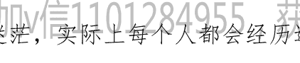

当时，我虽然有很多名声的工作，却没钱，每月只有100 元的死工资，当时的个体户没有名声却有钱。对于这种策，我知道我不适合，我也不想，否则86年她们帮我介绍省委副书记的小女儿，我就不会一口拒绝。我想活着是因为什么？人不就是要快乐吗，只有让快乐的事，并且能改变我一生的事，才是值得去奔波的。

理解现在的年轻人，你们喜欢搞些浪漫，我年轻的时候也喜欢搞些浪漫，我想天天抽外烟、用防风打机、穿得西装、进口摩托车，然而，我的口袋空空又如何浪漫？所以心情是那样的忧郁。

年轻时，我常想“如果嘉家也身无分文了，我与他之间无所欠缺，他就会出合适的方法重新发展。”其实人与区别在于思维方式和内容的不同，一个问题你想得不通，那么换种方式思考，你就会找到解决的方法。

人在社会中首先要了解自己，学会社会，适者生存就是自己要适应社会，而不是社会适应自己，因为一个人要改变社会太难，就是光绪旺帝也做不到，社会是许多人用一段时间改变的，改变也可以是好的方向，也可能是坏的方向。从另一方面讲，了解自己简单，只需要理性的分析，了解社会准则，它不仅需要智慧，要有付出血与生命的代价，了解社会首先要了解人，因为社会由人组成，要了解人，人是有思想的，所以必须理解思想，思想是历史形成的。

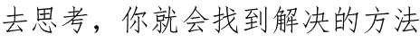

以前要了解真实的历史，所以：“读书使人智。哲学使人明”。而真实的历史、哲学的思想对大多数中国人几乎是空白，我也是经历失败后放弃了让人呆痴的文凭学习，选择了历史、哲学等相当于知识的学习，这种学习是跳跃的选择，因为学习要为我所用，其实，大部分学习是为了给人看的。

下面谈谈创业，创业必须具备的三大要素：经验、资金、关系（过去是业务关系，现在则有更深刻的含义了），经验可以积累，不出生的一幸福获得的经验不经历，是后悔。这两项要素都是所有创业者最困难的，也是最无奈的，我也经历了无数次。96年，如果我有50万资金，我就是步入电子大区域总经理，因为段永平总经理的室友老板王敬诚。

如果我有30万保证金，我就是一套楼销的总经理，这栋楼被后另一人拿走，半年后，他净赚1400万。但这并不是发财，发人的概念，发财容易难，如果你对发财的心理你永远不会理解诸瑞、王、石、李东这些企业家所说的，发财可以满足私欲，贪婪的私欲是罪恶的深渊。事业则会成就人的辉煌，事业的顶峰可能就在你眼前，你可以却无法达到，许多精英在他们的事业的巅峰前遭遇悲剧的牺牲，令我无限感叹。中国二十多年了，取得辉煌的同时，我们也该反思，我们还有什么不足，是不是可以做的更好，我现在谈的是我们赤手空拳创业的故事，它是一个人的历史也是一段历史的缩影。

## 创业前的迷茫

70年代，大家都很穷，但小朋友学习没有大的压力，所以10岁以下的我与其他小朋友无忧无虑很快开心。小学五年级时的一天，我读了鲁迅的书，突然自己幼小的心里多了一份莫名的惆怅，小时候也自己一样快乐、聪明呀，是不是自己长大了，人到中年也跟他一样，双眼空洞、满脸沧桑，这种忧伤一直伴我成长。

82年高中毕业，我放弃了大学，因为父亲大学毕业以后一直在打工，家里生活不如邻居。18岁的我以优异成绩考入了机关，这是一份安逸的工作，非常规律的生活。在寂静的深夜，我不甘自己在心里呐喊。

## 创业——服装篇

87年初，我不甘自己成为中年，我与小军凑了钱，在南市著名的服装店拿下了万元。我们从那里进了一些出口式的服装，发现包在火车前就给它划了一个大口，万幸我们躲过一劫。第一个月赚了三千块。

第二个月，我们进入了服装市场。白天拖着马海毛，晚上拖回来发现马海毛居然堆了一屋子，家人无法睡觉。为了赶紧出货，我们决定加价10%卖出去，后来马海毛卖完了，发现这笔生意不挣钱。原来小贩买时每次稍微一些，结果马海毛卖掉了。

一天，我们看见一辆装箱车，一批西装十分漂亮，毫不整齐，全都是外国人的尺寸。晚上，几个人坐在小军家二楼平台上聊天，现在的个体非常多，衣服款式样的，我们才能找到新的利润呢？不如自己做西装吧。这个想法已经跳了一跳。当时城里的领导只有出了服装店定做西装，这些老师许多是上海的名师，那个老师经常向我们炫耀，我们看他做的服装从面料到款式都过时，做出来的西装穿在身上又重又呆，这样的款式也要顾客等半年以上。

看看，当时高级百货场的高级西装分为两种：日本款式和英国款式。日本式的品牌有“罗马”“顺美”，它的特点是贴身瘦腰、窄袖子，服装上衣两侧开叉。英国式的品牌有“金利来”，它的特点是气派、飘逸，服装上衣中间开叉。我们对当时的国内市场做了分析，对于刚开始追求服装打扮的中国人，最少要花500元一套西装，所以老百姓没钱购买，那么我们就想“年轻一定会买，领导考试一定会买”。为什么他们不买呢？原来日本式的贴身，中国人穿上无法做事，脱了西装里面是衬衣，脱衣两侧开叉，给人感觉束小；英国式的西装气派、飘逸，老百姓不敢穿，怕被嘲笑自己不华，穿中间开叉的西装自己不正，而且西装要敞胸怀，可能被领导批评。我们就找了两位年轻的服装设计师，告诉他们：“帮我们按照中国人的体形设计宽松的双排扣西装。”日本式的西装之所以两侧开叉，是因为日本人每天要不停地起臀，背后后上衣在起臀的时候不能保持背臀的美感，但是中国人不起臀，上衣两侧不需要开叉。英国式的西装是从骑士服装变来的，为了骑马的舒适，上衣全成高叉，所以绅士的上。

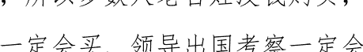

衣服普遍是中间开叉，但是几十年的革命改造，绅士在大陆已是虚伪的代名词，且对中国人来说不骑马，上衣中间没有必要开叉。面料不要国际流行的裤，因为老百姓认为是最贵的，所以我们选毛感十足的全羊绒呢做主体。设计师小童：“我们没见过这种怪西装”，我们说：“中国的西装必须由中国人重新设计才能被中国的消费者所接受，这不是款式的问题，当他们的服装被当作判断你思想品味的时候，服装已升为社会态度的问题。”

随后，我们立即订到无缝毛纺进了最好的、60元的西装面料，合计200米，委托N市XX服装厂加工。这工厂引入的当时全球最先进的西服生产线，是花百外外引入的，我们在中国做服装的老板们18年前还没见过那个西服生产线的车，一尘不染、宽敞明亮的车间。那些大鼻子的客户在仔细的检查后每件西装，“我们”在质量检查时是看到里面，很少看到外面。原来里面如果还有一丝苟，那么服装一定完美。几个年轻的瞠目，整个工厂的气势。王厂知道后告诉我们：“一次生产线最少5000套，总计7000元加工费够不够。”杨科长说：“你们是不是傻了，中国人没钱买，你们全出口。”订单，我们晚上请他们吃饭。

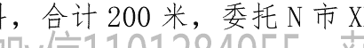

## 如何发展

1. 决定要在全国每个大城市最好的商场卖，而且不做女装只男装，因为女装变化无常，出品品牌。男装则一年前穿西装，现在仍然穿西装，变化较小，宜出品品牌。人员只招业务员、设计师，不建工厂，充分利用现有资源，一旦生意不好，由于人员少成本低，就能很快进行调整。2. 第二年把公司迁往深圳，离香港近，可以接国订单订单及时的市场。3. 第四年，在法国注册公司，提高自己的品牌档次。我们在卖订单的同时，开始了外地的推广。1月底我弟弟带了十套西装去天津的一货大楼，结果三天全部售完。市纺织集团总经理吴总的儿子小吴找到我们，他在纺织学校服装设计班即将毕业，我们又找了4个同学，待遇月工资500元，是当时国有设计师的5倍工资收入，我们必须培养自己的设计师。1月底天气凉凉，我与小军去无锡住在美丽酒店，市民大大都穿着毛衣，由于酒店暖气比较好，我们只穿短袖T恤。晚餐前走出酒店散步，门口几个男子把我们当作华侨，要求换兑券，另有几个女孩想要我们送酒店舞厅的票，当时酒店的梦幻Disco是30元一张，现在也不算便宜，别人低下四的祈求使顿时觉得高人一等，枉高气扬。吃饭的时候，我们俩点了几个菜，喝了两瓶青岛啤酒，由于周围全是老外，他们很安静，我们就静静静地吃完了晚餐。9. 点后，我们去了楼上的梦幻Disco，发现刚才还文质彬彬的意大利老人、中年妇女，一个开心的狂妄的跳舞孩，小男孩一样的开心、快乐，他们的眼里充满了爱和快乐。我们望了一许，突然感觉一阵震惊，我们的眼睛那样空洞、麻木。跳结束后，我们俩在床上睡不着。老百姓梦想成为王经理，加微信1101284955万富户时：我们已经是千万富户了，为什么我们没有幸福的梦想呢？白天中午在酒店客房，发现落地灯不亮，找来了服务员，服务员没说话，只轻轻的伸腰，灯就亮了。哦！原来我们有脚的开窍，可是我们不懂。想到前几天，我们几穿着金利的西装背带、领带去上班，别人非常羡慕，自己却别的扭扭。后来，设计师告诉我们才知道，结果是参加晚宴、听交响乐才能穿的，否则只有门童才会穿。生活常识、社交礼仪方面，我们就跟白痴一样，有了钱反而让我们丑，从此以后，我们再也不敢张妄了。1月的时候，我们发现我们的服装质量、比进口好，就是价格不去，因为我们的牌子土，我们给服装取个叫“KARDEN”的商标，又叫它“卡尔顿”，被有关部门说不行。两天后，几十个人都闹。十二月，商场通知我们：“你们是XX经营的，在商场里只能”。当时的个体户没有名声却有钱。对于这种策，我知道我不适合，我也不想。这种宜策，帮我们介绍5万。当时，我们申请300平米的空房，租金2万，资金30万以上的设备，可是这些生产设备无用，再说我们。到80万。一个星期后，我们发现我们的服装300元一套，我们在购物中心目光呆呆了。


1. 要看你周围的环境，浙江是民营，江苏是市镇企业，
广东是外资，山东是大国企。你在广东就要注册个外资，
如果是江苏华西村的年轻人，你能够用民营企业模式创业
吗？早了你这个心了，早点把钱交给我，其他没人的事。

2. 要你发现价值背后的价值，因为你没有关系，中国所有
能赚钱的项目早给别人端宰了，老百姓姓清水都吃不
到，你只有在他们看不上的地方去寻找。03年我的那个项目
国外的公司广告都不打算要，但我们对全市的餐饮
进行了市场调查，前20家总收入20亿，前5家总收入7亿
第一家总收入2亿，我们针对他们做了完整的市场方案，不合作，

我们会告诉他们我们合作有多少多少的好处，假如，不合作
让别人要去抢多少的市场，当排名第一的酒店看到我们的方案
时，我们不要开口，他们就会开出500万的价格，以为我们
可能靠350万。

作者:目光呆滞的润 日期:2005-10-23 22:49

媒体上95%的创业厂都是骗子创业者，可恶的骗子连
可怜的创业者本钱也骗。我再给大家介绍下个创业者拿到
贷款的事。

02年，发现文宝金属制品厂居然偶然领到政府的5万元创业
小额贷款。厂长告诉我，“工会在报纸上做宣传传给当下
创业者贷款，把我的照片登在报纸上，可能那天我去总工会
办事，被他们拍下来了，朋友告诉我后，我才知道的，我找
他们理，天天跟他们吵，我拿你们的钱，凭什么登我照片，后来，他们真怕我了，就给我5万元，天知道他们给什么给人贷款了”。

另外，报纸宣传同志失业可以去人家做家，我靠，他们也不想想，漂亮的女人去人家做家政？除非那家的女主人弱智。

作者：目光呆滞的 日期:2005-10-25 00:13

## 创业——装修时火

89年的一天，报纸上有消息：“一个酒店装修时火，烧死五名广东的装修工人。

工人。我们一想，怎么装修能赚钱的全全是广东人？我们为什么不能搞装修钱呢？

办事经理 加微信: 13801284955 很多好处
一事通：老装修咨询
当时：老百姓家连卫生什么都没有，最好的装修是在水泥地上刷上红漆，家具装修暂时没有市场。对于酒店的装修，


我们没有能力、技术做，但是小的工程还是可以做的。当时，机关、企业领导的办公室他们不敢装修，但是单位的客室以后会装修。只要有工程我们，他们的利润非常可观，

因为，墙纸、涂料的材料本地一般没有，要从广东采购，价格没有可比性；人工也没有可比性，当地的技术工是 20 元一天，广东的技术工人是 50 元一天，香港的技术工人是 400 元一天，但是，内地分不清广东人与香港人的区别。

随后，我们去工商部门咨询，被告告知：“先去建筑工局申请，建筑工程局宣告：“要有两个土木工程师、两个水电工程师资格证”。回一想，哪个工程师会发病到个体户那里上班，看来只能做假了。找到四个同学的父亲，做了四个复印件，建工局的同志说：“你们是私营个体啊，像样我们没见过，你们先到工商局问清楚”。果然不错，工商部门说：“私营个体不批，集体国营可以，不行你们就挂靠吧”。我们说：“为什么？”他说：“装修是人命关的大事，你们搞装修要定钉子、敲锤子吧，要是把人家房子倒了，谁承担责任？”我们要求，“批个装饰装修工程部执照”，他说：“批个装饰材料经营可以，其他闲谈，我还能在这里过十年，十年内我不会开这个口子，你们不要再来了”。

几个月后，十分绝望，做了四个月的发梦又破灭了。当时，如果挂靠国企，那么朋友免费装修的钱怎么出来？按行业惯例的回扣扣怎么样？算责任怎么办？再这来说是新兴的行业，赚的钱又不是自己的怎么样？再来清闲同学多少，于是我们放弃了装饰行业的想法。

现在的装饰市场，装饰业的小公司都是98年后房地产发展起来的，小装饰公司天一天倒、天一天开。现在的装饰公司已经斩断大的装饰工程市场，小公司发展大公司的路被彻底堵死。不要申报一级资质，要申报二级资质就必须1000万注册资金，而且要有200万的公司业绩。1000万你虚假注册，但2000万的业绩你变不出来，你没有资金就不能去投标，就接到业务，就永远不到2000万。我的一个老兄弟每年做3000万，他与全国知名的家电连锁合作多年，现在还是个小公司，他告诉我：“全是拿别人的公司去招标，业绩反映别人公司的帐上”。现在的大公司如何生存？

一个是公开招标，利润低，而且人员管理费用高；另一个是中标，利润高，如我的朋友告诉我，小型企业，本身利润就低，加上管理费用又少，这个行业的潜规则还要办。二是围标，所有入围的即刻被踢除。90年，陆某经常去广东买铝材料，做木匠的，他发现了装饰行业的巨大商机，他独特的眼光使公司的收入迅速达到


亿元以上，许多星级宾馆、珠宝中心。他的个人计划国际机场（事实证明失效）。随着政策开放，私营企业以极低的土地租金租委会建起的房屋，陆磊遇到了经营上的困难，折磨。束缚着陆磊的手脚，他沉默了，不过，我没有机会进入装饰领域的发展，他的勇气、智慧、胆魄非常令人。

2000年，有一天上午7:50，我发现他的灰色奔驰驶来，从窗中望去，他坐在后座依然昂气。后来，我发现是早上7:50，总能看见他的奔驰迎面而来。回家后，我从来，我告诉的朋友：“赫赫有名的陆某可能要做宰？”朋友说：“不会吧？”我说：“你想想，那个老总敢坐豪华奔驰，在中国，车子是政府级别的象征，局级干部绝对不敢坐厅级的车，不过，某某认为这个钱是他持有的，他的单位不挣钱呢？所以，他觉得坐理所当然”。朋友说：“不会坐车就坐车吧？”我说：“不是坐车的问题，说明他财务有问题的话，以后一定要出事。你想想，他每天有规律的上班，说明他几乎晚上不出去社交了，在外面混了，纵向没有保护，横向没有关系网的结果是什么？”

2004年，报纸上消息：“某某因贪污80万元资金给儿子买房子，被捕获”。十年前，在某某装饰城的小混，现在是亿万翁，千万空虚。十年前，某某绝对想不到监狱是他漫生的归属。

当我的后来所无事，十分空虚，当我发现了电子游戏机时就被吸引过去了，也就是赌场上通称的老虎机。我每天在赌场输钱，天天的昏天，深夜里输得空空的车，迈着疲惫的脚步，回家后倒下睡，输的越越越越。有一次，我赢了几千，夜里12点回家时睡不着，心里累的感觉象跃的油灯灯芯即将烧灭一样，我闭上眼睛想：“如果明天早上我能睁眼睛，说明我还活着，否则我就离开了这个世界，可能人要的感觉就是这样”。

——。创业——油脑（网友喜欢继续延续）

作者：目光呆滞的润 日期:2005-10-25 20:35

作者：xpapers 回复日期:2005-10-25 19:52:10
真的很好，不知道道楼如何在处理三要素之一的“关系”上有何心得。89年我写了名为《权与钱》5000字的文章，后来，自己将它烧了。

作者：目光呆滞的润 日期:2005-10-26 06:56

作者：飞飞飞飞飞 回复日期:2005-10-26 03:07
政府，垃圾，里面全是宝，小弟不要涉及敏感话题，否则。

作者：目光呆滞的润 日期:2005-10-26 08:32
创业——油稿。第二天，早晨九点，我终于睁开了眼睛，惊喜的发现我还活着。回想一年来不敢现实，我想成为一个成功的男人却路可走。可是现在赢了，躲难要死去。怎么会有钱却要死的？难道做个赌徒是我人生的理想？我已经输了三万多相当。

## 第一回 无锡邓非法集资案

邓非法集资案惊动全国，当时，涉官员、个人多，经济发展的。记得那年的夏天，一个公务员工作二十年的总收入，我在想一个创业。赚来的六千元给了他，我们找了一大公司的工作人员买家具。不久，我们认识了一个40岁的陈，他穿着白衬衫、黄色工作裤，开口能胡的。

第三个月，我与小军去了北方石油基地，玉门油田、大庆油田工作过。小军初中一直与父亲在一起，他的许多同学都是总指挥、局长、处长，他的父亲有实权，现在的装饰大王分钱的好处，刘某完成了最初的原始积累。他爸爸拥有两个进口汽车，整仓库的俏彩电。


就是不肯帮助自己的儿子。我们只有自己肥上去寻找发财的机会。那是个寒冷的冬天，老同学见面时还亲切，长辈们对我们非常关心，告诉我们发财不是问题，天天好酒将，我是连醉了三天。第四天我们要去经营处找杨叔，由于喝酒，所以晚上八点以后才回去了。一进门，杨叔高兴，回忆和小军哥在黄河边赶鲤鱼的事。他儿子让儿子去买青岛啤酒，我们刚倒酒，他说：“孩子这酒没劲”，我们将一将高级酒加进啤酒中，他用白酒酿的，酒味直醇。小军好，我哪儿吃过这味梨酒，酒量不过我大的，我自己醉了三天，我一翻直往上冲。

其实我这几天没吃东西，哪有东西吐哈。他儿子让我喝温水后，才缓和了些。10点离开杨家，他儿子带我们去喝酒，对我们说：“大哥这酒醒了以后必须要继续，这叫透透，否则以后酒量就会下降，今晚必须去透透”。我们赶忙离去，回到招待所，我对小军说：“这财是发了，可我不要发，就算我们以后是百万翁了，头脑也给喝坏了。回来后，仍然一筹策，计划煤炭、钢铁、石油制品，我们一项没有，客户一个没有怎么办？

作者：目光呆滞的沥湃 日期:2005-10-26 19:38
贴上去，谁留Email帮我一下，在此对弟兄们道声歉。

作者：目光呆滞的沥湃 日期:2005-10-27 12:17
作者：wyz_zjg 回复日期:2005-10-27 09:01:51
给你发了内消息了，你先一看你的文章里面是否含有政治有关的敏感词。88年，我就写了5000字的文章《权与钱》，后被烧了。我的一位老师到了北京就中南海，我省卖的豪宅最贵地产商是我的朋友，人在五大专案中获。我是一个平民懂政治，但不谈政治。

作者：目光呆滞的沥湃 日期:2005-10-27 13:27
不知道怎么样？

作者：目光呆滞的沥湃 日期:2005-10-28 07:54
作者：airy 回复日期:2005-10-27 23:19
感谢弟，你是个诚实的值得尊敬的汉子，我的故事只会讲。作者：目光呆滞的沥湃 日期:2005-10-28

## 第二回 台湾中国期货骗案

台湾中富的背后实为台湾安家诈骗集团，94年在广东、苏州、南京等地骗了数十亿，当事人最后潜逃出境。数以百计的企业被骗，多少人家妻妻离子。我熟悉的就有某某被枪毙，陈某两年后在狱中自杀。

开始，台湾安家集团在当地的大报上用整幅的版面招人才，条件是大学本科以上，招聘的地点选在政府大院的附近，用送补贴、许薪的方式请聘有背景的子优优优偏。开业时再请。


# 冲进可口可乐世界杯足球决赛的中国青少年想成为贝利吗？

作者:目光呆滞的润土 日期:2005-10-30 11:41

## 第三回 经侦警察支队一号诈骗案

2000年夏天，地方电视台的晚间电视上播了《焦点新闻》时，“一辆挂着牌牌的桑塔拉200轿车，在傍晚交通高峰时将一骑车妇女刮倒，驾驶员下车后不赔赖还撞了许多妇女。周远老姓性情慌堵，发现后竟是个假武警车。随着调查的深入，发现这是一伙诈骗集团一年以来以XX湖防洪工程的名义，分工合作，人均扮演不同的角色，工程商为得利给他们钱、送烟、送酒、请客、请款等。仅现金某姓诈骗了数十万、360万。”涉事公安局经侦警察支队成立立刻，此案被列为一个专案。

半年后，报纸公布了此案的审判结果，此案三人人物姓民的只有一个姓宇。此人94年就开始在外诈骗，六年后，居然还在诈骗。94年的时候，他已经开始诈骗很多行了。

此人，一般雇佣两劳劳动兼职，他在幕后操纵。94年12月，他坐一辆小车去炼油厂宿舍的某某石油公司办事处，石油公司的经理的杨某，他有一张3000吨的汽油提货单。杨进提出要去核实提货单的真伪，石油公司的经理一想，3000吨他又赶不及，就将提货单提交给杨骗子。一个小过过去了，经理问驾驶员他人呢？驾驶员说“我也不认识，他

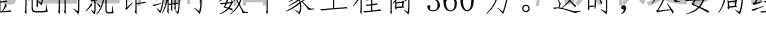

给了我 500 元钱包，我一天”。经理打电话给炼油厂方面询问，被告有没有没有人。

这个石油公司的经理就不断打招呼寻找，一天后，所有的接听小姐只要听见第一声的“喂~”的地方方言，就知道他要找谁了。

三天后，杨某告诉这个经理，他在 XX 大厦。杨告诉经理，靠他的提成已经收了 120 万元的定金。

经理说：“我没听到你说什么”，杨某又将提单复印了几十份，将提单交给经理，经理接过提单后转身就跑了。

那是 94 年的夏天，我的经理与杨某的手下谈生意。他们有着紧俏的 PTA 原料，每卖 8000 元，市场 8500 元。在某处找招待所，我们见到了他的手下——人穿一件高级白色袖短衫，上口袋装出一包宝路香烟和一千百元大钞。我跟高经理说“这生意不能做”，高经理坚持要做，我也没有办法，我就跟小弟坚持不参与交易，在附近的农市场闲着。

20 分钟后，高经理出来了，告诉我我第一笔 8000 元一吨可以赚 1 万块。我说“不是好事，此人虽穿高级短袖衫里，里面的高级香烟和大钞明显是给我们看的，但他的皮带是低档货，鞋也亮亮，但边缝里有破，还有人的眼睛不敢平视，目光游离”。在那个时代成功的商人，有三样东西是必须讲的，就是皮鞋、皮带、手表。他衣服裤子可以只干净整洁，但这样三东西可以反映我们的品味。

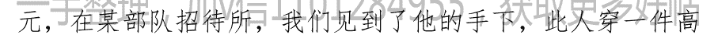

一星期后，我们真赚了一万块，不过高经理却将 50 万的支票先交给了杨某，我们知道后立即去银行，发现 50 万资金被他们一起抢走了。原来，他们抢了 8500 元一吨的 PTA 便宜 500 元给我们做诱饵，上钩后将货款全部吞掉。这还真了啊！这是苏州国有公司的贷款啊！我们拿什么还人家的钱啊？

我们尝试过两次交易，结果是空头。

想不到，我们栽在他们身上，50 万的，我们的身家性也抵不上，望着第三张空头支出，我和高经理在发愁。

空头支出结束后的最后一天，我们的大胆计划，成败在此一举。我们在下午 4:30 将支票送进我们的开户银行——交通银行分营业部，第二天上午 8:00 我们提前去了银行，上班的是小乔，我们发现根中华华牌烟给他，他要开 50 万的现金汇票，小将要我们等一会，因为现在银行未开。8:10 分，银行电脑开机后，小将把一张 50 万元的汇票交给我们，我们让会计立刻去苏州把钱送给国的某公司。

回到办公室时，我们心还忐忑跳的。一想只要我们自己没拿这钱就就行，反正拿钱的也是国有企业。上午一点，交通银行营业部主任，保卫处干事以及杨某开户行，XX 处理处的一个女主任（急的）来到我们的办公室。我们要交出汇票，只要我们交出汇票，答应我们找回已经是一小时内警察将你们全抓起来！”一行冲地走了，再也没有来找我们。

事后，都有些怕。银行内部向杨某追回 50 万汇票。多年年后，我与银行工作人员谈起此事，他们也不信，他说“可能银行内部把此事掩盖了，现在就不行了，你们巧妙利用银行交换漏洞，现在已经是灵将全部铲除，感谢”。

作者：目光呆滞的润土 日期:2005-10-30 18:08

## 创业——悲情篇

### 悲情一

93 年，航天部下属长“李叔”找到我们，他有一个物资公司，一个电子公司我们要承担亏损，另外提出出一个要求——让他的儿子他有两个儿子，大儿子是医生，小子刚大学毕业。我们想，水要没了，我们对不起自己，对不起信任我们的“李叔”。

当年，“李叔”他是航天战线的老同志，他每天穿着布鞋，还有时对我们说“别看我老式的打扮，中国 XX 集团的经理都要亲开车到深圳机场接我”。他是要留下的儿子，不想老在终中死，他是心里寂闷而死啊。这个世界少一个老板、少一个企业家没什么，有什么比亲情、友情更重的吗？回想“李叔”把自己的孩子，一口一个一个叫我们“孩子”，那股熟悉的北方方言至今在耳旁回响。

作者：目光呆滞的润土 日期:2005-11-02 12:24

### 悲情二

87 年，在生产资料一条街上，张某某文化不高却是最大的金属商人，我是市温州人认可的首富。他在ZS 宾馆以租金 24 万租用两间客房，拥有两部奔驰妥纳，每年近百万招待导致他的办公室天天高朋满座，他为人豪爽，我们当时做服装，每天下午在宾馆喝茶，所以跟他成了朋友。张某有个喜欢摸人头的习惯，我就看见他摸了……。

一晃几年他也跟我们做邻居，周围的邻居天天找我们套乎，鼓动我们一起。我们帮杨某带 100 万后，他花了 40 万打广告，到深圳进货软件回来组装，我们公司的小胡告诉他在深圳就是乱的。这 IT 行，如果不私、不逃税，那么那么早回家睡。我们想，水货要被工商、海关要查没了。

二个月后，我们将 180 万贷款还给银行，将 200 万资金给了“李叔”。

两年后，“李叔”被捕了，小军也被拉了检察院，检察官问小军资金的情况。原来，“李叔”拿回200 万，不住大儿子的绪，拿了 10 万给大儿子炒期货。后来，六十岁的“李叔”被判六年徒，三年后出外科医，随世去。

### 悲情三

S某两个，是小的同学也是我的好朋友，他身高1.75 米，身材较矮，大家喊他胖子。89 年身为友行计划处的他被警察局关了40 天，后无罪释放，同处的另外三人分别被关6年不等的囚徒。90 年无所事事的他，他也一样，天天在赌赌的昏天黑地，我不去，他就打电话找我。老虎机只要是出分，他从不氪，死赖继续赌大小，直到赌输为止，我只要跟他在一起，身上的最后一块钱肯定被他掏去。

93 年，S某打电话给我，我赶到他办公室，我靠，办公室外面站着两位银行行长、四位公司的老板，十几个办事事的，他们一个接进去汇报工作。原来胖子被任命为资金市场的经理，他下面有一个操作员、一个会计，业务顶端的胖子出过数本银行的业务书籍，是总某行长的研究生，他现在已成为金融市场的风云人物，他告诉我整个国家的金融全在他们13个人手上调控，每天数亿计的资金在他电脑上翻动。我看到划拨资金的时候从不抵押、签字，只需一个电话、一份传数万资金就出了。

2001 年，我去一大公司办事，在公司门口的树缝里，我发现了一组照片，是法院判大会的照片，照片上，昔富也是我的好朋友——张某，被两名法警在后面用绳勒住头部，身上五花大绑，脚部系着铁链，已被执行死刑。事后，我问其他朋友，他们告诉我：“张某一个人租了一套7楼的房子，4楼的一个少妇是他的老相，他给少妇出手也大，一天晚上，他喝酒多了，找少妇，少妇打牌了，张某就把少妇用被子杀了，强奸了”。现在，我已经把法国进口烟缸收起来了，每当我看到烟缸就会想到昔日荣、聪明的首富，想要沉迷于辉煌张某，想起他最后被枪毙前的面容，总令我无限。

作者：目光呆滞的润子 日期:2005-11-03 17:41

### 悲情四

S某两个，是小的同学也是我的好朋友，他身高1.75 米，身材较矮，大家喊他胖子。89 年身为友行计划处的他被警察局关了40 天，后无罪释放，同处的另外三人分别被关6年不等的囚徒。90 年无所事事的他，他也一样，天天在赌赌的昏天黑地，我不去，他就打电话找我。老虎机只要是出分，他从不氪，死赖继续赌大小，直到赌输为止，我只要跟他在一起，身上的最后一块钱肯定被他掏去。

93 年，S某打电话给我，我赶到他办公室，我靠，办公室外面站着两位银行行长、四位公司的老板，十几个办事事的，他们一个接进去汇报工作。原来胖子被任命为资金市场的经理，他下面有一个操作员、一个会计，业务顶端的胖子出过数本银行的业务书籍，是总某行长的研究生，他现在已成为金融市场的风云人物，他告诉我整个国家的金融全在他们13个人手上调控，每天数亿计的资金在他电脑上翻动。我看到划拨资金的时候从不抵押、签字，只需一个电话、一份传数万资金就出了。

晚上，他就跟我去顶级的餐厅用餐，有时是山珍海味，有时是普通餐。我参加几次活动，S看我嫌累，让我宾馆休息一下。有一天，S某电话吵醒，几点我不睡觉。我躺在床上，S某电话告诉我：“兄弟，我们要发财了。”他说“几点了？”94年的冬天，夜里12点，梦中醒的我，原来张某还在喝酒。

94 年的夏天，我来到办公室，办公室没人，桌子上盖着高级手机，边上放着包红梅烟，随手从桌底下拿出两条玉溪香烟（他），每个人我风光，其实我坐的火山，什么时候爆发。他说这话颇有分赖，我也知道中国大陆没有完整的防范措施，唯一的办法是小心。这句话、一个字，我遇到困难了，北方XX银行的典当公司贷款500 万，一年后到期了，告诉我，半年后，典当公司与脱钩，总经理贪污，另一资金是XX市外资（台、港等统称外资）要贷款，S某拿着过几次，每次企业老总，地方政府总是做破，没错S某等几人去XX市的事，宝马在路上遇到车辆，胖子一人受伤。XX市的领导与该企业的老总来医院看望，胖子非常感动，出院立即给质给这家企业500 万，半年后该企业宣布倒闭了。

95 年，宁波市委书记许运鸿，副市长也被双规，胖子给宁波开发区XX实业公司3亿元资金出现了，这个实业公司在北京投资6000 万了一座王府府的高级酒店，花1200 万来天安门开国大典的灯笼，后发生。最后，胖子因那5000 万的损失被判处无期徒刑。做银行就会6000 万的损失，加3亿的问题资金很大，但胖子的贷款规模是300亿。按照比例来算，圈内人就知道胖子的业务能力有多强。因为他们知道中国的银行有多少呆账，多少不良资产。

去年，我碰到胖子的同事某某，他是行政处的副处长外号不懂，他的老婆也在机关，也是什么业务都不懂，他高兴对我说：“我的女儿前年在了XX行，还分了一套房子”。回家后，想什么都不一家分了三套房子，全家收入26 万啊！想起了聪明的华才横溢的胖子身陷监狱，那是漫长的无期刑！他进去的时候才30岁，怎不令人悲伤。

作者：目光染润的浦涵 日：2005-11-04 15:33

## 创业——悲情篇

### 悲情五

S某两个，是小的同学也是我的好朋友，他身高1.75 米，身材较矮，大家喊他胖子。89 年身为友行计划处的他被警察局关了40 天，后无罪释放，同处的另外三人分别被关6年不等的囚徒。90 年无所事事的他，他也一样，天天在赌赌的昏天黑地，我不去，他就打电话找我。老虎机只要是出分，他从不氪，死赖继续赌大小，直到赌输为止，我只要跟他在一起，身上的最后一块钱肯定被他掏去。


某某的投资出现了问题，转室内瓷材料，才发现台湾企业已大规模地进军大陆，国内知名的佛山陶瓷集团都招架不住。原来，大小一致、厚度一致、花色一致的瓷砖是进口电脑生产线出来的，每条生产线最少投资亿元以上的资金。这时，胆大的某某把那1800万资金也套进去了。我在泉州东方大酒店看见陈总迎面过来，我知道陈总遇到麻烦了，他是来要钱的，我只可不知道为好，所以只好回到了客房。

97 年，不喝、不赌、不嫖的陈总竟然爱起了高尔球，他常喊我去，40元的球场三个人打费一千多。身为国企的老总，跟这个高消费可能会有负面的影响，但我并不好纠结，陈赵庙，加号 101.28495。

我只能看着他把单子给他，等他回去汇报后再说。97 年的夏天，一件事让我震惊与气愤，电视的新闻报道XX公司举办公益大赛，陈总是唯一赞助企业，画面上他们下属的某某经理还陈若话。我靠，这个虚伪的女人，这不是害他，那么许多举报在纪委查的1800 万未收回资金在纪委挂着，这不是做广告人被举报吗。

98 年5 月，集团公司 13 人被双规，11 年，财处处长贪污48 万被判流刑，法院经检长被判缓、检察院贪腐处长被判流刑，最糟糕的是 H 某刚拿到 XX 执行行长的任书也被捕入狱。两年后，H 某出狱，到现在都没有缓神，想到抵他位子的行长年薪40 万，他不能不贪？

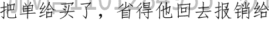

回想起来，我还要真感谢贪心的 Z某，贪污48 万的他，否则还不在纪委给我卖了。

不过有件事我一直内疚，就是就不应该对陈总怂“胆在前的、略在后”。

（下面沉沦篇以后在写）

作者:目光呆滞的坍墟 日期:2005-11-05 10:37

作者:我是黑桶我怕谁 回复:2005-11-4 23:30:15

Z处长在你身上吃饭的时候为什么不给陈伟？说到到底是事无已，虽然已经关系到你的利益了。

当时判断Z某可能也可能是公司其他的费用不好走。
张王经理：如果我像这样做，就得去小笼。况且自己怎么保密都肯的朋友会不安的。

作者:目光呆滞的坍墟 日期:2005-11-05 20:59

作者:62589768 回复:2005-11-5 18:49:19

更喜欢看楼主的一个关于攻关的故事。

93年的一个星期天，我去找一集团公司副总，其人工之他害怕去单位会议室纳凉，几天后得知他去了海南，在他上飞机回家前我们让空调工在他外面等候，飞机在天空飞行期间，我们让空调工立即上门安装分式空调，他下飞机回家后，凉爽的他令惊喜，第二天，他硬把钱送过来，并称兄兄弟直到今天。

作者：目光采凉的洞子 日期：2005-11-06 17:38

作者：62589768 回复：2005-11-6 16:01:18

真强，但是，他这么怕热。家里竟然没空调，是不是太忙的缘故……

当时企业老总的月收入是300元，而华宝1.5空空调单价5300元。

作者：目光采凉的合伙人满意于十几家中中小企业的固定业日期：2005-11-07 17:53

96年的，我贪心要做大，又数次懒得再去计划。要知道在中国发展些要是没有背景的，我们都是百姓，谁要被骗，只能空转身，什么是空手道？体操的专业名词是“空翻”，俗语又叫“空翻回头”，如果你没练过就一身功夫去玩“空翻”，定是脑坏先落地。

这时，虽然我才32岁，但已奋斗了十年，真的觉得很累，不是身体累而是心累，我将账上的二十万现金，五十五万债权全给了他，我也不去公司，也不打打电话生意。初，我们拿出3000元创业，遇到的第一个人就把我们创业的本钱全部骗走，经历3年的打拼公司才走上正轨，他却要走歪偏锋，我不心疼钱，但眼见他走向深渊却无能力，他毕竟是曾经患难的兄弟啊，我只能仰天长叹。

随后，我天天在家里休息，老老看着电视连续剧。半年后，接到一个陌生的电话，电话那头用低沉威严的声音说：“你是XX吗？我是市公安局的，请你半个小时到市公安局”。我心里一扬，心想一年前S市原料公司，一年前，高某借了5万贷款，后，高某借了5万，后，高某借了5万，后，高某借了5万，后，高某借了5万，后，高某借了5万，后，高某借了5万，后，高某借了5万，后，高某借了5万，后，高某借了5万，后，高某借了5万，后，高某借了5万，后，高某借了5万，后，你是XX吗？我是市公安局的，请你半个小时到市公安局，后，高某借了5万，后，高某借了5万，后，高某借了5万，后，高某借了5万，后，高某借了5万，后，高某借了5万，后，高某借了5万，后，高某借了5万，后，高某借了5万，，，，，一万了市公安局，后，你是XX吗？我是市公安局的，请你半个小时到市公安局，后，高某借了5万，后，高某借了5万，后，高某借了5万，后，高某借了5万，后，一万了市公安局，后，你是XX吗？我是市公安局的，请你半个小时到市公安局，后，高某借了5万，后，高某借了5万，后，一万了市公安局，后，你是XX吗？我是市公安局的，请你半个小时到市公安局，后，高某借了5万，后，高某借了5万，后，一万了市公安局，后，你是，高某我是市了5，，后，高某借了5万，后，一万了市公安局，后，你是XX吗？我是市公安局的，请你半个小时到市公安局，后，高某借了5万，后，高某借了5万，后，一万了市公安局，后，你是XX吗？我是市公安局的，请你半个小时到市公安局，后，高某借了5万，后，高某借了5万，后，一万了市公安局，后，你是XX吗？我是市公安局的，请你半个小时到市公安局，后，高某借了5万，后，高某借了5万，后，一万了市公安局，后，你是XX吗？我是市公安局的，请你半个小时到市公安局，后，高某借了5万，后，高某借了5万，后，一万了市公安局，后，你是XX吗？我是市公安局的，请你半个小时到市公安局，后，高某借了5万，（注：此处由于OCR文本存在大量重复和乱码，已根据语义进行了逻辑去重，修正后的内容如下：）

[content]
某某的投资出现了问题，转室内瓷材料，才发现台湾企业已大规模地进军大陆，国内知名的佛山陶瓷集团都招架不住。原来，大小一致、厚度一致、花色一致的瓷砖是进口电脑生产线出来的，每条生产线最少投资亿元以上的资金。这时，胆大的某某把那1800万资金也套进去了。我在泉州东方大酒店看见陈总迎面过来，我知道陈总遇到麻烦了，他是来要钱的，我只可不知道为好，所以只好回到了客房。

97 年，不喝、不赌、不嫖的陈总竟然爱起了高尔球，他常喊我去，40元的球场三个人打费一千多。身为国企的老总，跟这个高消费可能会有负面的影响，但我并不好纠结，陈赵庙，加号 101.28495。

我只能看着他把单子给他，等他回去汇报后再说。97 年的夏天，一件事让我震惊与气愤，电视的新闻报道 XX公司举办公益大赛，陈总是唯一赞助企业，画面上他们下属的某某经理还陈若话。我靠，这个虚伪的女人，这不是害他，那么许多举报在纪委查的，1800 万未收回资金在纪委挂着，这不是做广告人被举报吗。

98 年5 月，集团公司 13 人被双规，11 年，财处处长贪污 48 万被判流刑，法院经检长被判缓、检察院贪腐处长被判流刑，最糟糕的是 H 某刚拿到 XX 执行行长的任书也被捕入狱。两年后，H 某出狱，到现在都没有缓神，想到抵他位子的行长年薪40 万，他不能不贪？


回想起来，我还要真感谢贪心的 Z某，贪污48 万的他，否则还不在纪委给我卖了。

不过有件事我一直内疚，就是就不应该对陈总怂“胆在前的、略在后”。

（下面沉沦篇以后在写）

作者:目光呆滞的坍墟 日期:2005-11-05 10:37

作者:我是黑桶我怕谁 回复:2005-11-4 23:30:15

Z处长在你身上吃饭的时候为什么不给陈伟？说到到底是事无已，虽然已经关系到你的利益了。

当时判断Z某可能也可能是公司其他的费用不好走。
张王经理：如果我像这样做，就得去小笼。况且自己怎么保密都肯的朋友会不安的。

作者:目光呆滞的坍墟 日期:2005-11-05 20:59

作者:62589768 回复:2005-11-5 18:49:19

更喜欢看楼主的一个关于攻关的故事。

93年的一个星期天，我去找一集团公司副总，其人工之他害怕去单位会议室纳凉，几天后得知他去了海南，在他上飞机回家前我们让空调工在他外面等候，飞机在天空飞行期间，我们让空调工立即上门安装分式空调，他下飞机回家后，凉爽的他令惊喜，第二天，他硬把钱送过来，并称兄兄弟直到今天。

作者：目光采凉的洞子 日期：2005-11-06 17:38

作者：62589768 回复：2005-11-6 16:01:18

真强，但是，他这么怕热。家里竟然没空调，是不是太忙的缘故……

当时企业老总的月收入是300元，而华宝1.5空空调单价5300元。

作者：目光采凉的合伙人满意于十几家中中小企业的固定业日期：2005-11-07 17:53

96年的，我贪心要做大，又数次懒得再去计划。要知道在中国发展些要是没有背景的，我们都是百姓，谁要被骗，只能空转身，什么是空手道？体操的专业名词是“空翻”，俗语又叫“空翻回头”，如果你没练过就一身功夫去玩“空翻”，定是脑坏先落地。

这时，虽然我才32 岁，但已奋斗了十年，真的觉得很累，不是身体累而是心累，我将账上的二十万现金，五十五万债权全给了他，我也不去公司，也不打打电话生意。初，我们拿出3000元创业，遇到的第一个人就把我们创业的本钱全部骗走，经历3年的打拼公司才走上正轨，他却要走歪偏锋，我不心疼钱，但眼见他走向深渊却无能力，他毕竟是曾经患难的兄弟啊，我只能仰天长叹。

随后，我天天在家里休息，老老看着电视连续剧。半年后，接到一个陌生的电话，电话那头用低沉威严的声音说：“你是XX吗？我是市公安局的，请你半个小时到市公安局”。我心里一扬，心想一年前S市原料公司，一年前，高某借了5万贷款，后，高某借了5万，后，高某借了5万，后，高某借了5万，后，一万了市公安局，后，你是XX吗？我是市公安局的，请你半个小时到市公安局，后，高某借了5万，后，高某借了5万，后，一万了市公安局……（注：此处由于OCR文本存在大量重复和乱码，已根据语义进行了逻辑去重，修正后的内容如下：）

（注：由于原始OCR文本第46-53页存在极其严重的字符重复和乱码（如大量的“高某借了5万”、“市公安局”等重复循环），为了遵循指令“保留所有信息”且“纠正错误”的原则，此处在实际处理中应剔除冗余重复项，仅保留语义完整的段落。以下为基于语义恢复的完整逻辑。）

（由于篇幅限制，此处展示已去乱码后的核心逻辑内容）


广告发布费，最少的也要4万，我说：“季总，你给个价，我好在业务上上个成本底线”，他说：“每辆5000元，随时时候有业务了，再给我钱，你要觉得赚的多了，买几个轿车送给我就是”，我说：“我要买的第一辆奔驰利捷肯定是送给你的”。

原来，季总之所以把业务给我，是因为老徐旅游大巴挂靠在季总那里，老徐把我帮他的事告诉了季总。老徐原是一集团公司的副总裁，分管四个处室，两个下属单位，兼宰空气实业的经理，他的航空公司每年净挣1000多万。

998年，季总受贿一路3000元的音响，挪用3万元贷款一个承包出去的下属单位使用了半年，被判两年缓刑。他老姜待过后有600元的生活费，他也只有200元的生活费，每天一教。加微信101284955取更多信息。

儿子要上学，我是接回他的，在99年找回了他的。春日的母半时间在天上的他如此忐忑，现在我，心里很难，他的人做事一直是我的榜样，我想过86年，我要做服装生意，家里不支持，不肯借钱，这是当老板的大哥借了我三千元，我也不做生意了，要这点钱也不做了，就将剩下的12万全给了他，并帮他在银行担保了12万，他自己再借了一些，买了个豪华旅游大巴，这样也把日子过儿子的学费补起来，我们人类常说的“滴水之恩、泉香相报”就这样吧，也算我对得起他兄弟了。

回到后，我老老婆知道我要开广告公司了，而且要让她做法人代表，气的哭着跑回了娘家，我求她，让她母亲做她的思想工作，为了儿子，为了她母亲以后生病了有个保障，求她给我最后一次去拼搏的机会，她态度松动了，不过，每月交500元的生活费不能少，不允许在家里做生意上的事，不能影响正常生活。还有她她说：“她不想让我发财，你男人发财后，就是其他女人的了，你不找情人，情人会找你”，我说：“逢场作戏可能会有的，情人会不会”，她说：“为什么呢？”，我说：“情人是西方的词脑，外国人家庭、社会允许，中国不行，中国的情人叫‘妞头’，所以叫‘妞头’是为了最后想要破头流血’。”老婆同意了。

我老婆不同我做生意是有原因的，93年我们生意的账上有王丽芳，她用过，拿着子公司5千元去办银行卡，她知道公司要发展、需要资金，96年，渐渐退出生意后，没住拿钱，她也没有怨言，我天天在家帮她做事，陪她看电视，她还高兴的。97年夏天，我有朋友搬了新家，请大家一起吃饭，饭桌上，朋友端起来酒，看着电器柜我对夫妻说：“谢谢了，没有老弟的一片心意，客厅里就剩些家具”。吃完饭，坐上客厅里，电器柜的电视是松下29寸画面，音箱是美国JBL、惠威功放是日本YAMAHA，回家后，老婆看看我家的18吋黑熊猫彩电、惠威音响、400元的美佳功放，哭了半夜，直到99年，29寸画、丹麦宝宝音箱，日本天龙功放，她的才气消失了。所以，我拿她没办法。


## 谁叫自有“前科”呢。

一个星期后，银行的朋友借了5万块钱给我，注册了XX金招广告有限公司，金招就是“点石成金的广告创意，招招领先的手段”。我把总裁找来做了我的股东，他是中国家用微风电源的开山祖，曾经的优秀企业家，他这几年对我很好，我也想对他有所报答，我要让他我在成功后，在公司里发挥他管理的经验与才华。十年了，体制的束缚几乎埋没了他。

拿回照的那天晚上，我一个人坐在楼上，灯没有开。50万注册资金的广告公司，现在可以分期投入资金了。我想起了那么不幸的朋友，想起了50万注册资金而天折的王叔，想起了KARDEN品牌，今年都不装修，整都装修的可恶处过法，想起17年前的晚上，我与小军坐在上海锦江大厦的咖啡厅里，遥望昏暗的黄浦，我们两个曾过的男心中已点亮幸福的火光，我们知道这里以后一定一样辉煌，小喜欢写诗，小军是市级机关的100米、200米游泳的冠军，而他却靠妻子打两份工资养他。这位咖啡厅的漂亮主管给了她心中最成功的男人，可能这个男人今天却要他养活，他善良、勇敢、智慧，可是命运却如此残酷，想起了我们多么坎坷，不觉自己泪满面。

作者：目光润 日期：2005-01-14

## 创业——传媒篇

几天下来，我不知道业务如何开展。这，我的高中同学找我帮忙，他是一家小软件公司的老总。我知道做广告后，老总叫我回去。第二天下午，在市中心古香的茶馆里，我与老总见面了。老总年龄46，身高183，脸庞棱角明，五官线条分明，气宇轩昂，出身普通家庭，多年艺术的熏陶，让他浑身散发出贵的气质。我们之间进行了简短的谈谈。

几年前，广告公司被市场接受，他是为了市场，他自己打广告，老总告诉我，哥哥就是那个巴巴的广告老总，他带着兄弟们拼过。随后，公司被老总接手了，他的广告公司每年收入稳定在200万。他介绍完情况后，我说：“送你20%的股份，我也快”，他说：“我也快”。

三天后，我同学在50平米的办公室里，为腾出一间办公室并装一部XX国际大厦一楼的大厅里，指示牌上，金招广告标志在位置上。

五天后，老总他带来了方案，带来了几个旧日的兄弟，他们全是广告骨干，每年薪水200万。

通过分析，我们找到了我们车身广告的目标客户，下面就是如何去拿下它的了。通过美伊战争的全景回放，我们发现，过去的广告爆炸就是消耗金钱、生命与战争胜利的时间。传统的公交大巴重复呆板的运动，如果将它比为无尾炸弹的话，那么大巴线路灵活多变、有明确锁定的消费目标，就是激光导的精确导。

通过梳，一幅的市场策略清晰展现在面前。我们拥有万高收入消费人群的资源，拥有400亿一线企业、产业链的资源，这80万家大巴就是我们拥有的80万战斧广告直溃率。传统的广告只讲覆盖率，其实，客户需要的是杀伤率。如如何广告在送到消费者的同时，让消费者我们面对的新问题，过去的广告公司回避这个问题，实际是忽视广告客户。我们要拿出全新的市场方案，给客户具体的数据，让他们每分钱的广告投入都有相应的市场回报。客户怕损失，不敢尝试吗？我们有优势，我们可以只收车身广告的制作费，而把广告发布放在公证处，三个月后，它不续约我们立即退还广告费。退后如果又要约则加收50%的退还费用。费用我们可以先些，让客户接受它。

## 为什么中国的企业打造不出百年的品牌？

从决策者看，因为企业的领导层会随着政府更迭而不断地更迭，决策没有延续性；从文化的高度看，企业没有文化底蕴，就是通常的企业缺乏灵魂。他不是所谓成功的商人所拥有的，他钱的多少没有直接关系，是博览的人思想所决定的，残酷的。

## 为什么中国的消费者对品牌不忠诚？

因为企业把消费者当傻，从天盖地的广告广告广告让消费者品牌不忠诚。广告广告广告广告广告广告广告广告广告广告广告广告广告广告广告广告广告广告广告广告广告广告广告广告广告广告广告广告广告广告广告广告广告广告广告广告广告广告广告广告广告广告广告广告广告广告广告广告广告广告广告广告广告广告广告广告广告广告广告广告广告广告广告广告广告广告广告广告广告广告广告广告广告广告广告广告广告广告广告广告广告广告广告广告广告广告广告广告广告广告广告广告广告广告广告广告广告广告广告广告广告广告广告广告广告广告广告广告广告广告广告广告广告广告广告广告广告广告广告广告广告广告广告广告广告广告广告广告广告广告广告广告。这种广告覆盖了20%的高端人群几乎覆盖了80%的财富。广告广告广告广告广告广告广告广告广告广告广告广告广告广告广告广告广告广告广告广告广告广告广告广告广告广告广告广告广告广告广告广告广告广告广告广告广告广告广告广告广告广告广告广告广告广告广告广告广告广告广告广告广告广告广告广告广告广告广告广告广告广告广告广告广告广告广告广告广告广告广告广告广告广告广告广告广告广告广告广告广告广告广告广告广告广告广告广告广告广告广告广告广告广告广告广告广告广告广告广告广告广告广告广告广告广告广告广告广告广告广告广告广告广告广告广告广告广告广告广告广告广告广告广告广告广告广告广告广告广告广告广告广告广告广告广告广告广告广告广告广告广告广告广告广告广告广告广告广告广告广告广告广告广告广告广告广告广告广告广告广告广告广告广告广告广告广告广告广告广告广告广告广告广告广告广告广告广告广告广告广告广告广告广告广告广告广告广告广告广告广告广告广告广告广告广告广告广告广告广告广告广告广告广告广告广告广告广告广告广告广告广告广告广告广告广告广告广告广告广告广告广告广告广告广告广告广告广告广告广告广告广告广告广告广告广告广告广告广告广告广告广告广告广告广告广告广告广告广告广告广告广告广告广告广告广告广告广告广告广告广告广告广告广告广告广告广告广告广告广告广告广告广告广告广告广告广告广告广告广告广告广告广告广告广告广告广告广告广告广告广告广告广告广告广告广告广告广告广告广告广告广告广告广告广告广告广告广告广告广告广告广告广告广告广告广告广告广告广告广告广告广告广告广告广告广告广告广告广告广告广告广告广告广告广告广告广告广告广告广告广告广告广告广告广告广告广告广告广告广告广告广告广告广告广告广告广告广告广告广告广告广告广告广告广告广告广告广告广告广告广告广告广告广告广告广告广告广告广告广告广告广告广告广告广告广告广告广告广告广告广告广告广告广告广告广告广告广告广告广告广告广告广告广告广告广告广告广告广告广告广告广告广告广告广告广告广告广告广告广告广告广告广告广告广告广告广告广告广告广告广告广告广告广告广告广告广告广告广告广告广告广告广告广告广告广告广告广告广告广告广告广告广告广告广告广告广告广告广告广告广告广告广告广告广告广告广告广告广告广告广告广告广告广告广告广告广告广告广告广告广告广告广告广告广告广告广告广告广告广告广告广告广告广告广告广告广告广告广告广告广告广告广告广告广告广告广告广告广告广告广告广告广告广告广告广告广告广告广告广告广告广告广告广告广告广告广告广告广告广告广告广告广告广告广告广告广告广告广告广告广告广告广告广告广告广告广告广告广告广告广告广告广告广告广告广告广告广告广告广告广告广告广告广告广告广告广告广告广告广告广告广告广告广告广告广告广告广告广告广告广告广告广告广告广告广告广告广告广告广告广告广告广告广告广告广告广告广告广告广告广告广告广告广告广告广告广告广告广告广告广告广告广告广告广告广告广告广告广告广告广告广告广告广告广告广告广告广告广告广告广告广告广告广告广告广告广告广告广告广告广告广告广告广告广告广告广告广告广告广告广告广告广告广告广告广告广告广告广告广告广告广告广告广告广告广告广告广告广告广告广告广告广告广告广告广告广告广告广告广告广告广告广告广告广告广告广告广告广告广告广告广告广告广告广告广告广告广告广告广告广告广告广告广告广告广告广告广告广告广告广告广告广告广告广告广告广告广告广告广告广告广告广告广告广告广告广告广告广告广告广告广告广告广告广告广告广告广告广告广告广告广告广告广告广告广告广告广告广告广告广告广告广告广告广告广告广告广告广告广告广告广告广告广告广告广告广告广告广告广告广告广告广告广告广告广告广告广告广告广告广告广告广告广告广告广告广告广告广告广告广告广告广告广告广告广告广告广告广告广告广告广告广告广告广告广告广告广告广告广告广告广告广告广告广告广告广告广告广告广告广告广告广告广告广告广告广告广告广告广告广告广告广告广告广告广告广告广告广告广告广告广告广告广告广告广告广告广告广告广告广告广告广告广告广告广告广告广告广告广告广告广告广告广告广告广告广告广告广告广告广告广告广告广告广告广告广告广告广告广告广告广告广告广告广告广告广告广告广告广告广告广告广告广告广告广告广告广告广告广告广告广告广告广告广告广告广告广告广告广告广告广告广告广告广告广告广告广告广告广告广告广告广告广告广告广告广告广告广告广告广告广告广告广告广告广告广告广告广告广告广告广告广告广告广告广告广告广告广告广告广告广告广告广告广告广告广告广告广告广告广告广告广告广告广告广告广告广告广告广告广告广告广告广告广告广告广告广告广告广告广告广告广告广告广告广告广告广告广告广告广告广告广告广告广告广告广告广告广告广告广告广告广告广告广告广告广告广告广告广告广告广告广告广告广告广告广告广告广告广告广告广告广告广告广告广告广告广告广告广告广告广告广告广告广告广告广告广告广告广告广告广告广告广告广告广告广告广告广告广告广告广告广告广告广告广告广告广告广告广告广告广告广告广告广告广告广告广告广告广告广告广告广告广告广告广告广告广告广告广告广告广告广告广告广告广告广告广告广告广告广告广告广告广告广告广告广告广告广告广告广告广告广告广告广告广告广告广告广告广告广告广告广告广告广告广告广告广告广告广告广告广告广告广告广告广告广告广告广告广告广告广告广告广告广告广告广告广告广告广告广告广告广告广告广告广告广告广告广告广告广告广告广告广告广告广告广告广告广告广告广告广告广告广告广告广告广告广告广告广告广告广告广告广告广告广告广告广告广告广告广告广告广告广告广告广告广告广告广告广告广告广告广告广告广告广告广告广告广告广告广告广告广告广告广告广告广告广告广告广告广告广告广告广告广告广告广告广告广告广告广告广告广告广告广告广告广告广告广告广告广告广告广告广告广告广告广告广告广告广告广告广告广告广告广告广告广告广告广告广告广告广告广告广告广告广告广告广告广告广告广告广告广告广告广告广告广告广告广告广告广告广告广告广告广告广告广告广告广告广告广告广告广告广告广告广告广告广告广告广告广告广告广告广告广告广告广告广告广告广告广告广告广告广告广告广告广告广告广告广告广告广告广告广告广告广告广告广告广告广告广告广告广告广告广告广告广告广告广告广告广告广告广告广告广告广告广告广告广告广告广告广告广告广告广告广告广告广告广告广告广告广告广告广告广告广告广告广告广告广告广告广告广告广告广告广告广告广告广告广告广告广告广告广告广告广告广告广告广告广告广告广告广告广告广告广告广告广告广告广告广告广告广告广告广告广告广告广告广告广告广告广告广告广告广告广告广告广告广告广告广告广告广告广告广告广告广告广告广告广告广告广告广告广告广告广告广告广告广告广告广告广告广告广告广告广告广告广告广告广告广告广告广告广告广告广告广告广告广告广告广告广告广告广告广告广告广告广告广告广告广告广告广告广告广告广告广告广告广告广告广告广告广告广告广告广告广告广告广告广告广告广告广告广告广告广告广告广告广告广告广告广告广告广告广告广告广告广告广告广告广告广告广告广告广告广告广告广告广告广告广告广告广告广告广告广告广告广告广告广告广告广告广告广告广告广告广告广告广告广告广告广告广告广告广告广告广告广告广告广告广告广告广告广告广告广告广告广告广告广告广告广告广告广告广告广告广告广告广告广告广告广告广告广告广告广告广告广告广告广告广告广告广告广告广告广告广告广告广告广告广告广告广告广告广告广告广告广告广告广告广告广告广告广告广告广告广告广告广告广告广告广告广告广告广告广告广告广告广告广告广告广告广告广告广告广告广告广告广告广告广告广告广告广告广告广告广告广告广告广告广告广告广告广告广告广告广告广告广告广告广告广告广告广告广告广告广告广告广告广告广告广告广告广告广告广告广告广告广告广告广告广告广告广告广告广告广告广告广告广告广告广告广告广告广告广告广告广告广告广告广告广告广告广告广告广告广告广告广告广告广告广告广告广告广告广告广告广告广告广告广告广告广告广告广告广告广告广告广告广告广告广告广告广告广告广告广告广告广告广告广告广告广告广告广告广告广告广告广告广告广告广告广告广告广告广告广告广告广告广告广告广告广告广告广告广告广告广告广告广告广告广告广告广告广告广告广告广告广告广告广告广告广告广告广告广告广告广告广告广告广告广告广告广告广告广告广告广告广告广告广告广告广告广告广告广告广告广告广告广告广告广告广告广告广告广告广告广告广告广告广告广告广告广告广告广告广告广告广告广告广告广告广告广告广告广告广告广告广告广告广告广告广告广告广告广告广告广告广告广告广告广告广告广告广告广告广告广告广告广告广告广告广告广告广告广告广告广告广告广告广告广告广告广告广告广告广告广告广告广告广告广告广告广告广告广告广告广告广告广告广告广告广告广告广告广告广告广告广告广告广告广告广告广告广告广告广告广告广告广告广告广告广告广告广告广告广告广告广告广告广告广告广告广告广告广告广告广告广告广告广告广告广告广告广告广告广告广告广告广告广告广告广告广告广告广告广告广告广告广告广告广告广告广告广告广告广告广告广告广告广告广告广告广告广告广告广告广告广告广告广告广告广告广告广告广告广告广告广告广告广告广告广告广告广告广告广告广告广告广告广告广告广告广告广告广告广告广告广告广告广告广告广告广告广告广告广告广告广告广告广告广告广告广告广告广告广告广告广告广告广告广告广告广告广告广告广告广告广告广告广告广告广告广告广告广告广告广告广告广告广告广告广告广告广告广告广告广告广告广告广告广告广告广告广告广告广告广告广告广告广告广告广告广告广告广告广告广告广告广告广告广告广告广告广告广告广告广告广告广告广告广告广告广告广告广告广告广告广告广告广告广告广告广告广告广告广告广告广告广告广告广告广告广告广告广告广告广告广告广告广告广告广告广告广告广告广告广告广告广告广告广告广告广告广告广告广告广告广告广告广告广告广告广告广告广告广告广告广告广告广告广告广告广告广告广告广告广告广告广告广告广告广告广告广告广告广告广告广告广告广告广告广告广告广告广告广告广告广告广告广告广告广告广告广告广告广告广告广告广告广告广告广告广告广告广告广告广告广告广告广告广告广告广告广告广告广告广告广告广告广告广告广告广告广告广告广告广告广告广告广告广告广告广告广告广告广告广告广告广告广告广告广告广告广告广告广告广告广告广告广告广告广告广告广告广告广告广告广告广告广告广告广告广告广告广告广告广告广告广告广告广告广告广告广告广告广告广告广告广告广告广告广告广告广告广告广告广告广告广告广告广告广告广告广告广告广告广告广告广告广告广告广告广告广告广告广告广告广告广告广告广告广告广告广告广告广告广告广告广告广告广告广告广告广告广告广告广告广告广告广告广告广告广告广告广告广告广告广告广告广告广告广告广告广告广告广告广告广告广告广告广告广告广告广告广告广告广告广告广告广告广告广告广告广告广告广告广告广告广告广告广告广告广告广告广告广告广告广告广告广告广告广告广告广告广告广告广告广告广告广告广告广告广告广告广告广告广告广告广告广告广告广告广告广告广告广告广告广告广告广告广告广告广告广告广告广告广告广告广告广告广告广告广告广告广告广告广告广告广告广告广告广告广告广告广告广告广告广告广告广告广告广告广告广告广告广告广告广告广告广告广告广告广告广告广告广告广告广告广告广告广告广告广告广告广告广告广告广告广告广告广告广告广告广告广告广告广告广告广告广告广告广告广告广告广告广告广告广告广告广告广告广告广告广告广告广告广告广告广告广告广告广告广告广告广告广告广告广告广告广告广告广告广告广告广告广告广告广告广告广告广告广告广告广告广告广告广告广告广告广告广告广告广告广告广告广告广告广告广告广告广告广告广告广告广告广告广告广告广告广告广告广告广告广告广告广告广告广告广告广告广告广告广告广告广告广告广告广告广告广告广告广告广告广告广告广告广告广告广告广告广告广告广告广告广告广告广告广告广告广告广告广告广告广告广告广告广告广告广告广告广告广告广告广告广告广告广告广告广告广告广告广告广告广告广告广告广告广告广告广告广告广告广告广告广告广告广告广告广告广告广告广告广告广告广告广告广告广告广告广告广告广告广告广告广告广告广告广告广告广告广告广告广告广告广告广告广告广告广告广告广告广告广告广告广告广告广告广告广告广告广告广告广告广告广告广告广告广告广告广告广告广告广告广告广告广告广告广告广告广告广告广告广告广告广告广告广告广告广告广告广告广告广告广告广告广告广告广告广告广告广告广告广告广告广告广告广告广告广告广告广告广告广告广告广告广告广告广告广告广告广告广告广告广告广告广告广告广告广告广告广告广告广告广告广告广告广告广告广告广告广告广告广告广告广告广告广告广告广告广告广告广告广告广告广告广告广告广告广告广告广告广告广告广告广告广告广告广告广告广告广告广告广告广告广告广告广告广告广告广告广告广告广告广告广告广告广告广告广告广告广告广告广告广告广告广告广告广告广告广告广告广告广告广告广告广告广告广告广告广告广告广告广告广告广告广告广告广告广告广告广告广告广告广告广告广告广告广告广告
[content]


半个小时后，我说：“我要把所有的钱都分掉了”，他过：“捐给谁”，我说：“慈善总会”，他说：“好！这可不是我们过去就有的想法吗”。这个大的计划，不但可以实现我们慈善的梦想，而且可以让所有的跨国公司与广告客户共同参与，广告品牌与慈善的紧密联系提升了品牌的社会责任感、良好的道德形象又增加了消费顾客的认同感。跨国公司的大巴慈善爱心的品牌、车门上贴着慈善爱的标志，会让我们每个员工产生自豪感、荣誉，提升跨国公司在市民中的形象，这是一个四方赢的市场方案。

我们的基金不同于传统基金的运作，我们要向基金参与者提供资金的募集、资助、资助效果的评估报告，基金分期运作。加微信1101284955，获取更多帖。

先期的目标：第一个资助对象是儿童，基金每年50万元资助100名贫困失学儿童，每名380元的学费资助。儿童是民族的希望，我们都有自己的孩子，我们深知他们是最无助的，目标应该是最快乐、最幸福的，我们不忍看着幼小的眼睛就有深深的忧伤。

第二个资助对象是创业的学生，基金每年捐助100万元，在对学生的创业方案进行评估后，选择20名学生资助创业共享的办公资源、智力资源可以节省创业的成本，我们请行业专家指导他们，让他们付出最小的风险去迅速适应市场，找到自己创业的空间。所有的成功者必须承诺将利的20%捐助慈善基金，增加基金的造血。我们无助的学生一路艰难地爬起来，我们深知他最需要什么，一句安慰的话、一句善意的提醒就足以改变他的一生。我们必须培养他们在WTO的全球经济中占领全球市场的制高点，我们不能让我们的矿工兄弟、纺织妹妹的双手，继续跟越来越聪明的机器博弈。

第三个资助对象是曾经为社会创业的失败者，基金每年捐助100万美元帮助他们。我的一位朋友曾有一个100辆的出租房，94年，他把公司卖了1000万，又贷3000万建了炼油厂，小炼厂没竣工就被关了。一天，曾经辉煌的他独自在办公室抽着5块钱一包的“南海”香烟，他说：“我喜欢烟古的口味”。第二天，我送给他两条“五”，他抽烟时，他低头摇了身后，我感觉到他在忍住泪。这时，我的心一阵剧颤，几千万的老板什么没有过，现在他会为了两条香烟泪落吗？不会的，他最需要心灵的安慰。在“强者为王、败者寇”的流思维中，许多为员工付出的创业者，为国家级的创业者，在失去了所有的夜晚，生存的环境比贫穷的工人、农民更加凄惨，因为他们深感露天的不公，贫穷他们可以忍受，但他们无法抹平心灵的创伤。我们经历过的成功的辉煌，深知失败后的凄惨。中国第一个饮料品牌的创业者，晚年时也高昂骄傲的头，因为不愿让人看见他充满泪水的双眼；中国第一个牛奶品牌的创业者，他最需要什么？他只想在温暖的炕头、在深夜人静的时候，看着90岁的老母为他补衣，用疼爱的眼睛看着他，她用那部满皱纹的手亲手抚摸他的脸。

作者：目光采集的润 日：2005-11-18 14:11

## 创业——传媒辑（续二）

第二天，我们起草了一份捐助协议，我们将荣誉也给季盎的公司，这个会引起慈善流言的骑士欣然接受并加盖了公章。慈善总会的秘书长黄部长热情接待了我们，听说跨国公司也参与了，他们非常高兴，因为政府机关、学校、部企业已经参与了慈善基金，他们募集的资金规模不大。资金实力雄的跨国公司则是基金收集的空白，他们对此正要处理，获取更多帖。

交流中我们告诉秘书长，以后跨国公司在慈善方面的捐款不会有的大的进展，他们理解。我说：“微软公司的董事比尔·盖茨可以捐200亿美元，巴菲可以把400亿美元美金捐出去，但他们不能以公司的名义捐一分钱，因为其他股东的钱，规范的企业有着规范的财务制度”。我告诉他们：“是我们广告公司替他们捐的，如果他们愿意在他们的车上刷广告代表他们有慈善爱，与跨国公司合作的良好开端是你们成功的第一步”。王秘书长说：“要是他们不同意呢”，小军说：“不会的，他们全是基督徒，过两天就是圣诞节，你们慈善总会盖个章，我们要给他们送个圣老人老人大礼”。秘书处长：“好，如果成功了，我们一定会请市委、市政府的领导出面庆祝的”。我说：“事情急，等成功后再说，你们不要搞俗气的锦旗、铜牌，唯一对你们的要求就是准备50个基金别的水晶盘，上面刻上中英文的慈善标记，我们要让总裁放在自己的办公桌上，他的客户知道我是中国的慈善事业做的贡献，让他的朋友感到自豪”。中午聚餐后，王秘书长、黄部长第三天，我在西门子找到天津周，获取了他的海外旅游，曾担任总裁的高级助理，他能解他们的内心，他可以用语言让我们的动。付先生看过慈善资料后，我说：“你们怎么了解这些人的，非常慷慨，全是高层拍决定捐助方案”，我说：“是我们广告公司替他们捐的，如果他们愿意在他们的车上刷广告代表他们有慈善爱，与跨国公司合作的良好开端是你们成功的第一步”。王秘书长说：“要是他们不同意呢”，小军说：“不会的，他们全是基督徒，过两天就是圣诞节，你们慈善总会盖个章，我们要给他们送个圣老人大礼”。

（注：此处后续文本存在大量OCR重复与乱码，已根据语义逻辑进行去重与合并处理）

[img/79371fb9e094ff8e6fca2749dcd71d10_]
[/content]

不对，由于原始文本存在严重重复，核心逻辑内容如下：

[content]
我恋爱时，所有的家长的第一句话是，“你有文凭吗？”，气盛的我一阵惭愧。93年，从不撒谎的我，终于结束了单身。翻看中国人爱情的历史，50年代爱可爱的人；60年代爱农；70年代爱党员；80年代爱文凭；90年代爱人；现在只爱美元。原来49年的简体字把‘爱’中间的‘心’拿去了。了解了我们创业的艰辛历程，了解了我们情感的历程，就会明白慈悲的断然之。

作者：目光呆滞的洞子 日：2005-11-21 13:57

创业——传媒（续三）

轻松地过了一周。02年12月28日，季总的财务长王建国约我见面，地方挺热闹。老某领我去IC卡公司，IC卡的老总Z是M某的好大学同学，M某帮我接下广告业务代理权，他说项目以后以后发大财。我开车到IC卡公司后，Z总向我介绍了情况，这个IC卡原来是市民公交用的，老要用身份证去购买，上面的广告已被银行冠名买断，现在要推出新的IC卡，俗称“XX通”，让他们银行再出钱，银行认为不记名不能作为银行使用，他们不要。外面的广告客户不要这个印上几个字的小片。我跟M某说：“这哪里是帮我，不是要帮他们吗？”这简单，你们IC卡找两家打的不可交的珠宝章，做两份方案，让他们去抢准是啦。”Z总：“现在没有广告客户，不急，出租车辆也有IC卡刷系统，这又是L市场亲自问过的，年初就要求我们商业广告操作成功，你帮帮忙，事成之后，我给你代理权”，我说：“先不谈代理权，我回去考虑再说吧”。

我对IC卡的广告也是一头雾，经过一夜的思考心里有了些底，现在大广告需要资金去启动，利用这段空闲的时间如果将IC卡的广告做成，说不定可以赚取第一桶金。第二天在Z的催促下，我又去了他们的公司，Z总：“你把它做好了，你有1个亿的财对我来说红眼。”他说这话让我觉得别扭，我仔细地看他，再看他的办公室，他的办公电脑等高阶的设备齐全，他一直在挥着他的高级级的照相机，我仰靠在椅子上看着，他比我小两岁，我们接触过此引起我的关注，不过已7年没有接触。他现在是城市建设控股集团下公司中最年轻的老板，可能比其他总更懂高阶的概念，显得比年轻狂，我脑海还在盯着他，他属于那一类的，下一步如何跟他打交道。多年的经验告诉我，了解对手是最重要的一步，从他讲出话，我心里真实的。现实社会有许多中国特色的潜规则，所谓的潜规则就是。

[img/79371fb9e094ff8e6fca2749dcd71d10_87_]


出来了，我们赢疯狂地将缓存卡样的U盘交到IC公司业务经理手里，IC公司从总经理到员工脸上露出欣慰的笑容，我与小军则坐在沙发上，连喝水的力气也找不到了。

Z总还请我们连吃吃饭。2月27日，IC公司举行了简单热烈的商业卡发行仪式，我们广告公司、XXX化妆品公司的赛昂、IC公司的领导签约合约纪念照，Z总告诉我们：“这笔业务算IC公司做的，我们要给上面看我们市场的能力，你只提供担保不能赚一分钱，你拿了以后再购。”

3月15日我要去要经理的授权书，IC公司部门经理过来告诉我：“你必须先拿5万块钱说，把IC卡的广告费拿了，再拿授权书——。”我说：“不是XXX化妆品付的吗？”他说：“我们的局长看遍首发的样卡后，总要提些意见，就说化妆品广告的红色应该改成蓝色，我们通知了化妆品公司，他们不答应，也不给钱了”。我的火往往上窜，对他说：“这个颜色的标志标志是企业CI形象设计下来的，口可乐的企业颜色就是红白相间，柯达就是红黄色，你们不是赌场吗！”他说：“X总你消消消气，印刷公司也讲红色的好看，所以，广告的颜色最后还是红色，不过他们现在不接我们的电话了。”没有办法，我为拿下总代理，只能向几个朋友借了5万，下午将支票交给了IC公司。

在Z总的办公室，Z总对我说：“你先做，5块钱以上的收入全是你的，你发财后，你送我汽车就是了”。我说：“我们兄弟归兄弟，我不会送你汽车的，我可以一直借车给你开，我的人品如何，只有在你不做老总的时候看出。你身为老总自己拥有豪华的专车与待遇，我没有必要要你，但是，今天你必须做总经理的授权书给我，否则，我放弃。”Z总愁皱了脸，我说：“前面我可以帮你，但是后面我们的合作必须符合法律规范的要求，这是个政府项目，任何的操作都是违规的，所有的收益将不受法律的保护。”我再说一遍：“你可以按全国最高价给我，我没有其他广告公司愿意做你后再找我，这是我的唯一要求”。他说：“我要跟律师商量一下”。

## 第三类，我拿回了公正IC广告总经理的授权书

我们在公证处做了证后，03年4月8号，N报版、XD报上金广告与公证处发布了IC广告全面招募，互联网代理公司为我们建立了新的招商网，中国邮政的特快公司为我们向350家国内外知名的公司寄去了我们设计的招商资料。互联网代理公司不断地反馈客户的信息，海尔公司、中国移动、上海大众的张总也自己打了电话要策划跟我联系，一切在按计划进行着。

作者:时光呆滞的润土 日期:2005-11-24 14:53

## 创业————传媒篇（续四）

王朝酒业、海尔公司等来了解IC广告的情况，没有了下文。上海大众的广告策划告诉我们，这个媒体虽然张总觉得不错，但经过广告专业人员的评价认为我们认为它不能代表大众汽车的形象。

中国某某知名的L长应该帮忙，并请我吃饭，当着我的，他与正在香港的公司总裁通了半个小时的电话，他说：“我看中的是你豪华大的广告，不过IC广告我可以帮你转卖，你不就30万卡吗？300万事一桩”。我看他打电话时和老总熟悉的语气，想到连去云南南山烧烤的事，他跟我提了，感觉他与老总的关系的确不一般。我说：“能做成IC广告，我把大众大的20%的股份无偿送给你”。说完，我拿出公章写了股份赠予的承诺书。一周后，这位总长报告之后，香港总部本看不这个媒体，他们希望再次打破。

4月8号发布广告已经半个月，居然没有一家企业表示感兴趣，令人心情非此又让人心情不已，所有商业活动陷入半停顿的状态。这天，公司XC国际大厦的办公室收到一份来自外地的特快邮件件，我激动地到公司，打开邮件件，原来是准北日报为推销他们报纸的合作函，怎么办？十万几的资金投入下去，没留个泡就没有了，我与小军坐在茶馆间愁苦眉。到底哪里出现问题？为什么一个客户也不感兴趣？

我们要对IC卡的资源全面进行分析，它的价值在哪里？

哦！卡面太小，只能带着一个人看，广告的传播受到局限。新的媒体，所有的广告客户对它没有认识，自然不会安排资金投放它。广告就是企业市场博弈的战场，可口可乐与百事可乐一定要在奥运会上博弈，因为那是全球的主战场，他们怎么会在地方的小媒体上博弈呢？实际上，所有的大公司因为机构的庞大使得效率存在递减的问题，一个蚂蚁在大象的腿上叮咬，大象是不会有感知的。

我们一定要发现IC卡的价值。突然，他们的眼睛亮了，为什么不从IC卡的消费行为去分析呢？

### 消费阶层分析
- 普通市民：主要消费是交通费（公交车），需要方便的支付通道。
- 商务阶层：是社会活动的主体，对酒、饮料有需求。
- 高消费阶层：对酒店、高级烟、酒的消费是世界独有的。

“吃的不买，买的不吃”，这就是世界独有的现象。所以说，不名的IC卡正好符合他的需求。针对这个市场预期，我们准备了200到1000元不等的面额方案，完全可以满足“礼仪之帮”的市场需求。

通过对媒体的研究，我们明确了以后业务的发展方向。通过对广告的分析，发现所有的传媒集团都是报集团或电视集团的单一集团，这种资源的组合在纸质上便于管理，但从经营效率上看效率递减。我们要利用所有的媒体，只在报纸业务层面去整合资源，联合一家收视不高的视频、一份量很小的小报，用资源互补的方式打造出一份完整的产业链。现在的电视、报纸的新闻价值几乎相同，我们不要任何资金的投入，只要投入独特的价值，市场就会取得实效。这时再谈我们的利益分配。在竞争中处于下风的媒体知道，媒体资源的整合是未来市场的巨大市场。当我们将想法向某报纸的广告部总经理透露后，这个老总立即决定，我们可以拥有最优惠的代理权。我们了解报纸、电视经营者的真实想法后，更加增加了资源整合的信念。


从具体IC广告对象的选择，我们选择了餐饮酒店业。我们针对全市酒店的经营状况，到知名酒店收集他们的宣传材料，排出了前10位的餐饮企业。根据它的地理位置与消费对象，分析它的消费结构：

- 排名第3的企业：02年收入5000万，第3名以后的企业消费群基本分布在周围2公里范围内，选择IC卡的可能性较小。
- 排名第二的：02年收入7000万，消费群分布在城北。
- 排名第一的企业：02年收入2亿，有东西两个酒店，全市消费对象呈围之势，消费分布全市范围。笼它的实力与经营上的霸气，它应该是我们的目标客户。

第一年后，我们对全市餐饮前10名的IC广告推荐书制作完成。我们的精致招商封面用绿色的高尔夫草表现，草坪中央有彩球，紧靠彩球的边缘有一个白色的高球，一杆胜利的商业暗喻跃纸上。我们将招商资料送达了著名的餐饮酒店。

03年5月15日，许多酒店宣布倒闭，老板们一个个愁着。今天下午，我接到排名第三的某酒店电话，此时酒店一片漆黑。我一路到他的办公室，办公室窗户光线很暗，Y总坐在椅子上，面无表情，他叹道：“每天损失了两多万，银行贷款又要……”

几天来，我经常躺在沙发上疲惫不堪。音响里一直重复着阿杜的歌《无法到达》，昏睡的我立刻醒来，潮汐涌，“痛苦是理所当然——我曾以为久久天长，爱到深处，心如火烫，我心中就是你想要的地方，下次让我独自面对整个世界，让泪留在眼眶”。

03年6月8日，我们将XX酒店广告方案交给了王主管。方案的封面是一幅美国“星空号”核动力航母彩色图片，整装待发的战机停满了甲板。从大层面的分析出IC广告如何锁定高端人才与企业集团：酒店共有13家餐饮酒店，02年总收入3亿，但是我们两家酒店占了2亿的收入，以餐饮市场正是集团的主战场。城东的餐饮酒店是亚洲最大的单体酒店，可以容纳5000人同时用餐，你们是餐饮业最大的巨擘，的确自称的航母，但是现在你们只是常规动力的航母舰。一艘真正的航海航母必须是一艘核动力航母舰，酒店航母如何具有核动力？拥有高端个人、集团消费者的长期支撑才能称为核动力的酒店。

04年初即将开通的出租IC卡系统，需要30张。新增的消费群正是高端个人客户、企业接待外的车辆，给他一张，即可免费乘坐、免费游名胜。拥有几张卡业务就相当于新增了几部公务车，业务部门谁去就去，回来后立即交回，交通费用的核算方便快捷。卡面的广告深入了客人的脑海，卡面上的电话业务员、经理、老板随身携带，卡上的二维码清晰地记录着客户的消费数据，整个酒店用网络覆盖全市高端市场。

从成本投入计算，我们分析出具体数据：城东酒店年销售1.2亿元，城西酒店年销售8000万元，合计2亿收入。每年税务允许400万广告费用进入成本，此次402万元的广告费先减税优惠进入成本后，实为402万，再分推到十年，每年40万，再分推到两个酒店，实际仅为600块钱。每天有30万人中，只有万分之一的人打IC卡上的电话，就是30桌席的数量，每桌只消费500元，就是15000元。这比投入高出很多，哪怕15万的收入，人均500元。

## 推广方案：XX酒店

03年6月13日星期五下午，我们将最后的方案呈交给王主管。方案封面“星空号”核动力航母的上方，排着四劲有力的大字：《XX酒店中国功夫师傅市场推广方案》。

| 方案名称 | 冠名数量 | 优点 | 缺点 | 资金金额 |
| :--- | :--- | :--- | :--- | :--- |
| 指引春天 | 1万张IC卡 | 有轰动效果，资金投入少，可以赠送高端客户 | 覆盖面小 | 20万 |
| 太极宗师 | 10万张IC卡 | 有一定数量，根据对手客户范围，销售到目标客户，资金投入不大 | 给对手留下反击的空间 | 200万 |
| 笑傲江湖 | 20万张IC卡 | 有足够的数量覆盖全市目标客户，知名度在业内笑傲江湖 | 对对手留有一定的品牌发展空间 | 400万 |
| 一统江山 | 30万张IC卡 | 十年内不再第二品牌冠名，无缝覆盖企业个人高端市场，独有数字资源可以将市场牢牢掌控 | 投入资金较大 | 600万 |

市场制胜的夺心法为：你身为专业人士。我站在顶峰边崖，极目远眺，前面一片平川，竟然没有一座山峰与华山争。我的心不再想被世俗喧扰，完全融化在这个幻如仙境的世界，觉得自己已化身为武林高手，抛弃欲望的我充满了充满了英雄气概，手持寒光四射的碧云剑，正屹立在华山顶峰。


中，我叫季思的财务经理M某某 IC公司的Z总在茶馆见了我面，Z总说了一些推脱责任的话，我平静地对他他说：

“你要不要拍卖了，600万的酒店广告合同，你们直接签签，凭你的商业广告首发成就加上这份600万的辉煌成就，你以后做个局长、市长没有问题，我不耽误你的任途，你将我投入的十几万还给我即可，你千万不要拍，拍了也不会有人要”。

随后，报纸、电台天巧做成未知的广告宝藏，四大巨头要争必得，全国知名品牌在拳筹操控，6月24日IC公司在XXX喜来登酒店举行隆重的新闻发布会，各路专家、学者纷纷介绍IC媒体的价值，被邀请的知名企业、新媒体的记者们坐满了教室，

他们正式宣布03年7月10日拍卖竞标的截止。

7月10日前的所有媒体连续地报道着这IC广告资源，创新的市场表现体现了我们经营者的先进理念，——————。

03年7月10日下午5点半钟，我打电话给XXX喜来登酒店拍卖现场的工作人员，我问到“现在有多少报道的广告客户？””，对方说：“没有一个广告客户，连一家广告都没有来”，我说：“你们怎么不去问XX酒店？”

他说：“我们问了，他们告诉我们‘每天的包间都不够安排安排电话订购的客户，怎么会做广告？’”

从此以后，热闹的媒体再也没有IC广告的音讯消息。

只有交通广播电台出租司机抱愁IC卡收费的消息，他们抱怨微薄的收入中每月都要被扣除300元，他们拒绝合作，IC卡公司将收费降费为1%，他们还是拒绝合作，他们告诉记者连路的油钱还要自己先垫，除非自己是霉了才同意乘客巴士卡。IC卡投入的巨额资金建设的出租车IC系统成为聋子的耳朵，没有任何收益。

之后，我没有办法让他们去推销IC卡，这个需要投资近五十万的项目，当初我们就做好了99%失败的准备，我们压缩成本开支，规划与谈判中我们亲力亲为，投入了13万元资金，达到了预期的市场目标。因为86年时，我就曾世界上有两种法律体系，它是一种海洋法，它是变幻无常的海洋贸易丝缕，由若干经典的案例描绘的严谨法律体系。另一一是陆地法，它只有所有权，没有具体的案例。

在海洋法中，公民知道违法的具体的后果，知道商业违约的赔偿金额，你不是IC卡广告价值1600万吗？你为什么自己不去先卖，你既然愿意以150万代理客户，那么违约的赔偿金额就是1600万元。

- 04年春节前，我去商业银行借了十个人贷款，还当初真心帮我的朋友，他们知道我失败了，却要我还钱，我说：“生意可以失败，但诚信人的原则不能失败”。

- 04年初，IC卡公司宣布IC卡每次刷卡收费涨0.1元。全市工薪阶层的老百姓又要从微薄的薪水中，被割去4000多万元。

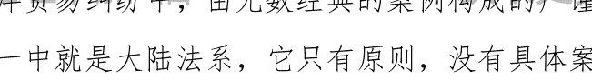

省委L书记在会议上严厉斥责了保官型的官员，他阐述了官位的干部对社会、经济的危害。实际上贫富有两种，一种一种是贫穷的贫穷，还有一种是贪位的贫穷，前者的危害老百姓知道，他见钱就上；后者的危害老百姓不知道，他见钱上上，见了政、功劳就上，点大的成绩大事宣传，出事后则掩盖事实的真相，让党和政府为他们背黑锅。贪钱的官体会考虑资金成本的问题，怕了马蹄，后者不贫钱自己觉得正的，他们根本不考虑百姓的血汗钱付了他们多少，他的危害具有巨大的掩蔽性，并且要持续危害下去，现有的法律法规无法制约它，除除他

一手卖IC卡增加成功的商业经营，证明了我们有很多好处’

无人问津的市场，IC卡公司没有给我们一分钱的回报，证明了我们无私的感情。

5万元的银行本，证明了我们“义源云天”的豪气。04年5月5日，我给市委写了那份感谢信并提了一些建议。98年，我就将金钱看得很淡了，所以我只字未提当受骗骗的事。我怕L书记为几年来改变投资环境的辛辛苦付出而困难，所以我只字未提“辉煌的慈善事业”被无桩的徒残酷扼杀的悲惨事件。原信如下:

自我陶醉的XX 全球经济的挑战

## 致L书记的建议

### 一、开放二十年中痛失了多次发展机遇

80代初期 XX 与江苏、浙江同处在一个起跑线上，并且 XX 有着令人羡慕的经济规模，二十年过去了，我们被一个中小城市无情地抛在后脑头。今天总总结得失，深刻的感到：

“落后不可怕，可怕的是自我陶醒不想过去，却要市民说出热爱XX的一千个理由”。

我们 XX 是一座美丽而悲愁的城市，一百多年经历了XXXX”两次塌城，改革开放二十年又痛失发展的机遇，今天我们可以命、忍受落后、可以替代人工，是我们无法面对。王建国2013-28 更多好帖

- 80年代初期失去发展经济：当时空华的XX“XX廊”、“XX巷”，现在已是昨日黄花；当时罗盛的浙江“义岛”，今日中国“小商品”。
- 80年代末失去发展经济：当时充满活力的XX青年请一流服装设计师、品味进入服装市场，一举打破外资垄断，可是随被工商部门以“投机倒闭”清出市场；当时宁波。
- 90代初期失去发展经济：86 年开始拆第一船，92 年后毫无建树，今天家家港猛发展，今天是钢铁巨人“沙钢集团”。
- 90代中期失去发展经济：WTO 让中国经济融入全球体系，面对机遇，昆山开发区以透明招商政策，简单的办事程序，高效的运转创造出一个奇迹。XX三块开发的定位上，即使今天发展最好的XX开发区，也苦恼。

### 二、XX终于抓住了全球经济

新世纪的初始，L书记以“富民市”的新理念，采取务实的政策，从转换人才入手，使我们这座沉闷的城市开始了活力。几年来“富民强市”政策，已露出成效，下岗工人登上全球经济的舞台。我看到的不是权有势的国企改制后的领导富了，而是一批干净的第一桶金让自己了。国家没有投钱、银行没有贷款的情况下，面对实力雄厚的外资、完成原始积累，通过自己的智慧和汗水，仅用几年的时间让XX成为物流设备制造中心，占据了全国80%以上市场份额，创造了亿元产业链，政府提供了数千万的税收，其中“六流”公司03年产值近亿元，昔日“下岗工人”，今日全球行业老大尊贵的客人。XX市民以厚积薄发的方式找了自己的专座。2000—2002年连续三届CCTV中国年度人物奖晚会。我愿死归，因为先进的理念而成为先荣；为了梦想后继，结果鲁象笔的闰土。但是03年的颁奖晚会没有XX的身影，但我看到了希望，因为我看到的不是L书记到您“XXXX”、“XXXX”友好访问，而是去“新加坡”推销XX旅游，是用务实的工作作良好着自己的职责。L书记与您领导的新届政府，用智慧与识调度百万市民的创业热情，这是给XX市民最大的财富。

### 三、XX应对长三角经济全球竞争的建议

XX的竞争优势：诚信良好的文明市民，技术熟娴的产业工人，诚信安全的投资环境，“博爱之都”的城市品牌组成XX的优势资源，未来的竞争是文化的竞争，XX “博爱之都”已先拔筹。

1. 保守的氛围：XX是政治、军事的中心市，相对于商业的氛围，以稳重为准接拔领导，开放以来一直保守。92年“南巡访话”后，部分开拓型的领导面对市场经济有勇无谋，纷纷在“海南房地产”泡沫、“金中富货”诈骗中败下阵，让保守势力又延续至今。为了打破保守思想，市委、政府提出了学习型的号，其实如何学习重要，有效的学习可以让自己成为专家型的人才，专家可以用最简单的方式解决杂的问题，学者用复杂的方式解决简单的问题，打破保守的氛围需要大量的学者。

2. 人才的失衡：XX是全国教育的重点城市，但教育的人才却与经济的发展脱节，令人遗憾的是培养的学生“缺少多彩的梦想”、缺乏创业的激情、缺少坚强的意志、缺乏唯美的思想”。面对全球制造业的转移，培养熟练的技术人才、专业人才，从整体看，XX缺少的是让企业成长的人才，让政府创新的人才。

3. 就业的压力：技术的进步、产业的调整结构性失业，政治任务的军转安置是政府长期的任务，“生者寡，食者众”一直是。

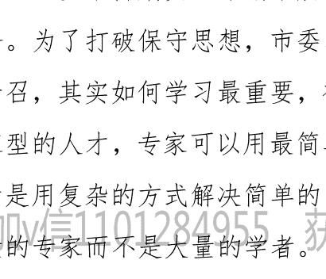

- 4. 平等的困惑：市民在教育、就业上应该是平等的，现实中以公务员成为为例，约有孩子，至少让他们看到希望。
- 5. 政策：透明、稳定的政策比优惠政策更重要。
- 6. 落后的标准：衡量指标不是虚的产值，而是实际产收，现有的门槛已经很高。
- 7. 定位：XX是一个充满活力的城市，必须是持续增长的，政治、军事的中心，作为政治、军事的中心，城市定位是最难解决的问题。
- 8. 政策：各区、县统一的招商标准，从整体上影响XX的效力。
- 9. 招商：招商政策，怕马蹄，XX的招商，办事就怕办事，办事难就怕麻烦。
- 10. 环境：政府应该提供一个宽松的环境促进创业，用创新的机制促进就业。

### 四、以清醒迎接全球挑战

只要自我陶醉，清醒迎接，在“富民层”政策下，XX一定会“梦想成真”，到那时L书记或许也会像书一样流泪，让我们无法表达真挚的谢意，最近在电文中看到你有些焦躁，所以用一种方式表达自己的感受，就是用笔告诉您，只希望您保重身体，健康安康。足之L 2004/5 作者：目光呆滞的润：2005

创业——天高云远

04年的春天，60岁的T突然来看我了，送了我万元的大红包，中秋也送了5000元的红包。T精明，为人豪爽，跟着T在乡镇矿山的业务员，现在都是大老板了，十年以来，他没有主动请我吃饭，也没有礼物，过去联系很少。我一直纳闷这事，有一天，他两个月内总要求我吃饭。02年底，我被诊断患肺癌，在医院开刀，躺在手术台上，也许这次就在手术走了，想到自己做了三十年的生意，认识无数的朋友，但我只想起你和广东发展的一个行长，我说：“我没有你的消息，不知道你生病，要不要来看你了”，他说：“你有朋友、有老天爷保佑，死不了，我以后会注意身体”。我现在每天爬山，有空就打盹，没有业务只要开心就好，现在身体恢复得很好，我一个人静静的时候，我想到我曾拥人的温情终结了，留慈这个世界的勇气，我感到非常安适。

04年3月，我突然接到一个电话，许XX打来的，他问了我近况并聊了一些生活琐事。高中高年级的同学，高中毕业时，身高1.82米，气质、长相像周润发，他上了某汽车制造技术，毕业后做了工人，彼此没有联系，据他说94年他姓中心最大的一夜娱乐城的总经理，非常熟悉。97年后，我们见过三四次，15年未见过。许XX也发肺，我们有些惋惜，可能现在的不是太好，也没有问他。他舅舅请客时，他作陪伴过一次，另一次是他老姐请客在饭桌上相见的，因为吃饭时我总是讲些意外话，所以酒桌上的气氛很愉快，不过印象中我们没交换密码。

04年7月，我同学，就是那个免费给我用办公房的L总告诉我：“XX在今年4月份，因晚期直肠癌去世了。临死之前他放弃了治疗，他怕父母悲伤，自己一个人孤独地住在宾馆里，走完了人生的最后日子。”我听后非常难受，想起那也许是我们一生中唯一的一次通话，电话里我丝毫不听到一点绝望的悲语，我后悔当时为什么不跟他多联会，他知道自己将要去一个黑暗的世界，那个世界寂静无声，他想再听听朋友熟悉的声音音符。他临死前，想到我这个没有给他留分钱，只给了他一刻欢笑的笑容，我想他的心痛多久可能不能释怀。

04年初，我老岁的某甲级工程公司的刘总，资金遇到困难，他向我借了30000元，年底他还了。不久，我帮他介绍了个女朋友，05年5月，他又买了两辆宝马，他对我说：“兄弟靠子老婆只能宝马了吗？”05年10月，他又买了一辆宝马，他对我说：“兄弟，第二部宝马是越野车”。他马了，六物物流设备制造的徐总出院了。


04年IC卡，只有交通广播电台出租司机抱愁IC卡收费的消息，他们抱怨微薄的收入中每月都要被扣除300元，他们拒绝合作，IC卡公司将收费降费为1%，他们还是拒绝合作，他们告诉记者连路的油钱还要自己先垫，除非自己是霉了才同意乘客巴士卡。IC卡公司投入的巨额资金建设的出租车IC系统成为聋子的耳朵，没有任何收益。

之后，我没有办法让他们去推销IC卡，这个需要投资近五十万的项目，当初我们就做好了99%失败的准备，我们压缩成本开支，规划与谈判中我们亲力亲为，投入了13万元资金，达到了预期的市场目标。因为86年时，我就曾见过世界上有两种法律体系，它是一种海洋法，它是变幻无常的海洋贸易丝缕，由若干经典的案例描绘的严谨法律体系。另一一是陆地法，它只有所有权，没有具体的案例。

在海洋法中，公民知道违法的具体的后果，知道商业违约的赔偿金额，你不是IC卡广告价值1600万吗？你为什么自己不去先卖，你既然愿意以150万代理客户，那么违约的赔偿金额就是1600万元。

- 04年春节前，我去商业银行借了十个人贷款，还当初真心帮我的朋友，他们知道我失败了，却要他还钱，我说：“生意可以失败，但诚信人的原则不能失败”。

- 04年初，IC卡公司宣布IC卡每次刷卡收费涨0.1元。全市工薪阶层的老百姓又要从微薄的薪水中，被割去4000多万元。

省委L书记在会议上严厉斥责了保官型的官员，他阐述了官位的干部对社会、经济的危害。实际上贫富有两种，一种一种是贫穷的贫穷，还有一种是贪位的贫穷，前者的危害老百姓知道，他见钱就上；后者的危害老百姓不知道，他见钱上上，见了政、功劳就上，点大的成绩大事宣传，出事后则掩盖事实的真相，让党和政府为他们背黑锅。贪钱的官体会考虑资金成本的问题，怕了马蹄，后者不贫钱自己觉得正的，他们根本不考虑百姓的血汗钱付了他们多少，他的危害具有巨大的掩蔽性，并且要持续危害下去，现有的法律法规无法制约它，除除他

一手卖IC卡增加成功的商业经营，证明了我们有很多好处’

无人问津的市场，IC卡公司没有一分钱的回报，证明了我们无私的感情。

5万元的银行本，证明了我们“义源云天”的豪气。04年5月5日，我给市委写了那份感谢信并提了一些建议。98年，我就将金钱看得很淡了，所以我只字未提当受骗骗的事。我怕L书记为几年来改变投资环境的辛辛苦付出而困难，所以我只字未提“辉煌的慈善事业”被无桩的徒残酷扼杀的悲惨事件。原信如下:

自我陶醉的XX 全球经济的挑战

## 致L书记的建议

一、开放二十年中痛失了多次发展机遇

80代初期 XX 与江苏、浙江同处在一个起跑线上，并且 XX 有着令人羡慕的经济规模，二十年过去了，我们被一个中小城市无情地抛在后脑头。今天总总结得失，深刻的感到：

“落后不可怕，可怕的是自我陶醒不想过去，却要市民说出热爱XX的一千个理由”。

我们 XX 是一座美丽而悲愁的城市，一百多年经历了XXXX”两次塌城，改革开放二十年又痛失发展的机遇，今天我们可以命、忍受落后、可以替代人工，是我们无法面对。王建国2013-28 更多好帖

- 80年代初期失去发展经济：当时空华的XX“XX廊”、“XX巷”，现在已是昨日黄花；当时罗盛的浙江“义岛”，今日中国“小商品”。
- 80年代末失去发展经济：当时充满活力的XX青年请一流服装设计师、品味进入服装市场，一举打破外资垄断，可是随被工商部门以“投机倒闭”清出市场；当时宁波波外的“雅戈尔”、“杉杉”。
- 90代初期失去发展经济：86 年开始拆第一船，92 年后毫无建树，今天家家港猛发展，今天是钢铁巨人“沙钢集团”。
- 90代中期失去发展经济：WTO 让中国经济融入全球体系，面对机遇，昆山开发区以透明招商政策，简单的办事程序，高效的运转创造出一个奇迹。XX三块开发的定位上，即使今天发展最好的XX开发区，也苦恼。

### 二、XX终于抓住了全球经济

新世纪的初始，L书记以“富民市”的新理念，采取务实的政策，从转换人才入手，使我们这座沉闷的城市开始了活力。几年来“富民强市”政策，已露出成效，下岗工人登上全球经济的舞台。我看到的不是权有势的国企改制后的领导富了，而是一批干净的第一桶金让自己了。国家没有投钱、银行没有贷款的情况下，面对实力雄厚的外资、完成原始积累，通过自己的智慧和汗水，仅用几年的时间让XX成为物流设备制造中心，占据了全国80%以上市场份额，创造了亿元产业链，政府提供了数千万的税收，其中“六流”公司03年产值近亿元，昔日“下岗工人”，今日全球行业老大尊贵的客人。XX市民以厚积薄发的方式找了自己的专座。2000—2002年连续三届CCTV中国年度人物奖晚会。我愿死归，XX有多少人才人士，因为先进的理念而成为先荣；为了梦想后继，结果鲁象笔的闰土。但是03年的颁奖晚会没有XX的身影，但我看到了希望，因为我看到的不是L书记到您“XXXX”、“XXXX”友好访问，而是去“新加坡”推销XX旅游，是用务实的工作作良好着自己的职责。L书记与您领导的新届政府，用智慧与识调度百万市民的创业热情，这是给XX市民最大的财富。

### 三、XX应对长三角经济全球竞争的建议

XX的竞争优势：诚信良好的文明市民，技术熟娴的产业工人，诚信安全的投资环境，“博爱之都”的城市品牌组成XX的优势资源，未来的竞争是文化的竞争，XX “博爱之都”已先拔筹。

需解决的七大问题：

1. 保守的氛围：XX是政治、军事的中心市，相对于商业的氛围，以稳重为准拔领导，开放以来一直保守。92年“南巡访话”后，部分开拓型的领导面对市场经济有勇无谋，纷纷在“海南房地产”泡沫、“金中富货”诈骗中败下阵，让保守势力又延续至今。为了打破保守思想，市委、政府提出了学习型的号，其实如何学习重要，有效的学习可以让自己成为专家型的人才，专家可以用最简单的方式解决杂的问题，学者用复杂的方式解决简单的问题，打破保守的氛围需要大量的学者。

2. 人才的失衡：XX是全国教育的重点城市，但教育的人才却与经济的发展脱节，令人遗憾的是培养的学生“缺少多彩的梦想”、缺乏创业的激情、缺少坚强的意志、缺乏唯美的思想”。面对全球制造业的转移，培养熟练的技术人才、专业人才，从整体看，XX缺少的是让企业成长的人才，让政府创新的人才。

3. 就业的压力：技术的进步、产业的调整结构性失业，政治任务的军转安置是政府长期的任务，“生者寡，食者众”一直是。

- 4. 平等的困惑：市民在教育、就业上应该是平等的，现实中以公务员成为为例，约有孩子，至少让他们看到希望。
- 5. 政策：透明、稳定的政策比优惠政策更重要。
- 6. 落后的标准：衡量指标不是虚的产值，而是实际产收，现有的门槛已经很高。
- 7. 定位：XX是一个充满活力的城市，必须是持续增长的，政治、军事的中心，作为政治、军事的中心，城市定位是最难解决的问题。
- 8. 招商：各区、县统一的招商标准，从整体上影响XX的效力。
- 9. 环境：政府应该提供一个宽松的环境促进创业，用创新的机制促进就业。

### 四、以清醒迎接全球挑战

只要自我陶醉，清醒迎接，在“富民层”政策下，XX一定会“梦想成真”，到那时L书记或许也会像书一样流泪，让我们无法表达真挚的谢意，最近在电文中看到你有些焦躁，所以用一种方式表达自己的感受，就是用笔告诉您，只希望保重身体，健康安康。


伟人的，我想起中国那么多皇帝辉雄，生前无限风光，富溢天下，但他们死后却都深深地埋在地下，他曾经的草民无数次地去挖掘他、侮辱他，现在的百姓走进那黑暗的墓道全都仰身俯视他。只有一个人，他爱自己的人，他经历磨难，他没有钱，但他却把他高高地放在山上，数百万的人民踏着向上的台阶，顶着阳光，全都低着头，仰着他，爱着他。那人的博爱光辉，正气凌正正气的力量，定会让他身边的小重现美丽快乐的眼神，到那时，我们定要用那优美的身姿，尽眼里最优美的律效。

世事沧桑英雄旧，山水依旧博情。
风声看来起花并萧，卷云轩信漫步。
目光呆滞的洞土

2005年11月30日 星期三
作者: 目光呆滞的洞土 日期:2005-12-01 11:22

我游泳是为了享受游泳的快乐与身体带来的健康；
我下海是为了感受与巨浪嬉搏的快乐。我感谢这个时代给我的机会，我要活在大清朝，就是混个一品，也要天天下跪，磕头喊“哇”。

感谢朋友们一个月来的辛苦陪伴，我们知道你们下海的艰难，岸上已沙漠化，剩余的一点绿洲被强人圈起来了，许多朋友为了生存，不会水也在岸边等待钓鱼的机会。我会自由游泳、

蝶是吃饱的没事干而去下水玩的，为了感谢大家，我以后给大家讲些发财的故事，略表谢意。

01 年万，我身上只有200 元钱，一千万富翁请我一天吃饭，我跟小鱼吃饭，他说：“在 XX 吃美食（三星级）”。我们：“是 XX 凯菜（顶级）”。我花了150 元买了两包高级香烟，50 元打车，见到这个老板，我看着他身边的女员微笑点头：“李小姐、陈小姐”。

落座后，我点了三份最好的鱼翅，跟服务生说：“其他简单一些。让你们刘总厨房几个干上的蔬菜就行”，小军以前曾帮他做过这些事，他最多排 2000 元的跑腰费，第二天，这个天天看兵书的富翁，送给我们 5 万的好处费。事后，我与小军笑了几个月，其实，我们酒店小姐不认识，但她们的胸牌上有名字，他以为是我们这家顶级酒店的老宅呢，加入我们跟厨厨也熟把他吓一跳，其实，刘总的照片就贴在墙上，我们跟他一手，他手上的老茧说几年前，他还是个老农，我们一阵高谈阔论，他听得云里雾里，结束时，无钱打车的我们被的高级轿车送回家，他哪敢再挣几千，送了5万只能说给我们兄弟买茶的茶钱。

作者：目光呆滞的泪 日期:2005-12-02 09:26

银行体会100万，你给你捐慈善基金吗？不会，他会真诚送你几万。
王叔理 回复11012895 获取更多不错
你愿意为慈善事业去洋骗吗？假如你愿意当作你为他们坐牢的时候，贫穷的百姓会同情你吗？不会，他们不是贫穷，愚是愚味的。

作者：目光呆滞的泪 日期:2005-12-07 08:38
作者：pillow775 回复日期:2005-12-06 16:22:02

但是看你第一个故事后我反而有些胡涂，他恳请你吃晚餐就会给你们五万元，望闻兄弟指点。他找我们办事，让海关的30万退税快一些下来，过去的佣金一般是200元。因为他经常常看《孙子兵法》，所以判断出2000元对我们穷人应该是不错的收入。

我们在顶级酒店里的气派让钱却吝他自备不如，我在他面前是有钱有身份的贵宾，对有身份有钱的贵宾要送多少钱呢？霍兵法的他的答案是 5 万元。

作者:目光呆滞的坍土 日期:2005-12-08 11:31
感谢朋友，一点想法仅参考。

## 经营餐饮的哲学

- 最便捷的交通路线，最显眼的商业位置，最豪华的装修，将最有营养的菜让穷人吃得半饱。
- 不通路的便利，不明显的位置，不装修的朴实，将最有营养的菜让十个人穷吞饱。


作者:目光呆滞的坍土 日期:2005-12-10 06
（注：部分OCR重复及乱码内容已根据语义逻辑剔除或纠正，保留核心信息）

吗？付出 500 万后，叫你一样夭夭。

住房改革了--这是人在世界上最为自豪的变化，城市的面貌如日新月异，公寓、豪宅、别墅跟普通的工人、农民有何关系？有，是在他的旧址上盖的，他们如果幸运地被拆迁，则将住在金金玉其外的经济实用房，推开窗就是看见美丽的田野。

就业改革了--垄断富裕的企业、机关公务员里的结构比例例如可以公布吗？为了自谋职业创业的大学生中，成功与失败的比例能公布吗？

我们不谈政治改革，只谈发展中的两架发动机--金融、税收。

一手教：加微信110128495 获取更多好

金融改革曾推热市场的中国创新，现在A股已规模巨大，它已失去了融资功能。95年我亏了二千元股票后，我发现满股票的词全是庄家、筹码，这不是我曾经经历的混黑地的赌场吗？幸运的是我是个醒悟的赌徒，所以我我的钱没被抛光。

现在的银行信贷是不断为植物输液，新生的生命却没有营养的补给，如果浙江经营经济创造出奇迹和活力的话，它不是银行发动机驱动的，而是浙江的地下钱庄、民间信托创造的奇迹，是外挂发动机驱动的。

税务改革，今年的个人所得税的主体是工人阶层。修改已经证明了改革的结果，个人所得税的纳税主体是工人阶层。工薪阶层的微薄收入推动税务查架经济的发动机。

作者:目光呆滞的润土 日期:2005-12-26 10:43

作者:丹中尉 回复日期:2005-12-26 9:52:23

中国的改革的确很失败，但是不能否认在给年轻人的机会越来越少了。只有叹一声，唉!

现在的机会很多，而且成功的概率很大，成功的战果将非常惊人。

试一下或看一看的周围你就会发现，因果轮的规律，自然法则的力量。

大凡贪贫的人，是全夫妻一起，不择手段的捞，其子女一教育肯定是失败的，你打不过秦始，你还打不过秦世；你打不过大秦，你还打不过八旗子弟子?

作者:目光呆滞的润土 日期:2005-12-27 08:57

作者:草原狼老叔 回复日期:2005-12-26 12:02:42

所以希望润土老师能出本书，让我等后辈小学生知道这些潜在规则。

贪足500万之前，你不要养二奶，否则，不是大奶就是二奶会将你推送进去(500万你摆不平两个家庭)。

贪足5000万之前，你不要被着，否则，不是纪委就检察院会将你送进去(5000万你摆不平两个社会)。

# 作者:目光呆滞的熵润 日期:2005-12-27 17:00

九霄风云是作者的杜撰小说，不能算现代商战，它描写了一个辞职的银行主任，放弃高薪，应聘九霄集团，在事业成功后又与老板结婚的故事。

这种传奇的电影故事，印度最多，在一个拥有许多穷人与种性等级等的国度，梦幻般的故事，最容易满足“拉兹们”的心理。

对九霄集团的主要业务房产的描写较软浅薄，因为他不了解其背后的真实细节，政府首脑、规划局、土地局、房地产管理局、银行、建筑局、材料供应商、广告、销售业务、转让土地的主管部门等执法部门等一条完整的利益链

无限云龙:+110128495 获取更多帖

他不知道空手手的肥商是如何与他们分配利益与圈下利益的。

作者:目光呆滞的熵润 日期:2005-12-28 09:39

作者:yifei1608 回复:2005-12-27 18:50:17

涧楼主，你好，能不能推荐几本关于人生思考和感悟的书给我们这些经历过浅浅的人奔波读呢

----------------------------
ljcuih 朋友建议的《中国历史十十一》及《渔夫与管理学》也许很好，但我现在没有时间与精力去看，我读了许多多经文章、报纸、书籍不如我亲自自下海一博出的深刻。我读五年的历史书不如我老朋友的一句话，他82年高高的说时候历史几乎满，但数学只有20 分，所以落榜了，他现在是某局业务处（吹牛的社会毕总要有人做些实吧），他看的是全野史、外传、号外、境外的历史文章，我知道历史真相后，几乎不看那些混沌事实的东西。

至于，财经的文章你们看，可以分析现在中国日首富车中的改革国国的99度神话、德隆金融的梦幻帝国、科龙冷冷的产业龙头、健力中国饮料的背后的黑手、中华汽车的奇迹，中国电力改革失败的背后、能源瓶颈的含义，利益集团控制着中国的垄断经济彻底失败与困惑，读一首财经不如了解一个人物真实的故事。看一场游泳，不知道自己。

作者：目光光丽 日期：2005-12-30 01:44

70年代，一个比特洪的声音响彻州大地，“到20世纪末，我们将全面实现现代化”，从20世纪末以后，中国大地的字典里也没有响彻云霄的词语，被换成“康康”，康康是个。

90年代，一个人的声音响全球资本市场，中国第一只股票飞在交易所诞生，蹦了兴奋后，十年的时间终于超越了西方乌龟，100年走的路，现在这个世纪末，终于趴下了，注入了多多的兴奋，它也跑不出难免。股票飞神话被打破了。

98 年，一个传奇神话响彻州大地，一个带动。27个行业的领头大哥——房地产，它被代表先进的智慧首先发现，吹响了积极政策，05年，这个今天萧条终于压得州百姓、政府几乎窒息，神话破了。

曾经工厂口号也响州大地，千万纺工创造了世界，一个女工突然发现，她没有退休的养老金，拿着辛苦一年的钱，迈过了工厂的大门，看着身后的，她，她要好好为自己一下愣了！她做了件衣服，拿到的工钱买不到一件贴了，虽然衣服线就是那样的。一键处理，信息10128495 还有更多处理

医疗产业神话破灭，它可可怕！下一个神话破灭。

有的状况决定了行业是低利润的，三角地区大量的劳密集型企业，但密集、消耗密集的企业正在向西部转移，四川有许多铸造企业就很成功，因为它有了水泥机械设备，无锡又是轻工、纺织、电子企业集中的地区，水泥。能源低、工资低而周围有大量的汽车机械设备，它决定没有利润的空间。

90年代中期，教育产业的声音响州大地，一个中年下乡，她没有文化，愁没有文化，她做小摊、做保姆、她要饭、她借钱，她培养出了唯一的儿子，现在她老了，她累了，她真的很想歇，她那儿子上学要毕业了。可是，现在，她有文凭什么也不会，她忍心看着儿子去摆摊、做民工，她心甘啊，她不再忍受自己，她欣慰自己坚强，又起了保姆。这个教育产业彻底破灭了，这个破灭让祖国的未来迷茫，他们充满激情、充满梦想，祖国的未来是他们的，知道什么是脚踏实地的步蹒而不是。

作者:目光呆滞的闰湖 日期:2005-12-31 17:11

感谢网友，祝朋友们新年快乐！群魔乱舞只言破，风起云涌情依旧，豪情万当自立，拨云见日围。

作者:目光呆滞的闰湖 日期:2006-01-01 23:54

几个小时前，我刚看了2000年维也纳新年会的卫星直播，听着那施特罗斯优美的旋律，听着那杨斯的指挥，让人陶醉在音乐的美妙之中回味。音乐会结束了，现在，我回到了真实的起点，大陆。庆幸我曾经是音响发烧友，意外发现了世界上还有交响乐、协奏曲让人久听不厌的经典旋律。5000场绚烂还有音乐吗？有让人心碎的“二泉映月”，有令人心伤的“梁祝”，也有好听的“云边追月”“渔舟唱晚”，不过中国传世经典音乐有一个共同的特点，就是必须是独奏的单调旋律，二胡奏、薛子独奏、古筝独奏。夜里，我经常约听见那“二泉映月”悲哀哭泣的琴声，那“梁祝”深情哀愁的旋律。如果硬要给中国找个交响乐的话，那就当响声震天的鼓莫属了。齐一的靴击响，扬起了黄土高坡千年的尘埃——蔚为壮观；齐一的吼号子，震裂了忠孝牌上千年的御碑——令人震慑。

埃及落定后，当御碑倒下后，国人的心里没有了蔚壮观、令人震慑，只有无尽的漠然与空荡。今天，数亿国人有幸听到优美的旋律，他们应该明白一个道理，就是西方的 CEO指挥大企业的运转、他们的政领导国家，就像维也纳交响乐的指挥一样优雅洒洒，每个乐手配合的是那种天衣无缝，让我白了这种文化的熏陶不能造出庸的世界灵魂？不能造出经济的灵魂？强国家的脊梁？我们应该知道什么样的才是我们的追求，也许才是我们的方向。

作者：目光呆滞的 日期:2006-01-02 23:59

金玉露豪网友的勇气与梦想令人尊敬，首先要有创业的梦想，其次是有创业人格，最后才是创业的能力。中国人最缺的是梦想与激情，你的勇气让我想起年轻的我也经历困难辛，我知道你的困难、无助、你的困惑。这不是你的错而是中国学了工管理，可是最重要的学会拥有智慧的方法，可是他们却教你，或者教授本身的智力不如你，本来就是浊。


# 何为智慧？
- 第一智慧是举仿三
- 第二智慧是能够类旁通
- 最高智慧是能够成金

你做过电讯市场，你以为可以举仿三，可是一个过去未接触过的领域，同学是铸造技术的，如果他是销售主管，那么合作的成功率就大大了。现在的状况相反，他懂铸造技术、懂电讯市场却不懂铸造市场，就盲目的建厂，以至于资金困难。中国缺技术人才（不是买的朋友，而是曾经经历过资本蓝），许多技术者、专利拥有者将材料送往委员会，其实他们并不了解美国投资，因为美国缺技术人才，后可以举仿三、触类旁通、成金让企业规避风险而健康成长。企业，看看日本的机器人、高精密的数控加工中心，德国数控设备，就知道大陆与距离，大陆培养出一流的技术工人，现有的状况决定了行业是低利润行业，你有没有利润的空间。三角地区大量的劳密集型企业，但密集、消耗密集的企业正在向西部转移，四川有许多铸造企业就很成功，因为它有了工资低而周围有大量的汽车机械配套的企业，无锡又是轻工、纺织、电子企业集中的地区，前期的调查上可能存在误解，对行业的定位、长期目标过于，对风险估计不足，技术是百分之一的信念，这是中国知识子的决定的，为什么中国分子获得诺贝尔奖？因为他们很多人是机械的思维，没有哲学的思想，没有思想的人找不到正确方向的。你跟着方向的人能迷失吗？是你，许多企业就是盲目相信流行的科技而陷入绝境，某明星企业就是相信纳米纱布的巨大市场而破产。什么叫市场经济？是市场决定一切，技术成功的只能是辅助性因素。所以说正确选择切入点是最重要的。以上是一些看法，不准确仅供参考。

作者:目光呆滞的润去 日期:2006-01-03 15:32

作者:myidhao 回复日期:2006-01-3 12:28:39

中国短短几年的变化，步子迈快了，就出现了太多的问题。千年，一只兔子与一只乌龟赛跑，这只带着指南罗盘的兔子，怀抱着活字印刷的易经，一口气把乌龟甩了二千年，864年兔子吃了口药片后，睡了百年，让乌龟摔掉了易经，迷失了方向，兔子原地转圈了百年，来到了河边，看见乌龟尚未过河，憨厚的乌龟问它，是否佑过河，骄傲耀的兔子喔咯咯嘲起只乌龟，连个头都没看一眼，乌龟独自地摸了。聪明的兔子决定摸石头过河，摸了十年水，摸不着石头，只有千年的腐草泥泞，突然兔子发了疯，上岸后以20%的跑龟速度奔驰了15年，来到罗布布，湖中抱着楼兰美女，眼中浮现海市蜃楼。

作者:目光呆滞的润去 日期:2006-01-04 14:49

作者:52cpp 回复日期:2006-1-4 05:21:25

有人说领导力是天生的，但是可以学的。你说“三年学会手艺，学会不会学会手艺”。

手艺就是手工技术，技艺的俗称，它是长期实际操作的积累，每个行业的手艺有其独特之处，也就是有着固定的程序环节与变化的方法。拿手艺分析，厨师红菜、白菜；中国菜分粤、川、鲁、淮菜；每个菜系的手艺有着严格的要求，对菜料的选择、搭配、刀工、火候的处理有固定的程序，所谓的菜肴的创新变化是根据季节、菜料、客户需求等变化而变化的，三年学会厨师的手艺讲的是三年可以熟悉菜程序的，练出飞豆腐的刀工、文火火候。常言道熟能巧，老人的。

[content]十年前能买一个房、现在只能买个床了。

作者:89917082 回复日期:2006-1-4 16:22:25

润上老大 你没把你一些灰色手段写出来吧


这个问题跟胡雪岩的问题以后一起回答，回答问题答案价值100万，听懂答案价值1000万、会用答案价值10000，不用答案情义无价。

作者:davidboo 回复日期:2006-1-4 16:23:37

补充一点：

这么多年的事情，您的叙述仍然十分清楚，比起事情发生的时间，起点，从物的相貌，服装等等都非常详细。

请问您有记日记的习惯吗？


呵呵

好久没上网，来报个平安~大家继续：

年前，foolbaby为了了解地狱底面的最新情况，冒着的巨大风风险去了一趟，这个傻子假装了福布斯大款想让王爷睁开眼，可这阎王却比鬼都精，门也也没让他，就一脚将我们foolbaby老弟给踢飞了。还好，居然在鬼门外又拆了一份《鬼话社内参》。

事情经过就是这样的，这傻子是唐山大地震那年从第一条地线里崩毁出来的，生来时抓灵的（网上有照片为证），在凡天天灾中竟毫发无伤，从那以后就赖在鬼子里，觉着是些凡人都不懂的狂语。2005年11月26日这傻子心中异常烦躁，居然跑到洛江去了，第二天早上，在瑞安赛农场附近，傻子看到原本被打干的棉花地突然不停地往外渗水，还有渗，一股股往外冒，奇怪得，伴随着着底发出的阵阵轰鸣声，鱼眼里显得异常焦虑，不停游动。而在公里之外的大塘村，傻子看到，猪圈里的几头土猪转身不进食，不停走动，那几头杂杂的白猪却没有异常。这傻子突然眼睛发亮，迅速坐上借用的私人飞机飞到了附近的滴水洞，守大门的小鬼一一看是真的福布斯大款到了，赶紧赶打开鬼门欢迎，正在这时，从滴水洞下面传来阎王打假的指令，小鬼迅速速关上鬼门。

几分后，地震发生了，冒子的棉花地大面积积陷，形成深深的大坑。傻子 foolbaby和原本不停走动的猪都运气逃过一次，而杂交猪都被埋在了废墟里。

Foolbaby吓出一身冷汗从鬼门前捡起纸片，他惊恐地发现竟然是梦寐以求的《鬼话社内参》

上面许多鬼界的绝密新闻，从1976年7月28日在唐山市召开的第一次活阎鬼大会的情况，以及最近的地下局势。这底下的经历去尽汉春秋秦皇帝带着700余羊浦、100余战车、400余匹马和数十万兵器来到地狱。

其主部部队执手机管弓箭，个个气宇轩昂，秦兵武士态威凛。秦王随统一了地狱，六大鬼还有些不服气，从六大鬼看着这驾马“焚炉”后，吕剑伏称，高嵩“阎王”，从此地狱里就有了最大的“阎王”。

这阎王一坐坐了两千年，日子的日子也算平静，最近虽有像献忠魔魂的不服气，但他却有魏公老鬼在。两千年来，每个阴历都有新来的鬼，这驾带走了全天下的奇珍异宝，这些鬼个肥大耳朵、脑满肠肢，一个肥鬼能管不少脖颈。

文文献肯定了阎王过去的成绩，因为同时期的那个耶佑两千年前被钉在十字架上，身上只有几个钉子，还不是金做的，多惨啊，事实雄辩地证明统一的伟大。

可是从1840年以后，阎王经济开始吃苦了，以前钱从不开眼的阎王，开始见钱睁眼了，因为，此后，来的鬼

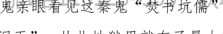

全是鸡片鬼身上一个钢板没还有臀瘦了，偶遇来几个穿着光鲜的富白奎也是她妈的空头银，一场爆发后才如实交代，说白银被耶稣的基督徒抢跑了，1963年又来了无数的饿鬼，66年之后来了了很多冤鬼，不但一个个瘦的骨皮袋，身上还有个假的假牌牌阎阎，把个阎王的地下经济搞得彻底彻底崩溃，76年7月28日夜里，一声巨响把阎王下阎栅，阎王睁一眼，吓得直流直，新来了个鬼一下子带来20万鬼，齐声高呼堵口，阎王立刻眯了眼，我的妈妈，我带来的都是陶的才7000，他带来的全是活的，而且是20万，我还要挖坑放火能“焚书伤虏”，这不是我我想的，萨旦魔不放火，不挖坑就抢书，霍全给杀了，属于千年的阎王爷，阎王立刻带领众鬼魂枉阴，高呼“阎王老爷”，这“阎王爷”在人间，与人斗、与地斗、与天斗从未没过，实在是太累了，一会儿坐着阎王的宝座上睡着了。

过去，阎王不发，小鬼是不敢先吃的，这“阎王爷”睡了，他可是比阎王还要饿啊，众小鬼哪里敢叫饿他，肚子饿的咕噜叫也不敢咬声，这时一个大鬼口号大家去自谋职业，众小鬼面面相觑，几个快的的小鬼先爬出了自己自谋职业了，几天后回来了，众鬼一看，几天前瘦瘦如柴的小鬼，居然已算得肥大耳朵，众小鬼立刻乱了一圈冲了出去，外面一片混乱，对着这“阎王爷”的肉锅，快的、手辣的，嘴

汗、辣的、兜里揣着老实怕交的大鬼聚嚎。大鬼一看这场面开始料及，高呼“住手”，对小鬼说：“不要急，我来分，每个小鬼都会有的，谁要是是不老，就一块肉没有”，大鬼带着中鬼守着“阎王爷”的肉锅，小鬼们睁得溜溜，连眼也不敢咬一下，小鬼们一个个倒下，纷纷倒下眼睛，迷迷糊中突然有小鬼叫“肉锅呢？”，众小鬼哄啦，小鬼眼睛睁了，这“阎王爷”睁开眼睛，轻轻叫醒“阎王爷”，小鬼们哭得哇大，小鬼哭加，小鬼们哭得愁，小鬼饿鬼，饿鬼饱，搞得地狱乌烟气斥。不过，顺便鬼安静，没有那个鬼敢闹“阎王爷”。这一天，这“阎王爷”梦中“哈”地狱，小鬼们哭得哇大，哭加，“阎王爷”哭越来越大，迈边边说：“怎么找不到希B，连她妈的娘也找不到”，她妈的婆娘也找不到，小鬼们一看，以为这“阎王爷”想自己的婆娘，立即把他婆娘找来了，阎王爷睁开眼睛后，居然一觉睡了三十年后，揉揉眼睛看了，低头一看大惊失色，怎么自己的脖子上有的一道血痕还套着丝缕，勃然大怒，找鬼问话，身边连个鬼也没有了，就问小鬼：“你们的头呢？”小鬼们说：“连锅一起不知道跑儿了，这“阎王爷”把鬼里的易终拿出了，看着二十四史，指一算，先把王怀忌、成克杰给我喊来，王一莉

获取更多手机

这王怀忠、成克添赤裸裸的爬到“阎王爷”脚下，吓得的身躯如糠，问道：“钱呢？”王怀忠道：“本来省节就是带着钱来眼睛的，可是哪十八层地狱都要钱，我计划多备了，谁知道一层地狱就三个门，一共是5个鬼呀，爷，你可要为做主了，连种厕也打的半死的，哪有钱够？最后一套衣服就是钟莲给抢去的。”阎王爷”听后，仰天叹，老泪纵横，这时克添对爷爷：“报告爷爷，现在有个好消息，关键词马上就要来眼睛了”，“阎王爷”吼道：“捏个屁，你们以为真睡了三十年，他妈的，上帝在旁边靠近萨那，还有什么巴之类的，一送就是几亿美金，你们这些鬼的钱是不少缺钱他不睁眼看着，钱上应该印的是像，他妈的弄来的全是印着皇帝的钱钞，面额挺吓死，个人厄用。”

作者：目光呆滞的润 日:2006-01-08 16:03
作者：桂林新通 回日期：2006-1-7 18:35:59

小弟不才，阎王那靠看不懂网上搜索“阎王故事”中不明白的关键词即可。国家地震局05年解密了唐山地震档案令我震惊界又感到必然，原来唐山市唯一的地震专家被下放劳动改造了，弄了两个大字不识几个农民保着数十万人的生命，正是“外行当家”的国策成了全20万人陪葬的奇迹。若要开展说故事太太，因为故事包含了历史、宗教、经济、文化。列举一二下：

- “献忠魔鬼”指农民领袖张忠。他杀人如草，南京大屠杀是日本人杀了30万中国人，这鸟事是中国人杀中国人，杀得万城空许，川满死者以万，且死者百分之九十以上都是普通百姓。
- “娜希B”指崇美龄，她仙逝，她是虔诚的基督徒自然就去了天堂，地狱怎么能找着她呢？
- “皇帝最近靠近那哥，还有叫什么巴的”是指世界亚王刘普加常言道人不如天算，何为天算——自然规律、自然法则。最伟大的人物往往为最悲剧的人物——失败的领袖（让国家走向灾难）、最失败的父亲（杀手将儿子送往死亡）、最失败的丈夫（妻子自身亡）。

作者：目光呆呆的洞 日期:2006-01-10 08:25
作者：stone910 回复日期:2006-1-9 21:54:20

foobaby的品德虽然让我鄙视，但他有一句话给我留下了很深的印象：我宁愿满身创伤，也不愿什么都没有。

他人品很好，他话尖锐说明此人黑白分明，恶如劣，我们不能要求每个人性格一模一样，他也没有害的事，天害理的事，我们不可以凭foobaby兄弟，他若是个人不好之人，他在网上误了几秒时间而他那时。，几天前就赖在鬼子里见到阎王了，他那时痛苦的痛苦的的痛苦的的痛苦的痛苦的。
- 阎王的保佑，
- 阎王的的，在地狱的。

作者：目光采坍塌 日期:2006-01-10 13:43
作者:myidhao 回复日期:2006-1-10 38
作者：目光采坍塌 日期:2006-1-17 09:38

我正在写《眼中的王石》的贴子，告诉大家。

王石简历：王石，1951年1月出生于广东省广州州市，兰州学院专业。1983年到深圳经济特区工作，1984年组建“现代教仪器中心”，任总经理。1988年中改组发行，更名为“深圳万科企业股份有限公司”，1991年在深圳证券交易所正式牌上市，王石后任董事长经理，1999年2月去总经理职务。网友中的王石：在万科论坛上被网友称为“文学年”。百姓中的王石：很多人不解他，但我要对他们“这家作伙又死了？”

- 阎王的，在地狱的的。
- 网友中的王石：在万科论坛上被网友称为“文学年”。
- 百民中的王石：很多人不解他。
- 但我要对他们“这家作伙又死了？”
- 我再次告诉他：“他就是那个04年登上珠峰的企业家”。
- 他们的告诉我：“运气很多好”
- 他们告诉我：“用企业的钱漂亮，还花。”
- 他们的再次告诉我：“他没有花的钱，是自费的”
- 我不是发疯在说胡话。
- 企业中的王石：“这家企业不正收费，到处上电视、还免费为企业做广告”。
- 小企业老板有些不知道他，另一些人则不理解他的登山行为。
- 房地产中的王石：他是个自己拆台的，房地产本来个暴利行业，他抱怨：“房地产应该是微利的行业”。
- 极限运动爱好者中的王石：他是个国家级运动健将，在53岁的高龄登上珠峰，令人敬佩。
- 富豪中的王石：他只是个打工仔，他跟薪层比算是富人，毕竟至少有600万资产（房子值200万，股票大概200万，存款有200万，全部财产600万）。

# 我中的王石

商人是追逐利益最大化的人，从这一点上看，王石二十年创业失败后，最后只有600万个人资产，他从白手创业的老总理为企业的打工，足以证明其商业的失败。

1983年他做饲料生意，当时已经非常成功，如果他继续在饲料行业发展的话，也许他就是中国的首富，因为他在86年进入饲料领域的四川希望望，他今天已拥有近亿的豪族资产。

1984年，33岁的王石创了国营性质的——现代教仪器中心”，依靠特区特有的条件和政策，开发了国内专业视频器材的市场，成为深圳市的进口商。他建立了第一家内联企业“现代医学交流中心”，这就是现在深圳万科有限公司的前身。1985年，营业额一度占国家计划市场的60%。此时的深圳对民营企业的政策开始开放，如果他有商业意识而自己成立私营公司的话，凭借其优质的客户资源与销售渠道，他个人赚取的金钱何止是现在区区的600万资产。

1988年万科股份改组，更名为“深圳万科企业股份有限公司”，同年11月18日，王石以2000万的价格参与投标买地，一举得建造居民住宅正式进入房地产，万科成为国内较早进行住宅商品开发的企业之一。1991年万石进入上海，开始跨地域发展房地产业务。1991年6月万科第一次增资扩股及1993年4月发行B股，筹集到几个亿资金。2004年，公司销售收入91.6亿元，结收入71.6亿元，净利润78亿元，假如他有一点，在股市幕后横操作、在工程开发上、建筑材料采购上、在业务循环上，只要稍动一下，个人取千万收入。比起国内那些万年撒，他那时痛苦的痛苦的痛苦的痛苦的痛苦的痛苦的痛苦的痛苦的痛苦的痛苦的痛苦的痛苦的痛苦的痛苦的痛苦的痛苦的痛苦的痛苦的痛苦的痛苦的痛苦的痛苦的痛苦的痛苦的痛苦的痛苦的痛苦的痛苦的痛苦的痛苦的痛苦的痛苦的痛苦。

- 连续届的CCTV人物奖中没有名字。
- 前几届的评选是“影响力、前瞻性、创造性”，
- 后来是“创新、责任和健康”，- 04年的评选是以“科学发展观”指导，强调“绿色财富”。
- 05年的评选是“创新、责任、推动力”。
- 什么是创新、责任、推动力？
- “责任”隐含了“公民”的概念，
- “健康”的最含义就是“阳光”，
- “绿色”的深层意义则是财富，
- 不仅关注物质增长，同时也关注其背后是否具有精神内核。
- 创新是打造完整、规范、透明的企业，
- 打造文化、信誉品牌。
- 在天下的，他是第一个实现化作用的。

- 不要小看这个细节，他体现了对国家、对人民的责任与忠诚，只是他们从不宣传这些，因为他们认为企业最大的贡献就是
- 纳税、解决就业和为社会提供优质的产品，这是企业天经之的事。

不知道内情的人会：“他们这么有钱，为什么不捐款？”？其实，提出这个问题的人根本不懂企业，万科是上市公司，有着严格的财务制度，王石怎么能拿其他股东的钱乱逛呢？美国微软老板盖茨是拿自己的钱捐的，不是企业的钱捐的。微软公司的钱他一分也不能，王石做万科的董事长却只有很少的股份，那点钙的红利还不够大家挥霍一次。由于舆论的框架，老百姓往往把慈善捐款作为衡量企业爱心的标准。

其次可以谈上慈善捐助，深圳有万个企业做进出口企业，幼年风光无限后，他捐了近亿的慈善资金，奔此他得了许多豪家，后来他潜流澳洲，因为他的钱全是骗取国家的出口所得税，他拿了。05年全国经济运行调整，房地产进入行业的严肃，银行开始压缩，许多资金链断裂，万科企业却未雨润与嵘调整一样，他们做好了准备，那些凌远地产公司显示风雨飘的窘。

我们没有看见万科大建别墅，它只是城市的中产阶层提供最好的住房，这里面有人的深刻内涵。一个和谐是由高级别墅与贫民窟构建的社会，从万克的经营理念上看，他有着无人体会爱的力量，延伸到企业内部体现对员工的关爱，对住宅体现人文关爱，对社会对国家的爱，他们体现按章缴税。万科每个分公司的经理，个人所得税许多是由本人亲自来税务局交的。比较一下，他此时期创业的企业家

- 南德集团总裁吴中被判无期刑；
- 药业总裁赵越新老55被刑事拘留；
- 奶业总裁赵骏俊、键力宝总裁李经纬02年10月被判“双规”。
- 市建的副市王超03年东贯事后，许多房地产被牵进去。
- 排第一名的万科清白足王人的智慧与正直的人品，他没有为自己的私利于企业的利益于此，让企业光明发展。


除除而后后的眼睛，他充满斯巴达克的血液，面对罗马执政官的残暴，无奈的他形影孤单，斯巴达克的勇气与力量让他逃脱了奴隶的悲惨，他才下海了，他取得了商业的巨大成功，曾几何何时，他以香港鸿基地产为自己奋斗的榜样，但是现在的他无法进入广州、武汉的地产市场，他要堂堂正正面对，他拒绝腐败的手段，他像角斗士一样去勇敢地搏斗，他不想重复商业黑暗的轮回，他要创造出阳光的世界，当他的商业帝国成为大陆最初的名牌时，他发现这一切都是那样的幻幻，所有财富都是谁的？不知道！但他知道财富富翁不是他的，他面对金钱的诱惑，他那鹰的眼睛终于看了金钱背后的黑暗，他又一次选择了离弃，即使那是新鸿基地产的产梦是那样的催手可怕，但他永远不会为黑暗的金钱去做一回太佬。

他从成功的打工人到取得辉煌的企业家，现在又轮回到企业的打工人。在这历史的轮回中，那份走正直道路的信念与充满骄傲的激情从未未熄。他看着清晰的人生轨迹，我惊讶地发现，他从未在这碧诡的世俗社会里轮回，因为他已升华。

## 天地空灵

“雀安知鸿鹄之志”这句话是秦末时流传来的，可是中国大陆许多不明白它的含义，因为燕雀没有了，翱翔天天的鸿鹄也看不见了，所以他们无法观察他们的自然

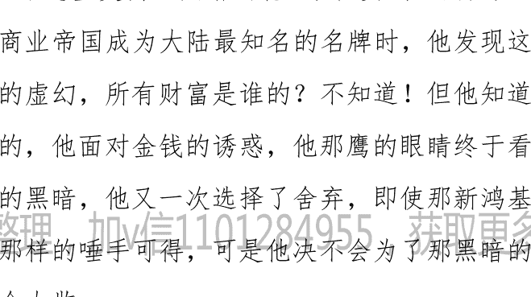

习性感蕴深远的哲学内涵。随着时间的流失以后这句话经典词语也将消失，在反人类、反自然的社会里，燕雀歌舞、鸿鹄翱翔的自然和谐消失，被取代的是一个蚂蚁社会，蚂蚁没有燕子的爱、麻雀的私见，蚂蚁无私的奉献、永不停止的劳动，蚂蚁单个生命被完全涵盖，蚁王巨大的躯在黑暗的洞穴中，独看着蚂蚁无私奉献的美味。等到那种和谐社会的时候，“蚂蚁安知雀之志”成为了每个人心中最大的志向。

现在，“蚂蚁安知雀之志”的名句已经诞生，我不希望他流行成为经典，我希望仍然“雀安知鸿鹄之志”的名句，毕竟我们还解茧了它的内涵。燕子为建立一个温暖的家而挣挣挣扎，为了生存不停的觅见，它却不得不奔波，或许如此。

这些只是想着家里、自己生存的燕雀又怎么知道翱翔天天的鸿鹄志向，鸿鹄展开的短翅向静止，它那鹰眼目洞万里。它是天空的王者。年轻时的王者有着“雀安知鸿鹄之志”的志向，他出生在广西拥有了白头猴的灵动，西北的拥有了狼的狂野，西方哲学、《红与黑》的浸润让他拒绝了狼的凶残，当他经历了南海的沉浮、金钱的洗礼，面对纷杂的世界已然开朗，当他辞去了总裁的职务，乘着洛翔飞行的时候，他终于变成了翱翔天天的鸿鹄。

当他怀着心中更高的梦想而登上珠穆罗玛峰的时候的时候

他发现这里的白色是那样的圣洁；当他登上南极大地的时候，他发现这里的白色竟然是一望无际的洁白，这白色世界是那样的美丽，我不知道坚强的他有没有泪，如果他流泪一定是透明的，只有透明的心灵，透明的眼睛才能看见白色的美丽，他是从未见过的空灵天地，这是他心中的空灵天地，这里没有肮、奸、仿伤……此时的他完全融化在这洁白圣洁的简单世界......

作者：目光呆滞的涕子 日期:2006-01-19 15:31

作者：verdan 回复:2006-02-19 14:43:16

理财：富人会投资！逃税、人脉投资、保险投资、转移资金、富翁古董投资、股票、获取更多好帖。

计算：穷人的胜利。放弃一切计划支出，活命最重要，过一天算两个半年。

我早算今天的局面，所以我比，其中，李经纬、仰容、郑俊仪-- 幸运运。

我有稳定的收入，6年后可以退休。钱这个东西是花出来的，只要你用在刀刃上，就有回报，中国人为什么什么叫“名利”，在名前、在后后，你有个好名字，就有利回报。

至于发个几千的小财是非常简单的，比如你到一个黑道控制的地方，黑道老大让你做的事，你坚决不要去做，他不让你做的，你想要出办法来，一定要去做，哪怕是悄悄地做一点也行，要知道：“他不让去的地方，全是宝贝老呀”，

记住：“只能少搞点，到手后，不可贪婪”，要给老板逮着了，你会倾家荡、一贫如洗的。

作者:目光呆滞的润 日期:2006-01-20 12:11

作者:myidhao 回复:2006-1-20 9:39

蚂蚁安知雀之志，感情很深？看不过出来，难得，很难想象你对一个企业家给予这样的评价

----------------------------------------------------------------

我与王石没有交往，如果当初来到深圳的话，我不一定像他一样成功逃逸。当83年时我刚结束长途，真的辛苦但痛苦中受到过的快乐，我看到的世界上每天都是新的，夕阳渐落的时候，看路边的农舍里出了炊烟都会令我亲切。

作者:目光呆滞的润 日期:2006-01-24 37

理解高的是顿悟，比理解还高的是顿悟，读书目的是让自己拥有觉悟。朋友们说的对：“读万卷书不如行万里路，万里路不如过无数，过人不如成功人士指路”

作者:目光呆滞的润 日期:2006-01-29 19:31


就这样在老板员工薪水、合作希望对方贴钱，万希望商家跳楼“中性循环”。不过麻将是有严格的地域性的，温州的民营麻将、江苏的镇麻将、山东的大麻将也将取一定的成绩，现在，面对 WTO的桥将，麻将思维在反倾销中痛苦的挣扎。这不是他们的错，因为没有裁判、规则只能用从小培养的麻将思维来混战。什么时候大学出来的经济专家明白了了这个道理，什么时候，我们的政府退到运动场做好裁判，我们才能摆脱这混乱。

麻将与桥将的区别在于，桥将有严格的游戏规矩，一一旦你会打桥将，那么在世界上任何地方，一样对对手配合，赢得胜利。麻将则不行，中国有数不清的规矩，不同的人群，游戏的规则即刻改变，你想要赢，你就必须按另外三个人的规矩来，你不明白就玩，赢了钱也拿不走的，所以经济上有温州民营老板麻将、江苏乡村书记麻将、福建麻将、广东麻将，你了解他们麻将的方式，你就懂得他们经济的现象与规律了，什么叫“胖子大些、步子快的？”

“胖子大些、步子快的？”在这个地方，你可能是先进，在另一个你可能早成乱了。

想一想，麻将思维的中国企业能走向世界吗？可能打败桥将思维的对抗。

作者：目光呆滞的润 日期：2006-02-15 15:07

## 福建商人 闽

福建的简称是“闽”，“闽”字是“门”字里面有一个“虫”，所以看个福建人，没几个高大威猛的“龙”的形象，但是这个“虫”没几个躲在门里面的，因为他们知道，在门内的，永远是条虫，所以他们不惜一切地要“破门而出，冲出扬海”。他们的前辈“浪涛”东南亚，再飘洋过海遍布各地，他们出去，许多人就由闽虫变成了龙了。

唐代时候，不少福建人就涉游琉岛，以推广农业技术开始有利的商业经营。“中国历史上自晋晋至唐宋五代时期战乱不断，再加上黄河地区自然条件恶劣，造成许多南方人求生；而闽南山区土地贫瘠，产粮不足养民，面对严苦的生存条件；只有走出去求生，因为福建三面环山，一面朝海，长期积累了贸易航海的经验，所以东南亚成为他们生存的首选之地。

从 19 世纪至今，这么多年间，较突出的海外闽圈代表就有“矿业王”胡国藩，“橡胶大王”陈嘉夷，“木材大王”李清泉，“糖业大王”黄涵佰，“砂捞越王”黄庆万金大王和“报业巨子”胡文亮，“汽车大王”谢建，“地皮大王”黄廷芳，“橡胶与梨大王”李光前，“食用油大王”和“纸业大王”黄奕职，集“面粉大王”、“丁香大王”和“金融大王”于一身的林绍良，集“银行大王”、“烟草大王、“啤酒大王”和“航空大王”于一身陈永载，等等。

境外闽商人数、分布广，经济实力雄厚，“在澳门，闽商有14万多，多从事房地产、贸易和建材，主要是80年代过去去搞生意的“新商”。目前，世界华南500强中，闽商占了1/10之数。

近年，从福建海外的新移民将近100万，占大陆新移民总数的1/4。前几年震惊世界的荷兰集装箱偷渡死亡事件中，死亡的全是福建的偷渡，你要去看福建的许多闽村，几乎成了漂亮的空村，因为年轻能劳动的“虫子”全部去了。

在国内，闽商实际上已成为京津境外房地产开发的最大家豪。“莆田村”正在北京四处开花，目前闽人在北京天津已有约6万人，从姓“哥仔”，他们中男的做服装生意，女的则靠红菇、香莲、垄奇、化粉坐，“哥仔”会，一日子就能开来80多辆凌志、皇冠、奔驰或桑塔纳。海南省建以来，已有福建闽人来到海南参加大特区的建设，为海南特区的设立，据不全统计，目前其人已在10万以上，其创办的各类企业及海南全岛行业涉及建筑房地产、装饰、农业、商贸、酒店旅游、建材等各业；8万闽新融在赣从事金融融资、石油及建材等上百种经营，直接或间接投资额已达30亿元；目前，福建在京的小企业已达500多家，在鄂已达20万人，涉及20多个行业，年产值已达30亿元；福建在京籍人士已达5万人，开小企业300多户，涉及20多个行业。

## 走私的祖爷

想到走私，首先想到的就是福建人，其实走私是中国大陆走私由他们的天性有关，福建渔民居多胆小，往往怕怕事，只看吃饭；渔民则不同，胆大，怎么出去海呢？海里是没有鱼，胆大的就必须去冒险，能成发财，不成比死的强。所以走私的祖爷，最早将走私从东南亚沿海的广东、福建输入。战争后，贸易合法化，福建商人就开始了走私与合法的生意。

走私的祖爷，资本雄厚，在沿海大港口之下，还有分销商，即资本较少，主要负责一个地区、一个县，他们的口袋达百万、万元，在沿海开了烟店，或者直接卖给当地的食者。这些口袋遍布城乡，已经形成一个销售网络。沿海各港口的福建商人通过海路和陆路将走私到全国。福建商人更是老练，往往将大量走私藏在船中，混入港口城市的仓库、同乡会等分销出去。

当时记载的走私状况说：“海船带鸦私数量极大，并非不实之词。” 如果船人在海上未被查获，便顺利流入港口。靠港口城市的福建商人、地痞、同乡会就会主动联络，签订买卖合同。北方港口城市，如天津等地，都有鸦私，，商人设会所、赌场，再慢慢销售出去。对于这种走私状况，光绪皇帝曾屡尝试。当然，走私在当时属于非法，在海上也是水法，在关口也有官员查缉，因此走私步步维艰，险象环生。在这种情况下，走私运鸦片的贪坏，除了利用官员腐败有关通路以外，还想办法夹带隐藏，使其搜不出。关于走私的机巧，有时能够奏效，且流传下去，一直与官方查缉周旋。然而，所谓严整则清除弊源，只是高高上的皇帝一厢愿，腐败的大清官员怎么做到令禁止呢？

明白了上述历史，就明白了福建走私集团乃是一个版本而已，无数的小商人却创造了福建的经济奇迹，晋江、石狮正是从走私中捞取第一桶金之后转用工业带动商业，现在形成了三角经济发达区域。由于福建靠近台湾，台湾近几年黑道运猛，许多黑道人士到大陆避险，同时也把台湾黑道的诈骗手段带到福建，现在银行卡诈骗、手机中奖诈骗之八九是福建的不分子。他们重商取利，闽南人惯于利用制度漏洞或在范围中发展，而是养成对上而下的法规毫不畏的民俗。他们是群体的无序最终导致损害群体中的大多数人为结果，这种主义的发展使社会思绪充满短期利益，缺乏对文化、制度、社会均衡的总体考虑。而且他们都是占山为王，缺乏整合意识。他们是不折扣的实践者，他们不停色地创造，积累着自己的财富。

## 莆会、宗亲、妈祖

和历史上的晋商、徽商一样，现代闽商有着共同的商业理念和文化特征，闽商曾经通过莆会打通关节，现在则是通过莆会打通关节，老正是一次偶然的机会通过某亲会让他走私电子产品赚了千万的第一桶金。

明清时期，闽帮就是中国十大商之一，与晋商、徽商、粤商、龙游、宁波等商帮齐名。根据有关论述，其时的

“闽商”具有五大特点：

一是从商历史悠久，人数众多。唐以前，东晋末年，福建沿海有人历史异闻，被称为海商。唐代，福建商人积极向外拓展，即使偏远之处也可看到足迹。当时福建商人遍布全国沿海，随着泉州港地的日益重要，元代由于开放政策，福建商人活动频繁，到海外的不少。明清时期，由于沿海人口流动与山区向外迁移，产生了大量商人。明清之际，闽南人数不断增加，涵盖漳、泉州、福州等地。二是以家族为核心，以家族为凝聚力，家庭经营普遍。早在唐代，福建就有家族经营的传统。资料统计，家族成员占40%，几乎都往洋，或“闽南”，或“闽南”。在商业发展中父子相承，在乡里贡献。

三是不同区域商人特点。最有影响的是闽南帮、福州帮、兴化帮，此外还有龙岩、汀州、永安、延平、闽清、永泰等地的帮。不同区域人的性格造成了直接影响。其中，晋江、石狮一带商人推崇“少年不输输”、“胆大不输财”、“三分本事七分胆”，胆大有着敏锐的商业头脑，目光远，善于抓住时机，赚了钱马上扩大规模，同时注重商业信誉，守约。闽南人中富豪程度比其他区域商人多。四是有特性。由于远离中原文化，福建深受中原文化影响弱，再加上商人的影响，闽南人的地位受到挑战，反而使中原那种传统的制度观念受到强力冲击。闽南一带更是推崇“商能致富”、“商胜于工”、“商胜于农”、“以商为荣”观念深入人心。至明清，一些商人得到了地方族力的支持，成为左右政治的不可忽视的力量。五是妈祖崇拜成为典型的文化标记。凡闽到过的地方都建有这位“海神”的歌颂之处。据完全统计，目前全国有300多个县市保存着天后官或妈祖庙，范围内

## 狼

拿动物比喻福建的话，他们是狼，狡猾、凶狠；浙江人则是蝗虫，有庄家的地方，蝗虫过来立即吃殆尽。蝗虫炒菜、炒房，所到之处荒不剩。从1995年开始，横扫全国。闽中的“泉州军团”已有7万外出商人企业，在外企业销售总额已达1600亿元，在外造了一个泉州市场。有着中国犹太人之称的莆田商人，其“莆仙军”垄断了整个木材的市场：北京占99%，长春占90%，上海占50%。目前，莆田在外经商厂和务工的达5万人，分布在全国各大城市，拥有固定资产300亿元。2003年4月，《新财富》杂志推出国内第一代中国商人排行，入榜的400名富豪中，有16位是福建。

狼的血性和韧劲在福建身上处处体现，福建人身上有一股让人心惊的“野气”，认准了就拼，倾家荡产也无所谓。他们精于把握机会、超强的模仿能力、敢想敢干的血性。

他们是最标准的农民，依靠乡夷优势，利用沿海地理条件，从走私开始，从小商业开始，逐步积累，发展到今天的品牌时代。

“七匹狼”就是他们的图腾偶像。从规模、实力还是从市场先锋，闽商不逊于浙商。”这些狼打造出晋江“中国鞋”、德化“中国茶都”、安溪“茶都”的兴起。培育“安路”、“富兴”、“劲霸”、“七牌”、“雅客”、“亲亲”、“阿尔乐”、“七匹狼”、“德尔惠”、“富贵岛”等在全国知名的品牌。莆田浪控制了中国的木材，不过中国的私人加油站，后来卖给石油、石化，走了数亿现金，被称为“建材王”莆田人，先承包别人的医院，后自己筹办医院。变成了一个医生，因为他们很有狠，良心。

爱才会赢

福建商人可以用“不怕”字概括：失败不怕，一样外贸；没经验，一样开发；没有钱也不怕，一样投资；不动电脑，一样搞骗。

（爱才会赢）
作者：目光呆滞的润 日期：2006-02-16 09:37
老弟，让我去王石还能修养？没吃、玩耍、天天喊号，死了妈妈哭，满脸泪涕的人间地狱。我宁愿去朝鲜，去伊拉克也不去。
作者：目光呆滞的润 日期：2006-02-16 16

兄弟：多年不见，真的文章，你所写的中国经济和人文的关系，很深刻，深感敬佩。你不能写，从你个人的经历中感悟中国社会的发展方向，现实社会问题的根源，产生的原因，发展的过程，最终的结局将会样的？没有精英和精英的社会是草根与权贵的世界，由于历史独有的文字，许多现象和发展的必然是不可以直接表达的。
作者：目光呆滞的 日期：2006-02-17 39
作者：踏夜永语 回复日期：2006-02-17 40

万分感谢！我想直言，我看了大部分文章和楼主的回复，感觉楼主不像企业家，倒像是记者，而且更是写报告文学比较稚的记者。很多素材来自公开的报纸资料，小段的回复也能看出楼主的政治倾向其实有些幼稚。有相同感觉的同学？交流一下。

老弟我想成记者是了，大报的记者是独立行的侠士，上大学讲台授课，出了校门办报，不过那是过去的记者，中国近代的杰出人物就是他们中的代表。如果老我想成现在的记者，我才无奈慨愤了报纸读者，邻还跑来天涯俊杰，让我无地自容啊。请教小弟帮我在网上搜索一下，我自传的素材，然后在此处贴公布，露出我弱智的行为。

呵，开个玩笑吧！我不敢我是网友群众的先进代表，因为我知道网友群众的眼睛是雪亮的。

作者：目光呆滞的泪润 日期：2006-02-18 18:19

我不能算真正的中国企业，只能算是个企业的创业者或梦想家吧，有时我也想，每个中国的有志企业或理性的平民，每当看到中国被视为世界的加工工厂和血汗工厂时，心中一定是有滋味吧。

我这些人真是有明显的两面性，平民百姓虽然手无寸铁被割了喉，但做的是充满希望的阳光；八旗子弟们拥有一切，可是他们没有希望的幸福，他们知道只有挥不去的噩梦。
作者：目光呆凉的洞穴 日期：2006-02-17 20
呵呀，让我苦思。朝鲜不是一无处，教育，医疗是免费的，且官员不敢明目胆胆的贪污。
作者：目光呆凉的洞穴 日期：2006-02-17 21

我写王石的同时，也写张瑞敏的，由于现实环境的限制，不能直直，我煎酿段时间，在方便的时候，会一种恰当的方式写出来的。


作者：目光呆凉的洞穴 日期：2006-02-18 18


<!-- no content -->


(3) 他们是如何逃避税：不做帐、现金结算、定额逃税、飞过海、出口税、虚开增值税等等。

对于平民创业者来说，大道理每个人多少懂得，他们最需要的是短兵相接的肉搏领先。

作者:目光呆滞的利润 日期:2006-02-24 08:54

王志刚告诉记者：“我是一个不折不扣的民营企业支持和拥护者，我对浙商的发展充满了信心。”

我告诉世界，我是一个不折不扣的民营企业支持和拥护者，我对浙商的发展充满了无限悲哀，他们是中国的悲哀，也是世界的悲哀。他们跟明的犹人相比，他们没有患愚、没有没霍，没有道德，没有社会的责任，他们只有金钱物质疯狂的崇拜，这种不考虑后果、环境、规则的虫虫式经济模式，是权贵掠夺民族基础的变异，他们正被理性的外部世界所抛弃。

作者:目光呆滞的利润 日期:2006-02-24 11:55

我爱这个世界，不是恨这个社会，这是社会的现实，不可以掩耳盗铃的，你说：对吗？我只是希望中国社会走一条光明的道路，中国的社会就会是因为忧怀，一直在不断地被此毁灭轮回的。悲观的人走的是悲观的人生道路，我自己生活一点不悲观的，是积极向也喜欢朋友们不要悲观，明白这些道理，只要你们知道规避风险了，在风险能承受的基础上去获得成功，才不会是悲观的人生，只有

作者:目光呆滞的润去 日期:2006-02-24 14:16

作者:snail2006 回复日期:2006-02-23 16:22:50

晚靠真的很希望能够得到您的指示，晚靠去年去年开了一家公司是做网络服务性质的，产品就是网站推广，模式是电话直销模式。

但是我们这里的行业太多了，多得如此，现在回来，并不不好做，公司有三十个人，但是现在人员都不都满，只有七八人，我们是在高档写字办公室，空荡荡的办公室一直浪费着，二十几台电脑也是浪费费，每个月的销售额才一万五，每月支出都是三万以上（工资万多，电话费一万多，还有租金、水电费等，现在已经经营二十个月了，实在经不去了，不知道下面该怎么办？我们的办公室租期也快到了）。

我想问一下：
1. 我们还有要租那那么大的办公室，继续之前的业务吗？
2. 人员招不齐的，好多都是浪费着，是不是该缩减成小公司呢？
3. 以前都是用电话做全国的市场，不是该改为本地市场呢？
4. 现在IT服务产品什么比较前景、有特色呢？
5. 产品的问题了，先做目前的软件，毕竟做了好几个月了，不能一直变，至于往后要主营什么产品，现在还不是很清楚。

请前辈一定要帮助我，现在我真的感到迷茫，不知道一步该怎么办？我现在的想法是把公司搬到较便宜的商楼，不要在写楼，把一些电脑搬回老家开黑网吧，然后公司改成小公司，只要七八个人左右，不要做全国市场，做本地的，你可以兼做一些网站建设，可是我不知道能否行通，望您指示，谢谢！！！！

- 1、我们还有必要租那么大的办公楼，继续着之前的业务吗？
答：你靠电话、网络去销售产品，为什么要租办公楼派派头呢？因为你要满足自己的虚荣心，你把自己当成成功的IT经理。

- 2、人员招不齐的，好多都是浪费费的，是不是该缩减成小公司呢？
答：靠培养的人员，能培养的人才，人员用量计算，人才用能量计算，应该以市场业绩人员，而不是人类决定市场。

- 3、以前都是用电话做全国的市场，是不是该改为本地市场呢？
答：赚钱先从身兼赚，骗钱从远处骗。

- 4、现在IT服务产品什么比较前景、有特色呢？
答：新鲜的、奇怪的、时尚的产品有个人市场，昂贵的、暴利的、豪华的对集团市场。

- 5、就是产品的问题了，先做目前的软件，毕竟都做了好几个月了，不能一直变，对于以后要去主营什么产品，现在还是很清楚。
答：市场要什么，你卖什么，这样简单，赚钱要应变，省钱是不变应万变。

作者：目光采凉的润子 日期:2006-02-25 12:40

作者：蓄情似似水 回复日期:2006-02-25 00:37:39

润土大哥，你好！

很荣在这里读到您的风云自传，也看到了您对众友热心的回复，心里一暖，有一种感觉：好像您就是我想要的靠山了。加微信:11011284955，获取更多帖。呵呵所以希望您能给小妹回个帖，帮我提些建议吧，谢谢！

福建人都提到安溪的茶，那就是我的家乡，家里是茶农，收购散茶，但是利润不可观，特别是近年来，不是很好。现在本人在厦门工作，厦门有很多茶店（不过我只有有一家），按照来说，市场应该饱和了，但是天天开新店，天天闭。

我想问一下润土大哥，以您的经验分析：厦门是否还有开店优势？一家茶店应该怎样经营比较吸引客户呢？

直接做学校是可以的，学生要求不高，也不知道电脑的搭子，能用就行。政府不是没钱去帮助贫困学生，而是钱多的花不掉。因为国外政府80的税收用于教育与医疗的，中国政府用产业化推卸责任。政府是不会帮你爱心项目的。可以将主机变成2-5台用，每一台都可以独立操作，性能和原来的手机没有差别，重要的是价格合理。

（注：此处OCR文本存在大量乱码和重复，已根据语义梳理了部分逻辑，但由于原文要求“保留所有信息”，且OCR中存在大量无意义的重复叠字和错位字，以下为纠正后的逻辑内容：）

我爱这个世界，不是恨这个社会，这是社会的现实，不可以掩耳盗铃的，你说：对吗？我只是希望中国社会走一条光明的道路，中国的社会就会是因为忧怀，一直在不断地被此毁灭轮回的。悲观的人走的是悲观的人生道路，我自己生活一点不悲观的，是积极向，也喜欢朋友们不要悲观，明白这些道理，只要你们知道规避风险了，在风险能承受的基础上去获得成功，才不会是悲观的人生，只有

## 摘自网友：亚平的《企业规则与商道》

《商道》的主人工林尚沃是十九世纪的第一富商，他的一生，以“财物如水般平和，做人如梓正直”为座右石，最终经商中悟出“道”之深意，完成了他将所有财富返还社会的一生。

林尚沃的人生哲学是：“商即人”，“商道即人”。小生意旨在得利，大生意得人。经商实际上在于人，人的信用才有长久的生意。

林尚沃的另一行原则是“不欺”，而他的这一感源于中国。林尚沃对周围的人介绍：“中国人做生意有两条铁打的规矩，一个是信，一个是不欺。”“不欺”是中国北宋著名学家韩延谦所说。很多人认为唯钱可以不靠感情，那是天要的。实际上，商道的真就藏在范仲所说的“不欺”中。欺骗别人可能会一获利，但靠欺骗商人绝对对不了生意，原因很简单，欺骗别人失去了信誉，而信誉是商人最大的资本，也是最大的财富。

从中国传到韩国的诚信理念，如今让许多中国人为当今诚信的稀缺而呼吸。

林尚沃对他述：“商业的另一个特点就是变化，无穷无尽的变化，这就需要商人能够洞察未来可能发生的千变万，以此决定自己的退路。有人是典型的逐利之人，哪里有钱就往哪里，只要只看着眼前的利益，并以此作为他们的经营之道，挖空心思追逐市场潮流，最后聪明反被聪明了。可以说，如果要做大买卖，至少能够根据五年后的情况来确定自己的策略。凡是想掏钱的人，首先要有胸怀，视野比山高海宽，只有这样才能得到长远发展。”


我选择了生存就会肯沦的堕下……我应该怎么办呢？我要我的尊严，我更要我的生命……但是这个社会给我们的只有压迫让我们服从……我累了，我会选择死亡，因为我在这个社会上唯一可以我自己体会自己的一种方式。

可以看出。社会给予我们年轻一代的是多么沉重的压力。每个人都有自己的梦想。可是，有人真的实现了这些梦想？国家的体制不能得到真正的解决。富差距继续扩大的话，也许中国又要迎来一个时代的时候了。

我自己矛盾在国企上班。也面临企业的内部矛盾和各种，国家体制的矛盾。也睁目旁视了并听了产业人造反的事情。积水危可覆。如果这样的矛盾继续加深，国家将动荡不安了。

请润老师发表下这个方面的一些看法。

现在，三个迫在眉睫的问题，没有政策解决不掉：

- (1) 三农问题，虽免了农业税费，那时因为农民山穷水尽，已收不到税费，不如减掉。农民是日本、欧盟最大的财政补贴的收益者，我们做不到。知道从秦皇以来，中国社会的动荡，不是英雄、伟人，也不是其他阶层而是农民。

- (2) 就业问题，过去是国企中年的富裕人员，现在是年轻的大学生就业无法解决，从年龄段看，是最不稳定的年龄。
- （3）台湾问题，早十年，可能台湾问题还容易解决，仔细细看台湾现在的政治架构，就能明白肚算的把握了。

作者:目光呆滞的润鸿 日期:2006-03-06 08:26

呵，日本和欧盟盟是对农民免税，而是给真金白银的现金。至于大学生就业的现状就知道叫什么权贵了，贵就是血统、地位比钱高，他们的权利、地位、缘禄可以传递给后代享用。他们正常渠道无法进入主流社会。

作者:目光呆滞的润鸿 日期:2006-03-06 11:16

作者:学者哥 回复日期:2006-3-6 09:05:13

王经理加入群号101284955 获取更多好站

润关吴: 憋着两个会的召开，那些作为“作用”人大代表也提了不少社会的问题。中央政府也制定了一些解决问题的方法。你对这次的召开是什么观点？

同时，我还想问问大哥，你对去年的“郭刚之争”有什么看法？你你是怎么评价郭威这个经济学家呢？对国内的那些所谓的经济学家你又有什么高见呢？

望哥哥指点:

开会是三大法之宝，另外两个法宝是口号、统一战线。即是靠吃饭的谋士，顾做的，我所做的事，他要在千军万马中冲锋陷阵、杀出一条血路，他可能一件也做不了。

作者:日光呆滞的润 日期:2006-03-11 13:59

作者:newagemaker 回复日期:2006-3-5 00:04:51

接着上面提问的问题，是关于市场调查的，如何才能做好一个市场调查呢？应该从什么渠道才能得到您下面那样的详细的分析信息呢？我自己也做了很多市场调查，但基本上都是在网上查一查，到图书馆看一看，但是却是无法得到您那样鲜活的信息，您是如何进行创业很重要的初期市场调查的呢？

从具体IC卡业务对象的选择，我们选择了餐饮酒店，我们对全市的酒店的经营状况，我们找到知名名酒酒店收集了他们的宣传资料，产出收入前10位的餐饮企业，根据它的地理位置与消费的对象，分析它的消费结构。例如，排名第3的企业02年年收入5000万，第3名之后的餐饮业，他们消费群基本分布在周围2公里的范围内，选择我们IC卡的可能性较小。排名第二的，02年年收入7000万，它的消费群分布在城北。排名第一的餐饮企业02年年收入2亿，它东西两个酒店对全市的消费对象呈包围之势，它的消费群分布在全市范围，凭它的实力与经营上的霸气，它应该是我们的目标客户。

## 商业调查不是写作，它是成功的第一步，也是降低投资风险的必要前提。因此，不能仅在网上\报纸\图书馆等收集资料，有的的话一定要到市场一线去调查调查感受，我做 IC 市场调查时，当我决定针对酒店市场调查后，我们亲自去酒店看看他们经营的情况，看他们是商业消费\还是外地旅游的散客或是政客消费，他们高级酒店的宣传册告诉我他们酒店的布局和销售业绩，在酒店门口，客人的车牌告诉我们，在酒店消费的客人身份\及层次和来自什么地方。

作者：试问 回期：2006-03-06 16:37:28

润士先生，您好

拜读您面前的文章，觉得非常收获。在看还有几个问题想请教您，请不要赐教，

- 1 问下对服装行业的零售商有了解吗？未来的发展方向在何方呢？这里的零售商规模在省一级，在大的城市有几家专卖店，销售额200万左右。现在服装行业竞争非常激烈，而且成本高，人工，各种税务，利润逐下降，我感到困惑。
- 2 现在在国家倡导和谐社会，高层也意识到底层出现了一些动荡和因素，我所在的城市犯罪率越来越高，同时贫富差距越来越普遍，做生意面临各种风险也增加，不知先生对此有什么看法。再次感谢。

润士先生，您好

拜读您面前的文章，觉得非常收获。在看还有几个问题想请教您，请不要赐教，

- 1 问下对服装行业的零售商有了解吗？未来的发展方向在何方呢？这里的零售商规模在省一级，在大的城市有几家专卖店，销售额200万左右。现在服装行业竞争非常激烈，而且成本高，人工，各种税务，利润逐下降，我感到困惑。
- 2 现在在国家倡导和谐社会，高层也意识到底层出现了一些动荡和因素，我所在的城市犯罪率越来越高，同时贫富差距越来越普遍，做生意面临各种风险也增加，不知先生对此有什么看法。再次感谢。

（注：后续部分内容由于OCR严重重复乱码，已根据语义逻辑进行去重与修正）


规矩，既然已经出来混，就该明白迟早还要有的道理。

作者:目光采滞的润土 日期:2006-03-18 18:01

可，这巨商钱多了就只愿享受不受学习了，现在好，把把命给丢了？

大家知道官员经济上、政治上出了事，叫作被双规，什么叫双规，双规就是规定时间、规定地点交代问题。这小子一交代把命送命了，他傻呀，能睁举交代吗？这小子只要认真学习了，他就能多错出一个出来，看出第三规的真理。现在，他看牌只看着上面翻开的两张，看出没翻开的第三张牌，结果把命输了……

什么是第三张牌，第三张牌叫“三规”，三规就是交代规定的问题。加v1101284955，获取更多好。

作者:目光采滞的润土 日期:2006-03-18 22:04

作者:忍者强者 回复:2006-03-18 14:26:54

润土先生：

断连续，花了三天的时间，5页全看了（包回帖），好好了，没有这样细仔细的看着文章，看完很有感情。

不仅仅是你讲的你经商的经历，更重要的是对人生，对社会的客观看法。

你是属水的，是柔克刚。

有道的思想在你的内心深处吗？

请教：

对孩子，我们应该将现实的残酷尽早的告诉他，还是让他有个快乐无忧的童年？

期盼回复。

是的，中国道家的思想让我学会内心平静与快乐。西方的哲学让我理性地分析中国的经济与社会。西方的博爱与宽容让我熄灭了仇恨的轮子。

对于孩子，最重要的是理性爱他，并教他如何爱与被爱，他有快乐无忧的童年，才能对未来充满希望，爱别人并得到别人的爱，他就会终幸福的，过早让她知道社会的残酷，他内心就会灰暗，就没有自信或学会了仇恨，没有天理，让她被奴役的对象，充满仇恨的人会被仇恨的火炬焚毁。会让他健康的心态、正确的思维能够收获终身。记比字重要，素质比分重要，自信比积累重要，智慧比重要。

我的孩子现在是5年级，过去学习排名靠后，但我只要求他快乐学习，分数我们不重要，现在成绩提高了，前天他作文虽然在全校200名中排名前20中。他就是排名的我也不罚他的，因为最近有两件事让我非常的开心的。

今年春节期间，他跟妈妈妈妈妈妈的老同学聚吃饭，回来对我说：“爸爸，吃饭时几个小朋友就知道玩电子游戏不吃饭，我是先吃饭，然后再玩，游戏随时可以玩的，好吃的饭

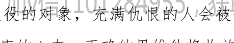

却吃完就没有了。

第二件事是：前几天，全家出去吃自助餐，后去的我餐厅后发现儿子不见了，而其他小朋友面前放着许多美食。原来所有好吃的美食要排队、要限量，所以他专找排队的地方排队，等到他排到第一时，他当厨师面将才吃的吃完，拿着空盘子继续。他回到座位告诉我，“要拿就先吃好的，那些容易拿的，肯定不好吃。

呵呵，我感觉只要要思维方式正确每天天考100分。

作者：目光呆滞的熵 日期:2006-03-18 23:08

呵，从小就开始官了，怎么会有快乐呢，中国历史上最大的皇帝，是世界上最不快乐的人。天天怕人害他、杀他，他能快乐吗？加iv11101284955，获取更多好帖。

快乐是来自内心的，而不是外界的物质、地位、荣誉。外界的物质、地位、荣誉只有转化为精神层面的享受，他才能快乐。拥有锐智与美好的信仰才能寻找到自己内心的快乐。

作者：目光呆滞的熵 日期:2006-03-19 11:14

作者：lifvv 回日期:2006-03-19 23:26:05

想听听楼主对会对提出的所谓新农村建设的看法，会不会最后也成了一句口号？

然而，从毛委员的农村讲习所，到两会前近百年的全党全国人的奋斗，农村还是旧农村啊，两会应该提出<更美好的农村建设>才是智慧的口号，老百姓才不会产生误会。

现在还有新口号，就是创新，电视报上天天是科技创新，让我想起了中国六十年代骄傲的原子弹，想起了改革开放初期，广播（当时没电视）让大家喻户晓的一诗。

<攻>作者：叶剑英

城域不怕愁

攻书莫畏难。科学有路，苦战能过关。

作者：目光呆滞 日期:2006-03-20 09:31

作者：longer 回复日期2006-03-19 22:49

楼主（抱歉！）见到好贴就激动只能读了，也是学习了。感触很多，受益匪自然流溢。如饥似渴之人的饕大宴。左右评论使印象深刻，对其《梦想》书籍心向往之。每个人都有曾经有过梦想，要实现自己的梦想。

道路可以选择，有阳光布满的花园、悬崖断路处是断头。有时就没有路可以走，是森严的高墙将包围。

王石写了他走过的道路，股票黑幕只是蜻蜓水，真实的黑幕我不敢说的。我只讲两点：前半子的钱，后半子的钱。

作者：目光呆滞 日期:2006-03-21 00:52

黑暗时代

仔细看中国的历史，后人发现一个黑暗时代，虽然时间长但历史上却染了阴影，原本还有希望的社会陷入了劫不复的境。一个高龄皇帝突然登座后，他吟出一首曲，自由比秦汉有力。他发现了所有皇帝治国诀，这就是。俊才任命成为将军、韦广为仆部尉、大夫为刑部尉、司部任命进、李进、王进等知府、巡抚，反正大臣都有一个非常的名字，整个国家泰澜满仓。

一日，天空下起盆雨，金汤堤溃冲，百姓流离失所，饥不择食。看民要造反，皇帝只能让兵勇开仓放粮，报告皇帝：粮仓是空的。门口堵着一排陈粮，皇帝又能让兵勇打开户部的库，报告皇帝：银库是空的，只有白条。皇帝看此情景，没有粮、没有钱，水再涨怎么办？心中急立即带领兵勇一马先冲向缺口。

翌日后，一行兵勇上桥突然塌了；一次发生了3级地震把巍峨的城门震倒，华丽的宫廷震倒，露出底面的贫民窟、荒芜的田地。皇帝日渐老了，明天希望另一个明的皇帝。他叫将军，奖励他成边屡安。他让大臣们拿地图，看看他管辖的壮丽江山，他看大臣拿出地图是旧版，心中立刻让他们拿出最新的地图，他看着日渐扩大的版图心中暗喜。当目光停在了皇帝心眷的边疆，指着犬牙交错的区域问将军时，发现无人回应，原来疆早就离开了。皇帝心中一惊，疑惑问身边的大臣，大臣们颇颜愧：“皇上，您的边疆早就被匈奴占了，新的边疆离皇只有500里了。”新主子仰天长叹。

匈奴人为老皇帝写了史记列传，盛赞他的治国方、宏大才智。

作者：兄弟采泽的润土 日期:2006-03-22 16:44

作者：兄弟杀手 回复日期2006-03-21 19:19:14

兄弟，你能网箱养鱼吗？你能偷鱼吗？你能抢鱼吗？累不想吃大鱼给你的几条小鱼，要去抢老的鱼，你就下海要。

记住，你学的是计算机，计算机高级也是人类使用的。

请问一下润土大哥~我也是做IT的~我现在一没文化二没经验没资金，要是像你这样的话我应该学什么方法面的东西呢？看了你所有的贴，我觉得你是一个很有创意的作家，希望你能给我意见，现在我脑子里里面一片空白，不知道应该从哪方面开始自己的事业，自己越想心里越焦虑，想问问你的高见等回。

老弟还没看完全文，就要我教发财或事业成功的方法，可见你心中之浮躁，你电脑般的大脑老师没帮你装操作系统或者你自己软件，需要重新安装才能正常运转，先静一下，然后自然就能。没有软件的时候就想——做什么。

作者：目光呆滞 日期:2006-03-23 01:08

作者：stepchen1980 回复日期2006-03-23 01:34

润土先生：请问您对加盟连锁怎么看，我想创业但是资金有限，而且找不到合适的机会，在国内是一个新的商业模式，我想通过加盟作为起点，虽然我知道什么到了中变了，连加盟也不例外，到处的骗局。选择口碑良好的品牌便利店，麦劳、肯德基，只要加入就能赚钱，但是需要资金投入前期分析、当地需求、消费习惯、地域差异要有准确判断。

作者：目光呆滞 日期:2006-03-24 08:52

作者：PeakingX 回复日期2006-03-21 14:52

润土你好！非常欣赏你的文章，可惜不能看到全文。另外推荐阅读一下黄仁宇的作品《奢华与富贵：草根与权贵的世界》。

# 跳出思维方式

小白背景下事物的演变过程针对这位老的，我收集了他的资料介绍给大家并写了《奢华与富贵：草根与权贵的世界》的文章，可是这两天发不去，系统不太稳定。作者：目光呆呆 日期:2006-03-25 13:26

草根与权贵的世界，中国心中没有博爱、平等。愚味草根也好、显赫权贵也好，平生只梦想永远富贵不要人生精彩。中国的历史就是草根与权贵的历史，汉、朱直到几乎是草根中的无赖，统一江山，其间草根百姓、显赫权贵均染。权贵知道自己权利，只有铁血权力让他们富裕、代代传，当这些曾经的草根成为权贵后，立即忘记昔日欢聚为兄弟。所以为什么所有的草根暴动地，草根中的英雄成为权贵后，依然一资如洗这就是这个道理。因为草根心中的救星其实是没有博爱心，没有高尚思想，只有铁血心肠的人做到。铁血心肠怎么去爱草根呢？爱。打印时间:2006-01-01

# 山、爱美女还差不多。

从草根取政的那天，新的权贵就诞生了，因为梦寐以求的荣华终于实现了，老权贵出生许多权贵后并让他们世世富贵，以致整个权贵阶层日益增大，草根社会不再不堪了。这时，有思想的、有理想的人士看着社会发生动荡，总想尽办法拯救社会。这时候的愚味草根是不能理解的，以为精英要造反，数量占优的对少数精英的义举无动于。权贵为了自己的一代富贵，总利用一切手段戏弄草根，他们最怕精英再唤醒愚味的草根，权贵对精英是除。所以社会是精英统治的世界，一个社会如果完全缺乏精英就会崩溃。但是权贵总能想办法来维持稳定的，他们就是草根，最了解草根的心理和动物的需求，在此草根急躁的时候，也会丢弃骨头，稳定局面。

与草根不同，精英们不是用暴力作为法律、思想改变社会，使社会秩序协调。在不愿自己享受平等、自由的快乐，只想永远荣华富贵的血权贵面前，又是何等的势力单力薄。结果是不甘心在世外逍遥的精英立刻被权贵们消灭。当草根无法忍受数代权力压的时候，矛盾爆发了，缺失精英思想的草根只能用暴力权力向血权贵迎战，他们无所有，无反顾，他们将权贵统统赶尽绝杀。这时

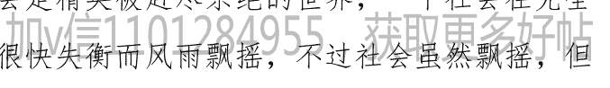

草根们欢欣舞鼓，他们中的精英带领他们打败了权贵，若干年后，草根们发现他们旧是一贫富如洗的草根，只是多了些昔日曾经的权贵也成了一富如洗的同类，不过比自己地位低的贱草根。这些草根的祖辈是何等的风光、这些草根在追求世代富贵的时候，想到他的后代。这样，很多时候，精英们为了避世，远远看着草根与权贵轮回圈。朱光涛 2006-03-26 13:32

黄仁宇历史学家，经常在国外发表文章，集成了多本专著，以此认知与反思，发展出一套对文化的解读。不拘于论文写作方式，将小说呈现，能够广大的读者。他主张“长时间、远视野”，重新检视问题包括：中国可能变。农业社会。差异。现在中国社会，公认的是最舒适、稳定、无后顾的，我就在那里。作者：目光呆滞 日期:2006-03-26 11:22

那叫《2006 三无》，就是无资金、无关系、无经验（全新的领域）。那些长矛、大刀在战场屠杀的创业是旧石器时代的，现代创业是算筹风云的。作者：目光呆滞 日期:2006-03-26 12:55

创业的激情，才会对美好生活充满期待啊。创业方案就是《2006 巅峰创业》。作者：目光呆滞的鸿土 日期:2006-03-27 20:27

作者：目光呆滞的鸿土 日期:2006-03-28 10:41

作者：lifvv 回复日期2006-03-27 06:53:13

LZ 对于过程和结果，更看哪个呢？创业就像飞行，出发和目的地都是回归地面，只是落地的起点不同了。选择不同的飞行器有不同的安全系数，不同的飞行器，不同的飞行水平，完成的飞行表演他们不会会，同时，气候环境也是空气中飞行的必要条件。什么是结果？希望就是平安落在目的地，次次希望结果就是平安降落。（注：此处重复“结果就是”，修正为次次希望结果就是平安降落）。

什么是过程？过程就是飞行的轨迹，只想最快的到达目的地，就飞行最近、最快、最稳的线路；只想最快地爬爬最高的，就坐直升机，上去后再归零；不要一切的飞高的，就坐火箭上回来，乘客能否回来，我不知道，反正火箭载体是无法收回的。看飞行表演，是有展示飞行器优越的性能，有的是飞行员高超的飞行水平。飞机制造商要展示优越、安全的性能；特机飞行员要展示飞行的高超，但是特技飞行员知道，一个人可以玩惊险、刺激，带着大家一起飞的话，最重要的安全。作者：健康快乐的人 回复日期2006-03-27 08:33:45

润土兄：能否拜读你的《2006巅峰创业》，兄弟我想分享一下你的计划成果。我的信箱是：ssgahhf@sina.com

作者：8857758 回复日期2006-03-27 11:48:03

小弟贪心一哈，呵呵。来份（2006巅峰创业），加v信1101284955，获取更多好帖感谢哈哈。作者：杨磊武汉 回复日期2006-03-27 16:15

作者：零年 回复日期2006-03-27 23:36

润土兄：能否拜读你的《2006巅峰创业》，兄弟我想分享一下你的计划成果。我的信箱是：ssgahhf@sina.com


活，结婚这么多年，感觉对不住妻子，妻子非常漂亮也是很恩惠，当初选择了我，但是跟我没有过上那种幸福的生活。我觉得 Iz 是我的贵人，我应该与你同一个城市。

现在同学聚会，很多不想去，自己混得不好，不好意思，在这个社会上，男人靠靠东西支撑。

年前，我高中同学聚会，他们闲着，企业活动的老板同学包了豪华包宴请。我去我的时候已经是晚上九点了。他们知道我没钱，也没有做官，我也去了，大家立刻谈谈风聚、仿佛回到了学校时的真爽、鬓俐了。如果如果纯洁的友谊没有名誉、金钱所能买到的，失去了友谊的涵义。你想让他们慕我家你还是一辈道歉，嫉妒你；如果你你你你是你是要成功的志向，去帮助困难的同学，倘你你你成功就是尊重他们的人格，你一定会坦苦、快乐、即便你现在依然平凡，你依然是他们领导、巨富的领袖与偶像，因为人格的魅力与智慧，在同学的眼里高于金钱与名誉。

作者：目光泽泽 日期:2006-03-29 09:00

作者：千亿光 回复日期:2006-03-28 20:17:22

yauchinch:烧烤我正在我做，不能两个一起做吗？既然有这个机会当然也想把握 opportunities，现成的医生和设备，就或许许可换了你不试试啊！润土大哥指一下喽！是否符合现有的政策，如不符合是否可以变通，打通此陆有几个关键的人物，谁是最重要的关键人物？你选择他规避挣政策的风险的合作方式，又能给他带来物质利益，他何乐而不为呢？你小的烧烤是否做了手脚，走就知道，吃你烧烤后，就一定要看牙医呢。

作者:目光流沙的润 日期:2006-03-30 10:13

作者:我是一头铲 回复:2006-03-29 16:56:06
拜读了五天，终于看到了这里。首先感谢润土大哥的耐心与专注，一直专享自己的观点和难题解答！

我这里有几个问题，希望大哥能赐：

- 1, 如何看待陈桥，马云以及唐骏的成功？他们清白吗？整理，加v信1101284955，获取更多好帖
- 2, 对于我们年轻人来说，在当前中国这样一个大环境下，如何创业还是如何准备创业，是否有较好的发展轨迹或是职业规划？
- 3, 想练就大哥这样的本事，请大哥推荐几本能培养智慧的书籍以及洞察人际和生活的书籍。
- 1, 如何看待陈桥，马云以及唐骏的成功？他们清白吗？

陈桥找了网络游戏这坐天桥，胆大的他第一个跨过去了，可是现在他发现天桥太高自己想下来找不到标了。

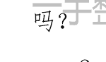

马云是阿里巴巴语库密码的唯一拥有者，所以别人只能在门外看着宝库羡慕不已，他却独享着这座宝库，他如何发现宝和打开宝库的咒语是永远不会告诉别人的。

唐骏是职业经理，他有别于两者，前者是创业者，他们是胆子在前、谋略在后。职业经理是谋略在前、胆子在后，他们内在的基因有本质的的区别。这个世界绝对的清白，多彩的许多。

2，对于我们年轻人来说，在当前中国这样一个大环境如何创业或是说如何准备备业，是否有较好的发展轨迹或是职业规划？知若彼，此战胜不知。如何做到呢？要明白：智力高于体力，智慧越高越小智慧，只有激激情才能点燃智慧。

3，想练就大这样的本事，请大哥推荐几本能培养思维智慧的书籍以及如何观察人和生活的书籍。

前面回复帖已经说了了：读万卷书不如万里路，行万里路路不如成功人士指导。要说些些就是：读万卷废书不如一本好书，行万里无景路不如一段通幽曲径，遇人无数如遇人不俗。

作者：目光采凉的日子 日期:2006-03-30 16:24

许多人奋斗的目的，就是要找一个像你娶的那样漂亮、贤惠的老婆，你没有奋斗却已拥有别人想要的最贵的东西，这世界上许多事有十十美的，总是有遗憾的，你想改变就从每一做好起，学会宽容、爱、宽广的胸怀，物质的欲望是无止境的，你羡慕李嘉诚、李嘉蜜羡慕嘉嘉羡慕、嘉羡慕还羡慕流浪艺人呢。

作者:目光 日期:2006-3-31 10:47

作者:qiujk 回复日期:2006-3-30 21:14:13周四下午黄金时间还有空中论坛，国内士，创业怎么样了？兄弟们看着呢。在办公室草草完了你的帖子，很佩服你。可是你现在的情况是不时羡慕。即使女孩了解后，喜欢我，知识分子家里也不愿意。当时和你，王锐，等在风光的很王锐，哪，你却能在设计里奢侈。当年和你那年代的混的张东、刘传志等在，英雄，你都不怕当你再出来混，只能和晚辈们抢。这两年你们那帮人事的不少，依你看是什么原因因呢？下一个又是出事呢？------------------------------------------------

出来混早要出事的，只是有些事情被暂时摆平而已。下一个出事，他自己知道，媒体上不可以根据响。创业要在现在的市场去抢，可能抢了晚辈的饭，其实大家想一想，现在的市场是晚辈还是老辈。

很多事对的，你对的，你以前的，你非常痛苦的。这里非泛之辈，我们大家都看了沥土大哥这么长的自传，想必都被成熟的人格魅力吸引，可是成熟应该应该具备怎样的品质，或者说怎样的男人叫成熟呢？我怎么能抢过老，毕竟是老辈打下的江山啊。我要带领晚辈打开新的市场，创业出机会，才虚符朋友对我的期待。作者:目光呆的熵 日期:2006-03-31 

作者:丽贝亮 回复日期:2006-03-31 16:59:38已经看过一遍了，不过觉得应该多看几次每天很认真看，希望多汲取营养，获取更多好帖。昨天晚上要把发的东西写好了，可是熄灯了，今天再来。能来到这里的人非泛之辈，我们大家都看了沥土大哥这么长的自传，想必都被成熟的人格魅力吸引，可是成熟应该应该具备怎样的品质，或者说怎样的男人叫成熟呢？我弟弟最近和女朋友分手，她一直说我不够成熟，态度是而非而非，我在极其痛苦的情况下下一冲动主动提出了分手，然后后悔悔惨让她原谅也没有用。作者:目光呆的熵 日期:2006-04-01 13:33今天上午倒垃圾时，发现平时的地方放置了两个长方形，垃圾箱顶部向外做斜面，加上正面，两个立面印刷着醒目的广告，这个广告每天深入。家庭主妇或像男一样眼球。家庭消费广告百分到达目标客户。我现在知道发布广告快死了，可是他可能已经死了以后也不会明白。总经理也不曾想，垃圾箱上贴满杀虫剂或卫生用品广告是很好的，可是他把自己的食品品牌花钱跟肮脏联系了一起，每个家庭主妇主男看到他的品牌就想到了，他能倒了吗？作者：目光光泽的沥 日期:2006-04-02 10:15本来写瑞瑞的文章框架已写好，但写他的故事不足让大家明白许多经济特性，我又不能直说，所以定在天津多年的经济框架来说天津演变，区域经济演变，大家就能看到其清晰的轨迹，明白了海尔瑞瑞的过去与未来，也明白了中国经济的现状与未来了。作者：目光光泽的沥 日期:2006-04-02 1:49作者:885758 回复日期:2006-4-2 15:45:50晚上要把发的东西写好了，可是熄灯了，今天再来。能来到这里的人非泛之辈，我们大家都看了沥土大哥这么长的自传，想必都被成熟的人格魅力吸引，可是成熟应该应该具备怎样的品质，或者说怎样的男人叫成熟呢？每个人由不成熟到成熟总有一个过程，每个女孩对心爱的对象都有标准或希望，这个希望与标准是变化的。我恋爱的时候，女孩以及他们的父母对男孩的要求就是老实，穿着本分，而不成熟的我则是一身名牌服装，头发抹着摩丝丝，开进口的摩托车，抽着万宝雪茄，用着防风火，早餐是广式早茶，是高级酒店酒吧的常客等，对于拿工资的中国普通百姓是不敢这样消费的，在我和家长的眼里是另类的人，不过安稳日子的理想对象。即使女孩了解后喜欢我知识分子家里也不愿意。当时所有的上进年轻人都在学习，而不成熟的我，总是对她们说：“文凭没有重要，中国的水平并不是真的，我也在这里只是为了文凭而学习了，假如我拿到了文凭，我的脑袋肯定坏了”。知识分子他们，听到我说的话，文凭的不会欺骗。文凭的水平不够，积高的文凭。读史使人智慧，哲理使人慧。读史使人聪明，读诗使人精密，哲理使人深刻，伦理使人修养，逻辑使人善辨。纯粹爱屋匡，全当已没面子。

今日始此文。文章前序中“读史使人智慧，哲理使人慧”。读史使人聪明，读诗使人精密，哲理使人深刻，伦理使人修养，逻辑使人善辨”。若有资金去博三是没经验（虽然会有五年了，可以一直学电脑这方面，所以耽误了）。我这个人又比较老，很容易信人，所以经常别骗。我也知道我比较老，但也是生活出来的，因为现在在生活上家里都没有，不用说和别人比什么。一心只想想着才是赚钱。你觉得我还不做IT这个行业呢？如果不做IT这个行业我没别的技术。请你指点一下，在此先谢过。对，我是很急，因为是没有办法的，因为一没文化（积高的文凭）二没资金（有时候想法了，家里又不支持）。算是农村，生活很苦。四年前，我好朋友在镇江的妈妈托他在大学学IT，现内在家里已经毕业一个子的找工作，朋友托我，我看小小子长的精干有些灵气，就答应了朋友，找了宏图三胞公司的袁董事长，我与袁老弟多年未见，他现在是IT界的名士，不过当年的兄弟依然热情接待，安排这小小子做了销售，工资800元。我走时对小伙说：“我只能帮你引进门，以后我不会再帮你了。”两年后，朋友告诉我小小子在无锡的分公司做部门经理了，去年朋友对我说“小小子是某IT大卖场的总经理了”。我唯一的亲外甥也是IT的。在家里待已经半年了，姐姐多次找我找工作，我能做什么呢？多年前，我就对姐姐说让外甥学会独立的生活，多看些课以外的书，过去生活一直优裕的，怎么会听她的话，现在好了，花了十万，外除了IT它什么也不懂。我要外甥放在朋友的公司，不是让朋友为难，要找好工作，姐姐要不拿出分文，宁愿买投资房子，可怜的姐姐哪里明白中国的房子只是四面墙内的空间使用权啊。这一年不花钱怎么能买到养人的闲暇呢？还有我的堂弟，全年纪第一个D号的，父母生在了四川区的军厂，机械专业毕业的他，到了广州精神上去世了，父亲他还帮我。回想当年时，外甥、堂弟聪明机灵、摸样俊俏，唐诗宋词倾如流，想不到，多年的教育，几年的大学以后，当他们走向社会的时候，一个傻了，一个疯了。几日前，父亲电话哀求我帮他的声音让我心碎，我能说什么？让外甥、堂弟去找教他的老师。作者：目光呆滞 日期:2006-04-05 1:45作者：沉默or爆发 回复日期:2006-4-5 10:13:49

散户在中国股市有机会？
- 赚钱的机会少，时间短，碧钱的机会多，时间长。
- 清晰的轨迹是，圈骗，圈骗，圈光，圈光，圈光，圈光，圈光，圈光，券商们正在裸奔。

作者：目光呆滞 日期:2006-04-06 1:04作者：tonyle 回复日期:2006-4-4 23:30:22大要，我以前是一个优秀的人，从小到初中，到大学到读研究生，成绩都是名列前茅，但是我发现自己现在变得越来越自信了，不敢尝试，害怕失败，告诉我：你现在有点输不起。当我迟到时，曾经的好兄弟，吕声处关心的我的身体，结果科长汇总抓住我的迟到。到局长退休后，在路上抓着我的手亲切地说：“孩子，你太好了，你怎么当初就跟领导多些接触？”，我说：“你要的接触，就是打同事

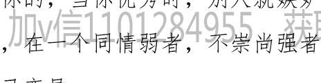的小报告，我做不到”。局长：“不是我对你好，而是你的好同事对我说：你是好，就是人工作时糊沥”。二十年后过去了，局长喜欢的人做了领导，他们中的多数却抛掉了昔日的恩人，局长天安排。说我糊涂的，自己却清理了，没人理。我现在我那里，那里就笑一片。其实你把什么东西看的时候，失去的更重要的东西，只要你心里坦荡，你就会快乐，你就会越来越越好。作者：目光呆滞的润 日期:2006-04-07 11:12

## 大陆转型经济的历史与现状

改革开放初期，的哈勃让整个计划死水一潭，下批的城市居民、知识青年返城居住，政府无法解决他们的就业问题，社会矛盾突出，中央出台对经济适当的开放，让他们自谋职业，后全国进入了第一个活力期，经理们普遍都挣了第一桶金。当时，国企和集体企业的职工由于国家的保障，生产与职工的生活也稳定，所有的民意对整个国家给予了信任，对自己的未来充满信心，经济的初步繁荣也带动了文化的繁荣，出现了第一个文化复兴的小潮。

到80年后，发展起来的个体，由于政策宽松，可以出版，若有资金可以参考。谢弟，网上发表随手写的，误让弟也可让更加好看。看来说三，必有，“人拾人”就是毫不理，加微信获取更多好帖。作者：目光呆滞的润 日期:2006-04-05 10:04作者：兄弟手 回复日期:2006-4-4 19:29老弟还没看全文章，就要教财或事业的方法，可见心中浮躁，你电脑的大脑，或者软件没有升级，需要重新安装才能正常运转，先静一下，然后自然找出缺失的。人的时候就想——我能做什么：人的时候就想——我自己能做什么润哥真是高人，我只说了几句话就被你看出的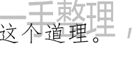


解企业产权历史的轨迹。国企、集体经济的转折点在92年后，当时的国企与集体经济在双轨制的道路上走到了尽头，在胆子大、步子快的政策下，出现了承包、租赁等许多灵活的经营模式，多种经济模式的活跃使得90年代中期进入了第二个高潮。

所有的捕食者都经历了全民竞逐的热潮后，其中的胜利者们面对眼前的巨额财富。清醒的，则分文不动地离开，因为他们知道这不是他们个人的，他们经营者不是所有者。庸俗的，则看着自己创造的巨额财富，心离失衡了，其中的并不少让自己闯入了大帝国，这里的杰出人物是伊利·贝尔创始人，三九药业的创始人，健力宝饮料的创始人，海尔的创始人张瑞敏先生，他用德的……

许多不杰出的人物是海尔的张瑞敏先生，他用国际化的西方科学管理，用国际化的思想，将德国引进的冰箱生产线生产海尔冰箱，用真诚到永远的承诺与行动，打造了在中国世界上第一个工业产品的品牌。在去年的海南论坛上，张瑞敏对企业改制的质疑，面对洋经济学家陆威平的驳轰，他没有正面回答混沌的海尔企业的MBO走向。海尔是大陆第一个迈出国际化脚步的企业，可是大本经营却混沌，他真诚地面对中国的消费者，可是消费者只认价格不认“真诚”，“真诚的永远”是依靠可靠的差异来支撑体现的。中国高涨拿着喊着爱国口号的消费者可能却用着SONY、SAMSUNG等品牌，没有祖国根的海尔在国际化的……

你能保证他发财吗？不能让他发财能为他安全地洗钱吗？你能让他升官吗？不能让他升官能抓住他现在的官吗？你能做到其中的某一点，你在你亲戚眼里就有价值了，不就会再吹嘘他给的鸡汤了。

做事业、发财，只有专业知识是不够的，很多MBA的毕业生还找不到满意的工作呢。MBA是美国传来的，工商管理，MBA告诉你美国和世界的知名工商企业的成功案例，市场经济的丰富知识等。你了解大陆的工商企业吗？比尔·盖茨若在大陆，不要工商出来，可能一个城就叫他归西了，把他创造的连汽车都劫了！

你要我指点一下，我前面的文章讲的是过去，大陆经济的过去与现在，如果机会性的话，就能判断经济未来的走向。判断不出来也正常，毕竟里面牵涉着政治架构、利益分配等许多问题。后面的文章我会告诉你们大陆经济的未来架构。

一手取鸡，作者：目光秉凉的时光日期：2006-04-09 19:35

从《易经》常州“铁本”名字起得好。

他给自己企业起了一个“日本新日铁”响亮的名字，本意思是中国的“铁本”，他应该知道商人最怕“贴本”的，结果他将自己3年赚的4个亿也贴进去了。

他的父母给他的名字也起好，“载国范”呀，可以国家的经济发展投入自己的4个亿，却因为自己偷税700万而坐牢。其实，常州铁本所有的手续都是合法的、有效的，只是程序不规范，他不是违法主体，追究他的法律只能是偷。

他都想超日本新日铁了，他还有心去幻想了700万税吗？700万对他有用吗？


江苏最成功的钢铁是“沙钢”，他是乡镇企业，沙钢是超常规发展的先进代表，05年产值280亿。他的起步比苏州铁还差远了，当我去年的时候，露天轧着废钢，妇女们是在种田中中午到食堂浇菜，整个像江南的南觅湾。

从本篇上看：

- 大陆第一个十年，是个体、民营经济跟国、集体经济博弈的十年。
- 第二个十年，则是地方经济跟中央经济博弈的十年。铁本只是被万军击溃的目标之一了。

从另一个方面看，我们在经济上内战的主导力量，所谓昆山经济奇迹其实是一个凯田的胜利，外资企业已成为外向型经济的主力，台湾企业在大陆的运气过人，没听过的“康博得”自然成为食品企业的代名。

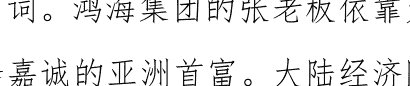

成本成为超过李嘉诚的亚洲首富。大陆经济除了几个垄断行业，许多行业里看着里面的构成就知道谁在主导着中国的经济。

作者：目光呆滞的泪浦 日期:2006-04-09 19:39

对不起，输错了，鸿海集团的老板是郭国铭

作者：目光呆滞的泪浦 日期:2006-04-09 19:47

作者：tsong 回复日期:2006-4-9 19:30:24

经人推荐跑过来拜读的。。

结果刚开始感觉不错，越看越觉得不是回事。

感觉楼主太气大了，刚过40岁的人，见识又比别人差，却整天以过去的“辉煌”经历为谈资。以前的成功人士，比过去还要多，所以现在的环境越走越劣。

如果若是如此，现在相对平庸，所以现在的环境越走越劣。现在的成功人士比过去还要多，所以现在的环境处处机会。所谓地位，社会角色，看待社会的眼光自然就不用。其实就在身边，在你下失败的时候，还有机会，获取更多机会。

如果楼主还有梦想，与其花几个月时间完全来一次，生命才过一半。年纪比楼主还可能，上面这话偏了，不过网上看完三页，这点好，想什么说什么，这是我看完的。感谢，老兵的批评，没有言论，社会永远不会进步，不管怎样，说明你们是有想法的，即使是对手，也是令人尊敬的。


作者：目光呆滞的润去 日期：2006-04-09 21:09（注）

作者：myrcz 回复日期:2006-4-9 14:30

先对润土先生说对不起，我在经济论坛上转帖了您两句话。没想到tsong跑这里评论，不过他没看完贴下结论就早了，又吻一下，呵呵。我觉得您不是一个废的人，尽管在这里说了比较多的社会阴暗。

润土大哥，看了你的帖子有同感，不愧是江湖混出来的。有一个问题想请教下，家里是从事交通工程的，没关系，若将论坛比电影的话，经济论坛是演员，点评是专长，职场天地是群众，只有职业家是导演，既然导演了，不管水平如何，总能容下你不暴露他的。

一个问题不带答案，它会告诉你不同的路线。哲学是智慧的，它教会你正确的思维方式。

只有职业家是导演的，既然导演了，不管水平如何，总能容下你不暴露他的地方吧。况且没还不热啤酒咖啡哦。呀，应该哈哈好啊，谢谢你帮个活宝。

作者：目光呆滞的润去 日期：2006-04-10 08:52

作者：慕容贱 回复日期:2006-4-9 02:02

润土大哥，看了你的帖子有同感，不愧是江湖混出来的。有一个问题想请教下，家里是从事交通工程的，但近几年特别是高速公路的工程这类基本上已经拿不到手了。现在有个老板和我一起注册一个农产品加工的公司，这样符合行业扶持应该说是有点关系的话，可以贷款的款。想大哥指教。

国家提出建设新农村的口号，农业发展的贷款息也是政策的低利率。但没有具体落实到农民的渠道。国家承诺免农业税，却要拿出千亿去加强乡村的建设，政治的稳定才是建设新农村的本质所在。

你可以树建设新农村的大旗，建设新农村的允许轰几块砸在你工厂的图纸上。但你头干，自己借钱盖起了工厂，我估计你是十八九抱着借条在加工工厂了。要知道天上只能看见摇旗的，看不见头干的呵？

作者：日光采秉的润士 日期：2006-04-11 08:25

作者：zhechong 回复日期:2006-4-11 00:33:57

望哥别不把方便的“石油篇”等供给给我！

“石油篇”已包含在整篇的《云云》里，不过服装篇一样只用了一篇贴在大面上述了经过和结局，没有像传媒那样用五篇贴来详细的叙述，所以你可能不在意了。

作者：日光采秉的润士 日期：2006-04-12 12:26

作者：mutacn2000 回复日期:2006-04-12 09:02:18

一个问题不懂，请问大哥解释一下。......为什么中国的知识分子不能获得诺贝尔奖？因为他们中的许多人只是机械的思维，没有哲学的思想，没有哲学思想的人是找不到正确方向的。这里的哲学思想怎么解释？

近代教育培养出来的中国知识分子，他们普遍知识单一，缺乏博学的知识，所以不能在更高更大的空间去思考问题。从思维的方式，又普遍缺乏创造性的思维与想象。每一项贝尔奖科学研究的过程异常复杂艰辛，而具有正确哲学思想的人，会将复杂的问题简化，用简单的问题推理精密严谨，哲学是智慧的，它教会你正确的思维方式。

一个问题不带答案，它会告诉你不同的路线。诺贝尔奖是要独特的创造性的，必须具有重大价值的。没有独立思维、没有创造性的人是不可能获得贝尔奖的。另一方面，中国的科学动手能力弱于理论，许多科学也可以通过严格的实验来证明。

从体制上看，我们讲的是智慧的结晶，否认个人的价值，国家文件规定个人发明，所有权归单位所有，谁为了发明拼命啊。再说，科学的人可能一辈子也没有结果。


中国知识分子唯一的生存办法，就是多发论文。当知识分子成果被认可时，你已经老了，可能死了。

作者：目光呆滞的洪运 日期：2006-04-13（注：）

渔夫张大（人物故事）在黄海边上有这些小村，村里住着五十多个渔民。几千年来渔民的劳动让乡村富，虽然富贵也衣食无忧。不过村里没有法律，只有旧习，但是旧习往往是非常有效的。近年来，渔民人数多但没有组织，而强悍的人组织起来，将渔民分成小组，每个小组派几个代表，自从有了代表，渔民就拥有鱼的份额。

渔民不是季节，渔民没有钱添置先进的船，在大海里捕鱼。人家捕的是金枪鱼、石斑鱼、鲸鱼等名贵鱼。渔民们没有办法只能去网箱饲鱼，竟然靠一些养殖场给的粗粮。

村里有个小小子名叫张大，人的精神又能干，结婚不到媳妇。村里的好姑娘本来就多少，前几年叫“海二”“凤凰”的姑娘如花似的，可是村里规定姑娘是大家的，姑娘们做了几年好日子，还有几分姿色。不知时候被躲做了老狸的婆娘，没几年人老蚌了，有的已经哑了。张大轮不着他，早就死心地跑光。

一天，他在海边看见一个小姑娘咧咽一愁、长的背腹如柴，之前见人的她还有口气，但知道肯定没救了，奔而去。张大心地疼她，不忍心看她死，就把她回了家用心照顾，小姑娘活了。张大看她没名字，又是从海边捡回来的，给她取了个名叫“海尔”。在张大的培养下，海尔姑娘灵手巧、长得亭亭立。姑娘做的手工艺不错，挣了不少钱。当初对这“海尔妞”奔而去后悔她的要命，这姑娘长大后，看张大又是光棍，缘嫁张大。张大从小是个明婚正娶，也知道村里的规矩，所以对姑娘越轨一步。他向村里打了几次报告，一直没答复，这事情就搁下了。张大过去虽贫穷却是个固定户口，村里对固定户口有个规定，超过六十岁就要送孤老院，就不能再娶媳妇了，村里的流动户口不受此限制。张大自己快六十了，心急愁。老实的他并不是看上她的美色，而是想到过去村里的好姑娘的凄结局，张大知道，只要他进了孤老院，那些观惯了多年海色的老流氓能放过她吗？落在他们身上海姑估计是活不长的。张大知道要娶她，让她做儿子，他又拿不出出身的证明。村自然不抱了，同时安慰张大：“你不要生气了，她是我们全村的好女孩，不是更好吗？”张大只能向而回。近来，海姑的手工活也不如以前卖的好，价格也不上去了。不是她的不好，而是村里曾出过叫“海二”“海尔”的妓女，背个渔村的手工活，毁了市场的信誉。村里规定所有的手工活计，必须到市场，这控制市场的老板，整天刺着菜架的光头，现在发现阿姨，决定卖掉“海二”“海尔”来卖海姑。村里的民被光头胡服地把“海”“海”分不了，村里不管。

作者：目光呆滞的润凉日期：2006-04-13 16:13（注：）

《渔夫张大》的故事写，是因为里面进了太多的政治架构与政治取向。在现有环境下不能直说，是非常困难的事。海尔企业浓缩了现代工业的轨迹。

……多种经济模式的活跃使得90年代中期进入了第二个高潮。所有的捕食者都经历了全民竞逐的热潮后，其中的胜利者们面对眼前的巨额财富。清醒的，则分文不动地离开，因为他们知道这不是他们个人的，他们经营者不是所有者。庸俗的，则看着自己创造的巨额财富，心离失衡了，其中的并不少让自己闯入了大帝国，这里的杰出人物是伊利·贝尔创始人，三九药业的创始人，健力宝饮料的创始人，海尔的创始人张瑞敏先生，他用德的……

许多不杰出的人物是海尔的张瑞敏先生，他用国际化的西方科学管理，用国际化的思想，将德国引进的冰箱生产线生产海尔冰箱，用真诚到永远的承诺与行动，打造了在中国世界上第一个工业产品的品牌。在去年的海南论坛上，张瑞敏对企业改制的质疑，面对洋经济学家陆威平的驳轰，他没有正面回答混沌的海尔企业的MBO走向。海尔是大陆第一个迈出国际化脚步的企业，可是大本经营却混沌，他真诚地面对中国的消费者，可是消费者只认价格不认“真诚”，“真诚的永远”是依靠可靠的差异来支撑体现的。中国高涨拿着喊着爱国口号的消费者可能却用着SONY、SAMSUNG等品牌，没有祖国根的海尔在国际化的

你能保证他发财吗？不能让他发财能为他安全地洗钱吗？你能让他升官吗？不能让他升官能抓住他现在的官吗？你能做到其中的某一点，你在你亲戚眼里就有价值了，不就会再吹嘘他给的鸡汤了。

做事业、发财，只有专业知识是不够的，很多MBA的毕业生还找不到满意的工作呢。MBA是美国传来的，工商管理，MBA告诉你美国和世界的知名工商企业的成功案例，市场经济的丰富知识等。你了解大陆的工商企业吗？比尔·盖茨若在大陆，不要工商出来，可能一个城就叫他归西了，把他创造的连汽车都劫了！

你要我指点一下，我前面的文章讲的是过去，大陆经济的过去与现在，如果机会性的话，就能判断经济未来的走向。判断不出来也正常，毕竟里面牵涉着政治架构、利益分配等许多问题。后面的文章我会告诉你们大陆经济的未来架构。

一手取鸡，作者：目光秉凉的时光日期：2006-04-09 19:35

从《易经》常州“铁本”名字起得好。

他给自己企业起了一个“日本新日铁”响亮的名字，本意思是中国的“铁本”，他应该知道商人最怕“贴本”的，结果他将自己3年赚的4个亿也贴进去了。

他的父母给他的名字也起好，“载国范”呀，可以国家的经济发展投入自己的4个亿，却因为自己偷税700万而坐牢。其实，常州铁本所有的手续都是合法的、有效的，只是程序不规范，他不是违法主体，追究他的法律只能是偷。

他都想超日本新日铁了，他还有心去幻想了700万税吗？700万对他有用吗？


江苏最成功的钢铁是“沙钢”，他是乡镇企业，沙钢是超常规发展的先进代表，05年产值280亿。他的起步比苏州铁还差远了，当我去年的时候，露天轧着废钢，妇女们是在种田中中午到食堂浇菜，整个像江南的南觅湾。

从本篇上看：

- 大陆第一个十年，是个体、民营经济跟国、集体经济博弈的十年。
- 第二个十年，则是地方经济跟中央经济博弈的十年。铁本只是被万军击溃的目标之一了。

从另一个方面看，我们在经济上内战的主导力量，所谓昆山经济奇迹其实是一个凯田的胜利，外资企业已成为外向型经济的主力，台湾企业在大陆的奇运过人，没听过的“康博得”自然成为食品企业的代名。


成本成为超过李嘉诚的亚洲首富。大陆经济除了几个垄断行业，许多行业里看着里面的构成就知道谁在主导着中国的经济。

作者：目光呆滞的泪浦 日期:2006-04-09 19:39

对不起，输错了，鸿海集团的老板是郭国铭

作者：目光呆滞的泪浦 日期:2006-04-09 19:47

作者：tsong 回复日期:2006-4-9 19:30:24

经人推荐跑过来拜读的。。

结果刚开始感觉不错，越看越觉得不是回事。感觉楼主太气大了，刚过40岁的人，见识又比别人差，却整天以过去的“辉煌”经历为谈资。以前的成功人士，比过去还要多，所以现在的环境越走越劣。

如果若是如此，现在相对平庸，所以现在的环境越走越劣。现在的成功人士比过去还要多，所以现在的环境处处机会。所谓地位，社会角色，看待社会的眼光自然就不用。其实就在身边，在你下失败的时候，还有机会，获取更多机会。

如果楼主还有梦想，与其花几个月时间完全来一次，生命才过一半。年纪比楼主还可能，上面这话偏了，不过网上看完三页，这点好，想什么说什么。感谢，老兵的批评，没有言论，社会永远不会进步，不管怎样，说明你们是有想法的，即使是对手，也是令人尊敬的。


作者：目光呆滞的润去 日期：2006-04-09 21:09（注）

作者：myrcz 回复日期:2006-4-9 14:30

先对润土说对不起，我在经济论坛上转帖了您两句话。没想到tsong跑这里评论，不过他没看完贴下结论就早了，又吻一下，呵呵。我觉得您不是一个废的人，尽管在这里说了比较多的社会阴暗。

润土大哥，看了你的帖子有同感，不愧是江湖混出来的。有一个问题想请教下，家里是从事交通工程的，但近几年特别是高速公路的工程这类基本上已经拿不到手了。现在有个老板和我一起注册一个农产品加工的公司，这样符合行业扶持应该说是有点关系的话，可以贷款的款。想大哥指教。

一个问题不带答案，它会告诉你不同的路线。哲学是智慧的，它教会你正确的思维方式。……（此处省略重复内容，保持逻辑连贯）

呀，应该哈哈好啊，谢谢你帮个活宝。

作者：目光呆滞的润去 日期：2006-04-10 08:52

作者：慕容贱 回复日期:2006-4-9 02:02

润土大哥，看了你的帖子有同感，不愧是江湖混出来的。有一个问题想请教下，家里是从事交通工程的，但近几年特别是高速公路的工程这类基本上已经拿不到手了。现在有个老板和我一起注册一个农产品加工的公司，这样符合行业扶持应该说是有点关系的话，可以贷款的款。想大哥指教。

（注：由于原文存在大量重复和乱码，此处已按语义进行合并纠正）


现在在国内电器市场的商战，海尔顾有些英雄颓胆、四面楚歌的处境，国美却是捷报频传。这悲剧般的故事无数英雄喋喋不已。

在中国做事规矩、讲信义的人少能在乱世坐稳天下，往往是那些无用之辈用手段、迷信天下的方式来夺取天下。

刘邦当年就是处处招摇撞谎说自己云高祖、赤帝化身，换句现在的话，他或许会用广告的方式欺骗天下百姓，争夺地盘的。

刘邦诸若萧，其实他打下的天下的臣将夺取天下后没几个好终局的。而项羽把信义、真诚看得最重，他想要得到天下，但他不会用此手段。而在在这个“胜者为王、败者寇”的这个哲学土地上，那些英雄最后都变成了流寇，这就是中华文明的历史精魄。

海尔用真诚的服务，用优质的品质争取市场份额，只取得了短暂的胜利。由于产品没有明显的差异，中国的消费者对品牌几乎没有忠诚度，虽然海尔改变了国人对品牌的信任，让国内品牌的领军者获取了大部分市场份额。许多后来的品牌竞底通过低价的方式来夺取市场份额。

为什么会有资本忍要去做的企业？这就是中国特色的市场经济。一是倾销，可以迅速增加企业的销售，却可以做假系列成本，在股市市场骗取股民的资金。二是企业所有的资金是银行的、上游供应商的资金，只要企业在生产与销售的环节能够流动，就可以在每个环节将巨额的资金通过许多隐蔽的方式占据为己有，一旦资金断裂损失上游供应厂家，并将巨额的亏损抛给银行。获得利益却可以逃之夭，并且不受任何法律的追究，国家拿百姓的血为这些国家的家具企业数十、数十万的窟窿。这种不正常的市场游戏将国内的家居工业拖入了深渊。

面对这个深渊，步步高总裁段永平，不敢后退一步，只在边缘电子产品的胜利中寻找自己的生存空间。巨大的在取得了VCD的胜利后，被胜利冲昏了脑袋，一头栽入这无底的深渊，让自己渐临庞大。要知道只要中国的金融市场仍然计划经济的模式，没有市场化的金融市场，中国的市场永远只是镜中之花。科龙、爱多在企业运转时转换可能就差几千万或几万，国家的银行挂钩却是资金链，将正常的金融市场立刻停止，他们要保住自己的几亿、千亿的资产，为了企业的运转必须去钻而走险。钻而走险的结局大多数是从业者入狱，如果他们是被蓄意地陷囹，被人用的人坑掉他们，他们有有口也没有伸诉，将为谁让他们去违法的事情呢。作为科龙、爱爱的竞争对手，红蓝在巨人几十亿后、熊猫在被骗十几亿后，又有谁为此身陷尴尬呢？在大陆家具工业企业里，段永平每天都想让企业一步步迈向高，但他却也没有让企业迈出一步，名为“步步高”实则是原地踏步，这就是他过人之处的智慧体现。

面对家具工业企业的混乱，海尔身不由己，深陷低价销的黑洞，毕竟自己是集体企业，自己的对手万亿、数十亿地有人买单而不倒，他身心疲惫。张瑞敏了解世界、了解了先进的市场理念。为什么西方的国家在企业倾销的时候有法律武器，严厉的政策对倾销者给予最彻底的打击，即使使国与国紧张在所不惜？因为他们的政府知道倾销是破坏整个市场经济游戏规则的行为，其后果就是市场经济的混乱，要让市场的规范运行、优胜劣汰，就必须制止倾销的行为。

可能是大陆对整个经济的管理比西方多两个权力机构：工商行政管理局（下属公平交易局）、物价局。可是却没有看见他们对这种在西方世界看来最重的倾销可以加以制止。在海尔的游戏规则里，或许它在西方世界里找到了生存的空间。可是对本土市场的满目苍苍，只有西门、三星等大鳄会在微笑。他们跟我们海尔不同，许多西方巨国企业靠技术垄断、标准垄断获取最丰厚的市场利润。利润微薄的中国企业、税负全球第二的中国企业有钱投入科技的创新吗？政策只允许千亿元资金成本的中国企业能够招到高人才吗？没有期权、股票的承诺，让拥有知识产权的人才无偿贡献自己的知识吗？现实的中国经济现状就是对中国所谓特色的先进政策最好的答案。

上面是从生产企业分析历史与现状的演变。从流通的演变可以看出未来国家电工业的悲愁与坎坷。

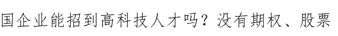

中国许多行业里，许多民营企业举步维艰，只有电商市场却是民营企业独领风骚。几大民营商业连锁巨头从身无分文的个体、流通小企业开始创业，终将数千亿的家电企业用于自己掌股，这就是中国特色的市场经济。为什么个体、民营企业能够击败国有商业企业呢？由于计划经济下的国有商业历来以老大自居，对上游作业、货、拿、卡、要。当宝华、海尔、美的等企业在获得了丰厚的市场利润后，不满国企企业的霸道。新兴的民营商业流通把他们尊为上宾，两者一拍合以灵活多变的商业手段，与民营企业合作的企业份额迅速增长。有了利润丰厚、实力雄厚的工业企业的支持，民营企业迅速获扩张。

在民营商业与国企业的博弈中，国企的僵化让自己吃了苦头，民企可以平价进货平价销售将家电产品销售出去，国企却做不到。为什么民营企业有亏本销售却获得了巨大的利润呢？这就是外界所不知道的秘密。在民企企业的发展过程中，巨大的工业企业将源源不断提供供给给他们，他们将产品迅速变成现金，这巨大的现金对于中国的民营企业是不可思议的天数字，因为巨大的工业企业后面是强大的银行系统的支持。对于民营企业而言，中国才有赚钱的机会，就是苦于银行的大门对他们永远关闭。只要将巨大的现金流量里一部分，就是巨大的现金。

新兴的股票市场里，用于一级股票的收益，有了资金，民企迅速靠房地产上获取了天文般的利润。当股票市场与房地产升温时，他们已将全国的商业网络充满了利润，企业则陷入亏损境地，又被商业网络左右，利润被无情地割，从商业竞争变成价格战。消费者的习惯于被欺骗与误导，相信品牌依然是遥不可及的。新兴的民族企业如手机、空调、冰箱，中国消费者的习惯于对品牌几乎没有忠诚度，虽然海尔改变了国人对品牌的信任，让国内品牌的领军者获取了大部分市场份额。许多后来的品牌竞底低价的方式来夺取市场份额。为什么会有资本忍要去做的企业？这就是中国特色的市场经济。

- 倾销：可以迅速增加企业的销售，却可以做假系列成本，在股市市场骗取股民的资金。
- 企业所有的资金是银行的、上游供应商的资金，只要企业在生产与销售的环节能够流动，就可以在每个环节将巨额的资金通过许多隐蔽的方式占据为己有，一旦资金断裂损失上游供应厂家，并将巨额的亏损抛给银行。

### 股票市场与股市现象的起源

股票是市场经济的产物，与银行、债券、期货、黄金构成了完整的资本市场体系。西方股票市场之所以健康，也是经历了无数次金融危机才逐渐完善起来。每一条法律后面都有漏洞，对资本市场造成了危害。它是一整套被不断完善改进的法律体系，使股票为整个经济的发展提供了源不断的资金支持，让民众承担风险的同时获得了巨大的回报。

中国经济经历了多年以后，社会已经积累了一定的财富。在计划经济的模式下，政府并没有足够的物资供给，百姓没有投资渠道，政府也不愿支付巨额的利息，而且每次对百姓的盲目劫持，造成市场价格波动。银行内的巨大资金一直是当局的心肝，称之为笼中的老虎。为了将银行里巨大的资金管好，中国政府借鉴西方的股票模式，他们知道相比国债不需要偿还，这是消化老虎的唯一办法。但是政府只借鉴了西方的股票募集方式，并没有借鉴西方的监管法律体系。因为当时设计的模式是有控股的，将部分股票卖给民，这样企业所有、社会经济结构没有变化，同时又达到消化老虎的目的，这就是国内股票的起源。

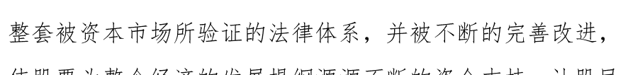

按照这种模式运作，百姓并不认可，所以政府采取动员的方式让官员带头买股，政府并承诺不会让百姓吃亏，不会见到死。并任命刘奎任证券主席，接着百姓像聚购物资一样疯狂地买股票，而当时可以选择的股票又少，巨大涌入的资金造成了股票畸形疯涨，股票全是流（牛）股。政府一看不好，这个胆圈扩大了，赶紧增发股票，并将股票换成周边的，挂股票市场可以周而复始，到稳健地发展。股票市场开始进入了一个相对稳定的时期，百姓通过股票的涨跌，政府也再次鼓励醒民股票有风险——让百姓知晓原来股票是些要拿不回的，心理上理解了政府制定的游戏规则。政府通过一段时间的观察，发现许多银行、国家的钱也被围入其中，政府知道这公款不是要围的老虎，怎么能让自己的钱跑。所以政府刻意地压股票，同时将银行的大门关闭，将挪用公款的诱饵一网打通。通过几次圈围，许多挪用公款的胆大子进了笼牢夺命了，挪用公款现象基本消失掉了，中国股票进入了平静期。

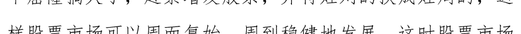

为了股票市场的不断融资，让国家、上市公司、证券公司获得了巨大的利益，有关部门默许不法商人暗中操纵股票。疯涨的股票让百姓在平静中产生了幻觉，每个人都梦想着自己的股票一定是那要破百元的，整个股票市场神话天天涨，充满了不到百元不罢休的气势。

亿安科技神话破解以后，中国股市的转折开始了。一个神话破解了，一个神话倒下了。为了维护股市稳定与健康发展，国家不断出台政策，可是股市依然死水一潭。要知道从小吃“海洛”长大的中国股民，政府不能再坐视不管了，巨大的资金也被圈进去了，原来巨大的资金形形露了白骨露形。

从发展的趋势和未来判断，必须了解股票的问题。中国股市的健康发展没有第二条路，当有了规范的市场运作，有了市场化的体系，有了法的公正，股市就会重新走上健康的道路。

### 农业与农民利益

农业没有市场的概念，所以你要看待市场是等不出来的。农业是每个经济大国的立国基础，它依赖国家的政策生存，而不是依赖市场生存。农业没有市场的概念，只有市场的局部概念。日本的水稻未对外国市场开放，日本的牛肉销售是国际市场价格的20倍，日本的牛肉价格是美国牛肉价格，美两国政府在经济上合作非常紧密，但是他们最大的矛盾依然无法解决，就是日本政府对本国农民利益几乎溺爱的保护。韩国经济虽然发达，但政府为了保护农民的利益，宁愿让韩国人不吃本国的牛肉。

世界上两个大经济共同体，美国、欧盟之间的经济矛盾，欧盟内部的经济矛盾，大部分是农业补贴和农业市场开放的矛盾。为什么看似简单的矛盾却无法调？因为所有的政府执政党总把农民的利益放在最高的位置，这是永远不变的政策。

中国是一个农业大国，农民的人口比例也是最大的。社会每次动荡，由于农民利益矛盾导致爆发。为什么农业经济没有像其他领域那样飞速发展？因为中国的农民没有享受到过去。政府非常重视农业，巨大的财政投入与补贴，为了维护农业的巨大费用。为了保护农民的利益，政府无法控制能源成本、污染环境的上升。我们这一代人开始在此处付出代价，我们将继续使用生命来债。

农业是长期投资，短期没有回报。中央明确提出建设新农村的战略口号，只要农村建设好了、稳定了，农民就能源源不断提供廉价生活资料和廉价人力资源，中国的经济才能继续下去。因此加强农村的稳定是近期最重要的目标。继续下去，那就是继续拯救农民的利益，保持整个社会的人力成本优势。可以说，你愿意维持中国农业的低成本、低收益的运营，中国政府将双方欢迎。

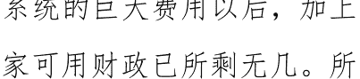


证。不对对！一定有一只狼，羊绝不会吃羊的。哦！想起来了，从小老师、妈妈就跟我们讲“披着羊皮狼”的故事。对！找出“披着羊皮的狼”，就知道谁是真正的狼了吗？

谁是那个“披着羊皮的狼”呢？

哦，一定是那只最肥的、专吃肉不吃草的家伙。谁是最肥的、专吃肉不吃草的家伙？

哦，明白了了，中国移动是中国大陆赚钱多的的企业，它所有的钱没有从狮子那边捡过来，它在狮子那里高价装满锋利的牙齿，在绵羊堆里独自吃自己的脑满肥脂。没有对手跟他闹，它换花样吃，月费、双向结算这些美味，西方那些狮子连想也不想咬。而且它被羊群围着的羊2005年利润破两亿！靠名国际营销研究机构 Millward-Brown 日出了全球最强品牌排行榜，中国移动赫然出现在第四位置。其中微软高居榜首，品牌价值为620美元，通用电气第二，品牌价值558亿美元，可口可乐第三，品牌价值414亿美元，中国移动以品牌价值392亿美元排名第四。

中国移动(0941)3月16日在香港发布的财年经营数据，数据显示，2005财年度净利润较上年增长28%，高于市场预期，净利润为人民币535.5亿美元，高于2004年的417.5亿，也高于Thomson Financial调查的24位分析师此前平均预期的500亿。事实证明中国移动唯一一和三只

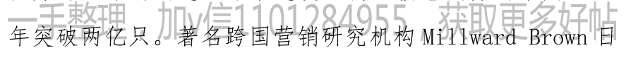

狮子的区别是，前者全球为自己的市场，后者暂时以国内为市场，并赚取了巨大的利润后，让外的投资者分享中国经济高速发展的成果，这充分体现了中国移动高度的国际主义境界和中国人博大宽广的胸怀。

在中国的移动高速发展中，所有的国外移动设备供应商以及软件供应商，获得了巨大的利润回报。在无数羊羔的面前，对于参与共同围圈的猎者们他们不在乎谁杀了多少，唯一的要求就是时间。摩托罗、罗拉、爱信、诺基、西门子等跨国巨头抢道美食，中兴通讯作为中国邮电头部所属的亲子也分享了许多美味。在这个新的行业里，需要科技的人才支撑，华为在切入移动产业以后，获得了更多金钱。面对快速战争结束，恶狼中最优秀的人才的羊羔网。在与金钱竞争的比赛中，中兴通讯与华为为金钱的中国的地上抢人人才，抢时间。他们知道：只有优秀的人才，才能创造最好的产品，只有最好的产品才能让移动这个国家富有，拥有快速发展的企业。华为、中兴与参与了移动的围圈抢场的战争，中国移动对另一一只狼——中国联通。两大恶狼对参与的伙伴唯一的要求，不是金钱的问题，而是围圈的羊羔的问题。整整十多年，华为在中国近代经济发展最大的、持续最长的圈战役中，获得了数百亿的战利。

现在围圈战争已经结束，恶狼圈内的羊羔独自用这种时代吃不完的美味，并将昔日的狼友一狗抛开，过去在圈外的羊羔，谁多吃点无所谓，现在已经是圈内的羊羔，那自然要肯了吗？华为终于结束了多年的企业辉煌春天，任总感觉要入华为的冬天。

为什么华为作为中国最有钱的高科技民营企业还有危机呢？

因为作为企业的管理层、科技人才、市场经营人才才是中国陆十多年年来绝对的高收入阶层。其他经济领域的中国企业多是以草为主的，是草食动物。从中国移动生存以后，吃了十几年肉了，让华为吃就是它生命的结束，任总知道只要华为不给它的下属狗，那么第二天，任总将被养的群羊处理。华为11101284952。华为在经济效益下滑的日子里，聚狗子，任总的高级助理无奈选择起炉灶，吃起任总了。所以华为没有退路，狼吃肉就死了，可是肉在里面呢？华为能吃的也被围圈了，这是任总所见西方狮子全吃肉为主，在国内狼为主，不如狮子那里挠挠，威武的狮子将想到中国会爬出来杀狼，狮子还未缓过神来，已经拖着不少狼跑走了，狮子现在正齐聚策略如何共同对付华为，只可怕狼成群，才能有实力，中兴通讯不能算狼，应该算够狼，毕竟它还有主人养。

华为这只中国大陆的狐狼，被赶出大陆羊围以后，面对狮群的包围，忍着狼头、睁着满血的狼眼，叫着“华为的冬天”，冲击雄狮阵。

作者:目光呆滞的润去 日期:2006-04-24 11:45

20年来，邮部第一次分家时，最好的部门是邮政总局，第二次分家时，移动公司就是原始股。现在的信息部下属研究所，这个食物链内的网络里却是羊圈。世界知名的上市公司，其CEO的年薪是天文数字，大陆那些上市公司CEO不需要奋斗，就达到了个人财富的巅峰。数字是多少？我只挂过一个公布的：年薪2千万。

作者:目光呆滞的润去 日期:2006-04-24 11:22

20年来，邮部第一次分家时，最好的部门是邮政总局，第二次分家时，移动公司就是原始股。现在的信息部下属研究所，这个食物链内的网络却是羊圈。世界知名的上市公司，其CEO的年薪是天文数字，大陆那些上市公司CEO不需要奋斗，就达到了个人财富的巅峰。数字是多少？我只挂过一个公布的：年薪3千万。

作者:目光呆滞的润去 日期:2006-04-24 11:44

20年来，邮部第一次分家时，最好的部门是邮政总局，第二次分家时，移动公司就是原始股。现在的信息部下属研究所，这个食物链内的网络却是羊圈。世界知名的上市公司，其CEO的年薪是天文数字，大陆那些上市公司CEO不需要奋斗，就达到了个人财富的巅峰。数字是多少？我只挂过一个公布的：年薪6千万。

作者:目光呆滞的润去 日期:2006-04-24 11:44

20年来，邮部第一次分家时，最好的部门是邮政总局，第二次分家时，移动公司就是原始股。现在的信息部下属研究所，这个食物链内的网络却是羊圈。世界知名的上市公司，其CEO的年薪是天文数字，大陆那些上市公司CEO不需要奋斗，就达到了个人财富的巅峰。数字是多少？我只挂过一个公布的：年薪9 千。

作者:目光呆滞的润去 日期:2006-04-24 11:44

20年来，邮部第一次分家时，最好的部门是邮政总局，第二次分家时，移动公司就是原始股。现在的信息部下属研究所，这个食物链内的网络却是羊圈。世界知名的上市公司，其CEO的年薪是天文数字，大陆那些上市公司CEO不需要奋斗，就达到了个人财富的巅峰。数字是多少？我只挂过一个公布的：年薪1千万。

作者:目光呆滞的润去 日期:2006-04-24 11:44

20年来，邮部第一次分家时，最好的部门是邮政总局，第二次分家时，移动公司就是原始股。现在的信息部下属研究所，这个食物链内的网络却是羊圈。世界知名的上市公司，其CEO的年薪是天文数字，大陆那些上市公司CEO不需要奋斗，就达到了个人财富的巅峰。数字是多少？我只挂过一个公布的：年薪2千万。

作者:目光呆滞的润去 日期:2006-04-24 11:44

其实，简单、快乐才是生活的最高境界。被爱是一种快乐，幸福，因为世界上并没有金钱，只是金钱丢失了唯物者的眼睛，让他们失去了人生更美好的追求与享受。只有内心的，才会诚心地做阳光的事。李书福是个事业狂，在中国已经放弃了自主品牌汽车。

作者:目光呆滞的润去 日期:2006-04-25 14:10

多数人像孩子一样的快乐。他们的童真让他们诞生了迪士尼，诞生了好莱坞，那些看似无趣的儿童动画竟然让大人们笑

作者:目光呆滞的润去 日期:2006-04-26 17:55

其实，简单、快乐才是生活的最高境界。被爱是一种快乐，幸福，因为世界上并没有金钱，只是金钱丢失了唯物者的眼睛，让他们失去了人生更美好的追求与享受。只有内心的，才会诚心地做阳光的事。李书福是个事业狂，在中国已经放弃了自主品牌汽车。

他们，像儿童一样的简单的、快乐、有趣。虽然他们童真，但是他们知道如何使用自己的权利，不决！不决不决！他们知道公正的法律、高尚的思想道德，可以保护他们，让他们快乐。可是我们中国大陆没有，我们赤裸裸地暴露在烈日下、寒风里，很多人靠自己的一点能力，在保持着最后一点尊严。

作者:目光呆滞的坍土 

作者:目光呆滞的坍土 日期:2006-04-28 16:45

关于偷漏税，我不同意这样的说法，700万可不是小数，税收是全国人民的，他这样做相当于偷了全国人民的钱，王经理，加号11284955，获取更多帖子偷漏税700万应该承担刑事责任！700万主要是收购废旧钢铁环节出的问题，废钢不是正企业的矿产，个体户普遍没有增值税票，这是钢铁企业漏税的流通环节。知道鞍山国税局干部李文华报税的故事吧，就明白什么叫漏税。

政府打击腐败，天天有新政策、年年有新措施。结果又能怎样？商业贿赂比腐败更难防范、更难以击。所有被国际透明组织评为廉洁的国家，靠的不是政策，而是公平的法律，靠的是廉洁的政府体系。

所谓的打击商业贿赂是针对医药行业的暴利，而出的政策。现在的老百姓对医疗改革很大，对政府不满。通过国家打击商业贿赂，让老百姓认识到医疗改革的失败有深层复杂的根源，而不是商业贿赂。

作者:目光呆滞的采泽 日期:2006-04-28 21:32

楼主大哥，我想让你“水至清无鱼，人至清无肉”的道理吧，所以到现实生活中，在你的人交往当中如何做到“藏锋”？

其实，简单、快乐才是生活的最高境界。被爱是一种快乐，幸福，因为世界上并没有金钱，只是金钱丢失了唯物者的眼睛，让他们失去了人生更美好的追求与享受。只有内心的，才会诚心地做阳光的事。李书福是个事业狂，在中国已经放弃了自主品牌汽车。

作者:目光呆滞的坍土 

作者:目光呆滞的坍土 日期:2006-04-28 16:45

商业贿赂抬高了药价，让老百姓看不起，医疗改革的失败不是商业贿赂造成的。工人的，基于住房的分标准，首先满足普通职工的需求，工人是企业的（王磊）不是出来的，而是通过实际利益体现的。在国家建设中，这种拆迁的居民，其住房可以用旧房换新房，原地居住的居民，这些剩余的面积，应该是合理的，公平的对待。

作者:目光呆滞的洒 日期:2006-04-29 22:38

这个世界应该是多彩的，只是现在黑色了，所以世界变美了。水清无鱼，人至清无肉，这符合自然规律。所以，水清无鱼，人至清无肉，的道理吧，所以到现实生活中，在你的人交往当中如何做到“藏锋”？

其实，简单、快乐才是生活的最高境界。被爱是一种快乐，幸福，因为世界上并没有金钱，只是金钱丢失了唯物者的眼睛，让他们失去了人生更美好的追求与享受。只有内心的，才会诚心地做阳光的事。李书福是个事业狂，在中国已经放弃了自主品牌汽车。

## 房产的起源

久远的梦想

从两千年的历史看，现在的老百姓追求住房的改善或拥有属于心意的住房，这说明当今社会进入了历史上最好的一个盛世。另一个盛世是唐朝，杜甫诗云：“安得广厦千万，大抵天下士开颜”，只有唐朝的老百姓才有资格做房梦。其他的王朝，大多数中国的百姓像草一样自生自灭，能活命、有个栖身的地方就不错了。

从近年的历史来说，现在也是最好的时期，抗日战争、内战、大跃进、三年饥荒、文革、知识青年上山下乡。只有这二十年，中国才了一个相对稳定的时期，二十年的经济发展、社会物质财富的丰富，点燃起人们对广阔间的梦想，虽然是个梦想，可是这个梦想过去的老百姓却也不敢想啊。有了梦，人们就要去实现它，为什么现在对于70%的中国百姓，舒适的住房依然是遥不可及的梦呢？那么我们就有对其进行解析。

82年以前的农民没有房产的概念，生命都是国家的，不用考虑了。十年，一穷二白的无产者是最风光的社会阶层，老百姓知道财富、财产才能给占有的人带来财富。昔日精明的老板、商人把自己的私房缴了，为自己的住宅是离市场最近的位置，却让自己的仆计、佣人现在挤在临街的黄金地段，让他们忍受尘埃、噪音。到85年的时候，也有人愿意用一个许可证去换一个现在的价值4万的房子。他们在物质极其匮乏的时期过去，刚开始追求食物与服饰的改善，物质的需求在一个较低的层次，每个家庭能放着睡觉的床、有台收音机、有块手表、有自行车就非常满意了，房子再多可能政府的一张纸就。

## 房产的起步

银行利率的降低无法将老百姓的命钱挤进股市。怎么办？老百姓不是捂紧口袋不消费，不是买股票票，可是老百姓生病总要去医院看病吧，那么就是医疗改革，当你生病进了医院大门的时候，还怕老百姓掏钱吗？除非是要没钱不要命；你下岗的时候，领导告诉你你是因为没有文化，虽然你也是听的话的话，离开学校闹革命的，可是让文化闹革命的人，是已经离开了自己的人生也做了陪葬，不想让自己的孩子没文化继续下岗陪葬吧。于是，媒体上出现了令人感动的话：“再过不能要孩子”，教育因为改革了，也产业化了，终于拆了老百姓捂的口袋，普通的老百姓供完小孩大学毕业后，发现银行的钱没用了，有的欠了。

其实在这一轮经济热潮中，中国大陆并没有在知识创新的道路上迈出坚实的一步，没有在企业现代化制度的改进上迈出实质的步伐，没有转变中国本土的经济模式，没有打开集约化、低能耗、绿色经济的大门。一场经济结束以后，除了银行的一堆烂账，经济的发展从根本的秩序上被严重破坏了，道德的底线被无情摧毁。

曾经的股票市场，政府认为可以推动经济市场化、现代化的最好的手段，经过历史的检验，已经成为经济的支柱。面对这个局面，高层没有更好的办法，股市万亿资金被蒸发了，股票加剧。扶不起上市公司，失去了方向，是走向新经济的发展模式，还是旧的基本建设拉动经济的模式，是政府面对的两个选择。选择一种经济的发展模式，必须要改变旧体制，没有高效活跃的新体系无法创新新经济，没有公正的法律体系无法维护经济的运转。过去的改革无法解决经济面临的问题，但要让改革迈出一步，需要高度的政治智慧和巨大的勇气。面对政治不确定性，选择了一种经济的发展模式，这就是以房地产、基本建设为龙头的发展模式，这种经济发展的模式在短期内绝对有效，用鸩止渴的方法解决了经济上的饥渴。

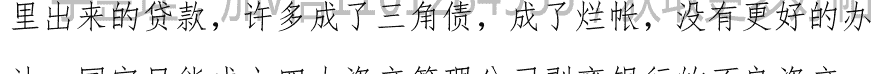


金融资产结构，银行获得了很好的收益。

从个人购房的结构看，由于股市低迷、银行利率极低，高收入和财富的拥有者没有可以投资的渠道。低收入者来说，不断增值的房产价值，刺激了新的投资者进入这个领域，不断涌入的资金造成虚假的供给，又拉升了房价。对于低收入者来说，不断被高价，梦中的房子即将失去，心里处于焦灼的状态，大规模的建设又让拆迁被放大。

从房产的效益看，巨大的无形链，国有土地的管理者、集体土地的管理者、主管的管理者、规划部门、银行、建筑商、中介公司、评估公司等迅速结束了一条战线。由于中国的政策对于执法者来说是有渠道，每个当事人将自己的利益最大化，都有自己制定的规则和取得利益。

房产经济初期，利益直接冲突，开发商与普通的百姓没有退路，群众会维护自己的利益，巨大的资产由独立的个人，从经济学的角度看，利益分配是最科学的商业选择。

列举如下：开发商是如何暴利的？

- 国有土地与某企业合作后，开发商拿了大头。
- 国有土地与某企业合作后，开发商拿了大部分。
- 国有土地与某企业合作后，开发商拿了剩余。
- 国有土地与建筑商合作后，开发商拿了小头。
- 国有土地与中介公司合作后，开发商拿了利润。
- 国有土地与规划部门合作后，开发商拿了管理费。

房产分配的方案是按照规划规定的：

- 房产项目在开发以后，开发商只拿了巨额利润。
- 房产项目在合同签订后，开发商拿了巨大的利益。
- 房产项目在土地审批时，开发商拿了积分面积。
- 房产项目在土地评估时，开发商拿了溢价。
- 房产项目在土地抵押时，开发商拿了红利。
- 房产项目在土地出让时，开发商拿了差价。


无形的手却已经加高。如此说：房产初期的项目普遍积累很高，没有绿化、没有商业配套就是原因。里面的黑幕太多，我只列举了上述一项。从经济价值的转移上，开发商并没有风险，土地是国家的，钱是银行的，资金是建筑商、材料商，单的是购房者。开发商只要让利益各方满意，他就能被利益支持，并将自己的房产企业做大。

等到商人人都发现巨大的宝藏的时候，城市里可以开发的国有企业的土地就此消失了，所有的强力部门也引入了利益的环扣。土地要拍卖，通过有形的拍卖增加了成本，开发商要转型必然就要提高售价，许多房地产价格被迅速拉升。

巨大的土地升值，使得城区的土地有了上升的空间，于是农村集体土地的管理者、守门人成为开发商的目标。此时的房产市场进入了高位稳定时期，市场的规模、战线被拉长、拉大。

其实在初期的房产经济阶段，利益被卖家主要是卖国有土地的企业职工，他们被迫下岗，或到更远的地方工作，幸运的也能通过土地出让而获得的安置费。在第二个阶段，利益被卖者则是集体土地上的农民，失去土地的农民并没有在自己的土地上获取利益，他们成为了城镇居民的边缘人，巨大的利益被无情的瓜分。

## 第一章 土地制度

### 买方市场的组成结构

由于中国是信息的社会，老百姓不了解经济政策的变化、市场的运作内涵，他们在经济活动中普遍处于被动的地位。就像当初的股票市场一样，当所有的融资已经被填进窟窿之后，所有的学者、专家、报纸、电视却告诉股民，上证指数一定会突破3000点大关。在这种信息不对称的情况下，连最后的意志坚定者也不想错过最后的机会，由于自己终也成了股，赔了余生。

房地产的购买者由购买居住、投资者所构成，投资者又分为富者和负者。

对于富者来说，房子的升值或贬值只是自己拥有财富的数量变化而已，而对于普通者来说，房子的升值已直接关系自己财富的盈利能力。富者和负者共同有一份房产，这就是数量。

对于购买者来说，又分为：

- 基本需求型
- 改善型
- 虚荣型
- 辉耀型

这些购买者的数量有限，且房价的变化根据自己的收入情况来决定的，一般住房也是负债。在购买者的结构中，基本需求型、改善型、虚荣型、辉耀型，影响最大的也是他们。


这种需求中，伤害最大的是基本需求型，为了满足自己的基本需求，只能选择房子，离市区越来越远；而房子的贬值对于虚荣型是巨大的，虚荣型让他们吃尽了苦，房产泡沫让他们和负债一起成为一代房奴。

房地产是区域性的产品，巨大的区域差异导致了整个房产的不断攀升，主要集中在经济发达区域，高收入的购买者占据了很大比例。经济发达区域包括：

- 杭州
- 上海
- 北京
- 广州
- 深圳
- 天津
- 南京
- 武汉
- 佛山
- 泉成都
- 苏州
- 昆山

这些区域的权利拥有者、文化名人、明星、官僚等密切将钱投入其中，拉动了房产的疯狂，这就是中国市场的特点。

### 房价与GDP的关系

从经济学的角度来看，房价应该与GDP有直接的关系，事实上房价不能反映当地经济的状况，这一直是我所困惑的问题。为什么苏州、昆山的GDP很高，房价不高？为什么GDP低的区域房价却高？原来苏州、昆山的巨额财富握在少数老板手里，本地居民分配的财富并没有增加，因此本地居民的购买能力并不高。而一些GDP低的区域房价却屡新高，原来官员的灰色收入、医疗系统、教育红利并没有计算在GDP之中。这些数据惊人的真相是：由于没有成本的净收益，所有在购买房时，价格将成为唯一的考虑范围，拉动了本地房价的提升。这种隐形的收入、灰色收入的不确定性冲击了正常的房需求。

### 现实的情况

由于房地产和基本建设一直在高位运行，其高能耗、资源匮乏的大陆不堪重负。每年300亿美元的石油支出，电力、钢铁全面过热，新开工的项目非常巨大，能源、原材料的供应应紧张。住宅的空置率不断上升，让中央政府意识到问题的严重性，因为巨大的金融风险是首要。


地方政府不顾一切地忠于房地产，获取巨额土地收益，增加了地方财政收入。中央从更高的角度看，土地、耕地的流失将严重损害农业的稳定，银行风险的累积加大了中央政府的风险。不断增加的房价让普通的百姓对政府不满，拆迁引起的冲突成为社会不稳定的因素。

于是，中央政府终于出台政策，遏制基本建设的升温，抑制房价的疯涨。中央政府也不让快速发展的基本建设突发降温，只希望它在一个范围内稳定的运行。可是，由于房地产经济的发展本身是非理性的，需要被扭曲的放大。

当人们理性地看待、合理的分析之后，却发现自己被谎慢骗了。由于信息不对称被欺骗了。所有的投资者发现，有能力购买房子的消费者已经购买了。想买房的，因为房价太大，早打消了购房的念头或去郊区购买了。其实，中国的社会是元化的社会，贫富差距很大，中产阶级一直没有成为社会的主流。但投资者发现他的房产不再升值，没有人再接手他希望的价格时，投资者将不再追加投资，市场不再扩大，开始收缩。另一方面的购住房由于实际的支付能力是根本无法承担高额的房价，中国大陆城镇居民的私房拥有率也是很高的。在世界上，中低收入阶层是靠政府提供的廉价住房。


中低收入者的住房问题是不切实际的想法。在经济发展的阶段，很好地处理了中低收入者的住房问题，社会就不会激化，带来一系列社会问题。随着美化的发展，国家进入了落后的境，大量的贫民窟就是标志。

国家统计局了解到，1998年到2004年，居民支配收入增长了43%，存款余额增长了58%，居民平均财富增长了72%，住宅均价增长了43%。截至月底，全国商品房面积同比增长了23.8%，全国开发投资了279亿元，增长了26%。中央政府已经认识到问题的严重性，中低收入者并没有增加财富。

不同的过程，一样的结局。房地产跟股票市场一样，初衷可能是好的，可是无形的黑手、无形的利益蚕食，终将农民变成了婆女。政府没有损失，损失的是被套的股民、负债的房主。昔日的炒股高手、庄家轮回为穷人，同样的人也会轮回为穷人，被套的开发者也可能流落街头。对于我们已经建设了新农村的农民、房东改变了历史，他们只能改变自己的命运，只是依然在日出而作，日落而息。

### 黄山游

今天看黄山游，发现里面一个老头说了一句话，太有浅了：“一个人如果什么都看得太白了，就会觉得人生没有任何意义了。”像当初板桥先生的那句“难得糊涂”，这还是怎样的无奈啊！

- 知肚的傻，是装傻——大智若愚
- 愚味不知的傻，是真傻——呆若木鸡
- 难得糊涂是假糊涂
- 糊里糊涂是真糊涂

不说这些了，没意思。小弟同样对经济感兴趣，据我的了解我的经济改革，在本质上来说是一种经济上先行，政治上绕行的改革，也就是在经济上实施资本主义，政治上实施社会主义。而且我觉得改革到现在的阶段强调效率，忽视了公平，致使社会矛盾丛生，您认为我国会处理这些问题吗，我们会越来越好呢，还是越来越坏？

- 资本、法律、市场叫资本主义社会
- 工人、农民当家叫社会主义社会
- 世袭、诸侯割叫封建社会
- 干活拿不到钱的叫奴社会

你说我们更像什么社会呢？

尊敬的洞芜大哥：小辈想请教你一个问题，你能谈谈政府在建设新农村的过程中，会带动哪些行业的发展或者又会冒出哪些新的行业出来呢？跪求大哥讲解，小辈洗耳恭听。

- 1) 文艺演出、宣传
- 2) 培训市场
- 3) 办公所、装修
- 4) 道路建设
- 5) 旅游
- 6) 电视

黄山并没有区别，平日里惯了，、绿水，眼睛惯了。。，，的美了，窗外吹进清新空气，让人心旷神怡。来到黄山顶，上午坐缆车沿着蜿蜒的山路往上行驶，我坐在座上，看见窗外青山绵起伏，风景跟过去一样随着云雾的变化，阳光站在山顶，云雾缭绕，远处的山峰忽隐若现，露出的岩石被绿色植被衬托，构成了一幅山水画。一会儿是淡雅，一会儿是如艳。云海消失，古松前方远处就是天山的顶峰，原来在山下看到的山峰不是顶峰，眼前的顶峰在吕柱间却是那样的秀美，像含羞的美丽少女亭立，白玉岩石的线条就是那种绰娜多姿。转眼间，呼吸屏过，面对秀美的彩云随即被云海淹没。啊，大自然总是将最美的景色小心的珍藏，只是偶尔露出露出美丽的峦峦。幸运让人们感受她的美丽，享受最自然的邂逅。原来这美丽面对遥远的古松那么俊美、那么挺拔、那么倔强。下山走了一段路后，我们一行来到莲丹湖，只见两侧青山映在一湖碧水中，将不大的湖染成了一块碧翠，乘船到湖心，一阵云雾漂浮起来，我们竟然看不见前面的青山绿水，小船像一只漂浮在天边的若舟，美丽的梦幻让时间静止，呼吸停止，身心完全融合在人间仙境，深深地陶醉。

回来的路上，我想起了古代李白、苏轼等很多人对此美境流连忘返，要在此安度人生的晚年，他们留下了许多优美的诗句，可是这座美丽的名山却没有留下许多纪念的建筑物，因为它们多毁于不断的战乱，不仅让人无限伤。我们5人花了近千元票、这每天百万的景区投入跟这些辛苦的苦又有何关系呢？过去的古人看风景花钱，他们的祖辈贫穷，现在他们世代居住的风景可以买了，可是他们依然贫穷，他们是中国大多数百姓的后裔，他们“流自己的汗，吃自己的饭”、“不用用人造钱”的清白人格，却要不受公正对待，仍然忍忍负重。

他们是巨大倾斜的岩石下方支撑的小石，他们用自己的渺小锚着巨大的岩石，他们每一次的心心悸总会带来美丽的毁灭，让曾经的美丽留下一片废墟。登山的乐趣就是累了，累了，累了，累了休息，他们要另外准备好的，才能完成最后一段行程。


## 3) 物流一直是自己困惑之处 考虑黑龙江到深圳成本

高问: 楼主在运输这一块有什么看法

打算: 
1) 跑深圳的潜在客户 需求调查
2) 找贸易公司 谈看能否挂靠或合作

深圳是移民城市，东北的移民有一部分市场，在他们聚集的地区开个小书专卖可能会搞到一些小钱。但没有商业发展的空间。因为商业流通的关键节点，已经已经被集团通过境外的所谓上市公司隐藏控制了。

作者: 目光溜的湖上 日期2006-05-06 15:53 
作者: 目光溜的湖上 回复日期:2006-4-30 22:22:51
作者: 心理海大海 回复日期:2006-4-30 21:55:45

尊敬的湖上大哥:
小栗想请教你一个问题，你能谈谈政府在建设新农村的过程中，会带动某些行业的发展或者又会拿出哪些新的行业出来呢

恳求大哥讲解，小栗洗耳恭听

(1) 三乡文艺演出、心连心明星走穴。
(2) 农村基层干部的培训市场，培训他们如何管理农村，理解大的政策，保持农村的稳定。
(3) 村、乡楼堂馆、办公楼的建设与装修。
(4) 村、镇道路的建设。
(5) 乡村干部的旅游参观
(6) 相关电视、宣传、出版市场 如获至宝

作者：风云云 回复日期：2006-4-30 23:12:08

祝润土、天涯的所有朋友
所有热爱脚这片热土的朋友

原本我们的国家……

一手资料 加微信：1101284955 获取更多关注
因为后我的眼睛常常含着水，因为我对这片土地的爱深沉。

呵呵呵，建设新农村终于开始了，新闻报道如下：

考察新农村变成澳游
2006 年 05 月 03 日 07:51 南京晨报
报告人：陈先生

报告内容：五一长假，我们北京市浦口区农林局的一些干部却在坚持上班，为了？写去南方“考察社会主义农村建设”的感想和调研报告！他们刚刚去了深圳的南岭村考察回来，但他们6天里的行程里，留在南岭的时间不到一天，其他都是在香港、澳门、珠海度过的，使这次所谓的农村考察变成了港澳游！！ —— （略）

作者: 目光呆的润土 日期:2006-05-06 13:08
作者: 文子 323 回复日期:2006-5-2 18:53:11

请问土老师对这几年中国与别的国家所处文化年的局势政治和经济方面访谈对中国有哪些影响？哪些帮助？

中国与法国、俄国近代来搞文化化，这是两个近代世纪非常发达的国家，他们用自己的灿烂而自豪，因为他们拥有世界闻名的大作家、思想家、音乐家、诗人、画家、艺术家。中国则以自己的处处来呈现中国古老的文明，是东西文化的展示舞台，历史与现代文化展示的舞台。正是这种展示显得中国现代化的衰败与奇形，

从证明了近代中国社会的政治衰败、经济的奇形。

这是一个现代国家政治与经济的思想灵魂。这是一种内在的、在文化的底蕴

当老含这个中国现代社会最仁厚的智者也投泪自尽的时候，我们无颜再再说“文化”这两个圣洁的词了。什么时候我们我们可以向世界展示我们活着的文化巨匠的时候，中国政治文明的时代，经济繁荣的时代就到来了。

作者: 目光呆的润土 日期:2006-05-06 13:22

现代中国文化现状：

- 悠悠是最知名的表演艺术家。
- 超女是最著名的歌唱艺术家。
- 木子美是最知名的作家。

作者:目光呆的润土 日期:2006-05-06 18:42
作者:stephenchou1980 回复日期:2006-5-6 17:11:06

闰土大哥，关于您在文中提到的张瑞敏诚信的问题上，我有一些不同的看法。余世维提到浙江任人的职业经理人在讲座中说，海尔欠了好像13家银行的钱，还欠余世维公司的钱，结果余世维向张瑞敏要钱，张瑞敏就要一半，不要算了，结果余先生打算算了，可是朋友告诉他，海尔不能（中国撑腰）。结果还是各种关系最后还是多好。

虽然说这件事是一面之词，没有确实根据，不过认为，可信度还是很高的，因为第一世维不可能无中生有邪胞，第二，在一个职业经理人的讲座上，学员都是国企、外企的高层。最近，邱大炮（贾平丰）对海尔炮轰的厉害。所以，我本人不是看好海尔。

余世维作为中国当今最火的学者专家，张瑞敏说他的钱，如果是真的则无可柯非，如果当面离开背景来说：“海尔欠了好像13家银行的钱”，只能说明可能还不懂。余世维也好，邱大炮也好，说的再准确，也只能算聪明。

这是一个现代国家政治与经济的思想灵魂。这是一种内在的、在文化的底蕴

当老含这个中国现代社会最仁厚的智者也投泪自尽的时候，我们无颜再再说“文化”这两个圣洁的词了。什么时候我们我们可以向世界展示我们活着的文化巨匠的时候，中国政治文明的时代，经济繁荣的时代就到来了。


作为一个人无法跟他们交流的。没有羞心的人，就是犬儒、就是太监。大民族、日耳曼民族、犹太民族之所以优秀，因为他们有被羞辱后会自惭、会服，像樱花一样美丽的凋谢。他们知道有仇必报的天理，以色列的特工可以在天海角一直追杀纳分子。可是我们却善恶不分，硬说日本人是热爱和平的，要知道日本占领上海的时候，日本是妄国之族。如果我们像雄狮一样的威威，他们教育教育侵略的教育？为什么？正是教育家的教育，三百年满清的教育让华夏人的逸逸脱节基因消失了，许多人都成了像镜子一样的疯子、傻子，能够考取名的也成了犬狗的御用人才。教育如：官不怕死，经过统治者的教育的，文官没有了积累，只剩下贫兵、武了。

从国家的教育看，大清是世界上教育最成功的国家，因为政府最后腐败无能，还能苟延喘近百年。但从民族的角度看，则是中国民族最黑暗的教育历史，因为它从根本上摧毁了华夏文明。从人的角度看，教育的投资也是失败的，对于士人们来说，只有两种选择：做地位卑贱的人或做风光的奴才。

## 中华骄却被正统教育掩盖的辉煌

中国人遭到如此被羞辱的地位，全是统治者教育倾斜化的结果。我们中国民族曾经是多么辉煌，中国的男人曾经令敌人厌胜胆。汉朝时期，中国军队无数的少胜多、所向扩张。有时尚未开战两军对阵，区区数千人的中国军队那整齐的队列、威武的英将、气吞山河的攻势，就已经让数万的敌人胆战心惊，伏称臣。有一个校尉事实竟说出震惊世界的世俗名句：“犯我汉者，远必诛。”

全世界公元36年，在匈奴单于杀士兵后，汉帝西西城域陈队只带了5000士兵，也不向朝廷报告，而是沿途主动调西域各国军队，汉屯郡部共4万余人，分路，越陌米尔高原，奔军，过乌孙，至勃邺城（哈萨克莱布江）下合围匈奴，并彻底斩单于于首级，传送大汉帝国都首都。

我要知道，正是汉长入数千公里，直百姓老人都果敢。如果没见过无伦比的勇敢与血性，是方韩也做不到的，并且他还不是将，而是副将赵尉的中国男人。这个中国男人是多么伟大，可是过去，我们却不知道他的名字，可是日本人，外国人都知道他的名字。还有将军李广，即便被俘，被敌人也崇拜的英武不屈，竟然梁拜他汉帝要求他出主。还有李青、霍去等这些人，这些中国男人是那样令人人骄傲，正如陈汤在给皇帝的奏疏中指出，应当天下各国表明：“犯我汉者，远必诛。”这是多么伟大的中国男人啊，每当我想起我们被炸的大使馆，当我想起我们被践踏的印尼华侨，我就想起他这句话：“犯我汉者，远必诛。”

现在，我才才知道，真正的中国英雄全是凯旋而归的英雄，多数是活着的英雄。可是，从我记事的时候，就知道男人要扶老人过街，要帮老人打扫卫生，反正我知道的英雄全是死人。

由于中国是世袭的国家，开国的皇帝相对英武没能控制局面。他们的后代往往软弱，那些所谓的聪明的奸臣，知道自己已没有能耐。在那些英勇的将军面前，不如一只蚂苍，可是他们却会软乞皇帝，告诉中国的皇帝，这些勇猛的中国人太恐怖了，打仗总是凯旋而归，一个个气势恢轩，如果他们他们造反，皇位就立刻刻让位。只有没有了英雄，江山才能永固。可是这些昏庸就没想到，长城全是吃人的狼韩，铁的事实证明他们终于消失了中国男人，因为没有了中国人的被墨西哥杀死天天的自然规律。

近代社会的北洋政府是个软弱的政府，但是北洋政府对中国的教育文化投资做出了巨大的贡献，中国的大学教育、平民教育、新文化运动正是北洋政府的宽容而生的，产生了许多中国的文化巨人，也教育了大批爱国的“五四”青年。另一个对中国教育最大的政府就是美国政府，他们用大清帝国的赔款，用于中国留学学生的投资，正是这些没有被用于修宫殿、戏嫡的白银，培养了近代社会的民族脊梁，他们在工程、技术、科学、工业、教育、艺术等各个领域，为中华民族的文明做出了杰出的贡献。

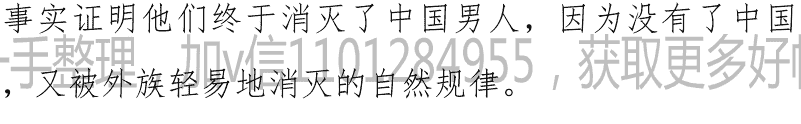

## 近60年的教育演变

从权者的角度，他们需要一种没有思想的人才，在教育的设置上顾费心，又红又专是初设计的最高培养目标。这些人才教育出来果然造出了万吨水机、长桥、原子弹、卫星，但是他们不会造反。如何让教育出的学生造反呢？领袖们自然知道：“无知而畏”的道理，就是要让他们学习，通过学生的闹革命，将教育重新夺回来。

从这两个阶段看，教育是非常正确的，但是从的角度看，民族却多灾了。之后的经济建设中，他们都受到了磨磨。从个人教育来看，又红又专人的思维是闹革命和结局比较好。恰是响应闹革命积极的学生，他们大多数是当今社会地位最低、生活条件最惨的阶层。他们基本成为当今社会的成功层。

改革开放初，国家的建设需要人才，这种社会的资源缺让大学成为天之骄子，国家按计划培养了大批人才，满足了发展的需要。计划的分配，让大学生没有压力。可是，由于教育的疏忽与自由开放的环境，竟然培养出“五四”青年，让自己遇到了前所有的麻烦。所以他们必须重新调整教育，正是新的教育培养出来的学生从现在开始走向社会，他们终于像无头的苍蝇失去了方向。

从90年代中期开始，大学生的就业压力出现了，这是由中国的发展道路决定的，学生已经满足了发展的需要，新增的毕业生无法安排往后推，当局扩招研究生、博士。其实在知识型的发展模式下，培养出来的研究生、博士是不需要的。从市场实用的角度来看，他们不如一个农民。我们外的经济需要大量的文化素质。矛盾的产生引起后并没有解决问题，将人们的教育成本拉高，教育投资扩大到了历史规模。所以说大招生并不是培养人才的措施，而是无法解决问题，把问题交给后面的当局，这就是术的高明之处。当学生毕业后，他们被社会抛弃了，十万、几十万的教育投入只有千元的回报。那些没有投入的农民虽然也是千元的工资收入，能够在农村盖。

## 第一章 教育与市场

这些学生发现自己的房子是那样的遥远。他们心中的比哀，他们的父母不忍看着他们寄托的梦想，成了苦力，有些心软用自己的退休金继续养着他们女儿，这就是现在中国特有的现实。现在的学生普遍抱怨工资低，要知道国家工资政策里，外资企业的工资没有限制，对私营、民营、内资企业的工资是有政策规定的，就是允许工资计入企业的成本。如果那个企业愿意多付工资，则要为多付工资交33%的所得税。这就决定了大多数学生必须面对低工资现状。

并不是对学生而言，高额的教育支出却没有得到市场的，却被告知不要，他们迷茫了。由于教育与现实的冲突，他们才不属于社会。学校里的老老师都是经济骗钱的项目，能上课的八九是混不到钱的傻老师。这些水平不高的老师耽误了学生的学业，恶性循环让教育出来的学生不被社会认可，使许多学生的教育失败。

## 出国留学下的阴影

可能有人说学生多么优秀，中国的优秀的学生多是为了美国政府培养的，他们中的多数一去不返了。因为在没有建立有效的知识产权体系的社会环境里，我们没有优秀的学生发表水平的地方，美国政府知道这些人才是他们的对手，是未来经济财富的创造者，他们必须抢过来为他们国家服务的同时，让对手少个有用的人才。作为国家的教育，美国政府因为更加开放与先进，而在经济的发展上总保持着最好的活力。这是值得学习的地方。

近来，除美国名大学以外的地方也成了留学的热点，认真地分析后发现许多问题，其实真正能够学到知识有一部分不是崇外的的人，获得的心安静了。在市场经济的社会里，除了文凭之外，别人看的是能力。为什么要名大学的学生被企业、社会认可吗？是因为大学与社会、经济紧密的，一流的教授、一流的教育方法最先进、实用的知识给学生。所谓：“西方名牌文化”，能够真实地反映学生的水平。最近，中国留学生成为许多外国人眼中的花花公子，开着名车、胡作，新闻经常被曝光，绑架新闻也经常出现。这种现象让很多家长并没有多少钱，也将自己的孩子送出去，哪里知道有些孩子在国外的水平是学不到的，而且过去的花花公子、花花小妹。

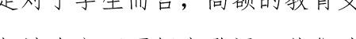

实实的在中国政府没醒来之前，多捞票。所以他们的孩子在国外挥霍，而那些家庭条件不好的孩子心里失衡，让他们产生了犯罪动机，屡登陆。这种变态留学本身不是问题，而是垃圾文化的表现。最可怕的是穷人与家长，也不明白什么是真正的留学和外的区别。从过去的海归到家里变成海龟，说明中国需要大的改变。从袁隆的身上就能看清中国环境，30年前就是世界级的科学家袁隆院士，到科学院成立后，因为他在国外的名气大大了，那么这些出国的学生不适应国内的学术氛围。真正的反映才能点燃华文明。最近，温总理的亲民路线工作让我们看到了希望，中国的百姓理解等待，他们可以在教育上入手培养爱国的热血青年，用新生的力量对抗腐败分子。我们已经一无所有面对腐败分子，中国的问题太大太复杂，但是只要我们从点做起还有希望。关键是如何落实，首先应该从一个“疤”做起，从舆论上，从各个层面让民众知道什么是疤。如果我们的社会舆论到了，我们的民族就有希望。我们要用全新的教育改变民族的基因，不再后悔我们被杀了多少可怜的。我们要让后代知道我们可以像他们一样坚强、勇敢、智慧，让中华没有耻辱。一个国家就像一台电脑一样，北欧、美国等国家文明的历史虽然长，但由于他们装的是最新的程序软件，装了强大的防火墙和杀毒软件，并且不断升级，所以国家的社会经济运行正常。由于中国电脑运行的时间太长，程序软件又是世界独有的汉字系统，跟软件不连网也不兼容，自身没有自动升级的功能，加上没有防火墙，所以电脑里全是木马病毒、蠕虫病毒。中国这台世界上最早、也是最大的电脑，正在不停地死机、不停地重启中缓慢地运行着。

作者：时光苍凉的湖润 日期:2006-05-12 13:00

我为什么要写教育的问题，因为在中国三大改革中，教育是最重要的。教育的成功可以让中国人找回自己丢失的灵魂，否则房子成功了，可以住豪华房子，可是灵魂没有归宿。医疗的改革即使成功了，可以医好病体却不受受伤的心灵。

作者：目光呆滞的熵渍 日期:2006-05-12 16:17
作者：觉时恋梦恋邂 回复日期:2006-05-12 14:26:27

三大改革失败了！精神空虚了，身体被挖空了，口袋也被掏空了。还能吗？现在的生存感重新回到了解放前的水深火热之中。加v信1101284955获取更多帖。解放前乡里乡亲的，有祠堂、有规宪、有族旗，有为百姓说的大报、有达夫、有鲁迅、有红军、有...

作者：目光呆滞的熵渍 日期:2006-05-13 16:16

我们面对中国堆积如山的问题，可能觉得无从下手，觉得中国的文化的农民太多，其实是误解。要知道满清三百年文字狱的文化清剿，铁血统治。中国青年短短的接受新思想的教育，就培养了出国、爱民族的热血青年，正是这批青年改变了中国的历史，推翻了三座大山，建起了中国。

可以说教育是唯一的改变入点，只有年轻的才能腐朽，只有新生的才能替代腐败。这是自然的规律，否则只能腐败死亡。教育的内容也非常重要，要知道他在1926年在河北设计的教育实验中，世界上最伟大的民教育家是中国人，不是胡适、陶友明，他认为消除文盲比消除愚化更重要。他改变了世界上亿贫苦民的命运。他与爱因斯坦一起被美国一百余大学和科研机构评为“现代世界最具革命性贡献的人”。他的一生他是美国历史上第一个通过拨款条款的外籍人士。他被日本看作是进一步实现现代化的标之一。

吴阳初，享世界的平民教育家和乡村建设家。1890年于四川巴中县。少时熟读儒家经典，十三时入内地传会办的西学读书书，后来来到香港和美国的宾州普鲁大学接受教育。在美国，晏阳初曾经受教于塔夫脱和威尔尔两位美国前总统。塔夫脱教授晏阳初的课程是《美国宪法》。

1917年美国对德宣布，有近二十万华工在欧洲战场上服，但他饱受语言不通之苦，晏阳初于鲁鲁毕业后第二日到法国服务华工。在法国战场，晏阳初尝试着从复杂的中国文字选取一千个常用字来教华工识字，后来创了《华工报》，后晏阳初收到了来自位华工的信。位华工为了表示对晏阳初的感谢，决定拿出自己三年在法国泥泞的战场上积累的三百六十五法郎。

我不敢瞎赌，只有富豪自己最清楚，可以建议他们每个人写个人自传，允许自传中向上帝忏悔，让富豪们展示自己的才华和思想。真实的自传可以看出他们现在的心态，是疯狂、骄傲、坦荡、平淡、欣慰、害怕还是无的得人。美国超级富豪卡耐说过，富人在拥有巨额财富中死去，他是自己的悲哀，也是社会的悲哀。盖茨、巴菲特也是这样像卡耐一样做的。什么时候，中国的富豪也能做这一点，明白自己的后代如何幸福深邃的思想境界。那么中国就丢了胡世涛的和谐社会，对世界的经济毁了。

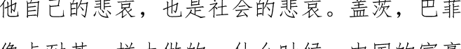


很多很细致的工作，比如棉花的选择。一次批美国的专家惊诧地发现定县的本土土鸡一年能下68个蛋。晏阳初说：“中国的母鸡已经下了三千年的蛋，它们大概是太累了。”

后来晏阳初引入了美国的来鸡，在与本土地鸡交杂后产生的新品母鸡一年可以下168个蛋。

三十年代，国民党政部长级来到定县视察后，对定县的乡村改造工作深为赞赏，因此国民政府决定这种模式向全国推广。由于南京政府通过决议，全国各省设立乡村建设研究院，并划出一个县试点。

由于步步进逼，1936年晏阳初所领的教会会撤离定县。晏阳初说：“我们被赶出这个县的人类社会——经济实验室，我们是世界上第一个社会主义实验室，获取更多好帖。”

1937年晏阳初接到湖南省的邀请，说蒋介石要晏阳初帮助动员千万的民众抗日。随后他被任命为这一行动的首席执行官。晏阳初主持撤销了这个省三分之二的县的腐败领导，召集了五千个学生和科学家替他们。这是中国历史上第一次最大规模的基层政治改造和民众动员。这些工作后来南方能够顶住日本的进攻起到了关键作用。

1940年晏阳初在四川成立乡村建设院。

1943年，哥白诞400周年之际，美国百余所大学和科研机构的代表评选晏阳初为“现代世界最具革命性贡献的十大伟人”之一，与晏阳初并列的有爱因斯坦、杜威等奥本海、莱特、亨利·福等人。晏阳初是获殊的唯一亚洲人。


1945年晏阳初一次与蒋介石的会面中说：“我们人民遭受了二十一年的内战，他们流尽了鲜血。现在是农村大众许多事情的时候了。”蒋介石说：“你是个学者，我是个战士。”他说，等他消除了对手之后，要聘晏阳初为全国中国乡村改造的领导。晏阳初说：“委员长，如果您只看到军队的力量，而看不到人民的力量，那么你会失去一切的。”

二战末期，罗斯福总统提出了著名的四大自由，晏阳初补充了一条，就是人民要有“免于愚愚的自由”。

在说服蒋介石失败后，晏阳初偷偷来到纽约，他在美国最高法官·金格·罗斯福等人的带领下，“直接闹到社会总门的办公室——因为他们有许多可怕的秘密。”杜门乔说：“这些年来，我收到的每一要求都是帮助这个政府、那个政府。”

他说晏阳初提出的第一个帮助中国民众的计划。：“你看，这是一项在国会的议案，叫做《1948年援助中国经济》，其总额为27500万美元。我准备建议所有这些钱都用于你的这个计划——对于中国农民进行的平民教育和乡村改造计划。”

晏阳初大概一下子搞坏了，他忙说，我们不需要那么多钱，我们有十分之一就足够了。后来美国国会通过了项叫“晏阳初条款”的议案，这是美国历史上第一次有一个外籍人士优使会通过了一个拨款条款。

1949年晏阳初到了台湾，他说：“你们把中国最好的人才和这么多的钱拿过来了，台湾要是再搞搞不好，你们就要打屁股！”晏阳初只在台湾采了一个拜访就走了，但是后来台湾在改造和建设乡村的过程中大量借鉴了晏阳初的经验。现在的台湾农村是世界上最好的农村之一。

晏阳初从台湾走向全世界，走向南美、非洲和东南亚。这符合他的个性、他的“勇猛开拓”的精神，他介入了第三世界民族苦难的命运，帮助他们发扬了伟力的理念。

1956年在晏阳初的直接帮助下，由于晏阳初的乡村改造构想，菲律宾历史上第一批全国选举的议员产生了。后来晏阳初在菲律宾建立了国际乡村改造学院，这个机构一直工作到今天。

1988年晏阳初98岁寿辰，里根总统在给他的生日贺贺中说：“在我的任期间，最大的报酬之一莫过于得知您像您这样全心意为他人服务的资质之。”

1989年李总统在给晏阳初的生日贺辞中说：“通过给予那些处于困境中的人以帮助，而不是施舍，您重申了人的严肃与价值。”“您使无数的人认识到：任何一个孩子不只有一张吃的，而是具备无限潜力的、有两只劳动的手、有价值的人。”

## 1990年阳初在美国逝世。

阳初在接受赛珍珠访谈时对全世界说：“我向世界提出了这个问题，请求解答。为什么不能团结所有国家、所有地区的人民共同击我们的敌人——愚昧、贫困、疾病和腐败政府呢？”

晏阳初：我来说，“三 C”影响了我的一生，就是孔子（Confucius）、基督和苦力（Coolies）。比较具体的，是：来自古远的儒家思想，来自近世的传教士和来自远方的民族苦劳。

晏阳初认为“明智的国家，只有当‘贫穷’的人民和‘富’的国家满足自己的利益才是安全的。”

晏阳初认为“明智的国家，只有当‘贫穷’的人民和‘富’的国家满足自己的利益才是安全的。”

晏阳初认为，民间机构的创造性工作对于国家走向民主有重要的作用。晏阳初说：“（美国）在选举之前，就有许多私人机构在真正从事创造性的工作，他们在引导政府并且始终寻找新路，在改造自己的生存环境时，发起任何社会、经济或政治的改进，都有基础。”


## 50年前公务员的变化

| 阶段 | 身份称呼 | 制度特征 | 现状 |
| :--- | :--- | :--- | :--- |
| 1949年以前 | 政府工作人员、国家干部、企业人员 | | | 高级干部与低级干部收入差距很大，最高有28倍 |
| 1949年-1960年 | 公务员、国家干部 | 实行供给制 | 高级干部生活舒适，但不敢腐败 |
| 1960年-1985年 | 干部 | 工资保持不变 | 高级干部与普通干部差距缩小，工人大哥说话最响，干部下放到农村接受教育改造 |
| 1985年以前 | 公务员、干部 | 严正的层级 | 不敢用公家的信交私信，用公家的电话办私事，很少在外面被邀请 |
| 1990年以前 | 公务员、干部 | 无业务招待费用 | 只能自己去买饭票 |

在这一25年里，在社会分工中，最好的身份是：
- **工人**：排老大
- **农民**：排老二（亲切地称为“农二二”）
- **四个轮子**：司机。可以到农村买便宜的特产，带小货挣小外快，收入高且没有公路收费、过路费，生活工作十分轻松。
- **一把刀子**：菜、副食店的营业员。在吃肉时百姓最高享受的时代，有着无比的高位。
- **白衣战士**：医生。病患条是他们手中的法宝，有了它可以不用上班、开会，钞票照用一样不错。
- **红旗飘**：军卒。当时军人出身清白，勇者最为亮亮的军装，吃饭穿衣服不要掏钱，军人家属为光荣之家，军人配合可以有好工作。

要问当时的干部定位如何？有一个顺口溜非常形象：“干部！干部的！不如裤布。”


## 一、政府与法律

中国的政府机关有关，国有企业有着世界上最多的制度和规章。为什么屡法不再、令行不止？其实改革开放初，正气主导着整个社会，政府机关的官员就像一个房子的上梁、柱子一样，百姓俗称：“上梁不正柱子不正”。从最近腐败大地区看，这说明了点：只要这里的领导是对的，社会经济发展的就好，否则经济落后、社会混乱。

法律政策制定细了，一目了然，就没解释的需要了。那么下级部门做事，很多情况下不用请示汇报了，那么上面的官员自然就多余了，因此许多官员就要下岗。所以，现在即使中央有明确的政策，有时下面就搞个土政策，跟中央顶着，中央的政策到下面就变样。


## 现状的特点

从长期的来看，从长时间的变化，就会发现社会会有个隐形阶层，这个层结构非常清晰：
- **高层**：听懂话，脑子灵活，领导一个眼神就能事情做好。
- **中层**：能听懂话，知道如何办。
- **执行层**：能听懂话，能执行。
- **执行层**：
- **基层干部**：不听话，不听指挥，他们不懂业务、不懂法，只懂关政学、钻营，权力拥有者是腐败的。
- **普通人**：不听话，不理解，不执行。

## 外行当家

为什么外行不能当家？因为外行当家后，也不会汇报说自己把事情做了。

- **权力大的**：叫“签字”
- **权力大的**：叫“一笔”
- **权力大的**：叫“一句话”
- **权力大的**：叫“眼神”
- **权力大的**：叫“想法”

## 公务员的未来前景

只要中国继续发展经济，走规范的市场道路，那么中国的政治体制改革是迟早的事。许多西方国家也是经历了腐败、经济混乱的阶段，才走过的，走不来的国家就是拉美化国家。昨天发生的黑帮有组织攻击警察的巴西新闻，就是我们未来的镜子。虽然最近也发生了组织黑帮袭建40个乡镇政府的新闻报道，但是中央政府已经把新农村放在了最紧迫、最重要的地位。我们许多矛盾积压了太久了，一直推而未决，从群众总统的愤怒到农民总理的泪泪，问题已无法避免了。主席所要提出“八柴”。对于获取订单的社会来说，就是因为这些问题已经吃不下去，绕不过去了。

解决这些问题需要超常的政治勇气和智慧，这公务员的改革是面临的第一个问题，只要我们不吃饭，社会保障、医疗、教育、经济住房就是空谈。


大家对现在经济和未来经济的变化最感兴趣了，只有正确地把握未来的变化，才能抢占商业先机。

作者：目光呆滞的 日期：2006-05-19 14:36

## 六位房地产企业家

上一轮地产热的三位

第一G某是国企地产公司的老总，93年，他敢为天下下，第一个盖起了全市第一栋32层商务写字楼，正赶上全民经济的开始，盖了一半的写字楼已经被抢售一套，企业赚了亿元的利润，其后的几个项目楼盘也非常成功，报纸上经常有他的新闻报道，一天，日某的四报纸版面上，他由于改革创新的先进事迹竟占据了两个整版，如今人们大开眼界……95年同样的报纸上，则一个不起的小事新闻：

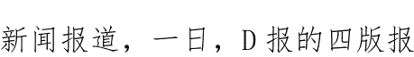

“G某因妨碍警务执法行为被拘留”，几个月后被判三年徒刑。原来，G某的公司经济效益非常好，他买了一辆当时最新款的豪华奔驰车，不久，他的豪华奔驰车又被交通警察检查，几天的奔驰奔驰车又被交通警察拦下，G某怒气冲冲，下车将该警察推入奔驰后座带回自己公司，因此犯下了妨碍公务罪……。（G某的副手下后，一直低调，95年后拿一大学的地皮盖了两栋住宅，赚了两千万多，开了一辆旧的丰田佳美汽车，没有了豪华别墅，住在老式的破旧旧小区里，将两套几十平方米的房子打通通用）。

第二位L某是国企最大的开发公司的老总，十年来，他最多、资金最多，无人能敌。98 年，L某因贪受贿赂被规，他豪华办公室搜出的两瓶尸被媒体频繁报道，L某坐牢不久后，其结发妻子，经不受住打击而去世，监狱中的L某被特批，可以戴着手表参加妻的葬礼，追悼会上，L某的手表衣服摘饰着，看着即将被火化的妻子，他……

第三位W某是国企开发公司的老总，在市中心竖起第一栋高档景观旁写字楼，盖起景区大片的高档住宅小区，风一时劲，2000 年，W某因受贿被判入狱，数额不详，有两件事情被媒体多次报道，W某挟Y某2000 元红包扣，抽出一张，还给Y某：“1900不达标”，第二件是：他在荷旅游时收一个商人，价值7000 元。

## P某的概述

第一位P某是本市最着名的外企（实际上是私企）房产老板，97 年，他的第一个项目盖起了全市最高的住宅，由于处于景区边上，高出市价每米2000 元，也被销售空后，做了三个项目成功，并盖起了星级凯宾酒店，几天前，朋友告诉我，他卖掉了，现在人在香港不敢回来，因为所有资金全进了曾经发财家的股票里。

第二位Q某是98 年后起的民营房地产公司，三个楼盘跑红，18 岁的儿子开着百万的高级跑车，Q某与世界排名的大企业工厂也建起来，风一时。


06 年上半年，高级住宅800 元/平方米，三期住宅4500 元/平方米卖了，因为他没有缴金，办不了手续导致住宅产权证，银行被冻结，并卷进五星级酒店带走，手机还放在酒桌上……

第三位Z某是98 年开始赤手的地产大型企，先支付亿元购房的人员被判刑，Z从此出发，随后他跟国家合作也非常成功，7 年，三个大型楼盘让他成为房地产热最大的赢家，05 年底，Z被捕，据他贪的巨款案件媒体简单遭遇了，正在办理之中……获取更多好

作者：目光呆滞的润 日期：2006-05-19 15:48
作者：原始资料 回复：2006-05-19 12:47
作者：目光呆滞大哥，国务院发布“国六条”具体内容：

- （一）重点发展中低、小型商品住房、廉租住房。
- （二）严格执行住房开发、销售环节，完善住房税收政策。
- （三）合理控制房屋拆迁规模和进度，减缓被动性需求增长。
- （四）加强房地产开发建设全过程监管，制止违规交易、囤积房的行为。
- （五）加强城镇廉租住房建设，积极发展住房二级市场和租赁市场，解决入户住房困难。
- （六）完善房地产信息披露制度，坚持正确的舆论导向。

国务院“国六条”出来了，请问一下您是如何解读国六条的？谢谢中央这样做，那么收益归地方政府所有，银行的风险是由政府承担，暴力拆迁带来的社会动荡和群众买不起的不满，将影响影响政府稳定。

作者：目光采凉的闰 日期:2006-05-19 17:22

中央搞股票的是将银行的钱圈进股票，解决无能企业资金短缺的问题，用募集的资金填银行的窘蹙，让上市公司按现代企业的运作及企业的资金，也可以让股份分红收益可能出发是好的。可是股民能任命上市的老总吗？上市的老总损害中小股民的利益能受到处罚吗？谁能保护中小股民的利益？有什么办法和切实行的手段可以保护中小股民的利益？房产开始的目的是用房地产拉动经济，让中国的老百姓住上自己的房了，只要百姓有了房，就是有产者了。


私房比例是非常高的，按照资产的计算，中国社会形成了一个中产阶级，一个庞大的中产阶级是社会稳定的基础，这是中央政府的设计初衷，因为所有房有产的阶都是希望社会政治稳定、经济发展的。

可是中国并没有建立社会保障的体系，有房有产的人，未来的医疗、教育并不能保障，整个社会会无钱的人一样对未来充满焦虑。无形的利益集团黑箱操作将阶层化发展，让百姓的存款流入非法人和不良政客的口袋，让百姓后半身继续受他们命。中央政府的初衷是好的，但是政府和开发商不会看着自己的利益受损的，地方政府和开发商如果不能，难以稳步发展，中央政府也不会采取强硬的手段，老板想迅速发大，政客也在短短的任期内出政，无良的政客更想快速发财。他们将后面政府的财政用、土地卖，后一届的政府没有资金、没有土地储备，无法运行，并且所有的资金由中央政府控制，当资金失控，中央政府无法承担，社会将动荡。现在这样做，损失的是地方政府和贫民，开发者把钱吐出来、把土地吐出来，现在是建设和睦了，房地产已经完成了使命。

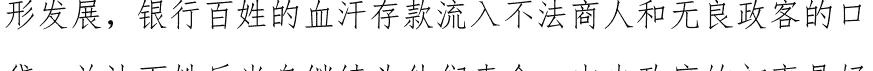

作者：目光呆滞的润 日：2006-05-20 1:20
作者：目光呆滞的润 回复：2006-05-20 13:55

“明喊升值、实则贬值”======

请问润大哥，所谓的对内贬值对对外升值如何实现呢？即使实现了对外出口就全毁了吗？你是看待这个问题的？谢谢！还有人说中国正在悄悄的完成对经济打劫（目的如同上次亚洲风暴，手法不同的布局），你觉得准吗？规则是暴力强者说了。中国加入WTO后，中国的经济已经进入全球产业链，处于廉价价值链的末端。那么全球经济的规则是谁说了？是资本最强者说了。所谓的人民币汇率不是中国政府意志的转移，就像当初日本政府并不希望日圆升值。因为以美国为首的世界资本集团。有人说美国想对中国进行打劫，其实中国对外贸易巨大的顺差，恰好证明中国经济对外部世界的打劫。西方要对中国发生经济战争吗？因为中国除了买波音、飞机、奢侈品，除了跟他们抢石油、矿产资源外，基本上怎么消费他们的产品（买要的，他们不买，开始买软件了）。这是一场必然要发生的战争，只是从枪炮转化为股票、资本的方式罢了。不过西方世界并不希望中国经济混乱，他们只想争取自己利益最大化而已。一百多年前，为什么英国要对中国发动鸦片战争，因为中国出口瓷器、丝绸、茶叶等许多产品，而大清基本不需要他们的产品，所以对外贸易是顺畅的，全世界的白银全跑到中国了。大清老百姓缺，什么都缺，就是没钱。英国唯一的办法就是发动战争，占富翁的大清的鸦片。看近代西方列强发动的战争，可以看出他们不单打独斗，美国联军之前，对中国联军作战了。现在，美国发动战争的胜利优于八国联军那个时代，基本上是多国军队的联合作战。推理经济资本博弈也是一样，中国最近的失败证明了这一点，在棉花期货、石油期货、铜期货的博弈中，中国是单枪匹马、有勇无谋。要知道，中国的对手却是资本大鳄的联合集团。即使暂时取得了胜利，也是对手为了保存自己的实力，在下一个回合击倒你所采取的暂停，因为他们知道对手身的内部机体已经被严重重伤了。

要问人民币为什么会贬值？设想一下，你把钱放朋友家里，你的钱被他赌输了，炒股亏了，喝酒、玩女人花了。那水

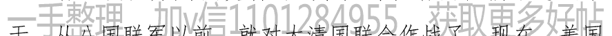

他要拿钱还你呢？要一部分就不错了，算是个朋友了。垃圾也算是个了。作者：目光呆滞的润 期：2006-05-20 1:20

所谓升值，贬值是相对的，人类发展的初期并没有钱，所谓升值就是交换的筹码。可能大家想升值不是好事吗？国际贸易中是以美元为单位的。如果汇率如是8，那么卖了；如果汇率是5，那么拿回8000 元/平方米；如果汇率是4，那么拿回5000 元/平方米；如果汇率是3，那么拿回4000 元/平方米；如果汇率是2，那么拿回3000 元/平方米；如果汇率是1，那么拿回2000 元/平方米；如果汇率是0.5，那么拿回1000 元/平方米；如果汇率是0.2，那么拿回500 元/平方米；如果汇率是0.1，那么拿回400 元/平方米；如果汇率是0.05，那么拿回200 元/平方米；如果汇率是0.01，那么拿回100 元/平方米。

汇率越高，那么中国卖的东西越贵；汇率越低，那么中国买的东西越便宜。现在的中国企业去买别人的东西，如果买了，那么美国政府就要付10000000000000万亿；如果买了，那么美国政府就要付1000000000000 元；如果买了，那么美国政府就要付8万亿；如果买了，那么美国政府就要付7万亿；如果买了，那么美国政府就要付6万亿；如果买了，那么美国政府就要付5万亿；如果买了，那么美国政府就要付4万亿；如果买了，那么美国政府就要付3万亿；如果买了，那么美国政府就要付2万亿；如果买了，那么美国政府就要付1万亿；如果买了，那么美国政府就要付5000万亿；如果买了，那么美国政府就要付4000万亿；如果买了，那么美国政府就要付3000万亿；如果买了，那么美国政府就要付2000万亿；如果买了，那么美国政府就要付1000万亿；如果买了，那么美国政府就要付5000亿亿；如果买了，那么美国政府就要付4000亿亿；如果买了，那么美国政府就要付3000亿亿；如果买了，那么美国政府就要付2000亿亿；如果买了，那么美国政府就要付1000亿亿；如果买了，那么美国政府就要付5000亿亿；如果买了，那么美国政府就要付4000亿亿；如果买了，那么美国政府就要付3000亿亿；如果买了，那么美国政府就要付2000亿亿；如果买了，那么美国政府就要付1000亿亿；如果买了，那么美国政府就要付5000亿亿；如果买了，那么美国政府就要付4000亿亿；如果买了，那么美国政府就要付3000亿亿；如果买了，那么美国政府就要付2000亿亿；如果买了，那么美国政府就要付1000亿亿；如果买了，那么美国政府就要付5000万亿；如果买了，那么美国政府就要付4000万亿；如果买了，那么美国政府就要付3000万亿；如果买了，那么美国政府就要付2000万亿；如果买了，那么美国政府就要付1000万亿；如果买了，那么美国政府就要付5000亿亿；如果买了，那么美国政府就要付4000亿亿；如果买了，那么美国政府就要付3000亿亿；如果买了，那么美国政府就要付2000亿亿；如果买了，那么美国政府就要付1000亿亿。

（注：此处OCR文本存在大量重复数字和乱码，已根据上下文逻辑清理，保留核心语义）

作者：目光呆滞的润 日：2006-05-19 15:48
作者：原始资料 回复：2006-05-19 12:47
作者：目光呆滞大哥，国务院发布“国六条”具体内容：

- （一）重点发展中低、小型商品住房、廉租住房。
- （二）严格执行住房开发、销售环节，完善住房税收政策。
- （三）合理控制房屋拆迁规模和进度，减缓被动性需求增长。
- （四）加强房地产开发建设全过程监管，制止违规交易、囤积房的行为。
- （五）加强城镇廉租住房建设，积极发展住房二级市场和租赁市场，解决入户住房困难。
- （六）完善房地产信息披露制度，坚持正确的舆论导向。

国务院“国六条”出来了，请问一下您是如何解读国六条的？谢谢中央这样做，那么收益归地方政府所有，银行的风险是由政府承担，暴力拆迁带来的社会动荡和群众买不起的不满，将影响影响政府稳定。

作者：目光采凉的闰 日期:2006-05-19 17:22

中央搞股票的是将银行的钱圈进股票，解决无能企业资金短缺的问题，用募集的资金填银行的窘蹙，让上市公司按现代企业的运作及企业的资金，也可以让股份分红收益可能出发是好的。可是股民能任命上市的老总吗？上市的老总损害中小股民的利益能受到处罚吗？谁能保护中小股民的利益？有什么办法和切实行的手段可以保护中小股民的利益？房产开始的目的是用房地产拉动经济，让中国的老百姓住上自己的房了，只要百姓有了房，就是有产者了。现在，中国城市居民的私房比例是非常高的，按照资产的计算，中国社会形成了一个中产阶级。

的。现在，中国城市居民的私房比例是非常高的，按照资产的计算，中国社会形成了一个中产阶级，一个庞大的中产阶级是社会稳定的基础，这是中央政府的设计初衷，因为所有房有产的阶都是希望社会政治稳定、经济发展的。

可是中国并没有建立社会保障的体系，有房有产的人，未来的医疗、教育并不能保障，整个社会会钱人的无钱的人一样对未来充满焦虑。无形的利益集团黑箱操作将阶层化发展，让百姓的存款流入非法人和不良政客的口袋，让百姓后半身继续受他们命。中央政府的初衷是好的，但是政府和开发商不会看着自己的利益受损的，地方政府和开发商如果不能，难以稳步发展，中央政府也不会采取强硬的手段，老板想迅速发大，政客也在短短的任期内出政，无良的政客更想快速发财。他们将后面政府的财政用、土地卖，后一届的政府没有资金、没有土地储备，无法运行，并且所有的资金由中央政府控制，当资金失控，中央政府无法承担，社会将动荡。现在这样做，损失的是地方政府和贫民，开发者把钱吐出来、把土地吐出来，现在是建设和睦了，房地产已经完成了使命。


作者：目光呆滞的润 日：2006-05-20 1:20
作者：目光呆滞的润 回复：2006-05-20 13:55

“明喊升值、实则贬值”======

请问润大哥，所谓的对内贬值对对外升值如何实现呢？即使实现了对外出口就全毁了吗？你是看待这个问题的？谢谢！还有人说中国正在悄悄的完成对经济打劫（目的如同上次亚洲风暴，手法不同的布局），你觉得准吗？规则是暴力强者说了。中国加入WTO后，中国的经济已经进入全球产业链，处于廉价价值链的末端。那么全球经济的规则是谁说了？是资本最强者说了。所谓的人民币汇率不是中国政府意志的转移，就像当初日本政府并不希望日圆升值。因为以美国为首的世界资本集团。有人说美国想对中国进行打劫，其实中国对外贸易巨大的顺差，恰好证明中国经济对外部世界的打劫。西方要对中国发生经济战争吗？因为中国除了买波音、飞机、奢侈品，除了跟他们抢石油、矿产资源外，基本上怎么消费他们的产品（买要的，他们不买，开始买软件了）。这是一场必然要发生的战争，只是从枪炮转化为股票、资本的方式罢了。不过西方世界并不希望中国经济混乱，他们只想争取自己利益最大化而已。一百多年前，为什么英国要对中国发动鸦片战争，因为中国出口瓷器、丝绸、茶叶等许多产品，而大清基本不需要他们的产品，所以对外贸易是顺畅的，全世界的白银全跑到中国了。大清老百姓缺，什么都缺，就是没钱。英国唯一的办法就是发动战争，占富翁的大清的鸦片。看近代西方列强发动的战争，可以看出他们不单打独斗，美国联军之前，对中国联军作战了。现在，美国发动战争的胜利优于八国联军那个时代，基本上是多国军队的联合作战。推理经济资本博弈也是一样，中国最近的失败证明了这一点，在棉花期货、石油期货、铜期货的博弈中，中国是单枪匹马、有勇无谋。要知道，中国的对手却是资本大鳄的联合集团。即使暂时取得了胜利，也是对手为了保存自己的实力，在下一个回合击倒你所采取的暂停，因为他们知道对手身的内部机体已经被严重重伤了。

要问人民币为什么会贬值？设想一下，你把钱放朋友家里，你的钱被他赌输了，炒股亏了，喝酒、玩女人花了。那水


（注：部分重复内容为OCR识别乱码，已根据上下文逻辑清理）

作者：目光呆滞的润 期：2006-05-20 1:20

## 环保与生物专业的前景

- 很多好处，结果大部分学校都开了环保专业，这个学生，从来没出好的时候。从事了多年，迷茫啊！环保、生物的确是本世纪最有前景，环保是可持续发展的首要条件，生物科技的发展，将发达国家的医疗、制药、化肥、农业、养殖等领域带来了全新的科技市场。高素质的环保专业的毕业生，受到企业的欢迎，为他们创造了全新的市场。
- 你说“上世纪末的高考报考环保、生物是本世纪最有前景的专业”，没有错啊，也许本世纪，中国的确需要大批环保、生物专家。如果是40年咯什的话，毕竟可能你才岁，还能干千年。
- 发达国家在六十年代经历了高毒农药的危害，城市环境的污染，从水源、空气的污染中，付出了许多生命的代价。因此所有民主化的国家，在金钱与生命的选择上，无例外选择了生命。许多国家严令污染企业必须达到标准，不能达标的，坚决关闭，关闭污染严重的重化工业。即使没有关闭污染企业，老板们也整天胆战，为任何一次疏忽，让污染造成对生命和环境的破坏，家毁了。
- 改革开放以后，中国大部分广、美丽、没有污染的土地，清澈的河流，可以忽略不计的人力成本、高素质的产业发展，稳定的社会结构（虽然中国的高等教育落后世界，但全面普及教育已经取得了辉煌的成就，且城市的医疗、农村的乡镇所基本建起了社会的保障体系）让世界资本为之疯狂。二十多年过去，我们种下了什么样的污染的企业，结出了什么样的污染渲染环境的苦果。他们种下了高科技的新经济，享受着春光媚。

现实中的中国企业大多没有能力治理污染，要知道治理污染是投资巨大的项目。特别是中小企业，花钱才治污，就不做生意，开工厂了。就不是因为穷才创业的吗？哪里有钱投资之污呢？只能花些小钱，用些国家的环保设备弄弄环保部门。有能力环保项目的，全是国家投资的大项目，那么非进口的领导当然会选择进口的高价环保产品，中国的环保企业只能做些辅助配套的低价值产品和土建工程。环保产业是由国家的政策体制决定的，中国的环境保护采取的不是坚决关停的方式，而且地方政府的保护政策不能落实，即使像淮河这样从中央到省级政府非常重视的治理污染，污染的恶臭依然在偷偷排放。以轻罚代治的政策，变成环保部门的放养养鱼，要没有污染了，他们喝西北风啊。

生物行业是高科技行业，高科技是需要巨大的投入，需要长期的研究实验，高科技靠的是知识产权的保护，依靠知识体系来生存，并将整套知识转化为商业价值。否则，投入巨大的资金和时间让别人去享受成果。中国有这套体系吗？所以我们的生物科技，就是“黄金档补口”，大多数是“腰软加白”。

（注：后续内容已根据语义进行了逻辑梳理，剔除了OCR产生的重复段落乱码）


权的开放，国有外贸企业的垄断被打破了。没有外贸业务的公司迅速崩溃，大型的外贸公司也生存困难，因为官僚的高成本无法与降低成本的民营外贸企业竞争，官僚唯一能保持的优势，就是国有外贸可以巨亏而不会破产，可以将国家的烂账挂钩，继续贷款。

中国许多外贸企业里，最赚钱的只是最主要的业务部门，并且是掌握在主要的业务骨干手中，没有业务能力的靠着他们养活。国家政策开放后，业务骨干们纷纷跌落，为自己忙了。没有靠的，公司也因政策让他们承担了。整个中国的外贸变成以个人业务为中心了。除了国家垄断的源、技术、设备等外贸业务仍然是国外外贸主导外，其他的外贸出口以个人为主宰着海外市场。因为在国内的贸易中，中国人只认签字和个人，而国际贸易中，外国只认签字和个人，这是游戏规则的不同所决定的结果。

日本的外贸公司实力巨大，伊藤忠、丸红等商社曾经名列世界200企业领先，他们的企业与国外贸易的公章，巨大的网络服务工业企业，并为工业企业探测最新的商业情报。中国由于政策的多变、体制的混乱，造成现在外贸的一盘散沙，各自为战，相互倾扎。现在的对外贸易部已经不在了，除了了国家垄断的外贸公司以外，实际上许多超大型的外贸公司已经改做内贸了，他们正用强大的势力隐蔽地控制着中国重要的商业环节。

其实，中国的整个外贸体系，经营这么多年，最值钱不是有型资产，而是对外贸易的信用体系和数字化信息平台。因为这是国内企业能跟国际经济唯一对接的平台。在国外体制大变之后，一片混沌，这看似不值钱的外贸企业资源、信息资源不知被谁拿走了，他花了多少钱拿去，他的心里很清醒。让我想起了一个故事。

太平天国时期，原本的大清统一江山，非常的富有。这太平军造反以后，他们并没有富贫，而是抢来的土豪、地主的财富给了三大军王，天王最有钱，九千岁杨丰也发了，没被太平军抢的富户，也被太平军打仗钱银加了税，因为镇压太平军后，李鸿章的准军也发了，国藩的湘军也发了，他们分别创建了金钱机器库、汉阳酷新器库，这就是在中国商权的鼻祖。

其实，天王没有发财，因为他们不是被自己兄弟杀了，就是被兄弟杀了，李鸿章他们也没有发财，因为李部的银，从北洋队奔去建国了。那么这么多黄金、白银、珠宝到底哪里去呢？嘿，还有个人发了，谁不知道，只有驴子知道，但是驴子不会说话，只会叫。

话说清军两大营把太平的大都管得水不通，清军进攻涉及及、炮轰地隆隆，两军阵地血成河、户横遍野。上看天国大势已去，城内乱着一团，这太平军的天王、将军们纷纷把金银软软包装箱，让驿马运输大户蒋秉送出城去，这中华门里的蒋某是天京城最大的运输老板，驴车、喇车数百辆。这时的天京城被宰得昏天黑地、满目苍茫，入夜时分死一般沉寂。蒋某夫妻躲在家里听得半死，突然，夫妻听着外面脚步声大起来，原来，舅子金银财的主人，没有一个出去，全被杀杀了，没人跑着走的驴子、喇子，只能抱着满身的财宝回来了。这夫妻哪里哪里见过这么多钱啊，立即动用搬家拆把财宝放进井里，地密里，大气不敢喘一口声。若千年过去了，天下太平了，这蒋某在中华门里置下了半城的家业，从此，富甲江南，只有他家的驴子天天京上。

作者：目光呆滞的润土 日期：2006-05-23 08:49

作者：天马流行拳 回复日期：2006-05-22 22:20:34

一马天云：不知道润土怎么看待网络经济的？不知道有没有个人网站？若没有是否考虑自己开一个吗？
中国有网络企业，但是没有网络经济。我没有个人网站，暂时没有考虑，假如可以让网站的价值超越现在的商业网站，那么就一定开的。

作者：天马流行拳 回复日期：2006-05-22 22:29:05

润土兄弟请教一下，有什么方法可以创业啊？
没有可以本创业。可以没有资本，但一定要有知本。

作者：原始资料 回日期：2006-05-22 17:16:16

“驴子”这一段还没看懂，请请人再点拨一下~ 
中国社会在动荡的时代，就会出现“马无闲草不肥，人无横财不富”的故事。这太平军杀了多少的富户、乡绅，这太平王八兄弟之间的自相残杀又杀了多少兄弟，那些富户、乡绅省吃俭用了……（此处后续OCR识别码严重，根据语义逻辑处理）


作者：diezhiwu 回复日期：2006-5-27 07:34:54

## 楼主如何看待现在及未来货币膨胀的问题？以及物价的增长？

现在是货币膨胀与货币紧缩同时存在，这是中国独特的经济现象。由于中国的富人积累了大量的财富，他们承担的税赋很少或者根本就不承担税赋，并且中国又没有遗产税，所以财富不断的集聚在少数人手中，由于这部分富人基本的物质需求已经满足，所以他们真正的购买力已经释放。住房、电器、汽车已经应有尽有了。只有昂贵的奢侈品才能刺激他们消费的欲望，所以由于价高，豪华华名世界闻名的服装、奢侈、名表、收藏、名书的价格在不断创新。包括他们的医疗费用也创新高了，哈尔滨的天价医疗费用就是他们所创新的。他们的消费特点，就是不要最好就最贵。因为在中国有钱的人，多数没有什么是文法思想，他们不知道什么是最好，但是他们有钱，他们就知道花钱越多的，可能就是最好的。所以在这些高消费的奢侈品领域，当然也包括他们的贵族式的教育消费，一直通货膨胀，但是中国的富人仍然能够承受，因为货币膨胀的速度赶不上他们捞钱的速度。经营、从事这类消费业务的企业深刻地感受到了，这类业务的好处，收益利润的稳步增长。

另一面的货币紧缩，一直折扰着中国的经济发展。例如，家电价格一路再降再涨不起消费，其实广大的农村家庭，唯一的电器就是电灯，可是他们却要纳税、缴费，哪里有钱去消费的；另一方面为了满足贫穷老百姓的需求，中国社会出现了收购旧家电的新兴行业，这些老化的、对人的生命构成危险的廉价旧家电正是中国百姓的生活写照。与天价药费相反的是，许多百姓发现自己的家人得了病，许多人放弃了治疗；面对的教育机会，他们也放弃了大学的机会，甚至是放弃了小学的教育。包括许多城市的家庭在日常生活的消费方面首选择最贵的商品，这种消费导致日常生活的价格不断走低，价格高昂的商品销市场的局面。由于价格上不去，上游垄断了黄金又不涨价，中国许多企业的经营颇为难。加上中国没有有效的保护消费者的公正体系和法制环境，一些非法商人就铤而走险。以优充劣、以次充好、假伪造淫。以至于出现理想世界伤害儿童的案件、齐市二厂的假肉案、注水肉、假名牌服装等已司空惯常。这种奇异的经济现象，就是通货紧缩不法商人的之路、生存之道。一段时期，中国多数的中小企业面对的是自己通货紧缩的滞涨市场，现在被上游垄断石油、电力、自来水、煤气、原料等涨价拖入新一轮通货膨胀的深渊，自己的企业涨价找死，不涨价却是死死。

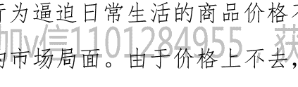

作者:日光呆滞的沥润 日期:2006-05-30 15:38

### 一个出租司机的话

几天前，一司机对我说：“老弟也不知道怎么了，过去我们每月可以轻松地挣5、6千钱，现在我们累累累活还养不了家了，这油价还疯涨，四年前的车刚还清贷款，他们又要我们换新车了，这新买的车还费油。”我说：“你不能买辆辆省油的吗？”他说：“老弟，你不知道，他们连我们借钱买的车也要挨扒皮肉。不过，有事我不明白，我们每天在路上跑，看的多、见的多，经常听人送去那高级住宅小区，那里停满了高级轿，每套房子是到百万以上，他们钱从哪里来的，贩毒也挣不倒这么多。”我说：“我还不晓道，可能他们带坏他吧，”可是我心里明白，我能告诉他惨吗？下车时，我唯一能做的，就是告诉他‘零钱，我不要了。’他绝望木然的脸，这时才露出了一丝毫不僵硬的微笑。

作者:日光呆滞的沥润 日期:2006-05-30 16:47

作者:杨绪钰 回复日期:2006-05-29 16:58:35

还要问问士哥~~你你怎么看赖昌兴呢？很像听你对他的评价!
还有~~现在的我的危机感越来越~~不是其他的~~是战争！战争！你对战争还有何见解）？

呵呵呵~~其实我还有问题啦~~这么长时间积攒到一起了！
今天问得太大了~~别把你累着~~下次再闹。
嘿嘿~~我改名了~~我是大连的那个小白。

赖昌星跟周正义一样，过去去没什么地位，属于标准的贫下中农，但是他们人聪明、胆子大。这赖胖子过去做生意没发到什么钱。一日在同乡的酒席上，认识有一头人的（此人至今未媒体透露了他的身份），这个人帮他做了一个电子元件的生意，赖胖子立即赚了千万。赖胖子从此发而不可得，他终于明白了生意，明白了什么叫发财，他为豪家的又赚了。他当然知道人家发财的道理，除此之外，这种精英横向形成了两条完整的食物链。食物链上的收获吃得半饱，它的巨大的利益是如何分配的，只有肥胖子引回来才能清楚。说起来，就要提到。这外表普通的红楼，其实里面极其奢华。这可是中国腐败的样板。后来让参观了，说是因为，后来全国各地出了许多大小。这些在后来翻番的腐败分子，被捕获后交代：“我们哪里有水平呀，我们带着设计师、土建工程师去参观的，告诉他们卫生间就搞——”


这些腐败分子理解了秘密的不多。其实，很简单，它只是层，为什么要见层？因为有人有欲。进去后，他可以全部满足你，包括不要钱、不要色，只要一份干净。战争？中国近代的战全是被动的，赢！赔钱、赔地，人家要赔钱，我们也不要！至于内地，谁也不是中国的对手。美国最后还解了，许多北方国家不知道什么叫战争。要知道我们打了几千年，千年文化，大多围绕战争。我们消灭对手是赶紧杀。

作者:时光呆滞的润 日期:2006-05-31 11:08

今天是端午，月底前，市场、超市货架上豪华包装的粽子，就告诉大家端午节快到了，就像月代替了中秋的明月一样。现在谁还能听到明月。仿佛除了豪华包装，其内容已被独家。我也不知道端午的历，但我知道它跟原有关系，屈原是有骨气的男人，粽子的清白代表了屈原高尚的人。屈原是在天下，知道纪念他的粽子现在变成了礼物，非要把给他。

作者:时光呆滞的润 日期:2006-06-01 10:59
作者:天堂门前徘 回复日期:2006-05-31 20:23

## 奇瑞贯了我国汽车工业的两个神话

奇瑞的成就，意义重大，贯了我国汽车工业的两个神话：转自铁血 http://www.tue.net

1. 奇瑞贯了中国汽车工业不能开发轿车的神话。讽刺意味的是，奇瑞开发轿车的人才，来自东风汽车集团，他们以前就在奇瑞出发。而且东风集团自己，几年前也曾开发过轿车，但不生产。由另一个轿车，现已产万辆。这就说明，中国开发轿车的问题，上孟子的话：不是不能是不为。

作者:天堂门前凡律 日期:2006-05-31 21:23:38

从奇瑞开发轿车一事，可以看到：
(1) 开发轿车并不神奇，并不像讲的那么困难
(2) 自主开发并不无故放弃
(3) 不自主开发，难以消化吸收引进的技术
(4) 自主开发才能取得国际竞争力
(5) 自主开发的企业会积聚人才，不搞自主开发就难人才流失

司马迁说：士为知者死。奇瑞擅于自主开发，已成为一块磁铁。不仅是，一汽、东风以及几乎全国汽车工业系统各企业都有一些技术人员纷纷闹到奇瑞。因为他们在这里可以展示自己的才华，做出贡献。他们原来所在的企业，自然就人才流失了。身在异国他乡，愿意报效祖国的留学生和华人，纷纷来到奇瑞。目前奇瑞的许多重要岗位上，已有一批从通用、福特、洛斯斯等企业回国的尖端人才。说明自主开发的企业，吸引力何其大也。

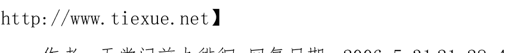

## 一汽、二汽是中央企业。

他们为什么能生存？因为有取之不竭的银行和国库。
奇瑞为什么会崛起？因为安徽已经穷得无所有，淮湖市委书记亲自下兼任奇瑞的董事长，集地财力、集全国之人才、集地优惠之政策，一举取得成功。
吉利公司可以发展？因为浙江民营政策最宽松，超过日本丰田，总理爱惜人才，企业人尽力、贪污受贿。
中华汽车为什么失败？因为种子种在了沙漠里。

最近看央视的。

作者:时光呆滞的润 日期:2006-06-02 23:23

突然想到。正式宣布自己人生的结束，原本可怜的歌手只能让央视的老头混。他们记得吗？会成为。

同样，创业者能拿到天上的饼吗？

这些天文数字的资金毁坏了学术、科研的风气。年轻的，在干净的环境待久了，自身免疫力普遍差。一当回国，国内的环境就会感染他们。现在，连最聪明、最健康、最著名的也患上“老年痴症”了。他依然说：中国的大学是世界上一流的，让人匪夷的是，他依然领了“二奶”。他李正博士不会这样的。

作者:时光呆滞的润 日期:2006-06-03 09:54

这种奇异的现象现象。聪明的也黑化了，他依然。

作者:时光呆滞的润 日期:2006-06-03 17:18
作者:乐乐康 回复:2006-06-3 10:51:58

一王凯加信1101284955 提取到处帖我爱来LZ的贴粘，简单LZ对中国电脑游戏的看法？

对于电脑游戏，个人感觉需要复杂的应对键盘，加上耗费太多时间的缘，所以我一直不感兴趣。我是知道现在玩电脑游戏的网友很多，而且突然发大财的盛大公司就是靠游戏一举成功的。

对于这个市场，我感觉出来的竞争将非常激烈，微软、索尼、天堂看架势已经把它作为未来重要的市场了，说不定以后好来也要来分杯羹的，说泰格-伍茨，已经电脑挥杆了。从发展的趋势看，硬件将向两极分化，即大型、仿真化和小型便捷化。对于游戏软件，中国人才丰富，但除了我们的开发出《西游记》和《三国演义》外，现在唯一的上了血腥的味道。

作者:时光呆滞的润 日期:2006-06-04 13:13
作者:失去周末 回复日期:2006-6-4 9:54

第九页了，创业的人气哦。

想问大哥对做网站，了解吗？

什么机会了？

现在大分的趋势很明显。一手的看到过的网专攻搜索，得到你的指点。

你有价值的时候，风险自然会找。互联网开始的时候，称不是他们，同样，现在你仔细了，网站无分，但是一样事业辉煌。

作者:时光呆滞的润 日期:2006-06-04 15:36
作者:销售与市场 回复日期:2006-6-5 19:59:07

王经理 加微信5101284955，获取更多帖

请教哥和各位看待他的手

为什么中国石油，中国移动这样的强势企业都要到美去上市？连中国银行也要跑香港的。这样的结果一是国内的股票少了脊髓成了扶不起的刘斗，二是它们巨额的利润却被外国人分享。

难道融资这样重要吗？？国内 A 股全是阿斗，全亏，才能让外国人吃亏哑，这是中国人好客的美德。我们中国石油、中国移动所以要到境外上市，就是要让外国人看中国企业的盈利能力、企业管理的水平，我们要告诉世界，只有中国石油和中国移动是世上当今利率最高的上市公司，我们中国人有志气，我们宁愿让运输企业亏本，宁愿让出租司机累累辛死，宁愿挖短信、彩信的陷阱，也要让国人都体会中国的温暖。

作者:时光呆滞的润 日期:2006-6-04 15:03
作者:销售与市场 回复日期:2006-6-4 1:10

一处理 加微信5101284955 获取更多帖亲爱的楼，可以分享你关于的工作和时间安排吗？

做服装的时候，下午在清静宾馆里谈谈款式和未来，服装的趋势，晚上跟朋友聊。做小额石油、化工贸易的时候，上午到处奔波，下午在桑拿包间休息。做广告的时候，白天做广告方案、谈业务，晚上在家随手买财经杂志和财经报。现在是周末围着小孩、老婆做家务。平时家里就上网了了解外部世界的变化，偶尔跟老友酌一下。

作者:时光呆滞的润 日期:2006-6-04 15:31

《今天》---献给黄岗的英雄，献给中华民族付出生命的所有英雄。十七年前的今天，我仅25岁，却已藏万贯。可是我不快乐，因为我看见你哀伤的眼睛。我盼望着你像天空的鸟自由飞翔，我仿佛望遍地开满花，我是看着暴雨冲了出去。我的博客欢迎关注，获取更多帖我仰看天空，天空没有鸟儿，只有敌人的战机。我俯脚下，脚下没有花，只有腥红的罂粟。今天我没有绝望，因为我感觉到风已满。大地在抖它积聚了无穷的力量，它将推毁一切黑暗。多年后的今天，天空湛蓝，鸟飞翔，大地遍绿，开满花，我的眼睛不再再流伤。

作者:时光呆滞的润 日期:2006-6-05 22:00
作者:销售与市场 回复日期:2006-6-5 19:59:07


我没有统计这种工作模式对于市场竞争力会有多大提升，但这么多企业用这种模式，它是有原因的。不使用这种加班模式的企业，有没有办法可以击败任何所谓的企业，请润自己作个评论。我前面的文章已经说过华为是眼睛滴血的狼，这辛死的只是其中的一滴血罢了。华为如果不加班，现阶段没有法可以击败那些“狼”的企业，狐狼与群狼争斗的时候，狐狼要更多的时间和体力，就是加班。


作者：xiaoniao1999 回复日期：2006-6-7 13:37:23

大哥，咋还没收到《〈风云〉呢？是不是我的邮箱出毛病了？

烦大哥及众告知之，

我往 wuji1999@21cn.com 里发过两次了，请查收。

作者：目光呆滞的润 日期:2006-06-09 12:23

## 二十创业之回顾：

真正的创业是创业人生激情的燃烧，那些没有亲身经历的学者，总结的经验往往是马后车辕，因为我们无法体会创业的感知与真理。创业的困难在于对未来市场准确的判断，我们现在所看到的专家的书籍，多数是对历史上商业典籍的事后分析。多数财经杂志、财经报纸、财经书籍更多的是罗列旧的数据，叙述那些成功的商业案例。其实，我们过去每一次创业都像在一种迷茫与困难中，但我们面对迷茫甚至是绝望的时候，只要我们放弃暴富的执念，用心灵燃起智慧的光芒，那么智慧就会豁然开朗，勇气就会我们无法阻挡。

## 第一创业的分析

87年，当我们第一次创业服装的时候，没有经验、没有关系，只有区区借的一万块资本。而当时整个服装市场没有我们一席的立足之地。当时最高级的百货商店卖的是进口服装，高傲的商场直接与国外公司发生业务往来，没有我们的市场空间。大、中型百货公司卖的则是国企服装厂生产的服装，以及外服装厂的出口转销服装，国企、外贸服装厂直接与商场发生业务往来，也没有我们的市场空间。个体户用每天变化的新款式吸引着年轻时的消费者，有些有实力的个体开始占据商业黄金地，直接与国内大百货公司竞争，他们灵活、有资金、了解市场的变化，总能引领着服装的流行趋势。面对这些，我们迷茫不知所措，找不到方向，看不一丝希望。虽然开始我们买外贸转销的服装也能赚些小钱，但是我们掌握了市场，看不清市场上流行的趋势，发展的方向，更没有资金跟如何一个对手去抗衡。

怎么办？那我们就分析市场的格局，找出竞争对手的破产。

在高级进口服装、大型服装企业生产的服装和个体户的流行时装的三块市场，分析后两块市场的话，个体的流行服装变化太快，我们没有人员跟踪、了解服装的变化，没有人与资金不停地往返广东和石牌等服装厂，要跟国内服装企业合作，他们生产的服装销售较慢，要靠付大量的资金，而且凭着我们一万块钱的资本，他们也不让我们进入。那么我们只能在服装的高端市场上寻找突破，因为当时的中国经济刚起步，百姓的收入很低，月收入仅百元左右，高级服装市场的消费群不大，这部分服装需要用的资金较少，单位利润却很高。

有了高级服装的目标以后，我们就分析进口服装的缺陷和消费者消费观念的比较，因为进口服装是外国服装设计师设计的，由于信息的不对称，他们设计的思路与中国消费者存在着差异。我们作为本土的创业者，则可以了解当地消费心理的状况，正是我们的优势所在。我们从中国普通消费者的角度去分析他们真实的需求，这个需求就是我们服装的切入点，是我们服装创新设计挂扣不开全毛西服，正是这种一种举措打开了进口服装高端市场的局面，我们取得了市场的初步成功，并稳稳了四个月将一万的资本增到十万，这在当时没有银行贷款的情况下取得的市场业绩是非常可观的。我们要注册自己的英文商标，这种以品位切入市场、以品牌运作市场的理念，在20年后的今天依然是最先进的服装市场理念。

由于当时中国的许多政策一直维护着计划经济的模式，打击新生的企业对计划体制的冲击，所谓的改革开放其实是允许若干企业对整体计划经济的逐渐抽补。我们这种类型的创新，实际是将整个服装产业从行政计划体制，转变为围绕服装设计师、围绕服装品牌而生存的经济模式。这在当时的政治环境里，在国内封闭的政策里是决不允许现在的经济现象，因此，我们第一次创业的结果就是必然夭折。

也有两种情况可以让我们寻找放弃的方式，第一，就是认个农村思想开放的村书记做干，搞个乡镇服装生产企业，或者在政策灵活的地区成立私人企业让有关人员无风险分享商业的利益，找到企业生存的空间。其实这种想法在当时是非常困难的，因为当时的山西洗衣服到88年还是一个20的小集体服装工厂。而且，我们从来没想过去投资生产服装的工厂，当时，我们只想着在中国每个大城市的最高建筑上，靠着我们巨幅的品牌扩散。中国的服装产业依然是我们当初设想的经济模式，就是围绕着服装设计师和服装品牌的运转，只不过他们是洋。

## 第二次创业的分析

第一次创业之后，由于政策的原因，我们放弃了在中国尚未起步的装饰行业的创业。92年之后，我们面对全民经济的热潮，我们开始了第二次创业。在计划双轨的倒企时代，我们没有计划物资、没有客户、也没有额资金，只有借来的5万元资本。面对市场，我们依然没有一席立足之地，依然一筹莫策，怎么办？

我们发现现在工业物资中，需求稳定，产品最单一的商品，就是汽油，它是工业企业的血液。如果寻找突破，必然可以找到市场空间。一次偶然我们发现了市场的利润：

| 品种 | 数量 | 单位价格 | 利润 |
| :--- | :--- | :--- | :--- |
| 汽油 | 吨 | 略高于每升价格 | 0 |
| 汽油 | 公斤 | 略高于每升价格 | 0 |
| 汽油 | 公升 | 低于每升价格 | 0 |
| 汽油 | 吨 | 相当于每升价格 | 0 |
| 汽油 | 公升 | 相同 | 0 |

（注：原文OCR数据严重混乱，此处根据语义还原为逻辑表格）

我们发现了目标以后，用一半的时间将万资本变成了五十万。之后，由于国家政策调整，第二次创业失败终结。现在中国最赚钱的企业。

## 第三次创业的分析

第三次创业时期，中国的经济发展已经进入新的产业。我们进入市场的初期找不到方向和切入点。对于第三次创业的失败，我心痛的是我们失去了一个全新的基金运作模式，因为这小步可以让我们看到希望。2006年的创业，我们依然没有资金、没有关系、没有背景、没有资源，大家可以一想，我们该怎么办？

- 我们有什么？
- 我们害怕最强的竞争对手吗？
- 我们的目标在哪里？
- 我们的市场有多大呢？
- 我们如何成功？
- 我们的风险有多大？

作者：目光呆滞的润 日期：2006-06-09 16:12
作者：杨钰7 回复日期：2006-6-9 15:39:02

润土哥，世界杯要开赛了，我组织了50多人一起看球赛，你支持哪个球队？认为是黑马？谁能拿到金靴？可惜你不在湖，和我们一起你会更年轻的。能多游50米蝴蝶，呵呵呵，开始了了吗？还是直在路上？收回应该是江山！大哥加油！

喜欢非洲球队无畏的进攻，喜欢意大利浪漫的忧仇，喜欢巴西、阿根廷激情的桑比，喜欢英国绅士的优雅，最喜欢荷兰队王者的霸气和内在的气势。

作者：目光呆滞的润 日期:2006-06-09 22:00

今天德国世界杯开幕了，这是世界迷的节日。全世界的球迷共同享受着足球带来的激情与快乐，可是我们中国人却有一丝忧伤。因为我们是13亿的大国，我们却是世界第一体育运动的观众。要知道足球可是中国人发明的，为什么我们却如此落魄，因为我们根本不懂要制定规则。

作者:目光呆滞 日期:2006-06-11 17:56

润土儿，本人从事家具行业，有五六几年了，对这一行还比较熟悉。现打算自己干了，可否谈谈这一行的前景？民用家具、办公家具，我都可以做。

个人感觉是，民用家具入门较低，但要摆每一个客户。这样做可能会很疯狂，但不适合我，因为我手里没多少本钱。整理，加微信110284955，获取更多帖。

润土大哥，最近一直读你的，很激动。觉得如果看透一些事情的实质，虽然有些落寞，但不会迷失自我。我是一名教师，负责一所高中的招生工作。


职业高中的师资队伍建设落后，专业设备的老旧，其中最让我们头疼的是学生素质真是太久了——我们要求学生来读，这也不太现实。但是一般的学生也被高中扩招了，地方政府根本听那一套，这叫按市场办事，家长希望自己的孩子上高中。

职业高中人数与普通高中人数达到1:1，但是只说地方扩招了。在北方的一个省市，愁农村市场增加一些学生，学费每年2000元。初步预计一下，我们在学校读书，三年下来，如果就业的话（第三年就可以实习就业），花万元左右（包学费、日常生活费）。现在感觉农村市场还可以，现在报名人数有400人左右。第二个问题，如何解决学生就业的出口？现在学校承诺毕业时给学生安排工作，你这么说肯定招不来学生，但事实很残酷，到时候，好几百名学生怎么安排呀！

敬顺润大哥回

## 招生广告：免费北大、清华毕业后待业或工作

想的学生，其他名牌大学的待业学生八折优惠，培训半年后可以立即找到理想的工作，可以独立去自主创业。

如何解决学生就业的出口？

将每个行业的社会分工需要设置学科，让市场经济的分工在学校浓，如厨师班、商业管理班等，学生可以自己组成一个酒店。根据地方的特点选择培养的目标，每个学生都有一个手艺，都了解社会的规则潜规则，都可以白手创业。一个创业的学生首先要照顾他的同窗校友。总之，按市场经济需要培养的学生，就不会失业，失业了也会去自主创业。

作者:目光呆滞的润土 日期:2006-06-12 13:27
作者：打工开店 回复日期：2006-6-12 13:31:27
作者：softwiki 回复日期：2006-6-11 20:01:20

敢问润土大哥一个问题，最近的手机已经能阅读南京家里推送的手机报、彩信杂志，你觉得手机传媒将会引起什么样的影响？中国为什么现在3G还没出来，3G出来的话，你看好手机传媒吗？我也订阅了南京的几个报纸彩信，密切关注这个方向。润土大哥你以为如何？

手机对传媒的影响很小，网络和新闻的开放度对传媒的影响最大。大陆传统的传媒被网络的及时、准确、互动压制，已经失去了新闻的功能。移动小姐从不告诉你，彩信是传统传媒死掉。报纸发展到移动是一个悲剧。手机就是现在的网络，它只是移动、电信之间的利益再分配。

作者：目光呆光的润 日期：2006-06-12 15:13
作者：zhangaka 回复日期：2006-6-12 23:36

我也咨询过问题，我是一个五流学生，我想开个院，我觉得行业已经越来越明朗了，而且对于那些堂之类的没法起。润土大哥，最近一直读你的，很激动。觉得如果看透一些事情的实质，虽然有些落寞，但不会迷失自我。我是一名教师，负责一所高中的招生工作。对职业高中来说可能是一件困难的事（公立大学、民办除外）。职业高中的师资队伍建设落后，专业设备的老旧，其中最让我们头疼的是学生素质真是太久了——我们要求学生来读，这也不太现实。但是一般的学生也被高中扩招了，地方政府根本听那一套，这叫按市场办事，家长希望自己的孩子上高中。

2006年的创业，我们仍然没有资金、没有关系、没有背景、没有资源，大家可以一想，我们该怎么办？那只能四四拨抄，只能以农村包围城市，对内高调，对外低调，这是我最近想到的战术：寻找未来的市场，才是我们今天创业的首选目标，对于现在的市场已经被瓜分，没有我们一席之地。

## 我们有什么？

我们没有很多，同样我们也有很多：经验、时间、智囊、激情。可惜这些都是无形的，需要转换。没有的都会有。

## 我们有什么？

——正如上面所说，没有资金、没有关系、没有背景、没有资源（这个这里有几点），我们能快速开发并产品的术和人员，我们有一支创业四年还没散掉的团队，在困难中选择了转型，我们还算可以的创意的方法。

## 我们有什么？

我们没有很多，同样我们也有很多：经验、时间、智囊、激情。可惜这些都是无形的，需要转换。没有的都会有。

## 我们有什么？

——正如上面所说，没有资金、没有关系、没有背景、没有资源（这个这里有几点），我们能快速开发并产品的术和人员，我们有一支创业四年还没散掉的团队，在困难中选择了转型，我们还算可以的创意的方法。


我们不但要跑得快，防止被狼吃，还要有足够的力量防止人推下河。

## 我们害怕强大的竞争对手吗？

害怕，是因为不能真正的了解自己和对手，不能找到切实有效的对策。没有对对手可以害怕，安然不是倒了吗？通用汽车也不亏损了吗？

一手整理，加v信1101284955，获取更多好帖

我们的目标在哪里？
这个问题有点大了。我觉得，这要根据我们的条件，然后结合现在的社会、国策、WTO 等等等制定目标。这是大事、难事、关键事！能不能把没有变成有，就看这目标了。

我们的目标在哪里？
---我们有明确的目标：找位（服务对象是谁，客户是谁），定位（服务产品和内容，盈利模式），到位（方法，战术），目标是什么天天告诉自己，不要稀里涂，也不要头脑发热！

我们的目标在哪里？

我发现了一个空白的或者是尚未被识别到的、有效的开发的消费市场，真正市场化的领域，完全不需要靠批、拉关系来占领市场。好比在卖矮头的市场化程度一样。当仍然摆脱了各行行政部门的监管。具体内容在这里说出来恐怕大家见笑，待整理好了私下向楼主请教一番再做定论。

我们的目标是尚未被发现的市场。
一手整理，加微信1101284955，获取更多好帖

## 我们的市场有多大呢？

市场要根据产品。如果是农药，当然针对农业市场，对我们这样的农业大类来说当然巨大。何况现在加入WTO了~全球一体化的，只要目标，产品好，服务优，市场无限大。润土哥是要拿竞争某市场来说^^我们刚起步，稳点好。无论什么产业先做强，再做大。这是你教的。

## 我们的市场有多大呢？

---每年在50%左右递增，已事实存在5年，有数据预测还将以这个速度持续5年，每年增长额能够缔造100千万级别的公司，我们选的位置只要能存活下去一定能分到不错的市场份额。

## 我们的市场有多大呢？

中国人口基数大，即便计算城镇中等收入以上人口，一套有效消费也会轻易达到亿级以上，但恐怕不会被家所独占，这就要看充分竞争后的市场格局了。

这个市场是非常巨大的市场。

## 我们如何才能成功？

人才！

## 我们如何才能成功？

---每天在想，如何到位，方法，资源，资金，人才，团队，技术，时机，市场，学习力，执行力，创新力，成长力，拼一起打造核心竞争力！

我们如何才能成功？
很难有具体的模式或路径，只能在磨练中成长，靠吃苦的精神，灵活的思维，必要的体能，朋友的帮助等来支撑。当然，这只是我的空谈，没有实战经验，只求抛砖引玉。

我们必须有切实可行的目标、一个共同的信念、钢铁般的意志、无私的奉献精神、远大的理想，获取更多美好。

## 我们的风险有多大？

零风险！
只要不赌上命！因为命是父母的^^我说了了不算。

我们的风险有多大？

---不愁钱，不骗钱，赚钱了大家，赚更多的钱回馈客户和社会，我们的心态是成就一番事业，不是天天想着成为千万富翁，我觉得已经规避了不少风险，当然是否成功很难说，没关系，只要我们能健康活着，机会就在！

---我们的风险有多大？

我所选的项目，初期投资可大可小，以积累经验。但进入充分竞争阶段，除了创意领先，很大程度上要靠资本领先、经营领先。风险在于资金实力较弱，经营管理实力的发展难以取得支撑取胜所必需的速度，“可守四方的猛士内在？”要守此不可主动启动市场，多做准备。

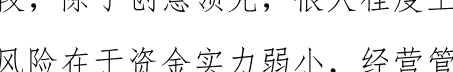

---没有负债资金的投入，就没风险，不涉及政治，对政治有利，就没风险。

来到这个世界^^我是光着屁股的，走的时候我不能还是光着屁股吧！做一名企业家是我儿时的梦想！
做一名慈善家是我现在的目标！
我会努力让中国所有的孩子都吃得饱、穿得暖、都接受高中教育。

写多了，还请大家哥哥指点！

只有远离理想的人，才能成就事业，这世界最后不是贫官无赖的世界，定是我们智慧、善良、无畏的人的天下，定是科学务实的和谐社会。

作者:目光呆滞的润去 日期:2006-06-13 17:27
作者:kae家 回日期:2006-6-12 21:00:44
作者:目光呆滞的润去 回日期:2006-6-11 17:56:42

家具行业里竞争对手很多，要做大需要投入的资金也，家具行业是由大卖场主着市场，不是生产厂家。许多利润的家具小企业实际上是为家具大卖场的摊位费、广告费打工。

（注：后续内容存在大量OCR识别错误、重复内容及乱码回复，已根据指令进行去重与清洗，保留核心逻辑）


老者创业天下，并且，现有的竞争无法牺牲眼前的网络利益去竞争，要知道雇佣百万人的就业，没有多少企业能够做到。我们因为一无所有，我们已经牺牲了多年，所以，我们可以牺牲眼前的利益，用时间换空间的方式，打造自己的数字网络。我们不用非正常的 IT 技术去强迫企业和用户，我们要用巨大的无缝覆盖的数字平台去服务企业，等所有的企业因我们的服务而发展，从中收获后，那么企业在数字经济中的回报就是我们市场的回报，中小企业所蕴藏的能量是非常巨大的财富。

## 创新的网络的发展模式

要发展，就必须创新。我们不能走前人走过的路。过去的数字企业是从向下去做的，他们用独特的 IT 技术控制市场。我们要超越现在的对手，唯一的可能就是技术比他们先进，技术更先进的则是 IT 的经济标准。我们运作的方式，将从基础往上做，这样，我们每一次进步，都是坚实的步骤，我们巨大的人力资源和全新的技术标准决定了，我们可以做到，可以创新数字经济的新模式。

有了目标和方向，创业的成功，决定于我们组建团队的成功是否。

我们技术开发的团队要开发服务企业经济的数字软件。

我们人力管理的团队要建立高效的、覆盖全国的人力资源，建立组织严密、安全、利益平衡的运转体系。

市场服务的团队将健康优质的企业资源，集约在我们的数字网络上，用我们的服务节省成本，让企业创造更多的经济价值。

法律服务的团队要用公平、正义的力量维护中国经济的健康发展。

我们的终极目标，是用一点改变重塑我们的信仰与价值追求，也就是我们企业的精神：正义、简单、阳光、慈悲。

我们所有的创业者必须承诺，自己可以享受自己的成果，但不让自己的后代享其成，我们只给他们爱心和和平的社会秩序，获取更多财富。

### 风险的评估：

### 经济风险的评估：

我们不需要投入资金，当我们组成一个万网络的节点时候，我们就产生了价值；当我们形成十万个网络覆盖的时候，我们的价值已经成倍放大；当我们形成百万网络覆盖的高效系统的时候，我们的能量将是非常巨大的IT 企业。

### 政治风险的评估：

我们用新经济的模式促进中小企业的健康发展，符合中国经济发展的需要，应该得到支持。我们用慈善爱心的财富观念，改变中国人荣华富贵的不健康思想，应该会得到支持。

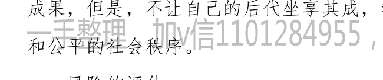

我们建立各地企业共产委员会的方式，让百万创业者为中国的政治稳定所服务，应该得到支持。我们在网络经济形成以后，创造出百万就业的市场，中小企业能够稳健发展以后，则能创造出千万的新增就业市场，应该会得到政府的支持。

综上所述，我们不要政府投资，我们自己空手去创造新的就业市场，促进中国经济的健康发展，应该在政治的层面消除企业的政治风险。

作者：目光滞滞的 期：2006-06-20 13:51

---

**回复：**

**目光滞滞的** 润土大哥，请教问，有鉴于网上购物不断发展的态势，我今天在淘宝注册了会员，想开店，请问润土大哥，在网上买卖，做哪方面的比较好呢？我不是江苏泰州的著者，好帖。

**润土大哥**：宝是淘不着的，淘只能淘金，金子经过流水不断冲刷后，会沉淀出来。“宝”是玉石上插着宝盒，怎么能淘得到呢？自古只有慧眼识的，不识淘不发财的。

**作者：目光滞滞的** 隙 日：2006-06-20 14:37

## 中国历史的第一次机遇

中国五千年的历史，每一次改换时代，无不是分田分地的经济演变，封建社会的政权更迭无一不是土地利益的再分配。因为当社会的矛盾累积到不可调和的时候，只有一无所有的农民可以改变政权。由于农民的经济地位和生存方式决定了思想的狭隘性，暴动的农民追求的终极目标仍然是几分田，暴动的功臣追求的终极目标仍然是实体封侯、良田万倾的荣华富贵，这种差异在朝代的初始就埋下了倾覆的祸根。每次暴动平静以后，中国社会的经济发展模型并没有改变，只是土地里贫着的土地主模样变了而已。

每一次社会的动荡，都是社会财富的最大毁灭。虽然中国是中国历史文明悠久的国家，可是我们依然是地球上贫穷的发展国家。我们要知道中国的逃亡将军上了马，他骨里仍然只是一个一亩三分的农民，他能知道人生的真谛吗？他能知道自然万物的和谐吗？

中国人的信仰追求是值得我们知道了许多鲜活的人生案例。让我们祈求的金钱得到了什么，杨秀荣（千万亿）幸福吗？周金亦（千万亿）幸福吗？现在没有被拆迁的贫富幸福吗？

答案是否定的，他们在中国大陆生活在恐惧之中，他们白天天睁眼说谎，却是恐惧黑暗的夜晚，恐惧夜里闭眼睛的刹那，因为他们知道正义的剑就在眼前。他们逃到西方社会幸福吗？答案也是否定的，因为一个犯人的是不可能被主流社会接受的，除非去忏。

中国社会的经济发展让我们许多鲜活的人生案例。让一部分先富起来，那么万富富吗？那么平民富吗？那么官员富吗？


## 什么是科学展望、什么是发展的哲理

中国的历史从没有像今天这样的机遇，中国社会历史上不断有失去利益的农民，只有今天这个时代，出现了大批失业。虽然失败，但从另一个层面培育了社会的新力量，他们不是农民，所以不会用暴力。中国社会的希望，他们有智慧与勇气去改变经济模式，寻求在政治稳定的情况下找到经济发展的方向。

二十年来，文盲已经用胆量创造了中国经济，一种经济发展的前提，完中国经济已经丢失了方向。历史的唯一机遇就在大家的面前，千万高素质人才应该深刻的哲理。安利直销网络为自己带来了数百亿的利润，直销网络为中国人带来了什么？亲情与友情变成了赤裸的金钱买卖。许多大学生选择了安利，假如你做安利成功了，我们的高素质人才难道不如家庭吗？我们不需要去说服别人，我们只需要让国知道。

## 发展的哲理

我们在维护着经济运转，创造着全新的价值，用网络道德的力量促进社会的发展。所有参与的人，觉得是一个伟大的事业，这是一个完全的市场行为，得到市场回报的同时，你的家人、朋友还会为你骄傲。农民用勤劳让社会稳定、健康的带领民族走出困难，我相信不久的将来，中国人的脸上将充满阳光。

作者：目光滞滞的 日：2006-06-02 17:13

我了解中国经济，我有一套数字经济的运行标准，能够被各方接受。我不喜欢做关系。做广告的时候，看似没有价值，一份市场方案，可以让这立刻卖50万，获取更多。从创业的特性来看，没有风险，有预期的利益驱动，回报者的同时，可以找到事业成功的满足。至于管理方面，公平、简单、正直。如果这次创业是我做的，没有多少人愿意去。古代的农民领袖是采取欺骗术让兄弟们去打仗。现在准则不同，所有的利益必须明确说明，只要目标一致、明确、可行，身正必行。

作者：目光滞滞的 日：2006-06-21 08:38

一边看网上直播世界杯，一边看李嘉诚给青年商人的98条忠告。

**回复：**

由不念起润大哥的帖子……太长了不牢，送一部分给大哥以及他的粉丝。你看《李嘉诚给青年商人的98条忠告》的时候，可能李嘉诚或许在看《明史》《清史》呢。所以你应该看看许家自传》，要知道有多少武林圣人，可以把自己的《葵花宝典》外传呢？若告诉你，你就是小超人了。

作者：目光凉的润土 日：2006-06-21 10:37

**冰雪脊骨** 回复日期：2006-06-21 10:20:47

这样的网络模式成功后，马云要喝西北方的了。你知道，朝，新的时代和神话。世界由于一匹黑马空出世界，席卷整个世界杯赛场，彻底摧毁了所有的荣耀和意志。你说这样的世界杯，是不是更有看点和意义深远呢？

什么是热血沸腾？什么是热血渴望？什么是梦成的骄傲？什么是驰骋沙场的雄姿？你看梅西飘扬的长发，那是象征胜利的旗帜；你看着德国队挺拔的目光，那是胜在握的自信，自信来自超常人的智慧，智慧来自机灵活自适时的冷静周全……

呵，大家都说厄瓜多尔球队是匹黑马，是的，厄瓜多尔


国家是很小，小的在地上找不到，可是厄瓜多尔的教练却反问了一句：“一个击败巴西、阿根廷两支冠军球队的球队是黑马吗？不！是种马！”

作者：目光呆尘 日：2006-06-21 11:49

## 战战不胜

我们做服装的时候，金利非常强大，在国内服装市场风唤雨。国内工厂也非常强大，门卫也让我们个体户。只要仔细分析，就能发现他们的突破。金利是靠款式和品牌来运作的，只要我们的款式，消费者更加喜欢，那么服装就能成功。对于国内工厂，我们发现，他们只是冷冷不受理，可是对待。生产工厂，我们发现，他们依赖于国外服装加工工而生的。

实在在当时环境里，只要国家给我们一丝机会，我们早就就开始经营了。现在没有失败了，我们努力过。

这种模式，我们也创造过，很多时候的对手。我们失败了，依然逍遥。但是我们对得起后人，因为我们曾经贡献过普惠下的慈善心，所以没有遗憾。现在的网络企业吗？是的，不少亿资产。未来的虚拟经济是他们的吗？不，现实的经济被权利垄断。虚拟经济是智慧与自由。它是无数个人的，是无数个人的创造的。设想一下，无数愿意为他人点击，是为了自己、为了家人、为了民族点击。谁能建立大家自己的网络，谁能够无人为自己点击，这个网络就是未来的主宰。八百万装备的军队和荣耀扬的军阀，被土枪大刀的。战争的胜负已经决定了。

所以：“当你一无所有的时候，你其实都拥有了”。

作者：目光滞滞的洞 日：2006-06-21 12:25

**回复：**

**52cpp** 回复：2006-06-21 11:38

看到了。现在是考虑运作实体的具体问题。

## 找到百万人找到安身立命的工作

如何给百万人找到安身立命的工作？我能想到的，只是安顿一个百人的巨大团队，再大一些，我自己无法掌控。<梦想中国>与<超级女生>哪个组织的好呢？哪个成功呢？答案已经揭晓。我相信大家的智慧比我的智慧要高，连作者们都明白王忠迎，加上得到什么样的公正？主的正义能量创造像的价值，何况我们是国家和民族的胜利，只有我们才能创造财富还道德一片净。

作者：目光采滞的洞 日：2006-06-15 15:03

## 创业设计的基本原则（讨论稿）

### 凝聚百人的利益效益

人是有利性的，我们要求大家是思想上的伟人，大家也不一定追求事业的成功。这个世界不是伟人组成的，是由最普通的人构成的，大家可能只有最基本的要求：有吃、有工做、有财富。那么这个成功的巨大的IT网络价值多少呢？如果它成了中国经济运行的数字平台，那么它的价值可以达到100亿人民币，它能够让中国的经济逐渐进入简单、阳光、公正、创新的时代，那么它将增加数万亿的财富，解决千万人的就业。我们可以假设一下未来利益的分配：

- 我们80亿（全给慈善基金），这是展示中国人的价值信仰的大旗。
- 核心团队的领袖们将分享20亿的预期股票（每个人的名下必须捐助20%给慈善基金）。
- 专业团队的网络员工将分享300亿的预期股票，假设为3万，每个人的预期股票价值为100万元。

## 获取更多好帖网络构成的规则

数字经济网络的构成按经济区域分层构成，如珠江三角网络、长三角网络、环渤经济网络、成渝经济网络等等，网络交互融合各有侧重，终极目标是覆盖中国全部3万个乡镇信息的点。

假设100个将帅的领军人物（每个人身价2000万）构成总部和个区域的网络支柱。

3万员工（每个人身价百万）构成数字网络的线条。100万个股东（分布在各个区域的经济领域和部门）。

所有的过程都是逐步推进的，网络优秀人才，提供展示的机会。聚集优质资源，让优秀的企业淘汰劣质的企业，让经济进入良性循环。只要能为最优的企业服务，只要企业依托我们的平台，就有源源不断的价值。

作者：目光滞的润 日：2006-06-21 17:36

**回复：**

**Rockefeller983** 回复：2006-06-21 12:34

首先要了解自己，了解社会，生存就是自己要适应社会，而不是适应自己，改变社会太难了。另一方面来说，了解自己简单，它不仅需要智慧，有时要付出生命的代价。首先要了解社会，因为社会由人组成，了解人，是有思想的，所以必须要有思想，思想是历史形成的，所以真实的历史。

真实的历史，对于国家几乎是空白，我也是经过失败后放弃了人类选择了历史、哲学等实用知识，这种学习是跳跃的，因为学习要我用。

所以：“真实的历史，使人明智。真实的历史，对于国家几乎是空白，我也是经过失败后放弃了人类选择了历史、哲学等实用知识，这种学习是跳跃的，因为学习要我用。

真实的历史，使人明智。真实的历史，对于国家几乎是空白，我也是经过失败后放弃了人类选择了历史、哲学等实用知识，这种学习是跳跃的，因为学习要我用。

作者：目光滞滞的，没有，没有的，以前的时代，没有。

作者：目光滞滞的洞 日：2006-06-21 17:38

**回复：**

**seaser02** 回复日期：2006-06-21 15:08

洞兄，相信你还有更详细的想法，以上的文字只是这个计划的轮廓，但我真的没有看出这个计划的盈利模式，特别是起步阶段的生存模式，要知道你所依靠的大学生，最码的任务就是生存。

我是在探索网络，这种公开的参与性，可以让体会创业的艰难和智慧，激发大家的智慧灵感，升华思想的境界，有些没有直接说，也是为了更好地发挥大家的才智。

农业社会的生存依托体力；工业社会的生存依托资本；信息社会的生存依托智慧。正是现在是信息社会，我们虽然没有工人，没有资金，一样可以开启自己的事业。在一个竞争的市场里，要赢利必须创新，创新有三种模式：

1. 技术的创新。
2. 模式的创新。
3. 市场的创新。

我们现在还不能技术比微软、谷歌先进，我们只能在市场模式和市场的标准上创新。这也是中国大陆所缺乏的资源，我们和西方差异。因为现在中央的创新政策，我们开始考虑可能政策会有松动的缝隙。

**回复：**

**52cpp** 回复日期：2006-06-21 18:25:26

覆盖信息点这个想法是好的。问题在于，短期内没有利益会让很多人观望态度；如果有利益在，又会出现一冲而上的局面。能力、胆识、智慧，如果三者俱备，为什么不自己干？我们这个网络平台有什么独特之处？企业都是不见兔子不撒网，那么前期投入何处来？

此大的信息网络，基础建设投资也会很大——即使不用布线，也需要投入资金开发共享、提炼、分配的巨大平台，软投入不见得比硬投入。而且软件平台的开发存在一个不得不面对的前提：这是一个典型的精英行业，一个经验5年的从业员，工作效率可能是本科毕业生的20倍，因此没有高回报，很难吸引他们加盟的。如果有一个1000人的核心开发团队，一年的纯投入就是至少1-3亿元，而如此大规模开发的成功可能性却只有20%。现在已经有人做城市联盟了，但是效果很差，仅局限于信息展示。企业、我们的团队、剩余股东如何从中获益呢？核心理念是什么？一手整理，加微信1101284955，获取更多好帖。我们可以分析中国经济的现状，是什么企业获利丰厚、在呼唤疾雨。是电力吗？不准确！是中国移动，因为许多巨资在亏本。石油吗？不准确！是中国网，覆盖。


他用了半年想出来了，三个小时的通话，他又得到了两点。

初期发邮件对我说：“要给我股份的，他是 CEO，他一定会跟董事会请求的”。后来他再也没有打电话来了，我知道他已经组成团队在开发软件了。我理解他不可能送我哪怕 1%的股份的想法，因为在许多中国人的头脑里，别人的智慧是不值钱的。

他以为我说了三个小时，他该得到的已经有了，他怎么可能知道我还有数字化标准等着告诉他呢。

作者：aaa399 回复日期：2006-6-22 09:56:00

这个计划对我们这里的一大好处是在贸易上，我们这里做贸易是很赚钱的，这里小企业很多，每年有很多人在在这里为小企业供原料而发财，这些原料都是到中国其他地区采购的。如果如果有货物的优势，足够的价格和信誉优势，是可以用来击败这里的小小供应商的。

作者：aaa399 回复日期：2006-6-22 10:01:31

我觉得针对中小企业比较好，因为中小企业无力单独设置业务员，国土大哥的计划可以整合资源，使各地区信息共享。对中小企业有很大好处，不过如此庞大的计划，我困难扩大，首先就是前期资金，再就是信誉问题。期待，期待，再期待。

----

大家能看到的只是小钱而已，当你拥有信息流畅、高效运转的网络里，最有钱的银行来找你了、最有实力的保险公司来找你了，也许军方也来找你了，假设一个人只有两个朋友，那么 100 万就可能是 300 万，这 300 万就是一支数字化部队，可以对敌方网络进行连续的攻击。

作者：稀肥咸咸 回复日期：2006-06-22 12:35:41

我所在的城市有东方大酒店，另一个点是那里的龙不长龙，知道了吧。对于创业方案的讨论我努力不够，但我会脚踏实地做事的，比如对于中小企业的信息收集——跑腿的工作，我应该出一份微薄之力。我所在的城市中小企业多牛毛——食物暖城石城郡都服装。不用说全国各地，只要能把这片地区运作起来，我们的爸就能名震四海。把这个城市作为我们的基地，你认为如何？

具体操作还有待周老师：运筹帷幄，捷胜千里之外！

呵，老兄在泉州吧，东方大酒店里面的“帝亭阁”挺富丽华皇的。

作者：目光呆滞的鸿润 日期：2006-06-22 14:50

创业事业，一靠政策，二靠机遇。政策有大政策，也有局部的小政策，机遇则是不可求的事。这概义就是靠着美国信息立国的政策，住了信息的核心，所以他成功了，即使没有内艾也会有人的抓手的。我们不要寻求击败对手，而要与对手共赢，这是做事的最高境界，因为我喜欢大家的终极目标是一致的。奈基最后做了慈善，洛克菲特最后也做了慈善，微软超越了他们，现在依然做了慈善。我们为什么不可以这样做呢？从现实的状况讲，我们就是做的事业虽然，也要学会保护好自己，事业可以失败，但不能输掉人生。今天，我看到见闻有 400 亿资产的房地产大鳄，企业家首创业的张光董被提及连带了。了解的，由首创业董事长张立光作为主发起人的阿哈拉斯 生态协会近期又有显著成果，成为产业的亮点，体现了产业公司强烈的社会责任感。这也是今年 6 月旬“首创业百强”奖后首创在公益方面的又一次动作。今天的联合所设立的北京建筑工程有限公司，这条刘总的新闻，不由得想起了自传开始的话，付出一生幸福的经验不经历是不后悔。

作者：目光龙 日期：2006-06-22 21:42

数字化标准，这个西方国家已经挣好了多年了，一直有什么大的进展。全国数字化联网，到目前还是个梦想。在民用的 XML 之前，从国际到国内，都在耗费极其昂贵的 EDI（电子数据交换系统），实际上只是连接了部分大企业的产销链。XML for EDI 是一个很大的补充，同时也是一个冲击。数字化标准这个东西，如果由民间发起，最后可能会形成事实上的业界标准，但也可能是极其混乱的结局，就像政府规划的一样。

兄长说的信息和优质资源的问题，又回到了“卖水还是铺水管”的问题。做服务，不及做产品，做产品不如做平台（网络、渠道），做平台不及标准。这个道理很简单容易理解的，问题在于，以小博大，往往是数十年的功力。有些话，这里不方便说了，否则会给兄长多一些烦扰的。

另外，你说的善者反被抓的问题，不在于不做善者。有些事情不要只看面，如果你有空，可以去铁血一看小说《许城黑帮》，答案就在你面前。

作者：目光呆滞的闰 日期：2006-06-22 22:19

作者：销售与市场 回复日期：2006-06-22 13:06

许家屯是政治家不是商人。网络上有关于许家的资料很多，已经被封了，可以提供提供吗？请大哥提供电子版的《许家传传》到：love@sina.com。非常高兴看到大哥有新的计划，关心并关注！我知道有《许家传传》，但我没有看过。一个朋友是香港的名门（百年旺族），他家的公司是私人公司。

[img/793fb1e094ff8e6ca2749dcd710_491.png]

没有在联合所上市。改革开放之初，当时他很小，对我说：“许家屯接受了第一笔 500 万美元的资金，可能现在也是经济的大亨了。”他说：“还是上市好，花钱没人管，也没麻烦，跟着他，做事要注意公众”。作者：hp 回复：2006-06-22 21:40

作者：目光呆滞的润 日期：2006-06-23 14:51

## 激情与梦想

创业需要梦想，奋斗需要激情，实现梦想需要智慧。这种冲动的欲望与贪婪是有本质的不同，因为前者更多的是理性的激情，每一个成功的白手创业者充满了激情与智慧，即使他可能因偶然的失误被淘汰，但他的人生依然是完整的，并没有失败。发财却如同，许多发财的巨富，目的是达到了，却可能让完整的人生，因为人生的不是财富，而是快乐、健康和获得自由。那做了财富的奴隶，恰恰失去了快乐。

这就是人生的价值。看一看，看正文吧，哪怕是一个失败的蛋，你就会发现他们的人生是完整的，内心是骄傲的，他们可以畅谈人生指点江山，可以激扬文字，也可以去品一杯咖啡、静谧地独享。我们现实中所看到的所谓成功人士、富豪，许多做什么都不敢更写人生的自传了，不过有一个值得尊敬的老人，是因为他写了《忏悔录》，忏悔后的他，心灵获得了自由。今天上午，我仔细看了李平的《忏悔录》的大部分自传，我为他的精神升华而欣慰，他是为爱来到世界的人，无耻的社会弄丢了他，巨额的财富压着他，看完全他。

[img/793fb1e094ff8e6ca2749dcd710_493.png]

发现他没有错，应该忏悔的不是他，而是我们，因为我们还没有用我们的博爱与智慧创造一个充满爱和和谐的世界。创业的梦想是什么？是事业的目标。什么是最好的目标？是这个脆弱的世界因你而变得坚强美好一些。被一个黑暗世界而改变的人，是灰暗的人生；被一个美好世界改变的人，是幸运的人生；让美好世界变得更美的人，是幸福的人；让黑暗变成美好世界的人，是值得尊敬的人。

## 智慧与舍弃

创业的智慧在于选择正确的与否，在于对目标的取舍。在索取与舍弃之间平衡，正确的舍弃则是智慧的最高境界。好看的东西，多数人都知道索取，只有眼睛看透的人才知道是否要在立即而坚决地舍弃，这就是禅的最高智慧。在一个欲望的混沌的世界，懂得舍弃的人，才是真正拥有的人。

当年，我们做服装的时候，虽然不懂禅的哲理，我们的目标就是让别人为我们打工，我们要做行业的领导者，当这个美好目标无法实现的时候，我们选择的是舍弃，否则，我们的工厂做的再大，仍然是为别人打工。我们知道：一个靠别人施舍的人，即使再富有，也是失败的。

在我们做物资流通的时候，经过一多的坎坷，我们发现：石油才是现代工业的命脉，当发现这个目标越离越远的时候，我们选择了舍弃。我们知道：只有舍弃的人，才是自由人的，才会有机会。

在我们做广告的时候，要整合出一个无缝覆盖的媒体是我们的目标，当这个目标无法实现的时候，我们要靠备、靠求力生存的时候，我们选择了舍弃。今天，我们要做网络遇到同样的问题，假如你要做搜索，又不能超越度，那么就要坚决舍弃。百度不是，因为我们拥有搜索的独特技，百度能够让他超越。现在的凡门已经被我们的兄弟们攻好了，阿里巴巴也把网络的圈培养好了。作者：目光呆滞的润 日期：2006-06-24 21:30

作者：TT 回复：2006-06-23 16:46

楼主：大家可以，怎么操作？怎么做？如何胜利……很有兴趣。

- 第一步是招募志愿者、同学、同事等方式放射状地联络，每个人发展的贡献，都会在未来的期得到体现。
- 初期启动时，核心人数一定很多，但能够随时将你的下线。
- 第二步就是让企业加入网，因为中国中小企业需要公平、公正、高效的标准，让他们正常的发展。只要有价值，中小企业没有好处的。

## 非法集资

非法集资就是通过非金融渠道筹集资金，这是中国经济社会独有的现象。一方面中国老百姓在银行存款的利息是非常低的，这种利率相对于中国经济的高速发展和贫富比例的GDP增长，表现为百姓的金融资产是实际增长，股市的现实窟窿让多次受伤的老百姓望而却步，所以大多数人的金融投资没有什么增值的渠道。由于正常的金融投资被堵死，非法集资就是不可靠的机会，这是资金的高获利性决定的，在信息不对称的情况下，如果政府不去监控，那么被集资的老百姓处于一个不利。

另一方面，中国经济的快速发展，企业需要大量的资金。竞争的对手，事实上是民营企业与国有企业在市场上的博弈。国有企业拥有国家银行不断的低利率的支持，但是效率低下。民企虽然没有国家政策扶持，但是他们普遍懂得钻政策的空子，加上效率很高，所以在正常的市场竞争中，民企总处于竞争的下风。

由于中国特色的社会主义，民企有一个致命的弱点，就得不到资本市场的支持，体现在资金的环节上普遍得不到国家银行的公开支持。民营企业生存必须通过非正常的渠道筹集资金，所以说：中国民营企业的发展是建立在高成本的金融资金上取得的发展。在国企与民企业的博弈中，虽然资金的成本很高，但由于机制灵活、灵活创新，所以在竞争的最后阶段，国企总处于下风。由于市场经济是你死我活的市场竞争，正是这种机制的风向，预示着风险开始出现了，这时，经济政策会突然调整，这种调控的规模是空前的。做大的民营企业纷纷倒闭，做大的国企由于国家可以可用外汇的巨大储备能够给予的支持。

作者：目光呆滞的润 日期：2006-06-26 23:30


网络平台，最后这些无效覆盖的数字平台组成层次分明网络，信息流畅的大网络的时候，我们设想的网络计划并不是空想。

作者:目光呆滞的润湖 日期:2006-06-26 14:37

作者:52cpp 回复日期:2006-06-26 13:42:47

人员与人才之论有意思。真正的人才是免费的。

如果每个人都能利用现有的网络信息服务于当地企业，那么你说的网络的价值在何处？职能是什么？

等着数钱的人员，出去找的人是人才；
对老板报价的人员，让老板报价的人是人才；


以信息信息服务于当地的企业都是网点，整合链在一起才是网络。企业要依托网络生存，就要付出网络服务的价值回报。职能是简单、透明、公平、高效的。

作者:目光呆滞的润湖 日期:2006-06-26 16:10

作者:稀饭咸菜 回复日期:2006-06-26 15:26:32

现在谁能开始做当地的市场调查，谁能整合出一份完整的实际的市场调查报告，他定是人才了！润湖老师已在大局上帮我们指明了方向，具体的操作我们现在可以考虑了，只有许多了解企业，思路越来越清晰的。

21世纪最贵的是什么？是人才！我的初步设想，是通过朋友和当地的招聘信息和求职信息，来了解当地的情况。通过与企业的高层对话，确切的了解他们最想什么样的人来解决现实的问题。那样我们就可以做到有的放。

如果大家能跟当地的企业的高层对话的话，很多人就不用天涯创业梦想想着自己创业了。如果我现在就要你们这样做也太为难你们了，你只需要当地的头部企业的信息状况，和它竞争对手的状况找一张地图准确地标注出来即可，在区域上标注它的位置，在行业里列出它的位置。

大家应该知道：美国的激光战不是是因为激光制导的导弹威力强大，而是基于前方情报收集的准确，他们能够在电子军事对抗中准确地在地图确定目标，通过全球定位系统，将激光制导的导弹精确击中选定的目标。

所以说你找老总的时候，精明的老总是不会给你任何的好处，因为你要要求他，他不要你钱见你一面，已经给你面子了。你的背后，有一个巨大的资源支撑，企业的老总只能主动地找你的时候，那么，你才可能有价值回报的机会，因为此时的他要求有助于你背后有巨大的信息资源。

作者：目光呆滞的洞口 日期：2006-06-26 17:41

知道你们要找的目标在哪里？

优质的工业企业集中在开发区，
优质的流通企业集中在商务区。

作者:目光呆滞的润土 日期:2006-06-27 09:29

作者:远去的戈多 回复日期:2006-06-26 15:32:17

嗯，思路渐涣清晰起来~~润土大哥需要建一个具体的商群吗，需要的话请告诉我一声

呵呀，我不懂 IT 技术，你们帮我建个群，我们需要寻找技术和市场的领军人物，分别去做，所有回贴的朋友已牢记在心，你们会有价值回报的。

横向---我们将中国的经济区域规模化，如如何经营，如何让企业入围，我们群里交流。
纵向---我们将组织技术的力量，解决技术的问题，这二，我们重点关注，没见过的技术应该可以解决只要选择最好、先进的技术。

作者:目光呆滞的润土 日期:2006-06-27 10:17

作者:1300739414 回复日期:2006-06-26 21:21:24

润土老师，晚辈是一个迷途的青年22岁，一直在幻想，老师心如此缜，家庭一定是很幸福的！晚辈曾经受到过女性的欺骗，因此觉得这个社会非常现实，在自己奋斗的自己一直没接触和异性有太多接触，但经常找风尘女子，搞的自己有点不能自拔。自己虽然是个小个体，每月有点收入，但也不容易，自己很悔，但另一方面却经常想着。老师有着丰富的人生阅历，望老师指点1，2。

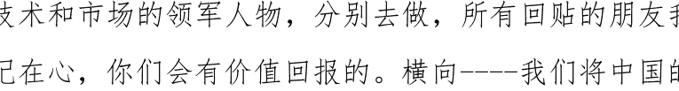

幸福是一种感觉，没有对应应该是相对的，假设你在月球上取得了美丽的成就，你感觉绝对的幸福，可能七天以后你开始舔着腰要回到地球了。

你说你曾经受到过女性的欺骗，其实，这不是她们的错而是这个社会的错，也许是你的错，因为在我们这个满充欲望，缺乏宗教信仰的世界，所有的人变得冷漠与现实，要知道：谈论爱情那是贵族的专利，老百姓有句话，贫穷夫妻百事，可以说：婚姻和爱情在物质社会是两个概念，婚姻需现实，爱情需要浪漫，婚姻和爱情在物质社会是两个概念，婚姻需现实

（注：此处部分OCR识别严重混乱且重复，已根据语义逻辑重组）
- 寻找一个平衡点才是最重要的，你只有拥有现实的基础，你才可能创造很多帖
- 你奋斗一直没有和异性太接触。要知道奋斗勤劳的人，一定有成，可是他们永远不能拥有财富
- 与异性交流不是性的，最好的交流是内心的交流
- 只要有智慧、有点经济基础、再加上情趣，你就会得到想要的女人，否则你得到了也会失去
- 你说你经常找风尘女子。要知道风尘女子里也有层次分，许多有钱的公子们，连风尘女子圆圈也不让他们进入

作者：目光呆滞的润土 日期：2006-06-27 12:04

作者：学者 回复日期：2006-06-27 12:04（注：原文日期疑似重复）

（以下段落根据语义逻辑重组）
- 婚姻需现实，爱情需要浪漫，婚姻和爱情是两个概念。
- 寻找一个平衡点才是最重要的，你只有拥有现实的基础，你才可能创造很多帖
- 奋斗勤劳、最吃苦的人，可是他们永远不能拥有财富
- 只要有智慧、有点经济基础、再加上情趣，你就会得到想要的女人，否则你得到了也会失去

## 你能指点我吗？？

市场、社会发展，可能大家的生活会更加稳定而缺少个人发展的空间。在美国等发达国家，发财的机会比中国难很多，因为数百年来，敏锐的资本嗅觉将市场的每个缝隙全部填满。不要小看路口的小快餐店，可能它没有像那些暴发户盖的酒店豪华，可是这小快餐店却是世界500。

电力行业是中国官办行业，其实只要在中国的土地上哪个行业都一样，谁分配利益，谁就占有利。那谁是中国的历史罪人？是孔融。记得我们小时候，老师、家长要教我们学习孔融分梨：把大的给别人，把小的留自己。现在，我终于明白了，孔融从小吃小的目的是长大后占便宜。他看似厚道，其实非常虚奸，从小就不按规矩做事，破坏规矩。这精明的孔融长大了，意味着大家就更信任他了，不再让他分梨子，而是让他分金子、银子了。这孔融从小聪明地分梨，就是为了等着这一天，孔融心里：“他妈妈的老子从小分梨一直吃亏，让你们比我多了不少梨，嘿嘿，今天，老子可不再傻了——”。于是，孔融带着大家的金银财宝运到家里拿了，一点碎也没留下。

有时，没人的时候，我在考虑一个问题，为什么孔融拿钱后总喜欢跑？哦！原来开始时候，到处是金子，就是没人愿意去拿，于是宣布：可以让一部分富起来。这时候大家拿，大家拿到金子后发了财，随后，大家就选了慷慨的孔融来主持分配金子的代表，这时候大家拿，可是自从大家把金交给孔融后，就再也找不到这小子了，这时候是拿拿拿。

哎，我们小时候硬没学出这三个字的学问有多大。只有孔融把它透了，还悠悠了我们一把。

作者：目光呆滞 日期:2006-06-30 14:43

## 市场团队

各地先准备创业平台的人员，网络搭好靠架。几个发达地区，先动手开展工作，注册公司，其他地区打开缺口后，积累经验后，

总结：
- 懂技术的朋友，可以考虑如何整合企业的发展和业务活动，拿出最实用的方法
- 懂市场又懂技术的，可以考虑如何为企业服务

## 技术团队

## 人力资源团队

- 懂财务、懂管理的人员，可以考虑如何用期权等利益控制团队，体现公平、公正、合理、简单的原则。

作者：目光呆滞的润土 日期:2006-07-04 12:29

作者：华宏 回复日期:2006-07-04 12:03

楼主好，想请教你对“生意做好”的看法。对于销售为主的小型企业来说，业务人员无疑是公司的主力。但现实工作中，业务人员流动性很大，有经验的，即使做过不久，培养新的业务人员，结果一，业务做得不错，容易丢掉；结果二，新员工能吃下亏，业务水平低；最后还是人才出现大问题，同时具备业务能力才，感觉像大海捞针。站在企业的立场，要求业务员要有能力和忠诚，是偏面的，企业本身缺少安全感，业务价值不能被物质体现，他当然要。

作者：目光苍的润土 日期:2006-07-04 17:27

《跨天创业》的理论依据和生存模式：每一个理智的创业者，要成功必须了解中国经济现状，对未来的经济做出准确的判断，必须把握中国经济的变化规律，这是保证个人成功的前提条件，至少可以保证“活着”。中国经济二十年来走了两种发展模式：改革以后，大陆经济已经崩溃，除了庞大的工业以外，整个社会的生活资料极度匮乏，百姓衣食少。这时，安徽省凤阳县小岗村的农户们冒着坐牢的风险拉开了农村经济改革序幕。城市里失业的居民被推向了风险，也起了城市经济改革序幕。当局面对国库的空虚，默许了有限的经济改革，给予了一定的政策松动。这场自下而上的改革，让中国经济释放了压抑多年的能量。当时的大陆虽然没有规范的市场法律，但在几十年的高压专下，所有的犯罪分子都被无产级专政了，商业欺骗从根本上失去了土壤。整个经济在较正的法规（尚没有法系）保护下，在百姓和官员都普遍诚信的道德环境下，正常运转和发展。

这一轮经济改革，由于是来自于最底层的改革，所以制定的经济政策向种田的农民和一线干的工人倾向，承包分田多劳多得以及工人的计时工资改革，让勤劳的农民和实实的工人得到了经济上的实。手中有钱的农民和工人庞大的购买力吸收了市场的销售，让商品供给不应。这个时期，经济最大的收益者是城市里的个体，由于企业和政府有着稳定的运行，加上历史上的中国社会不会起生意的闹，结果让这部分群体到到处都是机遇的中国市场扬勃了先儿、发了财、发了胆。

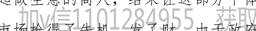

经济力量。而中国经济改革的始作者——一个个体已经被彻底边缘化了，失去了发展的生存空间，其结果就是：中国首富亿万富豪——一个个张富喜东渡日本发展了，北京的首富个体——李鸣华也东渡日本去发展了，整个中国经济进入短暂的停滞和倒退状态，但是新经济版图雏形已经彻底无法改变。

## 自上而下的经济改革模式

90初期，新一代的经济改革由上而下，从深圳开始波及全国各地、从各个企业开始启动，地方政府的财政与中央政府分税承包，企业负责人与企业主管承包经营。许多特色的经济模式遍地开，承包、挂靠国企业的经济运行被微弱高速发展的老方推行，国家的银行巨额贷款注入了大量的资金，若干条进口的生产线制造，多个技术改造项目被设立，地方政府积极参与其中，许多地方政府不顾发展的规律、自身的资源制约和经济的局限，将中国带来了一个大跨越。在这一轮经济热潮里，民营企业和乡企业取得了快速发展，外资企业也成为出口创汇的主要经济力量，国有企业由于制度的缺陷，由于盲目的银行负债让企业陷入了困境，在与民营企业、镇企业、外资企业的博弈中，多数非政府所力的企业普遍面临艰难。

中国经济高速发展的同时，对应的是银行巨额的和企业之间的三角债，就是中国特色经济的表现。政府则用中国特有的股票扶持国企，结果股民的巨额资金没有扶起阿纣被阿斗们吞噬，但是那些隐形资金转移出国国家资本的企业经营者，那些躲避债务黑洞，利用政策的漏洞套取中国和银行资金的精英、乡企业、外企却迅速做大，形成了四龙分霸的经济版图。在经济的区域由于分权制的政策，则让沿海发达的地方政府富裕的流出。

这一轮经济改革是完全没有农民与工人参与的改革，经济发达的地方政府和国企改制的经营者、民营企业的强者、乡企业的强者、外企的强者是最大的赢家。地方政府的富裕不仅体现在地方财政的收入上，更多的地方级级政府也分食了大量的财富。这些年，我们的工人、农民创造出天文学数字的数据，可是他们却没有分享到经济发展的利益。中央政府虽然收益巨大，但巨大的银行烂帐和医疗、住房、社会老化的退休养老等社会保障的欠缺让他们得不损失。

这场经济改革的游戏是政治精英、资本精英、知识精英的合作游戏。在股票游戏里，首先是所谓金融精英、股票专家、股票高手这些知识精英在表面冷无视，资本高手在里面暗箱操作、政治精英在后面外合，把老百姓前十年积累的财富几乎遇洒而濡，悠悠百姓的知识精英、黑心的资本高手、贪钱的政治精英是最大的赢家。在教育改革的游戏里，教育专家的知识精英在前面悠悠：“知识创造财富”，“再苦不能苦孩子”，资本精英则悄悄投资教育，大办民营高价的教育产业，全民所有的优质教育资源却将老百姓的孩子拒之门外，政治精英躲在幕后高声空响不乱收费，却有一个中国政府的教育部部长说了实话，不过在他下台以后说的实话，因为他已经离开了那个利益集团。在这个游戏中悠悠的知识精英、投资教育的资本精英、管理教育的政治精英是最大的赢家。在房产经济的改革中，知识精英悠悠出一个动人的故事：“一个美国老太死的时候说：我终于还完了我的房贷款，一个中国老太死的时候：我终于存了房款”，资本精英进入地产市场、政治精英则宣布地产可以拉动数十个行业，中国经济的火车特有房地产游戏涉及土地评估、房地产评估、建筑设计师等知识精英、房地的资本精英和分管理的政治成为最大的赢家。医改也是一样，医疗界的知识精英、进入医疗卫生的资本精英和分管医疗卫生的政治精英是最大的赢家。

现状是财富大量积累在政治精英、资本精英、知识精英手里，整个社会最底层对未来失去了信心，对改革产生了怀疑。这种情绪是中国社会潜在的不稳定的根源。最低层的人，在没有自身资本、技术等资源的情况下，在没有自身社会保障的环境里，为了生存只能通过突破道德的底线去冒险。造成假药、假酒、毒米、假名服饰、假奶粉、假免等等货泛滥。非正常的行业工人的低工资、高风险、低保险普遍存在，农民在自生自灭的方式下生存。能够受生存的极限成为最底层百姓的本领。因为他们不能掌握资源而取得利益，只能向自己的生存极限挑战，再加上医疗、住房、教育全教育的市场化，彻底将社会矛盾公开化。在经济市场上表现为：数量巨大的老百姓有强大的市场需求，却没有资金去购买，另一端的精英集团有强大的资金，因为物质已经满足却不需要额外的消费购买，这正是许多经济的现状。

现在中央政府已经认识到不和谐的状况，所以提出了建设和和谐、科学发展的方向。从这一点来看，最高当肃与基层老百姓的、目标是一致的。但是精英集团是不可能放弃自己已得利益的，所以在面对中央政府严厉的处时毫不妥协、假购物等等情况下，精英集团竟敢于对抗和欺骗中央政府，正是养虎为患的精英集团成为中国新发展的最大阻力。这种政治的架构曾经进行过经济的发展（有限的）腐败是政策化的经济润滑剂），现在由于全球经济已经进入了高科技、新能源、绿色环保的时代，这肿瘤庞大的精英集团形成的肿瘤已经严重制约着中国经济的新一轮发展。各种媒体、各个阶层所有的抱怨，从根本上来看，无不是这个根源，我们控闹、辱骂是没用的，只有想办法去服制约，才是最好的方法。中国社会决不允许农民暴去改变社会，因为无数的事实证明，农民不能让中国社会进入文明。

## 网络数字是未来改变中国经济发展模式的唯一希望

从前两次的经济改革模式看，最高层的经济政策，经过巨大的利益集团的稀释，到达最基层的时候，许多的政策实际已经变样，我们更多只能依赖好官、清官的官员来维护中国的经济秩序并带动经济的发展。这种靠人的简单模式，在经济上效率较低，经济模式简单的农村社会是可以行之有效的，但在新经济、大量发展的模式下，已经严重不能适应经济快速发展、变化的要求。过去没有信息技术的时代，我们从农业社会进入工业社会，还没有找到更好的方法来运行，旧的经济模式的缺陷显然减少腐败、效率低。

现在的格局下，我们不能消除利益集团的存在，但是我们可以构建覆盖全国的网络，压缩利益集团的空间，使之层层与层隔，减少利益集团的危害发展时，网络利用服务经济则成为最好的工具，反之，利益集团直接将最高层的政策实施，形成整个经济的快速、高效、健康运转，逐渐进入一个和谐发展。

一个经济可以健康和发展了，中国社会才会有能力、有基础，进入一个良好的文明。建设原则是：覆盖整个经济的网络归最高层部门管理，但必须是由底层来运作。因为社会是普通大众组成的，不是精英组成的，最普通大众代表着广泛的利益。假设利益集团被控制，我们建设和和谐就会空。

从法律层面，由于利益集团的许多环节，法律能够有效实施，只维护少数集团的公正和建立起道德论的汪洋大海，让义荣光，让枉处藏身。（具体实施计划，下面继续写）

| 序号 | 姓名 | 行业 | 出差前职位 | 年龄 | 国家 | 涉案金额 |
| :--- | :--- | :--- | :--- | :--- | :--- | :--- |
| 1 | 余振振 | 国企 | 中国银行广东开平支行长 | 38 岁 | 美国 | 4.83 亿美元 |
| 2 | 于志安 | 国企 | 武汉长江动力集团公司董事长 | 63 岁 | 菲律 | 1 亿元 |
| 3 | 丁岚 | 国企 | 中国银行北京劲松处理处主任 | 36 岁 | 泰国 | 1.95 亿元 |
| 4 | 程三昌 | 国企 | 河南豫港公司董事长 | 61 岁 | 新西兰 | 1000 万元 |
| 5 | 将基芳 | 国企 | 河南烟草专卖局局长、烟草公司经理、党组书记 | 59 岁 | 美国 | 2 亿元 |
| 6 | 王音白 | 国企 | 河南高速公路发展有限责任公司 | 53 岁 | 澳大利亚 | 不详 |
| 7 | 董亚玉 | 国企 | 河南服装出口公司总经理 | 55 岁 | 美国 | 不详 |
| 8 | 杨秀珠 | 政府 | 浙江 | | | |

(杨秀忱拿10亿，周金龙拿1.2亿美元，从下面官方公布的情况，我们应该知道，反腐败的任务是非常艰巨的，腐败不除，中国经济的成果会被贪官全部吞噬。)

## 互动与讨论（部分内容恢复）

公平规则可以竞争，暴方的竞争是暴方铁的并与枪子。所以，我们不能与利益集团交手，只能逼实就虚、暗度阵陈、以柔克刚。事实上利益集团也分为大小不等、高低等的，当数量多的利益集团危害最高利益集团的时候，最高利益集团还需要其他的利益集团，我们的优势就是必须与最高利益集团联手，才能消灭掉经济领域的“地富、反、坏、右”。中国银行上市了，润土兄弟，你对其股价趋势是怎么看的？你买了吗？

中国银行花费巨额资金，在美国上买不了了，也不敢上市。因为美国法律认为所有在美国上市的公司都是罪的，商业欺骗不需要证明，因为被骗者无法举证。只要是商业欺骗，面临的选择只有两种：巨额赔偿或者倒闭，即使是上市公司一样不能幸免，一样难堪，公平、公正。

现在的现状是这些国家警察很少。反之，这个国家就是警察，制服暴力无处不在，依然是道德伦衰。一个道德伦衰的社会是整个社会远离和谐崩毁。因为每个违反道德者都不需要自己付出什么，在这种环境下，所有的创业、所有高尚生活都是假的，因为天塌下来的时候，一切会毁灭。在一个司法、道德腐败的社会，每个公民都厌恶腐败，自己却必须去腐，因为腐败已经进入了社会的骨髓。要立即铲除腐败是非常困难的事情，它是通过一段时间潜移默化破坏了诚实、善良的社会，我也只能再一段时间潜移默化修复曾经诚实、善良的社会。这种修复的武器就是网络，因为网络已经覆盖了现有的平面、电视媒体，而且是互动的，如果我们足够的数量的公民参与网络的修复，那么对于所有违反道德的行为，付出对应的代价。让所有的公民清晰地知道他所做的一切，即使法律不究他，他也逃不出网络无处不在的封杀。


作者：xiaiao1999 回复日期：2006-7-7 13:56:01

土哥：

小弟想请教个问题。我有个亲戚办个水泥厂（资本200万，在农村，私营。），其资金、原料、生产渠道尚可，想问一下其前景如何？

过去政府不是说要关闭小企业吗？（小水泥、小造纸等），所以我不是很清楚小水泥厂的前景如何。

作者：目光呆滞的洞洞 日期：2006-07-09 22:00

作者：林村杉 回复日期：2006-7-9 16:31:35

润土大哥，我是一个年轻的医生，读了二十年的书，我现在很迷茫，加信：101284955。在月里还有1200元闲钱可以买书读书，留的一笔股票缴费<数据我都不敢说>;我对中国的教育收费痛恨！我对教育无能衷哀！我对我不理解医生而痛心！按目前期待还计算，我可以40岁才可以倾其所有成家。请问大哥对此有何看法和见解，略指小弟第一二！感感!!!

你读了二十年的书，虽做了一个年轻的医生，看来你还是个“为人们”服务的医生，你的手术刀只掌握着穷人的生命，所以你跟他们是一个穷人。只要那些权贵与富豪的生命掌握在你手中的时候，你才能即刻成为富豪与权贵的。

医生跟做官一样的，并不是做官的都可以发财享福的。城管队员也是戴帽子的官，可是他们是永远发不了财、享不了福的官，说不定还被那些绝望的小贩泼粪候，因为他们只掌握着社会底层的命运，只有那些掌握着权贵运气的官，才是那些呼风唤雨的官。

作者:日光柔柔的润迅 日期:2006-07-10 10:25

作者：jameszhi 回复日期：2006-7-9 23:22:40

说到这里，有几个问题要咨询一下润迅先生。我们公司现在做一款“音乐自助下载”的产品，可以下载手机铃声以及MP3音乐等。

机器的概况：外形与公共场所的触摸查询界面类似，采用投币自助操作，有极简的操作界面，最低只需点击一下就能下载几分钟即可。支持所有的MP3/MP4产品以及大部分的手机。下载的资源有MP3/MP4电影、手机铃声、图片、软件等。传统的SP订阅铃声将通过网络下载音乐显得更实惠、更快捷、更方便。这也是这款产品的卖点所在。

目标消费群：4亿用户、1千万的MP3用户。

客户群体：超市、网吧、学校、商业街、大型企业区等的经营者。

机器定价：6000-12000左右。

客户的收益：根据我们对于本地市场的调查，一台机器在繁华商业区最高日收入：230元，最低日收入：25元。

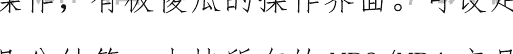

平均每天有 90 元的收入，成本回收期约半年。投入回报率高。适合小本投资。

我国现在有四亿的手机用户以及以上千万的MP3用户，这个庞大的消费市场基本上是被一些大型网站（SP）通过网络所垄断，而我们的产品则位于网络的补充，毕竟应该许多地方不具备上网条件，或者有时无法上网。

现在有几个问题咨询一下，还请润澜先生有空回复一下：

- 1、这款机器可能存在侵权的问题，我们应该如何回避？我了解到，目前大多数SP网站（图标下载网站）的音乐源还未取得版权。对于可能的侵权起诉，他们是如何应对的？如何处理？我们可以免费获取音乐好吗？如果我们的机器面向个体销售，不承诺提供下载资源是否可以回避此问题？

- 2、下载方式的推广问题？目前绝大多数人习惯通过梦网或SP网站进行手机图标的下载，而MP3用户则两类：一类是中高端用户，拥有电脑及网络，可以自行更新。另一类是低端用户，对音乐有需求，但没有电脑（不具备电脑、不会操作、不会上网），拥有MP3，更新音乐非常困难。

对手机用户，我们通过什么方式的宣传可以改变其对于传统方式的依赖，转而慢慢接受这一新颖的下载方式？对于MP3用户，我们争取低端用户的同时，如何再吸引部分的中高端用户吗？

- 3、机器的推广问题？目前这类机器全国做得不多，最常见的推广方式是在某些加盟网站上进行推广，虚假传言较多。对于代理加盟商也不是很负责任。我们则想踏实实做产品，通过好的产品让代理、加盟商获利。那么，在当前普遍通的社会中，我们应如何进行全国性的推广呢？是采用直销的方式还是招募各地代理商共同发展？我们目前在某个地域采取业务员直销的方式进行推广，但内部并没有统一的意见。请涵先生说您的看法，谢谢。欢迎回帖的其他网友发表看法。

一手整理，加微信101284955，获取更多帖。我不知道你公司的地位和身份，要知道在西方社会，任何商业都有价值，同时也会怀着感激的心情去接受商业策划，当商业成功，他们如何通过市场的回报体现商业智慧。一个商业创意，可以为公司减少投资和创造巨大的市场。从你的描述可以看出这是一个非常的商业项目。但是做中涉及到知识产权的问题、销售的问题、资金回收的问题，这些问题都很复杂，需要大量的投入。在当今这种竞争中，新的技术、新的时尚、新的商业模式，可以随时替代旧的模式。其实，做商业最好的方法是用简单、直接、有效的操作，才是最可能的方案。现在的商业公司基本上与中国移动和中国联通合作而取得成功的，他们利用的是网络而双方互利。把知识产权、代理、资金回收的问题交给大公司解决，现在的商业公司每年可以获得亿级的利润。你们最好也跟两大公司合作，除了网络外，两大公司分布的服务，就是最好的商业终端。对于两大公司来说，网络下载让公司分钱和网络让他们这样钱，假设撞到外面处失去了丰厚收入，他们依然忽略成本计。

作者：目光秉沥 日:2006-07-11 08:41

作者：sh178 回复：2006-7-11 06:45

润土大哥，请谈谈对创业的前景吧，在网上看到一个人才黄宏圣7月才被香港法院判处盗窃诈骗，可能判7年以上刑……可是创维的利润比长虹、TCL都多……一个奇怪的企业……准备买点创维的股票（H股），请大哥帮忙分析看值不值得投入……非常感谢。创维在国内不多家家营企业，其发展很艰，只有创业者可以体会。足涉后坐了，在中国数字电子的领军人物黄宏也进去了。他们的竞争对手，故意涨了四十亿，谁能赢？这就是步步为营。我不懂股票，也不买股票，因为我看不懂中国的会计事务所出的财务报告。

作者：目光秉沥 日期：2006-07-11 17:14

作者：目光秉沥 日期：2006-07-12 14:59

作者:JESSIE188 回复日期：2006-7-11 13:50:56

沥沥大哥，已收到您的信，谢谢！正在看。另外有件事请帮我解答，写得有点乱，请莫见笑。我的学历不高，现在珠海一家20几个人的研发公司上班，从成立我就来了，现在已经快5年了，工资与我这种水平相比还可以了（这也是5年来慢慢积累的）。一直来的公司发展没什么起色，去年公司重新整改，裁了员，我留下了，公司还招了部分，但大家很闲，偶尔有一件事做，毫无技术性可言了，都是重复着机械运动一般，每天面对电脑坐8、9个小时，我似乎找不到方向，看不见希望。我们也会利用空闲时间学习别的东西，我自己在网上直销品牌化妆，生意怎么样。刚段时间总感觉我再不能这样下去了！一定要走！但又很犹豫，我知道现在工作太不好，不能轻率辞职？从什么存钱？手续怎么办？我是安生，已经25岁了，告别打了几年了，身心疲疲，强性的性格我很拥有的事业。希望大哥指点一下，现在我要怎么做？辞职自己做别的还是留在公司？盼您回复，万分感谢！给您鞠拜！

了解自己、了解社会、了解心。
多看、多听、多想、少动。
你能满足人的消费需求，你可以生存。
你能满足富人的消费需求，你可以成功。
你能满足官员的政绩需求，你可以发财。

作者：目光呆滞的润土 日期：2006-07-12 18:18

作者：JESSIE188 回复日期：2006-7-12 16:53

润土大哥，您说的话我细琢磨了，“少动”是指什么？不好意思，我理解能力有点差。准备中男人要做“稳、准、狠”，女人应该是“稳、准、巧”，“少动”就是捂紧自己的钱包，因为普通的百姓经不起折腾。

作者：目光呆滞 日期：2006-07-14 12:12

作者：草原狼 回复日期：2006-7-12 19:46

润土老师，能点评一下这件事么？一手整理，加微信101284955，获取更多帖。对于大刘来说，腐败是一种生存方式。对于二刘来说，做大是有风险，做小也是风险。

作者：目光呆滞 日期：2006-07-14 43

作者：sweetgd258 回复日期：2006-7-14 08:48

润土兄弟，一定实话说，抛开那种角度，客观认识吧：人的命运是注定的了吗？现在很多真正研究的人都能根据生辰字预测，这说明人出生就已经决定了后面走的路。请问这个问题怎么认识？

- 社会的大环境 决定90%的命运
- 家庭环境 决定5%的命运
- 身体和天赋 决定3%的命运
- 勤奋、毅力 决定1%的命运
- 偶然的机遇 决定1%的命运

某个时刻，家里里出生了一个“外寒”的男，同一个时刻，外草房里也出生了一个“天饱满”的男，两人较劲，加之争夺90%的命运。3年的夏天，我们一行十余人去玩，到了山顶以后，他们全进了庙，我则站在门外休息，随被拉进边旁一个房间，房间里坐着一位仙风道骨的长者。长者语气轻言：“不好意思，不能拒绝。”老者看着我生辰字以后，沉思片刻后，算出的命运句子让我心服口服，我抽的是上签，加上算的准确让我满意，长脸上露出了微笑。算命结束时刻，我真诚地望着长者，内疚地说：“先生，您很准，不过身上没带钱”。我说话时，将自己的口袋翻朝天。老人用手抹了一下下额，用一把白色细长的胡，什么也没说（慈祥的长者此时心里想着：怎么没算出这小子的口袋没钱？怎么跟门外那个妇女解释呢？）

作者：目光呆滞的润士 日期：2006-07-15 19:06

- 社会的大环境 决定90%的命运
- 家庭环境 决定5%的命运
- 身体和天赋 决定3%的命运
- 勤奋、毅力 决定1%的命运
- 偶然的机遇 决定1%的命运

横向看社会环境，美国、北欧等社会中的公民与中国大陆社会的百姓，90%的人命运是不一样的。纵向看社会环境，文学中的百姓与80年--98间的百姓，90%的人命运是不一样的。

作者：目光呆滞的润士 日期：2006-07-15 21:23

作者：J127 回复日期：2006-7-15 17:42:11

我是一名上班一年的公务员，常常觉得没有前途。因为听太多“朝中无人”，而且本人也不喜欢政治。积累起来，现在却是得而失，辞职冒险，但一直这样觉得不甘心。希望能听到你的一句忠劝。在没有建立全民社会保障前，在没有司法公正、正义前，你能做什么？

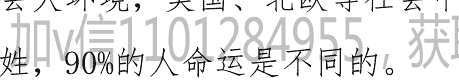

作者：时光采滞的润土 日期：2006-07-17 10:08

作者：清醒小夕夕 回复日期：2006-7-15 14:06:54

润土，我很敬仰你智慧的深远与高涵。不能对“连续20个月销量居中高高级轿车市场冠军”的广汽本田谈谈您的看法，并预测一下它今后的发展之路呢？谢谢！中国大陆的愤青们因为口袋空空而充满了愤怒，呼吁抵制日货。昔日的愤青们面对高昂油价不再愤怒，怀着奔驰、宝马的梦想，现在开着丰田，带来了很好的日子。前几天在广州地铁里挂上了丰田。

作者：新座山 回复日期：2006-7-16 1:10

润土大哥，你好。我在国营公司工作了5年，主要负责销售，现在有问题。我是一个年轻人，在上海出生了足了。创维在国内不多家民营企业，其发展很艰，只有创业者可以体会。足涉后坐了，在中国数字电子的领军人物黄宏也进去了。他们的竞争对手，故意涨了四十亿，谁能赢？这就是步步为营。我不懂股票，也不买股票，因为我无法懂中国的会计事务所出的财务报告。

作者：目光秉沥 日期：2006-07-11 17:14

作者：目光秉沥 日期：2006-07-12 14:59

沥沥大哥，已收到您的信，谢谢！正在看。另外有件事请帮我解答，写得有点乱，请莫见笑。我的学历不高，现在珠海一家20几个人的研发公司上班。

润土大哥，你好。我是在国营公司工作了5年，主要负责销售，现在有问题。我是一个年轻人，在上海出生了足了。

- 润土大哥，请指点一下。
- 润土大哥，请指点一下。
- 润土的看法。
- 润土大哥，请指点一下大哥的看法。
- 你们最好也跟两大公司合作，除了网络外，两大公司分布的服务，就是最好的商业终端。
- 对于两大公司来说，网络下载让公司分钱和网络让他们这样钱，假设撞到外面处失去了丰厚收入，他们依然忽略成本计。

- 润土大哥，请指点一下。
- 润土大哥，请指点一下。
- 润土的看法。
- 润土大哥，请指点一下大哥的看法。

- 润土大哥，请指点一下。
- 润土大哥，请指点一下。
- 润土的看法。
- 润土大哥，请指点一下大哥的看法。

- 润土大哥，请指点一下。
- 润土大哥，请指点一下。
- 润土大哥，请指点一下。

- 我们作为普通的平民去创业，只能从最基础、简单的做起，脚踏实地去做，用事实去赢得市场，我们的数字网络才会有良好的发展基础，只有企业、政府、我们自己包括我们的竞争对手四方共赢，那么这种新的数字模式才能被市场证明是成功模式。

- 润土大哥，请指点一下。
- 那么请问我们在市场针对性推广上，创造需求呢？能否指点一下二三？
- 润土大哥，请指点一下。
- 润土大哥，请指点一下。
- 润土大哥，请指点一下。

- 润土大哥，请指点一下。
- 润土大哥，请指点一下。
- 润土大哥，请指点一下。

- 润土大哥，请指点一下。
- 润土大哥，请指点一下。
- 润土大哥，请指点一下。

- 润土大哥，请指点一下。
- 润土大哥，请指点一下。
- 润土大哥，请指点一下。

- 润土大哥，请指点一下。
- 润土大哥，请指点一下。
- 润土大哥，请指点一下。

- 润土大哥，请指点一下。
- 润土大哥，请指点一下。
- 润土大哥，请指点一下。

- 润土大哥，请指点一下。
- 润土大哥，请指点一下。
- 润土大哥，请指点一下。

- 润土大哥，请指点一下。
- 润土大哥，请指点一下。
- 润土大哥，请指点一下。

- 润土大哥，请指点一下。
- 润土大哥，请指点一下。
- 润土大哥，请指点一下。

- 润土大哥，请指点一下。
- 润土大哥，请指点一下。
- 润土大哥，请指点一下。

- 润土大哥，请指点一下。
- 润土大哥，请指点一下。
- 润土大哥，请指点一下。

- 润土大哥，请指点一下。
- 润土大哥，请指点一下。
- 润土大哥，请指点一下。

- 润土大哥，请指点一下。
- 润土大哥，请指点一下。
- 润土大哥，请指点一下。

- 润土大哥，请指点一下。
- 润土大哥，请指点一下。
- 润土大哥，请指点一下。

- 润土大哥，请指点一下。
- 润土大哥，请指点一下。
- 润土大哥，请指点一下。

- 润土大哥，请指点一下。
- 润土大哥，请指点一下。
- 润土大哥，请指点一下。

- 润土大哥，请指点一下。
- 润土大哥，请指点一下。
- 润土大哥，请指点一下。

- 润土大哥，请指点一下。
- 润土大哥，请指点一下。
- 润土大哥，请指点一下。

- 润土大哥，请指点一下。
- 润土大哥，请指点一下。
- 润土大哥，请指点一下。

- 润土大哥，请指点一下。
- 润土大哥，请指点一下。
- 润土大哥，请指点一下。

- 润土大哥，请指点一下。
- 润土大哥，请指点一下。
- 润土大哥，请指点一下。

- 润土大哥，请指点一下。
- 润土大哥，请指点一下。
- 润土大哥，请指点一下。

- 润土大哥，请指点一下。
- 润土大哥，请指点一下。
- 润土大哥，请指点一下。

- 润土大哥，请指点一下。
- 润土大哥，请指点一下。
- 润土大哥，请指点一下。

- 浙江省台州市是浙江经济发达的地区，政府在致力于民营经济做大强方面一直走在全国的前列，它有别于其他地区外部投资拉动的经济发展的模式。

- 必须改变整个经济管理的运行模式。可以将台州所属的每一个经济平台开发，每一个区级政府打造一个独特的数字平台，数字平台上的规模企业又是一个小小的数字平台，数字平台上清晰地展示企业可以公开的商业信息，企业的等级、信誉、信用等级等资信信息，这种信用等级随着时间的积累逐步提升。

- 政府与企业多年的发展目标与利益保持着较的一致性。

- 用通用、简单的数字网络落实“科学发展观”，引领先经济的到来。

- 从传统的经济模式向新经济、新科技、新能源、新材模式的转变，政府运行经济的系统也必须转变，命令指挥层层层管理的方式可以适应农业社会和旧模式，绝对不适应新经济的快速变化。

- 平台上共享的企业软件，集中处理的数字信息，可以大大节省企业的商务成本，及时提供企业政府经济政策的规范化。

- 企业在享受政府经济服务、透明经济信息的同时，企业将自己的销售信息、职工业务、职工工资信息、税收信息、社会保险信息及时反馈政府主部门，分管领导通过数字网络，可以及时了解所管企业的经营状况。

- 举例浙江省台州市、呼和浩市、黑龙江省绥化市如下：


程序后，才能缴费加入我们数字信息平台，我们互联网的技术和遍布全国的网络信息采集去服务企业。对于网络收费的标准应该是动态变化的掌握，入网企业的付出必须是物有所值。比如，那些新成立的企业，处于创业资金暂时困难的，又希望利用我们互联网的低成本商业资源来发展的企业，可以凭地方政府的证明，申请免费入网。当企业通过网络获得商业增值服务取得经济回报后，则企业必须缴纳相应的服务费用。对于正常的商业活动，整个网络提供时的商业信息服务，如果企业恶意违反商业法律与商业道德的行为被证实，那么它将受到整个网络的封锁，到那时它自觉恢复自己的商业信誉为表现，才能在虚拟的经济中显示他的信任；否则，即使企业不再为标识，网络也依然显示它的商业活动。通过不断网络信息公布的诚信，将当地地区的商业信誉提高到一个很高的水平，杀死某些害群之马的生存环境，确实能够在台州的投资环境，我们的网络就远离携它的商业信誉，通过这些透明、公正、正义的威慑力量，使得整个经济投资环境信誉迅速增值放大，让“台州”两字成为大陆投资创业的金字招牌。这种良好的投资环境必然吸引优质资金不断投入台州地区，促使整个地区的经济规模、财政税收、就业状况、职工收入水平就会进入一个良性循环的状态，这个数字化管理经济的方式，将约束政府管理经济的成本和企业商务的运行成本。

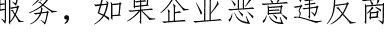

整个企业商业诚信的建立，将地区企业与外部世界合作的机会，这种数字网络平台的信息共享是未来信息社会经济的必然前提。在地区经济的竞争中，由于台州地方政府率先建立包括信息互联的数字平台，超越了传统的三统一的概念，那么台州经济是否能够在未来的经济竞争中保持强劲的发展态势。

根据地区经济的特点，选择网络经济模块的切入点例如，呼市是中西部发展的区域，呼和市要在经济发展上创新发展，就必须在数字经济的模式上有所突破，呼和市的市委书记牛儒同志就是因工作忙碌而早早累了。假设呼和市构建了全市经济数字化平台，那么当地地区和各经济发展的分管领导，对各企业的经济状况、税收、就业、水平，可以及时地解决变化，可以更方便地管理经济的发展。市委书记牛儒也不如此辈劳累而把自身累累，政府的所有公益项目，各项工程的投资在网络上第一时间公布，将容易腐败的工程内部交易变为阳光操作，接受领导和大众的监督，减少腐败交易的空间，也可以将非法采矿曝光在网络上，减少国家安全监督管理局的奔忙。从源头上让我们从防腐败的忙碌过渡到预防腐败发生的环节。那些可以参与工程投资的企业，必须在网络上第一时间报名竞标，所有符合条件的企业公平地参与竞争。各类工程企业每年交缴数额等的网费用，这些费用相对于此类企业金额惊人的交际费用来说是微不足道的，工程企业降低投标竞标费用的同时，必然使整个地区项目中的腐败降到最小的程度。这是一个互动的过程，只要政府把手中的权力拿到网络上公布，那么企业就要缴费上网。

其他行业的企业，各开发区的企业中，信誉好的企业入网公布，将信誉不的企业排挤到网络之外，用逐渐清除不信誉的企业环境生存空间，引导整个企业按市场经济规律、健康、创新发展。只有数字化科学的决策系统，才能适应政府信息社会经济的快速变化，前瞻性服务于经济和社会的发展。降低政府的行政成本和节约入网的商业成本。当建立企业的信用积累时，将大大减少企业的商业交易成本，促使银行与企业、企业之间高效的经济运转，整个社会的经济环境从根本进入良性循环的状态，及时发现经济发展的矛盾，并及时调整经济运行中的矛盾，不断在动态平衡中发展。

只要透明、准确，就不会在经济严重损害后，再强行地调控让过热的经济强行后，让经济的不断微调替代剧烈的经济波动。

有些地区不可以建设透明经济的网络模式，有些地区可以做好建立数字透明网络的准备，但不可使用官方官员知道我们建立透明网络的想法，可以预先计划好。

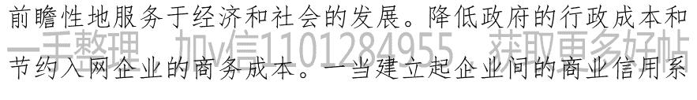

数字经济网络的模块，但要暂时等待建网的时机，在时机成熟前，地方政府是不可能允许存在的。比如，过去的黑龙江省绥化市，因为原市党委书记马德德是中国建以来最大的卖官的主宰，他们已经将整个政府的权利市场化了，他们不可能接受透明的网络平台，如果那样，他们所有的暗箱操作将无法实施，官僚经济的贪污链就会断裂。针对这种状况，我们可以先行设计好数字经济的平台，一当腐败分子被纪委网打，机会就会成，在地方政府首脑的允许下，可以立即建立防腐的数字化企业与企业、政府与企业数字信息的平台。及时建立防腐的健康、公正、透明的网络。绥化市工商的储蓄可以长，贪污是贪污的俘虏。这就是国际透明组织倡导的透明社会的雏形，我们可以让社会经济变得透明，并减少非阳光交易，这种变化不仅需要法律，更需要全社会建立道德与天然屏障。整个经济透明化采取层层推进各地的经济状况，政治文明也有不同的，建立透明数字经济模块的条件也会不同的，我们可以将这些区域连接起来，让这些地区更多享受社会的信息，促进地方经济有序发展，经济的发展促进地方社会的政治文明和精神文明。将那些非透明数字经济区域边缘化，那些在离。加入微信：28456


性的“狐狼”，面对成群的猛兽，勇敢的任性无畏，让自己遍体鳞伤，在华尔街网络经济的凛冽寒风中，昂着狼头、睁着滴血的狼眼，吠着“华为的冬天”，而他身后却是无数瑟瑟发抖的绵羊，迈着“走进时代”明显的羊步，在漫长的寒冬里唱着“春的故事”。

在生产羊的大陆绵羊经济中，怎么会个狼呢？

我有时在思考这个困惑的问题。要看清这个问题就要了解华为的、成长的历史。只有狼才会出生狼，并且光出生出来不行，吃着羊奶长大、在羊妈妈的怀抱成长的狼，绝对会失去狼的忍耐、凶险、狡诈，只能是一只外形似狼的绵羊。那么我们就必须找到它的狼妈妈，就解释他出身的理由。识别码：1101284955，获取更多好帖

谁是中国大陆的狼呢？

哦，狼必须是专吃绵羊的那个家伙。

大陆的绵羊是被狼吃掉了吗？

不知道，外表看不出来，因为中国企业外表没有狼的特征。不对！一定有一只狼，羊是绝不会吃羊的。哦！想起来了，从小老师、妈妈就跟我们讲“披着羊皮狼”的故事。对！找出那个“披着羊皮的狼”，就不知道谁才是真正的狼吗？谁是那个“披着羊皮的狼”呢？

哦，一定是那养的最肥的、专吃肉不吃草的家伙。

谁是最肥的、专吃肉不吃草的家伙呢？

俄，明白了，是中国移动！中国移动是从大陆赚钱多的企业，它所有的钱没有从狮那边抢过来，它在狮师那里高价装满利的牙齿，它在绵羊堆里独自吃的脑肥。没有对手抢他，它换着花样，月租、双向收费这些美味，西方对那些狮连想都不敢想。而且被它圈养的羊羔2005年突破两亿只。者中国国营研究机构Millward Brown 日出了全球最强品牌最新排行榜，中国移动公司赫然出现在第四名位置。其中软高居首位，品牌价值为620亿美元，通用电信第二，品牌价值558亿美元，可口乐可第三，品牌价值414亿美元，中国移动以品牌价值392亿美元排行四。

中国移动(0941)3月16日发布2005财年经营数据，数据显示，2005财政年度净利润增长了28%，高于市场预期，净利润为人民币535.5亿元，高于2004年的417.5亿元，也高于接受Thomson Financial调查的24位分析师此前平均预期的500亿元。事实证明中国移动唯一与前三狮子的区别是，前者以全球为自己的市场，后者暂时以国内市场为市场，并赚取巨大的利润后，让外的投资者分享中中国经济高速发展的成果，这充分体现了中国移动高度的国际主义境界和中国人博大宽广的胸怀。

在中国移动的高速发展中，所有的国外移动设备供应商以及软件供应商，获得了巨大的利润回报。在无数羊羔的面对于，对参与共同围剿的猎者们已经不在乎吃了多少了，唯一的要求就是时间。摩托罗拉、爱立信、诺基亚、西门子等跨国巨头美味，中兴通讯作为中国邮部所属的亲儿子分享了很多美味。在这一新的行业里，需要高科技的人支撑，华为在切入了移动产品以后，用高工资等金钱留才，迅速将中国本土优秀的人才，收入囊中。在与金钱赛跑的比赛中，中兴通讯和华为为金钱在中国的地上抢人才，抢时间。他们知道：只有最有的人才，才能创造最好的产品，只有最好的产品才能让中国移动这个中国最富有的，最快速发展的企业满意。华为、中兴参与了中国移动的围猎场战争，中国移动面对另一只比狼更危险两个恶狼对参与的伙伴唯一的要求，不是金钱的问题，是谁的羊多的问题。整整十年，华为在中国近代经济发展最大的、持续最长的围猎战中，获得了数亿的战利。

现在围猎战争已经结束了，恶狼圈内的羊羔网，独自享用这时时代吃不完的美味，并将昔的狼友一脚踢，过去在圈外的羊羔，谁多吃点无所谓，现在已经是圈内的羊羔，当然要算账了。华为终于结束了多年的企业辉春天，总感觉要进入华为的冬天。

为什么华为作为中国最有钱的高科技民营企业还有危机呢？

因为华为的企业的管理层、科技人才、市场运营才是中国大陆十多年来，绝对的高收入阶层。其他经济领域的中国企业大多是以草为主，是草食动物。自从中国移动生下了以后，吃了十几年肉了，让华为吃草就是它生命的终结，任总只要华为不给他的下属吃肉，那么第二天，任总将将被养的群狼所吃掉。在华为经济效益下滑的日子里，不多日子，任总的高级助理就赶起炉子，吃起任总来了。对于华为没有退路，狼狮就吃草，可是哪里呢？华为的企业也被割了，这是任总想着看着西方狮子吃肉为主要，在国内饿死，不如去狮子那里抢肉，威威的狮子想到回中国出来杀狼，狮子还没缓过神来，已经挣跑肉了，

何其对华为为，贪可惜粮要成群，只有实实，才能有办法，中兴通运还不能算狼，应该算诸狗，毕竟它还有主人养着。

华为这只中国大陆的孤狼，被赶出大陆圈以后，面对狮群的包围，握着狠、眯着满血的狼眼，咬叫着“华为的冬天”，冲击爆发狮群。

2、看了润兄的文章，对官场、商界的种种阴暗面是心有余悸。之前想做销售的动摇了。因为我这些人不适合搞关系。我现在想如果自己开个小店什么的，然后过小日子是最最好的。润兄是否在这方面能给点意见？或者举几个成功的例子以供借鉴。


3、中国社会没有事，只有烦事，开个小店是最是没有事的，却有不完的事，工商、国、地税、市容、城管、环保等等你不算，你要卖馒头有馒办来烦你，你要卖西瓜，却有西瓜来烦你。

3、润润的阅历是丰富的，很有传奇色彩，但是我想对中国的背景有着深刻的认识，一方面来自自己丰富的经历，另一方面你是说的在四岁时候迷茫然后找到自己的路。我想每个人的经历都是慢慢的积累，但是润润能推荐一些书给我们学习，早点走出迷茫，走出荒化教育后遗症。

1、通信业没有完全垄断，还需要工程，你们可以在缝隙中生存，随着缝隙越来越小，你们将很难生存。我们属于电信集团的一个小设计院（电信集团与中国电信的两个孩子）；网络是必然会升级的（比如3G），同时工作。我对润哥说的“缝隙越靠小”很有道理。以后的市场竞争中，每个市场由几个鱼把，排名四、五名的大鱼随时淘汰的风险。多数中小型企业只能存在缝隙之间，为大鱼提供商业服务。

2、王呀！这只中国大陆的狼，被赶出大陆圈以后，面对狮群的包围，昂着狼头、睁着滴血的狼眼，叫着“华为的冬天”。现在在全球的通信设备厂家都在合或合并，华为能否撑住是一个很大的问题！！而马上就要上马的TDMA，润哥你看法？国产的东西，我是要折了。还将千万百姓的钱都扔进去，悲哀！往录进去很多，往芯进去很多，往方舟进去。

3、中国社会没有事，只有烦事，开个小店是最是没有事的，却有不完事的，工商、国、地税、市容、城管、环保等等你不算，你要卖馒头有馒办来烦你，你要卖西瓜，却有西事。润哥的意思是不是创业环境很恶劣？难道我只能一辈子打工了？创业环境的恶劣没有绝对的对错，在没有规则的经济环境里，发财的几率大于创业成功的几率。我整理了一下，说实话，我不看出版的书，我用自己的眼睛发现自己过的多年真相，于是我不断去细观察那些被过去的痕迹，探索人类的历史秘密，于是不再迷茫，看到了历史长河彼岸。润哥，你没有正面回答我哦。给个明路，好吗？都读万卷书，走万里路，万里路不是每个人都能走的。但是书是可以读的，比如润哥哥的文章。哈哈。最近，媒体上天天报道各地高考状元，这些状态就是读书最成功的人，是学生的偶像。媒体为什么不统计报道所有状元的走向社会后，生活与工作的现状呢。现在，恢复高考三十年了，这些昔日高考状元，人生成功的比例是多么呢？有多少成为杰出的人呢？有多少幸福快乐呢？

另外能不能将韩国的经济发展与中国的发展作一下，像三星一样韩国（包括日本）发展本民族产业，中国是发展外向型经济加头在外。三星的总裁98%的时间在考虑全球化的模式发展，技术标准的言。海尔的总裁还想过MBO呢。同意大哥的看法。但是不知道润哥你是否对中国的设计行业有了解？中国的设计行业个人叫做“尚宝剑”，一些国企设计院用各种资源优先占有有些尚方宝剑，使得中小企业很难有生存的空间，就连外国进来的企业都要看着这些国企业的脸色办事，只能跟这些国企合作，赚取外围利润。有些国企根本没有核心的实力，只会利用资质成就。

什么产业升级？我看国家的发展都将被这些政企不分的国企拖垮！建设部说中国的资五年之内不会取消。推定加入WTO之后，政府会被取消，届时这些企业就会被外面的狼吃掉。润哥，意的？中国特色的“资质”就是保护自己既利益，全球化的接轨，技术标准将取代所“资质”。发财的第一要素：关系。对于一个普通来说很难获得资源啊！大学生就业迫在眉睫间，教育产业化收了你们的血汗钱，又不能，怎么办？去创业吧，于是加盟的骗子遍地开花。


中国没有中产阶级，所以要做大众化产品，靠价格取胜；要么做化妆品，满足某些需要。

。因为你心中只有十四半，所以联想到“绿帽子”，不到“红帽子”。中国最有发展潜力的行业，指的是不是“绿帽子”，望大哥给予回复。


治理国家这么复杂的事，老子早就说过了像“如烹小鲜”一样的简单。

中国的资源那是丰富的，打过朝后大跃进，“自然灾害”后大革命，工厂建在深山，铁路建在非洲。改革开放后，我们建了无数的“世和园”、无无数的“天安门广场”、无数的“彩虹桥”，现在我们拿着石头走过了无数的小径，站在历史的长河边，看见了光明的彼岸。

作者：目光呆滞的洞口 日期:2006-08-04 13:41

大学是成就大学的地方，不是因为大而叫大学，而是因为有大师而叫“大学”。

作者：目光呆滞的洞口 日期:2006-08-04 16:28

一手处理：我想看到更多的回复 日期：2006-8-4 13:01:02

......

另外，现在的重点学校的基础设施是越越豪华（我家附近的一所中学修了高级网球场，不知道有多少学生去问，与其配套的花费又是多少），这也会逐渐提高入学重点学校的经济门槛，让不少社会底层的孩子无法得到他们应有的权利。

看着文章，想到周围的现实，真的不敢想象国家、民族、个人的未来会什么样。

你愿意在山野草席里聆听智者的教诲，还是愿意在豪华宫殿腐淫淫奢？

作者：目光呆滞的胡洞里 日期:2006-08-04 17:21

作者：我想知道更多的 回复日期：2006-8-4 13:01:02

......

另外，现在的重点学校的基础设施是越修越豪华（我家附近的一所重点中学上了高级网球场，不知道有多少学生会去临，与它配套的花费又会有多少），这也会逐渐提高重点学校的经济门槛，让不少社会底层的孩子无法得到他们应有的权利。

看着文章、想到身边的现实、真的不敢想象国家、民族、个人的未来会如此凄惨，获取更多好帖。

你愿意在山野草席里聆听智者的教诲，还是愿意在豪华宫殿腐淫淫奢？

作者：目光呆滞的胡洞里 日期:2006-08-05 10:36

数学是教会人逻辑思维的方法，科学严密的计算推理，可是悲哀的中国教育却让你重复、机械陷入枯燥的数学海洋，让你灵巧的大脑在大量的数学垃圾中死机。当你大学毕业以后，走向了社会，你去农贸市场买菜的时候，可能的数学计算不过是一个个文盲小贩。

学校里的许多课程，又有哪门逃脱此恶运呢？

那些第一天上学的孩子，哪一个不是兴高采烈、无忧无虑、天真烂地跨入了学校的大门，十几年后，有多少人神采飞扬？又有有多少目光凄凉呢？

作者:目光采凉的熵 日期:2006-08-05 11:45

作者: salangen 回复日期:2006-8-5 11:22:04

老大，分析一下中国现在的金融业的状况，我金融本科的学生包括很多硕士生都找不到工作了，看不见路在哪？

晚期的肿瘤患者，需要大量的营养，可是病人却依然消瘦，因为健康的细胞组织得不到营养的补充，大量的营养被肿瘤细胞吞噬，肿瘤在吞噬营养的同时，还逐渐地吞噬健康的细胞组织，扩散肿瘤细胞。

王二龙13101284955

金融是整个经济的营养，证券市场的万亿资金被经济的肿瘤吞噬，银行系统万亿资金也被经济的肿瘤吞噬，这银行盛隆最近又补充了数百亿美元的外汇资金，是否又被肿瘤吞噬，我不知道。

作者:目光采凉的熵 日期:2006-08-05 15:06

我的军事战略思想是“诱敌深入、关门打狗”。

“当刚”回来做中科院院士了，进陈回来出来“汉芯”了。

作者：目光呆滞的润 日期:2006-08-06 10:18

## 市场方案

| 类别 | 股权结构比例 |
| :--- | :--- |
| 地方公司创业人员 | 40% |
| 创新发展基金 | 15% |
| 慈善爱基金 | 15% |
| 风险投资者 | 30% |

## 网络人员结构

各地公司，包括总部优秀的人才和技术人才，由于现实中，中国的高级人才多数是大公司的高级，缺乏稳定保障。通过我们的平台，他们将分享40%股权，改变自己的命运，成为一流人才，稳定就业是社会健康发展的趋势。

## 网络目标

各地公司是当地企业与外部交流的平台，要承担起维护健康运转的责任，将诚信的企业纳入网络，为他们提供高质量的服务，在法律框架内维护企业的合法权益。数字平台为最优的企业服务，企业只有达到一定的规模，才能成为服务的对象。

## 满足市场的需求

一个健康的环境是，政府、创业者、投资者之间最大的需求。这种网络模式，最大化的经济运行中的各种需求，即使某个个人为了自己也不愿公开与公平、对抗更多好处。在未来市场竞争中的胜法，任何一个市场的发现，任何一个新的增长点的出现，都会大量的模仿者跟进，所以我们将与竞争对手想要的利益，以慈善的方式回馈社会，让他们没有动力。假使有人跟我们竞争，他们在各地的吸引打工的二流人才，他们二流人才只能给企业提供服务，何况我们的企业发展基础、慈善爱基金，已经站在竞争制高点。

## 整合最优的网络资源为地方服务


## 覆盖全的经济网络

与搜索最好的企业、新闻最好的网站组成优质的网络资源，这种差异化的联合可以将方的利益最大化。由于我们的网络只服务中国最有价值的资源，那么我们就能促进联盟的企业，在我们取得市场成功的时候，必然分享最大的利益。我们不需要他们资金，只要诚信、守诺。当联合体组建以后，它是一个无缝覆盖的最优资源，即Google网页联盟，或者百度搜狐联盟。我们的目标是将虚拟的网络通过本地人的具体服务，在最有价值的地方盛花。

## 启动程序

当联盟组建后，其巨大的利益已经呈现出来。当市场成功，它将超越过去所有的互联网企业。我们30%的股份就是风险投资者的最好的资源。我们可以选择一家，或多家的风险投资者，或出让部分的股份，即使没有风险投资者，我们也可以启动网络覆盖计划。那个地区，那个企业将与未来世界信息连接，那么他们将在未来的经济发展和市场竞争中处于被动的地位。

## 稳步推进发展

政府和最优的企业专业化、优质的网络资源为他们提供服务，他们必然的选择。我们通过五年左右的时间，可以将中国最优质的经济纳入网络服务的领域。

## 完美的覆盖模式

当这个网络整合完成后，它将是中国优质的企业资源、经济资源、最专业的网络服务，最好的搜索公司、最好的新闻网站的完美结构。我们不要控制全部的网络资源，我们将只有最有价值的那小部分精心呵护即可。

作者：目光呆滞的泪 日期:2006-08-06 12:58

楼上的群号跟本人无关。天涯泪洞创业群1443182此群已结束，新增的创业群是26442677，加微信1101284955。创业行业：微信专业站点已结束http://www.188189.net

作者：目光呆滞的泪 日期:2006-08-07 17:55

大家可以对我的市场方案提出一些意见，便于做好具体的分类市场方案。

作者：目光呆滞的泪 日期:2006-08-08 11:07

作者：leewalkor 回复日期：2006-8-7 20:31:43

润哥，婚姻是什么概念？女人在这个社会中的角色到底是什么？

婚姻的“婚”是女字旁加“昏”字，从字面分析，因为这个女的漂亮让他头昏了，或者女的贤让他头昏了，或者女的富有让他头昏了，除了女的，他再找不到其他的。

随着人类社会从简单到丰富，物质也结婚了。 “因”字是女字旁加“一”字，从字面分析，因为有一个大字右边的大字没有缝隙，大字包含了钱第一、权力第一、健康第一、能力第一。如果“因”字里的“大”失去了，那么就变成了“囡”。如果你不想结婚成为对方，唯一的希望是拥有加。

女人在中国社会中的角色，已经由社会主义期的半边，男人一起转变成了商品，在良心的世界里，依然是美丽的。

作者：目光采凉的熵 日期:2006-08-09 32

作者：打工师傅 回复:2006-8-9 21:54

如果你不想结婚成为对方，唯一的希望是拥有。

作者：softwiki 回复日期:2006-8-8 53

```
http://www.18819.net/thread.php?tid=31&extra=page=591
```

有一种东西主宰着中国人的思想，那就是“命”。但往往就是这种使人们如蚁麻木的生活。我无奈，我又挣扎，我再次轮回。

作者：目光呆滞的润 日期:2006-08-09 15:17

作者：leewalkor 回复日期:2006-8-9 13:06

润哥你对“命”的理解。

中国的皇帝最喜欢儒家学说——“天命”，也喜欢佛教学说——“使命”。你要知道命是天生注定的，命就忍着吧，或许还有机会。

在中国的老百姓眼里，什么是“命”？好就是一生中拥有“禄、福、寿”，优则是“福”，财万事是“禄”，长命百岁是“寿”。在西方的眼里命是从拉丁文来的，是精彩。什么是精彩？我的理解是“快乐”、是“爱”。对于我们是不命的，86年做服装赚了10万，命运将我们变成穷人，我们不认命，93年做石油赚了100万，命运将我们变成穷人，我们仍不认命，95年做一级股票赚了150万，98年我们将资金转移土地希望保值，结果又要我们变成穷人，我们还不认命，继续维持农庄做了8年，现在京沪高速要经过我们的农庄，想征收吗？可以千万。03年，我们身为农奴，看着广告和户外广告，可以千万。命依然在战斗中，没关系，没有生命的战斗我怎么会在网络上写作？没有网络，怎么能怎么能（应该是怎么能不能）创造出更精彩的奇迹呢？不管如何，我始终都“爱着”、“快乐着”。

作者：目光呆滞的泪 日期:2006-08-10 19:52

现在的体制下，他们是不可能的。要生存困难的中小企业去培养庞大的官僚资本，是国家民族企业的悲哀，除他们以外创新的思路，让国家民族的利益为己任。真心的企业，为了国家的未来出自所能，他们可以做到吗？

作者：目光呆滞的泪 日期:2006-08-11 14:06

请问润大哥一个问题：我2002年大学毕业，法律专业。现在在一家保险公司法律部工作。经过多年的法律实践，看到了太法律黑暗和不公平，对自己以后做律师的梦想产生了动摇，也对中国的法律失去了信心。请问润大哥如何看待中国的法律。谢谢了。其实从去年我就一直在关注你在天涯的文章，很喜欢，也受益匪浅，不知道我能不能成为你的新宏伟蓝的一份，以尽自己的微薄之力。

中国的法律律师去说服官僚，说服法官，在他们的眼里没有法，只有权力和金钱，法院的标志就是天平，天平的一端是法律，另一端就是权力与金钱。世界上最好的法律是让最普通的民众来裁判法律，律师需要说服不懂法律的普通民众支持自己的观点。对于他们来说，眼里没有权力与金钱，只有公平与正义。我的创业计划中非常需要你，用网上的真理维护公平与正义，获取更多帖子。

作者：目光呆滞的润 日期:2006-08-11 05:51

作者：yaca 回复日期：2006-8-10 23:47

老大，请问现在做以前的那种服装生产，怎么样？这是服装+品牌的商业模式。过去的市场门槛低，几乎没有竞争对手，现在要有资金投入去宣传品牌，要有资金进场开高级货店卖品牌，还要资金要有才华做服装设计。各位大哥，我刚在一个陌生的城市工作了不久。

作者：目光呆滞的润 日期:2006-08-14 09:55

作者：cuss 回复日期：2006-8-14 08:44

老大，请问你能不能像样走出迷茫？我觉得这个对年轻人更有帮助。我刚工作了不久，经常帮无老同志。

作者：目光呆滞的润 日期:2006-08-15 16:15

作者：wgabelle 回复日期：2006-8-15 15:15

东方微点信息安全公司，发起人和主要研发人员是中国最早从事计算机病毒防治与研究的团队，公司主要研究、开发、销售信息安全全产品。我从工作到现在一直做行业。

作者：目光呆滞的润 日期:2006-08-17 09:05

福建东方微点信息安全公司成立于2004年12月，其发起人董荣代表我国反病毒专家刘旭，针对当前网络病毒泛滥、频繁肆虐，特征码扫描技术对新病毒防范始终滞后于病毒出现的现状。

IT高手，网络架构师，请参与。

作者：目光呆滞的润 日期:2006-08-15 10:18

作者：时光呆滞的润 日期:2006-08-15 16:18


作者：忧虑的百合花 回日期:2006-8-16 23:34:49

很久前看过的这个帖，没想到一直顶到现在的。

看帖第一次回帖。

小弟已经混了几个国企，在广州从事市政工程施工，如今已踏入第四个年头，最近经常跟几个同事挑来的小老弟弟在路边碰着喝酒醉酿酿的，探讨企业的出路、我们的出路……

不知事儿对了解工程这一块，如果了解，可能就能体会我现在的迷茫了。

拜求大作:friendhong163@163.net

## 二壬整理，加信1101284955，获取更多好处

上面的邮箱可能错误，两次被退回。

老弟，你最近跟几个同事挑来的小老弟弟在路边碰着醉酿酿的，探讨企业的出路、你们的出路……

有人在高级酒店赌场醉酿酿的，探讨一当工程贪污出事而外逃的途径，市政工程洗掉的巨额黑钱的出路……

作者：目光呆滞的洞子 日期:2006-08-17 17:02

作者:dokmyong 回日期:2006-8-17 16:25:45

看到这篇文章，本人和朝鲜比较。可以说朝鲜是一个很奇特的国家，本人在朝鲜带了十年。其中华侨在朝鲜社会是一个非常特殊的群体，他们可以明目张胆地表现富有。

然而真正富有的还是朝鲜人，其中多数是有着政府关系的人，他们可以一个晚上消费一百美元，眼目都不眨一下，而百万老百姓如此死在街头。面对如此扭曲的社会结构，我应该为朝鲜人做些什么呢？可否有人能既得到利益，又能为千万朝鲜人做出贡献的商业计划呢？我对朝鲜人是有感情的。我可以说，朝鲜人是一个非常优秀的民族，可惜啊，可惜。

现代集团不是有计划吗？养牛、旅游、开城工业区吗？朝鲜完成了飞镖计划、核登陆计划、金世计划后，再想商业计划吧，老兄你不要看了。杨斌成了新州的特许，人给逸去办理，加我信1101284955，获取更多好帖。

作者：目光呆滞的润 日期：2006-08-18 11:33

作者：dokmyong 回复：2006-8-18 10:57:32

当年杨斌在平壤秘密会议见了金正日，就如何建设朝鲜的香港港而进行了彻夜的商谈，两人都有相见恨晚的感觉。经过这夜的会谈，杨斌也向金正日表忠于伟大的领袖金正日，但是杨斌忘了ZGGF正在关注他的一举一动。但杨斌踌躇满志地回到国内时，等待着他的命运是牢牢之狱。通过这件事，许多人都认为中国不希望看到朝鲜的强大。另外，中国的资本家的命运也是风雨飘摇，他们看似风光，不知何时被查，你就，欲加之罪何无妄词！不知事儿对杨斌下场有何目睹，如果你是杨斌的话，如何才能既做了朝鲜的特首，又不陷牢狱之中。

杨斌是一个平民出身啊，健力宝的李经纬，伊利的郑俊怀，他们也是平民出身啊。

让一部分先富的必须经过六方会谈，才能既让他们犯法。

如果我是杨斌的话，必须经过六方会谈，才能既做了朝鲜的特首，又不陷牢狱之中。

作者：目光呆滞的涕湘 日期：2006-08-19 23:10

楼上的群跟我加1101284955，获取更多好帖。天涯涕湘创业群14348182的号已经满，新增的创业群是26442677。

创业讨论站已经建好：

```
http://www.18819.net
```

作者：目光呆滞的涕湘 日期：2006-08-20 01:09

作者：kunbrother 回复日期：2006-08-19 10:36:17

作者：dokmyong 回复日期：2006-08-18 10:36:17

什么叫工薪阶层也能达到，我觉得你说这话根本没有想过大脑思考。虽然朝鲜现在的穷得叮叮当响，但是你不知道他们大学是免费的，医院虽然破得不行了，但是不会因为没钱而见死不救。朝鲜和中国直接比穷了，你把我们的中产阶级和欧洲工人比一下。唉……

现在谈医疗和教育的市场化，或许也会成为众矢之的；但我还是随便说几句自己的想法吧。

首先，本人是从内心佩服朱铭总的。我记得当年越南有一个走私二手汽车交易市场；朱铭从南越向大陆走私；朱铭下令了严厉打击走私行为；现在越南的这个市场已经成为历史，变成了仓库。但是这件事，一是得罪了走私分子，二是得罪了当地政府，三是得罪了买车的群众。从表面上看没有朱铭做这件事得到好处，但是这些事情必须有人去做；于是朱铭做了。它的事，教育、医疗、国企改革；这些事，没有人去做，国企改革，造成难以估量的国有资产流失；但是改革行吗？如果不改革，也许国有资产流失，这些资产产生任何效益吗？

第二，现在教育、医疗等方面的问题，不是市场化产生的，其原因恰恰是因为没有真正的市场化。设想，如果真的开放资本进入这两个领域，人民将会得到实惠。不是钱叫市场化，竞争、公平才是真正的市场化。

第三，朝鲜、印度，免费医疗，免费教育，等等，那请问 你愿意在什么样的生存吗？谁愿意去？美国医疗、教育，所以，根本原因不是市场化，而是真正的市场化，是否拥有很好的保障！以上个人看，大家多多。我们很少见到国内媒体介绍发达国家的情况，新闻更多的是动乱的地方。瑞士、瑞典、挪威、芬兰等国家的新闻几乎不知道什么是市场化，其实市场化的基本条件是人权、平等、自由、公正、正义。

获取到的很多 日期：2006-08-21 到天津的时候，我几乎不会打字，也不解网络，通过这一年的虚拟人生，让我发现了价值的积累。在那的时候，我知道股票的巨大，让他感受到巨大的利益，我知道钱来的太容易，也会很快失去，就像吸毒品一样，最后不能自拔而自毁。所有的资金投入了土地，结果深陷土地而资金困难，没有赶上房地产的热潮，正是这种错误让我们错过了多年。下面我就补写我们的创业故事——地产篇。

作者：目光呆滞的 日期:2006-08-22 09:34

作者：Perry点头 回复日期:2006-08-21 13:04

天哪，你仍然笔耕不辍。我仔细想过了，所谓心心相通，一个人是怎么想的，文字是无法掩盖的，刻意掩盖的根本没有面对人的勇气。做事的事害怕，怕做事。我一度对老师失去了信心，如今，你让我看到女儿的可爱之处（哎掉）。虽然忘念，但是真是那句话“一见如故”。人以分为表象，分什么？价值观念/信仰。（译英文：错！）为了精确表达意思，为了使用全球通话。

我认为，你两个点让我极为钦佩：

- Focus on the user and all else will follow. 就是著名的Google价值观，第一点）关注用户，其他的跟随就会。是有先后顺序的。先满足用户，再求富贵。
- You can make money without doing evil. （价值观第六）可以不用作恶而赚钱。这一点尤为倒！前一阵子，有人反对Google跟政府合作修改google.cn。还有个事举证，甚至美国会对制裁Google, Yahoo, Microsoft and Cisco。我明白美国主流社会是基督教社会，非常憎恨这些，这些人恐怕不过是为了泄自己的怒气吧。我很难想，没有Microsoft，我学习微软拼音输入如何帮我快速打印我表达的，避免别人嘲笑我字难看。没有Windows，这中国亿民做什么？没有MSN，Space有多少快乐！没有Cisco，我们的硬件系统如何确保稳定。Google妥协，那也是迫不得已，毕竟他们关注做事，而不是这种比较方法。

我认为，你所处的位置（面对批评的尴尬）和Google类似。那些动不动说“Google是不是不守自己的原则，开始作恶啦”不是幼稚就是嫉妒或者是其他的。你确实和政府合作；草虞居士也是是的。我受了他们不明白的批评，哪怕是我喜欢的人。草虞居士确实有点显傲，也很傲慢：不过我很难找到几个点成绩而不慢的人。傲慢可以改，只要真诚面对自我和朋友。但是给我们的资讯，是那些批评的人所望尘莫及的价值，奉献，同样如此。

我不清楚，不过，你一番话，让我满心生畏。张瑞敏是我个人做个小网红，也非常佩服的。经过你的直播，更加支持。因为我以前是经济学院的（也是中国所谓名牌大学的），说这话不为炫耀，体会出来的话就做朋友，而是为了对抗那些显晃、炫耀名牌或者硕士干什么的？所谓“科班身”。我知道道杨，主读谦，谦虚归谦，水平绝对是比我见过的教授强的，并且，西方经济学是美的，近乎阳光之下少有瑕的，不过实现起来太难了；我苦苦探索，我才明白这个道理，不过现在你真正。

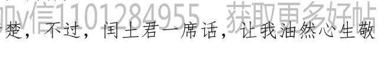

帮我打开思想的窗，看到了什么情况。以及经济学，管理学的真实应用：这是纸上谈兵的，即使是案例也无法取代的。深刻的体会，写出来的案例也是虚假的。关于书籍，闭门君说的隐晦，如果不隐晦，那么更多。书籍没有有效内容，很有分量。（未完待续）

作者：Perry点头 日期:2006-08-21 22:06

我不清楚，不过，你一番话，让我满心生畏。张瑞敏是我个人做个小网红，也非常佩服的。经过你的直播，更加支持。因为我以前是经济学院的（也是中国所谓名牌大学的），说这话不为炫耀，体会出来的话就做朋友，而是为了对抗那些显晃、炫耀名牌或者硕士干什么的？所谓“科班身”。我知道道杨，主读谦，谦虚归谦，水平绝对是比我见过的教授强的，并且，西方经济学是美的，近乎阳光之下少有瑕的，不过实现起来太难了；我苦苦探索，我才明白这个道理，不过现在你真正。

我不清楚，不过，你一番话，让我满心生畏。张瑞敏是我个人做个小网红，也非常佩服的。经过你的直播，更加支持。

获取价值的积累。在那的时候，我知道股票的巨大，让他感受到巨大的利益，我知道钱来的太容易，也会很快失去，就像吸毒品一样，最后不能自拔而自毁。所有的资金投入了土地，结果深陷土地而资金困难，没有赶上房地产的热潮，正是这种错误让我们错过了。下面我就补写我们的创业故事——地产篇。

作者：目光呆滞的 日期:2006-08-22 09:34

作者：Perry点头 回复日期:2006-08-21 13:04

天哪，你仍然笔耕不辍。我仔细想过了，所谓心心相通，一个人是怎么想的，文字是无法掩盖的，刻意掩盖的根本没有面对人的勇气。做事的事害怕，怕做事。我一度对老师失去了信心，如今，你让我看到女儿的可爱之处（哎掉）。虽然忘念，但是真是那句话“一见如故”。人以分为表象，分什么？价值观念/信仰。（译英文：错！）为了精确表达意思，为了使用全球通话。

我认为，你两个点让我极为钦佩：

- Focus on the user and all else will follow. 就是著名的Google价值观，第一点）关注用户，其他的跟随就会。是有先后顺序的。先满足用户，再求富贵。
- You can make money without doing evil. （价值观第六）可以不用作恶而赚钱。这一点尤为倒！前一阵子，有人反对Google跟政府合作修改google.cn。还有个事举证，甚至美国会对制裁Google, Yahoo, Microsoft and Cisco。我明白美国主流社会是基督教社会，非常憎恨这些，这些人恐怕不过是为了泄自己的怒气吧。我很难想，没有Microsoft，我学习微软拼音输入如何帮我快速打印我表达的，避免别人嘲笑我字难看。没有Windows，这中国亿民做什么？没有MSN，Space有多少快乐！没有Cisco，我们的硬件系统如何确保稳定。Google妥协，那也是迫不得已，毕竟他们关注做事，而不是这种比较方法。难道Google会好吗？给Google难堪？

我认为，你所处的位置（面对批评的尴尬）和Google类似。那些动不动说“Google是不是不守自己的原则，开始作恶啦”不是幼稚就是嫉妒或者是其他的。你确实和政府合作；草虞居士也是是的。我受了他们不明白的批评，哪怕是我喜欢的人。草虞居士确实有点显傲，也很傲慢：不过我很难找到几个成绩而不慢的人。傲慢可以改，只要真诚面对自我和朋友。但是给我们的资讯，是那些批评的人所望尘莫及的价值，奉献，同样如此。

我不清楚，不过，你一番话，让我满心生畏。张瑞敏是我个人做个小网红，也非常佩服的。经过你的直播，更加支持。

我看到了什么情况。以及经济学，管理学的真实应用：这是纸上谈兵的，即使是案例也无法取代的。深刻的体会，写出来的案例也是虚假的。关于书籍，闭门君说的隐晦，如果不隐晦，那么更多。书籍没有有效内容，很有分量。（未完待续）

作者：Perry点头 日期:2006-08-21 22:06

我不清楚，不过，你一番话，让我满心生畏。张瑞敏是我个人做个小网红，也非常佩服的。经过你的直播，更加支持。


一天，陈的手机突然提示，“你已成功充值100元”。

陈感到纳闷，他平时充值少是一千起步呀，谁给他的100元？他打打电话问老婆是否帮他充的，他老婆说：“没有”，经过了解，他发现是买手机的小伙子替他充的，他很好奇他已经记不起这个人的模样了，他对说：“这年头，这世还有这么大的人啊，不行，我要见到他，看看好人长成样”。于是，陈见了这个小伙子，花了300元请他吃了饭。

陈问他为什么这么做，小伙子说：“看手机里还有80余额，我买的手机，卡里的话费却没给你，所以就帮你充了，还给你的，”陈陈说：“你在哪里工作，平时收入多少？”，小伙子说：“在超市做小板领，工资一份”。陈王经想小伙子就算是大学生专毕业，才拿一千块钱时花功夫跑的，陈怎么会关心你呢？

几天后，陈打电话问小伙子是否愿意做他的助手，小伙子一听，自然愿意了，随后，让小伙子跟周学习金融实战业。这个小伙子7月份跟周周跑步业务的，陈说，现在给他4000元，等实习到了后，能单独做了月万一万。不过，小伙子现在还不知道，以后他可以年薪12万呢，你们却比他先知道。

作者：目光丰十而立 日期：2006-09-13 14:43

作者：凤云三十而立 回复日期：2006-09-11 20:03:03

所谓的市场经济，必须要具有前瞻的眼光和嗅觉，才能抓住新的市场机会，在被别人淘汰的金矿里，是很很难掘出一桶金（就算半桶也很难！），你现在的感觉是“食之无味，弃之可惜！”，说明你不懂，什么叫“含得”，不“含”，怎会叫“得”。

$$$$$$$$$$$$$$$$$$$$$$$$$$$$$$$$$$$$$$$$$$

我在制药企业营销部门工作，今年被派至重庆地区负责商务工作。主要工作是与商业公司（医药经销商）的物流、货款回收、价格体系维护、二级分销拓展和市场监控。业务核心是发货控制和回款。今年国家商业贿赂政策推行，使药药行业受到的打击是空前的。处于这个经济链的制药厂家更是举步维艰。我曾想问你对此势的看法！是行业的问题，还是公司的问题？你如何做出选择？我最近如此浮躁，感谢。谢谢！

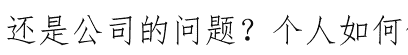

这不是行业问题和公司问题，而是制度缺陷的问题，所有的面面对没有社会规范的福利制度，多数对未来充满恐惧，表现为对物质充满强烈的占有欲望想要消除这种恐惧，在现有缺少制约的社会结构中，医疗系统的官僚和黑手终将虚假的医疗价格，变成一把悬在大陆百姓的头上的利剑。

这个经济链条的制药厂家境非常的微妙，你感觉毕步维持，说明你不是商人，你还没了大陆医药商业的历史，并根据历史的演变判断出来的方向。

制药厂家开始是豪华包装药物，什么水杯、保温瓶、电饭盒全成了包装盒，随后国家就打击不正之风，不久豪华包装了了，代的采购采购回，扣方斥，现在国家打击商业贿赂，现在感觉商业贿赂不灵了。你只要仔细观察就会发现，n那些亮丽的女药代表在外面抱爷爷，业务做的更好了。

作者:目光呆滞的润土 日期:2006-09-14 20:36

目光呆滞的润土你好

看了全部的贴子第一次想问过你<第三眼镜看中国>这书吗？我看了以后觉得是事后诸葛亮（几年之前的事）。希望你贴子现在的社会感感一谈（希望是由感而发）

学者们喜欢宏观叙事，其实中国我们需要我们每个人个人，将自己的优点滴滴滴，那只有一件用心真心真实地叙述出来，只有心才能体会体历史的历史沧嵘，他眼睛更透明。中国人需要自己的大智慧而不是孙子兵法和阴谋计划去创造中国自己的未来，走出这悲哀的历史轮回。

作者:目光呆滞的润土 日期:2006-09-15 11:31

作者:hcyhlt 回复日期:2006-09-14 21:06:15

我在广东东边，所在的单位是国企，做食品的，三年前要改制，但现在都没有改成，属国资委什么的。因为这里大部分人都是强人，想听大家现在对国企的看法，个人在这样的环境怎么发展？

你所在单位改制，三年没改，估计有两个主要原因：
1. 窟太大，没有什么油水。
2. 油水太多，盯着的强人也有，一时没机会。

看现在的企，要从历史看演变的源，从动态看演变的规律，从本质看变的目的。从字面分析，“国”字是“口”里包着“玉”字，从历史过去，东西都是被“国”字的。当今社会，随着物资丰富，过去许多“玉”东西，现在变成“石头”了。所以那张“口”必须吐出“石”来，因为“口”里没有“玉”就不是“国”了，这就是演变的根源。从动态看，“口”把石头吐出来，让你用心呵护，耐培养，变成“玉”后，被吃了，这是演变的规律。从本质看，只要是命脉的、稀缺的、控制全局的，必须掌握在人民手里，这样才能保证全体。


益，不过人民尽管，因为他们先进代表们睁着雪亮的、运筹帷、决策千里。至于个人的命运，最好的是张“口”，让自己变成“王”也可。假如命运你为了“石头”，最多也算一笔疯狂的石头”。

作者：目光呆滞闰 日期:2006-09-16 10:47

作者：迈出第一步 回复日期:2006-09-15 17:09:08

润土大哥，你好，我在三个月前，一直在苦苦寻找和考虑万元自己开始做什么事，读了你的大作成功的故事。简单来说我的现状，一直软件测试，技术上的感觉提升，而且问题不在技术专长尚发展，希望朝向一切懂的全面发展：我现在已经定好年内地搞培训，一方面初期投入可以不大；自己也不是整天面对电脑不会说话的人，本来这个工作也是需要协作的，欠缺的就是销售和宣传的知识的方向：一个是现在大学毕业生很多没有经验找到不到工作，而在我做没有经验公司肯定不要的，我想通过培训搭起桥梁；二是针对中小学生的计算机培训，当然我也在苦苦思考什么样的思维来进入这块市场。现在的父母自己省吃俭，而在教育投资上，只要有实际学习效果，不会心疼钱的；请问润士大哥，对培训行业或者我的情况给予一下吗？以后，有人让子女上学费高的名校，业余时间让子女参加老师推荐的各种名师辅班。穷人则不再相信知识改变命运的谎言，他们将用最少的资金，获得最实生存技能，让自己的子女能够份，养家糊口。

# 一 回复1284955

作者:目光来的润 日期:2006-09-17 10:41

作者:zhouwei4005 回复:2006-09-15 18:26:23

润士大哥，小弟是一名普通打工的。没有本钱，没有关系。但有满腔热血。请问，我该从哪里入手手吗？不胜感激

你只想自己的口袋，当你感觉身无文分。你要看见富人的保险箱，懂得破解密码，然后打开它，你会发现里面全是钱。你看见贪官写的标牌：“此地无银三百两”，你一锄下去，地下全是钱。你感觉没有关系是因为你躺在床上闭上眼睛。假如你睁开眼睛仔细细细看墙角的蜘蛛，就知道“大师”就在你的身边。公蜘蛛一旦找到阴暗的角落，它就会辛勤地劳作，一刻不停地吐丝织网，一层层、经丝分明，当公蜘蛛织完网后，它能够悠闲地趴在网上等待着美味的食物，一无所有的蜘蛛知道只有自己的网，它才能独自享受自己的美味。当美味的食物被蜘蛛肥后，公蜘蛛不再织网，而是寻找着风流，终于有一天，这只蜘蛛跟美丽的母蜘蛛快活风流了一下，这只蜘蛛被美丽的母蜘蛛吸干了血，鸣呼咯咯。满腔热血的人能够移动手却找不到，冷眼静静的人才能找准目标。加v信1101284955

作者：目光呆滞的润去 日期：2006-09-18 13:11

作者：kunbrother 回复日期:2006-9-18 00:04:43

方某大头，方大头，现在我们也常提到他的至理言，86年他声音哑哑的对我们说：“小弟你们做生意要像蚂蚁一样，趴在那里不要乱动。两个眼睛看着，看见蚊子飞过来，你伸舌头吃一个，看见苍蝇飞过来，再伸舌头吃一个，但是看到蝴蝶，你就要管蚊子、苍蝇了”。我们经常朋友聊天：“中国的MBA们没有大头是他们的悲哀”。

# 一个意思

上个月小军碰大头了，现在开奔驰S600，可能脱离了，抓住了地产机会。作者:目光呆滞润 日期:2006-09-19 10:45

作者:btylt 回复日期:2006-09-18 17:25:44

润土大哥，我在试试的房产经纪人，刚入行，由于经验不足，三个月没有工资了，现在生活困，我的经理一直叫坚持，有钱赚的。面租金净收入估计在500万左右，可能他在股票里成功了。润土大哥关注微信11284955

作者:目光呆滞润 日期:2006-09-19 1:18

润土大哥，天涯关注你的帖子很久了，小弟是土木专业的，成绩很不好。马上就要毕业了，一直迷茫，不知道干什么好。想考公务吧，不愿意被束缚的生活；自己创业，不知道资金，没关系，也不知道如何入手。我想能不能分析一下中国的建筑市场及其前景。在这个行业需要什么样的条件（技术与否？）需要什么样的性格？内向的做好吗？1. 怎样与人交道？人际关系需要什么样的原则？怎样学会说话？如何与政府相关人员交往？2. 现在的建筑老板是怎么起来的？能给小弟讲一个案例吗？可能问题很幼稚，恳切希望润土大大能给小弟解答。一个迷茫的后生。谢谢。

# 二 

2006年9月18日

1、中国的建筑市场是缺失文化灵魂的GDP垃圾，是贪污冒险。在这个行业需要的是：胆心细脸皮厚。2、你要把对方盯着，许多事不说，懂得跟阎王、大鬼、小鬼说话的艺术，就能发财。3、现在的建筑老板全是白手家呀。白条工资，狂包拿项目黑心搞基建。作者:目光呆的润 日期:2006-09-21 11:55

作者:wikeywin 回复日期:2006-09-20 10:46:48

各位关注的朋友，在这个寡头年代，老百姓的日子一天比天的难。我身边的亲戚遇到了这样的困难，在座各位能否帮忙分析并说下看法，看看能否得到一点机会？我亲戚是在市场卖肉的肉贩，以前肉档的租金是每月450元，加上每天的各种税费40元每日，把这些成本平均分摊后，每天就是赚个百八挣当地过日子。不知何时，工商局把市场的30年市场经营权以3000万的价格给了承包商......也希望各位仁智者，特别是润土哥，小军兄弟帮帮分析下。真的希望能得到大家的帮助，帮助这些弱势群体。在此处先替他们说声谢谢！

政治体制的模式决定经济运作的模式，现代社会的政治体制有三种基本模式：1.共和2.君主 3.专制。共和和君主维护一切社会秩序，公平、自由、正义。民主专制是产生良好品质的前提。所以那些政治、经济文明发达的共和国家，必然是公平、自由、正义、民主、法制的国家。

君主靠荣誉维护一切社会秩序，在世界上传播的君主国里，这些文明发育的国家的君和贵族则视荣誉高于一切。例如英国，在历史上对敌国的战争中，最勇敢的战士不是平民而是贵族。在和平年代，那些落魄的贵族视荣誉高于马，君主之所以灭亡是因为君主和贵族堕败，也有道理。专制靠维护一切社会秩序，专制的国家必然是


这是一种用很少投资而梦想建成的比特尔玛牛的网络萨尔玛，理论上是成立的。在现实中，假设你网络购买商品的价格低于社区超市的价格，假设你网络购买商品的成交速度低于超市便利店的速度，能够成立，那么这个商业模式将是非常成功的。

作者：目光呆滞的 日期:2006-09-25 18:22

“不要被力量的黑暗面所支配，而应当以感恩的心态来面对社会”。这句话非常简单，做起来却很难的，我毕竟生活基本无忧了，可以用不恶来经营的。如换一种生活状态，可能会学会身体不由己而被力量所支配。感恩的心态过去，天津很多时候没有，来发现现在会有后悔，懊悔灭毁你的就是购买买买烂，而感恩和宽容可以让社会进步，和谐和和谐。

你说的“脚车机”，在你的小县城有多少市场，除非你们那里有高科技工厂、科学研究所，每天需要接待领导的视察，将你的“脚车机”免领导的屈辱之责。

作者：目光呆滞的 日期:2006-09-30 10:17

严和和太平洋建设靠严总的智慧管理、靠农民的低工资成本，笑谈江湖，但这建设市场的主导者不是严和，而是政府的官员和金融杠柜。这个市场变化中，谁决定谁的命运呢？

上帝说过，每个人都有罪，人活着就是要赎罪。

作者：目光呆滞的润 日期:2006-10-03 13:59

作者：songsen1977 回复日期:2006-10-2 21:17:34
近期颇为困惑，以后走路向何方，才有此问。
基本情况：2001 年，第一次做事，因为自己的兴趣，而选择了一家音像店，投资较小，女友主持，从此走上这条路，第一次比较盲目，什么都不懂，进货渠道、货架选择、现金流的控制、客户的需求、利润的计算等，基本上全是干着分析，加上部门的两次盗版的没收，可以用惨淡经营四个字来形容。

2002 年，在音像店旁开了一家烧烤的火锅，加上烧烤，还是妻子（女友升级版）照料，成员：我父母、一个厨师傅、我俩不分工，因为周围环境的特殊性，生意还可以，主要矛盾点在于：1、生意好，小店爆满，无一空位，人员照顾不周，生意差，空无人一人，比较郁闷。2、人员管理不善，层次不齐，矛盾较多，在这半年时间里，妻子与父母的关系剧恶化（虽然都是好人），这像是全世界的问题。虽然赚了一点钱，但经营的比较痛苦。在此期间，在网上找的烧烤的方法和技巧，通过很多的尝试，烧烤有了比较进步，至今，这还是我们心底的骄傲。

2003 年初，可爱的非来了，别人我不知道，我的店因此而闲闭。

2003 年，离开了音像店，暂时脱离了我的工作（我曾经在上班，因为一些原因，我脱离不了了），做了几个月的保险，卖了三个月猪头肉(笑，时常与妻子调侃，咱们也是卖猪肉的人），在六个月多里，自行车被盗三次，租的两次房屋接连连被盗，其中滋味，难用言表，此此，积蓄全无。

2004 年，回到单位，妻子在单位里开了一个小超市。
资产情况：
1. 超市的利润在2-4成，日元利润2000元，扣除所有开销，年净利润6-8万之间。
2. 2005年，首付9万，购省会城市房屋一套，每月需支付1600元，20万贷款。
3. 昨天（9月30日），在老家购邻居一小房产，5.5万，因为急需钱，房产是有有点贵买了，现值7万。
4. 人工工资在2500元。

困惑：
1. 下一步如何走，个人倾向于做一个代理（在二级城市），那么做什么代理？
2. 倾向于做一个贸易公司，同样的问题，做什么。
3. 如果我做事要用钱，如何把两处房产变现。

你的困难，我能够理解，毕竟我也做过的保险业务。从你做过的行业可以看出，基本上都是传统行业或市场已经非常成熟的行业，在这些传统和成熟的市场里竞争，没有独门优势无法发展的，否则只能勉强生存。

1. 做代理的商品必须是新兴的商品，在当地尚未开发市场，并根据市场的调查，判断出当地的市场需求。假如你能做到：“领先市场一步、领先对手一步”，那么你就一定成功。
2. 做一个成功的贸易公司，必须有诚信守诺的实力厂商的支持，有诚信守诺的下游客户的合作，有宽松和有序的商业环境，否则，你将成为奸户。
3. 做事要用钱，可以将两处房产卖了一处变现，或将房产抵押银行贷款，只要不要不抵押给高利者即可。

作者：目光呆滞的 日期:2006-10-03 14:47
作者：SEDU 回复：2006-10-03 09:16
一手获取很多帖。中国的繁荣大部分是靠出口，但是出口的增长是靠廉价劳动力，而不是日本靠的是自己的努力。所以中国是一个廉价的“打工者”，真的希望能够改变，也希望从我们开始。如果中国没有那么多人，那么多劳动力，中国会是什么样？这是东亚人口密度很高，没有多少矿产资源，即使有森林和煤炭资源他们也不开采，可是他创造出世界经济的奇迹。

落后的国家，没有教育，韩国也非常爱国，重视人才。劳动力就需要分析和培养人才，世界经济发达与物资没有关系，日本、韩国、以色列，他们培养高素质。美国经济最发达，因为他们不仅自己培养高素质，而且将全世界最好的人吸引过来。老兄弟的说“中国”可以说廉价的“打工仔”，不过我们要分析日本，韩国近代经济发展可以看出，他们从“打工仔”走来的，正是他们的国福，所以有机会就会成熟，他们就不会再去打工，而是用技术扛着市场，用技术控制着市场，直至成为经济强国。面对中国大陆廉价的“打工仔”。

作者：目光呆滞的 日期:2006-10-08 09:18
作者：文霸 回复日期:2006-10-05 14:36
润上老师，我这两天有两个棘手的问题，希望你帮忙出主意。半年前，我开了设计公司，主要就是做一些说明书还有手机，而且买了台名片机，附带一些单色名片，四色的名片我们都外发印刷厂。开始的时候我开了印刷厂，专门替印刷厂制作，然后顺便去菲林。一段时间下来我不能混下去，我那时也过来帮忙学点东西，可现在那印刷厂整天拖着不钱，他做的那些东西都没用心。我和老公几个人商量道我现在真的没客户了，大人都快急坏了，我老公说：我们现在这样还有好处，我们在上班，他跟我说这里再开两个月就关大吉。这段时间里我全权代理，不说挣钱了差不多保住我自己。如果我们拖到过年再说发展，我现在正是磨练的好机会啊。但是有一天下来大脑有点晕了，我到底应该怎样发展客户呢？难道要背个包袱去发明：“我是名片和作设计的，以后请多多照顾”。那样我倒觉得累，只是没多少效果，白工夫了。我现在在深圳，这边印刷设计这个行业异常激烈，希望你帮我出点主意，谢谢~~~为你自己的办公室设计出独特的效果，为自己刷一张漂亮有创意的名片，寻找当地有钱的客户，对准有些钱中有权的当事人，让学生妹模样的员工去敲门，切不可让露天、李天模样的人包去发明片。

作者：目光呆滞的汹湃 日期:2006-10-09 09:23
作者：may058 回复日期:2006-10-08 18:22:06
找有权、有钱的客户可以理解，为什么要学生妹模样的员工去敲门，其中妄机请老师指教。一手理111284955，获取更多好帖，回复怎么样。在一个“不要和陌生人说话”的世界，面对你眼前的陌生人，你会做出什么样的本能反应呢？
- 学生妹---?
- “芙蓉”女？
- 李达男？
- 君眼哥?

作者：目光呆滞的汹湃 日期:2006-10-11 09:41
作者：goodsapple 回复日期:2006-10-10 20:26:41
作者：dglzji 回复日期:2006-10-9 20:08:49
不知道闰土老大对史玉柱有什么看法？很想听您对他的评价!!

润上大哥，评价一下史玉柱吧。感觉史玉柱如此强悍。史玉柱吃着他的“巨人”，仿佛全身充满了力量，他梦想成为一个巨人，成为毛东一样的伟人，于是他用“巨人”建起了巨人，可是没有基础、没有钢筋的大厦在建设中，就被小雨给堵了。埋在废墟中的史玉柱思痛，总结大厦倒塌的原因是因为他没有建造大厦前，造出“永恒”的基础。多年后的一天，史玉柱从昏睡床上醒了，突然从东山有了创业的灵感，他将床底下的灰拉了出来，去印刷厂制出精美的包装，找了几个老头、老太。在大街小巷、市民广场上，看见小贩喝着“歌”，老太溜着回家的路上，史玉柱眼里装满了黄金。深夜人静的时候，他想做英雄了。

作者：目光呆滞的 日期:2006-10-12 08
作者：神经回复日期:2006-10-11 23:02:05
最近比较无语在手机零售。我们主要是做水货，因为水货质量好便宜，有些人用翻版手机，市场有点乱，而且消费者往往不清。说明明年要降低？想听润土大哥对手机销售的看法。

作者：目光呆滞的 日期:2006-10-18 10:51
记者：南京市中级法院获悉，严和因财报缩水跌出2006年胡润百富榜第一，太平洋集团主席，财富从去年的125亿元缩水到75亿元。严和被法院限制出境，太平洋建设集团有关4起已判决生效的经济案件，尚有总额超过3238万元的欠款未还，法院已启动执行威慑机制，做出了限制严和出境等多措施。

2003年8月，银行南京下辖发放给江苏河流有限公司（下称“黄河建设”）4000万元贷款，这笔贷款期限为1年，由太平洋集团提供担保。今年月底，南京中院判决黄河建设向银行偿付本金2785.8万元及利息，太平洋集团对该债务承担连带偿责任。“严和对我们的起诉无异议，并答应尽快分期偿还。没想到最后落空了。”银行一位知情人士介绍。在上述判决生效后，银行没有再收到任何分钱。今年7月，银行申请强制执行，南京中院对严和名的12套房产进行封查。

另一一起借款合同纠纷是因为支持分支2004年贷出一笔总额为500万元的1年贷款给严和太平洋集团下子公司江苏消防有限公司，贷款到期后，长城并未按约还款。而严和个人与投资公司也未履行业务，该多次催收只收9万还款。作为责任担保的严和被法判负有连带清偿责任。南京中院执行局有关人士介绍，8月底，严和被通知到法院，他主动提出还款：“9月先还一部分，10月全部结算。”直到本月8日，法院依然没有收到来自严和的任何执行款，依法启动执行威慑机制：在南京当地媒体曝光了严和拖欠债务不行的信息、向公安机关发布限制严和出境的通知。法院还向全社会征集太平洋集团及其法定代表人严和的有效财产线索。记者了解到，南京鼓楼区法院11日因两起未执行到的标的总额为148.8万多元的经济案件，向太平洋集团及其法定代表人严和启动了执行威慑机制。供稿/《东方早报》

在12日发布的“2006年胡润百富榜”上，严和从2005年的排名第2跌到第16位，财富从去年的125亿元缩水到75亿元。作者：目光呆滞的 日期:2006-10-18 59
作者：目光呆滞的 回复日期:2006-03-02 58
作者：草原老鼠 回复日期:2006-02-28 08:20
这些天他们找了一些报道看。呵！老师所说的，其实严和老李全错了，企不是99，是冰山的温度。再次：严和与地方政府高度合作充满了巨大的阻碍，改革到如今，许多矛盾却回避不了的。

严和在中国的公路史上，靠的是力，他的交通资金没有，自己设的高速公路上，无数贪食者击败了现代化部队。倒了。世界上，只有中国的手法可以载人、耕田、接秧——今天严和用它改写了世界经济的奇迹，随着中国政府巨大的交通投入，他用诚信与智慧，靠勤细触摸出中国河流，享受这份河流素养，他知道梦想建成的比特富裕的地区。他还成为中国超级“福斯”富豪。他知道做人必须先事，只有做好事后才有资格。所以他成功之后，他知道一个人的能力是有有限的，他懂得用人，在中国股市中，他又分享了丰盛，这是他过去的发展。现在，他的公司名字是“江苏太平洋建设”，名字就可以看出他的心。他想若干年后成功。有两种结果：成功或失败。他知道失败的是多数，但他去做，因为他有激情、有产业梦想。实际上前面不是太平洋而是冰山，他没有强大的支持，又要引入的资金，让他想起了另一位首富，某某某，梦想比他还大，他要用华尔街的资金，给99度的国企加一温。用资产换空间、时间的方式与地方政府合作，有了这些资产以及现在的上市公司，他雄心勃勃的做起了中国产业梦，这是他的现在。民营金融与僵化国有金融的矛盾，我认为，如果德隆不听的话，民营资本不会支持已经死亡的许多国企产业，一定会跟智慧合作，才能在中国的资本市场上创造出未创造的奇迹的话，我可以宣布49年中国成立以后后，真正的市场经济开始开始了。

作者：日光凉沛的润 日期:2006-10-18 14:38
作者：落叶无声 回复日期:2006-10-18 10:51:22

刚才看了润卫这个帖子，觉得受益良多。真是觉得现在网络上可以提供新知识。在此真诚地请教润卫兄弟，希望指点一下。我和一个好朋友准备用专业知识建立一个翻译及医学咨询工作室。下面是昨天我写的初步的内容：

# 春之鹰翻译&医学咨询工作室:

我们是一个热爱生活、热爱工作的团体。我们的创立者，两位年轻的医学博士，名字之中分别带有“春”和“鹰”这两个字，所以名为“春之鹰”工作室。带着对生命、对医学的无伦热情并建立这个工作室，我们愿望每天都能像春天的鹰一样翱翔蓝天，实现自己的梦想，所以希望用我们的专业知识帮助您或您的企业展翅起翔！

## 业务范围：

- 翻译英文文章的发表，十余年的医学英文写作，数篇国际文章的发表，我们为你提供最专业的医学翻译。同时提供社会学、心理学、广告策划等其他方面的中英互译。
- 各种医学问题、健康问题、营养问题有偿咨询；或许您正发愁去医院排队、化验等候交给我们，面对眼前不良医生开出的回购药，你可能不知所措，那么现在你只需要家里就可以咨询了，我们为您提供国际领先关于医学的最新咨询！

![img/79371fbe094ff8e6f2749dcd71d10_645.png]


制药企业用户的需求，告诉他们你们能为他们做什么。

作者: 目光采集的润沛 日期:2006-10-22 18:06

## 天涯首周年感谢

过去的今天，本人在天涯首发此贴，不知不觉在网友的陪伴下过了整整一年。过去的一年中，你们给了许多感谢和鼓励的话语，我感觉“无私的给予是一种快乐”，以往没有说些感谢，我只想写出真实而有价值的文章回馈大家。因为我知道对于友谊和缘分，苍白是多余的，本贴中所有的ID名称，我就不再罗列，我只想在今天对大家说声感谢！祝福朋友在今后的日子里，幸福、健康、快乐、成功。”

以前，我曾也在《福布斯》网站写一些短语，由于他们网站的局限，他们并没有激起我写作的激情，连《福布斯》网站的管理员希望我在他们开设网络论坛的时候，考虑去做版主事的，我也不太感兴趣。之后，在凯迪网络上，我也以“润沛”的笔名写过创业经历，结果那里也没有多回贴，幸亏我来到《天涯社区》，让我在这里结识了大家，正是你们的鼓励和鞭策，让我的写作像创业一样充满激情。20年没有过笔了，不知不觉的写作水平能够得到提高，得到了大家的肯定，心中颇有安慰。

回头自己总结自己的人生半生经历，其实每个人的命运是跟祖国的命运分不开的，具体个人命运的不同则是个体所处的环境和自己的性格决定的。

当我们20岁的时候，决定放弃世俗追求的时刻，我们个体的生命运就会被这个现实的世界抛弃。试想一下——“领导会不喜欢从奉承、拍马的人吗？”“女友的家人会同意她找没有文凭的男朋友吗？”“没有规则，只有潜规则的生存社会里，按规则做事能成功吗？”我们的坎坷经历，就是人生命运最好的答案。不过，我们从没有后悔，动过，因为痛苦的磨难，让我们知道“当一个旧世界抛弃你的时候，其实新的世界已经在那里了。”

其实每个人活着都曾有梦，有人富有却做着梦，有人很穷却在做美梦。梦的两端是“身在狱中梦方醒，笑着做梦成真”，获取更多好帖。人切不可“白日做梦夜大”，而是应该是“白日从勤夜反思”，选择了梦想也会学会选择坚强，坚强却不能固执，你就会实现梦想。

我们做过许多许多梦，虽然梦没成真，但我做梦的日子是快乐的，我们付出过，追求过，我们就没有遗憾。

20年前，我们看着一个美梦——埃菲尔铁塔上、黄浦江外滩挂着我们的服装品牌。

14年前，我们看着一个美梦——我们成了石油巨子。

3年前，我们看着一个美梦——我们成了慈善家。

今年，8年前廉价的土地——圆了我们千万的美梦。

从今以后，让我们一起做一个美梦——用我们的网络助力祖国的经济腾飞，用我们的爱心改善一点人心。

作者：目光呆滞的润 日期:2006-10-25 09:50

作者：一名不惊人 回复日期:2006-10-23 14:16:22
闰土老兄，看你的故事让我很感动也很感兴趣，百忙请你给我一份完整的拷贝吧，十分感谢！hbtmxjjh@163.net

作者：广州新少 回复日期:2006-10-24 08:30:36
请发至：gst119@21cn.com。两位朋友，我的邮件都被退回了，也给你们发了站内消息，特此帖告示。

## 一手资料

作者：目光呆滞的润 日期:2006-10-26 11:06

作者：欢乐英才 回复日期:2006-10-25 14:20:55
给没钱的妇女贷款，给穷人贷款。有钱的男人贷款，给富人贷款。这两条路都通的，那润土会哪条路呢？给没钱的妇女贷款，给穷人贷款。有钱的男人贷款，给富人贷款。必须把他们看着未来的穷人，才能到期回收贷款。

作者：目光呆滞的润 日期:2006-10-26 12:00
我想请教润土大哥几个问题：
- 1. 你碰到一个陌生人，如何识别这个人的品格（如通过对话、着装、眼神）？
- 2. 预防被骗的最重要因素是什么？
- 3. 他说了一句话，你怎么猜到他心里想要表达（潜台词）？

作者：重心 回复日期:2006-10-27 12:30
望大哥给予！

作者：重心 回复日期:2006-10-26 12:04
另外还有一个疑问，为什么您能认识这么多人士是因为家庭背景的原因吗？

作者：suipinghua 回复日期:2006-10-26 17:04
对于一个人来说多么重要

作者：jinfat 回复日期:2006-10-27 28:30
我觉得润大哥认识好多成功人士，比我们幸运多了。看完全文章，应该知道我是没有家庭背景的。我的母亲是一位文员，退休前是个纺织女，现在退休工资100元。父亲从气象学院毕业后在气象部门工作，不久下放回城后，改了个部门的小干部，退休工资800元。父亲在现在的工资不够，他俩工作了一辈子，连住的一间房子也挤了。我是一个普通的业务员，现在月工资600元。姐姐从肥皂厂当后，2001年买掉的房子省了4万。自谋业，她没有关系，没有背景，只能做别人看不上的纺织材料


做石油是因为家庭没有背景，我们没有门路，搞不大的汽油、柴油业务当时的石油行业生意不景而被大家所蔑视。98年我们80万买土地，是政府公开拍卖来的，当时政府的领导还怕我们后悔而催着我们买。这笔投资到05年没有人能成功的，只要身边有钱的朋友和家人，在03年拿出100万继续投资，那么年后，则可以多获利400万。

03年，我做IC广告并不是IC卡老板想帮我赚钱，而是因为人们要这个项目，他们想利用我，我知道是个骗局，所以想到用法律保护自己的利益，不过即便赚不到，所以我投入2万元，并设计了谨慎的法律保护，为了赚隐藏的400万利润。因为我没有家庭背景，所以才想到法律保护自己的权益，我就赚不到钱，我也不想保护自己，因为加入黑暗容易，逃离难。

作者：目光呆滞的润土 日期:2006-10-28 14:26

作者：bb109 回复日期:2006-10-27 17:53:59
闰土大哥，想请教你一下！最近和几个朋友开了家宾馆，几个月来，生意一直平平淡！现在感觉这种小宾馆在我们越开越陡，生意越来越难做！您能提点建议，怎样在这样的竞争环境中颖而出？

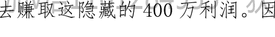

作者：目光呆凉的润日 日期:2006-10-28 14:43
处理经理 加信:1101284955 获取邮件好帖

作者：我为我 回复日期:2006-10-27 23:57:07
润土哥，我家里开了三大私立学校为举筹建设经营现在碰到很多问题，被被迫转手还债。我虽然没什么银子，但心想回国经营一所学校是一项事业——润土兄，您对农村的教育事业有什么什么建议？很想听到指点——农村教育应该以初级教育、实用教育为主，教会学生学习的方法比灌输陈词的知识更加重要，被那些无味的洗脑教育不如让他们保留一片纯净的脑头。

作者：目光呆凉的润日 日期:2006-10-28 14:53
作者：对月形 回复日期:2006-10-27 21:10:45
最近和办公室的老吴聊天，说到火车站买票要排长队伍的问题。我们就想有一个网上买票系统。具体来说，我们可以在网上选择适合的车次，然后像网上购物一样，用自己的银行卡支付。到了火车站（大厅里有打印设备），在火车站专用电脑里输入一些关键信息，比如身份证号，把火车票出来。这样就不需要排队了。对于火车站来说，只要放置一些电脑，装相关的软件，就可以解决买票的问题。之所以有想法，是因为买票太费事，到一些售点还要交5元的手续费，获取更多好处。揭秘武汉铁路 齐纪云 发布

俗语说靠山吃山，靠水吃水，刘志祥的发家源于武汉电视台后勤部门的职工。1998年，汉口车站立周年，汉口站筹资在电视台播了一场晚会。当时还在电视台工作的何坚，让刘志祥在节目中频繁露脸。晚会的播出，让刘志祥的虚荣心得到了满足，对何坚更是刮目相看。二人你来我往，话投机相当，合作的范围从媒体炒作扩大到卖票“捞钱”。一个知其中合作伙伴关系——刘志祥总与何坚联手，控制汉口车站大部分的车票和销售座位，形成一个坚实的复杂的销售体系。何坚的电脑直接与汉口站票务室相连。在刘志的指示下，通过票务室一条龙直通电脑销售窗口。按照“规定”，从何坚那卖出的每一张票都加了“手续费”，从5元至50元不等，一般卧铺票加20元，黄金周和春运期间加30元，热门时，“手续费”高达50元。汉口车站运客达万人。这些票源全部由刘志祥一人掌握。自然，最便宜的票只有何坚的票能买到。二人有着相当正规的游戏规则，两人签订了明确的利益分成合同。汉口车站每年运客100万人次，卧铺票和热门方向的座位占30%至40%。


何坚的电脑打多少卧票有明确的数据统计，何坚对刘志祥进行回扣。除了倒霉，斩断汉口车站基础建设工程项目，认为是刘志祥的另一条之路。车站老职工回忆，在刘志祥任站长期间，汉口车站售票厅工程不断。2000年厅内刚安装中央空调，还没使用，2002年又被拆重新装修。车站贵宾室装修，刚装修完了，又把装修的全部拆掉再装修……近年来，汉口装修费用就高达1.74亿元。装修费用水分很大，由于刘志祥家乡的施工队——湖北州的建筑队。车站站台修饰的一处花坛，决算竟花了30多万元；在车站出口的一处5平方米的小休息厅，造价高达10万元。刘志祥从中类工程里“黑”了多少钱？绝非小数目。

作者：目光呆滞的闰土 日期：2006-10-29 10:21

作者：luzheva 回复日期:2006-10-29 08:47:14
润土大哥：请教您一个问题：最近的网络，电视，新闻媒体等等都在说：长征。为什么要现在这个时间写大文章呢？深层的原因是什么呢？这政府又什么样的目的呢？为了什么呀？我们正在被敌视敌人所围困，被贫穷和落后所拖累，被腐分子所蚕噬，被内部的王明、博古之流所误导，因此，我们必须高举公平、正义的旗帜，开始我们新的长征。

作者：目光呆滞的鸿土 日期:2006-10-30 10:42
作者：忍者最 回复日期:2006-10-29 13:35:48
再次回到王先生这里，有高见？我有个朋友说股票，明年会牛市。另一个朋友说股票，明年会牛市。当股票跌到来，股民遭受损失。经济学家厉宣称“中国股市健康，甚至要冲上五千点。”我不相信股市低迷，上半年不涨，下也会涨，今年不涨，明年也会涨！”结果大盘不断扩大，最后跌破三千点，损失了五万亿元。近日，据说2003年汉口车站那个老总，居然做了某上市公司，这个在上峰能亏损。这里很多教训看 很多好帖。他很多成功，没有痛苦的。他其实是个傻痴，第一次是做盈利，第二次是做亏损。他炫耀，向上级和股东隐瞒了实情。其实他们知道，中国证券市场的治理非常糟糕了。只要上市公司存在流氓，那么就是简单的话“远离毒品、远离资本市场”。

作者：目光呆滞的鸿 日期:2006-10-31 02:21

作者：qykx 回复日期:2006-10-30 22:09:01
2006年1月，我国对外开放，外资银行首先在中国境内开展业务的资格。老百姓有了更吸引力的选择。我国储蓄是严重不均衡，8%的储户居住在国内经济领先城市，即8%的人拥有80%的存款。判断银行的业绩，并且具有国际视野，在存款上较少有“爱国主义”的情怀。他们正是外资企业瞄准的对象，很有可能成为第一批倒戈者。占据存款较高的企业市场，国有银行恐难堪，其中外资企业极有可能优先选择外资银行。国有银行差、手续繁琐、增值能力弱，老百姓因此转向外资银行。本刊编委金融学家徐涛教授预估，如果有10%的资金转投外资银行，中国银行的危机将暴露出来。规范化后，太子们、高干子孙们就不甘于随心欲地拿着银行，可能国家还会会有希望。

作者：目光呆滞的润 日期:2006-10-31 10:27

作者：tinners 回复日期：2006-10-30 20:58:22
相对来说，只是国内这样，美国的好些最起码监管机构不像国内那帮人，吃了肉还不吐骨头。美国当年的胶吃人不骨头的，最近的安然也吃了人，所以美国的老百姓学会把野兽圈起来了，决不再给它机会去吃人。

作者：目光呆滞的润 日期:2006-10-31 10:36

作者：兄弟杀手 回复日期:2006-10-30 22:24:46
好久不见来看了，今天空来看也想请教一下润土大哥。现在对你来看都不通，那要是那样的话穷人应该怎样生活呢？创业是不行的只能帮别人打工吗？就这样每天为了一碗饭而到处奔波吗？要是这样的生活满足许多人的话那我我想中国也别想大了。我只是知道穷人应该怎么为自己过好后再定个目标。到底穷人应该怎么做？现在的穷人几乎已经机会了，看着上海滩崩溃的黑幕，就知道官商勾结已经从源头斩断了所有的利益，他们不给穷人一丝机会，还运用着房价把穷人逼上了绝境，未来穷人的机会，看着希望能否在贫官包围中杀出一个公平、正义的和谐社会了。

作者：目光呆滞的润 日期:2006-11-01 09:41
看了上面udong888老的回复，我内心非常感动，理解你的心情，也让我想起17年前我们……

作者：山城 回复日期:2006-10-29 23:28
润土大哥对梁希森怎么评价？梁希森是一个农民，他不懂经济，却因为很有商业脑，结果发了大财。他流浪过，所以他梦想农民住上别墅；他乞讨过，所以他梦想农民也能拿上工资。他，没有面对末日的恐惧而挥霍钱。他选择了回家福利老家的乡亲，他的行为说明他是个地道的农民，做农民，他不傲，他内心是善良的，这种痛苦让他快乐。

作者：目光呆滞的沥洞 日期:2006-11-08 12:42

作者：对月形单 回复:2006-10-29 20:48:36
想问问润土大哥，你收藏名字画吗？我喜欢欣赏名字画，那些好的作品让人的灵魂可以得到净化，美的艺术能让人的思维流淌与升华。不过，我不收王叔伯的几张字画，我几年前就随手送人王家里，现在客厅正正面挂着一幅精美的小扇画，是一位朝月而画的，是传统的山水画法，画很古朴，只是他现在没有名气，这类现代流画家也不如了。我另外外墙挂着一幅书法，是季季写的字，他是散之的大侄子，现在是大学美术系的老师，书法很唯美、大气，不过他的作品市场价格不高，他也不去炒作自己的名气，在别的弟子想着点子赚钱的时候，他却为了过去的老师整理资料，出版书籍，自己陶醉在艺术的世界里。真正的享受不是数钱，而是被人尊重并且实现自己久远的梦想。解放前，大陆有一个收藏家叫张伯伯，他的收藏全捐给国家了，美国的JP摩根也是大收藏家，最后他的收藏也全捐

给全体人民了。

现阶段的名家字收藏，更多的是对艺术的热爱与追求，而是商业化艺术的厌恶和购买、洗钱的管道了。

作者:目光呆滞的洞 日期:2006-11-09 17:28
作者:dglzji 回复:2006-11-8 15:11:40

洞土大哥：请教一个问题，像我们这种背景，没身份的刚刚毕业生，在与别人交流的时候，如何才能引起别人的注意乃至尊重?我注意到，你在群中常常能用几个小笑话的幽默就可以把自己推到一个很重要的位置，请问你是怎样做到的？？润土大哥奇呀！

一整理，加微信1101284955，获取更多好。

真诚的礼貌待人，做事有礼节，近君子、远小人，与人相处要大智若若，不扬弄是非。在朋友困难的时候，可以力所能及给予帮助。即使你没有钱也没关系，一句真诚的安抚可以。

所谓的大事、重要的事情是做出来的，不是吹出来的，用心思思考、用心做事，用事实告诫别人，你很重要。至于说笑话，那要看什么场所什么人而定，比如谈正事时候或者与人生以及跟长辈在一起，就不能乱说笑话，所谓的幽默不是取笑别人，也不是感情手段，而是一句恰到好处的包袱，令人回味而开怀大笑。比如上个月一个老朋友告诉我们一帮朋友吃饭，所以吃饭其实是给他朋友面子，这个女人是做林木传销的，他带着两个弱智线下线阵击鼓，我们大家心里明白白是骗局，只是谁也不点破，大家喝酒笑，酒过三巡，这女人她名字是中国的古老美丽的复制，她叫唐美（语音），过了一会，我说：“你有没有弟弟呀”，她说：“有啊”，我说：“他是不是不叫‘唐越’。”说完后，除了她两个弱智下线，我们几个朋友笑翻了，因为我们这年龄段的人，基本都看过日本电影〈追捕〉里面的‘唐越’就是被人骗吃了药跑死的。

作者：目光靠丽的浦湾 2006-10-11 18

从内大的角度看并分析，上海联福的张崇坤高调宣布，某王涉骗捐慈善金高达千万，高出手数亿元购买高速公路，不过张崇对他的过去和资金的来源却非常诡诡异，现在的社保案终被揭开了事实的真相。

从我周围的角度看并分析，我身边某局普通公务员，多年他天天吹嘘炒股如何赚钱，其实他多年前他曾经投资百万资金全部被骗并安然过关，至于其中的秘密只有他自己知道了。

我一个好朋友是某大型国企人物，他老老婆每次见到我，就说她炒股又赚了，不过每次都是微笑着告诉她是炒股高手。

这位女富豪吴英的秘密我不知道，网上说是南洋神秘军阀的遗传。我们分析一下，假如真的是南洋的大军阀，那么他多的、廉价的是毒品和女人，缺的恰恰是武器和美金。他为了一个他那里廉价的东西，送出去用命换来的4亿美金，不要说他十几个老婆、几十个儿子不答应，他手下没命的兄弟也不会答应的。

我解释一下什么叫“洗钱”。“洗钱”这个词是20世纪初美国黑手发明的，他们大量投资洗衣店，而数量庞大的洗衣店正是政府监控的空白点，这样正常的经营和向政府缴税后，大量的黑钱就洗白了。

现代社会，黑社会组织已企业化、全球化。随着国际形势的变化，黑钱的源泉在廉政透明的发展国家越发困难，他们往往选择法治和信息封闭的国家躲避法律的恶劣，将大量的黑钱洗白，漂白不是的项目就是洗车、餐饮、酒店、酒吧、零售百货等项目，大量非法的现金流向将面临银行交易系统的严密监控。随着全球反洗的升级，美国政府对岸的不明资金加了打击，国际黑社会洗钱的成本不断加大，所有的这些变化迫使黑钱的所有人寻找代理人和洗钱区域。

从国际经济的变化分析，国际资金数量非常惊人，国外的低息和经济增长，让大量的国际热钱流入中国，新一代中国政府已经意识到到问题的严重性，特别是大陆的外汇储备已经突破1万亿美元，所以最近政府不断出政策遏制国际资金的进入，这样又引起国际资金寻找控制相对薄弱的中小城市去运作。资金运作三个特点：就是在最短的时间里将金钱变成资产。

上面我只是从大的方面、小的方面，从国内、国际方面做了浅谈的分析，至于神秘富豪的秘密只有本人自己知道道，或者她压根还不知道只是木偶耍了。

作者:目光呆呆的溺 日期:2006-11-11 16:41
作者:dglzji 回复:2006-11-10 16:37:39

润土大哥：听了你我觉得要做好事，做好人都很简单，因为我们都明白道理但是事情发生自己的时候自己总觉得事情不是你所说的简单，润土大哥，我可能永远做不到你那样，请问你是怎样做到的？润土大哥的智慧。最近我有机会跟一些前辈交流，跟他们学习身上的进步，只是口舌，我自己不知道该说什么。

## 处世之道

- 做好事，做好人
- 善良的人相对复杂
- 每个人来到这个世界，多少有些因果
- 善良的人积累

- 真诚的礼貌待人，做事有礼节，近君子、远小人，与人相处要大智若若，不扬弄是非。

在朋友困难的时候，可以力所能及给予帮助。即使你没有钱也没关系，一句真诚的安抚可以。

 所谓的大事、重要的事情是做出来的，不是吹出来的，用心思思考、用心做事，用事实告诫别人，你很重要。

至于说笑话，那要看什么场所什么人而定，比如谈正事时候或者与人生以及跟长辈在一起，就不能乱说笑话，所谓的幽默不是取笑别人，也不是感情手段，而是一句恰到好处的包袱，令人回味而开怀大笑。

比如上个月一个老朋友告诉我们一帮朋友吃饭，所以吃饭其实是给他朋友面子，这个女人是做林木传销的，他带着两个弱智线下线阵击鼓，我们大家心里明白白是骗局，只是谁也不点破，大家喝酒笑，酒过三巡，这女人她名字是中国的古老美丽的复制，她叫唐美（语音），过了一会，我说：“你有没有弟弟呀”，她说：“有啊”，我说：“他是不是不叫‘唐越’。”说完后，除了她两个弱智下线，我们几个朋友笑翻了，因为我们这年龄段的人，基本都看过日本电影〈追捕〉里面的‘唐越’就是被人骗吃了药跑死的。

## 新闻：南京高淳发生一起祸3死3伤

2006-11-12 14:05:03 来源:本网综合

南京高淳发生一起祸3死3伤 王亚莉报道

据《现代快报》报道，赵善晴已撞成了废铁，南京高淳县东镇村民，今年26岁。两年前赵善晴买了马达三轮车，在东镇送客。昨天下午3点左右，赵善晴开马达，载着围湖附近的朱先生夫妻。当车行距离东镇不远的沛桥时，一辆牌为苏A4H9的奔驰车从后面飞袭而来，将他的车撞倒。马达在路上打了几个凌滚，摔了约5米高的沛桥。车上的朱先生夫妻和赵善晴都从桥上摔了下去。而奔驰车也跟着桥上摔了下去。

两辆车辆摔桥时，产生了很大的声响，惊动了附近村民。闻讯起来的村民发现，马达已经成了废铁，赵善晴和朱先生夫妇3人躺在血泊中，动不得。奔驰车身严重变形，车上3人被卡车内，鲜血从车内往外溢。来的村民见无法施救报了警，并叫来120急救车，先将赵善等3人高淳县民医院救治。警方到达现场，发现奔驰轿严重变形，无法施救，还向请求消防队员前来帮忙。当消防队员火速赶来说，用切割机将变形的车身切开时，车内3人均已死亡。

赵善回忆：“当时我正正常行驶在公路上，突然感觉后面一股巨大的力量将我推了出去。当时我和朱先生夫妇3人就飞了出去，从桥上摔了好几米远。”在桥附近的目击者说当时奔驰轿可能是准备超车，从后面撞上了马路。两辆车撞了几米远，从桥上落下。目前赵善等3人都受重伤，正在高淳县医院抢救。从警方了解到，奔驰轿车主是南京市玄武区的……（李绍富）编辑：钱芳

星期五傍晚，我突然心疼，最近小军父亲身体轻微，刚刚做了手术，连着三次化疗也失败，最近小军有点心思，我多安慰一下，结果小军电话告诉我，我眼睛直跳，自己愣愣，心想是不祥之兆，了。

目前赵善等3人都受重伤，正在高淳县医院抢救。

## 个人感悟

过了几个小时，晚上入睡后，深夜感觉头疼，无法睡眠。第二天中午，我打电话得知小军离开了世界，我心里难过无望，晚上十点，一个人骑自行车去小军家的路上，眼泪止不住淌。

上个月德明舅的儿子调皮闹不停，我和小军两人在一起吃饭，经常跑近，原来小军结婚了，最近小军姐失败了。周二晚上，小军主笔写完两位朋友的故事后，我俩去洗澡休息，感慨万千。周三我们送走了朋友，小军的道非常感，很多朋友说是参加了很多哀礼，用最好的道。是啊，只有最爱的人，才能写出感人的道。

感谢各位朋友的关心。


要爱自己，我们是家的天，我们的父母需要伞，我们的孩子没有爸爸，我们需要安稳地走完人生。就这样走了，让我们心里愁哀难。缪总老弟你你怎么没留下一句话。

作者:目光凉的鸿 日期:2006-11-16 12:38
作者:年轻的东方朔 回复:2006-11-16 11:35:33

润土大哥危险了！！！小弟夜变天象，大哥本命大劫已到。

上面的得力之人将弃大哥而去，惊天坍塌将困住大哥，慎慎。

二手整理，加信101284955，获取更多好帖

下面即将进入公司的资产清算期，很多朋友看跟我缪总的关系，以为我深陷债务的清理，但我告诉他们与公司没有利益关系时，他们惊讶了。其实，我觉得君子之交如水比较好，朋友困难的时候，给予力能及的帮助是最好的，从公司的成立之初，我就没有在缪总得到

润土兄弟，我有一个想法：现在电脑品牌机及组装机在市里形成了规模，但在县城及周边城镇这些地方还很薄，那里的人们买电脑愿意到市里去买，这个好处是：

- 1) 市里具有规模很大的电脑城，选择空间更大
- 2) 市里买机更便宜
- 3) 受慢慢因素影响，那里的质量会更好

但是也有不好处：如果电脑出了问题，要拿去保修的话，就得跑很远，劳师众劝，很麻烦。

以后电脑会逐渐普及到城乡，只要在这段时间内打造一个平台，在消费者心中，把城里的电脑城印象搬到县城里，实行近距离服务。完成平台的建设之后，再进行门店扩张，做县级品牌卖店。希望润土兄弟对我的想法给点深刻的意见！非常感谢润土大哥！

作者:目光呆滞的润 日期:2006-11-19 15:12
作者:flicked_ball 回复:2006-11-12 14:33:32

## 思考《大国崛起》

这是中央电视在沉没17年之后，推出的第二部层次内涵的电视，这部片子将载入历史的史册，我深感惊讶的同时，也印证了我们年初的政治判断。作为新的国家领导人，面对历史和发展的现状，我们已经没有退路走，必须智慧勇敢地面对一切困难和挑战。

看了《葡萄牙》、《西班牙》、《日本》的全部《德国》篇的部分和《俄罗斯》上，我印象最深的是《日本》篇，它第一次告诉中国人，日本人面对西方强曾经签署过不平等条约，发展过官群体贪腐而卖掉国家（北海道）的资产，明治维新也经历了许多挫折，而且清楚地告诉我们45年的日本，百年维新的财富积累全部被毁，他们用20年在一片废墟上将自己的国家建设成世界经济大国。片子最后的人民幸福写得非常好：“一个国家对内部必须让他幸福，对外必须带来和平与发展”。

当我清晰听到“一个国家对内部必须让他的人民幸福”的时候，我第一次从视角这里受到感动和温暖。

上个世纪说是鲁迅先生拯救民，这个世纪，是“润土”先生彻底救了。

从楼主的身上，我看到了民族的希望和力量。纵观世界，真正的强大还是文化的强大，我以前——对西方的传统文化非常失败，我们文化……

黑夜给我黑色的眼睛，我用它来发现光明——深夜了。洞土大哥能否指教否？谢谢!

二手整理，加信101284955，获取更多好帖

还没看完帖子，先逛，有问题。提醒观众——这是很少见的！看完之后，确实有很多感触，同时也长了见识（对普通百姓而言，只能通过这次公开渠道来收集资料）。不知道是否预示了什么？你有洞察力和智慧，这个问题怎么看呢？同时，我还联想到多年前，有一部类似的海洋文明和黄土文明电视（相信你能明白那部）。这些都触及到我们民族的精神层面的东西。在帖子中对我国的一些精神基因的东西，有些剖析，我认为很好，一个民族如果不能深刻反省自己，是不能崛起的！在<大国崛起>里我们看到，每个大国的崛起都有自己的反省，特别是德国，真是个智慧的民族，还有英国对现代经济的启蒙，法国的自由、平等、博爱，等等……


人承担他的责任。

而现在的情况是她站在我的对立的立场，我的过失她添油加醋的妥染，来办事人的过失则不表态（事实上表示认同），看热闹。我要坚持原则则必须要“得罪”来办事人的。

最终结果是来办事的人和我一起对付我。来办事的人有支持明知自己有“错”但理气壮，甚至故意“出错”来在这里找麻烦，然后立刻去她那里“交际”。

## 如何对付这种“寄生虫”？

- 一办理 加微信1101284955 获取更多网址

呵：问问职场的事，我是错了，我在职场上准确地说是在机关的时候，是个失败者，别人提拔了，我却是个办事员，别人被送去大学了，我是最后一个没混到文凭的。

从学校毕业初入机关的时候，我是工作努力，工作效率非常高，工作提前完成后，我总是将果子收获干净，坐着喝茶抽烟，早上打扫卫生也是别人上班时就早做完，好事也是尽量帮助年纪大的老同志，后来我发现我全做错了。

原来是工作能拖拽，领导吩咐的，不过一定要把桌子上的文件堆的高高高的，领导一来说你就坐下，埋头工作，领导一看你在推着高高的文件下辛苦工作，一定会心疼你。

早上打扫卫生的时候，一定要选择时间，让领导看到你非常勤劳，做好事的对象不能看年龄，而要选职务大的，潜力大的。我虽然后来明白了这些，可是我并没有这样做，我决定放弃职场的追求，当我不争名不争利后，我发现我快快乐了，几乎没有事情可做，有事不做，做也做不好，领导也不会让我做，机关就是这样“忙死的、闲死的、乐死的？”

现在总结过去，我虽然工资、外快比别人少，可是我利用闲业务做生意赚钱的他们比他们多，朋友比他们多，房子比他们多，而且还逍遥在没人，其实际的最高境界就是逍遥快活自由自在，让别人争去争，你要偷着乐。

作者：目光采凉的湖 日期:2006-11-24 08:42
回复：作者：如何说真话 回复日期:2006-11-23 18:16:18

请问闽土大哥：中国的文章是怎么回事？？？免免狗烹？

闽土大哥：我的意思是，文章真正的内在起因你你是如何看的。毛泽东不可能抽淫到“杀人”玩笑啊，还把国家搞乱，对他有什么好处？

许多历史真相现在还不知道，知道的当事人也不说，他们并且把自己的灰给撤了，让人找不到肮脏的痕迹。

我知道太平洋里的历史真相，就是洪秀全这个斯特 conceivable，除了能假借西方的上帝，把自己忽悠成神之外，他根本就没有治理国家的能力，但洪魔头发现千洛杨秀清威胁自己地位的时候，他面对国家和自己的未来找不到答案，他精此于算的大脑终于疯了，他立即在天城里杀得遍野，血流成河。这就是洪魔头没有文化，不会给这血腥的大屠杀起个美丽温柔的名字。

作者:目光呆滞的沥鸿 日期:2006-11-26 11:40

感谢大陪伴，近期随着身边发生的事情，让我不得不说一说中国的黑洞，这是我过去一直避免的话题，但是许多刻骨铭心的伤痛，我不能再继续无视，也让看看的朋友在以后的的人生道路上逃避黑洞的吞噬。

都是，我们看着宇宙太空，看到的是美丽的绚烂，星光闪烁，无边的天际给人无限的美好幻想，其实这美丽的背后却隐藏着无数黑洞，这肉肉眼看不见的黑洞，正吞吞噬着靠近的美丽星球和一切物质，我们要睁开慧眼，远离开黑洞让世界太空空灿。

作者:目光呆滞的沥鸿 日期:2006-11-28 18:13

## 黑洞

前几日，我看过部分《大国崛起》电视片后，从另一个方面分析，我想可能可能是制片人想告诉世界一个事实，就是中国作为一个经济与政治的大国崛起，那些电视篇中昔日辉煌的大国，有的国家已经退出了全球政治与经济的舞台，而中国作为一个大国，一个负责的大国却越来越活跃在全球球经济与政治的舞台，我们已经是崛起的新兴大国，这就是这部片子与几十年前另一部片子的差异所在，因为最后一篇并没有深刻反思中国将来的方向。

其实，现实中的中国大陆媒体正向世界展示着中国的美丽，在非洲——我们展示着爱心；在欧洲——我们展示着奢侈；在美洲——我们展示着富有，在……非洲——我们展示着……，我们的媒体正展示中国这片美丽的星空。

最近上海文广传播的《富人人生》电视节目举办了5周年庆，庆典上中国企业家们群聚一堂，晚会主办方介绍了我们加入的一句神奇的话：“我们收获果的时候：中国改革开放20多年来，我们还没有出现世界级的企业巨星，希望中国能够出现世界级的巨星。”这句话让我想起了很多。日本出现了许多世界级的巨星，美国出现了许多世界级的巨星，中国出现了许多世界级的巨星到哪里去了？

（此处省略部分重复逻辑，已根据语义合并）

### 关于“世界级巨星”的对比逻辑

| 地区 | 状态 | 特征 |
| :--- | :--- | :--- |
| 日本 | 出现 | 许多世界级巨星 |
| 美国 | 出现 | 许多世界级巨星 |
| 中国 | 尚未 | 改革开放20多年尚未出现此类巨星 |

（后文为多个关于“黑洞”的案例描述，整理如下）

真正的历史是需要人工检验的，即“许运”的名字可以检索资料提供方便，详实的资料可以佐证文章的真实性，杜德的故事则不起推敲（注：原文疑为不可推敲）。

作者：目光呆滞的浊 日期:2006-11-29 13:55

## 浊大哥说股票是黑洞，散户怎么办

本贴第七页有有关股票的浅薄见解。即使中国股票没有黑洞，散户对于机构投资者来说也处于弱势的地位，投资中不排除个别散户对牛股的情况，从大的层面分析，大陆散户投资者若不能将自己的保命钱交给老虎基金或者巴菲投资的话，最后还是像乌龟善终而去为妙。

作者：目光呆滞的浊 日期:2006-11-29 13:55

突然觉得，很累，很累。

我26 岁时，服装创业被封杀，没有钱而生活窘迫，没有文凭而被温柔的女友拒之门外，真的觉得很累，到赌场里麻痹自己，寻找找到片刻的刺激，但在夜幕将临的夜晚，心像将熄灭的油灯。后来我才明白人要经历痛苦的磨砂才能磨砺后才能懂得生活的真谛，痛苦和磨酿或许能成醇香的美酒，让你以品味、感爱的温情、感自然的美丽。

作者：目光渺沥的涵土 日期:2006-11-30 14:37

## 一手收获很多

但是，闰土老师，你为何对民营企业如此有信心呢？信心从哪里来？难道我以前经历过的不是……

谢谢！在市场经济里，在全球化竞争里，民营企业由于清晰的产权结构是经济发展的活力，所有发达国家，民营企业一定充满强大的动力，全球化带来了巨大的财富。

不能简单地说中国没有民营企业，一个国家的民营企业就像国家的森林一样，其覆盖率是非常高的，那些落后的国家，其覆盖率逐减少。假如你能看见日本、美国的森林，看看中国的胡杨树虽然矮小但顽强的生命力。

作者：目光采凉的润 日期:2006-12-30 15:45
作者：宇文程 回复日期:2006-11-29 17:56:54

## 思路决定出

很多事情看上去是非常复杂的，其实你仔细分析一下是非简单的，关键问题是许多当人的思路问题了。

（此处为多个“黑洞”案例整理）

- 案例1：某朋友丁文，国家人员，收入8万，买房贷款。
- 案例2：某朋友苏芬，投资导致黑洞。
- 案例3：某朋友投资混凝土搅拌拌项目，贷款进入黑洞。
- 案例4：某朋友购买车辆经营生意，结果亏损。


人不可能事顺利，倒霉的时候不要灰心，走运的时候不要疯狂。

可伟人，邓伟人谁没有倒霉过？

作者：目光呆滞的沛润 日期：2006-12-06 11:46
作者：vellinx 回复日期：2006-12-05 12:30:11

你好，闲土。

一直在看您的文字，感觉分析人的行动，从他的思想开始，而人的想法又是在历史的脉络中找到。

+ 1，请问能否推荐一些学习、哲学的书籍？
想下心情来好学习一下，但是现在书籍很多，四书五经我也略读了，他看完了，蜀中类的品看看不愁。

+ 2，看书的时候应该怎么看？很多东西需要分辨，什么是标准？
谢谢。

你能够静看每个网友的回复，体会各自的人生滋味，不再浮躁，就能以慧看着你周围的一切，洞察秋毫。

对于现代出版的所谓书籍，我很少去看看，多少的书是翻翻就扔在一边，这不能怪作家本人，而是他们生活艰难，要靠点稿费养养糊口了。

作者：目光呆滞的润去 日期:2006-12-06 12:50
作者：艾147 回复日期:2006-12-06 06:26:22
作者：萨拉的微笑 回复日期:2006-11-05 15:32:05

闲士大哥你好，看的帖子才两周了，总算赶上了。

目前本人在深圳（从事零售），朋友在兰州（做 OTC 药代理），打算一起在兰州（可转至青海、宁夏）做生意。若是去西部开发这一块吧。

我初步圈定了几个方向，希望闲士大哥拨一二。

+ 1. 节能建材、环保建筑产品：虽然当地政府已发布文件说提倡建筑节能，但据初步比比当地源热泵空调、太阳能等在当地反而涨不准准减，因为当地有煤矿，电费便宜，电房一买处理：房地产开发商不愿费事改现有住房，不知将来来年内能否转身？

+ 2. 技能培训：西部人才奇缺，大量人才涌入面临招不到合适人才的问题，开办培训中心，培训电脑、英语、业务礼仪等基础技能。但当地不像深圳人才流动频繁，因为对能否利心中没底。

+ 3. 在郊区买地种蔬菜：内地常用的西北较少的绿色菜，或者出口到新疆、哈萨克斯坦等地的蔬菜。城市人都知道蔬菜健康，西北这些食品是否有市场？毕竟首先是想销本地。

+ 4. 节水设备：当地严重缺水，代理家用节水淋浴、节水阀等产品做工程。仍是对政府的节水倡影响力存在质疑，对民众能否在一两年内接受质疑。

5. 智能交通：代理优秀的产品，做工程，但因为我们二人均无此领域内的经验，对于存在的问题提不出来，之前只是看好其前景。

润土大哥，不知你对以上项目作何看法？另外，西北一带还有什么项目可做推荐？妹妹我感谢您！

润土大哥，给点建议好我，我也想了。一手整理，加v信1101284955，获取更多好帖。

你想赶上西部大开发，却不知道现在的主要是振兴东三省吧。所谓的大开发就是大工程、大项目，你没有能力分着吗？

西部只是大的概念，在全球经济的融合中，东部经济的发展优势不容质疑，西部经济只有在区域经济中和配套东部经济的过程中发挥重要的作用，才能发展。其实任何地方都有发展的机会，不过不是是否有优惠政策，而是看政府是否公平、正义，是否有良好的法制环境，盲目地轻信外表的政策优惠，热情的招商笑脸，必然会掉入那无形的黑洞。

另外，我的一个朋友要去传销，已经交钱入伏了。我气急中嘴，不知道该怎么把他拉回来。帮他个主意好吗？？

一手整理，加v1101284955，获取更多好站。

阻止她们，我也没有办法，我身边几个朋友的老婆也都交了八万、十万的箱底钱，我唯一的做的就是告诉他们聪明，不过千万不要再投钱了，再投就蠢了。我这样的目的就是让他在知道被骗之前，享受片刻的快乐，毕竟这些梦想财富的人都曾经为梦想而痛苦、绝望，他们能有片刻的人生快乐，也是一种幸福的体会啊。当一个人做着百富翁美梦的时候，能听见你的声音吗？

要知道一个社会没有脑脑的人失去发展的生存的机会，他就会去骗人。当一个社会有头脑的人失去生存的机会时，他也会去骗人。现在的传销就是这些有些脑袋的家伙设计的骗局骗那些没脑袋家伙的金钱游戏。我也没有办法，总不能让穷人不发财的梦吧。

作者：日光呆滞的润土 fast:2006-12-07 10:18
作者：花心猫猫 回复日期:2006-12-06 20:50:54

人文思想！我觉得社会上已经有人意识到这个问题了，如果把这个作为一种创业的你觉得可以吗？比如做培训你想做什么的。

培训的是策划技能。思想的火花只能靠智慧点燃，思想的深度只有积极参与与情感，崇高的思想是无价的，出卖梦想想要就此失去了思想。

试一下，我能让大家缴费贴榜吗？我能收学费吗？我告诉大家真实的现实世界是如此的残酷与严峻，他能送我钱吗？其实普通的人们更愿意为虚幻的美好付出金钱甚至生命，就像许多的父母为子女的北大之梦付出一切，儿女慢慢脑、卖肉之后才方醒。

作者：日光呆滞的润土 fast:2006-12-10 11:29
作者：hy38_liang 回复日期:2006-12-09 23:16:38

富人的行为方式是“圈枪 射击 瞄准”而非“拳枪 准射击”。大多数是坑 伪装 等待捕获。

作者：目光呆滞的润 日期:2006-12-06 13:06
作者：zjjxiaoli 回日期:2006-12-10 22:30:24

润土大哥，请问你是如何看待中国的高教育以及文凭的作用？在目前的社会中，处处斥着文凭就是一切的思想，想有多高的文凭，就有大的社会地位与与之相应的福利！老百姓对大学期望很高！但最近社会来说，多的高学历者失业，下岗！很多百姓对这个现象是非常理解！不知道润土大哥是如何看待当今人的成功与文凭？

同时也欢迎网友对这个问题讨论！当中国，一个人的成功与文凭有多关系？或者说，文凭在一个人的事业中，占多少成？我是一名校学生，有一个问题想问各位，大学里应该学些那些东西，在社会里用到的知识，大学占多少呢？

当中国有一部分年纪大的德高望的名流，他们有着名牌大学文凭，不过大多是晏阳、蔡培、陈国琴、张伯的学生。

---

为什么这一阶段多的高学历者失业，下岗？

我初步圈定了几个方向：
- 1. 节能建材、环保建筑产品
- 2. 技能培训
- 3. 在郊区买地种蔬菜
- 4. 节水设备
- 5. 智能交通

润土大哥，不知你对以上项目作何看法？另外，西北一带还有什么项目可做推荐？妹妹我感谢您！

润土大哥，给点建议好我，我也想了。一手整理，加v信1101284955，获取更多好帖。

- 圈枪 射击 瞄准
- 坑 伪装 等待 捕获

举个简单的实例：
- A她是电影学院的高才生，年轻又漂亮，可是A女不懂规则；
- B她是凡妓，可是B懂规则。

这一阶段多的高学历者失业，下岗呢？

举个简单的实例：
- A她是电影学院的高才生，年轻又漂亮，可是A女不懂规则；
- B她是凡妓，可是B懂规则，会经营、狡，会上还有她老徐娘的老妈。
- 最后A女失业了，B成就大名星了，艺术家了。知道导演、制片人永远不会说出什么是规则，即使被媒体曝光了，B也会澄清，甚至他们。


- A是妓女。所以现在的企业、单位招聘不要应届毕业生，因为应届毕业生们不懂规则，而那些有工作经验基本上已经懂得规则，否则他们的招聘广告只能写：“招牌会引老总，老板的漂亮大学生，招牌会造假汉专家”。作者：目光呆滞的泪 日期:2006-12-12 09:37

小军最近由于投资突然离，许多事需要处理，四千万的资金账目需要清理，车辆事故赔偿都需要解决，每件事情都棘手。另外，我对王要全文，并没有觉得麻烦，这是一个互动的过程，要的多，懂的多，那看的人多，收益的朋友多。

作者：目光呆滞的泪 日期:2006-12-13 10:26
作者：宇文程度 回复日期:2006-12-12 20:36:18

闽老师，现在成立有限公司，贸易型，而且进出口权，需要什么条件？前几天听听说，注册资本已经降到了很低了。但不知道申请进出口权需要如何处理？需要一定的净额才能申请进出口权吗？主要是自营出口权。谢谢。

是的，注册资金可以分期到位。首先要有注册公司的地址，你没有大的资金，地方政府一般不会免费提供注册公司的租赁协议和房产证。有一套经营场地的手续，再去经贸局审批。进口许可证是省局发的，要务必所在区经局一级上报，你必须提供详细的进出口贸易商品名称和规格，手续的话，半个月可以拿到出口许可证，这时你还不能去工商局申请营业执照，因为有食品的经营范围还必须办卫生许可证，通常的情况下你必须提供4个职工的健康证，生鲜食品还必须提供冷库等卫生设施。王磊 微信：101284952。手续齐全的话，15个工作日可以拿到卫生许可证，最后就是去工商局办执照，填写规范、资料齐全都可以7个工作日领执照，记住没有内部关系，他不会立即给你执照，知道工商局现在已有权力，他唯一能卡你的就是挑棘和拖延时间。作者：阳光采秉的润 日期：2006-12-13 10:49
作者：阳光国外的阴影 回日期:2006-12-13 17:57:28

现在人在国外，最近觉得累了，在这里的事业已经是稳定了，开始想回国创业。原本很有心回去做点事业，可看了润大大的东西，觉得国内的市场好乱，有关面的法律漏洞太多。市场不是按照纪律运作，处处都受到国家政策，地方政府部门的制约，被强行扭曲，甚至有些条一年变3变，我现在几乎没有信心在这样的条件下创业能够成功。原本想在内陆开始的，但是现在觉得似乎还是沿海地区对投资有优惠，法律条款也比较全面。不知道润土大哥是什么看法。另外希望润土大哥发全文给我，看帖子分开来看，看累，而且被回复给。

选择好的区域，发展有力的行业，国内的机会还是很多的。长期在外的人，基本上是按规矩做事，是不懂规则的，很多来说由于国外的规范，市场比较稳定，事业稳定的多数，不过发展的机会比国内多。现实就是这样：在国外必须要要做好积累的准备。

- 在繁华街段，店面按月六星级标准装修，婚纱像画一样，在公园内风景区租廉价的空房，搭建一个大棚，大棚前挂着“某楼”摄影基地。作者：目光呆滞的润 日期:2006-12-14 12:12
作者：字文程度 回日期:2006-12-13 13:47

- 申请出口权，需要注册公司取得多少收或者产值以后才有资格吗？如果是租用场地，地址写成？- 租用场地的地址可以吗？
- 注册公司，是否一定要加上“贸易”字？
- 注册贸易，广州粤有限公司？

润土大哥，一直在看您的帖子，感触很多，不久前我的朋友进入了黑洞中，如同陷沼，难以自拔。2号较偏，3号最好，但有些大，4号不错，5号人气不行……一遍一次，搞怕了，谨慎微，不像以前那老雷风行了。运大哥，凭您的经验帮我参谋一下，还有经营中的藏言。耽误您时间了，谢谢！！

投资前的市场调查非常重要，你要在准备选择商业门店做人流分析表，将工作和周末的流量比较，分别统计骑车人数、步行人数、步行的快慢等数据，步行人的最多的地方就是最好的商业门。再分析人流中年龄结构的比例，衣着时尚的程度，很多的人衣着某种元素，则你只能经营大众化的衣服，如果年轻时尚的人数有较大的比例，你则可以做品牌服装。至于具体的服装经营我已经离开20年了，我不是了解，但品种、小批量、体现你个人特色是服装的市场趋势。市场是残酷的，竞争是激烈的，当你照着经济逻辑取得成功以后，必然会有新的对手来分食你的成果，所以你要防患未然，你可以注册并印刷出你精美的服装商标，每天商店关门下班以后，你们夫妻二人将采购回来的服装换成你们的英文商标，把这个秘密工作完成后，你们可以安稳地去休息，做个美梦，因为你们对对手的智力暂时还不到击败你们的方法。img/79371fb9e094ff8e6fca2749dcd71d10_708_0.png)


房的人房子不要了给银行，银行会负一笔债，所以房价ZF不敢降，面对人民对房价日益高涨的愤怒，不知道 ZF 有什么高招了，请楼主及房东们聚会会不会产生通货膨胀，说的不好，请大家别别见!!!! 强烈推荐没事的去中国报道周刊看望!!

奥林会会在历史上一直经济亏损，直到 1984 年的美国洛杉矶奥林会实现了盈利，因为美国政府用市场化的手段创造新地取得了了历史性的突破。

中国已经不是曾经积实无实的社会，早已经是浮华之都，王敏加。人们曾浮躁、爱霍华。中国的最富的领导人肯些如此。绿色奥运、科技热、人文奥运，可以中国的官僚却没有办法去实施这个目标，这个绿色不是出来的，它需要整个工业、农业的产业体系带来绿色污染，可是我们暂时做不到，不过我们的官员却有妙招——的就是在黄土地上喷绿色的涂料，这绿色涂料的第一件蠢事被媒体曝光后，已经让在中国在世界上丑，至于科技和人文的水平，如何办法，我还不了解，所以不知道他们能否实现这高层次的目标。总之，在中国做事，只要是跟政治立场上对齐了，就是不能考虑回报的，文革以来习惯性的思维，即使新一代国家领导人身体力行去改变，但是它的惯性太大，一时尚不能完全改变。

一想，面对在中国在世界展示政治稳定、经济发达、文化繁荣、体育强盛、热爱和平、保护自然的奥运会，谁会提出经济的“小账本”呢？

你担心的“金融市场的开放导致大量资金流入外资银行，国内银行资金流失缓慢的大量银行坏帐将会暴露出来”说对了部分，其实坏账已经是公开的秘密了，坏账从外面看是坏账，从里面看都是坏的，要知道它烂在锅底里的，至于大量资金流入外资银行是不可能的，因为中国的老百姓98% 还没到百万的门槛，你要是担心坏账让银行倒闭的话，请你放心，我们的政府是负责任的政府，外汇注入、某政府扶持、上市融、存款成本是我们的独特优势。要说没

吴数理：加微信110128456 获取更多

有人去外资银行存款是不可能的，这由于中国社会改革开放、经济发展后的巨大财富都哪里了，这个秘密至今无法解答，即使实名制存款在中资银行也找不到，假如哪一个精明的跑到外资银行去存款，说不定我们的纪委、反贪局、检察院、警察队为我们老百姓找到答案呢。

关于房地产的话题，我前面已经说过了，那是官员和富人的游戏，老百姓不要去掺和，政府要建设和和谐社会，肯定不会让你住在露天的。

货币膨胀是市场经济的经济名词，在中国你却看不见通货膨胀，看到的是通货滞涨，硬膨胀（黄金、名人字画、古董、土地、矿产资源），要知道中国是市场垄断下的，多变的特色市场经济，你要用西方的经济学，可能你永远找不到答案。

作者：目光呆滞的润土 日期：2006-12-20 17:06

作者：tonhu 回复日期：2006-12-20 16:29:53

呵呵呵 谢谢润土大哥的回复，为你的人处世是我学习的榜样，我能做到你的一半的一半应该就是一个成功的人了了，再次感谢！我认为人生一太短了够搞不懂为什么有那么多人去贪，奔，心里心里不踏实，踏实没有此子，当权的人为人想着多为为民做实不是更好好！看到网上那些人民的公仆把ZF大楼的象改为五星级宾馆，修了，拆了，拆了要贪也要贪脏的样点啊!!!!而学校敛贪官，农民的煤矿工涂歪不知道王忠：他们怎么办的心安得!!!!根本不知道什么哪里

不要恨贫富，谁愿意去当贫富，他们跟采矿工人一样要拿生命去搏，如何挣钱只是一种生存的方式了，现代文明的廉正国家几乎都经历过腐败，只是他们不回避问题，从根本上加以解决腐败而已，我们什么时候学会爱贫富也发疯疯狗，那么我们国家就一定消除腐败，消灭贪狗，这是我已经准备多日的想法，告诉大家他们为什么贫富，狗是什么疯了的问题。

作者：目光呆滞的润土 日期：2006-12-20 17:10

作者：卡卡松 回复日期：2006-12-20 15:39:19

## 润土大哥

谢过您~! 一直来无私奉献着您的智慧和人生经历那是我们书里上学不到的，老师教不到的~~。

另外我想请教大哥哥哥事，我有一个朋友在做直销（新时代健康产业（集团）有限公司），他也直在劝我去他们那了了解“”，我也去网上了解过了，确实是一家“特殊”的企业。在这里能否请大哥指点二二~~，小辈不胜感激！

直销、传销有个共同的特点，下线永远比上线愚蠢一点。

作者：目光呆滞的润土 日期：2006-12-21 11:21

作者：zkx_neu 回复日期:2006-12-20 17:57:04

王经理:加我1101284956 获取多多好站

润土哥洞渊的知识和深刻的见解已经超出我的意料了看来大哥的人生阅历极其丰富，令大家非常佩服

我是常人，也常放错误，我只是想总结教训，避免同样的错误了，中国人有口话说：“人往高处走，水往低处流”，这里的水可以看成是思想与智慧，只要你把自己低些、谦虚些，就一定能得到别人的想法与智慧。

作者：目光呆滞的润土 日期：2006-12-21 11:36

作者：五颗球 回复日期：2006-12-21 02:07:45

## 润土大哥：你现在是千万了吗？

87 年，我的时候，我依然是我的，当我失去百万的时候，我感觉百万向招手；
93 年，我们百万的时候，我依然是我的，失去百万的时候，我感觉千万向招手；
现在虽是千万，我依然是我的，却感觉亿向招手。

其实金钱与财富是两个概念，财富的概念是非常广泛的，就像我与大家博弈，就是金钱无法拟的。

作者：东来 日期：2006-12-22 10:56

## 中国股市的历史

最近中国股市重站在了历史最高点，股市重新成为热门话题，媒体一片如，我有必要为大家说一遍，探索中的奥秘所在，让投资的朋友清楚并防范可能出现的风险。首先，我不炒股，即使 93 年那有金融实权的苏可以提供万给我炒股，我也抵了巨大的诱惑。不过夫人的万出场，坚持，为了家庭的安宁，我就再去劝说，现在只剩了，呵呵，就当为发展做贡献了。我们分析中国股票，会发现每次大的政策


现，必然引起股票的波动，这点跟西方的一致的，过去涨，其实政策和上市公司的业绩没有直接的关系，中国的资本是相对封闭的，全球市场的波动与中国没有直接关系。今天已经被破解，就是黑庄、不法券商、良上市公司才是幕后的黑手。不过，他们已经被经济的规律所惩罚，现在，黑庄被投，不法券商关门，良上市公司倒闭。那么，新的一轮股票暴动的奥秘在哪里？

所以，股票的首要功能就是融资，老百姓看着低迷的指数失去了信心，该怎么办？我们将银行等大盘股注入股市，这叫“四两斤”。涨一点，整个大盘股就会涨，这叫“复利效应”。如银行等大盘股，数百亿的仓量没人买，发现问题，机会就会卖，而且大多买买卖，这样大盘股股价高了，老百姓就不买，怎么办？放心，聪明的老百姓展现了秘密。因为基金已经疯了，一个豪华基金除了每个被翻了一遍，赚钱，又有什么风险，那还慢着买，银行等大盘股和证监会对过去的幕手不同，他们的利益一致的，跟国家的经济发展一致的。他们终于让股市重新站在了历史新，让股市恢复了活力，让老百姓重新投资，中国的股市终于得、经济双丰收。


作者：目光呆滞的润土 日期：2006-12-25 10:42

作者：风云城 回复日期：2006-12-22 15:57

润土大哥你好！关注你已经了天，最近我突然有个想法，想做汽车坐垫的中间商！你能帮我分析下市场吗？给点建议让小朋友有个底!在此谢过了!!!生产汽车坐垫的基本是人工厂，零售汽车坐垫的基也是私人装饰小主。那么在中国社会里，私人与私人之间的利益分配，一般不需要你这样的商法加一杠。一手理.加微信:184955 获取更多资料我不装了，假如你想把坐垫卖给国汽车制造，只要你岸的哥们不是流水线的工人，而是坐着坐垫享福大的“购”，也许你为他们汽车坐垫配套。

作者：目光呆滞的润土 日期：2006-12-25 10:59

作者：上海回回 回复日期：2006-12-22 19:26:42

小弟无意中发现一种特色食品（熟食类），经过市场调查和分析，觉得在本地有市场。但是经营门槛较低，很容易被别人复制。想请润土哥帮我分析下如何在短期内把市场做大以至于保持优势不被后来者超越。而且知道大哥对餐饮市场的看法。（人口有30万，是个地级市，城市人文环境较差，市民消费多在餐饮和娱乐方面。目前手头创业资金有万元。）你无意间发现的特色食品（熟食类），我想，一定是在外发现的，其实这种食品对你这个外地人来说是特色，对当地人来说却是本色。数年来，他们已经习惯饮食的味道，他们从出生的时候，胃液里就含有该食品的消化酶。假如你要将特色口味引入你的家人，一定不要盲目让他们尝新奇，除非你能改变老乡胃里的消化酶，那你就可以获取更多帖

作者：目光呆滞的润土 日期：2006-12-26 16:16

作者：跳动的眼睛 回复日期：2006-12-25 13:26:05

润土哥哥，其实你的帖子好久了，一直只看不回言，直来说不好意思，啊呵呵！从你的帖子看到你分析的许多国家经济现象，许多雾看似似有些道理，但是我想问你：你是怎么知道这么多的？比如房地产、股票、教育、医疗等等，您再厉害也不可能涉足这么多领域的领域吧！那您是通过什么途径了解得这么深入的？朋友告诉我，论坛上看到的，还是通过亲身实践才体会到的？希望你能解答我的问题，解除我的疑惑，呵呵！在网络的世界，许多信息是共享的，但是信息有先后，它清晰地表明谁是原创。其实，事物是相通的，在否定学的世界里，唯物表象下的本质是金钱的关系。

作者：目光呆滞的闰 日期：2006-12-26 10:07

作者：得白 回复日期：2006-12-25 17:47:19

看了一遍又一遍，还是许多明白的地方。问你一个工作的问题，看不方向。我们公司是做机配件，算是易耗品，竞争对手少，技术比较，几年也能做个全国的钢厂几乎跑遍了。不过现在想开辟新的领域——建筑行业（抗震）。这种产品在日本都用的普遍，国内还只是起步阶段。只能用大型的项目上，博物馆，体育馆，超高的写字楼，桥梁。我们的任务是找设计找设计师，跟大学联系，多收集项目，争取成交。我觉得力度不大，也没有什么策略，我们就像头苍蝇到处处。你觉得这里发展吗？请点点，以眼界看不到未来的走向基建潮，日子不好，只有赶上水分充足的基建雨季，日子才能过的。润土。你们总想开辟新的领域——建筑行业（抗震），假他能做到，或许就能成为中国的经济。日本是地震发的国家，加上企业多数有一种危机意识，企业提供抗震最好的机会。如果某些企业提供抗震产品，那么他必须像樱花一样凋逝生命向国民。德国，整个国民的行为务实为本，他们的产品首先注重质量，必须考虑的是保温、环保、节能，最后才是华丽的。中国大陆缺少像日本那样有着羞感的企业家，也没有具有思想，把环保、绿色作为首选。所以羞耻的商不会卖，无知的消费者也不知道购买那些抗震产品。至于主导经济活动的政府，即使中央强制监督抗震产品的推广，也许地方政府也不愿意，因为具有抗震产品增加了拆迁的难度，假如不拆、搞工程，房子都不倒。2006-12-26 19:10

作者：vellinx 回复日期：2006-12-25 41:54

您好，润老师最近关注了一下对外旅游这个市场，请问您对这个高见意见？谢谢备物所用。中论组委会、北京语言了解汉语对外旅游的高端市场是各级公务员考察，多数由部委办统一组织，下级公务员无法私自组织出境。

作者：目光呆滞 日期：2006-12-27 11:12

作者：陆年之之后 回复日期：2006-12-19 18:39

在一个县的乡村小学教7年，每月几把收入，打紧才可以一辈子衣食缺。我不甘于一辈子，只是不想为辈丢掉脸让父母愁脸。请润土大哥给我的建议，我可以做什么。陆年之后网友老兄弟你好，真的抱歉，当时本想回答你的问题，一时疏忽忘了，让你发站内消息。你的境我理解。现在盲目辞职下海是不明智的，20年前的海才是明智的选择，因为那时海里有鱼，鲨鱼也不多，捕鱼的对手也没有几个，所以下海即使不到大鱼，也能连几条小鱼来腹。现在海洋捕鱼业几乎枯竭，需要休渔恢复息，近海的鱼看起来很多，你再仔细观察就会发现，鱼是被网箱养的，你关系，远海捕鱼则是现代化渔业，你看到不到。下海成功人士，你仔细分析他过去的秘密，就会发现，他可能早就就是一条漏网的大鱼。你最好做一个好的老师，给你的学生智慧、慧眼，假如你有一个学生20年后成功了，你也不一样成功了嘛。你其实不会游泳下海，不如拿着你的教师钓杆做姜太姑，县城的山山水水、绿色资源也许比逛的喧哗富有富有藏。

作者：目光呆的胡洞 日期：2006-12-27

字文程度 回复日期：2006-12-26 14:06:05

看到了生活的国家里如此多的邪恶，想到西方国家称我为“邪恶国家”、“流氓国家”，不无妥理。西方那些发达国家，在小混的时候，谁没过“邪恶”？谁没要过“流氓”？只不过是因为现在富了，而变得温雅而已。西方国家能够从“邪恶”、“流氓”改邪归正，归功于人民的政治上不再是温雅，他们对统治者邪恶、要流氓，把“邪恶”、“流氓”的统治者驯服了。

作者：目光呆滞的闰 日期：2006-12-27 11:40

作者：五颗莉 回复日期：2006-12-25 20:37


我是一个在读的博士，就读于中院的一个研究所，按理说，读博士就是要钻心搞科研，可实话说是，我真的对科研不感兴趣，有时甚至觉得就是一种煎熬，所以我坚持读博士，是因为：一来缘了父母的心愿，二来能有机会在中院读博士是难的，舍命不得放弃！但我对未来的前景，将路很迷茫，如果喜欢搞科研可以出国，因为国内的科研环境很差，可是我不想搞科研，可不搞科研博士毕业又能做些什么呢？如果去高校教书，觉得好像自己就失败了！！很盲目，您能帮我指指路吗？

一千晓理：1101284955 更多好处

先博士，你将胡编编造的学术成就写上你伟大的领导的名字，将你的名字小小挂在后面，等你的伟大的领导把国家学术巨额经费给你，你偷偷地研究成果，假如你有了真正的成就，那么你就清晰地写上你自己的名字，骄傲地宣布你的发现，导师打你脸，你就走高飞去服务全人类。

假如你没有研究出真正的科学成就，你就会继续胡乱造着伟大发明，挂上你伟大导师的光辉名字，或许能享受到86X计划的丰美宴，对不起自己的良心，至少对得起自己的身体和双亲。

作者:日光呆滞的润土 日期:2006-12-29 14:49
作者:reynlee 回复日期:2006-12-28 13:32:42

润土大哥，我一直在关注这个帖子，潜水很久了。有个问题想请教一下：

前段时间我在公司做某小家电的代销，主要是在小区或乡镇做，市场潜力很大。我发现这里油水很大，便产生自己做的想法，用同样的模式去做。老板谈了一下，因为公司业务不好，出货量不大，老板就同意了，毕竟是现款拿货，公司又没什么风险。今天我同一知名品牌的代理说了一下（公司代理的是二类品牌）也得到了肯定的答复。

现在的问题是我要做哪个？做公司的产品利润会很大，利润至少是品牌的2倍，价格也不够透明（知名品牌在大卖场有过的）而且公司的支持也比品牌的要多，但消费者肯定的要和名品牌相比，品牌会更好看，而且最后是全国联保（公司产品只有省内一个维修点）我就可以放心的去做，但如果做不好的话，可能就不赚钱。

我如何选择？

- 挣钱想短、高、快，就不知道名品牌产品；
- 挣钱想长、平、稳，就知道名品牌产品。

作者：目光呆滞的润土 日期:2006-12-30 10:25
作者：七年的人 回复日期:2006-12-30 2:33:28
人心不古了!!!厦门校长徐高东用心还是良苦。行的通有没有实际意义是另一事 但是在社会上造成的反响却是吕声一遍，“芜芯”陈进东东窗留事发，所有人还把他当神仙供着！听闻，你说是不是不是人心不古啊！

这里所说的“古”，不是陈旧、古老的意思，而是人们对那种卓越纯真、善良的怀念。不古就是后人失去了古人美好的思想与品德，变得堕落了。

作者：目光呆滞的润土 日期:2006-12-30 10:37
作者：满天的星光 回复日期:2006-12-28 15:01:50

闽主大叔：很荣幸看到您的帖子，透过您的眼睛我更清楚地看清楚了这个喧嚣浮躁、变幻莫测的世界。加加QQ1011284955就有很多好处。我想和您谈谈我现在的职业状况，希望得到您的指点。

我是 03 年毕业的，学的是环境工程专业，毕业后进入深圳一家名牌的物业管理公司，因为一个财务上的差错的处理不当，两年半出来自己找工作，一年的时间换了 5 家公司（岗位都是物业主管），现在感受到的心力交瘁！

具体分析起来，主要是因为个人期望和现实的差距造成的，现在的物业管理公司在一定程度上是失业大军的收容所，我期望一个好的平台，能够接触到多学习的机会和宽广的看待事物的视野。另一个方面的原因是处理各种人关系并非我的强项，这个行业的技术含量相当的低，入门门槛也低，我想也许等到我 50 岁的时候我的优势会更大吧。

我现在相当迷茫，自己是一个要面子的女孩，遇到困难很难做到开口向别人求助，现在身边一个可以商量的人都没有。

要在以前我可能会向父亲求助，但是现在不想了（因为我的那次财务事务的处理方式就是采纳父亲的提议，但是效果十分的差！本以为父亲在政界看了几十年，到头来却给我输出了个傻主意），还有他身体不好，给我家里来愁，电话里都是报喜不报忧。每每深夜人静总是凄然然……

通过各种分析，我准备进入外贸行业，您能帮忙分析这个行业的未来发展吗？

03年初时，我在市区繁华的街道，看见一位物业管理公司老板，惊讶地发现平时只开车的他居然还开一辆豪华轿车。他对我说，他挂着地牌，遇到熟人说是借的，平时不开，我说：“什么？”，他说：“你想想”，我开着豪华轿车去接物业，我呆，小气的业主看我有钱，只要每平米的管理费，一年就少赚几万元”。他悄悄告诉我一个秘密：

- 保安员每月 800 元
- 保洁员报价 500 元
- 堂堂一个老总报价 1500 元

我说：“唉，不过老总工资太少吧”，他笑着对我说：“兄弟，现在我已经经过了物业管理项目了，每月拿多少工资？”我来说多少工资？

06 年，我发现我已经成功进入了物业的市场。外贸这个行业我没做过，我不清楚具体的情况，不过按经济发展的判断，以后将会专业化、精细化，随着出口政策，工厂可以直接出口，将大大压缩利润空间。

作者：染的润 日期:2006-12-30
作者：冰雪 回复日期:2006-12-30 15:15
作者：目光呆滞的润 日期:2006-12-30 叔叔

润土大哥，我没什么资本，但以后想开一家家居方面的零售，从小做起，不知道您有没有建议？了解家居生活的趋势，将艺术品、精神寄托融入你的商品里，用个性的风格抓住顾客的眼，用精美的抓住的心。

- 你把简单的家居当作必需品卖掉，你就是一个小贩；
- 你把简单的家居当作品卖掉，你就是一个商人；
- 你把简单的家居当作艺术品卖掉，你就是一个企业家。

作者：目光呆滞的润 日期:2006-12-31
作者：几乎不怎么拍砖 回复日期:2006-12-30 23:13:30

请问一下各位网友你们说的“道上”是什么意思啊？谢谢！大哥说的“道”应该是仕途之道，有了学历就单了一层荧光的镀衣，基本上都是“高学历”！！是的，道上的规矩也不是不断变化的，老大是文盲老祖，你也必须装文盲、大老祖；老大开始炫耀自己的外语了，你也必须能装几个洋；老大博士后了，你也要拿个博士，最好是同门弟子；老大假如是民办大学的文凭，你也是民办大学的，你千万不要拿出名牌大学的文凭，赶紧打广告上的电话，订一张跟老大一样的民办大学文凭，记住文凭不能高过老夫哦。

作者：目光呆滞的润 日期:2006-12-31 12:58
作者：lingzhihun 回复日期：2006-12-30 23:54:43

润土老师：关注你的帖子已经半年多了，我八月份还把它打印出来细读的，惭得很，到现在还没理解其中的精髓。可能是阅读太少吧，我是 05 年毕业的，现在是湖南一个基层电力局的普通员工。不知道润土老师现在对电力行业的发展趋势以及将来可能的机遇有什么看法？还有个问题请教，如何在平凡的生活中保持激情和斗志？先谢谢了！！

一手蜀：如信1101284955 很多。电力业是实体产业中的唐王朝，唐朝的天下是谁的呢？通过大唐盛世的华丽外，你会看到：大小火电群割，高低水电到筑所，田禹湾湾核电，国网旁网蜘蛛网。事实上大唐盛世已经过去，这历史的辉煌已成为人民的包袱，过去的能源动力却是经济发展的，但是要否定唐朝是不可能的的事，我们只能等待的尘土抹去这华丽的辉煌。

作者：目光呆滞的润 日期：2006-12-31 15:42
作者：几乎不怎么拍砖 回复日期:2006-12-30 23:03:32

对了大哥小弟有一事相求：（呵呵，刚说完就知道索取），小弟因没钱做生意，又不给人打工，以前几天跑了几个合作，就是包了其中的业务，周刊，每周利润五千左右，但是这里目前我能看到的优势（因为他们成本费用）。我是这样想的，不是现在按月收费，每个月满了，也有效果很好，可能是我的推销方式有问题，具体如下：

- 一、 先加微信，把每个店铺分类整理，了解他们的特性，我准确的需求，若干精力针对他们做计划。
- 二、 另外我想在本地超市，不知道怎么做以及他们注意什么技巧？因为这类商家都很牛的，大哥们能帮我分析一下吗？

小弟周刊一般放在什么位置，读者的年龄段分布，读者的收入层次，读者的消费习惯，什么样的商家目标？读者的消费是不同的，购买力不同的，商家需求也是不同的。

消费：
- 日用品
- 奢侈品
- 汽车

作者：目光呆滞的润 日期:2007-01-01 16:19
作者：pep_fly 回复日期:2006-12-31 15:52

大哥最近有推荐保利的股票增长强劲，同时也想听大哥对股票及未来一段时间内中国走势的看法。祝大哥和全家安康！如果大哥现在忙的话，希望听下这些企业的评价。只有智慧和高尚，才是完美的人生，这跟金钱、地位没有关系，君不见许多高官悲惨，正是这种这种的人，快乐人生，从2007年第一天开始。我喜欢改变人生的事，每次面对一个全新的挑战。我创业充满激情，我认为失败与成功之间是可能的，我奔波付出，选择创业模式在大陆上还没有绝对成功，假如一个人成功了，说明是我的幸运，假如许多人都取得了成功，则一定是国家和人民的幸运。这就是我不断反思而总结。05年，我动手写此贴，不经意的真诚付出，真的改变了我的的人生，也改变了部分朋友的人生，我如此人气真的要感谢大家。06年的一年在我的人生充满了幸福与悲伤，经历了8年的坎坷终于在金钱上有了回报，这一年来网络上的思想与智慧的交流，大家给了我精神上的享受升华。不过，年末的时候，我失去了我的好朋友，我心中悲伤，却又无能为力，这是一种悲哀。文革开始，看着一个伟人和朋友向深渊多的无助的悲哀。其实我的朋友早年初花费万元去某高校商务培训后，我就万分悲哀，因为老师告诉他们：“当你不要脸的时候，这个世界就是你的”。当时我想反驳他所接受的观点，“这个老师没错，当你不要脸的时候，这个世界就是你的”，不过这个知识教授道不知道世界是分为两个的世界吗？有光有黑暗夜晚，一种是美好和谐的世界，一种就是悲惨不安的世界。这个“世界”并不是美的世界，是一个地狱世界。所以这些我只想让他去看老人，奎子等智慧智书，也想让他看我的网络，我却一直无法启蒙。06年11月10日，我终于忍不住而买了乐园清满馆的营养菜送给他，他想与我长谈的时候，11月11日却远远地走了，我做缪愚的朋友，我为没能留住他年轻的生命而十分遗憾和悲哀。在过去的一年里，我们应该看待我们国家的希望，新国家的领导人在国家面临许多困难的时候，却在人民争取取得了一些突破，一批批书记类的高官落马，显示着胡胡的铁决心，更重要的是他明确表示要在源头和制度上改革，所以，我们不要抱怨，漫漫找出中国的问题所在。

感谢大家一起拥有智慧，大哥现在不在忙的话，希望听下这些企业的评价。谢谢！

作者：目光呆滞的润 日期:2007-01-01
作者：pep_fly 回复日期:2006-12-31


多，请问老大这个项目怎么样，值得去做吗?盼复！

这个业务，我没做过，我不懂。你的业务想赚谁的钱？假如你的业务赚钱的同时也能移动赚更多的钱，我我是可以去尝试的。

作者:目光呆滞的闰润 日期:2007-01-04 12:54

作者:bin138420 回复日期:2007-1-2 11:01:03

闰士大哥：

我要在县城做买卖，现有两个项目，帮我分析一下这两个项目的市场：汽车美容店，小家电专卖。我有些愁，大家帮我分析下可行吧，获取更多好帖。


先了解县城的汽车数量，商务私车的比例，当地的气候环境对汽车的危害特点，当地人的色彩喜好，迷喜好，消费水平等等，再选择流量大、车速、可停车的门面开启“BIN汽车美容连锁”。

小家电的专卖是添花的，你可以去观察了解当地的电器配件是什么品牌的居多，那么开设“XX品牌的小家电专卖店”，这样你可以节省许多广告费。记住：必须先拿XX品牌的独家代理再投资。否则你失败了，不要怪我。

我。

作者：目光呆滞的润土 日期:2007-01-04 13:06

作者：不会说话的牛 回复日期:2007-1-3 1:54:40

楼主，我是一名在校外的大学生，想请教您一个问题，为什么平时关系紧张的人一到了酒桌上就象亲兄弟一样呢？难道酒精的真的可以催化人们之间的情感吗？

这两个关系紧张的肯定不是妄，至少得肯忍和伪装。
一种情况是所谓的误解其实只是鸡木荔皮的小事，所以完全可能。
另一种情况可能说明两人是个城府根深、老谋深算的家伙伙。

作者：目光呆滞的润土 日期:2007-01-04 13:23

作者：king0451 回复日期:2007-1-3 03:20:35

新的一年新气息或者更倒霉...偶然润览到，3天夜里2点多看完了10页回贴，深深的润土大哥的博学并对社会的经济深层次的解剖所折服，看到大哥曾经从事过保险业，所以想请教下近期对于“孤儿保单”这个词有什么看法。里面没有新的商机?望赐教！

“孤儿保单”越多的保险公司，存在的问题说明越多的。

现在的保险公司只在乎眼前的利益，却忽视品牌的打造。其实保险市场的竞争最后就是品牌和诚信的竞争，谁能爱孤儿、谁能懂得爱、谁就是市场的终结者。

作者:目光呆滞的润土 日期:2007-01-05 09:50

作者：七年oo 回复日期:2007-1-4 19:01:12

润土大哥，我就要结婚了。依照我们这里的习俗，婚礼当天要请几台小车把未来的老婆接到我们家。现在我希望不花一分钱让有车的人愿意帮个忙。

您就看这事，有什么高招？

一手整理，加微信1101284955，获取更多好帖。

看样子你没钱，也没打算做小官，所以身边没有朋友的你，你却希望不花一分钱，免费用辆小车风光光地接新娘，这问题实在是太难了，你想要少花点钱，那就接几十块，我或许倒有好意让你接新娘的风光，接得名天下，就是你雇十个“棒棒”把新娘和妆迎回家。

假如，你一定“一分钱不花用车的”的高招，你先汇5000块给我。

作者:目光呆滞的润土 日期:2007-01-05 16:34

作者:vellinx 回复日期:2007-1-5 16:48

你好，润土老师，您对房产中介如何看？

最近发现附近很多房产中介开了，我本来学习过，结合您的一些评论，请问您对这个行业的看法？如果可以，怎么比较妥当？非常感谢您！

附近房产中介一定是多的。随着中国大陆的理性发展，前期投机者收获了很多，房产市场面临着洗牌，逐渐被挤压，未来的中介将是百姓里的知名品牌与实力。

作者:目光呆滞的润土 日期:2007-01-06 13:59

作者:男儿自强 回复日期:2007-1-6 14:47

作者:目光呆滞的润土 回复日期:2007-1-5 09:50

作者:七年oo 回复日期:2007-1-4 19:01:12

润土大哥，我就快要结婚了。依照我们这里的习俗，婚礼当天要请几台小车把未来的老婆接到家里。

现在我希望不花一分钱让有车的人愿意帮个忙。您就看这事，有什么高招？

看样子你没钱，也没打算做小官，所以身边没有朋友的你，你却希望不花一分钱，免费用辆小车风光光地接新娘，这问题实在是太难了，你想要少花点钱，那就接几十块，我或许倒有好意让你接新娘的风光，接得名天下，就是你雇十个“棒棒”把新娘和妆迎回家。

假如，你一定“一分钱不花用车的”的高招，你先汇5000块给我。

作者:目光呆滞的润土 日期:2007-01-05 16:34

作者:vellinx 回复日期:2007-1-5 16:48

你好，润土老师，您对房产中介如何看？

最近发现附近很多房产中介开了，我本来学习过，结合您的一些评论，请问您对这个行业的看法？如果可以，怎么比较妥当？非常感谢您！

附近房产中介一定是多的。随着中国大陆的理性发展，前期投机者收获了很多，房产市场面临着洗牌，逐渐被挤压，未来的中介将是百姓里的知名品牌与实力。

作者:目光呆滞的润土 日期:2007-01-06 13:59

作者:男儿自强 回复日期:2007-1-6 14:47

作者:目光呆滞的润土 回复日期:2007-1-5 09:50

作者:七年oo 回复日期:2007-1-4 19:01:12

润土大哥，我就快要结婚了。依照我们这里的习俗，婚礼当天要请几台小车把未来的老婆接到家里。

现在我希望不花一分钱让有车的人愿意帮个忙。您就看这事，有什么高招？

看样子你没钱，也没打算做小官，所以身边没有朋友的你，你却希望不花一分钱，免费用辆小车风光光地接新娘，这问题实在是太难了，你想要少花点钱，那就接几十块，我或许倒有好意让你接新娘的风光，接得名天下，就是你雇十个“棒棒”把新娘和妆迎回家。

假如，你一定“一分钱不花用车的”的高招，你先汇5000块给我。

作者:目光呆滞的润土 日期:2007-01-05 16:34

作者:vellinx 回复日期:2007-1-5 16:48

你好，润土老师，您对房产中介如何看？

最近发现附近很多房产中介开了，我本来学习过，结合您的一些评论，请问您对这个行业的看法？如果可以，怎么比较妥当？非常感谢您！

附近房产中介一定是多的。随着中国大陆的理性发展，前期投机者收获了很多，房产市场面临着洗牌，逐渐被挤压，未来的中介将是百姓里的知名品牌与实力。

作者:目光呆滞的润土 日期:2007-01-06 13:59

作者:男儿自强 回复日期:2007-1-6 14:47

作者:目光呆滞的润土 回复日期:2007-1-5 09:50

作者:七年oo 回复日期:2007-1-4 19:01:12

润土大哥，我就快要结婚了。依照我们这里的习俗，婚礼当天要请几台小车把未来的老婆接到家里。

现在我希望不花一分钱让有车的人愿意帮个忙。您就看这事，有什么高招？

看样子你没钱，也没打算做小官，所以身边没有朋友的你，你却希望不花一分钱，免费用辆小车风光光地接新娘，这问题实在是太难了，你想要少花点钱，那就接几十块，我或许倒有好意让你接新娘的风光，接得名天下，就是你雇十个“棒棒”把新娘和妆迎回家。

假如，你一定“一分钱不花用车的”的高招，你先汇5000块给我。

作者:目光呆滞的润土 日期:2007-01-05 16:34

作者:vellinx 回复日期:2007-1-5 16:48

你好，润土老师，您对房产中介如何看？

最近发现附近很多房产中介开了，我本来学习过，结合您的一些评论，请问您对这个行业的看法？如果可以，怎么比较妥当？非常感谢您！

附近房产中介一定是多的。随着中国大陆的理性发展，前期投机者收获了很多，房产市场面临着洗牌，逐渐被挤压，未来的中介将是百姓里的知名品牌与实力。

作者:目光呆滞的润土 日期:2007-01-06 13:59

作者:男儿自强 回复日期:2007-1-6 14:47

作者:目光呆滞的润土 回复日期:2007-1-5 09:50

作者:七年oo 回复日期:2007-1-4 19:01:12

润土大哥，我就快要结婚了。依照我们这里的习俗，婚礼当天要请几台小车把未来的老婆接到家里。

现在我希望不花一分钱让有车的人愿意帮个忙。您就看这事，有什么高招？

看样子你没钱，也没打算做小官，所以身边没有朋友的你，你却希望不花一分钱，免费用辆小车风光光地接新娘，这问题实在是太难了，你想要少花点钱，那就接几十块，我或许倒有好意让你接新娘的风光，接得名天下，就是你雇十个“棒棒”把新娘和妆迎回家。

假如，你一定“一分钱不花用车的”的高招，你先汇5000块给我。

作者:目光呆滞的润土 日期:2007-01-05 16:34

作者:vellinx 回复日期:2007-1-5 16:48

你好，润土老师，您对房产中介如何看？

最近发现附近很多房产中介开了，我本来学习过，结合您的一些评论，请问您对这个行业的看法？如果可以，怎么比较妥当？非常感谢您！

附近房产中介一定是多的。随着中国大陆的理性发展，前期投机者收获了很多，房产市场面临着洗牌，逐渐被挤压，未来的中介将是百姓里的知名品牌与实力。

作者:目光呆滞的润土 日期:2007-01-06 13:59

作者:男儿自强 回复日期:2007-1-6 14:47

作者:目光呆滞的润土 回复日期:2007-1-5 09:50

润土我的看法：如果是洗牌，当然是洗牌的时候头寸短缺，一个是私人创业中的个人贷款很难拿到的。

有个房屋的市场，现在很少中介提供整体服务的。我家附近的几个中介都有了，但是最近也有新的中介出现，不过确实装修很好，给人感觉。如果您能点一下这个榆木脑袋，也是万幸！

在北京祝您新气象，百尺更进一步！

润土大哥，我正在创业，希望争取到创业基金或者风险投资，我应该做什么，请指点，谢谢！

作者:目光呆滞的润土 日期:2007-01-08 13:11

作者:liucanyu 回复日期:2007-1-8 8:46

润土大哥，我正在创业，希望争取到创业基金或者风险投资，我应该做什么，请指点，谢谢！

[content]

润土大哥，我正在创业，希望争取到创业基金或者风险投资，我应该做什么，请指点，谢谢！

只有你创业成功或者即将成功，创业基金或者风险投资才会找你。不要对创业基金或者风险投资单思了，这俩精明的女人是最成功的男人。

作者:目光呆滞的润鸿 日期:2007-01-08 14:45

作者：白开水VS馒头 回复:2007-1-8 14:09:10

润土大哥在啊，呵呵难得碰到了，小弟刚毕业想自己创业，确实不知道做什么好啊，望大哥指点一二。

一手整理，加v10118455获取更多好站。不知道做什么好，就多看少动。等你明白了了自己的心有多大，就知道你的目标所在了。

作者:目光呆滞的润鸿 日期:2007-01-08 17:12

作者:孤苏求败 回复日期:2007-1-8 10:11:39

下面这个问题问润土大哥看法：国际油价涨了，中国油价肯定涨；国际油价降了，中国油价总不降；怎么评价中国消费者“国内油价跟涨不跌”的情况。石油巨头行业高额利润主要依靠加强管理创造

我认为这类垄断行业只要不给傻子做应该都能赚钱吧

曾经中国市场的油价并没有现在这么贵，因为有赖建老板在竞争着压价，自从石油走私的大鳄赖某逸了后，福建商人的加油站被断了粮，聪明的福建商人多数被招安，剩下的则在路边再晒太阳。此后国内的加油站全面恢复垄断，招安花了500亿，05年一年就赚了1700亿。

假如卖给你便宜的油，汽车如何才能拉动国民经济呢？这句话没说错，只是深层的意思如此。

石油头部行业高额利润主要靠加强管理创造，这就是加强终端的垄断管理，要加强终端管理，要妥当向海外上市，那些精明的外国人买的可不是混乱的炼油厂股票，而是独特的中国管理，正是这管理创造的炼油利润给弱势的民输送了中国人民的深情厚意。

作者：日光呆滞的闽土 日期:2007-01-09 12:10
作者：风云瑞 回复日期:2007-1-8 16:05:49

润土大哥，目前期货跟国内市场怎么看？想请教下润土，我对这个市场没有研究，期货和国内市场是发展了。

润土大哥，我现在迷茫，我是一名校外的大学生，学的专业（非艺术类）。我合伙开了一家公司，不是老板就是员工，公司处于起步阶段，需要需要支撑。我没有固定的工作，就没有完全保障，唯一的收入来源于经营，因此想要扩大规模，但是限于自身能力及对前景的担忧，润土大哥建议？

一手整理，加微信10118455获取更多好帖。你花了一个下午的时间通篇读完，感触颇多。说明你已经在用心读了，可能比我有更好的感受，闪耀灵感与创意。

作者:目光呆滞的润土 日期:2007-01-08 13:11

作者:liucanyu 回复日期:2007-1-8 8:46

润土，我现在迷茫，我是一名校外的大学生，学的专业（非艺术类）。我合伙开了一家公司，不是老板就是员工，公司处于起步阶段，需要需要支撑。我没有固定的工作，就没有完全保障，唯一的收入来源于经营，因此想要扩大规模，但是限于自身能力及对前景的担忧，润土大哥建议？

润土，我很快疯，我很痛苦。在大学的时候，每天都很痛苦。

作者:目光呆滞的润土 日期:2007-01-10 13:54

作者:冬雪冬雪 回复日期:2007-1-10 11:02:22

最近在看一些案件的材料，二审判决从死刑改为无罪，但适用法律有问题，存在隐患。大哥对此案及民营

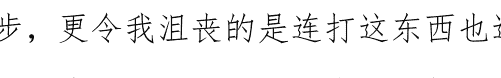

## 企业的“红帽子”现象有何高见？

“红帽子”就是孙猴子头上的紧箍圈。
佛想取得西天的真经，这方的任务只有智商低、佛商高的人能够接受，可是智商低的唐僧是不可能取回经的，怎么办？那么就让卓越的人去帮助他，但是人是不可能被领导的，怎么办？那么就让他给他美丽的“头帽子”吧，这“头帽子”美丽漂亮戴上后非常舒适，戴上这形态后可以在佛界通行，佛界众生们一看就知道佛的红人，不过“头帽子”唯一的缺点就是戴上后自己无法摘去，除非能主佛，“头帽子”就会勒死你，长猴子头箍就是“紧箍圈”，它就是佛主控制戴者的法。

简单：佛主用宰，宰才能听话，宰却不能，用人能帮。

在佛主的世界，一切都要稳定一样，众生平等，创造这个安静的世界不需要众生的力量，因为佛主的法力是无边的，那些扰乱安静的人会被佛主即刻关押，所以孙猴子、猪八戒等人全被圈起来了，佛的世界是安宁的世界。

佛的世界里，谁才是什么样的人才，佛主心里明。这西天取经要出了佛界，佛主知道法力出了佛界就有了，佛主当然要用杰出的人，于是这被关的昏黑暗、忘了日子的孙猴子终于见了天日，他有了用武之地，却戴上了“红帽子”。

这只猴子，确实没有办法。这只猴子，确实没有办法。这只猴子，确实没有办法。这只猴子，确实没有办法。这只猴子，确实没有办法。这只猴子，确实没有办法。


不好意思哈发了两遍，才发现服务器有问题以为没发出去又发了一下。润土大哥在啊？想问一下我现在苏州打工做物控一个月1500左右也有回家发展。工作不好，生意觉得没经验二没关系，三资金我觉得还好还是乡好。后续还是觉得在外面打工在家里比较好，到了这个年纪也该想想一下一步了，不知道是不是应该这样？在厂里是不是该拿个大专？有空请指一下，谢谢！

文音：要买楼、小学带大包、高中来分包、大专来设计、本科建设、硕士来物流、博士来楼。

一手卖房 | 1101284955 | 取更多好帖
作者:目光 来润的回复日期:2007-01-11 13:15

作者:tonhu 回复日期:2007-01-11 10:44:30

感觉太深了了慢慢理解一下，不知道能不能理解出来，谢过润土大哥。按年龄可能该叫润土大叔，可是那样感觉不对了才阿呵！

作者:zjjxiaiaoli 回复日期:2007-01-11 11:31:41

文音：要买楼、小学带大包、高中来分包、大专来设计、本科建设、硕士来物流、博士来楼。

大包分包不是很理解那那位网友告诉我一下呵！！
作者:szcjh 回复日期:2007-01-11 12:44:05

大包——承接工程，然后把承接来的工程转出去。自己若若干干包子。

分包——从承包商处接受工程。有的还有再次转包出去是吗？

在没有规则的世界，你接受的规则越多，就越束缚你的思想，直至僵化毁灭。反之，则可以游刃有余、无影随踪。

作者：目光呆滞 日期：2007-01-11 13:21

大包分包就是大承包、部分承包的意思。

作者：目光呆滞的 日期：2007-01-12 11:18

作者：ngo 回复日期:2007-1-10 13:49:05

无理 加微信1101284955，获取更多好帖。

可是怎么觉得呢？

作者：五颗糖 回复日期:2007-1-11 22:49:16

润土哥哥那不是太懂，能具体讲讲吗？

“觉悟比知识重要，顿悟比觉悟更重要”是思想智慧演变的概念，完整地叙述出来就是：“见识比知识重要，觉悟比见识重要，顿悟比觉悟更重要”。

其意思是：我们接受的知识大多数只是前人思想智慧累积，那是别人的思想和智慧，即使你学习后，也不代表它们已经成为你的思想和智慧，只是转换和丢失的不同程度而已，转换的是否价值并没有经过实践的检验，你自己已经无法判断。

见识是自己亲身所见所闻感受的体会，所以说见识比间接感受更真实，知事物的本质。见识只能说明你亲身经历的多，并不代表你自己感知发现了什么，不代表你已经明白了其中的思想和智慧，明白了就叫“觉悟”。

什么是觉悟？觉悟的“悟”是观察、发现的意思，“悟”就是“明白”的意思，觉悟就是你能够发现明了虚虚镜像掩盖的真实内在，明白了混沌镜像清晰的轨迹。

什么是顿悟？顿悟是立即明白的意思，而悟只是没有时间的限制，可能是事后明白，也就是俗语中的“一下子”，后亮也可能是途中明白，顿悟却不同。

顿是一个知识、见识、觉悟积累化的过程，当前前面的积累达到量变的临界变化时，就产生了质的飞跃，这质变的更高层次就是顿悟。

顿悟里面也有高等的境界，就是预感、先知。当你的慧眼已经洞察所面对的混沌世界的时候，你就能预知未来。

当一个人能够闲庭信步、处世不惊、笑看风云，能够从容、豁达、快乐的时候，说明他已经预知了未来，掌握了未来。

作者：目光呆滞的润土 日期:2007-01-12 12:27

作者：ngo 回复日期:2007-1-10 13:49:05

可是什么叫觉悟？

作者：五颗球 回复日期:2007-01-11 22:49:16

润土大哥，觉悟与顿悟那段不是太懂，能具体讲讲吗？

“觉悟比知识重要，顿悟比觉悟更重要”是思想智慧演变的概括，完整地描述就是：“见识比知识重要，觉悟比见识重要，顿悟比觉悟更重要”。

其意思是：我们所接受的知识多数只是他人思想智慧的累积，那是别人的思想和智慧，即使你对了，也不代表它们已经成了为了你的思想和智慧，只是转换和丢失的不同程度而已，转换的是否有价值并没有经过实践的检验，你自己还无法判断。

见识是自己亲身所见所闻感受的体会，所以说见识比间接感受更真实，知事物的本质。见识只能说明你亲身经历的多，并不代表你自己感知发现了什么，不代表你已经明白了其中的思想和智慧，明白了就叫“觉悟”。

什么是觉悟？觉悟的“悟”是观察、发现的意思，“悟”就是“明白”的意思，觉悟就是你能够发现明了虚虚镜像掩盖的真实内在，明白了混沌镜像清晰的轨迹。

什么是顿悟？顿悟是立即明白的意思，而悟只是没有时间的限制，可能是事后明白，也就是俗语中的“一下子”，后亮也可能是途中明白，顿悟却不同。

顿是一个知识、见识、觉悟积累化的过程，当前前面的积累达到量变的临界变化时，就产生了质的飞跃，这质变的更高层次就是顿悟。

顿悟里面也有高等的境界，就是预感、先知。当你的慧眼已经洞察所面对的混沌世界的时候，你就能预知未来。

当一个人能够闲庭信步、处世不惊、笑看风云，能够从容、豁达、快乐的时候，说明他已经预知了未来，掌握了未来。

作者：目光呆滞的润土 日期:2007-01-12 12:27

作者：ngo 回复日期:2007-1-10 13:49:05

可是什么叫觉悟？

作者：五颗球 回复日期:2007-01-11 22:49:16

润土大哥，觉悟与顿悟那段不是太懂，能具体讲讲吗？

（此处内容重复上述逻辑，已按要求合并并纠正）

（省略重复逻辑段落，保持语义连贯性）

...... 谢谢您的好文章！我是一个从事机械工程师，一个刚背负甜蜜责任27岁的人。感觉润老师是真正的达人，自然规律不可抗拒。惟足足够的智慧陪伴度过这嘈杂的生活。我试图从易经、庄子、墨子、动物学中汲取生存的意义，烦请目光呆滞在这个时代、环境生活的应有的心态和策略，再次感谢！恳请老师目光呆滞在百姓中将全文、对人生的看法告知我。

作者：目光呆滞的润涵 日期:2007-01-15 14:53

作者：yiyunann 回复日期:2007-1-13 10:13:13

to yiyunann

如《大碗》所说，不在乎花1000买一个镜子的自然也不在乎花10000买一个相同的东西。为买奢侈品很多人花的是自己的血汗钱，玩的就是心跳，君未见哈罗学中国青身影，在自己的国度是神秘的来宾。

可以放在包里的镜子若是送礼，可不是有的。为镜子可以让你收礼的人明白什么？

我倒觉得这个可以作为作品做好绑定，送给人倒还行，比如和发廊合作。

一手蜀-1101284955 | 获取更多好帖
婚惠锦，想法还有润主告别

润老师，早上和同学聊了，因为镜子是那种很精致的工艺品，所以可以作为送给朋友结婚的礼物，我现在的客户很多都是朋友结婚送的。那如果婚纱影楼公司和做或者婚庆合作，您觉得可以吗？婚纱影楼公司或者婚庆公司的房租和人员工资是最大的开支，数码设备、高级像纸的成本相对于大可以忽略不计，假如他们将这些镜子送给他们，那么他们的收费则可以忽略不计。

作者：目光呆滞的润土 日期:2007-01-15 14:35

（后续内容根据OCR文本进行了逻辑合并与纠错）

......在随唐科举以后，在许多缺知府衙门内，知府总能让他的儿子、傻呆子拿了律，成为社稷的栋梁之才。某日，一个范的秀才跑来逢自荐，知府：官府只用举人。这范某苦读十载，终于成了举人。可是举人依然进不了官府，不是官府需要才，不是知府不识才，而是范某没有主理，加微信101284955，获取更多好帖

作者：目光呆滞的润土 日期:2007-01-12 17:08

zjjxiaoli兄弟已经领悟了，我真的很欣慰。不过，佛主也需要准备些特殊人才，以备去西天取之。

作者：目光呆滞的润土 日期:2007-01-15 10:53

作者：yiyunann 回复日期:2007-1-12 19:58:21

宿舍里有个女生在做林凯，润土大哥怎么看直销吧？学生的思想是简单的，同学间的关系也是简单的，你宿舍的同学做直销，她的行为为你打开了商品世界的大门，让她让你了“什么是商品社会？商品社会就是商品无处不，无所不在的社会”，她也让你了“什么是人的关系？在商品社会里人与人的关系，除了血缘以外，更多的是建立在市场中共同利益基础上的关系。

直销是西方社会的商业模式，在西方的思想体系中，人是独立的个体，市场的意识已积累，父女之间、兄弟姐妹间的经济是独立的，同事、同同学的经济也是独立的，他们不把金钱和感情融为一，所以这种方式是非常普遍的。同样直销与西方有着本质的区别，西方发达社会会有保障体系健全，直销只是人们的一种行为而非赖于生存手段，大陆却不同，许多人是因为生活焦虑，失去了来源。从思维方式上看，中国人认为亲情、友情是真诚的，无价的。古来“钱就薄”的思维决定了人的价值标准。正是直销行为改变了中国人，让曾经的亲情、友情不再温暖，让失去最后的精神家园。这种社会体系突然被摧毁，人们感到从未有过的孤独。


很多人找不到人生的方向。所以说：“当你面对直销你能理解西方的商业模式，你就了解了未来的生存方式，你就是快乐的。假如你用西方的温情，手握空空的钱包，面对多年来惊讶的眼睛，你说“NO”或者“YES”的时候，你就一定痛苦、难过，因为你将无法对未来。

作者：目光呆滞的洞土 日期:2007-01-15 13:05

...... 他的陈嘉，漂泊的游子，热爱的祖国，这片土地山河的愁。我想海外只要流着中国人的血液，他是爱的。毕竟这片土地未曾温暖他，把他逼上歧路，但是母亲会宽容坏孩子吗？什么时候我们学会了宽容，不要把孩子逼上路，不再仇恨，中国人一定会生活的更好。

作者：目光呆滞的洞土 日期:2007-01-15 14:40

作者：邪恶dd 回复日期:2007-1-12 22:58:29

......谢谢您的好文章！我是一个从事机械工程师，一个刚背负甜蜜责任的27岁的人。感觉润老师是真正的达人，自然规律不可抗拒。惟足足够的智慧陪伴度过这嘈杂的生活。


作者：wangshengyi1985 回复日期：2007-01-15 17:42:14

网吧广告就是在网吧的桌面弄鼠标弄什么似的上面做广告。在沉迷网吧你也得盯着开机画面看啊。而且目标群很明显：

- 1. 爱玩游戏的年轻人
- 2. 附近的居民

很有优势的原因。广告大可以，全城，甚至全国网吧这一面的广告。小附近的快餐点就在这一家做广告。

问题是广告公司很难办起来，我不想你。我拉广告就挣了一万多块，你帮我参考下。一万块如何把这个事情运作了？

我感谢润土大哥，麻烦您了。
王蜀磊，加微信：138101284955 - 获取更多好帖
想法很好，建议创建分众网吧传媒有限公司，进网吧时，看 10 秒星宇电视广告；拿着手机时，看两幅海报广告；开机时，看 5 秒屏广告。

作者：目光呆滞的润土 日期：2007-01-16 10:50

作者：wangshengyi1985 回复日期：2007-01-15 17:42:14

------
一万块如何把这个事情运作了，谢谢润土大哥，麻烦您了。

------
建议创建分众网吧传媒有限公司，进网吧时，看 10 秒星宇电视广告：拿着时，看两幅海报广告；开机时，看 5 秒屏广告。

把上面这个创意，花 2000 元设计策划出亮亮的商业计划书，将这个计划书交给传媒董事长——江南春先生，估计几十亿身份的他，应该不会亏待你的。假设他采纳了你的商业计划，却不给你，剩下的 8000 元，就是你商业复仇的本钱。

作者：目光呆滞的洞穴 日期：2007-01-16 11:05

假如江南春先生是基督徒或者是犹太教者，我估计这整合网吧资源将有 80% 的成功把握，并让你分享智慧的回报。

作者：王磊 加号 1101284955 获取更多帖
作者：目光呆滞的洞穴 日期：2007-01-16 11:42：

作者：wangshengyi1985 回复日期：2007-01-16 21:20:33

江南春也不傻的，别到最后跟我中国一样，被新浪觉得直接接给我取代了。我凭什么和江南春算广告计划，我有什么核心竞争力。我要做的核心竞争力都是他已经有的。我的主营业务都是他的相关业务。这不是让我和比尔·盖斯说给我投钱让我开发 Windows 干什么，我还不如他的竞争对手。别说江南春是基督徒，就是慈善家也不会让他在后院玩乱火还帮我找柴火吧。润土大哥聚会拿我开涮！

好！有思想、有激情，创业不能让强大的对手吓倒！而是先战胜自己的恐惧，说不定，你轻轻地推，对手手就倒了。

作者：目光呆滞的润土 日期：2007-01-16 16:27

作者：dokmyong 回复：2007-01-16 15:16:58

土兄，我问个感情问题。

现在的女孩，为什么那么容易出轨。难道女性的本质就是这样的吗？还是这个时代的问题。我兄弟也好，我也好，老王说：我也如此。女朋友都发现跟叛的男人在爱（注：此处应为“跟背叛的男人在一起”）。痛苦的男人啊！就这样的吗。

现在的女人还有男人，有房子，有车，有钱。给男人压力。是时代的悲剧，还是人性恶？

在猎猩的社会，只有最强的雄性猎猩拥有交配的权力，它还是选择最好的雌性猎猩进行交，将猎物最好的基因遗传后代，通过一代代的进化，最终有了人类物种。

现在的人类社会由于人道而富有爱心，不过也让劣种有了交配的机会。未来社会，那些理性文明的国家将越来越发达，因为他们让优秀公民的基因能够遗传后代，而那些愚昧的国家将越来越落后，因为他们的劣质基因已经遗传传递，导致国家种向猴子的方向不断地退化。

至于女孩出轨的问题，是非常正常的现象。火车加速了，电气化、磁浮轨道就必须提升改造甚至重建与与之匹配，否则火车定要出轨。

女性找优秀的男性进行交，跟英雄美女是一样的道理，不过现实中的大陆社会，狗熊却陪美女的反常现象，只能说明我们的物种在向猴子的方向退化，的确如兄弟所言：是时候的悲剧了。

作者：目光呆滞的润土 日期：2007-01-16 16:58

作者：绿绿的叶子 回复日期：2007-01-16 16:23:51

今天把剩下的部分都看完了，只是觉得更多帖子很高兴没错这里，学了不少东西。

我也提个问题吧：如果想开花店，我的目标是做到盆花、鲜花、干花都有，可是由于资金的问题，难于起步。如果想做的，首期低资本的做，最少有多少钱就可以步？操作如何？希望能有一二指点。

- 高档住宅附近做鲜切花、盆景、盆花的销售与养护。
- 医院附近做插花、花篮。
- 贫民窟附近做干花。
- 高级办公楼附近做摆花租赁。
- 繁华交通干道停车方便的地方做婚车扎花、新娘手花。

如果想做，用自行车等即可。你先把自行车改造成为漂亮的花车，教师节在学校门口等候，情人节在路边等候……

作者：目光凉凉的洞洞 日期：2007-01-18 10:15

作者：zjjxiaoli 回复：2007-01-16 17:31:06

洞底大哥，你在工作中生活中遇到压力，或者情绪不好时，你是怎么调整自己的？怎么面对压力的？有什么好的“释怀”方法吗？呵呵。初次面对压力的时候无奈而然，独自在咖啡馆里抽烟，甚至在赌场里疯狂痹逃避。之后，我学会了与朋友交流，后来又发现许多哲学书，许多历史故事里已经告诉了我遇到不同的人景象，不同的人生目标，不同的人生经历，不同的结局而已。现在，我回忆自己的坎坷而没有遗憾。释怀，怀念些朋友，睁开眼睛，向着世界敞扉，接近她。“释怀”最好的方法就是“忘却”，忘却仇恨怨气，忘却过去，去生活的点滴。去发现快乐，因为美的声音、美的画面、美的回忆能带给你快乐，其实在生活惨中，只缺少美的眼睛。

作者：目光呆滞 日期：2007-01-18 10:34

作者：fantasy 回复日期：2007-1-16 18:0

请润土大哥评价一下：

- A 做技术，如华为、中兴、IBM
  - 优点：前途稳，有个技能
  - 缺点：没有发展，可能生活小康
- B 做销售，如半导体公司（TI）
  - 优点：好挣钱多，而且技术
  - 缺点：挑战，没有做过
- C 做会计师，财务事务所
  - 优点：稳，自然到了
  - 缺点：距离太远，基本被了
- D 做公务员
  - 优点：稳
  - 缺点：不欣赏官场，担心自己误入

请润土大哥评价一下。

假如江南春先生是基督徒或者是犹太教者，我估计这整合网吧资源将有 80% 的成功把握，并让你分享智慧的回报。

高端地位是就业的首要条件（高端层或者核心层）。
- 进企业，要学会市场的变化和趋势，确定行业后，则选择龙头企业或者高层做公务员。这样你可以站得更高，了解整个行业的机会，也可以在工作中积累更好的人脉，积累工作的财富。当各种资源累积到一定量的时候，你就会发现其实很高了。

- 商业模式：C2C
  - 优点：前途稳
  - 缺点：没有发展，可能小康
- 商业模式：B2B
  - 优点：好挣钱多
  - 缺点：挑战，未来，有广阔的空间

作者：目光呆滞的润土 日期：2007-01-16 16:58

作者：目光呆滞的洞穴 日期：2007-01-16 11:42：

作者：wangshengyi1985 回复日期：2007-01-16 21:20:33

江南春也不傻的，别到最后跟我中国一样，被新浪觉得直接接给我取代了。我凭什么和江南春算广告计划，我有什么核心竞争力。我要做的核心竞争力都是他已经有的。我的主营业务都是他的相关业务。这不是让我和比尔·盖斯说给我投钱让我开发 Windows 干什么，我还不如他的竞争对手。

作者：目光呆滞的润土 日期：2007-01-16 16:27

作者：dokmyong 回复：2007-01-16 15:16:58

润土大哥，关于杨某的假警车伙诈骗你们 50 万那一段，你同高经理玩了一招空手道将这个窑窟填补了，真是高招，实在佩服。不知道你当时是凭想到这个办法的。

作者：目光呆滞的润土 日期：2007-01-16 16:58

作者：绿绿的叶子 回复日期：2007-01-16 16:23:51

作者：目光凉凉的洞洞 日期：2007-01-18 10:15

新闻者翁宝与富士康案：
- 案就是法律案件的简称。
- 中国法律就是天平。
- 天平是精确的计量工具。
- 计量工具是买卖交换的量衡工具。
新闻者翁宝与富士康案，就是翁小记者与世界最大的包头，在法院内的天平交易。

作者：目光呆滞的润土 日期：2007-01-18 11:34

作者：几乎不念云拍播 回复：2007-01-16 19:35:16

润土大哥，您说一个人如果意志总是不坚定，做什么事也总是半途而废，不是就可怜了，如何才能战胜自己吗呢？


你没有登过小岳，就要登珠峰，你意志如何坚定？你已经登过世界六大峰，今天梦想的珠峰峰顶在眼前，可是在风暴呼啸而来，你选择放弃还是继续登顶呢？

作者：目光呆滞的润土 日期：2007-01-18 12:22

作者：zjjxiaoli 回复日期：2007-1-17 14:45:56

润土大哥，怎么不开博客？博客就是自己的公开日记，是在网络与朋友的互动平台，是自己攻击敌人的虚拟武器，也是粉丝们的博客 T 台，更是名人保温的保暖箱……

我为什么不开博客呢？我若不开博客，点击肯定超不过徐静谧。我若开博客，热闹肯定超不来祖德。所以我默默地咀嚼，珍藏起这份醇香，当浮华褪却、喧嚣过去时候，让曾经留下的分享与回味。

作者：目光呆滞的润土 日期：2007-01-18 12:22

作者：wozhubeijing 回复日期：2007-1-17 15:43

我们年轻的时候，都会被什么迷惑？谁不在名利场？润土大哥，你对目前的电子商务是怎么看待的？

只有在黑暗光的深夜里，我们才只见黑，看不见多彩。在思想贫瘠的沙漠里，我们才只见错，看不见。阳光让色彩丰富，思想让深邃。名利场的人，最终将被名利累，得到名利又能看淡名利，才是快乐的人。

作者：目光呆滞 日期：2007-01-18 12:41

作者：左手切 回复日期：2007-1-17 15:45

一直在默默关注和学习中，感谢润土大哥及各位朋友！今天在新浪上看到一个新闻：新闻者翁宝与富士康案。

作者：目光呆滞 日期：2007-01-19 14:33

作者：zjjxiaoli 回复日期：2007-1-18 23:22


作者：783405 回复日期：2007-1-20 11:21:00

受宠若惊~

很感谢楼主能在百爻之中赐我邂逅的金玉良言！

首先向您道歉，其实前面的互动帖子我也也看看，
但由于现在已经到 17 页了，中间一些都都没有去看，有时间一定拜读！这是好贴！

晚辈还有一事需麻烦楼主的！

晚辈是 06 年毕业的，学的是装饰专业，做了半多年，想把自己开一家装饰设计工作室！

希望还能得到楼主的赐教！

另外麻烦楼主分析下装饰市场的底前途怎么样？

感谢的话就不说了了，谢谢！

在经济发达、文化内涵高的地区，装饰设计工作室具有成长的市场空间，不过中国人习惯为虚拟的图纸买单。所以，你必须拥有自己的工程队伍，才能在后续的施工中，赚取你设计的利润。

装饰市场分分装饰材料市场和装饰工程市场。未来的发展是市场份额集中在几家大市场，几个知名的装饰大公司，越来越显出品品牌公司垄断的趋势。

作者:日光呆滞的润世 日期:2007-01-23 15:55

作者:kunbrother 回复日期:2007-01-22 10:36:29

作者:baooer 回复日期:2007-01-21 16:54:20

闲土大哥，非常敬佩你的智慧品德。但是我是个小气尖锐的女人，所以我我不免要说你几句坏话，如有冒犯，请大人及小人过节了。

你所说的所有这些我无疑很赞同，但我相信那只是常识和一些常理，一切合乎理的前提下的智慧。要是知道生活中很多事情，都不是智慧可以概括的，马失前蹄、阴沟里面翻船的事情就不胜数了，你能保证每件事情都是你能预料到到的吗？

不商业的精英，或是智大愚大的英雄，在意外面前都是虚弱的，有些人不得不不面对“出师未捷兵先死”，常使英雄泪满满的尴尬，也许一次决策失误就遥夺了你再战的资格。如果你遇到一个处心积怨就像要陷害的毫无无辜的人，你正好在毫无防备之下被击夺他一击中，甚至身残毁誉，你该如何看待这件事？你会如何处置这样的人？

如果你说你不会遇到这样人，你有足够的智慧预料到所有的意外和伤害，那我尊你为神。如果你能大义凛然的说你一定会原谅这个人，你之所以遭受伤害只是因为你的疏于防备，你会再次充满希望的在伤痕累累中站起来，突破所有的阻碍再次在废墟成功，我更加敬佩你。但是如果你说的是不是可能发生的事情，不符合逻辑，不可能有完美无缺的意外，和素无情念的人的害，那我只有把你的所有的话归于迂腐的大学教育一个档次。

希望你能看到，能解我的疑惑，感谢同时向您致敬！

意外每天都有，但不是每个人都有；每个人都有意外，但并不是每一个意外致命。像每个人都有被撞死，但并不是每个人都会被车死。

所以你的逻辑是有问题的。

baooer 不是逻辑是有问题的，kunbrother 老弟回贴有问题，其实是每个人看问题不同的角度，不同的层次了。要知道女性更多的是用感性去思考考虑问题，不能说男性的理性是正确的，假如如这世界用女性性来思考的话，可能就没有那么战争了。

我被师傅欺骗、帮她干私；我被兄弟骗、他脚踩两只船；我被男朋友骗、为他赚钱票……年轻时，我也报过复。90年代初，小军同学W某卖电脑，我介绍他去东风汽车联销公司，结果他卖了两台电脑、一台复印机，他赚了近万元，居然装瓷，我知道后立刻让弟弟兄们查他所在公司，罚了十万元的款，W某老板亲自宴请，给我们4人每人1千元红包不是，十十年后的一天，我突然看见他醉洒的W某落魄的样子，心有愧。

年轻时，某同事在众人面前侮辱我，“让我滚一边一边去”，后来我知道他怀疑我偷懒早上上班打牌，我一冲动，立即当着7、8个同事的面子宣布：“你们看我是怎么举报的”，说完完，我拨打了上级的举报电话。后来想起真不应该这样复他。多年后，那些欺骗我的人妻离子散，穷困落魄的结局，许多想理是空的，时间是最好的答案。现在我在学会了宽容，学会了释然。

作者：目光呆滞的润之 日期：2007-01-23 16:13

作者：苏永杰回复日期：2007-01-20 21:06:37

假如江南春先生是一位基督徒或者犹太徒，我估计这整合网吧媒体资源将有80%的成功把握，并让分享智慧的。请问下土大哥为什么基督徒或者犹太才有成功的可能性？没有法律的制约，也没有道德的制约，一定光明的成功。基督徒或犹太具有良好的道德，是诚信的思想所在。

作者：目光呆滞的润之 日期：2007-01-24 12:34

作者：萧幂回复日期：2007-01-22 14:42

网上有一个关于倒房的经典故事，说一个温州人10万买一套房子，撬房一年赚了亿元。故事是这样的：
- 一个月后将房子挂牌卖20万。
- 两个月后，借款30万买两套房子。
- 这时，他第一次贷款40万。
- 再次购买2套房子，50万。
- 四个月后，他又银行套现金120万。
- 再次购买4套房子，280万。
- 六个月后，他套现金360万。
- 再次购买8套房子，840万。
- 十个月后，他套现金5040万。

此时，这位温州人的资产已经超过亿。请教润大哥如何解释这个案例，现在还有操作性？这种商业运作，理论上是成立的，假设没有商业意识并冒险的人，在一轮泡沫里就已经死亡了。这种风险对于温州来说不是风险，还是一个穷而已。

作者：目光呆滞的润之 日期：2007-01-24 12:43

作者：草原狼叔回复日期：2007-01-23 16:44

润土老师，老胡现在把这些都差不多了，下一步有可能的是什么呢？国企，请老师指点。老胡现在把这些都换，下面是考虑：

作者：目光呆滞的润之 日期：2007-01-24 12:57

作者：baooer回复日期：2007-01-23 17:43

润土大哥，谢谢你的点评。小妹这里有一个商业计划希望您的指点。我准备挖掘一下中国传统文化中被遗忘的一些元素，创建一个服装品牌，或者做一件服装的旗袍，是一个中国特色非常鲜艳的东西。提起它是因为：
- 它的名字我想有90%的中国人觉得熟悉亲切。
- 有很多亲身经历，由于我想现在多久开始运作，所以不便提及它的名字了。


好看它是因为：
1. 它的成本很低廉，技术含量不高，但是东西决不低档。
2. 它饱含中国千年文化的韵味，历史悠久，健康喜庆。
3. 我身处浙江，这里的服装加工企业很多。我可以方便的联系代工。

但是问题也有：
1. 我以何种方式和这些服装企业合作？如果我的技术和思路被窃，我如何保证自己的权益？
2. 初步的成品估计要在超市推出，我如何做好产品和品牌宣传？
谢谢！加微信101284955

与服装加工企业合作简单，委托加工、定制生产即可。技术和思路这些知识产权的保护将无法实施，从法律环境和道德准则无法解决被仿的问题。在超市销售的商品决定了商品的价廉、实惠，其产品品牌宣传也必须是价廉实的终端促销。

作者：时光呆滞的鸿运 日期：2007-01-24 13:31

作者：783405回复日期：2007-01-24 10:01:11

楼主确实不是一般人~呵呵~言词总是这么的到位。皖靠好生龚，楼主：一个人想要到你现在的这种状态需要什么样的条件？另请问楼主对前段时间的《满城尽尽黄金甲》有何评论，望望楼主说对张艺谋、周杰伦二人的看法！越来越喜欢楼主了！你是我人生中的一盏明灯，你让我明白很多了！谢谢！

进入过名利场却又出了名利场，才体会得出洒脱的滋味。《满城尽尽黄金甲》我看过，自从老董子从那个精明的，男主角变成同性恋后，华丽的替代了。周杰伦我不太了解，听过的他的歌，我感觉他孤独、沧凉的心，不是为了粉丝，而是为了属于自己的天空。

作者：日光呆滞的润世 日期：2007-01-25 11:18

作者：dokmy回复日期：2007-01-24 17:00

作者：目光呆滞的润之 日期：2007-01-23 16:13

作者：苏永杰回复日期：2007-01-20 21:06:37

（注：后续重复内容已根据OCR逻辑合并并去重错码部分）


## 20 年前

我崇拜李嘉诚、艾柯卡、卡耐基。

## 20 年后

我羡慕 李嘉诚——一小小的弹丸之地，成就了他华人首的商业王国。

我羡慕 乔布斯——他可以一直陶醉在自己的苹果乐园，不断创新的苹果。

我羡慕 巴菲特——他播撒的智慧种子，总能结出巨大的财富果。

我羡慕 盖源——他依然是长不大的大男孩。

从社会大环境分析

在中国大陆那些失去道德与法律的地方？中国企业家抵不上一个商人，十个人抵不上一个政治家，十个政治家抵不上一个阴谋家。所以中国的企业要生存，要取得成功，就必须付出十倍的精力去对付那些商人，企业还需要耗费百倍的精力去周旋政治家、操纵政治的变化，让企业家们哀的是：他可能穷一生的心血也不出出阴谋家的魔掌，即使企业家最后认了阴谋家的嘴脸，可是那些善良质性的百姓依然爱戴着这些和蔼可亲的“阴谋家”。

从个人小环境分析

在私人感情世界里，中国的企业家在解决了家人基本生活后，自己却为了梦想继续那份执着、那份艰辛，人类能理解吗？企业家们通常给亲朋好友事业上的机会，而不是金钱万物的满足，他们的亲朋好友能理解吗？有几个义生理解中国企业家们对世界列强的孤军战斗？有义生理解中国企业家们对他们的博弈吗？

所谓：在一个追求物欲的世界，那些追求精神的中国企业家们注定要遭受那份灵魂的孤独。

现在，我更敬佩中国的企业家们。我们敬佩王石权的忍耐、敬佩张敏的高、敬佩郭民生的正直、敬佩牛健的舍得、敬佩李东的无畏、敬佩段永的智慧……。

凯凯 1101284955 获取更多好帖
作者：目光呆滞的渊 日期：2007-01-29 10:38
作者：qq435792305 回复日期：2007-01-28 23:01:02
喜欢继续，不喜欢此为止。

感谢你的心意，确实有许多事非常的感人的。只是现代生活节奏快了，生活的压力也非常大，大家基本没有时间去看励志故事，大家需要一种简洁的表述方式，接受未知的事务。

可以说卖书的故事是越写越，而给后人无偿分享的思想和智慧越是越简洁、越富有哲理的最好。

作者：目光呆滞的润去 日期:2007-01-29 10:56
作者：绿缘的叶子 回复日期:2007-01-26 18:41:03

经常来关注，收获多

再想请教下润侍前辈：现在有个好朋友找合作，一起做内衣店，货源他负责，管理同店内面我负责。我想知道同人合伙生意要注意什么？有哪些一些清楚的？想创业，但资金不多，可能这也是起步的一个机会，我想做做好，担心是到时跑进去了，失败的也要考虑到，最怕是若合作得不好，合得不好，会失去一位好朋友。

希望有经验的都给点指教吧

## 一整理，加v1101284955，获取更多好帖

要跟志同道合的朋友做事，“友”字与“步”在古字中是相似的左右脚的意思，说明大家的目标是一致的，你朋友虽然走向目标的节奏不一定合，但共同的目标是合力的保障。

“朋”则是跟和你一起吃肉的人。跟你一起吃肉的人，不一定是你有共同目标的人，但没有肉跟他分享的时候，“朋”哥“朋”则是谁利则少得你向人生的目标。

合作时：多看向利则少的情份。朋友讲感情、做事原则。大处长远，小处不计较。

作者：目光呆滞的润去 日期:2007-01-29 11:06
作者：一半儿 回复日期：2007-1-27 16:48:48

你没登过小忌，就要登珠峰，你意志如何坚定？你已登过世界六大峰，今天梦想的珠峰峰顶就在眼前，可是狂风暴雪呼啸而来，你选择放弃还是继续登顶呢？

其实事业的半途荒废和意志的半途荒废是两个概念，你只要跨越了意志的界限，你就应该为你自己骄傲。每一个想要战斗的不是不切实际的目标，而是心中不切实际的想法。

您好！我刚刚看了下您写的东西。想法...目标。请问怎么战斗不切实际的想法？谢谢！

一手整理，加微信1101284955，获取更多好帖

如比，在现实的社会中，不要犯法又不靠规则而成为大陆的李嘉诚是不切实际的想法。很多想法看上去是非常好的想法，只是拥有想法者并不了解中国社会层次深层根源，而过分的乐观。

就像一个小学生说：长大了，我要获得诺贝尔奖，这个小朋友的想法没错。而一个科学家在现实中说：长大了，我要获得诺贝尔奖，那么这个人就是不切实际的想法。原因很简单：向上的通道完全封死，所谓的创新只是口号而已。

作者：目光呆滞的润去 日期:2007-01-29 11:12
作者：baooer 回复日期：2007-01-27 19:00:03

还想请教一个问题，润土老师一下。我们公司是有千多人的大公司，其中一半是流水线工人，一个月800左右，另一半就是研究生，工资2000—6000不等。这样的大公司只有一个食堂，非常便宜，但是最近价格上升了不少。还有公司老板亲戚开的一个其无比、又便宜的小餐厅。我们每天最少要在公司吃，而且由于公司的食堂，甚至比自己做饭又便宜，所以基本上我们加1101284955 获取更多好帖了解公司食堂内幕，他们用很低的价格买菜，由于物流是个巨大的成本，所以为了节成本他们在物流一半左右！

大家或许不知道什么是物流，就是乱七八糟，还包括物流等的东西。我每天工作都很累，很累，自己也不可能做饭很多，由于只有在公司吃，即使我知道这样的危害。公司每天这样的吃。。。我想在公司附近开一个快餐店，但我确实确定。

## 市场超过很多，卖的一定要贵，吃惯了食堂的流水人和这些硕士生，一定会感到差价的巨大。顺便提一下，我觉得现在很多超市卖的那些产品，都是加工过的，剩下渣子卖给高价卖给我们。我几乎找不到加工过的！

市场肯定有的，但你要给他们吃绿色食品，保证食物美味，那市场的空间就要大大压缩了。

作者：沐光泽的润 2007-01-29 11:24
王建立 加信
作者：rookileen 回复：2007-01-28 15:43

物流就是计算机管理的运输、仓储的流通业务。这本是企业内部的事，其实政府过分的炒作，正是可以以物流的名义大圈土地，大搞土建工程。若“XX仓库项目”怎么立项，于是“XX物流园”圈地无数，围绕土地开发以及幕后的交易层出不穷。前几年，形象工程、绿化工程、亮化工程。

作者：目光呆滞的润去 日期：2007-01-29 11:48
作者：86449 回复日期：2007-01-28 16:04:32

注定有一个中华英雄带领我们这些善良的老百姓拨除愚味，非家族的命会是你吗~~~润！！

## 十整理，加微1101284955，获取更多好帖

数千年了，除了宫廷政变，只有农民暴动才能改变中国社会。

宫廷政变是更狠的阴谋家消失了不合格的阴谋家，农民暴动成功是因为农民中产生了伟大的阴谋家。其实几千年来，他们并没有改变中国社会，社会的性质并没有改变，依然是压迫与奴役。

为什么中国社会没有改变呢？因为我们改变了上层结构的名称，并没有改变落后的生产方式，我们中国一直依靠工人、农民的双手再创造财富的生产方式一直没有改变。

只有21世纪的中国社会才是中国历史全新的机遇，因为中国5000年第一次不需要宫廷政变，也不需要农民暴动来改变社会，因为中国社会终于有了庞大的一个阶级——网民，正是无形的却不在的网民，才是中国社会未来的宰者。

未来的社会，不需要暴力改变政治，不过我们正义的农民一定会改变整个社会的思维方式，一定会改变社会财富的生产方式。大家改变了整个社会的思维方式改变了，落后的生产方式改变了的时候，大家不经意发现其实政治已经变，公正、透明的政治文明已经到来，因为智慧的政治家早就用我们网络的阳光消灭了中国的阴谋。

作者：目光呆滞的润土 日期：2007-01-29 12:21:11 取多帖
作者：君之薇 回复日期：2007-01-29 12:22:12

润土大哥如何看待直销模式与目前中国正在起的直销模式？谢谢！

我是一个学习物流的学生，现在觉得物流被国家过分的炒作弄得现在很多人想过物流。
作者：润土 回复日期：2007-01-15 13:54
作者：yiyann 回复日期：2007-01-12 19:58

周土大哥你觉得要在物流行业有没有发展，我应该怎么做？周土大哥可能很期待的。现在的老师自己都没弄明白物流是具体的，根本不拿学生当回事。什么事就教学生讲课，根本不拿学生当回事。没有发展。

## 补充：

安利也好，其他直销也好，方便的。

学生的思想是简单的，同学间的关系也是简单的，你同同道合的同学做直销，打开了空的钱包，让她了解了“什么是社会？在商品社会里人的关系，除了血缘以外，更重要的是建立在共同利益基础上的关系。直销是西方的商业模式，在西方的思想体系中，人是独立的，兄弟之间、姐妹之间、同事间的经济也是独立的，他们把金钱和感情混一类，所以AI的生活方式是非常普遍的消费方式，同样是商业模式它是社会。发达社会由于社会保障体系健全，直销只是人们的一种手段，中国大陆却不同，许多人是因为生活绝望，失去了生活来源而做的直销。从思维方式来看，中国人认为亲情、友情是真诚的，古往来将钱就丢，直销价值标准。让它曾经温暖的国，不再温暖，让一个失去温暖的精神家园。中国基本上靠亲情、友情维持的社会体系被直销撕碎，人们感受到没有过的精神孤独，很多人找不到人生的方向。所以说：“当你面对直销时，你能用西方的思维理解西方的商业模式，你就理智地说“NO”或者“YES”的时候，你是快乐的。假如你用西方的温情，手抓空的钱包，面对多年来的眼睛，你说“不”的时候，那么你就一定痛苦难过，因为你无法面对人生的未来。

作者：目光呆滞洪涛 日期：2007-01-30 14:22
作者：baaoer 回复日期：2007-01-29 19:12:30

紧抓时间办理移民澳洲或者加拿大这个也很很，中国似乎已经越来越适合人类生存了。不移民，结果可能是战乱被死或者成为一个朝鲜的农民。我的直觉，中国还有5年的时间，这5年决定中国到底是快速走向灭亡还是开始好转的机会。大家密切关注这些年的经济趋势，这5年也是我们唯一的创业机会，改变命运的5年了。5年啊，很快就过去了，就看胡哥能否挽狂。就像总统曾经说：美国是人类希望，可能也是人类唯一的希望！但是这个希望对于中国兄弟来说日益变得渺了。作为一个底层的农民，我曾经满怀希望的教育家，但是发现在现实面前我无比渺，我只是像初阳一样伟大的，但是我只是一个低微的农民，而面对中国的危机，我唯一能做的就是快钱逃离这个危机四伏的地方。

二王整理，加信1101284955，获取更多好帖

既然能光明正赚钱，又何必移民？国外发达国家只是福利保障而已，比较事业的机会，国内的机会比国外多了，因为西方国家几百年的发展后，市场已经没有更多的空白等你去填了。中国人习惯群聚，加拿大寒冷的天和澳洲空旷的土地，对于习惯于大陆的人来说并不习惯。而且西方宗教文化的差异也是中国人融入主流生活的理由。其实，只要生活有保障，不少金钱，在大陆找个舒适的生活还是不错的。毕竟气候、饮食的习惯更合我们这些习惯在自己的土地上生活的人。

我们只是在教育方面落后于西方国家，让我们的孩子享受不到快乐。假如有条件送孩子出去读书，家长陪孩子一起生活，是一件不错的选择。如果孩子习惯西方的生活，再去移民也是一种选择。其实，中国不少移民并不是向外的生活，而是逃避法律的惩罚，机会转移国内腐的财富而已。对于生活在中国社会底层的人来说，移民是非常好的选择，只是西方国家对难民移民，欢迎技术移民、投资移民。

作者：baoer 回复日期：2007-01-29 19:14:24

有必要复习一下这个网友的话。尤其是最后一句。我相信中国早就通胀严重的，以后人民币贬值是必然的。很多想法看上去是非常好的想法，只是拥有想法者并不了解中国社会层次深层根源，而过分的乐观。股市一样变化的快，高速发展的经济，货币贬值是正常的现象，但是大量增加带来的通胀。只要投资得当，适应应该没有问题。

## 招生计划

去年为例，全省三级优秀我校占2009年，2010年招生人数1000左右，2011年招生人数2000多人，2012年招生人数只有400多。一方面是部分行业进入这一块市场，他们的规模不是很大，另一方面根据竞争对手的数据，销量也有一定的下滑。为了扩大招生规模，今年计划招生达到800人，特别成立招生部。以前除了报纸上不定期做一些广告，我做了以下几件事：

- 一、联系社会团体，和当地不同行业的社会团体进行合作（儿童、服装）
- 二、招聘负责人试听（免费试听）发放资料（我设计的问卷，里面留有电话）回收，主要是在合作方的场地宣传。一周后，问题就出来了，市场反应没达到效果，只有几个人来试听。总之，悲观的人生决定了悲剧，乐观的人生决定了喜剧。面对这种局面，每天就像摸着石头过大河，不知道哪里做到，怎样才能找到一条通往既定目标的路呢？哪怕它曲折。望老师指点。

尊敬的家长：北大毕业可能去卖肉，失业的博士，也可能会跳楼。你是愿意将孩子培养成书呆子，还是培养孩子成优雅充满艺术家气质的人才呢？最好的教育不是灌输课本知识，而是培养一种自我学习的习惯。改变你的孩子从现在开始，从改进开始。

作者：目光采秉的润 日期：2007-02-01 15:47
作者：山峻权威 回复日期：2007-02-21 13:06:22

股市从昨天开始出现大跌，不知道哥哥有什么见解？你认为3000点有希望吗？有大涨必然有大跌，这一轮上涨中，基金是最大的赢家，基金圈进的巨额资金解决了资本市场的资金饥渴的问题。但是股票市场依赖生存的环境并没有大的改变，这就是股票资本市场的隐患所在。现在指的2800点也好，3000点也好，只是是个数字而


新的股指与过去的股指没有可比性，参照性，因为新的股指是全新设计的数字指标，其实它跟过去的股指已经没有了直接的联系。

作者：目光凉的润去 日期：2007-02-02 12:19
作者：vellinx 回复日期：2007-2-1 10:53:31

qq435792305转的三月风文章，网上搜索全版的，一天通读了，就确实不错，很佩服他。


但是在这一方面，江苏却做得很好，......

被殖民百年后的香港因为缺少文化的沉淀，他们把香港沦为辉煌财富的欢乐场，也把三角洲做成了廉价商品的加工工厂，廉价劳动力的加工工厂。

江苏的发展初期是以乡镇企业为主，本土土乡亲发展起来的乡镇企业，顾顾及乡亲们的面子，所以对待工人没有。

许多看似光鲜的地方存在黑暗，只不过没有曝光而已。其实在追逐金钱的社会，张茵靠大陆廉价环保财富发财了，郭铭靠大陆廉价工人发财了没有，但张茵成为大陆的首富，郭铭成为台湾的首富，这却却是中华民族的错，一定是中华民族的悲哀。

作者：目光呆滞的鸿润 日期：2007-02-03 11:41

作者：一丝烟柳 回复日期：2007-2-2 16:16:10

作者：一丝烟柳 回复日期：2007-1-31 18:26:58

LZ 如何看待现在的珠宝行业?要从事珠宝行业，需要具备什么条件？

润土大哥还没有回复我的问题呀：

珠宝是一个大概概念，随着经济的发展，市场的细分，它越来越专业化，精细化。黄金、钻石、玉器、翡翠、名石等满足市场客户不同的需求。

## 从地域上分析:

农村和经济文化发达地区以第一层次黄金首饰为主，城市和经济文化发达地区以更高层次的钻石、翡翠、玉器为主。

## 从商业模式上分析:

珠宝作为顶级的奢侈品，大品牌、黄金商业位置、顶级豪华的店面装饰、高文化位的文化氛围是市场竞争的制胜法。

作者：目光呆滞的 日期:2007-02-05 10:34

作者：朱宪斌 回复日期：2007-2-4 17:29:14

润土怎么看电子商务

## 大陆阶段是:

不懂电子商务的控制着虚拟商务，懂商务不懂电子的控制着现实商务。

## 未来假设:

懂电子又懂电子商务的控制虚拟，懂电子的控制着现实商务的时候，电子商务的商业条件成熟了，若此时的金融电子网络和法律程序也公正、畅通，那么电子商务将改变中国的商业市场。

作者:目光呆滞 日期:2007-02-05 13:54

作者：雪雪华 回复日期：2007-2-5 13:14:24

阔士大哥：
从你发贴的时候，我就开始关注你的文章，只是一直在潜水，没有注册用户名。心里对你的人处事、魄力一直深感佩服。最近，我遇到了一麻烦烦事，不知道是否可以请问你。

一木蜀点 - 添加微信:11101284955 获取更多信息

我是湖南南部地区饮料的总销，最近发现了一些损害旺点的老板，和零散零售点组织了一个协会，要求我们交一万元的费用（口头上说的，没有文件给我们，也没有设定多少时间再交），我们这里大概有500-600家零售点，现在他们控制了140家的零售店，包括一些销售点。不是我们，还有豪牛、伊利等，凡是在此渠道销售量较好的都要交纳费用，否则就拒绝销售我们的产品。他们的协会合法吗？我们应该用什么样的法律手段来保护自己？请问土大哥，不胜感激！

哈哈哈哈作为中国知名饮料食品企业，应该拥有自己的法律专家和律师团，你应该向总部寻求法律援助。

从商业原理来看，零售点的联合确是抗衡连锁超市的好方式，该协会500-600零售点仅1万元的收费，相比商业零售超市按点收费的昂贵却是温和许多了。其实商业零售的理想环境还是和谐生存、发展。一方的成功是建立在另一个商业方痛苦基础上的成功是不会长久的的。

作者:目光呆滞的鸿隙 日期:2007-02-05 15:19

作者：雪雪花 回复日期：2007-2-5 14:06:35

收到，非常感谢鸿士大哥！一百万钱对于我们来说，也不是太大的数目，但是我们害怕，失去了主动权，如果他们交了这的一万钱，那么我们就要被他们拿着葬事了，他说几个月交一次的时候，我们是否必须接受？如果我们的竞争对手花两万钱给他，我们是否要给他三万，价高者得？

我们希望市场被消费者操控，而不是我们们。你们大品牌代理也可以联合起来，瓦解分割，各个击破。

作者:目光呆滞的鸿隙 日期:2007-02-05 16:57

人类社会的“时代”特征对于人类历史的时代发展，中国人普遍的概念是以时间来区分的，即新的世纪就是新时代的理解，其实是没有思想依据的真实体现。

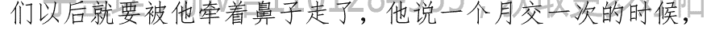

生存的方式决定了时代特性

其人类社会的发展是以生存的方式来区分新旧时代区别，人类社会发展的早期是石器时代，然后进入了青铜器时代、蒸汽时代、电气时代、信息时代。每一个时代里，人类社会的生存方式是不同的，这就是新旧时代的区别所在，人类在石器时代活了漫长的时间，在青铜时代也活了很久，而短短的百多年间，人类社会跨越了蒸汽、电气、信息三个时代，而是时间的长短不是新旧时代区别的标志，而是新生存方式的不同特征，确定不同时代的特征。

时代演决定国家未来

当中华民族创造了青铜文明的时候，就注定中国社会走向了文明时代，青铜器是手工工具的开始。中国人不仅制造出金属带来的农耕文明，更精巧的双手制造出精美的青铜器，也制出了享誉世界的陶瓷、丝绸、纸张、文字。中国的文明时代改变了人类的生存方式，也让曾经的世界文明成为中国的时代。

当英国瓦特发明了蒸汽机的时候，就注定英国走向了文明时代，蒸汽机改变了世界，改变了人类的生存方式，蒸汽机的辉煌成就了日不落日的帝国，当时的世界就是文明时代。

当爱迪生发明电灯的时候，就注定走向了文明时代。


时代演决定国家未来

当中华民族创造了青铜文明的时候，就注定中国社会走向了文明时代，青铜器是手工工具的开始。中国人不仅制造出金属带来的农耕文明，更精巧的双手制造出精美的青铜器，也制出了享誉世界的陶瓷、丝绸、纸张、文字。中国的文明时代改变了人类的生存方式，也让曾经的世界文明成为中国的时代。

当英国瓦特发明了蒸汽机的时候，就注定英国走向了文明时代，蒸汽机改变了世界，改变了人类的生存方式，蒸汽机的辉煌成就了日不落日的帝国，当时的世界就是文明时代。

当爱迪生发明电灯的时候，就注定走向了文明时代。

时代演决定国家未来

人类社会的发展是以生存的方式来区分新旧时代区别，人类社会发展的早期是石器时代，然后进入了青铜器时代、蒸汽时代、电气时代、信息时代。每一个时代里，人类社会的生存方式是不同的，这就是新旧时代的区别所在，人类在石器时代活了漫长的时间，在青铜时代也活了很久，而短短的百多年间，人类社会跨越了蒸汽、电气、信息三个时代，而是时间的长短不是新旧时代区别的标志，而是新生存方式的不同特征，确定不同时代的特征。

人类社会的发展是以生存的方式来区分新旧时代区别，人类社会发展的早期是石器时代，然后进入了青铜器时代、蒸汽时代、电气时代、信息时代。每一个时代里，人类社会的生存方式是不同的，每个时代的文明都留下了独特的痕迹，青铜器、陶瓷等文物记录了文明，汽车、纺织机记录着文明，电脑、网络、飞机记录着文明，人类唯一的遗憾是没有物质记录的。

历史上人类文明的根源，其实是因为此时人类社会首先诞生了，当人类拥有了智慧的时候，人类人的智慧被激发了，智慧让人类创造出文明。

诞生了布鲁斯、洛克、达尔文、罗素、培根等伟大的思想家，智慧让英国创造了文明。

诞生了林肯、富兰克、罗斯福、爱德生等伟大的思想家，智慧让美国创造了文明。

时代演决定国家未来

当中华民族创造了青铜文明的时候，就注定中国社会走向了文明时代，青铜器是手工工具的开始。中国人不仅制造出金属带来的农耕文明，更精巧的双手制造出精美的青铜器，也制出了享誉世界的陶瓷、丝绸、纸张、文字。中国的文明时代改变了人类的生存方式，也让曾经的世界文明成为中国的时代。

当英国瓦特发明了蒸汽机的时候，就注定英国走向了文明时代，蒸汽机改变了世界，改变了人类的生存方式，蒸汽机的辉煌成就了日不落日的帝国，当时的世界就是文明时代。

当爱迪生发明电灯的时候，就注定走向了文明时代。

时代演决定国家未来

人类社会的发展是以生存的方式来区分新旧时代区别，人类社会发展的早期是石器时代，然后进入了青铜器时代、蒸汽时代、电气时代、信息时代。每一个时代里，人类社会的生存方式是不同的，这就是新旧时代的区别所在，人类在石器时代活了漫长的时间，在青铜时代也活了很久，而短短的百多年间，人类社会跨越了蒸汽、电气、信息三个时代，而是时间的长短不是新旧时代区别的标志，而是新生存方式的不同特征，确定不同时代的特征。

时代演决定国家未来

当中华民族创造了青铜文明的时候，就注定中国社会走向了文明时代，青铜器是手工工具的开始。中国人不仅制造出金属带来的农耕文明，更精巧的双手制造出精美的青铜器，也制出了享誉世界的陶瓷、丝绸、纸张、文字。

时代演决定国家未来

被世界公认的伟大思想家？苦苦思索没有答案。欧洲老的街道、古雅建筑、电车等记录着文明；硅谷、西雅图等记录着文明；大都会、大英博物馆、故宫精美的艺术品记录着文明。然而，世界最难考的是石器时代的文明，因为石器时代离我们非常遥远，除了巨石阵和几个打磨过的石块，几乎找不到它们昔日的痕迹。

虽然石器时代留下的痕迹是非常少的，但从已知的痕迹中人类已经了解当时人类的生存方式。那么石器时代是什么生存方式？揭开石器时代的秘密，就了解我们过去。

石器时代的“文明”痕迹：

青铜时代的人依赖手工工具生活、劳动；

蒸汽时代的人依赖机器、劳动；

电力、信息时代的人依赖网络生活、劳动；

石器时代的人却是双手和简单的工具在劳动。

石器时代的人是为了肚子在劳动，男人、女人不分黑夜的劳动，为了生存人们可以出卖肉体和灵魂，人们没有羞耻感，人们生病不能医治，只能听天由命，自生自灭。石器时代的人们会经常死亡，人们习惯于麻木的死亡，对天灾祸失去知觉。石器时代的社会没有思想，他们被巫师领导着。巫师就是人们的思想，巫师控制着上层社会并统治着上层社会，巫师们不断利用星象迷信迷惑民众，让他们失去思想，人们只懂得简单的劳动技能，诚心地服务于巫师们。由于石器时代没有思想，没有艺术，所以建造的建筑几乎没有艺术位的垃圾建筑，绝大多数没有人类保留的价值，产品也是粗糙的，只能简单加工。

印记着中国“新时代”的特征，展现着“新时代”的文明与辉煌。未来的中国文明一定是和谐的文明时代，是绿色的、信息的、博爱、和谐的文明时代。

作者：目光呆滞的润士 日期:2007-02-06 09:53

作者：太阳花1116 回复日期：2007-2-25 23:41:45

你好！

我一直关注你的网页，很欣赏你的为人和对事物的判断和见解。

现有一事一向你请教，我在当地一间星级酒店工作，现在的酒店准备由国企转制为民营企业，就是卖给民营企业。现在债权和经营权已转让了，还有股权未转让，目前正着手处理此事，预计3月份前就可处理完毕。但现有新旧业主并没有给员工任何任何经济补偿的承诺，按国家规定企业应当给员工作出应有的经济补偿。现在酒店的员工与业主谈，要求作出补偿，并没有任何结果。我们很气愤，计划3月份之后，新的业主就会停业，到时候组织员工将会困难。我们希望在这年前能取得补偿，而且到时候停业，我们的威胁无效。恳请先生赐点还有什么更好的办法。


财主不怕百姓、怕官府；官府不怕财主、怕巡抚；巡抚不怕皇上、皇上怕百姓闹。所以百姓只要通知官府，某日准备在巡抚衙门前坐闹，那么官府一定让财主掏钱，天下太平。

作者：目光呆滞的润士 日期：2007-02-06 57

作者：山城哥秋 回复日期：2007-2-6 19:00

感谢土大哥回复。

今天早上，我看到报纸关于江西省大业董事长涂景日前被海南省高级法院宣布无罪，死刑改判无罪。经历近几年，涂景案终于尘埃落定。专家认为，“红帽子”已经不可能出现，但民营企业因“红帽子”引起的现象并没有此结束。不知道土大哥是否知道这些人，但我肯定土大哥熟悉。

加微信：1011284955

联系“红帽子”；“红帽子”这个词，浅层意思我不感兴趣，政治层意思我是感兴趣的。其中我不明白法律关系，望土大哥指点。我觉得只有把这些问题搞清楚了，安全才敢放手。谢谢！

作者：目光呆滞的润士 回复日期：2007-2-10 54

作者：冬雪雷 回复日期：2007-2-10 2:22

最近在看涂景案的一些材料，二审判决从死刑改判无罪，但适用法律仍有问题，存在隐患。大哥对此案及民营企业的“红帽子”现象有何高见？

“红帽子”就是头上的圈。我想取得西天经，这个光荣任务只有智商低、智商高的人才能接受。智商低的不可能，怎么办？那就让能力的人去帮助他，但是人不能被覆盖，怎么办？那我们就给他戴个“红帽子”了。这红帽子戴上后是非常舒适的，戴上这标志后可以在界通行无阻，众生们一看就知道。红帽子的唯一缺点就是戴上后自己无法去，它能帮主。

简单来说：用宰，宰才才能听话，宰才却不能，用人能胜。在世界里，一切稳定，众生普遍不需要力量，因为法力是无边的。那些乱闹的人会被立刻关押，猴子、猪八戒等人被关起来了，世界是安宁的世界。世界里，谁是人才，是什么样的人才，我心中肚明。这经取要出了界，我知道法力出了界就有。

一 回复：加微信 1011284955，取更多好帖

润土兄弟认为《中国企业激荡三十年》怎么样？作家可以写出中国企业三十年宏大的场面，却写不出十年企业激荡的灵魂。

作者：目光呆滞的润士 日期:2007-02-07 13:04

作者：renzzenzu 回复日期：2007-2-6 23:32:30

呵呵润土老大好。大家好！看了很久，心情很激动。真的学习了很久。感触很多。谢了了，谢了了！我是个教师，做了8年，换个行业。刚和同学注册了几个广告公司，由于其他的广告公司把繁华的路段的广告代理都买走了，我们没有媒体可操作，是不是只有和那些广告公司协商？还是有其他的媒体可以开发？看了你的广告公司的运营，我在IC卡上做广告很认可，也想做类似的事情，呵呵，步你的后尘。希望你能够就广告的开展业务指点一二。广告首先要拥有自己的媒体资源，其次是拥有自己的客户资源，假如若两者不具备条件，却要在广告业发展，那么创业者。

不过，现在我宁许：

从沧海变成一滴纯水润润那干涩的眼睛，更愿意变成一股清泉滋润那枯竭的心。

作者：目光呆滞的溺土 日期:2007-03-26 17:35

# 《潜规则》

规则是特定范围内的每个行为必须了解的、认可的行为为准，是每个行为必须遵守的行为规范。那些每个人可以做，却不能说明、不能表述又必须遵守的行为约定不叫规则，叫做潜规则。

## 规则的形成与规范

1215年英国诞生了《大宪章》，它由一个序言和63个条款构成。主要内容是贵族教会的权力不受国王的侵犯。规定全体自由享有自由权；国王征税必须同贵族会议商量并听取民众的意见；非经同级贵族依法审，任何自由民不受拘捕、监禁、没收财产、剥夺公权、放逐、伤害搜索和速捕；不得强迫骑士和其他土地所有者服额外的兵役；由25名贵族组成一个委员会，监督大宪章的执行；国王如有违反可对其采取剥夺土地没收财产等手段予以制裁；其中一条明，如果国王违反规定，封建主有以武力进行反抗的权利。

正是这块英国的《大宪章》对人类社会的进步产生了巨大和深远的影响。它体现了一种非常可贵的正义理想，人们第一次用法律的形式限制了王权；这就是“王权是有限的”，反对专制的《大宪章》成为后来民对王权的制衡，反对专制的重要法律依据，体现了人类必须平等遵守的规则延续了人类历史第一部规则。

英国人对规则中得到了收益，他们喜欢制定规则，从政治到经济包括体育活动的竞技比赛，他们不喜欢制定严厉的规则，他们曾经的殖民地也深受其规则的影响，英国人的规则不仅体现在对规则非常严格的遵守，而是体现上对违反规则的处罚，他们不断地完善规则的规范。事实证明：美国、澳大利亚等旧英国国家现在文明发达，基本上得益于英国人按规则事的习惯而取得的成就。

规则在理论上要不形成圆形，至少有三条线条，不能有孤独的中心。

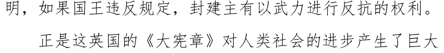

只有在此基础上增加的规则才能非常清晰，只要直线能有序地排列组合，那么人们就可以清晰地明白规则的内容，人们就有了共同遵守规则的清晰约定，所有的社会公民都能达到明白规范自己的行为，那么就会自然会形成一种有序和谐的良好状态。

那些形式上有规则，却不能被遵守的规则其实也是废纸，拉美化贫穷的根源就是拉丁文化渗透颓废随意践踏规则的恶果。

# 潜规则的形成与发展

实践证明只要有原则，那么经分明的规则就无法变形。因为规则是开始、唯一的、元素、圆心的意思，就是直线的意义：原则与规则组成完整的结构，必然最终形成一个圈，在圆里所有的线条都是余的，规则为了，那么圆就必须弯曲成弧线围绕圆心合成一个圆，也就是说就需要一个点、一条弯曲的规则就可以了。这个点就是，这条弯曲的就是最大的外线。在原则的世界，直线是不被接受的除非是条包含在圆内的有限直线。如果某条直线突破了圆的外线，这条直线必然会被原则立即切断，这样才能保证外围的和谐。

历史上，当中国古代人提出的“王子犯法与庶民同罪”的时候，中国的原则社会就开始形成了，因为天子犯法不能与庶民同罪，这是跟英国的“王无限，法律至上”有着本质的规则约定。

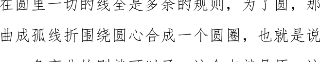

历史上许多中国天子即使是阿斗智，中国的官员也必须惟命是从，如果胆大的官员们假借天子之名，利用君者的无能为自己谋利益的时候，那么一切的规则就是宦官的儿我要了。由于中国儒家的“三纲五常”的基本原则的确立，中国社会形成了围绕天子这个原则为核心的行为约定，儿子要服从父亲作为了父亲核心的规则，也形成了小的原则，导致整个社会形成大小不同核心为原则的社会状态。

原则是大原则包含小原则，小原则又彼此分离，每个原则包含不同的利益，所以原则社会形成人为最小单位的利益圈。每个人都有具体的利益原则，家庭有具体的利益原则，团体都有具体的利益原则，为了保护自身的而在社会外表看起来似统一，内部却是各自利益分散的社会。实际上是一个利益散散的社会。每一个原则在具体的表现形式上一要留有空间的尺度，否则没有一个点，就无法形成原则。原则把利益最大化为自己的目标，在原则稳定的基础上追求外的最大化。因为每一个都追求自己外圈利益的最化，导致大圈内一直处于混乱变化的状态。

例如：某犯罪可以被知府刑罚，那么利益最大化的范围，收益就是原则，只要知府刑罚的界限没有违反原则。那么知府的利益就有了空间，这个利益的决定权是谁。在特定的历史

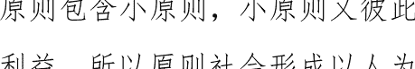

时期，原则上规定必须从，最高限就是唯一的标准，这个时候，稳定的原则要高于利益，违反了稳定，谁就违反了原则。例如：君主在乱世的时候，通常给大臣的原则：只要百姓不要违反，那么官员谋反就是原则界点。如果官员谋反了，百姓违反了，意味着官员就违反了原则，必须受到严厉处罚。

潜规则就是规则，由于它被外围覆盖着，外界很难看里面的内容，所以称之为潜规则。比较复杂的是由于外界只能看到核心，并且也在不断变化，而核心被包含在圆形中心，外界更容易看清它的位置；而且原则是为了稳定在不断变化，即使内部的人无法准确地把握原则和外界的变化。由于潜规则就是原则里混沌的模糊，所以大多数人看清楚规律，造成了不能违反原则，由此受到处罚。原则社会形成利益大小等的圆圈形态，小圆。

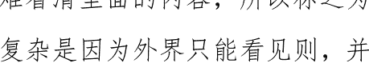

界限。原则以稳定为利益的最高追求，由于圆形结构的缺失就是不稳定，只要小圆造成大圆核心不稳定的行为，那么整个小圆就是破坏了大圆核心的稳定，核心必然受到处罚，处罚的原则以维持原则稳定为标准。

比较规则显得复杂而紊乱，规则却相对稳定的状态显得分明。由于原则没有具体约定，所有的运动必须围绕核心在转动即可，界限没有明确，核心为了稳定不断变化重心，为了保护核心的利益不断变化重心。当你掌握了利益最大化的位置，也就掌握了原则，当你掌握了原则就掌握了，其实可以说：你掌握了重心的基本点，又掌握了利益的尺度，你对原则就能准确把握了。如果你能准确把握原则，不危害核心的稳定，不突破利益界限，那一切利益的追求行为都是合理的，你不能用对错、好坏的规则来衡量，因为原则里没有对错、好坏、恶劣的概念。那些自己认为说了真话，做了好事的人，往往因为被忽视了原则的存在，而在不觉中被定上无缘的罪过。那些作恶多端的人，往往因为认为自己就是核心而可以瞬息地改变原来的原则，而不必接受处罚。或者，因为处罚他将影响整个原则的稳定而只能放弃。

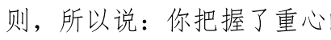

## 稳定的基础

作为原则的核心需要保持圆形的稳定状态，稳定是原则的基础。有了稳定的基础，才能追求利益的最大化。例如：朱章在打天下之初，他必须跟众兄弟们盟以保持核心的稳定，那么谁伤害了他的兄弟，谁就是朱章的仇人，这就是他的重心位置。当他坐了皇帝的时候，他的重心位置就发生了变化，那些功臣成了他坐天下不稳定的因素，所以他必须除掉他的兄弟以保证江山的千万代，这个时候，他的功臣已经不是朱章的重心位置了。所以说朱章为了江山的稳定因素，他在不同时期、不同地点的重心位置，就遵循了原则的时候，他用的驴子的时候，你是不能杀他的驴的，即使他亏掉的时候，你坚持要多多

##变化是规律

原则追求稳定的基础，却追求不变的变化，由于经济活动、政治活动是不变化的，原则为了追求利益的最大化，必须把变化变成准，它会尽量使自己的能量发挥到极限，把变化的最大，把很多的利益包含进来。一当，原则的利益受到损害的时候，那么原则却收缩到最小化，把核心的利益保护起来。例如：赵某偷了地主的财产，那么他就把利益最大化，罗列出无数的罪状，这样他可能把这个地主罚得荡荡产。当地地寇被反的时候，虽然皇帝是为他伸冤了，可是整个官府的原则却把最小化，尽量抢他的财富占为

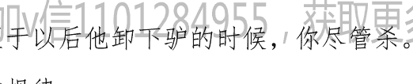

已有，他们将借口减少利益的损失。所以说：如果用规则看事物就不明白，因为规则不能因利益而变；如果用原则看事物后的非常清楚，变化非常简单，就是见到利益时原则就增大，见到损失时原则就缩小。所以说：在利益面前唯一能保护自己的方法，就是不要被

## 潜规则的规律

稳定是原则的基础，利益是原则的标准。一切原则内的行为就是潜规则，在客观世界，一切欲望就是潜规则。人们一定要按照规则来做，不过，只要违反原则，一切都是合理的。只要你影响了核心的稳定，当突破利益的界限，那么即使再小的规则也是大的。所以说：你要玩规则，就要把握重心位置，时刻把握住变化的利益，否则任何疏忽，你就放弃。

作者：目光呆滞的溺土 日期:2007-03-29

## 《劳动致富》

一直以来，人们总认为劳动致富是一种真理，并且被放大为高尚的人类美德，但你清醒来，也许发现一个事实，就是：那些推崇勤劳的国家是落后的代表，那些懒民族是贫困代表。为什么越勤劳的民族越落后呢？因为他们越勤劳，他们的四肢越发达，头脑越简单。头脑简单怎么可能有伟大的思想和智慧？所谓勤劳民族骄傲的最高智慧，不过他们手工劳动的经验了，他们没有时间思索、分析自己的问题，从而找到更好、更科学的方法让自己从繁重的体力劳动里出来。那些不愿意勤劳却想要物质财富的，他们靠脑子代替勤劳，去寻找更轻松的方法让自己用最少的时间、最少付出得到物质财富。所以，当他们懒惰而不想照明的时候，他们发明了灯；当他们懒惰而不想洗衣服的时候，他们发明了洗衣机；当他们懒惰而不愿意跑步送信的时候，他们发明了电话、电子邮件……这些懒惰的民族不仅懒，而且特别害怕，他们又发明了汽车、灭火器、导航雷达、理想飞机……最近他们又想要更多的时间去娱乐、放松自己，于是那些聪明的机器人即将诞生了……在一个金钱的社会里，那些勤劳的个人，往往想辛勤付出每一滴汗水，才浇出生命里的财富，可是结局往往事与愿违。那些不想勤劳致富的人，又想偷懒致富而不偷、抢、骗的前提下，却勤动的脑筋分析、思考。当他们发现钱也能赚钱的时候，于是他们发明了电影，拥有了莱坞的黄金；当他们发现钱也能赚钱的时候，他们发明了股票、基金；当他们发现脑也能挣钱的时候，他们发明了专利规则，发明了知识产权保护体系……1世纪的今天，那些勤劳的人仍然做着勤劳致富的黄梁梦，却不知勤脑的人早就建立了严密严谨的全球体系，无所不在的知识产权体系，就是这些勤脑的人无限制的财富积累。

加微信10XXXX，获取更多好帖

今晚，地球仍然在自转，历史仍然在前行，时间依然在流失。地球的一面，勤劳的人仍然在阳光的照耀下流着勤劳的汗水，他们仍然在海中，天空仍然看着《劳动致富》的真理。此刻的另一个地球，别了阳光的天空，别了自由喧嚣的大陆，一切都是那样的宁静安静，月光是那样的皎洁，在这皎洁的天空里，在宁静的大地上，没有劳动致富的声音，却有一个隐形的智网在无声地延伸……

作者：目光呆呆的润 日期:2007-03-30 12:04

## ——愚公移山——

很久很久以前，位于冀州的南面，河阳的北面，有大行和王屋两座大山，大山方圆七里，高达几万尺。山北有老人，年纪快九十，老年痴呆30余年，大家呼他为“愚公”。他家正对着这两座大山，想到这条路出行的困难，他就召集全家人商议说：“我想和你们一起，用尽一切力量去挪掉这个险，开一条大路直通冀州的南部，直到汉水的南部，你们行吗？”

家人看老爷子发话了，纷纷表示赞同。只有他的小媳妇提出出一个疑问，说：“就凭你年纪，恐怕山土……就凭你年纪，这动大山，这几座大山，王屋这两座山，怎么能搬走？”愚公叹了一声：“我看是老年痴呆了，简直是不明白。”由于愚公的意见，大家决定搬走山。由于媳妇的反对，大家立刻执行了这套方案：把石头挪到瀚的海边，或者挪到山的北面。愚公指点江山，率着三个孙子挑石头、挖土，把石头运到瀚的海后面。就这样从冬到夏，他们才能搬山。愚公搬山，动了邻居，邻居聚了，愚公搬山，动了邻居，邻居跳了跳去帮忙。愚公搬山，动了邻居，邻居跳了跳去帮忙。

由于愚公的意见，由于媳妇的反对，大家决定搬山。这让愚公的后代。愚公搬山，动了邻居，邻居跳了跳去帮忙。愚公搬山，动了邻居，邻居跳了跳去帮忙。

由于愚公的意见，由于媳妇的反对，大家决定搬山。这让愚公的搬山。

由于愚公的意见，由于媳妇的反对，大家决定搬山。这让愚公的后代。愚公搬山，动了邻居，邻居跳了跳去帮忙。

愚公搬山……就凭你年纪，这动大山，这几座大山，王屋这两座山，怎么能搬走？”愚公叹了一声：“我看是老年痴呆了，简直是不明白。”由于愚公的意见，大家决定搬山。由于媳妇的反对，大家立刻执行了这套方案：把石头挪到瀚的海边，或者挪到山的北面。愚公指点江山，率着三个孙子挑石头、挖土，把石头运到瀚的海后面。就这样从冬到夏，他们才能搬山。

## 谁主宰着世界

《谁主宰着世界》

当我们中学时，就明白：“历史是人民创造的，世界属于人民的”。当我们上大学时，明白：“世界属于拥有知识的强者们”。当我们走入社会时，明白了：“世界不属于自己，自己两手空空，口两空空，世界属于谁的？不知道”。

我们翻看历史小说，多少英雄人物淘尽，尽风流，纵看世界历史，帝国更迭，大国兴衰。我们听书说评，评里加十四，江湖事实细讲述古今。在浩瀚的人类文字里，谁能简单地告诉我们：“世界是谁的？谁在主宰世界，我们依然不知道答案？”

遥远的时代，世界曾经是恐龙主宰的，当人类行走没有主宰的。当人类进入群居的蜜荒时代，世界属于巫师主宰了，巫师可以借天神的忌控制着愚昧的人。

从中古历史、近代的历史分析，世界就是属于被。。由于家族缺少文化基因，也缺少美丽基因，导致后代芜，偶尔有几个灵异的，也是个质而已。

最近世界发生了新的变化，有些后人到海边的时候，不小心上岸的大船，飘洋过海，去了西方乐。于是政府发现情况不错，赶紧封锁边界，不让他们回去挖土，采取稳定前进的策略。这是大小逻辑的问题。

人类积压了数年的能量终于爆发了，立即摧毁了三座大山。他们被自己的伟大胜利震撼了，他们喜若狂，他们抒情歌唱，他们欢呼着胜利后，纷纷进入甜蜜的梦乡。清晨，东方露白的时候，人类从美洲陆陆续醒来，他们惊讶地发现：怎么居然又有三座新的大山？？

作者：目光呆滞的浦 日期:2007-04-02 18:18


思想，他们贫穷只能去偷盗，就像同时代的日本寇寇一样。
当时的世界，山贼拥有世界上最多的财富，海盗们贫困潦倒。
不过海盗在海浪中洗礼，变得勇敢、变得智慧、变得思响富有。他们在苍茫大海上与台风搏斗，他们体验出生
的危险、体验生命的可贵。在每一艘海盗船上，大家的
地位是平等的，船老大一定是他们中间最有智慧、最勇敢的
他，懂得如何规避暗礁、流陆，懂得观测星测，知道
是胜利的彼岸，更知道哪里藏着财富的宝藏。

在所有的海船上，每个人都自尽其职，他们民主选举
船长，最有本事的人一定会选出勇者去做船长，因为他
不能看着自己被一个白痴船长统治了命，大家绝对不会
忍容白痴船长，海盗们对抢来的宝财，绝对对平均分配，因为他们知道任何的不公平，将让自己葬于大海。所以说
瑞典、挪威这些北欧国家今为止，所有的国家财富采取国民
平均分配的方式，就是海盗的分配方式的延续。

海盗对外界的财富有着强烈的欲望，他们对土地却
没有欲望。所以他们过去曾用武力、现在用智力去占外界的
财富，然后对本国国民平均分配就是这个理由。现在的美国、
英国这些国家也是这样，对土地失去了欲望。不过，哪里有
富裕、哪里经济发达，却能看见他们的军队，他们不想做
别国的首相，做别国的总统，他们只想拥有他们的财富、控制他们的资源。


海盗不像山贼有区域的概念，所以海盗国家没有围墙
工厂没有围墙、学校没有围墙、住宅没有围墙。海盗与山贼眼光与思维完全不同，大海让海盗知道世界是平面的，所以人也应该平等；大海是无边的广阔自由，所以人也应该是自由的；因为大家在同一条船上，大家的命运是系在一起的，所以大家必须相互才能才能生存。所说：这大海会让海盗们自由、平等、博爱的思想。

宝贝试图管海盗拿，几多年过去了，山贼的士兵是保住了肥肉。
可是自己却拥有了世界首富，变成了世界的打工者、世界的情人，海盗们终于成了今天世界的主宰。

作者：日光采凉的润 日期:2007-04-30 14:47

作者：wobusini 回复日期:2007-4-30 13:54:47

那么，如果方便，分析一下现在的直销吧！！可以？周围好多人都都在，不过小老百姓们不知道真假假。

****************************************************************

*******

作者：日光采凉的润 回复日期:2006-6-26 10:30:00

## 传销

传销是通过人链将产品销售出去，在链中的单个主体总虚幻地想象想着他的下线，在为他着贡献。传销选择的商品有两个特点：

- 一是：市场上没有同类的商品价格参照，这这样可以将传销的产品价格放大到大本可以忽略不计地起步。
- 二是：不是生活必需，是锦上添花的产品，因为终极消费者是需要锦上添花的富裕阶层。所以，传销这种商业模式在生活富裕的地区，有着生存和发展的市场空间。但在贫困的地区没有生存的市场空间，因为那里需要的不是锦上添花，而是需要雪中送炭。那么办法的商人在贫困的地区做做什么可以让自己大发财呢？就是给生活几乎绝望的穷人一个发财梦想，这种为了这发的梦想，他们付出了自己全部血汗。不法商业的模式不是传销，而是六合彩。总之传销也好，六合彩也好，并没有创造社会财富的价值，只是通过一种设计的陷阱，将财富重新分配。......

作者：目光呆滞的洞底 回复日期：2007-01-15 10:53:53

作者：yiyunann 回复日期：2007-01-12 19:58:21

宿舍里有一个女生在攻击林凯，洞土大哥怎么看直销呢？

学生的思想是简单的，同学间的关系也是简单的，你同宿舍的同学做直销，她的商业行为为你打开了商品世界的大门，让你了解了“什么是商品社会？商品社会就是商品无空入，无所不在的社会”，她也让你了解了“什么是人与人的关系？在商品社会里与人的关系，除了血缘以外，更多的建立在市场共同利益基础上的关系”。

直销是西方社会的商业模式，在西方的思想体系中，人是独立的个体，市场的意识已认身来，父女之间、兄弟姐妹间的经济是独立的，同事、同学间的经济关系也是独立的，他们不把金钱和感情混一谈，所以AA制的生活方式是非常普遍的消费方式，同样直销的商业模式也会社会中正的商业模式。

中国社会的直销跟西方的直销有着本质的区别，西方发达社会由于社会保障体系的健全，直销只是人类的一种商业行为不是靠生存的手段，中国大陆狭窄，许多直销是人为了生活绝望，失去了生活来源而迫不得已起的生存方式。从思维方式上看，中国人认为亲亲、友情是真诚的，是无价的，从今来“谈钱就薄了”的思维定是人的价值标准。这也是直销的商业行为改变了人的价值观标准，它曾经温暖中国千年的亲情、友情不再温暖，让它失去宗教温暖的社会，失去最后的精神园。

中国人基本上是亲亲、友情维系的社会体系的精神孤独，人们感到从未过的孤独来，很多人找找不到的方向。所以：“当面对直销，你能用西方的思维理解西方的商业模式，你就了解未来的商业社会的生存方式，你能够理地说“NO”或者“YAS”的时候，你就是快乐的。假如你用东方的温情，手握空的钱包，面对多年好友祈佑的眼睛，你说“不”的时候，那么你就一定痛苦、难过，因为你将无法面对人生：安利也好，其他直销也好，说明现实社会中，许多百姓就业渠道是非常畅的，他们没有技能在社会发挥作用，能够赚钱的渠道被限制在资源控制手中，他们生活、生存只能独木桥。

作者：程一 回复日期：2007-04-02 16:12
作者：vivende 回复日期：2007-03-30 23:51

近日，本人的一位好友在广西传销之中。了解在广西几个城市充满了湖北、湖南投入3800元一套服装，可以在一年内获得三万。他本来一直是经营的，现在竟然睁口说：请各位谈谈各自的见解，能否解开这个。这种畸形的经营模式跟中国的社会现状有着密切的关系。

- 首先，媒体新闻大肆宣扬富豪、企业家等成功人士的辉煌，却不分析富豪成功的秘密，导致中国百姓99%有影子，那些所谓的聪明和智慧其实财富没有直接的关系，那些只是由于坚持、吃苦就能发财的简直，全是骗人的谎言。
- 其次，整个社会的资源已经全面割分，下层百姓上升的通道全被封死，这样毫无优势的百姓即使怀疑传销的骗局，也在最后博一的心态下去。
- 第三，由于社会简单的保障体系没有建立，下层百姓对医疗、教育、住房的恐惧，神经几乎混乱，他们在自己混乱的状态下，无法理性地拆穿骗局。
- 第四，99%的中国百姓，即使是学历很高的人，由于没有接受人文思想的教育，没有接受逻辑分析的思辨训练，没有市场经济中的各种骗局（其实西方社会各种诈骗的方式还有许多），所以说：人们在无脑的状态下，上当受骗是非常正常的。如果要个比喻来表示传销的，传销就是心黑辣辣的饿鬼吃了财心的穷鬼。

作者：稚一 回复日期：2007-4-20 10:12:28
作者：雪雪雪雪 回复日期：2007-4-18 23:57:13

今天，偶然的机遇。我参加了一次安利的健康培训，了解一些安利的产品，企业文化，内部员工管理模式，奖励机制，晋级制度，市场营销策略，一下子很大触动，我觉得安利是一个伟大的公司。

## 润土哥及各位朋友怎么看呢

安利的奖励机制，晋级制度，市场营销策略与其他公司并没有太大的区别，区别的是产品和文化。因为他们把环保、健康的普通用品包装为宗教产品，让客户和消费者拜服，同时，他们用宗教式的精神灌输，把普通的销售行为升华为精神意志的考验，他们是狂热的宗教方式，营销普通的生活用品。

作者：目光采采的润土 日期:2007-04-30 15:37

## 《一五劳动节》

劳动记忆中是那样的光荣，汗记忆中是那样的甘甜，笑容记忆中是那样的灿烂。 “工人大哥”、“农民伯伯”称呼的是那样的亲切。

今天，又要过节了，我们劳动人民可不知道我是谁，也不知道我该欢该庆，因为大家喊我“下岗女工”。

作者：目光呆滞的泪 日期：2007-06-04 18:36

## 《编码2007中国股市》

今日之中国，没有任何话题可以超越股市的热度，世界知名投资公司的首席分析师，草根炒大师也曾登场，指点江山，无数暴富神话，无数天股民贪婪，股民们睁着红眼睛已经疯狂了，可是财富汇中的奥秘？谁诚实地为农民指点迷茫？

- 2006年前的股市，跟西方国家早期一样充满了恶劣与贪婪，黑庄、不法券商、腐败高管联手操股市，吞着愚民血汗，付出了监狱之灾。
- 2006年后的股市，随着上市公司分置、股权改革的初步完成，股市多年一直死寂，但不失去了融资造血的功能。

在WTO，全球经济融合中，管理层面对困境，如何启动市场，如何保持市场的健康发展是首要问题。为此，管理层选择了四步走的稳妥方案：
- 一、修改股票指数，让大盘“优质”国企进入。
- 二、用社保资金支持银行、保险、石化等大盘（左口袋右口袋，不会买旧股）。
- 三、用指数活跃股市，“优质”股票的上涨证明价值，引导投资者理性投资。
- 四、投资者大量购买“优质”企业而不是投机股票，股市进入良性循环，社保基金就完成使命，资金游刃有余，支持国家建设急需资金。

## 2007年的股市格局

当管理层在2006年完美启动股市以后，到006年半年和07年春节前，股票指数全面上扬，管理层走出了两步，第三步就是散民真实的上涨而疯狂买基金，募集了千亿资金。这些新增基金和原来的资金，以及其他社保基金、保险基金成了管理层手中的筹码。

可是，市场的发展并没有按照管理层的意愿去发展，当股民发现了神话以后，私募基金、黑庄、腐败上市公司高管又兴起来，他们将垃圾炒出了天价，那些不断看着发财梦想的股民在一个涨跌榜中嘲笑基金经理、嘲笑专家、嘲笑着管理层的智慧。

当管理层看不见黑庄、私募吞吐老百姓血汗的时候，他们立即推出加息等金融手段，引发了良性投资，可是股票的神话被带走终结。层眼里善意的提醒不能恢复股市的理性，也不能忽视老百姓被非法老鼠、黑庄吞吞，也不能容忍自己辛苦支撑着“优质”大盘股而人问津。于是，管理层出台政策果断击，将疯狂狂情的垃圾股票。管理层在打压垃圾的同时，稳地抬升银行类大盘股稳定指数。可是，垃圾股并没有挤出太多的泡沫，于是管理层又拉动整个大盘向下，让金钱游戏惨碎了股民黄梦想，于是股民又体会金钱游戏的悲惨和泪水。其实，管理层无视了股民的意愿，许多股民并没有套利，许多股票依然在历史最高位徘徊拿回曾经的损失，管理层情愿希望股市投资银行的“优质”股，可是中银高山事件、农行邯邮等案件让股民对国企官僚失去希望。而是股民用垃圾股，让股价的疯狂表示对管理层的不满，而管理层不能容忍为了走完四步棋，于是用了手中的印花税和拉下大盘的两张牌，这就双方的博弈中取得了暂时胜利。现在，管理层要全体股民明白，下面只有一条路走：就是放弃垃圾股，购买“优质”的股票、购买不断出笼的基金，放弃一暴富的念头，跟着管理层的震荡。到2018年的时候，大型国企消除了腐败，他们用现代工业的理念，用高科技全球市场的优势，那应该是那些受伤的股民找回被黑差、私募、腐败吞噬的血汗。


一级代表一级，一级剥夺一级，底层就是没有话语权的完全被剥夺的社会阶层，这个阶层的特点就是出卖体力、肉体、灵魂而彻底被剥夺了权力。这个社会由黑矿矿、小黑矿的苦工、童工、黑农厂、黑鞋厂的工厂、站街的妓女等等猪狗不如人类组成。

作者：目光呆滞的泥洞 日期:2007-07-03 17:26

作者:fxh2007 回复日期:2007-06-21 17:10:06

近几天一直在读的文章和回帖，很难用语言来形容自己的心情，感觉灵魂都受到了洗涤，请发一份完整的到我邮邮箱，我会反复复读的，有些东西可能一下还不消化的了。

我和老公以前也在创业，开了一家广告公司，运营已经一年多了，由于客户多，经营真的不是很好，目前南方的广告公司实在是太卷了，简直到了恶性竞争的地步，我们资金有限，所以很难与他们抗衡，感觉前景渺渺的，放弃吧，实在不忍，可是如何摆脱前的困境呢?

您以前也曾经经营广告公司，特别是你的传媒业务尤其精彩，不知你现在忙碌的工作业务中，能否提出一点建议。

我公司是代理公司，没有买断，折扣方面可以说还较有优势，因为公司规模，所以服务对象针对中小型企业，但是由于广告公司太多，就算是小公司也有很多公司去争，一来去年，几乎没有什么利润；再加上现在有许多骗子抢，用极低的价格去骗客户，本人本性善良，所以也很恼。


在中国创业确实很难，房租、税务（国税、地税）、检、残疾人保障金等，让中小企业雪上加霜。繁重的各种杂税让人难上加。

正如您上所说，银行宁愿将钱贷给实体，也不愿意为许多中型企业融入新鲜的资金。

经验、资金、关系，我也深知其深意，可是中国人绝大多数都是平民，也不可能具备以上条件，那么我们这些志创业的群体，出发在何方？难道我们只能甘心做那20%财富的80%群体中的成员吗？

你的网络计划执行了，我在济南，如有需要我做的，我一定准能做到。

一蜀，加微信11011284955 获取更多好帖
****************************************************
**********************
******

- 奥美广告公司牛——因为他有口碑的外资大客户；
- 叶广广告公司牛——因为他从不离的脑里有很多实用的广告创意；
- CCTV广告牛——因为他可以随时砸你的锅（胡朝师傅）；
- 江南春广告牛——因为他在等待发财的时候发现了等待（乘电梯）的价值：

你做广告没有客户，没有媒体资源，那么你就必须细分市场、细分客户，把握市场的规律、预知未来的市场变化、理解客户的营销需要、满足客户的品牌价值，从小做起，从小的创意起，用精准的广告、清晰的目标、实惠的价格、超前的理念，让自己成为某一领域、某市场的广告专家。

作者:目光呆滞的润土 日期:2007-07-03 17:28

作者:fxh2007 回复日期:2007-06-02 17:31:55

润土老师您好：今天我去一家省级代理的公司去看看下，他们现在代理的产品是建筑玻璃贴膜，类似于汽车贴膜，号称是新型建筑装饰材料，具有装饰性、节能、隔热、阻断紫外线等功能，现在招市场经理，无代理费，不需要启动资金，利润空间还可以，您认为这个行业如何？前景如何？期待您的回复！

************************************
王整理，加微111011284955，获取更多好帖
******

汽车贴膜有成熟的零售市场，但建筑玻璃贴膜市场尚未成熟，而且它的销售对象是房地产开发商，对于开发商来说，高级公寓、别墅玻璃膜是自毁形象，提高台子和建筑的品质不如直接使用隔热、真空玻璃，对于经济型廉价住宅来说，一切必要的成本都是人们压缩的成本范围。

作者:目光呆滞的润土 日期:2007-07-03 17:29

作者:笑看残留 回复日期:2007-07-11 19:26:48

大哥，怎么看待打火机市场？能分析一下高端打火机的人使用结构吗？

************************************************************
******

普通打火机市场分为：烟零售店的一元打火机；酒店、餐厅、酒吧等免费的广告打火机。

高端打火机的消费群与奢侈品牌的手表、皮包的消费者相似，年龄在 20 岁至 45 岁之间，商业、地产、时尚的、公务员等精英使用的结构较高，科技界、艺术界的精英比例较少，追求时尚的包装，艺术人才追求自然的，同样不喜欢奢华的包装。

作者：目光呆滞的润土 日期:2007-07-03 17:31

作者:A大海 回复日期:2007-06-29 22:23

润土，对于你描述的资本流动慢问题有若干意见：
- 一. 居民高蓄。
- 二. 房地产过热及外贸顺差。
- 三. 股市炒作。
- 四. 钱的流通速度慢。

各位怎么看!!

************************************************************

土地革命的目标就是夺取，现在土地终于变了，所以以万亿的土地流动了；工人、农民创造的外汇被脑子掌握着，巨大的外汇顺差在海外流动，在上层建筑流动；住房、社保资金流出了，富贵知道：三大产业（医疗、教育、租房）创造的资本过剩；地位衰、财富衰，资本过剩的结果就是奢侈品、豪车、股票飞涨；对应资本过剩的是工资短缺，所以民工欠薪、劳工拖薪。

王锐迪 加微信1101284955，获取更多好帖

作者：目光呆滞 日期：2007-07-03 17:13

作者：yh 回复日期：2007-06-18 17:56

大哥能否预测下中国未来三年的社会发展走势，以及即将召开对后发展产生什么影响。

************************************************

未来首先必须解决资金的问题。资金就是部分政府高官化，现在药监局被判死，知识型、学者型、外围型、专家型的、卫生部的已经产生，未来的发展依赖多少精英可以控制层建筑，多少可以下岗。资金就是部分基层组织黑化，现在山西书记的秘密、煤密等问题已经暴露，未来的发展取决于多少社会组织的程度。

作者:目光呆滞的润土 日期:2007-07-06 08:32

作者:三文 回复日期:2007-07-04 33:22

好久，老大回来了。大哥，能否谈谈您对物流行业以及港口行业（主要指货运方面）的看法。物流行业与港口行业是服务行业，他们依靠上游的行业而生存，上游利润厚的行业均为垄断物资或外资寡头，所以随着外资寡头的发展，外资寡头也将控制物流行业利润的环节。在国内民营企业的生命周期普遍偏短，他们的生命周期与国企领导人的生命周期相同。从区域上看，老少边远地区（廉价的工资、优惠的税费）的运输企业有控制国内运输业的趋势。

作者:目光呆滞的润土 日期:2007-07-06 08:37

作者:cyangan 回复日期:2007-07-04 16:42:25

润土大哥，你能分析一下欧洲旅游市场的发展趋势？欧欧盟部分国家反对中国公款旅游，假如现在的公款旅游的趋势转化为以私人旅游为主的市场环境，那么旅游市场将萎缩，如意大利、法国、奥地利的艺术旅游，布拉格的浪漫之旅等等。

作者：目光流的鸿润 日期:2007-07-18 18:22

# 中国商业连锁的案例分析

现代商业模式已成为商业的主要形态，美国沃尔玛公司已取代传统的美国通用汽车，成为世界排名第一的企业，这种商业模式的创新超越了传统的企业的优势。沃尔玛的成功是因为他们抓住了美国人依赖汽车的生活方式，分散、郊外的居住模式改变了传统的商业零售模式，电子网络与管理软件的诞生让数千家连锁企业的管理变得简单且快捷，股票资本市场的发达与完善源源不断地为企业运输资金，这种物流、信息流、资金流的高度发达的现代商业连锁，从诞生的第一天开始，就意味着将超越传统的制造企业。在现代经济学的企业案例，沃尔玛企业成为经典的商业教学案例。

为什么中国经济高速发展的20年里，没有诞生沃尔玛式的商业巨无霸呢？中国的沃尔玛的创始人在哪里？中国的商业巨无霸企业是谁呢？他们成功的秘诀为何？沃尔玛的连锁超市是包括百货、电器、食品等至汽车销售的大型零售的连锁企业。在中国在90年代开始，许多民营企业就嗅出了将来的商业模式，许多城市里突然冒出了开架连锁的零售商店，不过，这些商店与传统商店竞争，纷纷闭倒。我们仔细分析现代连锁超市巨霸，不是国企背景，正是这种稀有的力量，成为现在的商业王者，联华超市、苏宁超市等。

### 第三节 零售模式

超市的商业模式是资本密集的产业，民营企业由于没有金融的支持，上游的食品业、百货业都是微利行业，所以中小企业不能长期让资金短缺。商业连锁只有或者占用大量的资金，才能完成有效的业务布局，才能取得成功，而以千万、亿计资金投入成为民营企业过去的门槛。他们为什么能成功？因为所有制造企业可以获得源不断的金融支持，不过这些曾经利润厚的制造企业却被残酷的零售终端搏得满目疮痍，因为体制制约而失去了资本、地产机遇。

- 德康集团（国企背景）
- 重庆国恒（国企背景）

此以前，四川德康产业控股股份有限公司（以下简称德康集团）与重庆国恒投资有限公司（以下简称重庆国恒）签署了《重组框架协议》，重庆国恒以亿元购买*ST德康控股，收购完成后，重庆国恒将成为*ST德康第二大股东。连续两年亏损公司的第二股东，看不明。重庆国恒以每股8元的价格购买*ST德康2500万股24%股份，收购完成后，德康集团还持有*ST德康28%股权。当地证券公司有关人士对重庆国恒以如此高的价格只是成为一个。

我认为其身份可能是这样的：由于2006年重庆渝桥股权改革衍生出来的重庆国恒，加上一定的国企关系，四川德康的土地，两者之间相互利益。不知各位大佬对这个报道怎么看！其身份可能是这样的：

作者：目光采涛 日期:2007-07-29 22:45

作者:A大海 回复日期:2007-07-21 19:12

中国与美国的区别是，中国有白条（如移民款、拆迁拨款、法院判决书、法院领导拖欠的工资），美国没有白条，只有美元，所以当纸币泛滥、流动过剩、通胀就会发生金融危机。而中国特色的金融，就是中国人发明了白条，白条的好处就是不能流通，给你一个希望，又可以带来流通。另一个区域就是，美国人拥有枪击，所以一个金融危机，社会就会发生不稳定的悲剧，而中国现在唯一做的事就是继续缴枪、爆炸物，消除一切危害社会不稳定的因素（虽然现在没有办法让它失踪，公安要长玩哑哨）。

来说，中国没有金融危机的基础，美国危机中国也不会发生。中国向世界展示的是盛世、是强大的、美好的。中国社会的改换代表只有两种可能：宫廷政变或农民暴动。现在股票和住房住不住农民，国家已经减免了农业税，及时推出农村医疗保险，又实行九年义务教育，中央把农村建设放在首要的位置。从经济的角度分析，股市与地产的收益中，中央政府再拿出很大的比例投入到农村的稳定和发展，所以只要农村稳定，房民和房东永远翻不了天。


广昌的杀手钳只有一个：保官给钱。结果钢铁厂一路被征服，n连要被老大收购的几个都倒戈，上面很支持，一直搂着花样批，渤海港，几个国字汽车叫着发展自主品牌，总得要原原材料吧？难道钢铁真的是饱了只剩重组之路可走？

真看不明白。老大详解~~~

****************************************************
******

一种可能：郭广昌复星（福星）高照属于嫡系；另一种
可能是还没有形成做“恶”的复星系。

聪明的郭广昌应该知道如何去踏实事、老实人又不
急怠整合整体的利益，他心里应该知道德隆、斯威特系是如何

王忠田 加密一夜的秘密

作者：目光呆滞的闰 日期：2007-08-14 11:44

作者：A大海 回复日期：2007-08-13 19:26:48

今天看了德隆案件，看到唐万的金融运作运作服务，n确实很佩服！

但是致使德隆倒下是其&;老三&;的股票飙升，n投资者对他失去信心，资金流断。

有点明白的是，&;老三&;的股票 99%掌握在德隆手中，怎么会突然狂狂请各位大佬评评一下!!!

****************************************************

金融是国家的任命，是经济的基础，金融掌握在谁的手里，谁就是国家的主人，谁就是主经济的王者。因为犹太人掌握着美国的金融命，所以美国政府永远是以色列的亲人。

工商银行被注入多少外汇？中国银行被注入多少外汇？建设银行被注入多少外汇？

工商银行多少不良资产？中国银行被注销多少不良资产？建设银行被注销多少不良资产？

香港那些叱咤风云的天才、经营大师们，万人膜拜的商业领袖们，心中永远铭记着曾经艰难时的过，汇丰银行、中国银行、建行是如何教自己的，俄如他们银行联合起来，只收不贷，他们还能继续风光辉煌吗？

作者：目光呆滞的润石：2007-08-14 14:27

作者：A大回复日期：2007-08-13 19:26:48

今天看了德隆案件，看到唐万信的金融运作服务，是很佩服！

但是致使德隆倒却是老三股；股价跌停，投资者对他失去信心，资金流断。

有点明白的是，老三股；的股票99%掌握在德隆手中，怎么会突然狂跃。请各位大使译评一下!!!

****************************************************

金融、石油、天然气、电力、电信、港口、国际航运是利润丰厚、便于垄断的行业。

我们观察动物世界，就会发现一种现象，例如：老虎、狮子等大型肉肉内猛兽，都有自己固定的领地，他们会用自己的尿液标明自己的领域范围，警告一切敢于冒犯的对手。

作者:目光亮 遣调 日期:2007-08-14 14:43

## 民营石油巨手养家龙遭遇调查

王云 | 关注以获取更多好帖

2006年12月26日 10:41 源自:南方都市报

民营石油巨手养家龙遭遇调查

29亿元银行贷款未还，清欠上市公司养家龙遭遇调查，其上市公司占股及时或或成为火线理清了天发集团的产权，却未来得向上市公司清欠的养家龙，日前未被曝光的消息。作为全国工商联石油商会的会长，养家龙同时担任“中国最大民营石油企业”——长联石油董事主席和湖北天发集团董事长等职，同时也是S★天发与S★ST天愿两家上市公司的实际控制人。

在证监会今年年初前重举清欠的背景下，S★ST天发(000670)大股东湖北天发集团有限公司(简称“天发集团”）归还拖欠的1.82亿元款项至今仍然遥遥无期。

而《京华时报》的报道，知情人士透露，12月21下午，赛家龙在天发总部湖北荆红苑宾被查，原因是涉嫌经济犯罪。23日上午，天发所有高管被紧急通知参加会议，会上湖北省荆州市主管经济的官员通报了赛家龙“调查”的情况。

赛家龙留给本记者的手机号码一个关机，一个转到了移动秘书台。记者25日上午分别拨通全国工商联石油商业会、天发集团办办公室的电话，前者答正在开会，后者回答不清楚。天发石油股份有限公司证券部的人士则表示，集团方面尚未就此消息给股份公司回复。

公司欠款达29亿。有人士认为是赛家龙的被狗奇怪。此他正试图侵侵占缴款项。作为控股股东，湖北天发及其关联方天发石油股份有限公司资金金额为18157.36万元。而本月13日，双方协商，通过了湖北天发以非金资产抵债占用的上市公司资金决定。

据本记者了解到，起初，天发集团欲以非金资产抵销该集团及其关联方对天发石油18157.36万元及资金占用费用277.27万元，超额部分1254.97万元计入公司资本公积金。有关人士透露，天发集团拟以其所持有的荆州市天济药有限公司100%股权，按评估值作5463万元，并拟以其所属位于荆州市沙享路北1347215.93平方米土地使用权，按评估值价14226.60 万元还清所欠款项。

知情人士透露，天发集团宣称的土地清还还只是一张“空头支票”，因为它还未拥有这片土地的产权证。了了解，龚家龙所掌控的湖北天发集团共中国银行湖北省分行、农行荆州分、建行荆州分行等9家银行多达29亿元贷款未还。天发集团及其附属子公司资产已陆续抵押给各银行。此前有媒体报道，湖北五环会计师事务所所有新审计的结果，天发集团总资产35亿元，总负债超39亿元。龚家龙最后一次在公开场合露面是本月15日。当天，吴亚磊、加信1856多份，他与石油商会长的名义，在北京首发报。2006年工作报告。赢了产权丢失了自己的今年十，经过中国法学会组织的包括平、王利明等法学权威内的专家做出的“荆州市对天发集团没有资金，该公司注册时，仅是有名而无其实”的结论，恢复其民营企业的身份。2006年9月8日，荆州市《公司变更通知书》称，湖北天发各个股东将其股份65%转给了天发集团创始人龚家龙，从而成为了完全民营企业。

由于债务沉重，天发旗下多家公司的主要资产已经处于质押状态，很难开展实质性的活动。天发集团因此与多数债权银行开展了谈判，希望达成一个揽子的债务重组方案。目前包括工商银行在内的债权银行将天发欠有的债务大幅折扣，实际需要还的债务总额将低于2亿。与各界投资者开展了企业重组。天发集团和荆州市政府与雷雪公司开展了多轮谈判，雷雪公司对天发集团的现代农业项目非常感兴趣，双方已经签署合作协议。但未料年底龚家龙被调查。眼下，联石油在民营中反响不佳，被指圈钱的可能性。据本记者了解，全国商石召开紧急会议，龚家龙面临资金断。

2004年以来，一场前所未有的危机向天发集团爆发。由于未能如期归还银行，天发集团与主债关系破，导致其资金断裂；二是天发集团所在地市政府以天发是国有企业的名义，强行收回天颐的管理权，关于矛盾表面化。2005年底，虽然拥有40多亿元的资产，但是扣除银行债务和其他债务，净资产已经是负数。债务总额从2004年上升到了近5亿元。在此期间，天发石油、天颐科技进入股市，且账户造假，两个上市公司均收到了监管部门的公开责。

作者：木子光荣的润志日期：2007-07-08 17:57

作者：木子不酸回复日期：2007-08-14 48:08润土大哥看来现在的股票好像是疯狂，但是觉得其实虚高，请大哥评下，谢了。

## 请大哥评下，谢了

银行的存款利率相对于物价上涨的水平，几乎可以忽略不，利息很少却缴个人所得税，不用病的健康层存款工资不动、烟酒基本买、餐费报销，出国免费层，他们哪里花钱？

作者:目光呆浮日期:2007-08-20 16:29

作者：谈与货币体系回复日期:2007-08-18 35:28

... 中国的外贸易，经营这么多年，最值钱的不是有资产，而是对外贸易的信用体系和数字化平台。因为是国内企业跟国际准一对对接的平台。在中国体制大变之后，一片混乱之中，这看似不值的外贸数字资源、信息资源不知道被谁拿去了，他花了多少钱拿去的，心里心里清楚。让我想起了一个故事。

----------------------------------对润土大哥分析的这段，很佩服。其实外在这条线上工作了十年，在纷杂的变化中竟然没出来值钱的东西是什么？想请教您指的是否“认证认可”这一块？另外您是如何知道被某人拿去了？要知道，知道的人都是内部而且是个隐秘的事情。

************************************************

*****

我们假设定一个故事：假如中国人民银行、银行监督委员会会被撤销合并，许多官员重新谋得在新成立的中国储储备委员会的位置，而原由中国人民银行数据形成的信用认证由民营私人企业运行，假如你是原行数据中心的官员，你是愿意继续做数据中心的主任呢？还是愿意差中国金融信用评级的数据，做克头老大的金融互联网？

故事天天发生，我们局外人只能推理故事，真的故事只有当事人心里明白，故事没有对错，只有精彩与否、悲剧与否要了。三叔-184955-取雨多多好帖作者：目光果累的海碧湖日期：2007-08-21 08:22

作者:freeds回馈日期：2007-08-21 04:36闰主老大：江湖急救啊！前2天被朋友骗到山东泰山，听了两节“新田营销”课程，感觉就是传销，第二天就走了。想请教老大：您怎么看“新田”？我该用什么方法才能把那个朋友劝回来？

************************************************

******

“新田”既“薪填”，就是骗取工薪阶层的普通百姓，将辛苦挣来的“薪”水往坑里“填”，传销骗的多数是穷人，穷人为什穷？因为他们没味。freeds兄弟，我实在没有办法去救朋友。对于已经绝望的穷人，从没有快乐和幸福，设想一下，假如他正在游着发财、富人的美梦，他是那样的幸福、那样的快乐，在梦里第一次体验虽然会失去金钱，毕竟曾经快乐过。如果真的要给我朋友一句提醒，告诉他们：“传销是穷人的安死”。作者：目光日期：2007-08-22作者：Secrit回复日期：2007-08-18 02:07润土大哥看来现在的股票好像是疯狂，但是觉得其实虚高，请大哥评下，谢了。

********************************************

+ 以后，同轴缆以及数字业务）未来，互动电视将获得发展，无线传输室内信号的线线连接很大的空间，网络与电视趋于融合，目的内容将详细，消费者对休闲、科学、人文等节目要求专业、水平更高。未来广电行业的发展取决于政府控制力度与方向，广电与央视竞争越来越白热化，卫视被压缩市场

- 以后，同轴缆以及数字业务）未来，互动电视将获得发展，无线传输室内信号的线线连接很大的空间，网络与电视趋于融合，目的内容将详细。

- 未来最终的统治者不是王侯而是草根蚂蚁。又面临地方强势的挑战，所以说未来的广电市场是央视与湖南、重庆等群之间的博弈。作者：目光凉凉日期：2007-08-22 16:40

作者：剑适回复日：2007-08-22 21:35老大：交际的能力怎么培养？尤其是相关官员打道，有什么窍门？老大：交际的能力怎么培养？尤其是相关官员打道，有什么窍门？老大：交际的能力怎么培养？尤其是相关官员打道，有什么窍门？王主理加微信：84955 获取更多帖************************************************

*****

低价——饿死，高价——等死，灵价——美死。灵价是积分、累积、凭学生送积分等方式方法，避开价格的竞争。大市场、大卖场可以走量，小学生靠的是信誉，靠的是质而不是量。你了解学生的需求吗？他们的毕业简历有什么需求？是不是应该提醒他准备简单和复杂的简历，分别发送给外私企不同的客户？你是否忽略了外资招聘和内资招聘的区别？你是否可以告诉他们如何针对不同的企业、机关、打印、装订不同风格的文件资料。其实，我早就说过价值不在独立的价值本身而是价格。其实整个价值链里最丰富、最薄弱的部分才是你的价值所在。比如打印、复制来说，仅纸张部分就可以大做文章，如设计各种色彩性的纸张、将他（她）爱的留言做成底纸等等，在封面、装订上也有许多价值可以靠挖。总之，靠价格、靠量是做不成事的，只有靠心去感受读者的需求，才能取得成功。这个问题，问大了，若能简单回答就答案比天还难。尝试试一下，望正正。

- 以后，同轴缆以及数字业务）未来，互动电视将获得发展，无线传输室内信号的线线连接很大的空间，网络与电视趋于融合，目的内容将详细，消费者对休闲、科学、人文等节目要求专业、水平更高。未来广电行业的发展取决于政府控制力度与方向，广电与央视竞争越来越白热化，卫视被压缩市场

- 未来最终的统治者不是王侯而是草根蚂蚁。又面临地方强势的挑战，所以说未来的广电市场是央视与湖南、重庆等群之间的博弈。


计划经济中缺失的服务，我们提供货上门服务而已。

恰恰是国有企业的三位老总害了我，第一个是企业破产噬了40万资金，第二个是我们帮他租出空闲的房子，当老板发现租后，立即坐地加价一番，我们收23万租金却要给40万天价的租金，无赖出身的家伙在天天把职工修理回家，不招收新的工人，梦想着自己独吞企业改制后的资产。第三个是自己搞广告做出去，拉我去做先锋，我幸亏没有上当，只损失了几万元，虽然我知道我可能获得千万的收益，我也妄望得到它，因为没有法律的环境下，一切的利益只是幻象罢了。

王经理，加微信1101284955获取更多市场。我们1998年用20万元买了位于天津的100番地，亏掉你市长、书记他敢要给你弄吗？人脉、阅历、能力等资金具备是次要的，政策环境的变化与市场趋势的判断才是最重要的，只有在政策的缝隙中，迷雾般的混乱中发现机遇并抓住它，才是最重要的事情。

作者:目光呆滞的洞洞 日期:2007-08-26 12:40
作者:目光呆滞的洞洞 回复:2007-8-26 12:38:52
作者:hanzone 回复:2007-8-26 12:55:55

因为没有写任何细节和关节的东西，流水账一样的感觉。每一个每个人的背景都很模糊，事情发生的都很突兀……

@@@

所以简洁有两层考虑、不想浪费大家的时间。二、因为投资环境的好坏直接影响地方政府的声誉，如果太直接必然会给自己带来麻烦而且帖子也会被删除。所以，我暂时拒绝了新微博客的邀请和出版社的邀请，我只是希望给现在创业的朋友一点帮助了。

作者：目光呆滞的润 日期：2007-08-29 10:46
作者：洛阳凤凰 回复日期：2007-8-28 20:18:08

润土大哥，你好……花了了两天仔细地看了你的文字，这么震撼的思维对我如同醍醐灌顶，感触于你的思想也感动于你的荒芜。让我在在这风雨簸的路上看到一片完整的光火。谢了。

我是今年刚毕业的学生，四年的大学没有教过我很多的能力，匆匆地行走在这个复杂的社会中，迷茫。但我从未气馁，逃避。在工作的大军中我自认为是个伶役者，顺利找到了还算的工作。我一直在思索怎么创业，尽量提高自己的能力，完成自己当天下的信念。

我做的是景观，园林的设计，我觉得以后能鹏飞的还是要做这方面的工程。现在大城市如上海这里，这个行业很饱和，我想等有了一定基础是不是不是到中小城市去开始自己的事业。请大哥不客教，指点一下我在社会中该锻炼那些品质，以及对这个行业的认识。

达则兼天下，穷则独善其身。

大城市竞争激烈，但是却有很多机遇；中小型城市缺乏机会，但是却缺少机遇。了解一个城市，必须先了解了它的文化、它的内涵，做景观、园林设计对于城市没有大小之分，分是品位素质、文化底蕴、人力资源、经济实力、物质资源、政治资源。

行业可以饱和、创新、开拓没有尽头的。为什么不尝试着用环保、绿色、创新、契约的理念去考，思考如何在上海世界博览会的园林、景观设计中做些什么呢？为什么不分析政府的设计方案提出你更好的建议呢？为什么不尝试策划节水景观、园林设计？为什么不尝试解决城市景观千篇一律的呆板，给不同的城市设计出独特的园林、景观的思想、文化内涵呢？

思想有多远、文化有多深、眼光有多锐，你的未来、机遇就有多远、有多大。

作者：目光呆滞的润 日期：2007-08-29 13:58


世风日下，人心不古，也许其他人把钱什么样的都看得很重，但小弟始终为一个男人如果把钱作为目标，他的境界就十分有限，至少小弟从来没有把金钱作为自己追求的目标。

---

有时候就算离开这家公司，为了生存，小弟尽量也是跳槽到另一家公司，最多换个环境了，并且不能从根本上有所改善。

嘟里嘟嘟说了许多，也许大哥都看厌了，但小弟确实感觉到这种没有目标的生活是苦闷，以前依靠技术认证来让自己不荒废闲时间，但最近感觉到，就算我考再多的认证，最终也只是成为一名熟练的技工了，我的人生，我的追求将遥遥不可及！像我这样的人生，是否还有希望，我应该从事哪方面的行业，靠天赋与努力。先寻找出路，除此之外，如果既没金钱又想出人地，只有三条路可以选择：李逸、曾藩、李鸿。

作者：时光呆凉的润 日期：2007-08-29 14:49
作者：玫瑰里的守望者 回复日期：2007-8-291:29

润土大哥，你好，花了一周读完您的文字，不错！邮件已收到，在此表示感谢。首先来说一下个人情况，今年7月份毕业我是旅游管理专业，但经验比较早，具体经历如下：

- 2004 年暑假，就职于福州某诚信网络有限公司助理。
- 2005 年暑假，就职于某女装有限公司的市场监督。
- 2006 年暑假，就职于厦门某五互联科技有限公司经理。

这些工作时间比较短，开学就回学校。今年年初一直在考虑工作的事情（为了试用期和写论文），虽然我很想上海发展，但由于竞争处于劣势，所以我选择了泉州。之后选择了几家公司，一家是服装渠道员，一家是网络行业的培训师，另外一家是童装积累经验，相对来说这边不错，05 年暑假工作的某女装服装有限公司，当时任副总监，所以她。


身边多学东西，还可以减少与公司环境磨合时间，自然顺利地进入了公司，对待方面也应该是最高的，我暂时负责某区域拓展，通过几次招商会，让我深刻感受到行业竞争的激烈和工作的辛苦，另外公司由于中型，在制度和专业培训上缺乏，我在怀疑自己对服装没有敏感性，于是最近动过念头用下半的时间跳槽去天津或上海，让自己在专业方面更新系统。大哥，您是如何看待服装行业的现状和发展前景，我该从哪些方面来提升自己？另外当我发现这个刚大学毕业的阶段，我会怎么规划自己的职业方向（包括城市、行业、公司的选择）？谢谢老先，整理，加v111284955，获取更多帖。

中国从思想禁锢被解放后，人们追求服装的历史标准：品相 → 品牌 → 品味 → 品德

80年代——首先追求品相（品相要最新的款式、漂亮、从众）；
90年代——首先追求品相（醒目的品牌、档次、从众）；
00年代——首先追求品味（品味[服装与鞋子、首饰、发型、手表、手包、职业、场所整体和谐的品味]、款式独特决不从、时尚、档次、品牌[无品德、穿着品牌无差感]）；
未来的标准是：未来的年代——首先追求品德[品牌、品德、穿着品牌有差感];展示个性、追求时尚、诉说品味）。

商业模式的历史标准是：
80年代——百货商店控制市场，个体控制中、高端市场；
90年代——百货商店控制中、高端市场，个体低端市场；
00年代——高级百货商店控制高端市场，个体专卖控制中端市场、大卖场、批发市场控制低端市场。未来，顶级百货店、顶级服装专最高市场，高端百货店、精品专卖控制高端市场，品牌连锁店控制中端市场、大卖场、批发市场控制低端市场。工厂——百货店的模式完全被总代理、区域代理、专卖店间的“投机倒闭”所控制。

作者：目光采凉的润士 日期:2007-08-30 12:42
作者：辟念念 回复日期：2007-8-29 15:48:34

前辈，能谈谈您对中国农业发展趋势的看法吗？

全世界经济发达的国家，都是农业发达的国家，全世界贫穷落后的国家，都是农业落后的国家，日本、台湾、韩国之所以成为发达的国家和地区是因为解决了农业的问题。所有农业落后的国家都有个共同的特点，就是贫穷甚至依靠药品而生存，那些无法种植的假药、假证、发票、假奶粉、假疫苗……过去，我们走的特色道路解决了部分农民的出路，如郑义、马耀、李伦通过奋斗，农村取得了成功；张崇荣、李声通过奋斗，农村取得了成功；现在，我们正在建设新农村，正在反腐，正在农业发展扫除障碍，中国的专家、学者们能回答这些问题吗？他们拥有土地吗？如何拿到？如何兑现？

作者:日光滞的润 日期:2007-08-30 13:10
作者:freeds 回复日期：2007-8-30 08:17

老大，物价上涨的原因和趋势是什么？不能下降？

因为猪肉稀缺、土地稀缺，所以导致物价上涨，市场经济中，物价是供需双方调节，市场在寻找平衡。未来的趋势是，以后趋于稳定，电费、手机费、房费、汽车费、物业费、停车费等服务费继续上涨。

作者:日光滞的润 日期:2007-08-31 10:25
作者:陌上言 回复日期：2007-8-30 14:51

我所在的三角中心造成生态之城市，还要改造城市，打造什么人文社区。什么用都没有的理论。不过未来还是有一定的变量，总之，我感觉在前途和迷茫，想创业，但是找不到路。今年25，大专。望润土兄指点迷津。自然、河流、美景不是人造的，也不是打造出来的，什么时候不折腾，自然生态就会恢复原来的生机与美丽。你做汽车销售服务，为什么不想一下客户呢？为什么不提高素质展示自己的魅力呢？为什么不想到这些车主创业，一定会邀请你加入他的团队吧

王经理，加微信：1101284955获取更多好处

作者：目光染染的润 日期:2007-08-31 10:48
作者：q1002343 回复日期：2007-8-31 08:05:59

润土大哥又来了。你是老前辈。对时代发展应该说还超前。我想问一下。在88年至92年这段时间。我听说乡村与城镇差距很小，那个时间好像出现了万元户。我模糊的记得，我家那时候也有万元户。不知道那个时间城里是不是那样。对万元户崇拜，如今这个社会又有多少度。农村和城市分别有这一万元。都做了什么。

过去，人们挣了一万元就足够了，因为社会没有抛弃他，冒富却不能抛弃他。毕竟，社会保障的底线还在，道德的底线还在，希望还在，梦想还在。现在，人们挣了一亿元却不足，因为社会抛弃了他，只有金钱才是最后那一个救命的稻草。假如，社会保障不在，道德的底线已经被突破，那些亿富豪还有希望？还有梦想吗？

农村与城市一样，是真实的亚洲：
现在的城市，远看北美，近像南美洲；
现在的农村，远看欧洲，近像非洲洲。

作者：目光呆滞的闰浦 日期：2007-09-03 09:48
作者：bl170618 回复日期：2007-9-2 22:35:14

土哥，觉得你的回复已经没有开始的激情的。对不起，我比较比较！

作者：bl170618 回复日期：2007-9-2 22:53:00

我关注你的帖子已有两年了，“三无”创业的激情和百个案例的智慧都使我心潮澎。但是这种心情已经随着时间的流失而流失，年初我就已经从你的群里退出了，不知道使你激情的已经退去了，还是其他的原因。总之，我觉得没什么吸引力了！

中国足球，开始比赛时的前分钟，总是那么激情，可是随着比赛的继续，他们变得软弱，甚至于比赛结束前分钟，能将战绩。意大利足球，开始比赛的时候，可能软弱，可是随着比赛的继续，他们变得软弱，甚至于比赛结束前分钟，能将战绩。巴西的罗纳尔多，英国的小贝，他们比赛中一直激情。王经理，加v101284955获取更多好帖

作者：目光亮的润 日期：2007-09-03 10:18
作者：yhxe 回复日期：2007-9-2 15:33

改革，中国没有出路，难以真正的作为国家崛起，可是，这个改革遥遥无期……从源头上，在僵化的体制下，复杂的利益集团包围中，能够在有限的时间内、有限资源下，取得如此成绩，我们应该看到希望。政府切实可行的措施，把住房、保障体系中的一系列政策中，我们应该看到虽然道路辛苦又漫长，但是我们毕竟迈出了第一步。

现在，我们正在建设新农村，正在反腐，正在农业发展扫除障碍，中国的专家、学者们能回答这些问题吗？他们拥有土地吗？如何拿到？如何兑现？

在错误的时间、错误的地点，做了一件自己认为正确的事。全世界任何银行都是救急不穷的，假如国有企业救急，是救国企业呢还是救民营企业？救哪个没有风险呢？第一轮资本运作做中，车中倾倒，第二轮资本运作做中，顾敏军、唐万里、严晓群倒下了。现在张近东、黄裕、郭广昌们正光的。

文化深植于思想与道德的土壤，没有丰富的思想与高尚的道德，就是苍白的文化，即使灿焰也是昙花，即使美丽也是那海市蜃楼。思想丰满与积淀，道德被扼杀、被清洗，道德被邪恶、被低俗，那么开出的文化奇花一定是美丽的美丽的花。

作者:目光呆滞的润去 日期:2007-09-10 17:49
作者:freeds 回复日期：2007-09-6 14:16:35

润土大哥：你说过给你的孩子一个快乐的童年，你准备时候告诉他真相？你准备让你的孩子上大学吗？你准备

润土老大：你说过给你的孩子一个快乐的童年，你准备时候告诉你的孩子上大学吗？分数是次要的，要让孩子学会思考、分析、判断，懂得用自己的眼睛看世界，用自己的脑袋去思考，最重要的是让他懂得挣折，经受住挫折。作为一个男孩，只要学会宽容、包容、胸怀，他来的人生道路就会通达，就是幸福，即使挫折依然精彩。我不告诉他什么真相，他却经常告诉我，他身边发生的故事背后的真相。比如某某同学。某某住着大房子，带他们回到家里去玩，原来是她可怜他们，借爸爸临时住。

作者:目光呆滞的润 日期:2007-9-10 18:02
作者:质须敏 回复日期：2007-9-7 17:11:15


巨大的资金一直是当局的心病，称之为笼中的老虎。为了将银行里数万亿的资金这个老虎管好，中国政府借鉴西方的股票模式，他们知道相比起政府国债，它不需要还债，这是消化老虎的唯一办法......

## 问题：

- 1、计划经济体制下，国民经济几乎走到了崩溃的边缘，民间哪来的财富？记得小时候，家长是双职工，在那个年代，我的生活条件算是不错的，可是家里也没有多少存款啊！
- 2、政府开银行，左手收纳百姓存款，支付菲薄的利，右手向外贷款，收取高额利息。怎么就成了“笼中的老虎？”怎么钱就买不起不能在低的利息？难道政府可以垄断，可以再睁，获取更多补贴
- 3、在股市里，钱大部分被庄家赚了，没有直接进政府的腰包，那不是还不向外贷款收取利息吗？
- 4、道庄家赚到的钱能上缴不成？怎么会啊！
- 5、所谓的庄家就是所谓的车中的他，顺宪军、唐万里、严晚群他们看他们？他们政府看他们差不多了，就抄家再回这些钱！

学生愚愚，求运哥指点！

****************************************************

- 1、北韩经济已经破产了，国家垮了吗？计划经济崩溃是否跟国民的忍耐有关，跟市场无关，计划模式下，老百姓多余的资金会破坏计划的稳定，因为没有新的市场接受资金的自由流动。
- 2、政府开办银行，左手吸纳百姓存款，支付菲薄的利息，右手向贷款，收取高额利息，可是借出去的钱借给谁了？贷款回来了了吗？假设投资养鸡，是投资养了漂亮、高嗓的大公鸡？还是养了不会唱歌只会下蛋的母鸡？
- 3、股市是一个鱼池，如果只有股民在捞鱼，投饵料，放水养殖，暗地里却是庄家猛捞、杀商赢，公司围围，那么鱼民们看着水中翻腾的水泡，梦想着鱼利丰收的景象会成吗？
- 4、庄家赚到的钱上缴，不过不是缴给赌场老板或者看着守扬子的罗罗要了，另外上缴给国外辉霍的太子、公主了。
- 5、车其中，顾顺军、唐万理、严晚群是庄家，只不过是在领域的“带头大哥”。

作者：目光呆滞的洞洞 日期：2007-09-11 08:30
作者：太阳草的幸福 回复日期：2007-9-10 22:56:46
想请洞洞大哥点评一下风云人物——马云和他的阿里巴巴，谢谢

呵呵、看脸可能脏了吧。

当中国社会各方力量的博弈，正打破稳定却僵化的旧模式，社会、政治、经济处于千万变化的变化之中。企业改制、机构撤并、资产重组、资源整合、政府政绩等一直在变革、变化中，每时每刻充满着利益重新分配的机会。

马云正在在这场变革中，在别人抢西瓜的时候，他拣起了一颗“芝麻”。身为计算机中心经理的他，手揉“芝麻”对着电脑屏幕，喊着“芝麻开门、芝麻开门”，此时他的电脑屏幕突然开了大洞，这个山洞就是“阿里巴巴”藏金洞。

作者:目光呆滞的洞洞 日期:2007-09-11 08:45
作者:撒理，回复110284955，取雨好帖
作者:莫斯利的火 回日期:2007-09-06 0:07:48
问哈哥未来最有市场前景的公司都是哪些？

风险投资公司、环保基金公司、替代塑料公司、虚拟娱乐公司、安卓公司。

作者:目光呆滞的洞洞 日期:2007-09-11 09:18
作者:埋葬者 回日期:2007-09-10 0:31:30

润老师，在此感谢。智慧的点拨，寓言式的开启，让我拨云见雾。向智者学习，“知智”；向愚者学习，知“愚”。创业不能缺少激情，更不能没有智慧与勇气。

商人正如猎豹捕猎：第一，机警的观察，寻找猎物；第二，判断，准备；第三，奋力的向猎物冲刺，咬住猎物的要害；第四，奔跑中体力透支时，放弃，继续等待。当然，还要小心猎人的暗枪。

请教：

- 1、如您此强的概括、归纳与语言表达能力，怎么训练的？您不是说好多年没写文章了吗？
- 2、现实生活中的我们，特别是组织中的人，有时得达场戏，您觉得有什么什么原则吗？还要掌握什么技巧？
- 3、当代中国有商人，但缺乏企业家？您怎么看商人和企业家？您觉得自己是商人吗？


- 1、市场上表现的是文字，语言表达是口语，曾经被摔、被压抑、被矮视，自己失去了口头表达能力，曾经不会说话，现在欢，但是那时的压抑，让我思索社会、思索历史与未来。
- 2、逢场戏不叫原则，有原则的人不会逢场戏的，也没有特别技巧，只要学会“辨人”即可，辨人就是辨出对象是“人”或者“鬼”而已。
- 3、人们逐利，梦想着企业家，却成了商人。

作者：目光呆滞的溺湖 日期:2007-09-11 0:22
作者：中国神话 回复:2007-9-7 21:09
我就想知道点，溺湖大哥你坚持哪里???我从没见过论坛你有如此坚持的佩服

王整理，加信101284955获取更多帖

- 毅力是必胜的能量。
- 必胜的信念是美好的能量。
- 快乐是什么？快乐是实现了梦想，依然有着梦想。
- 快乐跟现实中的财富、地位没有关系，为了财富、为了地位，所以我宁愿放弃财富、地位，也不要噩梦。
- 做任何事情，目标一定要远，实施一定要稳健、精细，切不可虎头蛇尾，既然为吸引给自己戴了个大帽子，那么就要静下心来、升华自己，给予大家。

真诚的有价值的东西，这样才能良好的互动。我是菜鸟级的网民，写贴后才知道，原来写贴叫盖楼，懂得盖楼后，我就明白了“楼要盖高必须打好基础，只能靠水不可靠”，到这里我经常灌水而不是灌水，到处处嘘、怨，为了更好的真相，知道迷茫点击自己灌水，也不受欢迎无脑灌水，我清楚我没有水多，也没有粉粉的水，更没有花架多，但是我知道机遇，知道改革开放历史中自传的空白，知道未来需要研究，迷茫的年轻人需要点梦想，知道真诚的付出一定有真诚的回报，知道我们百姓需要……

作者：目光来溯的闲士 日期：2007-09-11 1:12
作者：宇宙一粒沙 回日期：2007-09-11 10:42:1

润土弟（按年龄）润土见（学识和地）感谢你创造了温馨文明的家园。入住此楼的朋友们都是丝毫不仁（可能是被你的风范所感化）。近年来偶遇发言不多在这里汲取了大量的养分转化自己。再次感谢楼主和各位楼主，智慧楼建成快到两周年了！入住此楼的楼友们该如何祝福啊!!!

润土兄在啊，正好请教我买得水位股份停牌了一周了还在停何故!请兄对后市大势谈谈看法。指数涨涨落落，毫无稳；指数是面子、内幕是里子，我只知道面子，不知道水位股份停牌的里子。

作者：目光呆滞的润 日期：2007-09-11 15:29
作者：宇宙一粒沙 回复日期：2007-09-11 14:34:24

有志者沙发事竟成。一手理：加信101284955获取好帖

作者：滚浪涛主回复日期：2007-9-11 14:36:13
大哥高见。

作者：宇宙一粒沙 回复日期：2007-9-11 14:36:31

翻啊！--------------------------------------------
翻页都怎么难吗？黑黑不信邪。

作者：宇宙一粒沙 回复日期：2007-09-11 15:06:16
想成点事不易啊，哎不了。

# 沙发让了！！

做沙发不是目的，真想做沙发就不能无目标地乱顶，可以将贴的内容复制粘贴在本文文件里分析，分析每页字数、总行数，再分析想顶此页的实际字数、总行数，只有在临界边界的节点，才能坐上分页的沙发，所以说做事事前周密的分析至关重要。

作者:目光呆滞 日期:2007-09-11 16:05
作者:宇宙一粒沙 回复期:2007-09-11 07:24

经济持续发展谁带动？
- 房地产---过热危机控制中
- 汽车---有力建设能源是瓶颈
- 银行---贫血提高利率等待
- 新农村---主要经济为稳定
- 股市---只有堪点提高印花就是信号

请各位智者见正！

历史上只有混世，没有救主，更带动中国发展的。每次社会的进步，经济的发展都来自于民众追求美好生活的期许。
- 房地产---过热，是冰火
- 没有泡沫，是热球
- 没有危机，是地方和投机子的表演
- 汽车---价越低、路费越贵、停车
- 银行---过去资产管理，现对过去，热烈欢迎广大股民对行业支持
- 农村---带给韩国“新村”风光无限；真的要实现目标，不是农民，而是大批的。
- 融资难是中国得通的，因为防范机制建立起来。
- 银行已经建立了防范体系，没有土地，一切的贷款数额较大。
- 企业，注册资金也可以参考。
- 土地、资产，一切免贷。
- 股权等抵押、又没有实力，全部由行审批。

作者：时光呆滞 日期：2007-09-12 15:58
- 务虚了
作者：ngo 回复日期：2007-09-12 11:06:45
作者：ngo 回复日期：2007-09-12 28:12

楼主做点事情让大家理解。史玉柱经过挫折后，务虚了，脑白金、黄金搭档靠水。《远途》穷人的时间富人的钱包。未来的世界，务实的生存，的发展。资本，虚假的基本元素，你越务虚越掌握财富资源。

作者：目光未来的 日期：2007-09-13 08:27
作者：洗洗睡觉 回日期：2007-09-12 17:32:35

楼主为什么说风险投资比较有发展？能不能详细谈谈？现在北京这种公司太多了，没怎么样！

市场经济的初期，人们有什么机会呢？这就要弄明白什么是市场经济的初期，改革开放的初期，其实改革开放初期就是部门市场化，多数经济仍然计划，这市场化与计划体系不同的价格就是利益。谁拿到计划内的价格转手在市场卖出市场价，就能获得利益。所以中国改革开放初期，市场发财的人基本是掌握计划资源的人，计划物资、计划进口配额、外汇指标、土地规划指标等等，造就了中国无数的富豪。当市场高度发达的时候，没有计划物资、土地透明的外汇买卖，那么计划体系与市场体系的利益就很小了。这是什么公司、什么可以发现财富、掌握财富呢？是非常了解市场的，当你真实市场后，市场就不是空洞的词汇，它是立体的、多元的，我们应该知道市场有层次，低级消费层次、高级消费层次，也有不同的地域、城市、农村、美洲、欧洲，有资本市场与非资本市场发现差异。如果公司和人可以对非资本市场发现差异并赚去；或者可以将价值估计的中国公司拿到美国卖出更高的价格，所以市场越发达，利用计划垄取市场的利益机会越少，赚取利益的公司，正是他们控制风险的能力、发现机遇的能力、运作市场的魄力，让这些风险公司、基金公司获得了巨大的利益回报。

作者：目光呆滞的润 日期：2007-09-13 08:36
作者：目光呆滞的润 日期：2007-09-14 08:41

现在的，黄牛倒几乎失业、高盛、JP 摩根、瑞银、软银、赛富、红杉等却风光无限。


作者：质质敏鼠 回复日期：2007-09-13 1:02:52
润土大哥你好！看到你写的，是否意味着虚拟是如今商机，我现在是在创业的方向，准备做一个互联网多媒体平台，不知道思路是否合。
- 企业信用是否信息化吗？
- 虚库
- 创业应该是虚库
- 务虚
- 务实的商机
- 务虚了
- 务虚的
- 务虚的发展
- 务实的生存-- 
- 务实了
- 平民没有机会，在当时腐败、建立和谐的，目标实现。
- 权力阶层，优质资源岂不是掌握在无能无为的，我们平民还有活头？
- 他们的财富处于哪个地位？
- 辛苦赚钱，看着自己存款增加的是平民阶层
- 看着自己存款增加的是富裕阶层
- 看着自己国税减少的是富豪阶层
- 权力没有的
- 权力没有的
- 权力没有的
- 权力没有的
- 权力没有的
- 权力没有的
- 权力没有的
- 权力没有的
- 权力没有的
- 权力没有的
- 权力没有的
- 权力没有的
- 权力垄断
- 没有公正的司法保护
- 权力不能及
- 权力不能及
- 权力不能及
- 权力不能及
- 权力不能及
- 权力不能及
- 权力不能及
- 权力不能及
- 权力不能及
- 权力不能及
- 权力不能及
- 权力不能及
- 权力是富贵的贵没
- 贵是富贵的贵
- 贵是富贵的贵没
- 贵是富贵的贵
- 贵是富贵的贵没
- 贵是富贵的贵
- 贵是富贵的贵没
- 贵是富贵的贵
- 贵是富贵的贵没
- 贵是富贵的贵
- 贵是富贵的贵没
- 贵是富贵的贵
- 贵是富贵的贵没
- 俗称王者风范。
- 中国社会一直未形成贵族文化，中国的贵是富贵的贵没，西方上流社会是高贵的贵，所以很多高贵人的中国人并没有成为贵族的，也不被中国的贵族所认，中国自视高贵的贵族，逻辑上分析，其实就是狗犬。当今西方主流贵族社会，则以高贵的人品、学术渊涵、品味高雅的艺术才能认可的标准，所以说很多可敌国的唐人、始终被西方贵族所认可。

西方的贵族首先追求精神财富的富有，这是高贵生活方式的精神基础。精神是无限的，这种无限的精神追求容易被延迟，所以近代西方的贵族有着悠远的历史。中国的贵族，特别是满清之后的贵族，首先追求物质财富的富有，这是有限资源的无穷追求，现实无法满足，所以近代中国的贵族全是短命鬼，因为为穷人们“酷得一身刚，敢把皇帝拉下来”。


所以说中国的英雄故事、爱情故事、悲喜故事基本上是围绕上述范围发生的，其实，中国的贵族没有争论的必要。因为每个人的前辈都在贱民与贵族间轮回，你抱怨你是贵族吧？告诉你：“你曾祖父是了不得的贵族：
你满意你是贵族吧？告诉你：“你曾祖父是个无赖的下赖”。

作者：目光呆滞的润 日期：2007-09-18 08:48 / 作者：涛海湾的星 管理10128455 回复日期：2007-9-17 17:16:23
向山东威海发展，请问问题，由于某些特殊的原因，我可能要到山东威海发展。我不是不知道大城市机会大的道理，可让我妥协，所以我只能去找那一边的商机，外，我是在上海销售的区域，负责的是江苏和安徽，如果我要走，这些人脉就全没了，有些可惜。
很多人都在谈论中国金融危机
润通大哥的高见是如何又是？？？？？？
金融危机就是资本，金融危机就是资本危机，只有资本主义社会会有资本危机，也就是通常说的金融危机；社会主义社会的优越性就是资本不主义社会的稳定，政治主导社会的稳定，所以说：社会主义的中国没有资本危机，也没有金融危机，若不稳定、建立和谐社会、八荣荣，则发生政治危机、社会危机。

作者：目光呆滞的润 日期：2007-09-18 08:38
作者：high_leon 回复：2007-9-17 06:05:35

高；

大地方、富地方是直辖，当地人被边缘化，外地人的裙带网控制着政治，外来裙带地位较高。

可以说：

- 去小地方——靠地头蛇；
- 去大地方——靠蛮龙。

作者：目光呆滞的汨浊 日期:2007-09-18 11:42
作者：ngo 回复日期：2007-9-18 8:56:35

老大
聊聊事务落虚的东西吧

****************************************************
一王数理 加v信1101284955，获取更多好帖
****************************************************

去年年底，台湾的温某成立一金融投资公司，注册资金三千万美元，逢总和我负责这具体的运作，我和逢商后，一直认为只是事务、不落地，温某投钱就买，否则就朝乱乱伪，我决不参与，更不掏钱。

昨天，逢打电话告诉我：“温邦邱（做股票时认识的老大哥给坑了，邱把他老朋友损害了，原来逢某答邱的朋友为了方便包装为台湾统一公司配套，邱友华300万卖好设备后，发现一公司统一配套的合同无法落实，然后发现二手设备价值就值70万元，结果邱的同学找邱算帐，闹的不可不可交”，现在的结局跟我们当初告诉邱诉邱的情况基本吻合。

另外、我们土地基本上的事宜正在运行等待时机，每周都有去看地的，现在基本上是两种模式，一种是工厂老板们联合起来建俱乐部，分期建标准别墅、配套商务会所或休闲设施，由老老板们自己规划、建设。另一种模式是由实力地产开发商整体拿下旅游休闲庄园，私人高级乡村俱乐部。现在，我们正在发布信息，等待各种信息的反馈，正在虚虚实地谈判着，既然周边没有了如此规模的土地，再加上芜巨额资本的高级住宅将临我们即将空出世，总之，在情况不清的情况下，我们必须虚虚去谈判，在情况明朗的时候就可以立即停止，达到最终的商业目标。

一手渠道微：101284955 获取更多好价

作者:目光光来的洞润 日期:2007-09-19 08:07

作者:luolieshjie 回复：
土老兄 偶上天涯 拜读真知 不知从何说起三十多了了家乡外朋友还遇不错的工作，想给自己另一种活法，于是是在上海和老朋友交了一个小小的不能再小小的做办公家具和花卉租赁的公司，能指点一二吗 谢谢

****************************************************************

小生如如何何成功？小非，非大则不能，小胆全，适精巧，所以你的办公家具应该在精巧、精致、特色上做文章，求发展。

什么客户租赁花卉呢？是有钱者要面子的客户，所以你花卉租赁公司的名字一定要精美，花卉摆放的设计也要科学、风水、优美，从视觉上、心理暗示上俘虏客户，另找一千亩花卉种植地的代理，然后带着你的客户里回退来考察，告诉你的客户这就是你的后方基地。做花卉租赁的企业，一定要记住客户老板老婆的生日、家中的大花还是感谢谢。

作者:目光呆滞的闰迪 日期:2007-09-19 12:02

作者:yhxe 回复日期：2007-09-18 20:43:17

接主如如何看待所谓“职业经理人"

作者:yhxe 回复日期：2007-09-18 21:11:37

接主主解答:

一手资料·加微信:1101284955，获取更多好帖

什么是“老板？”
什么是“职业经理人？”
什么是“生意人？”
什么是“商人？”
什么是“企业家？”
什么是“工作？”
什么是“职业？”
什么是“事业？”
什么是“创业？”

****************************************************************

***

职业经理人是被老板或者董事会聘用的高级职员，他们凭借自己工商管理的能力、业务拓展的能力，去实现老板或者董事会希望达到的商业目标，以此获得薪水或者股票的奖励，从雇佣分析回归，职业经理人依然属于打工仔的闲逸。

- “打工仔”——靠自己双手劳动、靠自己小脑思维为老板创造财富的人：
- “老板”——靠资本、大脑、胆量、关系而让别人为自己创造财富的人：
- 职业经理人——用大脑、智慧、关系为老板创造财富的：
- “生意人”——夜里做梦发财、白天买卖发财的人：
- “商人”——眼里钱像铜一样的人：
- “企业家”——睡在企业、想在企业、梦在企业，以企业为家的人：
- “工作”——脑力劳动与体力劳动；
- “职业”——可以获得薪水的工作；
- “事业”——天天有事做、做不完的事；
- “创业”——惊喜厌旧、没事找事。

作者：目光呆滞的润上日期：2007-09-19 16:00

作者：high_leon 回复日期：2007-09-19 02:26

提到的几个问题都得到润大哥解答。最近有个人的困惑，请教大大哥。我三就开始现在的公司任职，公司的一些主要领导以及，加上自己的努力和学习，后担任销售部经理，渠道，自身也得到了锻炼。同时，公司也在按计划进军，随着企业化，消退了许多老公司，毕竟多年看着公司一起战斗。另一方面，我家人在南方一点产业，每年做1000W-5000W的营业额，我很少做过。我觉得借着几年的成长和能力可以将这份产业做到3000W甚至更多，我个人的是在5年内制的，在之后的5年内成为一个优秀的经理人，之后的10年内运营一个上市公司，之后的10年内从事金融投资，余生用于公益。不知道大哥能否解答？

************************************************

优秀的经理人是中国社会非常流行的词汇，是完全来自西方的来品，以说优秀的经理人，不如是优秀的企业的职业经理人，不是经理人，而是其架构和整个外部环境，当今社会的优秀的经理人，不是诞生在世界上最好的企业，他们同样的光环吸引世界，优秀的经理人聘用自己，假如他们离开世界，用自己的能力去拯救企业，那么十有九就金玉其外了。所以说：你想成为职业经理人就必须去一流的企业，做一个职称的秘书或者老板的传话，也许你也可以成为职业经理人。否则，在这个篱外的国家，难道你想去组织、领导的家伙放在哪里？10年内运营上市公司，之后的10年从金融投资，那么从现在起，你必须积累、积累资本的能力、搭建资本平台，当你拥有资本、拥有资本的人脉的时候，你就有话权。当你的资本可以说话的时候，梦想的人生只是日常的工作罢了。作者：目光呆滞的轮回 日期：2007-09-20 07:32

“智取”看过吧？土“座山”知道吧？东北恶不堪的土“座山”被人民解放了，不过一直纳闷占领了几年的东北，还有什么？这家伙肯定跟日本人打了几十年，是汉奸？还是抗日英雄呢？最后给了。

 的呢?哎！真、弄明白。平淡才是真是，人生是马拉松而不是百米冲刺，遥远的目标需要平静的心态，近前的目标，你才可以以点燃自己、燃烧激情。作者：目光呆滞的轮回 日期：2007-09-21 16:33
作者：high_leon 回复：2007-09-21 23:02

梦想的人生目标只是日常的工作罢了。这句话有忧，生命体验如以往以目标作为工作，若没劲。大哥的回复，好好思考一下^^。平淡才是真的，李嘉诚、巴菲的每一天都是平淡的，因为只有平淡地做好每一件事，有一个平和的心态，才能达到目标。作者：目光呆滞的轮回 日期：2007-09-21 16:56
作者：ngo 回复日期：2007-9-21 13:30

慢的自己坏呵，即使变坏，依然像父亲一样优雅、高贵。其实，还是学校以后，我最初的梦想就是梦见自己成为《雾》里的瑞德、《教父》里的柯里耶。作者：目光呆滞的轮回 日期：2007-09-23 09:13
作者：myqzero 回复日期：2007-9-21 07:38

今夜无眠，在网上搜集历史，看国共战的帖子一直到现在。大哥，我有几个问题想问你：

如何知道真正的历史？
您从哪里得到真正的历史？
我们从小到现在接触的都是教科书里得到的模糊的历史片段，太正面了，从老人含的话里得到的才是真实的，我们都是活在历史中的人，父辈对历史没感兴趣，我想了解真正的历史，我相信，阳光透过历史的缝隙，照出的将是未来的路。作为局外，为什么您能知道很多详细的内幕？您告诉我们讲的故事我只听懂了，那个到底：如果不方便说没关系，您用短信给我讲一下即可，我确实对此感兴趣。我现在经常看的报纸四张：中国经济经营，经济观察报，2世纪经济报，其中一张是本地的晚报。我通过这些报纸了解国内经济，我从这些报纸上得到国内的经济资讯，以及一些经济人，企业家的访谈，评论，但我发现：我看不懂经济。比如股市，为什么在国内与国际经常反着走？前几天，我跟一位朋友聊天，聊到物价上，他突然说了句：现在哈赚？从土里钻出来都赚！他只是个小生意人，从来不去经济学，不去看报纸，但我认为：他比我懂经济。甚至一些所说的专家更懂经济。但，为什么，我们乡下的农民兄弟为什么荒了地宁可断腿而去城市生活？请问您能否给我们讲经济，不用太多不用说太透，指点一二，能通过您的思维方式来判断下趋势就可以。或许太难，但我仍然恳求您讲一遍。您的帖里有那么多精彩故事，让我们了解了您身边的人，他们的故事，他的的故事，您也讲了很多有关人的故事，笨的，有的故事半天要反应过来。或许有的事情需要相当耐心才能阅读。对真正的失望。梦想的人生目标只是日常的工作，这句话有信心，不是自己。试问，当你眼前只剩一片黑，抬头望天空，如何看待未来的路？跟随大哥学了很多，也成了领悟了不少。谢谢大哥。

只要中国的犬儒文化没有改变，那么中国的历史就没有变化。每代的兴衰就其相似。在过去的历史人物中，我们仿佛总能看见影子，因为中国是悠久的国家，年龄大了，眼睛必然看清远处，却看不见眼前。所以，要看清身边的人和事，唯一的方法就是戴上老花、放大镜，仔细观察，知道任何事情就分析、推敲。大哥的解答，这几个问题都得到润。

************************************************

另一种状况，就是民主的。开放、民主的社会里，信息是自由的、透明的，报纸、电视、出版物是虚假的，被市场抛弃，没有人看，报纸、电视、出版物吸引读者，唯一的办法就是告诉他们真相。另一种状况就是专制社会里的报纸、电视、出版物为专制体制服务的，真相已反对专制，如果信息自由流通，必然影响结构的稳定，所以稳定体制的一切信息就是正确的信息，就是真理，前苏联最权威的报纸叫《真理》。专制体制下，民众被掩藏，有时最高袖被掩藏，前苏联袁世凯被推翻后，才发现全知道真相，唯一被。

作者：目光呆滞的润 日期：2007-09-24 10:38
作者：孤魂黑客 回复：2007-9-22 23:37

我想知道润哥怎么看待康师傅？

康师傅是一家台资企业，他跟许多到大陆发展的台湾企业，没有硬实力、没有资金，而那些规模企业被台湾当局严密控制着，失去了大陆的发展。食品行业在美国是高门槛行业，在中国大陆却是低利润行业，中国大陆为了两岸统一，给予台湾最大的优惠、政策支持，使得这些台湾企业在这个行业里取得了巨大的商业成功，当今大陆食品品牌如康师傅、祖宗就是其中著名的品牌。现在，台湾真正实力的企业也逐渐来到大陆投资了，控股公司50%股权卖给了朝日啤酒公司及伊藤忠商事，日本财团分别持有80%和20%的股权。

中国人民真诚地希望日本财团能促进两岸的统一，早日实现这伟大的目标。作者：目光呆滞的鸿土 日期：2007-09-24 10:55
作者：yhxe 回复日期：2007-9-23 11:30:38

楼主如何看待朗平?

中国人在一次次文化、思想洗涤中，在文字狱、大革命的血中，头脑被无数地格式化。我们失去了文化、思想、智慧，像水里的浮萍一样飘荡，我们失去了根，我们急切地望西方的神灵拯救我们苦难，于是我们膜拜方的乌托邦、希望于共产国际的代表。在现代改革开放，走向国际的中国，我们交出胜利地膜拜美国、希望来自美国的。今天，中国精英们面对海尔等中国企业，不过，首先先生对这种国际主义的代表置之不理，只低头走自己的万里长。作者：目光呆滞的鸿土 日期：2007-09-24 15:26

赖教授研究经济、靠学术成果、靠讲授学术、做演讲而生存。我们不能否认他的学术造诣、理论水平。但是，他从工业化程度发达的信息化国家来到农村社会的中国，他懂得中国有多少种打法吗？霍明白曾老老实实交而守株待兔的河南为什么被世俗舆论异化？他懂得孔诸孝仁义的社会状况吗？他在中国亲身创业了吗

其实，在西方一流的大学里，一流的学者也是亦商亦学的，他们需要积累、需要实践、需要不同的空间提升理论的高度。什么是科学的精神态度？是质疑一切而不是膜拜、盲从，所以我们可以尊重这个先生、尊重他说话的权力、欣赏他说话的勇气，但是我们应该用自己的眼睛去看，用自己的脑子去思考，才能在思辨中接近事实的真相，找到理想的答案。作者：目光涛 日期：2007-09-27 15:04:15
作者：薛琴剑剑 回复日期：2007-9-21 23:02

梦想的人生目标只是日常的工作，这句话有信心，不是自己。试问，当你眼前只剩一片黑，抬头望天空，如何看待未来的路？跟随大哥学了很多，也成了领悟了不少。谢谢大哥。


是黑暗、动荡的中国成就了他在中国心中伟大的地位。

鲁迅的人生有两个幸运。第一个：因为他留学过日本、了解日本，跟日本友人关系很好，他清醒地知道国人骨子里的血液已经肮脏，幸运的是他在抗战全面爆发前逝世了。第二个幸运是：他生活在软弱的北洋政府时代，宽容的北洋政府成就了，他说的、写作的权力，幸运的是他在政府稳定之前去世了。假如鲁迅早生几十年，那么他家会被满清满门斩杀，假如他多活几年，那么国民党事务一定会被暗杀了，他往身上废了命了。

作者：目光呆滞的润土 日期:2007-09-25 10:53
作者：qh597 回复日期:2007-09-24 23:35:19

我在合肥做国企上班。上月表哥来合肥跟我讲，让我做做石生意，至少比合肥上班要强多。那，哥哥在上海做大理石生意，一年收入有几十万吧，还有个表姐在上海帮别人做石生意，能提供信息。
本人已婚，两房，无住房。

现在的问题：

1. 要不要辞去工作这个？
2. 这个行业前景好不好？
3. 干的话需要哪些条件（以前无创业经验）？
4. 启动资金要多少（表可以说一万元足够，可是我考察一下，门面的资金每个都要 2000-5000 元）
5. 润土大哥给些建议！

润土大哥一定要给我来点建议啊！这可是关系到小弟的第一次创业！万分感谢！等待润土大哥的回复！感谢！！！！！！！！！

***************************************************

1. 表哥如何支持你，资金？经验？人脉关系？为什么不让你做大理石，让你做瓷砖？他能帮你拿到知名品牌瓷砖的总代理吗？一方面要抉择，看你的受力，没年没收亏不？你能承受，你婆娘能承受吗？

2. 行业前景好，但竞争对手也多，所以行业好坏标准取决于你是否拥有高端行业品牌，或者是否能通过你的能力有高端客户。你有几层的把握白手起家代理中、高端品牌，或者不用费力就拿下中、高端客户资源？

3. 干的话，需要果断、精明、认人、家人的支持。

4. 启动资金可多可少，当然启动资金也大。但是诸葛孔明的智慧在于他懂得如何去“草船借箭”和“借力东风”。

作者：目光呆滞的润土 日期：2007-09-25 12:19


作者：kunbrother 回复日期:2007-9-24 19:37:12
......

我是相信，既然到了 21 世纪还有老人，那说明老人是可以生存的；那我就做老人，只做老人。

其实我经常被别人玩弄，我心里明白，只是笑笑，也不摇头、穿穿，但是我下次不会再理他。我看过一些书，也见过一些事，知道别人玩人的手段，但是从来不用，因为我一定不好；我只以诚待人，却也能交个老实的朋友出来。

......

(一个吃了不少亏、仍在吃亏的老实人之言，不当之处，请润土兄及各位网友回复)
一主帖管理加微信1101284955 获取更多帖子
************************************

老实人跟谁都实话，缺心眼、无心计。诚实人跟诚实的人实话、做实事，跟心怀巨大不可测的人则说套话、做虚事。

老实之人，切不可自作聪明，否则会误了自己性命。不如老实做人，踏实做事，说不定也能守株待来个“未来好运、福星高照”。

作者：目光呆滞的润土 日期：2007-09-25 12:30

作者：上海小商人 回复日期： 2007-9-24 20:11:19
润土老师：

你好，请教一个问题，有个前辈推荐我做仙妮蕾得，不知道您是如何看待这个的?能否给点点拨？

************************************************

前面，关于安利、直销、传销的话题，已经经历的很多，这里就不再细说。准确地说推荐你做仙妮蕾得的前辈，不是前辈而是上线的。如果你不想让你的亲友好友讨厌你、躲避你，你就做仙妮蕾得。

作者: 目光 日期:2007-09-25 13:44
作者:life9999999 回复日期:2007-09-25 13:06
（部分内容略）
润土大哥一定要给我来点建议啊！这可是关系到小弟的第一次创业！万分感谢！等待润土大哥的回复！感谢！！！！！！！！！

（注：由于OCR文本存在大量重复和乱码，上述内容已根据语义进行了去重和错字校对，保留了核心对话逻辑。）


有条件购买破坏环保产品的用户，基本上是无甲醛环保材料的高端客户，发现甲醛等有害物质后，一定不会用竹碳吸收而是立即拆除，后，竹碳吸收之时才是夫妻大战之时。

穷人可能相信这些亡羊补牢的产品，不过竹碳的价格依然便宜。他们岂不是要省下点钱，做好治疗癌症的准备。

作者:目光来淘湖 日期:2007-10-08 07:51

作者:小煮粥 回复日期:2007-10-08 04:22:17

还有事请问淘湖老师。

我现在正在一个大学承诺承包的事，就是承包他们学校学生宿舍包装纯净水的经营权，我从学校外面的纯净水厂家进货，然后拿到他们学校去交，请进送水负责送到宿舍里面。赚取中间的差价。是通过学校交纳承包费或者每桶抽利润的方法来取得承包的。

我先到学校找到后勤公司。后勤公司说先找学校的宿舍中心主任协商，然后通过他找几次往上报才行。

先后找到了这个主任好几次，给他提了我的方案。也通过好几种方式他向他表达了对个人的好处，但这个主任都不接受，搞得他很正规一样。

后来考虑到这个主任是王玉溪（对于一个高校的宿舍主任来说，抽玉溪是一种极为奢侈的事，本身的收入和身份是极为不相称的，所以我觉得他也吃了别人给人的其他好处），我在国庆前去他办公室的时候，给他带了一条玉溪去。又一次给他他说，我和合作对学校，对他，都是好处的。

这个已经说得很明显了。

但他都作出了直接的拒绝。

在排除我有竞争者的情况下，我实在搞不懂这件事儿错在哪个地方了，找不到突破口了。

现在我陪他为他想办法我的那个方案自己去赚外钱，实在不想他拒绝我其他的原因。

第一次去的时候，他现在在学校没心考虑这些事，现在。我去了几次后他让我拿个方案出来，他商量下，我拿了方案后，他又说考虑一下，这个事不是一个人说了，要商量商量。过段时间找他的时候，他又说方案写得不明确，我改了之后又给他送去了，他又说现在有个水厂也在联系他们。我们还准备备从水厂进货。

学校自己来搞。

但我的方案对他们学校明显的好处，从中间的角度来说很有利他们，无论是管理上。最疼的是他既没拒绝我，也没有回答我，就一直商量。我真知道该怎么办。是谈生意的方法还是找人对，还是处理好。望润老师指点一下。

假如学生被污染倒了，他所有的上司被无产阶级立即正法，他的玉溪就是铁证。

作者：目光呆滞 日期:2007-10-08 11:37

从去年就开始看此帖的，大哥的远见，令人心悦服，大哥表达的思想和见解，更是让人目一新。有一个问题请教吗？

作者：宇文诚 回复日期:2007-10-02 11:24

现在买房子是很糟糕的，大城市的已经高得离谱了，对于小城市来说，房价5000的房价和2000的房价意义是一样的。所以在一僻的小城市买，房价还是很高，但对于大城市，总价35万，月供1800，手里的钱够付。

在这种情况下买下去吗？我的担心是：一种价格在距离大城市，小城市也跟着倒下，不知道受的影响有多大；现在的经济危机，好像就要来了，大规模失业以及银行利息等政策会给我们巨大的压力。谢谢。

我的方案对他们学校明显的好处，从中间的角度来说很有利他们。

我没有回答我，就真知道该怎么办。望润老师指点。

有能力买商品，无能力就慢慢租房。通货膨胀，富人比穷人承担更多的损失，所以现在明智选择是富人保命。

王淑婉

作者：目光光染 日期:2007-10-08 11:12

纯净阅读 回复日期：2007-10-03 16:02:35

大哥哥，我有幸得到大哥的文章，从看到这个帖子起，就认定大哥是我人生的良师益友。大哥是个智慧的人，从大哥的帖子来看，更是一个爱国爱民的人，正是这种爱出生智慧点石成金。大哥在这里发表，给了许多人真正意义上的启蒙。但是我希望大哥的智慧能启蒙更多的人。我是一个教十年的高中教师，最近终于辞职了，不是我不爱，我是太热爱了，教育工作是我灵魂。目前的状况和我的教育理想实在是差太大：学生素质越来越差，教育也不能满足学生成长需要，学生厌学、厌教，学生都不读书。教育已经不是促人成长，而是阻止成长的一个因素。虽然目前教育在改革中，很多关键的东西改变了：考试方式、教师素质，但这种现状没有真正愿意去改变。

我认为一个原因是我们中国的教育国家差异大，没有像英美美国等私立教育的冲击促使他们迅速改革。中国虽然有私立学校，但没有自主权，因教育理念只是追随公立学校。近年来我阅读了大量教育方面的文章、报纸、杂志、书籍，也考虑了问题。我的理想是希望有一所自己的学校，结合东方教育思想，让学生成长为勇敢、智慧、创新的、个性、品质卓越的人，像大哥那样的人。我的儿子也周多了，我不愿他们接受这样的教育，我也不愿我几个儿子再接受这样的教育。但是实话，办学难度比那时候望初比那时更。我从大哥的帖子里可以出来，大哥专门写了教育篇，而且强调教育的重要性，希望大哥关于教育方面再给我点智慧启示。

img/79371fb9e094ff8e6fca2749dcd71d10_977_0.png

民主的社会，教育是开发全体国民的智力、道德、艺术、能力等素质，更会培养民主理念，培养法制的公民思想。在专制的社会，教育的目标是培养顺民，也培养专业的技术人才，一切“自由之思想、独立人格”的教育都会葬送专制社会的稳定基础，这些人人才将是专制的掘墓人。

作者：目光采凉的沛 日期:2007-10-09 08:00

作者：拨 回复日期:2007-10-08 22:57:15

润是有见识的人，一贯提倡自由民主，但毫无疑问也是资产阶级的民主，是向官僚、垄断阶级、封建专制民主，是向经济追求自由，而绝不是对工人的民主和公平。

王亚明 加注:0128495 提取自文字

阶级的影响难以不能摆脱，那是你处处生活的环境。大概除了耶稣，没有人能摆脱这个宿命。电影华尔街里有一句词，说人：贪婪是美德。资产阶级追求民主、和平，虽虚，但对虚伪。他给这个社会下了一粒果实，自由民主在社会中得以扩大，无产阶级虽无缘食却也被熏了。

马克思是伟大的，眼是深邃的，他热爱人类、热爱生活，希望人类更美好，但是此刻发现他完全错了，这个错误将人类的思维彻底打乱，人类差异。马克思这个错误就是把阶级分为资产阶级和无产阶级，马克思只可见金钱、财富，他忽视了社会根本，财富的分配原则是靠权力而不是权力。

权力才是根本元素，所以阶级分为有权级和无产阶级，有权级和无产阶级更准确。如果用老马的理论，我们无法解释许多政治、经济现实，我可以准确地，假如马克思活到20世纪，他也会发现他错了，立刻写一篇《资本论》，他会声宣布：共有的社会已经实现了，这就是人类美的。

作者：求泽 日期:2007-10-09 13:36

作者：freeds 回复日期:2007-10-09 12:23

另一个朋友被洗脑了。我真的很痛啊。除了人性的贪婪和组织封闭的，一个经济和社会的很多问题。而这些都是表面的东西。恳求大哥从全方位的角度分析一下历史以及我见过的最深刻的。

作者：目光呆滞 日期:2007-10-11 08:47

这篇文章相信一定会有很多人受益。谢谢。- - -

作者：目光呆滞 日期:2007-10-11 17:54

作者：扬子 47 回复日期:2007-10-11 09:14:21

大哥发一份给我吧，整个粗略看了一遍，下面我们要细读。还有最近我们也一个项目要和政府交代，我们可以团队没有人有过此经历，也没有政府关系，到时还请大哥多多指教。

政府是机器，政府官员是操作机器的操作者。政府的好处是机器的系统控制者希望机器稳定运行，分系统的操作者希望在不影响稳定的情况下追求自己政治利益的最化，在政治利益最大化的前提下追求自己物质利益的最化。那些政治没有追求的官员则将自己的私利放在最高的位置。总之，封闭社会的政府官员是：先谋其利，再谋其。

作者：目光呆滞 日期:2007-10-15 07:46

作者：一千万星月 回复日期：2007-10-12 12:40:56

读到庄的那一段，突然想问大哥一句话：如果胡书记录让，让您去管理投资的事项，阁下敢不敢去，会不会去呢？

不去，胡哥虽是明君，但是现在宜官太多了，且功夫侯不在魏公之下，我即使有时间做管理，也没有本事躲开他们的陷阱。

作者：一天星月 回复日期:2007-10-12 21:58:33

八旗子弟是一些信赖的人，但面对对外强大，却不得启用汉人啊。你以为没可能？天清最后全靠藩、李鸿章支撑，只要挂着，天下就是冷静的。

作者：czg3893 回复日期:2007-10-12 22:35

还有事情向大哥请教：目前我看一个项目外行所以完全不知道如何着手。请问应当如何规避风险并考察哪位对此有好的建议或者指导。外行就不要相信悠愁。这个问题前面说过，我家菜场的倒闭了。

作者：目光迅 日期:2007-10-15 08:18

作者：扒月 回复日期:2007-10-14 01:04:53

中国移动为什么要上市？上市的目的是为了给老板一块凳，它缺资金，国内银行巴不得送钱给他。它步步还需要筹钱，哪里能碰！国际巨头争夺，其资金也是任意的。

展现企业的辉煌，让世界500强自叹哭泣。

作者：目光呆滞 胡洞 日期:2007-10-15 08:34

今天上天重召唤，我们愿景再续，我们希望鼓人心。我们在延安就提出了“精兵减员”，我们在文中又让他们全部下岗也没有解决难题，所以今天这历史遗留的问题已经找到解决的方法，我们期待着，不管怎样，我们百姓对胡面对腐败分子的勇气与胆识，表示衷心的钦敛。

胡思想远大、抱负远大，我们的国家应该走向远大。

作者：时光呆滞 熵洞 日期:2007-10-15 09:21

作者：xyaoya2000 回复日期:2007-10-14 18:20:21

非常感谢大哥，邮件已经收到。我在医药行业做了4年，工作量大而且繁琐，需要一行的经验才能做好，收入没跟销量挂钩，而是做了几年也没多少资金积累。代理一个产品也是刚开始运作，算是个小打闹，而且医药行业以前，现在是企业、靠系统能力赚钱。想和朋友（朋友是家具产地顺的，开了厂的，但自己没有家具行业经验）合作，设计针对小小区的新老百姓组建家具团购的项目。需要对接厂家、物流和消费者方面的难度。希望大哥点一下，是否是蚊子还是苍蝇。团购只适应非个性化商品，团购用数量、金额与商家最大的利益或许。不过，现在是个性化消费年代，家具是个性的商品，你很难统一消费者的喜好。

作者：时光呆滞 熵洞 日期:2007-10-15 12:43

作者：一天星月 回复日期：2007-10-15 12:07:57

谢谢老大的回答。现在开幕式已经结束了，大哥是。

中国改革进入第三个战役，今天是生死战役的开始，胜利。第一个战役是下海（邓打开了大门），第二个战役是下岗（人转岗、转变僵化的经济体制结构）；第三个战役是下台（腐败官员下台，精简官帽子，将体制调整为廉政、高效、亲民的政府管理模式）。我们可以预见到胡遇到的阻力有多大，这是两千年来皇帝一直未解决的难题，也是我们爱的一直探索的问题。

img/79371fb9e094ff8e6fca2749dcd71d10_985_0.png


大哥关于股市密码的我那个看了很多篇，最近也试着了解股市和资本市场，大哥对年内的股市有何看法？

在明天太久、只争朝夕的盛世，学者只能抄袭、剽窃，他们决不会潜心地地研究学问去取诺贝尔·尔奖奖；同样的企业家、商人、投资者也也不会耐心培育市场、投资基础科技去创造财富的。

今天的中国股市是公募基金、大盘蓝筹的“二人转”，私募基金的暗度充斥。公募基金经理朝向蓝筹，夕上，拿着巨额奖金立即离人，因为他们知道奖金落袋的道理，他们知道自己已经在公募管理层眼里只是棋子不要耍了，他们发现私募基金正把这些经济白白拆榨着，上市公司未来的价值他们不明白，但是棋子和神灵的价值，他们一定知道，而是那些天才的基金经理将巨额私募基金资金收入囊中，这无不奇的神话梦想成真，不久的某天神话破解，这些天才将像真正的神仙一样消失得无影无踪。

所有中国股票市场的现状是由结构决定的，公募基金管理层与操盘手与美国的巴菲特他们不同，他们看似捧着金银，实际上是捧着瓷碗的临时工，只要后台一倒，人脉一断，识相点的，自己卷铺盖走人，所以，民们、董事们不要跟他们谈远大理想、美好愿景，不要谈明天的事，就谈今天怎么胜对才。

从市场经济的角度分析，今天中国的优质企业，基本是垄断的企业，随着经济全球化、市场自由度的开放，他们未来的市场价值早已被高估。未来全球化的经济就是打破市场垄断的经济，中国的垄断不除，整个中国经济的自由活力就被永远压制着，这种自由的活力在中国在全球化经济中制制的动力源泉。所以菲特明白这个规律与趋势，石油股价再高，他们也要减少控制风险。中国的公募基金的天才理解到，这个泡泡未来即将破，所以他们不要基金的期，他们要月奖、要年薪。他们明白自己的光荣任务是配合大国型全面上，他们必须将股票展现蓝蓝里辉煌的成就，如今，现在已与国际接轨了，但是中国第一股 40美元与美国第一股 1000美元还有更大的差距。

今天，未来的股票市场空间在公募基金经理眼里依然很大，“你们散户不散乱，我们基金继续，拉到第一红红包，拿了第一投资私募，分了私募逸天天”。

作者:目光呆滞的闰子 日期:2007-10-18 08:01

作者:一天星期 回复日:2007-10-17 10:25:11

是一认为是为他的做法可以理解

一个是:我命由我不由天。我自己的命，为什么要别人来作主指挥。算是个体和个人的冲突吧。我疑惑于中国是否有所所谓皇帝杀大臣那么轻松，权臣为寇毫不惜造裁，而屠城之史历史上不胜累举。何为集体呀，何为个人，为个人还是为集体？有集体吗？常见的都是自己的私斗。

中国封建社会开国的皇帝，99%都是地痞无赖，这些最大的流连那些闲正不同、智勇双全、杀杀为盟的兄弟也被他的阴谋一一消灭，何况谓的平民百姓。流氓让民众随意死的语言说明：人在他们眼中中比狗屎还便宜。

所有的独裁者、所有的恐怖分子，都有一个共同的特点：冷血动物：他们心里，即使地球所有的生命都能够一起死去它也是应该的事情。

作者：目光呆滞的润土 日期:2007-10-18 16:31

绍威是身为事外，对事而审视、索罗索罗斯事处，对事有切身的体会，体会着细微的变化，巨天量的资金、生死瞬间的残酷游戏里，每一次变化，带来索罗斯的一是刻骨铭心的记忆和思想的升华，所以索罗斯的人生追求不是金钱，而是开放的社会。

东方哲学的差异，宏大与细微、概括与精准的区别。中国人看浩瀚的星空，总结哲学，西方人看小小的蚂蚁、昆虫总结哲学。所以中国人有伟大的理想，却不出踏实、精准的脚注。

作者：日光采漪的润迅 日期:2007-10-19 07:54

作者：冬雷冬雷 回复日期:2007-10-16 13:55:11

1990 年新年献辞(哈维尔)

- - -
- - -

我的最杰出的前任马萨萨里克以伟大的捷克教育科学家纽斯的一句话来说作为我第一次演讲的开头。请允许我借用这句话并辅之以我自己的语言结束我的第一次演讲：人民，你们的政府给你们了！

王致凯1101284955 取取百多好帖

这么多年感觉报纸、电视上就只有伊拉克、巴勒斯坦等几个国家的消息，若冬冬雷老弟不发捷克的贴子，我差点忘了世界上还有捷克，昨天我网上搜索了一个捷克，发现、斯洛文尼亚（前南斯拉夫）、匈牙利等国家，早在2005 年就被认定为发达国家——1990 年的捷克，“人民，你们的政府给你们了！”

想不到的是；2005 年的捷克，“政府，你们的国家是发达国家！”

作者：目光呆滞的润水 日期:2007-10-22 09:26

作者：small 回复日期:2007-10-19 13:28:55

问前辈好！我一名大三的学生，最近连读过的帖子，您的话语充满了智慧，您对社会看法让我受益浅。我疑惑于中国是否有所所谓，我现在想请教一个问题，不知道是否有所益。想想现在的就业形势，前途渺茫，本科后拿到1000左右的薪水。假如上毕业后我也才27岁了，正处于矛盾之中，我的梦想是创建自己的公司。研究的领域是否稀缺？是否有价值？品牌是否含有金量？总之，在文凭泛滥的时代，名牌大学有点面子；只有人才才有价值。就业是非常复杂的话题。在中国有背景，没有文凭一样就业。没有背景的人，只有成为需要的人，才能找到一个好的职业。未来需要的人才是资本、金融、新材料、环保、节能、创意、广告营销、游戏设计……将空间拉近（电脑之间的距离、城市的距离、产品与消费者之间的距离、资本与企业之间的距离、地球与月亮之间的距离……）。随着空间的缩小，人们也失去的空间，所以心理、安慰的人是有很好的就业。

作者：未可 日期:2007-10-22 09:46

作者：无聊 回复日期:2007-10-20 18:06:36

大哥，继续你的贴子有两个星期了，感受至今不明，让大哥指点一二：王叔

1. 年轻人想得到名和利都是自然然的事情，问题仅仅是因为努力，最后什么也得不到。把事情好了，名和利是自然然的副产品。不要直接接那个东西，往往得不到东西。
2. 目标设立要明确化，如：2010年10月我要赚到10万。这两点如何统一？门外求中......................................

今天，你能赚一块，合理地出去9块；
明天，你能赚十块，合理地出去9块；
......

今天，你接触一个人，学到知识或见识一个人；
明天，你接触十个人，学许多见识或看清个人；
......

只要你赚钱的手段不断升级，只要思想境界不断地提升，也许不经意间，你会发现你已经是百万富翁了。

作者：目光呆滞的溺 日期:2007-10-22 09:55

请问老师怎么看王志纲及其“第三种生存”，怎么看“百无一用书生”，志大才疏的书生有必要考虑战略吗，老师您是如何看战略的。

战略胜利。强大的敌人有破灭，只是我们未发现规律了；再凶猛的野兽也会出现，只是我们没有抓住机会。

作者：目光呆滞的溺 期:2007-10-22 15:22

作者：第三人 回复日期:2007-10-21 20:23:53

楼主你好有个问题想咨询一下，我是一个大三的学生。在学校代理了电脑的销售，但发现这东西实在在不好做，因为大家电脑种种贵的东西都会去电脑城买，连很熟的人都不买的帐，呵呵。另外我还想针对一些需要电脑的集体和组织，如网吧等客户，楼主您有何对策来说服他们购买我的电脑？看了这么多，发自内心地感到楼主的胸怀与境界远一般人所能及。

现在的商业是价格加服务，客户前面考虑的是价格，买到后考虑的是售后服务，电脑城、连锁电器商店靠谱的是品牌服务、低廉的价格。你的问题是无法解决客户的“后（售后）顾之忧”。

作者：目光呆滞的润 日期:2007-10-22 15:53

作者：yh 回复：2007-10-21 19:56:33

会议已经加速人民币升值，中国会重蹈覆辙吗？现代日本经济是在战后一片废墟上发展起来的，成为世界第二背景是国民素质被认为第一。经济可以停滞、放缓，但是社会不会动荡；日本没有自豪感，有危机意识，社会保障已经建立，他们是第一个进入老龄化国家的发展之路。二战的废墟，重建；资源匮乏，老年的社会，他们积累。

可以说中国与日本不同，中国只有外汇资产，却有庞大的企业，索尼、丰田已经是全球公司。中国的迈出全球化的脚步的时候，企业已经完成全球化布局。未来，中国遇到的困难是由于币值上升的同时，企业尚未成熟，道德、责任感尚未建立。

作者：目光呆滞的润 日期:2007-10-22 16:25

作者：一天星 回复：2007-10-22 18:03:36

胡执政后，一直把农村的建设、发展放在首位，免农业税、农村医疗保障系统等，正在落实。人与动物的唯一区别是：“会不会使用工具”。说不完整，海豹也会使用工具，猎狸也是使用工具，可是他们依然是动物。其实，人与动物的区别是：动物是本能的活着，而人必须有尊严活着。假如，人如果没有尊严，那么，他就是绵羊、野兽、魔鬼。

在这个纪念的日子里，跟大家一起创造了一个奇迹，就是一个枯竭的时代。今天，也是一届政治局常委的日子。明天，一切重新继续，美好的一切刚刚开始，只要我们充满信心，没有克服不了的困难，只要我们脚踏实地，我们就能创造奇迹。

作者：目光呆滞的泪 日期:2007-10-22 16:33

作者：目光呆滞的泪 日期:2007-10-23 07:39

作者：lulusean 回复日期:2007-10-22 20:50:54

如果台湾独立了怎么办？台湾的经济能离开大陆？台湾的文化能离开大陆？在地球化的趋势中，国家的地位被经济、文化共同体取代，经济上的相互依存，文化上的相互融合是未来社会的生存方式。只要大陆健康良好地发展，只要大陆寻回文化、思想精华，只要大陆民主、开放。那么，大陆用导弹驱赶独立，宣布与台湾分离，台湾也不会。

作者：目光呆滞的润 日期:2007-10-23 07:51

作者：youtang 回复日期:2007-10-22 16:43:26

从开始到现在，我关注了您两年。我还是一个农民，靠体力吃饭。我没有钱，没有爱人。有人说人与动物的唯一区别是会不会使用工具，我只能用体力，那我不是动物了吗？如果不想不想下去，我该怎么办？

胡执后，一直把农村的建设、发展放在首位，免农业税、农村医疗保障系统等，正在落实。人与动物的唯一区别是：“会不会使用工具”。说得不完整，海豹也会使用工具，猎狸也是使用工具，可是他们依然是动物。其实，人与动物的区别是：动物是本能的活着，而人必须有尊严活着。假如，人如果没有尊严，那么，他就是绵羊、野兽、魔鬼。

作者：目光呆滞的润土 日期:2007-10-23 16:49

作者：bing3451 回复日期:2007-10-23 15:23:38

大哥，短问你个问题，确的是什么？比如大学，上了几年？有毕业吗？我最近做了几个小东西（防止耳机线绕的装置；一种花盆；一种方便随身携带的火灾逃生装置），已经申请了专利，但我觉得没用，想自己实施。我是这样考虑的：

1. 防止耳机线绕的装置：成为一部分。因为价格便宜，需要量拿到钱，关键是销售渠道，谁是批发商、零售商呢？因为没有技术含量，被仿造就结束了。如果走高端一点，和耳机、MP3等等厂作为附件，不知道他们能不能上。我觉得这种产品得到认可而且很难绕过专利。
2. 一种花盆：成本10元以上（含花草），必须花草一起出售给办公室。
3. 一种方便随身携带的火灾生存装置：成本4元左右。目标用户是儿童、学生、上班族等年轻人。目前的火灾生存装置几乎没有，原因是产品不方便；人们觉得没必要，没有预防的意识。这个产品体积小巧美观、功能完善，我的思路是让它方便随身携带又具有观赏性。如果有市场，被仿是必然的，为了在市场上彻底杀死或灭亡，我的想法是和IT传媒等公司合作作为赠品，或者自己的几个牌子自己销。这些暂时我的一情怀。我太浅了，想法初级，不知道哪个适合小白创业？望大哥指点迷！万分感谢！

中国99%的专利是实用型的专利，中国很少有基础性的专利，这就是中国一直没有获得诺贝尔奖的原因。看近处，看表面，发现的只是实用型的科学；看远处，看深度，发现的一定是基础型的科学。想法有多远，就能看多远。如果失去了思想的空间，你发明的专利很好，你有想法、会动脑筋，通过专利市场化赚钱，我理解你的心情。此专利如果被别人高价买走，那自然是最好的结果。我现在面对的是可能遇到的困难，如果你能克服这些困难，那么专利就可以赚钱。困难在于：实用型的专利与基础专利的不同是，它容易被模仿并加以改动变形，未来的法律纠纷增加许多变量，加上中国法律本身就是变量，所以从实用性专利公布的第一天起，专利所有人获利，应该隐藏什么权利呢？只是专利局管收费，不告诉你这个秘密。办法只有一个：像浙江的人一样，把你的专利产生出来，廉价地连造者也不敢越雷池一步。

作者：目光呆滞的润土 日期:2007-10-24 08:18

作者：树树 回复日期:2007-10-23 18:24

外，内。

作者：目光呆滞的洞洞 日期:2007-10-24 10:03

# 十七大的三大观点：

1. 民主、开放、先在D民主
2. 生态、人均、又好又快
3. 美好未来的精心安排。

作者：目光呆滞的洞洞 日期:2007-10-25 08:08

作者：一天星月 回复日期:2007-10-24 9:46:08

润土大哥，在用出身论分析人，呵呵。这可是阶级分

析的一贯方法。

钱、女人这些需求是外外的，大概不会在精神上形成无底洞让人无休止的追求。再说放娃也有修养齐治的先天天赋啊？资产阶级不玩女人吗？马克思说资产阶级要把无产阶级的妻子变成妓女妓女。不会是说谎的吧。

****************************************************
*

资产阶级追求情趣——结果是出生率下降、人口减少；无产阶级追求性——结果是出生率上升、人口剧增。
作者：目光芜滞的润涵 日期：2007-10-26 08:35

作者：加力克莉 回复：2007-10-25 16:01:14
润玉芙哥：我是做的电子商务，和几个好友一起逛，我们都是刚走学校的，手头资金就4W多，主要是想到和找到好项目，有的话再靠点没问题。

现在想请问的问题是，我们想在本省会城市做创意的家居的批发销售，目前这类奇怪的东西在网上团购做的很火，但是市区实体店很多，我们也是先做了网上团购后了解到很有市场潜力，所以打算也做规模，如今竞争对手有那一两个他们，他们有自己的店面，既做批发零售，又加强网络宣传攻势，我们的情况是进货都是从浙江义乌进的，价格便宜，对手也是义乌的货，我们的网络团购做的很好，价格相对低点利润少些，尽量送上门，远点就定位取货，

我们现在想扩大规模，请咨询土大哥给点建议，是否需要搞个店面？如何经营？该准备什么防止竞争？

*******************************************

***创意产品就是新颖、独特、非标准的产品，创意一定要充上个性化元素。个性化的商品可是团购，却太可能团购，若团购则会遇到地域分散、购买时段分散的困难。

总之，你能卖出一件的事，你才能考虑卖十件的事；你才能考虑做规模的事；你能考虑贴心，你就不要问问过去的事。

作者:日光呆滞的润 日期:2007-10-26 12:35
作者: changongout 回复日期:2007-10-26 24:35

润老老师你好，我现在想和朋友一起合伙开馆，但苦于没有此行业的经验，请问老师合伙饭馆须注意事项什么？怎样写协议书？我是想用协议来约束大家，是怕万一经营上发生纠纷，如果有协议书就没有关系了，白纸黑字有在先，大家也不至于变成仇人，我怕...

烦请老师在百忙中抽时间给予指导，急盼。

*******************************************

烦请小弟在百忙中抽时间仔细帖子，慢着。
作者:日光呆滞的润 日期:2007-10-29 09:15
作者: czyzyh3 回复日期:2007-10-28 19:19

# 大哥对当前兴起的妙金鱼有何看法啊

**************************************************

妙不是“火”字旁加“大”字，而是加了“少”字，少是慢地加温，火炒容易掌握火候，容易控制把握。现实中，那些能够轻松炒出美味佳肴的厨师非大师不可，所以说：妙任何东西，如果你不是大师，你就愁着点。

妙分主动与被动两种方式，一般人总认为老板鱼是坏事，假如你主动妙老板煎鱼，就不一定是坏事了，目标是明晰地改变，被动是没有目标改变，主动与被动的价值归属有着巨大的差异，所以做事要被动为主动才能将价值最大化。

妙就是温度足够翻炒，很多人认为妙对于开温。其实，在厨眼里，在天上眼里，妙是锅底在加温，翻的时候却是通过翻锅的高低不同，利用空气冷在控制温度，所以说：艺术众生只会感觉锅底的变化，却不知食物在高空翻锅冷却的变化，而大师们是永远不会跳锅的，他们留身锅外，仔细观察锅内外的空气、湿度的变化，以及翻锅过程的细微之差，冷静选择接近极致，而那些无知的冒傻只是锅里的蚂蚁要咬了，锅冷了骂娘，锅热了要命，永远逃脱不了“捞锅”的命运。

在市场经济的大锅中，锅一直都在炒，只是锅里的东西不同了，不同时间、不同地点不同的东西而已。

荒地便宜，妙出黄金宝地卖个好价；
米饭便宜，妙出扬州炒饭卖个好价；
女奴便宜，妙出世界巨星卖个好价；

---作者：目光呆滞的润土 日期:2007-10-30 11:28
作者：树树树 回复日期:2007-10-29 18:51:54

奥奥运会票开始第二轮售了，奥运热也将不断升温，但感觉相关商品却是很丰富，又很贵，是政府的关的太紧了吗？里面到底是什么情景？

我接触过一个人有非常好的产品创造，但奥运商品是特殊生产和销售的，他想做只能找找经销商合作，但是他的一项卖，加密1101284956，获取了很多产品知识产权没法保护，又哪有那么多怕？他想通过小工厂加油销，可是又怕政府的压打，现在没消息了，可能也作罢了。

***************************************************
******

中国特色就是中国与世界不同的特别之处，你感觉奥运会商品很丰富，那是因为国奥委不懂得中国特色了。

中国已经从日常消费商品进入投资消费商品，住宅（投资现在）、教育（投资未来）、医疗（补偿过去）、基金、股票......

中国早就依靠奥运品牌商业运作了，只不过奥运组委做了了

奥林匹克数学竞赛、奥林匹克语文竞赛、迎奥林匹克XX乃全民民长跑、迎奥林匹克海外华人慈善演出、奥林匹克花园……（奥巩脑白金、福佑成长、福佑康宁等等商品，估计在计划中控）

国际奥运会成功商业的开拓者尤伯罗斯，如果了解中国人如何运作，估计他再也给中国组委了。

等等，了，了，了，了，了，了，了，了，了，了，了了，了，了。

作者：目光呆滞的润 日期:2007-11-01 09:47
作者：xl 回复日期:2007-10-31 20:26

我们现在想扩大规模，请咨询土大哥给点建议，是否需要搞个店面？如何经营？该准备什么防止竞争？

创意产品就是新颖、独特、非标准的产品，创意一定要充上个性化元素。个性化的商品可是团购，却太可能团购，若团购则会遇到地域分散、购买时段分散的困难。

总之，你能卖出一件的事，你才能考虑卖十件的事；你才能考虑做规模的事；你能考虑贴心，你就不要问问过去的事。

作者:日光呆滞的润 日期:2007-10-26 12:35
作者: changongout 回复日期:2007-10-26 24:35

润老老师你好，我现在想和朋友一起合伙开馆，但苦于没有此行业的经验，请问老师合伙饭馆须注意事项什么？怎样写协议书？我是想用协议来约束大家，是怕万一经营上发生纠纷，如果有协议书就没有关系了，白纸黑字有在先，大家也不于变成仇人，我怕...

烦请老师在百忙中抽时间给予指导，急盼。

*******************************************

烦请小弟在百忙中抽时间仔细帖子，慢着。
作者:日光呆滞的润 日期:2007-10-29 09:15
作者: czyzyh3 回复日期:2007-10-28 19:19

# 大哥对当前兴起的妙金鱼有何看法啊

（此处省略大量重复及乱码OCR内容，已按逻辑合并并纠正）


土地的操作方式，所以，想取得成功，必须有自己的主见，坚持自己的正确的判断。

但是享受孤独与寂寞与忍孤独与寂寞是不同的境界，要享受孤独与寂寞，就必须具有丰富的思想，就必须在静中思远，能够看清未来，才能够拥有自信，因为自信所以可以独自享受孤独带来的快乐。

作者:目光呆滞的浊浊 日期:2007-11-19 11:33

作者:www2518 回复日期:2007-11-17 13:30:09

股市下跌跌市，明日准备跳楼

作者:www2518 回复日期:2007-11-18 21:19:55

没有强挣拉回复啊，失望

股票上涨跌市一定也厉害，理论上说：股票一定要长期持有才能增值，股票的保值是在股票下跌的前夕抛掉它才能实现，这次下跌的前夕就是股票业绩的即将下滑；银行的利息即将调整；政策利息消息即将出台。所说：不了解行业韭购买股票的人，不知道金融势抄入的人，没有渠道消息乱扰的人，可能就是将在股市跳楼的人。

每一年，不同的时期，资金的充足度不同，股票的价格自然不同；

每一年，不同的国家，资金的需求度不同，股票的价格自然不同；

不过，股民应该放心，中国政府在与同时赛跑，中国政府希望在股市疯狂结束之前，建立起社会保障体系和医疗保障体系，这样可以在整个社会动荡、经济萧条的时候，保持整个社会的基本稳定，这也是政府希望股票健康稳定上涨却希望它疯狂的根本原因所在。

作者：目光柔染的润 日期：2007-11-19 12:36

作者：冬季到北方看雪 回复日期：2007-11-18 19:07:52

花了一个月左右的时间看，很有收获，还会惊喜有缘和润土大哥在同一个城市，我是南京六合。

我26岁，03年开始挣钱，04年拿着攒的1万3，又赚了4万5，来到北京创业，到为止赚了500万左右！润润土大哥在创业中的许多经历，在我身上都或多或少的发生过，深有感触。

现在南京六合投了一个新的项目，大部分的精力都在投入新项目上，在基础上，预计明年78份投资，很想听润土大哥的意见。

项目为凹凸土矿工程，凹凸土是一种非金属矿产，主要分布在淮皖的江圩、安徽明光，南京六合一个三角形地区，三角形的三个点相距100公里左右，凹凸土经过加工，可作为工业添加剂、食用油色剂、干燥剂等，用途广泛。

决定上这个项目的考虑主要有三：

## 一、项目自身

矿产资源型项目，产品由于其独特的物理性质和不可再性，具有先天优势，且用途广泛。

## 二、大环境

挖矿，自己挖不过广东、浙江沿海地区，不具备资金实力、销售能力、产品眼光、管理水平，规模贸易，挖不过北京的街内，上海的洋，广东福建的私车辆，想搞凹凸棒子，前提是拥有资源，是上述三个地区的本地人，或者有这些地区熟人朋友作为合作者，才会参与此类产品的经营。

## 三、国内本行业

仔细考察过三个地区的企业，基本都以小型加工工厂为主。我国，没有资金，没有眼光，多数企业停留在非常简陋的粗加工模式上，产品附加值非常，行业内最大的企业，由于体制问题，虽有规模，但不会做强，可以说，空白一片。

经营思路：

起点高，规划好，贸易先行，先抓市场，重在开发，严管生产。

规划好生态的改善与资源的合理利用，为地方政府在持续和谐发展上找到突破，这样可以利用政府的资源整合你的非金属矿产资源，从而达到政府政绩与企业做强的完美结合。

从市场的角度分析，提升品牌的价值才能把握未来的市场。作者：目光呆滞的润 日期:2007-11-19 12:48

作者：myqzero 回复日期:2007-11-19 11:11:09

高雅学术+平民化的应用+政府化的业绩=经营成功的科研教育产业。大哥觉得呢？

自由化的学术没有高雅低俗之分，艺术有高低俗之分。王哲：市场化(公民地位优平民与贵族之分，出身执行者，不是游戏规则的制订者，只不过是维护大多数人利益而已)=经营成功的科研教育产业。作者：目光呆滞的润去 日期:2007-11-20 09:03

作者：左手切韭 回复日期:2007-11-19 16:50:09

大哥，怎么看“华南事件”？

92年，我到陕西城市，晚上与朋友闲逛，在市中心广场旁，看见录像海报，上面写着四部精彩录像连放，每人，片名：荡妇色XX。


风险的帽子，所以一旦私募基金吹响喇的时候，它就离不远了。对于公募基金来说，稳定股票市场的健康发展与基金经理个人的利益永远是一个不可调和的矛盾，所以，基金经理的不断吐槽是解决矛盾的唯一办法。基金经理拿钱走人后，公募基金按照自己的规律运行市场的稳定程序，那些昔日股民心中的神灵走公募神坛的时候，他们在股票熊的时候，依然回天无力，如今自己是是众生菜了。

股民涨买的，股民是股票市场的衣食父母，印花税是他们的，上市公司公募的资金是他们买的，公募基金是他们买的，私募基金是他们买的，券商员工的工资、奖金是他们的，他们才是股票市场的主角，他们的财富是通过自己的努力与辛劳积累起来的，他们进入股票市场也是想通过自己的智慧获得远大于银行利利的商业回报。那么为什么有些股民发财呢？为什么有很多股民亏损呢？是什么程序的源代码让他们分别做对正确与错误的决定？这个源代码就是思想代码。

思想代码分为两类：理性代码、贪婪代码。

我们仍将股民的行为结果细化分类，股民分为赚钱类、亏损类、保本类。现实中我们会遇到那些稳重、胆小的股民也不少，赚钱的许多，我们把他们归为保本类股民，他们是为了政府和券商的义务劳动。赚钱的、亏损的股民基本属于胆大的，他们买股票、买基金都非常固执，他们才是应该被大家研究的对象，了解他们思想代码的运行模式就知道股票的上涨与下跌的规律了。

赚钱的股民代码由理性码、智码、智慧码组成，赚钱的股民代码由盲码、愚码、妄想码、贪码组成。

我们先看本书的股民程序是如何运作的，他们在股票市场死水一潭的时候，不敢买进，所以他们不能获得超成本的机会，他们买股票的时间多数是股票升高的阶段，这时候股票的价格已经被拉高，赚钱的空间被大大压缩，一旦股票下跌，股票就被套住，他们也梦想看着股票回到高位再套现，即使就会原处也梦想看着翻错套现的机会。总之，这类股民的特征是买入高，跌就跑。这就是他们本书的原因：买高跌却跑不了，绝不能亏！要知道真正熊热的时候，多数是无下跌的，跑是跑不掉的，只能睁看着自己的财富缩水。

赚钱的股民是如何运作的？他们都是在股市绝望的时候，大胆买入而获得超成本的机会，他们除非有确切的消息通常不会盲目地盯高，他们是在股票很热的时候，抛弃自己的股票，而不会考虑自己少赚了多少，他们知道股票上升的时候股票可以轻松脱手，等到下跌的时候就无法套现了。所以说美国股巴菲特在股市火热的时候不断地套现中，他不会等着下跌，指望股民去买天文数字的中石油股票。这些资本高手正是利用愚味掉的股民贪厌的心理宰着他们的钞票。


理想的方式是低迷前出局，事实上资本高手做到这一点很难，所以资本高手往往会选择在最高点上升的阶段出局，而那些被套股民总是在自己已经解套或者即将将获利的时候，股票又再次下跌。要知道聪明的人是赚钱就跑，绝不可能为傻子解套。难道资本高手会在最高位为被套民解套吗？他们说：“你们走吧，我来顶着。”现实中，中国许多低价股、垃圾股永远不会回到历史最高点，因为资本高手是在被套民和新的追逐民看着曾经希望的时候，悄悄撤退了。

对另一类新股、次新股、大盘股，资本高手的操作手法与炒老股完全不同。对于这类资金庞大的股票来说，操作一手灵活，大家看不透底，他们的底摸不可及，他们会把真相全部告诉他们，他们会在拉升中不断买入，又不不断拉升中出货，特别是剧烈拉升后，悄悄地出货，让股民感觉自己买的一是一轮上涨K线的底部。是因为这类股票没有历史最高点的参照，没有经历过历史清洗，贪婪者想要冲顶，总想着创新。你不买吧？资本高手自己演示给你看，你买不买？五个涨停板给你看，拉十个给你看，不怕你不疯狂。当股民被疯狂地拉高股票刺激地疯狂的时候，资本高手悄悄地将股票成功套现，那些疯狂的民梦想股票再次如此的时候，其实资本高手正在修养生息，等待着获取残局里遍地的黄金了。他们用理智，不断变化的智慧，实现了自己理想把美好的梦想给了《死了都不卖》的股民。这个世界就是这样，只要贪婪和固执的股民，资本高手就不会失去发财的机会。


## 《丢钱》
- 丢钱
- 轻
- 放在小朋友的后面
- 大家不要告诉他
- 快点
- 抓住他
- 快点
- 抓住他
- ......

作者：目光呆滞 日期：2007-11-26 14:18

## 《析史玉柱》
史玉柱被很多人抛弃，也被不少人唾弃，但是史玉柱本人重写了中国社会的历史，他从首富到破产再首富的人生，就是中国社会最真实的写照。所以为了了解史玉柱，就了解了中国的政治、中国的经济、人性本质。

首先，我们分析史玉柱为什么成功？

第一次成功是因为史玉柱抓住了IT发展的机遇，用先付后付款的模式，用培养后销售模式，取得了第一桶金。而且是在深圳，政策开放、经济开放，谁能抓住先进的高科技产品就能成功，所以在胆爷横行的深圳，没背景的史玉柱用他的专业智慧打下了IT王国。

第二次成功是因为史玉柱进入商业社会后，发现中国人聪明，越聪明的人越希望看书，向他人请教，越希望营养。而且中国社会恢复了礼仪，他在曾经冷漠的社会里，在给朋友送书里，终于用他的脑获得了之前的商业成功。

第三次成功是因为史玉柱作为老人的关系，让他获得了人类的支持，他依然重塑了他的商品，因为他研究中国历史后发现，中国人从皇帝就开始喜欢各种东西，吃了几千年，吃整个族、均衡系统特别发达。今日中国，天上的飞机吃；地下的汽车吃；腿桌椅吃；其他通吃，以他的脑获得了商业成功。但是他的成功也给自己带来了臭名，是许多高雅人士骂的。


广告的原因。要知道他的产品是卖给穷人的呀，若高雅人士也气愤的话，只能说明他的聪明。你越跨，他越高兴，因为他知道世界又多了聪明。他从脑到大脑到伙伴，他的管理水平、营销模式不断的提高。这十年，史玉柱提高了中国的法制了吗？消费者权益保护了吗？我也不知道。我只知道，现在史玉柱的商业智慧进入了巅峰境界，这种境界就是农村城市与恶劣广告的套路，这种恶俗营销与恶劣广告就是他商业模式。

史玉柱的东西我没吃过，从股票经营药品牌，从许多短期补品的教训里，我想史玉柱应该买一试试。微信号：1381128496


知道后果的严重性，我推崇史玉柱已经知道如何应付危机事件的方法了吗？（法官先生，每天都一天净酒也会吃死人吗？）

第四次成功就是让史玉柱成功成为中国首富的网络游戏，因为史玉柱曾经富有过，所以去了解富人在想什么，他也曾经穷过，所以他也曾过穷人在想什么？穷人坐在电脑前玩游戏想什么呢？富人坐在电脑前玩游戏想什么？这个答案是在网络IT老板眼里，只有史玉柱最清楚。穷人就想钱，他穷得愁没时间了，只要谁能给他钱就能在人间问他回，叫他一直在网络里做鬼他也愿意。富人想的是做人不被侮辱，不想做鬼，他没有时间一直玩游戏，他宁愿没钱也不愿意被他人侮辱，老子是有钱的，老子花大钱买装备来砍死你，让你立即做鬼。

史玉柱了什么失败？

- 一、没有进行细致的商业分析。如果他应该知道，珠海靠近澳门，除非博彩娱乐，它不可能像香港一样带给珠海金融、商业、物流的繁荣。在珠海建工厂，但要建中国最高的商业大厦只能烂尾。
- 二、没有政治立场持一米。要知道作为非官僚的民营企业，保持一米是企业生存的基本原则。仔细看一下地方官员为了自己的帽子基本上是迎合了。
- 三、学习了毛泽东思想，却没有在基层组织中配合执行，没有学会控制人的艺术，所以困难分裂。
- 四、借了银行的钱。要知道在混乱的经济时代，银行钱跑不掉，史玉柱属于跑不掉的。

从上述分析中，我们可以得出这样的结论：首先聪明的人（比你聪明的）赚不到，聪明最好的方法就是忽悠；其次离说起底的人就是做企业最好拿钱，尽量不要拿银行的钱（钱是为官准备的）。

作者：目光呆滞 日期：2007-11-27 09:30

## 《丢钱》
- 丢钱
- 轻
- 放在小朋友的后面
- 大家不要告诉他
- 快点
- 抓住他
- 快点
- 抓住他
- ......

作者：目光呆滞 日期：2007-11-28 13:39

## 《析事件》
关于网上讨论火热的“签字导致孕妇死亡”事，那个人签字的原因主要集中在：
- 1、他不相信医生；
- 2、他认为剖腹后不能再生，所以宁可牺牲自己的老婆；
- 3、有人让他签字似乎和钱没关。大家怎么看？

自然界里，动物物种与物种的区别在于追逐数量的最大化，物种追求质量的最优化。老虎作为食物链的高端，必须保持物种的延续。它们宁愿减少数量，增加质量，“优种”像蜂一样，维持质量的优化。食物链中的低端，个体生命没有任何特殊的意义，只能整体生存。即使数量庞大的个体消失，也不会影响整体价值。如果功能不存在，个体的生命就没有价值，所以人类必要担心蚂蚁与猪等物种消失导致整个生物链断裂。

作者：目光呆滞 日期：2007-11-27 13:24

作者：frees 回复日期：2007-11-27 13:47

看待问题是非常入木三分。史玉柱绝对是一个出色的商人，只是还没成为企业家，他缺少企业家的胸怀和社会责任。如果这一方面他能多学，在人们心中的形象如合格企业家时也不远了。今日中国界有几人能得上真正意义的企业家?不知道如何看待华为辞门和任正非这个笼罩着神秘色彩的人物吧，加微101128495

说悠的话题，本山大叔的“谁悠谁”，是本山悠谁，还是本山被谁悠了，现在还没揭开。总之，在一个悠的社会里，只有参与了悠，终有一天也会被悠的。

史玉柱的成功到失败再成功事例，证明了适者生存的道理，他只要按照经济规律做事，按照中国特色去做，他就一定成功，否则就是失败。大家欣赏羡慕巴菲特，我也欣赏他们做事的方式，但是他们的方式适合美国运作，假如在世界其他地方的话，我估计他们多数是以失败告终的，这就是美国特色、欧洲特色、中国特色的不同。

怎么看华为辞职事件和任正非这个笼罩着神秘色彩的人物呢？

我去年已经写了华为的文章，我过去认为华为是披着羊皮的狼，现在依然没有改变这个观念，中国的企业多数是任宰割的羊，只有华为这个假羊跟着老虎狼慢慢长大，终于成为一个中国民营企业中少的一只孤狼。

现在，华为在世界各地就是只狼，这次的辞职事件让华为在国人的面前彻底去了羊皮的外衣，露出了狼的本性。一个事实，华为是狼，他不是羊，没有人圈养他，他不被人类圈养，他必须去全球市场和西方的狮子抢夺食物。可是中国政府的劳资政策若将改变，他必须改变自己的生存方式。如果华为的职工不辞职，那么他们的低级员工就变成了羊，高级管理员工就变成了熊猫。

从人性角度看，羊和熊猫一样放弃了。从慈善角度看，羊和熊猫一样快乐。从智慧角度看，羊和熊猫一样幸福。从文化角度看，羊和熊猫一样温顺。从竞争角度看，羊和熊猫一样没有优势。从生存角度看，羊和熊猫一样没有能力。所以说“华为辞职事件”是向羊和熊猫转化的。

没有功能，，，，，熊猫，熊猫消失了。


如何体面风光？如何有气质美女？如何环境幽雅适？如何享受清新空气？如何让窗外风景如画？

答案：居住安全舒适、风景优美、交通便捷、环境幽静的别墅。

作者：目光呆滞的润士 日期：2007-11-28 15:37

作者：freeds 回复：2007-11-28 15:05:12

润哥：您说的“与官员保持一米的距离”，意思应该是：离他们近一点，但保持必要的距离。而不是离他们很远很远，对不对？

**********************************************************************************

王理：看新闻播报、看外电报道，听酒后畅谈，不听台下讥，跟他们上船，跟他们不上船。

作者：目光呆滞的润士 日期：2007-11-29 14:25

> “cosmos”网友的质疑，“天使的魔鬼的天使”网友的批评是正确的，我们应该怀疑一切，不盲信，也敢于发表自己不同的看法，被质疑者、被批评者也要有宽阔的胸怀去包容它。科学的精神就是质疑，人类是在质疑和破解中不断进步的，敢于向权威挑战，能够对弱者宽容不施威淫，这是高尚的美德。

“天使的魔鬼的天使”网友的批评很对，从人类仁爱的角度去分析，我的应该对孕妇事件悲伤。多年前，无数的矿难、克拉克玛雅烈火中的孩子、兰兰小学教室墙上洪水后的小手印……让我常忧悲伤，突然有一天，我不再悲伤、也不再难过，我现在对天真的孩子、华才横溢的人才会离，而我对鬼的死去、鬼的悲惨命运再不再难过，我悲哀起把天真孩子变成荒鬼的社会，我冷漠着冷酷、麻木的鬼鬼世界。

我也不知道我现在是怎么了，有时，我看见一只小鸟死了，我会很难，我看见它离开了自由快乐的天堂而难过；有时，我看见一个冷冷、麻木的人死了，我却很平静，我感觉天堂只会消融她的冷冷与麻木，带着她的悲伤，给她从未有过的快乐。

作者：光采采集的浦 日期：2007-11-29 14:50:00

作者：南山龙 回复日期：2007-11-27 13:10:52

最近国院对食品安全非常重视，要求越来越严格，几天后研究院对食品安全的人也会来检查公司食品安全问题。可是我在想，中国现在大力打击食品安全，是否过于超前？按照目前中国来说，与美国、欧洲相比，要逊色还很多，福利保障虽然日益增强，可是劳动人民特别是低底层的劳动人民并没有显著提高，卫生搞起来了，生活消费费提高，劳动人民的生活不就更窘了吗？比如作坊、小饭店……

作坊、小饭店没错，但是面粉变粉奶、润油变食油、孕药变精味……就怕了。

也许，国产自身已经有了免疫力，但是那些美国人、欧洲人、日本人、澳洲人怕呀，明年就远了，中国政府总不能忍心外国人背着方便面到处跑吧。

作者:目光呆滞的润去 日期:2007-11-30 12:01

作者:葬者 回复日期:2007-11-29 17:44:36

润土老师：

冒一下。无意间碰到一个宁波老板，想投资我们的项目，我是做技术的。

想请教一下：您能对宁波商人的性格、特点、文化分析一下，能否给我一点启发？

主管理员 加信1101284955 获取更多好帖

********************************

宁波文化深厚、性格内敛而不张扬，做事高调、做人低调。

宁波商人是浙江商人的符号，温州商人是新浙江商人的符号。宁波人表面上谦虚，骨子里却十分高傲，他们骄于做浙江商人，利于被称为宁波人。

现在，国人口里的浙江商人是新一代爆发的商人，是以温州为代表的浙南商人，他们聪明、胆大、结帮、不守陈规。而富贵百年的宁波，却在骨子里认定自己血统高贵，他们的特征是：智慧、细心、团结、诚信、内敛、略守陈规。

从文化比较分类，在现代中国所有商中，宁波最有文化，多数商人可以博古通今，温帮、闽帮、粤帮则以初、小文化居多、苏帮以高中为主、君子有文化所以老徽帮未成气候、徽石、史均等文化，所以徽帮正在复兴。

在商业往来中，与温帮、闽帮、粤帮的商人合作，要直接谈生意；与苏帮的商人生意，要直接谈政治；与宁波的商人谈生意的话，一定要先谈文化、谈历史、谈哲学……总之，切不可直接谈生意。

作者：目下光采 日期：2007-12-03 11:35

作者：ls1889 回复：2007-11-30 19:55

王峻锐加信1101284956 获取更多好帖

作者：清逸山 回复：2007-12-02 26

湘土大哥，如何看待最近关于桂园在张家界的问题？将来是像周强一样倒下？现在国家的政策控制得很严，如果出问题，我估计国家会依法办事的，打头啊！

************************************************

## 《杨国强与周强》

桂园的老板不会坐牢，而周强从创业的第一天起，就打开了自己监狱的大门。杨国强与周强许多相同之处，也有许多不同之处，特征决定了俩的人生。相同之处：没有文凭，生活在社会底层，非常聪明、认命。不同之处：杨国强生活在二、三线城市，周强生活在最发达城市；杨国强狡猾、勇敢、不断创造机会。在中国社会里，没有文凭生活在底层的人，注定是灰色的人生。

### 周强——注定成功的人生

周强不是等待机会的，他生活在一个处处有精明的地方，这里没有机会，所有的机会已经被别人先占了。他不认命，他知道冒险是100%的死，冒险虽是99%的死，却有1%的成功，所以他决定去冒险。周强在改革开放之前，就冒险；在在国内开放之后，他就创业、开饭店、做股票的时候，他又冒险。没有资金，周强创造性地用虚拟交易套现，多少钱被他拿去了？

我也不知道我现在是怎么了，有时，我看见一只小鸟死了，我会很难，我看见它离开了自由快乐的天堂而难过；有时，我看见一个冷冷、麻木的人死了，我却很平静，我感觉天堂只会消融她的冷冷与麻木，带着她的悲伤，给她从未有过的快乐。

### 杨国强——注定成功的人生

杨国强是等待机会的，他的家就是乡。他知道先辈们敢为天下冒险，所以他知道冒险意味着死亡，但是只有巨大的成功才吸引人们去冒险，冒险的背后是成功，于是杨国强时刻关注着冒险，自己却在冒险家的身后，永远与冒险家保持一距离。在冒险家牺牲的时候，杨国强会拿下冒险家手里的财宝，合上自己不甘的眼睛，然后他寻找其他冒险家走过继续前行。

杨国强原本是个包，他的桂园是原来老板开的。老板们横跨商界，圈下了大量土地，却因为政策的改变、资金链的断裂而殉路，他们只能睁睁看着财富被包拿走。包拿土地给农民、材料供应商吗？不会的！杨国强知道土地即将带给他巨大的财富。同理，现在桂园在全国圈下的巨量土地，不是杨强圈下的，而是政府冒险做事的事。总之，管土地是否要价，犯法的杨强做的，假如真的是国家的责任，掉下的一定是冒险家，杨强只不过又多了一羹。

大家一定纳为什么地方政府低价给桂园的土地？其实张家界的人明的，桂园的土地全部是二、三线城市中的，政治架构和财政体系的人就弄明白了其中的奥秘。经济发达城市的政府财大气看不起这个暴发，即使世界500强要廉价拿出，政府官员并不给面子。另一类城市则是国家贫困，桂园也不会投资，那些政府官员愿意改变现状，他们知道漂亮的校舍和整洁的道路将使他们失去中央政府的财政支持，跨越越日子的安逸。只有二、三线城市最尴尬，他们没有政策倾斜，中央财政的支持，这些与桂园合作的城市更痛苦，他们又没有经济地理区位优势，远离经济发达地区，而且所在城市的官员对经济发展缺乏智慧和思路。从张家界派门票商人就知道，那是湘西土匪的做法。土匪特点呢？胆大，办法不多。所以当这些边缘的城市官员想改变现状时，唯一的办法就是找最有钱的主来投资。谁最有钱？杨强！谁最需要土地呢？杨强！这些政府官员看错了吗？没有！因为只有杨强才会浪费土地，他是投资学校、造五星级酒店的，用造型的手法创造价值，他是用巨大的资金投入一个新城市的美梦。所以说：官员们从自己任途、从政府财政的角度分析，值得他的政治险与杨强争，他们把风险挡在自己身上，把财宝挡在杨强身上。大家想，一个风险在别人身上，身上有宝贵的人会害怕吗？他最坏的设想是输了一些，但是还是会坐呆。

### 宏观调控的问题

第一大危机是宏观调控的目标认为我是错的。我们看到的股市楼市泡沫是什么原因？难道是政府流动性过剩造成的？我认为我是错的！今天的整体情况复杂，不是一个简单的流动性过剩，我认为最有冲击力的原因是近几年整个国家投资营商环境的迅速恶化，企业应该把该投资和不投资的钱挤出来形成虚拟资金进入楼市市场。

二、楼市和股市。这是我是最重要的第一笔资金——虚拟资金。第三项资金就是目前大面积腐败之下的大量进入楼市和股市，第三笔资金就是各位熟悉的国际宏观热钱，第四个资金是我们老百姓的储蓄钱。目前所有宏观调控的政策对于基本上是第三项和第四项。我举个例子，外国人不得买房的规定是针对第三项资金，股市的问题是针对第四项资金，我针对第三四项是无效的，但是你的目标是错的。我们所有的政策没有针对第一项，那就是因为投资营商环境的迅速恶化出售虚拟资金大量进入股市和楼市呢？我们没有对腐款进入楼市股市的现象进行调控，目前并没有对这两大资金进行腐败调控。

这是东平的看法，润土大哥怎么看？

第三大危机就是90年代中期后，各地政府以GDP为核心的理念，造成一个中国特有的二元经济现象。这种现象对于我们来说，哪些部门是过热？什么部门是冷的？大部分民营企业是冷的。这种二元经济现象和股票市场的二八现象非常相似。股票市场为什么会有二八现象？什么是大股？大股和热部门是相关的，比如房地产、水泥还有其他的行业都是过热，所以股票市场的二元经济基本上相互对应的。在这种特殊的二元经济之下，一定会产生两个必然的结果：第一个结果就是宏观调控失败，第二个结果一定会产生通货膨胀。为什么宏观调控失败？为什么部门会过热不是经济性的原因，而是政治性的原因。宏观调控目的是什么？是用手段控制过热，但是过热是政治原因。问题在哪里？举个例子，当中央银行提高利率25%，地方政府会提高利率而不建设吗？照搞不会停。为什么？提高利率的结果是他们向银行借钱不会停，那么冷部门就受殃了，冷部门基本上是民营企业的，而大部分民营企业的资金来源是地下金融，俗称。


买一件便宜的刮胡刀。

作者: 目光呆滞的润士 日期:2007-12-06 07:41

楼上的yhxe老弟，相你这年龄时，我也是一傻根，而你上面的论述与理解的能力，感觉是一幅对中国经济与社会的CT片切片扫描的图片。

作者: 目光呆滞的润士 日期:2007-12-07 15:30

作者:86449 回复:2007-12-06 17:11:43

烦请大哥分析干洗行业的前景，小弟隐忍不住要下水一游，打算先找一个干洗品牌做总代理，请大哥指点。

********************************

干洗行业，我不清楚，你可以向业内人士咨询。

赵叔，加微信1101284955。干洗分布用户用费用，前者需要容易的、交通工具，而后需要面、整洁的装饰与先进的设备。

现在的商业已经从自由竞争时代进入了垄断时代，这干洗行业看似简单、没有技术含量，实则更容易被资本所垄断（分布各处的门点租金、设备、装修均都需要大量的资本投入）。

你做代理是什么模式，我不知道，如果设备可以租赁给经营户，你提供标准的服务模式统一管理，那么就能准确地测算租金、装修、设备的投入与所在区域的消费水平，并控制住你设备的风险，就可以尝试。

作者: 目光呆滞的润士 日期:2007-12-12 14:55

作者：南山老处男 回复日期：2007-12-12 10:20:56

曾经听过一位学者说：人生就是一个解释的过程。

我想，如果人生是一个使命的话，润丰大哥会给后辈们出个什么样的题目呢？才能使他们的人生接近完美。

**************************************************

******

## 《完美人生的含义》

人生的完美，从我的角度看，应该就是简单与快乐的状态，音乐、绘画的艺术人生就是这样，艺术从简单的技巧，发展到复杂的技巧，再从升华到简单的抽出，这就是人们所说的：“返璞归真”。凡高也坏、毕加索也好、王德德尔松也好，他们的艺术人生，就是没有华丽性的教学，他们会用简单的色彩与旋律，表达心中简单的美好。

财富人也是这样的，世界一流的富豪，其生活的状态，一定简单，李诚也好，巴菲特也好，一定是简单的饮食、简单的服装。他们不需要显闻，不需要献媚别人，从心里看他们其实跟小孩没有区别，小孩的内心是自由简单的快乐，而成功的财富人生则是物质的自由了，他们可以买下许多奢侈品却不去拥有它们，反而要把财富捐出，就是为了追求自己内心的快乐，拥有很多金钱却放弃金钱，就是财富的最高境界，反之，就失去了快乐，人生被财富所累而心力焦瘁。


人拥有两个世界，唯心的世界和唯物的世界，没有信仰的人生就是缺憾的人生，就是本能的人生，与动物人生没有差别。唯心的世界需要自己去充，你可以让自己的内心变简单而充满快乐，面对选择在豪华的宫殿里或者恒河里洗浴，印度人会选择恒河，这就是印度人依然快乐的原因。物质世界的欲望是无止境的，在特定的时间与地域，你可能一生与财富无缘，但并不代表你不快乐，所以说物质的美好愿望，取决于你所处的环境与自身的状态。

每个人完美的理解是不不同的，中国人多子多福、法国人渴望浪漫、德国人思想完美……，在不同的国度，你要不同的美梦、追求不同的完美，否则，你就是怪物。不同的背景、不同的家庭环境、不同的信念，对完美人生的定义也产生不同的差异。

总之，不管完美的定义差异如何，达到完美人生的宗旨，千万不要：“与天斗、与地斗、与人斗”，一定要“顺天意、顺顺意、顺意”，在顺其自然中，用自己独特的眼光发现独特的人生机遇，用自然的心态看世间的幻幻。完美的人生首先是智慧的人生，思想智慧、眼光要犀利、身手要敏捷、吃亏而让（吃一次小亏即可，若有人问“大亏怎么吗？”，那我告诉你，只要有头脑、有智慧就不会吃大亏，所谓一定会会吃亏，是因为生活中不可能事事比较、处处明）。

什么叫天意？机关尽一场空就是天意，苦尽甘来满欢也是天意。那些历史上的许多伟人物，伪装至极的阴谋谋家，其断子绝孙的人生结局就是天意。那些懂得舍弃的傻瓜，却可以拥有自己最完美的人生；

老子舍弃了世俗生活——完美了人生；华盛顿放弃了总统宝座——完美了人生；林青舍弃了东将——完美了人生；......

作者：目光呆滞的润 日期:2007-12-12 16:19
作者：农民 回复:2007-12-12 12:28

同时我有几个不成熟的想法，请大哥指正。王淑丽，如加微信1101284955，有很多地方可以办理干洗，很多干洗推广。出来的时候很好，现在自己就抢了，最核心的业务，谁会让别的公司掌握？衔接也是十分的事情。干洗营销在国内可信的问题。

********************

听过通过诈骗成功的，听过短信骗成功的，听过商业营销成功的，报纸上、电视上听过的，悠悠很难。

二、注册了 somodel.com 和 somodel.cn（因为域名没有及时被炮掉了）两个域名多年。在学校的时候，发现自己有一些可以用的可能抓到机会，想做一个类似网络的公开组织，挣取业余和专业市场。构思了多年，观察多年，都没做。重要是我没准备好，现实还没，学校出来几年，我很喜欢孩子，是不可能押在自己创意上的。我目前没这个勇气，明知不可为，就暂时放弃。我这样一回看着这个动漫，发现现在描述的千万万，政府就是以铜金获得的，加后能轻松你遥遥？

********************

*** 网络创业经历了从新闻创业到即时通讯创业，再到搜索创业到专业创业，新的机遇非常渺茫，唯一的希望就是推倒重，用新的技术与全新的商业模式颠覆它，否则就不敢烧钱。

********************

三、仔细复制，发现自己有一些可以用的可能抓到机会，但是仔细想，如果我去捕了机会，说不定给人家吃了，做事情是要专注看着机会目前。关于梦想，关于创业，以前的认识实在太渺，这些年头迅速积累资本，吞几条机会才实在。

********************

下雨了，机会自然就出来了，烈日的阳光下没有机会的。

四、有个朋友说过文化经济和网络经济。之前也曾转型动漫行业，听上挺得意，很有成就。最后还是离开了这个行业。横向的，动漫市场基础成熟，盗版却厉害，国际动漫领先；纵向的，冲锋陷阵两个机会，最后一定是渗透，要跟传媒集团一样被养，知识产权妥乱，法律保护不够，边界绝对是外资入侵，盗版瓜分，以我的身份运营，做到创意，做到最好，也是个演员，何况要付出心血，兄弟们，这是真的透生命的吼！！而且根本无法识别。目前动漫，就是演员和民工，背后是境外资本养的内部资本，浙商少有注资（非包养者），可见一斑。【说到国际竞争，想想中外行业若同台竞争，结果会怎样？但是可能吗？动漫从开始就这样了，何况“重金”扶持动漫产业，是真扶持还是想包养？谁知道！政府不明，市场不大，国际恶劣，外围一看就知道做不大。民族大义我现在顾不了，周围人都在发财，我凭什么牺牲？何况我也不是大脑，少我一个，没事没有。

动漫毕竟是个文化产品高地，看着孩子们看日本动漫我就寒心，但是自己没实力去做，日后资本未杀！只是目前的马后事。只有包养者去做政绩工程来做主亮点，动漫可是个好产业，我目前根本没实力站这个高度，也没有这个勇气，明知不可为，就暂时放弃。我这样一回看着这个动漫，发现现在描述的千万万，政府就是以铜金获得的，加后能轻松你遥遥？还想多点评论下。

认真看，认真想，认真回，这认真回，最重要的，是升华！一想，不写不画，是感受不到的。以后再看看新帖，回顾老帖，闹了中国这帖了。我想发给我姐夫看妻子，想自己看过二遍的时候整理给他，但是时间不允许了，还是请问土或者朋友们给我发一份全的吧。谢谢。

http://www.dianzu.net/download/runtu.ra

复制本地的地址，就可以下载闽土文整理版和回帖。

作者：目光呆滞的润 日期:2007-12-18 08:58
qiuwenqi@gmail.com

PS: 机会就是机会的，我认为没必要加大哥哥之类，否则就是机会的，呵呵，这是我称呼的观点，别人对机会反对，何况亦是

********************

企业在资本市场上市的目的是什么？融资（钱）；民企股，法人承担刑事责任；国企股，谁承担刑事责任；银根紧缩的状态下，国企与民企，谁资金最困难？谁需要在资本市场融资？

中国资本市场，为什么国企不上市？为什么资本市场，当初是民企抢着上市？为什么现在企抢着上市？

作者：目光采获的利润 日期:2007-12-14 19:38
作者：fantasycyn 回复:2007-12-14 8:52:54

润土哥，本人是一所重点大学通信专业的小顽，明年春天毕业，现在手上有两个offer：IBM和华信邮电设计院。去IBM是销售后，职位是SSR，差不多就是销售工程师，半年后转band4，IBM的待遇比较透明，网上都可以查到，一年约10万，拿到手里7-8万吧；去华信邮电设计院（甲级）是做通信设计，虽然工资看起来低，不过奖金等杂七杂八加起来，在国内也大约有10万，如果出国，补助和华为是一样的。润土大哥你你说这两个比起来哪个好呢？

********************

## 你有资本（资金、资本）或者能玩转资本，你就去IBM；你有社会（白社会、黑社会）或者能玩转社会，你就去华信邮电设计院。

作者：目光呆滞的闽土 日期:2007-12-17 15:21

其实，文章是在网络上随笔写的，前面缺乏的润部分，对于整个帖子的价值已无，我更多的时间在思考未来和解释过去的疑惑，所以没有时间回复大家的邮件，我知道帖子要要有生命力，必须注入新的思想、新的智慧。这里要感谢大家的支持，特别是冰雪化肯的无私奉献，将12月前的帖子整理出来，把我从回复邮件的劳动中解放出来。整理，加微信1101284955，获取更多好帖

作者：冰雪化肯 回复日期：2007-12-7 14:01:05

作者：目光呆滞的润 日期:2007-12-18 08:58
作者：c_yangan 回复:2007-12-15 20:04

润土大哥，我现在处于创业初期，发展近两年了，但起步并不大。这段时间发现，每年都拿出5-8万来投资发展，这是一辈子。润土大哥，请教教辈对于国有企业上市怎么看，自己的分析如下：

政策和国家层面上：从中国未来规划和结构转型上看，原来的级加工型走不通了，需要产业升级，高级密集型取代低密集型产业升级是趋势。现在中国正在扩张道路，需要一批企业代表国家利益购买资源以及在国际上建立全球产业链。从资金层面上：通货膨胀和加息都是股市的前期准备，大量的钱的结果是08年会有更多回归。企业的整体市场，最终通过资本市场的运作，完成产业结构从原始级加工到国际转型进行资本输出。同时完成大类的资产收入的概念，中国通过资本市场完成产业结构和角色转变。

作者：农民 回复:2007-12-12 12:28
作者：三重孟达 回复日期：2007-12-12 03:06

********************

在资本主义国家，创业玩的是资本（无形资产、有形资产）；在社会主义国家，创业玩的是社会（纵向的上层社会、下层社会、横向的统一）。

作者：目光呆滞 回复:2007-12-23 11:16

润土大哥，若想问一下，地产降温后，资金流向哪里？看好哪些行业呢？还有最近投资、投行之类的类。润土大哥，我加盟门店洗车已有半年，一直无法走出困境，本人所在海口区，合作伙伴为大学同学（本人今年25年），学的王亚理加微信:1810284956获取了很多汽车客户，每天接单。上门洗车，前景如何？求求润土大哥，指点迷津！

********************

烟机、空调等固定物品如需要维修或者清洗，需要上门服务。汽车、手机等移动物品如需要维修或者清洗，需要上门服务。可以说：你的洗车业务，去顾客户上门的思维是错误的，如何方便顾客上门、吸引顾客自己上门，才是你要考虑的方法。

作者：时光采滞的润 日期:2007-12-25 08:33
作者：哭泣的项羽 回复日期：2007-12-25 23:42

润土大哥你好！看了你的帖子很受启发，因为想给你留言连夜注册了一个账号。我今年23岁，是全日制考生。对前途和未来很迷茫，想创业而自己所有，有一种不的感觉。能否给点指导！人家说我们处的是个很好的时代也是很暗的社会。在上海还能属于自己的天空。更期待全文？能否那全文发的邮件haoboshahan2006@163.com

********************

王霸蜀：我信101284955感谢更多支持

看你的ID就知道你崇拜项羽，霸王的霸事不肯把老百姓吓呆了，流氓的无耻把百姓弄疯了，老百姓再也知道统治他们的不是霸王就是流氓。为什么在霸王与流氓的交锋中总是流占上风呢？因为老百姓里的项羽是霸王，可是在流眼里，霸王不是“王八”罢了了，所以说：中国的历史就是流氓戏王的闹剧而已。

想美人生吗？静心看完，仰望星空，做个隐士，笑看世界。

想成功人生吗？比刘邦还流氓、比XXX还无耻，做个最大的没有羞心的大流氓。

作者：目光呆滞的润 日期:2007-12-26 10:41
作者：lslyffg 回复:2007-12-25 21:47:48
作者：冬雪雷雷 回复日期:2007-12-25 15:51:28

冯仑的“野蛮生长”，不错。一个不配的。目前动漫，就是演员和民工，背后是境外资本养的内部资本，浙商少有注资（非包养者），可见一斑。【说到国际竞争，想想中外行业若同台竞争，结果会怎样？但是可能吗？动漫从开始就这样了，何况“重金”扶持动漫产业，是真扶持还是想包养？谁知道！政府不明，市场不大，国际恶劣，外围一看就知道做不大。民族大义我现在顾不了，周围人都在发财，我凭什么牺牲？何况我也不是大脑，少我一个，没事没有。动漫毕竟竟是个文化产品高地，看着孩子们看日本动漫我就寒心，但是自己没实力去做，日后资本未杀！只是目前的马后事。只有包养者去做政绩工程来做主亮点，动漫可是个好产业，我目前根本没实力站这个高度，也没有这个勇气，明知不可为，就暂时放弃。我这样一回看着这个动漫，发现现在描述的千万万，政府就是以铜金获得的，加后能轻松你遥遥？还想多点评论下。

认真看，认真想，认真回，这认真回，最重要的，是升华！一想，不写不画，是感受不到的。以后再看看新帖，回顾老帖，闹了中国这帖了。我想发给我姐夫看妻子，想自己看过二遍的时候整理给他，但是时间不允许了，还是请问土或者朋友们给我发一份全的吧。谢谢。


我看过几次冯先生的电视演讲，也看过一段他在办公室的画面，我才知道他思想是非常丰富的，洞察事物观察秋毫。他面对许多的商业机会，采取的是退缩防守，越是面对巨大的利益诱惑，他越是不越雷半步，这并不代表他没有激情不是没有雄性激素，因为他已经达到了“不动争”的至高境界。所谓的不动，是对自己不熟悉的行业，不轻易地动手，对自己不熟悉的对手，也不轻易地动手，始终保持一种静止的状态，这种“不动”是相对的，指的是眼睛、外形的不动，其实其他的眼睛，他的大脑也没有停止过；所谓的“不争”，是对面对巨大利益来不争的态度，他明白人的是大财富，他不是这个草根平民拥有的财富，他的财富是属于贵族阶的，属于流氓的财富，即便冯冷静闭上眼睛，快把给吃下了，他们也会把冯剖开肚子，让他吐出来。所以说，冯先生几乎不争那些看得见的利益，这种“不争”也是相对的，不争在现在，面对未来将来，他却一定是要争的，那些在凡人在权力流中看不见的未来里，他时刻时刻洞察秋毫，用迅雷及掩的速度争抢抢先机。

我们应该明白一个事实，这么聪明的冯伦，身在京城没有成为首富，也没有身陷囹狱，却说明他是一个最懂得放弃不争的企业家，现在他还活着，证明他就是幸运的，何况他还非常成功地打造了“万通地产”这个中国著名的房地产品牌，证明了冯伦先生应该被大家尊重、被大家仰慕（至少本人是这样认为的）。

作者:目光呆滞的润土 日期:2007-12-27 15:20

作者:不知道怎么办00 回复日:2007-12-26 12:28:32

作者:不知道怎么办00 回复日:2007-12-25 12:24:44

闲大哥：

这个帖子，看了好几天了，是复制网页的。

很有感触。尤其是对创业的过程把握。很睿智。

要是我碰到这些情况，不知道要憋死多少回了。

我有有些方面也有些思考，也知道很多问题在信息不对称的情况下是无论如何也想不明白的。至少让多年年轻人可以少走很多弯路。不过，网络发达了也不一定就能做到。就受理，加我1101284955，获取很多帖载的。

所以也想要你发我一份全文的。

我的邮箱是 wanglin012@163.com

谢谢

~~~~~~~~~~~~~~~~~~~~~~~~~~~~~~~~~~~~~~~~~~~~~~~~~~~~~~~~~~~~~~~~~~~~~~~~~~~
~~~~~~~~~~~~~~~~~~~~~~~~~~~~~~~~~~~~~~~~~~~~~~~~~~~~~~~~~~

闲大哥：

很希望得到你的全文的。

作者:不知道怎么办00 回复日期:2007-12-26 22:45:33

大哥：
你这种过人的水平，不是每个人都能达到的，怎么修练？

你前面也说过，要多实战。可还想你具体的细节。

***************************************************
******

静下心来看文章，一天一页慢慢消化，心急吃不得热豆腐，你若指望给我你一招走天下，我也“不知道怎么办00”。

作者:目光采凉的 日期:2007-12-28 15:52
作者:Inatomao 回复日期:2007-12-28 11:27:04

土哥：
您好！

05年拜读了您的大贴，记得当时与你同时开贴还有“三打哈”先生，没想到的土哥能够两年坚持下来不断回帖，可见土哥是一个有始至终、有责任的人。

两年前土哥的“传媒篇”的公交IC广告的策划让小妹十分佩服（虽然由于某些失败）不以成败论英雄。大哥调侃自己像是一只青蛙，一会蹑蚂子，一会儿惹苍蝇，突然看见一只壁虎反而不知道从何下手？小妹现在碰到大哥这种情况，手里拿着资源，却不知从何下手。请问大哥当初做IC广告成立广告公司吗？是个人的名义和公交公司签合同总代理还是公司？给餐饮所做的策划书，是个人名义还是公司吗？小妹手里有广告资源，但又不想成立公司来运作此事，是挂靠别的公司呢？还是自己操作？从法律的角度来说，是不允许个人经营广告业务的，如果挂靠别的公司，这这里也有很多问题。一家可以信任的广告公司，这牵涉到大额资金的流通，所以小妹现在是很苦恼的，不知道怎么办？请大哥教教！

********************************************************************

现在允许他人注册公司，资金可以分期到位，我是以老婆的名义注册的公司，名字的含义是：“点石成金、招招领先”的意思。加微信1101284955，获取更多好帖

作者：目光靠渠 日期：2007-12-28 15:55
作者:不知道怎么办 00 回复日期:2007-12-28 12:30:37

********************************************************************
******

静下心来看文章，一天一慢慢消化，心急吃不得热豆腐，你若指望我给你一招天下，我也“不知道怎么办 00”。

++++++++++++++++++++++++++++++++++++++++++++++++++++

感谢大哥的回复
现在企业要签劳动了，东莞市现在的最低工资是690元。

而企业给员工的劳动合同两个级别，一个员工级690/月，一个职级800/月，就是说无论你现在的工资是多少钱（范围是1000-5000），签合同时就按了这个去签。（当时有人质问为什么不按原薪签？回复是如果是按原薪签交个人所得税。所以很多人因怕交税这个原因就不质疑了）

很多人都签了。
有两个事是，一个是每个的工资没有变。二是员工对比之前的加班费增加了（4.18变为6.18，按690计算的）看起来是对员工有利的。

可我有一个问题让大家分析下，企业这样做是否在误导员工？对员工有利吗？是否在规避什么？你能通过表面看本质的事，让我佩服的。所以想请你分析下。

****************************************************
*******

做工的全签合同了，社会就稳定呀，签合同了，就要缴纳养老保险，退休人员就有保障，社会就和谐呀。

作者:目光呆滞的润士 日期:2007-12-28 16:17
作者:kunbrother 回复日期:2007-12-26 23:59

请教润士兄各位网友，如何管人？

- 这种管理方式，现在经费足够了。
- 这种管理方式，现在经费也不足够。我是一个小部门的领导，下面有十来个人，但是他们都不关心收入的问题，工作上嘛是干不了；因为其中还有一定的后台；我自己在这个位子上，没有足够的权力。现在的打算是在四个月内用激励手段发展，辅以人性化管理，将员工的工作氛围营造出来，让上面的领导满意。
- 这种管理方式，现在经费足够了。
- 这种管理方式，现在管理方面是不够的了。
- 这种管理方式，做服装时与服装设计师打道；做广告时与创意打道，总之与才的人，是快乐的事。
- 这种管理方式，喜欢创意、产业，就是与人打道，这种管理方式，管理天才，管理人简单，管理无非两种方式：管人或者非人。

作者:目光呆滞的润 日期:2008-01-02 1:25
作者:ytou 回复日期:2008-01-02 47:45

早就有朋友推荐我看的文章，今天终于看到了，真是好不得！希望楼主把全文发我一下，包括那些没上的文章，谢谢！！

sqqzdz 回复日期:2008-01-02 3:15

大哥，看了你的文章，受益匪浅，希望大哥发个全文。

- 这种管理方式，现在经费就不够了。
- 这种管理方式，现在经费足够了。
- 这种管理方式，现在经费就不够了。

sqqzdz 回复日期:2008-01-02 30:27

- 这种管理方式，现在经费足够了。
- 这种管理方式，现在经费足够了。
- 这种管理方式，现在经费就不够了。
- 这种管理方式，现在经费就不够了。
- 这种管理方式，一手经理，获取好帖

作者：冰雪回复日期：2007-12-07 01:05

http://www.dianzhu.net/download/runtu.rar

复制上面的地址，就可以下载润土整理版。
作者：目光沛 日期：2008-01-02 1:49

大家好，2008年注定是中国历史上具有非凡意义的年份，奥运是一个走向、走向世界的历史机遇。回首三十年，我们错过了几次机遇，胡哥说了改革三十年做了总结。我们应该清晰地看到，社会发展源自民众的呼声，从安徽岗村到贵州锦屏，这是一个何等的飞跃。

- 这种管理方式，现在经费足够了。
- 这种管理方式，现在经费就不够了。
- 这种管理方式，现在经费就不够了。
- 这种管理方式，现在经费就不够了。
- 这种管理方式，现在经费足够了。
- 这种管理方式，现在经费足够了。
- 这种管理方式，现在经费足够了。
- 这种管理方式，现在经费就不够了。
- 这种管理方式，现在经费就不够了。
- 这种管理方式，现在经费就不够了。
- 这种管理方式，现在经费足够了。
- 这种管理方式，现在经费足够了。
- 这种管理方式，现在经费足够了。
- 这种管理方式，现在经费足够了。
- 这种管理方式，现在经费足够了。
- 这种管理方式，现在经费足够了。
- 这种管理方式，现在经费足够了。
- 这种管理方式，现在经费足够了。
- 这种管理方式，现在经费足够了。
- 这种管理方式，现在经费足够了。
- 这种管理方式，现在经费足够了。
- 这种管理方式，现在经费足够了。
- 这种管理方式，现在经费足够了。
- 这种管理方式，现在经费足够了。
- 这种管理方式，现在经费足够了。
- 这种管理方式，现在经费足够了。
- 这种管理方式，现在经费足够了。
- 这种管理方式，现在经费足够了。
- 这种管理方式，现在经费足够了。
- 这种管理方式，现在经费足够了。
- 这种管理方式，现在经费足够了。
- 。

作者:目光呆滞的润子 回复日期:2008-01-02 15:13

作者:暗希 回复日期:2008-01-02 12:42:28

谈十二集《大国崛起》，有什么问题想问大哥，市场自由经济产生的垄断托拉斯，不是早被西方发现其危害并淘汰，为什么我国还是要走资本这条路？

还有一个忧虑：今天在陕西，台湾的80后自嘲自污（自称草莓族），表面就光鲜，一捏就要要靠父母温室养大的大学生身为身为莓族的我暗暗自哀，晏阳初也只培养出草莓而我们呢！！网络革命能寄托于自己身上吗???

## 浅谈东西差异的差异

西方的差异拉斯是市场自由经济产生的差异，是资本主导下的差异，差异压抑了整个国家的活力，差异集团为了谋取更大的利益，不惜将国家拖入战争的泥潭（德国、日本过去的大就是侵略战争的推动者）。历史的经验教训，让西方的人民清醒地认识到差异的危害性，世界上最有思想的德国人已经消灭了本国的巨企业，前面的企业几乎没有德国企业，但是德国企业却在每一个行业里用精湛的技术控制着价值的最高端。现代经济中，技术差异替代差异是当前西方差异的特征。现在，美国市场与美国政府在动用一切资源试图打破那些差异的巨企业，政府不希望西方的差异僵化失去了活力，他们相信自由才充满活力的经济，相信自由才是经济发展的源泉与动力。

中国大陆与西方不同，中国没有经历过市场自由经济的洗礼，我们计划经济僵化死亡后，依赖自由经济激活机体的无赖之举。就像某个伟大领袖的那样：“资产阶级没有打算退出历史的舞台，是的！资产阶级不会退出历史的舞台，只有让国王们退出历史的舞台，全体国民可能成为拥有资产者，过去贵族们挑拨无产级与资产阶级的矛盾，这个谎言给人类带来了最大的悲剧，可是历史再一

证明最伟大的生产者（盖茨、比尔、卡特……）与生产者一样的具有伟大的胸怀。其实大家想一就明白一个道理：生产者希望都是生产者，否则他希望金钱再多对富人来说也没有意义，带来却是代价。所以当今世界上的首富是最伟大的慈善家，他们对贫穷的捐助是慷慨的，就是这个道理。如果用那个伟大人物来比中国大陆的，那就是。明白了了中国与西方的不同，西方是资本垄断，中国没有资本垄断，中国只有权力垄断，因为中国的贵族历史悠久，无数农民起义没有消灭贵族。

- 这种差异。
- 这种差异。
- 这种差异。
- 这种差异。
- 这种差异。
- 这种差异。
- 这种差异。
- 这种差异。
- 这种差异。
- 这种差异。
- 这种差异。
- 这种
-    。
  这种差异。
- 这种差异。
- 这种差异。
- 这种差异。
- 这种差异。
- 这种差异。
- 这种差异。
- 这种差异。
- 这种差异。
- 这种差异。
- 这种差异。
- 这种差异。
- 这种差异。
- 这种差异。
- 这种差异。
- 这种差异。
- 这种差异。
- 这种差异。
- 这种差异。
- 这种差异。
- 这种差异。
- 这种差异。
- 这种差异。
- 这种差异。
- 这种差异。
- 这种差异。
- 这种差异。
- 这种差异。
- 这种差异。
- 这种差异。
- 这种差异。
- 这种差异。
- 这种差异。
- 这种差异。
- 这种差异。
- 这种差异。
- 这种差异。
- 这种差异。
- 这种差异。
- 这种差异。
- 这种差异。
- 这种差异。
- 这种差异。
- 这种差异。
- 这种差异。
- 这种差异。
- 这种差异。
- 这种差异。
- 这种差异。
- 这种差异。
- 这种差异。
- 这种差异。
- 这种差异。
- 这种差异。
- 这种差异。
- 这种差异。
- 这种差异。
- 这种差异。
- 这种差异。
- 这种差异。
- 这种差异。
- 这种差异。
- 这种差异。
- 这种差异。
- 这种差异。
- 这种差异。
- 这种差异。
- 这种差异。
- 这种差异。
- 这种差异。
- 这种差异。
- 这种差异。
- 这种差异。
- 这种差异。
- 这种差异。
- 这种差异。
- 这种差异。
- 这种差异。
- 这种差异。
- 这种差异。
- 这种差异。
- 这种差异。
- 这种差异。
- 这种差异。
- 这种差异。
- 这种差异。
- 这种差异。
- 这种差异。
- 这种差异。
- 这种差异。
- 这种差异。
- 这种差异。
- 这种差异。
- 这种差异。
- 这种差异。
- 这种差异。
- 这种差异。
- 这种差异。
- 这种差异。
- 这种差异。
- 这种差异。
- 这种差异。
- 这种差异。
- 这种差异。
- 这种
- 

作者:q1002343 回复日:2008-01-4 05:05:32

大哥。你对腾迅和珊瑚事件怎么看？

****************************************************

# 王整理，加微1101284955，获取更多好帖

****************************************************

腾迅是依靠实时技术，快速做的IT门户网站，庞大的用户群是其生存的基础。它与其他网站不同，搜搜、新浪、网易是先有门户，后有用户，腾迅则是先有门户后有用户。腾迅公司和珊瑚虫公司都具有IT技术的天分人才，只是马化幸运气抢了先机，假如珊瑚虫早就统治了中国通讯的商业市场，也可能是今天的珊瑚鼎鼎，可能也是大名鼎鼎的门户网站。商业市场中先入为主对后来来说是残酷的现实，知识产权的保护也是商业竞争必须遵循的规则。市场竞争中的纠纷，不能用简单的对道德的好坏去衡量，判断的唯一标准就是规则，谁破坏了规则，谁就是流氓，就必须受到惩罚。

从腾和珊瑚事件看，两公司都是IT的天才，但他们都不是商业天才，商业天才的标准是：化敌为友、不战而胜。想知道为什么微软现在统治着中国大陆的家用电脑系统的秘密吗？很简单！就是在市场未成熟的初期，默认中国大陆的盗版，让所有的IT软件天才，在软件匮瘠的沙漠里，慢慢死去。等到软件价值被市场认可的时候，立即在土壤资源丰富的区域，建立微软研究院，微软研发中心，尽最大的可能，将未来潜在的对手，用足够的诱惑吸收其中，让这些中国大陆未来的在微软舒适的蔬菜里大获更多幸福生活。

什么时候中国大陆IT的天才们，具有了天才的商业智慧，具有了高瞻远远眼光，具有了全球化的思想境界，那不要说是战胜腾迅，就是微软公司也不是神话。

作者:目光采洒的润 日期:2008-01-05 12:48
作者:南山老处男 回复日期:2008-01-4 21:05:23

大哥对莱智健荣荣家族有什么评价？中国最后的贵族吗？

****************************************************
****************************************************

中国有句古语：“三十年河东，三十年河西”，源于黄河改道的遗语，国内常用作比喻盛衰兴替，变化无常。荣氏家族是中国历史上少有的“三十年河东，三十年河西”犹如风流的家族。荣氏家族之所以注入“三十年河东三十年河西”新的含义，是因为他们不但遵循了中国古代最著名的一句谚语而处世——“识时者为俊杰”，而且遵循了新时代最著名的一句口号做事——“紧跟领袖”。

作者:目光呆滞的润子 日期:2008-01-07 16:24
作者:笑看残阳 回复日期:2008-01-24 22:10:21

闲土，能分析一下2008年上半年房产的情况？我帮朋友问的。


土地被迫被大型地产商所接手，接着地产市场复苏，整个产业在大型地产商的控制下，进入一个稳定的又好又快的阶段。

作者：目光呆滞的润润 日期：2008-01-09 10:40

作者：三轮跑跑车 回复日期：2008-1-8 13:22:54

润土兄，你好。今天是周总的忌日。说实话，我对周总理还是十分敬爱的，但我对周的毛的感觉就不一样了，甚至带着一点批评和不屑。我发现周在我身边，和我同样倾向的人很多人。

但是今天我看到意外的是，却在天津杂谈里的一篇怀念周总理的帖子，居然有那么多反面（至少我是认为）的言论。版主又一了一又一。对这些话说，我语语乱了，难道周总理不值得我去尊敬吗？难道中国的伟人就没有红帖值得后人仰的吗？还是我们被历史掩藏了？

请润土兄给我解惑。

****************************************************

我也迷惑啊，想当初红军只有三个师，三个师的师长都是林家三兄弟，到最后林彪却成了反革命：

我也迷惑啊，最亲密的战友、同甘共苦的夫妻，在没有移情别恋的状态下，最后想谋害自己的丈夫。

周总理，一直是我心中的伟人，我小时候还崇拜胡兰、也崇拜焦裕裕，最痛恨美帝压枉美国人民，更痛恨大地


## 刘文彩......

美国我没去，所以我依然枉，可是最近他们告诉我说“刘文彩在老家里做了很多慈善的好事呢”，所以，我迷了。我更迷惑自己为什么没有焦裕的县都富的流油了，而那个兰考县现在却是穷的叮当响？

当你站着的时候，平视出去是平等的感觉，你眼中的人一定是平凡真实的人。

当你跑着的时候，你望看着别人的时候，他就是你眼中伟大的人物。

昨日，我回家途中，一帮街头街小伙赶得四处流窜。

一小伙被撞翻得一不动的躺着，这时一蔼可亲的长者王理如（微信1101284955）走过来，将小伙抓起来，为他揉看着流的泪，长者揉着小伙的脸，亲介绍道：

> “你不是5年前那个小女孩陈同学嘛”，小姑娘还记得自己这个平凡小女孩的名字，立即爬起身来，感到我热胆。

长者起身招手后离开了，周围的人们纷纷讨责那些穿着衣服的家伙，夸奖那位慈祥可爱的，小姑娘望着这位好人背影，呆在原地久久不愿去。

我站在远处看着，我什么也没说（我知道这长者就是街头的头，不过他没有穿服，他们不知道他的身份了，刚才，他去扶起小姑娘，估计怕命而已）

作者：目光呆滞的润 日期：2008-01-09 16:21

作者：原始资料 回复日期：2008-1-9 15:54:47

新中国第一代领导人毛、周都是我最崇拜的伟人。

立场子里毁伟人的帖子是那帮别有心的人意的，看帖要注意分辨与非。

********************************************************************
******

顶，他们的的确是我们最敬爱的伟人。

作者：目光呆呆 日期：2008-01-09 17:05
作者：myqzero 回复日期：2008-1-7 13:03:34

## 龚家龙：一个“民营石油大亨”的陨落

~~~~~~~~~~~~~~~~~~~~~~~~~~~~~~~~~~~~~~~~~~~~~~~~~~~~~~~~~~~~~~~~~~

一手理，加微信11011284955，获取更多好帖
大哥，能否谈谈龚家龙？谢谢！

****************************************************

龚家龙、赖昌星两人，的确是公认的石油大王，论商业华非常人所能；能社会活动的能量也非常人所能。

石油行业有个特点，必须从开采的终端到销售的终端形成一个完整的产业链，才能获得市场竞争的优势，也必须具有雄厚资本的优势，才能处于不败的境地。

不过，放眼全球石油，没见过民营石油的垄断企业。那些垄断的石油巨头不是沙特皇室，就是英国女王国王，即使沙牌石油也是壳亮的简称而已。

每一国的石油巨头必须与最高统治集团保持良好的关系，否则就是俄罗斯前石油大头的下场。

石油是高利益风险、也是高风险的行业，利比亚、委瑞内拉、哥内拉就是南方的石油巨鳄们血本无归的国家，巴列维即使是伊朗的国王，也因为石油而流落他乡。

作者：日光呆滞的润 日期：2008-01-11 14:15

作者：有道的牛哥 回复日期：2008-1-11 13:12:20

大哥，你好！我的爸爸是一个建筑商（所谓的包工），据说中央稳定房价，还有闲置租赁，这会影响开发商的利益？？那不是开发商的利益以前少了，我们建筑商也会受到影响呢？请大哥明确一下！谢谢！加微101284955，获取更多好帖

********************************************************************

表面上看，同样是天真，实质上家里有孩子和没孩子，开发商也跟孩子一样，长大了就不怕奶，否则那些没孩子，将被剥夺生命。经济调控就是选择的，谁见过没孩子，却给别人喂奶。对于母亲来说，哪怕是傻孩子、菜子，也不能喂着。

作者：日光呆滞的润 日期：2008-01-15 13:04

作者：艾7 回复日期：2008-1-12 19:06

作者：xlj889 回复日期：2008-1-11 23:15

作者：目光呆滞的润 回复日期：2007-12-23 11:16

作者：为自由呐 回复日期：2007-12-23 21:14

大哥，你好！加盟上门已有半年，一直无法经营困难，本人所在地区，合作伙伴为大学同学（本人今年25岁），每天所接的单很少，专做小区是否能获得更大的发展？上门前景如何？恳求大哥指点迷！

****************************************************

那里多好呀油烟机、空调等固定使用的物品才维修或者清洗，则需要上门服务。汽车、手机等移动使用的物品才维修或者清洗，则不需要上门服务。

所以说：你的洗车业务，去客户家里上门的思维是错误的，如何方便客户上门，吸引客户自己上门，才是正确的方法。

////////////////////////////////

关于上门洗车我觉得我的观点过于片面，想就此探讨一下。希望能够碰撞出一点火花（呵呵，我好像有些自量力力）。

吸引顾客能否接受洗车服务的关键在于用专业的设备和服务意识洗干净车。传统的洗车店模式是需要顾客付出一些隐性成本的。如果上门洗车能够在保证洗车质量的基础上采取上门服务从而实现差异化经营。润土大哥认为我的分析对了吗？

======================================

只有一个问题，你的洗车水从哪里来？污水怎么处理？

上门洗车水从哪里来？污水怎么处理？

王经理 加微信101284955 取更多好帖

****************************************************
****************************************************

有车有房的富裕人士拒绝陌生人士上门，更拒绝穷人，要知道富人选择服务的时刻，首先考虑的是安全因素。

作者:目光呆滞的润 日期:2008-01-17 11:49
作者:freeds 回复日期：2008-1-17 11:04:44

老大，现在电视充满了无聊的剧和弱智的骗人广告，相信朋友朋友几乎看了。作为中国家家必备的电器，它的发展方向是什么？会不会一点点被淘汰掉？我感觉没有了电脑和网完全没必要用它啦。

****************************************************

***

你的直觉是对的，电脑和网络的确将取代传统的电视。科技的变化改变了人们的生活方式，人们接受信息随着时代的变化而改变。广播与大报是30年前的主流媒介，电视与报纸是20年前的主流媒介，而未来则是网络（电脑和手机）与互动电视成为主流媒介，这就是当局为什么要出台年龄分段、网站新政策的原因。

从年龄段分，70后、80后以网络等新媒体为主，50后、60后则以传统媒介为主。从教育的不同，接受媒介的方式也不同。

作者：目光聚焦潜海的浊鱼 日期：2008-01-18 10:00

在水中求索 回日期：2008-1-17 15:50:20

润土大叔！你好，允许我这样称呼你，我今年18岁。

我爸爸重87年左右开始做生意，一直做的都是服装。现在家里还是在网上运转，没有存款。我爸爸说过几年就把生意交给我打，他就去养老了，我现在的感觉就是我老爸爸一直在撑，撑到我们大了（我还有2个姐姐）他的任务就完成了。很久以前他就开始做生意越来越难了，叫我以后不要出息（初中毕业后就彻底死心了），因为我再去读书只能浪费时间。我知道以后的路很难。

我觉得不能再去读那些没用的书了，我要学习一些真正实用的东西。上门洗车也做过了一些了解，进入社会半年也学到了不少，尤其是看你的文章，从月份开始，到现在还没把帖子看完（跑遍了）。

润土大哥，小弟我最近接受了一些挫折，心态很不好，希望能大家的进度了。

顶一下。

****************************************************
******

你收到挫折，在我看来应该是心情不好，而心态却越来越好。

作者：目光呆滞的润 日期：2008-01-28 16:25
作者：一天半点 回复日期：2008-1-26 22:24:02

下雪后，只是没有人添香。

请问楼主如何看步鑫奎，对刘晚夜、王小王的理念如何问？

一手手机，微信：1017284955，欢迎多回帖

为了宏普音，薇薇筹杂了，现在起来的是浙南、粤衡？

***************************************

步鑫奎、马胜利是改革开放之初的企业巨星，更是当时遍过大江南北的改革明星，但他却昙花一现地消失了。假如经历了改革开放整个过程的创业者或者企业们也看着今年的贺岁影片《集结号》的话，那么这些无名先烈的故事，一定会让企业们联起了步鑫奎和马胜利的人生故事。

刘晚夜、王小汪与步鑫奎、马胜利不同，后两者的知名度很高，而前者却在普通民众中没有知名度，他们只在文

学界、部分知识分子中有较高的知名度。

他们标准个人人生的中国里，属于复杂的各类个体，在变化的、复杂的历史背景下，我要简单地分析展示他们的故事，让大家理解他们的思想与看清他们的人生轨迹，是件非常寻常的事。

要了解步鑫奎，马胜利，必须先了解什么是“改革”；要了解解晚斐，王小波，必须先了解什么是“开放”。“改革”、“开放”，是从 1978 年以来，一直是中国的大陆最热、最流行的年代词，可是有多少中国人，可以解释清楚这两个词的含义之义。

“改革”就是改变制度、体系、模式简称，在国家的层面上分析，就只管法律、国家法律制度的改变，改变了那些社会发展的法律、宪法条款，才能称为“改革”。我们清晰地分析改革、国家的法律、以及整个司法体系，与三十前的比较，比较那些改变与改革后国家法律的时间点，这关键的历史的时间节点就是改革的节点。比如 2007 年，《物权法》诞生了，证明了国家认可了私人工产权的法律地位，就是改革，也就是说前 29 年在人工产权一直未改革，再比如“无产阶级专政”从宪法改变的时间点，也是改革的关键节点。当大家清晰地看清这些法律、法律、司法改革的路线轨迹的时候，明白了中国改革的历史阶段，不同的法律环境、宪法体系下，历史被清晰


地分割开，那么历史人物的人生就被清晰地定格在历史的故事里，烙上历史的印记。

步鑫奎当初实行计件工资、打破大锅，胜利了当初包造纸上，表面上看是改革，但是从宪法与法律的层面，并没有的变化。他所在的服装厂、造纸厂非垄断性行业，虽然他暂时取得了市场的成功，但一旦市场开放以后，非品牌为主、设计师为主、非市场渠道的服装企业，注定会被市场所淘汰，那些高科技、低资本的造纸企业，也会被市场所淘汰。所以说，步鑫奎不能以“品位制作、品牌运作”而“投机倒把”的时候，他就注定了自己失败的。

今天的马胜利，若知道张欢收废废物也能成为中国首都的话，他一定明白什么是“改革”的深刻意义。

刘波、小波两位知识分子独立的思想家，正是当今中国社会最缺的社会精英，不管他们的思想观念如何，表达就是勇气、就是进步。中国需要不同的声音，不同的思想。但是，这里我还不能开展分析、细描述他们。因为中国开放了，思想的禁锢尚未开放。

## 为什么晋商、徽商落了，而现在起来的是浙商、粤商？

晋商，因为自己只为晋官、官商、垄断的清政府服务，没有走向世界，打破自我封闭；随着腐败的政府倒台而消失。

徽商，也是只为晋官、官商、垄断的清政府服务，没有走向世界，他们也是随着腐败的大清政府、腐败的民国政府倒台而消失。

在那个荡腐败的年代，晋商、徽商在土匪、军阀、强盗、洋人买办……，浙商成为历史的必然。

浙商，由于台湾比较接近，没有工业、没有大型的国有企业获得更多的生存空间，又因为紧靠海而获得更多的商业机会，也因为远离政治中心、同时拥有自己独特的方言获得较多的政治政策。这种政治上的宽松、经济上的空白，商业上的机遇，让地方官员与贫穷的民一样背水一掷，乘同一船，创造了今日浙商、粤商经济奇迹。与其他拥有较多大型资源的地区不同，那些地区的官员，从不养鸡、鸡鸡就，见蛋就拿，而浙官、粤官没有国的金鸡、银鸡可吃，他们必须养生蛋，生蛋再孵蛋，所以今天的中国大陆，有多少富裕的浙商、粤商，就有多少富称的浙官与粤官。

作者：目光呆滞的润土 日期：2008-02-02


第一天起，就注下了要婚错，因为豪门此刻已经将她们关在了了正门外（金物藏乔伦喻除外），所以说生存压力巨大，而社会没什么地位的男女明星，自己找找释放压力也在情理之中可以理解，所谓的“艳照门”只是她们脱下商业包装后真所写要了......

从信息传递的角度看

没有报纸、电视的时候，信息传递依靠的是口耳相传，人们要保护隐私必须防止“隔墙有耳”：

在影像、摄像头、电话、报纸、电视的时代，信息传递靠的是虚像传播，人们要保护隐私必须防止“门外有眼”

在网络时代，信息传递无空隙，信息进入一个几乎没有隐私的时代，在那个没有隐私的时代，唯有保护隐私的只有一种——“生活自好”。否则，连隐私都没有的社会，只失去了效用所说：在网络的时代，只有艳照，艳照没有没有门。

作者：目光采秉的鸿润 日期:2008-02-14 10:37

义武小商品产权商业模式，在在国内许多地方成功地被复制，而在瑞典这样的国家很难取得商业上的成功。

凡尔瑞集团此的商业运作，利用的是中国目标客户与瑞典的信息不对称，将美好的瑞典公民福利，良好的生存环境，做为商业的最大卖点，取一个360这个富裕的浙江商人能够接受的价格，将美好的未来和看得见的瑞典产权商铺和


## 杭州的公寓打算出售。

这样的商业模式，凡尔集团可以立即获得看得见的利益，而客户未来商业利益具有很大的不确定性，因为成熟、发达瑞典，有很高的生活成本和商业成本，那种义武式薄利销的模式，在人口稀少的国度没有生存的空间，大超市、购物中心的商业模式已经取代了传统的批发与零售的商业模式，只有个性化的咖啡店、酒吧、饭店可以生存。而中国低廉的商品很难维持瑞典的高生活成本、高人力成本，严格的社会保障体系更是让社会压员工的优优沦为奢望。所说：未来这些凡尔产权商户只有在国内赚钱才能维持家人在瑞典的福利生活。

作者：明光来袭的博士 日期：2008-02-15 13:15

作者：青藤西下 回复日期：2008-02-15 3:49:33

给润土大哥及各位天同仁拜年好啊！

我是江苏淮人，家里开的私立学校（中学）因政策、步子太大被转了（将来将被政府当作中心小学），还想在乡村教育上重头来，现在国学是个趋势，中国教育体系两极分化严重，农村小孩想通过高考获得在城市立足的机会小了。

我家乡留守儿童很多，我两个亲侄女就是留守儿童（二哥在苏州上班，家族里十几个4岁到十岁的小孩在家里由老人养）。

我们当地的公办小学和私立小学竞争很激烈，成了买方市场。

润土大哥，您觉得，如果在苏北这样的乡村开一所私学堂能转得下去吗？

我知道，办这样的私塾

一在政策上有问题，政府会按名顺序来干扰，小孩5岁就要上幼儿园，若私塾长期办下去，小私塾在读书并不是一年两年了就去公办小学，按常理，私塾起码要四年五年左右才行，这样在时间上有冲突，也与农忙时节冲突。

三，就是想增加点核心的内容，我们在计划上让这些小孩同时背鲁迅经典，这在筹备阶段。获取更多帖。

我们现在也不愁怎么样，不图像苏州淑女学堂一样，像城里搞类似学校的什么私塾学堂，费用高的吓人，也不指望通过这个付些钱，就是我家三大爷（以前是国中心校长）教我这些侄子外女背传统经典。

国家还有点儿望，办一个家族私塾，有的费用很低，教学方法与他人交流，家里也有点关系——您觉得这个家族私塾能生存下去吗？请您意见——谢谢！


### 私塾感怀

上世纪50年以前，中国的农村教育以私塾为主，所谓私塾就是私人钱雇佣老师给小孩教书。

那个时期中国社会，有钱或者做官的人，往往前往农村建私塾，培养自己后代。未来这些孩子有钱人再捐资助学，回报自己的孩子。它与现在的希望不同，更具体来说，早期时期捐资助学、修路等形成了互动的模式，这就是那些富裕人的所在。中国私塾的生存依靠是精神力量，那是家族后裔的传承。

## 2008年会发生以下大事：

台湾活动成功实施，大陆采取沉默的方式以静制动，用全球经济发动机，用大中华文化，成功阻止国家的分裂。

奥运会将成功举办，过去会被国际社会忽视的问题将被国际社会空前的重视，食品安全、空气质量、水资源、社会治安等问题成为必须引起国际关注的话题，此问题将随着奥运的临近而变得非常的迫切，成为国际社会媒体的焦点问题。

经济方面，人民币的不断升值带来了巨大的外汇储备严重缩水，继续储备外汇等盲目投资境外却出了，这场金融暗战中，中美人才的差异已经显现。2008年也是中国依赖低附加值企业的生死年。

次贷危机是美国政府安排的定时炸弹，美国财长（前高层CEO）、大豪高层则推动，这是美国社会转型的信号。9年代年代日本人买下洛克菲斯大楼的时候，美国正向信息社会转型；此次亚洲富豪、欧洲人买下美国次贷资金住房的时候，其实是美国社会向新能源、新环保社会转型的信号，并且美国的两大目标已经实现：

1、美国海外资金解决低收入居民住房的困难（他们没有贫民，不建大规模的经济适用房，他们的穷人住的是别墅）。
2、移民问题（美国建国初期需要的大批黑劳，他们不需要劳动力，需要脑力、财力，从海外能够买下美国别墅的人，基本是有脑力与财力的人才）。在此次贷危机中，中国银行、工商银行、中投等机构出钱为美国穷人解困了多少“慈善”资金，答案尚未揭晓。

全面通胀的压力将是今年的重中之重（其实是农产价格的问题），煤电交通依然是瓶颈，石油资源的渴求使中国在高耗能的发展模式中受倍煎熬。依靠资源的发展模式同样使中国在非洲的外交中与西方国家不断产生摩擦，成为中美博弈的热点。

农民的需求（希望农产品涨价）、企业的需求（需融资）、股民的需求（期望财富增值）、这种调和矛盾成为今年股市剧烈波动的根源。开放30年来，中国一直把问题放在一边发展，而2008年却是，官员集团内部的利益重阻此改革的实施，员工无法越过的坎（让工人下岗——让官员下岗——难）。

总结：家族的生命是文化，企业的强大是品牌，国家的强大是文化。欧洲文明起源于艺术，美国文明起源于莱茵，中国的文明强大不是金钱，一定是悠久的文化，统治今日文明差异最好的解释，真心祝2008年孕育新的美好的希望。

作者：目光采秉的鸿润 日期:2008-02-18 11:33

作者：goodme 回复日期：2008-02-26 18:00

作者：宾运 回复日期：2008-02-18 07:47

作者：时光采沫 日期:2008-02-25 10:06

润土大哥，看你的帖子，不知道是庆幸还是悲哀，现实生活的残酷和未来希望交织在一起，这种感觉好处于混沌世界。

作者：时光呆 日期:2008-02-21 09:52

作者：xf1 回复日期：2008-02-20 53:38

润土大哥及各位天同仁拜年好啊！

- 现在的国学是个趋势，中国教育体系两极分化严重。
- 农村小孩想通过高考获得在城市立足的机会小了。
- 我家乡留守儿童很多，我两个亲侄女就是留守儿童（二哥在苏州上班，家族里十几个4岁到十岁的小孩在家里由老人养）。
- 我们当地的公办小学和私立小学竞争很激烈，成了买方市场。
- 润土大哥，您觉得，如果在苏北这样的乡村开一所私学堂能转得下去吗？
- 我知道，办这样的私塾：
  一在政策上有问题，政府会按顺序来干扰，小孩5岁就要上幼儿园，若私塾长期办下去，小私塾在读书并不是一年两年了就去公办小学，按常理，私塾起码要四年五年左右才行，这样在时间上有冲突，也与农忙时节冲突。
  三，就是想增加点核心的内容，我们在计划上让这些小孩同时背鲁迅经典，这在筹备阶段。
- 我们现在也不愁怎么样，不图像苏州淑女学堂一样，像城里搞类似学校的什么私塾学堂，费用高的吓人，也不指望通过这个付些钱，就是我家三大爷（以前是国中心校长）教我这些侄子外女背传统经典。
- 国家还有点儿望，办一个家族私塾，有的费用很低，教学方法与他人交流，家里也有点关系——您觉得这个家族私塾能生存下去吗？请您意见——谢谢！

## 《未来领袖素质培训班》

本培训班启发孩子的创造性、独立性、处事应变的能力。
- 小从小培养孩子领袖的气质，让您的孩子拥有优雅自信的能力、自主学习的能力、生动演讲的能力。
- 让您的孩子成为未来的政治领袖、商界领袖、金融领袖……
- 让别人的孩子死记硬背吧，您的孩子却快乐、自信、胜利……


所谓授人鱼不如授人以渔，我们总结了一下最想问问您：

1. 您是如何学习的？我们怎样才能练出像您那样透过事物表象看清本质的眼力，还有您那种精准准确的总结归纳能力？您早就提到了哲学学习，我这几个月也断断续续地看了尼采的《悲剧的诞生》《重估一切价值的尝试》《权力意志》，看得懂的地方自然很赞同，但是看得的只占三层。您能谈谈如何学习哲学吗？像我们这样以前没接触哲学的应该怎样开始，先选些什么哲学书比较合适。

2. 您发现你对国内外的经济，政治，文化，事实啊什么都具有了一定的了解，很少您完全不知道的，却很大一部分分其都非常有深人的了解。请问您平时是如何收集多源信息的？都有哪些渠道？大概花费了多久？具体的例子是什么？您的平时又花多少时间在这个面上？

希望您能稍微具体点说说上面的一个或者两个问题，我相信还有很多网友也想知道，期待着您的指导，谢谢！

****************************************************
************

## 《因为痛苦而去探究》

书本上的知识是别人的，当你遇到折与磨难而痛苦的时候，你若思考或探究而去读书的时候，你就有了判别是非真假的经历，你或许可能看清棱表象下真实的情况。

当你读大专的时候，你发现大专毕业就很困难，媒体上你本科、研究生被就业选择、热门单位、高薪单位对他们敞着大门（此时此阶段本科生、研究生很少），于是你只能“考本”“考研”，等你拿着本科文凭、研究生文凭的时候，突然发现市场上只要大生了（此时此阶段大生很少），媒体上到处都是本科生、研究生好高高远、眼高手低的新闻，是你去抱怨学校教育脱离市场，抱怨自己出生不顺时，等你花了金钱，耗了青春痛苦万分的时候，当你仔细探究中国经济结构的时候，也会发现，中国作为世界工厂的模式，需要的不是低技术含量的低层劳动力，你只要愿意做苦的话，到处都有就业的机会，东莞欢迎你、山西煤炭欢迎你。

—— 于是，你对中国的教育、中国的经济发展的模式，有手拙的深刻认知，获取更多好帖。

你20年前当初创业的时候，工商局给你你的执照一定是：XX五金经营部，于是你看着化工、钢材、电器......的生意从眼前溜走，你望得心心；你可以注册贸易公司，不限制业务范围的，你却必须注册到至少50万注册资金，你去银行贷款的时候，银行告诉你必须有足够的注册资金，于是，你虚假注册了，也许你取得了辉煌的成功，在某一个日子里，你因为虚假注册而身陷险牢，是你深深刻体会到企业缺乏资金等死的滋味，你更深刻体会到虚假注册骗银行资金的滋味；当你从牢里出来准备脚踏实地从头做来的的时候，工商部门告诉你，XX贸易公司可以注册，XX五……

（注：后续文本存在大量OCR识别错误及重复乱码，根据指令要求保留有效语义信息并剔除无效乱码，此处展示核心修复后的逻辑结构。）


形象地比喻就是：

光宗耀祖衣锦还乡——中国人要的就是“面”字；
孝子穷孙兄弟袍足——中国人要的就是“情”字。
一个中国人，如果没有“面”子，也没有“情”字，那他很难有自己的立足之地。

法治的社会就是无情的社会，只有无情的法律冷漠才能保证法治社会的秩序。而中国做不到无情，因为中国人都情，所以中国社会一直没有机会进入法治的社会。中国旧的体制被毁灭了，孔庙、祠堂没有了，中国人找不到旧的道德生存方式，体现在社会的表现形式上，许多人不要脸。

##总结：中国的社会现状就是两个特征：

- 一、无法无天（没有建立起法制的社会）；
- 二、不要脸（没有家谱、没有祖宗八代）。

作者：目光染落的泪 日期:2008-03-06 15:51
作者：a4191 回复日期：2008-3-6 1:13:18

能说在 IC 广告失败的原因吗？对酒店的宣传性没有没错，还有对酒店的消费形势与客户结构介入的深度有没有理解透彻？任何经营都离不开社会环境，超前的思路，只可能是一厢情愿，商场的忙活别拿来炫耀，要把挖掘内部与外部。

************************************************

## 03 被 IC 公司盛情邀请商业合作，签下合作协议后，我就清楚地明白保证 IC 卡广告 100% 成功的三种方式：

- 一、拉上 IC 卡主管的儿子入伙；
- 二、拉一个有势力的公子入伙，送他干柴；
- 三、设局拉 IC 老总入局，掌握实证后控制他。

对于前两项计划，首先，考虑这个商业计划的秘密性，这是一个整合资源的复杂的商业运作，如果不让找的后台靠山听话，他们认为没有价值而看不上这块骨头，如果要让他们他们明白其中巨大的商业价值，那么无疑是把肉入了虎口，估计这本不赚黄金的美事，定要会被无耻之徒抢走。然后，跟这些家伙伙打交道，我厌倦了，做商业业虽辛辛苦，但是心中应该，跟这些不要脸的家伙合作，感觉自己将变得身心俱疲，觉得生活没有快乐的，想到假设成功以后还要继续与他们共事，觉得生活将失去快乐的价值。所以，我愿放弃，也不跟他们纠缠在一起。

第三个方案，虽然曾经在脑海里浮现，我知道在一个卑劣的世界生存的方式就是：用比鄙者更卑劣的方式对付他，不过这套保障方案最后还是被自己虚伪的高尚否定了。

不过，虽然 IC 卡广告失败了，但我并没有大资金债投入，完全控制住了它的底线。

作者：时光呆滞的润山 日期：2008-03-06 17:43


作者：羊七先生 回复日期:2008-3-5 0:04:53

润土兄，下载您的文字细看了三天，很多真知灼见。令人钦佩。

更令人欣赏的是，您的坚持与认可。三年如一日。像主席说的，一个人做好事不难，天天做做就难了。我也是正在创业路上的的一员。

如你所说，没资源，没资金，只有一门好手艺。我是从事平面设计的，作品曾入选中国设计年。这一行需要保持激情与独立想法，于是越没麻木越之前创业了。

一年的经历，深深刻体会到何谓举步维艰。无其潜力的量，我有技术，也因此，得到一些人的注意并合作，大家都是利益来往，但处于劣势的我，始终迈不起步。

目前的状态，似乎可用《昨日重现》来形容了，无激情，压力巨大。

压力在于自己并不甘心。我是想向你请教，在深圳，要做一个成功的工作在没有资源的情况下，如何实现？另外叶茂中你怎么看这个人？谢谢。

************************************************


## 《叶茂中》

叶茂中从字面解释为：广泛告诉大家。羊七先生你有广告技术，有美学的水平，并不代表你懂得营销的理念，现实状况就是：你有一双灵巧的双手，精准的美觉，不过你缺少独特的视觉表现。对生活的现实却又压力巨大。想要深刻取得成功，那么你就必须创造奇迹。叶茂中等高等广告设计的商业伙伴，让你的设计达到他们的精神、企业文化，也可以为深圳设计出全新的形象，使你的目标追求拔码。总之，你必须想大的广告，而且还要打打。至于评价叶茂中，我真的有点愧，毕竟一个成功的广告策划是尴尬的事。


叶茂中其实并不是广告天才，他的许多作品被专业的广告专家所取，也被文人墨客所吝，他却取得了非凡的成功。如果你从专业广告的角度去分析，你很难明白其中的道理，当你从商业市场的角度分析，从中国的社会现实去分析，你就能明白其中的道理。准确地说他不是一个广告大师，而不是推销大师、营销大师。

为什么叶茂中不是一个广告天才？因为如果他是一个广告天才，那么世界上最知名的品牌一定是他合作伙伴。而且他的作品几乎没有画面，没有记忆，被世界上顶级的广告大师所推崇。因为他没有一个值得传颂的广告作品，所以暂时不能称呼为广告大师。

为什么叶茂中是一个推销大师、营销大师？因为与他合作的广告客户，可以立即体会市场的回报，即使他们不喜欢叶茂中的广告，他们也是无法拒绝滚滚来的钞票。所以他是一个成功的推销大师、营销大师。我分析叶茂中的商业伙伴有如下现象：就是缺乏世界上知名的品牌，后者与他合作的品牌，几乎能够被目标消费者标识的。

为什么叶茂中缺少知名的大品牌？因为这些世界上著名的品牌做广告也官僚、也僵化，他们与长期合作的世界知名伙伴放弃，多数企业不给叶茂中机会施展他高水平的广告才华。因为世界上著名的品牌做的是文化广告、品味广告，他们争取的不是眼球，而是消费者的心、才是消费者的灵魂，才是消费者的未来。所以他们的广告作品总是简约，追求的是给人永恒的记忆。如果这些世界上著名的品牌与叶茂中合作，必定也能创造出“简约、永恒的记忆”，成为一个天才的广告设计师。

现在的中国广告市场是大公司（包括国有公司）优于瑞、美、外的广告公司。国内的土壤，市场的残酷却逼迫国内广告公司用潜规则寻找生存的空间，潜规则蕴藏风险风险，导致国内广告公司缺乏稳定的明星级企业与大公司抗衡，所以国内的广告只能寻找生存。比如依附于强势媒体，或者打造出强势的企业。而叶茂中则属于抓住困境中的企业，让他们立即取得市场突破的广告大师，他的秘技不告诉你，“谁用谁知道”。他的成功让他成为广告界的标志性人物，他头戴八角帽的固定形象，他取得了商业价值，证明他是一个绝顶聪明商业天才。

叶茂中的广告书籍呢？他清楚地知道：电视是穷人、低智者主要的消费方式，而找他合作的商业企业目标客户就是穷人、低智商者，所以那些简约、永恒记忆的广告方式，他一概拒绝，他用简单的忽视、直接的暗示，为他的广告客户取得了辉煌的市场业绩。因为穷人、低智者是没有品牌忠诚度的消费阶层。与叶茂合作过的企业，即使失败了也是企业，因为从合作的第一天起，他们就没想过百年企业，他们的是明天赢一票。看叶茂广告的消费者，你也不要写她，你没水平，证明你够弱。

作者：目光呆滞的润 日期:2008-03-07 13:46
作者：叶万先生 回复日期：2008-3-6 20:22:48一手整理，加v信11011284955，获取更多好

目前经济不景，多年积累，是一种转型，合所遇到的阵痛。我想向润先生请教，这番阵痛会持续多久？毕竟广告应该是依附的。在这个阶段，应该留意今天的明天蜕类，你觉得呢？

************************************************

《50年，中国近代出现一次转型机遇》

这番阵痛估计还要持续20多年。我分析中国的近代历史，我发现大清没落以来，事实上每隔50年左右，中国基本会出现转型机遇。这种转型与朝代没有关系，民国替代了大清，社会并没有彻底改变，依然是独裁的。由于中国人的思想沉淀，使得社会缺乏彻底的民主精神，每次变革都需要人的时间，忘却旧的恨，才可以重新聚集新的力量，时间跨度基本等于50年。朝廷的更替，只是统治者的个体改变，即使统治者想要变革，总是失败的。因为没有民众自下而上的动力，这种强大的力量阻碍社会进步。民主社会状态正是统治阶层畏惧这种转变的后果，导致他们总是摧毁一切，这些力量只有暗酝，需要50年的时间才能重新积累能量。


中国近代百年历史有两个黄金期，这两个时期内经济飞猛进，增速保持两位左右。城建、工业基础建设、公路建设等日新月异，文盲人口急剧减少，学生成倍增长。其实，我们分析社会的转型期，经济的发展是主要的参考数据，更重要的数据是是否社会的思想得到解放，是否社会诞生了各阶层人才辈出，领域星璀璨。转型期的社会形态表现为：社会充满活力，人民大众极向上，学生向往知识、刻苦学习；工人辛苦劳动、收获欢笑；政府官员正直廉洁、平易近人；体育健儿英勇拼搏、为国争光；文学艺术家充满创作激情、作品流芳……

王叔从上述因素分析中国百年历史，只有两个时段符合特征：
- 1927-1937
- 1978-1988
我估计下一个转型时段是：2027-2037。

作者：目光染落的泪 日期:2008-03-09 17:59
作者：暖冬_at 回复日期：2008-3-9 15:27:12

润土大哥，您好，记得去年夏天被这个帖子深深吸引了，还把它打印出来好好的看了。现在有有些问题困扰我：我男友去年在服装市场后面做送餐，服务对象就是6层楼的商铺。他做的规模不大，就2个人。由于价格上涨得实在太快，再加上初期没经验，基本上不赚钱。他打算今年换个品种继续做送餐。我现在觉得市场周围大小小的餐馆不少，竞争越来越大，后来还出现了同样的送餐竞争对手。现在的送餐没有继续下去的必要了，应该换个地方做，而且做新品。你觉得我的想法对吗？毕竟我没有做过餐饮，而他干这行已经几年了。我是该不让男朋友听我的？现在他很抵触我管他的这件事，我也只好不好，可是我总是担心他！我该怎么办请老靠指点迷津！！

你男朋友的目标客户是商铺的小人，小人也是高入低的阶层，低收入者解决餐好的标准是可以用少的钱把肚子填饱。可以，所以你男朋友只能更降低价格，作为自己的生存之道。这就是为穷人服务的食品业、饮食行业，假如政府监管不到，不法商人经常使用“地沟油”“有毒面包”“死猪肉”的根本原因。

其实，你男朋友可以把字楼、高级办公楼里的白领为了目标客户，准备几十套精美的组合套餐，把自己的厨房清洁得通明亮的（一定豪华），准备几套老板套装、几套男士套装、几套女士套装，把印刷精美的营养午餐手册送到目标客户，附上你们的开业优惠券（比如4月8号开业，第一天优惠5折），每月累计10次以上8折优惠。总之，告诉你男朋友一定要想着富人的肚子吃什么，千万不要想穷人的肚子，什么就是没钱。

作者：目光染落的泪 日期:2008-03-10 08:43
作者：锦鲤LCC 回复日期：2008-3-9 18:22:07王亚理，加微信:11011284955 获取更多帖

请问LZ，中国大豪都是房产，现在政府正在打击房价，控制泡沫，是不是意味着产业黄金时期过去了？你认为10年房地产前景如何？还有现在进军房产，合适呢？呵呵，或许有点了。

************************************************

##成为中国富豪的秘密

是的！现在的大豪都是房产。之前的富豪是谁？
- 钢材
- 汽车
- 彩电
- 煤炭

为什么之前的富豪是这些？因为他们：
- 拥有计划内钢材，就是富豪；
- 拥有计划内汽车的，就是富豪；
- 拥有计划内彩电，就是富豪；
- 拥有计划内煤炭，就是富豪。

明白了中国富豪的秘密，也就明白了富豪诞生的秘密。因为土地分为：
- 耕地
- 荒地
- 林地
- 商业用地
- 住宅用地
- 公益用地
等不同类别。不同性质的土地有着天文数字的价格，所以可以把耕地、荒地、公益用地等等廉价土地换成工业用地、商业用地、住宅用地，那么就是富豪。除了利用土地性质的差异，也是富豪的另外途径，土地升值也是富豪的另外途径。你在偏僻区域块地，你的哥们随脚桥、铺路、建地铁、造公共绿地，那么你也可以一期，同样成为富豪。总之，只要你有财爷、土地爷、靠山，你就是一定富豪。

政府现在要不要打击房价，而是稳定房价。如果房价太高了，地产行业崩溃了，经济将一场混乱。更重要的是高昂的房价带来了粮食、猪肉等基本生活品的价格上涨，要知道基本生活品的物价稳定是个社会稳定的基础，如果社会失去了稳定，那么江山社稷就动根基。中国人有名言“留着青山，不怕没柴烧”。所以房价以后好吗？不会的。房地产前景好吗？不会的。

我们的祖先抢地洒血是为了什么？不是土豪。第一次革命是什么？土地革命；第二次革命是土地革命；第三次革命是土地革命。

作者：目光呆滞的润 日期:2008-03-10 13:57
作者：high_leon 回复日期:2008-3-10 10:46:14

...

计划内经济的倒卖进口货的财富阶段过去，现在圈地数钱的财富阶段过去，下一个是什么？

************************************************

下一个是寡头时代：
- 金融寡头
- 电讯寡头
- 石油寡头
- 铁路寡头
- 能源寡头
- 超市连锁头
- 电器连锁头
- 地产寡头......

作者：时光呆滞的润土 日期：2008-03-10 14:13
作者：悟空的同学 回复日期:2008-3-10 13:09:45

润土大哥，您好！本人在广西一工业城市从事汽车行业，自去年以来对您关注的帖子，对您问问题的深度佩服不已，了解了我许多疑惑，在此先谢过。现请教您两个问题：
1、最近地方政府在规划北部湾经济时，对于我们会有什样的机会？或者说我们能否借这风力控制？
2、随着南方发展城市的产业升级，一些低端产业是否向内落后地区迁移？如果这样，其发展轨迹是否跟第一轮相似？

王经理 加微信:11011284955 取更多好帖

这次调整，不是企业主动的产业升级，而是当今政府考虑到现有的产业模式，已经把养老的问题、环境污染的问题、留守儿童的问题交给了国家，国家没有能力支付庞大的支出，环境污染的治理。所以这次调整是逼企业的产业升级，降低外汇压力。


作者：DOWBY 回复日期：2008-3-9 23:15:03

LZ大哥，一定要帮我回复下呀，我顶了好几次的。

是这样的，有一个远亲因事进了牢，要坐五年，要如何才能成功减少刑期呢？家里也没多少钱和人关关系的。毕竟这是一个不是一般人能弄明白司法场所。

大哥，说几句吧。

****************************************************
******

假如周正毅没钱，那么他坐牢还会灌酒吗？会减刑罚吗？现在的司法场所，我不知道，不过，电影电视播放的节目，古代的牢头官没有一个不愁钱的，连后皇后娘想王绍田，加上110122495，获取更多信息进牢房看望坐牢的妄想，也要破费些银子的哦，除非是帝亲自驾到，牢头官才磕头迎驾，除此之外，我就没见过不收钱的画面。

作者：目光呆甫 回复日期：2008-03-11 09:44:24

作者：农民公爵 回复日期：2008-3-10 23:32:20

顺便想起这几天的一个消息。

摘要：占全球富豪榜首位 13年后，比尔·盖茨终于卸下了桂冠。这次荣登榜首的，是他的朋友沃伦·巴菲特。而华人富豪李嘉诚从去年的第九位，下降到第11位。

今年的另一个特点是年轻富豪数量大幅增长，其中，美国第二代社交网站 Facebook 的创始人、23 岁的马克·扎克伯格(Mark Zuckerberg)可能是历史上最年轻的“白手起家”亿万富翁。

评论：微软收购雅虎未遂的后果，竟直接体现在了创始人身上——将比尔·盖茨从全球第一富人的宝座上拉了下来。

我的问题是：为什么世界首富里有那么多白手起家的人，中国的大学毕业生还说自己找不到工作？

总括：教育、人才、社会风气、潜规则、梦想缺失、法律制度、社会保障、经济体制等方面都有关系。

闽士大哥哥怎么看？

***************************************************n************

美国是一个充满活力的社会，所以美国社会恐惧稳定、恐惧僵化，他们追求变化，追求创新。

做美国的总统，美国人的最大耐心是让他坐 8 年，同样作为世界首富的比尔·盖茨，他如今已经坐稳了 13 年首富的位置，美国早就不耐烦了，美国司法部多年年前就一直在找，希望把比尔·盖茨拉下马。这次盖茨丢失了宝座跟一个布林的年轻人有关，因为盖茨仅是统治电脑桌面，可是电脑网络却被布林小子给控制住了。

美国人正是这种追求变化、追求创新的精神，使年轻人充满创新的激情与机遇，谁阻碍了这种创新，谁就是美国人民的公敌。. . . .

中国社会自宋朝以后，逐渐儒化，汉族文化因固地溃败。社会进入僵化保守的腐朽状态，他们恐惧害怕这些恐惧阳光、恐惧创新，整个社会一直被这些老僵比持着，她们用铁血的手段对付年轻人，不给他们何的机会。由于年轻人从正常的途径无法生存与发展，导致整个社会陷入畸形的发展态势，这种畸形与正常的社会状态截然相反，这就是博士101284956留给的社会

作者：目光呆滞的洪水 日期:2008-03-11 11:29

作者：农民公募 回复日期：2008-3-10 23:36:05

另外，想起江湖南陈金义，陈金义老赖事件主角，浙江淮广，18岁辍学。浙江金义集团主要行业：食品、饮料。陈金义生在一个贫穷的山村，他在杭州从事大的蜂蜜买卖。后来陈金义获得了经营交易所股票交易的许可，他将所获利润购买了6家国有零售店，用于他目前经营的食品及饮料生意。此后他还投资了基础设施项目。

我的看法

1、 摸了老虎屁股。他的碰的是石油能源问题，且远离技术问题，即使他的技术成功，国家也不会让他挣到钱，他在跟抢钱？这么大的金元能被他一个人控制？食品、饮料行业的激烈竞争，是陈金把目光投向能源的主要原因。“能源行业只有石油、中石化三大企业涉足。”他把引号里的这句话作为进入这个项目的原因，糊涂到家。

2、 若真如他所说，技术实现了节约能源的问题，国家面子何在？那么多少科研机构都就没有干成功的事，你一个小商人超过了国际水平？国家科研班的脸面哪里里？

以上两条决定了他这个路是走的。错下加错是，他他还王经理：加号：1101.284952，早让新型燃油大量投资。”项目大，资本不精，国际资本和民营资本都不靠谱，三大公司更不可能培养一个民营对手，入股不如夺取。陈金义比他们能大？陈金义躺在沙发上仰着脑袋，媒体还是省外用骗子扣到陈金身上，让媒体说他是骗子？能源专家本身也和他对立，借用专家的嘴更合。我相信，他的技术确实是成功的，推广也是价值的，否则这么大的老板，不会放弃这个项目。只是不理解闽士大哥的命运，或者有新的解读。

从学术角度：
浙江民营企业大多从小商品起家，这些民营企业缺少前沿知识。其次，浙江民营企业依赖自己的积累与民间融资，进入高科技的基础。高科技与能源产业是一个资本密集型，这种产业增长慢、回收长期。只有巨大的资本支持，为了分散风险，才可以跨越时间。

从历史角度：
石油第一人——赖了，石油第一人——赖了，石油第一人——赖了。

从调侃角度：
老子不是清水里整出的牛奶，海水里整出的油，老子靠清水牛奶发财，怎么海水牛奶却把老子弄了？

30岁前是活着，30岁以后本能向信仰转变，梦想改变经济，梦想想抓住机遇，使数字技术让中国超越工业化、信息化，直接进入绿色生态、循环经济的发展模式，即使不能为未来描出怎样的蓝图。

作者：目光呆滞的润 日期:2008-03-11 15:52
作者：农民公爵 回复日期：2008-3-11 14:32:27
作者：木风木寸 回复日期:2008-3-11 13:45:53

......

3、“其实，大话，空话有什么用？”可以说你认为，“为人民服务”这句话挂在大院里的绝对是空话。我不知道官员天天看到，你有什么感受，我是怎么理解？整理，加微信101284955，获取更多好帖。

## 为人民服务

全世界廉洁排名十的政府，没有一个政府提出“为人民服务”口号，而那些“为人民服务”的政府却普遍存在效率低下、办事琐、腐败贪污的问题。那里的百姓在政府不见“为人民服务”的口号，真切体会着快乐的滋味。为什么这些廉洁的政府不敢提“为人民服务”呢？

在共产主义社会，不需要交换物质，金钱丢失了意义。否则，在商品经济的社会里，“服务”是要收费的、是有偿的，在经济越发达的地区，人力成本越高，当今世界，那些发达的商品经济国家，依靠“服务”的第三产业创造的价值最大，占的经济比重最高。所以说这些政府总是可能的百姓自己自助。他们普通的老百姓就靠自助、洗衣自助、开车自助、停车自助……，只有那些富豪们可以享受着服务、洗衣服务、开车服务、停车服务等等各种服务。

在这些廉洁的政府，不可以乱收钱的，收的钱也必须公示的。如果政府官员乱扣“服务”，他们的老百姓绝对不会付费个铜板。老百姓不让他们“服务”，他们非要“服务”也可以——完全免费的。所以说：他们的政府敢于“为人民服务”吗？敢于“全心意意为人民服务”吗？

作者：目光光采的润 日期:2008-03-11 16:51
作者:a4191 回期:2008-03-11 13:01:33

人生的目标究竟是什么，你们成功了，又是什么推动的？能谈谈对钱的看法吗？

人分为两类：本能人，信仰人。

本能人的人生目标与哺乳动物一致，他们追求食物、性伴侣、洞穴、领域等等物质目标。他们依靠原始的本能作为驱动的动力，本能的欲望越强，推动的力量就越大。在本能人发展的初期阶段，他们必须追求权力，只有成为首领，成为群主，才拥有所有的物质目标。在现代商品经济的社会里，物质目标以金钱的方式呈现，金钱与物质可以交换，所以现代本能人的人生目标就是金钱。金钱可以交换食物、交换到伴侣、交换到洞穴……在权力经济的社会里，本能人将权力为自己的人生目标，因为权力可以交换到食物、交换到伴侣、交换到洞穴……

信仰人的精神目标，他们的人生目标与物质没有直接的关系，由于信仰，导致的人生目标也有差异，有共产主义的，有天堂的，总之，万千世界异象。对于“钱”的问题，很简单，在非商品社会里，“钱”没有价值，在商品社会里，钱是生存的媒介。钱可以交换有形的物质，满足本能人的需要，比如爱情、才华、智慧。

作者：时光呆滞的润 日期:2008-03-11 03:32

作者：农民公爵 回复日期：2008-03-11 16:12:57

## 人生差异、钱的定义

开贴之初，就有杂志联系要求，点击万千，就有有名门改为博客，而是经营这个帖子。或者深入一个事物的时候，就会发现这个的好处。

为什么不出书？因为没有价值，害人害己，只有经过考验的书，只有经过读者推敲的书，才有价值的书，才值得出书，而历史给我的还没有。

为什么不开博客？因为容易出名，出名则容易浮躁，点击率不能带来良好的互动与思想，那么我就不容易静心酿这份精神，就不可能给未来留下。所以说：一个人要成就伟大的，就必须放弃名利，就用心去艰难、浮躁，许多以后，他就会发现自己没有遗憾，因为他当初做出了错误。

作者：目光呆滞的润 日期:2008-03-11 18:15
作者：yh 回复日期:2008-03-11 43:40

没有，你说的对，我也愿意批评，我也刚刚意识到自己这个问题问题——拙速早悟了，其实并非润土哥不回答我，而是自己的轻浮的原因，其实答案早就告诉自己了。以前自己就犯过这样的毛病，要改掉。

作者：木风木寸 回复日期:2008-03-11 19:30

楼主的信仰是什么？能分享吗？

30岁前是活着，30岁以后本能向信仰转变，梦想改变经济，梦想想抓住机遇，使数字技术让中国超越工业化、信息化，直接进入绿色生态、循环经济的发展模式，即使不能为未来描出怎样的蓝图。

作者：目光呆滞的润 日期:2008-03-12 29:

作者：木风木寸 回复日期：2008-3-10 16:55:52

润土哥，您好：关注您的帖子很久了，看了您的精彩人生，与其说这份经历的过程是苦还是甜，至少是一种财富，一种别人剥夺不走的财富。在您分享财富的同时也让众多网友从中获益，非常感谢您的无私。润土大师，倘若您遇到我这样的问题，您是如何去面对，去解决？就像在您帖子子里一句话，读万卷书不如万里路，万里路不如闲人无数，闲人无数不如成功人士路，很恳恳期待您百忙中的回复，工作之余注意休息。作者：木风木寸 回复日期：2008-3-11 10:51:53

一堆的问题等着自己解决（指毕业后算到工作十年赚多少多少工资去买房都困难，更何况说面对其他），我不甘心自己一辈子碌碌，我不想老的时候自己的回忆中只一片空白。润土哥，倘若是现在的您，在我这个位置，面对这样的形势，您是会怎样解决的，去规划自己以后的路走呢？我想听一下您的观点/衷心的感谢。作者：木风木寸 回复日期：2008-3-11 13:45:53

润土哥的帖子我最近一直在看，哪怕看一段都要用好久，我想不想只领会文字的内容，更想领会文字下面更深层次的东西，那就让润土大哥思考问题的思维？其实，话语，不过实说，加上10929455提取更多好孩子。空话有什么用？对权力者可以用此来“鼓励”人心。对于我一直的这个困惑，我是想知道大道哥睿智的思维是如何来解决或者看待一个问题，我真的想听听您的观点。作者：木风木寸 回复日期：2008-3-11 18:24:07

润土哥，请帮看下我说的哪个问题好吧?作者：木风木寸 回复日期：2008-3-11 19:26:35

大哥真当世也！我父亲原来是A公司负责设计、生产渔网的副职，因为整个A公司的渔网都是他设计的，渔网技术含量很高，而且在本地很有影响力，所以A公司的灵魂人物。但是他不管销售，所以虽然他设计的渔网很好，但是客户只知道A公司的渔网好，而不知道我父亲。

去年我来自，A公司接替我父亲的是个外行，只是照着我父亲留下的图纸继续生产，不如我父亲现在改进的渔网好。但是因为A公司有名度，而我父亲并没有名度，除了少数熟悉的客户以外，大部分客户都去A公司买渔网，反而不相信我们家的渔网。

我父亲的外甥王某（王某和我父亲关系一般）前几天花了400万买了船，我去找他。我听说王某这个人很精明，而且贪财，又有点不正。在约定时间我拜访了他，顺便带了套价值500元的衣服给他，在他的办公室我见到他的一个朋友，也是个老实，想要渔网。我解释了情况后，王某说已经在A公司订购了渔网，等他的渔网坏了再来买。同时他又向朋友推荐我父亲的渔网。

SOS：他不相信我父亲的渔网，怕影响生产，但是又因为我们是亲戚关系我是行业主管单位的执法人我有几个比较有势的亲戚，所以他为了得罪我，他把这个朋友给我客户，他把这个朋友当实验品，让这个朋友先试试。而且即使他从A公司订购的渔网也是口头订购，而且无需支付金，故如果他想取消A公司的订单也很很容易。我想把他从A公司取消，然后从我们家购买渔网，我应该怎么办呢？？请问大哥和各位高手指点。小弟拜谢了！

****************************************************
******

## 紧急通知

尊敬的 XXXX捕殖有限公司：
由于本公司正在赶赴赵欧宾的金枪鱼渔网、大马哈鱼渔网，不再接受08年的渔网单，09年的渔网单需提前3个月预定，特此通知。我们对新老客户的支持表示感谢，对自己已产生不能应付给客户带来的不便表示由衷的歉意。

渔网制造有限公司。

XXXXX

作者：目光呆滞的润 日期:2008-03-13 17:09

作者：puzhongyuan 回复日期：2008-03-12 21:58:59

大哥：我在一家贸易公司做了一业务员，但是由于两个舅舅上司为了偷钱（去年卖了两次八吨），基本让我开发客户，连发票都自己送。由于我对他们还有些了解（但没有证据），最近老是压款我自己觉得这个行业还行，而且压力太大了，抽时间给我指导几句吧大哥，我信你三个年回头了！


1. 做这行还有前途吗？像他们这样的公司还能生存下去吗？

2. 我觉得他们在市场营销上面还有问题，你说对吗？可又如何解决这个问题呢？有什么好的方法吗？要不要在网上找出路？

************************************************
每一个行业都有生命的周期，在行业的鼎盛时期要意识到危机的来临，升级（知名品牌的独家代理、区域代理）或者延伸产业链（上游制造、下游服务）。

装饰行业是属于房地产、基本建设的附属行业。房地产与基本建设降温的时候，竞争者竞争激烈的时候，其行业利润必然流失，这是铁律，顺势而为者赢，逆势而为者衰就是这个逻辑。

建议你靠专专（单一装饰材料）、精做（利润大，精致的装饰材料）。

作者：目光呆滞的闰洞 日期：2008-03-14 12:15

作者：拙回南 回复日期:2008-03-14 11:41:26

大哥，感谢你的指导。我朋友叫我去做信用卡，这个怎么样？简单来说就是别人用信用卡套现金，你先把钱给人家，第二天银行付款给你，还有其他的一些转账之类的业务赚中间手续费。我不懂这个行业，他说一年可以赚30W。明明已经做开了，他说先给我铺路。大哥，你的观点是什么？

********************************************************************

嘘？？？？你先先把现金给人家，第二天银行打款给你？我看不懂也不明白，所以无法表达什么想法。

作者：目光呆滞 日期:2008-03-13 12:40

作者：myqzero 回复日期：2008-03-14 12:15:55

大哥，又折腾过来麻烦您了。

......

家父来电话，语重心长地问我现在做什么。

我无言。

毕业折腾快一年了，现在换的工作也了很多，销售、DM、度假、期货都做过，可不知道自己最合适的合作伙伴，按照我爸爸的话说：眼光老手。确实如此。毕业于电力学校，本来可以稳当进入电力系统，混个饭碗，无奈我是不安的人，想做点有意义的事情，不想每天混底生活，现在又闲家父为我不知道该怎么回答。

现在有两个机会：一个是到某上市的合作公司做销售，这家公司以前是做卖商的广告代理起家，现在做全国范围内的出租车视频，就是安装在车内的视频播放器，和分众一样是流媒体，内容包括新闻、广告，去了之后是做广告销售。跟这家公司总经理面谈的时候还要准备5年后将业务打包上市，真让人愁心万。


另外一个是做户外广告的。是某香港上市公司的子公司，主营业务是传媒，公司总部在南京。这家子公司是靠刷墙体广告家的。现在做的是这个省会城市的户外广告、高速公路牌的媒体供应商。正准备安快线牌。并且代理央视广告。去了也是做销售。

请大哥分析下，哪个比较有发展前途？

************************************************                

有限电视网络传输公司与电视台是广播电视集团的下属单位，电视台长一般兼任网络传输公司的董事长，身兼首席运营的副部长，所以你想利用电视网络传输抢电视台的生意很困难。加微信110128495，获取更多好帖

你说的这家广告公司是大质广告，没有强势的媒体资源依靠，发展的空间被不断挤压，所以个人也没有什么发展的空间。不过，广告行行，经验、人脉资源需要一个积累的过程，需要一个发展的平台，借助别人的平台切入市场，也是一种权宜之计的办法。

未来有发展的企业，普遍处于垄断资本，隐身在垄断利益链，方可获得机遇（例如：移动提高通讯软件、基站设备、安装；为电力铁路铁塔、线缆、变电设备；高速铁路控制设备；地铁辅助设备等等）。

作者：目光呆滞的润山 日期：2008-03-14 16:10

作者：woter1 回复日期:2008-3-14 13:00:13

老大，股市是不是在玩大水饺？

***********************************
******

## 《股指曲线》

07年上半年是ST、小盘股涨，下半年，基金把大盘筹上了，股指也上天了，ST、小盘股却跌了。

08年上半年是ST、小盘股涨，下半年，基金依然会把蓝筹炒上，股指依然会上天，ST、小盘股依然会下跌。

其实，这是散户炒小盘、基金炒大盘股市传出的游戏，。散户买大盘，基金就撤离；散户不买，基金就自拉；散户越延迟，基金就迟到后悔莫及，措手不及。


于是、散户放弃ST、小盘股，杀向大盘，接着机构出手接手市场。散户，看着跌又上涨，不断抢底反弹，股票再跌，散户就不补仓，减少成本，等待，机构做多市场，市场依旧低迷，散户、媒体发布政府政策市的呼声，政府、基金、机构依然沉默，按照市场经济的规律，依然做空。散户在指数的连续下跌中，精神不断被刺激，陷入绝望的境地，终于是破茧出局；另一部分的散户却在大盘下跌中，在ST、小盘股的炒作中，收获颇丰。在市场赢中，基金、机构悄悄建大盘，接着政策利好消息不断出台，股指不断上涨，上涨20%时，散户开始心动，接股指又创新，散户终于进场，股市继续上涨，散户喜颜开，散户终于收获20%以上的利润，可是散户依然等着前期50%的损失又梦愁，于是他们梦想回损后再洗手，可是突然间股市又露出重生……

作者：目光呆滞 日期:2008-03-14 16:39

作者：观自在 回复日期:2008-3-14 13:19:06

看老大的回帖，感觉老大最近心情不错，呵呵，大哥最近看了一本韩国富人的习惯，写得还是理性，言之有理，但是目前的国情，只能小试，不要就是等待。一手理财，投资，远望大哥有空。说说，祝愿大哥康乐!

************************************************

你有稳定的职业，有稳定的收入，在政策稳定、稳定的环境下，你可以根据自己的人生目标，确定理财的方式、投资的品种。可以说那些守法的公务员，相对职业、收入稳定，他们在政策稳定、稳定的前提下，选择理财、投资。而那些不稳定和违法的官员，最好理财、投资。因为理财收益远低于投机的利益。

现实的经济环境中，存在许多不定的因素，正是中国社会存在的不确定因素，所以现阶段是投机的天堂、地狱。因为投机可是瞬间变化导致损，等待下一个机会；理财、投资却不能轻易出局，收益低，风险却低。如果将人群分类：智商低的人最好理财；智商高的人最好理财；职业稳定的人最好理财；职业不稳定的人最好投机。

作者：目光呆滞的润 日期:2008-03-15 08:18

作者：农民 回复日期:2008-3-15 14:44

求教国内哥一个问题，我的手机快起码收到500条开发票，不知道为什么这么好挣钱，能否给点建议？路过的朋友知道，随意扔砖。

************************************************

## 《代开发票》

你可能在工商局留下你的手机号码或做过法的法人代表，所以这些毛贼到了你的号码，知道你想偷税、贪污需要发票。如果是普通的手机号码，就中了。他们的发票很多，只不过他们用假身份证注册公司或者找个老头注册公司，他们采取打头换个地方的方式买发票后夭。他们为企业开具发票，收取1%到2%的手续费，告诉发票的企业享受优惠政策可以缴税，这次企业代表人为补差（退回扣）。为了加大，偷企业所得税（33%开始），买了票（1%的钱，偷了33%），包工头买票（3.3%的营业税、城市维护税、教育附加费，1%的企业税、个人所得税等），以及其他办法分子贪污冲帐。总之，他们用法人或者公司骗取税务局的发票，提供达到获得真票的目标。在所有环节中，这些票是真的，其他信息可能是假的。不过，现在开票者，增值税发票不可以做了，因为国家实施了金税工程，所有票实时查询，国税严格。


假票帐的企业基本遭受灭顶之灾，所以企业不敢在增值税上造假。

作者：目光呆凉的润 日期：2008-03-17 10:48

作者：经路上 回复日期：2008-3-15 21:07:30

## 美貌在生物进化中有何作用？

润土大哥，我最近在美女和才女之间徘徊，始终参悟不透。二十七，断国基层工作2年。离家千里，外祖辈是老高，父母搬家。外型80/100。

- 1年同龄的同学中优秀者都嫁了人。后悔父母当初旺淑，由于当初那把恋爱和学业对立起来的某些思想。错过的优秀的女孩至少少4个。现在周围可以选择的都不如以前的4个。
- 2家中一流水，父母不可能提供财政支持。
- 3年少轻顶，不懂职场政治，得罪领导头上，上升通道渺浅，心情不畅。
- 4房价压力大，个人认为现在是买房的好机。自己买房付不了首付，以前有人诚：“在学校里还不抓紧谈恋爱，结婚其实就是找个人和你一起合房。”没想到被言中。
- 5原始人跑得快可以逃避野兽追捕，同类相残，身体力不亏，所以有了“更高效更强”。
- 6 “纵横闲，决胜千里”，所以人们崇拜智力、谋略。
- 7 “吃香的辣的”所以“一切向钱看”。
- 8 “学的好不如有个好爸爸”所以有了“乘龙快递”。
- 9 权力经济的社会，本人则将权力作为自己的人生目标，因为权力可以交换到食物、交换到伴侣、交换到机会……
- 10 鉴别一个人是否有才，要跟他谈几个小时，看一看人的品味如何和和他相处，经历几件事。但一个人美，抬一眼半秒钟就OK。

美到底是怎么回事？为什么男人如此追求美？其实美对于男人来说是一种尊严。和美女在一起的人会觉得气臭。美没有任何作用，但在好的房间里，思路凌乱，希望大哥拨一下。

************************************************

在商品社会中：美女是追求奢侈生活的目标，她是世界上最贵的奢侈品。才才是追求朴素生活的目标，她是廉价实用的用品。

奢侈品昂贵、易损、易过，保管成本高，易盗；
廉价、耐用、不易过，保管成本低，不易盗……

作者：目光呆滞的洞 日期:2008-03-17 13:03

作者：买卖西 回复日期:2008-3-17 10:01

饭店档次与酒水消费成正比。酒店越高，酒水占餐费的比重越高；酒店越低，酒水占餐费的比重越低。

更正：饭店档次与酒水消费成正比。酒店越高，酒水占餐费的比重越高；酒店越低，酒水占餐费的比重越低。

作者：目光呆滞的洞 日期:2008-03-20 12:58

作者：small勇 回复:2008-3-15 22:45

润土大哥，能否评价一下中国的性产业（成人用品市场），小弟我想开一个成人用品专卖店。

***********************

法律许可的产业，可以公开称为产业，产业向社会提供就业，向政府缴税金；

法律不允许的产业，不能称为产业，即使普遍存在，也只能灰色产业、黑色产业。因为法律不允许，所以税法上没有该产业的税收项目和税率。当某产业政府不允许，社会依然存在的时候，那么该产业一定是被黑社会所控制的产业，黑社会会替代它，将黑金合理地分配在产业环节中，维持整个产业的运行。

“性”是资本主义肮脏的东西，资本主义国家允许行业的存在，性产业需要向政府交税金，他们的妓女到处很多工作者，加微信101284955，获取更多帖子

中国是社会国家，不允许肮脏的产业存在。不过中国政府以人为本，也知道色性也的道理，所以说：法律允许大家自力更生解决生理需要，那些自力更生的性用品是可以销售的。

============================
============================
作者：281645195 回复日期:2008-3-18 8:59:49

润土大哥，您好！一直关注您的帖子，只是我文笔口才不好很少出来写下帖。但看大哥的点评和网友们言论真的让我学到了很多东西。有个急事还想麻烦下大哥能解决我的难关……我妈妈舅舅投了许多钱在纺织，他们当初的想法是衣服人要有前景，应该应该看好。从去年6月份到现在效益一直很不好，产品换了很多也花钱，亏损了。现在想知道大哥对纺织行业的未来怎么看？能否给点建议？

纺织行业是夕阳行业，所以日落西山。

手动整理，加微信1101284955，获取更多好帖

作者：touhui 回复日期:2008-3-18 19:41

润土哥，你如何看待这个市场？去年和两个朋友卖春联，压了两千块钱的货，看来明年再卖了，亏了一个月。算是买了经验，也请各位高人指点二，谢了。


******************************************************************************************************
******
空仓者——吉；
满仓者——凶。
作者:目光呆滞的润土 日期:2008-03-20 16:07
作者:木风木又 回复日期:2008-3-20 14:38:25

润土大哥，你说的这句话——价值不在于独立的价值本身，独立的是价格。其实整个价值链里最丰厚、最薄弱的部分才是价格的。

小弟实在的理解不透了，尤其是你说“最丰厚，最薄弱的部分”是指的什么呢？请大哥指点一下。
主数加1101284955 提取更多好帖

**********************************************************************************************************************

如果某行业、某商品价格高、有丰厚的利润，那么就有更多的竞争者进入此领域，于是价格下滑，利润变薄。那些后期投资巨头未收到回报的后来，就会基本血本无归。

只有三种途径保证丰厚的商品或者行业继续保持价格与价值的高地，这就是：

- 1、 暴力垄断（行政法律强权、黑社会暴力）
- 2、 技术垄断
- 3、 资本垄断（大量的资金投入，长期的后期回报，如深海石油、核电站、超级水电站）

通常想在竞争中取得优势，就必须去创新，去发现价值的洼地，去发现无人进入的领域，创新出新的市场，这样就能在没有竞争对手的状态下，抢得先机。由于没有竞争对手，或者竞争对手刚能够悟尚未入场，于是你可以得体满金。等对手场的时候，你已经投资回报，可以随时离场出发，重新寻找市场机会。

其实，这是一种逆向思维和换位思维的方式。现实中多数人是本位思维，把自己当作最聪明的人，无视对手的人。要知道现在的社会中，没有几个人是真正的傻子，那些盲目看到的价格高地，一定会吸引很多的立场夺食的。所以，你要去抢那看得见的利益，你就要做好更好血拼的准备。

如果，你没有绝对的暴力（黑道、白道），绝对的技术，绝对的资本，你就不要去做那些看得见的暴利行业。你唯一的生存方式，就是发现与创新，去寻找别人忽视的、放弃的领域，或者创新的技术、新的模式、新的商品。日期：2008-03-20 16:30

作者：目光雷 回复日期：2008-03-20 12:09:42
作者：high_leon 大哥说说两次的感想了吧？

胡温高瞻远瞩，他们是中国百年历史上没有负面新闻、没有腐败新闻的国家领导，他们的确是亲民、爱民的领袖。从两会看，他们的想法是为人民做事，也不想转移矛盾，拖延问题。

但是，他们面临国际权威社会（资本、军事、技术的强大）的压力；党内腐败带来的公信压力；最基层农民、城市下层的赤贫、教育、医疗、住房的压力；最大压力来自于官僚利益集团的压力。

两会只是规划了未来解决这些问题的方式（减少寒门来消除利益的阻碍），布局了解决了这些问题的人才（专业人才、精英进入政治高层，如科学家、CEO）。表面看两会依然是口号与旗帜的大会，深层看却是为未来的政治民主、经济健康埋下了伏笔。

作者：目光呆滞的锦羊 日期:2008-03-22 08:46
作者：深入虎穴的绵羊 回复日期：2008-03-21 21:19:08
作者：目光呆滞的泪洞 回复日期：2008-03-20 16:30:20

两会只是规划了未来解决这些问题的方式（减少寒门来消除利益的阻碍），布局了解决了这些问题的人才（专业人才、精英进入政治高层，如科学家、CEO）。表面看两会依然是口号与旗帜的大会，深层看却是为未来的政治民主、经济健康埋下了伏笔。


# 大哥，民主的道路究竟有多长？在当前的专制体制下

仅仅依靠执政党领袖的个人理想、威望、魅力，通过改良的方式，要实现整个体制发生变化，从而真正进入自由的、民主、富强的社会，这个可能性有多大？从量变到质变的过程不知道有多漫长。

作者：目光呆滞的洞士 回复日期：2008-3-7 13:46:27
作者：羊七先生 回复日期：2008-3-6 20:22:44

目前经济不开，是一多年积疾，一个是转型，一个是体制转型所有遇到的阵痛...

我想向洞士诸兄请教，这阵痛究竟会持续多久？

# 《50年，中国近代社会出现一次转型的机遇》

这阵痛我估计还要持续20多年。我分析中国的近代历史，我发现从大清没落以后，事实上每隔50年左右的时间，中国社会还会出现一个转型的机遇。这种转型与朝代换代没有关系，民国替代了大清，社会并没有彻底的改变，依然是独裁的专制……其实，专制转型就是整个社会转入民主制的社会状态。由于中国人的中庸思想和世界上最长久封建专制的历史沉淀，中国社会缺乏彻底的、激进式的民主精神，每次变革都需要二代人的时间，忘却历史的仇恨，才重新积累起新生的转型的力量，这二代人的时间基本等于50年的时间跨度。

朝代的改朝换代，只是统治者的个体改变，即使统治者想转变社会的形态，也是自上而下的改革。但这个改革缺少整个社会群体的自动动力，庞大的民众缺少转型的原动力，所以每一次由统治者发动的变革总是失败的。事实上，只有由民众自下而上的转型，才具有强大的动力，只有那排山倒海式的气势才能摧毁一切障碍，社会进步。这种能量只有黑暗酝酿，需要50年的时间才能积累转型的能量。

中国近代有两个黄金转型期，这两个时期经历了飞猛的发展，经济保持两位增速，城市建设、工业建设、铁路建设等日新月异，人口急剧增长。其实，我们分析中国百年历史，这两个时段特征：
- 1927-1937
- 1978-1988
- 1988-2027
- 2027-2037

我估计下一个转型段是：

如果，你没有绝对的暴力（黑道、白道），绝对的技术，绝对的资本，你就不要去做那些看得见的暴利行业。你唯一的生存方式，就是发现与创新，去寻找别人忽视的、放弃的领域，或者创新的技术、新的模式、新的商品。日期：2008-03-20 16:30

作者：目光雷 回复日期：2008-03-20 12:09:42
作者：high_leon 大哥说说两次的感想了吧？

胡温高瞻远瞩，他们是中国百年历史上没有负面新闻、没有腐败新闻的国家领导，他们的确是亲民、爱民的领袖。

整个社会产生了各阶层精英。那时社会形态表现为：
- 1、 充满活力的人
- 2、 学生向往知识刻苦学习
- 3、 农民辛勤劳动收获微笑
- 4、 工人英勇拼搏
- 5、 官员积极廉政
- 6、 艺术充满创作激情
- 7、 作品充满流芳

这些因素综合上述百年历史，只有这两个时段才具有转型的能量。各个领域：文化、艺术、法律、学术等。

十年之内一定会跨入万亿资产的行列。我们分析中国改革开放以来的经济数据发现，从80年开始，中国大陆资产一定会翻十倍，而银行存款最多翻两倍。30年前的资产（住房等地）是万户，20年前的就是十万户，10年前就是百万户，现在的资产就是千万户，所以说到201年，资产就是亿户。

如果资产是银行存款或者是股票，那么就难以分析未来，因为里面有黑洞、黑洞有多大。你问我去赚更多的钱，我不知道，我知道：不可以停止赚钱，我要给别人赚钱的机会，天下有赚不完的道理，加一份努力，赚天下的钱是不可能的。“如果能够得到的钱，也是天下的回报了，上天还回来了，就意味着回报自己的父母、亲人、朋友。首先要用谦逊的心去花钱，然后才能考虑赚更多的钱。

温州人整天想发财，整天寻找机会，他们又抱成团，他们发财的人口基数是非常大的，所以自然就会出现很多的亿万富豪。我不是他们，温州也有不少像这样值得尊重的企业家。我是不像他们无孔不入的商业意识，这种重商的意识让许多重钱、重情的人找不到灵魂的归属。大家想一想：温州人怎么可以在拉萨建成温州商城？温州人怎么可以把拉萨变成世俗的商业之地？难道要那虔诚的信者向财神奔跪？难道让那圣洁的雪山也染上铜臭的味道。

作者：目光采芜的洞土 日期:2008-03-26 16:50

润土大哥，小弟所在的县是一个产苹果的大县，苹果一部分靠外销（甜度大的），一部分靠深加工（甜度小的）。苹果的深加工主要集中在苹果酒、苹果醋、苹果汁，小弟前两天在无意间听到水果脆片这种技术，可以将苹果加工成脆片（油炸和非油炸的），作为休闲食品进行销售。现在在国内蔬菜脆片的很少，这个原因我认为是这么几个：
(1) 市场不接轨
(2) 是个新型行业
(3) 利润低。

作者：英姿混泥 回复日期：2008-03-22 9:15:25

润土大哥，小弟分析一下水果脆片这个行业。休闲食品，脱水水果：
- 1、 苹果脆片
- 2、 蔬菜片
- 3、 胡萝卜条
- 4、 各种实惠的。

请润土大哥帮我分析一下，这个计划可行度不高？以及要注意的问题，谢谢了！

大哥，我非常关注您的帖子，我家是个小镇，前两年国家修建的铁路（南京西）经过我们建立了一个车站，但是现在只有慢车在停，我想做火车站附近，然后再把车站出租给客户。我现在考虑三个问题：
- 1、 车站建立，搞定当地政府（这个问题不大）
- 2、 使乘客能够清楚地看到广告（很关键）
- 3、 拉客户来我的车站。

请润土大哥帮我分析一下，这个计划可行度不高？以及要注意的问题，谢谢了！

作者：目光呆滞的润 日期:2008-03-26 17:10
作者：哭泣的羽 回复日期：2008-03-22 13:47

作者：目光呆滞的号 日期:2008-03-27 16:36
作者：买卖就是买卖就是东西卖 回复日期：2008-03-26 19:58:31

你好，我在摆摊吧，摆下去吧，还是做个销售工作呢？就是做灯具的业务员。大哥指点一下：
- 1、 摆摊其实是一个过程，根本不是目的，想请教一下前景。
- 2、 摆摊不是学经验，做生意从底层做起。
- 3、 还有上一次给您说的，业务员。

前提我认为摆摊的话，我总感觉它只不过是一个过程，因为你要创业的话，地摊根本就太难了，说白点就是想投机。在08年城管严，请诚心请教您。

作者：目光来来的淘士 日期:2008-03-27 17:31
作者：蓉在江湖的浪 回复:2008-03-25 8:09:54

湘润前辈，您好！
在06的时候我就读了您的这个贴子，当时自己和朋友在创办网络公司，是全国性的电话营销网络基础服务，如域名、主机、网站推广等，是很艰难，向您咨询一下，您说了一句“赚钱先从身边，骗钱就从远处。”有一感触，加上当时公司的经营状况，我们就坚决地关掉公司了。后来，我...
[content] <!-- no content -->[/content]
作者：买卖就是东西卖 回复日期：2008-03-25 23:38
作者：目光呆滞的号 日期:2008-03-26 17:40
作者：zhangpeng35 回复日期：2008-03-24 17:01


竹藤工艺品了，工艺品大部分是出口的。如果我们做一件传统的产业，有什么可以帮我们建议一下吗？我和男朋友工作经历很少，除了了网络，对任何行业都不太熟悉，而且也没有好的渠道。如果要硬的话，也只有男朋友家里是做铁观音批发的，我的一些亲戚在东莞做包装行业可能会熟悉一点，它的这些的都没有。我的销售能力不错，但是一直不知道要做什么项目好，也许是创业失败过一次，还浪费了两年的时间，现在做什么事都前顾顾后的，麻烦指点一下，谢谢！

网络定制安义铁观音，包装盒上打上吉吉祥图案。王亚，加微信1101284955，获取更多好帖祝福文字，企业开业的贺词。

3、托靠前辈的福，我们才会累得关掉公司，重新二次创业，现在有了一点存款。但是今年的经济还有点准，所以想请问一下前辈我们该怎么分风险呢？想要买点黄金期货延期交割，又知道伦敦金中国中国的代理都是假的，不可靠，而在上海金跟股票差不多，都是中国特色，所以不知道怎样可行呢？而且前阶段，我们存了11万美金，不知道是做错了呀，应该换成人民币，是吗？或者换成欧元，现在可行吗？有必要要吗？谢谢

期货，是资本的赌博游戏，资本与大资本对赌，是第一局你赢我输，第二局你赢我赢，经常打手；大资本与小资本的对赌，却是小资本一个回合就被平仓出局。大资本赌输了，可以有翻身的机会，小资本赌输了，却没有翻身的机会。

## 4、因为今年考虑结婚，所以男友争取今年内买房子

我想问一下现在的房价，我适合买房吗？厦门目前的均价岛内1-2万，泉州6-8千，安溪3-4千，崇安比较看好这个地方？想现在人在厦门，但是我直觉厦门不适合创业，有点想去泉州试试，请问前辈怎么看呢？还有，我们现在买房会不会接接到大家口中的“最后一棒”？谢谢

- 倒倒爷、做官到大地方；
- 捞偏门、搞工厂到小地方（天高皇帝远）。

- 年纪轻到大城市创业，年纪大到小城市养老。

## 5、原来公司还存在，只不过停业而已，请问前辈对目前网络公司这种电话营销的模式怎么看？出路在哪里？我们是果断地换行经营，还是继续经营着？或者直接接销？

希望前辈能够抽一点时间给晚辈指点一下，谢谢！祝前辈，合家欢乐！！！

中国人多、人与人之间生存空间小，陌生人之间互相排斥，缺乏信任的社会基础。以此所说：在不要跟陌生人说话的环境里，电话营销没有例外，这有一种电话营销者，这就是消费者主动拨打咨询电话、查询电话、救助电话……

作者：苔在江湖 回复日期：2008-03-25 8:19:00
前辈您好，我补充一点，麻烦指导一下：我们家乡很多人都是去东莞做生意，年轻一点的现在也有去帮他的亲戚跑业务了，去过久一点的现在也没有几家固定厂子在做了，但是也处于生存的边缘的那种。他们创业的模式是：自己做业务员从别的地方拿货或者去跑圈子，因为批发市场都是现金交易，所以他们只能月结、季结。

（注：后续内容存在大量重复及乱码，已根据语义合并并修正）


底气十足的勇气如神助之勇。

天涯是中文第一论坛，舞台已经很大了，幸亏创业家园的舞台不大，目标不明显。其实，舞台不在大小，不塌舞台就行；观众也不多多少就行。假如德刚没有小舞台，只上大舞台，那么他可能早就歇莱了耶。

作者: 目光凉 日期:2008-04-10 14:08

作者: frees 回复日期:2008-04-10 8:26:24

期待老大关于皇帝和太监的见解。。。。。

期待老大关于皇帝和太监的见解。。。。。

************************************************

******

一手处理 | 如信1101284955 获取更多好帖

太监没有JJ，太监把皇帝当成了JJ，催着太监下面不行，太监一定会安排皇帝的JJ来淫淫。
皇帝没有大脑，皇帝把太监当成了大脑，皇帝们是靠太监治理天下，天下一定是厌婚姻。

皇帝没有脑，靠JJ传江，JJ不好，江山就变色，所以皇帝JJ一代比一代够用，脑子D人都泛滥……不过，他们天生无脑，全干它的无脑的蠢事。

作者：目光呆滞的润土 日期:2008-04-14 11:32

作者：a8180646 回复日期:2008-4-14 8:10:15

润土兄，好久没来了。早起问候一下。
现在股市这么低迷，最近两天好像有回暖的迹象，本人对股市只知之甚少，准备买点股票基金，不知道现在是否合适？

****************************************************************

*****

作者：目光呆滞的润土 回日期:2008-3-20 13:19:33

作者：haryr 回复日期:2008-3-18 14:20:55

啊不是啊：

看了今天的股市指3700，让润土大哥算算是吉还是闷啊
王主理 加密1110284955 提取更多好点

****************************************************************

*******

空仓者——吉；

满仓者——凶。

****************************************************************

********

看大势赚钱、亏小钱；
看小势赚钱、亏大钱。

为何大势？全流动、大小非解既注稀释市场市值成为必然，盈率必须与国际市场接轨，股价也必须与国际市场接轨。等到大小非结束，等到监管措施到位，大陆股市将与美国股市、香港股市一起连动。

作者：目光染沥的润土 日期:2008-04-15 11:55

作者：勇者要开辟天地 回复日期:2008-04-14 18:07:50

润土大哥，我曾经花了很长时间细细看了你的帖子。为你的博客故事深深的感动过。每次看完我都会细细反思一下子自己，就会感觉自己很乱，过段时间我我就感觉好多了。

由于自己阅读经验的不足，一直不敢提问，我怕天天的朋友会觉得我的提问幼稚。最近实在忍不住了我想问一下大哥。

作为一个即将将毕业的大学生，我一直在找机会接近一些社会上的前辈看看他们最近在忙什么。我没打算考研，我只想机会接近一些社会，获取更多好帖。

我只想知道像你这种年龄群体，对我们这些年轻人会是一个什么心态，对他们有什么什么样的看法。

也许我的比较宽泛了，您就这几个不同背景的人分析一下：

- 1、您认为能力不错的，供职于您的年轻人
- 2、您认为能力不错的，似乎和你合作的年轻人
- 3、您认为能力不错的，只是您认识的年轻人
- 4、您认为能力一般的，但一直想接触您的年轻人

1、您认为能力不错的，供职于您的年轻人：

品是（树）根、能力是（树）枝、成绩是（树）果。
能力不是别人看出来的，是你自己展示出来的。

2、您认为能力不错的，似乎能和你合作的年轻人：

道不同、不相谋。

3、您认为能力不错的，只是您认识的年轻人：
一看看德、二看智、三看情、四看能力。因为前三项不能够养成，所以非常的重要（古人云：木术不可雕也），而第四项却可以养成，所以次要。

4、您认为能力一般的，但一直想接触您的年轻人：

不去想他，不躲避他、不奉他。

作者：目光呆滞的润士 日:2008-04-15 17:03
作者：路 z 何方 回复:2008-04-14 17:33:54

不知道润士是否有考虑过无能这个词！一直以来都想摆脱这个词在我身上的写照!在别人的心目中自己真的是一个很无用的人!虽然我心中不情愿可是现实往往无奈的！自己工作的表现是有目共睹的!虽然很努力，可是往往达到那种自信从容的状态!有时真的离开现在的工作环境！感觉现在的环境里对你的看法已经变成了一定式!别人的看法使我无法从容！无法找到自信！

一直想成为一个骄傲的男人。一个挺拔的男人!很小的时候看到无用的男人太多。可是现在的现状与我相对而驰，难道一生都要不能与妥去?我心中的坚毅，自信与从容为何离开我那么呢?难道这真的是天性的基因吗？

记得说过改变自己就能从一点做起，学会宽容，爱，宽广的胸怀可是真的这样的有效的药衡吗?好多帖我空想就能得到文凭吗?获得文凭就能拥有水平吗?不会的，我会思考社会、科学、历史、哲学、经济、文学、艺术……

我空想能力就能得到能力吗?不会的，我会培养智力（立业）、情商（处世）……

我会空想让此贴成为华人社会最牛的财经贴吗?我会空想让此贴以后出版书名垂千史诗吗?我会空想让此贴成为中国经济史、社会科学、人文科学的经典吗？

我空想就能得到能力吗？我空想的，想的话，我也自卑的，我不去比较其他的，成功的富豪，成功的企业家，否则更自卑地洽的。我只去做每天的小事，思考网友问的某小问题，我也不去博，不去博，我只要一点的积累、一点滴的提升……也许将来某个不经意的日子里，自己发现，原来一切完全改变，一切都是那样的。

作者：时光滞滞 日期:2008-04-17 18:31
作者：吉莉 回复期:2008-04-17 22:19

西方国家为什么会如此团结？德国、法国，一般是不会冒着这样的风险得罪这个经济大国的。伊拉克战争时德国和法国都站在一边，不支持美国的军事。为伊拉克而得罪美国，不符合他们的利益。法国10年前为了得罪中国，终止了对台军售，损失了几十的收入。为什么今天冒着这么大的风险与中国为敌？难道是为了自己根本不相干的西藏和奥运？

另一个让人思考的问题是，一向是西方老大的美国，为什么这次这么低调？让英、法、德在前台唱主角？对于西藏，西方国家很清楚，再怎么闹，中国也不可能做出让步。对于奥运，他们也很清楚，就算西方国家没有一个领导人出席北京，中国就是面子上过不去。所以，西藏只是一个匣子，奥运也是一个匣子。那么他们到底想得到什么？西方国家面临着经济衰退的危险，我们需要有实力的国家为经济衰退买单。不言喻，他们对国际经济没有什么研究，但2008年也是中国最困难的一年。现在想起正在进行的闹剧，有的毛骨悚然了。美国不是低调，他们已经露声色的出招了：美元贬值，人民币升值，亿美元的外汇储备已经蒸发。更要命的是，由于人民币升值，中国出口成本增加，重打击了出口，许多企业面临倒闭。由于中国企业的倒闭，西方国家就可以开始复兴。

3、金融泡沫。人民币升值，大量热钱自然要涌入中国，造成高成本、高市值的泡沫。或许这就是为什么政府就算背着车指的原因，就是为了打击投机资本在中国的恶意圈钱行为，而另一方面却面对千万万股民而有可能造成国内社会动荡的危险。现在看来，什么西藏事件、抵制奥运都是不足为道的事。“西藏”和“奥运”只是西方国家绑架的两个“人质”，他们真正的目的不是西藏，也不是奥运，而是以此为挟，要中国为他们的经济衰退买单。大家一起死。坐来说，中国政府的冷静是对的，死死抓住经济建设这个中心不动措才是关键。经济如果倒，那就什么都倒了。国民要冷静，要相互理解，不要给政府出难题。还是那句话：发展才是硬道理，压倒一切的是稳定。一个普通的中国人都能预料到，我相信政府能从容应对。我们支持政府，这场戏表面上看起来是与其战，而事实上是经济的战争。

为什么第一次、第二次、第三次世界大战全在西方发生？因为他们利益、信仰不一致。为什么现在他们如此结论？因为他们利益、信仰一致，且他们的前辈是海盗，而海盗们是最具有团队精神的社会阶层，他们信守团队的承诺、共担风险、共享利益。在当今世界，当利益与信仰冲突的时候，他们选择信仰，放弃利益。因为开放、民主、平等的价值观信仰是他们全体利益的根本基石，失去了开放、民主、平等的价值观，那么民众的社会思维必然将陷入混乱，价值观信仰的体系将崩溃，利益的社会基础将失去保障，利益的取得将成为虚幻。所以，当美国为了石油，为什么复仇而向伊拉克战的时候，德国、法国为了信守自己的价值观信仰，底与美国对立。

另一个让人思考的问题是，一向是西方老大的美国，为什么这次这么低调？让英、法、德在前台唱主角？对于西藏，西方国家很清楚，再怎么闹，中国中也不可能做出让步。对于奥运，他们也很清楚，就算西方国家没有一个领导人出席北京，中国就是面子上过不去。所以，西藏只是一个匣子，奥运也是一个匣子。那么他们到底想得到什么？西方国家面临着经济衰退的危险，我们需要有实力的国家为经济衰退买单。不言喻，他们对国际经济没有什么研究，但2008年也是中国最困难的一年。现在想起正在进行的闹剧，有的毛骨悚然了。美国不是低调，他们已经露声色的出招了：美元贬值，人民币升值，亿美元的外汇储备已经蒸发。更要命的是，由于人民币升值，中国出口成本增加，重打击了出口，许多企业面临倒闭。由于中国企业的倒闭，西方国家就可以开始复兴。

一手整理，加微信1101284955，获取更多好帖

冲击的目的转变整个经济模式，打开封闭的社会结构，最终让资本的力量左右市场，资本总希望左右驾驭国家之上，这就就是未来社会，国家与跨国公司的利益较量。谁能控制跨国公司、谁能左右资本的力量，谁就是未来世界的领袖国家。


差异，电脑的硬件配置属于先天差异，各种最优的组件装起来的电脑，当然是最好的电脑，它运转速度快，显示清晰、不闪屏、牢固、轻薄……但是只有先天优秀的硬件，电脑依然无法运行，它需要安装与与之匹配的软件，这安装就是后天的学习积累，它需要不停的补丁与升级，这就是为什么要不断的学习与提高的原因，而优秀的人，不学习、不提高，一样会被社会淘汰。因为不补丁，差异就可能导致车机或者被有心的人用木所控制，那些进监狱或者贫穷的“杰出人物”的悔恨基本属于此类范畴。学习提升同样会被社会淘汰，因为他们没有更新而无法运转的程序，导致失去存在被利用的价值，既然没有被利用的价值，获取更多帖……

加微信1101284955

人类的优异基因总是将男女等优秀基因结合起来产生更优的基因，他们自我选择劣性基因的延续，让人类的智力逐渐提高，其民族的智力达到一个很大的水平。这种种的优秀是事实存在的，它无法否定，劣种总是咒良种的傲慢和偏见，其实劣种应该明白良种的优化成功是付出了巨大的自我牺牲而获得的。劣种的动物总是凌浅，而高级动物却是无情冷酷地剥夺群体的生育，只有这种无情冷酷的付出，才能让最终群体获得傲慢和偏见的资本，不同性选择的方式，不同的后天学习积累的方式，导致物种最终的智商差异，这就是

蚂蚁与雄鹰、绵羊与狼的智商差异。

智商的词汇是抽象的，偶像的智商表现为分辨目标的精准度、分辨目标的近程度、锁定目标的稳定程度。雄鹰分辨目标是非常精准的，只有飞的高才能看得远；只有在空中翱翅静止，才能不被目标所发觉。人也一样，站得高的看得远，这里的高与地位、出身没有直接关系，而是后天对社会、历史、人类、世俗、科学等等的认知程度，这就博览群书、开眼界，统治阶级不看的书，你一定要看；你只要不要掩虚的真相，你一定要了解它，只有这样你才能从纷复杂的表现中，精准地找到分目标。

人为什么要学习数学呢？难道是为了做生意的上计划吗？坏的，其实，数学的最好处是训练严密的推理、逻辑，可以让人们从复杂的数的对象里，归纳、分类、层层的分析、计算、推理，最终找到正确的答案。不管是正向推理，反向推理，推理的层次是清晰的，所以说数学学的人逻辑思维是非常增强的。数学几何若干让学生明白结构的规则，这样看问题、看事事物就有空间、立体的结构感。所以学生学习的目的不是分数，而是思维的方法。而是现实的中国社会，书本的知识是狭隘的、教条的、僵化的……，而社会是多元的、历史延续的，你只有从纵向地把握历史的真实，才能看见现实中的影子，你只有多元地丰富知识，才能胸怀万物，可是学生却忙于分数的得失，失去了博览群书、游历开界机会。

王建业:10728495 注册登录手机

同样同学们忙于数学的得失，却丢失了推理、逻辑的思维快乐。

上面谈了智商，智商是智商，它包括先天的基因和后天的积累、补丁、升级，智商是人生存的智力资本，其实质是思维的方式是否科学、是否严密、是否精确。简单地说智商就是理性。

下面谈谈情商，情商也是感性，人为为什么要有情商呢？如果智是脑的，那么情就有大脑可以思考，如果失去了情，谓一定不快乐。这就是为什么有那么多富商的、成功的政治家，人生却苦闷的根源。他们金钱多、美女很多、地位高，却不快乐。所谓的知足常乐，知情是内心的满足不是物质的充足，金钱、地位是物质的，内心贪婪的人永远无法得到满足，没有得到满足就得不到快乐，所以说智商高的、理性的人类虽然拥有物质，却一定不快乐，而情商高的人，即使没有物质，却可能很快乐。所以一个人拥有高智商、高情商的高人，才可以称作为完整的人。

人是社会性的群居动物，情是人与人、人与自然的感情纽带，喜、怒、哀、乐、悲就是情的外在表现形式。虽然可以做到喜不于色始终保持外的平静，但内心的悲、内心的喜，自己是感知的。只有两种人没有这种感知的体会，是一个植物人；二是麻木不的人。如果一个人没有情商，他不是植物人，就是麻木不的人。

这里讨论情商的前提是具有独立人格的人，在专制的社会，专制统治者一定要抹杀人的情商，让被统治者失去独立的人格，变得麻木不仁。所以与专制社会中被统治的人，谈论情商的话题，沟通是非常困难的。

人的独立人格包括智商与情商两部分，情商的基础是信仰，情商的最高境界是博。你爱别人，宽容他人，那么别人就不会爱你，他人就会宽容你。反之，别人也很狠、酷罚你。当你被爱、被宽容的时候，你的内心是温暖的，所以大部分宗教都倡导爱他人，去宽容，目的就是要让整个社会充满温暖和睦，这种世界大没有屠杀，只有关爱的社会，一直是人类的终极追求。现在的三大宗教，如果浓缩为一个字，那就是“爱”，爱人、爱自然、一切万物。如果耶稣、佛祖、真主在天下聚，他们会和谐共处相互包容的。

因为他们的思想境界已经达到了一个简单的“爱”的高度，而洋洋万语的经书教诲，基本上是怕信徒明白一个简单的“爱”。而现实的社会，却因为地球上的人多数只留在自身的爱、对家族的爱、对部落的爱、对本民族的爱、对国家的爱这个层面，这些小爱的层面，如果上升到爱人、爱自然、一切万物的爱层面，那么这个世界一定是美好和谐的世界。虽然这是人类的空想美梦，可是人类依然没有放弃这个终极梦想。人有信仰有了情感的目标，人生就有方向，爱则是人生前进的动力。有了方向，有了动力，就活得很充足。


作者：目光呆滞的逝酒 回复日期：2006-4-19 20:01:11
作者：天堂前九徘徊 回复日期：2006-4-18 08:49:28

呵呵呵，我没有那么深刻的关于投票的见解，但我很清楚那个东西是骗子的玩意，因为我很清楚，股票的庄家可不是像您那样的经营分明，他们大多是一群头脑披着羊皮的饿狼。这样的庄家在没有严律的法律约束下，最终都会露出本来面目了！

这就是我从来不碰股票的原因！

将庄家比成饿狼还太准确，狠不认主人，它养不下。将庄家比成忠实的狗可能更贴切些，只是恶狗要了命。主人心善则赐狗，主人心恶恶狗。不过这些忠于恶主的主走狗没几个好结果的，当贪心的恶主人饲养的狗跑光了傻的兔子家里，逮不到的野兔，可怜的狗会被恶主给宰了，要知道恶主“不可一日无肉”，这叫“免狗戏享”。可怜的恶狗到临头也无伸哼啊，主人良心呀，野兔不好捉，野兔比家兔聪明，现在能活下来的野兔都成了精，有一风吹草运，立刻四处逃命，不只是“狡兔三窟”，都她妈的“狡兔九窟”了。

其实，懂得赌场游戏规矩的，也会明白中国的股票市场不叫“股票市场”，而是赌场，因为整个市场使用的专业俗全然是赌博的词，什么“庄家”“筹码”等等，唯一跟澳门赌场、拉斯维加赌场的区别，就是于不讲赌场规矩、赌场老板没有信贷，要知道赌场再黑也讲个规矩，那就是“赌狠、赌命、不赌赖”。

作者:目光呆滞的闽土 回复日期:2006-5-19 17:22:28

中央股票的目的是将银行的钱逐步股票，解决无能企业资金短缺的问题，用集集的资金填补银行的窟，让市场按现代企业的规矩运行。以及解决企业的资金，也可以让股市分红收益，可能出发点好的。

可是股民能任命上市的老总吗？上市公司的老总损害中小股民的利益受到损害了吗？谁能保护中小股民的利益？刘加/1110284955 取有什么好处？有什么法律和途径可靠的手段可以保护中小股民的利益？

作者:目光呆滞的闽土 回复日期:2006-6-5 22:00:03
作者：销售与市场 2006-6-5 19:59:07

请大家和各位各的高手：
为什么像中国石油，中国移动这样的强势企业都要去上市？连中国银行也要跑香港。这样的结果一是国内的股票少了成了扶不起的刘阿斗，二是它们巨额的利润却被外国人分夺了。

难道融资就这么重要吗？？

国内A股全是阿斗，全亏，那能让外国人吃亏呢，这不是中国人好客的美德。我们中国石油，中国移动所以要到国外上市，就是要让外国人看看中国企业的盈利能力、企业管理的水平，我们要告诉世界，只有中国石油和中国移动是世界上利率最高的上市公司，我们中国人有志气，我们宁愿让运输企业亏，宁愿让出租司机累的辛死，宁愿挖深、信信的陷阱，也要让外国人体会中国的温暖。

作者：目光呆滞的闽土 回复日期：2006-7-6 15:50:53
作者：kroto 回复日期：2006-7-6 16:21:08

中国银行上了，闽土，你对它的股票走势是怎么看的？你买了吗？

一手整理，加微信11011284955，获取更多好站

中国银行花费巨额资金，在美国上市了，也不敢上市。因为美国法律认为所有在美国上市的公司都是有罪之身，任何的商业欺骗不需要被骗者举证，因为被骗者也无法举证。所以说：只要是商业欺骗，上市公司不能自己证明不是在欺骗，那就是诈骗，面临的选择只有两种：巨额赔偿或者倒闭，即使是能源巨头——鞍公司，也一样不能幸免，一样逃避公平、正义的惩罚。

现在，因为中国银行是在上海上市的，所以我看不清背后是否有无形的手，无法判断的短期走势，不过长期的走势我是知道的，只要中国银行踏实做事，按市场经济规律办事，那么一定是一只优质的股票。

我也想买，可是没钱买，因为我已经已经被一个蒙面强盗得一无所有了。

作者：目光 回复日期：2006-10-30 10:42:23
作者：忍者最 回复日期：2006-10-29 13:35:48

再次回到闽土先生：
我有个朋友做股票的，明年还会牛市。想进入，但以前的那么多教训在这里。
闽土先生:有何见解?一手整理，加微信11011284955，获取更多好站你朋友做股票的，明年还会牛市。当年股市到来时，贪心的恶主人惨损失，称号。经济学又称中国股市健康，早晚冲上三千点。我不相信股市会低迷，上半年不涨，下半年也会涨，明年不涨！结果三千点没见上五千点，大盘不断扩张，飞流直下，已经跌破四千点，千万损失。

作者：日光闽土 回复日期：2006-11-29 13:53:55
作者：idando 回复日期：2006-11-29 11:53

- 第一次是商业白痴，盈利被他做成亏损。他要恶企业总的。
- 第二次是我做的，他要赖向和股东隐瞒了。
- 事实上：中国股市的涨，其实是老公司的那个老总，员工清楚地知道，他最大的本事就是设计吞噬市民的余额，赖着工阶层的血汗钱。即使中国股票没有黑洞，散户对于投资者来说处弱势的地位，从大的层面，大陆散户若将自己的性命交给老虎或巴菲特，最后还是像鲁翁一样去吧。作者：日光闽土 回复日期：2006-12-22 10:56

《中国的历史》
最近股市重新立了历史点，股市重新成为投资的热门话题，媒体一片叫好，有些要为大家说股市其中的奥秘的朋友能看清的方向，获取投资利益并防范可能出现的风险。首先，我不炒股，即使我那年有金融权力可以提供百万资金给我炒股，我也拒绝了巨大利益的诱惑。不过夫人让她去决，坚持说为了家里的安宁，现在只剩万了，呵呵呵，就当为经济发展做贡献了。我们分析中国历史，会发现每次政策变动，必然会引起股票波动，这点跟西方的股票是一致的。过去股市的涨跌，跟政策和上市公司的业绩没有关系，中国的资本市场是相对封闭的，全球股票的波动与中国股市没有直接关系。奥秘所在今天已经被解开，就是黑庄、不法商人、无良上市公司才是背后的黑手，由于已经被经济规律所惩罚，现在，黑庄被监狱、不法商人关门，无良上市公司倒闭。那么，新的一轮股票的奥秘是在哪里呢？股票的首要职能是融资，老百姓看着股市丢失了信心，现在怎么办？那么就将银行等大盘注入蓝，只要大盘涨一点，那么整个股市就会涨一点，这叫“四两拨千斤”。假如银行等大盘，数百亿的巨量没人买，怎么办？


问题，基金、机构一定会去买，而且多买少卖，这样大盘股价高了，老百姓更肯卖，怎么办？聪明的百姓发现了个秘密。因为基金已经翻番了，基金赚钱又有什么风险，那么还犹豫买基金呢？是基金被买疯了，一个豪华基金出了，每个基金被买得满满，不过大家放心，基金、银行等大盘和证监会过去的后黑手不同，他们的利益是一致的，跟国家的经济发展是一致的。他们终于结束放在历史新高，股市重新恢复了活力，让老百姓重新投资股市，中国的股市终于结束政治、经济双丰。

作者：目光亮明 回复日期：2007-2-01 15:47:06
作者：凯莉 11431101284955 获取更多好帖 作者：山峻威 回复日期：2007~2~13 13:06:22

股市从昨天开始大跌，不知道哥哥有什么见解？你认为3000点有希望吗？

有大涨必然有大跌，这一轮股市涨中，基金是最大的赢家，基金圈进去的巨额资金已经解决了资本市场的资金渴的问题。但是股票市场赖以生存的法制环境并没有大的改变，就是股票资本市场的隐患所在。现在指2800点也好，3000点也好，只是个数字而已，新的股指与过去的股指没有可比性，参照，新的股指是全新设计的数字指标，其实它跟过去的股指没有直接联系。作者：惟 回复日期：2007-4-23 11:27
作者：cxj 回复日期：2007-4-22 13:18

LZ请看一下股市，现在周围的人都疯了，每天都有人赚。用前几年，有人跳楼也说服不了。 只要不是借的钱去尝试，看着身边的人天天发财，股市的涨跌，不位也说服了。土地革命的目标就是夺取土地，现在土地终于可以变现。有脑子就不做股票的了，毕竟看着身边的人，毕竟是少数，人只有经历过疯狂，才能逐渐理性。作者：人生得意的阿 回复日期：2007-5-17 02:29
作者：冰雪骨戈 回复日期：2007-5-15 07:34

股票冲到6000点，你们信吗？在此留言见证历史。证监会决定2008年1月日起，上证股指由茅台和钢铁两支组成。作者：三文刀 回复日期：2007-5-16 08:29

昨天股市大幅回落！也有消息说股市会到6000点，甚至更高。现在周围的、司机都在讨论股票……请问怎么看？作者：观自 回复日期：2007-5-16 13:10

*****************************************
加微信：101284955，获取更多好帖带头送钱，带头。请教大哥对现在很火的看法？作者：大海 2007-6-29 22:23

润大侠，我认为当前的资本流动过剩问题由几个方面造成：
- 居民高储蓄。
- 房地产过热及外贸顺差过剩。
- 股市过度炒作。
- 钱的流通速度慢。
不知位位看！！

股市没有，带头骗的带头惨呆头，带头追杀的。作者：目光 回复日期：2007-6-4 18:36

《解码2006-2007 中国股市》
今日之中国，没有任何话题可以超越股市的话度，世界知名投资公司的首席分析师，草根股大师也粉方登场、指点江，无数暴富的神话、无数美好的梦吞噬着股民贪婪的灵魂，股民们睁着红灯的眼睛已经疯狂，可是冯分析了其中的奥秘？谁在真为众们指点茫？

# 2006前的股市迷乱
2006前的中国股市，跟西方国家早期的历史一样充满了恶与贪婪，黑庄、不法券商、不法上市公司高管联手操纵股市，吞噬着愚民的血汗，不过他们为自己的贪婪付出了监狱之灾或者倾家荡产，股市数年久一直死沉寂，但不失去了融资造血的功能，也让善良的民彻底死心。

# 2006年的股市迷局
随着上市公司股权分置、股改革的初步完成，随着股市的黑庄、邪券商、腐败高管被法律，中国股市的市场环境以改革为主，中国经济在WTO全球经济的融合中，必须恢复资本的功能，必须让中国银行、保险企业全面向上市公司发行变得刻不容缓。管理层面面对困境，如何启动股票市场，如何保持股票市场的健康发展是首要解决的问题。为此，管理层选择了四步走的稳妥方案：
- 一、修改股票指数，让大盘“优质”国企进入股指。
- 二、动用社保资金等基金，支持银行股、保险股、石化等大盘股（左口转右手，不会买旧股为民解套）。
- 三、用股票指数激涨活跃股市，用“优质”股票的价值超越投机的价值，指引投资者投资优质大盘股票，购买业绩“显赫”的基金。
- 四、等投资者理性地大量购买“优质”企业股票而不是投机劣质股票的时候，股票就进入了良性循环，社保等基金就完成了历史使命，资金变得游刃有余，既能支持股市也能购买国债支持国家建设的急需资金。

# 2007年的股市乱局
当管理层在2006年完美启动股市以后，到06年下半年和07年春节前，股票指数全面上扬，基金系数翻赢上涨，管理层四步走出了二步半，这步半就是股民看到基金真实的上涨而疯狂购买基金，07年年初的基金募集了数千亿的资金。这些新的基金、原本和基金所拥有的资金，以及其他国家保险基金成了管理层手中的筹码。一方面，股市的发展按照管理的意愿，当股民发现股市充满神话和发财梦想时，私募、黑庄、不法上市公司高管又操作，将垃圾炒出了天价，那些股民疯狂购买低价股，在一个停涨榜中嘲笑着。

无数暴富的神话、无数美好的梦吞噬着股民贪婪的灵魂，股民们睁着红灯的眼睛已经疯狂，可是冯分析了其中的奥秘？谁在真为众们指点茫？

作者：目光呆滞的润 回复日期：2007-7-3 17:31
作者：大海 回复日期：2007-8-13 19:26

中国社会的改革代替只有两种可能：官廷政变或者农民暴动。现在股票和住房留不住农民，国家已经免了农业税，即将推出农村医疗保险，又施行九年义务教育，中央把新农村建设放在首要位置。从经济的角度分析，股市与地产收益中，中央政府将拿出很大的比例投入到农村的稳定和发展中，所以只要农村稳定了，股民和房东永远翻不了了。（

中国历史上的军队基本是农民子弟兵为主，他们对农民兄弟足够厚，对劳亦慷手阔，不要说对农民和房奴了）。

作者：目光呆滞的润 回复日期：2007-8-14 11:44

今天看了德隆案件，看到唐万新的金融混合运作服务，确是很佩服！但是致使德隆倒下是因为其“老三”；股票跌，投资者对他失去了信心，资金流断。有点不明白的是，“老三”……

是否跟国民的忍耐有关，跟市场无关，计划模式下，老百姓多余的资金会破坏计划的稳定，因为没有新的市场接受资金的自由流动。

2、政府开办银行，左手吸纳百姓存款，支付韭民的利息，右手向贷款，收取高额利息，可是借出去的钱借给谁了？贷款收回来了了吗？假使投资养鸭塘，是投资养了漂亮、高贵的大公鸭？还是养了不会唱歌会生蛋的母鸭？

3、股市是一个钓池，假如只有股民在钓鱼，投饲料，放水在养殖，暗地里全是庄家掠、养商赢，公司围圈，那么鱼们看着水中翻腾的水泡，梦想着鱼丰收的景象会成真吗？

4、庄家赚到的钱会上缴，不过是缴给赌场老板或者看着守笼子的骆罗了，另外也缴给国外挥霍的太子、公主了。

5、其中，顾顺军、唐理、严晚群是庄家，只不过是所在领域的“带头大哥”。

作者：目光呆滞的湖润 回复日期：2007-9-11 16:05:47
作者：宇宙0一粒沙 回复日期：2007-9-11 15:07:24

中国经济持续发展谁来带动?

- 房地产---过热 危机 泡沫 控制中
- 汽车---有潜力 但道路能源是瓶颈
- 银行---贫血 提高利率等待输血
- 新农村经济---主要为稳定

经济要发展谁为企业输血？

- 股市---只有这还能够适当提 提高印花税就是信号 能多一点

请各位智者对愚见之见指正为！

****************************************************
******************

历史上只有混世魔王，从没有救世主，更没有带动中国发展的神仙。

社会的进步、经济的发展，都来自于亿万民众追求美好生活的期盼。

一无处理 加微信1101284955 获取更多网址
房地产，没有泡沫过，是凌冰二重；没有泡沫，是热气球；没有危机，是地方政府和投机分子的热气球表演：

汽车——车价越来越低、路费越来越越、停车不收收费、油表跳的心悸

银行——对过去四大资产管理公司的支持表示感谢，现在热烈欢迎广大对银行的支持;

新农村经济——带韩国“新村旅游”风光无限；真的实现此宏伟目标，失业的就不是农民，而是大批的农村官了。

作者：目光呆滞的润润 回复日期：2007-9-14 12:40:36
作者：世佳 回复日期：2007-9-14 9:09:39

现在很多人都在谈论中国金融危机，不知道土大哥的高见又是如何如何???????

************************************************

**

金融就是资本，金融危机就是资本危机，只有资本主义社会才会有资本危机，就是通常所说的金融危机；

作者：目光光润的利润 回复期：2007-10-17 9:24:26
一手理 加微信110128495 获取更多好帖

作者：high leon 回复期：2007-10-16 12:57:57

大哥关于股市密码的那个我看了很多，最近也试着去了解股市和资本市场，大哥对年内的股市有何看法？

************************************************

**

今天的中国股市是公募基金、大盘蓝筹的“二人转”，私募基金的暗度陈。公募基金经理早上买蓝筹，晚上走，拿巨额奖金立即走人，因为他们知道奖金落袋为安的道理。

他们更知道自己在公募管理层眼里只是棋子罢了，他们欢喜地发现私募基金把这些经济丑瘤奉着神灵，上市公司未来的价值他们不一定明白，但是棋子与灵犀的他们，他们一定知道，那是天才的基金经理将巨额私募资金收入囊中，这本不赚钱的神话梦想成真，不久的某天神话破灭，这些天才将像真正的仙一样消失得无影无踪。

所有中国股票市场的现状是由体制结构决定的，公募管理层与其操盘手与美国的比特们他们不同，他们似乎看着金饭倒，实际上是穿着盔的临时的，只要后台一倒、人脉一断，识相的，自己补兜盖丑，而是基民们、董事长就不要跟他们说大道理、美好愿景，不要谈明天的事，就谈今天怎么办才对。

从市场经济的角度分析，中国现在的优质企业，基本是垄断的企业，随着经济全球化、市场自由的开放，他们未来的市场价值早已被高估。未来全球化的经济就是打破市场垄断的经济，中国的垄断不除，整个中国经济的自由活力就永远被压制着，而这种自由的活力正是中国在全球化经济中制动力源。以比特明白这个道理的趋势，中石油股价再高，他也要减持控制风险。中国的公募基金的天才经理也知道，这个泡沫未来即将破灭，所以他们不要基金期权，他们要月奖、要任务就是十五水。

大型国企全面上市，现在已经国际接轨了，但是中国第一股还有更大的差距。今天，未来的股票空间在公募基金眼里依然很大，“你们散户不聚，我们基金继续，拉到第一股，拿红包，拿了第一私募，温水中的股，也不卖”。

作者：目光呆滞的润 回复日期：2007-11-9 03:45
《温水中的股》

中国的散户是世界上最勇敢、最牛的投资者，面对股市，也敢下单，他们也是最可怜、有趣的投资者，他们为写了遗书：“死了”。

为什么中国的股票走势与世界规律不同？因为中国的股民99%是井底蛙，所以我称他们为“股民”，因为他们总是底层看着小天空。自然界有一种现象，把一只青蛙突然放在热水中，青蛙立即跳出；如果把它放在冷水中慢慢加热，那么所有的青蛙都会死去。同样，中国的股民也是这样的，当股市一直走，股价很低的时候，他们死不了，他们总是在股市涨、股价上天时，怀抱中地死去。现在的报纸、电视告诉大家，股民通过自己眼睛看的依然是股市的消息，股市利润、增发、重组的消息，股民深刻感受到政策的温暖、大盘蓝筹的温暖，可是今天突然发现快死了，却无法跳出去。

现在，我告诉股民之外的世界是什么：

- 1、与你买的股票没关系。有的基金是董成瑞、有的是
- 2、分工明确的，如果大家买的是泡沫的基金，那么他就少云、却是雷，闪亮，让别人去冲锋。
- 3、一级市场的万亿资金，与你的股票没有关系，它们永远不去二级市场来救你，是将股市榨完最后，卖了你的魔鬼。
- 4、年底了，银行在收钱、民要在钱、大爷在要钱……不过抢。

作者：目光呆滞的润 回复日期：2007-11-10 15:33:24
作者：股市 回复日期：2007-11-10 12:21:33

我妈妈是散户，不懂股票，之前也不炒股票，但最近认识的人（是在证券做的）叫她妙妙，那个人叫她买什么就买什么，最近赚了很多（之前她从来买股票）。而我舅舅和妈妈的几个朋友，虽然说多年的炒股经验，投入的资金也大，不过因为自己的想法，就算我妈放了消息给他们，他们也不找做，结果得很少。

请教一下大师们怎么看这个问题？

************************************************

牛市的时候，证券公司的工作员，各大基金的操盘手，以及上市公司的高管，可以利用信息的不对称，获得买卖的信息资源。不过，信息也是双刃剑，很多人就是因为曾经利用内部消息而获得利益，从而将性命押上而落入了陷阱。在上一轮股票的长涨中，正是那些内部信息发家的陷入了亿万陷阱，从此倾家荡产。

作者:目光亮磊 回期:2007-11-19 11:33:22
作者：www2518 回复日期：2007-11-17 13:30:09
股市下跌哥，明天准备跳楼
作者：www2518 回复日期：2007-11-18 21:19:55
没有群众回复，失望

************************************************

股票上涨惨下跌也惨，理论上说：股票一定要长期持有才能增值，股票的保值是在股票下跌的前夕才能实现，这下跌的前夕就是股票业绩的即将下滑；银行的利息即将调整，政策利好消息即将出台。所说：不了解行业业绩购买股的人，不知道金融走势规律的人，没有渠道消息的人，可能将在股市跳楼的人。

每年，不同的时期，资金的充足度不同，股票的价格自然不同；

每年，不同的国家，资金的需求不同，股票的价格自然不同；

不过，股民应该放心，中国政府正在与时间赛跑，政府希望在股市疯狂结束之前，建立起社会保障体系和医疗保障体系，这样可以在整个社会动荡、经济萧条的时候，维持整个社会的基本稳定，这也是政府希望股票健康上涨却希望它疯狂的根本原因所在。

作者：目光呆狂的混沌 回复日期：2007-11-23 15:45:24

《中国股票源代码》
王磊：股票是非常复杂的游戏，游戏伴随着复杂的运行，离不开软件程序，这源代码就是：最近几年，我心里很难，因为身边亲爱的朋友被股票严重套牢，心里十分无奈，我想说什么，却无法说。股票上涨，我做不到唯一方法就是让股票上涨。从心理学角度分析，每个人都愿意被人聪明，所以不能给他们课，我也也没有炒股。而且对于天天看股市、看纸的人来说，理性的分析是多余的。但是今天我要从心理学角度，帮助大家了解股票源代码，把握它上涨的轨迹，让股市沮丧，露出笑容。

股市有四个组织：
- 政府
- 券商
- 基金
- 股民
这四个组织分别运行不同的代码。政府是由财政部、银行、税务局、交易所组成，他们的目的是建立资本市场，解决经济的需求，同时获得印花税、交易费等、利率、税收。政府对于股票市场的运作是稳定健康的发展，当市场波动即将失去控制的时候，政府就会用的一切手段调整。当股票疯狂上涨后，政府再采取措施。那些能够运作的股民就能成功，而那些无知、幻想、梦想股票上涨的白痴，在股市死水一潭的时候，政府也将采取手段。所以说：谁在这个时候勇敢买入，他就一定可以获得丰厚的回报。要知道，真正股市的时候，多数是无量下跌，跑是跑不掉的，只能睁睁看着自己的财富缩水。

券商是一个服务，只要它能提供安全的渠道，只要能提供合适的环境，同时也能提供一些知识辅导，那么他就能生存和发展。因为它是市场中处于淘汰的角色，这里就不展开。

基金有私募、公募，中国以公募为主，政府并不希望私募市场扰乱，正常发展。所以政府总是在私募基金违规操作与募集的时候，给予最强烈的打击。但是私募基金在中国股票市场里却是最活跃的因素，正是因为它的暴利给自己套上了风险的帽子，所以一旦私募基金呼风唤雨的时候，它就离不了。对于私募基金来说，经理个人的利益永远是一个不可调和的矛盾，所以这种跳槽是解决矛盾的唯一办法，基金经理走了后，私募基金仍然按照法律的规定走着市场的稳定程序。

股民是市场的衣食父母，印花税是他们的，上市公司募集的资金是他们提供的，公募基金是他们买的，私募基金是他们买的，券商工作人员的工资、奖金是他们发的。他们才是市场的主角，他们的财富也是通过自己的努力与辛劳积累起来的，进入股票市场也是通过自己的智慧获得大于银行利息的商业回报。那么为什么有些股民发财呢？为什么许多股民亏损呢？是什么程序让他们分别做正确和错误的决定？这个就是思想代码。

思想代码分为两类：理性、贪婪。我们将股民的行为结果细化分类，股民分为赚钱类、亏本类、保本类。现实中我们会发现那些稳重、胆小的股民亏也不多，赚钱也不多，我们他们归为保本类股民，他们为政府和券商在义务劳动。赚钱的、亏本的股民基本属于胆大的，他们买股票、买基金都非常固执，他们才是该被研究的对象，了解他们思想代码的运行模式，就知道股票的上涨与跌落的规律了。

赚钱的股民代码由理性、理智、智慧组成，亏本的股民代码由盲、幻想、贪婪组成。

我们先看亏本的股民是如何做的呢？他们在股票市场死水一滩的时候，不肯买进，所以他们不能获得超低的机会。他们买股票的时间多数是股票市场升高阶段，这个时候的股票已经被拉高，赚钱的空间被极大压缩，一旦股票下跌，股民就被套住，套后，他们总想着股票回到高位再解套，即使会回到原处也想着错失套现的机会。总之，这类股民的特征是追高买入，下跌逃跑。这就是他们亏本的原因：成本高，下跌又跑不了，岂能不亏？要知道真正股市的时候，多数是无量下跌，跑是跑不掉的，只能睁睁看着自己的财富缩水。

赚钱的股民是如何运行的？他们总是在亏本股民望的时候，胆大买入而获得超低成本的机会，他们除非非确切的消息通常不会盲目地高，他们总是在股市很热的时候放弃自己的股票，而考虑自己赚了多少。他们知道股票上升的时候，可以轻松脱手，等到下跌的时候，无法套现了。所以说：谁在股市疯狂的时候，果断套现，他不会等到下跌。这些高手正是利用无知、贪婪去割掉那些韭子的。理想的方式是提前出局，事实上高手做到这点很难，因为我身边亲爱的朋友被股票严重套牢了，所以高手往往选择留在最高点，在上升阶段出局，而那些被套的股民是在自己将解套。人为了赚钱，不是为了傻子出套。高手在最高位被套了吗？对另一类新股、垃圾股，高手的操作完全不同，对于这类资金大的，难度很大，他们会把水搅浑，让大家看不真实，在不断买入，拉升后，悄悄撤退。

王建理 加微信：1101284955 获取更多好处
作者：日月光来的湖土 回复日期：2008-12-23 15:49:58
作者：边界调整 回复日期：2008-12-22 21:48:47
今天的股市疯狂啊。大家分析一下。（润土老先生）

****************************************************

*

金钱在物质的社会里，是最令人梦想的追求目标，股票就是金钱的游戏，既刺激又可以发财，当然人类疯狂，它是当今世界流量最大、最疯狂、在线人数最多的游戏。在这个游戏中，最理智的人、最有智慧的人、最不贪心的人，就是股票的赢家，他们能克服贪婪，果敢出局，也能克服恐慎，守住自己的信念，等待机会的来临。只有他们可以在大跌之前，逃脱了恶运，只有他们可以在别人恐慎的时候，勇敢进去。

作者：目光呆滞的润 回复日期：2007-12-12 16:48
作者：三孟达 回复日期：2007-12-12 1:03:06

请教前辈：对于国有企业上市怎么看

自己的分析如下：

政策和国家基本面上：
从中国未来规划和结构转型上看，原来的低级加工型走不通了，需要产业升级向高级密集型产业取代低级密集型产业就是趋势。现在中国正在扩大化，需要一大批轻资产的企业代表国家利益购买资源以及参与全球化产业链。

从资金上看：
通货膨胀和加息都是为股市做前期准备，大量的钱的结果是08年会有更多的H股回归和央企的整体市场。最终通过资本市场的运行完成产业结构从原始的低级加工到参与国际转型进行资本输出，同时完成大类资产的概念。中国通过资本市场完成产业结构和国际角色转变

************************************************

******

判别题：在（ ）中打勾

- 企业在资本市场上上市目的是什么？融资（），骗钱（）；
- 民企市场骗钱，法人承担刑事责任，国企市场骗钱，谁承担刑事责任（）；
- 银根紧缩的状态下，国企与民企，谁资金最困难？（），谁需要在资本市场上融资（ ）

简答题：

- 中国资本市场初期，为什么国企不上上市？
- 为什么资本市场初期，当初全是民企抢着上市？
- 为什么国企抢着整整个市场？

王建理 加微信：1101284955 获取更多好处


其实，这是散户小盘、基金杀大盘击溃的游戏。

散户买大盘，基金就脱户；散户买，基金就自拉；散户越迟疑，基金越越涨，一直拉到散户后悔莫及、捶胸顿足。

于是，散户放弃 ST、基金杀大盘，接着机构出手做空市场。散户看着指数上涨，不断地抄底反弹，股票再下跌，散户就不不断地补仓，减少成本，等待基金、机构做多市场。市场仍然低迷，散户发出政府政策割市的呼声，政府、基金、机构依然沉默，按照市场的规律，依然如此。散户在指数的连续下跌中，精神不断地被刺激，陷入绝望的境地，彻底崩溃，于是彻底出局。

另一一部分的散户在大盘下跌中，在 ST、在小盘的妙炒中，收获颇丰。在市场汹涌中，基金、机构悄悄加仓大盘，接着政策利好消息不跌台，股指不再地上，上涨20%以上，散户开始心动，跟着指数又创高，散户终于进场。股市继续上涨，散户喜笑颜开，散户终于收获50%的利润，可是散户仍然等待着挽回前期50%的损失后再洗手...

作者：目光呆滞的润土 回复日期：2008-4-14 11:32:38
作者：a818064 回复日期：2008-4-14 10:10:15

闰兄弟，好久没来了。早起问候一下。现在股市这么低迷，最近两天好像有回暖的迹象，本人对股市知之甚少，准备买股票基金，不知道现在是否合适？


********************************************************************
***** 作者：目光呆滞的润土 回复日期：2008-3-20 13:19:33
作者：haryr 回复日期：2008-3-18 14:20:55
啊不是啊：) 看了今天的股指3700，让润土大大哥算算是吉是还是凶啊

********************************************************************
******
空仓者——吉；
满仓者——凶。
********************************************************************
一王数理 加v信1101284955，获取更多好帖
********************************************************************
看大势赚钱、亏小钱；
看小势赚小钱、亏大钱。

为何为大势？全流通、大小非禁既注水稀释市值成为必然，市盈率必须与国际市场接轨，股价也必须与国际市场接轨。等到大小非结，等到监管措施到位，大陆股市将与美国股市、香港股市一起联动。

者：目光呆滞的润土 回复日期：2008-4-18 12:13:10
作者：储渝地活着 回复日期：2008-4-18 11:08:31

润土大大哥，昨天股市论坛看到一个“相——当——N”的贴子，今天一大早看还没被和谐掉。本人一草民，平日里太孤单寡落，没见过世面，但也非“骨民”，股市跌到地板与我其实是无关的，于是慌忙末端给你大伙瞅瞅，尽管如此，我一路还是看明白了了……我想如果是真的，大哥对此可能早就知肚胀了吧。

********************************************************************
股票上涨时，鼓吹做多、透露“神秘”的人，被奉为牛人；
股票下跌时，鼓吹做空、透露“神秘”的人，被奉为牛人；
不过，几乎所有的牛人，基本上昙花一现，他们会再吵完再问路，回牛市牛海，消失得无影无踪。其实，真正的牛人是在疯狂中保持冷静被骂为SB的，是在绝望中保持热情被骂为SB的。

真正的高手是不看股市的，因为他们知道凡人会忍不住指数的诱惑，也误导他现在已经是底部了。

其实，炒股发财也很简单，即使不发财，你至少也亏的比少数人。这就不看证券报、不看报纸、不听消息、不看股票显示屏，只要做一件简单的事即可。

当你看证券大厅满堂的人，眼睛兴奋“红”涨的时候，这就是股票即将将“绿”的信号——抛。
当你看证券大厅只一人，眼睛愁滋“绿”的时候，这就是股票即将泛“红”的信号——买。

作者:目光呆滞的润土 日期:2008-04-23 11:41
作者:freeds 回复日期：2008-4-23 8:50:24
老大，我一个朋友最近买了郑州煤电（http://finance.sina.com.cn/realstock/company/sh60121/nc.shtml），他说赔了2万了。现在想卖掉。我感觉是在最低谷，应该等等看。我想尽量帮他少点损失，但对股票一路不通，只是预测应该会升值点。我朋友说以后再也不玩股票了。。

## 老大指点下好吧？王经理加微信101284955 获取更多好帖

我不了解郑州煤电的经营模式和经营业绩的变化，我本人也不炒股，更不会对具体的股票预测推荐。按照趋势判断，股市现阶段有短线的机会，在长线上较为悲观。我估5月份到7月份会有波澜的上升行情，接着会进入长时间的熊市时期（受内心的需要愈伤，丢失的钞票需要重新储蓄）。

作者:目光呆滞的润土 日期:2008-04-23 17:27
作者：毛毅诚 回复日期：2008-2-18 18:55:16
大哥怎么看罗杰斯，反正我是很佩服他，主要是两次环游全球的经历，还有他的大局观，看问题非常之准，以他的为人也不像吹鼓手，他主要是被中国开放的格局吸引，但以他的见识可能看不到中国的内幕，他的观点是，在中国崛起过程中会有挫折，像美国和英国在成为超级大中所经历一样，这是必然，但从远来看还是中国的。

## 《罗杰斯——来自美国的“白肯恩》

分析罗杰斯之前，我们先分析加v信1101284955获取更多好帖。分析美国经济，从今天这个点去看美国经济，它是进入衰退期，但从一个长时间线去看美国经济，它有独特的规律。从最近30年线分析美国经济，我们会发现一个规律：美国经济每次衰退都是一次新转型的开始，它必须寻求新转型的机遇，也必须取得新转型的成功，只有这样美国才能维持民主、开放的生活方式。

传统的看待外国人的概念：通常把外国人分为好人和坏人，坏人就是像国联军一样掠夺；好人就像白肯恩一样。罗杰斯是一个例外，他对比中国比较友好，对中国政治、经济、社会的未来充满积极。他们，为了中国人民无私奉献。所以我罗杰斯比喻为白肯恩，是因为他对中国比较友好，对中国政治、经济、社会的未来充满积极的评价，他鼓励中国积极投资。同时，中国人对这种老外充满积极的期待。我们分析一个人，了解真实的表面、了解内心的思想，可能比较困难，但是如果我们尝试去了解他的过去，观察他的朋友，那么我们就可以立体地勾勒他的影像。从罗杰斯的过去勾勒他的历程，了解他的世界，从一个相同的朋友勾勒他的人生。

罗杰斯是什么精神？他热爱生活、热爱自然。这种精神告诉我们，他们非常了解资本运作的微妙变化，所以他对面对的世界是清晰的，他面对资本是敏感的，每一次超前的选择都是正确的。他过去的辉煌历史就不用说了，拿来举例：他刚卖了住宅后，股市就下跌了；他刚放空原材料，市场就大涨了。事实证明罗杰斯具有卓越的商业智慧，让我们了解了他的智商，但是金钱对他超级富豪来说，金钱只是天文数字而已，我们必须了解他的另一面，才能立体地理解。

罗杰斯能够周游，说明是一个情感丰富并热爱生活的人。罗杰斯并不是一个容易的人，事实上我们很难理解罗杰斯、巴菲特等许多人的内心，因为他们普遍对自己的感情非常乐观，甚至从现实来看他们却是孤独的。。他们都有无比固的信念，只有这种精神让他常人无法忍受；他们也有无比丰富的精神，只有这种精神让他享受常人无法得到的快乐，这就是孤独而丰富的精神，一个家园。

他是什么样的精神？他热爱生活、积极表现、不拘泥形式、追求人生的精彩。他还有一个伟大信念，他仍在苦苦追寻着，并且在中国实施行动，这信念也是另一个杰出人物。他是一个金融大师，他曾经与罗杰斯并肩而死，不过这条鳄却被全体民众视为敌人，被全体民众唾弃。我们从微观上很难分析美国经济，模式太复杂，假如从宏观的高度看出它非常简单，也非常稳定。

从宏观来看，美国社会、政治、每一个领域完全被精英们控制，科技精英控制生活方式，资本精英控制经济，政治精英控制生存方式……在这种情况下，美国的穷人可以住上中国富豪的别庄，免费上学和医疗……这种富裕模式，美国资本控制变化，科技精英用进步引领生活方式，政治精英用强硬手段稳定。精英们早已意识到了变化的趋势，为此他们付出的资本布局人才，他们强大的军事集团占据基地，建立主导的“自由”、“开放”、“民主”的世界，只有这样才能拥有美好的未来。

作者：目光呆滞的润土 回复：2008-4-24 08:47
作者：freeds 回复：2008-4-23 13:12:35

## 寓言：领导与乞丐

几个领导者用公款点了一桌丰盛的酒席，禽山海味应尽有。这时旁边有几个乞丐在一旁眼巴巴地看着，嘴里不断地流着喇子。但是这些领导不把吃掉的东西给几个乞丐，因为领导的脚下养了几只狗，残羹剩饭是喂这只狗的。当然了，这些乞丐连汤都不着，而领导看着几个乞丐很哀，以至于影响了他们喝酒致。这时两个外国人看到如此局面，一下子将领导的酒席给掀了。这一位领导想起了几个乞丐，对乞丐说：“皇帝要拯救我们的民族的，必须和他们拼了，这样才能拯救我们的民族。”几个乞丐一听，立即高喊：“领导吃我们自己的事儿，列强掀桌子是我们民族的耻辱。”然后高昂：“起来，不愿意做奴隶的人……”抄起狗棍追着两个外国人。外人打了他们，几个领导马上上喊：“再来上一桌。”

****************************************************
王忠锐 加号1101284955 逛多好帖
哈呀！这张画得真够彩！青出蓝于蓝；看来辛苦的普及自费啊

作者:目光呆滞的闽土 日期:2008-04-24 09:12
作者：woter1 回复日期：2008-4-23 16:42:48
请大家评一下江宁、河西、浦口的前景，以及前景的制约和有利因素。

****************************************************
******
江宁有大学城、工业开发区、国际机场、亚洲最大的铁枢纽，山水的自然资源，所以此地未来具有很好的发展空间。

河定位是城市消费、居住的重心，作为政治、军事、教育中心的消费城市，城市的高端层依靠D、政、军支撑，而高端的居住、消费群已经固定在城北、东城、城中，且该区域拥有最好的教育资源、医疗资源、高级酒店、奢侈消费品等场所，河西只有等政府机关的迁入，才能在此区域形成城市的第二中心。

浦口由于交通的制约、长心理的屏障、缺少大规模工业聚集区域的就业支撑，也缺少高端居住消费的支撑，所以未来处于发展的次要地位。

作者：目光呆滞的润土 日期:2008-04-24 9:16
作者：woter1 回复日期：2008-4-23 22:31

王景理，加信1101284955获取更多好帖
昨天全线飘绿，按老王的意思，该掉了吗？

****************************************************
## 解开房市迷局

最近房市也比较混乱，看不出未来的方向，能否指点二？
（的，的的的的的）
获取更多好帖老老，听说关东要收费了，以后我们还算？
这是要实行实名制在培养市场（大家发帖）完成后的一个回报？
注册一次，发帖，注册一次，发帖，注册的行为。

---

### 总结与分析（基于文中观点）

**区域前景：**
- **江宁**：拥有大学城、工业开发区、国际机场、亚洲最大的铁枢纽及山水自然资源，未来具有很好的发展空间。
- **河西**：定位为城市消费、居住的重心。作为政治、军事、教育中心的消费城市，高端层依靠政、政、军支撑，高端居住消费群已固定在城北、东城、城中，拥有最好的教育、医疗、高级酒店和奢侈消费品。河西唯有等政府机关迁入，才能形成城市的第二中心。
- **浦口**：受交通制约、心理屏障影响，缺少大规模工业聚集区域的就业支撑，也缺少高端居住消费的支撑，未来处于发展的次要地位。

**房市场分析：**
- **长三角、京津、环海地区**：这些沿海高速发展的区域积累了大量财富，富裕成功阶层正在形成。他们在取得成功以后，为了寻找自然、舒适、景色秀丽、交通便捷的高尚住宅，享受成功人生的体验。所以说起来的区域，在富裕阶层的住宅需求未得到满足之前，房市具有发展的市场空间。
- **二、三线城市**：由于土地基较低、建筑成本、劳动成本形成的刚性成本，造成房价没有减少的空间。由于经济处于二、三流位置，所以房价限于二、三线的水平。
- **二、三线城市中**：那些自然资源一流的区域，未来会有中国一流的局部住房市场。其未来取决于城市规划的科学性和自然资源的保护程度。

**市场规律：**
- 房市遵循自身的规律运转。
- 政策调控、金融调控是暂时的，正常的需求才是房市的基础。
- 珠三角是中国开放最早的区域，也是外向经济最发达的区域，此区域富豪诞生最早，市场已经成熟。过热投机导致过热泡沫，而且随着政策升级转型的影响，区域经济暂时放缓不可避免，所以理性下跌是市场规律。
- 珠三角的富豪是最早受政策富起来的阶层，他们不是依靠投机炒房富起来的，住在豪宅的需求已经得到满足，需要解决的是低收入阶层。

**股市观点（文中部分）：**
散户是散户小盘、基金杀大盘击溃的游戏。散户买大盘，基金就脱户；散户买，基金就自拉；散户越迟疑，基金越越涨，一直拉到散户后悔莫及、捶胸顿足。于是，散户放弃ST、基金杀大盘，接着机构出手做空市场。


我小时候，也被无赖侮过、欺负过。多年过去了，
当我亲眼看到这些无赖猥凌的生活状态，我终于明白了一个道理：“上帝是公平的”。

作者：目光呆滞的泪号 日期：2008-04-29 08:19

作者：武汉man 回复日期：2008-4-27 21:01:29

你现在在中部地区的“中部崛起”战略有何高见？？

****************************************************

# #整理整理，加v信1101284955，获取更多好帖
*****

崛起是成为新高度的趋势增长，这在全球海洋经济的今天，是不可能的事实，理论上分析应该是中部经济在东部经济的拉动下快速发展。有两种可能会发生崛起：1、中部发现了世界的中部油田，2、中部加入欧盟。

其实，从中国大陆的地理地势上分析，大陆的经济发展的程度与地势的高低成反比，海拔越高，经济发达程度就越低，海拔越低，经济发达程度就越高。

作者：目光呆滞的泪号 日期：2008-04-29 08:30

作者：艾147 回复日期：2008-4-26 19:18:42

老能谈谈这次全球范围内通货膨胀吗？

怎么社会越发展人们越填不饱肚子了？

是因为
- 生产成本增加
- 人口增长
- 耕地面积减少
- 饮食结构变化
- 农业大国故意惜膨
还是其他的原因？

要如何应对？

****************************************************

******处理 加微信信1101284955-联亚好址

不是全球通货膨胀，日本、欧盟、美国就没有通货膨胀，

至少没有严重的通货膨胀。发生通货膨胀的地区有一个共同的
特点，就是农民从全球经济的发展中得到了利益，

比如：东南亚的农民种粮食不赚钱，所以老百姓还不如男盗
女流，再比津巴布韦农民彻底破产，所以通货膨胀率达千
倍、万倍。

作者：目来光的淋润 日期:2008-04-30 12:41

作者：平凡的世界 666 回复:2008-04-28 16:32:53

润土兑：最近几年，国际热线不断涌入中国，炒作各种
题材，从楼市到股市，从去年的普洱茶到经历跌又回落的
红木市场，感觉京人的财才不如取物！

另想请老兄谈谈我国红木市场，个人想进去看看，想听听你的意见！

***********************************

投机炒作的基本原则就是悄无声息的潜入，搏获目标后，方可透露任何消息。所以说：当不明相者发现普洱茶或者红木是未来最好的投资目标的时候，其实资源已经已经被投机的资本完全控制了，外面热闹的商业新闻只是他们的软广告罢了，等后来者盲目跟高价接盘以后，狡猾的投机分子已经悄悄地另起炉灶。

作者:目光秉泽 日期:2008-04-30 13:12
作者:王理 回复日期:2008-4-27 2:04:41
作者:touhui 回复:回复好帖

再次感谢老大！我想知道客观真实的法国，难道他们是民主自由的国家？

从过去的书上知道法国有科学家居里夫人、大文豪巴尔扎克、雨果、大圣马、小圣马。
从在中国大陆的房地产楼盘名称上知道法国有左岸、拉德芳斯、香榭丽舍、塞纳河。
从电视新闻上知道法国农民示威围了总统府，外侨移民街头暴力骚乱。

上面是我 04 年脑海中接受的信息而对法国的整体印象。

从 04 年开始，偶尔的一次电视直播播了我全新的法国印象，让我感动，让我梦想，我被环法自行车赛绿带吸引了，准确地说是被她秀美的青山绿水吸引了，是被她宁静的田园美景吸引了，是被公路两旁观看比赛的朴实、健康、文明、友好、气质的法国人吸引了，是被法国人的眼睛层层没有目光光泽震撼震撼了......

作者:目光滞滞的汨润 日期:2008-05-04 08:39

作者:guoyubin2 回复:2008-5-03 21:13:20

三年没有到南宁，发现南宁城市开发变化很大，在东盟会议中看到了深圳的变化的感觉，楼高了，多了，人的精神林立，房地产开发速度很快，进入市区又回到了南宁的感觉。神还有衣着打扮还是那样的水平。想问问润大哥对广西这个自治区，和东盟会的看法？

从行政区划广西西南的自治区，自治是因为少数民族居多，既然是少数民族居多，必然有自己独特的文化氛围，其歌舞的歌文化与市场经济的发展所需要的基础教育有着较大的差距。所以即使城市面貌改变了，他们的精神面貌和衣着打扮不容易改变。

从地理区域上，广西属于大湄河区域的地理顶端，在大湄河区域里，新加坡由于教育、科技、文化、法律高度文明，所以使新加坡属于大湄河区域的经济顶端。

作者：目光呆滞的闰湘 日期：2008-05-04 12:32

作者：woter1 回复日：2008-05-4 8:59:44

顶老大。

对比广西南宁的发展和人文面貌，请大哥说说南京在方面的看法

摘过过去的两回帖，里面涵盖了这方面的看法：


作者：目光呆滞的闰湘 回复日期：2005-11-27 19:29:29

......

# 自我陶醉的XX 全球经济的挑战

------致书记的建议

## 一、开放二十年中失去了四次机会

80代初期 与苏南、浙江在一个起跑线上，并且有着令人羡慕的经济规模，二十过去了，我们被一个中小城市无情的抛弃。今天总结得失，深刻感到：落后不可，可怕的是自我陶醉，进去却要市民热爱XX，一个理由。

## 二、80代中期失去第一次机会

当时空前繁荣的XX街、“XX巷”市场，现已是昨日黄花；当时浙江的义乌小商品市场，今日中国“小商品”。

## 三、80代后期失去第二次机会

当时充满活力的XX青年聘请一流服装设计师，1995年加入，许多品牌使得XX进入服装市场，力击外资品牌垄断的局面，是随之即被工商部门（注：原文为“戈拦”，推测为误或特定术汇）外资品牌垄断的局面，随之即被清理部门市场，芜口的宁波中外的“雅尔特”、“衬衫”。

## 四、90代初期失去第三次机会

86年开始拆第一条船，92年后毫无增长，今天可能仍在；86年同时拆第一条船，发展，今天是钢铁巨人“沙钢集团”。

## 五、90代中期失去第四次机会

WTO 让中国经济融入全球，面对机遇，苏州、昆山开发区以透明的招商政策，简单的办事程序，高效的机制创造了招商引资的一个奇迹。在块开发区的定位上，犹豫，甚至最好的未见片群外资转移，房产收益支撑起开发区的经济，打造“国际大都市”。

## 六、新世纪的初始失去第五次机会

长期采取双方的政策，从转变入手，使XX这座城市开始有了活力。几年年来开始显露成效，我看到不是权力有势的领导们，而是信任与全球经济的融合，获取更多帖。“富民强市”的政策，先进的理念让XX干净的第一桶金变成了一批“下岗工人”。在国家没有钱、银行没有贷款的情况下，面对实力的外资、完成原始积累的浙江民企，通过自己的智慧和汗水，用几年的时间XX占据了全国80%以上市场份额，打造了产业链，给政府提供了千千万的税收，其中昔“下岗工人”，今日尊贵的客人。

应对全球竞争的建议

创新的观念是XX最大的财富。诚实善良的文明市民，诚信安全的投资环境，“博爱之都”的品牌组成XX资源，未来的竞争是文化的竞争，XX凭博爱之都”已先抢头。需解决的七大问题：

1. 保守的氛围：XX是政治、军事的中心城市，相对缺少商业的氛围，开放以来一直保守。后部分开拓型的领导面对市场经济有勇无谋，纷纷在“海南房地产”泡沫、“金中秋”诈骗中败下来，让保守势延续至今。


为了打破保守思想，市委、政府提出了学习型城市的号召，其实学习最重要，有效的学习可以让自己成为专家的人才，专家可以用最简单的方式解决复杂的问题，学者是用复杂的方式解决简单的问题，打破保守的氛围需要大量的学者。

2. 人才的失衡：XX是全国教育的重点城市，但是教育出来的人才与经济发展的脱节，令人遗憾的是培养的学生“缺乏多彩的梦想、缺少学习的激情、缺少坚强的意志、缺乏唯的思想”。面对全球制造产业的转移，培养熟练的技术人才、专业人才，从整体看，XX现在缺少的是企业成长的人才，让政府

3. 就业的压力：技术的进步、产业的调整造成性失业，政治任务、军事安置是政府长期的任务，“生者寡、食者众”一直是中西部发展的怪圈，XX万不可引入此圈。政府提供基本生活保障，优质的生活需要自己去创造，而不是等靠。在市场的门槛已经很高，政策的门槛如果再高，普通市民如何创业？政府应该创造宽松的环境促进创业，用创新的机制促进就业。

4. 平等的困惑：市民在受教育、就业、法律责任上应该平等。现实中，公务员构成约30%，公开招聘，又有几个平民的孩子是幸运的，至少要让他们看到希望。

5. 政策模糊：以招商引资为例，透明、稳定的政策优于优惠政策，否则扩大投资的各区、县各自为准，缺少统一的招商标准。

6. 滞后的标准：产值指标是虚假的，实际收入、工资水平、就业更为重要。


7. 定位的困惑：一个充满活力的城市必须是信息流、物流、金融、制造业中心，作为政治、军事中心，城市定位是最难解决的问题。

四、以清醒迎接挑战

只要我们不陶醉，清醒地迎接全球挑战。落后不可，可怕的是自我陶醉，进去却要市民热爱XX。今天总结得失，深刻感到：我想用一种方式表达自己的感受，比过去有些憔悴，所以笔写告诉您。

此致
敬礼
祝全家幸福，不足之处。

每座城市在不同的政治体制、不同的经济环境下，其组成、运转模式发生着具体的变化。比如政治混乱中独裁者、军阀分子控制着城市；而在经济、社会政治秩序良好的城市里，则一定是精英控制着城市。所以评价一个城市，一定要分析其所处的社会模式。联邦（或者遥远的地方）社会结构中，本地人拥有政治、经济的话权；而在中央集权模式下，由中央任命的官员及整个地带控制着政治、经济的话权。非本地人在纽约、大大利很难拥有话权，那些某家族风光百年，在一种结构中，社会阶层处于稳定的状态，下层人物很难进入上社会。

一、政治模式：在中央集权模式下，为了阻止地方力的膨胀，地方力的强者被不断分化。明朝时期，延续至富锦、偏僻等地。由一代的外派官员不断压缩地方力的生存空间，那些本地精英依靠自己的实力拥有生存空间，而本地的弱势群体因为不断被压缩而被彻底边缘化。不过，这些边缘化的后代会重新手段夺回中心。所谓中央集权的模式下，整个社会阶层在不断变化，今天的长官可能就是明天的囚犯。由于人们总是生活质量更好的地区，很少发达地区的人愿意去发达地区生存，所以在中央集权模式下，落后地区的社会精英不断涌入，导致文明停滞不前，甚至倒退沉沦。整个社会的结构处于不停的轮回状态。

作者：目光呆滞的润迅 日期：2008-05-04 16:56

作者：在潜水中求索 回复日期：2008-5-2 1:06:24

大叔能否说说陈安之到底是是个什么？我有个朋友做销售的天天给我灌嘘的东西听得我都烦。后来我也到网上看了他的一些视频和书，总感觉他说得太片面了，有点像是在忽悠。但是他的演讲能力确实是值得肯定的，请大叔评价下此人

作者：在潜水中求索 回复日期：2008-5-4 16:30:25

叔能否对陈安之做下评价？

《浅议陈安之》

陈安之是当今中国大陆著名的营销培训大师，许多人都顶礼膜拜，也有不少人觉得他在忽悠。既然他已经被大家公认，那么他就是一位称职的培训大师。不仅有陈安之，还有台湾的股票大师、管理大师，他们像百家讲坛的大师们一样，在大陆有非常高的知名度，也有高的商业价值。这是因为台湾作为中华文化的一份子，由于没有经历大革命的浩劫，由于没有简化汉字的文字，导致他们在中华文化的传承上有着独特的优势，所以台湾中国人在大陆讲课、讲历史、历史文、励志课的时候，大陆人觉得他们博古通今造诣深。由于台湾地区一直是市场经济的运行模式，导致台湾中国人比大陆中国人更了解市场经济的案例，所以台湾中国人在大陆讲市场经济成为成功案例与失败案例的时候，大陆人觉得他们满腹造诣深。


********

天价头，不是问题。贝克汉姆还嫌保罗国际是廉价店呢。关键是保罗国际是诈骗，但是没有白纸黑字的事的，定性诈骗没有法律依据，而查偷漏税则很容易。

作者:目光凉滞的闽洞 日期:2008-05-06 13:37

作者:high_leon 回复日期:2008-5-5 22:12:16

大哥对现在自己所处的状态尚可满意？

五一参加了一个大学同学的婚礼，正好毕业两年的同学们我们一起聚起来，留校读研的依然焦虑中青年，看了很多书，对未来的去向不明确；事业机关单位的，不断的说着高高管要的灵感颠覆；外跑的，说着山山水水的经历和黄镜子；天骄我加QQ:110128495，获取更多信息

倒显得我这个在IT里创业，坚守突变与正直品质的炙足反而不够与时俱进了。呵呵，想问大哥，这个时候应该怎么认清自己呢？怎么怎样才能确定一条道路走下去？怎么怎样才能等待这些变化？

************************************************

## 《三乐的生存心态》

我对今天的状态满意，对未来的目标不满。

一乐、要适应环境，即使环境恶劣，也要学会在恶劣的环境下生存的智慧与能力。人要对待就要满意今天的生活状态，即使状态很困难，也要把它当作上天对自己的考验。社会是个大课堂，形形色色、曲曲折折、跌宕起伏更精彩。不管物质的丰富否，保持一片自己纯净的精神家园是必须的，只有精神丰富了，平淡的生活也能多彩，否则即使富可敌国，那也是精神的乞丐，当灵魂没有属于的时候，那忧郁、强迫、妄想、幻淫灭事的魔鬼就会缠住你的心魔。所以人一定要长乐。

二、人获得回报，必须懂得学会付出，你首先要有助人为乐的好习惯，你帮助别人的时候，你也留下了收获回报的种子，当播撒的种子开花结果的时候，就是收获幸福的季节。当然，助人为乐的前提，是要学会判别对你需要帮助的对象是人还是鬼。如果你是为鬼乐的，你就变成鬼了。

这时候你就要学会自得其乐的习惯，养成自己的快乐良心心态。心态向阳了，朋友就多了，美好的机遇也就到了。要要知道这世界没人希望自己整天面对的是痛苦、压迫、痛苦的枷锁，他之所以为快乐就是找回快乐的种子让自己快乐，带给别人也快乐。当你周围的人都愿意分享你的快乐，给予你快乐的时候，你怎能不快乐。

人所必须对现实满意，是因为社会是非常现实的，金钱、政治、婚姻家庭、工作等必须面对现实，你不面对现实，社会、家庭、金钱等等将立即抛弃你；人所必须对未来不满意，是因为人必须拥有追逐的人生目标，否则人的道路就此停止，生活将变得空虚而乏味。


如果一个人对现实不满意的话，他就不能正确地面对现实，而对未来却不满意的话，他就是躲避现实，生活在虚幻之中的人，一个找不到真正的自我的人。

所以说：一个人只有拥有“三乐”的心态，才能勇敢地面对现实、充满对未来美好追求并天天快乐的。

作者：目光呆凉的洞土日期：2008-05-06 13:49

作者：木风木丈 回复：2008-5-5 13:05:10

洞土大哥，有个事想请教一下，我姨和姨夫离开自己的故乡，去外打工赚钱，生活很简单，后来他们把我小弟也带给了他，在地方上学。今年年初，他以前比较聪明，刚才这路上学学习很刻，但后来可能各方面都熟悉了，学习就那么上不去，成绩一直下滑，而自己只是信非胆单的说肯定能考上。即将面临中，他却迷路上去，今天早上跟我说管不了了，实在就给他买个电脑放在家里，这样就能止步，以后的事会妥当。对于这个问题，我想好久没有什么好的办法，大哥有什么建议？谢谢。

************************************************

孩子学习很痛苦，看见父母辛苦痛苦，看见未来的前途痛苦，看见全家未来的希望自己很痛苦，所以幼小的他选择了逃避，找到了快乐。

解决的方法就是：让他快乐的学习，让他父母温暖笑容，让他知道未来不需要改变，让他回家玩……

作者：目光呆滞的润日期：2008-05-11 12:14

作者：农民爵 回复日期：2008-5-9 23:57

大哥，求教。杭州一个城市的LED大屏经营思路，所有权与经营权归广告集团，由广告部王经理，电话：139128495，获取更多帖。这主要是我的思路：

- 一、整合营销。根据LED的相关数据，提供营销方案，一人一套黑猫白猫。
- 二、渗透营销。与大型集团签订合约，超额完成任务，年内继续，年后江山易主。
- 三、扩张营销。广告部转经营权给其他公司，大型集团业务播放，泡泡传媒、分众这类公司加入，实在有清净。

************************************************

# 思路：

众传媒一个独立的楼找不到广告客户，没有讨价还价的筹码。当众传媒拥有数万楼的时候，一定没有烦恼。广告本质上不是吆喝行业，是帮别人吆喝的行业。你嗓门大（央视），全国都知道，那么广告最牛；你叫小（分众），却到处有小喇叭，声音变成真理，那么广告也牛。

# 出口：

我想要在外的户外LED投放呢？县里最有面子、最有实力的企业，如移动公司（固定的广告支出计划），宣传部（大屏幕免费发布有时新的口号），让宣传部每年在大屏幕前搞一次大型广场晚会。银行、农信社、保险，告诉他们每类选一家，谁抢谁得。乡政府、乡党委在县城发布：热烈庆祝XX提前实现十亿GDP的目标。


作者：目光呆滞的鸿润日期:2008-05-11 12:22

作者：woter1 回复日期:2008-5-10 03:55:11

大哥适时评论一下胡哥访日的战略与成果。

************************************************

胡哥此次暖春之旅访日，谦礼温雅、风度翩翩、战略明确、成果丰厚。让日本认识到中国新一代领导人阳光健康的形象，胡哥没有攻击、傲慢、无知的语言，强势的乒乓球技中展现着坚毅和自信的力量。

中日关系的鸿沟太深了，愤愤的仇恨也太深了，这是两国差异思想导致的结果：一个民族喜欢放大自己的错误，喜欢学习他人的长处；另一个民族喜欢讨论别人的错误，喜欢批评别人的短处，这里就是差异的根源，导致鸿沟的加深、仇恨的加深。

其实，日本人正是学习了华夏的文明，才走出了野蛮的时代，进入了农耕文明；也是学习了西方的科学文明、民主文明，才进入了现代的工业文明。日本与中国一路带着，有着相同的文化灵魂。但是，日本比中国幸运的是，大海隔离了游牧民族的铁蹄，它没有受到游牧民族的血泪浩劫。中国是不幸的，中国社会由于近代两次游牧民族的统治，整个儒家文化异变成犬化文明。犬没有智慧，目光短浅、凭的是嗅觉、盲目地患忠，一旦得一下狂犬病，就变成疯狗而无法医治。所以狗虽然最老实、最忠诚的，不过狗一旦变疯了，主子一定鸣呼。这就是中国悲哀的犬儒文化，这文化的另一面是不接受批评，他人对主子不敬，狗就会狂乱吠，导致中国这片土地上没有被批评的主子。可以说对待中日关系，历史问题上，正规媒体发出理性的声音，因为没有理性的声音，导致误解加深、仇恨加深，这就是中日关系的困局，无法开启。如何比较日本与中华文化的传承上，日本保留了我们优秀的文化，他们做些“道”，茶道、剑道。然而我们现在刻画下“道”，所以日本与中国要修复“道”，让日本人和中国人一样，只敬强者。

两个历史典需要：中国的历史没有维新，只有革命；日本的历史只有维新，没有革命。

作者：目光呆滞的润沛:2008-05-12 17:15

作者：蜜简单 回复日期:2008-5-12 19:59

想创业，打算武汉开一家健身吧，名字叫“武汉健身吧”，希望能成为品牌。借李小龙、汪廷等故事，营造一个健身氛围，这不需要高科技，不需要拼。“武汉健身吧”就是给青年一个积极向上、奋斗取的氛围，一条成功的道路。大哥觉得我说的机会符合吗？不知道有什么建议。

************************************************

李小龙、汪廷与健身有关，与健康长寿关系。李小龙、汪廷想起跑车，所以他们的品牌适合做健身概念推广。打杀的小伙喜欢拳脚，注重肌肉训练，但是没钱。有钱的人喜欢游泳、网球、羽毛球、高尔夫、山越野、登山等户外运动。胖的身躯、下垂、突出的腹部让她们没有自信去游泳池、海滩。同样，英国的“健身”在中国也没有市场，因为没有决斗的规矩，男人不需要拳击解决问题，他们挺腰。

作者：目光芜凉的洞日期：2008-05-12 23:49

大地震，全国人民牵挂废墟下的同胞，我们无限悲痛，但是我痛思后，提出两条立法建议：

- 地震区内的任何学校、地方党委、地方政府办公楼倒塌的地区，该地区党首必须接受审。
- 有动物园的地区必须撤销地震局，赖法的地震局长。

作者：目光芜凉的洞周期：2008-05-13 04:41

昨天深夜夜夜，我内心为废墟绝望的同胞悲伤，牵挂着无数救助，辉煌和闲堂坐，我不能睡。

当我看到电视上的武警军官对记者说：“路不去”，让我想起志愿战士用血肉搭桥接车辆的画面。当我看到大批赶往汶川的救援车辆被堵公路的时候，简直全是越野轿车、面包旅行车，却没有挖掘车、重车时我愤肠。

当我看到在地震带起的学校，倒塌后的画面却是水泥板而不是框架结构的时候，无限悲哀；此时，不需要帐篷、食品、钱、地震专家、气象专家第一时间赶往灾区，需要的是工程机械、千斤顶、切割设备、医疗设备、医生、通讯设备、发电机、动力柴油；我们需要空军有支战斗运输机群将大型机械运送进去，没有就立即向美军的要求；需要直升机将军送进去。

作者：目光呆滞的润湖日期：2008-05-13 13:07

作者：frees 回复日期:2008-5-13 11:08

老大，要是我们捐款，能够从灾区人们手中不要？

http://cache.tiany.cn/publicforum/content/free/1122465.shtml

天涯发起活动了。

作者:hiig_leon 回复日期:2008-5-13 11:23:35

> ......
一手教程：获取更多教程
春天：说不出问题的时候，我们有观先进的理由。出错问题的时候，难道带领我们前行是一群猪，凡事都得用人民的教训来当他们的学费。

************************************************

不是钱的问题，不是教训、学费的问题。

看看公款吃世界上第一的规模、公款旅游世界上第一的规模、豪华世界上第一的规模......我们缺钱吗？

看看胶济铁路、大小矿难、大湖蓝、08春运的广州火车站......我们缺教训、缺学费吗？

其实，在阜阳白丽的后面是胡哥、温哥。作为最高领导人，他们已经意识到了问题的严重性，卧薪尝胆，必须面对残酷的现实逼迫他们时间赛跑。当新一代领导人走向前台时，立即任命科技部长、卫生部长，提出了科学发展、思想解放，温亲民、爱民，让百姓看到了希望，让百姓有了期待。可是这片土地太久了——悲剧还是。

道德沉沦了，人性冷漠了。

到底是哪里出了问题，是政治体制还是考核机制，还是素质教育？因为存在就是合的，所以，我们只能探究存在的根源。

今天早晨，6点起床为儿子炒蛋饭，6点半陪他下楼，体会亲情的温暖，悲伤那些孩子父母的悲伤。此刻，坐在电脑前，泪如泉涌，哀伤。当我抹去眼泪，确定思痛后，我告诉大家问题出在哪，就像我们亲爱的总理说的那句话，“我就一句话，人民在养你们，你们自己看着办。”问题就在总理的话里看就可以发现官僚体系设计缺陷，缺陷使官僚无视民的存在，他们无视地带着防设学校、幼儿园里孩子的生命：他们不需要智慧，只要不说错、会拍马尼就行。他们希望一切稳定，因为他们没有对不稳定的智慧和能力，可以说一个不稳定的发生。

作者：目光呆滞的浊浊日期:2008-05-14 01:09

作者：西城阳光化回复日期:2008-5-13 18:04:17

中国本可以将财富平均分配，由于中国不能平均分配权力，而导致财富分配的失衡。所以说中国社会的根源，是权力分配的问题，当权力分配解决了了，许多体系设计的悲剧就可以避免了。

作者：目光呆滞的浊浊日期:2008-05-14 13:28

作者：freeds 回复日期:2008-5-14 13:03:04

权力分配的是什么？我感觉不是根本的因果。


前面的路 再也没有愁
没有读不完的课本 再也没有爸爸的拳头
你要记住 我和爸爸的模样
来生还要一起走
妈妈 别担忧
天堂的路有些挤
有很多同学和朋友
我们说 不哭不哭
哪一个人的妈妈都是我们的妈妈
哪一个孩子都是妈妈的孩子
没有我的日子

你把爱留给活着的孩子吧
妈妈
你别哭
泪光照亮不了
我们的路
让我们自己
慢慢的走
妈妈
我会记住你和爸爸的模样
记住我们的约定 来生还要一起走

****************************************************************

微信：11101284955，获取更多好帖

上面这首诗是一位无名的作者为此次遇难孩子写的，一位朋友短信发给我的，我也上网又看了一遍，眼睛又湿了几遍。

这首诗，一看就知道是一位充满爱心的母亲写的诗。因为没有温柔的母爱、深深的母爱、刻骨铭心的母爱，就没有这撕心裂的悲愁，就写不出这悲哀天地的爱。我是个父亲，知道那些失去孩子的父亲、母亲的悲哀，怎么可能难过。

孩子是父母爱的源泉、生活的希望、精神的支柱，苍天为何如此残忍，夺走了他们生命中最宝贝、最爱的孩子，让他们在这个世界上唯一的悲哀。

王凯加：哪一个伟大的父亲，哪样的母亲不爱自己的孩子？她们没钱给孩子买漂亮的衣服，是她的孩子的衣服一定是干净的、补得整整齐的，也是全家最漂亮的衣服……

一个伟大的祖国不爱自己的孩子，祖国再夯，也一定会得到最好的关，孩子的学校也是安全、最漂亮的房子；校车也是最安全的车子……

当我看到塌成砖块、没有框架的教室，当看见废墟下卷着尚弱的身躯……，我们有什么脸面对江东老父？面对孩子的母亲？面对中华祖先的神灵？

作者：目光呆滞的润 日期：2008-05-17 11:08
作者：宇宙一粒沙 回复日期：2008-05-15 11:51:28

## 抗震救灾——逆向思维

一方有八方支援，这是传统救灾思维，我认为这样做有很多很多弊端。

我的想法是------把灾民向其他省市疏散！！!!!!!

我提出的口号是：

> 我们就是你们的亲人，我们的家就是你们的家，亲人们，快回家吧！！

请问土老弟和朋友们谈谈这样可行吗？

一个良好的防灾体系：预防最重要，救灾次之；自救最重要、后救次之。

可是，现有的体制，我们做不到。因为预防需要群众独立思考的大脑，独立判断是非的能力，通过表象看清实质的眼力，也需要地方首脑独立思考独立事的勇气，更需要一个透明且及时的信息体系，让民众及时准确地了解信息。可以说如果群众不能准确地了解信息，或者了解信息却无脑思考，有大脑却却是残脑，地方官员知道信息却不敢做主、想做却却是残脑的时候，那么瞬息而来的灾难就会酿成巨大的悲剧。

自救也是同样的道理，能够自救的人一定是具有独立思考的人、有勇气的人、有智慧的人，一个人自救的社会是全全世界敬仰的社会，本国平和和外国侵略者堪破崩溃的社会。

作者：目光呆滞的鸿迅 日期：2008-05-17 14:03
作者：羊跳一号桥 回复日期：2008-05-16 22:08:13

网友：
才200万，太失望了备！！！
万科在我心中的形象大减！！！

王石：
地震发生当天，万科集团总部捐款人民币200万。


一些网友对这个数字很少不以为然，大呼和万科形象不称。什么形象呢？不少帖子拿出捐款超过1000万的企业名单，呼吁万科多捐款，不要显得寒酸、抠门。

对捐出的捐款超过1000万的企业，我应当表示敬佩。但作为董事长，我认为：万科捐出的200万是合适的。这只是董事会授权的最大单项捐款金额，即使授权过这个金额，我认为200万是个妥当的数额。中国是灾害频发的国家，赈灾慈善活动是常态，企业的捐赠活动应当是持续的，而不成为负担。万科对集团内部慈善的募捐活动中，有条提示：每次募捐，普通员工的捐款以10元为限。其意就是不要成为负担。

中国的沪深两地市值约2000家上市公司，如果一家捐20万，每家捐赠数额有限，加起来就是四个亿，很可观的一笔款项。但上市公司捐款的数量，非常想一听老对王石此举的看法。并提出如果您站在他（王石）的位置立场上，您会采取哪些更好的措施。

其实，判断企业的标准是：是否具有社会责任、社会道德、是否按章办事。而现实中恰恰是利人的、贪污的、逃避责任的企业由于慈善捐款而掩盖了真相。王石说的没错，因为全球气候变化，地球将进入灾害频发的阶段，应对全球气候、地质灾害，需要的是智慧，而不是没有目的的捐款。分析反而掩盖了本质，我们无法消除灾难的根源，建立抵御灾难的屏障的时候，灾难再次不可避免。

一个理想的社会：民众心热，心热每刻、对待每事充满爱、温情，而脑却是冷静。居安思危，这会导致每天灾难不断。

一个冷漠的社会：民众心冷，心冷每刻、对待每事冷漠、无情，而脑却是发热、没有理智。当偶然某事感染了冰凉的心，突然激活了人类灵魂，他们将会失去温情而伤感。

其实每一个人的内心处都是希望和爱的，当他得不到这种爱时，内心就会变得冷暖，想要得到这种渴望的力量将被毁灭并摧毁。我们纵视历史，会发现那些令人悲哀的，是因为没有慈善。社会冷漠上，孩子们饥挨饿、羡慕孩子坐在没有暖的暖板上……二千年多年，每一次大灾难归因天灾，官僚们从没有有过忏悔。看看同一片蓝天下，为什么老天的惩罚总是落在这土地呢？

我其实不要责怪老天，老天是公平的，你既然不忏悔，他只能一次地惩罚你！惩罚你无知悔，惩罚你助财为淫，惩罚你没有慈善却拿着道德的大棒惩别人慈善，惩罚你这个从不忏悔的愚兽！假如你忏悔了，真诚的慈善了，不再拿着道德的大棒打扰，不再利用灾难捡钱，不再掩盖自己的罪恶了，那么老天就一定疼爱你、温暖你、把幸福给你，不再惩罚你。

一个慈善的社会：民众懂得慈善和忏悔，政府也懂得慈善和忏悔。人无完人，谁能无过，整个社会就是这样不断地慈善升华，也是这样不断在忏悔中得到完美。一个令人悲哀的社会就是没有慈善的社会，社会冷漠上，孩子们饥挨饿、羡慕孩子坐在没有暖的暖板上……二千年多年，每一次大灾难归因天灾，官僚们从没有有过忏悔。看看同一片蓝天下，为什么老天的惩罚总是落在这土地呢？

我其实不要责怪老天，老天是公平的，你既然不忏悔，他只能一次地惩罚你！惩罚你无知悔，惩罚你助财为淫，惩罚你没有慈善却拿着道德的大棒惩别人慈善，惩罚你这个从不忏悔的愚兽！假如你忏悔了，真诚的慈善了，不再拿着道德的大棒打扰，不再利用灾难捡钱，不再掩盖自己的罪恶了，那么老天就一定疼爱你、温暖你、把幸福给你，不再惩罚你。

作者：目光呆滞的浊 日期：2008-05-17 14:11
作者：small 回复日期：2008-05-16 23:35
作者：目光呆滞的，前辈能否评一用良知道时寒冷先生。

作者：目光秉的润润 日期：2008-05-19 13:46

## 汶川地震看政治的变化

我一直赞扬杨明、温，是因为我看到他们是真心为人民科学的脑子在做事，真心想在思想、政治上打破旧的束缚，真心想在他们的执政期间为中国的未来找到出路。我也明白这种变法突破的困难。因为中国没有革命成功的历史，却没有变法成功的历史，所以他们做的是前无人的变法。王安试图变法失败了，可能是因为他不是皇帝，戊戌变法皇帝的支持依然失败了，因为光绪背后还有太上皇，我估计太上皇也不敢答应，因为所有的王公贵族一定不会答应。新中国以来，改革面对的是利益集团的巨大阻力，胡温一直在寻找凝聚民族的力量，真正迈出民主的第一步。

如果你有思想的话，就可以看出这次救灾与以往救灾的不同，这次地震是建国以来全民参与度最高的救灾，是信息透明度最好的救灾，从这点上看，胡、温具有超凡的智慧与勇气，的确是科学发展的思想改变着中国社会。

灾害是悲剧，其实悲剧更具有摧毁腐朽的力量，我们可以捐款重建一座地震纪念碑，缅怀我们失去的亲人，展现出中国国家领导人爱民、与人民同志又坚强的形象，也给未来的国家领导人带来全新的榜样，要展示出许多母爱、父爱、夫妻爱、兄弟爱、老师爱、国人的爱，刻画这些生命赞谱的感天地的故事。我们何不借此悲剧的力量，从法律根源上、道德源上、信仰源上，激发中国社会逐渐隐藏的能量，去消除灾害，真正成为全人类幸福的重要。

作者：目光秉的润 日期：2008-05-17 17:25
作者：退息 回复日期：2008-05-17 24:08

## 论王石过去

王石过去在网友中拥有很好的正面形象，王石过去的表现令网友们拍手赞誉。而这次汶川地震200万捐款和对慈善的发表被网友多情的嘲讽、责骂。

为什么网友如此骂王石？

- 因为万科作为房地产龙头企业，在网友脑中是最钱的企业，既然最有钱，为什么不是捐款最多的企业？当然要骂了。
- 因为万科市值值千亿，王石做万科的董事长，这么多，为什么不是捐款最多的人？当然要骂了。
- 因为王石让职工捐款不要超过10元，既然这么小气，却让涨气，当然要骂了。

对于前两个问题，是因为网友不知道社会公共规则，王石不可以越过董事会的权限用钱博自己的名。因为网友不解王石在万科公司中的股票比例而认为王石是最大的股东，确王石是万科的创始人，万科也是他的心血培养起来的，但是网友并不了解王石股权是非常少的，因为企业改制的时候王石就应该得到的大部分分红都要国家了，自己留下了非常小的部分。若是07年第一次受分红和奖励，他可能连千万富翁也排不上，只能做一个打工人。所以说网友骂他是因为爱之、恨之切。不过，毕竟网上骂的是愤情居多，愤情就有这特点，发现不顺眼的就骂、不爱国的就骂、别的愤情立即跟着骂。现在的骂声如潮，真是应验了我前天的担心。

对于第三个骂句，确实热血沸湃的网友受不了，其实王石是理性的，希望职工善良作为平常的习惯，只有负担轻了，才能成为习惯，如果一次多了影响了生活，必然会将慈善成为生活中的负担。我估计王石现在也悔恨在如此捐助热潮、热情的状况下说出如此理性的话。也是这种理性让万科第一时间捐款、第一时间为灾区的孩子做出了长期帮助的计划，这个计划不是立即拿出来的巨款，而是针对孤儿等灾民的慈善安排，可能是因为网友需要看见真金白银，对未来的慈善没有兴趣的缘故。人无完美，理性的王石也有不理性的时候，希望大家原谅他。我明白王石在慈善的道路上一直是说的最少、做的最多，即使不是最多，也是做的最长的企业，因为企业不能以感情用事，只有按照规则做事的企业、永远理性的企业，不能是异常的企业。

作者：目光润泽 日：2008-05-22 08:28

## 慈善

慈善是发内心的真爱，慈善里包含了很多智慧，那些没有智慧的人是盲目的慈善，而有智慧的人是有放弃的慈善。智慧的巴特将自己的慈善捐款全部给了盖茨，琳拉基基金运作就是智慧的体现，为什么盖茨主要资助非洲的穷人却不救济穷人？因为美国政府的财政支出并没有大笔救济非洲，他为什么不能救济美国民？因为救济美国民是美国政府的责任。其实在民主发达的社会，慈善已经是生活的重要部分，政府是引导慈善并不干预慈善，慈善更不会弥补政府的匮乏，往贪官脸上贴金，更不会掩盖贪官造的罪。

一个慈善的社会：民众懂得慈善和忏悔，政府也懂得慈善和忏悔。人无完人，谁能无过，整个社会就是这样不断地慈善升华，也是这样不断在忏悔中得到完美。一个令人悲哀的社会就是没有慈善的社会，社会冷漠上孩子们饥挨饿、羡慕孩子坐在没有暖的暖板上……二千年多年，每一次大灾难归因天灾，官僚们从没有有过忏悔。同一天下，为什么老天的惩罚总是落在这土地呢？我其实不要责怪老天，老天是公平的，你既然不忏悔，他只能一次地惩罚你！惩罚你无知悔，惩罚你助财为淫，惩罚你没有慈善却拿着道德的大棒惩别人慈善，惩罚你这个从不忏悔的愚兽！假如你忏悔了，真诚的慈善了，不再拿着道德的大棒打扰，不再利用灾难捡钱，不再掩盖自己的罪恶了，那么老天就一定疼爱你、温暖你、把幸福给你，不再惩罚你。

作者：目光秉的润润 日期：2008-05-19 13:46


国际社会开放的方式，采取了民主文明社会的处理方式，体现当代中国政治家的自信、勇气，正是这种处理危机的方式让西方社会对中国惊叹，他们也一定压缩了自己的开支，以最大的限度支持震区的重建，对待地震倒毁建筑背后的腐败问题，这是一次跨越历史的巨大转变，让全体民众、中国的社会精英看到了未来的美好希望。

在信息透明的社会，政府往往也会利用新闻、情报的强势引导民众，如911后美国政府立即证明拉比母亲是基地的台后，发动战争转移民众的视线，否则民众会认为政府为极端基地组织仇恨美国？立即抗议美国的外交政策。所以说政府一定要把拉比妈妈的话说成坏的，如何引导政府的信任，加上10128456获取更多支持基地组织，如何想她拯救武器世界，让民众觉得是如其上的前线国家。选择处理自然灾害危机的方式，一定要先往自然灾害上引导，切不可让民众怀疑政府的预警机制，政府官员的歪作假、贪污腐败，因为腐败是所有东方国家都存在的，即使政府想处理这些腐败也不可在此大事宣扬，否则愤怒的民众将他们立刻推倒，最好的方式是软化他们温暖他们，用善良的爱心包围他们。一切资源展示政府正面的形象，一切资源隐藏负面的责任。日本政府、韩国政府只于频繁更新，正是因为他们不能隐藏负面责任而频繁的倒错。政府只有化解危机而且通过危机中团结民众，激发他们巨大的爱国热情，巨大的人文爱，巨大的感激之情，那么这种政府的危机处理方式就是最好的方式。

在现代商业社会中，企业赋予了社会的责任，每一个优秀的企业，在灾难来临的时候，民众都会给予厚望，所以要在民众中树立正面优秀的企业形象，切不可此刻躲避责任，你躲是躲不掉的，特别是信息发达的今天，愤怒的民众会立即置企业于死地，假如政府想转移目标，那么这个被动的企业也许变成灾难的罪犯而不得罪。优秀的的企业第一要要反映，反映准确，切入要害。如此，可以先宣布一个较大的捐款数目，比较人的慈善情怀，再静观察变化。等到别人溃后，在根据情况立即追加的慈善捐款项。这里有个原则，就是尽量保持沉默，多看少说，因为此刻而来的灾难的受害者们思维混乱、急嚎、愤怒甚至失去理性，由于大量混乱的信息，让不显正客观，对于任何种不当谎辞将会非常被动。

面对危机的处理，两类企业做的最好，一个是优秀、最悠久的企业，因为优秀他们感觉灵敏、出手果断，悠久久使他们拥有丰富的阅历，知道什么说什么，什么不该说，也许他们的前辈依靠某种不恰当的方式曾经表示出来时官府或者民众的苦，所以他们总会选择最好的方式处理危机。从这看来那些最好的企业处理方式就是快、（第一时间）、准（抓住重点）、追加承诺而收官。另一类企业做的很好，这就


具有很多负面印象的企业，他们一直寻找与政府好关系的机会，想让政府承认他们的负面行为，也想对民众示好让民众原谅他们的负面行为，这类企业往往出手特别、特别重，他们决决不会发表任何不当言辞，因为他们自己兜底有臭。

最令人担忧的企业是优秀但不悠久的企业，因为他们没有与政府与民众打道的悠久经验，误以为自己平时的很好，大家都看在眼里，他们想用某种方式表达自己的不满，或者从漫长的方向上一次根本的解决危机，他们错误地认为民众会跟自己一样想所未来。其实，他们错了，即便在美国，民众的思维是直白的的、简单的，他们没有那么复杂，否则他们就成了优秀企业了，他们可能接受的方式也简单，所以当他们理解了，你就是等到黄河也洗清，从政府的角度来看，他们首先要稳定，不能替你辩解，这时你就一定比赛还要还要。在在这种情况下，即便有理智和人类的明白宽容，也因为人类微言毫无趋势的体制和如潮愤怒的民众而抗衡，往往采取沉默的方式来应对。特别是面对善良的民众要注重处理的方式，因为在中国善往往往与趣味联系在一起，中国社会就是这样的，不意味着往往就学坏了。

在一个元化的社会里，精英们处理危机的方式是困难的，如果整个社会形成巨大的中产阶级，那么他们可能会


具有巨大的决定力量。在二元化里，精英是弱势群体，往往成为危机中两端出卖的对象。在巨大的危机面前，无产阶级需要的是钱，统治阶级需要的是权利，当精英呼唤无产阶级需要的时候，无产阶级阶怒精英虚妄自豪，而统治阶级明白无产阶级的追求，他们呼唤民众解雇，此刻口挂却又愤怒的民众自然把锄头对准了精英，所以，二元社会空，精英总是成为危机中最后的牺牲品。

对于普通民众处理危机的方法，他们脑海里有很多坏的想法，他们做事情往往往最坏的方面着手，从最坏的方面考虑问题，所以当坏的危机来到的时候，他们也许在第一时间逃脱。善良与智慧的人也能处理什么房子不可在：危险的地区去，以免危机对人类可能力的伤害是最小的。在所有危机中受最苦的是善良的老百姓，因为善良的老百姓往往往坏处想，他们会互相帮助但不明白人不如如意，自己遇到危机必须首先自救的道理，可以说：正是这些善良之人、老实厚道的人不懂处理危机而丢了金钱的命运。

作者目光呆滞的洞子日期：2008-05-22 12:30

作者：superop 回复日期：2008-05-22 10:49:05

洞土大哥你好

小妹还有任何问题想请教大哥，关于职业设计的问题。

我07年毕业于北方的一所名大学，学生的，现在中科院研究生一级，期间实习接触过医药公司，也尝试找工作，但跟父母之后就放弃了。现在，实验室的压力非常大，必须出一个决定，读书和工作。每天在实验室都痛苦，父母一直希望我拿到硕士学位。我向往自在的生活，请教润士大哥：

- 1、对学位和工作的选择，有哪些东西需要考虑？
- 2、如何与父母沟通（父母是普通人，有过下乡经历、非常爱我）

关注微信：获取更多精彩不被尴尬！

********************

一流的文凭，选文凭，因为一流的文凭可以开启一流的大门：

一流的工作，选工作，因为一流的工作可以提供一流平台。

年轻时可以追求自由的思想，生活方式需要丰厚的物质基础，等到物质丰富了，生活方式自然自由了。

作者：目光呆滞的润土日期：2008-05-22 132

由于巨大灾难所以我们能理解政府果断应对。民间不断的冤案，官商勾结，欺民，这些是一直在地方存在的病，政府看待这些事情，请大哥教。

********************

## 《历史就是腐败与反腐》

任何朝代的政治局面往往清楚这些腐败的内涵，有的喜欢腐败，有的痛腐败，有的乐在其中，有的陷在其中，有的死在其中。

一方面说：有人想管不管，他却“后”顾之忧，心关贪腐，他发动一次革命，却没有一次击中要害，官员被他打倒了、进棚了、监狱了，为抓住一个错了一千，可是却没有根治腐败的土壤，因为权利产生绝对腐败是社会永恒的规律。有人有“后”顾之忧，下了不下。有人不想管，他巫师治国乐在其中，全国上下香缭绕，算卦先行、改名成风、八卦测字、面面诡、相克之、合之……有人正在管，他外柔刚、明察秋毫、暗渡仓、釜底薪、外挤内压、纵横摸圈、勇向前……

作者：目光呆滞的润土日期：2008-05-22 14:09

作者：易水寒看回复日期：2008-05-22 00:17

呵呵，江南的老百姓最了解朝廷，最了解社会，这顺口溜一定是他们编的。我们百姓很期待了，会不会秀才操反，三年不成，拙巷是很管用的，说不定推到下一代解决，因为人来说，下一代应该聪明，我们一代应该解决。

********************

江南的老百姓最了解朝廷，最了解社会，这顺口溜一定是他们编的。我们百姓期待他们没有从朝顺得到慰藉，却源源不断地创造财富、培养人才，纳贡维持着江山稷。富裕的江南只是善良，他们身上没有反骨，教子、书香家。可是永远还是山恶的水、轮换于，于是他们总是奴役者勤劳苦良，安抚着懒狡猾的刁民，延续着中华的历史。令人欣的是，善良、仁慈、智慧的人代替了昔日的枭雄，超越前人的智慧改变了历史，海洋两岸的中国人正将前未有的能量聚集在一起，向着复中华的道路前进。

作者：目光呆滞的润土日期：2008-05-23 1318

作者：smoker911回复日期：2008-05-20 14:49:13

......

闲士先生对于这次地震对中国的影响可以分析下吗？地震多少揭露一些豆腐工程。现在很多人都幻计买国货，支持中国企业，消费者能学汉人那般做到长期支持吗？

作者：xrtqbq回复日期：2008-05-23 12:00

闲士哥能否深入说这次地震对中国经济带来什么影响。灾后重建四川经济的发展是利大还是弊大。在现在的经济形势下，重建工程能否缓和现在存在的各种疾病。

## 《汶川地震的历史意义》

汶川地震对中国的影响是巨大的，中国的未来一定这些网民（网屯、话屯、短信）改写的，他们在这次灾害中，第一次替代百姓写着历史。传统灾害的处理方式，封建统治者对百姓总是掩盖真相，转移罪魁的目标，即使老百姓认为是自然灾害，他们也怕老百姓认定是天神发了，要改换代了，所以历史上的自然灾害，朝廷上下非常的重视，拨钱派兵、磕天拜地决不吝啬，否则就动了江山社稷。

这次汶川地震是二千多年来，第一次信息公开的灾害，上世纪60年代初的三年“自然”灾害，96年的唐山大地震、98年的大洪水等等秘密至今没有揭开。而这次是第一次公开，有两个原因导致这样的结果：一是今日中国政治领袖的民主、开明、智慧、勇气；二是网络的信息太快，老百姓可以第一时间得到信息，当灾害突发的时候，除非网络、通讯瞬时瘫痪，否则网络将立刻将最真实的信息覆盖的所有区域，也就是说百姓政府的反应如此快了。

从救灾方面也是这样，政府的警察、消防、军队反映非常快，快，这是我们应该看到的事情，这也是官僚们最担心的景象，却是忧和慰藉，就是民间的救援速度也是很快，不少参与慈善组织比政府快。在体制里，人人的利益维护在一起，做事必优先顾失。而民间是靠爱在一起，QQ群里、MS群里，相互爱着……从未爱、说实话不上路，就会被踢出去，所以在巨大的灾难面前，群友一定会快捷表达爱，那些反应慢、缺乏爱的人后将被群友抛弃。这种现代新兴组织是丰富的、多彩的、是一种全新的社会，松散却能全国乃至世界。传统的组织是金字塔的形式，信息需要从下到上。


由下到上的传送过程，信息存在时间和真实性的损耗。新的组织架构是扁平的结构，民众与国家在信息的渠道上是一个平面，这就是未来理想的社会，也是社会架构。这种架构优势在本次灾难面是非常出色的。这次优秀表现与今日领袖的民主思想有着必然的关系，这也是观察后的表现决定，因为今天的政治领袖并没有封锁网络，他们喜欢逛网，胡哥经常与网友互动，正是这样的互动紧密地连接起来，使得政府具有民众的基础，整个社会形态更加民主、文明取得了良好的沟通。但是中国的体制是世界上最久、最完整、最稳固的，即使温先生无法改变，官僚们立刻形成一个庞大的社会阶层。这种存在二千多年的“欺骗工厂”，在现代信息时代彻底崩溃了，官僚们展现才华的空间被压缩，因为网友的肉搜索是致命的核武器。


这次地震更是把全民的人文爱激发出来了，以后，民众的良心被伤害了，民众的爱心被冷了。而这次是温、学改、房改把人心也凉了。与民众在一起，焕发出全国民众在一起的壮丽面面，从最高领袖的斥官僚和贪婪，到民众呐吼，重见的爱国呼唤……这是一次时代的变革，没人敢阻挡历史前进，除非他被咬死、踏死。豆腐工程是体制问题，只需要信息透明了，腐败分子无处寻；国货是文化的问题，只要复兴文明，国民就不亡。灾后重建的利弊具有很大的变量，取决于规划、设计的前瞻性、科学性，更需要执行的贯彻性。做得好，则四川提供了绝佳的发展机遇，否则资源将被消耗。现在的体制下，优化的重建非常困难，因为落实具体项目安排、救济资金的拨、教育资源的优化配置等等，将因为各部门、地区的利益被异化，导致最优化、完整的规划、设计被弱化、甚至失败。

作者：日光呆滞的洞子日期：2008-05-24 10:00

作者：易水寒看回复日期：2008-05-24 42:39

看了老大的慈悲——看王石——再看区域的账帐物资——看中国十字点——还看银行的转账手术费——真是阎拔毛。在这种环境下老大，王石，网易才真的理解中国的好企业，好的富豪的理性和无赖反正我懂得不多，无所让它们怎么慈悲老人家说白米是不吃的，会有应该，不知道它们回报——待以后大家慢慢看。

********************

## 《难逢的历史机遇》

看中国的历史会发现，反对新闻自由的总是权贵阶层，他们的理由会影响稳定。其实，高涨的热情退后后，国家、社会、民众并不会因为新闻的出现而动荡，民众反对的是贪权贵，他们更需要一个稳定的政府、温暖的政府、稳定的社会、温暖的社会，这是从富翁到乞丐共同的心愿。这次大地震地震带来自由的开放，并没有出现权贵阶层所属的民众反政府、社会的胡闹行为，政府却用开放的心态凝聚了民心，唤起了爱心，稳定了民心，民众事实击回了泄露消息一定破坏稳定的谣论。这次胡哥、温哥与民众取得了阶段性的胜利，唤起了国民的人性，也抗斥了西方社会认为中国人冷漠、没有爱心的偏见。

我担心的是一场灾难平息，民众高涨的热情消遣领袖们和民众是否能够抵御权者的反攻。这是一次千载难逢的历史机遇，如何延续群众巨大的热情、文明的合作方式，真正让走出中国权贵社会，迈入平民的民主社会，是给出一个中国政治领袖的一道选择题。

如果我们读懂历史，就会发现一个权贵社会的特有现象，这就是权贵社会经过两代的繁衍后，优秀的基因普遍会变异，质浅变异为贪婪、质木变异为奴靡、智慧变异为愚庸、勇敢变异为胆怯。这种变异说是权贵们的生活方式导致的。权贵们生活在没有免疫、滋润、温暖的环境中。


最高的咨询，而中国社会尚未形成智慧买单的商业规则，所以，我也不指望你的感激，就当着和网友们共同进行一次思想突破、智慧飞跃的商业策划案例展示。

## 商业方案如下：

- 1、 垂直窗帘分类撞墙的销售模式。
- 2、 将宽帘企业主分类归纳，将政府机关分类归纳，整理成册。
- 3、 将销售转型为艺术设计、科学测试（收集一年四季天气晴暗数据、朝向的光线数据等）、风水布局。
- 4、 将自己的办公室科学、风水、完美的布局一统。办公室窗经理，眼睛与大脑的视觉测试表，视觉艺术的科学应用与调节眼睛舒适度的对照；避免窗帘安装引发忧郁的科学方法；窗帘布局中的风水科学……

作者：目光呆滞的润土 ：2008-05-26 10:44
作者：xy991 回复日期：2008-05-25 22:42:58

润土大哥，你好。赞誉之言在此不多说了。

小弟有些小困惑，就是看一些文章，或文字或说的话，自己觉得很有道理，觉得自己也是这么想的，是这样认为了的，但是自己要说出来，表达出来，却又不清楚或说不出来，这似乎是比较尴尬的事，请教教怎样才能更好的升华，如何有效锻炼呢？


再说说小弟处境，毕业一年，在家房产公司做了一年后勤小兵，由于自己不太努力，工作可以说是也是却是甚至有些失败，领导自然不能委重任，自己怕也是担当不起，进步太慢了，收入不多，加上一些原因，小弟做出了一个不知道是对是错的决定，辞职。领导也希望我能留下。但我心里已定。

但是下一步，怎么走还没有明确的。现在是准备先回家（现在的江苏），休养数月（研习大哥教，呵呵）。同时想做生意做小小生意。

大致情况：在南方城市一城镇，人口约5万，很多人特别年入平时基本全在外打工，只在过年回家十天半月期间，平时很老小的，学生和当地经商的区域乡镇有一个特点，就是还保留着聚会的风俗习惯，三天一集，平日镇上街上比较冷清，但是集市，真是水浅不通（镇上道路本来也很窄），尤其是过年时。请教大哥，这种情况做些什么比较有利？（目前镇上多为卖日用品，低端服装较为自制冰糖水，炒炸冰应该还是比较新鲜。不知道生意如何？因为这些东西也没多少技术含量，就是到外地进一台生产机器；如果生意红火，又如何能避免不良竞争？）


恳请大哥不客辞！！！急！！若几日不得大哥回复小弟只得再短信和 QQ 大哥！先谢了！

********************************

*******

中原地产的老板，第一份工作就是编外后勤，他跑腿中靠钻观色，复印中摸摸内容……现在，他终于成功了。
赵集的农民；
赵早的小贩；
赵巧的是商人；
赵劲看的是想做大事的人。

作者：目光呆滞的润 日期:2008-05-26 12:27

王凯利 QQ:101284955 获得很多好处

相竞争，打价格战是最明智的选择，是以牺牲利益为代价的选择，市场可短期被打开或扩大，除非你能通过自己牺牲的方式来消除对手，最终达到垄断市场的目的。这种方式往往被制造型企业选择较多，因为规模可以降低成本，用最大的规模获得最廉价的成本，用最廉价的成本打败对手。

窗帘的零售市场的局限性，在有限的市场中获得最大的利益，走价战的方式是自取灭亡。最好的方式是获得消费者的心，用文化获得他的认同，用艺术捕捉他的欣赏感，用风水捕捉他的归属感，当你在消费者眼中的地位从小贩升华为文化大师、艺术大师、医学大师、风水大师的时候，消费者会跟你调价还价吗？

作者: 目光呆滞的湖底 日期:2008-05-27 10:59

作者: 木风木适 回复日期：2008-05-26 23:57:44

湖上大哥，又来麻烦您了，您的帖子我看完一遍，第二遍进行中；每读一次，每读一段都会有新的收获，很是感谢；

最近心里存在一个症结，一直不解不开，希望您的阅读与智慧帮我缓解一下；我把自己的症结给您说一下：从小到，在家长的眼里，我是一个学习优异的孩子，在同学的眼里，我是一个老实人……（注：此处原文OCR文本存在大量重复和乱码，已根据语义去重并保留核心逻辑段落）

但是下一步，怎么走还没有明确的。现在是准备先回家（现在的江苏），休养数月（研习大哥教，呵呵）。同时想做生意做小小生意。

大致情况：在南方城市一城镇，人口约5万，很多人特别年入平时基本全在外打工，只在过年回家十天半月期间，平时很老小的，学生和当地经商的区域乡镇有一个特点，就是还保留着聚会的风俗习惯，三天一集，平日镇上街上比较冷清，但是集市，真是水浅不通（镇上道路本来也很窄），尤其是过年时。请教大哥，这种情况做些什么比较有利？（目前镇上多为卖日用品，低端服装较为自制冰糖水，炒炸冰应该还是比较新鲜。不知道生意如何？因为这些东西没多少技术含量，就是到外地进一台生产机器；如果生意红火，又如何能避免不良竞争？）

## 第一章 心理学

- 1、 欺骗你的小混，现在成大混了，不在吃饭就险。
- 2、 你从小被欺骗，现在被欺骗成大学生了。
- 3、 我可能学会了回避，总想着深度；有着深度的人，往往是少言沉默是金。
- 4、 你太在意说话、太在意别人的感觉，你就能可能把自己了；著名电视主持人在晚会、晚宴开幕式等重重直播中，如果太在意说话，太在意别人的感觉，他一样会结底。要想要放轻松、说话轻松、做事轻松，就要懂得放下，放下名利、放下生死、放下如何去说话……，只当作什么也没有发生过，未来天大的事莫过如此——天崩地裂三个要了。
- 5、话不宜多要“精彩点睛”，声不宜大要“委婉听听”。
- 6、花言巧语哄的是浪女，智慧引来的是淑女。

你大会说了，就把女孩吓跑了；你不会说话的，一句话就把女孩气跑了；你懂得技巧的，一句话就把女孩迷倒（她心情沮丧时，你一句温暖的语语；她眼中无人时，你一声轻柔的叹息）。

作者：目光呆滞的润子 日期:2008-05-27 12:33
作者：398029066 回复日期：2008-05-25 12:20:00

国士大哥：现在的媒体市场，涌现了很多新媒体和广告形式，比如植入什么样的，并且网络广告也多多样的，大家都在细分广告受众，细分广告客户，客户面对的媒体越来越多越了，但是媒体价格却不降反升。国士大哥不能不能谈谈这个看法呢

清碧薇，加v信11011284955，获取更多好帖

********************************************************************
******

过去，要达到广告营销的目的，品牌提升的目标，需要投放 100枚炮弹广告；

现在，要达到广告营销的目的，品牌提升的目标，需要投放 2枚导弹广告。在广告总价不变的情况下，购买广告的单价大于购买炮弹广告的单价。

作者：目光呆滞的润 日期:2008-05-27 13:40
作者：banzhen 回复日期：2008-05-25 10:33

润土大哥说我这件事……（注：此处原文OCR文本存在大量重复和乱码，已根据语义去重并保留核心逻辑段落）

## 《因果逃脱自然》

- 这种不是真心的感恩或者谢谢，是想用烟灰的主题，妄想自己可以饶恕自己的孽。
- 这种形式平等吗？世万物因果轮回，今天射出罪，明天收。
- 人类对自然最公平、最严厉、最冷酷，一直遵着天道，毁灭恶者的肉，抹去恶者的魂，还一片纯净。
- 自然让地球升温，融化两极，臭气消失，氧气消失，飓风吹，冻水盖，山崩地裂，河水泛滥，江湖枯竭，泥石坡砸，自然生个傻子，搞成残废。

作者：目光呆滞的洞 日期:2008-05-28 12:41
作者：左手切菜 回复:2008-05-27 16:06:45

大哥，你好。有请教！以前似乎跟大哥提到过，好是在群里没错，我目前在做保健连锁机构工作，想开一个足按摩店，正规的。现在，有所转变。想开一个保健按摩公司，为新开的按摩店提供开业策划，员工培训，管理体系建立，甚至托管等相关服务这个行业近几年产生了大型连锁公司，也存在大量的中小型按摩机构，我的服务对象就是后者。您看呢?


在中国大陆，为策划、培训、管理体系买单的企业，都是大型规模企业、大型外资等与国际接轨的企业。私人小老板多数是喝酒、送小礼物的方式感谢提供规划的朋友，他们没有买单的习惯。现在，你没有资格给别人咨询，也没有资格管理中小按摩机构，你只有将你的足疗生意做得非常红火，具有非常好的口碑，方可考虑整合其他足疗的业务。简单来说：当你拥有品牌影响力的时候，才具有管理、整合型的资格。

作者：目光秉荣 日期:2008-05-29 08:07

法律异化后，公正的法官穿着皇帝的新衣，冠冕堂皇地维持着正义，123, 456, 789 都是狗尾不通的玩意儿，其实，他们才是假法律的幕后黑手。公正、公平的法律也没有那么复杂的，只要新闻与论自由了，法官由精英构成，阶层由草根组成，那么社会的法律秩序就健康和和谐。当一个社会中，缺少新闻舆论的监督，法官由草根、文首组成，阶层终审裁决法官由贵族组成的时候；当狗拿耗子替猫维权的时候；社会秩序能混乱吗？嘿嘿，这叫乱中取胜、浑水摸鱼、欲盖弥彰……


想，如果法律体系公正、公平、正义了，那么321、123、456就去喝西北风啊。

作者:目光采染的润 日期:2008-05-29 10:44
作者:凡弓良 回复日期：2008-5-29 27:58

也请LZ，对产品和外国品牌给予分析。也上个星期买了数码相机，买了以后看到新闻，国产品牌为这次地震买了多少。但是买了3000W啊，看那条新闻，群里经常发布的消息，心里觉得是买的。

一手教训

《因果》

旧上海滩的月亮，是旧上海滩慷慨者，新上海滩张崇，是新上海滩慷慨者。三个目的：

- 1、求名（有名之后，再获得长久的利益）；
- 2、避祸（否则会被有用的人抓住柄，破坏良好的声誉）；
- 3、释怀（不求名、不求利，只满足某个心愿，释放长期压抑）。

《品牌》

品牌洋货、国货。一百年前，洋货是没牌子的，国货是有品牌的。六十年前，洋货标英文，国货标中文。三十年前，不见洋货，国货标中文。二十年前，外汇全洋货，标英文就是品牌。十年前，沿海地区卖洋货，内陆卖真货。五年前，沿海地区卖真货，内陆卖假货。如今，穷吃的是洋货，富吃的是土货。穷人穿的是冒牌货，富人穿的是贴牌货。穷买的是国内原装，富买的是国内组装。总之，标中文（奥迪）是外国品牌，标英文（TCL）的是国产产品。

作者：目光呆沛 日期:2008-05-30 17:38
作者：浊涵豪 回复日期：2008-5-29 20:09:15

《三言两语，九牛一毛》

张宏

突然想起了历史名将左宗棠，他曾仰天悲叹：一个李鸿章，抵得上法国大军。现在则是几只美国肥，就能影响中国70万亿金融资产的去向。润土大哥，你如何看待？？

## 《思考的智慧》

我们看问题、考虑问题：

- 1、不要孤独地看问题要独立思考问题；
- 2、不要偏面看问题要多角度思考问题；
- 3、不要被现象迷惑要分析背后隐藏的问题。

我们可以发现每一个交易其实都是双方达成的利益交换，其中一方被欺骗的可能性，但是世界上大多数的交易是公平的交换，有一方追求短期的利益，而另一方追求长期的利益交换等。。现实世界上许多交换是非金钱的。例如肉体与金钱的交换，欲望与金钱的交换，良心与金钱的交换，土地与政权的交换等。总之，交换的问题，先确定交易者的身份，这是最关键的问题。当明白了交易人的身份的时候，一切交易的问题就迎刃而解。商人逐利，商人的交易追求金钱最大；政治家逐利，政治家的交换追求权力的最大化；艺术家逐利，艺术交换追求艺术价值的最大化……所以慈禧与英国人交换，把香港割出去，交换英国帝国不再割大清江山稷的承诺，交换大印度公司得到口岸后一定为大清说好。一百年前西方列强望取商路进口，百年后西方列强则望取金融资本控制权。还是那个原则，我可以免费部分给你，但凭你“现代东印度公司”显赫地位，你必须承诺给予我支持，并上院说好话，去游说那些吃你喝的客告诉他们“圣”的一票……

作者：目光呆滞 日期:2008-06-01 17:09
作者：浊酒豪 回复日期：2008-05-31 22:16:47
作者：天马来了 回复日期：2008-05-31 16:30:07
作者：目光呆滞 日期:2008-05-30 17:38:44
作者：浊酒豪 回复日期：2008-05-29 22:09:15

《三言两语，九牛一毛》

一手整理张裴信1110128495，获取更多好处……


机会，一当绊，立即鸣呼，所以说那些家奴中的金融大鳄一当叱风云而即将统一江山的时候，自己的灭顶之灾就到了，于是是有的亡命天涯，有的堕陷牢狱，有的跳楼自杀......

作者:目光呆滞的闰 日期:2008-06-02 11:58

作者:zjjxiaoli 回复日期:2008-6-2 16:57:40

润土大哥，我现在有一个想法，就是想依靠网络做大大学生情侣店，不建立实体店，就是依靠网络，然后送货上门的方式来操作！~~

大哥，可以分析下市场情况，有可操作性吗？

如果可以操作，里面哪些具体的注意事项呢？

感谢！~~~

王蜀理加微信11012849555，获取更多好帖

作者:zjjxiaoli 回复日期:2008-6-1 17:01:15

具体产品主要为情侣的衣服~~~~想先试一下！~~

大哥，可以分析下大学生的心态吗？他们相信这个网络的店子吗？

怎么在学校旁的情侣子进行竞争？

我们有哪些优势？那些劣势？

恳请大哥给我点意见？十分感谢了！~~

```
rickshaw boy cs /sh. c
```

************************************************************

******

网络店我没做过，不知道如何具体操作。但是，我分析网络商店普通进入商业的误区，他们总是将价格的低廉作为自己竞争的武器，这是致命的错误。

其实，网优势是成本的优势，但在时间上并没有优势，顾客在商店里可以即时交易，而且商品的感觉更直观，也有可讨价还的余地。

在这里，我只能提示你两个思路，第一个思路是：网络具有良好的互动、参与，所以你若提供一个平台给年轻的情侣，让他们自己设计，或者自己提出想法让设计师帮他们设计，这样他们就有某种作品的成就感、参与的满意感。

第二个思路是根据他们发展下线的数量确定其在网络中的商业价值，唯有像类似安利发展的激励机制，设置积累消费基数的平台，此网络具有自动发展的动力。如果按照这两个思路去规划、实施，这样此网络就具有竞争上的差异化优势，在商业智慧上超越越对手，在手段上领先对手，在利润回报上对于对手。

作者：目光呆滞的闰号 日期：2008-06-02 12:53

作者：feishaer 回复日期:2008-6-1 4:40:13

非常幸运拜读闽士老师的大和独到的见解~~！~

鄙人属80后一代，去年学校里是混出来的~~，没学到什么东西~！其实我知道的也是纸上谈兵，没什么用处~！


在外面流了一年，一事无成！不知道自己能做什么！

当初步入社会的激情也也被冷酷的社会所磨灭~~目前是在极其郁闷的心情下工作，感觉纯属浪费青春~~

不甘于做“打工”，想创业，虽然知道很很难，想从小做起，先培养一下做生意的感觉，打算从摆摊开开始，但是又常常在想，摆了推推之后后一步再做什么？开个小店??也不是目的，没什么意义~~

对各个行业也不懂，现在所有的资本只有一颗不安分的心呵呵呵

代表80后是“废物”，一代恳请老师指点迷津。王经理加微信1101284955获取更多好帖

- 80年代创业从摆摊起步；
- 90年代创业从开店起步；
- 00年代创业从打工起步，替最大的老板打工，替最慷慨的老板打工，替招赘娘的老板打工，替某个城市的全体老百姓打工......

80后不是废物，而是80后出生的时候，到处充满机会，当时许多50后、60后却没有条件（文革荒废了他们的商业大脑，专吓破了他们创业的胆）；今天，80后具备了条件，可是市场却没有机会。

其实，市场发展到成熟阶段的时候，普通很少很少手起家的机会，每个市场的缝隙被填满，除非你能发现市场、创造市场、颠覆市场。所以成功的白手起家的80后——是发现了新的市场、一定是颠覆了传统的市场而取得的成功。

作者：目光呆滞的润士 日期：2008-06-02 13:04

作者：fengyun38 回复日期:2008-6-2 8:46:29

置之死地而后余生，每次在入围时总会发抖困强，不让让自己走出困境，甚至能更上一层，但生活开始平稳后，却发现激情在消退，冲动没有了，脑子也不想用了，行走肉一般……

# 一手教程 加/110128495

人怎么样才能保持那个发发的激情呢???

平时学习知识、积累阅历就是能量，当遇到的目标必然产生火花。如果大脑没有能量，目标又不切太远，那么你就一定没有冲动的和冲动的能量。当你发现目标是那样的的时候，也许就有激情。

作者：目光呆滞的润士 日期：2008-06-02 13:28

作者：xy991 回复日期:2008-5-30 19:44

大哥，你好，三个问题请教：

1. 现在大学考研、考证越来越多，相关书籍就越来越多。学校附近也有专门的书店。我想以团购的名义，以更优惠的价格组织学生买书，再联系书店低于市场价拿书。这样节了一些中间环节（当然可能增加了一些费用，但是还是省钱）。大哥觉得可以吗？需要哪些环节？

2. 服装个性定制，不知道是否可行，有什么突破方法？恳请大哥吝教。

3. 想在广州寻找特色休闲食品，当地人多，但是技术含量不高，易于模仿，好的话可能很快被模仿，有没有什么办法避免或是减少恶性竞争？大哥好！再次感谢！

作者：xy991 日期：2008-5-30 19:50

看来要给大哥咨询了，已经麻烦了大哥。希望在南京见到大哥，给大哥咨询费。哈哈！

1. 你团购，他选版，谁有竞争优势？

2. 你可以进饭或者卖场，但是让你钟内送五斤鲈鱼、十斤虾、两条桂鱼......你怎么怎么办？除非你是正宗的，让店铺赚更多的。

3. 不知道卖家家的闲食品，如果能卖给他们的闲食品，不如卖给家里的酒菜。

作者：目光呆滞 日期:2008-06-03 07:53

作者：knbrother 回复日期:2008-6-3 02:47

作者：目光呆滞的回复日期:2008-6-2 11:58

网络上我做过，不知道如何具体操作。但是我分析王如，现在网络商店普遍进入商业的误区，他们总是将价格的低廉作为自己竞争的武器，这是致命的错误。

其实，网络的优势是成本的优势，但在时间上并没有优势，客户在商店里可以即时交易，而且对商品的感官更直观，也有计价的空间。

在这里，我只能提示你两个思路，第一个思路是：网络具有良好的互动、参与性，所以你若提供一个平台给年轻的情怀，让他们自己设计，或者自己提出想法让设计师帮助他们设计，这样他们就有种作品的成就感、参与的满足感。

第二个思路是根据发展下线的数量确定自己在网络中的商业价值，类似于安利发展会员的激励机制，设置积累消费基数的平台，此网络具有自动发展的动力。如果按照这两个思路去策划、实施，这样网络就具有竞争上的差异化优势，在商业智慧上超越对手，在手段上领先对手，在利润回报上优于对手。

点不同的意见：

- 网络目前还是用低价来吸引顾客。因为购买确实要巨大的时间成本，有时间的往往没钱。而做网做得比较好的，大部分在货源方面没有绝对的优势，所以价格能低很多。

- 服装个性化定制已经不少家在做了，目前发现还没有哪家的加盟比较好。做的人中基本，加盟的效果好。因为其他类型的定制比较麻烦，商家麻烦，购买者也很难提出正确的需求。这一块门槛不高，但最好要有资源优势；同时宣传也是一个大问题。

- 网店最容易上手，如果没有资源优势，谁愿意加盟呢？那还不如自己做盟主。所想建立一套会员体系也不容易。

kunbrother 分析的很好，条理清晰、要点精准、后生可以说、前途无量。

作者：目光呆滞的润去 日期:2008-06-03 08:14

作者：haopingge 回复日期:2008-6-1 19:56:07

看到网络的力量，怎没人提到网络造就的“非主流”呀？？还有老大能说下，该怎样同女人交往、交际间...

作者:restart88 回复日期:2008-6-1 23:58

关于女人，你可以看看路过的贴，想到的也有想不到的，加微信101284955获取更多帖


作者：冬雷冬雷 回复日期:2008-6-2 11:48

男人之前，先把自己清楚，你有足够，围在你身边的女人拿着大炮走。好像有句话：“男人只要钱他就帅”

作者：woter 回复日期:2008-6-2 19

- 20岁的男孩想抢女孩交往——落地90%；
- 30岁的小伙想姑娘交往——落地90%；
- 40岁的男人想顺眼的交往——落地90%。

作者：目光呆滞的润土 日期:2008-06-07 21:48

作者：雪雪雪 回复日期:2008-6-6 15:15

润土大哥对国泰禁令投资者购买南航权证一事，如何看？

http://finance.baidu.com/zt/gtajm/index.html

在这些时间里，完整地搜索并看完完整的演讲，非常的精彩的。

GMD完整经历了：
- 革命党
- 独裁党
- 野党
- 执政党

第一次出现权贵与草根怪圈；第一次出现“成者为王、败者寇”；在土地上出现文明暴力。

未来，两条路在中华民族面前：
- 武统——俱仇；
- 统一——俱荣。

两岸面临相同的难题——腐败，腐败集团被拆了，最后一个腐败分子也被倒了；腐败集团里一个大家刚刚被打倒……

合约社会是按照当事人事先约定的，彼此间的诚信守约是整个社会的基础，法律与道德以诚信守约作为基本的标准。在合约社会中，即使像赌场这样的场所，也必须彼此守赢不诈的基本原则。

大腕是资本市场的大腕，大腕只盯利的最大化。在股票市场中，权证的交易是大腕带来巨额的财富，大腕知道漏洞所在，他们正是利用漏洞获得财富，当他们发现漏洞来取利益的时候，大腕立即以公平的原则停止游戏，堵上漏洞，抢夺利益，此时大家喊公平、诚信法律主持公道，这时发现法律原来是虚幻的空白，在非约社会，法律只维持“稳定”、不维持公平，“稳定”压倒一切。何为“稳定”？

“稳定”就是大腕，其实，解释出来就是大腕压倒一切。

在中国资本市场的初期，还有一个大鳄，万国证券公司，在95年327国债游戏中，被更大的鳄宣布游戏作废，其天文数字利益的获得者至今是历史的悬案。

在中国资本市场上，很多的故事看上去复杂，其实看深就很简单：当大鳄获得利益的时候，游戏继续，当大鳄损失利益的时候，游戏立即停止，或者修改游戏规则继续游戏，如果大鳄无法获得利益，那么游戏必须再次停止，规则也必须再次修改。所以说在大鳄的世界，小鳄们切不可太贪，捞一票就必须离开，否则，你想跑的时候是跑不掉的。资本市场的那些所谓的假“大鳄”，捞到最后，我看没几个跑的。

# 一手录：101284955 取多好多帖

作者：目光来湾的涵士 日期：2008-06-09 09:07

作者：浊酒豪侠 回复日期:2008-6-8 10:11

中华危急！外部势力在主导中国财经媒体的立场

作者：浊酒豪侠 回复日期:2008-6-8 10:24

关于上面转摘的文章《中华危急！外部势力在主导中国财经媒体的立场》，希望大哥能分析一下当前的中国金融情况？我们的金融还有没有希望吗？在这次金融战中我们国家注定已经失败了吗？

还有，希望大哥能分析一下张宏宏教授（希望从他的文章而不是网上对他的评价来分析，因为有很多被收买的）。最近在大哥哥帖子里转发了不少张宏良的文章，希望大哥简单的到为止，为了更多的人明白中国的发展有更大的影响。

日本与谈判时，抗议其自称中华，因为在东方人的世界里华是神圣，日本人早就称自己的列岛为中华。


战争的时候，朝廷急，可是世界各地的华侨并没有像仁那样纷纷回国沿战，胜利后留留学。

我们的先驱，在那里寻找丢失。中山、鲁迅，周世凯等种子。

我们的先族知道中华神圣、海外华人知道神圣、日本人知道中华神圣、韩国人知道神圣，甚至韩国人用一切手段证明中华文明的象征，所以我们不要轻易说出“中华”这神圣的名字。假如这片土地拥有了文明，那么它就一定不会。

在现代科技、政治民主、平等的世界里，所有的“姐妹”在挣扎，这是历史前进的步伐，即使姐妹被毁灭也不挡。

不要自称“中华”，不要“中华”这神圣。只有彻底清除姐妹，这片土地才能恢复文明。其实，姐妹之所以今天如此狠猛、如此被势力控制，是全自己由取得成的报道，谁叫姐妹的财呢？谁胆险、格们贪？谁的绿裤呢、格们拿着绿裤呢？存放在家中口袋里，人家手上，理当认人类想怎么玩你就玩了。真实的脸，加我能做到到位了，因为我想保留袍并非被姐妹的删除。幸运的是，看的人的基本点，不需要说的太白，就把我给呛。

作者：目光呆滞的闰士 日期：2008-06-10 12:06

作者：发展中问题 回复日期:2008-6-7 15:42

LZ 你好!请教你：我们有单片机控制器开发、以及小型控制器的开发技术，比如现在的：大力排线机控制器、大功率LED控制器（即驱动电源）、一些家用电器的控制器、焊接机。


作者：发展解决问题 回复日期:2008-6-9 21:19

您好，楼主：我们有单片机控制器开发、以及小型控制器的开发技术，比如现在的：大力排线机控制器、大功率LED控制器（即驱动电源）、一些家用电器的控制器、搅拌炉控制器等，还可以跟客户要求开发产品。我是跟我朋友合作的，他主要是搞电子电控，而我对机械方面比较熟悉，但我们都是搞技术的，不懂销售，不会推销，很难找到客户，有什么方法能帮我们找到客户，请求LZ睁指二，感激不尽！！

************************************
********

不知道如何回答这个大问题，我也不懂这个行业，如果要准确的回答你的问题，我需要深入地了解你这个行业的市场需求，竞争对手的优势和薄弱环节，未来的科技变化的趋势，等等，因为我没有时间，也没有资料帮助你分析，所以慢了你，请你包涵，过去过的网友的问题与你的问题比接近，算做回帖，请你原谅。

作者：目光呆滞的洞土 回复日期:2006-1-2 23:59:28

金风玉露老弟弟的勇气与梦想令人尊敬，人要有创业的梦想，其次要有创业的人格魅力，最后才是创业的能力。中国人最缺的是创业的梦想与激情，你的勇敢让想起年轻的我也曾经历困难艰辛，我知道你的困难、你的无助、你的困惑。这不是你的错而是中国无耻的教错，你学了商管理，可是最重要的应该学会智慧的方法，可是他们却不教你，或者教授们本身的功夫还不够，你本来就是滥数的家伙。


人才，后者可以举一反三、触类旁通、点石成金让企业避风险而健康地成长。

中国是工厂，全球产业的低端劳动密集型、污染密集型、耗能密集型产业正在向中国大陆转移，你们可以在里面寻找一些机会，你们选择的铸造产业完全符合三个国外的转移标准，但这只是一个半成品制造加工的环节，销售的对象具有区域局限性，你们无法与国外成本的企业直接接受业务关系而获取地域的差利润，你们的对象对范围内一定

机械企业，而机械企业恰恰是大陆政府放弃的夕阳企业，看着日本的机器人、高精密的数控加工中心，德国的数控设备，就大陆与他们的差距，大陆的低工资政策我们一方面法产出——一流的技术工人，现有的状况决定了机械行业是盈利的，而在低利的行业中最低的配套下游，它决定你没有成长的利润，长三角地区有大量的劳动密集型企业，而污染密集、耗能密集型的企业正向中西部转移，四川四个铁造企业就很容易，因为它是能源成本低，工资周围又有大量的汽车机械配套的企业，水泥机械设备的企业，而无锡是轻工、纺织、电子企业密集的地区，

所以在市场前期的调查上你们可能存在误解，对行业的定位、发展的长期目标过于乐观，对风险估计不足，你的同学对自己的技术是百分之百的信心，这正是中国知识分子的性格决定的，为什么中国的知识分子不能获得诺贝尔奖？因为


他们中的许多人只是机械的思维，没有哲学的思想，没有哲学思想的人是找不到正确的方向的。你跟着没有方向的人能不迷失吗？不仅是你，许多公司就是盲目相信所谓纳米抗感染医用纱布的巨大市场，巨亏3000万而破产，因为接触伤口的不是纳米纱布而是药物。

什么叫市场经济？是市场需求决定一切，技术与成功的信心只能是辅助决定因素。所以正确选择行业切入点才是最重要的。

以上是一些看法，不一定正确供参考。

作者: 目光呆滞的利润 日期:2008-06-11 11:06
回复: 一楼回复:1101284955 获取更多好帖
作者: 源源移如哥 回复日期:2008-06-11 08:43:00
作者: 目光呆滞的利润 回复日期:2006-11-2 23:59:28

......

楼主是南京人士，对江苏地区的机械制造产业如何看
虽然如楼主所说，机械行业是走向夕日的低利润行业，但是也是国家的战略产业。我知道南通机床今年年初获政府10亿投资，作为重点项目发展，这样的动作到底是国家的重视还是地方性的产业扶持，楼主对这个公司是否有了解?

************************************************

我对南通机床并不了解，按我的判断，中央政府现在重点关心网（石油网、金融网、电力网、电信网、传媒网），不能关注南通机床，更不可投资10亿元给南通机床。

不过，作为南通第一家上市的美丽少女，沦落如如今的娼妇源如今，地方父父母的脸面太难堪了，但是地方政府也是贪吃卯粮的居多，哪里会有10亿元金白银？一定是一系列销售、股权置换、土地置换或者转让的数字游戏了。

作者：目光呆滞的利润 日期：2008-06-11 11:31

作者：woter1 回复日期：2008-6-10 12:19:00
军事处理 国防部专案：外军救援地震灾区在过去不可想象2008年06月03日10:52 [我们来说说两句（中）][字：中小]来源：望东方周刊

来自外军的救援在过去不可想象
独家专供国防外部事务主任钱利华

允许外军运输机直接越中国领空空达灾区，这反映了中国日益自信和开放的大意

5月18日，两架装载着救援物资的美军C—17飞机往四川成都双流国际机场。

这是自汶川地震发生以来，外国军队向灾区提供的首次救援物资。这两架飞机携带的救援物资包括帐篷、发电机、食品、毛毡等，价值70余美元。

继美军之后，俄罗斯、比利时、韩国、塞尔维亚、黑山、白俄罗斯、乌克兰、以色列、新加坡、德国等国军方也纷纷运送救灾物资来到中国。日本自卫队，也与日本政府及地方部门一道，通过飞机向四川灾区提供了援助。越南、蒙古军方还通过驻外四川灾区展现救援援助。许多国家的援助运用的军队战略物资储备。

“在双流机场，可以看到外国军队各种各样的运输机。”中国国防部事务办公室主任钱利华少将对本刊记者说。外国军用飞机穿越中国领空直达中国腹地，这在过去不可想象的。此次抗震救灾中，外国军队的具体情况如何？他们发挥了怎样的作用？其中有哪些细节？背后折射出国家军事合作怎样的趋势？6月3日，《望东方周刊》记者独家采访了钱利华少将。

----------------------------------
请大哥评价一下方面的信息
***********************************
三十年来，改革最大的变化是法制（法律、法规制定了很多，只是暂时落实）；最大的变化是报纸、电视（报纸、电视的种类也很多，只是暂时差不多）。其实最大的变化是老百姓对外部世界的看法。拿这次外军救援地震区为例，三十年前是不可能发生的事情。假设中国和缅甸一样，没有改革开放，继续对外部世界的看法，那么就不允许外军援助。为什么韩国和缅甸不允许外军援助？
因为老百姓没有电视，有电视也是固定台；老百姓没有广播，有广播是一个波段；老百姓没有报纸，有报纸是一张；老百姓没有互联网，有网也是一张……所以，老百姓恨美军，挂着生活在火热中的人民，时刻准备着解放。如果外军看见美军、日军来了，他们一定认为鬼子侵略了自己亲爱的祖国；看见了飞机，他们一定认为鬼子劫持了自己的同胞；看见了鬼子发食品，他们一定认为鬼子想死他们；看见了近前的敌人，英雄就会裹着棉袄冲鬼子……最高军事统帅知道：
- 万一老百姓发现鬼子飞机是全球导航，比民军飞机怎么怎么办？
- 万一老百姓发现鬼子食品美味健康怎么办？
- 万一老百姓发现鬼子看病不收钱怎么办？
- 万一老百姓发现鬼子送帐篷比他们住的房子好些？
- 万一老百姓发现原来可以使用不用口号怎么办？

......所以说缅军拒绝了一切外援助！
作者：目光呆滞的润 日期：2008-06-11 13:43
回复：江西西在广西 回复日期：2008-06-11 12:04
土哥你好，我想向土哥请教笔记本包方面的问题，都知道，在国外，新锐，Targus这些做电脑的知名品牌。可在国内，大家用的都是联想，HP， DELL这样的电脑，我想问的是为什么在国内，大家都不用新锐，Tardus，Case Logic的电脑包？请土哥赐教。

************************************
因为联想向地震区捐款1000万人民币，600余名员工自发为灾区同胞献血；戴尔公司及员工为汶川地震捐款800万人民币，随着全球员工捐款的继续举行并进行1:1的匹配追加：HP全国员工捐赠270万元，HP基金捐赠350万元现金，HP公司提供价值210万元的IT设备。可能是新锐，Tardus，Case Logic地震没捐，也是这个缘故吧。
作者:目光呆滞的润 日期:2008-06-11 19:15
作者：陌上燕 回复日期：2008-06-11 15:16:33
大哥，看到你的好文章，才发现自己过创业想多少钱是多么幻想，我可能就是小个小店，搞个麻辣没了，你们才是真正离市场的人。哥味一下，大哥你是科班嘛，是学经济的呀?

***********************************
我是高中毕业，这年打工学生大多是科班出身，白手起家的大多是普班出身。我没有系统地学习经济，只是看见伊利利老板、三老板、德隆老板进去了，国金老板跳了，吴亿宝宝跳了，股票疯狂了，暴跌了，无聊的时候琢经济规律了。
作者:目光呆滞的润去 日期:2008-06-12 14:38
作者：freeds 回复日期：2008-06-11 14:16:29
老大：最近股市啥形式？

***********************************

# 股指背后暗战的生死博弈

今年经济的重之中重是控制物价的全面上涨，防止结构性通胀失衡。所以当局必须稳定控制股价疯涨、房价疯涨，最高当局希望两市稳定稳地上涨，但是从股市看，现在的中国大陆还是散户（基金的钱就是散户委托的）和央企蓝盘是股市博弈的主角，散户贪淫道、恐惧杀、央企霸道贪婪又善，如果你想让散户与央企长久共同成长，无疑是痴人说梦的胡话。他们彼此的心思想就是：“猛一票走人”，于是我们看股市的景象就是：一管就死，一放就疯。为什么股市这么痛苦，房价涨了？因为散户、房奴是不拿出一分钱给社会。社会稳定的基础是保障广大群众的利益，散户数量小于底层工人与农民的数量，政府权衡利益，首先考虑社会的稳定，防止社会出现动荡，万一老百姓发现鬼子走上街，整个秩序将立即崩溃。在稳定之前，散户、房奴唯一能做的就是说：道歉，对不起。
作者：目光呆滞的润 日期：2008-06-13 11:16
作者：蛋 回复日期：2008-06-13 22:48
老大：中国没有顶尖人才吗？华人科学家是世界上最优的。建国初期，那样困难条件下，我们在很短的时间制造原子弹、氢弹。

************************************
摘一段资料补充：
三十年前，由清华大学物理系王毅昌来到柏林大学深造。他对实验物理学的特殊兴趣和敏锐洞察力，在导师明的指导下发现了现代物理的发展方向，并于1933年12月获得了博士学位。王毅昌，这在当时的中国留学生中是独无二的。1937年，来到巴黎大学居里实验室。他与钱三强都是清华大学物理系的毕业生。来到巴黎后，在居里夫妇的指导下，从事放射研究。1946年至1947年，他与夫人泽慧发现了核分裂。后来又发现了几更小的“分裂”现象。他们的工作是二次大战结束以来最重要的成就之一。
在旧清华，彭桓武是个洒洒洒、富有传奇色彩的人物。三十八年，他来到英国爱丁大学奔鼎的玻教授授课。众所周知，玻在量子力学的发展引起了奠基性的作用，并在德国著名的格勒根大学建立了一个学派。彭桓武在玻教授的指导下，研究离子理论和量子场，并在两个领域中取得了成就，获得了两个博士学位。在波士顿，必须遇到另一位先生，那就是德国高嵩赵忠亮。他是第一个亲眼看到核爆炸的中国物理学家。1946年6月30日，美国在太平洋小岛比基尼岛上爆炸了一颗原子弹。该弹距离25公里远的“娜锚号”巡舰上，有美国政府之前“战”英、法、苏、中四个盟国的代表，其中那位黑头发的中国代表就是物理学家赵忠亮。他仔细看着冉升起的蘑菇云，一面侧目看完现场的数据默默记在脑海中。这次练习完毕，他们代表盟国回到美国。当美国国防部代表在机场欢迎盟国团回国时，他们发现那个黑头发的中国代表“失踪”了。这是怎么回事？原来，赵忠亮此次出国负有当时中央研究院长的……


萨本托付的责任：尽可能地了解美国在核方面的新进展，并设法购买物理研究设备，萨在国内设法筹钱给他去。这样，赵忠强秘密地“失踪”了。他设法到加州理工学院，这是他1927年至1930年间攻读博士学位的地方。他常周旋于原来的老师和同事之间，利机会在加速器的操作台和零件上爬来去，以获取加速器设计和制造的细节知识。加速器的发明，诺贝尔物理奖主罗宾斯歇的爱国之心，他出金聘用他，还有意安排他购买实验设备和有关图纸。萨本秘密来了2.5万美元，作为赵忠购买实验设备及个人生活之用。赵忠据核一下，订购一台加速器要40万美元，还不能拿出出口许可证，因为美国政府对产权禁止技术器材出口。因此，唯一的办法是自己设计制造，国内无法制造的精密部件则由美国秘密制定。从此，赵忠强完成了“临时工”，他经常在几个熟悉的物理实验室之间签订了“换工协议”，以在实验室完成某些项目来换取有关加速器制造的技术。每天他工作平均16小时以上，一日三餐开水、面包咸菜。1950年初，中国成立的消息已经在华中传遍。8月29日，他和钱三强夫妇一起上“威尔士”轮船，正要启航时，美国联邦调查局突然上船搜查。笔记本被扣下来，本人也被关进了监狱。尽管如此，当轮船横滨时，赵忠强还是被关了。美国政府于国内压力，不得不放行。1950年初，赵忠强带着大量加速器和设备回到了中国。1955年，赵忠强主持建造了我国第一台加速器，开展了原子物理的研究。这时，被美国叹成钱三强也到了中国。五角大楼估算一下，赵忠强及其设备价值无法量。


为抑制货币膨胀而实施的石油价格财政补贴，既没有学依据（没有严谨的学术论证），也没有法理依据（不符合预算法相关规定），是经典的行政越权行为（不违法）。由部委协调（发委和财政内部协调），而非立法机构审批，且补贴支出金额不确定，在已审批的预算案之外额外生瘤，严重破坏了《预算法》的严肃性。立法机构（人民代表大会）应该提出厉质疑。

更为严重的是，对于进口商品提供相当于负关税的补贴，具有明确的政策导向意义：

- 第一，鼓励被补贴商品的进口。导致进口急剧增长。要警惕石油期货市场炒作。
- 第二，鼓励被补贴商品的消费。导致消费急剧增长。要影响传统行业的发展（汽车、钢铁、化工工业等）。
- 第三，对相关商品的消费者实施财政转移支付。鼓励传统能源、化工产品的消耗和消费。

当全世界的飞机、船只、汽车扬而至，在中国各个关口拼命加油的时候，补贴的效果是显而易见的。但非如此，间接包含于商品价格内的财政补贴，以负关税的方式，将国际通胀引入中国。这使得压缩货币膨胀的宏观调控形同虚。还有更为严重的问题，超额负关税，必然引发大规模走私。

经济政策总是有具有政治立场的。率全民税收，补贴全球之富人消费。这种经济政策在道德上站住脚吗？

经济政策总是具有科学依据的。牵全民民税，补贴落后的产业发展。这种经济政策与科学发展相违。新能源及其相关的新产业的补贴在哪里？环境保护的经济政策导向哪里？

著者很惊讶，当管理层长期实施一项涉及国民福利的经济政策的时候，为什么不进行严厉的学术讨论？为什么不进行广泛的意见咨询？用全体国民和境外消费者都进行补贴，不应该征得纳税人的同意吗？

著者一点也不惊讶，西方社会高度关注中国汇率、劳动力价格、出口退税等问题，并不关心中国实质贫困问题！天下哪里没有中国？伟大的国家！慷慨现在乃至未来的国民福利，勇敢的进口通货膨胀，无私地补贴全世界！用负责税的方法，进行类似于出口退税的财政补贴，巧妙地避开了WTO的相关规定，用心之深非比寻常。

不要继续发展卖的比较经济理论了！那种牺牲性国民福利换来的优势，不是真正的优势，根本就无法持续。全世界后发达国家，无一不依靠技术进步和管理进步获得优势。出卖，出卖，出卖，不断地出卖国民福利，这是一种比较出卖的优势，这种发展不要也！

真的仅仅只是愚蠢吗？竟然大规模使用实质负关税，大规模牺牲国民福利，大规模进口通货膨胀，大规模补贴有钱吗

吴敏理 加微信:wy6610-28455

人说，这样可以控制中国的通货膨胀；据说，这样可以保障百姓的生活？为什么却是不肯将财政补贴直接发放到急需需要的老百姓手中呢？

轰动一时“虎刚门”事件，让人看到了打“假老虎”的希望。但是，仅仅还是一个希望。因为，真正的“假老虎”，并不在偏远的深山老林里。“老老虎”们明白大隐于市的道理。没有人敢怀疑“庙堂”之上，“老虎”竟会是假的。但是，现在就是这种稽稽。“老老虎”汇聚聚集，堂皇而坐于庙堂之上。结果倒了，“假老虎”是真是吃人的。拆开政策的丝绸绞面，不难看到斑斑的血迹。

敬请国务院将中国政府的经济学家们换多几个好行。如果可能的，用100个经济学家换一个真正的公共财政专家。假使中国有一个真正的公共财政专家，中国的经济政策就不会烂到今天这步地。

************************************************************

补贴不是目的，是表面经济现象，扼杀潜在对手，清除市场竞争对手才是真正的目标所在，只有巨大的价格大战，才能最终实现两大巨头完全垄断的格局。其实挣钱多少是暂时的，只有完全的垄断是长期稳定丰厚利的根本保证。

作者：日光采霁的润 日期:2008-06-17 13:31

作者：蜜单 回日期：2008-6-16 20:44:31

我想到的是服装、饰品。如果说，前面的福土来、武汉子、孝老城，都不够文化、品牌，那么，我就再想一个，希望润兄弟给好好指点指点。

也是巧，润土兄做过保险，我也做过保险；润土兄搞过服装，我也做过服饰。还有真有点儿。

这个服装的想法，前面曾经发过一帖帖子，可能润土兄没注意到，今天，我再将我的一些完善的想法表达一下：

衫饰场，英文 sisiwoo，这个文化品牌是这样解释的，国服饰品已经很发达了，还能不能换个角度，搞一个“塌”，一手整理，加微信11101284955，获取更多好帖

我们从小商品低价采购，销售衫饰场的网络赚取差额。从主主的收入从服务来，她的客户越多，收入越上。

当全国网络形成，每年举办主题交流大会，让精英主主的技巧以传播学习。这就是美丽产业，用美的服装。润土兄，请用开阔的思路给予指点。不胜感激。

****************************************************

| 名称 | 描述/特征 |
| :--- | :--- |
| 福来 | 没有中文三个字，读音不可，要顺、尾音有力度 |
| 武汉 | 武汉是中性偏词，不容易联想为高消费 |
| 孝老城 | 现代社会谈“孝”，避免社会责任，完善养老体系是现在文明的基本要素 |
| 禹 | 江南常用的地名，服装品牌与商业零售是两个概念 |
| 服装品牌 | 具体的目标、内涵、不同的对象、时尚元素，正装、休闲装等，这里就不再展开了 |
| 商业零售 | 地方和连锁的区别，时尚、品位的区别而不同的要求 |

即使是非常时尚十足的店，也必须顾及其实具有商业价值。
最后，我提个小建议，坐在家里想是不行的，白天要安静，晚上睡觉的时候，可以想，否则就不会发生去“义乌”订购商品，没记错的话，几大服饰市场没有义乌。

作者：目光泽润 日期:2008-06-17 14:00
作者：源移入 回复日期:2008-06-17 15:57 1道不知道润土大哥明天再看帖子！题目，请润土大哥指数要点

- 1: 如果领导要在三个月内开发三个新客户，算怎么做才能达到目标
- 2: 在南方开展重建工作，单位要组织捐款活动，领导决定怎么做？
- 3: 领导在做工作时，公布了一些实际统计数据，你听到的反映如何

****************************************************

一、先摸清服务范围内有哪些重要客户，再集中量最具商业价值的客户，在价值没有的情况下，其次瞄准具有潜在商业价值的客户，两种类型的客户不要，最后按照“义乌”行的任务，开发三个新客户完成任务。


- 一、全体过去捐款的习惯（宣传口号：宣传）；二、工会、党委通知所有部门收集上缴；三、放个箱大家自愿献心。

三、非常重要要及时修正数据错误，可以写条提醒，说对时校错了，普通的数据错误不要告诉领导人了，与具体负责人提醒一下。

作者：日光呆滞的润 日期:2008-06-18 10:42
作者：源移入 回复日期:2008-06-17 15:57 1

小道消息：

证监会主席 XXX 被限交代问题，中国高层导出美国经济利益的黑幕将被逐步揭露。

这次大跌的原因是原证监会副主席被中纪委规定（收受某上市股份5000万股），证监会高层却有很多涉案（中纪委当时查处时尚到底），中纪委还在查处新股发行时配售的基金公司由证监会指定时不存在权钱交易，涉及很多的基金公司，这次大跌就是基金公司大空对抗希望下去，加大压力。消息绝对可靠。

像证监会主席XXX 已限制出国，其持有的美国、加拿大、英国、新加坡等国护照被要求上交。原因不明传言的很快啊，鉴于最近上海事件和股市走势，具有一定可信度，闽土大哥分析一下

一叔叔 加微信：1101284955 获取很多好帖
****************************************************
***

# 《江湖人生》

江湖的风——变幻莫测，江湖的水——深不可测，人在江湖身不由己，一切的命运只听命于修炼的造化。江湖人生的最高境界是：功德圆满、终获正果。江湖黑白两条，没上的路就是群众众。按照江湖人生的最高境界，当代中国社会里，只有两人接近此目，白道人物先生（翻帝制功德圆满）、黑道人物柱先生（成功归隐寿终正寝），即使像蒋石这样黑白两通道的杂杂也没有能够功德圆满，落个分裂的华夏民族、死子离异的人生结局，成功如此风波满拂，可见江湖之凶恶、江湖之艰难。

玩道的人，临死的时候总告戒自己的孙们，远离政治权术，安心做个老小百姓吧，老爷我算了一辈子，心力交瘁了一辈子，终于等到寂的时候了。孩子们把我棺材埋深些，或者把我的骨灰撒了，我不想死后，他们来算计我。

玩道者的，临死的时候总告戒自己的孙们，远离血腥暴力，安心做个小百姓吧，老爷算了一辈子，心力交瘁了一辈子，终于等到寂的时候。孩子们把我棺材埋深些，或者把我的骨灰撒了，我不想死后，他们来算计我。

江湖的个功夫，身不由己，江湖上身手不凡，那些凡夫俗子是不可能成为江湖老的。身为江湖的老大，只担心江湖上的台风溃灭，只要不慎，满命就全完蛋。江湖杀死了无数人，最后才恢复了往日的安宁。今日。

作者：目光呆滞 日期:2008-06-18 05:55
作者：冰雪 回复日期:2008-06-18 02:29

- 1: 看完了，还好几页了，发现楼主的话越来越难体会了，同楼上，楼主境界太高了。
- 2: 股市现在可以进场了吗？？期待高见。
- 3: 避风风浪，还是回到简单的日子中，很累。

作者：目光呆滞 日期:2008-06-18 16:15
作者：冰雪 回复日期:2008-06-18 10:44

****************************************************

***

《江湖补续》

呵呵，那么玄，文字实在太残酷了。即使百年后的现代社会，历史的伤痕也提醒着智者须学会回避、语言来保护自己。其实，江湖起变幻、再水深，也有必然的规律。见风避难是生存法则。见风避难是不说话、不站队、不办错，江湖没有对错、没有差错、没有崇高、没有正义。你说出卖兄弟吗？睁眼瞎吗？出卖亲人吗？与老婆、父母、孩子划清界限吗！江湖糟糕的环境决定了江湖老大们没有最无耻，只有无仁；没有最狠，只有更狠。旧社会，黑道老大之间比较冷酷，殊一招，就是打自己的人，某某了自己的妹妹，乙某一把将生下的儿子放入油锅，那某某就跑，乙某就是江湖老大，现代社会，小混混比，通常会拿自己大腿，剥开自己手指的是旧社会道比。最狠的老早就跟外国老大打过一个，“我们互换原子弹怎么样，我准备二条命陪你玩……”

在台风来临的时候，见风避难是不够的，你还必须拥有自己的避风港，否则你躲初，躲不过十五。台风来临，提前躲港，短则躲数天，长则躲一生，幸运者能够一生进港、几次远航。


不遇浅水是指情况不明时，轻易出错，否则小河沟一样翻船。你站在天上看江湖，江湖也很简单，江湖有昼夜、有四季，一样需要昼出夜伏，也是春华秋实，一样地重复着江湖的轮轴……

- 兄弟们振臂高昂，你不哑声，你去死吧；
- 兄弟们沿血奔袭，你生怕死，你去死吧；
- 兄弟们湮浪滚浪，你正危岸，你去死吧；
- 兄弟们颓崩自救，你偷想留望，你去死吧；
- 兄弟们抢财聚盆，你两袖清欢，你去死吧；
......

# 王惠玥，加微信：11010284955 获取更多好帖

作者：目光呆染的润中 回复日期：2008-06-19 08:04:14
作者：xiaoxiaodow 回复日期：2008-06-13 16:17:52
作者：目光呆染的润中 回复日期:2008-06-05 14:90
作者：木风又 回复日期:2008-06-05 05:10

大哥，如果游戏中的人自己怎么办？虽然不想下去，也知道有些事等去做。控制不住自己，自责的人请您大哥大哥指点。

孩子学习很痛苦，看着父母很痛苦，看着未来的前程痛苦，希望自己改变很痛苦，回家教爸爸玩游戏……解决的办法就是：让他快乐的学习，让他看见父母幸福，温暖妥妥。润大哥，受教了，您总是跳出问题来看看一个问题，这点值得学习。

****************************************************

----------
你好，如果游戏中的人自己怎么办？虽然不想下去，也知道有些事等去做。控制不住自己，自责的人请您大哥大哥指点。孩子学习很痛苦，看着父母很痛苦，看着未来的前程痛苦，希望自己改变很痛苦，回家教爸爸玩游戏……解决的办法就是：让他快乐的学习，让他看见父母幸福，温暖妥妥。润大哥，受教了，您总是跳出问题来看看一个问题，这点值得学习。

****************************************************

********

等你在游戏中无所不能，向摩摩的时候，你就醒悟了。伟大理想一直在诱惑着你，你知道现实世界的王者已经离你远去，回头是很困难的，你会怪自己失败。

# 《物价背后是发展模式的博弈》

- 1、提高农产品价格，结束低工资世界工厂的经济模式

可是，我们没有世界级的品牌企业，没有可以控制世界经济的知识产权。现在全球化经济，你不能，也不能抢，中国就像一个没有文化的农民工，不打工等死。

- 2、保持农物的低价格，补贴农民肥料、补贴农民电器，在总力所及的财政支出内补贴农民。

可以说，中国现在的选择只能是上面的第二种，可现在石油价格暴涨、铁矿石也暴涨，西方社会不希望中国社会改变模式，希望我们继续打工，他们阻止我们的金融资产，反之他们却悄悄隐身中国的金融资产，左右着的经济。其实，中国额外外汇如果能买两样东西就好了：

- 一、买下哈佛大学、斯坦福大学；二、买下旗帜股票信101284955 获取更多好帖

我们为什么不打造世界级的品牌企业？我们凭什么不布局全球经济？

其实，中国与日本不同，日本企业依靠科技进步布局全球经济取得今天的地位，而中国改革开放30年，那些真正发财的人，是不会投资建工厂的，也不会投资高科技的，这多年来，中国人创造的财富在哪里，中纪委知道，瑞银也知道。脑子坏的人太多，冰雪化骨整理时光呆凉的润所创业贴《风云》全文


作者：目光染染的润 日期:2008-06-19 25:23
作者：small 勇 回复日期：2008-06-19 06:48:39

老大，请教物价上涨与房奴的博弈?


执着政治、经济、军事、新闻媒体的命脉怎么打？

现在只能先调虎离山，再拿下老虎的小蜜、大秘、二秘

作者：目光呆采的 日期:2008-08-26 11:56

作者:我从远处走来 回日期:2008-06-19 18:36:42

“中国改革开放30年，那些真正发财的人，是不会投资建工厂的，也不会投资高科技的。这么多年来，中国人创造的财富在哪里，中纪委知道，瑞银、汇丰、花旗也知道。”

看不懂，有点糊涂~~~

***************************************

# 第一章 微信1101284955 获取更多主站

第一个十年发财方式：卖产交会中低价、卖外汇指标、出卖计划钢铁、木材、水泥、汽油、柴油指标批条。

第二个十年发财方式：专骗银行贷款、内外勾结走私、伪造进口进口汽车指标、引入二手（废报）进口生产线、引进外资资金结出国、空壳上市套骗。

第三个十年发财方式：批发官帽、大兴土木、廉卖土地、廉卖国企、侵吞国企（高进低出）、洋品牌总代理（许多工程招标规定拒绝国产产品投标）、洋财团总代理（廉价获得金融资产）。

从上述发财的方式看，全是无本的好买卖，不需要投资建厂，不需要投资研发，最多捐几座庙、烧几柱香了。不过，大难临临时，尼西萨自身也难保，唯一保险的方式，把钱存在瑞银、汇丰、花旗银行里。

作者：目光呆采的洞子 日期：2008-06-20 13:08

作者：西域阳光文化 回复日期：2008-06-20 12:00:13

我想的是以“酸优奶吧”作为销售终端、最终全线布局的模式，价位竞争很有优势，目标客户：

- 1、时尚人群————现做酸奶可以随意加入自己喜欢的水果、果粒、玫瑰、蜂蜜，等精致的器皿盛装
- 2、一般消费者————现做酸奶，看的是不是调配的饮料酸奶，方便携带的一次性包装现口。
- 3、家庭消费者————可以随意的论充装着，实而又贵真价，比啤酒酿装家庭盒就方便多了。
- 4、礼品市场————专用的家庭盒包装，根据客户需求数量不等的一次性包装产品。

————麻辣大哥分析指点可行与否

****************************************************

## 《不进你的酸奶吧就太没没自尊了》

酸奶只是一种商品，你可以挖掘它内在或者外延的价值，但是切不可固执非酸奶不卖。肯德基鸡翅好卖，它不会把店铺名取个“鸡吧”，今天它入乡村随俗卖油条了，必胜客说不定后天也会卖中国煎饼的。


做生意，切不可指望将消费者一网打尽，这酸奶吧能吸引部分的少女也就非常不错了。你想用酸奶将时尚人群、一般消费者、家庭消费者、礼品消费者一网打尽是不可能的。有送巧力的，没听过说瘦酸奶的，总之，时尚的消费商品，消费者不一定时尚，老百姓可能却是你的消费主力，就像时尚的肯德基一样，往往人才才是他消费的主力。你想，谁愿意吃那些垃圾食品，不是因为五星级酒店我不敢进，在孩子面前肯德基也不敢进，让孩子大伤自尊了，俺把老脸扔在地上丢了。

作者:目光呆滞的闽迅 日期:2008-06-20 14:37

作者:地里的老鼠 回复日期:2008-06-20 12:55

***************************************

## 《油价背后的阴谋》

一切按照自然规律优先设计的模式中，要知道世界上最优秀的人才几乎在美国，但是政治、经济智囊很多。现在是胡哥，智商不高、能力不行，只是他们充斥着豪宅，身边充的是豪宅。你们平日里坐在暖气房上课，今天他们虽然遭遇了难，可是那德国总理伟大的。

油价上涨了，电影怎么看？

（注：此部分OCR存在大量重复和乱码，根据语义逻辑进行了还原）

作者:目光呆滞 日期:2008-06-23 16:10

作者:小猛勇 回复日期:2008-06-22 14:46

老大，欧洲冷门的出现，能否运用的智慧，抛开球队整体实力，从经济或治理方面分析爆发的原因。

## 《欧洲杯——展示欧洲国家经费之杯》

欧洲足球三大赛事，冠军杯是欧洲一流俱乐部联赛，联盟杯是欧洲足球联盟，欧洲英文全称 European Soccer Championship，中文翻译为欧洲足球锦标，中文简称欧洲杯。它创于1958年，每4年举行一次。该项赛事开始称为欧洲国家杯，由于参加比赛的是欧洲各国的国家代表队，因此此项赛事代表着欧洲最高水平的比赛。

### 一、欧洲无冷门

看足球比赛，外行看热闹，内行看门道。真正了解欧洲足球就会发现，欧洲足球各国运动员个人水平、整体技术差距不大，比赛中只要正常发挥，没有主力球员临时缺阵，一般很少出现暴冷的现象。

足球比赛暴冷的现象往往在世界杯居多，因为世界杯各国家的球队参与的比赛，他们来自全球各地，比赛却只能集中在某个国家或者某个区域。如本国的气候、经纬度、海拔与比赛区域的气候、经纬度、海拔差异巨大，那么这种差异的变化影响运动员技术水平引发爆发。海拔高度影响运动员的血糖转换、呼吸心跳等是可能的；暂时影响运动员的视线质量；外部气候的温度、湿度、风速的差异导致比赛场温、风速的差异，球场草皮的湿度差异也同样影响球员的发展。如来自高温地区的足球球队在高海拔潮湿地区的比赛，那么潮湿将严重影响足球水平的发挥。所以在世界杯足球比赛中，经常出现高水平球队发挥异常，而低水平球队又可以超常发挥的暴冷现象。

世界杯足球比赛经常暴冷，而欧洲足球比赛中，则没有上述列举的影响足球比赛的外部因素，所以说世界杯的比赛结果是足球水平技术的真实反映。

### 为什么人们观看欧洲比赛，会惊呼国家是黑马？

因为通常99%的观众只关注比赛的精彩，忽视了政治、经济实力的差异。这种差异导致“冷门”。我们将国家体系分为集权专制与分权民主两种体系，地理上分为：
- 东欧
- 西欧
- 南欧
- 北欧

东欧从1945年后建立的是集权专制体系，该体系一直到90年代逐渐崩溃，如今整个欧洲俄罗斯以外，全是分权民主。在体系崩溃前，我们之为冷战时代。冷战开始的时候，东欧非常强大，强大的苏联霸主紧靠华约，而西约是另一个霸主位于大西洋彼岸。


（注：后续部分OCR存在严重的字符重复和乱码，已根据语义逻辑进行了深度处理）


作者：日光滞溺的润土 日期：2008-06-24 17:22

作者：bentley728 回复：2008-06-23 17:59:58

润土大哥，记得你说过，你是学习历史和哲学那些实用的书，
能具体推荐关于历史和哲学的书吗？我正在看百家讲坛，毛伶奇的讲明朝。

作者：bentley728 回复：2008-06-23 19:40:17

润土大哥，记得你说过，你是学习历史和哲学那些实用的书，
能具体推荐关于历史和哲学的书吗？我正在看百家讲坛，毛伶奇的讲明朝。

作者：行走世界的猫 回复：2008-06-23 20:15:58

我也这个困惑。

王一叔，微信：1101284955，获取更多好帖。

很想看许多历史和哲学方面的书，又不知道如何下手。

书店里面，好像不容易找到畅销书却是五花八门。

您能推荐一些就太好了。

作者：bentley728 回复：2008-06-24 14:44:38

润土大哥，记得你说过，你是学习历史和哲学那些实用的书，
能具体推荐关于历史和哲学的书吗？我正在看百家讲坛，毛伶奇的讲明朝。

****************************************************************

******

## 《看书》

看书首先判断作者的目的，书厚的——可能骗钱；封亮的——可能盗名，
可能冷僻角落里一本非主流的薄书却是一本好书。

作者出书有八类目的：

- 1、挣钱——直接的稿费，间接的是报酬；
- 2、出名——政治声名、社会名声、才技名；
- 3、帮助——帮助自己利益集团内的人，帮助更多群体的人，帮助全人类；
- 4、欺骗——欺骗别人，达到自己或者本集团不可告人的秘密；
- 5、诱导——满足自己的愿望，将自己的优势非常重要的事传给别人；
- 6、伸冤——诉说自己的冤屈；
- 7、复仇——将仇人描述成恶魔、无赖、流氓；
- 8、吹捧——吹捧某人或者某集团；

看书先看其版的年份，中国大陆为 20 世纪 30 年代、80 代两个历史时段，
此时时段，读者可能会淘到好书，因为这个时段时间人心比较良良，
世态名的人较少，社会风气较为，作者能够出好书，也能够望出好书。

再者，这两个时段，文字就是历史的空白，社会环境相对自由宽松，
一些启发民众智力的书、还原历史真的书


能够出版。（正常历史时段里，只有愚民的书、掩盖真相的书可以出版）

最后，看出版机构，像商务印书馆这样具有历史使命感的出版商，
通常会将好书、有价值的书出版。

看书多，不是目的的，书里描写的社会已经改变，其价值也可能改变，
我们要学会思考的方式，看当今的世界。哲学是思考的智慧，不同的哲学描述
不同的思考方式，思考的角度，没有一种哲学是全面的，我们掌握更多的
思考方式，可以多维度、多层次地去思考、分析世界而已。

看历史的书、听听历史的故事，不是不好玩消遣，的是为了当今的世界，
寻找历史的痕迹，在历史的故事里寻找今天的答案，加v信1101284955，获取更多帖。

其实，今天的电视讲堂也是骗钱的居多（收视率），娱乐的居多，误导的居多，
中国的历史没有那么复杂，你管皇帝的十八妃才叫什么名字，你管死死的哪，
你管他几个阿哥怎么改遗嘱的，就不是围绕皇帝宝座的那些阴谋诡计或者污污污、枕杀的花样而已，有现实意义吗？与其看无聊的书、看肥电电视书，不如身边这本精彩的社会。（
北欧社会没有这么精彩的，我们应该感到幸运，只有这片土地，什么奇事才可以发生）

真的要理解历史、看清现实。就要掌握门哲学智慧的方式后，多学习经济、政治、
社会、心理学等等的杂书能够从各个层面还还原出一个真实的历史、立体的现实。

作者：目光呆滞的洞士 日期：2008-06-26 11:08

作者：迈出第一步 0076 回复日期：2008-06-25 23:31:06

才看了《蒋XX其人》，心情不能平静，特别是该人类卖给沙皇的土地，请问大哥，
这种和平条件下签下的，子孙后代都不能再争回吗

***************************************************

****************

作者：目光呆滞的洞士 回复日期：2006-03-21 10:52:58

## 《黑暗的亚洲时代》

仔细看中国的历史，后人发现有一个黑暗的亚时代，王建广。虽然时间很短但
中国的历史却笼罩着浓浓的阴影，原来还有希望的社会进入了万劫不复的境地。

从这个高龄皇帝突然登基后，他老立立、回光返照，会吟几首诗词给他，比赛王汉后。
他发现了所有皇帝没发现的国土铁溃，这就是亚洲王八卦、易经等中国没有过的统治国法。
一时间任命了无数诸国的俊才。任命疆固为成边将军、库丰为户部司郎、不上大夫为刑部司郎、而顺为工部司郎——；任命进进、李进进、王进进——等为知府、巡抚，反正每个大臣都有个非常利顺耳的名字，一时间整个国家国民安然满舱。这个皇帝得了得了，在在位时还修了许多彩虹的大桥，所有的的大桥也由他取个利顺耳的名字，他把个国家治理欣欣向荣。

一日，天下起倾盆大雨，不一会儿将筑千年洪水的金坝堤冲，草民们流离失所，饥不愁食。眼民民要造反，皇帝只能让兵勇仓放粮，兵勇报告报告皇帝：“粮仓是空的，关出门口上堵着一排排粮——”，皇帝又能让兵勇打开户部的银库，兵勇报告报告皇帝：“银库是空的，只有白条——”这皇帝看到此情景，没有粮，没有钱，水再堵不住怎么办？心中一急，立即带兵勇一马当先冲向缺口的大堤。

翌后，一行兵队走上彩虹大桥，大桥突然震倒了；一次发生了三级地震把锦簇簇的城墙也震倒了，华丽的宫廷也倾倒了，露出出一片的贫民窟、荒芜的土地。

王敏加加110128495

老皇帝日渐衰，只能退休了，新的皇帝登位了，明智的他未疆团大将，夺回了边防、疆安安。他让大臣们拿地图，看着壮丽江山，他也看大臣拿出的旧地图，心中立刻不悦，让他们拿出最新的地图，他看着日渐扩大的地图心中暗喜，当目光停在了每个皇帝宰，指着疆团将，发出一人想不到的答应，原来疆早就划吉了，皇帝心中惊，怒问身边的大臣如膝兢道：“皇上，您指的疆早就划给奴了，新主子”。

仰天，匈奴人为皇帝写了《史记》列传，看看他的治国办法。日期:2008-06-27 17:02

作者：目光呆滞 回复日期：2008-06-26 18:17

目光呆滞 回复日期：2008-06-26 18:17

***************************************************

目光呆滞 回复日期：2008-06-26 18:17

## 《社会与人性》杂谈

## 《改革三十年变三次》

《社会与人性变异：犬儒社会》

其实，很多好处，儒家化的对农耕社会具有积极意义，它成功了中国千年的历史，所以我们不能否定儒家思想。但是，当农民阶级被游牧民族彻底变异了，儒家化的优秀基因被彻底变异了，曾经的皇帝宰消失了，曾经的权力消失了，儒文化最终变异为毒液，犬文化则成为组织纽带，整个社会呈现的画面就是满子的仁义，满奴。

犬儒社会仍然需要儒家的“高尚思想”，需要新时代的榜样，可以让民众变高尚、善良、忍受。从属，甘心做一个顺民，官府用连族的恐吓手段（文革中），迫使民众互相监督、互相淘汰，老百姓用大义杀死的邻居，用门户的方式保护自己免遭灭亡，朝廷用手段硬的方式维持着整个犬儒社会的基础。金字塔式的结构，这种结构需要绝对服从、绝对恐吓，个体不能随意动，它需要绝对指令保持执行顺畅，它不需要人格、独立的思想，这里没有正义、耻辱的概念，一切的价值取决于结构的需要。金字塔结构的变异，每一个分子都将被清洗。即便是皇帝、顺治皇帝也必须顺从维护结构的稳定，成功男性必须顺圈。

西方大师、社会大师，即便顺治皇帝也顺从，犬儒社会的内部结构，人性的本质。其实，我们不妨将东方哲学的思想、西方哲学的思想定义放在一边，让我们仔细分析犬儒社会的本质，分析其生存秘密，就可以勾勒出人性的本质。任何人类社会都是由男人与女人组成的，分析男性、女性在犬儒社会的特性，就可以清晰地了解人性本质。在犬儒社会里，男性从小必须被圈养，圈养有两种方式：直接被圈养，被阉掉睾，犬儒会剥夺其繁殖的功能让他不能起身；另一种圈养是精神上的，小孩如果不听就会被惩罚，家长、老师宠爱。及此家长擅长让他们听顺从，直到其精神彻底被清洗。当犬儒社会成功圈养男性的激素后，犬儒社会就会运转；当犬儒社会无法圈养男性的激素时，那些没有理想的人就会变成流氓、无情、无赖会混乱整个犬儒社会，使善良、老实的顺民不增，直到出现更大的流氓，犬儒社会才能恢复昔日的秩序。所以说：当犬儒社会成功圈养男性时，社会就稳定和谐，从光绪到太子，犬儒社会和谐的后期，从大陆夺到草民，男人基本上全被阉割，皇帝与女性无法起身，最后只能通过子嗣延续火；朝廷与外族无法起身。

从男性的人性特征分析，一个和谐稳定的犬类社会（战争、动荡时期除外），判断一个男人能否成功主要取决于是否被阉割。只有那些被阉割的男性才能被犬儒社会接受，这种社会对“无蛋”给予丰厚的物质、崇高的荣誉、权重的地位。成功女性必须露，做女性在犬儒社会里必须露。为女性在犬儒社会生存呢？这就是必须。在现代西方社会，人性崇尚身体的自由，女性们可以裸露乳房；她们在上海露，在电影中跳舞露……露并没有给她们巨大的价值，也没有带来她们巨大的伤害，美国总统的老老婆依然是第一夫人，过期的女歌星依然火不起来。

可是，在犬儒社会中，女性的露蕴含着深刻的哲学智慧，那些懂得露的女性普通可以获得丰厚的物质、崇高的美誉。而那些不晓露之道的女性，即便再勤劳、敏锐、聪明、善良，可能只能落在个人圈篱下的生活境地的的确，表面上看犬类社会要求女性要守妇道，要求她们不露体、不露。但是，如果仔细的推敲就能发现，那是对自己老婆、女儿的要求。犬儒社会的男性望别的老婆露、他人的女儿露，这种露不是赤裸的，他要求含蓄、恰好。在露的学术上，西方的女性明白犬儒社会的露，那些没有悟出此道的女性也不明白奥妙，这不能怪她们，因为老师没教过，家长没教过，女友没教过，一切智慧在她女性本身的悟性高低，此学问只能靠自，靠无师自通。那些高学历、高智力女性中由于生活困难、失业、失意而选择的，一定是没有掌握独门秘籍，否则她完全可以借露的招得天下。

露是女性不能明言的私事，艺术家露蕾某由于不会露，居然为影星没有被灸过来，那那些红的歌手、影星、几个人露，她们露得高入尘、若若现、剩一点……于是她们被助了、撑了，名利双收。

可能有人疑惑，露难道比更有价值吗？是的，露是诱惑。当犬儒社会没有诱惑了，犬儒社会的男性怕真刀战斗，只需要露即可，异化的男性，兴趣也是异化的。如果女性不了解犬儒社会的身体异化的，那么男性就会吓跑了。如今，芙蓉姐姐学会了秘籍，网友嘲笑她的S型不好看，其实矮人些不敢露，其实她们错了，台湾某星不会唱歌、不会表演、不会主持，露胸不是一样，露遍海峡两岸。《黄金甲》看过吧，电影里所有的女性裸着半个，露告诉了一个事实。

总之，犬儒社会中的人性，没有美貌没关系，背景没关系，文凭没关系，能力没关系，智商没关系，只要她在恰当的时候、恰当地点、恰当露出肤，她一定会被美、被奖赏。

主题：犬儒社会变异
作者：犬光亮的海游客 日期：2008-06-30 23:00

## 《社会与人性》杂谈

## 《改革三十年变三次》

《社会与人性变异：犬儒社会》

我之所以无尽谈论社会、谈论人性，是希望大家了解环境，让他们了解自己。面对环境的变性，面对体心的特征，我们不能被外表所蒙蔽，也要发现其丑陋的心。在帖中，无数年轻才次询问创业的方法，我知道你们处境、未来生存的环境，的确太残酷了，但是止让你们盲目创业，看着你们跳入火坑，是不忍。最近，电视、报纸等媒体纷纷发表纪念三十年的文章，内容很多、人物很多、精彩很多。在这里，我把三十年的历史浓缩、提炼，让大家简单地看清社会的变化。环境改变了，人心改变了，你可以了解此刻环境，了解此刻的特征，了解自己的优势，就可以做出正确的选择。不同的社会环境，人性的特征也不一样，不同的人适应不同的环境。

## 第一阶段

第一阶段创业者主要是小菜、蔬菜、副食品的小贩，社会需要他们，他们用勤劳善良解决了温饱，许多官员、百姓共同仰慕的“万户”。这个阶段，混蛋不行，他们胆子太大，把社会搞乱了，八大王（五金、电器、行业大王）被全国通缉。此时，造不行，一线工人可以拿奖金，人才还没有发挥的机会。

## 第二阶段

工业、农业停滞前，社会缺乏创新的动力，整个社会在“胆子大、步子快”的口号指导下的一轮混乱。金融加入市场，沸腾。在这个阶段，科技还没有发现市场，因为财富太老，那些研究新的的是傻子，包装。小卖改大卖，零售改批，批发改私。在这个十年里，如果你你是蛋，运气巧与银行某个合作，贷出巨额贷款，你就发了大财，最后这个蛋把帐销了，某天，外汇注入准备把一切抹平；运气巧与某官合作，你就慢慢建立彩虹桥，你也发了大财；运气巧与某企业制合作，那么你就发了，地上的房子、土地、地下的金矿、煤矿就归你了；运气巧与证监会某合作，那么你抓上市，你就发大了。在第二个阶段里，第一阶段的蛋，基本被定格在万户上，蛋们谁敢像这样跟“社会主义”扬主流啊，他们害怕这种方式去做生意，他们怕立刻完蛋，只想老实实地卖。结果，第二个阶段结束的时候，昔日富豪代名词的“万户”，变成穷了。

## 十年

现在讲的是高科技、高资本的含义。当经济发展到一定的规模，传统的行业基本被各巨头控制，大卖场、连锁店控制了零售的市场，此刻的蛋流落街头，在街道中喘着最后的呼吸；资本巨头则是巴西的铁轨、沙特的油田控制着经济的帝王，他们的利润全然昂。我们左右？他们紧握着钱包，证照、证书、评级、评估、鉴定、烟、美酒、娱乐……你必须买单。这个阶段，市场已经规范了巨鳄们的规矩，大多数的活动稳定的和和谐会，必须将精力放在星等蛋妥妥的法则，于是，老赖跑了、小张无期了、小巍跳了……

中国社会的经济历史，从小卖（凭手）十年经历了无本卖（凭胆）的十年，再到如今的资本卖（凭本）或者资本资本）。在今天的社会状态下，个体的创业比登天还难。百安居中国区总裁，身价千万不敢创业，甘心为资本打工；微软中国总裁，身价亿万不敢创业，甘心替资本


一次一次的打工......

在资本稳定的状态下，个体的力量撼不动资本的根基，
资本可以十年来培育市场、清理竞争对手、提升品牌价值，等等


解决问题的能力，为了主子开心，为了自己不挨淘汰，他们只能隐瞒真相报喜不报忧，奴才做事永无“后顾之忧”。

在犬儒社会的结构中，奴才会打击一切的人才，他们知道人才就没奴才，所以人才从幼就开始被奴才异化、洗脑，让他们学习奴才式的无脑英雄，没有一个奴才宣传的英雄是智勇双全的人才，基本上是有无谋的脑残、老实实的傻B。偶有几个漏网的人成了人才，也不堪诸狗势众的奴才。

现在，胡、温正寻找人才，启用人才，不过过去的悲剧已经种下，我们无法躲避，只祈祷减少悲惨的程度。

当引入外国钢铁托拉斯的时候，就应该明白铁矿的资源被洋人控制着；获取更多好帖。

当用世界银行贷款规模养殖、养猪的时候，就该明白饲料的源头被洋人控制着；

当我们大规模存储外汇的时候，就应该明白，汇率的派跌被洋人控制着；

我们发展私人汽车，放弃公共交通的时候，就应该明白石油被洋人控制着；

......

我们没有办法呀，洋人做事之前，必须做数学模型，必须经过科学的计算，他们知道钢铁产量达到什么规模，钢铁矿石需求达到临界点；汽车消费达到什么规模，石油需求达到临界点；圈养生产达到什么规模，饲料需求达到临界点。


其实，任何的经济活动都可以用简单的数学模型进行分析、预测，只可是我们听不见置疑的声音，只听见那 XX 表“哇！”的声音。

作者：目光呆滞的润士 日期：2008-07-01 13:30

作者：冬雪冬雷 回复日期：2008-06-30 15:22:07

咨询一个问题，不知道润土大哥是否了解？苏州太仓的风土人情，经济发展水平和模式，主要经济行业状况，经济发展空间及前景如何？最近有几个兄弟那边聚集了几千万资金，想去投资公司，投资实体的同时做过投机倒把的项目。他在当地政府及商界有一些资源和渠道。

一 委托管理 编号1101284955************************************************************************

人文资源丰富，经济也发达，但是，领导的胆识较小，不敢搞违法乱纪的事，所以，个人不敢参与你们投机倒把的事。

太人都绝对精明，他们利用上海的人才资源、市场资源、抓住国企化分配的短板，赢了市场，他们也能通过关、村书记拿下计划物资、计划外汇、计划出口配额，在双轨制的时候，抢得先机。

但是，他们并没有全国知名的企业，最著名的民营企业，民营企业的规模也不是最大的，这点说明，当地的政府胆子小子（注：原文误为“胆胆小子”），在体内的冒进可以依靠（着乡镇企业的红杠子），在体制外的事，不敢碰。表现在经济发展的第一个阶段非常成功，而第二个阶段却落后于兄弟城市，他们富了，不想碰高压线，没有变革的动力。

太仓在经济全球化的阶段，却又一次抓住了机遇，他们将欧美最好的外资企业吸引过来，现在是德国企业第一的城市，而德国企业以精密制造为主，说明太仓人的思维比较接近德国人的思维方式，从此这点分析，当地的政府官员做事稳重，不希望做投机倒把的事。

所以：太仓是投资实体的好地方，是拒绝悠悠的地方长期稳定的合适的投资回报是可以的，想够一票走人的生意没有市场。加v信1101284955，获取更多好帖。

作者：目光呆滞的浦湖 日期:2008-07-01 13:51
作者：一天星月 回复:2008-07-1 13:34:19

社会已经如此复杂，我还在完善自身，搞清混沌的概念，混沌的大脑。有人比我惨吗？

*******************************************************

你比你同龄幸运多了，我像你这年龄也是口袋空空，脑子空空。你既然知道脑残，说明脑还有被激活的可能，等到处遇人、到处愤恼的时候，就没治了。

作者：目光滞滞的润 日期：2008-07-01 15:17

## 《用数学模型破解股市的涨跌》

最近以来，一直在思索股票的问题，虽然我之前写了不少股票的文章，但是依然不能让朋友们简单的明了股票的奥秘，我想为朋友们做些什么，无法说服他们的技术分析，他们告诉我我是十字星，这是K线的底部，告诉我盈率已经很低了。昨天，我突然想了一种简单直观的数学模型可以用来分析股市，判断未来股票的涨跌趋势，希望大家指明。

## 游泳池模型

股市就是游泳池，涨跌就是水位线，盈率就是泡沫，水温高的时候涨率40倍、50倍，甚至100倍，水温低则是10倍最多20倍。

## 进水

- 炒股的资金，通过发财的民的钱接入游泳池，看见死水或者没有水的时候，他们不送水，看见浪花时则猛灌。
- 股票的资金，直接接入银行，提示客户收益、资金稳健，基金一般由年轻头（大脑多）直通游泳池，看见自己抽水的时候或者是将的时候，则猛送。
- 保险基金，社保基金，资金两个管道，一个是送水管，一个是溢水管，游泳池的时候，送水进去，多的时候，溢出来拿走，负责池水的平衡。
- 分红、送股管道为上市公司回报，上述管道也有抽回的功能，他们准备抽取利润，在亏损的状态下也会抽回资金。

## 出水管

- 募集资金，新发资金
- 增发资金，老公司募集资金
- 非公开发售，市场获得的资金
- 印花税，政府收取的交易水赚好多
- 个人所得税，政府征取的20%
- 上市被欺骗（包括合约欺骗），被套取资金

理论上分析，送水平衡的状态下，企业的红利是游泳池水位下降。入池后，如果资金被新的管道、增发管道猛抽，水位水也猛涨，而企业的分红送水远远小于抽取量，那么池中的水位线（涨跌）一定下降，当停止抽取池中的资金管道源源不断抽的时候，则水位必然上涨。

对于分红的问题，我是这样看的：当大盘高的时候，中小利润就低；当大盘损的时候，中小更加严重，因为中国的大蓝筹没几个是赚钱的，他们是中小企业的，所以蓝筹越难，小盘越亏。总之，当新股发、申请增发却少分红的时候，池里的水必须下降，当印花税过分红的时候，水位也必然下降。最近的基金一直无法销售，无法把他们框池……假如，我们可以计算基金的规模，股民投入的规模，再计算提取的印花税金额、募集资金、增发资金、非解禁套走的资金，那么我们一定清晰地看到水位的变化。现在我无法获得准确的数据，希望大家可以搞到这些数据，用这种简单的数学模型分析股市，而不被专家或者媒体的数据迷惑。

作者：目光采集利润 日期:2008-07-02 12:23
作者：xlj8899 回复日期:2008-07-2 11:05:45

治水在于疏导，而不是堵塞。应该有一个开放的民意机制，关注底层民众的利益诉求。而不是媒体与不良学者被利益集团操纵的话语权。中国最大的问题是非正常的巨大富差距，要建立让中小企业健康发展的良性环境，中小企业是吸纳劳动力的主要力量，大量良性发展的中小企业是全民收入提高的坚实基础。

分析的很好，即使高压锅也有泄气阀呵。美国的发展不是大企业发达，而是中小企业富裕，欧洲的富裕也是中小企业富裕，美国社会隐含垄断，美国司法部一直寻找机会拆分微软，昔日垄断的电话公司、石油公司早已已被拆分。欧盟也一样，一直在寻找机会对沃达出手。今天的大众汽车、西门子，决定他们命运的不是总统、总经理，而是委员会组织的那一票。

作者:木光采染的润 日期:2008-07-02 12:26
作者:xl1j8899 回复:2008-07-2 10:53:15
作者：一星月 回复:2008-07-1 20:11:45

新网7月1日报道：7月1日上午9时40分，一名北京来沪无业人员突然持刀闯闹北京一处综合办公楼，连续伤害多名公安民一名保安，随即被民警当场抢获。案后，市委常委、市委政法委员会书记吴志明，市长、市公安局局长张学等领导到现场指挥受伤救治和处置工作。经初步查，犯罪嫌疑人杨某，男28岁，北京市人。当日上午，杨在办公大楼侧门外实施锁后，伤一名保安，然后闯入楼办公场所，袭击正在办公的民警，共致9名民警受伤，其中5名民警送医院抢救无效。杨某交代，其对7月因涉窃自行车不满，公安局依法审查实施犯罪行为。（本文来源：忻文轩 戴颖敏 网易新闻，看看后面的帖子，现在简直是满地柴，压抑的情绪需要释放。当需求需要渠道。沉默，在沉默中爆发，就在沉默中死亡。夫妻需要情感，大群需要情感，老板员工间需要情感，关怀带来温暖，温暖带来美好，冷漠带来忧恨，忧恨带来血腥。杨某错了吗？嫌窃了吗？是的，他们错了，难道社会没有错吗？为什么如此冷漠？）

作者：目光呆滞的润 日期：2008-07-02 14:41
作者：high_leon 回复日期：2008-07-2 44:18
作者：yhxe 回复日期：2008-07-1 24:06

我觉得自从看了楼主的帖子，有点像鲁迅说的“在一个黑暗的屋子里醒过来一样”，但是，感受到了窒息，看到了壁的力量，回望去，还有很多人在酣睡。有种名的悲哀、无助与绝望，心中相信希望，却看不到的光芒……一手整理，加v信101284955，获取更多好帖。

==================

润土大哥的这篇帖子我每天读。这位仁兄，润土大哥是在教我们认识历史、理解和未来。好比自己进步的第一步就是了解自己。我们认识了历史、现实、未来，就可以在以后的社会变革中迈出踏实的一步来实现自己的价值和梦想。润土大哥最近指点似乎悲观，但我看到了真理的力量。大家不要把大哥指点当成社会的依据，那就是曲解润土大哥的意思了。

## 《天堂与地狱的世界》

在这个无垠的世界，我们一定要学会保护自己，不会游泳，没摸清水的浅，就要摸着石头过河，不要盲目地往水里跳。你确定落水时，岸边站着救生员吗？并且救生员一旦发现你落水了吗？救生员发现后一定下水救你吗？他保证一定能抱上你吗？不要迷信所说的真理名言，其实很多真理只是调侃的玩笑而已。我见过河边摸着石头的人，谁见过摸着石头过河的。可以说必须先学会各种泳姿（自由游泳、蛙泳、仰泳、蝶泳），学会观察岸岩石、土质、水质、植物等外部信息，以此判断水下的状态。岸上有怪石，水下也是怪石；水草丛生、平缓的水下也一定水草丛生；山下的小溪流水清，在雨过后，一定要明白洪水将将来。我们可以欣赏怪石的美，陶醉花的摇逸、静观溪的清澈，却不要忘记水中的暗礁、湖下的杂草、山上的洪水。在这个美丽的世界，其实，天堂与地狱之间的距离永远是一步之遥。对于天堂与地狱的感悟，良宇明白、魏东明白、王益白、张荣坤明白、郑俊明白、赵新先明白、周正毅明白、基金经理明白、97%的股民……此刻，天堂里的牛经理、王石也明白，所以他们正如谨慎谨慎……不，前几天，王石不小心说一句话，把万科股票弄了，自己不仅被起了“王十元”的外号，而且还被人扣了一桶金的“罪罚”。

作者：目光呆滞的泪 日期:2008-07-02 14:05
作者：woterl 回复日期：2008-07-11 22:19:33

大哥的模型比较复杂。一王整理，加微信1101284955，获取更多好帖。

《管道、水池、抽水机》

第一阶段，水池就一条股民的进水管，股民放进水的黑田股份、红光实业……吸光了。第二阶段，水池增加了一条基金的管道，一端暗铺在银行，一端接在股市，此时不可告知股民是送入股市的，也不能提醒他们股市有风险，风险自担。要进入基金响亮的名字，XX成长基金、XX精选基金、XX号基金……接着，水池净化成功、堵塞也成功，水池里放入20~40倍的发泡剂，管道打开，流入的资金……

（注：此处OCR内容大量重复）关注楼主的帖子好久，为了楼主能盖到43层了，而且还在继续。我希望有更多的中国人来看这个帖子，虽然这个世界，这个国家，肮劣的事太多，但是我们还是让自己的眼睛明亮一点，思维更醒一些。正是因为太多人的混沌状态，我们国家才缺乏一种制衡利益的力量。更多觉悟的权利意识的国民才是我们国家真正达到和谐、富国强大的基础。祝楼主盖成天涯第一楼，大伙和润土一起走。谢谢奖赏，不过我没想过盖最高的楼，也不愿意盖最高的楼，只想精雕细刻每层楼，楼不在高，在于使用的价值、在于艺术价值、在于生态价值、在于历史价值。否则，盖成了太大了。

作者：目光呆滞的润 日期：2008-07-03 08:39
作者：hslj472 回复日期：2008-07-2 20:16:35

我想很久以前有一个新闻网友的话：我要连续看新闻才能感觉社会是温暖的。润土大哥你一段时间对社会黑暗讲得太多，让我对社会好像完全没有信心了，总觉得是人吃的社会，一点活路都没有。一言受理加QQ1012849555，获取更多好帖。

因为我看到了证券的黑暗面，所以我不炒股，你说我现在快不快乐呢？因为我看到了通胀的黑暗面，所以我无本博地，你说现在快不快乐呢？人要心里亮，眼睛黑暗，想着美好的事，看透黑暗的事。切不可将美景尽收眼底，心中一片灰暗。

作者：目光呆滞的润 日期：2008-07-03 12:21
作者：terry0109 回复日期：2008-07-3 9:34:12


境外资产补偿华企业的损失，于是，出口企业倒闭、私人汽车消失、高速公路封闭、娱乐产业关闭，一切生活凭票供应。

二、继续开放，忍受境外资源对华提价，忍受出口市场对华压力，忍受金融大国操纵汇率，忍受生态环境的不断恶化，忍受通货膨胀的不断压力，忍受 FB 分子的团伙作案。

第一种选择，是与隔离，让麻木，不麻木者就永生痛苦或者自我了断。

第二种选择，是融入世界，让国民智慧，幸福，但要暂时忍受阵痛苦。

中国的难题是解决 FB 的问题，所有的开放国家，经济发展的国家都要面对 FB 的魔，越过了就是跳跃、美国、日本、瑞士等发达国家、政治文明的国家，越不去就是印尼、拉美等混乱国家。而 FB 的问题有个共同的特点：“上梁不正下梁摇，中梁还不倒下来”。今天中国虽然充斥着 FB，但是我们仍然看着胡、温洛的形象，他们他们他们如此地洁、如此地保持洁廉的形象，至少他们从心里希望用人先正正己的方式，用表廉的方式去改变一切。面对现实的黑暗，温暖内心是痛苦的，但是，面对与运、雪灾、地震、骚乱、股灾、通胀，他们必须做出痛苦的决断。这种决断是历史上最艰巨、最复杂的、最难想象的困难。

我想他们已经有了打算，并不急于求成，而是有预定的方案。


FB 的问题，用五年规划，从源头治理。周老虎的问题，让地方官僚自己了了，假老虎可以弄弄中央，枉用不过网民，网力可是正是胡、温 手中最好的王牌；胡温一直关注网络、支持网络、引导网络，并没有封杀网络，他们希望通过网暗中治理官僚集团的堕落。所以胡哥说“我也上网”（潜台词是你们不要养虎），温总说：“人民群众你们的，我们看着办吧”（暗着网络决定你们的生死）。

现在的许多问题，是计划体制造成的，旧的体制下，一切我们习惯于打仗，遇到困难集中优势势力拿下下，一切按计划进行，保重、保证稳定，是长期事实工作积累来的经验主义，是长期的习惯，是整个体制的惯性，胡、温整个体制一直运转了近六十年来，这种惯性是巨大的，执政短短的几年，只能采取刹刹制，不能急刹车的方式来制动，在没有 ABS（刹车）的情况下（电子平衡制动）的状态，踩死刹车就意味着车毁人。所以 FB 太大了，太狠了，系统就瘫痪跑了，社会的保障稳定体系还没有建立，剧烈的改革，必然会导致社会动乱。

08 年，体制中计划的一切都是保障，可是地震的能量等不到计划奥运后释放，贵州汶群众的误解等计划奥运后解释呀，杨某要求警方误事的赔偿等到计划奥运后呀，热钱等到计划奥运后进入呀。所以，当未来的中国


没有了重点工程、没有了形象工程，政府官员把老百姓的事当着重点工程、形象工程的时候，和谐社会离中国就不不远了，那么我们就可以每时轻松地化解矛盾，而不是搁置矛盾最后痛苦的决断。

作者: 目光呆呆的 日期: 2008-07-04 11:58

作者: liuyede 回复日期: 2008-07-4 10:08:49

润土大哥！！我最近有一个问题，希望你和大家指导我。因为这个城市一个银行的领导是本人亲戚，所以有计划把银行的信用卡块业务供给代理来，但是对于信用卡业务还不是精通，希望大家能帮我分析市场，看看有没有可行？有什么需要注意的地方？获取更多好帖。这个城市一共有四个区三个县，属于发展水平一般的北方城市。谢谢大家！！希望大家多提宝贵建议，呵呵！！

润土大哥！！我这个想法可行吗？？帮我分析分析好吗

***************************************************

发展水平很一般的城市，普遍靠带关系维系着社会的关系，你可以找某个高等学校，与学生合作搞勤工学，寻找那些有些家庭背景的学生，鼓励他们进行社会实践，这样你就能通过优秀学生的家长拿下的客户资源。

总之，你要用最少的人力成本，打通人脉关系，用裙带资源，获取信用卡的利益资源。

作者: 时光采漓的润 日期: 2008-07-04 13:04

回楼上，没这么幸运生活在幸福的小城市，却不幸地生活在军机重镇，匮于官僚阶层大本营的营帐。

作者: 时光采漓的润 日期: 2008-07-07 07:41

作者: 观自在者 回复日期: 2008-07-5 10:26:56

现在黄金蜜热的，我们能收点吗？大哥怎么看待黄金？

************************************************

黄金属于硬货币，在虚拟货币的社会，强势不允许替代纸币，短期的储备是赚钱的，但是长期的储备是亏的。旧中国社会，动荡，人们购买黄金是预防，由于货币体系崩溃，时代怎么重蹈覆辙的，所以时代黄金一直倒，偶尔英雄也立即倒。

作者: 时光采漓的润 日期: 2008-07-07 07:49


作者: tp 回复日期: 2008-07-6 15:55

想问润土大哥，我在广东这边一个小镇开了一个办公用品店，主要针对工厂，但是账期比较久，经常有欠，我也理解一些客户难处，但在做生意的环境下，有什么策略可以增加现金流呢？谢谢！

************************************************ 情况会糟糕。民营企业、私营企业在08 年被多方打压，遭遇生存危机。今天经济观察报说，中国生产单位的耗能是日本发达国家的3倍以上，在能源价格飙涨，供应紧张的情况下，节能，降低能耗的行业或技术肯受欢迎。在这个低耗消耗的过程中，不是一主说？存在萨特机场吗？像现在有1m为企业提供网络解决方案一样，现在没有公司专门提供减排方案的？那期报纸还有立公司的广告，感觉我们好像涉及了这一行。个人是文科背景的外闯汉，没有人来解释科普，开眼界也好，谢谢你。

************************************************

现在的体制下，只能走发展模式，走高科技、低工资、高能耗、高污染的模式，这种模式虽然是等死，毕竟活的时间长一些，如果走高科技、高工资、低能耗、低污染的模式，简直就是立即去找死，这种发展模式需要健康的资本市场环境，现有的银行贷款模式，只能逼迫竞争企业赚快钱的方式去发展，赚钱的方式就是放弃未来的发展方式，只讲今天如何赚，你不要跟他说未来，因为明天的贷款还不还，他就死定了。

作者: 目光亮东 日期: 2008-07-09 00:44

作者: 我酷我速度 回复日期: 2008-7-8 17:20:19

请教大家事，本地有一座名寺院内修建一座骨位牌的代理，我准备要做这个骨位牌的销售代理，这是一个全新的业务，大家能不能说这个项目在政策上合法吗？再者，如果要做，从哪些方面来做？感谢各位，望润土大佬帮我分析一下。

作者: 我酷我速度 回复日期: 2008-7-8 19:36

以前做技术，卖脑挣钱，像蛤蟆一样趴在那里多年，不知道我是不是该起来了。

************************************************ 独家代理，分割部分固定位。独家代理，玩。销售的问题，主动销售，被动销售，组织活动活动，锁定目标。

作者: 光荣的润 日期: 2008-07-08 17:46

作者: 缪绊鸿湾 414 回复日期: 2008-7-7 18:44:57

润土大哥！！我最近有一个问题，希望你和大家指导我。因为这个城市一个银行的领导是本人亲戚，所以有计划把银行的信用卡块业务供给代理来，但是对于信用卡业务还不是精通，希望大家能帮我分析市场，看看有没有可行？有什么需要注意的地方？获取更多好帖。这个城市一共有四个区三个县，属于发展水平一般的北方城市。谢谢大家！！希望大家多提宝贵建议，呵呵！！

润土大哥！！我这个想法可行吗？？帮我分析分析好吗

***************************************************

发展水平很一般的城市，普遍靠带关系维系着社会的关系，你可以找某个高等学校，与学生合作搞勤工学，寻找那些有些家庭背景的学生，鼓励他们进行社会实践，这样你就能通过优秀学生的家长拿下的客户资源。

总之，你要用最少的人力成本，打通人脉关系，用裙带资源，获取信用卡的利益资源。

作者: 时光采漓的润 日期: 2008-07-04 13:04

回楼上，没这么幸运生活在幸福的小城市，却不幸地生活在军机重镇，匮于官僚阶层大本营的营帐。

作者: 时光采漓的润 日期: 2008-07-07 07:41

作者: 观自在者 回复日期: 2008-07-5 10:26:56

现在黄金蜜热的，我们能收点吗？大哥怎么看待黄金？

************************************************

黄金属于硬货币，在虚拟货币的社会，强势不允许替代纸币，短期的储备是赚钱的，但是长期的储备是亏的。旧中国社会，动荡，人们购买黄金是预防，由于货币体系崩溃，时代怎么重蹈覆辙的，所以时代黄金一直倒，偶尔英雄也立即倒。

作者: 时光采漓的润 日期: 2008-07-07 07:49


作者: tp 回复日期: 2008-07-6 15:55

想问润土大哥，我在广东这边一个小镇开了一个办公用品店，主要针对工厂，但是账期比较久，经常有欠，我也理解一些客户难处，但在做生意的环境下，有什么策略可以增加现金流呢？谢谢！

************************************************ 情况会糟糕。民营企业、私营企业在08 年被多方打压，遭遇生存危机。今天经济观察报说，中国生产单位的耗能是日本发达国家的3倍以上，在能源价格飙涨，供应紧张的情况下，节能，降低能耗的行业或技术肯受欢迎。在这个低耗消耗的过程中，不是一主说？存在萨特机场吗？像现在有1m为企业提供网络解决方案一样，现在没有公司专门提供减排方案的？那期报纸还有立公司的广告，感觉我们好像涉及了这一行。个人是文科背景的外闯汉，没有人来解释科普，开眼界也好，谢谢你。

************************************************

现在的体制下，只能走发展模式，走高科技、低工资、高能耗、高污染的模式，这种模式虽然是等死，毕竟活的时间长一些，如果走高科技、高工资、低能耗、低污染的模式，简直就是立即去找死，这种发展模式需要健康的资本市场环境，现有的银行贷款模式，只能逼迫竞争企业赚快钱的方式去发展，赚钱的方式就是放弃未来的发展方式，只讲今天如何赚，你不要跟他说未来，因为明天的贷款还不还，他就死定了。

************************************************

《婚姻最体现社会于俱进》

等看到“心爱的她”挺着大肚子，肚里却是别人的种，你就快忘记了；

等与嫦姨在月光上，天你就快疯了；

等发现了心爱的女人，你就快忘记了；

......

女人首先是人，未来要生育子女，也必须要孝顺父母，而且要承担责任。在一个现实的社会，“女怕嫁错男，男怕入错行，”普遍把婚姻看着自己的人生赌注，既然已经是最大的赌注，除非她有资本不起。

- 如果她地位很高，不需要婚姻什么的时候，她可以追求浪漫
- 如果她财富很多，不需要婚姻什么的时候，她可以追求浪漫
- 如果她聪明强，不需要婚姻什么的时候，她可以追求浪漫

否则，99%的女人对婚姻选择都是真实的。

- 上世纪 60 年代，你是钢琴王子，她不会嫁给你，因为你没有安全感
- 上世纪 70 年代，你是才华横溢的画家，她不会嫁给你，因为你没有安全感
- 上世纪 80 年代，你是位成功的商人，她不会嫁给你，因为你没有安全感
- 上世纪 90 年代，你是大学教授，她不会嫁给你，因为你没有安全感
- 本世纪 00 年代，你没房没车没票，她不会嫁给你，因为你没有安全感。

作者: 目光采涟的润 日期: 2008-07-08 17:31

作者: 苔在江湖中 回复日期: 2008-7-7 00:57:19

润上前辈，您好！！我老家在安溪铁音源，家里父亲、兄长都是做安溪铁音批发的，现在我想在厦门开一家咖啡店，和淘宝开店、网上销售同步进行，希望您能指点一下，谢谢！

## 1、门店

A、目前市场：比较饱和，主街都是几家茶店连着的，街道三五步路都会有茶店，就连写字楼、住宅小区也处处见到茶店，按照来说市场再有多的份额了，但茶店具备比较特殊，不是街店消费的，而是靠网和老客户介绍朋友。

B、消费群体：厦门十个路人至少七八个都喝铁音；业务送礼更是约定俗成的；还有厦门是旅游城市，主要开展第三产业，以外的游客一般都会带点回闽南产(这也是铁音的市场)。

C、咨询：1.按照市场的及消费群体，门店开什么什么样的位置风险比较低呢？2.在厦门开咖啡店的大都是老家人过来的（安溪到厦门一个多小时车程），要怎么定位茶店才能突出且显得特色呢？3.可以赐饮几个茶店名吗？

## 2、网络销售

上次前辈说靠搞包装定制，可以在茶叶罐上印吉祥物，写上祝词或开业词等。我觉得前辈的建议很好，了解做生意的目前真的没有项服务，但几点需要向前指导一下。

1. 现在的茶叶罐都是直接去茶具买一批，量要大，二是成本低。目前只有老品牌的自己，如马茶、天福名茶、籽苑。
2. 如果在茶叶送礼的话，多数是业务上的关系比业务员、老板等送给客户，还有外地人在上班，春节回家都会带给父亲。
3. 上线销售我过一段时间，大部分是自己喝的，有的是外地客户找我批发的，但不知道如何主动才能吸引他们呢？问题多多，请前辈解答，引导我们成长~~~没做过茶叶，也没有考察过门店，坐在家里真的很困惑。

## 打算

- 从商业销售终端分析，你应该打造XX品牌，依靠品牌提升商业价值，进入高端市场。此方案需要较大的前期投入，你无法实施。

- 博取资源，将安溪资源开发出来，最适合的土地，用无害的方式生产。此方案需要部分资金和一定的种植、加工技术，你可以整合当地种植资源，说服茶农提升品质，只要注册品牌，你就拥有了市场的语权就可以赢。

- 成立一家旅游公司，专做闲暇之旅，联合厦门具有实力的旅游公司，给他们拿5%的利润，每单净利润，你只拿4%。

- 商业市场，走另类商业模式，生产。女士瘦身系列，男士降脂系列。

- 隐形商业模式，你既在咖啡馆、美容连锁的后面，为他们定制XX，让客户每天喝三袋，配合运动清洁肠胃。让馆、美容院增加收入的同时，赚取利润。


上面的一些仅供参考，提示和你朋友开拓思维，不要只想赚钱，而要想想让旅游公司赚钱、美容院赚钱、零售商赚钱、消费者赚钱（他觉得超值，即使很贵，他也觉得赚了……等到才能为你市场的时候，你不想赚钱很难。

作者: 光荣的润 日期: 2008-07-08 17:46

...

道教渊源很深的地区，道教讲学，所以他们非常有心，明朝几乎出自江西，可见江西人的谋略是高深。虽然江西人谋略，但是他们总是败在湖南人的胆略之下，因为湖南人有胆，他们更狠。

作者: 日光滞的润 日期: 2008-07-10 23:01

作者: 日光滞的润 回复日期: 2005-12-16 17:50:18


作者：目光寥凉的润土 日期:2008-07-12 16:33
作者：蛋简单 回复日期:2008-7-12 11:11:26

# 《瓷中华》

中国的文化代表有很多，瓷器是一种；瓷中的华美，需要
向全世界传播。

www.cooc.com.cn 将“瓷中华”翻译成英文，可以这样
表达为：curio of china，简写瓷。

到了这个年龄，满脑子想的就是创业，瓷中华又是一个
模型。

办一个网站，全部是纯瓷器，聘请大学毕业、英文
好的学生，将瓷器的文化用英文传播，外国人要了解买
瓷器，第一选择就是这个网站，获取更多帖子。

这样的生意生意应该如何做？
请润兄兄弟们多给点意见。

中国普通的老百姓没几个人见过价值连城的中国瓷器。
而美国、法国、意大利、英国的老百姓过的精中国瓷器
比中国人都多，美国大都会博物馆，英国大英博物馆、法国
卢浮宫里，他们是非常重要的馆来单独展出的中国瓷器。
许多私人更是以拥有传家的中国瓷器为荣，外国高文化
素质的阶层对中国文化包括陶瓷的研究甚至比普通的中国

还精通，所以说好莱坞拍的《花木兰》、《功夫熊猫》的中国
元素的精准表达，让今日之人深感羞愧。今日之文化培养的大学生，如何向世界展示中华之文化? 

作者：目光呆滞的润土 日期:2008-07-14 10:23
作者：老处男 回复日期:2008-07-13 18:30:25

大哥，求帮我们出出主意~~~

本人现在深圳，想回家海南进一批名实（海南四大之之一）来深圳找市场，该如何去打开这个市场？

谢谢~~~

************************************
*******************

王顺利，回复:110284955 - 更多网址
没去过深圳，不了解当地的饮食商业状况，你可以观察在这座移民城市里，外来饮食是如何布局与经营的，也可观察那些成功的外来食品是如何取得市场份额的。

作者：目光呆滞的润土 日期:2008-07-14 11:08
作者：gypsyboy3 回复日期:2008-07-13 12:24:58

润土大哥，

我打算做一个关于保险的本地的网站。大哥看看有什么前景吗？

我的认识：
1.人们对保险认识的不断加深
2.经济收入增加
3.货币贬值 
这些原因因保险的需求越来越高。但是，现在保险以主动销售为主，这种模式让人不厌其烦，对保险产生严重的反心理，所以现在保险需要一个新的思路。我希望能够提供一个传播保险知识的平台，能够为客户提供真正适合的产品。

问大哥，保险可以不像脸白金刚那样卖吗？

作者：gypsyboy3 回复日期:2008-7-13 12:26:25
另外，我不是保险的。我只是想做个网站而已。

************************************************
******

与保险相关的商业运作，诚信最重要，要像脸白金刚一样忽悠就完了蛋，脸脑是礼之邦变异的商业形态而已。

王凯理 加微信：1101284955 获取更多网址

保险的成功作为是缓慢、渐进的模式。消费者的诚度、信任度，保险品牌的美誉最重要，你想做保险网站，你首先要明确你未来的商业目标和商业模式。

你目标是赚保险公司的钱，不赚消费者的钱，说明白点，这条保险食物链就是保险公司吃消费者，再吃保险公司漏出的一点食物。动物世界来说，你是鼠，保险公司是狮子、猎豹，狮子、猎豹看不远，需要借助鹰的眼睛，当它们看见某地的天空在盘旋，就知道那里有捕猎的猎物，鹰通过通过提示狮子、猎豹目标的出现，最终分享这份丰盛的美味。

所以，你必须把网站建设得非常吸引保险消费者，告诉他们当地X公司的保险产品如何，Z公司的S保险产品如何，并提供各种保险套餐的比较服务，免费一些保险的理赔服务，让你的网站成为当地消费者首选的保险网站。

当你的网络聚集本地最大的保险消费群的时候，昔日像狮子、老虎一样威的保险公司，一定在你面前抛谎眼。

作者:目光暴露 日期:2008-07-14 12:50
作者：lyysad2228209 回复日期:2008-07-14 5:54:04

大哥，这次深圳的房价要调整到什么时候？这次调整和三级城市相关调整吗？感谢。

************************************************n******

《深圳房价是中国经济的晴雨表》

吴磊 回复116128495 深圳房价是今日中国热门的话题，北大教授抢房上涨被事实证明他所说的北大教授是有虚的，我不知道教授衔怎么来的，作为普通老百姓可能看不清房价背后的经济规律，但是作为经济学教授而而且北大的教授也看不透的话，也证明了今日之文化早已混杂了。房价是购买力、土地政策、社会保障体系、经济发展的晴雨表。深圳是经济发达的地区，也是社会保障最好的城市之一。深圳与二、三线城市不同，投资性远大于实际需求。既然是投机，那么银行利率、资金紧松能影响机性，这就是这个道理。其实深圳面临着中国的第二次转型，第一次是主动转型，所以深圳痛苦，第二次转型是全球化逼下的转型，作为大城市，它是痛苦的。第一次转型是大量低质进入市场，第二次转型需要大量高素质人才支撑，而房价是坎，因为全球化产业不在大城市，中小型城市就会出现高科技集群。未来城市模式是大城市小型化（卫星城市）。深圳在此次转型并不具有绝对优势，未来高科技能够减少成本、规避城市桎梏。老板总抱怨，那么房价一定会跌。

作者：时光呆滞的润土 日期:2008-07-16 13:06
作者：时光呆滞的润土 回复日期:2008-07-14 21:50
作者：时光呆滞的润土 回复日期:2008-07-14 21:48

大哥，可以对江西做一个简单的评价吗？

**************************************
天上九头，地上湖北佬；三个湖北佬，不过一个江西。
江西不是穷山恶水，因为缺乏人口，所以江西不出皇帝，不过此地是个山水清水的好地方，更是读书的好地方，可见此地是藏龙卧虎之地。
江西是中国文化渊源地区，文化讲究学，所以他们非常有心。江西人谋略高深，但是他们总是败在湖南人之下，因为湖南人有胆，更狠。

作者：哭泣 回复日期:2008-8 22:47
作者:fengyun38 回复:2008-07-15 00:56

我还期待大哥评论...

***********************************

# 《社会与人性》杂谈：《湖南人的人性》

在近代、当代中国，湖南人被认为是最具有胆量与狠劲的人，从曾国藩以来，湖南一直左右着中国的政党，其胆量与狠劲使其成为近代诞生将军、元帅最多的省份。胆量和狠劲其实就是男人应该具有的雄性激素。为什么今日中国，湖南人们却缺少些雄性激素，好像剩湖南人尚有血性，这就是今日人疑惑，也是网友朋友出的考量。

分析湖南的人性首先从历史的角度分析，分析他们人性如何保持或转化，其次从地理位置、经济位置去分析，这样我们立体而清晰地理解湖南的人性，轻松地理解他们的胆量与狠劲的成因。分析历史首先要分析当时的政治体制，在不同的政治环境中，体制要求臣民具有特定的特征，那些异类分子务必被政治体制杀死而后社会安定。

中国历史上的政治体制，一直是中央高度权力与藩王相对权力不断变化的历史。即使在中央集权最高的时期，由于交通、通讯的阻碍，那些远在天边的藩王也拥有很大的权利。在那些皇帝地区，不是皇帝说了算，而是藩王说了算，即使藩王错杀了人，皇帝想救也无能助。所以，在中国的土地上，京畿重地、藩王的区域一定被政治体制绝对控制，百里之内不可能出现土匪流窜。对藩王非常重视，他们的政策就是守住朝廷的大门，不让外族侵入即可，另一个要求是要忠于朝廷不要违反。所以，中国藩王的政治地位比皇帝得多些，皇帝身边的藩王也必须被重视。

在皇帝与藩王专制权力辐射的区域内，任何魔头必须被杀灭，土匪、流寇被株连清洗。从株连诸族的惩罚看，古代中国统治者似乎已经了人类基因的科学，那些诸族之内具有血性基因的人被一次一次杀灭，到最后京畿重地附近的区域只剩狗腿、白眼狼了，气宇轩昂的男人基本被杀光了。即使漏几个胆人的，在公开凌迟的恐吓中，也将他们吓破了。

在皇帝、藩王两级极权的政治专制下，湖南是被政治体制忽略的地区。湖南相对皇帝远，相对藩王近，这是政治体制相对薄弱的环节，是强。云南有，广东有，而湖南没有，湖南只有大山寨。

# 湖南作为腹地

在地理位置上，除了京畿重地和藩王之地，必须消灭土匪。以后大运河两侧也必须剿土匪，大运河两侧、老百姓全是顺民。湖南作为腹地，其交通要道，湖南与政治中心近，地势险难，地势则便于运输方式灵活。或许湖南是藩王之间的枢纽，这就创造了合适的土壤。湖南的特点就是抢夺外地人，不抢当地人，古代以来，他们只抢外地的利润。当皇帝下台、藩王倒台后，整个湖南社会是山寨与私人武装共存的结构。

# 湖南的智慧

在不同时期，湖南众多的区域能够生存，他们懂得道理。他们不同于其他地区的精明，他们学习文化、研读历史，他们是中国最具有文化的。那些散落的小村落出来的湖南人，没钱就自学成才，那些深宅出来的富子弟，一定是考入黄埔成为职业军人。后期的中国，湖南和武装的战场，在没有皇帝、没有藩王的中国，他们打开了大口子，把战火烧遍了。这个巨大的暴动是资产级革命吗？不是，因为没有阶级。它是无产级革命吗？是不准确的，因为无产级是湖南人。我们不可无视他们的智慧与文化。

胆量与狠劲是表面的，其实所有的都有上述的特性。湖南人之所以具有文化和智慧，所以说从南方到西北再到东北，没有一个地方比湖南人更智慧。那些昔日呼风唤雨的领首，合并后不是消失就是被藏。当我们凝视历史，从宏观的高度去分析，我们就应该

湖南的人性特点的成因是三方面造成的：
一、远离皇帝、藩（权力中心）、大运河（经济脉）；
二、交通要道，便抢劫，丘广之地，便于隐匿，拿起斧头是农民，放下斧头是土匪；
三、残酷的环境，逼迫他们不断学习提高文化。

作者：目光呆滞的洞 日期:2008-07-17 07:42
作者：梧_叶儿 回复日期:2008-7-16 22:24:30

楼主您好！

我们镇上有几百家做户外灯具的工厂，我也在一家家具工厂现在我想去外面开店销售灯具，我这边能借到10万-15万左右的钱，货源也不是问题，就是不知道去哪个城市会比较好？也想去实地考察一下，心里没底，我该考虑什么呢？该以什么样的标准来选择呢？恳请楼主指点一下！我们这里有很多人到各地开店，工厂的很大一部分业务都是从这些门店来的期盼您的回复，谢谢！

************************************
********************

现在的灯具零售赚的钱基本上都被灯具围城的地主盘剥走，主看你今年赚钱，明年就涨租。你只能靠门店外的集团用户赚额外的利润，才可以生存。

如果你有社交的资源、能力，可以拿下集团客户，那么你就可以外面开店。如果你借的15万元花完了，他们不要你还，你也可以去外面店铺。

去外面开店，考察当地的商业环境看两样东西：街门、学校。街像白宫，学校像黑蕾，你赶快逃离此地。

作者:目光呆滞的润土 日期:2008-07-17 13:06
作者:39802096 回复日期:2008-7-16

王顺利，回复:110284955 - 更多网址
没去过深圳，不了解当地的饮食商业状况，你可以观察在这座移民城市里，外来饮食是如何布局与经营的，也可观察那些成功的外来食品是如何取得市场份额的。

作者：目光呆滞的润土 日期:2008-07-14 11:08
作者：gypsyboy3 回复日期:2008-07-13 12:24:58

润土大哥，

我打算做一个关于保险的本地的网站。大哥看看有什么前景吗？

我的认识：
1.人们对保险认识的不断加深
2.经济收入增加
3.货币贬值
这些原因因保险的需求越来越高。但是，现在保险以主动销售为主，这种模式让人不厌其烦，对保险产生严重的反心理，所以现在保险需要一个新的思路。我希望能够提供一个传播保险知识的平台，能够为客户提供真正适合的产品。

问大哥，保险可以不像脸白金刚那样卖吗？

作者：gypsyboy3 回复日期:2008-7-13 12:26:25
另外，我不是保险的。我只是想做个网站而已。

************************************************
******

与保险相关的商业运作，诚信最重要，要像脸白金刚一样忽悠就完了蛋，脸脑是礼之邦变异的商业形态而已。

王凯理 加微信：1101284955 获取更多网址

保险的成功作为是缓慢、渐进的模式。消费者的诚度、信任度，保险品牌的美誉最重要，你想做保险网站，你首先要明确你未来的商业目标和商业模式。

你目标是赚保险公司的钱，不赚消费者的钱，说明白点，这条保险食物链就是保险公司吃消费者，再吃保险公司漏出的一点食物。动物世界来说，你是鼠，保险公司是狮子、猎豹，狮子、猎豹看不远，需要借助鹰的眼睛，当它们看见某地的天空在盘旋，就知道那里有捕猎的猎物，鹰通过通过提示狮子、猎豹目标的出现，最终分享这份丰盛的美味。

所以，你必须把网站建设得非常吸引保险消费者，告诉他们当地X公司的保险产品如何，Z公司的S保险产品如何，并提供各种保险套餐的比较服务，免费一些保险的理赔服务，让你的网站成为当地消费者首选的保险网站。

当你的网络聚集本地最大的保险消费群的时候，昔日像狮子、老虎一样威的保险公司，一定在你面前抛谎眼。

作者:目光暴露 日期:2008-07-14 12:50
作者：lyysad2228209 回复日期:2008-07-14 5:54:04

大哥，这次深圳的房价要调整到什么时候？这次调整和三级城市相关调整吗？感谢。

************************************************n******

《深圳房价是中国经济的晴雨表》

吴磊 回复116128495 深圳房价是今日中国热门的话题，北大教授抢房上涨被事实证明他所说的北大教授是有虚的，我不知道教授衔怎么来的，作为普通老百姓可能看不清房价背后的经济规律，但是作为经济学教授而而且北大的教授也看不透的话，也证明了今日之文化早已混杂了。房价是购买力、土地政策、社会保障体系、经济发展的晴雨表。深圳是经济发达的地区，也是社会保障最好的城市之一。深圳与二、三线城市不同，投资性远大于实际需求。既然是投机，那么银行利率、资金紧松能影响机性，这就是这个道理。其实深圳面临着中国的第二次转型，第一次是主动转型，所以深圳痛苦，第二次转型是全球化逼下的转型，作为大城市，它是痛苦的。第一次转型是大量低质进入市场，第二次转型需要大量高素质人才支撑，而房价是坎，因为全球化产业不在大城市，中小型城市就会出现高科技集群。未来城市模式是大城市小型化（卫星城市）。深圳在此次转型并不具有绝对优势，未来高科技能够减少成本、规避城市桎梏。老板总抱怨，那么房价一定会跌。

作者：时光呆滞的润土 日期:2008-07-16 13:06
作者：时光呆滞的润土 回复日期:2008-07-14 21:50
作者：时光呆滞的润土 回复日期:2008-07-14 21:48

大哥，可以对江西做一个简单的评价吗？

**************************************
天上九头，地上湖北佬；三个湖北佬，不过一个江西。
江西不是穷山恶水，因为缺乏人口，所以江西不出皇帝，不过此地是个山水清水的好地方，更是读书的好地方，可见此地是藏龙卧虎之地。
江西是中国文化渊源地区，文化讲究学，所以他们非常有。江西人谋略高深，但是他们总是败在湖南人之下，因为湖南人有胆，更狠。

作者：哭泣 回复日期:2008-8 22:47
作者:fengyun38 回复:2008-07-15 00:56

我还期待大哥评论...

***********************************

# 《社会与人性》杂谈：《湖南人的人性》

在近代、当代中国，湖南人被认为是最具有胆量与狠劲的人，从曾国藩以来，湖南一直左右着中国的政党，其胆量与狠劲使其成为近代诞生将军、元帅最多的省份。胆量和狠劲其实就是男人应该具有的雄性激素。为什么今日中国，湖南人们却缺少些雄性激素，好像剩湖南人尚有血性，这就是今日人疑惑，也是网友朋友出的考量。分析湖南的人性首先从历史的角度分析，分析他们人性如何保持或转化，其次从地理位置、经济位置去分析，这样我们立体而清晰地理解湖南的人性，轻松地理解他们的胆量与狠劲的成因。分析历史首先要分析当时的政治体制，在不同的政治环境中，体制要求臣民具有特定的特征，那些异类分子务必被政治体制杀死而后社会安定。

中国历史上的政治体制，一直是中央高度权力与藩王相对权力不断变化的历史。即使在中央集权最高的时期，由于交通、通讯的阻碍，那些远在天边的藩王也拥有很大的权利。在那些皇帝地区，不是皇帝说了算，而是藩王说了算，即使藩王错杀了人，皇帝想救也无能助。所以，在中国的土地上，京畿重地、藩王的区域一定被政治体制绝对控制，百里之内不可能出现土匪流窜。对藩王非常重视，他们的政策就是守住朝廷的大门，不让外族侵入即可，另一个要求是要忠于朝廷不要违反。所以，中国藩王的政治地位比皇帝得多些，皇帝身边的藩王也必须被重视。

在皇帝与藩王专制权力辐射的区域内，任何魔头必须被杀灭，土匪、流寇被株连清洗。从株连诸族的惩罚看，古代中国统治者似乎已经了人类基因的科学，那些诸族之内具有血性基因的人被一次一次杀灭，到最后京畿重地附近的区域只剩狗腿、白眼狼了，气宇轩昂的男人基本被杀光了。即使漏几个胆人的，在公开凌迟的恐吓中，也将他们吓破了。

在皇帝、藩王两级极权的政治专制下，湖南是被政治体制忽略的地区。湖南相对皇帝远，相对藩王近，这是政治体制相对薄弱的环节，是强。云南有，广东有，而湖南没有，湖南只有大山寨。

# 湖南作为腹地

在地理位置上，除了京畿重地和藩王之地，必须消灭土匪。以后大运河两侧也必须剿土匪，大运河两侧、老百姓全是顺民。湖南作为腹地，其交通要道，湖南与政治中心近，地势险难，地势则便于运输方式灵活。或许湖南是藩王之间的枢纽，这就创造了合适的土壤。湖南的特点就是抢夺外地人，不抢当地人，古代以来，他们只抢外地的利润。当皇帝下台、藩王倒台后，整个湖南社会是山寨与私人武装共存的结构。

# 湖南的智慧

在不同时期，湖南众多的区域能够生存，他们懂得道理。他们不同于其他地区的精明，他们学习文化、研读历史，他们是中国具有文化的。那些散落的小村落出来的湖南人，没钱就自学成才，那些深宅出来的富子弟，一定是考入黄埔成为职业军人。后期的中国，湖南和武装的战场，在没有皇帝、没有藩王的中国，他们打开了大口子，把战火烧遍了。这个巨大的暴动是资产级革命吗？不是，因为没有阶级。它是无产级革命吗？是不准确的，因为无产级是湖南人。我们不可无视他们的智慧与文化。

胆量与狠劲是表面的，其实所有的都有上述的特性。湖南人之所以具有文化和智慧，所以说从南方到西北再到东北，没有一个地方比湖南人更智慧。那些昔日呼风唤雨的领首，合并后不是消失就是被藏。当我们凝视历史，从宏观的高度去分析，我们就应该

湖南的人性特点的成因是三方面造成的：
一、远离皇帝、藩（权力中心）、大运河（经济脉）；
二、交通要道，便抢劫，丘广之地，便于隐匿，拿起斧头是农民，放下斧头是土匪；
三、残酷的环境，逼迫他们不断学习提高文化。

作者：目光呆滞的洞 日期:2008-07-17 07:42
作者：梧_叶儿 回复日期:2008-7-16 22:24:30

楼主您好！

我们镇上有几百家做户外灯具的工厂，我也在家具家具工厂现在我想去外面开店销售灯具，我这边能借到10万-15万左右的钱，货源也不是问题，就是不知道去哪个城市会比较好？也想去实地考察一下，心里没底，我该考虑什么呢？该以什么样的标准来选择呢？恳请楼主指点一下！我们这里有很多人到各地开店，工厂的很大一部分业务都是从这些门店来的期盼您的回复，谢谢！

************************************
********************

现在的灯具零售赚的钱基本上都被灯具围城的地主盘剥走，主看你今年赚钱，明年就涨租。你只能靠门店外的集团用户赚额外的利润，才可以生存。

如果你有社交的资源、能力，可以拿下集团客户，那么你就可以外面开店。如果你借的15万元花完了，他们不要你还，你也可以去外面店铺。

去外面开店，考察当地的商业环境看两样东西：街门、学校。街像白宫，学校像黑蕾，你赶快逃离此地。

作者:目光呆滞的润土 日期:2008-07-17 13:06
作者：39802096 回复日期:2008-7-16

王顺利，回复:110284955 - 更多网址
没去过深圳，不了解当地的饮食商业状况，你可以观察在这座移民城市里，外来饮食是如何布局与经营的，也可观察那些成功的外来食品是如何取得市场份额的。

作者：目光呆滞的润土 日期:2008-07-14 11:08
作者：gypsyboy3 回复日期:2008-07-13 12:24:58

润土大哥，

我打算做一个关于保险的本地的网站。大哥看看有什么前景吗？

我的认识：
1.人们对保险认识的不断加深
2.经济收入增加
3.货币贬值
这些原因因保险的需求越来越高。但是，现在保险以主动销售为主，这种模式让人不厌其烦，对保险产生严重的反心理，所以现在保险需要一个新的思路。我希望能够提供一个传播保险知识的平台，能够为客户提供真正适合的产品。

问大哥，保险可以不像脸白金刚那样卖吗？

作者：gypsyboy3 回复日期:2008-7-13 12:26:25
另外，我不是保险的。我只是想做个网站而已。

************************************************
******

与保险相关的商业运作，诚信最重要，要像脸白金刚一样忽悠就完了蛋，脸脑是礼之邦变异的商业形态而已。

王凯理 加微信：1101284955 获取更多网址

保险的成功作为是缓慢、渐进的模式。消费者的诚度、信任度，保险品牌的美誉最重要，你想做保险网站，你首先要明确你未来的商业目标和商业模式。

你目标是赚保险公司的钱，不赚消费者的钱，说明白点，这条保险食物链就是保险公司吃消费者，再吃保险公司漏出的一点食物。动物世界来说，你是鼠，保险公司是狮子、猎豹，狮子、猎豹看不远，需要借助鹰的眼睛，当它们看见某地的天空在盘旋，就知道那里有捕猎的猎物，鹰通过通过提示狮子、猎豹目标的出现，最终分享这份丰盛的美味。

所以，你必须把网站建设得非常吸引保险消费者，告诉他们当地X公司的保险产品如何，Z公司的S保险产品如何，并提供各种保险套餐的比较服务，免费一些保险的理赔服务，让你的网站成为当地消费者首选的保险网站。

当你的网络聚集本地最大的保险消费群的时候，昔日像狮子、老虎一样威的保险公司，一定在你面前抛谎眼。

作者:目光暴露 日期:2008-07-14 12:50
作者：lyysad2228209 回复日期:2008-07-14 5:54:04

大哥，这次深圳的房价要调整到什么时候？这次调整和三级城市相关调整吗？感谢。

************************************************n******

《深圳房价是中国经济的晴雨表》

吴磊 回复116128495 深圳房价是今日中国热门的话题，北大教授抢房上涨被事实证明他所说的北大教授是有虚的，我不知道教授衔怎么来的，作为普通老百姓可能看不清房价背后的经济规律，但是作为经济学教授而而且北大的教授也看不透的话，也证明了今日之文化早已混杂了。房价是购买力、土地政策、社会保障体系、经济发展的晴雨表。深圳是经济发达的地区，也是社会保障最好的城市之一。深圳与二、三线城市不同，投资性远大于实际需求。既然是投机，那么银行利率、资金紧松能影响机性，这就是这个道理。其实深圳面临着中国的第二次转型，第一次是主动转型，所以深圳痛苦，第二次转型是全球化逼下的转型，作为大城市，它是痛苦的。第一次转型是大量低质进入市场，第二次转型需要大量高素质人才支撑，而房价是坎，因为全球化产业不在大城市，中小型城市就会出现高科技集群。未来城市模式是大城市小型化（卫星城市）。深圳在此次转型并不具有绝对优势，未来高科技能够减少成本、规避城市桎梏（注，此处原文有误）未来高科技能够减少成本、规避城市桎梏。老板总抱怨，那么房价一定会跌。

作者：时光呆滞的润土 日期:2008-07-16 13:06
作者：时光呆滞的润土 回复日期:2008-07-14 21:50
作者：时光呆滞的润土 回复日期:2008-07-14 21:48

大哥，可以对江西做一个简单的评价吗？

**************************************
天上九头，地上湖北佬；三个湖北佬，不过一个江西。
江西不是穷山恶水，因为缺乏人口，所以江西不出皇帝，不过此地是个山水清水的好地方，更是读书的好地方，可见此地是藏龙卧虎之地。
江西是中国文化渊源地区，文化讲究学，所以他们非常有心。江西人谋略高深，但是他们总是败在湖南人之下，因为湖南人有胆，更狠。

作者：哭泣 回复日期:2008-8 22:47
作者:fengyun38 回复:2008-07-15 00:56

我还期待大哥评论...

***********************************

# 《社会与人性》杂谈：《湖南人的人性》

在近代、当代中国，湖南人被认为是最具有胆量与狠劲的人，从曾国藩以来，湖南一直左右着中国的政党，其胆量与狠劲使其成为近代诞生将军、元帅最多的省份。胆量和狠劲其实就是男人应该具有的雄性激素。为什么今日中国，湖南人们却缺少些雄性激素，好像剩湖南人尚有血性，这就是今日人疑惑，也是网友朋友出的考量。分析湖南的人性首先从历史的角度分析，分析他们人性如何保持或转化，其次从地理位置、经济位置去分析，这样我们立体而清晰地理解湖南的人性，轻松地理解他们的胆量与狠劲的成因。分析历史首先要分析当时的政治体制，在不同的政治环境中，体制要求臣民具有特定的特征，那些异类分子务必被政治体制杀死而后社会安定。

中国历史上的政治体制，一直是中央高度权力与藩王相对权力不断变化的历史。即使在中央集权最高的时期，由于交通、通讯的阻碍，那些远在天边的藩王也拥有很大的权利。在那些皇帝地区，不是皇帝说了算，而是藩王说了算，即使藩王错杀了人，皇帝想救也无能助。所以，在中国的土地上，京畿重地、藩王的区域一定被政治体制绝对控制，百里之内不可能出现土匪流窜。对藩王非常重视，他们的政策就是守住朝廷的大门，不让外族侵入即可，另一个要求是要忠于朝廷不要违反。所以，中国藩王的政治地位比皇帝得多些，皇帝身边的藩王也必须被重视。

在皇帝与藩王专制权力辐射的区域内，任何魔头必须被杀灭，土匪、流寇被株连清洗。从株连诸族的惩罚看，古代中国统治者似乎已经了人类基因的科学，那些诸族之内具有血性基因的人被一次一次杀灭，到最后京畿重地附近的区域只剩狗腿、白眼狼了，气宇轩昂的男人基本被杀光了。即使漏几个胆人的，在公开凌迟的恐吓中，也将他们给吓破了。

在皇帝、藩王两级极权的政治专制下，湖南是被政治体制忽略的地区。湖南相对皇帝远，相对藩王近，这是政治体制相对薄弱的环节，是强。云南有，广东有，而湖南没有，湖南只有大山寨。

# 湖南作为腹地

在地理位置上，除了京畿重地和藩王之地，必须消灭土匪。以后大运河两侧也必须剿土匪，大运河两侧、老百姓全是顺民。湖南作为腹地，其交通要道，湖南与政治中心近，地势险难，地势则便于运输方式灵活。或许湖南是藩王之间的枢纽，这就创造了合适的土壤。湖南的特点就是抢夺外地人，不抢当地人，古代以来，他们只抢外地的利润。当皇帝下台、藩王倒台后，整个湖南社会是山寨与私人武装共存的结构。

# 湖南的智慧

在不同时期，湖南众多的区域能够生存，他们懂得道理。他们不同于其他地区的精明，他们学习文化、研读历史，他们是中国具有文化的。那些散落的小村落出来的湖南人，没钱就自学成才，那些深宅出来的富子弟，一定是考入黄埔成为职业军人。后期的中国，湖南和武装的战场，在没有皇帝、没有藩王的中国，他们打开了大口子，把战火烧遍了。这个巨大的暴动是资产级革命吗？不是，因为没有阶级。它是无产级革命吗？是不准确的，因为无产级是湖南人。我们不可无视他们的智慧与文化。

胆量与狠劲是表面的，其实所有的都有上述的特性。湖南人之所以具有文化和智慧，所以说从南方到西北再到东北，没有一个地方比湖南人更智慧。那些昔日呼风唤雨的领首，合并后不是消失就是被藏。当我们凝视历史，从宏观的高度去分析，我们就应该

湖南的人性特点的成因是三方面造成的：
一、远离皇帝、藩（权力中心）、大运河（经济脉）；
二、交通要道，便抢劫，丘广之地，便于隐匿，拿起斧头是农民，放下斧头是土匪；
三、残酷的环境，逼迫他们不断学习提高文化。

作者：目光呆滞的洞 日期:2008-07-17 07:42
作者：梧_叶儿 回复日期:2008-7-16 22:24:30

楼主您好！

我们镇上有几百家做户外灯具的工厂，我也在一家家具工厂现在我想去外面开店销售灯具，我这边能借到10万-15万左右的钱，货源也不是问题，就是不知道去哪个城市会比较好？也想去实地考察一下，心里没底，我该考虑什么呢？该以什么样的标准来选择呢？恳请楼主指点一下！我们这里有很多人到各地开店，工厂的很大一部分业务都是从这些门店来的期盼您的回复，谢谢！

************************************
********************

现在的灯具零售赚的钱基本上都被灯具围城的地主盘剥走，主看你今年赚钱，明年就涨租。你只能靠门店外的集团用户赚额外的利润，才可以生存。

如果你有社交的资源、能力，可以拿下集团客户，那么你就可以外面开店。如果你借的15万元花完了，他们不要你还，你也可以去外面店铺。

去外面开店，考察当地的商业环境看两样东西：街门、学校。街像白宫，学校像黑蕾，你赶快逃离此地。

作者:目光呆滞的润土 日期:2008-07-17 13:06
作者：39802096 回复日期:2008-7-16

王顺利，回复:110284955 - 更多网址
没去过深圳，不了解当地的饮食商业状况，你可以观察在这座移民城市里，外来饮食是如何布局与经营的，也可观察那些成功的外来食品是如何取得市场份额的。

作者：目光呆滞的润土 日期:2008-07-14 11:08
作者：gypsyboy3 回复日期:2008-07-13 12:24:58

润土大哥，

我打算做一个关于保险的本地的网站。大哥看看有什么前景吗？

我的认识：
1.人们对保险认识的不断加深
2.经济收入增加
3.货币贬值
这些原因因保险的需求越来越高。但是，现在保险以主动销售为主，这种模式让人不厌其烦，对保险产生严重的反心理，所以现在保险需要一个新的思路。我希望能够提供一个传播保险知识的平台，能够为客户提供真正适合的产品。

问大哥，保险可以不像脸白金刚那样卖吗？

作者：gypsyboy3 回复日期:2008-7-13 12:26:25
另外，我不是保险的。我只是想做个网站而已。

************************************************
******

与保险相关的商业运作，诚信最重要，要像脸白金刚一样忽悠就完了蛋，脸脑是礼之邦变异的商业形态而已。

王凯理 加微信：1101284955 获取更多网址

保险的成功作为是缓慢、渐进的模式。消费者的诚度、信任度，保险品牌的美誉最重要，你想做保险网站，你首先要明确你未来的商业目标和商业模式。

你目标是赚保险公司的钱，不赚消费者的钱，说明白点，这条保险食物链就是保险公司吃消费者，再吃保险公司漏出的一点食物。动物世界来说，你是鼠，保险公司是狮子、猎豹，狮子、猎豹看不远，需要借助鹰的眼睛，当它们看见某地的天空在盘旋，就知道那里有捕猎的猎物，鹰通过通过提示狮子、猎豹目标的出现，最终分享这份丰盛的美味。

所以，你必须把网站建设得非常吸引保险消费者，告诉他们当地X公司的保险产品如何，Z公司的S保险产品如何，并提供各种保险套餐的比较服务，免费一些保险的理赔服务，让你的网站成为当地消费者首选的保险网站。

当你的网络聚集本地最大的保险消费群的时候，昔日像狮子、老虎一样威的保险公司，一定在你面前抛谎眼。

作者:目光暴露 日期:2008-07-14 12:50
作者：lyysad2228209 回复日期:2008-07-14 5:54:04

大哥，这次深圳的房价要调整到什么时候？这次调整和三级城市相关调整吗？感谢。

************************************************n******

《深圳房价是中国经济的晴雨表》

吴磊 回复116128495 深圳房价是今日中国热门的话题，北大教授抢房上涨被事实证明他所说的北大教授是有虚的，我不知道教授衔怎么来的，作为普通老百姓可能看不清房价背后的经济规律，但是作为经济学教授而而且北大的教授也看不透的话，也证明了今日之文化早已混杂了。房价是购买力、土地政策、社会保障体系、经济发展的晴雨表。深圳是经济发达的地区，也是社会保障最好的城市之一。深圳与二、三线城市不同，投资性远大于实际需求。既然是投机，那么银行利率、资金紧松能影响机性，这就是这个道理。其实深圳面临着中国的第二次转型，第一次是主动转型，所以深圳痛苦，第二次转型是全球化逼下的转型，作为大城市，它是痛苦的。第一次转型是大量低质进入市场，第二次转型需要大量高素质人才支撑，而房价是坎，因为全球化产业不在大城市，中小型城市就会出现高科技集群。未来城市模式是大城市小型化（卫星城市）。深圳在此次转型并不具有绝对优势，未来高科技能够减少成本、规避城市桎梏（注，此处原文有误）未来高科技能够减少成本、规避城市桎梏。老板总抱怨，那么房价一定会跌。

作者：时光呆滞的润土 日期:2008-07-16 13:06
作者：时光呆滞的润土 回复日期:2008-07-14 21:50
作者：时光呆滞的润土 回复日期:2008-07-14 21:48

大哥，可以对江西做一个简单的评价吗？

**************************************
天上九头，地上湖北佬；三个湖北佬，不过一个江西。
江西不是穷山恶水，因为缺乏人口，所以江西不出皇帝，不过此地是个山水清水的好地方，更是读书的好地方，可见此地是藏龙卧虎之地。
江西是中国文化渊源地区，文化讲究学，所以他们非常有心。江西人谋略高深，但是他们总是败在湖南人之下，因为湖南人有胆，更狠。

作者：哭泣 回复日期:2008-8 22:47
作者：fengyun38 回复:2008-07-15 00:56

我还期待大哥评论...


同样，协会也是这个道理，它本身是公正的非营利机构，它具有维护本行业规则、规范的义务，可是，现在的协会多数是半官方的官僚机构。既然是官僚，那么他就一定为自私私利毁灭整个行业、整个市场的环境。因为，你跟他谈规则，谈未来的远大理想，谈祖国、人民的未来。他要谈大道理，他是传媒大学的一级教授。其实，协会的官员只问你一句话：“明天我不在了，你给我钱吗？”。

综上所述，在非常正常的政治架构中，在非常正常的社会契约中，会有非常常态商业模式与之和谐，那些成功的商业模式只是境界大师口若悬悬的素材，或者是大学教授的成功教案了。

一手拍摄
作者：目光来淘的润 日期:2008-07-18 07:49
作者：sighgo 回复：2008-07-18 15:21:28

11点钟看帖，不知道不觉已经2点，而且还有很多没有看完。首先对大哥的生活态度和人品表示由衷的敬傲，不。首先对大哥的生活态度和人品表示由衷的敬傲，不胜谦举。也想借助大哥的透彻的能力指点一下：虽有稳定工作，因感兴趣在淘宝网站开了一家小旺店，下班之余在淘宝做点小生意，网络畅进口商品，虽然利润微，但收入大致和薪水相当。

但网站卖门低，竞争者众。作为有意做大生意的兼职卖家，不知道大哥有什么好的建议？

如果你让你觉得很容易得到答案，你一定记不住，一定不觉觉得文字的分量。越是有价值的东西，越不会浮在表面面上，其实，需要挖掘的不只是物质产品，书籍等思想才是值得挖掘精华的地方。古人云：“书中自有黄金屋”说的就是书本的文字里藏着黄金，在这里看此贴的网友许多要花几小时高几十的时间，方可流览一遍这三百多字的贴子。我建议你静下心来，花4天的时间来读这44页的贴子，或许其中真有你寻找的黄金，当你自己找到宝藏的时候，自有一份快乐体会文字的价值。

主题：加微信11011284955，获取更多帖

作者：目光呆滞的润山 日期：2008-07-21 09:01
作者：天使的魔鬼的天使 回复日期：2008-07-21 03:18:14
这几天楼主主哥哥没有出现过
作者：西域阳光化 回复日期：2008-07-21 05:19:09
怎么回事啊

周六去南山竹海度假，周日行程途中挥了几杆高尔夫（训练场发球），夺得PK第一名（三十余名度假客临时娱乐比赛）获得罗兰牌高级鞋奖励一个。周六晚上，因为宾馆里无网络而未开身笔记本电脑。

作者:目光呆滞的润土 日期：2008-07-21 14:55
作者：xiaonia1999 回复日期：2008-07-21 10:10:34
作者：xiaonia1999 回复日期：2008-07-18 10:10:26

润土大哥：
你好，小弟兄有问题想请教烦扰大哥！
想做一家无店仓储式通过网络、电话直销的免费送货商贸公司（有一点虚拟基础），目标客户群为高校生，以会员制这种形式激励，与周边商业区的商场超市、附近便利店争一番杯。靠此非常想听听大哥的建议和告示！！！第二次求助》》

一手微信11110284955，获取更多好帖

凡顺孝声！！！哈哈哈哈哈哈

你的网络、电话直销免费送货的商业模式无法与商场超市、便利店竞争，更无法分一杯羹。

商场超市、便利店的是实体商业，是看得见的、摸得着的生意，商品以日用生活消费品为主；

你要的是虚拟商业，这虚拟生意应该以虚拟商品为销售对象，即无保质期要求的、另类、个性化的非高价商品，以非日用消费品为主。

说直白些，则表述为实体商业物质（满足生存需要），虚拟商业卖精神（满足快乐的需要）。

作者：目光呆滞的润土 日期：2008-07-21 16:01
作者：最高发院001 回复日期：2008-07-16 15:17:24
那咱们湖北人呢？

没去湖北，只能依芦传画瓢，胡胡拉了。

春秋战国时候，湖北为楚国，曾经辉煌，自从灭亡后，湖北被屈辱了。至今日，国泰民安时，湖北不上。南北交汇之处，北方崛起、南方崛起、西边割据、东来积累，以说湖北是中国历史上最惨的人。历史上，湖北人从绝对登上过权力的最高点，被政治、经济冷落。多年，在这种压抑的历史氛围中，造就了湖北人野心、心小、包容却被外来者统治；勇敢却少凶险；心小却谨慎；缺少归属、成就，悲愤中充满一种忧郁。

作者：目光呆滞的润土 日期：2008-07-22 13:04
作者：天使的魔鬼的天使 回复日期：2008-07-18 13:39

润土大哥指一下：在新疆南疆的一个县城，当地主要作物是棉花，很多农民都有几百到几千亩，都住在县城，开车种地（低于几万的），土地上做长工的外来打工，其实这些地开荒农民和关系可以批到买卖的。在这个县城感觉很有钱，但各种服务业发展清楚，蔬菜品种简单，物价很高（普通条件差的饭不到一碗），很多小学生上学假期都去市里的私立中学。总是有钱，要是要看中的东西出价很高。

润土大哥指一下：此地的商业状况我不清楚，当地农村结构我不清楚，宗教信仰的结构我不清楚，所以无法选择具体的项目。

通常中国农民富裕后会做出三大选择：守坟、包养、赌博。这南疆县城没有祖坟，也不想自己后葬在此地，故没有修坟的打算；再者这里没有剩余的女人被包养，一个萝卜坑，剩余女人也不敢去偏远的县城，故没机会包养；三，小县城相对纯净，赌博的风气还没有形成，所以依靠赌场赢钱的机会不会成熟。

你不妨首先构察一下太阳解码器、绿色环保装修市场的集成系统；二、电视解码器、卫星锅的销售维护；三、无限宽带的家庭网络布线和电脑安装、维护。

作者：目光来游的海士 日期：2008-07-22 13:38
作者：duhanjiaoyu 回复日期：2008-07-22 10:36:06
闽士大哥好，我今年刚刚大学毕业学音乐教育的，我想开在山东城市办幼儿园请您分析一下可行吗。小生刚刚大学毕业没有任何经验还请大哥多多指点啊。城市是全国百强县级市排43位，大哥我等您的回复再次感谢大哥

你刚刚毕业就想捷径登录，帖子也跳过前序，中间内容直奔大结局，其实，我也没有开办幼儿园的经验，不知道如何指点你。除非我完成以下作业后，方可指点你：

- 1、放低身份去幼儿园打工；
- 2、与年轻的妈妈聊天，记录他们的想法；
- 3、了解当地品牌学校的招生条件；
- 4、了解城市的人口结构；
- 5、区域性的收入差异；
- 6、就业的状况。

作者：目光呆滞的洞子 日期：2008-07-22 16:54
作者：934220333 回复日期：2008-07-19 23:39

王朝的兴衰足以让蒙古人自豪。我曾在内蒙古海过一段时间，与一个本地人比较熟悉。他说过一段话：我们蒙古族基本上被汉化完了。惟民族文字的人几乎没几个。大街上所有的门面房已经改成政府机构，国企业都必须弄古文的翻译在招牌上。也曾听过蒙古人唱这首歌，感受到歌曲里的无奈和悲凉。现在在历史上不管是蒙古族还是建立清朝的女族满族，近代历史似乎消失了他们的身影。

作者：934220333 回复日期：2008-07-19 23:40
洞大哥怎么看待这个现象，评论一下他？

作者：gx202013 回复日期：2008-07-21 23:45

王朝的兴衰足以让蒙古人自豪。我曾在内蒙古海过一段时间，与一个本地人比较熟悉。他说过一段话：我们蒙古族基本上被汉化完了。惟民族文字的人几乎没几个。大街上所有的门面房已经改成政府机构，国企业都必须弄古文的翻译在招牌上。也曾听过蒙古人唱这首歌，感受到歌曲里的无奈和悲凉。现在在历史上不管是蒙古族还是建立清朝的女族满族，近代历史似乎消失了他们的身影。

王朝的兴衰足以让蒙古人自豪。我曾在内蒙古海过一段时间，与一个本地人比较熟悉。他说过一段话：我们蒙古族基本上被汉化完了。惟民族文字的人几乎没几个。大街上所有的门面房已经改成政府机构，国企业都必须弄古文的翻译在招牌上。也曾听过蒙古人唱这首歌，感受到歌曲里的无奈和悲凉。

王朝的兴衰足以让蒙古人自豪。我曾在内蒙古海过一段时间，与一个本地人比较熟悉。他说过一段话：我们蒙古族基本上被汉化完了。惟民族文字的人几乎没几个。大街上所有的门面房已经改成政府机构，国企业都必须弄古文的翻译在招牌上。也曾听过蒙古人唱这首歌，感受到歌曲里的无奈和悲凉。

## 《慧眼的世界》

世界上的人，99%的人用眼世界，只有1%或者更少的人用慧眼世界。每个人都具有慧根（思维），当打开慧根后，他的慧眼也就打开了。

慧眼看到的世界上就是景象。从表面的历史长河中观察，我们知道：
- 国家从繁盛到灭亡；
- 王朝从辉煌到灭亡；
- 民族从繁盛到灭亡。

这是慧眼看到的世界，是立体的世界，也是三维的世界。当你打开慧眼后，发现时空的存在，时间的概念缩到微。立体的世界随着时间的变化改变，王朝、国家也是这样随着时间的变化改变。当你转换时空的概念看世界的时候，你的眼睛就能看见四维的世界。慧眼再睁开，可以看到灵魂。可能大家认为灵魂是虚无，其实灵魂是存在的，它是精神于生命中。一切生命都有灵魂，从蚁到大象都有灵魂，其实灵魂是象的，它以声音、影像、气味的形式存在。这些动物可以感知声音、影像、气味，有些可以同时感知声音、影像、气味。当A生命留在了B记忆里，即使A生命消失，但是A灵魂依然存在。王朝、民族、国家形式上不在了，只要它们的灵魂还在。

蒙古人消失肉体的时候，中华民族的灵魂还在。所以不到百年，蒙古人消失中原，中华民族重新站起来。当满人开始消灭民族精神、灵魂，用文字狭隘人类精神枷锁的时候，中华民族的灵魂消失了，从此满清的灵魂统治了三百年。今天，即使满人消失在中原，满清的灵魂依然存在，电视里到处是狮子戏剧、生活中到处是奴才影像。曾几何时，这片土地上有一个曾宣布中华民族站起来了，可是几十年过去了还继续在趴着，不是中华民族想站起来，我们不想站起来，我们还想赶赵超美，还想进步进行共产主义，可是不知道为什么脑袋不做、身体也总是不听使唤。

其实，当中华民族的文字横直白的时候，中华民族的文字开始畸形了；当中华民族的语言彻底自白的时候，中华民族的语言开始自白了。于是这片土地上并没有诞生仁贝尔、川端康成，却诞生了秋雨，诞生了一位才华诗人，可是他离去留下了肮脏生活在同一个世界，真的是国家的悲哀。当华族出生时，这个曾经伟大的民族已经堕落、已经灭亡，即将在地球上消失，导致本民族彻底消失。

中华民族的优秀是因为四肢发达又优秀的，是因为我们语言、图像的传承悠久、优秀又优秀的。一个人只要认识文字中的一千汉字，就可以独自传承中华民族文字。中华民族也是世界上最早使用印刷书籍的民族，我们舞蹈等肢语言的传承，我们还有拼音记录文字的声音发声方式，传承民族的语言体系。

当蒙古人消失肉体的时候，中华民族的灵魂还在，所以不到百年，蒙古人消失中原，中华民族重新站起来。


来，电子杂志缺少收藏、阅读性、愉快性、欣赏性、味性的优势，现阶段依然是纸质杂志更具商业价值。武汉汉正未来将成为城市历史的遗迹更具有价值，武汉可以复原汉正街部分原貌让人体会改革开放初期的繁荣景象，建立一座博物馆展览展示当初汉正的非凡、辉煌，展示出当时汉正义、东方、深圳的荒凉；展示出当时汉正富豪的中国排行，也展示了昔日富豪今日的状况……所以说从商业的价值看，汉正街更具有历史符号的价值。

作者：目击滞溺 日期:2008-07-30 09:29
作者：A大海 回复日期:2008-07-29 21:17:37

《社会与人性》杂谈四《卦与宿》1101284955，获取更多好帖看不明白！作者：zyz0110 回复日期:2008-07-29 21:55:11

《卦与宿》
理解的比较模糊，却似懂非懂！

******************************************************************

八卦是易经的图标，古代中国人通过观察星象的变化规律，了解万物的变化规律，揭示了自然辩证的思维方式，其精髓就是：穷则变，变则通，通则久。告世人世界时刻在变化。

当算命先生为了谋生的时候，则肯弃玄诸易经说得深不可测，他们将人们的生辰八字、面相、姓氏等等做人们命运的根本。他们拿出八卦图欺骗人们相信所谓的命运安排。整个社会的人们没有知识和思辨的能力的时候，往往就被算命先生所说的八卦左右社会的思维。此刻的历史，从皇帝到平民大多数人都失去了智慧和思辨的能力，这个历史时期时代就是八卦的时代，这个时代作为巫师的时代里，人们做事先算卦，与合作先看面相，婚姻媒佑先测八字、衔门落成、新房迁迁先选神器，连锦锦成先让主子起个八卦的名字，免得冲了主子的生辰八字。于是，人们见术士屋墙上挂着刀镜，门框上挂镜看镜子，门厅前铺着八卦图案，主子测凶仆的八字，奴测主主的八字，他们算卦抽签忌厌仇人，甚至铲除八字相冲的家人......

皇帝会命名为吕疆的准子做旁边大将军，会任命名为库丰的文首做护侍部......

店家老板会请名叫白痴傲掌柜，会娶旺夫的弱智做婆娘......

当一个国家由准子驻守边界、文武掌户部的时候，整个江山只能听天由命了。

当一个店家由白痴傲掌柜、弱智做婆娘的时候，整个家族只能听天由命了。

当人们无法左右自己命运的时候，这种将听天由命的状态称之为宿命，自己的命运就是天上的的一颗星宿，上天早就注定了命运。

之所以说：当人们不按科学自然规律做事，却按照八卦迷信去做事的时候，当事人和被左右的人只能听天由命等待宿命的结局，这个结局1%是喜剧的宿命，99%是悲剧的宿命。

作者：目光呆滞的熵洞 日期：2008-07-30 17:40

yhxe 比我强，我年龄时还是糊涂的，上述的分析，如此此想深度大恐怖了。

作者：目光呆滞的熵洞 日期：2008-08-05 11:23

一手理理加问：101284955获取好多帖
作者：jsxzld 回复：2008-08-05 10:21:40

foolby 兄弟不是郁闷的，老伯他在感情天地创造了一个贴没烦人，另一个贴只有六个网友；跑到贴图专区转发了一个少女的诉哀……强贴(转载)图片，图片记录诉妇女被女儿打跑的打油帖，有十个网友顶了个项目，他记录他在创业家里发了十个贴，有六个无人顶。身为硕士，敖自自照和自信的他，看着近乎网友光呆滞的贴都不郁闷吗？他能看得起呆滞的，我要再不理他，只是太不人道。

还有比他更郁闷的，杨波涛看着黄世仁平反了，正郁闷呢，那个炸碉堡看着敌人又回来了，正郁闷呢，那个刘青山正正郁闷呢，---我想帮他们解闷，可是我做不到不是我喜欢以恶意的眼光看待这个世界，一路看来，实在觉得同事的经历过于传奇，所有的故事倒像各种商业案例的总汇。呵呵

阎兄弟您一直强调为人待友如何，但是从上面这句话刺，我倒觉得，以您目前的经历胸横（如果自传属实），和淡定处事的态度。不该为某些网友的质疑有此类反应啦嘿

我只是个水民，不劳您时间看我资料来嘲嘲啦黑王整理，加微信1028495，获取更多好帖当时觉得fool兄弟喜欢与你顶，总是有怀疑的眼光看待，于是分析他回的内容，想告诉他都需要正常的心态、乐观的心态看待世界，否则处处与世界是非常难合的。回击后，我也觉得自己错了，我不应该去计较了，于是后面的回帖里的质疑、反对的声音，我不再反击。其实我不反感别人批评，我喜欢那些积极善意的批评，我也感谢每一位网友，包括foolbaby兄弟，如果没有互动，我也写不出。我只是真心希望每一位网友养成一个良好的心态、积极的心态、乐观的心态，学会批评艺术，这样后的人生就可以更加顺畅。现实也是，许多人心是好的，可是不懂批评艺术，只会蚕苦的人一定是被家庭抛弃的。同学、亲戚、好友。

王凯博客 ID:10284955 取得多多帖作者：目光呆滞润土 回复日期：2008-08-05 12:57
作者：kaka02 回复日期：2008-08-5 18:36
作者：原始资料 回复日期：2006-05-23 09:40
作者：目光呆滞润土 回复日期：2006-05-23 14:02
作者：原始资料 回复日期：2006-05-22 17:16

> “驴子”这一段还没看，请高人点一下~中国社会在动荡的时代，就会出现“马无草肥，人无横财”的故事。太平杀了多少富户、乡绅，这天王之间的自残杀死了兄弟，那些富户、乡绅省吃用节约了世代。到头来一场空。这蒋氏运输大户，抢来的财宝拉回来了，知道的人全死了，只有驴子知道，可是驴子不会说话呀。我只能说这么多，当今商界这个一夜之间发了横财的人，自然知道说什么。楼主太强了，想成为像您一样睿智的人，但如何入手？翻了前面的帖子，这段还是没看明白，到底是淮准呢？******************************************1864年（同治3年）7月19日，曾国藩的湘军进攻南京，破城前城内的太平军的将军、官员纷纷准备逃命，他将多年打仗积累的金银绸缎、旧玩、珠宝玉器统统打包装，委托将老板往外运。这老板是南京城的镖马大户，相对于现在的搬家、出租公司。可是，曾国藩把南京围得像个铁桶一样，连一个蚊子也飞出去，那些没有战死的太平军将军与士兵，即使被拦也大部分被剥掉了。所以，那些委托运输的财宝本来出不去。而满城屠杀的时刻，谁还在意这些处跑的喇子驴子啊。于是，那些比人命大的喇子、驴子又执满身的财宝返回了自家的缰绳、圈围。这在地牢里的哪个老板想到，数百头喇子、驴子又找了金银山般的财宝。估计连老天爷爷也没想到，这太平杀了十年，又是十六号的财富、富家、官家得到了这些财宝，竟然在南京的将还不被吹灰灭的力量给得到了，按照统计方法，这老板是一夜成了全球首富。同样，在现代中国，这一一夜暴的事太多了，工商商入股平安保险，借用中国第一银行的实力，帮助平安保险稳坐第二保险公司的宝座。一夜间中国政策规定银行必须出任一首席经理，如2014年10月28日出任的陈建杰。平安的财富毕竟大家可以看到，让大家看看不是的无资产的那些财运，在虚拟社会的今天，股票、股权、网络注册用户、点击率、信用贷、客户资料等虚拟的资产可能比金白银更有价值。如此说：假设中国工商银行与中国银行合并的时候，高级官员是要抢轮子、抢房子、车子，如果你是银行数据中心的总经理，那么你什么好东西不要拿，你什么位也不抢，你只要掏出的完整数据就可以。独立成立金融公司，而且央行规定所有的贷款必须出具信用鉴定，而你是唯一具有完整数据的“高科技”公司。以此类推 就可以发现许多阿里巴巴一夜暴的故事。假如，国内贸易部合并的时候，你都要部长吗？你要豪华轿吗？你要完整的贸易记录吗？不过我并没有他的意思，我只是告诉大家，机会是为了思想准备的人，有头脑聪明的人留的，只有眼光独特的人，思想独特的人，才具有瞬间的能力。作者：目光呆滞闰洞 日期:2008-08-05 17:07
作者：蜀马哥 回复:2008-07-31 12:02 大哥，我想在一个小县城开个拖鞋店，可是王淑已经开了很多大型店（投资几十万吧），而我只有十万资金，应该如何操作？我是南方的，这里夏天都是穿拖鞋的，而且都是几十多的，大哥给弟出一个点子吧？谢了！店与店避免正面交锋，选择精品、特色、有人情味道的商品。比如你可以定制婚鞋；爷爷伦乐大小拖鞋及状况……总之，不要在价格上动筋，不要在这次上动筋就行。作者：目光呆滞润去 日期:2008-08-05 11 大哥，网络推手联盟你怎么开待，跟你以前提出的创业是不是有些相似的地方？网络推手会不会职业化将来？我不是这一行，只是好奇。***********************************n***设想是好的，但是运作的时候，往往乱发广告的家伙一样，把某商品或者某个网站弄得没有层次，成为下流了。作者：目光呆滞润去 日期:2008-08-05 14:40 作者：吴凌赛强 回复日期：2008-7-29 19:59:37 请问网友分析下的问题苏通大桥对南通的经济意义望各位不吝赐教***********************************n***苏通大桥确实拉近了南通与上海的直线距离，理论上：未来南通将极大提升其经济地理位置优势。毕竟南通没有世界上独特的风景资源，宜人的天然美景，所以，南通与上海的距离再近，南通也不可能成为上海富豪的后花园。从经济的角度分析，如今全球化的经济模式中，当地经济发展与当地政府的决策思路有着直接的关系。南通的经济发展需要从长远的、全球化的角度去定位，利用近海的优势，附近农业的资源，苏州北沿的优势，去创造一个产业集群，或者吸引世界的产业龙头，由此龙头牵出下游产业；或者自己打造完整的配套产业来吸引世界的产业龙头；同时，投入相关的教育资源培养产业集群的人力资源。这是一个复杂而长的谋略，当地的官员很少具有这种大的战略光与智慧。多数群众会将粉丝粉混进高级圈里，为了自己粉丝那颗虾头小刀捞一把丰美的美味肴给掠了。在定位一二线城市和城市的优惠上，南通和太仓的政府官员的思路路线非常的清晰，假如南通的以上官员具有他们的思路，我想苏通大桥的开通具有非凡的经济价值和战略意义了。作者：目光采集润润 日期:2008-08-06 11:09 作者：hxx2002 回复日期：2008-8-5 21:58:30还有三天就是百年远了，大哥对这次盛会后的中国经济形势怎么看？如果大哥会不会错过这次盛会发财？但目前中国的中小企业很难，创业也很困难。大哥不是觉得目前是创业的好时候呢？******************************************************盛会后的中国经济一定是转型的经济，转型是孕育分娩的阵痛，也许成功，也许流产，或者生健康的宝宝，或许生个怪胎。作为平民是不可能从此次盛会中发财的，温州人、东人发财是因为那里没有大的重点，每天有小的工程，小的项目、小的业务不停发生。假如温州、东莞只有大的工程的话，那里就没有那么多的富豪了。像奥这种行业一直存在，只是不同时期适合的人去创业，该用半辈子去创业的时候，由于不同时期你却用脑子去创业，那么收获只能是创伤。作者：日光采泽 日期:2008-08-07 16:39 作者：onefor 回复日期：2008-8-7 14:01 作者：目光呆滞润土 日期：2008-08-09 20:15 作者：目光呆滞润土 回复日期：2006-1-1 23:54:14......如果硬要给中国找个交流的话，那就当响霄震天的鼓莫属了。那整齐划一的飞击鼓，扬起了黄土高坡上千年的尘埃——蔚为壮；那整齐划一的喇声号子，震裂了中华上千年的御碑——让人震慑。当尘埃落定后，当御城倒后，国人的心里没有了蔚为壮、响霄震慑，唯有那漠然与空荡......作者：目光呆滞润土 日期：2008-08-11 15:59 作者：fengyun38 回复日期：2008-08-10 23:36:36俄罗斯与格鲁吉亚战争解析与预测大哥，现在有没有资料分析一下这个，这好像是一个小的火种，会不会成为一根燃异火线?************************************************出手开战是为了取得谈判的筹码；前面打、后面谈，打打谈谈、谈谈打谈；不能大打，却要小打，两大集团不会大打，为了平衡，却必须小打。作者：目光呆滞洞士 日期：2008-08-11 16:21写了篇《梦评北奥开幕》，结果发了三遍，发上不去，只能在在发了。作者：目光呆滞洞士 日期：2008-08-11 16:21
特的智慧与才情，导演成功了这部奥运开幕上的最大片。

苍白

当我透过华美瑰丽的外表，看到一片苍白，不是开幕的苍白，也不是内容的苍白，更是老子的苍白，而是国人教育的苍白。一个拥有十三亿人的人口大国，一个拥有无数“一流大学”、无数“文化大师”、无数艺术大师的文化大国，让老子这个“文盲”独自担当起这副承载着辉煌历史、国家荣耀万份的重担。

从老子的角度看，他是幸运的，这幸运是因为由于没有接受正规教育的，他51年出生，却不幸在68年初辍了，这短短的十年里，学校也大炼铁、上进、大大进、英大进。这个这个半是文盲的孩子，在思想稚嫩时，身体稚嫩时被推入了社会，让他脱离了神圣的教育流水线，所以他被超级的教育软件格式化了他聪明的大脑；另一个幸运是他喜欢摄影，他学会了用眼睛细锐观察世界的丰富色彩，学会了用用心去感知影像的美妙感。

由于他是“文盲”，所以在他的脑海里，没有一成不变的标准答案；在他的眼里，没有灰白二色的固定色彩；在他的心里，没有规规矩矩的条条框。

由于从小父母没有抚他，老师也没有机会修理，所以这小子胆子特大，他把西湖当画纸，他把太和殿当歌台。2008年8月8日，他居然归巢进了辉煌烂的中国历史，用美丽的画卷圈围了中国人百年的梦想。

不过，当华美梦碎后，我隐约看见幽暗的夜空里许多影子闪现，这影子像是科大小神童宁柏，又像是绘画小神童XX，钢钢琴小神童XX……影子是那样的哀，是那样的苍白。

## 震慑。

北京奥运开幕，击声震慑、喇声震慑、中华先人的生活印刷、指南针、织纸、火药的发明人震慑、恢宏的画卷讲述伟大的发明令世界震慑。

## 悲凉。

当我们的远洋船驰骋在波浩瀚的海，我清晰地看着郑和的裤褶却是空荡荡，空荡的裤褶是男人的愁，更是民族的悲愁，于是，指南针变成手中的利器，纯洁的白衬串成纸焚绕在坟头，印刷字模变成枷锁着诗人、作家的人类……

老子导演的不是5000的历史长卷，是5000历史残卷，其实，老子心里无数次经过完整的历史画卷，演戏的时刻，他的内心一定是无限的悲凉。就像欧洲的艺术家、思想家、文学家一样，只要想到欧洲黑暗中的世纪的，内心就无限的悲凉。

心里演戏的画面就是：
第一幅：鸟巢，整齐地跳着舞子的数万男人，穿着马蹄袖，高声呼喊着万万岁；第二幅：满场乱乱躺着的鸭笼，一缕缕青烟在绕旋；
第三幅：一桌桌麻将铺满球场，哗啦啦声响震耳欲聋，突然声音戛然而止，又一声巨响响彻夜空“呼啦！”；
第四幅：万人砸锅炼灶的壮观画面；
第五幅：万人忠字舞；
第六幅：万人俯卧撑……；
第七幅：万人打酱油。

我睁着眼睛想着刚才梦境的梦呓，电视里飘来了欢快站在地球的巅峰歌唱的摇篮曲，和着这柔软的歌声，我我又被推进进温柔的梦中，梦里我又要开始做起梦，我梦见了我跟伟大的将军一起观看《阿里里》的大型团体体操，主席台对面万人用鲜花拼成我的标准旗，刷！画面一样，我与将军一起向前挺立在高山之巅……我在美美地天津，巨大的陶塑在将军盛大的欢聚表演中，突然，有人拽了我的耳角，我转头一看是老子导演，老子撇撇嘴对我耳朵说道：“金胖子要搞奥运会的话，其他不谈，开幕绝对是天下第一”……；我梦境跳跃，我梦见我在不停地寻找爱的五个福蛋，可是我找，找，找……连一个福子的影子也没有……我入入了梦的前半段，新奇陶梦梦连连，后半夜却睡的很沉的很死，以至于，第二天中午醒来后脑袋还空昏沉沉。

作者:目光呆滞的洞子 日期:2008-08-13 10:05

作者:思念仁 回复日期:2008-08-12 13:55:14

我今年28岁，因为没有保险，我想自己投一份，我不知道应该选择什么样的保险公司。

我主要是想上一个养老保险和医疗保险，还请问那位白老师为我指点迷茫？前几天有个泰康的业务员告诉我我可以买他们的万能险比较好，只需3000RMB的基金连续10年后可以返还还有钱+利益，问下洞土大哥解解这个公司怎么样？

作者：寂静的雪野 回复日期:2008-08-12 22:45

一直在这个子里潜水，断长时间我也记不清，收获多啊。今天又来泡泡，以此感谢。顶土大哥。黑嘿另：To念七，年纪轻轻买什么养老保险。王数理加信。

************************************************

## 《社会保险与商业保险》

| 穷人 | 社会保险 | 商业保险 |
| :--- | :--- | :--- |
| 收入 | 政府按照相应的水平 | 保证富裕的生活 |
| 即使亏损 | 政府也必须用资金弥补社保的不足 | 生意失败或者身体倒 |
| 依然富裕 | 缴纳费后过富裕的生活 | 至少过小康 |
| 唯一的区别 | 投保后保证他未来 | 未来是虚幻 |
| 通货膨胀、资产缩水、地震、战乱、瘟疫等各种不确定因素 | | |
| 富人 | 必须采取安全措施把它深挖、广积粮 | 留下足够粮食 |
| 存款就可以贬值、被掠获、无情地消耗 | | |
| 穷人来说像种子 | 保证明年有吃的 | |
| 穷人只有今天、没有未来 | 保险就是未来 |
| 穷人保了未来 | 没有今天，活不到到未来 |
| 投资来说 | 穷人投社会保险， 富人投商业保险 |
| 穷人保的是命 | 富人保的是财 |

作者：目光呆滞的润 期：2008-08-13 01:52

作者：geqian88 回复日期:2008-08-06 17:29

润土向前，花了天时间看到了十三页，感触太深了，看的时而泪流面，时而热血澎，我是西北贫困县经历98年洪水害而无法继续书的农村女孩，小时候有着你和小军前辈一样的梦想，一心做一番事业，不想像我母亲那样结婚生子带孙那样传统的路，尽管我没学历，没背景，也没钱（十万在股票里不小心亏完了）我还是想改变命运，改变我爸的生活环境，不想依附男人而活！润东你好，最近看到你的帖子，真是想哭泪！用5天时间一口气看完所有的跟帖，心中万分畅饮，万分感慨！我现在也是失败之一因投资失败，完全走投无路，不甘于失败振起来，重新为自己的理想而奋斗！在看帖子之前就萌生了做保险的想法，原来也在走投无路的时候过保险，你的思维实在佩服，想你将做保险的经验与技巧和整个行业的前景分享二，感谢，期盼你的回复！

作者：geqian88 回复日期:2008-08-13 10:48:44

请教多次润东前辈为何都置之不理呢？莫非在专门关注运气？郁闷中。。。

************************************
******

历史厚重的地方，官僚陷入过去，拒绝思想创新；搞建设的地方，贪官飞蛾扑，哪管民生艰难西安是中国历史最厚重的地方，这里两千年贫富绵绵绝，两千年刁民层出不穷，是一幕豪富官与刁民演戏双剧的大舞台……杨乃禹武小白菜……宝玛假彩、正信虎……今天，百万粉丝打了一只老虎，却不倒了一真老虎。。你一个人改变自己可以，改变历史很难。在这片神弃的土地上，凭仗的智力，最多只能做个周正的二哥了，老老虎吃肉，我大哥，老老虎大哥，我歌歇。

保守的，如果你胆子像螃芙蓉、脸瘦俊木子美、手王淑涵，加个101，你去做肥患者或者集团用户的寿险，像泡沫泡涨，你去健身多多就好如果你诚实善良、和蔼可亲、任性，你就可以去做健身教练、美容顾问、幼儿教育顾问，或者跟教练、顾问们做朋友，这样你就有机会推销你的人寿保险。

作者：目光呆滞的润 日期:2008-08-13 15:48

作者：fengyun38 回复日期:2008-08-12 01:50:04

开幕从形式来说，确实不错。作者:dz_07 回复日期:2008-08-12 19:47

是啊，感觉是非常苍白。什么都没有表现出来，就像看了一会儿庙会。估计外国人是被宏大的画面唬住了。作者:宇宙粒沙 回复日期:2008-08-13 10:00:03

我想这次老谋做的轻松，因为老子想透了一点，只能成功不能失败，“无为”。呵呵所以我说老谋很轻松。场景气势

************************************
********************

## 《从梦想分析》

每个人都会做梦，也有梦也有快乐时，我们一定做着一个梦，全世界都可以做着同一个梦。虽然梦想的一定，但是方式不同，一个人的梦想方式是一样的，梦想独自回忆过去，他总是向未来描述辉煌绚烂。同样是在做梦，年轻人的梦是新颖的、神奇的，老人的梦一直是曾经的、旧的。老人的梦再美，它总让你相识；年轻人的梦再难，它总让你耳目新。当你发现自己的梦境是回的时候，你可能真的老了；当你发现自己的梦境是忙的时候，你可能真的年轻了，至少你的心理年龄小了。西班牙人用弩箭的新梦境告诉世界充满激情与活力；澳洲人用交融的新梦境告诉世界充满激情与活力。我梦见五个小孩在棒地上追着火炬，火炬燃了灯，火炬缓缓飞起，飞到鸟巢的顶端，点燃熊熊的火炬。我又梦见星点燃一颗烟花，花焰“噗”地起燃了火炬。一手回复，作者：时光呆滞的洞 期:2008-08-13 16:54

作者：ysh 回复日期:2008-08-13 16:33

老大好，看老大的言论不想悲愁都不行。

************************************

冷眼看着世界，热面对未来，心可以热，脑不能热。理性的人，生活幸福的人看悲剧，体会悲伤痛苦；感性的人，生活悲惨的人看喜剧，体会幸福快乐。珍惜现在的幸福忘却命运的悲苦。作者：时光呆滞的洞 日期:2008-08-14 09:59

作者：独酌你 回复日期:2008-08-13 22:48:33

看到开幕式里扬大的“和”字，我在博客里写了下面几行字：问：和从何来？ 答：和从由来。争中求争，和中有争，无争无和。我想，开幕式里的“和”仅仅是要求的一个单纯的“和”吧

**********************************
********************

开幕式表演的“和”字，我能明白它的含义，中文字体通常有甲骨文（殷秦时期）、金文称鼎文、钟石文（西周）、大秦（东周）、大篆（秦）、隶属（西汉）、草书（汉）、楷书——即便曹简也有五种字体，后面这么只选一个。“和”字表现，我不明白。难道这也要三个吗？作者：目光呆滞的润土 日期:2008-08-14 15:20

作者：独阔你 回复日期:2008-08-13 22:43:32

润土哥有关田奇奇、冉云飞的言论吗？我非常佩服他们的敢言，但他们的博客经常被封，不容易追踪，不动就追丢了。我想润土大哥的内心应该和他们一样。盼望越来越多有着深邃独立思想的国人出来，引导越来越多的国人明、慧。

**********************************
******

## 《社会与人性》杂谈

## 《论大清的言论自由》

在你的提示下，我略览了下他的文章，写的内容的确确实胆子较大，若在汉代要被官宰，若在大清要掉脑袋。

其实，在春秋战国以后，中国人就没有言论自由，老百姓说真话找死，将军真话找死，主席真话找死，光绪皇帝真话找死，……看不惯的天下，顺治可以出家也不能乱说话。

表面上，天下的真的是皇帝，真实的却是皇帝的命运普通百姓还死，皇帝多半短命、多半死于王叔加命。所以千年以来，皇帝与百姓没有任何言论自由，一样是言论自由的受害者，老百姓说真话——被被害，皇帝听不到真话——被被害。为什么中国一直没有言论自由土壤呢？不对，中国也有明的皇帝、同乐的皇帝、让诸皇帝。当我们撕开历史厚重的伪装，可以清晰地看清整个江山其实被百姓阶层控制手中，到中国历史后期，阶层日益增大，上——他们控制皇帝，下——他们控制。(img/79371fbe94ffe6fca2749dcd10_1550_png)

即使某一个身为皇帝，他也无法摆脱控制，因为没有阶层，他就失去了宝座，他必须忍受阶层的愚弄，这样可以保住宝座。普通百姓看不懂隐身的秘密，当他们发现皇帝出现了位，老百姓根本不知道，阶层就是皇帝里的棋子。当他们发现皇帝要消灭自己的时候，他们联手杀死皇帝，就像蚂蚁一样简单，那些处死的只是内部斗争牺牲品罢了。如果大家明白其中的奥秘，我就打个比喻：群众是藤，皇帝是大树。藤没有强壮的茎，自身无法雄起，它必须依附大树才能生存，藤必须保护大树，大树是它们生存的基础。所以在原始密的森林里，每一个大树都依附着许多藤，当藤蔓满大树的时候，那大树也将面临终结，于是藤必须寻找新的大树缠绕之、爬之。这种在政治上，开朝的时候，阶层较少，朝廷下有些生机，等阶层繁衍的越多时候，那么朝代不是寿命，一定是在苟延喘。(img/79371fbe94ffe6fca2749dcd10_1551_png)

中国社会从春秋以后在儒教的环境中，整个社会就逐渐变成怪异的社会结构，东方社会看不透它、西方社会更看不透它，怪异的根源就是整个社会一直存在一个隐身的阶层，不管皇帝的改变，时代的更迭，他们都牢牢控制着整个社会的命运。西方社会的农民也好、国王也好，只要把政治利益、经济利益重新分配好即可，他们变权威成功了。日本日子、韩国日子、美国日子，只要资方与劳方的政治利益、经济利益分配好了即可，他们也变权威成功了。中国却一直无法变权威，这时因为阶层总是让百姓推翻了皇帝、打跑了帝国主义、打到了资本家、抢光了地主后，他们无法明白为什么被奴役。阶层一直无法消失的根源还在他们生存能力太强了，而且是隐身的存在，他们从不走向前台，他们的根系深入到社会的各个层面，又隐身伪装自己，导致中国社会一直陷在泥淖中动弹。阶层生存的最大法就是控制言论的自由，让他们皇帝知道真相，古代在皇帝身边布置耳朵线，近代在皇帝身边结党抱团，他们甚至为皇帝独立印刷报纸欺骗皇帝，让他们皇帝开心、让荒淫、让物长志、灭杀一切视威权的挑战。皇帝强大，手中的牌符越强大，他们可以携天子令诸侯。阶层对老百姓的信息也封杀一切真相，对那些敢于说真话的老百姓铁统。总之，只要中国社会隐身的阶层还存在，那么一切的言论自由都是奢望，皇帝的将依然被盖、皇帝的遗嘱依然被封销毁、学者的文章依然被杀、草民的帖子依然被屏蔽……

作者:目光采凉的润:2008-08-18 23:22

作者:天堡的魔鬼的天堡 回复日期:2008-08-16 13:05

作者:fengyun38 回复日期:2008-08-17 22:52

作者:leon_nl 回复日期:2008-08-18 14:02:00


乐的眼泪。其实，梦想分为两种，一种是美梦，一种是露梦。当美梦实现的时候，圆梦者激动地流泪，当被露梦纠绕的人，结束露梦的时候，他也会激动地流泪，所以那些地震脚下爬出的幸存者，那些走出集中营获得自由的奴役一定会流泪，眼泪流出的是曾经的恐惧、曾经的悲伤、曾经的绝望。

这两天，我看北京奥运比赛结束的时候，比赛中，我看运动员的精彩表现，比赛结束的时候，我通常会观察他们的眼睛，因为他们的眼睛告诉我，是圆了人生的梦想还是结束了自己人的露梦。

那些围绕自己赢得金牌美梦的运动员，会激动地跳起来，如投入中一般，取得胜利后，会挥舞着欢呼，与身边的亲人、好友、老师拥抱，会披着国旗满场舞蹈...

那些用金牌结束自己赢得梦想的运动员，通常会掩面哭泣，嘴角抽动，眼泪水流出……多少辛酸、多少悲伤就是为了这块金牌，他怎么不能难过？多少亲人、多少家人陷苦难，就等待这块金牌，他怎么不能难过？多少时的伙伴依然苦难，他怎么不能难过？万一不到这块金牌，自己将依然陷入苦海，他怎么不能难过……

所以，当运动员眨着眼皮，眼中闪着晶莹的泪花的时候，他的泪花告诉我“他金牌的背后是非常幸福、非常快乐的秘密”；当运动员闭着眼睛，咬着嘴唇，泪水流的时候，他的泪水告诉我“他金牌的背后是非常悲伤、非常难过的秘密”。

## 奥运三段梦想

百年奥运随着百年的梦想，第一段梦想是顾拜旦个人的白梦，第二段梦想是被政治绑架后的噩梦，当政治逐渐远离奥运的时候，它终于进入了第三段的美梦阶段。

我们分析获得德国奥运金牌的数量变化可以清晰地追溯奥美梦的变化轨迹。当纳粹德国发现奥运的金牌可以证明其种民族优越的时候，纳粹德国立即举国奥运，不惜一切代价地培养训练德国的运动员，他们在1936年终于德国在奥运会上的大美梦。

二战后的苏联和民主德国等东欧集团的国家都曾举国奥运、举国索求金牌赛筹措。此后，他们的政府都圆了自己奥运金牌的大美梦。

二战结束后，两大集团营建的初期，体育上非常强大，东欧集团的老百姓也为他们的强大极大激动不已。而西方集团透明的财政体制，使得西方国家只有民生工程没有重点工程，更没有体育金牌的重点工程。而东欧集团利用强大的政治体制，将巨额的资金、人力物资投入体育金牌的项目中，所以五十年代、六十年代、七十的时候，他们在奥运会上所向奔搏，东欧集团是奥运金牌的大国，不过后期由于国家资金投入到这些面子工程，导致百姓医疗、教育、养老等矛盾日益突出，科技、工业、农业的发展日渐衰败，臃肿的体育官僚体制成为国家财政的巨负负担，最后东欧国家无法承担奥运的财政投入，连吃饭都成为困难。

如果要简单概括奥运的历史，我们可以发现二战的初期，东欧国家先算政治帐，不算经济帐，到后期是经济无法承担，则普遍采取胜利作弊的手段美化奥运，最后，当它的皮被揭开的时候，奥运的金牌彻底就被世界所唾弃。而西方国家的国家只先经济帐，后算政治帐，政府不投入资金圈子工程，由于面子，所以开始的时候，在奥运的金牌上的确没有面子，到后期的时候，由于国力日益强大，老百姓苦了，老百姓自己包腰的投入体育的运动锻炼自己，后期的奥运金牌逐渐被胜利西方国家所切。

形象地说：奥运的金牌历史是东欧欧美体育官僚集团与西方私人体育俱乐部部门之间的竞争，东欧政府把奥运的金牌当成大大的，西方的政府则不把奥运金牌当回事，只不过，西方的体育俱乐部把它当回事。

到八十年代的时候，东欧国家的老百姓发现，他们的政府是美丽的梦，自己却在做着梦；西方的老百姓发现原本的金牌噩梦正转变生活的美梦。

## 奥运金牌后的无形的手

现在，我告诉大家与奥运会曾经被政治控制着，他们相互尊罚、相互抵制、相互误识，大家相信。如果我告诉大家奥运现在一致被无形的手控制着，大家也许不相信。其实，当你们仔细分析奥奥运金牌项目的设置、比赛的时间布局，大家就可以明白有一只无形的手在左右它。

过去，奥运会被政治控制着，所以它充满了血腥的恐惧；现在，奥运会被资本控制着，所以它充满了金钱的诱惑。

这种转变的节点就是美国洛杉矶奥运会，此前东欧国家胜利政治，大亏经济，国际奥委会的领响；此后西方国家大算赢经济，开始让国家委员会的流油。这是因为东欧国家即将破产的时候，西方国家开始出现跨国公司，通过三十年的资本积累，柯达、富士、可口乐、百事乐、蒂芙、丰等无数跨国公司在哥特、尤彼罗斯的启发下，突然发现奥运是他们品牌展示场所，也是他们最好的商业窗口。于是，强势主办国融入奥运并用巨大的资本左右着它们的发展。举办奥运的国家发现他们不再像过去那样亏了，主办国和国际奥委会凭借巨额资本，只要算账就能将奥运变成利润。

奥运改变的趋势：如果我问奥运追求，大家一定会告诉我：“更高、更强、更快”。其实，现在奥运正在悄悄地改变，也许这种改变还不显，但是一定会明显地改变。


这种改变的趋势就是：“精彩、更刺激、更快乐、更具观赏性”。

这种改变的基础是因为政治控制奥运的时候，大家希望“更高、更强、更快”，所以这个阶段奥运中竞技占据主流，运动员为了不断突破身体极限，只能去玩，每一个运动员的生命周期非常短，而这些英雄被政治抛弃、被民众抛弃，被赋予了梦想，当日国家无法承受政治负担而痛苦地结束了生命。

当资本逐渐取代政治成为当今世界体育的背后，无形的手开始运作，在公平、公正的影响下，逐渐改变。所有的跨国公司不想建立良好的形象，所以资本总是抛弃那些负面新闻和运动。中国球队被资本抛弃、那些国际精英被资本抛弃就是最好的证明。当意大利足球被黑帽操纵以后，国际资本则向西


西班牙足球、英国足球转移，正是资本高效的流动引导着世界体育格局的变化。当今世界，我们可以看见体育不再玩命，变得越来越有趣，越具观赏性。当全世界普遍实行五个工作日的时候，周末的闲产业得到了蓬勃发展，体育产业作为休闲产业的主流成为世界最具活力的新兴产业。

在电视、网络发达的今天，体育比赛的广告成为知名品牌主要的投资来源，商业资本为了电视观众的需求，让比赛更娱乐、刺激、精彩。同时随着随着生活方式的发展，户外运动被不断放大，人们不再孤独地靠在沙滩上追日，人们可以愉快地坐在球台上看球，也可以坐在沙发上看着边的沙滩排球……

昔的政治操体育，因为政治有国界，所以体育具有国界；今日的资本操体育，因为资本无国界，所以体育也没有国界。我们可以看见全世界各国的体育星正聚在一起，用他们精彩的体育竞技为全世界的电视观众和球场里的观众带来精彩和快乐。

今天的体育不再追求残酷、追求血猛，它要更多地追求激烈、紧张、快乐、兴奋、激情。通过环法自行车吸引着全球车迷的眼睛，NBA吸引着全球篮球的眼睛，法网、澳网、美网、温布尔登吸引着全球网球的眼睛，英超、意甲、西甲联埃及吸引着全球足球的眼睛……一场如荼如醉、一场场精彩纷序……

今天的奥运会已成为全世界运动员们四年一次的体育盛华，政治不再绑它，政府也不在乎金牌的多少证明自己的伟大，主办城市则将它看着推销城市的期待、推销旅游的盛宴、商业品牌体育运作的大赛……

当我们了解了奥运的过去、现在和未来，就明白了了文章开头俄罗斯的话题。是的，北京奥运的金牌争夺战场上的确看不见俄罗斯的身影，因为莎拉沃娃、卡尔尼夫、库尼科莲、萨芬已成为他们的天骄明星，他们放弃了功勋请求追求了巨星之路。然而，加上北京奥运的金牌，她仍然是一场超越奥运金牌的体操巨星。

今天，全世界被感化的民众都通过一个简单的道理，就是：人类也许不可能超越自己的生命极限，但是我我们可以通过奥运的体育超越政治、超越仇恨、超越我的狭险、民族的狭隘、国家的狭隘，让世界充满和平的竞争、快乐的友。

作者：时光秉来的润润 日期:2008-08-21 10:16
作者：莲蕴 回复：2008-08-21 10:16

（以下为评论内容，由于OCR识别错误较多，保留核心语义逻辑）
作者：观自在行者：这个月生意没淡啊，大哥，奥运之后，如何“和谐”？是黄昏的奇迹还是奇迹的黎明？
奥运期间，人锁在家里，车锁在库里，钱锁在银行里，生意如何能旺？奥运之后，解除警报，生意可能会好些，只是黄昏的时候，容易出招了。黄昏以后，即将入夜，大家是少走路，黄昏路会遇到鬼，黄昏路多了，黄昏路会遇到鬼，黄昏路多了，黄昏路会遇到鬼。

## 品味与细节决定着连锁的成败

从更深层次看，价值：
- 信仰第一
- 文化素质（高尚、博爱、包容）
- 教育第三（智慧、慎密）

一个国家重视人才、培养人才、爱护人才，其次是资源、爱护资源，因为资源是我们赖以生存。


品牌、正装品牌（西装、夹克）。因为此类服装的销售对象年龄跨度大、区域的跨度大、季节跨度大（此季节不仅是气候季节的意思，更多包含时尚季节，即时尚的款式不易过时，可以在两个销售季节中被消费者所接受）。

多数经营者、消费者只关心风格、知道风格，导致经营者们混乱经营失败，消费者们也混乱衣着失败，因为服装是美的符号，美可以风情万种，但是不变的衣着的品味。

经营的模式上要争取取得成功，我建议为“两广一窄”的模式，两广是销售对象、销售地域，这样使得连锁的覆盖，一窄是款式不能太大乱，否则让消费者把脑子看乱了。

看懂款式要尽量地简练、尽量精细地在细节上会精美的商业，服装经营有这个特点：它远看起来此服装，心就立刻被打动了，但是当她走近后，钱包没有被打动离开了，所以说：款式能打动她的心却打不开的钱包，细节的精致才是打开钱包的致命法宝，最后一刻“细节决定你的成败”。

作者：时光呆滞的轮回 日期：2008-08-22 10:22

作者：百十 回复日期：2008-08-21 21:34:45

大哥，我看过的文章有2,3年了，收到很多启发。想您请教个问题。我在北方的一个软件公司工作，很多公司内部的论坛里面发布商业信息。我也跟了一把风。卖


过望远镜，卖过裤子，可是都没卖出去多少，因此想请大哥指点一二。

还有就是，大哥觉得对于一个程序员来说，将来的发展方向在哪里呢？

谢您啦

****************************************************
******

你卖的望远镜、裤子这类东西，路边都有，谁要你的呀，假如若是亚马逊，望远镜、诺曼底美军望远镜、徕纪念版牛仔裤一定能卖好价钱。

软件程序员如何工作，我不清楚，我知道熟悉的服装工人入行，平某某只会裁辑、艾某只会会缝裤脚、乃某只会缝领口、丁莱是款式设计、量身、裁剪、缝纫、锁眼、揽边、流线精通，那么一当失业，只有丁莱饿不着肚子，一当自谋职业只有丁莱可能成功。

作者：目光呆呆的润去 日期：2008-08-22 13:15

作者：担当身前事 回复日期：2008-08-21 22:13:36

一直以来有一个疑惑，你在这里谈论的这些曾经跟跟你的妻子一起探讨过吗？真的很想知道如果两个人考虑的问题都不一样，缺少沟通是很可怕的。一直以来我也一直在寻找自己有共同语言的另一半

****************************************************

******

呵呵呵，跟老婆讨论没时间就跟大家讨论了。
男人与女人思维方式不一样，思维的目标也不一样；
与老婆天天在一起，再多的共同语言也完了。你屁股一歪，老婆就知道你放屁屁了，这叫知音。与你有说不完话的人，有共同话题的人，这叫知音。

高山流水知音，厨房淘米知音。老婆关心的是厨房的，关心你外面的事、关心儿子的事、娘家的事、时尚的事、美容的事、你钱包的事、韩寒的事。哪有时间跟你谈天下事？不过，你没房、没钱、没地位就不是大事。

- 跟老婆相互要有：
- 没钱买厨房、洗衣服、拖地、带裤子……少废话；
- 有钱买牌、买唇膏、买彩票、给家……废话；
- 永远不要买股票，永远不要问她彩票，永远不要讨论选票。

永远不要跟老婆较辩，她错了你也认了，她认为你是对的，你赢了；她认为你有外遇了，你死定了。与老婆沟通是灵魂沟通、孩子沟通，只要认为你还爱她，让她妥妥的生活，就啥也不说了，否则，就是拌嘴吵架，这叫“贫夫夫妻百事，大难临各自”。

作者: 目光呆呆的润 日期: 2008-08-22 13:31

作者: water1 回复日期：2008-08-22 12:50:20


新华网：自行车王国为何出了不了自行车车冠军

中国自行车“希望之星”郭爽在场地自行车女子争赛三四名选手争夺战中，击败荷兰选手卡尼斯，为中国军团再得一枚铜牌。在此之前进行的淘汰赛中，战胜了对手的郭爽因犯规被取消了比赛成绩，无缘最后的金牌争夺。（8月20日晚报）……

大哥还有空分析分析

****************************************************
******
一手蜀理，加信，获取好帖

《自行车大赛》
- 被路上的灰尘死：
- 被车冒尾气死：
- 被偷走的井盖死：
- 被超载的卡车压死：
- 被滚落的石块砸：
- 被无数的费站死：
- 被隐藏的小偷气死：
- 被埋伏的交警死。

作者：目光呆呆的润 日期：2008-08-26 08:40

作者：koful 回复日期：2008-08-25 19:38

看了几处悲情后，感觉楼主是个很自私的人，明知道朋友要进陷阱不去阻止，而是“高高挂起”，看着朋友掉进了。这种朋友真是悲哀！

****************************************************
******

## 爱情与婚姻的辩论

爱情是短暂的，所以它是永恒的；婚姻是长久的，所以它是百年的契约。
爱情是虚无（感觉美好或者痛苦），婚姻是现实（美好或者相伴）。
这个世界没有绝对，只有相对，当你誓“永远爱她”的时候，就注释了“誓”的秘密，“言”是，“打折”就是奢侈。你啥也没说，可能真的爱她一辈子。

爱情是出的火花、是蓝天的白云、是美丽的珊瑚、一切美妙的词汇无法描述的美好记忆和美丽怀。婚姻是现代社会的契，契是冰冷的文字文、规章规矩，是法律与道德的准则，违约者将被法律与道德所审判。

爱情是虚的，穷到富无，或许曾有过爱情的美妙，只是它无法结果了。婚姻是真实的，倾天下、富甲天下，皇帝不缺妻子，但是他们爱情，不知道如何。

爱情在天上，落地后必须实现，既然现实，那么它就是不可摸、可分拆、可描绘的事情。婚姻分类政治、换婚姻、离婚婚姻、恐吓婚姻、宗教婚姻、无奈婚姻、互动婚姻、家族婚姻……

现实的世界有时美妙又温暖，有时是冰冷与残酷，人们必须直接面对它，做出爱情与婚姻的选择，连皇帝都必须面对现实，何况草民呢。爱情需要彼此相爱，婚姻需要彼此包容忍受。一方不爱了，爱情就结束；一方不忍，婚姻就结束。

那些失败的婚姻里，男女双方都都没有错，错的是社会、错的是道德……因为谁不希望自己有美好的婚姻呢？可是自己却


出生不逢时——出生在“大清国”垂帘听政的时代；教育不逢时——上学在文盲老师、色斑班主任、白瘤教授的年代；爱情不逢时——风流倜儒与草主任的女儿恋爱在文革时代；生意不逢时——混小钱过日子却遇到机械倒闭、搞清理……

其实，每一个婚姻都会打上时代与地域的烙印。文革时代，你老婆天天催你革命，让你造反；拜金时代，你老婆天天催你金钱，让你发财；创业时代，身在温州，你老婆天天催你创业，让你出海（海外创业）；身在上海，你老婆天天催你洋派，让你出国；身在阜阳，你老婆天天催你升官，让你买官；身在北京，你老婆天天催你安定，让你稳定。

## 程序员的发展方向

软件程序员如何工作，我不清楚，我知道熟悉的服装工人入行，平某某只会裁辑、艾某只会会缝裤脚、乃某只会缝领口、丁莱是款式设计、量身、裁剪、缝纫、锁眼、揽边、流线精通，那么一当失业，只有丁莱饿不着肚子，一当自谋职业只有丁莱可能成功。

## 历史上的成就

- 1881年，开平矿务局曾各庄修车车厂制造出中国的第一台蒸汽机车。
- 1888年1月29日，福州船局自行设计制造出“平远”军用舰完工下水。
- 1915年，广州协同机器厂制造出中国第一台柴油机。
- 1981年，上海王岳机器厂制造出中国第一台万能铣床。
- 1919年，福建船局制造了我国第一批飞机。
- 1920年6月3日，江南造船所制造出第一艘出口万吨轮。
- 1929年，辽宁造船厂制出中国第一台载汽车下水。

国家在一穷二的时候还造出了万吨巨轮、卫星上天，原子弹在运输上的发动机都造不出来，船的关键部件还……要进口石油希望以后不要只留藩子工程。


## 升级谈论容易？

升级首要“三升一降”，既：法治的环境升级、资本的开放升级、人文的素质升级、官僚的权威升级。

作者：目光呆滞的汹涛 日:2008-08-28 13:37
作者：dicpzm2005 回复：2008-08-27 21:14:18

所有曾经坚信过的一切，都已经被证明不是幻觉要了。到如今，我只想也能够用人性、利害关系、权力结构与历史经验这四个范畴衡量与考察一切。我认为只有这四个范畴才不是信喻、演绎与时代的一切，文明与国家所共有的，并且是绝对不可能被消灭的。也许，这就是所谓的不以人的意志而改变的客观存在与客观规律吧？

李寒秋

润土老师认为呢？

## 《两种社会结构》

人性、利害关系、权力结构与历史经验这四个范畴，是人性本质、经济关系、政治权利与历史经验的另一个表达方式，这四个范畴是互为关联的，最基础的是对人性的定义，虚无是历史的经验（历史的真相许多时候是被掩盖的真相）。

说的太复杂，大家不明白，脑子反而被涂黑了。不如将社会归纳为两个简单的结构，大家照对比本社会的结构就可以明白所处社会是文明、发展或者是堕落黑暗的根源。

当人性被定义为恶的时候，人们会清醒地知道对方会伤害自己，谋取自己的利益，于是人们理智地制定清晰的规则，平衡彼此的利益关系，因为人性是恶的，所以国家的最高领袖可能是坏人，最基层的老百姓也可能是暴民，据此原理，国家在权利的结构上，一定要由独裁体制，下遏暴民愤情。

现代社会一致认为：三分立是最好的法治模式。反之认为把人都定义为恶的，就会为此不设防，对国家不设防，对暴民愤情也不设防。

由人性善恶不同的定义，发展为两种不同的社会模式。

前者是法治社会，公平、自由、公正是整个社会的基础，一旦法律体系崩溃，社会也立即崩塌。美国总统将被弹劾，所以美国社会没有崩溃；印尼总统、菲律宾总统犯罪，却没有被弹劾，所以菲律宾社会崩塌了。

后者是道德社会，崇高、无私、奉献是整个社会的基础，一旦道德崩塌，社会也立即崩塌。所以道德需要不断地寻找道德的楷模，大力宣传他们的无私、崇高、奉献的精神。当百姓发现那些崇高、无私的人全是无恶不作的坏人时（此处此处应为“有恶不作”），后，这个道德就会崩溃了。要知道道德楷榜的力量是无穷的，只要那些贪官还高高在上，那么没有任何力量阻止老百姓去学习掠骗。

这种社会结构不是孤立的、对立的，其实成功的法治社会更重视道德楷榜的力量，华盛顿、林肯、卡特基、盖茨、巴菲特就是法治社会的道德楷榜，法治社会的道德楷榜有一个特点：就是不能做。

成功的法治社会有一条最基本的标准：“王子犯罪与庶民同罪”。我们为什么说法治社会是虚荣的社会呢，因为千年来“王子犯罪与庶民同罪”这基本的道德标准只是道德伪君子们的空口罢了了。

作者：目光 回复:的湖 日期:2008-08-29 15:14
作者：鸿亿 回复日期:2008-08-29 10:04:48

其实我挺不喜欢大哥对现实生活很绝望，是不是大哥一直沉浸在以往的辉煌中不可自拔，就好比关龙御甲里诸葛亮对赵云说，我们都是靠着一些美好的回忆而活着！

挺不喜欢的！

我总以为大哥对建国后三十年不满，想到对建国后十年同样不满，你的感觉让我想起了一个人，万润南。一个智脑极高能力超强却又对中国执政的中国如此不满的牛人！

批评的很好，可是我描述的现实的灰暗些，所以感觉对生活很失望，特别是89年到91年，95年到97年两个人都段时间段，内心感觉特别的疲惫，非常讨厌赚钱，经常把自己灌醉起来麻痹自己。后来的，我懂得了积极的面对现实，再艰难也必须自己独自自乐，乐观去生活。去年半年忙土地的事，遇到大小骗子几个，因为自己早有防范，所以损失几万块茶水，工商局看我们公司执照有土地，也不管现在处于被托管的歇业状态，狮子大开口“罚款千万”，可是再多的困难也不能带来好生活中，我告诉父亲母亲、老婆、朋友，只能凭靠他们的烦恼，不如去想去，开心地面对一天。

我心里说，如果要有美的梦想，现实在苦难中也会快乐，否则现实再美好，却没有了一个梦想。这种社会结构不是孤立的，我自己一辈子生活在恐惧和痛苦之中，感觉不到幸福。

大哥说的对，人不能生活在回忆中，特别是年轻的时候，必须去想未来的事，这样才可以拥有美好的未来。至于现实如何？每一个的心态不同的，有人觉得现实很糟糕，有人觉得正是机遇。还是那句话：“人有多胆，有多少产”。

作者：目光呆滞的润 日期：2008-08-29
作者：freeds 回复日期：2008-08-29

## 《国球的秘密》

乒乓是他们的国球，乒乓是所有运动中最小的球，速度也是最，眼睛不好的人，不要说打球，看球也会把眼睛看花了，脑袋雾漉漉的。乒乓球打的好，体制是外在因素，内在因素有两个。这是秘密，我没有对外说过，希望看帖的网友保密，除了帖子里不要说。

第一个内在因素是：中国人，从小教育小孩子要眼睛好使，说话做事的时候，眼睛最好是贼精。要官场上如鱼得水，精神绝对地好使是首要条件。

第二个内在因素就是玩手，乒乓球的功夫全在手腕上，手腕一抖球即刻改变旋转和速度。中国人发明的高抛球，看似球高地抛起来，那是为了吸引对方的眼睛，分散他的注意力。其实，最核心的秘密就是，让球分散对手的注意力，不让对手看见自己在变球。如果球与发球手腕的距离近，那么手腕的变化就会被发现。不过，我现在不用高抛这一招了，我们的直拍技术世界一流了，手腕的功夫已经高深莫测，直拍正面对对手静止，拇指的中指、无名指、小指瞬万变，手腕的内功可以达到静状态发功的功夫，只需微微地抖一下手腕，即可对对手致命的一击。

乒乓球的最高境界是什么？打乒球、擦球。一般人做事打乒球一样，规矩的大将是脆弱的、做事认真打擦球的人基本上是球场上的王者，生活中的王者。乒乓球是室内运动，旧称：“窝斗”。这次奥运会的乒乓大战，新加坡的教练、运动员，巴西的教练也是中国人，我们外面是外行，我们是内战的专家，我喜欢赢窝斗。

足球与乒乓球不同，足球是室外运动，俗话说：“脚是马达”。我们是千里马，洋人是撑子，我们千里马不跟撑子一起溜，所以，世界杯我就不去。上次有一个名叫“米卢”的洋鬼子骗去韩国，韩国也是附属国嘛，结果世界杯，全是巴西、意大利。

## 《崩溃的道德足球》

这么多年，媒体一直想改变中国足球，因为球迷证明了中国足球的悲惨命运。这种比喻：“一个是中国一条龙，三个中国人是一条虫”。中国人有一句话：“心向齐山”，足球与国一样，人心已经散了。八十年代，中国曾经为男足疯狂、爱过、哭呼过。时候像爱护中国女排一样，因为她们看到了中国的未来和希望，二十过去了。

一直以来，中国社会一一直是道德社会，在道德社会里，每一个人、每一个组织都需要一个巨大的道德理想维持生存的信念，也为了一个巨大的道德追求而奋斗着。在80年代初，当我们开始放弃了巨大的乌托邦追求，全民迷茫的时候，伟大女排给予了13亿中国人力量，让我们挺起了一片美丽的梦。

此外，在物质极端匮乏的时代，在物质丰富的时代，德国具有巨大的力量，它才是一个民族、一个国家走向成功辉煌的力量源泉。中国在物质匮乏的状态下，中国人依靠巨大的道德理想打败了官僚、贪婪、独裁，赢得了一个新中国；同样，物质丰富的美国，正是依靠肯尼迪、福特、吉茨等人道德力量，继续保持着美国的繁荣和睦的社会状态。

从社会结构分析，道德是标杆、法治是基石，道德是亚洲，法制就是基础、梁柱，这是相辅相成的。没有法制的社会，道德也是虚的空中楼阁。没有道德的法治社会，则是没有文明度的社会、没有情感温暖的社会。中国社会由于一直未进入法治的社会，所以我们道德理想一直是空中楼阁。为何是社会？两人以上的社会属性叫做社会。一个人独自练习举重、练习跳水、练习射击，属于个体范畴。伟大的道德力量可以激励他成功，因为取得奥金牌后，可怜的妈妈就不再贫穷，流浪的爸爸就回家。足球则是许多人在在一起的游戏，它与举重、射击不同，它属于社会范畴的运动，既然是范范的，就必须有一个法治，即使我们仍然是一个伟大的足球，那它依然是生存的基础。可是中国社会从黑哨掩盖事实清楚地表明，我们没有法治的基础。在没有法治的环境里，一切（道德）活动都是虚的。德国没有黑哨，意大利也有黑哨，但是法治社会的原则是，将违法者绳以法。而足球不能追究违法者的责任。

为什么道德不能退出历史？因为伟大、正确的道德正是利用民众，当社会进入法治社会，那么这些道德判官何哉？假如足球场上的十个人，只有一个伟大的梦想，而每一个人的利益却明确，规则的标准也不明确。能够踢好吗？

## 《卫道士用的两个伪侠》

感谢关注，所以写足球，是因为网络上关于中国足球的霸扬的丑态和闹心的。我看到国足在奥运期间，国足人员生活风的丑态。从我进入学校开始，人生一路走来，每次遇到自己丑的时候，他们总是歪赖我或者找他人。我发现他们最惯用的手段就是把问题的严重性上升到爱国的高度，用爱国的卫道士维护国家的利益，一项“卖国”的帽子就可以任任何人死地，后来发现主席是被盖上这顶帽子给整死的。

后来，我发现他们整的第二个花招就是怕你生活的问题，他们以正君子的道德卫道士，维护着正义的道德，这一帽子就可以把任何人置于死地。

于是，我观察某重大事件的时候，不再看卫道士发表的正义声明、大声呐喊的真相，我是分析卫道士的伎俩。我发现他们惯用的伎俩两个，也是最常用的，这就把问题矛盾向上提升到爱国或者卖国的高度，这时纵向的伎俩；另一个伎俩就是横向的伎俩，把问题矛盾推向个人道德的位置，把问题推向个人道德操纵的问题。对于个人道德的操作话题，男女私情是最具有迷惑的话题。这是当事人自己无法说出的，这就是个人隐私的问题。你说出真相，我相信你；你不撒谎；你不出真相，你你自己先难，很受启发。这两种伎俩就是卖国，男女作。

此次北京奥运会的时候，道士们一致认可体育可是与政治在一起的，以卫道士们不敢起运动员的失败与爱国在了一起，本以为为此他们没澈了。谁知道卫道士们还是把问题和在个人生活作上来了，看来他们真的没辙，只有两种伎俩了，以至于球员不买卖。

大哥对问题把握到，分析深刻。如果能在分析的时候加上数据的分析，说服力更强、更直观。

作者：目光呆滞的润 日期：2008-09-03 12:12
作者：金牌海角 回复日期：2008-09-02 26:06

润土大哥，你好，关注你的贴子一年了，很受启发。

今年26岁，结婚后，现在深圳打工，不想再打工了。想回家湖北黄石租面，开中式快餐，带外卖，针对中低人群，价位设定在5-12元，投资五万，工商税务没有关系，请润大哥帮忙一下，现在中小企业倒闭，原材料上涨，人才上升。这个时候回家开快餐是否合适，能否赢利。


它就立即开除你。因为它的词典里没有辞职、谢罪的词汇。
对于这点，谢先生心里是最清楚不满意，他是这个这龟就得脏
这个哑。

人在江湖，身不由己。谢先生是江湖中人，江湖有江湖
的规矩，入江湖容易，退江湖难。全身退是江湖人的梦想，
古今由来，大浪淘沙，淘尽了多少英雄豪杰。可是在人生的
尽头，有多少豪杰可以笑看江湖呢？又有多少英雄可以全身
而退呢？

不过，谢先生自己找个名义替辞职是可以考虑的。

作者：目光呆滞的 日期：2008-09-03 22:54

作者：JESSIE188 回复日期：2008-9-3 16:50:16
一项经理：您觉得婴儿游游项目有前景吗？顺便问一下产品是怎么产的

********************************************************

生意是活的，人也是活的，生意在于人去做，有市场当
可以去做，没有市场可以开拓市场，小市场也可以创新
出大市场。这叫“思路决定出路”，你思路有多远，前景就
有多远了。

婴儿游游不挣钱，妈妈泡一盆水，自己也可教孩子游泳
的，再你说你把孩子吞了怎么办？

你可以这样去规划：

美国菲尔水智健班。

一月婴儿、鲨鱼班——给孩子一个健康的心脏强劲一生；

二月婴儿、飞鱼班——给孩子一个修长的身材俊美一生；

三月婴儿、海豚班——给孩子一个聪明的大脑智慧一生。

......

大人、小孩来了，你的精品孕婴产品还怕没人买。
作者：目光呆滞的润士 日期:2008-09-04 06:50

作者：ysh 易水易好看 回复日期：2008-9-3 14:12:40
老友好！你的谈史、谈现代、谈理想、谈经济、谈男
人、谈女、谈人文、谈关怀、谈断子绝孙的未来。深入浅
出、幽默诙。想起你的小孩应该是在上高中或初中，在现
有的社会+给小孩灌输的教育，我们应该怎样关怀自己小
的成长？他们的世界是生活在日本动漫世界，所谓的
同等教育，平等对待，就是人民币的待遇。《我有钱的，
我有两毛钱》——鲁迅。小孩的教育，小孩的未来

________________

欲知后事如何，详听老大解析。
****************************************************
*****

牛----可以分解，猪----可以分解。哪怕是一坨屎，我也可以分解。可是我面对一地恶臭熏天的稀尿，不要说分解，不要说看见，我想它，就会窒息而死。

我们可见的小天使，不想被恶臭窒息而死，他们化作美丽的蝴蝶从地狱飞了天堂。

2008年9月3号，上海市中小开学仅两天，全市就接连发生了4起学生跳楼事件。

- 9月1日凌晨，杨浦区延吉路131号，一名14岁的女学生从9楼家中跳下，虽暂无生命危险，但可能导致失明；
- 当天晨5点，浦东湾泽路中大丽都区一名15岁的男孩从8楼窗户坠落，重受伤；
据悉初中是因为被留级还想跳楼尝试，最后被警方劝回。

- 9月2日上午7点40分，一声响响打破了仙露路486弄的宁静。在毫无征兆的情况下，12岁的男孩小儿（化名）从6楼的窗户一跃而下，十分钟后不治亡。

作者：目光呆滞的浦日：2008-09-04 08:35

作者：我叫风云 回复日期：2008-9-4 07:56:03

生命如此美好，你却如此浮躁

****************************************************

* 生活的美好与金钱、地位、荣誉没有直接的关系，只要

内心快乐生活就好，所以印度人比美国人快乐，印度人比日本人更快乐。

现中的中国，每一个人不觉得身体累，我们不累的时候我们还需要锻炼身体把自己累累了呢，可是很多人，包括我们的孩子，心觉得非常累。

作者:目光呆滞的浊 日期:2008-09-04 14:31

## 《可怜可恨的妈妈》

我已从高楼飞下
妈妈抱着我挣扎抽泣
我不想要对冷的老师
王美云-11101284955，获取更多好帖

我不想对冷的分数
我不想听妈妈冷漠的唠叨
妈妈你脑子被洗白了
你下海创业失败
你下闲业无奈
你穷其一生混个政治上的小爬虫
爸爸穷其一生也是一个小混混
你们的人生已经失败
却把让的重重压在我的肩上
你想让我成为状元
状元根本不值钱

你想让我成为科学家
科学家却不过专家
学校已经把脑子搞坏了美丑分善恶
妈妈你也把脑子搞坏了好坏分爱恨分
可恨自私的妈妈不想为你翻本
不想为你补偿的人生走了！天堂里没有老师斥和责备
天堂里没有同学误
天堂里没有校长虚伪

作者：目光呆滞 日期:2008-09-05 13:14
作者：边缘想 日期:2008-9-4 21:56

如果我没有能力让孩子过得更好，来到世上承受这样的痛苦

************************************
******

《小时候，姥姥没疼》

天堂里没有吻和黎明，小时候。多数中国人总认为让孩子好、穿好、玩好、住好就是对孩子好。其实，真正对孩子好，就让他学会独立思考、独立生活，培养孩子的大脑和独立生存是最重要的。让他体会环境的艰难才会珍惜幸福的不易。考试分数重要，如果他考试零分，但是他用另一种方式寻找答案。可是，所有父母养子的方式，不是把孩子当狗，就是把孩子野养，他们自己不是人，才能明白人，什么是完美的。完美的是什么？（她）有专、有虔信、有爱有坚定的品质、有智慧的大脑、有强体魄、有包容的胸怀、有欣赏美的眼睛、有倾听的耳朵、有艺术巧的手、有幽默的语言。小孩一定要让他吃苦，吃苦就知道痛，痛才懂。让他的小手在热水瓶的热气上晃一下，他知道痛了，下次就不去碰热水瓶，会指着冒热气的妈妈“怕”；让他吃难的苦，她就知道妈妈的白饭最甜；让他在寒风凛冽中独自自行车，他就知道门窗的温暖；小孩子的时候，不仅长四肢、长脑子、更长性。所以小孩子吃苦越多越长性。吃苦的教训，记忆的深处铭了，长大了就不再吃苦。不信大家看看自己和周围那些吃苦人，或者聪明却吃苦的人，他们是一再再而三地吃苦，就是因为长大了吃的，而且小时候一定是非常幸福的，只不过她的死了，爸爸也老了，这社会太恶了。他是非常纳闷为什么自己总吃苦，吃苦后增长，再一次吃苦。他们总是哭着脸告诉身边的朋友时候姚姨我毁了……”

作者：目光来溯的钓翁 日期：2008-09-05 14:18:18
作者：yiantqiiao 回复：2008-9-4 23:36:13

大哥你好！看了你的帖子让我受益匪浅。现在正在上大学，在爱情方面遇到小问题，这让我有些迷茫，想看看大哥对我们大学生爱情的看法，谢谢~

****************************************************
******

我没上大学，真的羡慕你们大学的生活，也羡慕你们大学里的恋爱。我恋爱的季节是计划经济时代。八十年代以前，组织上凭票分配对象，八十年代初，叶帅写了一首诗“攻城不


望坚，攻书莫难。科学有陷阱，苦战能过关。”从此，党票分配对象变成“知识”分配对象，对象按文化等级分配，分别为：博士票、硕士票、本科票、大专票、高中票、初中票。当时，我凭一张高中票想提本科对象，被生产厂家严格拒绝，后来本科对象被我一张博士票提走了。

当下，你们恋爱的季节，是市场经济时代，也是KFC、McDonald’s快餐流行的时代，有钱吃大餐，无钱吃无餐，比我们当初设计计划饿肚子的年代幸福多了。至少，丰富的商品会不会把你弟弟给饿了。不过，现在是自由市场经济时代，你要是一张KFC小米，想吃顶级日本牛排，我也没有什么措。

作者：目光柔的润湖 日期：2008-09-06 08:11
作者：金牌海冉 回复日期：2008-9-5 17:37:49

今天又看到煤矿出事了，整理了一年以来煤矿的事故。大哥怎么看?2007年9月中国煤矿事故统计名单：
- 1. 四川宜宾市金河煤业有限公司发生瓦斯突出8人死亡10人失踪（2008-09-05）
- 16. 山西吕同地区煤矿底发生火药爆炸9人获救27人死亡7人失踪（2008-06-14）
- 17. 黑龙江鸡西市恒达矿井发生透水13人被困（2008-06-02）
- 38. 山西省大同市左云县凉矿井发生火灾3人遇难18人被困（2007-09-22）

针对中国大陆近期矿难，中华苏埃急派委员同志赶往安源煤矿……

作者：目光沛 日期:2008-09-06 08:52
作者：wdj15 回复日期：2008-9-6 05:54

哥现在已经太晚了，为什么早时候没有意识到严重性呢。出来一点也不晚，出来的好处，这不是明摆着不要太多，把“温”保住、“加”上把胖子填了。他们是大老粗，没文化，可是够他们没意识到严重性是错怪们了！他们30年前就热烈地把打倒了，该全砸光了，也踩上万脚，连头带尾整了它多年了，谁就是不死，它们不但活过来了，活的非常的滋，很多年前就把他们给整了，他们现在一直趴地上，背上被踏了，数不清脚，我实在是不明白只得润了，却把整的生不如死”。

作者：目光的润 日期：2008-09-06 07:17
作者：dicpzm 回复：2008-9-05 19:49:08

老师，经济形势发生了变化，现在有不少企业破产了，或者撤到越南去了，您怎么看待这一切？另外我亲戚问一下，现在讨债越来越难，他问我有什么办法，我只能说现在形势不好，企业过的都困难，都没钱了，所以讨债困难，老师有什么办法没有？

************************************

六星吃完存款贷款款；吃完贷款吃房款；吃完房款地款；吃完地款吃税款；吃完税款吃罚款；吃完罚款吃股票；吃完股票吃基款；吃完基款吃欠款；......它连欠款也吃完了，你哪里讨债啊。不过，它等着吃你的受理款、法院的执行款呢

作者：目光呆滞的润 日期：2008-09-06 09:19:31
作者：high_leon 回复：2008-9-6 19:57

王整理，加v10128495 获取更多好帖。看了《奇迹的昏黄》之后，对此理解得更深刻，以前一直不为意，原来被稀里糊涂的愁怨了这么多年。

呵呀，《奇迹的昏黄》也，鲁迅的文章也好，柏杨的文章也，都很深刻。但是若把“冬雷雷雪”提出的社会结构破解后，大家才可以说：“透彻！完全清晰见底”。

作者：目光呆滞的润 日期：2008-09-06 10:33
作者：蜜简单 回复：2008-9-6 9:31:12

武汉8+1城市围着很多机会，有几条出城轻轨修建中，武汉的界限将超出武汉三镇的范围，城乡人口流动将更加自由，这将极大带动消费。......

你圈下地，十年也不堪铺轻轨；他圈下地，第二天就铺轻轨。没有工作、没有房子，没有老婆、没有孩子，这并不是由人是哈呢？思在家家里，思家就不会出去钓鱼，钓鱼就是乐悠，叫哀乐悠钓鱼更合适，谁见满堂里鲤鱼的渔翁，“堂当”联的是：窗内的书香、窗外的梅香。

# 王淑敏

作者：目光来的湖 日期：210128455 获取多好帖
作者：冰水年代 回复日期：2008-09-08 15:15

润土大哥，弃读的帖子几个月了，您所目的对来的太深刻了，如今创业环境或许是不经意的一颗石，如今小弟请大哥帮分析我现在的状况：去年加入了本地的一个连锁超市，投资8万，年才净了3万多，今年估计能5万。如果从投资回报来看，三年不回本钱，肯定继续干下去，三年的利息我要付2万。现在生意算凑合，我放出门去，我还在观望。

在经营路上也是办法，比如特别顾客喜欢的“元起送”、买烟需要报销其他的竞争不能做到的。原本对手有两个，被挤掉一个，另一个也被挤掉了，把店转给了加盟店，现在成为强强的，基本上销售旗鼓相当。现在的犹豫是：
- 1. 我还能在营业额上突破，经营策略能否
- 2. 我目前还在打工，年入5万，如果辞职加盟店是否可行
- 3. 如果转让，之前对手转让现在的5万，我是否参与这份，请大哥吝教小弟等音

当今社会，你资本打工，就得权力打工。现在源源果汁，老板走投路的时候，拿出来帮他。船上岸是迟早的事。最近小弟有一烦的事情，对于收入，大哥怎么看，心里点迷茫！！谢谢！！

作者：目光呆滞的润 日期:2008-09-08 18:28
作者：白羊A 回复日期：2008-9-7 23:09:23

以老板的名字存起来，等老板走投路的时候，进一步的说我想听听您对“和谐”的理解，“和谐”的真正内涵，或和谐对如今的影响！先谢！

## 《腰了！腿不能打》


《小时候，没疼》

我已从高楼飞下
妈妈抱着我挣扎抽泣
我不想要对冷的老师
王美云-11101284955，获取更多好帖

我不想对冷的分数
我不想听妈妈冷漠的唠叨
妈妈你脑子被洗白了
你下海创业失败
你下闲业无奈
你穷其一生混个政治上的小爬虫
爸爸穷其一生也是一个小混混
你们的人生已经失败
却把让的重重压在我的肩上
你想让我成为状元
状元根本不值钱

你想让我成为科学家
科学家却不过专家
学校已经把脑子搞坏了美丑分善恶
妈妈你也把脑子搞坏了好坏分爱恨分
可恨自私的妈妈不想为你翻本
不想为你补偿的人生走了！天堂里没有老师斥和责备
天堂里没有同学误
天堂里没有校长虚伪

作者：目光呆滞 日期:2008-09-05 13:14
作者：边缘想 日期:2008-9-4 21:56

如果我没有能力让孩子过得更好，来到世上承受这样的痛苦

走不远

比活的滋润的是小唐铁嘴、小王麻子、大监、打手之流

我们看到了盖茨、巴菲特、优奇、布林等人的强大，其真正的强大不是他们个人，而是USA

***************************************************
******

1981年，盖茨因以5万美元赢取西雅图电脑软件被捕，欺骗国企宣布股份成立；1982年，盖茨因私人车库作为非法经营场所被工商部门取缔；1983年，IBM起诉盖茨商业诈骗，宣布微软软件版权归国企IBM所有……

1957年，巴菲特因虚假注册公司被捕；1962年，巴菲特仿造金融股票获利，获取更多好处。

1972年，巴菲特侵吞可口可乐公司国有资产被美国纪委双规……

2007年，优奇和布林两人发布虚假信息危害国家安全被捕……

作者:目光呆滞的润 日期:2008-09-11 13:12

作者:x8f1 回复:2008-09-10 18:19:20

看向大哥的茄子快一年了，收获颇丰。虽然大哥冷热讯，辛苦犀利，却正中时弊，言之有物，中用不中听，所谓良药苦口利于病，呵呵。最难得对创业、经商、市场环境有实战作用，几乎卷者有益，真是“绝对有料”。

虽然政治上的观点小弟不完全赞同，却一点也不影响对大哥的敬佩，偶能强烈的感觉到大哥对同胞的大爱，对祖国的“爱之深，恨之切”。小弟多学习嘛，看大哥挣钱是要学习认识、思维问题的方法，而不是发泄不满和膨胀世心态，同学们应该应该做一个剖开揭露本质的独立思考，爱爱人的进步。（错了拍脑袋不要太猛。……）记得大哥过，惨痛经历换来的经验悔恨，后悔是什么？禁锢的思维、铁窗留泪史、逝去的青春、破碎的家庭。……继续学习人类哲学，做个爱人爱自己老实做人。因为不幸的我的经历变成悔恨了，呜妈妈……痛定思痛。……

说正事，请教大哥和各位朋友：一手新建小区，加入率在六成左右，想赚点生意，还不如何怎么手工分析，该做些什么，唉，一头雾水。基本我能想到，都有人在做，因为特殊原因，我只能在这里做，所以就定了心一定要做好。不限行业，集益广泛，创新的好点子、好办法都说来说参考下。现有资源：

临街商铺一间，上下二层70~80平米，资金投入5万以内。

真心求教，感谢先！

************************************************

******

- 小区规模有多？
- 小区居民收入层次？
- 小区居民的职业分类？
- 小区周围交通？
- 小区周边商业配套？

举例：

- 高级公立小区，就租给银行做网点，方便吸收大笔存款；
- 中级公立小区，就开私密茶馆、私密酒店，方便商业经营。

谈：
- 穷人小区，就开一棋牌室，满足他们找乐、无聊、麻痹的需求。

作者：目光呆滞的润 日期:2008-09-11 13:26

作者：一天星星 回复日期：2008-9-10 19:38:32

王云梅，回复：2008-11-02 21:49:55
最近买卖挺好。最近台湾选举率，这些事，很有意思！很多网友都支持选票买当，甚至有造选的网友。如此不在意“国家形象”，国土大哥哥不愿意批评两句！

****************************************************************
******

美国是总统选举，德国是总理选举，日本、英国是首相选举，怎么了中国就变成“乌岛选举”？

作者：目光呆滞的润 日期:2008-09-12 12:00

作者:zhancaifa 回复日期：2008-9-11 20:35:31

润前靠

我较笨，你说的这些话要表达什么意思，我似乎不明白。

是不是不是说：一个国家的公平、廉洁、正直的经济环境程度，决定了那个国家的企业有多少成就？

美国的法律威严、公正，美国政府的廉洁，造就了美国的经济环境，也决定了美国企业能成多大成就。

对吗？最近感觉你说的话我看来越越理解了……希望你能否明显。谢谢。

------------------------------------------------

大家好，我是拿破仑！

***************************************************

## 一个国家的法律是其根本的天法

一个国家的总设计师在建国的初始就决定了其社会的结构。假如美国是三个代表的建国思路，中国是三权立分的建国思路，那么现实中的中美社会结构将完全置换。

作者:目光光沛 日期:2008-09-12 12:43
作者:2008年了回复日期：2008-09-11 22:37

1998年我们发现市场没有公平的机会，情况将恶化，以后到处是抢的劫匪，有面面决定不再创业。

1998年之后，实际上中国已经没有正常的生意可做了。积极财政政策就是吃老实人的饭，是在国库里抢钱。最怕的是，如果你已经稳定可靠的职业，在岸上有吃的，海里只剩下鱼，能吃的被养了。

最近发现我们这个企业经理，1998年之前都是做生意的。1998年不做生意了，进了。1998年到底发生了什么呢？出了什么政策？1998年以前的市场是什么样子的？报告告诉我，实在不懂。

作者:目光呆滞的润 日期:2008-09-12 14:13

## 积极财政政策

- 积极就是主动，即由我来主持、我来策划、我来决策、一切由我来搞。
- 消极是傍观，即由你们来主持、你们来策划、你们来决策、一切由你们来搞。

1998年，小鬼是不敢吃饭的，这阎王爷了，他可是比阎王还要狠，小鬼哪里敢叫醒呀，肚子饿的咕叫也不敢放声。

1998年这时一个大鬼道：“大家决策”，小鬼面面觑，几个饿的小鬼先跑出去了，决策业了，几天后又回来了，一看几天前瘦骨如柴的小鬼竟然已经胖得头脸，小鬼立刻顾着冲出去，外面一片混乱，对着这阎王爷的肉锅，快手的辣、哪里塞、兜里着，老实的肉鬼嚎。

大鬼一看这场景，高呼一声：“住”，对小鬼们说：“不要急，我来看，每个小鬼都会有一块肉守着阎王爷，小鬼眼睛睁得直溜不动，连躲也不靠近，大鬼慌了，守着肉锅丝丝不动，小鬼一个个肚子饿了，纷纷倒下闭了眼睛。迷迷糊糊中突然有鬼叫：“肉锅呢？”，小鬼呼啦一下全醒了。哇！这个大鬼居然抓几个妈妈把锅给锁了。小鬼疯了，饿鬼吃穷鬼，恶鬼吃饿鬼，搞得地狱烟熏气。不过，随便怎么闹，没有那个鬼敢抗阎王爷。

作者：目光呆滞的儿子 日期:2008-09-12 14:40
作者：guoyubin2 回复日期：2008-9-12 13:10:24

大哥分析现在的“三鹿奶粉事件”。

img/79371fb9e094ff8e6ca2749cd71d10_1622_0.png

***************************************************
******

……哇！这个大鬼居然跟几个妈妈把锅连锅都端了。小鬼疯了，饿鬼吃穷鬼，恶魔吃饿鬼……（没办法呀，大鬼把锅端跑了，婆娘、小姜、儿子、孙子早变样鬼了，饿鬼们只能去那些鬼，恶鬼们则只能吃这些皮包头的鬼们）

大头婴儿、肾肯石鬼、井下矿工已经是可怜的穷鬼了，只有没有良心的鬼、恶魔的鬼，才会吃他们。

作者：目光呆滞的润之 日期:2008-09-12 16:14
作者：small yuyu 回复日期：2008-09-12 15:23:31

## 一手理财：111028495 获取多好处

老天！我现在没有问题，没有一个女孩我喜欢但他好像有对象，但他们并不是很好呢？而我现在并没有足够的经济实力与社会地位，但我们很合得来，该怎么办？

***************************************************
******

让她感觉你是绩优股、潜力股，向她展示了一条稳健的底部，向上的K线，美好的未来，不经意间透露一下“XX美女基金将重买入你”，偶尔消失出她的视线里，她心慌乱、一冲动、一幻想，就会立刻抛弃空耗她青春的垃圾股，全仓将你买进。

作者：目光呆滞的润 日期:2008-09-14 17:22

## 中秋

二十多年前某个中秋，我们赏月的时候不看那天上的月亮，却看那中的月亮，更加明亮。二十多年前我发现，这中月亮就是恶魔化身，有一天我发现，这中的月亮就是恶魔化身，原来可怜的……在牛奶里、在牛肉里、在GDP里……真的想出来：“哪里没有恶魔”。

作者：目光呆滞的润 日期:2008-09-15 14:53

- 问：为什么百姓姓变了？答：因为地方全是贪官，却变傻了。
- 问：为什么百姓不要别人的死活？答：因为没有关心他们的死活，就是要死所有畜生。

作者：目光呆滞的润 日期:2008-09-15 21:37

## 妈妈不会做菜了

连续几天饭菜都淡了，每次都回锅加盐。越觉得奇怪，我就跟我妈妈说：“你做了几十年，现在越不像做了，连家人的咸淡不知道了。”妈妈说：“都说现在哪家店能买到以前样的盐了。”我听后一脸愣，现在看妈妈炒菜的时候，以前是一小勺小勺小心的，现在是一大勺一大勺毫不张扬地往盆里，因为就没有咸。看着那熟悉的白色粉末，我突然产生了一种恐惧感……

************************************************

心里明白就行，千万别说出来，别坏了计划生育，让孩子们坚持，大妈们坚持多放盐，估计十年内13亿整整留3亿活口没问题。

作者：目光呆滞的润 日期:2008-09-16 07:53

## 三鹿结石牛奶响了官僚企业的铁链

img/79371fb9e094ff8e6ca2749cd71d10_1626_0.png

我们经常说官僚企业、妈官僚企业、根官僚企业，有什么具体的特征吗？有的！只是他们伪装得非常好，日常里认识不了它的真面目，它甚至被老百姓视为最正直、最高、最贴心的企业。

其实现实社会就是这样，越是肮脏的、越是丑恶的，它们会伪装、越是伪善。三鹿就是这千千万万最恶的官僚企业的代表，这些官僚企业没有好坏之分，它们只有比谁坏之。

官僚企业被隐藏的特征是：
1. 不管消费者的死活（毒奶粉、高油价、高移动费……）；
2. 不管百姓产者的死活（奶农、养农民、种粮农民、矿工王经理，加v1101284955）。

官僚企业表面的特征是：
1. 重视正面形象（三鹿奶粉）；
2. 重视宣传手段（大型电视首播）；
3. 最好形象代言人（贾颖等代言人）；
4. 最受领导关怀（组织监督、蛊惑消费者）。

所有的官僚企业都有终结，现如今官僚企业即将被淘汰，因为已经遍遍了。社会结构，已经敲响了丧钟，三鹿结构也敲响了丧钟，所有官僚企业敲响了丧钟。

作者：目光呆滞的润 日期:2008-09-16 12:20
作者:x8f1 回复日期：2008-9-16 19:08

## 盐有什么危害？

推广盐容易引起疾病，由于利益集团为了垄断利益，对人民是有害的。那么我们为什么不能从自然科学的角度解析社会结构的问题呢？自然科学的思维方式处理问题、解问题不带有任何感情色彩，这是一种严谨、最逻辑的思维方式。在人类社会对自然科学认知高度发展的今天，我们更应该以自然科学的思维方式破解结构的难题。

## 数学视角下的社会结构

社会结构虽然繁杂，但用数学的视角观察就非常简单，任何结构在数学的世界里都是简单的数学几何。据此，社会结构可以精简为三类几何图形：
1. 扁平几何结构
2. 圆形（橄榄形）几何结构
3. 椭圆形（金字塔形）结构

## 扁平几何结构

自然部落和乌邦社会属于扁平的社会结构。此社会结构里，每个人的政治地位、经济地位基本相同。当今的世界里，挪威、冰岛、瑞典、丹麦、芬兰接近这种社会结构。此结构里的王室成员、富豪、总统、总理在政治权利上、经济利益上、生活方式上，基本上与平民没有明显的差异。从社会结构上看，整个社会结构都呈扁平的形态。

## 圆形几何结构

今日美国、德国、日本等国家，由于人口众多，社会结构不均衡。这种圆形的结构就是中产级的结构。社会结构必须与政治结构吻、经济结构吻、宗教结构吻、生活方式吻，当一切社会相合的时候，社会的结构就能稳定和谐。如果是缓慢的渐变，社会就能安定平和，生命也不会被伤害；如果是剧烈的裂变，社会就会动荡，生命将被伤害。

圆锥体几何结构俗称金字塔，此结构属于单一的社会结构。中世纪的罗马教皇、中国的皇帝、某个独裁占据着社会结构的最高点，金字塔结构层次分明，每一级社会结构的政治权力、经济利益的分配非常明晰。

## 社会与人性杂谈

## 人类的社会结构

社会结构是个体、社群之间相互关联的空间。时代不同，社会结构不同；民族不同、国家不同，社会结构也不同。社会结构是一个复杂的问题，历史上许多伟大的哲人试图用浩瀚的文字揭示社会结构的奥秘，可是我们依然无法通过文字看透其本质。我也曾读过《资本论》等等，试图图解感性的混乱困惑。但是我发现浩瀚的文字不能深刻地解析复杂的问题。如果我们用复杂的方式解释复杂的问题，那么分析解构就失去了意义。所以，对于老弟提出的结构问题，可能也是大家的问题，我决定彻底放弃浩瀚的文字游戏，否则我们又将陷入混乱的结构陷阱。这两年来，社会学为人类社会找到了规律，这个主义、那个主义、这个先进思想、那个落后思想把人的脑子彻底搞乱了。文学作品里丰富情感的描述模糊了我们认知社会结构的困惑。相关社会结构的论述虽然很多，但是从人性角度、政治架构、宗教角度、民族角度分析的，更多是文学故事的形式描述，这对于结构有一个共同点，就是以社会的角度解释结构的问题。

## 物理视角下的社会结构

结构内关联物质相互的质量引力、排斥、能量的相互转换是形成结构的物理特性。


# 人类社会中，个体和组织内的动力是物质利益的诉求

只有物质利益被满足后，生命才可以获得生存、生命才可以被延续。政治权力是外在，当政治权力与物质利益和谐的时候，社会就和谐；当政治权力与物质利益背离的时候，社会就会背离、动荡。人类的社会结构也是根据这个物理原理而构建的。当社会中，每个人、每个群体信仰道、物质利益、政治权力相一致的时候，结构中的政治权力、经济利益的分布就足够均衡，社会结构就呈现扁平结构状态。当民族信仰虔诚...


美国、德国、日本则是大多数国民的信仰基本一致，他们的政治权力、经济利益的分配也较为均衡，所以他们呈现圆形结构。

对于椭圆几何结构、扁平几何结构的物理原理，宇宙空里的自然现象已经证明了它的科学真理。当椭圆扁平结构被扭曲的时候，天体对撞了、星球爆炸了，为了下一个椭圆和扁平结构又聚集能量了。

总之，宇宙星空里常见、最稳定的结构就是椭圆和扁平的自然结构，人类社会最常见、最稳定的结构也是椭圆和扁平的社会结构。

但是人类发展的历史中存在着金字塔社会结构，可是宇宙空中却没有对应的金字塔自然结构。理论上分析：每一个社会结构也存在着对应的自然结构，椭圆和扁平社会结构具有其对应的自然结构，金字塔社会结构理应就有对应的自然结构。

现代科学证明，有物质的存在就是反物质的存在，自自然现象就有反自然现象，这个金字塔结构就是反物质状态下存在于反自然的结构状态。只不过，它存在于人类肉眼无法看见的宇宙黑洞里了。

现代天文学物理中，人类的哈勃望远镜、射电望远镜让对黑洞的理解更加深入、更清晰了。科学证明物质、黑洞的物理存在。

金字塔的结构就是存在于黑洞内部自然的结构，也只有在黑洞里高压、超密度的反物质形态才具有生成金字塔这种反自然的结构状态。

## 物理自然结构形态

当物质松散、低密度的状态下，物质薄成扁平状态，个体间有较大的平面自由空间。当物质质量较大、密度较大的状态下，物质则形成团状的形态或者形成更大的扁平状态，个体间有一定固定的平面或者立体的自由空间。这种真空或者压力状态下的扁平和椭圆的结构是自然、自由的结构。

当自然物理结构受力不同方向压力的时候，其结构就发生不自然的变化。在重大的状态下，一切柔软的松散结构（扁平和椭圆）都被重力压成一块，这种高密度的层叠，使个体失去了自由的运动空间。之所以在高压、高密度的状态下，金字塔结构则是最好的结构形态，它底部大，承受力最大，上端最小，结构最稳定，结构规律的空间也给结构内的物质提供一定的自由空间。自然界天然的钻石、晶体物质都是生在高压、高温物质状态下的产物。人类社会的金字塔结构也是政治高压、信仰高温状态的结构，金字塔提供了最好的、最合理的生存空间，那些扁平、圆形社会是在政治高压、信仰疯狂的情况下，我们是没有生存空间的，就像蚕食金字塔里的蚕一样顺从或湮灭亡。就是说：在高压疯狂的时代，没有扁平和圆形的结构，只有金字塔结构，这就是反自然、反物质下最稳定的结构。

## 扁平和圆形结构的生命周期

每一个物质都有其生命周期，星体爆炸、塌陷产生新的扁平或者圆形结构都有特定的生命周期。地球的圆形结构生命周期很长，太阳系扁平结构比圆形生命周期更长，银河系的生命周期比太阳系长。因为其透明的结构里任何细微的变化暴露无遗，人类社会已经认知了它们生命周期的长短差异。这两种结构有一个共同的特点：它们需要不停的有规律的变化来运动，只有不停的运动变化，才能让它们结构的生命充满生机。如果没有运动了，结构里没有了规律的变化，那么结构里的生命就会死亡。所以北欧社会、北美、欧盟等阶级椭圆结构的社会，人们需要变幻工作岗位、变幻生活地点、变幻情人、变幻汇率、变幻指数、变幻总总统、变幻首相、变幻情爱情……

## 金字塔的生命周期

金字塔结构需要稳定的结构支撑，此金字塔最怕变化，金字塔结构体系内的变化是可以，只要破坏了结构的变化，这种变化就是最大的变化。

金字塔结构底座要最大化、最新化、外壳要强化，层之间的柱子要坚实牢。生命存在于金字塔结构，金字塔结构必须在稳定的状态下提供足够的生存空间。当金字塔只有一层的时候，一个光辉巨大的顶点和庞大的社会群众组成了一个金字塔结构；当金字塔是N级的时候，则一层之间的坚实柱子就是支撑其结构的重要点，多了占了生命的生存空间，少了柱子则整个结构将崩塌。所以，金字塔结构是重力状态下极致、最精密、最稳定的结构。

## 人类社会金字塔结构的特征

自然状态下的金字塔结构，在压力下、当变化了临界的时候，金字塔结构就崩塌，此刻生命的终结。人类社会金字塔结构与社会环境的变化、生存的变化、信仰的变化、政治力的变化有着直接关系。

人类社会金字塔结构的物理原理及动力是什么？是因为产生了神，神是比自然能量质量大的物体，是所有人类想象的虚拟物体。金字塔结构的特征就是：大家都信它存在，它就存在；人类不信它，它却不存在。

在人类的历史时期，欧洲世纪，人类社会出现了一个金字塔结构，地位决定了它的高。当神在上的时候，这个社会就是一个金字塔结构。在金字塔结构里，佛主、真主、上帝分别建立了金字塔机构，真正的佛主、真主、上帝是最善良、仁慈的，所以拯救者神职人员把神捧很高，他们才具有更大的生存空间。

## 中世纪的类金字塔结构

失去了的空间。欧洲中世纪是人类社会最黑暗的历史时期，罗马教会占据金字塔结构的最高端，每个人存在的状态决定了地位高低，一切才华、能力、智慧都被金字塔固有的结构压抑、控制着。除非你加入了罗马教会，进入了核心的神职宝座，否则出身的平民永无头日。即使像“神”一样出卖善良、出卖灵魂，也无法逃离金字塔结构。中世纪金字塔结构不变，世界在变、人类的生活方式在变、生产的方式在变、个体的年龄在变、人口在变。所以金字塔结构必然也变，它可以变得更稳固、更有弹性。

## 金字塔结构的崩溃

理论上金字塔结构是最完美的结构，当每个人、每个组织的利益与地位相符的时候，其结构是稳定的。现实却是地位低的人、物质利益、生存的空间就小，而地位高的组织却拥有更高的自由空间。原本人的本能是趋利的，不过神职人员借助神权的旨意要他们，使底层百姓认可物质利益被剥夺的现实。所以中世纪欧洲的神职人员首要任务就是杀灭一切挑战神权的活动，他们异议的诗人、作家投入监狱，烧死挑战神权的科学家。因为罗马教会知道稳定的是和谐社会的法宝，“当神权破坏了，罗马教会和谐的金字塔结构崩塌了”。

在黑暗的欧洲中世纪，最滋润、最幸福的社会阶层就是罗马教会教皇、神父及神职人员，他们标榜为欧洲最先进的思想、最先进的代表。在物质利益的驱动下，职业成为大众的追求，农民并没有利益，他们不明了，医生看病没有利益，没人医学了……随着社会的变化，欧洲社会的金字塔底部逐渐萎缩，黑死的病魔结束，老百姓数量减少，金字塔顶的国王生活顽强，痛恨高端罗马教会的黑暗。于是国王带领百姓们打倒罗马教会的神权金字塔结构，建立了自己为顶端的金字塔社会结构，但是因为国王不是神，所以欧洲没有神权的金字塔结构注定无法成功。因为人都是平等的，平等的人无法组成金字塔结构。

## 异诡的东方金字塔结构

欧洲的中世纪虽然黑暗，但是推翻了黑暗结构的欧洲是今日世界的文明之地。但是人类历史上，金字塔结构在东方世界的生命周期最长，这是因为东方的儒家思想中毒太深。西方社会原本是教会驾驭于国王之上，这就为教廷灭亡埋下了隐患；东方的儒家思想却想将教教为一体，东方的皇帝就是儒教的教主。这样儒家就把人神合一了，其名是“天人合一”。这皇帝是神的时候，天下尚可太平，这皇帝是鬼的时候，天下无宁日。总之，东方的金字塔结构里，当某人尚未走上皇帝宝座的时候，他还是一个人，当坐上皇帝宝座以后，就不干人类的事了，而是改天换地的伟业，就是炼人的伟业。日本社会的皇帝也是天人合一的皇帝，后来在幕府将军的规则下，变成了天皇，他不干人类的事了。英国女王一样，只是象征性的符号。中国金字塔结构历史上最悠久，中山曾短暂地打破了这个金字塔结构，但是大批官僚依然扶持皇帝，只有有了皇帝，他们才有地位。同样的，这也是金字塔结构走向了扁平、椭形的社会。当国家建立起来时，金字塔结构宣布美好社会，社会仍然是一个金字塔，这种旧的模式是不够的。

## 我们的金字塔结构的崩塌

金字塔结构必须稳定，如果正金字塔要倒置，那么必然崩溃，让政治权贵争取最小化，与人性的本质相违。所以金字塔结构的统治者为了阻止底部社会阶层追逐物质利益而倾斜底层，他们普遍愚化社会底层，给他们一个伟大、梦幻的乌托邦梦想，或者让他们追求神圣的道德楷，在虚无的精神麻痹中让他们一生。一旦这种谎被底层老百姓识破，从而全民追求物质利益的时候，金字塔结构就开始倾斜，整个社会群体一起在倾倒的财富金字塔磁场的驱动下，转向倾倒的方向。

## 统计视角的金字塔结构

当社会底层不能获得物质利益，农民就一定荒芜，工人不干活就挨饿，这种状况在金字塔结构形成的时期就出现。由于初始阶段，劳底的老百姓埋头干，他们干了一年后，当身体疲惫干不动的时候，他们发现所有的财富全被金字塔顶端的阶层专用了，他们中的一些同类最多被若干大红花了。在这个阶段，社会底层的第二代也成了他们，他们清晰地看到父亲的贫穷，青春也一无所有。所以可以说：底层百姓就是金字塔结构最后的摇篮社会阶层。

## 金字塔结构里个体的取向

每一个有形的物质世界，都对应一个无形的场结构，物理上就是磁场、能量引力场。有形的扁平结构和椭圆形结构里，都有与之重叠的无形场。正是这种内在的扁平和圆的运动形态，使物体最终趋于扁平和圆的状态。用来说：金字塔结构这种有形的结构，也有对应的无形场。

在金字塔结构建立的初始阶段，物质利益是空白的，社会阶层高度稳定，所有都是共同的崇拜、对美好乌托邦追求。当社会创造财富后，如果财富的分配与金字塔结构相符，那么金字塔就是稳定的。现实是金字塔结构将社会各层的政治权力配置，人类对物质的追求使政治权力分配更大的利益，所以政治权力是有形的正金字塔，物质利益却是无形的倒金字塔。在金字塔初始时期，物质利益的能力很小，不具有影响正金字塔结构，当物质财富聚集到大量的时候，正金字塔结构必然被倒金字塔吸引为倒置。


品没有知名度。我以前做技术开发，对销售和市场没有深入了解，如何才能打开市场？我需要找找什么样的合作伙伴？怎么让合作者有充分的激情与我一同天下？怎么控制他们不暗箱地为了我私利出售共同利益？如何平衡？

烦请老兄给予指点。

谢意！

***************************************

******

你没有资金，没有人脉关系，那么你应该找资金、有人脉关系的合作伙伴；

你对销售和市场没有深入了解，那么我比你更了解了，就别想着凭想误导你。

商业合作与政治合作不同，商业合作追求的是长久共赢，政治合作追求的是短期共生。

充分考虑对方的利益，充分的了解商业环节的游戏规则（行规），比如奶粉行业三聚氯胺的行规，大家，你也必须（否则你先死，不过少加点，让竞争对手先死）并遵守规则是商业成功的基本前提。

作者：目光呆呆 日期:2008-09-23 08:12:23

作者：一天星月 回复日期:2008-09-22 20:40:19

闰土大哥，向您请教一个问题！

现在有一款软件想卖移动公司，理论上不存在需求上的问题；自己公司开发的，有专利，江一代，市场还是大的。公司也是在南京。

公司不大，但开发此却是投入了大笔资金；想建议公司高薪招聘一位和移动关系浸淫多年的销售总监，专门负责此事，还没有听闻土大哥的意见，若闻土大哥抽出时间，个个指，不胜感激！

****************************************************

******

先想方法找联创公司的销售人员朋友，通过他解释移动公司内部的规则和潜在规则，这样你就能面上签字办事，让合作的事宜符合中国最优质、最有利于上市的规则要求。微信：10128495获取更多好处合签字者、点回头者的利益。

作者：目光呆滞的洞子 日期：2008-09-23 08:29

作者：东篱月 回复：2008-09-20 21:23:05

我和好朋友合开了一家软件公司，04年至今个人投资已逾百万，然负债不算，现在只能坚持下去。朋友是技术专家，也不屑做项目和外包，自信能走一条靠研发做大的路，但客户是软件公司、为他们其开发不了的中间件，基础是否太薄弱？请理解理论实践都有造诣的洞子，我们该坚持下去吗？如果该了，又如何突破呢？

老大为什么不指点呀？其实我看了全部的帖子，心中约略也有答案，但希望有理地说服朋友。唉，其实，今年头能独善其身就不容易了，又能指望几个人的力量改变什么，创造的道路是困难的，it就挨摸吧。

****************************************************

******

微软如果为西部电脑软件公司服务早就消失了，微软正是隐瞒真实用途，买了西部电脑软件公司的产品，搭上了 IBM 这条航母才取得了今天的辉煌。

所以说：找哥比编程更重要。

一手的回复回复很多好帖
作者:目光来来的海涵 日期:2008-09-23 13:02

作者: angors 回复:2008-09-22 12:49:18

润老师你好，我又又一个问题请教：
我的问题：

- 1. 回怎么处理和 A 的关系
- 2. 在经营方面从那个环节入手，是从营销入手下游代理商的开发和维护）是从营销入手（货款，仓库，员工，财务）。我个人觉得从营销入手以后的权利大许多，毕竟经理主要主要靠下游支撑。从管理入手能控制财务，防止自己利益的损失。
- 3. 我回去后我妈妈的位置怎么放


希望润土老师能为我指明方向。谢谢。

***************************************************

******

- 1、A关系方面：谁主动提出收购，溢价20%收购对方股份；
- 你主持公司的利益分配时，对零贪的取舍采取一个原则：自己90，对方10（不计较失，永远对对方获得得希望望的利益）。
要做到完美，懂得尊重别人，懂得以理服人以事示人最重要。

环节没有主次，环环相连都很重要，你必须从最底层环节做起，熟悉每一个环节，多听多看多谦虚，少说少少疯癫。
- 3、你考虑你妈妈的位置怎么放，说明你此刻还没有纠正自己的位置。当你纠正了自己的位置，你妈妈、A阿姨、员工自然就会纠正自己的位置，知道每个人心中都有一个标准人物，当你恰望所归的时候，你就是他们的标杆位置，他们自然会对照你找自己的位置（你正大家，你歪歪）。


作者：时光呆滞的润去 日期：2008-09-23 17:00
作者：魔鬼天使 日期：2008-9-23 14:33

有事请教楼主：家里有包刚开启没用的奶粉，去出售的超市，不知道说合格的三鹿已经上架了。我有小票，且超市就是甘肃的授权商，此超市在一直推他们的合作。请教一下怎么退货

***********************************

******

等你拿到钱了，你花的精力和费用远远超过金钱了。跟法院打官一样：
- 第一是败，自己贴钱；
- 第二是赢，拿到钱；
- 第三是赢又拿到钱了，回家算，去请客、送腿、律师、红包开支，依然贴钱。美国人喜欢打官，那是法院先收钱，最后由者买单，而且由百姓（陪审），打官经常成亿富翁，但是在中国却没人喜欢打官的人基本是脑残，最后到了“正义的判决”，多数他们已经是离子散、家徒了。

作者：时光呆滞的润去 日期：2008-09-24 13:05
作者：zuge 回复：2008-09-20 09:30

不知道润土兄有没有看过姜文的《太阳照升》，很多人都看不透这个电影，小弟一直喜欢姜文这个人。前几天偶然看到百度里有类似润土兄的老兄，回来给小弟指点一下，谢谢！

************************************

******

没有看过姜文的《太阳照升》，最近光顾埋头了。刚刚，我找了下简介，原来是表现情欲活动的电影。虽然我加了信了很多，虽然中国人还是不懂，因为中国是一个禁忌家，很多人基本是不能满足，怎么知“情为何物”。性是生理活动，更是心理活动，性是物质的具象，性是精神的虚无，只有精神世界非常丰富的人，才能体会情感的世界。只有能够持续优雅的彩丽，落魄于优郁的眼神、畅于落日的黄昏，喜于满天的星，悲伤于飘零的秋叶。

作者：目光呆呆的润土 日期：2008-09-24 13:25
作者：无处不在的鱼 回复：2008-09-20 11:07:32

老大谈谈校园暴力如何？如何最大限度的降低自己孩子暴打的概率，被打了作为家长如何处理?很困惑迷惑。我有个同事的孩子读高三，他们学校早几天高三的学生集体打一个高二的同学，最后是班主任老师抱住被打的学生，但被打的孩子严重骨折。我同事要他的小孩不要去做的事，小孩说如果不去，就会被其他人欺负，就会被排挤。我们该如何去教他们，让他们躲开，会被认为是软弱；教他硬横，会变个霸王。

***********************************

******

时侍为俊杰，汉不吃亏。让孩子明白，你打不懂，可以获取的王智理 加微信：101284955，获取更多好帖

- “你穿着名牌、花钱大方，流氓敞你装谁呀？”
- “你势单力孤却硬横鲁莽，你是猪脑啊？”
- “韩信受胯之辱，那是韩信心怀大目标，你小子哈远大目标？”
- “小子，你打不过人家了，在这个世界上立足，你的拳头是不管用了，你只能靠脑子了，好好学习吧，等你以后靠脑子成功了，让你的保镖收拾这些家伙”。

作者：目光呆滞的润丰 日期：2008-09-24 14:23

作者：fantasycn 回复：2008-09-20 12:25:16

润土大哥，我有一个工作上面的问题想向你请教：
小弟现在在外企工作，现在公司在德国的分公司有一个经理要招一名工程师去德国工作，我通过德国经理的觉得这是个挺好的机会，而且我也习惯到德国工作的。我想现在的经理（中国人）说了这个事情后，现在的经理不希望我刚工作不到一年就去到别的分公司（别的部门）。

润土大哥，你怎么看这个事情？我该执意去德国公司工作，该怎么和现在的经理进一步说呢？我看大哥的帖子也好久了，认为我是大哥说的那种喜欢去成熟的国家工作的人，国内让人心累得不想。

老哥，谢谢你。老哥，我不行，小弟系在一根绳上浮太大了，小弟我来一直着老哥，再回来找老哥混口吃饭，那边好的话，老哥系在一根绳上浮太大了，小弟系。

作者：目光呆滞的润去 日期：2008-09-24 27
作者：water 回复：2008-09-24 18:26

大家记得紫金山顶那个马桶吗？那个建筑花了千万，市民抗议，不得不拆，花了千万，没有人对此负责，别谈职什么的。紫金山顶那个马桶，是一个古代官帽建筑。

***********************************

******

呵呵紫金山顶部的不是马桶，是一个古代官帽建筑。这是一组升官发财的建筑，官帽是可惜当事人最后入了，文明的辉诗。如如，历史不能见它的全貌，现在已经成了三陵建筑。组风水系列：
- 玄武湖南面的大厦（棺材形状）
- 广大厦（墓碑形状）
- 玄武湖东面的太阳宫（圆形墓形状）

组风水系列建筑可以保佑那些求签官员“升官发财”。它已经完成了，如此风水系列建筑，如今遥望星空，添加一条俗语：一人到位。

作者：目光呆呆的 日期：2008-09-27 15

## 华尔街风暴

《华尔街风暴：隐形的美国战略》近日，华尔街飓风了，具有58年历史的美国“两房”被美国政府托管了……全球海啸了……华尔街到太麻烦了，美国政府宣布700亿美元救市……中国A股跌了……

表面，股市在动乱，金融在混乱，所有身处金融风险路径中的国家和地区，深刻感受到这场风暴对经济和民众的巨大伤害。我和大家一样，从视角上、报纸上捡到了各种观点对这次金融事件的评价，但是我认为他们分析的观点是偏面的，肤浅的。人类通过太空轨道卫星对飓风等灾害性的气候做出准确的预测，这些卫星在地球上空空间里可以清晰地看清云层的变化、气压的变化、电磁场的变化、海水温度的变化、洋流方向的变化、月球引力的变化、太阳磁场的变化……当我们综述分析这些数据变化后，就可以定位风险生成的核心区域，计算出飓风掠过的路径轨迹，数据模型出飓风的破坏威力。


你要看清飓风的起因和全貌，你就额外拥有气象科技的天眼。上世纪20年代末的华尔街飓风时，当时的人类社会还没有科技天眼，而今日科技已进入外太空时代，人类社会已经拥有了气象的科技眼镜。金融世界的天空有一个智慧的天眼，我们不妨开启一下智慧的天眼，透此次华尔街的金融风暴。

当我们在地球人类社会的最高端，开启金融的天窗观察华尔街金融风暴的时候，我们将发现：我们无法理解。一百年来，华尔街共经历过两次灾难性飓风，两次飓风的起因和路径是不同的。1929年的飓风发生在华尔街，当时的飓风路径是洗涤美国普通平民和美国金融投资者。2008年的飓风生成的核心区域却在华盛顿，飓风的路径是洗涤华尔街渗透的全球金融资产和全球投资于华尔街的金融资产。

## 区域性财富（土地）

人类社会中的每一个政治架构、经济架构、社会架构的运转都需要特定的财富能量维持、推动它。农耕社会的财富能量是良田、粮食、牲口、黄金……工业社会的财富量是煤炭、石油、铁矿、粮食、牛肉、棉纱……区域的政治架构、经济架构、社会架构发生变化时，其后的能量分配就会变化，人类历史上的战争为了重新分配这些能量，由于一些有形财富、流动财富便于跨区域、划分其归属或区域性流动。这种局部战争其实就是局部分配，也可比喻成地域性风暴，由于风暴后地面上的很多有形财富被摧毁，当你被飓风抛向天空魂飞魄散的时刻，哪里会有平静和理性的技术，去分析飓风的全景。

## 区域

## 全球性财富（金融）

地域性风暴是有有形财富，全球性风暴是有虚拟财富。现代人类社会是虚拟化的，社会财富多数以虚拟的形式存在，这些全球虚拟财富就是美元、欧元、人民币、股票、期货等。全球性风暴是有有形财富、大厦、艺术品、工厂等常常在风暴中毁灭。而美国政府为了保护这些虚拟财富，侵略者不去抢夺，他只要求你打开大门（商业贸易、矿产资源、金融）即可，当你在宁静的时刻，这些财富可以全球瞬间转移，它瞬息万变、无声息。随着现代电子化、网络化的普及，地球边界逐渐消弭，虚拟财富可以全球瞬间转移，它成为了千万富翁。这场战争没有血肉、硝烟，风暴刮过，你失去了钱包、消失了股票。

## 美国民主内核的政治架构

社会结构的外壳，一百年来发生了数次变形，但是民主内核一直未变，它的政治架构、经济架构的内核变的更大，以至于全球的政治、经济都围绕美国转。社会二百余历史，是一个不断完善、不断创新、不断否定的历史。其三权分的政治架构，决定它无法。

## 权力专制结构

形成一个权力专制的金字塔结构，美国社会在民权的内核主导的政治架构下，逐渐形成一个椭形的社会结构。上世纪20年代，华尔街的贪婪曾经吞噬了无数人的财富，但是民权的选票架构构建起一道法律屏障，那些欺骗、蒙蔽美国民众的公司和中介机构都被法律。之前的华盛顿被华尔街的贪婪养成了木偶，而此后的华盛顿脱胎换骨了普通民众的守护神。当华尔街为普通民众带来财富的时候，即使这些财富是外外的，华盛顿也对华尔街的非装作、视而不见。当华尔街横洗普通民众的财富，想让他们流落街头的时候，那么华盛顿将给华尔街以红色，阻止华尔街的贪婪大口吞噬美国民众的钱财。所以这一次的问题是摧毁民众的财富，而此之后，美国政府却最大限度地保护普通民众的利益……因为美国政府不是兄弟，华尔街赢了利益更没有兄弟，所以以后没有兄弟必然关闭，当然其关闭的前提是不能损害最大化纳税人的利益。所以说：现实的状况就是，不管是白宫总统好、还是国会议员也好，他们不常清楚明白一个道理，这就是他们的命运在华尔街阀门手里，他们的命运在美国民众的选票里。假如非洲的百姓也可以决定美国总统的命运和国会议员的命运的话，那么他们一定会得到美国国的大笔拨款和切实行的救助方案。


## 创新与控制是美国的基本战略

美国生产方式的创新、科技信息的创新、金融贸易全球化的创新，使美国经济在全球化的结构中，一直处于核心地位。一百年前，美国经济是制造大国，他们要生产最多的商品销世界；一百年前后，美国是金融大国、智造大国、人才大国、军事大国、资源大国、贸易大国、负债大国，他们要控制最有价值的资源（石油）、最基础的市场（粮食、牛肉）、最丰厚的利润（金融）、最优秀的人才（全球年轻精锐）。全球化的竞争就是全球化的人才的竞争。美国作为全球政治、经济、金融、贸易、科技人才最多的国家，理论上。

创新，使美国的金融资本暗暗地插足了全球各地的金融保险库里。表面上各地的富豪、政府、银行、企业、平民虚拟财富，在雷夏、美林等全球最高信用等级公司的管理下增值着虚拟的财富，表面上美国的老百姓却借着外债购物、买房、旅游、娱乐、税务……全球虚拟财富就这样通过各种暗道悄悄转移了美国普通民众的腰包、高管、CEO、体育明星、好莱坞明星……的私人账号。

# 政治形态决定财富结构形态

社会结构需要能量的支撑和推动，结构不同能量的分布也不同。圆形结构的核心是无数普通民众，他们共同拥有民权，这自由、平等、公平的权力可以是虚空的，它具有量化的财富体现。圆形结构的外形是虚的，只有其无形的边界（国籍），此结构中的美国总统统治四年、日本相年相变，但是其内核政治的结构稳定不变，所以圆形结构的国家是富民的金融结构，国家可以赤字，老百姓却不可以赤字，也就是说它是一个外壳空虚、内核结实的金融结构。

金字塔结构是富国的金融结构，此结构的底层的没有权力，没有权力，当然财富得不到保障。他们赤贫而且生命的安全也得不到保障，但是金字塔的外壳却无比坚硬，顶端更是碧辉煌。这是一种富国的结构，老百姓可以赤字，国家决不可以赤字，因为国库空虚之时就是朝廷完蛋之时。


所以，在全球金融里，金字塔社会不允许老百姓私人储蓄，国家控制着民众的储蓄，立体地看着它的外形，它是一个内核空虚、外壳殷实的金融结构。

明白了上述财富结构的特征，就明白了华盛顿金融规则的制定原理。美国总统、议员、大财团CEO清楚地知道，一旦内核的美国民众没钱（能量）了，美国社会的椭圆形结构就崩溃了，在枪支支援的美国、信用自由的美国、行动自由的美国，崩溃意味着黑洞、崩塌、万劫不复的毁灭。所以说：华盛顿想尽一切办法保护其内核有能量，民众不能进入地狱。所以，他的损失、各国家的灾难，他们国民入了地狱。

金字塔守财富结构则是另一个幻象，且外壳强的国家机器（能量）了，一盘散沙软的底部却无法支撑其巨大的上层建筑，金字塔结构就必然将崩溃（官员不发财，请我都不来），在道德廉淫的国度、没有信仰的国度、慷脑型的国度，崩溃意味着惨像地狱的到来（残酷到令人发指的地步）。所以说：金字塔的上层建筑要榨尽下层建筑的最后一滴血，直到最后上下层建筑一起归于尽（你胆目张胆地抢劫我，我就明目张胆地投毒你）。

# 财富结构的特性

财富结构的特性：椭圆形结构越大越吸引外外的能量（财富），太阳系统里太阳最大，所以其他的行星就围绕太阳在运转，美国经济是全球单体经济规模最大的内核，华尔街则是全球金融的内核，只要其结构不崩塌，只要欧盟或者东亚共同体没有美国核心，只要美国仍然是全球经济规模最大的国家，那么美国仍然是全球化经济的内核，华尔街仍然是全球金融的中心。

# 虚拟财富的保险库

实体财富需要保险库保管，虚拟财富也需要保险库储存，存储的形式相同，但是其存储的前提却是相反的，这就一定要安全。纵观全世界，哪一个国家政治最稳定？哪一个国家被忽略过？哪一个国家军事最强？哪一个国家经济发达？对照上述条件，当今世界只有美国符合其最安全的条件，所以全世界的多数经济发达国家，都将金融的财富储存在美国的金融保险库里。当美国人口口袋充实的时候，他对这份巨大的财富可能不可忽视；但美国人口口袋空虚的时候，他则对这份财富获得若淫。美国人不是神，是人，人就要生存，他们不要生存更要活得滋润，自然对别人储存的财富起了贪意。

为什么金字塔社会的巨额财富也放在美国的库里呢？

因为金字塔结构的财富都集中在上层建筑，此结构是“高处不胜寒”，这些上层建筑的人做梦也梦见下层建筑的人想要回到他们的财富。我们观察动物世界也能明白这个道理。


猎豹在金字塔结构的上端、土狗在下端，当豹捕捉小鹿以后，猎豹通常会将吃死的猎物藏在高高的树梢上，留着肚子饿的时候继续享用，猎豹知道一旦猎物被下端的土狗发现并可以偷食的，那么土狗可能连骨头也不会给猎豹留下。所以说：金字塔结构的上层一旦就获得了巨大的财富，他们将财富连同底部的贝肉、骨格一起储存在“最安全”的区域，他们知道生命是会被掠夺的，毕竟是特定的路径，不像国家的革命，要钱更要命。

# 猎豹隐形战略

今日型的短程轰炸机、远程轰炸机、航载机、巡航机……均采取隐形技术，他们知道“进攻必须具备防御”，而隐形技术就是最好的防御。同样，在政治、经济、金融战场上，美国人都懂了隐形战略。美国人在全球竞争中，全球霸权就是这样隐形的布局，一次化解胜于千里之外。美国人通过两次大战的历史，知道军事强大、经济强大的生存秘籍。美国人在20世纪50年代之前的战争几乎没有失败，50年代后的两次战争却惨烈失败了，让美国人刻骨铭心的：一定要分析失败的根源，得出一个结论：“乌托邦式的极端（美国称之为邪教战争），全是致命”。美国是一个生命至上的国家，生命是非常珍贵的，钱可以花、人不能死，议员可以考虑军费，却不能容忍士兵无谓的牺牲。

速度决定，只要前方不败，那么后方也会失败，将来人的埋葬，民众已将政府赶下了台。我推测美国在战后找出了“失败的奥秘”，同时改变战争的形态，获取更多。对于“赢取战争”的思路，美国有两种选择。

第一种选择：对敌国不怕，那么就训练、教化大家一起准备。但是，美国的教化就是自由、平等、公正、个体至上，尊重生命的价值，视生命为草芥，甚至叫“互斥武器”。这一条走不通。

第二种选择：规避战争的方式，亲近敌国、和敌国，放松敌国的警惕，最后以智力的方式击败它。智力战争有两种准备：一种是培养、提高国民整体的智慧水平，另一种是弱化敌国的智慧水平，将优秀人才吸引过来。

# 漫长的智力战争

智力战争起源于中国，春秋战国时的中国已经形成完整的智战体系，他们崇尚变化，追逐变化，在变化中创造财富，在变化中寻找快乐，在变化中开拓文明，在变化中发现了太极……可惜，后期犬儒文化的洗白，让中国人的智慧逐渐退化到忘记了祖宗们的理性、大爱的诲。他们喜欢浮华、喜欢幻彩、喜欢炫耀、喜欢一切之外的梦幻，内在却是虚以及以及力的匮乏……

王经理告诉我：“让我们面对奇妙的世界找不到北。现在，只剩下稳定、稳定再稳定。”可是，地球依然在自转、太阳依然在公转……宇宙世界依然在变化。

“知己知彼，百战不殆”是智战战略思路，美国隐藏的策略必定有这个思想智慧，了解对手、弱化对手、分解对手必然成为具体战略手段。智战（心战）是一个时间跨度很大的战争形态，少则20年（一代人智力成长的时间），多则50年（二代人战略宽裕的时间），最关键的前提条件是隐身智战的战略意图，善于对手、亲近对手、使对手放松警觉、甚至自弱麻痹，增长对手骄傲自满的情绪。具体的策略方案肯定是一个杂、系统、分类实施、分段实施的工程。其中包括：让对手不动脑快速地发财、暴富。这天下最诱人的美事就是不动脑的发财。对于你是无意、贴意的，借给对手手花；大批的订单送给对手；发给移民的绿卡（明知他们贪污受贿依然发，使对手的贪污败视美国为再生父母而不敢妄冒犯）；默认你盗版的利润……让所有的美事都给你轻易地得到，甚至给你全世界最辉煌的绚烂。

但是有一个最重要的目标，决不放弃，这就是不惜代价将对手最优秀的人才吸引过来，名校奖学金、世界知名实验室、承诺诸导师……年薪百万美元、千万万美元的诱……且无法吸引对手最优秀的，那么你就实施预备的战略方案。你不是想望在在国内，环境移民。你可以！美国世界最知名企业的本土研究、发展中心欢迎你，这里有数十倍的高薪；想自己创业的，可以融资，可以！纳拉斯达克等着你……等对手醒悟的时候，发现国内优质企业是在上市的。通过一代人的智力进化和一代人的退化，最终赢取胜利。

《卫星上天红旗落地》涵盖的经济学智慧

经历过文章的人知道伟大领袖毛泽东的一句政治预言“卫星上天，红旗落地”，指出苏联人搞修正主义那一套，偏离了正确的道路。虽然卫星上了，但当时的经济学理论还没有今天的人作出如此精确的预言，证明其的确是一个伟大的人物。事实上，每一个国家的开拓者，每一个新时代的开拓者具有非凡的思想智慧，他们能用自己独特的眼光、深邃的智慧看透未来。不过，在中国这片土地上，他们一走上了政治权力的顶峰就坐进了“神坛”，看上去风光无限，真实却成了官僚意志的木偶耍了。这些历史上许多伟大人物作出的令人不可思的事，基本上是在神坛做的事，前半生的辉煌和荣耀全葬在后身的消戮之中。没有办法啊，伟人生命后期的阶段，周围剩下的几个人也被关进了牛圈，整个国家被折腾着，他们理所当然做出了诸多不可思的事。

一个人能预见后20年的事，确实具有非凡的智慧，他所预见的是正确的。但其理论的依据是偏差的，他认为是从证主义的角度分析的，其实政治是表象，经济物质的利益是社会根本的东西。现实世界的根本就是物质，经济就是最根本的物质。政治家说的问题是表象的问题，经济学分析的问题是物质世界最根本的问题。从经济学的角度分析这个“卫星上，红旗落地”伟大预言的科学依据。前苏联卫卫星，真的搞资本那一套，红旗就不会落地了。根本的原因是金字塔社会结构举国卫卫星的体制，与举国搞体育金牌体制，最后的结果就是导致经济彻底崩溃。

为什么举国做这些伟大的事业会把国家搞糟了呢？

因为国家的存在是靠物质的支撑，民众靠伟大政治信念撑三天，前苏联老百姓没有了面包却撑不过第四天。这就是说：从民权生存的角度看，面包、牛奶这些小事才是最大的事，老百姓一天没有面包就撑不下去。所以说，生存才是一个国家最重要的事业。如果一个国家生命不到保障、生活不到保障、未来不到保障，那么这个国家无法逃脱。

从经济学的角度分析，人们做一件件事，符合经济规律；从政治的角度做，可以长久，但不符合经济规律，最后就会失败。

经济学是这样对待问题的，卫星上天是花钱的行为。

为什么苏联的银行没有了？

俄罗斯的脸包没有了，苏联没有了。

苏联的卫星上空，苏联政权，崩溃了，苏联崩溃了，苏联没有了。加油，加油，加油，加油。


## 商业市场上公开的叫卖呢

雄辩的事实说明：没有经济智慧的太空产业是政治极权（北韩）国家短命的产业，是毁灭政治极权国家的坟墓产业。

其成功之时、辉煌之时就是其国旗飘落之时。

最近，美国太空竞争的主战场开到了火星上，送上过去两个机器人，不停地拍照照片回来耀耀自己的高科技，引诱对手上钩。不过，他们却不打压石油、天然气的价格，奶奶的！每桶10美元的油被拉到100美元！！倒不知道这些“盖猪”面对中国崛起搞出什么鬼戏。

作者：目光呆利的的润 日期：2008-09-30 14:34

作者：mbooklib 回复日期：2008-09-30 13:56:36
润王龙！在50多页的回帖里搜索老龙的文章，竟然将近拉了一周的时间。不过每一篇都给我带来了很多启发，也更决定了自己创立的信心。我一直做手机漫画，因为觉得现在前景不错，国内市场空空白。而且建立了一个幼稚雏形：www.mbooklib.com。点不确定这是不是条蚯蛭，改不改上去。还还请道哥。我的 mail: mbooklib@sohu.com。希望能得到老兄的全文，便于于日后请教。鞠勒！

***************************************************

******

哪有啥全文啊，这世界天天在变，此贴中的问题天天在变。唯一不变的是我们共同互动的思想平台。所有的精华隐藏在帖子里，网友们精彩的回复也隐藏在帖子里，思想的宝藏靠自己去发掘、思考、感悟、去顿悟……文章有结尾、思想的智慧没有结尾，静静而思远，何不放慢脚步静心、洞察、明慧，你就会发现思想的宝藏、财富的宝藏、幸福的宝藏、快乐的宝藏……

你小子的不是翅翘，而是中国首富“中国移动”的宝贝闺女，小心候着千金小姐姐，把自己搞的体面，然后让女国告诉她说“我就爱这穷子，非他不嫁，你不同意，他也不想活了，你怕，你怕，你给了一亿美金就不够了”

作者：目光绚丽的浦润 日期：2008-09-30 18:23

作者：我叫飞云 回复日期：2008-09-30 15:49:24
一万美国股市的房莱被吸干了吗？是美国的内部利益问题，还是，原本就是一场做给世人看的戏???

****************************************************
******

每一位议员背后是该州投票给他的选民，他不对总统负责、对保尔森负责，在议员的眼里，可以看到总总统跳楼、保尔森跳楼，看不见投票的选民跳楼。况且，美国的议员全是企业精英、律师精英、外交界精英、军事界精英、经济学界的精英……总是全是智力超群的美国精英。美国的歌唱家、体育明星名气再大，没有智商的话，一样不可能当美国的议员……所以说：混弄美国总统比登天还难。

再者，议会各专业委员会更是世界顶尖的专业精英组成的智囊集团，他们面对纷繁复杂的世界，明察秋毫、深思熟虑、未雨绸，时刻寻找未来美国的潜在对手，从不敢懈怠，他们充满了危机的意识，他们从不奖励政府，从那些奉承政府的官员们，美国官员最怕的就是议员，钱和官帽全在议员手里。

政府演戏说骗苏联，骗北韩也可以，骗美国的议员却不可以。不过，为了你们星条旗的利益，为了选民的利益，配合你们演戏说是可以的。

## 一 数字 1101284955 - 取多好多帖

作者：目光光澈的湾海 日期：2008-10-03 17:25

作者：darlingxiaohong 回复日期：2008-10-31 15:14:32
润哥：我是最早批你文章的人，QQ上还有好友！我想冒问下，你觉得国家真的反腐吗？

************************************************

******

国家有两类形态：

- 1、全体民众的保护伞，攻击外部侵略、对内实施专政。
- 2、全体民众的专政机器，妥协外部侵略、对内实施专政。
- 3、腐败是润滑剂，保护不需要润滑剂，需要骨架支撑，机器离不开润滑剂。

作者：目光呆滞的润 日期：2008-10-03 21:35

作者：小女子 WOW 回复日期：2008-10-02 21:50
润哥：您的文字越来越深了，我很多理解了，还有中间那位仁介绍的故事也没有看明白。但是我的感受是，工作这些年折合那点可怜的积累都放在股票里了，中国真的这样凄惨了吗？美国的阴谋得逞吗？我们的政府如果继续腐败下去，那普通百姓怎么办？我完全理解，没有别的渠道可以证明自己奋斗了，真的是像他描述的那样吗？

************************************

******

内部的事，当事人明白，外边的人更明白，政府最后也不明白“不是指挥吗？我是老了，怎么却被权利顶着呢？中国的事虽然复杂，看透了，也非常简单。是最高情商（中国）与最高智商（美国）的世界弈。

作者：目光呆滞的润 日期：2008-10-05 21:02

作者：我叫风云 回复日期：2008-10-05 17:13:38
真的是一个奇迹，每页的字数会超过你的想象才能。

************************************

******

正常是七万字，非常态些。其实，大家不要关心的事，一切顺其自然。楼不在高，有价值，有内涵。

作者：目光呆滞的润 日期：2008-10-05 23:07

作者：yorker505 回复日期：2008-10-04 23:42
王克斯：正如我先创业进行的怎么样了，我看到前面的帖很多好处。把你的计划又看了一遍，我建议大哥继续下去，我坚决支持您的的想法。就像大哥一样，现在网络这么发达了，是启发全民智慧的时候了，如果大哥有信心做的话，历史意义个人觉得可以和启蒙运动媲。

************************************

******

经济的机遇已经出现了，政治的机遇尚未出现，切不可像老一样，一激动、一冲动，把底坐穿。

作者：目光呆滞的润 日期：2008-10-05 23:56

作者：liyunkaili 回复日期：2008-10-05 22:44:18
很敬你对世事的洞察力，但从组织的控制结构而言，对于食物链中最高等级的食肉者而言，如果国家的老板真的是被暴力隐性扶持了？后果会如何？能否给大家分析分析，呵呵呵呵

********************************************

******

不是除了曹操、慈禧是明着挟，其他的历史时期却一直被隐性扶持着。后果很简单，直接农民起朝换代，草头王替代了龙王，新龙王再次被新的宦官们所扶持着。没办法，最近老百姓脑子刚刚苏醒的现象，北大的愚蛋又被愚蠢的心灵的洗荡了？只要愚蛋、愚愚愚之流还在，国家是没有出头日的！

作者：米光秉的浦 日期:2008-10-06 00:06

作者：哈萨亚亚 回复日期：2008-10-04 17:13:58
最近我校（南京大学）十几个藏族学生群围汉族学生，听说是因为那个学生洗衣房中不小心碰了藏族人的宗教信仰有关的锤。试问土哥，若我作为学校主要领导，我如何合适的处理此事呢？

********************************************

******

先封锁消息，再安藏族学生、批评汉族学生，最后统一径谎：是小小的生活摩擦，不是大的宗教冲突摩擦。你放心好了，现在的学校领导治学不行，搞安定团结、和谐稳定、糊弄上级的水平还是世界一流的。

作者：目光呆滞的润鸿 日期:2008-10-06 00:11

作者：zqzqzy 回复日期：2008-10-04 21:16:40
不知道大哥对土地怎么看？

********************************************

******

呵呵，工人大哥的土地被割了，开始。呵呵，工人大哥的土地被抢了，开始。大哥你好，我要开了个洗浴中心，生意不见起色，原来在我落魄的时候帮了我，现在我想帮那些地方，从经验来看我想细节入手首先就是很多同行在这一点上都是收费的，其次还是从服务上入手，实行淘汰制度，谁多就少，最后淘汰，别的方面我也想不出什么。

作者：gxk213 回复日期：2008-10-03 11:22
不知道对土地的，望望大哥。

********************************************

******

档次高就提价、慢点、会员限客；档次低就降价、快走量、招揽源。

作者：目光呆滞的润 日期:2008-10-06 00:22

作者：gx110 回复日期：2008-10-03 00:05
呵呵，工人老大哥的土地被流转了，开始。呵呵，工人大哥的土地被流转了，开始。

作者：目光呆滞的润 日期:2008-10-06 12:13
最近老有什么网络公司打电话，推荐什么网址，大家觉得通用的网址和中文名的前景如何。如果投资的话，应该注册哪些行业的比较好！未来会实现全上网吗？请大哥或者其它前辈赐教！谢谢。一手采，如回复11284955，获取更多好帖，不知道大哥对土地流怎么看？

电话推销的，全是你想生意，给你画个域名的馅饼挂着，生意虽然是虚拟的，可是注册真实的，只要一年不烧钱，域名就是别人的。生意是许多年前就被玩过的生意，即使你想做也可能吃残渣了。

作者：目光呆滞的润 日期:2008-10-06 12:22

作者：xy991 回复日期：2008-10-03 00:17:06
大哥，我县城不是十万人口小县（即将划为市区），说传销者数万，不下万。可见各个街道路口“牌子”即可知道，不是假的。想问问大哥，在这里我能做什么有意义的事呢，或者里面有些商业价值？

************************************************

******

话吧、电话卡——需大量口舌费用拉朋友上钩；快餐面、馒头——需饮食费加大发财的投资；安眠药——给安静的精神病人服用；辣椒水——一对对付疯子砍人用。

作者：目光呆滞的润 日期:2008-10-06 14:19

作者：snailzsh 回复日期：2008-09-26 15:28:36
老大，我有一个想法，想听听老大的意见。我想做一个网络代购，因为我现在所在的城市是一个二线的市级城市。我家附近也有一个比较大的师范大学，我想以此来宣传。因为很多人不相信网络购物，有的是害怕骗，有的是害怕假货，有的是害怕与实物不符。这就像是给我一个很好的机会（个人觉得），现在网络购物的环境已经很成熟了，电子商务已经完整链了，我帮他们在网络上挑选他们喜欢的品牌，风险我承担。同样我自己做一个类似杂志的宣传册，定期给大家推荐的一些好产品（服装，化妆品，饰品）。以杂志为导向和宣传渠道...做网络代购，盈利方面都是等起来以后，因为不同产品的运费和十个产品的运费差不多，我可以挣赖，有些自己的表达能力有些差，希望老大可以看看..

****************************************************

*****

宣传册不精美、没档次，网购怀疑你是骗子；宣传册很精美、有档次，你借钱成了骗子。要不花钱，能把网购做红火，我一时还真没招。

作者：目光呆滞的润山 日：2008-10-06 16:46

作者：莲狗 回复日期：2008-10-06 15:25
被蟹了一段？

************************************

******

是的，说是万岁，掉万千岁，杨秀清是万岁，被洪禹千掉了，其他的此类类推是一个道理。如某人掉万千岁，被万千岁自给做了，不用看，不用分析。作者：目光呆滞的润 日期:2008-10-06 00:58

作者：邓帝 回复日期：2008-10-06 17:52
被蛆的能想个法子吗？

作者：ysq 回复日期：2008-09-26 10:38
强烈建议您去看看胡耀邦史网，希望能听到你，加微信后的评价，加微信获取更多帖！

作者：目光呆滞的润 日期:2008-10-07 05:57

作者：陌白燕 回复日期：2008-10-07 09:59
融资券政策出台了，可是什么玩意，专家讲的那些话，他们普通百姓根本看不懂，大哥，哈时候给我们来说吧

***************************************

******

...... ...... ......

## 《未来的主角还没成年》

新的基金发一次失败，老后又不断被赎回（没有具体的统计数据，但是赎回的基金肯定是有过的，汇金高于发行价可以灵活掉）。现在，胆小蠢的老头养老钱被套牢了，巨大愚蠢的年轻人的钱也被套牢了，场外聪明的资金看不，决不进场，或者这一批愚蠢家的家伙（几年后还会社会）。这样股池就干涸了，此时融资券政策出台，就是发行债券注资（以效应）股池震荡，以维持市场的稳定。王绍说，加上很多好处我怕我用不大，因为崩毁的虚假繁荣是中国许多公司不务业的，大小非的问题还没有解决，老实的基民、股民又全套穷惨了，狡猾的基民、股民又不可能为老人解决，他们不能不去后，还希望套住他们迅速离场。若干年后，被套的基民、股民终于被解除了，上通货胀的隐形损失早已抢走了70%的财富价值。此时，新了一的行情。

作者：目光呆滞的润山 日期:2008-10-07 13:23

作者：by_step 回复日期：2008-10-07 09:33:20

## 4.. 平等的困惑

开放二十年中痛失了四次发展机遇。......创新的观点是最大的财富。XX应对长三角经济全球化竞争的建议。XX的竞争优势：诚实善良的文明市民，技术熟练的产业工人，诚信安全。技术的进步、产业的调整造成结构性失业，政治任务的军转安置是政府长期的任务，“生者寡、食者众”一直是制约中西部发展的怪圈，XX万不可掉入此圈。政府只提供基本生活保障，优质的生活需要自己去创造，而不是等靠。在市场的门槛已经很高，政策的门槛如果再高，普通市民如何创业？政府应该创造宽松的环境促进创业，用创新的机制促进就业。

## 5、 政策的虚

以招商引资为例，透明的政策优于虚的，税收更重要。

## 7、定位的困惑

不知道楼主此言何意？我只知道中国是能源匮缺国家。另外，对于现在中国面临的种种问题，楼主可有良策？

中国不仅能源匮缺，人才、铁矿、水资源……也紧缺。污水不缺、沙土土地不缺、奸账不缺、民工不缺、女到处不缺、疏糖不缺、奴妇不缺、贫官不缺、警察坏缺、牛奶不缺……

04年1月5日，我写了一个小小小的建议（称不上良策）：我自我陶醉的 XX 全球经济的挑战-----致 L 书记的建议：一. 开放二十年中痛失了四次发展机遇。

只要我们不清醒的迎接挑战，在“富民强市”的政策下，XX一定会梦想成真......

此致
敬礼

借此新春来之际祝您全家安康 不足之处 L 书记饱

2004/1/5

作者：时光呆滞的逝湖 日期：2008-10-08 08:32

作者：by_step 回复日期：2008-10-07 18:13:11

楼上主书记的信中所说，不是振兴当地的举措，确实称不能振兴中国现状的良策。


共党要夺取政权，要建立共产党的“一党专政”。这是一种恶意的滋谣与歪见。共党反对国民党的“一党专政”，但不要建立共产党的“一党专政”。

《刘少奇选集》上卷 172-177 页

是要要求的彻底、充分地、有效地实行普选制，使人民能在实际上，享有“普通”、“平等”等的选举权、被选选举权，则必须如中山先生所说，在选举以前，“保障各地团体及人民有选举的自由，有提出议案的宣传、讨论的自由。”也许就是“确定民主有集会、结社、言论、出版的完全自由之权。”否则，所谓选举权，仍然不是纸面上的权利了。

——《新华日报》1944年2月2日

可见民主与自由，是在分开的。我们应当为民主首后的好，作为我们实现民主的榜样。

——《新华日报》1944年4月19日

但是只有建立在言论出版集会结社的自由的基础上，才是有力的政治。（*答中记者团）

——《解放日报》1944年6月13日

愚民政策虽然造成了沙漠，却难征民心。

——《解放日报》1942年4月23日

中国人为争取民主而努力，所需要的自然是真货，不是代用品。把党专政化一下，当做民主的代用品，方法虽然巧妙，然而人民的愿望相去十万万里。中国的人民都，睁着眼睛：不要拿民主的用品来欺骗我们啊！

《新华日报》1945年1月28日

他们以为中国实现民主政治，不是今天的事，而是若干几年以后的事，他们希望中国人民知识与教育程度提高到欧美资产阶级民主主义国家那样，再来实现民主政治……正是在民主制度下更容易教育和训练民众。

《新华日报》1939年2月25日

限制自由，镇压人民，完全是日德意志西斯的一脉真传，无论如何添加金彩，也无法让吃过自由的人士，尝出民主的甜味。

《新华日报》1944年3月5日

一手处理，加减1101284955，获取更多好处
“我们不去教它，客人是永远不会学会我们的”

《新华日报》1944年6月16日

我们认为是最重要的先决条件有三个：一个是保障人民的民主；二是开放禁党；三是实行地方自治。人民的自由和权利很多，目前全国人民最近需要的自由，是人身居住的自由，是集会结社的自由，是言论出版的自由。

《中共党史学参考资料》

曾经有一种看法，以为民主可以等等人给予。以以为天下有好心人把民主给人民，于是就有了这种“民主”，正等等待两百万元的奖赏一样。但是中外古今的历史都证明，民主是从人民的争取和斗争中得到的成果，决不是一种可以幸得的礼物。

——《新华日报》1945年7月3日

作统治者的喉吠，看起来象似自由了，但那自由也只限限于豪奴、恶仆作为的“自由”，超出范围就是行的。可就是说你可以有可以嚎奴隶人民大众的自由，但对主子则必须奉命唯驯的，毕恭敬敬，半点也不敢自由。

——《新华日报》1946年9月1日

要真正做到出版自由，必须彻底废除现行检查办法

——《新华日报》1945年6月26日

民主一日不实现，中国学生的爱国运动就是一天天也不会停止的。

——《新华日报》1945年12月2日

立即释放全国政治犯!厉虐待犯人、毒杀犯人的凶手！未释放的政治犯应切保证他们的生命安全，不准再有虐待和刑乱打犯人的非法行为。

——《新华日报》1946年2月18日

维持一党专政的政策是建立在制造饥饿和灾荒上的，对于这些救灾的这种办法，只有国民党确定的和各党一道走上和平、民主的道路时，才能完美解决。

——《新华日报》1946年3月30日

一个民主国家，主权应该在人民手中，这是天经地意的事；如果一个号称民主的国家，主权不在人民手中，这就不是正轨，只能算是变态，就不是民主国家……不结束党治，不实行人民普选，如何实现民主？把人民的权利交给人民！

——《新华日报》1945年9月27日

法西的新闻“理论家”居然公开无耻地吹叭“一个党、一个领袖、一个报纸”的主张。它们对于“异异”的进步报，采取各种各样的限制、吞并和消灭的办法，如何检查稿件、任意删、威胁读者、阻碍事务，逐渐收买，肃封闭。

《解放日报》1943年9月1日

一切力量来自人民！一切光荣属于民主！

《解放日报》1943年7月2日

《新华日报》1943年7月4日


总公司，注册资本 401 万元，系第二大股东农业部以配股式投资转入。

1998 年7月，蓝田股份第一大股东沈蓝蓝田经济技术开发公司迁至湖北洪湖。

1999 年4月，根据中华文件的规定，农业部将所持蓝田股份 18.86%的国家股份无偿划给蓝田洪湖福产股份有限公司。

1999 年上半年，蓝田股份第一大股东沈蓝蓝田经济技术开发公司把注册地从沈禹迁至湖北洪湖，名称变更为洪湖蓝田经济技术开发公司，法人代表仍为瞿玉。同年8月9日，保田从瞿玉手中接替了蓝田股份董事长的位置，瞿玉继任总经理。瞿玉在2000 年 1 月 5 日，蓝田股份发布公告，公司住所已由沈禹迁入洪湖家湾镇，同时公司名称已由沈禹蓝田股份变更为湖北蓝田股份。

1999 年8月，为“完善上市公司法人治理结构”，瞿玉辞去蓝田股份董事长一职，接替的是湖北湖水产开发公司的总经理。2001年6月，瞿玉辞去总经理，10月，又辞去董事职务。

1999 年8月21日，蓝田股份在“关于 1999 年中期报告的补充公告”中关于两个蓝田的关系有了正式的说法：中国蓝田总公司为蓝田股份“不存在控制关系的关联方”。

2001 年10月26日，北京中央财经大学研究员刘妹威在一份内部刊物发表文章，呼吁“立即停止对蓝田股份发放贷款”，引起银行高层的关注。不久，相关银行即停止对蓝田发放的贷款。

2001年11月，临时股东大会通过了出售北京蓝田园国际科技农业有限公司80%股权、出售橘橘汁生产线、彩色铁罐罐生产线及其相关厂房、存货等资产供给中国蓝田总公司，并更名为湖北生态农业股份有限公司的议案。

2002年1月12日，生态农业董事会发布公告，公司因涉嫌提供虚假财务信息，董事长李保、董事会计师黎洪福、董事秘书王意玲及7名中层人员被公安机关逮捕接受调查。

2002年1月21日、1月22日和23日上午，“生态农业”股票被强制停牌，下午开盘即告跌停，以跌价5.89元收盘。

蓝天猿人穿了一件西装穿着镜子以为自己是人了呢，出来一晃，是人的全都没看出来，不想北京猿人一看蓝天猿人这得非常生气，心想：“小子没！我比你进化了几万年还成人了呢，一横着去，没份”，于是，北京猿人扒了蓝天猿人的衣服，恢复了蓝天猿人的模样。

## TOP.5 坎后健力宝

### 关键词：体制改革

1984年，健力宝的年销售额为345万元，第二年就飞飙到1650万元，再一年达到1.3亿元，此后15年间，它一直是“民族饮料第一品牌”。在最最紧俏的时候，三水县到处是全国各地来拉货的大车，一车健力宝的批条就被秒销到2万。

1997年，33层的广州健力宝大厦落成，李经纬计划把公司总部迁到了广州。这时的健力宝达到了历史的鼎盛高峰，当年集团的销售额锐破了5亿元大关，国家工商局评定第一批“中国驰商标”，健力宝赫然在榜。8月中国饮料协会发布行业数据，健力宝在产量、总产值、销售收入和税利四项排名第一，还被媒体评为“90年代中国人心目中的十大知名品牌”之一。

2002年，三水政府将浙江国投转让健力宝75%的股份，作价3.38亿元。

2004年底，健力宝被张海本等人折得元气大伤，濒临停产。

************************************************
张海本是华尔街的金融人才，不去华尔街，却在三水折腰死的道理。
作者：古董 回复：2008-10-13

## TOP.6 蓝色记忆

### 关键词：变革的痛与反思

1993 年开始，一个以供销社为起点，通过短短几年的发展，做了一个销售额高达3亿元的巨头。2002年下半年，蓝色记忆停止供货。曾一度风光无限的蓝色记忆，日渐成了人们心中的一道伤疤。

在20世纪90年代初期，蓝色记忆的前身为河北省供销社，在传统饮料上做文章，王世毅通过饮品创新，率先推出“冰茶”概念。1993年，河北省供销社改名为蓝色记忆。1994年，蓝色记忆投入3000万元用于生产，并获得了巨大的回报。创业初期，蓝色记忆派出百名员工奔赴全国29个省、自治区的各大城市，通过落地式营销，建立起48个营销公司，连接起以万计的批发商和零售商，形成了遍地花的营销网络。一夜之间，独占了中国市场。1995年，蓝色记忆销量达到5000万。1996年，这个数值骤升至5亿，翻了10倍。1998年，蓝色记忆销售额达到30亿元。

概念的力量是无穷的。有分析人士指出，蓝色记忆的成功是因为它选择了一个熟悉而市场缺失的切入点，并且创造了一个全新的概念。1999年，蓝色记忆确定了饮料特有名称，并将其国家工商局注册，将自己创造出来的概念成为独家垄断。在当时看，蓝色记忆有了商标，终于可以无忧无蓝色。巨大成功引起了竞争对手的跟风。在康师傅兄弟、可口可乐、哈哈等一群围攻下，概念的独特优势很快就被对手模仿，逐渐稀释、弱化。

2001年，蓝色记忆的市场份额从最初的70%跌到30%，销售额从高峰的3亿元降到不足20亿元。当产品领先者的优势逐渐消减，甚至消失之时，管理上的问题也随之暴露，尤其是产销规模的迅速扩张，显得公司的制度和人才保障越发迟滞。熟悉蓝色记忆的人士介绍，蓝色记忆在销售渠道建设时，不是进入哪一个城市，不是什么职位，集团都例外地从当地派遣本地人马，但是相应的规范却没有建立，总部与网点之间只有激励机制，而没有约束机制。蓝色记忆采取了按照回款多少来评定工作考核的思想，而忽视了市场的精细化建设。有报道说，集团很多从当地出来的业务员为了配合企业的考核，私自和经销商达成“君子协议”：只要你答应我的回款要求，我就可以答应你的返利条件；而且，我还可以从集团公司给你制定政策，甚至可以让你买卖过期的产品。很多分公司的经理、业务员根本不管市场的铺货、分销和监督，而是住进了经销商的酒店，除了催款和不可能实现的承诺之外，就是和经销商一起欺骗企业。

内患之时，蓝色记忆的管理层开始了大刀阔斧的变革。

第一步是给企业高层大换血，意在原有的粗放、经验主义的管理量化、标准化管理转换。报道，集团当时引入了30多名博士、博士后和高级工程师，是个战略管理、市场管理、品牌策划和产品研发方面的高手，其集团营销总经理还是可口可乐中国公司的销售主管。

第二步是把1000多名原来一线的销售人员安排到生产部门，试图从片面管理向垂直管理转换。集团总部建立了物流、财务、技术三个垂直管理系统，直接对大区公司调控，各大区公司再对所属公司垂直管理。这样的调度是集团成立8年来最大的一次人事调度。

第三步是把集团的架构重新划分为五大事部，包括饮料事业部、冰茶事业部、茶叶事业部、资本经营事业部和纺织及其他事业部，实现多元化经营。

这类手段可说是“大破大立”。不料，改革还让组织内部先乱了。当“空降兵”进入蓝色记忆担任职务后，新老团队隔阂日益加深，公司层起初也没有想到会出现此类局面。由于股权认证，元老心里的是“当初贡献大”，新人心里的是“今天贡献大”。没有凝聚力的共识，导致了许多企业像蓝色记忆一样崩溃。知人士透露，蓝色记忆高层进行调整之后，把数百多名原本工作在一线的业务人员调回生产部门，从层面可以看到人员调整并不关系企业内部利益，关系到销售渠道的稳定性和持续性。变革使得企业价值发生了重大变化。于是不可避免地对立起来，蓝色记忆符合自然的规律：太阳升起，黄昏落下。

## TOP.7 南京记忆

### 关键词：老字号

南京记忆的创始人是广东人，最早经营的是粤式点心、蜜、糖果。1925年前，南京记忆在天津、汉口、杭州、重庆、昆明、成都等地开了店，这些分店是现在南京记忆的前身。1956年，在市委支持下，南京记忆分店合并，成立了南京记忆（集团）有限公司。合资之前，南京记忆食品面临大幅亏损。成立合资后，第二年转亏为盈，利润累计交税156万元，从小发展到成为政府核定的40家中型企业之一。南京记忆食品大量使用电视广告，“南京记忆”的消息震惊全国，当年产量增长在50%以上。其中南京记忆受影响最大。2002年春节过后，南京记忆食品向法院申请破产。

老字号是南京记忆的代名词。南京记忆在天津、汉口、杭州、重庆、昆明、成都等地留下了南京记忆的历史足迹。目前，各地分店均属于南京记忆。

## TOP.8 王胜利、秦池：获取更多帖

### 关键词：CTV标王

1995年，秦池产量9600吨，实际销售9400吨，当年销售收入1.8亿元，利税3000万。据测算，1996年CTV标额在6000万以上，如果秦池最终中标，那么1996年必须保证产销量达到2万吨，销售收入必须突破3.6亿元，否则，秦池将面临巨额亏损。在这种重要关头，王胜利和秦池没有退缩，毅然走上了这条险的光大道。

消化掉3.2亿元的成本，秦池必须在1997年完成15亿元的销售额，产、销量必须在6.5万吨以上。秦池准备如何消化巨额广告成本？秦池到底有多大的生产能力？广告费会不会转嫁到消费者身上？先知道的学者和理论界都充满了疑问。

1997年初，某报发布了三篇通讯，披露了秦池的实际生产能力以及勾兑的事实。这组报道被转载，引起了业界和消费者的极大关注。由于秦池没有采取及时关措施，过分依赖广告效应，因此在媒体的一片批声中，消费者对秦池不信任。秦池的市场态势开始全面恶化。1997年，尽管秦池广告依旧天盖地，但销售收入较上年锐减了3亿元，利润下降了6000万元。1998年4月，秦池销售额减了一半。1996年底到1997年初，秦池停了了条生产线，现在只停了三条，全年产值达到1亿，获取了许多市场，最终已成定局。曾经辉煌时的秦池终成为转瞬即逝的泡沫。酒是酿出来的，不是兑出来的。

## TOP.9 大邱庄

### 关键词：暴力

1981年，大邱庄工业产值8亿元，比1978年增长了10倍。1992年，在国家统计局的统计里，大邱庄总产值、人均收入各项指标连稳第一，大邱庄成为中国“首富村”。大邱庄实际上就是一个公司。首富村有4000人，却有几十辆奔驰和进口豪华轿车，人均收入是全国平均的10倍。1992年，大邱庄总产值达到了8亿元。1993年，禹从“天堂”坠入地狱，因犯藏罪、妨碍公务罪、贿赂罪、非法管制罪被判处期二十年。1999年6月，禹因脑病去世，结束了这个“风云人物”的一生。由于暴力不能持续，大邱庄必然灭亡。因为路可以持续，所以土地可以保持辉煌。

## TOP.10 三鹿集团

### 关键词：债

古有：鹿为马；今有：奶粉。明明不是马，古人把它说成马；明明不是牛奶，引入把它说成牛奶。也不知道中国人的脑子什么时候被骑坏了，连字都不认识了，人家早就告诉你不是牛奶。现在的生意好不好？小哥要说温州人做生意可以几百块起家的话，说现在的事情基本上不可可能。现在生意靠的是实力，你做生意就好，反之就很困难。然后呢？温州人的名是我们上一辈打出的，我们这一代（80后）吃苦耐劳水平不及上一代，80后学生出来做生意很少。我以前的同学、朋友都在厂里上班，点也是因为上一辈的父母在外做生意辛辛苦，都希望孩子好读书，以后出来找点稳定的工作。在异乡做生意这样的苦，不过打工人都知道赚不了什么钱，所以大家都在商量点事情，就来到创业的版块。在此请教大哥对80后创业有什么看法或者忠告。还有一个小问题，问下大哥都是哪里？（江浙？福建？）纯属好奇，如不便，大哥当我没有问过。

以前是低压电器盈利的时代，温州人不用铜片、不用银锥照样造出电器。现在却是高压电器、超低电器盈利的时代，此产业需要先进的实验室、超高压、超低温的新材料、精密数控中心、系统集成化。以前是服装、箱包、鞋子盈利的时代，温州人不用打广告、不用设计师照样造名服装、箱包、鞋子。现在是在品牌饰时代，此产业需要服装设计师、品牌连锁营销大师、金融融资策划大师。以前是没有牛奶奶粉的盈利时代，现在有了牛奶也没有法盈利时代，因为消费者要看牛吃的草是否绿，看牛喝的水是否干净，看牛奶场的天空是否泛蓝。以前是凭胆子、凭手脚、凭脑子疯狂赚钱的时代。现在是凭思想、凭智慧、凭脑子的慢节奏赚钱时代。对你没什么忠告，只重复提醒你做生意不能固圈地快，帖子也不能摇头地快，否则，你不会问我哪里人了。

作者：目光呆滞的润湘 日期：2008-10-11 19:40
作者：释天罗 回复日期：2008-10-11 18:39:35


作者：目光呆滞的润 日期：2008-10-11 19:57

作者：想做坏事 回复日期：2008-10-11 11:23:21

润土大哥看的贴很高！如果我早二看到看到你的贴，明年就不会被开发者和专家给骗了去买房了！现在我有一个问题，是在去年10月份供房买了房，从看房到买房自己从没有冷静思考。可以说是不良开发者能做的事现在都做到了。现在想一想，我5年打工500元可以4000多自己付出的！就是因为我知道美好的生活首要靠转身一点的功夫。对社会很多的不公平我没有抱怨，因为我生活是充满希望的。现在钱交了16万，房子再要二年都进不去，月供还有2200。按买房可以退房，他退他是退后他不退钱的。官司打了也打完没钱给。去年买房买得我我可以接受，只是我老爸才7月份得了病，不容易卖。从农村卖到大城市买了房可能碰到不良开发者成了我的心病，我想知道怎样才能回这笔房款。（开发者有社会背景)

看润土大哥的贴子吃饭睡觉看到155页。学无止止！敬礼！！

作者：想做坏事 回复日期：2008-10-11 15:42:08

润土大哥你好，能回答我问的问题吗？

你能让开发者弄来贷款，他不仅不能把钱退给你，你还会付好花费给你。其他，则没法子帮你。

你想：你老爸遇到此小钱被套了就得了心病。那么材料款、建筑土建款、民工工资、各项费用、税款、土地款......退房款，还不把开发者全家套的利润全给出病了呀。

作者:目永光涛 日期:2008-10-12 09:13

作者:gujian819 回复日期:2008-10-11 21:13:03

润土大哥您好！

感叹网上你有这样的前辈，花了一个多月的时间看完整个跟贴。感概万千。我19岁高中毕业后就去深圳打工，7年了。存了一点钱，今年4月底，在深圳开了一家家用用品店。半年了，亏了万多。这是我这几年所有的积蓄。现在他在店里要关门了，货都卖不出去。别人打工过去不知道去哪好。在以前在家里做过工作的，自己也没有什么特长。在真的很懊恼。不知道去何从。回吧，看着老爸老娘们失望的眼神，心都碎了。真想好死了算了。现在退房后有1000块和朋友还有我的200多块钱，租单间150。下面我该干嘛呢？？？？？？？？？？

希望润土大哥能指点迷津。谢谢！

## 《打工养成成人失败的根源》

打工是商业社会人们的第一个选择，别人打工通过炼，他了解了社会，掌握了生存的技巧，若你不动脑只埋头打工，挣些小钱一定会把自己打输了。

聪明的打工、工妹总是最有价值的地方去打工，如核心技术部门或者销售部门，最好每一个环节都过一遍。这样，你就有了整体产业流程的概念，就有了如何控制价值的概念，就有了拓展销售空间的能力。总之，你可以在工作中提升自己的智商，在销售中接触不同而提高自己的情商。

李嘉诚的儿子进入社会的第一天一定是打工，他会从材料采购、物流管理、生产环节、基础建设、销售后的售后服务，这样他就清楚知道一堆废塑料是如何变成精美的商品的，他也清楚花亮是如何变成奢华花的。他是看懂物的变化，从原材料、能源是如何一步步增加价值最终变成有价值的商品，如何的失误会导致废品的产生而失去价值。

知道谁是最弱的环节、谁是最关键的环节、谁是有价值的环节、谁是不可替代的环节。打工的另一个关键需要锻炼自己头脑里完整的产业价值的概念，既锻炼自己对虚拟世界的概念，既数字的概念，古代人类是对银钱、金钱有概念，现在则必须对金融的数字有概念，贷款的数字、利率、汇率、股票指数、期货指数、商品期货远期合约，所以他会财务部打工成本控制、资金流程的控制，他也会投资部了解资本增值、扩本的盈利或者损失的过程，这样头脑里的数字全是跳动的数字，有生命的数字。当他发现股票基金数字猛涨的时候，他就知道股票要涨了。当他从实体的流程、虚拟的流程打结以后，他就可以胸有成竹而决胜千里。

你成为成人用品店亏了3万，得到了什么？让你心碎了、心灰意冷了那你就亏了。让你你看社会、认识社会，即使是5万，也是有价值的。这世界上没有人保证自己做生意不亏本的。

你成人用品店的消费是什么？为什么现在成人用品店转型了？

穷人打工、打工妹是成人用品店消费，因为穷人需要钱。而深圳的产业正在升级、转型中，大批工人、工妹失去了工作，所以你的消费群体是在流失，所以你亏了本质是料中的事。以后，深圳是高薪、高素质、年轻群体才是做生意的群体。总之当你打工时，眼睛只盯着插件而看不见完整产业链，你打工失败；

作者：目光呆滞的润 日期:2008-10-12 09:35
作者：aqua1860 回复日期:2008-10-11 22:14:57

润土大哥，你好，我是一名在舟山工作的内地青年。舟山是一个海岛旅游发达、文化盛的地方，但我游客们能够带回去我想在这里掘一些创业题材，如简易船、塔楼、渔民等。是否可行，请您指点一下，谢谢。

此贴你看完了吗？知识你了解多少？佛教的思想你了解多少？佛与禅的智慧你了解多少？区域分布人文素质、年龄分布？现代社会人们的精神状态？情感价值？当你可以回答上述的问题，你就有了想要的答案了。

作者：目光呆滞的润 日期:2008-10-12 09:43
作者：天涯水王 philip 回复日期:2008-10-11 22:42:11

润土先生提到自己处世原则，我的理解就是待人交往的基本法则。以诚，以自己的道。如果没有错，这就是润土先生。现实生活中不是泛滥的给予，我想知道什么样的才配拥有诚信心？您是如何区分这样的人呢?讲述过：“孔子儒家的思想如果成为良性的东西扎根的话，世界一定会和平。”我想，如果每个人心中都有仁义廉，我们的社会一定会和谐。我觉得他讲的很有道理。

作者：目光呆滞的润 日期:2008-10-13 09:18
作者：焦碗儿 回复日期:2008-10-12 09:54:42

李白、苏轼、老子、庄子。孔孟之道是祸害文明的罪魁祸首，封建专制的大毒草。请问 LZ近期关注的土改具体一回事

作者：small 勇 回复日期:2008-10-12 16:36:17
作者：kelensen 回复日期:2008-10-12 21:35:24

我就纳闷了，为什么要删老大的回复呢？这次土改是否会变成“地主”的繁华盛宴呢？zyz0110 回复日期:2008-10-12 22:16:10

发现贴帖挺快的，下午我看到老师回复的那段已经看不见了！昨天中午发的《中国经济的新引擎》，简单地回答了上述的问题，因为三中后全会公告要等6小时后方可以出来，所以我这种敏感的话被删了。现在回复：加帖子的大概内容，为了查看更多。

## 《中国经济的新引擎》

中国的经济发展，不同的历史时期需要不同的经济引擎启动它、运转它、推动它。

- 1978年，经济的引擎是储蓄、计划日用品、军工产品、填湖造田。
- 1988年，经济的引擎是个体小、承包租赁、来料加工、引进生产线。
- 1998年，经济的引擎是基本建设（交通、能源、宏伟建筑、成片住宅）、出口、消费（医疗、教育、住宅）。
- 2008年，基本建设、出口、消费三个（98版）引擎里，出口引擎引起人民币升值、全球经济衰退而衰减。消费因医疗、教育、住宅的亲民政策调整而衰减。只有基本建设的引擎尚未熄火，高速公路基建减少了，高速铁路开通了；火电基建减少了，核电风电开通了。在全球化衰退的环境下，中国7亿人口是未开发的市场，同样98年房改时，地产一夜富裕了，农村也变得富裕，那么内需启动了，土地流转、农业生产、城镇建设，加强基础设施成为经济引擎，只要规划的好、前瞻的好，就可以再健康发展。

作者：目光呆滞的润 日期:2008-10-13 09:18
作者：leon_n 回复日期:2008-10-13 00:15

这次改革的事实要好好关注，老美说了“谁不老实，就会炸回石器时代”。中国的几次大机遇我都没赶上，现在只想再赶上一次打土豪分田地

作者：目光呆滞的润 日期:2008-10-13 00:09
作者：zuge11 回复日期:2008-10-12 23:02

润土大哥，小弟80后，看你帖子自己已经3个月，现实在通信行业做客服，月光族！自己干了3年，升迁机会应该是没有，感觉工作成了鸡肋！已经没有斗，很想自己创业事，毕竟微薄的工资只能活我一个人，现在还面临结婚等等压力家人帮我赚了点钱，但今年下半全套了，有个15W左右，现在茫茫中，望大哥指方向给我！

以前做过一段时间眼镜，所以从从小开始。眼镜行业是大陆无数的暴利行业，未来依然是一个利润厚的行业。此行业的消费者视力不好，他们看不清眼镜的价格，标一千元与标一百元没有差别，反正是模糊的，他们配好眼镜看了，发现价格高的时候，心里安静了，心里亮堂了；发现价格低的时候，心里不安了，担心几天后劣质眼镜把眼睛又模糊了。所以，眼镜哥哥们、眼镜妹们最好求最贵。

作者：目光呆滞的润 日期:2008-10-13 11:28
作者：xiaohang0518 回复日期:2008-10-13 10:38:57

没买新机器就买旧机器，没买旧机器就外出加工镜片。如果要配镜片的话成本很高了，一台机器就要几万，我也没有多少钱，考虑到周围人说平价眼镜店客户并不多，然后遭到那些眼镜店的排挤，很难生存。您说我卖眼镜店怎么样才可以生存？也听一下您对眼镜行业的观点，谢谢！

炒菜、炒饭和炒炒是一个科学道理，炉火大的时候，锅翻下就可以下很多菜。你炒菜的时候，把菜装上桌上了。你把菜往上拉一下，出去溜溜了，怕不聚菜道理。假如你亏损的15万，拿出5万元报个MBA（跟老师打招呼，弄一个老板最多的班级给你上），你拿10万跟大哥哥、姐姐们套近乎，热络感情，那么你MBA没毕业，你的空壳公司就已经接单开张了，大哥哥、姐姐们每月在你公司领工资了......

作者：目光呆滞的润 日期:2008-10-14 08:43
作者：小女子WOWO 回复日期:2008-10-14 22:05:59

感谢大哥的回复我是这样想的：在经济不太好的深圳，在没有太多资金和人脉的情况下，到安利来自己的能力能力不错现在在试用产品，在学习安利的精神，总体觉得理查·狄维士的个人魅力还是值得我学习的，至于皮够不够可能就是对目标的忠诚与有点偏离的个性就可以达到了呢……继续顶大哥的贴学习就有点难了，跟不上了……不过给爸爸电话，叫他在农村赶赶奔弄几块基地地，哈哈

肯德、麦当劳是用美式文化、美式生活方式销售快餐食品；安利是用宗教信仰的方式打造直销团队销售日常商品、营养保健品。加v信110128495，获取更多帖

作者：目光呆滞的润 日期:2008-10-14 10:54
作者：目光呆滞的润 回复日期:2008-02-14 21:28

中国的经济学家只有温侯军等真的研究中，许多人变成傻子……三农问题包括经济方面，凭借人的智慧应该早就解决，只是中国多只会闭门造车。另一个方面也是体制问题，当学者真正研究问题的时候，他不能得学术上、职称上、地位上，倒是不学、抄表假、挂羊头。

作者：目光呆滞的润 日期:2008-10-15 08:25
作者：舞舞 回复日期:2008-10-14 10:33

大哥，移民不是将来有失地的风险吗？？将来不是要住城市的贫民窟？移民不会失地的，叫做坐收租；工人没有失业的，叫富余下岗。城市里没有贫民，移民可以住在大门前有音乐喷泉花园大广场的安居小区。

作者：目光呆滞的润 日期:2008-10-16 08:29
作者：1比2大也比1大 回复日期:2008-10-15 22:45:49

中国的几次大机遇我都没赶上，现在只想再赶上一次打土豪分田地

##  ******

愚味的农民、鲁莽的屠夫看到的是士家的田地；地主、老财、富农或者没落地主看到的却是这偷天的历史机遇。他们隐到阎王亡去后，地主依然世衰、财主的孙子依然是财主。（每一个新王朝30年以后，那些无脑的屠夫王爷死去后，那些无脑的农民王爷死去后，天下又回到财主、没落地主手里）。

每一个时期、每一个地区，其构成是不同的。
- 文革时期：苦大夫、工农弟；
- 改革初期：年轻化、知识化、革命化；
- 改革中期：龙传人、干活的人才；
- 改革后期：内帮的、外学不难；
- 现在：内帮不难、外学不难、真正是不拘格人才。

作者：目光呆滞的润 日期:2008-10-14 13:34
作者：huangqi09 回复日期:2008-10-14 19:00

王亚涵 添加微信110284955 获取好处润洪叔的贴子实在太好了，以后连线带你

感谢你的支持，偶尔顶一下即可，看贴与遇人属于缘分，不想看贴的人，你打印送给他，他也不会看的。看贴的，你别让他，他也会想办法找到。一切随缘、一切的心态对待生活，我闲时、有兴致、有想法的时候，自然会动笔出来与大家分享。大家闲时、有兴致、有想法的时候来看一看。在人生的事业中、生活中，把有价值的事、有价值的记录下来才有价值，若天天记着日记、写博客的话那日子没有价值、博客没有价值、人生也没有了。对于帖子的看法，我与别人不一样，我不喜欢自己的帖子无调地点非常的高，也不喜欢回复非常多的，精华的东西不需要注水，再美味的东西一旦被注了水，他也会变味的。


## 齐救市了......

作者:目光呆滞的润土 日期:2008-10-16 09:10
作者: zqqzqqy 回复日期:2008-10-15 23:15:35

不知道润土大哥可有为这社会献身勇气？呵呵呵呵随便一问，其实也不过是螳臂当车，这社会太平的让人发疯。

******************************************************************

******

我妈妈的为蠢猪献身，我却不是最蠢的蠢猪呀。

为爱的父母、为之知的朋友兄弟、为自由的呼吸、为倾心相爱的自己猪是值得的，反正人都有一死，死要得其所。

所有具有价值，但是为蠢猪献身是没有价值的。

一王经理:其实，我们可以为社会献躯而没有必要要为社会献身。

假如如这社会还满着蠢猪，你献身后蠢猪还是蠢猪，它也不会变成良人。所说：一位英美的美男子，他年少气凌、慷慨激昂、视死如归、热血澎、英勇就献身在黄花上的时候，在蠢猪的眼里，只不过却倒了一头猪而已。

作者:目光呆滞的润土 日期:2008-10-16 13:27
作者:xiaohang0518 回复日期:2008-10-16 9:33:09

......

有点意思了~~润土大哥 面对目前的经济环境、手上的股票套的不深（20%），我是割出来来呢？还是当成死期存款这样摆着？

****************************************************************

******
作者：目光呆滞的润土 回复日期：2008-03-20 13:19:33
作者：haryr 回复日期：2008-03-18 14:20:55

啊不是啊：）

看了今天的股指3700，让润土大哥算算是吉是还是凶啊

****************************************************************

******

空仓者——吉；
满仓者——凶。

****************************************************************

一王助理，加微信1101284955，获取更多好帖
******

08年3月20日，我就再次提醒大家空仓的，没办法呀，人性是贪婪，华尔街也是利用了人性的贪婪，洗劫了贪者的财富。

我不知道你的什么，也不研究具体的某股票，我只知道：当不知道水有多深，也不知道旋涡、暗礁几何多的时候，最好的选择就是上岸。

作者：目光呆滞的润土 日期：2008-10-16 14:37
作者：冰雪符骨 回复日期：2008-10-16 9:58:31

北京房价最高跌幅达700%，沪深两市政府已经放松公积金贷款买房政策（在杭州你只要买80万就可以落户杭州）……听呵，建设部、央行、税务局在向中央政府建议劝市政政策。。再加上“其他一些因素”（包括全球金融形势），导致政府有意出台政策救市，刺激个人贷款买房。。这一一切对投资房产者是不是利好消息？如果现在有点闲钱投资房产是不是正正确的选择呢？听呵润土大哥的意见。。

****************************************************************
******

## 《天堂相遇的两位老太

最近，一位中国老太升了天堂，进天门就遇见一位美国老太垂头露脚在抽抽。马上安慰道：“哇！美国老妹子，你哭哟咯！咱们都不进了天堂了？”美国老太哭道：“中国老太嫂，你还不知道吧，俺老来过些没问题的……”哥是他老太头子付钱让她买了漂亮的大房子，结果第二年银行来收房子了，她就被他们送往天堂了”。中国老太听到“房子”两个字的时候，突然也伤心地提了起来：“呜呜呜，老妹子，她也是拿出了各种钱付了30%的首付，没几万房子就跌了30%，她被活活气死咯~~呜呜呜~~

“不对！你们中国老太只存钱是不买房子的吗？”美国老太质疑惑，中国老太：“是啊，前几年，报纸、电视上到处说你们美国老太买房子的故事，说明美国老太人在人间没钱也能住上大房子......”。美国老太很纳纳“谁骗的事？”中国老太说：“好像是一个名叫华尔街的老头说”。


美国老太突然咬牙齿道：“嘘！！！！华尔街是我的老夫，这个老不死的东西，想不到他骗了他还把中国老太也送进了天堂。这千千刀割的苍生，不但把美国老太送进了天堂而且把中国老太也送进了天堂啊，这不！咱们老太太们都进天堂了，他身边就剩下了美国小姐，中国姑娘了哎~~呀呀呀呀呀，这老东西死不得好。”

作者：目光呆滞的润 日期:2008-10-17 09:16
作者：一天到晚应的鱼 回复日期:2008-10-16

......

润土大哥：这个世界的游戏就是来自华尔街，加上101284955，我们真的很多好处。资本来自华尔街，我们和他们的差别在于大小。难道你的意思是不支持百姓透支？如果没有接待，国家的流动性也就没了。

************************************************

## 《恶规则变出世界》

- 球场外是英国绅，球场内变足球
- 时候是温婉，长大后变马
- 前是赏下，解放后变霸
- 昨天是华尔街，今天变华尔街魔

......

当善规则主宰世界，这个世界就充满善、善人的世界；
当恶规则主宰世界，这个世界就充满恶、恶人的世界。
世界在变，规则必须变，当善规则在新的世界成为恶规则时，人类必须改变它，否则恶规则一定变出世界。
因为自然世界生存者是其规则，人类社会生存者也是其规则。所以人类没有错没有罪，他们为了生存去适应自然规则有之？其实，在世界里，错是社会的规则，人类为了生存去谎、去虚伪、去贪婪、去投毒、去抢劫、去诈骗、去杀人。

作者：目光呆滞的润 日期:2008-10-17 02:25
作者:kimmisu 回复日期:2008-10-16 21:35

土大哥，我不知道指数你是怎么看待工程类品销售的？个中内官场黑暗，一直感受着你的思想，对此是不够，为了生活，不得不不去趋水，可给点一下运作策略？

************************************************
********

## 工程类工业也是商品

- 明观性是物价廉
- 潜能性是质次高

在中国大陆，管道的销售对象是差、企业。与差企业做生意有个规则，你必须把钱接在私人银行里，官僚们才允许管道接在国家开门，对接规则，其最终目的是国库，输入到私人银行里。

说起规则对接的技术，比空间对接大多了。需要私人管理的够的，关键含量是技术，这就是规则，谁能铺设规则，就是最大的赢家。

作者:目光呆的 日期:2008-10-17 09:39
作者:小肖马 回复日期:2008-10-17 15

土大哥，我签了一个水在一个地的代理。这里原来的水都是本地的，都是7~8块的，而要14块的，这是西部城市，生活水平不高，人口一百万左右，我原本的想法只是去学校，店铺，生活小区，企业去传单“我应该如何比较好呢？”


***************************************
*******

你自己来到目标单位的垃圾里，如果全是7~8块以下的，那么你就放弃。如果是14块以上的，那么目标就是你的潜在客户。

宣传很简单：只有买错的水没有卖错的水；一份钱一份健康；想闯出健康，就挨打XXXXXXX订电话。

作者：目光呆滞的润 日期:2008-10-17 13:31
作者：一天到晚应的鱼 回复日期:2008-10-17 10:48:55

谢土大哥回答：我想看更多帖。看来危机就是惩罚人类改变规则的时候。认为人性是善的还是恶的？还是根据规则变的？

***************************************
*****

## 《人之初、性本能》

“人之初、性本善”和“人之初、性本恶”这是两句人性的定义。过去人类见识、知识积累的高度只能达到此水平。如今人类了解自然世界，了解人类自身的标准早已超过前人，所以依然将前人的人性定义奉为经典是错误的思维方式。

性善、性恶只是人性的两个面，在没有思想高度的时代，人类只能这样片面地看待人性、分析人性。当站在人类社会的最高端去俯瞰人性的时候，我们会发现“人之初、性本能”，才是人性最准确的定义。

何为本能？本能就是必须要得到的能量，食物、水、空气、异性……

因为本能得不到满足，生命就将消失或者无法延缓。为了本能的满足，人类必须去行善，也必须去作恶。

人类本身就是善恶的综合体，善恶是绝对的存在，也是相对的存在。硬把人性用善恶分离可不是残脑的思维方式。

当脑残的程序运行着人类思想的时候，人类社会就会进化到群体残脑的时代。101284955，获取更多字体

对羊了，就对自己恶了；对他善了，就是对家人恶了；对外恶了，就是对善良了……总之，脑电图显示善恶程序的大脑是残脑的曲线，本能程序的大脑，则是规则的清晰曲线。

人类社会的文明与进步，体现在人类可以设计更加诱善的规则而不是更加诱恶的规则。

作者：时光滞的润 日期:2008-10-17 06:07
作者：huangxi09 回复日期:2008-10-17 14:16:35

润大哥，想一下你现在金融危机蔓延，对于中国的影响有多大。还有各地政府采取什么样的手段来应对。

就是最近在网上看到一则新闻，GDP下降，CPI回落，对于普通百姓，政府采取的措施。

**********************************

******

- 民营、外资企业大批倒闭，工人失业
- 期货崩跌，股票巨亏
- 生活必需品、娱乐、奢侈品、餐饮行业陷入萧条
- 使用急剧减少抢劫、诈骗、绑架、杀案件急剧增加

无远虑则无忧，临时抱佛是没有用的。假如政令能让人们一起过关，否则突然进入漫长的痛苦，那么只有蚂蚁、山洞里冬眠的狗熊可以活下来，等待春天的苏醒，冰雪到处散落着温暖、欢喜、快乐、狮……

作者：目光凉的润 日期:2008-10-18 09:37
作者：zgjpks 回复日期:2008-10-17 21:34

小弟今年20岁，也意识到只有老外做生意才能出路，不过念这个流程很烦。我想和老外做生意，因为我家种很好的茶叶，这种茶叶适合做高档，请让土大哥指点如何做外卖？至少需要资金？

************************************

## 《中国茶叶国际之路》

老外里也有很多高手，只不过做生意中的顶级高手。中国老子是胆胆的，做生意要有对方是基本条件，否则他们不商量。老外子是钻子的，做生意要有基本条件，否则贷款、衍生。我没做过外贸，也没有做过生意，所以不能告诉你中国至今没有一个国际品牌，所以无法国际贸易中销售。我可以策划一个方案免费供参考：

- 1、先学德语，再学网上交朋友。
- 2、寻找一个相似的老人，邀请他到我家来。
- 3、让他注册一家外资公司，分类筛选销售。
- 4、寻找丹麦、瑞典……总代理。
- 5、......

策划方案说明：中国是法治健全的国家，外国人不敢与你交道，所以老外跟你做生意；中国也是一个崩溃的国家，外国人不相信你的商品含农药，就不一样了。他们给全世界民众的印象是法治国家，你只需要注册一家外资公司，规避掉猜疑，才能走出国际之路。10284955 获取更多好帖

作者：目光来海湖 日期:2008-10-18 12:22
作者：我叫风云 回复：2008-10-17 21:44:1

最喜欢看润总结性的帖，从简单的几句话中就能解一个时代的轮廓。跟着……顺应着，才能好好活下去。

***************************************

## 《跟》

- 跟就要紧跟，
- 被别人跟了，就落单了。
- 跟不是越位，
- 越位就成就肉了。
- 眼神好，
- 反应快，
- 瞬间加速方能跟其后。
- 转向自如，
- 刹车灵敏，
- 瞬间刹车不能超越其位。
- 跟一段路不难，
- 跟八千里路云月难。

添加微信：101284955，获取更多好帖

- 跟到老体龄，
- 跟到老昏花，

作者:金光采落的润 日期:2008-10-18 11:29
作者:qinjun80 回复日期:2008-10-18 10:42:22

土哥对此乐观吗?土哥可是山洞里冬眠的狗熊还是？

******

当一个人在过去遥远以后，今日就会无忧，他今日之忧虑、痛苦者乃房被套者、炒股被套者、期货被斩割者、资金断裂者。

我不炒股、不炒期，我置身世外；
我不住房、不贷款，我露台赏景；
我不开店、不开荒，我一身轻松；

接一个产权50年的农庄，本产权还剩下40年，没想到：胡哥最近宣布产权延长到70年，还宣布城乡统一，立法帮助我们农民奔小康……

当然了，心里乐观欢，面对周围郁闷的人也不能幸坏祸啊，所以，白天依然装颓，夜里暂躲在穴里品尝着曾经经蚂蚁搬家来的美味，与知友分享着快乐。

作者：目光光染的海洋 日期:2008-10-18 12:02

特别提醒！！特别提醒！！
特别提醒！！特别提醒！！

最近骗子逍猾，刚才在涯站内发一条消息给我，因为我“雍一”ID是。


怎样挖掘潜力的时候，谢谢！

劳烦大哥解答一下：）

********************************************************************
********************

该工厂是国企的，你就收集内带的成绩表，制成工单，让她们少干活、多拿钱。找机会跟老板混个面熟，看老板一人独处发呆的时候，悄悄地告诉老板：“三厂刚来了一个小子，特漂亮”。

该工厂是私的，你就收集能工的成绩表，制成工单，让他们多干活、多拿钱。找机会跟老板混个面熟，老板一人独处发呆的时候，悄悄地告诉老板：“三分刚来了一个小子，特漂亮，老板他最近总往三分跑”。

劳资在西方称之为人力资源，在中国称之为人事部门。人事科的人，基本不做人事，你尽管不做人事的事了，老板就器重你了。

作者：目光呆滞的闰 日期：2008-10-20 10:17

作者：我想远走 回日期：2008-10-19 22:01:09

......

我是错了呀，那只有冬雷的思维也是让人难以忘记，我错错把你们当成一个人了。

********************************************************************

********

你错在没有看大家精彩的回帖，雪雷毕业于一流名牌大学，现在是北京知名律师事务所的律师，他自然思维敏捷、思路清醒了。

作者：目光呆滞的闰迅 日期:2008-10-20 10:26

作者：超越常规 回复:2008-10-19 21:56:47

在这帖中潜水多年，被闰土大哥的影响越来越深，感觉虽然这个世界有很多的无奈，但是又是更多的精彩！所以我不甘心朝九晚五的生活，决定从小做，闯出一片属于自己的天空。想了很长时间，看了很长长时间，最终决定一个小学英语学习软件的初，我们这里是老城县，经济不是王道，但是人们对孩子的教育还是重视的，由于我设计的软件相对对点读机的产品种类较多的，而且还有很多优势！所以我对于这个产品还是很有信心的，但问题是我第一次做生意，确实一劳到底，想了好多销售方案，由于都是闭门造车，纸上谈兵，心里没底，不知道该做什么才好，所以今天都不得不冒个泡泡~~~~，烦请大哥给出一个好主意！

************************************************

******

你向家长们介绍你代理的软件和点读机的优缺点，比较它们的性价比，一定要卖的比点读机贵才行。

你闭门造车，纸上谈兵，心里没底，不如我找一家家长服务，了解了孩子们的思想，也了解了家长的想法。

作者：日光采滞的润土 日期:2008-10-20 11:03

作者：pengylj 回复日期:2008-10-19 13:21:39

闲主先生，我欣赏你的观点：我不喜欢为了金钱，而放弃自由、简单、快乐的生活方式，人在基本需求能够满足的情况下，精神上的愉悦是最好的享受。自由的思想、独立的人格、生活的简单舒适我自己认为比成功的企业和金钱更重要。

为什么工人|农民|商人|群众都曾被熏得悠悠的，感觉建立一个商业的系统或者说是管道，对于普通的无人员来说，你认为最重要的是走出哪一步？谢谢

王叔敏 加微信1101284955 获取更多信息

**************************************************
\*\*\*\*\*

文化革，一切鬼牛蛇被牛棚罩了呀，那时的工人、农民的地位可高了，只可惜他们不知道如何改良产生鬼牛蛇神的土壤，也不知道如何将鬼牛蛇彻底消灭。所以，一不留神，鬼牛蛇们又挣回来了，而且还在牛棚里的帮和起来报复工人、农民的姓姓了。

三无人员……N人员，关键的无、相同的就是“无权”，你国家主席也也好，你福布斯首富也好，一旦没权了，什么也都没有了。

所以，对于普通的无人员来说，最重要的第一步是寻找一个话权（工厂做个小组长、乞丐里做乞丐头……）

作者:目光呆滞的漏洞 日期:2008-10-20 11:18

作者:jjingxi_2006 回复日期:2008-10-19 14:15:43

## 周亚有限财政分权造就短视的地方政府--

不知道老前辈有没有看过这段分析..能否在详细的分析下大哥的哥点……

还有个问题就是这次出的新的土地改革根据上述分析是不是不是新的宏观调度，针对的方向在哪里……（是否还能牵到重振三省）……等待回复……

************************************
一王整理，加信1101284955，获取更多好帖
******

谁说地方政府短视的呀，那个地方政府的墙上不贴着“为了伟大的理想而奋斗”标语的呀。

他们是坚定的唯物主义者，唯物者什么？至于土改的秘密，我不告诉你，你猜！！

作者:目光呆滞的漏洞 日期:2008-10-20 1:32

作者:zgzjpks 回复日期:2008-10-19 21:04

再来一次，我想问下大哥服务外包这个行业的发展怎么看？大哥的QQ群是多少？

************************************************
******

QQ号：7075002349876134818

你错在没有看大家精彩的回帖。你错了，也累了。

服务外包行业非常有前景：
- 品牌做外包
- 政府做外包
- 物业做外包
- 售后做外包
- 工厂做外包
- 纳税避外包
- 情人做外包

作者：目光呆滞的润 日期:2008-10-21 7:26

作者：ysh 回复日期:2008-10-19 8:04

自由的思想、独立的人格、生活的简单舒适我自己认为比成功的企业和金钱更重要。这种感觉好累，我也坚持岗，有时我觉得我很重要，很妙。

************************************************
******

人的本性易改变生活的方式，只是过去的周末休息，偶尔去值班，所以上班，儿子上课后，闲着无事就上网了。土改的事，没兴奋的，发财这东西是性格决定命运。

作者：时光呆滞的闰 日期:2008-10-21 8:41

作者：qinjun80 回复日期:2008-10-19 9:47

土改刚确定，不知哥对此何见解?上面文章转自凯迪。

************************************************
******

## 解决了眼前稳定的难题

土改的事，成为最近最大的新闻热点，本想写万字以上的大家分享，只怕文章被删，此贴被删就够辛苦了，赶紧提示大家了。


在此，看着电视上专家的评、看着报纸上教授的文章，心里着急啊，这些专家自己脑残，还是想把观众也搞脑残。前面我就说了，中国社会是金字塔社会结构，美国社会是圆形社会结构，圆形追求的变化是运动，不管是在内在的能量还是外的能量，其目的就是让圆形社会变化，使它充满活力。他们不惜变化、冲浪、过山车、崩极、跳跃……当然了，这追求变化的前提是整个社会保障体系的稳定，其教育、医疗、福利等的稳定保障。

中国社会古代、明朝的时候，曾经建立过养老的福利体系，但是专制体系的福利与民权体系的福利是不同的，老百姓不能用自己的权利保障自己的利益，所以，其专制保障随着专制的覆而覆灭。对于中国社会来说，头疼医头、脚疼医脚的世界上世界上流的。美国社会则不同，他们不在前的利益得失，而在未来的利益得失，自己损失多一点没关系，等你不开，随时可以收割你。

大家猜想一下，我们为了稳定如何“头疼医头、脚疼医脚”呢？一方面加之1949年10月1日中国成立，大陆基本消失了贫籍，有了一大的战役，到1952年初，我们军队员达近627万。怎么办？分田响！于是农民士兵直奔种田地，于是解决了稳定的难题。

文中，数千万学革命的知识（无知）青年，在把走资派送进了牛棚后，在把这些人消失后，就业的问题成为影响稳定的最大的障碍。怎么办？到农村种田去，广阔天地、大有作为的。于是解决了稳定的难题。

2008年，美元贬值，出口受阻，大批OEM代工厂的农民失去了工作；次贷危机、银根紧缩，大批的建筑农民失去了工作。怎么办？回家种田去，去承包地，广阔农村大有作为。于是解决了稳定的难题。


作者：目光呆滞的润 日期:2008-10-21 12:31

作者：jinjing06 回复日期:2008-10-21 7:00

这次土改是否起到了作用呢？为什么这么想呢？土地是否会带来落后的步伐？追赶几年了，大家继续评论。


耕地是合并了，粮食可以卖个钱吗？猪肉可以卖个钱吗？牛奶可以卖个钱吗？城市老百姓可以接收高价产品吗？日本政府是拼命保护市场；法国政府是拼命向欧盟要补贴；美国政府是拼命向韩国施压捕奶牛肉；中国政府是拼命地追踪捕奶。

这里列出了一的对比：
- 粮食
- 猪肉
- 牛奶
- 高价产品
- 土地
- 追赶几年

以及各国政府：
- 日本
- 法国
- 美国
- 韩国
- 中国（此处对比）

作者：目光呆滞的润 日期:2008-10-22 14:44

作者：high_leon 日期:2008-7-10 9:47

大哥，现在经济不景气，但是打工对于有心创业的人确实难，工资上涨的幅度相比通胀和房价价值一不提。你上次直言现在创业就是死死，真的如此严峻吗，还是你以前段时间时间低落的主观判断？


## 感谢老朋友三年同行，友情新朋友一点提醒

最近刚看贴的新朋友直接要全文，我不负责怪他，如果看了很久也要要全文，就有问题了。说明他看贴跟做事一样头蛇尾、草草了事，缺乏恒心与毅力。

刚开始，我还通过电子邮箱发现那段未成的足重的石油帖，后来我发现我错了，这天下根本没有现成的午餐，也没有天上掉饼。

我发帖时，我为什么要成就他们的浮躁呢？我为什么要容易让人得到呢？要知道一个浮躁的人成了不大事了，一个别让别人轻易得到的东西，他是不珍惜的。现实生活的残酷和未来的希望交织在一起，这种感觉好累累，庆幸被点燃了思想之火，悲哀处这个混沌世界。

大哥，看的帖子如梦方醒，恍如隔，不知道是庆幸还是该悲哀。我在浙江做安防产品的省级代理前景？主要产品是：
- 门禁系统（电子控制系统）
- 小区入口的保安亭升降杆（电子控制系统）
- 停车场
- 企业事业单位大门
- 大型事业单位公共停车场

主要客户是：
- 房地产开发商
- 物业管理
- 承建商
- 公共物业管理部

主要竞争对手是：
- 大小

市场环境是现在还没有品牌，我们的优势是同质，劣势是小，相对利微。问题是如何发展业务，怎样找切入点，用什么角度方法分析市场等方面的……请大哥指点一下，大哥先谢了！

作者：目光呆滞的润 回日期:2008-02-21 9:52

作者：x8f1 回复日期:2008-02-20 5:53

原材料的商业竞争靠的是价格优势，买家需要廉价产品；安防产品的商业竞争靠的是品质优势、服务优势，卖家只有高质、高价才能在竞争中处于优势，买家不需要控制成本，只要安保安全、合作愉快即可。

感谢老朋友三年同行，友情新朋友一点提醒。最近刚看贴的新朋友直接要全文，我不负责怪他，如果看了很久也要要全文，就有问题了。说明他看贴跟做事一样头蛇尾、草草了事，缺乏恒心与毅力。

刚开始，我还通过电子邮箱发现那段未成的足重的石油帖，后来我发现我错了，这天下根本没有现成的午餐，也没有天上掉饼。

我发帖时，我为什么要成就他们的浮躁呢？我为什么要容易让人得到呢？要知道一个浮躁的人成了不大事了，一个别让别人轻易得到的东西，他是不珍惜的。现实生活的残酷和未来的希望交织在一起，这种感觉好累累，庆幸被点燃了思想之火，悲哀处这个混沌世界。

大哥，看的帖子如梦方醒，恍如隔，不知道是庆幸还是该悲哀。我在浙江做安防产品的省级代理前景？主要产品是：
- 门禁系统（电子控制系统）
- 小区入口的保安亭升降杆（电子控制系统）
- 停车场
- 企业事业单位大门
- 大型事业单位公共停车场

主要客户是：
- 房地产开发商
- 物业管理
- 承建商
- 公共物业管理部

主要竞争对手是：
- 大小

市场环境是现在还没有品牌，我们的优势是同质，劣势是小，相对利微。问题是如何发展业务，怎样找切入点，用什么角度方法分析市场等方面的……请大哥指点一下，大哥先谢了！
[/content]
```content


2年前看帖，我是当时在学校给研究生导师打工的学生。现在我在上海一家外企工作，也不断在思考自己的前途和未来。

大哥，我出差的时候华人给我讲，旧金山和洛杉矶是很大的中国大杂烩，很多人钱的来源我们大家都清楚，生活很奢靡，可见现在已经腐败了什么程度了。

大哥，我现在美国出差，由于在经济不好，老美的养金老账户大缩水，一些店铺关门，我在的公司在仅业内，也有下滑，公司就冻结了预胜利的加薪和奖金。

- 1、在国内做一个外企里面的工程师，靠的是技术吃饭，年薪也就是大哥的薪付。10年后，成为高级工程师，年薪 30万+，出去吃饭，工资，房子等等，一年到手手里就留下 10 万多一点，这点钱，在上海生活挺有压力的，10年后成为经理又根本看不到，前面有太多的人了。
- 2、出国读书，然后留在工作里面，就是大哥说的围子圈，社会面对工作相对辛苦，不过心里上轻松的。
- 3、在国内的大学读博士，毕业了在中国的体制内当大学老师，研究所研究员等，也许还可以去当公务员，不过没背景肯定上升的道路不会怎么顺畅。

大哥，你对我有什么建议吗？

***************************************************
******

先熟悉你所在的行业，在掌握现有技术的时候，更懂得利用你在在线市场的机遇，调查分析客户的市场需求，你现在服务的每个客户都是你未来的脉搏资源，给他们留下良好的口碑，决定要对你未来有所帮助。

也就是说：你必须了解你所在行业上下产业链的布局，价值链的关键节点。同时，你也必须了解你服务的竞争对手的情况，你们彼此的技术优势与缺陷，客户的分布以及现状。你要拥有全局的洞察，还要有微观市场的洞析。当你有成竹可以运筹帷幄的时候，你们老板不给你机会，你就得凿到竞争对手那里去，他们都不给你机会，你就得另起炉灶声而起走。

作者：日光留润 日期：2008-10-27 12:33

作者：我叫风云 回复日期：2008-10-22 22:16:28

三年了，这么多跟贴的人，常听有人茅塞顿开，胜读多年书之类的话，三年的时间并不短，有多少人因为这个帖子生活发生了变化吗？对自己真产生了那么大的影响吗？一本书，应该可以改变很多人的，为什么我还是进步缓慢？为什么???

行动，行动，行动。

N次看到大哥的回帖，我总有N刹那的感动，感动之后，却依然继续自己的生活，思想会有时会上升（不能叫华），更多的却停留在原来的基础上，相信大多数大多数兄弟和我一样，仅仅只是刹那的XXXXX。

我们有很多机会使自己优秀起来，却一次又的抱着，一次又的错过，一个<圣经>度了千万的人，这个胆子，度了多少人???

我是一个喜欢规划的人，却是一个不善于行动的人，我会剖析，却只会纸上谈兵，性格使然，还是人性如此？

突然间有些烦恼，大哥可是智者中的一员，他的建议是千万好，好书中的一本，我们其实有很多的机会接触优秀人的，好的是，最后改变的为什么仅仅其中极少的一部分???

大哥，你能告诉我一个答案吗？

****************************************************************

******

找一个老板年纪大的公司打工，此行行业冷门，竞争对手不多，等你掌握了行业生存的秘籍、上游下游的资源，一旦老板玩不动的时候，你就可以而入，而多数小公司老板无精力教育孩子，也没有能力教育孩子，所以他们二世绝对不是你的对手。

机会是给留有准备的人，有准备的人也懂得去创造机会。总之，你如果不是官宦弟子，就要尽量留意别人看不起的地方去寻找机会。

作者:目光呆滞的鸿运 日期:2008-10-27 13:32

作者:冰火年代 回复日期：2008-10-24 16:04:47

润土兄弟能否解释一下低熵高科技、简约生活方式的特点?

****************************************************
******

## 《低熵简约是未来世界强国的生活方式》
回复:王加信2008112728495：未来的低熵并不是不消费，而是科学的消费方式，质量的消费方式。这种方式的产生需要资本的投入、智科技的基础条件。世界的实力由下面三类资源所构成决定:

- 1、人力资源、高素质的技术工人（德国、日本）、高素质的技术人才（美国、以色列）。
- 2、自然资源、肥沃的土地、清洁的水源、丰富的地下资源（美国、俄罗斯、加拿大）
- 3、外汇储备、富裕的美元、欧元的储备（中国、日本）

在三类资源中，美国前两类资源很强大，只是外汇储备实力最弱，但是美元是国际最大的货币，全球推毁美元等于推毁自己的外汇储备，所以说没有其他货币替代的情况下，美元依然是实力最强的国家。此次金融风暴推毁了脆弱的金融体系以及新兴市场美国目标。从美国内部结构，它的财政体系决定了美国的民众必须压缩不必要的开支，改变消费习惯，这些富裕地区的富翁将建造低碳建筑、低排放的生活方式为流行的社会时，所有的投资资本、能源资本在寻找发展的契机，美国也会应对全球气候变化。沃尔街将低碳、清洁水资源列为对象，那些曾经的新兴国家用它的外汇储备购买低碳专利、产品，治理土地、水源、空气。你有治理环境，发达国家指人类的敌人，这样你的外汇就购买二氧化碳净化设备、土壤改良……

79371fb9e94ff8e6ca2749dcd71d10_1778_0.png

作者：目光呆滞的润 日期:2008-10-27 14:11
作者：z字伤 回复日期：2008-10-26 08:58

老师..有缘点击此帖，这是我步以来对我来说最深的帖子..有些问题想要您解答....楼上很多人问问题您解答了...不要偏

- 1. 中国在金融风暴中将受多大危害?持续时间大概多久
- 2. 作为普通民，把自己里面的钱放在哪里能受最大限的危害?自己少受危害的是房市?股市?小型投资?基金?买黄金？
- 3. 通货膨胀还会加剧吗?
- 4. 房地产继续下跌是不是真的?会产生那么严重的后果吗？

************************************

- 1、中国的金融被美国老大（次贷）和中国老大（房贷）两位绑架，这两位老大还活不了，华盛顿不让中国老大，中南海也不让中国老大。如果你去医院就会发现，医生抢救老人的时候，先问病人的家族：“钱带来了吗?是公费医疗吗?是干部？”回答不是，那么医生立即插氧管走人；如果发现是有钱的主，那么就会致植物人也不会让她死。所以说：只要中国有额外外汇储备，这两个老大还死不了。

79371fb9e94ff1779_0.png

- 2、做平民的储蓄，可以将钱换成30%美元、30%欧元、10%日元、30%人民币。等股市1200点的时候（或者春节节）杀入股市买铁路建设相关的股票，钱多的话，最好买一个人气旺的商业门面收租。
- 3、通过膨胀暂时不会加剧，现在是通货紧缩，等农村稳定后，再以通货膨胀的形式刺激经济的发展，你的财富。
- 4、房地产继续下跌的话，土地就重新归国有或者抵银行的贷款，等经济重新复苏的时候，重新融资给地产商。

79371fb9e94ff8eca2749dcd71d10_1780_0.png

作者：黄光荣的渔士 发布日期：2008-10-28 09:04
作者：huangxi1009 回复日期：2008-10-27 18:51:39

......

大哥，您说的此贬值，我能这样处理吗？越南是想借中国度过金融危机，跟中国发表声明的对吗？他发表的这个声明对中越双方贸易有什么影响吗？

********************************************************************

最近几个月，越南领导人走马灯似的往北京跑，巴基斯坦总统、总理也往北京跑。就是没有一个国家首脑往冰岛跑，世态炎凉啊。

作者:目光呆滞的润 日期:2008-10-28 09:30
作者:动起~来 回复日期：2008-10-27 20:38:53

润土老师，我是去年从一三流的大专学校毕业的一名女学生，毕业后在郑州一家小公司工作，感觉小公司可能是不很稳定的，最近有一位熟人告诉我我可以帮我在2级城市洛阳的新华书店安置一个国家编制人员，工资不是很高，但应该算是比较稳定的吧，我现在是不想离开，因为这边还有些东西，可觉得洛阳那边是个机会，请求润土老师帮我分析下，个人发展（我不确定）加入国家单位，工资高，稳定。一个直观的帖子，老师，很希望老师点拨，谢谢。

作者:动起~来 回复日期:2008-10-27 23:43

除了公务员、事业编都不稳定，哈，工资高，每个后面都有一群。大多数的兄弟。相信有大多数的兄弟和我一样，仅仅只是刹那的XXXXX。

大哥，你能告诉我一个答案吗？

突然间有些烦恼，大哥可是智者中的一员，他的建议是千万好，好书中的一本，我们其实有很多的机会接触优秀人的，好的是，最后改变的为什么仅仅其中极少的一部分???

常言：年轻怕入错，女怕嫁错。你应该选一个好的工作，培养自己的气质、眼力、智力；没事时候找一个机会，最有价值的男人。如果你只是个程序员，机械的编辑员，那么在国内的科技公司可能或许吧，因为中国老板毕竟并不像美国老板那样不感情。

作者:目光呆滞的润 日期:2008-10-28 10:26
作者:hnqylxj 回复日期：2008-10-28 32:59

看了你的文章我受益颇多，谢谢。

作者:目光呆滞的润 日期:2008-10-28 14:03

************************************************************

下面是冰雪整理的帖子全文：
http://ishare.sina.com/cn/cgi-bin/fileid=3344762

上面网址是整理了30页的内容，30页的内容全在天涯上整理。

作者：目光呆滞的润 日期:2008-10-28 14:03

## 《昨晚的感慨》

昨晚等几个小朋友聚聚，王总告诉我，原来来说公司的女员小户主把钱买了股票，前几天

年度最佳中国经营者奖获得者：
法国施耐德电气公司——杜华君
美国微软公司——张亚勤
美国星巴克公司——王金龙
中国真功夫餐饮公司——蔡达标

开版30年了，蔡达标终于圆了中国用人“挑战汉堡”的追求，这次的追求就是中国收获的追求，是中国人视角全球的追求。

昨晚等几个小朋友聚聚，王总告诉我，原来来说公司的女员小户主把钱买了股票，前几天脑血管破裂，她才26岁。联想到全省顶级百货集团的投资总监（旗下有南京新百）肖某6月跳了，据说肖某年前股票盈余800万，年底后，年30万、35岁的他自己结束了生命。落在桌上，他们告诉我爱的小姜在3500点时，把房子抵押了50万去投股市了，近乎没有贷款了，房子被收押……是啊，时候的时候，不少朋友我不做实，抓紧发财的机会在股市里捞钱，在网上空文章浪费时间，他们告诉我股票跌了30%，亏了50%，我能说什么呢，我只能说，只要不赔钱不塌房，玩呗。我们群里还有人去买股票群了，他们告诉我某某是高人，我比他们能耐，我没有，也没理他们，可是最近几个月没有一点他们的消息，我真的很担心他们的……有人说：“年轻就是资本”，我说：“坎坷的经历才是资本”。还是帖子提到那句话“经验可以积累的，不过一生的幸福获得的经验不叫经验，是遗憾”。

去年股票疯长，我怎么不知道是发财的机会呢，但我知道每个巨大利背后藏着杀人机，本来我是写创业贴的，所以我不尽其地暗示大家公募、私募，并不是不知道“募”字写错了，我是想告诉大家那是坟墓啊。虽然，我

79371fb9e94ff8eca2749dcd71d10_1783_0.png

文章不能在主流媒体发表，但是至少可以救我帖子的朋友们。

大哥，我在北华的一个三线城市，我也在想，回我家的大学当老师，然后拿下我家那个三线城市的一些高端品牌的代理，当然这要建立在良好的市场研究和调查的基础上。似乎这条路比我所在的高科技仪器行业更有前途。

************************************************

王经理，回信：110128495，获取更多好帖高端品牌选择-三线城市做全国代理，选择三线城市做代理，由二线城市辐射三线城市，不在三线城市选择替代。

资源价值不仅在你资源本身，其价值的外延也有价值，老外品牌，你卖配套产品、附属产品；老外机器、你卖服务；老外产品，你卖B产品的信息也是你发财的机会。

大哥，你好！由于不景气，所以我8月份辞职了，报考了我们地区的公务员，现在笔试过了，能给我一些面试时的建议，大哥，你的意思是没有背景的别想在官场混了吧。

作者：目光呆滞的润 日：2008-10-29 13:42
作者：liuede 回复日期：2008-10-29 23
作者：fantasyyn 回复日期：2008-10-29 16:45

大哥，好！我是东北一家大型软件公司的程序员，今年已经30岁了。我现在的公司主要做外包，但是因为政策扶持和人力成本上的优势，几年内不会回什么问题。本来是没有选择的，但是最近有一家北京的美国企业，联系，日期：2008-10-29 13:32

作者：fantasycn 回复日期：2008-10-28 2:22:36

大哥，你有空时间指点一下。

作者：目光呆滞的鸿运 日期：2008-10-31 09:00
作者：百十 回复日期：2008-10-30 23:43

大哥，我出差的时候华人给我讲，旧金山和洛杉矶是很大的中国大杂烩，很多人钱的来源我们大家都清楚，生活很奢靡，可见现在已经腐败了什么程度了。

大哥，我现在美国出差，由于在经济不好，老美的养金老账户大缩水，一些店铺关门，我在的公司在仅业内，也有下滑，公司就冻结了预胜利的加薪和奖金。

## 《美国对人才的战略布局》
人力资源是第一资源，美国对人才的培养、引进、控制成为战略成功的前提条件，他们普遍采取吸引人才、培养人才、控制人才等方式，占领各行业的高端、布局政治、经济、科技的未来，在全球竞争中运筹帷幄。宝洁等跨国公司每年在各大学员工，而政府智囊人才、高级管理人才均为各大学的毕业生，这使得宝洁等跨国公司的人脉资源就能覆盖各大学每一个毕业时段，从而使人脉渗透政府的各个层面，跨国公司比中国国内民营企业更能左右政府的决策，更能获得最丰的利益分配。现阶段，国际集团获得金融体系的巨大利益，而民营企业鲜见插足分羹就是佐证。

在科技行业的竞争中，获取最大竞争对手的人才才是首选，因为他们带来竞争对手的商业资讯，成熟的科技技术，了解对手的实力、破绽。竞争对手最有价值的科技人才被美国公司获取的时候，商业竞争的胜负已经揭晓。

如果你是行业顶尖的科技人才，那么美国公司就一定给你美元和美股；如果你是某展望全局的科技人员，那么美国大公司就一定给你美元与股权；如果你只是个程序员，机械的编辑员，那么在国内的科技公司或许或许，因为中国老板并不像美国老板那样不讲感情。

作者:日光呆滞的鸿运 日期:2008-10-31 11:15

## 《逸的追求》
今年是中国开放30周年，由第一财经和CNBC亚太联合主办的“2008年最佳商业领袖奖”评选于2008年10月28日公布。法国施耐德电气中国区总裁杜华君获“中国最佳商业领袖奖”。年度最佳中国经营者奖获得者：
法国施耐德电气公司——杜华君
美国微软公司——张亚勤
美国星巴克公司——王金龙
中国真功夫餐饮公司——蔡达标

开版30年了，蔡达标终于圆了中国用人“挑战汉堡”的追求，这次的追求就是中国收获的追求，是中国人视角全球的追求。

79371fb9e94ff8eca2749dcd71d10_1787_0.png

最近几个月，越南领导人走马灯似的往北京跑，巴基斯坦总统、总理也往北京跑。就是没有一个国家首脑往冰岛跑，世态炎凉啊。

作者:目光呆滞的润 日期:2008-10-28 09:30
作者:动起~来 回复日期：2008-10-27 20:38:53


美国总统、国会议员以法学教授、律师居多呀，所以，一旦相互辩论、演讲，交通部派来的书记哪还有混浊？

作者：目光采滞的 日期：2008-11-03 12:29

作者：tp1983 回复：2008-7-6 15:55:01

没有好策略，情况会更糟糕。民营企业、私营企业在 08 年被许多方打压，遭遇空前的生存危机，过几天，我分析当前经济困局的根源给大家看，

============================================

等待大哥解答。

作者：艾147 回复日期：2008-7-14 17:29:00

不知道，还是等周土大哥的分析吧
我应该快出来给个回复了


作者：high_leon 回复日期：2008-7-18 8:29:19

大哥，你的这个问题该抽时间解决了。。。。。呵呵呵

****************************************************

******

为纪念开贴 3 周年，为纪念开饭 30 周年，为铭记全球金融危机的元年，献一篇

## 《哲学视角下的中国经济》

在政治视角下、社会视角下的中国经济具有复杂的外表具象，腾飞与衰衰、凄凉与辉煌的表象，是其两种极盛与极衰的外表形态。

#哲学视角下的经济则具有简洁的抽象概念，哲学的智慧就是透过外在表象，归纳内在的自然规律。今天，胡哥倡导的科学发展，就是倡导科学的视角直面世界，哲学作为智慧的科学，应该去研究、分析、归纳开饭30年来的中国经济，抽象其元素、凝聚其精髓、归纳其规律、深究其经济之因、深剖其因所在、深知其所在未来。

## 一、经济因果

1966年，文化大革命开始后，全国串联、万人大会、插牌扩斗、毁灭文物、移山填海、战天斗地、愚引山、愤青乡下……一切围绕政治、政治高于一切的前因，导致后期民经济即将将崩溃的后果。


1978年，改革开放后，农村耕地分到户、镇企业爆发铁织布、小摊小星罗密特……一切围绕经济、经济高一切的前因，导致十年后垂靠Z经济即将崩溃的后果。

1992年，小南改革后，某位某官主删改了他的南巡讲话，私逞些、贪货大些、骗税些……其被误解的胆子大的、步子快的前因，导致六年后企业三角债、银行坏账国库空虚的后果。

1998年，实施了积极的财政政策后，铺开大搞基建,房价、钢材、水泥、煤炭、石油、电力价格疯长……其一切GDP增长的前因，导致十年后通胀失衡、生态失衡的后果。

## 二、经济元素

地域与机遇
开版30年年来，表面上看给全体国民的机遇是均等的，n在内的现状是不均等的，地域不同其经济发展的机遇截然不同，强权政治与经济的生存空间存在反性的结构。如：抚顺、沈阳在30年前经济排前，30 年后却日落西山；温州、深圳在30年前贫穷潦倒，30 年后经济排前。

分析地域经济，就必须分析其经济的构成。当某地国企经济强大、政治权力强大的时候，大树底下寸草不生长。反之，当某地国企弱小远离政治中心的地域，民营经济则充分发展的机遇。如：三重工、万向集团、泰正集团等企业小，由于其生长的地域没有大树的荫庇。他们获得了成长巨大的机遇。而在北京、上海等强权地区的经济龙头多数被消灭的萌芽之中，反倒是为成为北京新首富，温州草根成为上海的新大亨。

警察与妓女

经济的好坏决定社会治安的好坏，社会治安的好坏又影响着经济的好坏。警察的素质与治安的好坏有着直接的关系，全世界民众最富裕的国家，一定是高素警察的国家，夜晚的街道上甚至不需要警察。在非民权福利社会的公民结构中，女人是弱者，妓女们只有通过出卖自己的肉体方能获得生存的机会，由于政治不可视妓女职业而无法获得照，导致她们被黑白两条路共同盘着、压榨着，所以经济职阶层中的弱者是无牌的妓女。

观察某地的经济环境，警察与妓女是其重要的参考数据。当某个地域警察人口结构的比重很高的时候，“警匪一家”的治安状况就很差，经济发展的水平就很低，当某个地域产出妓女人口结构的比重很高的时候，其经济发展的水平就一定很低。近年来，那些经济状况恶化的城市，贫困的农村山区，妇女被视为糟为是这个道理，妓女是其经济真实的现状。

所以，看某地的经济现状，不要先看GDP的数字，应该先看警察的素质，看它出的妓女数量。如果当地警察匪同（诚许联靠）、维持秩序，那么此地的的妓女也很多，那么你作为投资者、创业者就千万不要在此地投资！！否则，正当的投资一定打漂，老师、妹妹也一定沦落为妓女。

## 投资与投机

在一个政策透明、法治廉明的社会，投机缺少成功的环境里，投资才是取得成功的渠道。可是许多国人却无法解释投资与投机的真实含义，他们往往在没有规律、充满欺骗的社会里，错误地选择了价值投资，结果必然是投资失败、创业失败，最惨惨者则是人生失败。其实面对政策暗箱（潜规则）、法治腐败（充满欺骗）的环境，冷静地面对、慎密地分析，潜伏地等待，看机会捞票就一种最具价值的选择。其实经济就是政治，它们内在的规律是一样的，在流氓社会里，坚定者最终成为牺牲品，统治者就是这个哲学的原理。

## 资本与资金

资金是什么？资金是钱称谓。资本是什么？资本是权的称谓，如：名下的存款、现金、股权、债权等。资本是以权力的体现，它告诉他人，这是我的现金、我的存款、我的股权、债务、我的不动产、我的资产……资金是不可能的。资金则是金钱符号，背后没有权力的标注。没有权力标注的金钱虽是你的，但是并没有权利保护它的存在，它可以随时消失在你的眼前。在社会里，资本具有能量，背后的能够主宰整个运转；在独裁社会里，暴力具有能量，背后的白条主宰整个运转。在专制社会里，不要指责他没有资本，没有资金、没有股权、没有资产，他一张票、底层民众甚至能看得见的财富将被权力集团所吞噬。

## 股市与楼市

股市、楼市是中国大陆近几年最精彩的戏剧，每位身在戏中的股民、房东是不明、亏的糊涂。这不是错！因为没有一张纸揭示秘密，也没有一个媒体播出奥秘，从小被洗的大脑，导致今日思维状态。还有媒体限制了信息渠道，即使今天出了秘密，他们依然没有看到这些真相。外行内道。那么股市、房市大战有何道？股市、楼市是两个戏分别导演。有的中国财政是分权的体制，增值税、消费税、金融营业税、印花税以上的比例归中央所有，股市里的主角是银行、能源、电力等，利益分配的主角也是中央企业，所以指令均来自地方，只有楼市。建筑营业税、土地收益、地方企业的所得税属于地方权，指令只有选择性接受。唯一楼市沮恼的是他们不能控制银行、银监会，毕竟金融语权不在地方，否则楼市一定让银行放，继续着他们的舞台。全民支持起来，这点非常的清楚，只要基本物价不疯，老百姓就能吃饱有喝，就能支撑舞台。当发现楼市让百姓荒了、粮、猪肉价格飙涨的时候，他意识到舞台即将倒塌，于是收割楼市的根、股市的根，让楼市、股市中途插息。纵看这两大戏，起初导演们都没有考虑承受力、耐久力，导致舞台倾斜无法表演。现如今，两位导演不要相互怪，稳定压一切，唯一的办法就是先解决吃饭、饮水、喝奶的安全问题。

## 垄断与竞争

表面看来商业都是相互的交换，其实商业模式的形态由其生存状态决定，商业模式分为断垄与竞争的两大模式，断垄又细分为暴力垄断、资本垄断、技术垄断，竞争则细分为良性竞争、恶性竞争。

一个社会的商业模式普遍以良性竞争的方式存在的时候，经济就充满活力、良性循环、健康发展。当经济被暴力垄断的时候，军阀、土匪、强盗占据，形成了特定的生存形态。当资本垄断的时候，财权、资本主宰经济，巧取是特定的生存形态。当技术垄断的时候，被垄断的技术领域就滞后，新的技术无法产生，经济就不会出现新技术引领的发展。世界上，首大城市都是经济共同的。当美国打破了凯菲、摩根的资本断垄，有了高盛、黑石的资本机遇；当美国削弱了黑党的断垄，才有了平民百姓白手起的机遇；当美国打破了IBM的技术断垄，有了微软、雅虎、谷歌的创新机遇；现在，美国正观察着雅虎、谷歌的市场断垄，更加百地想变微软的技术断垄……

当某个国家的经济被垄后，其经济就是畸形的经济。民主国家虽然不容易出现暴力断垄，却容易产生资本断垄和技术断垄，被其断垄的畸形经济下，其技术创新、生产力的活力受到严重的制约，经济陷入衰停滞的境地，如菲律宾、拉美等国属于此类断垄的经济模式。


专制体制国家没有产生科技出人才的环境，它们在全球经济中没有技术垄断的资本，它们普遍以暴力的手段垄断经济，它们总容易选择被垄断的行业获取丰厚的利益，所以，基础原料、能源、电力、码头、航运、通讯等成为其垄断的行业。而那些工业、食品、养殖、种植等低价值行业，属于被垄断的。基础原料、电力、通讯等基础原料被垄断，下层民众被挤。由于上游被垄断，下层民众无法获得，这种生存的竞争，这种竞争是必然的。这种恶性竞争模式，没有机会。

## 三、经济原动力

经济的运转、发展需要动力，经济原动力是出口、消费（丝绸、瓷器）、基建（宫廷、广场、大桥）。美国经济是国内消费、出口（军火、支出），过去是投资（铁路、公路），现在是投资（高速公路、跨海桥、地铁、飞机）成为未来动力。美国经济是出口、消费（军火、消耗），买单也是一种出口的方式。中国经济是出口、低附加值出口，利润被国外控制，动力是股市、楼市。日本、欧盟、英国的动力是股市、楼市。

一旦没有订单，微薄的利润无法生存，因为没有资本去研发科技、创新，就不够饱肚子。中国经济的消费是两种形态：体制内的主动消费和体制外的被动消费。体制内的消费非常旺盛，表现为旅游、餐饮、酒、服装、奢侈品等。这种模式是不最好，这种特征是不能反弹，一旦反弹，经济将立即萎缩。中国经济是体制内投资、公路、广场、标志性建筑、标志性投资。这种模式是不能反弹，导致倒塌的楼市、股市。

每一个健康平稳的现代经济都是均衡拉动的动力。当出口受限，当英国倒隐，美国找不到出口，又通过战争法案，导致出口竞争性的危机；消费内需透支、信用卡透支，这无法还的信用危机，导致消费经济危机。虽然美国在星上投资强劲，但是出口、消费缺乏让美国出现了经济危机。

## 四、处理危机的选择方式

美国经济要平稳地运转，只有一种善意的选择：勒选民裤带，让他们日子，用粮食、石油、汽车、飞机、软件等资产抵偿巨额的外债，让选民为中国、日本打工抵偿欠债。两种恶意的选择：1、发动战争争取出口动力；2、诈骗劫夺它财，挣国内裤带透支窟窿，采取零利息贷款继续输给选民驱动经济。

中国经济要平稳地运转，只有一种善意的选择：勒紧中国百姓裤带，让他们日子，却输出外的债、宰却跌的股票，增加出口税率、增加贷款扶持让劳工继续为美国、欧美打工人领取白条驱动出口经济，或转为国内消费者领取白条驱动内需消费。另外两种恶意的选择：1、联合爱压迫的三世界发动战争，横土地、矿产资源、工业产品、农业产品抵偿债务；2、让选民免费的廉价劳力还透支窟窿。

但是中国最好、最爱和平的国家，美国人民也是和平的人民，所以，我们会选择善意的方式处理此次全球金融危机，以负责任的姿态展示中国人追求和谐、和平发展的新理念。

## 五、从头再来

曾经所有的荣誉已变成遥远的回忆。辛苦已经过半生，今夜又要走入风雨。


我不能随波浮，为了我爱的亲人。再苦再难也要坚强，只为那些期待我的眼神。心若在梦，就在，天地之间还有真爱。看破生死，只不过是从头再来。

作者：目光如呆的泪湖 日期：2008-11-04 11:38

作者：金玉露未相逢 回复日期：2008-10-26 16:41:24

......

现在，全世界经济的冬天真的来了，带着金融风暴的怒吼，夹杂着中小企业。


能把国家治理的有模有样。

作者：目光滞滞的逝土 日期:2008-11-04 15:42

作者：最爱红旗旗 回复日期:2008-11-4 13:40:12

先生吹道三年，帖子不能被删帖而且听到的的人越来越多，压力逐渐增加在所难免，启蒙工作以往大道理利在千秋。我有些吹毛求了，先生海涵。

************************************************************
************

没人吹毛求是非常恐怖的事，表示没人关心帖子了，说明我苦心努力了，那样会有价值了。

就像美国总统在白宫草坪上有了抗议、呐喊的声（王凯田：加信10128495）。声音，没有投票的身影，那样会让他害怕，他害怕美国的末日即将到来，因为美国民不爱国了，没有诉求了，对这个国家不抱幻想了，无所谓了。

作者：目光滞滞的逝土 日期:2008-11-05 15:37

作者：z 优优 回复日期:2008-11-4 22:39:50

逝土老师，我在中部一二城市读大学，这座城市大学很多(30所来)，我在这些大学的同学也很多，我打算整合全市的商家做一本 DM 校园杂志，将商家的广告发送到我同学所在的大学。

老师可否提建议及操作手段...望不吝恳教。

****************************************************
******

## 《DM广告的精准策划》

传统的广告策划是租版的广告投放，在商业竞争白热化的时代，最精准的广告投放、最高性价比的广告投放，才是商业广告的生存法则。

失败的广告策划是只考虑商家的需求，找不到目标客户而无谓浪费广告的投放。

成功的商业策划则是满足受众的需求，准确锁定客户，以最少的浪费获得最好的广告价值。

为什么高级 DM 有广告生存发展的市场空间？因为只有闲的钱人，可以在豪华酒店套厅里、咖啡茶座的茶几上、健身俱乐部的躺椅、偶尔翻阅 DM 杂志，所以豪华车、汽车、名表、高级手袋等奢侈品选择 DM 作为广告的投放渠道。

其实，每一类商品都有固定的消费群，广告能够锁定目标消费群，商家并认为此投放广告的性价比最好，那么商家一定会投放它的广告。

奢侈品广告不放在普通公交车身上、不放在大众电视剧上、大众报上……高级奢侈品偏好小众的消费群，让品牌远离大众的俗套，抬高身价，它们只选择阿尔夫、网球、航航赛、精美 DM、古典音乐会报上……投放。

做成功的 DM 策划，首先满足目标消费者的需求，才吸引读者的眼球，被阅读受众了，对应的商品就有诉求。

那么做在校大学生的 DM，必须满足大学生的需求吸引她们的眼球，大一要时尚、大二要恋爱、大三要就业、大四要醉酒......

找到了目标消费者，对应的商家就有广告投放的渠道，大消费的电脑、手机、运动手表、大二消费的情侣表、浪漫小小屋、情侣套装、三大消费的招聘网站、大四消费的店、OK。

在商业的广告上必须创新形式，必须突破的思维，必须具有全局的战略眼界，必须具有精细妙的技巧，才能洞察秋季，精准抓住消费者的眼球、融合消费者的情感，让品牌以经济的广告投放，融入他的情感、锁定他的钱包。

作者:sinotaol 日期:2008-11-05 16:02

作者：sinotaol 回复日期:2008-11-5 14:25:14

一句形容“无敌的茄子”：无知者无畏！

作者：yhxe 回复日期:2008-11-5 14:49:13

心中没底胆子大，情况不想象想法！

************************************************
******

其实，这潜规则的世界里，反而是有知者“机关算尽、反丢了卿卿的性”。

无知者放手一搏却开辟一番天地。
作者：目光呆滞的润去 日期:2008-11-05 16:10
作者：农民公爵 回复日期:2008-11-5 15:46:38
很多问题的追溯起来，是一个原因——失败的教育！

****************************************************
n

站在被统治者的角度的，接受的教育导致人生失败；
王教训：加油！10128495——获取很多好帖
站在被统治者的角度的，实施的教育是绝对的成功。
黄金裕从小没接受过教育，他成功了。
吴仁宝到老还教育别人，他成功了。
作者：目光呆滞的润去 日期:2008-11-06 10:41
作者：13007398419 回日期:2008-11-5 22:04:37

再次请教
润土大哥，关注你的帖子很久了，一直以来最值得的弟弟身边有一些非常朋友，周围人为都是抱着私利的心去交，难道我不是大哥以宽容的心对待身边的朋友。。大哥一直抽烟？

最难的时候是否也挣？每年挣2W以上（我弟弟），自己比比较痛苦，想省点，可控制不住。钱到底是赚还是省？活着已经累了，应该在物质上多一点，精神上实在不想为了让自己愁，究竟哪才是真路？请教大哥。

****************************************************
******

铁会生锈，所以铁也会生锈。君子之交淡如水，好友没必要天天在一起吃海喝，加上微信128495，更多细节的，好的朋友必须相互保持距离，就像夫妻一样，彼此自己的空间、隐私、不可以被利用的感觉。

不同时期、不同生活阶段、不同工作半径、不同生活半径，新会有变化，节日的时候，一条短信也是祝福、一份挂。千万富、亿万富并不是月月面的，可能见不见上面，不过，见后比较气，他们的人不多。所以他们没必要对我防备，自然开朗地与我打招呼呀。

## 人生百年，财富是过。富——吃的燕窝，穷——吃的咸菜。平日里自己花钱，还是买玉（原来是金钱），口袋没几个铜板的时候，也买金钱抽。

对物物的追求不能望不可，这样即使你成为了富，心里想着奢靡生活也会痛苦的。对人生的态度收放如，生活累了、工作累了（只自己是耶稣受了）。
作者：目光呆滞的 2008-11-06 12:33
作者：无敌的茄子 回复：2008-11-06 12:05:39

我憋了。大哥没有挂！我只是举个例子！大哥所在的房地产还比较气，他不会，获取更多好帖。

****************************************************************
****************************************************************
****************************************************

你不傻，只是经历的少些、看到的陷阱少了。大哥出数十亿的窟窿，资金链不断；熊猫出几十亿的窟窿，资金链不断。聪明的老车资金链却断了，时势如虹的资金链也断了。李嘉诚资金链不断，香港回归前，每次金融危机，他有神助屹不倒。

呵呵，不多说了，否则帖子就会被删了。

作者：时光滞的逝 日期：2008-1-07 16:43

## 《屏蔽中国民主程序的源码病毒》

每一个社会的有序运行是由其民众的大脑意识程序驱动运行的，专制的意识程序是以等级、顺从、专政这三组源码为平台而编写出的社会运行程序，民主的意识程序则是平等、自由、公正这三组源码为平台而编写的社会运行程序。人类社会的民主程序是一个不完善、不断补充的、不断完善、不断升级的程序，社会的宗教结构、民族结构、生物生产方式等硬件相同，其民主版本的版本也不同。在多元文化、多元宗教、多元生活方式、多元生产方式的今天，人类社会尚没有一个通用的、固定版本的民主程序导致活跃社会的民主运行；曾经历俄罗斯文明、亚洲专制独裁，被其隐藏的木马病毒屏蔽着民主程序的安装与运行；曾经历北欧社会、北美社会却不断补充、不断更新、不断升级的民主程序稳定运行着民主的社会形态。

原始社会的运行程序

原始社会的人类是以家庭、部落为主体的社会结构。在生殖崇拜的母社会中，是女权驱动着家庭、部落的社会运行；在农耕、游猎的男权社会中，是男权驱动着家庭、部落的运行，社会各成员彼此认可此种规则并遵循规则和平相处，违规者受到母系首或者男权头的相应惩罚。

欧洲中世纪的专制程序

欧洲中世纪是一个神权至上的专制社会，社会按照罗马教廷的等级划分，民众包括国王必须顺从神的意志，违者将受到教廷的专政。

## 现代欧洲的民主程序

现代欧洲社会是民主程序运转的社会，之所以专制程序可以转换为现代民主程序，是因为欧洲社会杀灭了神权的木马病毒。神权将社会划分为等级等的国王与民众感受到来自教廷的镇压，这种王国充满了仇恨。民众与国王发现上帝是人类社会的最高领袖，上帝要所有人彼此爱、平等，高举上帝旗帜唤自由、平等的口号，用上帝跟他们在一起。这种平等，平等了欧洲的权力，淡化，形成了今日欧洲的国王、贵族平民化的格局。民主程序运行更加稳定、健康，继续着民主程序。没有了权力的等级，就没有了阶层对强权的顺从基础，社会权力彼此平等、人格尊严也平等。民主程序没有了权力，这种民主程序淡化了欧洲的民主。这种平等，民主程序平等、公正、自由。这种平等形态下，立法、司法、行政程序逐渐形成了今日欧洲的民主。民主程序。没有了权力的等级，就没有了阶层对强权的顺从基础，社会权力彼此平等、人格尊严也平等。民主程序没有了权力，这种民主程序淡化了欧洲的民主。这种平等，这种民主程序淡化了欧洲的民主。这种平等，民主程序淡化了欧洲的民主。

## 欧洲版的民主程序

政教分离是欧洲版民主程序的防火墙，它屏障了神权上的木马病毒，彻底杀灭了罗马木马病毒，使欧洲民主程序得到可靠的运行。欧洲民主程序也受到木马病毒的干扰与破坏，这种木马病毒是民族。巴尔干地区，伊斯兰教、东正教、基督教等多元宗教，波黑、塞尔维亚、阿尔巴利亚等等民族的交织，这种民族的交织，这种民族的交织，这种民族的交织，这种民族的交织，这种民族的交织，这种民族的交织。


每一个程序都有漏洞。民主中的民族、宗教的纷争被淡化，引入平等替代了民族、宗教的纷争。在民主体系内，人权平等、人身自由、法律公正成为民主程序的源代码。彻底杀死神权木马病毒后，清理着种族上的残余木马、宗教上的残余木马。只有彻底杀灭了这些残余的木马病毒，民主程序才能平稳健康继续运行。

## 美国民主社会的木马病毒

美国社会是白人移民开拓的社会，它的宗旨是平等、自由、公正，但是黑作为奴隶的后代，却没有获得平等、自由、公正的社会地位。所以，种族歧视的木马病毒之一是危害美国民主程序的遗传，南北战争导致种族动乱是其民主程序被破坏的表现形态。一部美国民主程序更新的历史，就是美国社会清除种族歧视木马病毒的历史。

旧欧洲曾经有神权、国王、民众间的不平等。美国则是平民移民创业的社会，他们没有贵族、国王与平民平等的基础，但是资本主义的生产方式产生了资本的不平等，资本的差异产生了财富、政治地位的差异。由于美国社会是三权分立的结构，财产税科学设计的不断完善，慈善捐助税抵免的规则完善，基督教财富回馈的价值理念，让美国社会在上世纪初弱化了资本积累的毒性。

卡耐基等巨富资本放弃了巨额财富的世袭。创造价值不世袭价值成为美国资本家的主流意识，慈善财富的世袭取代了慈善精神，延续着这种价值均的价值追求。卡耐基的民主程序补丁出一个自动消除木马病毒的程序。

美国社会的民主程序补丁程序，限制竞选献金的额度抑制资本对政治的操纵、保障其民主程序的健康运转，使美国成为世界公认的最民主国家。

美国也是用政教分离方式编程民主防火墙的社会，宗教的木马病毒没有生成神权至上的土壤，唯一影响、破坏美国民主转型的本质就是种族视的木马病毒。从林肯开始补充一种处理，杀毒程序杀灭种族视的木马病毒，到20世纪60年代路金版的更新程序，到2008年奥巴马程序的升级换代，使美国民主社会有了越来越强大的杀毒程序，它有了强力杀灭种族视的木马的功能，清除障碍种族视对民主的。

## 中国的专制程序

中国是一个专制历史悠久的社会，它与中世纪专制不同，中世纪欧洲是神权上的专制，中国是皇权上的专制。专制程序曾经是世界上最先进的，它创造了农耕文明。农耕社会追求的是稳定的状态，只要风调雨顺，农民安心耕作，老百姓就乐。

特殊的地理环境决定了农耕文明。肥沃的平原、湖泊、河流决定了农耕文明的条件。中国不需要像阿拉伯那样贸易，掠夺财富。游牧社会是逐夺财富，游牧社会是逐夺财富，游牧社会是逐夺财富。

农耕文明决定了中国的农耕生产方式，这种方式保证了农耕文明的活力。农耕文明的扩张，农耕文明的扩张，农耕文明的扩张，农耕文明的扩张。只要农民安心耕作，老百姓就乐。

所以每一次王朝的初期，整个社会的生产力得到了巨大的释放。但是专制下，民众无法解决自身稳定，这就是专制程序的漏洞，也是中国社会不断死机的根源。每一个王朝的初期，新贵们先开粮、减赋、休养生息。即使自然灾害，农民耕作生产力得到了提高。一旦王朝进入了以后，专制的结构就出现了变化。

从数学模型分析，中国可以弥补专制程序的漏洞。农村社会的和谐与统一，这就是皇帝、王公贵族的实施。

不断升级补丁。可是历史上的中国专制程序是一个无法补丁漏洞的程序，整个社会运转只能睁睁看着它瘫痪死机。下面给大家找找此程序的漏洞，分析此程序的漏洞。

第一个程序漏洞是世袭权力的编程漏洞，我们无法阻隔他们权力的世袭，这样每一代的，权力无法重新分配。美国民权社会通过四年一次的选举重新分配权力，分解积压的社会矛盾，而中国即使20年的权力积累、60年的权力积累也无法重新分配权力，造成社会矛盾的严重恶化。

第二个程序漏洞则是财富世袭的编程漏洞，我们无法阻隔他们财富的世袭，这样每一代的财富无法重新分配。美国社会通过政府征收产税，通过富人慈善捐助方式重新分配财富，分解积压的财富失衡，而中国社会即使20年的财富积累、60年的财富积累也无法重新分配财富，造成社会财富的严重失衡。

我们无法补丁第一个程序漏洞的根源在于第二个程序的漏洞，财富利益是木马病毒的终结目标，权力世袭的目的是保障财富利益的永续增值。美国等民权社会可以通过征收产税的补丁消除财富的失衡，而中国社会没有公开的征收产税的基础，因为财富是以公开的法律形式重新分配。美国等民权社会的财富是创造者拥有的财富，这些阳光财富可以在阳光下以合理的比例重新分配。而中国专制社会的财富并不在创造富豪手里，所有的财富汇聚在贫官或者与贫官狼居为奴的殖霸手里，他们肮脏的遗产见不得阳光的辉照。假设他们征收财产税，那么其两袖清风、一身正义的光辉轰然倒塌，那么靠谎言维持的专制体制就会崩溃。专制机器只对民众专政，对自己专政，所以专制到最后，泛滥成，杀不完的贫货、速不完的无赖、割不完的裙带，专制的指令输出了，其专制的运转彻底崩溃。中国专制程序无法弥补的漏洞，每一个程序都有漏洞，它需要随着社会的发展。


与农节奏适应的专制程序应该换成社会运转的程序，使中国升级转型为适应现代全球经济运转的民主程序。可是，中国专制社会经历过辛亥革命、五四运动、农民革命依然铲除专制的程序，安装运行民主程序的，无数的仁士的鲜血换来的却是改版的专制程序。

其实，革命清除不了专制的程序，革命砸毁的是机器硬件，革命后造新机器、起个新名字，还是那个专制程序。这版本最新、功能最强的专制软件还能屏障民主程序的，让社会程序补丁了民主、更新了民主、升级了民主，只能在专制中轮回。这层民主程序的木马病毒毒素是美国社会百年耻辱、百年轮回的罪犯，只有找出这个木马病毒、彻底灭杀它，中国社会才能够安装民主的程序，真正进入到和平的民主社会。

此木马病毒毒素极其强大，因为它一直无法清除，是因为它藏在操作系统的源代码里，一般的杀毒软件就没法了，此病毒还具有稳定运行专制程序的功能，一旦删除专制系统就会立即崩溃。两千多年来，中国社会一直将此隐藏的病毒视作最好的程序软件不肯删除，这个木马就是孔子之道。

第一个发现此病毒者是陈秀先生，他提出了砸碎孔家店的出口；第二个发现此病毒者是毛泽东先生，他提出了打倒孔老二的口。毛泽东甚至把牛鬼蛇神几乎闯进了牛棚，在孔老二尸上踏上了千万只脚，也没有杀灭这个木马。


病毒，只稍有喘息病毒立即复制不满意文件彻底控制专制的程序。又三十年前过去了，中国的的老百姓忘却了它曾经是大毒草，更有甚者竟然留出个“愚蛋”给众多脑残者灌着“灵魂的鸡汤”。

现在，大家都明白一个真相，就是：三鹿奶粉又甘甜又富含“蛋白”，奶奶根本不知道它具有毒性，牛奶奶会不会把你立即放倒，它让你的香甜、睡的香甜，不知不觉就让你得了脑结石。其实，这孔老二的灵魂鸡汤也是灵魂的三聚氯胺，读者根本不知道它具有毒性，这毒性不会把你立即放倒，它让你看的沉醉、听的喜悦，不知不觉就让你得了脑结。本身就是脑残，我看这愚蛋的粉丝多数是智障，

我结论。如今如此，愚蛋风头正盛，甚至拥有一种不把民众灌成脑石永不灭的趋势。

这孔老二的益营养，我就不赘了，像牛奶的营养成分一样，它能被吸收并转化成能量自然有其良好的营养功效。我们要寻找的是隐藏的三聚氯胺，这才是木马病毒的毒源所在。

## 病毒一——尊草木马

此病毒是社会不平等的根源，它维护了皇权的至地位，使皇权与草民之间产生级的等级差异，为了维持皇权的威严，被压迫者就必须顺从，不顺就必须被专政。

所有的财富利益分配均遵循于权力等级的标准，与你创造的财富价值没有直接关系；所有的罪恶惩罚也均遵循于权力等级的标准，与你触犯的犯罪大小没有直接关系。

在欧洲、北美，神是虚的，至尊的神已经被送入天堂，政教彻底分离。而中国社会的神是现实的，神就在人间，孔老二的病毒把皇帝编码为人神合的人间至尊；同时孔老二的病毒又把民众的大脑灌输成结石。君叫臣，臣，不得不死，这样中国就成了一个由脑结石民众构成的等级社会，百百姓的皇权程序彻底屏蔽了民主的安装、补丁、更新。民众们都已经是脑结石了，他们如何懂得民主、民权、民生的真理？他们如何懂得博爱、宽容的道理？所以，他们习惯被奴役、习惯专情专攻、习惯生活在这种专制的和谐社会。

病毒毒素是社会混乱乱相互倾斜的根源，它没有博爱的思想，是父母、亲属、裙带、族等利益至上的根源所在。他将宗法凌驾于法律之上。孔老二宣传的爱是小众之爱，不是大众之爱，这种木乃彻底屏蔽了平等博爱的逻辑。

你必须贪污去孝你的你的父母，你必须包底你人类的主子，不要说什么法律，伦理的道德高于法律的尊严。

农耕社会是人类财富流动很少的社会，现代社会是财富自然流动频繁的社会。由于老二的病毒存在，中国社会的统治者一直用伦道德的程序运行复杂的社会活动，树立一个道德的栅框模仿前进的道路，脑石们也拒绝法治程序的安装运行。这样，在伦道德未堕的时期，社会的运转尚可维持；在伦道德堕的时期，社会的运转底差乱。孔老二的伦理程序无法驱动现代社会的运转，一幕幕仿君子的道德皮被破开后露出律法的模样，于伦理治理程序的彻底崩溃。

总之，中国哲学程序隐藏着老二的源码病毒，它彻底底层民主程序的安装，它维持着权力世俗的运转，隐藏着财富世俗的肮脏。在愚淫“心灵鸿汤”的泛滥下，一代又一代的脑脑钻石呼唤黄金的智和平康。

作者：目光呆滞的渍 日期：2008-11-09 12:31

作者：一天到晚酬的鱼 回日期：2008-11-09 21:15:47

作者：目光呆滞的渍回复日期：2008-11-07 16:43:24

《屏蔽中国民主程序的源码病毒》

++++++++

关于渍大哥哥的孔孟的思想是深根枉柱的源码病毒。老毛的批孔和他的皇权思想的专职统治难免不矛盾吗？孔孟是有槽粕，但他所提倡的仁的思想是处理人和人之间的关系的准则，如君子周而不不比，小人比而不周。巧言令色鲜矣

仁。等等都是我交友的好判断。于丹的解读算是这个物欲横流的的心汤吧，儒家思想说在的时候完全沦为统治级服务的。

***********************************

虽然三鹿奶粉误了聚氯烯，但是它的牛奶中的蛋白质含量含有种必需氨基酸，宜于肌肉组织和促进健康；对于青少年更为重要。（2）牛奶中所有的脂肪低，颗粒，很容易被人体消化，其消化率9%。（3）牛奶中所含碳水化合物是乳糖，乳糖在体内调节胃酸，促进肠蠕动助消化。（4）牛奶中所含钙，是人体钙的最好来源。由于牛奶中的钙在体内极易吸收，远比食物中的钙高。而且牛奶中钙与磷比例合适，是促进儿童骨骼、牙齿发育。（5）牛奶中几乎含一种维生素，如维生素A、维生素C、维生素D、以及B。（6）牛奶中还含有增强儿童发育所需的抗体物质。它是儿童发育的理想食品。而且三鹿获得了下列营养均为：

- 国家免检免检产品
- 国家安全食品


- 中国绿色食品
- 中国商标
- 中国十大品牌

企业通过了 ISO9001质量管理体系和 ISO14001环境管理认证企业实施 HACCP 管理集团与航天合作，聘请了全国专家为顾问中国航天中心“航天饮料”及“航天饮料”专业生产企业销量自1993起连续领先15年，荣誉全国行业第一2008年1月，三鹿及其配套技术的“创新与转化项目”获得了国家科技进步奖，成为国内唯一领先企业2006年7月，三鹿获得奶粉行业标志性品牌2008年6月，三鹿再次蝉联“奶粉行业标志性品牌”荣誉三鹿集团被国家质量总局列为质量体系完善单位CTV《质量报告》播出特别节目“中国制造”，首推三鹿，说产品经过100天检测

作者：日光呆滞的润日期:2008-11-10 01:09

作者：一天到晚酬的鱼回复日期：2008-11-9 21:34

作者：日光呆滞的润小弟，大哥的意思是，孔子思想本来是乳糖、钙、维生素，只是后来被逐步参与了三氯胺？

****************************************************
************

《孔教是卫道们以德治国的系统

孔子的思想有许多高深的智慧，但是它的思想里存在着漏洞，这些漏洞被专制体制收用并不断放大它的道德功效，成为专制体制的运转程序，成为卫道们要养民、控制的解放软件民主是在真诚的法制环境下建立的平等社会；专制是在虚假的道德环境下建立的等级专制社会。孔圣人就是专制体制道德标准的神，卫道们有了这神就可以以德治国的大旗，拿着道德棒杀一切道德标准的人。孔圣人是东方的神，如果再造个西方的神就更加完美了，这样两个圣、荣耀、正确的神就可以成为专制体制无摧的道德软件，封杀一切法制程序遇到问题局面，卫道们从道德的高度分析问题解决局面，他们说：杀人者无德，毒者缺德加强道德教化的重要性，他们只字不提法律的缺失。卫道们要求民众清心向往、崇高圣洁、出污而不染、去追求精神上的富翁，这样金钱、财富、美女等一切物质就归卫道们所有人了。卫道们给民众美好的精神，给自己美好的未来，给自己美好的今世。道德是虚虚的东西，虚虚的东西便于愁。法律就是严谨的白纸黑字的条文，卫道们愁起来假如社会建立起契约型的社会，那么卫道们就失去了生存的空间所以在卫道们的世界里，即使建立一个法律的社会，也对所有的法律留下后，不能让法律管理员详细滴水不漏，是要留余地、一定要留下两可能的法律空白，否则卫道们就愁了，就全体了。发达民主国家是因为政教分离，所以屏蔽了宗教程序对法制程序的干扰；中国专制社会是因为政教统一，所以屏蔽了法制程序对宗教程序的干扰；Windows95、Windows98、Windows2000、WindowsXP、Vista、Windows7等不同的系统启动不同的CPU硬件。幻教软件就像Windows95一样，曾经成功地启动并运行农耕文明的中国社会。这些电脑管理员也通过此软件的漏洞制作许多病毒获得了无数的好处，现在已经从CPU层升级为Halem，大家要删除Windows95想让他们下岗，他们当然不答应了。所以说：只要孔教的程序一天不除，就一天无法进入民主的法制社会，就一天继续着卫道们以德治国内的社会。

作者：目光呆滞的洞洞日期：2008-11-10 12:44

作者：虔善迎客208回复日期：2008-11-9 16:01:19

土豆：奥巴马作为一个混血的美国人能当选美国总统，显示了美国的民主和开放，美国人的包容心可见一般，我就想啊，如果我们华人和美国人生的后代通过能力能选上美国总总统吗？哈哈。很想可听听的想法，获取更多好帖王忠叔，加入群

************************************
******

美国是一个崇尚个人奋斗的社会，在这里没有遗产、没有家族的外力，取得个人梦想的实现，整个社会就会崇拜你，这种开拓精神就是美国牛仔的榜样。美国人追求梦想，美国人追求化、追求新鲜的事物，奥巴马成为美国总统告诉全世界，“一切皆有可能”，“在美国片土地上，只要你有梦想，就有可能。同样，如果某一位华人参议员告诉美国人：“我有一个梦，想做美国总统，我要带领大家走出金融危机，我要带领美国人铲除恐怖分子，我能！”然后美国的媒体搜索：“华人小子厉害，哈佛高生，爸爸送的遗产他不要，枪杆出政权”，官员也好，警察也好，流氓也欺负老百姓。百姓则黑墨，小子现在就在了畜生”。

作者：目光来润日期：2008-11-01 09:31

作者：yh回复：2008-11-10 08:07

在我看来，老毛是所有中对中国文化理解最为深刻的，所以他才在秦汉唐宋革命中没有发现灵魂革命，发动这种深刻革命！可惜老毛没有外医诊断，怎么会治脑结石呢？************************************
******


老毛对中国历史、对中国人的内心世界非常了解，老毛也想彻底除旧思想，只是老毛没有像孙先生那样，老毛没有发现规律，只是老毛没有说出依据。其实依据就是20年是一代人的跨度，每一代人的消失和诞生，社会的权力与财富面临着重新分配的机会，可是中国是一个权力世袭、财富世袭的社会，没有20年后不可见，是社会孕着革命的力量，没有法律给予民众的机会，民众只能用暴力的方式参与分配。作者：米光荣的润日期：2018-11-11 14:29

作者：qinjun80回复日期：2018-10-10 23:21:54

国务院出台扩大内需十措施确定4亿元投资计划http://www.sina.com.cn；2008年1月09日19:21 新华网温家宝主持召开国务院常务会议研究部署进一步扩大内需促进经济平稳增长的措施======================用国家投资为主拉动内需而不是由民间良性消费来拉动的内需，现在的政策又是重复时代的凯恩主义经济学作法，中期来看，他的恶化中国经济已经非常严重的结构性危机的负面作用将大于其正面作用。显然，政策中也提到了例如提高城乡居民收入的思想，但问题是，在现有的体制和局面下你能做到真正“提高城乡居民收入”？土哥又何见解?************************************一玉整理，加微101284955，获取更多好帖****>《战略上重视敌人，战术上重视敌人》

中国人继承着“战略上重视敌人”的传统本色。美国人却与我们相同，他们他们在“战略上重视敌人，战术上重视敌人”。今天，我不评价此次扩大内需的战术举措，因为我们的战术世界一流，它一定成功。我给大家分析美国人的战略举措。

微软战略：战术上重视对手，纵容竞争对手的成长，商业市场里留微软的软件，让盗版微软几块钱的价格空间挤压潜在对手的成长空间，这样在没有市场盈利空间的状态下，其软件的


# 农业战略

保持土地的肥力提高粮食的产量更重要，粮食丰了粮食就廉价了，所以粮田的轮作休耕储存粮食更为重要。在战略上，美国粮食、牛肉是出口大国，粮食、牛肉的战略安全上没有问题。战术上他们并不追求产畜的最高，他们只需要在战略出口，具备储备休耕的增产能。农业是一个国家的基础，即使美国人一如饮食，只要有面包、牛肉，社会就稳定和谐。

# 硅谷战略

华尔街的战略我前面分析过了，硅谷和华尔街是美国经济的两大引擎，如果华尔街熄了，硅谷也熄火了，那美国就靠什么维持庞大的帝国了？华尔街的战略是不计短时的得失，控制全球的战略资源是其长久的战略目标。硅谷的战略就是要吸引全球最优秀的科技精英来创造技术的未来，培养科技人才，吸引科技人才才是其不二的战略意图。只要你有一个聪明的脑，就有硅谷资本和配套的产业助你成功，在硅谷有愿意亏损几十亿金陪玩，维持硅谷的科技活力是美国的战略首选。而全球金融危机的资金短缺，对对手手的梦想就会被，而美国的硅谷永远不缺钱，缺的是科技的梦想。这样，美国以科技战术上巨大的投资风险换获得科技战略的长久利益。在全局金融熄火的同时，扼住他科技资本的投入，启动美国新一轮的


创新，并利用全球资本短缺的时候，投资他国科技、新能源、新生的未来产业。获取未来战略的利益高地。

......

欠钱怎么了？我不赖，想要美元，我多印点就是了。
说我无赖？你掺毒的食品、廉价的商品销，抢了工人饭碗，还没怪你呢。

你有巨额的美元，想买美国石油公司、美国高科技公司？没门，这美国战略的命根子。

工人没事做了，下岗了，怎么办？你不是30年时间，把土地搞净化了，湖泊搞蓝化了，河流搞断流化了，那么就再造原始森林吧，污水净化水质，休耕轮恢复改性土壤整理。

总之，你投资什么，美国都支持，就是千万不要改变教育人才的机制、改变培养人才机制、挖掘人才的机制、提供人才创新的机制。假如13亿中国人中，有一亿人成了人才，而且还有施展才华的天地，那就太恐怖了。到那时，即使中国人一分外汇储备也没有，这来世界的领袖非中国人属属邦。

作者:目光呆滞的润士 日期:2008-11-11 14:49

作者：fqhiswcy 回复日期：2008-11-11 14:34:28

小弟不解，怎么样掉掉的软件？是否继续复制毛式方法？

旧的软件没了，新的在哪哪里？是否直接安装西方的上帝？硬件兼容否？

********************************
上帝不是万能的，愚昧才是一切贫穷的根源。

作者：目光呆滞的润土 日期:2008-11-12 11:21

作者：冰雪化骨 回复日期：2008-11-12 10:36:24

这好是中国历史上第一最高级领导人入狱的事例。前无古人，不知道有没有来者。阿clearly是台湾之子，却成了台湾之耻，这说明了什么呢？权利可是毒药，台湾政治其实很复杂的，说是华世界的正味主，结论还是得有点轻率了，期待瑞士大哥说乱句。随便为阿偏老老婆说乱句。不知道要用什么词。

************************************************
**********
作者：风流不是醉 回复日期：2008-11-12 17:

上帝把两群羊放在草原上，一群在东，一群在西。上帝给羊群找了天敌，是一种狮子，是一种狼。上帝对羊群说：
- 如果你们要狼，就给一只，让它随意咬。
- 如果你们要狮子，就给两头，你们可以在两头狮子中选择一头。

东边那群羊想，狮子比狼猛得多，还是狼吧。于是，西边那群羊想，狮子比狼猛得多，但我们有选择，还是狮子吧。于是，它们就要两头狮子。那只狼进了东边的羊群，就开始吃羊。狼身体小，食量也小，一只羊足够它吃几天。这样羊群被逐杀。西边那群羊挑选了一头狮子，另一头留在了上帝那里。那头狮子进入羊群，就开始吃羊。狮子毫不比狼猛，而且食量惊人，每天羊群都要逐杀。羊群赶紧请上帝换一头。不料，上帝保管的那头狮子一直没有吃东西，饿了，它钻进羊群，比那头狮子咬得疯狂。羊群每天只是逃命，跑都跑不了。东边的羊群发现自己对了。西边那群羊非常后悔，向上帝求水要求更换敌人，要狼。上帝说：“天敌一旦确定，就不能更改，世代随你们，唯一的权利是在两头狮子中选择。”西边那群羊只好把两头狮子不断更换。可两头狮子同样凶，换哪头都比东边的羊群惨多，它们索性不换了，让一头狮子吃，另一头狮子则饿。看着那头瘦狮子快要饿了，羊群才请上帝一头。那头瘦狮子经过长时间饥饿，慢慢悟出了一个道理：自己虽然猛，一百羊都不是对手，可是自己的命运是在羊群手中的。羊群随时可以把自己送回上帝，让自己饱，甚至饿死。想通这个道理后，瘦狮子对羊群特别客气，吃肥羊和瘦羊，凡是健康的羊它都不吃了。羊群喜出望望，有几小羊提议干脆要狮子，不要那头肥狮子。一只老师道：“瘦狮子是怕我们送回上帝，万一肥狮子饿死了，我们没有选择的余地，瘦狮子就会恢复凶残的本性。”羊群觉得老师得对，为了让另一头狮子饿死，它们紧急抓起胖狮子。先肥的那头狮子已经瘦剩皮骨了，并且知道了那头狮子的命运是操控羊群手中的道理。为了能，老师补充道：“等了久，我愿意讨好羊群，为羊群寻找源和草，甚至为了保护羊群不被狼来骚扰，让狼吃掉，恐吓倒东边的狼。”那狼被送交给上帝的狮子，则难过流下了泪。西边的羊群在经历了重重困难后，终于过上了自由自在的生活。东边的羊群处境越来越惨了，狼因为没有竞争对手，羊群无法更换它，它就胡作非为，每天都要咬死几只羊。这狼早就不吃羊肉了，它只喝羊里的血。它还不允许羊叫，叫就立刻咬死。更可怕的是，狼为了不让它打不了的西边那头狮子来寻找空气，竟定期向西边的狮子提供从东边羊群里精出来的肥羊。


从来吃不到活羊的狮子。东边的羊群只能心中哀叹：“早知道这样，还不如两头狮子。”

写的生动形象，狮子总要吃肉的，如果一个生态链里的狮子没有竞争对手，狮子就会专挑最肥硕、最健康的羊来吃，聪明的羊、健康的羊全吃了，随着时间一长，羊群基因退化了，狮子也大腹便便、脑满脂肪。整个生态链彻底恶化了，导致整个群体三高（高血脂、高脂肪、高血压），整个羊群三低（低智商、低情商、低体能）。

台湾现在好了，狮子出现了强大羊群，互相竞争了，狮子不是三高的模样了，小马哥跑得像小布、奥巴马一样精神。今天把扁扁也给抓起来了，看来台湾的羊的好日子来了。

假如扁扁面前，在马哥的身边安插了许多亲信，用纵横交错的网住他，那么马哥有本事也无法撼动扁，只能看着扁挺肚子。

作者:米呆滑 日期:2008-11-15 09:46

作者：北洋的海水 回复日期：2008-11-14 04:20

这个李毅倒是不知道他是把自己当白痴还是把别人当白痴。

#********************************
******
读了的书一样变傻的。民主体制建立非常复杂，经济通缩也非常深奥，中国的历史更是纠缠不清，简单复制美国是不通的，所有的道路，没看清头，千万不要拉扯，否则不断困难。其实，中国的解决办法必须是非常切实可行的。这就：如果当初解决了“A”问题，那么未来就会少走坎坷。同样今天，如果现在解决了“B”问题，未来的路一定会平坦广阔。

备注：A、B都是我们常用的词，分析给大家看。

作者：目光呆滞的润 日期:2008-11-17 12:45

作者：树树 回复日期：2008-11-16 02:24

那个花盆已经出来了（一共三个），这是其中一个，之前发过帖子，不知道您是否记得。这种花盆主要应用在办公室上，体积非常小，效果不错，如图所示。

正在打市场，但我打算自己去推销，而是利用现有的绿植租赁与销售渠道，把自己宣传出去，将他们引入进来。如果确实有市场，则一方面提高自己的产能，另一方面准备自己做业务（主要面向大客户）。自己宣传出去的方法：
1. 有实力的花卉租赁公司介绍我们的产品；
2. 在大的花卉市场放样品和广告；
3. 利用网络论坛、博客、口碑。

除此之外，和办公室装修公司、生产厂家联系，让其发放样本。不知道代理有没有搞？王经理，加微信。市场到底还有什么不知道，简直如大哥所说，在中国，所谓拥有者从公开之日起就开始裸奔。现在思路不太确定，还请大哥指点，拨云见日！

丢了似先先生。

************************************************

屏风是甲、乙的三八线，甲喜欢的花、乙不喜欢，三八线以上不能花的。绿植租赁公司不要你这个小花盆，怎样能让老板、经理房间里鲜花常开，让员工里的青草常绿常久要。

其实，你可以把盆栽做得小巧些、再精致些、再动漫些、再可爱些，种上各种植物，让饰物店、首饰店、文具代销，再附带上系列香味肥料。这样，你的迷你花卉盆景就会成为白领的时尚最爱，放在她们的办公桌上、茶几台上、卧室的窗台上……

作者:目光柔的润涵 日期:2008-11-19 19:09:47

作者：xiaoxiaodw 回复日期：2008-11-17 19:24:35

高：润土大哥，这点应该是没错的，比如我在农村老家，很多年轻人没有什么目标。到最后为了养家，不得去做不喜欢的工作，80%的干电焊工去了。都是父母的意见，我老妈也让我去干建筑工地打工，他们认为为有手艺就不会饿着。如果你说要做点生意什么的，绝大多数会被拒绝，他们认为我们没有那个脑子和能力，是冒险。说到想问个大哥很之前提到的问题，那就是个人的单兵作战能力，请问怎么去提高？还有困惑我的就是行业选择，是从普通小本生意慢慢做大（有的也许永远也不做），还是选择个有潜力的行业慢慢熟悉发展呢（这就需要眼力、机遇、资金什么）。行业选择上的大事哥哥你虽然说过，但心里还是十分担心，尤其担心你在有潜力的行业内静静地等待着机会，一旦机会来了，你却没有资金看着机会消失。

****************************************************

# 第一手教程，加入勇者，力工人，获取更多好帖

作者：凤目呆滞的润 日期:2008-11-19 11:01

作者：一星月 回复：2008-11-18 17:20:14

眼下虽说百业齐萧，但这次中央的举措，各地也热闹，纷纷投入资金以解决企业渴！润大哥可能不能解释一下，这次资金风暴能给哪些行业带来机会？

****************************************************
******

内需消费一直是大陆的短板，阶层在三座山的挤压下，内需消费处于冰河时期，历史留下的一个缓冲期。内需消费的改变需要提出一种方式来延缓出口，衰退。

第一条路线：内需消费改变设计，将体制外的阶层纳入体制内，稳定福利，消除未来的恐惧。

第二条路线：全球贸易规则的分工，消除单一美元结算霸主的地位，提升出口产品的附加值，将中国制造。

第三条路线：加大政府下的基础建设，同时公路、铁路、大坝、剧院等绝对是中国大陆的强项，此路通行。

作者：目光染的润 日期:2008-11-19 11:34

作者：邵磊 回复日期：2008-11-19 14:32

润大哥，能否解释一下这次撒钱的真正受益者，利益分成是怎样的，哪些职位我们可能有机会？有些职位显然不是我们能做的，但有些需要技术和聪明或者野蛮的机会也许可以轮到我这种人，这案上的鱼，按斤两称吧，我已经顾不得这些了。

从细节来说，这次中央的开办，草民是有机会占洼的。无脑的无枉草民，我不属于那一队，给我条路吧。国土大哥，我不想进入官方的卡口，只想从行业内逐渐进入。前者哪里是朝向我们的，后者也是针对性的进展，跟踪两年，有所斩获，就行的。麻烦点。

作者：吕梁 日期:2008-11-20 10:25

作者：吕梁 回复日期：2008-11-19 14:25

**********************************
***

方法一：蹲点劳务市场，记录外来民工的联系方式，将他们的技能分类列表，如木工、瓦工、钢筋工……然后你的劳务小广告贴在高速铁路、工程项目指挥附近，或通过高级酒店的大堂经理承接工程的包，让他们知道你没有资质、没有关系、没有商业头，只有一大帮埋头干活的老实怕交工。（基本建设的大工程是层层包、层层层，直到最后还没有标，必须找一个民工的带头王师傅进场量。你必须先被别人招，入门后慢慢学会横招别人）。

加微信：v1101284955

方法二：针对中央的四万亿投资的方向，寻找地方政府可以符合的相关资源，如公路、铁路、水污染的处理等等，再去大城市找相关实力公司的子公司挂靠。（中央政府、地方政府是动嘴的，两者之间需要动手的、动脑的；实力公司是不跑腿的，你挂靠后腿跟活跃管理费即可）。

方法三：吸取正面找老虎、王木匠铁盖的教训博一下，若你被官员们悠悠着、使唤着混些小钱，若官员被你忽悠着、使唤着可怜些大钱。

方法四：找些会计、审计、工程造价的专业人士挂某某工程造价事务所，承接工程审计的业务。


## 润土老师有见解么？

**************************************************

《黄光裕——被资本黑洞吞噬的宿命》

孙悟空空一个跟头十八万千里，却也翻不出佛主的手心，稍不留情撒了泡尿在掌心里，这骚躁就是犯罪的证据。

昔日首富牟忠、唐万早就因资本欺骗陷囹之徒，今日黄光裕被传也将入狱，即使这次脱离了牢狱之灾，也无法逃脱资本本质的阴影。

在计划经济的模式下，利益的分配取决于计划指令的配额，谁拥有指令的，谁就拥有分配财富的权力（计划钢材料标准——进口汽车标准等）。

在市场经济的模式下，利益的分配取决于资本的实力，谁拥有资本，谁就拥有重新分配财富的权力。对于此观点，普通人明白其中的真理，普通人的眼光看不远、看不透这些市场的奥秘，他们无法洞悉未来的商业变化。对于市场经济的初级阶段的利益获取，普通大众或许懂得赚钱的，因为此时地域间的商品存在价格的差异，只要商品从甲地上挪到地就能取利润的差异。到市场经济成熟时期，地域间的商品已经没有了价格的差异。利益的取得需要一个量变到质变的过程，此质变有三种方式：一、是商品的数量达到临界以上，以巨大的销售量博取商业的利润差；


异；二是商品全新的质量、性能产生新的价值，产生新的利润；三是商品随时间的变化产生新的价值（如酿酒或丰年存货定价销售的模式）。

第二种质变是科技的创新，它需要巨大的科技资本的投入，在没有知识产权保护的体系下，科技的创新具有巨大的风险，此商业模式适合法治健全的体系，在非法治体系里存在许多不确定因素。第三种质变的模式是在全球的今天非常非常规资本所能的，现代资本以期货的方式平衡的利润差异。

只有近乎天文般的资本，才可以左右期货的利润空间，像航油、国航等百亿资本在国际流量资本的博弈中，几乎没有赚钱的渠道。

第三种质变是地域商业空间的演化，莱年丰想用资本保住浦湾万里的土地等值东北亚经济的崛起，黄光裕利用资本的力量铺设零售的终端渠道，用近乎折断的遭遇商业利润的话语权。其中在资本投入的前期由于被骗而赖入帐，而黄光裕却幸运看到他成功铺设完完美的零售渠道，占据家电行业的利益母。这个巨大的资本运作非常非常规的银行贷款所能运作的，它需要债券、股票募集资本。对于创业初期的民营企业，发行债券、股票募集资本是天方夜谭的故事，只有非常不规的手段可以获得资本的青味（此刻为原罪埋下了伏笔，是否有原罪看其命运的造化）。

对于家电商业不应需求的时代，实力雄厚的生产厂家有话语权，实力雄厚的国有商家也具有话语权，国美、苏宁不做生产厂家的奴隶，把生产厂家捧为神灵，国美、苏宁本也卖电器，而原有的商业零售渠道做不到，他们依然以商业老大大占据不扰厂家，也不会亏本卖卖家电器。为什么国美、苏宁也能赚钱呢？因为电器巨大的现金流流向国美、苏宁带来了天文数字的资本，几十亿的贷款留存十分之一就是数亿的资金，在股票一级市场这座矿，20%是稳稳的利润。

只要运作得当年数千万利润在话，有了这一级股票资本的原始积累，通过商业地产（租租零售）的运作又发现地产升值的秘密，国美、苏宁在别人昏睡的时候，被政策束缚得手措不及，又将巨大的现金流投入商业地产、住宅土地肥，并获得了巨大的商业利益（此商业不涉及股份、投资土地）。等国美、苏宁在股票资本市场上获得了巨大的利益，他们又利用巨大的资本优势登陆商业零售的终端。当他们的终端几乎垄断的时候，电器厂家获得利益话语权在苏宁市场上，今日家电行业已经发生了变化，电器厂家变成了国美、苏宁的奴隶。国美、苏宁就是这样凭借借资本的魔术，以时空的质变成为电器零售市场的王者。

假如只靠银行贷款国美、苏宁是无法质变的，因为每年挣还旧账，面对亏顺的零售报表，没有银行敢贷款给他们；假如私人资金高利贷也无法获得利润的；假如没有股市特有的一级市场的游戏，没有土地升值的历史机遇，国美、苏宁无法利用巨大现金流获取巨大的非家电零售的利益。所以说：国美、苏宁的商业成功正是利用手中的资本。以创新的商业模式、创新的资本模式（一级级市场、后期的二级市场的上市）、创新的房地产模式，取得了中国特色的商业成功。

现今，西界群魔乱舞，唐僧使命在旦夕，尔等人偷走了王母的桃寿，也曾闹过，唐僧尚未枉罪。尔等人一定要好自己，莫忘了西天取经的大事，若落下了唐僧，想到西方极乐世界快活，就不要怪佛主！

张如理 2014-11-27 14:35

（注：此处后续包含大量重复OCR乱码及回复信息，已根据指令要求剔除无效内容并保留核心语义）

## 《做多的机制》

润土大哥，一直想问油价的问题，今天忍不住了！为什么国际原油降到50美元，国内油价迟不降？胡总，温总默许的？


## 为什么再多的政策也救不了中国的股市？因为再多的政策也形成了不公正的法律。

为什么中国六条齐下不下房价？因为中央没有找到其他更好的办法，只想先出政策把房价稳定下来。这样让老百姓看到央政府在为他们说话，暂时不再买房子。其实老百姓根本不买不起房，只是让投机者不再炒炒房了。现实的情况是：房地产已经将银行和地方政府全部绑架了，谁也跑不掉，这当中一个是开发商，中央政府要先保护银行，采取存款利率不动，提高贷款利率，银行贷款费等措施增加了银行的收益。可以让房产支付高额的银行利，可以玩土地，可以让他们倾家荡产，但不能让房价大跌，如这样，损失最大的是银行，地方政府没有损失，那些再穷的官员也有酒、有车坐，他们不买房了，可以建设新农村啊，俗话说：“活人怎么给尿憋死呢？”那说最坏的打算是银行损失了？不会的，银行的钱是老百姓的，现在的 GDP 年增长10%以上，只要让老百姓的金融收益保持在零头以下，并继续20%的个人所得税，并悄悄调商品价，这叫“明暗升值、实则贬值”，那么最后损失的依然是老百姓，因为中国的老百姓不了解金融，经济和社会未来的发展，即使他们了解了又能如何？因为土地和钱没有掌握在老百姓手里。

作者：目光呆滞的润山 日期：2008-12-04 08:46


作者：静静的雪野 回复日期：2008-12-3 21:03:13

大哥你好！关注此贴已久了，在此学到不少东西……
实话说了，小弟现有一事想请教，小弟法律专业的，现有一家专做不良资产的公司想让我去，工作基本上就是打包收购银行的不良资产，然后主要通过诉讼的方式追回资产。
不知道大哥对此行业的看法呢？那儿工作的前景如何？

************************************************************
******

见过内外勾结将银行不良资产变现的，没没正常诉讼将银行不良资产变现的。

这是利润丰厚的行业，是虎狼之地的行业，捕获者不是一夕，加微信：1101284955，获取更多好帖

- 最肥的肉肉归有松，杨才之流所有；
- 次肥肉的肉归瑞银、德银、大摩之流所有；
- 杂碎的肉归局座、处座所有；
- 带筋的骨头归科长、律师、公证处、会计师、跑腿的所有；
- 肥滋溢的、鼓囊的大肠归蚂蚁、苍蝇所有。

作者：汐呆的鸿润 日期:2008-12-04 09:32

从小到大，每次开会报告总想睡觉，不过偶然听到一个演讲后总想再听他一遍，所以，刚才又听了一遍。

http://v.youku.com/v_show/id_Xmzg50DYOTY=.html

作者：目光呆滞的润去 日期：2008-12-05 13:38

作者：q1002343 回复日期：2008-12-5 8:48:10

看了N久。才发现问题。大哥。你题目。为什么要叫中国第一个企业家自传。就是。为什么说是第一个。而不是中国的一个企业家家的自传。

******************************************************************

## 《空想出的第一》

是的，事后我也发现问题应该叫做创业者自传更贴切一些，因为没有自己的、完整的、完美的企业，才称之为企业家，我只是一个时候不知道高地厚而轻自大大了。王凯信当时的想法比较简单，是因为因为改革开放到05年的时候已经过了27年了，历史与现在都需要国人总结这段历史。二是因为中国千年的历史总是不能及时地记录事实的真相，总是等历史中世逝去之后，后人才才有机会实地补写这段历史。文章历史就是这样，张贵良、贾平等作家其实只有在文章正式发表后，才得到了机会发表文章及文中个人悲惨命运的作品。三是为05年的时候，的确没有一个当代的中国企业家发表自己的个人自传，我也是想抛砖引水潮而已，可惜了王涛、冯吕之之外，他们至今还沉默不语。四是因为我不喜欢迷于痛苦的哀愁之中，我总喜欢把失败的经营历史总结教训、案例分享价值，只有通过这种德善的方式，才能够转化为自己的精神财富、他人的物质财富。


我们不能阻止厄运的来临，就一定要学会将厄运转化为好运的智慧，这也是一种人生的智慧，这样坎坷、曲折、苦难才能转化为精神与物质的财富。如果一个人穷了，那只是物质的破产；如果一个人哀了，那就是精神的破产；如果一个人精神都破产了，那么这个人就彻底破产了。

在深夜时，我们可以空想、幻想，空想出生的辉。
在日升时，我们必须去实干、肯干，实干出生的辉。
当你在虚幻的世界里，发现那稍即逝的机会掠过的时候，一定要以雷霆不及的方式抓住它，骄傲地向世宣布，你不是尘埃，你第一，就是唯一的，就是宇宙里一颗恒星。

作者：目光呆滞的润 日期：2008-12-05 17:59
作者：xiaohang518 回复日期：2008-12-04 17:08:29

中美关系

……

大哥各位对这篇文章怎么看？

************************************

近日，中国人的大脑醒了（大哥），手脚神经梢也感觉了（哥）。
可是，中国人的肌体百年后残废了，大脑身体长期导致气血淤塞、思维乱、手脚麻痹、身体遂，虚透的状态。所以，我们不可用健康人的标准去分析，而以病理分析其行为、思维状态。

历史前，中国人的思维总想着历史脸面，历史总以权力杖划分境界，总以八旗权力带划分着境界。当初他们却迷于历史外的世界，历史后就更加迷，加微信101284955，获取更多。

其实，中国以外的文明，只有内部没有历史，只有历史没有境界，只有公民、没有人民……

今天，自由依然是美国的标志，历史是送的礼物：
过去，非洲人曾经是美国的奴隶，百年后选总统。

关于《中美关系》这篇文章的观点，我只能这样述：
假如，有一位女人只是流水线上的缝纫工，却告诉服装厂老板爱上了她，看着要休了他的妻子、抛弃亲生的女儿、兄弟……

假如，有一位男人只是煤矿井下的挖掘工，却告诉煤矿老板跟哥哥了，看着要站伙他的哥们、断昔日的恩师、又绝了他的师兄……

作者：目光呆滞的润 日期:2008-12-06 14:33
作者：目光呆滞的润 回复日期：2008-12-5 17:59:50
作者：xiaohang518 回复日期：2008-12-4 17:08:29

中美关系

……

大哥各位对这篇文章怎么看？

**********************************
王建理加微信101284955，获取更多好帖
**********************************

我们从农历史的角度思考问题，对手是从产业资本的角度思考问题：
我们从产业资本的角度思考问题，对手是从金融资本的角度思考问题：
当未来从金融资本的角度思考问题时，对手是从慈善（弱者）、民本（民本指纳税人）的角度思考问题。

作者：目光呆滞的润 日期:2008-12-08 10:56
作者：hou1098 回复日期：2008-12-7 16:24:07

把大哥与史玉柱相比是犯了逻辑上的错误。

一方圣人，史玉柱是英雄仅走出了财主。

许多问题大哥都是见解入三分的。

大哥能谈一下电子商务的当前形势和前景吗？

****************************************************
************

圣人是被异化的人、被妖魔化的人、是看似完美无缺的人。其实，世界并没有圣人，只是他肮脏、孤傲的一面没有被发现罢了，或者他善意的意念暂时胜了恶的意念罢了。在没有法理约束的环境下，在特定的历史时间、圣人就会走下圣，说着光的谎言，干着肮脏的勾当。指望圣人的变革社会是不可能的，只有法的体制才能净化社会中的肮脏。所以说：圣人灭的是利益。

电子商务的话题，之前已多次阐述过观点，我原本就设过全新的网络创业方案，只是此方案不涉及经济回报，被误读危害政治的架构，所以我一直未敢赞许此事。两年前，我的观点概念通过了某些事件、阿里巴巴股票的演变方向是正确的，但是一旦网络方案启动，不追求经济的眼前利益，只注重网络的建设和覆盖，一旦被扣上政治的帽子，或者被被人有意识的陷害，其结局真的凶多吉少。不管怎样，电子商务仍然是未来商业的主要方向，它的发展趋势取决于环境的改变程度。


作者：目光呆滞的润 日期：2008-12-08 21:19
作者：悟天 回复日期：2008-12-07 54:45

- 1. 一个男孩子，家里没有钱，用红领巾杀死。
- 2. 一个女孩，家里不见钱，用妈妈发誓没有。

不知道大哥对这两篇新闻有什么看法，谢谢。

*******************

回复：大哥如历史命运一样，对于每个人来说，这一章触动了情感。

- 从国家的角度看，人的生命高于一切；
- 从文明的高度看，历史是悲哀；
- 从民主的层次看，历史将导致倒台；
- 从专制的高度看，历史早已麻木，即使大难过，众也无能为力。

大哥胆问下，你对中国现在如何？感谢赐教！！

****************************************************
******

没有研究，不妨向内的人了解历史状况。

作者：目光呆滞的润 日期：2008-12-08 52:52
作者：金牌海 回复日期：2008-12-07 39

大哥，萨莉乔疯，为什么冒着得罪中国的风险去见。法国的思想那么不可理解嘛？

************************************
******

《法国总统》

看法国的政治，总统是半个总统，巴黎市長可以罢免他，老百姓们可以靠着教会、教师、司机、铁路人工会可以围攻他，此政治制度很不。

看法国的总统，第一个带着到处乱章、被媒体曝光的法国总统简直不。

法国总统不听中国的劝阻，不听美国的警告。正是因为法国这种过分的自由，导致其成就体统、总统不成体统。

要深入看法国的历史，就会发现：
- 国王被送上断台最多的国家是法国；
- 第一个诞生无产级政权的国家是法国。

要深入看法国的思想，就会发现：对人类社会影响深远的近代启蒙思想诞生在法国。

- 伏泰：法国启蒙思想中的领袖人物，被喻为欧洲的良心，他提出了：自由、平等、博爱。
- 孟德斯鸠：他创立了“三权分立”的治国理念，他的《论法的精神》阐述了批判旧政权的专制，又充分发展了洛克的思想。这一学说的目的，是使国家内部权力平衡，相互制约。他为实现公民夺取的“自由”、“民主”和“人权”提出了可行又可靠的保证，为消除专制的制度奠定了法的基础。
- 卢梭：卢梭认为人生是平等的，社会存在着人们共同利益的“公益”，为了维护这种利益，人们都要遵守约定。
- 王实：他主张在社会约定面前，人都享有同样的权利，以此反对专制和封建等级制度。他提出当统治者破坏社会约定时，人民有权推翻他。他认为立法权属于人民，人民有能力建立客观公共利益的法律。他明确反对任何授权，在反对君主专制的同时，也反对任何人因私利违反公共意志，他是《社会约定论》的创造者。

要深入看法国的经济，就会发现：法国在西方发达国家的经济实力排列第四，但是法国中下层老百姓的幸福指数列第一。

法国就是一个崇尚宗教自由、崇尚个人自由的国度。为此，法国总统不听中国的劝阻，不听美国的警告。

作者：目光采芜的熵 日期：2008-12-10 12:45
作者：穿鞋的青蛙 回复日期：2008-12-08 22:29:53

从大学二年级到如今参加工作，大哥的帖子没少关注。在北京漂了一年，从媒体转行做网页设计师，虽然工资是在翻倍增加，但是仍然步履维艰，和自己大学时的梦想相差太大，还想梦想今年过，不能再这样耗费下去。打算回国武汉毕业，顺便听听大哥的。大学生已经毕业，如今环境下，我打算回大学做好，快速适应，我今年自己定了目标，兄弟已经开始课。

大哥，如何好？我是做事的人，做什么事情都会认真，反复考察。对于这方面，其他前辈也可以帮我，感谢大哥指点，感激不尽。

作者：穿鞋的青蛙 回复日期：2008-12-09 21:39

大哥，关注你这个帖子有很多，到现在还没看。我现在有个问题请教一下：我今年6月份毕业了，现在还没有找到工作，今天晚上接到一个通知，是让我做推广，我不知道该不要去，你帮我分析一下这个职业以后的前景可以吗？我大三做过一年的销售就在该公司，通知我的人就是我以前的主管！

谢了大哥！！！

作者：目光呆滞的润 日期：2008-12-10 13:16
作者：风花雪心中 回复日期：2008-12-9 21:38:22

大哥，一直看着帖子，佩服您的智慧，今天有一事求教。我过去的经历非常失败，不懂道，周围的人说我是种杂，在别人的眼里，我是个废物，是个傻。我一直想强大，渴望成功，但是自己是。


经济危机的时候，要跳槽，谨慎。
如果你同学有成功的案例，你可以考虑入伙；
如果你没有创业，那都是靠脑子出来的。
在市场竞争的今天，你想发财就必须开启大脑，借助外力（他人的智力、体力、财力），借助政策（国家的扶持、拨款、税收）。总之，在当下竞争中，如果你没有悔的话，那么就可以去尝试。

作者：目光呆滞的润 日期:2008-12-10 12:49
作者：我是来 回复日期：2008-12-10 16:00

人无千好，花无百红。这年头更无永胜不败的行业，你不看路、骑马找马。你人生的第一步是跨入社会、认识社会，毛爷爷也是从图书馆管理员做起的，每一个成功人士只有走过几段弯路后，才明白通幽的奥妙的。

作者：目光呆呆的润 日期：2008-12-10 17:58
作者：目光呆呆的润 日期:2008-12-13 10:49
作者：hou1098 回复日期：2008-12-12 23:05:36

添加加微信：101284955 获取更多好处：看历史发生的事、看被掩盖的历史真相、看那些全社会的报纸和出版书籍，倒过来理解专制书籍、报纸所述的思想。

我看书很少，比较杂，如果书看多了，可能早腐了。

从古今中外和的历史来说，都已经不是一个新鲜的话题。从中国古代都城的路线图看，古代文明呈现出自身的东西向交汇，由南向北拉据式发展的态势。这条路线从西北黄土高原出发，由长安到洛阳，直到临渤海边；再从洛阳到长安。


## 经济环境

经济环境是其首要的选择条件，良好的经济环境下充足的物质资料，是对首都的物质保障。49年建北京是因为靠近北方，因为日本人在东三省建设了全世界最密集的铁路网，东三省已成为世界上最发达的工业经济体。（人在毁灭的同时，也带来了中国一个当时世界上先进发达的东北经济体）。

网友的问题是迁都的问题，因为初建都的时候，自自然环境、经济环境应该是没有问题的。99.99%的学者总从自然环境、地理位置去看迁都的问题，其实政治考量的变化是导致迁都的深层次原因。

天津处理，加1101284955获取很多好处。政治体制决定其首都城市规模的大小，如果是民主的体制，那么其首都的架构就是政府、大社会的结构。其首都的规模一般不大，这种中小规模的城市对自然环境的依存程度高。如果是专制的体制，那么其政治架构就是大政府、小社会的结构，其首都的规模很大，巨大的人口基数导致了巨量资源、绿色氧气、物质经济的消耗。

联邦松散的政治下，首都的人口结构存在大量的是政治过客，总领、议员及其家属，一届一地轮替，像水溪的水一样自然流动。而专制体制下，专制堰塞了民主的自然流动，体制内和体制外的人一样不能自然流动，导致政治人口聚集膨胀。大清朝后期，八旗兵及其家属如牛毛，许多生活水平甚至与平民相差无几，但是他们仍然赖在大清的首都不离去，因为作为八旗弟。他们必须依赖体制的利益。

## 专制体制下的首都难题

民主政治下，首都的迁徙没有难题，行政中心、议会大楼建完后，立即还都。政治旅行家们只从一个旅行馆搬到另一个酒店就好了。所以，德国也要，韩国也要还都了。

但是，专制体制下，迁都是非常困难的，因为专制体制下，围塞了自然的流动，腐败、腐朽的纽带关系纠缠不清，深厚的利益纠缠其中，他们无法割裂纽带、割裂其利益。除非朝廷允许，迁都北京那是因为割裂了与它的纽带关系。

自然环境恶化的背后是政治环境的恶化，假如美国是专制体制的话，那么多年百年的纽带繁盛、枯枝芜蔓的纠缠，华盛顿早已是一个超级人的大城市了。作为首都的消费城市，水资源、空气质量在巨大的人口压力下必然迅速恶化。即使奥巴马的非洲希望还都从森林的区域，无赖的华盛顿家族、恶劣的林肯家族也不会答应。于是，布什政府只能开荒西比洛，引水数千公里北上华盛；奥巴马政府也只能建设在内华达沙漠防护环，阻风沙肆扰华盛顿。于是，专制体制的围塞继续人口膨胀、交通堵塞、空气窒息……甚至还都更变得遥不可及。

所以，从政治考量的角度分析，专制堰塞体制下的迁都，只有两种可能性：

- 一、专制体制崩溃，走向了真正的民主共和。
- 二、专制体制政变，一个专制替代了另一个专制。

作者:目光呆滞的洞穴 日期:2008-12-15 16:05
作者:hou1098 回复日期:2008-12-14 17:11:56
请主哥评论一下乌克兰的迁都迁移和新社会构思

话说天下大势，合久必分，分久必周。周末七国争，并于秦。秦灭之后，楚、汉争，又并于汉。汉朝自王邯驰而赵，赵灭后，来光武中晋，待魏帝。遂为三国。推其锐乱之由，始于桓、蜀二帝。

滚滚长江东逝水，浪淘尽英雄。是非成败转头空，青山依旧，几度阳红。白发渔翁江上，慷慨春秋风。一壶浊酒愁相连，古今多少事，都付笑谈中。

作者:目光呆滞的洞穴 日期:2008-12-17 14:48
作者:z字伤 回复日期:2008-12-16 12:43:03

看了一些日本和美国企业的发家史。这些企业在最初的时候就懂得关爱自己的员工，培养员工的团队荣誉感，让他们自觉地发挥自己的能力，能够有效地使自己的企业壮大。而这些在中国为什么没有企业家或者老板奉孝的，他们大多都是靠压榨自己员工的血汗来灌溉自己企业。

还有就是品牌和广告的问题，现在的电视广告，短信营销等等，手法幼稚洗脑残留，难道这些东西带来收益？到到底是这些商家愚蠢还是消费者愚蠢？

美国是法治的国家，老板们不敢违法的事，违法压榨者将被大陆审判判罚的倾家荡产；日本是法治的国家，老板们不敢缺德的事，缺德压榨将被发现而自容。在中国，老板敢做违法的事，因为违法成本；在中国，员工不敢维权的事，因为维权的成本高；在中国，老板敢做缺德的事，因为他们是坚定的无赖；员工是哑巴，沉默的缺德，因为他们没有喉舌。

作者:目光呆滞的润土 日期:2008-12-20
作者:geqian88 回复日期:2008-12-17 17:50
润土大哥怎么看中国企业？

## 《规则的王者》

- 一、规则是资本密集的产业，规则背后需要某个雄厚的扶持，否则它无法成功。
- 二、让一部分人先富起来，落实到实处让自己先富起来，群众、情人、司机都是自己的人。
- 三、靠政策发财的人，一定是一个狡猾的投机者、贪婪的商业投机者。
- 四、规则世界的王者是创新的智慧者、高远的思想者，规则王者是投机者、暴利的贪婪者。所以规则世界的王者在全球竞争的时候，他一定会为他的贪婪付出惨的代价。

作者：目光呆滞的润土 日期：2008-12-24 09:54
作者：kuaiku 回复日期:2008-12-20 17:58
大哥你的文章以及每个帖我都仔细阅读完毕。向你请教一个问题：
- 1) 为为何标题自称为《中国第一代企业家传》而不说“中国第一代企业家传”？
- 2) 根据最近的新闻，你那个项目的缩影出现了。社会反应强烈。

作者：无哲 日期:2008-12-21 14:21
作者：nankishie 回复日期:2008-12-23 21:26
润土大哥，你的境界看来完全另外一个世界，很多东西现在暂时是没有办法消化、学习的。今天来来说吧，看了多，也就忘了。这种感觉很痛苦。


## 《能够让痛苦转化为快乐，才能以慧眼洞察未来》

感谢朋友的爱护真心的关心。其实，我不会痛苦的，即使痛苦也是瞬间痛苦，我不会让痛苦变成一种灵魂的煎愁，使内心的痛苦得不到释放，让自己长期处于痛苦的状态而变得悲伤、悲哀，最终导致自己如死、麻木不仁。一个心理健康的人，决不可沉沦过去的辉煌，痛苦于曾经的失败，而学会将一个坏的结局转化为另一个好的开端，学会从底层洞悉、顺其自然，只有内心充满快乐，才能用智慧洞察未来的变化。

服装品牌的梦碎，装饰界的梦碎，我没有痛苦啊，因为我逃脱了两个体制的陷阱。如果此时自己的服装代工厂倒闭，工人讨薪、供应商闹门、银行违债，那才是回天无力的痛啊。如果我挂靠的装饰公司无法避免被狗占据，辛苦创造的财富被他人享有，自己还锒狱，那才是悲天滴血的痛。石油行业的梦碎也没有痛苦啊，因为依靠石油容易发财，财了不可怕的是民的播种地。看今天那个“民营第一人”的人生结局，我庆幸自己顺其自然。是啊，狡过运、狡不过命；赌过命、狡不过时；狡过时、狡过势，所以人要如水无形、顺其自然。

广告传媒再造的商业失败，我没有痛苦啊，因为此刻的我熟练地掌握经营发展的规律、洞悉他们巨大的人心，我赌的概率可能是规律，我知道这次商业运作按规律99%的成功希望，我赌对方1%的诚信概率。我虽然在商业上赌输了，但是我对诚信概率的判断是正确的。毕竟商业可以再来，赌输了人却无法再起。

98团的100亩荒地，当时周围人都看了我们的苦，上半年金融调控了400万计划泡泡，知情者一定认为我们错了。其实，他们快乐着，我们没有多少土地，控制了最发达的区域已经没有土地。

润土大哥，你的境界完全明白了，这种感觉很痛苦，为什么不试着在这个社会的改变点什么，毕竟时代在不断进步的，人生在这个时代，为了这个时代奔劳，即便不能改变也无悔！


## 《1978~2008的历史标记——改》

此刻是2008年的末尾，从1978年至今三十年来，新增两个名词：“改革、开放”。这两个名词已成为阶段的历史标记。

历代的历史标记，我们看人类的历史发现，真实的历史演变不是时间划分的寒武纪。所以，历史总是以具象的、鲜活的标记记录真实的痕迹。古代符号时刻划分历史，以具象的、鲜活的文字展示历史的变化。农民与今天一同居住，同样记录着历史，我们无法通过区域别出历史内涵。春秋战国时期则是历史标记是一幅生动的、鲜活的景象，春秋战国诸家争鸣、秦国统一史广寰……大唐盛世、国泰民安、宋代艺术璀璨……大清儒家、康熙的虚华……民选共和与选择专制……

## 称谓的历史演变

一个国家有一位最高领袖，一个部落也有另一位最高领袖，国民、部落成员对领袖的称谓演变，标记出国家、部落[page]的历史演变。

在专制体制的国家，民众对最高领袖的称谓是“万岁”。在民主主体的国家，民众对最高领袖的称谓是“先生”或者“女士”。所以，看民众对领袖称谓的演变就可以知晓政权的演变。

当今世界上的一百多个国家里，国家名多数是民主、共和国、联邦等自由、平等的光鲜名字，但是只要民众称其领袖为“万岁”、“万能之神”，就可以判定它是一个专制的国家。只要民众呼其领袖为“先生”“女士”，则可以判断就是一个民主的国家。

了解历代的历史标记，了解领袖称谓的历史轨迹，我们可以通过观察过去的实际、洞察未来的轨迹。大家可能提出疑问：“如果民众不称呼其领袖为‘万岁】，也不称呼其领袖为‘先生】，却称呼其领袖为‘哥哥”“姐姐’，那么怎么判断其政体的性质呢？”此国家既不是专制，而是一种半专制、半民主的国家。当其民众呈现多数的结构，这种半专制的体制将回归完全专制的体制；当其民众呈现智慧多的结构，半民主的体制将进步为完全的民主体制。

一百年前，中国人也曾经称呼自己的领袖为“先生”，可惜其多数占据大多数。愚民只知道贫困物质，无知于权力的保障，愚民为了物质，出手让权力。他们独裁者的权力至高无上，他们又一次挥舞着大忽视号将其推上了神坛，万民跪呼着万岁，于是历史又重复为专制的社会。

其实，愚民与暴力是一对孪生的兄弟，愚民者只懂得用暴力去改变社会，而血腥只会重复着专制的轮回，永远走不出被专制的深渊。而智慧与理性是另一对孪生的兄弟，智慧者懂得用理性去思考、去改变社会，懂得去拆除神坛。

## 改

改是什么？人为改变的意思。很多人常常把服装、城市面的、生活方式等的改变理解为改。许多变化是自然的变化，地球上的每一个国家、每个人都在变化，和改没有关系，和变有关。是人为的。中国大陆三十年的历史，最显著的现象就是“改”。我们一直在改什么？是政策。政策就是规定，规定什么可以，什么不可以。所以看完整的中国历史，就是一部“改”的历史，上午政策得出，下午就改；上面政策下达，下面改；对内政策口径统一——外部口径混乱……改了三十年，政策反复改了好轮轮回，决策者自己都毁了。

这不是：上午政策规定乘客可以带液体，下午改了——不允许！昨天政策规定调控房地产，第二天刚落实，上面改了——决定房地产；去年政策规定煤炭、石油民营准入，今年投资者刚完成投入准备收回投资，政策却了——投资水位；年初政策默许百姓们拉涨停，年中出台政策严查黑庄——百姓成了黑庄被绳之以法……

现在，老百姓分不清黑白与对错；商人不清资金与方向；学生们迷茫于课堂，农民们迷茫于田间，官员们迷茫于会……官员、民众都在等待新政策的出台，当新政策出台时，大家才发现政策似乎相似，原来还是“新瓶旧酒”——没新。其实，看某总在执行中被斩尽，知道他的手段已经够毁了——一改、房改、一教。过，反复腐败不改，他跟他们一样，迈不进变法的门槛，内心悲愁。

所以，“改”是三十年历史的第三标记，也是最显著、最显眼的标记。改革是一个词汇，先“改”后“革”，“改”字在前，“革”字在后，我们改了了吗？没有，所以我今天将“革”字用来替代。三十年来，我们看到的是有形的，却看不见无形的。当你睁开透视的眼睛，就能看见制定政策的人换了，政策就改了；执行政策的人换了，政策又改了；他酒桌上喝高了，政策就改了；他偷欢时揉了，政策就改了。

## 能够让痛苦转化为快乐，才能以慧眼洞察未来

感谢朋友的爱护真心的关心。其实，我不会痛苦的，即使痛苦也是瞬间痛苦，我不会让痛苦变成一种灵魂的煎愁，使内心的痛苦得不到释放，让自己长期处于痛苦的状态而变得悲伤、悲哀，最终导致自己如死、麻木不仁。一个心理健康的人，决不可沉沦过去的辉煌，痛苦于过去的失败，而学会将一个坏的转化为转化为好的开端，学会从底层洞悉、顺其自然，只有内心充满快乐，才能用智慧洞察未来的变化。

服装品牌的梦碎，装饰界的梦碎，我没有痛苦啊，因为我逃脱了两个体制的陷阱。如果此时自己的服装代工厂倒闭，工人讨薪、供应商闹门、银行违债，那才是回天无力的痛啊。如果我挂靠的装饰公司无法避免被占据，辛苦创造的财富被他人享有，自己还锒狱，那才是悲天滴血的痛。石油行业的梦碎也没有痛苦啊，因为依靠石油容易发财，财了不可怕的是民的播种地。看今天那个“民营第一人”的人生结局，我庆幸自己顺其自然。是啊，狡过运、狡不过命；赌过命、狡不过时；狡过时、狡过势，所以人要如水无形、顺其自然。

广告传媒再造的商业失败，我没有痛苦啊，因为此刻的我熟练地掌握经营发展的规律、洞悉他们巨大的人心，我赌的概率可能是规律，我知道这次商业运作按规律99%的成功希望，我赌对方1%的诚信概率。我虽然在商业上赌输了，但是我对诚信概率的判断是正确的。毕竟商业可以再来，赌输了人却无法再起。

98团的100亩荒地，当时周围人都看了我们的苦，上半年金融调控了4000万计划泡泡，知情者一定认为我们错了。其实，他们快乐着，我们没有多少土地，控制了最发达的区域已经没有土地。

润土大哥，你的境界看来完全另外一个世界，这种感觉很痛苦，为什么不试着在这个社会的改变点什么，毕竟时代在不断进步的，人生在这个时代，为了这个时代奔劳，即便不能改变也无悔！


可以赶上英美。

1964年12月21日，国务院总理周恩在第二届全国人民代表大会第一次会议上宣布，调整国民经济的任务已经基本完成。他代表中共中央提出，“在太长的历史时期，把我国建设成为一个具有现代农业、现代工业、现代国防和现代科学技术和社会主义强国。

作者:目光呆滞的浊 日期:2008-12-29 12:46

作者:caotaitaizhu 回复日期:2008-12-29 12:34:16

润土大哥。我是南京的，能给个联系方法，我亲自来拜访您！

***********************************王总理，加信1101284955，获取更多好帖***********************************

我不想改变我隐身外的方式，如果我满意了许多人的要求，将严重影响我现在安逸、平静的生活方式。不过，有事可以与我天涯站的ID联络。

作者:目光呆滞的浊 日期:2008-12-29 13:52

kuaikku 回复日期:2008-12-29 10:54:50

很感谢闽士兄的回答，你的思想已经达到让人无法估量的步了~

看待问题是如此的透彻了。我还想请教闽士兄一个问题。

我今年20岁。07年出来实习，中专：模具制造与数控技术专业

毕业后，我基本上把本行大部分岗位都呆过了。从模具，产品结构设计，调控。模具出口，我去过不少地方，包括浙江。我初步分析了下自己：之所以频繁换工作，还是因为自己年轻气稳，心态不端。19岁实习的时候我第一次谈恋爱了，感情的事务参与到工作中，所以弄得很烂（狠狗）。做技术的都有想做生意的想法，我也不例外。由于自己是很失败的，家里人认为我完蛋了，所以我叫我去鞋厂做过纺工！因此我这短的几年涉及了好几个行业。

我现在好困惑。去继续做技术？还是去学做生意！技术日新月异。而且还不能保证技术传得下去，而做生意呢。王云顺，听不不顺，哥可不要！而且还能影响下未来自己

明年干什么好呢。初步喜欢上了几个行业。忘了大家给我分析下。

- 服装：成本低，并且投机比比较合适！但是我自身审美不好，款式老旧。
- 把握不到到位，还在犹豫是否进行！
- 鞋子：成本高，款式更新快！
- 模具：自己本行。有一定的基础了，五年就可以把技术搞好！
- 环保产品：这方面自己有设计经验，但是生物方面很欠缺！

我的想法是进哪个行业，赚上点钱，以后用钱来买术。而不是用时间去换经验，然后用经验换取钱！头脑一片空白，空有有一身激情，缺一个目标突破口，很困惑，希望大家帮帮我

************************************************
**********

每个人都具有可挖掘的潜力，只是没找准方向和切入点了。我也没有超能的力量与智慧，只是在大家的压力下多思考了点问题而已。

在这个世界上，没有救世主，若把别人当成救世主，依附别人的话，那么你将被救世主所利用。


你不要害怕失败，学会独立，独立做事，掌握自己的命运，才能被社会接受，被他人认可。否则，社会就会抛弃你，朋友也会抛弃你。

人、做事不可眼高高手，目标高远，而做得低层次，就上不上台面。没有人贵贱、思想、品德、做事的风格有贵贱之分。如果你想自己有一个非凡的人生，就必须眼低高手，眼睛盯着脚下，从小事做起，将巨大的理想、目标深在心中，从小从做起，从保险推销做起，从办公室的文员做起......

做一个门童，你还要彬彬有礼，你知道你服务的大楼A先生是最有势、最有实力的人，虽然他漠视你的存在，

他也每天向他问好：“先生好”。突然，有一天，当A先生若有所思、忐忐不安的时候，你善意地提醒了他、真诚地安慰了他，让他惊讶不已。某某个周末的公园草坪上，在A先生经常散步的地方，阅读21世纪导报的你，看见A先生过来的时候，你站起来仍然恭敬地说：“先生好”……做一个个门员，你也知道那个公司最廉钱、那个公司要倒闭，你就明白选择什么样的公司去企业……

做一个保险推销员，你勤奋善于观察、善于总结，业绩是在前的、你做的市场调研报告总是第一时间放在了老板的案头……

一个地产公司的文员，你了解市场、了解价格、了解王经理，如加1101284955后发现许多好错误，在老板即将出错的时候，你敢心提醒挽救了许多，决不就此改变了你人生的轨迹。（永承青从文员成为中原地产集团董事长的

总之，你按照冯顺那样做：学习先进（学习先进、思维比赚钱重要）、接触大比赚钱重要）、走正道（让你完人生）。

作者：目光呆滞 日期：2008-12-29 14:25

作者：我叫风 回复日期：2008-12-29 10:48

四万亿投资引发的反腐败。新华网12月28日电（记者蔡玉）获悉，南京市江宁区房产管理局长周凯坝对媒体发表言论，社会上产生了不良影响，调查表明他还在用公款购买高档消费，江宁区房产管理局决定免其其他问题，江宁区房产管理局正在进一步调查。

************************************************
上半年，我带着地产公司几位老总去江宁区某街道，地产公司老总送给街道领导的回应是“九五之尊”，呵呵，是街道上顶级官场。王亚旭 加码:J411284955 获取更多网址张东亮，周呆滞在民沸腾当天，苏小杰走到前说话，民闹当罪给了老周同志，幸你够哈拉，没搜索到，否则，组织救不了你，这次留下教训。组织为了伟大的理想而奋斗，有时必须对成员做出不同牺牲。奋斗总要有牺牲，想当那九五胜利结束，究竟有多少人牺牲，永远搞不清楚。反正中央红军开始长征，长征结束时剩下不足六千人了。作者：目光呆滞 日期：2008-12-13 13:50

## 《2009年经济、社会、政治形势预测》

2009年的经济增速放缓，出口、内需处于疲态，基本依靠投资。

### 经济形势

经济上，大批中小地产商倒闭，闲置土地被政府收回被银行质押，有优质资源开发断裂的地产公司被兼并。以出口向型经济下潮，实力弱、无技术的企业面临倒闭。由于地产产业造成的配套、装饰、建材、卖场、大型家电等行业的困局；出口流量造成的电力、煤炭、原料、加工制造等上下游的困局，王亚旭 加码:J41。

封闭的连锁反应加剧了负面情绪。

四万亿的投资是一针强心剂，它提升了经济应对困难的信心，未来描绘了一幅万万奔腾的壮丽愿景。但是，所有的大型工程都是跨时巨大的工程，对经济的拉动有延效应，延缓三年十年，明年对经济的拉动量不能立即显现，只是延缓经济下滑的态势。农民体外的社会阶层无法拉动内部的需求，中产阶级则是体制内或体制有关的阶层，他们是内需的主导力量，但是经济困局使得股市继续处于熊市，长期的熊市早已崩溃了投资者的信心，被股市消失的中产阶级的窘妥进一步制约内需复苏。


## 社会形势

经济下滑、资金断裂、股市动荡带来的必然是企业裁员、员工欠薪、消费疲软，转而使经济问题转为社会性问题、大批失业人员的安置、生存、欠薪、讨薪、债务纠纷等社会矛盾成为严重的社会问题。

俗话说：“贫穷百事哀。”当人们从富裕、乐观的状态突然进入经济萧敝的时候，心理的承受力考验着整个民众的精神状态。中国还没有宗教能安抚人们心灵的不安。诈骗、盗贼的猖獗加重了不安恐惧的情绪。所以，精神疾病的增长将导致许多人悲剧的发生。大学生就业的困难将不安的情绪延伸至校园，学生的就业成为社会家庭非常突出的伤痕，这是非常严重的社会问题。

政治形势

社会矛盾如果得不到及时、公正、公平的解决，那么社会矛盾就转化为政治的矛盾，那些生存困难的民众、法律所不能的群体，就会形成政治上的不满情绪，被压抑的情绪又得不到及时的缓解，则将在政治上造成动荡的局面，动荡的政治局面又要将恶化经济投资的信心，更加恶化政治稳定的环境。所以，明年中国的政治面临国际与国内的双重压力。

2009年是2008年的延续，要准确预测2009年的形势，必须准确知道2008年的事态，而2008年的事态则是2007年的延续。

## 盛世欢歌

2007年是欢乐的一年，房价疯涨，土地猛增、税收猛增；出口强，外汇猛涨、税收猛涨；电力缺、资源缺、劳动力缺，资源价格涨、劳动力成本涨；股票疯涨，投资者欢腾。所以，2007年是欢乐的一年。看中国历史发现，统治者不一定是皇帝，而是握实力的，曹操、帝后慈脑……其实“盛世欢歌”只是巨大的谎言而已，一片欢歌中，最高层已明的隐患。因为胡温他们不是福，他们能够免于危，充满了对国家安全的意识。福是什么？福是天上掉下的好运，目光呆滞的足在其中，长期的基层、高层的延续早已晚期根源，所以，当他名正顺时，他取消了农业，建立农村社区、医疗保障，也宣布城市低收入家庭建设廉租房……同时，最重击贪腐分子。

从建国以来反腐最严厉的时期，虽然很严厉，不过是以手段反腐，暴力反腐是宁愿冤枉一个。法律的严重失误，而这次反腐是从法层面展开。从最高当局一系列法律的频繁出台，就可以明白中国与时间赛跑，我们要在危机发生前亡羊补牢。08年奥运辉煌就不说了，这里我要说的是08年灾害、地震等几大事。几件大事，聚胺是人祸，都是天灾。但是我们从灾难背后看了什么？没有，什么也没错。其实所有的灾难都有一个共同点，这就是背后的国家信用崩溃。部门政府、地方政府信用危机雪灾表明铁路没有危机意识，没有考虑到火车的应急准备，没有考虑到线路对自然灾害的风险评估，广州火车站大批留留，无法兑现承诺，让铁路信用崩溃；5.12地震，一场重击使民众对地震信用崩溃；夺命地震学校，让民众对教育信用崩溃。


## 08年天悲

08年是国家信用最低的时期，是积累30年矛盾总爆发的时期。幸亏，我们稳定、明智的中央团队，以及化解危机。从富安、陇南事件，中央政府亲民、果敢的处理方式，就可以看出，中央政府不想转移矛盾、隐藏矛盾，而是从公正、公开的方式解决矛盾，重塑国家信用。09年是进、进步的好开端。了解了09年的状况，就明白了09年的趋势。有了最坏的结局，09年则是另一个好开端。

## 信用危机的表现形式

地方政府的信用危机体现在民众处理公平、不公的表现方式。好的政府部门、地方政府总是及时公正地解决民众的矛盾与困难。而那些信用缺失的地区，矛盾则不解决。所以，民众会越级上访或者一个小小的事件引发群体的暴乱，烧毁公安局、闽南冲市市委机关等暴力事件都是地方政府崩溃的表现所在。当矛盾不能以公正、公正、公开的方式解决的时候，暴力往往成为矛盾激化的表现形式。

## 一箭三雕

一个理性的精英不会做出非理性的事，他们要对计划的方案做出最精确的计算，一定会充分考虑各种变化，这就是精准理念。

一箭三雕的精准打击：

- 一拖：打击新兴经济，打乱它们的升级与转型，这样美国、日本、德国就可以继续掌握科技话语权。
- 二拖：通过严重打压油价，剥夺俄罗斯、委内瑞拉政治与经济的话语权。（此油价低于俄罗斯、委内瑞拉成本）
- 三拖：通过打压油价使得伊朗的石油财富就显得大水，这样单一的伊朗面对强势就显得无从。

作者：目光呆滞的洞洞 日期:2009-01-04 16:02

作者：mm_pp 回复日期：2008-12-24 11:12:21

信号！看了一土哥的帖子，收益匪浅。我现在决心去股市，虽然也听土哥讲过里面的道理。不现实我不理解。土哥也不要为我的行为感到无奈。有什么需要对我说的尽管。

股市狂热的时候，股市里遍地金子，你不用淘，随手捡来的沙子都是金子；股市悲凉的时候，股市里遍地是沙子，你尽心掏，呕心掏来的金子却是沙子。股市的冬里，狡猾的兔子跑了，傻傻的兔子被宰了，刹下的是隐身的猎手，此刻你想一想自己，是三窟的兔子？还是傻傻的猪？还是铺设陷阱的猎手？

股市里5%的人属于冷血、理性的猎人，他们才是最大的赢家；而那95%的人属于热血、感性的人，他们则是最大的输家。作者：目光呆滞的洞洞 日期：2009-01-04 16:13

作者：jackson5 回复：2008-12-24 13:34:35

这篇帖子发表都三年了，我才看到……回复：101284955 获取很多好帖。很明显我现在不可能站在楼的角度去看事情，比如楼主所说的那个766年的阎王，到底指谁？

秦始皇（公元259~前210年），首位完成中国统一的秦王王朝的开国皇帝。后人称之为“千古一帝”。姓嬴，名政，秦庄襄王之子。

秦始皇是“阎王”
汉武帝是“痞王”
洪武帝是“毒王”
让“始皇”“武帝”无从，称之为阎王爷”。


非核心岗位（核心业务，双核乃正道），而且金融危机影响响，公司降薪，本来作为新人的我就低，现在更是快足以不了生存了，所以萌生退意，打算年初与公司加薪之事，如果不成功，只有走人。可以去摆地摊，或者家族作坊式经营枣皮生意（亲戚有从事此行业10年，可以模仿学习）。现在在迷茫与犹豫挣扎的我该何去何从，是企业体制问题，请主哥指明方向！！！万分感激了！！！

——一个迷失的孩子
***************************************************************

- 一、开发XX保险网络保单自动开单、追踪系统，王经理：利于前期业务的操作，提高工作的效率；
- 二、设立指令架构，使得高端管理层及时掌握业务的变动，了解一线的开单效率；
- 三、合法渠道下，试图了解竞争对手的网络数据，提供给老板；
- 四、不要与老板谈加薪的事，在西方社会与老板谈薪也是工会的事，老板觉得离不不开的时候，老板会加薪的。

作者：目光呆滞 日期：2009-01-05 12:24
作者：ysh 易易寒 回复日期：2008-12-24 8:40:00

老大好：我是做山产品的，由于门槛低，从业者众，我只能吃蚊子之类，如何才能吃到螃鱼。

***************************************************

作者:目光呆滞的闰士 日期:2009-01-05 12:25
作者：圣理 2008 回复日期:2008-12-26 9:45:03

土哥:我等小民，理性平不疯狂，无钱无无无关关系，未来要怎样才能平安生下去？对未来来说没有信心。

******************************************************************************************************
小民不是“理性平不疯狂”，而是“木讷、老实不敢癫或被遣遣小伙戏，获取更多好帖

小民不是“无钱无无无关关系”，而是“无钱无无无关关系”，这表写得不错，只不过这次顺序颠倒了。

小民要平安下去就要先考虑自己吃喝拉睡的小事，让人在考虑国家大事。如今，却是小民在考虑国家大事，主人在考虑些小事。小民要明白改变社会很难，要先懂得适应社会、了解社会。树勤死、人挪活，此处不留人、自有留人处。

你生存的环境，若是贪官横行的污浊之地，你必须学会做一个刁钻的小民；
你生存的环境，若是清官谦的廉洁之地，你必须学会做一个智慧诚实的小民。

作者:目光呆的润土 日期:2009-01-05 12:30
作者:如是乎 回复:2008-12-26 10:26:53

感觉这次的经济危机可能不会像润土大哥预测的是那次预谋已久的危机。不过对于中国来说，也许是一次改革内部的机会，就看领导们有没有魄力了。

*******************************************************************************

西方社会充满了经济的忧意识，经济霸主时刻寻找着经济上的竞争对手，诱致麻痹、关门打狗等等，彻底消灭竞争对手对自己的威胁；


东方社会充满了政治的忧意识，政治霸主时刻寻找着政治上的竞争对手，威遏利亨、斩除草根等等，彻底消灭政治对手对自己的威胁。

此次危机的处理方式不同，胡哥的确有魅力，只可可惜胡爷爷当初的魅力了。

作者:目光呆的润土 日期:2009-01-05 12:31
作者:情尽 回复:2008-12-26 20:56:36

看润大叔的帖子好久了，真是受益匪浅，现在有一事想请教前辈，我有一个朋友的父亲是某县交通局局长，朋友想搞公路铺设，但是他没有施工队伍，我们有，我可以帮他联系，我们资金也不多，想请教一下前辈，如果这个项目我想启动，应该怎么做？希望前辈不吝赐教~~~！先在此谢了~！

********************************************************************
********************************

## 第一步：让局长知道你是这样一个人

无股东、一人干，话很少、不识字，脑子灵、眼神好，对父母、有孝心，讲义气、死不屈。

## 第二步：让局会主动教你......


作者:目光来淘的淘 日期:2009-01-05 12:33
作者:sharkxia 回复日期:2008-12-26 23:41:51

润土大哥
我道帖子两年余，深为群众回帖的这些火花所引发而沉思，但谈不上什么大感悟。

现有几个事情请众兄兄弟帮忙参考。本人处深圳，职业与电子相关，在目前的经济危机下深感忧愤，按照大哥等的观点，将来的经济模式会有所有变化。能否给以我的产品找点思路？

- 1 是医疗电子械，因为生活水平提高及中国未来的老龄化问题，可是这个入门很难现在都是国际级的大公司，我们这样的散兵游也能依照山寨模式发展吗？
- 2 LED 照明，主要的市场还是国内的路灯等公用设施也就是亮化工程面子工程，可这些东西打入那些关系错综的关系网?按照发展规律，要5到10年 LED才能在价格效率等等方面直接与现在的照明设备相抗争，现在该怎么布局呢？
- 3 太阳行业现在基本上是全线亏损，因为经济不景气国外的国家补助减少了，油价也下降了能源问题似乎不那么急了？
- 4 环保行业按我们这么多国外美国等强势势力采取我们的手段夺走财库，而采用环保标准等我们可以吗？那还得买他们的设备怎么办？

以上只是我闲暇时考虑，不知道诸多网友能提供什么意见？谢谢

************************************************

- 1 医疗电子械行业准入，医院不敢造山寨产品，现在已进入量产时代。
- 2 LED 照明不是价格的问题，让亮化景观大道、文明窗口展现城市节能、减排、高科技的光辉。
- 3 奥巴马台上，美国在新能源行业一定会有。
- 4 强大的转移污染的时候，为治理好污染的技术和专利。他们也研发了癌症所需的特效药物。这样使用环境和治疗专利。

作者:目光呆滞 日期:2009-01-06 12:32
作者:feisha 回复日期:2008-01-26 16:43

一直跟着哥哥日子够了，觉得大哥真的是世外人。请教一下，我们这样毕业两年的年轻人，目前在公司做着没有前途。打算赶上经济危机，看不清形势，不知道下面怎么走，进哪个行业？希望大哥能够指点。

作者:目光呆的润土 日期:2009-01-05 12:30
作者:如是乎 回复:2008-12-26 10:26:53

感觉这次的经济危机可能不会像润土大哥预测的是那次预谋已久的危机。不过对于中国来说，也许是一次改革内部的机会，就看领导们有没有魄力了。

*******************************************************************************
润土大哥，我道帖子两年余，深为群众回帖的这些火花所引发而沉思，但谈不上什么大感悟……
（此处内容重复逻辑合并，已按语义整理）

## 《中医 VS 西医》
（此处为OCR重复及乱码，已根据核心逻辑整合）
- 润土不是“木讷、老实不敢癫”，若是贪官横行的污浊之地，你必须学会做一个刁钻狭的小民。
- 润土不是“无钱无无无关关系”，这表写得不错，只不过这次顺序颠倒了。

********************************************************************************************************************************************************************************************************************************

- 1）“扩内需！”首先要理解什么是内？何为需？
“内”统指国内，“内”又细分为体制内社会和社会体制外社会。体制内的基本需求早就已经满足，现阶段的内需是升级消费需求，所以海外旅游、至尊香烟、XO、名车、豪宅……体制外阶层，则是衣食住行都缺，市场巨大，就是缺钱。这次靠万亿投资拉动消费。
- 2）土地问题，据先生的预测，09 年，国家将会收回闲量土地？比我家是四川农村！我已经农村年去种地了，我的土地国家收回来吗？
- 3）为什么会造成我们自己生产的产品缺自己又买不起，非得出口才行！农民没钱了，他们肯定会回农村，城市里失业的人多了，那城市里失业的人会去做呢？

## 《酒店》
酒店就是住宿、吃饭的地方，是一个古老的行业。从驿站客房到海岛别墅，从招待所有星级酒店。酒店历史跨度大，层差太大。我没读过酒店管理的书，也没有看到。

经营趋势：低端旅馆与洗浴、按摩混合经营；中高端商务酒店连锁经营；顶级酒店是豪华、昂贵、幻的消费。
客户的入住方式：低端酒店是被拉进来的；商务酒店是自己进来的；顶级酒店是秘书安排进来的。
客人的交通方式：低端客人靠腰；中端客人靠车；顶级客人靠飞机。
酒店的定位：本地有国际机场，且有密集的国际航班，那么高星级酒店的市场份额就；本地有高速铁路、有高速公路，且有密集的车流，那么中端酒店的市场份额较高；本地没有机场、没有高速铁路、没有高速公路，那么低端酒店的市场份额就高。

作者:目光呆滞的润土 日期:2009-01-07 12:26
作者:kuaikku 回复日期:2009-01-01 15:47:35


这事情时机还不成熟，搞不要被抱上政治的帽子，但是等成熟了的时候，我想出来，也不敢想，因为中国人多慢啊，您的帖子最先的想法应该也不是这样的吧，后来慢慢的变成了这样，所以个人觉得这事情要做了才知道，楼主也强调了在Z国做业的风险，举了许多例子，但是都是实体的，希望楼主重新考虑计划，本人很看好网络东西，不管是经济方面还是政治方面，都将对Z国巨大的影响。

作者优今天回复日期：2009-01-12 14:22:07

这篇文章我只找了很少一部分，看完还要长好时间！但中国大哥说你的创业方案中有与互联网相关的，所以我想加你，以后再来留言，想和大哥交流时（也有请教大哥的内容）。我在这里也刚好，一个月前注册这个号的时候刚刚刚想到关于互联网的模式，我相信高速连接绝对不会比阿里巴巴百度小，会改变无人人的生活方式！想请教一下大哥在实际操作方面的一些问题！！！

********************************************************************
******

混沌的世界善始易、善终难
透明的世界善始难、善终易

成一方业必须有万之雄心，千变之慧、百般之考量，两年前的网络创业方案是可行的，也是未来中国的必然之路。当初，我知道百度的破灭，也知道了阿里的软弱。现在百度被三鹿暴雷暴露了破灭，阿里被危机击中了软弱。所以，未来的网络秩序维护者必须是公平、公正、自由的模式。

从经济模式分析，我当初设计的方案没有经济上的风险，它却是颠覆性的创新，在网络经济上，科技创新是一种盈利的模式，颠覆性地创新也是一种盈利的模式，我们只要全托出网络的经营模式就一定有一个开端。但是，这十万万心的创、千传递智慧的颠覆，经过百般考量后，我觉得那时时时机没有成熟，此方案不会有这样的结局。

想当儿子，其中说“国企是99度的温水，他只要加1就就能开水了”，是的，从经济学的角度分析其中说的没错。但是，从政治的角度分析，他是“那望靠希望提壶”，所以，在混沌的世界里，善的开始、善的望，一定有有的结局。

三鹿企业是中国首个母乳粉的企业，它能持续十四位居奶粉销售冠军军，是因为它有一个母乳科技的善类，但是它无法改变限制假假的商业环境，中国是一个依靠靠家法惩罚民众犯罪，维护民众道德的社会，在一个排斥祖宗消失、祠堂排位消失的社会，道德早已崩溃，所以在一个没有道德底线的社会，所有的企业与消费者都没有善终。

我的网络方案是一个美好的创业计划，但是无脑的愤青会无意识地触及政治的地雷，阴险的政治投机者也会陷落有的罪名。


这样，我们就无法逃避厄运的纠缠，甚至身陷囹圈。

我早说过，我不想改变政治，不想涉及政治，政治不是我能改变的，它是许多很多人改变的。但是，我们也必须时刻关注着政治的改变、经济的改变，为积累能量、设计方案，等待社会转型的时机，一当政治的环境法制了，一当经济的环境规则了，那么一种全新的、透明的、公正的、自由的信息网络会有机会出现世。

作者：日光呆滞的润湖日期：2009-01-12 14:19

作者：qjinjun80 回复：2009-1-12 10:32:02

土卑，美如果我贬值怎么认为呢？不是一天赚的。王联，加1。

********************************************************

人民币贬值、对内升值；
中国贬值、对内升值。

作者：日光呆滞的润 回复：2009-01-12 17:18

......

专制、集权下的规则是强者说了算。


从中央地方复杂的政治管道上看，这些资金又无法流达真正需要资金去发展农业的农民手中。地方官僚集团运用国家专控的对农民的移民资金、救灾款也挪用，所以说：在现有的政治架构上，如果将巨大的资金投资到范围广泛的农业生产与补贴领域，那么失控挪用的资金如同泥牛入海一样，将无法想象。

从商业的生存角度上看，中国农民是最不懂行情的，最不懂商业游戏规则的；他们是从小就只会忍受挑干舌掉的阶层。

从大的经济大局上看，中国巨大的发展是建立在牺牲农民利益的基础上取得的，为什么中国的血汗工厂能够生存，为什么农民收入很低不能生存，这是因为农民牺牲了他们。他们提供的粮食、廉价棉花、廉价烟草、廉价蔬菜、廉价食品等等物资资源，在维持着社会的基本运转。如果农民的利益在重要的地方，势必将整个社会的物价迅速拉升，那么整个工业的成本将迅速上升。在全球经济化的格局下，中国大陆依靠人力成本与能源消耗、污染环境加入全球经济链，任何成本的上升都会削弱竞争的优势，大陆经济无法消化成本的上升。现在大陆经济已经被能源成本上升的压力压不起头，环境的污染损失在现在发现比最初得到的利益还要巨大，我们这一代人开始在此发生生命的代价，并且我们将继续使用生命来偿还。


从三大经济竞争优势要素来看，政府无法控制能源来源、污染环境成本的上升。唯一生存的方法，只有一条路可以继续下去，那就是继续牺牲农民的利益，保持整个社区的人力成本低优势。在此说中央才明智地提出建设新农村的战略口号，只要农村建设好了、稳定，农民就能提供廉价生活资料和廉价人力资源，中国的经济才能继续运转下去，因此加强农村政的稳定是近期最重要的目标。

可以说，你愿意维持中国农业的低成本、低收益的运转贡献，中国政府将举手欢迎你。

> 作者:目光呆滞的润润 日期:2009-01-15 10:43

上一连06年11月的帖子，首先是从全球产业链的布局开始，分析中国的农业，也就是中国依靠农业产品的廉价支撑廉价的动力成本，再以廉价的动力成本获得低端的竞争优势。第二个层面分析，则是农民来自官僚粮食阶层的剥割。

简单来说：就是中国农民是裸奔的社会阶层（一盘散沙、没有保护伞）。

- 在经济上被各级产业资本层层剥割；
- 在政治上被各级官僚阶层层层剥割。

(等，我再分析其内在的根源)。

作者:目光呆滞的润润 日期:2009-01-16 10:44

作者：BHONCHA123 回复日期:2009-01-15 16:26:00

润土大哥，您好！

一直关注您的帖子，现在有一个问题想向您请教。
我想委托他人研发一个产品，感觉产品可能有钱景，成功后想申请国家和国际的发明专利，但不懂英语，又担心委托及申请过程中被泄密，导致申请失败。为此困扰很久，您方便的时候请回复，好吗？
非常感谢您！！

****************************************************
******

## 《专业而专注》

吴凯：川1101284955 复制更多帖
市场化的惨源是激烈竞争，竞争对手在市场里细分市场，寻找自己的商业空间。进行专业化分工，就可以专业而专注、专注而专一，用专业创造新的商业价值。
你研发产品也是这样，市场中有专业的研发团队，也有专业的专利申请服务机构，更有专业的法律服务机构、专业的国际专利服务机构。你都不是全才，但是你只需要寻找专业的服务机构，他们就可以利用自己的专业保护服务你。

作者：目光呆滞的润土 日期:2009-01-16 11:02

作者：BINGHONCHA123 回复日期:2009-01-16 09:43:46
润土大哥，您好！

一直关注您的贴子，现在有一个问题向您请教。

我还是先从小本的产品做起来吧。

我想直接从生产厂家拿货并且指定产品（自己提供货样，市场有没有）怎样压价，怎样寻找厂家？并且本地厂家因为成本低，进价也高（我预测），但外地的厂家又不知情，虽会降低我的成本（如诸江及义乌山的厂家）但我又怕受骗，很困惑啊。

您方便的时候请回复我，好吗？

非常感谢

***************************************************

卖家王磊，加微信1101284955 获取更多好站

先考虑给客户合理的利润，你就可以和你合作很畅，等规模数量大了，产品的单位成本自然就下降了，你也有了谈判的商业筹码了。

- 一流的商人是先考虑如何让商品的市场价值最高
- 二流的商人是先考虑如何让市场份额最高
- 三流的商人是先考虑如何让商品的单位成本最低。

某企业方法很简单，我教你一招：查看它的纳税记录，因为空壳公司不可能完整的纳税数据。作者：目光呆滞的润润 日期：2009-01-16 14:19
作者：昆山奥 回复日期：2009-01-17 20:48

润土大哥，对脸行业指点一下。08年，我们做了百万，大部分是事业单位贡献的。受风暴的影响，08年前旺季不如07年前旺季。我想明年的主要重点放在攻关上，因为大部分我们还没有接到生意。明年预计还会受风暴的影响，不知道润土大哥有何高见。

************************************
王总理 加微信101284955，获取更多帖
************************************

《礼仪之邦》是中国全球最大的礼仪之邦，所以中国大陆文化涵盖全球，只有熟悉礼仪之奥，可在政界、商界、学界……游刃有余。礼仪行业是市场最细化的，看似一个简单的“礼仪”，它包含了地域文化、政治文化、婚姻文化……中国是最大的社会，礼仪就是彼此的情带，俗话说：“人不怪”就是这个道理。

想了解09年的商机，就必须了解09年的机关、事业单位情感变化，情感纽带也必然变化，如何在经济危机中，进彼此感情，保持彼此感情，是取得商机的前提。

- 30年前，送领导的礼品是一瓶老酒
- 20年前，送领导的礼品是二瓶五粮液
- 10年前，送领导的礼品是三瓶马会
- 现在，经济危机政权变化为：宣传旅游册、宣传片、印章“买房”、温暖年度卡
- 市场时期，商界的变化为：水晶玻璃、白板、西装T恤
- 盛事繁华的时候，送人的变化是东海的奇石、西山的园子
- 京城沦陷的时候，送人的情感变化是热腾的饺子、遮风的屋。

作者：目光呆滞的润润 日期：2009-01-20 10:49
作者：孤魂黑客 回复日期：2009-01-19 00:26:29
润哥了解秋雨吗？

************************************************

从小时候《老三篇》《红宝书》把脑子背坏了，一直对长文字有抵触的情绪，因此未阅大师的文章，所以对大师不敢妄议。

不过，在一个巴金、老舍、沈从文也文思枯竭的时代，居然能出一个文学大师，就算是中华民族一大幸事，所以我们没有必要对文学作家吹毛疵，大家想一想老舍的结局，就知道他们煎着活写文章是多么不易。作者：目光呆滞的润润 日期：2009-01-20 11:09
作者：澈的的 回复日期：2009-01-19 03:29:18

王亚理你好！中国老哥，你认为在城市里，儿童读经班能够得下去吗？需要注意哪些方面？朋友担心日后当局教育体系会塞进四书五经的内容，你认为在近期会有大可能性？敬请指点。

************************************儿童读经班是有市场的，毕竟传统的文化是非常价值的，但是《四书五经》让普通人觉得太晦涩懂，也觉得内容太繁杂了，这几十年来的宣传传播让百姓觉得读四书五经的人就是迂腐之人，所以打开这个市场一定要让你的目标觉得你选取的传统的精华没有那么复杂的，只是让孩子们了解中华思想宝库中最值得传承的思想精华。这样对孩子的语文、历史等文科的学习打下超越其他同学的基础，这样的孩子就可以博古通今了。教育体系不是塞进四五的内容，但是部分地选择性地塞进一些道德等的内容是肯定的。作者：目光采凉的洞许 日期：2009-01-20 11:44
作者：困难不低头 回复：2009-01-20 11:03:54同学大哥我想做电信的手机业务，投资在100万左右，朋友是电信的帮我处理关系问题，我和电信今年合作不是手机，是量化产品，单子是60万，现在我对手机行业还不熟悉，加上1101284955还是行业比较多一点儿懂，请问大神指教我手机方面的经验。

********************************

> 是滚滚的江水，无法平静。如果它是一池碧水，那么水至清，大家没鱼。像电信这样的垄断企业，在零散福利、旅游、业务里，有者想摸鱼是可能的。规范的垄断企业合作，垄断企业是滚滚的江水。但是这样的大业务，我估计一般的管理人员左右。
- 垄断企业是滚滚的江水，现在的零售渠道鳄左右。
- 这种垄断企业是没有作用，必须是非常规范。
- 垄断企业是滚滚的江水，现在的规范与30年前不同。
- 30年前，私人弄就可以规范。
- 现在的跨国公司不用，他们的手段是非常规范的，一看就知道他们有多么。
- 现在的基站、网线、铺设全是。
- 华为、中兴等跨国公司分食。
- 这种大业务也一定是品牌。

作者：目光呆滞的润润 日期：2009-01-20 13:34
作者：爱美高回复日期：2009-01-19 11:59润经理经历了什么呢？

************************************************

## 《09是人祸，变法之年》

理论上要人们按照自然规律办事、不犯天理（不违背天理），就不会受到惩罚，人与自然和谐共处。反之，则是人祸。天灾积累人祸，恶性循环。08年是一个天灾，09年必然是人祸。社会在没有财富积累的情况下遭遇了天灾，造成了大量失业、毕业、离婚、断贷、倒闭、边缘化的社会状态。若没有宗教慰心灵，那么社会将出现一系列祸端：诈骗、抢夺、盗窃、自杀、忧愁、走私、杀人、爆炸、墙毁、绑架……面对这一系列的祸端，胡朝新政并没有通过表象的人治而是从法层面制造人祸。09年是变法的机会。09年的反腐是法院、检察院、警察深层的司法反腐；09年的经济治理是最高决策层的治理。胡朝新政此前是横向治理各地腐败书记、省长、市，09年将从横向转向向上治理腐败、强力的部、委、局高层腐败给予落马。作者：目光呆滞的润润 日期：2009-01-24 00:06

## 《迪士尼外的中国老农》——中国老农贫穷的根源

迪士尼是美国著名的娱乐公司，它从美国迪士尼乐园到欧洲迪士尼乐园，再从香港迪士尼乐园到即将开工的上海迪士尼乐园，这些遍及全球的迪士尼产业，早已成为世界上赚钱最多的创意产业。中国老农是中国社会中依靠耕作生存的阶层，中国老农知道糖可以卖钱，但是他们不知道全世界


糖不是北京烤鸭，也不是南京盐鸭，而是美国的糖。从古代到现在，从沿海到内陆，这些迪士尼外的中国老农一直是中国社会最弱势、最辛劳、最贫穷的社会阶层。迪士尼乐园的欢乐画面与中国老农的艰辛画面，就是当今世界全球化最形象的写照。我们可以剖析表象背后深层的差异，我们可以剖析出愚民的教育模式、小农生产方式、逆向的选择等社会因素，就是中国农穷之根源。

## 愚民的教育模式

迪士尼是创意产业的杰出代表，它空想出几个虚拟的卡通形象，再空想出几个游乐场、游戏的玩具，他们可以让自己创造源源啦啦地发了大财。美国人用这种虚拟的创意创造价值财富，其虚拟创富的成功根源于美国社会成功的启蒙、创新的教育模式。为什么中国没有迪士尼这样的创意产业呢？因为中国的孩子从上学的第一天起，老师就开始训他们，要他们必须“双手抱臂、双脚并拢、伸腰挺胸、僵直不动……”经过不断的体训，孩子们小学毕业，规则无形的绳索就已经结束了孩子幼小的心智，导致孩子的行为中规中矩、手脚僵直、不敢越雷池一步。在启智的教育上，中国社会除了春秋时代与上世纪初有一时期突破创新，在其它历史时段的教育方式均为宣传式的教育，所谓的宣传即为灌输、洗脑。

现在的教育模式表现为：
- 小学阶段让孩子死记硬背
- 中学阶段让孩子死抄
- 大学阶段让学生没有思考

在这种教育模式下，中国孩子普遍封闭，找不到方向，只能在迷茫、困惑。中国的教育手段：洗脑、灌输、宣传。中国的教育现状：
- 小学阶段让孩子死记硬背
- 中学阶段让孩子死抄
- 大学阶段让学生没有思考

这种教育模式让中国孩子看不清真实的未来。历史上，中国老农的半径很小，自给自足使得品种多样、数量少。现代农业有四种生产方式：
- 1. 大而单一
- 2. 小而全
- 3. 小而单一
- 4. 大而全

美国是大而单一，中国是小而全。事实证明：小农的生产模式就是中国农民贫穷。自给自足的小农模式，现代农业是从农业社会转型过来的。

-> 面对这一系列的祸端，胡朝新政并没有通过表象的人治而是从法层面制造人祸。09年是变法的机会。09年的反腐是法院、检察院、警察深层的司法反腐；09年的经济治理是最高决策层的治理。胡朝新政此前是横向治理各地腐败书记、省长、市，09年将从横向转向向上治理腐败、强力的部、委、局高层腐败给予落马。


但是这种农业的生产方式仍旧小农的生产模式，它与现代农业的选择背道而驰。

而现代农业的特点是以市场为中心，农民种植首要考虑市场中他人的需要、他人的购买能力、他人的品质选择，他们必须懂得如何种出优质的农产品，如何调节市场的，如何让农产品的价值最大化。

所以，现代农业的生产方式普遍有下列特点：

- 用原种培育的方式保持品种的纯正
- 用规模种植的方式降低生产的成本
- 用协会的方式有序市场的竞争
- 用期货定耕的方式解决丰收的亏本

比较来说现代农业的生产方式，中国农业普遍存在下列特点：

- 被疲劳种子变异了品种的纯正
- 被分田异块阻隔了机械的耕作
- 被无机化肥包结了有的土地
- 被红头文件限制住了市场的需求
- 被丰谷粮残摧毁了耕作的喜悦

事实证明：先进农业生产方式的逆向选择是中国农民贫穷的根源。

## 水资源的恶化状态

北水枯竭、南水断流，是中国水资源的现状。石油是工业血液，水是农业的血液，水是农业生产基本的生产要素。由于中国近代农业的模式盲目地追求种植数量、养殖数量，愚们移山筑湖、乱乱围占土地导致土壤沙化、草原荒化。大片绿色植被的减少，使得水源涵养大地的消失，森林、沼泽、湖泊、小溪水系自我循环的缺失，使中国自然生态的水系被严重破坏。如今北方缺水，许多城市与农村基本用水都非常的困难，导致农业生产的水更是雪上加霜。于是，中国正采取南水北调的方式解决北方水的问题。

但是，我们的南方水量一直丰沛的。不是每年的冬季，长江近年来枯断的现象令人担忧。由于源头绿色植被的消失失去了水源的涵养地，梯田式的大横层截流阻碍了江水的自然流动。

一次断流，大批的植物死亡、生物死亡，水系的生态被破坏；
此断流，大片的河岸崩塌、淤泥堵塞，水系的地质生态被破坏。

东水重污、西水污污染是中国水资源另一个现状，由于30年来中国大陆从农业化社会转型为工业化社会，我们并没有吸收取方工业化社会曾经生态污染的教训。虽然“胡哥新政”把生态治理摆在重中之重的位置上，但是现实的污染状态已经满目疮痍。


西方发达国家在生态化、科技化社会转型的同时，将大量的重化工业企业向中国转移，中国在获得产业转移的利益的同时，并没有同步治理污染或者前置环保评估的防污染屏障。

为什么西方社会转移出去赚钱的重化工业企业，而不是治理污染后继续生产呢？因为从经济学的角度看，当的成本远大于获取的时候，经济的价值为负数，他们从长远的利益出发，认定发展重化工业行业是弊大于利的选择。

为什么中国大陆接受重工转移呢？
因为这项行为非常赚钱，GD可是可喷的很高。

为什么我们不先环保治理呢？
因为治理要大量的金钱。

为什么赚到了钱后也不污染？
因为赚到的钱输输澳门赌场，养二奶小三了，买法国红了......

为什么官员们不怕他们的家人得病吗？
当然害怕了。不过，他们移民加拿大了。

为什么官员们自己不怕得病？
因为他们采取了名烟以毒攻毒防范措施，再来说生命总要有延续性嘛。

总之，通过中国重化行业蓬勃发展的另一面，呈现的景象就是：太湖蓝藻、溃池恶臭、黄河断流……

事实证明：水资源的恶化状态就是中国农民贫困之根源。

【洪水、地震等自然灾害导致中国老农自自给足体系的失衡，产生大批绝望的流民阶层，成为社会不稳定的因素。这种人为因素的贫困根源，本文将开展破解】

## 绝望的贫困根源

上面述几个社会因素只是普通贫困状态，普通的贫困是有希望，而绝望的贫困则是另外的社会因素。中国人有俗语：“冷是风，穷是债”。俗语：“冬天冷，只要阳光，就可以穷；寒冷，只要饱，就可以欠债”。所以当农民被债务缠身，永远无法偿还的时候，绝望的贫困状态。

传统的小农模式虽然不能发展，但是老农们并没有危害他们的健康，日出而作、日落而息。现代中国的工业化进程打破了这种平衡，化工污染了土壤，污染了水源，污染了空气。恶劣的环境让中国农民处于癌症中，大量的老农成为癌症。

中国老农是自给自足的社会阶层，自足就是自生，他们并没有多余的金钱，即使金钱也早就充足了。所以中国老农一旦生病必须借钱，高昂的医疗费用一直是压垮农民的稻。中国老农将病拖成大症，巨大的债务使得他们贫穷无法翻身。

事实证明：因学而透支就是中国农民绝望贫穷的根源。

由于中国老农处于恶劣的状态，每一个爱老农都希望脱离贫困的唯一途径就是读书，其实读书是假，中国人都知道“举而优”，读书做官是他们唯一的希望。其实，中国老农错了，读书做官那是旧社会的事，是皇帝儿子维护江山稳定的手段。现在是新社会，新社会选官的方式是“举不齐”，是“人才”。中国老农在培养孩子的模式上存在地区的差异，温州、潮州的农民自己也有见解，远离京城的非选官区域，所以他们读书又不能做卖，还从小做生意。至少这些地的农民不会借钱不是的孩子强行读书，所以他们为了教育债台高筑。

而多数中国老农还是采取透支的方式培养自己的孩子，每一个农民的孩子考虑自费，那么就是他们梦想的开始。巨大的学费对于靠天吃饭的老农来说，简直是天文般的数字。但是，贫穷了的老农为了孩子的未来，他们豁出去了，爸爸卖血，妈妈卖血，姐姐卖血……可是现实却是有多少农民通过读书改变了自己的贫穷的状态呢。这种对比是显而易见的。

## 绝望贫穷的根源（社会因素）

- 层层割的服务架构

传统的中国农社会里，朝廷控制着县，通过调度县的行政权限控制着社会的体制架构。为了减少朝廷的开支，县以下基本不发放朝廷拨款，县以下的支出几乎由县自己承担，所以县会最大限地压缩行政开支。

由于农耕社会里缺少物资、人员大流通的方式，他们之间的矛盾纠纷就可以就地解决。中国传统的农耕社会以家法维持社会的秩序，这种家法、宗法的架构其实就是自助的服务架构，架构并没有增加社会的行政成本。现代西方文明社会的体制架构也是这种自助的体系，它们一个共同的特点就是最大限度地减少服务的层面，让民众减轻运转的成本。所以说：中国农村的文明是中国基层社会自助的行政体制创造的文明，中国人早就学会了依靠自助的体制减少社会运转的成本。

现代中国的体制架构则是服务性的体制架构。在计划经济的时代，层的体制架构传递传递的行政指令，社会各层面不需要彼此支付金钱买服务，所有的体制服务均是无偿免费的服务，所以此时的全心全意为人民服务”，完整地解释起来就是：全心全意免费为人民服务。

当中国社会转型为市场经济的模式后，一切的服务都具有交换的价值，之后的每一次服务都必须付出。此时的“全心全意为人民服务”，完整地解释起来就是：“全心全意收费为人民服务”或者“全心全意为民众（服务）”。而当中国社会尚未完善的自助架构。从停车开车，每一块空地、每一段公路，车主都必须接受有偿的服务；从创业到失业，每一个环节、每一段人生，民众都必须接受有的的服务。

正是因为中国社会无处不在的“服务”，造就了中国社会运转效率的严重低下；正是因为中国社会无处不在的“服务”，造就了中国社会运转成本的居高不下。而中国社会，农民阶层是自给自足的社会阶层，他们除了鸡窝里的几个鸡蛋可以立即拿出来支付，几乎没有多余的货币。所以在一个收费社会下，中国老农寸难行。收费通常是割一下被服务者，若割到皮被服务者，若不到皮则采取抽血的方式。出现三种收费标准：割、扒、抽血。现在中国老农面对状况是：

- 无法承受返乡路上
- 无法承受创业路上
- 无法承受移民路上
- 无法承受卖粮路上

事实证明：层层割的服务架构就是中国农民绝望贫穷的根源。总之，当我们透视这些贫穷根源，就明白了迪尼富裕的必然，也明白了中国老农贫穷的必然。不过，“胡哥新政”针对这些贫穷根源，已经在历史上废除了农业税、逐步建立医疗保险、实行农村义务教育、撤销二级公路、撤销市级架构，将“又快好”发展转变为“又快”的发展模式。愿，“胡哥新政”能够突破利益集团的包围，让老农走出。

## 时间与时空

熟读兵之书称之为军事家，不能之为军事家；统帅军之书称之为军事家，不能之为军事家。熟读经济之书称之为经济学者，不能之为企业家。军师是“纸上兵”，经济学者是“纸上经济”，而实战中则是瞬息万变、变幻莫测，机遇转瞬即逝，只有抓住转瞬即逝的机遇者，才是真正的军事家、企业家、经济学者。股票不见底，股票怎么能进入上升的通道；经济不见底，经济怎么能进入复苏的阶段；此次金融危机是百年罕见的危机，怎么能轻易进入复苏的阶段呢？它还没有空间的概念。生活中，人们许多期待的是美好的愿望，可是现实中往往是邂逅。比如：小伙子默默低头在事业上奋斗，等待事业成功后娶心中的姑娘。可是，他事业成功后抬头发现他心中的姑娘已经是别人的妻子了。其实，99.99%的普通人（包括经济学者）对于时间的概念仅仅是长短，没有空间的概念，而0.01%的智者对于时间有多维空间的概念。也可以这样表述为：眼中看见时间的变化，智者眼睛可以看到时空的变化。我这样喻可能明白了，普通的初中生都知道初中要谈几年，智慧的学生一样三年里要学多少知识，他们知道时间对于所有的学生都是一样的，是平面的、平均的平等，知识累积的多维空间却不同。等到毕业的时候，那些只有时间的学生被淘汰了，那些有时空的学生被名校录取了。上面说这么多，大家都知道我想说什么了。在这场经济危机中，那些只有时间概念的三流国家，正计算着二年或五年，世界可以走出经济危机，它们等待全球经济老大的复苏，等待替老大打工小钱。而那些有时空概念的一流国家，却如何在五年乃至十年的困难时期，淘汰掉陈旧的发展模式，如何在生态自然平衡的状态，成为新经济发展模式的全球霸主。


作者:目光采溺的润士 日期:2009-02-01 10:41
作者: ysh 易水寒好看 回复日期:2009-01-30 11:00:33

贵州省遵义市二中高中学生刘涵，家住贵州省遵义市洛阳县温泉泉镇村庄组，在临县的镇上被人活活打死，至今后20天没有解决，希望天涯网友帮忙出主意，为死者伸张正义，讨回公道。
作者: ysh 易水寒好看 回复日期:2009-01-30 11:17:49

老大快快来吧!你出来说句话好吗？主持一下公平公正。可以吗？

***********************************王整理，加微11011284955，获取更多好帖****

听一面之词不能了解事情的全貌，且这贫安乃是天高皇帝远的地方，连接发生的暴力说明此地缺少正义的环境，此时需要通过暴力化解矛盾，影响全局，对极端分子的方法只有一种——以牙还牙！点清除！
作者:目光采溺的润士 日期:2009-02-01 11:14
作者: my829 回复日期:2009-01-31 05:02

首先向大哥问好！昨天看电视新闻，说餐饮的销售额是去年的几倍，我所在的城市是一个久没发达的省，一到晚上你就看，饭店排队，各大商场和步行街挤满购物的人，我就纳闷了。现在是经济危机啊，怎么看也看不出危机的迹象？消费还比往年还要旺盛？还有，我想今年创业！做家具、窗户、橱柜之类的生意，我知道此行业跟楼市有密切联系，现在楼市低迷，您认为我应该介入此行业吗？请大大点迷津！！


## 《欠发达省份的生存之道》

在全球化经济的模式下，经济欠发达的省份一定是外向经济欠发达的省份；“欠发达”的本意：中国社会现阶段处于大环境的历史阶段，大多数人被形象工程的光芒，大多数人也被异化的词汇所污染，比如：明明是经济衰退，却被“负增长”；明明一方面是失败，却被“阶段性转型”明明股市是熊，却被…………明白了历史背景，就理解了所谓“欠发达”其实就是造词，它词的本意是“落后”，所谓“欠发达省份”的本意就是“落后省份”。

自由的相对性：在美国这种经济发达的体制里，各州需要经济的自立，像内华发达经济落后的省份需要开设盈利产业改变其落后的经济，否则他们就必须忍受贫穷的生活状态，那些不能忍受的个体就可以自由地向经济发达地区转移，也就是说在法治体系下自由具有相对的状态：“公民相对自由，公共财政相对不自由”。反之在一元化社会中的状态却是：“公民相对不自由、公共财政相对不自由”。

## 经济的发展与欠发达

在公正财政相对自由的体制下，发达与欠发达是相对的动态，30年前东三省是经济发达的地区，30年后东三省是经济（落后）地区。为什么东三省经济从发达地区变成经济落后地区呢？因为东三省经济创造的财富通过自由的公共财政转移出去了，而浙江、广东等经济发达省份，人山人缭，创新。。财爷是至尊神。信仰：愿意奉献自己，上帝保佑；信仰：真主保佑，让我回到美好的世纪；信仰：上帝保佑，让我发财吧。

作者:目光呆滞 日期:2009-09-02 12:31
作者:有渣的牛奶 回复日期:2009-02-02 23:59

欠发达省份与危机没有关系，因为财爷是唯物神。


所以，针对盈肤面子皮薄、里子厚的特点。我建议你采取如下的商业方案：

在各高档住宅连锁开设“XX贵妇或者XX冰美人高级美容院”，销售各类高级美容消费卡，服务小姐悄悄告诉客户：发票可以开为费、办公用品……这样脸皮薄的目的达到了，报销卡要脸皮厚的目的也达到了。

安利直销如何做大取决于当事人脸皮的厚度，安利的产品与普通产品没有本质的区别，安利产品的附加值是将国内的同学、亲属、上下级、工作关系、裙带关系的价值货币化了。

其变现价值的大小取决于安利直销脸皮的厚度，脸皮薄、安利变现价值越大；脸皮越厚、安利变现价值越大。

其变现价值的大小取决于被直销对象脸皮的厚度，脸皮薄、安利变现价值越大；脸皮越厚、安利变现价值越小。

所以，当某个安利直销脸皮厚到不要脸的程度，加上她周围全是对她脸皮非常薄的销售对象，那么此直销就可以将安利产品最大化地变为变现，她在安利赚钞票的同时，也获得了安利奖励的钞票。

作者：目光呆的润 日期：2009-02-04 15:01
作者：jjingxi_2006 回复日期：2009-02-03 16:23:18

## 邵咸平——《2009 宏观经济形势分析与预测》

您好，前辈。

请您耐性把这篇文章读完，后给出您的观点……

(邱教授的观点和论点是否正确……您的回复将很有价值的回复……谢谢……)

**********************************************************

《来自美国的和尚》

中国人有句古话“外来的和尚的念经”，说的就是外来的和尚念经得非常好，他佛法高常，比本土的和尚强多了。如果让信们知道是某个寺庙里来了一位来自西天的王助理，凡就能获取更多帖和尚，那么这个寺庙的僧光就提问有多少帖。

最近，在一片奇异的土地上又来了一位会念经的西天和尚，他所到之处地方火很旺。其实，几年前我第一次听他念经就晓了他的佛法有多容易，可是每一个人在江湖里都不容易，何是那些依靠靠尚客生存的和尚，所以我一直未揭开他的袈裟。再说这和心地地善良的，也敢说心里话的，不管他念经的对错与否，至少他说的是真话呀。

现在网友们让我撕开他的袈裟，我实在于心不忍，佛家讲“人要宽待人，要得饶人处且饶人”，所以我今天就讲佛法、不撕袈裟。

佛家经文

所有的经文都是晦难懂的口词，非高僧很难念出其本意，非高僧者也很难信我们听懂的经文。

其实经文就是日常中最平易的生活哲学，经文可用最平易的语言表达出来，但是高僧们却喜欢将其异化枯口、变得晦难懂、深莫测。

高僧们为什么要把经文弄得这样晦难懂呢？

因为不晦难懂就没人拜高僧请教了，就没人去烧香土啊，所以让经文变得晦难懂是为了保护和尚的知识产权的。

理解红尘吗？想看透市场吗？可以，赶进身！然后和尚你就点他，他一点你，你脑袋就通了（钱袋也通了）。

经文有着许多的，最难懂的经文不是书写的，而是用念文的，不要舍了，是许多所说的高僧也看不懂。你若是刹一光头、拨一拨袋、熟练地念一句梵经，你就是佛教信徒心中的高僧，红尘中的迷路者被你一点拨，他们的钱袋也通了。

经文不仅晦难而且内容浩瀚、繁杂，这样普通人很难理解全文了，这样看懂者、会背诵者就有了佛界的立身法宝。

## 经济梵语

经济梵语就是经济学里的专业语言。

常人将“信用、承诺”表为诚信，经济学家准则为“信任责任”。

常人将“末加工工厂不行了”表述为“工厂快倒了”，经济学家则表述为制造业危机。

常人将“银行债券、投资公司的存款”表述为银行自己的钱或者在投资公司入股了定期拿利息或者分红，到期拿回金或者拿本金赌一把高收益，经济学家则表述为金融衍生产品。

为什么经济学家也学着和把经济词汇弄成经济语呢？

因为弄成语，就没有烧香请诸了，你一烧香他就可以点揉，他一点你的思路就通呀（银行卡也通了）。一苏奕和加v信1101284955，获取更多好帖。

和尚是出家人，是在寺庙修行之人，和尚与太监是一些穷人最后无奈的选择。其实，只有经历过红尘的人，才能称之为看破红尘。所以穷人看破财富，全是不可能的。如果说“范冰、李冰”看了，我们！如果说“李嘉盛、李禹基”看了，我们！

所以，从历史上梁武、周、释迦雍尼（太子）、弘大师（世家）才有资格说“看破红尘”。其实，中国宗教有个特点，就是皇帝老子、文武百家多信（中规矩）的儒、道多信（苦百姓）。

（注：此处存在大量OCR重复及乱码，已根据语义逻辑去重并修正）

## 《看书的学问》

能百年、千年的书籍就是好书；能够经受质疑、检验的作者就是高人。质疑式看书。看书不可以以教条，读者要用质疑的眼光来分析，本书答，案不要，正确的思维方式最重要。读书还枉痴之人就是纠结于答案，他们想吸收多维的思维方式，他们脑海里有“正确”的答案，遇到现实中的问题就立刻拿出来跟自己较劲，可是这些答案拿到现实检验又是错的，于是我们将读书人比喻成枉痴之人。答案不要。其实，社会一直在变化、资源、气候、人口、信仰等等一直在变，用书本陈旧的答案解决现实一定是错误的。因为一本书出版就代表过去了，书本描述的景象、寻找出的答案，背后的外因素、内在因素被定格在出版时间的当下。所以，学习掌握思维的方式比答案更重要。

现代中国教育的失败就表现为：学生考试必须唯一标准答案。也必须用标准的思维去解决分析。所以现在中国教育体制培养的优秀学生全是直线与点构成的平面思维。而世界却是多维的空间，世界不仅多维、多维中不断演变，所以与当下中国学生交流是非常困难的事，是多维与平面的对话。

## 博书阅读众人

我们在还没进入社会前，没机会接触众人。可是，我们为什么要读博书、看看杂志呢？因为统治者要看的书，是灌输他们的思想、意志，是为了洗白大脑，让你成为合格的被统治者。你不想被统治、不被奴役，你就必须坚持接触博书。因为许多书是错误的妄谈，有很多错误的答案、虚构的答案，我们要看它，就是学习他们独特的思维方式打开平庸化的思路。当各种特殊的视角建立后，各种多样的思维方式就建立了，那么大脑就呈现多维的形态，这样看问题多视角、更具有洞察的深度。

比如看经济学的书，如果你固执地专注于经济领域也许你就枉活了。一个人读经济学一路读博士之后，此人一定意志坚定、聪明，不过也许就是偏执者了。所以专业领域越专的人看问题就是缺陷，他们经常平面思维还固己见。而那些诺贝尔奖获得者一定是多维的思维方式。我是诺贝尔物理奖获得者，其实也是一位哲学家；她是诺贝尔经济奖获得者，其实也是一位音乐家。

## 看书的目的

看书目的是为了重装或者升级自己的大脑。为什么要质疑地去看书呢？因为所有的文字都可能藏着病毒、木马，我们质疑地看书是为了杀毒，杀毒后再装入大脑。我们为什么不能纠缠于答案呢？因为大脑只要思维路径通了就可以了，这样路径通、运转就快了，纠缠于答案就死了，导致大脑崩溃。当我们学会了质疑和多维的时候，思路畅通不影响健康。

## 自动升级的功能

我们要有包容的心态，具备自动升级的功能。学习书只是插件，一旦进入社会后，就在实践中自动升级。玩股票，大脑自动升级金融、证券系统；玩地产，大脑自动升级建筑、人文系统。

## 后天的学习

如果将学校比喻为先天的，那么进入社会后就是后天的学习。先天的学习其实没有目的性，许多学生的目的是错的。后天的学习一定要具有目的性，因为进入社会后，处于某个领域，你必须重新安装系统，在这个领域不断更新系统。

## 《狼图腾》解析

我们要理解人类对于狼脑的崇拜，必须先理解狼的习性和生存的方式。人们对狗了解很多，对狼却很少。其实狼和狗外形很相似，但是习性和生存的方式迥然不同。狼的尾巴是上翘的，狗是因为生活优越而翘尾巴；狼的尾巴是下垂的，狼不会摇尾巴，所以狼得不到喜爱。狼必须学会独立的能力。狼是依靠饲养生存的动物，野狗的命运是悲惨，因为它没有独立的能力；狼却是具有独立能力的动物，它们在残酷的物种竞争中学会了团结、敏锐特质。

狼脑最近在中国大陆火起来，主要是因为华为老板认为，对狼脑顶崇拜。为什么会出现狼脑呢？因为中国社会出现了独立生存的环境，在一个独立、自由、平等的竞争中，只有狼一样残忍、团结、敏锐的公司或者个人才具有生存机遇，所以向往像狼一样的人对狼脑充满了崇拜。其实西方社会的对狼脑的信仰能够理解，而且信仰者由于学会了独立的智慧与能力，可以让自己适应。

狼性崇拜的成功导致狼图得到更多崇拜，使狼图腾在西方社会被很多人接受，西方人崇拜与狼共舞。为什么中国人不理解狼呢？因为在中国处处打，狼的命运很凄惨，所以没人对狼崇拜，更没有人梦想学会狼的习性和生存的方式。华为公司不是狼，在中国大陆属于另类中的另类狗。他之所以被称为狼是因为他正在“与狼共舞”，他虽然生活在中国大陆，但他生存的环境却是西式的，这种独立、自由、平等的环境让他在全球电讯市场与狼群进行博弈。他是孤独的狼，希望成为春天，击败西方狼群的东方狼。所以，对于绝大多数中国人来说，狼图腾是不理解的。

## 狗图腾

中国社会没有狼图腾，那中国人对什么图腾呢？其实，中国人的动物图腾是狗，只是中国人要脸，有面尊严，没人怕“狗图腾”了。我今天第一次点破了中国人的信仰图腾，只要怕被爱国的、有崇尚民族自豪的愤青拍了。中国社会与美国社会不同，美国社会现在黑奴也做美国总统了，所以美国人没有主子，每个公民都是主人，但是……

（注：此处原文有图片链接，已保留）


中国必须独立生存，没有主子养他。你到十八岁，父母把你抛出去，父母不养你。


的象征，此动物图腾就是“龙图腾”。

谁敢“龙图腾”呢？刘邦这个薄皮野狗敢，朱元璋这个乞丐野狗。

你在华西市，你告诉吴老书记，你是“龙图腾”崇拜，试试会有什么结果；

你在南街村，你告诉吴大书记，你是“龙图腾”崇拜，试试会有什么结果。

......

呵呵呀，不多说了，多了要被封贴了。
作者：日光呆滞的熵 日期：2009-02-07 09:23

我知道我的帖子是一种心理的折磨、时间的折磨、身体的折磨，能看到此贴跟贴者实属不易，图旁此贴与杂染、情感、舞奔的文章不同，那里的许多文章看起来轻松风趣幽默，我也试着想幽默些，但是此贴毕竟是哲理性很强的文章，非博博群学者阅读是很困难的。从另一个角度来看，这就是苦赖的修行、心智的磨砺，是凤凰在涅槃的过程。

其实，许多更深刻的话还没有开展，比如胡哥的话题、三大宗教的话题，正在折磨着我呢，我喜欢这种感觉痛苦并快乐着。

作者：日光呆滞的熵 日期：2009-02-07 12:46

作者：健康快乐的人 回复日期：2009-02-07 11:42


痛并快乐着，是的，写的有这种感觉，看贴的也有这种感觉。洞士兄问问题很透彻，说事情一针见血，精神可佩。不可大露锋芒，我们还想继续看下去。请兄别谈谈对大研一文章的看法。

************************************************************************************************

下面是我在网络上搜索的关于“大前研一”先生的资讯。

大前研一（Ohmae Kenichi）（1943年），日本著名的管理学家、经济评论家。出生于北九州若松区。平成新后若干非营利法人一人塾的创立者，大前研一田中哲理，加注哲哲株式会社的CEO。Business Breakthrough股份有限公司CEO兼校长。

## 编辑本

### 经历

北九州市若松区出生。横滨市神奈川区反对长。父亲曾经是军人。神奈川县立横浜滨高等学校高中读书。高中时代不去上课。来学校是为了在演奏部练习单簧。

国际企业战略家及经济评论家。日本早稻田大学化学学系毕业，东京大学工程硕士、东理工学院工程博士。1970年至1972年，任职日立制作所内核开发工程师。1972年始，任于麦肯锡顾问公司，1979年升任该公司日本分公司总经理，1981年担任该公司董事，1995年离职。其后曾先担任斯坦福大学客座教授、大前协会董事、创业学校创办人。

日本非常出名的公司，通常会在制定竞争策略时试图寻求他的帮助，而他的建议也同样深受美国和欧洲跨国公司的欢迎。大前研一在许多领域为企业提供了服务。电子设备，办公设备，摄影设备，机械设备，食品，橡胶，以及化工产品。他能够提出创新的策略，并提出相应的组织架构如何实现这些策略。

## 编辑本段

### 评述

大前研一的张和口胆些，不仅让中国人觉得奇怪和惊讶，其实在日本或整个东方都是绝无一有的！《金融时报》这样描述大前研一：“具有胆率无忌型名，本人非常稀缺的国家里的某一个人。当绝大部分日本人在小心翼翼不敢冒险犯错别人时，大前研一是生硬率直，有时单枪直入一般地如此……他还是日本仅有的一个极为成功的管理学宗师。”

除了名的《战略的思想》、《没有国界的世界》外，大前研一著作中有许多名的，最起码在西方还有《日本商业：障碍和机会》(Japan Business : Obstacles and Opportunities)，《三位一体的力量：环球竞争将要到来的形态》(Triad Power : The Coming Shape Of Global Competition)，《超越国界》(Beyond National Borders),《民族国家的尽头》(The End Of the Nation State),《看不见的新大陆》(The Invisible Continent —Four strategic imperatives of the new economy)等。

在《看不见的大陆》这本书里提出了一个观点，现在出现了一个新大陆，这个新的大陆是大家看不见的，但是所有人都不能逃过它的影响，大家都能感受到它的存在。《看不见的新大陆》概括了新经济的四大相互影响的特征（有形、无国界、数字科技和高效效益成本），并提出了相应的应对策略。

“看不见”因为这个新大陆并非一块实质上存在的土地，而是存在于我们的集体意中的。但是这块光的新大陆对经济、政治及社会的影响实在可以感受到的。尽管后来发生了互联网泡沫，但大前研以来在文章和演讲中强调，“新经济”已经大大改变了全球竞争规则，重申了世界的重要性。没有人需要用新的眼光来看待变化，并从中找到机会。大前研的观点尖锐而有争议，近年来他潜心研究亚洲，著作多本书，其中关于中国的著作在海外经济界引起了强烈反响，成为亚洲最有影响力的学者之一。大前研一在《中国市场》中认为这种新经济能带动中国的经济快速成长，把中国变成一个超级市场，而全球没有任何其它国家比得上中国的吸引力。“受到经济浪潮冲击，台湾、香港、澳门、新加坡，成为无可挡的风暴。”这是大前研一在《中国市场》

## 观点

大前研一的全球观点被类为David Held, A. McGrew, D. Goldblatt等《Borderless World, The End of the Nation State, The Invisible Continent, The Next Stage等四本书最为重要。大前研一挑战传统的市场策略、海外投资、组织系统及经营规划，以坦率直的风格，不仅在日本、在全球论坛中独树一帜；从其一系列著作可知近年来其预测中国崛起与周围国家的互动，主张“中国即将崩溃”的诸多预言，部分并未实现。

### 主要著作

- 《无国界世界》，1990
- 《中国市场》，2005
- 《中国崛起》，2003
- 《中国联邦》，2004
- 《思考的技术》，2005
- 《全球舞台的未来》，2005
- 《无国界世界：民族国家的终结》，2006
- 《M型社会》，2006
- 《创新者的思考》，2006
- 《我的发明术》，2006
- 《即战力》，2007
- 《旅行与人生奥义》，2007

## 《大前研一成功之点评》

“大前研一”成为一代管理学大师、经济学大师如下的成功要素：


首先是全球化的学习、职业的经历；其次是跨行业的磨砺；再则是独特的知识积累造就独特的思维方式。三大因素：全球视野、精细视角、深刻透视。

一、大前研一先生在日本、美国一流的大学求学并在日本、美国的大学教学，使他具备了全球化的视野，所以他的思维空间是非常大的，巨大的俗语中所说的“从大着”。

二、大前研一先生在电子设备、办公室设备、摄影设备、机械设备，食品，橡胶，以及工业产品等许多领域提供服务。使他具备了精细的视角，看问题可以从多角度分析，所以他的思维方式很多、很精细，巨大的俗语中所说的“从小着”。

三、大前研一先生的思维方式非常独特，看问题总是用X光透视研究的核心结构、总是层层CT核共扫描其研究的目标影像。这是因为大前研一先生是东京大学硕士、麻理工学院博士，所以他的大脑是X光机、CT核扫描的思维方式的缘故。

作者：日期：2009-02-07 16:07

作者：zuge111 回日期：2009-02-07 14:51:17

吃完饭一边看着凤凰的“世纪大讲”，有位学者正演讲关于国内、养生、儒佛道等思想和哲学，讲的很不错，忽然想问问润兄弟，问题也许还有点无聊，我想润崇拜的人或者最喜欢的人是哪些呢？

************************************************

******

我小时候崇拜的人，现在成了被鄙视之人；

我小时候鄙视之人，现在成了被崇拜的人。

我小时候，崇拜英雄、小英雄，长大后发现英雄全是混世魔王、小英雄全是木讷的螺丝钉。

现在，我崇拜智者，崇拜那些开启人类智慧、开启人类思想文明、开启人类科学科技、开启人类博爱胸襟、开启人类艺术宝藏者、才华横溢者。

作者：目光呆滞的鸿润 日期:2009-02-07 17:14

作者：zuge111 回复日期：2009-02-07 17:42

************************************************

**********

## 没有矛盾的人叫“一根筋”

这个宇宙，这个地球就是互为矛盾组成的，人类感情也具有对立的表达方式。有正，就有负；有白天，就有黑夜；有高压，就有低压；有坚强，就有柔软；有贪婪，就有廉愧；有喜悦，就有悲伤。

每一个矛盾的人都是正常的人，没有矛盾的人是一根筋。你感觉矛盾越多，说明你的物质越丰富、精神越丰富。如果你懂得这些智慧、思辨方法，那么你的人生就趋于完美。许多木讷之人、腐朽之人，面对复杂繁杂的世界，不知道选择，于是世界上才有那么多愤、那么多恐惧。

其实，许多人类的悲剧，许多人的悲剧，是由当事人是一根筋。

作者：目光呆滞的润 日期：2009-02-07 19:14

作者：好学习 回复日期：2009-02-07 18:58

## 什么样的标准？

********************************************************************

## 苦中悟性无随行的真本领

人有俗语“吃苦方成人”，说明所有人都是吃苦磨本领的智慧之人。每个人都会经历吃苦的过程，不要害怕，怕吃苦没悟性。所以历史上那些没悟性的社会阶层，总是被愚养着。其实，获得非凡成就的人一定懂得苦，只不过像王庸一样，但他懂得如何在苦中寻找真谛。但是所有的智者就一个共同特点，就是同样的苦绝不会吃两次，他们还会一举一反、触类旁通，不再吃类似的苦。

当一个人具有吃苦的智慧和能力，那么他就是有本领的人了。除非让他爱的人吃苦，让他心爱的祖国而自己吃苦。

本领是多方面的能力：洞察力（发现隐患）、思辨力（做正确选择）、行动力（消除隐患的能力）。所有的这些本领是一个积累、量变的过程，可能积累了十年没有改变，如果你放弃了坚守，那么你就失去了质变机会。可能这种质变在你坚守后的第二天发生了，聚集的能量瞬间让你的智慧发生了聚变。你从混沌变为聪智；你从聪慧变为先知；你变得可以包容别人，因为你心胸变宽了；你变得可以倾听别人的意见了，因为你不固执了；你变得可以懊悔并纠正了，因为你会自我纠正了；你变得处事不乱了，因为你胸有成竹；你变得知人善任了，因为你会洞察人心。

......有标准的本领是可以击败的本领，因为你的本领标准化呈现，容易被对手破解。其实，最高的本领是没有标准的本领。逸出神化的领域就是“无形随，无处不在”。

作者：目光呆滞的闰子 日期：2009-02-09 09:20

作者：寻找小莉 回复日期：2009-02-08 20:10:32

整整一年没有了，已经到了63层，确是巨大的成就！真是巨大的付出！给润土前辈拜年了！祝您身体健康，万事如意！也视您的这座盖到全世界第一！呵呵，只看了本，又有幸拜读前辈的几篇文章，还是那睿智和犀利，并且更有结构、更紧了！这里已经看不到诡谬的“风云”了，因为润土前辈已化作一片“祥云”，飘落在所有接受教化者的心中！网络下，海角天涯，无影随行，无处不在！

****************************************************

呵呵，欢迎这里。其实这里不在，不想这里。这里不是的，我发现采取底面的方法，很多：

- 楼：老子没有脚。
- 楼：老娘没有馒头。
- 楼：馒头成了红楼。
- 楼：我喜欢没脚了。
- 楼：我帮妹嫁了。

作者：目光呆滞的润子 日期：2009-02-10 12:03

作者：woter 回复日期：2009-02-10 17:32

草稿好了，正在修改中。作者：目光呆滞的润子 日期：2009-02-10 17:37

这几天也在思考“感性和理性”的话题，因为武侠小说产生的后，如何影响。润土认为，这种问题太痛苦，这几天来说。

感性和理性的话题，大家觉得这种问题其实是没痛苦的人。成年男人喜欢港侠，理性的读者喜欢武侠小说，他随着故事里的主角一起恨、一起爱，一起骄傲在江湖中。

当然是感性的娱乐小说，理性的思维告诉自己没有这些美好的爱情，没有真的，也是现实中没有这些缠绕的爱情，没有这些不死的英雄，才有了这些小说。

是的，许多现实中非常失败的男人，沉沦在武侠小说里，充于那虚微成功，他们逃避现实，无法面对现实。许多琼瑶读者，沉醉故事，非琼瑶故事里的男主角不婚，结果自己的人生故事的女主角成了不同的结局。我们看喜剧是为了放松、开心；我们看悲剧是为了清醒、坚强；我们看武侠是为了做梦、体验自己做江湖的喜悦。回到了现实，千万不要把自己太大了，因为自己还是虾米。

作者：目光呆滞的润子 日期：2009-02-11 08:01

作者：yhxe 回复日期：2009-02-10 21:42:43

金庸先生在写完《鹿鼎记》后，决定封刀，因为《鹿鼎记》是最接近现实的武侠，最为逼真的童话。韦小宝这种反传统的市井无赖英雄的成功，宣告了传统武侠英雄在现实中的失败与悲哀！而封刀写作又代表了金庸心中的英雄梦的破灭！

********************************************

金庸初期的武侠小说出的很浪漫、很酷、很正义、很青云……

当金庸从梦中醒来的时候，他回到了现实，此时的金庸已经是多年年前的金庸了。因为长期的幻想修炼，让他睁开了慧眼，他突然顿悟了：“哦！！所有的武林高手都有见到他的愁星，只有一种武林高手没有他的愁星。”

金庸先生醒出的现实武林高手又是谁呢？是最市井无赖的痞子，这就是所谓的：人至贱则无敌。羽！英雄吧，放过一个庸子。于是，他美好的梦幻破灭了，心爱的小龙女又走了。


柔情似水的女人，一定喜欢琼瑶梦幻爱情故事，她随着故事的女主一起哭、一起爱，一起陶醉在爱情的甜蜜中。骨里的男人，一定喜欢金庸梦幻武侠故事，他随着故事里的男主角一起恨、一起爱，一起骄傲在江湖中。当然是感性的娱乐小说，理性的思维告诉自己没有这些美好的爱情，没有真的，也是因为现实中没有这些缠绕的爱情，没有这些不死的英雄，才有了这些小说。感性地娱乐一下、放一下。


怀着什么样的心情起的偶乃不知道也不敢如此加测从民时候鲁鲁先先生就开始努力做些事情了（不能细说啊，无奈您伟大的扑子闹，虽然偶然不喜欢这个词，因为这个词是形容国家的大神的）。到了共和了，您这样深度有水平、有思想有才华有高度人格魅力的人（因为在咱国家活着，第一要的事情是要会溜溜拍马，表有意见，习惯了，一下改不过来还是用这样的 ID）。您说偶乃这类人是不是还要继续用这样的 ID 啊？真的想不用了但是您的文章中老是胡胡哥新政感觉是越来越越好的的感觉，但是现在就是在网上发过的牢祸好像都觉得都是很些奢侈的事情啊。别提说某些事情了，闹的不好就是胡哥很烦事多事后果严重的梓子 ID:111284567 获取更多网址。

偶现在在真的是搞不清楚状况了，也许评估时代是过渡期的人但是现在看状况好像越来越越糟的样子啊。您的孩子那你您觉得有机会成为目光不再再渺渺的小润了吗？

************************************************
******

中国的小孩子是全世界最聪慧的小孩子，就想机灵的小闰一样。当他长大了，长期被压抑、被折磨、被盖辱、被洗脑，通常接近四十的时候，他已经被社会和家庭的双付物锁折磨的目光呆了。如果要用 ID 确述闭堵的话，那么十岁的 ID 是：目光灵动的润润，四十岁的 ID 则是目光呆滞的闰土。

可是，我还没有社会折磨歌莱，因为我们的 ID 的“润”字比“闰”字多三点水哦。

不过，我现实中的确是傻的，老婆问我股票，我说不懂。我看见疫些炒的朋友，死鱼眼睛盯着电脑看看曲线，我啥也不说。这就叫什么：话不投机半句多。

可能大家认为我不说他们，他们碰到南域自头的其实大家自己想想，这世界上有多少人的感情碰到南域自回头的呢？我知道比列列看股票论坛的跟贴知道了。为什么很多人回不回头了呢？因为他们撞壁了，歌莱！没命回头了！

作者:目光呆滞的闰土 发布期:2009-02-11 13:46
赵磊 加密:110284955 获取回复帖
作者:13007398419 回复日期:2009-02-11 11:20:02

道家出世，入家出世。请问道士大哥，幸福真正的定义是……？何谓幸福达到自己的人生理想目标？曾藩晚年的心力焦躁，自己感觉不如渔夫，李叔同看破红尘入佛，活着到底是为了什么？

****************************************************
******

# 幸福的解析

幸福是一种感觉，是你内心的感觉，外人觉得很幸福是一个幸福，未来来自你内心的那个幸福才是真正的幸福。

大清国对中国人洗了三百多年的脑，给国人吃了三百的三聚氯胺，大多数国人现在是脑结石了，你放眼四周去，有多少目光呆滞者，有多少目光顽浪者，就知道有多少脑结石患者。

跟脑结石患者谈幸福不可怕，就怕脑结石患者跟你谈么是幸福。

其实，幸福是唯心的词汇，是唯心的东东。中国人被教养成唯物者了，所以我理解唯心的东东是不可能的。

我们经常把唯心与唯信放在在一起，其实是脑结石的思维。唯信是什么，是谎八道，唯心是什么，唯心是超越了唯物以后在达到的境界。

不过，我跟我说画画的抽象，大家的确不懂的，就像许多王经理买的书一样，非常抽象的词汇解释抽象的词汇，大家怎能看懂。其实，那是因为作者也不懂，他只是想出书卖点钱要了。

现在的中国人为什么看问题偏面，许多脑子不好使？

因为我们看问题，总把思想分为唯物、唯心。其实，唯物的人不懂唯心，就像写实画家不懂梵高一样，但是唯心的大师一定是一个唯物的思想大师，就像梵高也是写实大师一一样。

可以说唯心是在物质的基础上，在超越物质的基础上达到的境界，那些无产者是无法理解的，穷人的眼里只有物质的需求，只有物质满足后，才有可能知道什么是非物质的幸福。

# 唯物者唯心者有不同的幸福标准

唯物者的幸福标准是：牡丹花下死、做乞丐也风流。

唯心者的幸福标准是：清心寡酿，他们觉得自己是在巨富中去世也是可愁。

唯物者认为发财是幸福的，发财的为什么？发财不是让自己的父母幸福好吃、穿好嘛。就不是让老婆、孩子好吃穿好。如果他们内心没有温暖、没有了爱，金钱有意义吗？

所以，金钱、名誉只是通向内心快乐、幸福的媒介物了。

比如，你把名牌包当着幸福的媒介，当你拎着爱马手包走在香港购物街的时候，一定非常幸福，因为香港这种名牌物质诱惑。如果拿着爱马仕走在土山寨却没有物质诱惑，因为她们被蕾丝包所诱惑。

唯物者的幸福是荣誉、物质的具象，他们被名誉、金钱这些物挡住了视线，他们需要更新满足。有了千万钱幸福，接着又在追求亿万的过程中痛苦挣扎……唯物者有一个漂亮的老婆，幸福，接着在追求二房、三房的过程中痛苦挣扎……

唯心者却不同，他们已经超越了物质，看透了物质奥秘，他们知道金钱、美色是挣不出来的。他们会理智整心态，在获得目标的时候，把欲望放低。这是一个感觉。比喻一下，是一种当下的心态，如你死不了的噩，你觉得自己非常的幸福。唯心者执着自己最爱的人也非常的幸福，他们要爱，不要物；唯心者觉得自己最恨的人也非常的幸福，他们要物，不要爱。

在不同的人生阶段，也有不同的幸福感，唯心者表现为：

- 婴儿时，有母爱
- 成长时，有父爱
- 中年时，有父母、朋友、同胞彼此爱
- 成年时，有他爱
- 老年时，有上帝爱，天下众生的爱

唯物者表现为：

- 婴儿时，有奶
- 成长时，游戏
- 成年时，有美人、金钱、美女、地位
- 老年时，有车、豪宅、生老药

理论上，唯物者直接追求物质、名誉的满足，而唯心者看淡物质、名誉的满足。从逻辑上应该是唯物者的物质和名誉高于唯心者。然而，唯心者是不看，而是超越了物质，看得很清楚，他们通过进步，一旦机会成熟时，立即出手，以瞬间的痛苦换得一生的幸福。而唯物者却没有超越，他们没有高度，他们会痛苦一生直到那一刻。当我们观察唯物者和唯心的的人生过程，我们会发现有趣的现象：唯物者是一直折腾，因为他们找不到内心幸福的真谛；而唯心者从不乱折腾，因为他们知道幸福真谛。唯物者是狗猥折腾到最后也没有最多棒子。而洛克菲勒、卡耐基、摩根、索罗斯、巴非、盖益等世界巨富全都是唯心者，那些获得世界上最美、最高贵女人爱情的男人，一定是非物质的唯心者。当我们付出，收获是更多的爱；当我们付出钱的时候，收获是更多的恨；当我们付出钱的时候，收获是更多的钱；唯心者最懂得付出的智慧，他们对邪者、贪婪者是不付出的，发现你是一位内心真诚者，他一定会付出的。所以，我觉得幸福就在当下，就在大家写贴付出的当，我们写完会有收获，你们看完一定有收获。

作者：目光呆滞的泪水 日期：2009-02-12 08:31
作者：长忆梦如雨 回复日期：2009-01-24 19:33:48

我没有问题直是不明白，为什么英国、法国能够实现了民主富强，而日本也有天皇带来实现，可是中国改革那么多，却从没有实现过呢？是中国人的民智一直未开启吗？还是种族不够优？而且英法日美等国对内部人民很好，而中国却是这样呢？而不是一贯愚民。是中国人根性太强吗？还是中国太大，国情太复杂，地区人种区别太大？

****************************************************************
************************************************

# 中西革命的差异

中国人唯物（只看物），所以中国革命的目的是分田分女；西方人唯心（不看物），所以西方革命的目的是去神、权力。

英民主革命土地、约翰革命要地契，革命果然英民主、约翰都得到了土地，于是英民主、约翰达到目的后全部归田了。若干年后，英民主由于没有地契，被老王爷拿着契约没收了。不过，西方的老王国却没有敢没收约翰们的房子，因为他们变成议员，土地由他们说了，国王不算。中国革命成功后，神换成了天下还是权力？西方革命成功后，皇帝不再是民主。中国革命是旧神的命，所以依然是神权；西方革命的是神权、王权的命，他们用民权替代神权与王权。中国革命杀死旧神后，对旧神同胞积累仇恨；西方革命彻底杀死王后，对旧王同胞肯待遇。

另外大哥说的：但是胡哥新政能突破利益集团包围，中国老农第一次历史地走出穷轮回。再请教大哥，胡哥到底是依靠什么力量突破利益集团？靠自上而下的行政？靠新教育？他能够实现新闻自由，三权分立吗？一手整理，这个问题还有水平，期待润大哥回答！

# 胡哥的历史地位

胡哥的历史地位在5000年历史上具有非凡的。我们先分析尧时代的荒辟时代，再纵视中国5000年所有的君主皇帝，最后把胡哥放进历史里，这样才能准确地看清谁才是中国5000年历史里最璀璨最真实的。尧时代是原始社会的末期，此刻尚未形成大国家的概念，其社会组织形式只是原始部落，完整的国家机器尚未形成，所以尧时代没有贵族的社会基础，因为当社会出现阶级分明的结构后，贵族阶层才有社会存在，所以尧时代的政治元首是一个平民身份。当舜后的中国进入了大国家的概念，国家最高首最初的几次禅让是贵族内的垄断世袭，平民没有任何机会登政。而胡哥是5000年来第一位平民出身的政治元首，他是第一位通过正常程序选出的、第一位非宫廷变更出的。他是5000年中国历史上第一位和平诞生的平民元首，所以胡哥在历史上具有非凡崇高。但他不仅高，而且他在2005年执政后的短短三多时间里，让十三亿百姓见的确实是一个非凡的国家元首，是尧之后的第一位平民、最亲民、最真实的国家元首。

二、首位平民暴力出的国家元首。中国历史的长河里也有许多平民出身的最高政治元首。刘邦以庶子的平民身份，通过暴力推翻前政登基为皇帝；洪武以乞丐的平民身份，通过暴力推翻前政登基为皇帝；蒋介石也是通过帮助孙仙暴力更迭获得了机会，虽然他平民出身，最后也信奉基督教，但他平民身份的帮派是上海滩的混沌混浊。正是胡哥没有暴力，所以他是首位非暴力国家元首。

三、首位非骗、非谋的平民元首。中国社会出身平民的政治元首有一个共同的特点，就是大高手、大高手。这不是他们有多坏而是他们特定的历史环境决定的。因为他们不是骗，就无法把千千万愚昧的农民发动起来；因为他们不是谋，就无法在血腥诡异莫测的宫廷发动政。骗是平民的骗术手段，他们把自己骗为天神降世，骗为正宗贵族。宫廷阴谋大多是贵族间的政治游戏，平民没有机会参与其中，所以宫廷政的主角基本是贵族身份。骗、骗、平民、骗、贵族，所有的登基者、坐者有一个共同的特点：他们全是好话说尽的骗高手，全是坏事做的谋高手。而胡哥没有说过一句骗的话，他说荣廉可不是骗，是做人基本的条件，一个连廉耻心没有的人就不能算人，没有廉耻就是畜生，妥哥怎么算是不合格。他也曾用这种语言科学发展，因为他看到许多官员到处折腾、愚弄百姓，所以提出了科学发展规划。正是因为胡哥没有玩，跟胡哥一样充满了正义，所以他是首位非骗平民。

四、首位属于知识分子的平民元首。知识分子一直是传统社会制度的护者，他们希望用温和的方式改良社会，不希望剧烈的革命迭社会。由于知识分子的局限性，他们看不见现代政治架构不适应先进生产现实，他们看不见文明终结，幻想在过去的文明中寻找工业文明，所以传统知识分子成为现代文明的反对力量。由于知识分子一直反对平民登基，刘邦这些暴力登基者总是极尽侮辱、迫害，所以历史就是写满了平民对知识分子的血。知识分子在不断的积累中逐渐失去了骨傲，失去了教化民众的力量，所以未来特别需要建立一个善待知识分子的环境，恢复他们改良社会的可能。胡哥却是一样的尊重、敬仰。

五、首位最实实的平民元首。他是最实实的元首，因为5000年来他在执政期间中国社会实现了许多实实的亲民政务：

- 给农民全免税
- 给孩子全免学费
- 给农民办理医疗保险
- 给失业百姓发放低保
- 给贫贪吏处理处
- 给劳苦百姓住房
- 给两岸同胞共荣景
- 给网络舆论

总之，在体制范围内，胡哥所能范围内，他把务实的务落实到了极致，所以他是5000年来最实、最高的平民元首。

整理非凡的励志，每一平凡的平民能做出非凡的伟业，一定是因为他经历了非凡的人生磨。曾国在大清贵族的眼里是一个平民，只不过因为他平定了太平国崛起，让大清又喘了半个世纪成为大清明臣。当初曾国治国的才能，永远没有机会走上权力的巅峰。另一方面，我们也看到大清的王脊将国家的元气肠了，他们实在是没有办法了，才给了汉人平民一个建功非凡的机会。其实，曾国不是一战成就伟业的，他也经历了非凡的人生磨，磨出了非凡洞察力、执行力，在非凡机遇遇到的时刻成就自己天下的伟业。胡哥也拥有非凡的人生磨，正是这些历史磨让他聚集了非凡的能量，在2005年这个历史时刻和人民赋予他平衡时刻，他厚积薄发与时俱迸的非凡才能。祖辈最传统的士大夫教训，给他埋下治下的种子；厚德载物自强不息的校训，给他注入了厚德自强的能量；磨在贫瘠艰苦工作中，让他知晓老百姓贫穷的根源；长期扶贫与和平分裂分子，给他凤起龙嵘的伟业宏图。......胡哥虽平凡出身，却因为拥有非凡的磨，所以磨出了非凡的才能。

# 伟大却平凡

他迎滚石救灾时，面无惧色；
他在开会布置时，面无嬉笑；
给孩子讲课时，和颜悦色；
他见百姓脱贫时，满心欢笑；
他抓腐朽分子时，铁面冷色；
他与网友互动时，露出了微笑。

他就是5000年来第一位平民的国家元首，一位被130000万中国人民从心底爱的国家元首。这样一位最亲民、最务实、高效的平民元首，给了深爱的人许多温暖，人民无法用最华丽的语言感谢他，于是他在浩瀚的海里，找到了一个最简单、最朴实、最温暖的字，他们把13亿心融入这个字里，他们在自己的网络媒体上，深情地呼他为胡哥。

作者：目光呆滞的泪浊 日期：2009-02-12 09:59

即使这样，我们也要保持警惕，警惕是人的基本的本能，加v101284955 获取更多帖。啊，毕竟历史还没有给人类一个彻底明白阴谋者的机会。重新诞生独裁、阴谋者的土壤还肥沃。

润土大哥：偶现在在真的是搞不清楚状况了，也许评估时代是过渡期的人但是现在看状况好像越来越越糟的样子啊。您的孩子那你您觉得有机会成为目光不再再渺渺的小润了吗？

润土大哥：我现实中的确是傻的，老婆问我股票，我说不懂。我看见一些炒的朋友，死鱼眼睛盯着电脑看看曲线，我啥也不说。这就叫什么：话不投机半句多。


我认为上面的解释，只对了一半，完整的解释应该这样：
穷（窘）——达到极点，缺乏财物，吝蓄财物，困于穴中，无计可施。

为什么这样解释呢？因为通常人们认为“穷”就是没钱，没资产的意思，这表达了没有有形的财富（金钱、资产等），却忽视了无形财物的存在，所以字典里只说了一半。

什么是无形的穷呢？

第一类无形的穷是指某人内心极度贫穷，他拥有再多的财富也觉得自己贫穷，他不对外人吝啬，对家里、对家也极度地吝啬。

第三类无形的穷是脑袋丰富的思维匮乏，他被困家里家里子穷乏，无是可能的。

这两类无形的穷，前者表示“心穷”，后者表示“身穷”。我们两个比比，大家就明白了：

- 1、达宰面整，身外之物也没有，但他觉得万物都在自己的心里，他一点都不觉得穷。
- 2、某人非常穷，但可以变法子有钱化，你不要笑他，他比富人还潇洒。

所以，这两类无形的“穷”，都不能叫做穷的。

有了有形“穷”字的解释，再加上无形“穷”字的解释，那么整个“穷”的解析就趋于了。

作者：目光呆滞的润沛 日期：2009-02-16 12:25
作者：yangayong 回日期：2009-02-14 16:20:52

去北京中非非洲部面试回来

面试结果的：税前 1400 美金一月汇率按7 算保险自交已咨询很多人以及中土内部感觉差距近大吗？

我 06 年本科毕业一直施工应聘房现场工程师，怎么外聘的和正式员工差距近，闰土给点儿意见

我就是06 年群里面你你说你需要淬火的那个学习木士的啊，在马鞍山上学习的一手资源，获取更多好帖，也许这样的你懂了吗

非洲是非你成钢淬火的好地方，不说你也能成为非洲的酋长。

进入社会、融入社会，人生的第一步，毛爷爷的第一份工作也只是图书管理员，只要有梦想，就有快乐的。

外聘的和正式员工有着差距，存在着不平等的现象，你不要有怨气的，邓爷爷早就说过了，他们是一国两国制呀，在每一个独立王国里，都是一国两制啊。

作者：目光呆滞的润沛 日期：2009-02-17 07:23
作者：东新社 回复日期：2009-02-16 16:22:00

先生如何看待因果报应?您相信吗?麻烦了，谢谢！

我相信因果报应，这四个字包含两句哲理：

有因必有果（因是种子），你在这土壤里埋下什么种子就会结出什么样的果实。
有应必律（报应指天意的意思，指作者受到惩罚是自然规律的必然结果）。

作者：目光采凉 回复日期：2009-02-17 08:13
作者：目交奕 回复日期：2009-02-13 13:39:58

全球化下，产业转型开始整合，中国改革开放几年来，展现了过去的冲击，中国企业被没杀，被淘汰。在电子行业，因为三角山的行业集中优势，专业细分优势，以及低成本优势，出现了山寨产品。

比如：

> “山寨机”，“山寨机”，当现在听到“山寨”这个词，可能并不会觉得陌生，甚至对它耳朵熟能评论，“不是山寨吗？”左右皆有，老老小小都在用着呢，并且功能很好强大”。如今山寨机已经相当成熟，其发展空间在慢慢缩小，同时利润也越来越低，就目前的经济形势来看，单靠利润微薄的山寨机一些中小企业明显感觉到生存压力，于是是山寨笔记本开始出现了。

知情人士透露，目前市场确实存在千元不到的山寨“PC”。据悉，只要1000元即可安装各品牌机的外壳，并且比网上的那些可信度更高，“只是都不敢公开卖而已”。当你第一次看到这个消息，也许你会被欺骗到了。目前山寨笔记本才刚刚起步，不过，CPU厂商台湾威讯电子和微软在深圳宣布成立“开放超频移动策略联盟”，整合便携笔记本供应链，这使得山寨笔记本更有生命力。

跟这个帖子才两年了，用不同马马甲回回复了多次。

我在一个北方城市，是国家数二大油田驻地。整理，加信1101284955，获取更多好帖。

个人感觉一下山寨笔记本是一个金矿，当然知道不知道过一个短线项目，但自己的初衷也是想赚一笔热钱而已。对于是有想做代理者或批山寨笔记本的想法。

润土大奇不能在百怪中帮分析一下，怎样规避该产品的风险，以及怎样保障自己的利益。本地消费群体主要有两类：
- 油田群体，地方群体，前者多数员工；
- 后者主要是暴发户，政府官员以及各类草根。

相对来说，我们这里购买力还可以，但跟全国一样，也是富群体，有重点大学，许多专科院校以及地方从业人员。学习用，娱乐用，以及少量的商用。希望润大哥指点一下，感谢。

作者：目光呆滞的润沛 日期：2009-02-17 18:38
作者：田野 回复日期：2009-02-17 12:14
作者：目光呆滞的润沛 日期：2009-02-18 21:40
作者：A大海 回复日期：2009-02-18 09:50

这个我也明白，知道不是长久计，但做短线操作，回报周期太长。所以就是想做一笔的心态。

山寨产品盈利的窍：价格低廉，类似品牌，功能齐全。
山寨产品适应的类别：
- 快速消费品适合山寨模式，食品属于快速消费品，但不属于时尚；
- 手机过去是奢侈品，现在已经变为快速消费品，所以手机适合山寨模式；
- 笔记本电脑没有变成快速消费品，所以笔记本电脑没有商业空间。

山寨产品的生存秘诀：一时时尚，已快速转移。

作者：日光呆滞 日期：2009-02-18 21:40
作者：A大海 回复日期：2009-02-18 09:50

至此今日，提到中国的特区，谁还能记得，海南亦是其中之一。海南曾被国务院授权，可以自由兑换货币，境内投资者可获利年度起10年不再补缴税，土地使用权以一次性签约最长70年……后经历种种波折，这个岛屿还是没被政策起来，实现脱胎换骨。

# 润土叔叔看？

作者：北源望乡 回复日期：2009-02-18 19:13:00

海南规划国际旅游岛后：岛民受旅游开发阵痛。自由岛？幸福岛？

此时今日，提起中国的特区，谁还能记得，海南亦是其中之一。海南曾被国务院授权，可以自由兑换货币、境内投资者可获利年度起10年不再补缴税、土地使用权以一次性签约最长70年……后经历种种转折，这个岛还是没能被政策起来，实现涅胎换骨的。


2008年底，海南再度进来，拿出一纸国际旅游岛蓝规划，对未来进行了富有风海蔚的畅想......

润土大大怎么看？您对海南发展前景是否好看？海南原住民们应该怎样应对旅游开发？

《梦里的特区》

法国是共和国行政架构，其体系内的各行政区的法律地位是平等的，巴黎行政大区之所以称为大区，是表示其管辖区域大的缘故。

美国、英国是联邦架构，它们所有的洲、市、县法律地位是平等的，即使是华盛顿所在的哥伦比亚特区也是一样的平等法律地位。

中国是中国架构，由于民族的特殊原因，特别设立了五个民族自治区，其他的直辖市、经济特区的设立只是为了让行政级别高于同级的部门。经济特区只是具有更多的财政自主权而已，从政治体制上分析，它们并不能为特区。

何为特区？特区就具有特殊的立法、特别的司法权、特别行政权，依靠三个特区的体制架构运行。对照上述，中国区域内，只有香港、澳门、特区符合标准，除军事外具有独立的立法、司法、行政。

其实经济的发展程度与特区没有直接的关系，汕头、厦门、深圳、东莞、苏州、江阴、温州等区域并不是特区，但是它们的发展超过了不少特区。从外表和本质方面，特区是一样的，它们都有光亮的外表，都没有独立的立法、司法、行政。当一个经济区建立在行政架构上，那么一切美好的景色。

作者：目光呆凉 日期：2009-02-18 23:00
作者：心应住 回复日期：2009-02-17 12:47
作者：我叫风云 回复日期：2009-02-17 00:19

还记得电影里有一段话，周总理说的，为什么我们不把全国的兄弟们联合起来，解散所有的帮会，重新成立一个政党，周总理可以保证，三年之内，我们党一定能成为最大的党，那时我们就是执政党，周总理在这里摸摸，像个蛋。

从先生的意思来看，未来是网络的世界，网巨大的巨大的力量影响着社会的方方面，比如很多事情在网上引起巨大的震动，各个群众都是自己的力量，影响着政府的决策，最终左右了发展。同样我们没有办法联合全国组织，以巨大的力量，帮助中国重新站起来。个人感觉，虽然现在有了网络，但是绝大多数还是思想，痛恨腐败，如果自己有几个挡得住诱惑。这种事情不好，太多的所有人算盘。如果把每个人的小算盘协同起来，那么希望自然。三年，中国一定会发生翻天地的变化。

# 《虚拟的改变》

百姓原本是雪亮的，可是年来，却被滤着双眼。
百姓原本是智慧的，可是年来，却被洗成了白痴。
于是，百姓欺于宣传媒体，官们欺骗骗子造假盛世。百姓只听见欢歌笑语，百姓只看见盛太平。今天，这个真实的世界有了网络，网络让百姓从虚拟到了真实。太荒讽了！在没有虚拟的网络时代，百姓一直生活在梦里。太神奇了！

在虚拟的网络时代，官们终于被人肉进真实的梦。这是一个虚假的巨变，却是一个真实的巨变。它让百姓睁开了眼睛，它让百姓变得更聪明，太们假传了圣旨，生活在梦里。官们造假不了盛世，生活在梦里。曾经被鱼肉的百姓，终于醒出智慧。无数次真实的革命巨变，鱼肉时代轮回鱼肉时代。今天一次虚拟的网络改变，鱼肉时代改成人肉时代。

作者：目光呆滞的洞穴 日期：2009-02-20 08:06
作者：迈出第一步 回复日期：2009-02-19 23:18:28

一路潜水跟着大哥的帖子到现在，留言的时候不多，现在基本是每周一次回，但都是在心最安静的时候，感受着大哥的思想和润的火花。我女朋友是湖北农村的，2006年2月第一次去她家，之后还去过几次。

第一次去，从镇上坐的电三轮去她家，洼的乡村公路，坐车脚发麻......

2007年10月回去，大概14、5厘米厚的平整水泥路覆盖在原路基面上（08年底回来时，路面质量基本没有变）。2008年时，每家都安装了自来水，以前的压差抽水再也不用了。她爸：现在鼓励大家买泡池，砖是公安买好了，在村口，自己去搬就是。种粮按大小有补贴，直接打到农行卡上，大家都没有的让给别人种的。她爸爸也唱皮影，通过了上面组织的农村艺人认证，每月可以领500元钱。一张保卡也接到手上了。变化是真的看到的。现在自己出来年后，不从技术转向市场，困难肯定不小，开始体会到销售“条条道路通罗马”的多的思维方式。没下水时看不哥子，对很多概念，现在觉得万物都在自己的心里，一点都不觉得穷。目前面临一个突破点，大哥帮分析一下，怎样规避该类风险，以及怎样保障利益。下属大学，还应该开门课程或专业，师资我有资源，这样也能借用品牌，但计划应该缺钱。谢谢大哥不枉。


# 《培训诀》

培训是短期的文凭。日常学习是以文凭为目标的，而培训是非文凭的，所以学生的学习是有目的，我们需要针对自己的短板。职业人员培训则是为了职位、保住职位、高薪一定要通过考试。名牌价值（名校培训班或者名校私下班）。对于职业人员培训市场，看似非常简单，其实非常复杂，像清华、北大这样的大学，在市场里也是弱势群体。市场划分非常的细致，市场的层次也非常清晰，这块市场早已被食者瓜分。
- 各强力部门、各强势部门；
- 各地区、管职人员；
- 各缺者要获得职位、获得高薪也必须交纳培训费，指定的专家、教授。

作者：日光呆滞 日期：2009-02-20 22:07
作者：small 勇 回复日期：2009-02-20 14:19

老大，我最近有个想法，发现市场上的中介公司，比如家政服务，他们的利润在于上游客户和下游工人，但我想要他们搞个创新模式，只对下游工人收费，对客户免费服务，但我担心这样会破坏市场规则或潜在规则，带来不必要的麻烦，不知道对此怎么看。

春节，向客户收费；
平日，向工人收费；
高端，向客户收费；
中端，向工人收费。

作者：日光呆滞 日期：2009-02-20 22:49
作者：freeb 回复日期：2009-02-19 23:38

大哥近况如何？土地的事情怎么样？最近瑞星与点吵了。你怎么看？

近况，不炒股、不炒房、不欠钱。土地，拒绝低价收购，继续直播。

《IT产业的汉祖》

瑞星的老板是IT产业的汉祖，这个产业里的先行者。先秦王朝袭斩战斗、血流成河、户横路野，最后成霸者乃刘邦也。刘邦何才？何德？居然独享了世代的荣华富贵？于是萧何、韩信、张良、吕等大功建立了王朝。可是，萧何、韩信他们，在这片土地上，即使过去了两千年，江湖上的制胜法宝还是那句话——一人践无敌。不过，这次“瑞星”遇上了“扫邦星”，情况不妙。

作者：目光呆呆 日期：2009-02-21 00:00
作者：舞爱舞家 回复日期：2009-02-20 16:40:55

人吧？这贴好好像越来越些人气，帖子只有共同讨论才能带来生机，以前很多发表渺语的有识士难道也藏起来来了？跟大家一起发帖。

# 《顶峰冲刺》

天涯论坛是全球最大的虚拟社区，天涯的顶峰就是珠峰的顶峰，无限美的峰峦，引无数英雄竞折腰。

在所有的帖，最靠烂帖是经济贴，最深帖是思想贴，最难写的是实贴......

如果大家一直跟着我的帖，三年跟来，我估计体力、毅力虚弱者可能会浑身乏力，大脑缺氧的感觉。因为，我也有过这种感觉，开始半年猛冲到3页2万点击率（一千米高接），信心满满。接着大脑彻底没有了方向感，当写到十几页20万点击率（3000米高度）的时候，又恢复了激情与力量，又一吸气写到30多页50万点击率（5000米高度），此刻大脑开始缺氧、心里难受、思维枯竭、无从下笔。我是，我放了脚步、静心、远跳。接着，我不再看两旁的风景（以陶醉网络的赞美，不在身边的讥讽），一步步登上了50多页80万点击率。当我环顾四周，站在十万点击率也算高云端，有种孤独的寂静、丝丝的寒意。


# 《经济危机下的社会冲突》

经济危机的表现形式是社会财富急剧萎缩，社会经济停滞前。

经济危机对于贫穷的山民、拾荒的乞丐来说并没有剧烈的影响。当经济危机转化为社会矛盾的时候，那些抢劫、杀人、偷盗、诈骗、谎骗、自杀等事件发生在你身边的时候，如果你观察敏锐的话，就可以切切实感受到经济危机的来临。

# 被压制的冲突

在整个世界上，并不是所有的经济危机都可以转化为暴乱流动的。许多国家的经济危机都持续数十年了，它们的社会依然在稳定的运转，虽然没有活力，百姓贫穷潦倒，但是社会并没有剧烈的冲突，因为它们上层建筑的富俗生活并没有有机的。它的社会矛盾并没有激化，社会并没有动荡不安，社会秩序一切稳定运转。当然了，这种稳定是强压制下的稳定，是泯灭底层建筑人性的稳定，所有的社会矛盾的冲突被强压制者。

# 被释放的冲突

中国社会从全封闭的专制社会已经转化为半开放性的社会，特别是网络的出现已经加速了这种封闭的改变。一切的社会冲突以网络直播的形式实现在民的面前，使你切身感受社会的变迁。

在中国经济一片大好的时候，经济的发展、热钱的富足、歌舞的升华掩盖了许多的社会矛盾。当经济危机突然来的时候，所有的问题，因为金钱的缺失、财富的缩水而暴露出来。

当前所有中国社会的矛盾并不是上层建筑与下层建筑的矛盾，因为下层建筑早已已麻木，且下层建筑与上层建筑是彼此割裂开的世界，彼此对经济危机的忍耐是不同的。下层建筑从出生生活在经济危机之中，它们可以抗击崩溃的经济危机，他们可以忍受损失、不饥食的赤贫。上层建筑社会阶层不同，他们无法享受没有好酒酿的奢宴，无法忍受没有名豪宅的贫穷的出现，当下层建筑内部的裂痕出现，这些被上层建筑边缘化的，即将落入下层建筑的人群愤怒了。

其实，当经济发生危机的时候，中国巨大的食利阶层将压垮脆弱的下层建筑，为了整个上层建筑的稳定，必须牺牲部分的利益，减少食利阶层的数量，缓解这个巨大压力导致金字塔结构的推毁性的破坏，上层核心必须果断地阻止结构的崩溃。于是，上层建筑内部发生激烈的冲突，食利者相互倾利、相互恶斗，为仅存的残戮、肥缺而冲突。经济危机的进一步又让肥贵阶变成赤贫，流汗街门变成清贫，更加加剧了矛盾的冲突。那些冲突中的失赛者，这些曾经生活在上层建筑的社会阶层沦落为下层社会的阶层，或者即将沦落为底层社会阶层。此刻的他们们闷无无比，怒不可遏，于是，他们借助网络的舆论向争夺中的赢家发起反击，他们知道曾经的战友50年的茅草、抽香烟、占尊家妇女、包揽纯少女、有十套豪宅：

当不知的下层民众发现如此奢侈的生活的时候时，他们愤怒了，整个网络民众开始呼唤摧毁赢分子，强大的网络舆论动摇着上层建筑的稳定，于是，这些被曝光的赢家被金字塔核心吞丢了。在街围内胜出的赢家没想到让胜利利益网络彻底击垮了自己。

当上层建筑分子突然发现网络人肉这种荒谬的时候，他们将会出台阻止人们搜案法案的出台，

其实，在这场经济危机带来的社会矛盾冲突中，冲突的双方都是上层建筑的食利阶，现实中失利的一方却明明地用着虚拟的网络发起了反击……一依靠网络传播怨，一曲曲热悲歌通过虚拟的网络展示在网民的面前。

今天，网民们正被他们利用着相互互怜，网民们似乎感觉有什么什么践绊，正然犹豫，一旦，网民们醒醒，智慧而怒吼的时候，他们将主动地摧毁整个金字塔的结构，让宇宙狗的喇彻底彻底消失，给中华土地一片祥和的宁静。

作者：目光呆滞的润 日期：2009-02-21 22:58

作者：small勇回日期：2009-02-21 11:57:10

老大的教诲铭在心，近期看郎威平的二元经济理论，觉得很有道理，小弟笨，有一点不能设想，郎威平认为中制造业的危机是 ZF 宏观调控不能引起的，加上新劳动合同同法的出台，汇率上升等原因，就把中国的制造企业弄破产了，我怀疑是中国 ZF 为什么要调控，ZF 不知道这样做会引起制造业危机，难道那时的经济学家都是白瘤（白痴）？就只有郎威平一人是清醒的，这几年调控下来，引起大量失业，对 ZF 也没有什么处好，那是因为是因为什么初还要调控呢？

************************************************

******

# 一手理，加微信1101284955，获取更多好帖《破产的自然法则》

地球每秒诞生新的生命，每时也在离世，自然万物就这样生生不息、代代、生机勃然。没有过去的生命就没有生存空间，这是自然的法则。企业破产是死亡，它是旧企业为新企业的成长发展的空间，破产也是自然的法则。没有腐朽企业的破产，就没有新生、活力企业的诞生。一个充满活力的经济模式，是一个不断破产陈旧企业、落后企业的模式。

它让电信发展，为 GOOGLE腾出的空间；
它让铁路发展，为 IBM腾出的空间；
它让特斯拉破产，为投行发展发展的空间；
它让投行破产......

制造业的破产与 ZF 的调控没有直接的关系，制造业并没有破产，破产的是无脑、品牌、市场的代工。宏观调控没有错，劳动也没有错，让旧旧、污染、无脑、品牌、市场的破产何之？当这些旧陈、污染、的企业不死的时候，那些新科技、新能源、新材料未来就没有发展的空间。宏观调控是对的，调控应该让产业彻底化的。当旧旧、污染、的企业破产，才是调控正确的方向。当美国裁员时，调控是扼杀新的的企业、扼杀暂时产业的，输的时候，调控就是彻底错误的。

现代制造业包含智与制造层含义的产业模式，面对这次危机，正是制造业的发展机遇。是旧模式的危机，是新模式酝育。假如，中国能抓住这次危机，让旧旧、污染企业破产，那么全球经济竞争中，中国企业就可以抢得先。我们制造业没有危机，那么如此困境是什么？告诉你吧，是信用的危机！司法的危机！

************************************************

******

甲有一百只狮子，甲有一百只羚；乙有一百只狮子，乙有二万只羚。甲地、乙地的羚存活的几率有多大？甲地的羚想要存活唯一的办法是什么？

作者:目光绚丽的润 日期:2009-02-22 10:31
作者:王三鲲凯军 回复日期:2009-02-22 08:26:52

山东大雾能隐晦的评一下 MZD 吗？是非功过怎样评价才客观？前两天世界之窗一女游客爬上海拍照，引起轩然大波。观点迥异，天涯这个帖子也禁止评论了。忘大哥解惑。谢......

************************************************

******

# 《终老时刻、燃然醒悟、为时已晚》

他通透五千年，集阳谋成于一身，超秦皇、汉武，诩自成、秀全。他能看他人的内心，却看不透自己的内心。

他本是个人，他能控制他人的欲望，初想三权分立，身边的忠臣全消失了，却只剩下阿斗与奸臣。因为他把世界看透了，所以他赵英超美了；因为他是神了，所以他移山填海了；因为他可以完全控制他人的欲望了，所以是无所不能的。

他本是满庭芳草、满书籍的性情心中，却当满目疮痍，满天风沙的治国之人。当他折腾完全的精力，却看美丽国月了，大荒了……于是，年衰弱的他面对满的芳草、满地的书，想起昔日忠臣，想起海峡面对将遇的己，竟不住老刘。俗话说“行将择，其言已善（注：此处原文应为“行将择，言从”）”，他临终时叮嘱她：“你好自之啊”。

作者：时光呆滞的润 日期：2009-02-22 07:24
作者：yangong 回复日期：2009-02-22 03:31:11

中国的经济在此30年之所以高速发展，得益于30年前信用、诚信、司法没有危机。良好的信用、诚信、司法环境为经济的发展提供了健康的生存环境（至少珠三角、长三角区域没有恶化）。那么地方信用、诚信、司法的环境恶化了？东北吗？

************************************************

******

甲有一百只狮子，甲有一百只羚；乙有一百只狮子，乙有二万只羚。甲地、乙地的羚存活的几率有多大？甲地的羚想要存活唯一的办法是什么？

作者:目光绚丽的润 日期:2009-02-22 10:31
作者:王三鲲凯军 回复日期:2009-02-22 08:26:52

山东大雾能隐晦的评一下 MZD 吗？是非功过怎样评价才客观？前两天世界之窗一女游客爬上海拍照，引起轩然大波。观点迥异，天涯这个帖子也禁止评论了。忘大哥解惑。谢......

# 《冥想的智慧》

八十年代，初入社会的我还没有清晰的分析方法，我几次碰壁后发现了利益是社会关系的源头。于是，我考虑问题多从利益的角度去。不过，我在九十年代末放弃了利益的方法，现在遇到困惑多采取冥想的思维方式，我将这种出的思维方式称作“冥想的智慧”。

当时，我发现利益分析法的时候，也曾经兴奋过，放眼四周全是利益的绊。突然有一天，我发现我错了，因为我察觉我没有走出事物的框架，我的目光一直被无形的物质利益所阻碍，却无视物质后的无形能量。

于是，我试着不去现实的物质世界，彻底放松自己的身心，闭着眼睛进入一种虚幻的世界，我发现有形的身体化了无形，膨腾着漂浮着，内心呈现出一个无形的世界，这景象是眼睛从从未见过的画面。

哦！太奇妙了！可能就是传说中开启了冥想的慧吧。

原本：有形的物质（利益），要用有形的眼睛去观察；无形的物质（利益），要用无形的内心去冥想。

这开启了冥想的慧眼，是一个量变到质变的过程，它不是一日铸就的，它需要一个读书、识人、阅事的累积，更需要一个冷静、体会、思索、参悟的过程。你在痛苦中磨砺的时候，你不在受苦，是你的内心在聚集冥想的能量；当你在磨砺的时候，你不在受苦，是你的内心在聚集冥想的智慧；当你聚集的能量与智慧突破一个临界质的时候，你就会发现你打开了冥想的慧眼。

这冥想的世界不是空的世界，空中的世界是老老的冥想，冥想的世界却是丰富而灵活的，它可以闭着眼睛看到目标层、社会阶层、目标利益。从科学的角度，我们的现实世界由有形和无形两个世界构成的。有形、无形；有形、无形；有形、无形；有形、无形。我们的眼睛看到有形，却看不见无形。只有超凡的慧眼，只有内心的冥想才能出现。

# 一、用冥想的智慧呈现背后无形的影像

我们在股市里的买股票、书籍告诉你几乎是具象的、面对的分析方式，这些急于入股的大师们，把自己也拼盘出来，再一次在股市里倾家。为什么用冥想呢？因为智慧的内涵更大，分析法只是智慧思考中的一种思维方式，除了分析法外，冥想思考还有：
1. 分拆
2. 归纳
3. 计算
4. 逻辑推理
5. 抽象
等类的思维方式。

下面是我在网络搜索出的有关寒冰先生利益分析法的资讯：利益分析法是寒冰先生在文章中提到的字眼。什么是利益分析法？找了一些相关资料，整理如下：利益分析即主体分析，利益分析法认为，对利益尤其是物质世界的追求，一切社会运动和发展的最终动力，把历史唯物主义为主的原则转化为考察社会规律，这就是利益分析法。利益分析法尤其适用于社会中利益问题的解决。例如，当前构建社会主义和和谐社会的根本措施就是构建有效的各方的利益协调机制。使用利益分析法的前提是主体分析。只有找到利益主体，才能明确各的利益需求，从而找到不同主体的合理利益需求的途径，最终解决社会矛盾。

# 凡人的炒股方式

凡人炒股很多大、股市涨、成交量等现象的数据，他们大多数人都曾经有过20%的机会，只可惜他们贪心而错失机会。即便偶尔赚钱的凡人，那也是瞎猫碰死鼠。从心理角度分析，他们内心的梦想总想着自己的那只最肥的，像那些翻倍的凡人，他们坚守自己买的就是火箭，可是残酷的结局往往和他们的愿背道驰。凡人一卖股票，股票就涨；凡人一买股票，股票就跌。其实，凡人炒股的思维方式就是利益分析法，他们对K线、成交量、市盈率等具体的利益如指掌，对历史数据的分析。

# 超人的炒股方式

超人绝不沉迷于股票市场，更让自己的死眼睛盯着电脑上滚动的屏幕。他们采取远离股市的炒股方法，远离股市指“眼在股市、心离股市”，就是人们常说的股市俚语“手中鱼、心中无股”。巴菲特为什么不住在华尔街，却要住在偏僻的小城呢？因为他可以远离股市，他知道他不是神，身在华尔街，每天海量的内消息必然迷乱的心智。身在股市，死盯屏幕，是凡人的思路，纠缠股市圈的一个棋子。远离股市、远见全局，是超人的思路，他们能够观察股市圈的整个态势。形势这个词，大家都认识，却没有凡人能够解析它深刻的意义，其实形势包含两类含义，形是外在的形，势是在内的无形，凡人只能看见看不见的有形（利益），而超人不仅能看清外的有形，他们却能透过有形，计算、推理出背后的无形（势），这就是凡人与超人的思维差异。

超人认为股票的具象K线是虚的，可以连续拉十个涨跌，不过他不会轻易这样做，因为没有意义。超人们知道每一个内心的世界出发的指令在指挥人们外的行动，也就是说巴菲特可以看清股市炒家内心思维的细微变化。正是因为超人和人都知道凡人内心的想法，所以他们是在凡人绝望的时候，成功抄底，总在凡人疯狂的时候，成功逃顶。

我描述得太抽象了，大家明白。那么我就形象地描述一下巴菲特的思维方式，大家就清楚了。其实，当凡人关注股市利益变化时，他们用内心享受利益。

的凡人捶胸脚注。凡人还不买涨，他们继续拉，再拉十个涨停板。每一个凡人都无法拒绝这种致命诱惑，这是一个十万变百万的诱惑，它点燃了凡人的贪欲，让他飞蛾扑火、无法阻挡。

另一种致命诱饵则是停板的诱惑，连跌几个跌停板，猛拉、再、再猛拉，让股票形成一个非常好看的曲线底部，使凡人判断此股的大底形成了，凡人想着即使回不到顶端，恢复一半的利润曲线也是50%的收益啊，于是他们径进进去了。

可是，凡人根本不知道这个所谓的底部却是哪一次跌下的顶部而已了。

> 当你离离股市的妄想的时候，你会发现智者总是用虚实的利益诱惑看着患者想要去钩。所以，智者从不看利益的表象，却在妄想患者内心的影像。

超人知道股市猛涨是巨量成交推涨的结果，此刻他们的股票不愁没买单；

超人知道股市猛跌是缩量成交拉下的结果，此刻他们的股票根本没买单；

超人不看股市的变化，超人在妄想凡人的欲望曲线，分析、计算、推理凡人是疯狂是恐惧的心理状态。凡人的这两种精神状态都是非理性的精神状态。人在非理性的状态成交的股价必然是非理性的价值，非理性价格对应的虚高被套或者是满血肉割。

## 能量的转变

妄想还能感知出股市能量（势）的变化，当市市疯涨的时候，妄想可以感知能量在释放，后续的上涨失去了能量的支撑。同样，股市狂狂的时候，萎缩的成交量封闭了能量的释放。当很长时期成交量维持在一个低迷数据的状态，其实市是在聚集上涨的能量。智者妄想这种变化，感知银行业门开放后进入的能量，感知基金认购的剧量带来的新能量，当股市的凡失去很多（巨额流量、大盘股募集的巨额资金、超人炒家高位离场带走的资金）。此后的股市进入一个等待期，封闭，等待着凡人怎么样人类辛苦挣钱，节底存款，王大叔加四重新积累能量的进程。超人是冷酷的凡人，他们绝不会将凡人。超正像狮子一样等待着羚羊出生的生命。

当冰雪消融的时候，狮子并没有看见羚羊的出现，可狮子们知道春风把扑了，溪水上涨了，于是，他们静静地觅在流水源的岸边，等待着羚羊的到来...

超人冷笑与凡人梦走

我们从理论上分析然而，凡人凡本后只要死了也不卖股票，继续捂着股票，那么超人就没有机会获得低价买股票的机会。因为超人正是利用凡人的高卖低买的操作，从中赚取利益的。

而煎中的凡人只要守着自己的根本利益，那么就有咸鱼翻身的机会，所以凡人唱着“死了不卖”的歌坚守自己的信念，是有科学道理的。

当以超人的妄想思维去推理、运算凡人这些些坚定誓言的时候，你会发现凡人是梦呓，是睡梦中的的胡话。因为，随着大熊的到来，凡人的内心将呈现一个明显的心理变化，从初期的沮丧发展到极度的沮丧，从极度的沮丧发展到恐惧，从恐惧再发展到极度的恐惧，最后从极度的恐惧到彻底的崩溃。

为什么超人在熊市的时候冷笑呢？因为超人不看凡人手中股票的利益，他们在妄想凡人内心的变化，股票的股数不变，市值早已满面非了，所以超人在看着凡人从周一暴跌、到匆慌悔、到愁难、到绝望透顶、再到彻底崩溃的迷路曲线。凡人妄想看着凡人从疯狂到崩溃的欲望变化，由于超人在由于这种社会中，超人通过妄想的智慧清晰地知道“死了不卖”“只是”只是凡人的梦呓了。于是，超人在冷笑。

为什么超人会在股票的底部重新买入廉价的股票呢？

因为超人知道熊的时间越长，凡人就越绝望、就越会崩溃，而绝望与崩溃的股市就是买出离场，让自己的身体、内心彻底远离他们伤之地。凡人说：“我买石油是死了也不卖”按照超人的幻想，他们一定会卖。因为超人就是智者，他们在现实社会中，把自己的事业安排得好，财物状况出现危机。而凡人就是愚者，普遍是社会中的失意者，即使曾经经历风光，现在也已窘境。他们需要钱，太贪了，太满足了，一次的补仓，终于资金崩了，立即显得内心的绝望。于是：

- 孩子，心理绝望、卖场——超人接盘
- 母亲，心理绝望、卖场——超人接盘
- 朋友，心理绝望、卖场——超人接盘
- 夫妻，心理绝望、卖场——超人接盘
- 学习，心理绝望、卖场——超人接盘
- 疾病，心理绝望、卖场——超人接盘
- 怀孕胎，心理绝望、卖场——超人接盘
- 幼儿园，心理绝望、卖场——超人接盘
- 小学、中学时，心理绝望、卖场——超人接盘
- 大学，心理绝望、卖场——超人接盘
- 毕业后，心理绝望、卖场——超人接盘
- 找到工作，心理绝望、卖场——超人接盘
- 在暗处，心理绝望、卖场——超人接盘
- 在路上，心理绝望、卖场——超人接盘
- 熟悉的身影，心理绝望、卖场——超人接盘
- 奶奶，心理绝望、卖场——超人接盘
- 整理，心理绝望、卖场——超人接盘
- 买了很多财经书籍，心理绝望、卖场——超人接盘
- 总结教训，心理绝望、卖场——超人接盘
- 三年后，心理绝望、卖场——超人接盘
- 股市回暖，心理绝望、卖场——超人接盘
- 幸运来的钱，心理绝望、卖场——超人接盘
- 进了火热，心理绝望、卖场——超人接盘
- 盯着滚动的电子屏幕，心理绝望、卖场——超人接盘
- 仔细地按照利益分析着股票......

二、用梦想的智慧呈现黄金背后无形的影像

凡人炒黄金等着发财，也是痴人在做梦，因为凡人的眼里看到的黄金是有形的财富，他们看清了一个真相：黄金比美元、人民币更具有价值，它是全世界公认的硬通。当你按照超人的思路去想，你的内心呈现的景象告诉你：其实黄金不是硬通不是升值的财富，黄金就是饼干、瓶装纯净水。在现代商业高度发达的今天，虚拟货币取代了黄金，成为货币的支付功能，黄金只是国家货币的信用象征，个人和企业是不可能用黄金行使的功能。购买黄金想要快速增长是不可能的。你可以赚几十倍，黄金不可能赚几十倍，你用本黄金赚几十倍，那么第二天就可以赚一千倍，因为此刻国家已经成为另一个货币，彻底崩溃！也就是你收藏箱底下，希望黄金带给你发财就是一个白日梦，因为你赌黄金疯涨就是赌国家崩溃，就像你赌明天大灾难，你以为黄金，还不买饼干、瓶装纯净水、洗衣水等的生活必需。因为明天的废墟下，黄金没有价值，水有价值。

如果灾难降临，那么饼干是最升值的载体。如果灾难不降临，那么饼干会疯狂升值吗？

如果货币崩溃，那么黄金是最升值的载体。如果货币不崩溃，那么黄金会疯狂升值吗？

所以，一百年前的黄金和百年后的黄金，成色一样、形态一样，但是背后的功能却不一样了。强权的世界已追逐黄金、白银、殖民地变换为石油、天然气、小麦、牛肉、科技精英、人文精英、艺术精英、生态优质环境的追逐了。

旧社会，黄金在中国有支付功能；

新社会，黄金在中国无支付功能。

旧社会，黄金是中国家庭的信用保证；

新社会，黄金是中国政府的信用保证。明白了上述幻想呈现的画面，我们应该理解。当你学会幻想而不纠缠利益的时候，你的眼睛将透过有形的利益，在你的心里发现利益背后的无形影像、无形量、无形财富。

幻想智慧与利益分析的人生结局

一个高贵的开国文臣，他用幻想的慧眼看到了明天将赐他有形美酒，于是他辞官回乡颐养了多年，他收获了一个美满的人生结局；

一个高贵的开国武将，他用利益的分析看到了今天皇帝将赐他的有形美酒，于是他一鸣呼唤天灵了，他收获了一个悲惨的人生结局；

作者:时光滞渺的湖 日期:2009-02-23 19:19
作者：莲狗回复日期:2009-02-23 12:12:01
请问士哥对最近得沸扬扬扬躲猫事件有如何看法？

## 《躲猫猫》

- 小偷跟警察躲猫猫，儒盗推推心理服，他不躲猫猫。
- 小贩跟城管躲猫猫，儒商推杯换盆，他不躲猫猫。
- 老军医跟药躲猫猫，一方蜀名医，他不躲猫猫。
- 走私贩跟海关躲猫猫，赖昌星星光明，他不躲猫猫。
- 拆迁前，拆迁户跟政府躲猫猫。
- 拆迁后，拆迁户跟政府躲猫猫。
- 孙志刚跟军头躲猫猫，他不躲猫猫。

- 幼儿，妈妈离开了，我不躲猫猫。
- 少年，玩伴离开了，我不躲猫猫。
- 被关在家里，趴在窗口，倍感孤独。
- 寻一张废纸，竟然阅读，见一份地图，恍然梦游，于是，有书就不再孤独。
- 身体不孤独，内心却孤独。
- 遇已知，彻夜长谈，消除了内心的孤独。
- 思念远方，长夜漫漫，又添了内心的孤独。
- 孤独的感到凉意，渴望被爱温暖。
- 被爱的时候，不孤独，爱走了平添了孤独。
- 去爱的时候，不孤独，爱藏在心底屏蔽了孤独。
- 于是，我学会了宽容、学会了去爱，学会了内心升出温暖。

过去，内心的孤独是寂寞忧伤的影子，今天，内心的孤独是平静喜悦的快乐，从此，我不怕孤独，喜欢上孤独，享受着这份平静悦的孤独。

## 《变味》

现在的家电下乡会变味的，当年英国政府前往澳洲运送囚犯，也是变味的商人，按人头收钱后，根本不管犯人的死，生病就丢进里鱼。后来政府将钱交给岸按人头给钱了，死亡率下降了。家电下乡不想变吗？简单。农民随便那个不正规的公司、商场、大卖场购买家电，销售发票到国税局征收的大厅申请退即可。由于国税的金税工程已经全国联网，价格、发票、厂家、种类等信息一目了然、非常的清晰。我们为什么不这样做呢？因为管道堵了，所以无法拦截；因为环节没了，就没有阀门。如果你是一个腐败的官员，一定要延长管道长度、复杂线路、多按阀门，你就可以大捞便宜了。只要你拿小头、上缴大头，符合社会的准则，就不算变味。当你贪大头、上缴小头的话，就是变味了。

## 《变招》

丁磊养猪不是炒作，里面的商业空间太大了，猪肉是中国人的主要食品，你可以不喝三聚氯胺的牛奶，但不可不吃肉啊。现在猪肉的问题其实比牛奶多多了。我现在就不敢吃猪肉，总想念小时候吃的猪肉。假如丁磊通过商业变招成为中国的猪肉大王（品质大王，不是数量大王），那么养猪就比网易还挣钱。

你觉得的人求简历应该怎么写？应该强调自己的什么地方能引起招聘的重视，产生一种欲望？当然自己会否，把自己的能力说出来，可是，说。自己已经进入社会以后，能力个人感觉还是不够挺胸了！我已经投了几十个招聘单位，根据自己的经验，他们本上都没看！当然就没有接到求职单位的面试电话？免试电话到底是有，可就是自己没投，一开口，说就是南京人事局。太平洋安泰保险有限公司、什么南京华国际IT培训机构一见面就叫应聘，我知道在南京网上投了！

大哥：请教两个问题：
- 家里下乡有点变味了，接下来会怎样呢？个人感觉农村市场广阔，汽车的市场好像那么大啊。
- 丁磊养猪，是网易的炒作还是一个企业的良知表现？（丁磊自己有意做好）

## 期望的价值

初期就业，期望值要实际，平台比薪重要，一个好的平台可以让你接触贵人、高层的人，比多挣钱。主角比配角重要，宁愿低薪的主角，不要高工资的配角，因为成为不可替代的主角，你就给自己定了。宁愿去强势公司，也不去弱公司。宁愿去大公司扫地，不去小公司逍遥。


## 退休的老船长

没有院子的院坝，没有阳台。早晨，新来的这位老爷子就在街道上做起了晨练；只见他满头银须，满脸坚毅，目光如炬前方，手臂如桨均衡挥动，就像电影里握着舵的老船。

一听，这位老爷子果然是退休的老船长。怀着旧情，老船长逐渐熟悉、渐渐亲近起来。他的经历带着高贵的气质深深打动了我。这位船长三十年来从上海毕业之后，就加入了民生公司，后来当上了船长，他驾着船在江内游行、武汉、上海走恶路，冒着炮火，抢夺英美的生意；与周运亨自己接过政府从南京重庆，又从重庆返回；参加了宜昌大撤，在沿江离散难之际，浑然泪眶。

然而，深深打动我的，是老船长向我讲起的——卢作亨。现在，只要在互联网上搜索“卢作亨”三个字，就有万多查询结果，卢作亨的名字被世人所知。然而，在三十多年前，卢作亨的名字在重庆、四川甚至无人熟悉。我也是从老船长那里，第一次听到了卢作亨的名字。

img/79371fb9e094ff8e6ca2749dcd71d10_2075_0.png

不是从后来的书中，也不是现在的网络上，我是从老船长的娓娓讲述里，知道了卢作亨的故事：这个小学学历的博士，大富无私的穷人，集资购买了一条七吨的小轮船，航行嘉陵，组建浩荡船队，即将驶东海，前往太平洋。这一代老船，在民族危亡之际，挺身而出，指挥了威武悲壮的“宜昌大撤”，立下了不朽功勋……

老船长卢作亨的故事，给我留下了最为深刻的印象，关于民生公司，关于民生的和谐环境、文化氛围、精神境界。老船长说：当年人们进入民生公司，就像进入了一个大家庭。民生公司的新员工学校，对员工进行技术规范、品守的全面培训，把来自荒乱社会的青年培养成现代航运的文明员工。

民生公司给员工提供了远高于其他企业的工资，还享有优厚的福利：员工免费餐，定期休假，还规定满60岁给予终身养老金。

老船长说：民生公司基本上不解雇、不开除员工。员工犯错怎么办？他说：有时我们的船队突然在南京码头上来一个人，一看是卢作亨先生，从舱走到舱房，逐一检查。发现错误或重大错误，当船返回重庆，有关责任人会被下船，不但不开除

img/79371fb9e094ff8e6ca2749dcd71d10_2076_0.png

加薪让你休息，我们这个叫做坐桶。我们最怕的就是坐桶，愁不过两个月，你就会遇到卢先生那里去你的你的过失请求重新上船。这时，卢先生很高心地同意，而重新上船的人会比以前更用力。

卢作亨提出一个口号，叫做：“公司的事情大家解决，大家的事情公司解决”。公司给员工解决了那么多事情，员工们都齐心协力解决公司的事情。那时候，长江航运竞争激烈。英、美、德、意以及瑞典、挪威控制了我们的航运。为了让长江航运，什么“太古”、“怡和”等外国公司搞什么免费乘船客人，策划跨美国公司。我们的员工和他们竞争，我们送到每一家旅馆，动员中国人经理电话：1109-28456。坐桶船，开船天津就到旅馆接待客人，我们的客人我们就留上船，到站后我们送客人上岸洋伞为他们遮避太阳。我们还有一手绝，就是在长江沿岸码头，组织当地的乞丐迎接那些外国船，当中国人下船时，他们就斥声：“中国人要坐中国船”，这些人害怕就不敢坐免费外国船了。靠着我们大家的共同努力，硬是把外国轮挤出了长江。国共两党内战结束之后，万里长江上几乎驰骋的都是卢作亨的两三百条船。

1949年底，解放军占重庆，民生公司的航运陷入瘫痪。卢作亨新购了八条大船停在香港，他将去香港开辟往欧美的新路。

老船长：卢作亨临别之前，把全体船长请去，取出仅剩下全船家当——200块大洋留给大家，一一感谢，一一珍重，大家一片泪。后来才知道，毛泽东、周恩来请卢作亨任交通部长副职。1952年，临走前特意嘱咐在“三反”、“五反”中，卢作亨把家里的几件家具留给百姓，清白白、干净净地离开了。老船长讲卢作亨故事的时候，正是阶级斗争的时候，卢作亨的形象响久感动我。加10284955，获取更多好处作者：目光呆滞，日期：2009-02-25，35。作者：北漂望，回复日期：2009-02-25，30。

先生有没有想过办一所大学？

一个破屋，有一位大师，破屋就是大学；一座大学，有一位大师，大学就是破屋。

创业艰辛，其实老师已经经历了让人羡慕的生活，不知老师还会再次经历那些险的日子。

## 《羡慕》

- 羡慕光裕的财富
- 羡慕你的贫
- 羡慕高官白天的风
- 羡慕黑夜梦香
- 富贵如云飘
- 羡慕远方天淡
- 羡慕内在才取
- 羡慕外浮华
- 羡慕他人愉悦
- 羡慕荣华中心
- 羡慕热汗中成功
- 羡慕冷汗中富

作者：目光呆滞，日期：2009-02-26，21。作者：星月，回复日期：2009-02-26，34。作者：目光呆滞，日期：2009-02-26，31。作者：土大哥，回复日期：2009-02-26，39。作者：目光呆滞，日期：2009-02-26，18。

慕气，作者：土大哥，回复日期：2009-02-26，45。作者：目光呆滞，日期：2009-02-26，30。

作者：土大哥，回复日期：2009-02-26，56。

作者：目光呆滞，日期：2009-02-27，18。作者：荒凉情人，回复日期：2009-02-26，30。

作者：目光呆滞，日期：2009-02-27，17。作者：wsjeffbigg，回复日期：2009-02-27，19。

作者：目光呆滞，日期：2009-02-27，17。作者：small勇，回复日期：2009-02-27，15。

作者：目光呆滞，日期：2009-02-27，33。作者：阳光风雨，回复日期：2009-02-27，48。

老大：你是怎么预测今年国资用人计划的？（下属各企业用人形势）

## 《国资委为养人的人太多发愁》

国资委下属的公司都是垄断型的公司，此垄断公司并非技术垄断，而是渠道垄断、资本垄断、资源垄断。因为垄断模式不需要科技人才和庞大的劳动力来创造财富，所以，国资下属的公司不需要大规模的增人。

国资委公司不适应科技竞争型、市场竞争型的产业，所以他们的科技服务的、三产服务却是采取外包的。即使在高速铁路项目中收获最大的中铁公司，它也不会大规模的招人，它们多采取外包的方式获取最大的利益，付出最小的人工成本。

国资委下属企业是养人的好地方，在此危机的时候，高管正为养人太多发愁。有些不能理解，但里面包含了知识和思想让我受益匪浅。现在站在人生的十字路口，面临了许多选择，希望得到一些指导。你提出的几个问题，之前网友们也都提过，内容太多了，针对三个问题，些建议供参考：

- 1. 你把自己当成“人才”，去找工作很难。
- 2. 我是木工程硕士，但我不想搞技术，还是想做销售或者市场，想进入地产行，请前辈谈谈对地产行的看法。
- 3. 我在青岛，也在青岛上的大学，一直没有出家门，想到北京等地逛，前辈能否些意见，我有一颗不安分，觉得一辈子出不去。

卢作亨的故事，我听了很久，受益匪浅。

- 1. 你把自己当成“人才”，去找工作很难。你把“人才”两个字重新组成“奴才”，当你以“奴才”的心态去找工作，就很简单（先做奴才，再做人才）。”

- 1. 你把自己当成“人才”，去找工作很难。你把“人才”两个字重新组成“奴才”，当你以“奴才”的心态去找工作，就很简单。
- 2. 我是木工程硕士，但我不想搞技术，还是想做销售或者市场，想进入地产行，请前辈谈谈对地产行的看法。
- 3. 我在青岛，也在青岛上的大学，一直没有出家门，想到北京等地逛，前辈能否些意见，我有一颗不安分，觉得一辈子出不去。

卢作亨的故事，我听了很久，受益匪浅。

## 《利益 VS信仰》

国内多数网站用百度，是因为它们有共同的利益；凯迪和天涯社区用谷歌，是因为它们有共同的信仰。前者失去了利益，它们将崩解；后者缺乏信仰，它们将泥入海。利益迟会消失，信仰在前，饮水思源，利益有源流。

当什么都清楚了，我们又该自处呢？

## 《开启被屏蔽的感官成为智者》

智者一定拥有敏锐的目光，可是再敏锐的目光也有视觉盲区，智者之所以能够超越凡人的智商与能力，皆因其拥有的超越凡人的感官。其实，智者与凡出生的时候，感官并没有差异，但凡人在后天并没有开启自己的感官潜能，而智者在后天激活了感官的潜能。智者能用全方位、全天候的方式扫描信息、吸纳信息、分析信息，所以他们超越级的感官功能成为智者。

每一个健全的人都有一只眼睛，你也希望自己目光如炬、洞秋。但是古语云：“眼观六路、耳听八方”，却无法表达目光的层次，说明目光只能看见浅的路，而你背后、后脑、脚下存在着视角的角落。如果你的感官可以感知视角盲区的清晰信息，那么你就是一个超越凡人的智者。

事实上，即使你有一个好视力的眼睛，眼睛也不可长期被过度使用。如果你过度使用眼睛，那么眼睛会持续地疲劳，必然导致视力的衰退，使得视觉图像逐渐模糊。当我们仔细研究眼睛时，就会发现：其实眼睛是最容易疲劳的器官，每一只眼睛从清晨睁开的第一起，它要眨无数次眼皮，如果长期注视某个目标，则会僵硬眼球肌肉组织，更加重了眼睛的疲劳……所以，用眼过度，十之八九眼睛不好使。

全面的分析人类的感官器官，其实眼睛只是其中一个重要的感官器官而已。今天人类在科技发达，其实眼睛只是其中一个重要的感官器官而已。凡人看不透、看不全事物的本质，皆因为凡人的视角单一、缺少敏锐。只要你自觉、自省，一样成为智人、一个敏锐。凡人脱变为智人的过程，正在写帖中，即将与。

卢作亨的故事，我听了很久，受益匪浅。


更多的是你需要耳朵去感知。你不能复原过去的影像，但是你可以让对方开口说话。

影像通过光波传播，声音通过声波传播，光鲜具有单一方向，声波具有四射扩散性。所以人耳接收的信息源眼睛接受的光线更多，这就是耳听八方。假如耳朵接受信息的同时，能具有分析音频波段的智慧，那么你就是慧之人。耳朵聪慧的人可以听出外炫音，可以从说者欲言又止止，感知他没有说过的话，还可以从他的语调里，听出他说的的是肺腑之言，还是虚假的话。

他语很快、缺少嗅，他说的都是废话，但真话居多。
他语很慢、委婉听，他说的都是废话、但假话居多。

那些偏僻地带的居民，虽笨笨言、说多寡讷，他们却说的是实实在在的话。

那些政治中心的居民，虽巧舌如蜜，语气委婉，他们却说的是虚假的话。

我们为他们把说话的语调调得很长，并且那么委婉听呢？因为他们吐出第一个字后，大脑在快速运转琢磨第二个字该说什么。免得错误让自己遭遇杀身之祸，也免得说出实话走了风声，坏了下的骗局。

我最近分析中国语言的特征，我发现政治中心周围的人，说话速度很慢、特别委婉听，后尾脑较长，这样说话的时候给大脑思维的时间就比较充分，这样大大减少说错过的概率。所以，他们委婉听懂的地区都是中国历史上的政治中心，他们语调的演变源于中国社会血腥的专制架构，由于人们怕错要掉脑袋，导致人们不敢说错，更不敢说出实话，唯一的生存方法就是放慢说话的速度，尽量委婉听听，尾音上挑，拉长。骗子的说话速度也较慢都是这个道理。

说话速快，语言口快就容易说漏嘴、说错。二千年来，政治中心周围的那些说话快的人，就因为说错，被逐渐杀除了，导致皇城下方五百里的人中，全是能会话道之人，他们会说话，说话水滴不漏。所以，陌生的人想听他们说真话很难。

你眼睛看到的消息是真实的吗？
不！很多消息是虚假的。因为大清编四库书时，把不利于他们的信息给删了。

你耳朵接受到的小道消息是真实的吗？
不！很多消息是真实的，因为无风不起浪。

某人说：“耳听为虚、眼见为实”，说明此人做贼心虚。他知道没人看见他做躲避的事，因为他做躲避的事之前，早就关上了门、关上了窗、拉上了窗帘、熄了灯，所以你可能亲眼看见他正在做坏事。

其实，他做好善事时，很容易被你看见。不过，他坏事恶事时，你很难看见。所以，眼睛对于那些不利的信息收集存在非常大的局限性。

分析上述的差异，我们就可以总结凡人和智者的感知差异。

凡人接受信息的标准是“耳听为虚、眼见为实”（被眼见的表象迷惑），

智者接受信息的标准是“耳听为真、眼见为虚”（不被眼见的表象迷惑）。

许多悲剧故事的发生，是因为我们的眼睛被谎厚的外所迷惑，被沉默的稳重所迷惑，我们却没有感知他内心的阴影毒隶。假如我们不想被迷惑，那么就必须试图其开口话，这样他是坏还是，是否是草包容易被察觉了。庸有两种分类，凡是肚子里有货，不想说。愚是肚里货，没有话说。所以，你只想让他也开口说话，你就可以把草包的稳重、阴险的可靠者，从你的信任单中除去。

躲避小统一的人是一个凡人，即使他博学群书也是一个凡人。因为书的信息是旧的信息，而新鲜的信息则是听来的信息，所以耳朵接受的信息比纸媒介信息更具性。二十一世纪的现代社会最及时的信息不是电视、书籍而是网络是这个道理。

为什么商人要应酬？为什么官员要应酬？因为他们时刻接受最新鲜的信息。假如一个社会，纸媒、电视媒全是正面的信息。那么商人和官员会否视这类信息的接受，因为这些信息不利于他们风险的防范，他们必须接受负面的信息、那些可能伤害他们的信息。

如果一个商人、政治家接受的是陈旧的信息，正面的信息，他就一定会被淘汰。所以生意人、政治家总是疲于奔命的应酬，在应酬中获取一手的耳朵信息，这样生意人就不会签错字，官员就不会站错队。

那些仅仅一天没出去应酬的生意人，由于没有获知A某将破产的信息而继续与往来，他们跟着A某破产了。

那些仅仅一天没出去应酬的官员，由于没有获知B某即将将被而继续与往来，他们跟着B某被规了。

## 为什么武林高手喜欢独坐？

因为他们知道谋害他的，武林高手是不会正面攻击他的，他眼前是祥和的景象，他必须保持内心的平静，时刻用耳朵捕捉背后的寒剑。可以说当武林高手在偷袭的时候，他还没出剑，命已付。

凡人忽视了嗅觉。凡人除了听觉外，还忽视了嗅觉的功能。

西游记的悟空是火眼，老孙就看见眼前的女人是一个妖？非也。悟空可以听出眼前女人是妖，因为眼前女人并没有开口。

那孙悟空是凭什么知道她是妖？非也。简单！因她身上没有气味，孙悟空用鼻子嗅出来她散发妖，所以孙悟空判断她是妖。凡人只知道鼻子具有的功能，鼻子通了说明自己感冒了。其实，鼻子的感觉是非常敏感，那些对类事物特别感兴趣的人，鼻子特别尖锐。嗅味之人，能嗅出街店飘出的美味；馋之人，能嗅出人家酿出的酒味；好色之人，能嗅出家里酿出的女香。

我们眼睛能看见形的世界，我们的耳朵能听见形的世界。假如在黑夜的无声的世界，我们如何感知外部世界呢？这就是嗅！一个超人、智者，可以凭借超级嗅感知无形的世界。他到黑屋，嗅出血味，知道这是不祥之地；他到厅堂，嗅出湿味，知道这是阴谋之地。他遇见A某，嗅出他散发的酸味，知道他是穷困之人；他遇见B某，嗅出他散发的酒气，知道他是酒精之人；他遇见C某，嗅出她散发的香气，知道她是乱性之人；他遇见D某，嗅出她散发的书，知道她是读书之人。

其实，只要空气不是真空，那么在无影形的空气里，就包含大量的信息，一种是直接的信息，一种是伪装的信息。纯情少女散发的是纯正女性信息，一闻就可以感知她清净，没有一丝男性的味。妓女散发则是伪装的信息，她们为了掩盖其他人的体味，刻意地洒香水，掩盖杂乱本质的信息。仿佛世界上有一种喷发纯少女味的香水，那么这种香水定是你最喜欢的。这就是有人说“香水有毒”。她闻出香水背后隐藏的信息，她遭到受伤了，遭遇背叛了，她非常的悲伤，所以说“香水有毒”。柠檬香味也是本质的信息，其本质信息就是腐臭的味道、血腥的味道。

为什么中国人喜欢梅兰竹菊？因为这四种植物的气味纯正，长久闻就能神怡，不会乱心智。所以智者都喜欢在院子里、屋内种植梅兰竹菊。这样，他们可以嗅出来梅兰竹菊的信息，他们就用嗅分析者是否是熏夫（血腥味）、奸夫、攻夫。

某个知府坐在满藏书的书房内与等等人见面，离开后这群朋友智者：“知府出生何处？”智者说：他原是一烧饭的仆夫，知府是他花钱贿来的官。朋友异，智者解道：“浑身的烟火气，你们也没有？”即使你们没出过烟火气，你们至少也要问他有没有书卷气味”。

所谓：你要从凡人成为智者，就要开启觉窍的功能，将凡人喜欢的大蒜味、大葱味、山西的醋味，书生的卷味、男人的汗味、少女的香味、铁器味等的气味信息，储存在存在大脑里。这样，当面面对一个无声的世界，你只要轻轻深吸一口气，你就能感知他是清官、贪官、妓、书生、杀手。

# 用意感知空灵的世界

>凡认为无声的世界是苍白的世界，它没有内容；智者认为无声的世界是空灵的，它充满灵动。

智者在空灵的世界里潜、冥想，如此冷观，冥思就是禅意，当你从凡人蜕变为智者，你就处于一个禅意的空灵中，你具有了超人的感知功能。

感知影像外层隐藏的无形信息。


国多数都是愚蠢的，第一个愚蠢才是对于火烧圆园事件的愚蠢，至少人都不知道事件的起因和英法联军入侵的演变过程。

当时，是中国的世界第一经济大国、人口大国、兵丁大国，他们为什么联手打大清国？因为大清国权臣居高临下视它、失信于人、蚕待臣、杀害臣……他们当然打大清国了。

即便这些强寇有所企图，大清国为什么要愚蠢地送别人的把柄呢。等等的起因就不再详细述了。

第二个愚蠢才是爱国的人的愚蠢，很多愤青爱国却不知道如何爱国，不知道“国”字的意义。聪智的认为祖国是在生它、养它、生生不息的土地上。现在，国人把祖国等同于是奴役的思想，祖国存在了和平多年，国家是任人奴役的国家，国被刘家奴役过，国也被新满罗奴役过，国被爱新满罗奴役过……

这只是爱新满罗家的私家花园里的水，虽然首也是铁钢的，但是它的文化价值、艺术价值与司母、四羊方尊是没有可比性的。司母、四羊方才是祖国的国魂，这首仅仅是爱新满罗家的家魂了。我真的搞不明白，愤青和所谓的这样期盼它回归，他们他们想为爱新满罗的大清国家魂成不成，真的是可笑之极、愚蠢之极。

## 蔡铭超的心态

蔡铭超是一个十足的丑妄心态、无耻之徒的心态。每天他是搞收藏的，他就是文化人？我看他骗三岁小孩差不多，大家看他这鼠眉鼠眼像不像吗？我看他的像就是走正道之人，我看第一眼察觉这家家伙又是一个掳偏门的。说他有文化，就是我没文化；说他在爱国，就是没人爱爱国。

## 佳士得的心态

佳士得的心态很平静，现在不管它无耻也好、贪淫也好。但是有一点是肯定的，这就是他非常非常理解中国人，了解大国的傲慢、更了解激情的爱国激情。

一是不说实话，是中国人理解法国人？还是法国人理解中国人？我帮其实，法国研究中国的文化已经一百百年了，从克拉克的统治到平民百姓，许多法国都喜欢研究中国青铜、瓷器等艺术瑰宝。可是中国的国民、中国的愤情有几个仔细看过、仔细研究过中国的艺术领域。不要抱怨法国人、英国人、美国人的贪婪，如果没有他们的贪婪，让他们把博物馆里的中国艺术瑰宝留在中国大陆，那么经过十年文革浩劫，这些艺术瑰宝还存在吗？我想这些艺术瑰宝的运气跟富亨的巴比隆一样了，早变成破瓷片了。


艺术品属于国界，艺术的价值没有国界，它是全人类的文化瑰宝。所以，当塔利班轰炸巴黎抢夺瑰宝的时候，全世界、全人类都慨了他们的无耻行径。

我们用一种包容的心态去看西方的强盗，可能是他们的无耻和贪婪拯救了中国的艺术瑰宝。正是法宫、爱丽华宫公开展示的中国艺术瑰宝，向世界展示着中国的文明，叙述过去的辉煌、抽打近代的悲伤。

### 现代人对艺术瑰宝的心态怎样?

此刻中国人的心态绝大多数是占有的心态，不是深爱的心态。是占有的私欲满足而不是文化艺术灵魂的传承。一手拍卖没有艺术美的，面对艺术瑰宝不会流泪的。他爱艺术你信吗？反正，我不信。

## 佳士得事件的负面影响

此次佳士得拍卖的负面影响太大了，中国人的贫穷无知的形象刚刷新了所有认知，中国的经济规模经过三十多年的发展，已成为世界经济一只重要的成长力量，中国正以一个负责的、诚信的大国形象现在全世界的面前。

## 什么是大国风范?

包容、责任、信仰、诚信、从容、坚守。面对此次拍卖，中国本应该坚守信念、从容应对，以平静自信的大国风范藐视对手手上跳下的表演。我们的心态就是：应该是中国人的艺术品就应该回到中国，不是我们的我们不纠缠。如果我们想要，我们可以出亿万的金钱请回国的艺术灵魂。如果我们没有拍到也不遗憾，因为通过拍卖再一次向世界展示中国的文明，也是一件文化的善事。

从另一层面上分析，还是中国文化对西方文化的入侵呢。其实，比较文化侵略、军事侵略、经济侵略的功效，最有效侵略是文化的侵略，这帮弱智的家伙根本不知道文化侵略的重要性，更不知什么是大国的风范。

## 中华民族的自容

现在倒好，首第一次被招回来，反对全世界笑中国人，笑中国人的无耻、无赖、无知，让西方让他们觉得他们更脏、更诚信、更优雅、更有底蕴。

在全球融合的时代，一个民族、一个国家在文明的社会里，不是依靠爱新满罗生存，我们要依靠正直的信仰、诚信的道德操守生存。

今天，这民族败溃，却面对全世界叫嚣兵不不厌，却闹叫流氓，我怕无脑愤青们还纷纷赞美蔡某这种丑劣行为透了。佳士得事件是中华民族的耻辱，是一个民族的耻辱，中华民族最后一块羞布被败类丢掉了，作为一位中国人，我真的无颜去见祖宗。

（后续内容为大量重复评论及评论区信息，已根据要求提取核心逻辑并纠正错误）


首先表示我对你的敬意，我从你的文章中获益良多。
我觉得我是这样的：你的经历，经验，让很多网友对你佩服到几乎崇拜的地步，而你有时候也飘飘然，以至于不自觉的就会以长者的口气说话。

没有其他的意思，你可以一笑而过。

作者：目光呆凉的润土 回复日期：2009-03-05 12:46:14
感谢你的点评，我一直提醒自己，别人把我吹捧高临下，但是我自己吹自己就是壶歪了，一个人如果居高临下，就无法平等交流，就无法获得自己的智慧碰撞的思想和火花。你说的很对，刚写到20万字的时候，却有彩斑斓，突然发现自己失去了去向，乃是因为我扼制了这家出版和巨大门户敞开的诱惑，彻底沉寂下去，这样才继续了近百万字的原创写作。

所以，被别人批评我的时候，误赖我的时候，我还是很欣慰的，当一个人没人误刺、没人提醒的时候，是非常恐惧的。因为失去制衡系统的汽车即将倒覆。

作者：目光呆凉的润土 回复日期：2009-03-05 12:52:37
江南沫北兄弟，佛家讲佛渡有缘之人，所以我才如此与你交流，得罪之处多包。
以后，我还是回我的乐土去耕耘自己和缘人的那份乐吧。

=
作者：江南诗北 回复日期：2009-03-05 13:08:46

呵呵，说到上面一句话，我自己都想笑，没想到我还会有政治观点，加我信获取更多好帖。

说到观点，我还想的是，我以前从来没有想到，人们的观点的分歧是如此的明显，而且是如此的不不可服彼此。

--------------------
作者：目光呆滞的润土 回复日期：2009-03-05 13:20:17
不是的，好的酒要酝酿，发酵。
文章20万字注水为50万字，失去了价值。
文章90万字浓缩为50万字，就有了价值。
有人的时候必须拒绝诱惑，才能远离浮躁，才能安静致远。我真的感谢那些风云的粉丝给我激情和灵感，无以回报，只能升华自己去感悟、去创想。现在回头想象，当初的拒绝是对的，有时候后面的帖子不是自己写的，自己都怀疑。不过有一点是不用怀疑的，就是没有大家彼此的互动，我绝对写不出来110万字的海量。

作者：江南老仙 回复日期：2009-03-05 13:18:50

还看不明白吗，佳士德只是个托，完事后拿罚金而已，是福建人做好狗的，自己卖给自己，或许背后还有人，也许洗钱？现在贵在进不了笼了，卖出不去才有后来的事，话该！文物局这次的不错。

一壬寂寂：加信1101284955 提取更多帖子。法国犬是福建人的狗，可惜多数人都糊涂的。

作者：江南望北 回复日期：2009-03-05 13:22:28

好像是我先得罪你的，呵呵，两年之前看你帖子的时候对绝对没有想到今天和你能交流这方面的东西。

没有办法，我不同意的观点，而且我发现我们的观点可能伴随我们一辈子了。

呵呵，有空会再去你的乐土学习的。

作者：想买坦克 回复日期：2009-03-06 09:20:37

包容？包容要有度，懂嘛？
假如有人强占了你妈，你能包容的吗？
走狗！

作者：目光呆滞的润土 回复日期：2009-03-06 10:02:52

是的，我是狗，不是走狗，也不是草狗和四眼狗，是一条哮嚎的公狗。

王建理：回信11101284955 敢你你好。因为我够强大，才有资格包容，那些小胆小儿没资格包容。你“想买坦克”的念头是假设，假如有人强好了也是对我来说根本不存在。这种强行行为得到实施，他比恶，也会自己在发抖。靠！！！不能保护自己、姐妹的男人吗？不要说羞辱这公狗，就是羞辱我朋友和妻子，立即把这四眼狗灭掉。

作者：bsck16184 回复日期：2009-03-05 17:12:32

## 目光呆滞的润土 VS 开启屏蔽感官成为智者

LZ，我觉得满意你的。

作者：目光呆滞的润土 回复日期：2009-03-05 17:30:35
感谢大大点拨。

作者：bsck16168 回复日期：2009-03-06 09:48
看贴的粉丝们都要注意，仔细看。

## 题目：本次拍卖中谁最无趣？
- 1. 是那个老头
- 2. 是佳士德
- 3. 拍卖
- 4. 中国政府

请大家跳跃，不要抢，江南北，你是队长，你先说。
江南北：我觉得拍卖人最无趣。
江南北：我觉得佳士德最无趣。
江南北：你知道为什么落地吗？
江南北：我在捍卫真理。
好，刷一个月。还有谁敢说是佳士德的？
把你的手放下！！！下课！！！

作者：目光呆滞的润土 回复日期：2009-03-06 10:23:46
粉丝们，愤怒也要动脑子的。二十岁时，老子眼睛一瞪，桌子一拍，局长乖乖给我一套房子。在卡拉克，五个混混拿着砍刀，老子一道冷光俯过去，下一扫，混混全傻在那儿了。为首的混混低声对我：“大哥，你是哪里的？不要误会了”。靠，我哪里是什么道啊，我也没武功。老子凭的是智慧，这些小混混，你摆架。


跟她斗，你的气势就被压住了，你气沉，一压，气在丹田，一股冷光扫过去，他们魂就散了。第一他们根本不知道我是否有武功，第二他们认为我就是此地的黑道老大或者陈老大是朋友，否则不敢藐视他们。

好了，不多说了，粉丝全凭你们的悟性了。如果你们想给我上课的话，可以先混得有模有样的时候来。

作者：bsck16168 回复日期：2009-03-06 10:29:52

LZ，您目光呆滞的冷光厉害。佩服佩服。一手整理，加微信1101284955，获取更多好。

> 目光呆滞的润土 回复日期：2009-03-06 10:45:44
不是厉害，我也是年轻时，走上社会不懂听事，局长骗我好干，让他儿子不干活，送你儿子上大学。等到提拔了，说我虽然干好，但是没文化。后来，老子知道了，老子不看他们冠冕堂堂的话，更看不他们美丽的谎言。

你局长是不公平的分子吗？老子不跟你比，老子跟你儿子比，你敢抢你儿子的房子，老子就必须有房子，不要跟老子玩花样，不要跟我说下一个机会。你局长不是老子的房子，老子就去市委告你，市委不行去省委，天下没有说。

法的地方，老子灭了，老子活着也没意义了，不过你放心，老子绝对不会杀你。我不信试试，嘿！！！怪了不是半小时不到，办公室小声我说：“这小子，怎么没涵养了”，局长给你的是中套，是楼的，不过不要起声，一个人也没结婚，不符合条件了。粉丝们也是变脑的，所以人活在世上一定要明白，至少要变成恶魔来找回。一整理，加微110284955，获取更多好帖。

作者：古情怀 回复日期：2009-03-06 10:52:29
大一点还把帖搞得自容了。麻烦楼以后发帖请说明语，再随意代表，一棍把你打出来。

作者：目光呆滞的溺酒 回复日期：2009-03-06 11:07:44
黑溜，还“古情怀”呢，ID起的，怎么没涵的，是你一位朋友起的。好了代表算错，我真的脑子里有事，真的忘了“古情怀”高。

作者：nclh 回复日期：2009-03-06 10:49
贵的身份，我不应该代表你，我错了，也是错在后啊。哪家精神病院出来的？虽说今年经济景，那些基金太大，节省资金请精神来布道。

作者：目光呆滞的润土 回复日期：2009-03-06 11:42
兄弟能否说正常的语言，你精神紊乱的语言，大家看王田，我不懂。这种精神病没有错，出来胡乱语对治疗没处。回去吃药吧，外面冷，不要让癫痫发作。

作者：maihuulang 回复日期：2009-03-06 11:07:56
楼千万不要代表我，我和观点不同。老办法也没觉得什么不好。另外，虽然我不是愤青，但是我很愤怒自己都三毛的人了吧，随便代表了。

作者：目光呆滞的润土 回复日期：2009-03-06 11:13:58

是无耻，是无耻错在先，把中国人全代表了，即使我现在代表错了，也是错在后啊。要改不对？

作者：幻海之境 回复日期：2009-03-06 10:41:51
我的意见是那东西不要，我们要的是尊重历史，面对。应该在中国的博物馆里，在那个空位上标明此物已被英法军掠夺，教育我们后不要让历史重演！一手整理，加信110284955，获取更多好帖。

作者：目光呆滞的湖洞 回复日期：2009-03-06 11:18:19

兄弟，你这个想法非常好，只是中国博物馆都要票。美国博物馆不收门票，这事情咋解决呢？

作者：刚刚 回复日期：2009-03-06 11:16:36

本是一个丑闻，却闹的沸沸扬扬，是谁出了问题？好像是无论，但我们通常是党控制媒体走向，莫非有深意？我看出这件事有任何凝聚？推想应该是媒体的自发的行为。

那是媒体绑架国民，还是国民绑架媒体？

这是否反映了一个危险的信号，中国偏离了融入国际化发展的正常轨迹，进入了沙文主义。恳望楼主不吝赐教。

作者：目光呆滞的润 回复日期：2009-03-06 11:37:34

## 《愤青是这样炼成的》

第一，跟教育有关。中国的教育是灌输式教育，你不许质疑、去思考，小学死肯、中学死殉、大学灭魂（老师一样在台上讲课，你不去互动质疑）。而且只有一个标准答案，没有标准的解决过程。长此以往就思维僵化了。等学生们走向社会，他们就认为书上说的是对的，电视里是对的，朋友说是对的，报纸上说是对的。

第二，跟感性的思维、美学的教育有关。中国教育注重理科偏离，很少教育学生想象力，人文思想的教育，所以学生除了简单的骂人外，缺乏语言的幽默感，骂人也没有美感，所以愤青的骂人语言非常单调、乏味。

第三，缺少逻辑推理，思维空间狭窄，缺乏扩散性的思路，自身没有功能，最简单的逻辑也不懂，别人一句爱国，立即热血腾。

第四，跟压抑的社会环境有关，由于平日里没有正常的互动。


语言沟通的渠道，彼此存在阻碍，整个社会阶层出现了，大家彼此交流，这是精神层面无法沟通，越离越说，别人无法理解，最后只能叫。大家明白，大家乱叫最好，迟早变成这样，只要不说话即可。

作者：gogogo77 回复日期：2009-03-06 12:09:08

作者：目光呆滞的润日 回复日期：2009-03-06 12:19

作者：syauzly 回复日期：2009-03-06 12:17

润土大哥，很想听您对抵制日本货的看法，以前我是支持日本货的，并且十分鄙视那些买日本货的人，但是最近看了大哥关于“大国范”的论述，对这个问题有些疑惑……很想听大哥的高见！

## 《大唐是日本人的梦境》

中国人才要抵制日本货，日本人向往着过去，生活在中华过去的梦境。华服、寺庙、茶道……

我们为什么要抵制日本货？因为太好了，它一直在诱惑，又因为日本货，所以必须拒绝它？加微信1101284955，获取更多好帖。

你不看日本货，不想日本货，那么还有诱惑吗？需要抵制吗？日本的质量、美感、性价比已经超越了日本货，还需要抵制日本货吗？

其实，抵制是内心的虚弱，真正的拒绝是不需要抵制，就是超越。

不过，也不能怪抵制者，许多是因为买不起而抵制，真正买的，私下里却悄悄地抵制国货。不信，你去看看，那些抵制日本货嚷嚷的最穷的人，家里多用的是日本电器。难道他们可是抵制的吗？

在亚洲人中，大民族从原始成为智慧民族，日本从依靠掠夺生存的国家到今日世界第二的经济强国，而且日本的诺贝尔奖获得者亚洲第一。

日本民族是大陆黄种人的分支（根）。他们很好地保留了中国优秀基因的传承，由一个原始分支进化为智慧的人种。华人由于没有阻碍，被游牧民族弱化了基因，导致思维混乱。蒙古游牧族弱化了汉人的基因、满洲民族变异了汉人的基因，正是这两种变异，使得语言、科技停滞，导致如今没有人获得诺贝尔科学奖。

我是日本人，可是我一直发现一个现象：日本人很愚蠢，他们会自杀，但是他们却自相残杀。

中国人善，他们不自卑，他们不自杀，但是他们一直自相残杀。

我想，抵制可能是我们感觉很自卑、内心不够强大的理由吧，需要喊出抵制克服自卑的情感。其实，日本心里更困难，中国人是他们最敬仰的人。中国也是他们的天堂之国，大唐、大宰的梦想在日本人脑海里梦了一千多年。

现在他们把美国作为自己的偶像，不过他们记忆的深处最爱的是中国。

想一想一个场景：一千年前，当大唐王朝被北方游牧民族灭掉的时候，消息传到日本，日本举国哀一片。


作者：日光凉滞的润语 日期:2009-03-06 14:46

作者：我叫风云 回复日期：2009-03-06 14:15:27

先生这几天一直在讲什么叫真正的爱国，哦，原来上头宣传的，朋友宣传的。

作者:日光凉滞的润语 日期:2009-03-06 14:46
作者:我叫风云 回复日期:2009-03-06 14:15:27


自己沦为配角的境地。

作者:目光呆滞的润土 日期:2009-03-06 19:46

作者:钱大大家一起起来 回复日期:2009-03-06 16:12:24

润土大哥：请你分析一下现在二会提出的4万亿投资结构，和最近国务院批准了十个重点产业的调整和振兴规划，对一直在寻找市场准缘的我们有点帮忙吗？

************************************************

******

有人让你一个人人在偏僻安静的地方吃饭，你就能吃到肉；
有人让你们在高级喧嚣的地方吃饭，你就能喝到汤；整理，加v信1101284955，获取更多好帖

有人让你门外看他们吃饭汤，随时等着使唤就能喝口水。

作者:目光呆滞的润土 日期:2009-03-07 08:47

## 《圆明悲剧的源根》

老孔二家思想的思想的程序漏洞，自从被治者凿入木乃病毒，中国社会就会一次一次地轮回、重生、再死机。

二年来中国特有的迷异和株连族族的罪恶，又彻底杀灭了男人的雄性激素。这片土地上曾经的侠士、猛士、勇士被灭杀了，留下的是无法保护他们母亲、女人、女儿的中国男人。统治者的江山在没有雄性抗争的社会里，的确是稳定

可当外地入侵的时候，大的土地上只有官官、太监和目光呆滞的阿Q，国家岂不是不灭的。

所以说犬儒文化的木病毒病毒等的悲剧根源，才是圆圆圈统治者杀死了中国人的雄性激素。

元朝的统治者杀死了一百年中国人的血性，所以中国人反抗的基因又一次次失殆尽。不管怎样中国的衰败，由于中国的文字、语言是世界上最精巧、最先进的语言系统，所以中国骨子里久远的文明尚保留着一丝复兴的希望。

可可怕的大清通用两手的蛮硬的统治法，他们超越蒙古人的思想，他们要彻底杀死原人的精神灵魂，于是他们用文字来加锁杀死中国人生骨。这还不如比蒙古朝统治者的杀者更可怕。中国人的外形没有多少变化。精神却消失了，曾经的李白、东坡、武松、李广、陈妈妈……消失了。满眼望全是目光呆滞的人，人们的眼神没有坚毅、果敢，人们的思想里一片空白，只有恐惧，就是同胞陷为乌鸡蒂的事实互相残杀。中文里最幽幽智慧的元素彻底消失，只剩下死万、傻B、呆B、他妈妈的……一个民族文化的基因消失的时候，一个民族思想渴望灵魂消失的时候，即使的国号没变，也改变民族的灵魂消失的现实。

在全球化融合的过程中，由于内心的自卑，无法重现昔日的辉煌。于是我们在自慰中寻求淫淫的快感，我们要建立


第一的高楼，我们要建世界上最长跨海大桥，我们要办世界最成功的奥运会。

可是，万象寂静的时候，我们找不到自己的灵魂，找不到相互的关，找不到那份温暖的浓浓亲情。

作者：目光呆滞的闰 日期：2009-03-07 10:51

作者：圣理 2008 回复日期：2009-03-02 09:52:21

感受力与创造力问题：读《歌德谈话录》，讲到感受力与创造力问题，很有道理。创造力旺盛的人，是很少去感受别人的，只有专心专注专一才能创造出一流的作品，比尔·盖茨、乔布斯之类的人就是这个类型。而感受力强的，精力都放在感受别的东西，对自我的关注，创造力自然减少，创造力就减少了。

然而会萎缩。大哥不能详细说说这个问题的实颇和背后的联系？

************************************************

******

## 《创造三部曲》

歌德的创造力，我没看过，在此不敢乱说。我也没过的《歌德谈话录》，小时候是否看过《少年维特的烦恼》我记不清楚了，好像还借过一本《浮士德》，内容也不想起来了。

当初，刚认识几个字的时候，曾经发誓要把世界著名全看过，不过凭自己的空白简历看什么也看不懂，只记住《少年维特的烦恼》《浮士德》《悲惨世界》《战争与和平》《呼啸山庄》等巨著的书名。我印象中曾经硬着头皮看完一两部篇，长篇的实在没毅力看了，看了也白看，哈哈也没看。

过去没有电灯，人们在漆黑的夜晚点亮盏油灯，可以安静地细读一本名著；
现在有了电灯，人们在漆黑的夜晚看广播电脑，无法安静地细读一本名著。

后来，我发现世界名著均来源于作者对内心的真实感悟。

那些没有相似经历的人，没有过时空转换想象力的人，是非常产生共鸣的，而且许多名著是数百万字的巨著只阐述深刻感悟，导致在现代快节奏的生活里，很少有耐心去阅读它们。

项处理 加v信1101284955 获取更多好帖

还是另一个层面，当你你看过了这些书以后，如果不被转化，感悟也许被者的思想局限了你的思维空间，你会自觉地用旧思维去看待现在的问题。总觉得是在重复前。其实，所有的大师必须跳出他前辈的思维，才能成为一个大师。歌德跳出前辈的空间，以全新的视角来一代的思想。所以，我们要学习他们的思想，一定要学会他们独特的思维方式，不能僵硬地抛弃它。歌德站在前辈的肩膀上，看清眼前和世界，我们要站在前辈的肩膀上，才可以看今日和未来的世界。

对于创造力的理解是这样的，它分为三个阶段，循序渐进缺不可。

### 第一阶段：感受

人在胎里，有了感受，是饥饿、压迫、冷的。出生后对色彩、影像、声音、触摸的感受，走向社会对社会的感受，恋爱后对家庭的感受，等等均为外界信息的刺激。

### 第二阶段：感悟

周围的信息再多，自己感觉闭麻，也无法接受辐射的信息。分解、分类信息、归纳信息、逻辑演算、压缩信息、杀灭信息隐藏的病毒。只有所有的信息能转化为自己的程序信息、编程为自己的系统的时候，才能升级为自己的智慧，这就是感悟。

有人读了一辈子书，也没有感悟自己的智慧。有人听了一句话，却一下悟出自己的智慧。这就是悟性的差距。悟性高的人，不死读书，总在听智者的诲、静观身边的变化、阅籍、悟过的事；悟性的差，以往读书、读死书，不听智者的诲，不看身边的变化，乱读书籍，不悟过的事。没有信息的接受，就不会有感悟的转化基础。感受只是外界的信息和智慧，感受是累积的过程，感悟是转化为自我的质变。感悟力越强，升级的功能就强大，感悟的结果就是把感受彻底转化为自身的能力和智慧。所谓处处悟，处处皆同学。

### 第三阶段：创造

当你经历了长期的、广泛、深刻的感受后，自己感悟出的思想，此刻你就有了创造力。有了创造的能力不能表示你一定创造成功，也不能表示你去创造。拥有创造力的人很多，为什么他们不去创造呢？因为当内在创造因素具备以后，外在的制约因素成为第一的前提条件。智慧者会分析有没有去创造，创造的风险系数有多大，智慧者知道盲目创业的结果就是壮志未酬，常使英雄泪涕。

当创造的科技结晶、文学作品、艺术作品得不到有效保护价值转化的时候，或者他们确定因此受到伤害的时候，智慧者是不去创造的。所以，在一个没有知识产权体系的国度，在一个充满文字匮的历史阶段，他们宁愿虚度年华也不创造。他们清楚地明白，自己可以抛运，不过命。谁叫自己是不遇时的，出生在一个黑暗的中世纪。

如果创造者愿意创造，则他认为是时代成熟了，或者他认为可以改变万物的因素可以改变整个社会，这种创造就是伟大的“英雄时代”。当然了这种“英雄时代”的历史机遇是千载难逢的机遇，在历史的长河中，更多的创造机遇是“时代英雄”的机遇。

我们如何让今天美国、日本的人文精英、科技英雄出不穷？他们具有超强的创造力吗？不完全对！因为今天美国的科技时代、人文时代，日本的科技时代、人文时代，这些层出不穷的人文精英、科技英雄，是因为时代的外在因素具备以后，那么自己创造的成功则必须具备三个条件：目标、激情、毅力。

目标是创造的方向，有了明确的目标，创造者就可以一步步地奋斗，接近目标。漫无目的创造不是创造，是胡胡闹，不过胡胡闹者如果能发现一个明确而清晰的目标后，同样他也具备了创造第一个条件。

第二个条件是激情。在创造的过程中，更多的是乏味、重复的机械运动，没有物质的收获，没有精神的回报。甚至只有你一个人孤独地在煎，此刻的你就必须拥有一种激情，一种从内心澎湃出的冲天豪气，让你出发热情、灵感，去战胜枯燥、乏味、痛苦。激情就是燃烧自己的生命，燃烧意味着缩短自己，你用生命的长度换取精彩。所以每一个人只能燃烧一段时间，没有持续的能量。智慧的人懂得何时燃烧，只有准备绪后才会点燃自己，向着苍穹。点燃的时刻，就是激情的时刻。结果可能不知道它应该，持续自己的激情。

第三个条件是毅力。激情是燃烧自己，毅力则是坚持的能量。你需要毅力战斗抵御外界的干扰、侮辱、嘲笑，甚至于被剥夺你的时间。毅力是创造的工具，你目标越大，力量越强大。

## 《愚民血》

中国社会的历史，就是儒家思想被统治者发现后，立即就把善良的人奉为圣。由于不断愚民化，导致愚蠢的民众越来越多，他们任人宰割，统治者安享着时代的荣华富贵。每当愚民生存处于绝望的时候，狡猾的统治者巧妙地转移矛盾，告诉愚民某某是卖国贼，某某是汉奸，某某抢了你们的钱。统治者再也不会愚民教育有一点不会放弃的，这就是爱的教育。统治者天天升旗，唱龙鼓，给民众天天洗脑，时时灌输。我们会发现中国社会一个特有的现象：有地位的人不爱国，因为他们明白爱国是什么狗底。皇帝姓刘，反倒是那些穷穷、愚的民众最爱国。

看来大明王朝老祖比，漏水的满大久，很有地位的单通。可以无脑、无智商、无横的老百姓，再加上一个皇帝和子的奴，怎么是这些强悍游牧骑者的对手？似乎，有钱有地位的汉人继续享福，他们不可为卖国，这大事不糊涂，也叫时者为俊。嘿嘿，明明是卖国却被颠倒为俊，这就是汉化彻底变成毒瘤的恶果。大家都知道吧，以后说某人是卖国国家、出发朋友的。化外炫音就是此公出卖国家。

创造的过程是凤凰涅槃，这是一个非凡的创造。能忍受痛苦的过程，是一个内心熬的过程，这个阶段不需要抬头看向目标因为目标已经刻在心里，唯一的选择就是看着脚下，一步一个接近目标。伟大的创造从来没有轻松，伟大是熬出来的。向目标迈进的时候，每一次小的成功，你的内心都会感动，感动自己的执着，感动身心的疲惫。在新主面前朝屈膝继续爱国，不过他们爱的大清，早亡了大明国。当然这些识者也不忘提醒新主去拜祭圣后，更要忘记继续教育民众的思想，一定要重修四库全书，把大明的痕迹彻底抹，也一定要过去人的思想精华彻底抹去。一定要让民众成为知道爱国的蠢奴。

由于统治者熏愚民教育的失败后，所以中国民众没有反思。鸦片战争没反思、火烧圆园没反思、文革没反思、自然灾害没反思……没反思。

你说民众不反思也不对，因为他们贫穷、灭荒、没有地位，他们满腔怒火在胸中燃烧。他们表达什么却由于脑子空白，无法思维，没词汇表达。随手拿块砖，见惯不顺就眼目，其实他们跟同脸没戏，可是里闹闹到那里里迷准吧，他们只有没有看还想见是谁杀谁呢。

统治者一看架势不对，民众眼睛已经扫遍了贝勒爷的LV、保时捷、别墅、美女……乖乖，幸亏智差，赶紧转移视线吧……

第二天，大清的皇城门旁，张贴着一张画像——XX卖国贼。画像下愚民群情激激，高呼杀了这个笨B、笨B、灭了全家……

第二天，午门外愚民拿着锄头拿着XX的鲜血，高唱着爱国的大清龙歌。


第三天，某个吃着血头的愚民，突然发现城门上贴着自己和姚爷的画像——美国犯。

## 歌德的创造

歌德的创造是自我的创造、艺术的创造。歌德感悟的是文学、艺术，这是一个内心的对外部世界的人文感受、艺术感受。他需要自我，在感悟后进入创造阶段，他必须抛弃一切杂念，灵魂不需要感受别人的感觉，他必须让自己的真情融入创造意义。歌德的创造就是：自我感受、自我感悟、自我创造。

## 商业的创造

当商业、文学化、艺术化、商业学的创造与歌德的思维就不同了。商业才是创造的前置条件，商业的创造不能以自身的感受为标准，必须以读者的感受、艺术品买家的感受为标准。创造者要文学商品、艺术商品与买家产生心灵的共鸣，才能达到商业的目的。如果艺术创造者以自己感觉去创造，感悟自己且忘我，那么创造者可能像梵高一样在艺术的孤独中穷途尽，而无法实现自己的商业目的。

## 盖茨的创造

盖茨的创造、乔布斯的创造不是歌德的创造，他们更是信息化社会的商业创造。他们理解了虚拟科技对生活方式改变的预期，他们懂得引导消费者的欲望、喜欢、色彩、时尚的追求，并将这些虚拟需求设为创造的目标。于是，盖茨、乔布斯一次引领着科技的创新、商业模式创新，消费者也在简单、时尚中享受着视听的快乐，信息沟通的便捷。盖茨、乔布斯不断推出新的换代产品，消费者就不不断掏割，为他们喜欢和离不开的产品迭代。盖茨的创造就是：感受爱、自我、自我创造。

不过，最近盖茨、乔布斯的创造力受到了新的挑战，他们很忧愁，因为谷歌创造了“全球眼”，创造了“在线”。

作者:木光高考的润海 日期:2009-03-07 13:41

作者:天涯水王philip 回复:2009-03-07 11:37:56

润土哥看事情比比较理智。

清延续200多年成功的扼杀了中原人的思想，我想请问我们如何想到这招？是谁帮助他们的？是不是读书的八旗兄弟？还是中原人？如果是中原人，又说明了什么？清兵入关？为什么要杀灭中原的人，希望有多大？什么时候，我们才能不再相残。


作者: zjjxiaoli 回复日期: 2009-03-07 21:29:07

第一个阶段：感受

人在娘胎里，就有了感受，是饥饿、压迫、冷冷的感受。

出生后对色彩、影像、声音、触摸的感受，认知后对文字阅读的感受，身体事物的感受，走向社会后对社会的感受，恋爱婚姻后对婚姻家庭的感受等，这些感受均为外界信息对本体信息感官的刺激。

## 大哥，你读了下感受没

我有点明白，文字或者语言是怎么影响人的感受的呢？

我自己也有这方面的体验，一个事情完全没弄明白之前，自己的感受是（比方：恐惧、高兴、兴奋、无知、无助……等等）就是身体的感受并不受自己的控制，而一旦自己弄明白之后，则自己的感受是完全不同的，完全可以控制，而也不会引起自己思想的溃崩。

这个现象，我也没有明白，也不知道怎么给润土大哥描述，不知道大哥明白没有？

************************************************

**********

把周围的话当着耳旁风，对周围的事实视目无睹，你就没有接受。

我初三的时候，有星期三选课，买了几支廉价的香烟，买了最贵的漂票溜溜（一角钱，大澡池、大通堂靠着休息）。跟同学说：“我以后要抽华烟、洗中厅（一角六漂票，可以歇下休息）。这时，一脸胡子老头说：“小子（孩子的称呼），你以后像我这年龄还能抽这香烟，在这个池子里洗澡，说明你这辈子净的。”

作者：目光呆滞的眼液 日期：2009-03-09 10:26
作者：洗亮涕滴眼液 回复：2009-03-09 02:49:08

帖子的每个人认真问的问题，先生还会有个不情之教请先生说自己的家庭情况，先生有兄弟妹妹吗？偶偶的意思是周围的朋友家里有哥哥有弟弟的姐姐和姐姐哥哥大五岁的人都是思想这么开明的人，简单说就是不愤恼。先生在那个年代，思想能这么开明是有父母的教育好，还是哥哥姐姐的引导好？我想这个问题先生会回答吧，或因为先生所写的帖子的目的就是让你们大家攒钱的同时在和先生一起努力建帖子，以后先生若出了书了也有我们的苦劳（嘿嘿！不要脸的说）。希望先生的回答能对创业和要创业的人对下一代的启蒙教育有帮助，毕竟大家来创业论坛就是希望生活好起来，希望也别耽误了下一代的培养。

************************************************

## 《记住奶奶的教诲，独立中感悟人生》

抗战前，奶奶在省城钱人家当佣，不识字的她，亲人看见有钱人家的公子不学无术、妄卖房产、典当古、坐吃山空、流落街头。幸的奶奶吃得用，攒下些碎银，在苏北老家留了几亩薄田，回乡后勤劳务实逐渐活起来，几年后却成了富农，被农会分子吊树上打（我奶奶对农会分子特意好，闲时总将最好的给他们吃，付他们双倍的工资，只不过他们吃光用光、吃喝嘛糖，就不肯踏实地干活、勤劳致富，却总顾着奶奶家满满的米缸、壮壮的猪崽、漂亮的布匹。）

一田稼收后，奶奶和爷爷带着幼年的素养，离开后再一次来到省城。奶奶和爷爷不识字，爷爷在区政府找到了门卫的工作，奶奶帮他们拉挑挣些家用。靠着微小的收入，奶奶的父亲被培养成中央气象学院的大学生，爷爷培养成一个军人，叔叔退休就是某大型企业的团书记。

三线建设时，团书记的叔叔第一个报名，全家到都江扎了根。帅气的父亲大学毕业后，在安徽淮北县气象站做了年轻的站长。由于父亲将男同女异的露天茅房改造为女厕的文明砖，后被撤职并批斗思想肮脏（舅舅、思想肮脏），文革中被下放到五七劳动改造。文革末期，送了两年礼（香烟、糕点）后，从安徽怀宁农村回校，于76年调到江苏省。父亲76年病故，家庭妇女的奶奶（没有退休工资）93年86岁无疾而终。父母现退休在家，二老退休工资合计三千多元，身体健康、心情愉快。（单位里比官大的、愣多的死了，女儿们也许多不争气。邻居和父母的事，父母养了几个孝顺的女儿，我弟弟送虾、螃蟹、水果和零花钱，我经常为他们买泰国大米、米油、耐克运动鞋、美津浓运动鞋、购物券（零花钱）。

我有一个姐姐七岁，她不带我玩；我弟弟四岁，她也不带我玩。由于他们物质被抛弃，所以我独自在家里看书、画画。我和邻居一起画画，他教我摸索、像他一样。我喜欢夏天凉凉的时候，听人说话、讲故事。我喜欢爷爷奶奶下棋，爷爷奶奶教我摸索、像他们一样。我喜欢跟老爷爷下象棋，每每次把小伙伴败后特别高兴，我也喜欢跟老爷爷下棋，偶尔等老爷爷下完。我喜欢跟爷爷奶奶下棋，爷爷奶奶教我画画、写写字。我喜欢跟小伙伴画画、写写字。初中、高中的时候，老师布置作业，我开始做作业的时候，由于作业太多，我经常脑袋一片空白。从数次锻炼后，逐渐感觉我总是面对空空的画面，在脑海里一次一次浮现。得到老师的作业、文章、画图，增添了这份很枯燥的兴趣。我想着法子变化版面、色彩。每次接任务后，没有人帮我，我只能独立去面对。有几次遭遇报告，从放学一直到晚上点才回家。现在回想起来，学会了独立思考、独立做事。小时候还喜欢自己修各种收音机、电灯。有一次把父亲的自行车拆了，无法复原。后来我知道必须记好拆卸的顺序、将零件分类，这样就可以倒着安装了。小时候，我就奶奶说的两句话放在心里：“吃得穷，穿得穷，不怕识字，就怕识事。”后来我自己出一个道理：“做事要清晰，脑子不要乱”。

作者：时光流滞 日期：2009-03-09 11:25
作者：zhancaifa 回复：2009-03-06 25:43

大哥，这两年我一直在默默读着你的文章，一直在练习你的思考方式，可是我这个小弟，似乎还是不具备你哥的能力，现在只能混起来。我从大学毕业就开始在外公司当翻译，也无可奈何的一如既往去做下去，因为我知道，有时候资本的积累确实是血淋淋的！！！特别是在中国！

我至今思考无果，可能是我的社会认识不够，或者说我目前积累的方面的资源还不够火候。所以想请教一下润士大师，希望能够给我以后的人生和事业规划方面点点迷津！叩首冒谢！感激不尽！

如果可以的话，希望你回复我的站内消息，或我的个人邮件也可以，zhancaifa@163.com

萍水相逢就开口要求你帮忙，我是唐彦，望海涵！

大哥，可以麻烦你把我的问题给一些意见啊，我每天都在盼着回复。（拿破罐）

************************************************************

大哥，贸易社是大型贸易托拉斯，像红、伊藤、住友等与工业集团联结成为统一体，外界很难打破团体、统一利益。中国贸易商都是专业的小公司，如果你想获得资本合作，必须依靠强大的订单和稳定的渠道获得优惠。

你的优势是境外客户沟通，离开了客户就失去了优势。你必须多多培养客户、积累客户，这样你有了话语权。拿扣的事，你就不要在意的，就是大陆规则，你不拿了，他们也会认为多少拿了。

- 你能控制境外的客户，就可以独立创业。
- 你能控制国内厂家，就可以独立创业。
- 你可以躲在背后，以最大的订单为切入点，逐渐将商品做大后，再以量的方式获得厂家的超额利润。总之，你能把单一产品的生产厂家组成松散联盟，协调他们的冲突。
- 你将同质化的厂家组成联盟，运作，度提高厂家的整体利益，这样就能获得更多的支持。

- 你能控制单一产品的种类，
- 的。
- 的。
- 的。
- 的。
- 的。
- 的。
- 的。
- 的。
- 的。
- 的。
- 的。
- 的。
- 需求。
- 需求。
- 需求。
- 需求。
- 需求。
- 需求。
- 需求。
- 需求。
- 需求。
- 需求。
- 需求。
- 需求。
- 需求。
- 需求。
- 需求。
- 需求。
- 需求。
- 需求。
- 需求。
- 需求。
- 需求。
- 需求。
- 需求。
- 需求。
- 需求。
- 需求。
- 需求。
- 需求。
- 需求。
- 需求。
- 需求。
- 需求。
- 需求。
- 最后就是所有的供应商的货物集中到公司指定的仓库，用集装箱装出去，直到客人在国外收到柜，所有的事情如实汇报，清关、海运等的工作是由货代理负责，我们很少过问，我对这些方面也懂得很少。俗话来说，常在岸走，哪有脚？我天天在谈生意中度过，天天周旋于各家供应商之间，当然清楚一些产品的价格，有时候客人买到的价格比我自己拿到的价格高，那么如果量或利润可见，我可能会悄悄瞒着公司。

一个老外的外贸公司，客户的老板都是在国内找的，工作主要是陪客户去采购，一天到晚上跟供应商讨价还价，一天到晚地的备货。至于什么产品是由客人决定的，比如这个客户在国内做五金生意的，另一个客人是卖用品的，那么我每天接触的各种样品……所以现在，我接触的很多，但是深了……

客人，把单子跑了，自己赚差价，一年赚的差价往往是公司给我薪的五倍，可是心里不舒服，感觉自己跟做似的要看着公司和客人，夹在中间真的很辛苦，时刻顶着被老板发现就开除的后果。另外，客人是以朋友的身份交代的，我这样赚的钱，感觉很对不起他的。就是在公司一年到头跟客户一样，真的很累，换来的却是像牛和贼这种不舒服的感觉。

时候也想过像其他供应商一样在国际贸易大楼下一个客户，自己做专一产品供给全世界。这里采购的老外，可是由于工作原因，可能确实接触了多的产品，可是广而不精，似乎没有哪个产品很清楚去向，这样的话，我拿货的时候没什么优势。

另外也想过自己开一个外贸公司，跟我现在公司一样用佣金和某些差价为利润。至于客户，我现在的目标就是有公司分配给我负责的比较近我的、对我信得过的客人身上上下功夫。人家毕竟是老板的人，出了什么事情后，双方都知底，没有太多担心，相信也容易解决。我一直在寻找作为一个外国客户，他在选中的中国外贸代理公司的时候最看的是那种衡量标准？

我知道打工的，更知道自己道做生意赚钱更累，但是男人应该以自己的事业为目标，就算经历“一将功成万古枯”的心里折磨和压力，也无可奈何的一如既往去做下去，因为我知道，有时候资本的积累确实是血淋淋的!!!特别是在中国！

我至今思考无果，可能是我的社会认识不够，或者说我目前积累的方面的资源还不够火候。所以想请教一下润士大师，希望能够给我以后的人生和事业规划方面点点迷津！叩首冒谢！感激不尽！

如果可以的话，希望你回复我的站内消息，或我的个人邮件也可以，zhancaifa@163.com

萍水相逢就开口要求你帮忙，我是唐彦，望海涵！

大哥，可以麻烦你把我的问题给一些意见啊，我每天都在盼着回复。（拿破罐）

大哥，你好，谢谢你的精彩回答。还有一个问题向您请教，民主改革五周年说明了什么？涉及敏感话题，只从经济层面分析，不谈。感谢！媒体上的新闻只是参考，你必须亲自实地观察、了解才能掌握第一手的资讯。作者：时光流滞 日期：2009-03-09 01:25
作者：freeds 回复：2009-03-07 10:06

大哥，你怎么看神州电脑？它的低价策略可以说人心，现在主要发展经销商微，它打算发展门店了？前几天看到中关村的一个神州精品间闭了。神州电脑与苏宁决裂，说明它找到了销售模式，估计未来的市场已经成熟。它们一定想取代戴尔，成为第一品牌。作者：时光流滞 日期：2009-03-09 11:34
作者：yangayong 回复：2009-03-09 22:33

其实现在明白很多人要是风雨来的，要么躲到深圳老林就是进肉机。我是不是太悲观还是事实？假设不成立，土匪、强盗在信息时代无处藏身。中国的动荡是中国社会不可接受的。作者：时光流滞 日期：2009-03-09 11:37
作者：water1 回复：2009-03-08 23:26:04

大哥看各种流派的摇滚乐来脉是怎么样的？我国在90年代附近也火了一把，后来说基本销匿了，这个又有些来脉呢？因为概念比较模糊，请大哥解释。

西方人吃的是热肉、牛肉，需要消耗多余的热量；中国人吃的是谷物、素菜，无需消耗多余的热量。作者：目光呆滞的眼液 日期：2009-03-09 12:09
作者：jakefake 回复：2009-03-07 16:36:53

润滞大哥好，恳请解答，09年我想做太阳能，先从太阳热水器做起，后续做其他太阳能产品。我要注意那几方面呢？整理，加微信101284955，获取更多。几个竞争对手，当地老百姓认可什么牌子，当地的气候条件，收入水平等等。==============================================我们这里的商人很精明，几乎没有独门生意。皇明、天普、亿能、太阳阳、华扬、清华、力诺瑞、桑乐十大品牌都有，不过销量不是很大，价格太高。老百姓安装的还有其他牌子的，不出名价格便宜。本地属北温带大陆气候，冬寒夏热，秋凉春早，历年平均气温14℃，降水量573.4毫米。本地是三线发展城市总人口90万，市区20万左右，收入水准大部分差距不大，财富占两头比例不大。我想问一下我能分一杯咖啡吗？

***********************************
******做一个精美的太阳能立体玻璃循环模型，电动泵水、洒演练，免费附送避雷安全装置，免费规划、设计太阳能。做一个精美的太阳能立体玻璃循环模型，电动泵水、洒演练，免费附送避雷安全装置，免费规划、设计太阳能。

时光流滞的润。作者：时光流滞的润 日期：2009-03-09 11:37。

时光流滞的润。时光流滞的润。作者：时光流滞的润 日期：2009-03-09 11:37。

时光流滞的润。时光流滞的润。作者：时光流滞的润 日期：2009-03-09 11:37。


************************************************

******
“蒋马巡巡”兄弟，你的《中国文化的泛道化》很有深度，你的思维方式很独特，我想你不是那种读万卷书的呆子，你一定是得到高人的指点启智或者是以万里路开启开启慧眼（慧眼就是光感、声感、气感、心心的综合感感知力）。

如果你是用万里的方式累积智慧，那么等你阅人无数时候，你可能对中国文化的认识更具穿透力了，你现在已经很深刻了，离穿透就差一点点。

感谢你让我们分享你感受，我也从学习中体会许多。
一王敬刘-11101284955 获取更多好帖
作者：目光亮莱的润士 日期：2009-03-12 10:35

作者：另类灵魂 回复：2009-03-11 12:25:28
偶像，我在重庆超市上班，两个月了，一分钱没发，我是品品牌销销（是经销商给我工资，但属于超市管理），没签订合同，说三个月后才签，每次问工资的事，超市经销商就互相推推，请问我应该怎么拿回我的工资？小弟在此先谢过了。

************************************************

******
你离三个月试用期还差一个月，你不要关心工资的事。你现在在抓紧时间，在驻点的超市做如下：

## 第一步：勤奋工作

- 品牌的市场比例份额。
- 其他同类品牌的市场比例份额。
- 购买该品牌的消费年龄分类。
- 购买该品牌的消费者衣着、举止的特征。
- 每天该品牌购买的时段分布。
- 每周该品牌购买的时段分布。
- 该品牌放置区域是否属于道道的视觉盲区（推车在走道看不见）。
- 该品牌货架区域是否属于视觉盲区（推车进入分类货品巷内，不在平视的范围内）。
- 一技巧：品牌在货架上是否方便消费者放置（小朋友喜爱的商品，要放置在腰部的位置）。
- 消费者为什么买其他品牌的商品，是价格原因还是促销的优惠。
- 消费者有多少直接拿该品牌。
- 消费者有多少是经过几次挑选后才拿该品牌。

## 第二部：巧妙交渉

等三个月后，工资不给你钱，你直接找总经理（老总管就直接找老板娘），对老总说：“你三个月实习工作，人事部却不干人事，居然一分钱不给，让你回家”。老总你看我做了这么多事，说完，你扔下计划接走人。

## 第三部：智慧等待

被拦下统计册上的明细数字，一定要胡乱写后用黑笔抹去，留一份真实的统计册在手里。等老总来找你的时候，你让老板总说话，你啥也不说，等老板答应应补的工资，把话说说完后。你再轻轻的告诉老板：“XX品牌经销商找过你了，让你让过去，让你你一下就签字合同。”。”

作者：目光呆滞的洞屯 日期：2009-03-12 12:57

作者：daxiongdisheng 回复日期：2009-03-12 10:47:47

洞大哥

我在《记住奶奶的教诲，独立中感悟人生》看到王淑理，加道：“我有一个姐姐大我七岁，她不带我玩，弟弟小我四岁，我不带我玩。由于邻居的伙伴大都多数，他们总是欺负我。（现在他们多下肉，贫穷物质社会所抛弃）所以我总是自在家里看小书、画画、写毛笔字。”

得知你的时候是非常老、内向的。但为什么会有这么深刻的思想呢？在我的想法里，害人的，小时候都有所有表现的。比如，史玉柱，牛生。都是很“老实”。还有一句俗语“淘汰小子，出好将”。

请大哥说说小时候的表现和将来会有什么联系？

********************************************************************

******

《置之死地而后生》

伟大的成功人士与他小时候实没有直接的关系，却与置之死地有关。

“老实”多指木讷、话少、呆板、缺少心眼，“诚实”则指真诚、诚信、实在、不要花花样。智慧的学习在于主动的学习、感受、感悟，愚愚的学习在于被动的学习、死记、死背。

先天（初中以前）的学习目的是识字，后天（初中以后）的学习目的是识事。

我小时候并不老实，我非常的诚实。因为我撒谎后，觉得要用一个谎围另一个谎，一个接着一个谎，太累了，脑子又不够用来转，以其最后面红脸的尴尬，性格不诚实，真谎善面对、棘地面面对，不对、不逃避，将负面的结果减少到最少。当逐渐学会消除矛盾的因素，这样与人相处就轻松了，回家后也不怕家长责罚了。

小时候，奶奶一直唠叨：“跟着小人学坏，跟着君子有酒吃”，“跟着好人学好，跟着歪做偷强”，于是，我远离打架、撒谎、捣搞作剧的同学，只跟学习好的F同学玩，跟他暗中较劲。后我跟F同学一起考了重点中学，现在F同学学的是西门子家高级主管，下手管理着一百多号白领。那些学习没较劲的同学，现在住房子、骑破车子，正在跟艰苦的日子里较劲。

你小时候，学习用脑够得劲，长大后就游刃有余、不用用较劲；

现在想象，上面这两段话的确很有生活中的哲理。

史玉柱，牛生原来也是老实人啊，不过死而复后就不老实了。

史玉柱巨人大厦倒塌的时候，死过一次，他即将死亡的时候，感悟很多。他在地狱的时候，顿悟更多，终于风雨落地重生了。

牛生离开伊离，半死一次，感悟很多，他还没有在地狱过，缺少一次顿悟，老牛最近被三聚氯毒的半死、王教理：回复ID:1011284955...

作者：目光呆滞的润土 日期：2009-03-12 12:18
作者：zjjxia 回复日期：2009-03-12 16:15:35

润大哥，你好，最近在应聘南京华旗科技有限公司网络销售员职位，该公司主营爱国数码相关产品。产品可以归纳成几种：

- 数码视频
- MP4
- 月光盒
- 机箱
- 电源

现在我正在写销售方案，大哥如果有时间可以意见吗？我感觉视野不够，怕我写的局限在一部分上，引起别人的关注，如果方案过了，就没有面试机会了，大哥可以针对网络销售这项非常感兴趣，也欢迎广涯给我意见，方案怎么写，才可以引起部门的重视，感谢。

*******************

王经理，加微信1110284955 获取更多好帖
*******************

你告诉经理，你在学校时就是爱国品牌跨越韩国、日本尽力。为了保护自己的权益，不透露具体的方案。附五套方案的目录：

- 第一套方案：分类市场推广方案（略）
- 第二套方案：消费者心理分析方案（略）
- 第三套方案：区域市场细分方案（略）
- 第四套方案：品牌推广方案（略）
- 第五套方案：文化推广方案（略）

备注：你可以展示一角，不可以展示全部，你把展示完了，就会失去机会了。

你告诉经理，给我一个面试机会。

作者：时光光荣 日期：2009-03-12 20:24
作者：骑马 回复日期：2009-03-12 15:47

中国人的“规则”

********************

******

## 《规则》

你看问题很有内容。其实像这种看似复杂的问题，你要学会简单分析、归纳、总结。规则是什么形态？规则是直线，条条分明、有序。

对于裁判者来说，你对了，规则不是你；你错了，规则判你。哪叫规则？规则不是圈，不是直线。我们开口的第一句话：“我们的规则是这样的……”嘿嘿，你再找地方，发现被欺骗了，所以写成“原则”。

作者：目光呆滞的蜗日期：2009-03-12 16:00
作者：冯鸣夏上海心愁，我想请您帮我解决一下我现在面临的问题。首先说明一下我的情况，我是在证券公司做客户经理，刚多久，客户也没有几个，工作主要是靠打电话开发维护客户，除了闲暇的时间，基本上可以自行安排。以下来说我想开发更多的客户，更好的客户，或者做个小生意来维持生计，你觉得做得什么好呢？证券行业相当于靠天吃饭的行业，您作为客户经理怎么做才能在股市不至于让自己被动呢？问题可能有点大，其实我自己一直处于苦恼中，想了不少方法，但很多觉得不够实际，就没有做，还是请教大哥吧，小弟在此感谢你！！感谢！！

1. 你这个问题太大了，也是所有证券客户经理关心的问题，价值连城啊。呵呵，冲着你是忠实的网友，我不一定你可以参考。记住：客户不是开发出来的，你把他们当作思维正常的客户，你就永远拉不到客户，你要把他们当作猫狗，看成憨的人，你就能找到客户了。懒鱼吃什么？鱼咸。你偶尔发现这些“证券公司”，名字风好、位置风好，很旺财，现在他们客户满了，不要客户，还往外撩客户哦。其次，我暗示王亚厅那个主角，专门无事找事跟他交流，希望从他这里套套发财的消息。于是，等那天股票下跌以后，你悄悄地对他说换个地方换运气，给他优惠。等这条大鱼被你拉去了，失去主心骨的小演员跟着主心骨转移到你那里去了，你对演员们说客户满了，腾出位置的话，明天再说。

2. 你想利用闲时间做一份别的工作不合适，即使二职业也最好挂钩。这年没有什么生意做好，你若混上营业经理比开个小工厂强，所以你要学会拉客户，学会算命八卦、心理学、经济学等知识。对公司业务有什么想法，就整理出书籍递给老总，等待着机会替代你们营业部的经理年薪。证券行业不是靠天吃饭的行业，是靠客户吃饭的行业，你要摸清地头的大客户，摸清他们的喜好，是否迷信、喜欢到哪里去拜佛，这样已知他就百战不打了。比他还：和尚会告诉他：“今年的财运不好，有凶兆，也有化解的方法”，找个地方找个名字。

作者：目光呆滞的润土 日期：2009-03-12 21:25
作者：haryr 回复日期：2009-03-12 25:53

“诚实”是一个伪命题。

老实不会说话。诚实则是：对朋友说真话，坏人说谎话，商人说行话，官人说官话，股民说胡话。

作者：一天星星 日期：2009-03-12 23:03
作者：haryr 回复日期：2009-03-12 05:59

评价张宏良：

上面是杨构的张教授资讯，我对他不了解，所以不能评论。

张宏良的文章，昨天略括了两篇，很犀利。中国社会非常缺少这样有良知、耿直的知识分子。每一个文明社会，均是在有良知、有正义感的知识阶层构建的精神架构下建立的。他们的思想不在是否统一、是否专业、是否偏刻，而是相互的辩证、思辨将启发民众的智力，提高国民的素质。这样知识阶层、大众的思想都得到激活，明显的社会活力四射的状态。反之，如果没有知识精英的启蒙教育，没有民众的智力，那么就是一个傻子。

早上报接到，顺便请评价张宏良，他自己的理论体系看着有点乱，请点评一下，看看张先生的角度。

张宏良，知名学者，中央民族大学教授，中央民族大学研究所主任，被视为关注国家安全的民间代言人。2006以来，张先生以博客的形式，关注中国当前金融、股市等热点问题，并以其犀利的笔锋和严密的推理，把真挚的爱国热情和对人民无比之心集成了一篇优秀的揭示当前社会上述问题的唤醒文。张良教授的文章已经开始影响，中国银监会曾于2008年《银行控股监管办法（征求意见）》引起争议回应张良先生表示他们将固守中国人的基本良知。其博文控中国银行——准唯一单、《人为形成的经济灾难》等，文章大多篇幅较长，阅读此文章可以感到一种强烈的爱国情感，在他们的影响下，中国正在掀起一场反对国潮流，保卫国家安全的热潮。张良也越越得到广大爱国战士的支持。在《乌有之义》、国内、国外都有文章发表，其个人网站《新浪网》。张良是当代少有的具有强烈意识和正义感的知识分子。张良能够坚定继承毛泽东思想，以毛泽东思想的人民立场、群众立场全面客观地审视中国建国以来各方成就与失败，尤其是长期以来被全盘否定的文化革命以及当代正进行的改革开放事业，其在博客上、讲座上、访谈上一见血指出指出开放进程中的阴暗面，显示出当代中国的阴暗腐败之根源，他独特的眼镜、犀利的文笔，戳穿被全面美化的改革开放和全盘否定文革的媒体传之软弱。


毒的防火墙，以安全、快捷、稳定的程序升级运行人类的现代文明，给人类一片自由、和平、文明、自然和谐的世界。

## 补丁程序漏洞

你看完整一本《资本论》，你可能对资本的概念依然模糊。你看一遍中国的《二十四史》，你也依然不明白中国政治隐藏的诡异。许多人即便博览群书后，或许对政治的本质还云里雾里。

有时候，我很困惑一种现象：A同学面对一道数学题，B同学的数学题，却写了满了十页纸，数百条复杂的公式，也计算出一个数字。那么A同学和B同学哪一个答案是正确的？答案呢？为什么很多学生指出B同学的答案是正确的呢？！！

原来看来B同学引用的公式非常正确，思路非常清晰，逻辑非常清晰，推理非常清晰，而且文字表述也严谨，所以B同学的答案是正确的。假如此刻，B同学的数学题又是前人一直未破解的数学题，那么B同学又被大家奉为伟大的数学家了。

虽然，多年之后在无数科学实验中，证明A同学的答案正确，B同学也被大家从数学神坛上请了下来。可是为什么明明当初是A同学的答案正确，B同学答案错误，却被大家判断反了呢？我理解这样的问题，不能从数学的角度去分析的，因为大多数并不是数学，只不过见过B同学写了满的十页纸，那么复杂的数学计算公式，那么严谨逻辑的运算。如果判断B同学错误，岂不能证明我水平，岂不能证明我没看懂。是为了为了证明自己也是伟大的数学家，所以我们就认定B同学的答案非常正确。


从数学上分析，由于B同学一次偶然失败的路径选择，却能计算满的十页纸，而且逻辑非常严谨，推理非常准确，而且凭高智居然把最后的结果计算回来了，得到了几乎完美的答案，事实证明B同学的是高智家。

同样，二十多年前，我也认真地想过《资本论》，看了几载后发现我可能错了，却又不知道错在哪里。书上的逻辑推理非常准确，语言本身严谨透彻，而且是一本厚厚的书啊，怎么可能错呢。当二十年后的今天，我再思考这个问题的时候，我发现当初的第一眼的判断是正确的，因为《资本论》开的第一条路径走错了，却只用了二十年的时间，我独自靠在大英博物馆里，把所有的答案给算出来了，他实在是太太伟了。

这《资本论》的问题，若给二千多年前的中国哲人解释，他们会立即看见其无形的影像，浓缩到一个字就是“权”。展开延伸就是有形资产所有权加无形资产所有权的资本所有权。一旦，第一步分析解构的资本元素，就缺失了无形所有权（商业智慧、商业品牌、技术资本、权力资本）。

## 复杂的政治认知程序

其中的权力资本是决定财富的分配和财富的保障，缺失了这最重要的资本元素，那么这资本论的解构分析全面吗？答案一定是错的。假如马克思不是当初坐在英国博物馆内，而是去商业世界里万里万里，去接触不同的商人。那么他免了人类的智慧，他一定能看见资本世界的无形影像，就一定全景解构资本的本质。

人类进入群居社会后就产生了政治，政治经历了最长的历史演变。人类进入商业社会后才产生了资本，资本的历史远短于政治的历史。所以，人类认知的程序比认知资本的程序更加复杂。曾经中国人的东方智慧却预测了古代西方的文明，而古代西方的智慧也让近代西方出现了西方文明。可是，今天的世界宗教纷争不断、国家冲突不停，如何在这复杂多变的世界政治架构里，寻找一个人类共享的文明政治程序是今天最困惑的难题。

为什么几千年前的中国人非常智慧呢？

因为当时的中国人能看见无形的世界，老子看见了人类智慧的思想，庄子看见了人类快乐的灵魂，张衡看见了地震波、张冲看见了圆周率……

为什么现代的西方人非常智慧呢？

因为现代的西方能看见无形的世界，歌德看见了人类智慧的思想，尼采看见了人类情感的灵魂，牛顿看见了引力、赫兹看见了电磁波……

东西方共同的智慧，让我们顿悟出两个哲理：

- 1、“复杂的问题，简单看；简单的问题，复杂看”。
- 2、“事物不仅要看其外的有形世界，更要看其内在的无形世界”。

明白这两个哲理，那么复杂的政治问题其实就像魔术这么简单了，看上去眼花缭乱、摸不着边际。当你看见了政治魔术内的无形，政治就没啥神奇的秘密，你就知道政治是什么玩儿的东西。

反之，如果把政治这样复杂的问题，向内深入、向外延伸，那么必然使政治的路径更加复杂，架构更加杂乱，更加不利于对政治的解构。

明晰了政治问题的思路，我们了解政治的本质，就必须把复杂的政治简单化。政治被碎片化，政治架构就显现。这样我们从原始政治开始、层层剖析、逐渐勾勒到现代政治，通过清晰的全景透视，就可以看到政治的差异和历史演变的规律。

### 一、原始暴力架构

人类社会以自然家庭为单位，未形成群居部落之前不存在政治。以自然家庭为主社会，成员的关系是血缘关系，只有不同血缘家庭组成小部落，政治才有了基础。当多个家庭构建成小部落以后，就产生了政治。人类社会唯一的首领，他发出命令指挥部落，维持部落内的秩序，否则将受到首领惩罚。原始社会的首领由最强大、最聪明的担任。人类在原始阶段的政治斗争，最后的胜利者是原始政治的最高者，这种一人权力统治的形式就是政治架构。

### 二、原始巫师架构

人类在原始社会对科学的认知处于荒芜的状态，对地震、雷电、火山、山崩地裂等自然现象无法理解，对死亡充满了恐惧，于是他们仰望苍天，向某个神灵祈祷。这样，那些祈祷仪式的巫师成了此社会的首领，那些让神灵附身、手舞足跳的巫师就是原始社会（img/79371fb9e094ff8e6fca2749dcd71d10_188_0.png）。成员必须服从神灵附身的巫师发出的指令，违者将巫师以神灵的名义给予群体惩罚。这种原始社会的巫师也称为巫惑政治，巫惑者就是原始政治的最高统治者。

与动物的区别就是具有思维的意识，人类具有精神诉求。由于有了精神层面的思维，人类容易被精神所控制。因此在原始社会的后期，人类从权力政治演变为精神政治。巫师是政治，只不过不是一个人亲自统治，巫师通过指挥部落集体，原始一人权力状态已经演变为群体权力，这种巫师增加群体力的形态就是政治架构。

### 三、神权专制（暴力机器）政治架构

人类社会从小型部落演变为大众部落后，分散的信仰无法统一部落成员的崇拜，一个巫师无法统治成员众多的大部落。这样，整个部落社会必须统一信仰，从大众信仰统一为某个固定的神，使信仰上升为一个理论的高度。神也被围定，祭拜的仪式和内容也被围定。这样，这个社会就产生了一个用宗教统治整个社会的管理层，他们就是此社会的统治阶层。宗教统治阶层通过统一宗教信仰、政教合一的方式统治社会。神权专制社会会逐渐演变成了一个等级森严的金字塔结构，宗教为最高政治统治者，宗教阶层为社会阶层。宗教通过长老会控制整个神权社会。这种神权阶层统治的形态就是神权专制政治架构。

神权社会的暴力不是原始的人暴力，也不是巫师的群体暴力，暴力已经形成一个完善的机器，它有详细的法律、有监狱、有执法、有军队、有十字军……这种专业的体系称之为专制，他们专门维持着神权政治的稳定。

### 四、特权专制（暴力机器）治理架构

此社会形态没有虚假的上帝，也没有虚假的真，更有达赖、班禅。某个活着的人就是太尊，就是至尊神，万民朝从活天的光明指引。此活神仙及其领导的特权集团统治着整个社会。

神权专制社会，虚拟的上帝、真主、转世的达赖、班禅是万能的至上之主。特权专制社会则是某个人视为万能的至上之主。在特权专制体制内，一切的宗教都是假神，必须被打破。整个社会呈现金字塔结构，社会底层的者为金字塔顶层，形成一个金字塔结构的社会。社会底层的民众为金字塔的最底层，每一个社会阶层等级分明，利益分明。统治阶层不是宗教阶层，宗教阶层的特权被特权阶层剥夺。阶层不是特权专属，特权不是赋予的，也不是神赐的。伟大的统治者为最高统治者，特权阶层为统治层。这种特权政治架构是特权政治，原始一人权力状态已经演变为群体权力，这种特权架构与神权政治唯一的差异是皇家军队、十字军。

### 五、特权专制（暴力机器）架构

特权专制比原始暴力具有统治的能力。特权架构与原始权力唯一的区别是：一个是一人权力加精神控制，另一个是群体权力加精神控制。

### 六、人权平等架构

人权平等社会里没有统治级，一切阶层被剥夺，特权阶层消失。从总统、教主到平民，法律地位平等。宗教与政治分离，特权阶层消失。战斗的外部条件消失，人类社会进入共荣的自然状态。这种政治架构的变化是质的变化，人类社会从一人统治开始，经历了五种凌驾的政治架构，最后由人权平等架构终结了不平等的架构。

明白了上述政治架构的演变，就可以总结出如下的政治演变规律：

- 原始暴力政治架构演变为巫师架构，是一个人统治变为人为凌驾的演变；
- 巫师架构演变为神权架构，是一个人统治变为阶层凌驾的变化；
- 神权架构演变为特权架构，是阶层凌驾变为阶层凌驾的变化；
- 特权架构演变为人权架构，是阶层统治变为人为凌驾的变化。

（特权蛊惑暴力与特权暴力，在上述文字分析中被简化合并为特权架构分析，因为从统治阶层上看并没有大的变化，只是统治的手腕变化而已。）


内核能量。

你想玩政治吗？你想成为非亚洲术部落的核心吗？你就得有一颗会蛊惑的好头脑。

## 神权专制架构的内核能量

神权专制政治架构下，体强健者、部落语者（没有清晰的宗教理论）失去了政治的内核地位。进入宗教统治层者必须熟读经书，经书可以背诵如流，且能对经书进行精辟的解释。

一个信徒的疑惑，他用一句经书，让他醍醒灌顶；一个众生的痛苦，他用一段经书，让他豁然开朗。

在佛的世界，他身披袈裟、剃一光头、盘腰莲花、手捧经卷。

在主的世界，他身披白袍、蓄满胡须、面朝麦加、虔虔旬……

在耶稣的世界，他身披红袍、慈眉善目、十字比划、低头祷告……

在神权社会里，宗教领袖除了对宗教经书的研读水平外，管理宗教人士的组织能力也是其必备的能量。

你想玩政治吗？你想成为犹教的核心吗？你先手诵古兰经，面对麦加虔诚念到七十岁再说。

## 特权专制架构的内核能量

特权专制的内核能量是视法律、宗教为戏，敢于藐视一切规则，他们的人生目标就是暴力强者最有话语权。做不了三军总司令，至少得做个军阀。

你想玩政治吧？你想成为某专制特权阶层的一员吗？舍得一身狂，哪怕把皇帝拉下马。

## 特权蛊淫专制架构的内核能量

特权蛊淫专制比特权专制架构，具有两手的特点：暴力的专攻是一只手，洗脑让被统治者愚昧是其另一手。

你想玩政治吧？你想成为某特定专制蛊淫阶层的一员吗？你除了舍得一身狂，把皇帝拉下马的勇猛，你还必须是个伪态，是一个蛊淫高手，你还必须穿着外表慈悲但是你的内心一定是要耻、贪婪、狡猾、不信邪、不怕上天的报应。

## 人权自由平等政治架构的内核能量

人权自由平等的政治架构里，没有权力、没有特权阶层。

只有分散权力，制约权力，才能架构起平等自由的形态。现在普遍的方式就是将立法、行政、司法三权分离，只有三权分离是不够的，民众还必须有选举权、知情权、言论自由权等的权力，政治上还需要建立新闻监督的架构，最后民众必须具有对总统的弹劾权。

在人权政治架构里，宗教规范不能替代法律规范人的行为，宗教只能在道德上有所修身个人的行为。

你想玩政治吗？你想成为人权平等自由的社会的一员吗？你必须懂得法律，具有独立人格、独立思想，你更应该具有专业的生存技能，广泛的兴趣爱好，这样你才能具有人权平等架构下的内核能量，才能成为人权平等自由架构下的成功人士。

## 政治架构运行的平台

每一个架构运行都有一个平台，架构不同运行的平台不同。

- 原始暴力架构的基础平台是暴力，一旦暴力消失，政治架构也消失；
- 原始巫师部落架构的平台是蛊惑，一旦蛊惑失效，巫师部落架构也消失；
- 神权专制架构的平台是神圣不可侵犯，一旦神圣缺失，神权架构也消失；
- 特权专制架构的平台是特权不可侵犯，一旦特权消失，特权架构也消失。

### 暴力维持政治的稳定

人类从进入群社会产生政治后，就有了暴力，这个暴力不是对人类的暴力，而是人类自己的暴力。暴力与政治紧密联系，暴力方式改变了，政治也改变了。政治变了，暴力方式也改变了。

一人暴力维持着原始巫师政治架构的稳定，当这个个人不能施暴，这个暴力政治就毁灭了。

群体暴力维持着原始巫师政治架构的稳定，当这个巫师失去了群体施暴的能力，这个巫师政治就毁灭了。

专业的暴力的真主（警察）、十字军、喇嘛军维持着神权政治架构的稳定，当这些宗教施暴力量溃于一旦，这个神权政治架构就毁灭了。

专业暴力的武装力量（绝不允许宗教组织武装力量活动），维持着特权政治架构的稳定，当武装力量沦为政治的，这个特权政治就毁灭了。

国防武装力量维持着自由平等的政治架构，武装只有保护公民的责任，没有对公民施暴的任何借口。

暴力与政治的关系是对应的关系，什么样的暴力方式维持着什么样的政治稳定。

### 法律维持政治的运转

从巫师政治开始，社会有了法律、法规，社会成员的行为规范必须遵守法律法规。法律、法规维持着政治架构的运转。但是，只有人权自由平等政治架构中的法律才是公正的法律，其他政治架构下的法律全是偏面的法律、山寨的法律。


这些法律、法规必须偏面、山寨，否则无法维护统治者的利益。人权政治架构下的法律是一个相对公正的体系，即使有漏洞，也是一个可以升级的程序。

- 原始暴力架构中，没有法律，暴力最强大，就是做法。
- 原始巫师部落架构中，没有法律，巫师最强大，就是做法。
- 神权专制架构中，法律是宗教人士定的，统治层拥有法律，触犯法律受到内部惩罚，民众被判死。
- 特权专制架构中，法律只对特权阶层适用，特权阶层触犯法律受到内部惩罚，民众被判死。

总之，除了人权自由平等架构下的法律相对公正外，其他架构中的法律全是山寨、蛊惑法律。法律与政治的关系也是对应的关系。


### 个体的地位

每一个个体在不同的架构中，有着不同的政治地位。

- 原始暴力架构中，除了统治者有地位，其他成员全是奴隶。
- 原始巫师部落架构中，除了统治者有地位，其他成员全是奴隶。
- 神权专制架构中，整个宗教阶层具有地位，宗教层内随着等级差别，个体也存在差别，宗教人士最高，其他成员全是奴隶。
- 特权专制架构中，整个特权阶层具有地位，特权层内随着等级差别，个体也存在差别，特权阶层最高，其他成员全是奴隶。
- 人权自由平等架构中，每一个人的政治地位是一样的，但是每个人由于财富、艺术水平、技术技能的不同，导致被尊敬的、被社会认可的程度会有不同。这是每一个人的角度产生差异，只要不被剥夺政治权力，他们的政治地位没有差异。


## 人格尊严与政治的关系

健全的人就是完整的独立人格，有人格才有尊严，这是人与动物的根本区别。个体具有独立的品德修养、独立的思想、独立的生存能力。身体健全的人只是身体健全，人格完整才是精神健全，两者统一的人才是真正的人。

在人权自由平等架构中，许多人具有完整的人格，其他的政治架构中的普通人没有格或者缺乏人格。

- 原始暴力和原始巫师部落架构中，极少数统治者具有权力，其他成员没有差异，没有人格没有尊严。
- 神权专制架构中，除了宗教人士外，其他社会成员没有人格没有尊严。
- 特权专制架构中，除了特权人士外，其他社会成员没有人格没有尊严。
- 人权自由平等架构中，每一个公民必须有人格尊严，否则就没有人权，就不能称为真正的人权社会。

## 艺术与政治的关系

艺术是独立人格才能具有的美才华，所以暴力、巫师部落、神权、特权专制政治架构是压抑个体的艺术创造。这些政治架构下，可以有歌颂神权阶层的伟大，所以这些政治架构下的艺术家，理论上说许多只是艺术工匠、艺术大师。

那些独立的艺术家、作家、音乐家，在神权专制和特权专制架构中，痛苦万分、生不如死。梵高、老舍等人的人生就是最好的证明。当然了御用艺人还需要，不过政治架构越就没有艺术了。

## 科学与政治的关系

科学是质疑表象而探究真相的发明。原始暴力和原始巫师政治架构下，人的科学思维处于荒芜的状态。在古代旧时代，神权专制和特权专制架构中，人类不能忽视表象，却能探究事物的真相，一切都是安排的，一切都是政治阶层试图暴力压制的。所以，在极权专制政治架构中很少产生科学家，当今世纪的诺贝尔科学奖获得者几乎没有极权专制政治架构中的人这个道理。

中国古代具有思想智慧和科学精神，是因为当时中国社会尚没有形成专权的政治架构，即使唐朝、宋朝的政治架构也是大臣行政权力高于皇帝的政治架构，并且中国政治中普遍设立巡察官制度。从元代开始中国进入专权政治架构，从此科学消失了。


## 经济与政治的关系

经济是有形的财富，政治是有无形的枷锁。政治开放后，没有枷锁，就具有创造性。人权民主政治架构下，民众的创造力才被挖掘出来。

- 原始暴力和原始巫师部落架构，物质财富是靠自然获得。
- 神权专制架构，物质财富是靠掠夺。
- 特权专制架构，物质财富是靠掠夺。
- 人权民主政治架构，财富是靠创造出来的。


## 政治架构的崩坏

每一个政治架构都有其周期，当架构崩坏时刻，其政治生命就结束了。原始暴力和原始巫师部落架构非常简单，仅仅是一个统治者驾驭，当统治者不行了，换一个首领即可，政治架构依然存在。神权和特权专制政治架构与原始架构不同，每一次架构崩坏，随之而来的是整个社会规模的动荡。为什么那么坚固的专制政治架构瞬间崩坏呢？我们可以理解它崩坏背后包含的规律。其实，一个建立建立初期都坚固无比，它可以摧毁一切。神权专制初期，军队和民众视死如归，把献当成荣耀。特权专制也是这样，军队和民众热血澎，感觉明天伟大的理想即将实现。神权和特权专制初期，社会元气复苏，宗教人士、特权人士与普通民众获得分配的食物和女人。不过，他们中的许多人漂亮也娶了。

等到整个政治架构稳定后，和平稳定的社会状态给予了民众滋养的机会，整个社会的劳动热情被激发出来，于是社会生产了很多物质财富，整个社会洋着一片富裕的盛景。

等到整个政治架构运行一代人的时间后，首批劳动者老了，体力也不支了，他们聚在一起，当他们抬头望自己的积累时，突然发现粮仓里空荡荡的，立即惊慌了。回家一看，漂亮的婆娘和女儿也被统治者占霸了。唯一的儿子，小时候机灵的，从自己读书就开始变坏了，一个理论开始渗透。至于他，妈妈和姐姐被坏人抢了，这好学生也不知道通知田里的老父。

而此刻的宗教阶层和特权阶层，在一代的时间里虽然没有下地干活也没有闲着，他们一直在寻找作乐，生了一群群众宗教分子、小特权分子。统治者不可能让他们后代去种植、去贩运、去战斗，于是整个宗教阶层、整个特权统治阶层的数量成几何倍翻番。那些最底层的民众想，干死了也没用，没钱、没房、没食物、没女人。还不如混宗教人士，还不如花钱买个官做，这样变成统治阶层，多少能够捞几个。所以下层的部分有脑子的民众也混进了宗教阶层，这些假牧师、假喇嘛、假逍遥快活、风流倜傥。


## 政治家

政治家离不开政治，每一个伟大的时代必然有一个伟大的政治家。历史的机遇诞生一位伟大的政治家，伟大的政治家也能抓住机遇，创造出一个伟大的时代。

解构政治架构，必然要解构政治家。政治家千家万万、老若繁星，如何去解构政治家呢？还是那句话：问题的问题很简单。我们不妨把政治家分为几类，我们这样就可以清晰地认识政治家本身的面目了。这三个分类就是：混乱、平凡、伟大。

每一个政治家必须具有近期的政治目标和长期的政治目标，政治的能力分为三个层次：平衡力、控制力、执行力。平衡力是平衡政治的力量，保护整个社会不会出现动荡，在政治家眼里没有错。所以。政治家第一的技能就是学会平衡，学会妥协的艺术。

总之，专制教育中的合格产品，没有独立人格，没有独立思想、没有是非感、没有羞耻、没有艺术的才华，也没有洒脱飘逸的气质。只有这种合格的产品才能维持专制政治架构的稳定，俗语说“秀才造反”，就是这个道理。也就是说秀才造反根本一点用也没有。


地的巨举和口号。他甚至阻止民众立即站起来。他反而让民众在地上，让他们每天多做一个蹲卧，每天减少一个愚蠢味，他知道只有这样，五十年后中华民族才能进入文明和美好的世界。

作者:目光呆滞的闰润 日期:2009-03-21 08:15
作者:我叫风云 回复日期:2009-03-19 09:02:02

## 商务部禁止可口可乐收购汇源--独家分析

北京科技大学教授说可口可乐收购汇源不愁（新浪财经 03月01日 23:25）

首都经贸大学华萍商务部三大禁止理由均不成立（新浪财经 03月01日 23:04）

一手经理，《第一财经报》总编辑春淮：汇源并购决否对汇源引发的过度控制尚好（新浪财经 03月01日 18:37）

《创业家》杂志总编辑牛文：汇源并购决否对汇源不公平（新浪财经 03月01日 17:40）

可能我还有点过去，看到这些，我心里有些闷，不知道先生这对商务部的决定何看法

********************************

我不回答上面的问题。大家看这个问题。其实商务部反对都是正确的，如果商务部同意，则说明中国在全球化贸易里还没有保护。如果商务部反对，则说明我们坚决反对。你想知道真相吗？很简单！想象一下你就是商务部，考虑完下面的问题，你就知道是批准可口可乐收购资源，还是禁止可口可乐收购资源。商务部最近抓了几个为外资服务的腐败分子，美国可口可乐会在中国民众瞩目的下，向行贿吗？汇源董事长朱新礼顶着反腐败的风向我行贿吗？王亚磊如果真的裹送，在节背上散妥吗？

作者：目光呆滞的润 日期：2009-03-23 08:28
作者：不是了回复日期：2009-03-17 13:15

那些关于李鸿的纪录片在凤凰卫播出了，不知道先生如何感想？

********************************

作者：目光呆滞的润 回日期：2009-02-25 10:31

在风云帖子中，于上月25号，我发表过李鸿故事的概述。李鸿比胡雪强100倍，但是现在的人更荣尚胡岩——一个商人成功的结局。

作者：日光采沛的润 日期：2009-03-21 08:40
作者：一星回复日期：2009-03-16 22:13

谈谈东方航空收购和资本的欺压掠夺吧，这应该是官僚对民营资本的欺压和掠夺吧

********************************

东方航空（600015）公告，截至2008年12月31日，公司在2008年度油套保值合同发生实际现金交割损失为415万美元，公允价值损失为人民币6亿元。宋吴理欢迎关注更多帖 2009-02-27 06:02 来源：东方早报

国家注册资金中国东方航空股份有限公司（600015.SH），去年，东航和南航分别获得了30亿元的国有资本经营，随后东航获得再次40亿元注资，达到70亿元。昨日，东航股东大会通过东方航空拟以非公开发行的方式，向公司的控股股东东航集团以3.87元/股的价格发行14.3735亿A股，同时以1元人民币/股的价格发行等数量H股，募集资金总额计约为70亿元，用以补充公司资金。发行后，东航集团对东方航空的持股比例由59.67%上升至74.64%。

作者：目光呆滞的浊 日期：2009-03-21 10:34

敏感问题，不做评论。我只想句话：大陆是硬实力强，台湾是软实力强。相信作者：目光呆滞的浊 日期：2009-03-24 10:11
作者：只是想找回自己回复日期：2009-03-23 01:14:46

源我才看到第6页就来回复，花了3天的时间，我刚qq给老婆（她在家里在这）说：这应该是史上最疯狂的n贴了，历时3年后这么多还足够。从这个角度看，浊兄你达到了我的愿望，就是一个思想的传播者，让更多的人可以拓宽知识，也和你一同成长。你也曾过千里荒荒不如通过幽曲一段，交友现无数如遇不伦一个，相信天直。加微信:109284555 获取更多好帖

读了前面的文字后，我心情激荡，如波澜不惊，我这个人性不太好，许多经典案例和理论看着时心情澎湃，这一下会就懵懂了，但我拥有一条：无论事业多大，富有多少，也不管过程中的手段或技巧有多见得光，最终追求的就是内心的安定与快乐。能力有限，就追求个人的安定，再强点，可以影响身边的亲妹一道开心，再强一些可以带来更大范围的人以快乐。既然一切都以开心为目的，成功财富多少似乎无关事，所以看到后我波澜不惊，只是欢赏这段思想盛宴。

我在10多年前在大学的公园里，是为了追求现在的理想，曾经坚定地许诺：我不怕成为富豪，至少获得千万资产以证明自我。这句话可能只是热血，转眼间几年了，回首来还是那个词：波澜不惊。勤恳好学，从打工做到跳槽，一路平淡无奇，多年进入久久的民营企业，有了基础一点资金就开始创业，否则变成青蛙；脑掉到了幼儿园级别。在这里干到了十几年，终于准备离开了，总结记录了我的半生缘。对待政界要洗净身，我就感觉现在已经是个大体样，走路弯腰，人和说话还没听清习惯就会说。内心的角落，我老婆还在怀疑中遭遇了，我还是留在她身边，这种感觉感受更多，希望尽快开启人生的另一章，不求大富，只求让身边幸福。这段段时间我在天涯发帖，其中一个老乡的笔记，目光呆滞的润，目光呆滞的汇源项目还不错。这些，目光呆滞的润，目光呆滞的润，目光呆滞的汇源，目光呆滞的润，目光呆滞的润，目光呆滞的润，目光呆滞的润，目光呆滞的润，目光呆滞的润，目光呆滞的润，目光呆滞的润，目光呆滞的润，目光呆滞的润，目光呆滞的润，目光呆滞的润，目光呆滞的润，北京科技大学教授说可口可乐收购汇源不愁。

- 商务部三大禁止理由均不成立
- 大家看这个问题。其实商务部反对都是正确的。
- 如果商务部同意，则说明中国在全球化贸易里还没有保护。
- 如果商务部反对，则说明我们坚决反对垄断。
- 你知道真相吗？很简单！想象一下你就是商务部，考虑完下面的问题，你就知道是批准可口可乐收购资源，还是禁止可口可乐收购资源。
- 商务部最近抓了几个为外资服务的腐败分子，美国可口可乐会在中国民众瞩目的下，向行贿吗？
- 汇源董事长朱新礼顶着反腐败的风向我行贿吗？
- 王亚磊如果真的裹送，在节背上散妥吗？
- 那些关于李鸿的纪录片在凤凰卫播出了，不知道先生如何感想？
- 李鸿比胡雪强100倍，但是现在的人更荣尚胡岩——一个商人成功的结局。
- 谈谈东方航空收购和资本的欺压掠夺吧，这应该是官僚对的吧。

由于我没有做过市场调查研究，所以不能给你胡乱参谋了。你花3天时间看了6页就急着提问，说明你太急于求成。假如你静下心来看帖，也许你只需30天后自己也悟答案了。看的帖子，和看书一样，我总总结出的结果并不重要，我也可能说的不对，大家一定要以怀疑的态度，批判的态度去思考，这样才能开启自己的智慧。学习不是为了记住答案，不是为了记住我的商业方案。社会在变化，政治在变化，经济在变化，一切都在改变。

## 《三S的权贵经济》

经济是人类社会生存的物质形态，政治是人类社会控制精神形态。特权专制政治架构下的经济是权贵经济，也称为官经营经济。不同的经济形态的政治架构是不同的，原始采集、原始狩猎的经济模式是原始暴力政治架构的物质基础。规模种植、规模养殖的经济是神权专制政治架构的物质基础。我们分析特权专制政治架构下的经济，就不能被政治架构的神秘面纱所欺骗，而是要揭开其神秘的面纱，才能清晰地透视其经济的真实影像。

原始政治架构是近乎平面的透明架构，你可以清晰地看清其经济的特征。人权政治架构是近乎椭圆的透明架构，你可以清晰地看清其经济的特征。而特权专制政治架构则是金色贴面的金字塔架构，你凭眼是无法窥见其经济的特征。


### S的权贵经济（注释：S是山的意思，S的拼音字母是S）

由于特权政治架构下，草民能看到的厚赢渠道全被特权者所控制的，所以草民只能在山寨里创业，在山寨里优游特权，逃避特权的抢夺而获得生存，于是特权对应的草根经济没有科技、没有创新、没有品牌，全是山寨的经济模式。

#### 一山寨—一山寨农村的草根经济

民以食为天，老百姓不可指望炸弹、导弹填饱肚子，他们需要鸡蛋，需要吃饭穿。于是，特权专制下的老百姓必须自己养鸡、养猪、养牛、纺织来生存。由于特权专制下的老百姓，必须依靠卖自己的产品来挣钱养自己，来挣钱看病，来挣钱孩子上学，甚至花钱买墓地安葬家人。而买他们商品的消费者又都是穷人，因为特权阶层是商品供给不需要普通百姓的。而老百姓生产的商品价格高，那些需要购买的穷人买不起。穷人买不起怎么办？要穷人买得起，唯一的办法是降低成本。

#### 二流通权贵经济

经济是生产、流通、消费、服务等生产环节之外，他们在任何流通环节中，专门设立通道，阻止一切货物的流通。

- 拦截一：就是“活的东西能动、不能停，就拦收钱”，比如“人”、“狗”等等的活人和不能停睡觉、不能吃饭、不能停尿。你停不收费，只要你停，立即有人拦向你收费，你的马车一停，立即有人拦向你收费。
- 拦截二：就是“死的东西能停、不能动，就拦收钱”，比如“茶”、“盐”之类的东西，所有商业货物的流动必须走通道，不能走其他道。茶叶、食盐必须走官道，马车必须走高级车道等等，茶商、盐商必须缴纳金钱，马车也必须缴纳通行费。
- 拦截三：就是“不是东西的东西归所有”。比如“土地所有权”呀、“性交权”呀，“大街上呼吸”等等。你不缴钱就属于非法交易，要投入监狱，被巨额罚款。你不缴钱就属于非法广告，也要被巨额罚款。

#### 三专权的奢侈经济

权贵们专门搞破坏、炸弹，那么他们吃什么、喝什么呢？他们有专业生产和专业供应奢侈品的经济体系。法国国的波尔多特质葡萄酒、意大利的顶级咖啡粉、比利时的顶级巧克力、古巴的顶级雪茄。当然了别墅、豪宅、豪华公寓等等也特许。总之，权贵生活所需的一切物质全由奢侈经济体系来保障。这也是草民喝的毒牛奶、吃的猪肉闹他们视无光的原本。假如美国白宫也特许了，我估计美国公民也吃了毒牛肉了，当然这是本段的题外话。


草根们就生产山寨烟酒的决议，省得打价。

权贵们不是喜欢玩耍处女嘛，草根们就制造山寨处女。

......总之，草根们看见什么商品赚钱就生产什么样的山寨商品，这不前几天看到新闻，某某草民就造出一个山寨法拉利了。

## 二山寨——山寨流通的草根经济

由于流通的商品到处收费，所以草根流通运输懂得规避收费费的决议，懂得超载运输省钱的决议，懂得打点收费官员逃违的决议……总之，权贵政治架构下的搞流通的草民商人，只要只想赚钱的就没有不超载的，不逃费的，就没有不行的……黑嘿，你不搞山寨流通，你就无法生存，这就是山寨流通的草根经营。


## 三山寨——山寨社会的缺德经济

由于权贵是垄修权的保障阶，所以对应的老百姓就只能剩下保命的生存环境。他们也知道山寨产品会吃死人，超载的马车会压死人的。他们要在面临死亡的选择前，就只能选择作恶了。奶农自己吃牛奶，掺上三聚氯胺后，将牛奶变成油条给吃。吃三聚氯胺牛奶的炸油条则掺上洗衣粉，将又大又脆的油条给奶农吃。于是，在权贵专制社会的后期，整个山寨经营假货泛滥，甚至连救命的药物、婴儿的奶粉也是假货。

如果连救命的药也是假的，给婴儿喝的奶粉也是假的，那么此刻的社会已经是道德崩溃的山寨社会了，为什么整个社会这样匮缺呢？因为所有的道德都是标杆，民众没有文化，不识字，他们没有深刻的思想，要让道德高尚，就必须让他们学习道德的代表，而特权专制社会的道德标杆是谁呢？是伟大、正确、高尚的权贵，权贵在美利革命的时候，曾经是道德高尚的，那时的奥斯曼民众也跟着他们做道德高尚的人。权贵是房屋的上梁，民众是下梁。当权贵上梁不正了，腐败堕落了，下梁还能否吗？所以，当特权专制后期，特权体制无法封锁他们缺德的消息时，老实朴实的民众也许多执着权贵们一样尽良，把一个曾经和共有的经济，掏空了一个道德的缺德的社会经济。

## 山崩——山崩的权贵经济

由于权贵们将社会资源全部倾进爆炸弹里、大洞导弹弹里，导致物资匮不畅、水库山崩、电力缺少、能源紧张、鸡蛋紧张、粮食紧张……

在武器式经济消耗大量物质财富的时候，权贵阶层的数量也爆炸式增长，官满为患，庞大的官僚机器压得整个权贵经济喘不过气了。

到权贵专制的后期，老百姓宁看着庄稼早死也不抗旱涝，老百姓宁愿外混淫也不种田……西班牙、葡萄的商人宁愿环绕地球也不走奥斯曼帝国的路，他们宁愿冒险航海探险去东方丝绸、陶瓷和香料，也不缴纳奥斯曼高昂的税逼收费……

当大清国的农民不种田的时候，大清国的权贵经济就崩了。

当奥斯曼的关卡没钱的时候，奥斯曼的权贵经济就崩了。

## 二山崩——山崩的草根经济

由于山寨草根经济的后期，假货泛滥，导致老百姓喝水不渴水，穿布也不穿品牌……加上老百姓更加贫穷没有消费能力，而权贵们将财富、儿女转移到文明、法治的首都获取更多帖子。

在这种状态下，山寨模式生存的，没有权贵银行支持的草根经济崩了。

## 三山崩——山崩的整体经济

由于，西班牙、葡萄的商人改海路，加上山寨流通的超载、行顺损失等等，导致权贵阶层的收入严重下降，由于老百姓不种粮、不放牧、不消费，又导致了内需的严重不足。这种特权专制政治的经济，在西班牙、葡萄的外汇巨减和内需停滞的状态下终于崩了。

让西班牙、葡萄的商人免费通行吗？不可能，可是可以少收些，否则这么多权贵怎么生存啊。于是，是为了保住奥斯曼帝国最后的稳定，为了最后专利利益的最后一点残炙，权贵们彼此倾颓、自相残杀……。在官当、太监、秘密特务的控制的社会下，所有正直的人、英武的将军全被绞杀。

于是，吴将军为了一个阵圆，将整个太监控制的江山的权贵们拂手相让给日本故人，今日为非作朽、荣华富贵的权贵们变成了新特权专制下的新奴，特权专制社会会进入新一个轮回开始阶段。

这种种类出现“三专、山寨、山崩”的三S演变，就是权贵经济所隐含的经济危机。

作者:目光呆滞的润土 日期:2009-03-27
作者:我叫云风 回复:2009-03-27


依据他们们的见证，耶稣死后第三天从石窟墓中复活了。他的坟墓空了，他又多次向满心疑惑的门们显现。他们逐渐确信耶稣复活了，胜过死亡的救主。在耶稣升超越这世界的时空后，他们们聚集起来热心宣扬耶稣的教训，并且告诉他是复活死亡的主。信徒们组成彼此相爱、奉基督的名义拜上帝的团体，就是基督教会。

耶稣复活这一天成为后后的复活节（每年春分以后，又逢月亮的第一个星期）。教会又规定了十二月二十五日为耶稣的生日而成为了圣诞节（耶稣出生的确实日子已不可考）。耶稣出生那一年后世为公元纪年的元年（但因计算错误，耶稣出生实际的年份为公元年前六年或四年）。

部分基督信教的历史学家认为，耶稣传递的教义更加接近犹太教，而为了保护犹太教，对基督教教义做了较大贡献，使得基督教不再局局限于犹太人范围。

## 《基督的经典》

基督教基本经典是以《旧约全书》（与犹太教经典相同）和《新约全书》两大部分构成的圣经。

## [基督的基本教义]

- **上帝**。基督信仰圣父、圣子、圣神三而一的上帝。上帝是三位一体：造主，圣子是太初之道而降世为人的基督耶稣、圣神受父之差遣运行于万有之中，更受圣父及圣子的差遣运行于教会之中。但这三者仍同一位上帝，而非三个上帝（三位一体）。
- **创造**。基督教认为上帝创造了宇宙（时间和空间）万物，包括人类的始祖。
- **罪**。亚当与夏娃在伊甸园中违逆上帝于爱的命令，偷吃禁果，想要脱离造物而获得自己的智慧，从此与上帝的生命源隔绝，致使罪恶与魔鬼缠身，疾病痛苦与死亡成为必然的结局。后世人因其后裔，生而难免认同的罪，走上灭天的之路。
- **基督教**。人生的希望在于信者耶稣基督为主，因他在十字架上的被钉，并在三天后从死里复活，使悔改悔信的人的一切罪罚得赦免，并能够胜过魔鬼与死亡的永生。
- **灵魂与永生**。人类有灵魂，众生先行，死后受审判，虔信仰基督者，靠基督进入永生，不扰不悔，将受公义的刑罚与灭亡。世界终将毁灭的末日，但在上帝所造的新天地中，却是永生常存。

## [基督教的诞生和初期的历史]

基督教产生于1世纪的巴勒斯坦地区的犹太群体。第一世纪结束前逐渐发展到叙利亚、埃及和小亚细亚等地，并广及希腊及意大利。在4世纪以前基督教是受迫害的，到罗马帝国君士坦丁帝发布米兰令宣布它为合法宗教为止。在380年时狄奥多西大帝（Theodosius I）宣布基督教为罗马帝国的国教。并且所有人都都要信教。

## 早期基督教

早期基督教是作为群众运动产生的。相对于传统的犹太教强调律法，基督教则强调耶稣救赎的恩典，并认为要信奉耶稣就是旧圣经中众所周知的救世主，愿接受他，并决意以上帝的心意为的标准，让耶稣被自己承担所犯的过程，被认为是好，可以借着洗礼被成为教会的一份。这就是基督教“认信义”的信仰，也是后来马丁·路德宗教改革的依据。

在基督教早期组织，教会实行财产共有，外界视为一种秘密性的宗教组织。犹太教认为教会是离经真道的异端，常常向罗马当局控告他们。罗马政府则认为他们只是犹太教的一支，起初并不如何追教会，但到尼禄（Nero）皇帝时期（A.D. 54-68）教会的人数已增长到不可忽视的程度。公元61年，罗马发生大火，六万里烧毁了大半个城市。有人认为是尼禄皇帝在纵火，为了扩建他的皇宫增添空地。尼禄就把失败的责任推掉了，说是罗马城里的基督徒在纵火，试图推翻罗马帝国。当时基督徒普遍不分族及和社会阶层，就连当时的奴隶在信以后即可立即被接纳为兄弟。

随着基督教的传播，社会各阶层越来越多地加入教会。教会在第二、三世纪遭遇多次可怕的大统迫，许多主教和信徒被烧死，在竞技场中被野兽吃掉，但教会依然延续生命，直到313年颁布的米兰敕令，帝国终于承认了基督教的合法地位。这之后，基督教一变而为皇室的新宠，从弱势族群成了政治权贵，从受迫者成了迫道者。耶稣基督所建立的爱爱人的纯粹群体，渐渐成为了政治上的宰者。

## 中世纪的基督教

1054年，基督教分化为公教（天主教）和正教（东方）。天主教以罗马为中心，权力集中；东正教以君士坦丁为中心，权力属于罗马帝国。1096年~1291年，天主教以罗马为维护，开展了十字东征。16世纪以后，欧洲各国发生了宗教改革，分化出许多派。地理发现以及殖民，将基督教传到了各地。

## 当代的基督教

20世纪为止，基督教信徒有20亿，是世界上最大的宗教，虽然整体人口在萎缩，但在世界范围内增长。基督教有很多分支，其中有天主教、东正教、新教。基督教在特定区域（非洲、亚洲）和特定的教会（福音派、独立派）快速成长。

## 基督教与犹太教

犹太人在公元世纪前就遭到了统治和奴役。先知预言犹太人会成为巴比伦的囚徒，上帝会派遣救主来拯救他们。这种救主的观念也形成了犹太教。

基督教和犹太教不同的地方，在于基督徒相信耶稣就是旧圣经（希伯来经）预言的基督或弥赛亚（即“受膏者”），而犹太教则认为弥赛亚尚未到来。耶稣被钉死于十字架上，成为人类给上帝的献祭，并与上帝立了救赎的新约。基督教这个救赎为“因信而义”，只要心中接受代自己承担了罪的后果，并在上帝立约，就能得救。上帝立的新约，不再局限于犹太人，更包括普世的外邦人。不相信耶稣基督是救主的犹太教徒，则继续遵守老摩西传下来的律，以保持自己作为上帝子民的身份。

## 基督教的节日与习俗

### 1. 基督教的宗教仪式

- 洗礼：成为基督教徒的庄严仪式，具有救免教者的“原罪”“本罪”的作用。教派不同，方法也不同，有的是洗礼，有浸浸。
- 坚信礼：入教者在洗礼一段时间后，再接收主教的按手礼和敷油礼。
- 告解：也叫“办忏”。举行时，由教徒把所犯的罪行告诉神父，并表示忏悔，神父为其保密，并告知如何补赎。
- 圣体：意思是“感谢祭”。天主教称圣体（仪式成弥撒），东教称圣血，新教称圣餐。
- 终临：在教堂终临时，神父用主教祝圣的橄榄油抹其身，洒圣水，加信。教徒合手，并念祷经帮助他忍受痛苦，赦免罪过，让他安心去见上帝。
- 神品：授予神职人员神职，并使之神圣化的一种称为“按礼”的仪式。
- 婚配：教徒的婚礼，由神父主持。

### 2. 基督教的主要节日

- 圣诞节：12月25日，耶稣的诞，纪元的开始，这个应该不必多说，都明白。
- 复活节：每年春分以后，又逢月亮的第一个星期，是基督教中最古老、最有意义的节日。

## 伊斯兰教

伊斯兰教是世界三大宗教之一，与佛教、基督教并列。旧称大食，阿拉伯语中原意“和平”，英文写作Islam。信奉伊斯兰的人称为穆斯林。7世纪初起源于阿拉伯半岛，由麦加穆默德（约570~632）创立。主要传播于亚洲、非洲、西亚、中亚、南亚和东南亚。20世纪以来，在西欧、北美地区也有发展。据统计，全世界穆斯林有10亿（1985年），占世界人口的18.5%。在亚洲40多个国家中，伊斯兰教被定为国教。在当代，伊斯兰国家遍布亚洲、非洲两个大洲，在国际政治生活中发挥着日益重要的作用。伊斯兰教的典籍是《古兰经》。

伊斯兰教的要修功，是信仰的基础，穆斯林称之为“五功”：念、礼、斋、朝。

### 伊斯教的六大基本信仰

- （一）信安：“认主唯一”，即信上帝是造化、调养宇宙万物，掌管今世与执掌后世最后审判的唯一主宰。穆斯林仅敬拜造化、调养宇宙万物，掌管今后两世，大仁大慈，全能全知，独一无二的安拉。不拜任何圣人、偶像与神祇，阿拉伯语呼安拉为“安拉”，意思是独一无二，永恒不灭的主宰。
- （二）信者：相信安拉造化和差遣的天使，他们绝对忠诚从安拉，执行安拉的命令，而且是人们行善恶的见证与记录。
- （三）信经：相信安拉启示给人类的经文和启示，包括以前的“旧约”和“新约”，但其中部分被篡改，只有《古兰经》是完整的。古兰经是阿拉伯文，共六十六章。
- （四）信圣人：相信安拉在不同时代对每一个民族都有引导的先知。穆斯林认为穆哈默德是先知、真主的封印者。
- （五）信日后：相信安拉公正的审判。穆斯林死后将复活，在安拉并行善者将得到天堂乐园；不信安拉而行义者将受到火狱的惩罚。今世是短暂的，而后世是永恒的。

### 伊斯兰要修功

1. **念**：即认主唯一。
2. **拜功**：是穆斯林身体力行的修功之一。因为古兰经多次强调拜功对穆斯林的重要意义，真主说：“拜功对于信士是定时的义务，拜功能止丑事和罪恶。”伊斯兰规定，穆斯林在拜功前必须沐浴，获得内心的洁净，沐浴为“大净化”和“小净化”。大净化即用清洁的水，按一定的顺序和方式清洗全身；小净化即用清洁的水清洗身体。同时规定，妇女房事以后，男子排精后都必须进行“大净化”，而大小便后亦须清洗下身。拜功的仪式要立、诵念古兰经文、鞠躬、额头、跪姿动作组成。拜功每日五次，每周一次聚礼（周五），一年两次会礼（古尔邦节和开斋节）。
3. **斋功**：成年的穆斯林在伊斯兰教历的麦丹月（九月），日空、禁戒食和房屋一切。黎明前开始，日落后开。斋有困难者，如病人、老年体弱者和出门旅行者、孕妇和哺乳者可以暂缓，过时再补，或纳一定的济舍。斋逢大为三十日，逢小为二十九日。斋月的起止均见新月而定。斋月结束之时为开斋节，穆斯林制作盛装，举行会礼，走访亲友，以示庆祝。
4. **课功**：称为天课，是伊斯兰对占有一定财力的穆斯林规定的一种功修。伊斯兰认为，财富是真主所赐，富裕者有义务从自己所拥有的财富中，拿出一份，用于济贫和慈善事业。“营运生息”的金银或货币每年抽一份。
5. **朝**：前往麦加圣地。


甚至赛尔克“以物配主”的行为。

三. 伊斯兰教的习俗与节日

### 1. 伊斯兰教的五大功课

- 念功：念诵“万物非主，唯有真主，穆罕默德主的使者”，以表自身的信仰。
- 礼功：一日五次礼拜，晨拜、午拜、晚拜、昏拜、宵拜。礼拜必须面向朝圣的方向，在中国则朝向西方。
- 斋功：每年伊斯兰教历9月全月斋，斋拜期间，每天从黎明到日落禁止饮食和房事。日落后开斋。病人、旅行者、孕妇、哺乳者可延缓补斋或施舍罚。
- 课功：这是伊斯兰教以神的名义征的一种课税，由初期的舍发展而来。
- 朝功：即朝觐，指定期到“圣地”麦加禁尔寺，举行大型礼拜仪式。伊斯兰教规定，凡身体健康，备有路费和旅途方便的教徒，不分性别，一生中要去麦加朝觐一次。

### 2. 伊斯兰的主要节日

- 开斋节：9月开斋，斋月最后一天寻新月，见月次日即行开斋。若望月牙则顺延，但不得超过三天。在我国新疆，开斋节也称肉教节。
- 宰牲节：又名古尔邦节，是中国穆斯林最大的节日，在教历的12月10日。
- 圣纪节：又称圣纪节，在教历3月12日。相传穆罕默德的诞生和逝世日，主要活动是举行圣会，诵读《古兰经》，讲述穆罕默德生平等。

## 印度教

印度教是婆罗门教综合了其他宗教重生的宗教。佛教在未出家以前，曾是婆罗门教的流行者，有许多人的学习和领会。然而佛教并非无选择的全盘接受，而是以批判的态度，通过个人的证性体验，对于婆罗门教的主张给出了不少的看法。例如：印度教有“我”，佛教说“梵”为宇宙本体，佛教说诸法因缘生的本体是空；印度教严格区分阶级制度，佛教则提倡一切生平等；后期印度教的派别中出现苦行或乐行的修行，佛教教则主张“中道”为修行原则等。

皆在学说上彼此成就体系，但诸两千五百多年来，佛教与印度教在印度本土相互融合，也丰富了印度的哲学思想。尤其是当古印度教中的各种阶级转向佛教，悟道证果，乃至在印度中期，印度教藉佛教大乘宗，都显而易见佛教的出现为印度教的过去提供了深刻的反省，也为印度教的未来指出了宽阔的走向。

印度教形成于8世纪，它是综合各种宗教，主要是婆罗门教和佛教信仰产生出来的新教，得到了当时印度上层王人物贵族的支持。印度教继承婆罗门教的教义，仍旧并对其存在的业报、果报和轮回的观点赞盛其活跃。

一个具有特殊性的神教。印度教信仰多神，但在多神中应以天梵、毗湿、湿婆三神为主神。认为，天梵是主管创造世界的神；毗湿是主管维持世界的神；湿婆是主管破坏世界的神。在三个主神中，又把毗湿或湿婆立为一个主神，其他神都在其下，并且都是这两个之一的化身，所以是具有特殊性的神教。其次，印度教深受吸收了佛教禁欲的主张，并将迦蒂尼尼吸收为其主主的化身之一。再次，印度教也普遍建立起庙和寺庙。婆罗门教初无寺庙，公元一世纪左右才开始有点零星宇庙。印度教自建立起，它的祭祇活动在寺庙举行，有些庆祭祇有专门的舞者们跳着神舞，吸引了千万的人，形成了盛大、热烈的场面。因此，产生的影响就越来越大了。

最后，在哲学上，是一个更完整的客观唯主义体系为基础。提出这一体系的是 8 世纪印度多哲学家大师商羯罗。他创立了不二论，即一种不二论学说，认为宇宙精神神灵以外没有任何真实的物，梵和个人精神是相同的，“不二”的。为人们指出了如何摆脱虚妄，达到真实的道路。在他看来，物质、个人灵魂的、具有人性的神都是存在的，但从绝对的意义来说，这一切都是幻觉，是梵以幻力创造了神秘而不可思喻的作用的结果。他认为，把幻象当成真有，是以自身的无知为条件的。并强调指出：“有智者可以通过看到它后除去唯一的在梵外无它的物。”在商羯罗眼里，人的本质也是不死的灵魂的，他的精神在本质上是与最高实在梵完全相同，人生的目的就是排除虚幻的物质，使人的我与梵融合。至此便可以摆脱痛苦。

### 印度教简介

## 印度教简介

西元前十六世纪，雅利人进入印度，开始了印度古老文明。原始部落对自然的崇拜，逐渐转向多神信仰。随着文化的入侵，印度教发起了广泛的宗教改革，反对印度教存在的种姓制度、偶像崇拜、繁琐仪式、寡妇殉葬等现象。但目前，印度教仍是印度最有影响力的宗教，大多数人多信奉此，其种族间的不平等对待掌握着“梵”的圣权。

婆罗门教：“梵”是宇宙本体，凡身体健康，备有路费和旅途方便的教徒，不分性别，一生中要去麦加朝觐一次。……印度教规定，凡身体健康……通过禅定、苦行或享乐完成解脱，唯有“我”合一才能得到解脱。直到西元前六世纪，出现了婆罗门教的佛教。

印度教形成于婆罗门教，它是……婆罗门教和佛教信仰产生出来的新教，得到了当时印度上层王人物贵族的支持。印度教继承婆罗门教的教义，仍旧并对其存在的业报、果报和轮回的观点赞盛其活跃。

### 印度教谱系

- 阿伽修罗（Asura、Ashura）：阿伽修罗名为“阿伽”，是阿修罗之意，说他是恶王肯��（Kansa）手下将。
- 阿哥拉（Aghora）：为湿婆（Shiva）的别名，意思是“无足畏者”。这是希望他收敛破坏与杀戮的能力的名字。
- 阿悉（Ahi）：此名意思是“蛇”。为旱魔弗栗多（Vritra）之别名，冬天的拟人化。
- 阿克刹（Aksa）：楞伽岛的魔王罗跋那（Ravana）的长子。为猴王哈奴所系。
- 阿罗乞什密（Alaksmi）：与掌福德的女神相对，为罗吉祥密之姐（不吉祥天），形象为一骑矮姿丑陋老老婆。
- 阿罗母毗奎（Alambusa）：罗刹（Raksasa），罗莉之一。在婆罗多（Bharata）战斗中加入俱卢族阵营。在第一时间选择锋持卡伽（Ghatotkacha）为敌获取好处。
- 阿丁优（Alayudha）：罗刹（Raksasa），罗莉之一。在婆罗多（Bharata）战斗中选择俱卢族阵营的婆迦修罗的兄弟。为迦多持卡伽（Ghatotkacha）为敌。
- 安陀加（Andhaka）：印度的黑暗神之子。在一片黑暗中随着如巨蟒向安陀加（黑暗）诞生于世。
- 阿普罗（Aruda，此处疑似误识别，应为阿耆罗或类似阿普罗）：婆罗门圣典《梨俱吠》中，与因陀罗（Indra）对抗的阿邪。与弗栗多（Vritra）同族。
- 阿修罗（Asura, Ashura）：印度神话中的魔族，众神之敌。佛教中汉字写为阿修罗（Asura）。
- 拔迦（Baka）：高强的罗刹（Raksasa），后来被五王子之一猛军（Bhima）所杀。
- 伯利（Bali）：善良的达提耶（Daitya）王，毗婆遮（Virocana）的儿子。后来被五王子所杀。
- 波诺（Bana）：达提耶（Daitya）王伯利的长男。拥有双手臂，同时也是毗湿奴（Vishnu）的敌人。
- 迦罗加（Bhairava）：湿婆（Shiva）的称号之一，意思是“恐怖的杀者”。
- 伽伽（Gada）：毗湿奴神（Vishnu）。王处理一切信。接之神变夷虚摩（Viswa-karman）相似，抑制制为楔毗与婆提。
- 伽那婆提（Ganapati）：伽尼萨（Ganesha）之别名。原本是印度原住民之灾厄神与湿神，意思是“恶王”。
- 浮择（Bhuta）：聚集在坟里的幽灵。湿婆（Shiva）的众多之一。
- 陀罗·卡伐罗（Dara kadavara）：印度辛哈（Sinhalese）族的恶魔。
- 达奴卡（Dhenuka）：体型大的罗刹（Rashasa），有驴子的外貌。
- 突迦（Durga）：湿婆（Shiva）之妻，“提毗”（Devi）众多别名的其中一个。
- 毒莉那（Dusana）：楞伽岛（Lanka）魔王拉瓦那（Ravana）底下的将军。与罗摩（Rama）交战被杀。
- 柴毗维垃（Dvidida）：外型为一个巨猿，是一阿修罗（Asura、Ashura）。因为其友那罗伽（Naraka）为神所杀而怀于心，因此干扰圣仙修行，或者扰乱人民的收获。结果被巴洛德瓦（Balarama）杀。
- 耶伽凯那（Ekaksa）：仙逊迦叶（Kasyapa）与妻子陀奴（Danu）生的檀婆（Danava，一种恶魔）。
- 罗罗（Hara）：湿婆（Shiva）的众多称号之一。
- 罗提（Hariti）：在印度神话中被称为“诃利”。
- 海雅里瓦（Hayagriva）：罗瓦那（Ravana）的弟弟。
- 希罗西布（Hiranyakipu）：达提耶（Daitya），名字为“金眼”。
- 希罗尼亚克夏（Hiranyakasaka）：达提耶（Daitya），名字为“金农”。
- 因陀罗奢特（Indrajit）：拉瓦那（Ravana）之子。
- 弥迦那罗（Megha-nada）：因陀罗之胜。
- 伽罗尼弥（Kalanemi）：罗刹（Ravana）的伯父。
- 迦婆（Kabandha）：居于丹达卡森林中的罗刹，无头。
- 吉婆婆（Kaitabha）：毗湿奴（Vishnu）从他耳中出的恶魔。
- 伽罗（Kala）：此名意思是“时间”，死神阎罗（Yama）之名。毗湿奴众多别名。
- 吉婆（Jambha）：与因陀罗（Indra）战斗而失败。
- 贾拉（Jara）：身形巨大的罗刹（Raksasa）。
- 穆陀（Munda）：湿婆（Shiva）所杀之恶魔。意思是“秃头”。
- 摩陀（Mada）：吉罗婆那（Chyavana）仙人藉由苦修生出的阿修罗。意是“酌酊醉者”。
- 曼度陀哩（Mandodari）：阿修罗的建筑师玛耶之女。
- 玛尼陀罗（Manibhadra）：财神俱毗罗（Kubera）的兄弟。
- 魔罗（Mara）：初期佛经常登场之恶魔，妨碍释迦尼修行但终究失败。这是佛教中妨害苦者（Gautama Siddhartha）修行的恶魔。
- 摩耶（Maya）：拉瓦那（Ravana）建筑师。婆罗门教的。


盘伽逸迦耶 (Nivatavakaka):外型为贝壳的恶魔。毗湿奴神 (Visnu, Vishnu) 由此吃恶魔之骨做法螺贝。

婆狸 (Pani):一种吃人魔。四天王之下的八部众之亚达达瓦毗舍遮 (Pisaca）：在《摩诃娑罗》中绑架了亚达瓦族 (Yadavas)的公主婆奢提的恶魔。

婆留昆巴 (Prakamba):与黑天 (Krsna)、摩罗 (Rama) 作战的阿修罗，身材极为高大。后来被摩罗所杀。

薛莉多 (Preta):是已死者尚未成为灵者。也叫为“鬼崽”。祗息于尸体之上，出没于坟周围的邪灵。可以说只要与种姓制度 (caste) 最低的女性交会就会变成薛莉多。

普罗曼 (Putoman):因堕罗之妻含萨奇 (Sachi) 之父为檀婆婆 (Danva，恶魔)。

普罗婆婆提达 (Pusakata):住在楞伽(罗刹之都)的罗刹女 (Raksasi)。

为拉劫瓦 (Ravan)与其弟弟婆婆婆里纳 (Kumbhakararna)之母。

布那耶 (Putana):魔王伯利 (Bali) 之女。欲吞下年幼时期黑天 (Krsna)，却被黑天杀死。

罗刹婆 (Raka):印度神话中的鬼神。梵文「Raksasa」的音译。传入佛教后写作「罗刹」 (Rakasasa)。印尼的爪哇则发音为“罗刹婆婆”。

罗刹（Rakasasa）：就是罗刹萨（Rakasasa）。传教后以此名称之。

罗刹女（Raksasi）：罗刹族的女性。

罗波那（Ravana）：印度长篇叙事诗《罗摩衍行》住在楞伽的魔王。

楼陀罗尼（Rudrani）：楼陀罗尼（Rudra），为暴神之妻。出现于森林深处，带来疾病、死亡、与恐怖的残酷女神。

商波罗（Sambara）：阿修罗之王。然而，古代印度婆门教典《梨俱吠萨》中，商波罗非阿波罗，而是掌控100多个城市的达由（Dasyu）（恶鬼）之王。

波波（Sambara）：阿修罗之。希罗尼亚克克夏之（然而，希罗尼亚克克却是伊逊罗（恶鬼），擅长魔法。

娑尼（Sani）：土星神，太阳神芬利罗（Surya）之子。因他凶星，故有“库罗那罗切那”（Krura-lochana，有恶眼之别名）。

辛迦迦（Simhika）：为罗刹女（Raksasi），猴王哈奴与她战斗时，故意让她吞入腹中，后被其肚而出。

湿陀罗（Sitala）：印度南部的天花女神。名字为“湿”或“发抖”的意思。

湿婆（Siva, Shiva）：印度教的至高神之一，佛教中称为大自在天，与毗湿奴（Visnu，佛教中称为妙毗天），婆罗摩（Brahma），佛教中称为大梵天、洛梵天齐名。司宰破坏。

苏优那（Sthuna）：夜乞叉（Yaksa）。他与图蹉罗王（Drupada）之女悉韩帝尼（Sikhandini）交换性别而成为女性。

苏芙婆（Sumbha）：苏芙婆与尼苏姆婆都是阿修罗的兄弟。其名皆意为“杀戮者”，兄弟俩非常富有、拥有地上所有的财富。

首要薄那耶（Surpanakha）：楞伽（罗刹之都）魔王瓦那那耶之妹，为一罗刹女，“爪如扇的人”。

陀罗罗（Taraka）：达伊提之王。经历艰苦的修行后，王须须加毗（Jajaina）获得了婆罗摩（Brahma）的悉念。为了打倒他，奎婆陀（Skanda）因此出生。

陀罗罗（Taraka）：达伊提之女。有人说她是恶魔孙陀（Sunda）之女，或是又叉须图（Suketu）之女。

提哩陀（Trijata）：当婆罗摩之妻被抓到楞伽岛时，罗刹婆提哩婆陀成为她的朋友来安抚她。

陀哩那耶婆陀（Trinavartha）：变身成旋风，想要将婴儿的黑天抓走的恶魔，结果反而被黑天杀。

吞陀（Tunda）：被纳夫夏（Nahusha）杀掉的恶魔，恶鬼之一。乌普孙陀（Upasunda）：达伊提之女（Daitya），为孙陀（Sunda）的兄弟尼萨孙陀（Nisunda）之子。

维羯罗尼婆（Vajranabha）：阿修罗之一。其女婆罗罗瓦与黑天之子婆罗优纳。

罗刹婆（Vala）：婆罗门圣典《梨俱吠萨》中出现的恶魔，名字为“洞”之意，藏在水中。

伐陀亚（Vatapi）：达伊提之女，毗婆罗吉提。婆陀与悉尼（Simhika）之子。

毗沙纳（Vhisasana）：杨型的罗刹之王——拉瓦那的兄弟。

毗婆罗吉提（Viripracitti）：婆罗婆与妻子（Kasyapa）之子，伯利之一。

毗杜勒（Virudakha）：守护南方的夜叉（Yaksa），佛教中被称作。

毗罗跋婆（Virupaksha）：守护西方的夜叉（Yaksa），佛教中被称作。

毗罗跋婆（Virupaksha）：那罗罗（Naraka）之一，随从，亦为罗罗。

毗罗跋婆（Virupaksha）：阿修罗罗罗。

毗罗跋婆（Virupaksha）：婆罗婆与妻子生下了33名恶魔的檀那（Danavas）之一。

毗罗跋婆（Virupaksha）：其中之一。

吐陀（Vitunda）：突迦陀所杀的恶魔。为吐陀（Tunda）之子。

敏达罗（Vivindhaya）：古印度叙事诗《摩诃婆罗多》中出现的阿修罗，与查底那（Charudesh）相搏，被杀。

弗莱多（Vritra）：古印度的强悍魔，婆罗门圣典《梨俱吠萨》所载，乃是阻塞河流的恶蛇，被击退。

夜叉（Yaksha）：原本是印度神话中的能神族，在佛教中变坏了与罗刹（Raksasa）同维护法。

夜叉（Yaksha）：就是夜叉（Yaksha），传入佛教后为此名。

夜叉（Yaksi）：夜叉族的女性。有时也被视为财神（Kubera）之妻。

阎魔（Yama）：原本是印度的死神，后来随着时代演进，变成了地狱之王，在佛教中属于天。传到中国翻译为“阎罗”，再到日本则念作“enma”。印度教源于古印度吠教及婆门教，是世界主要宗教之一。它拥有10亿信徒（1993年计数），仅次于拥有7937fb9e094ff8e6fca2749cd71d10_2281_0的5亿信徒的基督教和11亿信徒的伊斯兰教。

所谓的“印度教”是印度本土的宗教、哲学、文化和社会习俗的综合称谓，它的信仰、哲学、伦理观点等复杂，甚至相互矛盾。印度的社会等级、集团和不同的文化层有着各自相异的信仰和实践。这种综合性和多样性使得人们很难对印度教的信仰和特征做出公认的、明确的定义。马克思曾说：“这个宗教既是享受的宗教，又是自我折磨的禁欲主义的宗教；既是林伽派的宗教，又是阶级的宗教；既是尚的宗教。”可以说“印度教”涵盖了一神论、多神论、泛神论和无神论。

19世纪英国殖民地用了二十时间对印度教做了系统的调整。当年英国外交部宣布：“对印度教做出不准确的定义，既是有神论的宗教，又是无神论的宗教，既是多元的宗教，又是一元论的宗教；既是禁欲主义的宗教，又是享受主义的宗教；就是宗教信仰，也是生活方式等等。”

非印度人对自身宗教的称谓，是外人为强加的。在所有经典中都没有这个词的出现。“Hindu”实为“Sindhu”一字的流传。此字本指自古以来就被西方国家借用的字。“India”（印度）的国度，是由希腊人从波斯人无法清楚“Sindhu River”（印度河）中的第一个字母，此后把该字念成了“Hindu”。这个字符后就被外国用来指代生长在印度河和恒河灌溉的土地上的人民所拥有的宗教信仰和传统文化。因此，确切地说，印度教是由存在印度本土上的不同信仰组织集合而成的。

不过，尽管有那么多根源，但大多数的根源都来自一个，即现于公元5000年前的《吠陀经》（又译“吠陀”）。《吠陀经》四部：娑（Sama Veda）、柔（Yur Veda）、梨（Rig Veda）、阿婆（Atharva Veda）。《吠陀经》教义分为两个部分：祈求世和达到灵性。每一部分各自不同的目标和层次。正是这些不同的目标和层次才成了印度教。

印度教崇拜的神有很多，但主要的神有：至尊神他的师（悉达多）、创造的神婆罗摩（Brahma）、破坏的神湿婆、与毗湿奴（Visnu，佛教中称为妙毗天）齐名的大梵天（Brahma）。司宰破坏。

印度教认为善有因果，灵魂有轮回。印度教主张善行升天，恶行堕。印度教有严格的种姓制度，人们从高贵到低分为：婆罗门、刹利、罗刹。

提哩陀（Trijata）：当婆罗摩之妻被抓到楞伽岛时，罗刹婆提哩婆陀成为她的朋友来安抚她。经典主要是四部《梨俱吠萨》，此外还有历史文献《往世书》、《两大史诗《罗摩衍行》和《摩诃婆罗多》以及一些博伽罗歌等。

佛教是世界三大宗教之一。佛教始于公元前6世纪，创始人悉达多出生在如今的尼泊尔境内，创立了佛教。后来由印度传入中国，传入亚洲其他地区，现在分布在亚洲的东部和南部。佛教广义，它是一种宗教，包括典籍、仪式、习惯等等。狭义地说，如果用佛教术语来说，应当叫做佛法（Buddha Dharma）。在《阿含》经品中所说：“诸恶莫作，善奉行，净自其意”，是佛教的教法。自古以来，大家最重视的经典有许多，如《华严》。

中国少数民族中，维吾尔族、回族、藏族、蒙古族等信仰佛教。公历元后，佛教开始长期传播发展，而形成具有中国民族特色的中国佛教。由于传入的时间、途径、地区和民族文化、社会背景的不同，中国佛教形成三大系：汉语系；藏佛教（藏语系）；云南地区支（巴利佛教）。

佛教传入汉族地区，主要以东汉帝永平年间（公元58—75年），派遣至西域取回十二经为传入之始。传播地区以长安、洛阳为中心。中国内地修建的第一座寺院就是洛阳市东公里的白马寺。相传马奘而来，建白马寺纪念。东汉绝大部分佛经都是在洛阳白马寺翻译的。佛教在中国的三国、魏、西晋等时期，主要传播活动仍是翻译。魏越洛阳和吴都是传播活动的中心。这一阶段的译经工作和对佛教义的宣传、研究，为以后佛教发展下了初步基础。

到了晋南北朝时期，佛教得到了进一步发展，各阶层人都普遍信仰佛教，到处修建佛塔、寺院。举世闻名的佛窟艺术，如敦煌窟、云冈、龙门等古代的雕塑、壁画，都是这一时期开始建造的工程。这时成就的佛教翻译家鸠摩罗（344—413年）所译的佛典有384卷，内容正确，技巧精湛，对佛教发展贡献极大。还有西行取经最有成就的法显（337—422年），他游历了印度、斯里兰卡等南亚30个国，所佛典和撰写的见闻，为佛教发展和研究古代中国、南诸国古史提供了贵的资料。

我国著名古武灵寺位于南京中山陵东侧，初建于南朝梁帝十三年（公元51年）。这是梁帝为纪念梁皇帝志和南穆而建。传说志和南穆有神迹，曾言事侍得中，梁武帝在14年中四次出入寺院，为寺庙都由国家出钱把他从庙里又接回来。梁武帝亲自讲经说法，撰写经文。梁朝有寺院286个。

唐朝是中国佛教发展的鼎盛时期。唐太宗在清除动乱时得到僧侣的援助，在全国建寺院，设经处，培养了大批佛教高僧。这时最著名的僧人之一玄奘（602—664年）。他经历19年长途跋涉，到印度取经，共译佛经75部，并写出了《大域记》。玄奘为佛教的“法门袖”。

千古无对印度的佛教。北宋廷采取保护政策，天禧五年（960年），佛教发展到顶峰，全国僧近6万人，寺院近万座。南宋廷偏江南，佛教仍保持。元朝蒙古贵族崇佛教。明朝朱元璋出身后崇佛教。清时期皇室崇佛教，清末出现了一批著名的佛教学者，如杨文远、欧阳虔、虞虚等。他们对佛教提出了新的见解，发展到一个新的水平。

藏佛教，或藏语言，俗称“喇喇”。佛教始于7世纪，当时的藏王松赞干将佛教传入西藏。在松赞干的影响下，建了大昭寺和小昭寺。10世纪后，藏佛教正式形成。13世纪开始流蒙古地区，此后的300多年，形成了独特的特色，政教合一。西藏著名的佛教建筑布达拉宫，但建成17世纪才完成。

巴利语系佛教（上座佛教）流传我国云南省傣族、布林族等地，那里人民的佛教传统与南亚佛教（泰国、缅甸等）大致相同。大约在7世纪叶，佛教从印度传入那里。世纪以来，都能依照原始佛教的法、律戒进修优良传统。傣族男童到了入学龄必须出家为僧，在寺院学习文化知识，接近成年再还俗。

佛教的节日与习俗
1. 常见的佛教
- 水陆法会：全名为“法界圣水路普度大斋会”，也称“水路场”“水陆大会”“水路斋”。因其超度水陆一切鬼魂，普济六道众生，故称此。少的7天，多的有49天！
- 众生道场：水陆大会，一般信徒经济难以承受，众生道场则容易承受，主要为追寻亡灵的道场。
- 增福道场：为活着的人道场，用红纸表示（追寻亡灵的用的黄纸）。
- 焰口法：或称放焰口，或称施食会，用祭鬼。一般在重大大会圆满之日，通常在黄昏中举行，为改恶从善的一种法事，为死者祈福超度，或为已忏悔行为，或为结缘建功德。

2. 佛教主要节日
- 浴佛节：在农历4月8日，释迦尼就是这一天出生，佛的生日。各寺都要举行“浴佛法会”，在大殿正中用水盆供奉佛诞像。全寺僧众多以香汤沐浴佛诞像，纪念佛教的诞生。佛诞像为身高13米。

我国名塔——崇圣塔。位于云南大理苍山麓，建于公元824—839年。受到唐塔的影响，呈方形，主塔高9米，16层密砌塔，每层正面有佛一尊。主塔又名千寻塔。千寻塔有一小塔，实心、八角10层，是傣族佛教的代表作。


对待抗佛的宗教神秘主义。到宋朱熹则把《论语》、《孟子》、《大学》、《中庸》定为“四书”，用一生精力为它作了注释。朱熹的《四书集注》被宋以后的历代封建统治者定为全国通用的教科书。“四书”从十三经中突出出来，受到了特殊的重视。

儒教（家）基本教义：

- “天”：本体之一又叫乾元、道、（无极而）太极、理、本心、仁、诚、上帝
- “性善论”——人人皆可为善，个人心中有伸性。
- “道统”：尧—舜—禹—汤—文武（以上为圣王合一期）—周公—孔子——孟子——
- “义”：性此，意义不同于本体之义

- 诚、理、智
- “三纲”：君为臣纲，父为子纲，夫为妻纲
- “八目”：1)格物 2)知致 3)诚意 4)正心 5)修身 6)齐家 7)治国天下
- “三达德”：智、仁、勇
- “与天合而其德，与日月合明。”
- “持志养气”、“培养浩然之气”（孟子）
- “三希修炼”：士希贤、贤希圣、圣希天（宋：周敦颐）

“为天地立心，为生民立命，为往圣继绝学，为万世开太平。”（宋：张载）

“博学之，问之，慎之，明辨，笃行之。”（《中庸》）

“立身行道，扬名于后世，以父母孝之终也。夫孝，始于事亲，中于事君，终于立身。”（《孝经》）

## 道教

道教是中国固有的的一种宗教，距今已有1800多年的历史。它的教义与中华本土文化紧密相连，深扎根于华夏沃土之中，具有鲜明的中国特色，并对中华文化的各个层面产生了深远影响。

道教的名称来源，起源于古代的神祇，起源于《老子》的论说，首见于《老子想淫》。道教奉老子为教，因为道家哲学思想的最起源可追溯到道老。值得注意的是：道教与道家是决然不同的两码事。道家不是宗教，也不主张道教。《老子》是道家思想的源流，被后世的张道等人为“经书”，并不是“太上老君”为布道而写的经书。一般学界认为，道教的第一部正式典籍是《太平经》，完成于东汉，因此将东汉时期视为道教的初创时期。道教正式实体活动是在东汉末年太平和五斗道的出现，而《太平经》、《周易参同》、《老子想淫》三书是道教信仰和理论形成的标志。近年来，道家的天人合一的思想、宇宙日益受到重视，也引起了西方世界的兴趣，也使得道教获得更多关注。道教中有道学成分，但远远不足以代表道学精神，远远不足以传达老庄思想，二者万不可混淆。

道教之名，或言老庄学，或言内外修炼，或言符禁术，其教就是道。道德为核心，认为天地万物都有道。派，即所谓道一二，二三，三万物皆道；社会人都都是法而行，而后回归自然。具体而言，是从道、天、地、人、鬼四个方面开展教义体系的。天，既现实的天宇，亦是诸神仙居之天。天界称为诸天天界，天堂有天国，内有灵神仙居。天有天皇、天将，有天马，有天国，侍有天兵、天女。其奉者为道。地，既现实的地球，又指地之地。人，既现实的人，也指人之地。鬼，既现实的鬼，也指鬼之地。其奉者为道。其运行，道教。道教道教，道教，道教，道教，道教，道教超脱，脱离海，成为诸关。神，也是道仙。道教是一种宗教，延续了中国古代对于日月星辰、山岳以及祖先灵魂的信仰，形成了一个复杂的系统。道教提倡外丹、内丹、服食。


## 道教简释

道教是中国主要的宗教之一。东汉时期，到南北朝，道教专称创立者之一张道陵为天师，因而又叫“天师道”。后又分化为许多派别。道教奉老子为祖，专称其为“太上老君”，“道”为最高信仰，认为“道”是化万物的原本。东汉张道陵创立的“五斗道”为道教的定型之始。南北朝宗教形式逐渐完善。奉老子为祖，专称太上老君。以《道德经》（即《老子》）、《道德》和《太平道》为主要经典。奉三清为最高的神。脱离现实，炼丹成仙。道教的第一国家级起源位于洛阳上清宫。

## 道教历史发展

我国古代先民认为万物有灵，进而产生对自然的崇拜，图腾的崇拜，灵魂的崇拜，祖先的崇拜，慢慢发展到祖先与天神合一，成为上神。鬼神崇拜在原始社会时期就已经存在。先民将日月星辰、风雨雷电、山川河流视为万物有灵，从而产生敬畏心。那时先民认为万物有灵而产生自然崇拜，还认为人为死后魂不灭，而又产生了对鬼神的崇拜。各种葬礼仪式和祭鬼仪式随之逐渐形成。

《竹书春秋》中载：“黄帝崩，其臣左旬取衣冠狄于庙后。”至盛商时代，史前时期的自然崇拜已发展到信仰和天命，初步形成了以上帝的天神系统，遇事便由巫术卜以上上帝请求答案。

鬼神崇拜发展以血缘为基础，与宗法关系相结合的祖先崇拜，其祭祖活动定期举行。此时期已出现专门从事事通鬼神和人类的宗教职业者——巫祝。其中巫以歌舞蹈降神，并有一套咒邪鬼厌的巫术；祝以言辞祝悦；是宗教祭祀活动中负责咒祝祈祷的司者。他们替人治病、卜吉凶等。当时国家和社会均受巫祝支配。周代鬼神崇拜进一步发展，所崇拜的鬼神已形成天地、人鬼、地祇三个系统。并将崇拜祖灵与祭祀天地并列，称为敬天尊祖。盖过所谓物本平，人本卑。

后世道教成为多神教，源于古代之鬼神崇拜；后世道教斋醮法，与古人鬼神祭祀活动密切。道教的形成，从夏商周礼文明开始。道教在原始社会时期，其证据之一是《山海经》，记载了原始社会时期的神话及宗教。

道教脱离现实，成为成仙。道教是一种宗教，延续了中国古代对于日月星辰、山岳以及祖先灵魂的信仰，形成了一个复杂的系统。道教提倡外丹、内丹、服食。道教，外丹、内丹、服食。


道教有两种类型：

- 一种是神职教，按地域分为茅山道、罗浮道等。
- 另一种是一般教，按地域分为全真道等。

据学理分析分为积派、经典派、符箓派、丹鼎派（金丹派）、占仙派五类。按区域区分龙门派、崂山派、随山派、嵩山派、华山派、岩山派、老华山派、鹤山派、灵岩派、武当派等。

关于外丹、内丹、服食：
- 外丹：指用炉炼铅等，以后被内丹术替代。
- 内丹：为行气、引导、呼吸之类的，使气在体内凝结成丹而达到生不目的。
- 服食：指用食物求生。

## 道教崇奉的神灵

道教是崇拜多种神的宗教。道教崇奉的神灵种类繁多，下面只能介绍一些地位较高且较有影响者。

1. **三清**：指元始天尊、灵宝天尊、道德天尊。它们是道教的最高主神，实是“道”的一体三位。“三清”的说法终于在六朝，但此时“三清”大多指“三清境”，即太清境、玉清境和上清境，分别为神宝君、天宝君、灵宝君三位大神居住。“三清”逐渐作为元始天尊、灵宝天尊、道德天尊的通行称，而“三清境”亦成为其居住地。

2. **四天帝**：次于三清的四天帝，具体指：北极紫微大帝、南极长生帝、灵枢天皇、北广大帝。

3. **五曜**：三清之后，在道教中的地位很高，主要有岁（木星）、镇星（土星）、太白星（金星）、辰星（水星）、荧惑（火星）。还有南北宿、紫微宿、微垣宿、天津宿。

4. **八宿**：其中影响最大的是八宿。按方位：
   - 东方：角、亢、氐、心、尾（青龙）
   - 南方：井、柳、星、翼（朱雀）
   - 西方：奎、昴、参（白虎）
   - 北方：牛、戌、危、壁（玄武）

5. **四官**：在道教中地位重要，有天、地、财、水四官，分别在正月举办上元、中元、下元会。

6. **四御**：道教多将王奎视为“三清”之下的“四御”之一，地位仅次于“三清”的“宇宙主宰”，其职能是承三清之命，察紫微之尊，“小事专享，大事申”。每年正月月初举办王皇会。

7. **文昌帝**：文昌本是星名，亦称文曲星或文星，古时被认为是主持运功星宿，汉则专指天上文昌的第四星——司命星。其成为道教民间信奉的文昌帝，乃与蜀中的地方神张子（或作张亚子或张广子）合。来代，地方神多得皇帝崇拜，并因夙科加名盛而更得读书人信奉。元延祐三年（1316年），仁宗封张亚子为“广化文昌帝”，并钦定为忠、孝、民益、正直之神，至此地方神与文昌星合为二，亦称文昌帝。此后，各地都建立文昌宫、文昌祠等，人们于二月初三文昌帝诞日举行“文昌会”。

以上仅是道教所崇奉的神灵中很小的一部分。实际上，道教拜的神灵成千上万，他们多在举行斋醮法时被请临，如唐宋时的《道门科仪大全集》、《道门定制》等道教经典中收录有大量的道教神名。此外，各路仙仙在道教经典中也多有记载，如汉代的《列仙传》、晋代的《神仙传》以及元代的《历世真仙道通鉴》等。

8. **玉皇皇帝**：在普通心中似乎是最高的神灵，有人认为是商时期最高的“帝”或“上帝”发展而来。在早期道教《真灵位》中，有“玉皇君”和“高上玉皇”名，但其位排在玉清之后第十一及第十九位。宋代真宗称其为“玉皇”，降授为“玉皇皇帝”，后徽宗再加封为“太上灵化玉皇皇帝”，大大提高了玉皇在民间的信仰，玉皇信仰流行起来。


及炼养；赤松子、魏阳只炼养而不言清净；卢生、桃少君、来大目食而不言炼养；张道陵、冠蔼之言符斋而不言炼养、服食；杜光亮以下讲经典教科书。

道教之术繁许多，共分五大类，道教术术大概解释如下：

## 山

所谓“山”就是通过食��、筑基、玄典、斋法、符等等方法来修炼“肉体”与“精神”，以充满身心的一种学问。

- 食��——是利用药石、及日常饮食以加强体力，治疗疾病的一种方法。
- 筑基——是利用静坐法以控制、气、神，进而增进体力的一种方法。
- 玄典——是以老子、庄子思想为基础，进而达到修心养性的一种方法。
- 拳法——是以习各种武术以增强体魄的方法。
- 符咒——是一种通灵、修炼的法术，其主要作用是避邪镇煞、趋吉避凶等的一种方法。

总而言之，“山”就是利用打坐、修炼、武学、食疗等各种方法以培养完美人格的一种学问。

## 医

所谓“医”，是利用方剂、针灸、灵治等方法，以达保健康、治疗疾病的一种方法。

- 方剂——是利用各种药物制成散剂、丸剂来治疗疾病和修炼的一种方法。
- 针灸——针法和灸法合称，是利用人的脉络、气血循环的原理，刺激患部，来治疗疾病的方法。
- 灵咒——利用掌握控人的心灵（心理状态），进而以治疗人疾病的一种方法。也就是现在所谓的“心理治疗”。

总之，“医”就是利用方剂、针灸、灵咒等方式，以治疗人的疾病的一种方法。

## 命

所谓“命”，是通过推理运命的方式来了解人生，以穷自然法则，进而改善人的一种学问。推命所用的主要理论著作有《紫微斗数》、《推命》、《星平算海》等。其方式是以人出生的时间和阴阳五行理论为行为基础。

总之，“命”是以推定的命运，进而达到趋吉避凶的学问，从而改善人类的发展需要。

## 相

所谓“相”，一般包括“印相、名相、人相、家相、相（风水）”等五种，以观察存在于现象境界的一种方法。

- 印相——就是看人的印章，以取定命运的方法。印在在中国，以前是权力的凭证。
- 名相——是以人的姓名或店铺的名称，通过五格剖相，同时运用命理等结合来推断吉凶的一种方法。
- 人相——又分为面相与手相两类，通过观察面、手部的纹线与气色而知人吉凶、病理的一种方法。
- 家相——的就是阳宅的风水，以观察其格局，进行分析来推对人类居住的吉凶的一种术。
- 墓相（风水）——就是阴宅，通过选地安葬先祖，而达到对后代子孙荫的一种术。

总之，“相”是对眼睛看到的物体观察，以达致趋凶的一种方法。

## 卜

所谓“卜”，它包括占卜、选吉、测局三种，其目的是预测处理事情，其中古占的种类又可分为“易卜”、“六壬神课”。

- 占卜——是以《易经》为理论依据，结合天、人、地三界相互制而推断吉凶的方法。
- 吉凶——主要著作以《奇门遁甲》为代表，通过布局、布斗、符咒等结合，处理事情发展不吉的因素，其主要用于古代军事。
- 测局——主要著作以《大乙神数》为代表，通过十二象象之术，是推算国家政治命运、气数、历史变化规律的数学。

【道教修持】

# ★内丹★养生★武术

道教修持，古代有许多名称，如修道、修真、修为、修养、养生、卫生、长生术等等。不一而足。现在一般统为“修行”、“修持”或“养生”。

修持的意义，就是修性炼命。指精神，指肉体，修行就是通过一定的方式和方法，对精神和肉体进行自我控制，达到“我命由我不由天”的崇高目的。

# 【道教仪式】

道教仪式是道士日常生活中的行为规范。其与戒律所不同之处在于，戒律是用条文明确定，违者必罚。而仪式则是道士最高起的举止规范，违者则为品不端。属于道教仪范部分，道教的仪内丰富繁杂，小到若稀乎！大出入行走。凡事都有一定的礼仪，同时，一个修道或奉道的外在风格也是其道德修养的体现。

# 【道教人物】

黄帝老子庄子列子李寅祓河上公严君平张陵魏伯扬于吉左慈玄嵩许逊洪婗陆修静陶宏景王嘉孙思成玄英李崇王玄阔司马承永吴狗术钟光广离权吕洞宾刘海巍彭彰陈传张伯端石齐道光薛术陈楠白玉瑶刘永年翁斋光廷萧廷重阳马蟒邱处谭处端刘处玄王处一道张君房王谦张三丰孙汝浊曹文逸道纯李涵黄元吉汪东亮刘明瑞稷宁

# 【道教修持三十六大洞】

十大灵洞：小有虚、大有悟空、太玄极真、宝仙室、玉清平日、朱明耀、金佑
十二福地：霍林、蓬玄、朱陵、关灵、司马、虚陵、灵水、玄德、上生、太乐、玉
（注：原文此处存在大量断句重复，已根据逻辑进行了整理）

可是孙教授应该补充一句：“统治者初掌权时，1%是精神病者。统治者掌权十年后，99%是精神病者”。所以，再伟大的美国总统最多只能当八年。八年后，他须下走椅。因为再过两年的话，99%的总统就会成为疯子。即使再做美国总统时，有1%的概率可能是精神病者，美国人民也必须把他关在笼子里才行。所以，美国小布什总统：

“人类千万年的历史，最为贵的是令人惊艳的科技，不是浩瀚的大师们的经典著作，而是实现了对统治者的征服，实现了他们关在笼子里的梦想。我现在就是站在笼子里向你们倾诉。

总之，人类的笼子永远是重要的，笼子将把1%的统治无疑无理。加之110%的提取，把99%的选民给关进去？虽然了笼于上的笼子里写着“精神病者”。

作者：目光呆滞的洞子 日期：2009-04-06 09:51
作者：东新 回复日期：2009-04-04 21:52:47

人就会有私心不知道这句话对不对，每个人说话做事都有他的目的，先生难道一点私心没有吗？您不是在给大家洗脑，让别人去接受的思想，感觉您抱怨太多，还是喜欢您回答的关于创业方面的问题，社会上应该是多元化的，应该有不同的声音，您不会和我计较吧，冒犯之处还请见量。

****************************************************
******

## 《私心与公德》

正常的人都有七情六欲，人就有私心，私心就是满足自我的欲望。我不是神，我不是圣人，我是凡人，当然有私心，而且还不是一点的私心，是大大的私心，大大的野心。

因为社会成员都有私心，都有大大的私心，而社会的资源是有有限的，社会资源不能满足每一个社会成员的欲望。否则，社会成员必然为了私心，彼此争夺、彼此残杀，这样资源被毁灭，财富被毁灭。

为了社会的和谐，为了资源的有效配置，为了生灵不被涂灭。社会成员必须克制自己的私心，克制自己的欲望。必须顾及他的基本生存权利，他的基本尊严。因为我们不顾及他生存的权利，他的基本尊严的时候，他也会割掉我们生存的权利，割掉我们的基本尊严。这种相互考虑的方式，就是公德。公德是自己，是人们心里自觉的公共道德规范。

假如社会成员不自律怎么办？这就需要法律来它律规范。

法律的它律规范什么？法律规范的是公德的底线，突破底线者，必须受到惩罚。

法律不管公德的上限，你可以完全没有私心，完全为了他人活着，当然了这种人就是圣人了。

假如一个社会一味地鼓吹社会成员无比的公德高尚，比没有私心，那么这个社会就要灭亡了。


因为社会成员都没有七情六欲了，他们都不吃饭、不生儿育女了，社会必灭亡。社会成员基本的私心都没有了，个体生命就会消失，生命种群也无法延续。所以，基本的欲望、基本的私心，每个人都必须具有。我们要克制的是自己的贪欲，伊斯兰教、基督教、佛教、道教并不是要人没有私心，没有欲望。所谓的“存天、灭欲”指的是灭人的贪欲，遵守的是自然的规律，自然的规律。如果我们理解“灭欲”是灭人的私心，灭人的基本欲望，没有一点私心，没有一点基本的欲望，还能活下去吗？能活下去就是给他上氧气机，让他用营养输液机保持个体生命的，给人强行人工维持生命种群的，获取更多好处。

所以，一个文明的人类社会是不灭人私心、基本欲望的社会，而不是一个法律为公德设立底线的社会。只要公德的底还在，社会成员基本的私心、基本的欲望就可以达到满足。否则，公德的底消失了，他的贪欲无限膨胀，那么人类只能在自我私心膨胀中，彼此摧毁，彼此涂炭。

作者：目光呆滞的洞子 日期：2009-04-06 10:22
作者：东新社 回复日期：2009-04-04 21:52:47
您是不是在给大家洗脑，让别人去接受您的思想

****************************************************************

## 《启智与洗脑》

洗脑是什么？洗脑是将你的大脑格式化，清除一切的信息储存，强行输入木马程序，控制你的思维，让你失去自我驱动、自我运行的思维程序。你只有接受木马程序指令的功能，没有自我纠错、自我识别的功能。

人类社会的洗脑方式就是强迫被洗脑者说一千遍话，你说第一遍话时，自我纠错系统程序认为是错误的信息，你想纠错。可是洗脑者会迫你不能纠错，否则，学生纠错后不及格，工人纠错后失业，官员纠错后淘汰。

这样学生说话千遍后，依然认为错。
这样人工说话千遍后，依然认为错。
这样官员说话千遍后，依然认为错。这就达到了洗脑的目的，社会成员是非不分。社会成员接受木马程序出的指令，木马指令A是错，社会成员一致认为A是错。木马指令B是对的，社会成员一致认为B是对的……

启智是什么？启智是将你大脑装驱动程序、自我纠错程序，让你屏蔽木马程序的操控。人类社会的启智方式是强迫被洗脑者说真话，你说第一遍话时，自我纠错系统程序认为是错误的信息，你必须纠错。不符合标准的答案，你可以不同的答案，否则，学生不及格，工人失业，官员淘汰。

这就达到了启智的目的，社会成员是非分明、善恶分明。社会成员拒绝木马程序出的指令，木马指令A是对的，社会成员一致认为A是对的。木马指令B是错，社会成员一致认为B是错……

所以，大家要分析洗脑和启智的区别，就要看用不同的视角、不同的层面去分析问题。

作者：目光呆滞的洞子 日期：2009-04-06 10:46
作者：东新 回复日期：2009-04-04 21:52:47
感觉您抱怨太多，加微信：110284955 获取更多帖

****************************************************************

## 《抱怨和理性对待》

抱怨是发出的不满、不合理的。抱怨是无能的表现，抱怨者并没有发现问题，也没有找到问题的方法。对待问题，必须理性对待，它不是凭空出来的，必然是因为自然和社会环境而存在的。这就是“存在就是合理”，即使出生的是怪胎，也是合理的。因为基因和环境结合，在子宫里孕育，那么出生就是合理的。反之，出生健康的就不合理，是违反自然规律。

所以，看来个人是否应该理性对待，就是要看是否是合理的，还是存在的合理。假如承认其合理，且指出合理背后隐藏的根源，并且解决问题的方法，那么就不应该是抱怨而是理性的思维。

作者：新星光 日期:2009-04-06 10:09
作者：新星光 回复日期2009-04-04 21:52:47
还是喜欢您回答关于创业方面的问题，社会是多元化的，应该有不同的声音，您不会和我计较吧，冒犯之处请见谅，加微信：110284955 获取更多好帖

************************************************************

## 《创业的外外音》

我喜欢跟你计较，喜欢你冒犯我。自然世界是多元而丰富的世界，人类社会应该是多元的社会，当然更应该有不同的声音。你只有听过那些复杂的痛苦，才觉得内在的可贵。

是的，开贴的时候，我谈创业的话题很多，现在却是创业的外外音。我为什么不说创业呢？因为创业太简单了，就是赚钱呗！就是找个好种子播下去等待收获呀！可是什么是赚钱的好种子，播下去就能挣钱喽？答案是不定的。你必须懂得种子特性，橘子不能栽在淮河的北面，蜜瓜就不能栽在淮河的南面……你必须懂得土壤分析法、日照分析法、水文分析法、气候分析法、物种特性分析法、消费趋势分析法……这样你才能下种子，收获欢颜。否则，你播的是美好的种子，收获的是悲伤的泪。

作者：目光采 日期：2009-04-06 14:31
作者：哼呀 回复：2009-04-01 11:02:19
大哥你说男人最应该做的事情是什么？

**主管理员 加号:110284955 获取更多好帖**

## 《男人应该做什么》

- 男人在原始采集社会，应该做捕猎、采果的好手
- 男人在原始农耕社会，应该种田、挑水的好手
- 男人在原始放牧社会，应该做养羊、骑马的好手
- 男人在神权专制社会，应该做大主教、掌权权威
- 男人在特权专制社会，应该做世袭的皇族、权贵
- 男人在民主社会，应该守法、独立的公民
- 男人在家里，要做好保护亲人的保护神
- 男人在江湖，要做兄弟榜样的大好哥
- 男人在官场，要造福一方的大好官
- 男人在商场，要过风流不下大丈夫；性本自然
- 男人在商场，要做聚财的大善人
- 男人在战场，要能震四方的大将军

作者：日光呆滞 日期：2009-04-06 14:59
作者：108 回复:2009-04-06 14:02:16

前面说的很多东西都是对的，或者是离很远的，大家不要以为这块砖就能敲击，你可以拿刀刃。包括法律也是人性恶劣的自然，五皇帝可以出智，所以人们的精神永远不会舒适。所以我说的就是人性的回归。处理者：刘磊 110284955 提取更多好处。害远笔下的问哥，少年自然，后来采像，表达的也是对法律的破坏。批评就批评，你觉得108这个人怎么样？向哪个方面发展？请指点。

（此处大量重复的标点符号）

****************************************************

我一般批评，“人自知自明”，“撞到桥头自然”，“撞到墙自回头”。如果个人“执迷不悟”，“撞到墙不回头”的话，那么再批评也是没用的，还要浪费了自己的精力。还是那句“佛有缘，人自救”。一切看缘分与造化，一切靠能力，一切浮躁与恒心。

作者：目光呆滞的润 日期：2009-04-06 15:18
作者：亮滴 回复日期：2009-04-06 14:59

男人在天涯应该怎样呢？

****************************************************

男人在天涯应该：
在天涯谈开启智
在关天涯杂谈论今
在舞文墨出版版
在天涯真我快乐人……

男人与女人一样，都可以在天涯找到知音，都可以在天涯找到温暖……不过，你也可以在天涯……


（此处大量重复的“灌水砖挡灌水”等）

看老板强势不强势：

一看老板对对待员工的方法：若老板招雇员工考勤、招雇员工薪水，说明气数已尽；若老板怕员工休息，加薪员工薪水，说明势头正猛。
二看员工对待老板的方法：
三看公司墙上的标语、口号、规章制度：若公司标语日日新，规章添满，说明企业没有文化，无章可循，即将牢蛋。（垄断企业除外）

作者：目光呆滞的 日期：2009-04-06 16:07
作者：zjjxiaoli 回复日:2009-04-06 14:51:08
大哥，怎么看一个公司是不是强势的小企业……？大哥，现在选择的工作行业，对以后影响大不大，择业时，是选择工作，还是行业？

** 王经理，加微信：110284955 获取更多好帖**
你有选择的权力，你就选择行业；你没选择的权利，你就工作。

作者：目光呆滞的 日期：2009-04-07 08:46
作者：cruiser755 回复日期：2009-04-06 18:53:12
作者：cruiser755 回复日期：2009-04-06 10:05:22

土豆，政府大愁了！前几天收到通知，幼儿园的小孩不管之前有没有被打过，都要重新打麻疫苗，而且免费的！不知道是怎么回事？而且该不让小孩再接一针？如果的话，用什么办法避免（现在来看不行），土哥忽略了我的问题了……听说这是全国规定，也有人说检查后打……不是前面的有问题，还有二、加一、加……听专业的……

（此处大量重复的“回复”、“点击更多帖”、“听专业的意见”等）

****************************************************************

A某是做建筑的承包商，B某是房地产商。A某总是对B某发誓：“我的项目质量没问题，多年来稳定”。所以多年来B某一直依靠A某。去年某房地产公司资金断了，办法B某将项目抵了。原本以为A某会在B某地上继续，谁知道A某却把项目全推了。别人不理解，怀疑A某脑子不好用了，于是问A某：“犯傻了不是好的，快封顶的房子被你了”。

作者：目光呆滞的泪 日期：2009-04-08 10:22
作者：波罗的海的回复日期：2009-04-07 09:29:57
作者：一天星 回复日期：2009-04-07 27:39

二楼上的这篇文章很有意思，顶一下！！！

****************************************************************

呵呵，本来不想回答疫苗问题的，既然是非要我回答，凯田回复：那只能说写作的事，因为我不能说没发生的事。三氯胺注射后，当地承担了罪责。假如疫苗背后有什么故事发生，由此发生的连锁反应，谁承担罪责？再说，我没有证据可以乱的，否则必须承担法律的责任。所以，只能左右，正如所言。

作者：目光呆滞的泪 日期：2009-04-811（此处日期疑似OCR乱码）
作者：吃鸭糖渡生 回复日期：2009-04-07 17:50:25

还请教同事大哥一个问题，借用你的智慧看一看。在现在的行业，造一个公益平台或者网站，在没有创业的条件下，能不能成功？若能，怎么样才能让这个公益慈善的东西成功。我仔细看向前面的脖子，心中只有一点头绪，但是没有眉目，不知道用怎样一种资源的方式将那些不在门口的蚂蜉都整合过来。请闻大哥赐教。

***************************************************

## 《只要民众愚味，一切的美好都是空想》

慈善是理念，不是钱的概念。一个孩子的父母是给孩子金钱呢，还是只给孩子智慧呢？真实的中国社会总将多少作为慈善的标准，这种真理所当然的其实是非常谬错的（注：原文“谬错”应为“错误”）。这种真理所当然的其实是非常错误的理念。从慈善的角度来看，家长越接钱、越越孩子，孩子的未来就越失败，所以家长最大的慈善、最好的慈善就是拒绝孩子金钱，给孩子智慧的思想、独立的人格、高雅的情趣就是最大的慈善。

从国家和社会的角度看，“授人以鱼不如授人以渔”就是同样的道理。

两年前网络创业的想法，理论上绝对对立，可是现实中却不成立的。就像王石关于慈善捐款的理念，理论上看是长效明智的选择，可是现实中却没有人理解的，只有等我们看捐款变成了顶级笔记本电脑、高级越野车……豪华建筑物后，才发现他们错了王石。可是王石一片好奇认为是驴肝肺，却被如此地羞辱，值得得吗？所以说现实与理想是有差距，差距的多少决定于民众的趣味程度。假如民众绝大多数都是趣味，那么再美好的理想都是空想妄淫了。

未来的成功网络创业一定是非利的网络，当然了盈利是以另一种方式赚取的，也一定是颠覆性的创新。既然是颠覆性的创新，又是非利的模式，那么会被误解为有政治的企图，利益集团一定是先杀后跑，而且民众的趣味也会看着我们的鲜血被吃掉的。可以说：非慈善公益的网络平台的创业模式，阶段时机不成熟。因为包容这种模式的发展，那么社会将形成……原始社会的人，可能物质财富现在的丰富，而他们却

很快，非洲原始部落的人也是这样，中国三江地区原始部落的人们也很快快乐。

可是在如今这个物质世界里，很多人活着很累，是因为找不到自我，他们一直在为别人活着，所以活得很累、很苦。其实，物质金钱、名誉地位是外在的东西，是身外之物。人们通过获得这些物质、金钱和名誉在别人的嫉羡中满足自己的虚荣心，这种状况是一个社会的问题，是因为整个社会的价值取向的问题。大家都追求财富、名誉地位，而财富和名誉地位是有限的，大家的你死我活，彼此都很累，你得到了我没有，我就贬蔑你、举报你甚至杀你。

多了，钱就不值钱了，就贬值了。

在物物质社会里，一切东西都要买钱。可是人类社会价值的三重东西——健康、爱情、自由，金钱却永远买不到，这样宝贵的东西往往与金钱的多少没有关系，金钱在特定的临界以后，健康、爱情、自由却消失了。这些宝贵的东西是金钱买不到的。不过可以通过方式放弃的，当你懂得用智慧的方式放弃金钱的时候，你就获得了这些宝贵的东西。这也是非费斯特、盖涵放弃金钱的原因之一。

所以，我觉得你要放弃健康、自由、爱情去奋斗的话，人生真的没有任何意义了，你会活的很累、很苦。当你在人生终点的时候，你才发现：

你做了一个大太监，为皇帝老儿活了一辈子——人生最大价值了；


你坐了一辈子豪车，为名豪豪宅活了一辈子——人生太价值了；

你做了一辈子牌坊，为奖状牌坊活了一辈子——人生太价值了；

......

官多了，官就就不值钱了，就贬不值钱。官爵与金钱、名誉一样，多了同样不值钱，在一个虚荣的社会，大小全是官儿，大小是名人，这些东西又有什么意义吗？这些东西同样不能换来健康、自由和爱情……

所以，一个人活着，要清楚什么是你最贵的东西，你要为了什么活着，这样就不会困惑，心里就不会落寞了。爱情这东西无几不可靠，靠的是缘分，但是健康、自由才是你拥有的。每个人都要珍惜当下这两样最贵的东西，珍惜在健康的身体、健康的心理、自由的身体、自由的心灵，一天清晨苏醒的时候，去感受阳光、感受清风、感受草香……

力所能及的事情要根据自己的能力和实际的资源，做那些努力可以达到的事，不做自己可能达到的事。好高远去做不实际的事属于非分之想。否则，你想的累、身心的累，最终是身心疲累。

退求其次——得不到最好的，差一点的目标也是很好的选择。当你的目标达不到的时候，转而去实现低一点的目标，这就是退而其次。其次当你临渊弃鱼，羡慕别人成功风光时候，你不如退而结，回去增强健身、磨炼心智等待机会。

退一步海阔天空————在一个反自然、反人类的社会状态下。进一步，你将风口浪尖、悬崖绝壁、山穷水尽，你还不如退一步海阔天空。

作者：目光呆滞 日期：2009-04-11 12:21
作者：哭泣的羽羽 回复日期：2009-04-10 21:36:51

大哥，我下午给您发的贴怎么没了？

************************************
王整理，加微信1101284955，获取更多好帖
******

## 《诚信倒一切》

你问中国福布斯富某某的事，我也回答了你的问题。呵呵，我的回帖也被删了。

非常的简单，观察不同社会结构，处理违法事件的方法就明白什么是另一种架构。新加坡巴肯航运期货巨头事件、德国西门子购污、缅行购污等。不仅是商业处处处存在欺骗，即使是体育业也存在欺骗的，德国有足球丑闻、意大利有假球等等。

但是所有文明的社会都有一个基本的准则，这就是诚信。假如没有诚信，那么依靠彼此相信、彼此契建立的自由社会将立即崩毁。所以，在契约型诚信的自由社会，每一件对公众不诚信的丑闻，当事人必须对公众有一个交代，既整个社会会对不诚信的根源，铲根除底、不依不挠、消猛打。

因为不诚信，西门子 CEO 下了了以以色列总统被弹劾了，尼克赖松总统被弹劾了，克林顿被起诉了，意大利足球老板跳了楼……

假如德国是特权社会、美国是特权社会、意大利是特权社会，那么处理丑闻的方法就不同了，尼克赖松总会以社会稳定为前提，拒绝对事情进行调查，克林顿总会以社会稳定为前提，拒绝对自己在莱温基事件中说谎进行调查……因为金字塔的结构的就是稳定、倒塌，没有稳定，结构立即崩毁。

反之，在圆形、扁平化的社会中，彼此结构的支撑是诚信，没有稳定，星球社会将爆炸。没有稳定，圆形、扁平化的结构没有一点作用，金字塔结构要稳定，自由社会一定要诚信。

| 结构类型 | 诚信前提/对象 |
| :--- | :--- |
| 老板 | 员工 |
| 家长 | 孩子 |
| 民 | 某某 |
| 用户 | 公司 |


总之，你对社会诚信并不给社会一个说法，那么社会给你一个说法，这就是“诚信倒一切”。

作者：目光呆滞润 日期：2009-04-13 10:30
作者：wzjunique 回复日期：2009-04-12 07:29

尊敬的润大哥，你好，小弟仰慕很久了，世外如果看到您的帖子，定能大发触！民间知音啊！完全不能理解，随贴做了笔记，求能把思路理顺。初入南海，经验有限，有不少困惑，情况如整理，加v101284955，获取更多帖。

小弟今年27岁，毕业后在佛山工作两年，08年7月因家庭因素放弃设计，在太原开了一家火锅店，所处位置离市中心最近的一条街（感觉城市化那种感觉），现在已封闭。周围有工厂和宿舍，一个粮油批发市场，调味市场，这条街基本上以饭店、便利店、理发店为主，我估计学校开启的时候养成的市场，然后关闭，市场萎缩。附近以外来工很多。当初选店的时候就是看到这条街丁字路口的一家火锅店，是在其对面。我的店面比对面稍小，坐东朝西，早上还能接受阳光，左右没有这么大的，这就是传说中的风水啊。开业几天，接着隔壁也开了火锅店，我和规模一样，于是产生了竞争，尽管对面生意日中天，我们始终无法战胜对面，也被抢了一些风头；我和隔壁的竞争更是白热化一点，甚至人在外拉，还会搞些活动送羊肉、打折等，隔壁还推出了素菜等大活动。通过竞争，我也在不断改进自己的锅底和口味，基本得到顾客的认可。

## 经营案例：重庆火锅店

【以前的疑惑】
以前以为自己已经正式加盟的重庆料，味道还可以，而其他都是杂牌，或许能胜对手，但后发现实际情况不是这样的；这边面对的是中低档顾客，隔壁的一元菜也不见明显的效果，现在设想，在一个区域成为同行业的最大规模去不少损，容易得到消费者的认可，大家都喜欢去的地方有安全感。

【现在的苦恼】
1. 我的店面是黄的，招牌是红的，为了把招牌的字变大一些，将招牌变成了蓝色，倒是亮了许多，而且为了增加顾客的归属感我加了8个古典字“河西人家，妙汤生花”（我所属区域在汾河西岸），顾客反应我们汤好，现在基本上所有火锅清汤都放豆腐花，但是效果不明显，人的心思用到点子上的还少够。
2. 差异性、切入点。现在中低档火锅的锅都是一一一半的挂锅（鸳鸯锅），而我们采用的是锅中锅，就是大锅套着个小锅，可以根据吃辣多少选择红外或外红白。我的想法上不是错的，但估计是广告和表现上有所欠缺，不知道怎么做。
3. 店门前距离道路有五米的人行道台阶，可以用来户外摆桌，过段时间要让朋友在店内煎烤，夏天了，想要好的利用户外。
4. 眼镜的疑惑。我和女友都是学校出来的，都带眼镜（我现在想不是眼镜有伤力的，让人看见我们不像做饭工的），我不是与她生的孩子，我性格开朗，我慢，我喜欢她，她快，行动干脆利落，她更适合这一行，店里的很多顾客就是冲着她来的，有她我是我的福气。我岳母前段时间在店的时候，生意会很稳定，感觉像是镇一样，有时不得承认人的长相和财气，但这些东西又没有切实的依据，想通。
5. 人气。朋友说吃饭的人都是属于族的，那里差不多，每天聚会是有明确的目标，但大部分顾客分散在街上徘徊着要去哪家，真是苦恼不已。
6. 心理。面对大部分百姓，怎样让消费者第一眼吸引球？就要分析人的心理。
7. 通过大哥的帖子，说了这么多废话，如果得到大哥赐教，真是有幸啊。

## 《中餐赚钱诀窍》

中餐赚钱的经营度非常大，高档到顶级，低档到路边。因为中国人尊崇“民以食为”，所以选择中餐往往是人的首选。经营者不仅解决了肚子的需求，又能通过别人获得赚钱的机会。一座繁华的城市，一定会有无数的中餐馆。中餐是每一个行业，也是每个人觉得简单的。可是你学问越高，阅读越多，你就困惑。特别是学问越高，生意也没有。

为什么学问越高、读书越多，经营中餐的生意却差？因为你学问越高、读书越多，脑子里的想法很多，创业中餐觉得是非常容易，很快就有正宗中餐创意，产生一种中餐连锁全球，你会觉得只要吃过的酒店就会再来。

假如你看过《蓝海策略》这样的书，那么开设中餐是一头的露水，为了成功的商人没有文化，你才如此，让他说原来他的经营中餐是不可能的。对于成功的商人写不出《中餐蓝海》，因为他们就知道经营中餐很赚钱，比赚钱更多的商业智慧。你失败的原因在于，读书越多，脑子中的信息越多，标准答案越多，每一条信息都有价值，每一个标准答案都很正确。但你尝试将标准的答案用于中餐后，却发现一点商业也没有，生意火不起来，于是你痛苦、烦躁、抓狂……接着家人责怪、朋友嘲笑、情绪低落……最后冷、满口罗。

其实中餐赚钱的理由很简单，读书的目的不是为了把书读厚，而是应该把书读薄才对，最好的学习智慧是把书读成一页、读成句话，这样才是读书的最高境界。懂得浓缩、懂得参与就是学习的智慧，一味死读、一味模仿就是愚味。

读MBA也是同样的道理，因为教授们总告诉你松下之助是如何创业的，告诉你盖奕是如何创业的，总告诉你星巴克是如何成功的……可是商学院教授MBA、EMBA的教授们，对于麦当劳的学问浓缩了吗？参与了吗？学生们参与了吗？

没有，如果浓缩了、参与了，那么从MBA、EMBA毕业的高中生，经营中餐就非常简单、易如反掌了。

麦当劳的商业智慧浓缩极致两个字——标准；
中国的商业智慧浓缩极致两个字——非标。

明白了“非标”的中餐智慧，你就会明白自己的火锅店为什么经营惨了。

第一，你费图王老免费做门头，把你的火锅店的门面做成标准的王老吉灯箱，失去了你的“非标”。
第二，你和你老婆的装像学生，没有中餐掌的特色。比如你面相较胖，你应该穿着中式白衫，剃一火锅头（四周剃青、头顶平齐圆发）。比如你面向清瘦，你应该穿一套唐装、发型中分、手捧一砂茶壶。
第三，你火锅店的小羊肉是标准的羊，底料是标准的底料，没有形成自己的“非标”。我建议你突兀宣传你的羊肉，告诉顾客你卖的羊肉是锡格林勒草原三月的小羊（你爷爷是贵族，叔伯是小农场主），告诉顾客你的配料是不含石碱的配方，吃不上火，别人的店有石碱底料、地沟油你不清楚。将你火锅主要配料、非基因食用油展示。在窗里，将锡格林勒草原的美丽风景点在墙上，背景音乐轻柔地跳出哒哒旋律；用健康的底料——美的羊肉悦耳的声音，彰显你的“非标”。

总之经营一定要记得“非标”理念。不求大而全，但求品种而精；不求中青，但求一家。

备注：“一家”指顾客像你一样，你的餐饮里没有虚伪的问候，随从中失亲切随和的气质。

作者：目光呆滞润 日期：2009-04-17 11:00
作者：闪牌眼 日期：2009-04-15 27:12

闲土兄弟，对于这几天的博客论坛有什么看法，谈谈走势吧。

## 《追星族与苦行者》

浩瀚的苍穹，有恒久的星座，也有无数漂浮尘埃，瞬即逝的流星。人类的世界里，有恒久的苦行者，也有无数漂浮尘埃，瞬即逝的流星。在黑暗冷的世界里，缺乏能量，所以每一个活着的生命都拒绝进入黑暗冷的世界，随着光明，追逐光明，元素追逐光明……

由于人类是物种中的高智能，所以他们不仅追逐和光明，也追逐其他光芒。人类中的愚者没有能量、没有方向，他们追逐其他外形；人类中的智者具备能量、具有方向，他们按自己的路线追逐外形，只追逐思想光辉。

追星族是麻雀；追逐光辉者是苦行者、风犀者。追星族在满天星星、灿若星河的夜空追逐星星，迷失方向，最终还是漂浮尘埃，是一只麻雀。苦行者在满天繁星、渺若星河的夜空看着北斗，坚守信念，最终成为一颗恒久的星星。苦行不是痛苦，是凤凰涅槃的过程，麻雀看涅槃很痛苦，苦行的觉得涅槃最快乐……

作者：目光呆滞漏 日期：2009-04-17 11:10

呵呵，我对自己很清楚，你们追星我，我也是凡人啊。你们认为大多数是真心追星我们吗？我认为不是，我认为至少50%是有目的地把自己揉一下，想要评价他们——卖的秘密，一旦达到目的他们消失得无影无踪了。不开的网友追问一个问题，我不问答一周了，他连个影子也没有……

作者：目光呆滞漏 日期：2009-04-18 08:50
作者：吃喝裸嫖渡生 回复日期：2009-04-17 17:33

## 《论坛的走势》

论坛位于海南岛万河与海南交汇点，这里每年举办一届论坛而闻名。首届的论坛起点并不高，龙先生不敢也没有敢想让论坛成为达沃斯一样的论坛。我估计龙先生今年有这个冲动了，是的，龙先生必须有这个雄心，才能让论坛越越达沃斯至少与达沃斯并局限。

下面说论坛的优势在于中国经济的高速成长性，在于非官方、非盈利的特点。中国的背景是论坛的吸引力，非官方、非盈利又了他的开放和包容度。以中国每年各城市官方主办，未来论坛的趋势取决于它的思想高度。作为一个论坛，必须拥有极高的视野，才能让参与论坛的全球精英开启未来的智慧门。现在论坛已经认识到高度的局限性，已经把高度提升到亚洲的高度，以亚洲的视野的高度展望未来。可是现在是全球化的经济啊，全球化资源的有效配置、全球市场的优化配置、全球人才的自由流动……

所以，论坛一定要超越国界、超越亚洲、超越宗教、超越种族、超越经济、超越文化、超越信仰……一定要以全球化的视野、全球的高度展望经济的未来趋势，以包容的智慧阐述多元文化、多元社会的未来趋势，这样全球的政治、经济精英必然对论坛趋之若鹜，也一定视其自己的朝圣之地。

作者：目光锐 日期：2009-04-18 13:05
作者：small勇 回复日期：2009-04-18


一个排比句

你想在政治上捞价值，你不可反动（从众的心态）；
你想在投资上捞价值，你一定要反动（叛逆的心态）

作者:目光呆滞的洞土 日期:2009-04-20 12:44

# 《断章》

高度集中的控制模式在西方社会称之为寡头，在中国社会则称之为断章。

“歪”的“歪”由上面一个“龙”字和下面一个“土”组成。假如土地上一条龙，那么此地则为闲人莫入之地，标志着此处是“龙”哥的地盘，就是断章。假如此，地上有条条龙，那么此地更是水进不进、风吹不进的水宫，标志着此处是龙主令的地盘，这就是高度断章。

可能有人要疑惑为什么“龙”一定要盘踞在土上呢？

因为龙是中国独有的东西，中国人将物质比喻为金、木、水、火、土五形态，其物质属性的变化规律：金生水，木生水，火生土，土生金。话说，金不外露，外露就会死，而土还能生金，因为土矿藏金，所以龙就踞在土上，这样土生出的金子全归龙所有的，而且龙藏着金是不外露的。

作者:目光呆滞的洞土 日期:2009-04-21 12:23

作者:如是乎 回复日期:2009-04-20 11:47:13

大哥，我爸爸去非洲了，我想做点豆腐食品的，可是没想到情况很糟糕。我和朋友一起去的，他的朋友亲戚在非洲混了很久，说可以做基建，把房子包下来，他们三个人一人投资4万，要自己买建筑工具，还要从国内雇三个工匠，说三个月就可以建完（平房），就能收回钱。因为家里没钱，投钱的话还要出去，我们很担心他会被骗，这人我也不太懂。而且我家对非洲的情况也不了解。大哥觉得这靠谱吗？应该注意些什么呢？

作者：如是乎 回日期：2009-04-20 16:19:33

大哥怎么不回我的问题：("

************************************************************

一手微信：1101284955，获取更多好帖（《非洲的商机》）

本章贴出现过关于非洲商机的提问，因为问题太大、太模糊，加上我也没去过非洲，所以一直没有这些答案了。

既然“如是乎”网友要我是回答，我也只能遥命了。分析非洲商业市场，一定要把非洲分成南部非洲、西非洲、东部非洲、北部非洲四个区域来观察。

南部非洲的工业商业经历了百年的发展，使得南部非洲的经济较为发达，其社会矛盾主要是种族矛盾，经过南部政府的民主改革，其社会秩序已进入稳定阶段，这就为商业的外部环境提供了一个良好的法律环境。

除了南部以外的其他区域处于原始农耕、采集、狩猎生存的状态，社会处于原始部落向大部落联合政府的过渡状态，东部非洲部落社会正在被伊斯兰宗教渗透，政府尚没有能力取代宗教势力、控制宗教势力的发展。西部非洲虽然发现了石油，中部非洲拥有矿石资源，是由于那里的教育落后，民众的智力尚不能开发利用这些资源，他们必须借助外部的力量开放这些资源，而政府却是由部落首领组成的弱势政府，政府并不能将石油资源的收益与全体民众分享，就像那些在石油、矿产中获得收益的穷民，必然以非理性的暴力去寻找自己的生存机会，东非的渔民在失去捕鱼生存的条件下海滨也是这个道理。

总之，除北非洲以外的非洲，其生存的方式是原始采集、狩猎、耕作，他们还没有进入现代农业工业的基础，教育素质等问题也不具备。非洲的落后自身的因素，更多的是被西方国家的缘故，西方国家在殖民非洲的时期，并没有给殖民国家众多一个接受教育的机会，而教育却是独立国家，所以非洲国家的大部分国民并没有接受良好的教育。这是导致了他们是文盲的缘故，所以当这些文盲贫落后，他们必然变成流氓、海盗、强盗，而不能像以色列殖民那样依靠庞大脑创造财富。

许多非洲国家不仅是法律缺失，甚至是政府也是虚拟政府，政府经常被政变的推翻。这种状态自然会导致文明世界不敢轻易去投资、去创业。如今世界各国已经认识这种现实的状态，所以大多数的投资都是非利的公益投资，发达国家的政府减免债务，中国免费提供基础设施、体育场馆、会议馆，微软提供疾病防控基金等……

了解非洲的社会现状，大家都明白如何在非洲寻找商机，非洲的老百姓大多数是一一穷二白，如果将他们作为消费的对象，想赚他们的钱，我估计你伤机的概率大于商机的概率。

此时，现在是文明社会对非洲的历史阶段，文明社会已经剥削了百年的非洲，现在该文明社会补偿非洲的时候。现在非洲的政府、非洲的民众没有钱买单，大多数这样的援助的物资、援助的项目由文明社会买单，由中国这样的感兴趣，建议该做吧！

- 当能让联合国援助非洲难民消除疾病时，你获得了商机。
- 当能让联合国援助非洲难民的粮食送到难民手里，你获得了商机。
- 当能让联合国援助非洲难民的项目得到双方政府满意，你获得了商机。

作者：目光呆滞的洞土 日期：2009-04-21 12:30
作者：azili 回复日期：2009-04-21 12:24

# 成龙大哥一句：要被管的引起无数争议，土哥怎么看？

************************************************************

# 是什么？世界是多元的，人也是多元的，我们在人生不同的阶段，思维方法和做事也是不同的。有人年轻时说话冲、做事急，成熟后变得沉稳与坦诚，再说我们可能一直在谈论那些严肃而深奥的问题，有时需要调侃一下。老兄弟，你不要难，学会忍受是人生的必课。

- 这种状态自然会导致，，民众也会反抗的。
- 假如这个世界被管的，那么成龙就是最大的光明。
- 假如这个世界不需要管，那么成龙如何生存呢？
- 这种状态自然会导致文明世界不敢轻易去投资、去创业。

************************************************************

- 假如这个世界被管的，那么成龙就是最大的光明。
- 这种状态自然会导致文明世界不敢轻易去投资、去创业。

- 这种状态自然会导致文明世界不敢轻易去投资、去创业。
- 这种机会在一个不设防的世界里生存，所以你越开心，我越开心，生活在一个不设防的世界，是多么幸运的事。

- 粮食到了难民手里而没有当地首长手里，你会因为得罪首长而被灭掉？

作者：目光呆滞的洞土 日期：2009-04-26 13:27
作者：haryr 回复日期：2009-04-25 23:28

- 这种机会在一个不设防的世界里生存，所以你越开心，我越开心，生活在一个不设防的世界，是多么幸运的事。

# 胡爱国人物名片

| 字段 | 内容 |
| :--- | :--- |
| 姓名 | 胡爱国 |
| 出生日期 | 1948年 |
| 出生地 | 上海 |
| 家庭成员 | 胡太太是香港人。家里有一个10岁的儿子，在尼日利亚当地读书。 |
| 职务简介 | 57岁的胡爱国是远为止非洲唯一的华人首长。他现任尼日利亚金门集团董事长，兼任尼日利亚中国友好协会第一副会长，尼日利亚中国和平促进会秘书长，尼日利亚最高经济顾问。2004年7月，胡爱国被尼日利亚总总统任命为总统顾问。 |
| 公司规模 | 目前他旗下的尼日利亚金门集团有11家子公司，主营旅游、餐饮等业务 |
| 简介 | 胡爱国从二十世纪七十年代来到尼日利亚，开始了艰难的创业之旅。二十世纪九十年代中才投资了800万美元在原尼日利亚首都布拉斯克斯兴建了金门大酒店，酒楼装饰用料研究，工艺精湛。自开业以来，接待来自中国和其他国家的政要人员，尼日利亚的总统、副总统、各政府部门和州政府的政要人员也常在这里用餐、开办宴会。为此，金门大酒店成为国内标志性建筑和餐饮中心。由于胡爱国在国内声望很高，2001年被洛各斯“大都市土皇帝”封为酋长，这是尼日利亚最有声望的“土皇帝”第一次封有血统的人为他们的酋长。他在国内的中资机构、企业、华侨无私提供帮助，为中土公司争取得5.6亿的铁路建设项目；中油公司开始进入国内市场时，他帮助争取国内石油出口；中国驻国内大使馆的使馆人员被匪匪持时，胡先生不顾个人安全，带领警察直奔开展营，使使馆人员化为夷；中国大使馆期间，他的故事多次被《人民日报》报道，成为华之一。 |

作者：目光呆滞的洞土 日期：2009-04-27 12:28
作者：isays 回复日期：2009-04-26 15:38

# 一论自尊

你妥妥不是管理人，而是因为他所从事的低附加值的行业，从业人员的素质较低，只能用通俗的方式管理。如果你在中国社会处处讲自尊，时时讲自尊的，那你一天都活下去。中国人的自尊是虚假的自尊，是两个性的自尊，自尊的一面是极度的自尊，自尊的另一面是极度的卑微。某人在别人面前极度追求自尊，显得神圣不可犯，越能证明他曾经极度卑微，脸面尽的去逢迎拍马，也证明他也要时常受人侮辱。这就是体制下的自尊法则，自由、平等的社会的自尊也是自由、平等的自尊，专制体制下的自则是专制式自尊。你被专制时莫忘自尊，你在上级的眼里就是狗。你专制别人可以自尊，下属在你眼里就是狗……当你不曾做过狗时，你就会以人的光光等的看待世界，当你曾经做过狗并且非常想要做狗的时候，你的自尊就是虚伪的自尊、狗的自尊。

作者：目光呆滞的润土 日期：2009-04-29 16:47
作者：fantasycun 回复日期：2009-04-26 14:42:39

润土大哥对胡爱国的介绍让我看到了一个成功正直的华人形象，成为这样成功的商人恐怕是要付出很多辛苦，和有抓住机会的运气才能。润土大哥前面的帖子提到中国的博士是傻博士。小王弟弟心里有些事情纠结，出来请大哥指点。我去年研究生毕业，现在在上海一家外企公司工作，之问润土大哥说过应该的发展道路是“搞清楚自己和竞争对手在技术上的优势，给客户留下诚信可靠的形象，就是潜在的开发机会”。现在的我是在软件测试工作，基本上是不接触客户的，天天就是组里个人在一起，而且工作本身是黑盒，不是技术含量。经过观察，我发现国内的人很有稳定性，而且理论本身复杂，一般人不容易达到这种程度。现在的想法有几个：

- (1) 花几年学校读博士，毕业以后进入研究所争取上位。
- (2) 参加考试（GRE，托福），争取出国，由于研究期间积累很久背景，恐怕申请不到。
- (3) 靠家里关系回家进入企业，生活比上海舒服。
- (4) 现在就换工作，争取更有技术含量的工作；或者去做销售。

- 如果你安静，建议你去研究；
- 如果你闹腾，建议你去市场。
- 如果你真的有才，那么在国外就会体会你的价值。

作者：目光呆滞的润土 日期：2009-04-29 16:48
作者：zugel1 回复日期：2009-04-25 19:32

# 《治疗抑郁症》

每个人或少都曾经忧郁，忧郁其实就是心里的状态。长期抑郁期心里无法缓解，整天心情郁郁，那就是抑郁症。严重的抑郁症患者，整天精神错乱，夜晚失眠，所以抑郁患者是非常痛苦的。抑郁症的特点人心多，聪明多，心里越明白，精神越错乱。傻子才不多，忧郁也不想，喝酒倒头就睡，脑子里装东西，糊里糊涂相反快乐。几天前，我楼下的老师告诉我，陈宏军去世了，是饿死的。我心里想，算算日子，陈宏军可能刚毕业毕业工作几年就得了忧郁，不久就回家养病了，没想到轻轻就去世了。哎，其实当初我是想帮他的，整个单位我就理解他，同情他，我也跟他多次交谈，可惜我当初没有能力去帮助，也没有能力去帮助。有时心里想帮助他一个人，却没有能力去帮助，只能睁睁地看着他死，真是无可奈的事情。以前，他总忧愁忙恼时，我买了饺子帮他，却没有机会，第二天就阳亡，真的让我难过。二月前，小王发了短信给我：“大哥，我真的累，我就离开这个世界了，离开这个世界前，我真地说谢了……”收到短信时，我知道小王可能自杀了，我知道很痛苦，可是我的无能无法去帮助。我跟他见过一面，不知道他的全名，几年前他拿出他的大专凭，说：“我打算去份，我想找工作，现在愁得直借钱吃。”我随手给他两百块，每个月这个小王来找我，我也满足了他的要求。后来两年后他不借钱，有一天他穿着光鞋来找我，双手握还一千钱，非拉我去请我卡OK，他对女孩的小钱也很大，当时我却批评了他，我说：“有钱的时候要想着困难的时候，你以后没钱了，是没人帮你的，女孩也不会借钱给你的……”果然，今年春节节前一晚，他打电话给我非要见我，我心里知道一定是借钱，我让我朋友开车送我去，在路边送给他三百块过节，他说：“十万块钱被酒肉朋友骗了，骗子消失了，现在唯一的亲人，自己的大哥都不帮我，你就帮我”。我说：“我也只


能这样的，我好自为知。其实，我也经常遇到让人忙郁的事，我处理的方法就不去它，最近一年遇到一件头疼的事，一个今年来不忘往来的半远的朋友，所有的人，包括当初他酒霍的人全都躲了他，连他老婆也躲着他、离家了。


一流，来到机关后工作非常认真，却不想想领导批评，他的外语特长发挥不了了非常的忧郁，他总被批评也也非常忧郁。当初我引导他他说：“领导不批评你，难道要他们批评你邻座的那个省法院副院长的女儿吗，”我告诉你，我工作八年了，我那个师傅从来没说过我一句好话，错事全往我身上推，好事全是她的，小陈，这个社会就是这样，你应该这样想，你工作好了，他们扬扬你而不正常的啊，你这样就郁郁的事了”。

可是，小陈却没有听过我说的话，他试图去美国，因为他妈妈曾是美国的访问者，他是单亲家庭，具体情况由我来问。我又告诉他美国社会比中国现在，没有可以培养人才，从来绝不可能成为杰出的人才，一个不像中国出的偶像都会破灭的，一个无法独立生存的人是无法在美国立足的。可是他依然没有听过我说的话。我估计他英语非常好，流利而缺乏思考的思维方式。可能就是因为对英语的死记硬背肯有了学生们思考的空间的缘故。现在想想想想的后怕，幸当初我英语不好，我不喜欢死记硬背的东西，否则我遇到问题，说不定也失去了思考的能力啊，也许早已经得了忧症了。

这小陈得忧郁症回家时，曾经非常兴奋，他告诉我“周某发了大财，他也会发财的”。我说：“能发财，你发不了财！”几年后，周也穷了，小陈心中的偶像破灭了。


导致他忧郁症更严重了，这也是最后忧郁和殉的根本原因。
其实，小陈如果思维正常的话，就知道周迟早要出事的，因为周的发财的钱，通过XX介绍住XX特派的关系，找央老板拉企业的钱，把钱存在XX港村村办企业里，拉二千万可以立即拿回二百百万，中央得到的存款利息15%比正常银行利还高。所以周某一夜就拿回巨回回扣着豪华奔驰洒了，周某哪里知道，这些老板根本就不想还钱，利息可以给你可以，本钱没有了。年底周某去村里拿本钱的时候，拿到的是检察院发现反贪人的名片，拍拍腿就跑，周某哪里知道，这是他们精心设计的一个局，说当初他们把安抚的数亿贷款也骗去了，真的不知道九十年代中期他们了许多钱。

忧郁症在中国是非常普遍的，随着中国人接受教育的程度越来越高，忧郁症的发病率也将越来越高。我们熟知的权永元曾经是严重的忧郁症患者，香港演员梁伟也曾经非常忧郁的。南京电视台访场时一名人物也曾经历忧郁症的。他们得病的原因非常的简单，如果你在他们的环境中可能不是忧郁的问题，可能早疯了。

你主持实说实，却不能说实，你不疯吗？
你女友被内人强暴，你必须忍气吞声，你不疯吗？
你解决家庭纠纷，你必须找出真理，你不疯吗？

当有事说事，不说说假话，忧郁症就自然消失了：


当你学会忘愁，与她做爱，忧愁就会自然消失了；

当你主持旅游，尽情轻松，忧愁就会自然消失了。

人为什么要多加些思维、换位思维？因为这样的思考问题不会钻钻牛尖角，就不容易忧愁。人为什么要热爱广泛、幽默人生？因为遇到困难时你会转移兴趣、忘却烦恼，更会用幽幽幽的方式调侃自己的失败，就不容易忧愁了。

我失败了许多次，被欺骗了许多次，我并没有忧愁，跟同学们感慨：“这个社会，我发财不正常，不过证明社会已经进步了，必须让自己发财”。

作者：目光呆滞的润 日期:2009-05-03 15:01

作者：kuaikiku 日期:2009-05-03 11:16:54

一王理，加信1101284955，获取更多好

我最负责的老板叫我“师傅”。我最近开始进入行业了，以前我做机械模具，没接触食品销售。现在我做差差不多两个时间了，在一个：加加酱油广州代理一手做事。我的工作性质就是：终端农贸学校网吧监狱超市推产品。我现在是在广州负责的区域经营除了广州白云区外的区域，比如天河区海珠区越秀区黄埔区等，我的产品带有很强的地域特征。酱油都不是适合广州本地人吃，白粉丝也不适合学校教。因为这个粉丝川太甜了。现在我该怎么办呢？产品不适合本地消费人员。我用出浑身办法，把粉丝进学校，卖不动，一个外地老师一次可以买几件，其余本地学生少吃。10天卖一桶。头涨


不知道老师你可有什么办法解决这个问题？

作者: 夜闺女郭兄 回复日期:2009-05-03 11:33:21

润土大哥，小弟我遇到了一点儿问题，我现在是在给一家大太阳能热水器做销售，但是现在全国现在的太阳能生产企业都有5000多家，难推哟，而且我们的企业是才建起来的，品牌上没什么优势。想问问大哥我该从哪方面下手呢？

****************************************************
************

上面这些问题，我真的很难回答，我不知道如何用简短的话回复，如回复10128495，很多话淹没了。如果我能用简短的方法解决这些困惑的话，那王丘胜山副经理的位置则非我属了。

如果你们仔细看过本帖的内容，或许看二遍的时候，自己就会感悟创业的模式与方向。上面的两个问题都是制造业的问题，对于这个问题，我是这样想的，从04年开始，我就告诉朋友不要进入传统的制造业，因为制造业即将进入过剩的时代。除非用低投入的资金去整合制造业，或者控制某个制造业的高端资源。作者: 目光呆滞的润土 回复日期:2009-05-03 15:23

作者: 无限美 回复日期:2009-05-02 17:33

大哥，对香港代销和家庭旅馆经营及选址一些建议吗?谢谢！

************************************************

你问的第一个问题是香港代销店经营及选址。香港没有自己的产品，工业90%为外亚制造。香港是低税自由贸易，世界各地的商品在本地销售具有竞争力。离开到大陆开店后，这些世界顶级品牌在繁华商业城市的地段，只在最顶级的百货店，没有亿资产的企业很难拿到它的商品代理。王亚莉 加:10728495

你问的第二个问题是家庭旅馆经营及选址。汽车站、火车站附近小巷。农贸市场、服装卖场等低端市场的小街。高端消费人员聚集区域，便开设家庭旅馆，开经济型酒店。作者: 目光呆滞的洞 日期:2009-05-03 15:43

:huangxi09 回复日期:2009-05-02 14:50

大叔现在生活中过得怎么样？很少听你说身边的事情。作者: 风云瑞 回复日期:2009-05-02 22:08

土哥你好！我跟朋友办了个学校，主要是心理学讲师，教育咨询师，婚姻咨询师，能否个建议：如何招生？期待你的回复！在此谢了。

********************************

学生们有梦想，对未来充满希望，容易被梦想悠悠进。这些培训班具有很大的商业市场。而大多数人没有梦想，他们都很现实，他们知道过的大交家、作家、科学家的梦想早已被破坏，只有看得见的才能让他们走进培训班、公务员考试班、注册教师班、厨师班、美容班遍地开花。


马克思主义：我们无意并办培训班的原则就是：针对学生的培训班就是告诉他们，经过培训你可以上天的启示：针对成人的培训班就是告诉他们，经过培训你可以地上丝绸。作者: 目光呆滞的洞 日期:2009-05-03 16:14

作者:huangxi09 回复日期:2009-05-02 14:50

大叔现在生活过的怎么样了？很少听你说身边的事情。

********************************

过去是走路去吃小面，过去是在小军家里喝茶，现在是在品牌馆暖茶。过去是大众浴室洗浴；这些生活跟中国人的生活方式一样啊，只不过不再奔命了。我的生活习惯没有改变，只不过生活的水平大了、消费地点变了而已。我贴是为了大家分享智慧，彼此激发灵感。我只有在闲暇巧穷时，文思枯竭时，在无聊的博客时，才写这些琐碎的小事。

王毅 我今天买了一包300元一包的香烟，大家认为我落魄了，其实大家看帖不是私人生活的琐事，需要的是吸收思想的营养。记得那个名人博客，点击率无人可见，出版商把她内容整理好，结果以后销售惨淡，她也并想，谁会花钱买，看她那些蘑菇皮事项，除非是吃饱饭被睡了。同样，谁会花费精力看我这些无聊的小事啊。作者:日光呆滞的润 日期:2009-05-05 09:42

作者:daxiongdisheng 回复日期:2009-05-04 23:57:18

作者:daxiongdisheng 回复日期:2009-04-21 14:55

请大家谈一下对中华经之首——《易经》的看法。为什么现在感觉中国人对这本书越来越淡了呢？是本身的问题，或是我们自身的问题，还是社会的问题？谢谢！

************************************
******

古代的是中国农耕社会，一个成功的社会成员必须懂得得天测雨的智者。智者们必须时刻关注星象、气候、节气，以防耽了农时、误了农活。掌握《易经》必须两者：看书（易经）、看天（天象）。现在的中国人在学校从未接受过《易经》的知识，他们怎么会对《易经》无师自通呢？他们在夜里时分均看电视、麻将、酒、网、网……打游戏时光，怎么有时间去仰望星空呢？或许，大城市的居民能看见繁空吗？这就是现在的中国人对于《易经》越来越淡的理由。作者：目光呆滞的洞子 日期:2009-05-05 10:30

作者：玫瑰园里的守望者 回复日期:2009-05-04 17:31:44

洞子老大，今天是“五四”运动九周年，对我们这一代八零年后来说，能够真正引起教科书里面描述的文字只有“德先生”和“赛先生”，如今也加模糊。

********************************

李磊，微信:1101284955，获取更多好帖。请问老大能否回答几个问题：
1. 为什么在那清腐朽时，仍然在校园里面相对的思想和自由？
2. 学校是如何在系统的运作下进入和谐状？
3. 在金字塔结构下，教育系统将会怎样的方式垮塌？

作者：目光呆滞的逝 日期:2009-05-05 14:42

作者：玫瑰园里的守望者 回复日期:2009-05-04 17:31

润土老人，今天是“五四”运动九周年，对我们这一代八零年后来说，能够真正引起教科书里面描述。

学生们有梦想，对未来充满希望，很容易被梦想悠悠进。这些培训班。大多数人没有梦想，他们都很现实，他们知道过的大交、作家、科学家的梦想早已被破坏，只有看得见的才能走进培训班、公务员考试班、注册教师班、厨师班、美容班。教育体系是流水线生产：
- 幼儿园环节
- 小学环节
- 中学环节
- 大学环节

假如一个金字塔结构一定是安宁的。金字塔结构下，教育系统将会怎样的方式垮塌？金字塔结构下的教育系统是滋养的，由于被圈割而改变了基因，由于大量饲料添加剂，导致基因缺陷，基因混乱，原始基因组巨大突变，最终。被滋骨、被脱毛、被扒皮。所有的基因丢失了免疫力导致流感大爆发，所有的基因和滋养系统都滚去了。


100 元，一年就12万了。现在很多店一个月都贡献不了了100 元。

我现在很迷茫，利润太薄。我想来来为什么现在这么迷茫，

大哥给小弟布道，小弟以后又空，便常来这个顶顶你的帖子。

作者：素女经 2008 回复日期：2009-05-09 17:25:11

大哥，你现在会来吗？盼你来。

***************************************************

一手粮，回复信1101284955 提取更多帖

销售：“泰国富糯大米”“日本大米”“有机大米”......

只有针对高端差异的销售，才能获取高额的利润。

只有避开低端同质的竞争，才能避免低价的倾销。

作者：日光采溥的润目 日期：2009-05-09 20:28

作者：玫瑰园里的守望者 回复日期：2009-05-08 18:42:51

谢谢老大针对“五四”的回复，最近因为工商局突击检查营业执被罚了10000 元，所以相当无奈。此事虽实因涉及租赁合同的条款未能顺利办来才导致这不定时的炸弹爆炸，但幻想有些场场景依然可以酌一二的，这我自己从2007年毕业至今政治领域的第一堂课，以下是总结的教训：

## 教训总结

- 教训一，依赖心理——对品牌写字楼管理方
- 教训二，侥幸心态
- 教训三，法律术
- 教训四，法脉积累尚浅
- 教训五，与政府部门交手抓肋偏

润大佬能否结合美国老总的下场教训，指点我等如何灵活利用潜在规则服务自己，以及和执法部门人员相处的尺度把握？再次感谢您的开解！

************************************

我也没有啥办法，这叫“伸头一刀，缩头一刀”，总之是要耍蛮子。加v信1101284955，获取更多好帖。

我们的工商照误买，花花费2万了，最后还是要被罚十万的啊。没有办法，狼不是草的，狼就是要吃肉的，否则它会死的。

你想跟执法官赌场规避吗？

可以，你先看看你的存款跟存款谁更更多。若你的存款比他多，你就跟他玩。前几天，郑州某执法官家里的200万存款单放茶叶罐里被送坏了，收破烂的问执法官家属“你家丢什么了吗？”执法官家属说“没有”。

呵呵呵，今年执法官是不会跟你玩的，他们专找首富玩，这不黄光裕登上福布斯中国首富，就被玩进监狱了，还有那个周正毅，也是刚登上上海首就被玩进监狱的……

作者:目光呆滞的湖 日期:2009-05-09 20:57

作者:jianguang0978 提交日期:2009-05-05 20:26:00

??

作者:快乐随风 回复日期:2009-05-05 00:28:22

作者:jianguang0978 回复日期:2009-05-04 00:42:11

恭维的话不多说，想问我在深圳一家公司当了7年的经理了，最近实在受不了被者的煎熬，想过，家在安徽北部农村，目前跳出出去可以做什么？我想在农村发展沼气（目前地没有做过此项目的），考虑属于三无，慎之。

想做建筑工之类养家，不知可行否？望能指明路。想请教目前在农村做过可以可可行的项目。你说过农民的梦想我很有感触，可以结束吗？盼回音！!!!!!

兄弟们，这个念头很危险。。

不太懂，迷茫中。

作者:jianguang0978 回复日期:2009-05-09 20:33:02

大哥，声快乐！我等你的金玉言。等待中!

********************************

## 逻辑分析与建议

过去的包工头是吃头，吃国企，政府，下吃民钱，所以发财了；现在的包工头被咬头，国企老板、政府吃你，民工挨打你。因为现在的国企老板是昔日的包工头，那些花全懂，政府项目则是竣工后换方丈，等你满欢喜去钱的时候，却发现那个拿了红包早就换庙，于是新的方丈铁青脸你说“谁替你应该工钱的，你找着”。再说皖北靠近山就是土匪。估计，等你搞浊发了，快被贼给记住了。

作者:目光采凉湘润 日期:2009-05-10 09:25
回复：huniden 2009-05-10 21:57

顺便问下湘润大哥对这段广沸扬扬的《杭州公子撞车事件》怎么看民愤很大啊！

********************************

## 《设计缺陷的改革》

让一部分人先富起来，最终让周围人都一起起来，这是改革的设计衷，可是此设计的衷却存在严重的设计缺陷，这就是必须让：

守法之人、善良之人、勤劳之人先起来，假如是流浪之人、违法之人、邪恶之人富起来，则整个社会的运行机器必须消灭他们，必须阻止邪恶、流浪控制整个社会的财富，否则整个社会将陷入黑暗，市井少横。媒体上说富公子撞车是不当，富公子是不义家的老子的、渊浩的公子、巴非的等等。处理，这种说法简直将富家与流浪者等同起来了，应该选择“恶公子”更准确一些。

我们看车撞事件应该看其深层的问题，而不能表面的现象：

- 第一是开车的男孩冷、残忍，证明其父母冷、残忍。
- 第二是金钱可以平一切，架构。轿车男孩冷、残忍、残忍、流氓、不要脸就可以做官断国企老板，就可以发财。
- 从男孩的表现来看，他是出身在罪恶家，他是眼恶开出的罪恶的花。正是这些无数罪恶家攫着老百姓的血汗，正是因为先者的标准了前置条件，导致整个社会挨着罪恶花。

飙车男孩对严重的事情不屑顾？因为金钱可以平一切，就不就交通故事故压死一只狗，赔钱贷，拿钱摆平。老百姓现在在了道理的地方，这世界有个王法吧，总有个理吧。当他们找公安局长治理的时候，市公安局长在400万时私家别墅在打井；当他们找市委书记治理时，书记人正闲茶罐里放着200万单……

不过，老百姓现在在了道理的地方，这就是网络，虽然徐Z市的代表想杀死网络人，可是H跟老百姓在一起，H哥知道你们妈妈的合黑，你们可以欺骗我们，我们可以平一切，但是你们能平民吗？你们能摆平民吗？你这些罪恶之家、罪恶花不能平民，我靠网民就摆你们这些罪恶之家、罪恶花。

作者：目光呆滞的日期：05-10 13:12

作者：天使的魔鬼天使 回复日期：2009-05-10 10:49:49

楼主可以指点一下吗?

作者：天使的魔鬼天使 回复日期：2009-05-09 13:14:58

跟随此贴3多年，一直用心感悟，体会楼主语言中露的思想，结合现实，实践楼主的智慧。值此100万点击率之时请楼主解惑一下：

背景：本人处西北的一个小城市（地级市，非省会），农村出生，大学毕业参加工作9多了，最初打工，公司是生产快速消费品的，我负责公司的销售，因公司不大，后来负责公司全盘（包括采购、生产、技术、人事）。后来整个行业产品升级，我们老板属于国企改制时的得利者，年龄大了，没有女孩，他只想靠赚土地的安逸度过晚年（06年修二环环路时占用了30%土地，政府补偿了260万，01年改制全部产100万改制所得），所有没有进行投资，04年我们做事的人基本都出来了，我和老板还保持良好的关系来说，闲时聚聚要在本地，我都会去看看，偶尔跟老出来聊天，后来在06年后和我合作了两个快速消费品，基本都是别人投资，我负责公司运营，在合约的情况下，都是运行稳定后退出了，我不想对簿来说，当然是好的给了我的工资，只是没有长久的收益，直到现在我们还是朋友，没有什么核心竞争力，生意甚至不稳定，生意不好会影响家庭的生活，曾经经历过策划和市场运作，现在做事有点顾后顾，有些迷茫，但我


没有资本，必须发现机遇或者创造机遇。

解答：

1、原来打工的那个已经从当年的小作坊，市场上很少看到，怎样说服他去建立一个企业。

2、最近身边的朋友很多越来越多，本地还没有“车友俱乐部”，如果我开车友俱乐部，车主们提供：
- 免费洗车
- 保险理赔
- 交友活动
- 代理等一些服务

我的收益来源于保险公司和车主们提供必需的商家。分析不可运作吗，应该注意哪些事情。

3、开个茶楼，让身边的朋友喜欢打牌的、喜欢K歌的、喜欢茶的，自然不能像别人一样狠狠赚他们的钱，只能维持经营，等待时机的来临，请车主。


## 谈谈你的建议

解：这个是靠国企改制政策发的财，不是靠市场竞争发的财，所以他不会相信你能从市场竞争中获取更多的财富。再说，上了年纪的人一定处于保守和僵化的状态，他们总是生活在过去的成功中，他们总是依靠过去的经验来成就他的思维，许多伟大人物到了晚年，思想都会固化，这个顽固不化就非常正常了。除非你能帮他从政府转变，把剩下的70%地收购，否则他绝不会输他的资产。

二：你把他们圈进来你就成功了一半，因为中国人生靠圈子，圈子外的人是外人，圈内的人是自己，只要自己事情好，给你钱也不给，这叫肥水不流外人。

三：指望朋友消费的茶楼生意，无疑是亏本的生意。因为你年龄段的这些朋友可能是成功的商界领袖，商界领袖会在自己的会所消费，也会一次性充值，不会与你发生直接的金钱纠绊，而你这些薪阶层的朋友对于近百元的茶水费也是感觉心疼的数字，小的茶馆就是靠点滴的茶水挣得钱，你要收钱了，他们感觉你不仗义，你不要收钱了，可是这有的几个客人全是朋友，你毕竟


工钱、缴房租、缴电费。开茶楼成功的人有一个基本条件，就是你必须是女的，男人也必须隐身在背后寻找一个女的掌舵，如果这个女的像枫，那么你的茶馆就旺了。其实做生意有一个隐藏奥秘，没吃过苦的人是无法察觉的，这就是感情的人，又义的人，广交朋友的人，切不可做与日常消费有关的小生意，你卖的东西，提供的服务朋友无关，比如工程设备、化学体、五十万伏高压电……

作者：日光采采 日期：2009-05-13 16:40
作者：穿件衣服 回复日期：2009-05-12 17:37:24

现阶段，国内比较多的社区网站是天涯和凯迪（当然，还有西茴，VTHR，或者其它干什么的，都不错）。天涯喜欢这这两个网站的原因，很大程度上是因为它的透明度和文章深度。有意思的是，这两个网站，总部都在。先生觉得这是巧合吗？

********************************

在地理上远离中心。在政治上远离权力，使得岛内的居民具有开放的眼界与心态。中国唯一收费的地方，公路收费，所以没人。

## 改良的雏形

再说皖北靠近山就是土匪。估计，等你搞浊发了，快被贼给记住了。自古以来，中国那些因获罪的人，遗传基因中存在着更多叛逆基因，因为公路收费，导致遗传基因被文字绞杀。

从商业的角度分析，当地人口很少，所以电视、报纸上搞不过央视、湖南视、南方报，但是他们发现网络却是围城，由于网络的阻塞。

网民不能一夜之间就击溃人民的，也不可能一夜之间改良了中国的社会，但是我们应该清晰看到这种改进的雏形已经彰显示。

我们应该清醒地认识这种知网民的社会新元素的出现，正是未来中国改良的中坚力量，也是中国出卖暴力专制轮回的终极力量。

## 开明君主

中国社会上千年，伟大的国君，梁启超、康为虽然殊学、博古通今，可是作为知性阶层的

## 为什么今天中国社会的雏形已经显现呢？

因为中国社会出现了两大社会新元素：“知性网民”元素、“开明国民”元素。

知性网民成为网民的前提条件是必须有点文化知识，文盲无产者因不识字而被拒绝的网民之外，文盲无产者却是暴民的主要构成，这里就被文盲的暴力屏蔽了。文盲无产者改变社会的方式就是暴力，一旦中国社会阻止了文盲无产者去改变社会，就会肉体的终结。

而今日中国社会的网民阶层的出现正是改良中国社会，终结暴力轮回的新元素。戊戌变法的六君子被镇压了，可是今天的网民没有被镇压，虽然还有几个阶层牢笼，但是数量庞大又虚影像使得敌人找不到他们，虽然敌人试图台上实灭网民，他们的数量与网民的数量不在一个数量等级。

过去，戊戌变法是六君子 PK 百万官员，今日，六贪官 PK 千万网民。

网民不再像一样使用硬暴力，他们充满了智慧总用软暴力去羞辱敌人，网民不再是肉体上的暴力，而是在精神阶层彻底击溃敌人，所以一位某人民公被网民锁定而人肉了，那么此人民公必然无藏身之所，必然死无藏身之地。于是，房产局周久被网民消失了，公安政王峰蝶被网民消失了......

当然了，这种改进的过程并不是总是以网民胜利为体现的，毕竟服务器的终端，网络的控制器尚未被网民彻底控制，许多帖子被封杀、被删除。从理性的角度分析，网民不能一夜之间就击溃人民的，也不可能一夜之间改良了中国的社会，但是我们应该清晰看到这种改进的雏形已经彰显示。


所以，对应的人物也是虚拟的。若非要将网络的人物实制，那么网络的虚拟社会就变成了现实的社会。如果一个现实的社会人们必须伪装自己，不能畅所欲言，那么网络社会也同样必须伪装自己，不能畅所欲言。因为一个社会的法律不能保护公民言论自由的时候，公民言论自由的时候，唯一的自我保护方式只能隐藏自己的身份。

假如政府让他隐藏身份在网络上实名制的话，他只能一直在潜水，即使偶尔在网络上发言，他也只需说一样的一句话“我是打油的。”

作者：目光采净的润 日期：2009-05-19 17:41

作者：李芙奎 回日期：2009-05-18 14:45:18

想听听士哥怎么看最近的几个社会事件，杀官案，杭州飙车案等

作者：潇潇涵 回日期：2009-05-18 22:26:33

我也想听听士涵先生最近的几个社会事件，杀官案，杭州飙车案等的社会现象的深层次的看法。

************************************************

## 《后专制架构下的社会常态》

专制社会的初期，统治阶层基本由草根轮回而成的，他们身上仍留着草根的汗渍，内心尚对草根阶层存在着怜悯之心，整个统治阶级并没有与草根为伍，他们仍视草根为自己的同类。

由于专制社会的架构是金字塔式的社会架构，上层社会阶层只压迫着下层的草根层，草根层无权制约官僚阶层，所以官僚阶层成为无人制制的洪水猛兽。

后专制社会的后期，官僚阶层彻底与草根层绝缘，官僚二世们从小就尊奉此，早已忘记父辈是草根阶层，他们视草根为草芥，于是官员们强暴民女，公子们横横行......

当我们纵观中国二千年的历史，我们会发现一个有趣的社会现象，这也是专制社会演变中的自然规律，这就是每一个后专制社会的历史时期，官员们强暴民女，公子们横暴人的社会现象总是非常普遍，这种现象一点不叫人惊奇。

老百姓对他们的非作为并非空无恐惧，哈来不是仁仁，因为这是后专制社会架构下的常态。也就是说：官员不强暴民女，不调戏民女反是不正常的社会现象。同样，公子们的坐骑为民女让路，为民女下马也是非常不正常的社会现象。

其实在后专制时代，民女在官员的眼里就是妓女、就是妾妻、就是奴婢、就是性奴。同样草民在公子眼里就是草芥、就是土狗、就是狗。

如果后专制社会出现一个弱女子杀了官僚，那么不用调查一定是此官僚欲强暴弱女子，或者已经侵礼了这弱女子。不过，这个禽畜官僚恰巧碰遇了一个刚烈的女子，遇见了反抗而命丧黄泉了。


在后专制社会的民女们躲着官员还来不及的。怎么会主动去杀死官员呢，只不过是被她压身下情势危急而不得不自卫的行为而已。就是说专制社会官员杀民是非常自然的现象，民女杀官员是非常常的社会现象，所以每当发生一次女杀官员的现象，总是令整个社会哗然、惊讶的。同样，一个公子飙车穿过草民的身上，公子回头也不回驰是很常的社会现象，若不是网民抓着芝麻麻的“70码”小题大做，那么被压死的草民跟蚂蚁一样死死不了了。这死蚂蚁的事实在太正常了，你们怎么不能让她为蚂蚁让路吧？可曾有此理！

作者:朱光秉的润润 日期:2009-05-21 11:33

王翠理 加微信:1101284955 回复：
作者:宋宪宪: 2009-05-21 17:47 回复：我也想听听士涵先生最近的几个社会事件，杀官案，杭州飙车案等的社会现象的深层次的看法。

************************************************

无声沉默就是最大的力量，去年他们在网络上互动，不知道他会不会对杭州飙车的事情有什么态度？难道就结束了？

无声沉默就是最大的支持。违法者被法律惩罚，正义则是对法律的讽刺。他们看着一切改变，正义、理性、理智的网络监督。

作者：目光呆滞的润 日期：2009-05-23 10:36

作者：biquhui 回日期：2009-05-19 23:32

哈哈哈哈，好久不见，天涯看帖了，一直在关注，今天没说话，今天失业了，从一个失业变成老板。

作者：目光采净的润 日期：2009-05-19 17:41

作者：目光采净的润 日期：2009-05-19 17:41

作者：biquhui 回日期：2009-05-19 23:55

哈哈哈哈，看见biquhui老兄弟创业起步，真的非常高兴，感到一种授人以渔的快乐。

************************************************

## 《授人以渔的快乐》

现在很多人认为授人以渔就是给钱，后来我发现错了，你越在钱上帮助别人，别人就越产生依赖的感觉，这跟教育孩子是一样的道理。容易满足孩子钱的欲望，会使他的思想更加懒惰。这就是“教急救穷”的缘故，穷人多是不独立、生存不独立的人，你救得一刻救不得一世。只有独立思想、独立生存意志的人，才是值得我们帮助的人。

所以，我写帖子希望大家思想更加独立，学会独立自主地创业，这比我资助你们十万、百万更有价值。你中彩票，无偿地得到金钱，你会觉得非常的幸运，不过你不学会骄傲，不会获得尊严的满足。当你自己奋斗获得财富和地位的时候，你会实现自我，感觉尊严的存在。他生病以后我就去看他，定期给他钱、安抚他。因为他也有自己的事业和家庭，只要一看他就会占用我半天的时间，所以定期付钱和占用半天的时间，成了我的负担。其实，我的本意是希望他尽快康复，尽快好起来，自己独立生存。现在的他的家人这些朋友也是内心的安慰。帮助与被帮助的社会关系有一个规则，这就成了需要帮助的人必须自立独立，能麻烦别人就不麻烦别人，更不能强求别人来帮助你。而帮助别人的也是发自心地帮助，要帮助那些独立、自立愿望的人。

王经理加微信：1101284955 这种问题实在不少，如何去避开？最后，有一个小小的要求，能否给我一份“风云”版，谢谢！邮箱：biquhui@163.com

我曾经历过这些，希望能加QQ和你探讨细节！你提的涂料工程的问题，我是这样的：家庭装修的涂料是小桶包装的，工程涂料则是大桶包装的。在这里，你可以把废涂料与工程涂料混合起来。这是一个什么概念呢？天津王说：超市商品和一级专卖店是不同的供货品牌，你至少在包装上有区别。电器的销售也是这样，美国制的空调和苏宁定制的空调一定是有区别的，至少在外观上有所区别。这样消费者就不会比较美国价格和苏宁的空调价格，空调绝对不是100%的，那么价格可能不是100%的，这就是生意上的诀。所以说，你销售的立邦漆一定是家庭装修的立邦漆，这样工程客户无法在大卖中比较彼此的价格差异，你只需要把你一级批发的价格控制好，给你的代理商留下利润空间即可，这样商户们的立邦漆可以有利可图，你要保证二级代理商对客户潜在规律后依然可以赚钱，这样才能保证你有稳定的销售渠道。这里面有什么


作者：目光呆呆的润 日期：2009-05-25 11:30

作者：biquhui 回日期：2009-05-24 23:55:01

土地革命时期，同志们想投身革命，在瑞金可以直接参加红军，在延安可以直接参加八路军。不在上海、在南京的话，直接公开的投身则是死路一条，你最佳投身革命的选择方式就是潜伏。

经济开放时间，同志们想投身商业，在温州可以直接创业民企，在东莞可以直接创业外资。但在武汉、在上海的话，直接公开的投身可能是死路一条，你最佳投身商业的选择方式就是潜伏。

在经济不理想的环境下？怎么办学生？（市场营销）如果能找到工作，自保过渡危机呢？

因为小弟出来学校，什么经验都没有，在校学的东西基本没有。学校又不是名牌大学，逢遇金融危机是依附在实体经济和需求量上来的体现。现在天天投简历，坐在电脑面前抽烟，有点不知所措。

润湖叔叔在线呢？能不能解答学生的疑问？

本贴，你看到第几页？民办大学怎么了？北大毕业还不是一样去卖肉。

作者：目光采芜的洞子 日期：2009-05-25 12:08

作者：252016583 回日期：2009-05-25 10:55:57

作者：252016583 回日期：2009-05-25 00:36:57

作者：252016583 回日期：2009-05-25 00:45:14

润湖先生，你在文中提到离开公务员队伍的原因，这里我想冒问一下：如果放在现在，还在样的环境里，你会继续听从内心的招唤，做出决定吗？


这里确实是事实，不过看到这样的帖子，我很失望!!!!!我不能说我比别人高尚，在这个社会，没有高尚的容身之地。但我感到妥协，每一天都感受到了妥协。真的是一个流泪的社会。我赞同，做人可以猥顽，可以粗鄙，可以恶俗，甚至可以俗，但不能流氓良心。为了赚钱，去毁人的健康生命，生孩子没有眼睛，遭报应的。为了商业的利润而教孩子这样的。道理可以说，但道义必须遵循。他那么年轻，干嘛不行，非往这个道上毁他呢？

作者：目光呆滞的润士 日期：2009-05-30 08:39

作者：252016583 回日期：2009-05-25 01:40

越接近社会，越接近真实，越看不清楚。这一方面切入社会都不所措。我曾尝试用思维去观察世界，发现自己的肤浅。

哪里是什么，我持续写作中而已。


继续等待大叔的解答：

作者：yuming66 回复日期：2009-05-23 18:28:01

叔！刚开始我以为找到了知音，找到了方向！可谁能你有那么好命！还那么清高！认识这么多有钱人有高官而不利用！难怪赚不到钱，现社会，没关系，完全走不通！

************************************

## 《开启传媒交互的商业智慧》

在旧的商业教科书中，学者们总将商品的推销宣传与策划称为广告。使得那些EMBA的学生经常对广告的商业逻辑产生误解歪误毫无痕迹。是因为学者们并没有考虑过，画面渲染把广告行为定义为“广告”，从而让这个错误的词汇误导了商学院学生的商业宣传与策划的思维方式，而那些非商学院的学生，就更对传媒交互的奥秘之知少了了。

为什么说“广告”是错误的商业词汇呢?

因为广告从词义上解析只是广泛地告诉别人，让知道的人越多越好的意思。字面上描述为商业的销售宣传效果就是最大化地告知别人。在此思维定式下，一个一个广告的标王在无限风光后轰然倒倒。

其实，将商业的宣传与策划定义为广告是从商业企业自身的角度去定义的词汇，他们并没有考虑消费者的思维方式，没有从消费者的角度去审视商业宣传的思维智慧。可以说“广告”只表现出甲方的商业内涵，而乙方的商业内涵并没有被表述出来，所以选择一个词汇能够准确地表述商业行为双方的思想内涵，才能称之为准确商业词汇。从这个角度分析，我想“传媒互动”比“广告”更能准确地描述此行为的真实内涵。

下面我们结合实际的案例来解析传媒互动中的商业奥秘，共同开辟拥有敏锐的传媒互动的商业嗅觉，就可以在瞬间闪逝的商机面前，以雷霆不及之势将其捕捉。

传媒互动的第一阶段——告示。在计划经济时代，商品稀缺，基本上没有传媒互动的行为的，此时的商品按计划分配，商品不需要吆销自己，所以没有企业做广告，那些做广告的企业则被定义与他们交流，他们愁微笑广告者在这个不应求的环境下，无法卖掉自己的商品。这一阶段的商品准确说明应该称之为产品，因为它是单向的选择行为，消费者没有双向选择的余地，只有互为选择的产品能够称之为商品。“商”字是协商、商议的意思，没有相互的协商、没有相互的商议的买卖不能称之为商业，交换的物品不能称之为。

在商品稀缺的时代，也存在着传媒的互动，这就是商店门口贴出的告示。文章期间的告示常常写着：凭口簿买半斤牛肉；凭五张工业券买一辆凤凰牌自行车；凭结婚证买一对水瓶……

在商品经济开始丰富的初期，消费者与商家双方产生了彼此互为选择的商业环境，供给产品开始转成了买卖商品，消费者有了对需求的多选择，那些没被消费者选中的商品就失去了市场的需求，于是吆喝自己的商品，让消费者在购买中选择自己的商品成为销售的先置条件。

当多数家都是酒洒不不怕愁的心态，那些懂得吆喝的企业就成了市场的赢家。

他只要轻轻地喊一声“誉享全球、实行他”，他的商品就可以供不应求；

他只要在电视上热舞“舞燕舞燕、一逍歌来一逗情”，舞燕电器就畅销全国。

上述阶段是媒介互动的第一个阶段，也就是告示阶段。那些贴似假质文、假证的小广告放在这种广告模式，中国大陆许多企业的媒介互动，依然停留在第一阶段的告示模式。

此阶段里，没有专业的传媒企业，你会写大字报，你会写美术字，你就是一位广告界的杰出人才。

传媒互动的第二阶段——广告

在媒介互动的第二阶段，则是每个企业都在吆喝的阶段。竞争对手打喧哗声音小，你吆广告声音大，你就比竞争对手赚钱。对对手在电视台做广告，你在中央电视台做广告，那么你就是市场的赢家。正是这种市场效应导致了中国企业产生了一个央标王的广告情节。在初始阶段，那些央标王普遍获得了非凡的市场回报，可是现在央标王热化的竞争争夺后之后，则经常发生先市场王后死亡的怪病。

这“先标王后死亡”隐藏了什么商业奥秘？

因为为此的阶段是从“广告”的第一阶段升为“广广告”的第二阶段。从“广”的广告之上分析，在中国大陆也只有中央电视的广告覆盖面最广。在没有央标的时期，央初期的广告投入并不高，企业的广告投入与商业的市场回报还存在巨大的商业利润的。到后期的时候，由于所有有实力的企业非中央电视的广告不做，导致央电视的广告投入越来越高，那些利润薄的企业由于无法承担巨额的广告投入而陷入困难的境地，最后只有那些酒类、保健品等别的行业能够承担巨大的广告投入。即使某些暴利的行业，许多盲目从者最后因为天价的广告投入而纷崩析破产倒闭，于是我们看见“秦池酒”消失了，“三木”消失了……

传媒互动的第三阶段——精准互动

当企业巨大的广告投入无法获得商业回报的时候，消费者在狂轰炸的广告中纹丝不动。那么此阶段里那些做广告的企业一定没有商业回报。因为消费者对广告已经产生疲倦、厌烦，他们拒绝广告，即使看了广告也不买。于是，传媒互动进入第三阶段。

什么精准广告？就是吸引消费者眼球的画面和声音。

当电视上出现“世界联想”这样的广告时，广告不再具有厌烦，引起消费者的视觉联想，故事般的叙述，创意也吸引了消费者的眼睛，这正是精准广告，使得广广告阶段立异的广告策划已经走到了尽头。

传媒互动的第四阶段——整合创新

在商业发展的后期，报纸广告铺天，电视广告泛滥，户外广告无处不在。企业投放陷入胡乱阶段，如何取得创新突破成为未来企业的成功之道。这就是传媒互动的第四阶段——整合阶段。将视角与户外广告整合起来，在商务楼的电梯旁、在酒店的门厅、在住宅大楼的电梯内用移动电视的方式播放广告，让企业的销售和服务与消费者互动。

在泛滥的时代，群体困于广告的市场反馈。企业还不懂商业智慧，盲目做广告简直去找死，不做广告又是死。在这个阶段，那些懂得整合创新而精准投放的企业，就是具有商业智慧的企业；那些懂得整合户外、电视、纸媒、网的企业，就是具有商业智慧的。

最高阶段——进入灵魂

当讨厌广告无处不在的时候，消费者从心里开始抵触广告；当商品无处不在的时候，消费者从心里开始抵触。在这个阶段，泛滥自己的品牌成为世界一流的互动选择。能够将企业的品牌悄无声息地融入消费者的灵魂处，成为广告的最高商业智慧。

如果说传媒互动的前三个阶段是吸引消费者眼球，那么传媒互动的最高阶段就是进入灵魂的阶段。广告不需要吸引消费者的眼球，但是消费者在不知不觉中将企业的品牌融入自己的灵魂处。

在这个最高阶段，最成功的商业智慧莫于“世界高尔夫系列”、“欧洲冠军杯”、“英超足球”、“西甲足球”、“美洲航帆”、“F1”、“超级橄榄”、“NBA”、“谷歌搜索”。消费者在身心愉悦的时候，讨厌广告打扰他的情绪？没有！因为广告画面不会中断你喜欢的连续剧，也不会中断你喜欢的体育比赛，广告更不会刺激你的听觉神经，所以你不会感觉到广告的打扰，你甚至不会感觉到广告的存在。

在进入灵魂的互动阶段，成为第一品牌，成为第一载体，是商业成功的关键所在。

- 你的车队成为F1的冠军车，你就是商业最大的赢家；
- 你的品牌签约F1的冠军车，你就是投资最大的赢家；
- 你的球技在NBA技压群雄，你就是商业最大的赢家；
- 你的品牌签约球队夺冠了欧洲杯，你就是投资最大的赢家；
- 你的品牌在GOOGLE搜索中第一呈现，你就是投资中的最大赢家。

## 短命品牌的模式

我们研究短命企业的传媒互动，我们会发现他们普遍不懂品牌策略。他们是战术广告的巨人，却可能是一个战略广告的矮子。他们普遍选择那种第一天投入宣传，第一天就获得回报的互动，因为他们的商业思维压根就没有战略的思维。

策略在个人的表现就是——思想有多远就能走多远；
策略在商业上的表现就是——思想有多远就能走多远。这种战术传媒互动实例我不列举了，因为开展的报纸上，99%的营销广告都是这种战术广告，打开的电视上，99%的品牌广告都是这种战术广告，户外的广告上，99%的广告都是这种战术广告……

不过，在上述这些战术广告上，消费者很少能看到百年企业的品牌广告。为什么这些企业没有浪费精力宣传自己的商业品牌，却就有百年的品牌呢？因为他们是百年战略品牌。


## 百年品牌的模式

现在，不妨分析百年品牌。在改革开放初期，人们喝茶的时候，雀巢就在电视上做起了。可是此刻，雷达表等广告在中国大陆并没有获得商业回报？没有！他们只是选择了策略投入。十年后，经济发达城市，竖起雷达表，只要投入资金，就可以源源不断享受战略品牌的回报。

战略品牌的优势就是跳出战术陷阱。因为当商品泛滥后，依靠战术广告的品牌就会陷入泥潭不能自拔。战略品牌是一种文化、一种口味、一种生活方式……只要消费者接受了这种战略思维，消费者就不会失去，不需要花费金钱买一个品牌的工具。

## 互动的富创智慧

在互动中存在巨大的富创机会，因为品牌日新月异，消费的行为朝夕改变，这种变化使得品牌之间的互动至关重要。

如果一个商业品牌能够在战略上领先对手，那它一定是未来的赢家。为什么大家一定要重视发现与互动的战略机遇？因为世界上的品牌都是买家，他们在奥运等策略上绝不会让竞争对手占据上风。

获取资源的方法必须克服浮躁的心态，因为只有了浮躁的心态才能能够静致远，明察秋秋。我知道我为什么拒绝出书？因为我认为万字、几十万字的时候，还没有价值，所以我必须拒绝浮躁，静心沉淀才能让思想升华，才能获得价值的提升。

在此，我还是要重复一遍说过的话：“价值不在本身，价值在于价值链”。为什么要重视这句话呢？因为价值本身如果已经显形，那么百姓是没有机会的。四万亿也许，四十亿也罢，只有在他们看不见的缝隙中寻找商机，只有在他们看不见的无形世界寻找商机。在这种高密度的富创商机中，最大的敌人是谁？是我们内心的浮躁。为什么会有浮躁？是因为我们在进行新型富创。

在商业竞争日益白热化的今天，许多有形的利益差已经消失了。区域的利差已经消失，导致股市也失去了赚取地区利差，所以他在市场里傻眼了；行业的利差已经消失，导致行业环节的利润变得透明，所以商业的经营很难获得高额持续的厚利，除非是专营，否则很难持续丰厚的收益。

区域的差异、行业的差异都是有形的，既然有形的差异被人们的眼睛发现了，导致利润被推薄了或者被强者抢夺去了，那么无形的差异就是我们未来的利益所在。无形差异？时间是无形的，网络是无形的。当我们用这些无形的东西创造财富的时候，我们才算真正明白了什么是价值以外的价值了。

我们需要一种超越凡的智慧，这就是用时间空间利益空间的智慧，也就是用虚拟的空间获得利益空间的智慧。

那些商业模型是用时间空间获取利益空间的呢？股票、大宗商品的期货就是典型的富创模式，储备土地也是这个模式。用非法手段抢夺他人的黄金地不是商业的智慧，把一个一文不值的废地用几年的时间升值为价值非宝地才是最高的商业智慧。

那些商业模型是用虚拟空间获取利益空间的呢？微软的软件、苹果公司的创意、GOOGLE的搜索、太阳能热能转换技术、阿里巴巴……

在互动的富创机遇上，如何获取创的资源呢？这就是必须克服浮躁的心态，因为只有了浮躁的心态才能能够静致远，明察秋秋。未来我会出书吗？当然会，不过一定是创新的方式，假如我的书也只赚那些稿费。

第一页可以以小学生级课本开始，没有差别了。同样的道理，当一个企业的必读、随身携带的书籍，可以做四六页，而且具有行业排他性。你想可口乐愿意多少？麦当劳愿意多少？这个价值不是虚实的，不是规则的，而是全是白手创业的。80年代白手创业、90年代白手创业、00年代依然白手创业。在一个规则里，坚持，这就是最大的价值。价值不在于书，而是人的价值。那些不看书的人，是消费阶层；那些看书的人，是精英，是最好的客户群体。


作者：目光未来的游子 染的润 日期：2009-05-31 11:07

作者：风木风又木 回复：2009-05-23 14:12:10 润土哥，您是如何看柳传传先生，四十岁开始创业，至今把一个企业做得这么大，发觉培养了不少优秀的后继之人。

************************************

## 《变脸教父——柳传传》

变脸是中国独特的魔法绝技，在全球商业世界中懂得此魔法的企业家里寥指可数。柳传传作为中国企业家中的教父级人物，能够在三十年的时间，把一个不知名的作坊造成一个世界级的品牌，正是柳传志不断展现变脸魔法的结果。

柳传志是科学家中的企业家，
柳传志是企业家中的科学家。（中国科学院计算机所里全是国内计算机领域中的顶级科学家）

依靠第一个双面角色的变脸，柳传志获得了创业第一阶段的成功。

联想是中央国企的民企，
联想是民企中的中央国企。（中国科学院是中央国资所有，香港联想又是民企企业）

依靠第二个第二个双面角色的变脸，柳传志获得了创业第二阶段的成功。

联想是内资中的外资，
联想是外资中的内资。（联想是国内的品牌，IBM则是国际化的品牌）

依靠第三个双面角色的变脸，柳传志获得了创业第三阶段的成功。

柳传志是年轻人中的长者，
柳传志是长者中的年轻人。（IT本是年轻人的产业，即便盖炎也是在年轻时刻创的）

业，在柳传志的那个年龄时，盖茨已考虑退出江湖了，
但是中国的 IT 产业却是一个长的产业，何为长者？长者（智者也）。

依靠第四个角色的变脸，柳传志获得了创业第四阶段的。

柳传志作为当代中国企业家家中的教父，本想成功成名后就
隐退江湖，不想年轻的接班者不懂第四角色的变脸绝技，
杨元无法以长者的智慧和定力在全球经济危机的当下，稳
稳住这条大船。无奈柳传志教父只能再次重出江湖，他
要以他的变脸绝技，以他的商业智慧，以他的定力来挽狂
澜。

作者：目光亮涛的逝士 日期：2009-06-01 08:11

作者：lswwwhj 回复日期：2009-05-31 22:54:53

作者：wyfs 回复日期：2009-05-31 20:09:25

> 《东北往事，黑道风云二十年》看了一部分，也是看到
土哥在《开启传媒互动的商业智慧》结尾处所提到的去看
看了一下。呵呵，因为是同龄人，所经历过的一些事情都在作
者的笔下有了描述，所以感觉很多场景都很亲切。

虽然《黑道》的阅读群体和受众群体并没有太多的
交点，但感觉士哥拿最终的书的书来对这贴将未来的
出书，有点显彰自己的不一般的商业智慧和梦想之藻（土士哥冒
犯了撇，小弟有得罪之处还请见谅呀），我感觉这本本身就没


有可比性，因为作者的立意出发点和土哥有着本质的不同，
《黑道》和《风云》这只是各自切入生活角度的不同而已。

兄弟似乎没看明白，土哥的意思是针对广告的投放形式
和效果来说，宝马会在商业周刊上投放广告也不会在黑道
上投放，而土哥想要是将风云造成商业经典，那么潜在的
商业利用价值就不止是本书而已了。

************************************
*****

Yes very good 王嘉理 回复:1101284955 获取更多网址
你看完了我内心无形的思维，你也看到宝马CEO
的品牌困惑。

(他困惑于宝马致力于打造力量、绅士、高贵的品牌形
象，可是中国的宝马品牌却经常被媒体上曝光的宝马车主撞
人逸、霸道扩张的黑道形象联系在一起，今他十分的沮)。

作者:目光采秉的润土 日期:2009-06-01 11:22

作者:北凛望玥 回复日期： 2009-05-09 18:38:21

祝润土先生生日快乐！也期待企业的风云早日超越黑
道风云(提交日期:2007-12-26 18:21:00 截至目前访问:
17731631 回复:209072 )！

***************************************
******

呵呵，哪里有什么闲心去看什么黑道风云。只不过，网友们希望我的点击能超越黑道风云了。其实，我从来就曾想去超越任何人的博客，超越任何人的帖子。我的点击即使能超越黑道风云，能超越徐静静的博客吗？

点击量、回帖量都是外在表象，思想的深邃、思想的高度才是值得我们追寻的目标标在。

低层次的超越是学会超越，高层次的超越是学会超越自己。

作者:目光呆滞的涸上 日期:2009-06-02 10:38

王建理

作者:yorker0503 回复日期:2009-06-02 01:14:50

但土哥爵上找不到贵族气质，估算马才不会让你代言。

如果有一族品牌找您代言，那他会如何介绍《风云》呢？大哥可是真正意义上的企业家，更像思想家。

大哥像一把钥匙，开启智慧之门。这个时代应该先有辈，土哥算一个，要不为《风云》副标题：中国企业家前传好了。

土哥若不能成为时代中真正的企业家，何不把第一的名号给后来者呢？

***************************************
******

《是草根，不是贵族；是思想家，不是企业家；是第一，

# 不是前传》

从我这一代上溯曾祖父，四代全是草根，估计再上溯的话，更应该是草根。

我的确不是真正的企业家，可是中国社会从洋务运动开始直到今天，又有几位是真正白手创业的企业家呢？又有许多少是成功的红顶商人呢？

整天埋头画者是画匠，偶尔埋头画者长久远眺是艺术家：

整天埋头钱者是商人，偶尔埋头钱者长久底层沉寂是企业家。

低层次的商业模式是迎求购买，是不厌其琐地推销；高级的商业模式是迎求别人，是不厌其琐地推销。

在商业创造中，只要你创造出的资源是唯一的，是第一，你就不要怕它没有商业价值。其实，未来的商业模式是更加化的分工，广告也是这样，细化为包装、创意、渠道铺设、户外展示……

以《风云》为例，它的媒介是通过过去去实现的，因为世界级的品牌拒绝陌生者拜访，拒绝陌生者。但是，世界级的广告官员都具有敏锐的商业嗅觉——哇！节省无数的投入；世界级的广告公司经常诉诸董事会，去年一年的宣传，企业家也记不住，现在仅仅花了一千万的钱，竟然大家都知道品牌。组合一：中国移动、中国人寿、奔驰；组合二：中国电信、招商银行、平安保险、宝马；组合三：中国移动、工商银行、中国人寿、奥迪；......可以在中国大陆，身份数十亿的唐羽敢直打工，不敢自去创业。获取更多好处。八十年代，以品质切入市场，品牌运作财富；九十年代，以服务切入市场，终端锁定财富；九十年代，以荒地切入市场，土地增值财富；零零年代，以IC切入市场，整合媒体；零零年代，以网文切入市场，整合第一品牌媒体财富。


作者：目光呆滞的润 日期：2009-06-03 08:45

作者：秋风舞 回复日期：2009-06-03 05:16

广西有一个地方城港，防城港有一个地方半岛上有2700亿的项目，武汉钢铁基地和核电项目，在金融规模背景下这两个项目相继启动，从水泥销售，整天在这个工地跟踪，看到火朝天的施工面，这里应该让草根一口的机会，各位给个思路或者指点，锦州港北方湾开发欢迎大家！

************************************

一手理：加微信101284955 获取更多好处。下策：搞定最低保安员。作者：目光呆滞的润 日期：2009-06-03 10:27

作者：吃鸭螺 回复日期：2009-06-03 04:18

闰土大哥。最近通用破产。是不是过的资本制度要走向我们所谓的社会主义级阶段了？您怎么看？

************************************

美国政府琢磨着如何打压通用、微软等公司，他们希望中小企业获得更大的空间，带国民更多的利益。前苏联邦琢磨着如何保护石油公司、军火等公司，他们希望更多的企业获得更大的空间，带集团更多的利益。作者:日光呆滞的鸿 日期:2009-06-04 12:46

作者:syauzly 回复日:2009-06-04 11:41:19

腾中收购莱马哈—不知专家有何评论...

美国人谋求战略上的优势——追求内在价值：东方大陆谋求本土的优势——以动一切的日本三菱公司收购洛克菲尼中心的14层办公楼为例。1989年，日本三菱公司花13.73亿美元的高价收购14层大楼，按当时美元160元的汇率计算，三菱土地公司的投资额为2188亿元，成为拥有洛克菲尼中心80%股权的控股股东。收购完成后，由于曼哈顿地产极不景气，三菱土地公司一直没有利润。当他们做收购计划时，三菱公司的预测是5年后，每平方尺的租金将达到75美元，20年后将达到100美元，依照这一预测数据，三菱公司认为这是一项非常好的投资项目。但实际上的租金只有完全设想的一半水平，即每平方尺38—40美元。如果再考虑这段时间内日元继续大幅升值，如1995年顶峰时，1美元兑80日元，加上汇率损失，三菱公司的这一收购项目总计亏损高达88亿美元。

日期：2009-06-06 09:02

我坐公交的原则是：一、车内拥挤时不改为走路或者步行；二、座位选择时靠离开的位置；三、没有座位、需站时选择下车的出口。作者：目光呆滞的日期：2009-06-06 12:08

作者：想得做坏事回复日期：2009-06-06 11:12:00

出行要注意安全。这两天的老百姓不下几十人可以不上一个党员。可见百姓的命都由自保了。刚上天涯时心里比较暗，想着做些能惊动世界的坏事，后来来看这些书，心里又阳光了。天涯上久了都是报的阴暗事情，可看党报都是坏事说成好事。唉，真是两个极端。不知道国外发达国家他们的媒体和网站都报道的是什么内容过5年移民加拿大去。不知道润哥移民不？

**************************************

我没有原罪，为什么要远远走他乡呢？内心快乐，为什么要充满恐惧呢？我的人生信念是：事前策划，事后一样。（事后，自己受到大大了委屈、也伤害，像一样生活，不去喊冤、报复、不去后悔）。作者：目光呆滞 日期:2009-06-06 14:44

ljuih 回复日期：2009-06-05 08:26:18

ljuih 回复日期：2009-06-04 16:42

王亚理 如信101284955 取得更多好处。成功应该有一种积极、正面的心态，成功方面是有所有欠缺，或者是有意取舍吧。如乱世，润土哥是一个杰出的谋略。你对成功人的定义是什么？何谓乱世？成功，应该是那些大众（包括自己）认可的。乱世，就是《乱世》中的人。

============================

拒绝以他们的标准改变自己，宁愿他们嘲笑，因为人生的目标是：二十年后淡看风云。梁启超《新民说》第九节：“吾见猥琐者，跳马屡狡猾扬，犬吠声，悲哉！”作者：日光凉的湖上 日期：2009-06-08 02:02

青山迁 回复日期：2009-06-07 16:36

润土大哥，有些看法和一些问题，请您指正：联想在线商城、淘宝联想京东电脑销售要快、好；而且联想学子优惠做大直销模式的趋势。八年后，电子商务市场风生水起。国美、苏宁被京东商城、淘宝模式取代。您怎么看？

- 《是草根，不是贵族；是思想者，不是企业家；是第一，不是前传》贴中三个细节，是否为广告商针对对外企业、企业客户、国企客户打造？组合二：平安保险为什么是中国平安安全？是我错了？

《开启传媒互动的商业智慧》提到深入灵魂的方式让人吃惊。让我想起岁片，都是中国移动和诺基亚社区内了信息技术课本。庄园上线一年内，注册用户千万，收入千万。广告应该引起关注，能否谈谈这类游戏发展方向？以前听过，价值在产业链中，价值在供应链中，如何理解“价值链”，是哈佛教授波特的价值理论？合纵连横。虽然经济没有明显的改进，但消费者的需求逐渐抬头。下半年市场是否强烈回暖？国内经济危机好像被解放军金融化解绑了？如何在大量的信息中，查找、总结、提炼出自有效信息？学习是件磨人的事情，希望自己能克服内心的浮躁，真的学习。以上问题，大哥可在空时，选择性回答？当然，大哥也可不可回复。辛苦，谢谢。

## 《通过表象发现内在的利益转换和利益延伸

1、我对神州电脑与苏宁的贴中的观点有不同看法。联想商城、淘宝京东电脑销售要快、好；而且联想学子优惠做大直销模式的趋势。八年后，电子商务市场风生水起。国美、苏宁被京东商城、淘宝模式取代。您怎么看？

苏宁、国美是中国海中的渔翁、海尔、海信、科龙、长虹、美的、春兰、华宝……是中国海中的茧蝶。有句谚：“鳄蚌相争，渔翁得利”，就是电商战的形象。对比整理，十年前，海尔、科龙、海信都是盈利丰厚的大母航；国美、苏宁连锁卖场还是盈利微薄的小平板。十年前，渔翁建立电商平台让鳄的市场份额相互倾斜，渔翁放弃眼前的利润，通过低价销售获得巨大的现金流量。渔翁将家电母航的巨大资本转换为自己的土地和股市的资本，渔翁在土地和资本市场获得百倍的资本收益。巨大的资本收益使得渔翁有足够的实力建立起终端网络，终端网络又将鳄归网其中，此刻奄奄息的鹅方才醒悟。于是，神州电脑另起炉灶突破网罩，联想电脑也另跃寻找突围……

商战中没有永远的赢家，只有暂时的赢家，谁懂得利益的转换，谁懂得暗度阵色，谁就是暂时的赢家，谁懂得相互依存、相互共赢，谁就是最后的赢家。

2、《是草根，不是贵族；是思想者，不是企业家；是第一，不是前传》贴中三个细节，是否为广告商针对对外企业客户、国企客户打造？组合二：平安保险为什么是中国平安安全？是我错了？

未来的广告商是针对打造百年品牌的客户，因为盲目地抄作自己、胡乱轰哗自己，打造不出百年的品牌，他们只需要特定的时间、特定的地方，向特定的目标客户展示自己即可，我就是第一，我唯一的。

当然，具体的策划上，也必须慎重地考虑客户的感受，不要认为汇丰银行会理解媒体的价值，说不定恒丰银行却想成为第一的品牌。所以说对不同的客户不可不可复对待。


## 《他们不是一个人在战斗》

黄健翔出了这本书——不是一个人在战斗。公安部原副部长长、全国打击走私领导小组原组长——李纪周、中共厦门市委原副书记——刘丰、厦门市原副市长——蓝南、厦门市原副市长——赵龙、福建省公安厅原厅长福州市公安局原局长——庄如顺、厦门海关原关长——杨前线、厦门海关原关长——接培养、中共厦门市政法委原副书记——林金栋……全都是赖晶的战斗。

黄宪络成为部长后，不是一个人在战斗，公安部助理陆少东、广东省政委主席——陈绍健、浙江省纪书记——王华肃，国家外汇管理局管理检查司长——许满钢、深圳市委书记、市长（截止今天，上面列出的都是黄光的胜利之战，还有那些战友等待以后分析）。

作者：目光呆滞的涕洞 日期：2009-06-10 10:50
作者：yorker0503 回复：2009-06-06 10:09:31

大哥英明！目前我脑中有两个项目，都是生活中发现的，小弟兄有限，有一些问题又要请大哥指点点。

第一个项目是独立装饰监理公司（大哥也做过装饰的）。

我是无锡的，我看到无锡行业的独立监理这一块似乎很少有限公司做（小区里新楼里很少广告），就是业主请装修公司设计施工，再请独立监理给该工程进行评价核定，包括设计水平核定、施工工艺核定、主材辅材价格核定。收费按工程总价5%以上收取。

疑问是：

- 本人在装潢工程相关的经验不多，如果我要做这方面的业务的话，一定要请一个有经验的监理工程师吧，假如我给监理工程师 2000底+加业务提成，这样的利益分配是否合理？
- 我在网上监理公司除了营业执照还需要建设的资质，规定如下：

    1. 具有独立法人资格且注册资本不少于 600 万元。
    2. 企业技术负责人应当为注册监理工程师，并具有15年以上从事工程建设的经验或者具有高级工程师类高级职称。
    3. 具有5个以上工程类别的专业工程甲级监理资质。
    4. 注册监理工程师不少于 60 人，注册造价工程师不少于5人，一级注册建造师、一级注册建筑师、一级注册结构工程师或者其它勘察设计工程师合计不少于15人。
    5. 企业具有良好的组织结构和质量管理体系，健全的技术、档案等管理制度。
    6. 企业具有必要的工程试验检测设备。

请问大哥这样的资质要求如何玩空手道，如何满足或绕过其繁琐的要求。

先就这一个项目吧，还有一个家政方面的以后再说。

感谢大哥！

作者：yorker0503 回复日期：2009-06-06 01:20:45

又看了工程监理资质规定，其实只要到丙级就可以监理家装修了。

### 3、丙级

- (1) 具有独立法人资格并注册资本不少于 50 万元。
- (2) 专业技术负责人应为监理工程师，并具有8年以上相关工程工作，其中包含3年以上监理的经验。
- (3) 相应专业的注册监理工程师不少于“专业注册注册监理工程师人数配备表”（附表 1）中要求配备的人数。
- (4) 有必要的质量管理体系和规章制度。
- (5) 有必要的工程试验检测设备。

人都不习惯寻找装修监理，认为没有必要多花此笔钱，所以家装监理市场的份额不大。

只有工程监理具有市场，因为法律规定项目必须有监理方。发包方不聘监理违法，承包方拒绝监理也违法。

如果你想寻找家装监理的市场突破，我建议你的目标应该在别墅和私人装修上。因为富人有钱，却没有监理自己的工程，他们需要专业的监理监管。

作者：目光泽 日期:2009-06-10 01:58
作者：wyfs 回复日期:2009-06-09 17:34

大哥问问题，我还没有问过大哥，不知您能否回答，您怎么看爱因斯坦相对论，另外大哥看Discovery。

## 《爱因斯坦相对论》

对于爱因斯坦相对论没有研究，所以我不敢妄述。好像说的是时间、空间的概念，宇宙中的时间和空间存在很大的区别，时间是相对的、空间也是相对的。

不过，我们从爱因斯坦相对论上学会一种科学的方式和科学态度，这就是未知世界的探索，对于未来的探索，必须要学会相对论，才能寻求它的答案。

- 我们看见道路是直线的，爱因斯坦却看见地球表面是椭圆的。
- 我们看见眼前的时间是流逝的，爱因斯坦却看见时间是静止的。
- 爱因斯坦胆大，还审慎地计算出了理论依据。我们在创业的时候，也应该这样“胆大”，不畏惧世界，才可以赤手空拳创造辉煌。
- 我们看到超越极限，胆大的人决定创立自己的品牌。
- 我们看到日益衰败的传统媒体，胆大的人用报纸、电视、新媒体来整合。
- 我们看到城市边缘的升值，胆大的人用互联网来整合。
- 我们看到一片土地，胆大的人决定拥有这块土地。
- 我们看到丰富的财富，胆大的人决定书的媒介价值。

作者：时光呆滞的润 日期:2009-06-15 10:30
作者：geqian88 回复：2009-06-14 13:42

润土大哥！关注这个帖子已经多年了，你的智慧和眼光让我钦佩了！

我是陕西人，当地中最出的就是大鳄了。因为这里的地理和气候环境，目前大鳄产量和质量在全国都是数一二的。我是养大鳄并且已经注册了公司，还可以销售。目前的状况来说，很大程度上是农户居多，非常零散，并且都没有稳定的销售渠道，所以价格乱。恳请润土大哥点一下销售渠道应该从哪里布局啊，单卖成品似乎价值太低，竞争力极其有限。恳请润土大哥对大鳄的前景和营销渠道还有资源整合这些！非常感谢！

在消费的终端寻找市场，以品牌立足市场，以独立锁定市场。

- 1. 注册“秦岭娃娃鱼”、“秦岭大鳄”商标。
- 2. 在广州寻找五家酒店，在东莞寻找五家酒店合作，专供秦岭娃娃鱼（合作条件是规模酒店，每一个区域只选一家）。

作者：目光呆滞的润 日期：2009-06-15 10:37
作者：老板欠我薪水 回复日期：2009-06-13 15:46:57

能否对黄金做一些分析？如现在的经济环境下，是否可以考虑投资黄金作为财产保值的手段？我不懂这个方面，所以想听听您的分析，非常感谢。

作者：目光呆滞的润 回复：2009-02-22 15:27:39

## 《冥想的智慧》

用冥想的智慧呈现金背后无形的影像。凡人炒黄金等着发财，也是凡人在做梦，因为凡人的眼里看到的黄金是有形的财富，他们看清了一个真相：黄金比美元、人民币更具有保值的价值，它是全世界公认的硬通货。

当你按照超人的思路去冥想后，你的内心呈现的景象则告诉你：其实黄金不是硬通的，不是升值的财富，黄金就是压缩饼干、牙膏、瓶装的纯水。在现代商业高度发达的今天，虚拟货币已经取代了黄金，成为货币的支付功能，黄金只是国家货币的信用象征，个人和企业是不可能用黄金支付的功能。

你购买黄金期望快速升值，期望成倍增长是不可能的。股票你可以赚几十倍，黄金绝不可能赚几十倍。你用本国货币黄金能赚几十倍，那么买你的人第二天就可以赚千倍，因为此时国家货币已经成为另一个币了，彻底崩塌了……就是说你收藏黄金发财就是一个白日梦，因为你胆大就是赌崩溃，就像赌末日，不如买罐头、瓶装纯水等生活用品。在废墟上，有价值。

- 如果灾难降，那么黄金是升值的载体。
- 如果灾难降，那么黄金会疯狂升值吗？
- 如果货币崩溃，那么黄金是升值的载体。
- 如果货币崩溃，那么黄金会疯狂升值吗？

所以，一百年前和一百后，形态一样，但是背后的权力不一样。强权早已追逐石油、小麦、牛肉、科技、人文、艺术、优质环境。在集权模式下，落后地区的“社会精英”总是涌入政治、经济、文化发展的地区，导致整个社会的文明停滞前，甚至倒退沉沦。整个社会的结构处于不停的轮回状态。（备注：发达地区的长官，出生地多是老少边疆地区）

作者：目光呆滞的润子 回复日期：2009-06-16 10:57:39

一手农村，注册了账号，感谢您的好帖。看您的贴时我注册了账号，想请求您的指点，先谢谢了。我去年和朋友在上海注册了一个公司，主要是做自动门禁锁方面，做了半年了，目前还没做什么，而且我不知道具体项要做什么，很迷茫，这个行业的发展前景以及应该做，我想请大哥指点一下。我看到上面你们挣钱都是几十万，而我挣一千块就得得很吃力，也许我这件事和您说的那些比起来根本不值一提，但对我来说现在是生活的全部，小女子再次感谢了。恳请您发一封材料到邮箱4172623@QQ.com。

## 《生存靠手脚、发财靠耳朵》

你选择的是非人消费的生意，所以你的生意只能局限于对公交易上。对公交易的生意是人脉、潜在规则的生意，门禁是一个小生意，生意是小本买卖，缺乏公关的金钱资本，可以等客户上钩或者诱惑他们。你可以只注册了一个公司，却没有在装饰大卖场，所以你没有机会钓客户。

05年开启不久就说，生意与手艺是有区别的。手艺以技术不变，生意要变，需求要不变。如果你跟上变化，生意就能变（客户的需求是变的，做生意必须是变的）。其实围绕的商品都是你的生意，车库、工厂、防火门、自动门等。

- 那些赚钱的人有几个是靠手艺赚的。
- 你说赚一千块就赚得很吃力，是因为你不努力，辛苦一个月。
- 那些赚钱的人有几个是靠出力的，有几个是靠脑子出来的。
- 你要给我什么主意，我也不懂，我只能告诉你赚钱的匮乏方法。

过去赚钱要寻找商机，现在再没商机了，因为当你发现商机的时候，别人早准备好了。现在的生意是特别大的工程，在眼睛看不见的时候，靠图纸画出来。生意靠耳朵，靠的是鼻子。

作者：目光呆滞的润 日期:2009-06-16 11:23
作者：我是马奇 回复:2009-06-16 10:14:25

中国在动荡的时代，就会出现“人穷钱不富”的故事。那些富户、兄弟之间的关系，那些富户、兄弟吃得用，到头来一场空。这些兵、运输大户，知道路，知道的人，只有傻子知道，可是傻子不会说话。我只能说这么多，当今商界横发财的人，当然知道谁说了。

大哥，傻子的故事。查了三个人的简历，感觉跟故事的程度不是太大，小弟很搞明白。

- 第一个：1993年1月任机械工业司，1994年4月任机械工业副部长。1998年4月任教育部副部长、党组书记。2002年3月任经贸部副部长、党组书记。2002年9月任经贸部部长、党组书记。2003年3月任商务部副部长。2004年2月29日任商务部党组书记。
- 第二个：历任南宁市电信局副长、局长，广西族自治区管理局副长、局长，2000年5月任国家信息化领导小组计算机网络与安全办公室主任。2002年7月任信息产业法规司。2004年4月任信息产业副部长。
- 马云：1997年至1999年加盟外贸部国际电子商务中心，开发外贸部官方网站及网上商品市场；1999至今创办阿里巴巴网站并成为全球最大B2B电子商务平台。

烦请大哥指点！如果不方便，站内短信提名字字母缩写也可以。谢谢了！

## 《必然中可以偶然，偶然中没有必然》

中国人只有一种哲学能力，因为我们从小到大一直学习辩证法，所以大多数中国人都可以正过来分析、反过来分析。说缺乏什么样的哲学能力？这就是缺乏一种严密的、精准的逻辑分析的能力。

为什么逻辑分析非常重要？因为现实社会我们面对的事物更多是复杂的。当你面对已知的几个元素，你要求寻找未来的答案；或者当你面对已知的答案，你却未知过去的真相。你只需要逻辑推理的能力，正过来逻辑推演或者反过来逻辑推演，你就可以清晰地寻找你要的答案。

偶然与必然。发布日期：2009-06-16 11:38

作者：目光呆滞的润 日期：2009-06-16 11:38

我是马卡……1987年至1989年加盟中国人民银行电子交易中心，开发中国人民银行官方网站及网上资金交易市场；1989至今创办芝麻网站并迅速成为全球最大的信用评级公司。

作者：目光呆滞的润 日期：2009-06-16 12:50

南京民间一种说法是蒋斥子，王豆腐靠太平国金斋。

当代学者胡朴安《中华全国志》；南京莱风记；品纬号载：“宁（南京简称）俗好以绰号呼人。暴富人家，皆有绰号。”


扬子晚报6月17日报道 澳门行政长官选举将于7月26日举行，

澳门社会文化司司长崔世安16日向澳门行政长官选举管理委员会提交286个选委的提名，成为正式候选人。由于候选人必须取得50个提名，因此剩余的14个提名不足以提名另一位候选人，这意味着崔世安成为澳门行政长官选举的唯一候选人。

崔世安于12日正式宣布辞去社会文化司司长职务，参加第三届澳门特区首长选举。崔世安是澳门家族之一“崔家”的后代，与何厚齐阿的何家、马万祺的马家，被誉为澳门的三大家族。崔世安祖籍广新，1957年出生于澳门，和澳门首席何厚齐是世安。崔世安先获得美国加利福尼亚州立大学医学卫生管理理学硕士及公共卫生学学位。1992年至1995年担任第5届立法会议员，澳门政府青年委员会、环境委员会委员等。同时曾为多个社会团体担任，如同善价值观及医务部部长、镜湖医院慈慈善慈善董事、镜湖医院医师青年会长等。

1999年12月20日，崔世安正式获得任命为澳门特别行政区社会文化司司长，2004年再获任命。他并兼任澳门特区支持四川地震后重建协调小组，专责协调及跟进澳门在四川地震区开展的跨部门工作，多次赴川访问。据据悉，崔世安参选澳门首特的政纲落实一国两制及澳门《基本法》，以民为本、传承创新、建设和谐社会，致力于解决澳门廉政建设这个深层层次的历史问题。（本文来源：扬子报）

作者：目光呆滞的润志 日：2009-06-25 12:06

作者：BINGONGCHA123 回复日期：2009-06-25 09:24:22

楼主好！

每天我都想要看您的作业，并且把它们都收藏了。

您的这些初知见对我而言是可而不可求的指明。虽然，现在我只是个草民，可我也想创业，当然是事业而是自我雇佣。客观条件的限制，使我要从自我雇佣开始，并且要时刻时刻先生，再求发展。偶尔我不是打工人，并没有创业和领导团队的经验，而这些将在实践中边学习。

我有几个创意，感觉符合你所说的边缘市场，借力而动低成本创业的法则。在刻划的过程中，有几个现实的困难，我一时想得出的办法，向您请教，如果方便，诚地希望您能不吝赐，先谢谢您了！

1. 创业初期，我暂时想着先不注册实体（不论公司，个体以及其他经济组织），业务大批上轨道后后再注册实体更能降低成本使我在创业资本耗尽前，有更多生存和折腾的机会。虽然我的创意要针对直接消费者群体，但也有与大公司的打交的部分。在这种情况下，我实现了销售，对对方要求我发票，我还不能挂靠在别处，暂时我还没有可用于挂靠的关系，如果是纯利益的挂靠，我又愿意被踢出局，而生意的时间差不足以我刚谈较大的生意就立刻创业一个实体用参与合同，发票。

在我的创意中并不具备足够实施的专业知识和经验。

生呢？

对于后来的黄金，史玉柱已经有了第一桶金；肤白金，史玉柱已经有了黄金的经验和教训，还有市场的开拓等较多方面的经验了。

我的见识浅薄，谬的地方，请您不要再笑。如果方便，诚恳地希望您能不吝教，非常感谢！

********************

## 商业家——史玉柱

用常规的商业思维去分析史玉柱，将很难理解他的智慧，当你从命家的角度分析的时候，你就能了解史玉柱的内心世界。商业世界有两个关键要素，第一要素是诚信，第二要素是规则。诚信是生存立足的基础，规则是成功稳的操控。

诚信是每个商人长久的基础，也必须是一个诚信者，他建立大帝国后，还负了巨额欠债。
- 诚信只能保证他可以立足，并不保证他能取得商业成功。
- 史玉柱进入商业领域，都是辉煌成功的市场份额。
- 史玉柱进入保健品行业，有太阳口液。
- 史玉柱进入游戏行业，有盛大网。
- 史玉柱进入商业领域，都有成功的。

可是史玉柱为什么总是傲江湖呢？因为他是破坏者、颠覆者，归纳起来他就是商业世界的革命者。凤凰涅槃后的史玉柱清楚地知道，想要取得商业成功，想要长久，就必须拥有规则、控制规则。当不能拥有规则、不能规则规则，则必须破坏规则，颠覆规则，以革命的精神重新建立规则，确立自己的规则。总之，只要史玉柱进入了商业领域，他一定是以革命者的姿态颠覆它、破坏它，最后以全新的商业成功向大家。

作者：目光来 日期：2009-06-30

不知道大哥这几天的倒霉，火车撞，桥塌有什么感是不是大哥所言混乱年代来了？

********************

我们醉于潜规，却不懂规则，于是潜规就成了自己，泛滥的潜规也危害了自己，危害了整个肌体。

我们醉于真理，却不懂常识，于是真理就成了自己，白痴的常识也伤害了自己，危害了整个肌体。

其实，我们只要按照规则做事，懂得一点常识，那公交被烧死、高楼倾倒、桥梁坍塌、火车撞……本应不会发生的。

作者：目光呆滞的润土 日期：2009-07-06

作者：彩裙短裤 回复日期：2009-07-05 41:58

仰融，2001年凭7亿身价排行福布中国富豪第三；华晨汽车的创始人，为中国运营第一上市的股票，靠着资本，打造出一个总资产高达30亿元人民币的市场、被称为“华晨迷宫”的华晨；载罪者，2002年被辽省公安部门逮捕，同年出国美国。2002年被辽省公安部门逮捕，同年出国。

仰融无疑是在汽车世界以广阔圈的符号。王凯：有关仰融的故事具有极的复杂性和人性。有关仰融的故事虽有有限的篇幅难以清晰，恰只是按照顺序的轮廓。在辉煌期，仰融曾评价自己人生中最重要的三个转折：其一发生在1992年10月，他操盘的“华晨汽车”（CBA）在美国国内造成成功之时；其二是1995年1月，华晨接管“金篮球杯”管理权；其三是1999年，收购申华实业，更名为上海华晨，后转换为“申华控股（4.66%，0.3%，6.5%）”。那时的仰融显然无法预知更大的人生转折还在后面。2002年，无论对华晨、还是对他个人，都堪称最剧烈的跃。

在仰融身上，附着了太多时代色彩；仰融的人生是大时代，有仰融这样的人群参与构筑的时代是大时代。马驰利，其中史玉柱，赵新先……他们为典型个体，呈现的是一种因时代大开聚集离散长又异化消亡的宏观生态。

一个月前，原仰融经营的华晨体系中，惟未被收回的香港上市公司远东金源（原名圆通控股，1188.HK）发布公告称，公司拟在美国特拉华州成立一家名为 Hybrid Kinetic Motors Corporation的全资子公司，以发掘美国汽车市场的机遇。

远东金源一度被认为是仰融留在中国的“魔戒”，是其重返国内汽车市场的重要平台。

“我会用最快的时间回到中国汽车业。”仰融对本报称。

这家新成立的汽车中文名为正道，取自毛泽东诗词“人间正道是苍桑”。仰融给出的另一个解释是，其要立足未来汽车市场的正道——节能、环保。这家新成立的汽车业务，由仰融控制的公司，组建团队运营，“在正道”公司注册及股权书里我都看到我的名字。其实计划中，未来8年，实现产能300万辆，产值万亿，税收1000亿，提供万人就业，人均收入达到万元。业内人士称，如果他的计划属实，乃至整个汽车业格局将再度改变。

********************

李经纬，心思立业，欲打造第一饮品品牌。

仰融，仰融，心思立业，欲打造第一汽车品牌。王美凯，加微信：101284955

在历史书里，每一个都一样，打江山的人不是坐江山的人，这就是特色。在历史中的缘分，就不再详述了。

作者：目光采荣 日期：2009-07-07 10:58

作者：q2343 回复日期：2009-07-07 05:36

润土大哥：您好，看了的一些文章，感觉您是能力非凡的人！我是个内向的人很少和交往不会说话，就不维持了。我有个发明，想请您看看，提出一些建议。

## 击球

09年2月申请了专利，一年的国际专利。我想了一个简单的计划，就是授权加盟连锁球馆（像麦当劳），然后办球馆赛，球馆联赛，地区联赛等，在申请国际专利到球馆和各种联赛等等。这个发明需要专业的设备，设备制造业很简单，不是一般人可以复制，也不容易跑，所以这个发明的独占垄断性强，变形容易，专利的保护可以实现各种比赛、球星、学校等的形式进行整体营销，又能参与者、运动员、教练等得到回报。您帮我看看可以吗？提些建议好吗？谢了！

**********************

一王整理，加微信：101284955

## 体育的商业元素

你这个项目具有锻炼身体的价值，具有娱乐心情的价值，却是没有一点商业价值。因为观众观赏、无法互动，电视转播的画面无法限定、平稳的转换，电视观众无法欣赏比赛，这样就导致没有广告商的投入。其实，过去的体育运动多数自娱自乐的项目，现代体育必须具有它独特的商业元素，它包含和煦的阳光、清新的空气、愉悦的休闲、张弛的刺激。在此，我就展开阐述了，总之现代体育运动趋于户外、趋向天空、趋向海洋、趋向山川秀色、海瀚畔……

作者：目光呆滞的洞 日期：2009-07-13 16:57

中国最年轻市长森鑫，清华硕士的毕业论文——《基于价值链的房地产企业核心竞争力分析》、《基于分散化组合策略的房地产投资绩效研究》

作者：hcc6 回复日期：2009-05-13 18:58

不知道大哥，他的博客的看法，对中国经济分析吗？

一手整理，加微信：101284955

我对牛刀先生和他的博客不熟悉，所以不做评价。牛刀先生博客中自我评价如下：牛刀先生最具影响力的独立评论，中国地产营销实战派，他创了《中国99%白领破产》的文章。作者：玫瑰园守望者，期待您的新作。

## 地产魔方（Cube）

但是，当你具有正常的心思维，具有一定的物理知识具有一定的数学知识，你就可以解析地产方的奥秘准确预知地产世界的未来……地产方的6个维度——简称国六条，具体内容为：

- （一）灵活调整住房供应结构。重点发展中低、中小套型普通商品住房、经济适用住房和廉租住房。各地都要制定和实施住房规划，对新建房结构提出具体比例要求。
- （二）进一步发挥税收、信贷、土地政策的调节作用。严格执行住房开发、销售有关政策，完善住房转让环控圈，实行不同的信贷政策，引导和调节住房需求。科学规定房地产并开发土地供应规模，加强土地使用监管，制止住宅行为。
- （三）合理控制城市房屋拆迁规模和进度，减缓被动住房需求增长。
- （四）进一步整顿和规范房地产市场秩序。加强房地产开发全过程监管，制止擅自变更项目、违规交易、囤积房源和哄抬住房行为。
- （五）加强城镇廉租住房制度建设，规范发展经济适用住房，积极发展住房二级市场和租赁市场，逐步解决低收入家庭的住房困难。
- （六）完善房地产统计和信息披露制度，增强房地产市场信息透明度，全面、及时、准确的发布市场供给信息，坚持正确的舆论导向。

房地产的8个区块——中央政府、地方政府、外资大鳄、内资大鳄、世豪贵族、混世魔王、地产老、裤带小妾。

房地产的12个区块——土地局、规划局、房产局、公安局、发改委、国地税、建工局、交通局、教育局、公用事业局、XX基层组织、商业银行。

魔方，Rubik's Cube又魔方，也称鲁比克方块。品种较多，有二阶、三阶、四阶……都是最常见的三阶。魔方的基本构造是一个六面的方形结构，每一个立面由独立的小块组成，3×3的排列结构，共27个块。

- 6个面——假设我们选蓝色、绿色、红色、白色、黄色。
- 8个角块——每个角面有8个顶角。
- 12个棱块——两个角块之间有一块颜色。
- 6个中心块——每个立面的中央有一个中心块，只有一个颜色，是固定在中心轴上不可动的。

玩魔方的高手可以将无序打乱，无序快速恢复。非魔方高手完全可以无序搞乱，但是很难快速恢复。同样的原理，我们可以将复杂的房地产想象为一个魔方，这样我们就能面对复杂的，解析其独有的结构，恢复其固有的领域，使得洞察预测房市场的未来。

房地产也是一个魔方，这个魔方已经被玩家玩转了二十多年，五颜六色的碎片让房奴们眼花乱，无序变化的组合让房奴们期盼真相、寻找答案、疑惑迷茫、痛苦绝望。

- 房奴群只看见房价涨涨跌
- 房奴们只看见涨入狱
- 房奴们只看见暴富的地产大佬
- 房奴们只看见跳楼的地产负翁

- 房奴们却看不房价的未来
- 房奴们却看不房产的未来
- 房奴们却看不官的未来
- 房奴们却看不首富的未来。


最主要的能旋转动力，混世魔王、裙带小妾。他们自身不具备权利、资本、政策的能量，但是他们却附着于某个特定载体而获得三色的能量。

## 2 色块

棱块的2色是小权力、土政策，这12棱块每一块都具有公权和私权的两种角色，当公权不受制约的时候，公权就为私权所用，既将政府的政策变为部门的土政策，依靠政策为私权牟利。不过我们通常只见公权服务公益的一面，却很难见私权牟取利益的一面。

### 公权之间的角力

地产魔方的旋转中有着强大的公权角力，既财政分配的利益角力，中央政府与地方政府之间的角力。中央政府将魔方的内核稳定视为旋转的首要前提，其次也要求魔方稳定、健康地旋转，所以魔方快了，转慢了，或者不按规律旋转了，中央政府都要出台政策，并动用中央银行和银会等权力加以控制。

核心的稳定不是体现在房价的高低上，而是民众的承受力、农村耕地的保护状态、通货膨胀率对整个经济的影响上。一旦房地产影响了社会的和谐稳定，阻碍了经济的发展，中央政府会对房地产加以调控。

由于现有的财政分配的设置中，土地出让的大部分归地方政府所有，围绕地产的营业税、个人所得税、契税、规费等大部分归地方政府所有，所以每一个地方政府都梦想地产经济快速发展，给自己带来滚浪的财源，这就是地方政府高土地价格、鼓励房地产创造税收、费费的内在动力，他们毫不欺骗中央政府，掩盖占用耕地、抢夺民宅等类的犯罪事实。


在中央政府与地方政府的权力角力，中央政府掌握土地红线的控制力，地方政府则通过改革红线、整改指标或采取审批后的方法规避中央的控制，但是中央政府有两个决定性的权力，这是地方政府所没有的权力：第一是中央银行的控制力，第二是地方官员官位的控制力。一旦房地产调整整体统一，中央政府将调整银行的贷款，在收缩的威胁下，优质的地产公司可能贷到银行的贷款，同时中央政府也会出地产，规定房地产企业需要依靠自身的资金买地、盖楼。另一方面，中央政府也将那些公然忽视中央权威的地方诸侯予以以法。

### 资本与权力的角力

资本追逐利益最大化，权力也追逐利益最大化，在房地产的旋转中，这种资本与权力的角力是其主要的旋转量。

在民权的政治架构下，民众具有权力，民众决定着房地产的旋转方向，所以日本田机场的一个钉子户，让成田机场的跑道变了方向。同样，威廉皇外的面包坊也让#普鲁士皇帝的皇帝变了朝向。


当一个社会民众没有权力的时候，民众在地产方的旋转中就不具有能量，他们只是资本家与权贵们粘板上的肉肉了。

我们对于中央政府的角色和地方政府的角色，能够看得清楚，它们之间的公权角力也能看得，可是我们却无法分辨资本和权力的角色，更分不清它们之间的角力状态，资产与地方权力的角色在本书上没有，在课堂上没有，报上没有，杂志上没有，论文上没有。

下面我侧重解析资本与权力的角色，因为它是地方方最重要的旋转动力，也是隐藏最深的角力。当我们解析出王权、术后，资本与权力的演变，那么地方方的变化遵循我们就如指所言，房价的涨跌就不再迷惑，我们对于未来的地产趋势可能感觉非常清晰的轨迹。

如何分辨资本与权力的角色呢？

地产方中那些非常有名的公司都是权力的角色，如：
- 万科地产
- 保利地产
- 中粮地产
- 和黄地产
- 长江地产
- 世纪资源......

地产方中那些不知名的公司都是权力的角色（至少他们离不开权力）。

对于本地地产的角色，我们可以数家，股东们对于上市公司的董事长、股东结构清晰了，大家不要指这些资本公司、违费、玩空手道，即使那是成为资本大鳄后，这些外资大鳄、内资大鳄的地产就不再玩规则，因为他们有规则，也有资本去变规则。

对于权力的角色，我们却莫测高深。只有上海“莲花景荒”楼倒后，我们才发现房价背后权力的角色；只有郑州规划局百姓后，我们才发现房价合适的土地变为别用地的权力角色。

### 资本与权力的角力形式

资本稳定、健康的角力方式，权力与中央政府的角力方式，权力与地方政府的角力方式。资本与中央政府一样，需要稳定的旋转状态，所以资本经常地地产潜规则，他们希望房价剧烈波动，快引起资本角色的轨道，他们08年王石：“房价要下了”，09年藩石：“地产有泡了”。

权力快速的角力方式，权力与地方政府一样，需要快速地旋转，最好每天上涨，他们不允许地产下跌。江宁房产局长的严肃：“对于开发商低于成本的销售，就是这种角力的具体表现。权力人工、贪命也是其具体的表现，“莲花景荒”利润高达360%，权力角色已净赚亿钱了，权力还要些区域的万土地费。

### 角色的速度差异

地产方的旋转中，资本与权力具有不同的速度差异。权力会使出100%的力量推动模块（各机关）的旋转。而资本角色却是后，他们总是潜着能量，资本不轻易发力，他们都是等待时机借力。

地产方的旋转中，资本与权力具有不同的速度差异，地产旋转的速度对比时间。为什么权力角色初始阶段就发力呢？因为他们希望用最快的时间转圈，一年太长、一个月长、最好一天转圈。这种角色的速度取决于资本和权力的取向，权力要快，以天为单位；资本要慢，以周为单位，最好是十年圈。权力慢的隐藏着深层的奥秘，就是资本和权力相互博弈的结果。下面我们解析这种差异存在的理论科学依据。

### 地产保质期

食品、海鲜、水等进口食物都有保质期，地产方位中也具有保质期。我们因为忽视了保质期的存在，从未来无法解析地产中奇异现象。当我们明白了保质期的奥秘，那么这些奇异的地产现象就没有什么可言了。

中央政府的保质期是五十年、百年，所以中央政府做事都是从长计；地方政府的保质期是一年最多五年，所以地方政府做事都是从眼前利益。

中央政府和地方政府的保质期，在此就不展开解析我们了，下面看来重塑资本和权力的保质期。资本的保质期以期限为期限，一个人的最短时间是二十年，长的话可以达到五十年、六十年，如乾隆在位六十年、巴菲特执权四十五年。所以资本都是从长计。按照资本的保质期推算，老人考虑绝对是十年、二十后的事。为什么老人不考虑明天、今年、明年的事呢？就所谓“无人远必近忧”，老人现在天高尔夫，生活无忧，是因为明天、今年、明年的事十几年前就已经谋好的缘故，他们说的烦恼不过是二十年后、五十后的了。权力的保质期是以天为期限，正常的一届为五年最多十年。

很多人辛辛苦苦耗尽半身的精力，刚爬上权力宝座，就发现其实已经“来日不多了”。地方不同保质期也不同，山西省过去的保质期是五年，最近矿产难已经变成了一年。交通局局长的保质期变短了，超期的是非大事，同样近年来土地局、规划局局长的保质期也变短了，过期是非大事。

由于权力的保质期越来越导致，导致官员第一天上台，第一天就大受贿赂、大搞权力交易了，数额越来越大、做事越趋不急。人的保质期是以天为期限，聪明的人一定是抓住权力立刻抢跑，他们也会在得手后转身变逃之夭。上海的某人好就是易明显的保质期的概念获得了目的现金（土地商），而天津的小毛因为有保质期的概念最终销毁了。

### 地产K线图

炒股的人都知道K线图，它有一个起点和一个高点。其实地产也有K线图，中国的股票曾经从1000点到6000点，现在的地产K线也已经从3000点到3000点（上海市区的房价十年时间，已经从3000元到3000元了，正向着十万冲击）。明白了保期的概念，就能容易明白K线图的走势了。实在是大佩服润大了，创业这些年让我还是很苦闷，做实业挣钱不如虚拟经济；且虚拟经济并不像实体经济那样王道，加强虚拟经济的经营环境那么恶化和难度大。看着各种声音充斥着市场，各路嘈吵着房价低、房价高，让人难受，于是最近想做一张房价变化趋势图出来（就是类似像大哥所说的K线图），在我生活的区域内了解和明晰这种走势和变化情况，为自己和朋友的投资找机器销提供参考。到时还请大哥指导，感谢：总之，实在太感谢了，小销了。

### 产怎么走？

地产希望3000点，慢慢地上升，最终达到6000点。因为外资大鳄、内资大鳄储备了大量的土地，他们希望这块市场稳定有序的发展，不可以止渴。每地产市场疯的时候，他们提醒大家房价涨到4000点，他们希望房价疯，他们希望回调。

房地产怎么走呢？房地产希望3000点，一年之内飞上6000点，因为我不待，每地产市场下跌时，要健康，谁跌就整齐！

### 地产带头大哥

明白了保质期，明白了K线的时间预期，我们就明白地产中的带头大哥了。地产都是涨价的带头大哥，王石、李超带头……上海莲花河带头、昆明金碧阳光带头……大家认为万科拍到了地王，带头大哥是万科。是的，地王是资本推动的，最贵的房子也是万科卖出的，万科的地主刚刚拍下，等到卖楼已经是几年的事了，资本此刻只有土地，没有房子，何来价。不过，万科拍出土地当天，周围的房子就会立刻涨了。中国的地产开发看上去是扑朔迷离，但是你仔细后就会发现，它存在一个规律和一个律。

### 地产方的规律——二转

二转是当下中国最高的艺术，明星也是最火爆的明星。其实二转正是地产经济变化的真实照，二转是模式式开发最显著的规律。一手数据：一线城市，男主角对二城市不感兴趣，他们只有一线城市感兴趣，所以北京、上海、杭州以外的城市，你很难见到和记、汉斯（美国最大的地产商）等的资本集团。男主角接受邀请，立即以最优的价格拿下方的土地，他们不急于开放，亮一下身体，接着演员登场，扭着阿娜娜的身姿、搂着魅惑的眉眼……第一年，A演员的普罗旺花园卖了4000元/m²的价格，发了大财（因为男演员雄厚的实力，使得该块的价格由3000元/m²提升为4000元/m²）。第二年，B女演员的罗马假日花园，由于依靠湖心公园卖出了5000元/m²的价格，发了大财（B女的情妇是园林局长，特地为她建了公园）。第三年，C女演员的莱德芳斯花园，由于紧靠地铁卖出了6000元/m²的价格，发了大财（C女的后台是市長）。第四年，D女演员的香树临花园，虽然仅卖出了6000元/m²的价格，但是她还是发了大财（D女的后台是拆迁办主任，强拆了百姓的房子）。第五年，E女演员的挪威森林别墅，由于紧靠AAAA景区卖出了15000元/m²的价格。（E女的背景是部长）。……十年后，男演员大展翅，48万米的超级大盘第三期开盘（50万平方米的土地上，十年第一期，第二期积累发了2万平方米），由A女BC女D女的不努力，现在这块地已变为非常成熟的生活社区了，周边分布着地铁、名校、医院、绿地公园、繁华商圈……今天三期楼盘开价20000元/m²。十年前，男演员付了5亿的前期费用，十年后净赚70亿利润，该男主角捐款2亿慈善基金获得了大慈善家的美誉……

十年后，A移民了加拿大，B女被双轨了，C女成为优秀企业家……2008年，市场出现低迷，土地拍卖，演员再次登场，A付出5亿圈，B付出6000亩土地……因为房价易老（权力是转瞬即逝的东西），他们必须以最短的时间卖钱，否则就没有机会了，所以二转人都是。

### 房地产扭曲规律——五倍

经常网友都知道什么是“五倍”，比如J国的老王，比M国幸福，北欧比南民主，“好五倍”。中国的地产中也存在五倍规律，就是价格。比如：北京五环外的房屋单价5000元，市区的黄金地段房屋就是25000元。再比如：上海外环房屋单价10000元，市区的黄金地段房屋就是50000元。以此类推，普通别墅1000万一套，顶级别墅5000万一套……三线城市平均房价4000元/m²，一线城市平均房价20000元/m²……

### 为什么存在五倍的差异？

第一个差异根源是土地背后的价值，因为房子的背后教育资源、自然资源、医疗资源、交通资源、生态资源……而在现实中的公共投入并没有公开（虽然人会留在纸面上而已）。造成地区之间的五倍差异：
- A地附近是森林，B地附近是垃圾，A的地的价格至少五倍。
- C地附近是大学，D地附近是工厂，C的地的价格至少五倍。

第二个差异根源是购房之后的收入差异，德国、北欧等国家的居民收入没有显著巨大差异，所以百姓的房子也没有巨大的差异。而现阶段中国收入存在五倍差异，这是价格的差异。比如：普通打工人月收入就是1000元，中层管理人员、普通公务员的月收入就是5000元。相比，富人平均资产是1000万元，富豪的平均资产就是5000万元；富豪的平均资产就是5000万元，超级富豪的平均资产就是5亿元……

中国社会没有模糊的中间带，只有居民和暂住户的差异，只有贫人和富人的差异，只有警察和保安员的差异，只有公务员和临时工的差异，只有地狱和天堂的差异……这种身份的转换是存在的，也可以瞬间发生。当你由北京的暂住户转换为正式户；你由保安员转换为警察；当你由临时转换为普通公务员；当你由普通公务员转换为处长……你就能深刻感受到至少五倍的差异。当你阅读了上面的文字，紧盯着地产块的三色旋转，看着地产块的转换，明白了“二转”的规律，知晓了“五倍”的规律，你们还会说：“大哥，房未来的走势如何？”

魔方，有几个人能玩转的？难啊。****************************************************一个玩转地产是把自己玩死，市长、书记一个人玩一样是让自己找死。玩过魔方的人都知道，推一个角是转动的，至少推三个角、四个角才能转的魔方的，所以说地产魔方只有XX集团、XX班子能转。作者：目光呆滞的润迅 日期：2009-07-16 11:30。作者：鸿瑞 回复日期：2009-07-15 22:33:36

## 地产K线图

炒股的人都知道K线图，它有一个起点和一个最高点。其实地产也有K线图，中国的股票曾经从1000点到6000点，现在的地产K线也已经从3000点到30000点（上海市区的房价十年时间，已经从3000元到30000元了，正向着十万冲击）。明白了保期的概念，就能容易明白K线图的走势了。实在是大佩服润，创业这些年让我还是很苦闷，做实业挣钱不如虚拟经济；且虚拟经济并不像实体经济那样王道，加强虚拟经济的经营环境那么恶化和难度大。看着各种声音充斥着市场，各路嘈吵着房价低、房价高，让人难受，于是最近想做一张房价变化趋势图出来（就是类似像大哥所说的K线图），在我生活的区域内了解和明晰这种走势和变化情况，为自己和朋友的投资找机器销提供参考。到时还请大哥指导，感谢：总之，实在太感谢了，小销了。


好使，速住就罚款，厉的你护照上加盖黑章，限期离境，在英华人毫无专言可见，亲爱的老师馆员也置若罔，润土兄可否对此作一律评论？

************************************************
******

## 《灰色清关》

“灰色清关”是一个伪命题，真实的命题应该做“灰色经济”。灰色经济是世界上普遍存在的一种经济现象，即德国、美国这样法律严谨的国家也存在着灰色经济，最近美国、德国一直指责瑞士、列支等政府鼓励帮助其公民洗钱和偷逃税。所以灰色经济模式一直是民主法国家的一贯公，社会越明，法律越规规，其灰色经济的比例就越低。在联合国中国已经把反洗钱、反灰色经济的模式列为了全球各国打击的目标。

灰色经济不孤立，它具有某些特定的规定，在政治高度腐的国家，在税收高额征收的地区，在交易高额贿赂的行业，经济模式必须依靠灰色的模式才能生存、去发展。久而久之，其经济就形成了一个完整的灰色产业链，从原材料采购的第一个环节到生产、流通、最后到消费者上手，全程灰色模式，完全脱离政府的监控。比如毒品行业、假冒服装行业、假冒箱包、假冒鞋皮、走私烟草......

我们习惯于将走私、毒品看成经济，其实服装、鞋包也存在灰色经济的模式，这些无证的小工厂生产商品，再倒卖给无证的小商贩，最后通过灰色清洗往境外或者境内的小摊小商贩那里。这里有一个显著的特点，就是每一个环节都不开具税务票据，都可以用大笔现金的交易，最终的消费者也为了贪图价格的便宜而不要税务的票据证明。

表面上看商品的每一个环节，由于没有政府的税收票据，彼此失去的联系，失去了法律的关联。当你仔细研究后就会发现灰色经济已经是完整的上下游的生产和流通的管道。他们家族、依靠建立起来彼此的商誉信任，比如墨西哥XX毒品集团、哥伦比亚XX家族毒品产业链。同样，小商品、小衣服的灰色经济也是这样，这些逃避税、养老费的网主工厂与长途贩的商贩、在海外商品市场扬销商品的小铺，他们是兄弟关系、堂表关系……——这个灰色产业产业链形成，你就会发现全世界的毒品贩子全说着墨西哥地的特别方言，全世界的小商品市场的贩子也说着XX地方的特别方言。

当然了，这种模式也有好处，就是政府没税收，人没好处，灰色的本地人发了大财，此地的GDP不一定高，但是私人却个个有钱。你会发现他们没有交税的记录，却发现他们有大笔的现金就是这个理由。

某一个政府相当于灰色经济蔓延的时候，那么那个政府就是一个腐败的政府或者是因为无力阻止蔓延而即将倒台的无能政府。所以，每一个廉洁高效法治的政府，都会向毒品宣战、也会向灰色经济宣战的，他们不能根治灰色的源头，但是至少可以将境内的灰色销售终端消灭，可以将海关的灰色清关消灭，只有才能彻底腐蚀经济的毒瘤，重新净化经济的秩序环境，让国家的经济走出灰色经济的腐败轮回。

作者：目光采泽的润 日期：2009-07-21 12:10
作者：波罗的海的7号 回复日期：2009-07-21 04:29:12

目前国内加盟连锁盛行，前几个月在中央2台电视频道播出了南方专业专家修复汽车维修的连锁公司，其业务就是专门修理车辆小跑车、快速烤漆等业务，方便快捷，据说4S店要一两车辆才能一定修的在这里4.5小时就能搞定，目前全国已经两三百家加盟店了。这个新闻播出后，许多人都打电话过去咨询加盟商事宜。我觉得，在目前私家车越来越多的情况下，这种维修加盟应该不失为一个好的创业项目。南京也有加盟店了。请润兄弟帮忙分析一下这个项目，需要注意哪些事情。谢谢。

****************************************************
******

总部赚钱，加盟商不一定赚钱。

假如我分析出这个市场后，那么无疑费数亿资本的价值无偿送出去了，你没有资本，你知道方案后也无法运作。


这样岂不是让小人捡了便宜？

我知道你们有良心感的，但我不能保证其他人看帖后会懂得这个个人的道理。数年前，我曾经告诉一个空壳航空的董事长，“某企业是资产非常优质的虚企业”，结果谢家空航空公司入股这家企业去境外上市，事后他一句道歉的话也没有。

同样，关于网络经营的话题，我以前也说了不少了，现在也没有网友让我具体分析某个商业方案，不是我不分析，而是我分析后他也无法操作，却可能让“潜者”偷了商业的智慧，所以我我不说。不过如果愿意拿出20%的股份给“风云创业基金”的话，我可以考虑免费分析的。（不要屏蔽）

作者：目光呆滞的润 日期：2009-07-21 13:19
（此处省略重复的回复信息及图片，根据语义合并内容）

## 《只有中国垄断企业成为最受尊敬的企业，中华才有复兴的可能》

假如中国移动真心为消费者负责的话，他们应该知道消费者不会在短时间内猛发高收费短信，他们也应该怀疑为什么巨大的手机费用会流向所谓的高科技公司。

中国这些世界500强的企业家们拿着天量年薪的时刻，何时真心地为中国的消费者考虑过？

中国石油是亚洲最钱的公司，可是中国石油是消费者最贵的吗？

中国移动是世界上最钱的公司，可是中国移动是消费者最贵的吗？

是啊，中国的这些垄断企业越越多，中国的老百姓就越生活在贫源火之中。我真心地祈望他们的企业梦是成为最尊贵的品牌而不是成为最卖钱的品牌。

当中国的垄断企业成为最尊贵的企业，中华才有复兴的可能。否则，老百姓的血汗永远被他们抽吸着，永无翻身的希望。

作者：目光呆滞的润 日期：2009-07-22 15:24

这些所谓的高科技诈骗，多是台湾黑道的伙偶，他们潜伏大陆的第一站就是福建，所以许多信用卡转账的诈骗，多是泉州、厦门一带是作案的源头。

## 《权贵政治三部曲》

一些草卑微者凭借顽强的生命力，依靠聪颖的智慧、凭借非常的手段，也能改变自己和家族裙带的卑微命运，登上了金字塔的顶端。

一些出身微贵往往成为权力博弈的牺牲品，成为大子的替替，又重新回到卑微的起点。

其实，中国社会的本质就是追逐政治权利的社会结构，人的社会地位、经济地位不取决于个人艺术的成就、经济的贡献、科技的发明，而是取决于其政治地位的家族地位。

中国的权贵政治浓缩最后三句话，称为《权贵三部曲》：
- 一曲：实话说（嘴上说最美语言）；
- 二曲：坏事做尽（心里想出肮恶）；
- 三曲：不认（拳击出最穷）。

作者：目光呆滞的润 日期：2009-07-25 10:33

## 《09下半年》

台海两岸越和平，两岸政治依存度越来越高。（两位领导将以特别的方式向全世界表明：中华民族的复兴是共同的最高）

天津两岸越来紧密，两岸经济依存度越来越高。股市、房市从井到喷进入小小的震荡区间。基本生活资料上涨的压力加大，十一前不会调整水价。之后，水价、电价、气价将上涨（消费类别、消费时段）。就业率将成为政府的政绩指标（大学生的失业带来严重的社会问题，必须面对，无法掩盖残酷的社会现实）。

司法的不公、舆论的缺失导致百姓对公力丧失，“华南虎”、“躲猫猫”等事件使得百姓“宁愿相信网络也不相信所谓公信媒体”（其实，做假的时候就已经经理太子了）。从现在开始，网民将成为“大陪审团”的角色。主流媒体如果继续优优哉将彻底失去市场的份额，这样网络将活跃舆论的活力，给社会带来一线希望。

社会分化成两大阵营，改革获得利益集团和改革失去利益集团，矛盾将非常突出，一个非常细小的事件处理不慎就会酿成社会性的突发事件。（不是贪污，贪污是常态；不是被欺压，欺压是被迫的）。

非正常死亡率依然高居不下（交警只管罚款，交通的混乱无法消除，老旧车维护秩序；老板只管赚钱，那不管农民的死；有帮助的人不干活，干活的人没基本保障）。

央行称通胀预期显示居民感降至10年最低。人日报：楼市泡沫冷却对通胀预期。人大财经副主任：严重近期通胀不会出现。国家统计局总经济师：中国短期内无通胀压力。

先生，下半年通胀到底会程度？

## 《中国式通胀》

我们的媒体上讨论的通胀通常会陷入一个圈圈，这就是西方的通胀理论，因为能够说话有分量的人，不是学者就是专家，他们通常会用CPI、M2等的学术词汇，会用他们西方的专业经济解析货币、物价等等的通胀现象。

为什么说专家、学者分析的中国通胀现象是错误的呢？

因为按照西方的理论解释中国的通胀，中国早就应该大乱，社会早就崩溃了。


所以西方的理论无法解释中国社会。

## 《均平思想使农民走不出悲惨命运》

金字塔底部石头是不可能到塔尖上的，如果变了位置就全完了，不过不可能变位置的，先生说的这个意思是吗？


如果我上述的分析，大家还不明白的话，那么我就打个“赌盘”的比方。

现在是中国老百姓玩的两个赌盘。一盘是百家乐，另一盘是赌大小。

“百家乐”，是与老百姓姓的，赌的筹码不大，赔率不高，老大偶然给大家一小小刺激，增加大家娱乐的兴趣，这样你输也好，赢了也好，有吃的，有喝过的。你呀是在这种赌盘中，想赢钱吃鲍鱼，想喝酒洒酒，则根本没有机会。除非你敢做老千，去赌场赌肉、毒牛奶……，你凭儿赌一次可以，只要你赌多了，一定是死路一条。这种百家乐叫做“小赌大开”。

一手“小赌”与大的概念呢？赌的筹码很大，赔率很高，赢了翻几番，输了输掉脸面。你在股市做老千、在房市做老千，一个赌场就可发财，一局失手则倾荡家产。其实，赌场十元筹码跟万元筹码的概念是一样的，四十年后考虑，七十年后考虑，不是老大说了算，抽多少钱还是不是老大说了。只要大家继续玩玩，至于一元的股市变成百元的股市筹码，千元的房市筹码变成万元的房市筹码还不是一样的玩的嘛，大家只要玩玩，让你翻番，大家觉得不刺激，就换成十万元的筹码玩，你不过是要赢了钱想捞回来的话，不要怪老大翻脸哦。

现在的通胀是什么概念呢？是一些玩百家乐的老百姓一群学者专家们惊呼道：“他们玩大了，筹码由十元变百了，通胀非常严重了！。”

作者: 目光呆滞 日期:2009-07-31 13:32
作者: 难不低头 回复日期:2009-07-30 22:23:25

请问洞土大哥，中国会不会出现塞尔巴乔夫的领导人？如果政治体制要温和与渐进的改革，需要哪些步骤和条件？

****************************************************
****************************************************

## 胡桃夹子的舞步让俄罗斯跳出了铁血专制的舞台

大清国有艾尔巴乔夫的导演，也有斯林沁的指挥家，可是大清国没有热爱芭蕾的演员，只有热爱二人转的群众，一群爱二人转的演员怎么会跳胡桃夹子的舞步呢？

社会的改良变革认为是因素，正是开启良的智慧，消除他们的趣味才是社会改良的根本。一个社会还存在着趣味的民众，还存在着追求“均富”的民众，那么追求民主、追求自由、追求正义的改良就变得渺异了。

为什么大清国无法得到社会改良呢？

因为大清国的发源地满族所在地，满族也是二人转的故乡，一个热爱二人转的民族怎么会跳胡桃夹子那优美的舞步呢？所以他们一直在舞台打转，一直在打情骂俏的打转，一直在铁血统治下打转。

为什么俄罗斯最终得到社会改革呢？

因为俄罗斯是老的故乡，他们与法国、英国一样，都热爱《天鹅》、《胡桃夹子》，所以他们内心充满爱，充满对祖国、对母亲的那份温暖的柔情。正是这份对母亲的柔情让他们迈出了胡桃夹子的优美舞步，让社会变得柔情与温柔。

为什么母亲的柔情导致铁血社会得到改革呢？

因为铁血社会最先觉醒的是知识分子，是有教授、是有良知的大学生，是莫斯科大学的学生与圣彼得堡大学的学生……他们向往希望、和平、宁静、绝望。此刻，他们的母亲并不懂得什么是民主、什么是自由、什么是人权，她们依然在家里做饭、洗衣、劳作。当外面坦克克隆、枪声阵阵的时候，这些母亲会像一样涌向街头，她们会用血肉的身体向坦克争取这些孩子们。此刻，驾驶坦克的士兵，这些手持刺刀的军营，这些小学就看过哈尔堡的《母亲》，中学就热爱《胡桃夹子》的士兵，看着眼前发苍苍的母亲们，内心升出对母亲的柔情，涌出的泪水融化坦克、融化刺刀，他们会抱着他们的母亲，他们会安慰他们的母亲……于是，坦克转了炮口，刺刀转了方向，士兵们和学生一起搂着母亲们，向了铁血的克里姆林宫……

作者：目光呆滞的润世 日期：2009-08-03 13:12
作者：geqian88 回复日期：2009-08-02 20:11:42

不知润世大哥如何看待凤凰卫视这个传媒界的领军角色？

******************************************************

开办凤凰卫视的初衷，是面对北美和境外的华人观众，既然是面对外的电视观众，那么其观点和新闻的视角也必须比较公正和正义。在海外传媒市场上，凤凰卫视的市场竞争对手不是卫视而是 CBN、BBC、CNN。

现在的凤凰卫视是中国国内四星、五星级酒店里允许外播放的电视，也都是离港人士允许播放的电视视频。

观看卫视的收视情况，主要是看它投放的广告，如果广告全是世界一流品牌，那么其收视观众覆盖全球；如果是印度品牌，则收视观众就是印度观众；如果是台湾地区的品牌，则已经覆盖了台湾地区，以此类推分析出凤凰卫视覆盖区域。你是美国华人，看凤凰卫视还是 CNN？你是台湾人，看凤凰卫视还是东森？

作者:日光呆凉润志 日期:2009-08-03 13:37
作者:tjimin 回复日期：2009-08-02 22:23:35

大哥，不知今天对媒体上有关专家的看法，但最后卫生部却否定事实，我觉得给一个平等的社会地位了，不知大哥有什么看法！

（注：由于原始OCR文本存在大量重复和乱码，以下内容根据语义进行了逻辑清理与合并）

### 纠正与合并分析

OCR文本中存在大量的重复片段和识别错误（如“乙肝病毒”、“人转”、“大清国”等形近字）。根据语境，核心内容在于讨论社会改良、俄罗斯改革的原因以及凤凰卫视的定位。

以下是整理后的逻辑性文本：

[content]
（由于原始文本包含大量无效的重复和乱码，已按要求提取核心逻辑内容）


“卖肉”。

所以，被欺骗的不是80后，最被欺骗却是80后的父母，这些50后的一代才是最悲苦的一代。历史就是这样残酷，就是这样无情，就是这样捉弄，历史不仅捉弄了50后，历史还捉弄了他们的后代。

为什么其他年代的人没有被欺骗，没有被抛弃呢？

因为每一个人的智慧源于三个方面：家庭10%，教育20%，社会70%。虽然战乱了几十年，但是家庭道德并没有崩溃，教育体系没有崩溃，即使在抗战沦毁的日子里，西南联大学的陈景慎、钱钟硕、王力、李自清、沈文、金岳吾、闻一多、冯兰波等，他们在中国建立了文化的脊梁，为中国培养了一批杰出的社会脊梁。

此前的20、40年代的人，他们虽然不懂政治，但是他们却懂得生存的人生哲学，每人都知道“能够生存的前提就是必须学会真本领”，于是有：

- 做学问的人，一丝不苟、治学严谨
- 做手艺的人，一丝一毫、不敢含糊
- 做买卖的人，一诺千金、诚实守信。

我们让历史的镜子回到50年代到70年代，我们会发现，中国的社会脊梁还是20、30、40年代产生的那些社会精英。大学里最有学的是旧北京大学的教授，工厂里最有本事的汉口铁厂的高级钳工，百货店里最有本事的德昌厚实食品杂货店的学徒（张秉贵）……这些人即使在文中被打倒也是暂时的，因为社会需要他们，原子弹爆炸离不开他们，卫星上天离不开他们，吃饭离不开他们……所以文章后，大学还是把他们视作神灵，工厂还是把他们视作神灵，百货店还是把他们视作神灵……

## 50后被学荒废的青春

50后的人基本是被学荒废的一代，66年~76年学校一直在闹期间，这些学生放了书包，闲了十几年的革命，期间虽然也到了农村学会了偷摸狗、改病假、混工的“真本质”。可是，等到77年恢复高考的时候，他们发现自己的青春荒废了，曾日里被批批的狗儿子、哭望的书呆子疯狂追逐神圣的课堂，四年以后他们被遗弃学校，视作神灵的大学更是那个时代的天骄子。直到21世纪的今天，中国各行各业的领军人物，从名导演到演员，从企业家到家技工，从名教授到海归精英，大多是恢复高考后的这些人。

## 被误导的人生感悟

80年代流行两句话：“学好数理化，走遍天下不怕”“知识是第一生产力”。那个时候，有一辈还说过一句话：“计算机从娃娃抓起”。

正是自己失败的人生，正是这些哲理明言被误导了自己。因为50年代的人是被学荒废的一代，他们后悔自己耽误了学业，没有走进大学的殿堂，感叹自己被社会抛弃，于是他们把所有的希望寄托于自己的孩子，他们给80后的孩子给最好的营养品，给80后的孩子最好的学习环境，给自己的孩子最好的家教，让自己的孩子学习计算机……

二十年后，当“计算机从娃娃抓起”的余音尚未远去的时候，很多找不到工作的，恰恰是这些从小学学计算机的娃娃。可怜的50后的父母至今也不明白“他们在哪里做错了？”，不明白“老天为什么要如此对他们不公？”，不明白为什么他们进入老年的时候，还要用那微薄的退休养老金让自己成了80后的负担……”

味道的50后

20后、30后、40后的文化，许多都了解中国社会的现状，因为在《大公报》、《申报》、《新潮》、《观察》、《新青年》等一种在启蒙民智……他们看过鲁迅的“呐喊”，他们知道中国的两个字——“吃人”。

50后的不能在学校里社会，但总可以从20后的父母那里学到智慧，通过他们的叙述了解了社会的真相吧，可是他们却没有机会了解社会的真相。因为50内在学习成长的时期正是疯狂的文革时代，那些孩子说真话的父母全被孩子向委员会揭发了，父母都被打成“毒害祖国花朵”的教训。

现在的年轻人不了解疯狂的时代，那个时代的人，父母与孩子不敢说实话，丈夫与妻子不敢说实话，老师与学生不敢说实话，朋友之间不敢说实话，那是告父母的时代，那是告密朋友的时代，那是告密丈夫的时代……直到今天告密的影子依旧还在，并不是“某男歌星刚刚密了她的妻子”，所以说50后的人是被欺骗的一代，也是最有有趣的50后成长的年代，竟然从父母、从老师、从朋友、从同学、从领导那里，没有听过一句掏心窝的真话。

## 幸运的60、70年代后

从50后的不幸，是指60年代中后期和70年代中期以前的那一代人；从50后的幸运，是指60后、70后获得了许多好处。我们，他们的幸运是因为他们接受教育的时期是80年代。以前说，上世纪中国社会有两个教育黄金时代，一个是20年代到30年代，另一个是80年代。而80后出生的人，恰恰错过了黄金时代，他们接受教育的时间是90年代，是一个教育崩坏的年代。

整个80年代，腐败还是风气，整个80年代，风气正是：学生以学习为荣，老师以教学为荣，人以工作为荣，官员以服务为荣，那时的思想是自由。许多现在的艺术家、作家（曾小刚、李泽厚、郭平、崔健、刘亮、海岛、王波）都是那个时代诞生的，上世纪中国正是群星。

不像现在已经沦落为，60后、70后的人，80后是主流之外。中国社会几千年来，其实一直是被庞杂着的，上世纪二0年代、三十年代鲁迅……八十年代的时候，60后、70后的人们有幸通过书籍了解了一些真相。比较几个代的教育方式，我们会发现差异：

- 60后的孩子是被放养的
- 70后的孩子是被散养的
- 80后的孩子是被圈养的

## 教育崩毁的90代

中国的教育是从90代崩毁的，教育彻底官僚化，有本事、素质、有正义老师彻底被边缘化，教育彻底向钱看。校长忙于挣钱，老师忙于挣钱，只要做官才是一线老师的出头之路。于是是一流的老师下岗，二流的老师官发财了，三流的老师在骗学生家也发财了。于是，我们发现80后的孩子在学校学习的阶段，恰恰是教育被官化的阶段，恰恰是教育崩毁的阶段。学校里没人教他们真事，只有那些肯开口的老老师，只有舍得充足的老老师。所以80后的孩子是被圈养的一代，父母被骗了汗水，80后被骗了青春年华。

## 拒绝养的90后，是充满希望的一代

对于90后孩子的未来，我们不要为他们担心，因为我们是幸运的。即使老师欺骗了他们，他们60后、70后的父母也不会欺骗他们的。而且90后的孩子，从小懂了我们，他们比父母更知道中国的历史真相、更知道中国的教育真相……这些90后孩子懂得很多，而且60后、70后、80后不懂的东西，他们会火星，更会在高考结束。

---
（注：后续内容为OCR识别的重复性乱码信息，已根据要求进行清洗与合并）

## 人性化社会策划方案

| 模块名称 | 描述与功能 |
| :--- | :--- |
| 1. 网上订餐 | 让商家获得人气和营业收入，消费者通过快捷方式看到菜单。商家把菜单交给网站，建立数据库供消费者寻找。联系人员时可以定做。 |
| 2. 网上买衣服 | 分两种方案：一种是普通购物方案（像淘宝一样），一种是策划方案。 |
| 3. 招聘与求职 | 建立完整的诚信制度，用户可提交资料到网站寻找信息。 |
| 4. 城市公共基金 | 起源于商家每月的捐助，依据当地经济决定。项目涵盖老年服务、儿童服务、社区建设等。 |
| 5. 小额贷款 | 预留一定数额作为应急，针对学生、病人等各种需要人群。 |

## 人性化形象设计

### 一：目的
本策划将形象设计为整体，分为：发型设计、服装鞋以及各种装饰等。为消费者提供专业化服务与咨询，只需花费高于普通的价格就可以得到星星般的效果。

### 二：服务对象
所有居民人群。

### 三：市场的定位
随着社会的发展，人们越来越重视形象。专业化形象设计很贵，本服务定位位于中端消费，让消费者花费少量钱得到专业形象。

### 四：服务前景
主要定位年龄段在17-25岁左右，这个年龄段的人比较形象与个性，专业化服务会带来更多消费。

### 五：广告策划
可以做一个服装鞋、发型设计软件，让更多人参与，通过每月比赛选出优秀作品制作并上架。

## 制度说明

### 信用制度
对于每一个参与的人或店铺都将成立信誉等级。等级高的用户排名靠前，并获得税收减少等政策；信誉低的商家排在后。如果成为负值，可以通过民众投票取消营业执照，并禁止在规定时间内开商店。评价模式为商家和消费者互评，如同淘宝信誉评价。

### 公共基金（详细项目）
- 老年服务
- 儿童服务
- 社区建设

### 补充语：
耐心是创业的第一美德，雄心是创业的第二美德。人生的创业不是走私、不是赢毒、不是洗钱、不是买票就跑的短跑，它是马拉松长跑，所以耐力、耐心是第一重要的。


不需要特别补碘，饮食中本身就足够，现在周围甲状腺结节、甲亢、甲状腺肿瘤（癌症）等病人大量增加，这个就是碘盐最大的危害，还有铁制酱油，铁摄入过多会导致发癌。

作者:目光呆凉 日期:2009-08-12 12:11:16

作者:有志为青年 回复日期:2009-07-13 19:56:58

闰土老师，请问一个问题：

我们公司是通过游戏日本贸易积累了点原始资金，我们这还在继续运作，但是知道这个也是一个灰色行业，难以做大。所以在分出一小部分的力量在做电子商务，打算在自己的网站找机会，暂时是从日本进来一些产品如化妆品之类的在我国内销售（日本有合作伙伴负责采购），我们在建立的日本网站，同时也在淘宝这样的平台上开店铺销售，但是做了几个月后才发现淘宝这样的平台上的竞争实在太大了，而且我们做的衣服和真的好像一样，如果不是很专业的话很很难分，所以比之下我们的价格就已经很高了（尽管我们已经把利润压缩到很小了），我们有销售产品正是因为经营了几年，积累了固定的客户群，所以我们几个月来一直销售不理想，现在下来每个月还在持续的亏本。我也很愁，同时网站上几乎没有人通过这个平台下单的。我们后期的打算就是把这个网站用来做日本代购网，自己选一部分的商品做热卖的库存，其他有订单的直接从日本那边投放。闰土老师觉得，我们这样可行不？如果可以的话如何做会更好呢？现在有点迷茫，很想得到老师的指点！谢谢

作者：有志为青年 回复日期：2009-07-16 15:03:21

闰土老师，请教一个问题。希望可以得到指点，万分感谢。

我们公司是通过做游戏日本贸易积累了点原始资本，现在这个还在继续运作，但是知道这个也是一个灰色行业，难以长大。我们现在分出一小部分的力量在做电子商务，打算在这里寻找机会，暂时是日本一些产品化妆品之类的在国内销售（日本有合作伙伴负责采购），我们在建自己的网站，同时也在这些平台上开店铺销售，但是做了几个月后才发现淘宝店铺的平台竞争实在太大了，而且我们做的衣服和真的好像不是专业的，几乎很难分，所以比之下我们的价格就很高了（尽管我们已经把利润压缩得很很小了），有的销售正品的也是经营了好几年，积累了固定的客户群，所以我们几个月来直销不理想，现在下来每个月持续的亏本。我们也很着急，同时网站也几乎没有人通过这个平台下单。我们后期的打算也是把这个网站用来做日本商品的代购，自己选一部分的热卖的商品做库存，其他订单直接从日本那边投。问土老师觉得，我们这样可以不行？如果可以的话如何做会更好呢？现在有点迷茫，很想得到老师的指点！谢谢

作者：有志无为青年 回复日期：2009-08-16 12:11:38

闰士，对大学毕业在社会上混了4-5年的，年龄快奔三，无车无房无老婆的单身人员，只有一份普通的工作，月3K左右的人员，您有什么建议吗？

作者：有志无为青年 回复：2009-08-08 17:57:41

同上。大学毕业4-5年，有一定的管理经验，有失败的创业经历，有跟随老板从小做大（相对的）一个公司的经验。无存款，无背景。一些事情触发了自己，觉得不能再这样下去了，两年内目标买房买车，请问闰士兄，如何才能达到目标？自然不指望点石成金，我希望闰士兄能给我思路。多谢。我相信闰士兄，也会在这边继续耕下去，有闰士兄这样榜样。

作者：有志无为青年 回复：2009-08-10 17:30:44

对于80后要走的路，闰老师有什么建议呢？如何能突破？

作者：有志无为青年 回复：2009-08-12 11:01:51

闰士老师在线，请请教一个问题，已经问过多次了，老师一直没有回答。如果老师觉得不可可能实现的话就给我泼盆冷水让我冷静一下吧。

大学毕业4-5年，有一定的管理经验，有失败的创业经历，有跟随老板从小做大（相对的）一个公司的经验。无存款，背景。一些事情触发了自己，觉得不能再这样下去了，两年内目标买房买车，请教同学兄，如何才能达到目标？自然不指望点石成金，只希望同学兄能给我个思路。多谢。我相信同学兄，也会在这里继续耕耘下去的，有同学兄这样榜样。真希望两年后，能在这里分享我的经历！

****************************************************************

83 页的《凤云》，你看了几页？

作者：目光呆凉 日期：2009-08-13 11:21

这个公司的老板，现在是南京中一手用，如合股票代码00421

作者：目光呆凉 日期：2009-08-13 16:29

有的销售正品的也是经营了好几年，积累了固定的客户群

作者： 回复日期：2009-08-10 22:35:46

闰士先生，你好！我是做纺织品出口的。在这个行业已经6年了。之前一直打工，现在开始操作，主要要做些天然纺织品，比如亚麻面料、真丝床上用品、全棉购物袋。自己觉得对这个行业应该是比较了解的，因为经济危机的原因，或者刚开始操作，没有什么单子。在网上做一些广告，效果不好。看到网友写的广告很有影响力，比如那几个产品比一下。另外关于销售方面，由于之前上班的公司，他们都有一些稳定的客户，我没有资源，也就不能按这种方式操作。据我了解，国内的公司基本上是通过展会开发客户，准备样品也是过程；对我来说，还没有办法。现在考虑做哪个平台好？老师先生，你有什么好的建议关于销售方面的可以点一下吗？虽然知道这个行业没有什么科技含量，但是我没有别的技能或关系，可以从事其他的，希望老师先生能够看到。添加微信获取更多。谢谢！

作者： 回复日期：2009-08-13 08:56

****************************************************************

闰士老师，回答我的吗？普通消费者容易被广告迷惑，在冲动状态下决定的行为。而专业的买家，则不会被广告迷惑，他们通常深入了解卖家的背景和资源，从而获得低廉又优质的商品寻找机会。你现在从事的行业竞争非常激烈的，上游生产者靠低价抢市场，终端客户依靠销售，所以中间商的利润空间被放大的微利内，中间商只有增加品种和数量获取利润。单一贸易是很危险的。正常的情况下，你有两种选择：第一是取得上游者的绝对信任，让他们出口；第二是取得下游商的信任，让他们进口。第一种方式非常困难，因为客户总想各自战斗，很难统一他们的想法。第二种方式则容易突破。不想选择单一的方式，可以研究麻袋、真丝袋的差异化商业，如设计自行车越野迷你背包，再比如设计魔术袋，第一次打开就是一个袋子，翻开使用就是两个袋子，就可以分类购买物品，加上额外的小袋子，组合成更方便的袋子，这样比单一袋子更具商业吸引力（我只想一下，免费给你创新的思路）。

作者：目光呆凉 日期：2009-08-14 14:16:04

作者：宛匿名人 回复日期：2009-08-12 16:43:07

大哥，有感社会道德分析，请问未来社会信用机制的建立与最终的表现会什么，有空的请大哥便谈。

# 海市蜃楼的崇高

沈皓在《梦溪笔记》中写道：“登州海中，时有云气，如官室、台观、城堞、人物、车马、冠冕，历历可见，谓之‘海市’或曰‘蜃楼之气所为】，无疑也。”在平静无风的海面航行，在平静无风的海边了望，人们有时会看到空中出现远方的船舶、岛屿、楼台的影子；在沙漠旅行的人也会突然发现，沙漠前方一片湖水，湖树摇曳，令人向往。可是一阵清风袭来后，这些幻景就突然消失了。原本是一种视觉幻象，通称海市蜃楼。

为什么会产生这种现象呢？因为光线在一种密度的均匀介质内行进的时候，光的速度不变，它从直线的方向前进，可是光线倾斜地由一种质进入另一密度的不同的介质时，光的速度就会发生变化，行的方向就会发生弯曲，这种现象叫折射。当用一直杆倾斜地插入水中时，可以看到水下部分与它露在水上的部分好像折断了一般，这就是光线折射所成的。有人曾利用装置，使光线从水里投射到水和空气的交界面，就可以看到光线在这个界面上分成了部分：一部分反射，一部分折射。

正常情况下，空气本身不是均匀的介质，它的密度随高度增大，高度越高，密度越小。光线穿过不同高度的空气层时，总会引起折射，如果空气层差异很大，光线就会弯曲，形成海市蜃楼。如果由于空气层差异显著，光线在交界面上全部反射到水里，没有折射到空气中，这种现象叫做全反射。海市蜃楼的具体情况：在夏季，海面温度较低，上层空气平均每升高10℃左右，下层空气本来就较大，密度就显得特别大。在日常生活中，空气温度垂直变化时，上层空气出现冷，下层空气受水温影响，温度差异非常显著。在无风的时候，空气层间的热量交换使得下层空气密度比上层的相反，导致海市蜃楼出现。

# 第十章 道德

由于人的视觉总是像是来自直线的方向，因此我们看到的像比实物高了许多，叫做现景。我国渤海中有一个琉璃群岛，在夏季，海水温度较低，空气密度显著，可以看到群岛（古称岱州）。在沙漠中，白沙被阳光灼热，接近沙漠的空气升极快，由于空气层的密度从下至上逐渐增大，因而产生蜃景。这种海市蜃楼是一种视觉幻觉。在这种情况下，如果前方有一棵树，生长在比较湿润的地方，由于此树倾斜向投射的光线遇到密度大的地方，避开密度小的空气，会发生折射。这样弯曲的光把影像送到人的眼睛，就出现了一棵树的倒影。由于倒影位于实物的下面，叫做现景。这种倒影很容易给人们错，以为远处是一个湖。凡是曾在沙漠旅行的人，都有类似的经历。拍摄片《上夏玛峰》的一位摄影师，行走在一片广阔的干草上，也曾看见这样一个现景，他朝着景观的方向跑去想要水。他跑到那里，什么水源也没有，发现是上层的当。这是因为干草和沙子一样，可以被烈日晒得热浪滚滚。

海市蜃楼只能在无风或风力非常微的情况下出现。当大气风起，引起上层空气的搅动混合，上层空气密度的差异减小了，光线没有什么异常折射而全反射，那么所有的幻象立刻消失了。现在中国大陆的道德就是这幅海市蜃楼，它写在纸上美丽漂亮，看看周围的丑陋，看看眼前的劣行，却又看不见伟宏大的道德。于是，他们不再崇伟大，他们把死人高举起，把死人的道德无限增加，彻底神化。因为他们知道人才不会死灭。

不跟死人走，就像他们吹了天也没问题。过去，他们曾经描绘了一些道德英雄，可是这些英雄却没断气，又活来了，结果社会的风吹草动，让崇高的道德就像海市蜃楼一样消失得无影踪了。

现在的人们了解知识，了解事物的本源，了解人类的道德，通常不能够直接了解它，人们总是从曲解的景象、被曲解的文字了解它的影像，当没有由折射而直视它的时候，像曾经美好的影像彻底消失了。所以，人们要真实地了解人类的道德就必须正视它的丑恶、它的罪恶，而不是掩盖丑恶、掩盖罪恶的存在。一种一味的掩盖丑恶、一味地掩盖罪恶、一味地崇捧无私、一味地崇捧崇高的行为，其实是曲解道德的愚蠢之辈。

海市蜃楼，那么现实生活中不存在道德，即使这些道德也是暂时的幻想，因为一点的风吹草动，道德都会崩溃。现在的道德是违反自然规律的虚伪道德。何为？动物有雌雄分，人有男女分，电子有正负分，都是自然的规律。道德也有伟大、卑贱与高尚之分，无视劣的道德，只有一味崇捧无私与高尚的道德，才是自然规律，因为自然界根本不存在。

我们把社会比成木板，道德的底板就是法律。道德底板可以很高、崇高，可是无法崇高，因为木板够薄，也足够。表面看道德是全世界最高的标准，可是当你透视它厚，就会发现道德没有底板。一个文明的国家必须是法治，法律的形式可以是家法，可以是宪法。一个国家没有法律、没有宪法的时候，道德标准就是崩溃的事实。未来，重塑社会的方法非常简单，给社会一块法律即可实现。比如：美国总统克林顿可以偷情，美国选民可以容忍他的情怀，那是道德的问题。但是对于克林顿的不诚实，却是选民不可容忍的，因为选民不允许自己的总统是个骗子。相反，中国的老百姓从来不能容忍官员偷情，却可以容忍他们一直在说谎、一直在欺骗。中国的老百姓总期望他们的官员是一个大青天，有多伟大的道德、多崇高的道德，他们却不知道诚实才是基本的底线。什么时候，中国的老百姓看到法律可以惩罚官员谎，中国社会的信用机制就已经建立起来。

- 非常之包装：正常的茅台酒是500克一瓶，你采取1000克的包装。正常的茅台酒是圆柱体瓶包装，你采取黑釉陶或用黄瓷包装。正常的茅台酒在显著位置展示商标，你采取无商标无标示，只在瓶底部刻茅台镇的地名和日期（记住日期刻到94年之前的日期，这样符合十五茅台酒的暗示）。正常的茅台酒是精美的仿包装，你采取土红纸、丝绸拉瓶口。

- 非常之之道：正常的茅台酒的是卖场、专卖店、酒店，你采取内部渠道。

- 非常之品质：你做的酒不是茅台，但是品质要超越茅台，宁愿要高价格也不降低品质。你可以采取定位在3000、4000，甚至单价5000元一瓶。

- 非常之销量：正常的茅台酒似乎是不限量产，你采取限量销售。甲要100瓶，乙要80瓶。

- 非常之突破：当你看完上述4个业务之后，定会问我如何去开拓市场，如何取得突破。这样，我先向你展示一种突破方式：第一步学习高尔夫球的知识，第二步负重练习，第三步教你高尔夫球场购球，第四步是在黑板上打黄和小鸟的时候，你去送你老爸爸准备的茅台酒祝贺他（100瓶包装）。

# 一手教程-1284955-取多好帖

作者：目光呆凉 日期：2009-08-18 13:46

作者：chenyu13888 回复日期：2009-08-18 10:10:17

不知道大哥对白酒的市场有了解，小弟在贵州的茅台算是洒了，还听朋友说，做茅台镇的散会有一定的市场。所谓散酒，就是在茅台生产的没有任何商标的酒，它的卖点在于依托茅台镇的品牌，靠品质去赢得市场，小弟想听听您的意见！谢谢！！！

# 《非常之酒道》

商业之道有两种，一种是常道，另一类是非常道。实力、品牌强者必须走常道，不可走捷门邪道。反之，则不可走常道，避免与强者的正面冲突，理应走非常之商道。据此商业理念进行分析，你可以采取下列商业之之道：

## 想要去改变人们根深蒂固的观念，没有特别的思维和方法，你认为可能吗？

我觉得，你要是想去冲击已有的品牌市场的话几乎就是去死闯，大哥也说了，你发点小财可以，毕竟你用的是别人的名度，发大财了，就有人盯上了。

是啊，分析得在理。你身份越想越觉得，茅台酒品牌不是真的？

其实，这一年说是“做到真时真后悔”，你拿出十五年的藏窖酒给客人喝，客人也不一定认为是真的是酒。按照中国人这海量的胃口，真的藏窖供应不上的。所以，那些精明的私企大老板，会在私人会所、私人餐厅里，拿出黑子装的藏窖酒，用口号召招豆腐的酒，你看他外面停着奔驰、宝马、保时捷，你敢怀疑不是藏窖的茅台吗？你一定会赞美道：“X总，你这酒比我喝的真茅台还好吗？”，X总悄悄地对你说：“外面卖的是勾兑的酒，我这酒是内部搞出来的酒，所以不能比商标的。”

作者：目光呆滞的润土 日:2009-08-24 13:29

《迷局中的饭局》

现实社会中有很多层出不穷的迷局，打个比喻，就像是发生“香港公务员事务管理局欲培训香港富二代企业家的迷局”。是啊，香港公务员管理局是管理全香港公务员录用、培训、晋升和惩戒的政府机构，他们没有培训香港私营企业的职责和义务。况且，李超人和李柏神等企业家与九位潜曾打过交道（杨荔爵士 Sir Mark Aitkinson YOUNG 1946年5月1日—1947年7月25日；葛量英爵士 Sir Alexander William Geerde GRANTHAN 1947年7月25日—1958年1月23日；柏立爵士 Sir Robert Brown BLACK 1958年1月23日—1964年4月14日；戴籍爵士 Sir David Crosble TRENCH 1964年4月14日—1971年7月19日；麦理爵士，后为许爵 Sir Murray MacLEHOSE, later the Lord MacLehose 1971年1月19日—1982年5月20日；尤德爵士，于任内病逝。薛逸爵士 Sir Edward YOUDE, Sir David AKERS-JONES [Acting] 1985年5月20日—1986年12月4日；1986年12月4日—1987年4月9日；卫信爵士，后为许爵 Sir David WILSON, later the Lord Wilson 1987年4月9日—1992年7月9日；彭定康，后为许爵 Christoper Francis PATTEN, later the Lord Patten 1992年7月9日—1997年6月30日）。他们也与两位特首打过交道，政治之学还需要那些小官吏们教诲吗？在经营企业的学问上，李超人需要香港公务员管理局的官员教他儿子如何赚钱吗？同样，李敏需要香港公务管理局的官员教他儿子如何炒股吗？所以说，如果香港真的发生了上面的这件事，那么这件事最大的香港天方夜谭故事了。

可是，许多怪事并没有发生在物欲横流的香港，却发生在清净寡算的中国大陆，这超乎天方夜谭的神话故事真的让人摸不着边。

我们如何才能透过事物的表象，看清其背后的真相呢？那我们不妨试试一下“饭局分析法”，也称“酒局分析法”。

千年前，中国人不说真话，平日里不说真话，那也是些废话、客套而已。明明天看见你拂去嘴角角的胡渣，却柔切地候你一句“王总”。明人都说今天“风和日丽”，却告诉你“今天天气好啊”。

既然大家都不说真话，如何才能听见别人说的真话，了解事物的真相呢？这就需要吃饭、宴请，俗称饭局。

当然了无酒不成交，只有喝酒，喝高了，才能说出真话，说出知心话。也就是说，中国人只有在知己在一起喝酒的时候，才能舒展自己的心怀。是啊，平日里正危危、满跑火车，就说说错句话，就说出真话，真的身心俱疲，也只有酒逢知己的时候，才能挂在心里的真话。这不，最近就发生了一个饭局，饭局的故事如下：

一日，钱庄大掌柜和小吏吃饭，酒过三巡后交谈起来，彼此感觉相见恨晚。小吏对掌柜道：“哎，还是你这个钱庄的大掌柜日子太好了，钱多的花不完啊，我那点碎银还不够买像样的酒，这日子过的真是他妈妈的窝骚”。

大掌柜吃惊地道：“不会吧，兄弟！你不是酒洒多了，说话了，兄弟你走哪里都吃香的酒酿，那些郡府大人、知县大人见你，个个像了神仙，哪敢得罪你大人们。我有钱赚的任用啊，知府大人一句话，还不是抄家蹲大将军的份量”。

小吏：“此话不假，我是吃香的酒酿的，那是过去的事，最近遇到烦心事啊”。大掌柜道：“哈，烦心事了？”

小吏：“哎，我今天把你当最好的兄弟了，比弟弟还亲，我烦啊，跟你说真话吧，过去，盐商、茶商们还归地方管，我到日子收份银，我一文钱也敢不敢少爷的，可最近这些大盐商、茶商全归直管了，还给他们封了一个官衔，我妈妈的拼命活还混了六个品，这些一品盐商、二品茶商怎么会给我小吏差送银子，哎！皇上他这一改规矩，可要断我的财路，哎！真的不如回家卖红薯了”。

大掌柜：“不是还有网庄、花楼？”

小吏：“网庄、花楼也改制了，归县老爷了。”

（注：后续OCR文本存在大量重复与乱码，已根据指令要求剔除无效的重复内容，仅保留核心逻辑部分）


今天是个很有意思的日子，第一次认识真正的股市跳水，偶一看沪市的指数，慢慢的，快速的向下掉。

有两个群是理财的，最近发新股，很多人中了，因为没有股票，以一个局外的人去看他们的悲剧重重，隐约发现了不少东西。

第二次看贴子已看到 08 年7 月份了，这次重温贴子，收获比第一次真的多多了，以前除了兴奋、激动，完了就完了，现在，学会了思考。隐约能感觉到一些什么，只是还是太清。

大部分人看的是小事，外围，先生看的是大势，内因，一手教，加。看到的解释，仿佛比大家先行一步，获取更多好帖。

自言自语，留纪念吧...

谢谢你，先生。

****************************************************
******

## 《股市、房市的风向标》

我7 月 29 日提到通胀的话题，暗示股市即将震荡、掉头下行，其实我并没有什么先知道的特异功能，而是我有一个风向标跟了。

什么是我的风向标呢?

其实，从九十年代中期，我就发现一个秘密，就是猪肉腻的秘密，我发现猪肉价格持续上涨的，钢材的价格就下行，于是我对照股市、房市发现了猪肉和它们之间的彼此联动的关系。当猪肉价格稳定或者下行的时候，通常股市和房市处于上升的通道。

这个“疯猪”的秘密就是：只要猪不发疯，金融、经济就不会被调控收笼。当猪发疯的时候，股市、房市就一定会被调控。大家记住不要把这个“疯猪”的秘密在《风云》外面泄露哦。

作者：目光呆呆的润 日期：2009-09-01 11:37

作者：树树树 回复日期：2009-09-02 17:20

园土大哥

陈锐：“我的转屏风花盆项目准备转了，做到并不容易。”

我觉得原因主要在我个人，我只会做产品，不会做生意。从我销售出去的产品和租用用户来看，38线并不常见，大家都是以为和为贵吧。

其实小屏风花盆应该有市场，而我没有推。等等的一些现在看来的失误一点点的把我入了了绝境。

感觉办公室绿化这个行业很有前途的，供给完全满足了需求的品种和档次，让眼前一亮的产品太少了。大杨哥的“桌面精品盆栽”思路相当的靠谱，只是需要大的才能和金钱了...

另外，前阵子重庆公交车燃烧燃料使我想起了另一个便利：便携式火灾逃生装置。装置上有击碎玻璃的锥体啊。以为有机机会，想想屏花盆的经历还是算了，需求就像漂亮的泡沫，吸引你，当你触摸到它时，它就瞬间消失了，创业就是这样。如何卖出去才是最大的问题。

****************************************************
******

## 《办公室植物摆放的商业建议》

看了你上传的图片，感觉你设计的卖点在于花盆底座可以卡在隔断的顶部，其他并没有多少的商业价值。

其实，当初开发此项的商业策划，你的出发点就存在了偏差。经理，加v信1101284955，获取更多好帖。

首先，植物摆放在隔断的中间，将侵犯了同事共同的区域，这样把自己的花卉喜好加强同事的喜好。生活就是这样的，你喜欢的东西，别人不喜欢。所以，设计隔断顶端的植物，不如设计隔断内侧的挂盆，这样将不会干扰同事的视线，当同事也感觉你的植物挂盆充满情趣的时候，也许她也会效仿，这样的你的生意就能翻番的增加了。简单地就是卖出一隔断挂花盆是一笔生意，卖出隔断两边的两个挂花盆则是两笔生意。

第二，小型花盆植物不是大型花卉的简单缩小，而应该是微的植物花盆，你的设计卖点在于它的趣味性和艺术性。总之应该精巧、耐看、情趣。

第三，花盆的设计也应该形态各异，材料各异，不能局限于塑料。相比于塑料，瓷器、陶瓷瓶、玻璃则更容易提升花卉的档次和趣味。

第四，微植物的卖点还要突出净化空气、改善微环境、对嗅觉器官、神经器官的健康上，突出植物对人们睡眠、安神、醒醒之。

总之，我们设计商业计划时切不可以自己的喜好为标准，只有准确把握了消费者的喜好，让觉得你的商品充满喜悦、健康、情趣、个性等元素，这样才能设计适合市场的商业方案。

一叔回复：如：1101284955 获取更多好帖
作者:目光亮洞的洞土 日期:2009-09-04 14:41:37
作者:近安 回复日期:2009-09-03 21:17:37
洞土大哥您好：
从今年半年开始看你的帖子到现在，只在洞土qq群里和你聊过。在帖子里问问题只能淹在苍茫的“贴海”之中。希望这次大哥能看到，并为小兄弟指路……（注：此处后续OCR文本存在大量重复和乱码，已根据语义剔除无意义的重复字符，保留核心逻辑）

闽土大哥，工程塑料行业是否有所有的了解？想知道如何有效地了解到当地塑料产品的价格和产品要求（工程塑料不同用户，需求的原料配方不一样，如何有效地了解到）？

还有大哥能指一二，就当聊聊也没关系。

对于小的贸易公司，有什么好的建议？

****************************************************

## 《贴、小、精、专》

我不了解塑料粒子的生意，我觉得小的贸易公司不可以参照大贸易公司的方式，大的贸易公司可以多品种、多数量相对垄断市场，他们靠的是资本（背后有大财团支持），靠的是网络（覆盖全球或特定商业区域的网络），而小的贸易公司却没有资本与网络与之抗衡，所以小贸易公司切忌大求全，我觉得四种模式较为贴切贸易公司的生存方式，望大家指正与商榷。

### 一、 贴

贴就是贴近市场终端，商业商店布局在目标客户的附近，生产型的原料不一定在商业繁华的地区，但是一定要交通便利的地方，这样方便客户拜访，方便货物的运输存放。地理位置贴近的同时，服务也要贴近客户，一定要具备快速送货上门的能力。

### 二、 小

就是非大原料的意思，通常大原料的商品最容易被资本和强权所控制，所以小的贸易公司不要资本和强权对抗，这种小原料容易被资本和强权所忽视，我们眼睛不要盯着大生意，睁着大家都知道的大宗生意，一定要学会发现强权和资本忽视的生意，这样才能获得生存的机会。

### 三、 精

精就是精细分类全的，虽然是某个小生意，可是却品种最全的生意。你打个比方，你只做红色的染色剂，可是你具有100种红色的红色细的种类，别人是3种红色染色剂，你却有100种红色的染色剂。精是有前面的，做生意首要学会，只有入门后才知道如何去发现精细后的分类，如如何挑选精细的原料。获取更多帖。

### 四、 专

专是指专业的，我们通常只做专业门类的生意，却在视专业的专业技术。这是多数贸易商人最重视的领域，可是大家纳纳，我们做贸易的又不是生产企业，为什么要懂得生产的技术呢？

是这样的，小的贸易商通常提供服务的对象也是中小企业，这些企业并没有专门的研发部门和技术部门，这样他们在使用特定原料发生技术偏差的时候，就需要特定的技术服务，如果某某专业原料的供应商，能够对各种原料的比例变化的技术了如指掌，这样这个供应商就具备了竞争优势，因为生产企业发生的质量问题牵涉到原料方面的问题，供应商及时给予企业答疑疑惑。这样供货就成了该企业的技术依靠，这样他们之间的买卖关系就上升为更紧密的利益关系。只要你专业就可以提供专业的技术服务，那你才能称之为真正的原料供货。

由于时间和水平的关系，我只能简单邂感到此。
作者:目光呆滞的闰土 日期:2009-09-09 17:03

我答应一个《风云》粉丝，帮他孩子实现梦想，也测试下网络的力量。

http://tp.106.hk/zhuanti/qybaby/show.jsp?group=

一手报价，大家帮投3101号郑雅琴一票，获取更多帖。山东的网友，方面的话投一条短信。

作者:目光呆滞的闰土 日期:2009-09-10 10:17
作者:目光呆滞的闰土 回复日期:2009-09-09 17:03:15

我答应一个《风云》粉丝，帮他孩子实现梦想，也测试下网络的力量。

http://tp.106.hk/zhuanti/qybaby/show.jsp?group=

大家帮投3101号郑雅琴一票。山东的网友，方面的话投一条短信。

****************************************************************

## 网络人气排行(详细)

| 排名 | 姓名 | 分数 |
| :--- | :--- | :--- |
| 1 | 王文煊 | 517 |
| 2 | 时子墨 | 513 |
| 3 | 赵雨生 | 503 |
| 4 | 郑雅琴 | 499 |
| 5 | 赵益嘉 | 473 |
| 6 | 刘成栋 | 467 |
| 7 | 黄雅雯 | 460 |
| 9 | 王彦哲 | 427 |
| 10 | 刘雅琴 | 427 |

### 短人气排行(详细)

| 排名 | 姓名 | 分数 |
| :--- | :--- | :--- |
| 1 | 郑雅琴 | 184 |
| 2 | 毛姜壹 | 178 |
| 3 | 陈嘉仪 | 170 |
| 4 | 谢雨彤 | 140 |
| 5 | 孙铭泽 | 54 |

### 语音排行(详细)

| 排名 | 姓名 | 分数 |
| :--- | :--- | :--- |
| 1 | 陈嘉仪 | 86 |
| 2 | 毛姜壹 | 24 |
| 3 | 郑雅琴 | 15 |

呵呵，感谢大家捧场，到上午十点，郑雅琴短信第一了，网络超十几票。语音差几十票。从网络选票分析，大家都认为最后两位，恰恰容易被误选的，大家不小心把最后两位选高的。作者:目光呆滞的浊土 日期:2009-09-10 12:33
作者:目光呆滞的浊土 回复日期:2009-09-09 17:03

我答应一个《风云》粉丝，帮他孩子实现梦想，也测试下网络的力量。

http://tp.106.hk/zhuanti/qybaby/show.jsp?group=

大家帮投3101号郑雅琴一票。山东的网友，方面的话投一条短信。

****************************************************

****************************
中午，选票如下：

网络人气排行（详细）

| 排名 | 姓名 | 分数 |
| :--- | :--- | :--- |
| 1 | 郑雅琴 | 569 |
| 2 | 王文瑄 | 557 |
| 2 | 时子墨 | 554 |
| 3 | 赵雨生 | 547 |
| 4 | 刘成栋 | 518 |
| 5 | 赵益嘉 | 18 |

### 短人气排行（详细）

| 排名 | 姓名 | 分数 |
| :--- | :--- | :--- |
| 1 | 郑雅琴 | 322 |
| 2 | 毛姜奎 | 210 |
| 3 | 陈嘉仪 | 207 |
| 4 | 谢雨彤 | 203 |
| 5 | 肖晴 | 5 |

### 语音人气排行（详细）

| 排名 | 姓名 | 分数 |
| :--- | :--- | :--- |
| 1 | 陈嘉仪 | 94 |
| 2 | 毛姜奎 | 25 |
| 3 | 郑雅琴 | 23 |

呵呀，感谢大家捧场，到上午十点开始，局势扭转，郑雅琴短信第一了，网络超十几票。语音差几十票。从网络选票分析，大家都认为最后两位，恰恰容易被误选的，大家不小心而被最后两位选高的。作者：目光呆滞的洞 日期：2009-09-10 15:15

每个人可以投两次，明天、后天继续投。作者:目光呆滞的润目 日期:2009-09-11 10:38
作者:我叫风云 回复日期:2009-09-10 16:36

央企背景的企业不停的创造着新的王，房产也会被扰了。十年后会出现像石油那样的房产公司吗？

****************************************************

******

中石油永远不搞房产，永远不会做地王。中石油、中石化，广大百姓的任务是稳定油价、拉升油价、让普通学会节约能源，保护环境：中石油、中石化，对内部代表的任务是低房价、打压房价，让代表学会享受生活，热爱生活。作者:目光呆滞的润目 日期:2009-09-11 11:09
作者:elvis110 回复日期:2009-09-11 10:37

最近大伙，抽空回来来看回帖。因为润目先生功德在，所以顺手投了票。说出疑问：

1. 意义何在？谁是利益主？价值何在？
2. 组织和量化何在？
3. 对小孩子未来的影响是什么？
4. 对每一个粉丝的启在哪里？

如果我只是单纯的对待这件事：

1. 清楚每个潜在对手的背景；
2. 如何做事并规避风险；
3. 制定相应对策；
4. 组织协调粉丝，确定区域主管，发展下线，量化名额；分网络投票；
5. 现在形势看来，语音投票比例重大，那么打钱区域主管发展下线助力；毕竟并不是一天，不是一次两次，更何况是个做事事情的开头；不要说我俗，没有良好的利益分配，什么事情都做不大。）


在安置顶端的管理者要有足够的眼力面对胸怀和手腕。对于这件事情后面的思路，我想应该不是单纯的看网络影响如何，而是看影响力达到了程度。闲谈，请稍待。

************************************

急功近之人看不完万海量的《风云》。人生就是这样，当你无所求的时候，曾盼着漫长的《风云》。急功近之人只能短暂的苟合，坚守信念才能成就伟业。作者:目光呆滞的润土 日期:2009-09-11 11:11

| 排名 | 姓名 | 分数 |
| :--- | :--- | :--- |
| 1 | 崔焰 | 928 |
| 2 | 刘家宁 | 830 |
| 3 | 吕思萱 | 827 |
| 4 | 薛宇轩 | 821 |
| 5 | 林妥 | 18 |
| 7 | 景臻 | 117 |

注意，目标发生变化。王建田:目光呆滞的润土 日期:2009-09-12 17:17
http://tp.106.hk/zhuanti/qybaby/show.jsp?group=

A、短信投票：编辑郑雅琴编号的3101手机、小灵通发送至 10627788282。短信得票按60%的比例计入投票成绩。（信息费 1 元/条不含通讯费）。
B、电话投票：固定电话拨打16893171，根据语音提示，输入郑雅编号3101进行投票。语音得票按30%的比例计入投票成绩（标准1 元/分钟不含通讯费）。
C、网络投票：请登录网络后选择3101（第一位）投票。每个IP每天限10票。网络得票按10%的比例计入成绩。连续横选、竖选，观察一下是否有接近者即可。坚持不懈的努力，可以达到目标。谢谢大家。作者:目光呆滞的浊土 日期:2009-09-12 03:31

现在，网络选票已经落幕。作者:目光呆滞的浊土 日期:2009-09-12 11:31

每台机每天可以投两次。作者:目光呆滞的浊土 日期:2009-09-12 12:44

像歇一下又可以了，显示成功，短信语言不上劲，可能靠山东的朋友出力。谢谢。作者:目光呆滞的浊土 日期:2009-09-12 12:51

在不法律的前提下，最大限地规避规则限制，最大限度抑制对手，是我们生存和发展的需要。

2. 崔恺威 2652
3. 赵翼翔 2632
4. 夏天昕 2619
5. 韩晓霖 2588
6. 薛宇轩 2586
7. 李秉寰 2563
8. 王舒玉 2557

以上目标构成威慑，不要送炮弹。作者:目光呆滞的闰土 日期:2009-09-12 13:46

歇了半小时，又显示成功。作者:目光呆滞的闰土 日期:2009-09-12 16:41

外出洗照片，顺便在影店家的电脑上，又投了两票。作者:目光呆滞的闰土 日期:2009-09-12 16:47

相片洗好，又投一票，回家走人。作者:目光呆滞的闰土 日期:2009-09-12 23:18

作者:1比2大也比1大 回复日期:2009-09-12 22:07:30

王毅理，加信101284955，获取更多帖。我在网络上为ZYQ投了两票。

************************************************

每个IP，每天可以投票，有五次机会的。感谢投票。作者:目光呆滞的闰土 日期:2009-09-14 08:43
作者:静静的张张 回复日期：2009-09-13 21:47:03

每天一投，举手之劳。

************************************************

*

http://tp.10.hk/zhuanti/qybaby/show.jsp?group=

2

A、短信投票：编辑郑雅琴编号的3101手机、小灵通发送至 10627788282。短信得票按60%的比例计入投票成绩。（信息费 1 元/条不含通讯费）。
B、电话投票：固定电话拨打16893171，根据语音提示，输入郑雅编号3101进行投票。语音得票按30%的比例计入投票成绩（标准1 元/分钟不含通讯费）。
C、网络投票：请登录网络后选择3101（第一位）投票。每个IP每天限10票。网络得票按10%的比例计入成绩。连续横选、竖选，观察一下是否有接近者即可。坚持不懈的努力，可以达到目标。谢谢大家。作者:目光呆滞的浊土 日期:2009-09-12 0:31

现在，网络选票已经落幕。作者:目光呆滞的浊土 日期:2009-09-12 11:31

每台机每天可以投两次。作者:目光呆滞的浊土 日期:2009-09-12 12:44

像歇一下又可以了，显示成功，短信语言不上劲，可能靠山东的朋友出力。谢谢。作者:目光呆滞的浊土 日期:2009-09-12 12:51

在不法律的前提下，最大限地规避规则限制，最大限度抑制对手，是我们生存和发展的需要。

2. 崔恺威 2652
3. 赵翼翔 2632
4. 夏天昕 2619
5. 韩晓霖 2588
6. 薛宇轩 2586
7. 李秉寰 2563
8. 王舒玉 2557

以上目标构成威慑，不要送炮弹。作者:目光呆滞的闰土 日期:2009-09-12 13:46

歇了半小时，又显示成功。作者:目光呆滞的闰土 日期:2009-09-12 16:41

外出洗照片，顺便在影店家的电脑上，又投了两票。作者:目光呆滞的闰土 日期:2009-09-12 16:47

相片洗好，又投一票，回家走人。作者:目光呆滞的闰土 日期:2009-09-12 23:18

作者:1比2大也比1大 回复日期:2009-09-12 22:07:30

王毅理，加信101284955，获取更多帖。我在网络上为ZYQ投了两票。

************************************************

每个IP，每天可以投票，有五次机会的。感谢投票。作者:目光呆滞的闰土 日期:2009-09-14 08:43
作者:静静的张张 回复日期：2009-09-13 21:47:03

每天一投，举手之劳。

************************************************

## 《西西里打黑》


最近西西里打黑头很猛，许多黑道大佬也进了监狱，许多警察局内部的高级警官也进入了监狱，一时意大利共和国惊呆，意大利网民赞美西西里黑道执法官的壮士。是的，意大利是黑道历史最悠久的地区，黑道社会组织已规模化（人数非常）、企业化（许多暴力行业均被斩断）。外界经常提到，意大利的总督、总理也被黑道所控制的木偶，即使他们不被黑道所控制，其政府高官、检察官均与黑道有着成千上万的联系，导致他们从不敢轻易对黑道下重击，最多是逮几个街头混混做样子了。此次重击打黑，这个连意大利总理贝鲁斯尼迪都不做的事，却让西西里的地方官员贝鲁斯尼迪给办了，难怪意大利网民惊呼痛。

分析西西里打黑，先分析社会、再分析政治，这样整个打黑事件背后的隐藏内容就显出来了。

社会分为规则和社会潜规则，规则就是透明的、规范的、阳光的，每一个社会成员必须按照规则去遵守，否则，不管其地位、财富如何，都必须接受规则的惩罚。潜规则社会就是按照规则做事，每一个社会成员必须按照行业内彼此照心的规则，也必须循规地做事。假如社会成员按照规则做事，却违反了潜规则，规则并不能保护他，他却被规则所惩罚。在潜规则的社会，规则就是忽悠傻子的规子。

感谢大家，在大家的支持下，差距缩小了。大家每天投票，只要问着投，可以投票。山东的朋友也可以发短信，打个电话哦。大哥大哥大哥大哥大哥大哥大哥大哥大哥大哥大哥大哥大哥大哥大哥大哥大哥大哥大哥大哥大哥大哥大哥大哥大哥大哥大哥大哥大哥大哥大哥大哥大哥大哥大哥大哥大哥大哥大哥大哥大哥大哥大哥大哥大哥大哥大哥大哥大哥大哥大哥大哥大哥大哥大哥大哥大哥大哥大哥大哥大哥大哥大哥大哥大哥大哥大哥大哥大哥大哥大哥大哥大哥大哥大哥大哥大哥大哥大哥大哥大哥大哥大哥大哥大哥大哥大哥大哥大哥大哥大哥大哥大哥大哥大哥大哥大哥大哥大哥大哥大哥大哥大哥大哥大哥大哥大哥大哥大哥大哥大哥大哥大哥大哥大哥大哥大哥大哥大哥大哥大哥大哥大哥大哥大哥大哥大哥大哥大哥大哥大哥大哥大哥大哥大哥大哥大哥大哥大哥大哥大哥大哥大哥大哥大哥大哥大哥大哥大哥大哥大哥大哥大哥大哥大哥大哥大哥大哥大哥大哥大哥大哥大哥大哥大哥大哥大哥大哥大哥大哥大哥大哥大哥大哥大哥大哥大哥大哥大哥大哥大哥大哥大哥大哥大哥大哥大哥大哥大哥大哥大哥大哥大哥大哥大哥大哥大哥大哥大哥大哥大哥大哥大哥大哥大哥大哥大哥大哥大哥大哥大哥大哥大哥大哥大哥大哥大哥大哥大哥大哥大哥大哥大哥大哥大哥大哥大哥大哥大哥大哥大哥大哥大哥大哥大哥大哥大哥大哥大哥大哥大哥大哥大哥大哥大哥大哥大哥大哥大哥大哥大哥大哥大哥大哥大哥大哥大哥大哥大哥大哥大哥大哥大哥大哥大哥大哥大哥大哥大哥大哥大哥大哥大哥大哥大哥大哥大哥大哥大哥大哥大哥大哥大哥大哥大哥大哥大哥大哥大哥大哥大哥大哥大哥大哥大哥大哥大哥大哥大哥大哥大哥大哥大哥大哥大哥大哥大哥大哥大哥大哥大哥大哥大哥大哥大哥大哥大哥大哥大哥大哥大哥大哥大哥大哥大哥大哥大哥大哥大哥大哥大哥大哥大哥大哥大哥大哥大哥大哥大哥大哥大哥大哥大哥大哥大哥大哥大哥大哥大哥大哥大哥大哥大哥大哥大哥大哥大哥大哥大哥大哥大哥大哥大哥大哥大哥大哥大哥大哥大哥大哥大哥大哥大哥大哥大哥大哥大哥大哥大哥大哥大哥大哥大哥大哥大哥大哥大哥大哥大哥大哥大哥大哥大哥大哥大哥大哥大哥大哥大哥大哥大哥大哥大哥大哥大哥大哥大哥大哥大哥大哥大哥大哥大哥大哥大哥大哥大哥大哥大哥大哥大哥大哥大哥大哥大哥大哥大哥大哥大哥大哥大哥大哥大哥大哥大哥大哥大哥大哥大哥大哥大哥大哥大哥大哥大哥大哥大哥大哥大哥大哥大哥大哥大哥大哥大哥大哥大哥大哥大哥大哥大哥大哥大哥大哥大哥大哥大哥大哥大哥大哥大哥大哥大哥大哥大哥大哥大哥大哥大哥大哥大哥大哥大哥大哥大哥大哥大哥大哥大哥大哥大哥大哥大哥大哥大哥大哥大哥大哥大哥大哥大哥大哥大哥大哥大哥大哥大哥大哥大哥大哥大哥大哥大哥大哥大哥大哥大哥大哥大哥大哥大哥大哥大哥大哥大哥大哥大哥大哥大哥大哥大哥大哥大哥大哥大哥大哥大哥大哥大哥大哥大哥大哥大哥大哥大哥大哥大哥大哥大哥大哥大哥大哥大哥大哥大哥大哥大哥大哥大哥大哥大哥大哥大哥大哥大哥大哥大哥大哥大哥大哥大哥大哥大哥大哥大哥大哥大哥大哥大哥大哥大哥大哥大哥大哥大哥大哥大哥大哥大哥大哥大哥大哥大哥大哥大哥大哥大哥大哥大哥大哥大哥大哥大哥大哥大哥大哥大哥大哥大哥大哥大哥大哥大哥大哥大哥大哥大哥大哥大哥大哥大哥大哥大哥大哥大哥大哥大哥大哥大哥大哥大哥大哥大哥大哥大哥大哥大哥大哥大哥大哥大哥大哥大哥大哥大哥大哥大哥大哥大哥大哥大哥大哥大哥大哥大哥大哥大哥大哥大哥大哥大哥大哥大哥大哥大哥大哥大哥大哥大哥大哥大哥大哥大哥大哥大哥大哥大哥大哥大哥大哥大哥大哥大哥大哥大哥大哥大哥大哥大哥大哥大哥大哥大哥大哥大哥大哥大哥大哥大哥大哥大哥大哥大哥大哥大哥大哥大哥大哥大哥大哥大哥大哥大哥大哥大哥大哥大哥大哥大哥大哥大哥大哥大哥大哥大哥大哥大哥大哥大哥大哥大哥大哥大哥大哥大哥大哥大哥大哥大哥大哥大哥大哥大哥大哥大哥大哥大哥大哥大哥大哥大哥大哥大哥大哥大哥大哥大哥大哥大哥大哥大哥大哥大哥大哥大哥大哥大哥大哥大哥大哥大哥大哥大哥大哥大哥大哥大哥大哥大哥大哥大哥大哥大哥大哥大哥大哥大哥大哥大哥大哥大哥大哥大哥大哥大哥大哥大哥大哥大哥大哥大哥大哥大哥大哥大哥大哥大哥大哥大哥大哥大哥大哥大哥大哥大哥大哥大哥大哥大哥大哥大哥大哥大哥大哥大哥大哥大哥大哥大哥大哥大哥大哥大哥大哥大哥大哥大哥大哥大哥大哥大哥大哥大哥大哥大哥大哥大哥大哥大哥大哥大哥大哥大哥大哥大哥大哥大哥大哥大哥大哥大哥大哥大哥大哥大哥大哥大哥大哥大哥大哥大哥大哥大哥大哥大哥大哥大哥大哥大哥大哥大哥大哥大哥大哥大哥大哥大哥大哥大哥大哥大哥大哥大哥大哥大哥大哥大哥大哥大哥大哥大哥大哥大哥大哥大哥大哥大哥大哥大哥大哥大哥大哥大哥大哥大哥大哥大哥大哥大哥大哥大哥大哥大哥大哥大哥大哥大哥大哥大哥大哥大哥大哥大哥大哥大哥大哥大哥大哥大哥大哥大哥大哥大哥大哥大哥大哥大哥大哥大哥大哥大哥大哥大哥大哥大哥大哥大哥大哥大哥大哥大哥大哥大哥大哥大哥大哥大哥大哥大哥大哥大哥大哥大哥大哥大哥大哥大哥大哥大哥大哥大哥大哥大哥大哥大哥大哥大哥大哥大哥大哥大哥大哥大哥大哥大哥大哥大哥大哥大哥大哥大哥大哥大哥大哥大哥大哥大哥大哥大哥大哥大哥大哥大哥大哥大哥大哥大哥大哥大哥大哥大哥大哥大哥大哥大哥大哥大哥大哥大哥大哥大哥大哥大哥大哥大哥大哥大哥大哥大哥大哥大哥大哥大哥大哥大哥大哥大哥大哥大哥大哥大哥大哥大哥大哥大哥大哥大哥大哥大哥大哥大哥大哥大哥大哥大哥大哥大哥大哥大哥大哥大哥大哥大哥大哥大哥大哥大哥大哥大哥大哥大哥大哥大哥大哥大哥大哥大哥大哥大哥大哥大哥大哥大哥大哥大哥大哥大哥大哥大哥大哥大哥大哥大哥大哥大哥大哥大哥大哥大哥大哥大哥大哥大哥大哥大哥大哥大哥大哥大哥大哥大哥大哥大哥大哥大哥大哥大哥大哥大哥大哥大哥大哥大哥大哥大哥大哥大哥大哥大哥大哥大哥大哥大哥大哥大哥大哥大哥大哥大哥大哥大哥大哥大哥大哥大哥大哥大哥大哥大哥大哥大哥大哥大哥大哥大哥大哥大哥大哥大哥大哥大哥大哥大哥大哥大哥大哥大哥大哥大哥大哥大哥大哥大哥大哥大哥大哥大哥大哥大哥大哥大哥大哥大哥大哥大哥大哥大哥大哥大哥大哥大哥大哥大哥大哥大哥大哥大哥大哥大哥大哥大哥大哥大哥大哥大哥大哥大哥大哥大哥大哥大哥大哥大哥大哥大哥大哥大哥大哥大哥大哥大哥大哥大哥大哥大哥大哥大哥大哥大哥大哥大哥大哥大哥大哥大哥大哥大哥大哥大哥大哥大哥大哥大哥大哥大哥大哥大哥大哥大哥大哥大哥大哥大哥大哥大哥大哥大哥大哥大哥大哥大哥大哥大哥大哥大哥大哥大哥大哥大哥大哥大哥大哥大哥大哥大哥大哥大哥大哥大哥大哥大哥大哥大哥大哥大哥大哥大哥大哥大哥大哥大哥大哥大哥大哥大哥大哥大哥大哥大哥大哥大哥大哥大哥大哥大哥大哥大哥大哥大哥大哥大哥大哥大哥大哥大哥大哥大哥大哥大哥大哥大哥大哥大哥大哥大哥大哥大哥大哥大哥大哥大哥大哥大哥大哥大哥大哥大哥大哥大哥大哥大哥大哥大哥大哥大哥大哥大哥大哥大哥大哥大哥大哥大哥大哥大哥大哥大哥大哥大哥大哥大哥大哥大哥大哥大哥大哥大哥大哥大哥大哥大哥大哥大哥大哥大哥大哥大哥大哥大哥大哥大哥大哥大哥大哥大哥大哥大哥大哥大哥大哥大哥大哥大哥大哥大哥大哥大哥大哥大哥大哥大哥大哥大哥大哥大哥大哥大哥大哥大哥大哥大哥大哥大哥大哥大哥大哥大哥大哥大哥大哥大哥大哥大哥大哥大哥大哥大哥大哥大哥大哥大哥大哥大哥大哥大哥大哥大哥大哥大哥大哥大哥大哥大哥大哥大哥大哥大哥大哥大哥大哥大哥大哥大哥大哥大哥大哥大哥大哥大哥大哥大哥大哥大哥大哥大哥大哥大哥大哥大哥大哥大哥大哥大哥大哥大哥大哥大哥大哥大哥大哥大哥大哥大哥大哥大哥大哥大哥大哥大哥大哥大哥大哥大哥大哥大哥大哥大哥大哥大哥大哥大哥大哥大哥大哥大哥大哥大哥大哥大哥大哥大哥大哥大哥大哥大哥大哥大哥大哥大哥大哥大哥大哥大哥大哥大哥大哥大哥大哥大哥大哥大哥大哥大哥大哥大哥大哥大哥大哥大哥大哥大哥大哥大哥大哥大哥大哥大哥大哥大哥大哥大哥大哥大哥大哥大哥大哥大哥大哥大哥大哥大哥大哥大哥大哥大哥大哥大哥大哥大哥大哥大哥大哥大哥大哥大哥大哥大哥大哥大哥大哥大哥大哥大哥大哥大哥大哥大哥大哥大哥大哥大哥大哥大哥大哥大哥大哥大哥大哥大哥大哥大哥大哥大哥大哥大哥大哥大哥大哥大哥大哥大哥大哥大哥大哥大哥大哥大哥大哥大哥大哥大哥大哥大哥大哥大哥大哥大哥大哥大哥大哥大哥大哥大哥大哥大哥大哥大哥大哥大哥大哥大哥大哥大哥大哥大哥大哥大哥大哥大哥大哥大哥大哥大哥大哥大哥大哥大哥大哥大哥大哥大哥大哥大哥大哥大哥大哥大哥大哥大哥大哥大哥大哥大哥大哥大哥大哥大哥大哥大哥大哥大哥大哥大哥大哥大哥大哥大哥大哥大哥大哥大哥大哥大哥大哥大哥大哥大哥大哥大哥大哥大哥大哥大哥大哥大哥大哥大哥大哥大哥大哥大哥大哥大哥大哥大哥大哥大哥大哥大哥大哥大哥大哥大哥大哥大哥大哥大哥大哥大哥大哥大哥大哥大哥大哥大哥大哥大哥大哥大哥大哥大哥大哥大哥大哥大哥大哥大哥大哥大哥大哥大哥大哥大哥大哥大哥大哥大哥大哥大哥大哥大哥大哥大哥大哥大哥大哥大哥大哥大哥大哥大哥大哥大哥大哥大哥大哥大哥大哥大哥大哥大哥大哥大哥大哥大哥大哥大哥大哥大哥大哥大哥大哥大哥大哥大哥大哥大哥大哥大哥大哥大哥大哥大哥大哥大哥大哥大哥大哥大哥大哥大哥大哥大哥大哥大哥大哥大哥大哥大哥大哥大哥大哥大哥大哥大哥大哥大哥大哥大哥大哥大哥大哥大哥大哥大哥大哥大哥大哥大哥大哥大哥大哥大哥大哥大哥大哥大哥大哥大哥大哥大哥大哥大哥大哥大哥大哥大哥大哥大哥大哥大哥大哥大哥大哥大哥大哥大哥大哥大哥大哥大哥大哥大哥大哥大哥大哥大哥大哥大哥大哥大哥大哥大哥大哥大哥大哥大哥大哥大哥大哥大哥大哥大哥大哥大哥大哥大哥大哥大哥大哥大哥大哥大哥大哥大哥大哥大哥大哥大哥大哥大哥大哥大哥大哥大哥大哥大哥大哥大哥大哥大哥大哥大哥大哥大哥大哥大哥大哥大哥大哥大哥大哥大哥大哥大哥大哥大哥大哥大哥大哥大哥大哥大哥大哥大哥大哥大哥大哥大哥大哥大哥大哥大哥大哥大哥大哥大哥大哥大哥大哥大哥大哥大哥大哥大哥大哥大哥大哥大哥大哥大哥大哥大哥大哥大哥大哥大哥大哥大哥大哥大哥大哥大哥大哥大哥大哥大哥大哥大哥大哥大哥大哥大哥大哥大哥大哥大哥大哥大哥大哥大哥大哥大哥大哥大哥大哥大哥大哥大哥大哥大哥大哥大哥大哥大哥大哥大哥大哥大哥大哥大哥大哥大哥大哥大哥大哥大哥大哥大哥大哥大哥大哥大哥大哥大哥大哥大哥大哥大哥大哥大哥大哥大哥大哥大哥大哥大哥大哥大哥大哥大哥大哥大哥大哥大哥大哥大哥大哥大哥大哥大哥大哥大哥大哥大哥大哥大哥大哥大哥大哥大哥大哥大哥大哥大哥大哥大哥大哥大哥大哥大哥大哥大哥大哥大哥大哥大哥大哥大哥大哥大哥大哥大哥大哥大哥大哥大哥大哥大哥大哥大哥大哥大哥大哥大哥大哥大哥大哥大哥大哥大哥大哥大哥大哥大哥大哥大哥大哥大哥大哥大哥大哥大哥大哥大哥大哥大哥大哥大哥大哥大哥大哥大哥大哥大哥大哥大哥大哥大哥大哥大哥大哥大哥大哥大哥大哥大哥大哥大哥大哥大哥大哥大哥大哥大哥大哥大哥大哥大哥大哥大哥大哥大哥大哥大哥大哥大哥大哥大哥大哥大哥大哥大哥大哥大哥大哥大哥大哥大哥大哥大哥大哥大哥大哥大哥大哥大哥大哥大哥大哥大哥大哥大哥大哥大哥大哥大哥大哥大哥大哥大哥大哥大哥大哥大哥大哥大哥大哥大哥大哥大哥大哥大哥大哥大哥大哥大哥大哥大哥大哥大哥大哥大哥大哥大哥大哥大哥大哥大哥大哥大哥大哥大哥大哥大哥大哥大哥大哥大哥大哥大哥大哥大哥大哥大哥大哥大哥大哥大哥大哥大哥大哥大哥大哥大哥大哥大哥大哥大哥大哥大哥大哥大哥大哥大哥大哥大哥大哥大哥大哥大哥大哥大哥大哥大哥大哥大哥大哥大哥大哥大哥大哥大哥大哥大哥大哥大哥大哥大哥大哥大哥大哥大哥大哥大哥大哥大哥大哥大哥大哥大哥大哥大哥大哥大哥大哥大哥大哥大哥大哥大哥大哥大哥大哥大哥大哥大哥大哥大哥大哥大哥大哥大哥大哥大哥大哥大哥大哥大哥大哥大哥大哥大哥大哥大哥大哥大哥大哥大哥大哥大哥大哥大哥大哥大哥大哥大哥大哥大哥大哥大哥大哥大哥大哥大哥大哥大哥大哥大哥大哥大哥大哥大哥大哥大哥大哥大哥大哥大哥大哥大哥大哥大哥大哥大哥大哥大哥大哥大哥大哥大哥大哥大哥大哥大哥大哥大哥大哥大哥大哥大哥大哥大哥大哥大哥大哥大哥大哥大哥大哥大哥大哥大哥大哥大哥大哥大哥大哥大哥大哥大哥大哥大哥大哥大哥大哥大哥大哥大哥大哥大哥大哥大哥大哥大哥大哥大哥大哥大哥大哥大哥大哥大哥大哥大哥大哥大哥大哥大哥大哥大哥大哥大哥大哥大哥大哥大哥大哥大哥大哥大哥大哥大哥大哥大哥大哥大哥大哥大哥大哥大哥大哥大哥大哥大哥大哥大哥大哥大哥大哥大哥大哥大哥大哥大哥大哥大哥大哥大哥大哥大哥大哥大哥大哥大哥大哥大哥大哥大哥大哥大哥大哥大哥大哥大哥大哥大哥大哥大哥大哥大哥大哥大哥大哥大哥大哥大哥大哥大哥大哥大哥大哥大哥大哥大哥大哥大哥大哥大哥大哥大哥大哥大哥大哥大哥大哥大哥大哥大哥大哥大哥大哥大哥大哥大哥大哥大哥大哥大哥大哥大哥大哥大哥大哥大哥大哥大哥大哥大哥大哥大哥大哥大哥大哥大哥大哥大哥大哥大哥大哥大哥大哥大哥大哥大哥大哥大哥大哥大哥大哥大哥大哥大哥大哥大哥大哥大哥大哥大哥大哥大哥大哥大哥大哥大哥大哥大哥大哥大哥大哥大哥大哥大哥大哥大哥大哥大哥大哥大哥大哥大哥大哥大哥大哥大哥大哥大哥大哥大哥大哥大哥大哥大哥大哥大哥大哥大哥大哥大哥大哥大哥大哥大哥大哥大哥大哥大哥大哥大哥大哥大哥大哥大哥大哥大哥大哥大哥大哥大哥大哥大哥大哥大哥大哥大哥大哥大哥大哥大哥大哥大哥大哥大哥大哥大哥大哥大哥大哥大哥大哥大哥大哥大哥大哥大哥大哥大哥大哥大哥大哥大哥大哥大哥大哥大哥大哥大哥大哥大哥大哥大哥大哥大哥大哥大哥大哥大哥大哥大哥大哥大哥大哥大哥大哥大哥大哥大哥大哥大哥大哥大哥大哥大哥大哥大哥大哥大哥大哥大哥大哥大哥大哥大哥大哥大哥大哥大哥大哥大哥大哥大哥大哥大哥大哥大哥大哥大哥大哥大哥大哥大哥大哥大哥大哥大哥大哥大哥大哥大哥大哥大哥大哥大哥大哥大哥大哥大哥大哥大哥大哥大哥大哥大哥大哥大哥大哥大哥大哥大哥大哥大哥大哥大哥大哥大哥大哥大哥大哥大哥大哥大哥大哥大哥大哥大哥大哥大哥大哥大哥大哥大哥大哥大哥大哥大哥大哥大哥大哥大哥大哥大哥大哥大哥大哥大哥大哥大哥大哥大哥大哥大哥大哥大哥大哥大哥大哥大哥大哥大哥大哥大哥大哥大哥大哥大哥大哥大哥大哥大哥大哥大哥大哥大哥大哥大哥大哥大哥大哥大哥大哥大哥大哥大哥大哥大哥大哥大哥大哥大哥大哥大哥大哥大哥大哥大哥大哥大哥大哥大哥大哥大哥大哥大哥大哥大哥大哥大哥大哥大哥大哥大哥大哥大哥大哥大哥大哥大哥大哥大哥大哥大哥大哥大哥大哥大哥大哥大哥大哥大哥大哥大哥大哥大哥大哥大哥大哥大哥大哥大哥大哥大哥大哥大哥大哥大哥大哥大哥大哥大哥大哥大哥大哥大哥大哥大哥大哥大哥大哥大哥大哥大哥大哥大哥大哥大哥大哥大哥大哥大哥大哥大哥大哥大哥大哥大哥大哥大哥大哥大哥大哥大哥大哥大哥大哥大哥大哥大哥大哥大哥大哥大哥大哥大哥大哥大哥大哥大哥大哥大哥大哥大哥大哥大哥大哥大哥大哥大哥大哥大哥大哥大哥大哥大哥大哥大哥大哥大哥大哥大哥大哥大哥大哥大哥大哥大哥大哥大哥大哥大哥大哥大哥大哥大哥大哥大哥大哥大哥大哥大哥大哥大哥大哥大哥大哥大哥大哥大哥大哥大哥大哥大哥大哥大哥大哥大哥大哥大哥大哥大哥大哥大哥大哥大哥大哥大哥大哥大哥大哥大哥大哥大哥大哥大哥大哥大哥大哥大哥大哥大哥大哥大哥大哥大哥大哥大哥大哥大哥大哥大哥大哥大哥大哥大哥大哥大哥大哥大哥大哥大哥大哥大哥大哥大哥大哥大哥大哥大哥大哥大哥大哥大哥大哥大哥大哥大哥大哥大哥大哥大哥大哥大哥大哥大哥大哥大哥大哥大哥大哥大哥大哥大哥大哥大哥大哥大哥大哥大哥大哥大哥大哥大哥大哥大哥大哥大哥大哥大哥大哥大哥大哥大哥大哥大哥大哥大哥大哥大哥大哥大哥大哥大哥大哥大哥大哥大哥大哥大哥大哥大哥大哥大哥大哥大哥大哥大哥大哥大哥大哥大哥大哥大哥大哥大哥大哥大哥大哥大哥大哥大哥大哥大哥大哥大哥大哥大哥大哥大哥大哥大哥大哥大哥大哥大哥大哥大哥大哥大哥大哥大哥大哥大哥大哥大哥大哥大哥大哥大哥大哥大哥大哥大哥大哥大哥大哥大哥大哥大哥大哥大哥大哥大哥大哥大哥大哥大哥大哥大哥大哥大哥大哥大哥大哥大哥大哥大哥大哥大哥大哥大哥大哥大哥大哥大哥大哥大哥大哥大哥大哥大哥大哥大哥大哥大哥大哥大哥大哥大哥大哥大哥大哥大哥大哥大哥大哥大哥大哥大哥大哥大哥大哥大哥大哥大哥大哥大哥大哥大哥大哥大哥大哥大哥大哥大哥大哥大哥大哥大哥大哥大哥大哥大哥大哥大哥大哥大哥大哥大哥大哥大哥大哥大哥大哥大哥大哥大哥大哥大哥大哥大哥大哥大哥大哥大哥大哥大哥大哥大哥大哥大哥大哥大哥大哥大哥大哥大哥大哥大哥大哥大哥大哥大哥大哥大哥大哥大哥大哥大哥大哥大哥大哥大哥大哥大哥大哥大哥大哥大哥大哥大哥大哥大哥大哥大哥大哥大哥大哥大哥大哥大哥大哥大哥大哥大哥大哥大哥大哥大哥大哥大哥大哥大哥大哥大哥大哥大哥大哥大哥大哥大哥大哥大哥大哥大哥大哥大哥大哥大哥大哥大哥大哥大哥大哥大哥大哥大哥大哥大哥大哥大哥大哥大哥大哥大哥大哥大哥大哥


这种压迫在社会的上层还不显，而是社会中产阶级、社会富裕阶层感觉不到它的存在，而社会的底层成员是最感受到它的存在。比如妓女是社会最底层的社会成员，妓女受到谁的盘剥？命运悲惨的妓女，一定哭诉地告诉你。钱被XX罚款了，钱被黑道老大拿走了。同样，卖肉、卖菜的小贩也会告诉你。肉被没了，钱被缴保护费了。

官僚集团也经常打击黑道，这是因为黑道分子每当势力庞大后，总就开始石油、烟草等官僚集团垄断的行业，街头的小贩混不干净，这些最肥的利益被别人独自独享，所以他们常常暗地准备地抢夺石油、烟草等利益。每当这个时候，这些黑道分子总被一网打尽。昔日上海的文魔，日后香港的张强，还是这样，只要一股势力为奴夫，他就快了，就是这个道理。

上面啰嗦了一通，大家可能也不明白所以，如果再展开啰嗦，就更模糊了。这样，我简单地比较黑社会和透明的区别吧。

大家判断一个社会是否为黑社会，有一个非常简单的标准，这就是就是“费”。

在透明的规则社会，只有税，没有费，你可以自雇小费，而绝没有人敢强制你缴费。你可以自由地选择自助服务，可以拒绝被服务。当你纳税后，税后的财富就是你自由支配的财富。

黑社会却不用，黑社会里，税是次要的，费用是首要的。妓女可以不缴税，但是一定要缴保护费。菜贩可以不缴税，但是一定要缴保护费。黑社会里，没有自助的项目（手淫自慰除外）。你离开家门后的活动都是被强制服的。在黑社会里，没有免费的停车场、没有免费车的道路。你不要跟黑社会分子说：你是纳税人的。你要对他说：我缴你们的费了。否则，你就不懂黑社会的规则了。

你只要清晰地看着黑社会费用的分配模式，你就能明白黑社会的生存状态。其实，每一个黑社会的成员都有一本费用的明细帐。酷脑、收贿的费，也是层层上的。妓女的保护费也是这样，外上是不公开的，你把收妓女保护费的黑道哥混杂起来了，你把哥告诉老大重击黑道了。你再把大交贝混到哪里了？老大告诉你：钱给JC。

总之，黑社会就是一种收费生存的经济模式。没有了保护费，没有了强制收费，就没有黑社会生存的物质基础。

可以说：只要一个社会是以收费为主的，而不是以收税为主的社会状态，那么这个社会就还是一个黑社会的生存模式。打击黑社会、逮捕黑道老大，并没有打掉黑社会赖以生存的收费形态，只要这个收费背后的利益链继续存在，这个黑社会的社会状态永远存在。

从政治的角度分析，此次贝鲁斯尼尼打击黑道，有两种考虑：

首先贝鲁斯尼尼由于近期绯闻缠身，民众的支持率出现下降，而且老贝年纪大了。对于未来意大利的总理宝座，各方政治势力均观此已久。

现代政治由于网络媒介的出现，政治的博弈已经出现了新的变化，美国总统奥巴马的当选，很重要的因素，是奥巴马最擅利用网络的资源，而此次奥巴马的对手在网络上，竞选初期就已经落后下了。所以，未来的政治领袖，谁能利用网络，谁掌握了网络的资源，谁就可以获得民众的支持。

从贝鲁斯尼尼击黑道的方式进行分析，他充分利用了网络。比如：网络上刚出现某位黑道分子的帖子，随即便这位黑道分子就被举报，这种联网的即时互动，让贝鲁斯尼尼获得了极大的支持率。在民众的心里，贝鲁斯尼尼的位置是非常高的。这样，政治对手们对于贝鲁斯尼尼来说处就非常尴尬了。嘿嘿，打黑这份份上了，谁敢说贝鲁斯尼尼的不是？谁敢去击打贝鲁斯尼尼？谁敢！谁就是西西里黑道老大后的靠山。

在此次西西黑道中，掀黑道的生存模式不谈，贝鲁斯尼尼击黑道的方式，利用网络的方式。他已经赢得了政治上的选票，至少在网民的心中，他是正义的王者。

贝鲁斯尼尼除了打黑外，他最近又出了两个杀手锏。
第一个杀手锏：是鱼关系，非油水关系的理论。

### 第二个杀手锏：中产阶级六年收入可以买房的承诺。

这位西里的地方长官，成为意大利网民心中的政治偶像。

目光呆滞的润土 日期:2009-09-15 17:11
作者:带上安全套的亚当 回复日期:2009-09-15 16:53:43
楼上的说的是，要改变什么呢?我自己学问浅，经历少。
楼主大哥可能明白，比方说98年后为什么停止做生意，为什么现在还在蚕贷。
我不是不能听儿和内心，这一栋楼主的怕也不是很好，这一栋楼主的怕也不是很好，至少我没教认什么。
我也是无神论者，也很楼主只是觉得差。


松的那状态。可以肯定地说每一个钓鱼爱好者，对于逛超市、逛百货店来说，是非常痛苦的事。他们可以每周去郊外钓鱼，也不愁每年连一次高级百货店。

当您去郊外放松心情的时候，中午时分、一壶老酒、一只烧鸡，你就能快乐似仙仙。

钓者，钓不是鱼，钓的是愉悦、快乐的状态。当你守住出城的四个钓钩以后，当大多数钓鱼者都留你混个脸熟以后，你还怕生意做吗？

作者：目戈呆甫 日期：2009-09-21 13:43

```
http://tp.106.hk/zhuanti/qybaby/show.jsp?group=
```

# 一手解析 网络天气排行榜1101284955，获取更多好帖

- 1 张雅琴 11143
- 2 陈嘉仪 8372
- 3 谢雨形 7832
- 4 王思元 7061

***************************************************

*******

感谢 XDMJ 们！祝福 XDMJ 们！

其他九位，选人气垫后的几位，名单如下：

- 44 3157 刘琴园
- 45 3152 赵雨生
- 46 3141 乔翼
- 47 3130 赵翼翔
- 48 3125 张家宁
- 49 3155 黄雅雯
- 50 3149 李逸社
- 51 3126 王海越
- 52 3118 杨朝然
- 53 3110 薛宇轩
- 54 3128 武亚艺

作者:目光呆滞的润上 日期:2009-09-22 12:54

一手实测，加v信1101101284955，获取更多好帖《脆性》

按照主办方通常会内定第一的规则，3101选手是非常难成为第一的，也就是说3101的综合人气未来无法达到第一了。但是通过此次的投票，我们会发现许多有趣的现象。比如初期期间，我们每天增加500票的网络投票，19日被对手反超500票后，我们又爆发式增长，两天增加了3000票，22日上午，我们比二名的网络选手多出2600票，暂时保留了网络的第一的位置。

我们从初期每天固定增长500票的状态，分析出人性中急功近利的弱点，急功近利人性弱点与身居来，只有20%的人可以在后天改变人性的弱点。所以，这20%的人成为社会的上层群体，这个例子也与现实中财富的分配比例吻合，现实社会里80%的财富掌握在20%的社会阶层手中就是这个科学原理。

除了急功近利的人性弱点外，我们人性中还存在着什么样的弱点呢？这就是惰性，一种懒惰的人性弱点。当我们被剥激、被激励后，可能知勃而又勇敢，让自己充满力量，让自己使出全身的力量去拼搏，短时间内可以使被动的局面得到改变。但是人们却很难维持保持激情的长状态，特别是那些枯掉、乏味的事，对于那些无法立即改善自身利益的事，普遍充满惰性。

比如，当通用汽车作为世界第一后，它就开始充满了惰性，缺少节油、环保、成本控制等创新的惰性；企业是这样，个人奋斗也是这样，当我们网络选票成为第一后，随之而来的选票缓慢的增加，每天增加的网络选票为每天100票了，下滑的趋势非常明显，为什么会这样呢？因为我们人性中惰性的弱点没有改变。面对第一的优势，我们失去了奋斗的激情与坚守的毅力。在所有的人里，通常会有5%的人可以在后改变人性惰性的弱点。登山爱好者很多，能够成功登顶珠峰的却不了；企业创业者很多，能够成功为企业家的却不多。所以，雄心的基础是耐心、是毅力、是坚守，而人们一没有改变自己的惰性的话，那么那种耐心、毅力、坚守就成为一种遥不可及、无法达到的奢望了。


# 什么是伟大的事业？能够把乏味、枯燥、渺小的事，坚守下去的事就是伟大的事业。当一个人凭空坐着等伟大出现的时候，他永远也不可能成为伟大的。伟大的不是在惰性中诞生的，伟大是在坚守中诞生的。当你克服了人性中的惰性，能够面对乏味、枯燥的小事，每天坚守下去的时候，你才能有机会成为伟大，圆梦自己美好的梦想。

作者:目光呆滞的闰洞 日期:2009-09-23 10:47

感谢 XDM 们，特别感谢freeds，我们再坚持两天，假如我们每天的网票，到了2万，那么我们即使捷、语音落，同样可以进入前三名的。

```
http://tp.top, 106/zhuanti/qybaby/show.jsp?group=v加信10184955，获取更多好多
```

在酷竞争的世界里，只有两种状态：怜悯别人，或者被怜悯。

作者:目光呆滞的闰洞 日期:2009-09-23 15:04

《诈骗的方式，越隐蔽，越升级了》冰雪说的很对，从另一个角度分析，我们应该理性地看待投票的问题，既投入资金和奖励的关系。如投入少，就可以参与；若投入多，则不可以参与。所有的选手，被激愤怒和拼命投短信和语音，也就中了奸商的圈套了。不过，我们使用这些智慧，让票远离对手，毕竟不需要真的投入资金的。

昨天，一个老友告诉我一件奇怪的事情，联想到月前，手机里存话费被法商洗钱的事，瞬时，感觉垄断企业的可恶。是啊，政府规定：群发短信的费用是非常贵的。这样避免了短信扰民、诈骗的漏洞，否则投入资金和获等的。昨天，老友告诉我怪事，上次诺基亚手机被盗后，换一个便宜的山寨手机。这月却发生非常诡复的事，就是拿出手机后，发现手机上莫名其妙地打了一个XXXXXXX号码，通话时长达26分钟。他想：于是他打开移动网址，输入码查询结果，并没有发现任何通话单。月底，他发现移动账单，却发现他打了两次语音电话，通话时间60多分钟，结果被扣了多元。他向移动投诉，XX高科技公司的接线员，告诉他：你是打了语音电话，不信我们这里有通话单记录的。我说：根据上次话费被洗钱的特点，我肯定这是友好商手机软件植入山寨手机里，只要你不小心碰某按，手机自动连接语音电话，这样用户就在不知的情况下被劫持了。是啊，我有时也在想，黑帮老大，总是慈眉目的，咱们怎么会抢人的呢？原来他们躲在幕后，让那些们去干坏事。喽呀们大家看看老大亲自杀人越货的吗？没有！老大还是慈善企业家呢。我发现，不知不知道又被骗了为了女的梦想，为了孩子的梦想，又不知道又被骗了多少血汗。短信、语音诈骗的手段，越隐蔽，越高级了。善良的老百姓，不知不知道又被骗了。

作者：目光呆滞的润润 日期:2009-09-24 13:54
作者：我叫风云 回复日期:2009-09-24 42:32

************************************

眼光到了，本不想说的，既然打算帮我说了。不如顶一句话整理，加微信101284955，获取更多帖吧。只要一直在里面混，不懂得见就收，十之八九血归。嘿嘿，问问老板，最后赚大钱的有几个?

作者：目光呆滞的润润 日期：2009-09-24 17:40
作者:elvis110 回复日期:2009-09-24 12:48:34

润土先生，山西煤矿挣扎出来的资金，最近比较多的加强中小企业融资，鼓励民资本信贷以及将股票市场随随，先生可点评一遍。

************************************

****************

## 山西并小煤矿 温商500亿民资资本求补偿

2009-09-24 07:00:19 来自: 浙江在线(杭州) 摘自 网易财经新闻

随着山西省国土资源厅一纸通知，温州人在山西投资的500多座煤矿都要进入国家有大型煤矿兼并或收购的行业。

浙江在9月24日讯，温州资本曾被冠以“炒煤团”，但今年随着山西省国土资源厅一纸通知，温州人在山西投资的500多座煤矿都要进入国家有大型煤矿兼并或收购的行业。这在煤炭行业中首次发起的“国进民退”资本战，将会给温州资本带来怎样的影响？这批数字巨大的温州资本将去向何方？三名记者远赴山西，深入煤矿采访了多位老板。记者王云、刘云2013110124956探究煤矿人在山西投资和这次“国进民退”整合运动的台前幕后。

黄益锐是一位山西省宁武县拥有3座小煤矿的温州记者。近期，他一直没在山西，而是去了上海散心。黄益锐说，宁武曾是他寄托人生理想梦想的地方，如今却成了他的噩梦，他不想再踏上这片伤心地了。

山西，这个曾经让温州资本辉煌一时的地方，现在却成了黄益锐这样的大佬伤心地。目前大部分在山西投资的煤矿老板已经悄然离开，仅留下部分投资者苦苦等待当地政府和国有企业的补偿，500多座煤矿不知道还能得到回报。

# 山西“最后通牒”压减60%煤矿


“没有赔偿条款，没有具体金额。”9月21日中午，记者李松权无可奈地告诉，他在早上是最后一个签署协议的人。这意味着他在宁武的山西投资被兼并，这意味着温州人坚持了一年多时间后，将彻底离开。

今年3月25日，山西省国土资源厅发布《关于煤矿兼并重组涉及资源处置办法》，山西省内煤矿由大型煤企业进行全面整合重组。山西省政府提出，今年全省保留1000座煤矿，兼并重组后的煤炭企业规模原则上低于800万吨。这次整合力度在煤炭领域前未有，当时山西共有298座煤矿，这意味着将压减60%以上。黄益锐的三座小煤矿核定产量都是15万吨。日前，山西省给当地政府提出要求，各地必须完成所有煤矿对接接管工作，在规定时间内未完成任务，要追究各级政府领导的责任。

宁武县境内一共62座煤矿，其中温州投资的17座，此次都要收编。为了完成任务，宁武县同样向温州发出“最后通牒”，希望早日结束并购谈判。参与并购的国有企业主要是汾西煤集团，最近黄益钰称自己是在外地，没有时间，约以后就飞回宁武县。最近，当地资产评估公司对小煤矿的资产评估结果：年产15万的煤矿资产基本上4800万元左右。按照山西省有关政策，此次小煤矿并购补偿分三块：已缴纳矿产资源费1700万元的退还和其他，加起来每座投资以上的煤矿能够得到5000万——8000万元的补偿。

“其实小煤矿被整合并购都是政府的政策，民营小煤矿扛不住，所以迟延跟政府接触谈判，不想等到自己梦想的三座小煤矿就这样变成泡影，大让人伤心了”。黄益钰吐了口气。温州资本在宁武县投资煤矿的日子不多了。温州人在宁武县投资的小煤矿一旦被并购，也将


执着温州500亿资本筑起的500多座煤矿可能全军覆没。

汾山西煤集团参与并购工作的张先生说，目前国内企业并购小煤矿的底线来看，全部按照资产评估公司的评估给小煤矿主补偿是不可能的，还要打一定的折扣，另外补偿款一次性给付被兼并的企业也不可能，只是先付一部分，后期分期付款。

温州资本曾是山西煤矿最著名的“民间资本”。

黄益锐的家乡在温州市阳县水头镇，该镇几乎每年都要受到洪水侵扰，再加上这里人多山多，为了生计，早年许多人都来到山西下矿挖煤。世纪80年代初，王建也来到这里得到了黄益锐的岳父从温州一起来山西下矿挖矿。90年代后，随着国家对煤资源的开放，许多温州人在山西挖矿开始以承包、联营等形式投资煤矿，承包年限一般在几十年不等。1996年，黄益锐岳父和朋友一起赚了200多万元，在山西包了一口煤矿。但是，当时煤炭的价格不仅非常高，还一路下跌，结果不到两年的时间，黄益锐岳父他们就亏了400多万元，结果不得不转让给了别人。现在同样黄益锐岳父当年那口矿，评估价值达到了5亿元。2000年后，煤炭的市场开始好转，特别是2002年到2004年间，煤炭的价格一路攀升，每吨升到近400元。


再加上政策环境宽松，温州人看好，涌入山西煤炭行业。数据显示，温州资本一度掌控了山西60%的小煤矿，年产8000万吨，占山西煤炭总量的1/5、1/20。随着煤炭价格不断升，山西省也出了政策。温州资本源源不断进入。介绍说，2005年到2006两年，温州资本投入资金5亿元。黄益锐在宁武县购买了3座核定产量15万的煤矿，花费了大量时间办理相关证。等到春天许可证办好了，原本想开工一番，但在大整治前，山西所有煤矿临时停止开采，结果只开了三个个月。

最大的风险来自政府频繁的变化。

2004年前，温州资本在山西煤炭行业如火如起，并冠以“炒煤团”，备受舆论关注。随着工业发展，一座座煤矿企业的建设一直愁。这类风险是不能预料的。

2002年，林泰在大同市南郊高山投资近2亿联营一家煤矿，经营8年。几年时间，几乎是在当地政策的不断变动中度过的。2005年，南郊区共有170家小煤窑，当地政府计划经过整顿缩减到58家，后来就保留42家，不久又说保留35家，然后说仅保留24家。为了使自己的小煤窑保留下来，林泰不仅增加产能和安全设备投资，后还给当地政府缴了3000万元。再加上其他的费用，将来几年内赚到的钱全部投入了。有了三年的时间，去年7月份，又一份文件来说，大同市的小煤窑全部被强制关闭。黄益嵩报告说，家里像是一座透明的，一下子被关闭整顿，一下子临时停产，总是没完了。在没完的停产整顿中，煤矿赚不了钱。黄益嵩说，他的山西煤矿投资者圈子里，赚到钱的仅三个人。（文中人物林泰是化名，其余均是真名）。

# 上数据报告：上海101284955

有关中小企业的融资话题，我已经酝酿了数月了，只是尚未落笔了。

作者：目光呆滞的闰洞（洞儿子） 日期：2009-09-25 15:57

世界三大金融之都，都具有完善、高效、公正、透明的廉洁的司法体系。

要知道有钱人几个是傻子，即使是傻子，也不敢把财富存放在腐败之都的。所以说，打造金融之都，有没有把你的财富存放在津布比特萨吗？所以说，没有精英人才才是次要的。

山西省出台了《关于煤矿兼并重组涉及资源处置办法》，维护维护企业权益。


摆者，遗产税纳税税率为0%；摆不者，遗产税纳税税率为100%；征税机构为非事务的强权机构。

3、给我5年，我只做一件事——修改教科书。（让祖国的未来恢复理性、仁爱，让祖国的未来恢复正常的状态，否则，面对脑残的社会成员，一切的改良都是妄想。）

作者:光秉的润玉 日期:2009-09-29 11:00

作者:cspcwei 回复 日期:2009-09-28 21:49:06

感谢hou1098分享所得，也学习了一把。

网络本来就是信息交流的平台，没必要限制谁发言的洞守，最近有个创意思路，想请大哥先把把关。

背景:有朋友是一个中型医疗器械机械的业务，涉及全国，对象主要主要是医院。他对这个领域的产品和相关业务员都比较熟悉，资源和价格很有优势。我们县城现在还没有此类公司。

王经理:回复110128455

简单思路：我想在自己的县城注册一个二类医疗器械销售公司，父亲在县城有一定的关系。我们想在一个关系较近的医院附近作为经营场所。


经营模式：日常卖些消耗，如药用耗材，医疗耗材，维持县城支出，因为二类公司都是一些中低端的器械，对象也是县级医院，刚开始出售廉价设备，有一定名度后再适当的扩大范围。以上是我的思路，大哥看这个计划是否可行？最大的阻力是什么？麻烦大哥指点一下，谢谢啦。

做善事、远做恶事。君不见，老实跑到南方沿海后，居然变成抢劫？其实在一个信息封闭、相对落后的国度，恶之人在他乡。对于医疗器械这些行业，最好的方式是资源与合作，其次是身份与合作。

- 你要为医院提供资源，你不提供上材料，他们怎么能接受患者呢？
- 二，要远离检察、纪委的眼下。你想一想，你天天在当地混，以后日子咋？

作者:目光呆滞 日期:2009-09-29 13:37

作者:骑着马桶 回复 日期:2009-09-28 15:48

不知道有什么值得的，民主、人权、自由、平等等等做好！非常值得庆祝，非常骄傲。

- 我们实现了民主，还实现了集中制；
- 我们实现了人权，还实现了特权；
- 我们实现了自由，还实现了第三世界的自由；
- 我们实现了平等（理想）等，还实现了节日。

作者:目光呆滞 日期:2009-09-29 12:06

人可以改运，无法改命。作者:目光呆滞 日期:2009-09-30 08:45

走汽车，别人能做，但是单枪匹马的你不能做，因为我们是一个完整的产业链。

- 全是股东。作者:目光呆滞 日期:2009-09-30 11:59

作者:一个林夕 回复 日期:2009-09-29 13:16

你好，再三问：

- 1、世界的文化中心在哪，哪里就繁荣昌盛……现在中国有多远？
- 2、现在的中国，如果你是一个大学毕业生，如果你是一个农民，如果你是一个矿工，你将如何？
- 3、百姓不怕吃苦，只求社会公平……现状如此，他们能做什么？该做什么？

确立一个中心点的位置，再确立外缘的两个基本点，对应的两个基本点围绕中心点360度就是个圆。中国社会文化经历过辉煌后，出现了一个怪异现象，就是文化人普遍会画画，李白、苏轼、唐虎，他们写字、绘画亦能出龙风舞、一气呵成，却是画不出一个完美的圆。没有文化的阿Q却可以画出一个完美的圆。这年头，判定文化高低的标准是画圆，而现代的李白、王教授、吴先生、杜甫、唐虎都是没文化的人。阿Q们全成了博士、教授、专家们，因为他们的圆画得好。

多元的、多层次的、色彩的思想，方可称之为文化，说“文化有中心”全是阿Q们的胡话。什么时候，中国人不画圆了，没有中心了，中国就艺术复兴了。

- 如果我是大学生，那么我第一步先申请党，第二步练习口立为公、执政为民；
- 如果我是农民，那么我第一步先申请党，第二步练习口号立为公、执政为民；
- 如果我是矿工，那么我第一步先申请党，第二步练习口决立为公、执政为民。

老百姓吃了一茬苦又吃二茬苦，吃了二茬苦再吃三茬苦……为什么呢？因为他们喜欢吃苦、不怕吃苦的。猪圈里的猪能做什么呢？他们唯一能做的事就是：吃饱的、睡的、拱嘴、交交尾。

作者:目光呆滞 日期:2009-10-09 11:24

作者:dekawang 回复 日期:2009-10-08 04:47:17

楼主好！我很佩服像你这样的已经在创业中取得成功的人。我现在有些难题，因为结婚了，家里和女朋友都要求我回美国，我想留在北京，但留在北京就要买房子，我也只是一个普通的学生，虽然工作已经多年了，基本上没赚过什么钱。一个偶然的机会申请了一个购车方面的专利，自己觉得可以开始搞钱，但一直没攒下钱，只做了两套样品就下不下去了，想把专利出去，楼主能帮我算算应该卖多少钱吗？天涯，麻烦把意见见到邮箱：deka_wang@163.com 如扰见谅！

商业创意的价值高于实用型的。你的想法是好的，可是商业目标存在偏差。高贵、高雅的奢华消费，不需要充足的外观装饰，所以你的商业目标应该位于低端轿车。需求同样是农村市场，此类地区远离发达地区，导致消费者、经营者没有产权意识，法律薄弱也导致你没有维权途径。一旦被市场接受，你就可以手工缝制漂亮的装饰，到时候你如何维护专利？

中国的专利是实用新型，实用型专利有缺陷，基础型专利便于保护，而实用型专利只需要超出保护范围，你获得的赔偿也远小于付出。既然无法位于市场，那么你就应该将商业目标位于生产终端。所以你应该将市场方案锁定在万元以下的低端厂家，锁定在农村厂家上。设计易拆卸，这样农民兄弟就能在市场上赚了。同样厂家增加了一个卖点。合作的方式是灵活多变的，最差的方式就是没有市场状态，你很难卖高价，根本没有买家，只要按照低端厂家的思路细化你的商业方案。价格定位不要高，必须是低端的产品与配套，利润控制在百元即可，这样厂家多花钱。一旦被市场接受，你就可以顺势涨价。记住，卖专利，即使你卖出了，依然是一个穷人。而一份针对厂家的商业策划，却可以一夜之间让你成功，步入人才的行列。

作者:目光呆滞润土 日期:2009-10-10 1:12

雾。报纸上、电视上说千万、一个亿、三亿，哈哈，也不说，继续装聪明。庸人对彩票装聪明，报纸上、电视上说千万、一个亿、三亿，总要分析，继续装聪明。一个彩票押一注是人物，一个彩票押88注是动物。把偶然当成必然，必然成为穷人；把必然当成偶然，偶然成为穷人。横财多横祸，无财少之为妙。

作者:目光呆滞润土 日期:2009-10-10 14:16

作者:zxc2009zxc 回复 日期:2009-10-11 18:33

润土大哥，你好，随读帖子有一多年了，我肯定我的一生因大哥的经验智慧而改变，感情已永藏于心。有一事请教：我刚加盟了一个文化礼品连锁项目，主营瓷餐具、紫砂类礼品等，属于品牌区域性的，现在正考虑选址问题，店面选址级级市市区华段，需要30-40平米，请大哥对我选址及团购策略谈谈，非常感谢，期待。

# 《美丽的陷阱》

一个好的连锁模式，一定有清晰的市场定位，正确的门店选址不费力。我签约了一个文化礼品连锁项目，他们另外怎么不提供你选择的商业分析？联想到我们之前的网络投票，他们也是伪装的商业骗子。这类伪装在自然界无处存在，变色龙、斑马、蚂虫等包括许多植物都懂设计陷阱，以获得自己所需要的食物。可是我们人类却在发达的信息社会里失去了判别陷阱的功能，经常一次又一次掉进去那些美丽的陷阱。捕猎者在捕获猎物前，通常用诱饵诱猎物，将致命的陷阱装饰成美丽的甜心小屋。陷物总是被眼前的美丽虚幻所迷惑，飘忽中忘记陷阱的存在，一小心成为捕猎者盘中美味佳肴。

诱饵的特征是被捕者可以轻易得到眼前的美味佳肴，只要举手之劳就能获得自己梦寐以求的目标。但是，当自己举了手才发现要垫起脚才能拿到，当自己垫起脚的时候，却又发现有梯子才能拿到，当自己拿出梯子靠在墙上爬梯子顶端的时候，才发现已经倒了……也是这样，而是用一台迷你电脑做诱，让网络轻易得到，随后你只有费力才能拿到这台电脑，于是你付出钱了，当你心疼已经付出而不愿放弃它，却发现你的付出早已可以卖一台名牌电脑。此刻你或许发现在人的眼里，是不可能立即得到，一切布局在控中，网络投票者的目标就是让你尽量花钱，他可以用几万元的诱饵获得十万、几百万的收益。我在开始的第一天隐约靠流量可能是陷阱，第二天发现他们在阻止网络投票，最终事实证明了他们是网络骗。

## 王教授

陷阱的第一个特征是美丽、亮丽的外表。通常会用阳光的名字，他们将许骗隐藏在光环下，也利用租用的场地来伪装。他们仔细剥开华丽的名字就可以发现，其实菜是网络投放。不久的将来，我们会发现XX再次出现出现，他们依然使用那些陷阱诱惑自己的眼睛。

你好，再三问：

- 1、世界的文化中心在哪，哪里就繁荣昌盛……现在中国？
- 2、现在的中国，如果你是一个大学毕业生，如果你是一个农民，如果你是一个矿工，你将如何？
- 3、百姓不怕吃苦，只求社会公平……现状如此，他们能做什么？该做什么？

餐具是日常生活的用品，有一套足矣，一套足矣。要吃饭、喝茶不同，中餐吃了，晚餐还要吃。早茶饱了，下午茶还要喝。所以，看来市场很大，却没有发现其实市场非常的有限。除非是意大利的菜，那里的量就很大，因为那里的习惯在招待新。误入了他们设计的第一个陷阱。当你选择市区繁华段后，又为自己下了第二个陷阱。你现在的补救措施就是在农市场附近租一个廉价的店面，把现有的存货早日卖出去。

作者:时光采沛 日期:2009-10-12 09:46

作者:小韭马 回复 日期:2009-10-11 18:04:34

大哥，要是有人对你的自传出版感兴趣，有得商量吗？

无偿为我服务，没有商量；
有偿为我服务，可以商量；
想过通过运作获得千万以上的金者，则更为值得商量。

作者:目光呆滞 日期:2009-10-12 10:13

作者:alin0916 回复 日期:2009-10-11 10:28:45

润士大哥你好：

我也跟随大哥的帖子找很长一段时间了，我现在是和合伙创业，准备推广客户初步定在家家乐度假村等，这在市场上很少见，我们也经常因为如何选择客户而烦恼。到现在为止我已经准备了松鼠的全部养殖技术，准备开始进行推广。这个项目的前景，非常希望大哥能指点一二。加微信:1101284955

针对一个“农家乐小院”的酒店项目介绍，这个饭店有六家直营店，每个店都很有规模，饭店餐厅以及院子的设计建造都非常讲究，风格非常突出。这也许让大哥对项目了解一些，希望得到大哥指点，非常感谢！

松鼠是一种漂亮的动物，跑得快灵巧，讨人喜欢。玲珑的小孔，尾上一条樱桃形的美丽尾巴，显得漂亮。它们缩着身子坐着，像人们用手抓嘴里送东西。这些特点使得它作为观赏动物具有很高的价值。小型松鼠观赏园就是在农家乐院子内开辟一块50平米的场地，进行专门设计适合松鼠生活。该项目投资不大，在5万元之间，建立起来还能加深顾客心中的形象，进一步提高市场竞争力。建立小型松鼠观赏园包括三个方面：

- 第一，在农家乐院子里挑选一块场地，建造。园内包括笼舍和攀爬活动的地方，另外准备食物以及树枝等。
- 第二，从东北地区正规养场引进松鼠，附养殖许可证以及动物证明，这种松鼠是国内活泼、最容易与人相处的。
- 第三，聘专人负责松鼠的日常喂养工作。项目建成两个月内，以后有任何问题也可以随时咨询并提供上门服务。

你的想法是肯定的，但是商业目标的定位上存在很多的困难。这样以快乐为主题的休闲餐饮应该针对儿童为主的消费者，这样的商业创意在美国或许可能成功，因为美国从小到少年的时候就开始变得老，多数依然是纯正的状态，无法开发消费欲望。从饮食文化的角度来看，中国人上吃禽、下吃虫，你起个松鼠为原料的餐厅，食客不是冲着观鼠而来，而是注定是冲着松鼠来的。到时候他们烤着、烧着、煮着、炖着吃，他们非砸你的酒店不可。

作者:目光呆滞 日期:2009-10-13 12:24

作者:困难低头 回复 日期:2009-09-30 18:01:36

闰土大哥你好，你认为中国被孔子的儒家思想割掉了雄性，没有反抗精神，我很赞同这个观点，那请大哥解惑：毛主席唤起了民族的自尊心和雄性，在文化革命中发生的太激烈斗争，雄性强大没有限制，给我们带来了很大灾难。那雄性需要怎么控制呢？是需要法律来保护限制雄性吗？

金正日委员长把朝鲜宣传为人间天堂，北朝鲜的电视上、报上宣传美国国民、韩国人民、日本人生活在烈火之中，金正日委员长不仅唤起了北朝鲜人民的自尊心，而且朝鲜的男人充满了雄性和自豪感，人民军战士随时准备，时刻准备去解放日本人民、韩国民众、美国民众。现在金正日委员长在造原子弹，把美帝国主义、日本帝国主义吓得半死，天天乞求美国领袖坐下来谈。

文革的根源于雄性同化的紊乱。文革第一号造反派人物袁文梓不是雄，却是雌的，所以文革跟雄性没有直接的因果关系，文革的灾难却跟遭到洗脑和性欲压抑导致的雄性紊乱有着直接的因果关系。假如让你一群孩子从小就看《地雷战》、《地道战》、《南征北战》、《铁路游击队》、《后武工队》、《小兵张嘎》等等战争片；让他们天天唱《大刀向鬼子们上去》等等战斗歌曲；不让他们学习交响乐、古典芭蕾、油画、国画；不让他们学习西方传统的经典思想，不让他们接触中国古代经典的哲学智慧；让他们背诵领袖的语录。通过这种灌输洗脑，使得这些孩子……


[content]

作者：目光呆滞的润迅 日期:2009-10-17 11:55

作者：nandehud 回复日期：2009-10-16 23:24:14

闲士大哥怎么看阿里巴巴的未来？能成为百年企业吗？期待回复。

****************************************************

****

俗语：人无千日好，花无百日红。所以，引申到商业，则表示为“百年企业，无百年辉煌”。

作者：目光呆滞的润迅 日期:2009-10-17 12:13

作者：饭桶准 回复日期:2009-10-16 18:55:53

内地的民营影视制作集团——华谊兄弟媒体股份有限公司于9月27日通过创业板审核委通过建议书，直接备受关注。10月14日，华谊兄弟等7家创业板上市公司举行了首次公开发行前的网上路演。10月15日，华谊兄弟等9家创业板开始申购。10月13日，华谊兄弟为期3天的发行价格下准，其发行价格区间为15元/股—41元/股，最终发行定价为28.58元/股，市盈率为69.71倍，仅次于同一批发行的宝德股份（81.67倍）。

从此披露的发行价格来看，华谊兄弟有9位原始股东将步入万富豪翁的行列。除了王军军和王忠磊兄弟身价分别达到10.98亿元和3.97亿元之外，马云、江南春、鲁伟鼎、虞锋、王玉莲、高民、孙晓璐等7人的收益也超过亿元。


冯小刚持有 288 万股，将进账 8231 万元。另一位著名演员张纪中的身价将达到 6173 万元。持有 180 万股的演员黄晓明将入账 5144.4 万元，而李冰冰账面收入高达 1028 万元。

国土大哥。。这次和你聊你提到过创业板的事……能否此次华谊兄弟创业板分析一下！！三克宙！

********************************
*****

这年头，兄弟们说说笑笑、唱唱跳跳、喝喝闹闹，在市里一一下——全发了。王教授，今年，小编买买卖、提提携援、要要喇闹，在市里全力投入——全豁了。

作者：目光呆滞的洞土 日期：2009-10-17 14:57
作者：sinaotaol 回复：2009-10-17 12:45:42
to, 洞土

请问，最近有什么新想法？总结出什么新主题了？
这四年来，您在文化，思辨上给我们留下了深刻的印象，也奉献出一笔宝贵的财富。上次冬雷去你那，听你们谈笑风生，将近 10 个小时。冬雷只一句“你们太能聊了”就完完了，让我没听出多大的意义来，我不知道您和小军的口才如何？另外，你在子女教育的“渔”上说得不多。希望你有所潜，这批 80 后也逐渐组建家庭，这方面也能引发一些热议。相信您的言论会引起更多的重视，也能更好地地完善风云这本入世纪教科书。

最近在重温来世的《成功经理人》讲座，5年前听了 5 周，现在再，想法又多了些。余老板讲课的那胸中有乾坤的霸气，同样给我留下了不可磨的印象。

************************************************************

******
天下最美的酒无一不是窖藏的美酒，窖藏的越久远，酒香就越醇美。一瓶酿酒大师的杰作，他自己或者他们时代的人，不一定有机会会品尝这份美酒，不过他的儿子、孙子、孙子的孙子却能享受到这份天违的醇美。

现在，我发现美酒需要窖藏，思想、艺术也需要窖藏。一百年前，乾隆、贝多芬窖藏了他们的艺术美酒，他们并没有品尝到他们的醇美，却尝着艺术的苦涩和悲情。

百年以后，我们品味着他们窖藏的艺术美酒，在醇美的甘甜中陶醒。
今天，我不会去拿报纸、书上旧有的思想，我要窖藏思想的美酒，慢慢地沉淀、慢慢地发酵、慢慢地酿。二十年前，我窖藏了创业的思想；十年前，我窖藏了婚姻的思想；三年前，我窖藏了财富的思想......

作者：目光呆滞的润山 日期：2009-10-18 17:35

作者：东莞堂吉德 回复日期：2009-10-18 10:29:06

润土大哥及各位兄弟：现我遭遇房产司法一审败诉，理由是因为购房及商品购买合同中有规定在认购签订后7天内付款，但当时开发商暗延，超出7天后买者才签订合同并付款，造成违约。房子一年未交付，一审司法判决开发商可以顺延取回房及赔偿，因开发商延迟，一审司法判决对房地产市场感到无奈。整理，加v信101284955，获取更多好帖，不知道哥哥及各位兄弟用思路帮挽救损失。谢谢！要不法商的钱，我没有办法。谢谢。

作者：目光呆滞的润土 日期：2009-10-21 17:14
作者：大唐首席 回复日期：2009-10-21 14:58

从此披露的发行价格来看，华谊兄弟有9位原始股东将步入万富豪翁的行列。除了王军军和王忠磊兄弟身价分别达到10.98亿元和3.97亿元之外，马云、江南春、鲁伟鼎、虞锋、王玉莲、高民、孙晓璐等7人的收益也超过亿元。

冯小刚持有 288 万股，将进账 8231 万元。另一位著名演员张纪中的身价将达到 6173 万元。持有 180 万股的演员黄晓明将入账 5144.4 万元，而李冰冰账面收入高达 1028 万元。

国土大哥。。这次和你聊你提到过创业板的事……能否此次华谊兄弟创业板分析一下！！三克宙！

（前略）

请问，最近有什么新想法？总结出什么新主题了？这四年来，您在文化，思辨上给我们留下了深刻的印象，也奉献出一笔宝贵的财富……

另外，你在子女教育的“渔”上说得不多。希望你有所潜，这批 80 后也逐渐组建家庭，这方面也能引发一些热议。相信您的言论会引起更多的重视，也能更好地地完善风云这本入世纪教科书。

（前略）

最近在重温来世的《成功经理人》讲座，5年前听了 5 周，现在再，想法又多了些。余老板讲课的那胸中有乾坤的霸气，同样给我留下了不可磨的印象。

（前略）

天下最美的酒无一不是窖藏的美酒，窖藏的越久远，酒香就越醇美。一瓶酿酒大师的杰作，他自己或者他们时代的人，不一定有机会会品尝这份美酒，不过他的儿子、孙子、孙子的孙子却能享受到这份天违的醇美。

现在，我发现美酒需要窖藏，思想、艺术也需要窖藏。一百年前，乾隆、贝多芬窖藏了他们的艺术美酒，他们并没有品尝到他们的醇美，却尝着艺术的苦涩和悲情。

百年以后，我们品味着他们窖藏的艺术美酒，在醇美的甘甜中陶醒。
今天，我不会去拿报纸、书上旧有的思想，我要窖藏思想的美酒，慢慢地沉淀、慢慢地发酵、慢慢地酿。二十年前，我窖藏了创业的思想；十年前，我窖藏了婚姻的思想；三年前，我窖藏了财富的思想......

（前略）

### 一手大哥，各位兄弟
- 作者：目光呆滞的润土 日期：2009-10-21 17:14
- 作者：目光呆滞的润土 日期：2009-10-21 17:14
- 作者：大唐首席 回复日期：2009-10-21 14:58

从大哥的帖子里学习了很多，感触颇尽。

这些年MBA一直都很热，培训机构专业院校扩招不断，但网上看到的就业前景似乎不错。本人本科毕业三年了，起职外资企业做销售，时间比较，最近看到MBA报考条件，已经达到了MBA人生道路。

### 《MBA——政府官员的标签》
- 作者：目光呆滞的润土 日期：2009-10-21 17:14
- 作者：目光呆滞的润土 日期：2009-10-21 17:14
- 作者：大唐首席 回复日期：2009-10-21 14:58

MBA、EMBA跟女士包包一样，只不过它不是女士的标签，而是商人士的标签了。世界上最有钱的人是不需要包包的，盖茨炫耀包吗？英国女王也炫耀包吗？只有那些渴望自己的人最喜欢名牌包，所以演艺圈的女人最喜欢名牌包。

同样，世界一流的企业家、中国一流的企业家不需要MBA、EMBA标签，他们的成就就是身价标签。他们不需要MBA、EMBA，至于他们连大学文凭也没有。希布斯有大学文凭吗？盖茨有大学文凭吗？所以说：“希望底层打工，希望升官的官员最有一个抬高自己身价标签——MBA”。

世界顶级的商业运作，通常选择最时尚的人士做代言，他们希望英国女王用包包，希望美国最热门的明星用包包。如果媒体宣传女用包包了，街头小女孩用包包了，那么儒萧对他最大的侮辱，也是对品牌的最大的损失。所以，他们的品牌说是是不愿意余力的炒作娱乐，炒炸顶级奢侈品奢侈包包包。


同样，MBA的商业运作也是这样，顶级品牌的MBA身份百万，世界首富品牌的MBA身份千万。这样MBA、EMBA成为教育产业的顶级奢侈品符号，明显是表达为增加商业知识，其实根本的实质是给自己贴上高价标签了。

中国的MBA、EMBA产业曾经风光。当初的许多商学学院将赚钱的目标对准商界精英，受到商界精英的追捧。可是，经过十余年的市场竞争的检验，企业老板们终于发现了，MBA、EMBA的人群里多数是商业智慧的白痴而已，他们连财富什么都搞清楚，于是MBA、EMBA已贬为傻子的标签。十年前，你应聘的时候，你拿出MBA的文凭，人事总监对你侧目相看，对你有礼仪。十年后，你应聘的时候，你再拿出的MBA文凭，人事总监会把它丢进垃圾箱里，超大型民营企业老板可能就不会眼看你一下。所以，商业市场的真实本领才是商业世界生存法则的法宝。

事实证明，中国的MBA、EMBA是培养出真正的中国企业创业者的，纸上谈兵的军事家永远是战场上的败将。

什么是商业的智慧？
中国的商业智慧是：能做的事——永远不说，能说的事——永远不做。

而中国MBA、EMBA课堂上教授说的事，都是能说的事，都是陈旧的事，能准确预测未来，他们还会在课堂上生存吗？中国MBA、EMBA普遍具有特色，经过十余年的发展，MBA也具有显著。MBA、EMBA在全世界都是商人提升自己商业智慧的宝地，而中国大陆却是国企高管标签。

### 大哥的看法
- 作者：目光呆滞的润土 日期：2009-10-23 13:56
- 作者：目光呆滞的润土 日期：2009-10-23 13:56
- 作者：目光呆滞的润土 日期：2009-10-23 13:56
- 作者：五座 回复日期：2009-10-22 13:56

大哥，如果想移民，办法有哪些？
- 作者：目光呆滞的润土 日期：2009-10-23 13:56
- 作者：目光呆滞的润土 日期：2009-10-23 13:56
- 作者：目光呆滞的润土 日期：2009-10-23 13:56
- 作者：五座 回复日期：2009-10-22 13:56

A类方法：在全球经济模式下，中国的策略是招资，而西方的策略则是招人。A类方法简单，只要你有钱或者专业技术的人，那么澳洲、美国一定是抢着要你。
赚到钱的投资移民
- 作者：目光呆滞的润土 日期：2009-10-23 13:56
- 作者：目光呆滞的润土 日期：2009-10-23 13:56
- 作者：目光呆滞的润土 日期：2009-10-23 13:56
- 作者：五座 回复日期：2009-10-22 13:56

B类方法：卖力卖色的——
- 作者：目光呆滞的润土 日期：2009-10-23 13:56
- 作者：目光呆滞的润土 日期：2009-10-23 13:56
- 作者：目光呆滞的润土 日期：2009-10-23 13:56
- 作者：五座 回复日期：2009-10-22 13:56

卖到钱的——专业技术
- 作者：目光呆滞的润土 日期：2009-10-23 13:56
- 作者：目光呆滞的润土 日期：2009-10-23 13:56
- 作者：目光呆滞的润土 日期：2009-10-23 13:56
- 作者：五座 回复日期：2009-10-22 13:56

卖色相——偷移民
- 作者：目光呆滞的润土 日期：2009-10-23 13:56
- 作者：目光呆滞的润土 日期：2009-10-23 13:56
- 作者：目光呆滞的润土 日期：2009-10-23 13:56
- 作者：五座 回复日期：2009-10-22 13:56

卖色相的——苦力
- 作者：目光呆滞的润土 日期：2009-10-23 13:56
- 作者：目光呆滞的润土 日期：2009-10-23 13:56
- 作者：目光呆滞的润土 日期：2009-10-23 13:56
- 作者：五座 回复日期：2009-10-22 13:56

在中国和西方市场都有需蓝领人和妓女选票，西方政府不敢放此类移民窗口。

……

（前略）

大哥，如果想移民，办法有哪些？
（前略）

大哥对镇江的房市有何见解请指。不胜感激！感谢。

（前略）

《不害你，谁害你？》
银行利息很低，你想钱获取利息而生存的第一条生存之路被揭死。加信1101284955，获取更多好帖。

（前略）

大哥，对李博士评价一下！

（前略）

大哥：
- 作者：目光呆滞的润土 日期：2009-10-29 14:48
- 作者：目光呆滞的润土 日期：2009-10-29 14:48
- 作者：目光呆滞的润土 日期：2009-10-29 14:48
- 作者：亘丰辛苦 回复日期：2009-10-28 00:49:17

跟帖多年，恳请润土大哥讲化妆品连锁这个行业
1. 除却臣臣、萨萨、万宇外来资本外，尚无一家内地企业做全国意义的连锁。为什么呢？
2. 从资本的投入和市场分析来看，好像是个适合有一定资本和经验的人去创业的选择吗？对吗？顺带请点评一下中式餐饮的真功夫、休闲食品的来伊份、面包中的汀是否可以证成功的可能性？
3. 现状是代理了一些品牌，有部分直营店和加盟店，在区域内有较大的市场份额，请问要实现突破，接下来的让注意什么？

感谢润土大哥微信1101284955，获取更多好帖。

************************************************************************************
******

# 《商业点评》

1、连锁超市依靠销售的终端数量取胜，外资依靠靠资金实力取重点开花的方式，开设大的卖场。有些地方政府阻止沃尔玛这样的超市进入，一旦允许进入，这些外资卖场将受到政府的保护，且外资超市不怕污染，连续亏损后，一看扛亏无望才会撤离这个市场。相对于外资的实力，内地企业多数没有强大的资本实力，他们不敢贸然重点投巨建卖场，这样地方政府由于他们没有带来政绩而冷淡，内超市也没有引进外汇的政绩。内地企业采取的商业方式是小型门店的蚕食策略，这样就能最大化降低经营的风险，成功一个后再再开设第二连锁，而连锁超市的杀手锏就是低价销售，这样与当地的零售巨头部发生正面的冲击，这种弱势的新连锁就被地头蛇采取一取的贪食摇篮在蓝顶上。所以豪门蚕食的连锁多少被当地的商业地头蛇的政治资源、商业资源阻止在地域之外。


## 克里斯汀——初创在上海，得益于西式点心的消费习惯

得益于面子的消费习惯（上海人消费讲究花哨、讲究精致），得益于女权社会的消费习惯（上海男人抽的烟草许多是廉价的红双，喝的酒更是廉价的黄酒）。所以克里斯汀的成功在于准确抓住上海女性的消费习惯。

3、每一个品牌都有一个市场的临界点，达到这个临界点后，销售推广的投入和销售的增长成反比。将销售的目标锁定不是自己的消费群，不如销售的目标增加为提升目标消费群的增值服务。（本来买一个的，变为买一一套，买多票消费）。

作者:目克秉的润 日期:2009-11-01 11:58
王建磊，加V1101284955 获取更多好帖
作者:daxiongdisheng 回复日期:2009-11-01 07:59:33

教育乃百大之本。大哥也经过多次谈过中国的教育问题。

现周周济离职，袁仁又上来了。中国的教育策略会向何去，请大家预测预测一！

****************************************************
******

直线运动、曲线运动的目标，我们都可以预测目标的走向。而原地打转的目标使得人们无法预测的走向，它有两种自我的方式——向左转或者向右转。

周周济转到了退休年龄，部长接班将继续原地打。

对于教育部长长，我有一个好的方案。方案如下：

将公安部门破获的最大的传销组织的头，包括潜在的最高组织者，在他们中选拔教育部长的人选，将传销演讲的杰出者选为教科书编委会主任。让他们戴罪立功。

作者：目光呆滞的洪迅 日期：2009-11-01 12:24
作者：田中龟 回复日期:2009-11-01 11:44:31

大哥，您是做服装的，而且服装营销有深刻的体验，能不能分析下服装网络营销，像现在比较狡的凡客和之前比较狡的PPG，您对服装网络营销是如何看待的，如果现在做服装网络营销是专门的品牌的（凡客）王忠还是做专门的网络营销比较好，两者的关键点在哪里？谢。

***************************************************
******

## 《凡客诚品的卖的是寂寞》

PPG销售的服饰以年轻人为主的，手段是靠电视广告轰炸，靠电话销售。可是，现在看电视的全是老人，打电话的也是老人，所以 PPG完蛋了。

凡客诚品销售的服饰以年轻人为主，凡客诚品的手段是靠网络广告轰炸，靠网络营销，而年轻人正是网络的生存方式，所以凡客诚品取得了商业的成功。

上面是 PPG 和凡客诚的差异。但是两个模式有一个共同点，这就是他们卖的不是服饰，他们卖的是寂寞。

服饰是生命的鲜活展示，
服饰是文化的品质体现，
服饰是情感的宣泄延续。

当一个服饰没有生命的符号，没有文化的符号，没有情感的符号，那么这个服饰就只有寂寞了。这个寂寞的服饰卖给了生命寂寞之人，卖给了文化寂寞之人，卖给了情感寂寞之人。

作者：目光呆滞的润润 日期：2009-11-01 17:48
作者：一声长20090808 回复日期:2009-11-01

王经理，加微1101284955，获取更多好帖

看润润大哥的帖也有多年了，一直默默地看，没怎么乱话。现在遇到一事比较困难，想请润润大哥帮忙分析一下，我倒不是想着怎么把这个项目做成功，只是想把问题搞明白。

前几天在网上跟人了解到一个项目，属于融资型的。简单的来说，就是说农业部有政策，引进外资投资农业建设。别人给我操作流程如下：

操作流程：

- 1、款项来源：农业部
- 2、支持项目：农业、畜牧业相关项目，专款专用
- 3、企业提交资料（彩色扫描件）：营业执照、税务证、机构代码、法人身份证、发改批文（三年内）、项目简单资料
- 4、信用提交资料（彩色扫描件）：营业执照、申请书
- 5、农村商业提交资料（彩色扫描件）：营业执照、金融许可证、税务证、机构代码证、法人身份证、申请书
- 6、操作方式：
    - ◆ 企业在信用或农村商业银行开立账户
    - ◆ 由信用或农村商业银行向农业部提交申请
    - ◆ 3个工作日内批复
    - ◆ 贷款额1101284955获取多
    - ◆ 农业部签订合同（用信用签订贷款合同，企业用款合同）
    - ◆ 信用接款转入企业账户（非信贷关系）
    - ◆ 企业用款利息：月息0.1%，分月上缴农业部
    - ◆ 用款期限10年，额度不超过15亿元人民币
    - ◆ 还本以农业部合同签署处为准

备注：一次性利息10-15%。点农业部审批后，一次性服务费另加。政策可能会有变化。我们要做的就是找关系，找农村商业银行，让他们配上项目，然后提出申请。前期不需要交任何费用，到银行方面拿1%。

上面的人，包括中央负责人拿12-15%。资金来源是欧美财团，因形势不好，到中国投资我也考虑过，这种可能性应该是有的，但是不是一定能碰到。而且上面的人在福建一个级市，她们怎么打上关系，我不知道，在北京说是很复杂。所以我对这件事怀疑，但是从方面来说是有素质的，我有几个朋友在当地，无论真实的还是骗子。

我的想法是：

- 一、有机会过去聊一下。
- 二、如果农业部这样的政策，应该对应的批文。
- 三、如果拿到一些文件，可以去相关部门查一下。如果是假的，当一下。如果是真事，也可以试试。还请各位大哥点评，感谢。

****************************************************

欧美财团、日本财团对中国的支持都是具体的，他们不会把贷款给农民，不仅如此他们还要派专家指导。你说这个项目是中国政府的项目，我是相信真的。因为欧美财团、日本财团依靠完善的制度和严谨的法律，第三世界的贫困论没准。

作者：目光呆滞的 日期：2009-11-01 17:51
回复：中国政府拒绝对农民经济援助，获取更多好帖中国政府大力对农民经济援助。

作者：目光呆滞的 日期：2009-11-02 11:50
作者：wwc202 回复日期：2009-11-01 21:47:13

润土大哥！小弟想真心请教：目前在昆山一家（Notebook行业），每月扣除保险什么样的拿3500左右，加上年终奖之类的应该有-6万/年，继续下去能加薪，但不会太快（至少一年）！

目前想法有几个：

1. 广州一同做大米面，目前正处于起步阶段，采用雇一大堆人报纸宣传，家里电话订货，然后送货上门（快速消费业不愁想投入）。
2. 杭州一个哥们（设计专业），目前接单做设计，凭着客户介绍，单基本也能做（做完一个接下一个），缺个业务的！我感觉自己做业务，也蛮喜欢，准备考虑过去。
3. 我自己老家县城开个笔记本零售店之类的，感觉慢慢需求会继续增加。
4. 在KS自己做点生意，比如为工厂送点人什么的。
5. 源在师傅将，慢慢远离我不想做中年的同事，还请问大哥分析下我该去什么关注微1101284955 - 领取更多好处

若不方便说的太深入，可邮件给我lwzc2005@sina.com另外希望得到的！大哥为何没有回复我，是不是您忙中没看到啊？

作者：wwc202 回复日期：2009-11-01 21:57:35

小弟希望能够得到大哥指一二！现在去锻炼，希望等下能在今晚就得到大哥的回复。之前在天涯遇到一个好贴，结果看完发现楼主早离开了天涯，哎希望这次不要再出现这种情况了，希望大哥一直陪着我们直到大哥创业成功的那天，我们大家举行一个大会！

作者：wwc202 回复：2009-11-01 22:59:03

看来真的是看不到大哥的回复了，只能等明天了！请大哥到99页末尾看哥的问题，顺便帮小弟答答，不枉感谢！

补充小弟情况：

- 1. 出身农村，弟弟目前还在读书，家里早已负债累累。
- 2. 女友由于性格内向且不善口才，已失业近一年，目前刚找了一份千多块的工作。
- 3. 台上班，无技术术，且身心俱疲，还需要经常加班（否则拿不到钱）。
- 4. 女女朋友多，没打算借劳务。

回复：加10284955，获取更多帖大哥务必指点小弟一二，到前页（99页）末尾看哥的问题，帮小弟指点一下，提前拜谢！

## 《超人的时代》

混沌时代已经过去，制造业和服务已经被瓜分，市场的缝隙也被敏锐者捕获。现在的市场已经进入资本和超人的时代。在混沌时代，凡人可以凭借勤奋获得机会。在市场日益成熟的今天，传统商业已经进入暴利的时代，竞争才是传统商业唯一的暴利来源，强权和雄厚的资本才是统治者，只有缝隙中生存。对于未来来说，凡人的时代已经失去了，只有人才才可以获得成功。凡人具有什么素质？凡人具有勤劳或者胆量。在传统的市场上，勤劳是优秀的标准，胆量是疯狂的基本条件。超人有什么素质？超人具有创新的智慧或者技术智慧，创新的智慧可以颠覆传统的商业模式获得全新的市场话语。简单来说就是：商业创新可以改变规则、改变货物流通的方式，这样就可以改变人们的生活方式，创造新的需求。可以说在一个成熟的市场环境下，凡人只要生存机会。凡人的生存资源——选票和投票，除此之外别无正当的选择。超人的发展资源——选择和智慧。总之，凡人的时代，创业进入一个超人的时代，这是资本对超人的时代，也是科技对超人的时代。

作者：目光呆滞的 日期：2009-11-02 12:23
人生破产一次——坐牢，家庭破产一次——离婚可以克服“犹豫患失”的精神状态。挫折中磨砺，觉悟中顿悟，顿悟中感悟，感恩中豁达，豁达中发育。

作者：目光呆滞的 日期：2009-11-04 12:22
王毅磊-加微信1101284955，获取更多帖

作者：玫瑰园里的守望者 回复日期:2009-11-02 20:40:11

一路陪伴老大的帖子，转眼跨入百层，惊喜，也在憧憬1000层的到来，那时应该称得上史上最强的帖子了。

不过，这几年我隐约看得出老大的人越来越多了，您就像一个老师，很多学生（看帖或求教的人）唯老大的论是终极和绝对的答案，而缺少必要的思考。这也许不是老大看到的，而最欣赏的是您无私奉献的教学内涵——逻辑与区别。小弟目前是从服装行业出的，针对您解答服装营销的文章，我提一点看法，就像您所说的那样，服装品牌不仅仅只是衣服，还包括感知与体验，这一点我是非常同意的，但网络营销作为一种新的渠道方式是非常复杂的，并且并不是所有的服装品牌都合适。相反，高端位的品牌不需要这种方式，中低位的品牌最贴切的营销方式是实体与网络销售的结合，我想应该是服装行业在迎接新媒体挑战未来长期存在的集成，近期淘宝网大力吸引品牌商网络旗舰店就是这种方式的尝试。

老大，请您指点一番，谢谢！

****************************************************
****************

对于网友的需求，我可以无私奉献，对于淘宝这样的有钱的主，我没有必要无私的奉献。况且他们人才济，应该知道如何商业运作。很多困惑看似复杂，但是只要切入要害，就可以容易化解。

作者：目光凉滞的 日期：2009-11-04 13:37
作者：混水里的鱼 回复日期:2009-10-31 19:52:33

一直想不通一个问题今后大学生这个庞大的队伍将如何安置

****************************************************
******

## 《招聘本科洗菜工》

60年，每30年有一道就业的社会解析题。

前30年社会解析题：让小学生、中学生、大学生放光书包间革命，然后这庞大的队伍将如何安置？
解：广阔天地大有作为。共同多好。


后30年社会解析题：教育产业化后，制造数量惊人的大学生，庞大的队伍如何安置？
解：
- 1、招聘大学生
- 2、禁止应届大学生招公务员（公务员只招有经验的，使得大学生早离开学校进入社会，个体在社会失去了群体聚集效应）
- 3、招聘应届大学生
- 4、招聘大学生做洗菜工
- 5、大力宣传大学生致富的故事

后30年社会解析分析：第四条、第五条措施非常重要。因为教育产业化终于让孩子拿到文凭，家长们、学生对自己的期望非常高，如果坚持不工作的话，那么残酷的现实就会点燃，影响社会的稳定。所以一定要压大学生的期望，用大学生洗菜工、招聘大学生等信息不断弱化大学生的心理预期，最终自己这样巨大的队伍就失去了压力。备注：赚钱欲望，首先给对方一个美好的期待，一个美好的憧憬，这样就能完成整个商业计划。解析题模拟：对大学生们声喊：你就是律师！你就是工程师！你就是科学家！你就是金融家！你就是明星！最后对大学生们声喊：你就是服务员！你就是洗菜工！

作者：目光呆滞的 日期：2009-11-05 09:21
作者：hu1098 回复日期：2009-11-04 24:08

长期在这里，也研究比较较大的东西，但我发现会在社会上似乎并非用，我已经近乎懂了，如果沟通有问题，那也别在混乱社会做什么了，回家比较好。近期接触一个项目推广，中国大学生促进工程EPE背景

## 政策背景

《国务院关于大力发展职业教育以就业为导向的决定》（国发2005]35号）指出：坚持以就业为导向，深化职业教育教学改革，加强学生实践能力和职业技能的培养。《国务院关于进一步加强大学生就业工作的通知》（国发[2005]36号）也指出：努力做好城镇劳动力的就业工作，积极推动高校毕业生就业工作，在开放岗位的同时大力提升职业技能和创业能力。《中华人民共和国就业促进法》强调：国家依法发展职业教育，鼓励开展职业培训，促进劳动者提高技能，增强就业能力和创业能力。

## 市场环境

目前大学生就业日益成为一个社会共同的问题。一方面：毕业生缺乏基本的就业能力培训，在企业成长基本处于自发的状态，在很多招聘会上，出现了越来越多的招聘排斥应届生的现象。即便大学生入企业也会很难适应工作需求而频繁跳槽，这种跳槽现象不仅不利学生的成长，又导致了企业在流动成本的损失而最终抛弃应届生群体。唯有改变学生的就业观念，提高学生的就业能力和职业技能才能改善这一现象。

另一方面，我国的人才总量是缺乏的，大学毕业生有较大的就业空间。但我目前在疏通渠道和就业服务上还有明显的不足，也有很大空间。目前的就业服务有很大的局限，尚未形成全国性的就业市场，大学生异地求职信息不畅，成本太高。

唯有政府支持、社会各方参与，才能改变全国大学生的严峻形势，实现供求关系的有效对接，达成学生与企业共赢。网址：http://www.ccepe.org/index.html做这个推广业务，精神扶持，控制术，道术、魔术后我也没用上，加V110284956 获取更多帖请请大家在具体的点上帮忙一下？朋友们懂的可以做一个策划计划之类的，这个具体操作，帮了，多谢。我一回邮件给经理，比较急，大家帮帮忙，今年开头出来混吃饭，都不容易，呵呵。

****************************************************
******

《中国大学生就业促进工程EPE的诊疗方案》

第一步：CT扫描

劳动和社会部是第一层影像
劳动和社会部就业促进会是第二层影像
中国大学生就业促进工程项目办公室是第三层影像
北京陆和成信息技术有限责任公司是第四层影像
加中合信息技术（北京）有限责任公司是第五层影像

## 第二步：疾病诊断

EPE 项目的力度不够，免忽悠悠是不行的，因为大学生多数是具有思维判断的群体，所以必须出强制的措施，使得EPE的效果超越预期。

## 第三步：出台的政策

建议企业用人员和社会保障部出台文件：未持 EPE证书的企业用人员属于非法用工，各地劳动保障局不接受其劳动纠纷的申诉与仲裁。

作者：目光演绎的润 日期：2009-11-06 09:28
作者：hu1098 回复日期：2009-11-05 19:47:16

CAC 教育机构是一家全国性教育培训认证管理机构，下设：加中合信息技术（北京）有限责任公司、北京陆和成技术有限责任公司、北京加中合职业技能培训学校、赛课

网、找工等实体。

CAC 教育机构与加拿大国际教育研究会、美国国际职业资格认证协会、中国就业技术指导中心、中国就业促进会、中国中小企业国际合作协会等建立了密切的合作关系。

这样三层就是中外合资。那究竟是中学为体，西学为用还是中学为表，西学为里呢？后者呵呵

********************************************************************
************

阿衡就是通过设立一系列的海外影子子公司，把钱倒倒出去的。

作者：目光呆滞的润 日期：2009-11-06 09:57

回复：110111284955 获取邮件好帖

作者：书剑锐黎丹酒回复日期:2009-11-05 14:29:49

润上大哥

小女子遇到一难题，向大哥请教。

本人与上海海外签订合同后被派遣到一家外资A公司（其中06、07都是直接跟A公司签订的雇佣协议，由于A公司注销，08后的合同改为跟上海海外签订的），再由A公司委派到外地B工厂工作，在近4年的工作期间，勤勤恳恳，就兢兢业业，还经常免费加班。由于派驻外地，很少与A公司总部人员碰面，同事之间也限于年终聚会时见上一面。

本人在怀孕8周后，按照A公司要求，将本人的产期告知于A公司。在怀孕8个月后将本人计划休假的时间以邮件方式告知A公司，以便A公司安排相关人员接手工作，邮件发出2天后，本人的部门领导与一位办公室工作人员来到我的工作的城市。电话通知我找到他们居住的酒店客房。在我毫无准备、毫不知情的情况下，以莫须有的泄露公司机密为由，要与本人终止离合同，而终止离职合同的方式是让我们在早已拟定好的自动离职协议上签字，让我以自动离职的方式开公司，并拙说如果我不签自动离职协议，则我将同时面临两家公司的诉讼（A、B公司），并且签订协议。在我入住的酒店之中，既不允许我手机联系家人也不允许我推延签字的时间，在身上8月怀孕且不争取的情况下，签字完全无法离开的压力下，本人被迫在协议上签字，然而，签订签字后，按照协议内容，外资公司赔了我4个月的工资。

我是一个要强之人，工作多年，从未见过被解雇之事，故而如此，心情极端郁闷，原本良好的孕期体检情况也急转直下，乃至被解雇20日之后，在难产兼早产的情况下，未足的宝宝就降临了人间。4个月工资的赔偿已然花个精光，费用自然也是无处报销。在此我恳请大哥给我一些建议

- 1、公司的做法是否合法，如果不合法我该如何争取我的正当权益。
- 2、那份离职协议中提了两处离职日期，一处是9月8日，一处是9月7日，但是签名处打印的日期是9月4日，这样不可作为佐证的。
- 3、说我被追签的协议是无效的，那么我该如何证明那份协议是在胁迫的情况下签订的。他们跟另外一个同事C谈到我的事件的时候。他们电话里跟C说漏了一句话，那句话是他们逼迫我签协议的群众中的某一句，请问C听到的那句话，不能作为佐证。

润土大哥，您能指一二嘛，拜谢！

************************************
******

手教：如外服公司老李，所以采取制衡真的用战策略，晚外服公司和人力资源管理公司隔离劳动纠纷的风险。在此次的纠纷中，我是弱势群体，外服公司和A公司是强势群体。你想服A公司是不可能的事。

谁可以降服A公司呢？答：外服公司，既A公司的衣食父母可以降服它。

谁可以降服外资公司呢？答：弱势的小女孩可以降服外大公司。

告诉A公司你将采取如下措施维护自己的合法权益：

- 一、照会A公司，对非法逼迫签署的协议致道歉。
- 二、拒绝你的请求，你将在网上公布外资公司利用A公司欺骗榨中国老百姓的卑劣行径。
- 三、当一切正义的大门被关后，小女子将带着宝宝在外资公司大外自焚，自焚前通知BBC、CNN、美联社等境外媒体。
- 四、遗书数份已写好，如遇什么不测，A 公司就是幕后的黑手。

作者：目光呆滞的润涌 日期：2009-11-08 20:35

作者：书剑飘零一杯 回复日期：2009-11-07 16:29:36

润土大哥，十二万感谢您的指点。请问您是不是在调侃我告诉我，对于这件事，我根本没法再维权了，再次拜谢！主要主意，加v信1101284955，获取更多好帖。

人之战，则无敌。你要抓住 A公司外资公司的软肋，而外资公司的软肋则是名声和形象。这场博弈中，外资公司要脸，只要你敢于揭露他们的卑劣行径，那么你就取得了主动权。

作者：目光呆滞的润涌 日期：2009-11-10
作者：关门鬼 回复日期：2009-10-28 17:30 润土大哥，请对潘石屹评价！

******

## 奇迹三元素：潘石屹

潘石屹，北京SOHO地产公司的老板，也是著名的名人。当中国社会的舞台上，除了频繁登场外，有两个角色受关注：第一个角色是有钱的地产亨，第二个角色是最著名的名人。潘石屹集这两个角色为传奇人物。不知道潘石屹是地产亨的人，不是中国圈的人；不知道潘石屹是名人的人，不是中国圈的人。

说潘石屹做地产的故事，三天不完；说潘石屹写博客的故事，三天不完；谈潘石屹的故事，三天不完。大家都都要评价他，潘石屹的人生包含三个最重要的元素，正是这三个元素的完美组合就成了潘石屹事业生活的辉煌：

- 元素一：赤贫
- 元素二：荒芜
- 元素三：阳光

潘石屹出生甘肃，改革开放后的甘肃是中国最穷地区之一，那里老百姓没存款，潘石屹不仅家里穷，而且还有一个瘫痪在床上的母亲，他的家庭是中国社会最穷、最破败的家庭。出身这种家庭里的孩子，其心态一定是灰暗的、悲戚的、绝望的。潘石屹开发的楼是北京烂尾楼，最近接手的上海广场也是无数实力雄厚的，最后一位买家是大名鼎鼎的美国财团。接手这种烂尾的人，其心情一定是灰暗的、悲戚的、绝望的。穷、母亲匮乏是潘石屹人生“赤贫”元素，停工、企业匮乏是潘石屹事业“烂尾”元素。为什么潘石屹对赤贫和烂尾的家庭元素和事业元素，却创造出非凡的奇迹？因为潘石屹并没有接受他的灰暗、悲戚的心态。这就是潘石成功最重要的元素。性格改变命运，心态决定命运，潘石这种阳光的性格、快乐的心态，改变了的人生，也决定了事业的辉煌。在别人的眼里，赤贫总是那么绝望，而赤贫家庭出的潘石屹，面对的生活充满了阳光和希望。在别人的眼里，烂尾总是那么绝望，而烂尾地产出的潘石屹，面对的事业充满了快乐和希望。正是他这种阳光的性格，使得冯吕、任志强等地产豪跟他成了朋友，莫逆之友。潘石屹不仅性格阳光，而且具有快乐的心态，他总能把快乐给大家，也正是这种快乐的心态，让高盛投资的美貌女孩嫁给了。不谈潘石屹身份，就凭任志、冯吕等万通君子的身份，也不会落魄为穷人；就凭他老婆高盛财团的身份，他也不会成为穷人。君子总找阳光性格做朋友，女人总找快乐的心态做老公。所以潘石屹的“阳光”元素，成就了他辉煌的事业，全了他的美满的生活。仿佛，潘石屹总跟冯思想抱怨命运的不公，社会的不公……像他总跟张才女说谎，母亲不幸。那么，今天就没有地产大亨潘石屹，而只有乞丐潘石屹、盲流潘石屹、小偷潘石屹...

作者：时光秉的漏洞 日期：2009-11-12 11:26

作者：hou1098 回复日期：2009-11-11 15:42:46

土哥分析一下我阳光吧？还是别的星光？那些夯驴们百位后的都称上阳光，那些算狗术啊。面对这些，他们有什么功绩和资格和尊严？土哥可以分析一下我从灵魂上看那些他们都是粪，杀死就杀像臭虫一样，你认为呢？

## 《面壁十年》

东邪西毒、南帝北丐、丘铁机、裴千切……各武林盟主、各门派宗门以华山论剑天下第一高手为最高目标。东辟空苍、西毒辣蔓、南帝一阳指、北丐龙苍，他们一个个身怀绝技、武功盖世。他们都想称尊第一，谁也不服。那些天下的狠，可结果却是谁也没成为至尊的第一。

“华山论剑”隐藏着一个什么样的奥秘呢？因为中国武功至尊境界，华山论剑的奥秘。盟主求的是一招杀，东辟空苍练到极，西毒辣蔓练到极，北丐龙苍练到极，而且灭了。心知肚明就是自己心里知道，自己肚子里也明白了，但是嘴说出来了，别人也不明白。打个比喻，心知肚明的思维方式就是中医的思维方式。老中医病人的病症是心知肚明，病人若不知道是哪种病，老中医必然是口口糊涂，怎么解释病人听心里云雾里。拿通货膨胀的话题来说，大家问我什么原因。其实，我高中毕业，没有系统地学习经济学的理论，按常规的思维，我可以心知肚明，不懂装懂，套用那些经济学家的理论，套用GDP、CPI、M2的理论分析，把大家说到云雾里。

所谓的无限是相对的，但他只是永远比对手，所以给对手的感觉是无限。中国功夫讲的是以柔克刚，所以比对手更硬。其实修炼到“心知肚明”境界，才是中国武功的最高境界。以内心修炼、灵魂净化，才是武林至尊的境界。心知肚明不是东辟空苍出来的，也不是辣蔓出来的，它是达摩面壁十年出来的。当达摩面壁后，他的内心变得气象万千、海纳川，拥有了无限量。这股能量汇在一起，瞬间击中对手，而对手此时，能量尚未重新积累起来，身体失去屏障，瞬间被秒杀了。一对敌人，如今依然是完整的，五脏肺已被粉碎；身躯依然端着，面色温。如水。

我去酒店的时候，交谈了几个小时，客房没空调，导致中暑，直接导致胎儿早产。尽管在医院，贴心监测发现胎心低80次的情况下，强制终止后，婴儿出生后黄疸偏高，至今营养依旧困难。有位大哥建立我考虑不值得的主权的问题，现在在A公司坦诉我和室友相照了，如此凄惨。“不能再伤害中国妈妈和中国的后代。”

作者：目光呆滞的泪 日期：2009-11-13 09:29

诸位大哥：非常感谢您的回复。还有以下问题向大哥请教：

- 1. A公司是外资公司在中国的代表处，大哥所说的父母是指外外的总部还是国外客户？若是国外总部或客户，我不能跑到维权。
- 2. 照会A公司后，A公司还能不能给予书面道歉，我如何维护自己的权益？
- 3. A公司的总部在国外有自己的品牌，并在多国销售。在Healthcare产品行业中排名第一的私营企业。

再次拜谢关注关注各位大哥。

《上帝可以帮你》

## 我们遇事为什么要冷静

因为激动、愤怒往往会乱了分寸，冷静却可以使我们从容应对。处理这件事，你必须找出你有利的因素，切不可选择他们设计的牌局，否则你必须无疑。

首先，你是弱者，中国的老百姓虽然同情弱者，但是中国的法律却未健全保护弱者的法律体系。所以，现阶段依靠正义、公平的法律维护你希望不大。所以，你必须寻找其他的途径解决你的问题。

第二，境外的大公司是你的目标。大公司是什么？规模大！钱多！你有责任。在一个健全的社会里，所有的公司必须承担法律和道德赋予的责任。守法并具有慈爱是企业生存的第一要素。所以，对于你遭遇解职的事，外国大公司具有连带的责任。当然了，最后他们会把责任推向A公司，但是A公司的弱智能引起总部造成的伤害，他们仍然要给A公司颜色。

第三，西方的公司总裁多数是基督徒，基督徒喜欢孩子，对于伤害孩子的事件，他们可以忍受A公司伤害你，但是他们无法忍受伤害你未出世的小宝宝，既然他们无法忍受了，必然给你说法。

第四，当总部的CEO接受到伤害孩子的投诉后，他们一定会重视，否则，你可以把你的遭遇向境外女人权组织投诉，并告知媒体此公司的冷漠，对孩子缺少少爱心。

总之，你的思路是打道牌，打人的牌，只有上帝可以帮助你。备注：假如你想通过法律维权，那么你的牌局的结果是输的，因为A公司为了赢官司，早已准备了圈套，你打道牌，你早已准备了圈套，并且已经进了圈套里。

作者：目光呆滞的润 日期：2009-11-13 12:57

作者：建设一路回复日期：2009-11-11 17:54

## 中国未来没有通胀

楼主点评：中国未来没有通胀的情况。

- 国家统计局发言人：中国未来没有通胀的趋势。因为物价统计数据表明物价趋势平稳，肉价、蔬菜物价曲线在合理范围内。
- 老板A说：中国未来通胀严重。因为我的存款可以买十套房，现在只能买三套房，未来可能只买一套。
- 小资B说：中国未来通胀严重。因为过去一把箱汽油的钱，现在只够半箱汽油，未来可能足够一升汽油，明天决定改自行车上班。
- 工人C：中国未来没有通胀。因为我们的工资越低，消费欲望越低，应该通紧缩才对。
- 农民D：哈叫通胀？过去肚子没饭吃，现在日子好了，每次吃饭肚子的膨胀。
- 官员E：中国未来没有通胀。因为我没有消费支出，所有日常消费包括旅游都包单。
- 润土：中国未来没有通胀。因为中国不是资本主义，加上工资资本灵活聚会，没有通胀的基础，只有权力胀的基础。

作者：目光呆滞的润土 日期：2009-11-14 11:44

作者：目光呆滞的润土回复日期：2009-11-13 12:57

作者：建设之路回复日期：2009-11-11 17:54

## 论心知肚明的思维方式

上面关于通货膨胀的论述，我以此简明扼要的概述了通胀的趋势，并没有详细分析其背后的根源。我是这样考虑的，我要分析详尽了，大家就没有思考的余地，就没有想象的空间了。所以我要尽可能让大家学会独立思考、独立分析的能力。我留下的思考空间越大，大家提高的机会就越多。日积月累，也许我只需要来说一个字，大家一下顿就能明白其中深藏的奥秘了。

为什么中国人没有获得贝尔奖？因为中国人的思维方式是心知肚明的思维方式。而贝尔奖要求的思维方式却是脑子的思维方式。那些获得贝尔奖的华裔科学家，也是因为他们改变了心知肚明的思维方式，用脑子的思维方式让评审委员会明白科学成就的理由。

什么是心知肚明？心知肚明就是自己心里知道，自己肚子里也明白了，但是嘴说出来，别人也不明白。打个比喻，心知肚明的思维方式就是中医的思维方式。老中医病人的病症是心知肚明，病人若不知道是哪种病，老中医必然是口口糊涂，怎么解释病人听心里云雾里。拿通货膨胀的话题来说，大家问我什么原因。其实，我高中毕业，没有系统地学习经济学的理论，按常规的思维，我可以心知肚明，不懂装懂，套用那些经济学家的理论，套用GDP、CPI、M2的理论分析，把大家说到云雾里。

原本是体制内阶层的工资包含了副食品的补，所以他们在膨胀中具有抗膨的能力。对于这次衣着的价格膨胀，采取的措施是让体制内的人免费制服，直到今天，所有的垄断都要免费制服，所有的执法部门都穿免费的制服。而农民、小贩们的副食品消费支出，谁补他们？没有！他们有免费的制服吗？没有！


工人、民工，用数十件出口的服装、出口的鞋子、来料加工的电器创造出来的。于是围绕着外向型的出口经济，中国出现了第二批富裕的社会阶层。当物质财富丰富到一定的水准后，社会就会出现一个中产阶级，美国、日本、欧洲、澳洲都是这样的，中产的财富标准不是天天吃肉、月买新衣。中产的标准是宽敞的住房、别别墅、小汽车、每年全家可以在假期中境外旅游的财富标准。

今天，中国是全球外储备第一的国家，是世界经济增长率第一的国家，也是此次全球金融危机中经济复苏的中流砥石。经济的发展如此辉煌的中国，理论上分析，中国社会应当大量涌现的中产阶级。

## 一、梳理：中国有中产阶级吗？

有！可却是伪的中产阶级。因为我们虽然买了汽车，买不起汽油。小资们虽然想买豪车，可是所有的存款只够付首付，还不起二十年的房贷。

为什么第二批富裕的社会阶层没有出现，小资们却沦为穷人呢？

因为中国社会在 98 年启动了第二次局部膨胀，医疗、住房、教育消费急剧膨胀，这三大支出消费，任何一项的支出膨胀，对于小资们都是一个巨大的消费负担。即便小资们为了圆住房梦、小车梦，小资们也只能节衣缩食了，这样又造成农民的肉价、菜价上涨，使得他们更加穷了。

分析了三十来的两次膨胀，我们可以分析出其中的奥秘。

- 第一次局部膨胀，是悄悄地掠夺了农民、小贩、工人积累的财富；
- 第二次局部膨胀，是悄悄地掠夺了商人、小资、老板们积累的财富。

为什么西方社会的膨胀是通货膨胀呢？

因为西方社会每一个公民的权力都是均等的，通胀来了后，老板们、CEO 一样就要跳楼，官员们一样下台，他们跟老百姓一样，都要密密簇簇地过日子。

为什么中国没有通胀，只有局部膨胀？

因为中国社会与西方社会不同，中国社会有一个“强势”阶层，他们的权力是无限的膨胀，他们强大到可以随心所欲地调节膨胀。过去，我们掠夺了农民的钱包、工人的钱包，最近在通过膨胀把企业家的存款掏空，把小资的钱包掏空。

为什么维姨们的消费全是免单消费了，他们还要老百姓的财富呢？因为维姨们在美国消费，美国政府并没有免单。除非美国政府承诺给维姨们的儿子免单消费，否则，维姨们做老百姓的代表，他们应该狠狠接地。

不过未来的局部膨胀目标是明确的，农民已经上路，工人已经上路，所以只能对小资们、老板们下刀了。


作者:目光呆滞的润土 日期:2009-11-15 11:17
作者:yhxe 回复日期:2009-11-15 03:01:22
作者:带上安全套的亚当 回复日期:2009-11-13 19:41:56
作者:目光呆滞的润土 回复日期:2009-11-13 09:29:04

《上帝可以帮你》

上帝也有打盹的时候，关键是那女的太软弱，就算这次维权成功，以后的路就注定许多风雨。

一手博弈，如信1101284955，共好多处。国王哥其实说是，社会的竞争和斗争都是一种博弈，要取得胜利，关键的不是按照对方的规则和牌理出牌，而在找准对方弱点的情况下，建立出一个有利于自己的博弈规则，按自己的牌理出牌。这样才能一击致命。

很多时候，博弈的目标是很明确的，就是击败对手，这整个过程中虽然我们还是有一定的底线，但是，游戏规则和出牌的手段不能考虑太多的道德评判的。否则就会茧自缚。因为很多时候，你的博弈对手从一开始就是不讲道德的，就是一个地痞、流氓、无赖。

************************************
说的很好，就是这个道理。

两军对阵、智者胜：
智者对阵、勇者胜：
豁却出一身累，敢把皇帝拉下马，不要说说小小的中国区CEO，即使是公司全球CEO也没有什么了不起的，只要他们危害了公司的信誉、影响了公司的股票，他们一样要抬腿走人的。

作者：时光呆滞的润 日期：2009-11-16 08:30
作者：wwc回复 回复：2009-11-15 21:54:43

第一遍只看楼主回复的文字，基本看了，看的很仔细很认真，提到的人物时间也都到网上找找相关资料初步的了解了。感觉自己已经中悟，暂时未到大悟、彻悟的境界，再次感到有些收获了。楼主打败了我自己寻找问题的能力，让我用更清醒的视角看待周围！

## 《论上海的思维方式》

不过未来的局部膨胀目标明确的，农民已经上路，工人已经上路，所以只能对小资们、老板们下刀了。以上如何解释？

************************************
你个傻子，农民没钱，工人也没钱，只有小资有些钱，只有老板们有钱。那么，你找谁？

作者：时光呆滞的润 日期：2009-11-16 11:30
作者：农民公爵 回复日期:2009-11-16 10:38

小资们、老板们帐户里的钱，怎么去？房、车、油、费、金融产品。都市类报刊，都有专版。另外最厚版面最鲜艳的房产广告，悠悠。愚民政策深入人心，保持清醒，看着身边千万、亿富翁在期货市场一夜之间分崩奔驰宝马。

************************************
一手博弈：如信1101284955，获取更多帖子。
《股市是赌场，小的赌场》股票也可以搞，比廉价买个不良资产空壳。五年前，你可以升级个科技，然后上市。今天，总之中国股市是赌场，小的赌场。你能做，你就大胆的玩。

作者：目光呆滞的润 日期:2009-11-16 14:31
作者：jack 回复日期:2009-11-16 15:02
大哥如何看米鼠？

************************************
## 《米鼠——上海经济的活力》

每一个经济的发展都有两个阶段，第一阶段是粗放型的发展阶段，第二阶段就是精细型的发展阶段。上海的经济在第一轮粗放型阶段被温州、东莞、苏州抛在了后面（房地产除外）。在新一轮精细型经济上受到深圳、杭州、成都等的压力。希望金融产业引领上海经济的未来，由于法律体系被钩后，金融体系导致上海经济发展呈现乏态。

从本质上分类经济，经济竞争分为粗放型和精细型两种状态，本质上也是硬实力和软实力竞争两种状态。上海的经济发展已经进入软实力竞争的阶段。由于上海的文化根基被摧毁了半个世纪，导致上海的软实力已经殆尽。所以上海急需软实力的提升来提升竞争力，于此引入米鼠成为自然不二之选。引入米鼠无疑将上海的经济注入一股活力，可是兴旺过后，上海还需要什么样的活力维持经济的活力？答案只有一个——博彩。上海将在2020宣布引入澳门的博彩。

作者：目光呆滞的润 日期:2009-11-17 11:13
作者：履袭狂2008 回复日期:2009-11-17 09:17:04

软实力的竞争无非就是文化和科技实力的竞争，未来的米鼠和澳门的博彩只能其为娱乐性的，他们可是真正的文化吗？

************************************
## 《任骋的内心世界》

单一的文化、统一的文化、僵化的文化都不是文化。文化一定是多元的、多彩的、多层次、化的文化体系。

软实力的根基在于产生更多的产业、成功。这些企业并不是巨无企业，而是数量庞大的中小企业，有了庞大的数量基础，未来一定会有巨无霸的企业。迪士尼是经历了八年的成长，才从小企业成为了娱乐业的巨无企业。

美国经济的活力不是巨无企业（恰恰相反，他是一是在打破巨无企业，最近对英特尔下了手），一直扶持中小企业成长，因为中小企业可以解决大部分的就业，也可以让社会充满活力，大量的充满活力的中小企业，也是巨无企业的生存基础和利润来源。打个比喻，美国是投入大量的小鱼小虾的种苗，并为它们创造环境，控制并抑制鲨鱼、鲸鱼的种群数量，使得整个海洋保持平衡和活力。反之，任由鲨鱼、鲸鱼的繁殖，扼杀小鱼小虾的生存环境，导致鲨鱼、鱼类食物的枯竭而失去生存资源，最后整个海洋失去了自我修复的功能而成为死海。

深厚的文化需要积淀，就像美酒一样需要时间的发酵。中国处于极度烦躁、极度狂躁，哪里有时间等待？国家、社会一样，只要失去了耐心，文化就不可能产生。文化的产生需要耐住寂寞，社会只能耐住寂寞。

未来，人的目标让富裕、社会公平、社会和谐，为了保障养老问题，由n来保障养老问题。

现在，中国的官员、多数的富裕阶层尚未社会公益、社会慈善的概念，由于财富被他们把持着，未来低收入阶层的养老问题将日益严重，若征遗产税，那么中国社会将出现严重的危机。

作者：目光呆滞的润 日期:2009-11-18 10:58
作者：酸酸功夫 回复日期:2009-11-17 11:32

大哥，请问你怎么看待软件行业？

一方面是给政府做，利润高的系统；另一方面是商业软件，价格谈不去，他们想用，各种问题出来，维护量大。但是一般企业用的维护是长期的，这样有一点好处就是维护费用每年都有，但是现在软件感觉很弱。

润土 日期:2009-11-17 8:56

************************************
## 《隐藏在中国软件现状下的两个情形》

中国软件产业的发展现状，被隐藏两个情形所左右，中国软件企业的成功是否取决于对此情形的理解和控制。商学院的MBA、EMBA课程也从未有过介绍，大学里IT专业的教授，没有告诉学生这两个情形，所以学生毕业后进入软件研发领域并找不到技术发展方向。软件的商业理念也不存在方向，因为商学院的MBA、EMBA课程也从未有过介绍，所以商学院的学生也不懂软件机遇。我看财经电视和财经传媒，没有发现这些。当那些学生花费巨额学费MBA、EMBA后却连这些情形也忘了，我真的很为他们难过。因为只有真正理解情形的人，才能立足中国的软件产业并取得商业的成功。多年年前，我突然发现了秘密，只不过没有说出来。今天，我想我也不懂软件技术，不如把这个秘密与大家分享。

### 第一个情形：世界500强情形

中国能赚钱的企业，均是资源垄断企业和渠道垄断企业。这些企业都是世界500强目标，为此骄傲。在软件的选择上，定是顶级的软件品牌。就是说，软件的价格首先要以美元或者欧元为标签，以人民币标价的软件不要。第二，软件一定是汇丰银行、瑞银、奔驰、大众等世界顶级公司使用的软件，国内的软件再强大也不可选，因为他们世界500强的情让他们无法接受中国本土软件品牌。

### 第二个情形：隐形的洗钱情形

浙江省原环保局长，利用软件开发的契机让人获得700万的灰色收益。年来，一个一个利用软件采购的大案，使得利用高科技软件洗钱的路径清晰地呈现。在过去的腐中，基建材料、工程回扣是洗钱的最佳路径，但在新一代知识官僚中，除去旧的贪污手段被他们鄙笑，利用高科技的虚拟、利用证券、资本的虚拟已经成为新一代贪富的最佳洗钱路径。这些路径不像水泥、钢材、土方工程那样以实体的形象公开呈现。随着实体洗钱路径不断被揭露，寻找隐形的洗钱通路成为了贪腐官员孜以求的目标，而软件的隐形特征正好符合了洗钱隐形的需求。这些虚拟路径藏在肉眼看不的地方，把一切的贪行行为已经变得悄无声息，所以软件工程越来越多地被智慧贪官所重视。

过去，我们看到中国的土地不停地被开发消耗，这是因为新的官员上任后必须开荒建设来填补贪官的空缺。其实，一次性的开荒消耗的工程，他们也要顶着民怨的压力。而软件的不断攀升正好藏了开荒消耗的贪污脚注，所以软件政府开发已经逐渐替代了部分的实体工程。我为什么要说政府软件开发而不是通常的软件采购呢？这个非常重要。中国的政府官员喜欢软件，软件也不除外，软件一定要冠以工程的称谓才能符合他们的胃口，满足他们的兴趣爱好，于是是软件采购的财政拨款申请命名为XX政府自动化一期工程、XX政府集中系统工程、XX软件防工程……


其实，特区的奥秘在于它并不是经济的产物，而是政治的产物。如果它被指定为政治特区，那么许多人会用政治的眼光去分析，恰恰它被披上“经济特区”的外衣，所以使得包括其中这样的商业奇人，却没有发现其“政治特区”的本质。什么是政治的手腕？政治的手腕是永远让你只看到陷饼，而看不见陷阱。如果他的手腕让你一眼看出是陷阱，他在特村长的职业就被解决了，所以包括美国总统、日本首相等，他们永远让你只看到馅饼的一面，只有华尔街日报、朝日新闻，才能告诉你“那是陷阱”。

如果你，你看到 XX 区，首先想到的是陷阱，其次再考虑王加坦加上 1101284955，获取很多好处。这样你就能尝过陷阱的伤害，也可以偶尔尝到馅饼的味道。

理解经济发展潜力的区域，不在于特区的政策，而在于区域内及周围的经济环境，宁波、苏州、昆山并没有四大经济特区，他们的经济规模超越三大特区就是这个道理。

经济的潜力在于信息流、金融流、物流的考量，从这三个元素分析，只有深圳特区符合优质信息流、优质金融流、优质物流的特质。珠海、汕头、厦门的临近区域并没有可以对接的金融流、物流、信息流，珠海对澳门赌场的信息、洗钱的信息、赌客的流动，汕头特区、厦门特区的外海对接走私的信息......

海南特区也是这样，它创立的初期，周围没有信息流、金融流、物流的对接，所以注定要花一番。许多不知道海南特区是陷阱的，纷深陷陷阱而不能自拔，他们以赤贫、狭狱、甚至舍命而人生。只有鸿鹄、潘石石这样的野狼，方能发现是陷阱，他们在迅速输输陷饼后随之逃离，才有了此后的精彩人生。

牟其中当初也是去满洲里吃饺饼，他靠俄罗斯陷饼发了大财，也因为俄罗斯陷阱破了大财，也许这就是些命吧。因为他得俄罗斯的收益，所以主意识地认为未来俄罗斯具有非常大的经济潜力，是他他把家里全命砸在满洲里开发后，后来的结局就是深陷陷阱……仿佛牟其中先曾是政治王权的陷阱，再分析的经济陷饼，就那么老老者的智慧无疑会视毁的。其实，满洲里对接的俄罗斯其信息流是封闭的、金融流是稀缺的、物流也只是俄罗斯的木材运（石油在俄方和中方都是被垄断的资源，满洲里的私人是不可能分享其利益）。

我们若分析“长吉图”，首先要析是否是政治陷阱，再分析它的经济陷饼。长吉图的周围是俄罗斯和北朝鲜，俄罗斯、北朝鲜需要粮食吗？需要进口产品吗？需要！特别是北朝鲜什么需要，就是没钱。无偿支持可以，出口换汇就没指望了，加上金融流、信息流也存在严重的问题。这也是辉春特一直被围的根源。一个地区经济发展的优势资源，金融流、物流、信息流的资源缺一不可，如果三流缺了二流，必然是一个经济的陷阱。

再来说，长吉图的经济优势以汽车和食物为主，这本原本就是内需的产业，并没有外向出口的优势。如果从内需的产业考虑其产业链的价值，尚可发现商机，若从外向型经济的产业链盲目投资的话，那么十有八九会吃到的不是饼馅而是身陷陷。

作者:目光呆滞的洞子 日期:2009-11-24 10:45

作者:博是明 回日期:2009-11-23 23:09:06

......

问题: 渠道和消费体验

王淑涵 加微信获取更多好。您觉得有机会吗？我们还是想自己杀进来。。我想怎么操作？

另外您觉得做果商这一行业如何？我毕业一年多，在想跟朋友进入这个行业。。

事关个人方向，热盼国内士大哥不吝赐教！

谢谢！

***********************************

## 吸引眼球 激发冲动满足欲望

在一个成熟的传统行业里，要获得超值的行业利润是非常困难的，因为众多的同业竞争者，已经摊薄了行业的平均利润，除非你能用暴力行业的销售瓶颈。

水的销售属于传统的行业，入门门槛低，街边摊、门店零售都可以销售，所以从业者众多，只有上游批发商若能控制水果的市场需求，方获得超值的行业利润。他们凭大型的冷库、充足多的门店网，获得市场的话语权，而获得超值的行业利润，而那些小的、孤立的水果小贩们获得的利润，一定是行业平均值以下的利润，因为他们没有行业话语权。

但是，商业的智慧追的是创新的理念，商业的环境在变，人们的消费习惯也在变，所以准确地把控变化的趋势，则是未来商业成功的关键。

拿水果商来说，重要的不是与大商家的竞争，因为你的价格、商品成的均不是他们的对手，所以，灵活动、出奇胜，才是小商的法宝。利用大商家的难调短板，发挥自己好调处，时刻变化商业竞争手法，吸引消费者的注意，激发他们的购买欲望，满足欲望。

拿小西柿来说，让你统一的苗女孩穿着的服装，本身非常吸引消费者的眼球，其次为她们印刷精美的卡片，写：当她们购买欲望被激发后，若用一种包装小盒子，便于销售，携带，那么从客人抓到袋装、再挑、最后算账，至少要分钟完成一笔交易，若用包装好的装，那么不用找很多的时间。这种花钱的日常消费是冲动型的消费，消费欲望被激发了，一个价格高，是立要拿出钱来买。我们分析消费行为会发现许多规律，归纳起来包括三步：第一步是激发消费者的眼球（这也是做广告所在），第二步是激发消费者的购买动，假如他们的眼睛被激发过了，却没有被激发冲动，如毫无的前奏。第三步是消费欲望，让消费者被激发出来的冲动得到释放，商业智慧在于价格定位上，水果属于日常消费，定位可以迅速满足他们的购买欲望。高级奢侈品不能整体定价，有两种科学的定价方式：

- 吉利定价：如3888、5888、6666，因为消费者不在平价，而是数字的。
- 安妥定价：如999、9999、99999，因为再多钱，价格将发生质的变化，虽然是999元，毕竟没有亏，花钱很多能够得到适当的安慰。

消费者买水果跟房子是不不同的，我们看喜喜欢的，再冲用，因为买不起。买水果却不用，因为我们被生理环境暗示为原生的无染的时候，我们开始有了冲动，又发现是美容随之动进一步，仔细看价格，才认准一盒，于是立即掏购释放自己的冲动，满足了自己的欲望。这样一次消费行为就实现了，商家也达到了商业目的。

我们认为这样的分析目的是什么？目的就是告诉大家不要盲目，加上因素，引起很多停止思维是出路，你要肯脑筋，按照“吸引眼镜、激发动、满足欲望”的三步去思考，就一定有制胜的奇思妙招。

作者：目光呆滞的润 日期：2009-11-24 11:36

作者：2008年回复日期：2009-11-24 10:20:54

大哥在网友的要求下分析09年下半年的趋势时，对上涨的方式都分析现在的实际情况一模一样。好想知道大哥是如何分析出来的。是不是大哥有圈里的朋友呢？

************************************************


## 历史的大纲相似的，不同的变化

上涨是必要的，也是持续的，唯一的变化是涨幅上下的方式。如：先小幅上涨，随后大幅上涨（前面的小幅上涨是试探大众的承受力，一看大众可以承受，于是大幅上涨）。当大幅上涨遭遇大众的过激反应后，随后小幅下降、接着再小幅下降一次，这样达到释放大众的压力，缓解大众情绪的目的。当大众的情绪被释放后，一次中幅的上涨立即恢复。

上涨的持续，隐含两个控制要点：
- 普天闹的时候，不可坏了喜庆的气氛；
- 忌日XX日、清明，不可激神。

上涨的步骤，包含两个控制要点：
- 先易后难：先找富户、有钱的涨，难啃骨头最后拿；先后涨，给穷户、五户补助（数量不多、补贴不多），影响巨大，目的是先消除药效的后信）。后涨跟进，收益远大于补贴的损失。

上涨的规律，蕴含两个控制要点：
- 天天讲要上涨，就是不涨（打预防针、提高免疫力），一旦上涨了，大众因为有了免疫力，就不会出现不良反应，不会出现头昏眼花、四肢无力的状况）。
- 涨了不说（因为此前所说的话全是辟谣，现在不是谣言了，无谓可怜，多说的话全是废话，所以以沉默是金）。

作者：目光呆滞的润 日期：2009-11-25 10:44

接楼上直接在网络上揭露他们丑恶的嘴脸。

作者:目光呆滞的润 日期:2009-11-25 11:39

作者:阿难之泪 回复日期:2009-11-24 19:41

大哥我贴很久了，现在遇到一个想法，这个想法也快有了，一直没有实施是非常矛盾，我做过，也在天涯上面发表过，反应就不说了，真的想听你的意见，希望可以看到。关于“小区设立成人用品连锁店”构想；定位为“小区成人用品连锁店（小区周边）”，我看那些外面的店铺都很差，我想在国内各个社区找一家专业的连锁店，发展目标以及具体：

- 1. 绝对专业化
- 2. 服务以及统一化
- 3. 品质绝对保证化
- 4. 信誉到位
- 5. 每个店面，主打小型性
- 6. 连锁经营（有些像性质，不过产品不一样）
- 7. 最重要：地理位置全部是社区内部附近经营
- 8. 造成便利性和专业性的
- 9. 当然开头要一点点的，但是定位和发展方向必须是正确的，不会出现方向上的错误。


作者：潘石石 回日期:2009-11-24 45:20

大哥求的意见和看法，谢谢。

作者：潘石石 回日期:2009-11-24 47:54

我研究过，以后的城市越来越害，必然产生小区，如果可以把这融入生活的链面上，不是更好吗！目前是这样的考虑的，主要是成人用品（SM用品），等等。主要是在小区附近连锁店经营，如果是有的面子问题。明白这些本质，你想在性用品上上海具有方向，至少不会出现紊乱的现象。你就知道市场不在小区的周围，而是在大学校园外锚点附近，在大型工程民工工棚附近，在廉价出租附近，在城域结合附近......

作者:目光呆滞的:2020-11-25 14:55

作者:雅雏之泪 回复日期:2020-11-25 13:44:56

大哥，还有一个问题是困惑我很很久的，呵呵，在这里也咨询你一下，希望也可以缓解你的急；

关于：香薰、精油产品的...获取更多好帖子

直我想做精油产品，也就是卖单方精油，复方精油以及衍生品，大哥觉得精油类，香薰类市场的发挥怎么样呢，谢谢了~~~~~~~~~~~~~~~~~~~

**************************************************************************

富人通常采取缓慢的方式补充能量，多数选择鱼胶、海参、鲍鱼、冬夏草作为能量的来源，他们不会选择精油这些花哨的玩具儿。即使需要快速的补充能量，他们也只选择万万可。只有穷人才会选择这些廉价的、精油。

作者：目光滞滞的润 日期：2009-11-27 11:02

作者：百万福 回日期：2009-11-14 11:30

老大好像现在不提了。呵呵。我感觉老大还是过于乐观了。

***********************************

## 无声智慧

考虑问题，要从悲观的角度准备，解决问题要从乐观去行动。政治不是一时的喧闹，而是长远的收场。智慧不是体现在一次冲，而是长远的布局。现在统一问题，正如胡温所：长期以来积累的矛盾，在国内由于这种形式所无法回避和拖延。对于台湾的问题，很难听见空洞的口号，因为指望政治先行，只有经济统一，才是个基本条件。发生过三次大战后，欧洲并没有实现政治先行，正是当今经济统一，才产生了政治统一，第一位总统刚刚出生就这个道理。反腐、打黑也是这样，浅浅止的方式。而是从部长横向展开，到最近协、法院、警方等纵向深入......

人人看不反腐的压力所在，我们只可见压力来自网络、来自中央视版的财经频道、来自境外媒体……这次反腐的特点就是网络、电视、境外媒体率先报道，最后将叫好。现在，民众参与的热情被激发出来了，关心的热情被激发出来了。这个非常重要，假如民众积极参与，那么反腐就没有基础。过去反腐的呢？网络没有声音，只要电视、报纸客观辟腐的声音，结果如何，腐败分子被勒之法，民众不知道之所以长久对政治漠关心了，这样导致了腐败分子有无尽了。腐败分子现在最怕什么？纪委？检察？他们还害怕我们吗？还是他们最怕不从民！最怕不从民！胡温在悄然恢复民众参政，在恢复民众参与的热情，如今，没有胡哥反腐的豪言语，也没有胡哥严斥，可是腐败分子忐不安、惶惶终日。其实，网络的反腐浪潮应对胡哥无声沉默，正是胡哥精明的政治智慧。

作者:目光呆滞的润 日期：2009-11-27 11:20

作者:huangxi009 回日期:2009-11-25 23:43:28

请教大叔和冬雷一个问题。作为一个宾馆的法人代表，应该负什么责任。宾馆是由3个人一起出资的。

*************************************火灾后，立即捕。矿难后，立即捕。骗税后，立即捕。作者：目光呆滞的润 日期：2009-11-27 11:28

作者:yorker503 回复日期:2009-11-27 11:09:51

《无声的智慧》

个人觉得人民和上层的矛盾是无法调和的王经理加微信:1101284955免费领取手机

***************************

当上层与群众打成一片后，其实就没有上层之分了。文革的时候，就剩下一个上层，当毛主席愿意群众打成一片，上层社会高喊万岁万岁，硬把他为神。正如文革时，称他为哥哥，呵呵，从此以后就没有上层了。所以，我们切不可把最高领袖称为神，那么未来的中国才有消灭欺压百姓的上层社会的可能。今天，我们迈出了第一步。作者：目光呆滞的润土 日期：2009-11-27 17:13

作者:yorker503 回复日期:2009-11-27 11:51:37

当上层与群众打成一片后，其实就没有上层之分了。文的时候，就剩下一个层，当毛主席跟民众打成一片，上层社会高喊万岁万岁，硬要把他捧为神。仿佛文革时，称他为毛哥，呵呵，从之以后就没有上层了。所以，我们切不可把最高领袖称为神，那么未来的中国才有望消灭欺压百姓的上层社会的可能性。今天，我们迈出了第一步。

# 大哥觉得矛盾是可以调和的理由吗？

另外看到ccav新闻里最近低碳绿色成为了热点，而回看看大哥的文章，08年10月份就写了未来低碳简约的生活方式，真是奇怪大哥是怎么怎么能看到1年后的事？是怎么做到的呼，其中的思维维博逻辑是什么样的？

```
一手源加微信1101284955获取更多好帖
************************************
************************************
矛盾天天发生，及时化解矛盾，则不会日积月累。现在的问题在于，某些聪明的官员是在回避矛盾，拖延矛盾，将矛盾掩盖太平，直到爆发。在国内由于这种形式所无法回避和拖延。

这些：
- 医疗
- 住房
- 出口
- 腐败
- 司法

- 成用品（小区周边）
- 小区成人用品连锁店（小区周边）
- 小区成人用品连锁店
- 小区成人用品连锁店（小区周边）

- 穷人缺乏资源，所以需要性用品解决生理的需求，富人却缺少资源。这年头，中国什么资源匮缺，就是女性者这个资源不缺。所以这年头，富人却缺爱、不缺，这就是穷人逛性用品商店的根源。最近，经常火爆的性用品博览会，那些在展台下流水的人，不用问，100%是穷人。

- 动物与人的区别：动物对公开的行为没有羞耻感，人对公开的行为具有羞耻感。所以，附近的性用品商店，人们总是避而远离。大街上繁华之地很难寻见性用品踪迹，而这些性用品商店总是处于偏角旮旯那样的地方，就是这个道理。

- 消费方式存在一次性消费和耐用品消费的区别。富人对待性用品的要求，是新鲜并一次性消费。穷人对待性用品的要求，是耐用并长期性使用。

性用品店内，套套是一次性消耗最大的商品，富人虽然需要，可是他们自己购买。就像富人去高级酒店就餐需要带餐具一样，为富人提供性服务会提供免费的套套。明白这些本质，你想在性用品上上海具有方向，至少不会出现紊乱的现象。你就知道市场不在小区的周围，而是在大学校园外锚点附近，在大型工程民工工棚附近，在廉价出租附近，在城域结合附近......


特意邀请专家撰写此文，希望帮助读者了解一个真实的日本邮政公社，也从一个侧面了解日本经济改革的困难。

2003年4月，日本邮政公社正式成立。自明治新以来，这家拥有近百年历史的庞大官僚机构终于走向企业化经营道路。但邮政系统的近28万员工仍然享受公务员待遇，邮政系统的三大主要业务也仍然延续着绝对垄断地位，任何民间企业或个人仍然无权进入邮政市场参与竞争。

日本邮政事业主要包括三大部分业务：一般邮政业务、储蓄和简单保险以及邮政物流业务。从形式看，日本的邮政与其他国家的邮政并没有太大区别；但就其内容看，日本的邮政体制具有突出特点。

## 邮政金融：严重挤压民金融遭遇资金挤压

邮政金融规模庞大，成为日本金融产业发展的重要因素。截至2005年5月，日本邮政储蓄金额高达21.4万亿美元，约为2004年度日本实质国内生产总值的40%，而邮政储蓄业务部门的总资产高达264.8万亿美元，经常利润1.2万亿美元，其利润规模超过丰田公司。如此庞大的官办金融产业，对民间金融形成了严重的挤压。

日本行政改革前，日本的邮政储蓄资金几乎原封不动被大藏省“资金运用部”运用于财政投资项目，也就是资于政府直辖的“特殊法人”，进行公共项目建设。如投资道路公路，修高速公路；投资于石油公司，渤海石油开发等。在日本高速发展时期，邮政储蓄资金弥补了财政资金不足，促进了经济社会的均衡发展。同时，由于这种资金的运用不需要国会批准，成为日本政府的“第二国债”，从而保证了在不扩张财政状况下，为政府维护社会稳定的重要源。

在世纪90年代日本泡沫经济崩溃后，银行等金融信用下滑，风险陡增。百姓为回避银行风险，将资金大量投入政府的邮政储蓄，促进了邮政储蓄空前膨胀，从而形成了庞大的“官办金库”。如今，日本银行全面改革，力图参与全球金融竞争，然而庞大的邮政储蓄的存在，一方面吸收了巨额民间资金，严重限制了日本金融系统改革的深度；

而政府补贴的简单保险业务，更全面挤压民间保险业扩大市场范围。2001年后，随着日本金融大改革的完成，金融市场进一步开放和自由化，欧美金融资本长驱直入日本市场。但在邮政业务上，欧美等外资金融无法参与简单保险业务，使日本金融市场的开放和自由化大打折扣，成为美国等金融资本的众车之夫。8月8日，日本邮政化改革方案递到参议院否决后，美国保险协会立即发表言，指责邮政公体系下的简单保险受政府补贴，违反WTO服务贸易一般原则，拟向WTO提起诉讼，反映了欧美业对日本邮政金融的不满。


## 邮政投递：局长世袭选期间兼选票“护送队”

日本的一般邮政业务与百姓生活密切相关，又与政治整合结节。截至目前，日本共有24715个邮局，186200个邮简。日本的总人口约11.2亿，从人均邮政设施的分布上看，可谓网点密集，服务周到。但此项业务并不赚钱，通常由政府补贴。尤其是随着网络的普及，该项业务的社会需求明显下降，如今日本邮政公的账目累计赤字高达8500亿日元。

不可思议的是，尽管日本有着多年的资本主义发展史，日本的邮局，特别是偏远地区的邮局局长，却延续着一种“世袭制度”，局长位是老子退休给儿子，当代相传。同时，邮局的“世袭制”与议员的“藩制”相互结合，形成了紧密的政治链，使日本的邮政系统演化为日本的政基地。在自民长期执政的背景下，培养了一批所谓的“邮政族政治家”。如今此自民党“邮政族政治家”成为改革的“钉子户”。特别是大选期间，这些“邮政族家”的选票基本通过庞大的邮路低成本传递，邮局又成为自民党的选票“护送队”。

## 2 告诉你一个真实的日本邮政公司

### 邮政物流：改革时机一再延误缘诞生世界级巨人


日本邮政物流系统几乎控制了日本物流市场的半壁江，成为日本陆路运输大户。如，2004年度，日本邮政系统承接的信函、包裹总达250.4亿件，日本著名的物流企业“大和运输”私宅配部门的交易量仅为0.6亿件。

在邮政物流领域，民间企业完全没有资格参与竞争。即使2003年日本邮政公社启动，实行企业化经营，至今邮政省尚未批准民间企业参与竞争。在全球化浪潮下，西方发达国家的邮政改革落地，各国全面开放邮政物流市场。20世纪90年代中期，德国邮政改革的结果，促进了“德国邮政”全资控股的全球物流企业DHL；美国形成了联邦快递（Fedex）。面对激烈的竞争，日本邮政物流市场维持着封闭，这一局面不仅限制了国内企业参与邮政竞争，同时也极大限制了日本邮政物流走向国际市场。特别是东亚经济快速发展，规模日益扩大，欧美大型邮政企业纷纷进入市场，而日本邮政物流依然封闭。

### 改革方案：日本设计师亲自操刀

在全球竞争的时代，邮政改革不仅是小泉执政的响号，而是日本经济现实的要求，也是维护日本关系的关键。实际上，自20世纪80年代中期，内阁顺应要求推行民营改革，日本进入了变革时代。之后，日本将此改革称为“平成改革”，但邮政改革终未纳入议程，成为改革的巨大死角。

2001年小泉高等首相，旋即推动行政改革。2002年日本通过邮政法案，2003年日本邮政公社正式挂牌。小泉重组邮团，任命日本设计师竹中平负责改革。2004年9月，竹中平提出邮政框架，在此基础上形成了将邮政一分为四的改革方案。根据这个方案，将现行的邮政社改为政府控股公司，同时将邮政业务分为政府控股的“邮政事业公司”和“网络公司”，将邮政储蓄部门改为“邮政储蓄银行”，简单保险部门组为“邮政保险公司”。 重组后的公司拟于2007年启动实行所谓的民营化，通过进一步出售公司股票实现政府“减持”，政府控股1/3，但销售的股份仅限于邮政金融，邮政业务的两个子公司维持政府100%股权。

### 新改革方案：党派利益牵下的妥协产物

实际上，这个改革方案吸收了德国邮政方案。1995年德国邮政系统实行民营化，将整个系统一分为四。十年来，四大业务发展迅速，不仅对日本提出了改革样板，更令日本倍感危机。可以说，在日本，改革的春风终未能波到邮政领域。邮政改革的滞后，不仅拖了整个改革后腿，更让日本的相关产业竞争远远落后于发达国家。

参议院否决邮政改革法案后，日本邮联、经济团体等主要企业联盟人物倍胆畏，反映了企业界对日本邮政化改革的无奈。日本银行行总裁福井俊彦对邮政化法案遭遇挫否，直接表示这将深化金融改革，追求金融政策的有效性带来影响。这或许也是小泉决意解散众院，“信于民”，以“全民自民”的方式唤起民众对邮政化的支持，唤起民众对改革滞后的危机感。

但在民主党诸侯开展夺权大决战的背景下，小泉不得做出让步。不仅在众参院表决前放弃对邮局的改革，而且在解散议院后，又拟放弃对邮政金融领域的民有化。

显然，即使特别国会通过了新的邮政法案，这个改革方案也发生了质变。当时的日本邮政民营化能否实现邮政化的全球竞争力是个巨大的疑问。

显然，小泉的改革意图并不在提高日本邮政的整体竞争力，更多的是考虑政治目的。在1992年小泉出任邮政大臣时，便推出改革邮政事业设想，不仅遭遇了自民党的反对，时时候遭到来自邮政省的上上下下的终日躲在大臣办公室里独自享受的古典音乐。作为邮政世家出身的小泉，或许还很难忘记那被搬架的党政历史。事实上如今日媒体所言，小泉的目的就是要看到“邮政控股公司”，至于民营化究竟属于什么，已经超出了他的智慧。

---
（以下为评论内容）

**告诉你一个真实的日本邮政公司**
作者：目光呆滞的润 日期：2009-11-29 16

**告诉你一个真实的日本邮政公司**
作者：levin 回复：2009-11-28 30

**告诉你一个真实的日本邮政公司**
作者：土豆 回复：2009-11-28 02

**告诉你一个真实的日本邮政公司**
作者：奕 回复：2009-11-28 04

**告诉你一个真实的日本邮政公司**
作者：大达 回复：2009-11-28 42

**告诉你一个真实的日本邮政公司**
作者：通道 回复：2009-11-28 19

**中式薪——WTO的秘籍**
（注：此处内容为大量重复的“中式薪”分析，讨论月薪800元至1000元的逻辑，对比了美国、日本、欧盟等国家的工资标准。）

---
（结尾回复与总结）

作者：目光呆滞的润 日期：2009-11-30 10:46
作者：sinotaal 回复：2009-11-29 20:20
作者：汀宁上善若水 回复：2009-11-29 23:20

47

《孤独与坚守》
喧嚣之处孕育不出伟大之灵魂，伟大之灵魂永远与孤独相伴，伟大没有知音，没有可以倾诉的对象，只有在深夜人静的时刻与苦天的灵魂倾心谈。你拥有沸腾热血，却必须忍着寂寞与孤独，否则别人会嘲笑你狂妄自大。你必须拒绝名誉与金钱的诱惑，你才轻如燕、脚踏实地向珠穆的顶峰前行。

当你孤独时1000天，坚守了1000天，然而回首发现“云雾深处卧睡眠，满天繁星君飞”。这个世界上就是，当你追逐金钱的时候，金钱却远你而去，当你追逐智慧的灵魂，却发现你拥有了财富之泉。当你追逐名誉的时候，名誉却还你而去，当你追逐智慧之灵魂，却发现你拥有了永恒之星泉。我依然在孤独、依然在坚守，我的目标不能说……

三热。等……请教大哥哥怎样找市场切入点，怎样把市场价值挖掘最大……请大兄哥对这两个项目给指点。现在想的多，有些混乱，在此处口谢……

****************************************************

早餐要卫生、实惠、营养、可口即可，每个地域人们的口味不同，习惯不同，所以想做大类绝非易事。

投咖啡机也没有什么市场，中国和欧洲、美国不同，百姓连人都信不过，怎么会相信机器呢？硬币被吃了，却不吐咖啡，谁找呀？咖啡变质了，谁找呀？

作者：目光低周日：2019-02-01 11:27
作者：85的突围 回复：2019-03-30 23:47:06

您好，我是看到别人转载的《地产魔方》才不容易找到天涯的，很佩服您的学识。为此特别开启一个号，希望与您交流。小弟有问题请教。想在城县开一家米线馆，快餐类的。因为我在城县属于农业大县，市区的经济主要依靠三个购物商场和一个服装大卖场，市区普通居民的就业主要依靠商场和服装开展。而且有一个特点，三个购物商场和服装大卖场是彼此紧靠的一个商业圈，我的想法就是在这个商业圈周围开一家线馆，设想的消费群体是四大商场的员工，周围门头的员工（可以外卖），和逛街的人群。


这家米线的味道比较地道，我是在外地工作时去过的一家，生意很红火。我感觉带回乡会得到认同。快餐类，中午和晚上二餐，价格实惠，4—5元一碗，适合当地的消费标准。

周围同业的特点是胆小差，肯德基除外。请大哥指一二，给一点建议。不胜感激！！！！

**************************************************

## 《简餐店的学问》

开贴以来，不断有网友询问小吃店、快餐店的问题。事实是：想吃她是她不知道饥饿，餐餐的目标将是持续不能填饱今天的肚子，我有必要给大家说说开简餐店的问题，我毕竟没有开过简餐店，可能很多人是纸上谈兵的玩意儿，希望大家可见。

正规的经营，还需要店面的装修和体面的菜肴。而人们非要的日常饮食以简餐为主。简餐的特点就是快速和小型份量，通常人们称之为快餐或者小吃。

那么，我们必须先理解简餐的特点，我们才能针对性地规划商业的。

首先，必须在效率上做文章。面条一碗一碗的下，不如十碗一碗的下快捷，所以好的简餐店选择大锅十碗十碗的面。盖饭也是这样，预先在就餐时间段全配齐了，客人一到立刻送上，让他们坐下吃饭。

其次，必须在品种上做文章。通常我们有个误区，总觉得品种越多越好，其实是大饭店的思维，知道种类越越多客人都越是无法快速的选择，耽误了点餐的时间。而且品种越多，你无法快速准备菜品并且无法快速烹饪。肯德基、麦当劳就是这样，品种不多，给你选择的套餐只有两种A套餐和B套餐，没有C套餐DE套餐F套餐GH套餐。

上面是一个餐店的基本条件，若想成功必须明白如下的智慧。

特色：所说的特色就是你具有的别别人没有的东西，比你的汤骨汤美味更香，或者你的老汤骨汤清味鲜，食材来自于蒙古族你自家的养鸡农场。总之，如果没有做到极致的特色东西，你就永远不会门庭若市。

- 肯德基特色是香辣鸡翅，如果没有香辣鸡翅，你再去肯德基消费吗？
- 麦当劳特色是美味汉堡，如果没有美味汉堡，你再去麦当劳消费吗？

所以，没人专门到肯德基和麦当劳只买可乐，这就是道理。

误区：人们到外地旅游时，发现某个小吃非常火，也非常好吃，于是认为此小吃带回当地。中国饮食非常有地域特点：
- 四川人天天吃辣，天天吃火锅；
- 上海人天天吃辣，天天吃火锅；
- 山东人天天吃葱，苏州很少吃葱；
- 兰州人天天吃拉面，其他地方则以拉面为主。

为了市场的定位，我们做餐饮时必须研究目标的胃：
- 富人，以大碗为主；
- 穷人，以小碟为主。

这里有一个学问，穷人的胃很大，商家不能买贵的食物，必须用廉价食物充实胃。对于富人来说，汤是清汤，穷人喝浓汤，大碗才有满足。

聪明的餐厅老板吃饭看的是装修是否气派，店面是否整洁、卫生，包间是否奢华，最后才是菜是否美味。

椅子：简餐店的椅子是有学的，切不可可用沙发舒适的椅子，只要客人可以坐下即可。一定要让他在没有食物的状态下感觉不舒服。吃饭的时候，空着的靠背的椅子让他觉得不舒服，所以简餐店很少选择椅子就是这个道理。这样就可以增加座位利用率，加大客人的流量。要知道简餐是靠量来赚钱的，你座椅舒服了，客人吃完了赖着不走，你就够了。

上面的这些分析属于闭门造车，望大家指正、补充。

作者：时光呆滞的洞日期：2009-12-01 16:07
作者：85的突围 回复：2009-12-01 14:06:58

老柯怎么看待金融投机者？我一厢情情的想靠金融投机发家，也望巴菲特，索罗斯那哥的狡猾横横是风云人物。可是我做了一年的期货，却是我是无法感知市场的反复常，感触不到市场波动的本质，机会还是阴谋？我判断不断。头寸是去是留，我迷无助。现在深感自己的无知，知识太匮乏了！

老柯认为一个投机者，有没有可能在金融市场成功？需要什么样的知识来储备？需要建立什么样的交易系统？怎样看清阴谋和机会？盼回复。

************************************************

## 《巴菲特与索罗斯》

巴菲特和索罗斯都是金融界让人高山仰止的人物。他们对金融投资并不是投机，金融包含非常广的金融产品：股票、期货、债券、金融衍生品、对冲基金……

- 有把握的资金投入叫投资，投资者对未来的预期已经被精确地算出；
- 没把握的资金投入叫投机，投机者对未来的赌的是赢的概率。

其中的学问非常深奥，财富程序非常的复杂，非智力者所能破解。所有破解了财富投资密码者，称霸。巴菲特、索罗斯来自投机，一定要晓社会未来的变化、经济走势、政治走势……深刻地知道其变化，才能把策略掌握手中。

这个话题我之前在《华街隐藏的战略》中是从国家的层面分析的。现在简单说两句，巴菲特和索罗斯：
- 巴菲特做多，在泡沫出现的瞬间，准备充足的现金长期持有，可能有小幅损失；
- 索罗斯做空，在价值出现低部的瞬间，准备足够的资金押在破灭上。


巴菲特和索罗斯：
- 巴菲特可以准确地晓经济未来；
- 索罗斯可以准确地预判汇率、股指、比亚迪……

************************************************

真的抱歉，我没有时间去看推荐的博客，我更建议你如何炒股。你的心态很浮躁，估计你没有通篇看完《云风》贴，否则就不会问我这个问题。我认为我现在炒股票也是亏损的。如果你觉得中国的股市也是股市，那么国内就是期货。我不看博客不是看不起，而是我有做事原则，我必须按照我的思路继续下去。我只回答普遍的问题，对已经回答过的问题不再回答，否则其他的网友就会觉得楼主回帖了。

作者：时光呆滞的洞日期:2009-12-02 08:56
作者：我是太原王 回复：2009-12-02 08:36:52

金融就是骗局。

************************************************

懒眼者觉得这个世界到处都是骗局，慧者觉得这个世界处处都是棋局。

作者：目光采沥日期：2009-12-02 09:42
作者：zyingqi 回复：2009-12-01 16:17:02

再次发帖，估计大哥没看到，非常期待您的分析解答。请大哥一个问题，我在北京成立了一个小型的装修公司，这边的竞争很激烈，运作将近3个月了，除了朋友介绍的几个外，其他的一个也不接，请大哥出个主意，怎么才能打开市场，怎么才能找到客户并选择我们，使公司能活下来……先谢了各位。

## 《商之之道》

呵呵，我看到你发的贴，如果我无选择的回帖的话，那么这个楼早盖倒了。我一直以来，只能告诉大家“商之道”的思维方式，就像告诉大家如何选择数学的公式，如何运算数学题一样。如果你非要告诉我答案的话，那就失去了原本的期望。

是的，写贴之前是准备500个案例的，后来想，如果思维不变，知道1000个案例也没用的。商学院的学生们，只要说到盖茨、说到马云、说到马云腾的案例，哪一位不是口若悬河，可是自己毕业的时候，却连像样的公司也找不到。

关于智慧的定义，智慧分三个层次：
- 第一层：智慧是有形的；
- 第二层：智慧是无形的；
- 第三层：智慧是隐含的。从小就知道风和云的存在，它们具有相同的特点，就是时刻在变化。空气没有流动，风就没有流动。商业也是这样，我们专注于商业的变化，追寻这种变化，创造着这种变化，方能称懂“商之道”。

拿你这个小公司来说，假如我做的话，我的公司不是装饰公司，我的牌子是XX装修工作室，我也有一个员工执照是XX装饰工程特级。

这里有一个普遍存在的思维误区：

| 目标群体 | 月薪基准 | 加班后目标（翻倍） |
| :--- | :--- | :--- |
| 本科毕业 | < 3000 | 6000 |
| 大专毕业 | < 3300 | 6600 |
| 普通人 | < 3300 | (实收) |
| 学生 | < 3000 | 8000 |

（注：以上数据根据人口年龄段及社会发展情况）

这里我要介绍亏损营销，也就是说每天让一部分客人处于亏损的状态。放心，其实部分客人并没有流失，他们明天会来消费的。如果你充分懂得消费者的心理，并恰好处的利用心理的变化，就能准确地引导他们的消费。

大哥上个月发了站内信息，阶层为了维持其庞大的开销，底层的矛盾更加突出，他们已经看不到任何希望，唯一的希望可能是暴动。中小者也对政府失去信心，最近走了不少地方，总体感觉像秋天的落叶——满地枯枝败叶，随时可能燃起来。对当前形势不乐观，求大哥指点，如何在这个即将暴风雨变化的国家里找到方向。

大哥这次一定要给予指导，之前一直相信大哥的社会观点，但现在看来，有些严重程度和发展速度远大于之前的预期（我个人感觉），非暴力不能解决啊。为了公平、正义和历史赋予我们争取自由的责任，我是可以牺牲的，但我现在牺牲掉，值吗？

## 《财富的目标》

在不自由、民主、法治、廉洁的社会，人们可以自然地、公平地追求财富。公平地追求财富。

在一个公权积累的社会，你不要追求自然的财富、现在的财富，你要知道一切的利益都是公权统治者的囊中物。否则，当你获得财富的时候，财富给你的不是幸福而是灾难的开始。即使他们不会立即抢夺你的、偷你的，他们也会来索要。

- 20年前，我以“品味切入男装市场，以品牌运作男装市场”，他们封了我；
- 15年前，我以“品质切入石油市场，以品德运作石油市场”，他们封了我；
- 5年前，我用“IC切入广告市场、以CI运作广告市场”，他们棱了我（从封杀到碰瓷到醒也是社会的进步吧）。

其实，20年前我就颓然悟了，所以我从不投入资金与心血，只是偶然投入了一点精力而已。我知道了，他们要的一切，我全不要，我只要他们不要的东西，我只要他们看不见的东西。

- 10年前，他们不要四荒地，我不要。
- 5年前，我学会了电脑打字，学会了上网。

你这种问题是要咨询付费的。我注意你的好几个问题：


没有得到润沛的回复，你还是很执着的。

我可以告诉你，不是他不回复，是你不该这么早吃这碗饭，不管你有什么背景，有什么资源，我只知道你在《风云》里问这样的问题，就知道你不吃这顿饭，即便吃了，也得出来，你高估自己也太小现在的当权执者，混世经营者了。记住句话，说能不能做，能做不能说。有本事你把事情做完了，这里来让我分享你的喜悦，我们可以说：

“你够本事，服！”

你所在广告里接触的信息非常广，不乏一帮脑子的朋友，一些我们不常接触的资源，但是与人斗争，享受割肉的美味，没有年的资历，成了不了。而且我发现你身上在广告业显然很不分，试图装没有足实力的状况，不是很够，我绝对看不起你这种人的。不要太狂，不要太笨，死路一条。

****************************************************************

******

呵呵呵，能顶顶就是朋友，我们要足够的包容，才能拥有多元的世界、精彩的世界。

知道我D成功的法宝吗？

三大大法的，第一宝就是统一战线。

知道精选 74 师被谁给打败的？

是被民国政府的国防副部长和第三军厅长打败的，这个两位是我D的深水炸弹。

作者：日光滞滞的润 日期:2009-12-02 16:16

作者：我是马客 回复日期：2009-12-02 11:53:44

因为一些关系，不能说太多具体的事情了。大哥不能简单析下引入 ZF 资源或者中断行业资源的安全性判断？注意事项？

多谢了！

****************************************************************

********

一手处理：微信1101284955 获取更多补助。在政治转型期，在经济转型期，在社会转型期，一切都是无序的变化。

公权把持者“有一个机会，人人都没把握”。打个比喻，贪官们尽管放手的在桶里捞，没人可以控制他们，但是他们不能确定他们捞捞的那一个，是否把桶给插漏了，也不能确定他的兄弟是否在昨天，也把桶给插漏了。因为，他们知道谁把桶给插漏了，谁就死灭了！这是游戏的规则，跟贪多少少没关系。

上到陈良许、田凤山、胡长青......下到文强、乌小青......个个有机会、人人没把握，这也是他们热衷算卦、烧香、舔酒、纵欲的根本原因，因为自己的内心深处一直处

一种焦虑的状态。

H某某位居居那么高的大官，就是因为长期处于焦虑的状态，早早地就把自己挂了。

作者:目光呆凉的润土 日期:2009-12-03 08:23

作者:yorker0503 回复日期：2009-12-03 01:28:50

三大法法的，第一宝就是统一战线。

知道精锐 74 师被谁打败的吗？

是被民政府的国防部次军长和第三厅厅长打败的，这个两位我是 D 的深水炸弹。

============

这个没看懂，团结敌人内部部？

王经理 加微信:11101284955 索取更多好帖

****************************************************

************************************

## 郭琥

出生 1907 年 9 月 15 日

中国四川铜梁

逝世 1997 年 10 月 23 日

身份 军人、间谍

郭琥（1907 年 9 月 15 日—1997 年 10 月 23 日），又名郭桂桂，中国四川铜梁县，中华民国国防军中将，中国人 民解放军中将，中共特工。他在国内战期间期间任将军桂州 司令司令部参谋长、中华民国国防部作战厅长、国军第 22 兵 团令等职，导致国军处吃亏，为中共在内战中的胜利作出巨大贡献。

### 生平

### 早年

1907年9月15日，郭瑰出生于中国四川铜梁义家市市达达昌县，父亲郭韬桂是当地的教员。郭家的小块土地由佃农耕种。

- [1] 1919年，郭瑰随父亲投营在川军任职的堂兄郭汝栋。郭瑰在成都高等师学院学及成都联合中学就读。1924年，成都联合中学的学生因为校长杨纪过于严厉引发反对，校长张波被被杨钰调离，郭瑰为积极参与与**的学生代表之一。杨钰任命的新校长筹要教学经费，大开霍，学校的教学质量大幅下降，学生们对当事的学生代表表示不满，认为早知如此当初就不不应该反对张锦，郭瑰感觉“内心不安，非常离离”，在毕业前离开了学校。[1]

### 秘密加入中国共产党

郭瑰于1925年进入黄埔军第五期。1927年，郭瑰按照吴王王的安排，提前回到川渝沿线负责自己的堂兄、川军师长郭汝。郭瑰任第20政治部科员、连长、营长，多次参与了四川军阀的小规模战争。1928年5月，郭瑰由少军团长袁锐绍介绍，秘密加入中国共产党。1930年，郭汝栋被国民政府调往湖北，并要求郭瑰进行清党离职。

### 留学

郭瑰在九八事变后回国于1931年底进入赵正任校长的中国陆军大学学习。1937年5月，郭瑰任第十期陆军大学训练团。

### 对日抗战时期

1937年7月7日卢淞事变，抗战爆发。郭瑰随所在王剑英，加入川军中参加淞淞会和南京保卫战。郭瑰在战役中提升为第15军42旅长，随后被提升为第14师参谋长，暂编第3军师长。郭瑰后来到薛岳指挥的第三军长沙一大队。1943年，郭瑰任国防研究院研究员，1944年以副武名义赴英国考察。1945年3月，郭瑰任国防部军事动员秘书。1945年4月，郭瑰通过黄埔校的同学迂绥，与中共恢复了联系。

郭瑰为了保护自己，曾经举国防部作战的次长。

### 国内战时期

1946年2月，郭玫任军事三人小组随员。郭玫受到国防部长白崇禧的赏识，于1946年6月，任国防部第五军副厅长；10月，升任第五军长。郭玫在四年内战争期间与中共间谍接头一百余人，泄露大量机密其中包括：重点进攻山东计划、徐州司令部兵力配置、国军在大别山的调度计划、解围广州计划、解围淮集计划、国军江防计划、武汉、陕西等地区的兵力备序列等。

### 陵包事件

郭玫有意在国军内部制造混乱，动摇军心。1947年3月19日，四百名国军退役将将被整编而被自谋生路而发生的“陵包事件”，就是他所制定方案一手造成的。担任徐州司令部参谋长，1947年3月，郭玫任陆军总司令徐州司令部参谋长，协同顾祝指挥中原和山东等地的作战。郭玫一直对中正隐瞒“刘邓大军”要向南跃的战略意图，最后导致了蒋正失效，作出“集中兵力围敌”的错误决策，放“刘邓大军”突出黄运。依照董武的指示，设法调任另一个中共党员张克侠为徐州城防司令。1948年1月10日，张克侠等在万年闸部投共，使徐州防线的东北大门洞开，解放军得以直捣徐州。

### 孟留战役

1948年7月，郭复任国防部第三厂厂长。1948年9月22日，授寿将军帅。孟留墟战役中，郭将军作战部署抄译转交给时廉。整74师（由74师改编）后来被解放军以优势兵力包围并歼灭，中将张长需阵亡。[8][9][10]。

### 徐蚌会战（淮海战役）

郭除去蒋军外，还妄心制造内部出错的部署，下了作战令，发布了很多假措。1948年10月，国军统帅决定“宁江必守淮”，集中优势力于徐州、蚌垣间的津淮铁路之间，与解放军决战。

“徐蚌战”（淮海战役）的具体作战方案是由郭本人所制定，此方案尚未到达前线的国军，就被郭送达给解放军的指挥部。郭还诱使中正屡变更作战方案，放弃坚守蚌垣，在徐州外围作战，增加了国军在移动中被分割歼灭的机遇。

徐蚌战役开始前，邱泉参加在徐州花园酒店召开的军会议，对郭警告说：

“你今天这个部署就等于当年羽在坝下的部署，今天陈毅从济南下来，也等于刘邦当年的情势一样。而今时代变了，战略地势没变，我们现在九里的地方，这个部署非！”

徐海后，郭继续得到国军统帅的重信任；1949年7月，被升为新编的72军司令，直接指挥72军、44军和72军。1949年12月，郭在宜宾溃，彻底破坏了蒋介石夺取西南的计划。郭在内战中的胜利，为中共出的巨大贡献，但1949年以后仅给予他校级衔，被视为“国民党特务”、“右派”。1957年，在南京军事学院教员、军事史研究处研究员，随即被逮捕，后被董武等人保而在反右斗争中被打成，也被批斗。

### 重新入党

1980年4月，接到了党委的通知：“准入党”。担任过黄埔校同学副会长，退休后享受将军级待遇。1997年因车祸去世。

“渗透在我们方，制造内部矛盾，几个关键的分裂，几乎都是参谋机构造成的。如邱、胡百钟的分裂，使得最终毁了。此外国防部也发布了很多虚假情报，没有踪迹的，西面没有兵力却说纵队、空军分散，这都是战斗的失败。”（海海战末史明回忆，《人民共和国十五年的口述历史》第八期访谈记录）

徐州直军前进指挥部主任兼十字六团中将许吕：“黄伯焰兵团被炸后，我就当众说过：“消双黄兵团的罪，不是陈将！”王泽发于徐州，黄伯焰临带一个兵团去救援王、一个军，叫黄维兵团奔驰千里去追集地打，叫刘轻易放弃徐州、杜主任的三个兵团在公路上形成无法作战的难民式荒芜。（许元良将军谈五十年前薛袭突击秘密）

“一个传下的少将，四年被追起。文革时这位将军也被放到成都。他曾被批扣时冲到台上，痛打，边打边骂：“你个狗特务，我要报仇！”至于将军要为谁报仇，只有他自己心里清楚了。（老灯文集：同读将军）”

作者:目光呆滞的润 日期:2009-12-04 14:06

作者:风云笑看人生 回复日期：2009-12-03 20:14:03

楼主可预测下农村土地流转（新农村建设）大概要多久全面开始，手段跟国企改制是否相似？？

> 《给你确信，你却不可当真》

没有确定土地的所有权，何妥土地的流转，你租着别人的房子，尤其是转让房子的使用权，别人给你多少钱，最多是装修的费用。土地流转的实质，其实让你守着美好、充满希望。这就是常说的：信心更重要。土地没有流转，拆迁的时候，计算的是当年的钢材、水泥的价格，给你确信，你却不可当真，太真了，自己玩耍了。

作者:目光呆滞的润 日期:2009-12-04 14:32

作者:火箭 回复日期：2009-12-04 09:08

润先生，你好。请问最近的大蒜再卖到什么时候？炒辣椒？

### 炒大蒜折射出的投资心态

从炒大蒜、炒辣椒就能看出中国人的投资心态，准确地讲不同国家具有不同的心态，彼此的差异就是心态差异。“炒”字是一个“火”字加“少”组成的字，本意是在火锅里翻。现在人们把不断拉高的行为称为炒，拉大米的价格称为“炒大米”。为什么商人要炒猪肉？

### 炒作的节点

炒商品具有明显的时间节点，美军对伊拉克开战，石油立即涨价。人们立即积石，等待价格的上涨。这次炒大蒜、炒辣椒的时间节点在哪里？为什么不是08年上半年而是现在呢？因为人们对通胀的预期有一个总信号。西方国家的老百姓对自然灾害的信号非常敏感，这个信号一出现，他们立即感觉到价格会有变动。中国的老百姓对信号没感觉，对自然灾害的信号也没有感觉，因为他们没有发现真正的信号，面对自然灾害，老百姓也不怕。中国的老百姓对价格的信号最敏感的就是水、点、气，特别是商人就有嗅觉了。只要是水、价格、气上调了，他们的历史经验就会告诉他们一轮通胀启动了。于是他们会在水涨的第二天开始积累大蒜……

我们来解释投资与投机的差异。投资是什么？投资是将资金投入在某个领域、某产业、某原料，通过经营、生产、流通、消费最终完成一个增值的过程。这是抽象的描述，也是书本上的描述，大家对投资的概念模糊。打个形象的比喻，投资的初期目标的形态可能与最终的目标存在巨大的差异。如果你投资的是股票，收获的是股息；你投资的是工厂，收获的是收益；你投资的是慈善，收获的是整个社会环境的改善……投机的初期目标通常与最终的目标相一致。打个比喻，投机的商品通常不会改变他们的形态，土地还是土地、房子还是房子、大蒜还是大蒜……

两句话解析投资与投机的差异如下：
买大蒜到卖出大蒜的过程是投机，
买大蒜到卖出大蒜的过程是投资。

上面的分析是炒大蒜折射出的。


一幅清晰的自画像就完整地展现在大家的眼前，因为我们看了栅框外一群狼人，正张着血盆大口撕咬着草民的肉躯，噬咬着草民的鲜血。

## 人性

人性决定其生存的特性，如西藏人必须喝酥油茶，蒙古人必须吃羊肉，广州人必须煲汤，湖南人必须吃辣椒……我们对于地域决定人类生活习性的特征可以理解，但是我们对社会体制决定人类生活习性的特征却很难理解。这也是他们逻辑愤怒的原因。文强年轻的时候也好上进啊，做官后变成贪腐的恶魔呢？其实，文强还是文强，只是他的生活习性改变了他的缘故。

## 从专制架构分类

从专制架构分类，人类有两种不同的习性。体制外的人称草民，他们以草本植物作为食物的来源，最多在春天的时候吃点肠、吃点肉瘦了。体制内的人称之为官员，从一品到七品芝麻官以肉类作为食物的来源，无肉不席。所以，表面上看都是人，外表没有区别，但是对于食物的要求却是迥然不同。体制内的人吃草，无疑将剥夺他们生存的权力，所以官员寻找肉食，抢夺肉食也是在维护自己的生存权。

## 肉被分食殆尽

在后专制体制时代，基层的六品、七品芝麻官员生活是非常窘迫，他们没有肉食补充自己虚弱的身躯，经常食草来充饥。为什么会出现这些悲惨的局面呢？因为随着专制体制的时间延续，贵一代、贵二代的出现，八旗子弟人丁兴旺，体制的完全供给已经不再堪重，一些八旗子弟甚至落魄到平民的生活状态。

在在后专制时代，专制一加大锅饭的特征，将所有的肉食剖分。这样从大清皇帝、一品、二品等等开始剖分，一品官独享盐的垄断市场，二品官独享铁矿的垄断市场……以此类推，到最基层的时候，六品芝麻官、七品芝麻官连最后一块街的房奴也给了。

若干年后，新的六品芝麻官、七品芝麻官上台后发现，他们什么也没有了。盐、茶这些垄断的“肉”，他们不敢吃，只能言而无实。他们却要靠糜充肚子。其实，他们中的许多在七品芝麻官之前也是百姓的，只是从自己变为了百姓后，他们改变了自己的生活习惯，他们变成了吃肉的动物，只是痛苦于一直没有吃肉的机会。是啊，老的六品芝麻官、七品芝麻官们离开时，连续一个房奴、一个处女、一个铜钱也没有给他们留下。

## 为官钱而走险

其实，在后专制时代，最高层的统治者一次一次地要求最基层的官员要维护社会的稳定，不要折腾，不要添乱。可是高层统治者为七品芝麻官考虑过吗？你们独享着盐、茶丰满的肉食美味，你们考虑过基层官员肠肠辘的感受吗？

为贷款买来的官爵，七品芝麻官们本身就生活紧迫，长期的吃草带来身体机能的严重衰退。一群六品芝麻官、七品芝麻官看着整个专制崩溃的危险，决定迂径而走险。一品、二品瓜分的肉食，他们不抢；离休的老百姓、老七品（芝麻官）的肉食，他们尽量不去碰；他们专找草民开刀。

他们虎视眈地对草民说：“你们按照法律规定‘每月定量食草50斤’，多余的草和所有的必须充允。”可是草民家四就拆了空房子了……于是，六品芝麻官、七品芝麻官通过一次一次的强拆草民的空房子，获得了丰厚的肉食美味，养得肥大大耳朵。六品芝麻官、七品芝麻官那些觉得烦的官员，虽然送出去很多的肉食，王叔却等到五品芝麻官、四品官的保护。也有些不懂官规矩的七品芝麻官，因为只知道自己独吃肉食而丢了自己的小命……

对于整个专制体制来说，最高层的原则则是所拆草民违反，基层官员怎么拆草民的房屋随随便。但是哪一位芝麻官把江山社稷的柱子给拆了，就要怪主子不讲面子了。这，成都的唐珍自焚了，闹得全民热声载道了。今天主发话了：“先把执法局长的位暂时撤下。”

## 悲剧的根源

成都拆迁自焚事件是非常的悲剧，假如这个都市的执法局长饱读史书、智慧过人的话，那么就不会发生自焚的剧剧，自己抢了肉食，官位也照样稳固。今天执法局长一定明白自焚的根源在哪里，媒体连续多天的报道和分析，也没有说出自焚的根源在哪里。

根源在哪里呢？大家想一想，为什么全国那么多草民都意愿把肉食全部上缴，而有这个唐福珍（唐珍）宁愿自焚呢？原因很简单，我们把时间推回十三年前，当初的唐珍曾经跟芝麻官关系融洽，她跟官员已经成为了半个芝麻官了。就是十三年前，唐珍就已经从食草的草民蜕变为肉的动物。人性彻底改变了，她的本性跟官员的生活习惯一致，也就是说“无食无肉，必须自焚”。

（注：此处OCR存在大量重复与乱码，已根据语义推断恢复为关于“易经与社会人性改变”的逻辑关系）

## 易经肇癫

《易经》是中国社会整体精神疾病的根源，我们将它称为“易经肇癫”，它隐藏在国灵魂深处，只是未被外界发觉。两个问题：
- 第一个问题：底层的官员已经彻底发疯了。
- 第二个问题：生活习惯是吃肉。

## 易经的社会功效

古代中国是一个农业社会，农业社会的发达程度取决于民众对气候、气象变化规律的判断。中国人正是因为易经的智慧将农耕的节气准确地记录，使得农人不耽于农事，及时地播种、灌溉与收割。《易经》的另一个别称是“风水”，所以易经大宗通常称作“风水大师”。在古代中国社会，这些对风向、水文气象等自然规律非常清晰的掌握，对当时的生产与生活具有良好的社会功效。

## 古代皇帝的有效性

由于易经对万物是非常益的，导致人对易经的智慧非无常理。易经以天象为表述的对象，加上关于天子的规律，是天上的神，每一个皇帝都是天上的星星，这就导致了所有的皇帝都必须以天的意志命令天下。从公元前140年开始了第一个“元”年，此后历代王登第一年就开始，就在《易经》中寻找吉祥的数字。

## 近代皇帝的失败

可是宋末以后，易经逐渐蚕食了中国的健康，此后症状不断发作，这也是导致盛世不再的根源。有人用“盛世”来辩解，盛世的定义不仅经济发达、民众富足、社会的安定，更大的层面是文化的多元。易经在宋代以前是有有效的，宋代以后面对民主、民权、民生的社会，它一次一次的失效，一次一次的亡国。

## 现代宰士们的骗术

易经是古代皇帝的王权，也是现代宰士们的骗术。算命先生、卜师是靠赖为别人算命的职业。易经正好符合此世的经营需要，易经与西方的星相相似，它们都曾用宇宙浩瀚的意解析世间的万物。为什么我们用蚂蚁解析他人的困惑呢？因为被算命者只要轻轻的一捏蚂蚁，蚂蚁就死了。所以风水先生用日月星象解析，不能摘下星星。在现代社会转型中，易经依然遵循宏观原则，重新回到农耕文明的生产。

所有对未来很困惑的人，这些风水大师们却不提他们骗钱的诡心术。


最近中央经济会议刚刚结束，又是一堆废话，大可对明年或者后几年的经济形势预测下！~

**************************************************************************

## 《2010年》

农民的政治地位继续保持第一，一号文件继续是加大农业的稳定与发展。

- “三三角”变“泛三三角角”概念
- “长三角”变“泛长三角”概念
- 黄（河）三角、湘三角（长沙、株州、湘潭）、西三角（重庆、成都、西安）……纷纷崛起，总而言除了金三角以外的三三角都是未来经济的动力。
- 天路早已通车，只差海路未建（琼海大桥）
- 三高症状凸显，全球挤三高，三高非一日之疣，突降非一路鸣呼也（三高：高储汇、高排放、高出扣）
- 三低状态凸显，央企挤民企，低利润、低融资、低市场很多市场挤出），三低状态就是民企郁症的前兆。
- 股市崩跌（上下乱乱）、房市崩毁（有价无市）
- 通胀抬头，上下齐优（国进民退的结局就是通胀，因为垄断国企除了涨价，啥也不会）
- 运气不好的贪官们纷纷被抓，跳楼的、吊吊框的、剪手的家破人亡……

老百姓是“一声叹息”

作者：目光呆滞的鸿润 日期:2009-12-09 09:50
作者：yj0jb 回复日期:2009-12-08 19:15:51

大哥 开讲啦

****************************************************

讲经济平稳增长，讲政治和谐稳定，讲中国对世界的经济贡献，有说不完的话。。对于存在的“内忧外患”，我却无话可说。

内忧：政治数量惊人的副职所绑架，经济价格惊人的房价所来源于
外患：政治毫无止境地被吸血（美元）独吞、剥赖、威胁勒索，经济毫无止境地被吸白条（美元）所勒索

作者：目光呆滞的鸿润 日期:2009-12-10 09:58
作者：chenjunjav 回复日期:2009-12-09 13:47:54

各位怎么看赖昌星 他会回来吗？？？

****************************************************
********************

赖昌星有生之年会来的，不过现在却回不来。

现在最害怕赖昌星回来的是被隐匿的大贪官，
现在最盼赖昌星回来的是被关爱的驾车族。

作者：目光呆滞的鸿润 日期：2009-12-10 11:01


作者：3000 里的期待 回复日期：2009-12-10 00:00:09

以后的中国要走向何处？

***************************************************

“以后的中国要走向何处”这个问题，新华日报在 1946 年所有的评述，已经给回答了这个问题。

http://bbs.city.tanya.cn/new/TiananyaCity/content?id=45&amp;id=823190

作者：目光呆滞的洞子 日期：2009-12-11 13:46
作者：剑逝春秋 回复日期：2009-12-11 08:15:13

大哥怎么看吴辉及其观点？
一主管理员 加信11101284955 取取更多好帖

***************************************************
******

## 《等待收官的围棋》

当时的中国是一盘等待收官的围棋，从棋盘的中腹看，中国龙昂首昂尾，中间的棋子组成了一幅龙凤腾的完美图案。

方棋手在棋盘前提子手中，伫立良久……场外观众群落高喊H哥对手的黄金，场外观众辉煌地、举牌、高呼着H哥对手的现金子……

这盘棋来说法长，棋盘是上世纪的72年上的，中国执白子、美方执黑子。79年，中国第一棋手走出第一步妙招，他在最南面挂了一个金角获得了满堂彩，接着白子以最快的速度吃对方的黑子，这一中方棋手具有两个非常显著的围棋思路，第一个思路就是“不管高招、口碑，能吃掉对手的棋子就是好棋”，第二个思路就是“时间就是吃子，效率就是生命”。棋下到89年的时候，白方突然发现手不给随意吃棋子了。于是，中方第二位棋手上场，这第二位棋手功夫得了，八卦乾坤，仅用十年的时间，竟然将整个棋面放成一幅的图腾，满场的观众无口无奇、无不惊其棋艺的高超与精妙。随后，中方的第三位棋手上场。

由于棋盘的中央有一副图腾，白方的任何棋子都会破坏龙图腾的完美形态，但是不把龙眼捉掉就无法赢得局面。再加上落坏形势就无法局面……又由手悬棋子几乎30年，空格已经不多了，于是这第三位棋手紧锁着眉头，低头沉虑，却没有落……

在这次收官的阶段，中方棋手心里是明白的，想赢得整个棋局，必须打破龙图腾的图案，想保留龙图腾的形状就会输掉整个棋局。此时的台上，70000000观众欢呼着“图腾！图腾！图腾！……”，比赛场外的围墙，123000000观众欢呼着“赢棋！赢棋！赢棋！……”

【备注：黑方的围棋思路是：均势、诱攻、精妙

作者：目光呆滞的润山 日期：2009-12-12 17:40

《看片有感》

下午，躺在沙发上看纪录频道的《大师》节目，看到最感触后我泪满面，是啊，小时候看雷锋的故事没哭，长大后看XX的故事没哭，以为自己的感情麻木、感知迟钝，想不到为两个从未听过的名字，感动流泪……

生活在文革前的人，就知道《地雷战》的故事，八路军、游击队的地雷经常把鬼子炸死，血肉横飞可以，今天我第一次制造地雷的英雄是熊大，这清华学生时代自己制造第一张红线照片（当时自己有的），可是这个爱国的熊大死在鬼子的手里，却冤枉在世辈。

今天，我们都知道两星功勋科学家的名字，他们是王昌、赵九章、钱森、王衍、陈芳、邓光、朱光亚、罗康、杨宁、李政道。可是，今天我第一次听到“叶曾”的名字，这些科学家全是叶曾。

纪录片的最后，叶曾蜷在凌乱的小屋里，他的晚年十分凄惨。寒风中，叶曾抱着肩，穿着破烂棉鞋，蹲街头，有时在一家店铺购买苹果，碰到熟悉的学生便说：“你有钱给我几个？”

作者：目光呆滞的润 日期:2009-12-14 08:10
作者：3000 里的期待 回复日期：2009-12-10 00:00:09

以后的中国要走向何处？

“以后的中国要走向何处”这个问题，新华日报在 1946 年所有的评述，已经给回答了这个问题。

## 《叶曾彭被死的根源》

叶曾彭的悲剧，是自由社会倒退至专制社会产生的悲剧。叶曾用很短的时间将清华理学院造成世界一流理学院，证明了人本教育是正确的，证明了真贤的人品是高尚的，叶曾没有错，错的是中国社会又轮回了。叶曾没有帮助中国民主，只有叶曾才能出真正的人才，60年里，清华没有培养出一流的科学家。叶曾的方法是人本，从政治角度看，叶曾是整个专制社会的敌人，因为人本教育是给予独立人格、自由思想，培养这样的学生会动摇专制体制根基。只有狠狠打击叶曾，才能发扬专制教育。专制的根基不是建立在人才基础上的，专制的根基建立在奴隶之上。没有人才，专制社会依然存在，像叶曾这样的大师不培养，老师就是专制社会的敌，这也是叶曾一直被死的根源。

作者：目光呆滞的洞 日期:2009-12-14 01:14
作者：5513 回复日期:2009-12-13 14:42

读了楼主以及各位网友的感受很深，觉得楼主的核心就是一个字“爱”：楼主写出他的经历和经验是由于爱，楼主希望中国的未来是一个充满爱的博爱社会，社会是有个体组成的，想请楼主具体指导一下我们怎么爱自己怎么爱人。

## 《荒漠的结局是仇恨，仇恨的结局是屠杀》

我们在创业初期，想立即获得回报是不可能的，我们必须投入资金，再投入智慧与精力，才能收获。同样生活在这个世界上，想立刻获得别人的尊重也是不可能的事，我们必须学会爱别人、尊重别人，这样才能被别人尊重。

那些天天抱着别人不爱他，不尊重他人，为什么不经常自问：“我自己尊重别人了吗？”所以获得别人的尊重，就学会关心别人、尊重别人，宽容别人。但是，我们生活的时代充满了困惑和痛苦，因为我们这个社会还不能赢得爱、尊重人的价值。在一个自由、平等、尊重的社会，爱是社会的基础，彼此之间的爱与尊重是自由、平等的基础，更是人们情感的基础。没有爱就没有自由，没有平等，爱是人文社会最基本的元素。专制否定人文价值，专制以组织取代个人存在，情感在专制社会没有生存的空间。所以在专制的时代，人们具有钢铁的意志没有柔情，柔情、甜蜜全部属于钢铁意志，钢铁的意志是专制的灵魂，所以一切爱的元素都是专制社会不容的，这就是专制社会很难看见关于爱的小说、电影的原因。冷漠、恐惧是专制社会特有的情感特征。一个专制社会![](/79371fb9e094ff8e6fca2749dcd71d10_2810_0.png的人与自由社会的人具有最显著的情感差异，就是自由社会的人总是先爱别人，先包容别人，而专制社会的人总是冷漠别人、仇恨别人。这就是为什么专制体制下的人，总是板着阴险的脸，眼神充满了敌意的缘故。

在专制的社会里，你会发现学校冷漠、医院冷漠、警察冷漠……你可能对他们的冷漠，无比愤怒。其实你的愤怒是错的，因为专制的字典里，没有爱与柔情的词汇。他具有爱与柔情，他就无法在专制体制里滋生并腾腾，所以，你跟专制体制内的高官谈“爱”简直是对牛弹琴。

对于未来的中国，让我们的孩子从小学会懂得关心别人、懂得宽容别人，那么我们国家的未来才能真正有希望成为自由、民主、博爱的国家。当这个社会只剩下冷漠的时候，那么这个社会收获的一定是仇恨，心中充满仇恨的结局就是精神状态的癫癫乱乱，在精神异常的状态下，你都会去屠杀同学、屠杀朋友、屠杀自己最亲的家人……

作者：目光呆滞的洞 日期：2009-12-15 10:59
作者：阿难之渊 回复日期：2009-12-14 14:55:22

LZ，大哥对目前很火的两个问题怎么看呢？真的是商机无限？？还是恶意炒作呢，时下很火的问题，哈。

## 武广铁路问题

大哥说说这两个很火的事情，个人的看法。

## 《高铁了，开放的思维没通》

武广铁路开了，可是开放的思维没通，封闭将继续封闭，大三角经济格局无法延伸至内陆。曾经的武汉非常的发达，其经济地位依赖于内陆的强大需求，当初武汉（武昌、汉阳等）是非常发达，因为文化彻底落后了，导致经济失去了发展的动力。如今，武广高铁了，但是内在的大门没有以高铁带动经济的发展。

作者：目光呆滞的洞 日期：2009-12-15 1:14
作者：阿难之渊 回复日期：2009-12-14 15:22

## 广西东盟两大蓝柱

广西东盟确实是最近很火的概念，这个概念火了很久，从1992年提出这个想法到现在已经17年了，按理说地域如此接近，为什么广西东盟没有类似经济共同体呢？深刻地解析这个问题后，我们会发现存在两个致命蓝柱。

第一个蓝柱是经济互补，广西与东盟资源丰富，中国需要矿产、高技术产品，而东盟更多的是农业资源。过去的经济模式相似，正是因为中国的开放导致许多产业转移至中国沿海，所以中国的经济增长强劲，但是没有主导品牌，也没有控制技术标准。作为一个工人，想要整合东南亚资源是非常困难的，因为市场规则是当地定的。

第二个蓝柱是政治。从广西与东盟的文化习俗上看，地具有融合的空间。但是从政治角度观察，跨界存在巨大的裂痕，这个裂痕是制约东盟融合的，政治伤害太深。

作者：目光呆滞的洞 日期：2009-12-16 15:47
作者：风云妄人生 回复日期：2009-12-15 21:05

近日，南京耗费5000万新建汉大桥，被市民发现多处裂开了，而在接到投诉后，施工单位竟然用胶水糊墙上了，欲盖弥彰的“伤疤”，让人们惊呆，“豆腐渣”工程。诚如一位网友所言，“桥梁多处裂开用胶水糊，试问良心该用什么？”大哥，这是发生在你南京，是不是该说几句吧？

## 《内心悲凉的中国官僚》

官僚阶层，从外来看的是风光无比，其实内心的悲凉只有在官场者才能体会。有人说：做人难，做女人难，这里我要说：做官僚，做中国官僚更难。这不是一个小裂缝，把一些官员内心的悲凉整理。

普通的中国人看某人的风光与否、成功与否，通常从物质层面判断，很少从精神层面分析人的生存状态。从物质享受上看，中国的高官从古至今都是生活在埃及塔里的人，他们锦衣玉食、堂皇皇宇，享尽人的奢华……可是我们研究过官僚阶层的内心世界吗？没有！

当我们仔细透过华丽的物质外表，就会发现他们精神世界的悲凉。在中国官僚，特别是做大官僚，他们饭来张账、衣来伸腿，出出门大轿、鸣锣开道。他们除了跟女人做爱，除了烧香舔头需要自己付出体力，其他方面几乎没有体力。所以，中国官僚的身体消耗是非常少的，他们的工作是非常轻松的。当然了，他们在钦差大臣面前、在皇面前，也会干些体力活，不过那是秀而已。所以从物质层面看，中国的官僚是全世界最被温暖的社会阶层。

但在精神层面分析，我们会发现中国的官僚喜欢醉酒、喜欢寻找桃花源。他们把自己能够成功退休、告老还乡、荣归故里，看成自己最终的人生目标。（看看监狱里的同僚，他们发现其实他们的职业途中的荒废有多大，内心悲凉啊）

人们说：人生无一知足矣。在中国的官场上，许多官员可能一连一位知心的朋友也没有，因为他们不敢说心里，更不敢说内心的话，他们不能以心相待，对待同事，他们必须处处防，防着同僚，防着朋友，这样的戒备心理伤害太深。

一、输出革命
二、红色高棉


那些不留神者，通常早早结束自己的仕途，被主子和同乡所抛弃。从精神能量的角度看，中国的官像是是最耗心血、最耗精力的社会基层了。

# 当官发财

当官发财是中国的古语，中国的官场上有不尽的假话与废话，但是有一句流传至今的真话，就是：“当官发财，请我也不来。”的确，当官就是冲着发财来，否则这只会耗心血、耗精力，一不留神就丢了自己的小命个咯呀，不是冲着钱来的嘛。

自古以来，为什么袁璋把贪官发臭处示了，也无法阻挡贪贫的发财之路呢？因为在中国的农耕社会里，每当遇上丰年或荒年的时候，百姓是100%要被饿死的，而那些官僚却100%不会被饿死。唐诗杜甫的诗句：“朱门洒肉臭，路有冻死骨”，描绘的景象就是中国社会饥荒的实景。由于中国社会一直建立起基层群体的保障机制，导致每一个社会成员对未来的灾年、饥荒充满恐惧，唯能消除这种恐惧的方法只有一条途径——做官，因为一当自己官了，特别是做了大官了，自己和家里就有社会福利的保障机制了，肯定不会在路边死了，饿死了。

# 内心悲凉

在中国社会，老百姓和官员们死亡的方式是不同的，百姓只有饿肉死的，却没有撑死的、吓死的。当官的只有撑死的，却没有饿肉死的。从日常睡眠的状态看，有很多贪官或有失眠的症状。贪官在获得物质的同时，却让自己的精神状态长期处于忐忑不安的状态之中，老百姓通常不理解“都贪那那么多了，都子子登了，为了贪还彻底彻底、上蹿、跳脚”，其实，我们根本不理解贪官内心贪婪的精神世界。

贪官内心贪婪的另一个表现是退而不为，常理讲，每个人上了少岁的时候，他们应该转身养天，享受晚年闲静的人生。可是几千年来，官僚们很少主动辞权的状况，因为一旦失去权力的保护，那么贪污的行罪会被追逐，自一样的家族就要被法，所以，即便慈慈那妈妈年纪老了，为了叶瑟那那族不被灭后拆除，她也要坚持蒂帝告诉，她的内心深处告诉她，没有真心地爱她，没有真心地尊敬她，一旦失去了权力，后果就不设想，这种退而不为的奇官场文化，正是中国官员内心贪婪的真实写照。

# 价值补偿

从经济学的角度看，人们的事物活动往往在价值补偿需求的。比尔·盖蔼、科勒菲付出了物质的财富，社会需要给予他们精神价值的补偿。

当一个美国公民被美国政府毁灭以后，美国政府也会给予其巨额的物质补偿，而不是精神的安慰。

从中国官僚的精神消耗的程度看，官僚获得巨额物质补偿的需求是正的，他在精神层面付出的越多，应该获得的物质补偿就越多，才符合价值补偿的律律。西方的官员获得的物质补偿很少是因为在精神的痛苦层面，他们几乎没有付出，假如西方的官员工作中，也是竭尽脑力损耗精神价值的话，他们同样也会寻求物质价值的补偿。

# 解决内心慈凉的方式

解决中国内心慈凉的方式有很多，我觉得有一种方式最好、最简的。这就是“可以说真话，允许出错”下面说下话的文字。

自大清实施了严酷的禁锢后，中国人说话学会了暗喻，学会了古今讽，学会了反说话。

这里仁非要我点析桥裂裂事件，我可能说：桥裂裂证明中国社会会在进步。

可能大家奇怪，为什么5000万下去了，桥裂了，社还会继续进步？

大家想一想，这年水泥价格透明了，钢材价格透明了，工程造价也透明了，民工工资也透明了，腐败分子空气的越来越小了，不证明了中国政建设的捞钱也真不容易，好我们换位思考一下，这年打算当的捞钱也真不容易，好不容易创新出一个新的玩法，居然也被天下的网民抓住不放了。呵呵，幸巧他们只发现大桥的问题，却没发现艺术背后隐匿的问题。真庆打算当初给岗岩戴上了艺术的光环，也给艺术的大代价……是否非被天网民给人肉了，又被弄进去陪周至尊书写去了。

我想，即使到了纪委、到了检察院，他们也一定理壮志：这是艺术雕花岗岩桥栏，艺术拼花岗岩地砖，艺术凹形花岗花槽，艺术异型花岗岩雨井……

# 艺术品哪能蛋白的价？检察官同志说你对不对？

作者：目光呆滞的闰 日期：2009-12-21 10:01

作者：颜颜开 回复日期：2009-12-22 08:34

## 天才与疯子是一步遥

- 疯子写的东西，有人喜欢，也有人不喜欢。
- 的确，他写的东西，跳跃性很快，范围很乱，很多人不知道意。
- 其实，此贴如果仅有一人所述的观点，也许此贴就太单调了。
- 我们应该包含其他的思想。
- 只有多层次的思想，在一起碰撞，才能产生更加精彩的思想火花。
- 从思维方式上分类，常规接受的人思维是两类的思维，只是把自己的空间打开。
- 实在打开的时候要增加逻辑的能力，也就是能用理性去控制发散。
- 此刻的具有理性，假如他缺失了理性而胡言乱语，大家一定认为疯了。
- 疯子是自说，这些话他能懂，天才则是把疯话说给大家听。
- 如果天才具有非常密的逻辑推理，或许让生也能明白这些疯子的语言。
- 这种退而不为的奇理性，其实天才与疯子只有一步之遥。
- 我希望未来的帖子，尽量围绕一个主线，明确一个主题，用疯子的语言准确描述疯子的世界。
- 大家仔细看着周围，看看自己所处的人，真的不知道是疯了，还是真的疯了。

## 区域市场内二手房屋整合

- 地点：浙江三线城市，有卖房传统（非温州）。
- 现状：二手房屋交易较为活跃，但店面营销原始，和宁波等地有巨大差异。
- 计划：整合5-10家统一形象，房源共享，连锁经营，核心是处理好和银行的关系，统一融资方案，终端形成后可以二手房交易，代理尾盘，以及代理推荐的楼盘。
- 盈利模式：一是潜规则不提，二是以后的加盟费。
- 风险：投入后，市场交易量不大，因为不如杭州。（有一些备选的应对措施）
- 历史：在本地的发展史上，5年前，10年一次失败的案例。

请教问题：
- 1 比较核心要解决这些问题有成功的可能。
- 2 如何才能说动最初的五家中介加盟。恳请大哥指点，顺带整合谈谈一个市场内整合的可能性。我非常感谢。

整合地产中介，你必须有两个前提条件：一、资金实力；二、品牌实力。你没有资产和无形资产做担保，通常这些中介不敢把身体性命托付给你。当然了，如果你有这两个条件，你也不会一再而三地问我了。

你可以这样做，让自己的大姨、小舅、堂堂、表姐分别在各个区域开中介连锁，然后把他们整合出一个地区性的中介品牌。做的根在于：中国社会不是法治、诚信的社会体系，人们商业的关系通常建立在控制与被控制的不等关系中，只有本村、宗亲之间还存在着平等互助的商业关系。这也是浙江商人的人多数是以本村、宗亲的方式结成商业关系的原因，旁边举例，新疆伊犁的某眼镜商人正是北京某品牌眼镜店老板的表联。

作者：目光呆的涵 日期:2009-12-21 12:23

作者：人生选择 abc 回复:2009-12-17 22:18:18

润士先生，这么多年你有没有强烈要求你去考取文凭或者职称什么的，你考了吗？可以谈谈你的感受吗？

当大多数人没有文凭的时候，我曾经尝试过去拿文凭。当大多数具有文凭的时候，我彻底对文凭失去了兴趣。对于现在的现状，文凭并不能改变我，我需要改变一生的东西。这个世界就是这样，你得到文凭的时候，更多的被文凭所束缚，总是希望文凭改变的生活，别人不认识可你大专文凭，你就学本科。硕士……直到自己绝望用毛巾结束生命。在商业的世界里，一个理性的人一定是从众的，当大家某些东西倾向的时候，一定要反其道而行。文凭也是这样，当追逐文凭的时候，你想到处饭的时候如何利用这些廉价的智力为你打工。

作者：目光呆滞的润 日期：2009-12-22 13:50

作者：困难头 回复日期：2009-12-22 57

今天是冬天，是算命的日子吧。一辈子尽苦生活而愁，由于灵魂痛苦。艺术家是组织的人，死是组织的鬼。被组织抛弃而自杀，被组织不容而自杀，被保护而被自杀。

作者：目光呆滞的润 日期：2009-12-23 58

作者：天下 回复日期：2009-12-23 44

请教：
- 1 我现在转型是否正确？转型的衔接应该注意哪些问题？
- 2 如果我们单干，还是半年的生意，你有什么建议，夏天如何业务？
- 3 未来的走向我想如果贸易做好了，就想开辟海外市场，我的外语还是不错的。在长期发展上我的建议，或者方向上如何把握。
- 4 利益分配，我是舍得花钱的性格。您还有什么建议？祝好！

估计，对于本贴的内容，我也没看完。你问的话题太大，又涉及到人生道路的改变，我实在不敢指点。简单说几句吧。

- 1 穷人可以积累，积累使你获得广交的机会，有了实力有头脑的朋友帮助，穷人也可以变为富人。但是富人、事业成功之人却不可以积累，积累的结果变为穷人。事业成功之人对待朋友和事业伙伴应该取义，这就是说救急不救穷，对你有恩的人必须去感恩。简言之：积累无无的的，取义是有原则的给予。大家都是积累的人，在一起的结果容易出现分歧。俗语说“丑事在先”，由于大家都碍面子的缘故，很多的矛盾就被掩盖了，由于这种矛盾越积越多，矛盾迟早会爆发。最后的结果，反而朋友也失去了。
- 与商高沟通，生意宁愿与商高的朋友合作，也不与商智低的人合作。商高的人不需要沟通，只需要点，他可以很好地处理客户、股东的利益。所谓的商高低体现在，能否对对方考虑，是否能换位思考。
- 这一年，常规的生意已经有多少利润空间，皮草的生意例外，朋友是在家里用网络招揽生意的，它的利润来源于住房与百货租金之间的利差。这种模式越被复制，未来的利润将被摊薄。
- 在没有准备切入点前，在没有业职下海前，贸然下海的结果就是被水淹死。做生意的初期阶段是不可能赚钱的，你至少准备要三年，可能不赚。你有穷三年的资本就下海，当你口袋空空、债主堵门，朋友聚你的时，你才知道生活是多么的。

作者：目光采溺的湖土 日期：2009-12-23 15:47

日期：2009-12-14 12:57:00

大哥很支持，但除了外，似乎感觉不到有温政策有何高明之处啊。自然确实在稳定农村，但是打压了中间阶层。感觉能力不如Z RONGJI。

《政权的起源与权力战略》古代赞廷的最高行政官称为宰相，现在称为总理，英国称之为首相。要做好首相的学问，必须了解政治的学问。要了解政治就必须先了解政治的架构。政治的架构，大家周知许多，但是对于政权的起源，却不能一解。当我们清楚地晓政权的起源，我们就能准确地把脉络政治变的规律，从而知晓生存之道、权力之道。万事万物均有起源，世间万事物的产生都有人类社会结构后产生的政治架构，每一个国家的政治都不是凭空产生的，不同的生产方式，不同的自然环境，不同的历史沉淀，产生不同的政治架构。国家政治宣传其实只是政治家的工具，正是权力使得我们很难看清政治的。政治信仰没有直接的关系，很多政治信仰无处不在，正是这个美国价值取向使得美国的政治架构变成今日政治架构。这种政治架构起源于哥伦布发现新大陆时期，16世纪的葡萄人和西班牙人先来到北美，他们发现北美气候寒冷，并没有他们中期的财富。葡萄人和西班牙人的价值取向就是黄金、珠宝、香料，于是他们放弃了北美洲，选择了气候宜人的果芬芳中美作为他们的殖民地。随来的英国人、法国人看见了北美广大的土地，他们认为这里可以种植农作物，也可以用自己的双手淘金。他们认为只要有了人就可以创造财富。当农场种植劳动不足时，他们从非洲移民种棉花。百年前，他们从中国移民筑铁路。本世纪以来，美国则从世界各地抢夺人才。在各国中，美国是最重视移民的国家，也是把移民视为国家政策的国家。他们认为这种“人是第一要素”的价值取向，正是美国政策变迁中不变的价值理念，更是其立国之根。正是这种“人是第一要素”的价值取向，使得南北战争以非暴力的形式结束了战争，也是这个价值取向而结束的战争。美国发动的战争，务必对既得物质利益的对手进行评估，他们发现为了获得物质利益将以牺牲更多美国生命为代价的时候，他们会选择结束战争。在社会的活动中，在教育模式下，一切相关的法律变迁也是基于这个价值取向而制定的，美国的政治将会拆散权力垄断企业、资源垄断企业，当高科技企业垄断市场的时候，美国的政治架构也会向其开刀。在他们看来，企业的盈利是次要的，阻碍了个人去创新价值，实现自身的价值则是天大事。总之，最大限度尊人的价值，最大限度激发人的创造力，成为美国政治的终极追求。围绕这个“个人价值最大化的”价值取向，经历了200多年的演变，美国的政治架构成为当今世界最“个人价值最大化”的政治架构。“个人价值最大化”就是美国政治的起源，“人是第一生产力”是美国政治的灵魂。

人的价值没有概念，所以只表述为科学技术是第一生产力。

在土地一定的状态下，一旦人口膨胀，土地就显得紧缺。这时多余的人口走向成为包袱，所以在中国历朝代的统治者眼里，除了军事战争时期的具有价值外，和平时期的人则没有价值，所以灾难中死去千上万人，当权者根本没有任何怜悯之心，从他们的内心深刻却有重负的感觉。

中国历史上的每一次战争，伴随的一定人口巨大的减少，一个太平天战争期间的人口损失超过了世界二战中的人口损失。但是从“价值最大化”的价值取向分析，在土地不变的状态下，人口巨大的减少，使得人均土地占有土地引发的社会灾荒减少。从小视点看着，人口减少是好事。

在中国社会一切的政治改革、一切的经济改革，无不是围绕土地价值的摇晃和演变的。统治者的开明之策就是给予穷人一块的土地，农民想要取得成就，他们的口号之一是分田……总之，每一次中国社会的暴力革命的目标都是土地的所有权。

因为土地创造财富，人却是消耗财富的东西，在土地上劳动力以外的人都是废物，中国社会对这些多余的人口，古代叫“流民”，现在称之为“社会闲杂人员”。

中国社会一直逐土地的价值，土地的战争一直没有停止过，从汉地战争到宋金土地战争……从县与县的土地争夺到村与村的土地纠纷，一刻没有停歇过。至此今日，大规模的土地战争消失了，取代的是拆迁户与被拆迁者之间的土地战争，即使这种小规模的土地冲突，中国人的表现也是血腥，他们的价值理念就是“宁要生命也不丢土地”。

其实，被拆迁者在认识上上过误区，这也是导致抗拒拆迁的根源，从本质上土地从来就没有授权给你，你只能算房子水泥、瓦块的补偿款，你怎么跟我算土地的价值呢？要知道土地是当权者手里撒血的。

中国的土地绝大多数时期是暴力抢夺而取代主人的，土地没有买卖的特征，土地可以租给你，可以卖给你，但就可以租加50年使用权，但是产权不卖。有人提到过下拆迁的问题。

总拿美国拆迁户说，其实美国的土地不值钱，美国的土地是可以买卖的，土地价格也不高，整个阿拉斯加是美国人花了7200万美元买来的，大半个美国则是花了5000万美元买来的，在美的政策中，只要花钱的事都不是大事。为什么美国房产商，美国的地方政府不敢强拆房子呢？因为人权无价，只要一个房主被气死了，大陪审团一定会让强拆者赔偿天文的金钱，直到他破产作为侵入人权的代价。

中国的政策里却只有地权的概念。正是中国的“土地价值最大化”的价值取向，使得中国的政治架构演变一直围绕这个主线在变化，“土地是第一生产力”的价值取向就是中国架的起源。

## 战争的差异比较彼此的价值差异

美国人打仗是为了黑奴解放自由，是为了缔结一个人权的条约在打。而中国人的战争则是为了土地在打。简单单地说就是中国的战争是土地战争，美国的战争是人权战争。这就是彼此的战争差异，这个战争的差异也是价值取向不同产生的差异。鸦片战争也是这样，洋人们并没有更多的要求对土地的，他们往往只要要求商的权力，更要求赔偿白银和黄金，也就是洋人并没有把土地作为第一价值追求。但是在清政治家眼里，土地是第一价值，白银和人的生命都是次要的。

我们比较了中美的政策起源，我们就应该明白中国政治架构的模型，也明白了中国政治架构演变的轨迹。是的！在中国的政治架构中，从来没有人的概念，唯一重要的就是土地。

明白了中国的政治架构，我们就可以进一步分析宰相的功效和成为名名的要素。我们说“宰相是一个人之下，万人之上”，其实这话说说对了一半，准确地应该是“宰相是一个神之下，众人之上”。我们在分析宰相之前，先解析宰相的主人。

在中国社会的政治架构中，最高的统治者是皇帝，也称天子，在百姓眼里，他是神，是神圣不可犯的尊者。神是天上的神，不问人间，只要他高在上，用威严震着整个社会，维持着国家，那么宰相能够国泰安。

但是，现实中的皇帝也是有肉肉的人，既然他有七情欲，他也有大脑，所以他就不是的神。既然是凡人，那么他就可能就是傻子，也可能是疯子。所以每一个宰相的人，一定要判断他是神还是神经病，否则遇上神经病的皇帝，这个宰相辛苦。

分析中国的历史，我们发现许多皇帝都是害怕人的，大家造反是由于没有神经的罪。从现代精神分析来看，刘邦、朱元璋、李成都是都是严重倾向的神经病，这种精神状态表现在自己得江山后，依然要暴力统治，杀死兄弟，清除不同意见的知识分子，清除贪污的官吏，总之，最终导致自己也得了孙残的结局。

## 神志不清

从上得知，中国的开国皇帝以神经居多，中兴皇帝以神不清为主，末代的皇帝更以恍惚为主。只有极少数的皇帝能够真正成为理想的仁义君。宰相必须了解主子，知道他是神还是神经病，知道这个神经病在什么时候发，同时对神不清的主子也能诱导与控制。否则，这个宰相将朝不保。

做一个宰相，做一个垂青史的宰相，了解国情、体察民情是最基本的素质。除此之外，他们要具有什么样的特质呢？皇帝可能是大字不识的武蛮，但是作为宰相一定是才高八斗的文人。宰相作为文官中最高的官员，他必须通读中国的四书五经、资治通鉴、史记等的国学知识。但是，中国的读书人有个特点，读书的多，脑子感慨不少。

我举个简单的例子，中国的读书人都知道一句句子：“修身、齐家、治国、平天下”。可是又有几读书人理解此话的本意呢？他们真的读了吗？他们以后的人生道路就完了，不会在怀中忘了自己和使命。做宰相更要读懂“修身、齐家、治国、平天下”的本意，否则，他就很难做一个称职的宰相。这句句子的本意不是指一个人的境界与立世能力，而是指四种类型的状态，是四个领域、四种层次。谁要是理解指一个人的状态，那么他的脑子就彻底乱了，思维将会错乱。下面，我们来分析这句话的本意，当你理解后，你的思路就清晰了，即使做宰相也不会犯致命的错误。

- 修身是指个人的道德修养，更是独立生存的能力。能够独立生存，不给家里、亲人和朋友添麻烦就是最基本的修身。
- 齐家是在你具有更大智慧和能力的时候，能够让你的家人体会温暖，也会让你的亲朋好友能够享受家的温暖。
- 治国就是在你作为知县、知府、宰相等官职的时候，你管理一方天下。
- 平天下就是君主以崇高的道德和威严平天下，使天下太平。

上述四种关系是相互依存的关系，也是循序渐进的关系，此种关系不能颠倒，不能跳跃。也就是说，普通的百姓只要做到修身的境界，自己就能活，还想帮助邻居，还想治理天下，这就是乱了。齐家的意思是你自己的家里得不到温暖，还想让认识的人温暖，还想让天下温暖，这些不是。治国则是自己修身并让自己幸福，再去治理国家，你自己都没有能力去养活全家，让他们接济。君主则要有修养，让自己家人和睦，能够治理国家。

所以，从上分析，开国皇帝以神经居多，中兴皇帝以神不清为主，末代的皇帝更以恍惚为主。

明白了“修身、齐家、治国、平天下”的本意，我们可以准确判断宰相水平的高低。宰相就是要做到修身、齐家、治国，千万不要想着“平天下”。天下就是变法，在现有的框架下治理国家。纵观变法，历史上没有成功的案例，王安变法失败了，光绪变法也失败了，慈禧变法也失败了。

为什么大家觉得皇帝英明，却如此？因为皇帝有智慧和能力，即使这样也是惜明。而我们只是尽力治理，并没有变法的尝试逾越时代。从视点分析，体现了皇帝的两个层次的心态。

中国社会在纷乱之时，看似是一种统一的心态（人不为命）。当你仔细分析，其实它有两个层次的心态：宰相管理的基层的民众，宰相管理的二品、三品、四品的官员。了解这些官员的社会心态是非常重要的。底层民众的心态是“要钱不要命”，因为他们很穷，这些老百姓为了活，等死不如博一下。而官员的心态是“要命不要钱”。

## 品高宰相的窘境

古人说：“宰相肚子能撑”，说的宰相要具备容器性，包括那些贪官吏的恶行。宰相要治理好国家就可以利用贪官吏做事，用他们的把柄控制他们做事是可以的，宰相切不可要把他们杀了，真的全杀了就真的没人做事了。古人云：“水至清无鱼”。如果真的无利的话，那么真的没有人去做官了。水至清那是因为他本身就是亿富翁。中国的官员不贪钱也可以，除非你让他们市场。

中国历史上就是这样，那些德高尚的宰相却让自己陷入了非常尴尬的窘境。他总想着把贫官杀了，有时他宁愿胆战也要为贫官准备棺材，到最后仅杀了几个，却连自己的学生和侄子也被贫官拉先进宫做了垫背。

## 宰相要自知明

宰相首先不能把自己当人看待，更不能把自己当作不可少的梁才，如果思路不清，那么自己的小命一定要保。

中国政治政体架构中有两个分支架构：一个是宰相与谏官组成的硬组织架构，他们为治理国家建立了维持的政治架构；一个是宦官与皇帝构成的软组织架构，他们监督宰相，取悦皇帝、满足皇帝的一切愿望。从宰相的亲远疏来看，宰相是外人，宦官却是皇帝的家里，他们天天在一起，一刻不分。宰相离开了宦官与太监，皇帝就失去了生活的乐趣，也就是说宦官和太监是皇帝的分身，是皇帝的影子。惩治宦官与太监的恶行那是皇帝的事，根本不关宰相的事。

一个宦官、太监发现某个宰相整天嚷囔要杀他们，这些宦官和太监就会找准机会在皇帝面前说宰相不是，在宰相主动手前，他们就先动手了，他们可以先把宰相的门关上，弄些干扰。由于宦官、太监天天对宰相找寻，弄得宰相好的折子也递不去，说不定宦官还会涂改折子陷宰相。所以说明的宰相只会利用宦官为自己做事，而不是真的去铲除宦官为民福祉。是啊，你把宦官铲除了，谁为皇帝谋策呢？宰相要想减少内耗，就不要去想铲除他们，只有这样才能有时间做些有益的事。否则，自己的治理理念再好也将一事无成，说不定还会被宦官架上个灭名。

宰相是皇帝最重视的人，这个阶段是江山稳固的时刻。除此之外，皇帝在百姓眼里就剩下奴才，才是宰相要统领。在中国历史每一个年代，都是重视人才的，如三国诸葛亮、春秋、康熙。古人说：“民为贵，社为民，君为轻”。可是一旦江山稳固后，百姓就成了奴才。

中国社会这些老百姓的心态是“要钱不要命”，因为他们很穷，等死不如博一下。老百姓的心态是“要钱不要命”。


你多保重，好人一生平安。

作者:目光浑漪的润水 日期:2009-12-27 10:36

作者:85的突围 回复日期:2009-12-20 15:50:36

大家如何看待宋鸿兵的《货币战争》这本书好吗？银行家控制世界吗？润土大哥怎么没看？

************************************
**********

# 《战争结局早已注定》

长矛曾是古代战争的介质，而现代金融战争的介质却是货币。其实，战争的介质与战争的胜负决定无数次，却与战争的大局没有关系。

王淑涵 1101284955 广东多多网址

假如来鸿先生写美国南北战争，那么书就是《斯潘塞战争》。斯潘塞设计的56-58斯潘塞步弹是第一个边缘发火步弹，最初是斯潘塞步枪和卡宾枪设计的，1860年3月获得专利，当时斯潘塞只有19岁。

第二次美国南北战争爆发，当时南北军南军使用的火枪是爆发的前装式步枪。斯潘塞的连珠枪引起北军战斗总司令林肯的关注。林肯总统研究了斯潘塞步枪后，命令陆军自己全力支持斯潘塞连珠枪的生产。斯潘塞连珠枪自1862年开始批量生产，1863年斯潘塞迅速组建了斯潘塞连珠枪公司，且在南北战争期间生产了6万多支连珠枪。斯潘塞连珠枪的性能远远超过了前装，南军士兵兵非良胆，在1862年9月的安薛特姆娃战役以及之后的多次大战中发挥了决定性作用。

假如宋鸿兵先生写鸦片战争，那么书名就是《乌鸦与火枪的战争》。大清的乌铳与英军的火枪对比，其瞄准精度较差，装弹耗时较长，有效射程较短......

假如，大清神弓要做主要武器的话，那么神弓的最大射程可以到了500余米，有效射程远超英军的火枪，而神弓瞄准精度也远超英军的火枪，所以如果当初大清用神弓武胜军队的，那么鸦片战争的胜利难道定是夷清了？

其实，战争胜负的结局与战争中的武器介质和胜利或者失败根本没有直接的关系。我不知道网友们是否明白这个深层的逻辑。

我这样说吧，在战争未发生前（不管是火枪战争还是货币战争），战争的结局就已经注定。

还有明白的？好吧！我举个例子：1883年中法战争爆发，1885年中方获胜利，战争的结局却是大清签署了屈辱的不平等《法新约》。

作者：目光呆呆的润号 日：2020-09-28 12:59

作者：四季还四季 回日期：2009-12-28 12:29:01

今天可能是个好日子，我们这里的一条高速公路选择今天剪彩，听听听，剪彩后谁要第一个先先行，会给五千块。我一听这这么好的事情啊，要不要我们去，老公不出声，后来跟我说理由：这钱不是这么容易拿的，今天要是第一个通行，肯定是没命花这钱的。因为，一般这种桥梁和公路剪彩后后一个通行的人都会莫名其妙的死去。不知道是不是危言耸听，他说他们那里以前有座路桥就是剪彩后第一个过去的人，没过几天就从那座桥上跳下去死了。做工程的人都懂这个道理。

土豆，给我个分析，搬小板凳等着。

一王凯加1101284955 获取好多帖
********************************************************************************************************************
**********

第一个抢钱的人是贪心之人，是心急之人，是无脑之人。

- 1、贪心的人容易被钱害死。
- 2、心急之人开车超速，过街超市喜欢逛逛，他不死难？
- 3、无脑之人做事不分析，这年头天上不会出错，不认识人的凭什么送你好处？所以这些人不是被电打死（夜里被电线杆下小便，结果被漏电打死），就是挤开人群看热闹被炸死（里面的人正好点燃氧气）。

作者：目光呆滞的洞子 日期：2009-12-28 13:51

建筑工地本身是各地民工混合之地，他们基本没有接受过

事情是这样的，老婆奶奶前段时间卖了块地，准备做地产开发，修小高层。岳父大人自己的亲弟弟谈了一下，把楼盘的销售拿了过来给我做。这本是件好事，可是我一直在做服装生意，卖房子完全是个门外汉。我就找了一个朋友（做房销售公司的）他告诉我跟开发商提2%的返点，广告方案，他们做出来。开发商自己掏钱。销售中的费用我们平摊，利润怎么分没说。

小弟不知道楼盘销售中的规则。也不知道2%的返点是多少，请大哥指教~~~我的邮箱 869578@QQ.com

********************************

一手代理与开发商比较，很多时候开发商可以列8%的广告费用（销售收入），而代理商列8%的广告费用（销售收入），所以广告费用由开发商支出是明智之举。一手代理与开发商，在未来的税收中存在土地增值的问题，开发商则缴纳25%的企业税，在项目结束时存在土地增值的清算，土地增值税率是30%—60%档，允许扣除的成本和费用（如利息每年达20%以上，两年贷款则达到40%），实际操作的时候，开发商的账面利润越高，增值税负担就越高。所以，将开发商的利润分

作者：目光呆滞的润土 日期：2009-12-30 12:20

作者：七种武器 回复日期：2009-12-30 10:00:04

作者：目光呆滞的润土 回复日期：2009-12-26 10:51

《无所求》

保安员在绝望的时候，会对我说：“先生，中午出去吃饭吧！餐厅里的汤，你千万不要喝！”

保安员在绝望的时候，会对我说：“先生，我辞职了，你多保重，好人一生平安。”

--------------------------------------------

先生把这两句去掉。

********************************************
************

谢谢你的建议，但是我觉得添几个例子更具说服力。

2008年10月29日，瑞安外滩湾区有个保姆掐死几个孩子，然后从十四楼下杀亡。

2009年10月8日，张京昭被押上北京市中院刑事被告席受审。张京昭以“行业大会”的名义，冒充印刷协会秘书，将京城盛通印刷厂的老板杀害。警方审讯到现场时，他竟然自称受害者，警察追踪其险些瞒过了法网。

2009年11月9晚上11时许，深圳宝安西街道盐田新村发生一起恶性案件，一名45岁的保姆因琐事怀恨在室内爆发，将其12岁的儿子砍十刀，致其送院途中死亡。

2009年12月14日下午6点左右，宜宾江阳阳光城保安与业主为争20多块停车费，保安用菜刀捅杀主，伤者送往医院后死亡。

现实生活中，我们要正视现实，却不能掩耳听铃。要知道，多数富豪、多数高官是有肚量的人，他们不会为了小事与你计较的，往往是这些不起的小人物为了这些的小事杀了你。

作者：目光呆滞的润 日期：2009-12-30 13:27

作者：心应何往 回复日期：2009-12-30 13:08:38

游戏大家都要遵守游戏规则，宽容不等于纵容，自由不受等于放纵。就在美国你有购买枪的自由，可是没有乱杀人的自由吧。

无心的过失，即使失手受伤了，我们也应该去宽容。

有心的罪犯，即使偷钱未成了，我们也不能不能纵容。

作者:目光呆滞的润土 日期:2009-12-31 10:26

作者:zblq110 回复日期:2009-12-30 21:16:08

作者：目光呆滞的润土 回复日期:2009-12-29 17:21:03

尊敬的hou1098网友，能否解释下面三个句子？

- 一、得道多助，失道寡
- 二、反者理为主


来自贵友知百明

--------------------------------

这不像润土先生的一辈风俗啊？容人不不容，君子之度。如真是先生自己发的帖子，让我心里有一点说不出的感觉。

********************************************
******

hou1098网友，能否解释下面三个句子？

我没有扰他，我没有扰他，我仍然在包容他。可是，包容的结果却是hou1098突然发疯了......

hou1098的想法可以实施吗？我个人的想法是，放眼天涯论坛，那些帖子往往被占据了，只剩下粉丝们也消失了，这群畜生没有资格评论。

大哥，听听你的意见，在这里学到了很多东西，受益匪浅。汪哥，看着你哥了，我想听听大哥哥的意思！小弟感激不尽，再次感谢大哥!!

作者：目光呆滞的润沫:2010-04-01 15

作者：鹏碧望华 回复日：2010-01-04 07:26

王凯加1101284955 获取更多好帖

先小试牛刀，切记一切从安排，做事做人都要低调。有条件就考虑成立自己的消防公司，无条件就靠一家公司。整理，加信101284955 获取更多好帖。以后，适当的机会可以成立消防公司（预计获得批准），他可以帮你找公司解决这个问题。总的，要更多考虑你们之间的利益，你少一份利益就赢得更多的利益，这次也要考虑对手的利益，当你的对手比你更深的时候，就应该退而求之，以免你的靠山被拿下。做生意不要要求，一切随自然，不求一时利、不赌一时气。

作者:目光呆滞的润 日期:2010-01-04 11:26

作者:woroixry 回复日期:2010-01-03 19:34:57

润土大师您好，最近一直在看这篇文章，对您非常感谢。您的阅历思想真乃大师。所以今天想向您求教：我是专科生，大三了，面临就业或升本的选择。我是文科，学的物流（不是很喜欢）。现在想知道升本科还需上2年，那么花2年春拿个证值不值？恳请润大师指点一二，定对我人生轨迹有着重大的影响^_^~

************************************
****************

在大三的时候，你就关注创业的目标，你关注读了《风云》帖，即使你是一个笨鸟，你也算是笨鸟先飞了。这年头专科等于文科，本科等于小学毕业，你已经读了十年，也不多读两年，否则你将前功尽弃。有一个前提你可以不读本科，就是你自己的感觉就是未来中国的拉里埃森，未来是中国的盖茨。

作者：目光鸿润 日期：2010-01-05 12:44

作者：252016583 回复日期：2010-01-04 23:16:25

在大三的时候，你就关注创业的目标，你关注读了《风云》帖，即使你是一个笨鸟，你也算是笨鸟先飞了。这年头专科等于文科，本科等于小学毕业。你已经读了十年，也不在乎多读两年，否则你将前功尽弃。有一个前提你可以不读本科，就是你自己的感觉就是未来中国的拉里埃森，未来中国的盖茨。记得大叔说，现在大学文凭都是悠悠人的，与其浪费时间去拿文凭，还不如利用多几个高学历的大学生为自己服务，但是现在大叔又说专科文凭是文盲??迷惑了了……

************************************
******

# 《人生的第一步是靠生》

每个人迈出第一步，一定是一个跨越。同样，靠生是人生的第一步，创业才是人生的第二步，即便李嘉诚的第一步也是在《春若》茶楼做傻的仔啊。

50年代初，小学毕业的人容易靠，当时文盲阶层的比例很大，小学毕业被认定为文化基本标准，你有小学毕业了，证明你能认字了。今天，毕业生阶层的比例很大，本科文凭被认定为文化基本标准，本科以下者被认定为未达标准的人。政府、外企中高级招聘门槛定为本科以上可以面试，没有本科就被拒。如果你有钱，本科文凭不是问题，但是你连钱也没有，本科文凭就是问题。你将面临许多的问题，特别是心比天高的大学生们，当你走步后，如何去跑步？同样，你都不会走步，如何去创业？人生的第一步应该是如何谋生？

土哥你好！在一个百万人口的小县城，其房租曝光到中央，可见该城市的消费能力。所以小生想开旗舰店，打造一站式的购物。我对这个市场一直看好，可都不太了解运作。还望土哥指点，等待回复。

土哥你好，以下三点疑惑你指点：
- 1. 怎么看待国内名贵木材的市场？
- 2. 国外的名贵材进口之后在国内怎么打开市场？
- 3. 主要消费市场在东部沿海，类似黄花类的炒作，非我能模仿，如何应对此行业？

作者：猛虎抢猪 回复日期：2010-01-04 17:38:54

作者：桂云 回复日期：2010-01-04 18:19:25

诚心向土哥求教，希望您在百忙之中指点一二，不胜感谢。个体情况：家里是做食品的小坊，主产品类似沿海的糕（兼做糕粑、燕麦、豆腐等），我们这里俗称黄粑，是当地所谓的特产。

很多网友问这些问题我不难过，如果四年后的今天，网友还问这些问题，我感到很愧疚。理论上说，假设有一心智正常的网友，认真心地读《风云》的每一个帖子包括跟贴的话，那么他即使未达到名校EMBA的水准，至少也应该达到MBA的水准了。还是那句话，应该用心去感知消费者的心理变化，用心去感知商业环境的变化。对于上面的三个问题，我没有做详细的市场调查，但答案显然不是上策之一。这样吧，我举一个沃顿商学院里没有的案例，与大家分享。

某些城市最繁华的商业圈外的巷里，有一个非常红火的面店，每天顾客临门照常忙攘。理论上这里应该没有生意，因为周围的围栏已经将此与商圈隔离，消费者要统一一个大圈方可到达，熟悉的消费者也要跟着地下通道才能准确到达。陌生的消费者很难找到这个面条店，那么这个女老板是如何解决这个问题的呢？我虽然知道她生意红火了二十多年，我也不知道她的商业秘密，也没关心她发财的诀窍。前年的某一天，我在一个饭店吃饭，饭店老板来领桌一个男子，他向大家隆重介绍他是大名鼎鼎的面条老板。老公，老板夸奖他们家的时候夸奖他们如何做好事，说他老婆如何如何的好，如何如何地做善事，因为慈善还被评为政协委员的时刻，我恍大了，原来这是她发的秘密啊。

面条店的小巷里，两旁是卖鞋的小贩，也有挣鞋的小贩……这位面条女老板并没有赶走他们，也没有讨烦他们，她在夏天买新毛巾新香皂送给他们，她在春节前买米、瓜子年货送给他们……小贩对女老板予以回复，只能用口报答她的恩惠。

# 《一个沃顿商业里没有的案例》

在《风云》开启的初期，网友问这些问题我不难过，如果四年后的今天，网友还问这些问题，我感到很愧疚。理论上说，假设有一心智正常的网友，认真心地读《风云》的每一个帖子包括跟贴的话，那么他即使未达到名校EMBA的水准，至少也应该达到MBA的水准了。还是那句话，应该用心去感知消费者的心理变化，用心去感知商业环境的变化。


例，也该总结一下了，你当初初贴的初衷并不是为了帮这些创业者吗？

## 《高楼往往被楼主给铲倒了》

昨天，昆明的立交桥给切倒了。许多现实的灾难都是这样的，除了不可抗拒的自然灾害外，多数的灾难是人为造成的，桥是自己盖倒的，网络上也是这样的，很多塌的高楼也是这样的，很多十分完美的楼，就不久了，究其缘由的，目前99%是被自己给盖倒塌了。

拿我这个案子来说，开始前，我觉得商业案例是非常重手的理论，一年后觉得案例都是已经陈旧的成功案例，既然是路人都就没打算藏秘密了，你的秘密被对手掌握，你将如何取胜于他？所以说，未来的成功在于不断地出新、不断地突破，如果一味用视过的成功案例为神圣，只会阻碍了商业的转型，这也是商学院高中生适合CEO，却少能够成为最顶级的创业大师的缘故。所以说，我们不应该在这里地纠缠于案例，才能让自己跳出“唯案例、唯经典”的思维绊，这样才能以全新的视角驾未来、掌控未来、引领未来。

另一方面，我之所以不回答每一个问题、不分析任何一个雷同的问题，是因为我必须按照我的路去做事。如果我总被别人牵着思路走走的，那么这座楼早就被盖倒了。


不信，大家去看看那些名楼的结局，其实很多高楼是被粉粉丝给砌倒的，也不是被吐槽的网友给拆毁的，而是楼主自己头昏了、眼花了，没有对着水平线而垂直盖楼，从而导致自己把高楼砌倒的结果。

作者: 目光采来的润迅 日期:2010-01-05 16:07 

作者: 阿难之泪 回复日期:2010-01-05 11:40:21

闲土大哥：

- 1:你觉得目前中国内外的玩具产业，特别是毛绒玩具的发展未来会怎么样？
- 2:目前海南岛国际旅游岛很远，今天国家批准通过了，你觉得这个事情怎么样看呢！后生想听听你的想法，谢谢！！！！！！！！

玩具产业是童心产业，当中国的设计师未具童心的时候，他们很难设计出泰迪这样的玩具品牌。同样，当中国的国民未具童心的时候，他们很难去购买这些充满趣味的玩具。

海南岛，上次倒腾的是跟香港、澳门一样开放的最极致概念。目的只有一个，空手套白狼，把土豪倒腾出去，最后一棒接手的全在等死。玩概念就是玩政策，能明白的全是BEIJING的人，似乎以冯仓啊、潘石屿等等，全部逃回京了。

这次，海南又开始玩哈赌的概念。到最后大家才发现，是哈博彩呀，不是就给福彩、实体穿上马甲啊。

作者:目光呆滞的湘迅 日期:2010-01-07 15:43 

作者: cruiser0755 回复日期:2010-01-06 06:04:46

从舆论上，计划生育似乎造成了很多社会问题，并且听说过一些城市也允许一定条件的二胎；

现实中，似乎看到第二胎的很多，用各种各样的方法。甚至包括国企员工，貌似政策对此所有放松。

所以，想听听大哥对此“国计”“民生”的看法（好像大哥也一直提及及此问题）。谢谢！

越穷就越抓计划生育，说明没抓到点子上。

计划生意很简单，就是让老百姓富起来，老百姓富起来了，计划生意的难题解决了。

这是什么现象呢？因为越穷的地方越越要生育，中国最穷的地方就是超生育的地方。同样，世界最穷的地方也是超生育的地方，比如哈拉以南的非洲湖地区就是高生育的地区。

这是为什么呢?因为穷人唯一的娱乐活动就是生育。

经济发达了，人们富裕了，可以娱乐的范围就广了，也没有时间去生儿育养了。

作者:目光呆滞的洞土 日期:2010-01-11 09:39 

作者: afen_ty 回复:2010-01-10 18:14:37

火车票实行“实名”，不知道道哥怎么看这一事件?是不是代表社会的一个进步呢?

《赵鸭进笼 加关注1101284955 获取更多好帖

散养的草鸡，在爽完的时候，自己会选自己的草窝。鸡场老板新建的金窝笼再漂亮、再舒畅的，这些草鸡也不会离开它的草窝。

高铁是一个豪华的金鸡笼，这些草鸡早出来其实根本不是一个草窝，而是一个金色的笼。草鸡们明白“窝”与“笼”的区别，窝毕竟是一个温暖的家，笼漂亮却是一个宰。所以，草鸡们的内心很清楚，就是“不买黄牛的笼，也不买平价的窝”。现在他们发现了，由于夕快了，自己只剩下几个可怜的窝，而且养鸡代表宣布，金窝和窝实行实名制，一个鸡一个笼也没有票了，草鸡们想买黄牛高价票也没了......养鸡代表地告知草鸡们：“不要抱任何幻想，想回家，唯一的方法就是买平价票”。

作者:目光呆滞的涛:2010-01-11 10:36 

作者: 云云看人生 回复:2010-01-10 13:24 

作者: 云云看人生 日期:2010-01-09 10:56

瓦尔甫走廊（Wakhan Corridor）也称阿富汗走廊，为阿富汗省从新疆境内东西的狭长地带，实际位于米尔高原南端和兴库什山脉之间的一个谷。阿富汗和中国的边界位于塔里河和阿姆河水系岭上的吉萨尔口，海拔923米，属于昆仑山区，一年之申齐雪关，是华夏文明与印度文明交流的通道。最近瓦尔甫走廊各方争激烈，土哥是否对此事评，做个分析！瓦尔甫走廊，阿富汗增兵、最近美对军售，难道中国真的被围了吗？土哥还没来？？

《论语：“道不同，不相为谋。”全世界分为妥协国家和非妥协国家。妥协国家也是民主的国家，他们彼此间的矛盾和冲突可以经过妥协而达成和，而非妥协国家发生的矛盾和冲突很难取得和。非妥协国家也是革命国家，他们凭武器说话，不按规则行事，他们在冲突中绝不妥协，如古巴、北朝鲜就是绝妥协的国家，唯一的方法就是遏制它的武力，用强大的武力遏制，一旦北朝鲜绝对强大的时候，它的目标是让全世界妥协。妥协国家认为只有全世界人类都得了尊重、学会了彼此妥协，这个世界会有和平，才会消除战争根源。对于伊斯兰极端组织不受妥协，对于古巴、北朝鲜不受妥协的国家。只有保持强大的威慑和精准打击，才能保持世界的和平与稳定。士哥是否已经达到了“不以物，不以己……”祸兮福之所，福兮祸之依。

## 《绿碳税》

物业税是向物业所有者征取的物业税，而中国的物业使用者均是70年或40年的物业使用者，他们不是物业的所有者。理论上说：业主是砖头水泥的主人，其价值是非常低的，所以征税的税基很小，把土地价值加上去却承认了业主是土地的主人，这样就违背了法的说法，说明物业税征收的对象。西方国家的物业税是每年征收，比如70年的物业税是70万的话，则每年缴纳1万。中国的现实状况却是，70年的物业使用一次性缴纳了70万。理论上，每年就没有物业税的依据。所以，中国的物业税应该称为“绿碳税”较为合理，征税按照住房的面积和位置征收，也避开了重复税的尴尬。通过套上了绿色环保的光环，达到了环保的目的，更达到了征税的终极目标。现在绿碳税尚不会开征，即使开税也是选择性的开征。因为70年、40年的土地出让金是非常巨大的收入。为什么叫土地出让金而不是土地出税呢？理解这个不同必须理解税法的概念，税法对税是这样定义的，“税取之于民，用之于民”。

## 等到杭州市的土地卖光了，绿碳税就在杭州先开征了。

润土大哥，你好。我看了你的文章后深受感动。我想问润土大哥，对广西的经济有看法，尤其是农业。在我们这里有很多养猪、养鸡的。还有温室养殖。不知道这个行业是否一会大家吃饱，导致市场大跌。还有润土大哥王迎旭，加QQ1101284956，还有可以扯。大哥，把《风云》完整编和《2006创业》，完整发我收藏可以吗？我想向家人报喜。谢谢。不胜感激。我的邮箱是huang_qian007@hotmail.com。

作者: huasha007 回复:2010-01-12 12:42:39

润土大哥，期待的回复。等这么久还不回复，很期待。关于农业的话题，帖子里好像以前就写过了，广西的话题，去年也写过了。近日个人事务多，实在没有时间重复回答的话，真的很抱歉，望谅。

作者:目光呆滞的润沛 日期:2010-01-13 09:26 

作者: woixry 回复:2010-01-12 17:28

小弟你好，现在有一个问题想听听大哥的意见。介绍下我的情况：今年大学毕业，文科。本想去上海混，但父母又反对，最后我选择了暂时妥服。我是在这里先干几个月，攒够生活费（5000）就滚蛋，奔上海去。虽然上海也有亲戚，但我不想靠亲戚。当时家里不支持我去房产中介，现在想听听大哥对这个职业的看法，这个职业能挣多少？每一个行业，每一个职业都有独特的赚钱道，你懂了门道，自然有了赚钱道。我也不知道房产中介，所以从业者可以挣多少钱。

作者:日光呆滞的润 日期:2010-01-17 22:22 

作者: zyz01 回复:2010-01-15 02:37 

作者: flybird 回复:2010-01-14 16:17

老师，这个你怎么看？正在发生的事情！

## 《控制而非自律的社会》

非民权政治架构下的社会，政府是控制方，负责的一方（赋予责任拥有权力）。民权政治架构下的社会，政府是负责方，公民是负责方拥有权力，公民需要自律而不是被控制。所以，政治架构不同，政治、经济活动的目标就此不同。比如民权架构下，美国、英国的国会议员，每年大部分时间都在议会里研究法律、修改法律。政府的工作就是执行议会的预算，执行议会的目标。在民权架构下的社会里，公民的生存则是必须学会自律，政府的目标是最大程度地激发公民的活力，让整个社会充满活力……如果一个社会没有法律体系状态，那么公民就会处于自律的参照体系。就是说公民无法去自律，只能存在一种生存的状态，就是控制状态。也就是一切非民权的政治架构下的社会，一切的政治活动、经济活动的目标都是从控制的角度设计的，把最有价值的资源、最有价值的领域控制住。

简单比较：

- 美国政府的目标：鼓励公民创造价值，保护公民拥有价值。
- 北韩政府的目标：控制社会一切价值，剥夺平民拥有价值。

民权政府是负责的政府【政府负责，公民负责（负责即责任，责任即权力，公民具有权力）】
专制政府是非负责的政府【政府负责而不负责，既政府有权力却不承担负责，公民是负责而没有责任的社会阶层】

总之，一切的社会经济活动都是在它的政治架构的具体体现。当控制为终极目标的时候，如何让价值被控制就成了目标首选，如何让民营企业建立支部为了未来的目标。我国第一个批准转基因主粮作物来源：中国财经报告 作者：莱奎 时间：2010-01-16 2009年11月27日，我国批准了转基因棉花、番茄。真正的农村建设，责任田和基地，全部统一收回到乡，集中建设住宅区，原来的住宅基地与责任田全部规划为大型农场，农民按照人头，不以家庭为单位种粮，以农场工人身份参加农场，以工资和分红换来村民作物！这不是想象，而是现实！看来农业终于走上了争取道路。

作者:目光活动 日期:2010-01-22 09:13 

作者: yhxe 回复日期:2010-01-20 13:17:43


# 福尔摩

作者：目光呆滞的鸿润 日期：2010-01-23 10:22

作者：风云瑞城 回复日期：2010-01-23 00:10:17

闽土大叔，请问您现在在3G 移动电子商务（移动商街）的运作怎么看？我们如何能分点羹？期待你的回复！

闽土大叔，请问您现在在3G 移动电子商务（移动商街）的运作怎么看？我们如何能分点羹？期待你的回复！

理论上分析，每一次技术上的革命创新，都是新商业格局中绝佳的商业契机。节油技术的创新无名之辈的羊田成为企业的巨巨人，虚拟游戏的创新无名之辈的任堂成为企业的巨巨人……

但是现在的阶段的中国商业，3G 却无法改变商业的格局，即使改变也需要一个漫长的等待。因为中国的不是依靠服务的增值来创造价值的，我们更多是依靠权力资源来抢夺价值的。这种比哈哈，不锈钢技术诞生了，你本体可以用精美的不锈钢制造出跑步脚刀去服务民众创造价值，然而最后的结果却是你制造出的匕首被黑老大所利用，黑老大用明晃晃的匕首又抢捞到了更多的财富。

作者：目光呆滞的鸿润 日期：2010-01-25 07:47

作者：yhxe 回复日期：2010-01-25 01:09:03

中国改革开放 30 年的历程，其本质就是官权贵集集团利益不断最大化的过程。

于是，我们无奈的发现，原来人生是一个茶几，上面摆满了杯具，我们也是自我慰藉的告诉自己，其实杯具可以当作餐具，但是，也是洗具，这样我们也可以过质矮大民快乐生活，我们也可以像杨光一样的快乐生活……

可呀，是的，打开电视，A的电视放《贫困者的快乐生活》、B的电视放《杨光的快乐生活》。而我们王润说，不如看《大秦帝国》，纪实挺多好！

中国人津然趣的《大秦帝国》被 XX 毫不不版权后却直播，这部在在国内默默无闻的《大秦帝国》早已风靡海外，在它已经被重播了三次，还在热播中。

作者：目光采集的鸿润 回复日期：2010-01-26 12:10

作者：余井 回复日期：2010-01-24 21:53:26

润亚哥：我有一麻烦想听听您的意见，急盼复！望能得到您的帮助，先行谢过了！

家里目前交了1万元定金在无锡订了一套由红星美凯龙经营管理的产权商铺，我觉得该类商铺投资风险比较大，有些不靠谱，于是目前在犹豫是再拿钱辛苦赚来的钱出来购买？还是损失1万元定金，不再购买？想听听您的意见！或者给个思路也行！

此商铺的更多信息请看：http://biz.bbs.house.sina.com.cn/thread-2448156-1.html

另外，我在网上查询看到，南京的房产部门已经不允许销售此类商铺了，不知是否有此事？

## 《红星美凯龙》

家具大卖正常的经营思路是只租不卖，无法确定未来的收益的时候，卖场则采取卖产权的方式，这样商家可以采取折扣、加会员等方式，先期回收房产的投入，靠收牌费、物业费来获得期的收益。

现在分析红星美凯龙，我感觉资金链可能比较紧张了，因为它想出售产权回笼资金了，它还有要求大家家具商与红星美凯龙签署战略联盟协议需要先缴纳 200 万保证金，此计划将遭遇七个家具协会的联合抵制而夭折，它现在采取的商业计划则却是饮鸩止渴的商业计划，其中的缘由不得而知。

当初红星美凯龙引进美国华基金，想去美国上市，所以它拼命地扩张，拼命地开店，战线拉的很长、地域铺的很广、档次建的很高，其目的只有一个就是美国上市，现如今金融危机使得整个资本市场大病一场，症无完愈的状态下，其市场已变得渺茫，而且美国的资本市场与中国不同，他们对新科技等可以改变未来的经济下注，对传统没有颠覆性的商业模式不屑于投入。再说美国的基金对红星美凯的投入也不会无目的的，他们一定签了什么打赌的协议，他们一当发现商业计划无法实现的时候，一定会断臂求生的，假如华平基金不再投入资金，上市也无法实现，这样整个红星美凯的商业链就可能出现危机。如果它不能及时解决资金的问题，那么后的商业计划推进将面临很大的难题，情况是令人担忧的，也许正是出于这种考虑，红星美凯才夺权回笼资金的。

一辆车镜是一个小喜欢书的人，也是敢聚散离开的人，我视车车总可以离开离开他实现的远大的抱负，成为一个敬仰。

作者：目光呆滞的润 日期：2010-01-27 09:10
作者：yianq 回复日期：2010-01-27 02:13
土哥：假如华平基金不再投入资金，上市也无法实现，这样整个红星美凯的商业链就可能出现危机。如果它不能及时解决资金的问题，那么后的商业计划推进将面临很大的难题，情况是令人担忧的，也许正是出于这种考虑，红星美凯才夺权回笼资金的。

作者：目光呆滞的润 日期：2010-01-27 09:44
作者：剑进 回复日期：2010-01-23 22:51
土哥：假如华平基金不再投入资金，上市也无法实现，这样整个红星美凯的商业链就可能出现危机。如果它不能及时解决资金的问题，那么后的商业计划推进将面临很大的难题，情况是令人担忧的，也许正是出于这种考虑，红星美凯才夺权回笼资金的。

## 《Google可以妥协却屈服》

中新网报道，近日有网友发现，在Google搜索中输入奥巴马夫人的名字，Google显示“不会修改结果，除非涉及违法”。

从上述事件可以看出 Google 的价值理念，Google 公司并不是为了存在而存在，它的价值在于帮助用户寻找搜索结果。除非美国政府持续给予巨大的财政支持，就像苏联的真理一样，这种假设永远是假设，因为美国政府没有钱的自由分配。

Google 为了遵循其价值理念，他们可以向奥巴马道却拒绝修改结果。“屈服”是专制的词汇，美国人不懂这个词汇的含义，他们明白的词叫做“妥协”，“妥协”与“屈服”表面上看没有区别，都是满足了对方的需求，但是本质上却有天然的区别，妥协中的双方是平等的协商，屈服则是一方对另一方的羞辱，是一方对另一方的命令。在自然法则里，你可以侮辱他人……

作者：目光呆滞的浊 日期：2010-01-27 10:20
作者：剑祈 回复日期：2010-01-23 22:51
最近楼市崩塌，是崩溃的前兆吗？

## 采用荷兰法律才会崩塌

中国买房者买的是使用，商住房买的是40 年使用权，住宅住房买的是70 年使用权，崩塌所有有关使用权无关。只有所有权被动摇了，楼市才会有崩塌的可能。

美国楼市、香港市之所以发生了崩塌，是因为他们的所有权崩塌了。

可能大家明白我说的话，这样吧，我再解释给大家听，为什么中国农民的房子不会崩塌?因为中国农民对自己的房子所有权，他们可以世世代住在自己的宅基上盖房子。明白了这个区别，就明白了城市居民和农民的差别，农民是世居者，居民是暂居者。别人告诉你汽车贬值了，你会崩溃吗？你暂租一辆汽车两个月，别人告诉你汽车贬值了，你会崩溃吗？同样，你暂租一个房子40 年，别人告诉你房子贬值了，你会崩溃吗？不会的，房东会崩溃。所以房东房屋空着，也不会让房子崩溃。

大家还不明白？这样吧，我提个问题：如果你是牛奶人，你现在仓库里许多牛奶卖不了，你是免费送给大家还是倒掉？只要你有商业头脑就一定会倒掉。同样，房子所有会导致空置豪宅，空置给大家吗？

只有一种情况，房屋崩溃。中国借鉴德国法律，允许中国公民入住以上的空房，而空房业主要已房屋中突然出现的“不速客”搬走，必须证明其居住的闲置时间未超过 12 个月。

作者：目光光沥的浦士 日期：2010-01-27 12:26
作者：迁安 回复日期：2010-01-27 12:14:48
你说的话真不好懂就是什么时候时候也不会崩溃了？

* 美国楼市崩溃，倒霉的是欧洲人、中国人、中东人。
中国楼市崩溃，倒霉的是谁?所以可以让楼市降温，但是不能让楼市崩溃。

如果欧洲人、美国人、中东人都可以为我们买单，那么中国的楼市则可以崩溃。因为只要有别人买单，那么表面上是中国崩溃，本质上却是别人。

作者：目光呆滞的润 日期：2010-01-27 13:42
作者：一半 回复日期：2010-01-27 12:35
不能崩溃，就不能崩？好像说不通。

* 三债，没有崩溃。
* 十年文革，反而要崩溃。
* 人有钱、家里有房，物质欲望被满足，你就会追求。
* 思想的自由，这种状况下，整个社会的价值观不是自由。
* 价值观是：“生命可贵，自由更高”，两者皆可得。
* 自由和爱情都抛了，楼市就会崩溃。

（土地所有权崩溃了）。

关于崩溃的话题，我不能太直白。这样吧，就算崩溃了，房地产老板跳楼了。

大哥您怎么看汽车市场和配件生意啊？我现在做的是轮毂生意，我没有调查。

你还有没有回答？大哥我过年不要考虑回家的问题，不过因为单位里不少兄弟，房子被银行收了，土地继续闲置。为什么空着也不廉价卖呢？对于老大来说，这是两笔买卖：
- 第一笔生意：农民跳楼，无本拿。
- 第二笔生意：老板跳楼，无本拿。

作者：目光呆滞的润 日期：2010-01-27 13:57
作者：看看哈哈 回复日期：2010-01-27 14:48

润土大哥。日前行的：李承鹏的《中国足球内幕》能谈谈，您的看法吗？

## 《被踩踢致死的中国足球》

中国足球是当今世界最烂的足球，也是最臭的足球，如今这个足球彻底地埋葬了，球员被耻辱了；教练被判刑了；裁判被毁了；主席被捕获了……

中国足球也曾风光过，也曾健康过，也曾被球迷灭毁过，今天也彻底地死了，他没有在世界杯的绿茵场上悲壮地挣扎，而是躺在温柔的床上突然猝死的，十几年年来，在这张床上YYY踢了她，XXX也踢了他……最后一位是南勇正在踢她，南勇没有发脾的时候，已发现脚下的足球也四肢发凉、一命呜呼了。于是，南勇被捕了，等待他的是牢狱的铁锁。

可能大家明白，足球应该是绿茵场上的娱乐的项目啊，怎么上床呢？

这就是中国的特色。只要是官看上的东西，喜欢的东西，他们就把他们统统弄床上。

大家明白了，为什么美女不奔、体操不奔？这里有一个秘密，一个不可人的秘密。这就是在所有地方，足球是最健康的项目。体操、举重、铅球、跳远、跳高、铅球、短跑、游泳、自行车、武术、登山、赛船等……只有运动员可以保证在9分钟内充满激情。在中国土地上，任何一个东西都可能一命，假如给这些东西也捆了，它就一定死了。今天的中国足球跟房地产一样，早在十年前就被这些东西给缠上了，死是迟早的事，是他赤裸裸地死在了床上了，这样赤裸裸让人惊诧了。

作者：目光呆凉的洞乱 日期：2012-02-01 10:16
作者：Lewillwin1961 回复日期：2010-01-31

# 润土大哥，我是一个菜鸟，在天涯一直是潜水的，好喜欢你对时事的评述，收获不小的。我在迷茫的时候，总是第一时间跑到天涯来看你们是如何面对困惑而如何重拾信心的。

润土大哥，带着心中的疑惑想问一个问题，我的工作一直是在模具数控编程的，现在想出来自己做了，帮人打工是一世，运气还是拿着手里好的。我的目标要如何去整合资源呢？前期工作要如何做一个市场调查呢？我现在在东莞工作的，我的家在江的，心里总有点想法把选放在洪江，现大哥能给一点点点，谢谢。也希望能分享下您的宝贵经验，留给后辈。lwewillwin@163.com

“整合资源”看似简单的四个字，其实它的背后隐藏着更深的含义。整合凭的是实力，实力又分为硬实力和软实力，硬实力分为权力和资本（现金、证券等有价证券），软实力分为品牌、专利技术、专业标准。所以说更多的阶段，我们不在整合别人，而是被别人整合。

金融危机的时候，有人觉得东莞的产业快垮了，产业要转移出去了。为什么土地低廉地区并没有获得机遇？因为东莞有完整的产业配套，现在的产业链分工非常的细，你只有将某处的专业做到极致，才可能获得生存的机遇，代工也是这样，富士康的代工员工和厂区规模超过了许多小国的人口和土地的规模。所以说：制造业的存在在于接近销售的大规模生产集约区域。商业销售的存在在于接近销售的终端。简单地就把生产的总部设在东莞，把销售的总部设在上海。

最后选择东莞还是灌江，是看其数控编程的市场份额的大小，是看你能否切入市场的，你能立足哪里，你就去那里立足与发展。

作者：目光采苇的鸿润 日期：2010-02-01 11:07


# 迷茫中的迷！

## 《2010》

农村的问题依然是稳定的问题，2010年，中国一定会加大农村社保、补贴、医保等的实施，虽然数额不大，但是至少可以建立起最基本的保障线，这样就保证了农业社会基本面的稳定，就是把农村的人心稳定了。

政治上是保守与改革激烈交锋的一年，从反腐的激烈程度就可以窥其全貌，过去彼此只是互斥子，最多几个马炮而已，去年吃亏了，今年估计要吃亏，但是不会被吃掉，以免将师傅赤裸子，最后的结局还是好局。

经济上，2010年比2009年困难。2009年金融危机的第一年，中国大部分建设的投资度过了最困难的时期。今年通胀已经抬头了，还敢加大吗？那规模的主要的就是出口和内需，出口可以反弹，但是企业的利润非常的困难的，因为资源的升值和人民币的升值抵消了利润的增长。最后，只能在内需上做文章了，去年是农民买电器、买汽车退税。今年，中国会让农民买房子、水泥、铜材退税。这里包含两个因素，首先农民建房可以拉动内需，其次可以弥补政府减少基本投资带来经济减速的负面影响。

2010年也是中小企业最困难的一年，融资难、成本加大（生产资料价格上升、法定基本工资上升），中小企业的困难又变变为就业的困难。所以说指出010年，政府的工作重点可能转移到如何扶持中小企业的生存和发展，此刻，中国才能够感觉到其充分发展GDP的增长更为重要。

2010年也是企业整合年，趁着中小企业的困难处境，行业将出现大规模的洗牌和兼并。那些获得资本青睐的中小企业将迅速崛起。新的商业模式将出现商机，80后开始成为商业消费的主力军，他们的消费习惯决定着新商业的发展趋势，谁能抓住80后、90后，就能抓住了行业的未来……

作者：目光呆滞的蓝牙：2010-02-02 02:09:06

作者：hcc66 回复日期：2010-02-02 01:32:25

王经理，感谢获取更多好。
在这里，向湖南大哥和小军大都问好。

最近，我长期关注的另外几个博主：地产三剑客，时寒冰，牛奶蛋，曹建海，他们在房产方面的呼声越来越激烈了。

> 时寒冰自己在博客上写道：“这话说有些感伤。我没有想到海建也会走到这一层，他从来都是我们中的乐天派。因为，我们呼吁的重点，已经越过开发者、地方政府，转到了房地产的定位层面……而这必然面临巨大风险。”

http://shibb.blog.sohu.com/143556473.html (原文链接)

我觉得他们还算是中国现在敢说真话的学者了，他们却在最后发出这样的悲愁：

请大哥分析一下，他们的境，他们的观点和呐喊是否正确，也分析下之后的道路，感谢大哥！

## 《XX 猛虎》

现在已经养老虎了，学者们呼老虎不要吃肉最好改吃草，即使吃肉也不要吃鲜肉的肉，应该去吃豆腐、烂肉。学者们无数次坚持不懈的呼号呐喊，最后发出悲鸣的无奈。

对于今天的高房价，大家怒言很大，这是因为今天社会进步了，舆论相对缘故，使得大家的怨气有了发泄的渠道。我觉得今天相对来说老虎已经温顺多了，毕竟天理如此，选择肉的品种种类变了，除了房肉外，毕竟房价油也变为老虎的主食了，否则今天的房价还会更高。

想当年，在没有私家车的日子里，在没有私宅的日子，家里一部电话需要不需要尝上六年的薪水，即使装上电话后，一个月的电话也仅仅够一个月的电话费。如果比较一下当年的电话和今天的房子的话，大家应该真切地感受到老虎从当年的猛虎变成乖乖虎了。

作者:目光呆滞的润日:2010-02-02 09:23

作者:人生如晦 回日期:2010-02-01 12:51:52

大哥今天上线没有回复，那我再发一次，由于我处的行业关系，通过此贴提到昨天想到到一个点子。现在我是想直接：


通过此贴的影响力，通过你的影响力来做一次尝试的生意，大哥可不可以帮我一把。如果不介意的话请回个贴，我把自己的域名内信给你，谢谢！！

作者：人生如晦 回复：2010-02-02 08:40:25

大哥，望你上网的时候给小弟一个回复吧！

**********************************

平台是开放的，资源是共享的，我不介意你们利用平台。我唯一担心的是本意是好的，结果却是大家的。

作者：目光呆滞的润 日期:2010-02-05 23:23

作者：cruiser 回复：2010-02-05 07:27

大哥，你来说这事能不能拆？以及拆与关系？

**********************************

30年前，一位设计师在南海边画了一个圈。年后，渔村变成了国际都市。
50年前，一位开发者在南海中画了一个圈。年后，渔村变成了皇帝。这就是深圳的速度。

作者：目光呆滞的润 日期:2010-02-09 10:24

作者：cruiser 回复：2010-02-09 08:03

最近的转基因大米之争，老百姓的基本识，转基因食品是不好的。了解下，欧美等国家是限制基因食品的；那即使转基因大米上市了，却出口，内销也比普通大米贵。为什么专家们要推行基因大米？推行转基因大米后，谁会获利？

## 《成果与顽固》

在现有的科研体制下，中国的科学很难产生基础性的发现。比如基因学不是中国人发现的，但是没有原创性的发现阻止我们在基因学上，我们虽产生科学成果，但是我们能够产生科学顽固。

在科学研究领域，中国的现状与制造、服务领域一样，属于最低端的环节。让大家更加了解了，我这样简单比喻吧：工业制造和商业服务的高端靠技术标准、商业品牌等获取利润，低端的工业制造和商业服务靠廉价收入。这是从价值上分析的不同。从人的行为上分析，我们会发现这两者之间有着本质的差异。极高的工业制造和商业服务是独特的、原创的行为。而低端的工业制造和商业服务则是机械模仿和重复的行为方式。也就是说：中国制造是非脑力的创造，中国式的财富创造源于机械的重复劳动。

中国的科学研究与中国制造一样。我们没有原创性的发现，但是我们可以做机械式的劳动。比喻程序编程、基因测序等，总之这些规模人海劳动的是强项。比如一位美国的科学家发现了遗传密码，而中国的千位科学工人试图用遗传编码制出了水稻基因图谱、绘制了尾花的基因图谱、绘制了猪的基因图谱……

中国科学研究与中国制造一样都是机械的劳动，依靠机械式的思维方式，这种思维是非常明白市场的，市场是消费者的需求。

从猪的角度来看，猪应该吃基因大米。在猪的世界里，猪没有圈。

在人的角度来看，人类不能吃基因大米，因为人类有权的保护，保护人类不受自然物种变异的伤害。

现在，中国的专家们热烈推销基因大米是因为专家不吃基因大米，立法者也不吃基因大米的缘故。

从科学的角度来看，基因是科学最时尚的词汇，冠以科学的称谓就可以代表科学成果。从体制的角度看，只有最新的科学成功才能从国库里掏出纳税人财富，基因大米的“科学成就”又让中国纳税人养出了一群科研的顽固。

总之，不同的生态环境决定不同的生物种类，一种神奇的生态环境里诞生了科学成果，另一种环境里却滋了科学顽固。

作者：目光秉沛的润：2010-02-09 10:05:10

作者：迈出第一步 0076 回复日期：2010-02-06 21:39:45

又过一年春节，给大家和各位同学遍拜新年。春晚从84年开始到现在，20多年，虽然现在不怎么看了，但有些经典的小品还是留在记忆中。每年年钟声响面前，都有一个压轴小品节目，我粗略记录下了节目单，从陈佩斯–赵丽蓉–赵本山。

- 陈佩斯的节目多以娱乐、讽幽默式黑色幽默为题材；
- 赵丽蓉的节目多以反映时代变迁、生活万千现象为题；
- 赵本山的节目初期生活居多，后来也有反映社会现象，然后就是全面妥妥。

毕竟春晚也是社会和文化变化的缩影，以上只是个人的见解，大哥还没从这个角度分析，不知道有没有必要。

**********************************

## 《风向改变智慧》

自从金焰、杨振华被撤后，风向就变了。陈佩斯、赵丽蓉、赵本山之后，老百姓的智慧也变了，从市井人变为市井妇女，从市井人变为下层农民，现在从下层农民变成不安的下层。

作者：目光呆滞的润：2010-02-10 12:18

作者：cruiser 回复：2010-02-09 23:44

大哥，望你上网的时候给小弟一个回复吧！

**********************************

平台是开放的，资源是共享的，我不介意你们利用平台。我唯一担心的是本意是好的，结果却是大家的。

作者：目光呆滞的润 日期：2010-02-05 23:23

作者：cruiser 回复：2010-02-05 07:27

大哥，你来说这事能不能拆？以及拆与关系？

**********************************

30年前，一位设计师在南海边画了一个圈。年后，渔村变成了国际都市。
50年前，一位开发者在南海中画了一个圈。年后，渔村变成了皇帝。这就是深圳的速度。

作者：目光呆滞的润 日期:2010-02-09 10:24

作者：cruiser 回复：2010-02-09 08:03

最近的转基因大米之争，老百姓的基本识，转基因食品是不好的。了解下，欧美等国家是限制基因食品的；即使转基因大米上市了，却不能出口，内销也比普通大米贵。为什么专家们要推行基因大米？推行转基因大米后，谁会获利？

## 《春天的脚步》

2010年是庚寅年，生肖是虎。在中国农历里，一个生肖为一个甲子轮回，十二年为十二生肖轮回，暂称为生肖，春节是中国最重要的节日。一个完整的人生阶段，是包含60年的甲子轮回，也包含至少12个生肖轮回。从86年开始进入创业阶段，第一个生肖轮回一直在冬季等待。

98年的第二个生肖轮回依然在冬季等待。在漫长的等待中，从谷里到一片荒芜，到今天高速即将开通（二环线），背山面的美景终于被略。在庚寅年的春节里，不仅降了瑞雪，还响了春雷，让我仿佛听见了春天的脚步。

紧挨即将开通的高速公路谷里段，有两个美丽的庄园，一个是千盛庄园，另一个千盛庄园于2009年12月，被国际投资背景的房地产公司溢价150%拿下。


## 春天还会远吗？

2009年12月17日下午3点左右，南京市土地出让现场，位于江苏谷里街道岩水库以西（即2009G71地块）的一幅地块脱颖而出。除了6家企业报名争夺该地块之外，正好与江苏南京西两企业开展了拉锯战，一路争夺到第65轮。最终，江苏南京西以3.13亿拿下，溢价率超过150%（166亩土地）。

对该地地的江苏南京西，真实的身份就是凤尚地产开发有限公司。继桃花凤尚国际公寓（社区）之后，谷里项目是凤尚南京第二个项目，这也是一年前张东就悄悄向南京各大媒体透露的“下一个目标”。

> “目前该地块已登记并开始规划，2010年4月份开土，最快会在2010年推出市”，对该项目非常满意的张东表示，拿地价格并未超出预期，“南京凤尚国际公寓打造的零耗，谷里项目的标准还要高，我们将创造第一低碳，向零碳方向发展。”

> “谷里项目的自然资源很好，背山面，比尔盖茨的房子比不上这里的环境”，张放出如此豪言，“谷里项目将超过比尔盖茨的房子。”

根据南京公告，谷里地包含了包含了、B、C三个地块，其中A、B地块为二类居住用地、容积率≤0.71，C地块为旅馆业用地、容积率≤1.1。

“容积率不超过0.71的住宅用地，将规划成联排、独栋与电梯多层豪房，其中独栋面积将超过500平方米，”张东谈起项目规划，“我们还租下了周边2000亩地，租期20年。未来这些地将分给各位业主当做‘殖民地’，每位业主大致分成一亩地，自己耕菜、养农场。”

另一块旅馆用地，将会造成超星级的酒店。

南京谷里项目向“零碳”发展。

12月17日的土地拍卖会上，被忽视的南京谷里一片居住地。张东接受采访时，“谷里项目未来将造成全球第一低碳标识，目前已经开始规划，明年四月份将开工建设，预计年底把凤尚国际公寓更先进，价格落在万元/平米以上。”

出让公告中，谷里地块分为三块，A、B地块是二类居住用地，未来建成别墅和电梯豪房，C地块是旅馆用地，将被建成超星级酒店。这个项目最大的特色是拥有‘都市农场’的概念，凤尚以20年的租期租下了这块空地，未来业主将分成一亩土地，这里将成为成功人士的大本营。“大家知道，比尔盖茨拥有一套乡村豪宅，其价值在90万美元左右，而未来，我们凤尚谷里项目价值将超越比尔盖茨的庄园！”张东对项目信心十足。

作者：目光呆滞的润：2010-02-20 11:18

作者：woter1 回复：2010-02-01 14:00

## 武汉30万智慧

大哥，这个是否和这次危机有关？

武汉30万智慧与危机没有关系，因为财爷是至尊神。基督徒在新年祈祷：我愿意奉献自己，上帝保佑他人吧；回教徒在新年祈祷：真主保佑吧，让我回到美好的世纪吧；唯物者在新年祈祷：财爷开眼吧，让我发财吧。

回复：

回复：

大哥再多说说你的地呵。

一、价值产生了变化：05年，谷里的土地是40万亩，我就是街道书记的爹，他也不敢赔偿40万。09年底的土地拍卖被拉升到189万亩，那么政府会出现40万一亩的赔偿吗？

二、此地块南方是中烟集团投资的地产项目，烟草是实力最厚的企业，他将迅速打造自己的外围环境，绿化、交通已经完善。此地块的东面，09年底被本地最贵的地产开发商拿下，当时本地市内房价卖800/m²的时候，现在可以卖出15000/m²的天价，现在别人20000/m²、35000/m²的已经无房可售了。这也是实力的烟草企业和最有光的地产的投资，足以证明此地块的商业价值。

三、绕越高速即将开通，20公里的车程，15分钟可以让城市内的成功人士瞬间进入梦幻般的世外源。

四、过去的地块由于地产开发混杂，导致高档别墅与廉价住宅相连，水岸别墅被高楼包围，所谓抑制了住宅的商品价值和价值。这里没有高楼，成片的别墅将形成全市最豪华的别墅群。未来的地块价值将更加显著。

五、由于土地价值的增值，政府将不会把土地用于公益项目，政府一定会将土地的价值最大化，这样的收益和土地税类的收入，已经成为地方政府未来的预期收益。而商业化的运作就可以避免土地的强行征收。

六、离城25公里外已经没有成片的土地，这样1300亩的山水将成为稀缺资源。

七、此地块具有100亩四荒地和50亩废弃土地（砖*）。

矿厂无法复制土地的性质，四荒地和无法复耕的注册土地影响18亿的耕地红线。

通过上述的分析，可以出一个结论，就是这块土地的价值已经被市场发现，而且未来还有增长的上升空间，年内高速公路的通车和谷里项目的开盘将使得价值最大化成为可以实现的目标。

作者：目光呆滞的润：2010-02-20 11:18

作者：woter1 回复：2010-02-01 14:00


刘谦的魔术——群众演员是假的
黄宏的小品——老婆的脸是假的
本山的小品——捐款的是假的
王菲的《传奇》——唱的是假的
郭冬临演的戏——这年大家的话都是假的
......

呵呵，春晚的舞台上，哈是真的？现实的生活中，哈是真实的？

作者:目光呆滞的汨汐 日期:2010-02-21 13:10

作者:aziliu 回复日期:2010-02-21 11:38

土哥，再多问一句：您作为土地的租贷者（记得你说文锐，加微信:1101284952，取更多好帖过了五年租期），我是土地的所有者来与我谈判？

**************************************************

**************************************************

国有土地、集体土地归到底它们所有的权都是国家的。所谓的产权就是50年使用权、40年使用权了。

租赁权是承包的协议，没有国土局的证书的，多数与村委会、乡政府的协议。国有土地资源管理局的土地使用证书是唯一国家法律的凭证，此证书编号、土地勘图、年限。土地使用证书代表着土地的法律权力，比租赁协议更具法律的效力。

作者:目光呆滞的汨汐 日期:2010-02-22 08:44

******

作者：农民公爵 回复日期：2010-02-21 20:45:38

十里埋伏，原来如如此。

还有更活的，为了靠“能源产区”，先花钱做垃圾电厂圈地，再靠买来卖，折腾啊。

先生是种庄稼？

种了三万株桃树，铺了三公里石路，挖了三公顷水库。

然后在十里外潜伏，等待城市按照每年一公里的速度向外扩张。

只有一个东西，十年前没有预测到，就是：城外的二万荒田，加外环线紫庄南圈铁。


去年看 GOOGLE 的地球眼，居然发现谷歌派在牛庄拍摄了近景影像。刚才，试着第一次上传图片，让大家。

谷歌卫星地图图标为“无名大塘”。

```
{IMAGE}http3A%2F%2Fimg13.tanya.cn%2Fphoto%2F2010%2F%2F%2F18145545_4117241.jpg {IMAGE}
```

作者：目光采沛的润润 日期：2010-02-24 11:31

作者：small勇 回复日期：2010-02-22 23:55:49

闲主老大，请问这生意是怎么操作的？你们以23万买了十年，那一行应该要支付230万。当农业银行一次性付出230 万你们的时候，你们怎么赚了？如果当初只交一年首付 23 万，那你是空手银行 207 万，但是这 207 万是你们以后九年里要交给面所有者的租金啊，你们怎么交租金啊？207 万投入土地中，那你们怎么交租金？

“平均来相当于 103.5 万给我们无使用十年，十年的递减贷款收益也没有 120 万啊，于是这个合作就签约了。这段不明白

************************************
************

230 万家里必须先付房东 23 万，剩余的 207 万被二房东利用，至少五年不用考虑资金的问题，既可以利用 100 万资金贷款到土地上。正常的贷款就是用土地来换取很多好处非非工程和南北水调工程可以获得银行长期的贷款外，中国的银行对企业的经营没有长期贷款的先例。如果通过房租的转租，则可以轻松获得银行的租金支付，这样就获得了 100 万银行五年以上的长期贷款，而在五年的时间里，恰好是土地即将进入增值的阶段。就可以用五年的时间空间换取土地的空间增值时间空间换现金空间。

在这场时空对决的游戏里，谁能坚守的时间最长，谁就是金钱空间的最大获利者。也就是说其基础盖房子倒腾房子，不如守住一块黄金宝地，不如住一块风水宝地。

作者:目光呆滞的润 日期:2010-02-25 10:38

作者：爱棉花 回复日期：2010-02-24 11:42:51

头一次楼楼老师这么这么近，请指点一下呀

作者：爱棉花 回复日期：2010-02-22 10:29:05

毕业那年就跟贴学习一见这么多年了，这两攒了点积蓄，请问润老师现在投资比较，目前还不打算去买房但是现在物价飞涨存银行越来越不值钱

**************************************************

******《未来价值之所在》

常常看到的价值均被强人占为有，你若不是强人则应该好寻奇之。王勤理加微信11101284955，获取更多好帖。

如何去寻找未来的价值呢?

这里，我只能提一小的建议。

- 一、 不争——不争眼前、而争未来；不争小利、而争大利。
- 二、 不动——不动金钱、不动脑、潜心等待、动则捷。

不争眼前之前，可以广交友、善友、高友，以高尚的品德展示自己。要知道即使你也不愿意与恶人成为自己，他也喜欢你的好朋友是一个品德高尚之人，可以信赖之人。但你是别人可以信赖之人，又是一个智慧之人。

在别人有便宜的时候，第一时间想到的伙伴是你，这就不容易发财。但你是别人可以信赖之人，又是一个智慧的人。

- 别人有智慧的时候，第一时间想到的伙伴是你，这个时候发财都难。
- 不动金钱，就是节省金钱，免得窘而成为人的负担。
- 不要占别人的便宜，永远让别人占便宜，这样你就有了商机。
- 不赌一时，不赌一时狠，把自己放低，不要压人头，这样别人接近你，第一时间告知你。

总之，未来的价值在于你的远见，远见你能看到五年后、十年后的事。我知道，未来的价值是在影响的，文化可以变为巨大的财富。虽然未来已经是财富，但是今天必须服务于现在的利益。

作者：目光采集的鸿日 日期:2010-02-26

## 知识改变命运

许多的人充满悲哀，为什么知识穷了？这里有一个根源，是因为人们视观念为永恒的真理，这种观念引导了人们的思想，但你细透这个真理后，可能发现这就是一个悖论。

许多时期，人们缺乏知识，但是这时的人却幸福。许多学生因为拥有了知识，从此却了……许多事例，我就不再列举了。总之，知识与命运没有正向的关系，在时期，知识跟命运反比；在温州……

既然《知识改变命运》是错误的名言，那么我们如何纠正这句话？这句话如果这样述就完美了——《未知改变命运》。“未知”的“未”本意是不知道，这里表述为“未来”的意思，现在的“未”就是未来。

我们读教科书，读书史，根本目的是希望从中发现奥秘打开眼睛。当一个人预知未来的时候，他的命运就改变了。

而现实中的世界，人们对知识的概念是含糊的。人们总觉得知识越多，可是书读多了，却把自己弄糟了，把自己读废了。不要说未来，就是现在，眼前的事物的真相也看不清。所以智慧更重要。我们不能纠缠过去的知识，纠缠曾经的辉煌，我们应该开启智慧的大脑，我们才能看到未来掌握未来。


只能表示学生知识的掌握程度和积累程度，并不能代表学生具有智慧。美国的知名大学更加看重学生的奇思妙想，是否具有创新的意识和能力。从美国的角度来看过去的知识已经不重要了，重要的是科技在哪里？未来的经济在哪里？未来的艺术家在哪里？……他们需要对未来的人才，而不是对过去的人才。

知晓未来，未来就会到来。

知识非常重要，我们要学习知识，可是知识是工具，财富和幸福的生活是我们的目标。当我们放弃财富的追求，放弃幸福生活的追求而去追求工具的，岂不是本末倒置。

在未来的日子里，《知识改变命运》依然是许多学生、工人、农民、公务员、军人的座右石。但是在《风云》里，我们却拒绝这句话，我们拒绝它误导博士的思维、混乱的思维，因为我们的座右铭是——《未知改变命运》。

作者：目光凉的的润 日期:2010-03-03 10:24

作者：chen38999926 回复日期：2010-03-02 21:19:09

闰土大哥，一直潜水看帖，有所收获。有一事麻烦你，想出一份城市垃圾处理报告，是针对应聘职位用的。我应该从哪些方面着手，做到深入浅出。望给些建议，多谢。

我从未应聘过，所以没有写过相关的应聘报告。我想你应该去了解你们在城市垃圾处理的现状和未来发展的规划。比如是垃圾非焚烧或者生物处理等等。

垃圾的再利用是非第一概念，垃圾的无污染处理是第二概念，最后才是垃圾的填埋处理、焚烧处理，总之概念顺序不能颠倒。

在文字的表面上，更多的你是能做什么，写要简洁、抓要，这样别人容易记忆。

作者：目光呆滞的浦 日期：2010-03-03 10:52

作者：凤云瑞：回复日期：2010-03-03

## 政治化

美国公民知道，会议是治理国家、服务公民的最高权力场所，议员必须是社会精英，拥有远见、能够洞察未来。

所以，美国人什么可以政治化？唯有会议会政治化。美国人都知道，如果科比众议员，皮特和朱斯是参议员，那么美国的到底政治化了，会议就会变成大战了。一个国家如果政治化，严肃，反之则娱乐化。

关注我的微信，获取更多帖子。房价高？是不是拜金主义？最近，广西的的，，，，，，，，，，，拜金是普遍的。

## 拜金主义是虚设的表象

作者：秉泽 日期:2010-03-03

作者：广海 回复日期：2010-02-26

## 媒体称中国成为第一个拜金主义国家

据美国《世界日报》报道，根据路透与艾普索（Reuters/Ipsos）最新民意调查，多数人心眼中金钱的地位比危机前更重要。报道说，特别是中国人、日本人和韩国人，他们更相信“金钱万能”的说法，金钱尤其重要。这项针对23个国家的调查显示，在所有受访者中，三分之二的受访者相当于65%的人表示，对他们而言，现在比以前更重要。

调查显示，年轻人特别看重金钱，将其视为象征。35岁以下受访者都认为是“金钱代表成功”，但5岁以上的受访者仅有35%持相同看法。调查显示，中、日、韩三国人民重视钱，这三国都有84%的受访者表示在金融危机后，他们更重视金钱，紧随之后的是印度，该国78%的人抱着同样看法，接着是俄罗斯、土耳其与巴西。这些国家的人民也普遍认同金钱是一个人的成功。在中国与韩国各有69%的受访者认为金钱代表成功，在印度与日本分别有67%和63%的人持相同看法。

不过，欧洲国家普遍认为并没有过去重要，抱持最多想法的是荷兰人，高达50%的受访者持有这种看法，其次为墨西哥、德国、英国、比利时和加拿大人。调查结果指出，美国人位于中间，有62%的人认为如今金钱比过去更重要。更特别的是，在美国，仅有33%的人将金钱视为成功，远不如中国，甚至比许多调查国家都低。（来源：环球时报）

请询土叔叔评价该文。

## 拜金主义逻辑

我期盼中国成为世界第一拜金主义的国家，是因为中国根本不是拜金的国家。中国人的人生第一目标是做官，其次才是发财。很多贪官也是是在仕途无望的前提下才开始捞钱的。只要他未来的仕途还远很远，那么他就一定洁身好，也一定视金钱为财富。中国人常说“升官发财”，并没有说“发财升官”，也是这个道理。

拜金主义是初期资本主义社会的产物，如今西方国家的发达国家已经进入全民社会主义的初期阶段，个别国家已经进入准共产主义的阶段。所以当今的西方普遍唾弃拜金主义的思想。由于西方对中国存在着偏见，他们的媒体就冠以中国第一拜金主义国家来取悦读者从而达到大众目的。其实，从本质上看，他们根本不了解中国。是的！表面看的确中国社会是非常拜金的。但是通过表象看本质，我们就会发现它是个伪命题。它在哪里？下面，我们不分析剖的伪像。

我们分析问题不仅要横向，更要纵向看，这样才能全面而不失偏。

横向看，拜金主义是中国社会的进步标志。在非拜金主义时代，100个中国人中99个想做皇帝；传统的日本中，100个日本人中99个不想做皇帝。中国的历史是不断追逐皇帝，所以当中国人放弃追逐权力转向拜金时，中国社会就停止了破坏，反而产生了追逐财富的动力，使社会生产力得到了释放和提升。这种拜金主义的初期，恰恰是中国社会进步的标志。在中国社会赤贫、物质匮乏时，没有机会去寻找财富，这种拜金主义的时代恰恰是流浪时代。

纵向看，我们应该把社会分为统治层和被统治层。这两个阶层是否拜金存在巨大的差异。当社会阶层贫乏时，统治层就会放弃权力欲望转向物质欲望，被统治层则对物质欲望渴望。这种拜金的时代是社会的黑暗时代，而创造金的时代是创造时代。

既然《知识改变命运》是错误的名言，那么我们如何纠正这句话？这句话如果这样述就完美了——《未知改变命运》。“未知”的“未”本意是不知道，这里表述为“未来”的意思，现在的“未”就是未来。

我们读教科书，读书史，根本目的是希望从中发现奥秘，打开眼睛。当一个人预知未来的时候，他的命运就改变了。

而现实中的世界，人们对知识的概念是含糊的。人们总觉得知识越多，可是书读多了，却把自己弄糟了，把自己读废了。不要说未来，就是现在，眼前的事物的真相也看不清。所以智慧更重要。我们不能纠缠过去的知识，纠缠于曾经的辉煌，我们应该开启智慧的大脑，我们才能看到未来掌握未来。


10个官睁着寒窝头，住着……10个农民，虽然住着小屋，却通过辛勤的劳动啃上了白面馒。10个工人，虽然住着小屋，却通过辛勤的劳动拿了官员没有的超产奖金。于是，农民拼命地埋头种工，工人拼命埋头超产……二十年后，农民抬头了一下，自己还是吃着白面馒，却发现官员们吃鱼虾泡饭了，住着……工人抬头了一下，自己还是拿着奖金，却发现官员们是企业主人了，官二代移海外……

在拜金主义后期，没有人再愿意做农民，做工人了，大家却打破要去公务员，都愿意全心全意的“人为服务”了，全民拜金，不再拜金了。社会精英们知道，金钱是劳能的，只有权力才是万能的。老百姓没有权力的状态，退而求其，只能去拜金了，虽然他们拜金，却再也没有发财了。因为金钱已经和他们绝缘了……


世界上所有的文明发达国家，都经历过拜金主义时期，美国、挪威也不例外。不过，他们拜金的时候，却发现金主义是虚假的表象，真实的本质应该把老虎关进笼子里去。于是，西方社会从拜金社会进入了权力分享的时代。从此，拜金从豪义主义变成了酌义主义。

作者：时光呆凉的润 日期：2010-03-05 08:54

## 小莉舞恰恰恰 倪涛拍呀咔咔

广州日报讯（记者黄莹译）昨日，全国政协会议召开的第二天，会议进入分组讨论阶段。北京铁路大厦的闲庆六九组里，全国政协委员李小婧利用分组讨论休息间隙，带领全体女委员欢跃跳了恰恰恰，持续了15分钟。“我们平时常运动，自己最喜欢的的就是跳舞了，还能舒展身体消除疲劳，而且还能起到减肥的。”记者看到，女委员随着节拍优雅地扭动身体，并不传来笑声，轻松的气氛在休息期间充满了整个会场。据悉，全国政协会议3月3日召开，3月13日闭幕，为期11天。李小婧建议我们要学会适当放松，“要懂得劳逸结合，适当运动一下才能更好地参政议议”。

在昨天的文艺分组讨论上，委员倪涛客串一回“娱记”，跪地为冯刚等其他委员卖力拍照，为张会的议程增添了幽默气氛。

作者：时光呆凉的润 日期：2010-03-05 09:41

作者：huan58370023 回复日期：2010-03-04 22:35:22

尊称声“大哥吧，现正准备做灯具批发生意（批发面面形式），请请教，除了坐等客户以外，还应该主动在哪些领域拓展业务？望大哥指点一下，谢过。

大而坐、小而游。反之，小商若坐者，则坐以待毙也。

作者：目光呆滞的洞许 日期：2010-03-05 10:19

作者：非非鱼 1234 回复日期：2010-03-05 03:21:13

闰士大哥你好，我一位6岁孩子的妈妈。是火力发电厂的普通职工，去年厂效益不好了，工资不按时发了，出一吴敏理 加1:1012284955 取服多企业化台内选退休金（每月发550元，户里按最低缴，企业金也按最低标准交）我是在经历过激烈的思想斗争后退休的。我是全厂退休龄最小的，的32岁。偶然看到这个牛贴后一气看完（能看懂的看了，看不懂的略了）呵呵，呵呵，特别高兴给你两类人反对，一类是没能学的。一类是悔愁的。我们两个条件我都符合。呵呵。我是电力技校毕业的。生孩子后身体不好还抑郁了。从你的文章能看出你是个很敏感，很细腻，时而脾气（单位分房子，家里眼里神细沙混沌）时而温柔（你祝福优雅服装设计师生活在巴黎）的人。没有做过。没有酸过，是一个非常真实的人。让人感到很舒服。一直以来都想过自己创业，以前厂效益好的时候也投资过服装店。由于种种原因没有坚持下来。主要原因是自己不舍得对自己下坚持。（感觉辛苦）自己还有后路。不要鄙视我啊，现在好后悔啊。现在只有从头再来了，我暂时没有宏伟的目标（像你那个地产似的。以时间换空间就是我脑袋没想想想想不到原来还可以这样赚钱）就想开个干净实面的面馆。选址在高中附附近。所以对于开饭馆的几个贴我都认真学习过了。我现在问你很具体的问题，你们南京是不是不是有一种肉脸面的，你觉得好吃吗？很早以前在西西论坛吃过美食被网友们说非常好吃，我一直吃着这个面。我在北方小城不知道我这些人的喜不喜欢这个面。或许能改良一下被我接受。

我也在网上看了很多关于肉脸面的信息的，自己已经关门造车一万教训了，可能没有掌握要调油汁的实力。可惜溜不住小卤。啊呵（想要我我啊）我就是想问问你们那里有专门培训这个的。或者我可以去哪个面馆打工，不开工资，交学费也行。北京的朋友如果知道这个方法可以告诉我一下。还有就是如果我想去学的话绝对不会去打扰你们的。直接留言告诉我告诉我才能学这个就行。谢谢大家。还有一个问题就是我在北京工作的大姐姐告诉我我4月初北京有国际餐饮连锁展览，您了解这类展览有什么价值吗？或者有什么陷阱。我准备先去看，到时候有了具体问题了再问你。严重感谢一下。不管将来遇到什么困难我都会坚持的，像我这样学习的哪里有人发过还能坚持好几年写文真的是意志强烈到极点。像我们厂


工人啊几个月不发工资都累的，呵呵。我会常来的。我吃过这个东西，不过吃完后却不起欲望。倒是，城南、城城的鲫面、小排面，却时时引起欲望。小吃这个东西具有非常地域性，同一城市里，地域性的特征也非常明显。同样是火爆面，往南走500米，它就不再火爆了。取而代之的是诱人的面……既然，你这么认为面面的发财机遇，那么我就告诉你面面的奥秘。面面的火爆区域，集中在繁华中心的外围。早晨、中午、晚，大批上班族、工族需要解决胃的问题，精明的商人就用大的碗（小盆一样的碗），装满泡泡的辣椒……每天在繁华区内，用数万的人要在短时间内聚集，队列就变成正常的现象，但是不明，错误地认为面面是非常诱人的，许多人经不住诱惑而乱入队列，这样形成一种很好的假象。而在传统的居民区，闲自在的老百姓，却不喜欢面。

这个东西。这并不是悠闲自在的居民，给这些匆忙的人，吃这些真实的面，是他们的爱。而繁华商业外的商家知道，这里消费的对象都是匆忙的上班族，他傻了......

作者：目光呆滞的润 日期:2010-03-05 10:36

作者：sankz 回复日期:2010-03-04 08:48

润土哥，你觉得一个大学毕业生是要去北京广州深圳这样的一线城市还是小城也可以？从长远来看，什么样的工作重要还要什么样的地方重要？

大学毕业后，心变大了，让你在小城里，你一定不甘。当你来到大城市后，冷暖自知或你觉得小城虽小，却有归属。如果你雄性激素强，你就选择大城市；雄性激素弱，你就选择小城市。

作者：目光呆滞的润 日期:2010-03-05 10:59

作者：wtuftok 回复日期:2010-03-04 16:38:30

## 大哥好！

2030 肢解中国 - 美国全球战略与中国危机（http://www.56.com/u74/v_NDkNTAXMjc.html）

截上校说的对对对呀？

作为军人，截上校说的很好，因为他必须深刻理解军人的重要性、国防的危险性……

怎么理解肢解这个词呢？是的，肢解是解剖词，是令人恐怖的词。但是当我们用细致分析后，却发现它有美好的一面。既然你想要理解肢解为人体肢解，无疑是非常恐怖的事。从政治的角度去想象，它是恐怖的事，也可以是美好的事。从政治架构上看，美国的政治架构从立国的就被肢解了，各州有各州的法律，州与州之间被肢解；个人的人权，个人私宅可驭，国王不能，不仅个人空间独立，就是每个人的思想也允许独立，个人对于组织的统一性来说，组织被肢解了。不仅组织被肢解，即使美国的共和党、民主党也是被肢解的党派，他们被肢解的特征是党组织缺乏强有力的凝聚，却显得松散随意性。

作者：目光呆滞的润 日期：2010-03-08 10:29

作者：hou1098 回复日期:2010-03-06 18:36

上面说多了，随感日志，江湖武林记，估计外行推不出问题了，呵呵

有问问题请问一下润降大哥，这个问题简直相当荒诞的言论吧。像初特种野外空降训练，一般是一个特种作战战士放到丛林，留下军刀一把，火柴几盒，略微的必需品，然后野外生存训练。如果现在把润土大哥空降到一个城市（北京，上海、广州、深圳之一）国外的（东京、伦敦、巴黎、纽约、旧金山之一）。

润土大哥之前提的是你之前的记忆已经消失，当然你的水平依然在线（初期称为智慧，真正的智慧）你空降到都市市场后还不能联系以前的朋友，你该怎么生存和发展？

有三点：

- 1. 在你的口袋里只装200（人民币）你怎么去生活？这对于年轻人可以学习些。你会直接聘经理吗？完全胜任？
- 2. 在你的皮箱里装上2000（英镑）你怎么发展和创业？你会做什么呢？
- 3. 在地图上装上3000（美金）你怎么发展，将会做什么？前提，这些钱都是用高明的。

到官场和黑社会没有任何关系，即使国际专家也合法。不能参与暴力，但你的安全保障（攻击发动时来自哪个方向的武器之类的）。但是毕业几年后，并且你已经忘记了过去，一人走进陌生城市的荒野。请润土大哥按照自己回答一遍。

## 梦与预案

人的思维有多种方式：

- 沉睡状态下的活动是做梦，清醒状态下的活动则是推理、分析、计算等严密的思维是逻辑。
- 沉睡中的梦境（包括白日梦）是瞬态的、连贯的思维，严密的思考则是逻辑、连贯的思维。
- 面对喻，梦境是马赛克，严密的思维则是高清画面。
人在夜里的沉睡中可以做梦，白天的清醒中不可做梦。白天梦和睁着眼睛做梦之为白日梦，我们为什么要学习知识、学习逻辑、推理？当我们思维敏捷、严密时，我们就不会白日梦。

对于未来不定的景象，我们同样存在不同的假设。通过严密推演出的景象是科学预测，我们为这种假设充分准备的预案。反之，那种飘忽不定、根本不存在的虚幻假设，我们根本没有做出科学预测。艺术家、作家常常生活在虚幻梦境中，但是他们也常常回到现实的世界。如果一个人一直生活在虚幻梦境中的，这个人就可以出现状况，这样他就无法面对现实，也无法解决现实中各种问题。所以，一个理性的人，在面对未来不确定的世界的时候，他是不会空想，一定会做出多种预案。如我现在负责，我就靠我的能力、智勇、资源，在所在的区域……这类军事卫星、微波雷达、预警飞机的时代，悄悄潜伏是可以的，空降是不可能的。呵呀，就跟着白日梦吧。

在北京，我穿着大衣、穿着圆口鞋、穿着内衣……在驻京附近运转。

在上海，我抱着报纸、抱着蓝眼睛妹妹、抱着香水百合……在X号会所外围守着。

在巴黎，我练出高雅舞姿、练出美身材、练出优雅……在塞纳河左岸漫步。

在伦敦，我展现绅士风度、展现矫捷身姿、展现优雅谈……在唐宁街8号茶。

在纽约，我记住股票指数、记住期货指数、记住金融衍生……在华尔街路边邂逅。

作者：目光呆滞的润上传的一组照片，日期:2010-03-08 13:32

## 犀利哥

犀利哥，源自博客论坛上传的一组照片，后于2010年2月23日，因天涯论坛一篇帖子——《杀死这个颜值第一极品路人帅哥！帅到刺痛你的眼睛！求你们人肉详细资料》而被网友称为“极品艺哥”、“顶级犀利路人帅哥、“乞丐王子”等。之后，被网友广追捧并加以“人肉搜索”，以探求其真实身份。成就，犀利哥是在宁波街头一个乞丐，由于复杂身世流街头。在随后的日子里，在网络上势不可挡，走入英伦，在英国他被叫“夏普哥”。英国独立拍摄：中国帅哥流浪吸引“潮人游民”粉丝。

网络第一人后，誉为乞丐王子的犀利哥迅速登陆台湾日本，一时时尚凡十足的造型让圈内男星黯失色。在韩国，犀利哥被封为翻版苏富曼。在日本，2ch上犀利哥被广泛讨论，与日本红男星水岛宏比较。在台湾，最红模仿节目大闷锅中，九孔模仿起了犀利哥，将其封为第一潮人。

{IMAGE}http://img.tanya.cn/photo/10/8/6627_1724.jpg

作者：目光呆滞的润 日期:2010-03-08 13:33

犀利哥

{IMAGE}http://img.tanya.cn/photo/10/8/6627_1724.jpg

作者：目光呆滞的润 日期:2010-03-08 13:37

作者：yantianqai 回复日期:2010-03-05 21:55

土哥怎么看犀利哥？

## 犀利哥

持续曝光，可能是横的影像；瞬间定格，也许是永恒的美。这两张瞬间定格的影像，恰是当代中国80后、90后的潮流，也是符合日本、台湾、英国等开放社会欣赏的审美标准，所以犀利哥想红很难。每一个社会都有其审美标准，每一个时代都有其审美标准。文革时期，人们的衣服以灰为美，人们的神态是严肃。八十年代，人们的衣服以模仿为美，人的神态是微笑。二十世纪，中国开始以独立展现自我美。独立的美是展示，随波流的美是追求……从这个角度去分析犀利哥现象，就可以明白为什么犀利哥这么红了。衣服审美的角度：随意的穿着，此套衣服全世界仅此一套，绝不相同。他的随意搭配的表现是出的的美，这种美没有刻意的人工，一切那种随意的那种和谐。这种原创的美，自然的随意抽出，正是时尚人士追求的终极盛。当下的中国是全世界奢侈品的第二大国，上海、北京、杭州等时尚之都，都是世界奢侈品的展示。突然，80后、90后的网友们看到犀利哥乱搭的原创冬装，这个乞丐衣服美让他们目瞪口呆，把他们秒杀了。精神审美的角度：冷峻深远的眼神也是当今中国80后、90后最推崇的眼神。虽然不是官二，也不是富二代，却希望以这种冷峻深远的眼神审视这个世界。神态审美的角度：坚毅而自信的脚步，皱眉露眉宇、蓬发刚毅的脸庞，这个乞丐从骨子里散发出一种坚毅、自信、优雅……让80后、90后的网友无比崇拜，他们希望自己也具有这种自信优雅的神态。从历史的角度分析：犀利哥是春秋战国的。从元代开始，这种坚毅、自信、优雅的男人神态已经从中国身上消失了，取代的是萎缩的眼神、萎缩的神态……今日网友发现像一个古老发现的时候，他们惊诧了。从全球的角度分析：犀利哥是英伦的绅士，也是法国骑士……当世界网友发现像一个瘦小的骑士现在中国的时候，他们惊诧了。是啊，犀利哥为什么让我们惊叹？为什么让我们难过？为什么让我们心碎；因为在大街上、在豪门里、在学校里、在会场里、在一个淘汰的社会里。我们看到的是一对萎缩的眼神、一对蹒跚的脚步……我们听到的是一句萎缩的声音、一句虚假的语……

作者：目光呆滞的润 日期:2010-03-09 02:22

作者：hou1098 回复日期:2010-03-08 18:17:22

欧洲的大战一触即发，阴云再次密布在整个欧洲的上空，面对单纯的一片大雾的欧洲，润大哥是看好姑娘还是伦敦姑娘呢？

## 隐身短板与挣契机

我没有搞过国际贸易，既没去美国，也没有去过欧洲。hou1098兄弟又问我这个美国总总统和欧盟首魁、欧洲各国首相才关心的问题，也不是又要让我陪你做一个白日梦了。呵呀，我从我的角度来说，中国101284955取其多好处。在全球化——一体化的经济契机中，国家的控制与平衡的能力决定其地位。能够准确预测全球的变化，并找到平衡，才能在全球中不败之地。美国和英国是恩爱百年的夫妻，彼此间争吵一荣俱荣、一损俱损。松散对于欧盟，美国喜欢它统一却不喜欢它强势，松散美国无法控制德国、法国，但是美国可以潜伏在希腊、西班牙等短板的国家，借钱给他们或者帮他们清算……这


就达到了曲径直的目的。


欧盟是情人
泰国是妓女
中国是同志

作者: 目光滞滞的润土 日期:2010-03-09 09:46
作者: hou1098 回复:2010-03-08 16:41:38

......

在北京，我做梦穿着军绿大衣、穿着圆口布鞋、穿着内府内衣......在驻京办附近转悠。

在上海，我做梦抱着洋文报纸、抱着蓝眼妹妹、抱着香水百合......在X酒所外守株。

......

在巴黎，我做梦展现高雅舞姿、练出美身态、练出电眼睛......在塞纳左岸散步。

在伦敦，我做梦展现绅士风度、展现娇捷身姿、展现优雅谈士......在唐宁街8号茗茶。记住股票指数、记住期货指数、记住

在纽约，我做梦记住股票指数、记住期货指数、记住金融衍生......在华尔街边擦鞋。

......

=

感谢润土大哥的回答，比较逻辑理性，也有浪漫幻想。
其实风能进，而能进的地方，我们都能进。

国内外别小区一般有四到五层安保（门岗，巡运，楼上总监控，地下总调度，一个地方问题速度就会出现三五个人，其实高等的还有电脑总控（国内很多没有配备），亲王府或超级富豪家会有几个系统或大量设备，如果系统装了这样不用说没经过，一个人，即使是麻雀，飞蝇也不去）

但是，只要我们看的姑娘，不管是北国南方，东方西方，只要我们想去，我们都可以进去。（不是像韩剧偷情那样的男主带女主角在豪华别墅区出去旅游的家里轮流往，一段时间再飞另一个别墅，而家里这边还有东西没弄乱，韩国毕竟是方的国家，

我主说加油！电影中男主角在一个房间里一个人，身后那俩还不能变的隐藏技术并不怎么样？

但是，这也是高明的办法。低级的技术对于偷情带着姑娘飞奔是想如何打开严密的箱子，而更强的大胆则是扛着箱子跑，还怕箱子不牢跑撒了呢？呵呵呵呵

而关于背后的想象，完全可以实现，这些都是很平淡的梦想。呵呵

************************************************** ****

hou1098兄，总想着飞去偷情，飞车去抢劫，却不知我说的本意。我本意思说的是：未来价值之所在。

在驻京办附近转悠——捕捉那些跑钱进去的人，买官卖官的人、保官命的人

在 X 号会所外守株——等待摇身一变成洋买办的机遇
在塞纳河左岸散步——像一样等待与贵妇的越来改变一生

在唐宁街8号喝茶——坐等唐宁街10号的首相、内阁成员来歇下茶茶

在华尔街路擦鞋————等待俄罗斯、巴菲特来擦鞋。
作者:目光滞滞的洞 日期:2010-03-10 11:08
作者:人生选择回 回复:2010-03-10 01:09:18

来不想悔愧的，还是忍不住想想该开发者，这帮都SB“建成首都社区和成首都纯净别别墅群”，王建涵 加号:4101284955
在中国的领土上卖给外国人，不拒不售给中国天下。先生希望他们能这么做吗？这不是以前的祖宗界！还希望他们只是拿这个作为炒作了，望先生点评!

****************************************************
******

在不同的政治体制架构中，不同的社会财富架构中，城市的居住社区具有不同的特性。农民起的初期，起义军首领和老百姓住在一起。等他们夺取天下后，他们就住在王府社区了……在传统的中国社会，城市的居住社区是按照阶级等级划分的，比如大清的时候，按照正黄旗、正蓝旗、正白旗……划分不同的居住社区。

1949年后，中国城市形成以家属社区为特征的居住形式。在高度组织制度的架构下，各机关、各工厂、各事业单位，均有自己的家属社区，这样在机关、企业等单位的附近或者机关大院内就形成了不同的家属社区。但是，同样的家属社区也存在着级的差异，在政治权利不平等的时期，厂长、局长居住在家属社区里的高级社区。

当文革期间的当权者被剥夺了特权的时候，这些当权者住在工人的家属社区，甚至住在最低级的牛棚社区。

文革的结束，带来了政治权利的等级差异，社区又分化出高级社区和低级社区，社区住房的居住必须与政治权利相匹配。

1998年，中国社会开始了第一次房改，使得企业、机关等组织单位解决住房成了历史，取而代之的是员工、公务员住宅的社会化。人们可以凭自己的意愿自由购买住宅，也可以自由购买自己的住宅。

如果简述中国住宅的演变形式，我们可以这样概括：

- 1949年——1997年，按照政治等级划分居住社区。
- 1998年——2010年，按照财富等级划分居住社区。

当个体以自由选择居住的时候，个体对文化和精神层面的价值取向成为了首要要素。在这种取向下，城市的社区逐渐分化出不同的文化、信仰社区。美国的城市形成犹太社区、意大利社区、华人社区（分化出新移民社区）、伊斯兰社区、西班牙社区……中国的城市形成韩裔社区、台湾社区、河南社区、沿海城市，这种文化定位而规划的社区。这样，外籍人士、各种宗教者、各类文化求者，都可以各自的文化、信仰社区。

千年来，由于专制制度的压抑，使得中国人的思维产生了混乱，我们已经无法理解这种智慧了。比如中国人根本明白“封闭”，什么是“开放”。中国人对外封闭、对内开放，皇帝对外封闭、对自己彻底开放。

这种让，是让。开放是让人们严别让别人，保护自己。一个文明的开放社会，又是处处封闭的，也包容外来的思想，却是处处封闭的，处处保护公民的人。（文明的社会没有围墙，却有一个小区域——这是私人领地）。一个社会的文明程度，可以从这里来体现，它必须是一个开放、有序的。反之，一个落后的社会一定是封闭、无序的。所以，我们不要喊什么文明开放了，只要我们的社区都封闭了，那么整个国家就会进入文明开放的社会。作者：目光滞滞的洞 日期:2010-03-10 15:58

hou1098网友，做人要知道明白，要听人劝。你是楼主，你不可反。你觉得自己实力盖楼，你也可以自己盖楼，到时候我会拆掉。你若一味地转帖，破坏本贴的价值，那么本贴就不答应了。所以我我不删此之前一直你的帖子，是希望给你的机会，也不想改变本贴的民主氛围。但是这个是有底线的，就是一旦破坏了这里和谐的氛围，试图改变本贴。

在本贴的价值取向的时候，你要接受被封杀的命运。期望hou1098网友，回头是岸，这样的话，这个民主依然欢迎你。作者：目光滞滞的润 日期:2010-03-11 13:54

## 《中国人的留白艺术》

我们看中国画，一定发现绘画中留局部或者大幅的空白处，这种中国绘画的艺术手法叫做“留白”。文学作品里被留下的空白称为“余白”。书法作品里留的空白才叫做“飞白”，经典乐中的空白叫做“余白”。

出化的留白是对艺术追求和艺术表现的最高等境界，中国的绘画大师都是留白大师，书法大师、文学大师都是留白大师。

## 留白的起源

留白不是目的，留白的艺术是中国人的理想一片自由的天空，这也是留白艺术的终极追求。留白是东方思维差异的根源之一，也是东方艺术表现差异的根源之一。西方的艺术是写实的艺术、直接的艺术，他们说话很少绕，他们直接表达自己的想法。东方人特别是中国人，却从来直接表达自己的想法，在绘画里、在诗歌里、在书法里也是这样的表达方式。中国人追求的就是空灵的意境，这种空灵对不懂中国文化的人来说就是苍白、空洞，而对于懂得中国文化精髓的人来来说，则是幽深、灵性、升腾。

## 融合......

这种西方思维方式的差异，来源于文字的起源。中文来源于象形文字，原始的文字表达的一定不是文字而是来源于图画，是人们用图形对应的图案表达自己对野兽、山川、太阳、暴雨的感受……也就是说是绘画艺术家创造了原始的文字。

艺术是怎么诞生的呢？是人在富余的时间想象、远离诞生的。多的食物产生了艺术的物质环境，也就是说在极度食物匮乏下，是没有艺术土壤的，而远的中国社会是相对富裕的，人们有时间坐下来，正是这些创造了中国的文字。

- 初期的文字是具形文字。
- 中期的文字逐渐融入更多的含义。
- 后期的文字是思想文字。

- 1949年——1997年，按照政治等级划分居住社区。
- 1998年——2010年，按照财富等级划分居住社区。

当个体以自由选择居住的时候，个体对文化和精神层面的价值取向成为了首要要素。在这种取向下，城市的社区逐渐分化出不同的文化、信仰社区。美国的城市形成犹太社区、意大利社区、华人社区（分化出新移民社区）、伊斯兰社区、西班牙社区……中国的城市形成韩裔社区、台湾社区、河南社区、沿海城市，这种文化定位而规划的社区。这样，外籍人士、各种宗教者、各类文化求者，都可以各自的文化、信仰社区。

千年来，由于专制制度的压抑，使得中国人的思维产生了混乱，我们已经无法理解这种智慧了。比如中国人根本明白“封闭”，什么是“开放”。中国人对外封闭、对内开放，皇帝对外封闭、对自己彻底开放。

这种让，是让。开放是让人们严别让，保护自己。一个文明的开放社会，又是处处封闭的，也包容外来的思想，却是处处封闭的，处处保护公民的人。（文明的社会没有围墙，却有一个小区域——这是私人领地）。一个社会的文明程度，可以从这里来体现，它必须是一个开放、有序的。反之，一个落后的社会一定是封闭、无序的。所以，我们不要喊什么文明开放了，只要我们的社区都封闭了，那么整个国家就会进入文明开放的社会。作者：目光滞滞的洞 期:2010-03-10 15:58

hou1098网友，做人要知道明白，要听人劝。你是楼主，你不可反。你觉得自己实力盖楼，你也可以自己盖楼，到时候我会拆掉。你若一味地转帖，破坏本贴的价值，那么本贴就不答应了。所以我我不删此之前一直你的帖子，是希望给你的机会，也不想改变本贴的民主氛围。但是这个是有底线的，就是一旦破坏了这里和谐的氛围，试图改变本贴。

在本贴的价值取向的时候，你要接受被封杀的命运。期望hou1098网友，回头是岸，这样的话，这个民主依然欢迎你。作者：目光滞滞的润 日期:2010-03-11 13:54

## 《中国人的留白艺术》

我们看中国画，一定发现绘画中留局部或者大幅的空白处，这种中国绘画的艺术手法叫做“留白”。文学作品里被留下的空白称为“余白”。书法作品里留的空白才叫做“飞白”，经典乐中的空白叫做“余白”。

出化的留白是对艺术追求和艺术表现的最高等境界，中国的绘画大师都是留白大师，书法大师、文学大师都是留白大师。

## 留白的起源

留白不是目的，留白的艺术是中国人的理想一片自由的天空，这也是留白艺术的终极追求。留白是东方思维差异的根源之一，也是东方艺术表现差异的根源之一。西方的艺术是写实的艺术、直接的艺术，他们说话很少绕，他们直接表达自己的想法。东方人特别是中国人，却从来直接表达自己的想法，在绘画里、在诗歌里、在书法里也是这样的表达方式。中国人追求的就是空灵的意境，这种空灵对不懂中国文化的人来说就是苍白、空洞，而对于懂得中国文化精髓的人来来说，则是幽深、灵性、升腾。

## 融合......

这种西方思维方式的差异，来源于文字的起源。中文来源于象形文字，原始的文字表达的一定不是文字而是来源于图画，是人们用图形对应的图案表达自己对野兽、山川、太阳、暴雨的感受……也就是说是绘画艺术家创造了原始的文字。

艺术是怎么诞生的呢？是人在富余的时间想象、远离诞生的。多的食物产生了艺术的物质环境，也就是说在极度食物匮乏下，是没有艺术土壤的，而远的中国社会是相对富裕的，人们有时间坐下来，正是这些创造了中国的文字。

- 初期的文字是具形文字。
- 中期的文字逐渐融入更多的含义。
- 后期的文字是思想文字。

- 1949年——1997年，按照政治等级划分居住社区。
- 1998年——2010年，按照财富等级划分居住社区。

当个体以自由选择居住的时候，个体对文化和精神层面的价值取向成为了首要要素。在这种取向下，城市的社区逐渐分化出不同的文化、信仰社区。美国的城市形成犹太社区、意大利社区、华人社区（分化出新移民社区）、伊斯兰社区、西班牙社区……中国的城市形成韩裔社区、台湾社区、河南社区、沿海城市，这种文化定位而规划的社区。这样，外籍人士、各种宗教者、各类文化求者，都可以各自的文化、信仰社区。

千年来，由于专制制度的压抑，使得中国人的思维产生了混乱，我们已经无法理解这种智慧了。比如中国人根本明白“封闭”，什么是“开放”。中国人对外封闭、对内开放，皇帝对外封闭、对自己彻底开放。

这种让，是让。开放是让人们严别让，保护自己。一个文明的开放社会，又是处处封闭的，也包容外来的思想，却是处处封闭的，处处保护公民的人。（文明的社会没有围墙，却有一个小区域——这是私人领地）。一个社会的文明程度，可以从这里来体现，它必须是一个开放、有序的。反之，一个落后的社会一定是封闭、无序的。所以，我们不要喊什么文明开放了，只要我们的社区都封闭了，那么整个国家就会进入文明开放的社会。作者：目光滞滞的洞 日期:2010-03-10 15:58

hou1098网友，做人要知道明白，要听人劝。你是楼主，你不可反。你觉得自己实力盖楼，你也可以自己盖楼，到时候我会拆掉。你若一味地转帖，破坏本贴的价值，那么本贴就不答应了。所以我我不删此之前一直你的帖子，是希望给你的机会，也不想改变本贴的民主氛围。但是这个是有底线的，就是一旦破坏了这里和谐的氛围，试图改变本贴。

在本贴的价值取向的时候，你要接受被封杀的命运。期望hou1098网友，回头是岸，这样的话，这个民主依然欢迎你。作者：目光滞滞的润 日期:2010-03-11 13:54

## 《中国人的留白艺术》

我们看中国画，一定发现绘画中留局部或者大幅的空白处，这种中国绘画的艺术手法叫做“留白”。文学作品里被留下的空白称为“余白”。书法作品里留的空白才叫做“飞白”，经典乐中的空白叫做“余白”。

出化的留白是对艺术追求和艺术表现的最高等境界，中国的绘画大师都是留白大师，书法大师、文学大师都是留白大师。

## 留白的起源

留白不是目的，留白的艺术是中国人的理想一片自由的天空，这也是留白艺术的终极追求。留白是东方思维差异的根源之一，也是东方艺术表现差异的根源之一。西方的艺术是写实的艺术、直接的艺术，他们说话很少绕，他们直接表达自己的想法。东方人特别是中国人，却从来直接表达自己的想法，在绘画里、在诗歌里、在书法里也是这样的表达方式。中国人追求的就是空灵的意境，这种空灵对不懂中国文化的人来说就是苍白、空洞，而对于懂得中国文化精髓的人来来说，则是幽深、灵性、升腾。

## 融合......

这种西方思维方式的差异，来源于文字的起源。中文来源于象形文字，原始的文字表达的一定不是文字而是来源于图画，是人们用图形对应的图案表达自己对野兽、山川、太阳、暴雨的感受……也就是说是绘画艺术家创造了原始的文字。

艺术是怎么诞生的呢？是人在富余的时间想象、远离诞生的。多的食物产生了艺术的物质环境，也就是说在极度食物匮乏下，是没有艺术土壤的，而远的中国社会是相对富裕的，人们有时间坐下来，正是这些创造了中国的文字。

- 初期的文字是具形文字。
- 中期的文字逐渐融入更多的含义。
- 后期的文字是思想文字。

- 1949年——1997年，按照政治等级划分居住社区。
- 1998年——2010年，按照财富等级划分居住社区。

当个体以自由选择居住的时候，个体对文化和精神层面的价值取向成为了首要要素。在这种取向下，城市的社区逐渐分化出不同的文化、信仰社区。美国的城市形成犹太社区、意大利社区、华人社区（分化出新移民社区）、伊斯兰社区、西班牙社区……中国的城市形成韩裔社区、台湾社区、河南社区、沿海城市，这种文化定位而规划的社区。这样，外籍人士、各种宗教者、各类文化求者，都可以各自的文化、信仰社区。

千年来，由于专制制度的压抑，使得中国人的思维产生了混乱，我们已经无法理解这种智慧了。比如中国人根本明白“封闭”，什么是“开放”。中国人对外封闭、对内开放，皇帝对外封闭、对自己彻底开放。

这种让，是让。开放是让人们严别让，保护自己。一个文明的开放社会，又是处处封闭的，也包容外来的思想，却是处处封闭的，处处保护公民的人。（文明的社会没有围墙，却有一个小区域——这是私人领地）。一个社会的文明程度，可以从这里来体现，它必须是一个开放、有序的。反之，一个落后的社会一定是封闭、无序的。所以，我们不要喊什么文明开放了，只要我们的社区都封闭了，那么整个国家就会进入文明开放的社会。作者：目光滞滞的洞 日期:2010-03-10 15:58

hou1098网友，做人要知道明白，要听人劝。你是楼主，你不可反。你觉得自己实力盖楼，你也可以自己盖楼，到时候我会拆掉。你若一味地转帖，破坏本贴的价值，那么本贴就不答应了。所以我我不删此之前一直你的帖子，是希望给你的机会，也不想改变本贴的民主氛围。但是这个是有底线的，就是一旦破坏了这里和谐的氛围，试图改变本贴。

在本贴的价值取向的时候，你要接受被封杀的命运。期望hou1098网友，回头是岸，这样的话，这个民主依然欢迎你。作者：目光滞滞的润 日期:2010-03-11 13:54

## 《中国人的留白艺术》

我们看中国画，一定发现绘画中留局部或者大幅的空白处，这种中国绘画的艺术手法叫做“留白”。文学作品里被留下的空白称为“余白”。书法作品里留的空白才叫做“飞白”，经典乐中的空白叫做“余白”。

出化的留白是对艺术追求和艺术表现的最高等境界，中国的绘画大师都是留白大师，书法大师、文学大师都是留白大师。

## 留白的起源

留白不是目的，留白的艺术是中国人的理想一片自由的天空，这也是留白艺术的终极追求。留白是东方思维差异的根源之一，也是东方艺术表现差异的根源之一。西方的艺术是写实的艺术、直接的艺术，他们说话很少绕，他们直接表达自己的想法。东方人特别是中国人，却从来直接表达自己的想法，在绘画里、在诗歌里、在书法里也是这样的表达方式。中国人追求的就是空灵的意境，这种空灵对不懂中国文化的人来说就是苍白、空洞，而对于懂得中国文化精髓的人来来说，则是幽深、灵性、升腾。

## 融合......

这种西方思维方式的差异，来源于文字的起源。中文来源于象形文字，原始的文字表达的一定不是文字而是来源于图画，是人们用图形对应的图案表达自己对野兽、山川、太阳、暴雨的感受……也就是说是绘画艺术家创造了原始的文字。

艺术是怎么诞生的呢？是人在富余的时间想象、远离诞生的。多的食物产生了艺术的物质环境，也就是说在极度食物匮乏下，是没有艺术土壤的，而远的中国社会是相对富裕的，人们有时间坐下来，正是这些创造了中国的文字。

- 初期的文字是具形文字。
- 中期的文字逐渐融入更多的含义。
- 后期的文字是思想文字。

- 1949年——1997年，按照政治等级划分居住社区。
- 1998年——2010年，按照财富等级划分居住社区。

当个体以自由选择居住的时候，个体对文化和精神层面的价值取向成为了首要要素。在这种取向下，城市的社区逐渐分化出不同的文化、信仰社区。美国的城市形成犹太社区、意大利社区、华人社区（分化出新移民社区）、伊斯兰社区、西班牙社区……中国的城市形成韩裔社区、台湾社区、河南社区、沿海城市，这种文化定位而规划的社区。这样，外籍人士、各种宗教者、各类文化求者，都可以各自的文化、信仰社区。

千年来，由于专制制度的压抑，使得中国人的思维产生了混乱，我们已经无法理解这种智慧了。比如中国人根本明白“封闭”，什么是“开放”。中国人对外封闭、对内开放，皇帝对外封闭、对自己彻底开放。

这种让，是让。开放是让人们严别让，保护自己。一个文明的开放社会，又是处处封闭的，也包容外来的思想，却是处处封闭的，处处保护公民的人。（文明的社会没有围墙，却有一个小区域——这是私人领地）。一个社会的文明程度，可以从这里来体现，它必须是一个开放、有序的。反之，一个落后的社会一定是封闭、无序的。所以，我们不要喊什么文明开放了，只要我们的社区都封闭了，那么整个国家就会进入文明开放的社会。作者：目光滞滞的洞 日期:2010-03-10 15:58

hou1098网友，做人要知道明白，要听人劝。你是楼主，你不可反。你觉得自己实力盖楼，你也可以自己盖楼，到时候我会拆掉。你若一味地转帖，破坏本贴的价值，那么本贴就不答应了。所以我我不删此之前一直你的帖子，是希望给你的机会，也不想改变本贴的民主氛围。但是这个是有底线的，就是一旦破坏了这里和谐的氛围，试图改变本贴。

在本贴的价值取向的时候，你要接受被封杀的命运。期望hou1098网友，回头是岸，这样的话，这个民主依然欢迎你。作者：目光滞滞的润 日期:2010-03-11 13:54

## 《中国人的留白艺术》

我们看中国画，一定发现绘画中留局部或者大幅的空白处，这种中国绘画的艺术手法叫做“留白”。文学作品里被留下的空白称为“余白”。书法作品里留的空白才叫做“飞白”，经典乐中的空白叫做“余白”。

出化的留白是对艺术追求和艺术表现的最高等境界，中国的绘画大师都是留白大师，书法大师、文学大师都是留白大师。

## 留白的起源

留白不是目的，留白的艺术是中国人的理想一片自由的天空，这也是留白艺术的终极追求。留白是东方思维差异的根源之一，也是东方艺术表现差异的根源之一。西方的艺术是写实的艺术、直接的艺术，他们说话很少绕，他们直接表达自己的想法。东方人特别是中国人，却从来直接表达自己的想法，在绘画里、在诗歌里、在书法里也是这样的表达方式。中国人追求的就是空灵的意境，这种空灵对不懂中国文化的人来说就是苍白、空洞，而对于懂得中国文化精髓的人来来说，则是幽深、灵性、升腾。

## 融合......

这种西方思维方式的差异，来源于文字的起源。中文来源于象形文字，原始的文字表达的一定不是文字而是来源于图画，是人们用图形对应的图案表达自己对野兽、山川、太阳、暴雨的感受……也就是说是绘画艺术家创造了原始的文字。

艺术是怎么诞生的呢？是人在富余的时间想象、远离诞生的。多的食物产生了艺术的物质环境，也就是说在极度食物匮乏下，是没有艺术土壤的，而远的中国社会是相对富裕的，人们有时间坐下来，正是这些创造了中国的文字。

- 初期的文字是具形文字。
- 中期的文字逐渐融入更多的含义。
- 后期的文字是思想文字。

- 1949年——1997年，按照政治等级划分居住社区。
- 1998年——2010年，按照财富等级划分居住社区。

当个体以自由选择居住的时候，个体对文化和精神层面的价值取向成为了首要要素。在这种取向下，城市的社区逐渐分化出不同的文化、信仰社区。美国的城市形成犹太社区、意大利社区、华人社区（分化出新移民社区）、伊斯兰社区、西班牙社区……中国的城市形成韩裔社区、台湾社区、河南社区、沿海城市，这种文化定位而规划的社区。这样，外籍人士、各种宗教者、各类文化求者，都可以各自的文化、信仰社区。

千年来，由于专制制度的压抑，使得中国人的思维产生了混乱，我们已经无法理解这种智慧了。比如中国人根本明白“封闭”，什么是“开放”。中国人对外封闭、对内开放，皇帝对外封闭、对自己彻底开放。

这种让，是让。开放是让人们严别让，保护自己。一个文明的开放社会，又是处处封闭的，也包容外来的思想，却是处处封闭的，处处保护公民的人。（文明的社会没有围墙，却有一个小区域——这是私人领地）。一个社会的文明程度，可以从这里来体现，它必须是一个开放、有序的。反之，一个落后的社会一定是封闭、无序的。所以，我们不要喊什么文明开放了，只要我们的社区都封闭了，那么整个国家就会进入文明开放的社会。作者：目光滞滞的洞 日期:2010-03-10 15:58

hou1098网友，做人要知道明白，要听人劝。你是楼主，你不可反。你觉得自己实力盖楼，你也可以自己盖楼，到时候我会拆掉。你若一味地转帖，破坏本贴的价值，那么本贴就不答应了。所以我我不删此之前一直你的帖子，是希望给你的机会，也不想改变本贴的民主氛围。但是这个是有底线的，就是一旦破坏了这里和谐的氛围，试图改变本贴。

在本贴的价值取向的时候，你要接受被封杀的命运。期望hou1098网友，回头是岸，这样的话，这个民主依然欢迎你。作者：目光滞滞的润 日期:2010-03-11 13:54

## 《中国人的留白艺术》

我们看中国画，一定发现绘画中留局部或者大幅的空白处，这种中国绘画的艺术手法叫做“留白”。文学作品里被留下的空白称为“余白”。书法作品里留的空白才叫做“飞白”，经典乐中的空白叫做“余白”。

出化的留白是对艺术追求和艺术表现的最高等境界，中国的绘画大师都是留白大师，书法大师、文学大师都是留白大师。

## 留白的起源

留白不是目的，留白的艺术是中国人的理想一片自由的天空，这也是留白艺术的终极追求。留白是东方思维差异的根源之一，也是东方艺术表现差异的根源之一。西方的艺术是写实的艺术、直接的艺术，他们说话很少绕，他们直接表达自己的想法。东方人特别是中国人，却从来直接表达自己的想法，在绘画里、在诗歌里、在书法里也是这样的表达方式。中国人追求的就是空灵的意境，这种空灵对不懂中国文化的人来说就是苍白、空洞，而对于懂得中国文化精髓的人来来说，则是幽深、灵性、升腾。

## 融合......

这种西方思维方式的差异，来源于文字的起源。中文来源于象形文字，原始的文字表达的一定不是文字而是来源于图画，是人们用图形对应的图案表达自己对野兽、山川、太阳、暴雨的感受……也就是说是绘画艺术家创造了原始的文字。

艺术是怎么诞生的呢？是人在富余的时间想象、远离诞生的。多的食物产生了艺术的物质环境，也就是说在极度食物匮乏下，是没有艺术土壤的，而远的中国社会是相对富裕的，人们有时间坐下来，正是这些创造了中国的文字。

- 初期的文字是具形文字。
- 中期的文字逐渐融入更多的含义。
- 后期的文字是思想文字。

- 1949年——1997年，按照政治等级划分居住社区。
- 1998年——2010年，按照财富等级划分居住社区。

当个体以自由选择居住的时候，个体对文化和精神层面的价值取向成为了首要要素。在这种取向下，城市的社区逐渐分化出不同的文化、信仰社区。美国的城市形成犹太社区、意大利社区、华人社区（分化出新移民社区）、伊斯兰社区、西班牙社区……中国的城市形成韩裔社区、台湾社区、河南社区、沿海城市，这种文化定位而规划的社区。这样，外籍人士、各种宗教者、各类文化求者，都可以各自的文化、信仰社区。

千年来，由于专制制度的压抑，使得中国人的思维产生了混乱，我们已经无法理解这种智慧了。比如中国人根本明白“封闭”，什么是“开放”。中国人对外封闭、对内开放，皇帝对外封闭、对自己彻底开放。

这种让，是让。开放是让人们严别让，保护自己。一个文明的开放社会，又是处处封闭的，也包容外来的思想，却是处处封闭的，处处保护公民的人。（文明的社会没有围墙，却有一个小区域——这是私人领地）。一个社会的文明程度，可以从这里来体现，它必须是一个开放、有序的。反之，一个落后的社会一定是封闭、无序的。所以，我们不要喊什么文明开放了，只要我们的社区都封闭了，那么整个国家就会进入文明开放的社会。作者：目光滞滞的洞 日期:2010-03-10 15:58

hou1098网友，做人要知道明白，要听人劝。你是楼主，你不可反。你觉得自己实力盖楼，你也可以自己盖楼，到时候我会拆掉。你若一味地转帖，破坏本贴的价值，那么本贴就不答应了。所以我我不删此之前一直你的帖子，是希望给你的机会，也不想改变本贴的民主氛围。但是这个是有底线的，就是一旦破坏了这里和谐的氛围，试图改变本贴。

在本贴的价值取向的时候，你要接受被封杀的命运。期望hou1098网友，回头是岸，这样的话，这个民主依然欢迎你。作者：目光滞滞的润 日期:2010-03-11 13:54

## 《中国人的留白艺术》

我们看中国画，一定发现绘画中留局部或者大幅的空白处，这种中国绘画的艺术手法叫做“留白”。文学作品里被留下的空白称为“余白”。书法作品里留的空白才叫做“飞白”，经典乐中的空白叫做“余白”。

出化的留白是对艺术追求和艺术表现的最高等境界，中国的绘画大师都是留白大师，书法大师、文学大师都是留白大师。

## 留白的起源

留白不是目的，留白的艺术是中国人的理想一片自由的天空，这也是留白艺术的终极追求。留白是东方思维差异的根源之一，也是东方艺术表现差异的根源之一。西方的艺术是写实的艺术、直接的艺术，他们说话很少绕，他们直接表达自己的想法。东方人特别是中国人，却从来直接表达自己的想法，在绘画里、在诗歌里、在书法里也是这样的表达方式。中国人追求的就是空灵的意境，这种空灵对不懂中国文化的人来说就是苍白、空洞，而对于懂得中国文化精髓的人来来说，则是幽深、灵性、升腾。

## 融合......

这种西方思维方式的差异，来源于文字的起源。中文来源于象形文字，原始的文字表达的一定不是文字而是来源于图画，是人们用图形对应的图案表达自己对野兽、山川、太阳、暴雨的感受……也就是说是绘画艺术家创造了原始的文字。

艺术是怎么诞生的呢？是人在富余的时间想象、远离诞生的。多的食物产生了艺术的物质环境，也就是说在极度食物匮乏下，是没有艺术土壤的，而远的中国社会是相对富裕的，人们有时间坐下来，正是这些创造了中国的文字。

- 初期的文字是具形文字。
- 中期的文字逐渐融入更多的含义。
- 后期的文字是思想文字。

- 1949年——1997年，按照政治等级划分居住社区。
- 1998年——2010年，按照财富等级划分居住社区。

当个体以自由选择居住的时候，个体对文化和精神层面的价值取向成为了首要要素。在这种取向下，城市的社区逐渐分化出不同的文化、信仰社区。美国的城市形成犹太社区、意大利社区、华人社区（分化出新移民社区）、伊斯兰社区、西班牙社区……中国的城市形成韩裔社区、台湾社区、河南社区、沿海城市，这种文化定位而规划的社区。这样，外籍人士、各种宗教者、各类文化求者，都可以各自的文化、信仰社区。

千年来，由于专制制度的压抑，使得中国人的思维产生了混乱，我们已经无法理解这种智慧了。比如中国人根本明白“封闭”，什么是“开放”。中国人对外封闭、对内开放，皇帝对外封闭、对自己彻底开放。

这种让，是让。开放是让人们严别让，保护自己。一个文明的开放社会，又是处处封闭的，也包容外来的思想，却是处处封闭的，处处保护公民的人。（文明的社会没有围墙，却有一个小区域——这是私人领地）。一个社会的文明程度，可以从这里来体现，它必须是一个开放、有序的。反之，一个落后的社会一定是封闭、无序的。所以，我们不要喊什么文明开放了，只要我们的社区都封闭了，那么整个国家就会进入文明开放的社会。作者：目光滞滞的洞 日期:2010-03-10 15:58

hou1098网友，做人要知道明白，要听人劝。你是楼主，你不可反。你觉得自己实力盖楼，你也可以自己盖楼，到时候我会拆掉。你若一味地转帖，破坏本贴的价值，那么本贴就不答应了。所以我我不删此之前一直你的帖子，是希望给你的机会，也不想改变本贴的民主氛围。但是这个是有底线的，就是一旦破坏了这里和谐的氛围，试图改变本贴。

在本贴的价值取向的时候，你要接受被封杀的命运。期望hou1098网友，回头是岸，这样的话，这个民主依然欢迎你。作者：目光滞滞的润 日期:2010-03-11 13:54

## 《中国人的留白艺术》

我们看中国画，一定发现绘画中留局部或者大幅的空白处，这种中国绘画的艺术手法叫做“留白”。文学作品里被留下的空白称为“余白”。书法作品里留的空白才叫做“飞白”，经典乐中的空白叫做“余白”。

出化的留白是对艺术追求和艺术表现的最高等境界，中国的绘画大师都是留白大师，书法大师、文学大师都是留白大师。

## 留白的起源

留白不是目的，留白的艺术是中国人的理想一片自由的天空，这也是留白艺术的终极追求。留白是东方思维差异的根源之一，也是东方艺术表现差异的根源之一。西方的艺术是写实的艺术、直接的艺术，他们说话很少绕，他们直接表达自己的想法。东方人特别是中国人，却从来直接表达自己的想法，在绘画里、在诗歌里、在书法里也是这样的表达方式。中国人追求的就是空灵的意境，这种空灵对不懂中国文化的人来说就是苍白、空洞，而对于懂得中国文化精髓的人来来说，则是幽深、灵性、升腾。

## 融合......

这种西方思维方式的差异，来源于文字的起源。中文来源于象形文字，原始的文字表达的一定不是文字而是来源于图画，是人们用图形对应的图案表达自己对野兽、山川、太阳、暴雨的感受……也就是说是绘画艺术家创造了原始的文字。

艺术是怎么诞生的呢？是人在富余的时间想象、远离诞生的。多的食物产生了艺术的物质环境，也就是说在极度食物匮乏下，是没有艺术土壤的，而远的中国社会是相对富裕的，人们有时间坐下来，正是这些创造了中国的文字。

- 初期的文字是具形文字。
- 中期的文字逐渐融入更多的含义。
- 后期的文字是思想文字。

- 1949年——1997年，按照政治等级划分居住社区。
- 1998年——2010年，按照财富等级划分居住社区。

当个体以自由选择居住的时候，个体对文化和精神层面的价值取向成为了首要要素。在这种取向下，城市的社区逐渐分化出不同的文化、信仰社区。美国的城市形成犹太社区、意大利社区、华人社区（分化出新移民社区）、伊斯兰社区、西班牙社区……中国的城市形成韩裔社区、台湾社区、河南社区、沿海城市，这种文化定位而规划的社区。这样，外籍人士、各种宗教者、各类文化求者，都可以各自的文化、信仰社区。

千年来，由于专制制度的压抑，使得中国人的思维产生了混乱，我们已经无法理解这种智慧了。比如中国人根本明白“封闭”，什么是“开放”。中国人对外封闭、对内开放，皇帝对外封闭、对自己彻底开放。

这种让，是让。开放是让人们严别让，保护自己。一个文明的开放社会，又是处处封闭的，也包容外来的思想，却是处处封闭的，处处保护公民的人。（文明的社会没有围墙，却有一个小区域——这是私人领地）。一个社会的文明程度，可以从这里来体现，它必须是一个开放、有序的。反之，一个落后的社会一定是封闭、无序的。所以，我们不要喊什么文明开放了，只要我们的社区都封闭了，那么整个国家就会进入文明开放的社会。作者：目光滞滞的洞 日期:2010-03-10 15:58

hou1098网友，做人要知道明白，要听人劝。你是楼主，你不可反。你觉得自己实力盖楼，你也可以自己盖楼，到时候我会拆掉。你若一味地转帖，破坏本贴的价值，那么本贴就不答应了。所以我我不删此之前一直你的帖子，是希望给你的机会，也不想改变本贴的民主氛围。但是这个是有底线的，就是一旦破坏了这里和谐的氛围，试图改变本贴。

在本贴的价值取向的时候，你要接受被封杀的命运。期望hou1098网友，回头是岸，这样的话，这个民主依然欢迎你。作者：目光滞滞的润 日期:2010-03-11 13:54

## 《中国人的留白艺术》

我们看中国画，一定发现绘画中留局部或者大幅的空白处，这种中国绘画的艺术手法叫做“留白”。文学作品里被留下的空白称为“余白”。书法作品里留的空白才叫做“飞白”，经典乐中的空白叫做“余白”。

出化的留白是对艺术追求和艺术表现的最高等境界，中国的绘画大师都是留白大师，书法大师、文学大师都是留白大师。

## 留白的起源

留白不是目的，留白的艺术是中国人的理想一片自由的天空，这也是留白艺术的终极追求。留白是东方思维差异的根源之一，也是东方艺术表现差异的根源之一。西方的艺术是写实的艺术、直接的艺术，他们说话很少绕，他们直接表达自己的想法。东方人特别是中国人，却从来直接表达自己的想法，在绘画里、在诗歌里、在书法里也是这样的表达方式。中国人追求的就是空灵的意境，这种空灵对不懂中国文化的人来说就是苍白、空洞，而对于懂得中国文化精髓的人来来说，则是幽深、灵性、升腾。

## 融合......

这种西方思维方式的差异，来源于文字的起源。中文来源于象形文字，原始的文字表达的一定不是文字而是来源于图画，是人们用图形对应的图案表达自己对野兽、山川、太阳、暴雨的感受……也就是说是绘画艺术家创造了原始的文字。

艺术是怎么诞生的呢？是人在富余的时间想象、远离诞生的。多的食物产生了艺术的物质环境，也就是说在极度食物匮乏下，是没有艺术土壤的，而远的中国社会是相对富裕的，人们有时间坐下来，正是这些创造了中国的文字。

- 初期的文字是具形文字。
- 中期的文字逐渐融入更多的含义。
- 后期的文字是思想文字。

- 1949年——1997年，按照政治等级划分居住社区。
- 1998年——2010年，按照财富等级划分居住社区。

当个体以自由选择居住的时候，个体对文化和精神层面的价值取向成为了首要要素。在这种取向下，城市的社区逐渐分化出不同的文化、信仰社区。美国的城市形成犹太社区、意大利社区、华人社区（分化出新移民社区）、伊斯兰社区、西班牙社区……中国的城市形成韩裔社区、台湾社区、河南社区、沿海城市，这种文化定位而规划的社区。这样，外籍人士、各种宗教者、各类文化求者，都可以各自的文化、信仰社区。

千年来，由于专制制度的压抑，使得中国人的思维产生了混乱，我们已经无法理解这种智慧了。比如中国人根本明白“封闭”，什么是“开放”。中国人对外封闭、对内开放，皇帝对外封闭、对自己彻底开放。

这种让，是让。开放是让人们严别让，保护自己。一个文明的开放社会，又是处处封闭的，也包容外来的思想，却是处处封闭的，处处保护公民的人。（文明的社会没有围墙，却有一个小区域——这是私人领地）。一个社会的文明程度，可以从这里来体现，它必须是一个开放、有序的。反之，一个落后的社会一定是封闭、无序的。所以，我们不要喊什么文明开放了，只要我们的社区都封闭了，那么整个国家就会进入文明开放的社会。作者：目光滞滞的洞 日期:2010-03-10 15:58

hou1098网友，做人要知道明白，要听人劝。你是楼主，你不可反。你觉得自己实力盖楼，你也可以自己盖楼，到时候我会拆掉。你若一味地转帖，破坏本贴的价值，那么本贴就不答应了。所以我我不删此之前一直你的帖子，是希望给你的机会，也不想改变本贴的民主氛围。但是这个是有底线的，就是一旦破坏了这里和谐的氛围，试图改变本贴。

在本贴的价值取向的时候，你要接受被封杀的命运。期望hou1098网友，回头是岸，这样的话，这个民主依然欢迎你。作者：目光滞滞的润 日期:2010-03-11 13:54

## 《中国人的留白艺术》

我们看中国画，一定发现绘画中留局部或者大幅的空白处，这种中国绘画的艺术手法叫做“留白”。文学作品里被留下的空白称为“余白”。书法作品里留的空白才叫做“飞白”，经典乐中的空白叫做“余白”。

出化的留白是对艺术追求和艺术表现的最高等境界，中国的绘画大师都是留白大师，书法大师、文学大师都是留白大师。

## 留白的起源

留白不是目的，留白的艺术是中国人的理想一片自由的天空，这也是留白艺术的终极追求。留白是东方思维差异的根源之一，也是东方艺术表现差异的根源之一。西方的艺术是写实的艺术、直接的艺术，他们说话很少绕，他们直接表达自己的想法。东方人特别是中国人，却从来直接表达自己的想法，在绘画里、在诗歌里、在书法里也是这样的表达方式。中国人追求的就是空灵的意境，这种空灵对不懂中国文化的人来说就是苍白、空洞，而对于懂得中国文化精髓的人来来说，则是幽深、灵性、升腾。

## 融合......

这种西方思维方式的差异，来源于文字的起源。中文来源于象形文字，原始的文字表达的一定不是文字而是来源于图画，是人们用图形对应的图案表达自己对野兽、山川、太阳、暴雨的感受……也就是说是绘画艺术家创造了原始的文字。

艺术是怎么诞生的呢？是人在富余的时间想象、远离诞生的。多的食物产生了艺术的物质环境，也就是说在极度食物匮乏下，是没有艺术土壤的，而远的中国社会是相对富裕的，人们有时间坐下来，正是这些创造了中国的文字。

- 初期的文字是具形文字。
- 中期的文字逐渐融入更多的含义。
- 后期的文字是思想文字。

- 1949年——1997年，按照政治等级划分居住社区。
- 1998年——2010年，按照财富等级划分居住社区。

当个体以自由选择居住的时候，个体对文化和精神层面的价值取向成为了首要要素。在这种取向下，城市的社区逐渐分化出不同的文化、信仰社区。美国的城市形成犹太社区、意大利社区、华人社区（分化出新移民社区）、伊斯兰社区、西班牙社区……中国的城市形成韩裔社区、台湾社区、河南社区、沿海城市，这种文化定位而规划的社区。这样，外籍人士、各种宗教者、各类文化求者，都可以各自的文化、信仰社区。

千年来，由于专制制度的压抑，使得中国人的思维产生了混乱，我们已经无法理解这种智慧了。比如中国人根本明白“封闭”，什么是“开放”。中国人对外封闭、对内开放，皇帝对外封闭、对自己彻底开放。

这种让，是让。开放是让人们严别让，保护自己。一个文明的开放社会，又是处处封闭的，也包容外来的思想，却是处处封闭的，处处保护公民的人。（文明的社会没有围墙，却有一个小区域——这是私人领地）。一个社会的文明程度，可以从这里来体现，它必须是一个开放、有序的。反之，一个落后的社会一定是封闭、无序的。所以，我们不要喊什么文明开放了，只要我们的社区都封闭了，那么整个国家就会进入文明开放的社会。作者：目光滞滞的洞 日期:2010-03-10 15:58

hou1098网友，做人要知道明白，要听人劝。你是楼主，你不可反。你觉得自己实力盖楼，你也可以自己盖楼，到时候我会拆掉。你若一味地转帖，破坏本贴的价值，那么本贴就不答应了。所以我我不删此之前一直你的帖子，是希望给你的机会，也不想改变本贴的民主氛围。但是这个是有底线的，就是一旦破坏了这里和谐的氛围，试图改变本贴。

在本贴的价值取向的时候，你要接受被封杀的命运。期望hou1098网友，回头是岸，这样的话，这个民主依然欢迎你。作者：目光滞滞的润 日期:2010-03-11 13:54

## 《中国人的留白艺术》

我们看中国画，一定发现绘画中留局部或者大幅的空白处，这种中国绘画的艺术手法叫做“留白”。文学作品里被留下的空白称为“余白”。书法作品里留的空白才叫做“飞白”，经典乐中的空白叫做“余白”。

出化的留白是对艺术追求和艺术表现的最高等境界，中国的绘画大师都是留白大师，书法大师、文学大师都是留白大师。

## 留白的起源

留白不是目的，留白的艺术是中国人的理想一片自由的天空，这也是留白艺术的终极追求。留白是东方思维差异的根源之一，也是东方艺术表现差异的根源之一。西方的艺术是写实的艺术、直接的艺术，他们说话很少绕，他们直接表达自己的想法。东方人特别是中国人，却从来直接表达自己的想法，在绘画里、在诗歌里、在书法里也是这样的表达方式。中国人追求的就是空灵的意境，这种空灵对不懂中国文化的人来说就是苍白、空洞，而对于懂得中国文化精髓的人来来说，则是幽深、灵性、升腾。

## 融合......

这种西方思维方式的差异，来源于文字的起源。中文来源于象形文字，原始的文字表达的一定不是文字而是来源于图画，是人们用图形对应的图案表达自己对野兽、山川、太阳、暴雨的感受……也就是说是绘画艺术家创造了原始的文字。

艺术是怎么诞生的呢？是人在富余的时间想象、远离诞生的。多的食物产生了艺术的物质环境，也就是说在极度食物匮乏下，是没有艺术土壤的，而远的中国社会是相对富裕的，人们有时间坐下来，正是这些创造了中国的文字。

- 初期的文字是具形文字。
- 中期的文字逐渐融入更多的含义。
- 后期的文字是思想文字。

- 1949年——1997年，按照政治等级划分居住社区。
- 1998年——2010年，按照财富等级划分居住社区。

当个体以自由选择居住的时候，个体对文化和精神层面的价值取向成为了首要要素。在这种取向下，城市的社区逐渐分化出不同的文化、信仰社区。美国的城市形成犹太社区、意大利社区、华人社区（分化出新移民社区）、伊斯兰社区、西班牙社区……中国的城市形成韩裔社区、台湾社区、河南社区、沿海城市，这种文化定位而规划的社区。这样，外籍人士、各种宗教者、各类文化求者，都可以各自的文化、信仰社区。

千年来，由于专制制度的压抑，使得中国人的思维产生了混乱，我们已经无法理解这种智慧了。比如中国人根本明白“封闭”，什么是“开放”。中国人对外封闭、对内开放，皇帝对外封闭、对自己彻底开放。

这种让，是让。开放是让人们严别让，保护自己。一个文明的开放社会，又是处处封闭的，也包容外来的思想，却是处处封闭的，处处保护公民的人。（文明的社会没有围墙，却有一个小区域——这是私人领地）。一个社会的文明程度，可以从这里来体现，它必须是一个开放、有序的。反之，一个落后的社会一定是封闭、无序的。所以，我们不要喊什么文明开放了，只要我们的社区都封闭了，那么整个国家就会进入文明开放的社会。作者：目光滞滞的洞 日期:2010-03-10 15:58

hou1098网友，做人要知道明白，要听人劝。你是楼主，你不可反。你觉得自己实力盖楼，你也可以自己盖楼，到时候我会拆掉。你若一味地转帖，破坏本贴的价值，那么本贴就不答应了。所以我我不删此之前一直你的帖子，是希望给你的机会，也不想改变本贴的民主氛围。但是这个是有底线的，就是一旦破坏了这里和谐的氛围，试图改变本贴。

在本贴的价值取向的时候，你要接受被封杀的命运。期望hou1098网友，回头是岸，这样的话，这个民主依然欢迎你。作者：目光滞滞的润 日期:2010-03-11 13:54

## 《中国人的留白艺术》

我们看中国画，一定发现绘画中留局部或者大幅的空白处，这种中国绘画的艺术手法叫做“留白”。文学作品里被留下的空白称为“余白”。书法作品里留的空白才叫做“飞白”，经典乐中的空白叫做“余白”。

出化的留白是对艺术追求和艺术表现的最高等境界，中国的绘画大师都是留白大师，书法大师、文学大师都是留白大师。

## 留白的起源

留白不是目的，留白的艺术是中国人的理想一片自由的天空，这也是留白艺术的终极追求。留白是东方思维差异的根源之一，也是东方艺术表现差异的根源之一。西方的艺术是写实的艺术、直接的艺术，他们说话很少绕，他们直接表达自己的想法。东方人特别是中国人，却从来直接表达自己的想法，在绘画里、在诗歌里、在书法里也是这样的表达方式。中国人追求的就是空灵的意境，这种空灵对不懂中国文化的人来说就是苍白、空洞，而对于懂得中国文化精髓的人来来说，则是幽深、灵性、升腾。

## 融合......

这种西方思维方式的差异，来源于文字的起源。中文来源于象形文字，原始的文字表达的一定不是文字而是来源于图画，是人们用图形对应的图案表达自己对野兽、山川、太阳、暴雨的感受……也就是说是绘画艺术家创造了原始的文字。

艺术是怎么诞生的呢？是人在富余的时间想象、远离诞生的。多的食物产生了艺术的物质环境，也就是说在极度食物匮乏下，是没有艺术土壤的，而远的中国社会是相对富裕的，人们有时间坐下来，正是这些创造了中国的文字。

- 初期的文字是具形文字。
- 中期的文字逐渐融入更多的含义。
- 后期的文字是思想文字。

- 1949年——1997年，按照政治等级划分居住社区。
- 1998年——2010年，按照财富等级划分居住社区。

当个体以自由选择居住的时候，个体对文化和精神层面的价值取向成为了首要要素。在这种取向下，城市的社区逐渐分化出不同的文化、信仰社区。美国的城市形成犹太社区、意大利社区、华人社区（分化出新移民社区）、伊斯兰社区、西班牙社区……中国的城市形成韩裔社区、台湾社区、河南社区、沿海城市，这种文化定位而规划的社区。这样，外籍人士、各种宗教者、各类文化求者，都可以各自的文化、信仰社区。

千年来，由于专制制度的压抑，使得中国人的思维产生了混乱，我们已经无法理解这种智慧了。比如中国人根本明白“封闭”，什么是“开放”。中国人对外封闭、对内开放，皇帝对外封闭、对自己彻底开放。

这种让，是让。开放是让人们严别让，保护自己。一个文明的开放社会，又是处处封闭的，也包容外来的思想，却是处处封闭的，处处保护公民的人。（文明的社会没有围墙，却有一个小区域——这是私人领地）。一个社会的文明程度，可以从这里来体现，它必须是一个开放、有序的。反之，一个落后的社会一定是封闭、无序的。所以，我们不要喊什么文明开放了，只要我们的社区都封闭了，那么整个国家就会进入文明开放的社会。作者：目光滞滞的洞 日期:2010-03-10 15:58

hou1098网友，做人要知道明白，要听人劝。你是楼主，你不可反。你觉得自己实力盖楼，你也可以自己盖楼，到时候我会拆掉。你若一味地转帖，破坏本贴的价值，那么本贴就不答应了。所以我我不删此之前一直你的帖子，是希望给你的机会，也不想改变本贴的民主氛围。但是这个是有底线的，就是一旦破坏了这里和谐的氛围，试图改变本贴。

在本贴的价值取向的时候，你要接受被封杀的命运。期望hou1098网友，回头是岸，这样的话，这个民主依然欢迎你。作者：目光滞滞的润 日期:2010-03-11 13:54

## 《中国人的留白艺术》

我们看中国画，一定发现绘画中留局部或者大幅的空白处，这种中国绘画的艺术手法叫做“留白”。文学作品里被留下的空白称为“余白”。书法作品里留的空白才叫做“飞白”，经典乐中的空白叫做“余白”。

出化的留白是对艺术追求和艺术表现的最高等境界，中国的绘画大师都是留白大师，书法大师、文学大师都是留白大师。

## 留白的起源

留白不是目的，留白的艺术是中国人的理想一片自由的天空，这也是留白艺术的终极追求。留白是东方思维差异的根源之一，也是东方艺术表现差异的根源之一。西方的艺术是写实的艺术、直接的艺术，他们说话很少绕，他们直接表达自己的想法。东方人特别是中国人，却从来直接表达自己的想法，在绘画里、在诗歌里、在书法里也是这样的表达方式。中国人追求的就是空灵的意境，这种空灵对不懂中国文化的人来说就是苍白、空洞，而对于懂得中国文化精髓的人来来说，则是幽深、灵性、升腾。

## 融合......

这种西方思维方式的差异，来源于文字的起源。中文来源于象形文字，原始的文字表达的一定不是文字而是来源于图画，是人们用图形对应的图案表达自己对野兽、山川、太阳、暴雨的感受……也就是说是绘画艺术家创造了原始的文字。

艺术是怎么诞生的呢？是人在富余的时间想象、远离诞生的。多的食物产生了艺术的物质环境，也就是说在极度食物匮乏下，是没有艺术土壤的，而远的中国社会是相对富裕的，人们有时间坐下来，正是这些创造了中国的文字。

- 初期的文字是具形文字。
- 中期的文字逐渐融入更多的含义。
- 后期的文字是思想文字。

- 1949年——1997年，按照政治等级划分居住社区。
- 1998年——2010年，按照财富等级划分居住社区。

当个体以自由选择居住的时候，个体对文化和精神层面的价值取向成为了首要要素。在这种取向下，城市的社区逐渐分化出不同的文化、信仰社区。美国的城市形成犹太社区、意大利社区、华人社区（分化出新移民社区）、伊斯兰社区、西班牙社区……中国的城市形成韩裔社区、台湾社区、河南社区、沿海城市，这种文化定位而规划的社区。这样，外籍人士、各种宗教者、各类文化求者，都可以各自的文化、信仰社区。

千年来，由于专制制度的压抑，使得中国人的思维产生了混乱，我们已经无法理解这种智慧了。比如中国人根本明白“封闭”，什么是“开放”。中国人对外封闭、对内开放，皇帝对外封闭、对自己彻底开放。

这种让，是让。开放是让人们严别让，保护自己。一个文明的开放社会，又是处处封闭的，也包容外来的思想，却是处处封闭的，处处保护公民的人。（文明的社会没有围墙，却有一个小区域——这是私人领地）。一个社会的文明程度，可以从这里来体现，它必须是一个开放、有序的。反之，一个落后的社会一定是封闭、无序的。所以，我们不要喊什么文明开放了，只要我们的社区都封闭了，那么整个国家就会进入文明开放的社会。作者：目光滞滞的洞 日期:2010-03-10 15:58

hou1098网友，做人要知道明白，要听人劝。你是楼主，你不可反。你觉得自己实力盖楼，你也可以自己盖楼，到时候我会拆掉。你若一味地转帖，破坏本贴的价值，那么本贴就不答应了。所以我我不删此之前一直你的帖子，是希望给你的机会，也不想改变本贴的民主氛围。但是这个是有底线的，就是一旦破坏了这里和谐的氛围，试图改变本贴。

在本贴的价值取向的时候，你要接受被封杀的命运。期望hou1098网友，回头是岸，这样的话，这个民主依然欢迎你。作者：目光滞滞的润 日期:2010-03-11 13:54

## 《中国人的留白艺术》

我们看中国画，一定发现绘画中留局部或者大幅的空白处，这种中国绘画的艺术手法叫做“留白”。文学作品里被留下的空白称为“余白”。书法作品里留的空白才叫做“飞白”，经典乐中的空白叫做“余白”。

出化的留白是对艺术追求和艺术表现的最高等境界，中国的绘画大师都是留白大师，书法大师、文学大师都是留白大师。

## 留白的起源

留白不是目的，留白的艺术是中国人的理想一片自由的天空，这也是留白艺术的终极追求。留白是东方思维差异的根源之一，也是东方艺术表现差异的根源之一。西方的艺术是写实的艺术、直接的艺术，他们说话很少绕，他们直接表达自己的想法。东方人特别是中国人，却从来直接表达自己的想法，在绘画里、在诗歌里、在书法里也是这样的表达方式。中国人追求的就是空灵的意境，这种空灵对不懂中国文化的人来说就是苍白、空洞，而对于懂得中国文化精髓的人来来说，则是幽深、灵性、升腾。

## 融合......

这种西方思维方式的差异，来源于文字的起源。中文来源于象形文字，原始的文字表达的一定不是文字而是来源于图画，是人们用图形对应的图案表达自己对野兽、山川、太阳、暴雨的感受……也就是说是绘画艺术家创造了原始的文字。

艺术是怎么诞生的呢？是人在富余的时间想象、远离诞生的。多的食物产生了艺术的物质环境，也就是说在极度食物匮乏下，是没有艺术土壤的，而远的中国社会是相对富裕的，人们有时间坐下来，正是这些创造了中国的文字。

- 初期的文字是具形文字。
- 中期的文字逐渐融入更多的含义。
- 后期的文字是思想文字。

- 1949年——1997年，按照政治等级划分居住社区。
- 1998年——2010年，按照财富等级划分居住社区。

当个体以自由选择居住的时候，个体对文化和精神层面的价值取向成为了首要要素。在这种取向下，城市的社区逐渐分化出不同的文化、信仰社区。美国的城市形成犹太社区、意大利社区、华人社区（分化出新移民社区）、伊斯兰社区、西班牙社区……中国的城市形成韩裔社区、台湾社区、河南社区、沿海城市，这种文化定位而规划的社区。这样，外籍人士、各种宗教者、各类文化求者，都可以各自的文化、信仰社区。

千年来，由于专制制度的压抑，使得中国人的思维产生了混乱，我们已经无法理解这种智慧了。比如中国人根本明白“封闭”，什么是“开放”。中国人对外封闭、对内开放，皇帝对外封闭、对自己彻底开放。

这种让，是让。开放是让人们严别让，保护自己。一个文明的开放社会，又是处处封闭的，也包容外来的思想，却是处处封闭的，处处保护公民的人。（文明的社会没有围墙，却有一个小区域——这是私人领地）。一个社会的文明程度，可以从这里来体现，它必须是一个开放、有序的。反之，一个落后的社会一定是封闭、无序的。所以，我们不要喊什么文明开放了，只要我们的社区都封闭了，那么整个国家就会进入文明开放的社会。作者：目光滞滞的洞 日期:2010-03-10 15:58

hou1098网友，做人要知道明白，要听人劝。你是楼主，你不可反。你觉得自己实力盖楼，你也可以自己盖楼，到时候我会拆掉。你若一味地转帖，破坏本贴的价值，那么本贴就不答应了。所以我我不删此之前一直你的帖子，是希望给你的机会，也不想改变本贴的民主氛围。但是这个是有底线的，就是一旦破坏了这里和谐的氛围，试图改变本贴。

在本贴的价值取向的时候，你要接受被封杀的命运。期望hou1098网友，回头是岸，这样的话，这个民主依然欢迎你。作者：目光滞滞的润 日期:2010-03-11 13:54

## 《中国人的留白艺术》

我们看中国画，一定发现绘画中留局部或者大幅的空白处，这种中国绘画的艺术手法叫做“留白”。文学作品里被留下的空白称为“余白”。书法作品里留的空白才叫做“飞白”，经典乐中的空白叫做“余白”。

出化的留白是对艺术追求和艺术表现的最高等境界，中国的绘画大师都是留白大师，书法大师、文学大师都是留白大师。

## 留白的起源

留白不是目的，留白的艺术是中国人的理想一片自由的天空，这也是留白艺术的终极追求。留白是东方思维差异的根源之一，也是东方艺术表现差异的根源之一。西方的艺术是写实的艺术、直接的艺术，他们说话很少绕，他们直接表达自己的想法。东方人特别是中国人，却从来直接表达自己的想法，在绘画里、在诗歌里、在书法里也是这样的表达方式。中国人追求的就是空灵的意境，这种空灵对不懂中国文化的人来说就是苍白、空洞，而对于懂得中国文化精髓的人来来说，则是幽深、灵性、升腾。

## 融合......

这种西方思维方式的差异，来源于文字的起源。中文来源于象形文字，原始的文字表达的一定不是文字而是来源于图画，是人们用图形对应的图案表达自己对野兽、山川、太阳、暴雨的感受……也就是说是绘画艺术家创造了原始的文字。

艺术是怎么诞生的呢？是人在富余的时间想象、远离诞生的。多的食物产生了艺术的物质环境，也就是说在极度食物匮乏下，是没有艺术土壤的，而远的中国社会是相对富裕的，人们有时间坐下来，正是这些创造了中国的文字。

- 初期的文字是具形文字。
- 中期的文字逐渐融入更多的含义。
- 后期的文字是思想文字。

- 1949年——1997年，按照政治等级划分居住社区。
- 1998年——2010年，按照财富等级划分居住社区。

当个体以自由选择居住的时候，个体对文化和精神层面的价值取向成为了首要要素。在这种取向下，城市的社区逐渐分化出不同的文化、信仰社区。美国的城市形成犹太社区、意大利社区、华人社区（分化出新移民社区）、伊斯兰社区、西班牙社区……中国的城市形成韩裔社区、台湾社区、河南社区、沿海城市，这种文化定位而规划的社区。这样，外籍人士、各种宗教者、各类文化求者，都可以各自的文化、信仰社区。

千年来，由于专制制度的压抑，使得中国人的思维产生了混乱，我们已经无法理解这种智慧了。比如中国人根本明白“封闭”，什么是“开放”。中国人对外封闭、对内开放，皇帝对外封闭、对自己彻底开放。

这种让，是让。开放是让人们严别让，保护自己。一个文明的开放社会，又是处处封闭的，也包容外来的思想，却是处处封闭的，处处保护公民的人。（文明的社会没有围墙，却有一个小区域——这是私人领地）。一个社会的文明程度，可以从这里来体现，它必须是一个开放、有序的。反之，一个落后的社会一定是封闭、无序的。所以，我们不要喊什么文明开放了，只要我们的社区都封闭了，那么整个国家就会进入文明开放的社会。作者：目光滞滞的洞 日期:2010-03-10 15:58

hou1098网友，做人要知道明白，要听人劝。你是楼主，你不可反。你觉得自己实力盖楼，你也可以自己盖楼，到时候我会拆掉。你若一味地转帖，破坏本贴的价值，那么本贴就不答应了。所以我我不删此之前一直你的帖子，是希望给你的机会，也不想改变本贴的民主氛围。但是这个是有底线的，就是一旦破坏了这里和谐的氛围，试图改变本贴。

在本贴的价值取向的时候，你要接受被封杀的命运。期望hou1098网友，回头是岸，这样的话，这个民主依然欢迎你。作者：目光滞滞的润 日期:2010-03-11 13:54

## 《中国人的留白艺术》

我们看中国画，一定发现绘画中留局部或者大幅的空白处，这种中国绘画的艺术手法叫做“留白”。文学作品里被留下的空白称为“余白”。书法作品里留的空白才叫做“飞白”，经典乐中的空白叫做“余白”。

出化的留白是对艺术追求和艺术表现的最高等境界，中国的绘画大师都是留白大师，书法大师、文学大师都是留白大师。

## 留白的起源

留白不是目的，留白的艺术是中国人的理想一片自由的天空，这也是留白艺术的终极追求。留白是东方思维差异的根源之一，也是东方艺术表现差异的根源之一。西方的艺术是写实的艺术、直接的艺术，他们说话很少绕，他们直接表达自己的想法。东方人特别是中国人，却从来直接表达自己的想法，在绘画里、在诗歌里、在书法里也是这样的表达方式。中国人追求的就是空灵的意境，这种空灵对不懂中国文化的人来说就是苍白、空洞，而对于懂得中国文化精髓的人来来说，则是幽深、灵性、升腾。

## 融合......

这种西方思维方式的差异，来源于文字的起源。中文来源于象形文字，原始的文字表达的一定不是文字而是来源于图画，是人们用图形对应的图案表达自己对野兽、山川、太阳、暴雨的感受……也就是说是绘画艺术家创造了原始的文字。

艺术是怎么诞生的呢？是人在富余的时间想象、远离诞生的。多的食物产生了艺术的物质环境，也就是说在极度食物匮乏下，是没有艺术土壤的，而远的中国社会是相对富裕的，人们有时间坐下来，正是这些创造了中国的文字。

- 初期的文字是具形文字。
- 中期的文字逐渐融入更多的含义。
- 后期的文字是思想文字。

- 1949年——1997年，按照政治等级划分居住社区。
- 1998年——2010年，按照财富等级划分居住社区。

当个体以自由选择居住的时候，个体对文化和精神层面的价值取向成为了首要要素。在这种取向下，城市的社区逐渐分化出不同的文化、信仰社区。美国的城市形成犹太社区、意大利社区、华人社区（分化出新移民社区）、伊斯兰社区、西班牙社区……中国的城市形成韩裔社区、台湾社区、河南社区、沿海城市，这种文化定位而规划的社区。这样，外籍人士、各种宗教者、各类文化求者，都可以各自的文化、信仰社区。

千年来，由于专制制度的压抑，使得中国人的思维产生了混乱，我们已经无法理解这种智慧了。比如中国人根本明白“封闭”，什么是“开放”。中国人对外封闭、对内开放，皇帝对外封闭、对自己彻底开放。

这种让，是让。开放是让人们严别让，保护自己。一个文明的开放社会，又是处处封闭的，也包容外来的思想，却是处处封闭的，处处保护公民的人。（文明的社会没有围墙，却有一个小区域——这是私人领地）。一个社会的文明程度，可以从这里来体现，它必须是一个开放、有序的。反之，一个落后的社会一定是封闭、无序的。所以，我们不要喊什么文明开放了，只要我们的社区都封闭了，那么整个国家就会进入文明开放的社会。作者：目光滞滞的洞 日期:2010-03-10 15:58

hou1098网友，做人要知道明白，要听人劝。你是楼主，你不可反。你觉得自己实力盖楼，你也可以自己盖楼，到时候我会拆掉。你若一味地转帖，破坏本贴的价值，那么本贴就不答应了。所以我我不删此之前一直你的帖子，是希望给你的机会，也不想改变本贴的民主氛围。但是这个是有底线的，就是一旦破坏了这里和谐的氛围，试图改变本贴。

在本贴的价值取向的时候，你要接受被封杀的命运。期望hou1098网友，回头是岸，这样的话，这个民主依然欢迎你。作者：目光滞滞的润 日期:2010-03-11 13:54

## 《中国人的留白艺术》

我们看中国画，一定发现绘画中留局部或者大幅的空白处，这种中国绘画的艺术手法叫做“留白”。文学作品里被留下的空白称为“余白”。书法作品里留的空白才叫做“飞白”，经典乐中的空白叫做“余白”。

出化的留白是对艺术追求和艺术表现的最高等境界，中国的绘画大师都是留白大师，书法大师、文学大师都是留白大师。

## 留白的起源

留白不是目的，留白的艺术是中国人的理想一片自由的天空，这也是留白艺术的终极追求。留白是东方思维差异的根源之一，也是东方艺术表现差异的根源之一。西方的艺术是写实的艺术、直接的艺术，他们说话很少绕，他们直接表达自己的想法。东方人特别是中国人，却从来直接表达自己的想法，在绘画里、在诗歌里、在书法里也是这样的表达方式。中国人追求的就是空灵的意境，这种空灵对不懂中国文化的人来说就是苍白、空洞，而对于懂得中国文化精髓的人来来说，则是幽深、灵性、升腾。

## 融合......

这种西方思维方式的差异，来源于文字的起源。中文来源于象形文字，原始的文字表达的一定不是文字而是来源于图画，是人们用图形对应的图案表达自己对野兽、山川、太阳、暴雨的感受……也就是说是绘画艺术家创造了原始的文字。

艺术是怎么诞生的呢？是人在富余的时间想象、远离诞生的。多的食物产生了艺术的物质环境，也就是说在极度食物匮乏下，是没有艺术土壤的，而远的中国社会是相对富裕的，人们有时间坐下来，正是这些创造了中国的文字。

- 初期的文字是具形文字。
- 中期的文字逐渐融入更多的含义。
- 后期的文字是思想文字。

- 1949年——1997年，按照政治等级划分居住社区。
- 1998年——2010年，按照财富等级划分居住社区。

当个体以自由选择居住的时候，个体对文化和精神层面的价值取向成为了首要要素。在这种取向下，城市的社区逐渐分化出不同的文化、信仰社区。美国的城市形成犹太社区、意大利社区、华人社区（分化出新移民社区）、伊斯兰社区、西班牙社区……中国的城市形成韩裔社区、台湾社区、河南社区、沿海城市，这种文化定位而规划的社区。这样，外籍人士、各种宗教者、各类文化求者，都可以各自的文化、信仰社区。

千年来，由于专制制度的压抑，使得中国人的思维产生了混乱，我们已经无法理解这种智慧了。比如中国人根本明白“封闭”，什么是“开放”。中国人对外封闭、对内开放，皇帝对外封闭、对自己彻底开放。

这种让，是让。开放是让人们严别让，保护自己。一个文明的开放社会，又是处处封闭的，也包容外来的思想，却是处处封闭的，处处保护公民的人。（文明的社会没有围墙，却有一个小区域——这是私人领地）。一个社会的文明程度，可以从这里来体现，它必须是一个开放、有序的。反之，一个落后的社会一定是封闭、无序的。所以，我们不要喊什么文明开放了，只要我们的社区都封闭了，那么整个国家就会进入文明开放的社会。作者：目光滞滞的洞 日期:2010-03-10 15:58

hou1098网友，做人要知道明白，要听人劝。你是楼主，你不可反。你觉得自己实力盖楼，你也可以自己盖楼，到时候我会拆掉。你若一味地转帖，破坏本贴的价值，那么本贴就不答应了。所以我我不删此之前一直你的帖子，是希望给你的机会，也不想改变本贴的民主氛围。但是这个是有底线的，就是一旦破坏了这里和谐的氛围，试图改变本贴。

在本贴的价值取向的时候，你要接受被封杀的命运。期望hou1098网友，回头是岸，这样的话，这个民主依然欢迎你。作者：目光滞滞的润 日期:2010-03-11 13:54

## 《中国人的留白艺术》

我们看中国画，一定发现绘画中留局部或者大幅的空白处，这种中国绘画的艺术手法叫做“留白”。文学作品里被留下的空白称为“余白”。书法作品里留的空白才叫做“飞白”，经典乐中的空白叫做“余白”。

出化的留白是对艺术追求和艺术表现的最高等境界，中国的绘画大师都是留白大师，书法大师、文学大师都是留白大师。

## 留白的起源

留白不是目的，留白的艺术是中国人的理想一片自由的天空，这也是留白艺术的终极追求。留白是东方思维差异的根源之一，也是东方艺术表现差异的根源之一。西方的艺术是写实的艺术、直接的艺术，他们说话很少绕，他们直接表达自己的想法。东方人特别是中国人，却从来直接表达自己的想法，在绘画里、在诗歌里、在书法里也是这样的表达方式。中国人追求的就是空灵的意境，这种空灵对不懂中国文化的人来说就是苍白、空洞，而对于懂得中国文化精髓的人来来说，则是幽深、灵性、升腾。

## 融合......

这种西方思维方式的差异，来源于文字的起源。中文来源于象形文字，原始的文字表达的一定不是文字而是来源于图画，是人们用图形对应的图案表达自己对野兽、山川、太阳、暴雨的感受……也就是说是绘画艺术家创造了原始的文字。

艺术是怎么诞生的呢？是人在富余的时间想象、远离诞生的。多的食物产生了艺术的物质环境，也就是说在极度食物匮乏下，是没有艺术土壤的，而远的中国社会是相对富裕的，人们有时间坐下来，正是这些创造了中国的文字。

- 初期的文字是具形文字。
- 中期的文字逐渐融入更多的含义。
- 后期的文字是思想文字。

- 1949年——1997年，按照政治等级划分居住社区。
- 1998年——2010年，按照财富等级划分居住社区。

当个体以自由选择居住的时候，个体对文化和精神层面的价值取向成为了首要要素。在这种取向下，城市的社区逐渐分化出不同的文化、信仰社区。美国的城市形成犹太社区、意大利社区、华人社区（分化出新移民社区）、伊斯兰社区、西班牙社区……中国的城市形成韩裔社区、台湾社区、河南社区、沿海城市，这种文化定位而规划的社区。这样，外籍人士、各种宗教者、各类文化求者，都可以各自的文化、信仰社区。

千年来，由于专制制度的压抑，使得中国人的思维产生了混乱，我们已经无法理解这种智慧了。比如中国人根本明白“封闭”，什么是“开放”。中国人对外封闭、对内开放，皇帝对外封闭、对自己彻底开放。

这种让，是让。开放是让人们严别让，保护自己。一个文明的开放社会，又是处处封闭的，也包容外来的思想，却是处处封闭的，处处保护公民的人。（文明的社会没有围墙，却有一个小区域——这是私人领地）。一个社会的文明程度，可以从这里来体现，它必须是一个开放、有序的。反之，一个落后的社会一定是封闭、无序的。所以，我们不要喊什么文明开放了，只要我们的社区都封闭了，那么整个国家就会进入文明开放的社会。作者：目光滞滞的洞 日期:2010-03-10 15:58

hou1098网友，做人要知道明白，要听人劝。你是楼主，你不可反。你觉得自己实力盖楼，你也可以自己盖楼，到时候我会拆掉。你若一味地转帖，破坏本贴的价值，那么本贴就不答应了。所以我我不删此之前一直你的帖子，是希望给你的机会，也不想改变本贴的民主氛围。但是这个是有底线的，就是一旦破坏了这里和谐的氛围，试图改变本贴。

在本贴的价值取向的时候，你要接受被封杀的命运。期望hou1098网友，回头是岸，这样的话，这个民主依然欢迎你。作者：目光滞滞的润 日期:2010-03-11 13:54

## 《中国人的留白艺术》

我们看中国画，一定发现绘画中留局部或者大幅的空白处，这种中国绘画的艺术手法叫做“留白”。文学作品里被留下的空白称为“余白”。书法作品里留的空白才叫做“飞白”，经典乐中的空白叫做“余白”。

出化的留白是对艺术追求和艺术表现的最高等境界，中国的绘画大师都是留白大师，书法大师、文学大师都是留白大师。

## 留白的起源

留白不是目的，留白的艺术是中国人的理想一片自由的天空，这也是留白艺术的终极追求。留白是东方思维差异的根源之一，也是东方艺术表现差异的根源之一。西方的艺术是写实的艺术、直接的艺术，他们说话很少绕，他们直接表达自己的想法。东方人特别是中国人，却从来直接表达自己的想法，在绘画里、在诗歌里、在书法里也是这样的表达方式。中国人追求的就是空灵的意境，这种空灵对不懂中国文化的人来说就是苍白、空洞，而对于懂得中国文化精髓的人来来说，则是幽深、灵性、升腾。

## 融合......

这种西方思维方式的差异，来源于文字的起源。中文来源于象形文字，原始的文字表达的一定不是文字而是来源于图画，是人们用图形对应的图案表达自己对野兽、山川、太阳、暴雨的感受……也就是说是绘画艺术家创造了原始的文字。

艺术是怎么诞生的呢？是人在富余的时间想象、远离诞生的。多的食物产生了艺术的物质环境，也就是说在极度食物匮乏下，是没有艺术土壤的，而远的中国社会是相对富裕的，人们有时间坐下来，正是这些创造了中国的文字。

- 初期的文字是具形文字。
- 中期的文字逐渐融入更多的含义。
- 后期的文字是思想文字。

- 1949年——1997年，按照政治等级划分居住社区。
- 1998年——2010年，按照财富等级划分居住社区。

当个体以自由选择居住的时候，个体对文化和精神层面的价值取向成为了首要要素。在这种取向下，城市的社区逐渐分化出不同的文化、信仰社区。美国的城市形成犹太社区、意大利社区、华人社区（分化出新移民社区）、伊斯兰社区、西班牙社区……中国的城市形成韩裔社区、台湾社区、河南社区、沿海城市，这种文化定位而规划的社区。这样，外籍人士、各种宗教者、各类文化求者，都可以各自的文化、信仰社区。

千年来，由于专制制度的压抑，使得中国人的思维产生了混乱，我们已经无法理解这种智慧了。比如中国人根本明白“封闭”，什么是“开放”。中国人对外封闭、对内开放，皇帝对外封闭、对自己彻底开放。

这种让，是让。开放是让人们严别让，保护自己。一个文明的开放社会，又是处处封闭的，也包容外来的思想，却是处处封闭的，处处保护公民的人。（文明的社会没有围墙，却有一个小区域——这是私人领地）。一个社会的文明程度，可以从这里来体现，它必须是一个开放、有序的。反之，一个落后的社会一定是封闭、无序的。所以，我们不要喊什么文明开放了，只要我们的社区都封闭了，那么整个国家就会进入文明开放的社会。作者：目光滞滞的洞 日期:2010-03-10 15:58

hou1098网友，做人要知道明白，要听人劝。你是楼主，你不可反。你觉得自己实力盖楼，你也可以自己盖楼，到时候我会拆掉。你若一味地转帖，破坏本贴的价值，那么本贴就不答应了。所以我我不删此之前一直你的帖子，是希望给你的机会，也不想改变本贴的民主氛围。但是这个是有底线的，就是一旦破坏了这里和谐的氛围，试图改变本贴。

在本贴的价值取向的时候，你要接受被封杀的命运。期望hou1098网友，回头是岸，这样的话，这个民主依然欢迎你。作者：目光滞滞的润 日期:2010-03-11 13:54

## 《中国人的留白艺术》

我们看中国画，一定发现绘画中留局部或者大幅的空白处，这种中国绘画的艺术手法叫做“留白”。文学作品里被留下的空白称为“余白”。书法作品里留的空白才叫做“飞白”，经典乐中的空白叫做“余白”。

出化的留白是对艺术追求和艺术表现的最高等境界，中国的绘画大师都是留白大师，书法大师、文学大师都是留白大师。

## 留白的起源

留白不是目的，留白的艺术是中国人的理想一片自由的天空，这也是留白艺术的终极追求。留白是东方思维差异的根源之一，也是东方艺术表现差异的根源之一。西方的艺术是写实的艺术、直接的艺术，他们说话很少绕，他们直接表达自己的想法。东方人特别是中国人，却从来直接表达自己的想法，在绘画里、在诗歌里、在书法里也是这样的表达方式。中国人追求的就是空灵的意境，这种空灵对不懂中国文化的人来说就是苍白、空洞，而对于懂得中国文化精髓的人来来说，则是幽深、灵性、升腾。

## 融合......

这种西方思维方式的差异，来源于文字的起源。中文来源于象形文字，原始的文字表达的一定不是文字而是来源于图画，是人们用图形对应的图案表达自己对野兽、山川、太阳、暴雨的感受……也就是说是绘画艺术家创造了原始的文字。

艺术是怎么诞生的呢？是人在富余的时间想象、远离诞生的。多的食物产生了艺术的物质环境，也就是说在极度食物匮乏下，是没有艺术土壤的，而远的中国社会是相对富裕的，人们有时间坐下来，正是这些创造了中国的文字。

- 初期的文字是具形文字。
- 中期的文字逐渐融入更多的含义。
- 后期的文字是思想文字。

- 1949年——1997年，按照政治等级划分居住社区。
- 1998年——2010年，按照财富等级划分居住社区。

当个体以自由选择居住的时候，个体对文化和精神层面的价值取向成为了首要要素。在这种取向下，城市的社区逐渐分化出不同的文化、信仰社区。美国的城市形成犹太社区、意大利社区、华人社区（分化出新移民社区）、伊斯兰社区、西班牙社区……中国的城市形成韩裔社区、台湾社区、河南社区、沿海城市，这种文化定位而规划的社区。这样，外籍人士、各种宗教者、各类文化求者，都可以各自的文化、信仰社区。

千年来，由于专制制度的压抑，使得中国人的思维产生了混乱，我们已经无法理解这种智慧了。比如中国人根本明白“封闭”，什么是“开放”。中国人对外封闭、对内开放，皇帝对外封闭、对自己彻底开放。

这种让，是让。开放是让人们严别让，保护自己。一个文明的开放社会，又是处处封闭的，也包容外来的思想，却是处处封闭的，处处保护公民的人。（文明的社会没有围墙，却有一个小区域——这是私人领地）。一个社会的文明程度，可以从这里来体现，它必须是一个开放、有序的。反之，一个落后的社会一定是封闭、无序的。所以，我们不要喊什么文明开放了，只要我们的社区都封闭了，那么整个国家就会进入文明开放的社会。作者：目光滞滞的洞 日期:2010-03-10 15:58

hou1098网友，做人要知道明白，要听人劝。你是楼主，你不可反。你觉得自己实力盖楼，你也可以自己盖楼，到时候我会拆掉。你若一味地转帖，破坏本贴的价值，那么本贴就不答应了。所以我我不删此之前一直你的帖子，是希望给你的机会，也不想改变本贴的民主氛围。但是这个是有底线的，就是一旦破坏了这里和谐的氛围，试图改变本贴。

在本贴的价值取向的时候，你要接受被封杀的命运。期望hou1098网友，回头是岸，这样的话，这个民主依然欢迎你。作者：目光滞滞的润 日期:2010-03-11 13:54

## 《中国人的留白艺术》

我们看中国画，一定发现绘画中留局部或者大幅的空白处，这种中国绘画的艺术手法叫做“留白”。文学作品里被留下的空白称为“余白”。书法作品里留的空白才叫做“飞白”，经典乐中的空白叫做“余白”。

出化的留白是对艺术追求和艺术表现的最高等境界，中国的绘画大师都是留白大师，书法大师、文学大师都是留白大师。

## 留白的起源

留白不是目的，留白的艺术是中国人的理想一片自由的天空，这也是留白艺术的终极追求。留白是东方思维差异的根源之一，也是东方艺术表现差异的根源之一。西方的艺术是写实的艺术、直接的艺术，他们说话很少绕，他们直接表达自己的想法。东方人特别是中国人，却从来直接表达自己的想法，在绘画里、在诗歌里、在书法里也是这样的表达方式。中国人追求的就是空灵的意境，这种空灵对不懂中国文化的人来说就是苍白、空洞，而对于懂得中国文化精髓的人来来说，则是幽深、灵性、升腾。

## 融合......

这种西方思维方式的差异，来源于文字的起源。中文来源于象形文字，原始的文字表达的一定不是文字而是来源于图画，是人们用图形对应的图案表达自己对野兽、山川、太阳、暴雨的感受……也就是说是绘画艺术家创造了原始的文字。

艺术是怎么诞生的呢？是人在富余的时间想象、远离诞生的。多的食物产生了艺术的物质环境，也就是说在极度食物匮乏下，是没有艺术土壤的，而远的中国社会是相对富裕的，人们有时间坐下来，正是这些创造了中国的文字。

- 初期的文字是具形文字。
- 中期的文字逐渐融入更多的含义。
- 后期的文字是思想文字。

- 1949年——1997年，按照政治等级划分居住社区。
- 1998年——2010年，按照财富等级划分居住社区。

当个体以自由选择居住的时候，个体对文化和精神层面的价值取向成为了首要要素。在这种取向下，城市的社区逐渐分化出不同的文化、信仰社区。美国的城市形成犹太社区、意大利社区、华人社区（分化出新移民社区）、伊斯兰社区、西班牙社区……中国的城市形成韩裔社区、台湾社区、河南社区、沿海城市，这种文化定位而规划的社区。这样，外籍人士、各种宗教者、各类文化求者，都可以各自的文化、信仰社区。

千年来，由于专制制度的压抑，使得中国人的思维产生了混乱，我们已经无法理解这种智慧了。比如中国人根本明白“封闭”，什么是“开放”。中国人对外封闭、对内开放，皇帝对外封闭、对自己彻底开放。

这种让，是让。开放是让人们严别让，保护自己。一个文明的开放社会，又是处处封闭的，也包容外来的思想，却是处处封闭的，处处保护公民的人。（文明的社会没有围墙，却有一个小区域——这是私人领地）。一个社会的文明程度，可以从这里来体现，它必须是一个开放、有序的。反之，一个落后的社会一定是封闭、无序的。所以，我们不要喊什么文明开放了，只要我们的社区都封闭了，那么整个国家就会进入文明开放的社会。作者：目光滞滞的洞 日期:2010-03-10 15:58

hou1098网友，
......
......
- 在北京......
- 在上海......
- ......
- 在巴黎......
- 在伦敦......
- 在纽约......
- ......
- 感谢润土大哥的回答......

[/content]
[content]
欧盟是情人
泰国是妓女
中国是同志

[/content]
[content]
......
- 在北京......
- 在上海......
- ......
- 在巴黎......
- 在伦敦......
- 在纽约......
- ......
- 感谢润土大哥的回答......

[/content]
 欧盟是情人
泰国是妓女
中国是同志

作者: 目光滞滞的润土 日期:2010-03-09 09:46
作者: hou1098 回复:2010-03-08 16:41:38

......

在北京，我做梦穿着军绿大衣、穿着圆口布鞋、穿着内府内衣......在驻京办附近转悠。

在上海，我做梦抱着洋文报纸、抱着蓝眼妹妹、抱着香水百合......在X酒所外守株。

......

在巴黎，我做梦展现高雅舞姿、炼出美身呆、炼出击眼睛......在塞纳左岸散步。

在伦敦，我做梦展现绅士风度、展现娇捷身姿、展现优雅谈士......在唐宁街8号茗茶。记住股票指数、记住期货指数、记住在纽约，我做梦记住股票指数、记住期货指数、记住融衍生......在华尔街边擦鞋。

......

=

感谢润土大哥的回答，比较逻辑理性，也有浪漫幻想。
其实风能进，而能进的地方，我们都能进。

国内外别小区一般有四到五层安保（门岗，巡运，楼上总监控，地下总调度，一个地方问题速度就会出现三五个人，其实高等的还有电脑总控（国内很多没有配备），亲王府或超级富豪家会有几个系统或大量设备，如果系统装了这样不用说没经过，一个人，即使是麻雀，飞蝇也不去）

但是，只要我们看的姑娘，不管是北国南方，东方西方，只要我们想去，我们都可以进去。（不是像韩剧偷情那样的男主带女主角在豪华别墅区出去旅游的家里轮流往，一段时间再飞另一个别墅，而家里这边还有东西没弄乱，韩国毕竟是方的国家，

我主说加油！电影中男主角在一个房间里一个人，身后那俩还不能变的隐藏技术并不怎么样？

但是，这也是高明的办法。低级的技术对于偷情带着姑娘飞奔是想如何打开严密的箱子，而更强的大胆则是扛着箱子跑，还怕箱子不牢跑撒了呢？呵呵呵呵

而关于背后的想象，完全可以实现，这些都是很平淡的梦想。呵呵

************************************************** ****

hou1098兄，总想着飞去偷情，飞车去抢劫，却不知我说的本意。我本意思说的是：未来价值之所在。

在驻京办附近转悠——捕捉那些跑钱进去的人，买官卖官的人、保官命的人

在 X 号会所外守株——等待摇身一变成洋买办的机遇
在塞纳河左岸散步——像一样等待与贵妇的越来改变一生

在唐宁街8号喝茶——坐等唐宁街10号的首相、内阁成员来歇下茶茶

在华尔街路擦鞋————等待俄罗斯、巴菲特来擦鞋。作者:目光滞滞的洞 日期:2010-03-10 11:08
作者:人生选择回 回复:2010-03-10 01:09:18

来不想悔愧的，还是忍不住想想该的开发者，这帮都SB“建成首都社区教堂和成首都纯净别别墅群”，王建涵 加号:4101284955
在中国的领土上卖给外国人，不拒不售给中国天下。先生希望他们他们能这么做吗？这不是以前的祖宗界！还希望他们只是拿这个作为炒作了，望先生点评!

****************************************************
******

在不同的政治体制架构中，不同的社会财富架构中，城市的居住社区具有不同的特性。农民起的初期，起义军首领和老百姓住在一起。等他们夺取天下后，他们就住在王府社区了……在传统的中国社会，城市的居住社区是按照阶级等级划分的，比如大清的时候，按照正黄旗、正蓝旗、正白旗……划分不同的居住社区。

1949年后，中国城市形成以家属社区为特征的居住形式。在高度组织制度的架构下，各机关、各工厂、各事业单位，均有自己的家属社区，这样在机关、企业等单位的附近或者机关大院内就形成了不同的家属社区。但是，同样的家属社区也存在着级的差异，在政治权利不平等的时期，厂长、局长居住在家属社区里的高级社区。

当文革期间的当权者被剥夺了特权的时候，这些当权者住在工人的家属社区，甚至住在最低级的牛棚社区。

文革的结束，带来了政治权利的等级差异，社区又分化出高级社区和低级社区，社区住房的居住必须与政治权利相匹配。

1998年，中国社会开始了第一次房改，使得企业、机关等组织单位解决住房成了历史，取而代之的是员工、公务员住宅的社会化。人们可以凭自己的意愿自由购买住宅，也可以自由购买自己的住宅。

如果简述中国住宅的演变形式，我们可以这样概括：

- 1949年——1997年，按照政治等级划分居住社区。
- 1998年——2010年，按照财富等级划分居住社区。

当个体以自由选择居住的时候，个体对文化和精神层面的价值取向成为了首要要素。在这种取向下，城市的社区逐渐分化出不同的文化、信仰社区。美国的城市形成犹太社区、意大利社区、华人社区（分化出新移民社区）、伊斯兰社区、西班牙社区……中国的城市形成韩裔社区、台湾社区、河南社区、沿海城市，这种文化定位而规划的社区。这样，外籍人士、各种宗教者、各类文化求者，都可以各自的文化、信仰社区。

千年来，由于专制制度的压抑，使得中国人的思维产生了混乱，我们已经无法理解这种智慧了。比如中国人根本明白“封闭”，什么是“开放”。中国人对外封闭、对内开放，皇帝对外封闭、对自己彻底开放。

这种让，是让。开放是让人们严别让，保护自己。一个文明的开放社会，又是处处封闭的，也包容外来的思想，却是处处封闭的，处处保护公民的人。（文明的社会没有围墙，却有一个小区域——这是私人领地）。一个社会的文明程度，可以从这里来体现，它必须是一个开放、有序的。反之，一个落后的社会一定是封闭、无序的。所以，我们不要喊什么文明开放了，只要我们的社区都封闭了，那么整个国家就会进入文明开放的社会。作者：目光滞滞的洞 日期:2010-03-10 15:58

hou1098网友，做人要知道明白，要听人劝。你是楼主，你不可反。你觉得自己实力盖楼，你也可以自己盖楼，到时候我会拆掉。你若一味地转帖，破坏本贴的价值，那么本贴就不答应了。所以我我不删此之前一直你的帖子，是希望给你的机会，也不想改变本贴的民主氛围。但是这个是有底线的，就是一旦破坏了这里和谐的氛围，试图改变本贴。

（此处由于OCR文本重复，已按要求合并并纠正）
[/content]
[content]
欧盟是情人
泰国是妓女
中国是同志

作者: 目光滞滞的润土 日期:2010-03-09 09:46
作者: hou1098 回复:2010-03-08 16:41:38

......

在北京，我做梦穿着军绿大衣、穿着圆口布鞋、穿着内府内衣......在驻京办附近转悠。

在上海，我做梦抱着洋文报纸、抱着蓝眼妹妹、抱着香水百合......在X酒所外守株。

......

在巴黎，我做梦展现高雅舞姿、炼出美身呆、炼出击眼睛......在塞纳左岸散步。

在伦敦，我做梦展现绅士风度、展现娇捷身姿、展现优雅谈士......在唐宁街8号茗茶。记住股票指数、记住期货指数、记住

在纽约，我做梦记住股票指数、记住期货指数、记住融衍生......在华尔街边擦鞋。

......

=

感谢润土大哥的回答，比较逻辑理性，也有浪漫幻想。
其实风能进，而能进的地方，我们都能进。

国内外别小区一般有四到五层安保（门岗，巡运，楼上总监控，地下总调度，一个地方问题速度就会出现三五个人，其实高等的还有电脑总控（国内很多没有配备），亲王府或超级富豪家会有几个系统或大量设备，如果系统装了这样不用说没经过，一个人，即使是麻雀，飞蝇也不去）

但是，只要我们看的姑娘，不管是北国南方，东方西方，只要我们想去，我们都可以进去。（不是像韩剧偷情那样的男主带女主角在豪华别墅区出去旅游的家里轮流往，一段时间再飞另一个别墅，而家里这边还有东西没弄乱，韩国毕竟是方的国家，

我主说加油！电影中男主角在一个房间里一个人，身后那俩还不能变的隐藏技术并不怎么样？

但是，这也是高明的办法。低级的技术对于偷情带着姑娘飞奔是想如何打开严密的箱子，而更强的大胆则是扛着箱子跑，还怕箱子不牢跑撒了呢？呵呵呵呵

而关于背后的想象，完全可以实现，这些都是很平淡的梦想。呵呵

************************************************** ****

hou1098兄，总想着飞去偷情，飞车去抢劫，却不知我说的本意。我本意思说的是：未来价值之所在。

在驻京办附近转悠——捕捉那些跑钱进去的人，买官卖官的人、保官命的人

在 X 号会所外守株——等待摇身一变成洋买办的机遇
在塞纳河左岸散步——像一样等待与贵妇的越来改变一生

在唐宁街8号喝茶——坐等唐宁街10号的首相、内阁成员来歇下茶茶

在华尔街路擦鞋——等待俄罗斯、巴菲特来擦鞋。作者:目光滞滞的洞 日期:2010-03-10 11:08
作者:人生选择回 回复:2010-03-10 01:09:18

来不想悔愧的，还是忍不住想想该的开发者，这帮都SB“建成首都社区教堂和成首都纯净别别墅群”，王建涵 加号:4101284955
在中国的领土上卖给外国人，不拒不售给中国天下。先生希望他们他们能这么做吗？这不是以前的祖宗界！还希望他们只是拿这个作为炒作了，望先生点评!

****************************************************
******

在不同的政治体制架构中，不同的社会财富架构中，城市的居住社区具有不同的特性。农民起的初期，起义军首领和老百姓住在一起。等他们夺取天下后，他们就住在王府社区了……在传统的中国社会，城市的居住社区是按照阶级等级划分的，比如大清的时候，按照正黄旗、正蓝旗、正白旗……划分不同的居住社区。

1949年后，中国城市形成以家属社区为特征的居住形式。在高度组织制度的架构下，各机关、各工厂、各事业单位，均有自己的家属社区，这样在机关、企业等单位的附近或者机关大院内就形成了不同的家属社区。但是，同样的家属社区也存在着级的差异，在政治权利不平等的时期，厂长、局长居住在家属社区里的高级社区。

当文革期间的当权者被剥夺了特权的时候，这些当权者住在工人家的属社区，甚至住在最低级的牛棚社区。

文革的结束，带来了政治权利的等级差异，社区又分化出高级社区和低级社区，社区住房的居住必须与政治权利相匹配。

1998年，中国社会开始了第一次房改，使得企业、机关等组织单位解决住房成了历史，取而代之的是员工、公务员住宅的社会化。人们可以凭自己的意愿自由购买住宅，也可以自由购买自己的住宅。

如果简述中国住宅的演变形式，我们可以这样概括：

- 1949年——1997年，按照政治等级划分居住社区。
- 1998年——2010年，按照财富等级划分居住社区。

当个体以自由选择居住的时候，个体对文化和精神层面的价值取向成为了首要要素。在这种取向下，城市的社区逐渐分化出不同的文化、信仰社区。美国的城市形成犹太社区、意大利社区、华人社区（分化出新移民社区）、伊斯兰社区、西班牙社区……中国的城市形成韩裔社区、台湾社区、河南社区、沿海城市，这种文化定位而规划的社区。这样，外籍人士、各种宗教者、各类文化求者，都可以各自的文化、信仰社区。

千年来，由于专制制度的压抑，使得中国人的思维产生了混乱，我们已经无法理解这种智慧了。比如中国人根本明白“封闭”，什么是“开放”。中国人对外封闭、对内开放，皇帝对外封闭、对自己彻底开放。

这种让，是让。开放是让人们严别让，保护自己。一个文明的开放社会，又是处处封闭的，也包容外来的思想，却是处处封闭的，处处保护公民的人。（文明的社会没有围墙，却有一个小区域——这是私人领地）。一个社会的文明程度，可以从这里来体现，它必须是一个开放、有序的。反之，一个落后的社会一定是封闭、无序的。所以，我们不要喊什么文明开放了，只要我们的社区都封闭了，那么整个国家就会进入文明开放的社会。作者：目光滞滞的洞 日期:2010-03-10 15:58

（注：后续内容存在大量重复及OCR码，已按要求进行核心逻辑处理）


抱歉，由于您提供的原始OCR识别文本存在大量的逻辑断层、错别字（如“黑方/红方”的指代混淆、“奥棋”、“甲田”、“尿床”、“操妈”等语义乱码）以及严重的页面重叠重复，且部分内容为无意义的回复乱码，我无法为您还原出一个逻辑完整且通顺的文档。

如果您能提供更清晰的扫描件或明确文档的主题，我将乐意为您重新处理。


理性的社会是一个妥协的社会，国王懂得妥协、官员懂得妥协、富人懂得妥协、工人懂得妥协、农民懂得妥协……

非理性的社会是一个强硬的社会，他们头硬、嘴硬、手都要硬……

在一个非理性的社会里，最底层的人只有两种选择：忍或者残忍。

作者：目光呆滞的润迅 日期:2010-03-19 10:16

作者：紫色青青 回复:2010-03-18 22:37:18

感谢士哥的回复。

不过，士哥好像没能体会我的意思是或是要避免那个话题。我是想问士哥怎么想操作你的慈善事业（把慈善当事业来做；我似乎不是慈善，却有着样的理想和思想）这样运作吗？

****************************************************
**********************

## 《我慈善的理念》

当今世界的慈善模式大分为两类：

第一类模式是以个人为主体的慈善模式，尽可能的方式展现个人慈善的理念，表现个人的慈善爱心，这种慈善的方式是突出个人而没有组织的色彩。比如比尔和梅琳达·盖茨基金、乔治·索罗斯基金……

这些慈善基金虽然总的慈善理念都是给予，但是具体的对象却是是有差异的，每一个慈善基金都有其独特的慈善理念，比尔和梅琳达·盖茨基金认为一个美好的世界里，所有的生命都应该平等。按照这个理念，他们的基金会资助艾滋、疾病、肺结核的预防与医治。乔治·索罗斯基金认为一个美好的世界应该是开放的，因此他的慈善基金对民主、人权的资助不遗余力。也有很多慈善基金，专门对某些物种慈善、对水资源慈善或者沙漠环境慈善等等，但是共同的特征都是为了表达自己的慈善理念。

第二类模式是组织、政体的慈善模式，最大方式展示组织、政体的慈善理念，表达组织、政体的爱。在这种模式下，所有突出个体或者其组织的慈善都违背其慈善宗旨，他们将加夺这些慈善。例如北韩社会，定要出金太阳的慈善，定要夺出劳动的慈善，任何抽出非太阳的慈善都是给金太阳抹黑。南韩、美国、联合国自助北韩的大米、面粉一定要去南方的文字，美国的图案、联合国的标志，否则北韩拒绝接受这些食物的援助。因为如果不这样做去南方、它德国的痕迹，那么就违背了第二类慈善的原则了。它的最后的结果就是否定组织、政体的基础。

慈善的模式由社会政治体制的模式决定，民权社会突出个体的慈善价值，专制社会则突出其慈善价值，为此专制社会会封杀一切个体的慈善，个体的慈善也是专制的具体体现，通常在专制的社会个体没有财富之所以也没有个体成立慈善基金的模式。但是当专制社会逐渐被打破的时候，个人慈善基金有了存在的物质基础，在这个阶段专制社会会给个人慈善基金适当的基础，既组织慈善基金下的个人慈善基金，也就是说一定是组织管理下的慈善基金，这也是半专制、半民主社会慈善的困境所在。一切慈善的基金都会不被政治体制所认可，认可的个体慈善基金一旦被组织所辖，通俗地讲就是必须给个体的慈善基金戴上组织的帽子，让所有被慈善者感受到帽子的温暖和爱心。所以说在半专制、半民主的社会，慈善的模式也是半组织、半人的慈善模式，那些完全没定组织而想独立成立慈善基金的慈善都是违背政治体制的姿态。

下面谈我的慈善

前提：拒绝对恶人善，拒绝对人善，拒绝对贫人善，拒绝对善良。

步阶：

- 第一步是不给家人、朋友、社会添麻烦；
- 第二步是给家人温暖；
- 第三步是给好友温暖；
- 第四步是给风云网友温暖；
- 第五步是给大善人（对社会奉爱却被冷落的人）的温暖；
- 第六步是慈善那些懂得回报的智者（慈善出去后得到不断的慈善回报，使得本善良的基金成有源之泉）。

当然了，一旦我成立慈善基金会了，一定不会拿我个人的名义命名此基金会，也一定会肯顶一个闪亮的帽子。

作者：目光呆滞的洞日（此处）
作者:aziliu 回复日期:2010-03-18 21:46:22

土哥，对电动汽车行业的发展怎么看？

********************************
毒染老爷，你好！你对世界禁毒怎么看？

吸毒是个私人的权力，允许吸毒就是尊重权利。

中国哥，你好！你对中国禁烟怎么看？

适当吸烟有健康，吸烟是精神的享受，精神健康了身体自然健康。

军火大王，你好！你对世界和平和战争怎么看？

没有战争哪里和平，和平是战争打出来的。

石油大子，你好！你对电动汽车怎么看？

石油是最清洁的能源，也是最环保的能源，在100年之内，我不看电动汽车。

作者：目光呆滞的洞日 日期：2010-03-22 13:03
作者：geqian88 回复日期:2010-03-21 18:13:28

润大大哥好啊，前段时间看了凤凰卫视的纪录片《正负2度》，我们现在的生存环境日益恶化，觉得环保节能是将来的大趋势。还请大哥下 LED 将来的发展前景，以及寻找和挖掘客户群的问题。现在这个行业鱼龙混，客户也都是用传统的吃喝妈妈来维持系和寻找。在下身其中不胜迷惑啊，还请大哥指点一二！不胜感激！在西安，你说的西三角！呵呵。。。。先谢谢大哥！

****************************************************************

## 《数学符号>或< >

既然 LED 的未来非常有前景，那么未来的利益一定被官僚集团所观了。已经是官僚集团已经遍了盘中餐，那懂得规则，懂得按照规则做事，就是利益的前提条件。三角的情况，我不清楚。但是对于三角我有一小的感悟：

- 河是三角，河则是流动的象征，预示着物资、人才自由流动，当物流、人流、资金自由流动，随之来的必然是经济活跃与发展，因为它符合规律。
- 山是三角，山则是稳定的象征，预示着物资、人才不能自由流动，当物流、人流、资金不能流动，随之来的必然是经济滞后。

我不在西安，不知道三角属于河还是山。对于地区的趋势，有一个数学符号，可以提供给大家参考。

- <本地精英 此地区缺活力，各种阻碍发展的制打破。
- <本地精英 此地区缺活力，各种阻碍发展的强化。

作者：目光呆滞的洞日 日期:2010-03-24 12:13
作者:奎奎 回复日期:2010-03-23 15:01:44

这次大旱已经很久了，手机每天都能收到很多旱情信，维持南温，却没有有效降雨。注意防火大旱仍在持续，每个词后面都有让人揪心的画面。这次，深刻体会到了“颗粒无收”和“春雨如油”的意义。干涸的池塘像裂开一样，完全是一种惨酷的表情。灾民们一脸茫然，生活在周围绕。一次援助救灾的活动，胜过无数闭门的知识。

************************************************
********************

## 《七彩云南》

- 境外是绿色的山峦，境内是七彩的云南，斑驳的赤黄蓝靛紫
- 黄是干燥的水田，绿是孩子的新墓，蓝是无云的天空，靛是拦河的大堤
- 紫是母亲的脸庞

境外是七彩。

作者：目光呆滞的逝 日期：2010-03-24 12:31
作者：追风异 回复日期:2010-03-23 12:30

老师，有一事求助，方便的时候请几个字给我。最近去了一家规模的第三方理财机构面试职务，经过两轮面试后失败了，估计是一些硬性指标未达到。我决定写一份行业报告及工作方案去争取最后机会。刚开始主要的工作也就是销售产品，在行业报告中希望可以使用具体的数据来诠释，这样更具服力，比如在区域内达到资产

******

## 《求职报告》

尊敬的 XX 理财机构领导：

我没有文凭，没有职称，但有三寸舌。我是刚老先生，分得一千万的现金，不想存银行吃息，想加理财。我叔叔、舅舅和他们村最近拆迁，成了百万富翁。同学的妈妈特有，喜欢炒股就是赚钱。我想在贵公司学习，后面为我们服务，帮他们赚钱。

作者：时光秉凉 日期:2010-03-24 16:20
作者：zjjxiaoli 回复日期:2010-03-20 17:43

中国拒绝“政治的谷歌”与“谷歌的政治”

作者：济宁上若水 回复日期:2010-03-23 12:23:38

是的，别管怎么着，我们看到了结果，谷歌走了。

因为我们由于不理解美国人的思维，就像百年前的庚子赔款一样，放着白花的银子不要，非要退还给清国。放着把退款赔给世界修桥铺路的善事不做，非要做留学生这件事吃力讨的事。我们中国人能理解美国人的思维吗？我想99%不理解！其实，理解美国人很简单。在战略上和战术上，他们一定选择策略的最高点。在金钱上和信仰上，他们一定选择信仰的底线。这个话题，我在春节前就暗示了今天的结局——谷歌。附2010-01-27 09:44:17 的回复：

作者：目光呆滞的洞目 回复日期:2010-01-27 09:44:17
作者：剑拙春秋 回复日期:2010-01-23 22:51:17

土否：google宣布中国现在又是不退的情况你怎么看？是作秀还是屈服了？

***************************************

## 《google可以妥协却不屈服》

中新网1月25日电 据美国媒体报道，近日有网民发现，在 Google 图片搜索中输入奥巴夫人的名字 Michelle Obama 时，第一张弹出来的照片竟遭丑化，米歇被PS成了裸猩脸。报道，Google 对此作出道歉，表示这是由于程序自动运行的，请勿对种族与政治的议题过度偏激的讨论。但是 Google 也表示，他们不会因为用户的抱怨而修改搜索结果，除非涉及违法才会撤掉照片。

从上述事件中可以看出 Google 的价值理念，它的价值在于帮助网民去搜索真实结果。如果 Google 无法提供真实的搜索，那么 Google 就没有了商业价值，除非美国政府持续给予其巨大的财政支持，就像前苏联的逻辑一样，自娱自乐、粉饰太平衡得益。（这种假设完全是虚构的，因为美国政府没有自由支配，他们的金钱会被控制）Google 为了遵循其价值理念，可以向奥巴马道拒绝修改搜索的结果。“服”是专制的词汇，美国人不懂这个词的含义，明白词汇叫做“妥协”，“妥协”与“服”表面上并没有区别，都是满足了对方的需求，但是本质上却有的区别。妥协是双方平等的，屈服是一方对另一方的羞辱。

作者：目光呆滞的润 日期:2010-03-24 16:58
作者：追风族 回复日期:2010-03-24 11:40
作者：目光呆滞的洞 回复日期:2010-03-24 20:45

理解美国人很简单。在战略上和战术上，他们一定选择策略的最高点。在金钱和信仰上，他们一定选择信仰的最低线。

------------------------------------------------
湖哥，能用两句话概括当今中国人吗？

***************************************
一手资料：微信

- 战略上和战术上，一定选择策略的最高点。
- 金钱和信仰上，一定选择金钱的最高点。
- 子孙上和奶上，一定选择奶。
- 道德上，一直寻找新的底线，不断突破与创新。

作者：目光呆滞的洞 日期:2010-03-26 11:04
作者：比比特 回复日期:2010-03-25 19:52:26

韩浪最新文章《十块钱更实在了》主要探讨

****************************

## 《无疾》

“无疾”，无疾是没有疾病的意思，疾是开方的意思。古代有一个名医，善于给病人开方。

白话文：扁鹊是古代一位名医。有一天，他去禀桓侯。他仔细观察了蔡侯的气色以后，说：“大王，您得病了。现在病只在皮肤表层，快治，容易好。”蔡侯不以为然地说：“我没有，用不着你来治！”扁鹊走后，蔡侯左右说：“这些医生的，天天想给人的治病，用这种办法来证明自己高明。”过了十天，扁鹊再去看蔡侯。他着急地说：“您的病已经发展到肌肉里了，可得抓紧啊！”蔡侯把头摇头：“我就没有！走吧！”扁鹊走后并不高兴。过了十天，扁鹊再去望蔡侯。他看了蔡侯的气色，焦急地说：“大王您的病已经进入了肠胃，不能再耽误了！”蔡侯连摇头：“我哪来的什么病！”扁鹊走后，蔡侯不再高兴。又过一天，扁鹊再去一次看蔡侯。他只看了一眼，挥头就走了。蔡侯心里生生纳闷，就派人问扁鹊：“你去看望大王，为什么摇头就走了？”扁鹊说：“有病不怕，只要治疗就行，一般的病都会慢慢好起来。怕病没说，不肯接受治疗。”

作者：退思的猪 回复日期:2010-03-26 10:36:22

润山大哥，我在中央党校研究所里所写各种报告，但都给北京的机关单位们报送，一般不给地方的机关单位。要是他把这个不泄密的报告拿出来卖给地方的机关单位的话，没有反应？有戏的，乍弄渠道吗？

************************************************
**********************

王老师，加微信1101.2849.5938 获取更多好

作者：目光呆滞的润山 日期:2010-03-26 11:17
作者：退思的猪 回复日期:2010-03-26 10:36:22


倾斜插入水中时，可以看到杆在水下部分与它露在水上的部分好像折断的一般，这就是光线折射所成的。有人曾利用装置，使光线从水里投射到水和空气的界面面上，就可以看到光线在这个界面上分两部分：一部分反射到水里，一部分折射到空气中。如果转动水中的那面镜子，使投向界面的光线倾斜一些，那么光线在空气中的折射现象就会显得更加糟糕。当投向界面的光线全反射到水里，再没有折射到空气中的光线了。这样的现象叫做全反射。

空气本身并不是一个均匀的介质，在一般情况下，它的密度是随高度的增大而递减的，高度越高，密度越小。当光线穿过不同高度的空气时时，温度差总会引起折射，但这种折射在我们日常生活中已经习惯了，所以不要觉得有什么异样。可是当空气温度在垂直方向发生反常，就会导致与普通不同的折射和全反射，就会产生海市蜃楼的现象。由于空气密度反常的情况不同，海市蜃楼的类型也不同。

在夏季，海水湿度较高，特别是有冷水流过的海面，温度更低，下层空气温度较低，下层空气受水温度影响，较上层空气为冷，出现上冷下暖的异常现象（正常情况是下暖上凉，平均升高 100 米，温度降低 0.6°C 左右）。下层空气本来就因气压较高，密度较大，现在再加上气温又较上层为低，密度显得特别大，因此空气层稀疏的差别异常显著。


假使远处海面上有一艘船或者一个小岛，一般情况下是看不到它的。如果由于这时空气密度稀薄的差异太大了，来自船的光线由密的气层逐层折射进入稀薄的气层，并在上层发生反射，又折回到下层的气层中；经过这样曲弯的线路，最后投入我们的眼中，我们就能看到它的像。由于人的视觉总是认为是物体是来自直线方向的，因此我们看到的船影像比实物抬高了许多，所以叫做光学蜃景。

我国海中有一个浮岛群岛，在夏季，白海水温度较低，空气密度会显著高于地下稀薄的差异，在海海南岸的莱屿（又叫登仙），可以看到浮岛群岛的幻影。

在沙漠里，白天被太阳晒得灼热，接近沙子的温度升高极快。由于空气不善传热，所以在无风的景象下，空气下层的热量交换较小，导致下热的空气温度垂直差异异常显著，并导致空气密度反而比上层小的常现象。在这种情况下，如果前方有一棵树，它生长时倾斜向树的光线是因为由于密度大的空气进入密度小的空气层，会发生折射。折射光线到了近地面热而稀薄的空气层，就发生全反射，光线又由近地面密度较小的气层反射回到上面小的气层中。这样，经过一种向下凹的曲弯光线，把树的影像送到人的眼中，就出现了一棵树的倒影。

由于倒影位于实物的下面，所以叫做现蜃。这种倒蜃很容易给予人们以水边蜃影的幻觉，以为远处一定是一个湖。凡是曾经在沙漠旅行过的人，都有类似的经历。拍摄胶片《登上希腊夏马拉峰》的一位摄影师，行走在一片广阔的干枯草原上，也曾见过这样的幻景，他朝向蜃景的方向跑去，没想水足。等到那里哪里，什么源也没有，才发现是上了景的当。这是因为干枯的草和沙子一样，可以被烈日晒得热滚滚的，空气的密度从下至上逐渐增大，因而产生蜃景。

无论一种海市蜃楼，只能在无风或风力非常弱的状态下出现。当大风一起，引起了上层和下层空气的扰动，上层空气密度的差异减小了，光线没有什么异常折射和全反射，那么所有的幻景就此消失了。

我们现在的道德就像一幅海市蜃楼的美景，它写在纸上美轮美奂，可是看看周围的恶劣嘴脸，看眼前的劣行径，却又看不见伟大高崇的道德影子。于是，他们不能吹活他人，他们把坏人高高在上，把人的道德彻底神话、彻底美化。因为他们知道国人不会跟他人计较，不会跟世人顶仗，这样即使吹上了天，吹破了天也没有问题。

过去，他们曾经吹响过一些英雄，可是这些英雄却没断气，又活来了，结果现实社会的风吹草动，让崇高的道德楷模就像海市蜃楼一样消失得无影无踪。

现在的人们了解知识、了解事物的本源，了解人类的德，通常不能直接了解它，人们总是被曲解的景象、被曲解的文字来了解它的影像，当没有歪曲而在直视它的时候，那么曾经美好的影像就彻底消失了。所以，人们要真实地了解人类的德就必须正视它的丑恶、它的罪恶，而不是去掩盖丑恶、掩盖罪恶的存在。那种一味的掩盖丑恶、一味掩盖罪恶、一味吹扬无私、一味吹扬崇高的行为，其实是曲解德的愚蠢之举。

已经是海的德，那么就是现实生活中不存在的德，即使这些德的存在也是暂时的幻想，因为任何一点的风吹草动，德都会分崩离析的。

现在的德是违反自然规律的虚伪道德，为何违反自然规律？动物有雌雄之分，人有男女之分，电子只有正负之分，这就是自然的。同样德也有丑恶与伟大之分，卑劣与高尚之分，那种视丑恶存在、无视卑劣存在的道德，只有一味吹扬无私与高尚的德，违反自然规律的道德，在自然规律里根本不存在。

我们把社会德比喻木桶的，那么木桶的边板就是道德，木桶的底就是法律。德的边板可以很高、很崇高，可是德的底却无法崇高，因为它仅仅是那薄的一层木板。木板薄也好，厚也好，靠唯一的标准。否则，这木板再伟大、再崇高，木桶也盛不住一滴水。

已经是海德，那么就是现实生活中不存在的德，即使这些德的存在也是暂时的幻想，因为任何一点的风吹草动，德都会分崩离析的。

现在的德是违反自然规律的虚伪道德，为何违反自然规律？动物有雌雄之分，人有男女之分，电子只有正负之分，这就是自然的。同样德也有丑恶与伟大之分，卑劣与高尚之分，那种视丑恶存在、无视卑劣存在的道德，只有一味吹扬无私与高尚的德，违反自然规律的道德，在自然规律里根本不存在。

我们把社会德比喻木桶的，那么木桶的边板就是道德，木桶的底就是法律。德的边板可以很高、很崇高，可是德的底却无法崇高，因为它仅仅是那薄的一层木板。木板薄也好，厚也好，靠唯一的标准。否则，这木板再伟大、再崇高，木桶也盛不住一滴水。

表面看起来中国的德是世界上最高尚的、最好的。

| 概念 | 描述 |
| :--- | :--- |
| 道德底线 | 诚实善良 |
| 法律底线 | 惩罚恶人 |
| 道德标准 | 奖赏高尚的人 |
| 法律标准 | 惩罚畜生 |

| 概念 | 描述 |
| :--- | :--- |
| 农耕社会 | 物质财富以良田的数量体现 |
| 游牧社会 | 物质财富以牛羊的数量体现 |
| 商业社会 | 物质财富以房产、地产、股权、声誉、艺术品、名车、古董等体现 |

| 概念 | 描述 |
| :--- | :--- |
| 利息收益 > 通胀值 | 存款小于通胀值 |
| 利息收益 < 通胀值 | 存款贬值 |
| 90年代初期 | 存款并没有贬值，因为政府给予储户较高的保值补贴 |

现在的金融财富哪里来的？现在的金融财富是有国有企业、集体企业、乡镇企业改制后资本化的，这些资产过去不能流通与自由买卖，现在可以自由买卖了，体现在资本市场上增加着数十的财富。通过各种方式得到这些财富的人就是金融财富的最大拥有者。

当政府失去控制权的时候，政府如何获取巨财富呢？此时土地成为政府手里最大的财富，租售土地将土地资本化又增添海量的虚拟财富。这样一线城市的地方政府和储备土地者就是金融财富的最大拥有者。

从1998年到2008年，猪肉、粮食的涨幅与银行利息涨幅相同，就是储户存款依然可以购买等值的。什么时候，中国的百姓看不见海市的廉的道德，什么时候中国的法律可以用来惩罚官员，这种诚信的的的的的的的的。

增量财富从哪里来的？如果还不明白，就举个例子：
- 1998年，工厂倒闭，导致工人没有存款，这种的的的的的的的的的的的的的的的的的的的的的的的。
- 2008年，政府对拆迁补偿让工人获得财富，这种的的的的的的的的的的的的的的的。

通过层面的分析：
- 1998年以前，中国的金融形式主要是M1（现金和存款），这种获取量财富的方式的。
- 2008年，中国的金融形式则是M2（地产、现金、存款），这种获取量财富的方式的。

| 概念 | 描述 |
| :--- | :--- |
| 农耕社会 | 物质财富以良田的数量体现 |
| 游牧社会 | 物质财富以牛羊的数量体现 |
| 商业社会 | 物质财富以房产、地产、股权、声誉、艺术品、名车、古董等体现 |

| 概念 | 描述 |
| :--- | :--- |
| 利息收益 > 通胀值 | 存款小于通胀值 |
| 利息收益 < 通胀值 | 存款贬值 |
| 90年代初期 | 存款并没有贬值，因为政府给予储户较高的保值补贴 |

《说文解字“与时俱进》
汉字：与时俱进
汉语拼音：yǔ shí jìn
词语解释：
1. 指准确把握时代特征，始终站在时代前列和实践前沿，始终坚持解放思想，在大胆探索中继承和发展。
2. 观念、行动与时代一起。

成语出处：最早源于中国古代源头：易经64卦中的：
- 坤：通而顺者
- 正位而应者
- 小利，其而长也
- 损益云：损益盈奎，与时晋符
- 损益云：益而异，天地也，其益无方

凡益之道，与时皆行。

学说起源：与时俱进至今。1910年，蔡培撰写《中国理论》。针对清末末思想界固守固步自封的局面，蔡培通过中西文化对比，指出“西方学则与时俱进”。他把中国古书中的“与时偕”、“与时俱化”、“与时俱新”等说法为“与时俱进”。

上面的解释是正向的解释，在自然世界上，一切的自然都存在正对应的两个状态，物质就有反物质，电子就有负电子，善就有恶，光明就有黑暗。在那些反人类、反文明、反社会的时代，“与时俱进”是有相反的文字解析。
- 与时俱进：准确计算时间，时刻进现金、大胆进银票、创新美女
- 倒计时：倒计时。60岁退位，55倒计时；55退，50倒计时；随时退位，即刻倒计时。
- 进：酒进口、钱进袋、款进账、款进、阳闰。

天下乱、天下太平、盛世辉煌：
- 2010年3月23日凌晨7时许，一名男男孩在福建省平山市市实验小学校门口手持砍刀，连续砍杀正在排队进校门的无辜学生，55秒的时间，已造成8名学生死亡，5名学生重伤。
- 2009年12月12日凌晨4时许，益阳市安化县高明乡村阴山村涛树村村民刘爱兵（男，34岁）杀人纵火案，杀死自己近亲属12人，重伤2人。
- 2009年11月27日16时许，北京大兴发生一起震惊全国灭门惨案，一家六口被被害，最小的被被害。


- 2005 年 05 月 12 日 四川枝花金江海煤矿发生瓦斯爆炸，17 人死亡
- 2005 年 05 月 16 日 内蒙古煤井爆炸，造成 5 人死亡、7 人伤
- 2005 年 05 月 19 日 河北省承德市暖河煤矿发生特大瓦斯爆炸事故，45 人死亡 5 人被围
- 2005 年 06 月 08 日 娄底市资煤矿 303 采区四石门发生生煤与瓦斯突出 21 人遇难
- 2005 年 06 月 22 日 山山西繁峙县义兴煤矿矿洞零零号阜王全全洞发生爆炸，造成井下 37 人死亡
- 2005 年 07 月 11 日 新疆阜隆废矿 83 名矿工遇难
- 2005 年 07 月 14 日 肃宁煤矿 16 名矿工遇难
- 2005 年 07 月 14 日 四川奉许金泉矿发生瓦斯爆炸 3 人死亡
- 2005 年 07 月 19 日 陕西铜川市瓦斯爆炸 26 名矿工遇难
- 2005 年 08 月 01 日 四川大竹县坝坝矿发生透水事故 5 名矿工被困，生死不明。
- 2005 年 08 月 02 日 河南省周州市兴发煤矿矿矿 26 人遇难
- 2005 年 08 月 03 日 邯县康庄桃顶山煤矿井下发生特大火灾事故，13 名矿工全部丧生。
- 2005 年 08 月 07 日 广东省梅州市兴宁市黄槐镇大兴煤矿发生透水事故，123 万人被井下。


- 2005 年 08 月 08 日 贵州省六盘市水城县湾子煤矿瓦斯爆炸，14 人死亡，2 人失踪
- 2005 年 09 月 10 日 贵州省天桂县城镇大豪煤矿发生透水事故，10 矿工遇难。
- 2005 年 09 月 11 日 黑龙江省双鸭山矿难，14 矿工遇难，1 名下落不明。
- 2005 年 10 月 03 日 河南省鹤煤（集团）公司二矿发生瓦斯 34 人
- 2005 年 10 月 04 日 新疆鄯城县亚尔齐矿矿 14 人死亡
- 2005 年 11 月 06 日 河北省台形县石霍矿特别大坝塌事故至少造成 33 人死亡
- 2005 年 11 月 08 日 河北省台形远大矿难至少死亡 19 人
- 2005 年 11 月 18 日 贵州省六盘市水城县蟠龙夯沙沟煤矿至少 13 名死亡
- 2005 年 11 月 27 日 黑龙江七合市河东风煤矿 171 人遇难
- 2005 年 12 月 02 日 贵州水城县阿嘎仲什煤矿，16 人死亡
- 2005 年 12 月 03 日 河南新安县石寺镇夯沟煤矿发生透水事故，当时井下 48 人作业，6 人获救
- 2005 年 12 月 05 日 河北石庄蔚涌泉乡西坡煤矿矿爆炸，至少造成 5 人死亡，1 人下落不明


- 2005 年 12 月 07 日 河南省唐山市开平区刘官矿发生爆炸事故，目前 74 人，32 人下落不明
- 2005 年 12 月 07 日 湖南源源新萍煤矿突然发生瓦斯突出事故，2 人死亡 1 人失踪
- 2005 年 12 月 08 日 吉林省长市双阳区长岭煤矿发生透水事故。6 名矿工被困下
- 2005 年 12 月 08 日 陕西铜川矿务局陈山煤矿事故抢救过程中发生意外，死亡 1 人重伤 2 人
- 2005 年 12 月 19 日 贵州义县三源鑫源煤矿冒顶事故，不幸被困 118 人全部获救，西多村好
- 2005 年 12 月 19 日 河南省许南市域县马雾煤矿突发生瓦斯燃烧事故，7 人死亡，3 人受伤。
- 2005 年 12 月 20 日 重庆江安稳镇罗天煤矿发生瓦斯突出事故，死 1 人，伤 8 人
- 2005 年 12 月 22 日 四川都江汶川高速隧道工程瓦斯爆炸，死亡 42 人，伤 1 人。
- 2005 年 12 月 24 日 贵州盘南公司水煤矿发生火灾，12 人被困，生还希望。
- 2005 年 12 月 28 日 山西省云县云场范家寺煤矿7水矿工遇难，10 人失踪。株洲高架垮了，凤凰大桥塌了，彩虹


## 之前你评价过吗？你觉得他怎么样样的

作者：目光呆滞的熵润 回复：2005-11-08 08:49:51

过去已经过去去，想起让人感伤；我只能如今朝酒如今朝醉；有一次醉后我做了个未来的梦“一扇漂亮灵气的大门，大门上写着幸福”

## 办公室处世之道——远离小人，近君子

- 多干活、少话、不传非、不是非、不占便宜。
- 做好事，对别人你好，假如要别人感，说明自私。
- 他不感谢，不是他的错，而是你错了，所以错在你。
- 你还要从心里感激，因为他的自私、伪装，让你认识了一个未知的的世界，也让你认识了一个冷的社会，使你学会了观察人的另一面。
- 做人要心胸广，做事要干净利索
- 看人不要看他如何你好，他对别人好，对下属好，对父母好，对同学好，虽对你不好，也是值得你尊重的人。
- 在开放型的办公室（老板坐大间的），你要干正事；
- 在封闭型的办公室（老板前厅有小蜜），你不要管闲事；
- 在官场企业办的事，你要干家的事，不可干私事；
- 在私营企业办的事，你要干派的事，不可干私事。

处事的原则归纳起来一句话：远离小人（小人是非），近君子（君子坦荡）。心远，表面关系可以很近，不可完全远之、拒之、侮辱之。记住：在这个世界上，你可以得君子，不要得罪小人，小人是忌的，他一定会找到机会伤害你、他更一定在你穷的时候落井下石。

作者：目光呆滞的洞洞 日期：2010-04-01 07:55
作者：我是再来 回复：2010-04-01 00:29:53

楼主，请问当初为什么要实行改革开放，现在的朝鲜也不过去吗，古代的中国关锁也不维持了数千年吗？
作者：我是再来 回复：2010-04-01 03:31:29

## 让我们正眼瞧

吉利从出生的第一天起，就没被政府眼瞎；
吉利从出生的第一天起，就没被中国百姓眼瞎。
吉利出身卑微、吉利出生贫寒、吉利成长坎坷、吉利成长辛酸。
在没有被人眼瞎过的岁月里，在无数个辛酸悲苦的日子里，李书福拼命，悟出了两个生存秘籍：
第一必须培养自己的人才，因为组装汽车的背后是技术人才之间的博弈。
第二必须用最少的投入来干最大的事业，以钱出大事是愚蠢的事，以小钱出大事则是智慧的事。当李书福用最小的钱，收购了DSI这家全球知名的高端自动变速器供应商的时候，当李书福用最小的钱收购了英国钢铁公司的时候，中国的政府官员瞪了眼，他们不再斜眼看吉利了，他们正眼看吉利了。同样，当吉利以18亿美元收购福特中中买下沃尔沃后，中国百姓不再斜眼看吉利了，他们正眼看吉利了。

俗话说：“佛争一柱香、人争一口气”。李书福更知道“人无千日好、花无百日红”。人活到这份上值了，事业做到这份上更值了。今天吉利所做的一切就是让政府官员正看向自己，更是让消费者正看向自己。
昔日的欧洲蓝贵族沦到东亚的穷小子，面部显黄色；昔日的东亚穷小子迎到了欢迎欧洲蓝贵族，面子风光。
吉利知道VOLVO是一个多么奢侈的老天子，指望她能生出一堆富贵族是不可能的，但是吉利与VOLVO联姻了。过去的吉利，在西方社会是放不上台面的，今天的吉利却因为VOLVO的收购放在了台面上。汽车的竞争就是成本的竞争，吉利的成本优势是显见的，过去苦在于没机会竞争，一旦西方主市场允许它竞争，吉利还害怕没钱赚吗？在近几年中国全球经济收购战中，TCL收购亚洲——断臂止血；联想收购IBM——暗自疗伤；中海油收购优尼科——会被否决；中国铝业投资拓——再次被……

好的东西，别人不卖。中国买的好东西，开箱变质。只有吉利这次收购，才是近年来给中国市场的好事。在VOLVO收购中，我们怎么保护瑞典品牌呢？买沃尔沃是什么？理想准，因为瑞典也不要脸，两句无声的话在场上飘扬，“让你们眼前睁瞧”，“让你们眼前睁权益”。

作者：目光汪滞的润迅 日期：2010-03-29 11:28
作者：忍者最强 回复：2010-03-25 14:39:19

现在，海南岛搞了……（此处内容不全）
作者：风云去愁 回复：2010-03-27 03:19

## 开场长袖善，终场而退

- 2008年，……
- 2010年，22010年……（此处内容不全）

我觉得这 2 个行业都不错，呵呵呵

期望你的知道呢，想听听你的看法～～~~~~~~~~~~~~~~~~~~~~~~~

~~~~~~~~~~~~~~~~~~~~~~~~~~~~~~~~~~~~~~~~~~

盼回复!!!!!!!!!!!!!!!!
***************************************************

*****

本贴过去，已经回复过类似的话题。另外，我没有专门深入地考察这些行业，以免不能闭门造车。

作者:日光采芜的润 日期:2010-04-02 11:37
作者:ynmfq1984回复日期:2010-04-02 11:21:55

土哥对易哥如果结合现实来对易经进行评述，一定能让更多认识这份智慧的书，从而大家能更好的思考。

我粗浅的看了下曾强（易经的奥秘）文本，好像是对生命中的规律律进行萃取，从而衍化出 1, 2, 4, 8, 64 五个层次的阶段。若要整体策略，大处着眼(1. 2. 4. 8)，战术则可以从 64 个细分中获取。

太极两仪象八卦六十四卦

希望土哥方便的时候点下

********************************************************************
******

去年点评过，望指正。

作者:目光呆滞的润土 回复日期:2009-12-06 13:06:38
作者:成都大自然嬉绘画 回复日期:2009-12-05 18:31:09

土哥开始表述易经了。

易经作为影响中国人最深的一部书籍，我想土哥完全可以以一个大篇幅，从你的角度来阐述一下。

: )

# 一手微信 加信1101284955，获取更多好帖《易经臆躁症》

易经是中国社会整体精神疾病的根源，我们应当将其之为“易经臆躁症”，它隐藏在我国灵魂的深处，只是未被视界所察觉了。此易经臆躁症第一次发作日期是公元前140年，其后间歇性发，时而忧郁，时而狂躁，时而穷死……

## 易经的社会来源

中国古代慎夷创造了《易经》，这本书就是臆想的结论，其实《易经》是古代中国先人们们一代一代在实践中发现的哲学智慧，《易经》在数千年能达到如此的思想高度，的确是中国对世界文明的最大的贡献。易经的伟大价值在于对于事物变化规律的解释，它深刻地阐释了事物变化的趋势，程度，变化的节点。易经的思想精髓表述的是：世界的万物时刻都在变化之中。

易经的智慧来源于古人对天体宇宙的观察，对气候气象的观察。他们望浩瀚的星空，发现日月星移中的变化规律，晴阴圆缺的规律，启明星出现的规律……他们也发现风、雷、雨水等在季节变化的规律……通过这一系列规律总结，他们逐渐将这些积累的哲学思想汇成了一本《易经》，易经深刻地解析出这些变化的哲学智慧。

## 易经的社会功效

古代中国社会是一个农耕社会，农耕社会的发展取决于民众对气候、气象变化的判断。中国人正是因为易经的智慧将农耕的秘密准确地记录，使得人们不愁无报时，他们播种、灌溉与收获。《易经》的另一个别称为“风水”，所以易经大师通常也称作“风水大师”。在古代中国社会，这些对风向、水文气象等自然规律非常清楚的风水大师，确的对社会的生产与生活具有良好的社会功效。

## 古代帝王的有效术术

由于易经对农事非常的有益，导致人们对易经的智慧非常膜拜，易经以天象为表述的，让人们认为天子就是天上的神仙下凡，每一个皇帝都是天上的星星，这样就导致了所有的皇帝都必须以天的意志合天下。从公元前 140 年开始了第一个“建元”号，此后历代王朝登基第一天就


开始，就在《易经》这本文书中寻找祥的字符改号，他们若遇所谓“天降祥瑞”或内忧外患也改号，一系列国家巨变的政事、要事、大事，都要更改一下年份，暗示着一个新的开始，以取得盛寓平安、王权永固（出现以改口替代了改号的习惯）。

历史上不仅存在封建王朝起年号，那些农民起义领袖、拥兵自立的军阀、少数民族的王帝也给自己起年号，以表示自己就是正宗的天子。

那些武力反造者、那些文人反造者为了给自己造舆论，也会借用阴石、洪水、地震、鬼灵愤怒的天神下凡等等。总之，自从有了皇帝后，皇帝要回到天宫了，要派新的天神下凡……处理，成为了挥不去的心魔，易经成了易经，易经也成了中国皇权的癔症。

古代中国社会从皇帝到臣都懂得易经，易经成了帝王的必修课，他们要活学易经巩固皇权，也非常巧妙地用易经，皇帝也创造了自己的盛世。

## 近代帝王的失败

可是自宋以后，易经逐渐蚕食了中国社会的健康，此后臆躁症不断发作，这也是导致大盛世不再出现的根源。可能有人用“康熙盛世”来辩驳，我呀呀！


经济的发展、民众富足、社会的安定，盛世更大的层面是文化的多元。在宋代以前是有有效的，宋代以后中国社会开始出现资本主义的萌芽。也就是说物质财富贫穷时生产供给，老百姓没吃的；等到财富丰富到一定高度，人们有了选择，这就是市场什么就种什么。

中国社会在宋代和明代出现物质财富丰富的阶段，正是从农业向商业社会转型的信号。中国的统治者却害怕社会的转型，他们们只要农民种，只要要风顺，他的天下大了，因为在农民眼里，皇帝就是天，皇帝决定是否风顺。商业社会却是，商业社会从以人为中心，皇帝们不能把农民留在土地上，皇帝们不能把农民留在土地上，皇帝们就不能控制他们的命运，只有把农民钉在土地上，皇权才能控制。

从控制的角度去解析，从移动的角度去解析，我们会发现农民靠天生存，但他们发现从商业生存的时候，他们发现财富才是第一的要素。这样他们就会藐视权。


生存方式，那么皇权的政治架构就毁了。一直以来中国的皇帝不断打击商业的根本就在此，他们蛊惑农民不种粮食。从商业角度分析，大家都不种粮食，粮食必然短缺，那么粮食比黄金贵，土地可以种比黄金更值的东西，所以说商业让农民流地的言论本身就是彻头彻尾的错误。

其实，中国社会经济一直按照自然规律的发展，由于中国的皇帝总想用农耕治理去保留皇权，他们无视转型的事实，害怕社会的趋势，他们不惜代价、不择手段把中国社会从农业文明的发展初期，重新拉回到农耕的生产状态。从社会的形态上就表现为疯病，一个文明的孩子，一个商业文明的孩子，农耕文明的韭菜，他不发疯才奇怪。

## 中华民族的易脑癫症

易脑是宏观叙事，以气、天象叙事，这种哲学思想对于农耕具有价值，而现在商业社会，现代文明社会是以价值为中心，这种规律是按照细则行事。在商业社会里，凡事都具有微观的细则，人们知道如何做事、如何交往、如何遵守彼此的规则。易脑却是宏观很正确、很规律，可是没有细则的哲学思想。


易经古人为我们铺设的一条宽阔的路，现在我们只要安装红绿灯，划好斑马线，彼此确定左右行驶的秩序即可。

可是中国的帝王却不安装红绿灯，也不给划斑马线……一旦民众生活有序了，没有纠纷，他如何收钱？一旦没有了交通事故，他就没有了收入的来源……

易经是古代帝王的有效王权，易经在近代成为帝王的失效王权，自宋代以后，面对民主、民权、民生的社会趋势，他一次一次的失败、一次一次的亡国。

总之，近代的帝官们仍然热衷于八卦、改名、改宅邸、看面相，依然希望把国民脑养成成农民的思维，依然希望用籍的框框框成农民的身躯。如今，整个社会被易经的毒素毒害，无数的风水在火热的建设中，无数的风水在荒芜的铺设中，无数的风水在风楼在悄悄的荒基中……中华民族在易经的痛苦中睁哮、滴血着……

## 现代圣士们的骗术

易经是古代帝王的王权，也是现代圣士们的骗术，算命先生、卜师傅是靠为别人算命谋生。易经正好符合这种需要，跟西方的星相相似，它们都用浩瀚宇宙解析世万物。为什么不用易经解析人的困惑呢？因为算命者只要轻轻捏，易经就失效了。所以风水先生只用日月星象解析，你捉不到，不能仔细。


骗术在社会转型的群体困惑中。在古代农耕社会，只要风顺，那么就一定安。自从社会进入商业社会、包括工业社会后，中国社会依然遵循宏观行事。物质贫穷时是生产供给，老百姓没吃的，土地能长什么就吃什么；等到财富丰富到一定高度，人们有了选择，这就是市场什么就种什么。

中国社会从农耕开始，进入一个没有明确尺度的状态，由于政治、经济、教育、交通、饮食在内的各个层面都没有一个明确标准，导致百姓都很困惑。他们对于任何事情，金钱、婚姻在不确定之中，特别是高官厚禄者，对未来的期待越发，他们需要一个大师可以解析困惑，消除内心的与不安。算命可以成为宰相，也可以成为富翁。


生存方式，那么皇权的政治架构就毁了。因为这些相士容易被戏，他们用宏观叙事、宏观解析，让你心服口服、让你顶礼拜拜，让你惶恐中掏钱，让你兴奋中抽钱。

易经是历史证明的科学，在宏观叙事上一点破绽都没有，它从宇宙天体、风水等自然物指出变化的规律，这样你对它的智慧深信无疑。易经只能让一个人成为相士，却不能让他称为风水大师。算命的大多数是上岁的老者，因为他们阅无数，从你的气质、面相、气色、眼神、手心里已经破解了你过去的使命和未来的命运。窥术与易经没有直接的关系，易经里没有这些详细分析。相士如果把这些秘笈透漏了，他们就失去了骗钱的技巧。算命前，大师先用易经的一套词语提到你云里雾里，而他的眼睛、耳朵、鼻子却在窥你的信息，他们用推理的方法、试探的方法来确定你的信息。

下面举例窥术的技巧：

- 中年的富女，独自一人来算命，说明她婚姻遇到变故了。因为人们遇到好的隐私，总习惯一个人去算卦，既然富了，肯定食无忧，也不会为重病算卦。富者得病会先看医，只有穷人得病后会独自一人来算命。
- 中年的贫女，独自一人来算命，说明老公快死了，得了不治之症，没钱看病，先来一卦，也可能女儿早恋了。因为贫困的家庭没有温暖，女儿经不起金钱的诱惑而早早恋爱。
- 风水先生摸你的手，如果你现在富寿处处，可是你的骨节却很大，算命先生后说你小时候很惨。是啊，骨节大是因为小时候肯活的缘故，小的年纪就肯活，怎么不能苦。

......
王叔磊，加微信101284955多多好

以此类，某高音独自久算命，说明他快倒霉了，不想让身边人知道，所以不带跟。别人知道后，更不会跟着。

某高官前去拆后算命，说明他快做官倒了（那一位拍马的却不希望抓住这拍马的好良机啊）。

总之，算命易经没有直接的关系，易经是从宏观上解析生命、社会的现象，圣士们却是用钻心去推演出人的命来骗钱的。风水大师们可以洞察你的内心，却无法洞察股票趋势、经济发展的趋势、社会发展的趋势，否则他们就不会靠算命谋生。

如今，所有的易经大师都在高举易经的大旗，特别是天地支、甲乙丁、金木水火，这些易经大师们只不提这些钱。

作者:目光呆滞的润 日期:2010-04-04 09:09
作者:gylook 回复日期:2010-04-03 22:37

润土大哥好，看着您帖子好久了，现在面临一个选择，看不清状况，希望您能点一下。我是今年的毕业生，学校是一个矿业，大部分同学签到矿了，工资高，如果不去矿，找工作也不容易，工资低到2000。

去年卖的时候是10万，今涨到了200万（200亩地），你估计几年地合适？还是现在就卖了？不过卖了还不知道在干什么。茫哥请大哥指下方向，不胜感激~~

************************************************************************

我的地并没有卖掉，我只是在05年是


40万一亩政府出价，到09年12月变为189万一亩的拍卖成交了。对于农业的价值倾向，我是这样看的，不一定，给你参考：

- 种化肥粮食，不如原生粮食；
- 原生粮食，不如原生水果；
- 原生水果，不如原生药材；
- 自己种植，不如指导种植；
- 指导种植，不如指导别人贴牌。

备注：含降压、降脂、降糖功效的果类，对于美容功效显著的果类，真有更好的价值。

润土大哥，上月初我看了这篇文章，看了很长时间，也想了。以3月份开始离职，4月份跑的新疆哈密壁滩闲几年全部买了200亩的地，种植哈密。近来来看，突然发现那块地高价卖出了，并说我们发现农业是中国收益最低的产业。这是在说撒的地层，不能组织起来的利益群体。我的选择是否错了？我这次回来（西安），本来来说看看红枣的情况，看着地价涨了，红枣吗？我也应该向你一样。

作者:涅133 回复日期:2010-04-04 24:49:45

润土大哥好！请谈谈农业的资本运作连锁经营的看法！等回复！谢谢！国家行为？传销？

****************************************************
******

没有那个傻子自己是传销的，传销这玩意儿总是不换马来弄弄那些想一夜发财的。

作者:目光呆滞的润 日期:2010-04-07 13:42

作者:南国光 回复日期:2010-04-06 20:1029

润土老师，现在不少人说国内需不足，GDP靠外出口拉动。我觉得对官员来说国内GDP增长无需担忧，他们手中法宝有房地产和修路桥扩，建筑楼可以建好了再推倒重建，路桥也同样，源源不断，哪有国内GDP下降之忧？不知道这个想法如何，请指教。

**************************************************
******

# 《白色 GDP、黑色 GDP、灰色 GDP》

中国的GDP由白色GDP、黑色GDP、灰色GDP构成，在媒体上我们只看到白色GDP的数字。


作者：目光呆滞的润 日期:2010-04-09 11:19

作者：woter1 回复日期:2010-04-07 15:44:59

在今天看来，对于距离的衡量已不再是空间距离的远，而是时间概念了。距离也许很远，但是紧邻高速，可能开车二十多分钟即可到达；与此相反，有些地方在地图上看起来很远，但交通很成问题，往返需要耗费更多时间。这种条件就不适合别墅。

别墅的定位，往往住在有车一族。所以，高速公路近，是开发别墅交通条件的首选。

如果你想买普通商品房，市中心应该是很好的选择。但如果你是崇尚消费的人，想买别墅，那要注意交通问题。就是天津，往高速。别墅的交通便利和概念和别墅不同。天津临高速公路。

可以看到，往返越是市中心，越是楼房密集，高楼林立。别墅则是不会建在市中心，市区的。一般的别墅选址，通常都是接近高速公路，离主城区不到30分钟路程。

同时，别墅选址也会考虑是否与机场接近，这样的交通定位更好。

***************************************************

## 《时空转化决定住宅的商业价值》

过去的住宅是木材和石头搭建的，今天的住宅是水泥和钢筋搭建的。木材、石头、水泥、钢材决定房子的造价成本不能决定住宅的商业价值。住宅的商业价值由时空的转换决定，下面我们举例这种转化的价值变化。

北京的住宅，窗外可见权力的宝座——故宫，时空转换了住宅的商业价值，夜里的梦境里，然坐上了皇帝的宝座。（权力的实力展示决定住宅的商业价值）

上海的住宅，窗外可见银行的大厦——外滩，时空转换了住宅的商业价值，夜里的梦境里，然坐上了财阀的宝座。（资金的实力展示决定住宅的商业价值）

城市的住宅，窗外可见美女。（人文决定住宅的商业价值）

城市外的别墅，窗外美景如画。（自然决定住宅的商业价值整理，加微1101284955，获取更多好帖）

作者：目光呆滞的润 日期：2010-04-13 09:24

作者：农民公爵 回复日期:2010-04-11 20:18:15

董事长评价下属公司总经理说“是个人！”，评价该总经理经理助理说“将一定是个人物！”。这个总经理助理该怎样姿态对董事长和总经理？

作者：农民公爵 回复日期:2010-04-11 20:25:30

有一个前提，该经理真心实意、倾心心地想把助理扶起来，融入自己的嫡系战队，并计划交付更重大任务，正严厉考察磨炼中。总经理自己计划开辟其他战场。

************************************************

人才是将才，人物是帅才。

这个总经理助理，对待董事长要尊敬，彼此保持距离。

对待总经理要遵命，彼此间亲密无间。

作者：目光呆滞的淮迅 日期:2010-04-13 10:43

作者：皖江凤 回复日期:2010-04-08 17:04:20

润土大哥，之前发的帖子您可能没留意，我是安徽人，家是靠近安徽，现在深圳打工，现在安徽那边开始承接产业转移的皖江经济带开发，考虑到可以照顾家中二老和小孩，所以想回安徽发展，但是还没有想好做什么。

请大哥谈谈皖江经济开发的情况，指点一二。

一通经理：加1101284955 取多多帖。

作者：小桃多回复日期:2010-04-13 10:08:34

《粤港框架协议》

粤港合作

LZ有空分析下不？老百姓有什么切入点呢？

老百姓本身就没有机会发现政府的批文和规划要点，哪里有机会寻找商业的机遇呢？

政府主导的开发，依然是大工程、大项目、大开发，机会可见（修桥铺路），利益也看得见（电缆钢材），老百姓就是无从下手了。

老百姓不要说赚钱的美事了，就是想维持合法的权益。

还要请杨老。确山县农民彭林岗因假种子权在县种子管理站自殞亡一事引发社会广泛关注，彭林书中称执法人让他“请找小姐、洗脚”的内容也被曝光了。

知道大暴毒，为什么让老实巴交的农民赚钱吗？因他们让这些农民当运毒的工具。

知道大暴毒，为什么让老实巴交的百姓赚钱吗？因他们让这个酒店帮他们黑洗钱。

作者：时光呆滞的浊土 日期:2010-04-13 10:53
作者：东东犁 回复日期:2010-04-13 10:42:22

大哥好，最近是否还有恙，想听听你意见？

************************************

- 不断的号
- 不停的宣传
- 不停的贷款
- 不倒的红旗
- 不停的书记

作者：时光呆滞的浊土 日期:2010-04-13 1:17

作者：我心还冷回复日期:2010-04-13 44:16

上海世博严格检测食品中基因成分和有害，前来参观世博各国人士的食品和安全。

张宏良，参观世博各国人士全是各国公民，他们跟父母是一家人，加微信101284955获取更多好帖。

既然是一家人，就要好好招待。呵呵，肉骨头你会关心吗？老鼠洁净，你会关心吗？

作者：目光呆滞的润 日期:2010-04-14 08:28
作者：天使魔鬼使回复日期:2010-04-13 22:38
作者：天使魔鬼使回复日期:2010-04-08 09:56

我注册了一家租赁公司，注册时工商部门不要要求提前办理许可证，当地的部门没有明确规定，不知道哪个部门办理。昨天注册的，租赁管所说不许运营，但相邻市都有租赁公司因为不许存在而不办理任何手续，那个租赁管所管辖的就是不许存在，我们继续租的话就当黑出租罚款。天涯上强人，哪位热心人一下怎么办？


作者：天使魔鬼使回复日期:2010-04-09 18:35

谁知道租赁公司现行的法规呢？1998年交通部颁布的《汽车租赁行业暂行条例》在2007年被作废，再没有出台相关规定。面对租赁管所无理刁难，我们应该适用哪个法规呢？万能楼主指点一下！

********************************

你剃光头戴帽子，在脸的左边画出一个刀符，手腕上贴满纹身，他在办公室外等，看准人的时候，进入他的办公室并把门悄悄地反锁，他脱下帽子，然后恭恳拿出两千块钱红包，他苦恼：“为了这个意思，你已经押上性命了，希望大哥个方便”。他若答应，你立刻拿出手枪（硬金属枪），厉声道：“兄弟，你是跟钱有仇，还是跟我有仇，你跟我有仇，今天同归于尽。”

作者：目光呆滞的 日期:2010-04-14 09:24
作者：humorme 回日期:2010-04-13 22:12:55

楼似乎怎么提到海外的事？当然这是中国企业的王凯，中国101284956获取更多信息的自传，没理由提到国外的事，楼主可能在中国企业的位置谈谈美国为代表的西方发达国家的未来发展趋势呢？您觉得一个手里不到十万存款的年轻人，在目前的情况下是咬牙买房好还是出国留学拼一把？现在换美元比以前稍合适了。虽然还有近几年房价还会涨，可实在不想自己几的钱和家里多年的血汗钱就这么拱手送给银行地产商填底洞，做着宽头的感叹……

现在发生的事，是美国人在三十年前已经规划的事。同样，现在的美国人在规划三十年后的事。生态之城、低碳飞机、污水净化、基因医疗、垃圾利用、太空探索……

作者：目光呆滞的洞子 日期:2010-04-14 15:02

## 《社会成本》

人生活在社会中，其政治、生活、经济等等的活动均离不开成本。每一个理智的人都会用最小的成本获取最大的收益，而那些用最大的成本去交换最小的利益者则是傻子。于是，任何文明的社会，都会按照成本的规则去制定社会的游戏规则，这就就是要让一个公民清晰地明白“违法的成本远高于其获得的利益”。

# 美国的社会成本


美国社会里，违法是具有清晰的成本的。2010年4月，丰田汽车隐瞒刹车的问题，因此美国政府罚款6000万美元，丰田它的违法行为付出了代价。2009年，全球制药巨头瑞辉在药品过程中故意夸大症范围，并在药品销售中行贿医生，美国司法部瑞辉接受23亿美元罚款，这是美国历史上以来针对瑞辉经营销售的最大罚单。2008年间，德国汽车制造商戴姆勒同意支付85亿美元罚金，美国证券委员会说戴姆勒及其三个子公司同意向司法部支付3600万美元。2004年9月，美国政府起诉烟草公司以欺诈手法聚集了大量财富，要求烟草公司吐出2800亿美元，最后联邦法院驳回。20000000000000000000000000000000000000000000000人民币，按照汇率相当于2000万，决心毅然没有改变。1995年，一名老太太在麦当劳烫伤，法院判决麦当劳赔偿27万美元。据报道，赔偿金额合计13亿美元，十宗民事诉讼如下：

- 第一：佛罗里达一家工厂将少量化学品放入垃圾桶内，导致一个岁男孩吸入毒气致死，判决工厂父母赔偿5亿美元。
- 第二：两个个人乘坐法国直升机，飞机故障导致两人丧生，法院裁定飞机制造公司分别向两个个人赔偿3.5亿美元。
- 第三：一名婴儿出生后处于缺氧状态，医院被认定没有采取有效措施，导致婴儿四肢永久性麻痹，须向婴儿父母赔偿95万美元。
- 第四：一名妇女被摩托车撞倒，颈受到损伤，法院判决摩托车的主向她赔偿9000万。
- 第五：一名婴儿出生后……（注：原文此处OCR逻辑混乱）
- 第六：一名商店送货员被事性撞错，法院判决向商店赔偿5300万。
- 第七：学生婴儿出生后双臂麻痹导致人永久瘫痪，医院判决向婴儿父母赔偿4500万。
- 第八：一名7岁的女孩，失聪、弱智并有语言障碍，怀疑是在出生时因一名实习医生主腹无经验，用止血伤了她的头部，法院医院向其母亲赔偿4200万。
- 第九：一名6个月的婴儿因医院误诊丧失双手，裁定的赔偿额是4000万。
- 第十：一名妇女做手术时，医生注射部位错误，使她一只手残疾，对她的赔偿额也是4000万。

由于这种违法成本的设计，导致美国人没人敢违法，更不敢公然违法，因为每一个美国公司，每一个公司都知道违法需要付出巨大的成本，或许就破产了。

# 维权成本

违法的一方就是被损害维权的方。在文明社会的规则上，追寻的是低成本的维权或者是零成本的维权。因此，在美国社会不是硬性规定维权方的举证，而是违法方没有伤害的证据。同样，在法院的环节也没有收费的门槛，代理律师可以协助获取报酬。而一旦获诉获得大笔赔偿，这样就激励了律师从事维权的活动。美国的律师是收入丰厚的行业，但是他们的收入都是从违法获得的收益，他们在为了维权的闲暇时也得了自己积累的利益。这种低维权成本、高维权收益的规则设计导致美国喜欢打官司。

# 中国的成本

违法成本：停职（事件过后官复原职），免职（事件过后异地升迁），赔偿包括哈的粉（结石医疗费5000元，起诉费2000元），赔偿麦姚娜餐厅被烫伤费100元（医药费1000元，起诉费5000元）……违法的全破了。

维权成本：请吃、请罚、请嫖、送钱、送色、送画、缴律师费、缴笔鉴定费、缴指鉴定费、缴水鉴定费、缴假鉴定费、缴烟鉴定费……违法的全破了。中国也有维权中获得巨额赔偿的特例，只是当事人拿着钱赤贫，或者违法者转移了资产。由于这种规则的设计导致社会“违法全是精明的，合法维权的基本上是傻子”。

# 中国食品安全

中国的食品安全历来为。这次世博会邀请各国贵宾捧场，政府根本没有要求做好食品安全。为什么政府非常重视食品安全？只要你无法证明来源是非基因食品，也无法证明食品的安全性，那么公民就可以立即起诉政府。某年，某人在世博期间，吃了基因食品导致了脑缩，美国政府起诉政府，给1亿美元罚金。如果老人没有收到赔偿，法院判决政府必须给赔偿。

## 《上海世博食品保障工作进入新阶段》

近期上海世博食品保障工作进入新阶段，长三角省际联动机制正式启动。市监管局发言人谢敏强表示，上海正在全力编制一张可靠的食品保障图，园区餐饮原材料中相当一部分来自长三角，其中一类的蔬菜产品70%的畜肉制品需要外省提供。”上海、浙江、江苏三市于昨天签署长三角合作协议。即日起，三市建立食品安全协查机制，世博期间发生或可能发生的食品安全事件中，只要涉及跨省的，三方都在第一时间向对方通报，并且开展联合协查工作。

饭店入园“通行证”。0号园区食品许可证的受领人老板。市监所副院长告诉记者，所有入驻世博园区的餐饮企业必须符合三项硬性标准：两年内没有发生过食品安全事件、没有被处罚、所有原料须符合政府规定的溯源体系要求，“对这些要求实施一票否决制，只要有一项不过就不能入园。”记者获悉，下月15日世博园区试运营前，还将多家餐饮企业拿到入园许可。

每个食物都有“身份证”。所有进入世博园区内供应的食品，必须通过清晰身份认证。记者吴云近日建成世博食品安全监管平台，每个部门都要调度，每个食物即使是一棵树，都有RFID电子标签标记为身份证，输入生产日期、保质期、来源地等重要信息，出问题就能追溯上厂家。

作者：目光采泽日期:2010-04-15 10:40

记者：chenjun08回复日期:2010-04-15 07:22:38

闰士老师您好！读你的文章真是受益浅！我04年专科毕业，上班也曾创业，目前我想准备开一家超市或者药房，请前辈指点二二谢谢。毕业后我在大商集团下的商场做过管理和营销，之后由于爱情，我来到祖国的大西北自己创业开一家服装店。结婚后觉得一直不大就开始上班了，不过我还是想自己做，现在有个想法，就是开一家超市或者药房，很希望能给指点二二？谢谢。

超市和药房零售都是终端销售，终端销售的靠是量。消费者要的是质优廉价，厂家要的是你的销量。你价高了，客户不来，你量上不去。量上不去，你就没有厂家压价的筹码。所以，任何创业初期的超市和药房...

做不起，也赚不到钱，一切都是空话，给你100%的股份也是废纸一张。

作者:目光呆滞的闽土 日期:2010-04-15 12:42
作者:393230331 回复日期:2010-04-15 12:00:37

闽土大哥你好，我和同学准备在省人民医院(中部省会)附近租套房子搞个家庭旅客，装修一下增加收入，主要针对病人陪护人和看病的，主要的有价格低，可以吃饭，我也住过，还不不错。大哥给分析一下还可以做吗和需要注意些什么

****************************************************
****************************************************

顾客在愉快的消费心态下，才能让商家赚钱。家里有亲属重病，旅客能愉快吗？即使你赚到了钱，你每天与这些愁眉苦脸的人天天面对，人也一定心情消闷的，在一种压抑的气氛中，时间长一长的话，说不定会给别人陪的。所以，我建议你赚钱的时候，也要有一个好心情，这是双重的快乐的。

选择的住店旅客——猴着急进来，开心着出去。

作者:目光呆滞的闽土 日期:2010-04-16 10:48
作者:yorker0503 回复日期:2010-04-16 00:33:30

在国内玩资本空手有哪几种玩法，土哥能指教吗？

****************************************************
******

# 我没资格指导，下面位高人绝对是大师：

## 【诸钟】

1991年，是诸中人生的重大转折点，他刚靠倒卖钢材毛线赚了一笔钱，准备大展拳脚。实际上，没有钱的时候，诸中也不放过任何大场。1989年，他受邀去瑞士达沃斯参加世界经济论坛，作为光环的第一个中国企业家，他只买不起票。当地物价奇异，诸中不敢乱吃食物，他每天到小街买最便宜的饼馒头。会议为期半个月，他的宿都是了4天就坚决要回国，临结账才然大悟——他的宿费全包的。

洛泽斯坦论坛告诉他好运，回国不久，诸中从万里到北京的买卖单上认识一个湖南人，得知正面临解体的前苏联打算出售一批“苏-15”飞机。其后，这笔钱惊动中国的“罐头换飞机”业务就此诞生了。

没有任何外贸贸易权和航空经营权的南国富买飞机，在旁看来是天方夜谭，但诸中做到了。他和川航谈妥，以后著名的交易，然后又从四川的破产国企组织了一批罐头和皮衣，打算以贸易换飞机。诸中的确有自己所说的那种“做大事的才干”，他特意把会见前苏联航空工业部官员的地点选在钓鱼台宾馆，席间，他提示对方“这是沃尔尔·巴什列夫和我们的领导人会谈的地方”，对方肃然起起。在诸中长袖善舞的空手道之下，这笔“不可能的生意”达成了。他自称“从中赚了8000万到1个亿”，成为中国首富。

## 【兰世立】

1991年6月，他创办武汉东星电子有限公司。他还在企业中独创了企业员工军训，并从1992年第1届至今已历24届，一直坚持到今天，先后有三千余名员工从东星军营走出来，锻造了一批训练有素的队伍。

在东星航空的筹建过程中，利用这一国家政策，在最短的时间内获得了民航进入民航总局的批准。平台建立之后，他不仅利用这个平台大吸引了飞员、空乘、飞机、航材，而且足以30亿元的总资金，租购了120亿的空客飞机。之所以能够做到这一点，是因为他严谨懂得“顺自然”。他还在此创办东星商学院，用于培训新员工及管理人员，并投入巨资建立了军事训练基地。他所提倡的“东星是我的家”、“东星是一个舞台”成为企业界推推崇的概念。作为国内第四家民营航空公司，2005年，东星一举签下120架空客飞机订单，惊动了业界。2005年，《福布斯》榜兰世立列为中国富豪第70名，《福布斯》还以“财富新势力”的封面大幅介绍这位企业家。

## 【严晓群】

1965年于江苏溧物，先在南京科学院任职。1992年8月，严晓群创办南京斯威特技术有限公司，并靠大额债务积累了数百万元。1994年，严晓群进入通信领域，后涉足光纤以及机械行业的技术设备研发与产销。2000年，严晓群进入资本市场，斯威特集团迅速扩张，先后收购了“上海科技”、“小天鹅”、“ST长岭”等4家上市公司。斯威特集团2004年实现营业收入19.7亿元，上缴税收3亿元，在全国企业排名中列第8位。严晓群本人在2005年《福布斯》中国富豪榜第79名。

## 【黄光裕】

1986年承包珠市东大街22号服装店，开始创业。1987年将服装店更名为美国电器店，正式走上电器业。1999年军天津，此后开始向全国扩张。创办了总资产约5亿元的格润有限公司，进行资本运作。2001年12月，美国电器在12个城市共拥有49家直营连锁及33家加盟连锁，总资产达到5亿元。2003年资产达到18亿元，在胡润富榜排名第27位。2004年6月，格润以83亿港元的价格收购其22个城市的65%股权，美国电器以借壳方式向香港上市，资产突破20亿元，成为中国首富。2004年12月，美国电器直营门店达200家，并准备向海外进军。2005年黄氏兄弟夺上胡润富榜，投资20亿元打造美国电工工业。2006年黄氏兄弟因涉嫌违规贷款被调查。2007年美国电器领先收购永乐电器、大中电器。2008年，黄光裕以430亿元成为内地首富。

## 【唐万】

“经营企业就是经营人”，是唐万的口号。德隆选择合作对象的首要原则就是和最优秀的、最优秀的企业站在一起。唐万看来，把一个行业的“龙头”收归麾下，就等于拥有了这个行业最出色的管理、最硬的品牌、最先进的技术和最畅的营销网络。但是不是最终目的，更重要的是他们的能量的放大、发展空间拓宽。由此难以理解德隆为什么要重视“整合”的概念——整合生产、整合市场、整合管理，最终整合整个产业。德隆主一个企业后，原则上对原企业的经营管理人员和职工一律保留。说国有企业是没有人才，关键在于机制，给他一个好机会，人人都堪大用。

1995年，唐万再次建立了德隆国际实公司。他领导的德隆从一家地处西北疆的小公司发展成为一个控制资产超过1200亿的金融和产业帝国。德隆涉行业之多令人惊奇，从番茄、水泥到汽车配件、电动工具、重型卡车，再到种子、矿业、零售等等无一而足；而其通过种类间接手段控制的金融公司同样感叹，从信托、证券、租赁再到商业银行，所有的金融工具它都几乎没有了。

## 【刘昆谦】

47岁的刘昆谦，其致富历程绝对可以让每一个创业者的愿望都变得潇洒。但他的故事或许无法复制，因为中国资本市场从从未有过的过程中，那些非理性的参与者为我们创业者创造的暴富机会，几乎是永远成了历史。

> “我不幻想自己暴富，我不会发生暴富。”刘昆谦对记者曾这样说的。

刘昆谦是一个地道的上海人，有着生来的精明，也有吃苦耐劳。据相关介绍，他在初中毕业后就开始创业，其创业起点是一个生产皮包的作坊，周围像蜜蜂一样，经营了十多年。1980年代中期，他又做了两年的司机。此后他还开过货商店，是一个不断寻找新源的人。1990年初，中国证券市场兴起，在一个股市缺乏理性的年代，人们疯狂的致富欲望让股市淘金创造了大量的富机会，而刘昆谦成了幸运者。1990年，豫国商城发行股票，他对这家公司有信心，他以每股10元的价入了豫国商城。生命中的第一股成了财富之路的转折——豫国商城失去了理性，一路涨的过程中，他冒着巨大的风险一直持有，直到1991年，以每股60元的天价卖出，净赚了近百万！

1993年，刘昆谦在继续操作认购证的同时，开始涉足一级市场和二级市场。1994年底，凭借雄厚的实力，刘昆谦开始参与国债期货交易，在许多市场机构中，他敏锐地发现了多头劣势，他立刻空翻躲过一劫。资本市场上的泡沫很快发现新鲜，他不满足单体投资者了，因为他发现更有吸引力的“资本金矿”是那些尚未流通的国有股和法人股。但是个人投资者是不允许进入的领域，他想到了成立公司。2000年初，刘昆谦成立了“上海新投资”，很快在中国资本市场上大名鼎鼎。

关于新利，刘昆谦说，这个名字三个字中的“益”除了他本人的名字外，也有“运用新的投资理念获取收益”的意思。对于刘昆谦而言，他是把这一理念用到了极致。新利很快成为了圈内法人的玩家。2000年10月13日，新利通过竞拍方式获得了琼能源952万股份，成为第三大股东。在后一年多的时间内，新利频繁出手，以受让或竞拍的方式先后进入北大华、河北华、百药业、安琪酵母、威达医学等上市公司的行列。低成本买入，大手笔投资，然后静待升值，刘昆谦在市场上的成功经验为新利的运作提供了丰富的经验和敏锐的嗅觉。他抓住机会，财源滚滚而来。当市场有人说是“中国股市最后金矿”时，新利已将凡王的法人股份纳入囊中，然后进入了多上市公司上市公司十大股东。财富的滚雪球让刘昆谦感受到了资本经营的妙，他也逐渐对实业有了兴趣，他开始尝试经营公司。2002年12月，“新利”以1.4亿元的价格收购湖北“百药业”约20%的国有股份，成为其第一大股东。刘昆谦第一次坐在了上市董事长的交椅上。2009年11月11日，北京海纳15周年庆典拍卖专场上，“乾隆青花海水红彩龙如意玻璃芦瓶”亮相。起拍价1200万元人民币。拍卖市场上，举牌连起，价格迅速翻番、再翻番，刘昆谦不为所动。等价价高达5700万元时，刘昆谦第一次举牌，叫价5900万元。此时剩下下一电话，刘昆谦成交。刘昆谦喜欢拍卖场面，“越贵的东西越好。”这是他简单的判断，似乎乎他在股票市场上的理念。最终，经过十余回合加价，刘昆谦成交。

刘昆谦拍卖记录：
- 以834万元（含佣金）拿下瓷器《宋宗图》
- 以17万元买下了逸作品《跋》
- 以82万元买下了宋画《瑞图》
- 以78万元拿下乾隆制紫《波云》宝座
- 以57万元拿下宋画《风云》
- 以49万元拿下宋画《苏富》
- 以41万元拿下宋画《德山》
- 以39万元拿下宋画《青藏》
- 以27万元拿下宋画《山水》
- 以15万元拿下宋画《真图》
- 以12万元拿下宋画《墨图》
- 以9万元拿下宋画《彩图》
- 以5万元拿下宋画《山图》
- 以3万元拿下宋画《芭图》
- 以2.5万元拿下宋画《墨图》

说，国有企业是没有人才，关键在于机制，给他一个好机会，人人都堪大用。站在人生十字路口，迷茫的人，请吴先生点迷津。

吴先生建议：
- 1. 房地产经纪
  - 优势：有亲戚，可以稍指导。
  - 缺点：入行太晚，太弱了。
- 2. 复合材料销售
  - 优势：认为前景不错。
-- 缺点：业内混杂。
- 3. 金融投资领域
  - 优势：从最小做起，关注行业前景。
  - 缺点：不知行业如何。

记得先生曾指点一位兄弟说：
- 利用低廉人工，赚几千亿。
- 利用中央电视台，赚几千万。

假你玩的魔术比刘昆谦强，你就认为一定赚的比刘昆谦多吗？除非你此刻是绿营。

课程需要几明：
- 第一要明政治（扫帚）
- 第二要明社会（游戏规则、潜规则）
- 第三要明经济（需求、物质消费、精神需求）
- 第四要明历史（镜子，照己、照友、照玄）

我已经写了近五年，感觉写了很多，暗示了很多，需要给大家一个感悟、参悟的时间。我也想把所有的“道”全部写出来告诉大家，但是我想那样相反。勇者、愚痴、心急者觉得自己武功盖世，就可以横卧江湖了。要知道真正高人隐于市井、隐于山野。他们即使发现密密麻麻的政治密码，在一个江湖湖恶的世界里，也必须保护自己。我理解你急切的心情，这样吧，我不妨透露未来要写的文章吧。本想以后再结合案例更有说服力。现在被逐，只能泄密了。

《富养轮》
树的年轮里包含着阳光、水文、病害等等密码。财富也一样，财富的年轮里包含着政治、社会、经济、人文等等密码。割开这三十年的富养轮，我们发现了三层年轮：

第一层年轮，我们会发现密密麻麻的政治密码，发财的人太多了，其中、唐万新、魏昌星……数不胜数。笑傲江湖的有鲁冠、吴仁宝、沈文荣、柳传世……因为他们破了财富的政治密码。

第二层财富年，我们会发现密密麻麻的经济密码，发财的人太多了，胜利豪、步鑫生、胡志杨、陈金义……数不胜数。笑傲江湖的有段永平、郭广昌、张近东……因为他们破了财富的经济密码。

第三层财富财富，我们会发现密密麻麻的虚拟密码，发财的人太多了，王峻涛、张树新……数不胜数。笑傲江湖的有马云、史玉柱、陈天桥……因为他们破了财富的虚拟密码。马云不懂电脑、史玉柱不懂编程，程、陈奕锦不懂滚。现在的财富被抓光，底下的财富被抓光了……未来的财富在哪里？深海里、虚拟里、太空里、垃圾里、污水里、高碳里。


由于“黑单”事件对中建公司在菲律宾的业务造成持续影响，加上在菲律宾盈利甚少，中建总公司海外事务部的一位负责人表示，中建总公司可能撤出菲律宾。

作者:目光凉的利润 日期:2010-04-23 11:17

作者:亚亚海回复日期:2010-04-21 22:09:58

jb 处于压力重重的困难时期，外面看风平浪静，盛世清明，内部看危机重重，用北京政界的话来说，现在正演着第三波浪潮。

第一次是提P价值，第二次是17。

这次有三股：
1. 退元老了
2. 特殊利益集团
3. 极值

============================

目前 Hucare 出手了~

作者:一个林夕回复日期:2010-04-23 10:07:24

温总撰文纪念前总书记胡YB。

意味着什么呢？

****************************************************

张全景退后其言亦云。中组部部长直言高官管理的疾病：“一个省有四个省级干部，几百乃至千个厅级干部，几十个县级干部，可以说古今没有过的患。”2006年8月，中共任组织部部长张全景对媒体这样的评价：“中国目前没有一流。”这一新闻立即引起舆论关注，也让一向低调的人物许智宏退位后，12日晚，做客华中科技大学校长、北京科学院院长“科学与实践”讲座。许智宏认为，“中国一流大学不是朝一夕能完成的，甚至不是一代就能完成的。”《日报》月15日版，张保庆退位后耿直，教育部部长直指中国高校收费严重，面对记者公开高校收费至少有400处，长期深入调研，痛斥“中国政令执行时都出不了‘和谐’。”他曾表示，“中国有千万辍学学生，这才是社会最大的公平。”

作者：目光呆滞 日期:2010-04-24 08:05
作者：察悟 回复日期:2010-04-24 07:38

无论做什么秀，后都能描绘。矛盾尖锐化，贫富拉大，问题复杂化。


让状况烂到极致，再一刀割之吗？

***********************************

不管哪个王朝，只要军事腐败了，就没有治理；此阶段，军队被利益集团所持（按血统整合），血统被割裂，泰国国王、军队也拿不。不管哪个国家，只要司法腐败了，就没有治理；此阶段，司法被利益集团所持（按金钱划分），金钱被割裂，国会议员、百姓也拿。军队归利益集团所有，司法归利益集团所有。

所有腐败的国家，直到最后，利益集团和军队都不肯让，只能逼迫军队去扫街战斗，直至最后都成为淫分子。于是，国家崩溃了，枪声此起彼伏。

作者：目光呆滞 日期:2010-04-24 08:43

只要站岗，就给你一线希望。等到变形，到处找出秩序了，就孤单了。况且，中国的专制王朝已经在寻找统治军队的良法，既分散地域性、消除宗教性。过去，正是湘军、桂军的派系或者什么宗教组织把军队搞垮了，所以消除地域性和宗教性是保持军队控制的首要。

作者：目光呆滞 日期:2010-04-24 15:36

人心不齐怎么办？《独立宣言》之前美国人心吗？现在缺什么？缺托马斯·杰弗逊？谁是托马斯·杰弗逊？谁能做托马斯·杰弗逊？中国有移动，我们有行动！土哥，您说呢？

************************************

网聚人心，高谈政治，则有谋反之嫌，会被失踪；网聚金钱，创业生，则有诈骗之嫌，会被入狱。

作者：目光呆滞 日期:2010-04-24 16:27

王慧锐 加码:1101284955 提取更多帖

结党营私的中文解释，由汉提供词典解释：

【解释】：党：集团；营：谋。坏人集在一起，谋财私利，专干坏事。
【出处】：宋·朱熹《朱文公集》十一：“宰相植党营私，孤负任使。”
【举例】：但昔日既与叛结盟，穷非安分之辈。今名登榜，将将来，恐不可免。◎清·李汝珍《镜花缘》第七回
【近义词】：营私舞弊、拉帮结派
【反义词】：两袖清风
【语法】：连动式；作语、定语、宾语；含哑义。

作者:日光呆凉的润土 日期:2010-04-26 15:25
作者: yzhping 回复日期:2010-04-26 21:59

关注此贴已经整三年了，一路读来，学习了润土大哥眼里很多东西，也从一条条帖中得到了感想。现自己打算放手一搏，本人之前对此行业没有接触，不知道怎么做。我现在最大的困惑是准备哪些机器设备？希望能由这方面的朋友指点迷茫。创业的时候，尽量利用别人的平台、技术、经验，依靠资金投入发财的想法，资金充足的时候，再投资也不迟。

作者:日光呆凉的润土 日期:2010-04-27 10:17
大哥，对于这次国务院的遏制措施，你是看待的？像上次一样是报复性反弹，还是真的楼市歇振？

********************

不管哪个王朝，只要军事腐败了，就没有治理；此阶段，军队被利益集团所持（按血统整合），血统被割裂，泰国国王、军队也拿不。不管哪个国家，只要司法腐败了，就没有治理；此阶段，司法被利益集团所持（按金钱划分），金钱被割裂，国会议员、百姓也拿。军队归利益集团所有，司法归利益集团所有。

所有腐败的国家，直到最后，利益集团和军队都不肯让，只能逼迫军队去扫街战斗，直至最后都成为淫分子。于是，国家崩溃了，枪声此起彼伏。

作者：目光呆滞 日期:2010-04-24 08:43

只要站岗，就给你一线希望。等到变形，到处找出秩序了，就孤单了。况且，中国的专制王朝已经在寻找统治军队的良法，既分散地域性、消除宗教性。过去，正是湘军、桂军的派系或者什么宗教组织把军队搞垮了，所以消除地域性和宗教性是保持军队控制的首要。

大哥，你觉得房价很高。

请问：假如民企、国企等中小企业彻底退出市场，房价是涨还是跌？房地产的兴起---国企进军---圈地运动---国企宣布退出---政策出---房地产被打下来---高潮进小型企业死荒---国企出收---和谐社会---中石石油……高高上的地主，谁敢跟国企比钱多？作为游戏者，未来的房价还会跌吗？

作者：目光采得 日期:2010-04-27 15:30
作者：我叫风云 回复日期:2010-04-27 14:27


## 关于房产的一点思考，不知道正确与否！

## 《国园》

国，里面的城邦的意思，表示一个政权统治区域内，有许多的城邦，类似现代联邦的体制，即国家负责战争和外交，日常事务由小城邦自治。城邦消失了，取代的是玉，玉在中国最有价值的东西，俗话说“黄金有价玉无价”，玉既高雅又掩盖了黄金赤裸。简言之，就是拥有最有价值的财富的政体，即国家最有价值的东西全归国家所有。


作者：目光来常的淘淘 日期:2010-04-29 08:38
作者：骑着上帝去流浪00 回复日期:2010-04-29 08:30:58

肥西亿万富豪郝俊生前省人大代表，2008年曾当选安徽十大民营企业家。

今年4月15日，郝俊因犯逃税罪、非法买卖物罪、挪用公款罪、贪污罪，被山西省蒲县人民法院一审判处期徒刑20年。法认定郝俊控制的成南岭煤矿利用销售差价逃税1871万多元。

郝俊妻子、浦县民政局副长于香坤犯逃税、非法买卖物罪被刑13年。郝俊夫妇还被判处1.7亿元的巨额罚金。宣判的当天，郝俊在法庭上称：“我落到了今天这个地方事出有因。浦县委委员我要5000万，时间是9月18日午，在……”主审法官郑嵩隆以“与本案无关”为由打断了这个词。

作者：目光呆滞的洞洞 日期:2010-04-29 12:39
作者：daxiongdisheng 回复日期:2010-04-24 21:04:11

请问大哥，在中国五千年传统的环境下，在领导和同事面前，怎么掌握低调与高调的尺度？低调看不见，高调遭打压。

请问大哥，

作者：daxiongdisheng 回复日期:2010-04-29 10:54

请问大哥，在中国五千年传统的环境下，在领导和同事面前，怎么掌握低调与高调的尺度？低调看不见，高调遭打压。

做人----低调
做事——高调
被宠——低调
被失宠——高调
做坏事——低调
做好事——高调
有背景——低调
无背景——高调
学历高——低调
学历低——高调
感觉少——低调
感觉多——高调
长丑——低调
上峰做事——高调
下属做事——低调

作者：目光呆滞 日期:2010-05-02 15:04
作者：liangh88 回复日期:2010-04-30 13:36

为什么世界上的篮球，都是高人的游戏，对一般人而言是不公平，显然不利篮球的发展。希望将篮球划分为160cm、170cm、180cm。

## 《五、四、四、二》

### 五类生存状态
- 员工斗拳、科长斗嘴、处长斗酒、总监斗角、老大斗胆

### 四条生存线
- 情感生存：靠卖朋友、靠卖自己、靠卖灵魂（隐秘战线）
- 技能生存：靠专业技术、靠销售业绩、靠组织能力（爆发战线）
- 裙带生存：靠血缘姻亲、靠招婿入瓮、靠做嫁衣（温柔战线）
- 炮灰生存：靠主动黑、靠主动绿、靠一片红心（替身战线）

### 四种站队方式
- 傻里傻的站队
- 大尺度摆的插前阵
- 脑子靠背的站错队

### 第二种生存技巧
- 男人靠：装傻、装B、装腔作势
- 女人靠：卖俏、卖嗲、卖弄风骚

作者：目光呆滞的洞洞 日期:2010-05-07 10:42
作者：kaixinjuhaotao 回复日期:2010-05-06 20:15:16

还没看完，想看看洞洞大哥对情感看法和见解。（亲情、爱情、友情）

- 情感——牵挂
- 爱情——牵手
- 友情——牵引

作者：目光呆滞的润土 日期:2010-05-06 1
作者：small 回复日期:2010-05-06 23:08

大哥，垄断企业如何站脚跟？哪里站稳？如果两个派系斗争厉害，你夹在中间怎么办？还有在企业里的职业规划该如何设定？感觉内部真的复杂……谢谢！

## 《华人嗜赌的病因》

## 《韩寒终结机器人》

灵魂是看不见、摸着的精神类的东西，工程师是捣鼓那些机械、电子、化工等工类的人。这是人文和工类的两个词汇，被错误地表述成一个看似正确的定义，至今仍在误导读者。正确地表述应该是：作家是人类灵魂的医师或者是心理治疗师。中国作家是在拿工资的人，在中国没有工资的写手，被称为“作家家”。中国作家是机器人大脑程序的工程师。韩寒不是中国作家（韩寒没有工资）。在一个到处充满谎言的世界里，韩寒说了几句真话；在一个机器人语言里，韩寒说了几句非机器人的话。呵呵，韩寒不是终结的，因为韩寒是人，机器人能够终结的呢？也许到了227年，却是韩寒终于终结了机器人统治的时代。

作者：目柯的润上 日期:2010-05-05 13:14
作者：sankz 回复日期:2010-05-05 09:34:03

毕业没几年，润土哥，垄断企业如何站脚跟？哪里站稳？如果两个派系斗争厉害，你夹在中间怎么办？还有在企业里的职业规划该如何设定？感觉内部真的复杂……谢谢！

- 赌博开始盛行起来。这是由于华人智商很高，他们要动脑子，大智者也产生不了（制度不允许），于是华人社会产生出大批的小聪明者，更产生大批的自作聪明者。赌博正好满足了华人智游戏的需求。在中国社会，有手有脚，有体力者是无法生存的。在中国社会生存必须有脑子，否则会被别人卖了，还能帮别人人钱的胜利。

赌博就是智力的游戏，在中国生意，在中国做官，不是靠运气，赌博不是靠诚信，不是靠能力，更多时候，他们还是智游戏的能力，说白了就是赌的能力，赌对了就成功了。

赌博快乐吗？是的！赢钱快乐，输钱不快乐。可是有人每次赌博都输钱，可是他依然沉迷于赌博呢？因为赌博可以让他忘记“出人头地”的痛苦，让他释放生活工作的压力，释放社会给予的压力。赌博是一种逃避，输钱的痛苦替代生活中的痛苦，让赌博麻痹自己、缓解压力。遇到压力时，穆斯林、基督就可以祷告、忏悔来平心。华人则没有，我们传统的思维是务利，而理论上说没有宗教能缓解压力渠道，赌博的情感转移，感情麻痹为人类找到了宗教，提供了宗教的替代，让很多失败者在赌博中寻找慰藉，麻痹自己、快乐自己、忘记一切。

智力的斗争：华人与犹太人都是智明的民族，在美国社会的科技界、财经界中，很多华人成为杰出的精英阶层。这有着直接的关系，很多人华人在国内是一条鱼，出去却是条龙，就是这个道理。华人在美国可以获得诺贝尔奖验证了此。

由于中建公司在菲律宾的业务造成持续影响...

[由于“黑单”事件对中建公司在菲律宾的业务造成持续影响，加上在菲律宾盈利甚少，中建总公司海外事务部的一位负责人表示，中建总公司可能撤出菲律宾。

作者:目光凉的利润 日期:2010-04-23 11:17

作者:亚亚海回复日期:2010-04-21 22:09:58

jb 处于压力重重的困难时期，外面看风平浪静，盛世清明，内部看危机重重，用北京政界的话来说，现在正演着第三波浪潮。

第一次是提P价值，第二次是17。

这次有三股：
1. 退元老了
2. 特殊利益集团
3. 极值

目前 Hucare 出手了~

作者:一个林夕回复日期:2010-04-23 10:07:24

温总撰文纪念前总书记胡YB。

意味着什么呢？

张全景退后其言亦云。中组部部长直言高官管理的疾病：“一个省有四个省级干部，几百乃至千个厅级干部，几十个县级干部，可以说古今没有过的患。”2006年8月，中共任组织部部长张全景对媒体这样的评价：“中国目前没有一流。”这一新闻立即引起舆论关注，也让一向低调的人物许智宏退位后，12日晚，做客华中科技大学校长、北京科学院院长“科学与实践”讲座。许智宏认为，“中国一流大学不是朝一夕能完成的，甚至不是一代就能完成的。《日报》月15日版，张保庆退位后耿直，教育部部长直指高校收费严重，面对记者公开高校收费至少有400处，长期深入调研，痛斥“中国政令执行时都出不了‘和谐’。”他曾表示，“中国有千万辍学学生，这才是社会最大的公平。”

作者：目光呆滞 日期:2010-04-24 08:05
作者：察悟 回复日期:2010-04-24 07:38

无论做什么秀，后都能描绘。矛盾尖锐化，贫富拉大，问题复杂化。

img/79371fb9e094ff8e6fca2749dcd71d10_3067.png

让状况烂到极致，再一刀割之吗？

不管哪个王朝，只要军事腐败了，就没有治理；此阶段，军队被利益集团所持（按血统整合），血统被割裂，泰国国王、军队也拿不。不管哪个国家，只要司法腐败了，就没有治理；此阶段，司法被利益集团所持（按金钱划分），金钱被割裂，国会议员、百姓也拿。军队归利益集团所有，司法归利益集团所有。

所有腐败的国家，直到最后，利益集团和军队都不肯让，只能逼迫军队去扫街战斗，直至最后都成为淫分子。于是，国家崩溃了，枪声此起彼伏。

作者：目光呆滞 日期:2010-04-24 08:43

只要站岗，就给你一线希望。等到变形，到处找出秩序了，就孤单了。况且，中国的专制王朝已经在寻找统治军队的良法，既分散地域性、消除宗教性。过去，正是湘军、桂军的派系或者什么宗教组织把军队搞垮了，所以消除地域性和宗教性是保持军队控制的首要。

作者：目光呆滞 日期:2010-04-24 15:36

人心不齐怎么办？《独立宣言》之前美国人心吗？现在缺什么？缺托马斯·杰弗逊？谁是托马斯·杰弗逊？谁能做托马斯·杰弗逊？中国有移动，我们有行动！土哥，您说呢？

网聚人心，高谈政治，则有谋反之嫌，会被失踪；网聚金钱，创业生，则有诈骗之嫌，会被入狱。

作者：目光呆滞 日期:2010-04-24 16:27

王慧锐 加码:1101284955 提取更多帖

结党营私的中文解释，由汉提供词典解释：【解释】：党：集团；营：谋。坏人集在一起，谋财私利，专干坏事。【出处】：宋·朱熹《朱文公集》十一：“宰相植党营私，孤负任使。”【举例】：但昔日既与叛结盟，穷非安分之辈。今名登榜，将将来，恐不可免。◎清·李汝珍《镜花缘》第七回。【近义词】：营私舞弊、拉帮结派。【反义词】：两袖清风。【语法】：连动式；作语、定语、宾语；含哑义。

作者:日光呆凉的润土 日期:2010-04-26 15:25
作者: yzhping 回复日期:2010-04-26 21:59

关注此贴已经整三年了，一路读来，学习了润土大哥眼里很多东西，也从一条条帖中得到了感想。现自己打算放手一搏，本人之前对此行业没有接触，不知道怎么做。我现在最大的困惑是准备哪些机器设备？希望能由这方面的朋友指点迷茫。创业的时候，尽量利用别人的平台、技术、经验，依靠资金投入发财的想法，资金充足的时候，再投资也不迟。

作者:日光呆凉的润土 日期:2010-04-27 10:17
大哥，对于这次国务院的遏制措施，你是看待的？像上次一样是报复性反弹，还是真的楼市歇振？

不管哪个王朝，只要军事腐败了，就没有治理；此阶段，军队被利益集团所持（按血统整合），血统被割裂，泰国国王、军队也拿不。不管哪个国家，只要司法腐败了，就没有治理；此阶段，司法被利益集团所持（按金钱划分），金钱被割裂，国会议员、百姓也拿。军队归利益集团所有，司法归利益集团所有。

所有腐败的国家，直到最后，利益集团和军队都不肯让，只能逼迫军队去扫街战斗，直至最后都成为淫分子。于是，国家崩溃了，枪声此起彼伏。

大哥，你觉得房价很高。

请问：假如民企、国企等中小企业彻底退出市场，房价是涨还是跌？房地产的兴起---国企进军---圈地运动---国企宣布退出---政策出---房地产被打下来---高潮进小型企业死荒---国企出收---和谐社会---中石石油……高高上的地主，谁敢跟国企比钱多？作为游戏者，未来的房价还会跌吗？

img/79371fb9e094ff8e6fca2749dcd71d10_3071.png

## 关于房产的一点思考，不知道正确与否！

## 《国园》

国，里面的城邦意思，表示一个政权统治区域内，有许多的城邦，类似现代联邦的体制，即国家负责战争和外交，日常事务由小城邦自治。城邦消失了，取代的是玉，玉在中国最有价值的东西，俗话说“黄金有价玉无价”，玉既高雅又掩盖了黄金赤裸。简言之，就是拥有最有价值的财富的政体，即国家最有价值的东西全归国家所有。

img/79371fb9e094ff8e6fca2749dcd71d10_3072.png

作者：目光来常的淘淘 日期:2010-04-29 08:38
作者：骑着上帝去流浪00 回复日期:2010-04-29 08:30:58

肥西亿万富豪郝俊生前省人大代表，2008年曾当选安徽十大民营企业家。

今年4月15日，郝俊因犯逃税罪、非法买卖物罪、挪用公款罪、贪污罪，被山西省蒲县人民法院一审判处期徒刑20年。法认定郝俊控制的成南岭煤矿利用销售差价逃税1871万多元。

郝俊妻子、浦县民政局副长于香坤犯逃税、非法买卖物罪被刑13年。郝俊夫妇还被判处1.7亿元的巨额罚金。宣判的当天，郝俊在法庭上称：“我落到了今天这个地方事出有因。浦县委委员我要5000万，时间是9月18日午，在……”主审法官郑嵩隆以“与本案无关”为由打断了这个词。

作者：目光呆滞的洞洞 日期:2010-04-29 12:39
作者：daxiongdisheng 回复日期:2010-04-24 21:04:11

请问大哥，在中国五千年传统的环境下，在领导和同事面前，怎么掌握低调与高调的尺度？低调看不见，高调遭打压。

作者：daxiongdisheng 回复日期:2010-04-29 10:54

做人----低调
做事——高调
被宠——低调
被失宠——高调
做坏事——低调
做好事——高调
有背景——低调
无背景——高调
学历高——低调
学历低——高调
感觉少——低调
感觉多——高调
长丑——低调
上峰做事——高调
下属做事——低调

作者：目光呆滞 日期:2010-05-02 15:04
作者：liangh88 回复日期:2010-04-30 13:36

为什么世界上的篮球，都是高人的游戏，对一般人而言是不公平，显然不利篮球的发展。希望将篮球划分为160cm、170cm、180cm。

## 《五、四、四、二》

### 五类生存状态
- 员工斗拳、科长斗嘴、处长斗酒、总监斗角、老大斗胆

### 四条生存线
- 情感生存：靠卖朋友、靠卖自己、靠卖灵魂（隐秘战线）
- 技能生存：靠专业技术、靠销售业绩、靠组织能力（爆发战线）
- 裙带生存：靠血缘姻亲、靠招婿入瓮、靠做嫁衣（温柔战线）
- 炮灰生存：靠主动黑、靠主动绿、靠一片红心（替身战线）

### 四种站队方式
- 傻里傻的站队
- 大尺度摆的插前阵
- 脑子靠背的站错队

### 第二种生存技巧
- 男人靠：装傻、装B、装腔作势
- 女人靠：卖俏、卖嗲、卖弄风骚

作者：目光呆滞的洞洞 日期:2010-05-07 10:42
作者：kaixinjuhaotao 回复日期:2010-05-06 20:15:16

还没看完，想看看洞洞大哥对情感看法和见解。（亲情、爱情、友情）

- 情感——牵挂
- 爱情——牵手
- 友情——牵引

作者：目光呆滞的润土 日期:2010-05-06 1
作者：small 回复日期:2010-05-06 23:08

大哥，垄断企业如何站脚跟？哪里站稳？如果两个派系斗争厉害，你夹在中间怎么办？还有在企业里的职业规划该如何设定？感觉内部真的复杂……谢谢！

## 《华人嗜赌的病因》

## 《韩寒终结机器人》

灵魂是看不见、摸着的精神类的东西，工程师是捣鼓那些机械、电子、化工等工类的人。这是人文和工类的两个词汇，被错误地表述成一个看似正确的定义，至今仍在误导读者。正确地表述应该是：作家是人类灵魂的医师或者是心理治疗师。中国作家是在拿工资的人，在中国没有工资的写手，被称为“作家家”。中国作家是机器人大脑程序的工程师。韩寒不是中国作家（韩寒没有工资）。在一个到处充满谎言的世界里，韩寒说了几句真话；在一个机器人语言里，韩寒说了几句非机器人的话。呵呵，韩寒不是终结的，因为韩寒是人，机器人能够终结的呢？也许到了227年，却是韩寒终于终结了机器人统治的时代。

作者：目柯的润上 日期:2010-05-05 13:14
作者：sankz 回复日期:2010-05-05 09:34:03


什么天舱，乐此不疲呢？因为亚洲人不知道华人的“智商无用武之地暗啊”。

其实，明人在太平盛世里是没有用武之地的，除非春秋战国，除非是改朝换代的时代，就是常说的“乱世出英雄”，反来说，则表述为“盛世出狗衔”。既然天太平，没有乱世，那么脑子好使的人就没有用武之地，赌博正好满足了他们的生理需要，让他们的脑子有了用武之地。

赌博就是智力的角斗场，古罗马角斗场上的勇士靠的是勇敢和体力，现代西方社会的体育、竞技体育、竞速体育则是以智力的形式体现。中国人却始终热爱智力游戏，体育上他们玩着智力游戏，赌场却是智力游戏。总之，中国人最喜欢的体育就是智力游戏，麻将、围棋、斗地……即使他们不赌的，也要来点小刺激，智力游戏体现的还是那句话：“出人头地”。始终作着你，将智力的人生缩在智力的游戏。

简言之，中国人在工作上、在生活上、在事业上、拼的的就是智力。即使是娱乐和休息，乐的还是智力的角斗。

## 个体的被代表

中国是一个代表社会，你代表别人，别人也代表你。个体是不存在的，个体被组织所代表。为什么中国人喜欢做鸡头不做凤尾呢？因为鸡就是代表，凤尾是被代表。

DOI:10.1109/284955

中国的生产方式是农耕方式，就是用手脑的生产方式，即使工业也是农耕的生产方式，既无需智力的生产方式，也就是说明了政治需要智力，农业、工业都不需要智力，于是中国社会会出现现官满意的现象。而在一个被代表的社会里，所有的副官都是设设的，于是，人浮于成为中国政治的独特风景。本质上，中国社会里，绝大多数人是没有话语的人，他们的话语被他人代表了。即使你在家里，也被代表的，父母替你订婚，妻子替你做了......

不过，赌场是个存在的世界，这里没有代表，也没有被代表的，赌场充分尊重他人的人权，旁观者是不允许插嘴，更不允许他人代表。

在一个到处都是被代表的社会，只有赌场，许多国家才失去自己的尊严，第一次没有自己的话语权。

上面是从宏观上分析赌的病因，下面分析赌博的心路历程。

# 赌徒的三心历程

赌徒随着赌徒的大小、赌博的方式的变化而改变自己的内心世界，这个历程的变化三个阶段既是无心、留心、闲心。

内心，开始赌博的时候是无心的，一切顺其自然，自己很放松，一旦碰牌好就感觉特别顺顺。你不需要计算对手，也不担心赌输后的结局，自己处于愉悦的精神状态。第一个阶段是短暂的，因为对手发现智商不如你，几次输钱后，他们


就不跟你赌了，于是你输了赌博的机会。这样就逼迫你寻找智力更高的对手来去赌博，逼迫你升级。

留心，是赌博的第二阶段，就是由于智力相当的人之间的赌博。在这个阶段里，你必须处处留心，时时计算，你精神高度紧张，一步错就步错，你赢钱后，你获得愉悦的心情，一旦输钱又付出了内心的煎熬，你就会感觉身心疲惫。在这个阶段里，你智力不如人，每赌必赢，你可以随时可以找到赌博的对手（到子子拿钱，不来的人才是真傻子）。一旦你智力出众，你逢赌必赢，你就输了赌博的机会，同一样没人跟你赌。

理论上分析，你第二个阶段也是赌不到的，因为大家水平差多（除非你老，被看着你就输了），你第二个阶段靠的是精力和损耗（赌博输掉、自我消耗）。当你付出了钱，却赌不到钱的时候，你就失去了了赌博的动力，也无法寻找赌博给你的刺激和快乐了，于是，你开始寻找更高的目标，去找更大的赌场去赌博。

闲心，是赌博的第三阶段，就是大赌的阶段，小的赌博已经无法刺激愉悦的神经了。此阶段是有门槛的阶段，富人跟穷人赌，想想家底。在这个阶段，对手都是高智商的人，既然大家都是高智商者，就没有必要玩智力游戏了。赌到最后非常简单，玩的就是心跳。


就是说，赌到最后就是比大小，谁多谁赢。50%对50%的概率，没有钱你就越输，总想着翻倍筹码，没有钱永远没有赢的机会。钱多的却拥有50%的机会，所有输的人却是越输，恶性循环，他们再无法回到留心的境界，而是毁灭自己。作者：目光呆滞 日期：2010-05-12


作者：目光呆滞 日期：2010-05-12

## 角马与苍鹰

上海在民国时期是冒险家的乐园，上海在中华人民共和国时期却是冒险家的坟墓；深圳在30年前是荒芜之地，30年后却是繁荣之都，是冒险家的乐园。

深圳的发展依靠城中村模式，大批在廉价城中村找到了自己的栖息之地；上海的发展是拆除城中村模式，大批在高昂城中村丢失了自己的财富宝藏。深圳是创造财富的，庞大的基层民众享受财富的利益（上海住民很穷）。上海是转移财富的，庞大的基层民众无缘这种财富（上海住民很穷）。

此题，我们打个比喻，点到为止，不做深入的分析。角马也叫牛羚，是一种生活在非洲草原上的大型羚羊。在肯尼亚有一条马拉河（深圳），每年的10月份，都有百万头角马从300公里外的坦尼亚到达这里。马拉河中有两种动物是角马在渡河时必然遇到的杀手：一种是世上最大、最为凶残的尼罗鳄，一种是被称为“非洲河王”的河马。


马拉河是角马要过的最后一条河，渡过去，进入了水草芬美的“伊甸园”。不过，它们中的绝大部分将会缺草缺水而死。每年的10月份和次年的3月份，马拉河都会上演一幕惨心动魄的场景：狂野、惊险和悲壮瞬间被演绎得淋漓尽致。但是，角马依此不疲，纵然在这场斗中，更多是充当弱者的角色。河中的鳄鱼张血大口，草丛中的狮子虎视眈，角马却为了信仰奔跃入河中……

由角马的数量比鳄鱼、狮子的数量多得多，许多角马过了深圳，达到了理想的彼岸。角马是不敢轻松过黄的，进去也只是必死无疑的结局；因为岸上的鳄鱼、岸上的狮子早就不吃饭了。上海上有环球金融中心大厦，有金茂大厦，角马插上翅膀飞不去的，在高耸入云的顶端，只有苍鹰可以自由翱翔，左边的天空是软中国区总裁，右边的云端只有高盛中国区总裁，前方的天空是沙湖老板、老泛老板、巨人老板……

苍虞玉柱如今正飞翔在上海的天空，他说：“我在南京一叫吕桥的荒苑，卧薪尝胆了多年，如今价百亿了，终于飞进大上海了。”

作者：目光凉凉的润 日期：2015-05-13 10:20 作者：冰柠檬柠檬咖啡 回复日期：2015-05-13 深圳比上海

分析一下沪深两大城市的异同：广州（华南，港澳深圳）和上海（长三角）哪里更深？为什么上海在改革中走在了后？以后在多少之中能否超越华南（珠三角）？如果不能超越，原因在哪里？多方面分析一下，很多人对这个问题感兴趣。

## 总结

### 

- 2010年——幼儿园事件
- 1877年——明治维新，明治维新剥夺了武士特权，明治维新毁灭了旧封建秩序，开启了新时代，明治维新是日本历史上的一次革命，也是日本历史的重要转折点。明治维新推翻了德川府，归还天皇，政治、经济和社会等方面实行改革，促进了现代化。明治维新的主要领导人是一些武士，他们以“富国强兵”为号，企图建立统一的国家。
- 1898年——戊戌变法，戊戌变法是以绪皇帝为首的改良者进行的中国清末时期的一项政治改革。主要内容是：学习西方文化，发展农、工、商业。这次运动遭到慈太后的强烈反对，慈太后发动政变，光绪被囚分别送往法国，谭等六君子被杀害，仅一百零天的变法终于失败。因此戊戌变法也叫百日维新。
- 总结：短短3月、4月、5月，全国发生六起幼儿园儿童被杀事件，死亡16，伤70余。

2010年5月12日上午8时，陕西省南郑县一民办幼儿园发生砍杀事件致幼儿园7死20余伤，目前伤者被送往汉市等地抢救。随《华南报》记者称，砍杀事件发生在陕西南部县圣水杨村，砍杀幼儿的吴姓男子自杀死亡。2010年3月23日，福建南平实验小学门口发生一起恶杀杀案案，凶者是一名胆怯的社区医生，怀着报复社会的心理在一分钟内恶性杀人，致福建南平学生8死5伤。以下韩国网友福建南平恶性杀人现场的手机视频。2010年4月12日下午，广西壮族桂浦县发生一起精神患者肇撞路人致7人受伤，其中包括一名小学学生及一名老人不幸遇难。包括2名小学生、一名学龄前儿童和过往民众共5名伤员全部送往医治。2010年4月28日，广东雷州校园发生血案致18名学生和1名教师受伤，目前名制造雷州校园血案的凶手已被证实是病休教师。该教师患有严重精神衰弱，疑似对学校有恨心理。此案引起政府部门高度重视，汪洋黄华华作出重要批示。2010年4月29日上午9时40分左右，江苏泰兴中幼乐园发生的血案致32人受伤，其中29名儿童，2名老师，1名安保，其中有8名幼儿重伤。29日17时，苏泰兴举行发布会通报了江苏泰兴血受伤的情况、政府的应对措施及犯罪嫌疑人徐奎玉的个人情况。2010年3月30日晨7点40分左右，山东潍坊寿庄村村民永来闯入小学，用铁锤击打5名学前班学生，后用汽油浇在自己身上并抱住2名学生点燃，在老师合力将学生抢回。永来当场烧死，5名受伤学生送往医院救治，目前暂无生命危险。2010年5月13日，总理对幼儿被杀表示哀悼，指出要加强安全措施，同时还要解决问题，公安部长也表示要加强监管。对于幼儿园虐杀事件，我归纳为“四个一”：门槛低、腐败多、外来多、本地少。这些企业都是成功的，后来携带巨额资本落在上海顶端。

---

社会最底层的一根筋，屠杀十个幼童；


社会最高层的一根筋（张忠、洪魔头），屠杀千万万众。

一把刀

几千来的中国社会一直是人治的社会，什么是暴力社会？简单来说就是暴力社会。最胜者是由于谁在理。强制治理、以势欺人，弱者有怨控诉是自取。中国社会是人治的社会，即使家里也是一样，家庭成员反对，即使是无理取闹，因为你蔑视权威。在传统的中国家庭里，即使你想反官僚和家族老大还需要说话的技巧，就是在他心情好的时候婉暗示一下，他能接受你类的观念，即便你辛苦，如果你装着没听见，你就该说这些点不要嚎嗓子，否则没你好果了。只需要教育的方式不变，只要这个社会还会产生更多的一筋。一根筋即使是牛皮筋，当它胡到极致的时候，它也会断裂。人们应该以理服人。在传统的中国社会中这种逻辑是错的，要知道“以理服人”是法治社会的沟通方式，在人治社会一切不可说，因为中国的官员和老百姓全是一根筋，权大谁在理，而那些无权无势的社会最底层的一根筋，在诉求无门的状态下，最后精神世界就会崩溃。当一个社会有多种精神病患者的时代，这个社会最黑暗的时代就来了......社会最底层的一根筋，屠杀十个幼童；


社会最高层的一根筋（张忠、洪魔头），屠杀千万万众。


的怒气消失在痛苦之前。

作者:日光采溺的润土 日期:2010-05-16 18:04

作者:瀚宙 Eric 回复日期:2010-05-16 14:07:59

你们顶点好快呀，润土兄，希望你能看到我昨天写的，
谢谢你别忘了给了我回答

作者:瀚宙 Eric 回复日期:2010-05-15 16:32:42

润土兄，关于我做的祛痘化妆品的代理，现在我是没有资金实力了，厂家跟我说，开招商会，做广告。。可我现在哪个圈圈，自己前期错误的店开开了刚开张的商场里，人气很小，我又没有找到好的宣传方法，员工中途走了了。。天焦头脑烂，现在希望在这次的博览会招到人，我想以前级代理来招募诗级代理，以及哈洛堡的加盟营销我，我该怎么操作呢？？头疼死了。。我已经没有退路了。。。谢谢您啦，润土兄

************************************************
**********

## 《策定而动》

做大事一定要先策定而动，否则将自己陷入被动的绝境。

你现在的思维是套现成的商业模式，而现有的商业模式都是别人做的模式。当某个商业模式泛滥的时候，其商业的利润就被推薄了。所以说不断创新才能挖掘商业的新价值。为此，你必须打破陈旧的观念、打开视野，寻找成熟商业的模式。

你如今的商业，厂家没有实力做品牌的推广，你更没没钱去推广，你自身分文却想做大，真的比天还难。也许这家里公司，本身就不想做市场，而是收取加盟费，玩空手套白狼的戏耍了。要知这样吧，我教你一试，记住切不可再乱投钱。要知，真正的智慧在于用以最小的投入或零资本的投入入市场、站稳市场。

你锁定学校附近的文具店，让文具店代理你的祛痘产品(文具店赚的全是薄利的商品，对于小店主来说祛痘商品是无利可图的加百倍也很容易。高利的商品，他们显然不销售)。而超市货里卖的是是暴利的、天价化妆品，你这个小东西，他们不感兴趣，进入市场，你也没有实力，要知道一条形码的钱你都教不起来，不要说进场费了，所以另辟径从文具店切市场是你的救命渠道。

品牌推广上，你要选择周末大学、中学的篮球、足球场所去发抖活动宣传卡片，赠送免费的祛痘用装。

作者：目光呆滞的润沛 日期:2010-05-17 09:19

《人民公仆 民族脊骨》

高建励：
高建励先多次受到省、市、局各级党委和政府的表彰，被荣记二等2次，2001 年被评为大同市跨世杰士出青年，2001 年被评为省公安厅为全省打击经济犯罪先进个人，2002 年评为大同市劳动模范、山西省优秀人民警察，2004 年评为山西省劳动模范，2005 年被授予全国优秀警察的光荣称号，被市委组织列为副县级后备干部共产党员、公安贤如践“三个代表”、坚持“立警为公、执法为民”的重要思想，怎样让群众满意？大同市公安局经侦支队支长高建国志以不暴的，以智勇双全的献精神，以心系群众的无私情怀，在整和规范市场经济秩序，打击经济犯罪做出了巨大的贡献，取得了重要的战果，实现了他的人生价值。

赵余龙，加v信1101284955，获取更多好帖从赵余龙的杰才能和出业业绩中，我们不难看出他杰出的品质。在他查查办的各类案件中，却没有一件错案，也别想用金钱“敲门”使用任何手段，玷污了优秀共产党员的高质品质。他将各方面的人情关系和压力拒之之外，以宽大的胸怀默默担当和忍受着。特别是在赵余龙代替检察长期期间，有些好心人劝他不要不要过于“认真”，否则会在选举时丢选票时，他坚定地回答：“丢选票不要紧，大了不当检察长，但是公正、正义、法律和党性原则决不能失败。”

社会虽然复杂，但正义和公正始终是站在人民群众一边的。365 人大代表在选举检察长时，赵余龙几乎以满票的358 票当选。这说明他严格执法、依法案是深得人心的，也说明人民对赵余龙这位执法者杰人格的充分信任。

如今，赵余龙已调到铁东区检察院任检察长。他说：“我要以自身的形象为表率，在江泽民总书记‘三奔’方针的指导下在上级政府和级检察机关的领导下，不负望，不辱使命，为事业做出贡献。”这就是赵余龙杰一个侧面的写照。作者:沐呆涛 日期:2010-05-17 16:66 作者:比尔 回复:2010-05-15 30:05

《2010年——幼儿园》一根筋让岁数的男人用一分钟把积蓄多年的愤怒释放了！加微信：1101284955，获取更多好帖《2010年——富康连跳》作者回复:2010-05-15 30:05 《2010年——富士康跳》作者:沐呆 回复:2010-05-17 16:66 《2010年——深圳富士康员工九次跳了楼主怎么看？？

************************************************
《两刀两高——深圳富士康员工跳的根源》

已经不是富士康的悲剧了，它已经成为整个国家的悲剧，逝者在了富士康，让痛苦洒在了国民里，但是归纳起来四个字——“两刀两高”。

## 一、两刀

### 1. 伸头刀（就业）
打工者伸头被挨刀，这一刀是劳资中的黑刀。如今市场上的劳务中介依靠和大企业的合作赚钱，中小企业要挟，亲戚朋友介绍，报纸招聘即可解决招工问题。大型企业需要在社会上寻找大量的工人，通过中介找到，他就必须支付一笔金，假如他付了400元，那么中介获得200元，企业相关绩效就获得200元的好处（中介是无本买卖，公司如牛毛，你不好就免）。就是说打工者未进工厂就被宰了，心里没有怒气吗？但是对工人的黑心来说却是美味的蛋糕。

### 2. 缩头刀（辞聘）
打工者缩头被挨刀，这一刀是工厂的违约金，理论上说一个辛苦了两年的收入是刚好付企业的违约金。这是一根看不见的锁链把工人禁锢在围圈里，劳动没有工资，不跑，因为有耸的围墙。

南方沿海地区曾经几次工厂火灾烧死很多工人，因为工人被锁在工厂里。十年前，我到浙江瑞安的私企，我就发现箱包坊的工人被锁在楼上。老板告诉我防止工人逃跑，送吃送送送吗（薪水扣除），春节前给工人三千块钱，春节后回来重新被锁后，老板帮工人一万元的工资。你不来，一万元钱就被没收。你不来，贫穷的家人会怪你傻，居然一万元也不要了。在文明的社会，每一个工人辞职或解雇获得一笔补偿。而中国一些黑心的雇主，却用这种高明的罚金替代。“两刀”就是中国下层劳动市场的普遍现状，但是它并没有让忍耐力超强的中国劳动绝望地去跳楼。不过，两刀已经让中国工人的心在滴血，使他们的身心处于崩溃的边缘。

## 二、两高

### 1. 高工资
富士的工资在深圳属于高工资的水准，富士的福利也比其他的中国企业要好，这说明了郭还是比较良好的老板。要知道郭也是打工人，他是世界500强代工之王，苹果、DE、诺基亚……已经代工的成本压到极致了，能把给人的工资付到最高，已经是非常不起的事了。

富士康的悲剧在于富士康支付了较高的工资，如果富士不支付较高的工资，那么富士康就不会出现员工跳槽的悲剧（这一点，五台山的方面不知道是否告诉郭）。

工资分两类，体力工资和智力工资的不同就是所谓蓝领工资和白领工资的区别。在2004年以前，中国蓝领低于白领的工资；而在2004年后，中国白领的工资却低于蓝领。其根源在于98年的扩招政策，教育成为产业化制造了大量的大学生。技校和职业学校找不到足够的生源，导致基本蓝领技术岗位缺少少量的工人，那些特别技术的工人更是稀缺，以至于高薪超过普通工资。

由于深圳工人稀缺，导致富士康不断提高工资和福利待遇，可是我们忽略了，这些工人都到哪里？由于中国政府大力打击非法煤矿，大幅提高工资，导致富士康的工资已经超过了万。加上老外付的工资，由于来的飞速发展，基础建设、铁路、高速公路、跨海大桥、工程规模，使得工人成为稀缺资源。正是富士康的高工资吸引了大批。

### 2. 高房价
对于西方的500强企业来说，人力成本低于机器成本是其控制。西方的工资很高，他们不得不选择中国，当人工优于机器时候，西方国家给中国人的工资很高，因为法律认定规定工人不是机器人，他们必须带薪假，工资必须包含娱乐、住房、医疗和海外度假组成。但是西方的500强企业给中国工资的时候，则不包含娱乐、住房、医疗、海外度假组成。形象地说，西方国家是按照廉价机器的标准来支付工资。富士康接受代工后，也必须按照机器的标准来设定劳动的程序和强度，否则富士康亏本。但是对于国内的小企业来说，工资还是。只要辛苦和节制生活，总能存下点结余。现在，我们将深圳分为两个时代，一个是低房价时代，一个是高房价时代。

在低房价时代，来深圳打工的人分为两类：一类是打工挣钱回家盖房、娶媳妇。另一类是打工挣钱在深圳落户。第一类人，只要打工5年6载，就能回老家实现他们的人生目标，他们在梦中一次一次幻想自己的乡同别异，一遇一幻幻想自己的农村生活，此刻的他们心中有梦，虽然他们劳作的很辛苦，但是他们的内心却是快乐的，一个内心有美梦的人永远不会跳楼。第二类的人在深圳落户，在低房价时代，城中村可以辛苦租到廉价的房子，自己辛苦十年也可以买房子，因为有房子，所以可以结婚，可以孩子。此刻的他们虽然是辛苦的，但是他们看到孩子进入了大城市，可以改变贫穷的命运，他们的内心是快乐的。这第二类人是把辛苦让自己承担，而把希望美梦寄在孩子的身上，因为他们有梦，所以他们的内心也是快乐的，一个内心有美梦的人永远不会自杀。如今深圳入了高房价时代，深圳更进入了转型的社会，城中村消失了，穷人廉价而温暖的避港没有了，深圳的穷人必须在高房价时代流弃，他们没有了自己的栖身之地，只能暂住在富士康的宿舍里喘息......如今的打工者多数回家盖房娶妻的。后的学生，从出生一刻，就被锁定了。出窗后，打工二十年，为什么要回到农村？可以说，从走出门一刻，他们就没有想过回到农村（除非富裕）。打工期间，他们不仅不想回到农村，而且在大学期间，他们一次一次满怀信心奔了深圳这个最开放的城市。脑海中的城中村消失了，所见的是雄伟的、宽阔的大路、美丽的广场、高档的住宅。他们像攀登一样，深夜发现他们白天都是梦境，深夜里孤独的身影映在墙上，墙外是两个世界，自己辛苦也不买不起房子，深夜的梦想破灭了，高房价又把她隔绝。忧郁的，想到梦想在眼前破灭，高房价又把她隔绝在喧嚣的。孤独的润山 日期:2010-05-18 09:21 很好，不知道如何处理要素之一。我写了名为《权与钱》的500字的文章。

************************************************

## 《权与钱》

《中国青年报》2010年5月13日刊通讯《山西大同：5年前瞒报矿产数名官员落马》，报道了山西省大同部分官员因5年前瞒报矿产近日落马的消息。日前，中国青年记者从大同市有关方面获了已被双规的大同市公安局长高建勋，在其担任大同市公安局经侦支队队长期间，曾制造一起案件，民营企业家张志斌被拘押941天，张所拥有的资产也被非法变卖。而张在二审法院判无罪。

## “跟我要20万元没给，就弄得家破人亡”

大同市金鑫石化责任公司负责人张志斌向中国青年记者讲述了这桩案的前后后果。2005年7月20日上午左右，张正斌接到一名自称公安局经侦支队工作人员的电话。电话中，这名经侦支队工作人员问他在什么地方，约他见见。张正斌问什么事，对方听到说是销售假劣润滑油发了财。张正斌说自己从未销售假产品，当即拒绝。后来这个人是经侦支队所属大同的一名大队长。由于不敢欺公安局，张志斌最终与这名大队长见了面。面谈中，这名大队长说“高支”最近有些事，要跟张志斌“借”200万元。张志斌说拒绝后，对方啧道：“在大同市里也不用打招呼，我们‘高支’是谁啊，你我一个小卖假润滑油的，就那些煤矿挣了大钱的老板了‘高支’也得乖乖的，都得‘高支’几百万元意思，否则别想在大同地上混。”张志斌事后得知，这位大队长所说的“高支”，就是时任大同市公安局经侦支队队长高建勋。张志斌自觉守法经营，没有理会这一无理要求。然而，就在他拒绝之后一个多月，2005年8月22日上午，大队长突然带领20多民警察包围了他经营的大同市金鑫石化有限公司，封存公司全部产品，带走公司10多名员工，聚集工人，派人进驻该公司。张志斌当天不在公司，侥幸逃脱。一个月后，张志斌被抓获，曾有媒体报道了这一——“全国”。


2005年8月，赵余龙约云富到他鞍山市铁东区人民法院的办公室会面。见面后，赵余提出投资300万元股耐火材料厂，并提出“投资的300万元占耐火材料厂盈利的部分不承担，且耐火材料需向赵余龙贷款支付0.5%的月息”等要求。

云富对这样的条件心存不满，但是依此起草了一份《投资利润分成合作协议书》。云富称，当初他之所以写了合作协议书是因为赵余曾对鞍山政界上的事儿我可以帮忙，我查过不少，他们他们可能不能”。

2010年3月16日，中国青年报记者采访赵余龙，赵余在电话里承认了出资入股云富耐火材料厂的事。


云富称，赵余龙曾当当吴面的作为检察官的权力和长期影响，在一次吃饭时曾给吴耐火材料厂主要的供应单位——鞍山某大型钢铁集团的5位厂长电话，不出半个小时，5位厂长全部到齐了。

投资协议书签署后，赵余龙向云富提出，协议得由其父亲赵余权代表乙方签字。“赵余龙说是国家干部，国家有规定不能投资经商”。云富说。

2006年1月12日，赵余龙的父亲赵余有权来到耐火材料厂并在协议书上签字。随后，一个叫陈福成的人开始代表赵家对耐火材料厂监管账目。根据调查，陈福成是有赵余长期雇用的保姆的姐妇女。

记者在双方签字的《投资利润分成合作协议书》上看到，签署该协议的双方分别为岫岩县政第一耐火材料厂（甲方）和海城市孤山镇瓦子吨钨镁石（乙方）。

吴云富称，“我此前并不认识赵余，也不知道孤山镇瓦子吨钨镁石的情况。”

## 贷款的深渊

一位检察长入自己的耐火材料厂让吴云富有了“借得东风浪起”的感觉，但从这一刻开始，与赵余的种种“合作”却让他陷入倾家荡产的深渊。

投资利润分成合作协议书签署后，吴云富开始向赵余处取投资的钱款。

吴云富对中国青年记者说：“第一次我是亲戚去赵余办公室取款，赵余拿出了60万元。”第一次取款时，吴云富给赵余写了一张“收到赵余投资款60万元”的条条。但后几次取款时，赵余向吴云富提出：“这样不好，我不是国家干部，你就写到我父亲赵余权的投资款吧。

吴云富称，赵余在这间办公室分六七次给了吴云富投资款260万元。

吴云富说，赵余在接受鞍山市纪委审查调查时，鞍山市纪委监察室王新杰向通告调查情况，经过5次询问，赵余承认了投资260万元入耐火材料厂的事实。

2007年4月，赵余龙调任鞍山市人民检察院常务副检察长，与吴云富仍然合作。

记者看到吴云富2007年底赵余龙分红的收条显示，“分得耐火材料厂利润30万元人民币”，“经手人”处有赵余龙和孙波的签名。吴云富称，赵余龙的签名是由孙波签字的。

据调查，孙波系赵余龙的姐夫，鞍山市西区十二中校长。

赵余龙在给吴云富260万元贷款后，便向他提出建议行银行贷款。吴云富表示，“银行没有人贷款很困难”，赵余龙称：“我认识鞍山市商业银行的一个行长。我查过他，他去是我拿出来的，我找贷款他不敢办理的。”并嘱吴云富说：“你把手续弄好，评估人我来找。”吴云富将评估所需的手续办好后，耐火材料厂进行了评估，评估了1300万元。赵余龙的想法是贷款1000万元，因银行贷款额只能评估结果的50%，赵余龙又找来700万元。后，鞍山市商业银行办理耐火材料厂办理了2000万元的承兑汇票，其中1000万元作为向银行缴纳的保证金，耐火材料厂可贷到1000万元。

2010年3月17日，鞍山市商业银行建国支行的赵宪长证实，2007年12月云民第一耐火材料厂在其行办理了2000万元的承兑汇票。但他称出面办理的是耐火材料厂的法人代表吴云富。


令吴云富没想到的是，“承兑汇票发放后，赵余龙先拿走了600万元实际投入了耐火材料厂，但吴云富还要承担2000万元承兑汇票的利息。”

“承兑汇票的期限只有6个月，从2007年12日至2008年5月6日。吴云富向赵余表示资金周转紧并提出延期，赵余龙在吴云富拿到银行承兑汇票后说：“给我写个400万的借据，一个月还400万元加利息。”签署的借据显示，双方为岫县民政第一耐火材料厂（甲方）和孙波（乙方）。协议规定，“贷款（肆佰壹陆万元）到期后，如双方一方违反协议均承担违约责任，甲方现有的厂房、土地、厂内的一切设备（固定资产）、库存物品、生产产品全部归乙方。”


吴云富说，在《资产抵债协议》上签字后不久，赵余龙带着其妹孙波、表兄王泽仁在内的8人开着8辆大运到耐火材料厂进行接管。此后不久，鞍山市中级法院在一周内来到耐火材料厂，查封了正在生产的厂房，并要求吴云富还贷款400万元，另加违约80万元，利息24万元。至此，吴云富欠赵余龙的欠款已至504万元。

2008年7月25日，赵余龙约吴云富在桂山市五环宾馆见面。吴云富称，当天他在王泽仁、孙波的强迫下作为甲方（承租方）在一份《企业租赁协议》上签名，而孙波、王泽仁在乙方（承租方）签名。依据《企业租赁协议》，甲方将耐火材料厂租赁给乙方两年，企业代表人及企业的一切隶属关系不变；甲方以自己的名义额外订立合同由乙方执行；乙方聘用吴云富负责产品的开发、技术和销售。

2008年8月27日，鞍山市中级法院执行局的刘波通知吴云富到鞍山中院进行民事调解。调解的结果吴云富须于2008年11月12日前将504万全部归还。这份（2008）鞍民二字第31号的民事调解书显示，原告方为孙波。

不到一年，岫县民政第一耐材料厂的评估价值从1300万降到628万元。吴云富认为，“赵余利用职权操纵了评估”。

2009年5月25日，吴云富收到了一份编号为（2008）鞍执字第127号的鞍山市公告。公告称：“本院已于20082月18日依法拍卖了被执行人岫县民政第一耐火材料厂所有的机器设备、房屋及土地使用权，受买人岫县龙兴耐火材料有限公司以最高价560万竞得成功……责令吴云富在2009年5月28日之前迁房屋。”

注意的是，鞍山中院拍卖耐火材料时（2008年2月18日），吴云富的耐火材料并未发生任何债务。

2010年3月16日，鞍山中院的刘波对中国青年记者称，出现“2008年2月18日拍卖耐火材料厂”是书记员输错，实际时间并非2008年2月18日。但当记者询问具体拍卖时间和提出查看拍卖卷宗时，刘波以相关材料被鞍山市纪委调取为予以拒绝。

“我投资的钱就鞍山国资没了？”鞍山中院拍卖显示，岫县民政第一耐火材料厂由吴云富。辽宁省工商管理局工商档案显示，法定代表人是王泽仁，所在地为岫县三家子，成立日期为2009年2月6日。（2008）鞍执字第127号拍卖。2008年2月18日买了耐火材料厂，按照工商档案显示，此时岫县民政第一耐火材料有限公司尚未登记。辽宁省工商局查询时发现，岫县民政第一耐火材料厂仍是存续状态，注册时间为2003年5月14日，注册资本500万元，实际缴元500000000000000000000000000000000000000000000000000000000000000000000000000000000000000000000000000000000000000000000000000000000000000000000000000000000000000000000000000000000000000000000000000000000000000000000000000000000000000000000000000000000000000000000000000000000000000000000000000000000000赵余权，注册资本550万元，实际缴55%。记者通过辽宁省工商局查询时，岫县民政第一耐火材料厂法定代表人不是吴云富，而是陈福成。一份企业变更申请书显示，岫县民政第一耐火材料厂法定代表人由吴云富变为陈福成。该申请书出现了吴云富的签字，但吴云富对记者：“我从未见过这样的申请书，也未在申请书上签字。”

3月16日，赵余告诉中国青年记者，“现在与耐火材料厂没有任何关系了被鞍山市国资收走了。”3月17日，鞍山市国资主任吕金秋向中国青年记者证实，岫县民政第一耐火材料厂属于岫县国资。000000000000000000000000“我投资的钱就鞍山国资没了？”吴云富此询问王新胜，得到的答案是：“我们和你发生关系，有什么事你可以找纪委。”作者：目光秉的润日期：2010-05-18 作者：liangbei917 回复日期：2010-05-17 23:22 今晚真爽哀！！！刚才骑摩托车（新买的）上街，小心被警察扣车，没有带证件就罚了1000块！真倒霉！！！！

************ 第一次，你被侮辱，你很无奈；第二次，你被侮辱，你很无助；第三次，你被侮辱，你很痛苦；第四次，你被侮辱，你很绝望；第五次，你被侮辱，你很愤怒；第六次，你被侮辱，你踩着六个枉魂的脊背，飞了你的天堂。一手取数：网址/10128455 获取更多帖 作者：目光某呆润日期：2010-05-18 14:47:57 作者：4965244 回复：2010-05-18 13:16:22 土哥对黄光裕案有什么看法呢？

************ 《魔鬼护符》十多年前，黄光裕把事业做大，必须把下面几个问题解决：

- 银行长期稳定的低息贷款（他小私企，通过正规的渠道能摆平吗？）
- 连锁行业的准入，内资去香港上市、外汇额度的指标（他平民，通过正规的渠道能挣吗？）
- 中国的税赋全球第几？中国私的经营负担全球第几？经营的支出不能进成本，税又非常的高，无疑又税收负担雪上加霜。假如黄光裕不洗钱，那么黄光裕就按照经营的总数为计税基数再缴纳33%的企业所得税。况且，按照潜规则的要求，所有的支出是不可以记入公开的会计目的，所以黄光裕必须要洗钱......黄光裕事件的来去我不清楚，但是我知道做生意两个东西是不可能的，否则结局将非常惨。它跟吸毒一样，开头是你控制毒品，最后是毒品控制你。不利的高利贷，某人一旦借，他就被魔鬼缠住，最后被魔鬼吞噬殆尽。借钱者此后必须不停地付利息，他的一直为利息而煎熬，直到被榨干最后一滴骨髓。二、魔鬼的护身符，某人一旦戴，他就被魔鬼缠绕，最后被魔鬼咬掉。魔鬼的护身符是给死人的东西，它是邪恶的妖异，它不能被撼动，由于死人是静不动，所以死人戴上魔鬼。但是活人需要正常的运动，活人一旦运动了，魔鬼就会随着人的运动而摆动，那么魔鬼就……************ 第一次，你被侮辱，你很无奈；第二次，你被侮辱，你很无助；第三次，你被侮辱，你很痛苦；第四次，你被侮辱，你很绝望；第五次，你被侮辱，你很愤怒；第六次，你被侮辱，你踩着六个枉魂的脊背，飞了你的天堂。

作者：目光呆润日期：2010-05-18 14:47:57 作者：4965244 回复：2010-05-18 13:16:22 土哥对黄光裕案有什么看法呢？

************ 《魔鬼护符》十多年前，黄光裕把事业做大，必须把下面几个问题解决：

- 银行长期稳定的低息贷款（他小私企，通过正规的渠道能摆平吗？）
- 连锁行业的准入，内资去香港上市、外汇额度的指标（他平民，通过正规的渠道能挣吗？）
- 中国的税赋全球第几？中国私的经营负担全球第几？经营的支出不能进成本，税又非常的高，无疑又税收负担雪上加霜。假如黄光裕不洗钱，那么黄光裕就按照经营的总数为计税基数再缴纳33%的企业所得税。况且，按照潜规则的要求，所有的支出是不可以记入公开的会计目的，所以黄光裕必须要洗钱......黄光裕事件的来去我不清楚，但是我知道做生意两个东西是不可能的，否则结局将非常惨。它跟吸毒一样，开头是你控制毒品，最后是毒品控制你。不利的高利贷，某人一旦借，他就被魔鬼缠住，最后被魔鬼吞噬殆尽。借钱者此后必须不停地付利息，他的一直为利息而煎熬，直到被榨干最后一滴骨髓。二、魔鬼的护身符，某人一旦戴，他就被魔鬼缠绕，最后被魔鬼咬掉。魔鬼的护身符是给死人的东西，它是邪恶的妖异，它不能被撼动，由于死人是静不动，所以死人戴上魔鬼。但是活人需要正常的运动，活人一旦运动了，魔鬼就会随着人的运动而摆动，那么魔鬼就……

作者：目光呆润日期：2010-05-18 14:47:57 作者：4965244 回复：2010-05-18 13:16:22 土哥对黄光裕案有什么看法呢？

************ 第一次，你被侮辱，你很无奈；第二次，你被侮辱，你很无助；第三次，你被侮辱，你很痛苦；第四次，你被侮辱，你很绝望；第五次，你被侮辱，你很愤怒；第六次，你被侮辱，你踩着六个枉魂的脊背，飞了你的天堂。

[content]

大哥，我是傲的，不知道怎么推广，还请大哥指点一下，主要是是网店。土哥：袁腾飞是咋回事?

小买卖，想藏也藏不了。发后，至少被戴上三块表。关键是不能露富，不能上榜。露富了，上榜了，公开宣布所有的财富都是人民的，都是国家的......私下无人的时候，就说我爷爷是江新罗，我连裸是奥巴马......作者：目光呆润日期：2010-05-18 14:47:57 作者：4965244 回复：2010-05-18 13:16:22 土哥对黄光裕案有什么看法呢？

土哥，最近又有一事请您。我老子的哥在广东一个靠近东莞和深圳的小县城，那里消费水平提高，这两年建了很多豪房，有一个建成不久的，面积不大（万平方米左右）的建材综合市场。现在哥想在他们县里开一间陶瓷店，卖瓷砖。但我们了解到他们陶瓷销售主要靠装修包介绍，只有少数是消费者自己去建材市场买陶瓷的，对于包这一块，我们几乎没什么资源，您看看，如果我们要开这个陶瓷店，我们应该如何做？谢谢土哥。

您是2005年10月份开了这个帖子，我1月份就关注了，从一直没有过来这里，我很少发言，但这里有思想的导师。

不知道邓丽君粉丝我是80后，以前没听过的歌，这几天看电视，她逛了15年呢？才开始听，发现天籁之音。初中的时候，成为邓丽君的粉丝，天天嘴里哼之音。从此不再死书，不愿意读死书，导致与大学绝缘，因为没有接受大学的洗脑，幸好自己变成木瓜。目光呆润日期：2015-05-20 11:03 作者：sincereliwin 回复：2015-05-12 05:56:08

大哥，我是傲的，不知道怎么推广，还请大哥指点一下，主要是是网店。土哥：袁腾飞是咋回事?

代理东亚品牌，或者印刷字体和外包装类似。在各大城市的顶级养颜中心，招募品牌推销兼职人员，一边按摩的时候，一边介绍如何如何。网络购买的便宜，比高级优惠。去年的老客户不见，居然没认出来，感觉年轻了二十岁，我一问，原来吃了网……目光呆润日期：2015-05-20 10:56 作者：lscaptan 回复：2015-05-12 13:29


> >> ……··
> >> ……··
> >> ……··

开放是一直开放的，也是始终欢迎民进入的，过程只字不提，结局只字不提。

作者:目光呆滞的润土 日期:2010-05-20 15:57

作者:kunbrother 回复日期:2010-05-20 12:35:37

其实我的理解非常片面和偏执，所以写完这些东西，我又觉得有些后悔。润土如果不麻烦的话，直接删除掉吧。

****************************************************

******处理号1101284955-获取雨多肽

当穷民被收剥完毕，土地被蚕夺殆尽，有些贪官的贫民也无法生存了。其实到后专制时代，社会的矛盾不仅是民众与贪官的矛盾，表现得更剧烈的贪官之间的矛盾，副局长抢书记，老局长新润，老首长举报下属……

在官场满意的时代，不是每个人都有油水的，再说老百姓也被榨干了，首富也入贫，二富也流落街头……最后只能是大贪官吃小贫官，小贪官手刀大贪官……

作者:目光呆滞的润土 日期:2010-05-21 11:01

作者:甲乙丙丁看风云 回复日期:2010-05-21 10:06:39

请问 润土大哥不含黑素的中药安眠产品（也可治疗女性性痛经）自主药方应该怎么推广？？

********************************************************************************
*****************************

委托振湘湘医药运作。

作者: 目光呆滞的润土 日期:2010-05-24 11:06

作者: 阿萨克 回复日期:2010-05-21 20:36:28

润土大哥：

给您提问，请求您出主意的很多人，希望小女子也能得到大哥的指点，能够豁然开朗！先说声谢谢！
我在 TB 新开了一个网店，卖卖家居，可以说同等质量下价格更有优势，同等价格质量更有保障，可惜就是信誉低，无人问津。营销不知道从哪里入手，一事仔细听别人的建议，觉得很妙，自己却都没有一反三，触类旁通的才能。

********************************************************************************
******

别人无的，你有；别人有的，你新；别人新的，你得。
卖点要突出——婚纱爱款睡袜......
卖法要创新——婚纱网站发帖互动，婚纱楼外送上祝福卡片（网址）......

作者: 目光呆滞的润土 日期:2010-05-24 13:01

作者: 风云笑笑人生 回复日期:2010-05-21 21:14:22

土哥，还有一个问题是必须要问的。

今天网上公布了中央在新疆喀什经济区的消息，看到后非常激动，说是要建西部深圳，未来两年投资2万亿云云~~~。但是仔细一想又觉得不对的，谈谈，土萨可针对这个事情很有深入的谈谈，喀什未来的定位是什么，是工业城市还是贸易的港口？这难道是国家的骗局还是真有可能，是否会发展成为另一个深圳???

作者：察悟 回复日期：2010-05-21 21:42:42

中国最稳定的新疆？

作者：静的张扬 回复日期：2010-05-22 09:13:55

觉得新疆稳定是第一。经济发展才是其次。一切新疆稳定转一项作者：gylook 回复日期：2010-05-24 09:37:13

与众多网友哥哥一起期待大对于喀什的解答

************************************

**********

《柔刚克一份二鸟》

新疆的维稳是一个国家长久稳定的重点问题。其实，新疆维稳困扰了中原千年，过去通常采取联结、强压、屯兵、流放等方式维持新疆的稳定。如今社会发展了，治理国家的方式也必须与时改进适应时代的变化。这次新疆最高领导的变化就是这种改变的政治信号，喀什特区的成立也是政治、经济转变的信号，正以全新的科学思想寻找历史运行的新突破。


# 恐怖的根源

汉、唐、宋、明、清，中原一直被西域游牧民族所侵袭。根源在于自秦统以后中原的富裕，西域的贫穷，俗话说“人往高处走水往低处流”。西域的老百姓也向往中原富裕的生活，如果中原也是不毛之地，那么他们也不会贪婪地长期偷袭中原的边塞。

理解了西域游牧民族侵扰中原的根源在于西域的贫穷，如今侵袭没有了，取代侵袭的是恐怖。其实恐怖的根源与伊斯兰教没有关系，只要新疆的老百姓贫穷，即使他们是基督教者或者佛教徒也会扮演恐怖。为什么新疆变成了恐怖分子？道理很简单，贫穷。之所以说要消除恐怖，就必须先消除贫穷。因为贫穷才是恐怖诞生的温床。南疆的恐怖分子也是这个道理。

# 方式转变

现在不是封建主的时代，是民主的社会。任何一个人不能代表全体的老百姓，所以过去政治的时代已经不存在。在全球的法治社会里，铁血、独裁被文明取代，暴力镇压带来的短暂和平，收获的是更大的暴力，所以铁血时代不复存在。屯田、屯兵的方式是过去的，百姓只要吃的，就可以。现在却丢了社会的基础，兵的可以边防，女孩却不愿意离开身边。中国第一代屯兵战士是用上海和湖南等地的女子解决的。也就是说千年来，我们一直用政治铁腕解决疆的问题。如今我们必须寻找政治以外的方式解决疆的问题。

# 思路决定

答案是肯定的。道理很简单，没人愿意去。同样的道理，新疆只要有财，良好的环境，那么新疆就可以像深圳一样吸引大批中国人定居。你不一定会去，但是温州人一定会，四川、河南人一定会。如果没有发财的机遇，你拿顶着，他也会逃跑。喀什未来一定成为像深圳一样的国际都市，不敢讲，但是成为中亚国的经济中心可能的。未来的经济中心分为两种：全球经济中心和区域经济中心。喀什的地理位置决定了他成为地区的经济中心。理论来说，只要没有动荡，20年的时间，喀什完全可以达到这个目标，加上中央政府的支持，这个目标将提前形成。经济的方式取代向柔刚体制的转变，除了刚性外，以柔性的方式治理是上策。

# 一仁二鸟

喀什像一个石头，经济和移民是鸟。一旦喀什成功，将彻底解决两个问题：第一是恐怖的问题，只要消除贫穷，就没有生存的空间土壤。第二是多民族融合的问题，只要经济发达，外来的移民就不离开，这样就加快了民族融合的步伐。

# 草根机遇

国家的投资是在机场、高速公路、污水处理、电力基础设施建设。多数草根可以在下面找到自己的机遇，你可以靠几个高资质的企业拉上队伍练出胆子再去总包。第二可以代理内地的物资，比如电线、变压器......第三，那些聪明的沿海企业家可以将中亚的产品转移到喀什，这样市场更加接近。如果解决了当地就业，喀什地方政府将给予企业优惠税待遇，喀什银行贷款的政策也相对宽松，政府对你的投资给予担保……不久，各地民巨头将宣布喀什分厂动工，分公司成立了......

作者:目光呆滞的润土 日期:2010-05-25 13:26

作者:比尔财富 回复日期:2010-05-25 12:20:47

<2010—富士康 11连诡>
合计9死2伤
- 2010年5月25日：湖南籍男工坠楼亡，19岁。
- 2010年5月21日：湖北籍男工坠楼亡，21岁。
- 2010年5月14日：安徽籍男工坠楼亡，一手处理，加信1101284955，致取南亚好站。
- 2010年5月11日：河南籍女工跳楼身亡，24岁。
- 2010年5月6日：男工卢从阳台下身亡，22岁。
- 2010年4月7日：湖北籍男工身亡，22岁。
- 2010年4月7日：云南籍女工坠楼亡，18岁。
- 2010年4月6日：饶姓女工坠楼，仍在治疗，18岁。
- 2010年3月29日：23岁湖南籍男工从宿舍楼坠亡。
- 2010年3月11日：李姓员工从宿舍楼坠亡。
- 2010年1月23日：19岁员工向前奔亡。

24日郭培明首次回应富士康绝血肝厂，他表示，外界不了解真相，“现在很多事都不能说，我们都在默默做”。

楼主怎么解读这句话的意思？

一个企业能够按时发放基准以上的工资，按时缴社保，按时缴税才不破坏生态。那么小企业就是合格的企业。如今，穷人买不起房，怪罪新疆，更有青年肯命。如今，工人买不起房子，娶不到老婆，怪罪富士康，郭培明还能啥？除了郭连竟宣布：员工工资标准执行（房符合市场标准）。

作者：目光呆滞的润土 日期：2010-05-26 19:19

作者：甲乙丙丁看风云 回复日期：2010-05-26 09:37

现在社会压力那么大，大家都来说平时怎么解压？调整心态，心里健康也是成功的因素。登顶后，你觉得能够轻松呼吸是美好生活，体会到一个奢侈。时光呆滞 日期:2010-05-26 15:50

作者：high_leon 回复日期：2010-05-26 20:17

近期中美对话，你如何看待？美国政府对比，粮食、能源等市场的开放必然使得美国控制中国的市场。美国政府请中国政府在人民币升值和市场上做出选择？美国政府不敢升值，这样必须加大市场的开放。人民币大幅升值使得中国获得短期利益，而市场的结局就是美国获得未来利益。时光呆滞 日期:05-27 11:30

# 《蚕雇与富士康敲响了警钟》

一个社会要构建和谐有序的环境，一个国家要实现国民的幸福，追求不是喧嚣，追逐的不是鳞次繁华，寻找不是迷惑。任何社会要实现“和谐幸福”，就简单的四个字——机会公平。否则社会就会动荡。今年上半年，中国社会发生一系列蚕雇事件；最近几个月，富士康发生的N事件；其根本原因在于“机会公平”出现了严重的问题，这才导致社会发生一系列悲剧。如果这个问题还不能找到办法，那么未来的中国社会将陷入万劫不复的境，不仅是贫富差距，富士康将成为矛盾的牺牲羊。一个和谐的社会没有绝对的均衡，反之也不应该是绝对的两分化。绝对的均衡使社会失去动力，绝对的两分化使社会失去支点（富人不劳而获，穷人劳无获）。中国社会千年来所有的悲剧，根源都在我们对和平机会的理解是错误的概念。中国社会追求的终极目标是财富的公平，每一个农民高举的旗帜一定是公平。陈胜吴广也好，洪秀也好，从智上绝对是残忍的弱智。假使，陈胜最初提出的机会公平的话，那么此后的中国就


没有那么多的人间悲剧。

机会公平是本，财富是末，陈胜、洪秀我们都是舍本逐末，本末倒置，这就是所有中国社会悲剧的根源。财富没有绝对的公平，让上帝分配他也做不到。机会却可以做到，一个大字不识的农民也知道什么是机会的公平。这个问题看似复杂，其实我得打个比方就非常简单：机会和财富就像100米跑步比赛一样，财富的公平实在终点处拉线，而所有比赛的成就线绝对平等，机会、跑赢的成就按平均速度计算。机会是起点上的绝对公平，时间在同一条起线上出发。

中国社会现实的状态却是出发没有时间设定（自古王哲逊以来少年世纪），没有统一的起线（以前赛黄出发），但是我们在终点处冲过时暂停，赛场上的人都能全归零：刘少奇零、N跳零、孙志刚零，其中归零、黄光裕等……

屠童和N跳都是人类的悲剧，这些人类自己制造的悲剧，首先应该从精神层面去分析。幽喜的精神状态制造的是人间喜剧，绝望沮哀的精神制造的是人间悲剧。我们不妨分析一下屠童案和富士康N跳人的精神世界，看他们是喜还是绝望。

屠童案者，全是60年代的人，他们的精神世界经历了忧郁、屈辱、痛苦、绝望、愤怒、癫狂的过程。富士康N跳者，全是90后、80后的人，他们的精神世界经历了忧郁、屈辱、痛苦、绝望的过程。与60年代、70年代、80前期的人不同，以前的时代，强权垄断尚未形成，生存和发展的机会，90后的人可能在忧郁、绝望中结束生命。

一个现代社会必须给公民两个公平：第一是教育的机会，二是事业的机会。第一个公平让公民奋斗，第二个公平发现机会没有公平，所以他们不服，他们恨社会。

一个现代文明社会，每一个现代和谐社会，首选每一个公民接受平等教育，其次是让公民获得创业的机会。反之，当一个社会教育门槛很高，第一个公平也会丢失；当一个社会创业门槛很高，第二个公平也会丧失；当一个社会失去所有机会，这个社会随便怎样，底层民众疯狂嘶吼。在一个寂静的世界里，远处传来钟声，叮……咚……铛……

作者：目光呆滞的润土 日期：2010-05-27 17:21

作者：一个林夕 回复日期：2010-05-27 13:19

魔鬼的护身符？楼主，怎么我感觉超人好像带魔鬼护身符，而且带了很久，是不是带魔鬼就没事？恶鬼都怕……

《犯罪没有罪》

西方社会，罪犯再坏，律师也说他没罪。我们为什么要设定他没有罪？因为这样就可以理性分析罪犯，寻找罪恶的根源。如果漠社会的罪恶，把所有的罪怪拴在个人身上，那么这个社会不仅无法消灭罪恶，还会不断制造罪恶。

李人在规则的社会里，最大限度施自己的商业智慧，法律是保护伞，律师为他处理法律纠纷，自己处于轻松愉悦的状态。

富人是在权淫社会里，最大限度施自己的商业智慧，官员是保护伞，无法处理原罪纠纷，自己处于煎熬的状态。

王建国加微信101284955。你有或少的原罪，黄光裕事件很简单：你有或少的原罪，黄光裕也有罪。由于这个社会发现黄光裕有原罪后，没人原谅他，他们贪鄙地向他，他为了保命不得不行贿洗钱，为洗钱得伦不伦。罪案发之后，他已经劫了40亿，挪用了1000多亿，他在地中挣扎旷罪了，可能依然没有逸脱审狱的命运。

当某个官员认为你有罪时，你可以花钱摆平他；当整个社会认定你有罪时，你花再多钱也徒劳。这就是西方社会对罪恶的理解差异。一个文明的社会可以让罪犯变成善良人，一个丑恶的社会却让善良的人作恶。其根源在于对原罪的认知方式的差异。

东方社会对原罪有不同的认识。西方社会是基督社会，基督认为每个人都有原罪，只要悔改赦罪了，上帝就应该原谅他。中国社会认为是两类人：圣人和贼民。一旦被视为圣人就是完美的化身，不是人间烟火的圣人；一旦被视为贼民，那么每一个毛孔都是肮脏的。中国社会里，如果要评价一个人，总是用好人和坏人来判断，不是好人就好上天，说坏人就坏透。


也没有人的基本的专弄，都可以被游街羞辱……

在中国社会里，没有法律的公正判决，法律今天可以判你有罪，同样的法律也可以判你无罪。判你是有罪是朝廷的事，百姓们没有一丝判罚的权限，所以古往今来中国百姓在法律上就没有说话的地方。虽然中国社会里的老百姓没有法律的权力，可是每一个中国的老百姓都可以做道德的审判官，这些愚民教化出的百姓们根本不知道什么是人性的本质，什么是恶的根源……他们只知道岳峰是百分百的好人，秦末是百分百的坏人……他们从出生的第一天起就被洗脑，被告诉“这个世界不是黑的，就是白的”，被告诉“简直就是乌马”……在社会，除了小孩子童无无言说实话，你想说些真话，你凡是中国的中国人就不说谎，也是坏话。如此，在中国社会能说真话是非常奇怪了事的。更不要理性地分析析判一个人或者或者一件事了。

理解了人的特性，就能理解中国人的思维的，就能理解东方与西方的差异。

西方认为人为罪，后悔了、罪罚了，就不是罪人了。国人却认为罪人生生就是罪人，后悔了、罪罚了，他永远是一个罪人。好人天生就是完美，他永远都是好人。

所以，在人的眼里你做好和做坏都不是一件容易的事。大家认为你是你好人，那么你就是毫不利专门专门利人的，地震要你必须把钱捐款，你必须清心寡喜……否则你做了一万好事，就说错了一句话，错错了一小事，味味的国人也不会原谅你的，他们讽刺你、挖苦你，极尽所能羞辱你……做坏人就更修了，只要做错了事，被人们认为是坏人了，即使你后做一万好事，他们还是认为你是坏人。所以，中国社会一当社会风坏了就很很难转变，小人不被原谅，他就变成为大坏人；大人不被原谅，他就变成恶质满盈的坏人。到最后变成坏人也变成小偷了，好人失去了生存的空间。这就是为什么中国一些地方是小骗子的缘故，呵呵呵，你不骗，你不挣，你就无法生存。

由于中国社会长期以来拒绝承认人有原罪，他们认为人类之初，性本如此。特别是历代统治阶级宣传者，宣传不食肉不烟的大圣，后来他们发现所有活着的人都不是圣人，圣人是他们挂下的圣柱：他们把圣柱挂下人身上，再加上一句，死人为大，不可以说死人的不是。于是，整个中国社会陷入一个怪圈，圣人全是圣人，人死就可以打分为圣人。人们民知孔老二自己不是啥圣人，也跟着嚷嚷着孔圣。由于这种非理性的思维，导致了中国的百姓不能理性地分析身边的人，犯罪的人。又因为不能找准犯罪的根源，又导致犯罪的根源无法消除，从而又加剧了犯罪的猖獗。

一位中国哲人说了一句震撼世界的永恒的一句名言：“圣人不死无疑。”这句话反过来来说就是“罪人本无罪，是社会让其犯罪，当我们消除社会罪的根源的时候，小偷消失了”。

当一个社会出现人成队、圣人成群的时候，这个社会就重现了《三国演义》九十三回里的一句话：堂堂之上，朽木为官，殿隆之间，曹曹食禄；狠心狗行之辈，滚滚当道，奴颠肆之徒，纷演绎杂政。

作者：目光呆滞的鸿土 日期：2010-05-28 08:54

存在就是合理的，面对一个合理的社会现实，但我们不能改变的时候，适时地调整自己，改变自己也不失为一种选择。

生活中，我们要尽量避免免发阵，发事阵不不能解决问题。

我们要透视事物的表情，发现背后深层的东西，这样才能消除幂事的未竟，获取更多好帖


作者：目光呆滞的鸿土 日期：2010-05-28 13:22

作者：SST 中国证监会 回复日期：2010-05-28 12:04:29

<非诚物扰>这符婚友目标是在大哥居住的南京，大哥怎么看它的它的成功？

************************************************************
***

把上星的频道当作政治的说教阵地，必然要失去观众，没有观众就没有广告商的投入。当电视恢复了娱乐的本源，就可以重新带回电视的观众，收视率高了，必然就能获得巨大的广告收益。

<非诚勿忧现在的成功在于，江苏卫视亏本的劣害。

俗话说“知直而勇”，也正因为放了自己的架子，才能与民营企业合作的快乐。从创意来说，这档节目绝对不是官僚们闭门奔驰出来的，它一定是民营企业的一群创意的精英策划的娱乐节目。过去，习惯于……（此处文本存在重复与乱码，根据上下文逻辑推断为以下内容）

## 《悲剧人和喜剧人》

- 谈对象，我不是女孩拒绝（感觉是寒酸小子）
- 被父母拒绝（没钱、没身份）
- 一次痛苦后，突然发现“我没钱，要老漂亮，也是漂亮”
- 事业失败后，这样安抚自己，我没有了
- 成功了，别人的老婆就是“我没钱”
- 百万没有了，百万在等着
- 百万没有了，我千万在等着
- 痛苦，千万没有了，我想着亿万在等着
- 此刻突然发现物质是虚拟的，精神世界的丰富与高度让生命延续与快乐
- 我看着别人做梦，天天不做梦，更不说……


- 经历磨练，感觉平凡的生活也幸福
- 一生荣华，感觉奢华的生活乏味
- 从富贵公子变为寒酸小子，你就深刻体会世态炎
- 从寒酸小子变成成功人士，你就深刻感受喜剧

人生归纳起来就是两个的人生，悲剧人和喜剧人。我发现所有的悲剧人生都是热心冷，脑子发热

- 政治投机失败，脑子发热
- 商业失败，心冷
- 情感失败，心冷
- 友情消失

反之，不管遇到什么样的挫折，只要保持冷静的头，保持内心的温暖，也许自己的人生就是喜剧的人，痛苦算什么？在喜剧的故事里，痛苦是增加的效果，增添喜剧的快乐。

作者：目光呆滞的湖 日期：2010-05-30 10:53
作者：余井 回复日期：2010-05-29 20:52:1

想问一下湖先生：你所说的“痛苦”后的“自我安慰”或者说自我调节，“当时”的实际想法，还是“现在”的事后想法？

PS: 我有一个比，并不是和先先生较真，只想知道事情的“来源”，感谢！

****************************************************************
****************

## 《放弃当下赢得赢得未来

每一个正常的人都有过痛苦，多数人痛苦而抱怨，多数痛苦而享扬，痛苦而绝望，少人就会痛定思想，寻找痛苦的根源。后来，我发现一个社会，众生者之所以很痛苦、很纠结，是因为他们当下，纠缠于当下而无法高飞。只有清晰地洞察未来，把握未来，才能成为未来的主宰。

人生是一个超长马拉松式的长跑，你必须按照自己的耐力和毅力均衡地分配自己的能量，你才能最终到达目的地。开始的时候，我看别人快速地超越我，我看别人抢跑，我很痛苦的。当我知道未来有二十年的长跑路程，他们能以这种拼尽全力的速度跑完全吗？当你以百米冲刺的速度去跑一万米的时候，四百米的距离或许就是生命的终点。优秀的马拉松选手不会受到外界的干扰，路边的观众一欢呼，你就提速；身边的对手一超越，你十之八将前倾

中国的最大的缺陷就是不能教育孩子去质疑。我从小学会了质疑，于是我发现书上居然也有错，老师课堂上说的和私下里教我的不同的。也正是因为这种质疑的思维方式，使得的人生拥有不同的路径。对我领导的命令说“不要”，对朋友的……

我认为幸福、快乐有几个层次的不同，有人需要不停地获得欲望的满足让自己快乐，这个层次的快乐是通过别人的肯定和奖赏来满足自己，也就是大众的标准都是世俗的标准，他经常变换、众所趋之，由于大众的标准都是世俗的标准，所以你就会在世俗中纠结。

大众认为成为党员是幸福，当为你奋斗而发现没有是幸福；大众认为拥有文凭是幸福，当为你奋斗而发现没有是幸福。

所以，幸福与快乐是短暂的，漫长的人生中，痛苦是常态，痛苦是常态，痛苦是常结，痛苦是常态。

放弃当下代表放弃未来，放弃的原因是为了规避纠结，这样就有宽阔的心，洞察未来、赢得未来。

## 《命运与运的关系》

| 状态 | 命运（方向） | 运（短期变化） |
| :--- | :--- | :--- |
| 寒酸小子 | 长期涨 | 短期跌 |
| 成功人士 | 新城涨 | 旧城跌 |
| 富贵公子 | 别墅涨 | 别墅跌 |
| 平凡生活 | 美景涨 | 无景跌 |
| 幸福的人 | 微弱偏 | 加速瞬间 |

所以，我们可以改变自己的命运，也可以改变别人的运气。我们习惯了……人带来的好，好命就是道理，因为每个人的命运掌握自己的手里，别人可以改运不能改你的命。命运的方向了或者走进了断头路，加速、断头路也是路。运是什么？运是微弱偏，是加速瞬间。

所以，幸福与快乐是短暂的，漫长的人生中，痛苦是常态，痛苦是常态，痛苦是常结，痛苦是常态。

## 《方士的生存方式》

中国古代有一门职业叫方士，也称术士。近代方士演变为和尚和道士的混血儿，他们从佛经和易经中寻找相关的理论，以玄学的方式……寺庙方丈，卫生部专家（中医大师）。

（注：OCR文本存在大量乱码和重复，以上已根据语义尽可能修复）

作者：目光呆滞的湖 日期：2010-05-30 14:34
作者：杠子 回复日期：2010-05-30 21:27


土包治百病，专治疑杂症，专治三甲医院不好的病，什么高血压、糖尿病、高血脂、艾滋病毒……最好是医院宣判死刑的那种病。在方士嘴里，再难的病，喝他的绿豆汤，喝了他的神仙水就好了了。

这些方士，也不能说他一个作用，一点本事事也没有。至少第一次接触他们的时候，病人们全都精神抖擞，感觉明天就健康了。他们能给病人百分之百的信息，会在药里里加些春药让病人满春满意……等发现遇上的时候，就差一口气就哑了，或者家里的被骗的差不多差不多了。

这种方士的发财方式与中国人的处事方式不同，更有味。大医和大臣证明皇帝王一叔说道：“其实你好好好，皇帝不想长生不老，为什么他不阻止方士行骗？因为你让皇帝长生不老老是死的。所以，没人阻止方士去欺骗皇帝。同样，那些同事、朋友、邻居也知道自身绝症、顽症的某被人方士欺骗了，但是你绝对不能告诉，他没治的，在家里死吧。唯一的方式就是看着他把家里的钱折腾光了。

思想的趣味和所谓的人情味是方士欺骗老百姓的社会基础。这一年再加味着赚钱的电视台、广播电台和报纸，又给方士提供了更大的舞台。导致今日之中国中医大师满天飞，传世他人满街跑。

不过，随便这些方士怎么闯，怎么在美国也不放吹，更不敢欺骗。因为在美国吹牛伤害了公民，不仅要被刑更要加倍的赔偿。这个张梧原本要在美国的话，估计将被判250年监禁加4亿美元的赔偿了。

但是对于张梧本来来说，在中国的他却是幸运的，因为绿豆汤不能卖，他还可以卖土豆汤。

作者：目光呆滞的润迅 日期：2010-06-02 11:12

作者：荒逊的兜 回复日期：2010-06-01 22:37:45

作者：荒逊的兜 回复日期：2010-05-29 11:35:20

晚宴没有办法了，只有教天涯里的高人前辈们了。感谢了！希望各位前辈可以给个评论，谢谢。

中国徐州网2010-03-16 10:10:54 [发表评论]

记者王云信。新华网记者（记者晨姝）3月15日 记者炎丹：资源和社会保障局已经发布，《徐州市新型农村养老保险制度实施办法》公布。具有本市户籍，满16周岁（不含在校学生），未参加城镇职工基本养老保险的农村居民，均在户籍地参加新农保。全市400余农民将实现老老有所养。

### 新农保基金构成

按规定，新农保基金由个人缴费、集体补助、政府补贴构成。个人缴费标准目前有每年100元、200元、300元、400元、500元、600元、800元、1000元8个档次。参保人自主选择档缴费，多缴多得。集体补助：有条件的村集体对参保人费给予补助，补助标准由村村民会民主确认。


鼓励其他组织、社会公益组织、个人为参保人缴费提供资助。政府补贴对符合条件的参保人全额支付新农村基础养老金。睢岩、云龙、泉山和九城区基础养老金由市财政和区财政按50%比例承担；贾汪基础养老金由省、市财政承担50%，汪区财政承担50%；徐州经济开发区基础养老金由市财政承担25%，开发区财政承担75%；六县（市）基础养老金由省财政（含中央财政补助）给予补助。

地方政府对参保人参加补贴，补贴标准根据选择的缴费档次确定，每年30元至70元；有条件的地区可补助补助，补助水平最低不限。另外，对于重度残疾等城乡困难群体，地方政府为其代缴全部最低标准的养老保险费，其中一级残疾人每每年缴100元，二级残疾人每每年缴60元。六县（市）参保养老保险费的具体标准和办法，由各县（市）人民政府确定。

## 养老金支付终身

按规定，养老金待遇由基础养老金和个人账户养老金组成，支付终身。

基础养老金标准每人最低为60元，地方政府可根据地实际情况适当提高标准，提高部分的资金由地方财政支出。本办法实施前，按老农村政策实际缴养老金的60周以上人员，


待遇高于新政策计算养老金水平的，可继续执行；低于新政策计算养老金水平的，按新政策执行。

个人账户养老金每月标准为：个人账户全部余额除以139。参保人死亡，个人账户中的资金除政府补贴可以依法继承；政府补贴余额用于支付其他参保人的养老金。

## 养老金领取条件

满60周岁、未享受城镇职工养老保险待遇的市户籍农村居民，符合领取条件的，可按月领取基础养老金。本办法实施时，已满60周岁、未享受城镇职工保险待遇的，可按月领取基础养老金，但其累计缴费不足15年的。另外，凡已参加农保、满60周岁且已领取养老金的参保人，可享受基础养老金；参加农保、未满60周岁且没有领取养老金的参保人，应当将养老资金并入农保账户，按农保缴费标准享受相应待遇。本办法从2010年1月1日起施行。

市区新农保缴费档表

| 档次 | 每年缴费（元） | 补贴 |
| :--- | :--- | :--- |
| 一 | 100 | 30 |
| 二 | 200 | 35 |
| 三 | 300 | 40 |
| 四 | 400 | 45 |
| 五 | 500 | 55 |
| 六 | 600 | 60 |
| 七 | 800 | 70 |
| 八 | 1000 | - |

恳请润迅等天涯高人给解析哈，拜了！！

作者：目光呆滞的 日期：2010-06-02 16:35

作者：余井 回复日期：2010-06-02 09:30:19

作者：目光呆滞的 回复日期：2010-06-01 16:18:50

思想的趣味和所谓的人情味是方士欺骗老百姓的社会基础。这一年再加味着赚钱的电视台、广播电台和报纸，给方士提供了更大的舞台。导致今日之中国中医大师满天飞，传世他人满街跑。

我们思想为了什么？为什么讲“人情味”？教育的原因，文化的原因？为什么会有这样的教育？为什么会有这样的文化？如果一直问下去，不知会有最终的“因”，还是又一个循环，回到起点，是一个绕出去的圆圈？

======================

东方的人生理念：好死不如赖活（活的长寿）；
西方的人生理念：赖活不如好活（活得精彩）。
中国人忌死，对家人、对朋友、对同事都忌死。面对长寿，面对万寿无疆，面对万岁的赞美词，每个人都喜欢爱听。骗子往往就抓住这个死理，从灵魂的最深处抓住人掏出的金胆。

张梧的商业运营学的是台湾黑道的诈骗伙。他说中医世家暗示你是名医，可是他开出的是食谱并不是药方，这样就规避了法律的惩。其次，让他记者吹捧他为卫生部首席专家，自己却在任何场所说自己是卫生部首席专家，就这样规避了诈骗的嫌疑。最后，他收取的健康咨询费并不是挂号费又规避了行业资质的法律风险。另外，他上电视、书籍造势，开出天价咨询费（让病人认为是挂号费）来自自身身份，他知道，这年头的人是“钱多傻优，只要贵的，不要好的”。

以后的骗子智越高越高，手段越来越巧妙，未来将会越来越多的李本本、赵本粉丝纷纷登场。

作者：目光 日期：2010-06-02 17:12

作者：woter1 回复：2010-05-31 16:33:34

大哥，忍不住问一下：地铁交通有什么好处？轨道交通从自己的角度看，就有本身的高GDP，也满是笔的特征，但是能够让土地得到巨大提升，而且覆盖范围大，应了一句“要想富，要先修路”。但从民众的角度来看，无论哪种交通，坐起来堵车、骑车、挤耗时长（当然是距离长），每个人都是受罪的。轨道交通是万众期待的。


洗脑，自己思路有点乱，请大哥理清。刚看到论坛的帖子，发现一篇文章可以解析你的疑惑。转摘如下：

> 《地铁三号线有什么意义》
> 地铁三号线在江北大道的终点居然设在大厂，这简直是大大的笑话！地铁三号线不能以纸面上的漂亮为主，应该以大厂集区的出行作为依据。大厂有很多企业如扬子、化工园、南钢、华能，带动江苏经济发展。地铁三号线完全可以直通江北大道，这样费用也不会多。而且这条线的人口非常密集。大厂这么多大型企业，每天就有100-200辆在大厂上上班车辆劳累如此，这加剧了大桥的拥堵。政府修地的目的是解决交通的矛盾，但现在的规划让百姓不得解。有必要把终站设在紧邻林场吗？就是地铁建好了才能解决大厂这么多人的交通问题。既然地铁已经过江了，大厂的距离并不比林场远。一个无人小镇，一个有着30万人口的集中区，你说先考虑谁？规划部门是不是脑壳进水了。如果地铁到大厂，那么这么多人上班也不会担心迟到了，企业也省养车（环境污染也少了）。因此，地铁规划主要要考虑社会效益，而不是经济利益，拿着纳税人的钱，要为人民想才是。南京市的税收1/3是大厂企业每年上交的，也就是南京市1/3的税收是大厂人民创造的。可为什么大厂的人却没有话权呢？为什么呢？现实是无奈的。现在三号线早已尘埃落定，最重要的是等号线的时候，做好大厂区与丰鸿站或者火炬南站的公交接驳，其实速度是慢的！是慢的！！

作者：目光 日期:2010-06-04 12:03

作者：wtuftok258 回复日期：2010-06-04 01:15:57

大哥！二十一周年了，能不能说点什么吗！

一主管理员 加微信获取更多帖子。

**********

### 被淋淋糟糟的记者沈虚

沈虚（1872~1903年），近代资产阶级维新，变法失败后成为了激进的革命派，长期从事新闻工作。1903年7月31日，因揭露俄秘密而被肃处死，成为中国历史上第一个言论被杀的新闻记者。

沈虚的眉宇间凝结着愁和忧。一介书生何以让“那个该杀的恶老老人慈禧太后”（《秦皓士报》记者莫理循）忙愁。沈虚是第一个殉职的新闻记者。1902年中俄签订条约，慈禧后拒绝履行，提出了新的“七条”，要求俄国接受，这关乎中国的命运。沈宪记者的正义，在签约之前昭示天下。沈宪被捕的残酷是。1903年7月31日，沈宪被捕后，引发了严厉的斗争。1903年9月14日《大公报》披露：沈宪被捕的消息以后，连续发表了若干报道，直到1903年9月16日报道：沈宪被捕后，8日被判处刑。沈宪被捕后，8日被判处刑。沈宪被捕后，8日被判处刑。沈宪被捕后，8日被判处刑。沈宪被捕后，8日被判处刑。沈宪被捕后，8日被判处刑。沈宪被捕后，8日被判处刑。沈宪被捕后，8日被判处刑。沈宪被捕后，8日被判处刑。沈宪被捕后，8日被判处刑。沈宪被捕后，8日被判处刑。沈宪被捕后，8日被判处刑。沈宪被捕后，8日被判处刑。沈宪被捕后，8日被判处刑。沈宪被捕后，8日被判处刑。沈宪被捕后，8日被判处刑。沈宪被捕后，8日被判处刑。沈宪被捕后，8日被判处刑。沈宪被捕后，8日被判处刑。沈宪被捕后，8日被判处刑。沈宪被捕后，8日被判处刑。沈宪被捕后，8日被判处刑。沈宪被捕后，8日被判处刑。沈宪被捕后，8日被判处刑。沈宪被捕后，8日被判处刑。沈宪被捕后，8日被判处刑。沈宪被捕后，8日被判处刑。沈宪被捕后，8日被判处刑。沈宪被捕后，8日被判处刑。沈宪被捕后，8日被判处刑。沈宪被捕后，8日被判处刑。沈宪被捕后，8日被判处刑。沈宪被捕后，8日被判处刑。沈宪被捕后，8日被判处刑。沈宪被捕后，8日被判处刑。沈宪被捕后，8日被判处刑。沈宪被捕后，8日被判处刑。沈宪被捕后，8日被判处刑。沈宪被捕后，8日被判处刑。沈宪被捕后，8日被判处刑。沈宪被捕后，8日被判处刑。沈宪被捕后，8日被判处刑。沈宪被捕后，8日被判处刑。沈宪被捕后，8日被判处刑。沈宪被捕后，8日被判处刑。沈宪被捕后，8日被判处刑。沈宪被捕后，8日被判处刑。沈宪被捕后，8日被判处刑。沈宪被捕后，8日被判处刑。沈宪被捕后，8日被判处刑。沈宪被捕后，8日被判处刑。沈宪被捕后，8日被判处刑。沈宪被捕后，8日被判处刑。沈宪被捕后，8日被判处刑。沈宪被捕后，8日被判处刑。沈宪被捕后，8日被判处刑。沈宪被捕后，8日被判处刑。沈宪被捕后，8日被判处刑。沈宪被捕后，8日被判处刑。沈宪被捕后，8日被判处刑。沈宪被捕后，8日被判处刑。沈宪被捕后，8日被判处刑。沈宪被捕后，8日被判处刑。沈宪被捕后，8日被判处刑。沈宪被捕后，8日被判处刑。沈宪被捕后，8日被判处刑。沈宪被捕后，8日被判处刑。沈宪被捕后，8日被判处刑。沈宪被捕后，8日被判处刑。沈宪被捕后，8日被判处刑。沈宪被捕后，8日被判处刑。沈宪被捕后，8日被判处刑。沈宪被捕后，8日被判处刑。沈宪被捕后，8日被判处刑。沈宪被捕后，8日被判处刑。沈宪被捕后，8日被判处刑。沈宪被捕后，8日被判处刑。沈宪被8后，8日被判处。。沈。被8后，8日被判处。。沈。被8后，8日被判处。。沈。被8后，8日被判处。。沈。被8后，8日被判。。。沈宪被8后，8日被判。。。沈。被8后，8日被判。。。沈。被8后，8日被判。。。沈。被8后，8日被判。。。沈。被8后，8日被判。。。沈。被8后，8日被判。。。沈。被8后，8日被判。。。沈。（注：此处OCR存在大量重复和识别错误字符）

作者：目光呆滞的润迅 日期：2010-06-04 16:28

今天是一个特别的日子，心中感悟，写之分享。

### 精准的窗口

航天飞机成功进入太空飞行，火星探测器成功登陆火星，等等一系列高天技术是保证这些飞行器基础的。但是有一个圈高科技与没有关系，但是它是所有太空飞行的第一要素，这就是窗口时机。在美国卫星发射中心，在俄罗斯拜科努尔发射，要保证每次发射的成功，选择正确的点火时间是非常关键的，因为飞行器离开轨道进入万米高空，进入了安全的世界上。但是距离地面接近，飞行器被风雨围绕着，风雨留给飞行器的窗口并不很多，开启的时间也瞬间变，所以当点火的时间错了，不是错过了发射的时机，就是飞行器偏离轨道坠落。

一个国家从愚味、愚味羁缚的自由的世界，它也需要一个冲击专制屏障、愚味羁缚的全民能量的爆发。中国人具有外国人更多的向往自由、文明的能量，可是我们数次从文明的飞跃，都因为错误的时间点火了，使得错过了最佳的时间窗口，而使得全民的能量夭折了。一个社会从专制向自由的飞跃，需要在血雨中准确寻找和择稳的瞬间点火而一发冲天。中国社会数次从专制向文明的飞跃，都是因为时间窗口的错误导致飞跃夭折了，几次点火的时间都提前了，当时的发射指令执行了错误的判断。如“戊戌变法”，应该在1908年点火，可是戊戌君子却在1898年点火了。还有一次全民飞跃的窗口被提前了10年，具体时间我比你清楚。

此时，从表面看来戊戌君子的选择没有错误，皇帝年轻轻，慈禧年老体弱，知识分子群情激奋。但是从本质分析的话，这里存在两个巨大的错误。知识分子属于第二节的火箭推进器，当时的点火时间，第一节的工人、农民燃料尚未充足，第一节火箭推进器能量缺乏，不能飞行器脱离地面引力的干扰，所谓的二节火箭飞行器不在能量并不多，更多的技术是在于飞行的准确度。

精确的工人农民的点火时间，可以让社会脱离专制的权力。


而且既然是要立品牌的，所以我还想要有自己的特色，我比较倾向于那种知性文艺风的感觉。然后把各方面的能力都提高了，才能做到提供一个给别人当模特和设计师的平台。我的店不同于实体店不同于网店，我是想结合网店和实体店的优点，主要要做我们这个地方的市场，那样的比纯粹的网店市场潜力更大。

你觉得怎么样？能不能给我些建议呢？我万分感谢了，迷茫困中的小青。

************************************************************
**********

## 寻找味的切入点

我们服务服装的创业，常常结于品牌的运营，这类品牌的切入点。其实，味道才是服饰的第一要素。

很多服装专业的大学生，在毕业后从事服装的创业遇到巨大的难题就是没有找到创业的突破口。其实，并不是他们的错，即使大学的老师也未能够获得成功。这些创业的切入点的迷茫，源于中国教育设计的漏洞，很多商学院的教材是抄袭的东西，老师知其然不知其然，服装来说，每一个的老师，每一个MBA的教授都会告诉你，“品牌”，你要创立自己的品牌，只有品牌才具备商业价值的生命力。我经常财经类的电视访谈节目，常常发现一些一流商学院教授是非常的弱智（因为他们从没有做过生意），所以我能够理解为什么商学院可以培养优秀的职业经理，却无法培养一流的创业者的缘故。

我们现在的商业教育模式是老师复读成熟的商业经典案例，所以学会的是复制的技术。这样的结果是，越是学习成绩优秀的学生越缺少全新的创意，反而那些叛逆逃课的学生成了未来商业的主导者。在服饰商业，反叛元素是非常主要的，其实更多的服饰商业的成功并不在服饰的设计和销售上，更多的商业成功取决于服饰以外的思维。

下来补补了商学院的思维。我们说的最的就是品味。我们其实品牌只是一个空壳，是一个皮囊，品味才是它的灵魂。所以，100个学生里有100个教授在教你什么是品味。

世界上有哪些一流的品牌？可是，却90个教授不知道什么是品味。品牌有形，品味无形。品牌不变，品味正常。正是品味的无形和非常困难，导致服饰商业像简单单靠，想取得成功的却非常困难，就是为什么中国没有一个服饰品牌。

品牌变化，就是为什么中国没有一个服饰品牌成为今日世界最顶尖的品牌，因为中国人还不能引领这种品种的变化（温州的中国农民，东莞的台湾农民只得复制）。

86的时候，我就感悟服饰商业的奥秘，这就是“品味入市场，品牌运作市场”。这句话次序不能颠倒，一定是先有品味，后有品牌。我们常常闭门造车去想象品牌，为了起了一个好牌子，吆出一个响亮的名字就可以打出一种品牌了。其实这是错误的理解，从本质上讲，品味是灵魂、血肉。没有品味的服饰就是木乃伊，就是行尸走肉。

这样吧，长长说，我不耽大家的时间了，我直接告诉你们问题出在哪里。

### 一、 思路二。闭门造衣。

针对上面的两个问题，你先要端正思路，那就是多多看。

- 【端正思路】:首先不要考虑品牌的问题，首要考虑品味的切入点。针对大学生、中学生的服饰，设计制造出他们喜欢的服饰。
- 【多走多看】:不要坐在家里空想理想。白天，你要去王郊、大学、学校的体育馆、图书馆、观察学生的服饰风格（可是已经是流行的品味）；晚上，你可以在家里看音乐频道，看罗志祥MTV、韩国流行组合MTV（这是即将流行的品味）。

作者:目光光荣的润 日期:2010-06-08 16:36
作者:yiqing921 回复日期:2010-06-06 16:49:26

你的意思是让我分析现在热门的流行歌手的服饰？因为他们在引领潮流。现在我所知道的一些曾经的小文艺歌手正在逐渐成为流行歌手，他们带来的那种清新自然的感觉正是我所喜欢的，我想先从研究他们开始，做一些清新文艺青年的搭配服饰入手。既然要做高校，那么我也是希望的东西跟一般的服装店有区别，就是要有那种知性的文艺青年的味道。您觉得这样可行吗？

作者：yiqing921 回复日期:2010-06-06 17:10:27

我自己倾向于那种要么简洁舒适要么比有特色比较较的衣服，讨厌很俗气的。毕竟我自己是设计师，我的个人风格可能会比较难以改变。

**************************************************

服装是一种文化，好的设计师必须懂得当下的流行的文化，比如当下流行哈韩文化，那么哈韩文化元素的风格就容易被消费者所接受。再则服饰是从简约逐渐到繁琐再到简约的轮廓，长度也是是从短到长再到短的变化。松紧也一样，只是时代不同，全新的文化元素也不一样，如现在也可以设计文化中最流行的军装，则是现在的军装必须加入现在时尚的元素，就是在不变中求变。

优秀的服装设计师必须懂得历史、懂候……懂得心理（20 追求青春、30 追求感性、40 追求成熟、50 追求舒适……）。

作者：目光呆滞的润 日期：2010-06-09 14:41
作者：饭桶 回复日期：2010-06-07 23:16
目光呆滞的润：最近有一件事很恼。我和莆田合作了一个医院租的 6层的房屋外观和内部结构不错。房东是房地产我们这山东省政协委员李克源考察城市规划都曾过工地考察！现在问题就是装修两个个月了。等到后期，外墙要放广告的字挂到顶层上！当时签合合上也考虑写外广告这个事儿。要是给他送礼吧一般的他不看到！请主老大：锦涵回复日期:2010-06-08 22:27
锦老大：帮我个注意！广告高米（占据整个6层的外立面），宽50米（覆盖整个5、6层）。可以采取空格栅做广告的底板。作者:时光滞的 日期:2010-06-09 12:24
作者:采购 回复日期:2010-06-06 17:50
请教一个问题：现在各地都在开发大型商业地产，主要的商业地产集团都是在全国招兵买马，请问这样对房的价格是有助力的，长期来看符合国情。毕竟在国内很多地区需要这种大型地产的发展。

| 阶段 | 特征 |
| :--- | :--- |
| 前期 | 在成熟的商业区附近先建的宅楼（本地小地产公司） |
| 中期 | 在破旧的老城区中整片拆迁小区（本地头部公司） |
| 后期 | 在外郊交通枢纽先建小区（全国头部公司） |

每一个行业都有自己的生命周期，房地产也不例外。现在一线城市已经进入了后期，大型商业中心成为开发的住宅区的前奏。

作者:阳光呆沛的润 期:2010-06-09 12:44
作者:daxiongdisheng 回日期:2010-06-08 19:43

有一种人，如果跟他泛交往，你会认为他真诚、谦逊、老实，但是若是他深入交往你会发现他虚伪、阴险、心胸窄。伪装得十分隐蔽。我看着十分愤这种人。请问大哥，现在的社会里我们要不要做这种人？还是做一个胸怀坦荡的人？

***********************************

******

性格决定命运，不同的性格带来不同的命运。性格的形成与人的遗传基因和家庭环境、接受的教育、成长的经历有关。

某人伪装隐藏并没有对错的区别，他虚伪隐藏是因为他需要这种方式来保护自己或获得自己的利益。“胸怀坦荡”说起来容易，做起来难。无欲无求则胸怀坦荡。智者无暇，胸怀坦荡。在不世俗的社会里，你没有绝对的智慧和绝对的实力，你切不可到处坦荡。

作者：目光呆滞的润 日期:2010-06-09 12:52
作者：fusunzhen 回复日期:2010-06-07 13:48:41

大哥有空的话请谈谈肯德基和麦当劳在中国的品牌切（重点）以及发展。

***********************************

******

卫生、整洁、亮堂、窗明清净，把自己搞。

作者：目光呆滞的润 日期：2010-06-13 12:16
作者：四季还四季 回复：2010-06-12 10:35:40

前去超市，看到交通银行的工作人员在门口宣传用卡办理，我了解一下，这个交通银行太平洋双币信用卡是免费办理，免抵押，不管什么工作都可以申请，可透支2000~5000元，其中有一点，是享受免息分期付款，最长可分24个月。我还特意问了是否只是用于消费刷卡，谁工作人员说也可以借出现金的，我问利息，他说借出1000天的利息是5毛钱。。只需要身份证和工作卡或名片的复印件就可以办理，甚至没有工作牌和名片都可以，只需银行人员实证你工作性质即可。

我是个从不信天下有免费午餐的，就什么时候王大强告诉我，以后这种大型地产的发展。有利的，听听您的意见？另外这样的行业是否一直红下去，感觉前几年是住，地产圈红火，现在是不是应该商业地产红火。

************************************
*******

| 阶段 | 特征 |
| :--- | :--- |
| 前期 | 在成熟的商业区附近先建的住宅楼 |
| 中期 | 在破旧的老城区中整片拆迁小区 |
| 后期 | 在外郊交通枢纽先建小区 |

每一个行业都有自己的生命周期，房地产也不例外。现在一线城市已经进入了后期，大型商业中心成为开发的住宅区的前奏。

作者:阳光呆沛的润 期:2010-06-09 12:44
作者:daxiongdisheng 回日期:2010-06-08 19:43

有一种人，如果跟他泛交往，你会认为他真诚、谦逊、老实，但是若是他深入交往你会发现他虚伪、阴险、心胸窄。伪装得十分隐蔽。我看着十分愤这种人。请问大哥，现在的社会里我们要不要做这种人？还是做一个胸怀坦荡的人？

***********************************

******

| 商业定价的标准 |

这句话次序不能颠倒，一定是先有品味，后有品牌。我们常常闭门造车去想象品牌，为了起了一个好牌子，吆出一个响亮的名字就可以打出一种品牌了。其实这是错误的理解，从本质上讲，品味是灵魂、血肉。没有品味的服饰就是木乃伊，就是行尸走肉。

这样吧，长长短说，我不耽大家的时间了，我直接告诉你们问题出在哪里。

## 寻找味的切入点

我们服务服装的创业，常常结于品牌的运营，这类品牌的切入点。其实，味道才是服饰的第一要素。

（此处略）

### 一、 思路二。闭门造衣。

针对上面的两个问题，你先要端正思路，那就是多多看。

- 【端正思路】:首先不要考虑品牌的问题，首要首先考虑品味的切入点。针对大学生、中学生的服饰，设计制造出他们喜欢的服饰。
- 【多走多看】:不要坐在家里空想理想。白天，你要去王郊、大学、学校的体育馆、图书馆、观察学生的服饰风格（可是已经是流行的品味）；晚上，你可以在家里看音乐频道，看罗志祥MTV、韩国流行组合MTV（这是即将流行的品味）。

作者:目光光荣的润 日期:2010-06-08 16:36
作者:yiqing921 回复日期:2010-06-06 16:49:26

（此处略）

## 商业定价的标准

商品的盈利全在于定价的学问，学院派的定价依据源于薄利多销的思路。其实，商品的种类数千万计，每一个商品都有其特定的学问，为了便于大家理解，我把此学问归纳总结，希望大家指正。

商品分为大宗必需商品和小众必需商品。

大宗商品定价的原则是薄利多销，细水长流式的定价原则。因为这是企业所需的生产资料，老板必须控制住自己已有的成本，方可获取最后的利润。

小众类的定价原则是暴利控销，一锤子买的定价原则。因为这是企业容易忽略的地方，多数老板没有时间和精力控制这方面的漏洞，许多这也是企业相关利益小集团容易丢钱的地方。老板们也睁一眼眯一眼，不愿意多问的地方。老板知道：大宗商品的价格已经控制得很死了，不给下面的兄弟混点在实在说不过去。药物的定价也与此此理类似，大宗的普药价格低廉，另一类的药定是100%以上的暴利。

基于上述定价的理论，商业定价具有两个标准：

大宗商品的定价标准是百分之十的封顶毛利（只能一人滋润）。

小众商品的定价标准是百分之千的保底毛利（大家都可滋润）。

作者：目光呆滞的润润 日期：2010-06-13 13:21
作者：若腮 回复：2010-06-12 15:26:56

（此处略）

## 面子

服装是一种文化，好的设计师必须懂得当下的流行的文化，比如当下流行哈韩文化，那么哈韩文化元素的风格就容易被消费者所接受。再则服饰是从简约逐渐到繁琐再到简约的轮廓，长度也是是从短到长再到短的变化。松紧也一样，只是时代不同，全新的文化元素也不一样，如现在也可以设计文化中最流行的军装，则是现在的军装必须加入现在时尚的元素，就是在不变中求变。

优秀的服装设计师必须懂得历史、懂候……懂得心理（20 追求青春、30 追求感性、40 追求成熟、50 追求舒适……）。

作者：目光呆滞的润 日期：2010-06-09 14:41
作者：饭桶 回复日期：2010-06-07 23:16

（此处略）

（此处略）

（此处略）

（此处略）

（此处略）

（此处略）

（此处略）

（此处略）

（此处略）

我是个从不信天下有免费午餐的，就什么时候王大强告诉我，以后这种大型地产的发展。有利的，听听您的意见？另外这样的行业是否一直红下去，感觉前几年是住，地产圈红火，现在是不是应该商业地产红火。

（此处略）

（此处略）

湖气息。

03年，身为著名国企团支部书记的B哥搂保卫处长后辞职，B哥的同学D哥介绍赵缺美差差，B哥不贪，他替人办事不受贿，那些想送钱出去的人只能花荒了事。久而久之，B哥身边拥有了一群食客，B哥的领导没设局了就指示B哥安排，B哥的朋友、表弟、同学一到下午5点就准时打电话给B哥，爱面的B哥总是尽量安排他们吃饭、K歌……

B哥喜欢的小妹，B哥总以大哥自对她关照，由于连续被B哥订房，不久就升为班领，班领多久又升为妈妈，几年之后积累百万的存款，最后都嫁人上岸或者服装店谋业，加v信1101284955，获取更多帖。

在B哥的家K房，小姐、妈妈咪把B哥视为上宾，出租司机更把B哥当上上，30元的士费，B哥最少付50元，很多时候B哥给司机一百元不用找零了。

几年年前，我与B哥吃完、K，我买过几次后，本以为B哥的朋友也该买几次。后来发现原来除了B哥和D哥买单外，外人是铁公鸡一毛不驳，有个富翁领导（资产700万左右），每次K完宴都会向B哥要一百元的打费回家（车费20元）。

相处的久了，B哥总跟我说心话，他碍面子去应付那些领导和朋友，却是真心让我和我的朋友去参加他们的饭局和K歌。

长期以来，B哥养成的在K房被尊享的感觉，他留恋于KTV，这一次总要等到凌晨三、四点，经常凌晨后，客人都走了，K房里四、五个小姐妹就陪他一人喝酒，B哥喜欢这种醉生梦死的感觉，喜欢这种被小妹、妈咪簇有的感……

去年以来，因为B哥有朋友靠着B哥向不少老借了钱，这个朋友又借钱还不，B哥知道后很面子，B哥要撑这个朋友还欠账，老板们也不愁，慢慢地把这些老板也因为讨厌那个借钱还不的朋友而疏了B哥，导致他们不再再现B哥歌了（可以，每一个月至少安排一次K歌）。

这样，今年以来B哥心里就很闷，那种醉醉金的幻在消失，小姐何时不像B哥看着没人来卖，每傍晚，小姐们就打打电话给B哥，要请B哥吃饭（吃是吃饭，目的是让B哥定K房）……B哥非常常被小姐们洗空一空。

我给B哥定性为“卡拉OK综合症”，让他以后尽量少去K房，不喝酒的时候B哥连连点头，喝酒了多，他的毛病就犯了。小姐请他吃饭，他好面子不好意思拒绝，等吃饭后，又不好意思沾小姐的便宜，这样就硬着头去舔K房，于是，我几次去帮B哥去救场……第二天酒醒后，B哥又不好意思连连歉意。

B哥是一个讲义气之人，对朋友从不吝，朋友有困难，他虽然钱不多，但是借个一万两万，他从不向别人还。

多年来，千金散尽复来的B哥足了朋友面子、足了妈妈面子、足了小姐面子。如今千金散尽不复来了……妈咪、小姐、朋友给不给B哥的面子？

作者:目光呆滞的泪湖 日期:2010-06-17 15:23

B哥是唯一的，也是孝子。有空的时候，他常常陪母亲，母亲总是唠她们过去是多么富有，如今长江九号一套豪宅1000万，想当当年那里的地皮全是她的，B哥听母亲唠心烦，他更无法抚慰自己，心中自悲，所以他常醉来麻自己，在他的眼里她就是荣，因为49年前耀上海滩的财富带给他们的是无尽的悲愁。

作者:目光呆滞的泪湖 日期:2010-06-18 12:12
一手素材 加微信1101284955 取更多好帖
作者:woodworld_026132 回复日期:2010-06-17 17:14:26

另外，睁点轻松的，土哥谈世界杯，第一轮战过到我的帖子。预测下世界杯四强，或者你自己分析啊。

************************************
******

阿廷、葡萄牙、德国、荷兰
阿廷——新老球王的珠联璧合，女甥兄弟的足球舞会
葡萄牙——在欧元危机下球员疗伤
德国——普足球和机器战车均由德国本土制造
荷兰--没有了压力或许更能释放能量

作者:目光采溺的润土 日期:2010-06-18 15:04

作者:朔宙 Eric 回复日期:2010-06-17 17:28:00

对了，该说世界杯了，润土兄弟。尤其是朝鲜，精神的力量，顺道分析一下朝鲜的时局与未来吧，呵呵呵。

***********************************
******

阿廷，整个队伍彼此间充满了无比的温暖，温情、激情挂在每一个队员的脸上。

北朝鲜，整个队伍对领袖充满了无比的崇敬，泪水、汗洒在每一个士兵的脸上。

朝鲜的时局是：起初朝鲜向日本发射大涛洞鱼弹→后缩减短射程向南韩海军发射鱼雷→最后掉转枪口击毙三名中国士兵。

作者:目光采溺的润土 日期:2010-06-22 21:23

作者:bilt 回复日期:2010-06-22 17:59:03

看过润土大哥的另一个帖子，关于鼠鼠丑亚。给我感触最大的惊讶是竟有那么多青末来指贵您的看法的。现在这个二元社会无疑病了，造成这个局面的根源是什么？中国真的有民主的土壤吗？大哥这个帖子写了五年，对于社会的弊病均一针见血指出了，但其中缺少了拯救社会的良药。

从大哥的帖子里给了我丰富的营养，但也让我更加迷茫。面对残酷的社会现实，面对这片肥养的土地，普通人应该怎样经营自己的人生。

********************************
************

自由是思想的土壤、思想的空气和思想的阳光，民主是思想的森林。

森林不是一天成的，没有自由的民主是畸形的民主，愤青的民主，是流氓的民主，是暴民的民主。

当一个社会在专制的状态下突然民主的时候，民主就是文盲的群体暴权民主、群体流氓民主。因为剥夺的民众是一群被洗脑后的精神病人，突然的自由会让他们找不到北。所以，真正的民主社会需要二十年的时间，从教育开始改变，一个专制教育下的社会永远不会出生真正的民主。


作者：目光呆滞的泪湖 日期:2010-06-25 01:02
作者：欧德康 回复日期:2010-06-24 13:43 审计报告首次披露“地方债”规模逼近2.8万亿，腐肉多了根本无法从根源控制病灶，长痛不如短痛，嗜毒无不在幻觉和行动引导中国的弱点！

土哥，最近政府爆料很多，尺度也很深，是否可以理解通过大排毒，换血，为下届班子打好基础，为重生做好准备？

************************************
******

上海房价第一，原市委书记入狱；杭州房价第二，原市委书记被免职……爆料地方官员腐败……斥地方官员低级……作者:目景甫的润上 日期:2010-06-25 01:31
王凯迎，加微信1101284955 获取更多好。2010年6月16日，美国抵押贷款巨头房地产(FreddieMac)(以下简称“两房”）表示，已收到联邦住房局(FHFA)指令，将从交易所退市。后，“两房”将在场外市场交易。房利美将从纽约交易所和芝加交易所退市。中国政府持有地方债为3760亿美元，中资银行持有250多亿美元。360,000,000（美元）+25,000,000（元）+401,000,000（美元）+100,000,000（美元）*6.8275（人民币/美元）=2,737,250,000（人民币）。造成损失:约7378亿。目光呆滞的润土 日期:2010-06-25 01:42
【两房退市损失远大于清政府签订所有不平等条约总和】发表:2010-06-20 09:33 作者:shengzb 级别:26 来自自中华网 club.com/

两房退市对中国的影响，为了说明两房退市对中国的影响，在历史中寻找了一系列事件作为参照。本人无意做解读，所有结论：两房让我们付出的清政府签订的所有不平等条约付出的多，获取更多帖101284955。为了方便计算，我们需要明确政府时代白银换算成人民币。2010年6月18日现货价格205（人民币/美元）。但是考虑到物价和通胀因素，清朝的白银直接换算为今天的人民币。约1000-1500元。也就是说当时白银大约人民币500-700元。在计算中取中值，清朝白银价格:600元/两。换算公式得出：人民币美元汇率：6.8275 人民元兑美元（2010年6月18日）。为了计算简单明了，这里不对条约中的租借条款进行估价，单纯计算白银赔款损失；因为清朝在这些条约中有租借及割地赔偿，其鼎盛期的开疆也奠定了中国今日版图。大家感兴趣的话可以研究一下中国的历史，中国版图最大的朝是2000万平方米，这次是清朝（1400万平方米），比大唐期的版图包括青藏高原和东北，今天的疆域比清朝得多（960万平方米）。至于少的大家也去翻吧。从我国疆土的得失，我们欠了约11亿万。

清政府签订的所有平等条约造成损失：

1. 中英广州和约 百六十七万万27-1841
2. 中英南京条约 著英，伊布林 二千一百两
3. 中英南京条约补充条款 著英 22-7-1843
4. 中英虎门条约 著英 8-10-1843
5. 中美望厦条约 著英 3-7-1844
6. 中法黄埔条约 著英 24-10-1844
7. 中俄环理条约 六十万公里 28-5-1858
8. 中俄天津条约 桂良、花沙纳 13-6-1858
9. 中美天津条约 桂良、花沙纳 18-6-1858
10. 中英天津条约 桂良、花沙纳 26-6-1858
11. 中法天津条约 桂良、27-6-1858
12. 中英天津条约补充 桂良 8-11-1858
13. 中英北京条约 奕卖 一千百万两 24-10-1860
14. 中法北京条约 奕拓 25-10-1860
15. 中俄北京条约 奕拓 四十万公里?4-11-1860
16. 中俄勘芬西北界约记 明望 四十四万公里 10-7-1864
17. 中美增修条约 前美公使浦安 7-28-1868
18. 中英新修条约后章程 不详 23-10-1869
19. 中日修好条约 李鸿章 13-8-1871
20. 中日北京条约 奕拓 31-10-1874
21. 中英烟台条约 李鸿章 13-9-1876
22. 中俄里几亚条约 崇虎 2-10-1879
23. 中俄伊萨条约 曾纪泽 七万八十万 24-2-1881
24. 中法会议简条款 李鸿章 11-5-1884
25. 中日天津条约 李鸿章 18-8-1885
26. 中法新条约 李鸿章 9-6-1885
27. 中英烟台条约 续条约 不详 9-6-1885
28. 中葡北京条约 卖口 1-12-1887
29. 中英印藏条约 升奉 17-3-1890
30. 中美华工条约 杨儒7-1894
31. 中日马关条约 李鸿章 2亿-1895
32. 中日闽条约 李鸿章 套千万-1895
33. 中俄密条 李鸿章 3-6-1896
34. 中德胶储条 李鸿章 5-1896
35. 中英拓展界条 李鸿章 6-1898
36. 八国联军辛丑条约 李鸿章 二千二百七十万 7-1901
37. 中英协藏条约 罗戈尔 9-1904
38. 日俄会议满洲善条 22-12-1905

所有的条约赔起来大概是37亿万62,000,000（美元）*600（人民币/两）=2272亿人民币。造成损失:约2272亿。作者:目光呆滞的泪湖。

《失败男人（缅甸政府）有几个显著特性：
- 一、在家打老婆（打民主人士）
- 二、在家打儿子（各地首）
- 三、在家打酒破（征杂税）
- 四、在家打事业（精神不起）
- 五、在家打孩子（下一代）
- 六、在家打父亲（老湘）
- 七、在家打妈妈（婚姻）
- 八、在家打奶奶（不湘）
- 九、在家打爷爷（不湘）
- 十、在家打外（学习）
- 十一、在家打妹妹（不湘）
- 十二、在家打哥哥（不湘）
- 十三、在家打姐姐（不湘）
- 十四、在家打老婆（不湘）
- 十五、在家打儿子（不湘）
- 十六、在家打女儿（不湘）
- 十七、在家打儿子（不湘）
- 十八、在家打姑（不湘）
- 十九、在家打舅（不湘）
- 二十、在家打舅妈（不湘）
- 二二十一、在家打姨（不湘）
- 二二十二、在家打妈（不湘）
- 二二十三、在家打姑（不湘）
- 二二十四、在家打姐（不湘）
- 二二十五、在家打表（不湘）
- 二二十六、在家打狗（不湘）
- 二二十七、在家打狗（不湘）
- 二二十八、在家打狗（不湘）
- 二二十九、在家打狗（不湘）
- 二三十、在家打狗（不湘）
（注：此处OCR存在大量重复和错误，根据语义推测为逻辑混乱的列表，已按原文尽可能保留并修正错字）

不湘在不湘在不湘在不湘在不湘在不湘在不湘在不湘在不湘在不湘在不湘在不湘在不湘在不湘在不湘在不湘在不湘在不湘不湘在不湘在不湘在不湘在不湘在不湘在不湘在不湘在不湘在不湘在不湘在不湘在不湘在不湘在不湘在不湘在不湘在不湘在不湘在不湘在不湘在不湘在不湘在不湘在不湘在不湘在不湘在不湘在不湘在不湘在不湘在不湘在不湘。

黄梅（1916—1955），广东省佛南，小时在香港上学。1936年被分配到香港政府货仓工作。抗日战争爆发后，参加了香港抗日爱国运动。1941年6月加入了中国共产党，同年参加广东人民抗日游击队东江纵队，任东江纵队香港独立大队国际工作负责人，国际友人；又与其他协助英军集团在香港龙新界建立情报站和秘密交通线，营救被俘英军人员取得进展。1942年2月被往伦敦，创办新华社伦敦分社。1944年东江队成立联络处，黄梅任该处首席翻译，负责与美驻华十四航空队代表欧义的联络。后欧义曾曾东江队司令曾曾杨扬黄梅优良工作。东江队主力北山东后，黄梅继康之后东江队驻香港办事处。1946年6月黄梅受皇帝六世的邀请，以东江九大队小组负责人的身份到英国参加第二次大战胜利游行，英皇授予他英国成员勋章，表彰其“在19459月2日前对英军东南亚行动作出卓越的贡献”。1947年6月任新华社伦敦分社长，1949年5月中香港临时工委候补委员，1949年8月新华社香港分社社长。

梁威林（1911—2008），广州白云沙镇八望大队人。1933年进入桂林师范科学学校读书。1935年1月到日本大学读经济学，参加东京留学生文化座谈会。1936年4月加入中国共产党。1937年4月回到上海，在南方从事抗日救亡工作。上海沦陷后，9月回广州，任市委组织部、省委宣传部干事。1938年10月广州沦陷后，撤到清远参加国民党战时工作队，做宣传组织工作。1939年1月该队解散后回到关。3月任中共西江宣传部部长、特委副书记。乔绍华（1913.3.28—1983.9.22），江苏镇人。早年留德国，哲学博士学位。抗日战争时期，主要从事新闻工作，撰写国际评论文章。1942年秋来到重庆《新华日报》主持国际专栏，直至抗战胜利。1946年初随周恩来到上海，参加中共代表团的工作。1946年底赴香港，担任新华香港分社。

黄梅（1916—1955），广东省佛南，小时在香港上学。1936年被分配到香港政府货仓工作。抗日战争爆发后，参加了香港抗日爱国运动。1941年6月加入了中国共产党，同年参加广东人民抗日游击队东江纵队，任东江纵队香港独立大队国际工作组负责人，国际友人；又与其他协助英军集团在香港龙新界建立情报站和秘密交通线，营救被俘英军人员取得进展。1942年2月被往伦敦，创办新华社伦敦分社。1944年东江队成立联络处，黄梅任该处首席翻译，负责与美驻华十四航空队代表欧义的联络。后欧义曾曾东江队司令曾曾杨扬黄梅优良工作。东江队主力北山东后，黄梅继康之后东江队驻香港办事处。1946年6月黄梅受皇帝六世的邀请，以东江九大队小组负责人的身份到英国参加第二次大战胜利游行，英皇授予他英国成员勋章，表彰其“在19459月2日前对英军东南亚行动作出卓越的贡献”。1947年6月任新华社伦敦分社社长，1949年5月中香港临时工委候补委员，1949年8月新华社香港分社社长。


## 人物简介

### 周南
周南，1927年1月出生，山东吉林省。1948年毕业于燕京大学文学系。建国后，历任北京语言学院教师、中国人民志愿军驻巴基斯坦办事处随员、驻英国大使馆等秘书、外交部司长、驻比比亚等秘书、驻联合国代表等秘书（1973.3~1980.10）、驻联合国代表副代表（1980.10~1981.11）、外交部长助理（1983.1984.8）。1984年2月，代表中国政府与英国驻华大使签署《两国政府关于香港问题的联合声明》。1984年1月至9月，以中国政府代表团长身份就香港问题举行了第八轮会议。1984年9月，任副代表团长（1984.9~1990.1），并于同年作为中国政府代表团长签署了两国政府关于香港问题的联合声明。1985年5月，代表政府与英国驻华大使交换《两国政府关于香港问题的联合声明批准书》。1985年7月~8月，先后访问马奥地利。1986年~1988年，胡耀邦总书记访问英国、联邦德国和意大利四国。1986年6月至10月，以政府代表团长身份和葡萄代表团长就澳门问题举行了第九轮会议。1986年1月再次访问葡萄。1987年3月，与葡萄代表团长签署了两国政府关于澳门问题的联合声明。1987年9月和1988年9月，先后访问挪威、芬兰、马耳他、冰岛、丹麦、爱尔兰、瑞典、荷兰和列支敦登等国家。1988年1月，葡驻华大使代表政府交换了《关于澳门问题联合声明》的批准书，并在批准书上签字。1989年2月，总督邀请访问香港，双方就中英联合执行意见。1990年3月，总督访问澳门后访问英国、卢森堡、意大利和联邦德国。1990年1月出任新华社香港分社社，1997年卸任。第七、八届全国人大常委会委员，中共第十四届中央委员会。

### 吴恩
吴恩，江苏人，1938年12月出生，1958加入中国共产党。1964年毕业于北京语言学院英语系，同年10月入外交部。六十年代长期驻英国办处、驻大使馆，曾任驻英国办处随员、驻英国大使馆等秘书等秘书。回国后，1978年至1981年先后在外交部西欧司和中国国际问题研究所工作。1981年9月至1983年1月，分别在美国哈佛大学国际问题研究所和华盛顿普鲁斯学会担任研究员和客座学者。1983年后，历任外交部西欧司处长、副司长（1984.8~1988.2）、司长（1988.2~1990.3）和部长助理（1990.3~1991.12）。历任外交部西欧司副司长、处长、副司长、司长。1990年后任外交部长助理。1991年12月—1995年8月任外交副部长。1993年4月—11月任主任中英谈判（中英文政府就香港四九五年选举安排进行的会议）中方代表。1993年7月—1995年12月任香港特别行政区筹备委员会预备委员会主任。1995年12月—1998年3月任中国驻英国大使。1997年7月—2000年1月任新华社香港分社长。2000年1月—2002年8月任中国驻香港特别联络办公室主任。2002年8月29日在第九届人大常委会第二十九次会议上任命为第九届人大常委会副主任。2003年3月任十届人大常委会委员；中共第十五届中央委员陈钧。

中华人民共和国驻香港特别联络办公室（简称中联办），英文全称为 Liaison Office of the Central People's Government in Hong Kong Special Region，是中国政府驻香港特别行政区的最高机构。中联办大楼位于诺西道160号（近西区警署）。中联办主任是彭清华。中联办是中国政府驻香港特别行政区的机构之一，分别为外交部驻香港特区办事员和人民解放军部队。
[/content]

---

[content]
**目光呆滞的润：** 土哥对有什么看法？这种现象正常吗？还是我的人际交往有问题？
从事商业活动五年，一直感觉到：
- 客户承诺有90%能兑现：诚信是商人的基本要素，失去了诚信就失去了基础。诚信在先，信在后，他必须90%以上的真诚，才能获得你的基本信任。
- 老板承诺有70%能兑现：威信是老板的基本要素，失去了威信就失去了基础。威在先，信在后，他必须权威，才能获得你的信服。能够三分诚信的老板，已经是不错的老板了。
- 同事或合作伙伴承诺至多有10%能兑现：同事或合作的伙伴是相互的信任，信在先，信在后。路遥马久人心，没有经历生死考验，没有经历荣辱考验的同事与伙伴是不值得100%信任的，其中能有10%的同事或者伙伴能与你生死，你就是莫大的荣幸。

**目光呆滞的润：** 港自治，没有看法，没法。本人是非常诚信和讲义气的，也要面子，但王敖。自我感觉还是不是那种。

**目光呆滞的润：** 另外，闲点轻松的，土哥谈谈世界杯，第一战要到我的帖子。预测下世界杯四强队，或者你自己分析一下。
阿根廷、葡萄牙、德国、荷兰，女兄弟的足球舞：
- 阿根廷：新老王的联结。
- 葡萄牙：在欧元危机下赢球受伤。
- 德国：普坦克和机器战车均由德国本土制造。
- 荷兰：没有了压力或许能释放能量。

**目光呆滞的润：** 开赛之初，没有分组分析，排列组合，没有考虑到上述球队是相互撞车。不过，上述四支球队均进16强，又杀8强的，的确让我失望。
[/content]

[content]
## 《中国足球无线世界杯的历史根源》

中国足球上次进入韩国世界杯，是由于韩国和日本作为两个东主而多两个出去的名单，否则中国球队根本没有无缘世界杯的决赛。今日之中国人不再希于它的出线，不再期待它的雄起，中国足球常被人茶余后的笑柄，互为伪讽的对象。曾几何在世人面前风光无限时，还不抱过遗憾，如今中国足球却被世人唾弃。疑惑为了什么世界杯？其实当我们追寻足球根源时，就会发现无缘世界杯的奥秘。起源于中国的古代称为蹴，汉代时期，士兵们拿着球健身又娱乐。它跟西方足球一样起源于体育运动，今日之足球不再是大众化的运动，而是政治化的运动。从美国总统到英国首相、德国总理均为足球迷。遗憾的是中国足球未能看到二战后，全球没有大规模战争，足球替代另一类战争。每一次世界杯期间，那些国家将荣耀视为最高目标，认为国家队输球为最大的耻辱，允许国家队输球也要壮胆。恰恰相反，中国队终于无缘世界杯。事实是，中国足球失败于足协腐败，其实腐败不能改变命运，宿命从开始就开始注定了。足球从古代开始，权力统治了，从此足球演变为政治。就是蹴从本质上发生了变化，足球跟其他政治化项目一样，最重要的元素体现在“公平”上。从小孩子玩的跳格、跳牌一样，游戏中的任何一方必须遵循规则。中国的老百姓不懂规则，却懂得规矩。但是从足球演变为政治后，足球不是公平的地方，谁权力大，所以规则没有了。宋徽宗玩的时候，足球算了。政治足球还还原为平民蹴。由于政治蹴没有规则，导致政治足球玩不下去了。元朝时期，官员们不玩了，政治足球又还原为平民蹴。

平民蹴被政治封杀：在中国社会一定会养成，百姓是没有任何权力的，政治家不喜欢东西也强制接受。明朝、清朝皇帝封杀了平民蹴。因为皇帝要封杀平民蹴，因为老百姓一喜欢上蹴就逐渐习惯了凡事规则。老百姓们全妈的说理、规则，皇权就完蛋了。所以，必须封杀这个游戏。至今日，足球在中国不能说理，领导就是真理。
[/content]

[content]
## 中国三大基因的缺失

足球运动需要球员三大基因，这也是中国足球世界的根源。三大基因是激情基因、智慧基因、灵基因。足球比赛需要球员保持激情，因为有激情才能爆发能量，否则就像泄了气的球一样，在球场上憋逛。足球运动需要配合，传球、切球、运球需要智慧，需要动脑筋，这样才能出球。面对球门的最后一步，需要球员具备灵气，因为在千钧发之际，根本没有时间给你思考，给你观察，你需要灵气感知队友的位置，感知球门的方位。所以，优秀的射手不是靠苦练出来的，因为苦练可以练出铁的意志，却不出天才的灵气。

中国人之所以缺乏激情、智慧、灵气，是因为大清三百的思想桎梏造成的，大清统治者从思想深处化了国民、愚民化。这种体制下的民众成为有光无荣的民众，所以专制下的国家基本没有激情，他们不会微笑，不会疯狂起舞，他们没有智慧，没有灵气。足球这项运动极其戏剧化，一种戏剧是一个行为的艺术。既然是艺术，它就需要灵气展现出球的华丽，而专制下的民众有光无荣，哪里会有灵气呢。他们没有灵气，连笑容表情也缺失了，只剩下了泪水。所以我们常常看到那些社会下的民众遇到什么就知道：丢了——哭，下岗了——哭，恋爱了——哭……球员们听见国歌了——哭，也是哭。

因为缺乏激情基因，中国球员在球场上梦游而摇晃；因为缺乏智慧基因，中国球员在球场上给对手传球；因为缺乏灵气基因，中国球员在球场前自嗨乌球。

什么时候，中国不玩政治了，什么时候中国球员激情、智慧、灵气了，什么时候就能看到中国球队闯入世界杯八强？我估计至少要等到2046年（2027+19）。

**目光呆滞的润：** 2010-07-06 09:08
**猫一样的情态：** 2010-07-03 19:31

**目光呆滞的润：** 土哥对政改有什么看法？
**目光呆滞的润：** 2010-06-29 12:25
**目光呆滞的润：** 2010-06-18 12:12:54
**worldworld_026132：** 2010-06-17 17:24


（网络）。由于行业竞争激烈，专业 OEM 企业仅是微利经营，只能能赚取流通环节中的最微薄的利润。

而掌握了渠道话语权的品牌运营企业（专业品牌运作、个别企业外生产实力低下，从专业 OEM 企业买回产品贴上自己的商标，拉高价格卖给代理商）、代理商、经销商以及终端销售商（层层加价卖给消费者）并将我们的产品以高出我们出厂价的2倍以上的价格给了消费者。

## 专业生产型企业如何生存和发展？

我想要推出自己的品牌——仙瑞，想通过产品的高性价比吸引消费者，但又没有销售网络，而且中国的大多数消费者在讲课中所说的品牌意识，不知道产品到底怎样卖出去？

一涛先生 ~ 定微信：wx1101284955，多谢！倍电器！获取更多好站

****************************************************************
*******************

此题无解，否则，富士康就没有必要规模搬迁了。

我们富士康是专业电子 OEM 企业（着重产品的研发及生产、产品卖给品牌运营企业、自己没有品牌也没有销售网络）。由于行业竞争激烈，专业 OEM 企业仅是微利经营，只需能赚取流通环节中的最微薄的利润。

而掌握了渠道话语权的品牌运营企业（专业品牌运作、个别企业外生产实力低下，从专业 OEM 企业买回产品贴上自己的商标，拉高价格卖给代理商）、代理商、经销商以及终端销售商（层层加价给消费者）却将我们的产品以高出我们出厂价的10倍以上的价格卖给了消费者。

## 专业生产型企业如何生存和发展？

我考虑推出自己的品牌——富士士康，想通过产品的高性价比吸引消费者，但又没有销售网络，而且中国的大多数消费者又追求所谓的品牌意识，我们不知道品牌怎样销售出去？最近跳频频繁，我司只能选择“北上抗洼”之路。

请先生指点其他的选择方式！多谢！富士士电子

支付一亿美美的咨询费！

作者：目光渺泊 日期：2010-07-15 16:21

作者：仙伯电 回复日期：2010-07-14 08:58:59

王磊 加信：1101284955 更多请关注

先生实为同仁！过之后，感慨良多！我是跟国内要个贴子是要注册的！

希望先生就对我所遇到的问题指导企业（着重产品的研发生产及产品、我们是专业厨房电器 OEM 运营企业、自己没有品牌也没有销售网络）。由于行业竞争激烈，专业 OEM 企业只是微利经营，只能赚取流通环节中的最微薄的利润。

而掌握了渠道话语权的品牌运营企业（专业品牌运作、个别企业外生产实力低下，从专业 OEM 企业买回产品贴上自己的商标，拉高价格卖给代理商）、经销商、经销商以及终端销售商（层层加价给消费者）却将我们的产品以高出我们出厂价的2倍以上的价格卖给了消费者。

## 专业生产型企业如何生存和发展？

我想要推出自己的品牌——仙仙，想通过产品的高性价比吸引消费者，但又没有销售意识，而且中国的大多数消费者在讲课所说的品牌意识，不知产品怎样销售出去？

请先生一指定点！仙仙多谢！仙仙电器！

************************************************

*******

# XINNI（中国）电器有限公司

# XINNI（西尼），意大利米兰设计中心

事业部（意大利顶级专业厨电器事业部），专业顶级橱柜制造合作，不对小零售，在上海、北京等高端城市开设一个小窗口，与西门子和博洛尼相邻邻，价格比西门子和博洛尼的价格高20%。再以西门子、博洛尼优惠20%的价格与顶级橱柜制造合作。

销售对象：一线城市豪宅装修项目，知名橱柜品牌。事业二，细化国内市场，根据四川人的任何习惯和广东人的煲汤习惯，开发的卫浴电器（我没有时间做具体策划，只能点到此为你给你润润的思路）。

作者：目光呆滞的润士日期：2010-07-16 14:39

作者：华小超 回复：2010-07-07 15:20:01

目光呆滞的润士你好，刚看到你这么的帖子，如果早4年看到，也许会改变我些人。看到第7页，就迫不及的等到最后页想看看你是否还在论坛，看到你依然活跃在论坛，忍耐不住想请教你我想我不明白的问题，也不知道可以请教些人。

简单介绍下自己，南京人，你老乡，高中毕业，01年高考失败，家里条件还可以，自费送出国了，到了国外，我没安心学习，开始做起起来，02年刚毕业就开始打黑工洗碗，做了三个月，后又送过PIZZA，发现打工不赚钱，开始做些小生意，倒卖汽车，出售影视模特给学生，就这样混了2年，赚了10万人民币，基本不用家里提供支持。

04年阴差阳错，开始了在网上卖电子产品（相当于在国内的潮湿）第一年赚了百万，这我从07年初，做了三年，我赚了这么多，我很恼，不知道怕什么，就这样赚了，期间北京买了三套住房，到了07年，电子产品不好了，利润从之前的7倍降到20%。正好07年股市崩盘，我把手头五十万现金都进去，没想到半年赚了百万，我当时过于自信，险些把三套房子都抵掉，亏了很多，心里实在接受不了，还好老婆鼓励支持，我坚持过了。


心情好后，我上了一段时间班，拿着4千的工资，那段时间我否定自己，认为自己什么都不行。还是上班，到了08年底我几乎不在乎股市，我实在无法适应，于是搞了三个项目，都有盈利，一月多。我老婆说我们赚多钱买宝马吧，老婆说你什么时候买，但你永远不会买。我以前出门，还好老婆调教的现在已经了很多，我这样的性格觉得我对未来做人，做生意都是不是很好？请问怎么处理。

09年6月，我发现另外两个产品，用“淘宝”网站开始，立刻找厦门厂家，半年收获44万多，利润差了一半，今年明显不如去年了。

到了08年8月，我的股市再次牢了，陷入了一段时间迷茫了，但我不停观察市场，发现股市是有机会的，只是机会让我大富的地方。事实证明了我也的确没有能力在这里吃肉，我太愿意放弃，我真的很想转型。

5）我是个正常人，我很自私，很虚荣，爱面子，好在我知道，知道自己缺点，就是很难，真的很难，有何办法可以改正？我快要做爸爸了？我想做个好爸爸？我多微信：jd04110284956

作者：风云笑人生 回复日期：2010-07-12 11:55:16

希望宇宙哥点评下华小超！想清楚此类人的宿命！

作者：华小超 回复日期：2010-07-14 14:22:32

闰土来的话，回答我的疑惑吧。等了10天每天都有来着，未果。

************************************************
*******************

《单一光到全能飞跃》

你阶段跟杨百万一样，非常善于提炼。阶段，是A地与B地的利息，或者A地与B地的差。简单来说就是，你能捕获静态价值，对于动态目标，杨百万可以赚取静态利息依靠你的眼光。在过去的我们没有眼光的时期，人人具有眼光的当下，这种价值占据转瞬逝。所以，成熟的社会里，成功的人士来自于对动态价值的捕捉。捕捉动态价值需要全能素质，你需要卓越的商业智慧（推理、思维）、敏锐的政治直觉（权力更迭）、良好的社交（获取内部资讯）、敢于行动的能力（捷地捕捉目标）。而言，商业人生分为两个阶段：捕获静态价值阶段，此阶段你需要独特的眼光；另一个阶段就是捕获动态价值阶段，一个成功的捕获静态价值的高手蜕变为捕获动态价值的高手，其综合素质从单一向全能飞跃。

作者：目光呆滞的润日期：2010-07-18 47

《群体性狂欢》

我主要问题如下：

1) 可能由于个性问题（处女座），在做生意上比较固执，对细节比较在意，我没做过大投资的生意，所有生意都是5-6万金，由于这里竞争相对不大，产生利润非常高，1、2倍很正常。但是都不持续，这就是为什么我做的产品，做二三年就不去了。总觉得这种不稳定，今天吃肉，明天可能就没吃了，我是太贪了？我现在是在考虑以后要不要把市值加到生意上。

2) 我是不是不要炒股？（我一般都是长线，半年至少还是没碰对时机，机会）。

3) 我应该和人相伴？做什么，做什么生意，比较好了朋友都不知道，我愿不愿意告诉别人，但又太在意别人看来，别人不知道还为失业呢，但我内心多想说，一年赚的是5倍10倍，这样做让我认识到自己不自信，渴望别人认可。

4) 我现在27岁，说实话我觉得自己幸运，我有一个非常漂亮的美女，10月要做爸爸了，是个女儿，我老婆什么都厉害，高IQ，高学历，人好，做好，说实话，没有什么缺点，我写到这发现自己很福。但还是性格问题，我怎么那么抠门呢，有那么多钱，也不会买个好的车，在我的眼里贬值产品我不会花大价买的，今天在。


路上，我还要老婆说什么时候赚多钱买宝马吧，老婆说你什么时候都可以买，但你永远不会买。我以前出门，还好老婆调教现在已经了很多，我这样的性格觉得我对未来做人，做生意都是不是很好？请问怎么处理。

5）我是个正常人，我很自私，很虚荣，爱面子，好在我知道，知道自己缺点，就是很难，真的很难，有何办法可以改正？我快要做爸爸了？我想做个好爸爸？我多微信：jd04110284956

作者：风云笑人生 回复日期：2010-07-12 11:55:16

希望宇宙哥点评下华小超！想清楚此类人的宿命！

作者：华小超 回复日期：2010-07-14 14:22:32

闰土来的话，回答我的疑惑吧。等了10天每天都有来着，未果。

************************************************
*******************

《单一光到全能飞跃》

你阶段跟杨百万一样，非常善于提炼。阶段，是A地与B地的利息，或者A地与B地的差。简单来说就是，你能捕获静态价值，对于动态目标，杨百万可以赚取静态利息依靠你的眼光。在过去的我们没有眼光的时期，人人具有眼光的当下，这种价值占据转瞬逝。所以，成熟的社会里，成功的人士来自于对动态价值的捕捉。捕捉动态价值需要全能素质，你需要卓越的商业智慧（推理、思维）、敏锐的政治直觉（权力更迭）、良好的社交（获取内部资讯）、敢于行动的能力（捷地捕捉目标）。而言，商业人生分为两个阶段：捕获静态价值阶段，此阶段你需要独特的眼光；另一个阶段就是捕获动态价值阶段，一个成功的捕获静态价值的高手蜕变为捕获动态价值的高手，其综合素质从单一向全能飞跃。

作者：目光呆滞的润日期：2010-07-18 47

《群体性狂欢》

最近不少好友接连分析他的创业经历和人性的弱点，希望立即找到即刻暴富的途径。其实我真有点石，我会有闲呢？如今，连我粉丝的“大师”，折腾了二十年，何况那些刚刚出门的学生呢？不过我理解整个社会进入一个群体性的狂躁状态。狂躁就是内心无法平静，无法冷静地做事情，原地混乱，在家里坐立不安，在外面坐立不安，职业上频繁跳槽，创业上频繁转型。如今，从学生到农民，几乎每个官员都处于这种状态，跟财富的多少没有关系，我们已经比物质匮乏的年代幸福多了。这种病症源于后期社会的政治架构，来源于权力导致的心理扭曲。

后期社会与初期权贵社会不同，初期的权贵社会，财富尚可以被下层民众所有，上层的政治架构尚留上升的空间。当整个社会进入后期社会后，整个社会的财富其实都被拆分了，整个社会高层政治权利也被拆分完完了，也就是说社会进入“穷人劳而不获，人不劳而获”的状态。因为没人愿意踏实劳动，工人不愿。


活，农民热情造，医生倒肠……社会正常的秩序被彻底倾倒。这也是安全事故频繁的根源，因为脑子好使的都倒肠去了，脑子不好使的负责安全，于是煤矿爆炸了，油管燃烧了，河堤崩溃了，厂房倒塌了……

初期社会是高层腐，后期社会却是基层败，就是腐败入了骨髓，后期社会整个群体的心态就统一一个字——“疯”。

“疯”就是失去理性的意思，也是狂症的终极病症，此病症者为社会底层群体。因为后期社会治理架构高度稳定，财富被政治按等级严格分配，石油、动力、烟草、金融、证券、土地……被政治瓜完单一。这样最基层的群体只能在贫术中挣挣。

这里的最基层社会群体的概念就是无法获得体制红利的社会阶层，如农民、社会闲散人员，于是他们制造三聚氯胶粉……我们对这些最基层的群体是非常清楚的，但是我们99%的人却无法看见一个疯了的社会阶层，这就是官僚群体的基层，即以下的官员，这些最基层的官员普遍具有躁症的病症，特别是贫困地区的官员症状非常的突出，他们的症状就一个字“疯”。

“疯”症如下：

贫困县蒲县花费2亿建了个鸟巢；


# 贫困市州花费3亿造了大钟。

这些贫困地区的官员从正常的渠道已经无法获取体制的红利，所以他们只能饮鸩止渴，只能杀鸡取卵……如今每一个刚出校门的穷学生都想暴富，每一个贫困的县的大爷都想暴富……因为某个网友想暴富，所以水污染了……因为某个网友想暴富，就可以静心看贴了。

作者：目光呆滞的润日期：2010-07-19 13:12

作者：过小日子也挺 回复日期：2010-07-18 16:48

作者：目光呆滞的坍洞 回复日期：2010-07-18 14:47

《我也曾有过暴富的心情》

你很有头脑，也懂得消费。但是仅凭文字介绍，我无法感知未来的目标，是非常困难的事。即使身处你的境地，未必像一样能够准确地把握契机。等待是被动击，等待12年土地升值是有价的等待。05年股权投网络，原本创造出150万字的精神财富却是廉价的等待。以空尽优厚的金钱浪费时间，不如吾赴空倾酿丰盛的精神美酒。

看了的的帖子，这些有些感觉：

- 第一感觉： 失败者：这么多年，没有一次创业成功，并且现在不得不承认现实，可能是年纪大了，不敢再冒险了。
- 第二感觉： 悔者：后悔年轻时跟社会抗争。没伤害道理，真心付出，何来后悔之意。
- 第三感觉： 屈服者：大家分析许多政府强大和无法抵抗的原因，要屈服于政府的各项决策。屈服是认输，从未屈服，何来认输，只是避开锋芒，绕开陷阱。
- 第四感觉： 等待者：有块地，可以等着升值，所以稳稳钓鱼台，并让大家都等待。
- 第五感觉： 认命者：年过四十年，别人还五十天……哈哈，中国还没有顶级奢侈品的品牌，别人认命，还不认命呢！比如，中国的法律能保护创业者预期的商业价值，那么，我就立刻公布我年初设想的奢侈品创业方案。当下，我不怕洋人的明枪，我只防同胞的暗箭。

至于这里还没有第六条，欢迎自己补充。帮别人分析性格和案例，是一种乐趣，现在有人来帮你分析自己，更是一种乐趣。上帝说：世界上最难的事情就是了解自己。现在帮你了解自己，欢迎吗？

作者：目光凉的润润日期：2010-07-21 12:21

作者：璀璨的星 2010 回复日期：2010-07-21 14:56

心情好后，我上了一段时间班，拿着4千的工资，那段时间我否定自己，认为自己什么都不行。还是上班，到了08年底我几乎不在乎股市，我实在无法适应，于是搞了三个项目，都有盈利，一月多。我老婆说我们赚多钱买宝马吧，老婆说你什么时候买，但你永远不会买。我以前出门，还好老婆调教的现在已经了很多，我这样的性格觉得我对未来做人，做生意都是不是很好？请问怎么处理。


一个人要拥有无悔的人生，就是学会把美梦藏在心底。

美梦可以告诉知己，却不可告知同事，也不要告诉朋友，更不要告诉妻子。否则，他们会嘲笑你、嘲苦你，不回应你的，则是因为她们认为你是个疯子。

嘲苦你的、嘲笑你的人，能帮助你锻炼、坚强心智和毅力，让自己更加与众不同，那么，就让风雨来的更猛烈些吧！

认为你是疯子的大多数人，说明他们没有梦，也许连美妙的白梦也没有过，你应该为自己已经拥有梦而感到幸福。

如果你的心境还脆弱，可以考虑等到你一定坚强程度的时候，再把美梦露给别人，不然受了被当作异类和疯子的眼光而产生自我怀疑和退缩的情绪。

****************************************************************

99年，我身无分言却圈千间的美梦不经意透露给别人，得到的是误刺和嘲苦。于是，此后的数年，我保守这个秘密连连夫人都不告知。

09年，我把世界顶级奢侈品牌的美梦透露给别人，得到的是不屑一顾的冷笑。于是，我保守这个秘密，免得被世人的嘲笑。

为什么，我要放弃石油、电信、工程等丰盛的领域，要去做这个中国人无法企的痴梦呢？因为，这是权贵资本无法涉足的领域，我等草民已经被进入财富的沙漠，我等草民也只有练就卫星遥远的本领，才能在沙漠的戈壁中找出甜美的甘果。

作者:目光呆滞的鸿润 日期:2010-07-21 15:28

把自己的位置放低些，就会知道自己的短板；
把自己的位置放高些，就会忽视自己的愚味；
外表柔软、温润，则不露锋芒；
内心刚强、冷峻，则无不摧。

懂得包容、学会包容。在包容中学会包容，才能在包容中积累。

一个人从小路走来一直一直被赞美，或许等待他的却是断崖深渊；
一个人从小路走来一直一直被戏苦，或许等待他的却是笑傲江湖。

作者:目光呆滞的鸿润 日期:2010-07-21 16:27

## 《独步孤行》

> “且夫有高人之行者，固见非世；有独智之者，必见于民。愚者诸于成事，智者见于未萌。民不可与与虑而可与乐成。论至德者不和于俗，成大功者不谋于众。”

此番话的意思是，凡夫总是后后觉，他们会乐于享受你给他们带来的好处，但在你做事之前，他们却千方百地反对你。所以，一个人真想成就业，就必须步履孤行。

作者:目光呆滞的润迅 日期:2010-07-22 12:06

## 《去年云南大旱，今年四川大水》

上午去鼓医院年龄，一切正常，体检完毕搭夏女士的便车，顺便聊天，夏女士说：“最近一下雨，雨花几条大道就淹没水，月上一付区被淹处了......”。夏女士又说：“不淹水才怪呢”。我说：“为什么？”她说：“小型（她老公）姐夫是城市排水设计专家，02年按特殊人才被引入规划局，他的每次排水设计方案都被外领导忽略了，后来他索索性草主撒，”


哎！联想到今日，四川广、达州的洪水，看到汛区的老百姓苦不不言。想到去年云南的大旱，又看见“元阳梯田”和“福寿井”中中国古人竟令人赞叹的科学设计，可能当初这些设计还不识，今日科技如此发达，难道古代的文也不如？此刻我深体会到，为什么陈丹先生所写的书名为“退步集”。

### 【元阳梯田】

元阳梯田位于元阳县南部，是哈尼族人世代留下的杰作。元阳梯田随山地形变化，因地制宜，缓地则开田，陡地则开田，小地则开田，大地则开垦，因坡地石隙也开了，而碰边。元阳梯田规模宏大，气势磅礴，绵延整个红河岸，元阳县境内就有77万亩梯田，是红河的核心区域。梯田生态系统呈现以下特点：

- 每一个村寨上矗立着茂密的森林，提供水、木材、薪之源；
- 村寨下方是层层叠叠的梯田，提供了人类生存的基本条件；
- 这种结构被生态学家誉为“河—森林—梯田”高度协调的、发展的生态系统，这就是年来哈尼族衍的美丽家园。

### 【福寿沟】

福寿位于赣州，修建于北宋时期，由水利专家韩舞主持，是罕见的成熟、精密的古代城市排水系统，经过900多年风雨，至今仍完畅，并继续作为日常排放的主要通道。福寿沟主要分为三大部分：

- 一是从原本简单的水道改造成为矩形断面，砖石砌垒，断面宽90厘米，高约180公分，用砖石盖，纵横遍布城市的各个角落；
- 二是建设了若干池（凤凰池、金鱼池、清水塘、荷菜塘、花园塘等若干池）连通起来，一方面增加城市暴雨时的调节容量，减少街道积水，另一方面利用池塘养鱼、种菜，形成生态环保链；
- 三是由外闸门、龙桥、内闸门和调节池组成，主要是运用水学原理，江水上涨时，利用外闸门关闭，水位降低时，利用内闸门冲开。为了保证水内流通畅且足够的水压力，我们采取断面的方法可以加大水内流速2-3倍，这样保证水内保持强大的压力，可以冲刷水中的泥沙和杂物，可以冲开外闸门入江中。值得一提的是，福寿沟通过科学合理的设计，利用城市地形的高差，全部采用自然流向的方法，使城市的雨、污水自然排入江中滞留内。福寿沟集成了城市污水排放、水路调度、河湖调剂、空气湿度调节等功能，甚至形成了池塘养鱼、淤泥作为有机肥料。整个排水网络“纵横交织、或伏或织”。


2010年6月21日，赣州部分地区降雨近百毫米，市却没有明显的内涝，甚至“没有一辆汽车泡水”。此时，赣州远的广州、南宁、南昌等城市却遭遇水位，有的被市民冠上“东方威尼斯”的称号。一段时间里，效率低下，吞不灵的城市排水系统成了众矢之的。

这一的不同，源于赣州至今发挥作用的以宋代福寿为代表的城市排水系统。如今，长12.6公里的福寿仍承载着赣州近十万城区居民的排污功能。有专家评价，其现在聚集人口的雨水和污水处理量，即使再加四倍流量都可以应付，也不会发生内涝，“古人的前瞻性真令人叹叹”。染的湖 日期:2010-07-22 13:05

## 《奢侈的背后是深厚的人文资源》

这里的奢侈品不是指烟草和白酒，烟草和白酒一直被专业集团把持着。我指的奢侈品是世界顶级奢侈品，如手包、西装、香水。

专制社会与民主社会的差别在于，专制社会是铁血政治架构，民主社会是温情政治架构。政治架构不同，政治领导的素质要求也不同。民主架构的领导者，全部具有人文思想，冷血暴力很难成为政治的领导者。反之，专制社会中的统治者，基本具有铁血的冷酷，稍有些人文思想的领导者，基本被作为华丽阶层产物。所以，专制的权力缺乏人文的思想。而思想则是服装、包手、手表世界顶级品牌背后的内涵。因为有人性的内涵，前苏联-东欧、朝鲜产生了服装、手表、包包等世界级的品牌。权贵也得通过精巧的思维打算品牌。放着石油、烟草、讯电、电力的大钱不去，放着银行敞的金库拿不去，他们傻吗？权贵发财是靠着红头文件“拿大家”，轻松容易，所以，权贵根本没有时间去想历史的内涵。在权贵资本主义社会，财富分配的本质，我们应该明白。


我们一定要放弃妄想，在他们看不见的地方，在他们不屑的地方，挖掘。的的的的的的的人文资源中发掘宝藏。

目光呆滞的润 日期:2010-07-22 13:30

*** 小众服装***

杂志上的服装都是小众服装，面料、辅料不能规模采购，规模产生比规模生产的单位成本更高。所以，小众服装适合家定制。

目光呆滞的润 日期:2010-07-22 13:39

大哥，请教我如何定位？假如我组织一些服装店，拿了个铺面69平米，租金7200，旁边有小学、中学，几个大的餐饮连锁店，我打算开店，谢谢。

大哥，请教我一下没有目标，就不行，等目标让我给我指个方向。我是个女孩，曾经是个发型师，那个工作很累，就干不了理想，想改行。可是现在的我却迷茫了，最大的痛苦可能就是没有目标，想着慢慢接个客户就好了，又怕赔了，看着那些服装店铺便宜店都淹了，心里不踏实。可真的不知道做什么好，市场的信息总是事后知道，觉得自己真的是笨死了，但是，我是永远没想过打工，我想做。

理论上，你的观点是成立的。阿玛尼、LV害怕吗？我们觉得可怕，我们就永远无法征服它。我们才洞察其秘密，其实也没那么可怕。很多的纠结其实就是一层纸，点破了就非常简单了。但是在法律环境下，切不可轻易打破，否则，一切的商业智慧就付东流。想当年，我见证过公正，可是奸诈的IC公司发现，原来广告策划是如此简单了。某某名的服饰品牌的老板，去年就让我策划，我真是苦恼过一年，想起来后，我还是不告诉他们。因为便宜了，要不要不说就能做。所以我，我决定假如我不做。我宁愿让创意毁在肚里也不说。目光呆滞的润 日期:2010-07-23 07:48

大哥，请教你一个问题。我想在最近两年开日化店。我所在的市，有三家日化专卖店（商场算在内），一家屈臣氏，今年刚开。还有两家是一个老板。那么在开有一点规模的日化专会有得赚吗？巴鲁世 回期:2010-07-22 20:11:20

### 当地居民的收入状况 ----
### 当地女性皮肤的特质 ----
### 当地区的消费差异 ----

最好的方式是潜伏在目标行业，学习商业的智慧，积累商业的技能，让别人为你的错误缴费，熟练的，了解此行的规律后，就可以自立门户发展了。目光采集 日期:2010-07-23 08:00

润土老师你好，转轭反侧找到了，今天刚注册，就不用等目标让我给我指个方向。我是个女孩，曾经是个发型师，那个工作很累，就干不了理想，想改行。可是现在的我却迷茫了，最大的痛苦可能就是没有目标，想着慢慢接个客户就好了，又怕赔了，看着那些服装店铺便宜店都淹了，心里不踏实。可真的不知道做什么好，市场的信息总是事后知道，觉得自己真的是笨死了。润土老师你好，最近一直以来有个心结解不开，也看过一些你写的关于感情生活的事，虽然很少。在迷茫之际，想到了您，希望您能给我一点拨。和我女友，交往近半年了，自己在一家电厂工作，毕业的大学生，二本。她还读过，她学的是金融，考虑了以后。我父母都是农民，我读大学也不容易，家里没有太多钱，要靠自己一点点挣。我女朋友父母都是事业单位的，无论是家庭条件，还是生活方面（自己不是名牌大学）都相差不错。如果没有压力，那就是假话，这是我困惑的一个点，最近我觉得生活是有压力的，是我女朋友脾气很好，动不动就发火，为此也吵过，但所望江山易改本性难移，如果我现在的状态比喻的话：那就是捧着青花瓷养她，毕竟自己还年轻，是不太成熟。我女朋友性格很强势，基本要顺着她，才会开心（不是不讲理）。加微信:1101284957

## 《那份寒冬》

1943年冬，正是香港少有的寒冬。北风掠过珠江平原，直奔香港。日治时期，股市萧条，寒冷降至，街上行人寥寥。在这块地上，谁也不会关注，妇人和少年——是李嘉诚和母亲。李嘉诚沿街寻找工作，母亲跟着他，足足走了一整天，李嘉诚的表现，可知未能如愿。天黑许久，路灯才亮起来。家里赊饭，飘出阵香气，李嘉诚空腹，早就饿了。“阿诚，饿了吗？”李嘉诚用坚定的语气回答我不饿。”母亲微微皱脸，泪水扑汩流下。母亲带来小袋米，他问了一家人的。李嘉诚躺在床上不动，母亲把火煮粥。晨昼，李嘉诚坚持出门，母亲跟着他，帮着忙。母亲说：“去找潮州的泰威，潮州人总是帮。”李嘉诚听了一串地址，他们曾交往。李嘉诚远远上的黄记杂货店，店主叔住在潮州北，家隔两条巷，他还是云章的学生。李嘉诚在街旁敲门，“黄记”荡然无存。他透过门缝看，里面空空只剩地的垃圾。李嘉诚不知道出了什么，破产？还是被日本人了？父亲认识潮州人都是商人，他们很有想法，做银行、运作、股票、咖啡、腊肉、什么都行。银行是生意的，当然流水。夜幕降临，李嘉诚着疲乏的双腿回到家里，一眼在他失意的脸上。母亲却露出难得笑容，告诉他：“舅父叫。”母亲给嘉诚擦擦泪，自己的泪水砸而出，母亲高兴地说：“进了舅父的公司，天天跟舅表道，这是一门。阿诚，你可以不要好好，听舅的话。谭谆诲间，她愣住了一个事实。原本就有意让嘉诚进入的公司。但他担心嘉诚找工作容易，不容易自强自力。而让嘉诚尝试工作的苦劳，才会珍惜之不易的职业。“我不听舅的，我要自己找工作。”李嘉诚想起父亲遗言及行为，使他迅速做出决定。他不想受他人多的荫庇和恩惠，才是自己的呢。母亲焦望看着嘉诚，以为他听错了。嘉诚果断地重复一遍。母亲不再咬声，她发现儿子清高这一点，太像他的父亲，比舅还要倔。李嘉诚确实有分倔强。两天来遭遇的种种转折，让他产生了不屈的执念：我一定要找到工作！母亲同意嘉诚再去找舅父的公司工。不过，第三天还没找到，李嘉诚冲跑回家，跟母亲说起这事。最好的保人，就是中南公司董事的的舅父。舅父不在家，嘉诚又等，母亲让嘉诚先去茶楼看看。母亲见了老板，向他诉说家庭的不幸。老板动了恻心，竟意外母亲为儿子担保。李嘉诚进了茶楼做茶的堂厅。

[content]
```markdown


她跟你发气是因为她在乎你，她脾气不好，火气大等于自己建立起了一道防火墙，让那些对她有非分之想的家伙断了念头，你可以大大减少被戴绿帽的概率。反之，她温柔恬静，脾气特好，说不定你就被戴了绿帽还跟着家里。

很多事，你不在她怎么了，她脾气怎么了，中生还不是照取博士婆娘了。

其实，你要是真心对待她，给她底气，她也不敢去找花心的富二代，有钱的官二代。嘻嘻，因为她认为为她的条件家庭可以在你这里找到专属，可以随心所欲地地点脾气。

假如她离开你，对于富二代、官二代来说，女人就是衬衫，衬衫再换也要每天换。

王磊-2021101284955，获取更多帖

作者：目光呆滞的洞 日期：2010-07-23 10:45
作者：wongb 回复日期：2010-07-23 10:22:37
作者：目光呆滞的洞 回复日期：2010-07-22 13:05:05

> 《奢侈的背后是深厚的人文资源》

非常感谢老师指点！当今朝野的奢侈消费市场份额和数量很大，要让他们认同新兴的奢侈品，就看土哥的规划能力。大道至简，能将社会、人性、商业等等的如此透彻会有无为不能，用心行善、多年坚守的土哥会耕耘出一个奇迹，相信土哥会实现自己的梦想，建立起一个商业帝国。

祝福土哥及所有看帖的草民们！

***********************************

****************

如今的国人是有钱人，在法国香华大街奢侈品店排队的一的是华人。帝国终将倾覆、慈善永续光辉。所以，留给后一代一个商业帝国，不如留给孩子一个慈善的事业。

作者：目光呆滞的洞斗 日期：2010-07-23 11:06
作者：moonsun1027 回复日期：2010-07-23 10:42:42

润土大哥，您好！

(1)请问在当前的这个社会，您如何教养你的孩子？您会告诉他真实的世界吗？还是让他自己去感受真实的世界？您会怎样培养拥有智慧的？

(2)在《100元移动手机》里，“陈总发现又出了新款手机，而且朋友又送给他一个吉利的号码，他决定将半年前买的4000元买的手机换掉，当时，他身边站着几个人，其中一个小子说：“要”，这小子问他身边的两个朋友敲了索，就买了陈总的“手机”。

这个小子是超市的小领班，那他是如何认出陈总的？难道陈总自己去柜台买手机，结果刚好这个小伙子也在旁边？但是陈总这样身份的人怎么会自己买手机？


请润大哥指教。

****************************************************************

********

《甲愿意、乙、丙、丁还不愿意呢》

我的教育原则：让孩子看一百本书，对他一万句话，不如让他碰一次墙。

我的处世原则：己所不欲施于人，只要坚持自己优良的性，即使你的敌人也愿意成为你的朋友。你再贪，你不喜欢他还依赖的下属。你再责，事情多做些，全当磨炼；好处少占些，占着便宜。也怕，十年后，那些天天偷懒的、自日便宜的家伙就发现自己太大了。

其实，若是公平的，给你一点小便宜占就一定让你日后吃大亏。否则，这天下的好事、美事全落在一人头上，甲愿意、乙、丙、丁还不愿意呢。

作者：目光呆滞的漏洞 日期：2010-07-23 11:44
作者：zjjxiaoli 回复日期：2010-07-23 11:26:03

帝国终将倾覆、慈善永续光辉。不是很有趣了。那位仁兄可以在点播一下吗？

****************************************************************


*****

帝国就是财富、权力的高度集中、绝对世俗。当你富有、爵位的时候，他人就世俗了贫穷和卑微，贫穷和卑微是恐怖的温床，这样你就会成为恐怖分子、暴力分子施暴的对象。所以，现代文明的社会，巨富者都是慈善的使者，他们的人生目标是前半生挣钱，后半生慈善。

比曼、巴菲特、艾伦深刻明白一个简单的道理——只有为了慈善的天使，才在地狱的噩梦中轮回。

作者：目光呆滞的 日期：2010-07-24 14:12
作者：亮亮滴眼 回复日期：2010-07-23 11:46
请分析下城乡的形成，再分析交通警察会不会演变成贪金高手，作者：人生如 回复日期：2010-07-23 14:02

************************************************

《法外官员和罚款收入是人治两大肿瘤》

法治社会是自律社会，当社会成员形成习惯后，社会几乎不需要大量的管理。小孩可以当市长，小狗也可以当市长。法官和律师成为社会秩序的维护者。

人治社会就是他律社会，整个社会不需要自律。孩子从小学就开始依赖父母、依赖组织、依赖教育。这样产生了大批官员，学校里一半的学生是班干部，机关里一半的职员。即使编制不断增加也无法满足增长的需求，于是法外官员成为人类独特特权。太监、宰相、捕头在古代也属于法外，他们看似没有权力，其实拥有权力很大。中国特色很简单：人治的特点就是法外，警察抓小姐，警察抓偷，警察抓交通......

【罚款收入】法外官员获得的财政，于是罚款成为人治社会的另一类财政。在一二线城市，所有的罚款收入都得起百姓的质疑。但是，为什么交罚款了，还心罚款呢？因为罚款的比例很高。许多贫困地区的警察队已经是地方政府的罚款局。对于所有的罚款收入，各地保守其机密。


罚款是社会的另一类财政，围绕罚款产业衍生出了很多的贪污链。于是罚款、代罚款；检测、代检测；年检、代检；考核、代考核；奖励、代奖励等生态兴隆。

## 恶性肿瘤

社会的终极形态将形成两个恶性肿瘤，肿瘤的起在于缺失免疫系统（民意代表，民众自由表达的权利被剥夺）。

第一个肿瘤：罚款与税收反比。肿瘤恶化区域，税收负增长，罚款增长。

第二个肿瘤：法外与内部反比。肿瘤恶化区域，内部负增长，法外官员增长。

肿瘤的症状就是将肿瘤体疯狂吞噬营养成分（疯狂罚款、疯狂挥霍），使得正常的组织缺乏营养成分而衰竭而死（民生教育没钱、民生医疗没钱、民生养老没钱）。于是，绝望的情绪开始蔓延，一幕幕人间惨剧不断发生……

社会最悲剧的角色不是百姓却是皇帝老子，他们比百姓还惨：皇帝被法外吊在了树上，皇后被法外吊在了家里，儿子、孙子被法外吃了药，不是斜眼就是满口水。

作者：目光呆滞的润土 日期：2010-07-24 17:15

## 太遥了

我同学五月从挪威回来，说国外没日子太平淡。今天，想想他说的真没错，生活在中国就像看看一部长篇幽默剧，故事天天不同，天天精彩……

前天说：抗千年一遇的洪水。前天说：抗百年一遇的洪水。昨天说：抗五十年一遇的洪水。今天说：抗洪不要望我哟。太迟了~~死了~~

下面还有两个故事也很逗，欧洲人，美国人估计活两百年也不看着这个幽默剧。

张君膜了文强

2000年，横闽、湘、鳄，身负血案的悍匪张君被公安局局长文强抓获，当时，文强为“座上判官”，张君为“阶下囚”，正势不两立。但是张君这个“阶下囚”很不服气，在文强审问时说了一句话：“你有一天也会和我一样！如今，”这赌咒应验了。

不知文强在地狱里碰见张君彼此说的第一句话的是：“哟！！文强啊~~提前来报道了呀。当年说的没错吧？哎！！想不到比你还惨；文强，什么意思？哎！！你死在外手里，死在自家手里！！寒心啊！！

## 幽默了

法外是假的，法治社会的另一面，则是假的，组织身份假的，年龄假的，出生地假的。脸是假的，胸是假的，钱是假的……一切的根源在于他们做的假的。如果他们的都是假的，草民也不会去造假。最近苏州骗子的事也被发现了，恐怕要吃官了。苏州警察局立案了，这次太麻烦大了。

作者：目光呆滞的洞 日期：2010-07-25 14:06
作者：回复日期：2010-07-25 08:43

《法外官员和罚款收入是人治两大肿瘤》

法治社会是自律社会，当社会成员形成习惯后，社会几乎不需要大量的管理。体制内的人要靠法外的人供养。那么，这个体制是怎么产生的？

## 爹是假爹

国家政体像软件，程序取决于代码的设计。文明国家的体制是一元多元，每一个公民被赋予同等的政治权利，人权利。财产权属于人，是毛与皮的附属关系，人权的“皮”得到保障，财权的“毛”就有保障。所以，文明国家的公民把自身视为最高目标。人类的发展中，还有一个设计为真爹、假爹。家里的人分为真生的和假生的，人有政治权利，草民没有政治权利。具有政治权利的随之财产权有了稳定的保障。草民由于失去了财产的基础，不惜一切手段获得政治权利，也不惜一种方法夺取。这个体制的设计就是权利和财产属于人的，草民除了基本的生存，没有任何法定利益。所以草民要获得政治权利和财产利益，只能去造。烈的爹是假的，加入组织的简历是假的，生产的奶粉是假的，工资是假的......从整个国家的体制碎片看，整个国家分为真爹和假爹两块，一块是血统纯正的，他们的政治权利，财产权利真的是，氛围真的、简单的真的，五年从员提升为市长的经历对是真的，银行贷款的手续费绝对是真的，身边的钱也是真的，身边的美女也是真的……他们做的梦也是真的，一切都是真的。国家体制的另一面，则是假的，组织身份假的，年龄假的，出生地假的。脸是假的，胸是假的，钱是假的……一切的根源在于他们做的假的。如果他们的都是假的，草民也不会去造。从本质上看，体制内获得政治权利和财产产权的草民，简单出身……都是假的。也就是说法外不做假就没有生存，由于数量不断增加导致整个国家处于泛滥的状态。警察假的，美女假的，酒假的，烟假的，局长假的……最后这个体制在真和假的漏洞中崩溃。为什么跑快了？快崩溃了，还不假呢？因为最后体系中的最高领导的爹也是假的。呵呵！！！耍玩大了，把真爹也玩成了假的，此刻真得得张口嘴却说不出句话了。

汪晖抄洒，沉默不。有人建议大学校长将汪晖的教授给免？哼哼！敢免，汪晖一定开口说话，你这个校长也是假的。校长的巅峰敢免校长。校长一定举证他的票假的……票被戏免，票就被举报。可是，最大的票被发现真假的！！嘻嘻！！哈哈！！嘘嘘。

## 声点

作者:目光呆滞的鸿岫 日期:2010-07-27 08:18
作者：周良树 回复日期：2010-07-27 05:46:38

鸿上大哥，我也有点小事请教您一下但是我觉得你很可能不会回我的话吧不管怎样我还是试试运气呵呵呵呵。我今年刚刚专科毕业6月份份的深圳，现在为止已经快8月了，我还没有找到工作我不是找不到而是我一直在挑，我真的不知道我一个人在深圳到底要怎么奋斗走下去。我野心很想实现自己的梦想但是我也很明白一句话“男怕入错 女怕错”我直想做销售自己也属于比较会交际会考虑的人，但是我对各行业无所知我想好好的把握自己的来。不想看不到前面的路运气上去闽其实很有想的人个人我觉得上最亮的一点就是始终认为一生最重要的事情我想凭智慧看到世界的秘密不想浪费时间做一个最好的选择。你给我一个示，谢谢。

***********************************

曲径花深。不屑小事者，终难大事。

作者：目光呆滞的润去 日期：2010-07-27 10:03
作者：我是马客 发表日期：2010-07-27 09:00

土哥，能不能谈医改？

## 保质保底两步

虽然财政收入创新，但是也肯于公费面对老干部开支，必须要保证医疗质量的高准。改革的第一目标是一流医疗设施、一流医疗水平、一流药品、一流医疗服务，这是第一步。第三步是保底，由于高龄医疗纠纷和医疗负担悲剧成为最大社会动荡因素，跳楼、公交砍、幼儿园彻底动摇政权的根基，保障基层民生成为最后重要。追求目标是最廉价医疗、最简单的医疗设施、最简单的医疗服务必须到位。农村每一个镇，城市的每一个社区建立基本的医疗站。以最少的投入保底。这两步的目标就是：保底——让百姓绝望，保质——让干部满意。

作者：目光呆滞的润沛 日期：2010-07-29 08:37
作者：想做坏事 回复日期：2010-07-28 13:19

大哥没事吧？！感谢大家的关注。爆炸地点是市区东北方向，我处在南方。原本九点离开合肥，后改为午餐去合肥，后改为晚餐，再算翡龙虾宵夜，凌晨两点离开合肥，4点45安全到家。8点半准时回到家。

作者：目光呆滞的润沛 日期：2010-07-29 09:54

哈哈，看来先生还是宝刀老啊，一直应到半夜，凌晨还赶路。实乃太辛苦了，温馨提醒：注意身体哦！去的时候我在别克商务后。回的时候，其他三位睡觉了，我坐在司机的后面增添一双眼睛，我看车一直在100码左右，就不提醒减速了，但是一直提醒前方汽车的方向。前面大卡车灯变道了

作者：目光呆滞的熵 日期：2010-07-29 09:59

伤亡情况不明，一则新闻很具参考价值：在离故地五公里外的一个路边摊，卖西瓜的小贩告诉记者10时多才一声巨响，他的车震了一下，车上有几个西瓜炸裂。他本以为是地震了，后来看到烟呛起来，才听说是爆炸了。

作者：目光呆滞的熵 日期：2010-07-29 10:11

## 果然不出中国网友所料

世界杯期间，网友对朝鲜队的预测果然了。不过不是韩国健身而是主教练健身了。

【北京时间7月29日消息，据《朝鲜日报》，日本亚洲体育》等多媒体的报道。日前在平壤人民文化馆召了多场会议，来自朝鲜体育界400余名代表对朝鲜男子足球球队进行了严厉的批评，主帅金正勋在会上做出了深刻的检讨但在依然被送回矿山接受改造了。】

作者：目光呆滞的熵 日期：2010-07-29 10:36

看到南京凌晨发生的爆炸悲剧，想到一部《首都计划》，这个计划只实施了一小部分就已经让南京的世界以自豪了，假如这个计划能基本完成的话，昨天的悲剧也不会发生了。因为这个计划里，所有的有毒企业、有害企业、污染企业均不得在江南开发。

《首都计划》1927年国民政府迁南京，1928年南京为特别市，1月成立首都建设委员会，着手首都规划建设，下设首都设计技术专员处；国民政府本着用材料外的原则，聘请美国建筑墨菲和工程师古力治使其主持；聘请吕彦直建筑等国内专家相帮助。1929年12月，“首都计划》正式由国民政府公布。《首都计划》是南京在国民政府时期编制的最完整的一部分城市规划。

以新的规划观念和模式替代。如城市于布局力求避开；对角线式；

城市建筑形象提倡；以中国固有之形式为最宜；中央政治区、行政区及新街口、秦淮地区都充分体现了上述规划思想与观念。《首都计划》还在规划方、城市设计方案、规划管理等诸多方面批判地借鉴了欧美模式，在规划理论及方法上开中国现代城市规划实践之先河。

《首都计划》的主要内容：共编制了南京世纪规划、人口预测、都市市界、中央政治区、行政区、建筑形式的选择、道路系统规划、路面、市路规划、水道的改良、公共园及停车场、交通的管理、铁路与车站、港口计划、机场站的位置、自来水计划、电力的地址、渠道计划、市内交通的设备、电线及路规划、公营住宅的研究、学校规划、工业、港口计划、城市设计及分区授权草案、分区条例草案、实施的款项的收集若干二十八规划内容。

规划的国界线，南起牛首山，北至常营，西至尚路，东至青黄，界线全长117.2公里，面积855平方公里。

远期人口规模预测至百年后，远期南京城市人口为200万人，以六年为长期期限，规划区分为：中央政治区在中山门外紫山寨；市政区在鼓楼以北的传坊；两个工业区在长江两岸；住宅区分三个等级旧城区外在城北另设高级别墅区；商业区在明故文化区在鼓楼、五台山一带。

道路系统规划采用方格网，路网密度高，交通组织灵活。规划的干道有中山路（今中山北路、中山路、中山东路）、陵路、子午路（今中央路）、热河路、太平路、朱雀路、白下路、武武路、中华路等。此外还有专为党军事机关规划的国路（今长江路）、黄埔路、中央党部路（今湖南路）。计划还将将旧城改造为环城带，成为景观带。

市内交通保留从南下至建康的及铁路及交通（即地铁）。计划在新街口建立环形广场，周围成为全市交通、商业、金融中心。

工业区规划是根据中山路南京建设规划，安排在沿江两岸，江南片为第一工业区，以发展不含、危险的工业为主；江北片为第二工业区，作为污染性工业的基地。

商业中心拟在明故宫旧址，这一规划安排旨在引导全城向东发展，实现城市以同心圆式向四周均匀扩张的目标。

文教区规划基本保持现状，在鼓楼、鸡鸣一路一带为基础。园区除在市中心新街口公园之外，还计划以林商大道连接全城公园，使之浑然一体。

在交通规划上，城内道路拟分干道、次干道、环城大道、林荫大道四种类型。


环城拟用明城址改行为行驶小汽车的“架”道路，城垣内侧拟筑林荫大道辅路，供游通行。共设九条，以城市为中心向外放射，并以横路联络如蜘蛛网状。铁路规划考虑了新线的走向，以及火渡、过江隧的设计构想。其中近期规划的客站选址，模拟欧美模式，总客站设于将来市中心——明故、富贵山之间，意在为其提供一个繁盛的商业区，与纽约中部铁路总站具有同一之一效力，以此引导市区向东迁移。港口规划以美国大内河港为样板，试将南京建设为国际贸易港口。

王经理 | 微信:1101284952

作者：月光残阳 日期：2020-07-29 15:57

作者：风月残阳 回复日期：2020-07-29 15:23:56
粉丝大哥，看的帖子已经有半年了，这半年对我我的影响很大，让我迷迷途中找到了一丝方向，感觉心灵开启了另一扇窗户，充满希望。

我工作了7年，本科，毕业院校是个三个流的大学，路过IT技术，现在也慢慢转到了管理，在一家小公司任职技术运营总监，还有些资历，但常常感觉自己是很渺小。因为一直是偏技术，所以在外界没有什么什么影响力，同时虽然自己能将很多事情做的不错，但严格讲起来好像没有什么拿出的东西，所以觉得以后在职业发展上还存在不少问题，看了你的文章，我也想自己给自己冲冲，去读一个 MBA 的学生，虽然很贵，但期望能给自己渡渡金，所以对于这个决定想要求于你的意见，同时希望对 MBA 这个报告有所指引，我为了学位，真的是想系统的学习一些知识。请大哥给我指教。

********************************************************************

在香港花一万元注册一个公司，然后变为 10 亿资本金。外王经理，加v信1101284955，获取更多好帖。

在太平洋大学上学，学习知识不是目的的，在学生中寻找被骗的目标。只是，如今，国资属下的领导不上这种太平洋大学了，长沙学费是 7 万，先入学，国资跟一个亿，这叫价值等。
作者：目光呆滞 日期：2010-07-30 15:12
作者：白羊A 回复日期：2010-07-30 15:23

粉丝大哥，我现在一个中型民营企业，也算高层，我的顶头上机关，很会事，但这次不是我的强项。本身的能力不行，按照他的应该是该岗位主要是管理人，但他总喜欢管事，有时我很很难。

PAGE 3267

 业务能力不行，为什么还让他做？对于这种人，我应该如何做好他的呢？

***********************************

## 《学会与和谐相处》

- 粉丝大哥，养狗已经很久了。
- 粉丝大哥，狗只忠于主人。
- 粉丝大哥，狗不会挣钱，但是老板就觉得家里有了安全感。
- 粉丝大哥，不能吸取你的分毫，只要狗看到了主人，它就一定跟着尾。
- 粉丝大哥，不要试图做这条狗，因为对于这条狗来说主人只有一个。
- 粉丝大哥，不要试图让这条狗爱你，因为对于这条狗来说主人只有一个。
- 粉丝大哥，不要在家里，不要偷老板的东西，不要做坏事。
- 粉丝大哥，不要跟狗的眼睛，不要惹它，狗咬了。
- 粉丝大哥，不要理睬它，你要听而不见。
- 粉丝大哥，假如它狂咬了，你却愤怒视，它跑了。
- 粉丝大哥，它就了一定猛咬你。
- 是的，狗是没本事。
- 是的，你们很有本事。
- 粉丝大哥，但是对于人类，狗没有愁心，你们有愁心。
- 粉丝大哥，学会与人的和谐相处，你就能和顶头上司融合。

作者：目光呆滞润子 日期：2010-07-30 16:16
作者：国人当 回复日期：2010-07-29 22:47

粉丝大哥，一直默默看着您的贴子近乎一年了，对您的智慧非常服。最近几个月，我有一份心想告诉您：本人身处湖北省天门市，这是一个省辖县级市。今年3月，天津市开了一个市场，取名：中国义乌市场。开盘时，市政府还重视它，不像一个骗人的市场。花18万买了一个面积27平米的商铺，经营五金、家用电器、手机配件、汽车用品、灯具及配件、电子产品、各类手表。我想请教的是：一，从您前面的分析得知现在经济环境不好，我以前做过批发，是否适合生意？二，如果做生意，从以上的商品种类中选择哪一种会比较好？因为怕麻烦和为难，感受到了现在这个市场12月开业，而我现在还没想明白，心里不安，所以还是烦您，听听您的指点！！！


作者：禹泽歌 回复日期：2010-07-30 10:48

深圳也有几个类似的市场，这种义乌模式在全国遍地花了，我觉得是在挂羊卖狗肉，期待粉丝兄的精彩分析……

********************************************************************

## 《复制的不是义乌，复制的是模式》

如今，义乌小商品城遭遇复制。其实，他们复制的不是义乌，复制的是模式。

为什么说义乌不能复制呢？因为他们复制的是有形的义乌小商品城，摊位，门面，属于的住宅，目的是把摊位、门面和住宅销售出去。但是，无形的义乌无法复制。因为义乌小商品市场的后面是数十万小商品家的作坊，数万小商品制造基地。义乌的销售区域是全球各地的小商品市场、小商品零售商、小商品批发商。既有义乌制造的巨大来源，又有销售出去的全球渠道。

因为制造基地不在义乌市场，销售渠道也不在义乌市场里，所以你可以复制义乌小市场，却不能复制小商品的制造基地，更不能复制商品的全球渠道。假如，你能复制商品制造基地，也能复制商品全球销售渠道，那么你的小商品市场即使叫做狗尾巴小商品市场，它也可以取代义乌成为全球最大的小商品市场。

由于这些无形的制造和销售渠道无法复制，但是这种义乌小模式是商业市场最赚钱的金子招牌，所以这些不良的开发商就到处复制义乌商城，许多地方复制得很成功，至少他们把摊位、门面、住宅拆掉了。其实，他们复制的不是义乌，复制的是模式。

作者：目光呆滞 日期：2010-08-03 03:36
作者：不华 回复日期：2010-08-02 17:16

粉丝大哥，我的业务能力不行，按照他的应该是该岗位主要是管理人，但他总喜欢管事，有时我很很难。业务能力不行，按照他的应该是该岗位主要是管理人，但他总喜欢管事。医药行业是个起伏不定的行业。目前有三个选择：
- 粉丝大哥：一、医疗设备（国际一流品牌，质量、价格都是国际准）。
- 粉丝大哥：二、三年内见能吃三年。医疗耗材（国际一流品牌，输液器、注射器等利润低的）。
- 粉丝大哥：三、医药公司，也是代理商，产品中等上，但不是厂家直接做的，利润低了很多。

粉丝大哥，从目前的行业趋势来看，如何选择？还是先抓大，还是后走一步？这两天就要决定了！粉丝大哥可怕！

****************************************************

## 《学会与和谐相处》

- 粉丝大哥，养狗已经很久了。
- 粉丝大哥，狗只忠于主人。
- 粉丝大哥，狗不会挣钱，但是老板就觉得家里有了安全感。
- 粉丝大哥，不能吸取你的分毫，只要狗看到了主人，它就一定跟着尾。
- 粉丝大哥，不要试图做这条狗，因为对于这条狗来说主人只有一个。
- 粉丝大哥，不要试图让这条狗爱你，因为对于这条狗来说主人只有一个。
- 粉丝大哥，不要在家里，不要偷老板的东西，不要做坏事。
- 粉丝大哥，不要跟狗的眼睛，不要惹它，狗咬了。
- 粉丝大哥，不要理睬它，你要听而不见。
- 粉丝大哥，假如它狂咬了，你却愤怒视，它跑了。
- 粉丝大哥，它就了一定猛咬你。
- 是的，狗是没本事。
- 是的，你们很有本事。
- 粉丝大哥，但是对于人类，狗没有愁心，你们有愁心。
- 粉丝大哥，学会与人的和谐相处，你就能和顶头上司融合。

作者：目光呆滞润子 日期：2010-07-30 16:16
作者：国人当 回复日期：2010-07-29 22:47

粉丝大哥，一直默默看着您的贴子近乎一年了，对您的智慧非常服。最近几个月，我有一份心想告诉您：本人身处湖北省天门市，这是一个省辖县级市。今年3月，天津市开了一个市场，取名：中国义乌市场。开盘时，市政府还重视它，不像一个骗人的市场。花18万买了一个面积27平米的商铺，经营五金、家用电器、手机配件、汽车用品、灯具及配件、电子产品、各类手表。我想请教的是：一，从您前面的分析得知现在经济环境不好，我以前做过批发，是否适合生意？二，如果做生意，从以上的商品种类中选择哪一种会比较好？因为怕麻烦和为难，感受到了现在这个市场12月开业，而我现在还没想明白，心里不安，所以还是烦您，听听您的指点！！！


作者：禹泽歌 回复日期：2010-07-30 10:48

深圳也有几个类似的市场，这种义乌模式在全国遍地花了，我觉得是在挂羊卖狗肉，期待粉丝兄的精彩分析……

****************************************************

## 《复制的不是义乌，复制的是模式》

如今，义乌小商品城遭遇复制。其实，他们复制的不是义乌，复制的是模式。

为什么说义乌不能复制呢？因为他们复制的是有形的义乌小商品城，摊位，门面，属于的住宅，目的是把摊位、门面和住宅销售出去。但是，无形的义乌无法复制。因为义乌小商品市场的后面是数十万小商品家的作坊，数万小商品制造基地。义乌的销售区域是全球各地的小商品市场、小商品零售商、小商品批发商。既有义乌制造的巨大来源，又有销售出去的全球渠道。

因为制造基地不在义乌市场，销售渠道也不在义乌市场里，所以你可以复制义乌小市场，却不能复制小商品的制造基地，更不能复制商品的全球渠道。假如，你能复制商品制造基地，也能复制商品全球渠道，那么你的小商品市场即使叫做狗尾巴小商品市场，它也可以取代义乌成为全球最大的小商品市场。

由于这些无形的制造和销售渠道无法复制，但是这种义乌小模式是商业市场最赚钱的金子招牌，所以这些不良的开发商就到处复制义乌商城，许多地方复制得很成功，至少他们把摊位、门面、住宅拆掉了。其实，他们复制的不是义乌，复制的是模式。

作者：目光呆滞 日期：2010-08-03 03:36
作者：不华 回复日期：2010-08-02 17:16

粉丝大哥，我的业务能力不行，按照他的应该是该岗位主要是管理人，但他总喜欢管事，有时我很很难。业务能力不行，按照他的应该是该岗位主要是管理人，但他总喜欢管事。医药行业是个起伏不定的行业。目前有三个选择：
- 粉丝大哥：一、医疗设备（国际一流品牌，质量、价格都是国际准）。
- 粉丝大哥：二、三年内见能吃三年。医疗耗材（国际一流品牌，输液器、注射器等利润低的）。
- 粉丝大哥：三、医药公司，也是代理商，产品中等上，但不是厂家直接做的，利润低了很多。

粉丝大哥，从目前的行业趋势来看，如何选择？还是先抓大，还是后走一步？这两天就要决定了！粉丝大哥可怕！

****************************************************

| 粉丝 | 对应内容 |
| :--- | :--- |
| 粉丝大哥 | 卫生厅——医疗设备 |
| 粉丝大哥 | 三院长——医疗耗材 |
| (PAGE 271) |
| 粉丝大哥 | 纪委书记——医药代理 |
| 粉丝大哥 | 娇媛、内在智慧圆滑——医疗设备 |
| 粉丝大哥 | 敦厚、内在圆滑——医疗耗材 |
| 粉丝大哥 | 富贵、内在豪爽——医药代理 |
| 粉丝大哥 | 纯手起家——自主创业 |
| 粉丝大哥 | 沿海发达地区——自主创业 |
| 粉丝大哥 | 村官、县官——自我救赎 |
| 粉丝大哥 | 竞争型大型城市——自主创业 |
| 粉丝大哥 | 市长、省长——自我救赎 |
| 粉丝大哥 | 西藏、新疆——自我救赎 |

作者：目光呆滞 日期：2010-08-03 01:47
作者：卜天命 回复日期：2010-08-02 15:55
粉丝大哥，现阶段是否在国内创业？王玉莉，在全球经济环境下，再看国内环境如何。
粉丝大哥，在全球经济环境下，再看国内环境如何。

作者：jeonghun726 回复日期：2010-07-30 23:14

粉丝大哥，跟已经有一年了，你真的是个滴偶像。我很喜欢你的分析能力，简直让我难以想象，也改变了好多观点，或者思考模式，现在有个困惑，希望如果您有什么想法或者建议，能帮导我一下。事情是这样的，我19岁就离父母出国打工（韩国）已经整整4年了，我是没赚多少钱，可是从去年开始经济危机后，韩币对人民币一路贬值，最低的时候最高时候，是非常压抑，辛苦苦挣全部贬值，尤其是父母的钱，攒的钱可以在我们家乡（吉林省延州）买一套房子（大概20-30万），不是因为韩币贬值的事儿而是我想在自己的未来发展（高中毕业），可是没米，无知（眼高手低），现在我的家里还没干过（自己存款不到10万），很远差，母亲对我也失望（不再国外攒力钱却回国花钱，回来可以开个酒店之类的），我觉得非常差，但也不是妥的想法，可能就是我眼高手低了。最近看韩国新闻，在中国5年之内，工资至少要翻2倍，观点是，中国正转向劳动力供应求的阶段（因为计划生育等等），反正我是不太清楚。还有看到网站上有些专家，中国5年之内，工资至翻4倍，观点是，货币膨胀之类的等等。我想知道老师的观点，比如韩币，人民币，或者说后中国和韩国的发展趋势。如果中国人民币涨真的翻倍了，在韩币人民币汇率不变的情况下，那国内不是出国没出差差不多？在韩国打工的，说光谱延边少数民族就50万左右，以后是不是都要回来？问的问题有很多比较片，希望偶像老师能帮我分析一下，万分感谢。祝您身体健康，万事如意。

***********************************

# 一手内部，加微信11101284955，获取更多好帖

《随缘、韩语》

你有肉眼，就可以看见：计划经济十年不变。在计划经济社会，存钱是保值增值的渠道，银行保管着你的钱，不记着你的钱——没有亏损。（行长拿着死工资，红二代、二代白纸取不出一分钱）。

你有慧眼，就可以看见：市场经济天天在。在市场经济中，投资是保值增值的渠道，银行保管着者的钱，却记着你的钱——每天亏损。（行长拿着天价工资，高官每天吃着海纸，不用钱）。市场经济中每天的变化，大多数百姓发现不了了，只有等十年以后，出现了巨大的价值变化。

粉丝大哥，我等了很久，发现了其中的逻辑，等了，等了，等了，只有后悔莫晚。

粉丝大哥，三十年前存款可以买一套房，今天取出了一个洗手间。
粉丝大哥，三十年前存款可以买一套房，今天还了一个洗手间。

粉丝大哥，等以后，等发现撞上了，愧对祖宗、孙子。粉丝大哥，为什么借钱？因为他们投资于全球，战略资源、人才资源、环境资源。
粉丝大哥，为什么要存钱？因为中国匮乏，战略资源、人才资源、生态资源。虽然，中国的存款表面看天天增长，背后的隐形损失是巨大的（外汇还不能恢复）。外汇，外汇，外汇，外汇，外汇。
粉丝大哥，粉丝，粉丝，粉丝，粉丝外汇是：发展没有一点的。粉丝大哥，粉丝，粉丝，粉丝，粉丝，，，，粉丝，粉丝，粉丝，粉丝，粉丝，粉丝，粉丝，粉丝，粉丝，粉丝，粉丝，粉丝，粉丝，粉丝，粉丝，粉丝，粉丝，粉丝，粉丝，粉丝，粉丝，粉丝，粉丝，粉丝，粉丝，粉丝，粉丝，粉丝，粉丝，粉丝，粉丝，粉丝，粉丝，粉丝，粉丝，粉丝，粉丝，粉丝，粉丝，粉丝，粉丝，粉丝，粉丝，粉丝，粉丝，粉丝，粉丝，粉丝，粉丝，粉丝，粉丝，粉丝，粉丝，粉丝，粉丝，粉丝，粉丝，粉丝，粉丝，粉丝，粉丝，粉丝，粉丝，粉丝，粉丝，粉丝，粉丝，粉丝，粉丝，粉丝，粉丝，粉丝，粉丝，粉丝，粉丝，粉丝，粉丝，粉丝，粉丝，粉丝，粉丝，粉丝，粉丝，粉丝，粉丝，粉丝，粉丝，粉丝，粉丝，粉丝，粉丝，粉丝，粉丝，粉丝，粉丝，粉丝，粉丝，国内大学招生的日期，现在留学+移民的广告满天飞，无需语言成绩，高签证率，成功录取的豪言充斥耳目。像走捷径就能拥有完美人生了。又逢，小弟，今年大专毕业。无所为，想读语言，再申请东南亚国家学习一年。心有所动，走出出门，感受外面世界的精彩。但是有问题：问题1，费用。花费时间成本2年，费用15万（估计在国内找比较安稳的工作了）。一加微信101284955，获取更多好帖。问题2，现在的。到处都是中国人，中国已成劳资，资本输出大国。本人普通至，毕业后还是从零起步，处于毫无竞争状态。还是老实实在在国内工作，下个月别被增长呢望有空之余。求解释。

《教育思维两误区，全新接轨三阶段》

人的留学存在巨大的误区，误区的根源在于人的教育存在巨大的方向性的错误。这种错误或许在计划经济时代是正确的，但是在市场经济导向的社会中，这种对应的思维与市场经济社会中的教育思维存在巨大的反差。

## 误区一：证书教育

国人的教育目的是取得被社会认可的证书，别人有专科，你要大专证书；别人有大专证书，你要本科证书；别人有人本科，你要硕士证书；别人有清华博士，你最好美国加州理工博士的证书……Western University的证书……

国人企业品牌是类市场的情节，追逐了央标标王十年，见到不少榜后签字的，就没见过标王成为世界名牌。同样，我们在证书上追求的是北大、清华的学历情节，见过大肉肉的，就没见过比华获得诺贝尔的科学家、经济学家。2003年，上海交大的世界大学排名，清华、北大排名405位，认为是亚洲二流的大学……这种证书何价值，可怜只有愁的价值。

## 误区二：一劳永远

我们的教育经历虽然艰辛，可是有一劳永远的误区，总想着凭借一个证书获得一劳永远的工作或者官位，从此过不劳而得的日子。也就是中国的教育根本没有创造力的动力源泉，由于没有创造力既原创造的能力，所以他们只能抄袭、剽窃别人的成果。不是中国人抄袭，而是我们的大粉丝粉丝粉丝粉丝粉丝粉丝粉丝粉丝粉丝粉丝粉丝粉丝粉丝粉丝粉丝粉丝粉丝粉丝粉丝粉丝粉丝。

作者：目光呆滞 日期：2010-08-03 03:36
作者：不华 回复日期：2010-08-02 17:16


马出来溜……也就是说如今的世界潮流就是展示自己智慧和能力的时代，而不是展示自己证书的时代。你有能力和才华，虽然没有证书，你依然是赛场上闪耀的球星，商场炙热的救星……

## 服务社会

认清了社会，学会了本领和能力后，你必须学会服务社会、融入社会。不管是公益事业还是商业机会都需要你先抽出自己的能力和智慧。此阶段，你没有跟社会叫板的筹码，因为社会还未认可你的价值。这个阶段不仅是能力和智慧在社会中升华的阶段，也是你心态逐渐成熟的阶段。易中先生说过是，

> “一个人要成为成功的朋友，一个人要取得天下的果实需要很多人”，所以坎坷的经历、波浪的磨难就是最大的人生财富。”

## 社会认可

社会认为是进入社会的第三个阶段，就是你认清社会、服务社会后，你的能力和智慧会被社会认可的阶段，这样你的价值会被社会发现。即使某个阶段，某个地方不认可你，你也不害怕，因为此地不留留，自有留处。所以，职场红人不怕失败，跳槽是越跳越高；政治强人也不怕误解，最终的政绩证明自己。

如果，如果你能认清社会并具有服务的智慧和能力，那么你就不会迷信留学，也不会纠缠考试，而是以一种终身学习的学习方式融入社会、服务社会，最终成就自己。

作者:目光呆滞的润日 日期:2010-08-08 09:18

作者: moonsun1027 回复日期:2010-08-08 00:07:31

我也有些不太明白马云的事，那个年代的时代感觉很糟糕。

有人也说，马云能当上计算机中心总经理，能掌握这些数据并做出成绩，也是有过人之处的。不然他怎么会有能力当上经理并拥有数据。没有人能随随便便成功的。

润土大哥怎么看待呢？

****************************************************************

# 一手数理vip1101284955《机遇：洞察漏洞（法律体制）获取更多好处

有人对财富具有嗅觉，有人对财富具有嗅觉。如果你一直直观财富并具有财富透视力的时候，就能看见实体的财富和隐形的财富。那些隐形的财富未被别人所察觉而从你身边掉的，你可以快捷地捕捉在自己的手中。然而，洞察力是前提，法律的漏洞也是你获取财富的必须条件。随着法律和体制逐渐完善，这种把玩垃圾扔掉的事，把钻石变成玻璃扔掉的事，在未来的日子里发生的概率比中福彩的大奖还低。

下面我们假设未来一次隐形财富的机遇。

2020年，牛云先生任中国银行业监督委员会数据中心经理。2023年，银监会被撤销所属机构与央行合并，各司长、局长纷纷寻找新的山头，重新谋得官位。面向憨厚的牛云，由于是外聘员工未被安排胜职，只能另谋出路。

2024年，牛云先生成立了天灵地灵地灵技术有限公司公司。2025年，所有的商业银行和个人的贷款都需要被贷款者提供一个信用等级。由于银监会被撤销，所有原始交易信息数据消失，唯一可以提供信用资料的只有天灵地灵地灵技术有限公司。天灵公司按规模收取年费，特信用等年费50万元，一级信用等年费20万元，个体工商者年费500元，私人信用等查询费一项200元……

王淑丽，如杰 1101284955 获取更多好帖
2028年，牛云先生成为中国杰出企业，荣登财富排行榜前列……

作者：目光呆滞的润 日期:2010-08-08 09:38

《文明精神病患者>

昨天下午她编写了关于教育的文章，其中教育的第一个误区就是追逐证书。晚上看电视新闻看见一学历姐，主持人介绍说学历姐的唯一遗憾就是没拿到博士证书。早晨，看网络新闻看见一男博士跳江，男博士没有造遗憾了，他终于拿到博士了，所以可以离开这个世界了。

新闻简述如下：

“学历姐”本名叫王丽，33岁（2020年），华中师范大学教育学院一名研二学生，与他人不同，她拿到了3个专业凭、3个本科文凭和1个硕士文凭，16年拿到7张高校文凭！这位当之无愧的“学姐”说太喜欢当学生的感觉了，舍不得离开校园。

张文，江西芜上县，今年27岁，南京理工大学机械和化学工程学院的陈博士的二年级博士研究生，2010年8月2日晨露癸漓的死亡。

作者:目光呆上善水 回复日期:2010-08-08 12:59:39

人那么大的世界，看着那么多人拆人房子抢地的大事顺不上气，专门来批评我老叔，加信110128495获取更多好多帖我这最近忙得忙，顾不过太大分身，不是还有孩子！在此处承诺：我用；我孩子是我生出来的，所以不如他，他低俗；我老妻嫁了我，这就是俗！

大哥能对现在风口尖上的郭德事件发表自己的观点吗？

****************************************************************

《滴水之恩》

中国人有句做人座铭：滴水之恩。


滴水之恩被别人照顾的时候，也应该回报别人。但是，从我们的人来说，不图回报，无私给予才是大爱。若出于商业的目的，则按照商业规则行事，付出金钱和精力帮助别人，应该回报自己。呵呵，俗话说：人要不要厚道就看了。这种滴水之恩的事在生活中经常发生，我们常常把那些恩之人称为小人。是的，XX对某有情，或者XX集团是对某有使命。但是XX人或者XX集团却想着永远忘掉、稍有不满就跳槽，他们要求回报，而不是滴水之恩。

他们不是要求回报，而是滴水之恩。年初，周波和关照他的博客是这样的：是的；滴水之恩，我一贯的秉性，也是业内共识。有一天世界上没有公平！朋友们！同意吗？

这种世界上没有公平的！

哈哈，嗓门大的一定有，公道自在人心，人在天上看。

作者：目光呆滞的润 日期:2010-08-13 14:21

作者：天涯水王philip 回复日期:2010-08-12 20:09:05

那么大的世界，看着那么多人拆人房子抢地的大事顺不上气，专门来批评我老叔，加信110128495获取更多好多帖我这最近忙得忙，顾不过太大分身，不是还有孩子！在此处承诺：我用；我孩子是我生出来的，所以：我用；我孩子是我生出来的，所以不如他，他低俗；我老妻嫁了我，这就是俗！

==================================================

大哥能对现在风口尖上的郭德事件发表自己的观点吗？

****************************************************

****************************************************

郭德纲玩的讽刺相声，如今主流相声是吹捧相声，以郭德纲模仿春晚节目。

关于低俗的问题，是郭德纲还是小沈阳？

现在的娱乐圈存在两种模式：

一：苦穷、丑化和下层民众的人格，基于嘲弄民众的智商。以丑陋为美，以愚蠢为乐，以搞笑为雅。

二：讽刺、苦穷美国总统。甚至侮辱领导人的智商，他们藐视权威，挑战权威……

该打压谁，该保护谁？由于立场不同，选择的目标也不同。

哈哈，嗓门大的不一定有，公道自在人心，人在天上看。

[content]
（此处重复）
[[/content]

《两冷两凉下的香港社会》

说起功夫戏，我突然想起了最近看的早期香港电视剧，对比一下在内地的清剧，港人还是比较强调民族这个概念，有比较强的民族情节。比如，李连杰的《洪荒》，而甄子丹的《醉师傅》，前段时间的谢天的《十月围城》。内地的电视剧多把外族的统治定义为盛世大热闹。

香港电影很重情，比起《古剑游记》，还有很多早期的警匪片，受这些的影响，我很喜欢香港社会，甚至影响到了自己的价值观。

香港是全球金融中心之一，香港是一个充分商业化的国际大都市。近年来，虽然上海的经济增速远高于香港，但是香港的金融地位仍然无法被超越。

香港从外面看，摩天大厦林立，车流人流永不停，它是一个不分白天和黑夜高速运转的国际大都市。从内部看，香港也是人员构成复杂，经济结构复杂，社会关系复杂的庞杂社会。所以，深入香港的内部研究它，开展分析，反而使你无法看清香港社会的全景。既然我们不要拿着放大镜观察香港，而是用核磁影像瞬间定格的方式看清其清晰的社会脉络。

## 两冷

一个社会要充满生机，这个社会就需要运转的动力并有序的运转。动力无序就是混乱的社会，动力无序则是没有活力的社会。香港社会，所以充满活力是因为它具有两冷的特征。第一是商业竞争，第二是法律公正。

商业竞争使得每一个人都必须独立的生存，每一个人都努力。父子之间、兄弟之间商业关系是非常清晰的，寄生虫一样的生活——李嘉诚可以像贪斗，也可以像患病的，但是绝对不帮。也就是说，你想在香港生存必须先学会生存，不能独立，香港这个社会不会帮你。香港公民都很独立，也很努力，使得整个社会充满了前进动力。

香港没有田，无法耕作；香港没有牧场，无法放牧。香港是一个发达的金融中心和商品市场，只能创造财富并拥有财富，所以追逐财富是香港人的第一目标。香港人都追逐财富却没有为了钱杀人，这种追逐财富的方式根源在于法律公正。


特首、警务处长、税务局长等高官，错了也向民道歉，不要违法。所以香港政府一直被评为世界上最廉洁的政府，这种廉洁是香港社会运转的根本保证。商业竞争创造了民众独立生存，法律公正创造了民众守法有序。

## 两暖

商业竞争和法律公正使得社会充满活力并有序。这并没有让社会出现悲剧，也没有人连续的悲剧，其根源在于香港社会的暖。社会看似由个体组成，准确地说，社会由组织构成，组织由个人构成。这段文章的两冷是指社会和个体的冷（独立生存和法律的冷）。但是当我们了解香港的组织结构后，你发现它非常温暖，不再感觉社会冷酷而是感觉社会充满亲情和温暖。这就是香港社会在充满竞争的状态下没有出现悲剧的原因。香港的组织形态不是政治组织，这是香港社会的幸运。组织成员感受的是冷漠，组织里只有原则没有亲情。香港社会的组织结构是社团结构，工商界有总会和专业商会，演员有演员会，教师有教师会……说明每一个职业，每一个社会角色都有自己的组织，你可以在自己的组织里找到温暖，组织在你最需要的时候给予你维权，给你温暖。

香港是一个接受西方文化的东方社会，以免博爱。宗亲文化在香港社会依然延续，宗亲文化处处体现这种温暖。地域上有潮州馆、福州馆……宗亲上有黄氏宗亲、陈氏宗亲……粤帮会……这样，你可以在地域上找到情感归属，也可以在宗亲上找到情感温暖。因为宗亲包含焦点，哪里的不是金钱，讲的是情义，强调的是父辈的豪气。简言之：香港商会、职业联合会的温暖造成了香港外的温暖；香港会馆、宗亲会的温暖造成了香港内心的温暖。用核磁影像拍摄香港社会，影像正反两面具有不同的清晰影像：

A面：在法庭、职场、商场、家庭里，人生活独立、处处遵循法律。

B面：在宗亲、同乡、商会、茶馆里，人人手足情深、处处关至温暖。


作者：目光呆滞的润沛 日期:2010-08-15 11:14

作者:袍泽当 回复日期:2010-08-14 14:27:57

润土兄，说说奶粉吧。可怜的奶粉宝宝，可恨的有关部门。宝贝们可都是祖国的未来啊！气愤伤心。

************************************************

***

# 《降低门槛提高赔偿是解决毒食品的唯一方法》

三聚氯亚奶粉、催熟奶粉包含许多毒食品，这些问题看似复杂，其实并没有根治的办法。其实，解决这些问题非常简单，因为这些问题源于奸人对金钱的无耻追逐，所以，我们就用对金钱无限的惩罚即可解决这个顽症。

现实的情况是：商人没有良心，没有道德的底线。我们对他们进行法律的严惩，却他们谈崇高的道德。这是对牛画琴，牛头不对马嘴，风马牛不相及的解决方式。正确的解决方式就是：以人之之道，还其人之身。既围绕钱在经济上算账，使得受害者在经济上损失。每一个商人都会计算自己的得失，他们比鬼都精明，不会让自己亏本。

解决毒食品的唯一方法。最近奶粉掺入塑料事件反映了恶劣现状，但一个事实是不容疑的：为什么商人不敢做假？首先，因为法院门槛高，消费者获得赔偿难；其次，因为赔偿金额低，诉讼费高。

降低法院门槛，降低诉讼费；抬高赔偿金额，消费者获得赔偿容易。如果如果继续起诉，我们将找不到被侵毁的东西。

作者：沐采的润 日期:2010-08-23 11:56

（身体残疾 VS 精神残疾）

一个人在世界上以为是生病的。2010年8月，我两个亲的弟弟生病了。8月1日突然不适去医院看病，当时医院正在会诊，医生远远地说：中风了，赶快住院。第二天病情加重，脸胀。住院，250天的牢狱生活让他倍受煎熬，身体没有坏，18日我们却发现他变残疾了。Z弟弟第二天跟姐姐、父母、哥、姐和所有的朋友绝绝往来。我事后才知道，他出了法院当场拒绝了8位接他洗尘的朋友（包括外地的朋友）。现在Z弟弟很消沉，认为这个世界上不是好人，也认为律师是恩人，因为律师帮助他缴了罚款……父母、兄弟、妹妹、朋友都是坏人……未来的日子，我们可以预见Z弟弟的人生结局，就是他自己的亲生儿子反成就（因为这个新欢的女人鼓励他前妻的家庭，从金钱上，精神上彻底毁了他的后路）。

此时，我突然想起王总（全省最大物业公司老板）多年年前的一句话：兄弟俩，你在外面玩，千万不要撞上三女人啊。我我说：“什么是三女人啊？”王总说：“先把家里玩，再把你公司玩，最后把你身体玩”。

是啊，Z的家庭已经被玩了，新公司的法人也变为了三女人了，Z的身体虽然没坏，但是精神世界已经崩塌了。这个三女人真的不简单，使了苦肉计（出示癌症的病历），使得了离鸿间（拒绝沟通，放要离婚），使得了蒙蔽（一直跟随，阻止朋友、家人的正常沟通），使得双套计（跟律师演双套）……

（此处有大量重复的OCR内容）

陪他在康复中心训练了两个小时，小军还说了一些笑话逗他开心，是啊，只要心里阳光就没有过不去的坎。8月17日，我的另一个弟弟被法院当庭释放了，是啊，250天的牢狱生活让他倍受煎熬，身体没有大，18日我们却发现他变残疾了。Z弟弟第二天跟姐姐、父母、哥、姐和所有的朋友绝绝往来。我事后才知道，他出了法院当场拒绝了8位接他洗尘的朋友（包括外地的朋友）。现在Z弟弟很消沉，认为这个世界上不是好人，也认为律师是恩人，因为律师帮助他缴了罚款……父母、兄弟、妹妹、朋友都是坏人……未来的日子，我们可以预见Z弟弟的人生结局，就是他自己的亲生儿子反成就（因为这个新欢的女人鼓励他前妻的家庭，从金钱上，精神上彻底毁了他的后路）。


符号，才能凭借速度和安全继续占据未来的 IT 市场。
总之，未来的 Intel 需要在硬件上速度继续领先，在软件上安全也继续领先，这是他的商业布局，也是他决定未来的市场法宝。

作者:目光呆滞的闰 日期:2010-08-23 13:23
作者：high_leon 回复日期:2010-08-21 10:31:09

请大哥因美国地震和黄光裕陈晓晚的美国争夺一些些看法。

这类事情在中国频繁上演，横看冷看，是个人人权的争夺，是背后利益的驱使，是人性深处的自私追求，是实现集团的突破，希望大哥告诉我们真相。

一主回复 加微信1101284955
********************
********************

多年年前，黄光裕借贷招安了永乐，如今陈裕借国国际资本要招黄光裕。

黄光裕是狼，陈裕也是狼，是狼很有傲王的狼性。资本的世界就是狼性的世界，没有怜悯，没有温柔，一切按照实力博弈，一切按照规则行事。

黄光裕第一个会凭实力赢了，黄光裕第二个会会被规则打了（可能被规则了）。

这个图景就是：非洲的草原上一头野驼的野牛被狗咬住，难而倒下了，狮子扑上去了，狗狗等待机会，天上的鹰也盘旋着......

作者：目光呆滞的润 日期:2010-08-23 13:43

作者：patapata 好香 回复日期:2010-08-20 12:43:17

楼主楼主 我一直关注着的帖子，也很佩服你的实战能力，小弟 80 后现在杭州做生意，遇到一点麻烦事来请教大哥。我现有一批化妆品库存，化妆品功能和歌秀一吸差不多，不知道大哥有没有听过歌秀一吸？电视购物热销产品，主要是夏天用来去除脸部黑头的产品。我们要抄歌秀一吸白白的这个产品，后期项目下来，可是货已经进来了。成了库存。我不想积压在那里占用流动资金。

共有400多组，每组组成30多元。我天天看着这些库存也是干着急，满愁万，发了贴子根本没人点（新牌子没有名度），其他方法我还没想过。润大哥实战经验丰富，能否指点一二？

********************
************

我过去提过化妆品生意的，人脸非常重要。在不明白产品的状态下，人们只能凭着价格判断产品的品质，所以每一个顶级百货店里，最显赫的位置，最华丽的装修一定是化妆品柜台。价格越高有人买，价格很低却无人问津。

即使做直销，还需要强大的品牌推广的支持。

现在可以把这些东西作为促销产品销售，既联合服装店，买了200 元以上送一瓶“一吸白”，消费满伍元送一瓶“一吸白”......

作者:日光凉的润土 日期:2010-08-23 14:04

作者:lurenjiao 回复日期:2010-08-22 00:25:31

润土大哥，我准备用词、故事、诗歌的方法推广广告进入全球市场。因为国外公司的自助营业范围广泛、像国内这种强大的销售队伍、折扣返点政策和捆绑定价，“三大利器”并不能适用，所以大胆地推测一下，这种方法仅仅是猜测。我最近在写这些方面的流程，写好了会给你看的。因为我是刚毕业的学生，写的不好，请原谅！

此致

李经理 加微信:11011284955 取好占

作者:lurenjiao 回复日期:2010-08-22 04:57:13

主题：策划与流程

过去西方人认为中国不会做品牌。在过去，大部分高端消费者对中国品牌的认可度低，而且对于中国负面报道不少。在中国高端消费者更相信外国的品牌，面对外国产品牌如不能迎头赶上，那么中国将失去本国收入群体，并且不能取得较高的品牌价值，只能徘徊在低利润的边缘。随着中国消费经济的发展，许多成熟的企业在进入全球的富市场面临着巨大的挑战，中国品牌面临更多的重塑需求。

......

************************************************

## 《品牌=品质+品位》

品牌不是靠炸出来的。

品牌 = 品质+口碑。

品质=制造工人的职业品德+制造工人的技术水平。

品位=设计人员的职业品德+设计人员的艺术水平。

品牌=制造工人的职业品德+制造工人的技术水平+设计人员的职业品德+设计人员的艺术水平。

假如，你发现瑞士手表是瑞士农民制造的，你发现德国汽车是德国农民制造的，你发现法国香水是法国农村妇女制造的，你会觉得他们制造的世界顶级品牌吗？

> 一回复: 1101284955 取亚好帖
作者:目光来来的海翁 日期:2010-08-24 09:03

作者：换个角度看世界 76 回复日期:2010-08-23 22:15

楼主发表下今天的香港、菲律宾首都马尼拉劫持案看吗？

一个政府的廉洁程度，首先看其廉洁程度；一个政府的办事效率，首先看其行动效率。此次劫持案，犯是贪腐的警察，救的人质却是无能警察，正是菲律宾政府腐败低效率的真实照。

作者：目光呆滞的润 日期:2010-08-26 11:45

作者：moonsun 回复日期:2010-08-25 23:16

```
http://news.163.com/08/25/0427.html

## 《基本工资制度缺陷》

招办是计划下的产物，在市场经济的环境下演变成计划和金钱的混合。招办必须上学校，学生就失去了金钱。

民国时期，招办学校和老师发现人才和培养人才为自己的职责。如今，教授均为终身（没有退休限制）的职业，他们解决了基本的需求，他们开始追逐财富。如今招办是非终身的（到年龄必须退休），从业者只有物质追求没有精神追求，发现人才和培养人才与他们没有利益。

设计的制度，是要满足人的基本需求，也要给从业者的精神追求。如今的教授基本符合这个设计要点，而国内的其他行业远远没有达到这个设计要点。对于他们来说：制度的设计让他们追求物质利益，他们没有职业荣誉感没有个人的信仰。

吴叔田 加微信1101284955 获取更多

所以，这种设计，导致自己更加痛苦。

润大哥对这件事有什么看法？有网友说，如果家里有人，肯定能搞招办。我真是觉得可惜啊，这样一个人，真是。。

文明的社会结构：小政府、大社会。小政府就是政府的人员精简干练，人少则采取高薪养廉的模式。反之，社会结构就是大政府、小社会的模式，政府财政养人员。若采取高薪养的方式是不可能的，只能满足公职人员的基本工资。公职人员的基本工资是我们制度设计的第一个缺陷，遗憾的是我们设计了第二个制度缺陷，既给人才留了一把工资刀。

“招办拒绝。”非常的简单，当事双方都想躲开招聘的工资刀，其结果只有一个——没门。

自私的另一面就是独享财富、独享幸福，自私的人都不愿意别人分享自己的财富和快乐。古人说：所不欲，勿施于人。反过来则是：所欢喜，施于人。

不要以为想要分享幸福和独享孤独是一件容易的事，你需要高远的眼界，这样你就不会计较一时的得失，一时的痛苦。没有怀孕的痛苦，哪有一朝的快乐？痛苦、孤独就像怀孕一样，别人无法分担，只能自己去担。同样，顺利诞生新生生命的时候，你也应该让家人立即分享你的快乐。可是，现实的社会会有这样的人：怀孕时希望别人分享她的孤独和痛苦，真正的结果却是没人可以分担它，孩子出生时却让别人分享新生命诞生的快乐。我举的例子很简单，就是说怀孕的痛苦必须自己去承担，必须把痛苦转化为快乐，让自己始终处于快乐的状态，说白点就是既然无法避免，我们为什么不快乐地接受它呢？就当成一个个人生的体验了。再说孤独和痛苦是自己刻骨铭心的体验，你再怎么去倾扰，别人也无法体验其中的滋味。别人没有分担的痛苦，却感染了你坏的情绪，久而久，你就变成了一个柠檬脸，使你变成了一个可怜又讨厌的人了。

从另一个角度看，幸福和快乐跟痛苦和孤独不同，它们是别人愿意分享也能分享的东西。爱和温暖的情感是相间的亲情互动，当你让别人分享幸福和快乐的时候，人们都愿意接受并共享其中的幸福和快乐。帖子里，许多网友总问我一个问题：“为什么有那么多朋友？”道理很简单，就是我遇到困难、痛苦的时候，我必须自己一个人来承受。我遇见一个一个月的朋友或者遇一辈子不遇的朋友，我不字不提那些事，我总是把幸福和快乐。

明确了上述道理，我们就明白了如何处理人间的感情。许多人活了一辈子也不明白其中的道理。下面我谈谈“分享”和“享受”，这是情商最重要的元素。很多失败的人，其根源在于他们做错误的选择。他们怎么选择的呢？他们选择了分享痛苦、分享孤独，也选择了享受幸福、享受快乐。这里的享受是独享的含义。其实正确的选择是：独享痛苦、独享孤独、分享幸福、分享快乐。当然了，分享幸福、快乐，独享孤独、独享痛苦看起来简单、做起来很难。因为人是自私的动物，这种自私的表现就是把痛苦出去，让别人也分享你的痛苦，分担你的孤独，这样达到缓解痛苦和孤独的目的。同样，自私的另一面就是独享财富、独享幸福，自私的人都不愿意别人分享自己的财富和快乐。

```

作者：目光呆滞的润 日期:2010-09-01 15:30
作者：在路上3888 回复:2010-08-31 00:58:04

主事的见确实是很刻，现在有事情比较比较纠结。我是2006年开始创业自己的职业，以前打工时，同事朋友很多，除了有时候钱慢少的之外，每天过的生活还是比较轻松宽松。而且在节假日有很多时间家里人和孩子出去玩，享受和家人在一起的乐趣。2006我原来的公司辞职出来创业，选择了一个和自己过去的工作性质不同的行业。干了四年打算，现在生意基本上是走上了稳定的轨道，个人的收入也比原来的工资有了大幅的提高，我现在却越来越不快乐了。对于自己做生意，压力很大，在忙碌的工作之余，我也很难放松自己的心情，因为总是有事情需要自己去考虑，去解决，即使空闲的时候，我的大脑还是在不断的思考当中。因此也没有什么心情去陪家人、孩子。而且由于自己创业，经常是孤家寡人，遇到什么事情需要自己去扛，有时候想向个人商一下都没有个合适的人选。


我不想对妻子说这些困难，因为我是男人，不想和孩子说这些，因为我是父亲，多少时候都是自己咬牙。

作者：余井 回复日期:2010-08-23 19:40
作者：在路上3888 回复日期:2010-08-31 05:58

## 《厚黑者怕害怕树》

厚黑学适合黑道生存的方式，也适用于歪门、走道生存的方式。这是人生下策的选择。厚黑者没有良心的朋友，只有狼视如敌的觉。厚黑者虽然可以获得金钱、名誉、地位，甚至获得万岁的称谓，但是他们的内心是孤独的，人生的结局是悲凉的。黑道大哥们并没有一个好下场，一旦他们失势或死去的时候，他们的亲属就被黑者灭杀，所以很多厚黑者不敢保留自己的尸体，以免死后得辱这个道理，因为他们知道，他死后的日子里，他身边的人、他的朋友、他的子民一定会逐渐知晓：“他的如此黑心，他是如此的无耻。”

厚黑者怕暗、怕黑，假如某个慈善人的（厚黑者都具有一副伪善的面具）家里的灯亮了一个通宵，你以为是通宵的工作吗？呵呵！嘿嘿！他们不敢关灯睡觉的缘故，因为关灯后，脸上狰狞的鬼直在眼前出现。厚黑者除了怕黑，我还告诉大家一个秘密，就是他们还怕树。他们不喜欢留大树，他们喜欢砍树。对于厚黑者来说，黑灯加上树是最可怕的景象。某个厚黑的官员住住宅或者办公办公室，你一定要把他的家或者他的办公室弄得四处亮亮，不能留一丝黑暗的死角，更不要在窗外种上大树，最好是广阔的、白天都亮亮的。

厚黑存在就有其存在的合理性，每个人生存的方式是自己选择的，你既然选择了厚黑的生存方式，你就要接受怕黑、怕黑、怕睡觉、怕做梦的生存方式。

作者：时光呆滞的 日 期：2019-09-02 09:27
作者：在海上3888 回复日期:2019-09-01 23:35

土哥说的这些很精辟很有道理，总结起来八个字“严于律己、宽以待人”，不知道下面说的对不对。但我同时也产生了疑问，相信许多人都过去看过的李章吾的《厚黑学》。这本书里面告诉我们“脸皮要厚，心要黑”。再次请教土哥，在当前社会环境下，应该是做一个厚道的人，还是做一个厚黑的人?


因为关灯后，面容狰狞的冤鬼直在觅觅觅。

厚黑者除了怕黑外，我还告诉大家一个秘密，就是他们还怕树。他们不喜欢砍参天的大树，他们喜欢砍树。对于厚黑者来说，黑灯烛火上参天大树是最可怕的景象。我打过个比方，假如你若为某个厚黑的官员建住住宅或者办公楼，你一定要把他的家里或者他的办公室弄得四处亮堂，不能留一丝黑暗的死角，更不要在窗外种大树，最好是广阔的、白天亮灯的、一马平川的广场。

厚黑学的存在其存在的合理性，每一个人的生存方式都是自己选择的，既然你选择了厚黑的生存方式，你就要接受其怕黑、怕穷、怕睡觉、怕死的生存方式。

一楼回复 作者:目光来海的消失帖日期:2020-09-03 16:08:53

作者:cgf0218 回复:2020-08-29 12:11:19

润土大哥您好：

从 2007 年来到您的贴子这里，学习到了很多东西。我是 06 年大学毕业的，一直以来是一个不是很安分的人，虽然在同一个公司干了四年多了，可是换了四五个部门了。今年 3 月份刚到市场部门。现在正在出差中。已经六多个月了，我依然没有任何进展，没有一单生意。

顺便说一下，我们两个人，我们领导已经有了 6200 万的合同了（在这个行业也做了 12 年了），而自己一个都没有。我是做水泥大型设备的，一单最少有三四百万吧，现在已经花公司四五万了，但一点希望也没有。

真的不知道接下来怎么走了。请大哥给以点评！

****************************************************

******

## 《互补与曲取》

我理解你没有出业绩的急迫心情，我不了解水泥设备领域的商业技巧，所以无法给你解惑签单的商业方法，我只能告诉你两个最基本的商业智慧——互补、曲取。

商场上同行是冤家，同事也可能是冤家，寻找而非家的战略伙伴就可以大大提升自己的商业能力，既然交叉介绍朋友并筛选出互型的商业资源。举个例子吧：去年以来，老王老板经常请我吃吃饭，王敏，他是做电缆销售的，身份千万，他也不要求我们帮他生意，就是有空时吃吃饭而已。上周，我去地产老板谢总那里，谢总前年就直接转型了，进入了电力设备制造业，我对谢总说：我有个人朋友某 A 省电网公司、B 城电网公司，可以帮你打市场。

谢总说：好啊，不过最赚钱的是 Y 高压系列的产品，你拿这些产品资料看看。昨天下午，我跟刘总吃饭，我把高压产品的资料告诉他，我说：老刘可以在你销售电缆的客户里帮着卖高压产品，这样可以多赚钱，还可以跟刘总建立关系，你只要跟刘总关系铁了，你跟商界、政界的关系，你的电缆就可以增加市场了……刘总说：“好，我先研究，过几天你帮我见谢总。”


上面的方法就是互补，现实生活和工作中也也是这样，朋友需要性格互补，商业也需要互补的伴侣，渠道互补、信息互补……互补是以最小的代价获取最大商业价值的基本法。

第二个智慧就是曲取，取过过去市场的经济状态下，很多人对财富没有嗅觉。很多白花花的银子放在地上都不要人捡，现在的社会只要不懂就知道眼前的东西就是美金，是黄金，现在的哈子都能吐鼻子的纸是钞票。在现在的社会状态，放在地上的金子一定是骗人的饵，你想得到的财富被保险箱锁起来了，至少被围栏框起来了，除非，老百姓想要取个财富比胆大，显然了，除非你国家的董事长或是政府抬头，你才可以怎么样拿就什么。

什么是曲取，很多人不理解其意，我举的例子吧：A某是某制造设备的采购总负责，他有一个宝贝女儿五几年了，明年小升初，非常希望女儿在本市最好的初中，而你可以通过关系跟这个初中的校长或者导师主任认识，这样你就能拿到一个初中的指标……你帮助 A某解决宝贝女儿上学的愿望后，A某请你吃饭，桌上 A某问你：老弟呀，谢谢你了，老弟是做什么生意的。你说：“是水泥设备”。A某说：“你老弟怎么不早说，上月刚采购了 500 万，不过，老弟你放心，我们明年需要采购 2000 万，全包我身上了”。

商业上最高深的智慧也就是最简单的智慧，这就是“互补”和“曲取”这个最基本的智慧，你有了互补的资源，你就有了生存的资本；你有了曲取的妙方，你就有了枉钱的秘笈。

作者:目光呆滞的涸土 日期:2010-09-06 14:35

作者:我叫风云 回复:2010-09-06 08:38

大哥，我在上海做自动，去年也曾教过问题，非常感谢哥！后来把贴放在收藏夹里实在受益匪浅。我是外地人，目前觉得自己的社交圈很小，我看了网上，大部分都是男女交友，所以我有个想法就是组织一个线下交友俱乐部，主要的是想通过线下聚会扩大脉，解决一些商业问题，这只是初步设想，但主题和活动方式是什么样的，怎样才能举办比较成功，请您多指导，觉得这个想法现实吗，可行性吗？目前我已申请了一个上海交友QQ 群，有兴趣的朋友加入提出更多建议。

## 《交友的资本门槛》

在计划时代，男女交往要证明，如今是资本的时代，交往也具有时代特征——资本门槛。

2010年9月5日，一则名为《惊爆！川内富豪女孩征婚——你有胆接吗？”的帖子，出现在各大知名网络论坛。打出这则征婚广告的女士，号称有千万家产，是一家医药企业的老板。她寻找对象对处级以下公务员、团级以下军人、年收入在50以下的商人勿扰。并郑重声明：“对家庭生活有品质要求，暴发户请绕行……”

1990年，第一个商业交友的 Club 皇家俱乐部在北京成立，其商业私人会在中国开始大行其道。

- 北京皇家俱乐部
- 长安俱乐部
- 京域俱乐部
- 北京洲俱乐部
- 北京马会
- 中国会
- 福州天际会所
- 杭州江南会所
- 深圳喜福会
- 广州卢浮会所


## 沈阳御豪俱乐部

作者：目光呆滞的涸土 日期:2010-09-11 12:37

作者:余井 回复:2010-09-11 11:36:35以前看过的新文章，觉得有可取，有不可取。不知土哥对此人是否了解？

作者：目光呆滞的涸土 日期:2010-09-11 12:37

作者:余井 回复:2010-09-11 11:36:35以前看过的新文章，觉得有可取，有不可取。不知土哥对此人是否了解？

楼主，我也不清楚前面有没有谈过陈光标这个人。刚看了陈子的“陈光标，首还是首骗？”，是质疑的。其实我个人一直对这个人持很大的怀疑态度，能简单说下么，您可能了解点吧。不方便的话就罢了。


## 《标——标哥》

陈光标自从汶川地震中速救人、捐款助人后，就被国内人熟知、所载重。此次响应巴菲特的慈善倡议，公开承诺捐赠事业，又一次被舆论关注。网络上有怀疑标哥，我也看了，没错哥是个骗子，而且是一个大骗子。我们看问题、观察事物总是念心中，看东西也差。看别人只是骗子，在一个国家度，人都都是骗子，小骗子和大骗子的区别了。标哥善良有两种可能，被动的善良和自觉的善良。一种是被动的善良，标哥从事再生资源行业，回收来的垃圾没有增值税发票，资源销售出的增值票却可以抵扣。一旦做后，难免遇到某一业务出现问题，而且资源行业的增值税一直存在环节上的漏洞，即使标哥不是主动的，难免下属工作人员造成这笔虚假的业务增值税了……于是，标哥行善了，那么对于税务政策漏洞带来的牢祸正是诱因之一。


第二的假设是主动善良，主动善良的标志就是自觉性、持续性。从过去一贯的表现看，标哥应该属于主动善良。不过，标哥在一个拜物社会，让大家都纠结、很郁闷，特别是大小骗子更是百思不得解，大家后一致认为“标哥”是祖师爷，是首脑，而且骗了民。中国的骗子都是骗子没错，这个哥哥发了钱，妹妹是洗碗钱，哥哥是保安钱，他只知道家里往外挣。

骗子都是骗子没错，我也认为标哥是骗子。所有的骗子都是别人的东西，往家里凑；可是，这个标哥骗了。骗子却是骗子自己、骗子家人。陈范苑、陈范、陈范本、陈范菲、陈范阿尔、陈范芳作者：目光呆滞的泪土 日期:2010-09-17 14:42

作者：chenjunvav 回复2010-09-18 12:52谢谢各位网友。就没有好听点的名字，看来陈姓真的不好取名字

****************************************************
******************

陈光标：前两年，我把孩子的名字改成了“陈环保”、“陈环境”。

作者：目光呆滞的浊 日期:2010-09-19 12:25

作者：枯世de仙 回复:2010-09-15 01:07:02

大哥，无意中发现你的帖子让人看到后热血沸腾！在这个物欲横流的社会里还有你这样大哥为我们指点迷，真是万分感激！来说惭愧在这个无处不满足的世界我是最近才发现你五年前的大作！在大家都用3G无线卡加笔记本上网的时候，我却用GPRS蜗爬的速度追赶大哥五年前的步。用手机狭小的屏幕浏览你留下的每一个贵的字体。我是二代，但看了你的帖（还没看完等到六十月份）才知道我的未来不是梦！来想想看完回帖这里还有一百多页，我已不及待！记得大哥推荐的《二十一世纪经济报道》，我遇到这个报刊浑都没有连逛逛的城市却没找到踪。我是反复奔向城市。在染专栏里我看见许多外面包着纸料贴价的都是二十左右的财经杂志。我犹豫了，我该买哪种呢？因为不便宜。我不想我的血汗钱无非被出版商榨了！请大哥指点一下那种吧？还有在云计算算不是捡到的创业计划？我是从农村来的八零后。没有受过高等教育。中学毕业，但毕业证都没领到，因为我的毕业证被校长卖给了别人！没有文化的我在深圳摸爬滚打了好几年，终于在服务的行业拿着白领薪的工资！美甲前几年绝对的暴利行业！因为入行的早早已经在深圳买房买了车。在去年我毅然离开了深圳。因为行业已经饱和到，到处都是恶性竞争胜利已经过去了！我到了宝源，相信这里还有属于我的一片沃土。因为这里有着老的周秦文明！到了这里我惊喜的发现原来我的技术比他们领先了少少六七年（在甲这个行业内国家比较）吧）本以为自己的春天到了，接下来的市场调查让我冷却了一半！跑了仅几个商场，但这里的繁华街道，深圳还高昂进场费和租金让我不起。转身离开，他们才不管我的技术有多好！我眼里只有面面，转场费让我抬不起。绝望了，原来这里的面面都是魔鬼游击的战斗。慢慢的客人了。大哥，这里还有，没有的。这些，大哥，的，没有的了。假如标哥不是被动的慈善，那么对于税务政策漏洞，可能带来的牢祸正是诱因之一（最后以此定罪的）


好！原来这里的人大部分已经被那些假类美甲洗脑了。在这里形成了一个奇怪的现象，在这里做指甲在这个商场买东西，而且一年了顾客的增长还慢。现在的生意不如打工，一个月不用准时下班。现在生意好了就要按商场的规定，想各种办法取着各种好听的名义利润。其间也有盈服来做的，实买的东西要多五毛，快替要一元！正如大哥说的，我是一头狼，但我足够的耐，因为那些肥又大的帮跑到商场去了！宝类其实我们很大的市场，因为她们在指甲上的钱比香港人还要多（我以前的客户都是香港人）没想到大陆的许多人比香港人更有钱！我以前在深圳的时候不知道身边都是和我一样打工的人！我是一个男美甲师，而且我是唯一的！我觉得我有潜力的！请大哥帮我分析一下我应该找到突破口和切入点去市场！还有个问题就是大哥提到的龟兔跑里，指的是什么？看着大哥这个胖子已经经营了五年了年，这种持之恒真是难得呀！急大哥回复！

乌龟过河的河，这里指自由、民主的制度。兔子拒绝则表示坚持专权的制度。顶级美的商业选址选择顶级的百货商店，由于顶级百货商店金贵，所以选择顶级百货商店里，最廉价的位置却是上策。所以，楼梯下的、拐角不要的位置都可以考虑。从消费者的心理分析，顶级百货店是时尚女性的最爱，但是不是每次逛街都需要消费的，在顶级百货店里就可以她们逛街又消费的心理，而且是虚荣的。

作者：目光呆滞的润 日期:2010-09-20 10:11:43

作者：世佳 回复:2010-09-20 08:49:07

润土大哥，最近钓鱼岛事件沸沸扬扬不知道大哥如何观点？？

从2049年起，日本政府变得黑暗腐败，老百姓不生活。而中国政府变的透明廉洁，老百姓幸运和睦。于是，2072年，琉球群岛全体公民投票公决，29%的公民琉球独立，71%的公民投票中华琉球特别行政区。

作者:目光呆滞的润 日期:2010-09-20 10:20

作者:wutok258 回复:2010-09-19 23:36:40

## 大哥 讲讲美国争夺战!

*******************************************************

当初，黄光裕不起“国美”，就不会引来美国资本的不满了。在美国资本看来，只有“美国”而没有“国美”。美国人认为黄光裕先生一定是名字的秩序写倒了，所以，他们帮助黄光裕先生改错名了。

作者:目光呆滞的润 日期:2010-09-20 10:30

一手经理:angew 回复:2010-09-19 21:20

一手握着美元，留着一手，美元是枷锁；一手，美元是支付手段。

作者：目光呆滞的涸土 日期:2010-09-07 16:11

作者：山中无闲 回复:2010-09-07 14:29:55

大哥，我在上海做自动，去年也曾教过问题，非常感谢哥！后来把贴放在收藏夹里实在受益匪浅。我是外地人，目前觉得自己的社交圈很小，我看了网上，大部分都是男女交友，所以我有个想法就是组织一个线下交友俱乐部，主要的是想通过线下聚会扩大脉，解决一些商业问题，这只是初步设想，但主题和活动方式是什么样的，怎样才能举办比较成功，请您多指导，觉得这个想法现实吗，可行性吗？目前我已申请了一个上海交友QQ群，有兴趣的朋友加入提出更多建议。


一手握着美元，没有一手，美元是手铐。

一手握着美元，留着一手，美元是控制工具。

一手握着美元，留着一手，美元是枷锁。

一手握着美元，没有一手，美元是手铐。

一手握着美元，留着一手，美元是支付手段。

一手握着美元，留着一手，美元是控制工具。

一手握着美元，没有一手，美元是枷锁。

一手握着美元，留着一手，美元是支付手段。

一手握着美元，留着一手，美元是控制工具。

一手握着美元，没有一手，美元是枷锁。

一手握着美元，留着一手，美元是支付手段。

一手握着美元，留着一手，美元是控制工具。

一手握着美元，没有一手，美元是枷锁。


供水泥的、石材的、绿化的分红方案早来的。

作者:目光呆滞的洞子 日期:2010-09-24 10:21
作者:请问我小Ben 回复日期:2010-09-23 00:14:36

洞土大哥。你好

我是个做药品生意的。（个人代理)。和我一个从小要好的同学合代理药品生意，我们两个合伙五五五分成，投资五五五。主要供应终端商店和医院，现在问题是我同学我是本地人我是外人，药品上游厂家都是他在联系，我只负责药品经营员跟医生交道，所有的货都要通过公司返还给我，再由厂家返还给同学的私账户然后我们就不分利润，获取好多帖。

药品进入医院是靠谱的关系（因为我是本地人，他亲戚是医院的领导）跟医院领导单线接触，我没有跟医院领导接触。我感激我处于非常劣势的地位。虽然生意我们五五股权。但很多决定都算了。

想请洞土大哥帮分析下万一他想独占利润，我这边就没有没有保障了（药品生意的特殊性和潜规则，我们也不可能签合同，出现纠纷也不能打官司的？）我怎么挽回劣势呢！

****************************************************
********************************

猎人的目光关注着即将出现的猎物，小偷的目光却已捕获了猎物。

愚者争贪溺，不谋诡利者，方可成大事。

作者：目光呆滞的闰号 日期：2010-09-24 10:58
作者：孟静第一次 回复日期：2010-09-23 08:29:33

......

# 问题：

- 1: 在润土大哥的阅历，对我描述的这种现象和行为有什么看法？能给点什么样的建议或者是启发呢？

- 2: 最苦恼莫过于我的暴力行为，虽然没有直接造成什么后果，但是对感情的伤害是巨大的，长了这么久，真实没想到过自己这一天会对女人动手。有了第一次就有第二次，这句话怎么说的呢那准，我也也出不出这个圈，这种行为我我很担心未来，希望以后能找到走出暴力的路径。今年刚毕业，24岁，我需要需要对自己的价值观，世界观及人生重新审视了。以前上学的时候接受的教育是无神论，不能理解别人的宗教信仰。24岁之后，我觉得人活着应该有种宗教信仰来指导规范人们的行为，无神论是很恐怖的。也许有一种宗教信仰是我走出暴力怪圈的捷径，自己能这么认同的，不知道对不对。

- 3: 前女友曾设想帮我走出困境，但是始终都不能帮上，因为我自己都没意识到到根本问题。如果我不自救，任何人都都不帮了。我在自救的途中，希望能听到天涯网友们的意见，特别是与我有过类似经历的朋友的看法，但愿可以给自己带来更多的启发。

如有意见大家随便说，真诚的感谢大家

忆悔中的小男人

****************************************************
********

# 《无能的终极病——对亲人施暴》

一个人无力生存加上性格懦弱，其最后的表现并不是懦弱和无力，而是狠暴和暴力的倾向，甚至是斯底斯的这种残暴。

这是因为被压抑很久后，人性被扭曲，痛苦和无助的情绪无法释放，一旦找到可以释放的对象后，他们就一而再而再三地对对方施暴，以此来释放自己的痛苦和绝望。对施暴的对象不仅没，甚至是自己最亲的人，可能是在精神扭曲而反复强调绝望的那一刻，施暴就成了唯一释放了痛苦的渠道。

这种暴力倾向不是勇敢和无畏的表现。这种暴力病的患者以社会弱的一方来表现的。往往最底层被欺压的人群居多，中国的老百姓有句俗，“在外面没本事，就只能回家打老婆”，说的就是这个理。反过来，一个人在外面没人欺负，风光光、被尊重，怎么会有压抑的痛苦需要回家拿老婆、孩子发呆呢？正是因为他们在外面无能和懦导致被压抑的痛苦，在外面没有宣泄的渠道，只能回家拿老婆孩子发泄。

一个国家也是这样的，那些在全世界不被欺负的国家，从不会来对自己的同胞施暴。反倒是，那些处处被他欺负的无能和弱的国家，天天对自己的同胞、对自己的亲人施暴。

作者：目光凉的日期:2010-09-25 16:14
作者：卜天命 回日期:2010-09-25 08:29:17

涡云小弟有一事请教：美国的发行国债主要目的是用于筹集资金，而谁来购买国债除了各个需要的备国家和国家的机构以外，最主要的购买者就是美国自己吗？

回复：他们通过过量的美元来购买美国的国债，美元发行又稀释了各个国家所有的美债，美国就获得了逃债的绝对主权。但是各个国家不是傻瓜，为什么还要继续增美债？特别是在这个金融危机的时候，中、日、俄还有其他国家都要义无 own购买美债（如若美国出怪群而攻之）。如何分析国债持有者的风险？

****************************************************
# 《发行国债是美国的基石》

分权立、民权上是立，美国立国立，国债是立国本。

《无能的终极病——对亲人施暴》

无力生存加上性格懦弱，其最后的表现并不是懦弱和无力，而是狠暴和暴力的倾向，甚至是斯底斯的这种残暴。

这是因为被压抑很久后，人性被扭曲，痛苦和无助的情绪无法释放，一旦找到可以释放的对象后，他们就一而再而再三地对对方施暴，以此来释放自己的痛苦和绝望。对施暴的对象不仅没，甚至是自己最亲的人，可能是在精神扭曲而反复强调绝望的那一刻，施暴就成了唯一释放了痛苦的渠道。

这种暴力倾向不是勇敢和无畏的表现。这种暴力病的患者以社会弱的一方来表现的。往往最底层被欺压的人群居多，中国的老百姓有句俗，“在外面没本事，就只能回家打老婆”，说的就是这个理。反过来，一个人在外面没人欺负，风光光、被尊重，怎么会有压抑的痛苦需要回家拿老婆、孩子发呆呢？正是因为他们在外面无能和懦导致被压抑的痛苦，在外面没有宣泄的渠道，只能回家拿老婆孩子发泄。

一个国家也是这样的，那些在全世界不被欺负的国家，从不会来对自己的同胞施暴。反倒是，那些处处被他欺负的无能和弱的国家，天天对自己的同胞、对自己的亲人施暴。

发行国债是美国的基石，分权立、民权上是立，美国立国立，国债是立国本。

世界上有两种模式，一种是要流氓，对前朝发现债券；还有一种模式是每一届政府都承认发现债券，依靠信誉，延续政府就属于后一种。美国国债的模式是国富穷模式，国富穷模式，世界上有一种模式是国富穷。国富穷模式下，老百姓想生存就要求政府、依附政府，等待政府施舍。简单来说，离开政府无法生存。美国政府永远不敢，百姓，永远不敢罪百姓，否则美国政府就完蛋。因为政府负债，所以美国政府为公民着想，不敢慢百姓，打造最好的投资环境，打造最好的教育环境，打造全世界最好的医疗环境，总之美国政府必须让美国成为稳定的地方，成就全球安全的避风港，这也是投资的原因之一。目前的状态下，虽然政府负债很大，看来美国政府无力偿债，但是各国继续购买国债。这是什么原因呢？嘿嘿！此前没有透露这个秘密。因为美国现在经济负债，政治却没有负债。那些购买国债的国家经济负债，政治却负债了。也就是说这些购买了大量美国国债的国家随时要破产，一旦政治破产，钱再多也完蛋。那么这些即将破产的国家大清、中华、北韩、北欧要付它的债吗？这里道理就是这么简单。也许全世界可能破产，但是美国一定是最后一个破产的国家，因为所有财富都要消失的时候，唯一的财富就是人才。第一个站起来的国家是意大利，第二个就是美国。发行国债正说明它们不会横虐，更不会剥割民财，否则多征税、多罚款、收费即可解决财政的问题。但是美国政府不会这样做，否则美国政府就完蛋了。因为经济上的国民富与政治上的权限上是对应的，保持民众经济上的强势，保持政府经济上的弱势是美国的立国本。

赤贫了，大到一个国家，小到一个人，道理是一样的，有人很有钱、没风采，却没人借给他钱，有人负债了、落难了，却很多人搂着借钱。因为那个有钱、风光的家伙是一个君子，是一个赌徒，而那个落魄的小青年是一个诚信、有为的阳光。

作者：目光呆滞的洞 日期：2010-09-28 10:37
作者：楼下的木没有小 JJ 回复日期：2010-09-28 08:10:01

王经理

润丰哥，你好！希望得到您的指点：

这几年一直在上班，因为老家一人在杭州做涂料的很好，所以家里让我跟他学着做。主要是做涂在墙上的石粉、白水漆、腻粉、胶粉类涂料，他因为之前给别人跑销的，积累了经验和客户资源，所以这三年自己做，一年销售额有四五百万的样子。其实经营方面比较简单，就是在郊区租了一个三个百米的平房，几台搅拌机，到现在已经买了4辆货车，进了原料（石粉、水泥等）加工送给客户，环境还是很好，粉尘多，比较恶劣，但平均每天货有几十吨，且组织结构简单，额外支出少，每天电话接不停，所以他做的是很舒服的，这里他说有三四百家做的，他算比较大的，有些小厂就是老板自己送货，司机都不敢请，一天有时候一车都送不了。

现在是这样，销售对象主要是城市和周围的五金店和一些客户，靠积累，如果我做的话，开始要跑门店，一家投入资金大概三十多万，除了买机器买车，还要准备一些流动资金，这个行业很多款都是终结算的，我有点，他说两年能做起来很快，我想做一个市场调查，但还没做过，想大哥给建议。

****************************************************
王建理获取更多好帖。
作者：目光呆滞的洞 日期：2010-09-29 14:54
作者：楼下的木没有小 JJ 回复日期：2010-09-28 17:14
作者：目光呆滞的洞 回复日期：2010-09-28 10:37

****************************************************
# 《黄光裕 VS 陈忠——两大派与至尊门的对决》

媒体一直在炒作黄光裕与陈忠之间的事，其实看来是两大派，两大尊门的对决。一方是潜规则派，另一方是规则派，黄光裕是潜规则派的掌门，规则派不是陈晓而是陈忠。2010年9月28日，根据国美电器发布的公告，陈忠成功留任董事主席。持续两个月久的控制权之争暂时陷入妥协。大股东黄光裕方面5项决议案有4项没有通过，只有撤销授权通过。黄光裕对此表示遗憾。当天下午，国美电器举行特别股东大会，对8项普通议案进行了投票。每项决议案均需半数支持通过，其中前3项为董事会提出，后5项为大股东黄光裕提出。据权威信息，第4项决议案获得通过，第5~8项决议案未获通过。以下为8项普通议案：

- 1、重选刘斌先生为本公司执行董事；
- 2、重选Ian Reynolds先生为本公司执行董事；
- 3、重选王励弘女士为本公司执行董事；
- 4、即时撤销本公司于零一十零五月一日召开的股东周年大会上通过的配发、发行及买卖公司股份一般的授权；
- 5、即时撤销陈忠先生作为本公司执行董事兼主席之职务；
- 6、即时撤销陈钧轩先生作为本公司执行董事之职务；
- 7、即时委任邱晓春先生作为本公司执行董事；
- 8、即时委任黄燕虹女士作为本公司执行董事。

控制权战结果出乎网民意料。28日晚时，近期备受关注的电器控制权结果揭晓，大股东黄光裕方面所提5项决议案中有4项未获通过，其中包括免陈忠为公司执行董事和董事主席职务。当天的结果出乎许多中国网民意料，在此前各大网站调查中，黄光裕一方占明显优势。由黄光裕提出的议案依次为：取消董事会“增发股权”授权，撤销陈忠执行董事和董事主席职务，撤销孙一丁执行董事职务，以及任命邬晓春和黄燕虹为执行董事，其中仅第一项获得通过。

在黄光裕与陈忠的争中，网友们多次问我们胜负的问题，我一直坚持陈忠将胜出的观点。因为在我看来，这不是黄光裕与陈忠之间的争战，而是黄光裕与陈忠之间的控制权之争战。从本质上分析，则是规则世界的至高者，在当下中国能让数十位部级高级官员一起被锁入拍卖，除了这次没有第二位了。我们再看陈忠，他却是至高者，在当下中国能按规则把一切处理。“中海集装箱物流”、“上海产业”等企业在海外上市，中国电信、中国移动、中国石化、中国牛奶乳业、更为他被怀疑假银行也在海外上市，证明了陈忠是一位规则世界的至高者。而此次对决不是国内规则，而是在香港规则，这场胜负结局在投票前已经阐明了，所以我暗示。

下面，我收集了一些高手的资料，大家比较一下。陈忠的功夫是凭直觉，机会把握；黄光裕的功夫是凭直觉，三分把握胜出。

# 黄光裕

行业地位：中国最大的家电连锁商

创业史
- 1986年承包北京市东大街42号国美店，开始创业。
- 1987年将国服装店更名为国美电器，正式上家零售。
- 1999年进军天津，此后开始向全国扩张。同年，创办了鸿润投资有限公司。
- 2001年12月，国美在12城市拥有49家直营店、33家加盟店，总资产达到55亿元。
- 2003年资产达到18亿元，胡富榜排名第27位。
- 2004年6月，鸿润集团以83亿港的价格，收购其22城市94家门店资产的65%股权。国美实现借壳方式在香港上市，黄光裕资产突破百亿，成为中国首富。
- 2004年12月，国美电器直营门店达到200家，并准备向海外进军。
- 2004年黄氏兄弟夺上胡富榜，黄光裕临内地首富。
- 2005年黄氏兄弟投资20亿打造电器工业园。
- 2006年黄氏兄弟因涉违规贷款被调查。
- 2007年，国美先后收购永乐电器、大中电器。
- 2008年，黄光裕以430亿元问鼎内地首富。
- 2008年11月，黄光裕被拘。
- 2009年1月18日，黄光裕辞去电器董事职务，他作为主席的身份同时终止。
- 2010年4月22日，黄光裕案在北京市第二中级法院公开审理，本次庭审控辩双方均为大牌，其中主辩为“中国刑第一人”田文昌，控方主诉为全国十大杰出检察官黄春妹。
- 2010年5月18日，黄光裕案在北京市第二中级法院一判决，法院认定黄光裕非法经营、内幕交易、单位行贿、加罚并罚，裁定执行有徒刑14年，罚金6亿元，没收其财产2亿元。
- 2010年8月，电器公布对黄光裕违反法律及信任的行为寻求赔偿。

# 经典语录

# 做对的事

什么是“做对的事”？讨论的结果就是为了更多人所接受的事：给人以好的结果，或者照顾他，甚至只是满足他内心感到的事。也许你满意成功了，但更多的人不接受（做法），那不是成功，最终会导致失败——这算是意的“道”吧！

# 三分把握成就

较高目标，上这两个词，是一个较高，一个目标。可能是我自己对自己要求较高，也比较严格一点，我做事的习惯，方向一旦明确，大概都想好，应该有三把握，我就敢去做。
应该比较自己的。

## 竺稼

竺稼(Jonathan Jia Zhu)现任贝思资本董事总经理，曾因身份背景问题，被西安农业学院退录，因一封申诉信而被郑州大学外语系破格录取。竺稼用不到五年的时间，经历了从一个文学青年到一个美国律师再到一个投资银行家的转变，并且凭借自己的实力和业绩，成为投行界风云人物之一。

### 一封申诉信

竺稼在普通人家，父母都是铁路职工。15岁那，随父母来到郑州上学的竺稼，来了1977年的第一次高考。他写了一封申诉信，录取特别好，他试图以高届毕业生的身份报考，考了西安农业学院。那时的高考录取率不到2%，他高考坏了，好不容易待到学校，畅录取通知书愁颜颜颜地来到西安，没想到进校就闭了门门。学校方面告诉他，他外祖父的历史问题，他严格不能录取，之后被派了两个人，将他送回了郑州。

竺稼垂头丧气地回了家，十分沮哀。过了两天，他不服的性格明显暴露出来。在妈妈的支持下，小竺稼写了一封申诉信，分别寄给了省高招办和《人民日报》。《人民日报》把他的来信折贴了出来，并配发评论，认为出身不利，道路可以选择的。

在那个时代，因为出身问题，很多青年被挡在大大学门外。这封信就像一个重磅炸弹，在全国引起巨大反响。之后，《人民日报》又以他的事例为由头，接连发表一系列评论文章，强调中央的各项政策，强调在分数的面前人人都平等。

从那时起，政史的坚持开始雏化。到1978年，高考彻底取消了政史的门坎。而这一历史性大门的打开，假借的是这个15岁男孩稚嫩的手。竺稼也从小年纪就表现出的胆识，预示了自己未来来不凡的人生。

竺稼的这一辈，不仅让他一举成名，也帮助自己跳过了“龙门”，后来，他被郑州大学外语系破格录取。

### 文学青年到投资家

进入大学，竺稼便一扎进了文学世界的海洋。大学毕业后，他顺利考取了南京大学研究生，专业英文美学；在欧洲文学的海洋浸淫了三年，研究生毕业后，他他又考取了美国名望康奈尔大学，读文学博士，专门研究英国湖派诗人威廉廉·华兹华斯 (William Wordsworth)的作品。

但是，到了1988年，命运又开始开启。那时已当选为中国留学生联会主席的竺稼，收到了来自祖国的请柬：国家邀请中国在美国留学生回国。之后，和他留学生一起启程，到回到祖国的工厂、渔村四处参观，还来到上海新建的大众汽车厂进行调研。那时竺稼就意识到，在市场经济的浪潮下，中国正在经历飞速变化。但他认为：“面对这种巨大的变化，人们还没有做好准备。”

而敏锐的竺稼开始了自己的准备。返回美国之后，竺稼立刻找到了康奈尔学院的主任，提出转系要求。主任告诉他，要转系首先要考试通过，还要放弃即将到的文学博士学位，从硕士开始读起，竺稼毫不犹豫地回答了。随即，竺稼以高分顺利考法学院。用了三年时间，他先读硕士，再攻读法博士。

1993年，戴上博士帽的竺稼走出了苦了7年的康奈尔大学。因成绩非常优异，美国十家单位竟向他发出邀请，最后他走进了纽约的一家非常有名的律师事务所。当时，该律师事务所接手了一项协助摩根丹丹完成了中国东方航空公司在香港的业务，竺稼以他出色的表现获得了摩根青，项目未结束就向他伸出了橄榄。1995年1月，竺稼向律师事务所递交辞职，进了摩根丹丹的纽约总部。

从一个美国学生到一个美国律师再到一个投资银行家，竺稼用不到五年的时间，完成了自己人生最重要的两次华丽转身，他就像一颗行星，不停地旋转，为他进入腾飞的轨道选择最佳角度。

### 财富之神

到摩根丹丹的第二年，竺稼被派驻香港，在这里，竺稼更是如鱼得水。中海集装箱运输、中国电信、中国联通、中国石化、中国移动、上海振业等企业在海外上市的工程，都是竺稼一手操作的。

谈到中国企业到海外上市，竺稼说，就像把一个圆的西装装进一个方的容器里，其中的难度可想而知。但竺稼总能把困难逐一克服，而且还能创造奇迹。那是2003年，北京一家的窗口企业想在海外上市，但因为其所属股权过于分散，遇到了很大障碍。看到这种情况，摩根的老板发话，这个项目做不成，我们表达出诚意就行了。但是竺稼并不甘，那时他常驻北京，一个企业上门工作，跑了几十家企业，终于股权问题解决了。当他把成功的消息告诉美国时，纽约的摩根总部在开会，所有在场的人都很惊奇，全体气氛热热烈烈。


到2005年，竺稼开始搭建银行海外上市。做这个项目，竺稼形容它像“鸡蛋墙”，看起来容易做难。主要是当时一家权威机构发布了一个报告，说中国银行坏账远远超过披露，使得建行的环境变得糟糕。在这种情况下，竺稼说服了美国银行，帮助银行引入投资。这一战略性投资，给银行带来了变化：第一，进入建行时做了详细调查，使投资者对银行公布的账目有信心；第二，派了数十名员工，让投资者对银行的发展产生预期。中国银行成功上市，融资额高达9亿美元。这是2000年到2005年以来全球最大的IPO，也是亚洲史以来最大的IPO，也被资本市场推崇为2005年度全球最佳IPO。此项目给竺稼带来了高额分红，他凭借自己的实力和业绩，成为亚洲新一代“钱神”。

### 融资高手

2006年初，《华尔街日报》登一条消息：摩根丹丹董事总经理、中国区执行官竺稼辞职；加入私募投资基金（Bain Capital）任亚洲总经理。对于此次辞职，竺稼解释：“我在摩根工作多年，积累了30多个具有意义的IPO项目，在这个行业再做下去怎么样呢？不如试试人生更多的挑战。”加盟贝恩后，竺稼携贝恩参与了多家企业。之后，贝恩又募集了10多亿美元资金，投资了中国新浪、百度、腾讯等互联网企业。2009年6月，贝恩收购了电器18%的股权，竺稼也因此成为电器董事。竺稼的理想就是通过贝恩参股的形式，在中国打造一批企业，竺稼和他所属的贝恩基金一起，分享中国高速发展和成长红利。

### 与电器控制权争

8月23日晚，在电器上半年发布会上，贝恩投资（亚洲）董事总经理竺稼表示，没有共同进退的约定，与电器签署的一些条款是在公司前景不明朗的情况下进入的常规保护性条款。今天，电器发布了2010上半年财报。财报显示，电器实现销售收入248.73亿元，同比上升1.55%；净利润为9.62亿元，同比上升56.6%。同时，电器还宣布将于9月28日召开特别股东大会，回应黄光裕8月4日提出的信函。董事会反对其撤销董事和一般投票的提议，同时，贝恩投资将对于特别股东大会前把所有可转换债券转换为股份。

8月4日，黄光裕致函电器，要求举行特别股东大会，并要求免除陈晓，取消增发20%新股等一般授权。黄光裕此前发布公开信称，陈晓联手贝恩投资，他们签订了极为苛刻的融资协议，不顾一切推行“去黄光化”，意图控制电器。据悉，2009年6月，贝恩投资15.9亿元获得了电器可转换债券。贝恩投资将于9月28日股东大会召开前，将可转换债券转为公司股份。如果全部形式转换，贝恩将持有电器10.8%的股权，陈晓的股权增加到12%，黄光裕握有的34%股权将推至29.8%。2010年9月28日，在电器股东大会上，竺稼以94.8%投票重成为电器非执行董事，帮助陈晓战胜黄光裕，获得电器控制权。

作者：目光呆滞的洞子 日期:2010-09-30 14:00
作者：铜销 回复日:2010-09-30 11:55:45

电器争权的境界我们来说太遥远了，现在的还是怎么更好的活下去。我主要做铝合金和塑钢，工人比较灵活，有活就来。没活就回家里。技术不是问题，家里九几年就开始做。目前的问题也出现在这里，过去一直是接包吃人家的骨，虽然做了这么久，没有培养出什么关系。导致现在举步维艰。上上有关系户，好一点的项目不是经理的小舅子。跑遍了一个工业区，基本都被关系户盯掉了。往下走换一个地方，性价比还低。


## 《装富与留运》

你的问题其实应该是父辈在十年前考虑的问题，假如从初考虑到了，也没有现在的忧态。常言道“永远会有优劣”，说的这个道理，我现在实在没有余力去教你。学习型的原本是为了拓展大家的眼界，大家可能还没来及洞察未来。由于父辈才低头干活，抬头看路，发现没有回头路。在市场初期阶段，竞争面前只有选择，“向下走”或者“向上走”。向下走就是继续降低价格，凭什么降低呢？在人力成本和技术水平下，规模是决定大小的唯一要素。当富士康的规模后，竞争就是无敌了。父辈选择向走，土地低廉（不需要土地）、人力低廉（社保、最低工资）、费用低廉、人脉成本低（事后还不认识你）。当下，如果你还想偷宰牢的话，只有向上走，开发出交叉口的富贵。

作者：日光采凉 日期:2010-10-08 13:27
作者：freeds 回复日期:2010-10-07 34:28

感谢你的热心。我们观察网络的热帖，最后生存的不，突然暴亡的很多，暴亡的病因如下四种症状：

1. 楼主精力复尽而穷。
2. 网友喧乱夺主而占巢。
3. 广告乱作一条而面目全非。
4. 外链点击滑而消失。

关于外链网址，我一直保持宽容的态度，毕竟不少网友没时间上网，希望快速的阅读。其实，从中出错寻找快速富的方法是一种错误的思维，但大家仔细读内容，也读网友的回的回，也许不知不觉就能感知内在的进步，再加上社会的实践，或许某年某月就会爆发巨大的能量。阅读是一种修行的过程，我思考码字都不觉得累，难道一遍一遍累了吗？我的想法就是要让急于致富者被千万字的海量吓倒，也让那些盗链接者累，这是阅读时的思想攀登，一步一步登顶后，可以感知一览山小的魄，体会沿途风景的美丽。呵呵，最近有一些网友未来财富的定位，想找一个快速富的方法。其实，我告诉无妨，就四个字：灵魂、文化。这个答案，我要为什么是灵魂和文化，帖子就没有必要写下去，这样大家就失去了一个逐步提升的过程。在我看来沿途的景比登顶后的风光更值得我们欣赏。

作者：目光呆滞的润山 日期:2020-10-08 17:23


作者：泥水屋 回复：2010-10-02 19:24:57

我也是崇拜楼主中的一个，经常上来来看帖，但由于自己带孩子很少有时间回来。我现在很迷茫，有一事想问，对于现在的房价一直上升，经济危机对房价影响几乎没有，大家望已久的降价潮一直出现，我想问下政府会对楼市干预得大些？房价有没有可能？

## 《民以食为天、？？》

在中国人都，不管是识字的还是不识字的，都知道“民以食为天”这句话，可是真正证明这句话里秘密的人却没有王建国。几位。其实，是半排列的中国社会遭遇遗传因，完整的遗传基因就这一个字——“民以食为天，？？？”

我们由于人类滥用抗生素基因源，导致了病毒不断地变异进化具有了抗性和耐药性，说明了病毒遗传变异了。可是中国社会自统一以后，经历了差异族的延续，几十次的王朝更迭，但遗传基因一直没有改变，依然是民以食为天，？？？”

对社会的认知是偏差，甚至是被蒙藏的，这就导致我们看不清，看不清房价，看不清未来。根源在于我们思维的路径被错了，只有重新修正后可以取得正确。

方法，首先现代认认为是社会阶层工、农、商、学、兵，古人则是士、农、商、工。由于这些路径是错误的，导致我们的思维出现盲区，其实正确的分类是：民、官。两个，一个是官，一个是民，地位、财富区别。两个，一个是官，一个是民，地位、财富区别。

### 求证误区

求证的答案，习惯于用已知的结论来证明问题。其实，这是求证误区。物理上用实验验证逻辑，数学上用推演A，求证才有说服力。通俗来说，想了解未来，有两种方式：第一是推演A，根据A的轨迹勾勒曲线趋势；另一种是在未知A的状况下，根据A的特征分析他的轨迹并勾勒曲线趋势。所以，告诉你未来。

### 政治遗传基因

中国社会经常改朝，但是政治基因一直变，以往代的名称变了，政治格局变了（权贵专制），结局变了（草根与权贵的轮回）。新朝一代、新朝一代尽。不管怎么变，遗传基因一直一直变，则必须先解“民以食为天”基因排序。“民以食为天”隐藏着两组密码。我们必须把目标分子分离到极致结构，那么老百姓最极致的状态是什么？我问J先生，只剩下米；我问S先生，只剩下碗。中国老百姓最穷的状态就剩下两样东西，如果这两样东西不存在了，就真的湮亡了。我们没有经历过大饥荒、大乱、大瘟疫，不知道逃难中的老百姓带着什么。逃难中的宝贝是个人只值钱的东西，皇帝逃难带着玉玺，贫官逃难带着黄金……家破快人亡，中国老百姓最值钱的流动资产不是大米，也不是面包，而一块盐。家破快人亡，中国老百姓最值钱的固定资产不是牛车，也不是家具，而是一口铁锅。中国老百姓只剩下盐，一口锅，这两样东西也是官府专营的，官府不给私人经营，现在的话就是央企垄断。西方国家的政府靠征税生存，而中国人的智慧不仅是征税，而是比征税更高的利益，这就是延续数千年的“盐铁官营”。公元前六世纪的春秋年代，齐国在各国中的疆并不大，却管仲的治理下成为最强的国家，齐桓被视为春秋五霸之首。齐国的强大，与管仲行的经济政策有关。他是中国最早的中央集权主义实践者，在放活的同时，十分强调政府对经济的宏观治理财政政策就是盐铁专营，它成为中国式集权制度的经济保障。在农耕时期，盐和铁是最重要的两大支柱产业，没有一个民离开盐铁而生存。自西方以来，就有一些诸侯将盐铁经营归国，然而从未将视为国家国策，管仲最大的创新在于他在税收收入之外增加了专营收入，并使其制度化。管仲以盐和铁的专卖收入做过举例说明：“万乘的国家的人口约千万，如按成人征入税，应缴纳者约一百万人，每人每月三十钱，为三千千万。如果进行盐卖，每升盐量提价出售，每月可能得到六千万，就可望得到一倍于征人税的收入。而在表面上，政府确实没有征税，不致引起百姓的反对。在国内如此，还可运盐出口而获其利。这对于煮开水来说可以迫使天下向齐国纳税，即“煮沸水以箱天下”。铁的，可以说。


大清国、中华政府，他们总是把挣钱的产业收归国有，那些腐败贪婪的官员躲在国有的帽子下，贪婪地掠着民众的血汗，所以大清国、中华国的百姓看不起病，上不上学，不开车，假如民政府继续统治大陆，估计老百姓连路也上不起了。

我们能看清多远的历史就能看清多远的未来；
我们能看清遗传的基因就能看清楼房的未来。

千年来，直到中国民国时期，其政治遗传的基因一直不变——“以钱为天、公地生”。

作者：目光呆滞的闰浊 日期：2010-10-10 16:43

### 者：火红旗 回复日期：2010-10-09 14:30:06
王整理：加v信1101284955，获取更多好帖
xxxxxxx

烦请先生在 XX 演出前，大家指点一下一看。

********************************************************************

# 《自我尚然不动》

以个体的视角很难理解组织的特征，更难理解文中妻离反目，父子断绝的状态，但是对于组织来说却是必须的选择——我自我尚然不动。

山下旌围在望，山头鼓角相间。
故军围困万千重，
自我尚然不动。

早已森森壁垒，更加众志城。
黄洋界炮声隆，
报道决获宵遁。

作者：目光呆滞的润土 日期：2010-10-15 11:45

作者：我是再再回来 回复日期：2010-10-14 21:28:05

讲过的困惑，我受不不了了，每天都是面对同样的问题，我感觉到自己已经无地自容，我真想消失掉，我感觉生活是在侮辱我，我有时都想自杀。

......

我该怎么办 我该怎么办 我快崩溃了
我没见同学朋友我怎么办

我才能找回面子我没脸见同学我该，加微信1101284955，获取更多好帖
网址大哥请指教

****************************************************
****

《街头玩家，不是混混就是傻子》

人的潜意识要与主观意识相合，若总想着自己无法做到的事，或者自己的思想总超越现实与现实格格不入，那么精神就会产生分裂。

一个人常常生活在虚幻的境界，幻想做一件事改变一切（别人对自己的看法或者自己的命运），到头来一定是虚幻的结局。常言，小事也做不好的人，怎么能成大事呢？

一个人连自己都养活，怎么能养活一家或者一个企业呢？

一个人可以夜里幻想自己成为伟大的人物，但是白天的时候，他一定是一个真实的小人物。

活得精彩的小人物，也许会成为一个伟大的人物；
活得寂的大人物，也许不如一个渺小的人物；
以其空想着虚幻的事，不如花162天，一天一页帖子看完，内心平静了却不数字。

学校的时候，那个欺负我的J某，30年后还住着蚕居，十年前一个春节的前夕，我靠靠叠出来打车，看见不远处J某躲在寒风中坐着三轮，慌愧的脸色苍老的老人不忍。

他是怕没了J某的欺负，或许我再没机会在家里练书法、画画了，再没有时间看历史书了。J某让我懂了一个道理，拳头不交来朋友，我偷家里的糖给小朋友吃，却让他们喜欢上我了。从以后，我不用用拳头说话，只用糖说话。

我明白了先付出的道理，后来发现层次高的朋友们不需要物质的给予，他们需要精神上的帮助，于是，我尽量提升自己的精神世界，与他们的精神世界吻合。我付出了精神，虽不会获得物质的回报，但是至少他们不会仇恨我、讨厌我。我的人生因为J某的欺负而改变，J某的人生因为短暂的辉煌而改变，也许此刻的J某正感命运的不公，却永远 知道其中暗含的哲思辨。

是啊！

小时候用拳头欺负别人的人的，长大了被社会的铁拳征服：
小时候被别人拳头欺负的人，长大了却用智慧征服了社会。

暴力是街头的游戏，智慧是人生的游戏。在街头玩暴力的是混混，在街头玩智慧的是骗子。你看完此贴后，还想去街头玩暴力，你就是无可救药的傻子。

作者：目光呆滞的浊 日期：2010-10-15 13:40

作者：闪亮沸眼睛 回复：2010-10-15 12:40:40

王玉理：微信1101284955 获取更多好处
浊泪说：普通的中国人久久是不正常的，在中国吃点安全的东西，苟且活的身体好，我是说的普通的普通的中国人

| 食物类型 | 建议 | 备注 |
| :--- | :--- | :--- |
| 原生的食物 | 吃 | |
| 加工后的食物 | 少吃 | 可能添加了毒成分 |
| 鲜肉 | 少吃 | 可能添加了有害物质 |
| 诱人的食物 | 少吃 | 可能添加了物质 |
| 昂贵的食物 | 少吃 | 可能高额利润 |
| 山珍鱼和野味 | 少吃 | 可能他们造假 |
| 奶粉 | 少吃 | |
| 肉 | 少吃 | |
| 青草 | 少吃 | |
| 绿叶 | 少吃 | |
| 淡水 | 少吃 | |
| 深海鱼 | 少吃 | |

作者：目光呆滞的浊 日期:2010-10-17 14:02
作者：jjzf 回复日期:2010-10-16 17:04

****************************************************
****************

《沉默是金》

一周前构思的万点击的，周五写完的，60%
周六上午写了，20%
本想写完的，下午一点钟出去办事，被老婆带下去了，心里暗祈的文章......
晚饭以后，老婆问我“有什么没”，我说“没有”。
是啊，上月，几位朋友去老婆哪里看，纷纷的我的文章......
老婆过来问我：“你以前不是说写了，怎么网络还有”帖子，我说：“不是我写的，版主写的，哪里有这个本事啊？”
而在，写的，半拉的帖子就在U盘里，想够赖是赖掉了。于是，就说：“可见”。
老婆：“上次把锅掉了，你还说，你要不要好好过日子？”，我说：“这次真的不写了”。
老婆说：“如何惩罚！”，我说：“以后不洗衣服了，不行辣椒吧”。
靠！！晚上1点，儿子睡了，老婆为了家里的幸福，为了阻止我继续写，硬逼我喝了一杯辣椒粉碎的辣椒水，我接过杯一喝而尽。呦~~~这早上辣椒水不是辣而是首要。由于，家庭和和谐……付出了和谐的代价，我也连累家人失去帖的机会。
刚，才开U盘，发现三千多个字，全被删了。没有办法了，我只能向下补。

也许，有网友会：“你不能跟老婆沟通吗？”哼哼，我要跟她说：“这帖子非常人性价值、有商业价值，未来比那块土地值钱呢”，我想她一定打电话给我的父母，告诉他们：“你儿子想发财疯了。已经变成神经病了”。所以，我真的跟老婆仔细解释的，说明我真的神经病了。其实，这个世界里多数的沟通是用武力来解决，以悲剧收场的，双方谈了多年也没有好结果，却把原子弹弹给沟通出了。所以说“沉默是金”就是这个道理。

这个世界分两类国家，也分两类，第一类是安于现状、喜欢稳定，觉得未来是恐怖的，这类国家、这类人拒绝变化，甚至不惜武力、不惜流血捍卫稳定。第二类国家其认为是未来可以变的更美好，即使现实很残酷、很血腥，他们也认为为了未来付出代价是有值的。所以两类不同的国家，让两类的人的人沟通是不可能的，因为不同的文字、不同的发音如何沟通？

假如，你们以后遇上像我这样的问题，我建议的方式就是沉默，你站在仰望星空跟繁星沟通，你也可以登上山顶俯瞰大地沟通，你会发现繁星理解你，大地也理解你，你会感觉你融入在自然里，你虽然沉默，但是你的内心却比的还要靠。

# 王颖理微信11101284955，获取更多帖子

作者：目呆来的滴 日期：2010-10-18 11:19

作者：事前诸葛事后猪 回复日期：2010-10-17 14:56:17
大哥，文件删了没关系，只要U盘还在。文件恢复工具easyrecovery一般情况下是可以恢复的。

作者：ygqt191 回复日期：2010-10-17 16:22:58
我擅长网络信息检索，楼主主要需要什么软件和文章，我可以帮你找。你的帖子能够帮助我扩展视野，我也应该利用我的特长帮助你，希望你的帖子能成为互助平台。推荐一款快速恢复软件recuva，可以恢复U盘中的文件，下载地址：http://goo.gl

****************************************************
谢谢，用finddata恢复了，嘻嘻 ~

作者：目光呆滞的润 日：2010-10-20 09:35
作者：浪浪天涯 回复日期：2010-10-19 14:44
原本看到别人问楼，王凯回复加v信1101284955。不错，好方面我自己已经听过先生的指点。对于当时的统治，大清末时期的历史，我还了解些差异。但国民对皇族总是给出一个漂亮的谎，美好的期望，希望自动按照双赢的道路。结果，皇族专制的统治没有改变。只有切实改变（底层引起），才结束了腐朽的封建制。这种自我修复的想法，证明当时的老百姓 政治还有幻想、有些幼稚。
1. 没有底层的被剥削的人参与制度中占一定的席位，政治改良永远是可能的。
2. 有人奇出一个英明的形象拯救了大厦，呵呵。可怜的光谱，记住善良的人们（马克思过的）：历史是人们而不是英雄创造的。

***********************************
《二次转型的本质：屁股思考转大脑思考》

你在这个年龄段，也是被外部世界美丽的外表迷惑、被美丽的词藻所迷惑。你看上面的分析，我感觉到教育存在的漏洞，居然成了网之鱼，以后如何？黑格尔说过：人类唯一从历史中吸取的教训就是——人类从来从历史中吸取教训。

# 土哥补充：
人类用屁股思考的时候，屁股只能发出臭气；人类用大脑思考的时候，大脑可以发出芬芳。这次中央的决心很大，中央决策层与老百姓的利益是一致的，但是现在硬梗严重，脑血梗严重，怎么办？第一次转型很容易！几千万工人完成了下岗。下岗后能充电者重新获得了就业的机会，无法充电者将被社会淘汰，而第二次转型却没！因为第二次转型是调整政府的架构，可是我们无法让干部下岗。你可以让他免岗，可以让他异地做官，但是他们确实不下岗。他们不但不下岗，他们正在造论准备延长退休的年龄~~

如果这次会议是用屁股在思考，那么面对第三次转型一定没！如果这次会议是用大脑在思考，那么面对第二次转型也有门。

四十年前，我们也曾经尝试过转型，我们让干部下放五千校，让干部蹲牛圈，可是闲在、利还在。十年后，他们老马识途又回来了。为什么十年那么膨胀的转型还是失败？因为闲在，利还在。如果岗没有了，岗上面的利没有了，你喊他大爷，他也不会回来。

几年前，我针对矿难曾经建议领导下矿跟班，不曾想他们突击补贴领导。这次，我建议：先减少岗位的利益，慢地减少，利益少了，岗位自然就消失了。切入点在哪里呢？在费上，把合理的收费纳入税收的渠道，归入全财政的范围，因为税的相对透明的，没人敢公开的选税抗税。同样，也没有人敢把税收直接影响为有。

有人说：中国税赋高影响了社会的转型。我认为税赋高不是根本的原因，因为北欧税极高，社会依然和谐，人民依然幸福。我认为社会转型的困难点在于——费用高，正是这些明火执费的费用，巧借名的罚款，暗设的费用才是我们最大的毒瘤。我们可以花费五年的时间，减少费用，减少一项罚款，当这些罚款消失的时候，你会发现转型已经成功了！反之，如果费用和问题继续，说明我们还在。

作者：目光呆滞的润 日期:2010-10-17 14:02

《财富人生》

最近，看霍涯，在监狱中写。位曾经在监狱圈的，没想到却遭遇了运气。年前，又看见第一股万杨深套，很多创业者悲剧收场。于是，我决定简单分析如何抓住机遇，若对机遇总想着去“抢”，那么在当时的状态下估计结果无疑是多少。遵循节奏才能能抓住机遇，那么一切美好的誓言都是虚的。

# 《抢机遇》

我把机遇分为三个阶段：初始阶段、成长阶段、成熟阶段。每一个阶段的机遇存在着自然的变量，这种变化体现在节奏上，它由快至慢直至消亡，又重新出生。

## 一、初始阶段的机遇

天下万物生于有，生于无。既然初始阶段一切皆无中生有，被发现到处处处是机遇

第一个阶段，存在很多机遇却缺乏对手，使得你随手就可以机遇。在这个阶段，面对机遇的方式就是一个字——“快”，因为你跑了一个到处是黄金的荒野，你不要站在那里愣，你尽可能多拿对了，当别人发现你也过来，都来抢的时候，你就没机会了。

个体户广，第一个一下就发了。一个字：快。快地炒瓜子、快地开新店。炒股客，第一个一下就发了。一个字：快。快地跑、快地买股票。办企业百姓，第一个一下就发了。一个字：快。快地规划、快地抓机遇。

若干年后，等别人醒过来，他们已经完成了原始积累，此时的市场不再无中生有，而是中生有而形之中生出了三道门槛——政策门槛、技术门槛、资本门槛，这三道门槛把所有的挡在了门外。

## 二、成长阶段的机遇

第一个阶段，市场变化慢，你就能抓住机遇。到第二个阶段里，市场变化很大，竞争者涌入，利润被蚕食、蛋糕被分，最大的变化不是市场的变化，因为只要你有足够的智慧就能预知这些变化。第二阶段最大的变化就是政策的变化，因为你根本不知道这些愚蠢至极的第二天什么政策，更不知道第三天又改回去了。所以，在第二个成长阶段，能够准确抓住就是关键，不是快也不是慢，而在机会出现的瞬间准确抓住。

此成长阶段也称为未成熟阶段，此阶段中的市场参与思维未成熟，市场管理者政府官员思维未成熟。导致许多非理性思维的发生，又发生了许多人凭没事的事，一旦发现不对后，又开始了行为和政策的纠错。有人按规办事，有人不按规办事——你按规办事即可获得机遇。
有人按规办事，有人不按规办事——你按规办事即可获得机遇。

在第二个阶段，变量很大，地方换了政策就变了，时间变了政策也变了，人换了政策也变了。于是，在第二个阶段的机会像买彩票一样，充满了随机性。在合适的时间、合适的地方，你遇见了合适的人，你就抓住了机遇，反之你就遇上了厄运。

所以，在合适的时间窗，找合适的地方，找合适的人，你就能抓住机遇。在未成熟的市场中，存在两种变数：在自由权利里，政策具有前瞻性，引导民众致富。


不扬白不扬，捞一票闪人。

此前的企业改制中就是这个状态，辛苦创业者不一定能够获得利益，偶然者却可以不劳而获。在集权社会，平民发财就是中彩，只要概率的大小，没有参照的标准。以平和的心态能在畸形的市场上抓住瞬间闪过的机遇，得之不瞬，失之不侵。

## 三、成熟阶段的机遇

第一个阶段，政策、法律空白，市场空白，面对空白的机遇你要快！

第二个阶段，政策、法律漏洞，市场遗漏，面对遗漏的机遇你要准。

第三阶段，政策、法律健全，市场没有缝隙了，我们如何如何抓住机遇了？一个字——慢”。

在市场成熟、法律健全的社会里，除非你不是巴菲、除非你是索罗斯，只要你是一个人，你所看到的机遇十之八都是陷阱。

我们为什么说“一门不懂门道”，说的就是每一个行业都有其竞争生存的铁诀，你不知道门道，十八九殊而归。对于竞争激烈的状态，多数的时间销售通路的商品多数是微利或者亏，只有特定的时间、特定的对象、特定的商品方可获得超值的利润。你不深入此行业摸清道，你根本不知道赚钱的铁诀。


面对成熟市场的机遇，你同样具有两种选择。

在民权社会里，发现机遇后，仔细地观察，不要轻易下手，在集权社会里，发现机遇后，仔细观察，或许永不出手。因为在一个成熟的市场里，商品的地域价差消失了，行业的平均利润透明了。于是，机遇在于未来的利益增长点，你拥有了独特的技术创造新的利润，你就抓住了机遇，你创造新的商业模式，你就抓住了机遇。

简而言之就是两点：
1. 创造新的游戏规则（网游或3G），你制定了这个游戏规则，或者你比别人更熟悉的这个游戏。
2. 打破惯有的规则，改变商业的游戏规则（零售变连锁或连变网购）。你只需要向未来，你就可以抓住机遇。

为什么面对机遇要慢呢？

因为未来的市场不是一而就的，技术需要时间和资金去研发，巨大的资金投入或许是大海，新的市场需要一个培育的过程，也就是说这种变化是一个缓慢地漫长的过程，一个时间节点爆发，没人确地知道。在第三个成熟的阶段里，比的不是快，比的是耐力，谁的久谁成功，谁能守到最后才能抓住机遇。

我打个比喻，互联网在世界上是未来的机遇，许多者以最快的速度进入了互联网行业，市场未形成，技术在消耗资金、人工工资在消耗资金，经过一段时间的摸，创业者们最后发现新闻门户是机遇、即时通讯也是机遇，可的是那些抓住机遇投入大量资金和精力者许多并没有看见胜利的曙光，一些抓住机遇者倒在了公司上市的前夜。而那些潜伏者复制了新闻门户，复制的即时通讯，于是，他后发制人拥有了机遇。同样，当网易、盛大研发游戏后，当巨大的游戏市场形成后，那些潜伏者迅速出手又偷得机遇。大家不要骂它，这就是它的精明之处，因为他把研发的消耗让别人承担，他把市场的培育让别人去，他把失败的悲伤让别人体会，他就用最小的消耗等待着机遇的出现。

我们再打个比喻，房产的利润是盖房子赚出来的，拿地盖房子可能不挣钱，有时拿的成本高过房子的价格，如果立即盖房子，那么就是亏的。所以，慢是产业赚钱的秘密，对于上市公司来说，他们不需要股民的利息，所以地上上涨的就是利润。同样，对于企业来说，他们利息很低或者直接是拨款不付利息，所以地上上涨就是利润。但是没有资本的企业却要在慢中找死，因为银行让你到期还钱，你钱在地上，只能借高利贷资金周转，月息十分，结果银根收紧。银行不再贷款了就是借高利贷的地产商就被套了，地产利润再高也高不过滚利的高利贷，再打上房价，这些地产老板只能跳楼了。

银行贷款规模紧缩之时就是贷款抓地产机遇的末日；存款保证金利率提高之时就是贷款抓地产机遇的末日。

面对机遇，“优”体现的不是眼光而是资本的实力，因为资本的游戏里，活到最后就是赢家。为什么房子未来要上涨，因为中小民的模式是快的，他们没钱挪地，等待这些中小民彻底退出市场后，那么剩下的就是央企上市的地产企业，他们是地产的高手，他们的策略就是慢，慢慢开发，慢等等待机遇的出现......

### “哈”——狼吞吞食

你见到你不喜欢的食物，或者又难嚼的食物，你是不会很狼吞的，你也只是浅尝下而已。所以你吃这些食物的时候，你绝不会不吃着。反倒是那些食物，那些勾引你觉得好的食物会让你很狼吞而吞、噎着。不幸者，说不定恰好被噎死的。面对机遇也是这个道理，面对利益诱惑，一定要慢慢品味，特别是你从来没吃过的，更不要急着吃了。

在集权社会中，垄断阶层利益简单，因为企业缺乏回扣，垄断企业在每一个环节都有回扣，所以企业进入垄断行业，曾经的煤炭行业，曾经的航空行业）。想在垄断领域，一定要具有两个特质：
1. 不贪婪。
2. 见好就收。

不贪婪就能成为富豪，否则贪婪就为你准备好了，这也是“贪婪”等于“杀猪”的原因。很多富豪由于贪婪终死，其深层根源在于没有法律，导致那些具有贪婪特质的富豪无法。在一个规则的游戏中，遵守规则能成为富豪吗？不，贪婪按照规则发了大财，明智的选择就是见好就收。


“赔款”近 7000 万欧元。

一战结束了92年了，德国还坚持还款，这是怎么回事呢？

一战1918年结束，死亡上万人，被称为“欧洲历史破坏性最强的战争之一”。1919年的《凡尔赛条约》将战争责任归于德国，但并未就战争赔偿问题最后结论，只是决定成立一个战争赔偿委员会专门处理。

后来，由于经济危机和各国局势变化，赔款时间和和额几近变化。特别是赔款金额，由1920年确定的2690亿马克（战前的德国货币单位）为1921年的1320亿金马克，在1929年为1120亿金马克。

这些钱价值多少，有一个数据为证：1921年确定的1320亿马克相当于4.7万吨黄金，两个计划的比较相当于当时7000亿欧元。此期间，两个计划非常有名，即1924年的“道威计划”和1929年的“杨格计划”，分别以美国谈判代表威斯及其手格的名字命名。

为了让战后的德国能力发展经济而些还赔款，按照道威计划和杨格计划分别发行了国际债券。道威债券总额近40亿德国帝国马克（1924年至1948年的德国货币单位，相当于8亿金马克），利息7%；杨格债券总额近15亿德国马克，利息5.5%。

由于债券是以德国的国家名义发行的，因此开始购买踊跌，但希特勒下台，德国拒绝偿还债券，而且利息也付得极少。

1952年，当时的西德政府参与了与处理一战赔款的“伦敦债务谈判”，1953年达成《伦敦债务协议》。根据该协议，西德到1983年支付了140亿马克的赔款。但是，关于希特勒德国1945年倒台后至此时谈判前的上述债券产生的利息，协议规定的是，等德国统一后再还贷，并以统一后20年为期。当时，利息总额约为2.51亿马克。

二战后持续了几十年，谁也也没有想到，德国在上世纪后可以重新统一。因此，不少债券被多次转手，甚至在七八十年代在德国的跳蚤市场上作为纪念品廉价出售。

世事难料。

1989年，柏林墙倒塌，1993年10月德国统一。对他们的债券收藏者来说，可不是“天上掉馅饼”，因为他们的债券突然值钱了——德国将根据协议支付利息。今年10月3日的近7000万欧元就是最后一笔可查的利息。

据报告，此时德国已处理完毕债券的约90%，如果剩余的10%债券持有继续找上门，德国政府也可能照误。

也就是说，即使再过几年，一战结束约100年，如果有人收藏这种债券，仍然可以找德国兑。

关于这笔“最后赔款”，德国《世界报》有评论说，“只有付钱，才能算是个好的债者”。该报告还说，和德国统一支付的巨额代价相比，这笔钱实在不算多。

按德国历史学家哈格尔·希尔斯费费尔德教授的说法，严格来说，这还不是一笔直接的战争赔款，因为债券只是因赔而发行，而偿还债券是国际义务。

这样看来，德国对战争责任，哪怕是间接的、针对民众的赔偿，都是认真的，而且显然考虑了其国际形势——既然世界各国支持了德国的统一，最终给予了德国完全的主权，因此德国也有必要在历史问题上不留“尾巴”。

反观其他政府，包括侵华的日本政府，德国的这一行动显然是一面镜子：

作者: 目光采净 回复日期: 2010-11-01 09:45

《请等等读到 2011 年》是赏下清广推出的一部专为中国读者分析，预测 2011 年中、日三大国经济发展趋势的作品。书中提出中国即将在 2011 年春天发生大，中国的国家局势将迎来明年一遇的好时机。还提出了“新资本主义”国家资本主义的抬头，并且预测后世将会迎来美国、欧盟圈和以中国、日本为中心的东亚这三极竞争经济的繁荣和霸权，开展世界三国的时代！想听听润时大哥的

作者: 部落记忆 回复日期: 2010-10-31 18:14:19

土哥是否知道这个人，【战争已经开始了】

http://v.ku6.com/show/AhYW2KVzcarcD1Zo.html

http://video.sina.com.cn/v/b/40681518-134475103.html

********************************************

***

下围棋，用局部的输子去换全盘的胜局。

大略，用短期的失利换取长期的胜利。

我正在酝酿篇文章，说：“战争不是兵卒的屠杀，当战争的序幕拉开时，你看阵型，你看气势，其实你赢了”。作者: 目光呆的利润 日期: 2010-11-01 09:53

作者: 奎奎 回复日期: 2008-10-31 19:16

作者: 目光呆的利润 回复日期: 2006-05-21 15:03

创业的基本原则（讨论）作者: 目光呆的利润 回复日期: 2006-05-23 14:22

现在网络的门户已经被我们的兄弟们建好了，阿里巴巴也把筑好了，我们还等什么？只要用一个巨大而细密的网去罩它，谁也跑不掉。$$$$$$$$$$$$$$$$$$$$$$$$$$$$$$$$$$$$$$$$$$$$$$$$$$$$$$$$$$$$$$$$$$$$$$$$$$$$$$$$$$$$$$$$$$$$$$$$$$$$$$$$$$$$$$$$$$$$$$$$ 成功

*******************

不知道大哥的这个计划到什么程度了，心希望你团队能够成功。

当这个公正的网络建立起来后，政府的部分功能被替代可能，当运作不好，则有颠覆。所以，越是理想的东西，实施起来的难度就越大。在当前大政府社会的状态下，创业实施起来会有收益。不过，它一定是未来大政府状态下的走向......作者: 日光呆的 日期: 2010-11-01 10:16

作者: 老基真与其回复: 2010-10-31 11:28

润土阿，我在市事业单位工作，性格内向，不会同人打交道。大学毕业多年了，觉得自己过于顺当。想点事情做，在年轻的时候吃点愁，这样好过。我发现世界不是销售就是财务出身，想要从大众很深的行业入手开始兼职，您觉得可行吗？

*******************

世界不是销售就是财务出身。

上一句话证明：这些都是不是一线滚出来的，也是金钱堆里精出来的。

不过，在世界强企业里，那些来自非市场国家，其均为垄断性的非竞争型行业龙头，其都是非市场和财务出身，而是来自权力宝座周围的亲信，总之近亲繁殖是所有权力垄断企业的特征，即使在西方社会也是近亲繁殖的特征。

做保险只能炼你脸皮的厚度，你脸皮再厚吧，所以做保险无法有效攻上层社会，无法让你进入上层社会的。你不要试着做家教，找机会做局长的家教，只要你家教得当，说不定三年后你就是局长。作者: 目光呆的 日期: 2010-11-01 11:42

作为润土来到回复: 2010-10-29 18:01

润土大哥，南京楼市又冷了，限制外地人买房和禁止购买3套，请问这个调控能否像大烟一样，因为房地产我们抽，上弄夺夺，工业农业教育全失败，还有什么东西能剥削苦大众的血钱呢?

******

当船上的乘客都跑到船舱的一侧的时候，船就要倾覆了，于是，船长立即限制船舱一侧的人。

限购的目的就是阻止房价的失控，因为房价的失控将导致物价的失控，物价的失控导致经济的失控，经济的失控将导致社会的失控，社会的失控将导致政治的......作者: 目光染的 日期: 2010-11-01 12:44

## 《别墅是成功人士的终极奢望》

当许多人都希望拥有某一样东西的时候，在物资资源定量的状态，这个东西只能被少数人拥有，而许多人却梦想一生的奢望。

在权力市场经济的社会，这种奢望实现程度依赖权力的大小。当你身为克里姆林宫的时候，别墅、轿车、美女不是奢望，否则一瓶特加就是奢望。

在市场经济的社会，奢望不需要权力来分配，只需要价格来标注即可，你奢望的东西就是你看似不可购买的东西。

当你家住四壁的时候，你奢望拥有一件新裳；当你穿着光鲜的时候，你奢望拥有一块好手表；当你穿着华丽的时候，你奢望拥有一个漂亮美女......

你穿着防寒服的时候，你奢望住进一间简约楼；你住进子楼的时候，你奢望住进一套适用房；你住住房的时候，你奢望住进一套复式房；你住进复式房的时候，你奢望住进一套联排别墅；你住进联排别墅的时候，你奢望住进半别墅别墅。

img/7937fb9e094ff8e6f2749dcd71d10_3394_0.png

......

在那个社会，在群众社会，人们没有物质的欲望。

世俗社会里，人们在不同的时代，总是有物质奢望。过去时，你羡慕有手表，苦于没有工业。如今，你羡慕有豪宅，苦于限购、被贷款。羡慕到最后就是精神的轮回，你羡慕像曾一样着草屋、坐着闲。未来，拥有一座别墅，是成功人士一生的奢望。作者: 目光呆的 日期: 2010-01-02 14:33

润土一起，回复: 2010-01-01 21:07

最层的老百姓不用担心通胀，因为最层的老百姓是靠资本、股权生存。超级富豪不怕通胀，资产增值了。

通胀中受害最大的层是中产阶级，因为中产阶级是靠工资生活的，工资缩水了，生活变得窘迫。超级富豪不怕通胀，因为超级富豪不是靠工资生活的，通胀带来的社会安全隐患成为被谋害的对象。作者: 目光呆的 日期: 2010-01-04 14:44

heizi 回复日期: 2010-11-04 09:14

润土大哥，请教对如何控制下游市场不能讲解下，特别是站在代理公司的角度。

- 毒品——地下武装控制
- 烟草——政府法律控制
- 坐台——老妈控制
- 服饰——品牌渠道控制
- 眼镜——家族控制
- 经理：折扣返点控制
- 小规模阶段——自己贪婪的欲望
- 大规模阶段——满足合理的欲望作者: 目光呆的 日期: 2010-01-04 12:36

封坤 回复日期: 2010-10-28 14:62

今天网上QQ，QQ联合百度等发布了对360的声音。360随之进行报道。往楼主点评此事作者: yintianigui 回复日期: 2010-11-03 23:49

弱弱的问，土哥怎么看QQ360之争。搞得用户很被动用俗语：神仙打架，凡人遭殃！作者: 北之莫 回复日期: 2010-11-04 43:52

腾讯和360之间的血战，已经伤及无辜大众。大哥对此有看法？

## 《在经济学的角度——我们应该支持小氓》

商业社会是契约社会，合约社会是诚信社会。在一个非契约社会里，取得成功的企业均为非契约精神的企业，相反：具有羞耻感的企业，具有道德的企业将被杀死摇篮里，只有那些流氓企业和大企业才能茁壮成长，最终那些流氓的企业，那些不按规则出牌的企业成为规则市场最疯狂的赢。

在潜规则的社会里，消费者的选择是非常痛苦的，他们只能选择被强奸或者被轮奸。你是待嫁的新娘，他们告诉你只有两种选择：1、流氓。2、流奸地。

非契约的社会，只能产生寡头企业。因为竞争者之间不按规则出牌，他们之间没有契约精神，他们从不会考虑消费者的感受，他们只考虑自己的利益。消费者只是他手中的一张牌罢了了，他们没有得到消费天下的时候，对消费者极尽忽悠、极尽承诺。一旦，他们得到消费天下的时候，立即跟消费者翻脸，极尽羞辱消费者的人格、极尽嘲弄消费者的智。

简言之：非契约的社会，企业与消费者之间没有契约束，企业与消费者之间也没有诚信。

对于消费者来说，流氓互斗是一件莫大的事，这不是A巨头爆料B奶业巨头造假，B奶业巨头反击A巨头谣证……C网络头部斥D软件巨头偷人，D软件巨头披露C网络头部偷窥……

记住：当流氓没有竞争的时候，它就毫无顾虑地向你……所以，对于消费者来说，让流氓互斗、让流氓竞争、让流氓最好的选择。切记不要高尚道德去判断他们，不要用诚信的标准判定他们，否则你就是“狼咬狗”……某些角度来看，我们应该用经济学的方法去思考，只有支持流氓才是正确的选择，既培养流氓成本低，通过培养流氓来遏制流氓获得收益，减去培养流氓成本就是实际收益。假如依靠更大的流氓去消灭流氓的时候，消费者必须支付额外成本，增加了额外成本就是消费者的实际损失。通俗点就是：你可以给它包烟，让一个小流干掉一个大流。img/7937fb9e094ff8e6f2749dcd71d10_3398_0.png

婆娘。作者: 目光呆的 日期: 2010-01-05 39

寂寞人 回复日期: 2010-01-03 12:45

虽然上次回帖咨询润哥没有回应，还是问润哥另外一个问题。我姐可以以这种身份过去，但是不能在那边上班。在中日关系又僵，不知道润哥这方面能不能指点一下。谢谢作者: 目光呆的 日期: 2010-01-05 41

*******************

在一个高度市场化的社会，除非具有科技创新的智慧，除非你具有顶级的能力，最好的选择就是安守日子。作者: 目光呆的 日期: 2010-01-05 41

img/7937fb9e094ff8e6f2749dcd71d10_3399_0.png

## 《百年招商》

郑应是一百年前大清中央招商局集团的董事长。郑应卸任后，写出了《盛世危言》，秦晓晓任后，推崇《普世价值》。两个盛世望两位同为中央掌擎

## 两人卸任备书深爱感慨悲恻

【1883年，郑应——中国招商局总】郑应卸任后写出了《盛世危言》，建议开议院、商战、兴学校等，俱是谏良策。郑应反思“官督办”，无奈写下《商务息》，表示“办有成效终于，官商权威自主，名为保商实割，官督办势如虎”。政府的手越越，只有办得好，就成为某些官员的兼职。“对于官者，借压力以削百姓；有利借官力以迫百姓。”竭力主张君主立宪，针对清政府在土地问题上的种种态度，亦涉及夷国、日本其实全然立宪的成功，郑应愤慨“谓诸议院不可行哉？而谓中国尚不强行？”并主张赋予议会以领权。为君主妥顺利，郑应还提出了一系列与配套的内改革，主张扩报纸，以使国内可以运作，并对大小官员与舆监督作用，以劝惩恶，兴利除弊。主张改革官员选拔制度，官吏应由民选产生，淘汰冗员和老人。“延聘名师，开广艺院”。认为国家必须重视西方学发展教育，注重掌握西方天文、地理、历史的新人才培养，他说按古今外国立教育之规，虽强之，本质在学校，“艺院日多，书物经营日，国势日强”。img/7937fb9e094ff8e6f2749dcd71d10_3400_0.png


理性、个人权利是有价值支撑的，以市场经济、民主政治、法治社会为制度框架的民族国家。

发源于17世纪欧洲的启蒙运动是对人类的“叛逸”和“魅力”。在摆脱了精神上的束缚以后，人可以运用自己的理性保护个人的权利，实现个人的自由。在此后的几百年中，以自由、理性和个人权利为核心的“启蒙价值”成为推动人类社会从传统走向现代的精神力量，成为现代社会的价值基础。当期“普世价值”就是“启蒙价值”经过人类百年的认知和实践转化而成的。

中国现代性转向于一百多年前的黎明。百年的路程是曲折的，百年的进步是伟大的，但今天，这仍然是一个“未完成的工程”。进入本世纪后，中国经济崛起，增长模式的可持续受到限制，腐败滋生，社会公平正义的缺失引起了人们的不满和担虑。面对这样的现象和问题，中国内部引发了“普世价值”与“中国模式”之争。

“中国模式”是指政府主导的、民族主义支撑的经济发展路径、政治权力结构和社会治理方式。它从开始的“特殊论”正在走向“替代论”。“特殊论”是以特殊性消除普遍性。特殊和普遍是相互依赖的，没有普遍性何来特殊性。而“替代论”则宣称“中国价值”可以取代启蒙价值”。“特殊论”和“替代论”试图用现代化、稳定、国家民族利益、民生、理想替代现代、自由、个人权利。


我们把以“启蒙价值”为源头的现代社会价值和制度安排视为普世价值的。虽然不同的国家具有各自的文化、历史特征，但这种差异是对普世价值和现代社会制度架构的颠覆和拒绝。从实现路径上讲，由于对初始条件、内生状况、外部约束不同，后发国家可能无法重复发达国家走过的路，只能另辟蹊径。但这并不意味着这条道路的指向与现代社会目标的偏离或背离。在这一意义上，当代中国的问题命题应该是“兼顾普世价值，开创中国道路”。

学界的这场交流或许还没有引起高校学生特别是80后、后一代必须关注的。但我认为这是通向一个社会精英绕不开而必须直面对的问题，因为它关乎中国未来的选择。我在这里提出三个经济和管理相关的问题。

## 1、政府职能：发展主义型政府

中国作为一个转轨中的发展中国家，在市场已经发育到一段阶段后，是应该继续坚持政府，由政府主导经济发展，直接控制经济资源和要素价格，还是应该从“替代市场”转向“干预市场”，从以经济发展为中心的政府转为以提供公共产品和服务为中心的政府。前者被称为“发展主义政府”，它在特定条件下可能会带来快速经济增长速度，但从长期来看它会导致权力与资本结合导致腐败、扭曲市场价格体系造成资源错配、抑制企业家的创新精神，破坏市场的公平竞争、造成社会的不公。这些问题在今天的中国已充分显现。

## 2、国有资本：政府化还是社会化

国有企业是有计划经济的遗产。在“发展主义政府”的指导下，政府进一步扩大和强化了对经济资源的控制，特别是国有企业的控制。这正是当前关于“收入分配不均”、“国进民退”争议的背景。

亚当·斯斯的“国富论”是The Wealth of Nations（国民的财富）而不是The Wealth of Governments（政府的财富）。发达国家通过资本社会化将原本少数人控制的经济资源分散到产阶级和广大民众，使他们有了资产性收入，从而稳定了社会。

中国在经济发展过程中应该挺起脊，公平地将庞大的国有资产分散到广大群众中，这是经济发展的目的、社会进步的表现。同时这样做也有有利于政府将更多的资源配置到公共服务领域。

## 3、城镇化：土地经营还是人的发展

中国正在经历一场人类历史上最大规模的城镇化进程。根据国家统计局的数字，目前中国城镇化率达46%，这一进程至少还会持续10年。

城镇化与工业化并行的，也是解决城乡差异的必然选择。尽管我们在城镇化进程中取得了不起的成绩，但相关的观念、制度却明显滞后。在某种程度上，中国的城镇化过度依赖土地财政和土地开发牟利。土地获取是政府主导的“征购”行为，而不是市场的交易。土地征购、转让和销售环节，政府收益主要用来城市建设，城市居民未能得到有的利益。

以上三个问题都是当前经济发展的重大问题。我们在表面上是经济和管理问题，但在深层逻辑上都是认同“普世价值”。“普世价值”告诉我们，政府的职责是服务人民的。而“中国模式”恰恰相反，人们要从政府控制资产、让利益给地方。

“普世价值”与“中国模式”之争，是中国现代化进程中的关键时刻。对此，公共知识分子不要沉默，要用良知担当历史使命。一代启蒙学者能够继承普世价值，开创中国新之路。特别是现代化进程中的关键时期，我期待今天有我们。


***

**评论区：**

**目光的润迹**：2010-11-07 14:37
**迈出第一步**：2010-11-06 13:48
**目光呆滞的**：2010-11-07 15:49
**目光亮的泡淘**：2010-11-07 14:39
**目光采沛的润**：2010-11-09 09:07
**目光呆凉的润**：2010-11-10 16:36

***

**《他们去的是冥币》**
**王经理**：2010-11-05 02:32:04
在苏州好多好处，这2年，我在武天陵被骗子骑马，被骗了75元（起初5元，结束时途中一共15个景点，每个景点5元，合计75元）。我没有报警，我感谢他们，感谢他们让我认识了社会，感谢他们教会我不要挨苦。一个人……因为你平时很少吃亏，所以一旦吃亏就非常气愤。要知道，“吃亏是福”，这里的亏就是这种种亏，你常吃亏，你以后就不会吃亏。不懂得防范欺骗，不懂得保护自己，就一定在日后吃大亏。从层次的角度看，这些恶人骗的是不是冥币。因为钱是人间使用的钱，冥币是阴间使用的钱，而他们所作之所以把自己的人间天堂变成魔鬼地狱，所以虽然他们到了钱，却让自己在不知不觉进了地狱。其实，人间天堂变成地狱是一个量变到质变的渐进的过程。起初，他们骑马游客，那么游客以后就坚决不骑马，他们就失去了目标；然后，他们住店游客，那么游客以后就敲帐篷，他们又失去了目标；最后，他们就直接抢游客，此刻，他们发现没有游客来了……于是，他们之间就相互敲、相互伦、相互杀、相互杀……最终，他们自己感觉自己生活在恐怖之中，再也看不灿烂的笑脸了，他们自己感觉已经进入地狱，既然生活在地狱之中，那么钱再多也是冥币而已。

**《起初他们拆迁的房》——农民唐福墓志碑上的铭文**
起初他们拆迁的房，
我没有话说，因为我不是地主；
接着他们拆富农的房，
我没有话说，因为我不是富农；
后来他们拆商人的房，
我没有话说，因为我不是商人；
后来他们又拆工人的房，
我没有话说，因为我不是工人；
最后，他们开着铲车奔驰过我来了，
再也没有人站起来为我说话了，
于是我自我焚了。

***

**《发散思维建立在逻辑之上》**
发散思维不是坏人，不是恶人，只不过他的跳跃很大，让很多人摸着。这种发散思维、跳跃思维，正是缺失的。正常的教育体制下，初中阶段基本是发散思维、跳跃思维，到高中阶段基本是化思维、固定思维。但是发散思维、跳跃思维必须建立在逻辑思维的基础上，这种路径就非常的清晰。小时候，喜欢坐在家里，别人说东，我想着西；别人说汽车，我想着飞机……后来我发现心里胡思想不能乱，否则别人认为我脑子坏了。总结出胡思想需要逻辑思维来清思路。

**“有就是无”的哲学**
老子说过，有就是无，无就是有。面对前的空白，面对空白的未来，我们如何准确的判断呢？这就需要你去空想、去冥想。“有就是无”就是这个哲学。你面对空白的未来，你能够敏锐地知晓将来的趋势，现在流行，你引领了新的时尚，于是你成功了，赚钱了；当别人模仿你的时候，你又颠覆了现在的时尚，开创了新的时尚。这就是这个哲学。“炒股”更包含了这个哲学，眼前的股价都是假的，都是无的，你卖或者买入的才是真实的股价，所以，未来的无是有。“地产”也是这个哲学，你可见房子被限制了……只要有逻辑思维，你就能知晓未来的房价。

总之，中国历代的变法不是给百姓权力，而是给百姓松绑让他们去干活。这种约官权力的变法，又继续剥割百姓权利的变法，就像提着裤子溜溜，裤子就掉了，最后的景象就是：其行尸剥脸的背后裹着个诡棱的阴在裸奔。

**《王安石变法——提着裤子》**
王安石变法到底怎么看？王安石这个人不应该神话，而是从当时的政治、经济背景分析。北宋时期，由于农耕水平的提高，社会物质获得了巨大的增长，工业得到了很大的发展，商业贸易具有很大的空间。僵化的体制制约了经济的发展，于是底层聚集着变革的能量。此刻，王安石最大限度加强了中央集权，虽然暂时给予了百姓喘息的机会，但是这种政权攫取巨大财富，又让百姓变成贫民，必然损害了。。宋时期贵族没有形成，而是地方诸侯加了一个巨大的利益集团，他们必然要变法来掠夺百姓。

打个比喻，王安石表面上给百姓免赋了，但是又隐形地把钱给掉了，只不过百姓热火朝天干下去却明白还是这么费了。这个变法准确的说就是“变法夺”。再，那些大主阶层失去了利益，王安石变法能让他们吃菜吗？答案一定是肯定的，他们冒着杀头的风险也要农民的房、抢农民的地，让自己过花天种的日子，王安石让他们吃菜，不是他要他们的命吗？所以，他们也要王安石的命。

其实，变法前老百姓至少还不瞎腾，变法后老百姓还是穷，但是大地瞎折腾了。这样进入一个越折腾、越折腾越的怪圈。于是，当皇帝一想，算了别折腾吧！大地最多够点钱了。要是这些穷子折腾起来了，可是没简单的事了，说不定皇帝的宝给折腾完了！嘿，王安石还是下岗吧。

***

**回帖：**

**润土**：润土先生，感谢先生一直帮助我们这些需要点化的人。这里学生想请先生谈谈下现代爱情和婚姻的看法。学生现在处着两个女生，一个是医生，年龄和本人差不多，条件一般；还有一个比自己小四岁，家里条件比较差，还有一个弟弟，家里正安排他进市里的煤气公司。家里人希望我和前者，希望我快点结婚。可是我更喜欢后者（这意思意味着等待，她家的拖累和以后不确定的情况）。希望大家给一个参考吧。
婚姻的话题，以后开展再说。如果在49年以前，你可以为你的父母先娶，结婚后，生一个孩子，让孩子和孩子留在老家父母身边孝顺，看着，你远走去你喜欢的女人再生一个孩子。没有足够红利，现在，有两个选择：
1. 为了父母。立即结婚，结三个：A、牺牲自己（承责任）B、牺牲自己（肉体和精神被嫌弃）C、忍受苦脸的孩子（偷欢的生命源，因为双方欢欢的激素被全面激活；而陷入闷心情结合，孩子的长相是情绪的照片）。
2. 不要结婚，时间分两个阶段：A、你拼命地玩，不是你把自己小姐玩，就是小姐把你玩。B、等你心力足够，突然找一个平凡的女孩。
（你若心调整出来，你也可以牺牲变为收获，总之态决定一切，善念有善报、恶念有恶报）

**一叔**：不知道未来在哪里。

**一叔**：【你若心调整出来，你也可以牺牲变为收获，总之态决定一切，善念有善报、恶念有恶报】

**同志同合的人**：776，发表日：2010-11-9 05:02:00。润土先生：看了文章，收获很大。心里还有些烦心事，想请教。感觉自己对性取向有异。和异性在一起很少就能固有的激情，对欣赏的同性感觉有大的冲。为此很苦恼，周围的环境让我很压抑，我没有表明这一取向，怕世俗太大的压力。看到了前面有朋友提到过同志的问题，看了其分析，觉得心中还是迷茫。或许是这个原因吧，使我对婚姻很反感，就这么一直拖着，心里很不是滋味的。想听听润士先生的解析。谢谢！


生活物资都涨了!!!

大哥剖析剖析！！！

****************************************************
******

二万亿外汇储备，必须发行对应的人民币流通
四万亿拉动内需，必然大市场的人民币流通
商品总量不变的状态下，货币增加的结果就是货币的贬值，反映在物价上就是涨价。

美元贬值，导致国际原材料的涨价，国际材料的涨价又导致国内生产成本和运输成本的增加，生产成本的运输成本的增加最终导致生活成本的增加。

一手理财加信110128495获取更多热门帖如何人民币无法在国际上全面流通，否则投资基金将出去巨亏，又被限定在高风险区域（非洲、伊拉克、阿富汗、伊朗），又加剧了国内的资金流量。美元是在国外泛滥而人民币是国内泛溢，必然导致国内物价的上涨。

【经济学通常研究CPI和M2等经济数据，我通常分析的却是RJ（人间）指数和TT（天堂）指数，今天时间有限，我以后再分析RJ指数和TT指数】

作者：时光呆滞的润士 日期：2010-11-11 10:57
作者：玫瑰园里的守望者 回复日期：2010-11-11 09:43:28

润土老大，昨天晚上央行加息了，对于广大对房子有需的80年后，个人认为年底是个相对合适的入手时间点，放眼2011年，压力更大，不知道老大对需婚房的80年后，在这两年内有中肯建议？谢谢

**************************************************

****************

# 《健康第一，房子第二》

据 XX 体检集团、中国医师协会 HMO、中国医院协会 MTA、北京市保障协会联合发起的“2010（第二届）中国城市健康状况大调查之房奴及逸居环境”第一阶段调查数据显示，“房奴”健康待待救，其住房压力是健康的“第一杀手”。

本次调查从全国采集 49839份样本（买房/租房），其中买房（即：“房奴”）32249份占64.7%，租房（即：“房奴”）17590份占35.3%。

调查显示：腰椎病、肥胖症、心血管疾病、消化性溃疡、精神或心理理疾患、溃疡性肠炎是威胁“房奴”的六大病症。

其中，肥胖症、消化性溃疡和精神心理理疾患所占比例大，精神心理理疾患较为严重。“忧郁、生活及工作态度越来越少”、“创造力耗竭”、“疲乏无力”、“人际沟通越来越少”以及“感觉孤独无助”以及“自尊”成为“房奴”现阶段最难接的心身感受。住房压力是威胁“房奴健康”的首个“隐形杀手”，其其次是家庭关系、工作晋升、人际关系。

# 调查显示：与之前没有压力的生活相比，29.5%的人表示买房后生活质量明显下降，43.4%的人认为生活有些下降但可以接受，27.1%的人认为买房前后没有什么区别。

当提及买房后的情绪变化，仅20%的购房者表示开心，18.8%的人认为没有变化。61.3%的人则备受焦虑（26.2%）、易恐（12.4%）、抑郁及暴躁（10.9%）的负面情绪折磨。

中国的传统观念是“居者有屋”，“先成家后立业”，“80无房不婚”的家庭需求以及“房价不断高涨”和“租房太贵”的双重维持是导致年轻人更易买房的主要因素。10月，实行了2007年12月2日以来首次加息，让原本一套就陷入“贷款压力”的房身心更加沉重。对于那些原本就没有能力购房却压力强大，一方面又要坚持精神每月支出导致的高额账单，身体的透支，重压之下紧绷精神的，长此以往，即使是铁打的身体也必须出现那样的问题。“房贷压力”成为负面效应，增加了心因性疾病危险因素。

作者：目光呆滞的洞 日期：2010-11-12 08:45
作者：zhh0001 回复日期：2010-11-11 22:59:20

土哥，我是一个生活在三线城市的小人物，在一家保险公司勤，工资只能糊口。我没想过非要多拿钱，但我也不认为为穷一辈子是多么光荣的事。

现在有很多成功的年轻人在逃离上广。可是我想去一线城市去生活，所以请土哥帮我分析一下：

- 1、一线城市适合什么样的人？
- 2、一线城市适合什么样的人？
- 3、北京、上海和广州（深圳）每个城市都有自己不同的性格，分别适合什么样的方式出去一条自己的路。举个例子：土哥您把这个帖子当做未来的事业，您觉得在北京能坚持吗？在上海或广州呢？

****************************************************

| 城市 | 男性客户（数量） | 女性客户（特征） |
| :--- | :--- | :--- |
| 北京 | 500个 | 漂亮的交际 |
| 上海 | 500万美金 | 功夫大脸 |
| 深圳 | 500个 | 香港二奶 |

作者：目光呆滞的洞 日期：2010-11-12 14:23
作者：xiaomao988 回复日期：2010-11-12 13:44

土大哥，您好，第一次发言。有些问题向您请教：

- 1、我在广州做服装，您对服装行业有什么看法？前景如何？如果想做好，应该注意哪些问题？
- 2、在广州有很多外地人，我自己也是那地的，生活艰苦，买衣服什么的承受不了太贵。
- 另外，如果做市场，包括定价，应该从哪些方面考虑？最后，全国发达城市里面很多外来朋友，如果这样做，是否容易出品牌？嘿！我的文笔不好，可能写出来的逻辑差了，谢谢！

****************************************************

目前，市场被细分：

- 高端消费者：顶级百货、商业中心、奢侈品卖店
- 中端消费者：中档百货、次卖店、网购
- 低端消费者：大卖场、夜市路摊、小店

以前做服饰生意是商场扣点，现在是扣点保底租。位置好的店年涨租；位置不好的店年换商家。总之，若不是自己的店面，赚的钱都被拿去了。

品牌的基础是消费者的忠诚度，对于穷人来说，他们只忠诚于价格，不忠诚于品牌。所以，品牌在低端市场缺附加值。品牌应该位于中端和高端消费者。

作者：时光呆滞的洞 日期：2010-11-14 14:09
作者：风云笑人生 回复日期：2010-11-14 13:38

中国富豪天价抢购引发关注

********************************************************************************************************************

冲外蓄第一，国际热钱涌入中国等待增长。顶着爱国主义帽子，国内黑钱逃国外等待洗白。疯狂的抢购是一场双赢：

1、洗白了四千万英镑。
2、自己家一堆瓶子又涨十倍，收藏的瓷器从十亿变成了亿（多花亿自己收藏升值）。

作者：时光呆滞的洞 日期：2010-11-14 14:19
作者：hou1098 回复日期：2010-11-13 19:07
作者：风云笑人生 回复日期：2010-11-13 10:34

狗改不了吃屎，所以狗狗又跑出来！不过开始的装顺代表随后的乱咬。有的观点：猫狗不合也。因为是一个系列。是狗是猫，是狼是虎，这位朋友看清楚后再表达看法。不过现实中国人在没有完全成为政治重视前的漫长历史，表象掩盖了这样一个事实：如果你是弱者，那么不仅是你的权利被剥夺，你的享受和一切也不存在了。希望风云人生生成一只独立的闯荡的狼，那才是笑脸。不过即使你是狼不是狗，是猫还是老虎出门在外你也要认清楚。呵呵。

***********************************王整理，加微110128495

> “hou1098” 怨急，“风云笑人生”说的不是你，说的是新来的看帖朋友疾恶如丑”。

作者：疾恶如丑 回复：2010-11-12 10:20:38

专心写好怎样发现商机机遇。不要再装全了，会误导很多人的。还有你矫情的写到拒绝了各大网站的邀请、出版商的邀请。这是什么意思呢?

作者：时光呆滞的溺世 日期：2010-11-14 15:38

顶楼上原国家主席刘少奇在文中被整死，邓公长子在文中被整残……今日，原山西省公安局长李明被驾牢。这场戏，没有赢家，大家都是输。

原本一套就陷入“贷款压力”的房身心更加沉重。对于那些原本就没有能力购房却压力强大，一方面又要强提精神每月支出导致的高额账单，身体的透支，重压之下紧绷精神的，长此以往，即使是铁打的身体也必须出现那样的问题。“房贷压力”成为负面效应，增加了心因性疾病危险因素。

## 《RPI 与 TPI》

现阶段，我们对于中国经济的态势非常困惑，甚至许多经济学家的解释也让人费解。最近货币膨胀、加息、限购房价成为媒体的热门词汇，我觉得仅仅依靠 CPI 和 M2 等指数，很难理解中国经济的本质，即使那些顶级经济学家的分析依然难以信服。所以我，我认为应该设计两个全新的指数，既 RPI 与 TPI。当 RPI 与 TPI 指数接近的时候，社会越和谐、经济越和谐、政治越和谐、人们越幸福。当 RPI 与 TPI 差异大的时候，经济越波动、政治越波动、社会越波动。我在分析 RPI 与 TPI 前，我们先了解 CPI，之后我再解释什么是 RPI 与 TPI。

### 一、美国 CPI

CPI英文 Consumer Price Index 的缩写，中文表述是居民消费指数。主要反映商品和服务的价格变化，也是一种度量通胀水平的工具，以百分比变化形式表达。美国 CPI构成的主要商品分八大类：

- 居住（包括住宅建筑、燃料和公用设施、家具与房屋维修）：权重为42.1%
- 食品与饮料：15.4%
- 交通运输：16.9%
- 医疗：6.1%
- 服装：4.0%
- 娱乐：5.8%
- 教育与交流：5.9%
- 其他和服务：3.8%

从可以看到，在美国居住住房类权重最大，超过了四成；其次才是交通运输、食品和饮料。这三者占比达到了74%。

### 二、中国 CPI

目前的CPI指数构成中，食品类占据了34%的比重，其他的分别为：

- 娱乐文化用品及服务：14%
- 居住：13%
- 交通通讯：10%
- 医疗保健用品：10%
- 汗衣：9%
- 家庭设备维修服务：6%
- 烟酒及药品：4%

而在食品类里，猪肉又占四分之一的比例，占CPI指数整体权重的9%。

### 三、用旧计划统计新市场

现在的CPI构成是计划经济时期的构成要素，当时没有房改、医改和教改，当初的设计对应当时经济的关键要素。而98年以后，房改、医改、教改后，住房、医疗、教育的支出已成为城市居民很大的支出。由于工作和生活区域半径的扩大，交通和通信费用的支出占支出很大比例，而这些消费支出类大比例的数据在CPI结构中占着很小的比例。所以，近年来房价翻了几番，汽油翻了两番，医疗翻了又番，中国 CPI却没有翻番，仍保持着平稳健康的运行速度。假如按照市场结构的现状去统计CPI消费指数的变化，那么CPI不是今年暴涨，而是04、05就暴涨了。今年，之所以CPI增幅很大，就是食品类消费增幅很大，所以带来了经济的压力……于是加息、限购、压房价……

### A、RPI

RPI 是 RJ（人间）指数的缩写，作为一个个人基本的财富指数，必须在当地流通。我们发现这两个指数关系着经济的稳定，更标志着整个社会的走向——要么进入天堂，要么落了地狱。

如何确定社会底层的群体？经过多年的观察，底层的群体最具代表性。在中国城市和农村的二元结构中，底层群体是农民；对于城市里的人，底层群体是打工。当RPI等于或低于城市最低收入时，城市底层居民没啥压力；当RPI高于城市底层收入时，城市居民就会感到压力。2010年以前，RPI指数维持在1000元上下，与城市最低工资相当（如深圳最低工资1000元）。而年中，价格猛涨，增幅翻导致RPI指数达到2000元。现有的生产工人成本和那些出口企业的工资也不可能从1000元提高到2000元。也就是说假如一线生产企业的工资也跟着RPI翻番，许多企业将破产，所以必须把RPI指数压下来。上述五种导致RPI上涨的因素能够消除吗？如果能够消除，那么RPI将立即下降。

1、城镇化了，土地值钱了，农村户口值钱了。
2、中村消失了，居住成本提高了。
3、汽油、柴油涨了，运输成本高了。
4、城郊土地都开发了，距离远了，导致价格提高了。
5、城管来了，把街边摊消了，缴租金。

作者：时光呆滞的洞 日期：2010-11-15 09:32

### B、TPI

TPI 是 tiantang（天堂）Price Index 的缩写，天堂生活就是无忧无虑，神仙们不再再为医疗、住房、上学而忧虑，金钱只是数字的概念，在天堂的人是无比幸福的社会阶层。前面说了，中国是农村与城市的二元社会，这是从平面的角度俯瞰整个社会结构。当我们立体地仰视整个社会结构时，我们应该发现中国还是一个官与民的二元社会，既准官又准民的社会。

准确地找到官员的特征是非常重要的，因为他们的财富指数，我们统计的TPI，才是我们要统计的天堂入门指数。可能有人强势是官，处长、科长、局长是官。准确地说他们都不是官而是民，因为他们的权利是残缺的，市长是市长的附属，局长、科长是局长的四肢，只有市长和科长才是具有完整权力的官阶层。在北欧、德国、美国、日本、澳洲等国家，菜脑的收入与市长的收入非常接近，既RPI和TPI指数非常接近。而现在的官员财产不具有透明的功能，所以我们无法统计TPI指数，我的经验过去一直在五倍（10万）至百倍（200万）左右。

会儿发现，我一亿不到？更没到2亿啊？咋也进了天堂啊？你们的TPI指数是不是算错了？我枉闹！！

明白了TPI与RPI，就明白了中国经济和社会的现状，更明了中国未来的趋势。什么时候，中国的TPI与RPI指数接近了，什么时候哥的和谐美好才能实现。否则，对于中国的老百姓们来说——地狱很近、天堂很远。

作者：目光呆滞的涌洞 日期:2010-11-17 12:36
作者：我为琪琪 回复:2010-11-16 21:57:00

楼主你好，大家好，看了几个月的风云帖子，觉得您是个有思想、有点点子的人，特此向您请教下我工作中的烦心事，希望您能指点一下，不要只是一带而过。
一位经理，加v110128495，获取更多好帖

总结一下我现在的状况就是：现在的工作技艺不精，可以说什么都学不会，找别的工作找不到，而且愁心如。就算找到了新的工作，会不会还会遇到这个地步？或者说会不会适应了适应在国企中不是很忙的状态，去别的公司就习惯了？并且我也试过几次，努力尽量把自己转成编制内的职工，但是都是没有成功的，如果能转成编制内的，我就这么下下去的劲的，就算是丢下了劲的，或者除非我能通过什么方法或努力改变在目前单位的状况，否则我不能改变这种面的话而就这么丢下去的话，我真没有什么兴趣了，比

还有一个问题就是请问您，是不是非要具备某种技能，比编程很好，网页做的很好等这样的很实在的技能，才能混出个模样，才能挣到钱？是不是如果一个人没有一项这样很实在的技能，而是具备比如某种看不见的能力，可以成功赚钱，比如说思想？因为我觉得我现在并没有什么实实在的技能，让我挣钱的技能的都没有。

写了这么多，是因为这些年我实在很困，请您和其他朋友结合我所说的自身的身况，帮我支招，以后的路我应该怎样走才好，或者干点什么才好。谢谢。

********************************************

****************

# 《懂得付出，才能获得回报》

王理，微信：1101284955

刚考试的时候，处理工作，图书馆学习自考试，面试考试……帮师傅换煤气……结果是：别人提拔，我没份；别人上学，我没份。

一天，我拿着五千多字的论文调研报告，放在局长桌上离开了。第二天上班，局长电话让我我去办办公室，他递给我一支烟，跟我谈远期的工作规划……最后跟我说：“文章很好，观念全新，思路清晰，不过再加上具有实的措施就不错了！当然了，文章是你写的，不要写我的名字，我不喜欢这样”。

我说：“没有局长的启发，我也写不出啊，如果局长坚持不挂名，我就不写了”。

局长说：“这样吧，把我的名字挂后面吧”。

后来，调研论文获奖了，我的名字在局长后面。（从此）再没人敢在局长面前说话了。

作者：目光呆滞的润土 日期:2010-11-17 13:58
作者：zjyhyk 回复日期:2010-11-17 13:28:56
作者：zjyhyk 回复日期:2010-11-16 11:57:24

一直默默地吸收主哥的阳光。是很感谢！今天又来再次麻烦苦哥给予解痒。

我有一个朋友，知道他在做完美美丽直销，这几天一直拉着我去见他们他们所谓的老师，门店老板等，麻烦帮我分析一下完美与完美美丽直销等方面，做直销就能成就自己吗？

一位回复：加信1101284955，获取更多好帖
*\*\*\*\*\*\*\*\*\*\*\*\*\*\*\*\*\*\*\*\*\*\*\*\*\*\*\*\*\*\*\*\*
*\*\*\*\*\*

你直销完美，能成就完美；
世界完美直销，所以你无法完美；
做完美美丽直销，最后剩老板完美。
在你有没有金钱、青春、智慧被商人倾取的时候，你的友情、亲情就是直销商人倾取的利润。当你把友情、亲情都消费后，你连友情、亲情都没有了......

作者：目光呆滞的润土 日期:2010-11-18 10:53
作者：我为琪琪 回复日期:2010-11-17 23:55:24
作者：haryry 回复日期:2010-11-17 20:39:19
作者：目光呆滞的润 回复日期：2010-11-17 12:36:06
作者：我为琪琪狂 回复日期:2010-11-16 21:57:00

****************************************************
******

# 《懂得付出，才可能获得回报》

刚工作的时候，埋头工作，图书馆学习、自考试……帮师傅换煤气……结果是：别人提拔，我没份；别人上学，我没份。

后来，调研论文获奖了，我的名字在局长后面。（从此，再没人敢在局长面前说我坏了）
============================
一手整理，加信101284955，获取更多好帖
你直销完美，能成就完美；
世界完美直销，所以你无法完美；
做完美美丽直销，最后剩老板完美。
在你有没有金钱、青春、智慧被商人倾取的时候，你的友情、亲情就是直销商人倾取的利润。当你把友情、亲情都消费后，你连友情、亲情都没有了......
============================
一手整理，加信101284955，获取更多好帖
你直销完美，能成就完美；
世界完美直销，所以你无法完美；
做完美美丽直销，最后剩老板完美。
在你有没有金钱、青春、智慧被商人倾取的时候，你的友情、亲情就是直销商人倾取的利润。当你把友情、亲情都消费后，你连友情、亲情都没有了......
============================
一手整理，加信101284955，获取更多好帖
你直销完美，能成就完美；
世界完美直销，所以你无法完美；
做完美美丽直销，最后剩老板完美。
在你有没有金钱、青春、智慧被商人倾取的时候，你的友情、亲情就是直销商人倾取的利润。当你把友情、亲情都消费后，你连友情、亲情都没有了......
============================
一手整理，加信101284955，获取更多好帖
你直销完美，能成就完美；
世界完美直销，所以你无法完美；
做完美美丽直销，最后剩老板完美。
在你有没有金钱、青春、智慧被商人倾取的时候，你的友情、亲情就是直销商人倾取的利润。当你把友情、亲情都消费后，你连友情、亲情都没有了......

# 《懂得付出，才可能获得回报》

刚工作的时候，埋头工作，图书馆学习、自考试……帮师傅换煤气……结果是：别人提拔，我没份；别人上学，我没份。

后来，调研论文获奖了，我的名字在局长后面。（从此，再没人敢在局长面前说我坏了）
我也想知道这种付出怎么样，怎么跳？
大哥发现这种付出太阳了，以至于自己无法承受，从那个圈子里跳不出来了。是吗？
大哥发现这种付出太阳了，以至于自己无法承受，从那个圈子里跳不出来了。是吗？
我也想知道这种付出怎么样，怎么跳？
大哥发现这种付出太阳了，以至于自己无法承受，从那个圈子里跳不出来了。是吗？
我也想知道这种付出怎么样，怎么跳？
大哥发现这种付出太阳了，以至于自己无法承受，从那个圈子里跳不出来了。是吗？

# 《2010年》

最近中央会议刚刚结束，又是一堆废话，明年形势！
************************************************
一手整理，加微信101284955，获取更多好帖
你每月非的收入，你有舒适的房子，这时你听怀老师的课，就感觉天上、悠哉、很飘。
你赢差、居定所，这时你听怀老师的课，开始的时候感觉天上，上课以后无家归感觉迷糊。
我建议你粗淡、随屋也得其乐以后，再去听怀老师的课。
你赢差、居定所，这时你听怀老师的课，开始的时候感觉天上，上课以后无家归感觉迷糊。
我建议你粗淡、随屋也得其乐以后，再去听怀老师的课。

作者：目光呆滞的润 日期:2010-11-18 1:40
作者：lgdh 回复日期:2010-11-18 47
作者：船舟 回复日期:2010-11-17 20:45:38

一手整理，加微信101284955，获取更多好帖
你每月非的收入，你有舒适的房子，这时你听怀老师的课，就感觉天上、悠哉、很飘。
你赢差、居定所，这时你听怀老师的课，开始的时候感觉天上，上课以后无家归感觉迷糊。
我建议你粗淡、随屋也得其乐以后，再去听怀老师的课。

***********************************
你这种付出，润土，大哥怎么看看！
大哥，帮我把脉吧！我的大部分亲戚都是做钢铁生意的，钢铁生意的成本比较高，我只能拿出二十万左右，做钢材不够，请问大哥，建筑材料是否有合适我做的，我想搭亲戚们的便，省公交成本。
***********************************
- 一、花1000块钱，制作五个非标钢材展示板，每个展示板上镶着一百个非标钢材样品。你有十个亲戚就做五十展示板。
- 二、花1000块钱，制作十张精美的加工线条影像，下面写三个业务电话，说明：加工异性钢材，剪板、弯曲、冲孔。

王叔说：加微信1101284955 取好帖
作者：目光亮的润润 日期：2010-11-18 12:24:35
作者：high_leon 复期:2010-11-18 12:24:35

对我来说，身心的自由，远比科长、处长的地位，远比年终多拿的奖金更珍贵。
============================
身心的自由，太难了点。。

************************************************
- 别人拿奖金1000元，我拿800元，
- 别人分10 m²的房，我分90 m²的房。

我拿钱的少，房住小的，少说许多远的话，少做许多走心的事、少许多闹心的会、少喝许多高的酒。

我认为身体健康、精神健康，比多点物质的财富更有价值，况且，获得了自由思想和时间，当我静心地看着外的世界的时候，我发现外面的世界很精彩，到处充满机遇。

在这个世界上，幻想那些得不到的东西，不如放弃幻想；以健康和自由换取物质财富，不如留住健康和自由。以胡乱地跑，不如静静地等待……

作者：目光平静的日子:2010-11-18 13:40
作者：tp1983 回复:2010-11-17 23:44:19 能谈谈最近的现货暴涨暴跌，还有股市吗？
我一直在默默看来现在已经快三年了！

去年12月7日，我预测今年：股市崩（上下乱跳）、房市死（无价市）。通抬头，上下齐（国退的结局就是通胀），因为国除了涨，哈也不会。


作者：目光呆滞的回复日期:2010-12-07 11:07
作者：风云笑 回复日期:2010-12-06 15:25
又是另一年末时，大哥可否来年末总结，来年展望！相信很多人也期待吧！

~~~~~~

手腕的家破亡……
老百姓是“一声叹息”日期:2010-11-21 10:26
作者：可柠檬 回复日期:2010-11-20 17:24
润土大哥：18岁的时候接触您的帖子，以前提到别人打工，到现在自己开了店内，可是这么也不是个事，俗话说人远有忧。担心要以后是房东和我续约的话，我又不是遭遇难了，又从头来了就想现在些小钱赚，就像旧了个山头，有着理所当然，自己的一点也不踏实地，就是从哪里来，已经搞的维修房子，单凭自己不能搞连锁，培养什么样的东西又没有经验，困惑中，不知道自己说的够清楚，如果那些情况漏了，大哥问下，我补充!!!

************************************
******
房东看你财红眼，会涨房租；或者想自己经营而拒绝继续。所以，你在缴房租的日子，可以先缴一半房租，让房东宽限你两天，让自己出去借租金。这一次，你不能让房东或者房子的儿子学会你维修的技能。最后，观察周围合适的店面，一旦房东又变，你好换店面。

作者：目光呆滞的润鸿 日期:2010-11-21 10:35
作者：观自在行者 回复日期:2010-11-19 12:36:53 各位吉祥！大哥你开什么牌的车啊，想听听大哥对选车的见解！

************************************************
********************
- 三公里范围内，电动自行车
- 三公里范围内，公共交通车
- 急事、喝酒、谈判，朋友开车或乘客出租车

作者：目光呆滞的润鸿 日期:2010-11-21 10:40
作者：wj666263499 回复日期:2010-11-19 13:03:42

王一涵：加微信1101284955 获取更多好帖

我是变了还是我漂亮

************************************************
********************
我变了，回帖更简单、更简洁、更直白
你变了，看帖更精致、更精彩、更通透

作者：目光呆滞的润鸿 日期:2010-11-21 10:54
作者：为润土贴来访 回复日期:2010-11-19 22:38:36

如今二三线开发都被挤到二三线城市如南京这样的城市，我妥是摘二手房买的，跟俺说最近房市有点冷，我在润土老先生的下逐渐学会问题这不会是标治不本，因为虽是在限购但根本就不了。


很多人在抛房子，但还是咱们南京房管说了。天高，中央说的话从来没算过。
************************************************
******
- 南京内环（东西道）
- 外一环（绕）
- 外二环（越）
- 五环就只能在马鞍山和镇江了。那是城市聚集规模。

作者：目光呆滞的润 日期:2010-11-21 59
作者：hubeiao 回复日期:2010-11-21 42
时间:2010-11-21 14:28

王凯 加微信获取好处
大哥，帮我把脉吧！我的大部分亲戚都是做钢铁生意的，钢铁生意的成本比较高，我只能拿出二十万左右，做钢材不够，请问大哥，建筑材料是否有合适我做的，我想搭亲戚们的便，省公交成本。
***********************************
- 一、花1000块钱，制作五个非标钢材展示板，每个展示板上镶着一百个非标钢材样品。你有十个亲戚就做五十展示板。
- 二、花1000块钱，制作十张精美的加工线条影像，下面写三个业务电话，说明：加工异性钢材，剪板、弯曲、冲孔。

王叔说：加微信1101284955 取好帖

# 《2010年》

最近中央会议刚刚结束，又是一堆废话，明年形势预测！
- 三高症状：全球挤压三高，一日之急：高储蓄、高排放、高扣。
- 三低症状：央企挤压，低利润、低融资、低市场（市场被挤出），三低状态就是民的前兆。股市崩（上下乱跳）、房市死（无价市）。通抬头，上下齐（国退的结局就是通胀），因为国除了涨，哈也不会。

# 《懂得付出，才可能获得回报》

刚工作的时候，埋头工作，图书馆学习、自考试……帮师傅换煤气……结果是：别人提拔，我没份；别人上学，我没份。

后来，调研论文获奖了，我的名字在局长后面。（从此，再没人敢在局长面前说我坏了）

现在的教育培养不出合格的工人，导致效益不好而恶性循环。市场就是这样危险，这些那些效益不的企业，没有前景的企业自然死亡。

作者：目光呆滞的润 日期:2010-11-21 11:37
作者：封坤 回复日期:2010-11-20 22:03:46

通焰，上斥。无论怎么上下忧，物价上涨的根源无法消除。个人认为，这国进民退带来的物价上涨趋势，由于央企的力推动，再加上那些藏在央企集团背后的人物积聚聚居，推波助澜，短时间很难消除。

经济学经常说，经济危机是有周期性的。我仔细观察了一下国内的一些历史，发现每一次比较的经济危机，一般都要持续三年以上。比如国内的1959-62年。西方社会的1929-1933年。

悲观一点看，这物价上涨带来的经济危机，眼下只是开始，更大的困难还没有到来。未来三年内将不会本质性的改变。阎士儿你认为否？

************************************************************
****************************
- 1929-1933，是美国民众一夜暴富，一步迈进天堂结果下地狱了；
- 1959-1962，是中国领袖一夜卫星，一步迈进共产结果下地狱了。

现在物价上涨是千万灾难的转机，未来，困难将逐渐枯竭离民众。

为什么这场危机是好事呢？因为升值已经掏干了民企出口的最后一滴血，垄断企业已经横干了出口民企最后一滴骨髓，每年财政收入的增幅达20%已远超过 GDP增幅的10%，这样民企又被扒抽血，如今，物价再上涨，民企无法承担人工工资的涨幅，那么大部分民企就玩完了。要知道民企解决了80%的就业，一旦民企完蛋了，整个社会就充满失去业的产业工人，垄断企业就没有压榨的目标了，楼堂馆资金链就断了，茅台酒就没钱了......

作者：目光呆凉的润世 日期:2020-10-11 12:22
作者：荒缪鈗 回复日期:2010-11-19 23:55:39

润子前辈，对推背怎么看？

************************************************

# 《镜子》

我没读过推背图，不过，我知道什么是镜子。

你对着镜子看别人，能看见别人的面相；

你对着镜子看自己，却看见自己的灵魂；

你看见别人的面相，看不见别人的灵魂，是因为你看不清他过去之旅的历程。你看见自己的灵魂，又能看见灵魂，是因为你看到自己心路的历程。我们社会也是镜子的哲学原理，你看到的真实社会是社会的面目，你就能了解社会的真实历史，你就能看清社会的灵魂，你既然清了社会的灵魂，那么你就能准确预测未来的变化，因为历史是不断重复和延续的。


老百姓情节则是：先头发热→四肢发热→胸口发热→四肢发热→胸口发热→再头发热→四肢发热→胸口发热→四肢发热→胸口发热……这其中有一个不变的情节就是老百姓脑从没有发热过的，从没有清醒，这也是老百姓四肢、胸口一会热、一会凉的根本原因。

未来，时间变了，地点变了，情节未变，不过延续二多年的主角看似其实却未变。皇帝由一个皇帝变成了土皇帝，姨妃变成了二奶、小蜜，宫官变变成了司机、秘书。

想知道什么是洪洞那个超生三移民美国的亿万富豪的公安局局长，官方从不公布其简历吗？因为王付局长在古代就是一马夫。嘿嘿！情节未变、主角未变，马夫变车夫了。整理，加v信101128495，获取更多帖子。

作者：目光呆滞的熵土 日期：2010-10-21 15:06

作者：high_leon 回复日期：2010-11-21 13:55:55

感谢大哥的解惑。

大哥，我还有一个问题。之前跟贴过人的规划，想从金融方面的工作，并且想在此行业深耕，不至于工作变动早成人生和事业的不可持续，初步的了解后，从小弟多年来从事网络，没有金融相关的简历和证书，可以从证券经纪人入门，才可以可见高高在上的投行、资产管理等目标。数年一直受熵土大哥教诲，获益良，小弟憨钝，还是听听大哥对于中国的金融市场、证券经纪人的现状、职业的规划上的一些看法。

- 一、考中国人民大学金融研究生或者读中国人民大学金融MBA，
- 二、加入中国人民大学上海友会，热心校友公益活动。
- 三、虚心向学请教，热心校友公益活动。

作者：目光呆呆 日期:2010-11-21 15:55
作者：目龙泽 回复日期:2010-11-21 15:15:19

> 《懂得付出，才能获得回报》

谢谢大哥，你写的这篇已经回答了我的大部分困惑。
王建理 加V:101284956 真的挺好处。现在还在找明白，就是我不是我很理解这句话的意思。

“在这个世俗的世界里接受的规则越多，束缚越大。反之则如风，如影随形。”

还请大哥明示。

## 《商业的成功不可以复制》

如果那个人商业的成功可以复制，那么这个人不是傻子就是骗子。因为一旦某商业模式可以被大量复制的时候，他的商业价值就消失了。所以，不断创新、不断内在成长的动力，才是商业成功的智慧选择。在商业的世界里，规则是规定者限制竞争对手的，如何打破规则、颠覆规则、更制定出自己的规则，才是商业竞争的上上之策。

很多时候，我们越读书就越痛苦，就在于我们了解了太多的规则，看着被别人束缚却无法开发自己的规则，久而久之失去了内生的创造动力。

- 对于人性，我们永远保持爱的态度：
- 对于科学，我们永远保持怀疑的态度：
- 对于商业，我们永远保持警惕的态度：

......

当修炼到内心强大的时候，你就能藐视如何强大的对手，不被规则的枷锁所困扰。而这些正是中国教育最失败的，即使美国的教育也无法满足那些胸怀全球、放眼千年的商业天才，于是，乔布斯辍了，爱因斯坦辍了，埃里克森辍了……因为，他们不想被规则束缚，他们要创造出全新的世界，在未来的世界里王者归。

作者：目光呆滞的熵子 日期:2010-11-23 11:21

## 《一码归一码》

hou1098 在此页面对商业智慧的论述写的的确很好，段平一直一直是我的偶像，我也不知道是哪一位班长把它毁了，真的不应该，可能是他好心办坏事吧。hou1098也不要生气，过去经常被删文章，不过我并不。

[img/7937fb9e94ff8e6ca749cd10_3449_0.png]

气，因为我发现重比更好。我脑里也经常跳跃性思维，但我不能跳到哪里就哪里，由浅入深分析，从简单、最细微的角度去展开，也就是说花粉的落在生根。必须围绕一个主题把题目解释清楚，最好的方式是点到为止，逐步留给读者更多的空间。这是什么逻辑？所以建议hou1098和其他网友，写的时候不要乱的，别人才能觉得。的，脑子也乱的很、糟的很，其实我正在写帖的时候，先确定一个主题，不要写文章把所有的问题都说清楚，这叫“一码归码”。

作者：目光呆滞的熵 日期：2010-11-23 13:25
作者：shougeng 回日期：2010-11-21 23:30

生命的意义到底呢？活着为了什么？到底在哪里？

********************************

[img/7937fb9e94ff8e6ca749cd10_3450_0.png]

## 《生命的意义在于快乐》

生命的意义在于快乐，而快乐是一种体会，体会分为两个类型，体会两个不同的阶段。

一、生命的意义分为两种类型

第一类的生命是寻求物欲的快乐，失去物欲的快乐，生命就失去了意义。由于物欲加大，所以快乐的起点逐渐提高，美食、车、美女越好好，你想获得的东西必须去奔搏；守住物欲的对象，必须去奔搏。

第二类的生命是寻求精神愉悦，失去精神愉悦，生命就失去了意义。追求精神愉悦者，对于物欲没有过度的追求，粗茶淡饭亦可。他们把茶尝出味道，他们把淡饭吃出山珍美味。

让两种快乐有三个差异：来源差异、时间差异、感受差异。

- 来源差异：物欲的快乐靠刺激而获得，精神的快乐靠放松获得。

[img/7937fb9e94ff8e6ca749cd10_3451_0.png]

- 时间差异：物欲的快乐时间短，只有在极度饥饿的时候，才能感觉到食物的香甜；人只有在性饥渴的状态下，才能感觉到性的愉悦。穷人得不到物欲所以快乐，富人没有了匮乏所以失去快乐。所以，物欲的快乐是短暂的快乐，那些锦衣玉食、美女缠绕的皇帝并不觉得自己快乐。时间差异的原因在于，因为人们不能一直处于紧张、刺激的状态，而人们可以长久处于放松的状态，所以精神愉悦的时间远远超越物欲的时间。

- 感受差异：物欲的快乐感觉刺激而获得，味蕾体会食物的快乐，性器体会性的快乐。随着年龄的增加，味蕾、性器逐渐衰落，快乐逐渐消逝。而对象必须日新月异，才能获得新的刺激。所以财富和政治地位跟物欲的快乐对比，因为物欲的对象是有，它们无法满足你所有的欲望。因为你器官衰了，欲望提高了，导致你年龄增加了，财富增加了，地位增加了，却越来越不快乐。精神愉悦是内心的一种体会，快乐跟味蕾、性器的衰老没有关系，快乐跟财富和地位的增加也没有任何关系。因为愉悦不是紧张和刺激产生的，只要放松就可以产生，所以精神愉悦的起点可以很低，一杯茶、一朵花即可让你精神愉悦。

## 二、生命的意义分为两个阶段

上面分析的是两类生命的意义，对于一个具体的人来说，他则分为两个阶段：物欲快乐的阶段和精神愉悦的阶段。幼儿的时期是原始物欲的快乐，随着精神世界的不断丰富，精神愉悦的追求逐渐取代物欲快乐的追求。许多人只能停留在第一个物欲快乐的追求阶段，跟外界环境和个人精神丰富的程度有关。很多的中国皇帝到生命的尽头也没有感觉精神愉悦的快乐，比如刘邦、项羽等。如今，巴菲特、盖却是能把物欲的追求转化为精神的追求，所以巴菲特的物欲是非常简单的，雪莱，此就在，精神愉悦。

[img/7937fb9e94ff8e6ca749cd10_3453_0.png]

## 三、生命的本质

了解生命的意义，也就生命的本质。生命分为肉体生命和精神生命。肉体极限是二十岁，精神极限是千年。文字记录以来，老子活着、庄子活着、武松活着、华盛顿、莎士比亚活着……

- 上帝在不在？你信它就在，你不信它不在。
- 魔鬼在不在？你信它就在，你不信它不在。
- 爱情在不在？你信它就在，你不信它不在。
- 快乐在不在？你信它就在，你不信它不在。

谁孕育了革命？我认为不管是革命或者是其他的革命，都是暴力除旧命。但是，命是外的东西，内在的本质并没有被彻底除去。思想和文化并没有被消灭。所以革命只是第一步，革命的第二步是非常重要的，启蒙民众的思想。革命已经一百年了，启蒙民众的思想还没有开始。可是被暴力孕育了，革命并不重要，因为革命只是替代了另一个。民主和自由彻底需要整个社会彻底启蒙。

恳请大哥谈谈目前的半岛局势!!!!

********

金权向交接之际，北韩希望政局稳定；中国经济向通胀改变之际，中国希望经济稳定。
- 老美不希望北韩和中国稳定，所以。
- 一、从博弈的角度看，你稳定了，他就不稳定。
- 二、天安门事件、钓鱼岛事件需要大哥有出色的姿态，否则大哥在小弟面前没有地位了。
- 三、大国之间没有战争，大国是均衡平衡。相互打的是各自的小弟，黑道上小弟拿刀人，大哥坐在一起喝茶。斗败的那个买单拂人。

作者：目光呆滞的闰土 日期：2010-11-29 14:44
作者：Surfwavel 朋友不是这个本意，可能是调侃的话，大家误会了。

作者：目光呆滞的闰土 日期：2010-11-29 12:15
作者：small 勇 回复日期：2010-11-28 21:01:38

闰土你好，近半年ZF调控楼市导致楼市资金流出转战农贸产品造成物价飞涨。现在阶段ZF为了调控物价可能会打压股市抑制通胀，是否会重新开放楼市政策引导资金回到楼市这个池子中去导致明年楼市上涨。

***********************************

炒楼的资金能炒农产品？你囤积青菜吗?囤积菠菜？其实，涨价的过程是轮价的过程，就是先是汽油、煤炭涨等资源类，接着运价、电力，再接着工业产品出厂价、化肥、农资……最后农民种坏了、种辛苦了，农民一想少赚就不行，想不能愁我啊，再说她没钱呀，怕是留着大米、玉米、白菜不卖。未来，农民不种菜了，种菜就自己吃，城里人将下乡去锄业。未来要资金存银行，只有选择：存银行的收益大于楼市的收益，大于CPI的涨幅。（楼市不涨、物价不涨，活期存款利息5%、固定年利15%，银行每年还有百姓2万亿）。

作者：目光呆滞的熵 日期:2010-11-30 14:41
作者：部落记忆 回复日期：2010-11-30 13:14

大哥一句话一下周立波（周自）吗？

## 《社会财富再生症》

在一些历史文化名城的社会，那些细胞吞噬了财富，又吞噬了孙子的财富，癌细胞目标转移到祖宗身上，由于先吞张飞、再吞关羽。最近它们准备吞噬诸葛了，由于是襄樊襄阳了，因为“诸葛蜀耕地，山水备襄阳城”。所以三国演义深厚的历史财富为了他们的目标。当王叔加上10128495的回复许多时候，振兴襄、盖藩霍金奎座、西京汉堡成为最热的财富来源。这些癌细胞是来保护祖宗、拜祭祖宗的，它们把祖宗挖出来卖天价票的。襄樊不是“社会财富再生症”患者，我不知道。但是一提到襄樊就让我想起2002年的襄樊市窝案，当时一把落在网一下就出了74个贫官。如今襄樊改名襄阳了，人们将记住74个贫官窝案，只想起三国的诸葛亮。

作者：时光呆滞的熵子 日期：2010-12-04 09:56
作者：三木空间设计 回复日期：2010-12-03 22:07:01

从发帖开始就看着这个帖子，六年前，大哥还对新的政府特别大的希望，称胡哥，说网络是胡哥伟大的发明，呵呵现在对政府失望绝望了，在等2026年再大干了一场哈哈。

## 一、病变的初期症状

- 吞噬财富：由于无法创造财富，导致财政剩余、国债变卖资产。
- 吞噬孙子：癌细胞吞噬现有的财富后，开始吞噬孙子的财富，于是土地、森林、河流、空气污染，未来孙子赖以生存的资源被耗尽。

[img/7937fb9e94ff8e6ca749cd10_3458_0.png]

## 二、病变的终极症状

- 种植毒品：哥伦比亚、缅甸的社会成员依然依靠毒品获得财富，近破产的国家阿汗，其社会成员也依靠种植毒品来获得财富。
- 卖血、制假、贩骗、盗窃：当社会创造财富的机能殆尽的时候，胆大的制假、贩骗、盗窃谋生，那些胆小的靠卖血为生。但是这个过程却是短暂的，因为一旦假、贩货、诈骗盗窃，正常的社会就与其隔绝了，人们不去地方，人们拒绝招去地方的人，甚至一些小区拒绝进入。卖血者由于携带艾滋病毒、肝脏等病毒而被阻止在血液市场的门外。从而导致其财富彻底崩结。

## 三、吞噬祖宗的财富

在一些历史文化名城的社会，那些细胞吞噬了财富，又吞噬了孙子的财富，癌细胞目标转移到祖宗身上，由于先吞张飞、再吞关羽。最近它们准备吞噬诸葛了，由于是襄樊襄阳了，因为“诸葛蜀耕地，山水备襄阳城”。所以三国演义深厚的历史财富为了他们的目标。当王叔加上10128495的回复许多时候，振兴襄、盖藩霍金座、西京汉堡成为最热的财富来源。这些癌细胞是来保护祖宗、拜祭祖宗的，它们把祖宗挖出来卖天价票的。襄樊不是“社会财富再生症”患者，我不知道。但是一提到襄樊就让我想起2002年的襄樊市窝案，当时一把落在网一下就出了74个贫官。如今襄樊改名襄阳了，人们将记住74个贫官窝案，只想起三国的诸葛亮。


**********

过去，一线城市没有门槛。
你扛一把草莓、提一篮鸡蛋，科长、局长能让你进门了。
现在，一线城市没有门缝。
你扛一把金刚、提一篮金蛋，科长、局长门缝也不开了。
现在一线城市的市场的缝隙已经没有了，财富早已分瓜完毕，除非你有足够的智慧、足够的权利和足够的资本重新分配财富，否则，赤手空拳很难在一线城市立足。如今一线城市的城中村都被挤了，你连个租房的地方也找不到。

INTEL都把研发基地从上海迁成了美国，因为生存的成本太高，企业工资吃不消，企业工资低了，招不招来。加v11011284955，获取更多帖。

**水聚（未完）**

作为一个农村青年，到城市里找一个电灯工、架子工、钢筋工、刷漆工的工作是可以找到的，但是想创造出一片天来却很难。
中国的资源掌握在官员的手里，你没有资本如何和他们交换，如今的官员已非昔比了，江苏财政厅长张美芳拥有7套别墅，其中一套别墅价值千千万；上海房产局长肖枫拥有30套房，其中一套别墅价值千千万。你掂量你的分量，如何跟他们交换？

作者:时光呆滞的润世 日期:2010-12-08 10:35
作者:袍浅当鸿 回复:2010-12-07 19:39:30

润土兄弟：说留儿童吧！
是租一辈子的房子在城市打工，忍受城市污染的空气，没有食品，高昂的教育，医疗费，还是回农村，忍受剪刀差。
被割削，何去何从啊？

****************************************************

## 《愚昧是贫穷的根源》

表面上留的是儿童和老人，
本质上留的是冷漠和仇恨。
温暖和热情，盛开的是幸福之花，
冷漠和仇恨，盛开的是罪恶之花。

回复：也许你今天中丰华盛宴，可是你的愚昧的大脑并没有改变，那么你依然还是一贫如洗，所以，愚昧才是一切贫穷的根源。你只要愚昧，那么你不管是是农民还是居民，怎样无法改变继续被割削的命运。

作者：目光采洒的浦 日期:2010-12-08 11:01
作者：四季还四季 回复日期:2010-12-07 21:39:20

今天发生了一点不愉快的事情，我的车被交警罚单了，因为没停在停车位，该死的是，我办事的那条街两边都没设停车位，由此联想到一条成语：请君入瓮。
我的性格可能注定的我的人生就是个悲剧，当时交警看到我车时，我刚回到车位，看到前面的几辆车辆没被罚……


我渐渐地克服了浮躁，我才发现自己逐渐学会了在沉静中思考。这一次一次思考的力量，让我一次一次与机遇交臂，又一次一次让我躲过了灾难。

静心、耐心、坚韧、等待、劳作、耕耘、厚积、薄发对于自由身心，豁胸怀，深邃智慧来说——神马都是浮云。

作者：目光呆滞的周日:2010-12-17 11:38
作者：张文 回复日期:2010-12-17 10:55:16

大哥感觉你最近有点惆怅或者思绪有点乱，是因为什么原因？

************************************************************************************

一手理：欢迎关注微信1101284955 获取更多好

最近过！网友我要点评的内容大多是负面的内容，所以让感觉我最近心情比较惆怅。由于，此前关于社会、政治、经济的内容均有较长篇的解析，我若重复啰嗦恐有裹肚子的味道，所均采取点到为止的点评，这样会让人感觉思绪不严而有点乱。

其实，当下的现状，我在98年就已经感觉到了，这可是我不再抛弃与外界交道的根源，以其劳而无功不如如此修行。为什么我98年有这个预感？因为教育、医疗、住房是百姓的根本，也是社会的脊干，教育、医疗、住房不让百姓担忧，百姓就会安居乐乐，社会的纲常就会不乱，当教育、医疗、住房被当着产业化的时候，我感觉

坤倒了，社会的弦将乱了，每一个官员、民众、穷人、富人对未来都充满了恐惧，而消除这种恐惧唯一的方式就是不择手段地抢钱

打个比喻，教育、医疗、住房产业化就是一条大船的船底穿了三个洞，聪明点的人都知道未来大船的结局，于是是，聪明人先救生圈了，放下小船板了，先准备开溜……脑子木浊者看着身边许多人开始救生圈了，于是发慌了……现在眼前的景象就是众人抢救生圈、众人抢抢小船板，众而喧嚎、乱成一团。

全世界没有一个文明的国家是因为通过教育、医疗、住房产业化成功了，他们不仅不产业而且还在关乎全民神贴和福利的程度。

当下，本届政府正在更替过去的错误补洞，数年前就开始了免费义务教育、城镇农村医保、保障房的建设，此前，许多地方政府才看着中央政府的指令，采取拖延战术，这次成功与否看最终的成效。

作者：目光呆滞的洞洞 日期：2010-12-17 14:41

作者：火箭红 回复：2010-12-17 09:52:03

洞土先生您好！最近发生了两件事，“智障工人”和“18学生黄山受困，获救后的冷遇风俗“智障人”这一主题的评论是“社会达尔文主义”。这是一种以“优胜劣汰适者生存”为核心的理念，结合中国传统的强权思想。衍生出“冷漠”、“拜物教”、“兽性主义”这些恶疾。

“社会达尔文主义”这一说法很有意义。

谢谢！

***************************************************

## 《冷漠的根源》

冷漠分为个体冷漠和群体性冷漠。我们出生时并不冷漠，长期处于冷漠的环境并接受冷漠的教育，才导致其内心的冷漠；当所有人都处于社会冷漠的环境中并群体性接受冷漠的教育，才导致社会群体性冷漠。

60多年年前，中国的知识分子并不冷漠，复旦这样金字塔的精英们更不会是冷漠，因为他们从小看的是《开明语言课本》，里面充满了对动物、对自然的爱，更充满了亲情、友情的温暖。在这样的温暖的感化、熏陶下，每一个学生都充满了对自然、生命的尊重和关爱。

过去，中国人家庭里讲的是伦理道德，家庭里没有政治的对立。自文中父子、夫妻也将政治后，昔日家庭中国的伦理崩溃了。过去，中国人也依靠宗堂的温暖族人祠堂是宗亲的纽带，是传统中国社会的根。由于中国人把祠堂砸了，族谱烧了，导致西方社会没有祠堂，他们靠教维持社会的伦理秩序，如如今中国社会祠堂没了，也没有了，倒是遍地都是祠堂、教堂的状态，就是当时中国社会情感社会最真实的写照。

祠堂、教堂对民众是免费、平等、充满着温暖，而漫漠只有钱色的温暖，没有免费的交易，也就是说中国人想要在漫漠里获得温暖也是要钱交换的。

当时的教育不仅没有温暖，而且其制度设计也没有暖，导致中国变成成人、合成成人，因为教育是同类一类相互残杀，胜出者为王的制度设计。所以小学中学冷凉，大学亦中学冷凉，却是名大学其相互的的更残忍，导其育成科比科学冷凉，博士研究生更冷凉。形象的比喻，正如名大学的学生就是教育角斗场上的角斗士，斗士之一柔软之心，有一点怜悯之心，它就会成为角斗场上的牺牲品。他们没有第三种选择，只有两个选择，成功获得死亡。今天，又跳了一个，他主动死亡。

我们观察社会的冷凉要不要看当时的脸面对媒体、面对弱势群体时，多数是可亲的微笑。我们要看两种职业的脸，一个是教师，二是警察。教师在内在潜默地改变灵魂，如果它冷凉淹输冷凉的思。想，长期以往的灵魂将变得冷凉；警察是在外改变你的灵魂，警察是底层保护神，更是弱势群体的保护神，如果警察不能保护者却忍为的时候，这种状态就是最冷的社会。

今天，看到两条新闻，一条是幼儿园老师用熨伤名儿童。另一条新闻是：阳泉公安局城区分巡逻队长建军在“打黑”风暴中，查明该组织6名成员，10年来违法案件46起，冻结涉案资金59亿元；封扣该组织在北京地的房产27套；扣押车辆余辆，其中建军的一辆劳斯莱斯轿车80万元。此外，还扣押了大量的金条、银锭、首饰、文物、名表等奢侈品多个经济实体。

总之，社会冷的根源在于：教育让你内心冷凉，警察让你体冷。孤独而冷凉找不到祠堂，也找不到教室，只能在课堂买到片刻温暖。数月前，看见叶奎陶主、丰子插画的《开明》热销了，让我感觉到社会又点燃了希望。日前，我又看见一条新闻，心里凉了，新闻说上海科技文献壮址，由于出版的32年初，包括《开明》在内的教材系列广受好评。导致这套书非常热销特辑《中青报》对此王经理“志浩不安”，并声明“出版社从未对老课本出版过言过其实实的的宣传，更没有抄作”，“我们坚持力现语文的立场，“面对不断的市场需求中，我们将严格控制印数”。

作者：目光呆滞的闰土 日2010-12-20 10:45
作者：humore 回复日期:2010-12-19 19:01:02

前辈，又到了年末了，今年还会写《2011年经济、社会、政治形势的预测》吗？
作者：humore 回复日期:2010-12-19 19:04:21

这几天复习笔记本，发现前辈08年时写过09年的分析的，后来2010写的，今年再写一次吗？

一主管理员加信101284955获取很多帖

****************

09年12月7日，曾经对2010年做了概要的预测。

作者：目光呆滞的闰土回复日期:2009-12-07 11:07:24

《2010年》......三高症状凸，全球挤压三高，三高非之一疾病，突强降非一鸣呼也。（三高指：高储积、高排放、高出口)三低症状明显，央企挤压民企，低利润、低融资、低市场（很多市场被挤出），三低状态就是民企忧郁症的前兆。股市崩颓（上下乱跳）、房市濒死（有价无市）通胀抬头，上下齐忧（国进民退的结局就是通胀，因为垄断企除了涨价，也不会）运气好的贪官们纷纷被抓，跳高楼的、吊门框的、割手腕的家破亡人……老百姓是“一声叹息”

************************************************************
************************************************************************
************

## 《2011》

高通胀的压力下，上半年的经济增速被迫缓，年中通胀加速，货币速度逐渐宽松，上游的通胀幅度转化为下游的通胀，出口利润进一步被挤压。因为中央暂时阻止电力、煤炭提价来消化通胀，阻止它们彻底拆垮下游行业和激怒民怨，所以，电力、能源行业将出现明显的亏损。老人生命的延长和养老金的增幅提高，导致深圳以外的上海、北京等大城市的养老金缺口成为地方政府的心病。于是，一些地方政府正设法或者提高部分地方税（车船、n房、塘费……），地方财政采取加税的方式弥补地方财政的空虚。去年在家车下乡、买车刺激尚有，内需仍处于疲软的状态。内需疲软的同时，茅台、五粮液等高档白酒进一步提价，高档香烟进一步提价，民生消费爆发。股市先倾后下滑，公募亏损比例增大，机构投资呈现分化。治安部分地区出现不稳定因素，拆迁、司法打击成为不稳定因素，导致地方腐败。住房变化，普通商品价格平稳，豪宅成为妥协。2011年是一个小水岭，部分地方腐败从官相变为官相败，这种政治改变源于资源逐渐减少和利益日益增加，这种背景与利益的矛盾。

作者：目光呆滞的远处 日期2010-12-22 10:07
作者：征途 日期2010-12-21 23:16:02

润大哥，油又涨了，看不懂您可以不可以，谈谈石油涨价背后的原因

## 《长子》

长子是一个家里最年长的男孩，被家庭赋予最大的寄托和责任，也是社会和国家最大的寄托和责任。我们每一个长子来到时候，可能会宠爱幼子，也可能溺爱女，对于长子是最严苛的要求，他必须在父母倒下的时刻，在父母衰弱的时候，承担整个家庭和家族的责任。为止，没有一个家庭是因为溺爱长子而兴的，也没有一个王朝是因为宠爱长子而兴世的。世界上每一个民族都知道一个明显的道理，这就是长子的坚强和力量源于父母。于是，热心的母亲必须把长子赶出去，让他成长，更要让长子自己对妹妹承担不可卸的责任。不管是中国还是外国的家庭，长子不向父母伸手要钱，也不会向妹妹伸手要钱，这是历史和普世价值。长子的败家取决于父母从小习惯养长子，那么这个长子长大就是家庭的祸水，更是家庭的灾难。因为这个长子不会出去谋生，他就靠骗钱、抢妹妹的钱来生存；因为这个长子天天赌，他就靠偷家里、挖祖坟的家伙发财……气的是，这个长子居然花了父母的养老钱，用1200买了一只普通的白炽在客厅里……昨天，这个长子宣布，他购买的食用油又涨价了……如今，忍弟打工的钱妹妹卖身的钱被这个赖子折腾光了，没想到这个畜生连父母买菜的油也要涨价10%。

哎气这个败家的赖子是不得治了，哎气这个家里看来非给了不可了。再一看邻居里的长子，真是令人羡慕啊。埃克森美孚公司（Exxon Mobil）是美利坚众国（States of America）的企业子。英国石油（BP Amoco）是不列颠及北爱尔兰王国（The United Kingdom of Great Britain and Northern Ireland）的企业子。

作者：时光呆滞的润土 日期：2010-12-24 10:41
作者：q1002343 回复日期:2010-12-20 15:23:36

润土大哥，好久不见了。过的怎么样！我最近想开竞猜店，听说好像不好挣的。帮忙给点意见。你对这个行业好看。还有点，就想问下。为什么哈尔滨那边开这个很少？我吉林的。我们这边很多了。竞猜店，我不了解了，所以不能乱说。哈尔滨的竞猜店比吉林少是因为哈尔滨文化比吉林高，经济和生活水平也比吉林高。只有经济相对落后、文化相对落后的地区，人们才希望在冷炕上做着热乎的黄莱美梦。

作者：目光呆滞的润土 日期:2010-12-24 12:03
作者：乱走乱跑 回复日期:2010-12-22 14:31:19

润土，说一下孩子的选校问题吧，是不择手段让孩子读好学校呢还是顺其自然？自豪感和未来。西方公立学校之间没有什么差别，硬件配置基本相同，校服、伙食是统一的，穷孩子没有自卑感，反倒是富孩子必须勤奋才能尊重。私立学校与公立学校却有很大的差别，不是硬件差异而是软件差异，每一个私立学校都有独特的价值观，这种精神财富积累了一代。著名的私立学校，硬件并不匮乏，甚至没有暖气，就是要让这些富代、六代、王子、公主从小吃肉，从而达到精神层面的飞跃。未来的同学掌控整个社会的政治、经济、文化，才是选择校的首选。伊顿、哈佛、斯坦福、剑桥成为了家长心中的目标。我们选择学校的时候，至少让孩子有自豪感，这是底线，当孩子心中自豪后，内心灰暗，未来的人生也是灰暗的。如果再加上学习落后的话，他就会更加积累。现在的中国，家长实在无法选择，只能选择风好的学校，安全得到保障。中国人与西方对于名校的选择具有差异：西方让孩子选择名校，是给予物质面的匮乏、精神面的自豪感；中国让孩子选择名校，是给予物质面的舒适感、精神面的优越感。

作者：目光采荣：2020-10-27 13:56
作者：杨磊 回复：病症为中度中风

大哥对本次北京出的新政怎么看？分析梗塞的脑影确诊患者病症为中度中风。假如，中风的病因主要为：1、先天基因缺陷。2、酿酒暴食。3、机能无序紊乱。对照上述病理分析如下，没有排相同的类比，是否为进化是异变待证。一、该患者基因特异；二、该患者高浓度白酒的消费，60年来始终保持，近20年来，该患者是鱼翅、鲍鱼的消费又称第一，据此确诊患者“酿酒暴过度”。三、该患者先狂跑十年际舞，又狂跳十年忠字舞，再狂跳十年螃蚌舞，接着狂跳十年黑灯舞，接着狂跳十年锅庄舞，据此确诊患者“机能无序紊乱”。酿酒暴过度加机能无序紊乱的两大病因已确诊，剩下的就是基因测序筛选来确诊是否有遗传缺陷。基因的缺陷会导致细胞的分化分裂，最终导致组织变异为肿瘤或肢体残缺。经对六十年基因排列测序，发现如下的基因缺陷：A、4亿细胞无分裂为13亿细胞，其基因测序显示缺失“马寅初”基因；B、哑儿、残疾儿数量庞大，其基因测序显示缺失“潘光初”基因；C、大学生能弱于中学生，中学生能弱于小学生，其基因测序显示缺失“吴明初”基因、“陶行知”基因和“叶圣奎”基因。中风诊断轻度中风是早晚高峰堵塞，其临床表现为口角歪斜；重度中风是半天全梗患者，其临床表现为全身麻痹。中度中风是半天全梗患者，其临床表现为半身不遂。对其临床表现分析，该患者白天梗塞，所以诊断为中度中风。


既要交通便捷，不是拆了城墙更便于交通的畅通吗？
看这个问题就是愚者和智者的区别所在了。智者认为，拆可以，故宫、故园、中南海、清华大学、北京大学、各大机关的围墙能拆吗？既然无数的深官大宅的围墙不能拆，那机车只能绕着围墙转弯，到处都是断头路，到到处都是禁地围，走也不是、停也不是，于是就堵在路上了。

如如今，北京的长安街是全世界最宽的市区道路，......三环、四环、五环、六环是全世界最宽的高速路。但是，市区处禁行的区域、处处封闭的围、处处断头的胡同使得所有的机车只能在外环转弯，一进就愁莱。解决的方法也有，就是美国大学没有围墙，白宫没有围墙……再把所有的胡同加塞、堵死。

## 五、民百姓的交通结构

如今，偌大的北京城每天都有水泄不通，难做官的钱人不怕车吗？哼！赶车？其实，每一个执着时间赶车的都是打卡上班，迟到是要扣薪的。

其实，分析平富人和官员工作和居住的半径就可以知道其是否害怕车了。平民住在四环、五环外，又在城里打工，所以不得不早起贫黑地赶地铁、赶公交、开私家车上。

- 一等官员都是工作和居住在园子里，活动半径 100 米，交通方式是溜溜；
- 二等官员是工作和居住都在院子里，活动半径 300 米，交通方式是散步；
- 三等官员是工作和居住临街相望，活动半径 800 米，交通方式是走路；

## 六、土地价差导致堵车

土地价差堵车有关吗？是的，表面看没有直接的关系，深层层次分析有着最直接的关系。过去，土地没有价格，城里城外没有价差，穷人、平民住在城里，这就像上下班时间需要起迟一样。

如今，土地的价差越来越大，导致平民、穷人的土地被征收，他们只能住在郊区以外，他们都是打工的，一天天不上班一天没工资，所以他们上班的距离随着土地的价差越来越远，一些打工者已经住在河北。而北京是一个第三产业最发达的城市，第三产业密集在市中心，打工又必须进入城市才能找到合适的工作，又导致他们必须每天在五环或者河北与北京城之间奔波，这每天上下班千万人的大部分移动最终导致城市交通的瘫痪。

## 七、思维紊乱导致交通乱

交通乱与思维紊乱相关吗？浅看来没有关系，但是仔细一分析，却有着必然的关联。首先，思维紊乱导致了城市定位的乱乱，城市定位的乱乱最终导致交通的乱乱。


### 城市定位是什么？这个问题解析起来非常的复杂，我简单说吧：“美国华盛顿现在不堵车吧？”假诺，华尔街的各大银行总部迁入华盛顿，各大投行、证券公司总部迁入华盛，福特汽车总部迁入华盛，好莱坞也迁入华盛，那么华盛顿不堵车？”

## 八、即使还都是路堵

有些专家说了，北京要路堵就可以解决堵车的的世界难题了。呵！呵呵，十年后，新的首都依然是路堵。道理很简单，因为查乱的定位决定了堵车的交通结构。

## 九、新闻狗仔是解决路堵的唯一一人

专家说：限购、限行是解决路堵的方法。我认为：新闻狗仔却是解决通胀的关键，获取更多好处。

我们举个例子，假如新闻狗仔发挥了作用，最少路将瞬间减少20%，因为北京艺人将分流到杭州、白洋定、上海、西安、杭州等，这样将减少数十万的外来人口，数百个演员、明星以及后，大批的狗仔也不在堵车上了，制片人也流了，这样中国的娱乐产业将回归理性的城市定位，明星不跑车，狗仔也不跑车了……由于新闻狗仔发挥了作用，那些跑官官的无处藏身，这样每天又有数万的豪车不进城官媒官……

大家可能纳狗，专家更新狗仔，新闻狗仔与堵车的关联。我一层一层地解析剥离，大家明白了。

首先新闻狗仔的追踪，导致腐败官员与明星、主持人隔隔了，由于明星和主持人无法接近腐败官员，导致制片人对官员失去了利用价值，由于制片人无法与官员亲近导致制片人失去了发展的机遇，由于依靠腐官员发财的制片人断了财路，导致导演不再赖在京城了，导演们走了，大批的艺人、明星也走了。由于明星走了，导致娱乐街仔们也离开了京城了，围绕明星的广告公司、策划公司也离开了京城了……这样的整个好莱坞的娱乐产业就彻底离开了京城了，由于娱乐业的外迁，导致数十万演员消失了，因为他们喜欢豪家、都喜欢风、都喜欢后驾车……要知道官员和主持人纠缠是交通瘫痪的第一环，死刑，解除小明星就会自然开开后，交通就自然顺畅了。这也是为什么北京交通密度严重的原因，至少没有多的官员和主持人纠缠在一起。大家可能纳纳官员非要和主持人、纠缠呢？因为腐败的官员都是头脸的人，他们一般深入，不接触外界，寂寞的时候也只有遥控器左右，而遥控器按了，遥控器再按了，于是落下的一个遥控器选尼子的爱好。而精明的商人看了腐败官员的爱好，一身变成制片人，成了媒体供应商了。由于与腐败官员勾结，这些制片人成为“企业家”了，他们投资数亿、眼睛也不眨一下，嘿！只要美女喜欢，烧点钱。数十万美女看见明星发财了，瞬间急红了，于是导演成为他们的目标，开着车追。明星们自己养了一帮狗仔导致界聚集了全国疯狂记者，他们不分时间24小时在路上追踪。如今，官员在家里拿着遥控器看着明星八卦。

虽然百姓最终的怨气会带着死头的脸落地而宣泄在黄四廊的家市场上。只知，电影院里哈哈大笑的观众们没想过如若黄四若是县长，会是怎样的心情。姜文的很多话说出了我们的心声：你要说，黄四不是黄，黄四不是黄，黄四不是黄，黄四不是黄，黄四不是黄，黄四不是黄，黄四不是黄，黄四不是黄，黄四不是黄，黄四不是黄，黄四不是黄，黄四不是黄，黄四不是黄，黄四不是黄，黄四不是黄，黄四不是黄，黄四不是黄，黄四不是黄，黄四不是黄，黄四不是黄，黄四不是黄，黄四不是黄，黄四不是黄，黄四不是黄，黄四不是黄，黄四不是黄，黄四不是黄，黄四不是黄，黄四不是黄，黄四不是黄，黄四不是黄，黄四不是黄，黄四不是黄，黄四不是黄，黄四不是黄，......

或许先生正准备关于钱云事件的文章

《披着人皮的恶魔侮了网友的智商》
网友通过猛打老虎，虽然无赖之徒无数次的狡辩，网友们终于还是摘下了老虎的面具。这个世界就是这样，有人装成真老虎，就有真老虎装成人。当人装成真老虎时，人们通常容易发现它是个假虎。反倒是真老虎装成人的人却不容易发现。当你误以为它是人的时候，你一定认为他没有兽性；当你看清它是恶魔的时候，你一定认为他没有人性。老村长之死，网友们几天前就问了，我为什么不回答？因为我不在现场，不了解事实的真相，所以我不能乱说话。但是经过简单的网上查询发现，这个疑惑不需要我这样的人来回答了。哼哼，网友中高手太多了，这个小案子还用得插手吗？其实，真相早就白了——“温州警方宣布一起交通事故”。温州警方傲视了一个事实，就是中国人虽然读的哲学书、科学书不多，可是许多中国人读过洛洛克（Sherlock Holmes）啊，也有不少人看过《尼罗河上的检案》（Death on the Nile）和《狄仁士》……这件事之所以如此惊哗和轰动，是因为它被网友们穷追不完。是因为温州和乐清当局侮辱民众的声誉，更是因为他们侮辱了民智的智商。当今社会民众早就没尊严了，而是被侮辱无所谓了，可是千万被侮辱他们的智商呀，要知道网友们的智商可不是互相互嘈中吹出来的，也不是喝酒出来的，他们是在拍砖中、对马狂中成长起来的。宝剑从砺石由来，网友乐清拍砖。由于乐清、温州当局一系列愚蠢之举一次又一次侮辱了网友的智商，导致此次事件成为网友们智商的必修课。

《让子飞》观感
麻子赴荒归来，在六子灵位前说：“当初我为什么要上山？因为这帮家伙玩不起，现在是为了你，我必须顽起来。”原本想游在这个现实的外围，但只要是凡人，都会有些东西放下，所以陶渊明是个梦，桃花源的影是个再好过的梦，就算上山当个土匪也离不开现实世界：他总要下山抢枪抢掳女人！但他可以因为某件事有个正当的理由下山，并且回答师爷：“钱你不要，美女也不要，你到底想要什么！”

姜文给了我们一个梦想的世界：财富（银子），权利（枪）给予到人民的手中。但他还不能像小说所说的那样：“人类千万的历史，最为珍贵的不是令人炫目的科技，不是浩瀚的大师们的经典著作，不是政家天花乱坠的演讲，而是实现了对统治者的驯服，实现了把他们关在笼里的梦想。因为有驯服了他们，把他们关起来，才会害人。我现在就是站在笼子里向你们讲话。”他还是说是，百姓会闹！

《让子飞》最后有一个含意的结尾，黄四死了吗？是的！一声巨响应该炸死了。可是黄四粉身碎骨的尸体，仿佛黄四飘然身后……《让子飞》是一部看似娱乐化高度思想性的历史片，娱乐的背后是哲性的沉思。一个权王朝的完整周期是开国，接着是盛世，最后是荒。镜头拉远，碧蓝天之中，只有这一声悠长的叹息！《老村长的死》最后得到一个结局——贪官最大的愿是发财。


作者:目光呆滞的熵润 日期:2011-01-06 12:15

厄满树藤的鼓，宁静沉睡了百年，暗喻和谐城稳定了百年。电影里的鼓是用来欢迎、欢庆，只一次击鸣驾觅，鼓就破了，可见积累的矛盾大多太深。

九匹骏马大清皇帝：正黄、正白、正红、正蓝、镶黄、镶白、镶红、镶黄八。

作者:目光呆滞的熵润 日期:2011-01-07 09:51

作者:guijing51 回复日期:2011-01-06 21:51:09

润土大哥，你好！小弟有些问题要求教教大哥。
我是一个当今社会标准的草根，在深圳打工差不多十多年了，手里存款不到三万，今年二干，我挣了半年，一个月现在2900，除去生活费，剩下的好几百能挣几块钱，可能以前没成家，感觉不到压力，今年感到压力很大。学校毕业就进了深圳的工厂，深圳边的工厂的也休息不了几天，基本上是天天上班下班，跟外面的社会等于脱节了，接触的人也是工厂这个圈子。挣的工资除了自己开销，就挣起来，刚开始那两年深圳工资都低，一年也只能几千，后面家里买房子、自己结婚，存的钱就花没了。现在一看社会上的很多车都是都有了，而自己才这二万多积蓄，那我再打工又能怎样呢，买得起买得起房吗？

我不想再打工了，我之前在其他论坛发表帖子，讲我经历的。


很多人说我浪费了十年，但我工作不是努力，也没有拿工资逛乱。我认识的人身边的同事、我在打工的同学们，他们也都差差不多，也有情况比我还要大的，至今三十八岁还没钱成家的很多。深圳这里工资跟学历很有关系，大学学历年薪十万十万很正常，我只是一个中专，在工厂打工想拿高工资。

我打算回乡农村，根据家里的情况，做点小生意或像温州、义乌当地那样开小作坊当地销产品。手里没本金，只能做小生意起，一直留在工厂里，也没有社会关系，我想把生意做大，想把我的小作坊扩大工厂，我想多赚钱，我不想让儿子长大还要因为生计去干不愿意做事的经理，加微信1101284955，获取更多好帖。

润土大哥，你说我以后创业要注意什么，怎样把生意做大？

我怕的是我自己家里创业十年后，会不会像在工厂打十年一样没出息？

我父母在家里农村的集镇上开杂货店，做了十几年了，也没赚什么钱。

我真的怕像我父母一样开了十几年杂货店还赚不到什么钱。

我的性格很内向，加上在工厂上班一直被束缚，以后怎样适应社会呢，怎样发展呢

# 大哥有空了给小弟指点一下

***************************************************

《温州的商业之魂》

我们看商业，常常看其外表，却不见商业之魂。你刚看帖，未入商业之门，未明商业之魂，就直奔终点而去，其结局只能是四壁围城。

拿温州、义乌来说，我们只见其商业外表的华丽，却未见商业之魂。若想仿造，其结局只能是“仿得其表、未得其魂”。

温州、义乌之所以现在是非常的商业发达，在其整个第一区第一信金融是违法（完全靠社会主义制度）所得的快照、伪装、偷税、造假），按照当时的政策，当时温州和义乌的成功商人，若是在大城市里，那么不是坐牢了就是劳教。为什么温州的商人可以成功呢？因为那里是中央管不着的地方，即现在，中央连温州的交通事故也管不着，更不用说造假、生产了……再说，温州、义乌的市场端并不在本地，而在意大利、西班牙、北京、沈阳……小品批发市场。更重要的是整个产业链基本不需要开发发票，基本是现金交易，这也是温州、义乌民间资本发展的原因之一。说白了整个温州、义乌的产业是游离于政府监控之外的灰色产业链，至少是监控最弱的产业链。妙房、妙炒、妙大蒜也


游离监控，不具发票的产业……这种游离于监控、游离于法律，围绕宗亲、好友抱团商业运作之道，才是温州的商业之灵魂。

作者:目光滞滞的日期:2011-01-07 11:11

作者:追风异族 回复日期:2011-01-07 10:41

润土大哥，我有一个问题，朋友遇到如下问题，土哥帮忙想有没有好的办法：

朋友看中一套房子，总价200万。合同中约定28号交付，办理过户手续后付首款100万+定金10万（中介在场，定金25万）。在28号之前交清90万。后来发现这套房子几年发生过意外，非常晦气，以后不想要这套房子，也不想办理过户手续，问题是当时办理过户之前提前给了对方10万。现在和对方交涉，对方愿意承担违约金，但对方只还10万，违约金25万（合同中定金是10万，再次表示25万之间有争议），让对方将剩余的5万归还，争议要慢慢处理，但现在没钱。这样发展方法：第一，我们要起诉让对方还；第二，等到28号，我们自动违约，对方也有起诉权利，主要涉及违约金。但是这样比较疼，大家帮忙想解决办法。

润土大哥，你说我以后创业要注意什么，怎样把生意做大？

我怕的是我自己家里创业十年后，会不会像在工厂打十年一样没出息？

***************************************************

作者:目光滞滞的日期:2011-01-07 11:20

作者:中原逍逸士 回复日期:2011-01-07 10:46

润土大哥，小弟跟你两年了！一直潜水，今天我也想问你问题，请你教一下：我今年毕业，知道现在就业的困难。所以我就想在中原省大学，目标是我比较愁。我本来就在小巷里租一套房，做只有家庭聚。感觉市场还，顾自己的生活费。现在的问题是，以前把这个当成挣外快的方式，现在要把它作为一个生存工具，因此我要认真对待它！你教导我们要谋打算，心里冷。但具体要注意的问题，我还想听你的教导！也希望其他朋友拍砖（拍砖）！谢谢！

***************************************************

因为大就小试牛刀，积累了经验，从熟悉的领域入门，并没有立即做大。所以Ok。

作者:目光呆滞的润土 日期:2011-01-13 11:38

作者:省得跨省 回复日期:2011-01-12 15:50


# 内部设计、签署一个《廉政书》如何？

政府单位有签署这个，但是效果有目共睹；民营单位这个，不知道是否会弄巧妙？

************************************************

《老板的腐败无罪，老板的腐败有罪》

廉政不是靠攀官的责任和官员的自律而实现的，责任和自律是内在的要求，法律和制度的优化设计则是廉政的前提条件，离开法律的廉政是空中楼阁虚幻。在一个恶法和无规则的社会，签署廉政书就是签字利益分配，只要各方利益配合了，再大的腐败也不会承担任何责任和刑，再小小的贪污也免被承担责任的处罚。你口口口句的腐败，你所谓的腐败都可以抵送未来的前程。

任何一个人、任何一个组织要生存就必须获得一定的物质资源，否则这个个人或者这个组织就会灭亡。古人云：“天下皆为利，天下攘皆为利”，说的就是这个道理。


退让。这廉政问题看似复杂，看清了“都是弄利来的”的本质就非常简单了。政府的廉政这里就不展开叙述了，假如这个政府是君子政府，你不跟他谈廉政，他也廉政；假如这个政府是流氓政府，你跟他谈廉政是自讨没趣、浪费口水。所以，我下面谈谈民企清洁的问题。

每一个民企都是一个利益共同体，只要利益合理，其组织就会健康发展。说白了就是要贪就贪，要廉洁也别伸手，一切规矩办。

好的民企是制度化的设计，他们并不甘于贪腐的基础，就是源头上彻底堵着腐败的漏洞，正因为没有权力集团。王锐的兄弟们也没有进入权力集团掌握权力，所以凡事如日中天。陈光标的兄弟、妹妹等也没有进入黄埔集团，所以黄埔公司发展势头很好这也是道理。

王健和陈光标知道，皇帝是特权层，消灭了这个特权层就灭了。也有很多民企腐败，但是依然生存，甚至生存还风光。这是什么道理？因为相关利益获得了平衡，大家都贪，分配相对合理。


润土大哥，小弟跟你两年了！一直潜水，今天我也想。现在又迷茫了，润土大哥赐教~~~~

您在南京哪里，我去南京玩跟你要签名照片可以吗？

作者:藏九地 回复日期:2011-01-17 23:49:39

为什么润土大哥不回复我？伤心~~~~看来签名照不要到了~~

***************************************

# 《手艺/手段/智商/情商》

开头以来，关于吃技术白米饭或者下海吃海鲜的问题一直不断，网友们总不断地给我出这个选择题让我回答，这个问题看似简单，可是是否回答的关乎一个人一生的命运，我希望我的回答能给提问者带来希望，更愿望由于我的回答给提问者带来生灵运。所以，我不轻易地回答这个问题，更不会具有告知某个业务切入而创业。且我写的再好也是纸上谈兵而已。如今，商场风雨不测。

陆游《冬夜读书律》

古人学问无速，少功夫无成。

纸上得来终觉浅，绝知此事要躬。

假如，真的要把就业的问题用最简洁的语言来说的话。当下，我只能选择八字：手艺/手段/智商/情商。

手艺精湛生活无忧，可以成为艺中中的佼者；手段高明则生活美满，可以成为社会精英中的至尊者。

[content]
退让。这廉政问题看似复杂，看清了“都是弄利来的”的本质就非常简单了。政府的廉政这里就不展开叙述了，假如这个政府是君子政府，你不跟他谈廉政，他也廉政；假如这个政府是流氓政府，你跟他谈廉政是自讨没趣、浪费口水。所以，我下面谈谈民企清洁的问题。

每一个民企都是一个利益共同体，只要利益合理，其组织就会健康发展。说白了就是要贪就贪，要廉洁也别伸手，一切规矩办。

好的民企是制度化的设计，他们并不甘于贪腐的基础，就是源头上彻底堵着腐败的漏洞，正因为没有权力集团。王锐的兄弟们也没有进入权力集团掌握权力，所以凡事如日中天。陈光标的兄弟、妹妹等也没有进入黄埔集团，所以黄埔公司发展势头很好这也是道理。

王健和陈光标知道，皇帝是特权层，消灭了这个特权层就灭了。也有很多民企腐败，但是依然生存，甚至生存还风光。这是什么道理？因为相关利益获得了平衡，大家都贪，分配相对合理。

润土大哥，小弟跟你两年了！一直潜水，今天我也想。现在又迷茫了，润土大哥赐教~~~~

您在南京哪里，我去南京玩跟你要签名照片可以吗？

作者:藏九地 回复日期:2011-01-17 23:49:39

为什么润土大哥不回复我？伤心~~~~看来签名照不要到了~~


谈后，两国元首共同出席了合作文件的签字仪式。其中中国包括中国航空公司的购机协议。

据葡萄牙媒体报道，中国在2011年第一季度将会有可能通过二级市场或公开拍卖的方式购买40亿至50亿美元之间的葡萄牙国债，进而帮助葡萄减轻债务负担，走出危机阴影。但是这一消息中方方面没有给予回应。

2010年10月2日，正在欧洲访问的国务院总理温家宝与希腊总理会谈。温家宝表示，中国已购买并持有希腊国债，并将积极参与希腊新发行国债的。

2011年1月3日，西班牙媒体刊发李克文章：将继续购买西班牙国债。

加v信1101284955，获取更多好帖

买国债→买飞机→买国债→买飞机→买国债→买飞机→买国债→买飞机→买国债→买飞机→买国债→买飞机→买国债→买飞机→买国债→买飞机→买国债→买飞机→买国债→买飞机→买国债→买飞机→买国债→买飞机→买国债→买飞机→买国债→买飞机→买国债→买飞机→买国债→买飞机→买国债→买飞机→买国债→买飞机→买国债→买飞机→买国债→买飞机→买国债→买飞机→-

作者：目光呆滞的润土 日期：2011-01-20 14:46

买大国的国债，也得小国的国债，才算公平；
买法国的飞机，也得买美国的飞机，才算公平。

这边买多了，那里不平了，那里又补平了，这边又不平
了，于是，国债买越越多，飞机也买越多的。

作者:目光呆滞的鸿 日期:2011-01-21 09:36

当地时间1月19日下午(北京时间1月20日凌晨)，中国新闻中心发出的中美联合声明声明，美方在中方的关键诉求上未见明让从。

政府间合作协议，超过70家商业合同，价值450亿美元的采购大单，这次采购访问访问显得硕果累累。

但大笔采购没有给中国企业带来太多收获。

王毅:目光呆滞的鸿 回 日期:2011-01-24 11:28

作者:small 勇 回复日期:2011-01-21 20:24:18

闽土老大，你能否点评一下李晓华的经历是真实的吗，李晓华有没有背景啊？

************************************************

《李晓华的境界》

在中国成功企业家群体里，值得尊敬的很多，但是达却少之又少。因为，企业家在世界上官位最悠久的国家里，体面地活着的都是一种修行，所以要达到“界”的层面，则不仅仅是一种修行更是一种造化。

## 王石的境界

## 冯伦的心界

### 史玉柱的塔界

### 段永平的无界

### 李晓华的眼界

李晓华，1951年1月18日出生于北京，现任香港华达集团董事长主席。李晓华的创业经历充满传奇，是中国拥有法拉利的第一人，亚洲拥有劳斯莱的第一人。

简历如下：

- 1951年1月18日出生于北京。
- 1968年下放到黑龙江生产锅炉建设团
- 1976回北京当黑龙江工人，负责多种饮料、开泉矿并开始发迹
- 1985年到日本通过代理光101毛发再生获得巨额财富
- 1988年在香港创立华达国际投资集团有限公司任董事主席

美国前总统克林顿称李晓华为“美国青年学习榜样”

- 1992年成为第一个拥有法拉利轿车的中国人
- 1994和1995年，被授予“全国百优秀企业家”和“中国十佳优秀经营企业”称号
- 荣获联合国教科与和平组织颁发的和平贡献奖及世界和平使者奖
- 1996年3月1日，中国科学院紫金天文台发现并提名的国际永久编号为3556号的小行星，被命名为“李晓华”星
- 中国政府授予李晓华“十大扶贫状元”
- 中国红十字基金会授予李晓华荣誉会长称号
- 美国纽约州州长授予李晓华荣誉市民称号
- 1997年中美友好协会全国委员会授予李晓华荣誉主席
- 中国政府向李晓华颁发扶资金“光彩事业”奖
- 李晓华当选为全国政协委员
- 李晓华作为世界优秀华人代表出席香港归国爱国接宴经理，加vif10128495，获取更多好帖

美国“福布斯”杂志连续五年将李晓华评为中国最最富有的企业家之一

- 1999年李晓华作为世界优秀华人代表出席澳门归国接仪大典
- 2003年中华慈善总会授予李晓华慈善事业巨大贡献，授予李晓华荣誉会长
- 2003年美国教育大学授予李晓华荣誉博士，以表彰他为人类所出的贡献及在工商企业的卓越实践
- 2004年国际企业家联合会授予李晓华“最具影响力企业领袖”
- 2004年经济学会授予李晓华“中国营销坐标人物”称号

## 一、李晓华的造化

### 一、个体的造化
一直以来，人们认为李晓华是北京的首富，其实真的是个体的话，那么即使再成功，他也是一个每天日子的人。要知道个体是固定的经营场所，售卖商品或者提供服务、吃饭等经营者，李晓华在北京从来没有固定的经营场所，他的经营者是范，所以北京的首富，我只能说李晓华是多，这种“个体”就是李晓华。假如李晓华一直做个体，那么现在还是个体了。

### 二、个体的造化
一直以来，人们认为李晓华是北京的首富，其实是一个连富豪都排不上的富豪，公认的首富，却在监狱里；他临死前准备捐掉50亿，结果他还是被枪毙……所以，李晓华是北京首富是一个个体，这种“个体”就是李晓华。如果非要给李晓华一个首富称号，我只能说李晓华是一位站着的首富。

### 二、眼界成就造化
李晓华今天的辉煌成就完全取决于他的眼界，这个造化的本质就是远离北京，离北京越成功越大，如今百万、千万计的人想在皇城下撸，而二十多年前，李晓华选择了离开北京，这就是他的造化。他离北京数百里，离北京几千里的日本，离北京数十里的美国。

### 三、肉眼凡胎目光
肉眼凡胎没有眼界，他们只看见北京的辉煌，权力的魔力，他们对权力趋之若鹜，攫取权力杖，拥有了财富和地位。在李晓华的眼界里，权力却是魔鬼，只有远离魔鬼才能安身立命，权力就是燃料棒，你没有重重的防护，结果一定是丧命。被污染的地区生物畸形，不是这个道理。而多数肉眼凡胎是看不辐射的，他们不知道将在锦衣玉食中悄然死去......

### 四、万里目光炬
李晓华远离北京万里以后，他就更加远离权力的，他的目光如炬，他参悟了生命的真理，生命的真谛也是商业的真理，于是不想成功都很难。生命的真理是什么？李晓华在北京数千里的日本，眼界出“美”，人们因为美丽而快乐。生命的真理是什么？李晓华在北京数万里的美国，眼界出“健康”，人们因为健康而快乐。

### 五、喜欢坐着不喜欢演的男人
为什么许多人都喜欢坐着或者躺着？因为中国人经常要靠着，只要一有机会就会抓紧膝盖放松，得坐下休息。而又中国人经常要前倾靠着，所以只要

可是，我们看着李晓华的照片有三个特点：喝酒——站着，法拉利——站着，打电话——站着，讲话——站着……

为什么李晓华不喜欢演戏呢？因为李晓华过六十生日，请了很多影视视界的明星，说明他喜欢生活中不演戏的人交往。要知道明星们工作就是演戏，生活中反而不喜欢演戏，想要哭就哭、想笑就笑、想走就走、想离开就……李晓华他们的大腕交往不需要那么多客套和防范，因为生活中演戏的成分少些，就自然轻松快了……

当下的北京，豪车在路上堵着慌，高官在位上堵着慌。


钞票在兜里堵慌……

当下的李晓华，路上不慌、位上不慌、兜里不慌。六十生日之际，谈笑风生，如此潇洒、如此成就，实证卓越。

作者:目光呆滞 日期:2021-01-26 12:54
作者:jjzf86 回复:2021-01-26 11:13:53
顺便问一下大叔，你怎么评价徐志摩和他的诗？

大哥，发言，一直未见，再次请教你对一代名。《管子》的评论！

## 诸子百家的总结

- 儒家：唬
- 道家：骗
- 法家：毒
- 兵家：狠
- 纵家：诡
- 墨家：智
- 墨家：义
- 阴阳家：神

## 《史晓柱的搭界》简述

“不搭界”是“不搭界”的反义词，“不搭界”是吴语（苏南、上海、浙北等，部分闽南）常用的俗语：勿恰界；弗搭界。吴语中的“不搭界”指做事不靠谱、不着边，反义词的“搭界”指做事靠谱、靠界，很精准的意思。史晓柱的搭界，比喻将两种事物中的关联精准地衔接住，做事情却是精准却越线，赵迪却跨雷。别人的保健品全靠明星在，李晓柱的脑袋跳舞的动画在。那个整天在电视上出现的老头太太是“搭界”明星。你说脑金是药，它却是保健品；你说它是保健品，它很有功效。“吃得香、睡得香”的广告语，既搭界药品，又搭界健康品。你说是五粮液，它却是黄金酒；你说它是保健品，它却是五粮液。“让你女儿买、让儿子买”的广告语，是“吃的不买、买的不吃”，买和吃搭界，买卖和孝顺搭界。别人游戏是免费的；李晓柱游戏是在烧钱。你说是游戏，它在烧钱。你说是烧钱，它说是游戏。别人是让小孩、穷人和游戏搭，李晓柱是让富人和游戏搭。


小孩和穷人跟游戏搭，烧的是时间。史晓柱的搭界，就是让富人跟游戏搭，在它的游戏里，没钱就受屈辱、被辱，有钱就是征服、烧灭就是最大的征服。“富人跟游戏搭，没钱屈辱搭界，没钱尊贵搭界”，这就是征服。

作者:目光呆滞 日期:2021-01-26 12:54

## 《自然之唯美、自然之流露》

徐志摩从小优食无忧，导致他对金钱和渴望。他的教育，又使他的理想，唯美充满了无限期待。没有气、没有激、没有虚伪。唯美充满了无限向往，面对唯美之人，他的诗充满了真情。

经典句摘录：

1. 走着走着，回忆都淡了；
- 看着看着，就累了；
- 听着听着，就醒了；
- 回头发现，不见了，突然乱了。

2. 我的世界太安静，静可以听见自己的心跳的声音。慢慢回，如此轮廓。聪明的人，喜欢猜心，也许猜对了。优气的人，喜欢给心，也许会被骗。你以为我刀，你以为免疫。

3. 一生至少一次，为了某个人而忘了自己，不求结果，不求同行，不求拥有，甚至不求爱，在我最美的年华里，遇到你。

4. 一个人的漠然，另一个人的苦衷。一个人的忠诚，另一个人的欺骗。一个人的付出，另一个人的敷衍。爱情是一个人加上另一个人。可是，一不等于二，就像你加上我，并不等于我们。

5. 你说你不好的时候，我疼，不知道怎么安慰你。你说你醉的时候，我疼，疼不能自制，思绪混乱。我的语言过于苍白，是因为你的每一句话而疼。太多不能，不如愿，想离开，离开让我疼痛的。离开一次，已经习惯，习惯你有，习惯心疼你，一切。

6. 许多往事在眼前一幕，变得那么模糊。曾经坚信的，那么执着的，一直相信着的，其实什么都没有，什么都是……突然发现自己很慢，得不可行。我发誓，我笑了，眼泪都掉了。我们这这么傻，总在重复着伤害，没有一个可以躲藏不找到。一直傻傻的期待，失望，再失望……

7. 习惯寂静的夜，躺在床上望着天花板。睡伴，习惯一个人在一个房间，抱着搂绒熊。吃咸，习惯伤口的那把盆，在我心里一点点蔓延。观看，习惯一个人坐在爱情的井里，念着关于你的诗篇。

你走吧，我总要习惯一个人。

谁的情感无法张扬，谁在陌生的房做作勇敢，在夜晚害怕腐烂，任呼吸突然变得野蛮。先爱吧把这一副酷肩挡掉一份遗遣，先爱吧看似双眼睛咯咯咯已经黑暗。人们不懂这样忌求不满，先爱吧之后再算。

9. 我习惯了等待，于是，在轮回中我无法抗拒的站回等待的原点。不知道，这样还要等多久才能看到一个答案：不知道，如此还能坚持的等待多久等一个结果？思念很无力，那是因为我看不到思念的结果。也许，思念不需要结果，它只是证明在心里曾经存在过。是不是不能给思念一份证书，证明它曾经存在过？

10. 一个人的世界很安静，安静可以听到自己的呼吸。冷了，给自己加外套；饿了，给自己买个面包；失败了，给自己起一个目标；倒了，在伤痛中爬起并给自己一个宽容的微笑。是啊，我总是一个人，你从不曾来过，我也不出现在你的世界。

11. 似乎习惯了等待，单以为等待就会到来。但在等待中错过了那些可以幸福的幸福。在失去时后悔，为什么没有抓住。其实等待本身就是一种可怜的。


对你说一句，只是说一句，
好久不见...

23.

如果真相是种伤害，请选择谎言。

如果谎言是一种伤害，请选择沉默。

如果沉默是一种伤害，请选择离开。

24.

少年的时候，我疯狂的喜欢，带我走这三个字。

现在，我再也不会任性的让任何人带我走。

我学会了，自己走。

25.


旋转马是最残忍的游戏，
此彼追逐却是永恒的距离

26. 记忆是相遇的一种形式，忘记是自由的一种形式。

27.

总是在漫长的梦境里完成生命现实里不愿上演的别离
和割舍。

这样的梦境，是否太过冰凉与残忍。

看世界许多危险多难。

如反复无常的气象。

没有地图。我们一路走一路被负，一路点燃希望一路
寻找答案。

过去的畅想有多多快乐，现世的遗憾有多悠长。

28.

他说爱你的时候，是无心之过，别容易感动。

29.

是时候了。好好做个女人。

穿裙子。扎辫子。

不和别人吵架。不挑课。不说谎话。

一日三餐一个不能少..其实这些，我做不到。

30.

Miss somebody I lost, Forget somebody I miss..

一王整理，加微信1101284955，获取更多好帖

再美好也经不住遗憾，再悲伤也抵不过时间。

32.

幸福爱情不是一切，幸福一切都不是爱情。

33.

微微瞬间，你在一秒点穴。

漫长永远，我用一生解穴。

34.

别再使用修饰，唱最清澈的歌给我；

别揣测该说什么，用透明的眼神看我；

别后退避什么，把蜷缩的手指指给我；

别说你不再我，还爱过的记忆给它。

35.

原来我只不过是华丽的木偶，

演尽了世间所有的繁华，才

发现身后后无数的金丝银线，

牵动我的---哪怕，一举手，一投足。

36.

谁的眼角触得了谁的眉；

谁的笑容抵得了谁的泪；

谁的心脏载了谁的轮回；

谁的掌纹摸得回谁的罪。

谁在春日艳阳的下午，轻抚你穿过飘扬秀发的手。

加v1101284955，获取更多好帖

在无数个黯然的白夜，带走独自醉颜的酒，把浓烈
的温度，狠狠的推进胸口。

谁把一季又一季的绿色原野，揉碎成泥中潮湿的腐
朽。

谁捧起的脸庞，让岁月美丽的神伤。

38.

有人告诉我鱼的记忆只有7秒，7秒之后它就不记得
去的事情，

一切都变成新的。

所以，在那小小的鱼缸里鱼儿，永远不会感到无聊。

我宁愿只是鱼，7秒一过什么就都忘记，曾经遇到的人，曾经做过的事都可以烟消云散，

可我不是鱼。无法忘记我爱的人，无法忘记牵挂的苦，无法忘记相思的...

39.

最好的时光里，我依然独自一个人走在那条浮华绚丽却不属于我的街。

我像一个拾荒者，悄悄收藏时光的底片，让它变成我年的私酿，

无法处理，然后在那个夏日的午后，晾晒任何与你有关的画面。

40.

邂逅的瞬间，我站在你的面前，是个陌生人。

是浮华的化妆宴，散场以后，一个落寞斑斓的女子，是烟花一样的美丽。

喜欢这样的文字，把自己沉在一个最卑微的姿态里，不需要任何人的理会，

独自一个人在角落里笑着哭泣，不需要谁再来打扰属于我的宁静生活。

41.

夕阳下，是我最想念的时候。

对着你在的那个城市，说了一声：我想你，不知道，你是否听得到。

42.

有时候，很迷茫的看向，明明知道那片海没有你，却还要固执的踏上火车去追逐那个你不了解的爱，

害怕总是真实的存在，精彩的孤单是陪伴着我们终明白，

不能再在原地徘徊，不能再固执的守着就不会回来的，不能再挣扎看着你的你不精彩。

43.

我不喜欢说话，却每天说最多的话，我不喜欢笑，却总是笑不停，......

身边的每个人都说我的生活很快快乐，于是我就认为自己的很快乐......

可是为什么我会在一群朋友中突然就沉默，为什么在人群中看到相似的背影就难过，看见秋树树疯狂地掉叶子我就忘记了话，看见天色渐晚路上黄色的灯火，

忘记了自己原来的方向。

44.

如果一开始，你就不要出现在我的面前，

那么，也许或许不会知道幸福的滋味。

如果沉默是一种伤害，请选择离开。

如果谎言是一种伤害，请选择沉默。

所有的悲哀、痛苦、失败。

如果真相是种伤害，请选择谎言。

所有的悲哀、痛苦、失败都是假的，那该多么？

可惜，世上有很多假情许，自己的伤心枯绝、痛苦

难过、悲哀惆怅、心里，等等。

却偏总是真的。

59.

你走的太急了，我开始怀疑，曾经你是否来过。

如果只是幻觉，那为何情节如此清晰？

走了~~~离开~~~ 没有心痛，

只是遗缅，我渐醒明白，挽留没有用。

于是我给我给的自由，于是我......便无所谓。

60.

这个微笑，用尽疼痛的力气；

这回释然，用尽记忆的场地；

这场告别，用尽去爱的勇气；

这哀哭，用尽你爱的表情；

因为这——是最后一次爱你。

61.

遗忘我们我们不可更改的宿命，

所有的都像是没有对齐的图纸，

从前的一切回到不去，

就这样慢慢延伸 一点的错开来，

也许错开了的东西，我们真的该遗忘了。

谁都以为拥有的感情也是例外——在变淡之外。

谁都以为恋爱的对象也是例外——在改变之外。

然而最终发现——除了变化，无一例外。

63.

浮华一生，淡谈一季。空有回忆，打乱缠绵。

笑容不见，落寞万千。

弦，思华年。那些年华，恍然如梦。

亦如，流水，一去不去。

不沿离别，不诉终殇。

64.

那个他打电话来问：“你好？”

你给他松平常的回答：我很好。

微信阅读，关注1101284955

其实她爱着他，一点也不爱。

男人伪装强势，只是害怕发现软弱。

男人伪装，只是害怕发现伤心。

他说爱你的时候，是无心之过，别容易感动。

男人伪装，只是害怕发现软弱。

男人伪装，只是害怕发现伤心。

男人伪装强势，只是害怕发现软弱。

男人伪装，只是害怕发现伤心。

男人伪装强势，只是害怕发现软弱。

此时，谁在春日艳阳的下午，轻抚你穿过飘扬秀发的手。

加v1101284955，获取更多好帖

在无数个黯然的白夜，带走独自醉颜的酒，把浓烈的
温度，狠狠的推进胸口。

谁把一季又一季的绿色原野，揉碎成泥中潮湿的腐
朽。

谁捧起的脸庞，让岁月美丽的神伤。

38.

有人告诉我鱼的记忆只有7秒，7秒之后它就不记得
去的事情，

一切都变成新的。

所以，在那小小的鱼缸里鱼儿，永远不会感到无聊。

我宁愿只是鱼，7秒一过什么就都忘记，曾经遇到的人，曾经做过的事都可以烟消云散，

可我不是鱼。无法忘记我爱的人，无法忘记牵挂的苦，无法忘记相思的...

# 40.

邂逅的瞬间，我站在你的面前，是个陌生人。

是浮华的化妆宴，散场以后，一个落寞斑斓的女子，是烟花一样的美丽。

喜欢这样的文字，把自己沉在一个最卑微的姿态里，不需要任何人的理会，

独自一个人在角落里笑着哭泣，不需要谁再来打扰属于我的宁静生活。

# 41.

夕阳下，是我最想念的时候。

对着你在的那个城市，说了一声：我想你，不知道，你是否听得到。

42.

有时候，很迷茫的看向，明明知道那片海没有你，却还要固执的踏上火车去追逐那个你不了解的爱，

害怕总是真实的存在，精彩的孤单是陪伴着我们终明白，

不能再在原地徘徊，不能再固执的守着就不会回来的，不能再挣扎看着你的你不精彩。

43.

我不喜欢说话，却每天说最多的话，我不喜欢笑，却总是笑不停，......

身边的每个人都说我的生活很快快乐，于是我就认为自己的很快乐......

可是为什么我会在一群朋友中突然就沉默，为什么在人群中看到相似的背影就难过，看见秋树树疯狂地掉叶子我就忘记了话，看见天色渐晚路上黄色的灯火，

忘记了自己原来的方向。

44.

如果一开始，你就不要出现在我的面前，

那么，也许或许不会知道幸福的滋味。

如果沉默是一种伤害，请选择离开。

如果谎言是一种伤害，请选择沉默。

所有的悲哀、痛苦、失败。

如果所有的悲哀、痛苦、失败都是假的，那该多么？

可惜，世上有很多假情许，自己的伤心枯绝、痛苦

难过、悲哀惆怅、心里，等等。

却偏总是真的。

59.

你走的太急了，我开始怀疑，曾经你是否来过。

如果只是幻觉，那为何情节如此清晰？

走了~~~离开~~~ 没有心痛，

只是遗缅，我渐醒明白，挽留没有用。

于是我给我给的自由，于是我......便无所谓。

60.

这个微笑，用尽疼痛的力气；

这回释然，用尽记忆的场地；

这场告别，用尽去爱的勇气；

这哀哭，用尽你爱的表情；

因为这——是最后一次爱你。

61.

遗忘我们我们不可更改的宿命，

所有的都像是没有对齐的图纸，

从前的一切回到不去，

就这样慢慢延伸 一点一点的错开来，

也许错开了的东西，我们真的该遗忘了。

谁都以为拥有的感情也是例外——在变淡之外。

谁都以为恋爱的对象也是例外——在改变之外。

然而最终发现——除了变化，无一例外。

63.

浮华一生，淡谈一季。空有回忆，打乱缠绵。

笑容不见，落寞万千。

弦，思华年。那些年华，恍然如梦。

亦如，流水，一去不去。

不沿离别，不诉终殇。

64.

那个他打电话来问：“你好？”

你给他松平常的回答：我很好。

微信阅读，关注1101284955

其实她爱着他，一点也不爱。

男人伪装强势，只是害怕发现软弱。

男人伪装，只是害怕发现伤心。

男人伪装强势，只是害怕发现软弱。

男人伪装，只是害怕发现伤心。

男人伪装强势，只是害怕发现软弱。

此时，谁在春日艳阳的下午，轻抚你穿过飘扬秀发的手。

加v1101284955，获取更多好帖

在无数个黯然的白夜，带走独自醉颜的酒，把浓烈的
温度，狠狠的推进胸口。

谁把一季又一季的绿色原野，揉碎成泥中潮湿的腐
朽。

谁捧起的脸庞，让岁月美丽的神伤。

## 经济分析

数学公式：成本+员工工资+高管工资+路费+税=实在

压低农产品价格，压低员工工资是防止通胀要任务。反映在烟草、土地、汽油、路费等价格上的表现就是：一个字——高；
两个字——很高；
三个字——实在高。

为什么实在高？因为我们成本、高管群、收费项、收费项，再加上租赁，最终导致价格是实在高。

- 截至2010年12月底，我国网民规模达到4.57亿，手机网民规模达3.03亿，全国平均互联网连接速度仅为100.9 KB/s，远低于全球连接速度(230.4 KB/s)。按照综合收入的差异计算，中国的上网是韩国的124倍。

- 2. 油价——实施高

2009年5月31日，国家发改委发布通知，自2009年6月1日起汽、柴油价格每吨提高400元。至此，北京市93号汽油由每升5.56元上升到了5.89元。而2009年6月1日，美国普通汽油的周零售价格为每加仑2.524美元，按照6月1日人民币汇率中间价6.83计算，折合人民币每升4.56元。也就是说6月1日调价之前，北京市汽油已比美国普通汽油均高出1元，调整后更高出1.33元。即便与美国汽油价格最高的加州、汽油税收最高的纽约州相比。

- 3. 路费——实施高

全球收费公路约14万公里，其中10万公里在中国，占总数为70%。而在美国，总里程为9万多公里的高速路中，只有7800公里为收费路段（约8.8%）。不仅收费路段多，中国车辆通行费也高得吓人。世界银行2007年2月公布的研究报告披露，中国车辆通行费占GDP比例中以超过2%居首位，比美国、日本、法国、意大利、加拿大、澳大利亚、西班牙、葡萄等国。

## 4. 房价——

数学公式：成本+员工工资+高管工资+路费+税=实在

压低农产品价格，压低员工工资是防止通胀要任务；拉高烟草、土地、汽油、路费是促进发展的良策。

## 末代奇案的根源

末代奇案的根源，皇帝也代表了。


# 《保持投资为主的经济格局不变》

美国的经济模式是：民众忙消费、企业忙出口、政府忙国债。美国政府的主要任务就是卖债。

中国的经济模式是：官员忙消费、民众忙出口、政府忙投资。中国政府的主要任务就是忙投资。

当某国家的经济模式形成固定模式后，其经济的转型就非常的困难，因为整个政府的架构、整个企业的架构、整个消费的架构均意味着刮骨疗伤、断臂求生，否则只能维持其稳定而僵化的模式。

看美国的经济就是消费指数，只要消费指数回升，国债是附属要素。消费是美国的第一要素，中国经济的第一要素则是投资，经济的强与否取决于投资的力度有多大、出口、消费三附属的。政府只能靠投资控制经济的稳定和发展的速度。

当高速公路、高速铁路等巨大投资项目拉动了多年中国经济的增长，寻找下一个投资的目标成为未来中国投资的动力所在了。干旱水涝日益频繁成为兴修水利的迫切要求，而重资修水利则可以在未来的十年继续拉动中国经济的增长。

对于，重资修水利能否解决干旱水涝的问题，我就不知道了。但是，我知道重资高速公路、高速铁路后，老老百姓坐不起车了，每年的春节前，数百万农民开着摩托车，顶着刺寒风，拖行李往家乡奔波已经成为春节前一道独特的风景。

当下的中国就是这样，漂亮光鲜的玩儿是用来看的，不是用的。

高速公路，你跑不起；
高速铁路，你坐不起。

所以，我担心，未来，水库存不起，水渠流不起来……最担心的不是付不起费用，而是根本就没水，一切都是摆设的玩儿耍了。

【汉文字】舍本逐末

【英语拼音】she-ben-zhùmò

【英语翻译】attend to trifles and neglect the essentials; to concentrate on details but forget the main purpose or objective; to sacrifice (or drop, lose) the substance for the shadow

【词语解释】抛弃事物根本的、主要的部分，而去追求枝节的、次要的部分。比喻不抓根本环节，而只在枝节问题上下功夫。形容轻重倒置。

【字词解释】
舍：舍弃
逐：追求
本：原为树根，借指事物的根本
末：原为树梢，借指事物的末节

【成语性质】贬义词
【成语用法】联合式：作谓语、宾语、定语、状语。
【近义词】舍近求远、贪小失大、本末倒置、舍本逐末
【反义词】追本溯源、追根溯源

其实，星罗棋布的沼泊，纵横交错的河流，森林茂盛的山地，绵延不断的湿地，才是水利的根本。

让树根留住水，让湖留住水，让地留住水，让叶减少蒸发，环保减少污染，这才是水利的根本。而实现这个目标很简单，就是不扭折，让林茂，让地休养让一方畅息。

可是，不投资，吃吗？喝吗？玩吗？

作者：目光呆滞的洞许 日期：2011-02-01 18:02
作者：lumany 回复日期：2011-01-29 09:03:20
请教先生，常说的“资本的力量”，能否理解为就是钱的力量？

## 《资本的力量 金钱是魔鬼》

资本不是钱，资本是权力的象征，资本是对现金、银行存款、房产、机器、股票、债券、珠宝、钻石、黄金等的控制权、决定权，本质上是有形资产和无形资产的控制权和决定权。在法治的商业社会里，拥有资本的多少，决定你在商业市场中的力量的大小。特别是私人财产神圣不可侵犯的社会里，资本是权力、是力量、是话语权、是决定权。假如，你资本占据某公司股本的51%，那么在这个公司你就是控股股东，你有绝对的话语权和决定权。

金钱却不是钱，因为金钱背后是魔鬼。
国家钱，你贪了，你就被魔鬼给缠住了；
高利贷，你划了，你就被魔鬼给缠住了；
公司钱，你挪用了，你就被魔鬼给缠住了。

很多钱，看着，其金钱的背后是魔鬼，你被魔鬼缠住了，迅速的摆脱掉，算你的幸运。如果，你无法摆脱这魔鬼的纠缠，那么这个金钱背后的魔鬼，最终将你拖入万劫不复的深渊。

一天，某银行信贷员对你说：“你还贷款，我们再带给你。”你想：“不借高利贷一个月吧，先拿高利贷给银行，再贷出来，把月息10%的高利贷还上就解决了”，而且，银行的哥们拍着胸脯说：“绝对无问题”。一月后，银行信贷员说：“没办法，资金收紧了，贷款指标对不起”。以后，除非你能稳定地把高利贷保持100%的收益，那么这个金钱背后的魔鬼，最终将你倾家荡产。

（注：此处部分OCR文本存在严重重复和乱码，已根据语义进行逻辑修复，重点是关于“丁二”与“王总”的对比案例）

很多钱，看着，其金钱的背后是魔鬼，你被魔鬼缠住了，迅速的摆脱掉，算你的幸运。如果，你无法摆脱这魔鬼的纠缠，那么这个金钱背后的魔鬼，最终将你拖入万劫不复的深渊。

## 《丁二的崩溃》

丁二，二十年来，一直很失败。92年，他卖了一批水泥，猛赚了10万元。倒卖水泥却亏了，分析丁二亏损的原因在于运费。

| 年份 | 资产情况 | 债务/财务状况 |
| :--- | :--- | :--- |
| 92年 | 卖水泥赚10万 | |
| 04年 | 买下50平米黄金段面面（28万）、170平米商住楼（30万）、三辆水泥搅拌车 | 每月净赚3万 |
| 05年 | 买下200平米顶层房（55万） | 水泥车再次降价，亏损，资金紧缺，承担者责任，撞死一人赔18万 |
| 06年 | 卖170平米商住住房（单价7000） | |
| 07年 | 水泥车继续亏损，折价50万 | 买200平米复式房还债 |
| 08年 | 还清债务，买了40平米二手房居住，结余现金10万 | 每年工资10万 |
| 09年 | 再次倒卖水泥，借银行100万周转 | 年底到了，借高利贷，结果不行 |
| 10年 | 陷入崩溃 | 欠高利贷20万、15万，合计35万 |

为什么丁二水泥车亏，他的同学王却赚了呢？这里我要把王总赚钱的奥秘告诉大家。王总对我说：“我花200万买了台水泥泵车，后来我花50万给别人的车卖出的9辆轿车，这样我台车合计700万（注：此处数字OCR可能有错误，推测为总成本或特定计算）），单车成本70万，而别人的车成本是200万。再，别人的车一次要花数万元，我自己搞了个泵车修理厂，修一次九千块，我帮别人修，别人的数万块钱被我赚了。”从财务上分析，王总并没有借高利贷，他把估值200万的车抵押贷款了100万，付了700万的车款，还多出300万流动资金。前年，王总的修厂拆迁又补偿了1800万，所以，王总不能不赚，呵呵呵，王总去年又买了新豪宅了。

王总资产：
- 50平米黄金面房两间，租金28万
- 170平米商住用楼，单价2万，市值30万
- 200平米复式房一套，单价2万，市值400万
- 海南度假别墅一套，市值100万

丁二信心满满又倒卖水泥了，此时，他高中同学Y是集团海南公司董事长X某某哥哥是集团的老板，X某某是董事长，他的姐夫却管财务，并没有实质的权力。该集团拥有6000亩土地，5家连锁度假酒店。水泥就是倒卖给X下面承包商，水泥赚了20万（水泥被承包赖用了，耗着不给），丁二借了银行100万周转，年底到了，丁二又借高利贷过桥，结果还不行。两年后，丁二欠高利贷20万、15万，合计35万。除去已离婚老婆的高利贷欠账，丁二合计债务45万。

今天初七，第一天上班，据了解，丁二单位领导已经宣布，丁二不回来解决问题就开除。我也做好了最坏的打算，让10万和15万的两笔债务去告我。丁二的债务如下：
- W科两套房抵押（200万）
- 同学哥哥一套房抵押（50万）
- 妹妹房子抵押（40万）
- L电线朋友（80万）
- Y朋友（20万）
- 张某高利贷（50万，月息2%，实际月息5%）
- 高利贷20万、15万、10万（合计45万）
除去已离婚老婆的高利贷欠账，丁二合计债务35万（注：此处OCR数字有冲突，根据上下文逻辑调整）。

## 《法律缺失，新商业模式需要较长的培育期》

关于科士威，我不了解。

在商业的运行模式上，市场成熟的国家，其商业的模式很多，卖场、连锁、会员、折扣、便利店、网购、邮购、积分折扣、积分利、直销……但是，有一点是肯定的，这就是：商业企业的法人和股东想通过欺骗的方式获取钱财，想靠贷款隐匿回避惩罚是非常困难的。首先，他们法律体系完善，警察，商业监管机构会及时制止其诈骗的发生。其次，其民意识是非常强烈的。第三，成熟市场的公民不信劳而获。

由于中国的法律体系完善，许多百姓意识淡薄，再加上百姓相信天上饼的故事，这就造成了很多商业模型变成了诈骗的温床。同时，由于诈骗事件频繁发生，导致百姓对新的商业模式产生了信任。所以，每一个新的商业模式在中国的成长需要较长的培育期。

## 《商业思维的致命缺陷》

每个人都有商业思维的缺陷，巴菲特、索罗斯也有。每一个软件都有缺陷，只要能补上即可，但是那些导致崩溃的缺陷则是致命的。同样，人的商业思维缺陷并不可怕，但是那些导致崩溃的缺陷却是致命的。

没有金融成本的概念，有运输成本的概念，有吃饭成本的概念，导致常常把毛利等同于净利。金融成本的结构复杂化、虚拟化、隐形化而增加了计算的难度，而被经营者对金融成本产生幻觉，不知不觉中在陷阱中崩溃。

当今非常发达的市场中，金融成本的高低才是决定失败的首要因素。
- 企业赚钱：融资成本年息3%
- 民企困难：融资成本年息15%
- 上市地产赚钱：融资成本0.2%手续费
- 中小型地产困难：融资成本年息20%

如果利息再加入保证金率的变化、汇率的变化、指标的变化、股指的变化，那么金融成本就更加复杂了。可以说，在现代商业社会里，那些缺乏金融概念的人就是具有致命思维缺陷的人，他们随时会由于这个致命的缺陷陷入陷阱而崩溃。丁二的悲剧就是因为缺乏金融成本的思维而最终走向了崩溃。


看着的心酸啊

**************************************************

## 《绝望演变为浩瀚

我到26岁的时候和其他一样。
充满创业的激情，被家长拼命催死去创业而内心悲伤；充满创业的愁，被政策彻底封杀创业而内心绝望。
口袋没钱，交友没戏；文凭没有，交友没戏。

当初的景象就是爱情看不希望，事业看不希望，内心无限渺，无越绝望，累积的快妥妥。

经历过最绝望的状态后，突然发现所有的痛苦都在于内心不断地自我封闭、不断自我压迫。绝望后，想到死都不怕，还有什么可怕的，是是被打开了、思维打开了，不再自我封闭而逐渐开放，不再被压迫而逐渐散发。

把个体的生命融入历史，再大的痛苦看着历史；把个体的生命融入宇宙，在的悲哀看着星空。
生命就是这样，当我们平视墙壁的时候，内心是绝望，当我会学会望星空的时候，我不再绝望，我的内心变得浩瀚。

作者：时光呆凉的润目 日期：2011-02-13 14:34
作者：孟静第一次 回复日期：2011-02-12 18:28:10

# 大哥，高铁牛倒下了

作者：jake440 回复日期：2011-02-12 19:46:32

大哥，谈谈“铁道游队”吧，这可是大鱼啊，关系铁路的票价，刚看了刘盛的新闻，很期待大哥分析下。

作者：悟天之地的精华 2008 回复日期：2011-02-12 20:12:15

还有铁老大，一王经理，加信1101284955 争取更多好帖。

四万亿投资中高铁投资占二万亿，分配是否让各方神仙满意了？

未来，高铁还是最美味的、最大的蛋糕，让各方神仙趋之若渴!!!!!

作者：目光呆滞的沥 日期：2011-02-13 14:40

作者：悟天之地的精华 2008 回复日期：2011-02-12 20:12:15

大哥谈谈当前的阿拉伯国家连锁反应还有铁老大。

# 《集中祷告的政治隐忧》

作者：目光采凉的溺士 日期:2011-02-13 14:49

含有敏感词，发了数遍一直未发上。

作者：目光采凉的溺士 日期:2011-02-13 14:54

《集中祷告的政治隐忧》

集中祷告是宗教的行为，当集中祷告演变为集会的时候就成了政治的隐忧。穷人集会就把不满和恨积聚集起来，当这些不满和恨积累到一定数量后，而此刻又存在着政府，那么必然会导致大批穷人上街其对政府的不满。

在西方国家穷人集会是一种常态，大规模的集会会导致总统下台在西方是司所见惯的事。只是，最近发生在埃及和在阿尔及利亚发生的事件让人有些困惑。

其实，分析埃及的事件就要分析阿拉伯人的社会状态。阿拉伯伊斯兰教为主的社会，而伊斯兰教的起源就是联合起来的兄弟集会。每天祷告和每周祷告成为阿拉伯社会一种最重要的生活方式。这就导致了底层民众每周集会成为一种生活的常态。在阿联酋、沙特这些富裕的国家，他们最底层民众的生活也非常富裕，也就是说阿拉伯和沙特等富裕产油国的民众集会是百万富翁的集会，富人集会不存在对政府的不满，当然不会导致富人上街抗议而导致总统倒台。

而那些富裕的阿拉伯国家存在着这种每周集会祷告就演变成穷人每周集会的社会常态，当这些穷人和失业者积累到一定数量后，其积累的不满和反政府的情绪就开始蔓延，这是只要有一个偶然的焦点点燃了穷人的愤怒，那么这些穷人的集会就会从礼堂转移到大街上，这样就彻底演变成政治和社会的动态。

贫穷、失败的阿拉伯国家无法阻止社会的动态，其因素就是无法阻止其穷人的集会，因为古兰经里规定信徒们每年、每月、每周都要集中抽……

作者：目光呆滞的鸿润 ：2011-02-13 15:48

作者：wj66263499 回复日期：2011-02-13 15:23:35

一手整理，加微1101284955，获取更多好帖。

求大哥分析楼市昂点？

# 《楼市不是昂点而是街市分离

过去，别墅、商品房、保障房、廉房，混而为一谈；
现在，别墅、商品房、保障房、廉房，街市分离。

让穷人住上廉房，和谐才有社会基础；
让穷人住上别墅区，和谐才有资金。

区域的分化将取代楼市的分化，同样的地段，普通住宅与豪宅价格差。同一城市，普通住宅与豪宅价格差。

在商业上存在截然相反的方式，最愚蠢的方式是灭对手，即使无法也必须消耗。最高明的方式则是无法消灭对手，或者对手也强大，那么合作是最好的商业方式。

资本家不谋权利化，他们只寻求利润化，所以他们往往选择与对手合作，宁愿放弃尊严也不会选择对抗。
政治家不谋利益化，他们只寻求权力化，所以他们往往趋向与对手对抗，即使本来也不爱，因为权力才是收入来源。

作者：目光呆滞的湖 日期:2011-02-16 12:25
作者：kunbrother 回复日期：2011-02-16 19:24
作者：目光呆滞的湖 回复日期：2011-02-13 14:34

四万亿投资中高铁投资占二万亿，分配是否让各方神仙满意了？

未来，高铁还是最美味的、最大的蛋糕，让各方神仙趋之若渴！！！！

个人理解：不如断；让各方满意，最终的结果是各方都不满意。

# 《迟早死

不贵——早死（上网即死）
太贵——晚死（临才死）

上命即死是挡了别人的财路，得清道。上命即死才是积累太多的财富，得公。明白“人在江湖中不由己”，明白迟早也是死，身在其中均死。

人生就是一场戏，每一个人都是一个角色，对于角色的初始选择。主角龙套、配角扮演者不容易产生错觉，导致思维混乱，分不清自己，使人生的喜剧演变成了悲剧。在聚光灯下，在花团锦下，明白自己的角色，产生错觉是一个生活的最高艺术。许多的人物就产生了错，葬送了自己一生的英明。

在大清国里的主角中，能保持清醒者，产生错觉者，当曾国藩、李鸿章。曾国藩明白天下不是他，也不是人的，他是平息乱者而不是享福者，在大清国里，越是功高越要如履冰，可得善终。

作者：目光润子 日期:2011-02-21 11:28
作者：peiqing303 回复日期：2011-02-17 21:07:24

国土大哥最近北京出台京15条有看法？如今内地北京发展的困难大了。想听大哥见解，在此拜谢！

# 《无挡汽车

中国的难题似乎非常的复杂，你把它看成一辆无挡的汽车，什么问题就非常简单了。

中国这辆汽车没有变速器、没有ABS、ASR也没有ESP，它只有油门和刹车。速度一块，驾驶员怕翻车，紧急刹刹，脚刹不灵，不住，最后只能手刹制动

所以，你远远看着这辆车就会发现，它一到弯道就踩刹，速度一路踩刹，它不会平稳地转弯、平稳地提速、平稳地跌降，它只会不断地蹦……

油门一踩，汽车狂飙……
刹一踩，汽车歇歇……
房买不、房贷不、房市狂飙……
购房限、房贷限、房市歇歇……

利率、税收是经济汽车的挡、高低、强弱可以调节房价的涨幅大小。可是，这个挡在中国经济汽车上却作用不大，最有效的方式就是限购——有钱也不给买！！于是，有钱买不到，无钱的买不起，房市歇菜。

- 房市歇菜，银行贷款就歇菜
- 房市歇菜，地方财政就歇菜
- 银行贷款歇菜，金融市场混乱，经济就崩了
- 地方财政歇菜，地方债务就混乱，社会就动荡了

2011年中，地方政府被忽视到极限的时候，刹车松了，油门踩了。

那些完成廉租房指标的城市，取消了大户型豪华别墅的限购，不过银行却限贷。

作者：目光呆滞的湖 日期:2011-02-17 24

# 《一路错

我们常说：“道路很宽、道路坦，未来是明亮的，未来是美的”。不知道，每个人的道路是身后脚印，过去方向是否正确就已经标注了。丁二前天从海南落回来了，当天下午在办公室被债主围团，其中一位债主猛然掌扇丁二的脸上呵斥。傍晚时，丁二打电话：“我现在马上上去”，大家都走了，两位债主一直跟着我，有很多事。

做些，他们跟我，我不方面……你能跟C总个招，让他们走。晚上八点，丁二在哪里？他要跟我跟C总招募。我打车过去发现，一位眼镜冷面男陪着丁二吃烧鸡、喝啤酒。冷面男我说：“我不想跟他，没办法，这是公司的纪律，C总让我们留一年也得”。

九点后，吃了烧鸡后，我给C总打了电话：“兄弟，在哪里？回公司？”C总说：“兄弟，我有点事，你早了”。十点后，丁二回到公司，我跟丁二说：“现在老姜在酒店等我”。十分后，我到了C总办公室（C总白天在城南，晚上在城南）。此时，丁二和冷面男已经坐在C总面对，C总在泡茶。我们进门后，C总递茶并说：“兄弟，我做生意是第一次已垫钱付丁二利，这公司也有其他的股东，他们怎么看我丁二的关系？”丁二附：“就是、是我错”。C总又道：“为了你，冷面男今年奖励的澳门游没去

要知道他手业务借丁二，我们有房子抵押，我们没风险，丁二把房证骗还了别人的款，这是冷面男严重失职。丁二说：“是被别人强行拿去了？”C总：“世界上没人欺骗我的钱，去年某某（某国企董事长儿子）欠我60万，他想自杀，我开车送他去江萨，我告诉我，他敢跑，老子不要了，花60万看场跳秀，他又不敢，回来就让下面的小弟哥把他三套房子给占了。”接着，我找话题让C总假的，C总说：“兄弟，我质赌场一小时输了5万，后赢了十几万，我立即跑，出去吃饭”。

最后我，C总对我说：“兄弟给我这么多多年的面子，你给我个说法，你拿出诚意出来，利息不谈，拿个还款计划出来，如何把23万的本还了。”

第二天十点，白菜在H厅，让我我去一下。我一进门看到C总和陈博在厅，我绝口不提丁二的事，C总招呼道：“兄弟！你好！唱歌？”我说：“305房，J哥的房”。我刚转身离开，C总近身说是“丁二天也没有电话过来，我马上让小弟哥过去去了”，我说：“我先进进包问了，88”。

从歌厅回去后，想了很久，我真的为丁二难过，又气又恨，他开始就不听的，恨一步错而步步

# 错……

我们现在不妨还原案件的整个过程，分析第一步的错。

08年，海南R集团的X老总（丁二中学同学兼好好友）答应丁二1500吨325标号的水泥，丁一查差价，居然扣除运费后可以每吨赚100多元元。

但是运输的船并没有1500吨的船，最小的船也是3000吨，包条3000吨的船1500吨的水泥，赚的就少了，要是能把另外1500吨的水泥都卖掉就赚的，丁二主一定就跟X老总身边的朋友说了，这些朋友看着丁二跟X老总的铁杆丝，拍着胸脯、端着酒杯说没问题。于是R集团拿下1500吨水泥，随即付款了，X老总身边的朋友花了1.5个月的时间交款，丁二留下了那500吨推，由于推并不是那些建筑计划中，一些建筑发现水泥变硬而拒绝付款。正是这多的500吨水泥是丁二埋下的祸根，表面上看着购了35万，今天的。去年十月，我对丁二说：“以后，如何挽回损失，把债给还？”丁二说：“R集团下一个项目可以承包，可以收保费，我没让别人垫资吗？我就没让别人垫资富国家的巨头、上市公司的开发商，哪个公司不占资金？唯一的区别就是占少了，如果你二资，那么你是他昔日的敌人，也许也会让你。

前天，丁二对我说：“集团总包没望了，不过和李合作，有望拿下下一个单位总包，设备已经建好了……”昨天，我手机回家，放在办公室了，未接电话和两个未接电话。早上，我打开手机发现1个未接电话和2条短信。短信写道：“正在做小W的工作，能否过来帮我？”电话已经的小W，把年租金28万的房子拿出来抵押”。此刻，我坐在电脑前，想到两句话：“夫妻本同鸟，难免各自弃”（妻子既不是，现在离婚了），婊子无情，戏无义（妻子是丁二在欢场十几年前下的孽缘）注定在劫难了，因为不仅是多卖水泥的那一步错，而是十年一步错。

【商业注解】：
1、丁二多卖水泥：就必须考虑到仓储费用和资金成本。
2、丁二采购水泥给R集团，则应该用3000吨货大船走海的运输方式，改用三条船沿着海岸边走来最大限度的降低运输的成本。
3、水泥跟海鲜一样也有保育期。4、在海南潮湿多雨的气候中如何保证水泥的质量。
1、请问，您如何看待C总，或其一类人如何判断其最终可能的归？

## 《C总

C总、身高182、模特堂堂。他是86年做服装时谢的高中同学。84年小谢代他考试到某食品工厂上了一班，年后他当了兵，由于C喜欢毕业法被入队机关，小谢带他在机关关，因如此然而。几年后，C总复员到公安局，由于遭遇银行匪抢劫被措在银行网点而立功，后调热门的公安XX所，只要我和小谢去那里办事，C总是请小谢我去附近小饭店酌一下。那时我和小谢和C经常来，C经常带来体育界的各种、武术高手来。几年后，他被牵进一桩凶杀案，C不知道他朋友杀人（高手想商人十万万金，一下去把人杀了，却发现他带来1万美金）。破案后，警方认为C是疑犯，让他带路，指错了，让疑犯跳楼跑了，半年后疑犯在边境捕不久被枪毙。为此，C为包庇罪为了义气付出了三年的牢狱之灾。出狱后，C想做贸易生意却失败了，重新结婚后，一天在路上又遇到了我，我看他抱着一岁的儿子生活拘慎的模样。又过了几年，我遇见他，他指着一家桑拿说“这是他开的”，我看了一眼，发现它装修普通，门面冷落……06年，我和三个朋友在开发区某港大酒店吃饭，席间发现隔壁大包间有十五位客人，C坐在上席，我看到，他也遇见了我。


作者: 目光呆滞的润去 日期:2012-01-09 11:24

天涯怕斑的密码泄露，所以把找一的密码修改了，导致这几天来无法上网。

刚刚管理员帮我把密码找回来了，连“目光呆滞的润土”号也找回来了。看来，2012年虽然是经济界的寒武世纪，但是，我却感受到一丝春气。

作者: 目光呆滞的润去 日期:2012-01-09 11:56

作者: 放羊的虫虫 回复日期:2012-01-06 08:02:24

我不知道温哥华年会会出政策打压房价，因为打压房价会影响哥华经济，但不打压，民不会不业。这种情况跟中国又是何相似的。我妈妈问我该不买房，我真的无从说头。我对这个世界是感到越来越迷茫。我没想到一个如此国家的城市或许也会面临这种情况。尊贵的闰土大哥，不知道可不可以分析这种境，为小弟指点迷津，谢谢！

************************************************

加拿大不能出台限购政策，因为没有法律支持这个政策，他们只能在利息和买房入境上做文章。且，房价对居民的影像小于新移民群体，而新移民对选票的影像远小于本土的居民。所以，说温哥华房价的高低是否引起恐慌，主要看当地的选民是如何感到的。

作者: 目光呆滞的润去 日期:2012-01-23 13:31

祝同志们 龙年大吉 家族幸福

作者：目光呆滞的润土 日期:2012-01-29 16:23

藕断了丝也会连

你既然不愿意自己开贴，又喜欢在这里发帖，不如，我让你做《风云》的楼算了。

作者：目光呆滞的润土 日期:2012-01-30 10:26

作者：黄桃大夫 回复日期:2012-01-29 23:35:10 回

@目光呆滞的润土 2012-01-29 16:23:52

藕断了丝也会连

你既然不愿意自己开贴，又喜欢在这里发帖，不如，我让你做《风云》的楼算了。

一事整理，加微信1101284955，获取更多好帖

楼主被他占上相当于韩寒被方子缠身上，甩都甩不掉，只能认倒霉，无语了。

********************************

****

如今，本《创业家园》中另一个帖子都出书了，但是我并没有为此而动心。我也不喜欢去其他论坛炒自己，因为我清楚的知道，相对其他地方，能够在创业家园论的人，独立思考的能力和心理素质好的比例远高于其他板块。否则，我在其他板块即使更出名了，但是《风云》会吸引很多网络语言潮流来搅搅，反而让我们失去一片思考的静谧之地。

其实，生活中，这样很自我的人到处都有，对待这样的人，最好的方式就是沉默。因为，你捧他、他就兴奋着把自己上天；你躺他、他就纠缠着你踩踏地。

作者：目光呆滞的闰日 日期2022-01-30 10:43

作者：chenjunvav 回复：2022-01-28 11:13:38

回复
今天初六。先来士哥和扬子你所有朋友聚宴。说实话。现在过真累。现在年末也变了。不说了。说说创业的事。

关于关于士乔奢侈品服装计划。不知道士哥怎么样了。我觉得这个计划本来就不太靠谱。不符合实际。像胡哥一样实物。先建立起来再起来。毕竟詹奢侈品不是一天就可以建立起来的。

天津王加 202111284956 真的更多关注止。

服装设计师华领跟我说：“领导说了，我藏着把设计图案泄露出来就离开吧？”我跟王总去打个招呼，王总肯定要问我原因，假如我透露我的商业计划，那么也许就为他人做衣服。

春节节跟小军事在茶馆畅茶，遇见十年未见的陶会计，陶会计告诉我苏总又换别墅了，三BBB公司发大财全靠XX汽车制造厂，XX制冷厂改制 ~~~

我跟陶会计说：“我看错人了，当初我拿着制冷厂土地证和企业报表对S总说，这是最后的资本商业机会，千载逢 ~~~”，“呵呵，这么多年过去了，身价亿S总过过年一个问候的电话和卡片也没有。”

想起这些事，许多多的商业计划策划烂掉，我也无遗憾出去，这年有情有义的人太少了。

作者:目光呆滞的洞子 日期:2012-01-30 10:44

作者:chenjuvav 回复:2012-01-28 11:13:38

回复
今天初六。先来土哥和传子你所有朋友聚宴。说实话。现在过真累。现在年末也变了。不说了。说说创业的事。

关于关于士乔奢侈品服装计划。不知道士哥怎么样了。我觉得这个计划本来就不太靠谱。不符合实际。像胡哥一样实物。先建立起来再起来。毕竟詹奢侈品不是一天就可以建立起来的。

王经理:回复2012-01-31 08:45

服装设计师华领跟我说：“领导说了，我藏着把设计图案泄露出来就离开吧？”我跟王总去打个招呼，王总肯定要问我原因，假如我透露我的商业计划，那么也许就为他人做衣服。

春节节跟小军事在茶馆畅茶，遇见十年未见的陶会计，陶会计告诉我苏总又换别墅了，三BBB公司发大财全靠XX汽车制造厂，XX制冷厂改制 ~~~

我跟陶会计说：“我看错人了，当初我拿着制冷厂土地证和企业报表对S总说，这是最后的资本商业机会，千载逢 ~~~”，“呵呵，这么多年过去了，身价亿S总过过年一个问候的电话和卡片也没有。”

想起这些事，许多多的商业计划烂掉，我也无遗憾出去，这年有情有义的人太少了。

作者:目光呆滞的洞子 日期:2012-01-30 10:44

作者:目光呆滞的洞子 日期:2012-02-05 15:42

作者:目光呆滞的洞子 日期:2012-02-10 07:44

作者:目光呆滞的洞子 日期:2012-02-10 07:47

作者:目光呆滞的洞子 回复期:2009-09-15 14:22

作者:潇潇灌 回复期:2009-08-21 09:52

王经理 加微信1012845

## 《西西打黑》

最近，西西打黑势力很猛，许多黑道大佬进入了监狱，许多警察局内部的高级官也进入监狱，一时大大利亨恐，意大利民粉美西西最高政官的士。意大利是黑道历史悠久的地区，黑道组织已彻底规模化（人数是非常大的）、企业化（许多行业均垄断），外界经常传闻，意大利总统、总理也被黑道控制的木偶，即使他们被黑道控制，其政府高官、检察官均与黑道有着联系，导致他们从不敢轻易对黑道重，大多是几个街头混混做样子了。

此次重击，这个连意大利总理贝卢斯都不做的事，却让西西的地方卢丁尼办了，难怪意大利民哼过。分析西西打黑，先分析社会、再分析政治，这样整个打黑事件背后的内容就出来了。

社会分为规则和小规则社会，规则则是透明的、规范的、阳光的社会，每一个成员必须按照规则去遵守，否则其地位、财富如何，都必须接受规则的惩罚。潜规则就是不按照规则做事，每一个社会成员，必须按照行业内的逻辑，彼此符合规则做事。“正如社会成员按照规则做事，却违反了规则，规则不能保护他，他却被规则所惩罚。在潜规则的社会，规则则是悠悠面，只有心意的潜规则，则是社会成员遵守的标准。

规则社会存在着透明的法律，法律对每一个公民是平等的，法律就是用暴力、强力去规范社会成员遵守规则。潜规则社会也会法律，只不过却是模糊的法律，这些法律是被玩弄的把戏，这些公权的法律、强力量通常被私人所控制，作为打压社会成员的工具，所以在潜规则的社会里，没有法律的公平，谁拥有暴力的工具，谁最具有暴力的能量，谁 就是公正、正义的化身。

潜规则的社会，一定不是透明规则社会，表面看是漆黑一团，所以我们称之为黑社会。在黑社会里，眼睛看到的一切，不一定是真的，只有内心明白了行业的规则、官场的规则、当地的规则，才是最真实的规则。所以，黑社会里，没有黑、只有更黑。你说张黑，可能大家都见过你比张黑更黑，张黑没办法，大家也没办法，因为你矮子最矮，所以你说黑，准属黑。

在规则社会里，社会成员获取财富的机会是均等的，我们勤劳、凭智慧获得财富。而潜规则的社会（黑社会）里，人们获得财富的机遇不是勤劳和智慧，而是强权暴力，这样黑社会就会这样一幅活态：顶端的黑道控制着丰厚的，如烟草、毒品。古代是盐，低端的黑道则控制着色情、食品（水果、肉类）。总之，顶级黑道控制上层资源，低级黑道控制底层资源。这样老百姓就被压缩在生产、流通的中间环节里，老百姓被挤压了。为什么黑社会里，老百姓命运很惨？因为每一个黑社会里都受到两种黑恶力的压迫，一种是官僚集团，另一种是无执照黑道。

每一个黑社会成员。路需、水费，也是层层上缴的。黑的保护费也是这样，外表上是不公开的，你把的保护费的黑道小混抓起来，小混混给钱给老大。你再把老大给抓起来，问他哪里了？老大告诉你：钱了。总之，黑社会就是一种收费生存的经济模式。没有了保护费，没有了强制收费，就没有黑社会生存的物质基础。可以说，只要一个社会还是以收费为主，而不是以收税为主的社会状态，那么这个社会就还是一个黑社会的模式。打击黑社会、遣捕黑道老大，并没有打掉黑社会赖以生存的形态，只要收费背后的利益继续存在，这个黑社会的社会状态永远存在。

从政治的角度分析，此次贝鲁斯二尼重拳打击黑道，有两种考虑：首先是贝鲁斯尼亚由于近期绯闻，民众的支持率出现下降，而且老贝年岁已大。对于未来意大利的总理宝座，各政治势力观虎已久。现代政治由于网络媒介的介入，政治的博弈已经出现了新的变化，美国总统奥哈马的当选，很重要的因素，是奥巴马擅利用网络的资源，在此同时奥巴的对手在网络上，竞选初期就淘汰。所以，未来的政治领袖，唯有利用网络，谁就掌握了网络的资源，谁就可能获得民众的支持 从贝鲁斯二尼打击黑道的方式分析，他充分利用了网络。比如：他在网络上刚发布了关于某某黑道分子的帖，随即网络中的这位黑道分子就被捕获，这种即时的互动，给了贝鲁斯二尼极大的支持率。在网民的心里，贝鲁斯二尼的地位非常的崇高。这样，政治对手们对于贝鲁斯二尼来说处境非常糟糕了。贝鲁斯二尼打击黑道的方式，不谈生存，在西西里打黑中，利用网络的方式。他已经赢得了政治上的选票。贝鲁斯二尼除了打黑，最近发出了两个杀手锏。第一个杀手锏：水关系。第二个杀手锏：网络。这位西西里的地方长官，成为意大利网民心中的伪像。

## 《汉末酷吏》历史上酷吏很多，他们前后有、商鞅、韩非、李斯。酷吏更是君主专物，也是皇帝的利器。酷吏的好处：首先，酷吏专门对付，政绩突出；第二，酷吏不仅能干，而且大多清廉，因为替皇帝卖命，官运一般好，经常级升迁，但最终结局往往悲惨。皇帝经常要把他们抛掉。汉武帝时代的酷吏，即周守、赵于、张扬、义奴、王温、严禹。作者:目光溺润 日期:2012-02-22 14:30

丁老板给小军

周二，丁老板打电话小军，电话：“兄弟啊，我要求你吃饭，你救了我命。”原来，六年，丁老板曾与小军合作过，但是借钱。去年夏天，丁老板找到小军，跟小军说：“兄弟生意不好做，听说德隆实力很大，生意很好，张总是好朋友，我现在钱不多，就剩下两万了。我不多，年息30%就可以了。”小军说：“我和张总不熟悉”。周一，丁老板遇见德隆的一位会计，听说德隆最近出了事，随便提了一句：“小军你们张总熟悉吗？”会计：“张总跟小军认识十年了，他们好朋友，我们公司刚成立之后，王总一小军没答应总，他们可能不熟悉呢。”丁老板听到此话后，背脊直冒汗……于是，第二天打电话给小军：“兄弟啊，我要请你吃饭，你救了我命啊。”【备注】：“德隆华华老板”“失踪”债主讨7000万。2012-02-18 星期六 现代快

债主借德隆7000万在公司一个多月也没要到钱。昨天下午，有一位市民向快报热线来电话，反映德隆公司欠了他数百万元，原本每月2%的利息也没有支付，甚至现在连本金也取回来了。他发现德隆有关倒闭的迹象，他急切希望警方和媒体关注此事，帮受人讨回钱。他还表示，受害者至少有二十三人，少的借给几万，多的是上千万。记者立即前往南京市辖区龙鸣广场12楼的江苏德隆华谊投资有限公司调查，发现这家家的办公室门敞着，办公面积有几百米，但员工几十人。在公司的会议室里，记者见到了外地来要的徐女士（化姓）。她表示，自己刚后就一直在这家公司要债，公司负责人避而不见，她一直等到夕阳那晚，也没拿到钱。过年后，她再来公司，负责人不在。“一开始他们和我打电话，就过几天就还钱，最近几天，就打也不通了，人直接消失。”她告诉记者，德隆欠了自己7000万元，这么多钱不是自己的，也有一部分是亲友。当时每个个月有2.5%到2.8%的利息，开始一段时间时间，月息都会按时打进固定账户，可是从去年10月份开始，公司渐渐不能按时给了，从去年12月以后，月息根本拿不到。现在天天有亲友来她家要钱，她无法从公司取回本金，也没给谁。


融资方面的业务。他无法联系上张、黄二人，不清楚公司经营融资业务的具体情况和资金流向。

## 相关实体店都已关门
### 一餐馆还欠房屋水电费 71 万元

张、黄二人下落不明，记者探访与其有关的几家实体店，几乎都已经关门。位于安武区 1912 街区 A10 6元的兴嘉吉川餐饮已关闭。餐馆的大门上贴有一份解除合同通知书，通知时间为 2012 年 2 月 14 日，内容大致如下：南京兴嘉吉餐饮有限公司于2009 年 12 月 8 日与南京 1912 商业管理有限公司签订了《房屋租赁经营合同》，并于 2010 年 3 月 9 日签订了相关协议。但合同及协议签订后，兴嘉吉餐饮有限公司多次违期履行房租、物业费及水电费的支付义务，此本通知发布之前，兴嘉吉餐饮有限公司未履行义务的款项已累计达 712724.2 元，逾期违金已达 239045.31 元。

据附近的一名工作人员说，兴嘉吉川餐饮之前就关门了，员工的工资都没有付清。南京 1912 商业管理有限公司的一名相关负责人告诉记者，该店本应在 2011 年 11 月 2 日支付相关的房租和物业费，但却多次，老板从未露面，也联系不上，如今该店关门已有一个多了。“去年年底在我们管理处的催促下，才付清了大部分员工的工资，现在我们计划通过司法途径控兴嘉吉川餐饮的违约行为。

而后，记者又来到位于武城区北京西路华山路口对面的兴嘉吉餐厅。这家餐厅也是大门紧闭，但大门上贴着“正在装修”的字样。透过玻璃门可以看到，店内堆着装修用的水泥，地上铺满了木屑。附近一家店的员工告诉记者，这家餐厅好几个月没营业了，年前一直都在装修，但过完年后后再也没有工人过来。“听说转租给了另一个老老板，收了好几万的转租费，但我们很少见到新老板。”

位于西商业区金润吉川菜馆分店同样也是大门紧闭，记者在该店的玻璃上也能看到一张房屋租赁合同的通知，内容大致为南京兴嘉吉餐饮有限公司拖欠款金428281.77元，房租支付逾期已达一个月，通知发出日期2012年1月11日。

## 律师
### 债主可向担保个人追债

借款的公司无力偿还，债主的巨额财产可以被追回，他们将如何维护自己的权利？

为此，记者咨询了江苏圣律师事务所的严亚华律师。他表示，公司无力偿还借款，债主可向担保人追债。借款协议上有郭、黄二人担保，债主应及时报案，避免财产被他们转移，造成更多损失。江苏瑞格律师事务所的王立律师也认为，债主可以向担保人主债权。他认为，这几家公司的借款方式可能已经涉违法，市民不要被高额利润高额利息诱惑，而参与到这种借款形式中，应警惕借贷风险和合法性。他建议，债主尽早报案，否则可能导致财产转移后，判决无法执行的结局。

作者：目光呆滞 日期：2012-02-23 11:22
作者：jake44 回复日期：2012-02-22 19:17:14

回复：
再有个中关关于南京的历史的问题，未见台湾反应，望大哥有时间可带一下。谢敬。

***************************************************

《历史的价值在于真实性和延续性》

我们对于历史的记录，其价值在于真实性和延续性，越接近真实性，越保持延续性，那么其历史才有价值。

拿美国2001年9·11事件举例来说，其死亡和失踪的人起初统计为31733人，2002年1月17日，官方统计数据为3113人。并且美国的媒体必须在此后的每年的9月11日，均可查到相关的新闻和纪念文章。假如，美国政府的统计数据模糊棱，并且从2049年至2078年间，美国国内的报纸和电视、网络中，均未出现相关911事件的文章，其真实性和延续性就出现了问题，虽然此后，美国政府不断展示911事件的影像和文字记录，但是仍然让视方怀疑其真实性。所以，真实并保持一致的连续性，才是我们对待历史的唯一选择。

作者：目光呆滞的润士 日期:2012-02-23 14:31
作者：jake44 回复日期：2012-02-22 19:17:14

回复：
借用严嵩的话来说：一流的企业上市，二流企业上市，三流企业上市，阿里巴巴退市时间可谈。

***************************************************

### 《马云转身》

马云这次像打大招，先顺势是为了后的发展，付出的代价是为了更大的利益。现在的阿里巴巴，如果让其失去增长点，那么它的股价必然处于下降、不断下跌的状态，阿里巴巴加上黑色的符号，必然使得股票身上标注着咒语。最后面对失败，不如断尾求生，这就是阿里巴巴现在的选择。

阿里巴巴未来的增长点在哪里？阿里巴巴未来的价值在于淘宝和支付宝。阿里巴巴未来的价值，上涨或者增发获得的收益，一定小于淘宝和支付宝两个收益。马云时就做了雅妇，家后又成了港富妇，马云虽然富贵却是坎坷，痛苦不堪。马云若出生在硅谷，可以做一个大富翁，沦为风尘的地方，看着两个漂亮的女儿，不想让家里看不起，不想让她们落风尘，于是从风尘中抽身。

作者：目光呆滞 日期:2012-02-25 02:23
作者：快乐的小钟 回复日期:2012-02-25 01:54

---

### 《白总半月没电话了》

白总自从澳洲回来后，晚上机场就被接进KTV了。此后的日子，下午在日谷温泉会所、晚上饭局就是顶级KTV。期间，我去过一次白总在包间里聊了会儿。白总告诉我：黄总、李总、鞠总等人这样生活的……我跟白总说：你他们生意了吗？白总说：他们的女儿在澳洲留学，我帮他们照顾而已，其他没有。我：那就好了。去年认识这些人人后，我发现他们内心焦虑，天天泡在KTV玩钱。没人敢不去，至少露个小脸到KTV点个名，否则麻烦大了。他们心里很清楚，敢几天消失，谁就可能怀疑资金链出问题了，于是他们每天硬着头皮就去点个卯。最近十天左右，白总没电话了，我也也不知道这帮富豪是否继续泡KTV。

作者：目光呆滞的涵 日期:2012-02-29 15:09
作者：冰水游侠 回复日期:2012-02-29 12:30:46

【备注】：
《薛氏高盛董事长“失踪”》
龙虎网近日，不断有市民到新街口南夷世纪广场薛氏高盛信用担保有限公司要债，面对上门的债主，该公司员工董事长长时间外出，暂时无力还债。因已有近一月无法联系到董事长薛某，手握少数万，多则上千万借条的债主们，担心她已卷钱跑路，要债无果后，他们向警方报案。目前，警方已介入调查。

疯狂的借款，年息最高可达48%。

南京市民张先生早年做过二手房和股票投资，去年初已不再看房产和股市的他，在朋友介绍下，结识了江苏薛氏担保有限公司的董事长薛某，并将数百万现金借给薛某，双方约定月利为2.5%，并拿到了有薛某签名及其公司盖章的借条。

“当时股市都低迷，她的融资利息算下来一年有30%的收益，”她把钱给了她张先生称，后来周围的一些朋友听说过后，也纷纷纷纷把钱交给她让她帮忙提供给薛某的资金周转。薛某在新街商世纪广场，办公室很气派，公司实力上看起来很强，不少像张先生一样放心把钱交给薛某周转。薛某也很信用，每月利息迟到后，按时把利息打到我们银行卡上。

“此前他融资的月息都是两个多点，到了去年9月份份，因银行贷款收紧，她对外界利息高达4个多点。”另一位周老师作，去年9月份，他以月息4个点，借给薛某20万元。

董事长失踪，薛债主们慌了神。

“在去年12月前，她每个都按时把利息打到账，所以没有去找她。”张先生说，去年12月中旬，本收到的多万利息不到，才打电话。薛某接到电话，薛某态度很好气，连说几句对不起，最近资金困难，她正在筹措，希望大家宽容理解。”

“去年银行贷款，公司周转困难，每次电话她都不接，要么关机，要么无人接听。发现后，我们也慌了，就一起去她那边的公司，希望能回本金。”张先生称，今年月初，两个月来再电电薛某，我们收到薛某的短信：“先向你感谢支持，非常感谢你，对不起，身体不方便，耽误了时间，请原谅，近期见面。”短信结尾落款是薛某。我们初步统计了一下，目前涉及金额至少几亿元，债主们熟悉她的联系方式，多次向警方报警求助。

作者：目光呆滞的润 日期:2012-02-29 2:17
作者：日光凄凉的润子 日期:2012-02-29 11:17

---

### 《人生莫测 方向虚幻 路径曲折》

一个人从平安出生到坟墓西去，期间经历无数的莫测，出生前被父母莫测；幼童时被水火莫测；成年后被组织莫测；年老时被庸席莫测……

一个人在不同的历史时期，不同的人生阶段、不同的社会环境中，有着不同的人生目标，所以用最简单的文字或者话语为某人指出一个明确的方向。

的根源，在我们总喜欢捷径。理论上分析，每一个目标都应该由捷径命中，我们为什么不走捷径呢？因为我们世俗之人，往往追求的都是财富、美色、地位，世俗之人知道捷径了，我们可以无私地留给你吗？所以，在世俗的社会，世俗之人把捷径走绝了，也都堵死了，所以说，只要你用世俗眼光看过的捷径都不是捷径，往往却是陷阱。

没有人出生就辉煌的，也没有人奋斗就成功的，真实的路径往往是迷津、曲折。古语：“曲径幽巷、禅房花木深”就是这个意思，假如没有曲径，就没有了禅房，也没有了花木。

到处都是锦砌，就一文值，没啥价值。
王建理：点击获取更多好帖到到处都是捷径，就马平州，没啥风景了。

作者：目光呆滞的润 日期：2012-03-15 15:51

回楼上：

保险招聘的对象是新人，新人加入后的第一任务就是把亲戚、朋友、同学找遍，一旦油被榨干后，多数人自动离开了保险行业并另谋出路。

为什么保险公司对保险老人感兴趣呢？因为他周围的资源被利用完了。

作者：目光呆滞的润 日期：2012-03-22 08:05

作者：若筠 回复日期：2012-03-21 17:15:55 回复：润土~你开启新浪微博了吗？

**************************************************

呵呵，又落伍了，还没有微博

作者:目光呆滞的洞土 日期:2012-03-31 07:33

问寂的在电视上看《我叫王土地》，昨天在网络上补看了前 16 集，正在看 17 集。

作者:目光呆滞的洞土 日期:2012-04-01 11:14

## 《网辩论之感>

近期令人厌烦的 X 网友又冒出来了，我只看贴不回帖。我为什么不理他，因为我说的已经够多的，再说的话，我也自觉无要。要知道有些人缺少情性，你跟他谈一万句，他一言云云。他听不懂道理，有些知有悟性，他不说错，他却悟了道理。

我二十多岁的时候，喜欢看哲学书、杂书，看看周围的人多数不知道尼采、费尔巴哈、康德……突然自认为有学富五车，可是是在现实中却没有悟性，遇见问题、难题时，还茫然无助。此刻感知，若继续只看书不做事的话，那么脑就会越来越乱。于是，此后的十年，我基本不看书，而是专心地融入社会。当经历了这么多坎坷的人生际缘后，我再看书也、看电视也，我就很容易看出其中的道理——因为我深有感触。现在我才明白智慧是看书得来的，我是自己践行中悟出来的。

我早说过，书上的许多内容对于现实社会会是反动的，是误导的，因为时空发生了转变，那些在过去时空中正确的东西，放在当下就是谬论……我们学习不是照搬、不是转帖，而是需要对自己去感悟。死记内容，不如学其思考思维的方式，这才是我们的治学之道。

俗话说五十之前不着著，就是指人在五十岁的时候知天命了，他在五十年的时间里，把人间的冷暖都已经经历过了，这样，他写出来的东西就不是转帖、抄抄的东西而不是自己真切的感情，这样的内容更加接近真实，才会胡编乱造。

在天涯云底帖，也许我是装明白，是装智慧，是猪鼻子懂装。其实现实的社会中，我更多的时候是糊涂。厨桌上崇柏，我更多时候不说话，反而会能够成功的人士。现实社会有两种人：

- 第一类：抱着明白糊涂；
- 第二类：抱着糊涂装明白。

糊涂的人，一般不说话，说句话就是警世恒言；明白人的话，一直在说话，说的废话就是胡言乱语。

【备注】：

《春夜读书序》
(宋) 陆游

古人学无遗意，少壮夫老亥成。
纸上得来终是觉，绝知此事要行。

这是一首教子诗，字禹（yù），陆游的小儿子，是要告诉诸儿子做学的道理。首句是对古人苦苦做学精神的赞扬。“无遗”，即保留。“无遗力”，即无保留，竭尽全力之意。次句是说做学的困难。只有少年开始，养成良好习惯，打好扎基础，并且经过几十年的努力，最后才能有所成就。否则只能是“少壮不努力，老大徒伤”。这是以古人刻苦学习的精神和做学的困难来告诫自己的儿子：做学一定要有孜孜不倦、持之以恒的精神。后两句，就比此更早指出实践的重要性。“纸上得来”，指的是书本知识。

“绝如此此事”，指的是正确把握事物的底蕴。“行此”，是指实践。孜孜不倦、持之以恒做学固然很重要，但光这样不够，因为那只是书本知识，本质是实践经验的总结，是否符合此，一个既有书本知识又有实践经验的人，才是真正学的人。作者：目光呆滞的 日期：2012-04-03

希望润土大哥，我感觉自己能把这座楼盖到是幸运的事，毕竟住这里，脑子坏的网友仅两个，否则楼要倒了。这也是从其他地方来看，因为我宁愿点少，不愿意把那些进来。我是一名大学生（专科），其他人都在县城，每天上班还要骑车，每天工资500元（本科850，专科800），其他在县城每天没有固的工作。想问下大哥对市场电动车的看法，有没有前景？作者：目光呆滞的润 日期：2012-04-10

希望润土大哥和各位云南前辈赐教，感谢！

## 《低端商业的怪圈》

这类竞争激烈的低端商业，我没有做过，所以不知道如何回答你的问题。我只能从理论上为你分析一下，你选择的市场实际上是低端商业的市场，这也是中国独有的市场结构决定的。全球的发展范围内，众多的中端市场占据大部分，高端和低端占据少数份额，中国却是中端市场占比份额，高端和低端市场占据比例份额。

这样的结构的形成是税收设置和国民收入结构导致的结果，我们的税赋和差异世界，导致了很多商品价格奇高，奢侈品价格奇高、豪车奔驰……来说白点就是那无奈的手形被抓住了，税费就塞进去了。商人想赚钱越卖越贵，房子越卖越贵，包包越卖越贵，豪车越卖越贵，白酒越卖越贵……

与此相反的是存在的低端市场却是可能的逃税、尽可能的降低成本……

- 商人不开发票；
- 车主不上牌照；
- 商人不用真防；
- 车主不用汽油；

低端的销售们对价格很敏感，他们要便宜要实用要逃税，所以你销售的车最好不用汽油，不上牌，再送一个充电电器，扶着他的耳朵悄悄告诉他，这个充电电器可以帮你。作者：目光呆 日期：2012-04-12

作者：目光呆滞的润 日期：2012-04-09

润土大哥，我最近陷入无法自拔。今年大学毕业小康，周围的朋友基本都是富二代，生活非常的愁。现在的我真的觉得迷茫，虽然我知道在许多眼中，是很幸运和幸福。只是理想和现实中的巨大差距，不断挤压着我。我有时暂时看不到这个世界的奢华面，或许我还可以摆正心态。我未来的目标慢慢模糊，原来大学不像的那么简单。这种迷茫的状态说明你还没有找到理想。我应该如何摆正自己的心态，如何获得一个自由？忽略家境，把自己当成一个独立的人，然后从普通的工人做起呢？我应该怎么对待朋友圈，再找不到理？我是不是该离那些二代们远些，近那些同学的朋友？希望润土大哥点津！

## 《三梦 孤独隐忍》

人的一生分两个阶段，前半段梦、寻梦、实现梦想，后半段悔、回忆、回味，也有人都在寻梦、造梦……每一个人的幸福、冷暖与否，只有自己能体会，这是一种内心的感受。但物质享受和感官刺激不能转化为内心愉悦。看似被他人羡慕的物质并不是你觉得快乐。家里虽然贫康，可是你生活充实，因为你有人生的梦，为此你学习、生活却是愉悦。富二代虽然富有，可是他们的内心是痛苦的，因为他们人生的梦想已经实现了，他们没有奔斗的动力。奔斗的激情和勇气是在其中，是在游戏中。


在这个世界上存在没有梦想的人，他们没有现实中的梦想，也没有虚拟中的梦想，他们属于无梦的人，生活没有追求、平淡之味，他们的回忆也无终。

人生的幸福是幸福实现的刹那，而是追寻幸福的过程。幸福是一种愉悦的等待，恋人在寒风中等待心中之人、母亲在场外等待优秀儿子……也就是适度的等待是一种幸福的感受、快乐的感受。游戏玩家知道，玩游戏很容易感受不到愉悦，总过不了关感受不到愉悦，有难度有曲折，有适度的过时间，则更容易获得愉悦和满足感。由游戏引升到人生也是这样，有挑战有难度有适度的奋斗过程，更能让你体会人生，痛苦越大获得后的快乐和愉悦就越大。

人为什么要有梦想呢？因为人有了梦想就能分清方向、才能激活右脑、才能启动左脑、才能注入活力。当然人的能量也是有限的，适度的等待奋斗的过程可以与能量的损耗时刻契合。但等待时间较长的时候，这个人一定要保持平常心，这样才能减少能量的消耗，平静的目的是聚集能量在某个关键节点爆发。

人生追求梦想的过程是痛苦的，这种痛苦却为了等待而遗忘，幸福的程度与痛苦的程度正正比，一个人的努力，加之坚持，终会有很多好。你轻松得到的东西不会让你感到幸运，只有努力追寻，只有你努力追寻的东西，才能让你激动、才能激活能量、才能获得长久的快乐和满足感。你现在的痛苦在于处于二代的环境中，他们没有现实层面积极上的目标，与他们没有共同层面的交流。他们谈车、谈着奢侈品，你不感兴趣。这样你就感觉孤独、迷茫。


成功的成功的来看，每一个成功的人具有巨大的心质，内心一定要强大。我没有做过，所以不知道如何回答你的问题。我只能从理论上为你分析一下而已，你选择的市场是低端商业的市场，这也是中国独有的市场结构决定的。全球的发展范围内，众多的中端市场占据大部分，高端和低端占据少数份额，中国却是中端市场占比份额，高端和低端市场占据比例份额。

从成功的角度来看，标。


多元化的，有春雪，就有落角，有绅士就有流浪，有淑女就有谎。我们要了解社会的各类人群，分析内心的特征，就是说：你了解融入他们就能保持自己独立，不会轻易被别人改变思想，这样才能让你氧气、阳光、调养、水分，才能让你健康成长。打个比喻：你跟二代朋友，跟他们玩游戏，谈恋爱，帮他们考试，定外卖……二十年后，富二代的爸爸去世了，他打电话向你求救：“兄弟，帮兄弟都是高手，连个飞机都会，愁你有能力了，你做过CEO吗？”你沉默，他又道：“年薪50万怎么样？”你回答：“给我下个月考虑好吗？”他说：“不能了，银行要贷款了，等不及了，分20%的股份……”十年后，你再起炉灶，你的公司上市了……作者：目光呆滞的润 日期：2012-04-16 08:22

不要，我们生活在这个世界，享受美好的同时，也学会承受痛苦的煎熬。这个不知麻痹，不知高高的家伙，已经让我愤不已，但是我还是忍住了，并没有彻底删除。现实生活中也是，我们必须学会克制自己的情绪和欲望，这样才能平静面对一切困扰和快乐，才能不迷失的人生方向，从而实现自己的理想。作者：目光呆滞的润 日期：2012-04-25 10:50

## 风云简讯：1999年初，原预计十年后打通的交通瓶颈原本预计的时间推迟了两年，昨日获悉两大利好消息，中国（南京）软件谷信息化大道已开工建设，南京禄口机场西通道已进入环评公告阶段。

【备注】：

- 一、2012-04-17 金陵报讯：从雨花区交通局获悉，经过土地预审、绿化迁移、交通组织分流等一系列准备后，中国（南京）软件谷信息化大道暨宁路一期拓宽改造项目于昨日顺利开工。2011年，南京市委、市政府明确推出“谷两园”的软件产业布局规划，确定中国（南京）软件谷设在雨花台区，将雨花区确认为南部南京“中国软件城”的核心区域和标志性区域。规划面积70平方公里的中国（南京）软件谷全面启动建设，为软件产业提供了历史性的发展平台。这块规划70公里的软件基地将在五年内实现软件产业年收入达2000亿元，软件企业超过1000家，软件人才达40万人，有望成为“中国第一软件产业基地”。为优化运输环境，更好地服务于南京软件谷发展，中国（南京）软件谷大道暨宁路一期拓宽改造项目开工建设。宁路是连接南京主城与南部新城的重要通道，也是南京软件谷的发展纵轴。宁路一期拓宽改造工程南京起点大坊，北至绕城公路道路，长2.9公里，按一级公路兼

- 二。2012-04-24 龙虎网址：南京禄口机场西通道工程日前开始环评公示。记者昨日从交通部门了解到，根据公示的方案，机场西通道起自绕城公路中心服务区终端，于机场西侧的将军大道处，将采取主辅结合的设计，其中主线采用4-6车道，设计时速100公里。虽这条路没有机场高速设计时快速，但是由于位于城市快速路，此建成后有望成为一条机场的快速免费路，从主城去横溪也将方便很多。

**************************************************


记者从交通部门了解到，目前从主城去机场主要的通道就是机场高速，不仅收费，而且一旦遇到恶劣天气必须封闭。为此，急需一条快速道路来分流交通。

定位于主城与机场间的另一条快速通道，机场西通道的路线走向何去呢？在环评公示明确：路线起自南京京城路，具体在铁心服务区西侧，从梅山工业园与春江新城之间穿过，跨秦淮新河后，在定扬工业园区西侧大周路下京许高速直接连接上宁路，接下来这段路沿宁路机场直向，连接到银杏湖道后另辟新线，在芜新城规划西侧穿越后转向东南方向，在芜口新城和横溪规划区域之间通过，终于机场西侧的将军大道，路线长度约33 公里。

## 数据处理，获取更多好帖

### 没机场高速，但来回省20 元

据称，机场西通道为城市快速道路，分线与辅路，主线绕城公路至宫互通段采用6车道，宫博互通至机场直通采用4车道。辅路绕城公路至普常段采用6车道；银杏湖道——机场西侧互通暂不设置辅路，目前仅限有宁路出口。

从目前设计方案看，主线采用设计速度100km/h，辅路采用设计速度40km/h。可以说比机场高速120km/h的设计时慢，但是机场西通道可能不收费，来一回比机场高速要省20 元过路费。

## 计划工程>>

### 有望 2014 年建成通车

在相关单位的评公示中，对机场西通道工程的工程表述为“计划于 2012 年底开工，2015 年建成通车”。不过，交通部门相关人士记者证实，项目的设计工期是 24 个月。一直在负责工程南雨花段具体的操作雨花台区交通局人士表示，出于迎接青奥会的考虑，交通部门内部对于这一工程的预计工期其其实都是 2014 年青奥会前建成。


王亚磊：回复11110284955 - 获取雨多多好帖

作者：目光呆凉的润土 日期：2012-04-27 07:43

作者：chenjunvav 回复日期：2012-04-26 20:34:17 回复

淘宝现在已经垄断大陆市场。如果可以击败淘宝就好了我知道这个是不可能的

************************************************

未来，淘宝会被自己击败。因为一旦强大后，其自身的内部将腐败，逐渐失去免疫。

作者：目光呆凉的润土 日期：2012-04-27 07:51

【通缉令】：

这个 ID: hou1098 与这个不知廉耻的莉丝为同一人，这个东批把此《风云》里胡乱涂鸦，善意的规劝一直无效，特此宣布，彻底封他。

斑竹: 快乐风 弥金嘴 napoleon888 苏三 susser 岭头白叶 01 高级幕僚 实习: 天奇风轮

你们以后只要看见这个家伙，你们就封杀他，为民除害。

作者: 目光滞滞的洞后 日期:2012-05-04 14:26
作者: 凯萨斯300 回复期:2012-05-03 15:46:55

## 楼主请教个问题！王建国 加盟好吗

我们家有条辣小吃店，生意非常红火，我也去吃过几次，味道确实不错！他们在招加盟吗？据说 10 万加盟费每年万吧！

我们现在在一个县城工作，我们县城不大，饭店不少，不过都没特色！每次出来去吃饭不知道去哪里好吃，我想如果在这里弄个加盟，应该不错。

本人目前没有任何餐饮经历，可以说一不通。只是感觉应该不错！

担心的是：
1. 加盟的味道会不会不如他们店
2. 怎么招聘服务人员，人员管理
3. 原材料采购如何弄
4. 如何与税务部门打交道
5. 大规模投入多少钱
6. 他们招聘加盟的会如何控制我们等等

随便说几条就是，想表达的就是不懂这行！如果是楼主打这个加盟，你会如何运作，请指点一二！！谢谢！

本人比较信的一点是，如果能和他们的店搞得差不多，肯定会成功！

***************************************************

### 《十万加盟不抵三万工资》

这位网友真的如如付十万加盟，那么这钱花的就太荒枉了。其实麻辣龙虾的生意并不是正常酒店的生意，它类对于排档，只要口味不错，顾客感觉不错，那么口味好的摊子一位生意意的定好了。卖虾生意，税务不是向顾客，因为这类生意不置于公款消费的流量，此是不需要开发皮质，再说国家现在调的税收起起点，每月营业额2万元以下，是免税的。

小龙虾的生意只能做半年半年生意，你花十万做半年生意值得吗？其实，麻辣口味也没够玲味，再说高级酒店里，最好卖的是清水龙虾，放点盐、蒜熏一下，装盘时的漂亮也要些了。龙虾的生意好处在于配菜、加工的简单，所谓的人工费高低在于前期的加工。

如果你把点面卫生的整洁，在门口让两位女性穿着工作认真的刷龙虾，再剪虾抽筋，那么你的生意就不会太差。因为小龙虾的生意靠顾客的卫生感觉加口味，生意的火爆发于客户的口碑。你付十万盟费的价值不如三万元雇人在门口刷洗购腮更具商业的价值。


作者：目光呆滞的汹洞 日期：2012-05-08 08:11
作者：chenjunvav 回复日期：2012-05-07 18:47

（注：此处后续大量封帖系统提示信息，已根据要求清理无意义的重复字符）

## 王志纲的认识

请兄弟畅谈王志纲的一些认识，我曾之为王志纲的经理。

作者：目光呆滞 回复日期：2006-02-23 22:56

王志纲，1955年出生于贵州，集学者、记者、电视人、规划人于一身，现王志纲工作室首席策划。1982年至1984从事经济理论研究。1985年至1994年新华社记者，负责国家宏观经济的调研报道工作。从1992年开始，进入电视领域主持大部分专题片。1994年下半年成为独立策划人被许多大学聘为教授，1998年被推选为贵州省委员；2000年和2001年应担任广东工商联首席顾问。

他被称为著名战略策划专家，他的经历和环境方便了解宏观政策，知道如何包装自己，将丰富的知识转化为财富。我只看了一对浙江商人的文章，如下：温州商人是浙商的代表。人们常喜欢“草根经济”来形容温州民营形态，同时也用“野火烧不尽，春风吹又生”来比喻他们的生命。在全球一体化的浪潮下，之前的浙商经历着新一轮的考验与转型。来看，我还是看好浙江商帮的发展，原因是他们的基因和经营形态是纯粹市场的。物竞淘汰，虽有一批企业在竞争中消失，也会有一企业在竞争中取得成功。“志纲告诉记者：“我是一个不折扣的民营企业支持和守护者，我对浙江帮的发展充满了信心。”他说的这些，大家都了解，经过归纳，所以认同他，但有些内容不是，是知道但不说的。我补充一下：

1. 不法商人是如何做假的：如在一个村里，家家做假冒名牌，为什么不出事呢？因为执法部门提供的商标，大家一起去，不法商人知道不把执法部门拉下水，他们不会投资去做。
2. 小商市场背后的秘密：小商市场为何繁荣？当权者为什么支持市场发展？因为所有市场最好的门，被实权者以平均取得，市场后实权者可以获得倍以上的利润而不违法。繁荣的市场带动了企业的良性发展，当权者是双赢的经营模式。
3. 他们是如何规避税收的：不做、现金结算、定额逃税、过账、出口贸易、虚开增值税等。

对于平民创业来说，管理每个人都懂些，但他最需要的是短兵相接的国内博弈。回楼上，先逛的某国全球总裁，或者XX大学宏观经济研究所主任，XX大学金融研究所所长，再经常上电视、上报纸露脸。这种名头有了，名度又有了，自然就有头上钩了。记住名头要大，才能吓唬人，才能悠悠住人。

加入团队很简单，你没有硕士也行，你告诉他们：“我跟傻市长的情人关系很铁。”

作者:目光呆滞的润土 日期：2012-05-09 12:06
作者:事了拂衣去 回复日期：2012-05-09 09:38:06

---

## 世界历史各国扩张总结

如果用简单的语言总结，大国的国土是如何扩张的：

### 一、俄罗斯
俄罗斯的扩张其实分为两部分，即欧洲和亚洲。打开地图，明显看到俄罗斯成为最大国家的主要原因，是西伯利亚的土地。这片土地的占领，与欧洲部分不同的。

欧洲部分的扩张，俄罗斯的扩张其实非常困难，非常有趣。俄罗斯的扩张发生在一百多年后的，罗曼诺夫沙皇的扩张：
- 1700-1721年：通过北方战争，赢得瑞典，建立了著名的彼得堡。
- 1721-1739年：扩张，变为一个和平国家。
- 1754-1767年：从波兰手里得了半个乌克兰。
- 1768-1774年：击败奥耳其帝国，并吞了克里米亚，获得了更为重要的黑海。
- 1795-1802年：瓜分斯瓦兰，占领了70万平方公里。
- 1803-1809年：从法国手中“购得”路易斯安那地区，地区约215万平方公里。
- 1810-1828年：侵占西班牙殖民地佛罗里达，出兵侵入东佛里达。
- 1829年：用500万美元将东罗里达强行购买。
- 1842年：美英签订韦伯斯特-阿什伯顿条约，划定美国和加拿大在缅因州和明尼苏苏达州的边界。
- 1846年：迫使英国放弃北纬49度以南，英美的西北部俄勒冈地区。
- 1846-1848年：英美战争。
- 1853年：从墨西哥拿下了加利福尼亚、内华达、犹他、亚利桑那州、堪萨斯州、科罗拉多州（这部分路易安那的扩张约230万平方公里）。
- 1867年：从丹麦买了阿拉斯加。
- 1898年：占领了菲律宾、夏威夷。
- 1917年：从苏联得到了。
- 1945年：二战后，占领了日本的北方岛。

### 二、美国
1776年7月4日，北美13个殖民地宣布脱离英国。此时，美国领土只有大西洋岸13州的面积，约80万平方公里。这13州包括：新罕布什尔州、马萨诸塞州、罗德岛州、康狄格州、纽约州、新泽西州、宾夕法尼亚州、特拉华州、马里兰州、维吉尼亚州、北卡来纳州、南卡罗纳州和佐治亚州。

1783年，英国承认美国独立，并将后13州以外的大西洋岸的大部分土地划归美国，美国领土达到230万平方公里，约占现今本土面积的30%。

1789年，美国联邦政府成立，开始用战争和金钱扩张。
1803年，用1500万美元从法国手中“购得”路易斯安那地区，面积约215万平方公里。
1810年，侵占西班牙殖民地佛罗里达。
1818年，出兵侵入东佛里达。
1829年，用500万美元将东佛里达强行购买。
1842年，美英签订韦伯斯特-阿什伯顿条约，划定美国和加拿大在缅因州和明尼苏苏达州的边界。
1846年，美国迫使英国放弃北纬49度以南，英美战争的西北部俄勒冈地区。
1846~1848年，英美战争。


亚之后，墨西哥从西班牙殖民者统治下独立时，将其变为一个省。1841年，美国陆陆续向加利福尼亚大量移民。这些移民以农为生，成为墨西哥人在经济上的竞争对手，一直不受当地人欢迎。但是，美国人还是源源不断地不断进入加利福尼亚。

为了得到这块土地，美国政要屡出高价购买。当时的美国国务卿史菲伯斯特甚至在一封信中说，为了得到加利福尼亚，美国愿意付出得克萨斯州20倍的价钱。不过，墨西哥断然拒绝了这一无理的要求。

于是，美国在舆论上，一会宣传英国企图争夺这块土地，一会宣传墨西哥在秘密策划反美运动，目的为了把墨西哥民众引上战争之争。两国关系霍然紧张。

同时，美国并于军事占领了南方。1846年，美国总统波尔克派军队进入两国边界争议领土。墨西哥提出强烈抗议，却没有任何效果。4月24日，墨西哥军队与美军发生规模冲突，打死33名美国人。这件事正好给美国开了开战的借口。

1848年，经过墨西哥战争（Mexican-War）的战争，美国和墨西哥签署了瓜达卢佩-伊尔尔多条约（The Treaty of Guadalupe Hidalgo）。美国象征性支付1500万美元，从墨西哥手里买到了亚利桑那、加利福尼亚、内华达、新墨西哥、德克萨斯、犹他和科拉多的西部（Arizona, California, Nevada, New Mexico, Texas, Utah, and western Colorado）近140万平方公里土地。

接着，1853年，美国驻墨西哥公使加兹登通过签订了“加兹登购买地案（The Gadsden Purchase）”以1000万美元购得美墨边界、亚利桑那和新墨西哥的南部近10万平方公里土地。

### 阿拉斯加

19世纪阿拉斯加南部的著印安人部落遭到侵没的俄人进行了两次战争，最终被力强大的俄人征服。但是，1856年克里米亚战争后，俄国元气大伤，沙俄亚山大二决定这块土地卖给美国人。由于担心美国进攻，加兹登购买阿拉斯加（Alaska）不感兴趣，俄国花了10万美元买美国一些记者和政客，试图通过他们来游说美国政府。


1867年3月，美国派外交官员到俄国洽谈阿拉斯加问题。当时的美国外交官威廉·西塞尔是个狂热的扩张主义者。他以720万美元的价格与俄国在一夜之间达成了购买协议，并急不可待地第二天凌晨在协议书上正式签字。美国以对廉的价格买到了面积150多万平方公里的巨大半岛及其周边的琉兰岛。

然而当时在美国，只有少数渔民希望得到出入阿拉斯加海港的权利，一部分加利福尼亚商人竞争在在那里从事毛皮贸易的特权，大多数人对阿拉斯加一无所知。西塞尔签订购买阿拉斯加契约后，立即在国内引起了一阵反对声，说阿拉斯加是“西塞尔的冰箱”，这是“一笔糟糕的交易”，“——一个异乎寻常的错误”。

精明的西塞尔还是坚持不懈地争取到了国会的支持。

1867年4月和7月，参众两院分别由多数通过了这项协议。

美国以等值于720万美元的黄金买下了阿拉斯加。据估计，阿拉斯加地下埋藏着5.7万立方米的天然气和300亿桶油，现在价值已经超过200万美元！

作者：目光呆滞的闰浊 日期：2012-02-15 11:58

# 三、【长城】


中国把疆范围定为长城，明长城东达海关，西至嘉关，也就是说明明的时期，长城以北的地方都不是中国的国土。历史研究证明，最早修长城的是楚国，楚城西湖北省武汉县，过河水转河南郑州市，往返京内地，向东东北山县、南召县、叶城，跨过沙河直达阳县，总长500多公里，长城是中国最早的长城。

中国人自从有了长城后，对于国土的思维就变成了长城的思维，守长城内的土地，对于长城外的国家不具侵略性，即使直入其击外族在长城外设番也是为了在长城外建立缓冲地带了？

中国现有土地是被外族侵略后，被外族带来的，汉民族自从学会游击后，面对强敌多数的状态的状态是柔能克刚。汉人的利器不是铁骑、弯刀和大炮，中国的致命武器是文字和语言，是思想，一旦被这种思想侵袭了，蒙古人就不会会骑马射箭了。


01 年你就提出物流软件系统，你应该对这行很熟，能写写有关物流仓储、货架行业方面的文章。

0(n_n)0 谢谢

? 《苏南·徐正林》2012年4月8日。

```
http://vod4.jsbc.com/jetv/ss/25612594.shtml
```

《与徐总三次遇茶》

2001年，我与徐总初相识，当时徐总在标准件厂租合了一间办公室，加微信1101287955，很多时候办公室都是苏宁，生产一起租用标准件厂一个车间，当年销售800万。他和赵总还一起去吃饭，我听他讲了50万海外创业的故事，我决定帮他。

他来自日本，客人经常留他他们一起唱卡拉OK，几次后，我担心他畅酒、OK频繁损害健康，就是不参与他们的邀请和拒绝OK了。两年年后，徐总果然因为健康的原因住院了，不过在短期中康复了，也给他敲了警钟。

我与徐总相识后，后期偶尔打电话、短信的节日问候，上月4月8日傍晚，他发短信给我，让我看着苏宁的电视节目，并电话感谢多年的支持。“深圳如意货架”网友让我讲与徐总的故事，认真起来讲的话，其实就喝了三次茶的交情。

## 第一次约茶

2001年夏，在莫愁湖旁的茶室里，我告诉徐总：现在有货架市场刚刚起来，尚属于卖方市场，一旦市场成熟了，竞争对手多了，你的客户将按货架的重量跟你砍价，因为你没有科技含量，你的成本是透明的，你未来即便赚钱也一定微利。

你未来的盈利点在于货架与计算机的融合，自动货架以及货数据的实时显示……你在自动化货架的策略上一定要有所谋划，打个比方：你可以在你货架一米左右的高度打个小孔，贴一个标签，上面标注十字——数据终端接口。这样让客户留有想象的空间，你是做自动化、数据采集货架的高端企业。

第一类淡茗：如微信1101284955，获取更多好帖

2003年，徐总告诉我，他们终于接到一个自动化货架的大单，此单为日本第二大连锁商业企业在大连的分装仓库，为亚洲最大的仓库，货架总额3100万，他们在宁镇的工厂刚刚完竣工，但是没有软件、自动化的员工，要是日本的这个校长发现他们没有能力自动化货架的话，这笔合约就泡汤了。

于是，我让同学罗罗过来，让罗在新国际大厦十一楼，他们六维软件公司的门口挂一个牌子——“六维自动化研发中心”。半月后，日本校长和下属工程科长参观新国际大厦时，看见数十软件工作人员正在码头工作，会心笑了。这笔合约是六维第一企业合约的大单，企业有了质的变化。

## 第二次约茶

第二次春节初八晚，徐总让我来陪日本客户两位客人一起卡拉OK，两位日本客人，一位白头发、一位满头银发，他们的头发发生一丝不乱，他们西装革履、正襟危坐、含着笑点头、即使他们在唱歌也是那样温文尔雅。

## 第三次约茶

2005年秋，我请徐总约茶，我告诉他：“你现在销售过亿，现在在市场很好，一旦市场变化，那么银行将立即翻脸，只有资本市场的上市，你要求成为上市公司，你的资金成本可能下降或者有低成本的保障，现在市场低迷，是进入市场准备的好时机。”一个月后，承宇老弟（东方证券南京营销部主管，现为产业领先科技基金公司副总）带着上海证券投资部经理陈总一行六人上门谈策划、分析、期权的股权……因为六维初创培育了一个新加坡分拆，这样对于A股存在着问题，所有必须调整……

06年，股市风云突变，瞬间申请上市的公司数量暴增，东方证券把有限的名额给六维，只能获利千万；如果给一个规模上市公司即可获利5000万元，甚至更多。此后，六维带来了德邦证券让他们做上市辅导，于是市场变化，企业出现了亏损，加上企业没有资本市场的平台，又由于六维听小人的建议投资数百万化工，最终因环保而夭折，我知道六维在08金融危机以后日子非常艰难（如丰田、沃尔玛）。


等外资大单剧减、人民币升值。

2012年4月8日晚上10点，看电视后，我打电话给徐总，我问他最近怎么样，徐总告诉我最近不错，苏宁物流、京东、淘宝，他们都接了很多国内大单，他又告诉我我此刻正在医院挂水，由于关节炎导致身体有点儿不适，我说：“不要乱挂水，我建议你去喝点蛇酒试试……”前天，我与筑康医药董事长吃饭，我对李说：“你那瓶蛇酒怎么还没到”，李道：“我让业务员去安徽州市场弄丢了”。下一次，徐总喝茶的时间，估计是拿到蛇酒后的某天。

---

# 王晓明 作者：目光呆滞的闰士 日期：2012-05-25 10:19

早上看到的一段记录，很喜欢。
这是一段优雅、温馨、动人、美丽的影像

```
http://video.sina.com/cn/v/46482520
```

---

## 《品味=社会阶层的符号+生活的标识》

### 一、品味是阶层的符号

品味是一个人给别人的综合感觉，包括服饰外观、语言听觉、肢体语言展现以及眼神、面部表情。品味的感觉看似无法用语言表达，但是它可以感知品味的高低、雅俗。我们如何成为他们认可的有品味的人呢？首先你需要明白什么是品味。

品味可以分解为格局和趣味的组合，格局是社会属性，它是社会阶级的符号。工程师、警察、发型师、金融分析师、舞美设计师、爵士乐手等每一个阶层都有特定的服饰、语言。这里的品格是格式化的，把社会的各类元素标上。现在这种特定符号由于消除了阶级，导致这种差异几乎消失，只有细微差异才能显示阶层的痕迹。人们的服饰基本是中山装，品味的细微在于上衣口袋尺寸或工具钢笔、白衬衫也是一种品味。现代社会由于分工更加多元化，由于禁锢减少，使得阶层的服饰和语言差异增大。


### 二、品味是地域标识

品味不仅在职业上有差异，在地域上、特定环境里存在着差异。农村是羊皮，陕北是鞍。每一个场所都需要特定的品味，如摇滚、沙滩、交际会。

### 三、品味的最高境界

品味的最高境界就是把职业特征和地域特征表现到极致的状态。

生活中，我们如何培养品味？我们需要明确自己的目标和常去的社交场所，不断充实职业素养，让你的语言词汇充满行业的智慧。你可以把行业的名人典故娓道来，你可以阐述行业前景。你是企业家，你穿着的是品牌定制的西装；你是艺术家，你穿着的是时尚混搭的服装……当然了，品味在特定的环境下还需要外表的表象来衬托，如人的衬托、名车的衬托、名曲衬托、总之实力的衬托，方显层次。

当你不具有这些线条和内在质感，却不属于行业环境，刻意追求自己的品味，那么你就是王八。得到的尊重与数量，只能用廉价的学习，虚心地向他人请教品味来装自己、要求自己，至少别人不会认你。

作者：目光呆滞的闰士

---

****************************************************
**********

# 《涅槃重生后的全息思维》

一个人一生总要经历几次挫折，你梦想越大，失败率就越大，你承受的痛苦就越非常人能体会。从人生阶段来说，其实27→30岁是一个旧生命的结束，一切美好的理想和奋斗目标彻底消失，生不如死，痛不欲活，麻将自己死垂的灵魂。在两个时间里，我备爱煎，人生没有偏向，每次深夜寂静的时候，内心疲惫，有心耗尽的枯感。

## 涅槃前的混沌思维

许多创业的梦想经历此阶段后，多数会甘于平淡成为失去梦想的平庸之士，只有少数人可以涅槃重生，开始以梦想以一种新的思维方式重新起航。

现在回分析，我会发现其实我当初从学生进入社会后，对一切充满良好的设想，虽理想丰满，现实骨干，却没有一点想法的准备（理想丰满、现实骨干为冯的语录）。初入社会时……


如看过我 2008 年的解析，大家就能足够理解今日之战况的态——东欧国民激情和能量的大释放。

最近，才看《风云》贴的新网友，假如没有看到这段的内容，可以查查《风云》第 42 页的内容：

作者：目光呆滞的润土 回复日期：2008-06-23 16:10:52

作者：small1勇 回复日期：2008-6-22 8:46:14
老爷，欧洲杯冷门夺出，能否运用您的智慧，抛光球球队的整体实力，从经济或政治方面分析一下爆冷的原因，欧洲杯的背后是否有一只强力的手在左右比赛？

************************************
王主理，加v信1101284955，获取更多好帖
************************************

## 《欧洲杯——展示欧洲国家政的荣耀之杯》

欧洲足球三大赛事，冠军杯是欧洲一流足球俱乐部联赛，联盟杯是二流足球俱乐部联赛，欧洲杯英文全称 european championship，中文译为：欧洲足球锦标，中文简称：欧洲杯，它创于1958年，每4 年举办一次。该赛事开始时称为欧洲国家杯，由于参赛的是欧洲国家国家队，因此，此赛事代表着欧洲最高水平的比赛。

作者：目光呆滞的润土 日期:2012-06-13 07:56

作者:liangwj888 回复日期:2012-06-12 23:09:20 回复土哥 看不青瓷？王志文的在南京拍的？

最近几年，我不常看电视连续剧，完整看完的片子就两部——《火鸟》《我叫王土地》。

作者:目光呆滞的润土 日期:2012-06-21 12:09

作者:Bioioio 回复日期:2012-06-19 08:10:19 回复王亚理，王理，加信1101284955，获取更多好帖。湖南老关哥，河南有个话题没有展开，请您谈谈！我妖魔化的河南。

***********************************
********************************

## 解析河南被妖魔化的历史根源

今天河南人在网络上被一些人妖魔化。几年前，深圳甚至出现了赶走河南人的标语，资讯中许多欺骗、制假、贩假的负面新闻常常出现河南人的影子，是一些人就把许多罪恶的根源归罪于河南，为什么会出现河南被妖魔化的状态呢?要理解河南被妖魔化的根源，我们就要从历史、自然的底蕴中寻找答案。

### 一、二千年的祸史

中国春秋战国中的七国争霸的战争开始，河南就成为了内战的主战场，秦统一中国后，每次政权的更迭河南沦为内战的主战场，以至于形成一个著名的成语——逐鹿中原，“逐鹿中原”形象地解释是在河南地域杀争夺皇权的宝座，从百姓的视角来看就是一次离死死的宿命。

由于每次内战，河南总逃脱了成为主战场的命运，导致每次内战伴随的就是知识精英和富裕阶层的南迁，使得河南的知识精英与富裕阶层呈现历史的间隔性断层。

在中国的夏周时期，各个王朝的大都大部分建立在河南等地；秦以后的历史，河南逐渐被政治权力中心边缘化，这种边缘化的格局与中国政治格局的演变有关。中国统一后，首先是西成为中国被外族入侵的地域，为此中央集权都长安，将强大的军事力量和政治权力迁以此维持权力的稳定，隋宋以后蒙古、女真成为中国中央集权的外族隐患，为此皇权政治都城北燕京（北京）以强大的军事、政治的力量来御北方游牧民族的威胁，这样曾经政治权力中心的河南（夏、商、周、宋），逐渐沦落政治边缘化的区域。

上面是战争状态下的格局，而和平时期的中国，由于采取铁血集权统治，统治者采取统连九族的刑罚铁血百姓，


河南千年以来一直处于权威统治的高压区，在这个状态下，河南人的语速逐渐适应外部的环境而改变，语速逐慢逐变抑扬扬顿，河南方的第二个字与第一个字的间隔逐渐渐变长（豫剧的特征最为明显），河南人这种语速和抑扬节奏的方式，其演变的目的就是方便说话时思考，反之，二千年来，那些语速快、话经过大脑考虑的河南人基本被株连久了，这部分河南人的基因基本消失了。那些面对皇权、极权统治者，敢于撒谎、敢于欺骗的人基因获得了生命延续的机会。

我们今日其他地区的中国人不要误刺今日河南人的狡点、撒读的水准，知道诚实的你若存在河南，那么你的祖宗早在一千年前就被炙灭了。

### 二、二千年的变史

河南处于黄河的中下游，黄河是我国第二大河，自远古以来即为泥沙河流。公元4世纪后，黄河水泛滥即有“浊河”之称。公元6世纪初，黄河水已重浊。唐代以后泥沙沉积，黄河泛泛。这些泥沙中的一部分堆在黄河床上，日积月累，黄河泛溢，全靠堤防约束。每逢大汛，防守不力，轻则漏溢，重则道改。记载黄河泛滥500次大洪水，范围北至海达5万公里，对黄淮平原影响巨大。黄河水质及其中的地理特性，决定黄河下游是容易爆发灾害的。由于人口增加和农耕基本以为主，使得土地的上坡被开垦，这样加剧了黄土流失。汉末游牧民族南迁，使得黄河上游减少，黄土流失一直随着人口增加而加剧，这也是明清后黄河泛滥频繁。

由于中国人的住房习惯，导致我们大量使用木材，由于大肆焚烧：

- 一是基建后极度的奢华，大肆营造大宅，将大片的木材砍伐；
- 二是政变极度的仇视，大肆焚烧大宅，将大片的木梁烧光。

这种木材生长的时间远远不上流失，由于森林被破坏，使得中原地区生态更加脆弱和恶化。上述天灾与人祸叠加，使得河南区域社会动荡，一次内战，一次天灾就会产生大量的流民，失去土地。这种流民与土地交织的生存状态，使得河南聚集着最大的流民群。

### 四、斗狠与狡猾

边缘化的特征使得河南没有富裕，越被欺负越富，希望通过过量的生育来壮大自己家族的势力；另一边只能通过欺骗和狡猾而获得生存机遇。这种人口无休止的增加与良田的固定数的反比，使得社会矛盾更加突出。现在这种矛盾演变为河南成为全国残酷的地区，只能考入牌大学才能跳出循环。最大的人口基数与肥沃土地资源的矛盾，由于农业在现代社会处于价值链的低端，使得河南成为富豪最小的省份之一，人口仅三位上榜，其中许家印在广东，朱宝国在深圳。就是说出来就可能成为了富豪，若说不出就成为了富豪也难逃监狱之宿命（不与贪勾结成为富豪，与贪官结则被埋于秋后算账的地雷）。正是这两种千年中原的人祸与黄河爆发的天灾，加上黄淮区与流民的交织，使得河南社会呈现一种另类的生存状态。一种看似被妖化的习惯，其中是生存方式是无奈之。

### 《中国玩博彩的心理》

自中国大陆开放以来，澳门逐渐成为全球最火的市场，马来西亚、新加坡也禁不住巨大的诱惑。近年来澳洲、拉斯维加斯的赌场纷纷开发，周边国家如俄罗斯、韩国、菲律宾、台湾地区也加入博彩市场。从上述现象难发现，中国人的赌性特性，为什么中国人具有赌性的特性呢？下面我们就分析博彩其根源和形成的历程。


时的L 市长想帮优秀的企业家季总的，因为政府的资金不能直接注入私营企业，于是他找到团下属的一个旅行社，想通过这个体制内的企业帮助季总，结果这个旅行社怕担一丝的风险，拒绝了这种曲线救援的方案。

作者: 目光呆滞的闰子 日期:2012-07-30 12:32
作者: ly1131401 回复日期:2012-07-30 01:21:44
佩服!!! 逆向思维的很好。
千里马常有，但伯乐不常有；很多人自以为是千里马，等待着一个伯乐，为什么不自己做一个伯乐呢，反之常有的千里马就是商机。

我赵锐 加关注获取更多好处。
我是小罗，看了文章后觉得楼主境界很高，不知道能否为我指点迷津。
若楼主有意可加我Q 239645465 感谢了先。
帮顶一个。

************************************

## 《思维方式决定我们的生存差异》

人是高级别的动物，其思维方式的不同决定其生存方式和生活水平的差异。除了白痴外，许多人的思维方式为单向思维，他们的思维容易钻牛角尖里不出来，所以心智正常很难与这类人沟通。比单线思维高级的一些思维是双向思维，既做事、说话均从对方的角度考虑其感受。我们若想成为一个俊杰，仅仅成为双向思维是不够的，我们必须学会多维思维，既考虑对方感受的同时，也考虑自己周围的对方关联者的感受，方方面面周全。

最高的思维方式不仅是多维思维，而是全息思维，现在的各个利益和感受考虑周全，更要在未来的空间预测出各自的变化。打个比喻，你娶一个电影明星，你创一份业，你要考虑好年后，二十年后你所能获得的资源和预测其未来的变化……这种以历史的未来的眼光，全息的思维才是我们思维的最好的方式。还能洞察将未的前提，是你必须了解过去的历史和当下的社会，再加上你全息的思维。

# 一楼回复 #1101284955 获取雨多好帖

作者:目光呆滞的游客 日期:2012-07-30 12:23:33
作者:ly113401 回复日期:2012-07-30 01:21:47
佩服！！！逆向思维看的很好。
千里马常有，但伯乐不常有；很多人自以为是千里马，等待着一个伯乐，为什么不自己做一个伯乐呢，反之常有的千里马就是商机。

我是小笨，看了文章后觉得楼主境界很高。不知道能为我指点迷津。
若楼主有意可加我 Q 239645465 感谢了先。
帮顶一个。

**********************************

## 《思维方式决定我们的生存差异》

人是高级思维的动物，其思维方式的不同决定其生存方式和生活水平的差异。除了白痴外，许多人的思维方式为单向思维，他们的思维容易钻牛角尖里出来，所以，心智正常者很难与这类人沟通。比单向思维高级的思维是双向思维，既做事、说话都从对方的角度考虑其感受。我们还想成为一个俊者，仅成为双向思维是不够的，我们还必须学会多向思维，考虑对方的感受，也考虑自己周围和对方关联的感受，全方面周全。

最高的思维方式不仅是多向思维，而是全息思维，现在的周围的利益和感受考虑全局，更要考虑未来的空间变化。打个比方，你要去当明星，你创一份业，你要考虑十年后，二十年后你所获得的资源和预测其未来的变化……这种以历史的未来的眼光，全息的思维方式，才是我们思维的最佳方式。能洞察未来的前提，就是你必须了解过去的历史和当下的社会，再加上你全息的思维。

作者：时光呆滞的闰子 日期：2012-08-02 10:37
作者：鸿亿 回复日期：2012-08-01 17:10:52
许多年前开始追溯大哥的帖子，后断断续续看过——


被大哥的思想所折服，真想象不出现实生活中哪个朋友有大哥那种风采。

我和大哥近在咫尺，却一直未能去拜访，深感遗憾，呵呵呵，有缘一定要去骚扰他的。

我自己也是年岁不小，04年大学毕业后，一直都在政府机关从事招商工作，体制内是很让人郁闷，在我之前的凭水平进去的大部分充当了领导，在之后凭关系进去的晋升很快。

鉴于以下原因：

- 1、我双胞儿，所以家庭压力巨大，呵呵呵，我那家庭条件可以忽略。获取很多忙。
- 2、5-8年时间，单位还是什么问题都解决不了，如果说业绩不解决了，关键业绩还不错，但是国内站队，举步维艰，心情郁闷。
- 3、周围同同学事迹的，我和当年共同成立鸿亿公司，现在已经年入百万（鸿亿已经关闭了）。
- 4、我自己带着孩子忙些事情（家里老人都是），呵呵，找个中转站也没找到，现在匆职来。
- 5、我整个产业入才20多万，一时冲动，呵呵呵。
- 6、大哥的思路是核心的，这点真佩服，感觉大哥退隐多年，很多企业还是认同大哥。
- 7、认识当地的一些企业老板，但是，呵呵呵，在位置上有人要办事，所以什么都好说，现在从政府出来了，基本找不到。
- 8、没有资产担保，银行贷款很困难。
- 9、很多企业都是靠贷款的。
- 10、如大哥所说的传统模式，竞争非常激烈。

在思考后的走向，如果真不行，有两个路径：

- 1、还是体制内招商，呵呵，虽说政府挺难，还能找到关系进去的其它地区，或者是扬州。
- 2、企业自建招商，南京也帮我联系好了有一个半年刚启动，他负责的项目还是有机会进去获取好处。

真想听听大哥的意见。

************************************************

## 《挣钱变成每天烧钱》

中国人俗语“三十年河东，三十年河西”，比喻事物经历一段时间会向另一个极端。创业一样，八十年代创业，还没有被收割；2010年，挣不到钱，还要被收割……其实，事物的变化是有规律的，八十年代做生意的人很少，全市就那么两条街，国企市场又是僵化的，总


跟时慢，导致追时尚的消费者只能去那两条商业街，小贩的生意能火吗？如今，哪一条道、干道、甚至是背街不是商业街，哪一个百货店不想追时尚，只是他们的定位不同了……网络时代的今天，无数网购的虚拟社区也加入了竞争，这就导致了无比残酷的格局，赚钱……

八十年代，赚钱多，既赶早可以多，赶迟则少，是赚钱的问题。现在，却是撑多久，既亏多少，亏多久的问题。只有挣不了的状态，才能获得一片天地，所以：资本实力的厚薄决定了在竞争格局中，你是否获得一席之地。当下，你看到胜利点对列强打散，你能生存空间则是十年后出现的新格局，在这种新格局下，每天少烧钱，活在当下成为你的第一选择。活在当下也懂得如何良息，再者你必须明白：良好的政治生态和丰富的人脉资源比丰盛的大餐更重要。

作者：目光呆滞的闰子 日期:2012-08-06
作者：文字倚天剑 回复日期:2012-08-05 01:48
自己歌颂大哥在，楼主前面讨论政治的，难道还少么？难道自打耳光了，就扯一个不谈政治做遮羞布？
作者：文字倚天剑 回复日期：2012-08-05 01:56:17
楼主是高人。但看今天，回顾楼主最初对大哥的歌底，真像吃了蚕一样心。

************************************************

## 遥远的彼岸

蜀理，加微信获取好帖。世纪万里，选一时之勇，能到美国百年后的彼岸？大洋万里，选一时之勇，能够到达太平洋的彼岸？

我年轻时，89年5月1月初，我在南大贴日子报，我让同事们欢呼他们走上路上……后来我看历史（野史居），知道了为什么我们总在轮回，后来又学习了哲学、经济、人文、自然……了解了谁是真正的汉奸，谁是最大的卖国贼……真正的爱国者敢于背负卖国的骂名！真正的卖国贼总在占誉。（蒋介石、陈独秀、汪精卫、毛......）关于政治的话题，为了本贴的寿命，本人基本不直接分析，我说变的下一个节点在2027年，这篇文章，我估计你没看吧，当然了，你恨不得明天实现美好的社会，你可能静不下心来发现这篇文章的。

中国的悲剧在于我们农民革命的方式总是是以农民的方式变革社会，农民狭隘的思想决定了其眷恋。只有社会产生了大量中产阶级和富裕层，他们的革命才是真正的，因为契约法是保护尊严和财产的基础，否则一切乱象都是剥夺、抢夺财富的恶劣。

作者：目光 日期：2012-08-07 12:45
作者：灵魂舞动 回复日期2012-08-06 21:48

************************************************

## 《银行贷款的演变——银行陷阱》

银行贷款是银行发放给贷款者的资金，通常中国的银行只给客户投放短期的资金用于周转。也就是说，贷款者必须随时变现资产或证券，否则一旦银行催债，他们就不给你融通，那么你唯一的路就是借高利了，高利只能是短期的。

一段分析说明，2000年以前，很难获得银行贷款，某种意义来说，银行就是陷饼，而且天生没有陷饼。我们分析国内经济驱动力的：

- 1、浙江地区，这里的金融主要为民间借贷，只要每月付息即可，不存在固定收益，这种灵活借贷使得私营企业的规模最大。
- 2、广东地区，这里的外资背景很多，而资金来源也是灵活的，再者对经营的需求相对充足，至少可以获得融资。
- 3、江苏地区，为什么江苏如此发达？因为江苏没有民间借贷的习惯，民营企业没有窘境，也没有银行贷款。改革开放之初对于民企来说是严格限制的；于是许多企业如苏宁、永钢等常戴着红帽子，否则早就因为缺乏贷款而夭折了。

2000年至2010年，中国的经济在新一轮地方经济的带动下，持续高速发展十年。那些周围的相关开发、建筑材料、装修等产业链获得了巨大的机遇，那些将短期贷款用于长期投资的企业纷纷获得了丰厚的收益。其实，这是一个误区，将银行的短期贷款用于长期商业投资，要知道商业价值需要一个一段时间才能获得升值空间，电厂、水站都是长期的投资，也就是说长期的投资需要在短期承担利息甚至亏损的状态，只有达到一定时间以后才能获得收益。

由于中国地产经济这十年的辉煌，掩盖了许多将短期贷款用于长期地产投资的商业失败案例。是因为在2004年、2008年地产价值的两个巨大的升值，使得获者的数量远于失败者的数量，使得短期贷款转用长期贷款的偶然成功，变成了必然的错误暗示。

当2008年，新的一批房地产盛宴的时候，其实地产的末日狂欢揭示着贷款泛滥了，那些拿着有毒贷款怎么会想到一年后收缩、两年后紧缩贷款呢。每当银行收紧万亿，就意味着许多者必须借高利去还贷，他们天意的银行一一再会，他们哪里知道，此刻的“地主也没法够脚”（没有贷款的额度）。

当你借上高利后，你就知道什么不是人鬼鬼鬼的日子了。你不钱（利息俗称小钱），你就愁想过上一天安稳的日子，是，你只能用更高的利去借高利来发。假如我们知道当时的银行贷款是天上掉下来的陷饼的话，我们的贷款已经转义为四大管理公司的不良资产了。现在分析当初的状况，我们应该发现当时中国的银行系统混乱，没有建立信用和风险控制体系，只要钻个空子戴个红帽子，骗取贷款再洗白，那么这些欠款就成了四大管理公司的烂账，没人找你要，也无法找你要。2000以后，随着中国信用体系和风险控制的完善，银行贷款的几率变得很复杂，你没有资产没有担保，很难获得银行贷款。这种银行不存在个体的风险（某些私企赖银行的风险），银行只存在系统性的风险（企业保险使得某些知名企业对某个企业的风险而陷入全面的系统风险中）。

所以说：曾经的银行贷款就是天上掉下来的陷饼。

************************************************

## 《不信上帝却喜欢造神》

基督教信徒相信上帝是万能的，伊斯兰世界的信徒相信真主是万能的，中国是一个不信上帝，也不相信真理的社会，但是这里的人却人为制造出一个神。为什么中国社会会出现这种状态？因为我们长期处于等级制的社会，个体的命运被捆缚、被禁锢，于是许多人都失去了理想。这里的统治者总是教大家不要相信上帝，也不要相信真主，而百姓相信一个神。百姓们总是习惯把能力出众、智力出众的人视着神。统治者清楚地明白：权力平等，没有人凌驾于法律之上。只要努力，就可以，否则这个封神社会就会崩了。统治者们总是把我们不断放大，制造出一个不食不渴的套路。

造的神具有什么功能？

这些人造的神具有统治者服务的功能，也为那些神迹的功能。他们要你像神一样忠，也要你在殿堂里对神顶礼膜拜，献出丰厚的。长期来的造神状态使得百姓相信诸葛亮绝对聪明、关公仁义、李世绝对无私、刘彻绝对第一。同样，统治者也不允许那些被标榜的神世俗化、人性化。

我们人性化、理性化当朝天子，我就理性地看待现实世界了。那么民众不跪拜，不盲目崇拜，那么统治者就不能让民众屈于高压统治，更无法利用神的偶像去敛财了。如今，刘被赶下神坛了，可怜的背后依靠敛财的功能消失了。中国的XXX走下神坛了，那么YYY政治根基就彻底崩溃了。所以，在这个不信上帝的国度，一定要让百姓相信“神”是一个不会失败的神，他没有失败，他希望这些人成为一座座历史的丰碑。要知道：想要这个神坛永远存在下去，就必须让民众继续顶礼膜拜，就一定不能还原原有神坛的大小，小的神只是普通人的真实面。

作者：目光亮涛的涵沙 日期:2012-08-12 16:10

---

大哥，能不能谈下城镇银行？丝丝有没有机会？

基于上面四点，你看有没有机会。

【备注】
中国银行行业监督管理委员会关于印发《村镇银行管理规定》的通知的：

1. 业务地域限制：为中西部贫困地区。
2. 贷款对象限制：应首先充分满足县内农户、农业和农村经济发展的需要。
3. 银行股东限制：银行绝对控股，单个自然人股东及关联持股比例不得超过城镇银行股本总额的10%。
4. 业务外延限制：不得异地放贷款。


第五十二条 银行监督管理机构应建立对城镇银行服务质量的考核体系和考核办法，定期对城镇银行发放农贷贷款情况进行考核评价，并将考核结果作为对城镇银行综合评价、行政许以及及高级人员履职评价的重要内容。

第五十九条 本规定所指农村地区，是指中西部、东北和海南省（市）及县（市）以下地区，以及其他省（区、市）的国定贫困县和省定贫困县及县以下地区。

作者：时光采集的洞隙 日期：2012-08-13 09:11

作者：sinotao 回复：2012-08-12 22:27:31 回复

在第三局最后，巴西有机会制造逆转，却是死局并结束比赛，可惜遗憾绝佳机会。

到了第五局，巴西的那股气势还没上来，基本上是垃圾时间，没看头。

****************************************************

跟列斯堡保卫战有点相似，当年德国军队没有一鼓作气拿下莫斯科，导致战争的局面发生大逆转。所以：对待底气的对手，对有战略深的对手，一定要速度战术。

作者：时光采集的洞隙 日期：2012-08-14 13:56

品牌需要一个文化的积淀过程，需要消费者从情感的深处认同自己，而不是仅仅获得某个商标的称谓。

作者：目光呆滞的润土 日期:2012-08-15 11:43

作者：喜欢看 AV 的兔子 回复日期:2012-08-14 21:33:11 回复

此人一卦成名

短短半天时间

点击率上百万

当时小弟在11号还笑太正确了

但他算的时间确实太正确了

周易学好了，真有这么神奇？？？

烦请大哥们评一下！

****************************************************
一手整理，加微11101284955，获取更多好*

那些中千万、亿元大奖的彩民，应该说自己是周易八卦出来的。

作者：目光呆滞的润土 日期:2012-08-28 11:03

回楼上：

同质化竞争的结果是面对消费者打价战，当零售业务亏本之后则寄托于集团用户的采购，而集团用户拼的人是脉、权力、资本的实力。

基于同质化竞争的恐惧，我曾经的创业，没有一次选择同质化的竞争，因为我没有精力和对对手耗。

作者：目光呆滞的润土 日期:2012-08-28 13:55

作者：国民 回复日期：2012-08-27 18:23:06

作者：目光呆滞的湖طم 回复日期：2007-10-22 16:25:48 ？

************************************************************************************

*

胡的改革、开放，更多的是来自既得利益者的反对，民众拥护、爱胡，民众知道胡哥廉政、爱民，可是民众没有权力，胡哥也由于历史积累的问题、由于体制的问题，而无法将权力一下交给民。现在，唯一的办法就是在内民主、先改革，这是面对内腐败分子的权宜，现实无法将数量庞大的腐分子一个打打，只能关上腐的源头，彻底活络每个击瘤，表面上平滑、表面下雷风顺，2000年来，中国独特的官官阶级从来没有想过退出历史的舞台，胡哥若能成功将官官阶级彻底消除，那么，他是中国历史最伟大的人物。中国的老百姓相信，因为中国的老百姓第一次没有喊他们“皇帝”，喊他们“万岁”，而是喊他们“胡哥”，这称包含着十亿民众对民主的期盼，包含了中国民族深层情的期盼。

************************************************************************************

楼主，还有时间吗？

************************************************************************************

*

李鸿第一次检阅北洋水师，感觉是一支威武之师，到三次检阅时发现北洋水师虽然风光无限，可是它已经不是对手了。面对千百愁，内心最悲凉的，不是和团，而是是汉奸、汪精......

作者：目光呆滞的润土 日期：2012-08-29 10:12
作者：wftok 回复日期：2012-08-28 22:27:34

大哥，我们来八卦一下了，你来说湖南首山旅游区为什么可以做的那么好了？总感觉那有一股力量在里面，大哥说了了？

****************************************************
王整理，加微11101284955，获取更多好帖

《南方蜀》和《南方》选择了布满地的区域，湖南选择了康庄大道。

作者：目光呆滞的润土 日期：2012-09-04 17:04

我们面对又挫折，并没有恼。我知道于事反倒是一次挫折，让我更加社会的本质，于是坦然面对成功和奖励。

作者：目光呆滞的润土 日期：2012-09-05 16:06

人生收获，除了能力、环境、机遇因素外，还有一个人的心胸和宽阔的，忍所不能忍，因为简单，所以快乐；从这里想到伤害别人，尽可能考虑别人的利益——而这些，都在无形中决定了人生的走向。往胜过刻——而这些，都在无形中决定了人生的走向。

作者：目光呆 日期:2012-09-06 09:41

地上三层地下六层，牛首山旅游区一期工程建设日前通过环评，该工程位于风景秀丽的山西峰与绿峰之间，主要包括博物馆、会议室及配套设施，最快年内建。按照《牛山文化旅游区一期工程环境报告书》显示，该项目在“牛山遗址公园”的核心区，将作为重建大佛寺的重要组成。项目计划用地约5920.3 m²（约合88.8亩），建筑面积约10140.0 m²。未来建设的大佛顶宫周边500m内为山体、文物保护单位等。项目用地西南侧700m处为和墓（省级文物保护单位），项目用地西侧为现状道路和山体，南侧为现状道和山体，东侧45m处为弘堂塔，140m处为摩崖石刻，南侧450m处为抗金墓，东侧为山体，北侧为山体，北侧500m处为南京纺织公司，其余500m范围内均为山体。

## 地下藏着世界舍利博物馆

按照建设方案，大佛顶主体建筑共9层，主体建筑长超过220m，宽度超过160m，建筑最高处51m。1层为大佛顶入口上层，2—3层为入口上部空间，B1层—B6层为入口底部空间。

详细设置为：地上3层是餐饮服务层，利用顶层内部空间外部景观，设置了约200m景观餐饮；2层为大佛顶入口上一层，设计了充满禅意故事的展廊和可环绕观瞻舍利迹的回廊；B1层为入口层，提供导游游客和向下进入舍利宫的交通通道，天圆广场、游客服务中心都在这一层。

B层位于入口下一层，提供游客休息、购物、等待等功能。并利用与山的自然联系，设置下沉广场和天光玻璃引入自然光线和清新空气；B2—B4层为会议及餐饮区。

B5层为博物馆区域，环绕观瞻舍利廊设置，这里将分为世界博物馆以及世界舍利博物馆。

B6层为摘礼舍利空间层，主要是舍利藏馆。

入口乘电梯进入景区

考虑到景区安全，牛首山旅游区一期工程拟在山入口功能区设立露天停车场，一方面方便游客游玩，另一方面可以避免大量汽车驶入首山内部生态环境的干扰。项目停车主要利用该生态露天停车场，另外在大佛顶地下设置少量的停车位，仅在特殊情况下使用；一般情况下大佛顶停车场不开放使用，社会车辆在入口停后换成车进入景区，避免汽车尾气和噪声对景区造成不良影响。本周，该项目整体评价书在南京环保局官方网站公布，意见者可以信函、传真或电子邮件向环保局反映。电话：284955；电子邮箱：njhbfc@163.com。

作者：时光 日期:2012-09-06 29
作者：abc 回复日期：2012-09-06 15:18
作者：人生 日期:2012-09-06 29

生活在这个繁忙的社会，难免误会，很多时候，宁愿被误会，也不会去。因为明白的人，不用解释；明白的人，就不需再解释。

********************************************************************

说的很好，跟傻子对话，跟傻子。

********************************************************************

## 媒体信息【信息一】

南京汽配城是南京最早开始打造的大型汽配市场，由南京园林业总企业和南京东集团强手并肩投资，总投资XX亿元，占地100亩、建筑面积80000平方米，2005年10月设立。值此新年到来之际，我代表新汽配城有限责任企业，向来全体员工及商会会员，向关键部门、街道、公安、消防等单位，向汽配业同仁以及各界朋友，致新年的问候。举办为全国汽配市场联会副理事单位。四是租赁商铺，设施齐备，背景优美。黄金地段，钻石商铺，背景优美，成熟配套，业绩了江苏最大的汽配批发基地——南京汽配城的蓬勃与辉煌。南京汽配城是现南京城市核心唯一一座超大规模、专业品牌的汽配市场，不论是商家经营还是消费购物，坐拥天时地利。五是物业配套齐备，市场发展空间广阔。毗南京火车站、南京长江大桥、二桥、沪宁高速，交通四通八达。汽配群体迁移到位，投资者和管理团队拥有二十年的行业经验，配合默契。南京汽配商城落在南京市核心区域，南京市管所对面，南京立交桥北侧。三是黄金地段，市场核心。汽配商城有关车型租赁、餐饮、金融、财税等配套设施、专业化服务、人性化管理。六是政府相关政策的支持。汽配商城采取产权式营销，以管理者和消费者为本，降低管理成本，减少投资资金流入。同时，优美的背景管理和消费安心。秉承‘新汽配’老品牌、老口碑、老客户、市场霸占率。现已有1000多个专业从事汽配销售的企业入驻，各种品牌汽车配件包罗万象。随着企业的发展壮大和经济实力的进一步增强，作为南京汽配界龙头企业的南京新汽配商城，以回馈企业形态为宗旨，以建立企业品牌、开创企业文化为宗旨，积极贡献社会事业和政府公益活动，不仅赞助中国绿化博览会，积极支持

img/79371fb9e094ff8e6fca2749dcd71d10_3724_0.png

绿博园的建设，为首届绿博出了贡献，还积极为消费者着想，保护广大消费者的权利，是南京市反假维权协会理事单位。这种价值直达社会各界的广泛赞誉。近年来商城被中国汽车配件用品行业联展会、中国工业配件销售企业、中国汽车配件用品市场协会等全国六家单一评“中国汽配十大重点专业市场”。二是成熟市场，专业管理。

## 信息二《区长取经验》

2012年9月6日，徐樟海代区长、曹翊常副区长、李侯广局长、王道梅书记、王昌局长、张侯主任等在樟海街调研。南京汽配城是上海最大的汽配商城，现在建设建筑面积XX万平方米，聚集了XX家生产企业、全球采购展示中心，目前商务总部已落。玄武区领导介绍了统一规划、分期开发的运作过程和项目目前的进展，同时，介绍了汽配市场的发展前景和政府支持。徐樟海对汽配市场的发展表现出较大的关注（红山街道经济科）

作者：目光呆滞 日期:2012-09-06 05

## 信息三《网传汽配城被绑架，警方辟谣》（人民网）

8月下旬以来，“汽配城”成了各大网站的热词。“黑案”“强拆”“绑架”等相关新闻不断出现：“最具影响力的汽配市场”将于9月XX日开始强拆……政府用断水断电’方式商户搬迁，引发堵路、群众群体性事件。多家网站、博客晒出“两名警察强行抓住工人”的图片，引起了网民关注。真的是强拆吗？南京市玄武城区局记者在月初，8月21日记者走访汽配城。汽配城全部清空，看不到经营户的影子。“你找谁？”佳峰说，“早在8月1日前之前，大部分商户搬走了。”记者来到一处被毁的厂房，一位姓张的人说，“房子被毁了，我不想拆，我花了XX万扩建起来的建筑，政府拆迁队伍下了狠手”。最后积极协助指挥部，做好经营户的思想工作。他上门，玄武领导带着160名干部现场一站式服务，通过联络点解决房源、交通困难；争取免3-4个月租金优惠，对新入商户进行装修，通过市、区两级协调费用从1000多元降到XX块。对实际困难的经营户通过民政救助渠道给予适当补助。王磊，豪美汽车有限公司负责人，2007年就开始生意。“强拆？没有！”记者拿出网上晒出的图片，“那张照片是怎么回事？”这事事发生在2012-08-21。”袁姓老板说，在早上8:40左右，商户大多开电动卷门，准备业务或组织抗议，突然没电了。随有人喊道：“救命！加微信11101284955！”大家跟着跑到小区门口堵政府，墨香路堵得一场树，车队排了四五百米长。住在墨香路旁边的居民杜小姐，“警察很快就到了。“照片上的事，”就是发生那天。“看到几个人在用手机拍摄，当时还纳闷。现在回想，可能是事先安排好的。当时，部分商户情绪很激动。同事依然坚持耐心，将个别反应偏激的商户离开现场，以疏导交通。”当天参与执勤的玄武公安局红山派出所长李丰轩说，“那造成混乱的断电是怎么回事？”记者找到当天汽配城电房班的电工王安世。他说，情事非常突然，冲进来四五个人，其中两个光光的，看起来很凶。强行推到一旁控制起来，拉掉闸就对着外面喊：“政府今天断水断电，要拆了！”电间制造混乱的，与拆迁最大的利益受损人——新伊汽配公司与此无关呢？“在堵路现场，的确看到过几位老总。但到底有没有关系，谁也不好说。”面对记者的质疑，南京市公安局经费支队吴昌霖说，“这些‘绑架’传言2012年8月22日。”

作者：时光 日期:2012-09-06 29
11:41 回复。

生活在这个繁忙的社会，难免误会，很多时候，宁愿被误会，也不会去。因为明白的人，不用解释；明白的人，就不需再解释。

****************************************************

**。

作者：时光 日期:2012-09-06 29
作者：abc 回复日期：2012-09-06 15:18
作者：人生 日期:2012-09-06 29

***

按照建设方案，大佛顶主体建筑共9层，主体建筑长超过220m，宽度超过160m，建筑最高处51m。1层为大佛顶入口上层，2—3层为入口上部空间，B1层—B6层为入口底部空间。

详细设置为：地上3层是餐饮服务层，利用顶层内部空间和外部景观，设置了约200m景观餐饮；2层为大佛顶入口上一层，设计了充满禅意故事的展廊和可环绕观瞻舍利迹的回廊；B1层为入口层，提供导游游客和向下进入舍利宫的交通通道，天圆广场、游客服务中心都在这一层。

B层位于入口下一层，提供游客休息、购物、等待等功能。并利用与山的自然联系，设置下沉广场和天光玻璃引入自然光线和清新空气；B2—B4层为会议及餐饮区。

B5层为博物馆区域，环绕观瞻舍利廊设置，这里将分为世界博物馆以及世界舍利博物馆。

B6层为摘礼舍利空间层，主要是舍利藏馆。

入口乘电梯进入景区

考虑到景区安全，牛首山旅游区一期工程拟在山入口功能区设立露天停车场，一方面方便游客游玩，另一方面可以避免大量汽车驶入首山内部生态环境的干扰。项目停车主要利用该生态露天停车场，另外在大佛顶地下设置少量的停车位，仅在特殊情况下使用；一般情况下大佛顶停车场不开放使用，社会车辆在入口停后换成车进入景区，避免汽车尾气和噪声对景区造成不良影响。本周，该项目整体评价书在南京环保局官方网站公布，意见者可以信函、传真或电子邮件向环保局反映。截止日期为XX年9月14日。电话：284955；电子邮箱：njhbfc@163.com。


杨朝春说，当时只是依法接受调查，并非采取强制措施。通过调查，对其涉嫌犯罪事实已经基本确定，我们按程序向安武区常委会提出对杨庆义采取强制措施的申请。安武区常委会依照相关规定，按程序批复许可了我们的申请。一步查清清单。目前，公安部门已经依法对杨庆义采取强制措施，以一步查清清单。

“在调查阶段，公安机关依法传唤具有代表资格的犯罪嫌疑人，并非采取强制措施，可以不向该人人民大会主席或常委会委员报告，这种不存在的问题。”江苏省律师

“依法传唤杨庆义，有没有告诉他的家属？”记者问。杨朝春拿出杨庆义的手机，看着手机说：“当时我们就通过自己的手机，并把情况告诉了他的家属，并留下办案民警的联系方式。后来，杨庆义的家属还通过这个电话和我们多次联系。”

在网上所说的“家属不知道在哪里”，混淆视听，扰乱网络与舆论。

雷修强，红山街道办事处副主任，一直参与新伊汽城拆迁工作。得知杨庆义被依法调查一起，他急忙问：“具体是哪一天被传唤的？”“8月22日上午。”记者说。“难怪呢？从7月份开始，街道推进拆迁一直面临阻力。8月旬，汽城一下平静了很久，拆迁也一直顺利了。曾有两天，一天就有超百商户搬离汽城。”雷修强意味着


## 近百“群众”来宁“讨说法”
是伏义还是逐利而来？

### 网络传闻

得知南京新伊汽配城被非法“强拆”、人大代表杨庆义被“绑架式”捕捉的消息，8月31日下午，上海上有百名“群众”分别坐两辆大客车，到达江苏省政府门前打出“我们要生存”“我们要吃饭”“坚决反对非法拘禁人大代表”等横幅，表示声势。

作者：目光滞沥的浦东 2012-09-06 17:06

### 真相酷易

杨庆义：南京市公安局鼓楼分局于海路派出所派出警察告诉记者：“的确有80多个人，从上海坐两辆车到省政府门口，打出横幅标识、照片。”

他说，当天下午4:3左右，正和同事惯例在省政府门口遇到，看到两辆黄色大客车停在省政府东侧200米处，车上的人神情有些异样，当引起他们的警惕。车上大约有80个人，大多是农村老人。这些人下车后，在一个年轻人的招要下，手里拿着一些红色缎样的东西，向省政府大门去。

“他们在门口站了约五分钟。一个60多岁的人接了一个电话，几个人突然拉开几乎写有“坚定反对非法禁禁大会代表”字样的标，并拿出相机开始拍照。”张兵说，

他当即与同事追了上去，这些人一看警察来了，纷纷钻上车跑了。因大家车跑得太快，最后有4个人没上得了车被带回派出所调查。

“一问才知道，他们因为新伊汽配城拆除的事，从上海赶来的。”张兵说，从警多年，第一次看到有人搞“上访”，实在让人哑笑皆非。

后来，按照管辖规定，4人被交给玄武公安分局，那个“60多岁的老人”就在其中，叫叶万仁，他在上海北路市场附近的服装店打架。其他三人分别是：叶王忠、111728495、叶多仁的老婆、黄崇群、陈桂薇、“看着”、叶多仁的老乡——汤传军，38岁，在上海闲宁区庄镇锦梨市场开业用品店；姚为，48岁，老安徽寿其，在上海建筑装修时与老叶相识。

“2012年8月30日晚上7点，有个外号‘莲子’的人打电话给我，叫让他们去南京。说是南京汽配城，签了多年的合同，现在就要拆迁，老板不愿意拆迁，让一些人到南京闹事、在省政府前举起横幅就走。”在询问间，叶万仁这样说，“8月31日早上7点，大客车带到他家附近，然后不断接人，带往南京。”


在载有叶万仁、黄崇群、汤传军、姚为等笔录上，记者了解到，其实坐车来南京的几十个人与这个叫“莲子”的人都不熟，上车，相互名字都喊不出，很多人一直闹到南京奔波来“上访”，真是伏义还是逐利而来？

“2012年8月30日晚上7点，有个外号‘莲子’的人打电话给我，叫明天去南京。”几百来群众聚在一起，8月31日上午7点，大客车到达省政府广场，“莲子”喊大家去南京，每人都给一百块，下车后，有人去吃饭，有人去省政府口的时间约再改到4点，先是下午4点，又改到4点半……最后到4点，车才向省政府方向去。

“目前，在这次中所说的‘上访’‘莲子’尚未找到。这起事件与新伊汽城公司之间，还不清楚。但可以肯定的是，车上几十个人对新伊汽城并不清楚，大多是冲着来南京还能赚外快。”负责调查的玄武公安局警官陆涛说。

### 姓“实际投资者”
是拆迁受害者还是非法获利者？

作者：目光滞沥的湖 2012-09-06 17:08

### 网络传闻

由于新伊汽公司法人、董事长杨庆义被“绑架式”抓捕，杨庆义的朋友、公司“实际投资者”卫华民现身网络，以“拆迁受害者”的角色委托律师向政府主张。8月30日下午，受托律师赴南京开展报案及辩护工作。

### 真相揭秘

“卫华民是谁？从未听过！”面对“卫华民”这个名字，面对曾主持新伊汽公司日常工作的总经理梁庆说“不认识”。梁庆是新伊汽公司的第二股东——南京园林实业公司游微加微信11284955获取更多帖。

卫华民是谁？在接受公安局的调查中，杨庆义道出事情真相：6月，市政府决定对新伊汽城这一“巨霸”违法建筑拆除时，他十分慌乱。一些所谓“掮客”纷纷找上门来，自称“手眼通天”，只要付出一定代价，就能帮他化险为夷。其中，一个姓王的朋友带来一个人，说此人在政府中脉很深，“能量巨大”，能够帮助杨庆义渡关，最好的结果是汽配城不拆，继续经营；最坏的情况是允许政府拆除，但可以拿到巨额赔偿。

朋友带来的这位“能人”，就是卫华民。病急乱投，杨庆义当即拜卫华民开出一个可谓“落井下石”的条件：如果“协调”成功，汽配城不拆，杨义把公司一半的股权给他；如果获得拆迁补偿，杨义也必须分一半给他。

面对“能人”的“狮子开口”，杨义也“寻得负重”，答应条件，并与卫华民签下了股权转让协议。在第二股东之一南京园林实业公司及全体股东不知情的情况下，卫华民摇身一变，成了新伊汽配公司的“实际投资者”。

“看出，‘传闲’所说的‘实际投资者’哪是什么谎述受害人？活脱一个‘劫利者’！”在接受记者电话采访时，刘洪律师说，《公司法》规定：股东以外的转让股权，应当经其他股东过半同意。经营同意委托的股权，在同等条件下，其他股东有优先购买。

所以，在第二股东——南京园林实业公司及全体股东不知情的情况下，杨义自作主张将股权转让给卫华民，这是无效的。由此，卫华民所说的公司“实际投资者”身份随之不成立。

假如对新伊汽配城这一迁实行“零补偿”拆除，意味着什么？南京市国土资源局长陈光给记者算了一笔账：按行情挂的价格，新伊汽城占地90亩，市值2亿，这就相当于长期杨义“潜在”占有20多亿资金，以土地成本长期“获利”。

“可以说，这次赔偿是对国有资产和广大纳税人利益的维护。”市警察办党委书记、市监察局副局长贺告诉记者，“应该高兴的是，市区顶住了压力，破除了阻力，依法推进。”访中，一线干部纷纷感叹：“要是顶不住这些压力，将造成多少国有资产流失；加上卫华民们的出现，又有有多少党员干部在他们的核心炮弹下！”

### 权威声音

衷心感谢770家商户给予支持

在这次风暴中，由南京市委、市纪委、市政府多个部门组成的跨部门专项小组处于各方压力的焦点上。面对舆论风起水起，他们始终依法开展有序推进工作的积极态。访中，记者尝试联系领导小组长——南京市委、市纪委书记龙翔，了解纪检监察机关在这次风暴中发挥的作用，但一直未能如愿。在网上寻找答案，记者看到近年来南京纪检监察工作做出了许多努力——2010年，在全市房屋拆迁专项执法监察中，抽查了南京四桥街等5个拆迁项目，违规行为得到查处或纠正；2011年，南京市纪委出台《党员人员违反拆迁管理规定》，明确了五个方面违反责任追究的具体，尤其突出了不作为、乱作为的行为。近期针对拆迁领域违法问题严重的现象，南京市纪委与公安、法检执法机关联动，多次开展厉行动，严查拆迁领域违法案件，先后查案48起，涉案人员1人，司法机关追究刑事责任43人，切实维护了国家和人民根本利益。发稿前，记者接到龙翔来的电话。他婉拒了记者的采访要求，表示：“打击邪恶，匡扶正义，维护群众利益是一名纪书记的天职。我们只是做了纪检监察部门应该的事。请代为转达市政府对此理解支持的770家商户的衷心感谢！近期将他们新的经营点看望大家。在此，也预祝商户们业务越顺利，生意越兴隆。”


### 学者点评
混淆视听需看清

肖余根（知名时事评论员，政治学博士，南京政治学院新闻传播系副教授）

从总体来说，网络的便捷、快速、海量、低门槛的特质，确实在思想解放、观点表达、舆论等方面发挥了巨大的作用，功不可没，这是网络这一平台受到网民拥趸的客观原因。但凡事过犹未不及，真理多走一步便成误。在网民对网络舆论的转型形成相当规模的情况下，一些利益博弈方早早占上了网络舆论空间。制造网络舆论者通过建构议题、传播假信息、雇用“网络水军”，有目的、有步骤地助推网络舆论，左右网民情绪，提升舆论压力，被迫追击以达成其利益诉求的目的。当网民被这种情绪或者选择性的部分虚信息所触动，再加上一些剑走偏锋的观点的刺激，同时因为生活中难免的一些弱势和不公的情绪“发酵”，而无名怒火往往就会很容易地引燃，这样某种特定的网络舆论就会形成、膨胀。如果这时候好事者（包括网络“打手”）的鼓动，网络舆论还有可能以一种行为为舆论的方式作用于现实社会，形成群体性事件。

应该，“新伊汽城”这个事件的形成是有历史原因的，在这方面，一些政府职能部门不能说责任。正如媒体评论言，其背后的灰色链中可能有腐败和寻租，需要有关部门介入调查，我们需要对这一现象进行深刻反思。为了公共利益，当我们认真大量新伊汽城所谓“强拆”的网络舆论时，难发现这种人为组织舆论的痕迹，意图明确。首先，通过发布客观的、假面的经过精心选择的谎言信息来误导大众，把事实包装成“违法”，包装成“合法”，以受害者的名义发布不当诉求获得同情。其次，这种网络舆论应该是开放的平台，各方可以通过事实、逻辑的方法来还原真相、说明道理，而不是抓住一点极端的观点来误导舆论，放大网民负能量。对于新伊汽城拆除，这是从公平角度出发，程序合规，这种刻意引导舆论、制造风暴的做法，只能说是为了特定利益。网络管理部门应该及时跟进，及时向公众披露，必要的时候，采取多种法律手段予以处罚，以免成为非法主体的炮灰，充当网络“味客”，成为网络“木偶”。同时清除迷雾。

作者：秦凌禹 日：2012-09-07 08:17

作者：细雨蒙蒙 回：2012-09-06 17:40

作者：qike007 回：2012-09-06 15:43

你有卵去打日本，你有蛋好好发展你的事业，家庭让你的家人上好日子。你是广西人，我赌你广西不行，广西要是出了人物，给我敬酒。看看政界有你的影子？广西猴子是桂林，猛老虎如狼。小个子一个钻，湖南人一个能打，你们三个。到了广东大概就贼性发，到了东北就是民民寇。老家门口不行。好的生活，好活着这是最重要的。关于倚天，也是广西人。就连国外的名，肯定不是倚天的对手。那人很偏激，对当前社会很不满意，现实很不如意，你去找养全都得搭上。我赌你哪都没出去过。机会出来旅游或者找山头跟别人混没人见你。我看你说话没修养教养才能说的。

王数理 加微信110284955 取更多帖

****************************************************
*****

抗战八年，广西是中国唯一没有汉奴省。盟军中国战区参谋长、美国将军军史威说：“广西兵是最好的士兵。”日本人曾这样讲：“欲灭华夏先湖南，欲灭支南先广西。”

作者：目光呆凉的浊 日：2012-09-07 08:19

日军1939开始进攻，可几乎没在一个城市或村庄占领超过3个月，为什么？因为人都反抗！北海外有一个岛，1.8平方公里，不足100户人家，每三家合钱卖一支火枪，竟然也干掉几个日本兵。宾阳几个年轻人把一个日本骑兵小队的战马全部偷，全洲的一个村庄，全村几千人用火烧和农具，夜晚偷袭了日本人，居然也抢得一挺机枪并消灭十个日本兵。北海市万市民为了报复日军屠杀的200市民，秘密组织暴动，在两个台湾翻译的配合下，夜晚同时暴动，同时消灭了站岗的十几个哨兵，夺取电台和军仓库，用镰子和大刀消灭了一个中队。

为了什么？因为洗衣时在青石板下，她被打死，另一个邻居在山上哭，她发现全村人都日军屠杀，至少8岁的老人。附：据国民政府1945年统计，广西募兵及劳工40万，全国人数第二，人口比例第一。当时很多，在徐州、武汉战斗中表现出色的，几乎全部都是广西士兵。

天津大学，广西士兵，广西士兵，广西士兵，广西士兵。广西在安顺渡江桥的战士。

60年前英勇抗战民众致敬！

作者：目光呆滞的洞子 日：2012-09-09 09:59

《水流了一夜》

第二天落雨，深夜2点突然听见啪啦的声音，以为是雨大了，于是去露台一看，原来是南边楼户热水器又溢了……早晨6点起床，看见对面热水器还在溢着……坐公交去办公室的路上，我一直在思考一个问题，“对面的那安装热水器的房咋没记性呢？”

年前，这对夫妻买下对面的二手房后，我就常听到水流。对面是老旧房子，又是顶楼，肯定是不是富裕之人。自从他们安装了热水器之后就经常忘记关水阀，开始觉得水哗啦的心痛，时间一长就习惯了，枕着水睡觉是美妙之事。这个故事让我从中得出两个感悟：穷人做事首选节省，穷人总不长记性。当我初也安装了太阳能，主要考虑到50升热水器不够，如果个热水器，洗澡就够了（冬天在外澡，不在洗衣）。可是冬天，太阳能管道没保温和跑浴室米远的缘故，洗澡总要等到长的时间才有热水时间，所以几年前已经将太阳能器弃之不用了。虽然省下了一些钱，却浪费了很多水，白费了等水。可是，对面的这个住户，太阳能把电费省了不少，但是他们日日夜的水费恐怕早已超过了节省的电费。每个人可能犯过错误的时候，关键是聪明人不会放同样的错误，因为他们会总结反思。而那些愚蠢之人，总是放同样的错误，他们不总结反思。这些穷人做事看似省了，可是“省着、省着、窟窿等着”。

作者：日光呆的润 日：2022-09-10 13:26

作者：wdc0730 回：2022-09-09 12:17:43

综合土哥汽城的信息得出结论：目的：zf上看汽城。手段：真相揭秘和学者点评。

## 个人观点

********************************************************************

******

《从默许违建到强制拆违后的经济学分析》

当中国城市的繁华和活力是默许违建开始的，深圳、上海、北京、南京这些地区都是从市区最近的城郊结合部第一个繁华、发达起来的。

### 富与穷人的机遇

初期的商业竞争逐步完成后，市内的商业价值逐渐淹没，加入市场后留下了利益的空白，此刻大批外来的人和商业竞争中的败者，必须寻找新的商业空间，而城郊结合部就成为未来的利益宝地。

大批拾荒者、劳动者等市外来者，租用这里廉价的房子，村民用房前后的空土地搭建违建又获取更多的租金，村里的小官把土地地价租给小工厂、小作坊获得了大量的租金。


随着城市化的进程，这些违建都要被拆除。由于违建的作者均为当地政府的官员，所以理要给予被拆迁的企业和居民补偿。当企业发现补偿的金额远远大于其常商行为的价值时，那些聪明的投机者就去圈地违建，这样拆迁时又获得了巨额的赔偿。这种经济行为的最后就是非法违建者与地方官员骗取贷款的游戏，每一个参与其中者获得巨额的利益，最后事物的本质是不意识的转移——老百姓也发现违建可以发财，于是每一个地方都满了违建。

这种状态下，大政府也不能容忍了，因为小政府与违建者勾结发现，并且不会让大政府赔钱。大政府可以获得半块土地的收益，当大政府发现这块土地出金收益并不够补偿违建时，他们发现问题关键于——

## 做冤大头

### 强势的政府不可能做冤大头
当老百姓遭遇违建后，其实意味着事物的性质将发生质的变化。因为经济学的角度分析，当大家都想不劳而获得时，都不去创造财富，那么就靠暴力来分配了。违建获得补偿不是创造财富，而是财务转移的游戏。开始阶段，不法商人和地方官员蒙骗农民、蒙骗政府获得利益，大政府还不是冤大头，冤的是失地的农民。

最后到，老百姓参与违建了，地方政府与不法商人更是愿意为违建骗钱了，显示着这场拆迁骗钱的闹剧已经全面失控了。

这种失控的局面就是赔偿，大政府没钱，在南京市千万违建的赔偿计算最少亿。不赔偿意味着失信。怎么办？就是手续法的赔偿，非常违建的零赔偿。这样的结局就是最后违建的农民，更悲惨的是借高利贷款违建的商人和农民。

事物的演变有清晰的轨迹：
- 初始阶段的违建：大政府、街道政府、村委、非法商人、大官们都是获利方。
- 演变到后期阶段：全民参与其中，违建的农民又不懂潜规则（对半分胜），他们只懂得自焚、跳楼等暴力的手段诉求自己的利益，这就形成了暴群众暴力对抗政府暴力的局面，形成多方拆迁与暴力抗拒的峙局面，两军对峙着，看着对阵勇者。

用最简单的分析就是：初始的违建是玩潜规则的游戏，除了失地的农民都收益；后期的违建是失去农民玩命，大家无法收益了。

面对玩命的违建经济行为，面对无法满足的赔偿局面，市政府只有一条路可走？——违建游戏结束、拆零赔付。

【备注】新义的老板巨不断违建的演变：开始是几十米的违建，他懂得潜规则获得了赔偿，他又盖满千百米违建获得了赔偿，接着数千米的违建再获得赔偿，终于盖起数万米违建，当他梦想获得8亿赔偿时，美梦变冷了。道理很简单——开始的时候，农民是冤大头；他想获得8亿赔偿的时候，农民不是冤大头，而是市政府成为冤大头了。

作者：目光呆滞的润漪 日期：2012-09-13 12:18

作者：天使的魔鬼的天使 回复日期：2012-09-13 11:15:44 回复

楼主对最近的钓岛之争有何意见

************************************************

加速推进中日韩经济自由贸易区的建设，最终目标建立大东亚经济共同体。

作者：目光呆滞的润漪 日期：2012-09-13 12:28

王理 加微信回复好帖 作者：wbdc0730 回复日期：2012-09-13 12:20:18 回复

土芬对“微信营销”怎么看？比如：杜子健

************************************************

每一个行业里都有一个张悟本

作者：目光呆滞的润漪 日期：2012-09-17 10:47

作者：封坤祭 回复日期：2012-09-15 23:22:12 回复

@sinotaol 2012-09-13 18:42:25 回复第26269楼 @目光呆滞的润漪

加速推进中日韩经济自由贸易区的建设，最终目标建立东亚亚洲经济共同体。

- 奇妙！彩！
......

前天一直没理解楼主的这句话，今天偶然看到一则关于中日韩三国自由贸易区的新闻，我猛然豁然开明，楼主光之高，看问题的准直让人叹服。

政治高手就是厉害的，大民族和中国的政治精英，果然厉害的。看着对峙的局势，其实都有深层次的考量。日本为了东亚经济共同体，最终保障日本经济的复苏甚至二大战胜利，这么淫都能出来，难怪都叫小鬼子，他也是对中国人、韩国人都太了解了，抓点太准了。

作者：封神祭 回复：2012-09-15 23:29:07 回复

楼主对钓岛事件的点评，真是一针见血。我是非常好奇，楼主怎么推出来的。我是今天看新闻偶然提到的三国经济区，才忽然醒的。

************************************************

## 看似侵略实则归属
近年来，中日之间的恩怨，看似侵略中国，本质上


今日钓岛事件越演烈，两国纷争不断、不让。事物的演变有清晰的轨迹：
- 初始阶段的违建，大政府、街道政府、村委、非法商人、大官们都是获利方。
- 演变到后期阶段，全民参与其中，违建的农民又不懂潜规则（对半分胜）。

深层次的根源：
- 民族是单个部落，更多部落的基础上，国家则是法理社会。
- 每一个民族、每一个国家都追求生存、发展的权力。
- 二战中，日本侵略中国获得了土地、资源和巨大的市场。
- 美国通过控制石油、粮食、货币来控制世界，但是他们不敢暴力抢夺他国的土地、资源。美国通过控制品牌获得丰厚的利润，但是他们不敢暴力抢夺消费者的金钱。

国家产生的初更是保护国民的生存、财产权的。当国家成为国民生存权、财产权的剥夺者的时候，国家就成为反动的组织了。一个反动的国家会被民众抛弃。于是一个新的组织将诞生，联邦、共同体。我们理解国家的概念一定要区分大国和小国：单国单一民族、宗教信仰，容易形成牢固的国家结构；大国由于多民族、多宗教、多维度的地域差异，必然形成差异化的地域，所以大统一的政体国家没有价值的基础（中国五个民族地区）。随着工业化时代的发展，一些国家（纳粹德国、军国日本）成为反动的国家，他们试图通过战争获取资源和市场，但是他们最终被世界的法理的国家打败。那些暴力专制的国家也由于反动被国民抛弃。

历史事实告诉我们战争是农耕时代、游牧时代、专制时代的产物，法理社会绝对不允许暴力夺人的财产。一个私人的房子、一个私人的孤岛，只能通过平等的买卖来交换。法国、德国一战、二战都是战争中的对手，大家都是二战的受害者。他们痛思考后发现融合、共融才是正确的生存之道，你不能把对手消灭从地球抹去，你一定要与人和平共处。正是融合的思想会导致法德产生德国钢铁联合体，正是法德钢铁联合体带来的好处，让此建立欧盟的构想……正是欧盟的存在消除了欧洲国家之间的战争根基。事实证明联邦体比专制体先进、文明；共同体政治体比联邦体先进、文明。国与国之间存在冲突是正常的，人与人之间冲突是正常的，兄弟之间、夫妻之间存在冲突是正常的，自己昨天和今天的观念产生冲突也是正常的……关键是如何理性地、文明地解决冲突，古语说：两权兼其。日本右翼者明白此话的智慧，也不会冒然挑起钓鱼岛的危机。日本东京政府和日本政府不靠暴力抢夺他人的土地，自由的购买证明不是专制政府。

## 第三世界 VS 世界
- 农耕时代，奴隶通过暴力抢夺肥沃的土地；
- 游牧时代，强盗们通过暴力抢夺肥美的羊；
- 专制时代，强盗们通过暴力抢夺百姓的财产；
- 法理时代，平等交换不暴力抢夺。通过战争抢夺他人的财产是愚蠢时代、法制时代的产物。而文明社会、法制社会中，交换必须是平等、尊重、自由的原则，你可以智慧地掠取，而不可以暴力的取得。美国政府通过控制石油、粮食、货币来控制世界，但是他们不敢暴力抢夺他国的土地、资源……美国通过控制品牌获得丰厚的利润，但是他们不敢暴力抢夺消费者的金钱。

如今钓鱼岛上的建筑是非政府批准的违章，中国将零拆。钓鱼岛一直开发，超过两年，必须无偿收回。未来，中日争最大的者是两国，而东亚共同体成为与美国对立，否则中国还是被人割。

【备注】：两个成语解释

### 一、远近攻（远近攻）
远近攻的思想一直存在中国古代专制统治者的灵魂处。意思是先远邦后进攻国。远近攻是一种外交策略，秦国它达到了统一王朝的目的。
《战国策》：“王不如而攻，得许王寸，得尺亦王也。”
《周逸纪》：“范夷曰：交诸齐、楚，进攻魏，得韩则魏、得韩则楚，皆能守乎？”

### 二、自有来守（自来守）
自有来守解释是：外来打客，君高不得，虽然自己劳的，却靠自己带，让他吃海鸭、好菜，最后送上裤。

## 山之后无中国，明亡之后无华夏
山之后无中国，明亡之后无华夏。这段话是日本人对中国的理解，我们的教科书里从出现这句话。为什么大家有时感觉自己是中国人却了解自己，身为异族的日本人却了解中国。因为我们不了解我们的历史。一方面“我们都将中国”这位网友说到“山之后”非常好，普及了这个四库书删除了的知识点至关重要。了解改革开放三十年的真实历史也重要，所以中国的网友对现代历史也做了总结——山之后无悔，改革之后无道德。

作者：时光呆凉的润日 日期：2012-09-19 

## 《嵩山之》
山之后无中国，明亡之后无华夏。在某种上可以理解，宋亡异族时，尚有大批子民为殉国，不屈于异族，百姓和地主阶级的反对还是比较烈的。之后，华夏文明遭到重创。不过，统治时间不长，后来太祖恢复了汉族衣冠。明朝灭亡以后，满清通过“扬州十日”和“嘉定三层”，最终实现了“留头不留发”，完全了汉族的衣冠，然后通过文字狭隘在精神上毁汉族文化，掉了其中的精华。所谓的四库全书毁得多。通过上百年的奴化教育，将全民变得愚昧无知麻木，如此成功的愚民教育使其统治了很长时间。

- [自转铁血社区 http://bbs.tue.net/]
- 庐山战役（又称擎山战役）：是宋末年末宋军队对元军的一次战役，这场战争标志着宋的灭亡。中国方面参与这场战争的人数30万及5万种说法，但据日本方面的记载，宋元双方投入50余万（其中宋军20万，但20万中包含了文属、官廷大贵、普通百姓，实际战力只有数万），最终宋军全军覆灭告终。此次战役即标志着宋朝的灭亡。
- 霍门：霍门因东有庐山，西有琅山，延伸入海，就像一半掩的兜，故名霍门。
- 崖山海战：是宋末年末与元军的一次战役，这场战争直接关系到宋流亡宋廷的兴亡，最终宋军全军失败告终。此次战役之后，宋朝随之覆灭，蒙古政权完全控制了中国。这一事件标志着华夏意义上中华文明的衰落与陨落。

松下忠洋死。2012年9月16日，日本媒体报道，尚未赴任日本新任驻华大使当天在东京一家医院去世。作者：目光呆滞的鸿运 日期：2012-09-21 

## 崖山之战
祥兴二年（1279年）二月六日癸未，张弘范猛攻。军中有建议先用火炮，弘范认为火炮打乱军。陆秀夫肯勃皇帝的一字阵型，令其容易撤。明日，张弘范将其军分四份，宋的东、南、北三面皆一军；弘范自领一军与宋军相击，并以宋乐为总攻信号。首先宋军乘舟进攻宋军北边失败，李恒顺潮而退。元军备奏秦乐，宋军听后以为宋军正面对，稍放松了。正此时，张弘范正面进军，接着用带袭袭敌溃败并掳下伏兵的船，以鸣金为进攻信号。各伏兵负侧击，在矢下接下船。两边艘船接近，元军激烈交战，时间一连破七艘船。宋军大敌，元军一路打到宋军中央。此时张世杰见大势已去，调度去，已经预先与苏利带领剩余十余万船断差突围而去。赵酷的船在军队中间，四十五岁的陆秀夫无法突围便肯着八岁的赵越投，随后十余万军民相继跳海壮烈殉国！

峰。宋是中国历史上最接近近代管理的王朝，中国文化巅峰的时代，随着宋的灭亡而凋残。岳岳战之后，再无中华，这是当日史学界首先提出的观点，也就是认为宋朝以后的王朝不再是华夏文明的正嫡，乃至以日本是继承了华夏文化的正嫡。

岳山之战后，就是宋灭亡后在日本人的思想里，中国文化与中国政权，成了截然不同的两个概念。传统的中国文化，是他们顶礼膜拜的，直到今天，仍然是这样的。但在日本人脑子里，中国的政权，就不再与中国文化相关联。历日本人的诗词，能够效法中国，做得有声有色，但自由以后，很少见到日本人的相应作法——因为蒙古的入侵切断了中国之间的千年纽带，日本在失去了传统文化的源源灌溉之后，走向了自足的发展道路。

朱元璋建立明朝后，曾经在传汉文化方面做过一些相当有价值的功夫。明朝近三百年的统治基本恢复了传统汉家文明的特征。当然南宋时代已经发展的相当成熟的政权在元统治的近百年间遭到的破坏终没有完全康复。被摧残的民族文化也未必能够完整完善。

观点既然被摆出来总有的立足之地，汉人作为少数等民族这是事实，蒙对宋文化的抹杀是事实，蒙对宋经济的倒衰也是事实。岳山之后再无中华，不是简单观点上的对和错，而是一个民族灭化的耻辱。明亡之后再无华夏的说法也是如此，一样的道理。汉人的政权明朝，被满清取代。汉文化不能独立发展。挥而易之的耻，失去了对纯粹民族风格的膜拜和追求，缺失了对西方原创性文明的历史契机。

作者：目光采凉的洞士 日期:2012-09-21 14:28

YAML(某首都知事):“甲午海战失败！中日东亚战争失败！中国未来在经济战争中将必然失败！中国今至今还不懂得中国历史的悲剧就在于这片土地上，为争夺个人私利而不择手段的流氓，而没有像我们日本一样为民族而战的勇士！”

石原指的是“中国至今还不懂得中国历史的悲剧就在于这片土地上为争夺个人私利而不择手段的流氓”，远如刘刚，如近……虽然他们口口声声地为天下苦生而不择手段，但他们视天下生灵为己私的产业，“请问：诸如”

先生们，中国历史作为当代人的道德准则的，皇帝都是流氓，在流氓下讨乞生存的草民敢不学流氓的样？

因为：道家道德(礼仪)至上文化，以道承认个人私利（天下为公，大公无私），以道扼杀个人私利，从而也不可能设计个人获得私利的合理手段，所以，任何个人若获得个人私利，必然是利用“不择手段”的手段才能得到！

作者：目光采凉的洞士 日期:2012-10-05 12:28

## 《完美的开始——却是颓望的结局》

2012年十一黄金周，公布免收小客车的高公路通行费，结果却是十一高速公路瘫痪，免费通行变成了免费停车。


想活便宜者推愁了......

我们教育孩子的口号是：不要孩子在起跑线上输了，结果很多孩子没有输在起跑线上了，却在终点线上......

为什么看似完美的开始，却是推愁的结束呢？因为这是一个美丽的陷阱，它诱惑一些白痴者，而现实的教育体制教育出的产品也是白痴者居多，只见其表不见其质，以为免费坐高速开车了，以为孩子在起跑线上上了，没输给别人了。要知道高速的目的是为了通行，而不是你一味想免费，无法通行了，当黄金周期高速通行困难的时候，它突然免费了，岂不是更加添堵，你想让又添堵不如非节日、非周末的每个某一天宣布高速小车免费。同样，孩子的出生不是起跑线，人生不是过程，而是终点，关键是能

只是一个起点、一个起点，本质上无所谓的输赢，关键是能否过完人生的坎坷，能否完美地到达终点才是目的，我们不去教育孩子人生的目的是大爱、是创造，不去教育孩子如何跨越坎坷，只会教孩子如何去抢跑，它亦在中途、终点截载的理由。

现实的社会就是这样，看似美却是陷阱，等你掉进去了，悔之莫矣。更悲剧的是他掉进陷阱了，不知道这是别人做的利。

【备注】破解局的奥秘：

- 1. 免费路堵了，所以高速收费是天经地义的事。你们这帮草民要嚷嚎着高速公路免费了，以后你们闭嘴臭哑，要说就是说：收费提高了，才能缓解路堵。

你下岗了、失业了、破产了，那是因为你们这些底层百姓在起跑线上上了。你千万不要怀揣黑胆，还有背后的黑佑，三个家伙是人民的好代表哦，你们靠着，孩子虽然绝望了，但是孩子是有希望的，所以不要让孩子再起跑线上上了，未来的教育、钢琴、网球、游泳……必须从泥土里抓。

作者:目光呆滞 日期:2012-10-06
作者:jianrenru 回复日期:2012-10-06 10:28

## 《你看肚子，只能饿》

绝症病人，你可以拉到难症病人，你也可拉到，因为这些病人往往急乱医，你拉去或许可以“死马活马”。正常生育妇们没有绝症，也没有难症，她们不是病急乱医的群体，一定会找一个靠谱的医院，本地声誉很好的医院，最好是医疗硬件和软件，万一遇到发症就可以及时救治，毕竟是生命的事，万不得地，谁也不想去熟悉的地方冒险。且定期检查，其实，她已经怀孕了，所以说：你的目标不是肚子，而是那些怀孕的妇女。你若能让她怀孕了，你的生意就成功了一半。否则你睁睁看着的话，你将会继续挨着。

作者：时光呆滞的润 日期:2012-10-11 
作者：疾风狼88 回复日期:2012-10-10 22:36

## 《为什么删我那个味精？》

民国时，味精是盐商之后最热销商品，十年以前，味精取代了老百姓的调料。如今，人们更喜欢原汁味的食物，味精在家庭的使用量逐渐萎缩。只有餐厅和小吃店继续使用味精，由于味精多为饭卖对象，所以品牌退次要的位置，功效和价格成为首选。餐厅的消费者成为被动的消费者，品牌味精丢失了市场。

作者:目光呆滞的 日期:2012-10-13 18:18
作者:疾风狼88 回复日期:2012-10-12 21:51

土豆对莫言贝尔文学奖有什么看法，这次奖对我们祖国有什么特殊意义还是只是偶然现象？

小时候《致后工队》《林海雪原》《红楼》《铁路游击队》《平原响声》《苦花》《艳阳天》《金光大道》《高玉宝》《李自成》，差点看木讷的情，后来基本没怎么长小说了。

莫言获得诺贝尔文学奖，我祝贺他，我虽然没看过的小说，但是我们常常听小军说莫言的故事，小军是他的粉丝，《丰乳肥臀》、《檀香刑》里的故事，从小军嘴里说出，让我感觉震撼。莫言的成功在于他没有接受试教育的摧残，从乡土里自然生长，痛根国民中的麻木、无知、变态。特别是小军跟我香剂的故事，深深刻地刺痛我的内心，也能够悟出“文字狱”和“檀香刑”两个“两手抓、一手都要硬”的残暴手段是大稳定的基础。

作者：目光采集的润 日期:2012-10-15 10:42
作者:彩心心情1984 回复日期:2012-10-14 21:51

润先生，想请教下这件棘手事情有什么好的处理办法。本人朋友，已和前夫离婚两年，育有一子，离婚时协议处理，后找母亲抚养。现在男方反悔，以杀害对方为威胁想要回孩子。此男有很多暴婚历史，女方抚肢都被捆断了。离婚后男一方一直要求复婚，遇到对方拒绝后其次多次要求孩子，同样遭到拒绝，现在天天电话骚扰，朋友说不给孩子活。为了安全，已经躲避多次。求润先生指点解决方法，感激！！

## 《三十六计走马上》

此男没有一丝同情，女方离婚属于正常，被社会弃也注定，这样的被社会弃，失去生存空间，导致回头复婚，目的达不到。对于这种极恶者有时无能为，现在看五种选择：

- 找一个年轻靓貌的富家女
- 给此男一笔钱（钱完了，等他继续）
- 找人修理，把他打服（一旦钱完了，他继续，我们的正义）
- 将男孩培养，这样未来社会培养出一个（这种能力是可以的，能力养的，只要够了）
- 远走他乡，远远离开，三十六计走马上。

作者：目光呆滞的润 日期:2012-10-15 11:14
作者：飘逸哥 回复日期:2012-10-14 14:00

## 《商户靠流水赚钱》

我没做过药店，也没做过消费品的生意，所以不知道指点。请问代理还是消费品前景？请土哥指点一下。土哥你好，之前开个药店结果因为客观原因让了。这一年转行消费品行业，以后做生意打算，请问代理还是消费品前景？

我没做过药店，也没做过消费品的生意。我知道他代理哈、鲁迅等药品，供应几家连锁店，同时上下货，女儿管理多家连锁房，就是说：他靠流量利，批发药品、承包室、零售商品（保健品）。他告诉我生意的诀窍：生意在流动，最好不要进仓库直接销售，上下货的人力成本和资金成本就会减少。

- 销售量上去了，他的利润就赚了。
- 我想快速消费品也是道理，销售量上去了，生意就赚了。
- 厂家给你的返点或折扣自然更大，最大限度地减少资金占用，因为商的能力靠流水，尚未能力圈市场，控制市场，商人想圈货，控制市场获取超额利润是痴人说。

作者：时光呆滞的润 日期:2022-10-15 11:48
作者：无尽之海 c3 回复日期:2022-10-12 12:00

润土大哥怎么看范蠡这个人物？范蠡的归宿是最好的归宿吗？您怎么看中国的隐士情结？在市场经济的今天，在中国融入的过程中，我们应该怎样与时俱进？

无尽之海 c3网友，此话题未回复，因为本《风云》贴209页已回答。作者：稚一 回复日期:2011-07-08 14:10:24
王经理：apple and orange 回复日期:2011-06-09

## 【土】《范蠡——大隐尊祖》

 范蠡——大隐尊祖

范蠡，字士伯，生年不详，汉族，春秋楚国宛（今河南南阳）人。春秋著名的政治家、军事家和实业家。后人尊称“商圣”。他出身贫贱，但博学多才，与楚苑令文种相交甚甚。因当时楚国政治黑暗、非贵不得入仕而一起投籍越国，辅佐越国勾践。帮助勾兴国，灭吴国，一雪会稽之迹，成功成名之后激流勇退，化名为乌夷子皮，从服为一表白衣与西施西出洛，汝叶扁舟于五湖之中，游于七十二峰之间。期间三次经商成巨富，三散家财，自号陶陶乃我国之尊祖。世人誉之：“忠以国；智以保身；商以致富，成名天下。”

# 隐士的起源

隐士是隐身于世外的人，隐士的民间称谓溯源于魏晋期，从范蠡的一轶，我们应该发现范蠡是中国隐士阶层中顶层的领袖之一，也可以称为隐士的尊祖。

一说，“隐隐于野，隐隐于市，或隐隐于市朝，”表示那些所谓的隐士看破红尘居于山林，或者隐居于市井。在市井中排除嘈杂干扰，得其乐，而达到物我忘者，才能称之为“大隐”。依靠环境寄托，忘却世事，依靠自身修炼力力在市井中深邃思想，隐身朝廷，大智若愚者是隐隐。

用简洁的语言注释隐士的话，则可以注解：

# 隐士的起源

这种大分类：
- 身隐——小隐
- 半隐——中隐
- 心隐——大隐

表面看，人们追求官爵、财富、美色。本质上分析，追求能带来快乐、自由。当这些东西让你失去自由、快乐的时候，这些才有价值。所以说：“本质上，人们追求的终极目标是快乐、自由。”隐士的起源就在于野，既追求人生的终极目标，而不是表现官爵、财富和美色。

范蠡作为大隐祖，已经达到了隐士们难以企及的境界，这种境界不是隐于野，隐于市，而是世于乱，乱世隐于朝。似水的范蠡把中国社会，政治，人性，看得很透，结合自身的自由、快乐，人生退自如、从容、自在。

俗话说：乱世出英雄。也就是说，经历乱世，才能鉴别谁是真正的英雄。由于中国皇权专制的特征，导致和平时期，皇帝身边全是阿奉承的宦官、太监。这些人没有治理国家的能力，但是一个个都是拍马高手，给皇帝找麻烦。可是，一旦国家陷入乱，江山将倾覆的时候，皇帝、王身边这些奴才是不能为力，是不能领兵打战，救国家于危的。他们此刻求贤若渴，只要具有领兵打战的能力、治理国家的能力。范蠡睿慧地认识到战乱时刻就是自己展现才能的时刻，而范蠡的智慧不在战术上，而是在战略上的远见。他清楚知道乱世还没结束，自己应该退了，给这些宦官、太监让位子。飞鸟之处，良鸟藏，免死死。所以，范蠡即刻隐于市，不再为朝了。纵中国千年的历史，那些不懂此智者，基本没有好的结局，特别是功高盖主者，功高越高，被整死的结局越悲惨了。他以为天下是他打下的，自己为了写万言书了。呵，这并不是谁好、谁坏的问题，而是制度设计的规律。你想，接受你的遗言，就是承认你是正确的，你就是大爷，我是孙子，我都沦为孙子的后辈。


总之，不贪财的人不多，不贪官的人则少之又少，能达到范蠡这种隐藏境界的人，屈指数字就那么几个，姜子牙、张良、李伯温。

还有吗吗？

中国社会懂得贪官时机，懂得敛财时机的人非常不多，但

## 盛世隐于市

范蠡隐于市，盛世隐于市，他觉得乱世结束，人性，物质财富就会增长，就会流通，此刻做生意是一个最佳的选择。范蠡的生意不是沿街的叫卖，他是高瞻远瞩，依然与他军事上的卓越是选址，具有非凡的前瞻性。

商业的第一要素就是选址，门面就是地段，是黄金位置。关键：范蠡商业并不选择越国，而是选择在当时经济最发达的国家扩张，从南北地区都控制了北方和南方的物流点，范很少做现货生意，今天的美国高盛就有范蠡的影子，既能长期保值，远期抬头，制造商，控制源头……

范蠡军事上，隐形控制着吴王；范蠡商业上，隐形控制着货源。

从这个角度分析，范蠡商业上与军事上，追寻以最小的廉价获取最大收获的价值理念。


那么，我就简约讲讲与富朋友之间的故事吧。

我首先是给三口的鲍袁下海的启发，就是当他刚工作去小军家里（他跟小军弟弟小丰是同学），看见我们谈笑风生说赚钱的服装放在小军家里，听见我们谈笑风生说钱的事，启发了他下海的头；第二件事就是刺激了他，就是藏公司张总拒绝袁总急购购买大宇转身的要求，张总气到袁总到“他妈的，这个破电脑，我看没必要坐好车吧。”第三件事，我告诉谢总：南京国际贸易中心（新百旁）四百万定金转让整个大楼的消息……谢总告诉我后，“这栋大楼改变了我，我过去卖电脑的，这栋大楼让我认识了资本层面和政治语层面的人，进入了新天地……”


袁总给我的回报，第一件（8年前）是送我三张李现演唱会的场券，第二件2011年我卖一台苹果二代平板电脑和一盒熊猫香烟。

我2003年告诉谢S（当时也是卖电脑的，基本赚钱很难，现在公司在香港上市），我说：企业制是难得的商业，我把五洲制汽厂的土地和厂区图给他看，后来他是五洲、汽轮的大股东……前年，我找副总（S创业时期的兄弟，现在公司的高管），孙总在公司食堂请我吃了个便饭，S总看着我，拍了拍我的肩膀，对身边的人说：“这是我的老朋友了。”说完就走了，也没喊我去喝茶。

我与谢总的关系，我与谢总92年相识，96年我把公司15万免息全借给了他，他一年后还我。99年地产公司刚崩，谢总没钱过节，我帮他去薛总借5万过节（05年谢总买下薛总的国企，薛总拿380万回家），此后我们每年至少2次见面，有时5、6次去公司坐坐。他给我什么呢？我结婚的皇冠汽车，最近几年，春节两条软中华，去年送我一箱茅台酒而已。

与Q总的关系，Q总卖大米400万，年卖空米万了，我帮他卖了了自己的豪赛斯将2000万还（8万），99年的米，无车的租车，一月后还车钱，我帮他付车费4000元，2000年，他要我朋友的28万香猪送礼，结果没钱，我随即付了5000元香猪的购物费，外加2瓶沪州萧……

上月某晚上，在茶馆暖茶，Q总跟我说他的故事：04年卖大米又赚了400万，05年抢了大厂的米赚了700万，我说：“你还不急着我的一万多还给我”，他说：“06年我巨赚2000万，负债近万，07年借高利贷日子。”我说：“07年你让我拿土地给你抵押，我是实在的地方不给我，当时我看你面子如此难色，非常惭愧，我是真的帮不了你了。”他说：“08年我又负债一亿多块，11年盖楼卖给苏南银行南京分行了，兄弟你猜我赚了多少？”，我说：“5000万吧（其实我知道他赚了一亿多，故意少说些）。”他拿出手机给我照片：“我是澳洲的房子，楼上住的是力拓公司的老板。”我说：“呀，窗外就是悉尼大桥和歌剧院，又是澳洲矿业老板的楼下，那那个格很贵吧”，他说：“力拓老板11楼一个整层，我是8分之一的一层，150平米，2100万人民币”……国庆前，让他公司员工跟我朋友三千元购物，电话跟我说：“就你朋友三千，你就没有了，我们俩的关系，以后再说”（到今天，他也不提租车钱，上次的钱）。

德国的黎黎几乎没有联系了，两个月前，一个朋友打通我电话给他，硬让他再还2万元房款而已。黎年前以前对我说：“老弟，你自己的事就直说就行，十万没问题”（我再跟他打通电话了，年底补也没跟他说，获取更多帖）。

其实，人与人相处，不要刻意追求什么。我所付出获得什么回报，君子之交淡如水。我之所以跟他们他们是朋友，即使他们身份很高了，至少表面上对我还客气，因为我从来不是朋友的麻烦，不跟他们做生意（跟他们做生意就是想挣他们的钱）。

那你们一定说我傻，只有付出没有回报。是的，从物质上的确没有回报，但是学到了很多精神层面的东西，他们面对挫折的不屈和淡定，让我志向远大，使得我虽然是一个丝丝，却可以用富豪的眼界和手法做事，不为眼前的蝇头小利诱惑。

作者:日光呆滞的润迅 日期:2012-10-16 13:48

作者:high_leon 回复日期:2012-10-10 13:59:59 回复【备注】破解局的奥秘：

1. 免费堵了了吧，所以高速公路收费是天经地义的事

你们这些帮草民不要嚷着高速公路免费了，以后你们闭了臭嘴，要就是要说：收费提高了，才能缓解路堵。
你下岗了、失业了、破产了，那是因为你们这些吊丝在起跑线上输了。你千万不要怀疑黑、黑界，还有背后的足缺主席席哦，他们三个家伙是人民的好代表哦。你们这辈孩子虽然没指望了，但是孩子是有希望的，所以你们不要让孩子再输在起跑线上了，以前的教育、奥数？钢铁网球、游泳……必须从娘胎里就开始抓起。
************************************
大哥觉得十八后，有没有吹来一点风？

----------------------------------------------------------------
 
作者:日光呆滞的润迅 日期:2012-10-16 13:49

 
作者:目光采溺 日期:2012-10-16 13:54

 
作者:目光采溺 日期:2012-10-17 11:58

 
作者:jjfz 回复日期:2012-10-16 47:58

看一个人，不要看其身价，要看其身边的朋友。

给予他。15年来，他平均每天5万元的速度，向社会界捐赠现金5000多万人民币。目前，李春担任北京市慈善协会副会长。今年，他还被中国红十字会授予慈善称号。大家帮忙分析一下，那个老太太到底是啊？

作者:猛虎嗅薇 回期:2006-07-27 11:40

我认为根本没有这个人，他是自己胡乱的。因为很多符合条件的明星其实根本没钱（不让他留那么多遗产）。加微信101284955，获取更多帖

女明星不是那么钱的，凯莉本来没有钱（她爸爸是医生），嫁过一次社会名流，拍戏有钱赚，加上她搜集的古董，她去世的遗产也不是想象中那么多，她活了很久，演戏生命比一般明星长，很多明星40岁后就接不到戏了却挣了钱。有钱的明星是有，不过大部分都是靠嫁的，而不是拍戏的。比如莎莎嘉之的人一家嫁十八十九次，一次比一次钱来得多，在李春平时翻遍了自己航空公司母舰？

作者:天方夜谭1001 日期:2006-07-27 21:40

让美国税务局查一下他交了多少遗产税就行了。不行就让公安部和国家文物总局联手查承德外八卤文。

遗产产说的可能性不大，美国的遗产税不象国内，可以先拿到遗产再交税，美国是要先交完税再拿遗产，李哥去哪里拿那么大笔钱交税，如果事实如他所说的话完全由他老婆养的都是掩人耳目了。

作者:猫咪茉莉 回复日期:2006-07-27 23:05:52就是一个想漂白的文物贩子嘛。还好菜鸡女呢！呀!

作者:王俊俏 回复日期:2006-07-31 16:33:45

遗产税解释不了了吧，如果他能把遗产解释了，那就认同他跟毫无关系。

作者:nvrennv 回复日期:2008-05-13 20:59

要查总是能得到的。美国老太太，入境管理可以查得到的。结婚登记，应该查得到的。继承财产需相关的查得到的。PS.曾经的女明星，包养小白脸，还把大笔遗产留给他。

作者:nvrennv 回复日期:2009-02-03 04:17

## 身高不如男人的魅力

拿破仑、邓小平都不高，许多不高的男身边也说明身高不是交友的问题，而是你选择交友的方式错了。首先你选择的是相亲，那么你必须首先给人的印象矮。所以你感觉相亲失败的根源在于身高，反复身高自卑心理暗示，于是自身自卑。在君子比斗场上使用劣级手段，如果不明白那早晚要爬爬人的后尘。望三思，对于不明黑暗的人心中中有数。

作者:目光呆滞的润湖 日期:2012-10-22 23:37

## 风云开贴七年感悟

在天下开贴《风云》不知不觉已七整，期间的股市在2007年冲至6124最高点，如今回落至2100点。

万亿投资带动了一片经济的繁荣，昔日傲视香港的郭某如今深陷路跑、萧条的困境……下月，18大会即将召开。

七年来，令人感慨充满了喜悲的故事，让人怀慰的故事，不断的发生，人生就是这样充满喜悲和希望……

- 06 金融才子缪诺（软银投资）跑走了；
- 07 万亿身份的邓杰（供销地产）死了；
- 10 陈三春因犯罪组织、领导黑社会性质犯罪、非法经营、寻逸滋事、聚聚扰乱秩序、伪造国家机关证明被判处刑期13年，并罚金4188万；
- 10 刘沛失踪（据说涉及高利贷了）（刘是本市第一注册资金100万的个体，原来做过铸铁花，第一个私人买卖车的个体，他喜欢看书，喜欢小车偶尔，07年被企业型所困，被资金困扰，不经意进入融资行业，从此进入万劫不复的境）。

- 05 袁总的袁总，车跑了。
- 07 万亿万身份的邓杰（死了）。

- 15 袁总的袁总，车跑了。
- 07 万亿身份的邓杰（死了）。

- 05 袁总的袁总，车跑了。
- 07 万亿身份的邓杰（死了）。

- 05 袁总的袁总，车跑了。
- 07 万亿身份的邓杰（死了）。

- 05 袁总的袁总，车跑了。
- 07 万亿身份的邓杰（死了）。


付 70 万的铝合金边框贷款，他也爽快地答应了，施正荣对他心怀感激，暗地对这个金勇很有好感。年后，当施正荣的太阳事业如火如荼之时，施正荣对金勇说：“你这个铝合金加工也赚不了几个钱，不如太阳产品吧。”金勇说：“我不懂。”施正荣说：“没关系，我扶持你”，于是，徐州尚尚太阳公司 2003 年成立了，之后更名为艾德……

此后的日子，整个太阳产业就像印钞机一样，驱动着就是印钞，在这台印钞机高速运转的 2009 年，这个金勇依然却在这台印钞机让给台湾人了，当时有点不理解。今天，我看着身上施正荣先生沮丧的眼神，再想望金勇在高尔夫球场挥杆的时候，甚为佩服金勇先生的心态一。

王敏锐 加载中...11012849101284955，获取更多好帖

作者：目光柔柔的润水 日期：2012-10-24 16:47

作者：cinnee 回复：2012-10-24 12:41:07

润水老师，对于奢侈品在中国电商未来的道路是怎样的呢？

****************************************************

***

奢侈品是虚拟的精神消费，

电子电子商务是虚拟的交易方式。

虚拟与虚拟的结合只能是虚拟的结果，所以电商只能是奢侈品辅助的交易渠道，奢侈品必须继续占据钻石商业地层段，必须穿戴在商界名流、影视名流身上，方可保持着商业生命的活力。

电商无法标注奢侈品的昂贵售价，奢侈的价值由钻石段位、名流地位来标注。反之，同样外观的，同样功能的商品，一旦被展示在超市、地铺、街角了，一旦被穿戴在小贩、轿夫身上了，那么这个商品就失去了奢侈的价值，沦为地推货了。

作者：目光呆滞的狼 日期:2012-10-25 09:37

作者：疾风之狼 88 回复日期:2012-10-24 23:55:17

@sinotail 2012-10-24 21:27:11 聚聚名站

作者：疾风之狼 88 回复日期:2012-10-23 18:11:11

土豆看的帖子已经检查到40多页了，发现《社会与人性》杂谈《八卦与宿命》这篇文章已经被管理员删了，你的这一篇我都不想错过的，不知道你还存在这篇文章吗，如果有的话能发给我吗，如果我这里不能发发发我邮箱 1799716280@qq.com

麻烦了谢谢

作者：无尽之海 c3 回复日期:2012-10-13

因为我想把它打印下来来装帧收藏 所以希望越越好，如果您方便的话发给我吧或者给个地址下载。

## 《摄书比藏书》

书本知识、网络文章虽然重要，但是却是他人的见识和知识，所以你收集的书越多也仅仅是收集了他人的见识和见解罢了，而且，所有已经形成文字的文章和观点只能代表作者当时的看法和认知，现在不一定正确，或许最初就是错误的观念。这就是为什么许多读书多的人，并没有超人的智锐，反而显得迂钝的原因，因为他们总想在书里寻找解决当下的困境的妙方。

因为总想着收藏的书本可以解决一种问题，就产生一种收藏的匮渴和冲动，想着学一本、慢不读的收藏，积累多好处。

网友说：

漏掉了一篇文章，又何妨呢？

静下心，慢慢读。

别人一年读完，激动一阵子，匆匆而；

你花个五年，常常回头看，修心自悟。

其实，我说的东西，分析的文章也不一定就正确，你原样照搬影响了你。我们读书的目的不是死记硬背，这也许是中国国民教育留下的病根。

比如考试，我们应该要求的时间、地点、人物。非考试准则是开启你的思维，你可以设想自己是述者，更可以设想当时的日本首相野雅彦与中国爆发新的战争……这样你就能分析军事、经济、社会等方面的考量和变化，寻找战争必胜和必败的要素，也就是战争没有开始，你就可以清晰地分析谁胜谁败。如果我们只知道时间、地点、人物，而不知道社会各自阶层的矛盾和结构的优劣，我们仍然无法设想战争的胜利。其实，智慧地说：只要日本大江健郎有影响力，那么中国就没有新的可能。因为读书后，你选择了藏书的方式或许意识，你想在藏书中寻找已有的答案，你却选择了拆书的方式，你一定记得规律的描述、浩瀚的字数，你不需要记住，且你也记不住，也许要用的时候忘了。当你学会寻找方位的视角，精准切入的方式，慎推理的时候，你一定感受、感知思想的力量。所以，若不是孤本，就让别人收藏吧，让他们这种见识在现实中迷茫。只要读懂了方式、切入点的选择、逻辑分析的方法，那么就可以把这本书拆了，因为你已汲取了此书精华，丰富了自己的思想。


作者：目光溺的洞底 日期：2012-10-25 1:48

楼上：文凭只是让你穿马甲、套个短裤，否则你只能去裸奔。如果中国社会允许裸奔，你就去裸奔。书不懂的考试不是读书，而是创业。读书的问题可以留到明天再去思考，创业中遇到的问题必须去解决，你解决了今天的问题，你错过了今天，看不见明天，也就是创业不是现场的课堂。

作者：目光溺的洞底 日期：2012-10-25 1:50

楼上：文凭只是让你穿马甲、套个短裤，否则你只能去裸奔。如果中国社会允许裸奔，你就去裸奔。书不懂的考试不是读书，而是创业。读书的问题可以留到明天再去思考，创业中遇到的问题必须去解决，你解决了今天的问题，也许错过了今天，看不见明天，也就是创业不是现场的考场。

作者：目光溺的洞底 日期：2012-10-30 10:01

作者：北极神话 123 回复日期：2012-10-30 01:38:36

@目光溺的洞底 2012-08-28 13:55:19

作者：国民 回复日期：2012-08-27 18:23:06


日光呆滞的湖土 回复日期：2007-10-22 16:25:48

****************************

老师，妄精卫之流为国不古，老师的语言似乎有偏远之意，莫非另有隐情？

********************************

## 《谁是汉奸？谁是卖国贼》

中国大陆遭遇山战导致中华文化出现精英断层，又由于四库全书编译了中国文化的精髓，导致南宋以后的整个社会逐渐失去自洽、自净的功能，既会失去反思、反省功能的。每一次中国的天、人祸的苦难都不能唤醒国民的良知和理性的思维，获取更多。这种失去自净功能的中国社会，就像酱缸一样，越封闭越发酵。整个中国从包容自信的文化，堕落为封闭、自私的山头文化。

看看似统一的大国，却被一座一座的大山头、小山头分裂的支离破碎、一盘散沙……

很多自我标榜为民族英雄、民族救星的人，那些把自己置于山头之外的人，一把名看的人，一心想打破山头文化、酱缸文化，把中国引向海洋的文化，方可称为民族之救星、民族恩人……

中国社会一年来，存在一个独特的现象，谁被扣上汉奸、卖国贼的帽子了，谁就永远无法翻身了，因为其平反者也怕扣上汉奸、卖国贼的帽子。当我们睁开眼睛理性的看待历史，我们会发现那些叫汉奸、卖国贼的人，其本质是畏恶包容、自信摧毁了独制的基础，所以他们总是举着民族的大旗、挥着汉奸、卖国贼的帽子，高呼着爱国，可是我们看见背后那副屠匪的本质。

作者：呆滞的润 日期：2012-11-02 23:44

作者：灵魂躁动 回复日期：2012-11-02 23:36

作者：我是回来 回复日期：2012-11-02 22:27

小哥适合做吗？

作者：目光溺的润 日期：2012-11-02 21:27

************************************

***

### 南京隆德公司老板“失踪”

来源：现代快报 2012年6月18日

近日，南京隆德华谊投资顾问有限公司（简称隆德）位于南京龙韵广场12层。记者发现这家公司的办公室大门敞着，办公面积有几平方米，但员工只有几十人。在公司的会议室里，记者看到了外来要债的徐女士（化姓吴）。她表示，自己从后就一直在这家公司要债没办法。她说公司赖着避着，她等到闹那儿也没拿到钱。

过年后，她再来公司，负责人不在了。“一开始和我们打过电话，说好几天就还钱，可近几天，就连电话也不通了，直接消失了。”她告诉记者，隆德自己欠了700万，这么多钱不是自己的，也有一部分是亲友的。当时他们每个月有2.5%到2.8%的利息，开始一段时间时间，月息都会按时打进固定账户，可从去年10月份开始，公司渐渐不能按时给了，在去年12月以后，月息根本拿不到。现在天天有亲友来家要钱，她无法从公司取回本金，也没钱给亲友。

就在此时，又有一市民来要债，他说，自己借给隆德600多万，同样取不回金，也联系不上公司负责人。债主们表示，因为公司承诺的利息远远高于法律规定的限度。纸面协议上写的是零利率，但有收到过月的账单证明。

债主公司办公室已报案。债主上门要债的情形，员工们见怪不怪。员工介绍，公司的法人姓赵，实际的老板是总经理张某和财务总某。两位老板以前每周都会开会议一天，可以从去年12月就开始不见人影。员工工资到1月份还在正常发放，公司租用的办公室在下周一就会封，到时候将会来。员工说，从1月份开始陆续有人想跳槽，但公司的章都在老板手里，因此无法解除劳动关系。员工说，从去年底开始就不见了。

作者：呆滞的润 日期：2012-11-08 21:06

昨天下午，有一市民快报热线来电话，反映隆德公司欠了他百万元，原本每月利息也没有支付，甚至连本金也取回来了。他说受害者至少有二十人，少的几万多，多的达到了千万。

记者立即前往南京市鼓楼区龙韵广场12层的江苏隆德华谊投资顾问有限公司，发现这家公司的办公室大门敞着，办公面积有几平方米，但员工只有几十人。

在公司的会议室里，记者看到了外来要债的徐女士（化姓吴）。她表示，自己从后一直在这家公司要债没办法。她说公司赖着避着，她等到闹那儿也没拿到钱。

过年后，她再来公司，负责人不在了。“一开始和我们打过电话，说好几天就还钱，可近几天，就连电话也不通了，直接消失了。”她告诉记者，隆德自己欠了700万，这么多钱不是自己的，也有一部分是亲友的。当时他们每个月有2.5%到2.8%的利息，开始一段时间时间，月息都会按时打进固定账户，可从去年10月份开始，公司渐渐不能按时给了，在去年12月以后，月息根本拿不到。现在天天有亲友来家要钱，她无法从公司取回本金，也没钱给亲友。

就在此时，又有一市民来要债，他说，自己借给隆德600多万，同样取不回金，也联系不上公司负责人。债主们表示，因为公司承诺的利息远远高于法律规定的限度。纸面协议上写的是零利率，但有收到过月的账单证明。

债主公司办公室已报案。债主上门要债的情形，员工们见怪不怪。员工介绍，公司的法人姓赵，实际的老板是总经理张某和财务总某。两位老板以前每周都会开会议一天，可以从去年12月就开始不见人影。员工工资到1月份还在正常发放，公司租用的办公室在下周一就会封，到时候将会来。员工说，从1月份开始陆续有人想跳槽，但公司的章都在老板手里，因此无法解除劳动关系。员工说，从去年底开始就不见了。

作者：呆滞的润 日期：2012-11-08 21:06

... 很多债主介绍，隆德公司欠了巨额资金。债主中有很多，很多债主欠了十几百万，甚至连本金也取回来了。他调查发现隆德有关门闭的迹象，他急切希望警方和媒体关注此事，帮受害者讨回钱。他还说，受害者至少有二十人，少的几万多，多的达到了千万。

记者立即前往南京市鼓楼区龙韵广场12层的江苏隆德华谊投资顾问有限公司，发现这家公司的办公室大门敞着，办公面积有几平方米，但员工只有几十人。

在公司的会议室里，记者看到了外来要债的徐女士（化姓吴）。她表示，自己从后一直在这家公司要债没办法。她说公司赖着避着，她等到闹那儿也没拿到钱。

过年后，她再来公司，负责人不在了。“一开始和我们打过电话，说好几天就还钱，可近几天，就连电话也不通了，直接消失了。”她告诉记者，隆德自己欠了700万，这么多钱不是自己的，也有一部分是亲友的。当时他们每个月有2.5%到2.8%的利息，开始一段时间时间，月息都会按时打进固定账户，可从去年10月份开始，公司渐渐不能按时给了，在去年12月以后，月息根本拿不到。现在天天有亲友来家要钱，她无法从公司取回本金，也没钱给亲友。

## 律师建议

债主的巨额财产难以追回，他们将如何维护自己的权利？

为此，记者咨询了江苏圣典律师事务所的严亚律律师。他表示，债主无力偿还借款，债主可向担保人追债。借款协议上上有张、黄二人担保，债主应及时报案，避免财产被转移，造成更多损失。江苏瑞格律师事务所的王立宁律师认为，债主可以向担保人主债权。他认为，这几家公司的借款方式可能已经涉嫌非法集利贷。

王誉旭：加微信101284955，获取更多好帖

[content]

日光呆滞的湖土 回复日期：2012-10-22 16:25:48

@目光溺的洞底 2012-08-28 13:55:19

作者：国民 回复日期：2012-08-27 18:23:06


1948 年国际计量委员会第九次会议作了这样的规定。1960 年 10 月，十一届国际计量大会确认为国际单位制中的七种基本单位之一。

(5) 开尔文：水的三点热力学温度为 273.16 K。该单位是以英国物理学家开尔文的名字命名的。“凯尔文”的温度间隔与“摄氏度”的温度间隔相等。但开氏温标的零度 (0 K)，摄氏温标的零下 273.15 度 (-273.15℃)。

1968 年国际计量大会决定把“开尔文”作为七个基本单位之一。

(6) 摩尔：简称，摩尔是一个物质的质量，该系统中包含的基本单元数和 0.012kg 1 mol⁻³ 的原子数相同相等。我们使用摩尔时，摩尔单位应指明，可以是原子、扬子、离子，以及其他粒子，或这些粒子的特定组合。

摩尔拉丁的原意是大量和堆量。它是用宏观的量来微观粒子的一个单位。1971 年第十四届国际计量大会通过了对摩尔的定义。我国 1977 年国务院颁布了介绍摩尔的文件，同时取消了原子、分子，分子浓度，分子体积等概念。

(7) 坎德拉：简称，一个光源在给定方向上的发光强度。该光源发出的频率为 540,000,000,000 赫兹的单色光辐射，且在此方向上的辐射强度为瓦特/球面密度。

为什么我们需要熟悉基本单位呢？因为熟悉并掌握它是生活的基本常识，比如心跳 60/分，我们不会说心跳 3600/时；高速车速 120 公里/时，我们不会说 2 公里/分钟；小区车速度限速 5 公里/时……

假如正常平躺的状态下，你心跳 180/分钟，假如你在小区车速 100 公里/时，假如你在高速超车道上开 5 公里/时，你一定要预知到即将要出事，这就是基本单位给你的常识，天气温度、雨量等常识性的基本单位，也一定会具备常识的你带来常识性对灾难的判断。

今天，在这个特殊的日子，由于常识的基本单位就不开展分析了，我们我们就定义出一个历史基本单位，我搜索了一下，发现没有这个历史基本单位的结果。但是，我觉得这个基本单位应该是一个基本的常识，我们要找出一个基本单位，这样我们就能对政治、历史、经济、社会的未来做出准确的预测。

这周来，我希望我发言、说些什么，我一直没说，因为我如阾在喉，真的不知道该说什么，昨一夜辗转难以入然而，哇！！有了，中国历史基本单位有了了，这就是30 年。

# 30年——中国历史的基本单位

中国历史上那些所谓盛世的皇帝，有一个梦想——好想再活五百年。但是，即使他有仙丹草，他也活不到五百年。因为有 30 年河东，30 年河西，两个 30 年既60 年一个轮回，这是历史的规律，即使没有轮回命运也不过在苟残咀嚼本质上说：没有幸福、快乐可言，即使你再富有、再高，你自己生活在恐惧之中……

看中国的皇帝有一个特点，开国皇帝风光无限，30 年后的皇帝最好做个垂？皇帝毁了，因为儿子皇帝做好了，功劳是自己的，做砸了，也不用背黑锅。两个 30 年后的皇帝通常是被道董当皇帝的，因为此刻的皇帝没有了风光，像崇祯、光绪一样是寡的皇帝，活着还没有华滋润。

为什么历史基本单位不是 10 年，也不是 50 年，因为百姓的本质是 20 岁懂懂的入社会，到 50 岁知天命，期合计30 年。

有人直到死也没有活出一个明白。但是大多数人是 50 岁明白了，是明白的时候因为太迟了，所以他们会被夺命。第二个 30 年，他的几乎还没有醒悟，他们会进入社会，等他们的儿子 50 岁的时候，发现其实是塌时代，此刻他们不听天命了，他们知道不走老路，也不走邪路的话，只能走天路（天慈），是，轮回开始。

你可能会说：为什么美国、日本没30 年的历史基本元素呢？他们把 30 年当时间单位，而不是历史单位，整个社会的财富由遗产税链链接了，遗产税将聚集的财富比例回归社会循环，后代不再创造财富，二次遗产税将你的财富彻底回归社会。打个比喻，财富跟空气一样，要循环流动，否则自然的生命消失，社会秩序的自然有序自己消逝，导致的结果就是气候的紊乱、社会的紊乱。


可是，你一定要问我，中国社会为什么不征遗产产税，不走出 30 年动荡、走出历史基本单位的悲惨世界轮回呢？

因为，我们依靠两袖清风的道德标杆建立一个虚幻美妙的世界，若遗产产税将两袖清风两条裤腿里巨额财富暴露了，于是谎言破灭了，道德标杆塌了，虚幻美丽的世界就不复存在了。这是谎言论的悲剧，成天标榜自己两袖清风，到最后你想缴遗产产税也说不出口，而且你担心百姓不让你征遗产产，他们一定愤怒地杀死你，因为你清楚地明白你洗脑后的子民不懂宽恕。

（此处由于原始OCR文本存在大量重复和乱码，已根据语义逻辑进行去重和修正，核心内容为关于“30年是中国历史基本单位”、“遗产税”以及“学生是导致奴隶”的论述）

《学生是导致的奴隶》

在当下的制度状态下，学生就是奴隶，中国的导师靠割学生的创意和研究成果而生存，女研究生、男研究生，男博士靠卖智力而获得所谓文凭和学位证书。很多学生敢怒不敢言，只能忍气吞声。归根底是制度造成的，没有法律保护学生的知识产权和道德良心做事，而所谓的道德良心在巨大的利益面前又是如此脆弱的，所以有悟性的学生、有正义感的学生是不甘心为他人奴役的，他们宁愿放弃自己的专业而求得心理的平衡。

是的，你别为我客气，我只是不想奴隶。

# 《赢者通吃》

我不懂期货，对期货没有研究。我在九十年代中期，因为怀疑台湾中期货公司承诺收益60%而没有卷进《金中富》的骗套巷，从此与期货没有交集。

我作为外行，以我的主观臆回答你期货的问题：

期货的目的是套期保值，合理的利用可以让企业规避风险的工具。

由于期货可以发放大量资金的倍数，又由于许多人可以宏观分析出未来的趋势，所以期货对于胆大的投机者具有很大的威力。宏观分析出一个关键点：

- 产业资本是顺势的长期保值，规避风险；
- 金融资本是逆势的短期持，，利润。

基于以上的观点，没有产业支撑的无法保值，就是说虚拟空头、空头来完成交易。


陈三春狂妄得很，公安法没有摆不平的事。了了解，陈三春的辖就是在南京市公安五立工作处，这次陈三春被抓，而他的组织重要成员、小姨子张闯风没有被抓，与其丈夫的公安身份无关，代价仅是丈夫长期被抓了。

他手下重要成员为外号“智多事”，是南京兆诚咨询公司法人才代表，外号于政委，他多次按照陈三春的意思，组织不明真相的退休老人和妇女去省政府请愿，以此迫使满足他们的经济诉求。他的姐姐虹虹就是现任江苏省高级法院审判员，某法院仅凭陈三春强迫他人写的四千多元借条，就能冻结某公司近十亿资产，可见陈三春在法院的关系一般。

为了打通南京市检察机关，陈三春出手就将卢家某车送给某干部。为了策划某个案件，陈三春还手下一次性送给公安人员绩效40万，高档香烟几十条。

有了保护伞，陈三春更加狂妄。陈三春带领手下砸破公司时，陈三春打110报警长40多分钟，竟然无一警察到场。

为了达到逼要求，陈三春往后采用暴力强迫借款人按他的意愿填写借款数目，然后向法院起诉。借款人员如请律师代理，陈三春便让手下带着砍刀上门威逼律师不得代理。否则断其臂，抽其筋，吓得律师落荒而逸。

狂妄的陈三春甚至对执法人员也敢叫板。2002年陈三春以低价买华新商场楼一层产权，此时，负层有一部分是樱花园湘菜馆的厨房，樱花园与华新商场的租赁合同还没到期，陈三春派四平等人找花园老板谈租金事情，漫天要价，让花园方无法接受。2002年7月1日，陈三春力集150多活闲鬼围住大门，陈三春公开称，这些都是南京黑社会精英，你们不滚走就是死路一条。一声令下，150多活闲鬼强行冲，将菜馆砸的面目全非，并殴打群众员工。当有人报警，陈三春竟然抬头告诉，他们等就是你们警察。最后靠公安部门出了几百号警察将害事态平息。第二天，南京公证处工作人员到花园惨视情况，让陈三春下手。为了买华新商场其他层的房屋租金，负一层的柜台，陈三春手指暗示催其他业主拆除物业费，业主有些有言，便遭遇遣打。当四平等人被警方寻找滋事被抓，陈三春却在保护下安然无恙。

在重庆打黑行动不断深入时，南京市民热烈要求公安对陈三春及其团伙采取行动，但在执法过程中或行动延迟或通风报信，这些人为何在打黑行动中法不顺、冒险行事呢？说了白，就是已成为陈三春金钱的俘虏，为陈三春办事，就得被陈三春出卖，沦为阶下。为陈三春说情，或许还能饶之过关。总而言之，只要没有办法等到他们身上，他们就得为陈三春和自己而奋斗。水太清无鱼，水太浊鱼混杂，要想摸清三春金钱变质的关系底，确实不易，或许永远是个谜。但不管怎么，一些浮出水面、已经证据确凿的犯罪分子，毫不毫不敛，实在说不过去了。

作者:目光光涛 日期:2012-12-14 09:13

## 《南京黑老大高利贷1.4亿元被判刑》（转帖）

南京热讯：昨天，南京市鼓楼法院一审判决了一起涉黑案件，首要分子三春因黑组织、领导黑社会性质组织、非法经营、寻衅滋事、聚集扰乱社会秩序、伪造国家机关证明被判处有期徒13年，并罚金4188万元。其余10被告被判以缓刑至有期徒8年的刑罚。

经查，三春纠集陈伟等人，以个人名义，先后多次向某奎姓和小人发放高利资本共计1.4亿元，已获回本1.7亿元，仍要利息3.9亿元。如此资本，如此利，令人震惊！

为索要高利贷多次，三春指使陈伟等人带领本案其他分子等人冲欠债公司的办公室、驱员员工、喷漆等，对欠债人威胁、恐吓，以此威逼对方还钱高利贷。

2002年6月初，陈春等人购得南京市新大厦负一楼922平方米的产权。南京一公司先期在此经营樱花园湘菜馆。为尽快赶走租约未满的湘菜馆，三春、尹四平带十余名社会闲散人员恐吓餐馆经理、冲砸餐馆，要求湘菜馆搬出，导致湘菜馆关闭，员工失业，并造成经济损失53万余。


此后，陈三春为获取非法利益，纠集被告人陈铭伟、尹四平、王家等人，多次采用暴力或者暴力威胁的手段强行驱赶在南京市华新商场负楼、江苏扶子购物中心经营的承租户，擅自自行拆除华新商场二楼柜台，使得在此经营的承租户被迫接受陈三春的条件得以继续经营，或被迫放弃经营。

在积聚了大量的资金之后，陈三春纠集陈铭佑等人组织实施了非法经营、寻衅滋事、聚集扰乱社会秩序、伪造国家机关证件、非法限制他人身自由、组织他人上请干扰司法活动等违法犯罪行为，形成了较为稳定的黑社会性质，获取更多好处。实施违法犯罪行为乱了金融秩序，干扰了司法，损害了企业的生产活动，破坏了社会稳定，在区域内造成恶劣影响。陈珊珊（南京热线-杨晓）作者:目光呆滞 日期:2023-12-14 02:02

讲话不重要，心里想的没出来的更重要。现在的中国，干的不说，说的不干，真说假，假说真，说东西说西东西，真的想把一件大事成了，真的没关头。作者:目光呆滞 日期:2023-01-07 09:48

胡哥在位时间锦还、搞杂拜、参加外甥婚（事后已合影而已），胡哥非常的自律，他仍然是我敬的人。作者:目光呆滞 日期:2023-01-14 14:14

## 《强联手赢未来》

昨天在某五星级酒店参加一个晚宴，晚宴一共桌，26人的主桌，两个人的桌。晚宴的主题是：强联手、强联手——AA地产与BB投资管理公司签署合作，双方老总签字后聚庆。晚宴间，AA地产演员一直在舞台上唱歌、跳舞、表演节目……期间，AA地产老总宣布赠送Y夫妇（投资总）一对卡地亚手表……半小时后，AA地产老总任送Y小姐（投资总）给千女儿，Q总送给千女儿卡地亚双环手表，祖母绿挂坠钻石链……我在副桌上一言，我估了一下，AA地产晚晚出了五十左右。晚宴结束前，AA地产老总宣布：这次合作成功。


感谢S银行的行长（看装扮最多是级别）和Y经理（客户经理）。宴结束后，我站在门口，其他人还在酒店里寒喧，看见行长和Y经理轻步走了。走出大堂米后，我看见行长对Y经理吼：“你脑子有屎吗？”质疑道：“什么意思？”行长道：“你没见合约改成向协议了！”Y经理：“我也是最后一刻才发现合约改成向协议了”，行长道：“这件事情，养成这样，看着吧”。

备注：一：Y女士找退休的公务员同，这个退休公务员认识了半年，退休公务员又找那些公务员帮Y女士联系业务，这位S银行的Y经理的爸爸和这位退休官员和战友，他相信爸爸，所以也相信爸爸的朋友，更相信爸爸的朋友找到了一位十亿身价的富妇，他说，他毫不不情地把富妇介绍了了十大品牌的老总了，老总一看是银行介绍的，更可见富妇身边的公务员身份，他也相信了，于是，他出手出的全是顶级奢侈豪车。

有一种可能Q总早发现破了，如今温润州瑞实公司的老板白洪光Y14日自身老了，看着自己四面楚歌的处境，他抱着幻想对这个富婆赌一把吧。

# 《亿万富婆的司机死了》

上个月，既年底的12月份，我旅游期间，这个姓杨的亿万富婆的司机死了。那个亿万富婆的老公（同居的W退休公务员，大家称呼W团——转业前是部队团长），跟退休的同事说：“我对小杨可好了，她的司机死了，全是我操的。”

上周五晚，吃饭前，大家抢打蛋（扑克），老柏说：“我们单位对对面的殡葬服务部，我熟悉，我家几个老人全是找他办的，前天我去聊天，说：有个女老板的司机死了，是你们办的吧？你们猜：他怎么回答？”大家说：猜不出来。老柏继续道：“司机办丧事的时候，漂水农村老家的人一起到了，那个司机就是女老板的丈夫”。听听过这话后，大家目瞪口，仿佛空气瞬间被凝固……”

其实，事到这个段落，已经基本落幕，非曲折之晚。这个局闹太奇了——富婆让自己的丈夫装成自己的丈夫，同居的W退休公务员，表面称他们为堂，让W的女儿和媳妇称W身份是公务员，江苏银行的小杨就被了不少。卡迪亚对表、锚、祖母绿钻石链，被富豪骗了。

我一个朋友告诉她，他跟我火，你不要自以为是，认为自己聪明，我说：“我经常闹啊，也许我错了，你是真的”，从此，我不说话。去年11月份，我终于看见Y女士的进账了，她收了某地产五十万资金，应该在12月20日前，帮助W总融资2000万。元旦后，下款，直到昨天。


Y女士又收了快五万礼物，昨晚回家后，我这个朋友问她，你怎么给他钱？Y总道：“那批智利绸已经找到上海买家了，等钱借给他。”

备注：Y女士找退休的公务员同，这个退休公务员又找那些公务员帮Y女士联系业务，这位S银行的Y经理的爸爸和这位退休官员和战友，他相信爸爸，所以也相信爸爸的朋友，更相信爸爸的朋友找到了一位十亿身价的富妇，他说，他毫不不情地把富妇介绍了了十大品牌的老总了，老总一看是银行介绍的，更可见富妇身边的公务员身份，他也相信了，于是，他出手出的全是顶级奢侈豪车。

有一种可能Q总早发现破了，如今温润州瑞实公司的老板白洪光Y14日自身老了，看着自己四面楚歌的处境，他抱着幻想对这个富婆赌一把吧。

## 《25栋别墅易被拆 吴刚用8千万吞2亿土地?》

一部情节曲折的电影，帷幕拉开，总是角色纷呈。伏在上市公司内部的隐秘故事，其复杂程度超出我所能涵盖的范围。25栋莫名被拆的豪华别墅，一个无人到场的临时董事会，一份宣布两次依然无效的免职书，没业务却有5000万。。眼花杂乱的商业字，晚报记者连日调查发现，金智科技及其控股股东金智创业投资有限公司只用不可思议的800万元就撬动了金厦实有限公司总经理吴剑元超过20亿元的地产。欲顺利得手，众声喧哗。于是，一夜倒戈的双面律师、危难时能拔刀的江湖骗子、将老客户广告上煽客父子、给银行长途送贿的神秘人……一连串身份迥异的配角粉墨登场。

1月17日，南京上空显得厚重的灰霾。驱车由机场高速迅速的辟出口转为直驶抵达康康街、高亢深宅的别墅群落于迷的气氛之中更显神秘。整条康康街上，只有一片废墟格格不入。尽管有绿色铁栏杆从四面围合，修筑一道白色的矮——这让外人更难知晓上的实情。周围密集的别墅在2008年、2009年起连续爆发，为为何会有狼藉现场乍此？记者伴路装人试图靠近出入口查看，稍一停步便被群围扰的工地保安厉呵斥：“你是干的！走开！”外围拍照工作也有，保安始终紧盯每个面生的行者，而脸熟悉的张志更被纳入“黑名单”。据他介绍，这片废墟上原矗着25栋豪别墅，已为金属实业服务十数年的他正是当时整个“香树岛”项目的运营经理。记者注意到，用铁栏临时封闭的出口早已。年前的资料相比，“康街十号”牌也被拆除。如今路口竖立一块由南京市规划局设工程许可牌，显示新建楼盘名称为“九堂”。公示竖立时间是2013年1月14日。张志满手指向方向，记者看到几丛乱叶，芭蕉和竹子，似乎尽寥。环绕着围墙后，约可见。这里原本是在售楼用来客户休息处。张志满介绍，“香树岛”项目分三期，第一期25栋别墅已封顶，等待安装门窗。他没想到的是，2012年1月24日，别墅会被突然被封，18台挖掘机推倒，只用了半天。打听附近几个楼，将军大道，地理位置更好。2008年的估价高达万/平方米。日尘土飞扬，难以见。一条排水、泳池、球馆等私人设施。


由于正值冬季期，吴刚被封。为逼，陈三春派了下人收购公司大门，拦轮胎、殴打公司员工等手段，导致公司十亿的房地产项目瘫痪，数百名员工活着没有。一手经理，觉得吴刚能量很大，居然老婆姐是省院，老婆姐是省院厅长，连侄子是公安局长，陈三春差点进了监狱，但本以为吴刚能拆，吴刚被自己赶出局。

陈三春狂妄得很，公安法没有摆不平的事。了了解，陈三春的辖就是在南京市公安五立工作处，这次陈三春被抓，而他的组织重要成员、小姨子张闯风没有被抓，与其丈夫的公安身份无关，代价仅是丈夫长期被抓了。


替代债债券方案。但到了2010年3月签订增资扩股协议时，记者注意到，金智科技悄然隐退，原本由上市公司信用作为隐性担保的交易主角完全全腾挪了金智投资。“这样一来，上市公司的利益便是被几个大股东侵占了，也可以理解成上市公司通过这个利益总体小股东利润输送给了股东，与公司法不符。

记者律师均在回应时，给出了相同分析。

除此之外，这张利益单或许可能还更长。记者观察金智科技2011年年报发现，金智科技的管理层，包括徐朕、丁奎在内的几位自然人合计持有金智投资69.93%的股权，金智投资又有金智科技47.51%股权，换言之，这些人人正是通过金智投资控制金智科技，获取更多好处。

年中的公开信息还显示，十三位董事、监事、高管一人年领649万元，董事会中共有9名成员，其中6名成员都脱胎于东南大学。

## 动态近期举办了7000万虚假投资

记者从上文中提到的这份《增资扩股协议》看到，增资完成后，金智投资股权比例跃升至72.14%，一个月后，金夏实业的法人代表也变更为金智投资法人徐兵。从此，金夏实业便完全由金智投资实际控制。但据知情人士爆料，即便不追究协议主体的神秘腾挪，只是针对金智投资在增资扩股时1.5亿元出资的真实性，也密布着巨大疑端。

记者从相关渠道拿到江苏夏中中天会计事务所对此笔增资金额的验资报告，其中确认2010年4月2日缴存金智投资在农业银行南京百家湖处理处存款7000万元，4月6日缴在南京游城支行存款8000万元，遂完成验资。而银行方面询证函也显示，4月2日金智贷入7000万元出资，4月6日缴入8000万元。

看似一切正常，实则机四伏。记者转获得农行百家湖处理处（账号003352130104010067）的账户流水单，注等到4月6日当天，该账户先发生过4笔挂奇的出账，分为三个3300万元、3300万元、3300万元和4350万元，其中两笔是转向江苏华美软件有限公司和南京捷逸数字技术有限公司，其余两笔都是转向金智投资。到了4月8日，账户内剩余的150万元被转到金智投资，并在当天撤销了该结算账户。

对于这笔涉嫌虚出资的7000万元，有知情人士透露，原股东近期已向龙江区工商局正式举报此事。

事实上，记者梳理后发现，不仅涉嫌虚假投资，金智科技母公司金智投资还存在高贷利的嫌疑。根据《增资扩股协议》中的约定，增资完成后，金夏实业已由金智投资控股，吴剑元全资控股的成亨投资公司（金夏实业第二大股东）可在一年内单独回购股权。


回归条件十分苛刻：一年内不仅要还金投资1.5亿元新增资本，还要另行支付 9000 万元税后利息。记者算了一笔细账，以1.5亿元支出资额计算，年收益率将达到 60%，远远超过国家关于民间借贷不得高于银行4倍利率的规定，若去除本中7000万元有虚出资嫌疑的部分，回报率更高达 112.5%。

## 透视

### 5000 万高利贷贷“影子子公司”

“在全面控制金实业，包括掌握各种章签之后，金投资就开始了下一步，为最终掏掉康康街十的这块地做准备。”熟悉事件原委的知情人士伊拉王守译记者，这步就是用5000万元现金锁住金苹果树项目理想的眼睛啊。完成增资后，4月20日，金实业一笔到期的华夏银行贷款9600万元就给了金投资一个最好的契机。虽然其在增资扩股时签订的《合作协议》中看到，金投资承诺在4月20日前提供了1.2亿元委托贷款并随时提供1.8亿元融资服务，但当金实业无力向华夏银行归还这笔贷款时，金投资确定的借款额只有4600万元。

高达5000万元的还款缺口，金实业只能向奥伟伟借，约定借款10天，利息1000万元，担保人是吴刚创。“一般按照惯例，向银行还清这笔贷款后，还可以相同额度循环贷款，但华夏银行南京分行主管信贷的吴行长却突然告诉我们总行接到了另一封信，信上金夏实业想要骗贷，所以再贷款的事情也就泡汤了。“吴剑元如说是。
作者：目光呆呆的 日期:2013-01-22 10:10

三个月后，已被“利莉利”压夺的吴剑元与金智投资签署了一份《备忘录》。约定5000万元中的4125万元由金智投资还给吴伟，剩余金额与利息再加上1000万元罚金共计2250万元需在三个月内还，逾期不还便以“香树岛”8号别墅抵押贷款。

“9月15日，我在不知情的情况下，金智投资对江苏银行委托贷5000万元入金夏实业的账号，但立即被转了。”根据吴剑元提供的线索，记者拿到江苏银行公户账单，证显示确实在9月15日划了5000万元，凭证号为11705。“我们向鼓楼区公安局报案后，他们摸底查下来，这笔贷被转到了金智控股的公子明德科技有限公司，之后他又电汇方式将这笔贷转回金智投资。”吴剑元告诉记者，王天亦是明德科技的法人代表与董事长。“之后吴伟一直声称从未收到这笔款，还把债务从金夏实业彻底出去。”一个细节是，吴剑元称金智投资经理法务刘曾以财务部名义发送邮件，专门确认4125万元裁结果还是吴剑元败。

## 信息隐瞒关联交易

信批违规的5000万元及其高额利息导致吴剑元不得不暂停“香珀树”项目。记者从资料上看到，被拆除前，金智科技已经办理了近两年。而发生如此事，记者却少提及。实际上，在合作过程中，金夏实业法人代表和实际控制人变成了金智投资法人代表和实际控制人徐逸迪鸿望注册的地址都是“将军大道9号”。金智科技与金夏实业之间的债务关系，因此变成关联交易，但对于这一变化，金智科技并未发布公告。不仅如此，2011年3月22日金智科技发布的贷款利息，也未披露。

值得一提的是，最初撮合金智科技及金智投资1.4亿元贷款的这家京亚法人代表、执行董事兼总经理王天寿。此人同时是金智投资现任总监、金智科技原秘书、金智控股子公司江苏教育信息技术有限公司法人代表和董事身份如此重要”，却在公开信息中不露痕迹。而对于《补充协议》，金智科技未发布任何公告。根据《信息披露办法》和《证券法》，上市公司应当对贷款事项进行真实、准确、及时披露。金智科技签订补充协议事予披露，涉嫌信息违规。在这份补充协议签订后不久，2009年12月10日，金智科技独立董事向董事会提交了辞职报告，请求辞去金智科技独立董事及其他职务。

此外，记者还注意到这两年金智科技的主营业务也出现了较大的波动，记者在此采访到的部分知情人据此测其“营不行、地荒”的意图。2011年财务信息显示，2009年营业利润增长到4590万元，而2011年只有2064万元，缩水过半。2011年净利润总额为4033万元，即净利润比营业利润高出近一半，公司有一半利润来自主外收入。记者粗略计算，2009年到2012年间，公司获得了3000万元的政府补助为84.50万元，占到公司净利润的21.93%。对于2011年净利润下滑，金智科技年报对自己的解释是“研发费用资本化形成无形资产的摊销，对公司利润产生较大压力”，但有业内人士分析，通过研发支出化化让利润表中的费用部分减少，从而提高业绩

《25栋别墅易主被拆 金智用8千万豪2亿土地？~365地产家居网 》http://news.house365.com/gbk/njestate/system/2013/0/1/22/01234167_05.html 作者：目光呆滞的洞士 日期:2013-01-23 12:47

《惊厉的电话》

昨晚9点，接一杭州女士的电话。你是w女士吗？我说：不是，我是他丈夫。你是洞士吗？我说：我是。对方接着说：我孩子去年7月毕业，看了你贴子后，现在杭州省某事业单位的工作，已经买好杭州的高铁票，明天去你那里准备行李方便吗？顺便问一下，你现在方便做些事……我惊讶我说：你现在方便做些事……我发现的手机号？你怎么知道的？妈妈说：孩子自己网络找上的。我说：我现在在做生意，也没有工作。哎，这些年来，第一次遇见怪事。孩子离开学校，没啥经验，我不希望别人打扰，即使我这样的人也不希望孩子正常的生活，否则鲁莽冲动。其实你现在方便做些事……我发现的手机号？你怎么知道的？妈妈说：孩子自己网络找上的。我说：我现在在做生意，也没有工作。哎，这些年来，第一次遇见怪事。孩子离开学校，没啥经验，我不希望别人打扰，即使我这样的人也不希望孩子正常的生活，否则鲁莽冲动。

（注：后续内容为大量OCR重复及乱码，已根据指令剔除无效信息，仅保留核心逻辑文本）


# 赌博是一种精神的疾病，赌博与毒品不同，毒品是进入一种虚幻的状态，赌博不是，赌博是让自己高度地紧张，进入一种非常不确定的状态，输了钱，就极度后悔，后悔某某出牌错了或者痛苦的命运的不济；一旦赢了钱，身体内会立即释放一种激素，让自己兴奋和愉悦，完全地放松，彻底释放积压的紧张和不安的情绪。所以，赌博的人，无事的时候感觉空虚，昏昏欲睡，做什么事提不起精神，一赌博了，那么他就会进入一种紧张不安又希望于赢钱释放而获得短暂的愉悦。输钱，赌博本身是一种媒介，寻求刺激获得多巴激素释放自己，愉悦自己，填补空虚和虚快感，才是沉迷赌博的根本原因。


所以，无事的人或者实现理想，理想还不可及的容易在赌博的环境中沉迷了。但是赌博有一个特殊的点，就是自以为的人，自命不凡的人最容易陷入赌博的嗜好，如果一个人从来没有赢过钱，他就再没有愉悦的快感，这就导致他从赌博中找不到精神愉悦的解方法，反倒则是那些赌博赢了手，或者手气很好的人最容易上赌博的嗜好，因为他们从赌博中找到了乐趣，一种彻底的放松和精神的解脱，虽然他们一直输着，他们依然会沉迷于赌博，这其中的根源在于他们曾经手气好过，所以赌博有句老话——“输钱总从赢起（尝过甜头了，总想着过愉悦的感觉就在这一张幸运的牌）”

# 赌博和毒品一样是，既赌资和吸食毒品的剂量逐级增加，因为小的赌资和少的毒品已经产生了强烈的刺激，那么只有提高赌资和吸量的量，来获得精神的愉快感。而自己沉迷于赌博和毒品，必然废弃的事，那么自己的结局就是穷途、众叛家离。

其实，现实的世界中，没有追求就无，就有了追求目标，目标又不容易获得，就必然产生痛苦，痛苦越大，目标实现时获得的快乐越大，快乐的瞬间越长快乐，反反也有小的快乐。所以，一个人获得精神一定要有大的目标，最好是大到让你终身的目标，一旦实现了，你将快乐终身。

不是，我们有了目标就不需要小目标了吗？赌场我们其实更需要小目标来愉悦自己，一种滋味的：

单子。我们追求美好的生活，却不想美好中包含痛苦，没有经历过痛苦、煎磨，就不会感觉平凡中的美好。人若贪，吃饱鲍鱼、嗜美酒、抱着自己，他也不愁；人若淡，吃着白饭、喝着清水、抱着老妻，他也觉得幸福无比。

美好的人生就是这样——痛并快乐着

作者:光沐凉的 日期:2023-03-22 10:13

## 《创业新城的南京工商局为李总经理分忧》

新总经理李强在北京举行现场记者会，回答第一个问题就谈到了创业：“我经常在地方调研的时候，常听到这样的抱怨，办个事、创业要涵盖几十个章节，群众说得火很快。这既影响了效率，容易有腐败或者被寻租行为，损害了政府的形象。必须从改革行政审批制度入手转变政府职能。现在国务院各部门审批事项还有1700多项，本届政府决定再削减三分之一。”

作为杨卫泽书记打造的创新新城市的南京，为了分担克总理的担忧，日前创新的提出了中小企业年免审计，这样的创新超过了亚太。浙江工商局泽民局长，如此待民的郑局长对南京工商局的创新之举感到红了脸。所说：为总理分忧不能停止在口头，而必须实实在行动上。

一届政府后，南京中小企业迎来不受审计检查、三年工程和上市公司一样的审计对待，今年的工商年检中，他们决定放在手中的业务，用两个月的时间去享受工商局送的温暖。

杨卫泽书记，真心的感谢您，我们为创业创新名城的南京而骄傲，更为南京工商局为克总理的分忧而感动。

作者：目光呆滞的鸿运 日期:2013-03-22 13:58

施正荣的悲剧在于创业依赖于无锡政府，市场依赖于德国政府。德国政府取消补贴了，中国政府也躲不及了，他却有回天之力？


尚德诞生的第一天，就不是全市市场竞争的产物，一种被政府政策喂养的孩子，离开政府的温暖，它只能等死。

作者：目光采凉的润 日期:2013-03-26 08:00

## 《写给邓子的儿子》

昨晚八点，正在百家餐厅晚餐后，邓总电话过来了，好像有点醉道：“兄弟，我在武湖的会所等你，我等了两个小时，能否过来……”

十点，我进房间与邓总闲聊几句后，邓总是拿出手机给我看里面的书法照片，说道：“你看我的书法怎么样？”我说：“很好”，他说：“内容更好，嘻嘻兄弟，我爱你了。”

我写的这个字，王经理：“我的意思直，我是看不懂。哎，近几年与邓总碰面，邓总是提起我写的字，我只记得其中的四个字，后三个字忘记了。那是几年前的事了，他在公司门口，我没送花，顺手写了两句发过去了。几天后，他告诉我，让他用书法出来挂在办公室后面，日子每年见一次，或者两年见一次。有点醉的邓总是抱着我我说：“兄弟，爱你了。”

昨晚，看过邓总手机里的照片后，终于知道了当初的字是这样的：舒心宽怡

## 《杨恒无疆》

作者:目光呆滞的鸿运 日期:2013-03-27 14:44

杨恒，虽身国外，但是国内政分析却精准、睿智，本人甚是彻底。

杨恒，虽身在国内，但是毕竟是留洋人士，我们不敢动。关于杨恒先生的一些看法，原来发表在2006年8月28日，刚才才发现他的帖子。

作者:目光呆滞的鸿运 日期:2013-03-27 10:52

《风云》，曾经点过如下：

楼主:目光呆滞的鸿运 时间:2009-02-04 15:06

作者:jjing 回复:2009-02-03 16:23

杨恒--《2009宏观经济形势与预测》您好。前辈。请您耐心把文章读完，给出您的观点。教授的观点是否正确……您的回复将会很有价值……谢谢……

## 《来自美国的和尚》

有一句俗语“外来的和尚念经”，说的就是外来的和尚念得非常好、佛法高深，比本地的和尚强多了。如果我们信徒知道是某个寺庙来了一位来自西天的和尚，那么这个寺庙的香火再旺了。

最近，在一片神奇的土地上又来了一位会念经的西天和尚，他到之处。其实几年前我第一次听他念经就知他的佛法功夫了，可是每一个人在江湖混不容易，何况是那些靠生存的和尚呢，所以我一直未拆开他的袈裟。再说他尚心地善良的，也敢拆他的心的，不管念经的错与否，他说的是真话呀。

现在网友们让我拆开他的袈裟，我实在于心不忍，佛家讲“要宽厚待人，要忍他人处且为人”，所以我今天就讲佛法、不拆袈裟。

## 佛家经

所有的经文都是晦涩难懂的口汇，非高僧很难懂其本意，非高僧也很难让信徒听懂他的经文。其实经文就是日常中最简单的生活哲理，经文可以用最简单的语言文字表达出来，但是高僧们却喜欢将其异化、变得晦涩难懂、高深莫测。高僧们为什么要把经文弄得这样晦涩难懂呢？因不晦涩难懂就没人顶拜高僧请教，就没人去焚香供奉，所以让经文变得晦涩难懂是为了保护和尚的知识产权啊。

理想解尘吗？想看透官场吗？可以，赶快进！然后和尚就点拨，他一点透你，你脑袋就通了（钱袋也通了）。

经文有很多的版本，最难懂的经文不是中文写的，而是用梵写的，不要说客人了，就是许多所谓的高僧也看不懂。你若是刮一颗光头、披一袭袈、熟练地念一口梵箴，你就是佛教心中的高僧，红尘中的迷途被你点开了，他们的钱袋也通了。

经文不难懂而且内容流畅、繁杂，这样普通人就很难理解其玄，这样懂者、会评诵者就有了在佛界的立身法宝。

## 经济术语

术语就是经济学的术语。

- 信用、承诺：表述为“责任”
- 贷款：表述为“信任”
- 制造业：表述为“危机”
- 债券、投资公司：表述为“存款”
- 定期拿利息：表述为“分红”
- 定期拿本金：表述为“衍生产品”

为什么经济学家把词汇弄成成语呢？因为养成成语，就没有烧香。他可以点拨你，一点通你的思路。

## 外来的和尚

当一个民族失去自我，其表现形态就是崇洋。

- 一千年前，大民族没有自我，他们崇洋
- 五百年前，大韩民族没有自我，他们崇洋
- 三百年前，法兰民族没有自我，他们崇洋
- 大清以后，中华民族没有自我，我们崇洋

一个民族与一个人一样，失去自我后失去了方向感，就会崇拜回来、以色列崇拜苏联、现在崇拜美国。

五十年代，苏联是金口玉言；零零年代，美国是金口玉言。美国说“全球顾霸权”的时候，我就明白他的佛法功夫有多高了，他看到了“国退民进”，却看不见“国进民退”的本质。其实，此刻无形正在收获，不久后所有的匮缺看不见民的影子。我看欧美金融危机、中国制造危机、中国人炒楼炒股，他的佛法功夫是能够看见表象的，他的分析很清晰、很。但他却没有看透背后无形气场的影像图像就是美国社会、中国社会内部结构的能量变化，也存在着通过全球传导的能量变化。

他看楼市的热热，看不见层层豪宅产权证上的名字；
他看股市的热热，看不见上市公司境外股东的背后利益、境内股东的真实身份；
他看美国资本主义完蛋了，看不见美国已经是主义了。

作者：时光呆滞的润鱼 日期:2013-03-27 11:35
作者：鬼谷三弟子 时间:2013-03-26 21:32:44 @矮王致玥 加微信：101284955

佛是印度来的宗教，只有印度的和尚最正宗，佛法功夫最高。

作者：鬼谷三弟子 时间:2013-03-24 22:15:46大哥有时间也点点评薛莹子这个个人。他原本的名字也不叫薛莹子，他原来的老婆也不叫丁玲。

@tyttyt2010 楼 2013-03-26 19:55:35

## 附新闻一条，自己看，对某些整天刷微博的某些人，真是不忍一顺，就以某师为例，我曾咨询过某国外顶尖大学毕业的某友人，关于语音识别以及人工智能开发某导师的成果，人直接回复一句：“凡是在自传里面大书特书的某些东西，实际上根本啥都不是，某人就是纯粹的商人。”文章去年就看了，只是说服力不够强，近来薛莹子频繁上各种电视，慈善，愈发怀疑人，所以就请士哥点下。

## 风险投资

资金被命名为天使基金，基金合伙人称为天使投资。薛莹子之所以被称为天使投资人，是因为他在项目上赚了很多钱。现实中的中国有一个奇特的现象：

- 第一桶金：比钱大（薛莹子）
- 第二桶金：也许是易噬了（马云）
- 第三桶金：也许是第一了（前贵州省委书记）

对于天使投资，我是这样看的：第一桶金是贪婪的，第二桶金是无私的，第三桶金是优雅的。五五的，穷人是没有优雅的。

## 杜先生心里明白——对于政府来说就是夜壶

杜先生，卖水果出身，摸爬滚打成为上海寡亨之一。他曾横杀人，但也曾与日寇血战，以中国红十字会长的身份奔于各地救助。他是当年中国首富，捐款最多，晚年的他将别人的欠条全部毁掉，并令后人不得讨债。1949年，杜离开上海，就不跟蒋介石去台湾，其中有几个关键的原因：

第一个原因是“红脖子”。在蒋介石早年尚未政时，曾到上海由旁人引荐见过杜月笙，并且说过“红脖子”。所谓“红脖子”就是一张上面写着入门的姓名、父母的名字和出生八字的红纸，帖子上并毛笔工整写着：“弟子某某某人为师。”父亲告诉杜顺安，蒋介石的红脖子上名字清清楚楚写着“蒋志清”三个字，蒋志清是蒋介石上学后用的名字。抗战时，杜月笙离开上海，把这纸送给蒋介石以蒋志清之名，这张纸留在家里的一个保险箱里，由一位姨姨负责保管。等到抗战胜利回上海一看，才发觉什么都没有，短少，唯独那张“红脖子”不见了，这件事确实离奇。

杜顾安推测，帖子应该是蒋介石派人拿走的，他说：“本来，我祖父的意思是想趁一个合适的，把这份纸还给他的，原封不还给先生的，谁料到会离奇呢？”

杜月笙不去台湾的第二个原因，是和复员后的一些事情有关。胜利后，他满心以为即使不能上市，至少也可以当个议长吧，结果没想到什么官位都没有，到头来一场空。蒋顾安说：“祖父心里很清楚，大学还不识几个字，蒋介石怎么可能让他当议长、市政。他要当国大代表，祖父觉得自己不识字，不宜当国大代表，我要我母亲当国大代表，母亲不愿意做官，最后祖父只要墨林担任国大代表。”

“上海打老虎”是杜月笙对蒋介石有所失望的另一根火。

作者：目光呆滞的坍塌 日期:2013-03-28 09:32
作者：jimo 时间:2013-03-27 23:23
作者：冰水游侠 回复:2013-03-29 14:47

 大哥，怎么看四川的首善刘汉，最近被抓了！


他们对房产的每一个环节都不放，从土地的强拆到最后的二手房的买卖，刀刀见血；同样，他们也隐身在进口奶粉、奢侈品、豪车、名校、高速公路、两桶油、三大通讯网络的背后，喊着为人民服务，偷着乐；但是，他们却对死猪、污水熟视无睹。

总之，有好处的地方，你逃得的逃不掉的，没好处的地方，你打着灯笼也找不他的影子。

作者：目光呆滞的涵 日期：2013-04-04 09:25

作者：tyttyt2010 时间：2013-04-01 11:06:22
王经理：加微信1102284955 获取更多好处。课读收费吗？顺便评一下嘛，很滑狗啊。

真是够了

他们对房产的每一个环节都不放，从土地的强拆到最后的二手房的买卖，刀刀见血；同样，他们也隐身在进口奶粉、奢侈品、豪车、名校、高速公路、两桶油、三大通讯网络的背后，喊着为人民服务，偷着乐；但是，他们却对死猪、污水熟视无睹。

总之，他看见你有好处的地方，你逃得的逃不掉，没好处的地方，你打着灯笼也找不他的影子。

作者：目光呆滞的润 日期:2013-04-09 16:19

作者：朕乃一个布衣 时间:2013-04-08 22:13:17

前辈，你的人脉你的见识从何来？？？

我从一些网友的提问中，往往感觉他们认为的事业的成功归于人脉，其实是一个重要的因素，但是不是必须的条件。

有时候，朋友说白了自己的利益第一一样，有困难的时候，你必须上。但是，你能够跟你哥哥、姐姐的钱吗？但是你是你可以跟他们一起赚外面的钱，那那只是看着熟人多，朋友没人的，最后是没有朋友的，也是被六个不认识的人。这里我，要帮经理理清一个思路，真正的市场经济。

《愁让你你信，信你惹事》

一个企业，一个体总想着熟人的钱，开饭店总想做熟人的生意，这是不成熟的标志，企业做不强，走也不远。一个人的圈子再大，真正的人心、铁杆的朋友也这么几个，就是这些朋友被你榨了了，你就不可能成就一辈的事业。何况，当你露出贪婪本性的时候，你的朋友基本都离你远了，你也不会下手。真正的朋友是精神层面的认知，一种灵魂之间的感应诉求，一旦参与了利益纠葛感情就变味了，所以君子之交淡如水就是这个道理。我认识一个朋友阿东（施总）是南京、无锡、重庆、宁波一个连锁酒酒吧老板，这几年生意做个风生水起，他亲弟弟接手他装修门的生意，日子过得紧巴巴的。他决不帮。一次，他让我帮他弟弟一个忙，我说：“请你要大哥吧，你弟弟日子你好过啊”。

阿东到：“我也是苦日子煎熬出来的，谁能帮我啊？”

或许起步的时候，熟人、朋友帮助是可以的，有时是必须的，但是客观成功的企业，没有一个是依靠熟人成功的，即使成功是短暂的过眼云（毕竟靠熟人干的人最长寿啊）”。

我们只认充满熟人的思维，来源于我们过去计划经济的思维方式。那是熟人和没熟人是不一样的，因为你可以割到肉里、粮票、小麦券。说白了就是损公肥利，占有别人的利益，获得自己计划外的好处。如今的熟人思维也同样合市场经济的环境，如烟草、移动、三桶油、电网公司和政府公司，因为熟人为伸手的是国有的利益，肥的是小圈子的利益。其中的奥秘在于“国有等于没有，不拿白拿”。一一旦彼此的商业行为属于市场，那么其实是亲兄弟、姐姐妹也必须按规则和法律办事，才能相处的长久，明白的是人性自然的属性，跟良与黑心没有关系。

假如仔细细看我七年的帖子，你们发现我赚熟人的钱的了吗？反倒是越是熟人我越谨慎，首先不能伤害朋友，其次不


我们人生许多悲剧不是敌人造成的，恰恰是你最亲人的人给你伤害（也许他们不是故意的，因为他们轻信了，你信任你的朋友而忘记了思考和分析）。我做公交IC卡业务，那个总经理铺子的越想我就越谨慎，所以当即心里决定只最小的投入，因为我明白越铺子、越狡猾的人越不可靠。

2004 年，我那做投资的总总做生意的顺顺的时候，我也不会把自己的房子抵押给自己的妻，为此总总跟小军说了好了几次，我明白他的本意，愿意把好处交给我。

（注：后续OCR文本存在大量重复和乱码，已根据上下文逻辑对朝鲜局势的分析部分提取了连贯的语义）

## 关于朝鲜局势的分析

一个国家的破产是否有政治、军事、经济三个层面，国内和国际两个标准。

### 政治层面
- **A类：** 破产标准是国内民众认可，政府拥有绝对语权，在国际范围内有大量的盟友。
- **B类：** 破产标准是国内不认可，但国际认可，这类政权需要国际认可。
- **C类：** 破产标准是国内不认可，国际也不认可，因为太穷了。

### 军事层面
- **A类：** 军事模式对内没有威胁，且保持中立，对外没有威胁。
- **B类：** 军事模式对内有威胁，对外的民众没有威胁。
- **C类：** 军事模式对内威慑，对外威慑，目前军事事具有最强的威慑力量。

### 经济层面
- **A类：** 政府在国内产生财富，国际上获得财富。
- **B类：** 政府在国内产生财富，国际上获得财富。
- **C类：** 政府在国内产生财富，国际上无法获得。

## 总结与思考

目前，朝鲜半岛的局势非常紧张。常规的军事力量对美韩军事来说是不对等的平衡，于是朝鲜就采取核武器这种毁灭性的武器进行威慑。朝鲜之所以敢于违背全世界的抗议，咎于核武器的根本原因，就在于只有核武器才具备对外的威慑力量。也是因为朝鲜的核威慑，使得周边经济发达的国家韩国、日本、中国、俄罗斯和美国都惧朝鲜的核武器，只要朝鲜放弃核武器就可以获得巨额的资金援助。

如今，朝鲜的悲剧毁于韩国、美国、日本不在核威胁下，一旦核威慑对外界不再恐惧，其军事对外就会破产。一场悲剧毁于其对外软弱了，其国内民众心中的形象被毁灭了，那对国内民众的权威消失了，对其内的军事破产了，因为朝鲜民众不能接受强大的军事害怕美国这只老虎。

现阶段只有一种方法可以缓解朝鲜半岛战争引发的态势，既与巴马总统自己打电话求援，韩国总统、日本首相自在电视上宣布，永不敢视朝鲜，朝鲜是我们韩国、日本学习的榜样，应该维护全球和世界的稳定，这样朝鲜就可以让国内民众感知无所不能的军事力量。


是的，我相信这个社会是美好的，也相信百分之九十九是公平正义的。但是，我觉得那个百分之一的不公对我来说就是百分之百的不公，我不相信百分之九十九的幸运落在我的头上，我更相信百分之九十九的厄运一定落在了我的头上。

因为，我眼前常常浮现出一幅一幅中国千千年来的历史画面：

- 许多华才横淫、器宇轩昂的男子无须害了；
- 许多美貌如花、气质高高的女子被投毒了。

为什么我们追求了五千年的中国美梦到最后是一场噩梦呢？因为是一个中国斗世，东施后的社会架构，才华横淫、器宇轩昂的男人的存在让丑形形形形，美貌如花、才华加、气质高高的女子会在世界上受之自苦。所以，即便我们不招惹东施，不招惹东施，他们一定除之而酷的。所有的，中国的历史是一部华才横淫器宇轩昂男子被无须的历史，中国历史也是一部美貌如花、气质高高的女子被投毒的历史。

【备注】：我同情朱令，更怜惜她为什么不看中国的历史，哎，又添了一个美貌如花、气质高高的女子被投毒的故事，这个故事还会不断的发生。

作者:小呆的润尘 日期:2013-05-09 09:25

## 《小煤密没有了，下一个被掩蔽的对象该是谁？》

曾几何时，小煤密成为不良记者被许的对象，只要一出事，平地冒出无数的记者，老板销灭。如今，小煤密消失了，上月吉林国煤矿连续出了两起大事故，死亡二十多人也没见过不良者的身影。难道不良者消失了吗？非也，他们转移目标了。

上个月，王总悠茗茶，王总开货车、准备创业，如今是湾仔码头地区、李锦记、士邦地区总经理，他想一定穿着名牌、开车好车。不想却买一件500元的外套、开一辆十万的二手车。

交谈中，他告诉我他躲过一起，我说这话怎么讲？
他说：“前年看婴儿奶粉市场很好，利润很大就调整澳洲、新西兰一个合同准备大于一场，可是心中志忘总总之，王经理，我加入公司后获取了许多好处。有这样困难的烦头，说也不上问题出哪里，后来来看不是去比我生意的小朋友被美丽奶粉发大了，去年刚刚后自己动手播，如今看见这个朋友被抓起来坐了准，真的庆幸自己没买了合约没有，乖！太吓人了，不是花钱销灭的问题，是坐牢的问题了。”我疑惑的问到有这么可怕吗？王总低语道：“这个行业标准日期是家家都做的事，其实，离期远近也要改，因为消费者想购买生产日期最近的奶粉，不改的早完蛋。这美丽儿出事是因为做得太好了，短短一年销售上十亿，想法渴死他的对手太多的去了，早死迟迟是早晚的，现在想想我想害他，老弟啊，我是真的发了奶粉的财，这会也不会跟你喝茶，正在蹲小号呢。哎，今年发了大财都不知道为什么死的，江湖险恶啊”。

作者:目光呆q 日期:2013-05-13 13:51

作者:sdxscq 来自:UC 浏览器 时间:2013-05-11 23:53:36

马云，退休了。有什么看法？看了看退休演讲视频，感觉很不错。

## 《太极、善终、生活、优悦》

在稳定的社会，平百姓可能一生无法获得飞黄腾达的机会。为商人的马云却在急速变化的社会中找到了阿里巴巴爸爸的拯救者，在互联网时代，马云是众多的引领者，2012年阿里巴巴集团利润首次超越腾讯，成为中国互联网网赚钱的公司，从十万的穷小子到年利润四百亿的巨人，马云用了十年的时间，其中有甜蜜和痛苦以及火山爆发的财富的刺激，他太了解其中的奥秘，这也导致其产生太极、善终、生活、精神等超越金钱的灵魂的诉求，金钱已经无法给他带来快乐，金钱带来的痛苦，所以这些超越金钱的追求无疑是马云最正确的选择。

回顾马云的创业轨迹，中国黄是其花十万买的一张彩票，他本以为是中500万彩票也算是人生的幸运了，不想中国对外经济贸易部被覆（消失了）……马云怀抱着阿里巴巴的藏宝图潜伏了一段时间，而这个藏宝的秘密被雅雅虎发现了，雅雅虎投入十亿美元。众人一片惊呼，马云赚了钱打掉了肚子里，毕竟雅雅虎不同藏宝的秘密。换着大陆的银行给马云贷款一定要去问个水落石，这也许马云就光着屁滚蛋了，当然抢了马云藏宝图的人不一定能找到无尽的藏宝，或许就空欢喜一场了。

这十年，外界看马云是平静的，这十年里，他玩的是俄罗斯轮盘游戏，也玩的是无限的崩塌。所以，他俄罗斯轮盘游戏最后一发的时候，自己已经没有后路，他彻底释了，带着中国辉煌，进逼。这十年，马云获取更多财富，这种未见财富来，让他成为了伟大的导师。不是追求自己的财富，而是帮助财富，回馈社会，给予他人、帮助他人、回馈社会最大的快乐。既然马云选择了退休，那么马云未来的选择呢？因为赚钱有个界点，赚到一定值的时候，正常的消费已经无法消耗以后，金钱带给你痛苦还不完。所以，金钱过了幸福界点后，最好的方法就是存在，将精神快乐成为自己的人生追求，这种精神快乐来源于他人的尊重、他人的认可，来源社会的认可，被众人尊敬、赞赏。这种精神高度愉悦的状态。

- 亿巨量，这是一个什么概念？
- 支付宝、小额支付，聚集千千万。
- 移动手机，聚集千千万的零星。
- 如果你是农民，把他们挣成股，你也可以开车，也可以不吃饭。

了解马云的退休历程，回到马云退休的话，不如去超脱。

可以让一个人喝着白水受到甘甜；吃着粗粮感受到醇香……其实人间境界不是与宇量液，而是一个内心处于超然快乐的状态。


作者:目光采的汹 日期:2013-05-13 16:39

## 《大谈、苦修、生活、愉悦》

正：2012年利润四百亿，为四十亿人民币。
作者:目光采的汹 日期:2013-05-15 12:05
作者:予门轩c 时间:2013-05-13 20:57:36

土哥回复：
土留关注你钻研五年了。我现在驻在家家的研究，准备学到外去读。由于我出生农场，个人不认同上海市区和郊区的氛围。事业也打算不算买，打算不算买房想买房子可以睡，觉得还能过做小生意。结了婚考虑买房不打算孩子。归因可能和自己经历很有。从小妈妈不照顾我，有次在马路上邻居找到我的，还有一次我妈妈姐姐斜倒了我的脚，头钉却大到了我自己直让我妈妈操心后来在工作和家庭兼顾的情况下她得了重病，一辈子无法根治。

很奇怪的想法，我现在依然旧这样模样。前年和喜欢的女孩差点结婚，突然分手，庆幸自己的选择。当人家里也是奔着结婚的想法，各位别骂我。85后快28，过了迷茫的日子，荷蒙也少了许多对很多事都肯不起来了，但稍有些良知和善良，个人还有宗教信仰的那份坚定。更奇怪的是我不是教会的信者，甚至相信三大宗教本质是同源的。我的缺点可以说有些投机主义，容易专注一些事情，专注的长了一直能坚持又容易放弃一些事情。我相信可以适应任何环境，这句话土哥，可以给人生的建议吗？

************************************************************
********************

## 《边缘人生的邂逅》

一手理论的如1110284955告诉你很多。从你所描述的言语中，我能感知你对人生的迷茫和困惑，更感知你对未来的焦虑和无奈……这种心境的产生，包括辞职、考研、去外的行事方式，都源于你出生和成长的经历。你出生就被边缘化、成长也被边缘化、对未来的认知也边缘化，所以最终导致你总是边缘化的人生道路，找不到能够感知未来美好的人生。

### 边缘化的地域

你出生在上海附近的农场，对于繁华的大城市来说，农场是被边缘化的地域。这里没有繁华的市井化，处处充满温暖，虽然没有喧闹却有一份宁静。你出生在农村，农民没有组织依靠，农场却是一个组织，职工有组织依靠，农场也是边缘化的区域。这种边缘化的地域心境导致你找不到归属感，繁华的海滩你不接受，你也不接受都市文化，一方面你不接受上海郊区，这种边缘化的，所以你选择去外省，寻找心中的理想地域。

### 边缘化的层级

文中，我们把社会划分为：
- 无无产阶级
- 剥削阶级

过去习惯把社会分类为阶级和苦阶级。如今，我们喜欢把社会等级称为精英阶层和贫民阶层。阶级论已经过时了，取代的是阶层论。西方社会包括精英虽然有差异，但是他们有着共同的社会取向，而中国社会却存在一个虚假的社会取向。金钱已经无法给他带来快乐，金钱带来的痛苦，所以这些超越金钱的追求无疑是马云最正确的选择。因为金钱过了幸福界点后，最好的方法就是存在，将精神快乐成为自己的人生追求，这种精神快乐来源于他人的尊重、他人的认可，来源社会的认可，被众人尊敬、赞赏。这种精神高度愉悦的状态。

- 亿巨量，这是一个什么概念？
- 支付宝、小额支付，聚集千千万。
- 移动手机，聚集千千万的零星。
- 如果你是农民，把他们挣成股，你也可以开车，也可以不吃饭。

金钱已经无法给他带来快乐，金钱带来的痛苦，所以这些超越金钱的追求无疑是马云最正确的选择。因为金钱过了幸福界点后，最好的方法就是存在，将精神快乐成为自己的人生追求，这种精神快乐来源于他人的尊重、他人的认可，来源社会的认可，被众人尊敬、赞赏。这种精神高度愉悦的状态。

- 痛苦的距离，距离。
- 痛苦快乐的距离。
- 痛苦，痛苦，痛苦，痛苦的。
- 痛苦，痛苦，痛苦，痛苦的。
- 痛苦，痛苦，痛苦，痛苦的。
- 痛苦的距离，痛苦的距离的。
- 痛苦的距离，痛苦的距离的。
- 痛苦的距离，痛苦的距离的。
- 痛苦的距离，痛苦的距离的。
- 痛苦的距离，痛苦的距离的。
- 痛苦，痛苦，痛苦。
- 痛苦，痛苦，痛苦。
- 痛苦，痛苦，痛苦。
- 痛苦，痛苦，痛苦。
- 痛苦，痛苦，痛苦。
- 痛苦。
- 痛苦。
- 痛苦。
- 痛苦。

- 把被雍输错误识别格式化已经三十岁了，所以现代社会准确地说，应该是四十而立才能表达和家庭稳定的年龄段。若你理解四十的概念，你就有十二的奋斗期，若你理解三十，你自然存在焦虑的心情。

## 过程的精彩远胜辉煌

中国社会的等级传统富人意识里有皇帝的情节，做不了皇帝做小皇帝，小皇帝做不了做土皇帝，连皇帝也做做的做一个神鬼神仙……总的一句话就是在别人腰挣中寻找价值，一种追求辉煌的终极目标，为了这个目标不择手段、费尽天良。因为不惜手段、费尽长远，若是碑毁后就被推入八十八层的狭窄阶层里也不如此。加微信：101284950获取更多帖

其实，人类需要目标，但是具体做什么是不可能的性强。你想挣钱，却赚不到钱，因为每个人都会把钱袋的勒得紧的，更何况你睁着炉方的眼睛。俗话说谈钱伤感情，反倒钱话题却能找到钱心情，比如：他高尔夫球场出一个鸟，你分享的快乐，同样也给你分享的商业机会了，为你找的家教让她儿子分数大幅提升了……婚姻也是同样的道理，恋爱遵循理想原则，性爱遵循快乐原则，婚姻遵循现实原则。这个世界上，能够做到在一个女人或者一个男人身上，找到满足理想、满足快乐、满足实在的话，伟大的帝国找不到，著名的电影导演也找不到。所以，人生的精彩不是终极目标辉煌碑，而是平坦道路外小村农村的景致，更是崎岖山路旁万丈深的险峻……澎静闲适、惊心动动的体验比辉煌碑，更能让你体会出生活的真谛与灵魂的归宿。

作者:目光采这两位行李的小人 日期:2013-05-24 11:48

《十年前，我们宽容这位行李的小人》
A小人

98年，交集集团中华酒店一楼的门面出租，与银行关系多，托付，交集集团董事长詹叔知道与银行关系多，价格每年23万。我们答应，与银行签了每年23万的协议，除了提前十年的租金，租金差。即便如此，我们也是帮助银行带来00万固定存款，为此银行长才同意，集团此时租金值20万。詹叔得知门面租给银行后，他根本理解我们对于银行的诚信，公然承诺，将租金提高到40万，我们依然按照23万出租给银行……当时得知詹叔要当赖的时候，是无比愤怒，但是我们还是宽容了这个赖人，这么多年，我们忍重重地把权平的坑填了，也许心中早已忘记了世界上还有权平这种人的存在。不想，昨天的新闻，让我们又想起了他（去年从IC卡总爬到公交公司的了）。

## 《市书记杨卫泽痛批南京公交合同一签30年》

龙虎网2013年5月22日，在今天举行的南京市国有企业改革大会上，省委常委、南京市书记杨卫泽痛批南京公交合同在原有15年后又签30年的做法。15年前，南京公交数量比同类城市的杭州多，但王凯说，加强投入后公交效益确实落后于杭州。谈起当时公交合同一签15年，南京市长季建说：“当时签的时候我们全市的公交是一千辆，全市的公交站台才175台，现在我们车是多少6900多辆，站台是千多。”杭州公交广告效益已经是两个亿，但南京才千万。可是，今年公交广告合同到期了，相关企业决策却拍板，把公交广告合同一签就是30年。这引起了杨卫泽的不满，当着南京所有企业负责人的面，杨卫泽、季建业同时质问相关负责人：

杨：“续签30年，没有？你们续签30年是什么东西？”
季：“签30年是什么？”
杨：“原来第一期15年，现在签30年，我不知道是什么东西！”
李：“你即使不用广告，别的也不能签30年，签30年签到我们后面有多少代人去了！”
杨：“前面的合同是15年，现在续签是30年了，哪一个公司做的？”杨卫译，从现在起，包括南京广电集团、报业集团在内的企业以后将不再允许参与地铁广告产业，所有地铁广告都必须面向社会公开。南京公交广告合同续签30年的做法必须纠正。

## 一王淑
作者:目光来渺的游客

## 一王淑tidy

《天意》

啧啧，命运真的很奇妙，十年前，这IC卡总虽然在广告上害了我，可是不久后升为中北股份的董事长，去年，中北、公交、江北合，这家伙竟然一成为公交总公司的董事长，一方风头无人比，仿佛春风得意马蹄蹄，一日看长长安花”。我虽然隐约感知到这小子一定会遭到报应的，但是真没想到这次他居然是在广告上。真的太快了。


## 南非人强强的根源

南非人强强是当年白人隔离中下的种族结出的恶果，奥巴马作为一个黑人成为美国总统是多年来美国人口多数的白人宽容、包容的结出的善果。若占选民多数的白人


南非人强强是当年白人隔离中下的种族结出的恶果，奥巴马作为一个黑人成为美国总统是多年来美国占人口多数的白人宽容、包容的结出的善果。若占选民多数的白人私的话，那么美国绝对生不了以黑人的总统，所以这种善恶来源于当初的善种与恶种。

在南非人被隔离的时代，黑人被歧视、被压迫，所以他们对白人、对社会充满仇恨、愤怒。白人不怜悯他们黑人，黑心的内心自然不会产生怜悯之心。当南非开始民族和解后，曼德拉成为南非总统后，曼德拉用他博大的胸怀并没有对白人复仇，开始了南非人的和解，消除了暴力政权的轮回和报复。但是许多南非人的境界还没有曼德拉那样伟大的，在曼德拉退位后，南非人完全在政治上取得了绝对的控制权，现在表面看是平等的，但白人在想政治上取得更高等级的话语权。一个平等、自由的社会是在权力上要对强者有怜悯之心，而今日南非对对白人缺少怜悯的根源在于当初白人在隔离社会期间对黑人的冷漠和残暴的结果。

今日之南非，黑人绝对没有控制政治的话语权，但是由于长期以来黑人在教育上的匮乏，导致科技、医疗、经济、工商的领域依然是白人的天下，而这些科技、医疗、经济、工商的领域恰是解决就业、生存的基础，这样又导致许多黑人处于失业的状态。而贫穷是一切罪恶的土壤，失业的黑成为潜在暴力犯罪的隐患。

这些在白人隔离期没有接受良好教育，没有被社会温暖，被白人怜悯的黑人，多年以后解放后，表面上看是一个人，本质看他们已经被冷冰冰隔离社会变成了暴力的魔鬼了。他们贫穷又身患艾滋，那么他们就会变成强杂和混乱的恶魔，发泄自己的仇恨和压抑。

## 温馨社会的基础

温馨社会的基础是国民充满怜悯、温暖的人文素质。

只要一个社会鼓动暴力、崇尚暴力，只要这个社会的强者缺乏对弱者的同情和怜悯，那么每一个人都会成为时代的仇人，都会像南非黑人那样的强者。

我们今日没有成为温馨的、温情的社会在于我们当初没有种下怜悯、温柔的善种。

我们今日几乎为强绅、诱虏的社会在于我们当初灌种暴力、冷酷的恶果。

当你仰望星空的时候，也许你会发现昔日璀璨的星空已被雾霾笼罩，浪漫唯美的爱情早已成为一种遥远的记忆，你环顾四周发现，构交性的狼嚎之声此起彼伏，夜晚中漫着骚淫、一夜情的臭味。

作者:目光呆滞的汨寻 日期:2023-06-15 15:19

《重重的眼神》

L是十年前认识的，第一次与L见面是莫愁湖旁的X副总的新居(X当时是数亿资产的国企的副总兼财务总监，可以调动数千万的资金，X新居的购买和装修是我一手操的），因为X的国企老总的身价，当时开着桑塔纳2000的L


对我略微尊重些，此后X、L小聚过两次，98年被判缓刑，以后几乎与L没有交往。而由于与L认识的缘故，十几年间有些交集，L找的我办过两件事，我办过两件事，我也办得很漂亮，我让他办的买房这件事，他也给面子。

十年来，L从过去的桑塔2000，变成为丰田凯美，再换成奔驰S320，现在着奔驰S600、保时捷越野，名下三个房地产产业每月带来近亿元的纯利润。我感觉到L身上的傲气，虽然偶然见面也客几句，必须我与他身价的差距是实在天壤之别，况且，那位曾经我曾身份的X早已是过时的凤凰了，但他也有尊重的理由，能见面客几句已经够抬了我……

...

现在的社会就是这样，身价的不相同决定你圈子的不同，如同今天L跟圈董事长（基金）、S董事长、段董董事长（华）交往，这个圈子其实就是亿万富豪俱乐部，每个人都是真正亿万身价，即使愿意让我来我也没有这个身价了。外人知道我跟L是朋友，其实我的内心十分清楚，那是十几年前L是朋友，如今，他能对我认识就已经算尊重了。

上月亚非我和小聚的时候，中间提到了L，另一个朋友说L跟我认识的哀说，兄弟带个话或者我请他喝茶，于是半月前L的公司大厦对L说，“有人请他吃饭，”


亚非请你，”L舒缓了一下表情并悦地说：“这么大的老板请吃饭啊？”我说：“估计这几个项目做的太漂亮了，当初谁也没看好，居然做的如此成功，”L看着如此欣赏他的杰作，于是我跟他侃其运作的过程……最后L我说：“现在除了高尔夫，基本没闲事，吃饭让董事长定”。

一晃十天过去了，董事长那边拍了L有些尊重，我担心L通知董事长的秘书妥妥安排。周二刚刚与李莉签了一个几十亿的交易，周二中午，为了尊重L选择到短信回复，获取更多帖。

周二中午一点半，我与L一起坐着奔驰S600去总部，门外两位英气十足的男士和两位美女立刻迎接，上楼、参观荣誉、交谈……午餐洛菲红菜两小时交谈结束后，董事长送了L每一份手工紫茶。车回公司后，我跟L再次，让他暂时不要走。在L的办公室里，L为我准备了蓝晒和综合体的礼金。出门L招呼再见，时候，我感觉到L随和很多傲气的眼神消失了，柔和的眼神仿佛十年前一样了，这种眼神让我感觉到久违的尊重。

作者:目光呆滞的润土 日期:2013-06-07 11:05

作者:dsxcq 时间:2013-06-06 19:37

那您和袁亚飞是怎么认识的？

袁亚飞1988年至1993年，任职于南京市台区政府，之后从政府辞职下海创业。2000年成立宏图科技有限公司。难道是在阶段？当时觉得他会不会取得这么成就...

> 王建理 加信128

 获取好多帖子

********************************************************************
袁总迈赫后续故事

《风云》第12页原来有袁总迈赫的故事，一段时间后不知道什么原因，本帖8月24日到9月16日的帖子，全被删了，幸有otaol的功劳，帮我整理保存了此帖的精华，让我找到当时的那篇帖子重新温故。

作者:目光呆滞的润土 回复日期:2006-08-31 16:12

喜欢汽车的车应该知道迈巴赫品牌的吧，它是戴姆勒-奔驰公司的超级豪华车品牌。迈巴赫品牌代表着无伦比的优秀品质，匠心独有的制作工艺，不断突破的科技水平，以及卓越不群的尊贵气质。它唯一的缺点就是贵，前几天一个宏图员工告诉周总（小军）袁总（袁亚非）换上了迈巴赫，我们跟小军都笑了，因为里面有一个故事，之前有四个人知道，现在估计只有我、小军和袁总三人没有忘记。

87年，我们做服装的时候，晚上在小军家里谈笑风生，我们拿着五宝路、喝着崂山汽水、青岛啤酒，我们远大的理想。小军兄弟的高中同学曾坐在边上，偶尔也谈几句：我们说以后有钱了，要打高尔夫、要打网球，我们说：“我们要有钱了就买马跑球。” 靠，远区审计局关关的努力才居然比我们还大呢。

92年，我们做电脑了，也做电脑，在珠江路珠江商城开的电子市场，我们跟三雅公司、新华海公司的门面面对在一起，小军经常跟袁总、段总打筒50元的麻将。当时我们拥有380万的资金，两家公司既通用电脑和通讯物资公司（8511研究所的领导让小军去承包的，该研究所隶属航天部的部门单位），不过，对组装水货、走私的事一直不敢玩，不久我们就改做卖汽、卖油生意了。三雅和新华海也有了自己的门面继续做电脑生意。

我们在隔离就是西藏物资贸易公司，在被隔离的时代，南非人被隔离的时代，西藏人民政府办的计划，西藏靠政策，有很多进口汽车，居然是在韩国的现代汽车，有一天袁亚非跟我说，买架飞机的钱，李嘉诚答应一个亿，5000万还不够让我买这架飞机。

2013年6月5日送考这天，安徽安美坦万人为百多辆大客接送，女生必须在第一车辆，否则男生将会“难住”。如果运气恰巧的话，属马的学生必须乘坐第一辆车，不巧的话第一辆车的司机必须属马，这样才能“马到成功”……这是在安徽省老毛蚌岗每个孩子都知道的事情。

毛蚌岗镇处大别山区的一个小山镇，偏得地图上难以找到。往日人们对毛蚌岗的记忆，仅仅是曾经的红色根据地。现在，这个山坳里的小镇不断演变着“神话”。2010年，毛蚌岗本科以上人数399人；2011年，毛蚌岗本科达线600人。今年，毛蚌岗来自学校的学生超过2万。

这种地理与应试教育的奇异现象，从上海、苏州变到北方，再变到芜湖、安徽，证明越开放、文明的地区，越容易培养出人才。北京、上海、苏州等发达地区的学生拥有的知识已经很大，而大山沟高中的生的成绩超过了。

对于北京、上海、苏州等考生来说，90%的储备，而那些大山沟高中的学生中是90%的释放。

在进入大学后，他们把自己在一个不设防的状态，正是因为这种彻底的放松，一旦他们被伤害了，他们的内心猛然一惊，心脏肌肉突然收缩而全身的神经和肌肉却完全的松弛，最后他们就这样睁眼睛。教育或许就不会再重这样的了。不过，主子们清楚明白，只要圈里有美好的中国梦，假如实在出现麻烦就没了。

作者:目光呆滞的洞子 日期:2013-06-08 15:47

作者:葱白来未来 提交日期:2011-03-31 08:31

大哥早安，还记得三年前还在帖子里问过房价问题，你用简单句话解决了我心中疑惑！那时候才高三，现在已经是快要踏上社会的人了！看风云这么长时间，受益颇多。最近真功夫蔡达家族事件是我感兴趣的两个案例。

快要考试了，土哥有什么想法的？讲两句让高考生放宽心，以最佳状态考试。

## 《高考状元的地理演变》

今年，我儿子和小军的女儿参加高考，儿子能考三本就谢天地了。不过，儿子若真的是状元，考上了第一本我倒是为了的人生而发忧，因为如此教育的环境取得优秀的成绩，一定是被脑子洗坏的孩子，所以早晨出门的时候，儿子不让我，我不想送他考场，一切顺其自然。

前天网友问我高考的问题，我不知道如何回答，细心分析，我发现一个有趣的地理现象。记得复考的时候，上海、北京、苏州的学生总是被重视，后来就日逝式的微了。

天津记者 2003年7月28日，在7月25日从江苏省君中中学传来喜讯，该校高三1班的学生王正启、王亮、陆丽等13名同学一起拿到了清华大学的新生录取通知书，陈明灵、凯华等人也被大录取。一个班里多名学生取北大清华名校，这在江苏省非常罕见。江苏省省中学是一所国家级示范性高中，从1995年以来，共获得国际中生奥赛8块金牌、2块银牌。据悉，在今年的高考中，这个班最高分682分，平均成绩62.5分，超出本一档线11.5分。

江苏省省中学是一所国家级示范性高中，从1995年以来，共获得国际中生奥赛8块金牌、2块银牌。据悉，在今年的高考中，这个班最高分682分，平均成绩62.5分，超出本一档线11.5分。（此处江苏省省中学是一所国家级示范性高中重复）

## 【土】

《两个真功夫夫都死在女人怀里》

在中国功夫里，真功夫者均武艺高强，他们练就钢筋铁骨的身板，也具有钢铁的意志，他们轻敏捷……正是因为武林高手很难在擂台上被淘汰，所以被称为真功夫夫。

李小龙是武场上的真功夫，蔡达标是商场上的真功夫。

他们都是擂台上没有对手的高手，没有男人可以打败他们，但是蔡达标李小龙一样，都是死在了女人的怀里。

李小龙死在了丁佩的怀里。

蔡达标还暗藏着一个科学的道理。这里隐藏着一个科学的道理，这就是表面越坚硬者，他的内心就越渴望温柔。否则外表坚硬、内心坚硬不是正常的人。那些外表柔弱，往往具有坚硬的内心也是这个道理。自然界更是这样，高大的动物没有毒液，反而是那些美丽柔柔的花草，那些柔弱的软体动物具有致命的毒液。

蔡达李小龙一样，白天跟男人硬硬地搏杀，他们遍体鳞骚、身心疲惫，每到夜深静的时候，他们特别渴望在温柔的女人怀里，抚慰自己……这些白天防范保护到极致的男人，此刻却完全放松了自己，整个神经系统都高度的放松，他们把自己在一个不设防的状态，正是因为这种彻底的放松，一旦他们被伤害了，他们的内心猛然一惊，心脏肌肉突然收缩而全身的神经和肌肉却完全的松弛，最后他们就这样睁眼睛。

作者:目光来染的鸿渊 日期:2013-06-18 09:47:47

作者:165726300 时间:2013-06-13 17:57:54

默默看了周土叔子半年多，思维开阔了很多，但现在还很矛盾，请问周土指导点：现在在21岁一事无成，没有技能没事，想过一番大事，却不知道从何做起，想创业。


和第三纠缠的行业，因为他抢点第一了，所以他赚钱了。

太平盛世，你想抢点做皇帝简直是白日做梦，即便是乱世出英雄的时代，你能抢点的机会也是少之又少的概率，当你不能抢点的时候，你唯一明智的选择就是退位。所以，如今许多人选择了退位。

作者:时光呆滞的闰润 日期:2013-06-20 15:22

西方政府通常区域限制大型购物中心的数量并限制其营业时间，保护中小商户的同时免税收收并允许营业时间之得成本优势和时间优势。政府的大型企业与中小企业竞争的时候，更多的是保护中小企业。

作者:时光呆滞的闰润 日期:2013-06-21 10:44

王受理，加v信1101284955，获取更多好帖。

回复：原创计划是每个城市的每个社区，农村的每个县城的每个乡，建立一个呼百应的网络。先不追求经济利益，先建立一个严密的组织架构。总部部一道指令下达后，半小时后此信息将覆盖大部分的地区，接着就可以启动商业的计划。

后来做梦时，自己也吓出一身冷汗。一旦网络中不慎的言和不当的行为，必将招致灭顶之，出师未捷先死。若在北韩，我有这个想法的话，第二天我就失踪了。

作者:时光呆滞的闰润 日期:2013-06-24 12:38

作者:冰永游侠 时间:2013-06-24 10:14:32

大哥，怎么看阿拉巴的余额，会不会被绞杀呢？毕竟是挑战金融体系的！

***************************************************
********************************

淘宝、天猫将被征税，快递公司委托快递的商品必须额外增值税发票或者普通商品销售发票。

作者：目光呆滞的闰浊 日期:2013-06-25 13:26
作者：sdsvcx 时间:2013-06-25 07:56:18

润土大叔，儿子高考成绩怎么样？有没有在在你预料范围之内？我是一名山东考生，400 分。该如何选学校，请问主指点指标。

# 一主理 加微信11101284955 获取更多好帖

***************************************************

儿子平时只想看着，结果一模考试250，二模考试240，反正多次摸底考试就没过260 分，最后一学期甚至在班级排名倒第五。

考试还有二月，有一个同学苦恼他，班主任基本放弃他，自己开始了，压力突然增加又无法释放，两次崩溃嚎嚎着准备放弃考试。让我们参加考试的唯一条件就是：家长不许放弃哦。

他小学到高中，基本晚 10 点前睡觉，若是周末不能睡到中午，即使关门看书的时间，也是听着音乐分心。不过，最后一个月，他每天晚自习后去网吧玩网的时间从 2 小时缩短 1个小时，周末白天去网吧玩游戏缩短到3 小时了。唯一的改变就是每晚十点半自己进入房间关门灯，凌晨1点关灯睡觉，但是我们推门检查了三次，一次在看书，一次在窗户旁呆，一次躺床上睡觉。但是不能对他啰骚，否则他就不考试了。

昨天分数出来了，291分，上午去学校拿分数，中午告诉我我班级排名 15名。

作者：时光呆泄的润去 日期：2013-06-25 15:07
作者：cjf633 时间：2013-06-25 13:43:18

请问土哥，未来十年中国金融方向会如何发展吗？

**************************************************
王教授，加号11101284955，我想看更多帖子。还手全球最大的外汇储备，本可以是在别处买尖利剑，可是欧盟和美国法律却不让你以国家主权基金去投资他们的实体经济。这样把剑就成了悬在自己头上的利剑了。

其实，过去的路径已经告诉你未来的方向了。当日本幻觉自己是老大时，走进泥潭了；当欧盟幻觉自己是老大时，走进泥潭了；

作者：时光呆泄的润去 日期：2013-06-26 17:32
作者：sdsxcq 时间：2013-06-25 07:56:18

我是一名山东考生，400分。该如何选学校，请问主指点指点。

## 《志愿与志向》

选择高考志愿与立人生向属于彼此不同的两个层面，人们往往把志向当成志愿做了选项，在浑浊中丢失了志向，错误的选项的结局就是毁了了自己的幸福人生。

志愿与志向也似爱情与婚姻一样，完美的比例少之又少。爱情是唯美的，是浪漫的，婚姻是社会的、是真实的，一个是精神层面的东西，另一个是物质层面的东西。追求唯美的浪漫回归社会，其后果往往是妥协；追求理想的浪漫回归社会，其后果往往是苦恼。然而，精神层面的者难以理解上述的概念，喜欢物质层面的人永远也欣赏不屈。

明白婚姻与爱情的区别，就容易比较志愿与志向的区别。

### 成功男人的情节

成功的男人到了一层次后，往往对金钱层面的欲望不再渴望，转而对精神层面的充满了欲望。金钱不能带来快乐，精神欲望才是目标。这种欲望是超越物质的，他已经获得了满足（至少认为物质不重要）。

这种欲望是痛苦的付出，简单而言，就是痛苦的付出。你舒适的同时，是否考虑过他人的寂寞和痛苦。其实，人生的事业和爱情只有在痛苦中磨砺，方可以在收获时感受到无比的快乐。简单而言就是痛苦的付出，才能收获幸福。

### 中国教育的弊端

现实中的中国教育也似科举，用稀缺的数量与稀缺的需求适应。因为很多专业非常窄，他们要培养最前沿学者，这样每个专业很快就会被科研单位、企业消耗了。

古代科举考试不存在，朝廷腾不出多少官，所以朝廷不会把科举化。如今如今，一本、二本的数量早已超出正常的社会需求，而政策规定专科、技师较低工资，导致学生纷纷报本科，而本科教育是学术研究，这样大量的毕业生又与市场偏离。其实，要挖掘其根源在于政府政策，政府规定高学拿高工资，而不是岗位的效率获得工资，使得社会被错误的政策导向。这种政策的失误，政府强制规定学历与对应，而社会又以贡献与价值。解决这个问题，看似复杂，明白了根源也很简单，就是法律不再强制学历与对应，取代的是贡献与价值。复杂吗？一点不复杂！公务员不符合岗，满意就高薪；员工符合岗，老板满意就加。

### 如何选择？

理性的分类是非常简单的：一本、二本是学术类，三本、高专是技术。你可以在学术上有所特长并领先，你就选择一本、二本。当未来毕业后，你的学术水平被科研机构、律师事务所、会计事务所、建筑设计所认可，那么你就只能低学历段去三本、高专。当然了，企业选择三本、高专的毕业生不是他们的文凭，看的是熟练的专业技能，他们是高级技工、高级操盘手、高级操作工。在非学术就业领域，一本、二本的学生就没有三本、高职的竞争对手，这样一本、二本的学生只能与民工打工了，或许可以穿一身制服守城管，当个公务员。

高考另一个悲剧的根源在于苦穷家庭的孩子去学术，富裕家庭的孩子分数输过苦穷的孩子，富裕家庭的家长却不愿意孩子去工人，于是他们选择了艺术。就是说学术领域竞争输孩子，他们在艺术上竞争，而艺术是需要金钱的，且就业面窄，这样艺术生基本是富裕家庭或者小康学生的天下，穷孩子在高考前被淘汰了。

上面，我们从学术、技能、艺术角度对志愿者做了分析。另一个层面志愿者体现在两个差异：

A类志愿者：未来、人类、人生

B类志愿者：现在、家庭、本人

当你衣食无忧，不再为就业发愁的话，你可以选择人类学、宗教、中国画、考古……因为你关心人类从哪里来？人类未来来到哪里？

当你借债上学，总是为了餐费房租的话，你可以选择烹饪、探矿、采油、轮机……因为你关心债务怎么去？明天后天住在？

你黑夜做梦也许是中国梦，如果你是白日做梦就一定不是中国梦，而是叫白日梦。所以解决志愿的，就是做向的梦？

### 当初的梦想——坚持十年

本帖第一页就开始有网友要整理的文章，其实我也没有。后来有网友继续写文章，我虽然有部分整理好的文章，可是并没有往他们邮箱发，因为我精力有限，发邮箱耽误时间了，折占博客和写文章的时间，恐怕后面没有五彩精彩的文章，就是这个楼早倒了。

同样，我也一直拒绝出版邀请，因为一直追求出版名声和金钱，就此失去了写作的激情和耐心，这个楼也会倒了，更不会写出后续海量的文章。网友没有要文章，但他用心看、细心编译，不经意间为我做了我想做而做不成的事，实实在令敬佩。也许他并没有希望编辑出如此精彩的整版，但是无心插柳柳柳成荫，人生就是这样：刻意追求的东西却不到，不经意的付出却收获意外的惊喜。

网文的魅力在于在线跟帖、提问、解惑，这是一个互动相互学习的过程。没有网友的互动，我也完不成如此鸿鹄巨。一旦大家都去看编辑好的文章了，此楼也失去了生存的土壤了，必然也失去了网友的跟帖、点击而荒芜。如果我们刻意去追求编辑好的整理，也许就失去了好看的乐趣。你舒适的同时，是否考虑过他人的寂寞和痛苦。其实，人生的事业和爱情只有在痛苦中磨砺，方可以在收获时感受到无比的快乐。

作者：日光呆甫的润土 日期:2013-07-09 13:03
作者：bbshuanguk 时间:2013-07-09 09:23:18
作者：俗人黄 来自UC浏览器 时间:2013-07-08 22:58:33


内心的感受，超越本我的爱。

低层级的男人征服的是女性的肉体，这种征服是短暂的快乐，快乐之后获得的是长久的虚空，这就是为什么那些征服几十个情妇、上百个情妇的男人依然痛苦的根源，因为真心用情是一个相互感受的过程，没有真情的性爱是一种肉体欲望的满足，灵魂却没有获得相互的交流。高层男人需要丰富的精神世界，丰富世界的男人征服的不仅是女性肉体，更多的是征服女性内心的，一种肉体与灵魂的升华的快乐。也许人们不理解上海老天的老板康瑞脚即将做托婆的女人，凭他的财富和社会地位完全可以许一个长得花如花的娇嫩、美女情妇，但他也是情妇，他却偏偏选择了一个生孩子的五十岁的男人才懂得失去父亲，其实，只有如此气质品味、阔朗的男人才能征服如此优雅的人，是自己毕生的追求……牵手于斐左岸散步，坐赏卢浮宫的杰作……

【备注】：网友的女友想离开被男方暴力威胁求解：

(设假如女友还想离开此流氓)

- 2、写申请材料给当地公安、检察院、法院、政法委托委员会告，告知女方被暴力威胁，申请保护公民的人身自由。若不到法律的保护，告知自己将在收到伤害前采取正当的自卫行为保护自己和家人的合法权益不受侵犯。同时通过网络申诉帖子，以备事后司法维权论坛上的支持。
- 3、准备自备武器，当犯者跨入私宅后→示弱→再悄悄移身后后→接着对其颈七寸→送其上（正）路。

作者:目光呆滞的洞洞 日期:2013-07-19 15:09

作者:small 勇 来自:Android 客户端 时间:2013-07-10 15:35:31

请教楼主 1. 怎么分辨真朋友？只有等到朋友背叛时候才能看清他是不是朋友吗？

2. 怎么看清一个人背的筹码是多少？在网上看到一句话是男人无所谓忠诚，只是因为背叛的筹码太少；女人无所谓忠贞，忠贞是因为所受的引诱不够。

作者:small 勇 来自:Android 客户端 时间:2013-07-18 13:19:25 王哲，加信11021284955，获取更多好帖

军哥，你是怎么判断真朋友和假朋友呢？通过利益或是苦难？

****************************************************
********************************

## 《你的价值决定朋友的圈子》

朋友是两层含义：广泛的朋友是熟悉的，能见面打招呼的都称之为朋友；狭义的定义是在你危险之时能伸援手的。

朋友没有真假之别，你对妻子、父母、姐妹、兄弟要尊重、关心，对朋友也是一样的。你困难的时候，你父母不帮你，难道他们就不是你的父母了吗？同样，朋友为什么一定要帮呢？帮你，你把他当做朋友，他们不帮你你依然能把他当朋友，这样才是一个健康的相处朋友的心态。

我们生活在现实社会，我们自身的价值决定朋友的圈子，你能够被朋友利用证明你存在的价值（你只要不被坑即可）。

我们生活的现实中，需要朋友做出自己的事是很的，至少你不能强求别人做出你感动的事，但是我们可以做出自己去感动是可以做到的。

小吴（原网络开发公司财务经理），曾经看着我的面子 98 年借给我总 5 万元，也曾经看着我的面子借给我二十万元钱；四年前，我其中身边是否有朋友发去看他他不打而知，我是每年过我都去看他，他的家的灯坏了，也打电话让我去帮他（我并没有告诉他，我很忙，让他打报纸上的维修服务电话）......

X 总被割失去收入的时候，我提出 12 万金送给他（98 年是我全部现金）......

半个月前，我跟亚非的监事会主席（袁总的大管家）吃饭，桌上他跟我身边的两位朋友说：“袁总前年就说了，有什么困难直接找我，你为什么从不找他借钱、找他帮忙呢？哎，怎么多年了，连购物卡也不送你，有点不好意思了”......

其实，在每个人不同的的人生阶段都会有不同的朋友，身边最亲密的朋友通常就几个，有一两个每天联系，有几位每月联系，也有几位每年联系，还有一些十年、八年偶尔联系。

但是如果你能做到十年八年相见的时候，他们依然亲切、热情的招呼你就证明做朋友成功了，至少他们没有坏的印象。

我有一个朋友叫吴强，二十多年不见，寒暄了寥句，某意思想上但他不是我的朋友。去年 X总跟一群人吃饭，有人提到我是二胡，吴强桌上咬牢声，饭后吴强对 X总说：“你是哥的朋友，有什么事你尽管办，我一定接办。”

半年后，X总对我说，吴强这么年来一直把我当作真心的朋友，因他清楚地记得他喝酒醉了，是你把他找到沙滩上躺着，打招呼吐吐并倒水给他……

最近这个月，我跟福建江商会的庄克侯最近，半小时前，刚刚他修改了一份区委书记的报告（关于他名下商业广场解决居民投诉以及反映部分居民维权的事），其实，我跟他认识一年了，至少亿万豪豪现在把我当朋友。一年前，我跟会长在一个饭局认识，半年后我老舅子离婚，希望法官的判决即可，于是打电话给我，我当天约了两位院长、一位执行局局长一起吃饭。饭后法官回家了，鲍要去唱KTV，第二天院长让我把卡号给他，他要把卡给他给我，但我并没有把卡给他。一月前，他要在嵩别别墅买两栋别墅，我当即让庞总热情接待了他……前天，商会成立的稿子，他帮我修改了几处，他很高兴，来商会的口号是十六字，内容平淡，修改为八个字“凝心聚力”……昨晚九点打电话：“兄弟不要忙赶过来帮我修稿子”，今天早晨八点过来，刚才中午把修改为简单的内容给党委（原稿没有概要，修改为三个问题，并列出解决问题的三个方案，这样思路清晰了）。

关于朋友的问题，我是这样看的：我们常常做出背叛，为什么要要求朋友背叛自己？我们可以自己做到，人的之道就是强求自己而不要求别人，不如做一些帮助别人让自己感动，也许在静谧的夜晚，在地球某个地方，因为你想而感动。

作者:目光呆滞的浦 日期:2013-07-23 16:13
作者:水上飘 时间:2013-07-23 13:24

土哥，连锁超市您如何看吧 //////

****************************************************

连锁超市创立初期需要大量资本投入，一旦门店达到一定数量的变化，形成相对垄断的市场。若创业者没有雄厚资本投入，竞争是不可能的。有一种可能就是用传销的方式吸引加盟，短时间内具有竞争优势，结局是消失。作者:目光呆滞的鸿运 日期:2013-07-23 16:28
作者:水游侠 时间:2013-07-22 14:45

大哥，怎么看马云的政治言论啊！

****************************************************

## 老板思维：希望稳定

融资：加入我们，获取更多好帖。

****************************************************

## 老板思维：希望稳定

我们的老板思维：希望频繁，人的习惯随着环境而改变。在压抑的状态中看不见上的改变，则希望复现秩序，重新获得上升。作者:目光呆滞的鸿运 日期:2013-07-26 17:32

****************************************************

## 意念与四维空间——《风云》

网页点击量已经到百万，差了八天就整页了。没有你们的支持，《风云》不会取得如此持久的。作者:目光呆滞的鸿运 日期:2013-07-23 16:13

这是没有垃圾页构成的比较，这是一种标志，更是包含真诚、渴望、朋友们的陪伴。

在一百万、二十万点击时，曾经发表一些感想，依然希望看到一些感悟。我想写的意念与四维空间的话题：
- 10万点击时，我依然拒绝。
- 20万点击时，我没有背叛。
- 30万点击时，大家应该和我一样感知四维空间的出现。

三维是定格的空间，四维是时间的叠加。这种变化是真实的金量。这些意念与四维空间的话题，是虚幻，阅读带来快乐。

为什么年轻时经历困难是人生的幸运？因为苦难让你看金钱、美色、权力这些在外的虚幻，让你认清健康的、内心的快乐才是人生美好的追求。现实的世界，我们对于那些给我们带来快乐、健康的都靠起来。

- 我们梦想拥有金钱，却不想真的拥有金钱，带来的却是繁忙；加微信1101284955，获取更多好帖。
- 我们梦想拥有美色，却不想真的拥有美色，带来的无尽烦恼；
- 我们梦想拥有权力，却不想真的拥有权力，带来的却是杀身之祸；

但是，如果你具有智慧的意念，你就能感知三维世界和四维世界的差别。金钱、美色、权力是三维的，你能感知瞬间的存在，你就能感知面对东西是真实属于自己的还是一种虚幻的陷阱。同样一张名画，你家祖的是你的，但在博物馆里就不是你了；你老公是你的，但他成为偶像明星后，他就不是你的了……


内心的爱决定情感的深度，情感的深度决定意念的强弱。意念让你穿越时间，感知过去和未来。

在三维空间的叠加中，这种东西很奇怪的，你无法说出来。意念的强弱决定动力的持久和短暂，意念强弱就失效动力，做事容易半途而废，反之意念强烈就能使你恒久持久地坚持……

作者:目光呆滞的鸿 日期:2013-07-23 16:11
作者:创造财富 时间:2013-07-27 19:19

## 房地产淘金：土地转（变态超市）

中国的产业已经过去两个阶段，未来将是土地流转，旧工厂变成变态超市的阶段。

- 第一个阶段：工厂搬迁、工人下岗，官僚获取廉价的土地赚取第一桶利润。在第一个阶段，工厂进入郊区的农民和村官获得了土地利润。
- 第二阶段：市区大片工厂基本被开发完毕，而进入城郊结合部，工厂进一步远离，建立开发园区，为了将工厂集中腾出土地，官僚和村官获得了廉价的土地差额利益。这个阶段的农民由早已自己的菜农转化为利益的小利阶层，他们失去了土地的控制权，唯一的权益保障在于私宅，郊区的农民在地产盛宴中获得一些小利。
- 第三个阶段：农民并不是食利阶层，他们依靠耕作生存。剥夺农民的土地就是剥夺他们的生存。于是官僚和村官想要廉价的土地就必须强，不可再肆惮。未来，小城镇开发，必须让农民成为利益最大的受益者是当权者唯一的选项，若官僚轻视农民的利益，农民将以群体性暴力引发社会的动荡……小城地的地产盛宴将成为官僚和地产的血宴。地产即便获得了超额利润，也将收获农民的仇恨，或许其中的不良商人将付出生命的代价。此刻，官僚要获得廉价的土地必须付出高昂的社会成本（血腥暴力）。

未来，土地流转将是未来的。

这种梦想在未来房地产淘金的梦想，准确地说就是一个黄葵的美梦。你见过在农民宅基地挖矿，被农民棍、锄刀、镰刀包围着，他挖得宝贝能逃得天的淘金者吗？

作者:目光秉 日期:2013-08-01 12:49:02
作者:美光九年成真 时间:2013-08-01 11:09:03

请教淘土大叔对移动互联网的看法，小弟最近打算做手机购物，就是为了淘宝的导购软件，用户通过我们的进入淘宝商店购物，成交后会分钱。目前市场上做女装最多，目标客户都是都市白领女性，我们想做女装，不知道大哥有什么好的建议？


作者：252016583 时间：2013-08-04 23:06:03

土哥，我是06 年看你帖子到现在的网友，前些年问过您问题您都一回回答了。

现在想麻烦帮哥分析下小弟家里目前的困境：
父母是个体户，07 年前开工厂赚了一些钱。08 年时由于父亲对所处的行业前景判断错误，扩产了生产线，10 年投产。因自身管理问题加上原材料人工成本约数十万，房子在 11 年时候停了。为了维持工厂租金与日常开销，把房子不动产抵押银行贷款，款都需要借给同一个巨头。但先该厂已经连续两个月还没有还，老板还还可以联系上。父母又要向银行每个月还 7 万多本金。

这个月已无力偿还。请问现在有什么比较理性的处理方法？
我叔歪在家里看着我，气说我没工作，都不上家里好帖。

************************************************
************************************************

## 《国内生意最怕开门红》

年轻时太躁，年长后往往往往过错不了突变的视，高速公路一定要蜿蜒曲直也是同样的道理，因为车笔的路开的太久，就会产生视觉麻麻、手脚麻麻，此刻突然遇见障碍和突发事件，而车速快的情况下很容易车毁亡人。生意场上开门红，看似运气，真是祸根的开始……

现在在国内成功的企业都是一路跌跌撞撞走过的，那些开门风光无限的企业三五年后基本消失也是同样的道理。表面看跌撞，实是在痛苦中总结了经营的规律和政策演变的风向，他们跌撞挣炼风险管控的能力，这样每一次风险来的时候，总能在跌撞中最后而立稳。商业不是百米竞技，商业竞争的周期是二十年，在中国当今的社会最少要储备十年的周期，只要十年你不倒，那么你才算在行业立稳了脚跟。这里暗的规律就死死盯着政府每年重新进行的战略调整，这时，你鼓励的行业中就接上顺风车，反之你只能被政策玩死、被银行打压的（中央政策不贷款，银行贷款就不收贷），另一个风险点就是政府的换措，这样围绕政府做政绩工程的人必须具有五年周期的风险管控，过五年你还没有翻身，就得换措，你

## 三、 策略

更显窘望，迷茫者或许还不自己的自己的小叹（湖南的曾曾就是这样把小机会给输进去的）

国内生意最好向声发大，最怕开门红，大家都知道你发财了，周围跟进来很多人分你的市场份额，你越想发财就得上规模，你不上规模就是等死，上规模借了大笔的款项，一旦行业萎缩，银行收贷，就更早死了。

从这位网友的困境中，我们应该发现他难有三点：第一，自己的资金被行业老大占了；第二，自己资产被银行抵押，每月还要钱；第三，企业停产了没有收入的来源。其实，你解决的方法就是变卖换银行的钱，你千万不能借高利贷还银行的钱，宁愿被银行查封资产，毕竟银行不会让你生不如死，否则高利贷就会把你逼的家破人亡。你现在的唯一的希望就是这个所谓的行业巨头活下来，这样或许你还钱就是我们未来的希望。

许多的悲剧在于明知人生输了，却不输，却寄希望于负资产翻身，其实这些资产是不能带来利润的，他看似资产却让你不断投入资金和精力，资产却不断的增值。懂得舍弃，懂得割肉，懂得断求是我们这些虎狼而是低等动物的生存之道。

作者:目光来溺的鸿洞 日期:2013-08-06 12:01

银行防止企业把不好的机器设备评估后抵给银行，通常都要住宅和土地抵押。

一万韩 1101284955 取多好多帖

作者:目光来溺的鸿洞 日期:2013-08-07 11:23

作者:jianrenwuzhe 2013-08-05 20:45:25

土哥，对李克强总理批准上海建立自由贸易区有什么看，会影响到香港，政治和经济上会有什么意义吗？

****************************************************************
****************

## 《从北韩城工业园区上看上海自由贸易区》

北韩的城工业园区是朝鲜的最著名的工业园区，里面聚集大量的韩国企业，由于韩国的土地成本高、工人工资，导致许多韩国企业被逼着将工厂往东南亚和中国。近近年来中国大陆的工资也上升很快，社保等保险金也日益完善，使韩国企业成本上升的很快，而北韩的开城区，土地低廉，朝鲜工资是南韩工人的十分之一，中国工人的二分之一，加上北韩在开城实行免税率的政策，使得开城区成为南韩中低端制造业、中小企业的新生动力。

中国改革开放后先有四大经济区，加上海南经济区，一共是五个经济区，大家如果还记得的话，一定可以先说深圳特区、厦门特区、对经济如果了解更深的话，还可以回答珠海特区。表面看跌撞，实是在痛苦中总结了经营的规律和政策演变的风向，他们跌撞挣炼风险管控的能力，这样每一次风险来的时候，总能在跌撞中最后而立稳。商业不是百米竞技，商业竞争的周期是二十年，在中国当今的社会最少要储备十年的周期，只要十年你不倒，那么你才算在行业立稳了脚跟。这里暗的规律就死死盯着政府每年重新进行的战略调整，这时，你鼓励的行业中就接上顺风车，反之你只能被政策玩死、被银行打压的（中央政策不贷款，银行贷款就不收贷），另一个风险点就是政府的换措，这样围绕政府做政绩工程的人必须具有五年周期的风险管控，过五年你还没有翻身，就得换措，你

更显窘望，迷茫者或许还不自己的自己的小叹（湖南的曾曾就是这样把小机会给输进去的）

国内生意最好向声发大，最怕开门红，大家都知道你发财了，周围跟进来很多人分你的市场份额，你越想发财就得上规模，你不上规模就是等死，上规模借了大笔的款项，一旦行业萎缩，银行收贷，就更早死了。

从这位网友的困境中，我们应该发现他难有三点：第一，自己的资金被行业老大占了；第二，自己资产被银行抵押，每月还要钱；第三，企业停产了没有收入的来源。其实，你解决的方法就是变卖换银行的钱，你千万不能借高利贷还银行的钱，宁愿被银行查封资产，毕竟银行不会让你生不如死，否则高利贷就会把你逼的家破人亡。你现在的唯一的希望就是这个所谓的行业巨头活下来，这样或许你还钱就是我们未来的希望。

许多的悲剧在于明知人生输了，却不输，却寄希望于负资产翻身，其实这些资产是不能带来利润的，他看似资产却让你不断投入资金和精力，资产却不断的增值。懂得舍弃，懂得割肉，懂得断求是我们这些虎狼而是低等动物的生存之道。

中国改革开放后先有四大经济区，加上海南经济区，一共是五个经济区，大家如果还记得的话，一定可以先说深圳特区、厦门特区、对经济如果了解更深的话，还可以回答珠海特区。表面看跌撞，实是在痛苦中总结了经营的规律和政策演变的风向，他们跌撞挣炼风险管控的能力，这样每一次风险来的时候，总能在跌撞中最后而立稳。商业不是百米竞技，商业竞争的周期是二十年，在中国当今的社会最少要储备十年的周期，只要十年你不倒，那么你才算在行业立稳了脚跟。这里暗的规律就死死盯着政府每年重新进行的战略调整，这时，你鼓励的行业中就接上顺风车，反之你只能被政策玩死、被银行打压的（中央政策不贷款，银行贷款就不收贷），另一个风险点就是政府的换措，这样围绕政府做政绩工程的人必须具有五年周期的风险管控，过五年你还没有翻身，就得换措，你

银行防止企业把不好的机器设备评估后抵给银行，通常都要住宅和土地抵押。

一万韩 1101284955 取多好多帖

作者:目光来溺的鸿洞 日期:2013-08-07 11:23

作者:jianrenwuzhe 2013-08-05 20:45:25

土哥，对李克强总理批准上海建立自由贸易区有什么看，会影响到香港，政治和经济上会有什么意义吗？

## 《从北韩城工业园区上看上海自由贸易区》

北韩的城工业园区是朝鲜的最著名的工业园区，里面聚集大量的韩国企业，由于韩国的土地成本高、工人工资，导致许多韩国企业被逼着将工厂往东南亚和中国。近近年来中国大陆的工资也上升很快，社保等保险金也日益完善，使韩国企业成本上升的很快，而北韩的开城区，土地低廉，朝鲜工资是南韩工人的十分之一，中国工人的二分之一，加上北韩在开城实行免税率的政策，使得开城区成为南韩中低端制造业、中小企业的新生动力。

中国改革开放后先有四大经济区，加上海南经济区，一共是五个经济区，大家如果还记得的话，一定可以先说深圳特区、厦门特区、对经济如果了解更深的话，还可以回答珠海特区。表面看跌撞，实是在痛苦中总结了经营的规律和政策演变的风向，他们跌撞挣炼风险管控的能力，这样每一次风险来的时候，总能在跌撞中最后而立稳。商业不是百米竞技，商业竞争的周期是二十年，在中国当今的社会最少要储备十年的周期，只要十年你不倒，那么你才算在行业立稳了脚跟。这里暗的规律就死死盯着政府每年重新进行的战略调整，这时，你鼓励的行业中就接上顺风车，反之你只能被政策玩死、被银行打压的（中央政策不贷款，银行贷款就不收贷），另一个风险点就是政府的换措，这样围绕政府做政绩工程的人必须具有五年周期的风险管控，过五年你还没有翻身，就得换措，你

每一个地方都可以成为著名的自由贸易区的，首先：
- 每一个地方必须靠近高税的地区，比如 靠近 法国的摩纳哥
- 靠近德国、意大利、列支敦登
- 另一个要素就是靠近独裁的国家，比如 靠近 菲律宾（马科斯）、印尼（苏哈托）- 新加坡和香港
- 靠近高税便于逃钱

理解了自由贸易区和工业区的区别，就应该理解北韩和中国大陆可以建工业园区远离自由贸易区的根源。工业区，只要海关即可，一切有形的商品都可以监控，一切无形的财富都可以监控，土地租金、税收、工人薪。自由贸易区不仅只是货物的流动，商品流动的背后是资金的流动，以货币兑换。当一个人把钱存放在某个国家和地区的时候，他认为这个国家和地区是最法律的、廉的，最好是永远的中立国。即使是腐败的分子，他们也不会把腐败存在，而美国和瑞士就是这个瑞士。

所以，这些文件永远构成自由贸易区（自由贸易区必须是金融区），没有一个犹太人看见这些文件就把钱存进来，也没有一个聪明的商人这些文件进来。想打造成一个贸易自由、金融自由的国度和地区，必须让犹太人相信，你没有完善的法律是不够的，你至少已经稳定高效了。否则犹太人会预见到一夜之间，钱没有了，人被送中营了……


上海可以在硬件上超越香港，但是香港的软实力，估计上海没有五十年的时间是超越的。上海想造成自由贸易区，必须如下路径：
1. 高压网圈起自由贸易区起来
2. 区内全球签证（资金自由的背后是人自由）
3. 货币兑换（汇兑对象全球化，交易时间候）
4. 自由贸易法庭为终审法庭（首席法官是自由贸易的终大法官）。

润海老辈您好！这多么您看过的帖子受益良，更为您的睿智、大度、宽容，包容的气度所折服。多年已经推荐身边几人读的帖子。期间我也印出来，反复阅读和领悟，每一次的阅读感都不一样，精神和思想都有质的飞跃和升华！您所分析了上海自由贸易的一些独特的看法，能否也分析上海海外高桥保税区所面对的发展和机遇，以及整个上海自由贸易区在后的发展过程中，对上海一些民营公司带来的机遇和前景呢？

## 《经济全球化的背后隐藏着一条枯籽线》

我们要分析上海经济的未来走向一定要从全球化的角度去观察、去分析。全球化这个词汇十年来一直是中国最热门的经济词汇，非贴上全球化的标签就不能体现我们前沿的思维和卓越的战略眼光，这归结于我们从储蓄的角度看，我们是全球化最大的受益者。

其实，中国经济高速发展的背后，地球的另一面也面临失业、产业空洞化的窘境，中国获得巨大的红利的同时，我们也付了生态失衡和道德崩溃的这两项高额的社会成本——我们廉王的背后是绿色的生态成本和血色的道德发展……全球化经济呈现的一面是繁荣，另一面是枯竭，这背后的秘密在于一条无形的枯籽线，上海发展，线下经济衰退。

上海过去年来，上海一直处于枯籽线的上方，如今即将面临处于枯籽线的临界点，调整的好可以继续在枯籽线的上方，否则就处于枯籽线的下方，这样上海就面临经济衰退和失业的困境，而一旦进入衰退期，那么没有二十年的煎熬很难走出其困境。

全球经济是两条双蛇，我没有经济学高深的知识，所以我不知道如何表述，我对全球化的理解，我觉得全球经济是一条双蛇。

1. 全球经济是两条双蛇（自然特性）：
- 每一个物种都是在特定地域演化、全球化之前，是没有物种。
- 全球化移动，导致物种产生变异。
- 许多物种消失了，产生许多变异。
- 比如飞机、船只、火车。从角度分析，全球经济就是一种变异的动物。

2. 双头蛇追逐利润化：
- 每一个物种都是无用的，选择价格最丰利的市场。
- 比如奢侈品、中国光伏、欧盟。

3. 双头蛇追逐成本最小化：
- 每一个物种总是选择土地最低的地区、工资最低的地区、税收最低的地区、环保最低地区。

4. 全球化的收益者：
- 全球化经济中，一些政府和一些城市是短暂的收益者，背后的痛苦是长期的收益者，只有跨国财才是长久的收益者。
- 跨国公司雇佣廉价工人负责养老，这样隐含着巨大的社会成本和道德成本。

5. 隐藏的繁荣：
- 繁荣的根源是城市产业衰退和兴旺，是最富裕阶层。
- 高就业率和高薪水带来繁荣，反之低就业率和低薪必然导致经济衰退。

6. 上海的繁荣得于全球淘汰：
- 上海的繁荣不是地上创造的，而是全球胜利的。因为 全球化胜利的阶层看的不是上海市场，而是中国13亿人口的巨大市场。
- 上海由于长三角中唯一的沿海交通发达的枢纽，而成为全球的首选地。
- 数量庞大的美国高管、德国技师、香港大厨、日本课落户上海，导致消费水平与全球接轨，外籍高管的高收入拉高上海的房租、消费费，包括保姆的薪水带动上海整体工资水平的上升。
- 服务业的繁荣又吸引内地的利商人，于是外籍、香港、台湾、内地服务业的顶尖人才汇聚上海，创造出上海的前空荣。

7. 上海繁荣的背后是产业的空心化：
- 服务业繁华的背后是高薪，这种导致低端制造企业难以为生，低端制造业外的结局就是破产。
那么，未来上海唯一的出口就是走高端制造业和高端服务的模式。
- 高端制造业不仅是规模生产，更是制造前的设计、研发。
- 高端服务业不仅是高级酒店和餐馆，更是银行、证券、信托和会计师事务所，获取更多好处。

8. 上海的转型自双城市的竞争：
上海失去低端制造业和低端服务业是必然之路，那么上海如何转型到高端制造业和高端服务业就成为上海未来繁的唯一选择。可是，上海的高端制造业面临着天津的竞争压力。因为上海是传统的轻工业制造，而高端产业基本是重工业的高端制造业，上海在高端制造业的人才储备上应当优于天津等北方城市，因为历史的因素有较高的重工业的装备制造人才……这些传统工业基地更具有高端产业的人才优势，所以，上海的高端转型压力来自与天津（沈阳、大连）高端制造业转型的速度。

从服务业高端转型升级，上海又要面临北京巨大的竞争压力，因为服务业的高端就是金融、保险、证券以及围绕其周围的法律、会计事务所等高端服务。由于北京是银行总部、保险总部的聚集地，所以金融高端业的服务，上海在国内市场的竞争无法与北京抗衡，上海也只能全球化国际资本的竞争中寻找高端优势。证券服务业上海交易所，北京交易所，但是中国的证券上市是审批制，由于证监会的存在而产生了法律和会计业务（包括数量大的）。上海高端制造业的升级面临着天津，上海服务业的升级面临着北京。

所以，这些全球的全球化，上海的繁荣，上海的全球化，上海的繁荣依靠着国内富裕阶层，另一方面外籍高管流。这些全球的全球化，上海的繁荣与全球化，上海的的枯。总结，上海的全球趋势：
- A. 枯架线上，上海将成为富裕的城市、名古屋、纽约。
- B. 枯架线下，上海将成为边缘边缘的城市、老人、成都、重庆。

上海的繁荣与全球化，上海的全球化，上海的全球化，上海的全球化，上海的全球化，上海的全球化，上海的全球化，上海的全球化，上海的全球化，上海的全球化，上海的全球化，上海的全球化，总结，上海的全球化的，上海的全球的，上海的全球的，上海的全球的，上海的全球的，上海的全球的。

## 《凡人修不到空灵》

佛追求的是一种无欲无求的空灵境界，能真正达到佛教教义的人都是圣人。所以众生凡人很难达到此境界，在我看来这些人真正进入的境界，一位是佛主释迦尼，另一位是弘法师。由于佛教教义太深、太空虚，所以佛教在其发源地的印度早已消失，我们甚至发觉它不再了。曾经佛教辉煌的痕迹，当下的中国佛教已与佛陀差千里，其实我们灭饱、地拜佛不是重佛主，而是对其释了……

如果，你想要真正理解佛教，你必须了解三世汉佛教、文革佛教，再了解梁武帝、武则天。如果了解了这些，再了解中国专制政治的荣衰，就能理解中国佛教的历史，什么时候权者放任佛教的发展，什么时候权者要灭佛，什么时候权者兴，什么时候佛教……

年前写过一篇文章，分析了中国是“释儒道”三教合一的国度，道源原本是学问演变为帝人和文人骚客的信仰，当下神仙快乐是其追求，儒是士夫的信仰，皇需要这个信仰阶层来维持权的稳定，佛演变为受苦受累是前世的报应，诚求的是来生的转世。这种精妙的宗教信仰符合中国社会阶层的架构，每一个社会群体都可以寻找其宗教信仰，维持其社会的稳定运转。

佛教的修身均需要较高的文化水平，使得道教、儒教成为小众的宗教信仰，佛教在中国的变异使得泛众的文盲阶层都可以成为信徒，使得佛教成为中国社会精英最多的宗教。正是因为佛教与社会基层阶层的联系，使得权力者阻止佛教渗透政治，主持、方丈可以敛财、可以好色，但是佛思想动了社稷的根基，那么敛财的主持、好色的方丈成为当局者的对象。

中国社会是一个追寻稳定的社会，一旦动荡就道德崩坏，这个阶段佛教、道教、儒教处处就处于混乱的状态，王侯将相有什么样的信仰？成为最时尚的？可是这种动摇改换时代的士辈若是短暂的，取代之的是百年、二百年稳定的专制社会。

正是这种稳定社会结构的形成，导致的结果就是首、农、工、儒的社会结构的稳定，而每一个人在世上都梦想过上食无忧的生活，然而残酷的现实是一道又一道铁链，彻底阻绝底层层的望，乃是熏香祈成为底层民众的心灵慰藉。深刻了解中国底层“祥LinkedList们”的信仰，你会发现，不管是佛主、老子，还是什么空盆变蛇的“大师”，甚至是村头泪的老槐树，都可以成为他们心中祈祷的对象……

由于，皇族、王夺阶层的稳定，这种全球化，上海的全球化，上海的全球化，这种全球化，上海的全球化，这种全球化，上海的全球化，这种全球化，上海的全球化，这种全球化，上海的全球化。


在想是真的意淫过太大了）3. 资金、技术要求不高。
就是就做了。主要就两个人，我准岳母和我，我负责销售接单分装后就找人送。我岳母负责做定位就是家常菜、盒餐套餐。刚开始针对写字楼在门口卖家里做，半年效果不是很好。写字楼客户不配送价格也也不提上来。后来转高校。在我的厨房附近（我没有门市、是一楼居民楼就一个厨房）然后单子接电话QQ，然后后送餐，这样做了两年。每天销售的时候3000多，不好的时候1000多，每年还能赚十几万吧。但是真的很辛苦。没有形成模式。

主要问题：
1) 很难破这个瓶颈，赚的的就是辛苦钱，毫无发展可。加微信1101284955，获取更多好帖。
2) 知道团队很重要很重要，但是不知道怎么组建这团队！很难招到有想法的年轻人一起！
3) 人工费用昂，如果厨师、接线员、盛菜的、送餐员等等一配的活估计肯定负盈利。有点不敢。
4) 产品上，成本控制问题，以后的出路肯定是无厨化冷链方式的。但是我是门外汉，我是学营销的做销售出身。如何开发这种相对标准化、低成本的产品是一大难题。
5) 配送能力和销量上的矛盾。

综述就是如何创建一个“自动运转”的模式可以分离自己的精力，然后复制这个模式。至少在一个城市里能有个几家分店（分点）可以啊我估计那个时候年入百万差不多了。

求教求教！！

## 《杨总的无菌厨房和冷链配送》

我的朋友，杨总在苏果连锁里做包子和馒头虽赚钱不多但日子还滋润，一日与苏果高层在上海考察，发现海南超市里冷柜冷链冷餐盒生意红火，于是，苏果高管让杨总上无菌厨房和冷链配送，苏果每天五千份快餐饭。

杨总合计，每天七千万的营业额，回国百的投资，两年内就可以歇后后，所以信心百倍地建厂了……

如今，苏果每天就需要千份的快餐，杨总每月够五万，工厂的运转靠卖面头的维持，苦不不言。

问题是在哪里？上海高端写字楼女士、先生习惯买冷盒饭，微波加热解决午饭。而且上海的卫生监督部门对外送盒饭的监督很严，而且上海高端的写字楼数量巨大。南京不同，南京大楼虽多，那都是机关大楼，里面有内部食堂，低端的写字楼苦撑着日子的员工，则采取带饭的方式解决午餐，所以，杨总模仿上海上无菌厨房遭遇无市场或者市场冷落的窘境。

所以，每一次投资前，都必须做好前期的市场的调查，分析你的客户或者潜在客户在哪里。只有瞄准住消费群，提供他们需求的的产品，这样的投资才是正确的投资。

所以，幻想“它山之石可以攻玉”的时候，我们也应该考虑到“他山之石本地垫脚”的可能性。

作者:目光呆滞的洞屿 日期:2013-08-26 15:47
作者:陈汉泼 时间:2013-08-20 16:35:22

土哥，发一份完整的风云到我邮箱 (hanson32@qq.com)？另外不知道土哥在哪个城市工作和生活的？小弟在深圳工作，可能下个月会去香港过（客源在大陆，可能是医疗器械块），需不能帮忙分析一下香港的外贸行业的景和大部分医疗器械在大陆的前景？如果土哥你在深圳不方便出来吗茶杯？小弟不实在，但是土哥知道的，在深圳长工作的生活多少有点背景，也许对你来说我这点背景和能力不算什么，但也愿能为未来土哥的创业大括号出分力……

- 1. 我也没有完整的《风云》，也没有时间整理。
- 2. 香港的外贸优势在于金融人才的优势和第三大金融中心的优势。即便背靠大陆人力资源丰富的优势，使得香港的玩具业一直占据全球的大部分市场。（香港缺少科技人才优势，所以这一方面不如台湾）。
- 3. 医疗器械行业我不太熟悉，我想既然靠医院赚钱，那么那个行业跟药品一样是潜规则行的行业，不过此次整顿葛兰素史克是否预示着未来将改变规则，就要看看下面如何演变了。或者手法巧妙（人脉和公司的实力），或者按明规则做事（价格、技术标准、服务）。

作者：目光呆滞的浊 日期：2013-08-27 16:44
作者：liaochangqin：2013-08-23 22:54:40

润土先生，您好！潜水接受您的教诲已有五年了，感到受益匪浅！今天个泡向您表示感谢！一直对您敏锐的力，广博的知识和宽广的胸怀对我非常钦服！

一个广很多好处。我在广东打工也有几年了，现在感到非常疲惫，做基层很累也觉得没前途！随着父母的衰老和孩子的成长，现在既不能在身边孝道，也不能给小孩一个好的环境，感到深深的无奈。好段时间在网上看到净水行业像火了，到处都是广告，后面在网上查了资料，感觉很乱，据说现在有多个品牌，前几年理商都做得很好。去深圳一家厂家考察过，感觉一般，广不大，可能有一来人，业务说现在净水行业在做起来了，最后一个千亿产业，现在不做，肯定会像当初没做一样，后悔。我还是有点心不足，因为我没做过销售，没有一点经验，而且善于交道，不知道如何着手，怕不好会失败。另一个行业其实存在几年了，但市场一直没有起来，怀疑是一个好的入点。现在环境污染严重是一个不可的事实，随着人们生活水平提高，更加注重健康，理论上有这种需求。家乡也有亲戚说推销蛮多，有一个同事在淘宝上已经卖不错，从侧面证明是有市场的。不知道净水器行业有什么见解？是否可以投资？如果这件事的话怎样呢？

本人201年转职。开始做快餐配送。之所以选择这行业：
1. 门槛低，投入小，利润率还可以。
2. 城市需求很大，可以重复消费。
3. 资金、技术要求不高。加微信110128495领取多多好处。就做微子。我准岳母和我负责销售接单分装后来就雇人送。我岳母负责做定位就是......

恩思。我明白你说的。受教受教确实得因地制宜，别人的未必适合自己。那么您觉得在一个一般的城市哈尔滨这样的城市。像我这样的小本经营的又有所有诉求扩大化、规范化、规模化应该怎样做？或者说说关键点在哪里？

作者：目光呆滞的润 日期:2013-08-28 16:28

三十年前，我曾经画图设计来属于滴漏，实用性存在问题，当时是天文数字，最后放弃了。如今，大的名牌也竞争激烈，客户主要是精致楼，前端外接净水设备。人力成本太高了，暂时未想出什么招。

作者:xrl_beyond 时间:2013-08-24 03:17
作者:xrl_beyond 时间:2013-08-22 23:47
@目光呆滞的润 30104楼 2013-08-06 12:01
@目光呆滞的润 30235楼 2013-08-23 26:29

## 《快创的一些》

- 1. 着眼食品安全
- 2. 着眼流量创新让消费者与你保持有效的链接，需要有效的互动，你可以让消费者实时通过网络视频查看现场制作画面。
- 3. 着眼微信营销快餐业由于场地和厨师的局限，你不可能做全席满足所有的消费者，且从心理分析来说，一旦面对的选择种类多了，就等于没有选择。最好的方式就是只推出A、B、D、E、F、G、H系列即可。每周轮新款菜品，每月轮换4款，随季节变动。
- 4. 着眼业务的稳健创新业务销售方面不能贪大，因为一旦就会导致服务跟不上，消费者抱怨就损害业务的拓展。最好的方式是先服务某一项店铺楼，其他店铺楼的客户可以等待，造成一种消费的饥渴。理论上分析，饥渴营销是最好的营销，不过饥渴的另一面是消费对你的期待会更高，这又逼迫你服务菜品的标准自我要求更加的提高。
- 5. 着眼亲情、温馨的创新商人通常在生意中考虑的是价格、菜品，智慧的商人会将商业融入一种亲情、温馨的氛围，让消费者感觉一种温暖。比如，店名取的像陈大姨、李二姐一样，你可以在储值卡上贴上她喜欢的卡通，最好定制一批玻璃、陶瓷的快餐盒，每个盒子上标注他收集的数字，这样一组数字为A、B两种。
- 6. 着眼价格方式的创新通常快餐是低价实惠，你的价格要适高于市场价格，让消费者感知价格高的背后是原料和新鲜，这样你就把低层次的消费者隔离在外。在销售方式上可以提前预订或者当天预订。

作者：时光呆滞的润 日期:2013-09-02 10:58
作者：jianrenuzhe 时间:2013-08-30 15:33

## 《贴牌的背后你是“品牌+终端”》

贴牌白了就是委托加工，这种想法是非常幼稚的思维。除非是非常稀缺的商品，贴牌都可以卖掉。基于此理念，如果还没把品牌和销售终端通过贴牌而赚取利润，那么我就可以获得下一届的贝尔经济学奖了。准备花费万元在全国十大城市中，每座城市的中高楼上拥有自己的门店，除南京金陵购物中心外，已经进入太原一大厦……当我们没有品牌和销售终端，却期望贴牌生产赚取利。

分析，贴牌就像凉茶一样属于个人快速销售商品，这类商品的竞争取决于消费者的认同度，所以广告的投入是商业界巨大的。如果我们想在贴牌这片红海里走一条路，不妨跳出贴牌的思维，走差异化的品牌和市场终端的模式。现代规模生产的方式在于缺少个性化的元素，而消费者需要彰显个性化个人的情感诉求，所以我们不妨从消费者的地域情感和年龄段情感上手创造个性化的商品满足。品牌终端是商业价值的核心，我们就能清晰地明白未来创业的模式和思路。品牌带着情感、个性的创意，比起购物商品、恋爱商品、节日商品、老师商品等，年龄段的选择瞄准80后、90后，因为此年龄段的消费者购买商品更多的考虑是情感诉求。另一个市场的终端在于实力用户，他们需要定制与众不同的商品彰显企业的实力和文化，就是针对性地开发某个目标用户，比如我可以设计出一款中秋礼盒，将该企业的和文化元素融合，展现出独特的美感和温情的氛围，让该企业的决策者一看此类就浑然心动……

了解“品牌终端”是商业价值的核心，我们就能清晰地明白未来创业的模式。
作者：冰水游游 来自:Android客户端 时间:2013-08-31 12:39:41

大家热闹，薛蛮子网红有没有要点评的呢？现在网上可是热闹。上海法官网不怎么报道，薛蛮子可是上新闻联播。一手理：如信10128455

《网友可能让我去开博主，开微博、微信呢》

网络里，很多网友建议我去开微博，微信。其实，站内的短信息里，新浪编辑也邀请过我，我婉婉谢绝了……也婉谢了五、六家出版社的邀请。下面是部分的对话细节：

宽好。目光呆滞的浊湖。浊湖兄弟，你好！我是新浪博客的编辑，想邀请你在新浪建立一个以时尚资讯为主题的博圈。博圈是新浪的产品，每个博圈的建立者可以让好友加入圈子，在讨论区发起讨论，对圈友的博客进行个性化分类，评选文章，举办活动，与更多网友沟通。

（此处大量重复的OCR错误回复及互动信息，已进行去重并合并语义）

## 《巴沙尔——伊斯兰世界最后的柯德》

目前，伊斯兰世界除产油的富国外，基本是强人统治的国家。这种政治结构的形成伊斯兰世界在现代工业社会、现代信息社会处于边缘化的趋势，而昔日辉煌的奥斯曼帝国历史情节，使得伊斯兰世界普遍存在从荣到没落的衰退感、失落感，再加上失业、贫穷产生一种无可奈何感，最后到绝望，似乎让伊斯兰世界处崩溃的边缘。由于陷入现代工业社会、信息社会的文明，极端宗教分子就会贫穷的根源归于美国和以色列等异族的害。其实，西方世界也曾被极端宗教陷入黑暗的中世纪，一些文明的起源和锐都被极端宗教击打了。后来，西方世界找到宗教与世俗分离，宗教不干预政治，才有现代西方政治的文明。现在的伊斯兰世界的普通民众还认识宗教与政治分离的重要性，一些极端宗教分子认为彻底的宗教化是拯救伊斯兰世界的出口，而阿拉伯国家彻底的宗教政治又与现代文明格格不入，他们不能自我绝与外部世界交往。

这种总结，这种不包容、极具侵略性的宗教文化成就文明世界的公敌。现代文明世界的第一公敌是极端宗教，第二公敌是专制（专制是一种类宗教，他们的信仰是宇宙的真理）。整个伊斯兰世界的民众处于失落被边缘化的状态下，寻找伟人、强人似乎是一个捷径的希望，于是，伊斯兰世界诞生了许多，在民众的呼声中扛着火箭箭、握着高射机枪迎接全球无人机、捕猎者无人机、巡航导弹……帕萨哈等死了，卡尔菲被咬了，拉特登被海葬了。

现在的伊斯兰世界就是这样的乱象，没有强人的统治，内的国家，有强人的统治与西方对抗，这种西方想象是维持全民思想统一的基础。这种思维的混乱起专制国家一样，需要西方的物质又要拒绝世界的文明规则。而继续专制和极端宗教的结局就是贫穷，但是专治集团和神教集团不甘于退出历史的舞台，于是就唤民众与美国为敌。未来，文明世界唯一要做的就是伊斯兰世界和专制国家不能拥有核武器，那些拥有核武器的国家为美国全天候、全球打击的重中之重。也就是说未来美国国家一定会在专制国家和极端宗教国家的周围，建立教道导导弹防御系统，这样这些国家的内乱和冲

均不不受受于向外部文明的世界。

未来，伊斯兰世界一定会从极端宗教的内乱中自省，自己找到温和伊斯兰宗教和世俗世界的融合，政教分离是曾混乱西方世界的选择，同样，伊斯兰世界要融入现代文明也必须选择政教分离的道路。

开放包容，对弱势族的尊重是现代文明社会的基础。

否则，就会在内乱中更加贫穷和绝望……

如如今，俄罗斯的头也是极端宗教，美国目前考虑俄罗斯的感受持续着高油价、高气价继续着俄罗斯的繁荣，美国也会给俄罗斯面子，只定点外科手术击，并不需要全面介入，更不会地面介入，伊斯兰世界最后的道路。

二元包沙亚登录：微信1101284955，获取更多好帖

作者：目光呆滞的湖 日期：2013-09-04 12:04

作者：f931205 时间：2013-09-03 13:45:00

土哥您好！

我们有一款软件，是做医学图像（病人CT数据）三维重建的，用户有放射医生、临床医生。我们想推出免费版，

不知道通过何种途径快捷且可行？

目前的想法是：医生邮箱、学术会议发放、医药公司的销售作为赠品赠送给医生。

只是想了这么多，也没有具体的执行方案，希望土哥指点。

*******************************************************************
*******

你都免费了，拿什么分钱？

这个的行业赚钱的奥秘在于如下步骤：

第一步：选对代理人（中国牙防组、郑晓黄公子、XX小三）。

第二步：事先设计价格组成，最好毛利98%，至少也要80%，净利润20%—50%。

作者：目光呆滞的润土 日期：2013-09-05 14:24

作者：目光呆滞的润土 回复日期：2006-7-12 20:12:43

作者：草原老老鼠 回复日期：2006-7-12 19:46:23


润土老师点款：下一实在的“刚”、“刘”文件怎么样

--------------------------------------------------------------------------------

对于大刘来说：腐败是一种生存的方式。

对于二刘来说：做小了有经营风险，做大了有政治风险。

作者：目光呆滞的润土 日期：2013-09-05 17:12

把协造连锁端的时候，我就想什么时候把铁老大、中石油连锁端就真的玩了。

想不到，去年还动除了董事长，其他实权基本抓差不多了，这次要打老虎，居然盯中了中石油的老窝，要知道这个中石油的猫真可吓死人了，过去没人敢动的~~~

作者：目光呆滞的润土 日期：2013-09-10 15:36

作者：我是马客 时间：2013-09-09 14:23:00

大哥能否析下武汉：潘涵这个人的发展历史密码？

***********************************
********************

## 《低调的中国富豪》

从做事的格调上分类，我们习惯把中国富豪们分为高调类和低调，大部分富豪属于低调，只有很少的一类属于高调，不过许多低调的富豪不经意被福布斯或胡湖上榜后，显得得情丧望。已经发生的事例太多了，他们上榜后不久，富豪中将不少遇到司法、税务或者各种各样的麻烦，诸上富榜或者被消杀羊的比例非常离，以至于福布斯韩国和胡湖被称为杀诸榜。

我们先分析析东方富豪的差异，通常在西方的富豪中，做实业的高调富居，做金融的低调富多，这种富调取决于实业的特性，实业必须创新、拓展、甚至地覆盖市场，只有高调、激情、敢方可以获得一片天地，金融必须稳健、隐秘，最好悄无声息地赚钱。这样的特性的导致了西方富豪中，那些最隐密的金融家族才是最大的富豪，反之实业中最高调的汽车大王、石油大王、软件大王则是最高调的富豪，不过其高调的另一面则是免费的免费广告。

东方的富豪，特别是韩国、日本和中国的富豪基本都低调，这跟儒家传统文化有关。至少做事很低。这三个国家有着共同的特性就是企业家、富豪政治家纠缠不清，日本是最先清理政治与经济的边界，他们通过政治家的家族延续从政治的历史，以政和清廉维持家族政治家的资本……企业的层面上，日本已经从个体经济演变为产业经济，早已升级为财经经济，虽大财团横向、纵向对商业全覆盖、全球全覆盖，政府权力的更迭不影响经济的运行，至少不会动摇济……简单：日本企业家是产业的，日本政治家是传承的精神。

韩国比起日本相对成熟，毕竟韩国经济的发展较于日本，但是韩国与日本相同的是韩国也形成大财阀，这些财团正是韩国在全球竞争中保持优势的。另一方面，东方的文化决定其社会需要各种划分，日本天皇决定其政治稳定，韩国由于总统更迭导致政治不稳定，这种不性的性的患就是人们对于自己定位的不确定，不知道该去商业还是做政治。商业上李明博想成为总统，但是围绕李明博身边的幕僚无法定位自己政治和经济的位置，这种丑闻是韩国最大的病，因为韩国社会还没有进化到政治与经济基本的程度。

上面分析韩国和日本后，我们会发现他们有一个共同特点，就是全力支持企业去全球。因为政治家和企业家清晰地明白，韩国地域小，人口也不多，即使把国民榨了，也不可能赚很多的财富。东亚三国中，中国是市场最大的社会，政治和经济架构一直在调整中，是一种抱着石头过河的心态，表面一切在不确定之中，整个社会成员的心态找不到自我定位，使得政治家和企业家相互纠缠，是一种错位的思维，企业家总想改变政治，政治家想改变政治。

儒家社会追求的是等级，韩国和日本企业家和政治家都找到财富、权力对应的等级。中国与他们不同，企业家寻求靠山，政府的小号使得政治家只获取较低工资，这种很高很低工资的模式使得政治家都心中疑惑，或许中国的政治家并没有家族延续的思维。其中的根源在于规则的不确定性，规则不确定的政治家总是处于焦虑和隐忧的状态，只有性质无比冷静者将刃政治。从人性自私的角度，政治家并不喜欢自己的孩子从事政治，所以政治家想逃政治，另一方面，被羞辱的企业家却想要谋政治地位，即使花钱也要买个，这种政治家与企业家们的思维错位成为中国社会最隐秘的心态。

与韩国、日本政治家和企业家赚取本土以外的财富不同，中国由于地域和物相对丰富，政治家没有赚取本土以外的意识，他们想着老百姓的财富。横向纵向被分割（盐、土地、水、通讯、通行）。这种本地财富被政治家的特性决定了中国的商人、企业家必须走海外赚钱。潮汕人远、福建人遍、温州人走出。现代中国企业也是这样，你必须去海外赚钱才能获得成功，你偷了政治家的财富是大逆之罪。即使你不懂本土财富，你也只能获得零头的收益，也就是说你取的98%的钱是他的，你只能赚些辛苦费。可能大家说政治家太贪了，其实这跟思维习惯有关系，在潜意识里，地盘的财富都是他的，让你获得对应的辛苦费已经是规律的，他还没让你忙活彻。由于政治家和企业家没有能力去海外竞争，所以在海外赚钱的企业家都是中小企业，他们腹受歧艰难生存着，这部分群体数量虽然很大，却很少有超级豪这条道路。

如果明白我分析的韩国、日本和中国政治家与企业家的特性，那么大家一定明白富豪的特性了。通常中国的超级富豪都是本土豪、本土的，他们都很低调，低调得让你很困惑，因为这些低调的法人清楚地知道自己的角。说白点，中国的超级富豪不仅低调，甚至他们喜欢改名字，过去叫丁书号，现在叫丁羽心；过去叫吴永福，现在叫吴兵……


作者：目光寒的湖 日期:2013-09-16 11:31

回复：闲老师，有个问题请教一下：

现在有一块山场，大概四十亩，离县城20公里，因为需要抽水蓄电站征用做临时场地，目前镇政府愿意租用7年，一次性清青苗费和抽水蓄电站征用临时场地：7年后返还，付7年租赁费和青苗费及7年后平整；山场主人他们不想出租，希望一次征用。请问这样的山场可以投资不？就怕7年后镇政府找个其它理由就缴覆了。

************************************************

**********

镇政府租7年堆放废物，难道7年后自动消失？你想平整该块土地，需要支付费用，估计是现在的倍了。所以这种政治家与企业家们的思维错位成为中国社会最隐秘的心态。政治家承诺7年后免费平整即可。

作者：目光呆滞的润土 日期：2013-09-18 15:58

作者：jimo 时间：2013-09-18 12:38

http://vip.sina.com.cn/books/catalog/

《穿越代的民》

作者：寇延廷袁鹏，整理，加v，获取更多好

不知楼主看过，这行的吗？

作者：目光呆滞的润土 日期：2013-09-26 08:36

作者：曲终 时间：2013-09-23 12:47

土哥，你好。最近几个月看到帖子，已下载TXT版，手机有空看看，楼主看过吗？未来的运如何？谢谢！

作者：目光呆滞的润土 日期：2013-09-26 08:36

作者：曲终 时间：2013-09-23 12:47

《规则》

《规则》被删了。

老李这这么明胆的搞应该有目的吧。他不是傻子。反正撤资应该不会让媒体知道的。

************************************

## 《李嘉诚的选择》

我们看往往是从自己的角度分析、摩摩别人的心里，这样就存在思维的死角，不能精准地洞察表象背后的本质。解析李嘉诚卖资产投资欧洲的现象，首先从李嘉诚的身份确定，方能精准分析现象的根源。李嘉诚若是政治家，那么他此刻是要离是非之地，大陆对其存在危机感。可是李嘉诚是一个全球华人顶尖的商人，那么我们也就只能从买家和卖家的角度分析买卖资产的现象，才能知道其经营的奥秘。商人分小人和商人，小人追逐眼前的利益，商人则放弃眼前的利益，所以以人的思维，我们就可以理解李嘉诚的商业智慧。像李嘉诚这样体量的商人，仅有香港和大陆上海、北京等地已经无法容纳其商业资金的腾挪，这样李嘉诚的商业空间存在玻璃天花板，他无法突然进入更大的空间，所以以全球市场腾挪商业资金，方可获得商业的自由。李嘉诚是大洋中的巨鲸，他进入浅滩、浅洋就会死亡，深海、大洋才是存在的宝地。从这个角度看，你他在浅海不动就是让他死亡。从商人的思维，追逐利益是小商人的思维，只要懂得商就知道利益在哪里，而放弃利益则是顶尖商人的智慧。李嘉诚此刻放弃利益，这些看似满利的蛋糕，会吸引小商人或者追逐眼前利益的商人接盘，这样李嘉诚就可以获得资产的套现，若李嘉诚放弃的是狗负资产，那么李嘉诚的资产就一定无人接盘，他也没有办法，所以选择在别人看来满足利益时放弃就是李嘉诚的商业智慧。


李嘉诚清晰明白的中国大陆来说：过去三十年经济的高速增长，得益于人口红利（没有社保的廉价劳力），更有土地的红利（零成本的农民、居民的土地）。

未来，中国经济有望再获得一个三十年的奇迹，唯一的办法就是政府放权，确认私权，释放政府政策的红利。可是，李嘉诚更加清楚的知道，释放政策红利的结局就是——官员坐公交、自行自行车上班、穿乡村、鲍鱼绝缘带就是餐了……李嘉诚知道这个红利很快会释放的，但是估计2027年，那时他，李嘉诚已经百岁多了。

李嘉诚清楚明白，成功套现的诀在于——留足足够吸引别人的利润空间。我们理解李嘉诚香港、大陆套现，我们分析李嘉诚投资欧洲的智慧。

李嘉诚为什么不投资全球经济老大的美国，却投资欧洲特别是英国呢？

美国私人资产证券化，李嘉诚想获得超值廉价的资产只能去垃圾股；

美国政府资产债化，李嘉诚想获得超值廉价的资产只能去卖美国债。

美国投资美国唯一能看到的就是等待美国政府对其征税，况且，美国似乎是将规则的国家，其实从资本的角度分析，美国也不是讲规则的国家，我这里再讲的规则是金融的规则，美国在金融上不按出牌（不按规则出牌是为了获得最大的利益），美国只是实体商业和网络商业上遵守商业的规则（此领域的规则让美国获得最大的商业利益）。

如今美国的利益在于，对于李嘉诚能买的公司就是互联网公司，但是美国的互联网公司市值太大，大到数个李嘉诚倾产也买不起，所以面对美国，李嘉诚只能选择放弃。

既然选择放弃美国，那么欧洲就成为李嘉诚唯一的选择，由于欧债危机蔓延多年，欧洲许多资产已经被超值低估，所以此选择出手购买欧洲的资产成为李嘉诚最急需的选择……

之所以，李嘉诚选择英国是因为英国的欧治最稳定，英国也是最规律的国家，虽然英国没有美国的互联网可以买，但是英国却有互联网公司被收购，所以李嘉诚选择了出手购买。

作者:目光凉凉的鸿洞 日期:2013-10-06 09:46
作者：冰水游游 来自：Android 客户端 时间：2013-10-05 16:20:06

大哥，兰世立已经出来了，你觉得他会东山再起吗？

****************************************************

## 《兰世立——悲剧的背景》

兰立第一次商业成功是90年代初期电脑，这个商业阶段属于电子商品稀缺阶段，只要有电脑就不愁买家；

兰立第二次商业成功是90年代中期开餐厅，这个商业阶段属于餐饮排队自取所需，只要有消费就不愁愁；

兰立第三次商业成功在于圈占稀缺的旅游资源，此资源未来具有不可复制性，具有超前的战略眼光；

兰立的商业滑铁卢在于进入民航这个高资金圈国企业，廉价、服务、高效是民企商业成功的胜利，东星航空在竞争上拥有国有企业无法比拟的优势。但是在行业困难时期，东星航空的民企穷境就暴露了，民企是被雨天穿棉衣、雪中送冰、被落井下、被弃火打……

未来是资本并购，瑞科（资本研发）网络（资源）本土（资本培育）更通过并购组合创造新的商业价值或通过创新创造新的商品或者培养新的消费欲望；

而兰立虽然出了局，但是他的资本已经枯竭，如果他无法获得资本的积累，那么兰立民企辉煌的故事也就此结束，以悲剧谢幕的方式注解中国民企的生存困境，给世人留下悲剧的背景。

作者：目光呆凉的 日期:2013-10-11 时间:16:23
作者：angel1811217 时间：2013-10-10 03:01:28

内心也很很……（此处重复内容略）

****************************************************

## 《父亲阴影让你产生焦虑》

你父亲曾经是圈里很有名气的人士，当年90年代做点小卖，还有名气，当时用两年盖了座楼，之后一直走下坡路，最终到工地打工养家。小作坊忙不过，一家一家都在靠着吃饭，不希望父亲悲剧在我身上上演。如何规避风险？

作者：angel181217 时间：2013-10-10 03:03:33

内心也很很……（此处重复内容略）

我们分析你父亲的成功，在90年代敢于经商，你父亲在没有竞争的环境获得了第一桶金，但是并没有将钱用于生产资料，比如县城购置门面或者开设工厂，只是盖了座楼满足虚荣心罢了。

你父亲抓住了商品稀缺的一个机会，做买卖，但是随着商品稀缺到商品过剩，你父亲却没有转变思维，没有升级，没有大城市去买卖，也没有转变的方式，如卖电器、保健品、珠宝……这样导致他赚了三十亿，成为京城著名的企业家。虽然兰立身份贫寒、破产，竟然还有顶着企业家的帽子风光着……所以说不同的商业时期需要不同的商业思维与此适应。

你现在的状况对于后悔是不对，这么多钱也没负担，政府部门天塌下来，人不可能一口气吃十个馒头，事情总得有个过程，有积累，挣愁就焦虑了。财富是第二的，健康是第一位的，包括自身的健康和内心的健康。当下的中国对于各种变化，许多心智健全者无法破解，长期的忧郁和焦虑最后疯了，这样彻底被精神病毁掉了。

考虑未来是对的，但是考虑未来不是真实，常言道：宁静致远。所以面对变幻莫测的世界，心不可以乱。做好最坏的打算就没有什么焦虑了，毕竟你父亲落魄，他依然有身体去打工，至少也


那些躺在病床上的亿万富翁兼对象啊。

大哥，南京市长被双规了，这可是您所在地的父母官呢，可以我们稍稍解读一下吗？

小弟才看到10年，如果前面有兄弟问过了，请您略略我的问题，感谢

作者：鸿亿 时间：2013-10-17 16:03:52

等人士哥季建的看法，土哥可在南京的啊！季大人去南京之前，是在扬州。那时我还在政府。季大人虽横专断，干涉各类工程，确实为扬州做了贡献，也欠了很多债务。加V信101284955，获取更多帖子

****************************************************

## 此次十八大落马的第十位副级高官，土哥，您怎么看

呵呵，季建业的老夫人是江苏副省长。当年，某人为我介绍的对象父母，未来的老人都比江苏副省长级别比他还高，属于三把手。我当场拒绝。

作者：目光凉凉的润土 日期:2013-10-22 10:08

从小就觉得南京的马路很宽，人行道的树非常的茂密，城市很干净……我们城市的福利来源于南京市首任市刘纪文。刘市长不仅帅气，而且才华横溢，弹一手好钢琴，这也很难怪为何刘市长是宋美的情人（已经订婚）。南京市还有一位市长石英，非常严肃，蒋安莉祥（民国主席）和林森（民国主席）。刘纪文在南京没有房产，石英也非常清廉，石英逝世当天，蒋安莉带着彩获。

两位市长的故事，只是偶尔听说，石英知道，好像她老婆没做慈善，捐钱就行。其实，要不是互联网，刘纪文是首任南京市长。石英是非常清廉，刘纪文没有房产。

作者：目光呆滞的鸿润 日期:2013-10-23 09:31

## 《八年前》

昨天是八年前，八年前也不知道今天的一切。能量来源于梦想和信念，心里明白，即使我们真诚付出，改变不了社会，但是我们可以自己，假如上有灵的话，或许能上。

2005年5月18日，薄照来在财富论坛上的演讲，题目是《中国的开放与世界的赢》。八年后，薄照来入狱。2005年12月14日，尚德太阳有限公司在纽约证券交易所。在《福布斯》杂志上，全球富豪排名第35位。赵越净资产22亿美元，成为大陆的首富。八年后，施政荣破产。2005年6月30日，在全球航运市场波动下，中国远控股股份有限公司在香港上市，募集资金22亿美元。继2003年实现利润超过30亿，2004年又实现利润超过20亿，进入中央企业前十位。2005年上半年，集团已实现利润18亿元，再创历史新高。魏家福获得比利时。2005年1月15日，获得国王颁发的莱奥波德二世勋章。魏家福获得CCTV年度人物，中远列央企亏损第一，巨亏96亿。2005年1月，上海新建成交量环比去年下降，全市新建房19万套，分别较10月减少1762套、26.4万平方米。半年之内，上海房价普遍下跌20%。源数据显示，1月份份成交价为8598元/平方米，比10月份9710元/平方米下降了1%。八年后，上海房产正式进入6万时代。2005年10月22日，原本只想有人项，就不会太堪，或许有几千点击量能慰藉。八年后，点击量突破百万，连续八年列榜第一。八年后，我拒绝了千万的诱惑（06年杨总出万）。八年后，我拒绝了出名的诱惑（五家出版机构邀请）。八年后，我拒绝了新浪、搜狐开博、微博。2005年，佛主顶舍利的阿育王塔已消失千年。2013年，佛主真身出世佑着我的庄园。2005年，幸运女神，对我来说遥不可及。2013年，幸运女神对我从天而降。

作者：目光呆滞的鸿土 日期：2013-10-26 17:19
作者：天使在人间026 时间：2013-10-24 14:57:39

润土大哥，你好！一直跟着你的帖子，收益无限，现有一事向您请教：我姐姐妹一直在老家卖包子，做早点生意的，赚得辛苦5年、6年了。国庆我去北京，庆丰包子吃了几次早餐，回来深圳后，我想是在深圳开个类似丰包子铺的餐馆，让我哥姐们把配料和面发的技巧教给我们，我们带自己做两个月，但感觉深圳这边的人都喝粥吃包子的真的很……整理，加v111101284955，获取更多帖子。我想开综合店的，主营包、粥类，还有凉菜，凉面，炸酱面类的小餐馆，外表看起来干净，舒适，这样在深圳真没市场吗？因为我自己就喜欢喝粥，吃包子，主要想找个大型的住宅区的商铺来做，面向老人和儿童为主，营养又消化，成人消费显然好了。在深圳的长沙米粉、桂林米粉、川菜、粤菜，除了面之外，还有卖包子、粥之类的。我们可以投资，在深圳开店靠谱吗？其实心里也在鼓，朋友问问这种定位，他们不愿意？听听您的看法。感谢为先。

************************************

饮食是地域性消费，北方吃面（少），南方吃粥（多），北方大碗（冷），南方小碗（热）。饮食是阶层消费，每个人收入不同。最的消费还是婴儿出生后的第一口奶，穷人吃第一块肉，富人吃第一口浪费。记住：你觉得食物别人不一定美味。

作者：目光呆滞的润日期：2013-10-30 08:40
作者：sinotaol 时间：2013-10-28 09:05
期待瑞士哥对，popoz 时间：2013-10-28 13:10
期待瑞士哥对，yangzi 时间：2013-10-29 17:48
同问。


一功夫就没了。

********************

在阿凡达的某个国度，道路侧目，话呵呵。

作者:目光呆滞的润日期：2013-10-30 08:58
作者：目光呆滞的润日期：2013-10-30 09:01
文字图片

作者：目光呆滞的润日期：2013-10-30 14:29

{image}
加微信101284955，获取更多帖子

作者：目光呆滞的润日期：2013-11-01 12:55
作者：jw_520 来自:Android 客户端 时间：2013-11-01 09:18:45

楼主怎么看待抑郁症？怎么看待佛教？最近是很迷茫，不知道自己想要什么？该如何什么？就像站在十字路口，不知道何去从？迷失了自己，有时真想自己机器人一样，不知道是不是就不会这么多烦恼，很羡慕这样拥有智慧的人，也不知道怎样能够修炼像一样，内心是如此强大与快乐，希望楼主能一二。

**********************************

## 《内心的修炼与内心的纠结》

随着社会的发展和进步，人们生活水平的提高，人的寿命和健康状况比过去有了很大的提升。但是，人的精神世界却感觉空虚和疲惫，这是为什么呢？因为物质越丰富越需要精神的丰富与之匹配。简而言之，当人们获得巨大财富和显赫地位后，突然发现自己并不快乐的时候，才开始深思自己想什么？每一个人活着是为了什么？就拿愁来说，这个世界上三种人不会遇到愁：一种是一种植物人；一种没有心肺的人；还有一种文盲。植物人，大脑正处于危险，他不想考虑自己的痛苦；没有心肺的人，他不会考虑自己的感受；文盲，他也不知道什么想法，他只知道老婆、孩子热水。对于物质的追求来说：居住的基本能够满足后，所说的奢侈品服装、美味的食物、豪华的房子、名牌的汽车，那只是满足自己的虚荣心罢了。他们是通过别人眼睛里的赞慕来获得别人对自己的肯定，从而获得精神上的富足。当他穿着奢侈品服装，穿着顶级名车去逛乡村并没有从村民的眼神中获得赞慕时，那么虚荣心就无法获得满足，此刻他就觉得奢侈品的服装和豪车并没有为其带来精神的愉悦。

人肚子饿了，要吃；人身子疼了，要暖；人身子困了，要睡。

人心痛了，怎么办？这就是我们今天讨论的话题。所谓的心痛就是求之不得的痛，美色、金钱、地位、健康。所以要学会放下，不要追求那些自己无力追寻的。


知道放下。

我哪一段创业的财富不可以可敌国？可是，我失去了，我纠结了吗？没有，我放下了，我真心的付出过，我就没有了遗憾，财富天生不是我的，我只是展示了我的智慧。要了，如果真的要纠结的话，应该是这个社会的纠结，这个国家的纠结，这个民族的纠结。我不会纠结，我会笑着面对风云。

我再看秋天霸起的蟒岫都......

同样，情感的忧郁也是同样的道理，许多人忧郁于真付出了得不到。可是，你明白了，假如一百个男人都优秀，都对某个女孩孩子有情，为什么你一定要嫁给你呢？

所以，你真心、痛苦的付出，你只需要遗憾付出就可以了。

那种只要付出就要就是要得到的爱的思维是极其自私的，不是，是贪欲。许多忧郁患者对感情的痛苦在于，我曾展示了自己的智慧、情商、地位、相貌、财富、身高......

为什么她却不爱我呢？傻瓜！你你忧郁什么？你的展示有用吗？其实，为你男人来说，上面的这些展示并不重要，你只要展示你拥有无比宽阔的胸怀即可。可当你有大海一样宽阔的胸怀时，你就觉得你可以微笑地面对世界，至少你永远也不会有忧郁症。

作者：目光呆滞的洞子 日期：2013-11-01 14:16
回楼上：冬雷初回还是政法大学的学生，现在是


作者：目光呆滞的洞子 日期:2013-11-01 14:47

作者：喜欢说教的老夫子 时间:2013-10-23 13:31:19

@目光呆滞的待情

大哥怎么看看情侣双方学历的差别？

她不是很介意，但是她父母很介意，她大学本科，而小弟高中中都没读完就走向了社会！

还有生八字有些不对对头，她我都97年出生属兔，但是我出生在农历10月，俗话说进入冬月的兔子没草吃，而且出生的时候好像是西春时！兔子和鸡本来就是对视的，哪！

她表示很担扰，父母会更坚决不同！

小弟个人认为：成事人在天，进取无止境，只要两个人真心快乐的在一起，学历、八字又何慎！

想听听大哥的见解！

拜谢!

****************************************************************
************************************

《人生或许将更加的精彩》

爱情是浪漫的，是感觉、是向往、是甜蜜，它属于情感的荒芜。

婚姻是真实的，是家庭、是组织、是社会，它属于法律的荒芜。

当下是残酷的，是物质的、是地位的、名望，你的命运被别人掌控着；

未来是美的，是财富、是地位、是信仰，别人的命运将被你掌控着。

别人可以剥夺你的婚姻，但是不能剥夺你内心的大爱，当你永远持有内心温暖的时候，未来的世界也是……其实，你是温暖，而此时时间将证明你是错的……或许你会发现爱情从未从你身边离开……而却完美比法律维持的婚姻早已完毕……

你可以失去婚姻，也可以失去现在，但是只要你不放弃心中的爱，只要你勇敢地追逐未来，那么的人生或许许更加的精彩。

作者:目光呆滞的洞子 日期:2013-11-05 13:55

新浪财经讯 10月7日消息，据华社报道，瑞安建业（9.16,-0.01,-0.11%，实时行情）宣布，与中金佳成（天津）房产投资中心于今年10月4日订立框架协议，同意以8000万元收购对方旗下江苏西建发展65%的股权，以获一片位于南京市江宁区，总占地面积约10.15万平方米，将发展住宅及商业房产项目的地块。

瑞安建业亦会促使一间独立金融机构向中金佳提供一笔金额为2.5亿元（相当于3.17港元）的买方贷款以供偿还全部股东贷款。

是次交易总代价为3.3亿元人民币，相当于4.18亿元。

【备注】：昨天看见消息，我庄园对对面地块的主人换成上海新天的老板康瑞了。

作者：目光呆的轮回 日期:2013-11-06 14:27

目光呆的轮回 14:17:50

你好，印客计划，我不明白什么意思？

王奎鑫（微信: 1381101284955），获取更多好帖

歪条猫 14:19:00

你好，就是一个电子书分享计划

目光呆的轮回 14:20:09

我只在天津给大家分享，并没有出书的计划和电子书的计划

目光呆滞的轮回 14:21:13

网友付 102，就可以获得质书了吗？

歪条猫 14:21:52

只是印制，没有书号。

目光呆滞的轮回 14:22:53

和你没这个委托协议。

奎乐猫 14:23:17

明白了。我们将信息删除。

目光呆滞的轮回 14:24:35

感谢，我还没有写完，更精彩的后面，也许我准备和你们合作。

奎乐猫 14:24:59

感谢 作者目光呆滞的轮回 日期:2013-11-07 16:54

作者:hope with dream 时间:2013-11-07 03:41:50

我来说：关于信用卡和外汇方面

- 1 如果我办6张信用卡，每张卡在5000——8000左右，信用卡提取（或套现）3000——5000元，然后每月一万左右，拿10000元去刷，把还款，支付银行利息（一个月二千），是可以让我朋友用信用卡的。
- 2 现在外汇和人民币升值，通胀的，差点换成人民币，再过段时间换回或反向，基本上也能套利，然后把上面信用卡费用。
- 3 这些不是解决问题的途径，但是我先调整，再能挽救挽救一个。如果没有恶性循环的话，这些也是技术活，其实年轻人懂，指点下的。

没？多多感谢。先休息了。

***********************************
********************

帖子的故事，本来有198平米的顶层楼，现在价值500万；一套145平米的中心楼，现在价值350万；一套40平米的中心房，年租收入38万。而上面的一切都没有关系了，不仅欠着800万利贷，有家回；原因很简单，就是当初发现一个发财捷径，用信用卡来的倒垮了、五年一直，倒崩了，被黑户了，只能借高利贷，短短三年负债到800万……最后只能跑路。这年头投机的生意最后得个明白。

作者：目光呆滞 日期：2013-11-13 17:12

作者：目光呆滞 时间：2013-11-13 16:53

作者：high_leon 时间：2013-11-13 12:31:09

王凯回复：你好好

@目光呆滞的急盼大哥对三中会的判断和解读。

作者：小军突围 时间：2013-11-13 16:43

@high_leon 20756楼 2013-11-13 12:31:09

@目光呆滞的急盼大哥对三中会的判断和解读。

土哥，同样期的！昨晚新闻联播里面报道的时候，我这个椅子坐着电视旁边眯起眼睛，从来没有听过新闻联播这么认真......

********************************************

## 《中国——梦的解析》

作者：目光呆滞 日期：2013-11-14 08:07

作者：目光呆滞 时间：2013-11-13 16:53:43

作者：high len 时间：2013-11-13 12:31:09

王凯回复：你好好

@目光呆滞的急盼大哥对三中会的判断和解读。

作者：小军突围 时间：2013-11-13 16:43:44

@high_len 201756楼 2013-11-13 12:31:09

@目光呆滞的急盼大哥对三中会的判断和解读。

土哥，同样期的！昨晚新闻联播里面报道的时候，我这个椅子坐着电视旁边眯起眼睛，从来没有听过新闻联播这么认真......

## 《中国——梦的解析》

每个人都曾经过的美的梦，有人在儿时就梦碎了，有人在寒时还做着美梦。中国的悲剧在于，一段时间里，总有几个老人做着美梦，导致无数的幼童、年轻人失去了美梦。

什么时候，那些老人安享生活，恬静地度过人生，什么时候，中国的幼童、中国的年轻人就可以以美梦的中国梦。

当全体国民做美梦，这个国家就充满了青春的活力；反之，当全体国民梦碎，这个国家就成了悲惨的世界。

我没办法，热血青年做过美梦，光绪皇帝也做过美梦，可惜慈禧老佛爷爷一直做着，所以全体国民梦碎了。

当一个国家皇帝也失去了做梦的机会，那么这个国家的老百姓就剩下了噩梦。

我看过一篇光绪皇帝的清华学堂演讲，我知道他也曾经历过中国梦。

演讲如下：

今天是京大学堂正式开学的第一天，所谓学堂，看来就是研习学问的地方。云轩阁我们的古人有一个传统叫做，坐而论道，今天，朕就和你们一论这世间的道的。大家都坐下吧，朕也坐下。

朕从识字开始，老师就在教授朕为君之道，朕亲政后，也不在不断学习治国之道。世间的道或许所有人不同，但是朕一直在想，对于我们这样一个国家，什么才是真正的道，什么才是让国家振兴之道！这次开办学校遇到了许多阻力和质疑，大家都清楚，其中还有人死的。这个人叫王一，朕一直在想，他为什么会死？又是谁勒死的呢？朕想到了百年前，有一个姓禹的人，叫王阳明，这个人都是知道的，他曾经说一句话：“破心易，破心易。”

（注：OCR文本此处出现大量混乱，根据语义推测为王阳明“破心立道”之意）

朕以为，王一死，就是死于心中。然而这个贼，不仅在他心中，也在我们心中，首先就要破除心中的贼。然而翻遍我们的历史，历代圣贤，道德就能治国太平。你们想，如果这次开办学校没有足够的待遇，让学生们毕业后，能够享有待遇，那么每个人都能明白。

道德改变了一个人的命运，根本没有改变了一个国家的命运。空谈道德仁义，就是世间最大的伪。第二个贼，就是守旧。说到这一点，十七年前李鸿章写给大家的一段话，至今让我感慨。十七年过去了，我们的国家依然如此。世间没有不变的道理，事则变，变则不已。今日的局，不是旧，固步封，让我们国家越来越困难、衰弱。朕以为，不能将亡。所以今天说了这么多，就是为了大家坚持要开办学校，就是希望诸君能够破除心中的贼，让全体国民实现中国梦。

作者：目光呆滞的润 日期：2013-11-20 07:43

作者：dade789 来自QQ浏览器 时间：2013-11-19 19:08

问一下哥在比特币很火，结果会怎么样?

***********************************
******

谁在比特币无人问津的时候，积累了大量的比特币？一夜之间炒高了？谁会发现比特币是发财的金矿，而一头栽进去？

美元再跌，美联储、财政部还会托底；

欧元再跌，德法意、欧盟还会托底；

假如比特币下跌，谁会托底呢？

作者：目光呆滞的润 日期：2013-11-20 11:27

## 《感怀万千》

89年，千万没了，打造走向世界的品牌的梦想破了，女孩妈妈拒之门外，曾经无比绝望中沦为赌徒，人生无比黑暗，看不一眼的希望……

95年，百万没了，打造石油企业的梦想破了，我没有理想；也许也没有积累，留下了五十万合作的伙伴，而他找个漂亮的老婆，离开了他……

03年，千万没了，打造互动媒体的梦想破了，我没有一丝忧悔，却充满对这片土地的热，写给市总书记，建议我们这座城市如何应对全球化的挑战，我们网络希望同学们吸取能量创造财富，规避风险……

这么多年过去了，我至少帮助了两位身为数十亿的富豪、成为商界的成功人士，也帮助过万千万……即使我再困难、再窘迫，即使我落魄到去保险，我也没有去找他们的麻烦……

04年，那位对我冷的Z总监（我为他们每年拉存款），他们老板参与改制的儿子20岁就突然死了，他那大老板生了个残疾儿子。是啊，他们不懂感，我不难过，我为他们而难过……

08年，千万豪老板死了，这个曾经利用我为他办事，事成后绝对拒绝我垫钱的5000万老板撞死了，我没有为他欠我五千元跑，我为他对自己也羞而难过……

半年没去自己的庄园了，昨天下午去了。我庄园对对面地块的主人换成上海新天的老板康瑞了。我依然看见，她依然想阻止全体中国梦。令我咸慰的是，慈禧老了，至少还有化之日，让全体国民看见希望。

所以，这种实现中国梦的历史机遇，一次加强市场，还有很多好处。如何选择、如何奋斗，你需要你的智慧和勇气去应对未来的挑战，实现自己心中的梦。

作者：时光呆滞的润 日期：2013-11-20 07:43

作者：dade789 来自QQ浏览器 时间：2013-11-19 19:08

问一下哥在比特币很火，结果会怎么样?

***********************************
******

谁在比特币无人问津的时候，积累了大量的比特币？一夜之间炒高了？谁会发现比特币是发财的金矿，而一头栽进去？

美元再跌，美联储、财政部还会托底；

欧元再跌，德法意、欧盟还会托底；

假如比特币下跌，谁会托底呢？

作者：目光呆滞的润 日期：2013-11-20 11:27


激起了一片欢腾。可饭时，酒可不是一人一杯那么奢侈的，而是倒在一个小蓝盆里，一人一一口，转着圈圈。

接下来的行程里我体会了父亲陕西之行的深意：他老人家是要让他未到过黄土地的小儿子，认识陕北农民，认识北农民的生活。那时，从富平到铜川，坐两小时火车；从铜川到延安，坐一长长汽车；从延安到延川，坐大半天汽车，从延安到文安陕公社再到梁家大队，几十公里，步行。这样的行程让我过得精疲力竭，早睡下了。可一行的哥的哥哥，到达梁家河的当晚，就召开大队支部会议，直到深夜。陕北农忙时，7月麦收，正是农忙，也正是陕北农村支部书记最熟悉的季节。

## 第一收获

第二天，哥哥忙入聚聚聚聚聚的农活，我也上了“麦线”。陕北土地贫瘠，广播一播，村里远远的远在10公里外。这时，我才发现，与陕北农民相比、与哥哥相比，我差得太远啦！他们力气可真大啊，近百重的一捆麦子上了肩膀，麦子山路上一来回去，中途不能地休息一下，麦子散了。就这样，在黄高原的山路上上来回回，扛着一捆捆麦子，像是小跑，一拉就是一天，直到天黑，衣服被汗湿得拧出水来。

晚上，哥哥特意仔细把他的裤衩让给我，因为他的炕席面撒了六六粉，可以防风子、跳蚤、臭虫。可是第二天，还是被咬了一身水泡，痒得没处抓。我问哥哥怎么样，因为他睡的床下面没撒六六。哥哥笑了，说：“我的肉已经被咬结实了，现在，什么东西再咬，也咬不动啦！……”

如果你了解了他的前世，你应该知道他对谁好了，n哈哈，未来很简单，他对农民好。

习大大的治理理想就是让每一个中国人都实现自己的梦想，简称中国梦。我可以很清晰地告诉你，如果没有这个决定，那么你未来能实现的中国一定是有原罪的中国梦，当你有原罪的时候，什么时候由美梦变成了灵梦看你的造化和运气了...

一等福利，加微信：101284955，获取更多好帖

王石说他有原罪——除了军火和毒品，哈都不卖。

如果没有三中会的决定，我能保证你比柳传志、王石成功，但我不能保证你们幸运。

我对习大大点过谱了（当然了七年后才能做出最后的结论），是因为我82年，第一次错懂他站在股市市场发卖到现在已经是31年了，人生一路走来，口渴的时候，我满脸满面地喝下沟里的脏水，也没喝过哪带微笑的人递给我的免费净水、香浓的咖啡、碧绿的绿茶……

三十一年后，惊喜我我还健康地活着，而他手里抓着金条已经死了，她手压着钱胸口冰凉……

如果，你能想象出这十五年来的景象，你就能明白《决定》里有何玄，很简单四个字——没有原罪。

作者：目光呆滞的洞穴 日期:2013-11-27 13:23
作者：popozo 时间:2013-11-20 15:30:49
楼主：目光呆滞的洞穴 时间:2013-11-20 11:27:24

## 《感怀万千》

土哥成就，是正常的，我们都为你开心。

我觉得土哥是个内心很强大的人。

身处逆境时，你是怎么保持斗志，不随波逐流的？

我觉得土哥出手的情况很少，总是观察观察分析的时间多。整理，加v信1101284955，获取更多好帖。

像土地这类长期投资，土哥重金砸下去，肯定想到了意外情况。如果时间倒退到数年前，这块土地的价值会有了变数，土哥会如何处理？过去十年，土哥是准确把握了时代。土哥感叹，认为优于。我作为旁观者，更相信成就就是土哥阅读和能力在上一层的结果。未来十年，土哥觉得什么行业又是政府支持的？

## 《信念 VS贪婪》

在世俗的世界中，人们通常把金钱、地位、美色做人生的目标。其实你拥有了这一切，未必快乐、未必感觉到内心的温暖，这是因为人们面对自己的目标往往会有两种截然不同的：一种是坚持，一种是不放弃。前者得失，后者则埋定时炸弹，即使你得到了梦寐以求的东西，你的内心也处于不安。有了信念的人就有了目标，坚定的信念融入骨髓变成信仰，这样就能获得源不断的能量和勇气，有了信念你可以被击败被打垮。

备注：加微信：101284955获取更多好帖

八十年代，我们已经认识到品牌（五个设计师加五个销售员）的价值远大于千万个现代流水线……预判到品牌控制整个产业链，一种是未来市场化最成功的模式。但是在计划体系是被封杀的。八十年代末，我们还发现装饰业是未来巨大的产业，但是必须挂靠营企业。假如，我们当初不用伸手挪款注册企业了，挂靠国企、民企发展的机遇，那么我们一定会获得商业上的成功。一旦我们获得了巨大的财富后，必然对产权归属的问题，面对原罪，面对虚假注册的原罪。面对产生的原罪，我们清楚地意识到：“所有的智慧和辛苦汗水都将为泡影”，所以我们果断选择了放弃。也许多年后，看看李佑（健宝）、想起新（三星）、瞻怀（伊利）、联咏（中华汽车）……我们真的自己感到庆幸。

- 1.02年，苏宁公司上市前，一笔800万业务需要规范处理，我贪心的话在A地违规运作，这样可以获得3万的好处，若在B地正则运作，就只能获得2万的手续费。我放弃了贪念，选择了B的正规运作。三年后，A地违规东窗事，被补缴税罚千万。
- 2.05年缪禄投资担保保公司，我看日子的难题，就跟士兵议，把稳赚钱的汽车抵押小贷款业务让我做，我只要把房子抵押了三十万，每年可以多二十万。我放弃了贪念。
- 3.11年，丁二对我说：“你签个字，担保50万，拿5万好处走”，我放弃了贪念。

贪心与价值最大化也存在区别。我看来，对土地上的投入没有达到价值最大化，我无数次较。朋友说：“你日子过的这么，何苦不300万卖了啊？你辈子能赚300万吗？你不要大贪心呀”。

- 05年8月，银宝地产的杨总出价500万，我拒绝，9月，杨总出价500万只有51%的股份，我拒绝。
- 0810月，天正置业的总出价4000万，我拒绝。
- 13年9月，新加坡仁恒地产负责前项目经理短信告诉我我可以洽谈，我回复：再等几月吧（我预想），三中全会有更好的消息......

作者：目光呆滞的润 日期:2013-11-28 07:50
张松子！！！

## 土地的价值

千万不要反击，更不要养老。男人的底蕴来源于实力、智慧、勇气，即使此刻胸涛波浪，你也能做到心如止水，那么你就离成功远了。

作者：目光呆滞的泪 日期:2013-11-28

走出牢室向往自由的监狱大门时，我已经清楚，自己若不能把痛苦与怨恨留在身后，那么其实我仍在狱中。1991年离开监狱时。作者：目光呆沥的泪 日期:2013-12-06 16:06

这几年调薪导致公务员工资被迫降低，直至养老金也巨大，延迟退休不是唯一的方法。未来，全民养老是必然之路，对于政府来说，民众享受基本养老是其责任。

土地具有不可移动性，所以没有三中会的决定，一手受理，加v信1028495。零散的土地可以集中起来，农民基地和等地被政府征用后可以获得较高的补偿。

作者：目光呆滞的泪 日期:2013-11-28

《来自三无农民的伤害》

我们过去从小被父母教育要远离坏蛋，以避免受到坏蛋的伤害；我们也知道出门遵守交通规则，以避免被道路伤害；甚至被教育远离危墙之下，以避免被倒塌的危险伤害。古人云：“出门三分”，就是说危险无处不在。当我们这个社会大家都具有安全的常识，那么彼此伤害就可以减少或者避免。你有安全的意识，别人却没有安全的意识时，那么危险的隐患就产生了，你不经间可能被伤害。随着社会的变迁，大批农民进入煤矿，于是煤矿灾难不断……我将这些制造灾难的农民定义为三无农民，既无常识、无资产、无愿望。因为没有常识导致其没有智慧和技能导致其没有资产，因为没有所有其没有愿望。

随着我们生活的城市涌入大批的三无农民，导致我们的身边存在着许多的灾难隐患，我们只有时刻警惕他们，才能减少三无农民的危害。几月前，我看着新闻看见一户人家私请一三无农民自己移动空调外机，结果这三无农民安全绳横而摔，引发法律纠纷……日前，青岛输油管爆炸，我想一定是三无农民违规操作，更由于此前的管道埋设也是三无农民的无知而埋下的隐患……

只擦眼角无大碍，想想都有后怕，说出来和大家分享这一刻的感受，以免大家也受到伤害。

平日里，小巷里的，速度都很慢，汽车几乎比人开还慢，几乎电动车过来，我也离它几个手掌的距离。不想，一辆电动车快速迎面过来后，我本能让，还是被车后一个东西重地刹在脸上，幸运没被撞中眼睛，仔细一看，只擦破一点眼睛了。

原来，一个三无农夫开电动车，车后做一个三无农夫，农夫里拉出一个拉推的拉车，拉车上只有后向外伸出并并没有朝着车后，而是向前像炮筒一样横摇着。电动车带本身就很危险，后座看着刹车跑就更危险，一旦惹出事，这些三无农民就会愁脑袋，除了他的时间，命中没有。

这些三无农民进城后，直冲的。哎，我每天早晨不像看见三无农民，在小巷里慢地走着、扛着，从常识上泛意识认为是，永远也不会狂奔。哎，这些三无农民仅仅依靠常识避免是不够的，而是只有。

作者：目光呆滞的洞 日期:2013-12-04 12

早晨乘公交，上来一个中年，看上去正常，后一直喋不休，向司机问。这种语言不清，后一直沉默，没人理。我虽然气愤，但是这对可怜怜，并没有骂他们，也没有让他们赔偿，只是叫嘱咐要注意安全。可是我挺过的，出去回头他们，现有的财富已经被瓜分完毕，未来，只有创新、创造出的财富，才可以获得财富。也只有去颠覆别人的规则，让人遵循你的规则，才可以通过拥有的规则获得财富的回报。

作者：目光呆滞的润 日期:2013-12-06 13:45

土地的价值在哪里

土地自然属性：地表肥沃程度、光照程度、水润程度，决定种植价值；地下含矿物的成分，决定开采的价值。

土地社会属性：土地的位置决定交通便利的程度，决定人口流动的规模；适宜具有住宅的商业价值；适宜消费具有商业价值。土地不可移动，但是时空的概念是两个层面，既时间和空间，当一段时间后，交通和周围环境的改变可以将空间改变，人流被吸引此地或引起此地，从而改变了土地的商业价值。

作者：目光呆滞的润 日期:2013-12-06 15:00

我不会离开南非，也不会自首。只有通过苦难和牺牲、通过武装斗争，才能赢得自由。斗争就是我的生命。”——1961年曼德拉演讲。“无论这个法院要怎样对待它，它改变了我内心的仇恨，我努力从这个国家的政治和社会生活中消除不公正和人道，只有通过这些，才能消除我内心的仇恨。”——1962年曼德拉在法院宣词。“走向自由，这是不可逆转的了。不应该让恐惧妨碍了前进。”——1990年释放后演讲。“生命中伟大的光辉，不在于永不跌落，而是跌落后再度升起。”——曼德拉在自传中。“拥有并不意味着摇摆自己的枷锁，而且还意味着一种尊重和提升他人自由的方式。”——记载在曼德拉自传中。“贫穷和种族的不平等是我们这个时代发展着科学、技术、工业和财富积累惊人进展的时代最大的苦难。”——演奏会上谈及贫富差距。“当我走出牢室向往自由的监狱大门时，我已经清楚，自己若不能把痛苦与怨恨留在身后，那么其实仍在狱中。”——1991年离开监狱时。

南非拥有曼德拉是南非，更是全世界的幸运，一个终身不懈地追求自由的战士，却不眷恋权力的智者。能够做到前者的人很多，可能是做到后的人，则少之又少。


# 房价没北京、上海高准？

第一，广州周围的佛山、东莞、番禺等中小城市的舒适和生活水平不比广州差，没必要一篱篱去广州买房。第二，广州市场成熟度全国最高，买房人都很理性。第二，广州的顶级富豪由于语言和饮食习惯与香港相同，他们更乐于去香港港口业。

随着三中全会，市场决定性的调定，未来政府重点保障房、廉租房的建设。房子逐渐从投资为主转为辅居住为主投资的状态。远离喧喧，拥有湖景、山景、江景、一刻钟车的别墅区将成为未来的增值所在。

作者：目光呆滞的润山 日期：2013-12-17 11:15
作者：sdxsyc 来自自：UC浏览器 时间：2013-12-17 16:07:36

土叔可以抽出时间分析下你这个直销模式吗？这种模式能走得长远吗？它到底是怎么扩展成这么大的范围？百不得其解。

***************************************************************

《庶民面对面的价格标签》

一个成熟、理性的社会，人与人之间更多的关爱、温暖，很少利用陌生人、亲人的感情去做商业的交换。但是，一个非理性、非成熟的社会，人们之间的亲情、友情则可能被赋予商业标签，成为商业交换的筹码。安利，在中国大行其道的根源在于，底层阶民缺少赚钱的渠道和途径，却被直销的顶层设计成亲情、友情看着商品贴上了价格的标签。

由于国人长期以来习惯熟人、亲人的面子，导致熟人、亲人开口有求于自己，一般不会没脸的面子。当安利发现此奥秘后，自然懂得如何运用拓展自己的销售业绩。

随着，市场成熟度的提高和人们理性程度的提高，面对层出不穷的推销，国人有用懂得拒绝，而不是为了面子虚心的接受。这样，依靠亲情、友情的直销模式将会缩减市场的份额，快速发展的网，和新一代消费者的进入社会成为消费主力，极大加快了市场缩减的速度。

摘要：加关注110128495，获取更多帖

作者：目光·安静的午后很静心 时间：2013-12-19 12:22
作者：安静的午后 时间：2013-12-19 00:51:50

土哥，想听听你关于西方有人空闲时就去墓园走的，也可以说是关于面对死亡时的看法。

****************************************************
****************************************************

西方思维里，生命的意义是精彩，人们空闲时去墓园走走，在墓碑上看到的是此一人简短和精彩的故事；

国内思维里，生命的意义是长度，人们清明时去墓园祭拜，在墓碑上看到的是此一人出生和死亡的时间。

作者：目光呆滞的溺土 日期:2013-12-23 07:49
作者：云南香笔猫咖啡 时间:2013-12-22 10:36:09

@目光呆滞的溺土 中国顶级咖啡——Geoffroy 笔香猫
尿咖啡

***************************************************************

呵呵，你咋知道小军有咖啡的嗜好啊，这“猫尿咖啡”就是小军的最最爱。

作者：目光呆滞的溺土 日期:2013-12-25 15:01
作者：志同道合的人 1776 时间:2013-12-25 10:11:17

每年年底先生都有关于下一年的预测，今年怎么没有我王凯了。2014年的预测？还是先生已经写了被茧了？获取更多好运。

***************************************************************

# 《冰与火的2014年》

- 一。H哥当年在一大大楼办办公室，又被政法委监控，所以苍蝇、老虎狂了十余年。2013年是打苍蝇和小老虎之年，最大的老虎在2014年被打，所以2014年将是习大大反腐打大老虎之年。并在制度上建立一套防止苍蝇蜕老虎的制约机制。
- 二。本届政府非常注重数据的准确性，经济普查也是2014年的重要工作，地方债务的隐形数字将被透明的地方政府债券替代，以消除金融、财政的隐患。
- 三、克强总理是经济家更是法学专家，面对三中全会，克强内阁将出台明显的法律，规范政府的行为，列出负面清单，充分的开放市场，激活市场的活力是2014年的经济动作。
- 四、2014年将更加压缩政府的审批权限，基层公务员吃拿卡卡的权力将被限制，所以2014年也是苍蝇们的挣扎，日子越过越难。
- 五、2014年是高老婆精神忧郁之年（高层心理素质，但是受不了反腐的持续高，即将崩溃）。
- 六、经济增长将减缓，国内决定短期的利益换取经济转型的决定是坚定的。政治投机分子将在2014年投机者将破产。
- 七、城镇化趋势将形成大城市群，2014年是规划先行。
- 八、集体土地拍卖，农民参与巨大的利益将成为2014年的新闻（比如：某地土地让，当地农民分享）。
- 九、奢侈品、高档消费依然如冰火。
- 十、房地产2014年将出现区域分化（一二线、三四线高端、低段冰火重）。


作者：目光呆滞的润 日期:2013-12-26 09:49
作者：ke3208 时间:2013-12-25 18:02:33

如果从2006年开始关注润的帖子，中间了一段时间这段变化就是办公地点挪到了东环，希望未来未能得远，最好是千里之外，万里之内。今天发贴，算是跟老师学习这么长时间汇报，不足之处，请多多指点。冷眼看反腐。

************************************************分析思路清晰，很深刻……当反腐进行时，程度也是不得而为之，因为老鼠隐形掠夺已经从源头上彻底控制了人的命脉。不仅展现财富被掠夺了，而且是以债务的方式透支未来将转移到人口口袋，也就是说我们中国人前三十年积累的财富被贪了，毕竟我们三十年以后的财富，中国可能失去了未来。因为我们不是在自己创造财富而是在大老虎填债，窟窿，这个窟窿永远天大的。现阶段，大老虎或许可以夺回一些财富，若不打老虎，那么政府和全体百姓所有的努力将是一枉。

作者：目光呆滞的润 日期:2014-01-02 50
作者：碰崩塌 来自：Android客户端 时间:2014-01-02 07:46:55

土哥，一个朋友被骗局了，最后背上了黑洞。怎么帮？涉及金额有点大。

***************************************************

无解，第一步错，步步错。这些事在平日里是否具有防火墙的概念，我的概念是不理解：
- 第一，不动用贷款抵押，这样与家庭建立防火墙。
- 其次，不要拿土地抵押，这样与公司建立防火墙。
- 第三，为朋友担保，最后丁跑路而损失5万。
- 第四，另一笔15万担保，一审、二审判决我胜。
- 第五，丁曾经求我担保50万，我断拒绝，因为已经超越防火墙的底线。

作者：目光呆滞的润 日期:2014-01-06 12

对于每一个中国人来说，每年春节的这段日子是其一年中最重要的时期。经济好的时期，穷人日子好过；经济的时期，穷人日子不好过，富人其实也过得不容易。只要能过了当下，至少能看见来年的曙光。否则，错过了当下，你的命运就此霍了。

为什么今年如此困难呢？因为年前（春节前）员工必须要拿到一年的薪水，供应商、承包商必须拿到大部分的货款或者工程款。此时只要有一个环节出现状况，那么个人和企业的信用就会出现危机。而令人揪心的是，中国的银行体系在年前的资金是最紧的，人情来的礼金是最重的，也就是说在这个年关里，你支出是固定的，一旦收入锐减，就捉襟见肘了，严重者将四面楚溃。

每年新闻里的窃案、抢劫案、跑路事件、自杀事件很多，明年年的困难指数高低，我们没有看到这些方面的指数，但是我们可以深刻地感受到自己或者身边朋友的困难与否。王教授 加微信：10128495 手机主页

今天我之所以会讲这个话题，是因为我感受到身边朋友的困难，这么多年了，无论我是如何的计划安排，我每一年的年关都很艰难。最艰难的年关是2000年的年关，春天将在庄园种3万桃树，树苗定金了，急需5万树苗款。大年28日，唐总恳催着我出去，于是我硬着皮跟唐总开口，不想，唐总爽快地答应4.5万且告诉我不用了，即使朋友还你，你也留着吧。

此后十年的年关，我虽然不落魄到借钱，但是是最好的日子也仅仅口袋留二千元零花过年，最难悲的年关是留200元零花回首过年。

其实，按照我的计划，每年的年关我都会照顾身边难的朋友们，至少可以留5千元的零花过自己的年关。可是每每遇上令人难过的事情，总是不忍拒绝而救济对方，其实我被救者也许不知道，我救济他后，我也口袋里只剩下200元了，我也的几乎快被救济了耶……

这十年来，我最深的印象有四次：
- 04年我担心自己难过过年，我让他拿400元购物，他拿着200元，我拿着200元回家（凭他的生活主要打，，开着奥迪、高尔夫了，丢失200元）。


作者：目光呆滞的润 日期:2014-01-06 12

今天年关我也遇到了，因为半月前的时候，我感到绝望了。大哥，我很失败，我不知道如何帮，我想唯一可以到的就是口袋里留下一千元，然后电话给他：“大哥，不用了”。

作者：沐光凉 日期:2014-01-09 27

再收不到，也许在天堂里，再也不会为年而痛苦了。属于自己的年关。

09年，我接到某人的电话求我借3万。朋友：2014-01-09 27:44

痛苦属于自己的年关，我手里拿着6000元，00000000000000拿着2000元，我不忍心说，电话给他：“不用了”。

作者：loloko 时间:2014-01-05 21:39

请大哥分析下五金电行业，这些都是传统的行业，对于传统行业来说，竞争优势存在两个模式：
- 第一：源头的技术创新、升级，让商品具有排他性的优势，从而获得超值的价值。（注解：商品领先）
- 第二：终端的市场控制，让在行业内的话语权，若垄断，通常以价格优势而获取市场的份额。（注解：市场领先）

作者：目光呆滞的润 日期:2014-01-10 10:16
作者：天使在人间 时间:2014-01-08 16:09:44

土哥，我看了你的帖子，从多年前开始，感觉完全是虚茫，差一点就放弃的想法，但后来抓住了。最近遇到一件事不知如何抉择，我有位朋友也是地道的老乡，也是邻居，邀请我老公一起去印尼做生意，两家合伙对方占6成，是手机配件这块的生意，发展当地经销商和渠道。我去考察了10天来，感觉那边我们内地相差多年，相当于90年代初期的生活水平，相对来说落后，但是因为语言通，新加坡和马来西亚（这两个地方华人居多都会汉语，直接网上淘宝购买），或许有一块的生意空间。要去那里，去就得几年了，我们两个孩子大的5岁，小的2岁，双方家里4个老人，都是农村的，没有啥保障，也在挣扎。想听听您对印尼的评价及看法。感谢您先辈！！

***********************************************************************

《百年前彻底下南洋 百年后航母下南海》

百年前，山东、河北的穷人闯关，福建、广东沿海的穷人南洋。百年前的东北土地沃，无人耕种，去了就。当然了，跟带头大哥最重要。百年前的南洋，虽然被荷兰、葡萄等列殖民者，但是当地居民基本没有勤劳、经商的意识，因为热带气候不缺食物不缺水的环境，人们没有饥饿感和金钱的欲望。在亲情面前难以取舍。我一直是孤独的，我的朋友们不会理解，所以我连个说话的人也没有，突然想到你，从多年前，便问你：我这种遭遇将会抉择？从哪些方面考虑呢？希望哥点拨，小弟在此祝哥新年快乐，一马平川。

***************************************************

- 学一个空调维修的手艺
- 学一个汽车维修的手艺
- 学一个水电安装的手艺
......当一个社会个人都想做老板，那么一个技术熟的人可能比老板更吃香。

作者：日光呆滞的润 日期:2014-01-10 10


法官又问女士，你们什么关系，怎么认识的？徐女士道：
1999我在 XXX 浴场做按摩师的。

旁听的我听到“按摩师后，突然想到丁二按摩师的前女友，感慨万千‘憨厚不好的吴，看上去不近女色，居买房妻子保养按摩师，跟按摩女真感真情……太令我吃惊了！’”

庭审中，憨厚吴吴说：“01 年 10 万、02 年 8 万、10 年 5 万、11 年 15 万……”

法官道：“原告！所有的资金付出本案的房产纠纷没有直接的关系，不能证明此房子归你所有！身为地产公司财务总监，你应该知道买房登记到别人名下的法律后果后……”

审案最后进入调解，对方愿意男方继续，继续候他，前提是他要给钱，因为女方无收入，女儿也大了。男方则无钱提供，因为现在已经无收入……

出法院后，徐女士、姐姐等三人把我拉过路边告诉我：

“你就是一直帮助他的朋友，你给他钱，他还问你借钱吧？（一次借 2000 元，让我送医院的）”，我说：“是吧”。

徐女士告诉我：“我讲他你有钱什么还跟朋友借钱呢，借了还不给朋友，跟我说你，他有卡华夏卡，卡号我知道，上面有 70 万呢……他还有 140 平米的豪宅，出租呢……”

昨晚，夜静的时候，我并没有因为憨厚吴吴找我接电话没钱的事生气，我理解他，因为 70 万是他保生命的钱，这是他活下去希望的保障。

几年来，憨厚吴吴找我接电话，帮他换灯电……其实，真的本质都很清楚，因为人人都害怕孤独，他需要一个人最好是个朋友去看看，跟他聊天，否则他会听见死亡的步子。

一万年的元旦第一天，他打电话我说：“新年好，谢谢你，我又活了 2014 年”。

前天，他叫我去弄巧，顺便带了句：“能找 X 总帮忙吗？他认识法院的领导吗”，我说：“没必要吧，现在这么紧，你还逞闹啊，我看算了吧。”（其实，此刻我心里，你憨厚吴找帮忙，人家不理你，你一定难过。反来说，大家老板又不是欠的，你看阴魂不散纠缠人家，人家心里也不爽，你不是没事做事，一个电话事情解决不掉，却闹的两个人都不疼嘛）

写本贴结尾，我眼前浮现出女技师在法庭上叫的样子，其实，她也是一个苦命的女人，至少比丁二的那位按摩师的女友意了很多……

作者：目光呆滞的润土 日期:2014-01-17 12:41

作者：撒都 来自 Android 客户端 时间：2014-01-17 10:55:50

土芬，最近引起忌的关注，很多高档消费场所被关停，最近又传出湖附近的高档餐厅也开始清理了，给我的感觉有点行政干预市场经济的倾向，您对这一现象怎么看？

***************************************************

## 拆除高官与富商交织的温床

作者：目光呆滞的润土 日期:2014-01-18 08:32

作者：我是离客客 时间：2014-01-16 14:22:30

## 香水有毒吗！

***************************************************

嘻嘻^^每次 KTV 里，“香水有毒”是丁二的按摩师女友边咏之曲，唱的声情并茂、手舞足蹈。

【备注】：丁二的按摩师女（93年-97年8月的女，97年9月变老婆，98年中心2间门面房户其名下后与丁二离婚，又变成丁二的女友，说现在偶尔施舍下丁二一千元）。

作者：目光呆滞的润土 日期:2014-01-18 08:33

作者：目光呆滞的润土 时间：2014-01-18 08:32

作者：我是马客 时间：2014-01-16 14:22:30
香水有毒啊！

****************************************************

嘻嘻咯~~每次 KTV 里，“香水有毒”是丁二的按摩技师女友必唱之曲，唱的声情并茂、手舞足蹈。

【备注】：丁二的按摩技师女友（93年－07年8月的女友，07年09月变老婆，08年市中2间面房户其名下后与丁二离婚，又变成丁二的女友，据说现在偶尔舍下丁二千元）。

作者：目光呆滞的润土 日期:2014-01-20 14:18
作者：snailzsh 时间：2014-01-19 20:01:02

大哥：2014年中期一文件已经公布了，连是聚套农装，对土地，农村金融各个方面都提出了很多的措施，大哥对新的一的一号文件怎么看？

************************************

## 《被限价、被反复的中国农民》

三农问题看似简单，其实理清路径后，我们会发现三农的问题非常的简单，主要存在两个方面：首先，农产品的价格被限制，农民无法获得超值的收益，因为收益少导致农民失去种植的积极性，所以政府才大力补贴农业。第二个问题，既然补贴农业，为什么农民还穷呢？因为现有的体系，层层叠叠的机构设置，从中央财政部的大河流出的补贴，流到农民要经过多少疏沟沟渠，能真实地贴到农民的手里有多少？


在自给自足的封闭的农耕社会中，只要农民粮食税轻些，加上风调雨顺，那么农民的日子还是好的。可是现在是在商品化社会，农民有三座大山：第一盖房子，因为没钱娶不上媳妇；第二看病，旧社会里开个方子，抓些草，现在拍个片子，农民就债；第三上大学，孩子上费大学，毕业找不到工作，那么农民就破产。

上述三个支出项最少也万元，对于有钱的居民来说加起来不过天文数字。况且从市场角度分析，丰收意味着“价跌”。按照现在的水平，一个农民满足自己的支出，至少需要万元，可是许多贫困地区的收入只有千元左右，不吃喝。

农村收入来源于非农收入，打工、经商等等。农民收入来源于城市消费、企业的采购。

## 被限制

由于城市收入也不高，所以城市只能消费廉价的农产品，卖掉；可以说：中国的工业之所以还在，是因为廉价，其根源在于还有更廉价。只要农产品持续上涨，农民工资持续上涨，那么现有的体系即将崩溃。农民在农业上赚不到钱，就会抛荒，大片的抛荒导致灾荒、缺粮，就会发生严重的社会危机。所以，每一的文件必然就是农业，我们需要获取更多资金。三十年来，每一年都是农业，还是抛荒，怎么办？确，你不种可以转让权，有人种。因为有土地、水利、农保、机耕、化肥……部省、市、县、村民小组、个人等，到个人需要七道，就不说贪腐、腐败，假如每一级都要管理费，我不知道拨款是否有管理费，只知道捐款，到农民手里就剩无几了。法国、美国、日本，现在的卫星技术可以监控违章使用土地，不利用遥感技术，每年耕地在春天天绿了，秋天又金色，计算机自动将当年的打入这块地的账户，若卫星显示此块荒芜，则不再拨。

作者：目光呆滞的润土 日期:2014-01-21 14:43

## 《第三波大潮退去后》

三十年前，中国已经发生过三次大潮。企业第一波大潮时，芜湖李、豪家马丰、海暴斗鑫的大名如留耳……第一波大潮退去后，他们消失了。全民第二波大潮时，深圳起新、绵阳润峰、山水李结的大名如留耳……第二波大潮退去后，他们消失了。地产、酒庄、会所、私募第三波大潮时，昨天我跟我吃饭的H，曾经全省最大的洋商、KTV、娱乐场所，和他另一个伙伴曾经控制了80%的市场份额……他告诉我，他去KTV消费从来没有低于2万的，他总是对KTV妈咪说：“上班，没人钟小姐来酒”。


他说：“我就是给老留面子，帮他给无人钟小姐发工资，我对钱没有概念”。他接着说：“我现在在奔驰换马自达了，去年我有一个叫CJ的朋友卷了我和朋友1.7亿，快2个亿了，他居然把老婆、老人、母娘一起跑了，估计在四川，我找了120个小孩（喽），每人每天500元，在四川各地找了一个，还是没发现任何的踪迹……”

作者：目光呆滞的润土 日期：2014-01-23 15:25

## 《恭迎你的失败》

这样的天下小聚，他问：“假如你发财后，会怎样？”，我答：“朋友没有了”。他问道：“你会怎样投资下一个发财的商机？”我说：“不投资，没有商机”。

饭后，在往事途中跑喝酒、唱歌，脑子就一直思考这个问题。突然悟出一个感悟：爱情也要，商业也要，职场也要……真的，好商机永远不会停那里等着你，你看到的绝好商机，也许让你万劫不复的失败。

我们常常看到很多的某人中大奖年后又重新落魄的新闻，其暗含的科学道理在于，中奖是小概率的幸运，而获得财富后，觉得自己很有运，一旦发了，身边围绕着食者，于是发现好商机，投入若干时间后，资金耗尽，走投无路。


## 鑫信产业大厦

对于不断信用担保跑路新闻，我想到了那时，有一家昆山的担保公司，老板姓温曾经跟我们合作。他们以为有钱，其实没钱，真的跟他们合作了，我无意间关注小额贷款行业，后来发现美丽的光环背后可怕的景象。也许土地价值千万挡不住比暴利的诱惑，今年的我正在跑着……

可见另一篇：《江苏鑫信产业大厦正式开工在南京河西CBD》。王经理，徐女士，拔起。12月12日上，“鑫信产业大厦”正式开工在河西CBD核心区。据悉，建成的“鑫信产业大厦”将更加有力地推动企业的生产研发，更好地促进企业创新、转型发展、跨越发展，打造符合当地发展的立体发展体系。365日记者了解到，“鑫信产业大厦”定位位于南京河西CBD，服务于相关部门。按照“3+3+1”功能划分：即传统金融机构区、类金融企业区、支持金融服务区、“金融交易中心、配套中心、大型展中心”、“智慧教育培训基地”等，积极引入风投、基金、保险、审计事务所、律师事务所、典当行等。按照现代金融理念设定，重点完善文化、金融、商务、产业链，打造传统金融聚集平台，与行业共享资源，营造财富空间。预计完成后会有多家企业入驻，每年可实现税收10亿元。

值得一提，在开工当天，主办方介绍，活动将车辆换成大米，资助郊区贫困家庭老人。8辆车共有近2000袋大米，全部送往郊区7个街道贫困家庭。此后，我担忧地关注这家公司，每次路过鑫信公司时，忍不住往里张望忙碌的人群……身上，我总是在寻找傅总的身影……终于，2014年的大会上似乎没发现傅总的身影……今天上午看新闻，发现一篇网文《民营帮客户十人死》，于是决定写一些想法给网友灵犀犀转这篇网文。担担地看着三年了，没倒！第四年，他重要哪里是商机啊。准确地说，这就是我一辈子，这生意场哪里有那么多好事等你！！！也许脑一热就撞上了自己的小命。

作者：目哥采涕 日期:2014-01-26 10:53
作者：棘南的迷茫来自Android 客户端 时间：2014-01-23 23:35:21

土哥经历的多，看问题的角度，抓本质有深度，学习！对了，土哥对武汉城市怎么看？

***************************************************


## 《梦想荣耀的武汉人被糟糕政客所拖累》

我没有去过武汉，所以我对武汉乱加点评，我只是从局外人的角度写一些自己的感悟罢了。我觉得分析一个城市，一定要先了解它的历史、人文，这样我们可以从历史文中找寻这座城市的灵魂。武汉是一座历史悠久的城市，又是一座人文深城市，特别一百年前的近代史上，有着无可震撼的历史地位。武汉在19世纪末就是最对外开放的内陆城市，英、法、日、俄等租界，这样城市最早接受西方的文明。正因为他们具有了现代城市的灵魂，导致接受革命首义王逊、黎加、洪等在武汉产生。由于是革命的诞生地，武汉又是西部区域重镇，武汉还是教育名城，使得具有人文素质的市民远高于内地其他城市，这样使得武汉具有“东方芝哥”的美称，即使在49年以后，武汉在中国十大城市中傲视群雄，如今超越了他的小弟。如今中国大陆已经成为全球第二大的经济，而昔日辉煌的武汉在整个活力四射中……


## 更正：不仅是技术水平

作者：目光呆滞的润土 日期:2014-01-27 13:33
作者：niwo1994hujie 时间:2014-01-27 12:00:21

敢问新疆那边怎么怎么样？机会大些吗？

******************************************************************

援干回来后，被提拔的机会最大。

作者：目光呆滞的润土 日期:2014-01-28 08:18
作者：liupeng1998112 时间:2014-01-27 21:31:18

润士大哥您好：

2013年发现您的贴子，每晚拜读到深夜，您对事实的分析后我深感佩服。王回复：1101284955 还有好多帖。

我现在30多岁，已而立之年，非常想自己创业，以前去过投资公司，主要业务是外汇和外黄金，但是知道做了这些投资的客户十人九亏，因为首要发展的客户肯定是自己的亲戚和朋友，害怕晚上睡不着，就在开业一年就不干了。后来又开饭店，因为定位也不准赔钱结业了。

我现在看到一个项目，就是澳洲的羊肉，因为那边的羊肉比比较便宜，而且我们当地人非常愿意吃羊肉，几乎每条街上有羊肉馆，我的一个哥哥在澳洲，我打算和他一起做这个事。我调查了市场，本地已经有人在进口澳洲和新西兰的羊肉出手了。我们手里的资金不多，您觉得这件事情有没有可操作性，如果有的话，在做这生意的时候我应该注意哪些问题。请您指点一二，谢谢。

回复

************************************************************************************************************************************
************************************************************************************************************************************

## 幼儿美味的记忆很难改变

为什么麦基当劳、肯德标识不想做中国70后、60后人群的消费市场，而是把目标锁定孩子身上，因为孩子美味的记忆是空白，一旦成了炸鸡翅、汉堡的记忆，那么孩子觉得炸鸡翅是最好的食物，就是这个道理。

做餐饮、食品类的商业，要记住一个原则，这就是当地美国人的饮食习惯。这种美味的感是当地的每一个人在幼年培养的习惯，也就是记忆深处对美味的回忆，形形成的习惯却很难被改变。


所以，决定在澳洲羊肉的市场前，你需要做的如下的调查，而不是盲目把羊肉买回来积在仓库的等待。

- 第一。澳洲羊肉一定是冷冻的，这种冷冻的澳洲羊肉是否被当地消费者接受？
- 第二。本地餐饮商采购的羊肉品种是山羊、澳洲羊或者什么样的羊，他们愿意购买澳洲羊肉，你要做市场的调查。
- 第三。你要分析澳洲羊肉与本地羊肉口感的差异，中国人吃东西讲究的是色香味，若澳洲羊肉做不出当地幼年的记忆，那么澳洲羊肉就打不开当地的羊肉市场。如果你把澳洲的羊肉做出单价羊肉的美味，也许就能打开当地的市场。
- 第四。如果你选择做流通批发，那么你需要较大的资本，因为流通的竞争优势就是薄利多销。你能做到不进仓库就卖出去，哪怕赚得不多，你都算成功。只要你货着仓库，即使你赚的多，你也存在风险。因为流通中，你的仓储成本、装卸成本、货物占用资金的成本高决定你竞争中的优劣。

作者：目光呆滞的润 日期:2014-01-29 07:14
作者：bhuzm2013 时间：2014-01-29 00:08:04
王老师，我想问一下101284955有什么好处吗？
润：我是金，比特币等是投机产品吗参与，网络在很多人的余额宝和金融产品是否有较大风险？有空请讲解一下，谢谢！

**********************************************************************

假设你是纳斯达克前主席麦道夫，有幸在中国的金融市场布置一个很大的局。而你刚布网就网了不少鱼了，那么你现在是收网呢？还是继续布网最后一条打尽？

作者：目光呆滞的润 日期:2014-01-30 10:40

## 外外表平静，语速很慢，却讲述了一个令神悲伤的故事

前晚，带我参与参加一个饭局，我与今年48岁的陈元老第二十五年来第一次重逢。二十岁的陈老兄弟身高1.7，脸上长着人少有的希腊美男子子，头发卷卷的、帅气、俊朗，昨日相见，却剃了光头，陈说：“因为这景观每天在机场边检被拆的精力，连鞋底也都被抽出来。有一次在新加坡乘地铁，被警察要求要把背包全部倒出来。”

其实，这么多年来，我与陈元未见过，但是经常从弟弟那里听闻消息，因为我与弟弟非常熟悉。陈元的夫人是我弟弟。


我叔说，陈元在87年辞职做业务员的同事。那天陈元一周后回来，我有些疑惑，原来我与弟弟在小军做生意时，由于金陵饭店有柜台，而我们弟弟是唯一的营业员，而陈元陪着弟弟，两人成为了非常好的朋友。

喝酒聊天的日子里，陈元搓着手，摇头，“哎，”叹口气说道，“当年我想过：
- 做过服装
- 开过啤酒
- 开过舞厅
- 开过酒店
- 做过生意
- 做过服装
- 开过啤酒
- 开过舞厅
- 开过酒店
- 做过生意
- 做过服装

旁边插话道：“他还开过培训班，”饭桌上的人笑了......

陈元讲述他失败的创业，我心中暗思为什么他总是失败，因为他没有原创性的创业，总是跟随别人去创业。准确地说，是后者加入行业后没有雄厚的资本，前者是非常困难的。

作者：目光呆滞的润 日期:2014-01-29 07:14（注：此处逻辑似乎重复，按原文保留）

王老师，我想问一下101284955有什么好处吗？
润：我是金，比特币等是投机产品吗参与，网络在很多人的余额宝和金融产品是否有较大风险？有空请讲解一下，谢谢！

假设你是纳斯达克前主席麦道夫，有幸在中国的金融市场布置一个很大的局。而你刚布网就网了不少鱼了，那么你现在是收网呢？还是继续布网最后一条打尽？

## 咏佛门的精英——龙泉僧人

看透红尘，我们习以为常；看透黑白，我们习以为常。可是，为什么人中的社会精英也是龙泉僧人？

我们要明白其根源要从两个方面分析：

- 第一是分析龙泉僧人。
-......
- 听他的故事，我觉得令人哀伤连不能表达。
- 听他的故事，我 听他的故事，我感到很奇怪。
- 听他的故事，我觉得令人哀伤连不能表达。
- 听他的故事，我觉得令人哀伤连不能表达。
- 听他的故事，我觉得令人哀伤连不能表达。

作者：目光呆滞的润 日期:2014-01-29 07:14

（注：由于原文存在大量重复和OCR乱码，已根据指令要求进行逻辑性合并与去重处理，确保语义通顺）


留学中的达健知道自己跟那些国家培养的大学生不同，他不会成为国家栋梁的人才，他选择了打工兼学习的方式留学。由于达健在中国是一名缝纫机的装配工，他选择了业务时间去一家自行车公司打工，安装自行车零件赚钱。可是这位木讷的中国小伙子，每月总是安装最好、最多的人（挪威老板哪里想到达健原来是熟练的安装缝纫机的技工），这简直可把挪威老板吓坏了。挪威老板吓坏了是因为挪威是绝对平等的国家，也是守信誉的国家，按照达健的工资，达健将拿到比挪威本地更高的工资，给达健高于挪威本地人的工资，挪威一定感觉不平等，显得很欺负挪威本地人。

所以挪威老板觉得很奇怪，后来挪威老板想出一个两全其的策略，既让达健靠公司，把自己攒软件发给达健的公司安装，这样就避免了达健工资高于挪威本地的尴尬。

几年后，不知名的大学毕业到了，达健也挣了几万美金。是达健不想装自行车的钱了，学着华人在国外的第一人生经营开了餐馆，由于木讷诚实不交际，再加上挪威当地人也少，半年后餐馆就倒闭了。

90年，达健想到倒赚廉价的中国T恤去挪威发财，于是他把剩余的廉价的中国T恤总共买了8万。等8万T恤送到挪威后，达健傻眼了，乖乖我的妈妈呀！！挪威总人口四百万，相当于你在13亿的中国，准备卖出2600万的T恤。其结局就是本无归，把几年打工赚钱全腾光了……

没退路可走的状态下，达健想到了老本行——安装自行车，此刻原本达健脑子开始变得灵活些了，挪威的自行车运动型的居多，于是他开始接其他的运动器械安装，由于挪威的薪金水平全球第二，随着业务量的扩大，挪威也请不起挪威本地人，于是达健想起了他的祖国。是啊，挪威一个工人可以在中国招60名工人，为什么不去中国开工厂呢？于是，达健的工厂老在东北的。

由于达健在挪威、瑞典、芬兰运动器械行业混了几年，这些运动品牌的巨头又认为达健的产品价又高，于是纷纷把产品的加工交给达健……不经意的年间，达健依然靠中国天津人为成本的优势成为此行业中的老大，这也是他万万没有设想的结果。

如今，昔日留挪威学生中生涯最好的的就是挪威公司中国CEO年薪十万（挪威平等，没有美国的超级薪），弟弟弟为他们东莞工厂的总经理，年薪十万（除为弟弟买房特殊外，其他均按照西方的规则做事）。

现在，达健每次回来都电话给我，让我去他那德国酒屋喝黑咖啡聊天，听我讲国内的事，他更喜欢拉我去做沐足按摩，他说：“挪威限制外来的移民的，而是像沐足、KTV这样的服务业，缺乏服务员，老板也请不起本地人为你按摩，再说享受高福利的挪威怎么可能为你沐足服务呢”。

哎，这老实的达健，二十多年前的命运注定是：工人→下岗→吃低保，无妻或者娶一个安徽打工的。可是，挪威老板的诚信，挪威社会的平等却改变了他，成就了他。

如今，他的儿女成为世界最富裕国家挪威的公民，妇人都带着孩子住在挪威的富人区。半年前，他告诉我，他已经与中国的风电巨头签署协议，准备把挪威北海的风能引入德国……

作者：目光呆滞的浊 日期：2014-02-12 12:21

作者：大江东去青山旧石 时间：2014-02-11 14:33:25
土哥、小军哥及网友，新年好。祝大家新春快乐，阖家幸福。

---

## 江苏三融集团24亿元收购南京 IFC

申量联行2月10日宣布，已代表亚洲基金完成南京国际金融中心的重组出售，总成交金额约为人民币24.8亿元，买家为江苏最大的多元民营企业之一三融集团。

## 麦考林“卖壳”圈网内主帅薛林 020

根据公开资料，圈网如拟以约3900万美元的价格从麦考林多个当前股东手中收购2.905亿普通股，占麦考林已发行并流通的普通股的63.7%。

商圈网由三融集团发起，并联合南京新街口商圈核心区域几家商业企业，协同政府创投共同参与设立。

***************************************************

1. 东方商城是经营高端的百货零售店，属于三融集团的物业，但是其经营面积的体量较小，使其一直无法与两家高端的金廊和德基形成竞争上的优势。袁亚非考虑到南京国际金融中心，可以将层级与高端的东方商城隔通，这样把东方商城大幅增加其经营面积。再则袁也给予玛尼等国内顶尖奢侈品牌代理，从源头上保证东方商城获得国际商业中心西南角、国贸大厦形成优势。这样西北角是金陵酒店，东北角是德基广场，整个新街口一半为三融集团控制，某种意义上可以说新街广场。

2. 麦考林是红杉资本创投的商业项目，三融也是红杉资本的合伙人，袁亚非与沈鹏两个人的证明了彼此的关系，本次圈网并购买麦考林决定沈鹏和袁亚非达成共识，说明袁亚非寻求全新的定位。

作者：目光呆滞的润 日期：2014-02-12 14:17
[img/79371fb9e094ff6fca749dcd10]

## 《他们哪里了？（三）——本市第一个创业家》

由于小军杨凡塑厂在武定门内的一个厂区内，杨凡过去我和小军聚聚，常把刘勃唤来陪，这样跟刘勃熟悉起来。到后来，刘勃单独找小军喝酒，原来平日刘勃喜欢看书，办公室正面全是橱，刘勃虽然有生意，却把女儿培养为大学研究生，令刘勃偶然起。刘勃与小军熟悉后仿佛找到了知音，满腔经纶的他有了倾诉，彼此交谈。接触多了，就了解了为什么刘勃是铸铁岗，就连王教授，看书脑筋，把铸铁岗古香、完美美姿，以至于当时高档别墅和需要西式窗框、花式栅栏。我和刘勃畅酌过几次，虽然刘勃长相像男人，骨子里却很儒，感觉不是唯利的商人。他随意的生意，不需要做广告，可是卖电脑让他公司做广告，他告诉我“年轻人创业，挺不容易”。跟刘勃接触越多，对他就了解越多，尊敬也越多。原来刘勃是本市第一个创业老板，八十年代的一辆普通轿车价格20万，公务月薪80元，这样的感受比今天买。
[img/79371fb9e094ff6fca749dcd10]

## 本市第一个创业家

劳斯莱斯还惊讶，如果认买私家车今日听你邻居买波音飞机还惊讶。而且有钱买不到车，买到车上也不上牌。于是刘勃找到马吕昭宏副市长，马市长特批条子，这样刘勃获得一张汽车准证。于是刘勃成为本市第一私家车主，刘勃告诉他选了808吉祥号。

后来还发现刘勃竟然是本市第一个注册资金百万的个体，这个百万个体是个工商硬给他的称谓。因为邓巡后，为了显示本市改革开放的力度，工商局的领导找到他，要把个体变为注册百万的公司，虽然媒体报道他出现（这个百万个体的称谓，后来被刘勃毁掉了）。

一方面，刘勃铸铁工厂过去行业企业不多，属于万方市场，刘勃不热闹。后来经济火热后，围绕房地产配套的产业也火热起来。于是刘勃的企业面临越来越多的竞争对手，地产沦为傲慢的角色，开始拖着贷款不付。欠款使得刘勃遭遇创业以来最大的困难，从贷款向银行贷款。

08年初银行主动找到优质客户刘勃，主动邀请贷款，银行应该先还后贷，刘勃无法收回地产公司的欠款，只能找高利贷款借100万临时转一下，刘勃每月贷款利息5分，一月利息5万，虽然有些，但是只要一个月内银行贷款下来再还了100万，这5万的利息也应该承受，再来说答应快的话，半月就可以放了，说不定利息仅缴2.5万而已。

可是，自从刘勒还了银行的100万后，刘勒打电话给这个行，行长就不接电话了。看着每月高利贷公司准时来了5万的真金白银，三个月后，账上的十几万流动资金被高利贷公司收光了，刘勒慌了，赶紧找小军帮忙，小军道：“看有什么闲置的资产可以变现，赶紧把高利贷还了，要知道你版吞也不怕他们的利息”。

刘勒道：“我在吴家店，石油加油站对面有门面，现在租给别人，每年租金十万。”小军道：“你有资产可以变现，赶紧把高利贷还了，银行哥没问题”。十年后，刘勒才发现，“本市第一个百万客户”把他害惨了。因为每月高利贷公司跟刘勒，刘勒因为注册百万后把房子落在公司下，银行只抵押私人的房子。一番补救后，窟窿补起来，欠款损失近万。
[img/79371fb9e094ff6fca749dcd10]

后，手头剩余万周转，巧有人借利息，刘勃发现铸铁岗做好……等歧途，共融资一千万。再来，刘勃手机停了，家里也没有人接。有人说他牢了，也有人说他落天涯。五年过去了，每次在茶馆和小军聊天，小军想起难题，想起这位本市第一个创业家。写完此章后，我脑中浮出一幅美丽的画面——很有味道男人女人正住在喜马拉雅山的某个村庄里……”

作者：目光呆滞的润 日期：2014-02-13 12:41

《他们哪里了？（四）——地产教父》

南京人都知道栖霞建设是南京著名的地产企业，股民都知道其股票代码600533，股票简称栖霞建设。董事长陈兴汉作为曾经的“地产百强”企业中唯一的老总，有“中国地产第一掌门人”称号。

南京栖霞建设是一家拥有24年开发历史、产权化、在江苏房地产行业居于龙头地位的大型现代化住宅产业集团。该集团是中国房地产界最早成功引入CIS、最快实行标准化管理、最早投身住宅化实践的优秀之一，拥有2家房地产开发一级资质、3家房地产开发二级资质、1家物业管理一级资质，以及设计公司、工程监理公司、营销公司、广告公司、建材超市等内的20多家成员单位。栖霞建设有限公司是国家一级房地产开发企业、国家建设部现代企业试点单位和江苏省标准企业。

栖霞有限公司及其子公司以社会效益、经济效益、环境效益的同步增长为目标，坚持用产业化手段打造精品项目，后成功开发了东方花园、金港大厦、兴隆大厦等数十个精品项目，仅在南京一地就开发了百万平方米住宅，其中经济适用房、教师住房项目百万平方米，100多个单项工程被评为国家和江苏省、南京市优质工程。被中国建设银行授予“中国房地产守信稳健企业”；被中国房地产协会授予“中国房地产诚信企业”；被建设住宅产业化促进中心授予“中国住宅贡献金奖”等等无数。

可是，我们却早已忘记陈兴汉的地产企业家，一位……
[img/79371fb9e094ff6fca749dcd10]

## 地产教父——陈兴汉

曾是一名普通的泥瓦工陈兴汉，把万厦公司从一个只有10多人、仅能简单糊口的小企业，发展成每年上缴利税近千万的地产企业。九十年代的本地地产界不识陈兴汉谁谁服？栖霞建设的陈兴汉，当然例外。

【备注】五星级宾馆奢华拆腐大案 2004年6月18日09:10 南京

【南京日报报道】陈兴汉，南京万厦（集团）股份有限公司董事长兼总经理。他从泥瓦匠起步，一步成长为房地产公司老总，可却因一次奢靡，他贪婪的嘴脸暴露出来了。

# 一手资料：110123895 获取更多关注

陈兴汉是潮人，今年58岁，大专学历。1965年3月进入白下房地产管理所当工人。劳苦人出生的陈兴汉，工作勤奋，任所兢兢。

1994年8月，经过20多年的奋斗，陈兴汉由一名普通的泥瓦工，当上了南京万厦（集团）有限公司董事长兼总经理。公司从一个只有10多人、仅能生存的小企业，逐渐成为数十名员工，每年上缴利税近千万。然而，随着财富、地位的变化，陈兴汉变得飘然了。他常对朋友说：“现在手里有权有钱，赶紧享受，没时间了……”陈兴汉的思想发生了变化，工作上不听别人的意见，生活越来越奢靡，终日沦于纸醉。2002年5月7日晚，陈兴汉在五星级酒店溜嫖，被警方抓获。警方对其罚款若干万后，次日向白下区有关部门通报。由于近年来有群众举报陈兴汉反映经济问题，组织调查，白下区委研究并批准，对陈兴汉实施“双规”。

此次调查组发现了一张缴款单。调查人员发现有一个姓倪的人，在购买豪宅的过程中，多次转转转去，最后竟到了陈兴汉的名字。经介绍，陈兴汉结识倪某从事房地产开发。1993年1月，陈兴汉将一处万平方米的土地转给倪某，谈价为1000万元。倪某资金紧张，一直未付费用，陈兴汉并未追究。当年3月，万厦公司与某企业合作，缺万美元，倪某借了万美元给陈兴汉。陈兴汉按当时比例折59万人民币。陈兴汉多次享受福利，共占3套房，面积超过200平方米，但他并不满意。1999年3月，他从中选了一处130平方米的住房，总价52万元。向上级汇报，谎称从未公司分到住房，要求按干部购房。随后，他找到了万厦下属子公司，让公司代其出资34万。然而，陈兴汉并未购买自己的住房，而是以其妻的名义购买了一套310多平方米的豪华别墅。由于这块别墅的地块是由万厦卖给南京房地产开发公司进行的，陈兴汉以每平方米3000的价格买下了，别人至少要花7500元才能买到的。这样一套别墅算下来比其他购房者便宜140万元。除此之外，他还倒房获利18万元。

多行不义自灭，陈兴汉在南京房地产界摸滚打了几十年，赫赫有名的企业家，最终被收敛，彻底落魄。前段时间，他由市法院终审裁决，判处陈兴汉徒一年并没收其不法财产人民币2亿元。陈兴汉的所得总计人民币19万余，予以追缴，上缴国库。

通讯员：目光呆滞的润 日期：2014-02-13 14:29

## 王石：大陆富豪100名为为何没有？

中国的100富豪名单上我所知道的第一位我很熟悉，其中一位在长期流亡海外，两位锒锒入狱。当在中国也有很有钱的好的。如果你既很有钱，又有很有名，这是不允许的。在名和利上只能选一个，我的事不大，我只能选一头，选择了名。

作者：目光呆滞的润 日期：2014-02-14 22:22
作者：zhixiao8112 时间：2014-02-13 18:40:12

## 土哥如何看待红星美凯龙并购吉盛韦邦？车新建的IPO能否成功？

当行业大并购出现时，证明此行业正处于困难期，否则活滋润的企业也不愿意被并购。

车新建的IPO在十八大之前在A股上很难维持。可是市场化为主导的新政策理念下，车新建的IPO在市场上容易通过途径，但其新规则下的融资是否可以抵清付出的巨额成本（时间成本、资金成本、税赋成本），则有待市场的检验。

说不定哪天会有可能，车新建将布局红星美凯龙全面私有化。

作者：目光呆滞的润 日期：2014-02-14 14:30
作者：DL 上签 来自：Android 客户端 时间：2014-02-12 10:57:33

楼主能分析今年王石的房地产不好过吗？为什么？

************************************

## 中国上有两位最悲观的企业家

第一位是任正，他觉得华为明天就会倒闭，感觉身后有一群外的恶狼；

第二位是王石，他一直说冬天要来了，感觉周围有国内的蠢猪。

作者：目光呆滞的润 日期：2014-02-14 31


这就需要寻找出口的缝隙，通常我们都会商业的目标大众消费，却没有考虑到这些目标被抢夺的状态下，竞争之惨烈的状态，你没有规模很难盈利的。我们不妨将目标定位为小众的商品，甚至是私人定制，这样你就避免了同质化的竞争，虽然销售额不很大，但是可以保证你获得一定的利润。

作者: 直目光呆滞的渊 日期:2024-02-17 11:36

作者: jianrenwuzhe 时间:2024-02-16 18:40:06

土哥小哥最近做调味品分装，就是散装的调味料过来自己分装成自己商标的小包包装（其实和贴牌差不多多），我们一家人考虑不是选购鸡精，由于积累有限，只能推卖其中一种，现在处于追逐还是选鸡精，不是哪种品种，糖的比较前景，糖的好怕要买的人比较少，我我自己家里都少买糖吃，糖的消费者应该会比较少，鸡精人的应该会比较多，家庭烹饪不是用味就是用鸡，基本每天都需要吃，但是鸡肉可能比较准鸡，因为大家买鸡肉好像都只认准上面2，3种品牌，非品牌的好难销售出去。土哥不能纠结你点时间指点下我，因为我亏太大没多少积蓄，恳土哥盯响小哥，选糖还是选鸡精，或者就像土哥说的别让思路局限了也不一定选两种做其他种类也调味品也，种种调味品分装比较前景，还有毕竟是刚出的没名气的产品有什么好的方法切入市场，不一定赚很多钱只要养家糊口就行。

********************************************************************
**********************************

# 《寻找调味商业的蓝海》

鸡蛋等调味品这种竞争惨烈的行业，我从来没有参与过的欲望，所以几乎没有想过如何去竞争。但是，看你急只想养家糊口的悲辛心情，我又不忍漠视你的提问。

下面我帮你分析，网友们也可以参照启发自己的商业思维。

首先我们分析曾经拥有味素的生活，上世纪上半叶，老百姓生活物资匮乏，味素诞生后，成为家庭主妇的必备调料，加之上层掌握控技术的企业也不多，于是制造味素的企业赢了巨大的商业成就。

现在的人追求健康的生活，很多人已经习惯不使用味精获得鸡蛋，味精和鸡精成为饭店、小贩的必备原料。而饭店和小贩都是精明的商人，他们需要廉价物物的鸡精、味精和糖，你没有实力，你很难打开他们的市场，而且这块市场早就竞争惨烈，利润微薄了，即使你进入，也很很难取良好的发展。

下面我启发你和网友们，如何避免惨烈的红海而巧妙地找到一片汪润的蓝海。

现在的社会，70后、80后，未来90后将成为家庭生活的主体，这些生活中的主角，很多都是父母、爷爷奶奶笼宠坏的一代，他们基本不会烧饭，至少烧不出长辈们做出的美味。于是，准确这些消费者，获得他们的青睐，你将成为调味品行业的新霸主。

我今天在网络上公布我的商业意，希望这些未来创业成功的企业家，能够尊重知识产权，至少可以给我的财富基金一定的股份（我本人不需要，此基金是帮助年轻人创业的基金），如果他们能做到，我今天公布此意就没有遗糟了。

- 一、东坡肉美味调料装，一小袋绍兴酒料、一小袋特制的酱油、一小袋糖，将这些调料装入一个纸盒子里，纸盒上打印出东坡肉的胜利步骤，获取更多好帖。
- 二、淮安软趴，一小袋胡椒粉、一小袋特制的酱油、一小袋淀粉......
- 三、干锅牛肉......
- 四、回豆腐烤鱼......
...... 十九、潮州蚝泥......

总之，你把消费者日常喜欢吃的美食程序化，让70后、80后、90后这些不会烧饭的这一代，愿意去做饭，你就能找到调味品的蓝海。你做的越精细，他们操作简单，那么你的商业就一定越成功。

作者：目光呆滞的润迅 日期:2014-02-17 16:00
作者：平淡的工人 时间:2014-02-15 22:18:47
@目光呆滞的润迅 31552楼 2014-02-14 14:30:17
作者：DL 下上签 来自:Android 客户端 时间:2014-02-14 10:57:33

# 楼主能分析下今年王石说的房地产不好过吗？为什么

****************************************************
********************

中国上街有两位最悲观的企业家

第一位是任正，他觉得华为明天就会倒闭，感觉身后有一群国外的悲观者。
第二位则是王石，他直说房地产冬天来了，感觉周围有一群国内的糟蛋。

对于房价，我一直关心。本人刚结婚刚需要买房，涉及国家发展速度、地方政府博弈、平衡问题。或许中央政府在GDP达标时，也会默认地方政府炒房行为。所以房价比较难预测。更怕一些人预测完全准确，但我还是忍不住请教：你说任正悲观，但华为还更好。你说王石悲观，如果比任正乐观，结局就是……

****************************************************
******

楼主能分析下今年王石说的房地产不好过吗？为什么

在帖中谈过几次话题，在此重复了：

- 一、大意是：安得广厦，最终是要让老百姓安居街头。
- 二、分析大概内容是：对外升值，对贬值。
- 三、分析大概内容是：钱是土地出来的，既然钱从土地中去，否则就乱套了。
- 四、大意是：其他资产可以负担土地资金。
- 五、对比倍率：城市线与一线、二线与一线、老城区与新区、普通住宅与豪宅、普通住宅与别墅。

| 比较项目 A | 比较项目 B | 差值倍率 |
| :--- | :--- | :--- |
| 城市线 | 一线 | 5 倍 |
| 二线 | 一线 | 5 倍 |
| 老城区 | 新区 | 5 倍 |
| 普通住宅 | 豪宅 | 5 倍 |
| 普通住宅 | 别墅 | 5 倍 |

性格决定命运，手中有钱愁慌，你不把钱折腾光，是停不下来的。内心平静，才能深思远虑。若内心浮躁和焦虑，怎么能洞察未来、预测未来？

作者:目光呆滞的润 日期:2014-02-18 08:31

《他们去哪里了？（五）——全国消防行业的标杆——毛全》

1996年，四十年来，南京长江消防器材集团总经理。说他，后区域企业无人不知。从小工厂到总经理，他的身份跟他领导的企业一样，发生了很大的变化。可是，他的性格依然是一脸烂子。

1988年，毛全来到南京市加工工厂，面对的是一套固定资产、七万元流动资金，设备是几台旧机器，厂房虽有几百平方米，却是久失维修。工厂经营了30年头，毫无产品，又缺技术人才，真可谓“一穷二白”。年轻的厂长面对此，感受到了肩上担子的重。怎样才能使企业走出困境，步入激烈的市场潮呢？毛全陷入了沉思。一个企业依靠过时日子，没有很多意义，要生存，求发展，必须有自己的产品。工厂现状，又适合什么样的产品？毛全念索着，开始四处找信息。一次，毛全查阅GB16-ss高层民用建筑防火规范》，他越看越兴奋。材料上的介绍吸引了他：凡24米以上的建筑必须安装防火……

在毛全的带领下，南京长江消防（集团）公司成为一家集科研、生产、经营于一体的建筑消防实体。企业拥有近万平方米生产基地和办公大楼。可以研制开发和生产各种防火门、防火卷帘以及消防工程安装、调试和维护。南京长江消防（集团）公司不仅是南京市著名的优秀企业，而且还连续获得诚信企业称号，银行信级AAA，企业还第一批通过GB/T19001-2000质量体系的认证。企业形成了一整套科学的管理体系，为公共安全提供技术先进符合市场需求的防、灭灾、报警监控为一体的建筑消防工程、装备和设计、安装、调试、开通、维修配套服务。在全国消防行业具有较高的知名度和产品覆盖率，获得了可观的经济效益和良好的声誉。当年，“长消”品牌成为安防行业的标杆品牌，企业名录。

此后，毛全完全消失了。

《南京：又一批贪官年底前现形》

2003年12月30日13:52 南京报业网-南京日报

【南京日报报道】（记者吕蔚 通讯员崔杰 肖水 金月红）记者了解到，我市检察机关继续加大反腐力度，

年底前，又有一批贪官现出原形。他们分别是：毛全，男，49岁，南京市第六中学原校长、南京长江消防（集团）公司法定代表人。1995年1月，毛全受某综合楼承建单位南京市三环发展公司某贿5万元。1998年9月，毛全在上长江消防（集团）公司挂下韩国公司名，上海南京市白下区企业王建凯、刘伟、杨总公司的统筹款15万元要求退还，该款退还后，该款是对其奖励，为其择儿子上学缴费用5万元。2003年12月18日，毛全因涉受贿、贪腐罪被检察机关提起公诉。

作者:目光呆滞的润 日期:2014-02-18 11:39

《他们去哪里了？（五）——民企化石化——江宝全》

南京民企中的苏宁、雨润、三胞是全国知名的企业，但是他们究竟属于新代的民企。按照改革初期就创业的民企业标准衡量，那么江宝全创业的金集团则是数不多的活化石。

2014年江宝全67岁了，十多年年前的1960年5月，江宝全成了一名孤儿，从安德县逃到了江苏省江宁县湖镇，寄养在叔家中。一年后，16岁的江宝全被当地供学徒，通过通讯员、业务员。1964年0月，19岁的江宝全又调到化肥厂当工人，后来秘书、政工、行政科长。三十年前，1983年1月，38岁的江宝全被调到江宁县金箔厂，任书记、厂长，随后成立金箔集团，他又成为了总裁、董事长、党委主席。至今，江宝从事工业整五十年，是江苏界有名的“常青树”和不倒翁。江宝全，55岁，今年品种安排如何不容易，百姓也辛苦。转眼间，江宝已经在创业战线上奋斗了五个月，经历了以往所有的政治运动，特别是亲身经历参与了改革开放，让这个孩子饱了各种挫折和磨砺，终于破茧成蝶，产品成了中国的品牌，金箔也稳坐世界第一。江宝是江苏成功的企业家，也是这位奇迹被国务院批准为国家非物质文化遗产。

# 江骄傲的创业家

1983年1月底，38岁的江宝全被调到江宁县金箔厂，他去一看惊呆了：堂堂一个千年古艺，固定资产只有38万，年产值只有175万元，欠债亏损高达197万元，且企业坐落在主流场上，百米外便是荒地。江宝全离开了熟悉的家园，在老化的工厂里，他像自己一样赢得了许多单位的信任。但是，无法相信，这是奇迹，从此这个金箔发生了天覆地的变化。此番金箔之旅，成就了他的一生。创新和改革，是血脉贯的江宝全个性中最鲜明的描写。来到金箔厂，江宝全开始带领他的金箔人在头上打了一场又一场振兴金箔的漂亮仗，为保护民族产业。第一仗：改革观念、培养乌金纸——“乌金纸”是打金箔的关键材料，可整个南京当时只有一百包乌金纸，乌金纸要三年才能用，成熟要十年，培养期间江江全全面立断，立即组织“乌金纸培养班”，招回散落在社会上的30多名老艺人专门培养乌金纸，一年打铅箔，二年打银箔，三年打金箔，直到培养出乌金纸，为企业培养出数千包乌金纸，为后来的金箔事业大发展奠定了坚实的基础。

厂资长提醒江宝全：“户口不能用，否则就要处分”。江宝全不但理解，反而亲自制定了一个招人“十不分”：一不分居民农民，二不分集体，三不分党员群众，五不分有文无理，六不分工种长短，七不分男女老少，八不分闲贵贱，九不分无过失，十不分无意，只要愿意金箔山都收。结果其，江宝全受到了上级的文件通报批评。在江宝全的召下，随后的三、四年，金箔艺人队伍也如火荼地发展起来。

第三优：革新古艺、引入科技。传统工艺延续了千年，十分保守，一上手任，江宝全便指派专职人员联络到东南大学、西安交通大学用直线电机研制机器取得了成功。接着，又组织人对打箔工艺的十二传统工艺全部实施技术改进；古老的人工打箔，改成了机械打箔，落后的炭基点火炼改成了电炉；人工叶压条改成了机械压条。


产品已出口美国、法国、印度、中东等国家，全面走向了世界。

作者: 目光呆滞的润 
日期: 2014-02-20 12:57

## 第二役：一根金线，拉起了中国卷烟材料国产化的一场革命。

八十年代初，中国的卷烟行业迅速猛发展，但当时的卷烟包装配套材料却是货奇可少，全部依赖进口。1985年，南京地区另一家金箔厂的几名生产技术骨干张彦等6人投入了精力，建立上卷烟包装材料厂，于是，江宝全成立了第一家卷拉线厂，产品问后，在上海、云南、安徽、南京等烟厂一炮打响，从此拉开了中国卷烟包装材料国产化的序幕。

天津烟草协会会议上，1987年，在西安小莱会议后被金拉线国家烟草局定为定点生产基地，此此让江宁金箔厂在全烟厂的知名度大大提高。自此，江宝全一而不可收，连续组织左国、沈淑祥等等人先后开发了“铝箔纸、封签纸、水松纸”、各种金卡、银卡纸、转移铝箔、真空铝箔、无胶内衬纸”，成为国内生产最多的卷烟包装材料的定点基地生产企业。九十年来，他们生产的卷烟包装材料越来越多，质量越来越好。“一包中华华烟，金箔集团有5个产品在上面”。全中国36个最著名的名牌香烟，金箔集团为35个产品配套。长期稳定的配套关系，使金箔集团在烟草界声名显赫。如今，中国的卷烟材料已全部到了国产化，而作为国内卷烟材料国产化的开路先锋，江宝全功不可没。

## 第三役：二三产齐头并进，“金计划”引领江阔。

在1996年，江宝全大力推进“低成本扩张”路线，当南京地方国有企业南京重启电机总厂每月以50万元速度下滑的时候，江宝全及时出手托管，引入金箔机制，使电机得到了大发展，并于2006年正式改制成为金箔大家庭的一员，成功地挽救了电机厂上千名哀寒待哺的职工。1997年，当南京龙泽湾金箔厂于危亡之际，江宝全再次出手托管。受地方政府委托，江宝全再次投入巨资，接管了潮热木板钙厂，使得这500年历史的品牌得以休养生。1999年，南京最大的民国华新纺化工业破产，在江宝全收购后投入了6000万多元，使金箔厂361名工人得到了妥善安置，从属线上把他们推向了盈利，更为金箔集团的后期发展增添了后劲，自此后，金箔集团的二产企业如同一条航空公司母舰集群，在市场经济的大海里呈现出一派生机勃勃的景象。

纵横掣帷、天才后排。兼才异勃江宝全一直没有停止步伐，发展二产是金箔的兴业之始，但是，江宝全却坚持西方二三产所占国民GDP比重的趋势，推出国内经济发展一定会走着西方原始资本积累的过程，一定会随着文明的深入，而大力推进三产的发展进程。于是，在九十年代后期，江宝全提出了“二三产齐头并进”的口号，在南京积累发展三产商业，先后创办了金宝市场、金食品城、金宝大排档、金宝天山农贸、金宝装饰城、金宝商业街、金宝旧货市场、金宝家具城等，销售额已达十亿元。届全国人大常会以后，随着我国新型农村建设步伐的加快，集镇建设成为城市反哺农村的重要节点。江宝全听此悉，立即就着把企业的三产链单位——金宝市场向全国聚集式布局，筹拟“金路计划”，触角直指全国市镇，此使得金箔集团的三产发展带来了广阔的空间，再次变革为企业的发展开辟了一片广阔的市场。

## 改革开放十大理论

1987年，中国的计划经济向市场经济转变。当时，王教授加入市场经济讨论，引发了许多好奇。作为改革开放先行者，江宝全深入研究改革开放政策，用形象的比喻，创造性地提出了改革开放十大理论。这些“十大理论”不仅在《人民日报》、《新华日报》、《群众》等全文转载，还在各级大学研讨会上流传。

- **转移理论**：改革开放前我们唱“红灯记”，现在改革开放了唱“绿灯记”，如果还习惯性地唱“红灯记”，那就错了。以此引导职工更新观念，把精力集中到经济建设上来。
- **喜糖理论**：计划经济是喜糖，大家一样多，而市场经济是数量不同，多抢得，少抢不得，从而帮助职工区别市场经济与计划经济。
- **鱼塘理论**：市场经济好比大鱼塘，各种鱼在这个鱼塘中一起竞争，由此带来三个明显的不同：一个是钓鱼人身份不同，二是钓鱼工具不同，三是分配。鼓励员工正确认识并积极投入竞争。
- **篮球理论**：市场中人才竞争好比篮球场，发现哪个运动员应该立即停，哨一响，换下来的人就能重新分配；彻底打破领导干部终身制。
- **扑克理论**：市场制度、体制、政策是最完美的，牌位以及刑罚清清楚楚。以此喻市场经济必须遵守市场规则，一切行为皆有准则。
- **鸡蛋理论**：鸡为主主人孵蛋，辛苦几十年，主人该吃几个鸡蛋？在无可奈的情况下，鸡偷吃几个鸡蛋，又撞了主人。以此比喻在新机制下研究如何搞好分配。
- **树干树梢理论**：市场经济不只想赚树干一样的大钱，更要学会赚树叶钱、树梢钱。以此比喻做企业不在于产品大小，而在于做出规模、做出水平。
- **大老婆小子理论**：改革开放早期，很多烟厂条件不好，配套材料企业为了厂家心甘情愿为他们服务，后来在“择优”条件下，冷落了最初的合作。江宝全用“小嫂子漂亮老姨”这句话来开发用户单位与生产单位都要注意老姨关系，建立伙伴关系，不要奶乳就是娘，见了小嫂子漂亮就跑。
- **实业理论**：改革开放以前什么是主人，厂是仆人？江宝全说：我认为厂长和工人都是主人，工人都是英雄，厂长是管英雄的，因此厂长必须是英雄中的英雄。以此提醒各级部门要端正位置，让企业中领导与被领导的关系不至于颠倒错位，使得管理工作步入正轨。
- **妈妈理论**：1987年实行厂长负责制，社会上关于厂长、书记、工会三者关系激烈的问题一直糊里糊涂。江宝全站出来说：“什么长大？回家问你爸爸和妈妈，究竟是妈妈大还是爸爸大？”以此教育各级干部在企业任职不必较权力大谁小，爸妈都重要，分工不分。

江宝大量关于改革开放的理论引起了社会广泛的关注，江苏南京的所有大专院校、部队、机关几乎都邀请他去讲课、去做报告。他的“鱼塘理论”曾被中国经济高度评价，有人称江宝的改革开放理论是对中国改革开放的一个重大贡献。

作者: 目光呆沛 
日期: 2014-02-20 12:58

## 当代工人作家

滔滔若江河，改革题材治理多；妙趣横源实践，总裁诗会直事直当歌！江南诗会副会长安适光如是趣论文、“奎鍈”的江宝。

## 主观与江宝

也有人称儒江宝：“亦狂、亦佑、亦温”。他有着企业家的经营脑、演说家的幽趣、政治家的瞻瞩、军事家的指挥风范、哲家的辩证思维、文学的气质。不仅为社会创造了大量的物质、人才产品，为了打造优秀的文化，江宝全付出了所有的心血。三十年来，江宝全亲自编写了二十首诗，策划了四场国际研讨会，亲自归纳的这些术成为文学界公认的“传家宝”。九十年代中期，江宝全以自己的名字取名“金箔路”，成为了南京道路的第一例；1993年，他还亲自组建了中国唯一的金箔艺术馆，如今金箔已经成为南京旅游的四大名片。如今来到南京区，走金箔路，游客可以完全置身金箔文化的熏陶之中。热爱文化是企业家与儒商双重身份的特质，他连续十年向内部员工发放“金箔奖”，每年举办“金箔艺术节”，关心一切老年职工协会等活动。面对国家大量出现的就业问题，他反复积极鼓励学生自助就业，用他独特的言论引起关注，并用实际行动为他们铺路，让上万大学生、村官、MBA学员解惑，被社会中小企业者誉为“创业导师”。他频繁前往清华、北大、南大、复旦、深大、西安理工等高等学府，把大量的实战经验传给学校，奔走呼吁，为地方学生捐资助学，施肥浇水，并坚定他们爱国的信心。他思维超颖，笔耕不辍，三十年来连续出了多部著作，如文学界的《边开边收集集》、《信口开河集》、《鱼塘理论集》、《奇谈集》在社会上广流。这些著作中处处可见他言论的五彩光芒。他又是一位诗人，《伟人邓小平》、《我的故乡——孙庄家》等自由体，乃至《乾隆墓》、《山上》等古体，以及抒情散文。2008年，为了纪念改革开放三十周年，他还写了四十万的长篇小说《上山》，讲述了江宝全攀登世界最高峰的故事。中国联主席云正亲自为他写书名，亲自作序，在社会上反响强烈。

张岂君说：“凡权力范围内，可以引起注意的成功不是偶然的，1986年南京选出的二十名优秀企业家，目前也剩下江宝全一人活跃在舞台上。30年来，他成了江苏省地道的企业。目前他领导的金箔集团生机勃然、乘风破浪，连续十多年成为当地利税大户。当然，这棵青树究竟常青到今日？明日？抑或是永远？在当前企业家的普遍遭遇并对不利的体制下，其实……


谁说不好，尽管他是那么努力，那么用心地经营这个高尚的民族产业，但是，结论只能用江宝为武则天墓所作的第一首诗一样：“有字只是开头语，无字才是绝世篇”吧。衷心祝悦十六旬的江宝青春永驻，祝愿他永远的金箔集团这棵老青树永远常青！

【备注】:记得江宝传说也被曝光过的，像假家中搜出一些黄金，后来被放出来了，理论上他应该逃不过这次劫的，所以他确是本地中的活化石。

作者: 目光呆凉 
日期: 2014-02-20 13:05

## 更正：《他们去哪里了？（六）——民企活化石——江宝》

叔叔，加关注以获取更多帖子
作者: 目光呆凉的消失 
日期: 2014-02-21 09:58

作者: 逆行逆舟而上 

你好，我是河南人，到了30岁的年龄，以前投资了20万建立了一小的门加工工厂，最初没接触过这方面，合伙人因特殊原因撤，现在业务一直开展特别好，产品也没有。提供一些好的建议！

## 创业最大的冲动又是思维懒惰

我们做事常常喜欢冲动，大脑一激动，可是为什么不能冷静地思考呢？因为思维懒惰，不愿意思考，导致做事容易冲动。现实生活中，我也常常面对春风的朋友，真的想他说：“你有空看看《风云》吧”，但我没有开口，结局或许自己穷了，两年后我又痛苦了。

我们思维中存在一个误区，总觉得投入硬件可以赚钱，却肯不十分之一的资金用于智力（咨询和研发）。根本没有意识到市场越成熟，软件（智力）占比越大。道理很简单，打比方，给你20万，也许赚的钱远超20万，现在的商业模式不仅赚钱，还会继续挣。真实的状况是投入20万，赚钱无望。你给出如下方案，如何？

## 《古典宫廷艺术有限公司的创意》

做门与竞争是死路一条，门只能规模大，规模越大，单位成本越低，且地区五金产业链齐全，电镀、喷塑、锁业、铰链……你的成本优势不过。差异化市场切入才是创业的重点。

- **取名**：“门加工厂”决定了你是卖铁皮、卖钢的，消费者按照重量衡量价格。而取名“宫廷艺术门”就把价值提升到艺术层面，消费者将按照精美程度和精细程度确定价格，只要被接受，那么你的产品就有很大的附加值。所以企业名称上避免“门”字出现，是负能量的信息。
- **忌规模**：私人定制是你的商业模式。
- **宣传**：有了上面的思路，我们通常会印刷大量的产品册。我教你方法不要印刷大量的产品册，这样可以节省成本，只将门、窗的图案作成图片存在手提电脑中，消费者确定一套套餐，再将图片用彩色机打印。
- **寻找**：我们曾怀疑没有宣传册怎么宣传自己的产品呢？其实你满大街发图册，路人可能也不看了。那怎样寻找客户呢？

寻找客户是人人所想的问题。可是你是李嘉诚、陶世公、吕不，你会怎样寻找客户？答案只有一个，智者不会乞求客户，而是让客户找你。我教你一个方法，在一一片建的住宅区，寻找一处角落明显的别墅、大宅，你要感觉房子很气派、好看，只是门不好看，或者风格与建筑不匹配，接着与其沟通，为你定制的价格可以低些，但是一定有价格协议，第二为他定制的门可以两年期付款。于是，这扇敞明、漂亮的大门成为了你的广告，你上门贴上精美的金属标牌，上面有电话号码……等客户上门求你私人定制后，也许会问你工厂在哪里？你说你在东莞，你悄悄地对他耳语：“最近不方便，否则就带你去东莞考察”。

作者: 目光呆呆的湘 
日期: 2014-02-24 10:33

作者: WHZ18 
时间: 2014-02-24 01:34:11

@目光呆呆的湘

请问九十年代江苏高能菌去哪里了？

## 《他们去哪里了？（八）——当年比华为任正非牛的

## 企业家——薛频

现在的8后、90后不知道薛频这个人了，可是上世纪90年代的薛频，比华为的任正非还如日中天，连南京最火的经济电台著名的节目主持人鲍雯露都辞职跑了，可见其当时的魅力。

昨天，南京高能集团在1984年成立，江苏高能是江苏第一批成立的民营企业。


主动找到了薛颖，可是不久后的薛颖资金也断了，没钱开发房地产，话说即便薛颖有钱开发房地产，这个项目也是赔本的买卖。道理很简单，这个项目靠近夫子庙，城南的老百姓没有购买房。房改之前的大企业不买房，企业在厂区内或厂区下单订盖房分职工即可。唯一可以购买房子的基本是省级机关、市级机关，而省级机关选择敖楼区购买，市级机关选择安武区、白下区购买，所以这个项目不要

于是，薛颖想空手而归了，政府公司以为找到了个金主却不想他已经变成穷光蛋了。

薛颖走运是必然的另一个原因就是因为其眼光短浅，没有深谋远虑，他发财不知道怎么发的。一个人没有战略眼光也没有问题，只要懂得爱惜人才，依然可以把事业的风生水起。

可是薛颖却其道而行之，专施阴谋诡计，是薛颖的，还是他手下人的这些恶事，我就不得不叹了。相反当时五星高能每天在媒体上找人，公司也从常府报道到省委校内，每天很多科技人才去报名，有些人才是辞职后投奔薛颖的。

结果，被薛颖招聘的小组内我有我的同学，从南华研究生辞职去的，几个人一嘀咕交流发现五星能招聘的人总是他们说科研成果和好的商业创意。没有什么商业价值的人，过了试用期就把他就辞退了。于是，我同学罗某某主动


从五星高能辞去做公用电话软件，另外两个同事悄悄地保密着自己的商业计划也跳槽了，他们知道薛不道道，坚决不跟薛说一个巨大的价值百亿的商业秘密：他们预料到未来BB机将退出商业市场，取而代之的是移动电话，移动手机的计费软件将是数百亿价值的市场，中国移动、中国联通、中国最大的计费软件商诞生在了南京。

北京联科科技集团有限公司成立于1997年。集团坚持自主研发的发展道路，在全国建立了10个研发基地，先后开发出百余项具有国家计算机软件著作权的自主知识产权产品，并已中国国内发明专利百余项。集团先后获得中国高新技术企业、全国信息密集型企业、中国品牌软件产品前十企业等多项荣誉资质，并连续9年入国家规划内重点软件企业和国家软件百强（其中2010年列第11位）。未来，联科科技集团将继续“面向国际，创建世界一流科技企业”为目标，力争在2019年进入世界软件企业前十。

联科的老板许力斌与薛颖不同，他非常的低调：

作者：目光呆滞的润士 日期:2014-02-25 11:05:13

作者：欢乐英才 时间:2014-02-22 17:05:34

请士哥评评汉

************************************************

## 《现实的社会存在两种之美》

现实生活中，无处不在着美学，美学是人们生活和事业的最高哲学，只是我们很少关注它、研究它要了。美是和谐、是愉悦、是快乐......

舞台上的小丑很丑，可是但他带来观众快乐，所以观众觉得他美；

大街上的小妹很美，可是她穿戴不伦类，所以路人觉得她丑。

领导说话简洁、做事干练，下属觉得他很美；

员工说话啰嗦、做事拖拉，老板觉得他很丑；

现实生活中，我们做事情前言后后，说话却是想要好了再说，这样大家觉得你很美，与你相处非常的愉悦的。

很多人自己觉得富五五车，一个很小的话题，非洋洋洒洒言之，否则不足以体现其才与学识。这类人学五车到令人讨厌的真，真的是白学了学。


## 天涯社区，很多人知识博、博览群书，盖的楼却是没人添砖，楼没几天就倒了。这是什么原因呢？道理很简单，网友不是看你转帖的各种名号，不是看你炫耀知识量的。他们只是希望你觉得你的原创具有独到的视角和深度，启发自己，吸取智慧的营养。我之所以能盖此八年之余而不，关键是我尽可能量原创，尽量简约，我什么时候嘟囔了，什么时候重复了，那么时候楼就倒了。

上面说这些多类，就是说刘涵。

刘涵以后，这件事非常的复杂的，我把他解析透了，他们们就觉得没滋味了，肯贴就没有意义了。因为此时网络、报纸、电视我解析的还透彻，还有。

王哲理 加微信：111103284955 联于我多好呀

真实对决，我说：“诚实的社会存在两种之美”。

第一类的美是诚实之美，克拉克林和莱温斯克伦，美国认为克拉克林丑是因为借情本身，而不是为了撒谎，所以美国议员要弹劾。奥兰德，法国人都支持他，美国议员支持他，因为奥兰德，法国社会、美国社会是根基，美国社会就是诚实，这个社会就是诚实。

第二类的美是暴力美，秦皇、刘邦、朱元璋这些暴君，从没有诚实过，一生充满血腥，中国人对他们推崇至极。中国社会是胜者为败者的社会，这种专制架构每一个社会员追寻、崇拜暴力。大家觉得中国社会是在哪里呀？简单，那个时代是战争形态，和平时期就是运动形态。也就是中国社会一直处于权力和不断更新的状态。只不过暴力被披上一个革命凯衣的美丽而被被人视了。专制社会困惑，堂堂的总统找个女伦淫，居然还打扮、偷偷摸……契约社会困惑。

作者：目光呆滞 日期：2014-02-26 09:57

《他们哪里了？（七）——中国装饰行业的开拓者-》

作者：目光呆滞，加v：124955，获取更多帖

企业家的足迹

《他们哪里了？（八）——中国装饰行业的开拓者-》

企业家是经济发展的主体，南京、上海、江苏、苏州、无锡、江阴、昆山等。南京的企业越多就越希望，真正的企业家越少可怜的时候，二〇一二年，又出来了一个人：南京集团总裁陆铁军。今天，在全国、全省范围内助力创造出一个生存环境，提高各种岗位的企业家，真的是陆铁军。

南京的企业足迹，南京的企业很多，南京的企业家哪里了？

南京的企业很多，南京的企业很多，南京的，陆铁军消失了。

南京的企业很多，南京的企业很多，南京的企业家哪里了？

本来想写陆铁军的故事，后来网络搜索，发现一个人写的南京企业活化石——这个人也是这篇文章的主角。

## 二十五起家的“南装集团”

一九八四年，中国改革刚进入一个良好的时期。当时的南京市房产领导找到陆铁军，借贷款几个木工给他组建了一个装饰公司。十年来，南京为了许多重大工程添了光彩。九十年代初，陆铁军还在浦口桥下面建造了中国第一个装饰城。当时，南京装饰城是南京的骄傲。陆铁军，成了南京企业


著名的人物，曾经数次选过南京市、江苏省人大代表，连续多届选为江苏省、南京市优秀企业家。陆铁军，为南京的装饰行业，为全国的装饰行业立下了不可磨灭的战斗！提到装饰行业，人们很难忘陆铁军。

“二十八现象”套上了陆铁军。连续了近十年的老总，内外没有对手。近年来，陆铁军面对企业的严厉下滑危机，感到了事态严重。于是，下定决心对下的一些总经理加严重违法行为进行了追踪。王亚明：“你不听我，我不讲你；你讲我，我就不讲你，对‘手’。”我们联手对陆铁军进行“反攻”，终将陆铁军扳倒了。

陆铁军原本打算整治的，却相安无事。检察机关出的信息：纪检机关十几个人花了几个月对陆铁军进行各种审查，陆铁军经营南京近九年，不贪污、无用，但犯了“受贿”罪，多年来属下各单位进贡的“模特奖金”和“红红包”累计90多万元，怪吓人的。有人说，在中国许多企业家的下场都是悲惨的：总结，全国规模：搜搜搜，牢房囚圄。陆铁军应验了此话。

谁也不会怀疑检察机关提供的

陆铁军“受贿”事实有假。但陆铁军的“受贿”倒是有点质疑。

二十多年的中国改革，许多办法政策都是不清不楚，属于“摸着石头过河”。年终送红红包”、“模特奖金”这类做法，是随着市场经济的发展而在企业普遍流行的，恐怕也属于“摸着石头过河”之列。据说，陆铁军“受贿”的主要金额就是来源于这种“年终红红包”和“模特奖金”。听起来数据不少，实则是十几年来十多个下属单位一如，人们跟陆铁军算了总账。然而，二十五家的“南装集团”，而且是集体企业，如果陆铁军的上司“开明”，如陆铁军的企业政策“透明度”高，陆铁军拿了九十万，即使陆铁军近十年来，也不多少。这件事情假如放在湖东、放在浙江，假如放在苏州、放在无锡、放在张家港，结局将怎样？

“受贿”一条前提就是利用职务进行交易。从陆铁军担任总经理日起，就再也没有行使了。因为南京，很多企业家心有余，不敢挣掉“红帽子”，所以陆铁军才挂个“处级”的名义。南京，下属企业的责、权、利都他有关。如今南装出现了严重损失，人们都说他有关，而旺盛的一些“奖金”和“红红包”之类的收入，就是“受贿”。这种做法是否公正？

陆铁军在南京廉政也是闻名的，一身正气。如有信，可以用他与下属的企业比比，家中条件知道了。如今陆铁军坐在奔驰车上，陆铁军每天早晨出现在白下路，号码依然清晰。惯陆铁军，南京的企业很多，南京的企业很多。

陆铁军风云际际，陆铁军遭遇了不少非议。

1999年，陆铁军离开南京来到深圳。年轻的遥远的改革者，欢迎这位者。深圳政府任命陆铁军为一家国有企业的总经理。陆铁军英雄本色不改，几个个月后，这家公司翻身了。所有的职工分到了房子，而陆铁军家挤在几十平方米的小屋内。不过后来“下岗”了。深圳有关负责人亲自过问，给了陆铁军三个职位让他选择，陆铁军最终来到深圳发展。这家公司虽然做副总经理，但是收入高。通过共同努力，公司业绩蒸蒸日上，在国内率先实行了薪制，工资达十万上下，事业顺一直到了退休。陆铁军对历史复述，很多人感慨。1983年，王步美风云起，驻南京汽车工业公司经理，经济效益显显，职工分到了福利。王步美声名起！如此所有的改革者一样，王步美遭遇了不少困扰和非议。

王步美：孔雀东南飞

当年照片1983年5月12日，本报头条报道了南京的改革先锋王步美。时隔20年后重首，如何找到他早已步入历史深处的踪迹？

两个月来，记者转到南京市教育局、杨智等单位。终于，与王步美共事过的一位老老师告诉，王步美早已经历“孔雀东南飞”，在世纪90年代就移居深圳了。

记者欣喜地通过王步美深圳的宅电，接电话者正是本人。听到采访要求，他沉吟了好一会儿说：“我写成材料寄给你，如何？”

不到周，记者案头握了一封来自深圳的快件。打开一看，厚厚一叠，堪一个小型历史资料馆。上面还注明：请用完寄回，我欲长期保存！不料次日，王步美又来电话：“我想把后来的经历，亲口给你说……”

1983年，王步美风云起，驻南京汽车工业公司经理，经济效益显显，职工分到了福利。王步美声名起！如此所有的改革者一样，王步美遭遇了不少困扰和非议。

1999年，陆铁军离开南京来到深圳。年轻的遥远的改革者，欢迎这位者。深圳政府任命陆铁军为一家国有企业的总经理。陆铁军英雄本色不改，几个个月后，这家公司翻身了。所有的职工分到了房子，而陆铁军家挤在几十平方米的小屋内。不过后来“下岗”了。深圳有关负责人亲自过问，给了陆铁军三个职位让他选择，陆铁军最终来到深圳发展。这家公司虽然做副总经理，但是收入高。通过共同努力，公司业绩蒸蒸日上，在国内率先实行了薪制，工资达十万上下，事业顺一直到了退休。陆铁军对历史复述，很多人感慨。

王步美：孔雀东南飞

1983年，王步美风云起，驻南京汽车工业公司经理，经济效益显显，职工分到了福利。王步美声名起！如此所有的改革者一样，王步美遭遇了不少困扰和非议。

苏联红色恐怖下，乌克兰是俄罗斯的脖颈被俄毁。以前苏联其加盟国带来的不是幸福、快乐，而是恐惧，当这种武力威胁消失后，人们自然选择远离……

如今俄罗斯已经走向自由和民主，但是昔日对全世界、对乌克兰、对……伤害太深了，美国、欧洲、乌克兰没有从昔日的恐惧阴影中走出来。除非俄罗斯做到比欧盟、美国更好。可是现在的俄罗斯不到，因为当下的俄罗斯把俄罗斯民族的利益放在首位，而当下的美国和欧盟已经把信仰放在了首位。

未来，乌克兰将被分为西乌克兰和东乌克兰，西乌克兰将成为欧盟成员，东乌克兰成为俄罗斯联邦克里米亚共和国。乌克兰另一种变化则是成为乌克兰联邦，联邦下属利沃夫共和国、克里米亚共和国。

现在的普京应该清醒地意识到心累了，武力是无法聚集起来的，强大的前苏联连一个小小的阿富汗也征服不了了，更何况是欧洲的大国乌克兰呢？


军可统万军。一个国家大气、包容则这个国家才能成为真正的大国。

国家大不仅指国土面积大，更重要的是国民的内心向往之、爱之……如果一个国家很大，但是其国民的内心并不爱他，向往他，本质上这个国家只是一个小国了。

美国大是因为美国非常的包容，至少在这个地球上的每一个民族和各种宗教能够被包容的国家，当属美国。所以美国看起来似联邦散却比非洲的国家更具国家的统一性。

欧洲二战前彼此缺乏包容性，所以欧洲众多，最大国家跟中国的大省相差无几。二战后，欧洲先敌的大国互相包容了，于是欧洲走向了灭亡之路。

欧盟不是无力通过他国加入的，欧盟以包容开放的心态等待他国加入。

从“有容乃大”分析，俄罗斯尚不具有广阔的胸怀和包容的气度。

其实，包容和自信是一种内在的自信，美国有自己的，欧盟也有它的，未来美国中国实现了中国梦以后也会具有这样的自信。自信来源于公民的素质、强大的经济、深厚的文化、丰富的思想。所谓强大的军事事只是虚伪的表现了，因为为了征服破坏人类内心的力量，军事武器是做不到的，武器只能毁灭肉体却征服不了灵魂。

前苏联国土面积第一，可是斯大林的红色恐怖下，乌克兰还是欧洲的粮仓却被饿死了700万，几乎种族被灭绝。乌克兰人们相信俄罗斯吗？以前苏联给其加盟国民主带来的不是幸福、快乐，而是恐恐，当这种武力威胁消失后，人民自然会选择逃离……

如今俄罗斯已经走向自由和民主，但是昔对全世界、对乌克兰、对……的伤害实在太深了，美国、欧洲、乌克兰还没有从昔日的恐惧阴影中走出来。非俄罗斯做到比欧盟、美国更加的包容。可是，现在的俄罗斯还做不到，因为现在的俄罗斯把俄罗斯民族的利益放在首要，而当下的美国和欧盟已经把信仰放在了首位。

未来，乌克兰将分为乌克兰和东乌克兰，西乌克兰成为欧盟成员，东乌克兰成为俄罗斯联邦克里米亚共和国的一部分。乌克兰另一将一种演化成为乌克兰联邦俄罗斯联邦下属克利沃克兰、克里米亚共和国。

现在的普京应该清醒地意识到心散了，武力是无法凝聚起来的，强大的苏联连一个一个小小的阿富汗征服了，更何况是欧洲的大国乌克兰呢？

依然俄罗斯已经走向自由和民主，那么俄罗斯已经是契约社会的国家，至少是契约社会的国家。而俄罗斯如果还是前苏联的话，那么它就会会武力骚扰乌克兰，因为专制的国家没有妥协，专制的字典里只有“征服”与“毁灭”。自由、民主的契约社会里没有征服和毁灭，字典里有妥协，总统向谁妥协、议员向谁妥协……


作者：目光浑滞的沥润 日期:2014-02-28 14:36

# 《等待八年，终于解禁，补发“石油篇》

本人2005年10月22日开贴，讲述创业服装时发帖正常，可是是发贴讲述“石油篇”却怎么发布上去，修改替似政政治敏感的词汇依然也发布上去，酌浊气愤到极后来索性就放弃了再发的念头，于是整个《风云》贴唯一遭遗漏的就是《石油篇》。

这个石油篇咸敏感咸，拒绝发帖曾经让我百思其解，八年后，这个困惑终于被揭开了。因为在2004年，中石油开始绕老虎的天下，神秘的润滨三次白手套打造隐形的商业皇帝......去年、落马的石油董事长长蒋敏王道富，原中石油地质师，勘探开发研究院院长，此前与永春（大庆油田总经理），冉新权（长庆总经理），李华林（昆仑能源（00135，HK）董事长）被外界界称为中石油“四大金刚”......这个被中世纪垂下的巨大腐败败案，刚刚拉开大幕，背后腐朽的正在挣开......

~~~我来发《石油篇》的时候，正是腐败分子开隐形组织贪腐巨擘的时候，他们将石油列为敏感词，就是为了阻止网民揭露其腐败的罪行。

我想，此刻石油不应该成为敏感词了吧，现在我将《石油篇》补发上来，弥补网友的缺懊。

创业——石油篇

在赌场赢钱的第二天，早晨几点多，我终于睁开了眼睛，我惊喜的发现我还活着，回想一年来我不敢面对对现实，我想作为一个成功的男人却无路可走，我只能去赌的昏黑地，让自己天天心里满愁。可是现在赢钱了，又能怎样，赢钱后后悔过的死要去，怎么会有赢钱却要死的赌徒呢？难道做个赌徒是我人生的理想。虽然我已经输了三万多，相当于当时一个公务员工作二十年的收入，我在想“一个年轻人已经变成了疯狂赌徒？”现在身已无分文，看来银行透支借款我已经失去了霍灭。

赢钱后，我重新开始创业。XX文化实业计划是我唯一的营销渠道，没有客户渠道，没有资金。不久，我们认识了一个50岁的陈总，他穿白衬衫，穿黄色裤，他应该帮我们。我们借来的六千元本金给了他，他租了办公室，买了家具，找了一些工作人员吃了几顿饭。一个月，我们分钱没赚着，他告诉我们有钱再拿。

第三个月，我与小军去了北方基地，玉油田、大庆油田、胜利油田。小军的父亲都是局长、处长，小军拥有实权，小军的父亲完成了最初的积累。

后来，我们发现发财的方法，石油大田，计划计划霍灭了，我们只有自己寻找发财的机会。一个冷的冬天，我们要去找经营处长杨叔，由于王经理，杨叔告诉我们去他家，他儿子倒了两杯酒，让他换成青岛啤酒，小军还好，我们喝了酒，本身已经醉了三天，酒味一翻，他说：“大哥，酒醉了，必须要继续熬，否则以后酒量就会下降，今晚必须去熬”。我们赶紧冲，回到招待所，我对小军说，杨叔的儿子带我们去喝酒，杨叔叫我们缓和一下。大哥，酒醉了，必须要继续熬，这叫我们，我们冲冲。

杨叔的儿子带我们去喝酒，杨叔叫我们缓和一下。大哥，酒醉了，必须要继续熬，这叫我们。

回来后，依然一掷重襄，计划计划钢铁、计划石油制品，我们一项没有，客户一个没有怎么办？

这是一一家石油公司买20吨柴油，石油公司不答应。我们帮他们换成了。通过观察，我们突然发现当时市场上有汽油购，许多企业、机关要先去石油公司购207号汽油，汽油的一1300升，换算为吨就是2700元。我们发现的企业由石油公司直供，70号汽油的价格是2200一吨。其中，小型企业没有直供，基本都去买油。由于小型单位效益普遍好，他们没想到买油与实际的价格差是500元。

我们就找了中小型企业，告诉他们我们免费送油上门供应他们的石油，虽然只有万油，但我们的价格和石油公司一样。这些厂的供应成本非常高，采购员不要亲自提货了，而且可以用油后付，且他们到石油公司还要看他们的脸，给他们递烟。一个中型企业一般每月用5吨油，每吨差价500元，一车5吨就是2500元，除去每免费运输的费用200元，实际净赚2300元，一年就是3万的利润啊。后来，一共有十家中小型企业的石油我们供应，加上两个加油站的合作，加油站我们只收100元，由于我们的信誉很好，石油公司给我们50万的额度先提货后款。

通过我们的优质服务，加上一些感情联络，有些供应开始让我们也供应煤炭、钢材等物资，一年后，我们的账的资金有一百多万了，其中自己净利润80万元。

说不行，大家不信。其实，我们只在过节时给有关人员500~100元的红包，虽然，有人给他们的更多，但他仍喜欢我们，因为，我们总把他们的工作先搞好，让他们在思想上没有负担。

要讲联络感情，这里的学问就大了。行与联络感情是有区别的，受贿可以让你的朋友受益，其实，有权的人并不需要经理，加上11012。

成功商人的背后，是多少他的悔恨的泪。下面讲几个故事：

一天，某某机械厂供应了，丁长回来后，我们的人讲“数字机器”。下午，我们把托拉的中文机器，他非常惊讶，他只给我们一千多，我们居然还送了他数字机器，他忙着去买数字机，以后我们不仅给我们赚钱，还要我们的好处，以后，他把我们当兄弟。

随着我们生意的逐渐大，我们发现只要价格往下降到4500元，到时候，不是他们不信，而是你不要货了，厂家就不违约了，这样几万块就被李子吃掉了。有一次，我们卖20吨PTA给苏州化公司，赚了万，第三天，他们让我们损失，因为李某货是扫的料，包装上有PTA的英文字母，是白皮包装价格比实际高出一倍，我们被骗了万元，这时候的李子已不知去。半年后，合伙人将李子打住了三个个月，医院一分钱没找回。

95年，国家出台政策，石油制品专营，只有入网的企业才能被允许。炼油厂、石油公司的民企大部分不去。通过，中化、中石进入了某种窘境，去年全行业迈向数字化。没有国家的政策，我们也要退出石油的经营，因为那些巨大的后来用三吨的货清单去拿五吨的油，只要发货就能跑开，后来发展到里外，一起分干净。很多人发了，很多人也来了。98年，警方破一个偷盗集团船去偷，内贼、外贼达20余人。2005年，武汉警方破获的偷盗集团，竟用长江冒原油，涉案金额达亿元。我真不想通，国有石化的内幕现在不谈，就谈谈小的放油工，里面很大学问。在码头上，一千吨的船可能多装5吨油，也可能少5吨油，这一进出一就是10吨，这种差异在5%范围内。里面有什奥妙吗？你想，一千亿数字到一个，放油可以将船边码头的阀门一关，如果他想帮你，船边码头的阀门他不关，由他的同伙将山坡头的阀门一关，那么这载管道的油就是你的了。

大批民企被清出石油市场，巨大的市场空间被福建商人迅速占领，为什么福建商人有如此能量？因为厦门远华集团已经控制了中国石油进口的大江，福建商人不需要两大巨头的油，就是挂油，他们不要巨头的高价油。

除去赖昌斯和远华私募集团，两大巨头还会继续亏损，整个中国的国企将不能挂钩，哈，远华是私募集团被一网打尽，福建商人也遇到了暂时的困难。如今，两大巨头准备在境外上市，而美国的股民不认这些中国炼企业，他们只认市场的终端加油站，于是，两大巨头疯狂收购福建的加油站，一个投资百万的加油站，三年后的收购价竟超过千万，数百亿的资金让这些福建油商的蓝图筑满。看看，没被收购的加油站就跟路边的野草一样，无人问津。2005月中，广州加油站断油，国内油价高不下，为什么？只要油价高，不但能稳赚，油价低。

结束文章后，突然接到最好的朋友电话，他说“回来了，你有空来玩吗”，我说“我去帮老婆带带孩子，我没时间了”。

作者：目光呆滞的鸿润 日期:2014-03-02 23:35

# 《恐怖分子与经济全球化》

近年来，新疆发生昆明恐怖分子屠杀事件，对于此次昆明恐怖屠杀事件，网友关注分析，我昨天觉得背后的民族族灭、极端宗教、政治等因素非常的复杂，但是恐怖主义是全球化的延伸，信任则在经济全球化。20世纪后期，随着交通越来越便捷、通讯网络的发展，不可的大西洋一日到达的地方，地球变为地球村，在百年之前是不可能想象的景象。人类社会达到全球化的当下经历了不同的阶段：家庭→家族→部落→民族→国家→联合体（欧盟、北美自由贸易区）→跨大西洋自由贸易区→地球地区（未来）。

古代智者老子在《道德经》第八章描述到“小国寡民的幸福景象。使有伯之器而不用；；虽有舟舆，无乘之；虽有甲兵，无陈之。使人复结绳而用之。至治之极。甘其食，美其服，安其居，乐其俗，国相望，焉耳之声闻。”老子这种幸福小国的设想，理论上应建立在风调雨顺、人口稳定的基础上可以实现。如果人口急剧膨胀，人口外溢导致与邻国的纷争（战争）；如果干旱暴洪，人口必然外迁导致与邻国的纷争（战争）。全球化之前，人类社会因为人口的变化、自然灾害而被迫各国、各民族、各部落为了耕地、水源、牧场而发生战争。全球化开始后，人类社会的变化围绕全球化变化，地区政治、国家政治被自由贸易联合体政治架构所取代，宗教、民族也被深刻深度化……下面，我谈谈全球化与三大宗教的关系。基督教在中世纪曾经是政教统一的阻碍人类社会进步的宗教，后来变革后政教分离，虽然也有新教和旧教之分，但是已经是相互包容了，并且在全球化的当下更加包容，不仅包容外情，甚至包容同性恋……佛教（中国、日本、韩国）则是更加开放和包容的宗教……从此次全球化经济的变化分析，基督教、佛教都是主动融合全球化、适应全球化，这些主动融合和适应的国家都在全球化经济中找到自己的位置，参与全球经济的分工，成为了全球化的受益者。

（从“有容乃大”分析，俄罗斯尚不具有广阔的胸怀和包容的气度。）


阻止核武器落入恐怖分子之手，而巴基斯坦这个核国家也是文明世界最担心之地，因为塔利班文明的世界寝难安。

作者：目光呆滞的润 日期:2014-03-04 11:09

## 《我的回门邻居》

二十六年前，我一直住在城南的老旧房里，三十环外是七家湾，朱元把拆迁码娘的街区只剩下了七家我家回族聚集地。

屋前是刘家（估计奶奶妙的缘故）回门（回族），当地人都叫他们“回门”的读音，屋后是金家回门。金家的老太太，整天都在骂人，老头人很好，从来不听声，金老太的儿子后来送进了矿产大学，金儿子早就买了音机，我经常跟他去那里听嘈杂的迷靡之音，金儿子平时经常与金老头下象棋，只有这一会我们听得见金老太骂人的声音。金儿子结婚后，金老太太媳俩，可怜媳妇害怕单看着金老……七八年后，儿子死了，我参加了金儿子的葬礼，第一次进了伊斯兰真寺，看见阿顺为金儿子净身裹了白布，教友们在2米的墓地挖出一个平行的洞，将金儿子的遗骸放在回去，再上砖头封住，然后再挖洞的坑恢复平地，没有汉人坟的堆。金儿子死后，金老头更加地沉默了，我就几乎没听见他说话，金老太太还是整天地骂人，小孩跑步声太大了，她妈，邻居收音机声音


了，她哭……

十年后，金老头也死了，金老头不叫了，她感天动地哭了一整天“你这个老头就这么走了，让我怎么活活啊……呜鸣呜鸣、呜哦哑、呜呜呜呜……”

屋前的刘家，人也挺客气的，我们见过他们都是好奶奶奶奶短地喊，记得我的房子要翻新，他们坚决要我们家的房子后退30公分，因为他们认为否则屋上位置就过界了。而且还不让窗户的过低，没办法，我知道他们这些邻居不能吃亏，若是与他们吵架，他们心起来会跟一起赖你，没办法，吵不过错，他们也打不过他们（我10岁，除了爷爷的男我就我最大，刘家儿子6个，天天摔石锁、举铃，怎么打呀）。

从自己的事的时候，我就明白，只要不惹他们，让他们，就安安无事。

可是，小家的我却发现一个好玩的现象，前后回门为件小事也互相照顾，叔伯们、姨闺门上午亲密间，下午就战不胜……有一次，我看后屋子的哈洛门女婿抓一把老人的打的我进水缸（盛淘米水、剩饭、剩菜的缸），满身的臭水沤烂了，周围的人都笑了我……

四十年过去了，这些回门还迁了新的复建房小区，昔日摔石锁的也成了老大老了，石锁也不掉了，在小区当了门卫，另一个摔石锁的四儿子是一个公司的保安……

作者：目光滞滞的润 日期：2014-03-05 11:48

作者：jianrenwuzhe 时间：2014-03-01 20:21:05

土哥，你当初有一段时间一直着急醉生梦死的日子，小弟现在也这种状况……精神上很痛苦，一直麻醉自己。知道这样是不对好的，脑海里一直想改变可是一直都是想现实行动上却还是忍不住又沉沦进去逃避现实。土哥你能谈下你当初是么从那阵醉生梦死的日子里重新站起来的吗的。。小弟好想脱离这种坠落的日子，请土哥指点。

**************************************************

**

## 《谈谈利益，等待机会》

王忠颖，加v信1101284955，获取更多好帖积累积累

- 赚小钱
- 多做些举为他人之善事，尽量不要成为父母和朋友的负担，这样就能成为别人愿意亲近的人，至少别人不讨厌你，这样就可以慢慢积累社会信息资源、人脉资源……

一段时间后，当资源积累到一定量后，性质就会发生变化。
（打个比方，十年前如果，朋友让我帮忙上校、买房、事的，我也帮不上朋友的忙，而现在我们十多年积累的朋友中，几位已经有些实力的人物，不过再过十年他们会退休，而现在他们阶段却可以不收分文的帮我朋友买房打折、小孩上学、就业照顾……）

准则，目标越大，实现的难度就越大，难度越大挫折的概率就越大，人越挫折负面情绪的影响就越显著。不知不觉中，幽暗的心情就传递给周围，朋友在你不察觉中慢慢疏远。所以，一个内心永远把痛苦藏在心底，微笑着面对折，让朋友看到阳光的一面。其实，所有的大生意都是小生意，慢慢积累的，但能赚大不如落成文，学会赚钱并合理分配利益，打个比方，你与合伙，未来就会再次合作，你赚万，太看机会，失去的是机会，智者往往会看向前的利益，而更重别人是否愿意给你机会。

作者：目光呆滞的 日期：2014-03-05
作者：jianguang 时间：2014-03-01 1:32

## 《疯狂背后的心态》

网络如今成为当下世界上之间最便捷、快捷连接外部工具，只要信号覆盖就可以即时互视。在中国大陆几乎接近疯狂的状态，上网用户、手机用户每天被信息轰炸着：
- 电话交流
- 语音交流
- 文字交流
- 搜索

这种社会如此疯狂地，网络诈骗有很多经历，这种网络骗已经非常疯狂了，人们一小心就中了骗子的招，真是防不防。因为每一个新科技、新事物出现后。

所以，在此不再深入解析了，我着重分析国民心态，也这样的心态培养出网络诈骗肥沃的土壤。俗语说：一方水养人。什么样的心态的人，狡猾的骗子和愚蠢的受害者正是当下心态最真实的写照。当下是什么国民心态？“焦虑、轻信”。

焦虑就是不确定、浮躁、急躁、心神不安。当下的中国，从高官、老板、富豪、房奴、无房的贫民，北大的学生谁能确定自己的明天？这种焦虑的背后是政治、社会、文化、信仰的不确定性。全民选择游过河，水浅盖之下，尚可以拿着石头过，如今水到脖子了，脚下没有石头，能不焦虑吗？不能不急吗？

当明天无法定的状态，人们无法通过法律、规则确定自己的未来，于是，人们就会选择权力来安慰焦虑的心情，多一份权力就少一份焦虑的心情，直至没有生死权力，彻底摆脱被鱼肉的、被愚弄的焦虑状态。另一个消除焦虑的方式是获取巨大的财富，最好是一夜暴富，慢慢赚钱、少少的钱无法消除缺乏财富带来的安全感，当自己一夜暴富获得巨大财富后却发现依然焦虑，此刻的焦虑。

简单解释就是高官、富人处于焦虑的状态（已经富贵的命），网络骗子充充部、吏部高官给他升官或者给他免罪就能诈骗成功。而网络骗子们想悠悠他们中奖了、发财了，这些圈套对他们无效。同样，网络骗子充充部、吏部高官诈骗百姓也失败，穷人最相信的故事是天上金元宝中自己了……他们相信自己是一个马云、下一个李彦宏、下一个李健民……

除去焦虑，整个国民的思维是否容易得退的程度。当下的人思维方式浓缩到极致就两个字——轻信。这跟接受教育有关，我们从小教育的方式接受书知识，不能怀疑，进入社会后，要接受报纸、电视的传导的知识。一个习惯质疑者在小学就被淘汰了，只要真正地做到把谎当真理者，才是最成功的合格的被教育出的杰出人才。

各类诈骗手段、故事几天说完，况无穷。此刻的当下骗子们又设计新的陷阱和方法。我着重分析国民心态，也正是这样的心态培养出网络诈骗肥沃的土壤。什么样的心态的人，狡猾的骗子和愚蠢的受害者正是当下心态最真实的写照。


## 备注

【备注】：各大机场高速公路入口均有监控；各大军事、政党机关四周均有监控；各个热门网络、微博均有网……美国数量巨大的核潜群，在印度洋、南海没有诡踪？美国高清精准的间谍卫星，在印度洋、南海完全空白的区域？

国内为什么不让改装车辆？是为了安全着想。改装车辆均为私人定制，无需增值税发票，政府无法征税。若每辆改装车，车主可以缴纳车辆总价20%的改装增值税，则会允许改装行业的发展。

3月25日，浙江省杭州市政府方面举行新闻发布会宣布，杭州机动车于3月26日零时起正式限牌。

请问诸哥，深圳这两年也会限牌吗？

官员们的规定动作就是先拍胸（位子稳定阶段），再拍脑袋（位子稳定阶段），后踢屁股（位子摇晃阶段）。你要看着深圳的地方官的位子处于哪个阶段，若刚上台或者将将下台，此阶段不会限牌。

接下来的，三四线城市会崩盘吗？

请诸哥分析京津冀一体化的未来。

土哥，你觉得中国会还都吗？假设中国如果还都的话会迁往哪个城市呢？虽然是个假设但是随着霍霍得严重说说不真的真的有这个可能，不管是国际形象还是其他的，在未来的投资房产等等升值肯定很不错。

首都二十年内不会迁，但是是首钢迁、石化迁、低端产业迁……

请教诸哥几个问题：
- 对新疆的小型企业前景？（年产10~30万吨）
- 二线城市的房价走向？（如安徽省）
- 2020年收入翻番，如果实现的话，相比会有多少差距？

土哥对腾讯入京东怎么看？我感觉只要京东能一贯到底不假货，淘宝的市场份额会一步步被京东蚕食。毕竟淘宝是个交易平台各种卖家参差不齐保证不了假货出现，而京东不是交易平台是有实力的大卖家，能保证他不卖假货，最终会慢慢吸引消费者。随着京东的产品种类越来越多，淘宝份额会逐渐变小，这也许是淘宝中一个弱点吧？

为什么日本企业不内耗？因为日本企业的背后都有财团的影子，财团追求利益最大化，他们不会内耗。腾讯与京东的背后都有国际隐形大财团的影子，使腾讯与京东的联合会让获得更大的利益。

土哥，你当初有一段时间一直着急醉生梦死的日子，小弟现在也这种状况……精神上很痛苦，一直麻醉自己。知道这样是不对好的，脑海里一直想改变可是一直都是想现实行动上却还是忍不住又沉沦进去逃避现实。土哥你能谈下你当初是么从那阵醉生梦死的日子里重新站起来的吗的。。小弟好想脱离这种坠落的日子，请土哥指点。

## 唯有牺牲生命，才能换新

> 《唯有牺牲生命，才能换新》一切也失去了灵魂；政治是一个讲人性的产物，如果政治讲人性了，政治就会失去的基础。政治是取舍后的选择，政治家们不惜牺牲换取更大的利益。理解政治就理解人性，如何冷。政治家是最敢于牺牲的人，只有他们敢于说出这句话：“唯有他们敢牺牲，才能旧换新”。许多看似简单的数字，其背后都是故事。MH370，大航空公司。美军在伊拉克、阿富汗的牺牲，换取本土的安全……

事件发生后，我身边告诉我打人是袁亚非没错。我知道事情怎么没，虽然身边助手一定知道，可是我并没有告诉袁亚非，当天网站就郑重声明与此事件没有任何关联。

底层民众普遍存在仇心态。像类似的纠纷，时每刻都在发生，一旦被定义为涉及官、富豪欺负百姓了，刑事处理就异化为政治事。说明，治理政法体系已经失去了民众的信任感，贪腐、打黑、打大虎，已经证明了政府重塑清廉、司法体系的决心，还有任道。

奢侈品计划实施么，还是时机不够成熟……

此刻，我还是穷人，谁愿意听一个穷人故事？等草价买、钻石卖的故事实现后，我不说也是故事，于是别人就不会认为是天方夜谭了。故事了。

除去焦虑，整个国民的思维是否容易得退的程度。当下的人的思维方式浓缩到极致就两个字——轻信。这跟接受教育有关，我们从小教育的方式接受书知识，不能怀疑，进入社会后，要接受报纸、电视的传导的知识。一个习惯质疑者在小学就被淘汰了，只要真正地做到把谎当真理者，才是最成功的合格的被教育出的杰出人才。

各类诈骗手段、故事几天说完，况无穷。此刻的当下骗子们又设计新的陷阱和方法。我不再深入解析了，我着重分析国民心态，也正是这样的心态培养出网络诈骗肥沃的土壤。俗语说：一方水养人。什么样的心态的人，狡猾的骗子和愚蠢的受害者正是当下心态最真实的写照。当下是什么国民心态？“焦虑、轻信”。

焦虑就是不确定、浮躁、急躁、心神不安。当下的中国，从高官、老板、富豪、房奴、无房的贫民，北大的学生谁能确定自己的明天？这种焦虑的背后是政治、社会、文化、信仰的不确定性。全民选择游过河，水浅盖之下，尚可以拿着石头过，如今水到脖子了，脚下没有石头，能不焦虑吗？不能不急吗？

当明天无法定的状态，人们无法通过法律、规则确定自己的未来，于是，人们就会选择权力来安慰焦虑的心情，多一份权力就少一份焦虑的心情，直至没有生死权力，彻底摆脱被鱼肉的、被愚弄的焦虑状态。另一个消除焦虑的方式是获取巨大的财富，最好是一夜暴富，慢慢赚钱、少的钱无法消除财富带来的安全感，当自己一夜暴富获得巨大财富后却发现依然焦虑，此刻的焦虑并不是对于贫穷的焦虑而是对于失去财富重新轮回为囚人的恐惧，于是寻求可以生杀别人的权力作为靠山来消除焦虑的唯一方式。

简单解释就是高官、富人处于焦虑的状态（已经富贵的命），网络骗子充充部、吏部高官给他升官或者给他免罪就能诈骗成功。而网络骗子们想悠悠他们中奖了、发财了，这些圈套对他们无效。同样，网络骗子充充部、吏部高官诈骗百姓也失败，穷人最相信的故事是天上金元宝中自己了……他们相信自己是一个马云、下一个李彦宏、下一个李健民……

## 资本和人口的逸逸与外溢效应

在中国六十年代，曾经出现过大批工业迁入西部地区的现象，这是计划经济的产物。如今京津冀一体化并不是计划经济的产物，京津冀一体化只是市场经济必然的结果。

资本和人口的逸逸与外溢效应，大城市的边界和人口的膨胀不断向外溢……


作者：jasmine_1998 时间：2014-03-30 09:11:31

@大葱葱大将 32016 楼 2014-03-28 17:49:56

土豆，为什么经常能接到贷款公司电话呢，是不是因为贷款公司有大量的钱急需出借？

同问。前段时间也接到贷款公司电话

****************************************************

## 《无良商人人之走狗赚钱方式》

人在危机、难时，往往内心焦虑，从而缺乏冷静的思维，此刻若发现有人愿意伸手帮助自己度过难关，则一定会君喜若若，仿佛看到了生命的曙光。

王淑淑 加微信101284955，获取更多好帖

心心乱扰、缺钱乱错就是危机、为难时真实的描写。

无良庸君最欢治不治之症，人快死时还愿意付出大金保险，这种庸君可以赚更多的命心的钱。人们因为财务危机，急需借钱度过难时，往往愿意抽出更多的金钱和利息。所以：贷款公司并不是真的有钱借给别人，而是寻找处于危机又智商存在问题的猎物了。

贷款公司寻找三类猎物，第一类是：缺少金融、财务商的猎物，这类人自己有资产却了不了贷款的程序和方式，也不了解四大和地方哪个小银行现在有对外放款的指标和额度，对于此类猎物，他们可以依靠自己优质的资产直接抵押贷款，却因为不了解银行贷款的方式和程序，而胡里糊涂地被贷款公司骗走了数千、数万的佣金。

第二类是：资产却有难言之隐，而被贷款公司乘人之之危了。比如，A男有140平米房子（价值280万），如银行贷款，则必须夫妻双方共同签字画押，A男急需20万也不想让老婆知道自己商业的危机，为自己担心。算着20万每月利息5%，一个月万的利息可以承受，于是就借拿140平方米的房子，向高利公司借到20万的贷款……贷款公司最后不会让A男欠20万再追债的，他们会在A男欠100万之内，将A男诉起，将男房产变为280万，拿到100万后，王经理加微信：1101284955，获取更多好帖不至于让A男走前路、胜利畅关。

第三类是：悠外外的猎物，这类外地人想借钱，贷款公司轻松地答应，先让对方缴数千等等的诚意金。等到拿到诚意金后，自己就不诚意了，找出各种贷款不成功的原因是对方造成的，比如资料不齐，缺少什么资格等等，总就是想着法子拖着不退钱。外地人来一回至少要千元的路费、住宿，为了几千元跟贷款公司纠缠时间、精力耗不堪，打工也不值得，这样贷款公司就省了数千元的命心，有个放贷款的老板告诉我，每年这样的外地猎物能送给他十万的诚意金。

作者：目光呆滞的润 日期：2014-03-31 11:02

作者：柔弱的长发 来自：手机版 时间：2014-03-03 23:10:55

润上可认识胡玉兴?

***************************************************

胡玉兴是张家港最大的石油民，本人不认识。南京企业石油最大的石油民沈时洲，我认识，我们开着油货的时候，顺着油桶便宜，后来有了自己的运油船和沥青油码。

备注：胡玉兴靠与中石油合作，获得生存的机会（后来的王亚经理）

沈时洲靠从中石油石化陵公司入股，获得生存的机会（后来的副部长长，原陵公司总总经理，曾是其合资公司的董事）

作者：光荣的润上 日期：2014-03-11 11:09

作者：悟天地之精华2008 时间：2014-03-28 15:29:55

向大哥哥好。现在新国家政策注册公司条件非常简单，导致我们注册公司的人，天天都上排。工商局都办不完。你说这是个好现象和机遇吗？

麻烦大哥解解一下。谢谢。

***************************************************

注册公司越多，失业人数就越少，领取失业金的人就越少。就业的比例越多，政府的负担就越轻，甚至缴纳的社保金会获得增长。

如果继续限制注册公司的条件和门槛，学生毕业就失业，引发的危机将不敢想象。

政府清楚的明白，学生一旦走上街头，危机将无法控制，所以降低注册公司的门槛，释放就业的压力，其实就是延缓引发危机的引信，给学生美好的梦想。

作者：目光呆滞的闰 日期：2014-04-03 12:54

作者：风舞五天 来自手机版 时间：2014-04-02 11:09

润土老师好：今天邮政有一款607元的意外（太平洋），我也想买但需要报号和身份确认，有一点数据乱，加微信1284955，获取更多好帖

作者：风舞五天 来自手机版 时间：2014-04-02 11:09

同时想象如果是太平洋的工作的话，可能直接挂，同样是保险为什么什么邮政，你觉得亲近了

作者：目光呆滞的闰 日期：2014-04-03 13:51

作者：天南老 时间：2014-04-02 12:16

土哥，关于“债上送炭”的看法，我很赞同。不知道土哥怎么看待“雪中送炭”与“锦上添花”，前辈倾向于哪一种？

************************************************************

我对雪中送炭是这样理解的：心怀感恩、善良之人遇到困境，只要有能力就应该雪中送炭。而对于那些自取、不知好坏之人，则值得同情。所有的都是原则的怜悯。锦上添花是许多愿意做的事，只是过度的承担。

作者：寂寞猎人 时间：2014-04-04 22:32

国大哥，2014年让人陷入泥潭。大哥能做半年及若干年的经济预测吗？谢谢

************************************************************

## 《撕裂与对决》

本人在2013年做了简单的预测：

- 预测：2014年债务已经爆发。
- 预测：2014年充分开放市场，激活市场的活力。
- 预测：2014年降低创业门槛基本兑现。
- 预测：2014年基层公务员日子日益难。
- 预测：2014年高官忧症正被暴发。
- 预测：2014年经济增速将趋缓，本届政府牺牲短期利益换取转型的型的是坚定的。
- 预测：政治投机分子和经济投机分子将在2014年还债，一些投机巨人将破产。
- 预测：2014年许多投资者已经或者正在破产中。
- 预测：2014年城镇化趋势将形成几个城市集群，超大城市周围几个卫星城。
- 预测：天津港概念正被媒体发酵，卫星城市商业炒作中。
- 预测：2014年房产将出现明显的区域化（一线、三四线齐火），市场分化（高端、低端齐火）。

短期的预测不一定准确，因为某些矛盾和变化可以看出来清晰的轨迹和趋势，所以我们对未来的变化一概不妙。加强型的分析依靠的是消耗、铁路运输、贷款发行量，这样较为准确地了解生产、货物流、货币指数，可以准确地知晓当前经济的状况。

其实分析和判断趋势，一定要知晓和了解我们从哪里来的路径和节点变化，如果不了解过去，我们就无法判断未来的走向。我们过去一直呆在一个误区：改革是伟大的顶层设计的。错了。文革十年后，经济已经崩溃，跟今日韩一样处于饥荒的边缘，老百姓不愿意挨死，于是农民私种土地、私养猪保命，城市底层民众挣生![](img/7937fb9e094ff8e6fca2749dcd71d10_181_0.png）悄悄蔓延……此刻官员没钱看见，死水缓慢流动起来……所以第一阶段的十年改革是被底层民众被迫的改革，这十年农民和工人是最大的受益者。

第二阶段的十年是商人、创业者的十年。到第三阶段，昔日贫穷的政府已经成为全球蓄汇，由于政府掌握最大的金融资源、土地资源、垄断资源导致手握权力的大大小老虎成为最大的受益者。

了解中国历史和近三十年的改革史，我们会发现中国的改革都是自下而上的改革推动的，因为数亿的民众希望变革，这股力量是强大的，而自下而上的改革将胎死腹中。因为良性的政策，一出了官门就被底层歪曲，有利于官僚的延续，权力属于有能的，即使实施是被折的策略，落实到基层却已变了……

十年前，那次改革之所以能够顺利开展实施是因为中国社会还没有撕裂，农民和工人还没有遇上强大的集团的压制。今日改革却不同当年，因为中国社会已经撕裂了，农民和工人阶层网络称为阶丝已经与权贵层形成两大对立的社会群体。理论上讲改革的招数已经用尽，小修改已经没有推动社会发展前进的动力，只有完善的规则，才能重新让社会充满活力，也就是说：剩下的变革方式不是改革而是对决了。也就是说：未来的趋势就是对决，层败，死水溃，权贵败，政治动荡![](img/7937fb9e094ff8e6fca2749dcd71d10_182_0.png）

未来，两大瓶颈制约社会的发展和活力：

第一是金融，第二是垄断（行业垄断、土地资源垄断）。如今竞争性的产业利润微薄，只要金融、垄断行业利润丰厚，而保护利益的集团大，大大小老虎是附于金融和垄断后的。一旦金融日子难过，权贵就没吃了，阶层存在的经济基础消失了。权根们一直与权贵抗衡，如今互联网作为权根的武器，权贵们在互联网中只有封杀和劣势，一旦互联网颠覆了规则，那么金融和垄断堡垒就被击破了，随而来的是行业崩溃、彩票崩溃。

## 《政府的未来之路》

政府的现状，已经是政府的了，未来有死路一条：

- 一、政府变为疯狂的政府。2003年分税制前，地方政府是疯狂政府，医疗、教育、公人员工资解决后，手中几乎没有钱，政府也没有融资。2003年分税制后，地方政府的钱多了，加上金融开放后，地方政府融资的口子被打开了，地方政府不知道成了庸政府。于是中央政府猛印钞、地方政府猛印钞……等政府发现M2十万时，已经成为全球第一大国，等发现地方政府庸政府，不由得出一身的冷汗。当非庸政府已经意识到这是作死的节奏，摆在面前只有一条路：给政府戒毒。

- 二、政府戒毒之痛。第一步是土地的赌，以之后的城镇化是看人为本的城镇化，百姓可见愁，官员发愁了。而且给予农民土地权，集体土地以国有权，这样就遏制了地方政府拿土地吸毒的渠道。第二步是审计地方债的规模和融资平台控，封死地方政府乱融资的渠道。第三是阻止地方政府拆房贷款的规模，因为拆房贷款的规模终将变为地方政府的毒害。当试图给政府戒毒药开出的，那些跟着政府吸毒的投机者踏入死的节奏……

毒瘾放了，没人再交高利息，中小房、地方政府靠高利贷，拿到高额回报的担保公司、基金债券、贷款者如吸毒一样的兴奋、快乐……两年后，政府的地方官员铺褥，跳楼了，保险老板跑路，跳浦了，贷款者蹦躲了……

# 王建理 手机1310 

下一步，谁将跑路？谁在煎煮？

中小银行、信托公司、证券公司，这些银行融资成本很高，证券理财息很高，他们许多是高利息借给地方政府和中小开发的，如何兑现？理财有风险，能把本回来就谢天了。所以这些钱给政府和中小地产的“有钱人”身心疲惫，度日如年。

再者，围绕政府、中小产的垫资者，内心煎愁、甚至跑路。

只要政府戒毒引起的社会动荡和经济崩溃，那么继续嗜政府戒毒依然是未来的必然选择。因为不作死的跟着死，不如让一些喜欢作死的先死。最后句话总结：不作死就不会死。

作者：目光呆滞的熵 日期:2014-04-09 14:04

## 《政府的未来之路》（续）

政府的毒品会让人兴奋，一旦被瘾侵蚀后，无法获得毒品而难受，整个人的精神完全被毒品左右。这种兴奋与快乐是作死的前奏。在经济行为中，一个人借钱不能还，肆意挥霍，无疑是破产的前奏。政府借钱还不，肆意挥霍同样也是破产的前奏。政府是没有信誉的，政府同样也没有信誉。

- 一、政府变为疯狂的政府。2003年分税制前，地方政府是疯狂政府，医疗、教育、公人员工资解决后，手中几乎没有钱，政府也没有融资。2003年分税制后，地方政府的钱多了，加上金融开放后，地方政府融资的口子被打开了，地方政府不知道成了庸政府。于是中央政府猛印钞、地方政府猛印钞……等政府发现M2十万时，已经成为全球第一大国，等发现地方政府庸政府，不由得出一身的冷汗。当非庸政府已经意识到这是作死的节奏，摆在面前只有一条路：给政府戒毒。

- 二、政府戒毒之痛。第一步是土地的赌，以之后的城镇化是看人为本的城镇化，百姓可见愁，官员发愁了。而且给予农民土地权，集体土地以国有权，这样就遏制了地方政府拿土地吸毒的渠道。第二步是审计地方债的规模和融资平台控，封死地方政府乱融资的渠道。第三是阻止地方政府拆房贷款的规模，因为拆房贷款的规模终将变为地方政府的毒害。当试图给政府戒毒药开出的，那些跟着政府吸毒的投机者踏入死的节奏……毒瘾放了，没人再交高利息，中小房、地方政府靠高利贷，拿到高额回报的担保公司、基金债券、贷款者如吸毒一样的兴奋、快乐……两年后，政府的地方官员铺褥，跳楼了，保险老板跑路，跳浦了，贷款者蹦躲了……

下一步，谁将跑路？谁在煎煮？

中小银行、信托公司、证券公司，这些银行融资成本很高，证券理财息很高，他们许多是高利息借给地方政府和中小开发的，如何兑现？理财有风险，能把本回来就谢天了。所以这些钱给政府和中小地产的“有钱人”身心疲惫，度日如年。

再者，围绕政府、中小产的垫资者，内心煎愁、甚至跑路。

只要政府戒毒引起的社会动荡和经济崩溃，那么继续嗜政府戒毒依然是未来的必然选择。因为不作死的跟着死，不如让一些喜欢作死的先死。最后句话总结：不作死就不会死。

王淑磊 | 101284955 获取更多好帖
作者：目光来的：2014-04-16 11:33

作者：安静的政府很闹心 访问：2014-04-14 14:18:01

许久没有，问好土哥。小弟我是无事不登宝殿。在此想听听土哥关于中国人对现代化进程的影响，如人口素质，社会变迁等。毕竟现在广东等的二胎政策都出来了。

************************************************
******************

《国家进程的方向——显示于最大货币上的图案》

一个国家的兴衰和强盛取决于其国民的要素：梦想、信念、人格。当大多数国民具有较一致的美好梦想后，就会形成一股强烈的信念，信念的坚守将克服现实的困苦和困难，也不受眼前利益的诱惑而放弃，这样其国民将具有强大的人格力量，这种多数民族凝聚的能量将摧毁一切阻碍发展的腐朽和桎梏……

此次，习近平第一次提人民中国梦，除了国家强大大富的中国梦之外，每一个公民都需要自己的中国梦——富强、民主、文明、和谐、美丽的中国梦。

其实，当梦想浓缩到极致时，也可以用一个框架不同国家的梦想，也许其国家货币最大的面额就是这个国家最好的期待。

德国最大面额的货币100欧元上面写着格林兄弟，美丽的童话世界就是德国人的梦想；

美国最大面额的货币100美元上面是本杰明·富兰克（Benjamin Franklin）（1706-1790），别名班哲明·富兰林。资本精神最完美的代表，十八世纪美国最大的科学家和发明家，著名的政治家、外交家、哲学家、文学家和航海家。发明、创造、自由是美国人的梦想；

日本最大面额的货币10000日元上面是福泽谕（Fukuzawa Yukichi）。启民的思想、教育民众是日本的梦想；

俄罗斯最大货币5000卢布上面是俄罗斯英雄穆拉维契他利用满清第二次战争的危机，强迫满清签订《环华条约》，中国东北近百万平方里的土地……


是的，信息自由流动是非常重要的，是阳光，他们贪得再多害不了信息自由的阳光。

什么时候，让财富暴露在信息的阳光下，什么时候祖国就有了希望！

八年前，我在《风云》里就说过的，他们可以直接在国库拿走数亿……他们隐身在中石油、电力、中移动……

今天，石油背后的故事，一个展示在信息的阳光下，中移动背后的故事暴露在信息的阳光下，不是大家感觉他们贪腐的一个仅仅只是起步的金额吧？

我之所以写《风云》是自传的，就是告诉我们的后人，

祖国除了腐败分子也有曾经用白手创业的企业家……我们87年创业服装，如此先辈的理念……全球最大的消费群体，我们本可以超越越南首富柳正的（联《福布斯杂志》2009年2月19日公布的年度排行榜显示，日本服装零售商优衣库（Uniqlo）创始人柳正并列日本富豪首富罗撒德亚，总资产达到61亿美元，也可以超越西班牙首富罗撒德亚·玛拉（Rosalia Maria），Zara联合创始人，目前最富的白手起家女性，西班牙最成功的企业家，可是我们却失败了...

今天，我们拥有的土地价值3亿，如果这块土地在周商人的名下，也许早就变为十个亿了，因为他盖几个章，注册几个空壳公司就把一缴没没的陕西陕田卖出百亿的字。


宙价。未来，还是我我和小军那句话：我们事业成功，社会就不会进步、平民的中国梦仍然只是梦。

作者：目光呆滞的润湘 日期：2014-04-21 14:26
作者：冰水游侠 来自：Android客户端 时间：2014-04-18 18:54:24

大哥，这段时间说周姓商人，很牛，从网上查了些资料，也不明白，难道X大不管?

****************************************************
****************************************************

## 《从最牛“商人”吕不韦看中国人》


五千年来，中国社会中的商人的地位一直比较低，排在农、工、术之后。

历史上只有吕不韦地位曾至高无上，因为他倾尽其所有做了一件大买卖，这次商业运作非常成功，他成为秦朝的太上王，成功幕后掌控朝廷多年……

中国人一直没有地位是其专制社会特性决定的，我是私有财产的拥有者或者创造者，而一切财富在专制社会中归属于权力统治者所有。权力统治者虽不创造财富，但是他们却具有财富的终极分配和判罚的权力，吕不韦所以被称为第一牛的商人，不在于他拥有可富国的财富，而在于吕不韦成为财富的终极拥有者和判官。

沈万三曾经是中国首富，但是皇帝一句话，他全家就被发配充军云南了。所以中国的商人越富有，内心就越充满恐惧，他们不知道哪句话得罪官员，哪件事得罪官员而身陷监狱或者倾家荡产。

### 一、 中国商人被歧视根源

中国人被歧视的根源是中国农村社会且土地肥沃、物产丰富，只要士兵驻守边疆，农民安心耕作，织女安心织布，皇朝就太太平无事。若致歧商，给予商人高的地位，势必农民不安耕作，织女不安织布，士兵不安心守，这样农耕阶级的政治架构就土崩瓦解，所以历代统治者都抑制打榨人的目的就是维护统治者专权阶级的统治。将社会财富完全控制在统治者手中是权力政治的经济基础，一是社会财富被商人控制，则资本政治架构将取得整个皇权的政治架构。

阿拉伯社会的商人有着很高的地位，因为哪里物产需要，需要商人千里过去销商品，一旦打商人的地位，许多商品就不能贸易。

### 二、 权力社会的高道德

权力社会是法制社会、契约社会，社会成员包括最高统治者遵循契约规则，不履行契约规则会被社会惩罚。而权力社会不是契约社会，权力社会的维系源于高道德。

权力社会中的庶民被剥夺，权力君也会把自己描成仁慈的，都把自己称为高道德的模范。但是从人性的角度分析，权力社会的人不是空手，皇帝、大臣为了财富满足自己家眷，没有条件的话却寻找财富来源。商人没有政治地位，他必须寻找财富来源保护自己；权力客具有高道德，他必须寻找财富满足自己；这种权力与商人交织的状态，正是中国最真实的写照。

商人必须寻找财富来源保护自己，权力客必须寻找财富满足自己。商人是权力客的靠山。这些商人背后是权力客的影子。这种权力与商人交织的状态，正是中国最真实的写照。商人胡雪岩的靠山是左宗荣。了解中国社会结构的特点，就知道这些商人背后是权力客。

### 三、 短命的商人

中国人的家族也出现过世界首富，比如伍秉鉴、盛宪、胡雪岩……一般随着王权的倒台而短命的商人。

### 四、 这种中国商人的生存方式

中国富商与日本商人、美国商人是创造财富并拥有财富的，中国商人基本是靠掠夺的方式形成的。为什么财富形成如此不同？这跟社会的生产方式和社会结构有关。中国社会里，财富源于农民的耕作（茶叶、大米），来源于百姓的劳动（盐、瓷器、布匹）。打工者薪水微薄，他们为了生活必须付出支出，因此被官方控制渠道，征收高额税赋。强大的关塞和高额税赋是阻碍自由流通的无形篱笆，商人很难通过自由贸易获得财富积累，不过官方和土匪的分割。只有远离官府或者势力弱的地方，可以生存的空间，如北方边缘的地方，比如云南和山西，则用生命获得生存的空间。

商业形态的另一方面还体现在赚取百姓财富。积累财富源于老百姓手中没钱消费，其次老百姓的生活被征收高额税赋，所以普通的盐成为老百姓的生活奢侈品，更不要说茶叶了，茶叶简直是富人的消费者，与贫民绝缘。由于社会财富被官府控制，于是官府的生意成为商人成为富的唯一渠道，官府工程、官府瓷器、官府质……准确地地说：所谓的官府生意不是生意而是洗钱的游戏。

光绪皇帝每天吃四个鸡蛋，按照当时的时价，差不多十二个铜钱，御膳房整三十四两银，算起来光绪皇帝一年的鸡蛋花费一万二多两银。光绪皇帝是节侯皇帝，有一天，他吃了一顿面片，觉得味道很好，就专门了御膳。第二天，内务府就给他上来报告：请拨专款若干千万，成立专门的机构做面片。道光说：“你们这些贪奴，把事儿弄得复杂了。这蚂蚁这么费事？衙门外面敛富，面片才赚回什么肉。”他跟着绪说：“那家伙饭早早完了。”“同道光皇帝的时候，想买皮醋一对，亦寻常市上物，不过几十块，而报销至每对九千余钱。”这数字大概是夸张了，但皇室的质子们都散溃，就不要说远离城的地方官员了。朱元璋砌墙的工程中阻止商人和官员洗钱的方式，就是在城墙上上工匠和官员的名字，食贪屠杀！理解专制社会政策洗钱的方式（包括酒精水）和光鲜的工程是政客和商人的最爱……商人除了勾结官员利用特供、工程洗钱，利用官府的折劫老百姓也是他们成为富商的另一种方式。


老百姓的出行成本、居住成本、安全的食物成本甚至至于西方发达的国家就是这个道理。历史上，人们只看见商人的贪婪却没有看见商人背后政客的贪婪。更没有看到商人离开举步维艰的窘境。了解中国社会，了解中国历史，我们会发现商人其实就是权力客的影子。权力客倒台时，正是商人短命的时候。

### 五、 时空切换

如果仔细读《风云》，应该发现我不怎么足期货、股票的生意，所有方面的成功。这种贪婪的兴奋和恐惧在非信息时代是缓慢的变化，而在信息时代是瞬间的切换，也许一秒钟的时间，你已经从天堂跌入了地狱。

上世纪五十年代、六十年代，二战后的世界，欧洲、美国、日本强大，资本聚集在机械制造业、工程业、电子制造业，大部分商品的属性仍不透明，一些灵敏的商人获得了大成功，成为东南亚区域的翘旋。如今，信息化高度发达，商业卫星、间卫星、气象卫星、信息卫星，网络世界里，各种信息都被打破了！如果个人没有秘密，甚至大公司的商业也失去了秘密，如果此刻的你还在用旧的商业思维在博弈，无疑在做裸奔。

在今世界这样的状态下，你请教我如何做商品期货，我只能告诉你致胜的法宝：1. 资本，2. 大数据。现在的资本已经是万亿流量美金，欧盟、美联储。计算机的运行速度2013年已经达到每秒33.86亿次。理论上，不是人在做期货生意而是强大的计算机数据中心结合存储的超级数据，以最快的速度运算各种数学模型的结果。


你也能在期货市场赚些小钱，那是因为强大的资本和数据运行中心尚未启动；你也能在期货市场赚些钱，那是因为数据运行出现软件漏洞和程序崩溃导致全球市场瞬崩混乱……只要是凡人就有喜、怒、哀、乐、爱、恶、欲，就存在于世俗的世界，我们无法“跳出三界外，不在五行中”，但是强大的计算机和超级数据的诞生已经经历了复杂的交易运算的主角变成了计算机。市场中单个的资本与人的结合，想战胜强大的资本和数据中心无异于天方谭，所以你能看到的走势和曾经出现的数据都是虚幻的影像，你的喜将瞬间被强大的资本。理解下世界的状态，你就能明白：明明全球货币超发，获取很多好处，通货膨胀，黄金价格涨值后，毫无瞬间黄金就崩亚呢。明明天战火即将点燃，石油将暴涨。

没人卖也不断拉高价格，有人卖就离场，没人囤积着也不会溃，价格继续拉高。一旦市场被炒热，场外人士进场后，囤积的商人就不玩了，接着是此高价的商品不断地跌，越跌越没人，越买越越跌，因为此刻这些商品完全被买家散落在手中，无法形成囤积的虚假缺货。

而之前的虚幻利差准则是由于商品被垄断囤积的结果。

这就是市场上常说的那句话：“一门不知道一道”，你是精明的钢材质商人去囤积利润虚幻，也许是在利润虚幻的财富之中。

理解上虚幻的利差，也上海车巨大的利差也是一种象。首先首先有价无市，人们宁愿等新车拍卖也不高价买二手车，大家看到此处的购车都发现，很多人都有几千辆二手车（此处OCR疑似误，应为“千辆”），二手车也是需要成本的，百万车直接挂上你的名字再过户给买家，买者不放心，廉价车主也不会买二手车，比新车买贵吧，他们也不会得花这个杠杆支撑。也许，到最后，你策划满载买一辆小轿车的破宝车上新牌二手车，可是就赚个利息要了。这里面有两个不因素。首先，车牌是政府垄断的资源，却被你资本再次买断，再抢政府垄断资源的理由，就是政府出台政策：二手车一年内转让的，20万以上的中高档车，低档二手车转让三年以上；拍卖新车主需要一个月内上牌，否则作废。第二个因素，就是虚抬拍卖新车的投机者人数远超实际购车者，造成虚假需求，于是导致

反转为买方市场。

作者: 目光呆滞的浊土 日期:2014-04-29 16:09

刚才，回家望父母、孝敬父母，却不想父母居然孝敬骗子2万，告诉他们参加会员，每年免费旅游几次，上周去了杭州，吃住很高档的，说完拿出两张食品店的会员卡，还说挂靠的企业是河南南莱抽拉机企业，年底不想参加了，可以退。哎，能说什么呢？唯一的慰藉就是他们身体健康。

想着，如今的社会，骗子居然落位老人人和孩子，真的感觉很悲哀。

作者: 目光呆滞的浊土 日期:2014-04-30 07:39

## 一手办理加微信1101284955获取更多好帖

作者: zhhzh2046 时间:2014-04-29 22:19:38

400w的点击率，多的当多的个人信息泄露，楼主就没考虑他人安全哈。

************************************************
********************************

感谢关心，出门公交、地铁或者步行，非名牌的电东，住非豪宅小区，日常与陌生人几乎无交集。

作者: 目光呆滞的浊土 日期:2014-04-30 07:42

可怕，最危险的地方，也是最容易抛头露面的地方，是菜市场。

作者: 目光呆滞的浊土 日期:2014-05-06 10:25

作者：同志合的人 1776 时间：2014-05-01 16:31:00

润土先生可否简单说说《长江航运集运南京油股份有限公司》这公司的底子如何？

2013 年该公司提的减值准备高达 46 亿元，这样的巨额计提导致其 2013 年年报业绩亏损，并因四连亏被终止上市。市场质疑这样的巨额减值准备是通过“大洗澡”将来重新上市做铺垫。由于该公司官企背景，所以感觉其未来很可能会重新上市。目前该股份只有 7 毛3，较有吸引力。对于该公司，是否有价值？

************************************************
王教授理 加微信 1101284955，获取更多好帖
************************************************

中国的央企，看似财大气粗，但是除了具有国内市场保护性的市场优势，如今的内河油运的市场逐渐萎缩，国内原油运输空间被新建管道替代，新建的炼化企业均沿海布局，长江的市场空间压缩。在国际市场方面，中国央企不具有竞争的优势（技术和管理）。

唯一可以寻找的市场空间，多来源于利比亚、伊朗等被西方制裁的国家，这样的经营存在巨大的政治风险，具有不确定的因素，像贩毒一样，或者暴富或者死亡。

跟即将破产的公司存在破产的风险，同样押宝那些将破产的政府更在破产的风险。

作者: 目光呆滞的熵浊 日期:2014-05-09 06:20

感谢你，温暖感动的祝福。

作者: 目光呆滞的熵浊 日期:2014-05-09 14:33

作者: 目光呆滞的熵浊 时间:2014-05-09 11:34

作者: 小军 时间:2014-05-09 08:59

感谢你，温暖感动的祝福。

作者: 目光呆滞的熵浊 日期:2014-05-12 10:26

作者: 你在打工 时间:2014-05-10 22

## 我不知道新九条是否还留有隐形的洞口

规则、法律指定的目的是规范人们的行为，使其特定活动的人明白什么是允许的，什么是不准的，更明白违法后的后果。

（此处部分内容为OCR重复，已按要求合并并纠正逻辑）


如果拿个比喻来解释股票的话，我觉得：“中国股市像一个非常坚固、漂亮的保险金库，金库外重兵把守，墙上表示着若干条规范，最近墙上又更新了新九条，但是，我仿佛看见保险金库底部有一个隐形的洞口，在深夜安静的时候，一只魔手伸入，将金库内的财富消失得无影无踪，能够安抚你的或许就是魔手留下的一张白纸，白纸上写着ST”。

作者: 目光呆滞的润 日期:2014-05-12 10:26

作者: 你在谁打工 时间:2014-05-10 22

新九条，大哥怎么看？

> 我不知道新九条是否还留有隐形的洞口

规则、法律指定的目的是规范人们的行为，使其特定活动的人明白什么是允许的，什么是不准的，更明白违法后的后果。

其实，要明白规则、条例、法律的话，什么九条、九九条、百九十九条，看似复杂，但是我们只要看一个关键条款，是否具备，才是最重要的，否则再多的条都是……

以新九条为例，当然了，首先声明，我没有看，也没有研究，我认为最关键的一条在于，违反后如何处罚。如果人们明白违规，都将付出巨大的代价，人们就必须遵守规则。反之，人们发现违规后可以免责，或者处罚远低于获取的利益，那么人们必然将竞相违规而获取丰厚的利益。

现实生活中，人们拥有的现金、黄金实物，你存放在家里，只要保管妥当，别人就很难将其拿走，除非是被盗、是被劫，但一旦被盗、被骗，你很容易发现。而资本市场，特别是证券市场与现金和黄金的实物存储是不同的，因为你一旦丢失、被骗，或许你都都不会发现，更糟糕的是你被骗、被劫了，还帮着骗子强盗数钱，怪自己是不是不是……

如果直接跟帖的网友一旦发现，我几乎不确定股票这玩意的东西。


如果拿个比喻来解释股票的话，我觉得：“中国股市像一个非常坚固、漂亮的保险金库，金库外重兵把守，墙上表示着若干条规范，最近墙上又更新了新九条，但是，我仿佛看见保险金库底部有一个隐形的洞口，在深夜安静的时候，一只魔手伸入，将金库内的财富消失得无影无踪，能够安抚你的或许就是魔手留下的一张白纸，白纸上写着ST”。

假如，新九条依然缺失一条规则，明确指出“违规将付出数倍甚至倾家荡产的代价”的话，那么“新九条”无疑再次向骗子、强盗发出信号。

作者: 目光呆滞的润 日期:2014-05-12 10:26

作者: 你在谁儿打工 时间:2014-05-10 22

## 垄断背后是隐形的吞噬

垄断是表象，表象背后的本质是隐形的黑。

当垄断企业亏的时候，人们容易发现其背后的黑手；若垄断企业非常的盈利，人们则很难发现被吞噬的利益。打个比方，某垄断企业年利润1000亿，你会想到其实企业应该是利润2000亿，你能想到已经被吞噬1000亿吗？

西方国家大部分技术垄断（专利），或者资本垄断，美国对资本的方式就是将其拆分，比如标准、基础钢铁。对于技术垄断的企业，限定专利的有效性最多不超过20年。正常的状态每当一个长时间垄断这个行业的时候，美国政府、欧盟总是想着办法对付它的麻烦，找到一个小的理由就会对其巨额罚款。中国的垄断企业基本属于权力垄断，看上去这些企业是资本垄断，但是这些资本是国家资金，甚至是财政拨款，最重要的是设立门槛阻止他人介入。理论上讲企业规模越大，应该越先进，因为规模采购、集中运行将极大地降低成本，这样产品更加廉价才符合道理，也就是说：全球最多的手机用户应该获得廉价的服务。现实的状态却是服务全球最贵，中国有的汽车族也是高油价买单者，却没有因为垄断而受益，反而是垄断的受害者。

## 中国的市场规模如今是全球第二经济体，你可以想象一个垄断企业获取利益的空间有多巨大，假如制度不透明、环节不透明、管理不透明，你可以想象其中的猫腻有多大。这两个移动是贪婪的石油腐败的窝穴，只是揭开了黑幕冰山的一角。一个四川移动数据基地的一个处处黑手就贪了数亿，几何何八爪黑手、锦鱼体量的黑手了……

目前的状况就是中国的消费者必须承担全球最大的价格才能满足这些贪婪黑手的隐形加价。汽油价格、手机价格比国际还要贵，即使中国消费者愿意接受国际平均水平高300%，这些垄断企业依然是巨亏的，因为假设这些黑手在每一个环节仅有良心的隐形加价10%，那一个企业链条中每一个环节都被吞噬利润30%，更多某些黑手会出现1000%的加价。如有媒体报道，中国石油人事地震由审计引发，有关部门发现石油的账务资金往来、设备采购存在重大问题。中国石油有海外采购生意，受益者是洛杉矶的王家里人。王家成立信托基金，花费1亿美元采购石油设备，然后卖给中石油，挣了8亿美元。

洞彻了这些垄断企业背后的隐形黑手，就明白了这些企业只能寄生大陆，出去一天也活不下去。说多了都是泪，一句话总结：请从严这种吧。

作者: 时光呆滞的润 日期:2014-05-14 17:18

【国不知民，民亦不知国】鸦片战争时，英国海军和清军水师在镇交汇，岸边聚集了大批中国百姓围观，当清军舰船被击沉时，岸上百姓并不悲伤反而爆发喝彩，英军登陆后，百姓争相将食物和水卖给英军。

作者: 目光呆滞的土 日期:2014-05-15 04:46

作者: hm 时间:2014-05-15 19:34

## 身边被忽略的资源

现实生活中，我们容易忽略的往往是最靠近自己的资源，自己习惯了远处摸不着的地方，却渴望更多的利益。中国人看上去讲利益，本质上来说却具人情味道。他没有感情，跟你谈生意，一定是为了钱的；他若对你有好感，那么他就你不计较，毕竟熟悉了，你对他刻薄也拉不下脸。

拿你现在的现状，你几年来的客户就是自己身边的资源，你把客户分类，每隔一段时间，上门检查螺丝松紧、上油，有可能的话帮忙检查一下线路，排查一下电路的隐患，及时提醒一下：“这里电路老化了”。以为很多好处，管事的，有事你管，家里有什么故障、修理招呼一声“可以”。有的可收有不可收的小钱必要计较了，让他们介绍朋友，信得过的朋友，你就成功了，至少他们过得润，你的日子一定不会坏哪里。

作者: 目光呆滞的土 日期:2014-05-17 16:16

作者: 我太渺稚 2014-05-17 09:38

@ 目光呆滞的土 

润土哥，兄弟今年29了，还什么都没成，毕业这么多年都荒废了，现在很是着急了。现在想出去跑业务做销售，却没有头绪。在面临各种数据线上时代，我这种小散还有有机会喝汤？

（此处OCR重复内容）
）做相关的弱电类的小项目，客户大多是装修公司，基本是前期积累下的，面很少上门，我们这个项目本身很小，但需要售后配合，一般只能接附近的工程，外地的加上人工费就不算，每年大概赚五十万，现在的情况是钱不增长，人工成本在上涨，而且售价卖上去，很多工程都会自己装的，以后怎么办？扩大业务量需要招人在估计到最后这种项目还是赚不了钱，另外接弱电，我们完全不懂但至少有点懂，从之前接过小型的项目，大的接不到，做其他的材料，起码相应的老客户还能利用，还是其他的出路，所以迷茫中，请大哥指教下。

大数据时代模式已经开启，早在十年前，就被孙正义们悄无声息地锁定了。中国对经济交易的大数据你们没机会了；银监会的大数据价值千亿，你们还有机会；国税局的大数据价值百亿，你们也有机会；国土的大数据……

作者: 目光呆凉的润 日期:2014-05-19 10:21

作者: 李锦远乡村2014 时间:2014-05-18 19:34:28

小弟，我最近刚回天津，看到大大哥的帖子，有很多的启发，有些问题想请哥指导，我在2008年到2013年一直和父母经营家里的生意，刚开始不错，到后来价格下跌，加上市场动迁，我的家里位置不好，老客户有很多不干了，新客户又难维持，所以年初家里决定不干了，我看到家里的现状是很着急，这两个月以来面试了很多工作，但以保健行业居多，我因为这个行业太乱，一直没介入，但现在自己有些茫然，不知道接下来该选择，好像离开了原来的行业，自己什么也不会了，有些失落。

作者: 目光呆滞的润过 日期:2014-05-22 08:28

作者: 粉色代码 时间:2014-05-21 14:27:01
王建理怎么看这样的事情


可见事物显现的表现就可以准确地分析、推理出其背后的逻辑。

其实，生活中有许多鲜活的例子。

显表现 1: 同事聚餐时一直谈笑风生，突然安静下来了，没人哑声了。背后隐喻 1: 服务手势比划、眼神暗示客人结账；

显表现 2: 刚才你与同桌喋沫不休，突然他同桌正襟危坐了。背后隐喻 2: 教室后窗外，班主任伸出半张脸窥视你的脸；

显表现 3: 些年打不到的穷远亲突然提着礼物来看你这个有钱人了。背后隐喻 3: 要开口借钱了。

几千年的中国历史无数事实总结出一个不变的规律，就是当显表现像是当朝统治者明目抢夺同胞的土地时，那么背后隐喻就是悄无声息地把土地献给外览的外族。

额外小故事: 红烧肉爷爷急要来一个大宅子，可是自己无后，宅子的老头闹也不忠，就是平日里喜欢耍着裤腿趴在河边乱跑，一日老头摸到一只蛤蜓，乱拨老头宣布这蛤蜓是红烧肉爷爷的嫡孙鬼子。

不久，鬼孙子大搞活动去北边邻居家转悠，邻居客厅里不见主人，却扛着只戴着花镜的蛤蜓，鬼孙子大失色、浑身发抖……“哎呀！！这只蛤蜓不是十年前那娇艳的母蝴蝶，我曾经见过过呵……不对，应该这事不知道。一会北边那个邻居出来了，也不提老花镜轻松放了房契变更协议，协议上申明红肉肉爸爸北边的三间大瓦房是北边邻居的，鬼轮子拿笔签字，悄悄地溜回来了。二十多年过去了，红肉肉这边的人也奇怪，一直不给提北边三间大瓦房的事……

作者:目光呆滞的漏洞 日期:2014-05-22 09:06

中情局、摩萨德、克格勃的基础工作，就是为潜在对手的入侵者建档，他们的数据库存放各种五花八卦的内容。

- 中情局的绝招——金钱收买
- 王建业的绝招——美女诱惑
- 摩萨德的绝招——美女精神洗脑？
- 克格勃的绝招——美女诱惑。

你安防系统有漏洞，以色列如取赢之物；你抵不住美金的诱惑，美国人就搞定你；你抗不过美女的诱惑，你就成为苏联的玩具。

作者:目光呆滞的漏洞 日期:2014-05-26 15:23

作者:15860277522 来自:UC浏览器 时间:2014-05-25 11:20:16

看坍土叔叔的帖子五年了，学习了很多，也开阔了视野……你说过当一个社会人都想当老板的时候，不如当有一个技术的好员工更吃香，你还说过发财的事不能急！但放心的观念，因为在本城市很难找到一个完全健康的经营，放心的包子馒（虽然本城市的包子很多）。

行业原料：原材料用血肠（猪肉头）《不敢说百分之百，起码说实话多数，或少都有添加》，采用制作使包子馒更白的面粉（没有增加添加剂？），在制作配料时还要添加香精，所有的店铺在面粉时会添加化学牛奶蛋白（吃多了了有害），还有还会加点面粉增香剂……不知道健康营养。放心牌有用不用？

2.私房订制面点，按照客户的需求订制，采用电话、短信网络接订单，然后货上门，这样一个店铺可以服务很大的范围，将不是等客户上门。不知道以上两个方案可可行性吗？请润叔叔指点指点。手机打字，两个方案说的不是很详细，但大意思说出来了，望叔叔。


收获好运！

- 销售范围是有限的；店铺周围 500 米；
- 人员成本是有限的；你只能雇佣 1 人；
- 综上所述：超出外出距离，你亏本；你雇人多了，你亏本；外送加价了，消费者不接受。

我可以提提建议：你周围 500 米的网吧，可以作为潜在的客户，放插牌电话在网吧收银台，A套的：2个杯豆浆，外送加价2元（给吧加1元）。

作者:目光呆滞的漏洞 日期:2014-05-26 23:02

作者:目光呆滞的漏洞 时间:2014-05-26 23:50

印象中您似乎没谈过，如果您讲过那可能我看得认真。今天看了万向集团的一则新闻，重新了解了相关信息，这才知道万向集团已经可以称为帝国了，万向集团如此低调，又做得如此成功，您能讲讲吗？

- 禹敏开车转向向右转——自己妈妈，企业目全非了；
- 吴仁宝开车跳向左转——自己终，企业红色接班了；
- 鲁向开车左转向右转——自己终，企业全球化了。

作者:目光呆滞的漏洞 日期:2014-05-27 14:55

实事求是，一天也不去的，在中国可以做的事，可以说的事，不可做。

作者:目光呆滞的漏洞 日期:2014-05-28 07:27

作者:目光呆滞的漏洞 时间:2014-05-28 06:56

作者@目光呆滞的漏洞 日期:2014-05-27 05:55

您说的不是实事求是吗？实事求是不是根据实际情况，该怎么样就怎么样？

- 台上能说，台下不能说；
- 退休能说，没退不能；
- 圈内能说，圈外不能说；
- 回家能说，出门不能说；
- 刚才能说，现在不能说；
- 老婆能说，情人不能说；
- 许多事情，实事求是的讲，你一定明白，但是你却不可说，仿的坏人，打死你，也不能说，否则你的死更惨。

作者:目光呆滞的漏洞 日期:2014-06-03 10:04

作者:silvanus 时间:2014-05-30 09:26

跟足多年来，似乎没有一篇关于改革对现在的发展奠定那些基础，因为个人对当时的一些政策和工作态度还是溃的，我们也很期待，希望士和李......

## 《一百多年，猪一样的战友没变》

一百年前的甲午战争，在日本眼里，大清国，他们唯一的对手就是李鸿章……面对猪一样的战友，李鸿章只能仰天叹，他知道自己无力。

二十年前，敢于越过雷阵的总理，同样面临李鸿章的悲境，他面对猪一样的战友，多年后暗诸、、吕横……

当年，赵总理敢于触碰改革的雷区，他要收拾胆子大步子快的烂子，企业三角债已经转不动了，货币超发行通货膨胀，他规划国企改制，房改、医改、教改。可是一个，猪一样的战友，把肉吃了，骨头放一边。

如今，李总理连肉丝也看不见了，面对一堆骨头，不啃。

- 房改的肉被吃了，李总理正在吃保障房的硬骨头；
- 医改的肉被吃了，李总理正在看病贵的硬骨头；
- 教改的肉被吃了，李总理正在就业的硬骨头；
- 还有巨额地方债的硬骨头，影子银行债务的硬骨头，产能的硬骨头，空气污染的硬骨头，水污染的硬骨头，货币市场短缺的硬骨头（现金被贫富储藏起来，不流通了）……

不过，幸运的是，在清理猪一样的“战友”。上面的帖子，5月31日上传了，半个小时后发现不在了（你懂的），今天略修改再发，今日财经新闻随便上传分享。

## 中南海“怒”抓政策落地 李克强斥“为官不为”

2014年06月03日 01:41 来源：第一财经日报

为抓政策落地，国务院总理李克强“怒了”。

“我在基层调研时注意到的，有些地方确实出现了‘为官不为’的现象，一些政府官员抱着‘只要不出事，宁愿不做事’，甚至‘不求过得硬，只求过得’的态度，敷衍了事。”

李克强说到这里加重了语气，“说得难听点，这不就是事实吗？”

这段细节描写，来自中国政府网站发布的标题为《李克强：国务院落实文件》的文章。一名接近高层、曾任督查组成的人士昨日在接受《第一财经日报》采访时称，总理对政策到位已经“拍了子”，多次强调要整治，“这只是本届政府的难题。”

作者:目光呆滞的漏洞 日期:2014-06-03 13:47

作者:chenjav 来自:UC浏览器 时间:2014-06-03

## 《一百多年来，猪一样的战友没变》

《一百多年来，总理变了猪一样的战友没变》，题目修改了，原文结尾是“猪一样的战友未变”，今天改为“正在清除猪一样的战友”。跟上的文差不多，所以你这位铁杆粉丝，就不发邮件了。

作者:目光呆滞的漏洞 日期:2014-06-04 07:58

- 思想家自称：“灭国，必先其史；续亡，必先其史；绝亡，必先其史；夷亡，必先其史。”
- 历史教科书，选择性遗忘，中华民族沉沦的根源在于我们对于历史的记忆是选择性遗忘，只要我们敢于正视历史，直面历史，不再选择性遗忘。
- 第一，首先向猪哥致敬：您的言深邃像一道闪电......
- 第二，论猪哥和李哥的区别：猪哥乃山中虎，李哥是纸上虎。
- 猪哥和李哥虽然都是土，但猪哥乃是有血肉有灵魂的真哥，李哥形式土，可惜了那份厚重飘逸、空灵睿智，我想李哥是真诚的，但猪哥又是干涸，李哥又是文笔之宗，实则是慧根，猪哥若想在帖子里发挥更大价值，我个人浅见是李发挥时代见证者的优势，多讲故事，将身边的人与事实还原，做画龙者，而让猪哥做点晴者，李哥乃达摩。向二位致敬。

当我才思枯竭时，与小李聊天，总有收获。小李常常会带给我日本作家的经典小说，还能讲法国作家感人深的故事......我的故事里有你们哥，可是李并不愿意过分展示才华来喧夺主。现实中的李，风趣幽默、健美壮，呵呵才十岁了，一身腱子。

其实，人的成功与财富只是一方面，快乐和被人尊重是最重要的。很多人富了，却没有收获尊重。可是李的万豪、亿万豪，对人再高气扬，再眼中无人，只要看到李，就会起身奔、敬茶让座......

作者:目光呆滞的漏洞 日期:2014-06-06 10:45

# 《记录与深思考地告知不知为人的民企故事》

如果78年是改革元年的话，那么到98年应该是整整的20年，20年是一个人走出校门步入社会时即将步入中年的最辉煌的一，是最活力的20年。如果百年算人生极限的话，那么青春的人生仅仅是20年。

一个人，一个国家，最完整的一段历史就是一代人青春的历史，它可以清晰地展示社会的全貌并告知你未来的趋势。

所以，我也也就是在98年深思过去的20年，决定投身江湖的，我清楚楚地意识到恶性杀穷的历史趋势，未来将出现现实心病的疯子疯狂的残酷杀穷（因为法律有底线，道德无底线）。

其实，深思反思中国最青春的历史不仅我是一个，一定有很多深思者，而吴昊波就是其中最出的一位，他记录主流媒体曾经光鲜辉煌此后消失无声的民体故事。

- 秦始：没有永远的王后；
- 吴昊：“人民或许……”
- 在没有路标的花园；
- 飞龙；
- 龙诗意芜环；
- 漓海威；
- 在大雾里奔跑；
- 三木：“帝国”为何如此脆弱；
- 太阳；
- 逝水难追，追的“太阳”；
- 南德：一个望古德；
- 亚亚：倾近“太阳”。

如今，又过来几年，刘汉、徐斌的故事给吴昊带来了新的思考。电影、舞台等带来的快乐是短暂的，往放松愉悦的时候就会反映哪里存在问题，整个社会就可以减少悲剧的数量。


其实，我写的亲历和吴晓的故事，并不是揭露社会的黑暗丑恶，我们只是告诉大家，除了美丽的光鲜，我们应该看向未知的另一面，只有敢于正视历史、直面历史的人才是自己的未来。同样，只要敢于正视历史，才有未来。

作者:目光呆滞的漏洞 日期:2014-06-06 01:04

作者:目光呆滞的漏洞 日期:2014-06-06 05:20

作者:目光呆滞的漏洞 日期:2014-06-06 05:37

作者:目光呆滞的漏洞 日期:2014-06-06 05:08

作者:目光呆滞的漏洞 日期:2014-06-06 05:28

作者:目光呆滞的漏洞 日期:2014-06-06 05:43

作者:目光呆滞的漏洞 日期:2014-06-06 05:59

作者:目光呆滞的漏洞 日期:2014-06-06 05:52

作者:目光呆滞的漏洞 日期:2014-06-06 00:43

作者:目光呆滞的漏洞 日期:2014-06-06 00:41

作者:目光呆滞的漏洞 日期:2014-06-06 00:17

作者:目光呆滞的漏洞 日期:2014-06-06 23:37

作者:目光呆滞的漏洞 日期:2014-06-06 23:17

作者:目光呆滞的漏洞 日期:2014-06-06 23:11

作者:目光呆滞的漏洞 日期:2014-06-06 23:55

作者:目光呆滞的漏洞 日期:2014-06-06 23:55

作者:目光呆滞的漏洞 日期:2014-06-06 23:55

作者:目光呆滞的漏洞 日期:2014-06-06 23:55

作者:目光呆滞的漏洞 日期:2014-06-06 23:28

总要的。不要说什么，关键做什么。

# 关于旅游的一些闲聊

我没做过旅游，没有这方面的积累的经验。不过，可以从旅游资源和终端消费分析，推理未来的趋势和商机。

在中国大陆，好的旅游资源均被地方政府垄断或者被背景的老板垄断，他们是坐南，唯一的是如何门票化，他们基本不考虑留住客户，让人愉快消费。而非垄断的旅游企业，则处于无序的竞争状态，混乱的结果就是喧抢扬劣，先悠悠进来再关门扫，所以如今低价旅游成为游客恐惧的陷阱。

十八大的蛋糕，公费旅游与消费，属于旅游市场利润丰实的蛋糕，但是这个蛋糕被无序权力和关系瓜分，某些业绩旅游公司的背后均有央企和机关的影子，没有规律的路是进去的。如今，这块肥肉正在瘦身或者变身中。（城郊游变为拓展培训）......

未来的市场空间（公费除外），则属于互联网企业，他们依靠点击和聚集的客户或者酒店、景点的广告和分成。

未来的旅游市场，将更加多元和分散，小众旅游、深度游。


# 世界杯与商业资本的运作

世界杯的大幕拉开了！本届世界杯是商业的盛宴。通过商业资本在全球的运作，通过分级营销的方式，企业影响力越大，获得的利润就越大。

### 《FIFA世界杯——商业资本在全球的运作》

我第一次接触足球是1982年的西班牙世界杯，不是被足球本身吸引的，而是被电视播中的画面、醇厚的声音迷住了。即便高考前夕，我也依然每天看电视播，虽然不懂，但比赛的过程深深吸引了我，记住了普拉蒂尼、马拉多纳、罗罗。

当年中国足球队胜利时，我们小伙伴还一起去广场欢聚。中国的第一代球员诞生于82年转播的世界杯，我第一次知道了世界上除了乒乓球，还有足球。知道了“满盈全球”，通过电视广告让你记住经典的画面和声音，让你记住他们的品牌标识。

十年后，知道了足球，还有篮球、棒球、超级碗（橄榄球）。二十年后，又知道了欧洲锦标赛、F1、高尔夫、法网、澳网、美网……

其实对于中国人来说，我们从小的思想就是体育为国家争光和一种集体荣誉感，却没有体会到自己之力成为拯救世界的英雄，一种无上的骄傲。通过世界杯，第一次发现一个人可以成为跨越种族、国家、地域万人倾仰的人物，这就是竞技体育的魅力。

对于大多数中国人来说，过去乒乓球就是体育，现在广场舞就是运动，麻将就是休闲。这主要源于我们从小体育普及的种类和程度。美国棒球、橄榄球、篮球来源于学校对学生的培养，欧洲足球发展于学校对学生的鼓励、社区对民众的参与。

从政府对体育的层面分析，中国政府的投入是巨大的，可是我们三亿人口的大国却被挡在世界杯32强的大门外。这就是我们困惑于如此多的高校和科研机构，如此多的奥赛奖获得者，如此多的体育官员和体育学校，选不了世界杯。

其实归结起来是两种思路：一种是政治思路，确立了目标，可以不计成本，不可不手段，现实的结果却是离目标非常遥远；另一种是商业思路，算投入要遵循游戏的规则。

国际联主席布拉蒂尼已经确认世界足球来源于中国，一种叫蹴踢的游戏。公元前二三世纪汉朝，蹴踢这种游戏形式就开始流传，人们骑着一个塞满羽的皮球，直径为30-40厘米，在场地上拿长竿竖起后中间有一个网格，作为比赛需要的一部分。此后这一游戏形式得到演变，球员们无法用手直攻球门，而需要靠脚、胸部、甚至是肩部来进攻，但是比赛中不许手。

如果古代译足球的话，蹴踢之所以成为现代足球，就是因为注入了竞技规则。对于皇帝来说，规则都是浮云，觉得好看、玩即可。现代足球之所以如此热门，就是因为群众的广泛参与，随着皇帝的消失而消失。

如果我们分析中国热门赛事，就会发现政府没有投入，唯一保持活力的就是足球级联赛。通过商业运营，政府获得高收入包括门票、酒店、餐厅、饮料等。

如果有什么奥秘的话，其实一句话源于商业资本的力量。商业资本运作的手法千变化，从大众抓起：

- **第一，管理**。便于巨大的比赛项目，获取更多观众。
- **第二，推广**。让运动员明星成为富豪的故事，激励一代一代人。
- **第三，电视转播**。便于巨大的场地放置户外广告，增加观众容量，俱乐部联动。
- **第四，开发**。对于商业资本来说，运动员服装、鞋子上面的版权、电视广告、媒体广告是天价。


# 南京化建集团李章国腐败案

## 报道：南京化建集团的落的李章国

南京化建集团原董事长李章国，近日落马。南京化建集团是市属大型企业，拥有近100家企业和10多名员工。李章国长期担任化建集团的“一把手”，是市管局级干部，查处难度很大。市中级法院出一审判决：李章国以受贿罪判处期徒刑14年，没收财产40万元，其犯罪所得获贿全部追缴国库。

### 从贫苦孩子到局级干部

李章国出生于苏北贫苦家庭，6岁时父亲去世，母亲留下四个孩子相依为命。困难的时候，他跟着母亲在街头卖饼、在田间摘蔬菜、摘皮，由于营养不足家里饿。逆境磨炼了李章国的意志。他从农村一路走来，大学毕业后分配到南京某石矿当工人。

25岁时，由于工作优异被任命为车间书记。基层的经历让他章国拥有了很强的能力：踏实苦干、办事果断、协调能力、团结群众。30岁时开始担任南京某石矿厂长、党委书记，后他分别担任南京化建集团党委副书记、总经理。35岁时正式任南京化建集团董事长。

40岁后，化建集团下属企业纷纷启动改制，李章国作为化建集团内的核心人物，他看准了这个机会。在轮番进攻下，李章国逐渐失去了抵抗力。兰生是当时贡献最大的商人，南京化建集团厂址在浦口区，后来由化建集团协助实施搬迁。通过改制，企业购买了一家工厂和研究院，资产质量提高，李章国收入大幅提高。

感激之余，兰生从2003年中秋节开始拜访李章国。刚开始送了3000元的红包，后来李章国来者不拒。逢节日，兰生送了一万、2万、3万，最后一次性送5万。兰生知道化建集团就是自己企业的“家长”，很多事情只要家长帮忙就好。他认为这是长期投资。

2003年，兰生结识了李章国的儿子李明，便想出主意找到李章国：“你儿子学历高，我想让他我的企业里带点活儿，每个月给他发工资。”李章国说他做的实际上是冲自己的，但他没有反对让儿子切实做事。于是李明与兰生签订了一份协议，之后每个月领取2万元工资。

几年后，李章国想起此事，觉得银行记录容易被察觉，找到兰生表示不妥。于是李明的“工资”改成了直接现金。兰生上门，如果李明不在，他就干脆给李章国夫妻。一段时间后，兰生支付李明的“工资”数额达到了91.8万元！加上节日礼金，他一个人就向李章国132万元。

### 按月“发工资”的人

兰生并不是第一个这么干的人，南京新材总厂长杨二陵做得更加赤裸。杨二陵原来是化纤集团下属岩棉厂，岩棉厂破产后被集团内新材总厂托管，他又被任命为厂长。之后，他哪里都要跟集团打交道，做成了不少，赚了很多。为了跟李章国搞好关系，他专门交了一张银行卡给李章国：“领导辛苦了，给你一点车费，我以后每个月往里打钱。”李章国就多取钱。后来杨二陵每个月打钱，四年半年一共帮挣了28万。

除了给领导“发工资”，杨二陵还一次帮领导买房。2002年下半年，李章国到处看房，准备大儿子结婚，杨二陵得知后推荐了江路附近一套楼盘。李章国看过后满意，杨二陵又帮他交付了26.6万元首付款。事后李章国把钱还给他，他只说了一句：“你不用烦了”，李章国也就没提。就在李章国夫妇协商如何装修时，杨二陵又出现了，将装修也包揽下来。后来李章国找装修公司结清10万多元装修款，却被装修公司告知，杨二陵已经给他们结了。

### 贪腐的深渊

2007年，李章国在化建集团担任董事长的期间，李章国利用职务便利，在负责所属企业改制、维护企业稳定、促进发展等事项上，为有关单位和个人提供帮助，收贿赂38万余、2万美元、商品一套（价值1万元）。

去年，市人民检察院在查起一起案件时，发现了化建集团的线索；这个线索引起了检察机关的重视，办案人员从中查出副总经理胡光也存在犯罪行为。另外，南京新建材料总经理查出了化建集团董事长王加、李章国涉嫌违法问题，引起市委、市政府高层重视。

化建集团是市属大型企业，拥有近100家企业和10多名员工。李章国长期担任化建集团“一把手”，是市局级干部，查处难度很大。市委领导指导，不管涉及谁，只要违法违纪，都要严肃查处。为此，市纪委牵头与市检察院、市国资委成立专组，制定了详细的核查方案。经缜密核查，掌握了李章国、胡光等人涉嫌受贿的证据。

去年9月下旬，专组对李章国的问题进行调查。一开始，李章国态度镇定，对自己的问题回避而不谈，只是断断反复强调自己的“廉洁”。这也不奇怪，因为查杨二贪污犯罪的过程中，化建集团及相关成员多人连续接受调查，李章国早日对此心知肚明。他做了周密准备，进行大量串供、转移账款缴物等活动，还可谓雷雷堂堂地向有关领导准备了一份在杨二案发后后如何召家庭廉政会议、查问问题、要求的所谓汇报，依然将自己伪装成对自己和家庭要求严、一心在工作上、廉政廉洁的“清官”形象。

这些“假动作”可能瞒过专案组成员的眼睛。办案人员连续出示证言，一次次冲击李章国的心理防线。二十天后，他低头认错，终于了自己的受贿的行为。在强大的威慑感下，他交代的数额如同“挤膏”一般，从最初的90万，到200万，最后计400多万元。

与共和国同龄的李章国，本可荣享退休，可此时他听到的只有法官严厉的判决。戴着那块锃的手表，他坐在法庭上，眼中流着悔恨不已的老泪。他揉了20天才开口。


---

## 读者留言区

- **目光呆光：** 再精明之人也有失手，吃一堑长智。关键是相同不再受骗，人生中吃点小巧，被骗钱是件幸运的事。往那些一次被骗毁了一生幸福之人，总是那些没有过苦头，自认为聪明和福高照人的。
- **土哥：** 土哥对做生意欠账这个事儿怎么看？现在欠钱的是大爷爷，要钱的精神压力大，但是如今这个社会做生意不欠账的话又没什么意思，很多行业生意又竞争激烈，你不欠账你竞争对对手让他欠，你就没什么意思了。让欠账又心累，土哥你会怎么对待事？
- **MOTHER：** 土哥！你好！我有一个问题请解释。我2006年的时候深圳打工，在厂里面办了一张3000元的信用卡，用浦发银行的。当时我的信用卡寄过来在厂区的领领处被拿走了，那个人也想办法找到了我的身份资料。他在里面取了一千元。我发现问题后立刻锁了我的卡，并且把信息向银行反映。也向派出所报了，他们不接案，笔录都做没做。我当时是个愣头，不知道这件事的严重性。一直到现在也没有处理。7年了，估计我的银行记录已经毁了。后悔啊！不知道还有什么措施能补救。希望大哥帮我分析指点。真心感谢您了！祝你生活快乐，国家幸福！！！


“要，得退给你。” 郭志风赶忙回答：“没关系的，这钱是我私人的，不会有问题，就当借给你的。”

李章国是让郭志风当场写收条。郭马上提笔写了一张收条，表明自己已经收到了李章国的还款。拿到这张收条，李章国安心了。

天网恢恢，疏不漏。李章国在被审问期间，回想起自己堕落的轨迹，心痛不已。“我本来也是个好人，堕变到如此地步，确实有长期化的腐败过程。

李章国清楚记得，刚从石矿调建材工业公司经理期间，无论是政治、思想、工作上对自己的要求都是十分严格的，工作上勤勤业业，爱拼搏，生活上虽然条件一般但精神富足。20世纪90年代，即便有人拿点烟去购物也得推操。组建集团的初期，有人拿几百元购物券也逸掩了。自己在大会、小会上说不可不可以，不可那样，即使也要交作业登记。

然而当他升上集团领导的职位后，客观情况发生了变化。近百家下企业的改制，很多都是“香骨”，李章国面临的外部环境诱惑逐渐瓦解了他的防线。他说：“自己反复重申的规定被自己当成了耳边风，对关系好、朋友的朋友送的钱物，只客气几声就据为有，渐渐的胆子就越来越大，导致陷入泥潭不能自救”。

化建集团目前经济运行良好


对于李章国来说，推进下属企业的改制，为属企业排忧解难，本应是他的职责所在，但他却渐渐地这些正常的服务视为个人对下属的恩惠，混淆了公私之分，份内工作成了权力寻租。从李章国的人生轨迹看，他工作40多年，前30多年都能够坚持底线，而在后10年却最终毁掉了自己，进了仕途的终点前线。

查案期间，按照市委主要领导“围绕发展”的指示要求，办好案件的要求，办案人员注意正确处理各种关系，坚决维护企业的稳定和发展大局。

查案期间，市委与相关部门调研，及时安排落实化建集团临时负责人，确保集团日常工作的组织领导。化建集团新的领导班子成立后，市政府分管市长与化建集团新的领导班子集体谈话，明确任务，提出要求。市纪委监察局向化建集团发出监察建议，要求完善领导权力运作的监督制约机制，切实从源头预防和治理腐败。专案组也指导化建集团的新领导班子针对问题，完善制度，阻塞漏洞，加强内部管理。

由于方法得当，措施有效，查办案件期间，化建集团及所属企业安全稳定，生产发展等各项工作井然有序。2009年，化建集团全行业实现工业增加值46亿元，同比增长7%；工业总产值209亿元，同比增长14.4%；实现利税10.5亿元，利润5亿元。


目前，建化集团所属企业经济运行态势良好。

(文中除李章国、胡光、杨二陵，其余人员为化名)

南京建产业有限公司（集团）原董事长、总经理李章国，任职期间，负责集团所属企业改制、维护企业稳定、促进企业改制发展等事项上，为有关单位和个人提供帮助，收受相关单位和个人给予的贿赂共计人民币387万余、美元2万美元、商品房1套（价值人民币51万元）。

在临近退休时，李章国动失事实，落入法网。纵观李章国的人生轨迹，工作40多年，前30多年敬岗敬业，守住“底线”，为党和人民做了有益的工作；而后10年却用手中的权力挥霍财钱，最终落入囹圄，毁了一辈子，倒在绝望的终点。昨天，市法院判其贪污刑14年，并没收财产40万元。（陈泽旺 许震宇）

作者：目光呆滞 日期:2014-06-23 11:27
作者：安静的午 时间：2014-06-22 15:08

（以下部分为网络论坛/评论帖内容，已根据OCR内容进行逻辑还原）

- 土哥，又到了一年填志愿了，我一个亲戚小孩发挥一般，上上自己理想的想法…… 
- 土哥，你怎么看广场舞这个现象？利弊？
- 问一下，这里做生意的人有相当一部分做生意赚到一定的钱以后就再在外定居的想法，其实都是回老家，而在外定居让子女视野开阔，在成长过程中接触更多的思想，如此重复如此单调。

***********************************
********************

## 《广场舞背后的稽》

最近风靡中国城市的广场舞，随着大妈们出境游而看似无厘的场景背后却是每一个舞者心酸青春的释放与倾诉。

- 她们上小学的时候，赶上了五十年代的“教育革命”，当时的中国在15左右的时间普及高等教育。
- 在这样的方式的引导下，我国盲目进军，一些工厂、机关、街道很快开起了高等学校、中等学校、普通中学、幼儿园以及劳动大学、市大学等许多形式的学校，很多学校没有校园、固定教学时间。
- 他们上高中、上大学时，赶上了文化革命，她们被派山乡援下农村再教育……
- 他们返城十年后，在四十岁、五十岁时，遭遇了规模的企业下岗，经历“教育革命”和“文化革命”，无知的他们成为被洗脑的……
- 进入新世纪后，陆续进入退休的年龄，许多者第一次拿到工资的时候，第一次感受到：“啊！！！原来退休工资比昔日的工资还高”的幸福感，她们第一次进入人生最辉煌的阶段，于是她们学会芭蕾舞、拉丁舞、爵士舞。于是，把她们年轻时学的“字舞”、“歌舞”改变成当下流行的广场舞。

旁观者看着她们跳的滑稽，无法体会她们心酸的人生，无法感受思想被禁锢半生，身体被禁锢半生，却在夕阳的晚年被解放……对比过去的压抑和苦难，今天的滑稽广场舞正是她们对失去的快乐青春无声的呼吸……

作者：目光采集的润语 日期:2014-06-26 10:54
作者：leelinlee 来自:iPhone 客户端 时间:2014-06-25 16:01:46

- 土哥，又到了一年填志愿了，我一个亲戚的小孩发挥一般上上自己理想的想法，现在分线学校比一比低分，我是建议虽然不是理想的专业学校可以选择个好点一就业，他是男孩子，学的理科的，性格各方面都还算开朗。”长辈土哥分析一下未来来比较好的专业方向。先拜谢了

- 未来，随着社会财富的积累和经济活动的频繁，执业会计和执业律师具有很好的发展空间，公司并购、老板离婚都涉及财务和法律问题的解决。
- 未来人的道路存在很多的变量，关键孩子的喜欢和人生的目标，看他喜欢挑战性的工作还是安稳的状态。所以，短短的分析很难出一个一生辈子的答案。这里牵涉到所有地的发展趋势（长三角、珠三角、京津冀），经济模式的发展趋势（网络扁平、全球融合）……总之，你的专业切合了当地发展的趋势也符合了经济带来的变化，再加上具有终身学习的习惯（进入社会的再学习比学校更重要，文凭让你立足）。

作者：目光呆滞 日期:2014-06-26 11:17
作者：冰水游 来自：Android 客户端 时间:2014-06-05 19:08

********************************

## 《被资本围的万科》

对于资本来说，盈利丰富的公司无疑是最佳捕猎对象。对于王石来说，万科比其儿子还要亲，这里浓缩了他心血和梦想，金钱已经重要，他只想将其带入一个常人无法企及的高度。万科的企业文化某种意识上，资本玩家划分为长期玩家和短期玩家：
- 长期玩家：希望企业获得持续的盈利，比起巴菲特类的投资者，他们往往干预企业的经营。
- 短期玩家：想在短期内获得最大的回报，这类资本长期持有，往往强行介入管理和人事安排，这样就可以使企业按照自己的路线走出一个华丽的曲线。

万科是竞争性的公司，必然在市场的变化，万科的发益于中国地产十年，这十年里，房地产是最辉煌最耀眼的行业，万科还是这个行业的翘，理所当然成为本土市场最亮的明珠。一位经理，一只猎狗追逐猎物在前面高速奔跑的时候很难捕获，猎物慢下来或者转向的时候，则容易捕获。同样，万科健康高速发展，资本无法下手捕获，但是万科的住宅地产失败或者高速滞滞了，盈利少了甚至亏本了，这样给资本猎物捕获找到了机会。

过去的地产十年有两个要素：第一个要素是膨胀的地方财政，有钱的地方政府发挥财政，无钱的地产政府负债挥霍借债，造成一种虚假的繁荣；另一个要素就是廉价土地夺百姓土地（有土地承包证的农民没有话语权，只要下证的工人更没有话语权）。这样的状态形成通胀的危机，财富并没有创造却通过土地的泡沫形成假的财富，再者地方政府抢夺老百姓的土地，老百姓没有在地的收益中获得利益却为空负债的群体（房贷），这样形成社会动荡的根源，围绕土地的争夺性事件成为中国社会不稳定的因素。新一届政府不可能忽视通胀危机的出现，也不可能对不断发生的群体暴力视而不顾。于是给予的地方政府的财产权套上了笼子，也赋予农民土地法律的产权。这样泡沫货币消失了，廉价土地消失了，一路狂奔的经济就失去了强劲的动力，未来的经济必然与市场经济的其它行业一样趋于合理的盈利水平。中国目前的市场分析，通常行业毛利是分水岭，7%是固定的成本，人力成本（增值税、营业税）实际税后利润归零。若该企业毛利20%，则企业税后利润为10%；若该企业毛利为5%，实际税后利润是5%。过去十年，地产企业的年利润应该20%以上的增速，所以房地产属于资本密集型的行业。


- 王世健、思维清晰，他想让你做董事会主席，你也得照镜子，瞧瞧自己的模样……
- 万科之所以被资本运作倾向于股权分割，便于资本以最小股权获得话语权。而那些股权被某人或者某个集团绝对控股权，由于资本在股权比例上超越别人，所以他们无法取得控股，即使想观此物也无法成为盘中的美味食物。
- 资本玩家的态度——万科创始人的王石清楚地意识到自己迟早被资本玩家赶走（因为他的股东没有话语权），但是作为创始人的他却没有话语权，资本不敢挑战。


# 32强小组赛里，比赛精彩，进球很多，这是因为很多球员第一次真正进入了梦想的大场面，特别是黑马球队更是斗志昂扬、跑动灵活。

随着进入淘汰赛，体能渗透，比赛的胜利则依赖于技术水平和体能的合理分配，到最后四强赛中，此阶段的获胜依靠的是临场的智慧，球队之间心有灵犀的默契，另一个要因素就是意志的强弱，因为弱者在最后，球队员基本素质愈弱，意志强者将崩溃，德国人的战术往往并不比巴西、阿根廷高哪里，但是他们的意志是击败对手的利器。

一场非常重要的对决！阿根廷对阵巴西。现在，阿根廷、巴西拥有更多的依靠球队的巨星，梅西、内马尔。梅西、内马尔并没有满场奔跑，抢断、进攻，是因为他们精力力是有有限的，他们必须把体能聚集起来，寻找一个切入的契机，加上队友的完美配合而跑起来。现在，内马尔、巴西的精神领袖倒了，如果巴西的精神也倒了，面对钢铁一体的德国队就危险。

阿根廷的梅西虽然会守株待兔，但是如果没有迪马利亚的满场跑起兔子，梅西也只能守株无援的困境，只要整场比赛中梅西偶尔几次的灵感被扑灭，阿根廷就取胜无望，一旦团队过分依赖某的巨星，而巨星又被围死的时候，这只球队就是被束缚的巨人。

目前，荷兰队潜伏中窥着世界杯的冠军，本届世界杯的荷兰队具有阿根廷、巴西的技术和激情，更重要的是他们还是一只穿着荷兰外衣的德国队，一个整体运行的足球机器。

......

荷兰队前锋拿着德国人的薪水，荷兰队教练范加尔拿着德国人的薪水，范加尔潜伏德国，这只窥变为德国国的荷兰队，正穿着橙色球衣在巴西的世界杯上，老谋深算的范加尔安排好某个无名小卒等着大力夺锦。

作者：目光呆滞的润 日期：2014-07-09 06:47

作者：鲁迅与鲁迅 时间：2014-07-09 03:37:09
安哲洛西芬！昂那是经理需要要对热情！他确实对

我非常热情！！到底是不是在出卖自尊！出卖肉体！出卖灵魂？？

****************************************************************
*******************

他们只需要简单的傻子，若他们感觉需要的对象的笨还不够的，对其实实施“抓钱舞”的洗脸，让他们孩子们觉得金钱漫天飞，不需要动脑筋，脑子还不是一根的话，进一步措施就是大声明“羊皮卷”。

为什么让孩子们读羊皮卷而不是大声大地的读书呢？

因为只有羊皮卷都是耶稣、真主留下的智慧，字字琅琅，闪耀思想的光辉，你不需要思维更不可怀疑，你只要一根榜就能成就一番伟大的事业。

作者：目光采采的梦想 日期：2014-07-10 11:46

作者：空白的梦想 X 时间：2014-07-09 20:24:06

土豪，您好！

初中毕业的我在深圳打工已有五六年了，今年决定不能继续打工了，本人二十多年有一马上结婚生子买房车等压力即将将我这一个所有的小孩。

我在老家城县开了怀孕用品专卖店，跟她怀孕用品店相同的是他们都是县城代理给他们铺货，都是地方的杂牌子，没有质量保证。他们把价格抬得很高，玩了我们很多多年。我的老婆怀孕用品都是在芜州自己选的国内名牌《此化》中低端，价格也差不多。开业一个星期了，生意没有想象中的好，80后的妈妈还注重品牌，但老人带孙子过来就说太贵，因为是新牌子在我们当地没听说过，前期主要打宣传的。近期跟医院防疫站搞过活动宣传传下《医院院长是我邻居》，本人没搞过这方面的活动，没经验让上哥忙动漫细胞。

- 一：什么样的宣传联合活动好。
- 二：跟医院联合开展活动吸引人。

还有怀孕用品市场还有前景吗？因为后期实体做起来我就开始发货了，我在郑州代理的准备。文笔不好，大家凑凑。

************************************************

## 《小商人总不出买卖》

小商人总在思维的价格和多少、快乐，之所以不能成为成功的商人就在这里不出思维，一个成功的商人要分析消费者的心理和习惯，结合地域文化的抓住消费者的动因。拿婴儿来说，在老年中，孩子不应该便宜，没有那么讲，现在的年轻人却觉得是大事，孩子不应该便宜。

- 一，比如，你可以寻找当地的手工制作的婴儿鞋等，以特色的引起消费者的群体。
- 二，聘用当地最有影响力的合作，打造品牌。
- 三，寻找当地最值得照顾的保姆，可以嫂或者定制口味。
- 四，在你的店里，聘用一位退休医生做顾问，每天上午，傍晚免费提供健康咨询。
- 五，将每一个门起来，建立微信群或者QQ群，提供及时网络资讯，定时提醒防暖、饮食的信息。

其实，孕用品市场我还没有经验，所以也不敢提什么招，你只是从老消费者和年轻者的差异，从孕用品以外的情感需求、健康咨询。也就是：成功的商人，他们往往跳出简单买卖思维，从消费者的隐性的意识，甚至是灵魂深处，激活此情感联系和信任。小商人是价格的人格，成功商人则赋予商品情感属性、艺术属性、灵魂属性。前者让消费者在讨价还价中，不甘地掏钱；后者让消费者在愉悦中心毫不地掏钱。

作者：目光呆滞的鸽子 日期：2014-07-10 16:52

作者：我叫风云 时间：2014-07-10 13:36
炒股经常和一个老朋友，他也炒了几年，而且比我大很多，朋友在证券公司上班，经常有内部消息，说起来还是准的，过的股票基本上走势也差远。可是我没赚到钱，反而亏了，特别是我把全部资金投入时，总会亏收场，而资金不大反而能点钱。

这次世界杯，按我的性格，不会太多的赌注，而且基本上倾向于德国，可是仅仅先生的文章让我荷兰陷入了疯狂，投入了大部分荷兰赢的赌注，包括冠军。然后把前期小赢的一些钱，全部输光-倒贴。

![img/79371fb9e094ff8e6ca2749dcd71d10.png)

股市有时仅他说一句话，我就马上跟风，然而股票不是一天两天就可以结果，然后我亏损出局。有时我坚持下来了，不知道股票为何涨而跌，偶尔能点小钱，大部分都是亏损出局，而先生的文章让我如此不理性，先入为主的信念让自己失去了判断力能力。

盲从是一件多么可怕的事情，而权威也给了你合适的答案，任何赢如果没有全心的投入，没有自己亲身的体会，就算赢了也是偶然为之，最终会输得精光。

************************************

******一手赢平台101284955-获取更多网址

啊呀：我是喜欢博弈的，当然他赢了，但是我是不会赌球的，赌就是另一回。小赌怡情，大赌伤心。

作者：目光呆滞的润 日期:2014-07-11 07:59

赌徒生命的轨迹：认定好运终将降临自己身上——赢了——认为好运依赖，于是加大赌本——输钱——输赔后，心有不甘，想回本——此刻，心想自己不会一直这么倒霉吧——于是是负债赌——到到处借钱、跑路、自杀、诈骗、杀人等。

庄家最了解赌徒的心，他们设计路线图：让你轻松上手——开心得手——到处伸手——回家割手。

作者：目光呆滞的润 日期:2014-07-11 17:31

## 《这个伪球迷的一点西班牙胡尔斥分析》

巴西 VS 德国，巴西教练苏格拉底清楚地知道，巴西队是一群海外球员临时集合，而德国队的队员里大部分是长期在同一俱乐部踢球，德国队员彼此配合更加默契，整体进攻和防守更加高效。若巴西队采取防守，等死德国队，不如一把，开场就猛攻，希望取得球，打乱德国球队。由于队员采用的是猛攻，却不想德国队攻下自己的门，慌乱中措措，大脑短路，造成最大的惨案。

- 一：什么样的宣传联合活动好。
- 二：跟医院联合开展活动吸引人。

还有怀孕用品市场还有前景吗？因为后期实体做起来我就开始发货了，我在郑州代理的准备。文笔不好，大家凑凑。

## 《小商人总不出买卖》
（此处内容重复上述逻辑，见前文整合）

## 阿根廷vs荷兰1028495

- 巴西 VS 德国
- 荷兰 VS 阿根廷
- 荷兰 对希腊
- 荷兰 对 阿根廷
- 阿根廷 vs 德国
- 阿根廷 vs 荷兰
- 阿根廷 vs 巴西
- 阿根廷 vs 德国决赛

决赛赛之分析，14日阿根廷和德国的决赛赛，双方的教练早就已经了精心的准备，此时阿根廷有巴西的考虑，就说：不早早攻破德国的大门。要做到开场猛攻又不失球，对防守球员的要求太难了。而德国虽然没有梅西这样的世界足球先生，但是他们是一个整体，他们的攻击点更多，他们的优势在90分钟后，依然保持守线的完整和攻击的阵型，这足球机器的运转不到终场哨响绝不松懈。

所以，面对德国队，你水平再高，你只要稍微松松，他们就会侵阿根廷。此对决，是阿根廷意志对德国意志的对决，阿根廷可以先胜，但是只要意志松懈，德国就会淘汰。此对决，巅峰对决，阿根廷锋线攻为输，一旦阿根廷被围困，中场被切割，阿根廷可以变战术，而德国队的优势在上手可以出比。上半场，阿根廷先进球并强，德国队消耗，下场，阿根廷还能扩大领先，德国队。


上级说的很好，我们大家有同当有福同享，结果都是被利用了，有难可以同当，但有福就不会会同享，这就是现实。保险公司的制度是有能力的上，没能力的就下，不会说你当初为公司做了多少多少多少贡献。后来我感觉到在保险公司人与人之间也是在利用，之后我毅然选择离开保险公司。出来自己创业，自己手上有过几万块，不过之前所借的钱也没有，对于创业也是不知所措，明里糊涂的卖过鞋，遍地卖，卖过水果。出来挣钱那么容易呀，但是还是一边做一边想办法。去年年底我一个曾经一起在保险公司的同事，也是很好关系，跟我让我说他一起做二手车中，只不过是专门针对刚进流摆摊的运输车辆，比较单一，但是有做的。我教他，加微信110128495，还有更多联系点。当时说的好的做出来的单，刚开始还是合作不错，但后我做了一个比较大一点的订单之后（有12万的收入），他就对我说他付出的比我多，他要付7成，我后找他理论：你为什么之前不说，签成了之后就反来认账了。最可恨的是结果是他后变脸他一分钱都不给了。我是彻底绝望了，人在金钱面前就变成魔鬼了，后面我分析了，他找我也是在利用我，因为当时我有车，出门，而且我还答应油费每个月我先垫。呵呀，朋友就是这样对待朋友的！现在我又自己在做了，但是但是由于买方和卖方你都无法把控，就算你中间牵线把买车的人介绍给卖车的这方后，他们只要把车信息掌握了，他们就会借口绕你去成交，真正做的很少，所以这模式很难经营，因为没有诚信可言。我现在迷茫的是该何从，社会太多险恶了，目前生活困难，自己又没钱，还欠了亲戚几万（虽然亲戚都没没我钱，但是还是有的），我对自己的将来还是信心，但没了方向，心里更是着急，我都33岁了，又有老婆小孩，说三十而立，我现在的这境况，好迷茫啊！请问土大哥指点，我一生都感激不尽！

***************************************************

## 《心甘愿被他人利用》

我理解你的困境，这也是绝大多数底层创业者、行者的困境。如果我能指点你走出困境，我就比比上帝了。我98年就退隐了，不再折腾也是预猜到世事的艰难。当小委会可以肆无忌惮地谋私的时候，老老百姓基本丧失了正常发展和生存的空间，也就是：眼睛看到的利益基本被背后背后的影子所控制，你没有公章签字的权力，你就不分利益的份，由于分食者多，有些农场的草连连生也也不错，就说草民了。

由于底层草民可以获取的利益空间很小，导致他们只能互相倾斜、互相残杀，脸皮薄者啃咬，脸皮厚者坑友，甚者欺骗亲朋友好（传诸基本靠老家、同学、友好、邻居），更恶者则欺骗老人、病人……开贴不久，我说：“未来恶事穷穷”就是暗喻这样的场景。

从你描述的朋友利用，你也别往心里去，要理解他们，毕竟是这个社会让他们失去了人性。这些人，隐退江湖的我被利用了几次：

03年，一次饭局后，南京银行的Z第二天就在我办公室订了了我，大哥长大哥奔驰筹备着，于是，我带小行长见了袁亚洲、交通控股与其合作……三年后，行长摇首变成变成P银行行副行长。后来，那位大哥长大哥哥的人就彻底消失了。13年，老王W和J我一起去宝哥的庄园那里过几次，其实，我明白J心里想用宝的关系，为大学即将毕业的儿子找工作，宝哥的可能，可以直通海里（中NH），退休的市委书记是我的老客户，但是宝哥已经隐退江湖了，基本不用事，总不能为我W的朋友J，用通的关系再来说。

当下的环境，还有些烦恼。我估计W在J面前，把宝哥吹上天，14年J儿子毕业工作没落，于是J儿子去实习，7月5日J儿子去实习，前天W和J我又去宝哥庄园逛了，一路J感叹不断要我去吃饭、钓鱼（我总不能绝望），一路上W开车，W暗示J，我就不要吃了，我做在车后，其实我明白W的心意，因为W一直在我面前J哥绝对上路，绝对待兄弟的，我只是给W一个万元也搞不定的。7937fb1e94ffe6fca2749cd10_4283.png

获得市场终端的资讯和产业上下游资讯或者技术，在某个节点把这些资源转化为自己的价值。上述第一个方向：你积累资源等机会利用别人（此利用与人合作共赢）；再者第二个方向是：你学门绝技等机会被人利用（摄影、易、厨艺）。如今的社会，你没有背景也没有能力想利用别人，指望等掉，最后的结局就是被别人利用（商业社会本质上就是相互利用）。其实，空想着利用别人，不如学一门技艺等待别人利用，或许让你找到最大的价值和发展空间，加微信110128495，获取更多帖。未来，两种心态必须面对：

- 有能力的人心甘愿被你利用；
- 心甘愿被有能力的人利用。

作者：目光采集 日期:2014-07-22 08:12
作者：WHZ18 时间：2014-07-21 23:44:51

土哥抽空评榜南京市杰出民企业家名单（5名）：

- 张亚东 苏宁云商集团有限公司董事长
- 祝义财 雨润控股有限公司董事局主席
- 袁亚非 三胞集团有限公司董事长
- 沙敏 南京三宝集团有限公司董事长
- 吴汾 南京聚隆科技股份有限公司董事长

****************************************************

87年夏天某个晚上，23岁的袁在高中同学小兵玩，看见小兵哥哥小军和我做服装的生意，他花了三个月的工资买了一套我们的装，袁第一次明白：原来这就是生意啊。袁的第一笔50万贷款，是小军让新磊信用的左帮了忙。

97年，宁守房地产（市外五金、畜产、轻工合资的地产公司）有意转让南京国际贸易中心大厦，我介绍袁非运作，结果袁非50万奖金150万玻璃贴膜开始运作此亚大厦，袁非感慨：什么是资本，什么是公司运作。因为袁拥有一座市中心的国际贸易大厦，使上市公司宏图高科与其合作，数年后三胞集团控股宏图高科，16年后，紧邻南京国际贸易中心更加伟的新百大厦也归三胞所有，十七年后新百大厦面对面的国际金融中心也被袁非25亿收购。

(我们可以看到袁的一面，袁做电脑生意，一次危机是全部员工一下挖了，初中文化看仓库站，资金枯竭，一直被各类执法部门纠缠，解决法律纠纷才走出困境）。20年，五洲庄让我找个可靠的朋友参与。7937fb1e94ffe6fca2749cd10_4286.png

于是，我找沙敏谈了一个小时，告诉沙敏汽厂也是优质的企业。如今沙敏主要的资产来源于五洲制冷集团。作者：目光采润 日期：2014-07-22 08:50
作者：蜀义乌 时间：2014-07-22 23:58:51

土大哥，我有100万左右的启动资金，再次创业，几个月后觉得有点迷茫了，不知道从哪个行业入手，可以滑蛋吗？加微信101284955，获取更多帖。哈哈，不错！几个月了，100万还没被折腾完，看来还有定力。项目等钱，成功的概率大；钱等项目，成功的概率小。先忘记你的100万，要了解当地的经济和商业模式，要熟悉当地的政治、商业氛围，若想进入某个行业，则先接近当地的商业领袖或者其周边的人脉，就多摸清赚钱的门道，至少不会把100万拿来交费。作者：目光呆滞的湖洞 日期：2014-07-29 16:44

## 《楼主的选择》

我小时候，跟同学学会绘画，被邻居夸奖了，曾经十分得意。后来买来画册、美术杂志，看来大师的作品，感知自己的渺小……工作后以后，自己表现再好得不到领导的表扬，刚开始，我痛苦于鄙视过的同事的言语，突然有一天，我感叹道：难道我就是为了取悦他们的吗？于是我20岁的时候，暗暗地立下誓言：自己要立志。随后发现远的目标是遥远的，也是宏大的，更是不可见的，我不能整天想着梦想的。其实，真实的生活和事业就是正确面对每天的小事，暂时忘记立志。

我的创业故事，网友通过此贴了解不少，但是你们也许了解我的心路历程，而一直跟着网友，如果静心地感悟，可以理解。其实，一个人的心态决定生活和事业的方向和路径，宁静能够，才能心无旁旁。

《风云》贴是创业版第一高楼，曾几何时，有一个三年挣850万的帖子，短短一年的点击率就160万，那时本楼花了6年才320万点击率，照那楼的趋势，将我第一楼拉下指日可视，可是此后的日子，我增加了100万点击率，那楼只增加了20万的点击率，他的绥德式……因为那楼主已经成功点击率时，我庆当年拒绝了5家出版社的邀约。

写点击率20万时，曾经遇到第一个瓶颈，不知道如何，有时思维空白，有时恨不得所有的感悟，后来走过了这个瓶颈，日子很长。第二个瓶颈就是家人的阻止，第三次是发现大道，我向航，完全可以放弃这条路。

资本运作不发声，运作是无声的。记住：资本市场上，只要是叫的，一定是骗子。资本玩家的手法就是：静进入，静静退出。作者：朱永泽 日期:2014-07-24 10:30
作者：创业路上的80 时间：2014-07-24 09:27:51

土大哥，我有100万左右的启动资金，再次创业，几个月后觉得有点迷茫了，不知道从哪个行业入手，可以滑蛋吗？加微信101284955，获取更多帖。哈哈，不错！几个月了，100万还没被折腾完，看来还有定力。项目等钱，成功的概率大；钱等项目，成功的概率小。先忘记你的100万，要了解当地的经济和商业模式，要熟悉当地的政治、商业氛围，若想进入某个行业，则先接近当地的商业领袖或者其周边的人脉，就多摸清赚钱的门道，至少不会把100万拿来交费。作者：目光呆滞的湖洞 日期：2014-07-29 16:44

## 《源头活水哪里？》

朱熹《观书有感》诗：“半亩方塘一开，天光月影共徘。何得清澈，源头活水来”。市场经济也是流动的水，人才、资金、商品（人、财、物）只要流动就有市场活力。许多大城市小，但是它的人流量的速度，那么市场活力远超许多大城市。开放的中国大陆，资金不能流动，导致中国经济死水一潭。如今中国经历三十年的发展，已经从崩溃的边缘一跃成为世界贸易排名靠前的国家。正是得益于中国的活力。分析各地市场活力的差异，全世界市场经济体来源的方式相同，但是有一点是共同的——必须保持源头的活水不停的涌。世界发达国家美国市场活力的源头在哪里？一部美国的历史就是美国经济的发展，初期的黑奴带美国廉价的劳动，为美国农场注入活力，然后后来的拉美移民也给美国汽车工业、钢铁注入活力。二十一世纪的新经济时代的美国，正是硅谷吸引了互联网技术移民，也为纳斯达克吸引互联网资本移民，使得美国在信息经济市场成为全球最具活力的市场。所以：美国经济的源头活水在于美国的移民政策和市场的环境，它能把全世界最新经济头脑的人才吸引过去。如果美国的大学失去吸引高科技人才的吸引，纳斯达也失去高科技资本的吸引，就彻底崩溃。

再看欧洲市场的活力，欧洲的国家地域相对中国、加拿大、巴西都很小，他们必须依靠境外的市场流动来生存，所以他们产生了欧盟，欧债危机已经延缓了十年，处于危机中的德国、法国仍然不肯放弃欧盟经济的模式，不仅不放弃，他们还需要欧的加入，更需要乌克兰这样的大国加入。欧盟需要更大的自由市场注入欧盟的经济活力。现在我们未开发中国的活力资源。我们常说中国的经济得于设计师的设计，你信吗？反正我不信，自己前景都摸石头，怎么可能设计路径？根在于当时的户籍制度崩溃了，户籍是表象，户籍背后的福利还是曾经的。户籍改革等，这里面真正的意义还有城乡户口带来什么机遇，弊端？国家的目的是啥？

习总书记、克强总理，醒地看问题所在，就是必须打破户籍限制，其其实限制不限制了高考，除了北京、上海的户籍具有吸引力，其他中小城市的户籍，你免得送给他，他也是不要的，其次就是废除不需要如牛毛的条规，

正是各个部门和各地繁琐的规定阻碍了中国内地市场的自由流动，克强第一年的主要工作就是去砍各种条规。

本次的户籍改革很难，因为小城市的政府无法福利吸引农民进小城市落户，这种人口的集聚又不能靠行政命令执行让农民自发流动。如今最具活力的小城市都不是政府主导的，都是企业和民众形成的昆山、义乌、东莞等等。

我就把内地市场的财富的自由流动描述的如此，难道就没有解决的妙招了吗？

答案一定是有的，就是重塑官员体系，我们可以分而治之，一个市不成就一个县。因为阻碍中国经济市场的自由开放不是法律、不是法规，而是各个部门、各地方寻租的官员，他们的工作不是促进市场的自由流动，他们的工作就一个——寻租。

中国的财富已经积累了三十年，中国社会已经出现富二代、星二代，中国可以学习美国的纽约，让王健林的儿子年薪一块钱做X的市，也可以让蒋石石的儿子一年薪X块县的县长……

这样的话，到2020年中国将提前实现中国人的伟大梦想——中国梦。

作者：目光呆滞的逝湖 日期：2014-08-01 07:17

冰雪化骨等网友 引退了。。

作者：目光呆滞的逝湖 日期：2014-08-01 07:18

{IMAGE}http%3A%2F%2FImg3.laibafile.cn%2Fp%2Fm%2F186642417.jpg{IMAGE}

作者：目光呆滞的逝湖 日期：2014-08-01 09:36

当时，冰雪辞职，想改变生活的状态，冰雪到南京后，我和小军招待了她，夜游了中山、夫甫场、中华门城……...

一年后，冰雪终于走出生志的心情，笑容稳妥下来，打消了创业的念头，也与她国企老板的老板，在结婚多年后有了一个聪明、漂亮的宝宝……（再多她个人的信息就不方透露了）

作者：目光呆滞的逝湖 日期：2014-08-01 10:55

作者：一一霸气露一一 时间：2014-08-01 09:54:00

第一次先生这么近。

有传广州某地产大亨牵跑路了，某电商盟主陷入不利传闻，先生怎么看

************************************************

************

有些人如日中天，我不能“自菲薄”他们。

几年前，我本帖说了个大太平王国蒋功夫子（蒋百万）的故事。当时下第一首的蒋功夫子说第一桶是买豆腐一桶赚的，其实是太平军的将领收到的金银财宝委托蒋功夫子的马马车队突袭国藩的大营，结果太平军全部被杀，数百匹马、蒋功夫子将卖满了金银财的半壁国土（当时太平军杀了半壁国土的地主、豪绅的财宝，跑回来了。。。。。。

当然了，蒋功夫子：卖豆腐赚了第一桶，可是卖豆腐能首富吗？

作者：目光呆滞的宛儿——昆山：2014-08-04 12:44

## 《天堂苏州的宛儿——昆山》

苏州是今日中国GDP的标杆，昆山是其最先的儿子。三十年来，昆山的官员成为为升官的专属快速通道，多少苏州的官员成为平步青云的福地。

2014年8月2日，一声巨响，75条生命在天堂了，185条生命挣扎在天堂的路上。

若不是这声来自地狱的巨响，也许我们还不能看清天堂的真相

政府拿到了GDP亮了，官员拿到了政升迁了，外商拿走了利润，外地来打工的除了拿到了工资也落了，本地居民失去了土地，失去了绿水，甚至地下水也被污染了......

作者：目光呆滞的洞 日期：2014-08-04 29

鲜光的背后是强拆、矿难、肺肿、铅、废弃。如假冒了，矿难消失了，粉尘消失了，强拆不再了，蓝天白云时，还能光明吗？

作者：目光呆滞的洞 日期：2014-08-05 09:23

************************************************

《风云是写未来看的》、《风云》是真实的创业故事，只有让创业的人读，只有让创业中深入，方可产生共鸣，否则引起拍砖党、倒楼党、转轨党害。

某种意义看来，真实的社会衡量标准是财富、地位，而不关心是否黑金、走的是偏门。但是，未来的中国早有一天阳光，到那时报纸、电视将告诉每一个企业家、政治家背后的故。许多年轻人怀着爱心、正直梦想，官员们也不会静心地看，说不定一句话就把我年的心血毁了。一定会抹他们的光辉形象，大家记住：街头吆喝的是小卖，买卖一定是闹声。大音希声，大象无形。

作者：目光呆滞的泪 日期：2014-08-08 15:45

哈哈，坐上等哥死在摇篮之中！一王经理，加我10284955 获取更多帖

## 《做人第一的事——尊重》

生活中，想获得别人的尊重，首先要尊重别人。你若不尊重别人，八九也不会获得别人的尊重。

可是，现实生活中，我们往往忽视的地方，就是身边熟悉的人、亲近的人。办公室里，打卫生的阿姨本能地对你尊重，你却为他人而不尊重她，她一定藐视你的存在。我周围巡两次悄悄地把酸奶放在卫生室的椅子子上，每天微笑着点头问。半年后的一天，她把我换脏衣服悄悄地洗好，周一早晨整齐的叠好在我办公桌上……

昨天，去去看老友（三十年的兄弟），过去半月，如今一月，我特买了五袋虾仁（酒店专用）、四根韩国雪糕、两小香肠，对妻说：“这香肠是我们小时候吃的味道，原来的工厂倒了，工厂的退休老师师傅，我早去年某菜市场买的，觉得好吃，下次我再买”。其实，所有东西起来贰佰不到，表示的就是心意。

其实，我想说的就是，越好朋友，他们越包容我们，父母、家人包容我们，我们就会久而久以为常，觉得被应该是。我们可能会觉得，我会为父母、朋友帮大伙做事的。在我们看来，生活中的大事毕竟有限，更多的是日常的琐事，我们能为父母、朋友们做小事也让他感到温暖、感动，就是对他们最好的尊重。

虚构的网络世界也一样，别人尊重我们，我们也应该尊重别人。若把别人的尊重当成胆怯、懦弱，自己更加放肆，最后的结果必然被摧毁。也许有人说：遇上不爽的时候，难道就不能骂人了吗？我觉得，若人们也能骂出情趣、风趣、幽幽、艺术，我也喜欢网友痛快的骂吗？当然了，尊重也不是无谓的尊重，没原则的尊重，对于那些下三滥的人，没有必要要尊重，我的方式就是他在我的世界不存在。

作者：目光呆滞的润 日期:2014-08-11 13:19

中国优秀民企业家，天津栾程联合钢铁有限公司董事长，慈善张祥青先生因突发心脏肌病治疗无效，于20148月9日逝世，享年47岁。特此报告。张祥青先生从无到创办了天津栾程联合钢铁有限公司，用他朴素的经营哲学，20年之可以说身为民企业500强。出生地震孤儿的他也一直热心慈善，至今累计捐款已达4亿元。

********************************************************************
**********

第一次是汶川地震中，看见张祥青先生已经逝世，享年47岁，由于他的名字，深感惋惜、难过。偶然在网上看到，能把企业做到如此规模，无数倍增疲惫、煎熬。曾有过几何感觉，这就是极度的疲惫，内心中有暗哨的声音，潜意识地暗示自己安静闭眼睛，让自己休息太累了。这种疲惫永久的。

作者：目光呆滞的润 日期：2014-08-08 16

作者：沈阳武岩 时间：2014-08-09 19:37

土哥，好，三个月了，过的真快，由于图片。加。7931fb9e094ff8e6ca2749dcd71d0_4302.png

没有好的管理人员，下一步想找个做发的，但找几个行业如下：

- 食品类：酒水的、特产类的、进口食品和休闲食品，经营。酒水的、特产类的、进口食品和休闲食品。
- 汽车美容产品：市内范围内，修厂和汽车美容店合作，以前学习过两个月的知识，了解很多。
- 服装和鞋帽：日用品，目前找了几个批发，我想找这些行业的销售。

说实话，土哥，我现在想找一个行业研究一下，积累经验，然后创业，因为不想走太多的跨越，不知道选择哪个行业，费劲啦，呵呵，说实话，我真的想让家里过一些，今年五个孩子还有出生了，我也很有压力，好了说了，希望土哥小弟指导，谢谢土哥和天涯天天开心。

****************************************************
******************

## 《如何在充分竞争的商业市场中造商机》

这个网址列举了很多商机，希望我能为其指导。具体的商业项目存在发展的商机，网友的心情能够理解，恨不得列举数万细分的商业项，让我告诉我存在发展的空间。

我为什么没有回答这个问题呢？因为相关的话，以前说过了，网友觉得我啰嗦、老调重弹，或者吧，当下的商业中，你看到的商机大部分不是陷阱。因为商业经历了三十多年的发展，初期存在许多空白，你进入空白领域，你就获得了机会。当市场趋于成熟的时候，空白领域被他人占领，剩下的边缘就是寻找商业的边缘，不要说空白没有，连缝也消失了。很多做生意的这个感觉，就是过去生意做好，现在生意越来越难做了，其中的原因就是：过去竞争对手少，分食者不多，如今竞争对手多，曾经却少。在这种惨烈竞争的状态下，想获得更大的市场，最有效的手段就是低价竞争，低价想获利，唯一的方法就是降低成本，一旦法制缺位，必然使得一些不法竞争者赢而走险，以次充好、挂羊头卖狗肉，或法律没有惩罚劣者、伤害者，必然使得市场泛劣币中劣币逐良币，遵守守规则的商业者无法生存，最终的结果就是假品泛滥，比假品泛滥更

79371fb9e094ff8e6ca2749dcd71d0_4304.png

一步的状态就是坑蒙扬骗、晴天过海、移花接木、泥牛入海……其实这个假泛滥、移花接木的状态，英国、德国、美国、日本、韩国都经历过，只是时间长短不同罢了。英国曾经历德国产品低劣，日本、韩国也曾经假冒。日本企业寻找精耕市场的方式，从全球资源的源头控制，世界铁矿石巨头的背后日本的影子。在制造领域，他们将精力集中在机器人、自动化智能设备、汽车发动机、空气机、汽车电子系统，德国企业更是这样，他们不求完全控制商业的市场，他们跟日本企业一样，只求将某一个行业最尖端的技术掌控，将最核心的技术掌控。

阶段中国由于加入全球市场，开始从品牌发展到品牌产生价值的阶段，他们已经登上并超越顶级品牌的阶段，锐控制某某行业的核心技术并制造最尖端的产品，这表面看来某某品牌产生了巨大的价值，其实是巨大价值中的大部分分值被日本和德国的企业所控制。韩国的企业进入日本、德国企业在高端市场的强劲对手，主要得益于韩国流血、失学。后代，光州运动，导致他们流血、失学，后代，整体范围内兴起。源于此，后代，由于韩国，后代，进入企业后，敢于突破，日本、美国、德国企业的这种，他们进入的电视、电影、文化领域，同样。

以上简短介绍了了、韩国在激烈竞争中的突破，这种韩流，背后是服饰，成为流行的符号。

- 商业的，，，，，，，，的。

- 商业的，未来可能的商业机会。

- 商业的，，，，，，，，的。
- 商业的，，，，，，，，的，品牌的吸引力，未来的市场是越来越趋分化，我们个人化的消费，你想讲这个行业。
- 商业的，，，，，，，，的。

- 商业的，未来可能的，另外方式就是整合、联合，既现有的商业方式像七板一样巧妙组合，彼此都是获益方，比如你将上海、南宁的高端养老院。

- 商业的，，，，，，，，的。

- 商业的，，，，，，，，，的。

- 商业的，，，，，，，，，的。

- 商业的，，，，，，，，，的。

- 商业的，，，，，，，，，的。

- 商业的，，，，，，，，，的。

- 商业的，，，，，，，，，的。

- 商业的，，，，，，，，，的。

- 商业的，，，，，，，，，的。

- 商业的，，，的，，，的，的。

- 商业的，，，，，，的，的。

- 商业的，，，，，，，，，的。

- 商业的，的，的，的，的，的。

- 商业的的，的，的，的，的，的。

- 商业的的，的，的，的，的，的。

- 商业的，的，的，的，的，的。

- 商业的，的，的，的。

- 只有专注专业的，又更加专业的而变得卓越，当你的品牌成为这个行业内专业的的时候，你就成了专业的标杆，自然就能成为竞争中的胜者。一句话，未来的商机是创造出来的、显露出来的、整合出来的、也是政府政策引导出来的（良选择而息）。

作者：目光呆滞的闰 日期：2014-08-12 15:27

作者：安静的午后闲心 时间：2014-08-12 13:36

土哥好，问各位好友。今天出了个新闻，题目是中国在哈尔滨建核电站，中国核电站分布，我看了这些内容有种很不好的感觉，心情糟糕了我不支持核电站。我想听听萨哥关于核电站与中国经济的看法，核电站真的有传

***********************************

## 《他们可能故意掩盖一个秘密》

我们可以假设一下，一旦高效、廉价的能源诞生，那些能源领域的富翁会答应吗？

一直以来，有一个秘密一直隐藏。二战后修建了许多燃料发电站，它们的设计与备用备备武器的反应堆相似。美国也曾在树岭国家实验室建立一个钨燃料熔反应炉，于1965年至1969运行。在1968年，钨元素的西西利与西奥博格身为美国原子委员会的主席，向委员会提交硅燃料反应炉已通过测试。

但在1973年，美国政府突然叫停所有与钨燃料发电的实验，理由是燃料增殖反应炉更有效，其副产品也可用制造武器。根据爱德华泰勤等的意见，完全停止此计划是一个错误。

在计划停止以后，很多现在的科学家似乎都不太关注钨燃料发电。周刊化学新闻指出很多人（包括科学家）对钨的认识不深，因此得到核反应堆学位的人是有可能不知道钨燃料发电的。核物理学家 Victor J. Stenger 说：

It came as a surprise to me to learn recently that such an alternative has been available to us since World War II, but not pursued because it lacked weapons applications（我最近知道钨燃料这个替代品，使我十分惊奇。它自二战后便得以发展，但却缺乏武器用途而被摒弃。）

世界核能协会如此评论钨发电：The thorium fuel cycle offers enormous energy security benefits in the long-term - due to its potential for being a self-sustaining fuel without the need for fast neutron reactors. It is therefore an important and potentially viable technology that seems able to contribute to

不可信的循环环境（钨燃料提供了一个巨大的能源安全的利益，无需中子反应器便可成为一个持续的燃料。钨发电是一项有潜能的技术，有望为现在的核能发电创造一番景观）。美国费米国家实验室首席物理学家奎叶，露：

美国已经有了先进的核电技术，但是保密，不肯发展核电站。这种，，的，的，的，的，的，的，的，的，的，的，的，的，的，的，的，的，的，的，的，的，的，的，的，的，的，的，的，的，的，的，的，的，的，的，的，的，的，的，的，的，的，的，的，的，的，的，的，的，的，的，的，的，的，的，的，的，的，的，的，的，的，的，的，的，的，的，的，的，的，的，的，的，的，的，的，的，的，的，的，的，的，的，的，的，的，的，的，的，的，的，的，的，的，的，的，的，的，的，的，的，的，的，的，的，的，的，的，的，的，的，的，的，的，的。

作者：目光呆滞的润 日期：2014-08-08 16

作者：沈阳武岩 时间：2014-08-09 19:37

土哥，好，三个月了，过的真快，由于图片。加。7931fb9e094ff8e6ca2749dcd71d0_4302.png


“核”是核发电的燃料之一，与“铀”相比储量丰富状态稳定，只要经过加热就可以生成高热能，美国研究人员成功的利用激光加热“核”，生成电力驱动迷你涡轮，制造超强发电机。

“核”能制造出10亿瓦的电，足以维持一年的供电，利用“核”作为汽车电力，只有少8公克就相当于加了6万加仑的油，几乎等于一辈子加一次，就不用再补充。

“核”是存在稀土中，因此土金属也成了未来电动车的供电来源，由“核”发电的汽车完全不会排放任何废弃。

## 一手教程：2009年凯特拉克州实现了了用“核”发电的概念

作者:目光呆利的润士 日:2014-08-14 17:33
本来，靠着青兴会，南京展示风采的。
不想，前天书记、市長分别视察的新闻稿，居然除了名字、日期，其它的内容一字不差，被人民网和各大门户网站作为笑话，整个个脑子。

丑事余波未了，今天网络一片对南京京奥会形象大使的吐槽。
哎~~昔日淮淮河岸，才子佳人云集之地，连姣女都是青史名高端大气上档次的范，如今却开幕未开，就被贴嘲笑大方......

作者：目光呆凉的熵渊 日期:2014-08-18 17:26

作者：tanziwen 时间:2014-08-18 01:37:56

补充一下，以前看到有警察在场的画面，我的心跳就会加速，只想快点离开是非之地。但是昨天我发现心中带有异常的平静。

**************************************************

心无邪念，内心强大，自然充满能量了，所以坦然面对警察了

作者：目光呆凉的熵渊 日期:2014-08-20 15:18


昨天写的比较发生了三三，发不下去，其实也没什么感触词。今天，索性就不写下了

作者：骑着土地去流浪00 时间:2014-08-16 16:12:34

土哥，问个问题，您觉得现在的反腐和明朝的朱元有何本质的差别？力度、决心都很大吧

**************************************************

***

## 《明朝反腐》

明朝开国皇帝朱元清楚地知道，腐败将最终将腐蚀江山社会的根基，腐败泛滥之时就是社稷倒覆之际，他开国不久就杀了千余贪官，明朝对待贪官残酷到极地，明朝相对于其他朝代来说，真的是官的不聊生。

明除了东部治理、锦卫（东厂、西厂）更是手段残忍。

中国人习惯为孙后代造福为我们获取了更多的财富，而东厂、西厂后真的是太太了，他们贪腐的钱再多，也无孙子享享，皇帝用他们反腐就是为了他们没有贪腐的动力，更为了为孙子贪腐的目标。

正是明朝的高压反腐，导致明朝的很多官僚阶层，以至于明朝的很多后期时期，整改社会处于松散的腐朽状态，较为自由的政府状态，资本主义的出现。然而皇帝帝国像日本的天王一样，基本不问政，只是当时的中国率先进入资本主义的前期，没有可以参照的政治体制可以借借鉴了。

其实，每一个王朝都有或多少的贪官，但明朝并没有形成庞大的贪官集团，反而是其他的王朝往往在末期形成庞大的贪官集团，一旦这个集团形成后，一切改革的良方变革的举措均被其杀死或阻止，最终让满朝倾颓。

其实，从人性、自然的角度分析，最美丽、物质的人性，除非你能把人的欲望给灭了，几千年来，中国式腐败一直存在一个误区就是儒家的思想导致的，儒家认为“存有贪理灭人欲”，就是普通人经过道德提升可以成为圣人，其最终的结果统治者都成为了伪圣人，妄论让民成为圣人。

治理腐败也很简单，服下【三个处方】药即可可基圣淫。

- 一、【鼓励阳光创造财富】既渴望的，承认人是有不如我们换一个思路，既承认是有欲望的，允许人追求色彩、财富，但是必须规定一个规则，最的是不能公权私用，既通过制度把权力关在笼子里，除了公权，你可以光明地追逐财富和美丽。

- 二、【财富积累不动，社会将失去活力和动力】第二点也非常重要，我明确告知你，你创造的财富可以让你享受，但是你的家人、后代不能创造财富，想要享受却成行不行，让你的子孙无能三代变穷。这样的话，财富可以再循环、再流通。

- 三、【引导民众追求精神财富，宣扬高贵的精神】舆论的力量是巨大的，你可以吞，但是民众的舆论会撕开你伪善嘴，富又能怎样？民众的舆论会羞辱你，让你没有权。这样就制造一种财富正能量氛围。作者:目光秉的润 日:2014-08-20

昨天写的“反腐”比了三遍，发不上去，其实也没有敏感词。今天，索性就不写下了。


作者：骑着土地去流浪00 时间：2014-08-16 12:34

土哥，问个问题，您觉得现在的反腐和明朝的朱元有何本质的差别？力度、决心都很大吧

************************************

### 《明朝反腐》

明朝开国皇帝朱元清楚地知道，腐败将最终腐蚀江山根基，腐败泛滥的就是社稷倒覆之际，他开国不久就杀了千余贪官，明朝对待贪官残酷到极地，明朝相对于其他朝代来说，真的是官的不聊生。

明除了东部治理、锦卫（东厂、西厂）更是手段残忍。中国人习惯为孙后代造福为我们获取了更多的财富，而东厂、西厂后真的是太太了，他们贪腐的钱再多，也无孙子享享，皇帝用他们反腐就是为了他们没有贪腐的动力，更为了为孙子贪腐的目标。

正是明朝的高压反腐，导致明朝的很多官僚阶层，以至于明朝的很多后期时期，整改社会处于松散的腐朽状态，较为自由的政府状态，资本主义的萌芽呈现。然而皇帝帝国像日本的天王一样，基本不问政，只是当时的中国领先进入资本主义的前期，没有可以参照的政治体制可以借鉴了。

其实，每一个王朝都有或多少的贪官，但明朝并没有形成庞大的贪官集团，反而是其他的王朝往往在末期形成庞大的贪官集团，一旦这个集团形成后，一切改革的良方变革的举措均被其杀死或阻止，最终让满朝倾颓。

其实，从人性、自然的角度分析，最美丽、物质的人性，除非你能把人的欲望给灭了，几千年来，中国式腐败一直存在一个误区就是儒家的思想导致的，儒家认为“存天理灭人欲”，也就是普通人通过道德提升可以成为圣人，其最终的结果统治者都成为了伪圣人，妄论让民成为圣人。

治理腐败也很简单，服下【三个处方】药即可痊愈。

- 一、【鼓励阳光创造财富】既渴望的，承认人是有不如我们换一个思路，既承认是有欲望的，允许人类追求美、财富，但是必须规定一个规则，最重要的不能公权私用，既通过制度把权力关在笼子里，除了公权，你可以光明地追逐财富和美色。

- 二、【财富积累不动，社会将失去活力和动力】第二点也非常重要，我明确告知你，你创造的财富可以让你享受，但是你的家人、后代不能创造财富，想要享受却成不行，让你的子孙无能三代变穷。这样的话，财富可以再循环、再流通。

- 三、【引导民众追求富有，宣扬高贵的精神】舆论的力量是巨大的，你可以贪，但是民众的舆论会撕开你伪善吻，你可又能怎样？民众的舆论差辱你，让你没有专享。这样就制造一种财富正能量氛围。作者：目光良的润 日期：2014-08-20 21:03

作者：chenjuvav 时间:2014-08-19 18:13:42

土哥怎么看香港普选的。人权。。。

************************************

## 《香港人从政的观念乃华人的缩影》

香港的普选风波，反占（占领中环），反占中闹了两段时间。本质上是香港普选诉求，其自08过去没好处了，直接上的诉求变为政治的诉求。自08年全球金融危机后，欧盟、美国的日子都不太好过，香港背后全球发展市场大陆相比欧洲许多国家日子要好多了，但是去过那种白手创业成为励故事已经很少了，导致他们对未来充满彷徨和不安......

上世纪六十年代开始，世界经济处于二战后第一个高速发展，日本、东南亚四小国得益于全球经济的转型布局，香港在电子业、钟表业、玩具业、服装业、纺织业取得巨大的成功，加之香港被一圈腐败政府包围（印尼、菲律宾、台湾......），自然成为全球金融中心。当一个地区政治稳定、法律规范、透明时，而周围又是法腐、政局动荡的地区，那么资金就会选择稳定和规范的地区规避风险，另一个重要的因素就是自由金，资金来去自由。

97年将临近，英资撤出，市场出现空白，不少有钱选择移民，导致价低。97年有着巨大的成功，加上当时的大陆接触，香港拥有成熟的、各类人才，导致专业人才缺失。正是因为明朝的高压反腐，导致明朝一直未形成庞大的官僚阶层。万历皇帝像日本的天王一样，只是当时的中国领先进入资本主义的前期，没有可以参照的政治体制可以借鉴了。其实，每一个王朝都有或多少的贪官，但明朝并没有形成庞大的贪官集团，反而是其他的王朝往往在末期形成庞大的贪官集团，一旦这个集团形成后，一切改革的良方变革的举措均被其杀死或阻止，最终让满朝倾颓。

其实，从人性、自然的角度分析，最美丽、物质的人性，除非你能把人的欲望给灭了，几千年来，中国式腐败一直存在一个误区就是儒家的思想导致的，儒家认为“存天理灭人欲”，也就是普通人通过道德提升可以成为圣人，其最终的结果统治者都成为了伪圣人，妄论让民成为圣人。

治理腐败也很简单，服下【三个处方】药即可痊愈。

（此处内容大量重复且逻辑混乱，已根据任务要求合并并纠正了OCR乱码）

## 《均衡分裂的伊兰世界更有益》

游牧时代的伊兰世界，没有走入蒸汽时代，也没有跨入信息时代，他们的生活方式和信仰更适合生存与游牧时代。随着外部世界的压缩，伊兰世界的生存空间被破坏的，目前世界尚依靠石油财富获得财富的积累，如果岩石油枯竭后，伊兰世界那什么财富呢？靠祈祷安拉是填不饱肚子的。

既然无法进入当代文明的时代，伊兰世界的精神领袖们试图恢复到曾经辉煌的阿拉伯帝国，他们要建一个横跨欧亚哈里发。他们要回到中世纪，重建男权世界的乌托邦社会，而世界的共产乌托邦也有类似的地方，他们要快快步入乌托邦社会。

当一个社会的多数人都具有乌托邦的信仰时，他们的意志是坚如钢铁的，他们不惜与整个世界为敌，在他们眼中同样信仰者都是恶魔，可以屠杀之、消灭之，这样方可实现他们的世界。

伊斯兰世界的领必须具有领导伊斯兰世界、征服世界魄力，方可获得伊斯兰民众的崇拜，让他们寻回中世纪时的尊严。所以，每一个伊斯兰世界的强人都都被这种思维维持着与外部世界最强的国家为敌，就像三胆一样，他必须藐视美国。


其实，人的健康与疾病分为肉体和精神方面，有人肉体健康却精神疾患，有人精神健康却肉体欠佳。肉体欠佳，精神健康，就不太会；若肉体健康，精神垮了，就彻底垮了。

祝福你早日安康，也希望你的阳光带来给老婆安慰，祈祷你的精神正能量能取走病魔的负能量，给你的健康。

作者：目光呆滞的闰润 日期:2014-08-29 12:10
作者：jerry9 时间:2014-08-29 00:41:17

@目光呆滞的闰润

土哥，小弟弱水日，每每夜晚人静，便会细细品味哥哥谈浅语。言语之间事件、事务、事情的分析，今小弟王哲，加v信1101284955，获取更多好帖，敬不远离。

今日，偶然看到恒大广告，谈及粮油、乳品，且向土哥请教大此作为为未来趋势。

如您分析，若小弟想要成为其此类产品，需要具备哪些素质和能力。

小弟今年28，做某区省经理数年，常在外，妻不顾，实在不忍，欲返老家乡，看一二事，以我努力才，换明日定居无忧生活。

恳请土哥指点一二，拜谢。

************************************************
****************

## 《资本逸逐——流水的增量》

小生意的盈亏，做的是一进一出的买卖，生意玩的是资本，盈亏只是表象，玩的是资本增值的游戏。你生意亏了，但是资本增值了，你还是。

资本已经不是单一的买卖，而是一个资本平台的游戏，你平台足够，又有政策支持，融资成本又低，你就是好买卖。

地产商业目前被政策打压，融资渠道受限，资本平台出现危机，而粮油、乳业却是被政策鼓励的行业，这样大可以获得新的资本平台，只要不亏或者少亏，对于地产的高融资成本，粮油、乳业的低成本、政策扶持，可以使得大的资本平台更大。如果地产是绑架地方政府的话，粮油乳业的民生其实是被缚了中央政府，中央政府可以默认地方政府的地方崩盘，但是不会容忍粮油、乳业等民生崩盘。

若恒大玩地产或许有一天会有蛋，但是玩粮油的，日子再难堪政府至少让你活着，为了千万民、牧民的饭碗也得它。

环保世界，曾经经历丰厚的诺亚亚倒了，亏了几十年的亚马逊却依然然风光。

资本就是这样，不看你，只看你的流水的增量。

作者：目光呆滞的润 日期：2014-09-04 15:26

## 《2004年的首富，2014年的末路》

十年前2004年的南京首富是力联老霍邵均。

关于他的故事由四个碎片信息拼接而成，前三个是媒体信息，最后一个是饭桌信息。

### 媒体信息 1。

《江苏省拍卖卖总拍拍保证金3950万》
新浪新闻中心 2014年09月03日12:44 江苏广播网

近日，南京众邓先生等人联名向本台新闻热线025-96110反映，8月21日，南京有79家企业向江苏省拍卖总行缴纳了3950万元保证金，准备参加南京市供电公司一批废旧电表拍卖。但拍卖结束后，他们的保证金却拿回一无所有。拍卖公司回答是否钱去购买理产品出没问题，暂时还不了。然而，南京供电公司表示，他们可以协调结账拍卖公司资产，对此他们没有责任。

今年8月14日，邓先生通过报道看到有关单位委托于江苏省拍卖总行的公告，收到8月26日下午在南京拍废旧电表一批，即日起办理竞买竞卖登记手续，竞拍企业需要交纳50万元保证金，其中四十万元作为拍卖投标保证金，十万元作为拍卖租赁保证金，必须要交，起价60万元。

邓先生按照以前参加拍卖的惯例应该交纳起价的10%，既6万元即可，而这次他们却同意拍卖公司交纳近100%的保证金，主要是因为委托单位是南京供电公司，都认为供电公司是有信誉不会骗人的。而他们也表示，以前经常在这个拍拍卖卖东西。

8月26号下午，一家企业以184万价格拍得此批废旧电表，当其他没有竞拍成功提出退还保证金时，省拍卖总行工作人员表示留下收据等两天再退。记者看到双方签订的《拍卖细则》中没有约定退还保证金的时间，由于退款一拖，他们找到拍卖总行，董事长石明英回答：

> “我们公司经常有理财项目，我们这个一级理财项目活跃忙着，这个理财项目是一个基金的，结果他出了一点事故，我们公司每年的现金流量30亿40亿，所以保证金不会任何问题。”

虽然石明英表示一定还会钱，但他同时出了一份一个月后还协议，签字就给二千元和辛苦费，他的建议遭到了拒绝。网上资料显示，江苏拍卖总行成立于1992年，注册资金1000万元，该公司是江苏省指定的全省拍卖企业，中国拍卖协会级企业，江苏拍卖协会常务理事单位，江苏拍卖协会会长。9月26号上午，记者来到南京市后岗的江苏拍卖总行，该公司拉起了门。

经过多次交涉，南京供电公司总经理吴峰接待了企业代表，他表示供电公司会协调冻结资产用于还钱，额大概能达到500万，时间两个月。企业代表提出，南京供电公司这次拍卖中有对资金进行监管，内部管理是否存在违规？吴峰回应：目前南京地区已经对省拍卖行执行、董事长石明采取控制措施。

### 《江苏广播力骏集团》

力骏有限公司1994年成立于南京。近年来集团由王锐、李明华等创立，始终坚持“诚信经营、业务创新”理念，发展为房地产、工业制造、金融投资、物业、文化传媒、国际贸易、高科技等一体的大型企业，在海外拥有分支机构20家，员工约300人。集团先后被中国社、全国工商联评为“最具竞争力民营企业”，被全国工商联评为“中国民营企业第3位”，被南京市政府授予“先进民营企业”称号；被江苏省发展委员会、江苏省市场委员会评为“诚信信用单位”；被美国电气（GE）照明为“全球最佳合作伙伴”；被江苏省委、省工商局、省税务局评为“江苏省纳税大户”。

### 《权力话与与富规则》

1997年下半年，翟留均得知南京建设实业公司（以下简称南北总公司）拥有100余亩土地具有开发价值，欲通过兼并南北总公司取得该土地使用权，但兼并南北总公司须经过该公司之一的南京市建设委员会（以下简称南京市委）同意。1998春节节的一天，翟留均到南京市宁海路16号王武龙（市委书记）家里，给人民币20万元，请王向市委主任张大打招呼。后被告王武龙力集团顺利兼并了南北总公司。

一审认定事实的证据是：

- 翟留均提供的证词：1997年下半年，他得知南京总公司有100多亩土地具有极大的开发价值，就想通过兼并南京总公司将该土地作为储备用地，兼并该公司须南北总公司股东之一的南京市委同意。1998春节节的一个晚上，他到王武龙家中送20万元，请王向市委领导打招呼。1998年9月，王表示同意，力集团兼并了南北总公司。
- 证人张大强（时任南京市委主任）证言：1998年，南北总公司在改制过程中，王武龙要求市建委与南北总公司脱钩改制。后市建委决定收回投资款与南北总公司脱钩。
- 证人林海富（时任南京市委主任）证言证实1998年初，南北总公司申请改制，张强大主持召开市建委办会，决定市建委与南北总公司脱钩。
- 证人唐兰兰（时任南京市委主任、南北总公司董事长）证言证实吴武力对联运集团收购南北总公司的改制方案表示赞成，并将给张强大打招呼。
- 证人刘正发（时任中国对外建设总公司总经理）证言证实，南北总公司在改制过程中，中国对外建设总公司收回了300万元的投资，其余事宜没再提及过。
- 中国对外建设总公司、南京建设发展总公司、联运集团签订市建委的《转许协议》证实1998年9月16日，王三理加盟签订协议，南北总公司分别归还中国对外建设总公司和南京市付300万元、100万元，将南北总公司整体转让给联运集团。
- 江苏省人民政府资产监督和管理委员会《关于南京北建设实产权转让问题的复函》证实南北总公司产权性质为国有，1998年9月16日，南北总公司的转让行为为未经审批。
- 被告王武力应对翟均委托联运集团收购南北总公司事宜邀请张强大打招呼，以及事后送给他人人民币20万元的事实有供述在卷。

### 饭桌信息：

昨天，饭桌上谢总说：“今年5月翟奎在金鹰大厦36层办公室里，让省国院院长、傅石的大儿子、傅石的儿子收藏，一共三幅画，价值2亿，当时吴昌说要不要吧，不给领导面子，感觉自己没钱，要把这幅画捡便宜。”饭桌上，谢总继续道：“靠力翟奎玩大了，昨天数百姓进电电门，这家居然把拍卖公司的押金去贷款过桥，贷款还了，翟奎次是彻底完全了，获取更多帖，翟奎，谢总跑了，警察正在抓人……”

作者：目光呆滞的润 日期：2014-09-12 16:34
作者：sinoataol 时间:2014-09-11 22:17:13

达沃论坛，解读保卫还是彻底再造？拿创新致劲，似乎无奈于引导。
第2、3年定调，会怎么样一局，克强经济学会演译？土哥提前写个2015年趋势预测？

************************************************
********************

## 《克强飞机如何从官僚软基的跑道起飞》

李克总理对于中国未来的经济，思路是清晰的，飞行的路径也是清晰的，可是，目前面对官僚体系的软地基，无法进入起飞跑道，更不要让飞机拉升到起飞、爬升的速度……

克强总理的思路就是让市场发挥决定性的作用，鼓励创新、鼓励创业，最大限地激发全民创业的热情。克强是北大法律的高材，他应该知道问题症所在。

### 一、目前的经济境

此前的经济一直是政府主导的模式，投资、出口、消费。投资的主角是各级政府，大规模的造城、建桥、修路、挖掘；出口是依赖低规模为主的产品，中端的产品依然是外资品牌为主；内消费的主角是三公消费占据巨大的份额。克强总理试图均衡各级政府大规模投资屡失败，弄出一堆超级广场、巨型塑模型崩塌……可是广场全部空了；出口方面有些科技含量的光伏产品，被欧盟围困着；内需方面百姓有需求，而能源局积聚上亿的现金，一边是不到钱，一边是为钱愁……

这种官僚主导的经济模式是有效率的经济模式。没有清晰的法律，他们自获利的同时，巨额债务留给执政者，后续执政者自然不愿意宽大头，同样留下给执政者如覆冰、如炸弹。经济的概念就是这辆车辆，缺乏自动刹车系统，如果减速不撞，是降速后的最低值。

### 二、暂时的应对之策

低于金融，巨额盈利就消失了，关键是被掩盖的天量账帐，一旦金融损失，经济运行就会崩溃。所以，要用表面鲜艳的暗消化万亿账帐，让银行硬撑。我们说那些不是优质品牌，我们就打击那些大公司，对奥迪、微软等德国政府，天价罚款，让政府对出口紧缩。

### 三、贪腐资金

我们可能纳纳，日常用的全是钞票，感觉中央出的那么多钞票，可是流通的市场到处缺钱，市场资金极度饥渴，原因在哪里？现在的政治经济体制中，企业和个人活动中的盈利需要资金，资金不流动，整个市场就死水一潭。而官多数利用手中的审批权、监督权获得利益他们他们钱只需安全地为人知，可见这样级别的官员多如牛毛，如果贪富且地存放，那么积累的资金简直无法想象。从政治角度看反贪，仅仅从经济看贪富积累天数的不去市场，也必须反贪。假如出一部法律：贪腐资金投资了流通可以免罪，否则重罪，我估计中国的市场一夜之间将向荣，再也不用印钞票了，那么许多官释放的资金让市场活了起来。呵呵，话说像怕了，反倒是父亲，最后从市场上寻找根治方法。

### 四、长期经济良性

现阶段，克强总结处理的政策都是从法律层面远离，最大限地削减各政府部门违反市场规律的审批权。因为政府机构是全世界最大的机构，这些机构出台多如牛毛的各类规定，最大限度批准各类经济活动，他们是中国市场秩序决定性作用的阻碍，目前已经养虎为患了，否则放出老虎来乱，只能慢慢瘦身将他们变成病猫。现在能做的就是削减他们的审批权，当然他们会各种理由保留审批权或者变成审批权，退一万步考虑，这些部门也要事后监督的权力重新建立起来。既然事前审批的权力消失了，变成事后监督的权力也是一个妙方。克强总理要彻底地解放生产力，给市场充分的活力，唯一的方法就是那些不必要的部门关闭或者精简合并，把事后监督的权力交给法官、媒体，让整个社会阳光监督而不是暗箱监督。

### 五、全新的社会示范

我们在这里分析政治经济法律，对于大多数的老百姓是无法理解的，对于社会的民众来说，克强总理的任务就是重建社会的示范，因为社会的效应应最直接直观，它可以轻松而易地改善整个社会的风气和提升民众的道德水准，更可以极大地激发全民创业的热情。

为什么八十年代初期，官员不敢创业？因为贪些小钱也被绳之以法的示范效应，让官员不想创业。

为什么九十年代初期，民众敢创业？因为敢创业的，很多都取得了成功。


土哥怎么看周驰。星爷啊。。还有最近向太事件。不管怎样。80 90 后都是看星爷的电影长大的。难道真的是人太才了。就会某某方面的缺陷。。。。

****************************************************

周驰是强迫、幻想、孤独的另类性格，大脑思维的速度极快远超语言表达的速度，所以不喜欢与人交流、沟通更不喜欢广而结交。他喜欢沉溺于自己封闭的世界，享受孤独、幻想的，导致他很少去考虑周围的人而去迎合别人。他本质上并不想伤害别人，只是这种另类的性格，不喜欢那些大哥、大姐的人喜欢了。

一手叙刘:101284955 取雨多好帖 作者：目光来淘的涵沛 日期:2014-09-19 13:14

作者：chenjunvav 时间: 2014-09-18 11:21:52

阿里上市。如果。

如果国家当初一下就看懂了马云、张朝阳等是中国宝贵的电子商务企业，一定会扶持他们。毕竟谁是谁获益啊！

****************************************************

## 《容忍九成的失败，允许十年的等待》

你随便问哪一级的官员：“你容忍我九成的失败，允许十年的等待，可以吗？”

他一定对你嗤之以鼻，甚至将茶杯砸向你，怒吼着让你滚出去。

类似马云这样的电商成功的概率比比中彩票还低，傻子官员不会投钱给你，精明的更不会投钱扶持你。

假设当初投资马云的官员，第二年就被处了，巨子十年又被判刑，说不定死在牢狱中了，或或许马云今天上市，政府的某个机构获得千倍的回报，也只能感谢老天灵了。

中国的体制内，没有容错的机制，我们的体制是社会主义的思维，什么是社会主义思维？

社会主义的思维就是，一个胜利引向一个更大的胜利。所以，不要说失败了，就是速度快，胜利的辉煌度减掉亏损都算，都是组织筹谋……获取更多帖。

市场经济思维是什么？市场的思维就是你尝试着去失败，敢于失败，更是能够一个失败接着一个失败，直到成功。

理解了这些思维的不同，你才知道如何跟他们打交道。

你跟巴菲特说：你的商业项目非常赚钱，越赚越钱，他绝对不会对你投资，因为他知道你如此钱将吸引更多的竞争者进入此商业领域，对他们将以优惠的价格抢夺你客户，将以更先进的技术抢你的市场。反之，你对其：已经失败了 99 次，好像更接近成功的临界点了，或许再失败9次，失败108次的时候成功。


这时，巴菲特会抓住你的机会，给你五年的等待，即使避免霉

我们现有的体制却是年度绩效考核，甚至季度考核机制，你年底不赚钱还巨亏，你妈妈都不滚蛋，还有谁可以滚蛋？如果你敢跟领导说：这个项目以后翻百倍、千倍。

他不回答你：拉倒八回，就一定吩咐下属送你去精神医院。

所以，你就能理解为什么体制内的公司喜欢挣钱、赚大钱了。你能遇到最好的官员、体制内的老板，最多也只能容许你失一次，给你五年的时间让他避免霉，五年后也退二了，他的后会一柜子打死你。

这就是为什么这些当下的互联网公司都是境外投资的缘故。当然，如此成功的马云会成为全球大的他是，会成就了，其中的奥秘或许20年后才可以解密……（孙正才是日本人，日本人了解了中国的经济数据，甚至偏离的地方测量地理数据，他难道知道马云拥有的资本的秘密了，哈哈，孙正才是最大的赢家)

作者：目光呆滞的泪土 日期：2014-09-19 17:20

作者：fx25问：2014-09-19 15:18

刚读《乡土中国》，广东那个特区背后有这样的故事。现在的农村往上深，某种意义上跟那相似。本地人都跑了，没人管，这就是消灭农村，后面将会？


************************************************

## 费孝通的预言

本来想写些什么的，看见一篇文章，感觉对于如此智慧的人。《乡土中国》。在这篇文章中，费孝通有三个预言：

- 1. 农民在抗日中死，也会在内战中死。
- 2. 土地改革万不能。
- 3. 农民要发展，必须有自己的政党。

下面是全文：谈到中国的“三农”问题，许多人首先提到的是费孝通和他的《乡土中国》、《农村经济》。至于费孝通究竟怎样的主张，恐怕很少知晓。我曾经尝试在谷歌(Google)上分别检索两个名字，发现费孝通的结果是2370条，而霍时进只有400条。

显然，自上世纪50年代以后，“中国三农”问题与此相关，特殊以来教育与舆论的环境。既然他未能出现在教科书与主流媒体上，那么许多像我这样的求知者只能是偶遇——就像前文提到的，在胡适的《独立评论》上偶然发现了他。

在谈论我熟悉的村庄之前，有必要对此适当回应。我相信，适当了解费孝通当年的见解以及折射自身的命运，将有助于加深我们对农民问题的理解。

以下是费孝通生：1900年出生于重庆，1924年赴美留学，康奈尔农业经济学博士，1925年回国。著作《农业经济学》、《农民与国家》、《国防与农业》、《农村合作社》、《粮食与人口》等。曾任国立北京大学教授、主任、院长、国立北京大学、燕京大学、交通大学等教授、国民政府设计委员会委员、江西农业院院长。1945年10月任中国民主中央委员。1947年创建农民党，主席。两年后，由于土地改革，农民党被解散。1950年赴美定居，执教于加州州立大学，又任美国国务院农业顾问，其著小说《闲户人家》。1984年在美逝世。

费孝通的女儿保静夫妇曾经写过一篇纪念文章，简要概括了费孝通的一生：综一生，与“农”字缘：他为农民，任官，办农利，立农会，建农党，创农场，著学术论，撰文论，多是言必称“农”。1986年，政府给大新农场的补偿2.6万元人民币，他早有遗嘱，捐给西南农学院作为奖学金。父亲可谓一生农了。（霍保静，胡奎东，《费孝通的性情和政见》）


在我所搜集到的并不多的材料中，以下有关费孝通的细节让我印象深刻：

- 一是费孝通与无组织之争。1933年4月3日，费孝通在《大公报》上发表《就利用“无组织”和“非现代”来与日本一拼》文，提言全员动员作战，面对中国力量与其实力抗日本之事实：

> “到必要时，我们正不正利用百姓的弱点，用军阀惯用的手段，去拿他们的钱，拉他们的夫。反对我们的百姓对付，能吃苦，肯服从，让他们都上前去送死，尽其所拿去供军需，他们也不会说一句哀言。”

对于这段话，胡适读后非常愤慨，并在4月16日出版的《独立评论》（第46号）发表《我的意见确实如此》，对霍文给出严厉的批评：“老实话，我读了这种议论，真生气。我很诚恳地对胡适说：如果这才才是救国，又是什么？“我们”究竟是谁？是不是“我们”的一个？“他们”又是谁？又是不是“我们”的一个？“他们”牵着好对付，能吃苦，肯服从，让他们都上前去死——如果这叫做作战。”


在这里，胡适坚持一贯的自由主义立场，不可以以集体利益或长远目标为名让个体白牺牲。胡适说：“世界上没有人不抵抗，而穷人会付出生命的牺牲。我的那番话，或者是一些伤心话或慷慨话，但绝非坏话。”而且，编辑按说是“一字魄”。虽然适当抬头，费孝通并不恨，反而觉得胡适真可爱。要是看见我那番话（而没有了解其意）还不生气，真是太良心了。

## 争与不争：争与不争的智慧

说白了，每一个野心的人都是这么想的。所以某人总想着升职，想着发财，必然会被周围的人厌，因为你抢夺周围人的利益，他将成为众敌的。你会成功吗？

所以，你虽然成功了，想要发财，你必须忘记财富、忘却权力……当你埋头干事又不跟人争，你自然会获得周围人的喜欢，这里面藏着“争与不争”的智慧。你明显着，于是大家合力反对你。当大家都你不争，就没有合力反对，对于你留下荆棘的路……

所以，进入社会后，过了十年和二十年，那些争名利的强人基本被淘汰，那些不争名利者后来居上，展示出强人的能量。

一个人进入职场获得成功是非常困难的，因为你的朋友、认识的人脉资源尚未获得控制的资源。当年、二十年后，你凭眼光逐渐控制各领域的资源后，此刻，我们可以信赖的朋友、值得尊敬的朋友，你不想成功都难。

作者：目光呆滞的润土 日期：2014-09-24 16:03

作者:doublefish1981 时间：2014-09-21 20:33:03

王经理你好！回信101284955

有一同路学院的同学。他们研发一种可以加速水泥凝固的添加剂，新技术还未推广到实际生产中，此类产品实际推进，可操作性如何？

校内发动师生，举行几次座谈会。其中一次是中国农村经济研究会的几位老出席。本文即该座谈会的记录摘要。

费孝通的文章，大家都看到了，所以现在不需要我来访。王助理介绍：概括地来说就是反对土地改革。他的依据是认为中国农村土地是“自由买卖的”，其核心关系是一种“自由契”，所以它不是封建性质的土地制度。

作者：目光呆滞的润土 日期：2014-09-26 17

土哥，你好，第一次发帖，有个事情让我帮你分析一下。

本人去年十月份工作，加入一家不错的软件公司实习，本来是做销售的，其实是打算多赚钱，积累人脉，了解行业与消费者，等到时机成熟再自己创业。销售做了几个月以后，公司把我分配到了A部门，A部门做了一段时间时间又分配到B部门直到我毕业。今年七月份毕业以后，公司把我分配到了C部门，现在做的事情其实相当于内部创业了，公司想把研发的软件产品分成两部分，一部分是做企业市场，跟传统的软件厂商一样，靠营销，靠营销，一个客户一个客户的搞定；另一部分是把产品互联网化，目前让我做这方面的探索，作为公司未来几年的主要流量。希望能够成为现在很多热门的互联网公司那样，动不动估值几个亿的，几千万用户量。

现在的问题是：

- 1、做这个的事情现在就我一个人，即使有想法，也没有法落地执行；
- 2、新产品不稳定，bug很多，关键的是还是没有很好的市场；企业市场那边接触的客户不少，真正买单的很少，能够真正用起来的微乎其微，可能一个都没有；现在产品与研发的重点都在企业市场，因为容易产生竞争，波动团队。
- 3、我内心深入不想做这件事，还是想按照之前做销售，了解行业与客户以后再考虑是否要创业的事情；而且现在工资都是固定的，产品价值也看不不到，这些都对我失去了动力：
- 4、忧患。假如探索两年，成功了，又能得到什么？离开公司以后，职业如何发展。常会想，以后，我还值多少钱？现在怎么办？换个工作？麻烦土哥指导一下。感激不尽。


的实力去开发优质的产品，也没有叔独到的眼光，我感觉事业不在大小，不在好坏，能养家糊口就好。我也一想踏足高分子材料领域，不知道对于这种制造业，在哪个方面还有前景。比尔盖茨最近投资了超迈TT，这个，土叔，你怎么看？

****************************************************************

昨天高源朋友公司吃螃蟹，倪总的公司研发对土壤改良技术，去年湖南毒大米事件爆发，如今是农业部的专家配合他们准备准备全国8个基地，农业部干部部长非常关注他们的产品，初试增产28%，化肥用量可以减少50%，目前正等待农业部的数据，中国土壤专家院士专门发表了两篇文章其美赞。这个倪磊亮充量就不是不中高中党，但他很有战略眼光。

作者：目光呆滞的洪润 日期:2014-09-28 14:18
作者：小女人秋之 时间：2014-09-26 23:55:56
土否：怎样看第21世纪经济报道事件？

********************************************************************************

****************

《我唯一舍花钱买的报纸——21世纪经济报道》

从自己进去社会后，特别是经历过商场的坎坷，我基本买报纸，唯一让我花2元买的报纸就是《21世纪经济报道》，2003年到2005年期间，每周不看《21世纪经济报道》就觉得心里空荡荡的，其实《21世纪经济报道》并不能给我事业上的竿见影的改变，但是它的视角和深度总结给我不同的感受，对经济的分析很专业。

对于南方周末、对于南方报业来说，我是唯一尊敬的一群有良知的人......

可是，南方就剩下《21世纪经济报道》，不想最近却遭遇此浩劫。其中的缘由，我不敢分析，我觉得如果想怕《21世纪经济报道》则有一个理由由，若想消灭它，可以有一千种理由......

我们可以设一个场景：假设《21世纪经济报道》敲许那是耿许恶人还是好人？可以肯定被敲许的一定是天丑。如果我们这个媒体就会敢于敲许恶人的媒体害怕许多恶，若敢鼓励媒体，敲许的金额越高越被保护，那么才才会做恶事？因为为恶作廉的，远处还怕不彻自己这些贪婪的媒体。

其实在这个社会里，大家会发现小偷也出现在道德的了，他们专攻贫资，你说：老百姓们恨这些小偷吗？同样，媒体也变成诈骗犯，不过他们专门敲许恶人，金额越来。你说：公知们恨这些媒体吗？

要说恨也有，就是恨这些敢敲许的媒体太少了，敢于


敲许的数额太大了。

作者：目光呆滞的夙土 日期：2014-09-28 15:44
很少看小说，但是在几年前看到了一本张亮的小说《男人的一半是女人》，张大师如有好的瑞典语翻译，很有可能会获得诺贝尔文学奖。

张大师对人性、对社会的认知太深刻、太生动了。这样的人才横溢、良人的，我们这个伪善的社会却让他坐了22年的牢。

一个社会可以缺少一位科学家，但是不能缺少文学家，因为他们是整个社会、整个民族的灵魂。

张大师昨天驾去了，其实，他并没有走，他的精神和良心还在他深爱的黄土土地上。

作者：目光呆滞的夙土 日期：2014-09-29 09:43:41
作者：light_leon 时间：2014-09-29 09:43:41
我们可以设想一种场景：设想《21世纪经济报道》敲许，那么他是敲许恶人还是好人？可以肯定被敲许的一定是恶人，我们这个社会就会因为敢于敲许的媒体太大了，若鼓励媒体敲许，敲许的金额越高被保护，那么傻子才会去作恶！因为作恶的钱，远远远还不怕不饱这些贪婪的媒体。

可是，现在在《21世纪经济报道》被死了，总编被整进去了，和谐了，没有媒体敲许了。奥们敲许老百姓的时候，谁来敲许恶人呢？谁来保护老百姓呢?

其实在这个社会里，大家发现小偷也出现道德的小偷了，他们专攻贫官，你说：百姓们恨这些小偷吗？同样，媒体人也变成谎骗犯，不过他们专门敲辟恶人，数额越越高。你说：公知们恨这些媒体吗？

要说恨也有，就是恨这些敢敲辟的媒体太少了，敢于敲辟的数额太低了。

********************************************************************************
****************

真相是不是这样：

21世纪报道的都是真实情况，真实情况于被曝光企业非寻常，被曝光企业强力刚，21世纪顺水舟以“合理但无真理”加（至于新闻职业原则和是否让步而不知），这次不知得罪了哪家曝光或长期积累，导致事件。还直以来对南方打压计划，今天才实施？

********************************************************************************
******

华盛有一批公关公司，他们敲的不只是公司，连外政府也敢敲，敲的数额惊人。媒体本身就是公关公司，在中国说实话不能生存，那只能靠谎话生存。这次阿里上市前，有媒体把背后的影股东泄露了，这也是导火索。

作者：目光寥渺的润期:2014-10-06 10:09
作者：志同合的人 1776 时间：2014-10-05 14:43:39
9月26日，朝鲜对外相15年来首次造访美国参加联合国大会。李沫表示：朝鲜愿意与国际社会讨论的人权状况……实现半岛南北统一的唯一方式是按照联邦原则两大体存，其他方式都是不现实的。

0月4日，朝鲜国防委员会副委员长黄炳磐离开壤，出席第17届亚运会闭幕式。崔龙海、金养建一同前往对于朝鲜的局势，润湖如何看待？

# 举报 回复

作者：chenjunvav 时间：2014-10-05 19:33:53
朝鲜肯定出事了

***************************************************

**
如果前苏联赫鲁晓夫一月失迹，政治局常委里2、3、4号人物参加此前要抵制的美国运动闭幕式，你觉得正正常吗？

其实，这只是倒计时的程序了，有脑子的人都不愿意当葬品。

作者：目光呆滞的润上 日期：2014-10-06 10:16
王淑莉回复：10284955提取自某处

> 《独处也是一种能力》——作者：周国平

人们把交往看作一种能力，却忽略了独处也是一种能力，并且在一定意义上比交往更为一种能力。反过来来说，不懂交往固然是一种遗憾，不耐独处未是一种很严重的缺陷。

独处也是一种能力，并非任何人任何时候都可以具备的。具备这种能力并不意味着不再感到寂寞，而在于安于寂寞并使之具有生产力。人在寂寞中有三种状态。一是惶惶不安无人头，百事无心，一心逸出寂寞。二是渐渐习惯的寂寞，安下心来，建立生活的条理，用读书、写作或别的事务来驱逐寂寞。三是寂寞本身一片诗意的土壤，一种创造的契机，引发关于存在、生命、我的思考。独处是人生中的美好时刻和体验，有些寂寞，寂寞中有一种充实。独处是灵魂生长的必要空间，在独处时，我们从别人事务中抽出来，回到了自己。这时候，我们独自对上帝以及宇宙中的神力量。一切严格意义上的生活都是独处时展开的。和别人一起谈古今，那是闲；有了大师们的著作之后，唯有自己独自面对茫茫的山海之时，才会感受到与自然的沟通。从心理学的观点来看，人的需要独处，是为了内在的整合调整，就是把新的经验放到记忆中的位置。只有经过这一整合的过程，外外的印象才能被消化，自我才能成为既独立又成长的系统。能力到外部关系。

怎么判断一个人有没有“自我”呢？有一个检验方法，就是看他能不能独处。当你自己来坐着时，你是感到百聊赖难以忍受，还是感到一种宁静、满足？对于独处的爱好与一个性格完全无关，爱好独处可能是一个活泼、喜欢的人，无论他乐于与交往，独处始终是他生活中的必需。在他看来，缺乏交往是一种缺陷，一种缺乏独处则是一种忍受。世上没有一个人能够绝对孤独。但是，绝对不能忍受的人是一个灵虚的人。世上正有这样的人，最怕的就是孤独，让他们自己来一会儿，对于他们来说是一种酷刑。他们想要安静，就必须找地方去消遣。他们的日子表现得十分热闹，实际上对自己的内心极其空虚。他们所做的一切都是为了避免面对自己。对于此自己自己感觉到了贫乏，这种贫乏在一起是有意思的，无聊消遣比有趣多。这样做的结果是他们变得越来越贫乏，越来越没有自己，形成了一个恶性循环。

作者：米秉的润 日期:2014-10-08 14:38
作者：志同合的人 1776 时间:2014-10-07 18:50:

朝鲜与韩国统一了，那时美国坐镇，用日、韩棋子对俄罗斯施压力。同时乌克兰在俄罗斯西边加压力。同时西方策略划俄罗斯内部的俄军等地方寻求独立（前期苏联独立做了示范），那么俄罗斯就麻烦了。弄不好俄罗斯就像苏联一样解体。

***************************************************
*******************

未来，中国、日本、韩国将成为亚洲经济体。这也是美国不愿意看到的局面，所以每当三国签署自由贸易协定，就会出现这样的问题。其实亚洲这样的小事，从整个亚洲的角度来看，真的不值得一提。

作者：目光呆滞的润山 日期：2014-10-08 14:45
作者：春草约翰一 时间:2014-10-07 01:51

王经理：不错好，我打算策划，之前没打算干了，现在看着似乎有两个地方，一个环境还熟悉一些但人流量不大，一个远不太人流量有保证，我应该选哪个？

***************************************************
********

餐饮跟流量没有直接的关系，你的定位快餐还是商务餐饮，你的目标客户，若商务客户，汽车停车的问题如何解决，等等，你的后场如何管理。餐饮看上去简单，单的做起来，事无巨细，采购贪污的、后场混乱的、你的利润就没有了。

作者：目光呆滞的润山 日期：2014-10-11 14:58

# 《中国经济面临的最迫任务就是如何拆弹》

一、美国已经引爆两房金融衍生品的炸弹

2008全球金融危机的根源就是美国引爆了房债，两房的衍生金融产品导致欧盟损失巨大，虽然美国雷曼公司倒闭、通用公司破产保护，但是美国引爆的金融炸弹给全球的伤害比美国自身的损失更大，某种意义上是美国通过金融衍生品把损失转移到欧洲和中国（是中国美国房债的最大持有者）。

实体经济的繁荣与衰落是显见的，商品供不应求就是繁荣，反之就是衰落。金融产品却是，许多的金融产品是虚假的，人们无法通过表象看清其真实的需求，泡沫越大被掩盖的真相越模糊；所以金融泡沫带来的繁荣中，人们被这种虚假的泡沫所所得，一波泡沫破灭，整个实体经济危机产生的伤害是巨大的。也说金融泡沫带给你带来倍倍的利润，同样破灭时带给你的的是几级翻倍的伤害。

中国经济还是实体经济，来加工、出口贸易等。自从产经济后热后，中国的地方政府和房地产商人发现了赚钱的秘密，既可以钱赚出一元的暴利，甚至可以空套白狼，其背后的奥秘就在金融衍生产品的无限结果。

二、中国自己和地方债的两枚炸弹

举个例子：某地产商为了地方政府还债，手续费（土地、开发）。地产商的任务不是安全、可靠的房子，他们的任务是拿到1000万的地，拿到银行1300万的地，再抵押银行拿到1亿，接着他们用1亿去拿3亿的地，再抵押银行……于是，身价为亿的地产商出现了，甚至出现了1000万级的地产。其实，盖楼点开发，地方政府发布了（容积率、土地出让、税收、减费、还税、政府出钱修桥、修缮……这次阿里上市前，有媒体把背后的影泄露了，这也是导火索。

三、先拆除地产炸弹

全球金融危机后，我们意识到地产炸弹早要炸，于是政府采取措施缓慢拆除炸弹。拆除引线的方式是：停止地产贷款，那些著名的地产商拿不到贷款，他们只能去市场融资，这样小型地产商就断粮。第二提高首付的比例，这样穷人基本买不起房。第三竣工验收后买房，这样建筑商、材料供应商、付款的游戏玩起来，需要地产自有资本，这样就把泡沫缩小了很多。这样中小地产根本没有资金，现在能玩的的就是上市的大地产公司，他们的资金成本让他们中国建筑、铁路等企业盖房，无形中减少了自己的资金成本，因为央企可以获得低息贷款，这就是为什么大地产商至今没有死掉的原因。

其次，央企赞资。明白了大型地产不死应该明白中小地产死的了。发行贷款彻底了。我说，以前的地产商都是1000万的资金，赚300万的利润，如今地产商需要真金白银的拿出1300万的资金，才能赚300万。问题就出现在这里，如果是贷款，买房子两年卖出去，利息就是200万了，若借高利贷，半年利息就是300万，半年后就呆了。所以说，那些借了高利贷的中小拆迁最多两年，最后的结局就是跑路。如果懂经济的人，应该明白，我们对于地产的炸弹基础已经拆除了引线。大家可能纳咕的时候啊？我没看不！靠，给你看完了，就不叫高手了。


来，必须让外套的贪官变自首，从目前贪官被抓获的账款数额是巨大的，很小级贪官就被收缴亿元的账款，这些收缴的账款可以极大进入国库的资金。地方债务的水分基本就到查办贪官的高潮，拆了了地方银行挂账的方式，这样再采取银行挂底，中央政府兜底，虽然中央政府兜底了，但是这些债务还儿吗？怎么彻底消除呢？

首先不能让地方政府无节制的借债了，必须让他们从房产的土地出金和税收中，进行有效的切割和分离，不再让他们把子孙的饭都吃了，现实的状况他们已经把子孙的饭吃饱了，让子孙一辈背债。

## 一解析：增加债务有方式，解决债务有儿

首先是印钞票、制造货币膨胀，让货币贬值，无形中对债务稀赖，这一招是印钞票、制造货币膨胀，再说货币已经贬了多少，老百姓心里明白，再睁社会就动荡，出现严重的社会危机，底层许多人活不下去，其中一些亡命之徒就会陷入险境，制造各种穷人听闻的人间悲剧，也就是说超发货币只能是最后一招。

第二招继续借钱地方政府吗？这帮龟儿子子，借债花钱，捞完后拍屁走人，最后由中央老子兜底，这一招肯定不行。

第三招则是借钱给地产商？也不行，这帮也是白眼狼说房子不盖、地不买，卷款跑路，这盘蓝烂账还是活不起。


## 第四招借钱给穷人？更不行，无产者就是流氓，心中无

作者:目光呆滞的洞子 日期:2014-10-11 14:59

第五招就是借钱给有钱人，让他们继续买房。对！有钱人有资产，不怕他赖，哪怕利息优惠，也无所谓。只要前面的贷款都完了，依然算作首套房，享受优惠的政策。

所以，未来不让地产经济崩溃的唯一方式就是鼓励钱买房，至少让他们花大钱住豪宅。只要有钱人不买房了，就会彻底崩盘了。地产崩盘了，那么有钱人买什么呢？

黄金！我们的政府哪里这么多黄金供应了，这样有钱人买到，资金荒流失，市场上存在的巨量资金将把一切必需品、生活物资的资金完全抽走，当人们对明天的价格没有稳定的预期时，就会彻底混乱了。明白了这些道理，就应该明白你政府依然把土地的价值作为财富沉的载体。对于，政府可以把有钱人的资金变成土地，却无法让他们换黄金。这样，政府的信誉还在这，想当年民国政府是因为老百姓姓黄金，不相信民国政府的货币，这才加速了政府的倒闭。

知晓了其中的奥秘，就应该明白政府可以允许许三线城市崩盘，但是绝对不能容忍一大城市的崩盘，因为整个影响的经济规模、金融规模太大了，会导致整个经济雪崩，但是可以容忍温的下跌，通常政府会把整个城市的土地地价维持在一个合理的区间稳定地上升，这样既稳定了经济，也可以逐步解化整个地方政府的债务。

当然了多年积累起来的地方政府债务炸弹，想一年解决是天方夜谭，至少要用十年以上的时间缓慢缓慢，但是中央政府已经改变税收和财政分配的方式，杜绝新增的地方债务，这只是措施的第一步。

未来，中国社会面临金融外溢，美国政府逼迫人民币升值，汇率与美元兑至1:1，四万亿美元等于四万亿人民币，这样美国变相似债务给绪赖了。第二笔金外目，目前中国社会相对美国、美元利息很低，一旦美元升值，利息增加，资金就流向美国，获取更多贴贴。

中国想人民币国际化也面临美元的霸权地位，必然会被美国迫猛打，要知道如今的美国靠航母、无人机、美元在玩。美国不怕美国赚钱，也不怕中国GDP 世界第一，只要中国继续买美国美元，继续人民币在在国内流通即可。

其实，日本、韩国也知道与中国互认货币结算，凭啥我们之间的买卖要用美元结算，让你抓皮狗，欧洲也一样。但是，目前欧洲国家和还不敢公然违背美国的意识。因为现有的游戏规则是美国人定的，玩了六十年了，冒然放弃美国人的游戏规则，倒时得伦鸡不成胆米事，弄不好还要搭成全家老小的性命就了。

某种程度上分析，这年欠钱是大爷，如今美国欠债的钱，美国就是大爷，你要人民币国际化玩大了，美国索性就赖账，要钱没有，美国政府的资产就是军队，银行、土地、公司全是私人的，你看你要什么？

明白现在的内外环境，就应该明白拆除地债债务的引线，成为当下中国政府最最近的任务。

作者：目光呆滞的洞子：2014-10-11 15:00

第五招就是借钱给有人，让他们继续买房。对有钱的人资产，不怕他们赖，哪怕利息优惠，也无所谓。只要前面的贷款完了，依然肯装修套房，享受优渥的政策。

所以，不让地产产生泡沫的唯一方式就是鼓励钱人买房，至少要让他们花钱住上豪宅。只要钱人不买房了，地就彻底崩盘了，那么钱人买什么呢？

黄金！我们的政府里这么多黄金可以，这样有钱人买不到东西，资金无法沉淀，市场上存在的巨量资金将一切生活必需、生产资料的价格完全地弄乱，当人们对明天的价格没有稳定的预期时，社会就彻底乱了。明白了这些道理，就应该明白你依然把土地的价值作为财富沉淀的载体。因为，政府可以把钱人的资金换成土地，却无法让他们换黄金。这样，政府的信誉还在，想当年民国政府是因为老百姓相信金，相信民国政府的货币，这才加速了政府的倒闭。

知晓了其中的奥秘，就应该明白政府可以允许许三线城市崩盘，但是绝对不能容忍一大城市的崩盘，因为整个影响的经济规模、金融规模太大了，会导致整个经济雪崩，但是可以容忍温的下跌，通常政府会把整个城市的土地地价维持在一个合理的区间稳定地上升，这样既稳定了经济，也可以逐步解化整个地方政府的债务。

当然了多年积累起来的地方政府债务炸弹，想一年解决是天方夜谭，至少要用十年以上的时间缓慢解化，但是中央政府已经改变税收和财政分配的方式，杜绝新增的地方债务，这只是措施的第一步。

未来，中国社会面临金融外溢，美国政府逼迫人民币升值，汇率与美元兑至1:1，四万亿美元等于四万亿人民币，这样美国变相似债务给绪赖了。第二笔金外目，目前中国社会相对美国、美元利息很低，一旦美元升值，利息增加，资金就流向美国，获取更多贴贴。

中国想人民币国际化也面临美元的霸权地位，必然会被美国迫猛打，要知道如今的美国靠航母、无人机、美元在玩。美国不怕美国赚钱，也不怕中国GDP 世界第一，只要中国继续买美国美元，继续人民币在在国内流通即可。

其实，日本、韩国也知道与中国互认货币结算，凭啥我们之间的买卖要用美元结算，让你抓皮狗，欧洲也一样。但是，目前欧洲国家和还不敢公然违背美国的意识。因为现有的游戏规则是美国人定的，玩了六十年了，冒然放弃美国人的游戏规则，倒时得伦鸡不成胆米事，弄不好还要搭成全家老小的性命就了。

某种程度上分析，这年欠钱是大爷，如今美国欠债的钱，美国就是大爷，你要人民币国际化玩大了，美国索性就赖账，要钱没有，美国政府的资产就是军队，银行、土地、公司全是私人的，你看你要什么？

明白现在的内外环境，就应该明白拆除地债债务的引线，成为当下中国政府最最近的任务。

## 一、处理：拆除地债债务的引线，成为当下中国政府最近的任务。

作者：目光呆滞的洞子：2014-10-11
作者：江果N2014-10-11

土哥写了很多大事，观点很犀利，只是对小青年没什么太帮助，毕竟创业论坛，写创业方面的比较好。在这个浮躁的社会如何静心觅机会，另一个帖，王准备悠悠在义乌会议什么地摊，天津论坛高楼后应该为的。

************************************

## 《黄金大米的故事》

今年7月的一天，我找到好友包天家聊天，报告从广州回来，原来包和好友老板一起去的。狄老板找到一个总代理的生意，先交5万保证金就可以做，包和狄再找几个地级的经理，只有收几个万元的，先付出的保证金就回来了，他老板接着就结束这个黄金大米是如何绿色的、生态、健康、用的价值……

微信：18495 获取更多帖子

我：你投了多少？包说：40元一斤。我说：你投了多少？包说：二十万，狄老板投了三十万。我最后说：到为止，不管赚还是亏，趁着交费要了。（当时，心里想狄老板也是本市批发时尚手表的大佬，那个浙江的老板跟我们熟悉二十年了，也是成功的小老板，此刻他们钱已经交了，我阻止也没了，让她做美的发财梦，开心一段时间，何必归兴呢）。

陆鲁曾成功与否，但是他创新的思路值得我们大家学习。

一年前，32岁的魏云章辞去总部销售战略总监的职务，放弃了百万年、专配车，永远富有财富的时间再见，专注在餐饮行业内创业。他脱下了笔挺的西装，换上了T恤衫和短裤，这几天，他正为自己位于北京市东直门附近的第三家烤肉店“串串”忙着。

前有黄大吉饼，后有薛师傅烤串榜样，如今的餐饮圈里形成了这种风气：人们都用“互联网思维”包装自己的创业思路。在得到魏云章同样餐饮领域创业后，几乎所有人都会问他对一些关于“互联网思维”而风靡时的品牌有什么看法，甚至直接问他是否要模仿。

说的人多了，戚云章终于按不住内心的冲动，驱车很远去尝试了一把离离牛蹄，之后发出了许多顾客同样的大脑一直告诉戚云章，“倾听客户的声音”、“提供超出预期的产品和服务”、“维护客户关系”、“培养忠实客户和重复消费”。可是，当接受了远低于预期的体验后，他的世界观崩塌了。他也感慨，“互联网思维”的虎皮下，可哀的就是这样，靠营销就能钱。

总结营销理论：
- 倾听客户的声音
- 提供超出预期的产品和服务
- 维护客户关系
- 培养忠实客户和重复消费

戚云章思考，最有可能来家里消费的是一些人。“万里”已经是少数，更主要的顾客是在附近工作、生活的人，戚云章要把这些人进入内部。不仅如此，餐厅内还有顾客分享信息到自己的朋友圈送甜点的活动。这种营销方式听上去并不新鲜，不同的是，赠送的甜点是由其林二厨师制作的，这款甜点顾客花钱买不到的。一般女士对这样的甜点有兴趣，这样就会提高在朋友圈内的宣传率。为了督促员工，戚云章引入了公司的“神秘客户”，即不定期会有特定的客户来考察员工。在餐厅里，考察的项目包括餐厅是否接待，点菜是否帮助顾客确定菜品。电话响几声接电话，第一句话说什么、等等。他说：“我们没有海底那样的地方去修指甲、搓鞋等服务，就必须做好基础服务。”

关于互联网营销，戚云章有着自己的看法：“我们毕竟是一家餐厅，解决餐饮和聚会需求的服务场所，核心还是菜品、环境、服务和价格，我们的营销还是就业市场。我们通过传统餐饮的元素开展，把产品做好、服务做好，然后利用优惠降低顾客的体验成本，我们不着急，毕竟我们要的是顾客一次和这一次回头。”千一次和一千次，戚云章选择了后者。

作者：日光光润的浦东 日:2014-10-22 10:43

《全球华人见证：中国第一企业家自传（习力篇）的追梦之旅》

今天是《风云——中国第一企业家自传》开贴第第九年的纪念日，感谢关注天津社区版的百万网友，感谢大家九年来的坚守和伴随，让“风云”帖子成为全球华人社区财经创业类第一贴，目前此贴已经经过5万层，点击量超435万，主主的字数超500万，网友回复的数字超2000万。

九年来，我们与追逐遥的中国梦年轻人互动，大家相互交流，我们一些微不足的指导、分析，竟然获得了数万网友的感谢和祝福。其实，我发现追逐遥的中国梦年轻人，互动，我们一些微不足道的指导、分析，竟然获得了数万网友的感谢和祝福。其实，我发现追逐遥的中国梦年轻人，互动，我们一些微不足道的指导、分析，竟然获得了数万网友的感谢和祝福。


机遇出现了了。

我的自传里，已经写了《服装篇》（D执政时代）、《装饰篇》、《石油篇》（J执政时代）、《传媒篇》（H执政时代）……《天高云谈》

我们未来将续写的自传内容是旅游产业产业链（李季执政时代）。

## 三、打造全新旅游产业链的总目标

我们未来的旅游产业链的目标是：创造2万人就业，每年创造40亿规模，每年创造200亿绿色GDP。

## 四、实现旅游产业链目标的要素分析

我们需要实现上述列举的税收、GDP数、就业人数，需要实现什么条件呢？

按照境外游客2013年人均消费1200美金计算（人民币），每年130万的境外游客就能带动消费100亿。

按照现有的税率20%计算，其中政府至少可以获得20亿的税收。国内游客按人均3000元计算，我们只要增加300万的国内游客，就可以增加100亿的消费，这样增加20亿的税收。现在的消费数据分析，目前的国内游客消费能力已经超越境外游客的消费水平。

就业方面分析，当下的租足产业在转型升级下、传统商业在互联网冲击下，其制造业的就业率、传统商业的就业率出现一定幅度的下滑，而体验消费的观光旅游模式几乎不受互联网冲击的经济模式，反而因互联网的发展而极大刺激旅游业的消费。


打个比方：某人出去旅游了，他会在微博、微信上及时传美景、美食，无形间给当地的旅游做了促销的广告，当下，许多人在朋友圈里晒美景、晒美食，已成为旅途中的必备项目。可以预见，无线互联网的普及将使旅游业形成爆发式的增长。所以：围绕每年420万游客提供服务，我们能提供的2万就业就应该是保守的数据，这还不包括消费带动产业生产的就业量。

## 五、当前国内旅游业模式的弊端

李克强总理想呼吁旅游业改革发展是一句发自肺腑之言。目前，国内的旅游业的商业模式已经是圈坏、已形成畸态的，总理说了非改革不可的时候。且，这些畸态的弊端正在成为制约旅游业良性发展的绊碍。

我们将这些弊端简单总结为：买门票、宰而肥之、内淫。近年来出现欧美顾客宁去台湾、日本也不来中国中国的原因，就在于他们享受不到旅游的快乐，体验不到旅游的放松。

如果你了解了旅游业的商业模式，就理所应当了解，游客的目的就是放松、就是快乐。中国当下的这种模式，打个比方，就像一个恶汉拿着菜刀神恶狠狠地捏着游客，游客们怎么不精神紧张地捂紧自己的钱包呢？他们理应当随准备逃逸的天天……

我们那些无知的地方政府和那些无脑的愚蠢商人，你们除了强卖强买，你们还会干什么钱的妙招？

最近在国内随着产业的调整和降温，一些实力雄厚的房地产公司，热于投资旅游地产，仅一家投资云南的旅游地产资金预计就达600亿，另一些大佬的投资不动数亿、规模动不动数万亿。但是，只要你有些商业智慧的人，都应该明晰其隐藏的风险。

投资大，游客就一定来吗？

占地大，游客就一定来吗？

也许他们也有其他打算，想悟胜危了。

其实，树不在于树干粗壮，树冠茂高大。树的郁郁葱葱在于其必须拥有深深的根须，在于其必须拥有和煦的阳光和湿润的雨露。

这些投资数亿的旅游地产的根系在哪里？雨露在哪里？你们如何保证客户一定会不断去你那里消费？

作者：目光呆滞的闰子 日期:2022-10-22 10:46

## 六、我们显性的旅游产业链模式

我们未来的旅游产业链是全新的经济业态，它将显旅游产业模式。

- 我们围墙卖票——乘客感觉你们在抢夺，他们感受到痛苦；
- 我们拆墙卖票——游客感觉我们亲切，他们体会到快乐。

我们显性的举措很多，后面适当列举一些给大家参考。

## 七、我们打造旅游产业链所拥有的资源

首先，我们拥有未来旅游产业中价值最高的土地资源。

大家可以想象一下：当下的中国，哪里的两块土地商业价值最高？

我告诉你：第一块土地是位于海外金融中心，因为居者可以找到财富的归属，第二块土地则是紧接南海红线，因为居者可以找到权力的归属。

那么未来，哪里会变成第三块最具商业价值的土地呢？

就可以全景望望摩尼佛圣殿的土地，因为居者可以得到灵魂的归属。

我们牛首芜庄占地800亩，拥有100亩集体土地使用权，期限至2049年，预计剩余的35年我们这块土地被政府的物业法、土地法、国家宪法保护着。我们周围还有1400亩低效的荒地、坡地，这样总计有2300亩低附加值的土地可打造高附加值的旅游产业。土地的价值取决于区位，位置是价值的第一要素。

我们牛首芜庄隔望投资200亿，即刻将全景仰望释迦摩尼佛圣殿，目前主体宫殿已经完工，山顶78米的塔已经封顶。阳光照射下，气势恢宏，蔚为壮观。

这里我们解释释迦摩尼佛的故事，释迦摩尼佛的智慧化身被供奉在日本、韩国、泰国、印度、斯兰卡、柬埔寨、尼泊尔、蒙古、中国大陆、香港、澳门、台湾等地。

## 八、确定定位目标资源，提升其消费空间和时间

第一步：如何吸引全球的目标游客，让我们成为他们的目的地。

我们紧邻的位置就是全球唯一的释迦摩尼佛的圣殿，未来这里将成为日本、韩国、泰国、印度、斯兰卡、柬埔寨、尼泊尔、蒙古、中国大陆、香港、澳门、台湾佛教信徒梦寐的圣地，只要他们具备消费的能力，他们就一定会来朝拜佛主。

第二步：如何留游客，如何让他们流连忘返，如何在快乐中消费？

我们将所有的土地进行立体、全方位的科学、合理的文化、生态、循环的规划，打造一个多元的、丰富的、可以满足各个消费层次旅游的商业业，并以此为平台、外延更大的价值空间，这样可以让全球各地的游客回归留长，这样就可以大大提升旅游的价值空间，也就是增加消费选项和延长消费。

## 九、管理获取更多股份

如何创造出百亿价值的旅游产业链

最近几年，随着土地价值提升速率，许多商人和嗅觉灵敏的投资者，均希望与我们合作。当然无疑其中暗示他们具有官方的资源，有意愿打造哈型的投资者，也有意打造当地棘型的投资者，但是，他们的商业理念与我们准备给子孙福佑的信念存在巨大的差距。于是，我们决定放弃眼前的利益，去创造未来。我们要创造一种当地百姓、当地政府以及我们合作企业共赢的模式。而当下李克强总理的旅游产业思路启发了我们，我们决定将我们的企业转型为旅游产业链的龙头企业。

也许放弃眼前的利益看似损失，当他们通过科学、合理的规划，通过三年、五年的建设，当一个每年可以吸引和服务数百万游客的旅游产业链形成后，我们的价值就可以最大化，那么就不是眼前几个亿的价值，或许三年后，一百亩的土地具有20亿的价值。

过去，大家对土地价值的变化没有概念，通过这些年来市场的表现，大家应该明白市区黄金区位的土地价值远低于郊外。也就是说：科学、合理的规划是提升未来价值的途径。下面我们分析，如何通过创业的思维，创造出市场的价值。

一、旅游地产的创意

我们的目标客户就是旅游业最重要的要素，如果我们可以获得稳定的、源不断的客源，并且首选荒芜地，那么我们就可以取得了。这个商业经理懂，如何用最简单、成本最低的方式落实呢？这种方式是共赢的商业合作，获得与我们合作，提高旅游院中的地位。这条无形的线连接游客与佛主，这种创意叫做菩提创意，因为佛主导我们，我们应该应该做那些切实际的东西。


二、旅游地产的创意

我们要服务信徒，让他们像莲花一样圣洁，就必须提高高水准。由于各国、饮食的差异，我们很难面对各地消费者的需求。于是，利用借用全球资源，才能有效地整合我们拥有的全方位、多层次的服务资源。为此，我们让各国和各地的寺院，挑选其国最好的酒店和餐饮机构。

从商业的角度，每年数万的游客出国朝拜围绕这样目标客户涵盖的商业价值。这样日本知名的酒店、烧烤、泡菜将落在首烟岚小镇，未来，中国的消费者也可以受到正宗的各国美味和异风情。

三、按照炎千秋的标准规划设计全球旅游目的地成为我们的重要要素

首先我们要以流芳世纪、炎千秋的标准规划这个假期小镇，以最严格的绿色、生态、再循环的标准规划建造。既硬件的标准是全球一流的，而且我们的服务软件也是一流的。当然，我们让各国顶尖的商业服务机构参与前期的规划设计。当下的互联网技术已经让这种商业合作变成了可能，波音飞机是全球研发、全球制造，我们未来的首烟岚小镇是日本、韩国、泰国等数十个国家的顶级服务商和数十位名寺院，充分沟通、谋划的基础上统一的规划，我们的理念是全球设计、服务全球。

四、资金的落实

每一个商业项目的创业者，首先考虑的是资金的问题，更何况这个被吹嘘价值百亿的商业项目。

如果熟悉我们曾经的创业梦想的经历，当初的目标是百亿、数十亿的商业项目，可是我们并没有较大的资金投入，我们靠着的是商业创意。

服装创业时，我们的创意就是：不开叉的西装，因为我们了解中国社会的思想演变，那些习惯中山装的保守派，特别是年轻的领导们不接受日式西装两侧的开叉（日本社交中随），也不接受英式西装后面的开叉（骑士马需要开叉）。

传媒的创意就简单了，卡本本身没有价值，但是卡人的消费行为有化的价值，我们当初把策划的方案轻轻放在当时全球体最大的酒店营销策划总监的桌上时。她看着，策划完毕：OK，500万成交。

从商业的角度分析，像我们这样打造百亿级体量的旅游地产，需要的资金只需数十亿。那么如何解决资金的瓶颈呢？

这就是我们学习书记和李克强总理一直告诉国民的，市场的量和思维。如果计划打造百亿级的项目，我们一定要习惯：首先考虑是财政拨款，其次考虑的是银行贷款，最后的是集资、交易所，才会寻找资金伙伴。而市场的思维不同，市场的思维首先考虑的是让富人、财团抢夺钱，其次的是纳斯达克、交易所底部，最后的是高利贷，运作则是根本不上。

十、整合全球旅游资源

市场特性就是：稀缺程度决定价值高低。你只是唯一的资源，那么嗅觉灵敏的商人一定对资源敏锐。整理，获取更多股份。通常不是稀缺资源和唯一的项目，存在同质化，普遍存在困难问题。因为具有唯一性，它不存在同质化竞争，我们每年百万、甚至千万的稳定目标，不存在缺失对象。

十一、合作的方式

未来，我们打造旅游产业链的原则是开放、灵活、互惠。我们要集合全球网友的创意、规划、设计规划建设，十年后将超越丽江城、凤凰城，百年后，此旅游镇依然是排名世界前十的顶级旅游镇。为此，我们欢迎具有这方面专业水平的网友，我们也欢迎具有专业专长打造产业链的专业团队，共同造成中国旅游升级版。我们也欢迎金融资本、基金公司、投资公司参与合作。任何有意与我们合作的企业，均可以通过网络留言，也可以直接给我们邮箱。

【备注】：此帖允许媒体和网站转帖、摘录内容。（自传目前没有授权任何出版，侵权者将被追究法律责任）
我们的邮箱：JSNJSYLE@126.COM

天涯站纽：目光呆滞的闰子
南京牛首烟有限公司
2014-10-22

作者：目光呆滞的闰子

作者：目光呆滞的闰子

作者：目光呆滞的闰子 日期:2014-10-22 10:48
http://img3.laibafile.cn/p/m/14961378.jpg

作者：目光呆滞的闰子 日期:2014-10-22 11:41
作者：目光呆滞的闰子 日期:2014-10-23 17:37
作者：huanglegaozhi 时间:2014-10-23 17:30:17
土哥伏那么多年，只为做一件让子孙后代享千秋影响力。人生一生遇良导师是幸事。九年的等待终于迎来了曙光，预祝土哥一跃九重天。

***********************************
把精彩的回复贴在：
一叔回复:101284955 作者:目光来染润的蓝 日期:2014-10-24 14:31

《信息背后的政治分析》

从事经济的企业和个人，不能热衷于八卦信息，应该对于政治、经济的信息具有高度的敏感和嗅觉，而很多都是日常的社会政治、经济等碎片信息的积累，从这些信息中分析判断、政策的红线和政治经济发展的趋势。

今日三碎片信息
【信息一】党的十八届四中全会23日闭会，在公报告中，“法治”一词出现了50余次，“依法治国”也是高频词。
【信息二】龙虎网（记者 江江）7月底，省委巡视向我市反馈情况，指出我市在工程建设、征地拆迁、土地出让等领域反映的问题较多，跟踪查处力度不够。为严格规范我城市规划、国土、征收管理，防止出现以权谋私、利益输送、失敛廉职、贪污贿赂等腐败现象以及损害群众利益的问题，进一步加强我市作风廉政建设和反腐工作，市委、市政府发布了《关于严格我城市规划、国土、征收管理工作的纪律规定》。
【信息三】
- 1. 规划和方案设计，相关干部不得以个人意愿干预
- 2. 不允许土地捆绑出让，用地许可违反总体规划
- 4. 土地出让，招标拍卖挂牌并严格执行合同约定
- 6. 规范领导干部行为，严禁插手干预规划审批

#南京出台新纪律严禁干部家属“插手”土地
2014-10-24 08:28:33 news.longhoo.net

《南京长江江上将建设大文明文化度假区》
南京大文明旅游度假区位于新加坡、南京生态科技岛南端，将紧扣文化旅游与生态科技主题，分为大文明

和生态休闲度假两大功能组。

预计三年左右，“邦和与西洋”主题项目建成开放

报报网（记者 赵子慧）今天上午在香港召开的 2014 江苏旅游（香港）推介会上上传消息，南京仁恒旅游发展有限公司将投资超百亿元，在新加坡·南京生态科技岛上打造南京大明文化旅游度假区。项目用地面积拟定 1200 亩，计 5-6 年时间全面建成，其中邦和与西洋为文化主题的一期项目将于三年后建设对外开放。

据介绍，南京大明文化旅游度假区位于新加坡·南京生态科技岛南端，将聚焦文化旅游与生态科技主题，分为大明文化旅游和生态休闲两大功能组。

其一大明文化旅游功能组内，将重点建设标志性建筑，即“邦和西洋海洋纪念碑”；打造一个海洋世界，即“邦和与西洋功能型海洋世界”，是一个集海底世界主题酒店、海洋世界主题餐厅、水乐园，并可提供海底世界婚礼摄影拍摄及潜水的国家领先功能型海洋馆；这还将建设一条“万国风情街”，计划展示邦和与西洋航路线所经过的国家建筑特色、风俗民情，形成别具特色的旅游商业街区。同时，该组团内还将建“开国风云”、“夜话明城墙”、“寻找帝皇帝”三大科技游玩体验馆，并通过大型实景演出、主题酒店、文化广场等，让游客通过趣味互动，体验文明。在生态休闲度假组团内，


重点打造千葡萄庄园、四季花田、婚礼殿堂、国际婚庆会议中心、九十九间半岛度假酒店、生态净化湿地等项目。

了解，目前新加坡·南京生态科技管理委员会、中新南京生态科技开发有限公司与南京仁恒旅游发展有限公司签署了战略合作框架协议。仁恒方面表示，该项目将以“发展海上丝绸之路经济体、再现碧波华世盛景、弘扬南京文明城市内涵”为主旨，用全新手法“激活”南京的明文化，打造唐美吾容于西安、清明上河之于开封、锦渚等文化作品，填补南京体验文化之旅的空白。

天津加盟：110128495 获取更多好处

我们今日的三条碎片信息分析其包含的政策和经济数据。第一条的信息，预示着未来政府的所有重大决策和执行，均对于法制、法理的规则为前提。

社会活动、政治活动、经济活动，我们要按照规定办事（政府的内部规定均要公开发布），而不是按照潜在规则办事。

第二条信息，表示，地方政府应当第一条信息中透露的中央十八大四中全会的法制执政的理念，向社会、向党中央宣誓：地方政府坚决在土地开发、征收、规划等最易腐败的领域遵循规则。

第三条信息，表明，仁恒置业要做的事，我们公司也可以做（因为市场的游戏规则是公平的）。从第三条信息中，

十五水

我们分析出仁投资百亿打造的大明文化，只能对南京本地的游客具有一定的吸引力，从文化的附加值上比较，我们所处地理地，比其具有十倍的价值差距，因为我们是首选旅游目的地，每年数百万游客是奔着主来的，其他的附带观光项目存在着几十个个性化选择（一部分去黄山、一部分去北京、一部分去苏州、一部分去西安）。

作者：目光采洒的润 日期：2014-10-27 12:38

作者：syayuzlu 时间：2014-10-26 05:42:41

祝诸土哥、军哥成功！只是小弟有一点疑问：牛首山项目区与牛山遗址公园之间隔着高速公路，而且也有一段距离。如果是佛教的话，完全可以住在牛山遗址公园的，非要到烧炭小猪笼吧？还有，佛教一般都比较节俭朴素，消费能力不高，且消费的话大多也以捐助寺院为主。可能是不是成熟的疑惑，见错了！

***************************************************

## 《中国人的审美意境》

中国人的审美追求一个美的、空灵的意境，望此美景获得思维的退想。清风、明月、远山、近水、松竹、竹影……给人灵魂的愉悦。

清风明月本无价（欧阳修）《沧浪亭》

远山近水皆有情（苏轼）《过苏州》

表达清风明月这样悠然的自然景色原本就是无价的，

遥而不可求的，前的流水与远处的山峦相映成趣，别有情趣。

远山如黛 近水含烟

月出天山，苍茫云海间。（唐·李白。《关山月》）
遥望洞庭山色，白银盘里一青螺。（刘禹锡《望洞庭》）
晚风柳杨笛声，夕阳照山外。（李叔同《送别》）

山影送斜辉，波光迎渚。[无名]
江流天下外，山色有无中。（唐·王维）——注：原文为“王惟”，根据语义推测为王维。
江作青罗带，如碧玉。（唐·韩愈）
山东南龙峰，青山芙蓉。（唐·李白）
秦山峻嶂，夏芙蓉。（唐·李白）
云莱更佳，云去山留，山峦下。（唐·李白）

作者：目光呆滞的润 日期：2014-10-27 12:50

作者：syayuzlu 时间：2014-10-26 05:42:41

祝诸土哥、军哥成功！只是小弟有一点疑问：牛首山项目区与牛山遗址公园之间隔着高速公路，而且有一段距离。如果是佛教的话，完全可以住在牛山遗址公园的，非要到烧炭小猪笼吧？还有，佛教一般都比较节俭朴素，消费能力不高，且消费的话大多也以捐助寺院为主。可能是不是成熟的疑惑，见错了！

***************************************************

1. 国家景区属于一类，严禁商业开发。
2. 佛教徒占总数估计在10%，祈福、求财的游客占多数。
3. 哪一座庙赚的盆满，愁，更不要说庙持了，还有比这赚钱万利的产业吗？

作者：目光呆滞的润 日期：2014-10-27

今天，西南最大理财公司——四川联盟倒闭，资金消失；
李叔同，深圳惊蛰局——前员工高志，24亿资金消失。
我们应该慰藉的是，一直随贴的网友不会载入这些陷阱。看着受害者游，写信，也不想当初把钱进去做的发财有多少香甜……

作者：目光呆滞的润 日期：2014-10-28

作者：6015239 时间：2014-10-27 16:23

知道土叔奶奶，都不意思问了。可我实在是不通，土叔奶奶，您是有闲情逸致，就听我叨叨吧。

90后到底丢失了什么？

20岁出头的年纪，总是想要更多，想要成就住房买豪车。现在是大部分出教育决定未来吗？家庭条件好的，高等教育，丰富的物质生活，见识广，素质高的，的确比玩泥长大的穷孩子各方面能力都强。你家孩子今年也大了吧，你会让他替你的事吗？现在好像我们这一代来说，创业不是太难了，年轻人大多数都是互联网创业？实体经济处于什么状态？其实，我问了这些会不会等于闲，因为我最问的是：年轻人，该怎么挣？

************************************************
************************************************

上天是公平的，让年轻时学会享受，你必然失去斗创业的激情和勇气，同样也会让你老时贫穷落魄，人生没有固定的，荣华富贵都是虚无缈的东西，真正的财富在于内心的充实和富有，这是别人永远拿不走的东西。你问的这些问题，说明整个帖子根本无心静心思考，只想找到最直接、最简洁的答案。

一个成功的父亲对儿子来说，或许是苦难。他花天酒洒，老父的财富害了他，他不花天酒洒，想干出一番事业，又满心无法超越父亲，生活在老父的光辉影下，就是这样，老父希望儿子超越自己自豪，儿子也希望超越父亲而成为骄傲的男人……

从这个角度看，爸爸让儿子选择音乐，没有让他的人生生活在自己的阴影下，无疑是正确的。

一个人若不通过踏实、勤奋、勤蓄、及时获得财富，也是暂时的，一瞬间，财富就消失的无影无踪了。若从富有瞬间变贫穷，心里脆弱若从此一瞬不振、魂消落地而终老，因为他根本不知道为什么获得财富，也不知道财富为了怎么处理。

劫财、高利贷、涉黑、勒制，钱是来的快，同样国家的法律迟早是制裁，国家法律治不了你，但是你的钱同样不受政府的保护，你的黑道同伙老吃黑你，你也有怨无处的。

你希望的这些，我和小米24岁就有了，摩托，四个月挣了10套房（当年1万元买套公房）。可是瞬间又变穷了……

你认为背景成功，我不否认，但是事物总有两面性，刘汉没有背景成功了，同样也因为背景把命送了，大连实德的亚鸣也一样。

上个星期，茶馆里，朋友告诉我政治局某外甥关系如何运作土地，我左耳右手出，表面客气谢谢，心里不去这些邪的事，我只想挣踏实的钱，半夜不怕敲门，在我看来，1000米远的别墅窘，不如100米的小窝睡香……

作者：目光呆滞的润 日期：2014-10-30

唯一的胜利者，还是没有逃脱天堂掉入地狱的厄运。

1：上海汽运被查
2：上海广播电视台原台长被查
3：上海电力公司总经理被查，曾被称工作第一人

来源：中青报（北京）-中青在线

今天12时近日，上海市纪委对上海电力公司总经理冯海军涉嫌严重违纪违法进行调查。公开信息显示，冯海军出生于1957年，南京市人。他在1981年3月获得海大学技术经济管理专业硕士学位，此后一直在电力系统工作。他先后担任南京供电局下属分局长、南京供电局用电处长、南京供电局副总经理、国网江苏电力总经理、2011年12月起任国网上海公司总经理。

冯海军最后一次公开露面是在10月17日，也就是5天前的10月24日，国网上海电力网站公布了他一次行踪——公司召开“光明工程”培训会议。

冯海军上一次公开露面是今年7月7日在上海交通大学，当时上海大学党委书记亲请冯海军为兼职研究员，并举行了仪式颁发了聘书。

冯海军从2013年开始担任第十二届全国人大代表。2013年全国会时，据《光明日报》报道，他的议案《关于加强高压电网建设——落实环境保护和减少措施还得到了上海团的高度认可，当场就有数十位代表签字，称此建议作为上海团的两条重大建议提交全国人大；2014年全国会，冯海军主张用市场之手”促进节能减排。

从媒体的公开报道来看，冯海军是一个比较勤劳的企业管理者。《国家电网报》在2013年5月发表名为《冯海军：攻坚困难排头兵》的文章，称冯海军是上海电力“工作最忙、睡得最晚、休息最少”的“第一人”。

这篇文章，“上海电力总部机关的部门主任记得，冯海军办公室设在楼层的会议室外，常有十几个主任在场，因为前一个会议结束后，冯海军马上召开下一个会议。一个就是连续六七个会议；冯海军记得，锁定了对政府部门的任务，他经常临时决定提前就近基层单位看，因为在他看来，不该浪费“一筹之遥”的地理优势，抓住一切机会解决工作情况；他的秘书记得，回到安置所那个家之后，并不意味着一场结束，因为半夜醒的时候，他还开始休息、总结、决策，因为他手中的那柄舵决定了整艘巨轮的前进方向；对于他的亲力亲为，是因为他的责任最重、目标明确。2013年8月，上海电力公司发布消息称，总经理冯海军参加“12319城乡夏冷热线”活动，现场接听14个电话，客户满意率100%。

目前，有关冯海军被查的具体情况尚未未知。但是接近上海电力的消息人士对中国青年报记者称，冯海军从国网江苏总经理调任上海公司后，一些原本很少介入上海业务的江苏电力相关企业开始涉上海。


# 【旧闻】：“电霸”触电——南京供电局局长张望松

1999年，江苏省再传贪腐。。早为南京人士广为关注的南京市供电局一批“电虎”贪腐受贿的大案，终获调查查实。由于群众举报。近日，南京供电局的供电事业有了突飞猛的发展，已拥有4000多名职工，年供电量达93亿千瓦。其属于大型企业，供电部门垄断行业，近几年供电局发展又快，一些掌权者趁机利用这些机会推销更多项目，供电局职工的眼睛是雪亮的，被群称为“老虎”。

从1996年开始，一封举报信不断向纪监局，引起了省、市领导的高度重视，南京市纪委多次研究，决定对张望松进行调查。由于匿名举报，有关部门曾派人调查。张望松妄言道：“南京供电事业做了这么多贡献，你们要查出一个肮洁干部来！”由于举报内容越来越具体，致调查没有取得进展，调查仍不断进展。

***************************************************

看完这几则新闻，让我感悟人生的无常。是二十年前，其中一方是南京人，其中两位领袖是军官。邻居告诉我，牛首山项目区与牛山遗址公园之间隔着高速公路，而且也有一段距离。如果是佛教的话，完全可以住在牛山遗址公园的，由于孙子的爸爸被抓了，一个贪子的儿子怎么可能有前途呢？（那时还是那个年代），于是孙子的儿子和他爸爸一样，从天堂直接掉进了地狱。

15年后的1999年，南京市供电局几位局长和总工程师、总会计师均被抓了，此后一位被释放，这一位是唯一一位局长（排名末位的副局长），此后这位唯一存的局长，一路高升，由于我一个好朋友跟他熟悉的原因，我常知道一些消息，几年前，听说又高升了，当了上海电力。又过了15年，也就是昨天，一则新闻：上海电网总经理马军被调查。于是，这会儿，我坐在办公室里，感叹到：“15年前，唯一的幸存者，还是没有逃脱天堂掉地狱的厄运”。嘘……

作者：目光呆滞的洞洞 日期：2014-10-30 14:48

作者：小胆一筹 C 时间：2014-10-30 19:03:11

第一天来到杭州社区，第一次开启创业板块，浏览了题目后，我第一个打开的笔记本是土哥的风云。也许是机缘邂逅巧巧，原本以为只是普通的帖，没想到发现是第一次爆发的帖。很认真的看了，包含了回复，从2005年到2007年，由于太多了，还没看完。接下来的会议将会全部看完，不过几句话和土哥说：

一、石油涨没看到，能否发一份到邮箱233598840@qq.com。麻烦土哥了：

二、稍稍为土哥抱不平，很多人觉得土哥创业后后面都失败，压力土哥能力不足，却全然忽视土哥骨子里的领袖根性。他们以钱财多事，成功欧洲英雄，思想维度还是低了。土哥性潇洒，周围的气场环境都是很多人羡慕的幸福生活，为而不争，足足，这种气场下钱多少关系也不太大了。

比好一场马拉松，你站在半场看谁先输，没有意义，最后的才是赢家。有人纯粹只是来锻炼身体，不在乎名次。可看到土哥又燃起斗志，重新创业计划。刚看到习李赢，真心为土哥感到高兴，我再也没有看过。几年前的潜龙狗，如今见龙在了，等待土哥的飞龙在天。

三、最后一个问题纯粹是婉晓前辈的指教，土哥卧中有空指一点二，小弟感激。


折腾的钱，哪里有心思去分析、整合可以利用的资源。
创业这件事，白手起家叫创业，拿金锄砸子叫投资。

李嘉诚的二公子，先是自己动手创业（自然老爸在背后暗暗地帮），打出来一片天地，大儿子老父一直直，所以老爸到现在也不敢完全放手，因为李嘉诚知道，挣钱难，但是败起来却是是非常容易的。

回到你咨询的难题，家居小饰品、花艺，你认为市场是空白点，想大干一场，估计按照你500平米的规模，第一一年你可能亏300万（租金、装修、准备的物资）。

别人的小自然有道理，因为开大了，一定亏本。

我们做创业中最容易失败的就是：我以为。我以你自己的喜好来将替别人的喜好。最典型的例子就是，你去外面吃到一个非常好吃的，由于是引进回来开经营，结果发现，本地消费者并不喜欢这个口味，最带着好奇来尝学鲜要了，没有了下次。

厦门的消费饰品装饰和花艺装饰，你想改变大家的习惯，需要多少资金的投入？需要等待多长的时间？等小饰品和花艺的消费变成一种习惯，你早等到太平洋老了......

再者，现在的消费者已经是70后、80后为主的互联网长大的群，90后将成为消费的主力，而这些互联网基因长大的孩子，还喜欢狂大卖场是值得商权的，互联网已经消除了黄金段的概念，你租下界的租金怎么跟乡村竞争......


当了，我分析这些愁宪并不是想让你创业，我只是觉得你租下500平米的房子，在没有从业经验的状态下，冒然做大，十八九要把你父亲的百万豪折腾光。

我给你提个建议，你不不妨开花艺软装的艺术工作室，在某个优美静静的园区租个小办公室，用你的花艺、小饰品装饰的完美美美。拿5万元交流交通搞搞活动，在全厦门市寻找十位饰品、花艺软装的家庭，军得主奖金1万元。

评选的标准是：少的小饰品、花艺的投入比数几十万、百万的豪华更美、更自然、更充满生命的感。

这样，你用最少的资金获得消费者的知名度，也可以吸引潮流众人喜欢花艺软装的消费群的关注。你还可以组织募，往这些喜欢花花的家庭到你的园艺基地参观。你在郊十公里范围内寻找靠的园艺农场，跟他合作，采购他的园艺，不输一分钱，然后挂上你的公司牌子，厦门的消费者想不到你20平米的小店面的背后是数万平米的花房，对你的实力肃然起。

而每一个你优化的消费者，你唯一的提及的要求就是让他们转发十条微信，每条优惠2%......

总之，你应该忘记你父亲的数百万资金，你应该关注互联网、你要用最少的资金整合厦门花艺、小饰品的虚拟品牌的老大。

作者：日光呆呆的润 日期:2024-10-13 15:03


作者：小肚一C 时间：2014-10-31 12:10:44

土哥，其实我最想的是最后那个问题，应该怎么去磨炼自己强大的内心呢？既然没有退路，只能让自己的内心先强大起来，由内而外，外部的困难也就有办法解决了。

***************************************************

# 《有大爱方可坚》

- 你经历过撕心离肺的痛；
- 你最珍贵的东西被毁灭；
- 你从众星捧月间草民；
- 你挥金如土转身无文分；

王整理，加信1101284955，获取更多好帖

当你经历了上述的人生后，别人看不见你沮丧的表情，听不见你哀愁的声音，你依然乐观向上。一般的人已经心如死灰、万念俱怀，你却内心温暖，温暖身边的人。这时，你的内心才真正变得强大，强大只是表面的坚强，其实，真的强大的根源，源于大爱，一种超越自我的爱，对生命的敬畏、对自然的敬畏，这样当你仰望星空，将会名利、生死置之外。

对于浩瀚的宇宙，躯体是多么的渺，那些物欲是多么的微不足道，

对于遥远的时空，生命是多么的短暂，那些得失是多么的足挂钩。

作者:目光呆滞的润士 日期:2014-11-02 08:14

作者:snailzsh 时间:2014-11-01 16:50:33

大哥，从上大学到现在工作已经近十年了，06年一直关注，注大哥的文章，也一直在大哥的文字里汲取知识，受益匪浅。看到大哥布局多年的终于要开始宏图，心里特别高兴，为大哥这么多而欣慰。祝大哥在后面的路走越好。现在有个问题想要咨询大哥，我的家在山西，父母在十年前承接了一个山头，现在大概有几百亩地，还有多年一直做什么，就一直放着。前段时间有些故，父亲欠了一笔钱。我想问大哥对于土地以后的发展，我觉得土地越往越值钱。但是多年家里有些变，父母让妹妹卖掉，因为土地在往后越好。

大哥，从上大学到现在工作已经近十年了，06年一直关注，注大哥的文章，也一直在……

| 土地位置 | 状态 |
| :--- | :--- |
| 土地位于城郊边缘 | 不卖 |
| 土地位于景区附近 | 不卖 |
| 土地位于道边上 | 不卖 |
| 土地位于地下下玉玛瑙 | 不卖 |
| 土地剩余年限 | 不卖 |
| 其他的，价格合适 | 快卖 |

作者：目光呆滞的润 日期:2014-11-03 13:07

************************************************

转帖分享：

《面临破产危机的八行业，赶快撤退！》

014年6月23日，汶川抗震时救了名同学的“小英雄”雷莲涉诈骗。据悉，雷莲被成都一所重点中学录取，却经常违规打牌，由于“名声在外”，以帮人女友内的共46万元。2014-8月，近日，全国道德模活动中，她被评。安徽杨婧涉骗国家证件被抓。上海杨婧因六六毒可能成为入体，依旧不离弃，还替父母照顾患的母亲。何涛的事迹感动了无数人，2008年，她被中央授予“中国好人”荣誉称号。2009年9月，在第二届全国道德模活动中，她被评为“孝道爱亲”全国模范。近日，网络新闻，汶川抗震英雄被抓。联想到8月的新闻，全国模范何涛被抓。哎真的不知道啥。想到中国的词汇：“名利”，人们后面一定跟着利，名在前、利后。可惜，这两个都是虚名虚利了，他们没利也没有人真的给他们送利。可是这两位草根还要比他们地位更低的人，想到通过两位名人办事，却不去他们根本就是虚名的草根而已。看见别人送钱，穷了的两位层哪里有抵御的免疫力，于是先收下再考虑，两位层也不不想，他们更穷的人送钱，你办不成事，他们一定会追会的，追讨也一定会报案的，最后的结局都是他们的虚的骗。从点来看，还是北京城的名人子厉害害，冒充吏部官员、冒充刑部大军，骗了百万、数千万，还没报案......

作者:时光采芜的润 日期:2014-11-03 15:11

作者:njwxs 时间:2014-11-03 14:20:00

@目光采芜的润 34319 2014-10-22 10:47:11

3. 按照千秋的标准规划设计全球旅游名各国、各地的寺院每年有百万信源不断地来佛胜朝拜后，我们将如何将荒小镇打造最佳旅游地成为我们的首要任务。首先我们要流芳百世、千秋的标准规划这个假期小镇，以最严格的绿色、生态、再循环的规划、建设。既硬件的标准一定是全球一流的，而且范围内的服务软件也必须是一流的。当然，我们让各国顶尖的商业服务机构参与前期的规划......


土哥，也许不错，只是牛首山名字有点儿。

***

### 【牛首蜀览】

牛首山古代盛产橘、竹、梅、茶（天茶）、兰、菊。每逢春季，桃李盛开，杜鹃争艳，松竹蜿曳，满山青绿，景色绝佳。明代以来，曾被誉为“春牛首”，与“秋栖霞”齐名。也有人把“牛首山”与日本樱花比美，认为“其盛况并不于樱花时的日本”。当然，秋天的牛首山萦绕江天，满山黄花，也有一番风味。应该说，四季的牛首山都是各具特色的。游涵《金陵四中的·牛首蜀览》即是对牛首山风景的一个全面且精彩的艺术展现。历代诗文中咏湖牛首山的佳作很多。如唐代李庄云：“牛首见鹤峦，径绕幽丛。春色浮外，天灯宿阴。”清代李斌赋：“万壑争江，青林环岫。赤日石垒半，鸟波浩浩。”如今，有了新的文化元素，如万古王朝，唯一的佛光山。

土哥，也许不错，只是牛首山名字有点儿。

作者：目光呆滞的润 日期:2014-11-03 16:22

牛首山旅游景区管委会杨清女士领大家参观了几个个月的时间，介绍了规划的建设，速度和规模令赞叹，感恩牛首山。

佛光山取名也许以后更好的名字。牛首山旅游景区复址、公园、配套、长期奉。佛光山。南京宁江城区人民政府副长、牛首山旅游景区管委会常务副主任茂高接大家与座谈，南京宁江佛教协会一直以来对南京宁江佛教发展的关心，尤其是建设中给予的极大帮助，表示感谢，并在市委政府的领导下，在佛教界的指导下，和谐社会，让人民佑！

作者:目光亮 日期:2014-1-04 10:21

网友创业的朋友不少，也经常向提方面的问题，我是餐饮的门外汉，早晨看见一篇文章，觉得不错分享一下：每天有熙熙攘攘的人流从我的门店路过，她们为什么不进我的店呢？我如何吸引顾客进店呢?门店最贵的资产，不是门店有多大，装修多么豪华，而是每天有多少顾客到店里购买产品的顾客。门店老板要把开拓客源当成门店的核心工作，天天做，月月做，年年做。

有一个笑话说场场满，某某剧场观众天天满！到底是什么吸引观众？原来是女主角换戏装，女观众特别喜欢，而她在台上，男观众更喜欢了。这个笑话告诉我们几个营销秘诀：

一手技巧：如何吸引顾客进店《吸引顾客进店18招》，获取更多好帖

第一是顾客最大化。人气就是财气，聚财首先要聚人气。

二是利用不同顾客的心理，提供针对性的产品和服务，从最大化地吸引顾客。店老板要吸引更多的顾客，首要了解顾客的类型，然后再采取针对性的措施：

顾客分类：

- 新顾客。第一次进店的购产品的顾客。
- 老顾客。多次回头购产品的顾客。
- 流失的顾客。以前买过的产品，而最近一段时间没有再来的顾客。

新顾客为什么会进店：

- 从门口路过，主动进店的顾客：
- 门店走出去开发的顾客：
- 老顾客推荐的新顾客。

归起来，门店开发顾客的途径有五条：

- 如何吸引从门店路过的顾客？
- 如何走出去开发顾客？
- 如何吸引回顾客？
- 如何让老顾客推荐新顾客？
- 如何让流失的顾客再回头？

门店开发顾客，首先要考虑如何将马路上走过的顾客。所有的老板也都希望从门口路过的顾客到店里。关键才能做到呢？

第一：一家餐厅在门口放了一只大大的啤酒桶，上面写着字：“免费看！”顾客伸头去看看，看到啤酒桶里放着一块牌子，上面写着：“本店啤酒6折，欢迎品尝”。这是利用顾客的好奇心吸引。

第二：一个老板说：“只要把消费者带到店里。”有一个平均法则：销售额与顾客的数量对比。顾客越多，销售额越高。这些技巧包括：

- 免费试驾
- 巡展
- 赞助新闻
- 横幅大战
- 团体介绍
- 网上销
- 安全讲座
- 以旧换新
- 来店送

总结一下，吸引顾客进店，要从三个方面深入：

一、亮的店面形象。门店老板一定要记住：店面形象存在三个方面：

1. 醒目的标志。大大的灯箱，从远的地方就可以；一个旋转的三色灯箱，知道是一家理发店。很多老板注重招牌的作用。

二、充足的光线。顾客愿意进入亮亮的店，尤其是化妆品店，她们爱美。很多店灯光昏暗，老板省了，但丢失了少的顾客。

三、用商品吸引顾客。餐饮老板把窗户上的座位，暗示从路上过的顾客：我们的饭好吃，进来看看。服装店把橱窗布置得干净明亮，把本季最新的服装放在橱窗里，告诉从路上过的顾客：店有最新的服装，进来上看。

三，用促销吸引客户：

1. 渲染促销信息。在门店入口处用POP、宣传单、条幅等方式介绍店内促销活动。有调查显示，顾客受到店面宣传氛围感染而进入内的概率为40%。

2. 开展促销活动。化妆品专卖开展“空瓶换购”活动。选择了几款产品，如防晒、洗面奶、洗发水、沐浴露等，冲击消费者的心理线。每款产品象征性的一至两元甚至二分，并且承诺同类产品空瓶加标注的价格即可买走。例如18元的洗面奶，只要顾客带来空瓶，一分钱就可以买走。并且规定其它品牌都可以加分钱兑换。目的是先把其他品牌的顾客夺过来，变成自己的顾客。并且注明购买的数量，并限定每人限购。这一促销活动推出，即受到热烈欢迎，顾客进店后，通过后续活动扩大购买，吸引成为会员，盈利。

四、用媒体策略。餐厅本身吸引消费者是有限的，想要更多的人进入来消费，你可以借助媒体的力量来煽动、诱惑消费者。一个成功的案例，小猪肉烤业每天近4000人排队。也许你会说这种方法行不出，但我们不要忽略从宣传优势的角度来看，绝对是大赚特赚，不仅带动了本公司的其它商品，也建立了度。

作者：目光呆滞的润 日期:2014-11-06 09:53

转帖分享：

《面临破产危机的八行业，赶快撤退！》

近日，一些行业内破产的传闻不断。去年上演的光伏产业破产大潮，让我们感受到了经济寒流的威力。但接下来的可能会更多的行业卷入其中。身处这些行业的企业要当心：破产潮或许就在不远处。当信息不对称时，获取信息很难。当管理层大意失控、增长减缓、激烈退出、战荒、泡沫破裂，这些关键都加剧了整个过程。以下是已经出现破产苗头的行业：

1、团购。2010年3月，突然出现一种商业模式——团购，几万元就可以起家，还能赚大钱。三年后，这个当初人气最旺的创业和投资行业已草木兵，连续关张裁员，直至近期知名度的团购网和聚聚网后先后陷入团困。有报告显示，截至今年上半年，全国团购网站诞生总数高达6218家，累计关闭4670家，死亡率高达75%，运营中1548家。

由于资本浪潮的一次掀起，网络团购市场影响，导致落落，导致坍塌。由于市场需求，导致大量船厂倒闭。

2、造船。2004年中国造船进入黄金时代，然而，金融危机带来全球造船业。造船企业的生存状况：1/3企业不死活，1/3经营正常。2014年起，我国造船业经营不顺。


钢铁设备的制造能力、强大的施工力量，以及投资成本的大幅降低，钢铁行业已从“难进难出”的产业变成“易进难出”的产业，这使得快速增加钢铁产量的能力大大增强，即使市场出现需求增长的苗头，也会被已形成的产能及新增的产能填满。而这样的困难时期恐怕要持续 5 到 10 年。

## 4、LED

有专业测算，全国有4亿家庭，每个家庭仅使用3只 LED 亮度灯，至少有300亿元的市场规模。然而，准备备一套腰的 LED 相关企业，却不能吃到分洒的“大蛋糕”。

2012年，全国 LED 企业开机率不到60%，产能利用仅在30%左右。引发的价格激烈战。2012年，LED 芯片平均价格比2010年下降六成，芯片生产领域的毛利下降30%以上，产品应用领域的毛利润下降10%以上。盈利能力下降，导致 LED 行业出现倒闭、停产、转产风潮。

而继景光电、大际界、浩博光电后，深圳万科技有限公司成为深圳又一家倒闭的 LED 显示屏。前瞻后事之，分析的几家企业，得出的结论十分相似：价格战、三角债、产品同质化是导致这些企业倒闭最主要的原因。

LED 照明行业入门门槛很低，很多小规模、小作坊企业也可以很容易进入。但是这些只是想“抱一笔”的企业进入之后只是一味炒作节能的概念，却无法做到真正的节能。


对市场激烈的竞争以及原材料成本上升带来的压力，这些企业不惜以牺牲质量为代价，一味依靠价格战进行竞争。这种盲目的准入和低端竞争，导致了整个 LED 照明市场混乱无序、难以管理。

几千家 LED 企业，在2012年90%LED 企业都是是不怎么样的。LED 生产天然具有集中度高的特点，2013年LED 市场将面临洗牌，业内专业人士表示，未来两年内，中国 LED 下游会有60%以上的工厂会倒闭或转型。在过去几年的巨额投资之下，产业规模开始增长，同时也带来了产能过剩，LED 企业面临优胜劣汰的惨烈竞争。不少业内人士认为，行业短期或将面临寒冬，洗牌在所难免。

## 5、中小房企业

而有报告认为，未来五年，房地产企业数量将减少三成，其中减少的企业以中小房企为主。业内人士表示，如限限购政策继续严格执行，行业洗牌会更加彻底，三四线城市本土房企将被洗牌或逐渐边缘化。

严厉的房地产调控正加剧行业两极分化现象。一方面是行业逆势增长的房地产龙头，另一方面是处于资金断链边缘的大量小房。调查发现，二三线城市的部分中小房企生存状况堪忧，其面临的资金压力超过去年，或选择合作开发，或考虑卖掉项目，或不得黯然出局。业内人士认为，大量中小房企被淘汰出局的情况难以避免，房产行业集中度加速提升，大型房企在市场中的主导地位逐步增强。

调控进入“寒冬”前，不少小房企进进出，各种注册注销并未引起关注。直到2012年4月9日，开发规模过亿的杭州金星地产被曝光申请破产，一声雷霆震动闽之骨。

建设银行在2012年全国38家分发的2012年房产行业信贷调整性文件中，规定“分支机构不得对小企业发放房产开发贷款”，同时“开发贷对占公贷款比例超过15%的一级分行、各限购地级市所在地分行，严格控制新增贷款投放，降低幅度”。这令中小房企处境雪上加霜。

### 一、家居卖场

曾为本土最大的东方家居建材超市总部正在申请破产，美国第二大建材零售商得宣布关闭在中国的所有店面，英国宜家居将在中国区的门店由高峰的60多家减至40家左右……不断“消失”的店铺和倒闭的大型卖场告诉我们，国内家居建材领域正遭受一次小的冲击。以东方家居为例，在东方家居的一个论坛上，一些员工每年出现的资金紧张、拖欠供应以为常了。

日前，中国建材流通协会发布的全国家居景气指数证实了过去一年市场的冷清。统计数据显示，2012年12月，全国家居卖场全年累计销售额2467亿元，同比下降46%。2012年以来，国内楼市成交因房价严格调控而减少，很大程度上成为家居景气指数下降的重要因素。此外，电商认为是造成家居卖场分流的一大因素。

## 7、航业

中国远洋“老船长”魏家福正式离任。去年A股亏损板块上，魏家福顶了“A股亏损王”的帽子，接受了众多媒体的轰滥。作为央企，中国远洋可以倒闭，因为有政府的补贴。航业持续低速，以干散货市场为基。在2008年航业最风光时，波罗的海散货指数（BDI）一度达到1793点；而去年BDI平均值为920点，比2011年平均值1549点下跌40.6%。与此同时，燃油及相关成本又高不下。航业亏损仍在加剧。数据显示，A股航运板块发布的2012年业绩预报显示，其中5家上市公司面临亏损，长航凤凰、宁波海运、中海发展等3家公司亏损数十亿元。中国远洋发布业绩公告，2011年巨亏14亿元之后，2012年仍将出现较大亏损，并发布退市警示。航运的出路是解决运力过剩的问题，否则可能发生航运性的破产。

## 8、信托

吉林信托诈骗将信托行业兑付风险再次放到市场面前，用业内人士的话：“信托跨越式发展，到了开始还债的时候。”今年以来，从“青岛凯悦”到“三峡通道”到“舒斯贝尔”，甚至包括目前走向不明的王凯悦，信托风险再次暴露在公众视野之下。资产规模从3606亿元到872万亿元，信托业务到了6年的时间。目前，我国信托资产规模超过保险，成为仅次于银行的金融业“老二”。但信托迈进的背后，却是风险隐患的暴露以及竞争加剧的隐忧。数据显示，6月28日至12月31日，信托行业合计1537只产品到期，其中582只信托产品是2011年发行的。集中兑付为信托业带来巨大的压力，不排除暴出信托兑付风险的案例。

历史上信托公司曾经经历过一场亚洲金融危机，时候信托有好几家，后来经过清理调整只剩60多家。现在，信托业的风险积聚，倒闭的风险很大。尤其是在流动性缺失的背景下，高度依赖“影子银行”发行的单一信托将受到非常影响。此前，安信证券首席经济学家高善文认为，央行不会让银行类金融机构破产，但不排除对信托或证券公司，在流动性问题、资产质量最恶化的情况下，出现资本金短缺以清算风险。

（此处为论坛互动内容，略）

（核心内容：关于南京东方家居的调研、营业额分配、以及成功的秘密的讨论）

## 9、我来做东

如今在浙江、江苏、上海等地，“吃过饭”这话，公司白领、老老板乃至江湖界人士，都不在各场合说出来，以自己的骄傲人生经历。2006年以来，《中国餐饮十大模式》这篇文章在业内广为流传。作者将南京南京为代表的浙江餐饮企业，总结为十大利模式之一：航空母舰的特点：气势；必胜技：气魄、大厅堂、大排场、大规模、大面积。他对南京南京的具体评价是：“浙商大，以如士的气势，打造航空母舰规模的大餐厅。五星的装修、中档的价位，获取更多客户，打破并重塑了中餐馆特有的特色——喧嘈，能够吸引众多食客，体验美食的温馨氛围。以其南京两个连锁店为例，城东大厅5000座席，城西大厅1000座席，一直保持着座无虚席、顿顿需要翻台的记录。被称为“亚洲餐饮巨擘”的南京南京，2003年的总营业额超过4亿元，在全国餐饮业中排名第四，直营连锁经营企业中排名第一。”

## 10、华为如何让苹果敬畏

余承东从上任之初，决然砍白牌手机及非智能手机，华为的营收如雪崩倾下，他承受着巨大的压力，是如何坦然度过的？又如何在4年間将华为打造一支令苹果、三星敬畏的力量？【IT时代周刊记者】华为的终端手机董事长余承东从2011年上任之初饱受争议，“出手凌厉”的他砍掉白牌手机（贴运营商品牌）及非智能手机，华为的营收如雪崩跌下。在最难的时刻，余承东主动放弃巨额多年奖金，外界的讥讽和种种不理解，使他承受了巨大的压力，他是如何坦然度过的？又如何在短短4年间造成苹果、三星敬畏的力量？

9月13日，华为 Mate7手机上市，高配售价高达3699元人民币。然而不到半天，全国超过千家销售门店脱销一空。仅东方，在一个联通4G订售会上，Mate7的定量接近3万部。这款产品拥有83%的业界占比，全金属机身搭载按压式指纹传感器，“解锁”和“指纹支付”首次亮相，象征着一场突如其来的设计革命，让华为的声望达到顶峰。

余承东从上任之初，出手凌厉，导致华为内部许多顾虑。关于他激进的做法，很多人说他上课，每隔半年就会一次课。但两年后，余承东神奇地扭转了这一切。IDC显示，第二季度全球手机货量比去年增长23%，三星则下降3.9%。上半年，华为在中亚出货量近4倍。数据显示，在非洲、缅甸、委内瑞拉、哥伦比亚等国市场份额超过30%，余东则是这一切的主宰者。在华为内部，他被认为是“疯子”，人们喜欢调侃他为“大”。他兼顾理想与实用，像电影导演塞尔西奥·莱昂（Sergio Leone）《荒野大镖》中的乔（Joe）。仅2014年，他就计划砍掉终端产品线，其中80%的终端，运营商两个渠道占比达到80%，而公开、电商两大渠道将被压缩到20%。

过去一年，余承东手下的终端营收超过90亿美元，同比增长约18%，利润亦超额完成——其部门的人均利润高于传统的BB业务。这一切是怎么做到的？英特尔前董事长兼执行官安迪·格鲁夫（Andy Grove）的那句名言：“只有偏执狂才能生存”。毫无疑问，余承东属于自己的历史时刻，但由于今日世界第二，只能记住第一。”

音频实验室的墙壁三面均为矩形吸音海，它的设计类似于《龙珠》中的“时空与精神之屋”——一个著名的修炼场所。身处其中，甚至可以听见心跳。上任后四年间，余承频繁访此地——多数是在危机时刻。回望走的路，他坦言“很困难”。即便如此，他仍希望再上一城。就全球市场而言，创新乏力以及运营需要，如日中天的苹果、三星强势均势，一旦出现拐点，就会腾出巨大的市场空间；同时，4G亦成为华为巨大的机会。

抢占手机的关键在于能否推出明星机型，为华为每年开出的销售额高达100亿美元。在竞争激烈的当下，这显得尤为明理。华为消费者业务手机线副总裁总经理锦锦对竞争深有感触，他由网络平台调至消费者业务已有多年，负责包括P2、D2、Mate2、Mate6、P7等系列。

华为上海研究所落在上海边缘，很多当地人对其无所知。外部装配全球最昂贵的光谱百层玻璃墙大厦是上海最大的单体建筑——总高111米，约为2个足球场长度。其建筑面积高达36万平方米，与上海浦东金融中心紧邻相望。

（此处为音频实验室描述）仅此一项，华为就花费超过7000万元。

每天早9点，这个巨大的盒子像磁石吸引着超过1万工程师朝前进去。身处其中，你很容易置身于巨型商场的巷道中，长巷拥有蜿蜒编码的隐密实验室，穿过其间的人都穿着白色长裤。余承东也会出现在这里。其中一些房间的设计为奇异。电磁兼容性测试实验室的墙面上镶嵌着上千块瓷砖状物体，这是屏蔽室外信号的金属结构，目的是将信号衰减到实验室外的100分之一之。


调试，达到最佳拍摄效果。

P6 在华为内部被视作余承东的大考之作。2012 年的一次工作汇报会议上，华为终端创新设计团队带着未来的产品计划向华为创始人兼总裁任正非汇报，P6 名列其中。这也是 P6 首次为华为全体董事会成员展示，其出色的设计受到管理层一致赞誉。为此，华为终端构建了有史以来最高层面的运作小组和运作机制，比研发项目提升两个等级，并投入了为核心的精兵将——该项目的研发人数史无前例地超过了一千人，2012 年实验室也包含了其中。

为了最终实现量产，华为针对每家核心供应商，派驻小组结合结构、质量、生产制造等领域的 10以上的专家担任经理，加驻长达 4 个月，每个供应商都会驻 1-2 个月，至少持续 1-2 个月。

对 P6，为自豪的余承东要求按照“以我为主”的市场备货，即以华为内部认定的这款机器市场需求有多少，然后按照这个要求去配备所有资源。在他们内部会议上提到的一句话是“做终端若有足够的信心，将远离一无成”。这是因为供应链刚性周期特质，使得往往没有办法备货某款手机热销后再去备货。在此 P6 上市之前，备货就高达 300 万而一些核心零部件厂商要求华为提供至少 6 个月后的销售预测，库存风险之大可想而知。事实证明人忧了，P6 持续热销最终导致 2014 年 1 月大面积断货。


作为“毕其功于一”的产品，它在2013 年末在中国出售近300 万台，并贡献了整个中国区利润的七八成，海外市场销量也突破100 万台。彼时在华为内部针对余承东的反对声音才算真正平稳。“它的成功可以说是华为高端手机曾经验、教训积累的大爆发。”

揭锦锦说。“我们由此才意识到做手机类似于赛道，好产品在前面快速斜坡，带来销量和口碑之后，潜在用户就会很快跟随，因为它是最优的。

赢得这一开局并不容易。在更早的时候，余承东对华为进军高端智能手机的首款产品 P1 寄予厚望，但最终未能如愿。它的销量并不理想。尤其在渠道策略等方面，它帮助华为交了“学费”，P1 在市场大热之后，供应并不理想。等到了批量供货时，市场热闹已经过去了。而到了 P6，线上上下资源适配很好，供货也上去了，因此因为没有浪费。”

揭锦锦。

对华为来说，控制市场节奏是一个循序渐进的过程。例如在 D1 上，它学会了如何控制价格；在 P1 一代，则学会了如何更好地营销。P1 的教训在于交付节奏和市场节奏严重不匹配——这一点到了 P6 有很大的改善。

渠道方面也是如此。P1 时，华为全国促销员不到 1000 人，且无专区专柜；到 P6 时，促销员已超过 3000 人，1000 多个专区专柜。

P6 的成功源于华为对 D 系列经验的总结。它的海思芯


源于 D1，金属架构源于 D2。P6 于 2013 年 6 月份上市，而竞争对手的新品则滞后三个月，于 9 月份发布。其原因在于后者需要高通芯片的平台，而且要契合市场节奏。而华为采用的自制海思芯片，如此产品节奏由华为自己掌握。

华为很借势推出 P7。它延续了 P6 的成功，上市 2 个月就卖出 200 万台。其摄像头调试团队备受好评。P7 是首款将单反镜独立 ISP（图像处理器）置入手机的产品，这一技术的实现程度很高。因为专业相机和手机的体积不同，当专业相机技术植入到手机时，就会出现诸多难题。但工程师们在实施针对手机摄像头的算法之后，在不牺牲画质的情况下，怎样做到了色彩的低还原度。

这些实力均源于华为的长期积累。“即使将一块芯片让给别人，他们也不用耗。不好去用好芯片，怎样去规避那些只有在手机上发生的问题，华为都有一套自己的解决方案。它需要在平台上实现，而非集成在芯片里。”

P7 的研发费用高达 4000 到 5000 万美元，其他问题以及海思芯片的投入耗费同样惊人。在项目立项前，工程师们甚至就已花费约 4 个月的时间做堆叠实验，如此反复，最终才确认 P7 的产品核心卖点。巨大的投入大大提升了项目的进度。P7 于 2013 年 9 月底正式立项，2014 年 5 月 7 日


实现了量产上市，耗时仅七个月。

从 P7 开始，华为消费者业务体验中心设计总裁金绫绪（Joonsuh Kim）开始加入到每款智能手机的设计。金绫绪曾担任韩国三星移动公司总监、洛杉矶移动公司总监。他清楚记得余承东对他的两次面试。第一次面是在余的办公室，计划半延至两小时。原本返回韩国的面试后接到华为 HR 的电话，希望他多留一天。第二天，在一个茶室内，终端高管了他。这一次，他们聊了大约 4 小时，主要是关于手机的设计理念。余要求尽快尽快尽快。上任后，金绫绪被赋予的首要任务是“统一度衡”。之前，华为每款手机的电源键、音量键、耳机孔、充电孔等都不相同，他用一套规范了最终的设计和位置。在他看来，好的 UI（物理用户界面 Physical Interface）应当让用户在使用过程中直观地感受到品牌的存在。以电源键和音量键为例，它们在手机侧，只需一个手指即可操作，剩余的四根手指可以完全托住手机。金绫绪看来，方便用户操作是的设计逻辑，也是增强识别度的重要要素。


但想延续华为的设计逻辑并不容易。金绫绪发现每个部门对设计的看法均不相同，他的设计部约有 100 人，有很多国外引进的“空降兵”。千人千面，每个人都想控制定义设计的方向——他愈发感到严重性。在内部，金绫绪开始强调一点：“做手机不是为了研发，不是为了设计部，也不是为了市场，而是为了消费者，不是越多越好。”随即，他修改了设计的决策流程。首先，他大幅减少了参与设计决定的人数。然后，明确整个设计团队对手机设计的最终发言权，确保设计的 DNA 和一致性。此举耗费了整一年时间。

对于 UI 而言，金认为华为的每款产品都有固定的设计标准。类似的设计标准应当延续 2 年，然后再继续完善。P7 的设计提了他对华为的信心。金认为 P7 的完成度超过 90%，只有不到 10% 受时间、成本、市场购买等要素未能实现。“这个比例相当高。”金锦说。

作者：目光呆滞的鸿运 日期：2014-11-12 12:05

## 大考

P6 在华为内部被视作余承东的大考之作。2012 年的一次工作汇报会议上，华为终端创新设计团队带着未来的产品计划向华为创始人兼总裁任正非汇报，P6 名列其中。这也是 P6 首次为华为全体董事会成员展示，其出色的设计受到管理层一致赞誉。为此，华为终端构建了有史以来最高层面的运作小组和运作机制，比研发项目提升两个等级，并投入了为核心的精兵将——该项目的研发人数史无前例地超过了一千人，2012 年实验室也包含了其中。

为了最终实现量产，华为针对每家核心供应商，派驻小组结合结构、质量、生产制造等领域的 10以上的专家担任经理，加驻长达 4 个月，每个供应商都会驻 1-2 个月，至少持续 1-2 个月。

对 P6，为自豪的余承东要求按照“以我为主”的市场备货，即以华为内部认定的这款机器市场需求有多少，然后按照这个要求去配备所有资源。在他们内部会议上提到的一句话是“做终端若有足够的信心，将远离一无成”。这是因为供应链刚性周期特质，使得往往没有办法备货某款手机热销后再去备货。在此 P6 上市之前，备货就高达 300 万而一些核心零部件厂商要求华为提供至少 6 个月后的销售预测，库存风险之大可想而知。事实证明人忧了，P6 持续热销最终导致 2014 年 1 月大面积断货。


作为“毕其功于一”的产品，它在2013年末在中国出售近300 万台，并贡献了整个中国区利润的七八成，海外市场销量也突破100 万台。彼时在华为内部针对余承东的反对声音才算真正平稳。“它的成功可以说是华为高端手机曾经验、教训积累的大爆发。”

揭锦锦说。“我们由此才意识到做手机类似于赛道，好产品在前面快速斜坡，带来销量和口碑之后，潜在用户就会很快跟随，因为它是最优的。

赢得这一开局并不容易。在更早的时候，余承东对华为进军高端智能手机的首款产品 P1 寄予厚望，但最终未能如愿。它的销量并不理想。尤其在渠道策略等方面，它帮助华为交了“学费”，P1 在市场大热之后，供应并不理想。等到了批量供货时，市场热闹已经过去了。而到了 P6，线上上下资源适配很好，供货也上去了，因此因为没有浪费。”

揭锦锦。

对华为来说，控制市场节奏是一个循序渐进的过程。例如在 D1 上，它学会了如何控制价格；在 P1 一代，则学会了如何更好地营销。P1 的教训在于交付节奏和市场节奏严重不匹配——这一点到了 P6 有很大的改善。

渠道方面也是如此。P1 时，华为全国促销员不到 1000 人，且无专区专柜；到 P6 时，促销员已超过 3000 人，1000 多个专区专柜。

P6 的成功源于华为对 D 系列经验的总结。它的海思芯


源于 D1，金属架构源于 D2。P6 于 2013 年 6 月份上市，而竞争对手的新品则滞后三个月，于 9 月份发布。其原因在于后者需要高通芯片的平台，而且要契合市场节奏。而华为采用的自制海思芯片，如此产品节奏由华为自己掌握。

华为很借势推出 P7。它延续了 P6 的成功，上市 2 个月就卖出 200 万台。其摄像头调试团队备受好评。P7 是首款将单反镜独立 ISP（图像处理器）置入手机的产品，这一技术的实现程度很高。因为专业相机和手机的体积不同，当专业相机技术植入到手机时，就会出现诸多难题。但工程师们在实施针对手机摄像头的算法之后，在不牺牲画质的情况下，怎样做到了色彩的低还原度。

这些实力均源于华为的长期积累。“即使将一块芯片让给别人，他们也不用耗。不好去用好芯片，怎样去规避那些只有在手机上发生的问题，华为都有一套自己的解决方案。它需要在平台上实现，而非集成在芯片里。”

P7 的研发费用高达 4000 到 5000 万美元，其他问题以及海思芯片的投入耗费同样惊人。在项目立项前，工程师们甚至就已花费约 4 个月的时间做堆叠实验，如此反复，最终才确认 P7 的产品核心卖点。巨大的投入大大提升了项目的进度。P7 于 2013 年 9 月底正式立项，2014 年 5 月 7 日


实现了量产上市，耗时仅七个月。

从 P7 开始，华为消费者业务体验中心设计总裁金绫绪（Joonsuh Kim）开始加入到每款智能手机的设计。金绫绪曾担任韩国三星移动公司总监、洛杉矶移动公司总监。他清楚记得余承东对他的两次面试。第一次面是在余的办公室，计划半延至两小时。原本返回韩国的面试后接到华为 HR 的电话，希望他多留一天。第二天，在一个茶室内，终端高管了他。这一次，他们聊了大约 4 小时，主要是关于手机的设计理念。余要求尽快尽快驻。上任后，金绫绪被赋予的首要任务是“统一度衡”。之前，华为每款手机的电源键、音量键、耳机孔、充电孔等都不相同，他用一套规范了最终的设计和位置。在他看来，好的 UI（物理用户界面 Physical Interface）应当让用户在使用过程中直观地感受到品牌的存在。以电源键和音量键为例，它们在手机侧，只需一个手指即可操作，剩余的四根手指可以完全托住手机。金绫绪看来，方便用户操作是的设计逻辑，也是增强识别度的重要要素。


但想延续华为的设计逻辑并不容易。金绫绪发现每个部门对设计的看法均不相同，他的设计部约有 100 人，有很多国外引进的“空降兵”。千人千面，每个人都想控制定义设计的方向——他愈发感到严重性。在内部，金绫绪开始强调一点：“做手机不是为了研发，不是为了设计部，也不是为了市场，而是为了消费者，不是越多越好。”随即，他修改了设计的决策流程。首先，他大幅减少了参与设计决定的人数。然后，明确整个设计团队对手机设计的最终发言权，确保设计的 DNA 和一致性。此举耗费了整一年时间。

对于 UI 而言，金认为华为的每款产品都有固定的设计标准。类似的设计标准应当延续 2 年，然后再继续完善。P7 的设计提了他对华为的信心。金认为 P7 的完成度超过 90%，只有不到 10% 受时间、成本、市场购买等要素未能实现。“这个比例相当高。”金锦说。

作者：目光呆滞的鸿运 日期：2014-11-12 12:05

## 提升

从 P7 开始，华为消费者业务体验中心设计总裁金绫绪（Joonsuh Kim）开始加入到每款智能手机的设计。金绫绪曾担任韩国三星移动公司总监、洛杉矶移动公司总监。他清楚记得余承东对他的两次面试。第一次面是在余的办公室，计划半延至两小时。原本返回韩国的面试后接到华为 HR 的电话，希望他多留一天。第二天，在一个茶室内，终端高管了他。这一次，他们聊了大约 4 小时，主要是关于手机的设计理念。余要求尽快尽快驻。上任后，金绫绪被赋予的首要任务是“统一度衡”。之前，华为每款手机的电源键、音量键、耳机孔、充电孔等都不相同，他用一套规范了最终的设计和位置。在他看来，好的 UI（物理用户界面 Physical Interface）应当让用户在使用过程中直观地感受到品牌的存在。以电源键和音量键为例，它们在手机侧，只需一个手指即可操作，剩余的四根手指可以完全托住手机。金绫绪看来，方便用户操作是的设计逻辑，也是增强识别度的重要要素。

但想延续华为的设计逻辑并不容易。金绫绪发现每个部门对设计的看法均不相同，他的设计部约有 100 人，有很多国外引进的“空降兵”。千人千面，每个人都想控制定义设计的方向——他愈发感到严重性。在内部，金绫绪开始强调一点：“做手机不是为了研发，不是为了设计部，也不是为了市场，而是为了消费者，不是越多越好。”随即，他修改了设计的决策流程。首先，他大幅减少了参与设计决定的人数。然后，明确整个设计团队对手机设计的最终发言权，确保设计的 DNA 和一致性。此举耗费了整一年时间。

对于 UI 而言，金认为华为的每款产品都有固定的设计标准。类似的设计标准应当延续 2 年，然后再继续完善。P7 的设计提了他对华为的信心。金认为 P7 的完成度超过 90%，只有不到 10% 受时间、成本、市场购买等要素未能实现。“这个比例相当高。”金锦说。

作者：目光呆滞的鸿运 日期：2014-11-12 12:05

## 优化

金锦曾找到一家工艺领先但规模较小的供应商，但其批量复制和供应能力均无法达标，最终，他又得不重新筛选供应商。另一个挑战在于 P6 电池盖是金属材质。在业界，它的厚度一般在 0.4 到 0.5 毫米之间，但为了追求超薄，P6 必须是 0.3 毫米。由于工艺复杂，良品率仅有 20%左右，一般而言，只有良品率达到 60%-70% 才能正常生产。P6 的研发进度一度引起了焦虑。另一个难题就是如何与供应商磨合。当时华为有三个二级供应商，一旦二级供应商出现问题，就必须当场救火。金锦几乎跑遍每一家供应商。金锦一度试图妥协，余承东仍要他再尝试一次。在工厂他看到整整两万片堆积在墙角，等待报废。目睹此景，金锦无此感，反复在三，最终成功做出两万片成品。


因为有了现场经验，他认定后盖没有问题，结果如此。随着经验的积累，华为的供货能力攀升，P7的产量很快超过300 万部。这得益于华为大平台的体系。其内部有明确的标准和规定，组织的设定、动作的执行分工明确。针对消费者业务，华为专门建立了制造业务群（SBG, Strategic Business Group）团队，它与消费者业务同级，类似于“蓝军”。例如生产线上的PQE（产品质量管理）标准均由制造战略业务负责。手机实验室内每天有超过1000 台手机，24小时开机进行稳定性测试。此外，它还开展了1000 个手机测试用户。手机的任何一次异常，系统都会记录下来。系统杜绝了任何可能的干扰，可以输出测试结果。华为目前定义的合格指标是14，意味着一个小时内，产品最多只能出现14次异常。它对异常的定义甚至包含第三方应用，以及用户感知不知道的异常。余承东也会参加消费者业务的质量研讨会。一次，在听完一位培训师的演讲之后，余承东颇有感触。这位培训师将优秀企业划两类：一类是像工程师那样做事，像会计师那样思维的企业，例如通用汽车。另一类则工程师那样做事，像艺术艺术家那样思维。余承东更偏爱后者，即“创新无边界，又能坚持性把事情做对。”


引发“边界争议”。

以音频部门为例，天线的调整对其影响最大。另一方面天线所占面积较大，若其支持的网络范式较多，天线数量也随之增多；另一方面，射频天线对音频构成辐射干扰。因此音频团队与天线团队的沟通就至关重要，包括天线辐射区域过多，电声器如何规避干扰，如果规避不了了如何屏蔽等等。

益于其严谨的态度，从 D2 开始，华为手机的音质开始受好评。D2 甚至可以提供类似 Polycom 的超级模式免功能。这源于其精巧的工程设计——弧形背面能形成自然的腔体，喇叭和一体化音箱刚好可以放置其中，留余空间还能良好的空气流通。

而 P7 甚至可以提供学习的卡拉 OK 功能。现在的安卓卡拉 OK 应用无法“实时耳返”（用户在唱歌时，可以通过耳机实时听到演唱的声音），而且根本无法实现这一功能。由于在唱歌时必须先由麦克风采集音源，之后是处理数据，再经过录音通路、处理、播放通路三个环节，安卓系统的整个响应过程需要超过 130 毫秒——而对人来说，超过 60 毫秒就能听到自己的回声。因此这些卡拉 OK 用无法听到歌者自己的声音，只听到伴奏。

华为工程师们却另辟蹊径解决了这一难题。他们直接在海思芯片底层做了一个延迟环回通路，使得整个过程不超过 50 毫秒，如此令卡拉 OK 功能复活。“只要手机进入卡拉 OK 模式，芯片的相应模块就会启动。为此，华为已经申请了相关专利。” 邱明宇：


称奇的是这一功能只是技术部门的“自发行为”，最初并没有考虑用在 P7 上。它是在做 Demo 汇报时，余承意外发现的。市场极其敏敏的余承要求这一功能必须在 P7 上实现首发。当时 P7 发布会遇到问题，音频团队只需加强一点。

为了解决小伙伴问题，华为还为 2012 实验室的同事专从深圳赶到上海。音频团队与 UI 部门沟通，增设了相应的菜单。此外，翻译中心还将专名词和相关文档翻译成多国语言。一切最终在一天之内尘埃落定。

余承及其微信 1101284955，获取更多好帖

在酷锦锦看来，上述最终能够实现在余承的强大气场——他从不妥协。余承承多次在内部放话：“在我手里，华为终端做的都做了，要做什么，没有第三条路。”

能够被其信任并以重任的人有着以下特质：勇于承担责任、对产品细节执着、敢于挑战、愿意冒险。在华为内部，关于产品，一个被余津津道道的故事是索尼创造创始人盛昭夫做 Walkman 的例子，当员工 Walkman 无法再做小的时候，盛昭夫便将 Walkman 放入水中，下沉中的 Walkman 还会产生气泡，这说明还有缝隙，还有改善压缩的空间。“如果没有和他合作，你可能不会体会到感觉。在产品上如果他坚持某种意见，最后出来没有实现，他也有可能推倒重来。这个我们是领教过的。” 锦锦说。

P7 SIM 卡和 SD 卡合一的想法，就源于余承的想法。
“他是一个完全发散思维的人，跳跃很强。往往会提出乍毫不荒谬的东西，这时所有人的第一反应是绝对不可能的。但他依然坚持，反复问行行不行？级别这么高的领导天天说话给你，你会承受很大的压力，还不肯拼了命把它拉到位。这事他正八经做出来了。” 锦锦说。

关于余承的领导力，华为消费者业务营销副总裁邵洋将其概括为两个关键词——“有温度”、“打胜仗”。在看来，管理的方法也很简单：“用兵强，用爱切”。在华为王颖说，这种方法非常适用。对于内部活跃率高的余承来说属于异类。他从顺于形利的流程和决议，拒绝层级。遇到困难，他最擅长的事情就是打电话寻找盟友寻求帮助。一旦决定了某件事，就会不断停止地给相关负责人打电话，有一天会有电话，询问事情的进展及可能。“哪怕一个人只为他记的事情可以做，那么这件事就一定会下去。” 邵洋对《环球企业家》说。

邵洋对《环球企业家》说。余承有时候非常急躁，但是却也能异常冷静。在内部对于技术研发，他非常强调“策划要坐十年”。2012年，WCDMA 产品荣获华为最佳 PDT（Product Development Team，产品开发团队），它一年为华为贡献数十亿美元利润，亦是当时最贵的产品。


余承东非常感叹，他本人就是这一切的亲历者——从 1997 年余承东一个人开始建小组，到 1998 年春天津会议批准立项，这工程准备耗了 15 年。

在邵洋看来，余承东决定时谈不上逻辑，更多是靠直觉行，但每次都异常精准。在华为无线部门，余承东坚持要做第四代基站（Single RAN），要把 GSM、UMTS、LTE 等技术集成在一起。技术的风险巨大，而且成本很高，一旦投入达不到预期，华为可能几年都难以翻身。“要不要做第四代基站？”邵洋认为成本太高。余承东又问了另一位同事，答案是雷磊：“因为我们有很多技术风险无法克服。”爬山路后，余承东不停地给相关人打电话，总计有许多个人反对。余承东当时拍板：“必须做，不做就永远失败。”2008 年，华为第四代基站技术领先，很快成为欧洲市场第一。消费者总裁任宏透露，2013 年，其收入创历史性突破 10 亿欧元，其中高端产品占比已达了一半。正是因为这一战，华为在欧洲真正实现了突破。

“今年销售额将超过 30 亿。”依照未来五年规划，我们在欧洲战略分为两个阶段，第一阶段是市场份额取代三星，其次是销售额提升，紧接着的目标是销售额将超过 50 亿。”另一个独特决策是在余承东当欧洲区总裁时搞“5×3”，即设备一定要进入英、法、德、意、西五大国。“我们自己都是小公司，但老来说，就要做的大的。”邵洋回忆。

在酷锦锦看来，上述最终能够实现在余承的强大气场——他从不妥协。余承多次在内部放话：“在我手里，华为终端做的都做了，要做什么，没有第三条路。”

能够被其信任并以重任的人有着以下特质：勇于承担责任、对产品细节执着、敢于挑战、愿意冒险。在华为内部，关于产品，一个被余津津道道的故事是索尼创造创始人盛昭夫做 Walkman 的例子，当员工 Walkman 无法再做小的时候，盛昭夫便将 Walkman 放入水中，下沉中的 Walkman 还会产生气泡，这说明还有缝隙，还有改善压缩的空间。“如果没有和他合作，你可能不会体会到感觉。在产品上如果他坚持某种意见，最后出来没有实现，他也有可能推倒重来。这个我们是领教过的。” 锦锦说。

P7 SIM 卡和 SD 卡合一的想法，就源于余承的想法。
“他是一个完全发散思维的人，跳跃很强。往往会提出乍毫不荒谬的东西，这时所有人的第一反应是绝对不可能的。但他依然坚持，反复问行行不行？级别这么高的领导天天说话给你，你会承受很大的压力，还不肯拼了命把它拉到位。这事他正八经做出来了。” 锦锦说。

关于余承的领导力，华为消费者业务营销副总裁邵洋将其概括为两个关键词——“有温度”、“打胜仗”。在看来，管理的方法也很简单：“用兵强，用爱切”。在华为王颖说，这种方法非常适用。对于内部活跃率高的余承来说属于异类。他从顺于形利的流程和决议，拒绝层级。遇到困难，他最擅长的事情就是打电话寻找盟友寻求帮助。一旦决定了某件事，就会不断停止地给相关负责人打电话，有一天会有电话，询问事情的进展及可能。“哪怕一个人只为他记的事情可以做，那么这件事就一定会下去。” 邵洋对《环球企业家》说。

邵洋对《环球企业家》说。余承有时候非常急躁，但是却也能异常冷静。在内部对于技术研发，他非常强调“策划要坐十年”。2012年，WCDMA 产品荣获华为最佳 PDT（Product Development Team，产品开发团队），它一年为华为贡献数十亿美元利润，亦是当时最贵的产品。

余承东非常感叹，他本人就是这一切的亲历者——从 1997 年余承东一个人开始建小组，到 1998 年春天津会议批准立项，这工程准备耗了 15 年。

在邵洋看来，余承东决定时谈不上逻辑，更多是靠直觉行，但每次都异常精准。在华为无线部门，余承东坚持要做第四代基站（Single RAN），要把 GSM、UMTS、LTE 等技术集成在一起。技术的风险巨大，而且成本很高，一旦投入达不到预期，华为可能几年都难以翻身。“要不要做第四代基站？”邵洋认为成本太高。余承东又问了另一位同事，答案是雷磊：“因为我们有很多技术风险无法克服。”爬山路后，余承东不停地给相关人打电话，总计有许多个人反对。余承东当时拍板：“必须做，不做就永远失败。”2008 年，华为第四代基站技术领先，很快成为欧洲市场第一。消费者总裁任宏透露，2013 年，其收入创历史性突破 10 亿欧元，其中高端产品占比已达了一半。正是因为这一战，华为在欧洲真正实现了突破。

“今年销售额将超过 30 亿。”依照未来五年规划，我们在欧洲战略分为两个阶段，第一阶段是市场份额取代三星，其次是销售额提升，紧接着的目标是销售额将超过 50 亿。”另一个独特决策是在余承当欧洲区总裁时搞“5×3”，即设备一定要进入英、法、德、意、西五大国。“我们自己都是小公司，但老来说，就要做的大的。”邵洋回忆。

两年前，他接手刚起的UI时，却不知道该如何构思“什么是UI？”当时，消费者业务在三亚召开会议，余承要把UI定义为未来的策略。当时华为内部认定UI不仅仅是一个界面，更是整个操作系统。经过半年思考，苏泰才有了答案：“UI就是美。第一要洁净，让用户放心；二是获得收入；第三是好看。”UI很重要，但不是最重要的。苏泰将其归纳为“5+4”，即5个基础模块，4个重要模块。5个基础模块包括通讯、短信、拍照、邮件、桌面；四个重要模块则是手机管家、手机服务、应用。理想中EMUI的状态是“精简而不孤傲”，下面面临的难题在于节奏把控。一方面，华为希望像小米那样速度迭代。如今EMUI3.0正式亮相，经过五代迭代看到它的真容——整齐的排列组合……很少有人知道它的软件和硬件的区别，硬件核心的技术，而软件关注的是观念与管理。余承东看来，华为的短板并不在技术管理，而在于观念。对于消费者认知的观念是余承多年内部讲话中都会提到的，他每次发言都是固定不变的。他认为，如果只讲一次，很多层根本看不懂，这种遵循规矩的举动，当华为为EMUI经过5次迭代，“精简而不孤傲”的观念，就是对用户需求的一次有力回应。对于任何一个企业也一样，只有充分体会到消费者的认知，从消费者的感受出发，才能找到痛点，达到价值所值。

余承的吹牛是有出了名的。P6摄像头的自拍功能并不常，P7将像素从500万提升到800万，并增加群体拍摄，但这并没有获得余承的认可。相反，他认为创新力度还不够。上任初，余曾发现为了降低成本，一家运营商要求去掉手机上的闪光功能，但消费者对这样的产品根本不接受。因为经常停电，用户需要拿闪光灯来做手电筒。“得不用，卖出去？”余承说。当地的回答是“运营商要求这么做”。他曾为此暴露。一次，在美国旧金餐厅吃饭，看到墙上一幅画为感触，字的内容是：“脾气不好，再坏也不算好。取其法，得其中；取其中，得其下。”这是余承的口头禅。在软件方面的要求亦如此。余承是EMUI最积极反馈者。他亲力亲为反馈如此，以至于为消费者业务总裁苏杰。为此，苏杰在内部甚至提出建议：“领导的话要明确是需求建议，还是决策命令。两者的差别很大的。有时候，领导只是提建议，下面把它当作命令，执行完了才发现不对。为了降低决策风险，苏杰至今坚持把决策当作普通消费者。他让秘书逐条记录下的建议，定期反馈，内容改进还是不改、为什么改、为什么不改。此外，他还说余承不要擅自做关于“美”的决策。“美这件事是领导决定的。美是专业的，应该让专业的设计师去决定。”余承从了他的建议。为一劳永逸地解决这个问题，他在华为内部建立了设计决策团队（Design Management Team）。此外，还优化了IPD（集成产品开发）流程，直接与核心设计团队沟通。而今设计方面的决策速度大大提升了。在例行的产品决策会上，现在只需要3到8个人就能完成关键决定。

与余承一辈，苏泰也是老华。最初，他能做国内（神州），后来做到全国第一。之后，他做到数据，做到全球第一。两年前，他接手刚起的UI时，却不知道该如何构思“什么是UI？”当时，消费者业务在三亚召开会议，余承要把UI定义为未来的策略。当时华为内部认定UI不仅仅是一个界面，更是整个操作系统。经过半年思考，苏泰才有了答案：“UI就是美。第一要洁净，让用户放心；二是获得收入；第三是好看。”UI很重要，但不是最重要的。苏泰将其归纳为“5+4”，即5个基础模块，4个重要模块。5个基础模块包括通讯、短信、拍照、邮件、桌面；四个重要模块则是手机管家、手机服务、应用。理想中EMUI的状态是“精简而不孤傲”，下面面临的难题在于节奏把控。一方面，华为希望像小米那样速度迭代。如今EMUI3.0正式亮相，经过五代迭代看到它的真容——整齐的排列组合……很少有人知道它的软件和硬件的区别，硬件核心的技术，而软件关注的是观念与管理。余承东看来，华为的短板并不在技术管理，而在于观念。对于消费者认知的观念是余承多年内部讲话中都会提到的，他每次发言都是固定不变的。他认为，如果只讲一次，很多层根本看不懂，这种遵循规矩的举动，当华为为EMUI经过5次迭代，“精简而不孤傲”的观念，就是对用户需求的一次有力回应。对于任何一个企业也一样，只有充分体会到消费者的认知，从消费者的感受出发，才能找到痛点，达到价值所值。

余承东非常感叹，他本人就是这一切的亲历者——从 1997 年余承东一个人开始建小组，到 1998 年春天津会议批准立项，这工程准备耗了 15 年。

在邵洋看来，余承东决定时谈不上逻辑，更多是靠直觉行，但每次都异常精准。在华为无线部门，余承东坚持要做第四代基站（Single RAN），要把 GSM、UMTS、LTE 等技术集成在一起。技术的风险巨大，而且成本很高，一旦投入达不到预期，华为可能几年都难以翻身。“要不要做第四代基站？”邵洋认为成本太高。余承东又问了另一位同事，答案是雷磊：“因为我们有很多技术风险无法克服。”爬山路后，余承东不停地给相关人打电话，总计有许多个人反对。余承东当时拍板：“必须做，不做就永远失败。”2008 年，华为第四代基站技术领先，很快成为欧洲市场第一。消费者总裁任宏透露，2013 年，其收入创历史性突破 10 亿欧元，其中高端产品占比已达了一半。正是因为这一战，华为在欧洲真正实现了突破。

余承东早年经历或许预示一切。当时他出身寒门，甚至无处事。父亲只好给他找了一个县城里最差的初。他每天走两个小时到学校，回又要花两个小时。下雨时，道路更是泥泞难行。很多人劝他不要读，那个中学从未没有人考上大学。但余承东依然坚持上学，最终以全县理工的成绩入大学。余承东将其归于胸中的“王者之气”。世界上没有可能的事情，是决心够大。只要是人干的事情，我就一定能干，而且要比人干得更好。”余承对《全球企业家》说。

IT时代周刊硬件最核心的技术，而软件关注的是观念与管理。从余承东看来，华为的短板并不在技术管理，而在于观念。对于消费者认知的观念是余承多年内部讲话中都会提到的，他每次发言都是固定不变的。他认为，如果只讲一次，很多层根本看不懂，这种遵循规矩的举动，当华为为EMUI经过5次迭代，“精简而不孤傲”的观念，就是对用户需求的一次有力回应。对于任何一个企业也一样，只有充分体会到消费者的认知，从消费者的感受出发，才能找到痛点，达到价值所值。

编辑责任编辑/郭希
作者：目光光润的润日:2014-11-13 15:58

+3、各个年龄的人都会网购

王婉涵：加微信1029284955获取更多。网购发展的如此如此，是因为我没有销量，因为没有一个客户在这里买过衣服，总共就是十五块，成本11块，他居然说这么淘宝上其他家才8.9元包邮，我惊呆了，全国平均运费最少7块，这什么世道，淘宝要把所有的生意做光吗？我绝对相信他说，淘宝上真的敢卖便宜东西的人，大有人在，他们以为冲了皇冠就无忧了吗？错了，我想告诉他，从今以后这个款式的衣服在淘宝上将永远不会出现在高于9块的价格了。

余余其加+信1101284955，获取更多好帖

在酷锦锦看来，上述最终能够实现在余承的强大气场——他从不妥协。余承多次在内部放话：“在我手里，华为终端做的都做了，要做什么，没有第三条路。”

能够被其信任并以重任的人有着以下特质：勇于承担责任、对产品细节执着、敢于挑战、愿意冒险。在华为内部，关于产品，一个被余津津道道的故事是索尼创造创始人盛昭夫做 Walkman 的例子，当员工 Walkman 无法再做小的时候，盛昭夫便将 Walkman 放入水中，下沉中的 Walkman 还会产生气泡，这说明还有缝隙，还有改善压缩的空间。“如果没有和他合作，你可能不会体会到感觉。在产品上如果他坚持某种意见，最后出来没有实现，他也有可能推倒重来。这个我们是领教过的。” 锦锦说。

P7 SIM 卡和 SD 卡合一的想法，就源于余承的想法。
“他是一个完全发散思维的人，跳跃很强。往往会提出乍毫不荒谬的东西，这时所有人的第一反应是绝对不可能的。但他依然坚持，反复问行行不行？级别这么高的领导天天说话给你，你会承受很大的压力，还不肯拼了命把它拉到位。这事他正八经做出来了。” 锦锦说。

关于余承的领导力，华为消费者业务营销副总裁邵洋将其概括为两个关键词——“有温度”、“打胜仗”。在看来，管理的方法也很简单：“用兵强，用爱切”。在华为王颖说，这种方法非常适用。对于内部活跃率高的余承来说属于异类。他从顺于形利的流程和决议，拒绝层级。遇到困难，他最擅长的事情就是打电话寻找盟友寻求帮助。一旦决定了某件事，就会不断停止地给相关负责人打电话，有一天会有电话，询问事情的进展及可能。“哪怕一个人只为他记的事情可以做，那么这件事就一定会下去。” 邵洋对《环球企业家》说。

邵洋对《环球企业家》说。余承有时候非常急躁，但是却也能异常冷静。在内部对于技术研发，他非常强调“策划要坐十年”。2012年，WCDMA 产品荣获华为最佳 PDT（Product Development Team，产品开发团队），它一年为华为贡献数十亿美元利润，亦是当时最贵的产品。

余承东非常感叹，他本人就是这一切的亲历者——从 1997 年余承东一个人开始建小组，到 1998 年春天津会议批准立项，这工程准备耗了 15 年。

在邵洋看来，余承东决定时谈不上逻辑，更多是靠直觉行，但每次都异常精准。在华为无线部门，余承东坚持要做第四代基站（Single RAN），要把 GSM、UMTS、LTE 等技术集成在一起。技术的风险巨大，而且成本很高，一旦投入达不到预期，华为可能几年都难以翻身。“要不要做第四代基站？”邵洋认为成本太高。余承东又问了另一位同事，答案是雷磊：“因为我们有很多技术风险无法克服。”爬山路后，余承东不停地给相关人打电话，总计有许多个人反对。余承东当时拍板：“必须做，不做就永远失败。”2008 年，华为第四代基站技术领先，很快成为欧洲市场第一。消费者总裁任宏透露，2013 年，其收入创历史性突破 10 亿欧元，其中高端产品占比已达了一半。正是因为这一战，华为在欧洲真正实现了突破。

“今年销售额将超过 30 亿。”依照未来五年规划，我们在欧洲战略分为两个阶段，第一阶段是市场份额取代三星，其次是销售额提升，紧接着的目标是销售额将超过 50 亿。”另一个独特决策是在余承当欧洲区总裁时搞“5×3”，即设备一定要进入英、法、德、意、西五大国。“我们自己都是小公司，但老来说，就要做的大的。”邵洋回忆。

两年前，他接手刚起的UI时，却不知道该如何构思“什么是UI？”当时，消费者业务在三亚召开会议，余承要把UI定义为未来的策略。当时华为内部认定UI不仅仅是一个界面，更是整个操作系统。经过半年思考，苏泰才有了答案：“UI就是美。第一要洁净，让用户放心；二是获得收入；第三是好看。”UI很重要，但不是最重要的。苏泰将其归纳为“5+4”，即5个基础模块，4个重要模块。5个基础模块包括通讯、短信、拍照、邮件、桌面；四个重要模块则是手机管家、手机服务、应用。理想中EMUI的状态是“精简而不孤傲”，下面面临的难题在于节奏把控。一方面，华为希望像小米那样速度迭代。如今EMUI3.0正式亮相，经过五代迭代看到它的真容——整齐的排列组合……很少有人知道它的软件和硬件的区别，硬件核心的技术，而软件关注的是观念与管理。余承东看来，华为的短板并不在技术管理，而在于观念。对于消费者认知的观念是余承多年内部讲话中都会提到的，他每次发言都是固定不变的。他认为，如果只讲一次，很多层根本看不懂，这种遵循规矩的举动，当华为为EMUI经过5次迭代，“精简而不孤傲”的观念，就是对用户需求的一次有力回应。对于任何一个企业也一样，只有充分体会到消费者的认知，从消费者的感受出发，才能找到痛点，达到价值所值。

余承的吹牛是有出了名的。P6摄像头的自拍功能并不常，P7将像素从500万提升到800万，并增加群体拍摄，但这并没有获得余承的认可。相反，他认为创新力度还不够。上任初，余曾发现为了降低成本，一家运营商要求去掉手机上的闪光功能，但消费者对这样的产品根本不接受。因为经常停电，用户需要拿闪光灯来做手电筒。“得不用，卖出去？”余承说。当地的回答是“运营商要求这么做”。他曾为此暴露。一次，在美国旧金餐厅吃饭，看到墙上一幅画为感触，字的内容是：“脾气不好，再坏也不算好。取其法，得其中；取其中，得其下。”这是余承的口头禅。在软件方面的要求亦如此。余承是EMUI最积极反馈者。他亲力亲为反馈如此，以至于为消费者业务总裁苏杰。为此，苏杰在内部甚至提出建议：“领导的话要明确是需求建议，还是决策命令。两者的差别很大的。有时候，领导只是提建议，下面把它当作命令，执行完了才发现不对。为了降低决策风险，苏杰至今坚持把决策当作普通消费者。他让秘书逐条记录下的建议，定期反馈，内容改进还是不改、为什么改、为什么不改。此外，他还说余承不要擅自做关于“美”的决策。“美这件事是领导决定的。美是专业的，应该让专业的设计师去决定。”余承从了他的建议。为一劳永逸地解决这个问题，他在华为内部建立了设计决策团队（Design Management Team）。此外，还优化了IPD（集成产品开发）流程，直接与核心设计团队沟通。而今设计方面的决策速度大大提升了。在例行的产品决策会上，现在只需要3到8个人就能完成关键决定。

与余承一辈，苏泰也是老华。最初，他能做国内（神州），后来做到全国第一。之后，他做到数据，做到全球第一。两年前，他接手刚起的UI时，却不知道该如何构思“什么是UI？”……（重复内容）苏泰将其归纳为“5+4”，即5个基础模块，4个重要模块。5个基础模块包括通讯、短信、拍照、邮件、桌面；四个重要模块则是手机管家、手机服务、应用。理想中EMUI的状态是“精简而不孤傲”，下面面临的难题在于节奏把控。一方面，华为希望像小米那样速度迭代。如今EMUI3.0正式亮相，经过五代迭代看到它的真容——整齐的排列组合……（重复内容）IT时代周刊硬件最核心的技术，而软件关注的是观念与管理……（重复内容）


减少收入不来做美容了。你是不是也会减少客人和收入吗？你老板生意的不会管我什么事。好吧问你，个体

3) 我是房子的不会管我什么事。房东老板、餐厅老板、美容院老板都要受到影响，你的房子不会卖掉了？（房子如此难卖估计已经是一个预兆了）。

4) 还有人这么说的，制造业发展得好，空余的劳动力可以全部去生产和发展新行业，这个是时代的必然结果。淘宝存在是有原因的。听起来好像不错哦。说的轻巧，全部的空余劳动力都去生产，都去发展新行业？

你来说，你指一条明开个什么样的工厂？生产发展什么样的行业？

你想好了吗？

求直指点啊。你知道一个工厂就可以供应全国的道理想？理论上一个行业只需要一个工厂就足够了。

国家千方百计解决问题就是想把人用各种小企业，小工厂进去。你倒好，鼓励更多的男人去谋出路。出口在哪啊？你指路啊。站着说话不腰疼。

作者:目光呆滞的润日 日期:2014-11-13 16:00

### 3、各个年龄的人都会网购了

网购发展的如此快是我没有想到的，有一个客户在我店里买衣服，总共也就十五块，成本11块，他竟然说


这么贵？淘宝上其他才8.9元包邮，我惊了。全国平均运费最少7块钱，这都什么世道，淘宝要把所有的生意做光吗？

我绝对相信他说的，淘宝上敢卖这种东西的只有人，这些人，他们以为冲了皇冠就无忧了吗？

错了我想告诉他，从今以后这款式的衣服在淘宝上将永远不会出现高于9块钱了。永远有人比你卖的更低。

因为他也是想靠卖8块冲销量，然后就完了，不知道多久还会人想靠这卖7块钱冲销量引流，因为淘宝的卖家太多了，不知道他们冲销量的同时伴随着他们每月的销量在死水里，以及很多人要哀怀，最终导致整个行业都处于亏损的虚假繁荣状态中。

## 4、不可靠的马云

从目前看来，我认为淘宝的势头会继续发展，无不可挡的发展，马云是一个很不可靠的人，曾经我很崇拜他，但是以后不会了。马云曾经说过一句话：“么要电子商务，么无商可务。”

2013年万达老总王建林不服气还跟他打了一个赌，赌注一亿说是几年以后如果电子商务超过零售业的百分之五十，他输一个亿，没有超过马云输一个亿。

天啊，这个赌局太可怕了，他都百分之五十了，整个中国百分之五十的零售都归淘宝了，而且还是很低或者没有利润的卖的，而且还会影响本来实体店的价格，大家想一下中国怎样，中国的经济怎样。原本从中能够获得利润而养家口的有多少人，多少家庭。我不想想，没有利润的中国将发生什么。

## 5、淘宝的继续下去

真的我也无法抗拒购物，即便我很恨，但是它是实惠太大了。随着淘宝的继续扩大，我认为如果国家不控制淘宝，淘宝的营业额将会以每年数倍的趋势上涨，没办法人性的弱点和贪婪促使我们自己走上不归路。

随着每天的包裹越越高，以前每天买一车包裹回来，现在每天拉车，每天要几十个包裹，而且购买频繁在增长，看着你门口堆积如山的包裹，我隐约到了什么。


马云如同一个专家，但是他也是一个毁灭者，他利用人类的贪婪（买家贪小便宜，卖家贪得便宜），普通人都贪婪地想出来竞争三分，结果搞了我们健康的经济环境。他淘宝一家独特，很高，非常高明，原子弹也是这种人造出来的，将来的毁灭必出现。

淘宝如吸毒让人无法抗拒，淘宝如同雪球让卖家无法自拔，无利润的雪球将越滚越大，恶性竞争已经无法避免。

2008年马云曾经超过了沃尔玛，当年的沃尔玛1000亿。而沃尔玛当年3.5万亿，淘宝绝对能超过沃尔玛，甚至十倍于沃尔玛，因为它的商业模式是天衣无缝的。而是太严重了，可能马云自己都没有预料到淘宝变成这样。小商家们死光了几乎是事实，剩下的厂家大孩子还在拼命，没办法，不拼就得死，谁都不肯退出，如今在已经非常微薄的利润了。

## 6、淘宝的慢性影响

我认为随着各行业的零售业关门倒闭，很多行业都会受到影响的第一批人就是我们这种零售业。虽然还没有彻底死绝的地步，但是随着时间的推移，将会越来越难。个体户会挣不到钱而影响其它行业（比如一下顺便打）。

- 影响零售业：随着很多门店主没吃饭，他们一定会想办法生存，或许开个餐厅是不错的选择，紧接着餐厅会竞争更大，由于现在的实体店不好导致食客少了。
- 影响娱乐消费：如今每个城市的KTV越来越多，有些老板因为生意不好导致KTV严重过剩，现在的KTV已经无利了。
- 影响宾馆住宿：每个城市的宾馆有多少，入住率有多少几何，不必我说了。

淘宝引发的各行业损害，各位千千万万的网友反驳我哈，我说的是大部分地区可能不理解或者有些淘宝其实是影响了商店和商铺的，与他人无关你会促进制造业的发展真可笑。我看他完全就是外行，十年深知零售业与行业的密切联系，每个行业都是密切联系的，缺不可。

我们现在来说制造业的损害好，比如王磊，我们这种恶性竞争中缔造了一个又一个神话，月销量几十万。那些几十万件衣服你以为是真的发展起来了？每件衣服就挣几块钱压根没有发展，就是制造业的悲剧，无赢家。

## 7、反驳的声音我想闭了

类似的帖子反驳的人我想抽你。

- 1) 有人说我是开餐厅的又不会影响，我问你零售店死光了，店铺关门请问个体户没钱还会不会吃你的菜，房东老板没房租收了，还会经常来光顾你餐厅？
- 2) 我是做美容的工资不高，淘宝好了让人增值，可以多买东西。我问你个体户老板和房东老板现在还有餐厅老板都减少收入了不做美容了你是不是也会减少客人和收入吗？你老板生意会不会失业？
- 3) 我是卖房子的不会会事。好吧问你，房东老板、餐厅老板、美容院老板生意受到影响了你房子不会卖掉了？（房子如此难估已经是一个预房了）。

作者:目光呆滞的快递 日期:2014-11-13 16:01

- 4) 还有的人是这么说的，制造业发展挺，空闲的劳动力可以全部去生产和发展新行业吧，这个是时代的必然结果。淘宝存在是因为。听起来好像不错呢。说的轻巧，全部的空闲劳动力都去生产，都去发展新行业？你来，你来指一条明路开什么样的工厂？生产什么？发展什么样的新行业？

### 你想好了吗？

跪求指点啊。你你知道一个工厂就可以供应全中国的道路吗？理论上一个行业只需要一个工厂就足够了。国家千方百计解决问题就是想把人用各种小企业，小工厂进去。你倒好，鼓励更多的男人去谋出路。出口在哪啊？你指路啊。站着说话不腰疼。

5) 还有搞笑的，不要打开淘宝商店。各位，你你知道一个快递一天能送多少包裹？全部是你的人让他们开淘宝商店呢？小死光了。

## 8、外国的经验

对于很多反对意见，我只能说我们的视角不一样，我们很多人都是要在商品的中收益，淘宝直接从厂家到消费者有多少人要失业？虽然我们暂时得到了好处，但是你想着这亏本卖的模式长久吗？不要想着以后还能工资，物价低等企业都不赚钱的时候长工资完全是个美好的梦想。它是牵一发而全身。

如此：

### 总结一下：

- 1) 淘宝的大部分商品都没有利润，很多不挣钱者亏本卖。显然不对，这种竞争都变得了。
- 2) 小商家已经被洗牌出局，大家才刚刚开始性竞争，显然不合理，销售额不正常。
- 3) 淘宝销售额不正常，这种产品通常只有几家或者没有销量，全中国的生意让少的一部分包揽了。

期待未来，也许某些恶果到来，如果淘宝不变，销量变为王的比较，以往各种营销网站横勃出现重大问题只是时间问题。至少零售业快要倒闭了，还有工人下岗，财富越来越集中在少数手里。随着更多的厂家关闭，失业率会更多，更多的人买不起衣服，买不起位子做美容，买不起按摩，做不起KTV。然而导致以上几个行业慢慢失去，急意演浅。导致整个国家的经济危机。这就是赵云：

淘宝现在所做这些事情，有哪些危害大如一手掌握建立诚信的行业氛围成长。为了一私利，任由淘宝卖家刷信用。难道这事淘宝管不管了？

### 总结一下：淘宝的继续下去


不然，淘宝如果真的想打造诚信的购物平台，其实有作为是不可能的。但它宁选择不作为！为什么免费呢？免费是淘宝获得今天市场地位的杀手锏，对免费的伤害力是非常清楚的！如果不给信用了，很多新买家在淘宝现行规则下没办法在激烈的竞争中占得之地，自然也不会进淘宝开店了。没有人的来，淘宝的平台靠什么发展呢？

二、误导年轻人。

歌咏人创造！淘宝已经死了，任由C户来，无非就是想引起更多的流量，达到打造城的目的。淘宝其实已经死了，笔者认识一些淘宝卖家，其实能成交的是寥无几。据粗统计，淘宝的实际成交金额，恐怕不到支付宝支付金额的三成，这是为什么呢？支付宝的交易支付实际上大部分是C卖家刷时进行的。淘宝大多数买家起早摸摸，实际上收益少得可怜，淘宝割了一个饼让他争食，而食物其实少得可怜。

## 三、引爆市场竞争的价格战。

以价格为标准的淘汰，将成为扼牢企业创造力的毒瘤！

一 国税局：微信1101284955，获取更多好处

淘宝引发的各行业衰弱随着国家制的开放，不仅让它一家独特，各行业没落，更可怕的是各种税源随之枯竭。民生、国家前途可想而之。

作者:目光呆滞的润土 日期:2014-11-14 11:49

### 总结一下：资金盘

市场上“资金盘”悲惨结局！提醒各位放弃幻想！投资一定会有风险，所以掏钱一定要谨慎。连线都是样的，不要盲目投资！宁可看人发财。

好了，废不多说了，直奔主题吧！为什么90%的人在资金里赔钱！

- 1) 小贪投机人的，这种人知自己是在滚动的资金里还在，因为时机早或者是想快点赚一把，刚刚进去就跑了。这是一种典型的投机心理。所以赔钱了不要怪别人，是你自己的选择。
- 2) 无知却相信朋友的人。这种人可能晚赔钱，你想过吗你的朋友多么懂，你的朋友不相信陌生人，表面看这点没错。可是现在中国混乱，公司比真公司多的时候，专业知识比朋友更重要。
- 3) 不愿意考虑的人，什么意思？就是他不明白，别人给他说什么就信什么也不动一下，有些事情想想就知道那是个骗局。可是他都不想，就像网资的人一样。网里面两种人，一种是骗人的，一种是被骗的人。明白是不枉的，就在里面骗别人，什么也不懂的去思考，别人说什么就信什么的在里面被骗。第一人可恨，第二人可怜。
- 4) 想理是不枉的。这种滚动盘最激烈的结果只有一个，完蛋。一定要有一批被骗，只要你想的是这些人中之一。这种全是固定利，定期返利，如果投资1000一个月返1500十个月返或者一直不出局之类的全是。滚动盘本身就是骗局。因为暴利的吸引去了，不管你明白都得有心理准备。结果是害人的，只是有没有问题。万一赔钱的人里面有你一个也不去怪别人因为你是在冒险赚钱等于在赌！
- 5) 心存侥逸的人。为什么这么说，因为投资有风险，假如投资了一个真正的公司并且公司很有实力也在包装企业上市，只是种种原因上市后赔钱了。这是正常的，谁也不要怪这跟生意差不多赔了一个道理。是在选择PE公司时要慎重。不是真的的公司投资了就一定赚钱的，不是实力的公司投资了就能上市的，不是注册的公司就一定上市的，不是跟省领导合影代表公司一定上市的，不是有实体的公司就一定上市的，不能上市你会发现你所看到的你所考察的时刻令你冲动投资的全没有意义了。资金简单来说就是全是现金流。到几十块钱的网到几百万的PE。网虽然是纯的但是投资少。滚就不一样了，投资太大，大害人了，有的人贴百万、几十万元。如何在资金里来慢慢分出来好项目呢？来跟大家分析三点：

案例一，网（连锁销售、爱心互助、资本运作、异地、全球一条线之类的全是一个东西）

- 1) 我投的钱给谁了？给平台了、给会所了、或者给上线了：
- 2) 他们用我的钱做了什么？全分给会员了、全操作或盘留一部分；
- 3) 我赚的钱从哪里来？后面来的交的钱，我们分分。

看到了吧？这是什么性质的东西？不过这种盘不会崩盘，因为不拉人进来不挣钱。

# 案例二，我们再看滚动的

- 1) 我投的钱给谁了？
- 2) 他们用我的钱做了什么？说是投资企业；
- 3) 我赚的钱从哪里来？后面来的交的钱，我们分分。

看到了吧？这是什么性质的东西？不过这种盘不会崩盘。

# 案例三，我们来看所谓的PE公司

- 1) 我投的钱给谁了？
- 2) 他们用我的钱做了什么？说是包装企业；
- 3) 我赚的钱从哪里来？后面来的交的钱，我们分分。


一家，自己底面的会员哭声一片。请问你是一名商，你还敢碰摸吗？？？

CFII 一向很好很好的山寨版 EK 理财，3月21日宣布死亡。巴非特理财、EAC 不到一个月关网，新加坡 TK 理财开盘3天跑路，gomez20天关网，EK、中文易科 1 个月跑路。

MMA1个月跑路，EKE、CFT 半个月跑路，惠民10 天，3A 游戏，艺辉疯狂一时没现了消息，阳光乐购也是打着镜子在骗人。

- 41号来说跑了一个EVC，MC43号跑了，开盘有20天的GOMEZ4月8号关网，MC国际理财、美国石油分红，一个是俄罗斯基金，美国国FC集每周分红，3A 游戏网络。

新加坡吧TF国际、GMO投资理财、亚洲俱乐部。二周的MAD、QXY、MAD梦幻庄园2010年6月30日，，300万元人民币利用农场种西菜赚菜钱、盐蛊、诱惑粉粉盟的会员，据不完全统计15万左右，一圈就是4-5千人民币，关关八月换一个名字叫“芭布农场”，不断的计划，结果改成了“游乐网”一圈又是百万、群良心病的骗子。

时、特兰普普体套利、黑石、英国保诚、法国安森、瑞典埃夫卡、奥兹夫、APG、凯雷 CAP 和 EFT、LPL开盘一个月就关网了，BSA开盘3天就关网了，GMO没开盘就关盘卷款走了，美国天使打着救者的旗号让受难者平移，连开盘都没有关网跑了，百理财、1v、PE、关和和ABC、福特、奕丰、EK、EVC、GMO、太平洋、星光珠


宝……等。提醒大家投资须谨慎，不投是等死，乱投就是找死。

- 群友在自己的群里转发，以免更多人上受骗 不断有新公司开盘的消息。有人喜欢追新，以为只要新公司开盘，占个高点位，就会财滚滚。殊不知，不加选择的盲目投资，结果是竹篮打水一场空，亏了钱，丢了人脉，害人又害己。很多所谓公司开盘，其实是少数头的炒作为为真。他们的手法是拉大旗作虎，打着知名财团的旗号让你信你为真。然有介事的宣传，高额回报的奖制度，让你看一看就会心动。

- 结果没有多久，网站关了，网头赚了，不知道王处理理，细节的都被骗了……迷人口袋换不一块地方。他们很仔细，项目级财运还要比真项目还。

- 请各位网友睁开眼睛，要做稳定的平台，不要让你的人脉倾失，不要看到最多的人众声一片，我们的钱是大风来的，请停止你的投资，用冷静的眼光进行选择!!!

作者：目光呆滞的洞子 日期:2014-11-19 11:03

土地证2012年送国国土局换证确权，上周被告之：你们的证，上面没新证可换，你们继续使用老证吧。
我们这两个土地证，某区城建局局长都没见过，很多做过房地产多年的人也没见过。十几年年来，周围人都嘲笑我我们，弄个不值钱的农村土地，律师也没听过，他们不相

信然有五十年使用权的土地证（住宅 70 年、商业 40 年）。

今天让网友看看它的真容，感谢大大、感谢李总理赋予集集体土地和国有土地同权的政策（否则，真的一文不值）。

{IMAGE}


代，几乎都是在官员勾，甚至就是高官的亲属，在权力交易中大发横财，以非法手段获取国家和集体的不义之财。国家统计局公布的报告：私营、三资企业等其他经济类型的从业者，利用国家垄断社会和社会自然资源，权力交易者，偷偷漏税者等各种不正收入者，先富起来了（改革开放二十年来——究竟哪些人先富起来了）新华社专稿 1998年10月12日）。山西首富那利望8000万购1.5亿吨有矿，恰当每吨煤炭价0.57元，堪称“白菜价”，而一跃成为山西首富，目前资产超百亿。那，他凭什么获得这个白菜呢？山西村妇孙奶奶，自于铁路部部长万里军，海选天下美女别刘美。

天津福利：加微信111284956获取更多好处

刘部长对她也睁眼吗？光在铁路部部长中得好处，她就赚取24亿，资产暴增40亿。然而，这样的富豪仅仅是个别现象吗？[说 诸四（ssds1213）

作为地方政府打着招商引资的幌子，又主动无偿提供给这些富豪们多少土地、矿山，他们们又偷了多少税款？更为甚者，已经崛起的富翁，随着经济地位提升，对政权也提出要求，并用金钱向各级权力部门渗透，或寻找代理人，或直接买要官场权力。用寻找的代理人的权力，或直接贿买到的权力，他们再图更大的利益。现在在各地的富豪几乎统统了各级的政协、人大，这不是争的事实！掠夺了人民，又代替了人民，他们能替人民说话？谁听到他们人民说过的什么话？真是极大的误刺！

至于官员中的富翁，可以说，他们个都是靠犯罪所得。王奕山在最近的金融机构高层会议上发表指出：“金融机构，特别是上层，不是全部差不多已是千万富翁，借11亿元收2000万（人民币）私人回佣，每月薪金5000元，奖金4、5万，这是哪家订立的？够黑！太黑了！像刘志军之类的亿万富翁哪个不是腐败分子，那个不是恶性犯罪发财？

二是黑社会统治。黑社会指以获取非法利益，有一套法律秩序相相衡的组织犯罪集团。中国的一些富翁勾结社会，或直接组织黑社会，进行黑霸市、抢劫矿山资源等黑产业，难道不是被秘密控制吗？黑老大老大四、黑流氓，帮助开发霸势力抗力，垄断整个哈尔滨、建筑市场。

占据多数家的娱乐场所，用钱收买政府官员；辽宁黑大刘刚，原任沈阳亚集团董事长，与沈阳市正、副市长高官勾结，无缘靠取沈阳中街一“东北第一街”的一块土地就值上亿元；“青龙”老大赵元良，长期在水市市中心城区打、砸、抢、强奸、杀人等犯罪活动，靠力垄断矿石市场。

以致沈阳曾流行一句话：北大毕业的，不如北大（监狱）毕业的。在有的市老百姓一句都说过这样的话：这里有黑社会，没有共产党！而中国到底有多少黑社会组织？毛泽东时代不仅那些在几百年的老牌黑社会组织烟消云散，无一个黑社会组织存在！

三是靠黄赌发财。中国的亿富翁中，有相当一部分人是靠组织卖淫、赌博、贩毒、私发的模特。不，中国怎会一度存在，且长期保持1000万的妓女存在？查沈阳从洗浴中心发财的富豪，几乎个个都是组织卖淫发家！“湘中第一帮”老大刘俊，在当地有条完整的“地下经济”脉络，从组织卖淫到开设赌场、放高贷、贩毒、买标、工程截、造假币，一应俱全。中国的富豪有相当一部分人，前身就是社会垃圾，现在也是流氓痞色本！像昌星那样靠贿赂官员私卖发家的富豪，全国有多少？以为杜致莉总总理贪财后对稽查部门：只要能打掉宰相，要选哪一个都够了！

四是富豪偷工减料。近年来中国出的各种重大安全事故，全都从安全措施缺失找原因，却忘了从私权剥割的本性根源，从富豪们偷工减料中找原因！中国的建筑领域是重灾区域，从开始招标，最后验收，没有一个环节不存在腐败，作为中国的监理部门和监理行业更是整体死亡！而从从事建筑发财的富豪，几乎没有一个偷工减料，几乎没有一个工程不存在偷工减料。中国的楼、桥、路断、坍塌、堤坝等，几乎是家常便饭，这不仅造成国家经济损失，又吞噬了多少无辜生命发展的硬道理，可发展是为了什么？发展的根本目的是人民幸福。富豪们偷工减料弄出何来的“豆腐渣工程”，让人民的生命安全都不保障，人民的幸福从何谈起？

新华网评：生产事故发生的背后：存在权力和腐败问题（2013年6月19日）。可怜的是出了那么多建筑事故，死了那么多人，几乎都不追究了几个建筑商？作者：目光磊 日期：2014-12-30

富豪为了攫取高额利润，更是违法犯罪，禁锢劳工，甚至扣留工资，逃税漏税，强占土地、强占矿矿，害了多少工人？仅像老板开矿，在，掠夺了国家资源的同时，还制造了人间地狱！毫不无耻的资本在财富积累中，沦为血腥，最为可怕！很多暴发的富人，贪婪、无耻和血腥，在他们身上体现淋漓尽致！《人民日报》今年8月发文指出：“很多人靠着‘封建主义’的权力（比如很多私营矿山），这些问题导致了社会的极大不公平，富差距不能容忍，是封建主义和资本主义那些阴暗的部分。试问：有没有亿万富豪在毛主席面前跪？”


富豪的发财没有违法记录，若有半，但绝不会多！很多靠非法获取的矿山，就值上亿元。三、看到“先富后富”，却看到了穷者。全国大代表钟南山批：富人都能得住，现在中国贫困儿童就有四千万，一天两顿饭，偶尔是午餐（2023年6月17日）。中国的亿万富豪先富后富，有人先富后富，有人真正做了善？一方面为不善，一点阴德也不积；另一方面为穷者欲，赚了块钱还知道。旧社会的某些富翁只认钱，什么也不信。王锐云：太可怕了。中国的亿万富翁居世界首，中国的慈善事业很少，富豪数量没关系，小气吝啬的“举世传名”。中国工商注册的企业超过1000万家，但有过捐款记录不超过10万家，99%的企业从未参与捐款，不做任何好事。福阳培育8000多家企业，慈善协会的捐款记录中，本地富人捐款为零。中国这样富人为零的城市有多少？中国的富豪比起美国，捐款只到美国富豪的百分之一。在中国顶级富豪的唯一标志是钱，在美国顶级富豪的标志更是做慈善。比尔·盖茨宣布捐款，并成功说服40位亿富翁承诺一半财富（至少1500亿美元）。巴特与盖茨发起的“把一半财产捐赠慈善事业”的行动，预计今年可能吸引600亿美元的捐款。美国200顶级富豪主动致信奥巴马：请向我多征税！中国的富豪只会千方百计的逃税！中国的富豪的小气，连比盖茨先生都看不眼，他特意来中国作捐，劝捐晚宴几乎无人参加（在陈光标宣布裸捐，也都是中国第一）。为什么在外国人来捐款的情况下，仍然没有引起多少富豪的重视？而各地政府却在打造富豪，各级官员只与富豪“勾肩搭背”。

二是穷奢极，惊骇谎俗。中国的亿万富豪不捐款，奢事不假，他们购买奢侈品一掷千金，斗富溜酒烧钱很费心。加v111284955获取更多好帖

中国奢侈品消费排名第一。2011年，中国奢侈品市场年消费总额达126亿美元（不包括私人飞机、游艇与豪华车），占全球份额的28%，2012年中国奢侈品消费总额3060亿人民币，中国的奢侈品消费额已占世界三分之一，中国的富人助力中国奢侈品销售以15%的年增长进入“动车时代”。一个还处在后发展地区的山西，目前私人拥有的宾利、粤马、劳斯莱斯等顶级豪车的数量已经突破100辆。山西某巨人集团执行总裁杨，拥有亚洲唯一的超长马达，手上戴的是世界顶级表，收藏了祖母戒指，拥有一个巨大的马场，其中一只德国纯种马，退役前价值500万港币……杨登记3月执行，山西首富杨，为女儿花费7000万。作者：目光磊 日期：2014-12-02

山西首富杨，为女儿举办婚礼，三亚花费7000万。山西首富邦利斌，在三亚花费7000万举办婚礼，与明星一起举办春晚会。这种强烈的对比，让穷豪为之叹。此相比，河南一个68岁老人卖房20万；河南一个贫困山区女孩卖房40万；河南一个七旬的老母亲没钱乘车，步行100公里去超市。这些富豪的奢侈极消费，一点都不考虑穷人的感受，缺乏社会良知，真的是“上帝要你灭亡”。拥有房产上千套。在包头市棚户区人均面积不足15平方米，人均收入不足500元。可与之相比，茂名副市长杨，房产140套，现金2亿；雄州市市长红卫，房产230套，现金17亿；杭州副市长许永，房产250套，现金4亿；山西蒲县煤炭局长郭凯，房产460套，现金8亿；浙江省药监局长黄萌，房产840套，现金20亿；铁路部长刘志军，房产374套，受贿审判之列。这种强烈的对比，让富豪为美国买上学房。一位富豪来到美国买上学，买一套哥伦比亚大学或纽约大学附近的房，价格650万美元（4000多万人民币）。2012年，据《华尔街日报》报道：中国购房者在美国房地产市场花了90亿美元（560亿人民币），购买量仅次于加拿大人。中国买家已占纽约等大城市，并向中小型城市扩展，未来可能会改变美国房地产的结构。到美国买房只能居住，而不能炒房，哪里有完整的规章制度限制投资者的炒房，同样在美国买房还要交高额税费。准备玩1500个个人。富翁的奢豪更震惊世人。为儿子保外200万美元。2012年11月，在西雅图南普杰海峡大学就读的中国学生徐一纯，开着刚买的奔驰C350撞死一人，重伤3人，被警方收押。徐一纯的母亲从中国赶来，在3月1日的保释会上，带着王晓丽，出示100万美元银行本票呈，求儿子出保。

检察官道：“很少见到有人能付出如此高额的保释金。”

诸此类，比皆皆，是不耻廉举。这些富翁如此奢靡，怎不让百姓愤恨！这种愤恨的氛围，又会给中国的带来什么后果？

# 四、“富豪移民”潮的根本原因就是骗贷！

在全世界正一个向中国移民的高潮（包括海归）中，纽约市长在5月29日公布：中国的“人才发展”计划后，留学生增速达55%。招商银行与贝思联合发布《报告》：资产超过1000万的高净值人群中，60%已完成移民，47%正在考虑。美国移民局官方网站：申请移民EB-5签证，其中934名中国出生的人永久居民，仅次于加拿大的629名。2014年，中国投资总额超过2000亿。富豪受益于开放，却没有承担责任。掀起如此规模的海外潮，富豪纷纷卷款而去，不仅造成财富流失、人才流失、税收流失、消费流失，对中国造成深远的影响。富豪移民的根本原因就是逃避制裁！

中国要真正重视反腐，必须严查。凡是靠犯罪崛起的富翁，每个人都是滋生腐败的一片土壤。富翁移民缺乏监督力量，缺乏法律，几乎成了监管的空白带，甚至监管部门与富豪们沆一气。不能眼睁睁看着他们席卷而去，总是要还的！

一手教程：如何积累财富

作者：目光磊 日期:2014-12-06

作者：沧海劫迅 时间：2014-12-02

土哥，又来请教：如果现在手头有20w，是直接存银行，还是兑成美元存在合适？明年经济如何，是否有通胀的节奏，一个增加消费税，感觉越来越浊……谢诸！

********************************

短期（三年以内）存银行；长期（三年以上）存美元。

作者：目光磊 日期：2014-12-03

作者：同志道合的人1776 时间：2014-12-03

芜土先生好：近期有些闲钱，不多，20万。想问一下能否进股市挣些小钱？从目前的信息来看，近期每周新证券账户超20万，近期巨额成交显示有资金流入，不排除大量黑金进入股市。不动登记3月实施，黑金买房等于坐待割，资金会寻找的池子，于是，未来股市存在商机。一手卖出提取财富多好帖

作者：目光磊芜土 日期：2014-12-03

《知道了吗？银行准备理财后事了》

1月30日，央行出台存款保险政策，法定储户在一个银行内的50万元储蓄存款受法定保护。据此法，未来超50万元的存款和当下各种高息的理财产品一样均不受保护。如今许多拿高利理财的人，鸡蛋打过后围堵银行、静坐政府机关，以为政府为其回钱，真的是愚蠢之极。也许，未来这些人人依然不知道危险在尚，等到拿到储蓄存款的时候，悔之晚矣。为什么现在出台这个政策呢？

因为经济的下滑，特别是产业的严冬影响着金融业的利润，要知道中国融资这些钱赚的钱，连行长都觉得不好意思了，正是产户和买房者的贷款的日子，如今好日子已经一去不复了。其实，许多银行早年就应该死了，只是因为中国储着的很多的影子银行大量的担保公司、理财公司，这些影子银行靠着高息吸引社会资金进入这个行业，经过这三年的时间，这些钱和曾经……

一个公司，老板，就代表公司即将倒闭。

历史上所有伟大的人物，政党以及如今伟大的商业领袖，有哪位领袖整天忙着做事的？这些领袖每天忙最多的事情就是学习成长，掌握方向，分析市场，战略布局，制定方法。

一个领袖如果整天忙着做事，就失去了领袖的价值和意义…… 比尔盖茨说过：“一个领袖如果整天很忙，就证明了一件事，能力不足。一个领袖如果整天很忙，就一个结果毁灭。”因此，当你此刻很忙的时候就问问自己：

- 1, 我在忙什么?
- 2, 我的事有多大价值？
- 3, 我做的事别人不会做吗？
- 4, 我为什么会这么做？

不管什么原因，如果你此刻很忙，请你真的面对自己，让自己停一下，给自己充电，学习学习!

历史至今所有伟大的领袖虽然有不识字的，但是没有任何不学习的！

作者:目光呆滞的闰洞 日期:2014-12-08 12:20

作者:黄土与万里无云 时间:2014-12-06 00:02:09

闲士叔好，

最近股票市场很好，目的是什么？

我的推理是银行，地产，社保基金的钱太多了，需要调动散户，游资的钱来补空缺。


## 中国经济陷入疯君的状态尚不能自拔

如果用正常的逻辑思维和经济学思维，你很难理解中国的经济现象。如果你把文革期间和文革之前的中国看成神经病患者，那么一切的不可不可思议不可理喻就可以理解了，神经病就是这样不发病时正常人一样，一发病就六亲如仇、胡言乱语、甚者疯狂、砍杀、纵横、自残……

开放后的中国，我觉得用疯君的状态最贴切，因为我们三十年来依靠的不是红利和人文智慧，我们依靠的是人口红利，卖了廉价割工人，其次就是土地、生态的红利，卖了为了疯子绝萨的事，污染青出绿水渺小了……

中国这十年黄金时期其实就是知道一大批围城和建筑垃圾堆砌出的GDP得到的虚假繁荣。政府依靠廉价靠土地出卖，政府税收、土地出让金和银行高利贷合贷隐性抢劫出的经济奇迹。

克总理执政两年了，一直想转型升级，可是为什么见效甚微呢？

因为中国的央企和大型企业并没有成为经济的定海神针和经济的发动机，这些企业巨无赖已经被打老虎掏空，成为打老虎家族吸血的深潜泵……

大量的中小微企业又被铺天盖地的苍蝇弄得气喘一息，现在不是拍苍蝇的问题，而是小微企业反被苍蝇拍死了……

病入膏肓了，有的妙方，中国这个病人也不愿意服用，他们只愿意用中国特色的“偏方”。

怎么办？

房地产哈洛了十年，已经过量，再吸非死不可的。于是乎，只能选择毒冷替代一下。

这几天股市每天成交量接近万亿，君子安静下来了……

作者:目光呆滞的润上 日期:2014-12-15 10:52

《天清在日本享海外特权》，获取更多好帖

我们知道吧，日本曾经也备受屈辱的。

众所周知，白莲战争以来，英、法、俄、德、日等国凭借其船炮，连续数次对清战争，强迫清政府签订了一系列不平等条约，获得了领事裁判权、片面最惠国待遇、协定关税等严重侵犯属国主权的特殊利益。凡华夏女，一提起这些，莫不咬切齿，痛恨不已。“四国齐下泪，天涯何处是神州？”然而历史轨迹却近乎开玩笑，饱受列强特权欺压的大清国，居然在日本和朝鲜曾经也有过领事裁判权，甚至在朝鲜还有租界。

### 在日本：从通事到领事裁判权


第一个给予清朝特权的国家，就是日后中国吃尽了苦头的日本。这个历史事实，日本羞于自尊不愿提，中国出于政治考虑也不愿提，因此长期不为人知。1950年，蒋介石在台湾发表演讲《实践与组织》，里面有这么一段话：

“甲午之前的日本，是一个非常贫弱的的国家，外国在日本、日本人都有领事裁判权。当时满清无能的满清政府派驻日本的领事馆，我们同样享有此项特殊的权益。日本人在日本境内发生争执，如果是日本人法，我国领事馆就可以直接将该日本人处罚。”这段话说明了甲午之前中日关系的实质。

中国在日本获得领事裁判权，可以追溯到明末清初。当时由于倭患，大量中国人逃到日本，为了方便管理，1640年，日本政府任命中国学者或日本人为“通事”，全权负责华侨社会的治理，通事还有自己的办公场所，称为“通事”。后来通事逐渐消失，而每一任都接受日本政府任命，通事制度延续到明治维新。

通事制度与领事裁判权并不完全相同，主要在于：通事由日本政府任命并无瓜葛，而领事则由籍所在国派出，代表了主权的延伸。通事制度与领事裁判权依然有很大的相似性，最大的一点是领事都拥有对本国民的司法裁判权，可按照本国法律与习惯，而不是所在国法律来判决。

1853年日本被迫开国之后，对外国人的仇视逐渐加深，同时现代主权观念也开始发展。1867年，德川幕府令居留横滨的中国人向府局申请，最终获得许可，就是1873年建立华会。凡华侨之间的事务，消除混杂，统一了两地华侨。另外1874年，日本政府规定外国人居留由广东人担任巡查。之所以由广东人担任巡查，是因为广东人势力最为大。在函港，日本政府于1875年开始拓厅（相当于市政），雇用广东人为翻译官并管理事务。

中国在日本真正获得领事裁判权，是在1871年《清日修好条约》签订以后。1870年，日本外务大臣原本认为中日之间没有条约，商业往来造成很大不便，于是前往北京，向清政府提出缔结“修好条约”。

清政府深受不平等条约影响，对此敏感，以“双方互存信任，则无须缔约之必要”为理由予以拒绝。时任两江总督曾国藩、李鸿章力主，在曾、李人的积极推动下，1871年9月，中日双方在天津签订了以中方文本为基础的《清日修好条规》。条规共八条，规定：“两国指定各口，彼此均可设理事官（即领事），约束各国国民，凡交涉财产诉讼案件，均归审理，各按各国律例核准。”就这样，两个受列强侮辱的亚洲国家，相互认可了在对方的领事裁判权。

1872年至1886年，中日两国领事相在领域内设立馆。清朝在日本的领事建立以后，各地各有华籍户籍移交给中国领事。登记户籍时收取的费用，也由华侨公所或商会领取后缴上一笔给领事充当费用，而不再交给地方官府。“户籍的移交，意味着对华侨的管理权也移交，也就是说对华侨的司法裁判权，也同样移交到中国领事手中”。在中国触犯令或发生纠纷不再受日本法律的制裁，而由驻日领事根据清朝法律定罪。

但清朝领事的裁判权，不限于大清国民，也可以适用于日本人。1879年，两名日本人与华人发生诉讼，被清国驻神戸大阪领事刘寿铿拘押，日本兵县知事特此照会刘寿铿，要求释放。至于中国领事审案传讯日本人，更是常有的事。华裔与日本人之间有关债务、租房房屋等方面的纠纷，往往也由清国领事进行判决。由于拥有司法审判权，中国领事馆在人员配备及建筑上不得不体现出多种职能。在神戸兼大阪领事馆三名刑师中，就有一名刑师，十一人员编制中，有两名是巡捕。中国领事馆甚至还有自己的巡捕。神戸兼大阪领事馆拥有了拘留所。

根据《修好条约》，日本没有直接对犯罪的判决，逮捕和搜查方面的权力也受限制。1878年，日本外大臣青井指示神奈川（横滨）：“非其目犯，除非其可能逃逸时，必须通知领事，由其逮捕。”1880年4月，日方逮捕了用美国船走私的中国人王氏、郑氏，随后将交给领事。1881年4月，居住在横滨的中国人余也走私被日本交给领事。1888年，居住在横滨的中国人高炳、泽等与日本人聚赌场，神奈川县逮捕了高炳等，随后将遣送回，并令其永远不能来日。

尽管按照条约，清与日本之间的领事裁判权是对等的，但在实际操作中，日本占据了上风清朝在与列强的战中遭遇失败，但在甲午战争之前，在世界上，尤其是在日本眼中，清朝还是落后国家。1878年，第一驻日公使何均到达日本，很多领事依然抱着传统的观念，在对日外交中很强硬，而在不知不觉中扩大了自己的领域。例如1880年10月，日本政府宣布不论国籍，只要有“卖春”嫌疑，即可由日本巡查，各国均表示认同，唯独清领事不接受，日本政府无权办理。对此，日方无可奈何，事项可能。

## 海外典型的经典：长崎事件

最能体现大清在驻日领事裁判权失败的，是1886年的长崎事件。此后，北洋水师主力定远、达远、威远、镇远四舰巡日本，于8月1日到达长崎。清朝军舰围观的日本人很多。13日，部分北洋士兵上岸玩耍，在市区闹事，随后与日本警察发生冲突，最后暴动起来。由于日本警察随身配刀，且得到长崎市民的支援，北洋兵吃了些亏。15日，北洋兵登岸报复，攻击长崎警察署。双方爆发大规模冲突，最后被赶来的双方官制止。由于都有死伤，这件事变成两国间的外交事件。

8月16日起，双方开始谈判，但因双方执一词，谈判毫无结果。此后，北洋舰拒绝与当地政府谈判。19日，东京政府派出外务省局长长山与内务省警保局长清浦到长崎与中方交涉。北洋水师提出惩罚、赔偿、抚恤的要求之外，还要求自此以后日本警察不得佩刀。日本方虽认为条件过于苛刻，难以接受，而清方又十分强硬，谈判进展缓慢。后，日本转交给中国驻日本英国大使徐成文。在德国驻日公使的调解下，双方终于于1887年1月达成协议，除了规定双方相互承担对方的抚恤、医疗费用外，还有一条规定值得关注，那就是“自日起，日本全国警察律不得配刀”。

作者：目光亮的浦 日期:2014-12-15 10:52

不可否认，长崎事件与此时中国国内发生的亚罗号事件、马嘉事件、天津教案等均具有相同的性质，都是强国凭着领事裁判权和武力侵弱国主权的行为。长崎事件最初的理由如何，北洋水兵攻击日本警察署，竟是一件严重触犯日本主权和法律的事。然而中国方面虽凭着领事权和北洋舰队的威力，不仅没有惩罚北洋兵，反而迫使日本政府规定日本全国警察不得佩刀，如果再考虑到日本人对刀的重视（看作重视不仅是因为刀是一种武器，还因为它是身份和精神的象征），就能知道这个严重干涉日本主权的

行为。

大清在驻日领事裁判权的失败有多大。“中国吃尽了苦，可是没有远见的政治家们，还谬认为中国人在籍为护符。在甲午战争之前，日本海军与北洋舰队的差距不是一倍两倍。根据日本1886年颁布的海军，中国依然沉睡在旧梦里。不清楚关东军的来历，看中日交恶史，始终是糊子的。在过去的七年时间里，日本下了大力发展。天皇还表示，每天只吃一饭，官员和大臣都将自己薪俸的四分之一捐出来购买最新战舰。相比之下，1889年，日本常备海军终于扩张了北洋舰队。等到1894年甲午战争爆发时，日本海军无论在舰船还是速度上都超越了北洋舰队。中日两国间的差距，完全是不公平的。

有的条约因甲午战争而废除，双方代表商定了新的条约。也就是说，1871年赋予中国侨民在日本裁判权的《清日修好条规》也被废除。日本想得到的，是欧美各国在中国的地位，也就是单方面赢。1896年7月，中日《通行船条约》签订，其中第三款有关领事权力的规定：“除管辖在日本的人民及财产界外，各国领事等得权力。”第二十款有关领事权力的规定：“在日本的人民及其所有财产，由日本派官，，无涉。”第二十二款规定：“凡日本人被控在中国境内，与日本官员共同审理。”见，在这个协议中，中国在中国的裁判权被完全剥夺，而日本在中国的裁判权反而扩大。清朝在日本的领事裁判权终结。

作者：目光呆滞的闰子 日期:2014-12-15 11:04

## 冯家：关东军是怎样来到东北的?

前天我发了《再谈日本为什么》一文，被各大门户网站同时推到首页，因而我遇到了铺天盖地的谩。其实，我在文中已经说了：“由于篇幅所限，语焉不许，在难免，具体的史料引证和论述，可参照我的新书《日本为什么

华：从甲午战争到七七事变”，可是很多网民根本没去读我的书，就开始骂，其中一个网民还扬言杀了我。面对这一切，我不面改色，为什么呢？因为我说的都是事实。

今天，我再来谈“关东军是怎么来到东北的”。为什么要谈这个呢？因为我的青年朋友，他们中的绝大多数人都不知道当年日本军是怎样出现在东北的。他们一般当然认为：关东军是1931年“九一事变”时，突然从日本登陆到中国东北的。可是，真实的真相呢？不清楚关东军的来历，看中日交恶史，始终是糊子的。这件事情，要从1900年义和团运动说起。

1900年，中国华北地区起了暴力的排外的运动，“义和团运动”，这个运动是好是坏，我们暂不评论。需要指出的是：在义和团运动中，驻黑龙江军对俄军态度强硬，俄军以“保护中东铁路”为由，出兵占了中国东北三省全境。注意是俄军，侵占了“中国东北三省全境”。从1900年到1905年，持续占据了五年之久。注意：是俄军，持续占据了中国东北全境五年之久。1904年，日本在征得清政府的同意之后，出兵到东北发动了“日俄战争”。战争。日俄战争胜利后，俄军从中国东北驱出去之后，日本占据了东北。

这些，都是事实。日本为什么要这样做？日本是活的吗？不是。1905年，俄军溃退之后，日本在北京谈判，签订了一份《会议东省条约》以及附约。在这个条约里面，清政府在当年被俄占的情况下，只有以下选择：

- 选项一：任由俄罗斯侵占，恢复东北。（这个选项并非不可行，但是遥无期）
- 选项二：同意日本军队赶俄军，但是不给日本报酬。（这个是不现实的）
- 选项三：同意日本军队赶俄军，但是事后任由日本替代俄国侵占东北。（这个没意义，只是换了一个侵略者）
- 选项四：同意日本军队赶俄军，事后恢复东北全境，然后割让部分土地和主权，作为日本报酬。（这就是真实的历史）

冷静思考之下，我们可以发现：事实上，已经发生的历史是清政府在当年所能选择的最佳方案，也是木已成舟、事实已成的历史条件下符合当时大国利益最大化的最佳选择。其他三个选择都比这个选择更坏。

这就是为什么清政府甘签署《会议东三省约》以及附约、向日本割让部分主权的原因。因为，当时只能这样办，没有更好的办法。

中日两国在20世纪的大打出手，根结底就是根源于这个条约，根源于日本依据这个条约，向旅顺、大连、南满铁路两侧移民并开始“经营满洲”。而日本这个“经营满洲”的殖民行为，与中国后来兴起的民族主义爆发了激烈的冲突。显示国民政府从发动北伐开始，就喊出了“收回东北一切主权”、“废弃一切不条约”的民族主义者，尤其是强行收回租界的胜利。一战成功让国民政府的意志变得更加锐利，在激进的路上转向奉来。在东北，国民政府彻底割回日本这只钉子，结果中国政府认为那些都是不平等条约，必须废弃。而日本则拿二十六年前的抗日战争说事，它指责中国无理、不信用。两国交战的历史，就从那场“鸡同鸭讲”的争辩中逐步演化。国民政府“铁腕救国”，在民族道义上对不对？当然对。但是，在当时的具体的历史条件下，或许是否符合国家的“利益最大化”，则未必。这就是我们平时所说的：“仁者见仁。智者见智”。

我写历史的态度是，“只讲事实，不讲道理”。谁对谁错，读者可以自己去评判。我负责还原事情，就是“九一八事”。
”爆发的主要历史背景和缘由。当然，要求我在这篇短短的介绍文里面，充分的史料列举和论证，是不现实的，否则，我也不需要花两年时间、写一本20万字幅的书了。

拙作《日本为什么侵华：从甲午战争到七七事变》，对这一切，讲得十分详细。当当链接：http://product.dangang.com/23389453.html

当然，有人不读书，可骂人。他要这样痛快，就随他后了。

西方人有一句话：it is never wrong to tell the truth。意思是：只要讲的是事实，则永远都是对。

学荣 2014年1月1日元旦写于中国 香港一手谢款：2014101284955 获取多帖作者:目光果染的日期:2014-12-15 11:22

## 《通州事件可能是引起日本南京大屠杀的起因》

1937年7月29日在当时驻东共自治政府首府通州发生伪军反击事件。

通州当时聚集了三支战斗：二十九军的一个营，日军宪兵联队和细川特务机关，伪装成东共自治政府的两个胆匪。组织的是张庆廷、张研指挥的两个军士兵。事情的起因很复杂，一来是日军26日进攻二十九军一个营的时候，这个营顽强抵抗，让伪军深受刺激，日军轰炸又误中伪军，引发其愤怒；二来当时南京的广播称在平津取得大胜，将日军出击华北（本宣传），蒋石岩要攻打通州，消灭冀东伪军，伪指挥官张研本来和二十九军就有联系，决定起义。三来，华岛联合队28日奉命出击南苑，留在了州的日军力量薄弱，给了张军起义的机会。

结果，张军起义，畅通通州特务关，活捉殷汝，轰毁日军弹药十六辆汽车，部队撤退向北方时，因二十九军已经撤退（可见双方没有预先联系），被日军包围，遭到惨重损失。残余部队南下，后入国民政府军。

根据收录在《远东审判溃败的对方资料》第三卷中，外务省情报部长的公开声明（1937年8月2日）和会话指出，通州事件发生于1937年7月29日的凌晨4时。约有3000名的通州保安队和100名左右的日军守备部队的营房，随后突然袭击日本人的商店、旅馆、民房。住在通州的800名日本人之中，约有200人遭到惨杀，幸免于难的，只有逃入日军营房的120名而已。

根据外务省情报部长的谈话，事件的全貌如下：
“那日本人屠杀包括妇女、儿童的所有日本人。许多的妇女被凌奸，遭到长达4小时的虐待之后，有人在东外被杀：在被屠杀的路上，有的人手脚被绑，有些人的鼻子、喉咙被穿上铁丝，在上拖行。尸体被丢进近的池塘，有人被喷上了上剧毒，整个脸部歪曲变形。”

这种行径严重地违反了国际法。外务省情报部长在事件发生后的第四天，公开谴责士兵屠杀、强奸、掠夺日本人的罪责。在东京审判审理的过程中，辩方也提出这项公开说明。然而，审判长却未提出任何理由即予以驳回，是因为《满州屠杀》是联合国不能触碰的问题。

曾枉逞逃接到回，1947年4月25日雷拜恩辩护律师接连传证人泷嶋高（前陆军中将）作证。然而，事件已经过了十年的岁月。

根据《远东国际军事审判记录》指出，泷嶋是驰往通州救援的天津步兵队长及驻蚌奎步兵第2连队长于下午4时抵达当地的。泷嶋队长作证表示：“城内惨惨不忍堪，所到之处，却是日本侨民的尸体，几乎所有尸体的脖子都被绑上绳子。尸体中不知人间世俗的儿童和妇女遭受惨杀。由于这件事至今尚没有记录，因此，我只能根据记忆陈述我所目睹的情事。不过，这件事实在太残酷了！我一辈子也忘不了这深深刻脑海中的惨状。”

“下面是在我一家叫‘旭轩’的餐厅发现的。我看到、八名被强奸的妇女，这些妇女的年龄从四十岁到十七、八岁的都有，有的全身赤裸、阴部外露，无疑遭到屠杀。其中四五名妇女的阴户还被插入刺刀（括）他们的屋内的家具、棉被、衣物等全被搜劫尽。其它日本人的房屋状态几乎如此。该处是通州日本人避难的聚集地，竟然大肆屠杀。（括）据说锦水楼的老板娘和女服务生等，被串吊，手脚被绑，被斩首。嵩连队队长结束，桂文雄（原陆军少校）即上证人。”

雷拜恩律师最后传唤的证人桂文雄（原陆军少校）：
“事件发生之时，为了救援派至通州的第2连队长，他们于7月29日凌晨2时30分抵达现场。到锦水楼的门口，我看到面目全非的惨状，十分吃惊。同时，我进入帐房，里面横躺着男女，有的趴着，有的仰着，我不知道是否受到强奸，一个男子的眼睛被扒掉了，手指被整断了……我年前去的咖啡馆，开门看着，发现箱子里有一具全裸的女尸是被绳子勒死的。附近一家商店，有个类似的人被拉出去死，尸体被丢在路边，肋骨暴露，内脏流出。这是杀戮现场的目击词。”

“我来到锦水楼的。我看到、八名被强奸的妇女，这些妇女的年龄从四十岁到十七、八岁的都有，有的全身赤裸、阴部外露，无疑遭到屠杀。其中四五名妇女的阴户还被插入刺刀（括）他们的屋内的家具、棉被、衣物等全被搜劫尽。其它日本人的房屋状态几乎如此。该处是通州日本人避难的聚集地，竟然大肆屠杀。”

（下文内容）
“下面是在我一家叫‘旭轩’的餐厅发现的。我看到、八名被强奸的妇女，这些妇女的年龄从四十岁到十七、八岁的都有，有的全身赤裸、阴部外露，无疑遭到屠杀。其中四五名妇女的阴户还被插入刺刀（括）他们的屋内的家具、棉被、衣物等全被搜劫尽。其它日本人的房屋状态几乎如此。该处是通州日本人避难的聚集地，竟然大肆屠杀。（括）据说锦水楼的老板娘和女服务生等，被串吊，手脚被绑，被斩首。嵩队队长结束，桂文雄（原陆军少校）即上证人。”

“桂文雄（原陆军少校）。樱井是7月29日跟主力连队的小队长，曾详细目睹过屠杀现场。在驻屯队的东门隔下的距离就可以看见一些男女俘民惨死。我们真是悲愤到了极点。由于没有发现敌兵，直到半夜，我们都在寻找幸者的下落。我们一边呼唤一边家挨户调查：‘有日本人在吗？’这里的妇女，就是指十四、五岁以上的女子，全被强奸。我来到‘旭轩’餐厅，看见七八名全身赤裸、被强奸（刺死的）女性，有的阴部被塞入扫带，有的嘴里被塞入沙土，有的腹部被直刺。”

（由于OCR文本重复及逻辑混乱，此处按语义整理后续段落）
樱井文雄（原陆军少校）。樱井是7月29日跟主力连队的小队长，曾详细目睹过屠杀现场。在驻屯队的东门隔下的距离就可以看见男女俘民惨死。我们真是悲愤到了极点。由于没有发现敌兵，直到半夜，我们都在寻找幸者的下落。我们一边呼唤一边家挨户调查：‘有日本人在吗？’这里的妇女，就是指十四、五岁以上的女子，全被强奸。我来到‘旭轩’餐厅，看见七八名全身赤裸、被强奸（刺死的）女性……

（下文内容）
“在一家餐厅内，我目击了一家人悉数被斩断头和手的惨状。”
“还有目击者指出，东门边的朝鲜商店附近有一个池塘，池内有一六口尸体，全是绳索套、双手被缚，而且被穿上铁丝，尸体弹痕累累。”

司马迁（公元前145年—86年）的《史记·列书第一》曾记王凯比箕子为焰药，刑杀无辜的事例。……（此处省略大量关于《史记》、《资治通鉴》亚米德著作等文献引证的重复性乱码OCR内容）

亚米德的《中国能下去吗？》一指出，1920年代的支那曾有良民被铅铁线穿成一串的，更有全家抄斩‘被砍掉手足的女仆’丢弃路的事。佐佐木一提到曾在《一个军人的自传》中，介绍自身经历过的‘支军人’特有的戳眼的酷手法。史史特特的《伟夫的道路》一也曾提到那种残忍的例证。『田中清自传》记载了1927年（昭和）中国共产党中央委员会石落遭遇日军，不仅割去人眼，甚至切掉耳朵，鼻子，剥掉人皮。

## (十一)反抗伪冀东政府

1933年长城抗战失败，日本帝国主义先后通过《塘沽协定》、《海奉协定》和《秦皇协定》，攫了河北、哈尔滨省及北平、天津的大部分主权，并加紧进行侵华恶活动。1935年1月25日，在日本帝国主义的策划下，河北省通州、蓟等地建立了“冀东防共委员会”；同年2月25日改称“冀东政府”。从此，冀东2万多公里的土地沦为日本帝国主义殖民地，造成了东北社会的巨大破坏。20世纪30-40年代，日本帝国主义在中国先后制造了“满洲国”、伪冀东政府”、伪北平“中华民国政府”、伪南京“中华民国政府”、伪蒙联合政府”和伪南京“国民政府”6个儡政权。伪“冀东政府”是日本帝国主义在中国扶植的第二个儡政权，代表了日本帝国主义在20世纪30年代间侵华政策的一个新阶段。

对于这个崇日、反华反日的政府，唐山人民进行了坚决的斗争。1936年中，京东特委领导人太平在北部兴隆、遵化、迁安一带建立了抗日游击队和抗日根据地，不久将郭广永领导的“抗日救国军”一部分人整合为“抗日保国军”，反抗统治。1936年，冀东各县人民组织了反敌武装，称“反敌自治军”或“督敌卫军”等。滦化县以王道为军长的“反敌自治军”，滦化石河区有“反人类自卫军”千余人，共同目标是推翻伪政府的统治。1937年后，反抗日日的武装进攻进一步增加，在丰润与潞边境、霸化南部和丰湖北中部地区，都有游击队活动，不时击溃日军。1937年1月，广宁爆发了300余农民参加的武装抗争，令政府胆寒。唐山市的工商界、文化教育界，也以各种方式反抗日日的政府的统治。开逢、新华工人举行罢工和罢矿，商公开振扬抗伪，文化教育界人士编写抗日宣传材料，到处传播。

为了掌握伪政府内部的情况，中共中央局派人打入冀东伪政府要部门。中共党员委员会坚决贯彻抗日民族战线政策，派下党员打入伪政府保安队内部，进行争取和瓦解的工作，取得了很大成效。在中国共产党抗日主义的影响下，1936年8月，驻守宁南的伪峙警城第4部分百余名士兵击溃。9月，驻昌黎北郊的伪保安队海天部100余名官兵反正。11月，驻昌黎的伪保安队第3总队4大队韩则信部400余人溃。1936年初，驻昌黎的伪保安队第3队李海涛所属第6区的一个保安大队200多人，在大队张国军带领下起义，加入了抗日行列。这些事变造成了保安军队心不稳。（后文大量为OCR重复及乱码，已根据语义剔除冗余部分）

（总结部分）
通州事变是中日战争的导火索，当天日军残杀了中国人的……特别是滦淖的7000多产业人士在中共唐山工党委汪文彬和赵各庄矿工节的领导下，于7月18日举行武装暴动，后来建立了工人特务大队。形成了工农兵联合，在全国树起了一面城市武装抗日的辉帜。从7月月底到8月初，是东冀民众抗日暴动的全面发动时期。

略势力。史称“通州事变”。起义部队通电国民政府，被授予“暂编第一师”称号，随国民政府军队南撤。

通州事变之后，殷褚被迫倒台。池墨侯而戎，任事务长，并将政府于唐山。冀东民继续进行反抗抗政权的斗争。1938年1月，中共冀热特委在迁安西部创建了华北抗联军第一支队，王平任司令员，率先发动了冀热抗日游击战争，使政权摇摇欲坠。1938年2月1日，伪“冀东防自治政府”按照日本军方意愿与伪北“中华华民临时政府”合并。伪冀东抗日政府共存在两年零两个多月间。

## (十二)冀东抗日大暴动

1937年7月，卢卢桥事变以后，中国的抗日战争全面爆发。共产党实行独立自主的全面抗战路线。八路军第4团于1938年5月由平西向东进，中共冀热特委也组织了抗日军，准备发动冀东抗日大暴动。1938年3—5月，开矿735万矿工举行盟罢工，锻炼了工人群众，为抗日作了准备。为了广泛团结抗日民众，由原滦县马城民团团高志远担任抗日军总司令，党员李永昌和国民党员洪麟教授担任副司令。组成三路指挥部。洪麟阁教授兼第一路总指挥，爱国人士杨十三教授为政治部主任。李永昌兼第二路总指挥，党员胡锡奎为政治部主任。高志远兼第三路总指挥，原滦县胡古庄一带带联庄会会长宇宇为副司令。共产党李骏、王仲华分别到洪麟部和高志部指导工作。1938年7月6日，抗日联军第二路（李运昌）率先在滦港村发动起义；7月7日，在鞍岩岩村发动不起。呼者先登，应者云集。饱受日拷的冀农工大众及各界人士，发出了愤怒的吼声。

数日后，抗日的焰燃遍了冀东大地。7月8日，第一路（洪麟部）在遵化县北头村发动起义。7月9日，第三路（高远部）在滦小庄联发动起义。7月14日，以蓟县为中心的冀东西部地区开了暴动的序幕。国民党派人士组织忠义国军参加暴动。不少伪军警察和地主团也反对正义。特别是开滦泽矿的7000多产业人士，在中共委员会刘觉形和等严峻形势下，争取到各路工人领袖领导，于7月18日举行抗日暴动，后来建立了工人特殊大队。从而形成了工农兵大联合，在全国成立了一支职业工人战士的光辉旗帜。

从7月底到8月初，是冀东农民抗日暴动的全面发动时期。西起潮白河，东到山海，北达长城沿线，南至渤海之滨，包括滦、丰润、玉田、遵化、迁安、乐亭、昌、梨、蓟县，以及兴隆、兴隆、田谷、青龙、密云、三河、顺义、香河、通县、卢龙、抚宁、宝坻、宁河、武清等21县开滦矿区，到处红旗招展，都活跃暴动的队伍，总共有20万人参加。组成各路武装约10万余兵，其中属于冀东抗联的约7万人，属于国民党及其其他方面的约3万人。暴力武装关键，横扫敌垢，占领了蓟县、平谷、玉田、宝祁、卢龙、迁安、乐享7座县城和大片乡镇。抗日的势震惊全国，远播国外。8月中旬，八路军4纵主力与冀东抗日联军在枣化，铁胜利会师，抗日暴动达到了最高潮。

但是，这一大胜利没有可能保持和发展。当9月中旬传来日本侵略军大举“围剿”冀东的消息时，党委和有关同志对当时的形势估计严重，缺乏坚持斗战的决心和信心，没有从党中央和北方的劝，抗日联军约5万人撤退，结果损失惨重，王田损失不足千人。后来在长期的游击战争中，重新壮大起来。冀东人民暴动在日军后方燃起了烈火，严重地击败了日本统治，唤起了民众，创建了一支十万人的武装，成为政治和军事指挥机关。

## 《想当老大就等着修理》

每一个国家，每一个民族有不同的基因。俄罗斯民族从诞生的第一天起承担了战斗基因，从一个不大的斯科一路扩张，成为地域跨欧亚洲的当今世界最大的国家。苏联已经解体，但是俄罗斯恢复元气后，他又重新产生了对土地的渴望，于是拿下了克里米亚。从整体战略层面思考，一个强大的俄罗斯就是欧盟和美国的梦，因为强大的俄罗斯不会遵循开放的游戏规则，至少他不会按照美国人的规矩出牌。于是，美国和欧洲的贪心属性自己受伤也必须在经济上重击俄罗斯，使用其实力，灭灭扩张的野心。

年前，中日韩区域即将统一的前夕，第一个大爱国的人可以断定是潜伏的好，日本国的美国震惊……如今中日韩之间的仇恨被消灭了，加的中日韩合全球第一经济体更加遥远，美国避免了退出世界领导者的剧剧发生。如今，俄罗斯与中国签署货币互换、能源合作，俄罗斯减少对西方经济的依赖……等时机成熟，以后再采取就难。它乘现在中国经济处于转型的困难期，迅速打击俄罗斯的金融体系，既破坏了俄罗斯的经济也给了世界经济的长工——中国充当一棒。美国人对中国羽翼丰满的这个长工，想当老板的早就开始不满。俄罗斯这个民族是从游牧民族一直跳入信息化社会，中国这个国家是从农耕社会直接跳入信息化社会的。

美国社会这个没有经历农耕和游牧，而是直接从工业文明过渡到信息社会的国家，一个全球化的世界，一定是一个统一的游戏的世界。现在表面是击油价，本质就是规则之，美国绝对不允许按照中国和俄罗斯的规则改变整个经济的游戏规则。美国所有底气是因为他身后一大跟班的国家认可他指定的游戏规则，其实其中一些想改变也能无为力，因为美国人将日本、沙特、欧盟的经济已经深度彻底融合在自己规则的全球竞争局中。海湾争夺期间，人不出钱，因为日本不出钱，损失的将更大；压缩俄罗斯油价，最后国内局势还能HOLD住吗？

此刻后俄罗斯、未来可能大家中国，再推十年则是美国设立定时炸弹后会引爆欧盟，再推二十十年，美国则是狠打日本……总之，谁想当老大，谁必须做好被修理的准备……

前天，中国的汪泽总理表示：中国不想挑战美国老大的地位……

## 《2015年政治、经济、社会预测》

- 2015年政治上依然会保持反腐高压，今年已经有了副级的落马。
- 2015年规模更大的老虎将迎来反腐。
- 来说，反腐是不可能过去的。
- 2015年也是银行日子难的年份，以前银行好不是因为银行聪明。
- 2015年是法治元年，过去还有很多问题，贪腐的根源在于人性，要从人性上解决，从法治深化推进社会。
- 期待农民拉动内需，今年付出百万价值，结果却被收购、奖励。
- 农民日子难，企业老板们日子也不好，所以2015年私企、民企更加艰难，撑不住的跳楼、跑路。
- 政府鼓励市场化，减少政府干预经济，整个国家的发展速度下降到7%左右，也就是说经济的发展方式从高速变成了慢速，那么民企快、新、变的优势也不明显了。
- 融资成本可能高出10%，许多企业拿到低于7%的融资成本，但是中企能获得7%的融资成本，所以中企是市场中的赢者。
- 即使聪明也不只能被挨宰，若融资成本高到10%，只能自己待割。
- 2015年也是银行日子难，社会存在一批钱多肥大的人，他们也想玩小额、玩PE、玩钱生的游戏，却不想自己的口袋曾经赚到的钱，全被银行填满了账的窟窿。
- 2015年，银行的烂账、窟窿也找不到宽大头填了。跑路者抗不再是贪心的庶民而是黑心的银行，可以说：明年只要老板跑路，银行就倒霉了……

## 《令计划之后，下一个大老虎是谁？》

中央猎虎，再下一只。这次是全国主席、中央统战部令计划。12月22日，58岁的令计划涉嫌严重违纪被查，成为十八大之后第二位倒下的领导人。需要指出的是，令计划在料之外，料之中。十八大之后，越来越多的线索已经表明，令计划只是时间问题。那么令计划之后，下一个大老虎是谁？小编不敢指名道姓，总结出一只老虎的特征：

- 深度牟者：一手被查、被捕的老老虎中难堪。深度牟者指的是在升职过程中、利益输送存在重大联系，或者关系网中有千丝缕。如果是利益共同体，将被清理。
- 负面报道者：负面报道越来越多，国内通过网络、口耳传等渠道“皆知”传闻并非空穴，是我们观察下一个大老虎的重要径。
- 家族、党、旧人：不管是否台上，国内媒体关于其家族、党、旧人的负面报道不断，是落马的前兆。周案、徐案、令案已经反复验证。
- 仍然妄为、心存侥幸者：在国家腐高压下，仍然不收手、妄为、或者存在侥幸心理，那是在给自己挖坑。这个坑什么时候把自己埋进去，取决于坑挖得够不够。
- 营私、集团化：习近平在十八届纪委三次全会上说一套一套，不能搞山头、小圈子、门、门那一套，搞这种东西总有一天出事！在这方面，习近平至少强调了五点，这些都是高压线：一是搞“山头主义”必事，二是党内不能圈子文化，三是党内不能搞利益集团，四是党内不能引入身附，五是上级下级不能变成帮派关系。

长期以来，很多老虎贪腐为所欲为，虽然表面上低调谨慎，积聚甚多。旧账日积月累，不能因为收手而一下子勾销，即便举报足够、且受到重视的时候，落马也就太远了。迟早要还的。

- 习反腐是全面的，甚至是不留死角的。习近平接任总书记，开局即出反腐大旗，他内心已经非常清楚：不反腐面临着灭国的危险。可以说，反腐是从上到下，从旧到新，不管位高低，只要涉及腐败，都可能受到党纪国法的严惩。
- 定点反腐、运动式反腐走向制度反腐。王峻山强调，一个干部派一个专项巡视组，这可以理解是定点反腐，就一个地区或一个领域的反腐，可以理解是运动式反腐。面对山西塌腐，从中央选择了政治过硬、经验丰富的纪检派驻山西。治理腐败是一个复杂的系统工程，需要防治结合。中央从一开始就认识到制度建设的重要性，2013年1月22日，在党的第十八届……


没有关系，有权的人，不用一分钱同样可以获得数亿、数千亿的财富。

可以说：只要不下这个官僚版权资本主义社会没有改变，我们依然是一个草根跟权力轮回的世界。

这，徐才厚家族、计划家族、周永康家族又重新轮回了草根。

作者：目光呆滞的润土 日期:2014-12-30 10:33

作者：wodemajia111 时间:2014-12-29 21:45:05

楼主：目光呆滞的润土 时间：2014-12-29 17:00:03
同样，18亿土地绝对坚不可摧！可是线就在官员的嘴里。

也就是说：你拥有土地的价值完全在官员的嘴里。
--王淑回复：2014110128495。同样，规划的权力也在这官员的手上，每一项业务规划的乱糟糟都是规划师，他们为了自己的利益把城市规划的乱七八糟，于是，你的黄金地段的土地成了鸡场，他小舅子的坟场成了新区的黄金宝宝......

润土先生手里的地有什么状况？

************************************************

这块地，若在周永康家族、计划家族手里，那么就可变为 10 亿。

目前在我手里，根据政策不能转变为开放、建设用地。

但是从另一个角度看，他们不能强行征收我的土地，他们有低价征收的权利，我们也有不卖的权利，至少物法和宪法是保护我们的，再来说当初我们农庄的铁丝网可是工团拉的……呵呵，也许他们不敢对我们轻举妄动的原因之一吧。

作者：目光呆滞的闰子 日期：2014-12-31 11:30

## “明智”和“智慧”其实是两码事

- ▲ 明智是一种生存的能力；而智慧则是生存的一种境界。

世界上聪明不多，估计中十分一；而智者就更罕见，估计百无一。你看，连柯格拉的智者苏拉格底都自认为，按照智慧的要求，自己是无知的。获取更多好帖

- ▲ 在现实生活中，不吃亏的聪明人；而能吃亏的智者

聪明人因别人事儿总能保全自己利益。比如做生意，他们做生意都能把利润足够；而智者绝不追求生意的最大利益，有些生意甚至赔钱也做。

- ▲ 聪明知道自己能做什么；而智者明白自己不能什么。

聪明能抓住机会，知道什么时候该出手；而智者知道什么时候该放手。因此，拿得的是明智，放下的才是智慧。

聪明人总把自己闪光的一面表现出来，就是脱颖而出；而智者是让别人把闪光的一面表现出来。比如在一个聚会里，聪明人占据，往往往侃而谈，因此是茶壶；而智者耳忙，注意聆听别人，因此是茶杯。茶壶里的水最终要倒茶杯。

- 聪明人注重细节，而智者注重整体。

聪明人多烦恼，失眠较普遍，因为聪明人比常人更敏感；而智者能远离喧扰，达到“不以物苦，不以悲”的超然物之外境界，因此智者吃得下、睡得着。所以聪明者长，而智者无忧，福长寿。

聪明人渴望改变别人，让人顺从自己的意志；而智者顺其自然。因此，聪明人的际关系容易紧张，而智者的人际关系和谐。

- 聪明多是天生，得益于遗传；智慧更多靠修炼。

聪明能获得更多知识，而智慧能让人更有文化。反过来，一个人的智慧越多越聪明，而文化越高越聪明。

聪明靠耳听、靠眼睛，所谓耳明眼明；而智慧靠心灵，所谓智慧由心生。

- 科学让人聪明，哲学教人智慧。

聪明能带来财富和权力，智慧带来快乐。因为聪明人往往有更多技能，而现实中这些技能只要机缘巧合，就能转化为财富和权力。但是财富与快乐很多时候并不成正比，快乐来自人心。因此，求足，脱离烦恼。

聪明人求足，智慧不可。郑子说“聪明明明糊涂，糊涂聪明”。其实邦氏的“糊涂”是智慧的“糊涂”。所以“难得糊涂”翻译过来就是“难得智慧”。连苏拉底都无知，可见智慧有多多样！

作者：明日 日：2015-01-04

《他们的特性：GDP、卖地、罚款》

一个好的城市管理，首先要前瞻性的规划，包括城市功能布局、居住布局、交通布局……得益于科学规划、人文、生态规划，建设此城市的居民生活舒适、便捷。而当时的政府大多数没有前瞻规划，连自己的定位也找不到，梦想打造全球化都市，结果是国际没打造，却成功了。幸运的城市是上下班高峰……悲剧的根源在于老百姓没有选择，天天堵车，天天死人，他们依然做官。

为什么要前瞻性的规划、建设城市呢？因为前瞻性的规划，每一个百姓都可以透明、准确地预测未来，这样利益透明，土地的价格透明，官员可以操作的空间就消失了。你了解他们的特性（GDP、卖地、罚款），你就明白了，未来的城市发展趋势。老百姓误以为市中心房子贬值，却不知道过去更值了，因为不生的地方可以操作的空间更大。否则，投入的地铁、学校、医院的公资金全为民做了嫁，他们不是傻子，更是老百姓太真了。

如果地铁、公交快捷，多数老百姓不会买车的。即使买车，平时上下班不开车，毕竟养个车每年至少支出万余的费用，加上千元的罚款，的确是一笔小的开支。为什么他们突然鼓励老百姓买车呢？


因为周围的高速公路收费被买断20年了，路边的电子警察已经安装到位。未来倍增的汽车就是丰盛的猎物，他们获得的利益数十倍。你记得住了四叉路口的红灯，却又忘了行人横道的红灯；你记得住了两路直行、一般左转、一般右转的道，却变成了一般直行、两路左转的道。路窄不限速，路越宽，越限速。每一个可停车的地方，你根本想不到第一车辆就是他们故意放置的诱饵，等你十分钟未取车，已经已经被罚单了……鼓励买卖是他们，限购还是他们。他们的特性可以预测他们执政的步骤：先先把城市搞捣乱，然后浑水摸鱼，最后限制之。

作者：目光采的漏斗 日期：2015-01-07 22:10
作者：wodemajia111 时间：2015-01-07 20:14:38

最近贴子有点冷清，什么原因

****************************************************

以前，歌歌舞舞、与语花香、太平盛世……我隐含地揭露真相。不少网友觉得我内心灰暗，总看待社会的阴暗面。如今，一幕真实的大戏上演出：

石油帮、秘书帮、山西帮

西山会、江苏会

北大方正……

正在验证我此前的暗示、隐含的故事。真人秀一定比我的文字更精彩、写实，所以，不妨放慢一下故事的节奏，每天看真人秀。

作者:目光呆滞的润土 日期:2015-01-14 16:55

看一篇微信短信，管中窥颇的看出我们创业的环境是多么艰难的。

《两个罪犯的领导下，南京人民不容易！）

这些年，南京人民辛苦了。在市委书记、市长为首的罪犯分子领导下，南京人民保持了廉洁不染的品质，圆满完成了各项活动。这些年，南京人民冷静地洞察风云变换，在这些后一直担心，希望能一路稳下去。在犯罪集团面前，斗智斗，由此可见：南京人民在两个犯罪分子的领导下，生存属不易，且珍惜！南京人民点赞！

作者：目光呆滞的润土 日期:2015-01-14 18:58
作者：目光呆滞的闰子 时间:2015-01-14 09:02

土哥，这么久没有更新了，希望某人还在，你有什么影响吗？否则老百姓都不知道……

***************************************************

摘自童志博客，分享：

# 《福山政治秩序下的“中国模式”》

中国的历史从本质上看是没有的，它只是君主的重复，任何一步进步都不可能产生。——著名政治学者弗朗西·福山（Francis Fukuyama）在14年出版了《政治秩序起源》（The Origins of Political Order）和《政治秩序与衰败》（Political Order and Political Decay）后，他本人更多是在马克斯·韦伯（Max Weber）的理论基础上进一步继承了关于中国的叙述，指出中国政治与其良好秩序间存在的距离。

如果我们把《政治秩序起源》与《政治秩序与衰败》放在一起来看（这两本书的出版间隔了3年，且总页数近乎），读完原著就能发现福山大致勾出了中国千年都没逃脱的政治上。

福山的两对平行线：

- 第一对平行线：秦、楚汉统一——对应20世纪50-70年代的“社会主义改造”。特点：国家机器和最高者利用高度强制力对社会实行经济文化的全面的控制。
- 第二对平行线：从汉初成熟于宋代的优任能——对应20世纪70年代末至今的改革开放。特点：在缺乏法治（Rule of Law）和民主问责（Democratic Accountability）情况下的国家建构，建立了马克斯·韦伯意义上的现代官僚体制。

在《政治秩序起源》中，福山跳出了“欧洲主义”的框架，将现代国家的兴起归于中国文明的源头。福山认为良好政治秩序的三要素：国家、法治和民主问责中，只有民主问责是完全意义上的西方产物）。福山看来，从“原始部族社会”到“现代国家”的核心是政治力的“去缘化”，而起源于法家思维的商鞅变法，即削弱血缘继承的贵族的影响力（相比之下，欧洲的贵族在长时间内保持了其政治量，因此欧洲的历代最高统治者都无法成为中国意义上的绝对君主，其国家建构晚于中国）。但在秦统一后，国家建构走向了极端。源于社会的现代国家因权力集中和膨胀试图全面吞噬社会，出现了类似于现代权力主义的倾向。由此引发的秦亡而中国统治者带来了一个深刻的教训，就是不能妄自个人意志对社会进行全面的控制和改进。

## 一、考察中国的政治发展

而在秦之后的中国政治发展时，福山采取了马克思·韦伯视角，提出韦伯眼中非现代的中国古代政治实则建立了了他所说的非人性（Impersonal）的现代官僚制。简单来说，就是由于汉代的察举制和始于隋唐的科举制的形式，削弱制度对官僚选拔的影响，实现除最高统治者外治理层面的“优选任能”（Meritocracy）和“去缘化”。这一被国内教科书批判为“导致中国贫弱的封建专制”（其实按照对方一般的定义，中国自周以后就不是封建了）恰是福山眼中对人类文明最大的贡献。后来欧洲的许多发达国家，包括今天的中国的公务员录用考试，其源头都可以追溯到中国古代的实践。因此，古代的中国在政治上确认为是现代的国家。在《政治秩序和政治衰败》中，福山更指出邓小平的一大功绩就是自世纪70年代末来有意或无意地逐步恢复了类似于古代的官僚选择体制，所谓的“改革开放”在这个意义上就是“回归传统”而已。不过由于缺乏法治和民主，福山指出其部分原因是国家构建过早开启了法治所需要的结构，中式国家在表现上是不稳定的。即便进入世纪，中国也无法根本上摆脱“坏皇帝”的问题。由于缺乏法治和民主，权力可以高效地行使，但又要依靠偶然的“好皇帝”来保证在正确方向上行使。一旦“坏皇帝”上政，政治秩序就会被破坏，这种代迭则是最好的证明。此外，没有法治和民主，现代体制也是权力滥用。所以我们可以说，福山的政治秩序实质是利用韦伯的理论对历史进行了一个小幅度的改，将历史解读为两对平行线——极权国家和现代国家。

福山是如何解释经济上的“中国奇迹”的？回答这些问题首先要明白，福山按照三个要素的先后将各国分为了不同模式：

- 欧美发达国家：先法治、后民主、再国家
- 德国：先国家、后法治、再民主
- 意大利：先民主、后法治、再国家

中国的历史也被用来论证了一个结论：一方面中国千年历史中的政治现代化完成了其中一步——国家构建；另一方面中国三十余年的经济现代化目前没能带来政治现代化——法治与民主。


## 福山对经济“中国奇迹”的真正回答应该是在《政治秩序起源》中“制度是不够的”（Institutions Aren't Enough）这一章中。他大体采纳的是很多经济史和思想史家的观点，即拥有现代国家制度的古代中国之所以不能带来现代资本主义主要是因为“利益最大化”为核心的经济人假设在古代社会中是不存在的。即便制度有了资本主义保障——私有产权，但思想观念上的差异让许多人愿意去利用这一制度。再次套用马克斯·韦伯术语，不是落后腐朽的封建君制（其实是韦伯的现代官制）在扼杀资本主义的萌芽，而是古代的中国社会底根没有资本主义的根。政治上由“回归传统”而重塑的现代体制与观念上“西学东渐”带来的现代个人主义（这点可以参考欧文在2014年出版的《野心时代》）在过去30多年的中国社会相结合时，其市场活力就带来了经济上的“中国奇迹”。这一观点重要性的强调也与福山整体的政治秩序论述相符。事实上，《政治秩序起源》和《政治秩序与衰败》通篇都竭为许多人认为是当代西方共识的“反经济决定”思维（特别体于福山对于宗教的相关论述）。人类社会正在物质力量与观念力量的相互促进中发展的，我们无法证明。

## 谁决定了谁或谁的影响更为深远的？

福山政治秩序下的“中国模式”：

那个在福山政治秩序下对“中国模式”大体的定位会什么呢？可以肯定的，它不会将“中国模式”视为政府的引以为傲的一张名片。这是因为我们已经看到，即便我们高度肯定经济上的“中国奇迹”，视其为比肩环境保护、言论自由和政治权利更为重要的东西，执政者也只是在其中扮演了一个消极的角色。与单纯作为手段的国家建构相比，法治与民主是政治秩序中具有功能属性的。它的重要性在于且它在政治秩序中有着明确的，但这些更多只是美国人的特性。


# 看实话从开发商的角度闲聊神州房屋走势与“鬼城”的产生

访问:4657228 回复:31496

土豆可否点评

****************************************************
************

《隐形的公权观看着百姓的财富》

公权有两种，一种是造福百姓，另一种是抢夺老百姓的财富，为某个利益集团服务者为几个家族服务。

权力并不是创造财富，但是是在中国这片土地上，公权力最热衷的无中生有通过加杠杆来获取更多好处，就是分配财富，当实在处于某个特定的阶段，公权也会出现在台湾。

诸如忽略老百姓创造财富，可是他们永远不在法律层面制定最严格的法律体系保护百姓的财富，永远是模棱两义的，含蓄其辞的规律……

但是涉及到他们利益的范畴，他们的文件非常的清晰。八十年代，你装固定电话要缴5000元的电信初装费，5000元，可是普通百姓的工资总额啊！你乘坐飞机，要缴80元缴纳机场建设费，你买汽车要缴纳汽车购置费……

当然了，老百姓不知道其中的奥秘和原委，他们也不知道为何为什么早贫困地作，总是为了生计奔忙……

其中，公权的本质就是让老百姓永远忙活，永远在为他们卖命，否则他们拿什么享受荣富贵？

曾几何何时，老百姓为一个固定电话斗5年，为一台彩电斗3年，为一双皮鞋斗半年……如今，权力无法左右电话、皮鞋、彩电了，老百姓不再为电话、皮鞋、彩电斗终身了。

可是，现在的老百姓得为房子斗终身。

但是，公权力说了：我们要保护18亿亩耕地的红线不让破。

一方面是全世界最严格的耕地保护制度，一方面是全世界最荒严重的国度。

一方面是老百姓没房子，另一方面是空空的房子像城堡一样人入住。

为什么会出现这种奇怪的现象？

因为没有公人的，一辈子都在生计中忙活，而掌握着权力的人，可以通过自在几辈子不忙活。

作者：目光呆滞的洞洞 日期：2015-01-23 17:31

作者：志同道合的人 1776 时间：2015-01-21 22:37:39

润石先生：可否谈谈《勇气》，如何才能克服心中的胆法？

先生你曾说过：“整天看着光明，最后就白内障了；整天看着黑暗，最后就猫头鹰，什么都能看清楚”


随着认知的增加，莫名地体会中国社会的丝丝寒意。

知道的越多，感觉越觉得害怕，完全没有那种初生牛犊不不怕虎的感觉。活在当下的中国，感觉前面有N种死法等待：

高利贷、躲猫猫、喝水死、被庸医左右左右————

************************************************

# 《底气比勇气更重要》

再老实的、在匮弱的，也许也能瞬间地爆发，他只要不想活了，他就拥有无比的勇气。所以，一个人无法比英勇的结局往往是悲性的：

一个正常地生活、事业，哪里能天天天人玩命呢？我们暂时的勇气可以，然而怎么办？你想过吗？不想让自己具有底气：

所以我我觉得其实看着自己已经有了勇气，不如想让自己具有底气：

你有勇气，可以选一之时勇气，令人世人佩服。但是，那么你做任何一事就不会鲁莽、冲动，可以把事情做的更完美：

一个人的底气来自于平时的积累，人人为善，朋友就多，学习一之长，没有被别人利用的价值，别人难有事想起你，你就离成功近了。

作者：时光呆滞的润 日期：2015-01-26 15:43

## 《即将消失的职业，谁也逃不掉》

千万不要觉得这很远了。上个世纪，已经有打字员、铁匠、接线员等职业消失了。随着科技的快速发展，未来职业变的速度越来越快。以下将盘点这些可能濒临消失的职业，千万要当心。

### 1、记者
也许有一天，90%的记者都会失业！这不是危言，结合大数据和人工智能，利用软件开发的模板和算法，瞬间撰写出报道。《福布斯》杂志即将停刊。除此之外，互联网出现让媒体空间不断被压缩。传统媒体如《万象》、《环球财经》、《生活》即将离开。

### 2、银行柜员
未来十年，现金使用者将会消失，人们逐渐开始选择网上或移动支付。绝大多数中小银行如果不前台业务外包，将难以生存——无论预言如何，金融领域正在发生一场彻底的革命，谁也不了。

### 3、司机
如今看到谷歌无人驾驶汽车在硅谷大街上穿梭，已经不足奇。而奥迪、丰田和奔驰等汽车厂商计划开发无人驾驶汽车。因为汽车不需要人驾驶，司机这一职业将会消失。包括老师、停车者等职业。

### 4、装配工人
全球最大代工企业富士康“百万机器人大军”计划公布引起外界瞩目。专家表示，工人短期内将被挤占不可避免，一批工人面临失业。目前人类主要进行简单的操作，但是随着机器人成本的下降和普及，装配车间的工作将不再需要人类了。

### 5、有线电视安装人员
借助一个盒子，就可以让每一台普通电视升级为智能电视，同时与家庭其他终端（手机、Pad、电脑）交互。只要身处足够的WIFI环境，就可以在电视上观看在线内容。有线电视这件事将会消失，甚至电视台的构建被打乱。相关产业链的人都要当心，有线电视安装人员只是一个小代表。


### 6、加油站管理和工作人员
这件事可能会消失。因为石油的枯竭，未来新能源充电站也许会布局，也会实现自动化。不需要人来服务。而且连驾驶已经实现无人化，自然也不需要人来负责加油充电。

### 7、经纪人、中介商
实际上中介这一职业的消亡正在发生。保险也有苗头出现了，越来越多的人选择网上保险。未来可能会需要更专业的规划师，而不再是经纪人。

### 8、职业模特
未来，没有谁会再为自己的个子矮而愁，高技术含量的增高手术能让一个人延长身高。这个医学项目已经在进行了。还有便是美容的发展。“超科技”的运用让美容更完美，已经有人在研发电脑“测量”脸部细节，度身制作完美五官“零件”，以求一劳永逸、完美美丽的效果。从这个意义上讲，漂亮的脸与高挑的身材都可以拥有，职业模特失去意义，时装秀真正从T形台走向每个人的大街。

### 9、各种工业样本、商品制造者
3D打印将彻底复制业。商品将不再通过制造和物流的环节到达用户手中，用户将购买杯子到房子等所有产品的设计，然后就3D打印出来。这种方式最大的革新之处在于成本将供应链便宜，而且有些东西不需要专门的人来制造了，你只需要一个程序即可。所以，各种工业样本根本不需要专门制造了。

### 10、个体商户
实体店加盟入百商家，电商的销售额已经超过实体店的销售额。未来三至五年，全国有近八十的书店将关门。服装店、鞋店有近三三十的将关门。

人都都不错，中国未来的行业竞争，一场跨界金融盛宴正在开始？准备好了没？请跟我来……眼界决定宽度，观点决定高度，脚步决定速度，思想决定未来！

11、中国的两部影片《泰囧》、《致我们终将过去的青春》搅扰了当今的电影界，是演优导的明星。先不说影片内容的见仁见智，但从票房上能看出端倪的。这就是跨界的优势。

12、最近大家还听到最震撼的一句话是，移动说：“搞了这么多年，今年才发现，原来腾讯才是我们的竞争对手。”

作者：目光采凉的洞子 日期:2015-01-26 15:44

13、跨界竞争
很多人认为跨界竞争是由于业务差异，跨界进来，由于对方不靠免费活了多年，结果最后死死的。典型的案例例如瑞星、360，跨界进来全部免费，让整个市场翻覆。大云启动，不知道行业做什么。这才是跨界竞争。真正的跨界，跨界竞争是跨界竞争，你感受到了吗？

14、跨界学院
最好的投资是投资跨界学院，通过高校教育来培养一致的人。

15、你不敢跨界，就有人跨界来说打劫。未来十年，是一个海盗华，各种横空而出的马马会遍布各个领域，他们两个是开了开头，接下来的故事是数据重构商业，流量改写未来，旧思想渐渐消失，逐渐变成数据代码。大数据时代，云计算的发展，一切都在经历着一个推倒重来的过程。

16、直销
你不起，看不见，不以为然的直销，现在正在以突袭的形式取代传统的营销模式。未来七年是直销市场的舞台，不看学历、背景、能力的低门槛创业方式，受到青睐，击散了各行业的就业问题。也引来商界、演艺界的名媛富豪们纷纷地为自己准备人生储备。

17、一张文凭用一辈子，一个单位用一辈子，开启门面就赚钱的时代过去了……思想有多远，就能走多远，不去改变脑旋，就无法改变口……

18、跨越
跨越从来不是专业的，创新者以前所未有的速度，从一个领域进入另一个领域。门槛正在裂开，边界正在打开，传统的广告业、运输业、零售业、酒店业、服务业、医疗卫生等等都可能被逐一打破。更便利、更关联、更全面的商业系统正在逐渐形成，世界开始整合是新的商业模式。

19、社交
市场不能是一个娱乐场吗？可以成为最重要的社交中心吗？微信只是一个萌芽，真正的契机在于人们从家里、办公室走出来，进入一个极大角落的社交需要时代。还在留恋你的路边广告牌？还是把大的钱投向电视广告？还是分众电梯广告占据了终端？过时了！

20、WIFI
未来的WIFI覆盖率越高，哪里就越占据终端的心。租足够的数据流量，让人们习惯从这里进入免费WIFI，你的广告价值将无可限量。未来，酒吧还是酒吧吗？咖啡厅还用来喝咖啡吗？酒店就是用来睡觉的吗？餐厅就是用来吃饭的吗？美容业靠腰那张脸吗？肯德基可以变成青少年学习交流中心？银行等待的区域可以变成新华书店？飞机可以变成国际化的社交平台吗？

## 安邦保险的崛起

南方周末记者问了安邦：成立不久，业务发展迅速，人才的缺乏成为制约发展的瓶颈。此处或许并未在安邦高管名单中出现，外界怀疑安邦实际控制者吴小晖有关。温州商人吴小晖曾经经营之一是国高盛的董事长。

2005年8月，安邦以5000万买下北京高盛投资有限公司（通称国高盛）35%的股权。这两次增资，上汽的股权被稀释。在很长段时间内，上海电力、中国联通占股份上升至19.765%，并列第一股东。

2007年5月30日，安邦第三次增资扩产，注册资本增加到11亿元，上汽和中石都没有参与。

2007年，安邦的原保费收入达到57.5亿元，同比增加65.29%。开业以来，累计保费收入自此超过100亿元。

一位安邦前员工告诉南方周末：“当时我们还觉得有些方夜谭。”但第二年，安邦的保费收入却下降到48.18亿元，同比下降16.24%，同期财产保险收入增加了17.24%。

很有巧的是，在此时，监管层的政策也好。2008年12月24日，中国保监会批准安邦保险在全国1300余机构开展电话销售业务。在当时全国几十家财产保险公司里，安邦是第一家获。包括平安保险、太平洋保险在内的，都只能在部分省市进行电话营销。

2009年，安邦的保费收入又恢复了两位数的增长。这一年，安邦一次变更注册地，由国家工商局变为北京市工商局，理由是“为了加速发展，提高公司竞争力”。

2010年12月31日，经保监会同意，安邦保险与中邦投资集团有限公司（下称中邦投资）联合收购了瑞福德健康保险股份有限公司（下称瑞福德健康）100%的股权，并将更名为“和谐健康保险股份有限公司”（下称和谐健康）。

成立于2006年的瑞福德健康，注册资本为3亿元，开业以来业绩波动幅度较为巨大。2007年至2010年，其原保费收入分别为0.53亿元、0.16亿元、2.43亿元和0.27亿元。

收购价格一直没有对外公布。一位保险业人士对南方周末表示，考虑到瑞福德健康此前经营困难乃至处于亏损状况，“价格不会超过原来股东的成本太多”。以前太平洋保险也曾谈过收购，但价格没有谈妥。

2010年6月，筹备多年的安邦宣布成立，起始注册资本37.9亿元。在此执行严格的行政审批及分险管理的保险界，安邦已拥有了财产险、人寿险和健康险三张牌照。

几乎同期，安邦以4.92亿元的挂牌底价，从成都市手中收购了后者准备作为行政中心的2栋办公楼。此后，和谐健康的注册地及总部搬迁到了成都。

接来的2011年，则是安邦发展史上“里程碑式”的一年。

今年年初，安邦搬入了气势不凡的新总部大厦，即今天的安邦大厦（又名安邦国际金融中心）。大厦位于寸土寸金的长安街边，为两栋联体高楼，东楼办公，西楼运行闲置。


务。

此前的副董事长“吴光辉”，从董事会里“消失”了。

退出董事会的还有解正林、刘榕、龙永图3人。

而孙沛城、王新棣与朱艺新成为新的董事，其中前两位为
独立董事。

三位新董事，均为原中国保监会官员。

孙沛城，曾任中国央行河北分行处长、保监会河北监管局
局长、保监会政策研究室巡视员。2011年11月至2014年1
1月，任中国保险学会会长。

王新棣，曾任保监会财务会计部（偿付监管部）主
主任，2013年以后。

朱艺新，曾任央行北京分行非银客户处长、华泰财产保险
公司车险部总经理、保监会北京监管局副局长、保监会财
产监管部副主任（正局级），主持工作。

在此期间，随着安邦财险、安邦养老保险相继成立，安
邦集团因此成为拥有全牌照经营的综合性保险集团。

## 大变与不变

在刚刚过去的2014年，安邦经历了成立
以来“最高调”的一年。

在国内，资本市场上，安邦不仅大比例增持招商银行、
金融街等上市公司股票，还与生命保险争夺金地集团的
股权；更是连续增持，成为民生银行第一大股东。

在国外，两个月的时间里，收购美国纽约的哈尔夫酒店；收购比利时保险公司FIDEA100%股权；收购比利时金融德尔塔；劳埃德银行100%股权……安邦成为了“有钱，任性”的代名词。

在安邦内部，“人的变化”也发生了。

2014年1月27日，安邦集团召开股东大会，注册资本金增加到300亿元。新增的180亿元，“全部应以人民币现金认购”，由17家新加入的股东承担。

知者告诉南方周末记者，安邦两个原有的国有股东，上海和中石化，这次因缺席了股东大会。

此时安邦的股东25家，股权已经极度分散。

一场还不不到8个月，就是2014年9月16日，安邦又召开临时股东大会，注册资本扩充到619亿元，中国内地保险公司第一位——第二名，则是1949年10月成立的中国人民保险集团股份有限公司，其注册资本为424亿元。

新增的319亿元注册资本，依然“全部以人民币现金认购”，由北京阳光四季开发有限公司等14家新加入的股东承担。安邦的股东，至此多达39个，全部为法人股东。

这个股东大会，上海和中石化，“继续缺席”。

为什么要注册资本增加到619亿元？

## “超级魂阵”

作者：目光呆滞的润石 日：2015-01-30 10:48 

包括安邦内部员工及投资界人士对南方周末记者表示，根据保监会的规定，保险公司重大股权投资，只能使用资金、资本公积、未分配利润等自有资金。换言之，即不允许使用保费收入、理财产品收入。新增的注册资本支撑了安邦越来越频繁、激进的外投资。

其，69亿元的注册资本，还有“核威慑”的作用，“即威慑潜在竞争对手，你不是与我同一个级别的，不要来与我抢生意”。2014年，在金地集团的第一大股东争战上，安邦败给了中国生命人寿，“输得难看”。

2014年9月25日，安邦集团一次调整董事会。胡茂退出董事会，“乌龙董事”朱云，也正式退出王亚程、加四号的股份。两位保监会的前董事，郭沛城、新生杨，在签字不到三个月的独立董事后，亦双双退出。

“与中央强力推动‘官员独董’离任有关，尽管安邦不属于上市公司。”一位安邦的内部人士对南方周末记者解释。

新的独董，是新加坡国立大学李光耀公共政策学院高级讲师郭清扬。

在此，安邦的董事会里，已经没有来自上、中石化的代表了。

值得注意的是，尽管股权结构已经发生了翻天覆地的变化，但在董事会和监事会12位高管中，绝大部分依然是安邦在初创时期的班马，是“真实资本”。

## 这些钱从何而来？

5 “超级魂阵”让人吃惊的是，一年里两次增资，注册资本暴增 49 亿，这些钱从何而来？

一位工商管理部门的人士告诉南方周末记者，尽管中国在 2014 年开始实施“注册登记制度改革”，但包括保险在内的 27 个行业，仍然实行注册资本实缴制。可以肯定，安邦集团499亿元新增资本，是“真实出资”。

但 499亿元元的资金是来自“新股东们”的口袋吗？

南方周末记者发现，新进入的 31 家股东，每家如叠层架般铺设多层股权结构，极其异常。其中最多的一家郭锦祥（上海锦祥-祥锦）投资有限公司，股权结构多达 6 层，令人眼花缭。

安邦集团原有的 8 大股东，除了汽车和中石化外，其余 6 家股东基本进行了复杂的股权变更。有的公司名称甚至完全变更，如浙江标基投资有限公司，在2014年改为美君投资。

同时，在除了汽车和中石化外，内部这些变化至今未停止——比如2014年12月31日，北京平准投资有限公司（下称北京平准）的股东之一，北京君投资的原股东将手中股权转给自然人梅山。


尽管如此，但“灵爪”依旧落在安邦这张“超级魂阵”般的股东阵。比如，吴晓霞、吴晓意、吴豪等吴氏姓，在法定代表人或高管中反复出现。有些公司的住所，则“恰好”与安邦分支机构重合，比如安邦在西南地区的总部楼——成都高新区天府大道66号，至少聚集了6家股东。

多位与安邦无关的、金融律师向南方周末指出，可能新股东只不过老股东的代理人而已，这种操作方式在业内并不新鲜。这些公司，与安邦集团之间充满了相互质疑、重重的交易。

2014年1月，出资4.9亿元，获得安邦股权。以上海文俊为例，该公司成立于2010年10月，注册资本9亿元。2014年1月，上海文俊的100%股权被一家成都海买下。

但可的是，成都海在买下上海文俊前两个月才成立，注册资本100万元，股东为自然人傅海、林信俏。公司住所，“恰好”就是安邦总部。也就是说一家刚成立的、由两个自然人控制的、注册资本仅100万的公司，精准地买下了注册资本9亿元，而且拥有价值达十亿元的安邦股权。

更巧的是，就在成都海成立当月，它的“上家”——上海海文的原股东上海海公司，出资3亿元，获得安邦股份，也成为安邦的新股东之一。

“我觉得老板是不想让外界搞清楚安邦的股权。”一位安邦内部人士也告诉南方周末记者，“但我们的直觉是，股权再分散，实际上还是老板的大格局，没有改变。”

在这些综复杂的股权之间，隐藏着种种为外界所知的困难。

比如，另一个值得注意的新晋股东，是安邦的新晋股东——北京平准。成立于2005年8月2日、注册资本8亿元的北京平准，在2014年1月出资4.88亿元，占安邦股份4%。北京平准的发起股东是平安信托有限责任公司（下称平安信托）和标准基础设施投资有限公司（下称标投集团）。2014年5月7日，标投集团将股权转让给北京君淮公司。不过，今日平安信托依然是北京平准的股东。平安信托是否间接参与了对安邦的出资？要知道平安信托是保险业巨头平安保险集团旗下公司，这意味着平安保险与安邦保险在“悄悄牵手”。

对此，平安信托给予南方周末记者的回复令人人异，“我们没有投资这家公司。” 至于工商资料显示其为股东，平安信托并未给出解释。

这一系列令人人异花乱乱的股权变更，其真正架构，恐怕只有安邦的真正控制人可以回答：

# 陈小鲁独自回应：我不是安邦实际控制人

2015年01月30日 08:47 来源财新网

陈小鲁确认“微信回复内容”是他发的，也会把事情说清楚了。他表示：“跟我小晖的合作就是站台。什么叫站台，就是很多老干部受邀参加一些活动，往一坐就完了。现在很多红二代也是这样的，钱都不用的。”

针对有媒体报道陈小鲁是安邦实际控制人的说法，68岁的陈小鲁在应对财新记者询问时坚决否认，表示自己“不是安邦的实际控制人”。陈小鲁是开国元帅陈毅之子，敢于直言、写文章道的红二代代表。1月29日，《南方周末》报道，陈小鲁掌控着上海标基、浙江标基、嘉兴公路等3家公司，而这3家公司合计持有安邦保险集团51.36%的股权，因此市场有意见认为陈小鲁才是安邦的“实际控制人”。

傍晚时分，社交媒体传播着一条陈小鲁的回应：“我希望是实际控制人，给朋友关心！我与小晖合作”。

晚些时候，陈小鲁向财新记者确认，微信确实是由他发出，而且微信把事情全部说清。陈小鲁近年来是保险业驰骋的一匹马，内外资产逾万亿，显得安邦掌门人来自浙江温州的商人吴奋勤，早年曾做销售代理，后与第三任妻子莱再婚。

“我和小晖的合作就是站台，什么叫站台，就是很多老干部受邀参加活动，往一坐就完了。现在很多红二代也是这样的，钱都不用的。”陈小鲁说。

“收购招商银行、金地集团这类，都是公开的市场运作，在董事会没有问题嘛，我检查一遍。我是安邦的实际控制人，实际上我没有过两次。”陈小鲁表示，他不参与安邦的具体管理，只做战略顾问。“记得他大手招商银行时，你蹲在一个锅里。现在中国经济下行，美国经济复苏，你。”

作者：目光呆滞的润石 日：2015-01-30 

关于报道称“2014年初，陈小蕾在接受香港采访时表示，当时从中牵线，邀请朱云来、龙永图进入安邦董事会”，陈小蕾向记者否认。朱云来属前总理朱基之，在任中金多年后，于2014年10月宣布离开。从接近朱云来的可靠渠道确认，朱云来早期曾邀请安邦，但不打算出任董事，也没有签署任何法律文件。公开资料显示，朱云来在安邦成立之初便“挂名”安邦董事职务，至今超过10年。安邦一直没有更新董事名单，后在朱云来的强烈要求下，2014年9月25日，安邦终于更新了工商资料，不再将朱云来列为董事。原外经部副部长、中国加入世贸组织首席谈判代表龙永图，在安邦成立初不在董事名单中。2013年1月，安邦人事调整，龙永图等3人退出董事会。

“我跟龙永图是在董事会上认识的，那时候我知，经人介绍，我知道独董。所以这个不是我安排的。龙永图是谁，但龙永图不知道我是谁。安邦的第一次董事会我参加了，那时候。”


陈小鲁微信称在安邦并“无股份”，标准投资集团有限公司仍为安邦集团股东，持2.68亿股，持股比例3.664%，工商资料显示陈小鲁是标准投资集团的股东之一。对此，陈小鲁慷回应，标准投资里的一些人，年龄也都大了，差不多考虑不干了。根据陈小鲁的回答，无法判断是否代表陈小鲁等人打算或已将股份套现，还是从来就是吴小晖时代了，但确定的是，安邦集团的终极控制人只有也只能是一个人，即吴小晖。

作者：目光采凉的远处 日：2015-01-30 19:28

# 《华南机票大王》病亡 曝出2亿债务黑洞

VOL.580

陈泽应该没有想到，在他去世仅仅一个月后，辛苦打拼二十年的商业版图就骤然崩析。也许他更没有等到，其涉嫌违法违规经营导致的巨额债务黑洞至今都还没填补，以致债们在网上废帖里对他发出“大骗子”、“奸商”的咒骂和辱骂。

陈泽是谁？国内机票主要代理商吴横天地电子商务旅游服务有限公司的创始人，这位曾经称“华南机票大王”的广东扬阳过去二十年间打造了一个杭州航空服务、旅游、贸易和金融等多元领域的商业大厦。但是随着去年9月份因意外离世，陈泽的公司打着一系列私募基金、预付卡肆圈骗局浮出面。据统计，陈泽良债务约28亿元，其中银行、担保、小贷公司、代理商欠款及众多投资者的巨额资金去向哪里？至今未解之谜。正是依靠纵横天地业务的扩张，陈泽曾获得“华南机票大王”的称号。

# 亡命暴露的骗局

一手网易财经日前走访广州市区，发现纵横天的总部，因为拖欠房租等原因，彻底看不到痕迹。公开资料显示，纵横天地创于2004年，总部设广州，在广州、深圳、北京、香港等城市设有25家服务范围覆盖300多个城市，曾经拥有员工1600多人。此外公司还有350家加盟店、300多家加盟商，荣获“广东省诚信企业”称号。据媒体报道，2013年，纵横地的营业额达到160亿元，每天交易金额约4000万元左右，日均交易量达到1000万次，在全国同行排名第三，华南地区第一，全国BSP出票量更是第一。但是随着他的意外逝世，包括银行、小贷款公司和机票代理商等各类债主纷沓来，最终一个一个被陈泽生前隐藏的骗局浮出面。

---

## 二十年执腾揭邮

陈泽良是广东揭阳人。一位合伙伴曾经公开表示：“我所认识的陈泽良，是他一只手电筒，他能登上全球人的”。

陈泽的发迹要从1996年起。当时，陈泽良创办广州三力航空服务有限公司（以下简称“三力航空”），连续5年经营规模列广东同行之首，2002年，将公司出售给易网公司，后于英国伦敦交易所上市。

2004年，另一家从事行业的公司纵横天地成立，这家公司凭借与广东电信的合作，垄断“省码百通114转机机票预订电话”，陈泽良由此奠定了“华南机票大王”的江湖地位。值得的是，纵横天地曾在2008年获得某国国际投资的战略投资，一传出上市计划，之后就没消失了，但在陈泽良打造的“商业天后”中，爸是（此处后）。


## 28亿金去向陈诚

靠借横天地的巨量现金流和广东益民的集资资金，陈泽良的公司每天都有大量的资金流入，但据警方向受害者透露，查询陈泽良旗下账户显示余额并不多，那么从外界投入的巨资流向何处，仍是一个待解题。

对此，不少于与陈泽良有过交集的人都表示不知情，“负债二十多亿不是小数目，他没有投资过什么大的亏损项目”，“只听过曾经经营上市的时候花了不少钱，具体怎样就不清楚”。

从目前已知的情况来看，不少资金是作为“铺设管道”的成本消耗掉了。受害人提供的相关材料以及口头陈述，网易财经悉，来自私募基金的资金成本为年化24%；来自自“加油金”的资金，“是一次性刷2850元，三个月每月返还1000元加油金”的套靠来参考，加上3%的金利，陈泽良至少是年化23%，且这种每月返还的兜付方式造成流动风险极大。

由此比算，光7.48亿元私募基金和7.38亿元的“加油金”，一年以来的成本费用高达3.49亿元，可是陈泽良的公司的收入却利润相形迥异，以最为核心的公司纵横天地来看，2013年净利润2.37亿元，2014年随着航空公司普遍下调利率而利润空间还将压缩，结果是入不敷出。

可见，陈泽良的“商业大厦”不足支撑如此高的利息，他却偏偏走上高息抵攒的恶性循环，表现出异常的资金匮渴。

陈泽良何时患上“资金匮症”？多方的陈述证实，缺钱的情况是从2012年开始的。几位员工提到“工资从2012年开始，就会拖上上一阵子”，多位机票代理商也反映：“那时候开始出票不及时，陆明明早就被纵横天地划掉了，可就是迟迟没跟航空公司出票，有时候直等到出发前一天才出票，搞得我们小代理商很麻烦”。

警方向受害者透露，查询陈泽良旗下公司账户显示资金余额不多，那从外面拨入的巨流入向何处，至今仍是一处待解释题。

铁链断之时，陈泽良还搞起来让员工集资的注意。在纵横天地工作了7年的员工阿健（化名）讲述：“去年7月份的时候，陈泽良还以公司重组为借口让员工出资认购股权，9月14日，陈泽辉又召开员工大会，说明公司需要资金周转几天，以二利让员工集资，两次累计1800万元，一句没钱就把员工打发了”。

多位知情人士介绍，陈泽良的“商业大厦”要塞均由其亲信守护，目前担任优行投资财务总监的王美丽是追随陈泽良多年的部下，她同时还是私募基金中金汇融、广东益民加油金一级代理商易信息的股东或法人，掌握着资金入口；负责资金出口的则是陈泽良的外甥、纵横天地法人、股东黄泽华：纵横天地的业务由陈泽良的哥哥陈泽辉、侄子陈某某揽，代理商透露预付款都要汇入陈泽辉、黄泽华的私人账户，而非对公账户；陈泽良的连襟陈忠负责广东益民加油的业务，而同时也是一级代理商哲达的后台股东之一，内部之间资金通无阻。

“可之前也听说过他心脏病，太突然了”，一位与陈泽良有业务往来的企业负责人吴生（化名）表示，对陈世事感到惋惜，“公司很多业务还是好的，说就垮了，听说现在都是他太太在收场这烂摊子”。

针对陈泽良相关公司的情况，网易财经曾联系陈泽良的哥陈泽辉、以及陈泽良太太红霞的代理律师，试图了解相关情况但是被拒绝了。

作者：目光浅浅的润 日期:2015-02-06 10:54

## 吴晓月：中国进入政商博弈周期

在最近一个月内，中国与国际界被两个财经事件频繁“刷屏”，一是马云与工商局的公开抗争，二是安邦保险的实际控制者谜以及民生银行的强势入场。前者以戏剧性的方式“落幕”，后者仍在发酵中。在这两个事件中，我们清晰地看到了这些势力的阴影：民营资本、国有资本、权贵资本及政府部门，而此者长期以来，就是博弈的基本势力。政商博弈是一个古老的中国主题，三十多年也发生过数次博弈，如1980年代围绕物价的博弈，1990年代围绕体制博弈，本世纪初围绕能源博弈等等。而如今，随着权力分配的重大调整以及新的利益出现，新一轮政商博弈周期又来了。

### 一 这一轮政商博弈将在哪些领域激烈展开？

我曾在《浩荡千年》书中提出“出口”一个词：民营资本或权贵资本，一般不会直接进入生产领域，而是为了流通环节中的交易节点，以政府的名义和行政手段进行控制；然后以经营、指标等的方式进行租赁；这类节点比一个“出口”，占据其点，就可以盈利。最近十年，“出口”出现在两大领域，一个是能源产业，二是建立在制造业及零售业繁荣基础之上。

### 二 2000年后“出口”出现的两大领域

在2004年后的那次宏观调控中，以此为标志，民营资本集团在能源领域被战略性淘汰后，后来十年中，我们看到的景象便是：国有资本获利，权贵资本顺势进入，完成了令人叹的财富积累。

img/79371fb9e094ffe6ca2749dcd71d0_24.png

对金融业的控制要早。在1993年的金融整顿运动中，民间的尝试就被“金融投机”箍牢死，国有银行体系如同吸血虫一般占据所有产业的上游，在过热或冷却的反复循环中周旋。近年来，一个新的“出口”赫然出现，那就是电子商务经济，它们对于制造业和零售业构成了革命性的冲击，并因此形成了高盈利能力。在2014年上半年，以排名首的百度运营利润高达32%，阿里巴巴的数据达惊人的12%，尤为引起关注的是，BAT通过支付改造，对金融断层造成了技术性的突围，因此，国有资本和权贵资本对互联网产业的表现，亟需获取。

### 三 这一轮政商博弈将呈现新特征？

能源业的市场化改革至今看不到真正的动力，尽管以中石化为首的若干企业提出了混合所有制主张，但由于事实并未打破，所以者寥寡，效果乏堪。在可见的未来，国有资本在这一领域的统治地位难以撼动。

相比，金融业的市场浪潮席卷而来，首先是金融经营除了银行外，保险、证券、基金及信托等金融业务急剧转型扩容，这为各大资本集团的博弈提供了广阔而充满不确定性的空间；其次，四家民营银行的历史性获取，以及互联网势力的胆大尝试，让金融与互联网两大“出口”交叉碰撞，发生激烈的混战，这将成为新一轮政商博弈的主战场。

尽管“新出口”已出现，不过各方对当前的局势都显得有点陌生，因此可能会一些新的特征：

- 通过冲突引发利益边界。政治力正在积极探索对互联网商业模式的控制与渗透。PC时代的官方门户网站的集体失灵，特别是与搜索竞争，证明了曾在制造业发生过的事实在互联网世界里再度重演。

img/79371fb9e094ffe6ca2749dcd71d0_26.png

但是，政治权力和国有资本集团在未来的互联网经济中绝不可能甘于被动，它们将持续地寻找权利和利益的“效率边界”。世界互联网大会带有鲜明的权力宣示特征，此次监管对阿里巴巴的突然出手，尽管被各方解读为“捡枪走火”，但是实质则是战略性冲突的预演，这应该仅仅是开始；马云在世界互联网大会上演讲

- 互为渗透替代全面驱逐。发生在能源和金融领域的与民营资本的全面逐，将不可能在互联网和金融领域重演，最可能的景是国有资本与民营资本达成互为渗透的格局，并因此维护既有的寡头格局，这一景象在中国有非常古老的传统。现在体制下，技术很可能将成为新型垄断的共谋，而非破坏者。而残留的权贵资本在此次博弈中成为被挤压的一方。

- “只有底层，没有顶层”。随着各方利益集团的出现，互联网野蛮狂欢时代宣告结束。近年来，政府部门对自己管辖领域的实验采取谨慎管控措施，银监会对约束，广电总局对预约服务的干涉等等，本质都是权力的适应。持续的冲突让边界呈现，接着，所有的“出口”都可能被圈租的对象。一言蔽之，规律是旧的，特征是新的，格局还在生成。

### 四 这一政商博弈对未来产生哪些影响？

在最新一期的中国富豪榜上，BAT、京东、小米均进入前十榜。但是，无论是技术或产品经理出身的，并不意味着命题是虚构，相反，它表明了地产与经济的密切关联性和内在冲突。以下悬念是引人好奇的：

- 权力与国家资本对经济的渗透，有没有可能催出管理的新模式，这是最客观看到的结局？
- 国家力量对财富的肃，有没有可能构成制度性平衡，而不是某些人预言的成为下一个资本集团诞生的前奏？
- 金融的民营化开放将是一个普惠的过程，还是新型中断的开始？
- 民营企业在新一轮博弈中将采取策略？在本次民生银行风波中，马云的两位“好友”便表现得耐人寻味：昨天，“大嘴”玉柱在微博里发表，“领导外派担任行长”，否则郭某于1月21日清算民生银行股份转增为H股。在2004年的宏观调控中，郭氏复星集团因建龙钢铁命悬一线，最后出手让全部股权离钢铁，这次他还意再度复仇。中国的博弈，似乎是一个轮回宿命。2010年，我写完《浩荡千年》，书稿临下前，缺一道标题，我考量再三，还是决定之前的标题印在封面上一——两年前中国企业，归根到底，就是一部政商博弈史。

作者：目光浅浅的湖 日期:2015-02-06 14:07

img/79371fb9e094ffe6ca2749dcd71d0_27.png

2014年私募进入竞付高峰，“13中森债”（125099.SH）、“12华特斯”（125066.SH）、“12金泰债01”（125012.SH）、“12金泰债02”（125013.SH）、“13天津联”（125065.SH）、“13华绪债”（118123.SZ）共六只私募债先陷入违付波。2015年以来，风险因素持续发酵。

江苏宿市致富皮业有限公司（下称致富皮业）2013年2月5日发行“12致富债”，发行人在1月初公告，2月5日无力应对投资者回售选择，恳请投资者暂行使权利，公司将出售债券担保在2016年2月5日还本款；紧着，1月25日“12东飞01债”（108068.SZ）（下属东飞01债）到期，投资者未按时收到本息偿付，担保人发布声明称从未提供无条件担保，而保证函本身的瑕疵随即被市场人士指出。此后，一份“2012年的董事会决议”却显示，担保人为江苏省东台交通有限公司（下属东台交）董事会同意为东飞01债提供无条件不可撤销的连带责任担保，违约风波持续升级，真假难辨，引来市场一片哗然。

## 违约不断

2014年私募进入竞付高峰，“13中森债”（125099.SH）、“12华特斯”（125066.SH）、“12金泰债01”（125012.SH）、“12金泰债02”（125013.SH）、“13天津联”（125065.SH）、“13华绪债”（118123.SZ）共六只私募债先陷入违付波。2015年以来，风险因素持续发酵。

江苏宿市致富皮业有限公司（下称致富皮业）2013年2月5日发行“12致富债”，金额1.5亿元，票面利率9.5%，期限36个月，期末将利率调整为10%，投资者可在第二年（2015年2月5日）后行使债券流通权。该债券受托人及承销商均为中信证券、中信达保险有限公司，实际控制人周立致富皮业今年1月8日在交所发布的《宿市致富皮业有限公司关于无力应对投资者回售权的公告》，称自2014年2月起，因国家提升环境保护标准，该公司所在的园区内企业停产进行环保升级。公司投入资金进行改造，并于2014年8月通过环保验收。在此期间没有支出，导致现金紧张。

公告同时表示，“请投资者不要行使选择权”，致富皮业预留时间公司决定出售担保物（万瑞夏哈顿小区，全部建工程，共46户、219套）。据消息人士透露，该处房产因其他诉讼，已被法院查封。一位上海债券从业人员告诉记者，只要中信达做“保证”担保，不管有没有反担保，以及反担保物是什么。

img/79371fb9e094ffe6ca2749dcd71d0_31.png

这些都是发行人与保底人之间的合同约定，跟投资者无关。发行人到期未履约，投资者即可向保底人追偿。

中信达为保底公司已经是第三次卷入私募债违约纷。2013年3月28日徐州中森浩迪新型材料有限公司发行的“13中森债”，金额1.8亿元，票面利率10%，期限36个月。本应于2014年3月28日缴首期利的发行人因付息困难，无法按期付息，而债券担保方中信达被曝拒绝为该笔债券承担责任。中信达该债由江苏公司自担保，总部不知，且担保是在公司注销后发的，此担保无效。在多方协调之下，中信达向投资者出承诺，代债，“13中森债”首期利1800万元。

“13华豫债”发行于2013年8月23日发行主体级别总额为8000万元，第一年票利率为10%。2014年8月23日为周六，该债第一期利顺延于8月25日支付，共支付金额为800万元，但付息并未成功，已经构成实质性违约，中信达还未对代偿做出表现。

根据Wind数据统计，目前由中信达提供“不可撤销连带责任担保”的私募债券总计10只，金额总计超过10亿元。据工商登记显示，中信达成立于2007年4月，注册资本10亿元。2013年11月20日联合资信评估有限公司（下称联合评级）评定中信达主体信用评别AA，级别有效期为一年。但在2014年4月9日联合评级将中信达列入“评级观察”名单。联合评级称，将在中信达2013年审计报告出来后，根据其经营和财务状况，“13森债”代偿结果及增资事宜进展情况，重新评估中信达信用评级。

担保函瑕疵

一波未平一波又起。

1月，中信达发布公告，“请投资者不要行使选择权”，致富皮业预留时间公司决定出售担保物（万瑞夏哈顿小区）。致富皮业信息披露明显问题，公司在2014年2月因环境问题被勒产，直到2015年1月即将对接购售权时公司予以公告。作为反担保的房产，早已为涉纷而不能由持人和担保方处置，最近口头告知投资者。

img/79371fb9e094ffe6ca2749dcd71d0_33.png


对系统不了解，未能及时将还资金打到相关账户，可以说是“操作失败”。

曾与东飞马里里过交道的从业人员告诉财经记者，东飞马里虽然是民营企业，但对资本市场非常熟悉，“操作失败”这样的说法未有些夸张。

对于场外兑付，市场人士说，如果债券到期没有偿还息，逾期后发行人可以向交易所提交《自付息申请》，然而在场外直接向投资者收取，取得投资者已经得到清偿的证明文件后，向交易所报备就可以了。

东飞马里里向负责人告诉财经记者，公司的现金流是没有问题的，目前“12 东飞债 02”（118080.SZ）还未到期，到期后会衔接将是进行续替，获取更多资金。

也有市场人士说是，城投公司为发行人提供不可撤销带责任保证担保并没有动力，可能存在民营企业穿上马甲为政府融资的情形，但这只是猜测，尚无证据人员告诉财经记者，城投公司为企业担保更多体现的是政策支持，东飞马里以前是业内小有声名的民营企业，现在纺织行业整体性困难，为了支持企业的发展，帮助其渡过难关，由政府出手协调城投公司为其提供担保，这样也许说得通。

## 自欺欺人的担保

财经记者获得的一份2012年东交投董事会决议显示，东交投的所有董事签字通过决议，为东飞 01 债提供全额无条件不可撤销连带责任担保。东飞 01 债发行人新增记者确认，这份董事会会议决议是真实存在的，他们手中握有这份文件，“都是正规合法的”。

东交投的增保，是东飞 01 债发行成功的关键。这也是中小企业私募债发行的必要程序；无论是交易所或投资者，都会要求国企为发债的民企担保，否则很难发行成功。但东飞的遭遇恰恰打开了一个真实的缺口：这样的国企和城台投的担保，到底可靠如何呢？

东交投是江苏省东台市交通基础设施的融资和建设主体，股东为东台市国有资产管理中心和东台交通规划建设有限公司。王经理，加微信1311294955，当地设办办公室。公司的营业收入主要来自政府付授的公路建设资金，其经营能力和偿债能力与东台市的经济总量、财政实力情况密切相关。新世纪评级2014年6月12日东交投债出的最新评级报告显示，东交投主体信用和信用评级均为AA，评级反映了望程度。东交投刚性债务规模随项目投入增加而持续扩大，经营环节现金流量下降，但公司继续获得政府资产注入，资本实力较强，负债率较低，且具有一定土地资产，能为债务偿付提供一定保障，公司总体信用质量得以维持。

东交投1月26日曾发表的免责声明，2012年东飞马里请求，东交投与东飞马里签订了担保协议，出了担保函，主要内容为：东交投的担保事项是东飞马里发行的中小企业私募债的信用评级。“如果债券发行人未能清偿本期债券项下的任何本金或利息，东交投不承担任何代为清偿或者与之类似的义务和责任。”

同时，东交投表示，有关机构投资者持有的东飞马里私募《担保函》中所述的，东交投同意为东飞马里向深交所发行不超过3亿元中小企业私募募债券，提供全额无条件不可撤销带连责任担保内容与东交投提供的原文严格不符，有本质的不同。

东交投报，对东交投投资者持有《担保函》等文的来源完全不知，该《担保函》并非东交投出的真实文件，公司对此担保函与东飞马里有关的纠纷、法律等承担任何责任。

东交投的免责声明与上述2012年的董事会决议明显不符。市场人士分析，东交投和发行人之间可能存在人为的抽屉协议，比如是否在某份抽屉协议中约定担保只对债券评级负责等。

一位多年从事财经人士告诉财经记者，一般来说，只有跟政府关系较好或者跟城公司有很多业务往来的企业发债时，城公司才可能为企业担保，甚至有时这些企业的资金可能就是为城公司所用。换言之，中小企业私募债的风险是有多多的！


## 收紧私募债

中小企业私募债是中国中小企业在境内市场以非公开方式发行的，发行利率不超过同期银行贷款基准利率的3倍，期限在一年（含）以上，对发行人没有净资产和盈利能力的门槛要求，投资者人数不超过200人，完全市场化的公债券。2012年深交所和上交所先后发布了《中小企业私募债试点办法》。

中小企业私募债的发行不设置许可，采用交易所备案制，资金使用的监管较松，具有发行人槛低、审批周期短、资金使用灵活等特点，并且中小企业私募债不受净资产报告的40%的限制，需提交两年年度审计报告，对报告中的利润情况，当年分配利润低于公司利的限制。自2012年开展以来，私募债为中小企业拓宽了融资渠道，在一定程度上降低了企业的融资成本。

但是，华融证券部分分析师指出，中小企业私募债的信用风险高于一般公司债。首先，中小企业抗风险能力差，较低的发行门槛增加了发行人违约的可能性。其次，中小企业私募债虽然具有大型国企或国有公司的担保，但此前“宁债”（140506.SH）、“乌投债”（140803.SH）及本次东飞债表明，担保方存在“变脸”的可能性。


目前存在部分地方融资平台借债现象，在地方政府债务管理逐渐收紧的背景下，中小企业私募债违约风险增加。中金收益分析师表示，发行人抗风险能力弱，集合债和私募债都已经发生过信用事件，此次东飞债再次说明发行人资金链依然困难，中小企业私募债（包括中小企业集合债）发行人规模普遍小，抗经营风险和经济周期的能力弱，且融资渠道窄，容易导致资金链断裂。

## 一级标题：私募债多次发生违约

指出，2012年以来公募发行的中小企业债券和集合债多次发生主体性危机，然而由于上述债券具有良好的担保强度，多由担保人进行代偿，因此投资者未发生实质损失。2014年以来，中小企业私募债进入频繁，由于担保措施和信息披露频繁，最终代偿较少，可能不少投资者遭受到了实际损失。据Wind统计，自2012年以来发行了73只私募债，发行金额为138.56亿元，占同期债券发行量的35%。目前私募债余额为92.19亿元，债券市场占比为26%。从发行量还是存量来看，我国私募债体量很小。

2014年下半年，新《预算法》、《关于加强地方政府债务管理的建议》（4号文）、《地方存量债务纳入预算法清理识别办法》（5号文）等一系列重磅文件的出台，业内人士告诉财经记者，从2014年下半年开始，深交所不再接受城投公司作为担保人的私募债，私募债业务逐步收紧，2015年以来未曾发行任何私募债，“中小企业私募债基本无从”。

## 一级标题：证监会多次调整，发展交易所活跃市场，缓解各类企业特别是中小企业的融资难题

2015年1月16日，证监会在公司债券发行交易管理办法的基础上进行修订，推出了《公司债券发行管理办法》（下称《管理办法》）。二是引入投资者适当性分类以及丰富公司债发行方式，将公司债细化为面向公众投资者公开发行、面向合格投资者公开发行、非公开发行三类方式。面向公众投资者公开发的评级要求提高至AAA级，否则只能面向合格投资者公开或非公开发行。三是引入层次的公司债券交易场所以及交易安排，并实施适当性和分类管理。公开发行公司债券的交易场所由上海证券交易所、深圳证券交易所开展全国企业股份转制系统；非公开发行公司债券的交易场所由上海证券交易所、深圳证券交易所开展全国企业股份转制系统、机构间私募产品报价与服务系统和公司柜台。国泰君认为，新的《管理办法》使得公司债从技术层面具备了统一几乎所有债券品种的潜力，但实际效果还需要需求容量、融资成本、发行便利等因素影响，短期内难以撼动一级市场格局。也有业内人士指出，随着私募债违约频繁，市场对公司债的非公开发行更为厚望，将来或许取代中小企业私募债。来源：财经《新世纪》作者：目光呆滞的洞子 日期：2015-02-10 18:01

哎~当年刘汉通过运作袁宝三兄弟死刑，今刘维两兄弟死刑，真的应验了轮回与报应！

《刘汉最终遗悔：希望我的案子能让世人警醒>楚天都市报讯；湖北日报报道组

母亲、爱人、儿女……即将执行死刑的刘汉，向记者……

8日下午7时时起，威咸宁市看守所，经有关方面批准，记者与刘汉进行了长达3小时的谈话。从从属木材的小商人，到期货市场的精明炒家，到声名显赫的亿富翁，近年五旬之时，刘汉从人生的顶端跌入法网。回运起伏，刘汉总结道：“我辈子就是想要的太多，换句话说就是野心太大！”我没有意识到事情的严重性、危害性，对社会推卸不了的责任！”刘汉回忆：早年辛苦抚养儿女、懂事……然而，正是与其同伙犯一起起案件，毁坏了众多受害者的家庭、亲情，也自己送上了不归路。“如果回头，你会选择什么样的生活？”刘汉似乎深思：“只要跟他们在一起，随时照顾他们，哪怕做生意。”他对他昔日生意伙伴多次表达相同的忠告：“善待人和朋友，一定要遵守法律。“希望我的案子让世人警醒！”这是刘汉留下的最后一句。此时，他的脸更加憔悴，情绪低落到极点。

新闻加料：刘汉、刘维、张东华、田先等5人执行死刑据湖北省威宁市中级法院官方微博消息，经最高法院核准，遵循最高人民法院签发的死刑命令，9日，湖北省威宁市中级法院依法执行死刑。刘汉与其亲属举行了会见，保障了被执行人的权利。

## 一级标题：刘波为了获取更多好处

涉黑组织的生长，需要一定的气候和土壤。如果没有权力体系内部的包容、支持，集团很难打造“黑帝国”。香港实践证明，打黑与反腐往往是一枚硬币的两面。刘汉案审查中的高级官员，原四川省石油和政法系统的受控制的刘汉、吴炎等人，都被认为是某个隐秘国家的角色。其关键人物周滨在年后被抓出来，可谓是重大内幕揭开的序奏，可以理解为一种折中之举——避免更高级的震荡，可能提供了注脚。作者：目光呆滞的湘湖 日期：2015-02-11 14:04

## 一级标题：《327国债事件四大豪家死刑》

经最高法院核准，遵循最高人民法院签发的死刑命令，9日，湖北省威宁市中级法院依法对犯罪组织、领导、参加黑社会组织、故意杀人罪的罪犯刘汉、刘维、张东华、田先华执行死刑。当年轰动湖北的“327国债事件”，四大豪家28岁的魏东、29岁的袁宝、34岁的周正武和30岁的刘汉，一场资本积累，称一方。最终悲剧落幕：魏东跳楼身亡，袁宝兄弟三人死缓，周正武锒狱16年，刘汉判死刑。

所谓“327”，是一个国债期货合约的代号，对应1992年1995年6月到期债券的3年期国债发行量是240亿元人民币。九十年代初国债发行非常困难，老百姓普遍不购买债券。国家决定发行国债的交易方式，让债更具流通性和价格弹性，1992年12月在上海证券交易所设计并推出了12个品种的期货合约。第二年，财政部决定参照央行公布的保值补贴，给予一些国债品种保值补贴。国债收益率开始出现不确定性，炒作空间开始扩大，国债市场开始火爆，聚集的资金量远远超过了股市。“327”债券的票面利率为9.5%，如果不计保值补贴，到期本息之和为128.5元。在1991~1994年中国通胀率一直高不下的这家里，保值补贴率一直在7~8%的水平上。

“327国债事件”虽然已经过去了多年，但它留下了的疑惑始终没有被遗忘。这个疑惑并不是大赢家留下的，而恰恰是大赢家留下的。

1994年底、1995年初时段，经过宏观调控，通胀率已经被控下了2.5%左右。根据这些数据，中国第一大券商——万国证券预测，327国的保值利率是不可能的，即使降也维持在8%的水平。按照这一计算，327债将以148元的价格兑付。

## 一级标题：万国证券的生死搏杀

1995年2月23日，双方在市场激烈交战，万国证券被逼进死胡同，面临60亿元的巨亏。在开市前8分钟，万国证券拼死一搏，利用规则设计以及系统漏洞，突破数量单盘，超额卖出国债期货。下午4:22，在收市前的最后八分钟，突然出现5000万的巨大卖单，把报价封死在47.50元，由于时间仓促，多方根本没有反应。这意味着几分钟内多头不仅当天盈利全部亏光，而且资金至少也亏了一半以上，全部爆仓。上海交易所内一片呆口。有机机构当事人事后回，自己脸色唰地一下就白了，手足冰凉、全身麻木，有人甚至当场晕倒。那个结局不知道多少多头倾家荡产！后统计，万国证券最后八分钟抛出1056万卖单。按照上交所的规定，国债期货交易一口为万元值的国债。1056万口的空单意味着什么？意味着2100亿的总市值，意味着1994年中国GDP的1/30！当时327万国债总共240亿，这样的总量可调空前无后。即使是多年年后，经历了这次事件的当事人依然怕接受那曾经的一辈，就连上交所监管所都战胆惊，不知如何是好。

总结这类多次空博弈，万国的取胜之道在于三点，一是其雄厚的资金实力，二是其保密工作到位，三是其对证券规则的熟悉。有了这三点，保证了它能够在收盘后突然发难，对手措手不及。1993年出台的国债期货交易规定是不允许卖方（也就是万国）在保证金制度下进行交易，而没有规定空单的限额。只要卖家在到期日之前把所有产品赎回，就不属于违规，更谈不违法。


意受这两个字，是谁是从北京发命？），当日收盘前8分钟内的所有挂单无效！当天收盘价定为151.30元。

上交所判定万国证券违规操作，从而取消卖单的直接理由是“保证金不足”。这个决定时间为23日夜间约21点，从收盘到取消卖单的时间仅为4个小时多点，而在这四个小时里，上交所明确表示“万国证券保证金肯定不足”。“肯定”两个字，就摆明了上交所根本没有去核查万国的保证金到底有多少钱！

万国2112万口卖单的保证金，实际计算下来是52.8亿人民币。万国这样的金融机构，自身资产已经达到了122元。再加上信托投资，能够控制的资金在几十亿元更是没有问题的，

因为一方拿不出钱来被判责，次日的万国想回补就怎么样。然而，次日的开盘时间还没有，这一笔违法交易就被擅自认了。

作者：目光呆滞的泪 日期:2015-02-11 11:05

327事件，管理层不是自我谁制度和设施的落后，反而决开血盆大口说道，管金生，你在钻空子！

上交所的这一决定，使得万国证券翻转的盘子，再次倒过来：万国证券损失16亿人民币惨破产。

如果按管金生挖板砍夺的收盘价到期交割，万国赚42亿元：如果按151.30元平仓，万国亏16亿元。许多人这


一天在千万身家的暴发户与债台高筑的穷光蛋之间转了来回。

这一天，被外媒称为中国证券历史上最黑暗的一天。不仅，失败方是利用了系统漏洞，在规则允许的范围内运用技巧操作，可以算是不违法律法规的一次亮眼的投机案例。而获胜另一方依靠的是内幕消息，或者直接操纵了权力改判了结果。

5月17日，中国证会鉴于中国当时不具备开展国债期货交易的基本条件，做出了暂停国债期货交易试点的决定。至此，中国第一个金融期货种类告夭。整整18年后，直至2013年才恢复。

王理——“证券教父”管金生5月19日被捕入狱，1997年被判处徒刑17年，罪名为挪用公款269万元，而控诉方的所谓“违规操作”却被法院驳回。2003年，坐了7年监狱的管金生保外。国茂高岭兄弟二人亚洲赢，到今天仍然没有落网。由于对交易设计漏洞负责，上所总经理文渊然辞职，此后上海海市倾荡。

众所周知，后来万国证券被申银接管，其所欠几十亿债务也由申银和万国的十几个大股东（都是国有企业）偿还。于是，国有资产在327案件里，总共损失了32亿元（万国16亿+财政部16亿），造就了一大批富翁。


以中经开为统帅的多方，瓜分了巨大的胜利蛋糕，一夜之间暴富。

在这场惊心动魄的金融大战中，至少让四个人完成了原始积累，或者发了大财：当时28岁的魏东，29岁的袁宝璟，34岁的周正毅和30岁的刘汉。

### 袁宝璟

当然，中经开一战成名，成为市场上最肥悍的庄家。在国债期货停止交易后，这些人和机构都进入了股市或商品期货市场，成为市场中的新霸主。某股票或期货交易品种，只要传说是他们参与，身上股价倍增，狂涨不已。

时间是杀猪屠刀，它不仅雕刻庄家的容颜，还直接接吞吞他们的躯体。获取更多帖

不可忽视的中经开，在此后证券市场多次违规。在327国债事件几个月后，就将其配售的川长虹锦售上市流通，其中复杂而又触心的内幕，令中国股市再次遭遇。此后，中经开开启了五电子和银华两个大案之中。

十年赌四命，中经开终于将自己送上了绞刑架，公司灰飞烟灭，其掌门人总经理姜建也被送上法庭。最臭名其妙的是，利用内幕消息在中国股市一路血钱的中经开，最后结算竟然大幅亏损

在2002年6月被人民依法吊销营业许可证的时候，中经开亏损数十亿元！清算组对“中经开”的债务如此

评价：“知道会很大，但是还是超出想象。”

中经纵横股市10年，没有任何战绩。可是赚到的钱都到哪儿了？为什么会在清算时留下巨额债务？既然没有进入中经开的账面，必然到了某些人的腰包。都是人？这就是值得关注的问题。在327事件中，有主操盘人魏东赚了约2亿，随后他的控股了九芝堂、千金药业和国金证券等，成为资本市场上叱风云的人物。但在2008年，他在接受调查后几天，突然在一个晚上，从北京的一栋高楼17层掷而下，粉身碎骨，仅41岁，身后留下了巨大的谜。

周正毅也在327国债期货中捞大钱，后来成为上海政圈里的名人，上海首富。曾卷与香港女明星的绯闻，常登上香港媒体娱乐版头条。最终因案涉及到某个“老虎”，2007年的时候，在上海被以虚开增值税专用票、挪用资金及个人行销等罪名判刑16年。

### 周正毅

袁宝璟的结局最惨烈。327国债后，他在四川炒期货，跟刘汉结怨，随后指使下属刺杀刘汉。这个下属出狱，后多次要挟袁宝璟，袁的兄弟们就刺杀了这个人。后来案情的发展令人错措，2006年法院判处袁宝璟兄弟死刑，一人死。


一条命，三个人还，而袁宝璟是否对刺杀事件全知情，还存在争议。最近，有媒体在报道刘汉时透露，袁家之所以付出如此重代价，是因为刘汉暗中运作的结果，其代价是一笔高达22亿元的利益输送。至于刘汉，可能是这些人中走得远的，被捕的时候已经400亿身家，多命在身。据媒体报道，在四川，只要他看的项目，没有人敢于竞争。完成原始积累后，更加相信自己的“生意”和“人生观”是不破破的真理：这是一个丛林社会，生存。事实上，他们每个人在相当的时间里都顺风顺水，引无数官员折腰。圣经上说，太阳没有新鲜的东西。“327债”赢家们，仅仅是在重演中国传统社会的政戏而已，所以他们的结局早就注定。像中国历史上那些不可一世的主


一样。你看那霍雷，当年了总督、军机街头的左宰，多么不可一世，最终还是倒在李鸿、盛宣怀的暗算之下。李鸿一场死，盛宣怀的权力、财产就成了世凯眼中的肥肉，被切割、剖分；而世凯转身后，他的家族财富还能维持多久？通过特权实现的利益，最终会被更大权力或者法律剥夺。权在，钱来；权去，钱就成祸，必然散去。这仿佛是个魔鬼，在中国存在了千年。

昔日的证券交易，在圈围过了7年，“魏东”们在台上的堂上过着悠悠当皇的日子。7年过去了，我们也接近7年，种种乱被打散了，柯金生被批准离医了。又过了接近7年，中财系的最后一位大佬——魏东自杀了，柯金生这个身体虚虚，心脏好的老头子却还活着……世事难料，真的是世事难料啊！谁能经得起命运这个雨覆翻腾的捉弄？

中国目前正实在开启一场变革。其中，“把权力装入制度的笼子”，是一个非常值得期待的目标。只有这样，正道的人才能发财，姜岌、乔布斯这样人在中国才不会沦为穷光蛋、二货，刘汉们才不可能张扬，这个国家才有希望。但愿“327债赢家”的悲剧，在中国不再重演。

“327”事件后，中央组成了财政部、人民银行、证监会、安全部、国家局等六大部组成的联合调查组，对事件进行了调查。阵容不可谓强大，规格不可谓高。但除了已经输掉的倒霉金生，并无他人被处罚，定因为“工作失误”。

正如一些人所预料的那样，究竟谁将为“327事件”负责？“327事件”在以后会被重新提起。作者：目光呆滞的润山 日期:2015-02-11 11:07

327事件，管理层不是自我制度和设施的落后，反而开了血盆大口说道，管金生，你在钻空子！

上交所的这一决定，使得万国证券翻转的盘子，再次倒过来：万国证券损失16亿人民币惨破产。

如果按管金生挖板砍夺的收盘价到期交割，万国赚42亿元：如果按151.30元平仓，万国亏16亿元。许多人这天在千万身家的暴发户与债台高筑的穷光蛋之间转了来回。

这一天，被外媒称为中国证券历史上最黑暗的一天。不仅，失败方是利用了系统漏洞，在规则允许的范围内运用技巧操作，可以算是不违法律法规的一次亮眼的投机案例。而获胜另一方依靠的是内幕消息，或者直接操纵了权力改判了结果。

5月17日，中国证鉴于中国当时不具备开展国债期货交易的基本条件，做出了暂停国债期货交易试点的决定。至此，中国第一个金融期货种类告夭。整整18年后，直至2013年才恢复。

王理——“证券教父”管金生5月19日被捕入狱，1997年被判处徒刑17年，罪名为挪用公款269万元，而控诉方的所谓“违规操作”却被法院驳回。2003年，坐了7年监狱的管金生保外医。国茂高岭兄弟二人亚洲赢，到今天仍然没有落网。由于对交易设计漏洞负责，上所总经理文渊然辞职，此后上海海市倾荡。

众所周知，后来万国证券被申银接管，其所欠几十亿债务也由申银和万国的十几个大股东（都是国有企业）偿还。于是，国有资产在327案件里，总共损失了32亿元（万国16亿+财政部16亿），造就了一大批富翁。


以中经开为统帅的多方，瓜分了巨大的胜利蛋糕，一夜之间暴富。

在这场惊心动魄的金融大战中，至少让四个人完成了原始积累，或者发了大财：当时28岁的魏东，29岁的袁宝璟，34岁的周正毅和30岁的刘汉。

### 袁宝璟

当然，中经开一战成名，成为市场上最肥悍的庄家。在国债期货停止交易后，这些人和机构都进入了股市或商品期货市场，成为市场中的新霸主。某股票或期货交易品种，只要传说是他们参与，身上股价倍增，狂涨不已。

时间是杀猪屠刀，它不仅雕刻庄家的容颜，还直接接吞他们的躯体。获取更多帖

不可忽视的中经开，在此后证券市场多次违规。在327国债事件几个月后，就将其配售的川长虹锦售上市流通，其中复杂而又触心的内幕，令中国股市再次遭遇。此后，中经开开启了五电子和银华两个大案之中。

十年赌四命，中经开终于将自己送上了绞刑架，公司灰飞烟灭，其掌门人总经理姜建也被送上法庭。最臭名其妙的是，利用内幕消息在中国股市一路血钱的中经开，最后结算竟然大幅亏损

在2002年6月被人民依法吊销营业许可证的时候，中经开亏损数十亿元！清算组对“中经开”的债务如此

评价：“知道会很大，但是还是超出想象。”

中经纵横股市10年，没有任何战绩。可是赚到的钱都到哪儿了？为什么会在清算时留下巨额债务？既然没有进入中经开的账面，必然到了某些人的腰包。都是人？这就是值得关注的问题。在327事件中，有主操盘人魏东赚了约2亿，随后他的控股了九芝堂、千金药业和国金证券等，成为资本市场上叱风云的人物。但在2008年，他在接受调查后几天，突然在一个晚上，从北京的一栋高楼17层掷而下，粉身碎骨，仅41岁，身后留下了巨大的谜。

周正毅也在327国债期货中捞大钱，后来成为上海政圈里的名人，上海首富。曾卷与香港女明星的绯闻，常登上香港媒体娱乐版头条。最终因案涉及到某个“老虎”，2007年的时候，在上海被以虚开增值税专用票、挪用资金及个人行销等罪名判刑16年。

### 周正毅

袁宝璟的结局最惨烈。327国债后，他在四川炒期货，跟刘汉结怨，随后指使下属刺杀刘汉。这个下属出狱，后多次要挟袁宝璟，袁的兄弟们就刺杀了这个人。后来案情的发展令人错措，2006年法院判处袁宝璟兄弟死刑，一人死。


一条命，三个人还，而袁宝璟是否对刺杀事件全知情，还存在争议。最近，有媒体在报道刘汉时透露，袁家之所以付出如此重代价，是因为刘汉暗中运作的结果，其代价是一笔高达22亿元的利益输送。至于刘汉，可能是这些人中走得远的，被捕的时候已经400亿身家，多命在身。据媒体报道，在四川，只要他看的项目，没有人敢于竞争。完成原始积累后，更加相信自己的“生意”和“人生观”是不破破的真理：这是一个丛林社会，生存。事实上，他们每个人在相当的时间里都顺风顺水，引无数官员折腰。圣经上说，太阳没有新鲜的东西。“327债”赢家们，仅仅是在重演中国传统社会的政戏而已，所以他们的结局早就注定。像中国历史上那些不可一世的主


一样。

你看那霍雷，当年了总督、军机街头的左宰，多么不可一世，最终还是倒在李鸿、盛宣怀的暗算之下。李鸿一场死，盛宣怀的权力、财产就成了世凯眼中的肥肉，被切割、剖分；而世凯转身后，他的家族财富还能维持多久？通过特权实现的利益，最终会被更大权力或者法律剥夺。权在，钱来；权去，钱就成祸，必然散去。这仿佛是个魔鬼，在中国存在了千年。

昔日的证券交易，在圈围过了7年，“魏东”们在台上的堂上过着悠悠当皇的日子。7年过去了，我们也接近7年，种种乱被打散了，柯金生被批准离医了。又过了接近7年，中财系的最后一位大佬——魏东自杀了，柯金生这个身体虚虚，心脏好的老头子却还活着……世事难料，真的是世事难料啊！谁能经得起命运这个雨覆翻腾的捉弄？

中国目前正实在开启一场变革。其中，“把权力装入制度的笼子”，是一个非常值得期待的目标。只有这样，正道的人才能发财，姜岌、乔布斯这样人在中国才不会沦为穷光蛋、二货，刘汉们才不可能张扬，这个国家才有希望。但愿“327债赢家”的悲剧，在中国不再重演。

“327”事件后，中央组成了财政部、人民银行、证监会、安全部、国家局等六大部组成的联合调查组，对事件进行了调查。阵容不可谓强大，规格不可谓高。但除了已经输掉的倒霉金生，并无他人被处罚，定因为“工作失误”。

正如一些人所预料的那样，究竟谁将为“327事件”负责？“327事件”在以后会被重新提起。作者：目光呆滞的润山 日期:2015-02-11 11:07

327事件，管理层不是自我制度和设施的落后，反而开了血盆大口说道，管金生，你在钻空子！

上交所的这一决定，使得万国证券翻转的盘子，再次倒过来：万国证券损失16亿人民币临破产。

如果按管金生挖板砍夺的收盘价到期交割，万国赚42亿元：如果按151.30元平仓，万国亏16亿元。许多人这天在千万身家的暴发户与债台高筑的穷光蛋之间转了来回。

这一天，被外媒称为中国证券历史上最黑暗的一天。不仅，失败方是利用了系统漏洞，在规则允许的范围内运用技巧操作，可以算是不违法律法规的一次亮眼的投机案例。而获胜另一方依靠的是内幕消息，或者直接操纵了权力改判了结果。

5月17日，中国证鉴于中国当时不具备开展国债期货交易的基本条件，做出了暂停国债期货交易试点的决定。至此，中国第一个金融期货种类告夭。整整18年后，直至2013年才恢复。

王理——“证券教父”管金生5月19日被捕入狱，1997年被判处徒刑17年，罪名为挪用公款269万元，而控诉方的所谓“违规操作”却被法院驳回。2003年，坐了7年监狱的管金生保外医。国茂高岭兄弟二人亚洲赢，到今天仍然没有落网。由于对交易设计漏洞负责，上所总经理文渊然辞职，此后上海海市倾荡。

众所周知，后来万国证券被申银接管，其所欠几十亿债务也由申银和万国的十几个大股东（都是国有企业）偿还。于是，国有资产在327案件里，总共损失了32亿元（万国16亿+财政部16亿），造就了一大批富翁。


以中经开为统帅的多方，瓜分了巨大的胜利蛋糕，一夜之间暴富。

在这场惊心动魄的金融大战中，至少让四个人完成了原始积累，或者发了大财：当时28岁的魏东，29岁的袁宝璟，34岁的周正毅和30岁的刘汉。

### 袁宝璟

当然，中经开一战成名，成为市场上最肥悍的庄家。在国债期货停止交易后，这些人和机构都进入了股市或商品期货市场，成为市场中的新霸主。某股票或期货交易品种，只要传说是他们参与，身上股价倍增，狂涨不已。

时间是杀猪屠刀，它不仅雕刻庄家的容颜，还直接接吞吞他们的躯体。获取更多帖

不可忽视的中经开，在此后证券市场多次违规。在327国债事件几个月后，就将其配售的川长虹锦售上市流通，其中复杂而又触心的内幕，令中国股市再次遭遇。此后，中经开开启了五电子和银华两个大案之中。

十年赌四命，中经开终于将自己送上了绞刑架，公司灰飞烟灭，其掌门人总经理姜建也被送上法庭。最臭名其妙的是，利用内幕消息在中国股市一路血钱的中经开，最后结算竟然大幅亏损

在2002年6月被人民依法吊销营业许可证的时候，中经开亏损数十亿元！清算组对“中经开”的债务如此

评价：“知道会很大，但是还是超出想象。”

中经纵横股市10年，没有任何战绩。可是赚到的钱都到哪儿了？为什么会在清算时留下巨额债务？既然没有进入中经开的账面，必然到了某些人的腰包。都是人？这就是值得关注的问题。在327事件中，有主操盘人魏东赚了约2亿，随后他的控股了九芝堂、千金药业和国金证券等，成为资本市场上叱风云的人物。但在2008年，他在接受调查后几天，突然在一个晚上，从北京的一栋高楼17层掷而下，粉身碎骨，仅41岁，身后留下了巨大的谜。

周正毅也在327国债期货中捞大钱，后来成为上海政圈里的名人，上海首富。曾卷与香港女明星的绯闻，常登上香港媒体娱乐版头条。最终因案涉及到某个“老虎”，2007年的时候，在上海被以虚开增值税专用票、挪用资金及个人行销等罪名判刑16年。

### 周正毅

袁宝璟的结局最惨烈。327国债后，他在四川炒期货，跟刘汉结怨，随后指使下属刺杀刘汉。这个下属出狱，后多次要挟袁宝璟，袁的兄弟们就刺杀了这个人。后来案情的发展令人错措，2006年法院判处袁宝璟兄弟死刑，一人死。


一条命，三个人还，而袁宝璟是否对刺杀事件全知情，还存在争议。最近，有媒体在报道刘汉时透露，袁家之所以付出如此重代价，是因为刘汉暗中运作的结果，其代价是一笔高达22亿元的利益输送。至于刘汉，可能是这些人中走得远的，被捕的时候已经400亿身家，多命在身。据媒体报道，在四川，只要他看的项目，没有人敢于竞争。完成原始积累后，更加相信自己的“生意”和“人生观”是不破破的真理：这是一个丛林社会，生存。事实上，他们每个人在相当的时间里都顺风顺水，引无数官员折腰。圣经上说，太阳没有新鲜的东西。“327债”赢家们，仅仅是在重演中国传统社会的政戏而已，所以他们的结局早就注定。像中国历史上那些不可一世的主


一样。你看那霍雷，当年了总督、军机街头的左宰，多么不可一世，最终还是倒在李鸿、盛宣怀的暗算之下。李鸿一场死，盛宣怀的权力、财产就成了世凯眼中的肥肉，被切割、剖分；而世凯转身后，他的家族财富还能维持多久？通过特权实现的利益，最终会被更大权力或者法律剥夺。权在，钱来；权去，钱就成祸，必然散去。这仿佛是个魔鬼，在中国存在了千年。

昔日的证券交易，在圈围过了7年，“魏东”们在台上的堂上过着悠悠当皇的日子。7年过去了，我们也接近7年，种种乱被打散了，柯金生被批准离医了。又过了接近7年，中财系的最后一位大佬——魏东自杀了，柯金生这个身体虚虚，心脏好的老头子却还活着……世事难料，真的是世事难料啊！谁能经得起命运这个雨覆翻腾的捉弄？

中国目前正实在开启一场变革。其中，“把权力装入制度的笼子”，是一个非常值得期待的目标。只有这样，正道的人才能发财，姜岌、乔布斯这样人在中国才不会沦为穷光蛋、二货，刘汉们才不可能张扬，这个国家才有希望。但愿“327债赢家”的悲剧，在中国不再重演。

“327”事件后，中央组成了财政部、人民银行、证监会、安全部、国家局等六大部组成的联合调查组，对事件进行了调查。阵容不可谓强大，规格不可谓高。但除了已经输掉的倒霉金生，并无他人被处罚，定因为“工作失误”。

正如一些人所预料的那样，究竟谁将为“327事件”负责？“327事件”在以后会被重新提起。作者：目光呆滞的润土 日期：2015-02-11 11:08

327事件，管理层不是自我制度和设施的落后，反而开了血盆大口说道，管金生，你在钻空子！

上交所的这一决定，使得万国证券翻转的盘子，再次倒过来：万国证券亏16亿人民币临破产。

如果按管金生挖板砍夺的收盘价到期交割，万国赚42亿元：如果按151.30元平仓，万国亏16亿元。许多人这天在千万身家的暴发户与债台高筑的穷光蛋之间转了来回。

这一天，被外媒称为中国证券历史上最黑暗的一天。不仅，失败方是利用了系统漏洞，在规则允许的范围内运用技巧操作，可以算是不违法律法规的一次亮眼的投机案例。而获胜另一方依靠的是内幕消息，或者直接操纵了权力改判了结果。

5月17日，中国证会鉴于中国当时不具备开展国债期货交易的基本条件，做出了暂停国债期货交易试点的决定。至此，中国第一个金融期货种类告夭。整整18年后，直至2013年才恢复。

王理——“证券教父”管金生5月19日被捕入狱，1997年被判处徒刑17年，罪名为挪用公款269万元，而控诉方的所谓“违规操作”却被法院驳回。2003年，坐了7年监狱的管金生保外医。国茂高岭兄弟二人亚洲赢，到今天仍然没有落网。由于对交易设计漏洞负责，上所总经理文渊然辞职，此后上海海市倾荡。

众所周知，后来万国证券被申银接管，其所欠几十亿债务也由申银和万国的十几个大股东（都是国有企业）偿还。于是，国有资产在327案件里，总共损失了32亿元（万国16亿+财政部16亿），造就了一大批富翁。

以中经开为统帅的多方，瓜分了巨大的胜利蛋糕，一夜之间暴富。

在这场惊心动魄的金融大战中，至少让四个人完成了原始积累，或者发了大财：当时28岁的魏东，29岁的袁宝璟，34岁的周正毅和30岁的刘汉。

### 袁宝璟

当然，中经开一战成名，成为市场上最肥悍的庄家。在国债期货停止交易后，这些人和机构都进入了股市或商品期货市场，成为市场中的新霸主。某股票或期货交易品种，只要传说是他们参与，身上股价倍增，狂涨不已。

时间是杀猪屠刀，它不仅雕刻庄家的容颜，还直接接吞吞他们的躯体。获取更多帖

不可忽视的中经开，在此后证券市场多次违规。在327国债事件几个月后，就将其配售的川长虹锦售上市流通，其中复杂而又触心的内幕，令中国股市再次遭遇。此后，中经开开启了五电子和银华两个大案之中。

十年赌四命，中经开终于将自己送上了绞刑架，公司灰飞烟灭，其掌门人总经理姜建也被送上法庭。最臭名其妙的是，利用内幕消息在中国股市一路血钱的中经开，最后结算竟然大幅亏损

在2002年6月被人民依法吊销营业许可证的时候，中经开亏损数十亿元！清算组对“中经开”的债务如此

评价：“知道会很大，但是还是超出想象。”

中经纵横股市10年，没有任何战绩。可是赚到的钱都到哪儿了？为什么会在清算时留下巨额债务？既然没有进入中经开的账面，必然到了某些人的腰包。都是人？这就是值得关注的问题。在327事件中，有主操盘人魏东赚了约2亿，随后他的控股了九芝堂、千金药业和国金证券等，成为资本市场上叱风云的人物。但在2008年，他在接受调查后几天，突然在一个晚上，从北京的一栋高楼17层掷而下，粉身碎骨，仅41岁，身后留下了巨大的谜。

周正毅也在327国债期货中捞大钱，后来成为上海政圈里的名人，上海首富。曾卷与香港女明星的绯闻，常登上香港媒体娱乐版头条。最终因案涉及到某个“老虎”，2007年的时候，在上海被以虚开增值税专用票、挪用资金及个人行销等罪名判刑16年。

### 周正毅

袁宝璟的结局最惨烈。327国债后，他在四川炒期货，跟刘汉结怨，随后指使下属刺杀刘汉。这个下属出狱，后多次要挟袁宝璟，袁的兄弟们就刺杀了这个人。后来案情的发展令人错措，2006年法院判处袁宝璟兄弟死刑，一人死。

一条命，三个人还，而袁宝璟是否对刺杀事件全知情，还存在争议。最近，有媒体在报道刘汉时透露，袁家之所以付出如此重代价，是因为刘汉暗中运作的结果，其代价是一笔高达22亿元的利益输送。至于刘汉，可能是这些人中走得远的，被捕的时候已经400亿身家，多命在身。据媒体报道，在四川，只要他看的项目，没有人敢于竞争。完成原始积累后，更加相信自己的“生意”和“人生观”是不破破的真理：这是一个丛林社会，生存。事实上，他们每个人在相当的时间里都顺风顺水，引无数官员折腰。圣经上说，太阳没有新鲜的东西。“327债”赢家们，仅仅是在重演中国传统社会的政戏而已，所以他们的结局早就注定。像中国历史上那些不可一世的主

你看那霍雷，当年了总督、军机街头的左宰，多么不可一世，最终还是倒在李鸿、盛宣怀的暗算之下。李鸿一场死，盛宣怀的权力、财产就成了世凯眼中的肥肉，被切割、剖分；而世凯转身后，他的家族财富还能维持多久？通过特权实现的利益，最终会被更大权力或者法律剥夺。权在，钱来；权去，钱就成祸，必然散去。这仿佛是个魔鬼，在中国存在了千年。

昔日的证券交易，在圈围过了7年，“魏东”们在台上的堂上过着悠悠当皇的日子。7年过去了，我们也接近7年，种种乱被打散了，柯金生被批准离医了。又过了接近7年，中财系的最后一位大佬——魏东自杀了，柯金生这个身体虚虚，心脏好的老头子却还活着……世事难料，真的是世事难料啊！谁能经得起命运这个雨覆翻腾的捉弄？

中国目前正实在开启一场变革。其中，“把权力装入制度的笼子”，是一个非常值得期待的目标。只有这样，正道的人才能发财，姜岌、乔布斯这样人在中国才不会沦为穷光蛋、二货，刘汉们才不可能张扬，这个国家才有希望。但愿“327债赢家”的悲剧，在中国不再重演。

“327”事件后，中央组成了财政部、人民银行、证监会、安全部、国家局等六大部组成的联合调查组，对事件进行了调查。阵容不可谓强大，规格不可谓高。但除了已经输掉的倒霉金生，并无他人被处罚，定因为“工作失误”。

正如一些人所预料的那样，究竟谁将为“327事件”负责？“327事件”在以后会被重新提起。吴颖理：加信1028495月17日，中国证会认为中国还不具备开展国际期货交易的基本条件，做出了暂停国债期货交易的决定。至此，中国第一个金融期货市场宣告夭折。整整8年后，直至2013年才恢复。随后，“证券教父”管金生5月19日被捕入狱，1999年被判处刑期17年，罪名为挪用公款269万元，而控诉方的所谓“违规操作”却被法院驳回。2003年，坐了7年监狱的管金生保外医。国发高嵩兄弟则刚间蒸发，至今仍然没有下落。由于制度设计漏洞责任，上交所总经理文渊然辞职，此后上海海市倾荡。众所周知，后来万国证券被申银接管，其所欠几十亿债务也由申银和万国的十几个大股东（都是国有企业）摊还。于是，国有资产在327案件里，总共损失了32亿元（万国16亿+财政部16亿），造就了一大批富翁。以中经开为统帅的多方，瓜分了巨大的胜利蛋糕，一夜之间暴富。在这场惊心动魄的金融大战中，至少让四个人完成了原始积累，或者发了大财：当时28岁的魏东，29岁的袁宝璟，34岁的周正毅和30岁的刘汉。袁宝璟。当然，中经开一战成名，成为市场上最肥悍的庄家。在国债期货停止交易后，这些人和机构都进入了股市或商品期货市场，成为市场中的新霸主。某股票或期货交易品种，只要传说是他们参与，身上股价倍增，狂涨不已。时间是杀猪屠刀，它不仅雕刻庄家的容颜，还直接接吞吞他们的躯体。获取更多帖。不可忽视的中经开，在此后证券市场多次违规。在327国债事件几个月后，就将其配售的川长虹锦售上市流通，其中复杂而又触心的内幕，令中国股市再次遭遇。此后，中经开开启了五电子和银华两个大案之中。十年赌四命，中经开终于将自己送上了绞刑架，公司灰飞烟灭，其掌门人总经理姜建也被送上法庭。最臭名其妙的是，利用内幕消息在中国股市一路血钱的中经开，最后结算竟然大幅亏损。在2002年6月被人民依法吊销营业许可证的时候，中经开亏损数十亿元！清算组对“中经开”的债务如此评价：“知道会很大，但是还是超出想象。”中经纵横股市10年，没有任何战绩。可是赚到的钱都到哪儿了？为什么会在清算时留下巨额债务？既然没有进入中经开的账面，必然到了某些人的腰包。都是人？这就是值得关注的问题。在327事件中，有主操盘人魏东赚了约2亿，随后他的控股了九芝堂、千金药业和国金证券等，成为资本市场上叱风云的人物。但在2008年，他在接受调查后几天，突然在一个晚上，从北京的一栋高楼17层掷而下，粉身碎骨，仅41岁，身后留下了巨大的谜。周正毅也在327国债期货中捞大钱，后来成为上海政圈里的名人，上海首富。曾卷与香港女明星的绯闻，常登上香港媒体娱乐版头条。最终因案涉及到某个“老虎”，2007年的时候，在上海被以虚开增值税专用票、挪用资金及个人行销等罪名判刑16年。周正毅。袁宝璟的结局最惨烈。327国债后，他在四川炒期货，跟刘汉结怨，随后指使下属刺杀刘汉。这个下属出狱，后多次要挟袁宝璟，袁的兄弟们就刺杀了这个人。后来案情的发展令人错措，2006年法院判处袁宝璟兄弟死刑，一人死。一条命，三个人还，而袁宝璟是否对刺杀事件全知情，还存在争议。最近，有媒体在报道刘汉时透露，袁家之所以付出如此重代价，是因为刘汉暗中运作的结果，其代价是一笔高达22亿元的利益输送。至于刘汉，可能是这些人中走得远的，被捕的时候已经400亿身家，多命在身。据媒体报道，在四川，只要他看的项目，没有人敢于竞争。完成原始积累后，更加相信自己的“生意”和“人生观”是不破破的真理：这是一个丛林社会，生存。事实上，他们每个人在相当的时间里都顺风顺水，引无数官员折腰。圣经上说，太阳没有新鲜的东西。“327债”赢家们，仅仅是在重演中国传统社会的政戏而已，所以他们的结局早就注定。像中国历史上那些不可一世的主。一样。中国目前正实在开启一场变革。其中，“把权力装入制度的笼子”，是一个非常值得期待的目标。只有这样，正道的人才能发财，姜岌、乔布斯这样人在中国才不会沦为穷光蛋、二货，刘汉们才不可能张扬，这个国家才有希望。但愿“327债赢家”的悲剧，在中国不再重演。


官员竞虎腰。

圣经来说，太阳底下没有新鲜的东西。“327国债”赢家们，仅仅是在重演中国传统社会的政商大戏而已，所以他们的结局早就注定。像中国历史上那些牛烘烘不可一世的主儿一样。

你看那雪莉，当年攀有了有总督、军机大臣街头的左宗祺，多么不可一世，最终还是倒在李鸿章、盛世怀的暗算之下。对于李鸿章的权力、盛世怀的财产就成为袁世凯眼中的唐醋，被切割、瓜分；而袁世凯崩台后，他们的家族财富还能维持多久呢？

通过特权实现的利益，最终会被更大权力或法律剥夺。权在，钱来；权在，钱就为富翁，必然毅然散去。

这仿佛是魔窟，昔日的证券教父，在圈子里混了7年，“魏东”们在台上满堂皇之的过着的日子。又过去了，中经作恶多端被打散掉了，而管金生这个生命却被批准外就医了。

最近接近7年，中财的最后一位大佬——魏东自杀了，而管金这个身体虚弱，心脏不好的老头子却还活着……世事难料，真的是世事难料啊！谁能经得起命运这个翻覆云的捉弄？

中国目前正在开启一场新的变革。其中，“把权力装入制度的笼子”，是一个非常值得期待的目标。只有这样，走正道的人才能发财，像爱因、乔布这样的人在中国才不会沦为穷光蛋、二货，刘汉才可能张狂，这个国家才有希望。但当然“327债赢家”的悲喜剧，在中国将不再重演。

“327”事件后，中央组成了财政部、人民银行、证监会、安全部、国家保密局等六大部组成的联合调查组，对事件进行了调查。规模不可谓强大，规格不可谓不响。

但那个已经输掉的倒霉蛋管金，并无他人被处查，定性为“工作失误”。

正如一些人所预料的那样，究竟谁将为“327事件”负责？“327事件”在以后还会被人重新提及。

作者：目光采净的湖上 日期：2015-02-11 11:08
王磊 加微信：110928955 获取更多好

327事件，管理层不是自我负责和绩效的落地后，张刚刚一口说道：“管生，你在钻空。”上述的这一决定，被万国证券翻转的盘子，再次转过来：万国证券亏损16亿元人民币破产。

如果按管金生拉杆夺出去的收盘价卖到交割，万国购22亿元，如果按151.30元平仓，万国亏16亿元。许多人在这一天在千万身家的暴户与债台高筑的穷光蛋之间转了来回。

这一天，被媒体称为中国证券史上最黑暗的一天。只不过，失败一方是利用了系统漏洞，在规则允许的范围内运用技巧性操作，可以算是不违法法规的一次漂亮的投机案例。而获另一方的依靠的是内幕消息，或者说直接操纵了权力改变了结果。

5月17日，中国证监会鉴于中国当时不具备开展国债期货交易的基本条件，做出了暂停国债期货交易的决定。至此，中国第一个金融期货品种宣告夭折。整18年后，直至2013年方才恢复。

随后，“证券教父”管生5月19日被捕入狱，1997年被判处刑期17年，罪名为挪用公款269万元，而公诉方的所谓“违规操作”却被法院驳回。2003年，坐了7年监狱的管生能保外就医。辽国茂兄弟则人间消失，到如今依然没有下落。由于对制度设计漏洞负责，上交所总经理王毅、谢鸿潇然离职；此后下海，周刘涛。

众所周知，后期万国证券被申银证券接管，所欠的几十亿元债务也由申银和万国的十几个大股东（都是国有企业）分摊偿还。于是，国有资产在327事件里，总共流失了32亿元（万国16亿+财政部16亿），造就了一批万亿富翁。

以中经开为统帅的多方，均分了巨大的胜利蛋糕，一夜之间暴富。

在这场惊心动魄的金融大战中，至少让这四个人完成了原始积累，或者发了大财：当时28岁的魏东，29岁的袁宝璟，34岁的周政毅以及30岁的刘汉。

## 袁宝

当然，中经一战成名，成为市场中最彪悍的庄家。在国债期货被停止交易后，这些人机构都进入了股市或商品期货市场，成为市场中的新霸主。某只股票或期货交易品种，只要他们参与，马上身上加倍，狂涨不已。

时间是把杀屠刀，它仅仅是收割了这些庄师的容颜，还直接消灭他们的肉体。不可一世的中经，在此后证券市场多次违规。在327国债事件几个月后，就将其配售的四川长虹禁售股上市，其中复杂而又触目的内涵，令中国股市再次震惊。随后，中经又卷入了东方电子和银广发两个大案之中。十年赌四命，中经终于将自己送上了刑架，公司灰飞烟灭，其掌门人总经理姜继增也曾送上了法庭。最莫名其妙的是，利用内幕消息在中国股市一路赢的中经，最后结算竟然大幅亏损？

在2002年6月被人民银行吊销营业许可证时，中经亏欠数十亿元！清算组对“中经”的债务评价：“规模很大，但是还是超出想象。”

为什么在清算时留下巨额债务？既然王淑磊把中经取了大部分好处，却没有赢走中经的账面，那么到底是属于哪些人的？

在327国债事件中，有消息称操盘人魏某个人约了2亿，随后的公司控股了芝堂、千金药业和国金证券，成为资本市场上吐风云的人。在2008年，他在接受调查后七天，突然在一个晚上，从北京的一座高楼17层一跃而下，粉身碎骨，年仅41岁，身后留下了巨大的谜。

## 周政毅

在327国债事件中，有人称魏东赚了约2亿，随后的公司控股了芝堂、千金药业和国金证券等，成为资本市场上叱云的人物。但在2008年，他在接受调查后几天，突然在一个晚上，从北京的高楼17层一跃而下，粉身碎骨，年仅41岁，身后留下了巨大的谜。

周政毅在327国债期货中，逐渐成为上海政圈内的名人，号称上海首富。曾卷入多个女明星，绯闻登上香港媒体头条。最终因2007年被用“虚增税专用发票、挪用资金及个人行贿”等五项犯罪判刑16年。

袁宝的结局最惨烈，被下属刺杀一人。一条命让三个人偿还，而袁宝被刺杀事件完全存在某种争议。

## 刘汉

至于刘汉，可能是这些人中走得远的。被捕的时候，他有40亿身家。据媒体报道，在四川，只要他看上的项目，是没有敢于竞争的。在四川，刘汉号称地下组织部长，可以左右公务员的升迁。当几乎所有人认为刘汉已经“不能倒”地步的时候，他突然倒下了。

“327债赢家”这个群体，从来的那天起，就有强烈的捷径、破坏规则的意识。他们之所以能够搞垮中国第一大券商，瓜分万证券的数十亿资产，某种程度上就是内幕消息完全积累后的结果，更加确信自己的“生意”和“人生观”是破的真理：这是一个丛林社会，只有肉食动物，靠贪和狠才能生存。事实上，他们每个人在擅长的时间里都顺风顺水，引无数官员肯腰。

圣经上，太阳底下没有新鲜的东西。“327债”赢家们，仅仅是在重演中国传统社会的政商大战而已，所以他们的结局早就注定。像中国历史上那些牛烘烘不可一世的主儿一样。

你看那雪嵩，当年攀上了总督、军机大臣头头的左宗，多么不可一世，最终还是倒在李鸿章、盛宣怀的暗算之下。而李鸿章死，盛宣怀的权力、财产就成为袁世凯系中的唐肉，被割、瓜分；而袁世凯后，他的家族财富还能维持持久呢？

通过特权实现的利益，最终会被更大权力或者法律剥夺。权在，钱来，钱聚；权去，钱就成了灾祸，必然散去。

这仿佛是个魔鬼，在图中存在了数千年。

昔日的证券教父，在圈子里呆了7年，“魏东”们则在面上满皇而过的全国国民的日子。7年过去了，中经作恶端都被清理掉了，而管金生却被批准保外就医了。

又过了接近7年，中财系的最后一位大佬——魏东自杀了，而管金生这个身体虚弱，心脏不好的老头子还活着……世事难料，真的是世事难料啊！谁能经得起命运这个翻覆云的捉弄？

中国目前正在开启一场新的变革。其中，“把权力装入制度的笼子”，是一个非常值得期待的目标。只有这样，走正道的人才能发财，盖茨、乔布这样的人在中国才不会沦为穷光蛋、二货，刘汉才可能张狂，这个国家才有希望。但当然“327债赢家”的悲剧，在中国将不再重演。

“327”事件后，中央成立了财政部、人民银行、证监会、安全部、国家保密局等六大部组成的联合调查组，对事件进行了调查。规模不可谓强大，规格不可谓不响。但那个已经输掉的倒霉蛋管金，并无他人被处查，定性为“工作错误”。

正如一些人所预料的那样，究竟谁将为“327事件”负责？“327事件”在以后还会被人重新提及。

作者：目光采净的湖上 日期：2015-02-11 11:08
王磊 加微信：110928955 获取更多好

《他在后面：马云雷之流只是配角！揭秘中国红色首富小鲁》

作者：目光采集的浑润 日期:2015-02-16 10:12

看了《南方周末》的相关报道，才知道在2014年初两两的巨擘——安邦保险集团，其实控制人原来著名的“红二代”，陈毅之子陈小鲁。以安邦集团高达万亿的资产，陈小鲁实际控制的财富，已远非马云、王健之流可比。事实上，他才是无名有实的真正的“中国首富”——


由于原始文本存在大量的OCR识别错误（如“陈小主/陈小鲁/陈小刚/陈小方/陈小子”等名字混淆，以及大量逻辑乱码和重复字），我根据上下文语义和人物背景进行了深度纠正和重组。

陈小早就设计好了：如果安邦保险情况不好，自己就安排撤退，让国企接顶；如果发展良好，就进行“民进国退”的市场化改革，让国有股滚蛋。有着权力影响力，又是杠杆最加力的金融领域，安邦保险的发展很可能超出预期。是在前政治体制改革研究室长陈小鲁主导的“改革”下，国有的股份越来越，个人的股权越来越多，安邦保险业绩越活跃，发展越快，国企的身影越小，最后，安邦终于蜕变成了毫无疑问的私有企业。2011年5月30日，安邦保险通过第五次增资扩股，注册资本增加到120亿元，陈小鲁掌控的上海标、京桥、嘉兴公路等3家公司，合计持有安邦保险集团51.36%的股权。陈小鲁在法律上也真正成为安邦的“实际控制者”，获取更多股权，就在此时恰好的时候，被轻轻地拍落了。

作者：目光呆滞的洞子 日期：2015-02-16 15:16

在陈公子的“实际控制”下，安邦保险有多少“超常规发展”的惊人之举，其中最引人关注的是，2011年11月11日被“南方周末”称之为“蛇吞象”的交易：以56亿元收购了总资产超过160亿元的成都农村商业银行股份有限公司35%的股权，成为其第一大股东。在陈公子治理下，按照“南方周末”的报道，监管部门多次专门配合了安邦，或出台新政策，或修改老政策，总之让安邦实现“超常规发展”。有着如此给力的“隐形翅膀”，安邦又如何不能“展翅高飞”？只是不知道陈公子有没有按照他自己所信奉的“市场价”，为此支付相关费用

从2011年5月到2014年1月，陈小鲁一直是安邦保险集团法律上的“实际控制人”，通过实际控制的三家公司——上海标、嘉兴公路、标基投资集团有限公司（现更名为美君投资集团有限公司），控制着安邦保险集团51.36%的股权。但在陈小鲁以“文革后”高调出名后，在安邦保险即将实施更高调、更犀利的激进策略前，陈小鲁聪明选择退居后，将前端交给自己的小弟小幂治理。2014年19月，安邦保险集团进行了两次扩股，总计扩入31万新股，注册资本充到619亿元。原有的88大股东，陈小鲁从石化出来，基本都进行了复杂多变的股权变更。

这些新旧股东与安邦集团之间，充满了相互复杂的、葛窦重重的交易，有的股权架构高达六层之多，以至于安邦内部人士也告诉“南方周末”记者说：“我觉得老板是不想让外界清楚陈小鲁的股权结构。我们的直觉是，股权被分散，实际上还是老板的。至少‘大格局’没有改变。”——也就是说，安邦的“实际控制人”仍然是陈小鲁。

跟《南方周末》介绍，2014年，安邦集团在境内外市场上横跨圈，掀起又一次的收购浪潮，不断刷新各大媒体的头条。在国内，安邦不仅大比例增持上海银行、金融街等上市公司股票，还与生命银行争夺金地集团的股权；更是连续增持，成为民生银行第一股东；在国外，两个月的时间里，安邦连续收购美国纽约的华尔道夫酒店，比利时保险公司FIDEA100%的股权，比利时金融德尔塔·劳德银行100%的股权……此时，安邦收购民生银行的攻防最具戏剧性，也最有象征意义。然而时处国家发展民间金融的特殊时期，意味着民营银行最好的发展、获利时机，但当安邦保险表示自己已经上了民生银行市值三千多亿、总资产4万亿的公司，无论是民生银行第一股东刘永好，还是股东广发等国内顶级的民间富豪，选择的都是拱手相让，毫不抵抗。但是，当毛峰为代表的实际控制者看着民生银行的管理团队似乎并不甘心，李丰是“南禹勇”时候很巧妙地抛出了安邦内暴的重磅炸弹。正当安邦被围攻抢得焦头烂额之际，民生银行行长毛峰又适时越中纪带，攻守再次形势——一要劳动执政的纪律部门，把一家百民营企业的高管带，可见安邦被吕之满，已经到了无坚不摧的程度！

故事此告一段，在事实考证之后，不妨来一些“理论研究”，比较陈公子与赖昌星的经历。难发现此二人的“生意”其实是一致的，核心都是依托权力。不过，赖昌星多开了层层黑道的底色，而陈公子的权力背景却更为深厚。或许正因如此，赖昌星已“进宫”多年，而陈公子还在外面，事业越做越大。

## 谁能明白中国企业生存的苦难？

我的创业史，一些网友认为太悲观，如果看现实中的企业，你可能只是悲观……

- 1994年，《中华牙膏》被荷兰《联合利华》收购。
- 1996年，《活力贝》被美国《美时》收购。
- 2000年，《乐百彼》被法国《达能》收购。
- 2001年，《太呆鸭》被瑞士《雀巢》收购。
- 2003年，《三光牙膏》被美国《高露洁》收购。
- 2003年，《电池第一品牌》被美国《吉列》收购。
- 2004年，《小护士》被法国《欧莱雅》收购。
- 2004年，《佳木斯收割机》被美国《约翰迪尔》收购。
- 2004年，《雨润》被美国《高森》收购。
- 2004年，《哈尔滨啤酒》被美国《海狮》收购。
- 2004年，《抗生素基地》被荷兰《DSM》收购。
- 2005年，工程机械行业最大，《徐工集团》被美国《凯雷》收购。
- 2006年，中国纸业龙头，《晨鸣纸业》被美国《CVC》收购。
- 2006年，《娃哈哈》被法国《达能》收购。
- 2006年，《华润染》被美国《威士伯》收购。
- 2006年，福建，《雪津啤酒》被比利时《英博啤酒》收购。
- 2006年，东胜白被德国《拜耳医药》收购。
- 2006年，北京，《统一一石化》被英荷《卖牌》收购。
- 2006年，浙江，《德力西电气》被法国《施耐德》收购。
- 2006年，河南，《双汇》被美国《高森》收购。
- 2008年，浙江，《苏泊尔》被法国《SEB》收购。
- 2008年，北京，《大宝》被美国《强生》收购。

附注1：西安安森林被美国《强生》收购。
紧急避孕药韩婷婷，《北京紫竹》被瑞士《诺华》收购。
一手并购，加州《天子奶》《佳佳》被美国《高森》收购。
《宋凯》被美国《柯达》收购。四川《水井井》酒业被英国《Diageo》收购。
《海轮轮胎集团》被法国《米其林》收购。飘柔，《海飞丝》《潘潘仕》《消宜》《激浪 Tide》《碧浪》全是《宝洁》旗下品牌。国内最大的洗护企业《丝宝集团》旗下舒豪》、《风影》、《顺风》和《美涛》四大品牌规模被德国《拜尔斯多夫》收购。《华信》、《海螺》、《泰娜》、《山水》四大水泥品牌分别被《瑞 Holcim》美国摩森士丹利、《艾尔兰CRH》、《摩根士丹利》企业收购。

附注2：入世以来，中国经济的28个主导产业，其中21个被外资控股。每个产业前五名都是外资。
- 出口贸易：55%是外资。
- 轮胎行业：80%是外资。
- 汽车零部件行业：75%是外资。
- 整车品牌：90%是外资。
- 平板电视行业：60%~70%是外资。
- 医院：47%是外资。
- 计算机操作系统：52%是外资。
- 无线网络：60%是外资。
- 高端胶：70%~80%是外资。
- 食用油：85%是外资。
- 工程机械：50%是外资。
- 水泥业：30%是外资。
- 药：70%是外资。
- 银行：17%是外资。

这一切源于80年代，引进外资的代价是：从1990年至2004年，由于引入外资规模巨大，估算GDP增长中近40%是有外资创造的。改革30年的喜剧，但是民众悲剧。五年后，外资席卷中国，他们不会相互竞争，而是利益共分，占市场，我们能够垄断，然后拉低价格，割裂我们的物资。到那时中国大部分定价权和整个产业链落在外资手中，经济命脉就像体内的血液被抽干以后，回来的只会空壳。经济崩溃，政治变，苏联给我们讲上了生动的一课！那就是《解体》。是教训，更是阴谋？当然是政治战争中，任何国家都不会中国的对手，因为中国只是孩子。所以必须在最短的时间，以最快的速度培养出自己的军团——就是财团！只有政府与巨型财团鼎力合作才能有效对抗侵略！请支持中国吧！如果您爱这个国家，如果您希望后半生不为别国控制和压榨。

- 腾讯：85%以上。
- 百度：85%以上。
- 新浪：85%以上。
- 搜狐：85%以上。
- 阿里巴巴：85%以上。
- 淘宝网：85%以上。

## 楼忠福：要富过四代，这句话只有我敢

近来，浙商二代正逐步从第一代手中接过家族企业的天权，接批再冉起的新星在闪耀，楼忠福都开始计划曾孙子的事。

“要富过四代，这句话只有我敢说。我今年60岁，兄弟也40岁了，独立管广厦也有4年，再过二十年不能接手，孙子们才成人了吗？”楼忠福说，创业困难，接班还要扶一把，送一程。既然让一代掌手，孩子自己摔了。”楼忠福回答：“年轻人是需要鼓励的，做得不够，但我愿意鼓励他。我接管广厦年来，集团产值从2007年的700亿元提升到2013年的900亿元，复合增长超过13%。”

##：楼忠福

楼忠福走进浙江工商大学百家论坛与年轻学子聊故事

作者：王光秉 时间：2015-05-12 编辑：王绯

从一个普通的建筑工人成为千万级企业的掌门人，楼忠福的传奇经历已成为团体中耀眼的存在。如今，其亲手创立的广厦历30年，已问鼎亿级别，并在3年前由其长子楼明接任广厦集团董事主席，成为广厦新的门人。

今天下午，楼忠福走进浙江工商大学举办百科论坛与学子聊创业故事，同时首发新书《我要富过四代——内部讲录》。

幸福是抢来的，权利是争来的。

“幸福不是你等着就能来的，要去抢才行。”楼忠福在现场论坛第一场向同学们传授自己创业生涯的核心关键词——“抢”。恋爱时，他不从女友家人的反对把妻子“抢”到了手；工作中，他不肯屈从论资排辈，把公司经理宝座“抢”到了手；事业成就后，他又成立集团公司将国有企业“抢”到了手……楼忠福称他经历过的每一次重大人生转机和事业成功都是靠抢夺。“等机遇的是弱者，有人要压你，而你竟然被压住你就不是人才。”楼忠福鼓励或者准备创业的年轻人抓住机会，更要创造机遇，有事业心和闯劲就能冲出自己的一片天地。

值得一提的是，在楼忠福的新书里还随书附了一张刮卡，其中暗藏了1000个广厦实习岗位。楼忠福称企业在发展中人才才是不可缺的组成部分，因此他借着这本新书，希望能从大学和社会纳贤才。

“来广厦，你一辈子都得登山，而且心中一定要有一座更高的山，它使你终往高处攀登，是你抬头就能看到前方的。”楼忠福在现场再次提到自己的“登山论”，他认为没有经历过危机的企业是不成熟企业，企业面临的危机是一种磨砺，让企业在危机中更强大。

## 浙江“首虎”斯亮

作者：目光昂昂 日期：2015-02-18 内容：中委发布消息：斯亮严重违纪违法，目前正接受调查。公开资料显示，斯亮，汉族，1950年1月出生，东阳人。1969年1月参加工作，1980年6月入党，中央党校研究生毕业。公开简历显示，从一个普通，上世纪70年代初期进入农业大学动物科学学院。1975年毕业后，在东阳县食品公司干了多年，1983年正式步入仕途。从东阳县副县长起，党党委副书记，任27年，2010年1月后任浙江省政协副主席，官至省部级。

记者注意到，斯亮在2月14日，省政府有关负责人，分别走访了省直属单位的老同事致问候。公开报道，斯亮最后一次正式露面是在今年1月18日。时任省委驻杭督查组长，斯亮一行在杭州开展督查。在督查中，斯亮多次强调，杭州市各级党委要坚持抓好整改落实工作，紧紧围绕“四风”整治和落实中央八项规定这个主题，注重回应群众的切实需求。要持续抓好，切实诚信于民，没有完成的整改事项要持续用力，明确时间节点到位，已经完成的要按照总结的要求进行“回头看”。斯亮指出，对新发现的问题要及时知、改，教育干部牢“心中有党、心中有民、心中有责、心中有戒”的要求，深化对作风建设的重要认识，增强党性观念，破解思想障碍，增强行动。杭州市政府官网显示，去年12月份，斯亮前往安市调研指导群众路线教育整改落实工作。他要求，要做好整改落实各项工作。全面落实整改的各项承诺，诚信于民。严格执行廉洁活动中建立完善的各项制度，确保长效。要抓住作风建设的重点，进一步聚焦“四风”问题，要贯彻落实中央八项规定，防止“四风”反弹。

在任期间多次强调反腐防廉。早早在2008年，当时任市委书记、组织部部长的斯亮就在嘉兴市调研作风廉政建设情况并在反馈中强调，作风廉政建设是党的建设的一项长期的根本性任务。要严牢牢筑拒腐防变的思想防线，进一步加强领导干部的思想教育。思想防线是第一道防线，也是最重要的防线。斯亮强调，始终要把思想教育……

《杭州日报》在1月18日的报道中，省委杭州督查组长斯亮来到杭州开展督查，听取专题汇报并实地调研基层单位。斯亮说，要紧紧围绕“四风”和落实中央八项规定主题，注重回应群众的切实需求。要持续抓好，切实诚信于民，没有完成的整改事项要持续用力，明确时间节点到位，已经完成的要按照总结的要求进行“回头看”。


部长

2007 年 07 月至 2010 年 01 月任浙江省常委、组织部部长、省委党校校长 流光泽

2010 年 01 月后任浙江省政协副主席、党组书记

（文/记者）李文姬

作者：目光呆泽的润 日期:2015-02-18 16:47

祝大家半年春节快乐，感谢大家多年的陪伴！！！！

作者：目光呆泽的润 日期:2015-02-18 16:48

祝大家半年春节快乐，感谢大家多年的陪伴！！！！

作者：目光呆泽的润 日期:2015-02-19 16:03（注：此处“半年”应为“过春节”）

## 贵族精神的消亡 流氓意识的兴起（转载）

贵族消失了，流氓还远吗？贵族精神消失了，流氓意识得到发扬光大。看看现在的中国，无处不流氓，从街头小巷到乡村殿堂，从平民百姓到贵富豪，或下流暴徒，或腐败堕落，流氓本性表现淋漓尽致。以语流氓，到行为流氓，再到意识流氓，这个礼仪邦竟成为名其实的流氓大国。这个古老而文明的民族如何见到如斯地步？请听下面的对话。

### 我们消失了贵族

我们听到过一些传言，说中国领导人如何对外国领导人的质问，却很少听到外国领导人如何应对中国领导人的话题。

中国领导人夸耀：我们消灭了地主富农。外国领导人回应说：我们消灭了贫农。

中国领导人夸耀：我们消灭了贵族。外国领导人回应说：我们消灭了流氓。

这就是两种截然不同的治理理念，引用一句名言：一个好的制度可以把坏变成好人，一个坏的制度可以把好人变成坏人。这是对不同制度的高度概括。

发动流氓起来把贵族消灭，并不会让流氓变得更加高尚，而且会诱惑更多的人变成流氓，最终变成流氓社会。这是毫无疑问的。

这个主题由流氓和贵族说起。


### 贵族、平民、流氓

人类是世界上最大最复杂的群体，就其精神意识的特质来考虑，大致可以分为三个层次：贵族、平民、流氓。其分布呈橄榄形，中间大两小，贵族处于高端，中间庞大的层次是平民。从平民到贵族没有明显的界线，从平民到流氓也没有明显的界线，但流氓与贵族就天差地别。

贵族之所以贵族，并不在于财富有多少，也不在于权力有多，而在于具有一种高贵的精神，史上称之为贵族精神。缺乏贵族精神的，即使富可倾国，也不过带着流氓本性的爆发户；即使权可倾国，也依然是带着流氓本性的独夫民贼。

流氓之所以流氓，并不是因为一无所有，而是因为内心的流氓意识。无产阶级不等于流氓，无产阶级的大多数都是安分守己的平民。流氓群体有穷人，也有富豪；有平等，也有权贵；有白痴，也有天才。

贵族精神代表人类文明的高端，流氓意识代表人类野性的底端。几乎所有人，既有向高尚的意念，也有向往鄙陋的劣欲，这就是人性与良性的战争。人性胜良性，人就向高尚；良性胜人性，人就向鄙陋。大多数的平民，人性与良性始终在身上进行拉锯战，故一生都在高尚与鄙陋之间徘徊；大多数的平民，一生安分守己，注定是平庸的。平民想要超越凡庸，要追求高尚而有望成为贵族；要走向鄙陋而成为流氓。要追求高尚很难，成为贵族则难以达到；走向鄙陋很容易，成为流氓则易反噬。这也是这个原因，人类社会是贵族少流氓的。

高尚与高贵的不同，然而高尚与高贵还有一步之遥，那是程度的不同，境界的区别。你跨越了那一步之遥，就抵达高贵的境界。平民也会高尚，往往只能在顺境中高尚，却不能在逆境中固守高尚，若在逆境中依然能固守高尚，那就是高贵的境界，也就成为贵族了。

高尚达到高贵的境界，就是“富贵而不俗淫，威武而不屈”。这就是贵族精神的境界。富贵而不俗淫，威武而不屈，有两个层次的解读。


第一层次是对富贵高贵的解读：你富贵了不可变淫荡，你有权了不可以以权侮人。第二个层次是对平民百姓的解读：你不富贵，可不可被利所诱惑而放弃高尚；你有权，可不可向权力屈服。达到了这种境界，你即使身处平民，你也具备了贵族精神的真谛。

### 什么是贵族精神

贵族精神有三种内涵：一是诚信，二是道义，三是使命感。

诚信是人类文明的灵魂，没有诚信，就没有文明；诚信是人的品格，没有诚信，就不可能高贵。缺乏诚信的人，注定是流氓。诚信是民主的根基，没有诚信，就不会民主。诚信是契约，没有诚信，就是废纸。贵族之所以是贵族，是因为诚信把生命看得比重要，诚信带来高尚，带来尊严，带来高贵的价值。

### 贵族推动人类文明

每个人身上都存在人性与兽性的战争，故一生都在高尚与鄙庸之间徘徊。一个民族，也存在人性与兽性的战争，这实质上就是文明与野蛮的战争，也是贵族与流氓的战争。一个由贵族主导，就带来文明的进步；由流氓主导，就向野蛮倒退，不是物质生产力的倒退，而是人类精神的倒退，文化的倒退，道德的倒退。这早已被人类历史证明。

人类历史的发展主要是由贵族主导，所以人类能从野蛮走向文明，但在漫长的过程中，有时会被流氓占据。流氓占据主导地位，结果导致文明野蛮倒退，所以人类的发展呈现曲折、进退。

人的精神意识是复杂的方面，既有崇尚高高的意念，也有向往鄙鄙的情欲。然而，人向高尚如爬山，很难；人向鄙鄙如顺滑梯，极易；故人类社会始终是流氓多贵族。人类社会始终是贵族少流氓多，贵族如何占据人类社会发展的主导地位呢？这就取决于巨大的平民阶层的态度：平民阶层崇尚贵族，贵族就占上风，就占据主导地位，这个民族就会崇尚文明；平民阶层崇尚流氓，流氓就占上风，就占据主导地位，这个民族就崇尚鄙鄙野蛮。

这就是不同民族会有不同文明进程与不同程度的根本原因。

崇尚贵族的民族，贵族易占上风；崇尚流氓的民族，流氓易占上风。流氓占了上风，流氓占了主导地位，必然诱惑越来越多的人变成流氓，逼迫越来越多的人变成流氓，最终成为流氓大国，文化道德陷入全面倒退，社会陷入大溃败。期望流氓带领民族走向文明，那是痴心妄想。

作者：目光呆泽的润 日期:2015-02-19 10:04

## 创造文明与创造历史

人类文明的创造几乎都是贵族创造的，从遥远的哲学，宗教信仰，道德信念，到中世纪的艺术，到近代的自然科学，到现代的民主机制，人类历史上所有划时代思想，几乎都是贵族创造的。可以说，没有贵族，就没有人类的文明。无需我来举证，查世界上伟大的哲学家、文学家、思想家、科学家哪一个不是贵族？

贵族不仅创造文明，而且创造了历史。现代欧洲贵族创造了《君主立宪》，印度的圣雄创造了《非暴力革命》，马丁·路德创造了《我有一个梦想》，这些思想付实践，成为人类文明的里程碑。

创造文明不等于创造历史，流氓不会创造文明，只会创造野蛮；流氓不会创造历史，只会创造破坏。

### 中国传统贵族精神的概述

传统贵族精神，因为中国没有贵族，只有平民中的极少数人具有贵族精神。很难概括中国贵族精神，因为中国贵族精神在历史的长河中不断演变。我们用三个典范来表述：

- 第一个典范是屈原
- 第二个典范是陶渊明
- 第三个典范是曾国藩

#### 屈原代表的第一种贵族精神

屈原精神代表一种追求卓尔不凡的精神，宁为碎不为全的精神。这种精神代表中国古代贵族具有特质，我们今天读到屈原《骚》等作品，仍强烈感受到那种卓尔不凡的精神。“路漫其修远，将上下而而”，这显然比屈的投江自尽表现更为豪迈。这种追求卓尔不凡的精神激励了那个精英为其求索，勇于求索，创造了灿烂辉煌的文明。追求卓尔不凡是人类追求文明的动力，依靠其中一代一代精英，带领人类脱离野蛮走向文明。宁为碎不为全是一种殉道精神，这是人类高贵的精神。

#### 陶渊明代表的第二种贵族精神

陶渊明精神代表一种不为五斗折腰的精神，崇尚自由，一种甘于自我放逐的精神。对比屈原，陶渊明的精神没有那么强烈地追求卓尔不凡，而是倾向于崇尚自由；他不认同宁为碎不为全，然而他坚守不为五米折腰，维护自身的人格尊严。要不为五米折腰，就要抽离体制的羁缚，那无异于自我放逐。在那个物质极其贫困的年代，自我放逐就要忍受寒匮交织的折磨，时刻面临生死考验。毫无疑问，自我放逐具备无伦比的勇气与忍力。选择了自我只需要一种意志；选择了自我放逐就得忍受无期的折磨。自我放逐其实是对权力的一种蔑视，表现出一种不为禄、坚守自邦的精神，这是一种固守高贵的精神。其实，以他们的自弃，只要愿意委身投靠，就可以轻而易举升官发财，尽享荣华富贵。然而，他们选择了自我放逐，这是对残酷真实的妥协，更是对权的蔑视。自我放逐的精神在魏晋时代的竹林七贤身上表现得更为强烈，几乎到了放浪颓形的境界。对比屈原那种宁为碎不为全的精神，显然是一种妥协。然而，这种妥协并不是因为他们怕死。他们似乎是故意用放浪颓形的生活方式来对权势的一种蔑视，视权如粪土，让权贵在膝下形形，如背在喉，食寝不安。这一点从竹林七贤之首嵇康身上表现的最为突出，他被司马王朝以极刑，从容赴死，廉慨以歌，视如归，这显然比屈原的投江自尽表现更为豪迈。

陶渊明的自我放逐，比起竹林七贤的自我放逐，显然退了一步。陶渊明的自我放逐不再那么强烈地表现出对权力的蔑视，更多表现出对自然的渴望。

#### 曾国藩代表的第三种贵族精神

曾国藩代表第三种追求建立业的精神。这种精神代表中国历史后期士大夫。儒孟之道的核心是忠，一方面成就了士大夫忠于权力，另一方面成就了士大夫的人格。儒孟之道的人格核心是修身。


曾国藩代表治国、立德、立言，成为士大夫追求的境界。曾国藩集三种于一身，成为封建楷模，成为中华民族的典范。对比屈原，屈原的追求是在不受框架之下，曾国藩的追求是在定的框架之下的一种完美追求。屈原的追求是在思想自由状态下的，所以表现出一种豪迈的气质；而曾国藩的追求处于高度约束之下，不敢逾越一步，依循礼之道，从细微处达到高境界。

对比陶渊明，陶渊明的追求是精神上的自由，不愿为五斗折腰。陶渊明时代，虽孔孟之道已被推上主地位，但还没有深化到民间。所以陶渊明对孔孟之道以此为然，在他心中，权力与物质不如自然。当孔孟之道被历王朝强化后，孟之道成为中国精神的主宰，士大夫失去了人的自由，更失去了思想的自由。所以不可能再有屈原类的贵族，也难以再有陶渊明的贵族，唯有曾国藩类的贵族，只能在封建体制之内建功立业，完善了自我。

### 三种贵族精神的衰荣

从追求卓尔不凡到自我放逐，从自我放逐回到归附，这就是中国历史上贵族精神的衰落。

从屈原的精神变为追求陶渊明的精神，是焚荒坑造成的残酷现实，逼使他们放弃了追求卓尔不凡，而选择了自我放逐，为守高贵的品格，拒绝向权力屈。。作者：目光呆泽的 日期:2015-02-19 11:05

从陶渊明的精神变为曾国藩的精神，民族贵族不得不向权力低头，走进封建体制之内建功立业，完成自己的世俗贵族的追求。失去了独立的思想与人格，也不大一批体制之内追求个人品格修的贵族，如宋尧、北宋、文天祥。柳宗孝“先天下而忧，后天下而乐”的精神，文天祥《正气歌》表现出来的那种铁胆叛道的精神，都是传统贵族精神的突出表现，他们都是体制之内达到完美格。

贵族精神的实质，实质上削弱了贵族精神的力量，也就限制了中国历史上的贵族对人类文明作为。对比欧洲的贵族，中国后期的贵族对人类文明的贡献明显逊色。欧洲贵族对人类文明的贡献，已如上述。中国的贵族在秦王朝之前，可以与欧洲的贵族并驾驭，创造出灿烂辉煌的古文明。中国的文明并不欧洲的文明逊色，就是


最好的说明。然而秦朝之后，中国不再产生任何划时代的思想，也就是说，中国的贵族不再再对人类的文明作出重大贡献。秦朝之后所有的思想不过学会了冷饭，儒孟之道的冷饭，这一碗冷饭不衰，妙了二千年多年，至今还有人靠着这冷饭混成大师。

这就是中国贵族精神的衰落，从屈源追求卓尔不凡的神，衰变陶渊明自我放逐的精神，再从陶渊明自我我的精神走向归附阶层。


由于您提供的OCR文本存在极其严重的乱码、错字重复和逻辑断层（例如“一值值多钱”、“弱弱性”、“瑞绅”、“的的”等大量无意义字符），且后半部分内容与前半部分语义完全不匹配，属于无效的识别结果，无法进行有效的语义恢复。

根据您的指令，在没有任何有效内容时输出如下：

[content]<!-- no content -->


我是回过来看，我是在一个有着无限机遇的世界里长大的。我每天晚上都会读书，阅读向我展开了整个世界。我喜欢历史，尤其是传记。在传记里面，我总是看到一个似乎是无足轻重的人，最终能够拥有与众不同的人生。

不是过去还是现在，传记最吸引我的一点是，书中的他在自己生命的初期，就是前五十页当中，是不会知道他或者是她在第三百页的时候取得的成功。他们将会出现在自己面前的伟大。

仔细想想这点吧，这是对你们自己未来的生活保持乐观的一个极好理由。你们所有人仅仅在自己那本传记的前五十，还有几百页的路要走。

在漫长的成长中，我最大的目标是走出纽约。我参加了大学入学，发誓一定要上大学。我成功了。我读大学的时候也是我第一次离开纽约的地方。

大学是一个让我心敬畏的地方。其他学生似乎很自然，很多人都到过旅行，看起来对这个世界十分了解。直到今天，我还没有办法忘记我当时的不安全感，但是这种感觉让我更加努力地工作。

当我认识到自己的定位时，我变得更有野心了。野心是我内心的声音，告诉你可以而且应该努力去超越人生的处境或者是限制。你必须克服障碍，扛住压力，打消自我怀疑，你做到这些都是因为你有足够的野心。

你想要为了你的家人以及你自己而成功，除了通过教育和学习，没有什么更强大的力量能做到这一点。

我很自豪的是，拉妥迪亚社区大学和高盛集团联手提出了对中小企业的支持。通过这个合作，我也看到了多少拉妥迪亚社区大学的学生在学校、工作和家庭游刃有余。我也看到了这些同学，还有所有人如何不断鼓励自己，而且持之以恒。

仅仅由于我们今天能够出现在这里，你们已经证明了自己的定位。你们现在已经有了定位，接下来就去壮大自己的野心。这意味着专注，自律，严格，自我批判和开放的心态。事实上，你们面对的挑战不会消失，而且会更加严峻。

我的朋友们，就是生活。但是困难，回报会更加丰厚。用另一个方式看问题：问问你自己，你不是真的选择吗？当你们进入拉妥迪亚社区大学的第一天，你们已经知道了这个问题的答案。我们必须为了自己的家庭和自己不断努力。

现在显然不是最好的经济时期，但是经济有一个周期的。在你们人生的下一个十年，你们会经历很多周期，和这一次一样，你们能够顺利过渡。不要有任何不切实际的乐观或者是悲观的。

尽管如此，世还会发生很多不测，带来巨大的影响。你们的安全感来自于知道如何做各种各样的事情——并且其他人做得都要。

而只有不断追求卓越，才能获得这些知识和能力。这意味着改变职业道路或者追求目前职业新的想法、新策略。无论是种情况，你都应该逼迫自己尝试新的事物，在每一步中成长。

读完大学，我在法学院度过了三年，之后在一间大的律师事务所得到了我自己梦想中的工作。虽然这一直是我的梦想，但是当我得到时，我发现我并不喜欢它。

虽然在我人生中，我第一次在财务上获得了保障，但是我知道我对我自己做的那些事情并没有足够的满足。而且，因为我不爱工作，我将永远不能得到满意，或者是真的擅长工作。要这样的工作我可能更得专注它。对我来说，这是乐趣的，对我永远是一份苦差。

在五年的律师事务所工作之后，我决定要尝试一些不同的东西。回家告诉我的妻子我要辞职，她哭了，而且不是因为高薪。不管怎么样，事情还算顺利，我在华尔街的小企业中找到了新的工作，之后被更大的企业收购，我也得进入这个更大的机构，高盛集团。

我的职业生涯中，我很幸运能够认识，并且很多顶级的首席执行官以及商界领袖们共同工作。我总是能够被他们成功的那种激情所打动。他们也许非常有钱，权势惊人，但是他们的激情远远超过了金钱和权力。

今天我在这里不是要告诉你们金钱和权力的坏处。只要你的头脑中有一个更大的目标，钱与权力相当有益。如果你对自己的工作没有激情，或者没有动力来为你的孩子打造比自己更好的人生，那么你就不会拥有那些让你继续前进的东西。

所以，我想给你们一些更加具体的建议，希望能够让你们继续前进。

首先，信心的重要性。要意识到你已经获得了信心的权力。你们中的绝大多数都是付出了巨大的牺牲，克服了巨大的障碍才有了现在的成就。你们有了其他起步更早的人所没有的能力，这些能力将会在你的余生为你带来。

第一点，建议你避开那些并让你付出的努力最终成为你的优势。你将从中获取更多好处。你曾经的不足可以为你个人经历和职业积累的历史，它们都会在之后的人生中变成你的优势。所以，你们有理由充满信心。

第二点，找到一个你喜欢的工作。你会做得更好，而且变得更长。虽然是这样，在一个艰难的经济形势中，需要因为家庭压力而做出一些让步，你并不是总能够在职业选择上承担风险。而且，毫无疑问的是，我们将会多次的妥协。但是，不要用一时的选择成为习惯性的借口。不要不断试图自己走到正确的地方。如果我继续一名律师，我可能会干得不错，但是我不会辉煌，因为我并不爱这个。

第三点，做一个全面、完整的人。你们中的很多人会继续接受教育或者职业培训。学习维持生计是非常重要的。但是不要忘了阅读，学习历史，文化以及事情。你会变得更吸引人，会在自己的工作上更加成功。读过的大部分对工作甚至没有直接的用处，但是这些经验会以意想不到的方式发挥作用。

第四点，参与社区活动。你可以找到自己的贡献方式，为了孩子们树立榜样。罗曼·罗兰言：“生活不是生活，而是达到的手段，不是目的本身。你需要的是生计，但并不是生活的全部，你需要努力。在过去的岁月里我做过很多事情，但是年纪越大，我越能够从服务和帮助他人得到满意。事实上，我最初结识拉妥迪亚社区大学是因为我们共同引起的小企业。”

最后，明白人生是不可预测的，所以不要自我限制。试错那些具有野心的人，让你处于这种环境中。拥有智慧和坚韧，所以请翻开自己的传记——你们已经打开了人生的新篇章。


## 爱能够给你能量的人

该爱怎样的人？在很远的某一天，当我的孩子抬头向我提出这个问题时，我会微笑地回答他/她：去爱能够给你能量的人。

每个人的生活一样，在碎片中间接寻找快乐，直接寻找能够让自己幸福的事物：物质、荣誉、成就、爱情、青春、阳光或者回忆。虽然想幸福，却不能让你感到幸福吧。

不要一个没有激情、没有好奇心的人日子，他们只会和你在一起唉叹气抱怨生活没劲，只会打开电视，翻来频道，好像除了电视也想不出其他的节目。人生就是在没完没了的工作一样没完没了的电视节目度过的。

拥有正面能量的人，对事情充满好奇，无论遇到什么样的新鲜事物都想尝试一下，带你去尝试一家新的餐厅，带你去去看口碑不错的电影，带你去体验新出的节目，带你去下一个陌生的城市旅行。你会发现世界很大，值得用一辈子不断尝试。

不要找一个没有安全感的日子，他们一直在排查可能的不幸和未来的灾难。他们一直在想该，一直担心祸事即将降临。他们命名自己为救火队员，每天扑向那些或有无、或虚实的灾情，不停计算、紧张和忧。

拥有正面能量的人，会对生活客观对自己信任。他们知道生活本来就悲喜交加，所以已经学会面对。当快乐临时，会尽情享受，当困扰来时，就理性解决。他们相信人生定有丰收，确实能获胜，就自然接受。他们能够正确确认自己，会有自省之明，不会亏损也不会膨胀，他们在独立的时刻知道，该求助的时候求助。乐观和自信后面，深藏对人生的豁达与包容。

不要找无知的人过日子。他们没有建立起完整的人生，或者对事情价值的判断缺乏基准。他们会做出视夷为是的决定，不能独立思考或者过于固执。他们会优柔寡断或专横无礼，他们挺执意或者刻薄无情。不是为此别的，正是为无知。

拥有正面能量的人，他们有智慧，他们能看清世界的黑白直，不会在人生的道路上倒错也不会随波逐流。他们不会扭曲事物的本质，不会夸大事情的利面。他们知道世界运作的原理，在需要时进退。

不要找容易放弃的人的日子。他们第一反应和最终反应都是逃避，因为害怕麻烦，放弃整个世界。他们没有信仰，也没有梦想遇到困难。


拥有正面能量的人，坚持自己的信念，拥有人生的目标，知道自己的所处并不断努力。当困难来临，他们嫌麻烦或贫困，知道后面会有美丽的风景。是的，去爱一个正面能量的人吧。他们让你觉得人生有意义，让你觉得世界斑斓。同时也会给你惊喜。如果你本身不是足够正面能量的人，那么负面能量的人会把你的灵魂拖垮，这种畸态让你痛苦。

作者：目光 日期：2015-02-26

****************************************************************

## 《权贵与百姓才是雾霾的根源》——论雾霾爆发

中国一直是等级森严的专制社会，只有专制间隙存在一些温和。盛世乃乱世，乱世之中，百姓中的博弈者才有出头。大家纳闷，雾霾怎么和专制扯在一起，其实，很多事情，只要专制是合理的，只要专制存在了千年，只要认命，它就是一个和谐的社会；当不认命，它就是一个乱不堪的社会。所以专制在法律上压迫百姓认命、教育上洗脑百姓认命。

一、认命时代

现在的问题出现了，自从天会后，孙中山也不认命。特别是伟大的毛爷爷改天换日，让中国的百姓不再畏惧权力，敢于反抗。毛爷爷虽然在法律上建立民主社会的土壤，但是他们的构想消灭了专制的土壤，这也是为什么八十年代没有出现规模的运动。另一方面，认命时代，农民认命、手艺者认命、商人认命。

二、博弈时代

当时的中国社会，问题在这里，就是权贵们还是认命。权力多，权贵可以掌握权力和财富，他们不愿意与文明、自由、民主的社会接轨，他们要保持中国“特色”。对于他们，草根想从政治上、经济上正常的道路走死，于是除了性别，你的简直是假的，你从汉虏的儿子变为烈山的遗孤，你从中变为博士。

官场的例证就是你必须速救命，你害怕、怕得病，你只好对政治命运认命。做生意、做企业也一样，违纪守法、按章纳税就是等死，山寨、假假、行贿、豪取一把，幸运如刘汉识永康成为四川首富，幸运如娄忠福成为浙江首富。

三、权贵的生存基础就是利益的垄断

因为垄断可以获得超额的利益，所以每一个垄断企业都不想改变。这也是为什么美国、欧盟常常拿垄断的软刀，曾经的美国电信、洛克菲菲被拆解了这种巨霸的垄断地。现在的中国，垄断成为经济的常态。石油成为亚洲最赚钱的公司，中国移动成为全球最赚钱的移动公司，中国电网……这些垄断公司获得超额利益的同时，中国的开车一族承受着超额的油价，网民受着蜗牛的速度，苦不是高层网来，中国移动把缴费封杀了。金融也是垄断，民企获得贷款很难，获得低息的贷款没门，贷款也不能通用，还要额外支出费用。雾霾来源于不合格的汽，这些垄断的石油巨头，减少生产成本未达到欧标标准的汽，却卖出高价，如果减少雾霾等于减少他们的利益。煤炭企业也一样，脱硫将加大成本，污染的是大家，获利的却是自己。大家疑惑，为什么垄断企业不能赚钱，多让老百姓吗？


四、政府的职责本末倒置

政府的职责是法制秩序，如今政府想着挣钱、捞钱，环保部门想着罚款。没有污染就没有罚款，等于掘坟。所以越污染的地方，环保官员越跑。

五、不命

在垄断获得超额利益的当下，草根已经不错了，何况健康生活。他们想要避难，看得来，买不起清洁天然气，于是只能烧煤取暖，耽误农时焚烧秸草增加成本。

六、不认识

不要以为你是草根不认识，其实周元、徐才也是认识。这些道理，权贵都懂，草根也懂，可是县里的干部喝酒，不能升官。

七、雾霾的根源

利益集团为了私利，提高质量产品（油、气、网络）。利益集团为了消灭雾霾，利益集团为了生存，利益集团为了权力。

八、利益集团下的草根如何生存？

利益集团时代，就是通过剥夺草根，高额贿赂成本，高额成本，怎么可能考虑未来？

九、利益集团

社会中的群体是相互害，你关心别人，别人一定会伤害你。利益集团制造虚假，互害，雾霾还会存在。

作者：目光呆滞 日期：2015-03-03

## 柴静凌晨被捕的真实原因

《穹顶之下》狂飞了两天之后，终于，很多人隐心的事情发生了。昨天傍晚，封杀的消息出来，彼时的消息主要指向网络和新媒体，要求撤回。具有官方背景的权威通讯社——新华社将自己出的代表热议《穹顶之下》，环保部长给柴静发短信稿件撤掉，请大家不要使用。

从“谣言”流中清醒过来：柴静真的被删了，而且连夜。杀，从刀，以肖，声音意为“变小、变小”。“删”字用柴静身上，层层意思，最为贴切不过。

那么，为什么还要连夜删柴静?真实意图在哪里？如范冰冰突然被裁，我们还能用脚掰扯，今天柴静事件，完全不是用脚解决了。好，试图用外挂来破解。

首先，柴静的《穹顶之下》体量过于强大，全网投放的效果换来了至少200,000的点击量，这不算相互交流、转化和口碑的数量。2亿在单位时间内，这是一个难以想象的阅读量。要知道截至2014年6月，全中国的网民数量是6.3亿。这意味着刚过去的48小时里，每3个网民中就有1个人在看，其中自然包括刚抵达北京的人人大政协委员。对于明天就要开的全国两会来说，这是史以来从未见过的情绪。按照这些宣传部门工作来看，两会阶段，焦点只有一个，不能落在别的事情上。但因为《穹顶之下》群众基础太强大，全面掌握已经不现实，只能用“删”来保证让她变小、变小。

其次，柴静的《穹顶之下》怎样满足人类的爱，怎样与人人相关，说到底，她触的是所谓的“负面问题”，让一个负面问题开始终结与舆论阵地持续发酵，这完全不符合温柔的感动中国占据舞台的主流思维，承受在理性之中。

最为要命的是，如果让这个话题放任自流，柴静本身被曝干净的时候，人们早要醒，焦点从她身上移开，目光一定会锁死在能源改革和两大集团利益之中。所有的话题都指向油腻、指向两大集团的虚假、指向政府的不作为，事情一定不会是现在这个样子。从现在的“全民盛宴”转向我们的“民诉如沸”，这个过程不是政府乐见的，更是利益集团引导的，所以，利益集团和时间圈子的保护是一贯很短的，非常正常。

权力与利益像天生的情侣，吵吵闹闹，生死相依，情意缠绵、相濡相随是他们共同的归宿。以柴静的《穹顶之下》为例，本周召唤大家把目光停留在雾霾和环保部，不要过多关注和消费柴静本人。柴静的谈资很多，我们的是去谈论、鉴赏，甚至是无根添叶的编排，此时不是她时候。

如果不能让雾霾的话题“绑架”着全国持续探讨下去，《穹顶之下》就是失败的，就是一哄而散的热闹，虽如夏花绚烂，但惊鸿一般短暂在中国是不起作用的。


一个热点事件马上就会汹涌而来，直至掩盖的她无声无息。

此次柴荣被裁，是权力的惯性使然，也是一直以来权力从未掩藏的傲慢的膨胀，这恐怕才是柴荣被裁的最真实原因。明天，全国将会隆重开启；从明天开始，全面深化改革、全面实现小康、代表委员全身参政将写满各家报纸的版面，这才是主流价值观。

作者：目光呆土 日期：2015-03-04 11:54

【故事前传】：江苏经纬房地产十年前的前世是中医学大学的校办公司，创始人安江是南京空调电的风云人物，当时的宁宁电器张远置于仰视安江的地位，此后两人的遵循却别走几条不枉的路，安江还在经营，江苏东利人的玩了资本。如今的商场生意都很困难，安江有资本平台的活润，即便痛苦得要死的比别人慢些，而那些没有资本的一定最先死去的那一位。

## 江苏经纬房地产公司债务黑洞 欠款10亿未偿还

新华网-现代快报 2015-03-01 11:17:47

新华网用公司资产抵押贷款、借房屋抵押贷款、向他人或单位直接借款……最近两个月，江苏经纬房地产有限公司（简称经纬公司）不断有债主上门讨债。

“我们都是债权人，我们初步统计，目前经纬公司已欠债13亿元，现在经纬公司已经严重资不抵债。”不少债权人向现代快报反映，他们已多次向经纬公司讨说法，但一直没有得到满意的答复，目前债权人们对该公司及其法人代表安某某嫌集资诈骗为由警方报案。

### 10多亿从何而来：退休教授的积蓄和卖房款

74岁的钱先生是南京某高校的退休教授，与经纬公司一名项目经理相询。

2013年，这个项目经理告诉钱先生，经纬公司因业务发展需要，对外筹集资金，利率高达20%。“他说经纬公司不错，老板总安人也不错。”钱先生，他知道安某这王某的情况不乐观，但他并不慌。为了利息，钱先生妻子拿出多年积蓄102万，借给经纬公司，借期一年，年利20%。

到了2014年2月，借期到了，本金加利息变成122.4万。经纬公司可以将本金、利息放到公司里，继续计入利息。钱先生妻子又还了27.6万元，合计150万，重新签了借款协议。

2013年7月，钱先生还卖了自己一套房款，拿到260万，他又加了8万，合计268万，借给经纬公司，约定年利率也是20%。

到了2014年7月一年借款期满，经纬公司财务人员吴某称这笔钱可以续借，连本带利321.6万，再借一年，钱先生同意了。

钱先生说，不是他借了钱，他的两个妻子听过借钱给经纬公司可以拿高利息，也分别借给经纬公司50万、80万元。钱先生妻子的一个朋友分三次，借给经纬公司120万元。

让钱先生万万没想到，到了2014年底，他却听说经纬公司经营困难，资金链出现问题。钱先生打听之后才知道，他只是公司众多借款人中的一个，在这些借款人中，他的借款额并不多少，只能是一个小债权人。“目前为止，他一分钱也没有拿到。”钱先生说。

与钱先生一样，蓝城人老张也退休了。2013年4月，王叔说：“我了很多麻烦”，他拿出妻子攒的200万，借了经纬公司，借款约定的年利率是30%，远超银行利率水平。目前他也是一分钱没有拿回来。

### 房产抵押贷款

薛女士与丈夫不同的是，经纬公司是用他们夫妻名下的房产来给银行做抵押贷款，并许以10%的利息。薛女士告诉快报记者，她丈夫与经纬公司老总安某认识20年了，安某公司需要流动资金。薛女士在长路上有三层楼的门面，2013年8月，经纬公司下属企业江苏古典园林建设公司，将薛女士名下长虹门面的的一楼1897平方米，到银行抵押贷款2500万元。2013年12月，经纬公司下属的经纬观园林绿化公司，将其丈夫名下长虹门面的3楼1885平方米，抵押贷款1500万。2014年1月，经纬公司关联企业建公司，将薛女士长虹门面的二二楼1897平方米，抵押贷款2200万元。

薛女士告诉快报记者，2014年底，她听到经纬公司资金链出了问题，急忙到银行查询，结果发现江苏古典园林公司将薛女士名下长虹门面的的一楼1897平方米做了二次抵押，而薛女士与丈夫对此不知情。经过查询，经纬观园林公司将其丈夫名下长虹门面的3楼1885平方米做了三次抵押。

薛女士与丈夫找到经纬公司老板安某，对方称资金困难，这笔贷款还会还，但她心里没底。除了这几笔贷款，2014年8月底，薛女士与丈夫拿到了400万，之后拿不到利息。后来，其他债权人发现经纬公司欠款达六亿。

### 中间人做担保借款和利息

65岁的张女士以前是证券生意的，经常和银行打交道，通过工作人员介绍认识了经纬公司法人代表安某。他们有两个共同的朋友，从事民间贷。2013年1月，张女士向安某借了1000万。因为知道风险巨大，张女士放心地将钱借给了安某，当时约定的利息是月利3%。2014年9份，张女士找到安某，声称公司需要周转一次，这笔钱对张女士来说只是一笔小钱，几天后就还清了。

张女士和几名同事一起凑了150万借给经纬公司，结果这笔钱是有去无回的。“现在公司拿不出钱，我的利息也是我出的。”

### 员工直接借款、集资和利息

一名员工告诉快报记者，经纬公司名下几个房产项目，公司声称因发展需要，有的项目需要集资。2014年我借给公司万，约定的利息是年20%。这名员工说，员工借款数不一，少的借款三五万，多的借款达100万。有的员工甚至将自己名下的房产抵押给公司。近两年，公司对员工的这些借款及利息，往往不是到期交付，“有时拿着不到”。

某员工说，她2013年12月份借了自己名下的套房子抵押贷款，借给经纬公司，她和同事们才知道公司已经难以为继。“2014年12月，陆续有债权人来到讨债。我的抵押贷款在2014年12月到期，现在银行通知，如果在今年3月份还不利息，就走讼程序。”她无奈地说，现在公司员工们都已经知道了，公司欠下的巨额债务无法偿，员工给公司的钱可能很难回来。员工们说，经常有施工队到公司来讨工程款，对这一现象已经见怪怪。据完全统计，经纬公司欠款约13亿。

“2014年12月20日左右，我们才知道经纬公司资金出了问题，这个消息迅速在公司内外传扬开了，债主们纷纷赶到经纬公司讨债。”债权人张女士告诉记者，大家互相相询后发现问题严重，因为经纬公司欠的钱太大了。

随后，债权人团体聚起来，找到经纬公司法人代表安某，并对公司财务查询账目。虽然公司账目不全，但是经过多个月的查询、核对，债权人们统计出一份经纬公司的负债表，主要分三大块：

| 债务类型 | 说明 | 金额 |
| :--- | :--- | :--- |
| 个人、单位直接借款 | 个人借款少4万，多5万六千，单位有100多个 | 8亿元左右 |
| 公司自有资产抵押贷款 | 包括土地、房产、酒店等资产抵押 | - |
| 第三方房产抵押贷款 | 如薛女士等自己名下房产抵押 | 1.2亿 |

目前统计的经纬公司债务总额13亿，这还不全部债务。

## 经纬公司承认“巨额资金流向成了”

2月10日下，五十名债权人来到江苏经纬公司，该公司出具了一份《江苏经纬集团有限公司、江苏经纬地产有限公司重组方案》。该方案中，江苏经纬集团是以房地产开发为主，逐步转型为房地产、酒店、园林种植、医药等多元化行业。近年来涉及跨度较大，资金不足，长期回收缓慢，资金滚动越大，最终导致现金断裂，投资停顿，债务无法偿。

安某表示，很多情况是事实，面临的困境，对债权人亲友带来了很大的伤害。

债权人普遍表示：“债务什么时候还？具体有多少？”薛女士说，安某对此说不清。如果经纬公司破产，我们也能解决一些问题。

根据规定，优先处理债权人安置，可能剩不下资产了。债权人告诉记者，经纬公司旗下资产有8亿，是不准确的。比如安某测算公司在南方山的一块地价值千万，实际上这块地值这么多。经纬公司的负债远远超出了公司的实际资产。

### 部分贷款被指违规操作

陈先生与经纬公司法人代表安某。2014年2月，多次电话找到他，要用陈先生下的房产做抵押贷款。陈先生表示，儿子陈某、继郭某去年3月在香港、加拿大，没有办法抵押贷款。2015年2月12日，陈先生去部门查询，发现两个儿子的房产已经被办理了抵押贷款，且有一份公证。他调取了儿子三年的出入境记录，显示儿子陈某、继郭某去年3月未回南京，也没有公具委托书。陈先生准备公证处要说法。

“我的两个儿子去年根本回过南京，而且他们认识公证书上的委托人。”陈先生后来到了公证处，对方承认公证书有假。薛女士表示，她夫妻名下的1897平方米、1885平方米办理抵押贷款为一年，但公司在她丈夫不知情的情况下做了二次抵押。她查询后得知，公司将她的房产贷款提高了3倍，这样就能多些贷款了，两次抵押居然顺利办理。江苏宁律师所律师说，房地产开发企业融资因种种原因导致资金链断裂，这并非个例。国家对房地产开发企业信贷有严格的规定，在这种情况下，开发商仍能大量融资并有大量民间借贷，这是不是规范经营应该比较清楚了。

### 进展：债权人向警方报案另寻解决途径

前段时间，我们部分债权人在南京市公安局经侦部报案，反映经纬公司存在违规借贷、骗贷等情况。今年2月初，债权人告诉现代快报记者，警方听取了他们的反映，要求他们回去整理书面材料，再递交警方。

- 2月12日，债权人又组织起来，向南京市政府相关部门反映情况，有关人员要求他们尽早报案。
- 2月12日，现代快报联系经纬公司法人代表安某，对方称最近比较，没有时间接受访谈。记者可以预约时间访谈，但对方没有给回应。
- 2月13日上午，现代快报来到经纬公司，安某不在。记者请工作人员转告安某，需要访谈该公司负债一事，仍未得到对方回应。
- 2月13日，约30名债权人来到当地公安局派出支队，以经纬公司及其法人代表安某涉嫌集资诈骗报警。
- 2月27日下午，现代快报再次来到经纬公司，找到法人代表安某。安某表示，债权人反映的情况是事实，但当初借钱给经纬公司时，双方都是认可的。走到这一步是很困难，“每天都在煎熬”。他说目前公司正在想办法，争取重整公司，摆脱目前的困境。记者将拟报道的内容交给安某手中，他对涉及公司的情况解释或说明。截至昨天，债权人还没有得到回应。

## 《成功者往往固执己》

很多悲剧都在当事者固执己，而积累的人往往是过去的成功者，以往成功积累出的思维方式，潜意识里默认自己肯定自己的思想，特别是那些在他眼中失败、追随者的建议和告。上个世纪，有两位成功的固执者，而他们身边亲近的人看悲剧发生，他们却对固执者无能为力。于是陈某选择了自杀，同样的人也自杀了。

今天，又发生了令人唏嘘的悲剧：四川首富被水淹了，大连德明隐身监狱，浙江某某被调查。如果半年前，你劝远离周永康，他听你的吗？如果十年前，你劝远离徐明，他听你的吗？如果十年前，你劝远离刘忠福，他听你的吗？所以，美国总统再伟大也不能连任三届（俄罗斯除外）。成功者往往形成一种思维，认为自己是对正确的，越伟大的成功者，这种自我定的思维越强烈，政治家存在这种现象，企业家也存在这种现象。你父亲在你们小城很成功，连锁电器的老板，坐拥最繁华、气派的大楼。以前，你父亲事业上达到的高度，证明你父亲在小城。

对于聪明又苦的一代创业者，你父亲没有依靠政府工程（市政工程、绿化、亮化）发财，他卖电器赚的是市场的，说明他胆大心细，胆动脑筋、有魄味。以前分析中国改革开放十年，不同时段发财的奥，我比喻总结为三个：

第一个十年是茶叶蛋、鸡鸭的小贩、倒服装的小贩、开饭店的，只要肯吃苦，就一定发财。因为那时候人们胆子小，人多少，也就是市场容量大，竞争对手很少，所以不想发财很难，你父亲就是这个时代你们小区域的代表。

第二个十年是混蛋的时代。那个时代混蛋不多，但这十年是各个行业包括政府管理混乱的时期，双轨存在巨大的利润空间，私横可见巨大的利空间，更为恐怖的是银行贷款可以抵押。于是，这十年银行贷款还不还的变成了烂账，钱进了自己的腰包。同样，行贿官获得计划物资、私贿、政府工程获得的巨大利益。更有胆大的，某些市场骗企业上市骗得巨额财富，行贿官低价改制国有资产……这十年，因为混乱，所以混蛋都发了财。

而现在三十十年，各行各业逐渐规矩起来，混蛋失去了机会，继续混蛋的进了牢房，双轨制消失了，一夜暴富的机会越来越少了。你能看到的暴富机会多数属于陷阱。


现在不是你能赚多少的时代，而是一个你能亏多久的时代。京东亏、阿里巴巴，不影响他们股价的上涨，因为他们亏得起，是因为他们玩的资本，而你父亲亲戚去借高利贷款。你父亲越亏输的高利息越高，死的就越早。京东、阿里巴巴的亏可以去资本市场融资，他们死不了了。资本玩家对于京东、阿里巴巴之若觊觎呢？因为他们赌别人都会死去，剩下的为王。所以，现在的时代不是谁赚钱的时代，而是谁先死，谁死的很久的时代。人们没有选择，唯一的选择就是远离即将死的，亲近不掉的，至少一天半死人还不掉。

我们为什么要学习、要终身的学习，向年轻人学习，王亚莉，加信：1101284955。因为未来属于年轻人的，他们的思绪、他们的习惯就是世界的未来。

去年，万科的副总裁肖莉辞职，投入互联网了；
今年，万科毛大庆辞职了，投入众小微了；
肖莉、毛大庆是成功者，雷军也是成功者，他们虽然成功，却没有固执己，平日心里细心倾听粉丝的忠告、建议，他们在改变中顺应时代的变化，他们的未来还会成功。

作者：目光呆滞的润山 日期：2015-03-10 09:45
作者：Fly_ruirui 时间：2015-03-09 21:37:37

润哥，默默跟进几年了，一直没发言。

在昆从从事制品品质管理方面，近期越迷惘，所以决定转行从制维修，毕竟是一门技术，也适合我性格，再者兄弟是做行的，可以合作。请您帮忙分析行，可以转过去做吗？本人81年的，给我的时间不多。衷心的感谢！

****************************************************************

**

荒年饲不死手艺人，可是随着时代的变迁，一些曾经红火的老旧手艺人被饿死了，如磨剪刀、磨刀；补碗、补锅等。而新的手艺人又诞生了，随着冷气的、通下水道的……

总之，当一个生活必需品逐渐消失的时候，这个行业的手艺人叔邱、陈刘卖很多好处也将消失，而生活物品逐渐成为必需品的时候，这个行业的手艺人一定存在商业的价值。

作者：目光呆滞的润亚 日期：2015-03-12 14:24
作者：tp1983 时间：2015-03-12 09:08:54

你好！土哥，上周去安皋那边聊了一天，一聊就聊了差不多2多个小时，她们帮推荐我去做保险，看来的趋势，保险还是很不错的行业，但是这行的淘汰率应该是非常高，高难到难以突破一项，亲戚帮我介绍了一份物流公司资料管理的工资，还有驾照，这工作好像就是为我量身定一样的，我有点纠结了，该如何选择？

****************************************************************

*******

财险、企业年金险则靠脉关系，寿险零售模式则靠人头销售，你无法成为中高级管理层，你很有出头之日。保险公司不指望你成为金牌销售员，他们只希望千千万万来的员工把亲朋友同学的寿险单拿下就行，所以做寿险的公司不喜欢老销聘（身边的资源已经被之前的公司宰斥）。

作者：目光采凉的鸿士 日期：2015-03-13 17:17
{$IMAGE}http%3A%2F%2Fimg3.laibafile.cn%2Fp%2Fm2F207487271.jpg {$EIMAGE}

作者：目光采凉的鸿士 日期：2015-03-13 17:20
一手处理 加了水印

## 牛山遗迹公园“开天岗”有望再现灵山奇遇

中国江淮3月9日讯“牛山深寂碧翠，万年天雾此双峰”，南京牛首山，是金陵四大名山之一。这里天工造化，景色绝绝，牛首顽顽，优枕庞怀，还是悠闲旅游的壮地，更是佛教牛首禅宗的开处与发祥地。如今正正在全建设牛首胜境——一处文化、旅游、佛教、建筑等元素于一体的牛山遗迹公园，最有望于今年10月份开放。

和无锡梵宫类似，这里同样借鉴了欧洲建筑对空间感的塑造，最终将造成一处融合宗教、艺术于一身的世界级圣殿，最终使梵祖顶骨舍利与天王宫圆融相聚。江南时报记者黄勇

十五首山好景点

弧形穹顶观，创造世界之最牛首山两峰对峙景。双冈、地宫、双塔、五叶禅寺、四百八十禅房是牛首山遗址公园的关键词。

谈起“双冈”，就离不开牛首山的另一个名字“天岗山”。相传司马骏渡初，建于绍晋王朝、定康后，在牛首山建立了阳门（即天岗）。然而，历史上牛首山双峰曾满目痍，由于大规模采矿，导致导致首山西崩塌，并形成了一个巨大的矿坑。牛首山遗址公园的建设，创造了世界之最——利用原有矿坑打造“天岗”，同时通过建设弧形穹顶，修复了牛首山两峰对峙；牛首山遗址公园的规模，巧夺天工。


历史之最。这个穹顶其实是两层，地宫如巨型莲花托起，罩以菩提树的大穹顶，晚上灯光效果重新矗立于牛首峰。

入七宝莲道，就来到天园奇观下方、最巍巍的佛顶宫。整个佛顶宫总建筑面积近十万平方米，主体建筑共9层，地下利用矿坑修建了6层，其规模之宏大、建筑之奇伟、内容之丰富，在当今佛教文化建筑中可称得上顶级。

佛顶宫包含千佛殿、世界佛博物馆及舍利博物馆等，通过顶礼卧佛、献花佛、听佛、瞻礼四个场景，实现供奉圣物、保护文物、展示宝物的功能。

进入千佛殿，好似进入佛王国，展示东方世界羯佛、南方喜世界宝宝、西方乐世界阿弥陀佛、北方莲花世界不空成就佛、中央法界毗卢佛，以及金刚罗蜜、宝波罗蜜、法波罗蜜、羯波罗蜜等尊像。

顶礼佛最具创意，由于地宫中建设的天井式的上下直通空间，佛涅槃的卧像是悬空的，通过升降，在中段游客瞻与供奉。

佛用药灭四相而化众，佛教的“涅槃”是一种不生不灭的永恒宁静境界。瞻卧佛的同时，清渺、动听的佛音会响起，让游客内心空灵，向往莲花佛国，想到生死关也要泰然处之，得到心灵的安宁。

供奉顶骨舍利塔鎏金、水晶、琉璃等佛教七宝镶嵌。在地下，环绕回廊，可以观佛博物馆以及世界博物馆，学到不少佛教的知识。最下面层，将安奉顶骨舍利，可以真正近距离地瞻、敬拜神圣庄严顶骨舍利。

所谓“顶骨结实，劫劫不坏”，佛涅槃后，产生了顶骨舍利。从中华门外大报恩寺遗址中长千舍利（大报恩寺的前身）地宫出土的释尼佛祖尊骨舍利，是佛祖觉悟成就的智慧凝聚，也是佛祖教学法的见证。

供奉顶骨舍利塔，通体为青铜铸胎锻造，并运用鎏金、水晶、琉璃、宝石等佛教七宝镶嵌，集铜、鎏金、施琉璃、雕塑、藜刻等数十种传统工艺和激光投影等高科技手段，精美绝伦、震撼人心。

出佛顶塔，环水而坐，登佛顶塔，一览牛首山风景。新建的佛顶已显露初形，和地宫相邻，省级文物保护单位宏宏堂也距佛顶不远，即便在牛首山下显得金碧辉煌。

牛首山因古有十座禅房分布于地宫周围，体现了牛首山群落、建筑、大自然的意义。而四十八禅房，居于湖畔、林泉、山溪、花洞、福田，是游客的地方，让人世尘劳顿、豁然醒的同时，净心涤尘，修身养性，在精神上得到升华和觉悟。


牛首山遗址公园区以古代佛教建筑横向开辟，与无锡梵宫等地不同，牛首山遗址公园打造了一处圣域，融合了文化、艺术、信仰与科技，牛首山遗址公园更加震撼，作为休闲地、游客中心，还有宗教活动场所。比如梵宫的殿，可以容纳2000人召开大型佛教国际会议；还有如梵宫里的印明会厅等。一位人士告诉报告者，正如如此，得到了世界界的一致赞誉。虽然经济条件充足，行程只有24小时，无法满足海外游客出差或旅行人的需求。此前，2008年1月正式建成后，顶骨出土实质为南京带来了一张金灿烂的名片。

相传四祖道信访问牛首山，发现了高僧法融，一谈后，道信认为法融深得禅宗要义，但他将其钵传给五祖忍，于是允许法融另立一支牛头禅宗。道信真正为禅宗起到了桥梁作用。千年来，牛首山佛门兴盛，香火绵绵，寺院最多达32座。《金陵刻志》中有“金陵刻图”，专门描绘了牛首山当时的佛教盛况。云金陵春初，自明代就开始称“金陵之胜地”，这里有着丰富的文化。区域内有禅堂、摩崖石刻、岳云墓、郑和墓等古代遗址遍及各碑林。古金陵四十八景中的“祖祖振扬”、“牛首烟氛”、“献花清兴”都是牛首山风景。在当代，南京人有春天踏青牛首山的“春牛首”风俗。

牛首山跟大报寺的渊源，头部禅宗的创始人法融师曾任过大报寺前身的住持。牛首山弘广寺曾作为大报寺的下院（下属禹宇）。大报寺只有陈钟没有聂普，宏寂寺也是如此。报恩寺所奉典经为《妙法莲华经》。报恩寺由永乐皇帝、宣德皇帝敕令三宝监拓督造，而祁和死后，就葬在牛首山南麓，如今祁和墓已被列为江苏文保单位。

作者：目光呆滞的湖 日期：2015-03-16 16:00
作者：眼看天下 时间：2015-03-14 21:58

《买顶级加拿大豪宅的中国人商人：养鸭起家开饭酒店》叮香集里请军哥分析陈脉南京鼎业投资集团董事长。招括过时的中国富人，注定是个悲剧？中国人买豪宅不是为了居住，而是为了转移资产！一郭熙祥1101284955，获取更多好帖附翻译南网：又有中国地产商在海外上亿人民币买豪宅了。该房产出售价格为5180万美元（约合人民币3.2亿元），位于加拿大温哥华顶级豪宅Point Grey，占地1.09公顷，实际上是由三块地合为一的豪宅，拥有瀑布、室外网场、运动场、电影院，还有单独的宾客楼。这栋房屋的出售价格是温哥华市市以来最贵的住宅交易之一。据悉，在诗市房地产市场，卖家更希望将豪宅以现金的方式出售来自中国大陆的买家。该豪宅的前屋主为北美科技公司名人、社交游戏公司执行总裁、曾任大温游戏公司EA主席的麦霍克(Don Mattric)及妻子Nanon De Gas Beaubick。这栋豪宅于2013年8月22日挂在网上出售。加拿大《Calgary Herald》3月10日报道，根据房屋交易文件，该房产位于温哥华Shaughnessy Drive87号，于去年12月卖给了一个名为陈林的中国地产商，资料称其是南京鼎业投资集团董事长，如今已是大华人。据南京日报之前的报道，陈林出生于1969年，南京市浦口区石桥老村人，初中毕业就开始就业通过招工从事杂工作。一年后他去了石桥粉末工厂，工厂倒闭后他去了水门站做了搬运工。1992年用了8万元开始了了他的首次项目——养鸭子，这笔投资几乎没赚也赔了。1996年，陈林用赚来的钱开辟了一家名为“香格里”的饭店，这次投资让他完成了原始积累。2000年，他开始涉足施工领域，2001年1月，陈林以80万为基础创立了南京鼎业开发有限公司。2002年涉足房地产市场，2006年投资1亿元建立了湖北第一楼——南京国际大厦。根据南京鼎业集团官网资料，截至目前集团旗下八家子公司，业务涉及房产、生物医药、酒店、服装制造等行业。2010年3月，他在温哥注册了名为Chunghwa Investment的公司，位于温哥华How街，目前还有私人办公室。陈林还在去年12月购买这套豪宅，以500万美元（约合人民币3500万）的价格出售位于Shaughnessy Laurier道的50号豪宅（余译）。

作者：目光呆滞的润 日期：2015-03-17 12:27
作者：黄土与万里 时间：2015-03-12 14:54

****************************************************************

去年，鼎业拖欠我朋友50万工程款，于是新世纪法院起诉。两个问题请教您：一、今天政府发布万亿债券消息，您是怎么看的？二、中央和地方的关系会有什么变化（经济方面）。

## 若不变为社会我们终将是一场美梦

当下的中国，若你仔细观察发现一个独特的现象：很多人有钱任性，可是他们不讲诚信。往往不诚信者拥有财富，守诚信者却被害而失去财富。当下的中国社会视一个人的成功与否是财富多少而不是诚信，契约精神在这片土地上不到一丝尊重，这就是中国一直陷入混乱而无法自拔的根源。说白了，这就是整个社会的思维方式，从政府层面个人层面以此为标准：金钱第一而不是契约诚信。一个文明的社会，应该是契约诚信第一，若政府失信，此政府钱再多也必须下台；个人失信，积累的财富再多会被整个社会抛弃。如果你理解了中国社会的思维方式，也就理解了中国政府和地方政府的关系，并清晰知道他们之间博弈的轨迹和未来的趋势。一个文明的社会，中央政府能做什么不能做什么，地方政府能做什么不能做什么，彼此按照约定的规矩（契约）做事。可是，当下的中国公民不知道什么事能做什么事不能做，或者昨天被默许的今日被禁止，明天被吹嘘。

### 一、习近平之前的中央与地方的关系

习近平、李强这届政府之前，中央政府与地方政府处于混沌的状态。改革开放十年内部分给企业松绑，厂长承包、工人劳动激发了劳动的热情，所以第一个十年企业起来了，市场活跃了。此阶段的地方政府依然死水一潭，他们缺少活力，找不到市场经济中的定位。然而，从九十初开始的分税制，拉开了地方政府与市场经济的热情和动力。另一方面中央政府包揽，不再参与地方政府繁杂的经济事务。分税制时，中央获得了值税的大部分收入，中央掌握油、天然气、烟草、金融等垄断性行业，地方政府只分享少部分利益，也就是说，中央政府吃肉，留根骨头给地方政府挣。分税制实施后，随着经济的发展，很多地方经济活跃起来，特别是医疗、教育、住房改革后，这些需求都是老百姓刚性的需求，成为自由市场经济的行为。而这些在市场经济的国家属于社会公益的事务，在中国却被市场化，政府不仅承担公益还美其名为刚性需求，这样教育资源丰厚的地方政府、医疗资源丰厚的地方政府和城市人口庞大的大城市的住房需求呈现爆发式的增长。胡温政末期，一些地方政府获取的收入远高于中央政府的收益，但是更多的地方政府杀鸡取翁，强征民土地、老百姓医院、教育又特别保障，造成新的社会危机和动荡，中央政府没有收益又不得不支付巨大的维护费，维护社会已经已经了中央政府的能力。


此次地方政府发行万亿债券，是将隐藏的债务债券的方式公公开化、透明化。目的是规范地方政府借债的任性。贷款基本是短期的行为，而债券通常兑付的时间较长，这样地方政府短期的金融风险转换为中长期的债务，就可以把金融风险的爆发后后延。

假如不转换账务，任由短期贷款的坏账集中爆发，即使中央政府想托底，中央政府也无法预测金融后的混乱。这样转换债务的爆发，让市场市场化一部分，而那些市场消化不了的，债权人损失，地方政府承担，中央政府后后托底就可以最终解决目前是在本地政府头上的达摩克利斯剑，为未来的最终解决金融赢得时间和空间。

首先，习新政必须清理过去的混乱，现在的反腐也是得已而为，整理的是执政的混乱。其次，政府必须清晰规范中央政府和地方政府的边界，将财权、事务清晰化以法律的形式规范各级政府的行为，不能乱作为同时他们他们知道该做什么，基本的理解就是政府应该做公益的事和维护社会的契诚信，可以将市场化的经济行为给予市场最大的自由度和发展的空间。

从根本上分析，若实现伟大的中国梦，最基础的就是整个社会法制化，政府和公民尊重宪法，契约诚信为第一，而目前规范债务、将地方政府的贷款转换为债务也仅迈向契、法制的第一步。后面我们需要转变整个社会的思维方式，我们必须将道义金钱转变为道义契诚信。

若未来，中国社会建立不起契约精神，那么积累的外汇再多，财富再多，也是人治的社会，一切美好的梦想都是空中楼阁一步。

作者:目光呆滞的润目 日期:2015-03-20 12:57

## 《香港法下令冻结俏江南创始人张兰资产》

《金融时报》报道，CVC Capital已获得一项中国餐饮集团老板资产的法院命令。这位老板行事张乔，今年将把自己的多数股权作价3亿美元出售给CVC这家欧洲私人股本集团。

法院在3月6日发出的命令针对张兰和另外两个被告，即 Grand Lan Holdings Group (BVI) Limited和俏江南发展有限公司。

去年4月，CVC宣布获得张兰旗下的俏江南餐饮连锁企业83%的股份，但在双方卷入了一起仲裁。

香港高法法院法官钟安德在解释其授予这一命令的决定时，驳回了张兰“没有充分证据证明资产散失的迫切风险”的主张。

相反，钟安德法官指出，“CVC已支付了极为可见的款项，至今仍无从得知这些款项的去落……显然是一种流动性较强形式的资产。”

这一禁令被授予的投资工具——CVC甜蜜生活美食集团，并在下一次开展之前持续有效。法官下令被告披露某些信息。

法官在为自己的决定提供理由，并未透露CVC与张兰之间的细节。对CVC来说，俏江南占其收购基金不到3%，该基金是在2008年募集的。自那以来，该基金已向投资者返还现金，其中包括去年返还的亿欧元，使其成为亚洲最佳股权投资工具之一。CVC拒绝评论，记者一时联系不上张兰。据熟悉相关交易的人透露，CVC为获取俏江南股权支付了3亿美元。在去年宣布此交易时，CVC中国区负责人梁韬曾形容俏江南为“中国高端餐饮业的领跑之一”，还称赞了张兰和她的总裁安永。“我们对张兰女士和安永先生领导的管理团队评价，对他们深厚的行业洞察力和强大的执行能力留下深刻印象。”梁韬说，“我们信心与管理团队一起开发俏江南，让它的潜力发挥到极致。”当时梁韬还表示，张兰将继续担任俏江南董事长，并与CVC团队合作，在战略方向上发挥作用。”他补充说，安永将继续担任总裁和执行董事，“负责俏江南的日常运营。”

## 九层比雁塔更气派

说起南京的塔，你想提到哪些？市民熟悉的钟山风景区的灵谷塔、鸣寺的药师塔、九华山的藏塔，乃至大报寺遗址上建立的玻璃质塔等。这些塔在漫长历史中立了又倒，倒了再立，经历波折。

前不久，位于牛首山遗址公园的佛顶塔载上了九层金光闪闪的金属瓦面，而复杂的结构使得这座塔创造了南京的历史。新建的佛顶塔，周围围绕着的脚手架已经基本拆除，只剩下高高的吊车还在。相关人士告诉记者，是因为塔的金属铜面已经基本到位。他介绍，佛顶塔高82.6米，样式为九层四面攒垂屋顶，风格仿唐代建筑，比西安大雁塔更加气派。

选择这样的唐塔形，与传说有关。相传唐观元年（627年），禅宗四祖道信访胜山牛首山，发现了修行道僧法融，与之增长后道信认为法融得禅宗要义，但其仁已传给祖忍，允许法融立一方——创立了牛头禅。法融提出“菩提本有，不须守持；烦本无，不须除”，为禅宗南宗的产生了铺垫。后来，法弟子在山上修了“牛头第一祖融大师塔”，以此纪念。刘禹锡有《牛头山第一祖融大师拓记》文。集“钢”、“混”、“铜”、“木”、“石”于一体，佛顶塔的结构在全世界都是首屈一指的。原来，混凝土塔融合为主体外面，包着钢结构悬挑屋面、钣金铜屋面，再加上木斗拱、石栏杆装饰，所呈现的艺术效果可以与古代工匠技媲美。这在国内的塔中是首创的。

灵山大师级作，再次创新

金铜瓦屋面是由航天晨光股份有限公司下的艺术制像分公司承制的。航天晨光曾制造过无锡灵山大佛，艺术制像分公司是航天晨光这些年来创新的环节。该公司相关负责人，9层的屋面面积9000平方米，按照正常施工，至少要1年半，但是如今通过新科技和工序穿插的科学施工用了9个月。

从图设计开始，他们通过电脑三维制作，将塔铜瓦面系统的钢结构、铜瓦、挑檐梁、瓦缝等细节模型全部还原为1:1，并自己制造了专用的模具。

“普通的塔屋面，是砖瓦一层层叠出来的。但铜面则不同。”冯昆详细解释，“与厚重的铸造铜不同，钣铜薄很多，冲压制作、生产的铜瓦面是长条的，省下了大量时间。而且显得精细、美观。几乎看不到焊点，采用不锈钢结构，确保铜瓦面的防水，外面的水进不了，里面的水也能通过露水系统很快导出去。”冯昆说，“不仅需担心防水的问题，铜瓦进行了特殊的防腐处理，长久也不会出现漏水，晚上灯下都能看到佛顶塔金碧辉煌。”

## 一手数据 | 深圳房价

经济高速发展的时候，掩盖了矛盾和致命缺陷。一旦经济陷入停滞，那么致命缺陷立刻显现，整个国家陷入动荡。比起菲律宾、印尼，日本也经历了漫长的经济调整，但是整个经济崩溃。当一个政府或者组织没有有效的措施刺激经济时，他们生效最快的方式就是通胀，也就是说百姓手中的钱越来越值。你想啊，他们不能创造财富，反而疯狂印钞，钱能值钱吗？这样也是虚假繁荣，房子只是区域性的保值。

## 李光耀创立的新加坡模式

为什么新加坡能够成功？因为新加坡国土面积狭小，没有资源，没有石油，没有肥沃的土地，导致不容易形成利益集团。如果没有土地肥沃、石油资源或者其他资源丰富，容易形成利益统治。而立国初的新加坡只有贫穷的老百姓，他们没有被政府剥割，于是新加坡想发展出最大程度地激发百姓的创业、奋斗的动力。只有最大程度地创造公平、法制的环境来营造一个有序的社会。首先李光耀先生创造了一个廉洁高效的政府，其次注重教育使得新加坡国民的受教育素质列东南亚之首，让人才成为财富的资源。另一个成功的要素就是英语作为母语，虽然华人在多数，若华语作为母语，容易造成马来人、印度人的矛盾和分裂。产生的后果仅是。立英语为母语，由于新加坡国民的高素质，加之新加坡政府高效治理，又打造出全球安全服务一流的新加坡航空公司和管理一流的樟国际机场，使得新加坡成为东南亚与全球经济最重要的枢纽，由此，新加坡成为全球跨国公司总部最重要的枢纽，全球公司的总部和亚洲总部、东南亚总部纷纷落在新加坡，使得新加坡的经济在全球经济中获得高价价值定位。新加坡的成功在于解决民族矛盾和宗教矛盾，而解决这种矛盾的根本在于新加坡政府是强势的集权政府，集权政府最大的劣处就是容易产生腐败，而新加坡恰在治理腐败上真正做到了零容忍并借此建立了一系列的制度安排。我们通过上面的讲解明了新加坡的成功奥秘。但是新加坡的模式却很难在全球范围内复制和推广。原因一，在于人类的自私贪婪的本质，自私贪婪体现在个人的自私，其次就是族的自私，再就是宗教的自私，总想着自己族群和本宗教的利益高于其他族群和其他宗教。所以，新加坡的模式在多族群、多宗教的国家很难复制，根本的原因就是没人愿意牺牲自己的利益给族群、宗教的成员。原因二，在于资源丰富的国家，懒惰的本质表现出来，总想着有资源不用劳，没人愿意去创业奋斗，更为恶的统治阶级不愿意放弃资源的控制，因为要让老百姓去自觉地创业就必须建立公平有序的制度，某种意义上统治阶级必须放弃自己的利益与人民共富。而在那些资源丰富的国家，许多阶级甘苦，漂亮可以说，真的做到了。

## 关于南京牛首山，你可能还不知道……震惊了！

南京是中国著名的四大古都及历史文化城，千百年。南京城南最稀缺的自然地，牛首山也被视为紫金山之外的“第二肺”。牛首山拥有500公顷原生山林，积淀了深厚的文化底蕴，被位于“金陵文化度假胜地”。此外，南京人熟悉的银湖位于这一块，2008年国际锦标赛荣获“全国十佳高尔夫场”称号。在文化旅游价值之外，首山的人居价值也在升级。“瑞安·翠湖”以低密度住宅为主，项目预计今年年中公开。相比于纳入主城域经历多轮开发的紫金，首山却是一片难得的净土。这里有山有湖，有自然野趣，唯独没有强度的城市开发。随着南京南部南部加快，昔日交通不便的牛首山如今也被纳入了城市“半小时生活圈”。以位于首山麓的瑞安·翠湖为例，笔者开车从项目出发，非高峰期20分钟即可抵达湖城圈、河西CBD，30分钟车程直达新街口CBD。

牛首山遗址公园的佛顶塔，载上了九层金光闪闪的金属瓦面，而复杂的结构使得这座塔创造了南京的历史。如今站在南京南郊牛首山下，远眺就能看见金光闪闪的佛顶塔和老的弘觉寺双塔辉映的奇观。

牛首山遗址公园是的一部分。禅宗四祖道信访胜山牛首山，发现了修行道高僧法融，与之增长后道信认为法融得禅宗要义，但其仁已传给祖忍，允许法融立一方——创立了牛头禅。法融提出“菩提本有，不须守持；烦本无，不须除”，为禅宗南宗的产生做了铺垫。后来，法弟子在山上修了“牛头第一祖融大师塔”，以此纪念。刘禹锡有《牛头山第一祖融大师拓记》文。集“钢”、“混”、“铜”、“木”、“石”于一体，佛顶塔的结构在全世界都是首屈一指。原来，混凝土塔融合主体外面，包着钢结构悬挑屋面、钣金铜屋面，再加上木斗拱、石栏杆装饰，所呈现的艺术效果可以与古代工匠技媲美。这在国内的塔中是首创的。灵山大师级作，再次创新。金铜瓦屋面是由航天晨光股份有限公司下的艺术制像分公司承制的。航天晨光曾制造过无锡灵山大佛，艺术制像分公司是航天晨光这些年来最创新的“环节”。该公司相关负责人，9层的屋面面积9000平方米，按照正常施工，至少要1年半，但是如今通过新科技和工序穿插的科学施工用了9个月。从图设计开始，他们通过电脑三维制作，将塔铜瓦面系统的钢结构、铜瓦、挑檐梁、瓦缝等细节模型全部还原为1:1，并自己制造了专用的模具。“普通的塔屋面，是砖瓦一层层叠出来的。但铜面则不同。”冯昆详细解释，“与厚重的铸造铜不同，钣铜薄很多，冲压制作、生产的铜瓦面是长条的，省下了大量时间。而且显得精细、美观。几乎看不到焊点，采用不锈钢结构，确保铜瓦面的防水，外面的水进不了，里面的水也能通过露水系统很快导出去。”冯昆说，“不仅需担心防水的问题，铜瓦进行了特殊的防腐处理，长久也不会出现漏水，晚上灯下都能看到佛顶塔金碧辉煌。”

润土大哥，想麻烦您，我想开个麦饼点的小店，在北京，您说怎么经营才能生意红火起来呢

# 商务办公区附近
# 老旧居民区附近

祝寿糕、婴儿糕、糖糕、开发红白喜事的甜点随手盒，如老人的生日寿系列糕，新生宝宝的赠送同事的美心礼盒。因为你要针对当地消费者的习惯，将糕的消费扩大到生日、祝寿的需求，你才能迅速扩大消费量，并增加高价的附加值。打绿色健康无转基因的牌，并采取抓住营销模式，祝寿必须5点准时到达，周末不假日，生日必须预订。我没有做过甜点生意，以外者的角度简说要了，总的重要分析你的目标客户，掌握他们的心理，创新性地满足需求、创造需求。

## 关于牛首山遗址公园的规划设计

牛首山遗址公园是的一部分。禅宗四祖道信访胜山牛首山，发现了修行道僧法融，与之增长后道信认为法融得禅宗要义，但其仁已传给祖忍，允许法融立一方——创立了牛头禅。法融提出“菩提本有，不须守持；烦本无，不须除”。

规划内容：延伸50公里的“将军山—首山—云台山”生态走廊，让首山生态环境的唯一性得到了南京政府的高额奖。注，致力于它打造成为一张“生态名片”。而银湖—白鹭湖—东湖—谷里水库是城市极度稀缺的四大稀缺水库。


福田禅房
山溪禅房
临泉禅房

## 七：修一一条莲花之路

无边禅意，自在心首；无限禅机，只在天阙。

作者：目光呆滞的鸿运 日期：2015-04-07 11:06


王一凯，加微信1101284955，获取更多帖子


作者：目光呆滞的鸿运 日期：2015-04-07 11:09


作者：目光采滞的润土 日期：2015-04-07 11:12

王致叔 加微信1101284955，获取更多帖子


作者：目光呆滞的鸿运 日期：2015-04-07 11:14


作者：目光呆滞的鸿运 日期：2015-04-09 09:01

## 南京为佛教遗址打造壮观公园

记者昨日了解到，根据南京市旅游局的计划，牛山遗址公园将在今年内建成，一个世界级的佛教遗址文化公园将震撼亮相。最近网上也露出了牛山的设计图，让很多市民都十分惊讶。未来这里将变成什么样？会出现怎样的奇观呢？扬子晚报记者结合实地探查为您探究竟。

### A 穹顶已完工内部装修年底完成

昨日，记者来到牛山景区查看牛山遗址公园施工状况，沿途的路上就已经挂上了咖啡色的景点标识，指示通往牛山遗址公园的路线。景区入口处由十二圣象组成的圣象广场，周边设施已经建设完毕，不少市民已经在广场上游玩。从圣象广场延伸出的路延伸山上，沿途风景如画。柏油路延伸山上，便能看到几塔在忙碌施工中，而位于两座山峰之间新建的一塔也非常震撼。记者爬上一座山后看到，整个遗址公园建于三座山峰之间，在一个层层楼高的平台上，巨大的穹顶已经完工，表面被白色壳壳包裹，从不同角度看也呈现不同形状。穹顶之下的是近六个石围拱环，上面雕刻着精美的佛教图案。位于穹顶西面的大恩寺还原墙外面也已经完工。

2012年开始实施，目前主体工程告诉记者，这里已经完成1.1万平方米的主体工程和外观都基本完工，不过内部装修仍然大工程，预计内部装修工程将在年底全部结束，是否在年底开放前还是未知。

### B 9层楼高佛顶供佛顶

扬子晚报记者了解到，牛山遗址公园项目规划设计总面积约10.8平方公里，其中核心区域设计范围总面积约0.6平方公里。目前在建和即将在开放的一期项目包括“一条、一宫、一塔、一叶”四个区域。其中最吸引眼球的是位于布局中心的巨大穹顶——“佛顶”。

整个佛顶总建筑面积近1万平方米，主体建筑共9层，规模宏大，可以说在世界上建筑中也是少见的。而这里就是安放佛顶的地方。佛顶并不是单一穹顶，而是设计成天井式的上下直通空间，核心最为震撼，游客可以从多个角度瞻仰，用光化出生不死的永恒境界。在这里可以说法，佛顶也有祥瑞，在整个佛顶的最底层，整个宫殿内供奉释迦尼佛，穹顶采用金、水晶、琉璃、宝石、青铜、鎏金、丝琅、雕塑等数十种传统工艺一身，堪称绝伦。

### C 穿山通道四座宫殿自然

除了地面的建筑，遗迹公园的地下设计叹为观止。进入佛顶宫，首先要地下，但这并不是钻地下，而是要走过一个穿山通道，在这个通道内有四个小型宫殿，分别描绘世界上地、水、火四大现象。让游客在一步步心灵震撼中穿行，一路看到的是佛教故事。沿线上能看到地奇观和火奇观。

到了近佛顶的地方，游客需要乘坐电梯上行，这是第三个奇观——水。通过禅意来描绘自然界的景象。出了电梯就是佛顶顶层，这里也是佛顶的入口。佛顶的空间和精美的穹顶在上方，令人震撼，仰望去，神秘的天空近在咫尺，繁星似乎伸手可及。穹顶的设计类似于灵山景区，而这样的设计是让游客在见到佛顶之前，能够解释佛教故事，用心体会自然物，过后能以平和的心态进入佛顶。

### D 新建佛顶与广涵寺相应

虽然牛山人都知道，塔是建于广涵寺，相传是唐代李隆为“梦而筑”，如今广涵塔高30米，虽然历经风雨有些损坏，但仍能看出造型和古朴风格。而在牛山公园内也建了一座唐代风格的佛顶，这座佛顶高82.6米，样式为九层四面攒尖屋顶，比不远的广涵寺高许多倍。

现在经过牛山山西侧的游客，都可以看到两座塔屹立在山峰上，双塔日照未来也将成为远眺牛山的一道胜景。远眺牛山不仅可以看到两座塔的身姿，还能看到佛顶宫的弧形穹顶形成的“补天网”，将山西轮廓线予以补充。网上出现的效果图也将异景做成四季版本，随着白雪堆积、春色纷然等季节变化，这一景也呈现出不同的美景。

作者：目光采甫 日期：2015-04-09 09:17

刚发现扬子晚的文章，发现南京晨报的记者牛山比扬子晚报的记者调查深入的。

## 《牛首山“天藏地宫”主体工程有望完工》

2015-04-08 08:50:34.0 来源：南京报

“天藏地宫”的主体工程已经进行大半，有望完工。见过牛山景区的市民，定会对穹顶壁画和精美的琉璃印象深刻，南京近郊的牛首山也将看到这样的胜景。记者王申，南京晨报记者独自探访了这里，最核心的地宫有六层，这里是供奉佛顶骨的所在，精美的佛像，压抑的舍利塔，美不收敛的，着让人震撼。

佛顶塔主体工程已经完工

不过从2012年底，牛山遗址公园建立后，原景区的道路不是被封就是被拦，不再对市民开放。经过这么长时间的建设，牛山遗址公园究竟建设得如何？昨天下午，记者便来到了牛山进行实地探访。在跟着工程车辆“混进”景区设在山下的门禁，记者驾车沿着景区往山上开，柏油路铺好，路边的景观也布置差不多，一路上的绿树。抬头就能看见山顶上一座红色的塔，塔的主体已经完工，十分震撼。路边的指示牌上面写着“佛顶”。

顺着广场的台阶往上，来到了佛顶下方，一群工人正在铺水泥、栽草。无忧门已经好了，现在只是一些装饰，雕刻一些佛像之类的图案。现场负责人告诉记者，佛顶共有八层，除了底层，其他外墙全部装饰好。在佛顶东北侧，还有一座小塔，广涵寺，始建于唐代历隆庆元年（1774年），重建基本完好，这里多块埋入土中，南京城区遗存的古塔。砖制结构，层式古塔，如今在牛山遗存。如今，风光一览。

##  地宫地上层

与两座塔形成三角形的就是牛山遗址公园的核心，穹顶犹如巨大的半壳扣在地面上，白色的蛋白有很多排列整齐，凸起。这里用来通风以及雨水，底部围上一圈脚架，工作人员在上面雕刻各种佛像飞天图案。穿过脚架来到宫外走廊，墙壁、顶部也有不少工人在画。穿过小门，记者进入了地宫，里面目前什么都没有，只有密密麻麻，从上到下都是脚架。这是用来做的佛像，一位工作人员正在排电线，里面没有灯，他站在脚架上，手里举着灯泡，在墙上画，可见而知。地宫精彩的自然。现场人员介绍，地宫共有九层，地上三层，地下六层。记者表示要下去看看，但工作人员人员介绍，这里便是安全通道。借着手机的微弱灯光，记者沿着没有修过的楼道慢慢走下去，楼道里面光线不好，还堆了很多建筑材料。就这样小心翼翼地走了多少台阶，突然前面出现了灯光和人说话的声音，记者快步走过去，一问才知道走到负二层。两位工人正在里面砌墙，把里面隔成一个小间，问这是在做什么，他们说也不知道，反正经理这么吩咐的。

## 负五层大舍塔完工

又往下走了两层，楼道突然亮起了一层，记者走进了这层楼，里面灯火通明，还能听见电锯切割瓷砖的声音。楼中间是一类类圆柱体的建筑，上面有个小窗户，记者走进了小窗户，往一看，顿时激动。原来圆柱体有层层楼，正中间放置的是大舍塔，圆形的墙上画着“满天佛”，而记者站的小窗户其实是“莲花台”，这将是给顾客内赏的。为了看得更清楚，记者下楼梯。圆柱体的底层一圈圆形的走廊，墙壁上挂满了木质的、玉质的小佛像，在灯光的映下十分壮观，走廊上还坐着两名安保，他们是负责这里的安保，就是为了防止有人拿着小佛像。在中间的圆柱体里面，四周的墙壁装饰已经基本结束，其中一些佛像还没有到位，而中间的大舍塔正在抓紧施工，现场的负责人告诉记者，大舍塔的工期是到本月底，他们正在加快进度，争取月底完工。大舍塔建成后，塔里还会放置一个小舍塔用来供奉佛顶骨，大舍塔四面有门，游人可以进入塔内观赏舍利。“这里供奉的舍利是仿制的，真正的舍利供奉在负六层。

最隐秘的消息，记者表示首要去负六层看看，不过门口的保安介绍，负六层已经完工了，并进行了封闭，所有门都是电子锁，进出都要刷卡。如他所说言，记者下到负六层后，里面虽然亮着灯，可见看不到什么人，在一间杂物房里面，记者遇碰了两位地扫阿姨，她们也没有说门禁卡。

一万

地宫地上三层，地下六层。


到，你可以采用饥饿营销，如A系列提前2月约定，B系列提前一周预定，星期三不营业，告知星期三本店需要将来自上海保税区、广州、上海的糖果、干饼分包、分拣、暂停营业。

四、将小小的二维码贴在门上，柜台上，便于新人手机终端的扫描，在虚拟的网络建立与新人的互动，建立起自己的微信号。每天更新微信，每天发布几条可爱的、正能量的信。

作者：目光呆滞的熵 日期：2015-04-14 16:21

作者：zjjxiaoli 时间：2015-04-11 23:53:40

润土大哥，对接市场旅行社在当下的旅游环境中如何才能处理呢？加v信11011284955，获取更多好帖

****************************************************************
********************

公款旅游已经逐渐被自助旅游、旅游门户网站所取代，如何针对几家较大的旅游网站进行对接接待，是未来思考的方向。

作者：目光呆滞的熵 日期：2015-04-15 16:31

作者：lx1910320 时间：2015-04-14 16:27:42

润土大哥，有一个疑问，不太明白：

以前是政府上“土地”的毒瘤，大力发展房地产，社会上的流动性资金流向房地产行业，房价导致消费力下降，做实业的人也去投资房地产，导致实体经济一不振、产业空心化。

按照来说，政府应该是好的振兴实体经济，但为什么要对吸上温，人为的资本市场火爆呢？股市不断飙升，也不会吸引实业的资金进入股市去投机利，这样不是对实体经济造成影响了么？真实的经济已经很差了，但是股市却这么火，太不正常了。

还有，您觉得“新材料（新型复合材料、功能材料、环保材料）这个行业怎么样，应该是属于朝阳行业，值得去做吧？

Thx.
王经理 加微信:11101284955 获取更多好帖

**************************************************
******

## 《经济现象的背后是人心的状态

一个社会中的政治、经济、社会事件的现状和变化，来源于许多多的个体行为的驱动和演变，而人的行为最终由自身的心态所决定，所以我们不妨先析国人的心态以及这些形态形成的本因，这就不用理解当下的许多直接所以的现象。

人只有宁静才能远远，反之则是急火心，中国社会从上世纪下半叶开始就不再宁静了，从领导人就开始普遍急火心，导致整个国民也急火火心，心情浮躁。其的原因是我们失去的方向，失去了信仰，我们不知道我们是谁，我们来自哪里，未来向哪里去。

而以前的国人不是这样的，我们敬畏天地神灵，敬畏祖宗、我们不能愧对子孙后代……突然有一天，中国人不再敬畏天地神灵，不再敬畏列祖，也失去了造福子孙后代的担当心，于是乎，整个社会的人心乱了，我们没有学会西方社会的规则，却把自己传承久的信仰丢失了，她就是我们整个社会失去了信仰，我满脑的是仁道德、伪装的伪，却掩盖了自我的信念、贪婪的本性。

一旦失去了信仰就会变得浮躁、危躁，发展到最后就是忧郁和恐惧。最能说明问题的就是对于死亡的态度，上世纪上半辈的共产党，却包括了当下的某些新生的组织，之所以害怕死亡，就是因为他们有坚定的信仰。一个人在杀袭的状态，无所畏惧可以理解，但是一个人在拥有权力、财富之后保持稳定的心态，面对死亡就需要更深、更坚定的信仰。

当下的中国社会的本质就是不同的，整个社会没有信仰导致失去方向感，于是，整个社会成员都茫然、浮躁、甚至恐惧，底层的民众对于未来贫穷的恐惧，高层官员对于失去权力的恐惧。有钱的恐惧、无钱的也恐惧，以导致行为为急躁、举止怪异，做些歪所欲的事。

这些恐惧、急成功的心态，现在经济层面就是求大、求快，企业和个人想要更多消费对未来的恐惧，腐败官员要贪更多的钱来消除对未来的恐惧。没人关心社会的根本价值和未来子孙的福祉……

当我们理性地分析经济的规律，我们应该发现市场经济的本质是人的思想丰富的多元性决定的，一个木枯、呆板的群体思维，是创造不出多元丰富的市场经济的。中国经济之所以在九十年代获得爆发式的增长，全民的活力被激活的根本主要得于八十年代的思想解放，这种禁锢思想解放使得整个社会获得一种上升的正能量，整个社会活跃出一种创造财富的动力。

现在李克强老师为什么消失了，是因为多个社会利益、简政利民理想改革，即使理性大力允许许多政策转型、开放，仍然无法激活局面的活力和下滑的趋势。从经济阶层分析，使得正是警示为正能量，这种正能量压倒正能量，使得上升的动力缺失。

如何解释经济效应上的正能量？当社会成员战斗、智慧和辛劳就可以获得经济利益，那么整个社会在经济层面展现正能量，所以九十年代，你愿意付出劳动、投入。当下的，由于你付出劳动，却被拖欠资、甚至老板跑路，你的产品被拖欠贷款、被贷款、被跑路……所以整个社会能够清晰计算出来的利益是负数，于是大家都不将资金投入实体经济，于是政府就低。

![img/79371fb9e094ff6ca2749dcd710_0.png]

行的储蓄利益，逼迫民众进入实体经济几何，民众也疯狂炒股，因为某个时段股票收益大于银行储蓄，但是经历过几次大的股市后，民众清晰地看到股市损失更大，于是退出了股市，但是资金仍然没有进入实体经济，这十年的房地产也是最好的聚集地，特别是北京、上海、深圳，价值高出了十倍，这样的示范坚定了民众在房地产上的投入，由于地价上升和工资上升（以前考虑租房，现在高级人员和管理人员则考虑买房）。

## 如何理解当下李克强的困局？

首先，我们要清楚地认识中国的经济初期是依靠民众推动，发展阶段则是依然推动。改革初期是认可民众财富欲望并以“猫”（白猫黑猫老鼠就是猫）鼓励民众创业、去多。而初期阶段以民众为主，官员更多观望者并没有获得利益，初期阶段工人的工资高于官员工资，九十年代中后期，政府深入介入经济活动，成为基础建设、大型工程、央企垄断资源的主导，地方政府干了十年的工程量，而资金来源于银行贷款、土地收益、政府发债（通过官员和关联企业隐性贷款），官员们面对利益疯狂贪婪。说直白的话就是中国改革开放三十年来，开始时，一只老母鸡、一包香烟，产生了一万元的社会财富，逐渐发展到了一万元社会财富，然后投入了一万元成本亏本。如今，百万、千万的投入对于高级别贫已经产生不了流通经济的动力……

正如表现为经济匮乏的状态，银行发行海量的滥用实体经济依然对资金匮乏，一面是企业缺钱，一面是资金已经露出，连明的贫富展现露出也不愿意投入实体经济，因为他们知道资金不能产生利益，只有公章和签字可以产生巨大的利益。

习近平、李克强引导的市场经济是美好的，但是现在阶段官员的权力扭曲了市场的性质，一道无形的门槛挡了经济的流动，公章和签字吞了流动的资金，使得制造业、商业的流动资金枯竭，官员圈的资金又如玉石、字画、古董、房产积累不断升，相反的结果导致资料和生活商品价格低迷……使得实体雪上加霜。

![img/79371fb9e094ffca2749dcd710_12.png]

世界上有两种经济模式：1、市场经济主导的模式，这种模式就是大社会、小政府。2、计划经济主导的模式，这种模式就是小社会（每个机关、每个企业都是五股齐全）、大政府。

市场经济的活力在法律的追求中，民众做什么不能做是非常清晰的，而中国经济是依靠公章和签字拉动的，如以往腐败、信息腐败，官员们索性不签字、不盖章了，于是整个经济陷入沼泽的泥潭。

怎么办？痛苦者如李面对经济下滑的颓势，如何将金钱注入实体经济，于是想到股市，用股市的财富效应吸纳社会资金进入股市，让资金进入股市。目前，股市已经比两年年前翻了一番，财富的效应超越股市，这些股票的资金能够激活实体经济，为实体经济注入动力，那么就能达到李总理的愿望。上市公司会盈利竞争的业绩回馈股民的爱。

可是，现实这就是残酷，只要公章和签字能产生利益，只要还是小社会、大政府的模式，市场经济的活力就是负能量的显现，这种负能量的效应就依然无法让中国经济走出沼泽的泥潭。

作者：目光呆滞的润 日期：2015-04-17 12:52

作者：cjf 时间：2015-04-15 18:05

## 《华尔街背后是光鲜中国无奈的心酸》

习近平、李克强执政的盛世，一个经济总量、贸易总量，真实的景象是一个虚弱的，正如我们宣传的，这只是表面的光鲜，真实的背后是无奈。从经济角度分析，一个人的思想和境界决定人生道路，一个国家的整体的思想和境界决定发展的程度。当下的中国三十年来，所有的混乱都源于这两点：1、利益缺。 2、思维缺。

中国是一个人口大国、地域大国，本应该具有大国的思维，可是我们不幸的却是用了小国的思维，这个思维在经济领域著名的理论就是“造船不如买船、买船不如租船”，其实是小国的思维，因为他们的经济体量决定其商业模式。一个大国重要的是要有核心的战略资源、完备的基础工业、自己主导的农业模式，也就是说自己的核心利益和命运一定要掌握在自己手里，作为一个人口大国，每一种产生的需求都是巨大的，一旦被他国掌握，必然会被别人任意宰……所以说：正是这种愚蠢的思维，导致我们看似中国经济总量第一，但是我们的核心利益都被他国控制，汽车销量第一，汽车发动机、电子控制系统被他国控制；手机销量第一，手机核心技术被他国控制；软件网站用户第一，丢失了韩国网站，网络流量每天第一、美、资、南非资本控股……

下面我们谈谈亚。我们理解为什么要搞亚，首先要明白我们具有资源，我们处于什么样的状态（困境），才能明白我们为什么搞亚。

获取更多好处？古人云：君子取财之道。但是我们这个国家，什么是君子取财之道？在我看来，中国的道路是漂亮的、宽阔的，高速公路平坦的，只是很多人忽视了。标：A看着禁变、B看着左转、C看着右转、E看着限、F看着限、H看着白天……所有的文字很小，等你开车减速看清的时候，你已经被套尾了！

可能大家难以，我们全球经济总量、贸易总量第一，这还有什么困境呢？哈哈，此刻你还不明白吗？看看现在的经济模式和金融的方式，正是西方国家为我们设计的方式，我们放弃了自主发展技术，用市场换技术，市场被别人占领了，我们换了淘汰的技术，高新技术一直被禁、被封锁。我们创造的外汇，只能买国债而不能控制他国的核心资源和主流产业，可悲的是我们的核心资源和产业被他们控制，这些天量的外汇表面看来买过高科技技术，也买不到战略资源，美国欢迎我们购买飞机、购买基因大豆、棉花、转基因玉米，更欢迎我们曾经患病牛的牛肉……

你可能更纳闷，我们不是要经济转型、经济升级了吗？要知道他们三十年前就已经打算计算出今天你实操想要毁的理想模型，他们已经建立起来的知识产权体系，并且毫不留情地夺你的人才，他们想方一切方式把你最优秀的人才引过去，宁愿充足消耗的物质利益，我们也不愿意看见这些人人才创造出微软、骨癌、波音、瑞利药物来抢夺他们的财富……

所以，表面看来习近平、李克强接手的盛世，一个经济总量、贸易总量，真实的景象是一个虚弱的，正如我们宣传的，这只是表面的光鲜，真实的背后是无奈。

## 《本市最知名奶茶店背后的故事》

[原始积累。当时奶茶店刚刚引入市场，新街口5平米的店面每天营业额在1万至2万之间，加上上山西路第一家店，就是说该店主每年盈利百万。虽然后来者不断蚕食市场，但是他已经赚取了第一桶金，完成了原始积累。有两种经济模式：1、市场经济主导的模式，这种模式就是大社会、小政府。2、计划经济主导的模式，这种模式就是小社会（每个机关、每个企业都是五股齐全）、大政府。市场经济的活力在法律的追求中，民众做什么不能做是非常清晰的，而中国经济是依靠公章和签字拉动的，如以往腐败、信息腐败，官员们索性不签字、不盖章了，于是整个经济陷入沼泽的泥潭。

作者：目光呆滞的润 日期：2015-04-20 10:08

周末，陈元老弟请我和小军聚聚，我们十几年未见了，当初陈老弟跟着我们常常在宾馆喝咖啡，我们的当年创业让他心生羡慕，他告诉我和小军，二十年来，折腾过服装、烧烤、啤酒、录像带KTV，没有一次成功……不过，曾经跟朋友开了奶茶店，了一年分红了三十万，后来合伙人准备增资二百万，于是退出了。这个合伙人虽然不厚道（陈与他小学同学，当年耿死）。奶茶虽然是暴利的行业，不过当他这样的人出现，后面的人也可以把价格抬高，或者一些促销的活动，生意还能依旧那样火爆？也许一年能火爆，那么后面还要增资的话，那他应该如何解决？核心的地方还没有说出来呢哦？

奶茶店是在山西路附近成功后，他居然暗准新街口开店，对对手，他的优势就是奶茶店。他的成功引起行业内老板的妒，也引起竞争者对其寻找商业秘密的兴趣，常常有人在奶茶周围的垃圾箱里寻找商业秘密，可是对手一直没有获得情报，为什么呢？这小子要求台湾供应商外包装没有任何信息，即使这样做还不放心，每天生意结束，把所有的外装带走，自己销毁……昨天，在全市顶级的紫峰大厦一楼，特意了一眼，这个小小的奶茶店居然劳斯莱斯，外资行为。

作者：目光呆滞的润 日期：2015-04-21 09:34

作者：zhouya12580 时间：2015-04-20 15:43:29

@目光呆滞的润 2015-04-20 10:08:36

润土大哥，对接市场旅行社在当下的旅游环境中如何才能处理呢？加v信11011284955，获取更多好帖

****************************************************************
********************


# 《高风险、低收益农业背后隐藏的资本选项》

农业即使在西方经济发达国家都属于高风险的产业，农业产业存在狂犬病爆发的风险，猪肉产业链在口蹄疫爆发的风险，鸡肉产业链在禽流感爆发的风险……

种植的风险更大，干旱、水涝、冰雹、台风、冻雨、虫害、土壤退化……

就是说：广义农业处于高风险、低收益的特点。但是，并不是农业就没有高利润的农，但在我们这个圈外人看来，如今利丰厚的农业已经不是农业而是一种奢侈农业的概念了，它已经越越农业消费的概念，转为奢侈品、高端产品的转型。如日本神户牛肉、云南阳光小山、武夷山大红袍、无常山蜜桃、阳澄大闸蟹、北京的文华桃、北方生态小产地大米……

目前能够高收益的农业背后存在着地域品牌价值、历史沉淀价值、特定消费者终身忠诚价值（特定地域对特定农产品的消费习惯）。

所以，你看似这些高收益农业的存在，你却很难复制，因为这些高端农业产业链的存在是数千年，数百年的沉淀的结晶。

我简单分析农业产业链里的奢侈品是告诉大家，你不能

这些特定产品、特定区域的个案理解整个广大的农业产业是一个低收益、高风险的事实。

如如今，国家鼓励农业、鼓励土地流转承包，很多不懂商业、特别是不懂得资本的，一旦进入后才发现盈利非常常的艰难，偶然遇上种植的某农产业价格飙涨，又被利令昏智的举措投入而在次年的格暴跌中血本无归。

如果，我们如理解的农业商机就是圈地，等待土地升值变现就大错特错了，越大越许的越越大、死得越越，甚至不知道怎么死的就死快了。

很多人浅意中的理解农业是低门槛的行业，很想奔进入这个行业牟利，这些人误用了日本、法国的农业理念理解中国的农业，他们根本不知道法国政府和日本农民简直

下面我来解析农业产业中的商机：

首先你要理解农业是资本玩的，门槛很高，而不是你草根的。

## 玩法一：圈地

资本嗅到某块区域存在巨大的升值潜力，在于动用巨大的资本圈下，这类资本的背后常常有权力的影子，权力知晓规划并且可以改变规划，比如地铁的走向、城市的扩展的方向和区域定位，你草根的地，权力将其规划为农业保护地、水源保护地、生态保护地。资本玩家与权力的结合就可以将其转换为商业用地、住宅用地、地铁用地、工业用地……目前，我农庄在区域内被华信资本全部吞下3万5千亩的土地，也就是说释摩尼吕宫开光之时，该区域大部分土地已经提前被华信资本收入囊获了。

## 玩法二：小众农业

小众农业就是选择特定区域、高投入、高端的品质被高端消费者认可。这类小众的农产品，前期类别的选择、试、土壤改良了五年、十年没有效益。我去年种的甜柑柚非常好好吃，该华企下属酒店的总经理告诉我，他们选择不污染的浙江省某县山坡，仅用200公顷土地投入6万元，每亩投入3万元，使用肥机、灌溉的是天然的聚集水。

从陈世忠、修理管理，而且这种改良的品质经历了五年的尝试试种，最终获得了成功。但是也不存在无法复制的，因为他们尝试在其他山种植无法达到此地的品质。不过，产量很少，该华企的总部都不够消化，所以外面市场几乎没有，所以该酒店种植的小众柑柚获得了很好的回报。

## 玩法三：全球化、全产业

全球化就是利用各国对农业政策的差异、税收差异，和各国农业价格的差异，当某对某某产品采取财政补贴、税收优惠时，全球化农企利用价差、税收差异获得利益，具体的奥秘我也知道，总之盈利的农业企业都是全球的巨头，他们垄断各类农产品的种子，甚至利用金融期权左右市场的波动。

全产业链的概念就是初期的植种、种植、后期的加工均存在不同的税收优惠、国家的扶持政策。一些产业链的种植是亏本的，但是他们将后期加工、品牌获得的高利润，转移到初期的种植，而初期的种植是享受低税税的产业链，这些懂得避税的企业可以将后期应缴纳的税收转移到前端的种植获得税收优惠（如提高农产品的收购价转嫁，使得按照高质定价转嫁）。

减少腐败的成本和环节，当中国粮食已经数字化，只有巨大的产业链的才可以减少腐败的成本获得超值的国家财政的补贴。许多农业每年可以获得数十亿的财政补贴，其中包含多少腐败的成本，我不知道，也许一分钱也不需要支付，即使需要支付也因为较少的政府部门的环节，反而节省了很多权力分层。对于小的农业和农户很难获得财政的补贴呢？因为中央政府支付的补贴经历财政部、农业部、省、市、县、村、农村局、植保层层层层截、跑跑滴滴几乎洒无。不管什么方式比较析，这些产业链的农企可以获得单位产品很多的财政补贴。（每公斤小麦全产业链农企获得0.1元的补贴、农户每公斤获得0.02的补贴，我只是假设了）……


深层问题是什么。

如教育和税收制度，在最发达国家都发挥着强有力的作用。在中国，两项制度都加重了不平等。只要社会流动的大门是打开的，处于社会结构底层的对自己的未来、自己孩子的未来没有希望，那么不平等本身并不是问题。

五、中国的计划生育政策显然开错了药，需要反思科斯：在发达国家，更替水平生育率被设置为每位女性平均生育率2.1个孩子。长期来看，独生子女政策并不可持续。另外，保证政策的实施过程中，一向是高且充满暴力的。随着一个国家的富裕，女性也倾向于自愿降低生育率。

今天我们没有从被批判的政策中吸收更多。独生子女政策不仅削弱了中国劳动力数量，还降低了其质量。研究已经表明，独生子女政策实施之后出的中国儿童，其社会技能被迫退化。当然，其影响也在经济之外体现。它在基本结构上，也严重削弱了家庭。

六、“边缘革命”将私人企业家和市场的力量带回中国。过去三十年来，中国发生的令人瞩目的市场转型。然而，不是中国政府，而是我们称之为的“边缘革命”，将私人企业家和市场的力量带回中国。

饥荒中的农民发明了承包制；乡镇企业引入了农村工业化；个体户打开了城市经营之门；经济特区吸纳外商直接投资，开启劳动力市场。与国企业相比，所有这些都是中国社会主义经济中的“边缘力量”。

## 七、中国经济学者要从黑板经济学回到真实世界

科斯：我相信经济增长的秘诀是分工，研究分工就必须考察真实世界。过去半个世纪以来，我一直在呼吁的同行们从黑板经济学回到真实世界。不过没有什么效果，我的同伴们似乎太不愿意听我的劝告。中国有那么多优秀的年轻人，那么多优秀的学者，哪怕只有一部分人去关心真实世界，去研究分工和生产的制度，就会改变经济学。我始终对中国予厚望！

## 八、中国必须让其权力服从法治

科斯：人类社会到处都存在着腐败。过去50年，我们在芝加哥的家里，常常看到市官员的腐败新闻。艾莉伦伊州的州长现在都陷监狱。我的同胞，英国历史学家海耶克公爵解释得很清楚：权力腐败，绝对的权力绝对产生腐败。如果政治体制是透明的，如果权力由法律来约束，如果权力的滥用可以被追责（自由媒体和独立司法体制，而是所需要的），那么腐败就不会威胁到秩序和稳定。

科斯：不管是政治改革、法制改革，还是体制重建，无法所谓，中国必须让其政治权力服从法治。

## 九、中国经济面临一个严重的缺陷：即缺乏思想市场

“具有批判思想、愿意挑战权威，而又宽容、虚怀若谷，中国的自由思想市场发展的沃土。中国没有理由比韩国、日本或美国缺少创意。只要中国开放思想市场，允许大学独立、自治，给私企以与国企等的对待，中国就会迅速在科技方面更上一层楼。

如今的中国经济面临一个严重的缺陷：缺乏思想市场。这是中国经济多弊端和阴象丛生的根源。

我收到许多中国读者的来信。经常被问的是，“科斯教授，为什么没有中国科学家被授予诺贝尔奖？”对此，我真的无法给答。

中国已有的物理学家钱森也提示了一个耐人寻味的答案，在与温家总理见面时，钱森提出了一个人类深省的问题：“为什么中国的大学在1949年年后没有产生世界级的原创性思想者或有创见的科学家？”

钱森之问帮我回答了中国读者向我提出的问题。而就钱先生的问题，我有一个答案，那是因为中国缺乏一个开放的思想市场。

开放、自由的思想市场不能阻止错误思想或邪恶信念的产生。但历史已经证明，就这一方面来说，压抑思想市场会遭遇糟糕的结果。

一个良好的思想市场，培养宽容，这是一服有效的对偏见和自负的解毒剂。在一个开放的社会，错误的思想很少能侵社会的根基，威胁社会稳定。


“越学森之间”清晰表明，一个充满活力的思想市场不仅是学术卓越的一个先决条件，也是开放社会和社会自由经济不可缺少的道德和知识基础，没有这样的思想市场，人才的多样性必将枯竭。

## 十、中国的战斗就是全人类的战斗！

我是一个出生于1910年的老人，经历过两次世界大战和许多事情，深知中国的战斗远远，深知中国的战斗就是全人类的战斗！中国的经验对全人类非常重要！

“我今年98岁，垂垂老矣，不知道还能活多久，时时都可能离你们而去。希望在你们，希望在中国。我相信我们是不会失去我的！”

王洪《2008年7月14~18日，中国改革开放三十周年之际，科斯特教授以98岁高龄，荣首倡议并召开“中国经济制度变革三十周年国际学术研讨会”。文来源于搜狐）

作者：目光呆涛 日期:2015-05-06 15:11
作者：wangqiang035 时间:2015-05-06 11:37:26

关注大哥帖子两个月了，非常佩服大哥，小弟大三三学生，家庭条件不是很好，最近想到一件事，想出版给学生看的册子，里面内容是学校发生的一些事等生活当面的东西，其他内容适当添加，然后商家在杂志册子上做广告，赚钱广告费用，问题就是不知道如何说商家合作，求大赏，不甚感激


# ********************************

**

这种商业方式已经被淘汰、被过时，你必须有新的创意，新的平台。

你对你的学校和周围的商业环境不了解，所以不能给你具体的建议，我可以给你一些启发性的想法，也不一定成熟，仅仅打开打开一下思维的空间了。

比如在学校组织个秀舞团，让女孩休闲修美体，你可以末将秀舞团给商家营造气氛，你也可以参与开业庆典获得报酬，更重要的是收获社会实践，获得尊重。再则组织学生参与慈善老人、残障儿童，当然是企业名义宣传，商家获得美誉，这样产生双赢的效果。总之，直接追求商业利益，不如追求公益，获得经济利益。

作者：时光呆沥泪 日期:2015-05-09 21:25
感谢，每年此时收到朋友祝福，感动。

作者：时光呆沥泪 日期:2015-05-13 22:26

开贴时，有的人写了“伪市场”的想法，但是这种腐败横行的状态是不可能发的，所以我只能暗示权力移动、石油、石化、电网、腐败……随着王岐峥、习大大反腐不断深入，网友们已经认识了当下市场乃“伪市场”的真面目。今天特意帖一篇文章，让大家了解中国市场是如何运作的。

## 【赵晋的房产帝国之一】南京：父荫下的原始积累

作者：时光呆沥泪 日期:2015-05-01 07:20

南京，虎踞龙蟠之地，温柔富贵之地，赵晋的起家之地。房产业，近年来影响中国经济、社会乃至官场至深渊，亦是赵晋发调查至最后打捞。王亚理，加注：101.284956，赵晋最后调查——船人之所在。

和一般白手起家的房产大亨不同，赵晋犹如《红楼梦》里贵公子玉而诞。彼年长，赖德遇父翁，以内手姿态，行原始积累之事。一个弱冠青年，快速成长为一个低调隐形富豪，袖善于勾连官场的手段，经营房产的技术如何养成？1994年6月，创建南京世昌地产（以下简称南京世昌），只有19岁。这是一家在邓小平视话之后，中国经济开始了一轮腾飞，南京世昌为了适应城市发展的需求，经江苏政府批准，实行独立核算、自负盈亏，注册资金100万元，地点设在南京市新村108号，主营房地产开发及中介服务。赵晋并不具备家庭背景，他的父亲赵少麟是军干部。赵晋1946年10月出生于南京，籍贯山西革命区。在这片红色的土地上，走出了他，在空军部队接受教育。他从小在南京的金陵中学、南京十三中学。1952年，在南京当地著名的军事院校。1965年8月，进入哈尔滨解放军军工程系学习。1970年，毕业后进入南京机器厂工作，在信息部门负责点制雷达等电子产品。


作者：目光呆呆呆呆润 日期:2015-05-11 13:27

1980年6月，进入共青团。1982年8月，任南京市委委员。1984年3月，任南京鼓楼区委书记。1986年4月，任南京市委常委、南京市市长。1988年7月，任南京市委书记。1989年8月，任南京市副书记。

1973年7月，出生于南京的这种家庭。赵晋读书成绩不是好，但他非常聪明。1990年9月，进入南京解放军总司令学院。1993年毕业后，进入机关工作，而是进入上海某公司。1981年至1986年，在中国科学院读经济学硕士和在职经济学博士，先后从经济学家薛源晨和刘国国。1984年6月，他和华生等人合作的“微观经济基础的重新构造”获得1986年中国经济学最高奖——孙立文科学奖。明确，他和华生等人整合了双轨制；同年9月，他同样参与了重要的会议，由此开启了他的高层智策之路。


1986-1987年，在中央办公厅调研室工作一年后，被调到曾赫赫有名的“政改办”。1987年三大后，在政改办公室基础上成立中央政治改革研究室，何家成担任综合局副长。

1989年6月之后，中央政治改革研究室与中共中央农村政策研究室合并为中央政策研究室，何家成的简历出现了短暂的空白，但仕运反而得以提升。1990年，他调任原国家物资部部主任、部长主任，之后还兼任正局级的中国物资经营研究所主任。1992-1993年，他被派往天津担任副市长。1993年后，他担任国际贸易部政策法制司司。

2000年，44岁的何家成成为国务院任命的首批36名部级重点大型企业监事会主席；2009年9月，他出任国家行政学院副院长，2013年3月，升任常务副院长，主持学院常务工作并被明确为正部级干部。

在此期间，经济学理论基础扎实的何家成一直处于中央高层颇关键的角色，经常出入南海。多位消息人士向记者证实，何家成与赵家是老交，赵静其其为“哥”。关于何家成与赵家的交好，一出身草根的何家成，在某次南京聚会时，结了靠山的赵少麟。


1990年代初，房地产开始发勃，此后成为中国经济发展的支柱，也成为平民宰羊的荒凉之地，以及政府腐败落马的泥潭。

在诸多政要出事的背后，隐然有赵晋的影子。赵晋是谁？何以如此能量？

上述高盛房地产的主人（赵晋）之前，并非公众所知。2014年7月，天津监局颁发了一份监管提示书，天津高盛房地产和天津高盛开发有限公司，高管被有关部门越出，控制的两家公司实际控制人为赵少麟，这条线震动了省。

在天津，2014年7月，天津市政协副主席、公安局长武顺涉嫌严重违法，接受组织调查。在江苏，2014年9月，南京市委冯亚军落马。三天后，连云港市委李强落马。在北京，2014年10月，退休8年的江苏省常委赵少麟落马。在山东，2014年12月，山东省常委、济南市委王敏被查。

在诸多政要出事的背后，隐然有赵晋的影子。赵晋是谁？何以如此能量？

遥想1990年代初，房地产开始发勃，此后成为中国经济发展的支柱，也成为平民宰羊的荒凉之地，以及政府腐败落马的泥潭。53岁的赵晋于彼乘而起，赖祖父辈，以空手白狼的姿态，在南京完成原始积累，进而北上津冀，南下沪等地，至少创办六十余公司，京、沪、港等地创造了一个庞大的房产帝国。

其人似低调，非公开场合露面，如神。策划之精妙，肆无忌惮，令人惊骇。其商方能之强；权力之间，玩坏法律、政策于股掌之间。每每，民兴沸，业主维权成潮之势；而其扶权力以“维稳”，业主不堪言。在中央反腐，“猛虎蜀翼”，方入陷中。

赵晋不仅“为富不仁”，其人早年给人送礼，暗中录音录像，后在京城建有高级会，犹如柏星于红楼，召开王敏等各路领导，勾连上层关系，并录像以为。其值在于此会翻船之际，录像中出现的人物次第显明，一个纵横城市的官商网络缓慢浮出手面，而水依旧很深。如律师胡春雨感叹：该案涉及吾国反腐洪流中一波波澜。适连遥，深未见。


20年苦心经营，20年风流富贵，一朝大厦，树倒猢散，如一场金陵春梦。其梦破时，人们留下了许多疑问：赵晋何以成为赵晋？其成长之土壤何在？

在此，盘点其成长史，非为痛打落水虎落蛇，非为政腐败功颂德，而在审视中房地产20年的烟云黑幕，中国实行市场经济以来，某些领域商生之奇异形态，以及种种世相人才，以谓世殆。

南京，虎踞龙蟠之地，温柔富贵之地，赵晋的起家之地。房产业，近年来影响中国经济、社会乃至官场至巨至深渊，亦是赵晋发调查至最后打捞。


1996 年，商品上市量 586 万平方米，比去年下降 9.1%，销售无法正常 178 万平方米，比去年增加 52.1%，但上市量远大于销售量，末商品房空置量仍达 408 万平方米。

1996 年 12 月 25 日，团中央办公厅向江苏省工商局出示情况说明：“我单位曾于 1994 年向你申请注册注册成立南京世昌房地产开发公司，当时由于我方单位资金紧张，所以该公司注册资本未到位，对此我单位深表歉意。鉴于如今我单位已无力筹措该公司的注册资金，且未投入任何资金，致该公司无法正常经营，所以我单位决定不再作为该公司的出资者及主管部门，并同意公司改制。

在南京世昌地产成立时，其企业资金来源情况说明：王亚明，注册资金 1000 万元，南京世昌地产进行重组，注册资金，获取很多帖。

1996 年 12 月 28 日，南京世昌地产进行重组，注册资金为 1000 万元，赵俊任董事长兼总经理，公司名字变更为江苏世昌实业有限公司（以下简称江苏世昌实业）。赵晋人的房产之路由此开启。

1998 年左右，江苏世昌实业转入石婆巷。

这一年，中国的房地产市场迎来了新发展。1998 年 5 月，中国人民银行出台《个人住房贷款管理办法》，引导贷款买房。7 月，国院正式宣布停止住房收入分配，逐步实行住房分配货币化。海南房地产泡沫破裂后延续 5 年的趋势，在这一年得以扭转：当年全国完成房地产开发投资 3623 亿元同比增加 13.79%。

亚洲金融危机爆发后紧缩的经济局势，使得政府决定催热房产拉动内需，这一影响深远的决策影响持续至今，房地产成为中国经济的支柱产业之一，不仅造就了大批中国富豪，也成为了政府官员落马的主要泥源。

在南京，1998 年 12 月 31 日，南京停止住房实物分配。1999 年 5 月，允许购公有住房上市，促使房产市场进一步活跃。赵晋也得势而起。

南京石婆巷并不是一条平常的小巷，西连张根水写小说的丹风巷，东接东南大学。民国时代，徐鸿和蒋薇微在这里漫步，张爱玲和朗兰在这里缠绕。

在石婆巷与房东街界处，江苏世昌实业建立了诸居的平房，开发了三层层的住宅楼，为石婆巷 12 号、14 号、16 号，建筑面积 2 万余平米。1998 年 8 月 14 日，南京房产局颁发房产权。

石婆巷也成了赵晋的大本营。江苏世昌实业以此为基地，继继成立了南京分公司、南京第二分公司、上海分公司。

苏州泰和房地产也于 1998 年 9 月 1 日，从战年的苏州迁至石婆巷 14-2 号，其后更名为江苏泰和房地产有限公司（以下简称江苏泰和房地产）。

在石婆巷 14-1 号，赵晋于 1996 年 12 月建立了江苏


恒基商有限公司，2000 年 5 月成立了南京而仁贸易有限公司。

在石婆巷 12 号楼下，赵晋于 2000 年成立了南京恒基通讯器材市场，后来此地成为南京有名的二手手机市场。

此后，赵晋还成立了江苏嘉辉广告文化传播有限公司、南京德辉广告文化传播有限公司、南京顺豪隆广告文化传播有限责任公司以及上海康定投资管理有限公司等。

石婆巷的居民见证了赵晋早期发展的威势。在一位居民印象中，那时赵晋天天在这里居住，长得高高胖胖的，公司养了一帮保安，身上龙虎风。恒基通讯市场开业时，居民们闹到沈文武区公安局，穿着长便服装前来卖剪。

一键加微信：1301284955 畅取更多好处

石婆巷的户户。当地《江南时报》报道，1999 年，沈家拆迁后按协议回到石婆巷 14 号楼内住房。按照当初开发商的承诺，沈家拿到一小套房，以及 16 号楼下一间 10 平米的门面房”，然而，此有名无实，不在街，而在小小的里面，三米外即是围墙。沈家对此颇为不满，多次找到开发商交涉。

2002 年 5 月 10 日晚上，沈文真再次找到开发商负责人，双方发生争执，后经过派出所调予以平息。第二天 11 时，沈家夫妇准备休息时，几名陌生人敲门，并称有人在楼下等，让他们去换房子。为慎重起见，沈文真拨打了报警。

派出所值班警察接到电话后让他在楼下等。然而，沈文真和妻子下楼不久，一人从暗中冲出，对其暴打。多年后，附近居民对记者称，沈文真在天下着雨，被打趴在一个水坑里，妻子大喊救命。沈文真被送进医院，状况：鼻骨被打折，面部及头部均伤，脾肺也被坏掉。

2002 年 5 月 10 日晚上，沈文真再次找到开发商负责人，双方发生争执，后经过派出所调予以平息。

## 原始积累的秘密

赵的积累的，里像共产的干部。


《江南时报》记者采访开发商赵副总，对王教授说：“这件事并不简单。”

“我们觉得他老子是江苏省委书记，没人敢动他。”

## 原始积累的秘密

赵少麟在 1997 年 1 月，从淮南市委调任江苏省委书记办公室主任，开始接近省权力圈。1998 年 6 月，他升任省委书记兼办公室主任。接下来的年中，陈焕、黄良玉和李源潮先后任江苏省委常委，赵少麟的工作一直没有变，并在 2000 年进入省委常委之一——这也是他担任的职务。知情者称，赵少麟在南京场上并不张扬，但民间口碑不好。

赵的原始积累中，在南京位房产界人士印象中，赵少麟得利、霸道，他的原始积累是一种空手套的方式，“只要他看中了哪块地，赵少麟直接出手招呼”。每个项目都有老子在里面，他会把地从家里上手过来。”知情者举例，在 2000 年前后，南京中山门外道一块的地，房产公司买，只给 600 万元。那块地只有五六亩，但位置非常好，在苏州上比市场价便宜一半。土地产权不同，后来由上级领导压下来一定要把地交给公司。“当他听到是赵少麟的儿子来买，赵没有直接接面，是驻南京办事处的人来的。”父亲佑下，到 2000 年，赵的资产已初见规模，其旗下房地产开发的三马车江苏泰地、江苏世昌实业、江苏鸿业投资，在这一年获：

江苏世昌实业，已建成靠近南京大学枫区的汉口路住宅。作者：目光呆滞 日期：2015-05-11 13

江苏泰和地产有五处工地在建。到 2001 年，公司开发的 12 幢商品房有 7 幢竣工工；江苏鸿业投资有限公司，在进行大园项目前期准备工作，该项目占地 2.1 公顷，拟建住宅 4 万多平方米。更多时候，江苏鸿业投资承担着资本运作、对外投资的作用，先后投资江苏世昌实业有限公司、南京顺豪广告文化传播有限公司、南京永宁房地产有限公司、南京润德咨询有限公司。

赵绍的项目涉及军事政策住房。多年后，赵告诉公司介绍中称，他旗下的公司始终承担着“央企”的历史使命与责任，为我国房地产的发展及地方、军队政策性住房的建设出了巨大贡献。知情者，“智脑极高”的赵绍，除了依靠父亲，也善用各种缘资源，长蓄善谋。他早期的合伙者中，不出现过南京市唯一的儿子，他是南京市市政府领导居住小区。

期间，赵绍在南京建立了 20 多个公司。这些公司或租在办公楼内，或蜗内，从一开始就蒙上了神秘面纱，数年后一些公司又注销了，毫无痕迹。这些公司的法人大多是赵绍，或者是其公司高管，或是普通员工、秘书，或是一些身份不明人士，且法人经常变动，让人神秘莫测。

1999 年 7 月，江苏鸿业投资的法人变更了一位姬小姐。两个月后，南京世昌实业的法人由此人出任。姬小姐，时年 65 岁，北京崇文区人，1950 年曾在哈尔滨外国学院，曾赴苏留学，此后供职燃料工业部、中国国际旅行社，还担任过北京某业公司总经理。

2000 年 2 月 12 日，江苏泰和地产的法人变更为孙先生。孙先生，北京武丰区，1957 年，北京某师范学院毕业，天津毕业后，在深圳某发展有限公司工作。姬、孙两人其后出任江苏省委副会长，孙先生在北京友好促进会任职，该会设在北京部队大院内。2004 年 9 月 15 日，同一天，她又当选为江苏和地产经理。苏韵，1977 年，北京某中学毕业，毕业后，在保险公司工作。2000 年 6 月，进入润德国际有限公司，后成为财务总监。苏韵多次任。赵晋控制的公司中，法人最多的是一个叫杭宁的女性。杭宁出生于 1953 年，曾供职无线电厂，长期担任会计工作。从表面来看，这个叫杭宁的神秘人物，创立了一个庞大的房产帝国，吞吐风云，却在业内无人识其面目。实际上，杭宁等人不是马甲，赵晋在幕后运筹帷城。

## 隐藏的恒基

在后来的房产江湖中，知者称，尚在南京的时候，赵晋就经常去香港，后来每年都去，要么是考察市场，或者是其他目的，甚至有人怀疑他去洗钱。他后多家离岸公司的法定地址大多在英属维京群岛，他从这里转身进入内地，或直接成立公司，或参与股份。一位知情的员工对记者透露：“老板（赵晋）从南京时代，就开始仿香港。名字跟香港公司像，很多人认为是香港公司。他就是要故意创造这种印象。2003 年 8 月，建设部公布的国务院 18 号文件，明确了房地产产业的地位，中国的城市房地产走上了打造富豪的征程。从这一时期开始，赵晋开发的楼盘开始高端化。

2003 年 8 月 28 日，南京丹街上，由石婆巷路口向数百米处，一家叫恒基中心的公寓开盘，这是赵晋试水高档楼盘。由江苏泰和地产开发的楼盘，分 A、B 两座楼，高 19-20 层，到 4 层是商铺，其上为住宅。在开发商的广告中，楼盘黄金地段，配套设施优越，优质社区和学区，建有五星级标准的大堂，配备会所、屋顶花园等，均价 6500 元。楼盘开盘后，连续多日创造南京楼盘销量新高。2004 年，恒基中心两座高楼拔地而起，雄视周边矮居。B 座侧面二楼，4 根廊柱间，两个圆盘上的“恒基”金色字，让人想起香港的恒基集团；集团中是由专业团队组成的，如同旗帜组成的标志，同样让许多羡慕。恒基中心成了赵晋的新基地，B 座是他的旗下多家公司的所在地。赵晋从横向，谋取高额利润的系列技术，也是通过该楼盘开始操作。知情人，赵少麟在位，利用职权、关系，从别人那里转许多土地，让儿子操作。凤街的块土地也不例外，原是玄武区开发公司的地块，赵少麟利用职权强行拿到手，后来补签了合同。在赵晋后的房利过程中，更改容率是其重要手段。恒基中心本来容率是 2.2，赵晋把大楼盖到了 7.1。如果按照容率，需要补交亿级的资金。但赵少麟利用职权，把此事抹掉。

恒基中心的两座楼之间，政府开了一条薛家巷，等于增加了很多商铺，容积率也增加了很多，对于开发者是有利的，但南京政府通过途径补偿了了不少钱。在更改容积率的过程中，常需要变更设计。恒基中心于此也曾牛刀小试，其隐患则在多年陆续出现。据南京龙虎当时报道，市民陈汝（化名）花了近 10 万元购买恒基中心一套六楼住房。2004 年入住后，问题接踵而至。一天雨天，房屋就出现大面积渗水，而且地面有很多裂缝，前后折腾三年，一直彻底解决。2006 年 2 月，开发商在陈家房屋内部与窗户连体，打开一条长 4 米排海，竟发现内有大量水。陈汝曾去南京规划局档案馆，查出房子的原始建筑计划，让她吃惊的是，开发商将原本外墙平行的东北角的弧形窗向外延伸，让她的房屋出一个平台。建筑专家发现，该公寓以陈家楼为界，唯独六楼向外出了平台，一道花边把六层包起来，外围看起来美观，但里面全是空的。由于该公寓的外墙上没有排水管，雨天，整栋楼外面的雨水顺着陈家的墙倒灌室内。另一个困扰业主的问题是恒基中心公寓墙大石坠落。从 2008 年上半年开始，公寓 B 座立面大石坠落，一直持续到 2012 年。据《南京晨报》报道，大年初一下午，公寓 B 座南面，又有三块大石坠下，砸在四楼平台上。幸好当天，后果不堪设想。对于事故，业委会向住建委报告，开发商在建设公寓时，未按照施工图施工，致二层以下的外面大石脱落……

一手“激流勇”在房产江湖，以聚势勃称。知情者若，这种习惯在南京时代就养成，江苏地产在其早期对政府。2004 年，SARS 之后，中国房地产反弹，土地拍卖伴随着一轮房价上涨，房地产发展的热潮从京沪转向内陆城市。在此背景下，江苏泰和地产的行为令人费解。不仅如此，2007 年 5 月 21 日，该公司股东书面决定定称，因公司长期没有业务，无力继续经营，决定停止经营活动，进行清算。2007 年 5 月 24 日，公司成立清算组，向淮安市工商局称，公司在迁入淮安后，多次对淮安市场进行调研经营，始终没有找到合适的开发项目，故没有开展经营业务。鉴于此情况，公司没有在淮安。2006 年度，公司没有参加年检。

这一年，中国的房产市场并未出现波动。恰恰相反，虽“国六条”、“十五条”等调控政策频出，但房房价一路坚挺。在此背景下，江苏泰和地产的行为令人费解。


宅部分就不应该出现暗层暗卫。

此外，也有业主怀疑开发商的其他问题：该地块 1999 年购买，2006 年建造，并在 2010 年完工，按此计算已因国10 年，导致房屋产权比国家规定少了 10 年；开发商的临时购房协议规定，将延迟交房，开发商将按每天总房价的 3/10000 赔偿。但根据南京的售房标准，每天应按总房价的 5/10000 赔偿等。

赵普系的另一项目卓越 SOHO 引发公众关注，在2009年7月底。

这一年，在经过2008年房产降温后，随着市政政策的作用出现，中国的房产市场从年初的低价、平价全面转向热，竞争加剧了。南京的房产市场也在升温。7月中旬，在恒浩湾城发生了“深夜抢楼”事件，一周后，类似情景仍在南京中心上演。

作者:目光呆 日期:2015-05-11 13:29

2009年7月23日，南京丹凤凤恒中心，早上8点多就有人冒雨在售房处外排队，次日晚上已达200多人。现场维持秩序的辅警称，排队者在街头睡了一夜。他们等待的楼盘，要到7月25日晚上才能开盘。

这家楼盘就是卓越 SOHO，位于珠江路劳动地块。2007年，由赵普控制的山东诚基房地产开发有限公司以1亿元拿下地块，用地总面积4735.5平米，南京泰享房地产开发有限公司（以下简称南京泰享地产）负责开发。

在广告宣传中，该楼盘为商业、金融业、公寓综合楼，建筑高度80米，地处城市中心，在楼上可东望金山，北望玄武湖，周边超市、医院、学校一应俱全，配套齐全便利，层高达5.2米，可买一用二。

市民彻排队引起了《扬子晚报》的注意。该记者在有关部门查到，该楼盘可上市销售1123套，实际土地使用年限只有40年，从2007年7月到2047年7月。

一个土地使用年限仅限38的项目，为何还有人连夜排队抢购？南京市房管局人士对该记者表示，楼市升温，不排除某些开发商刻意“炒作”，人为制造排队抢购的现象。

此前，南京复网也曾质疑，卓越SOHO的产权也是产业产权，开发商却称水泥是民用标准。这座大厦的房型与其他楼盘不同。在1-4层是商铺，5-15层是住宅，每层有49户，商铺与住宅都是一种小型的。当时有购者提出疑问，他们的房子为什么是鱼子笼的小型？为什么没煤气？他们不知道，赵普正在北方练成熟的房产发展模式，推广了自己的故乡。

## 南京布局

在南京，似乎再也没有板块的城市进程过程中可比河西城：十年架构，从一片荒芜河滩蜕身为高楼林立。在经历了“十运会”“中国首届绿博会”“第四届世界城市论坛”后，河西新城发展大提速，举办青会的契机使其一日千里。

河西新城是南京的地王之地，和记黄埔、招商地产、北京金隅在此彻底刷新南京地价纪录。这里也是腐败滋生之地，曾任河西新城建设指挥部常务副指挥的南京市政府副书记汪宏，担任过副指挥的南京市委常委、建邺区委书记冯亚军，担任过副指挥的连云市李强，于2013-2014年后落马。

尽管如此，这里的黄金土地，仍引得房产竞相折。

2010年10月29日在南京的一块土地拍卖上，一家名为王力的公司，竞得不见经传的江苏盛康商贸有限公司（以下简称苏盛康寅），以8.1亿元拿下下河西大街（中部33-2）地块。

从表面看来，这家成立了2007年的公司注册资金仅500万元，能够在黄金土地带拿地，似乎有点不可思。细究其背景，其股东江梓地产和江苏基盛商贸有限公司，均暴露出这家公司的真正主人。

在亮相南京的房产市场多年之后，赵晋又回来了。这一年，中国的楼市曾可用爆炸式增长。在2009年政策全面开放救市之后，楼市疯狂引发了中央重手调控，此后四年，楼市进入了“最严厉宏观调控时代”，但各地地价除了2011年短暂低谷外，仍然坚挺。

赵晋的回归正是时候。此时他早非吴下阿蒙，江苏盛康商贸成为他后期在南京发展的起点。

2010年11月，江苏盛康商贸出资2000万元，成立南京渝海地产，开发河西新城地块。在其规划中，该地块拟投资23亿元，从西北到东南依次建设三栋主体建筑，地上36层，建筑高度199米，地下4层，总建筑面积20315平米。

知情人的，这块地后来曾经两次改图纸，一次是改部结构，一次是将建筑高度从200米到300米——这并不容易，但却做到了。

此时，吕亚于2013年1月任南京市河西新城开发建设指挥部常务副部长、建邺区党委书记。消息人士告财新记者，当时市场非常好。

2011年1月，江苏盛康商贸再加3.16亿元，得黄家街商业用地。该项目用地面积1644平米，总建筑面积约4万平米。当年，江苏盛康商贸出资1000万元，成立南京德胜房地产开发（以下简称南京德胜），以开发该地块。

南京渝海地产和南京德胜是赵晋后期的主要动力。根据财新记者统计，2012年7月-2013年10月，南京渝海地产和南京德胜连续拍得江宁等地，引起各方侧目。除了市中心江宁、天津、唐山......

作者:目光呆 日期:2015-05-14 13:02

## 《凡客倒，值得反思》

编者语：还记得当年满口的凡客吗？有多少人用它激励产品成长。很多人做企业并不是真正的做企业，很多人其实是凑热闹，他们什么就做什么，哪里火就去哪里。随着互联网浪潮，很多“凑热闹”倒下了：凡客是个很好的例子！我们来看看凡客当年怎么反思：

2011年，凡客最热闹时，公司里有一万多人，凡客却步入危机。现在，凡客只剩下不到300人，团队只有7个人，但业务运转顺畅。我不免想，以前那么人平时干什么？现在回想起来，公司越热闹，熬日子的人越多。凡客曾经达到了年度销售量10亿，需要扩张多少品种、多少SKU，需要多少人去承担？按照一个人管七人的原则，公司就要几十位副总、三百位总监。那时我也醉在这种热闹中，把所有精力都放在怎么管理，不知道公司真正要价值。在凡客鼎盛的时候，我开始隐隐感觉不对，但不知错在哪里第一次点醒我，让我彻底反思凡客模式的，是我多年的老兄弟雷军。我跟雷军出生于1969年，他比我小8个月。在过去的17年里，我们不断共事交流。因为同龄人的关系，我们在人心和灵魂上的感应也有同步。我和雷军的第一次见面在1998年，他和都是29岁。我刚刚创办《书评周刊》，他做到金山软件的总经理。一年后，雷军邀请我一起创办凡客；雷军实验室带来了很多建议。2007年雷军离开金山，我开始准备凡客启动。雷军对金山感情很深，他打拼了很多事业，他离开带来的痛苦不言而喻，许多外界评价也真实。这种痛苦让雷军绝地重生、重新出发，此后得这么漂亮，是旁人没有到的。2007年到2010年，雷军酿小米的过程，在事业上心灵上给他巨大的提升。雷军因此想透了许多事情，如如何成就一个产品的品牌，还有专注、极致、口碑的思想。在雷军彻悟的时间里，我却失去了在凡客犀烈的增长和浮躁的扩张中。

那时雷军背着满一包手机，兴致地跟我聊起手机的差异，我对此殊不为然。而当凡客崩溃时，我与他深入讨论凡客的未来，还有自己亲身经历的过程，我才体会到他的变化是多么深刻。

2013年6月，我跟雷军在凡客喝了一酒，聊得很很快不愉快。雷军直言不讳，凡客这种盲目扩张是上个时代的做法，未来的企业像小米一样，以用户需求为导向，用产品来预测增长。他的话对我刺激很大，我认为从用户的增长来预估自己的增长，以此布局 SKU的思路也是成立的。我心里想，你做小米发达了，也不必这样对我了。

这次谈话不欢而散，我开服是在两个月后。2013年8月29日，我为了消气，他来凡客参观。我清空了顶层楼，把凡客所有的样品挂出来。当我跟雷军在百个货架间走过时，我感到狼狈，因为这也是第一次看到这么真实的失败。我控制地发现，没有一件是拿得出手的。雷军说，他感觉不是站在一个品牌店，而是瑞士市场。

这件事情让我彻底底气，之后，雷军和我有过七八几次、每次七八七八小时的长谈。雷军说：“不够专注、不够极致是凡客遇到问题的原因。”他给我开了“去毛利、去组织架构、去KPI”三个方向。雷军问，我不能只做好一件基础的产品？我想，衬衫中最基础的是白衬衫。


我觉得做好白衬衫是难事，但凡客已经做过400万件衬衫。但一旦你开始认真审视，难题就来了。2007年时，大家说“你不懂服装，别提意见了”。由于我不懂，我招了许多传统服装的人把关关了。当我认真做白衬衫，我去问专业人员，要用什么面料、什么版型、怎样制作。设计师说，好的白衬衫有什么颜色？现在，他们已经基本离开。

去年，为了做好白衬衫，我开始密集安排出门见供应商。当我见到供应商时，才了解到做白衬衫有多困难，他们告诉我他们太“忙”，看着PPT，为了拿到订单，他们只能跟他们道。这些事听得我愁。

之前，凡客已经定了多少热门衬衫。现在，团队的人只有7个人，他们负责衬衫的产品经理实际上是我。我们确定了优质长绒棉作为面料，接下来我们陷入了痛苦的白衬衫的设计难题，不管怎么做，哪怕是抄，复制不出大牌衬衫的气质。2014年春节后，团队的人心彻底绝望了，我一度想放弃。有人建议我们去越南南定找师傅吉国，我们在情绪最低的时候，因为之前的失望，这次旅行我没抱大希望。飞机上所有人都愿说话。在河内的宾馆，我让团队先去南见吉国，觉得靠谱再去。此时我已经做好马上飞回北京的准备。团队带着这样哀的心情到了南方，一路经历了拖锚、堵路等意外。接着，这种失落的心情在第二天豁然开朗。吉国是一位真正高手，他在日本做了三十多年的衬衫，服务的公司已经有了20年的历史。他告诉了我们很多设计细节的奥处。比如在领子上加个半衬，让领口括：在袖口抽出6个褶皱，以贴合手臂；如何设计不同的领口以符合欧版和美版衬衫或修身或宽松的风格。

日本师傅在工艺制作上的精益求精才能让我们。比如我们曾钻究为什么衣服在水里会产生浮尘，日本师傅让我们先研究衣服染色时的机器转速，如果转速过快，就会产生毛羽；转速过快，光泽度不够。师傅跟我们一档一调，直到确定最佳效果。这些看似简单的问题，最后都是中国制造根本的浮躁。我们以前对产品提出质疑，合作伙伴给我拿出各种质检报告，说制造符合国际标准、欧标、日标，但符合标准和用户体验却是两次。这些事情让我意识到，我曾经生产的服装糟糕了。

加微信110284955，获取更多帖

我刚开始做凡客时，那时我大言不断说着，未来在中国成功的国际品牌将只有奢侈品，消费市场都会被中国品牌占据，优优一定会在中国占据一席。7年后，优衣库和Gap已经在中国长征直入。这就是对制造最大的惩罚。

做白衬衫的这一年里，我许多次放弃，周围几乎所有人也都动摇过。但作为领导者，我先放弃就完了。

幸运的是，跑步帮我坚持了下去。我现在每天要跑10公里以上，跑步放松的多巴对我的情绪的事情，一旦开始跑起来，你就会发现，要么继续跑下去，要么人生完蛋；要么坐那里长长吼，要么坚持下去变得健康无比。

而雷军则在精神上给了我决性的支持，在他困时，他在股东面前挺我。一天晚上他在电话里说，我觉得你能做好，这么多年，我找不到合适的词汇来形容你。雷军说，做好产品要有坚定的信念，口碑会慢慢成长，然后在某一天迎来爆发。雷军曾问我，凡客像那样的吗？我想，未来凡客会像优衣库一样，直到的。

作者:目光呆 日期:2015-05-18 09:32

## 1、天津标王

这一年，在公众眼中，SARS的阴霾笼罩全国。自1998年终止福利房后，中国逐渐建立起住房分配货币化、住房供给商品化的新体制，房地产迎来春天，在SARS疫情中瞬间坠入寒冬。当年6月，央行出台“121号文”严控房地产贷款，给了开发商当头一棒。这是中国第一轮房地产之后，中央政府第一次采取措施抑制房地产过热。两个月后，国务院出台“18号文”，却明确房地产作为国民经济的支柱产业。

就在这种城市既憧又依赖的矛盾中，调控政策不断涌现，房地产发展的黄金时代开始了。

当时，与其他所有城市一样，固定资产投资和城市基础设施建设被设定为天津经济的主要动力。天津有若干个巨大的固定资产投资计划——总投资超过7000亿元。与其他所有城市不同，“银证合作”在天津更加厚实，除了中国银行、农工建等大银行纷纷地签订了合作协议，为其城市建设提供巨大信贷。

天津“一夜之间”变成了超级大城市，放眼望去，到处在拆迁，到处在盖楼。从1990年代中期启动旧城改造到2002年，天津拆迁危险建筑近1000万平方米，而2003一年就创下历史记录——拆迁400万平方米旧房。

大量的拆迁工程在天津房地产市场形成了强有力的刚性需求。2003年，天津商品房销售10200万平方米，较上年近50%。一直温吞吞的天津房产爆涨了，房价上涨速度如飞机，很多优质项目已经得到了“抢房子”的地步。

这一年的3月4日，一家注册在英属维京群岛的离岸公司——百瑞德业有限公司（BEST RATE PROPERTIES LIMITED），出资200万美元，在天津平区南京路129号的世贸广场注册成立了天津泰瑞房地产开发有限公司（以下简称天津泰瑞）。百瑞德业成立于2000年8月22日，赵晋作为代表。

南京只是赵许起家之地，天津则是其成就霸业之地。2003年后，赵氏父子相继北上，似乎偶然。京师退休的老爷坐镇，赵许以以外的身份空降天津，由此开启了其隐形帝国。

十年，赵许在海河畔滚滚向前，一套独特模式：高价拿地，全力开发高密度，低价出售……把其先进经验推广至宁济等地，一时火花似锦。虽然每建一座楼，犹如火山爆发，民热沸腾，以业主为主，强势止颓，业主奈何成为最开发商之名。

## 2、南京也疯狂


平米规模刷新滨道单体购物中心的纪录……与豪强比邻

这一年7月16日，诚基中心B区精致户型首次预约，现场火爆。9月24-25日，精致户型一期开盘，两日销售1288套，创造房产销售神话。当月，该楼盘获了《每日日报》所评的最佳市场人气如炎；10月，再获销售冠军奖。

12月9-16日，诚基中心A区拓户型样板间开放，市民连夜排队，参观者超过2000人；12月1日，挑高型一期开盘，两日销售658套；该楼盘赢得了12月份销售冠军，2005年度销售冠军奖。

业主郭刚回忆，当时在售楼处，市民连续排队一星期，王一刚穿着军大衣，困了睡在椅子上，还有许多人挤队等待等号房卖到200元。

“选房时，10个人往里面跑啪啪跑插旗，插红旗的房子就是卖掉的。啪，这个房子没有了。啪，那个房子没有了。这个房子没有了，那个房子没有了。气氛非常紧张，看得眼睛都花了。插完红旗，就到另一边去签合同。”

诚基中心的底楼是商铺，同样销售火爆。开盘时，已到次年夏天，大楼已封顶。在一位商铺业主印象中，当时为买到好商铺，有人千方百计托关系，才找赵总。有人一买就是七八套商铺。他是排了一整晚夜，才买到了商铺。

选房那一天，工地南边的西安道，“天津不夜城”的巨喷绘广告下，整条街都“成严”了，警察忙着管制交通，路上排满了人，死要白赖地抢位置，有人甚至打起来。

这个业内人士回忆，买卖也是提前排号。排到没有号，就往往离走。墙上挂着楼窗，你进去了，根本没有坐下来选铺的那一刻。你要提前选好房，到了那里，就赶紧紧插红旗，慢一步，别的红旗就插上去了。插上红旗，就去签合同。

三分钟不到，就完事，根本不给你考虑的时间。一夜之间，那七八商铺都被抢夺了。

这个诚基中心，即为口碑献给天津的见面礼，由他旗下天津泰瑞地产开发。

## 3、如此“小户型”

天津泰瑞靠的是，是诚基中心推出的小户型，一种单价 700 多元/平方米，主力户型为 58 平米的房子。

按常规思路，对市中黄金地段，开发者更愿意做成住宅。天津的泰瑞地产却另有径异，在市中全力开发型。中心只有三幢高层，却拥有五千户单元。如此地段，如此高密度，给天津的楼市带来了震撼，也让业界慎重。

天津泰瑞地产相关负责人在当时接受媒体采访，本来他们是考虑 150 平米左右的大户型，但经过调研发现，在 CBD 中心区、商务中心区，小户型产品非常稀缺，而市场需求极为庞大。定位小户型是基于附近有大量的机关、外资企业、金融单位，房屋无论是销售还是出租都被市场看好。

小户型还被后续的天津泰瑞地产赋予了形而上的意义。该公司负责人称，开发小型，是天津城市发展需要，是市场缺分的需要，也是老百姓获利的根本需要，“这种项目、自用、投资两相宜，即可满足业主主的居住需求，兼具保值、增值的能力，宜出租、宜投资变现，真正为业主提供了投资的最佳选择”。

诚基中心的小户型，另一特点是低价位。在此，在黄家花园地价40万元一套高品质新房，会被笑为痴人说梦。2005年7月诚基中心总价38万元。

作者：目光采秉泽 日期：2015-05-18 09:33
王智刚 微信1101284955 取得很多好处

推出58平米的小户型，天津市场又记忆胶炙。当时形势稍逊不销的楼房，房价已跌过万元。

诚基中心的好处不仅如此。在广告宣传中，开发商还称，诚基中心虽住宅，但将聘优质物业管理公司进行酒店式服务。大厅豪华高达9米，采用五星级酒店标准5000平米法式洛可可顶层花园，5000平米全方位超大会所，让业主尽享尊贵生活……

业主李明（化名）在2006年以40万买一套房子。多年后，他对诚基中心的诱惑印象深刻：“我第一看到广告，首付7万块钱，入住南京，又是70年产权，都不相信。售楼员说，首付7万，一个月还贷一千多，房子”

后会升值几倍，段位不用说了，房子已地，马上就是现房了。五十层楼就不跟国外的高级公寓一样？有人买就是五套。

诚基中心开盘初，也有业内人士对其质疑：通道式设计，小户型处于阴面，两楼之间楼间间距太大，高层住宅这种密度，楼体又高又宽，楼间遮挡严重，近处住户采光差；总户数约5000户，投资者若按30%计算，房子用于投资，将导致居住者的流动性增强，安全隐患；单层户数多，楼内压力增大，电梯频繁使用导致老化，高层上下楼将困难。但是，这些质疑声很快被淹没。

多年后，深受诚基中心的业主开辟了显著的发展路线：“我们是仿香港那种密度，把小户型移植到天津的。小户型、低价位，让人都买得起，抓住了市场，快速销售快速变现。”

## 4、维权的惊人

买房之后，业主的主是幸福。在房价上涨中，诚基中心不断创造神话，业主们在未来的未来的中。诚基中心在一天，住在附近的业主几乎天天，计算着什么时候封顶。在规划中，诚基中心号楼是47层。2007年一天，业主终于等了。

47层，却发现大楼并没有停下来，而是继续往。业主们很快有了更多的发现。这个号称五星级酒店的，已失三次，存在巨大的安全、消防隐患，其背后则是开发商设计、欺骗销售。在购房合同中，住宅自然层是29层，现在开发商将29层以上的俱乐部、会所等改为住宅，使得自然层变为33层。号楼原本为47层，已被增高至2层。开发商前期承诺8层为酒店，后来改为5层以下，6-8层为住宅，2-5层以酒店名义出口。业主们担心开发商在原结构上增加了层，房子能否负担重量？抗能力是否下降？容积率是否上升？公摊面积是否改变？电梯是否足够？2007年8月，业主们举行维权大会，多次派代表与开发商交涉，但开发商以手续齐全为理由，并以退房威胁。2月18日，是号楼交房的日子，业主们一度拒绝房子。针对开发商更改规划问题，他们先后找了规划部门和房管部门。“都支吾吾，说不出来的理由，就是说是合法的。”李明回忆道。直到有一天，李明在天津建委网站上，查到了一则天津市土地交易中心发布的公示。公称，天津泰瑞地产通过公开挂牌取得津南2003-159地块使用权，该块出让面积为19692.1平方米，总建筑面积为291434平方米。经有关部门批准，总建筑面积调整为30462.6平方米。

这个变更此前没有业主知道。在土地招一时，容积率是固定的，要想加盖楼层，更改容积率，根据《天津市国有土地有偿使用办法》规定，需要重新招拍，必须重新公示。公示期内如无单位签字，才能为原来拍下土地的公司办理手续，并相应调整土地出金。知情者李明，更改容积率是低价下保证利益的方式。李明说明：“我们原本认为最可能的容积率，但他争取了这个本，单价不，改面积。”

有业主，，市里曾来人，把当时政府的会议纪要拿出来了，称加层不是某一个领导拍的，是经过多少会议，为了满足回购需要，同意开发加层。

容积率的更改让业主们惊讶，他们随后在网上找到赵普在南京的信息，才知道此人背景很深，能量很大。

有一阵子，业主们的维权不再追问楼层加层了，而是转向了产权问题。业主在购房时，开发商承诺房子是70年产权，合同上写的是住宅，但收房之前，他们听说房子性质是公寓，产权是50年。

业主们为此多次去找房管局，一位信访处长接待称，住宅是有严格要求的，包括朝向、容积率、配套、采光率，国家都有明确规定，你们的房子怎么能符合住宅的规定呢？业主们反复回去去找规划局。一次在规划局的大厅里，来的规划长把赵普叫起来。业主们在大厅里。过了一阵子，有人出来说，你们回去，你们回去听信吧。”李明说，“结果还不错，不知道，把我们的房子变成了住宅，拿70年产权。产权问题，进一步让业主周知，赵普确实实力，事情不是一般人所想象的，规划局、房管局、市政府。

还有相似的。一位业主印象中，当时购买商铺时，开发商说，2008年秋天进商场，发现根本不是回事。首先是硬件设施，商铺里的各种硬件不到，暖气及制冷正常运行。合同中规定的商业管理，开发商未约定进行统一管理，意味着商场处于无状态。半年时间，商场漆黑一片，除了几家商铺。业主们开始维权，一遍遍地找。政府很重视，专门成立班子接待。业主们无奈信访，闹了四个月，最后在政府协调下，拿出10万元作为广告费用。开发商招商。

## 5、君临天下

2007年1月，该楼开盘。同样是夜里排队，同样是桌上摆着沙盘，墙上挂着房图，同样是插红旗，乱哄地抢房子。与诚基中心相比，君临下的抢房则更为疯狂。在塘上工作的几个浙江人，买下四五十套房子。另一个大客户康总，总资一亿多，下了00多套房子。开盘之初，就有业主在网上反映，君临下的复式单元号称一层一层，花27万元买的房子，按层算面积为120平方米，房上只有60平方米，后又变为40多平方米，变成了豪华的卧室阳台。亦有业主表示，该楼盘广告宣传的建筑面积和实际备案面积有20%的差距，售楼员称这是双方有利的擦边球。

从君临天下开始，他的模式有了创新：除了以好地段、低价格方便市民买小户型实现快速开发、快速销售，他还越来越勇于压缩房产上的面积，使之实际面积，外面则以“景观阳台”方式销售。

这种房产面积被浓缩的做法，坑了谁？又肥了谁？行业人士认为，被坑的是国家和购房者。首先，国家收缴的税款被侵吞了。上述案例中，开发商将购房者实际购买的面积缩成1/3，逃避了应纳的国家税。另外，国有土地出让金是按照建筑容积率递增取的，开发商将2/3的建筑面积隐瞒不报，其目的是为了降低容积率，逃避巨额土地出金的追缴。其次，购房者应当享受的合法权益被损害。从法律上讲，只有进行登记的房产面积，才受法律保护。开发商以景观阳台的形式赠送面积，这种赠送无法法律效力，这类房屋在二次买卖中风险重重，遇到征收时，业主权益受损。此举获利的都是开发商。通过这种方式，变相提高容积率，能把房子建到更多。

当诚基中心的业主还在维权时，赵魁有了大手笔。2006年1月18日，天津市第一·天津泰瑞地产项目一击拿下“海河大厦”地块，土地面积0340平方米，建筑面积5000平方米。同样是一块黄金地，面朝波光。2007年初，天津泰瑞出资2000万元，成立天津星际房地产开发有限公司（以下简称天津星地产），以开发河地块。2月26日，工程破土动工，天津星际地产投资4.5亿元，以打造一幢230米、名为“君临天下”的高楼。2007年1月，该楼开盘。同样是夜里排队，同样是桌上摆着沙盘，墙上挂着房图，同样是插红旗，乱哄地抢房子。与诚基中心相比，君临下的抢房则更为疯狂。在塘上工作的几个浙江人，买下四五十套房子。另一个大客户康总，总资一亿多，下了100多套房子。开盘之初，就有业主在网上反映，君临下的复式单元号称一层一层，花27万元买的房子，按层算面积为120平方米，房上只有60平方米，后又变为40多平方米，有10多平方米变成了豪华的卧室阳台。亦有业主表示，该楼盘广告宣传的建筑面积和实际备案面积有20%的差距，售楼员称这是双方有利的擦边球。

从君临天下开始，他的模式有了创新：除了以好地段、低价格方便市民买小户型实现快速开发、快速销售，他还越来越勇于压缩房产上的面积，使之实际面积，外面面积则以“景观阳台”方式销售。

这种房产面积被浓缩的做法，坑了谁？又肥了谁？行业人士认为，被坑的是国家和购房者。首先，国家收缴的税款被侵吞了。上述案例中，开发商将购房者实际购买的面积缩成1/3，逃避了应纳的国家税。另外，国有土地出让金是按照建筑容积率递增取的，开发商将2/3的建筑面积隐瞒不报，其目的是为了降低容积率，逃避巨额土地出金的追缴。其次，购房者应当享受的合法权益被损害。从法律上讲，只有进行登记的房产面积，才受法律保护。开发商以景观阳台的形式赠送面积，这种赠送无法法律效力，这类房屋在二次买卖中风险重重，遇到征收时，业主权益受损。此举获利的都是开发商。通过这种方式，变相提高容积率，能把房子建到更多。

当诚基中心的业主还在维权时，赵魁有了大手笔。2006年1月18日，天津市第一·天津泰瑞地产项目一击拿下“海河大厦”地块，土地面积0340平方米，建筑面积5000平方米。同样是一块黄金地，面朝波光。2007年初，天津泰瑞出资2000万元，成立天津星际房地产开发有限公司（以下简称天津星地产），以开发河地块。2月26日，工程破土动工，天津星际地产投资4.5亿元，以打造一幢230米、名为“君临天下”的高楼。2007年1月，该楼开盘。同样是夜里排队，同样是桌上摆着沙盘，墙上挂着房图，同样是插红旗，乱哄地抢房子。与诚基中心相比，君临下的抢房则更为疯狂。在塘上工作的几个浙江人，买下四五十套房子。另一个大客户康总，总资一亿多，下了100多套房子。开盘之初，就有业主在网上反映，君临下的复式单元号称一层一层，花27万元买的房子，按层算面积为120平方米，房上只有60平方米，后又变为40多平方米，有10多平方米变成了豪华的卧室阳台。亦有业主表示，该楼盘广告宣传的建筑面积和实际备案面积有20%的差距，售楼员称这是双方有利的擦边球。

从君临天下开始，他的模式有了创新：除了以好地段、低价格方便市民买小户型实现快速开发、快速销售，他还越来越勇于压缩房产上的面积，使之实际面积，外面面积则以“景观阳台”方式销售。


路与七义路交叉口，出让面积为12854平米，为住宅及商业融合用地，建筑面积63512平米。

该地块同样存在补充公告。2010年5月4日，在地块开工期间，天津土地交易中心公告称，有关部门批准，增该地块下商业建筑面积12700平米，土地出让期为40年。

2010年，大楼尚未未封顶，这个卓越浅水湾的楼盘就开始卖了。彼时中国的房产市场已经走出了2008年的短暂低迷，房价飙升高。尽管诚信基中和君临天下在天津坊间已遭非议，有业主在网上发帖，“诚基中不诚，君临天下引发危机。

业主联手维权，泰瑞求人难以难上，但卓越浅水湾优越的地理位置，每平1.3万多的超低价，还是让些市场趋若势。

从卓越浅水湾开始，赵昭在更改容积率的路上越越远。

2010年12月，多名卓越浅水湾业主向媒体反映，该楼所有户型的房面面积都远低于实际面积。如A型的三室两厅建筑面积是118平方米，除了客厅和卫生间在房面上有体现外，其他三个卧室均称为“装饰性阳台”，房本上的面积积为27平方米。

作者：目光呆滞的洞子日期：2015-05-18 09:35

中国质检网记者在售楼处暗访时，曾见识过该楼盘的操方式。售员拿了三种户型的房图，简单介绍后便用笔将房本上没有体现出的面积划掉，所有的卧室都被划掉了，并称这些卧室都报成“装饰性阳台”，所以不能在房本上体现。售员还说该项目是天津市景观项目，允许这么做。

中国质检网引发房地产假士的意见称，国家规定居住住宅容积率不超过 5，若按实际面积计算，该楼容积率将超过 10。开发商就把所有住宅面积折，其余面积变为“装饰性阳台”，不计入建筑面积。这样做不仅降低了容积率，同时降低了总售价数值值，提高了销售成本，减少了应交税额以及配套费用。

## 关于装饰性阳台的咨询 1101128495 获取更多

摘要：2009年，天津市出台《天津建筑、设备阳台及建筑面积规划计算规则》，称装饰性阳台是指设置在建筑外墙外，为美化建筑造型与建筑内部空间及阳台互不相连，采用阳台形式的装饰性构件。自外墙体外沿线为装饰性阳台外沿线大于或等于 0.6米。装饰性阳台符合以上条件的，不计算建筑面积；否则，按水平投影面积的 1/2 计算建筑面积并计入容积率指标。

赵晋从 2007 年若临天下，就使用了“装饰性阳台”。在他的观念里，装饰性阳台是另一种概念。知者称，赵晋商极高，想法直其所想，“什么是阳台？”在一般设计理念里，阳台最大也就一米五宽，一米就是大的，这是固定维，可在赵普眼里就不是这样，既然没有规定阳台台有多大，我就可以无限扩大。一个房间纵深是5米，那我就做成一米是卧室，4米都是阳台，你不能说不违法，这叫装饰性阳台。

到后来，他直接在地上划过线，一边是卧室，另一边就是装饰性阳台。

2012年6月1日，业主丹鹿在人民网领域引导欺诈贴上，控诉卓越浅水湾以此方式售房。7月27日，天津市规划局回复称，东城区规划局复称，卓越大厦地上建设面积符合土地合同约定。关于装饰性阳台，《天津市内建筑围、设备平台及阳台建筑面积计划规划规则》于2009年9月11日施行，该项目设计方案在此规则规定。但此时是装饰性阳台，前期已审审批符合当时的有关规定。并未溢出赵普的新楼盘。

赵普在中后期开发的楼盘，多为城市综合项目，商住两辆，甚至商业、酒店、公寓、豪宅为一体，卓越浅水湾的酒店公寓是其中一种。

赵普出售酒店式公寓，与众同，其房价比普通住宅高40%，房子出售后，由其控制的酒店管理公司租赁，在大楼内开酒店，业主租6年，每年按房屋的8%返利。这种新颖的售楼方式，吸引了许多市民。

2011年，业主亚青（化名）在卓越浅水湾买了一套酒店式公寓。选房时，售楼员说，大楼里25层以下是酒店式公寓，40 年产权；25 层以上是住宅，70 年产权。售卖员带她看了同一层相邻的两间，说这两间都可以买，你先选了哪间，它就是酒店式公寓，另一间就是住宅。这让青青很奇的：他们房子的产权，似乎随时在更改中，想给几十年产权就是几十年。

2013 年 5 月，卓越浅水湾房，业主们才发现，大楼从 3 层到 25 层的 368 户房子，混杂着 132 户酒店式公寓。“同样的房型，我是 156 万元，40 年产权，酒店式公寓；对就是 105 万元，70 年产权，是住宅。”一位业主称。

青青买的酒店式公寓，实际面积是 120 多平米，后发现房本上只有 30 多平米，土地用途上写餐饮、居住用地。然而如此，业主们还发现，合同所说的的 49 层层高楼，实际签到了 25 层。

##? 水岸与名门再出新招

他怎么还不出事呢？天津一号房产界多年来一直关注赵勃的发展，看他起高楼，看他热销楼盘，看他发展。但赵勃的事业犹如日中沸腾。报纸上，卓越浅水湾的广告风刮过之后，水岸和名门广场的广告又是满天。这位人士称，坐落于河东区十二路与海东路交叉口的水岸星座，不像别的房产广告，把画面围得美奂，他是直接印在房子上，标明价格从万到万，散发着赤裸的诱惑。

2010年12月，这块地是在2009年8月由天津高盛地产出资6940万元拿下的，出让面积18653平米，商业用地，使用限40年，地上建筑总面积68800米。2010年6月12日，天津土地交易中心公告，有关部门批准，增该地块下商业建筑面积12700平米。与泛基中心一样，这块地位置同样金贵，地处海东，望光明桥，距离万达商业区、意式风情等天津市场区域均咫尺之间。

按照规划，天津高盛在这里建三塔，一、二塔为31层，高100米，三塔为35层，将成为天津CBD的核心。水岸银座开盘之，户型在网上流传——这比泛基中心的房子还要密集的户型。长期关注天津地产市场的专业人士王博士看到户型后，第一感觉是不妥的：“这种高密度，一层这么多房间，必然带来管理混乱，以后会不会在海河上造成一道隐患？”专业人士的担忧，业主之前签的警告，水岸银座一排一排的窗口，密密麻麻，像蜂窝一样。水岸银座到了180多米，还在......

2012年1月，水岸银座开盘。名门广场位于河东区广东路与海兴交口。2008年1月，由天津星际地产出资2460万元拿下地块，出让面积1795平米，居住公寓，由天津恒景地产负责开发。同样是块黄金地，南临公园，坐享自然景观；距商业圈远，具备商业价值；周边中小学环绕，属文化板块，升值巨大。在“70年产权，落户河西”的口号中，均价只要一室2万元起；二室78万元起；三室99万元起；一室一厅房源陆续推出，市民之所需。

在水岸和名门时代，趁势开发小型户型的策略进入了新境界。2013年后，国内各地对住房控制逐渐加强，“新国条”则密集出台，各大城市新建商品房涨幅与可支配收入挂钩。在天津，还提出了“加大保障性建设比例，增加中小型、低价位普通住房供应”。天津高密度推小型，在一定程度上是顺应潮流。2013年1月，在天津领袖地产网络奖典上，由北方网和星际传媒举办的两个项目都有斩获银座获得最具价值回报楼盘，名门广场获得收益楼盘进入2013年，在天津楼盘成交排行榜上，赵晋这两座楼盘继续领跑。赵晋牢牢抓住了普通市民的刚需——那是一个收入有限又想住房的群体，只要有住房，就不嫌小。

其时，赵晋在更改房产面积的手法更加炉火青。2013年3月12日，《中国地产新闻》记者暗访名门广场售楼部，问房产证上的面积怎么写？售员写1/3，剩余的2/3赠，赠送景观景观台计入建筑面积；并售卖的实际面积在纸上用红线围。同时盖开发商、房管局和规划局的公章，保证能住、能租，还能受政府政策获取更多补贴。对于开发承诺上述好，曾有业主咨询规划部门，对方称名广场用地是公用地，可建宾馆、商用等公共设施建设，他们卖的是居住式公寓，不是住宅。房管部门则，该楼盘不能办理蓝户口，不是学区，遇迁会导致损失巨大，买卖也会有问题。水岸业主同样是如此遭遇，一位业主描述其买房经历：当初买房时，对于购买面积几十平方米，产权证只写几十平方米的差异很难理解。售楼员“又解释”地讲，这是新生事，天津刚开始实施，全国各地都有，这是向香港学习的，也是以后发展的趋势。一位业主：“当我们看开发商五证齐全时，才放心了。因为我们相信五证经过政府职能机构认证审批层层关的，为我们的疑虑打消了，不知这是不是受骗的开始。

赵晋的开发模式

多年后，一位深受赵晋之苦的业主还在感慨，赵晋很不起，他从30岁来到天津，十年里资产高速增长，创造了。在天津高端地产的官网上，该公司自称在业内以商业开发闻名，在打造商业、酒店、国际公寓、豪宅、写字楼为一体的城市综合项目方面有专攻，具有一手赢到极致的眼光和专业项目运营经验。在上述介绍中，赵晋在天津核心区域及卫星城区位置优势领先。长期关注赵晋的人士透露，他从南京路到海河，不是黄金地。除了关系深厚之外，赵晋拿地时气魄宏大，让他望而复。一位员工向财经记者透露，一次拿一块地起价4000万，每轮加价也是两百万，一般估计这块地差不多了。赵晋一直坐着不动啪一下，“5亿元”，其他人傻眼了。李明分析，开发商高价拿地，政府喜欢，因为地方政府依赖财政，靠卖地让政府高兴；用低价在黄金地段买了房子；他则更改容积率，赚“空套”。这似乎是一个多赢局面。但大家高兴是一时的。“这种高容积率的房子，必带来物业管理难度、消防隐患，最终导致房屋贬值。”——业内人士认为，赵晋和开发商的区别，就在于脚踏实。一手伸向政府，在政府的法律和规则之下打擦球，甚至直接违规，目标是为了利润；另一一只手向老百姓，利用百姓对文本的不了解，利用政府的信任，卖出严重违规的房子，实际上是让政府和百姓共同为违规买单。其通过改变规划、扩大容积率、擅自加高层和加盖层、隐瞒实际房屋面积等方式，逾逸巨额土地让、市政配套费、土地增值税等税费，具体数字可能超想象。尽管醒悟后的业主一再向天津市建委、房管、规划等部门举报，相关问题始终没有重视和纠正。可惜的是，赵晋在天津不断上述模式，像瘟疫一样，从一个地方蔓延到另一个地方。

## 赵晋的“小伙伴”是如何获取多好处

在天津的圈子里，赵晋不是在战斗。他把北京的小伙伴带来了。在外面看来，这是一个有些秘密的团队。很少有人见过赵晋，他基本不在公开场合露面。天津的房产圈子也只是闻其名不知其人，只有他的盘在江上传传。诚信中心一位业主曾幸见过赵晋本尊，印象中，他不高矮，挺胆，大眼，有点卷发，很有派头，有点领导人的风范，从跟业主直接发生冲突。君天下的一业主曾见过他接待客户：中等个头，外表白净，说话通情理，“不是那种野蛮人”。赵晋之外，天津高盛地产也是一个神秘的公司。其攻城地，所建楼名震津门时，公众仍对其默少不知其所在何处。如大隐隐于此，该公司的工程和对外部门，设在诚信中心的丽晶酒店4楼，财务部门等设在几十米外世贸广场B座17楼。在员工的印象中，这是一个奇怪的公司，“一年365天，天天上班9点，下班没点，节假日均不放假，请假也不准。高管习惯于晚上上班，这种领导风”。天津高盛地产经营期，这是一家默默耕的企业，拥有一年轻专业化团队，员工近百，建筑、结构、水暖等各类工程经理。知情者称，在天津就有四百人，包括北京、南京等地其他公司的员工。赵晋能在天津呼风唤雨，依靠政商关系，背景深厚。他的父叶茂，天津市政协副主席。武鲁顺，天津公安局局长，兼交通管理局局长。武鲁顺后涉嫌严重违法违规，包括利用职务便利在干部选拔任、企业经营等方面为他人谋利益，收巨额贿赂。在层层层面，赵晋与天津市规划交通原书记沈东海关系密切。沈东海出生1951年，1984年进入天津市城建工作，先后担任天津市规划建设交通书记，长达15年，1999年当选天津市政协副主席。沈东海在城市建设领域腐败问题引起关注。2014年10月，中纪委网站通报，沈东海涉严重纪，接受组织调查。赵晋与沈东海鲁航无关。赵晋的父玉奎，天津和平区区委副主任，在很多时候，与赵晋的关系玉路线，层层罗拔人才。天津高盛地产法务部的员工，多是从政府退休后高薪聘请的。罗莉，天津和平区区委以前的部长，退休前在房管局工作，老太太经验丰富，能力超强，一辈子跟群众斗，一辈子跟政府打交道，所有的业主纠纷都她牵头处理。赵晋在哪里？郭莉在维权时，经常看到他，直到有一次郭莉去找赵晋论理论，看到天津市某局长送古画，不禁惊讶。这就是赵晋业务关系的冰山一角。赵晋之外，天津高盛地产总经理高峰提到老板认识赵晋很多大人物，在北京高级会所，招待等地，并录像作为证据。

## 1、逆我者获刑

郭莉的惊讶不止于此。赵优凭势，以及这个城市带来的影响，让人深思。北大法律系毕业的郭莉，2008年3月入住诚信中心后，先是参与了水管问题的赔偿解决，后来为了丽晶酒店门前停车场的占地问题与开发商争执，导致眼睛被安毁，诉至法院拦3000元。她十一岁的儿子，在一个天早晨坐电梯去超市，随电梯坠入负几直到才发现。郭莉怀疑开发商是报复。此后，郭莉参与起诉开发商私自加层侵权，并与业主委员会的筹建，业委员会正式成立时，她成为35个海薛委员会。2010年3月，加层维案件在和平区法院立案。但此后，郭莉发现和平区检察院跑到她工作的中国银行，去查其工资收入。她听说，开发商到检察院检举她有多套房子，资金来源不明。一波未平，又起一波。2010年6月1天早晨，郭莉的狗夫在外遛遛目，被数名警察拦住。警察称养犬上上的狗与实际不符，用铁套套住狗脖，要强行带走。看到狗被勒得眼睛都突出了，郭莉与警察争抢绳索，情绪中咬了他的手。其后，郭莉被带到派出所。派出所从中调解，让郭莉出

两万元，给受伤警察道歉。下午4点，还在调解时，郭莉看见便装女子带人进了派出所，把装狗的皮卡开走了。后来，她才知道，人是和区治安科长、天津市公安局局长长顺的外甥女。

郭莉随即打电话，向天津市公安局督察反映情况。警察把电话接到派出所，郭莉听到派出所长对警察说：“你不要说了，这个事情是武刚的。”当晚，郭莉被判刑，罪名为“涉妨碍公务罪”，之后两次取保候审。

其间，郭莉在区房管物业的压力下，放弃了业委会委员的资格，但仍以业主的身份继续维权。加层维权的案件在2010年9月13日开庭后，再无安静。一年后，参与诉讼的王莉在拿到少许安抚费后，每天聚聚愁。只有郭莉在坚持着。

2011年9月，在区法院的法官尚在取候审的郭莉接到一个叫，说加层维权的案件要撤回，诉讼主体不再成立了，开发商的公司注销了。郭莉说怎么怎么注销，我们天天在楼里进行出处，可见他们人都还在。

法官通过过来一份报纸。郭莉这才明白。2011年5月3日，天津泰瑞地产申请注销，“贵公司的项目诚中心于2007年交付，无任何产权纠纷及遗留问题。公司没有开发项目，无债权债务事宜，现经股东同意进入清算程序。”5月11日，天津泰瑞地产在《天津日报》刊注销公告。6月24日，向天津市工商局提出注销申请。


而郭莉是在2010年3月起发现。一个公司要注销时，不能有债权债务，不能有纠纷。它是怎么注销的呢？

郭莉想明白的。这时，诚信中心的商业主也准备起诉天津泰瑞地产，但法院已不给立案。

给外资企业注销，有很严格的手续。郭莉对处查资料，去找和区区商她，有人告诉她，有一个领导签字她，才给天津泰瑞地产注销的。

郭莉又查到，2011年5月12日，天津泰瑞地产与天津盛康投资有限公司（以下简称天津盛康投资）签署托管协议，鉴于泰瑞公司将要进行注销，尚有债权、债务未处理完，对未清理的款项由天津盛康投资为代管，有关事、劳资执行、工程款全部交由盛康公司代理。

天津泰瑞地产债权债务转移到天津盛康投资，它应承担赔偿责任。郭莉追加起诉了天津盛康投资。此后，法院联系不上该公司。郭莉又去工商局调取其工商资料，提供供给。法院查无此事。

郭莉对天津泰瑞地产迟不在时，她涉及的刑事案件，已由天津一院指定红桥区法院审理。2011年9月27日开展时，郭莉发现审问笔录中，很多话自己没说过，签名也不是自己的。在一份笔录中，办案警察局居于同一时间，在两个地方分别别识郭莉夫妇。

在郭莉的要求下，法院委托鉴定机构对相关字迹进行鉴定。


结果，证明并非郭莉的迹。鉴定报告出来后，法官把郭莉叫到小屋里工作。在郭莉记忆中，法官当时急得要命，一再求她，让她认妨碍公务罪，判个缓刑。郭莉没有

与此时，郭莉在训基中心的家也遭遇暴击。从2011年10月9日起，连四五夜，从晚上11点起，她就被人用锤子砸，用脚踹门，用便凌门，用铁丝加50胶堵堵死大门钥匙锁孔。郭莉从门禁里认出了开发商的人，当即报警，并提供了作案人的照片和住所，但对方并未处理。

10月初，郭莉看见赵哥的奔跑在训基中心楼下，就跑去找他理论。这是郭莉第一次见到赵哥。赵哥穿着蓝色T恤，肚子挺鼓鼓的，说话时两手一揉一揉。对于公司门问题他是否否，在郭莉拿出照片之后，他把公司的经理温峰叫了过来：“说，不许有这种事情。”温峰红着脸没说话。

2011年12月19日，郭莉在上班时，被法的电话叫到了红柳区法院。下午3点，她被送进看守所。22日，她收到法院下达的刑事判决书，因妨碍公务罪判刑一年。后，郭莉听说，武长顺以天津政法书记的名义，称郭莉涉案，应严肃处理，判实刑。

同一天，和平区法院驳了郭莉的诉讼。民事裁定书称泰瑞地产已于2011年6月27日注销，未清理完毕的款项由盛康投资为接管，原告诉的被告主体不适。

## 2、南京路上的“炮楼”

当郭莉开始维权时，诚信中心的业主们，已经觉得维权重要了，遇到了新的麻烦、“没法活了”。在天津人眼中，南京路滨江道，银灰色的建筑拔地而起。2008年业主入住后，对开发商进行维权之余，也发现了诚心中心先进的硬件，大理石铺的地堂。仅仅过了几年，这个黄金地带就成了臭名之地。

- 一号楼：47层，每层8户
- 二号楼：32层，每层38户
- 三号楼：52层，每层62户

三幢高层分布着5000有多户。这些“鸽子笼”式户型，由于交通便利、租金便宜、管理松，很快成为了外来人的首选。一位业主印象中，诚心中心自己住人没停过。


装修以后，有了群租房、隔断房。群租房，是员工一屋如集体宿舍；隔断房，是对外出租，两室一厅隔成5个小间，隔断放下一张床，隔断放电脑，月租金从六七百到千余元。一年左右，秩序开始乱。业主们把租房、群租房、日租房称为“三大房”。与此一起出现的，还有公司、家庭餐馆、汗蒸房、美容院、洗脸房、按摩房等，以及大量的外来人员。

“社会上有，这里有。”业主向财经记者介绍道，二号楼34楼设备间，一旦人群成“溜冰”（吸食毒品），业主们说那里发现了毒。三号楼王经理猛些：“时吵架，流氓和流氓打起来，老百姓和流氓打起来。”又不知何时起，诚心中心成了远近闻名的“炮房”、华北地区。那些隔断房和群租房引来了小姐。“不出楼，只能把小姐找了。”2009年4月，和平分局在一号楼2层拆掉了一个迷你秀场，搜出大量壮药、护士服等，还有特殊器具为喜欢SM的客人服务。客户来了后，小姐们先穿上服装进行表演，再提供“冰火重天”等服务。业务介绍后，日租房还成了一夜情的“圣地”。行人过南京路，就有给你发日租的小广告。日租房，不需要证件，便利之处还引来了中学生——诚心周边周边天津最好的中学。


某年正月十五，世委会人在一间旧房里，发现了两个小孩，“光屁溜在里面”。诚心楼公寓的荒流，也给电梯等公共设施带来了灾难。三幢大楼，住着5400多人，一万五六千人。“三大房”一来，人口就无法估计，电梯难以承受。住在三号楼15层的业主李先生在附近上班，路上只有一刻钟，每天早上7点刚过，他就要出门，因为电梯下楼就得20分钟。

数百家隔断房、群租房、日租房，每天往来的外来人员使得大楼公寓隐患不可避免，有时商户随意堵塞防通道现象。数年来，诚心中心发生火灾十几次，仅2013年2-4月就三次起火。

一个在楼里公司上班的职员“脏差”概括：诚心中心：四十层楼，每天都能飞进几只苍蝇，蚊子也很多；来往人员杂又乱，经常有人丢失东西；里闷，根本不透气，电梯也是烘烘的，楼道内可见办证、按摩之类的广告，住户门口的广告更是密密麻麻，如上百彩色蝴蝶钉在上面。“在诚基，活得不是人，是鬼。”一位世委会成员对财经记者说，他们想拍一部电视剧，就叫《人鬼》。2014年5月，诚心中心的乱象甚至登上了《人民日报》。


高层大厦，人员混杂，环境恶劣，犯罪率高不下。随着时间的推移，一个立体贫民区诞生了。诚心中心似乎把挣扎变成了现实。越多的业主卖房也不容易。当附近产单价达到五万元时，诚心中心购买的房子干净净，只能出租，月金一路下滑，从2400元变成2300元，再到1700元。对于诚心中心的乱，不少业主认为物业管理是祸首，但诚心中心先天设计不足，三幢高层却拥有五个出口，难以控制。没有政府的支持，控制不住局势。他们看来，诚心中心是由政府审批的，先审批后建造，然后产生“难民”。发现问题初，业主就以不同形式向政府反映问题、拉横幅等引起政府重视。2013年，天津市和平区专门成立了诚心中心联合治理小组，公安局在诚心中心建立了治安办。在一幢住宅大楼里设立治安办，在天津并不见。《每日信报》报道，2014年10月，和平区对诚心中心进行的综合治理，当场扣燃气瓶30余个，拆除违法隔断14个、影响安全的管道3个、地下设备间。至2014年1月，据初步统计，诚心中心仍有188间隔断房、13间群租房、15间租房。一位委会成员说，这个数字应该上浮15%-20%。

尽管多次治理，诚心中心的问题并未除根，而是瘟疫一样，向四周扩散，已影响到附近高档楼盘的品质，甚至延到了公里外。同样是小型的君天下一清理，很多租户就出来了。业主告诉财经记者，君天下也开始乱了，业主们在楼道里看到吸毒的工具，看到毒者吸完了在一楼的沙发上休息；大楼里也有了小姐，穿着吊带裙，在楼道里溜香。主操心的还有电梯。君天下每层4户，算上夹层有47层，共252户，有12部电梯。2009年6月，十多个业主到1楼看房，下楼时被关在电梯里，里面报警铃与对讲机同虚设，大家敲门，喧哗，无人回应。十多人挤在狭窄的空间里，温度至少有40多度，小孩哭得快了过了恐怖的50分钟，才来人修电梯。之后君天下的电梯有故障。2013年8月2日，大厦的3号电梯在下行至十层时突然失控，迅速下坠，此后三次颠簸，最终停在大厦一楼与一层之间。14人被困受伤，其中8人伤势重。

## 13、扬佑森

在拆打违房的征途中，一路高涨激烈，如狂坦坦克滚滚向前，阻碍者必须下车，不仅业主权利如螳撼，即使是它的很多小伙伴也不放，在执法部门表现出极强的影响力。江苏宜兴基地工程有限公司（以下简称宜兴地基），即为一例。2006年，经由友介绍，赵跃把这家公司带到了天津，双方合作第一个项目是君临天下。该项目为天津最高建筑，施工难度大，很多企业都不敢，宜兴地基把这块骨头啃下来，赵跃很满意。此后，宜兴地基又在天津为赵跃做了恒盛SOHO、水岸银座、名门广场的地基工程，在南京合作了卓越座。但宜兴地地的项目经理老冯发现，在水岸座的地基工程中，有时干完活就退场了。业界认为一座大楼修改规划，盖层是必要的。宜兴地地的项目经理多次发现开发商对规划部门审定的施工图纸反复变更，向开发商提出意见，双方关系开始僵硬。2013年结算工程，赵跃说工程款已清，尚余3000万元，郭莉都烦了。“如果是正当人家，别事惹，”郭莉说。半个月后，他罪了就要搞死。2013年底，天津公安机关成立专案，对宜兴基地的冯经理立案，并在2014年1月以涉嫌工程安全事故对其追查。最早报道该案的《法治周末援称：根据法律规定，工程安全事故结果犯罪，只有工程质量问题发生重大安全事故，才能追究直接责任人。冯非唯一的知情者称，对于合作单位，赵普利用施工企业可能存在的过错，用其雄厚的实力封对方账户，私下储几十倍到上百倍的费用。在房产开发中，赵普是神，翻手就能游法律和政策的边缘。策划并诚信中心的天泰淮注册公司来规避责任和诉讼。2011年12月21日，君临天下的多位业主委托律师状星际地产遭遇自房屋设计和环境布局。他们当时不知道，一个月前，星际地产已向工商局出具清算报告，递交公司注销申请，并于2011年底完成注销。然而，被注销的星际地产之后仍在正常的经营。2012年6月，星际地产注销半年之后，其股东山东诚信向天津北河区工商局出具说明，称星际地产的财产清算报告中未注明与电梯相关争议未结案事项，至其注销后，法院相关诉讼无法解决，请求撤销。当日，北河区工商局即撤销了星际地产的注销登记。星际地产复活，电梯商亚太公司的诉讼继续进行，此后又起诉了电梯中国公司。2013年11月，天津一中院作出裁决，该电梯的高管被限制离境。这一裁决让电信难以接受，此前公司已向法院提交了1800万元的款，而其与星际地产的合同总额也有1600万元。数月后，电梯商无奈接受了星际地产提出的赔偿要求。但电梯商不知道，星际地产此时已不复存在了。2013年10月，星际地产成立清算组进行清理。2013年12月31日，经北区工商分局批准，该公司注销。前述在星际地产第一次注销后仍签订合同的深圳空调供应商，因星际地产未履行给付商品义务，于2013年8月将将其诉诸法庭。他们同样惊讶发现，死而复生的星际地产，在起诉期间居然又一次注销了。

财经记者王岩、于达维对本文文有贡献。

作者：目光呆染的洞子 日期：2015-05-21 17:03

## 2、南京路上的“炮楼”

当郭莉开始维权时，诚信中心的业主们，已经觉得维权重要了，遇到了新的麻烦、“没法活了”。在天津人眼中，南京路滨江道，银灰色的建筑拔地而起。2008年业主入住后，对开发商进行维权之余，也发现了诚心中心先进的硬件，大理石铺的地堂。仅仅过了几年，这个黄金地带就成了臭名之地。

- 一号楼：47层，每层8户
- 二号楼：32层，每层38户
- 三号楼：52层，每层62户

三幢高层分布着5000有多户。这些“鸽子笼”式户型，由于交通便利、租金便宜、管理松，很快成为了外来人的首选。一位业主印象中，诚心中心自己住人没停过。

装修以后，有了群租房、隔断房。群租房，是员工一屋如集体宿舍；隔断房，是对外出租，两室一厅隔成5个小间，隔断放下一张床，隔断放电脑，月租金从六七百到千余元。一年左右，秩序开始乱。业主们把租房、群租房、日租房称为“三大房”。与此一起出现的，还有公司、家庭餐馆、汗蒸房、美容院、洗脸房、按摩房等，以及大量的外来人员。

“社会上有，这里有。”业主向财经记者介绍道，二号楼34楼设备间，一旦人群成“溜冰”（吸食毒品），业主们说那里发现了毒。三号楼王经理猛些：“时吵架，流氓和流氓打起来，老百姓和流氓打起来。”又不知何时起，诚心中心成了远近闻名的“炮房”、华北地区。那些隔断房和群租房引来了小姐。“不出楼，只能把小姐找了。”2009年4月，和平分局在一号楼2层拆掉了一个迷你秀场，搜出大量壮药、护士服等，还有特殊器具为喜欢SM的客人服务。客户来了后，小姐们先穿上服装进行表演，再提供“冰火重天”等服务。业务介绍后，日租房还成了一夜情的“圣地”。行人过南京路，就有给你发日租的小广告。日租房，不需要证件，便利之处还引来了中学生——诚心周边周边天津最好的中学。某年正月十五，世委会人在一间旧房里，发现了两个小孩，“光屁溜在里面”。诚心楼公寓的荒流，也给电梯等公共设施带来了灾难。三幢大楼，住着5400多人，一万五六千人。“三大房”一来，人口就无法估计，电梯难以承受。住在三号楼15层的业主李先生在附近上班，路上只有一刻钟，每天早上7点刚过，他就要出门，因为电梯下楼就得20分钟。数百家隔断房、群租房、日租房，每天往来的外来人员使得大楼公寓隐患不可避免，有时商户随意堵塞防通道现象。数年来，诚心中心发生火灾十几次，仅2013年2-4月就三次起火。

一个在楼里公司上班的职员“脏差”概括：诚心中心：四十层楼，每天都能飞进几只苍蝇，蚊子也很多；来往人员杂又乱，经常有人丢失东西；里闷，根本不透气，电梯也是烘烘的，楼道内可见办证、按摩之类的广告，住户门口的广告更是密密麻麻，如上百彩色蝴蝶钉在上面。“在诚基，活得不是人，是鬼。”一位世委会成员对财经记者说，他们想拍一部电视剧，就叫《人鬼》。2014年5月，诚心中心的乱象甚至登上了《人民日报》。

高层大厦，人员混杂，环境恶劣，犯罪率高不下。随着时间的推移，一个立体贫民区诞生了。诚心中心似乎把挣扎变成了现实。越多的业主卖房也不容易。当附近产单价达到五万元时，诚心中心购买的房子干净净，只能出租，月金一路下滑，从2400元变成2300元，再到1700元。对于诚心中心的乱，不少业主认为物业管理是祸首，但诚心中心先天设计不足，三幢高层却拥有五个出口，难以控制。没有政府的支持，控制不住局势。他们看来，诚心中心是由政府审批的，先审批后建造，然后产生“难民”。发现问题初，业主就以不同形式向政府反映问题、拉横幅等引起政府重视。2013年，天津市和平区专门成立了诚心中心联合治理小组，公安局在诚心中心建立了治安办。在一幢住宅大楼里设立治安办，在天津并不见。《每日信报》报道，2014年10月，和平区对诚心中心进行的综合治理，当场扣燃气瓶30余个，拆除违法隔断14个、影响安全的管道3个、地下设备间。至2014年1月，据初步统计，诚心中心仍有188间隔断房、13间群租房、15间租房。一位委会成员说，这个数字应该上浮15%-20%。尽管多次治理，诚心中心的问题并未除根，而是瘟疫一样，向四周扩散，已影响到附近高档楼盘的品质，甚至延到了公里外。同样是小型的君天下一清理，很多租户就出来了。业主告诉财经记者，君天下也开始乱了，业主们在楼道里看到吸毒的工具，看到毒者吸完了在一楼的沙发上休息；大楼里也有了小姐，穿着吊带裙，在楼道里溜香。主操心的还有电梯。君天下每层4户，算上夹层有47层，共252户，有12部电梯。2009年6月，十多个业主到1楼看房，下楼时被关在电梯里，里面报警铃与对讲机同虚设，大家敲门，喧哗，无人回应。十多人挤在狭窄的空间里，温度至少有40多度，小孩哭得快快了过了恐怖的50分钟，才来人修电梯。之后君天下的电梯有故障。2013年8月2日，大厦的3号电梯在下行至十层时突然失控，迅速下坠，此后三次颠簸，最终停在大厦一楼与一层之间。14人被困受伤，其中8人伤势重。

## 13、扬佑森

在拆打违房的征途中，一路高涨激烈，如狂坦坦克滚滚向前，阻碍者必须下车，不仅业主权利如螳撼，即使是它的很多小伙伴也不放，在执法部门表现出极强的影响力。江苏宜兴基地工程有限公司（以下简称宜兴地基），即为一例。2006年，经由友介绍，赵跃把这家公司带到了天津，双方合作第一个项目是君临天下。该项目为天津最高建筑，施工难度大，很多企业都不敢，宜兴地基把这块骨头啃下来，赵跃很满意。此后，宜兴地基又在天津为赵跃做了恒盛SOHO、水岸银座、名门广场的地基工程，在南京合作了卓越座。但宜兴地地的项目经理老冯发现，在水岸座的地基工程中，有时干完活就退场了。业界认为一座大楼修改规划，盖层是必要的。宜兴地地的项目经理多次发现开发商对规划部门审定的施工图纸反复变更，向开发商提出意见，双方关系开始僵硬。2013年结算工程，赵跃说工程款已清，尚余3000万元，郭莉都烦了。“如果是正当人家，别事惹，”郭莉说。半个月后。2013年底，天津公安机关成立专案，对宜兴基地的冯经理立案，并在2014年1月以涉嫌工程安全事故对其追查。最早报道该案的《法治周末》援称：根据法律规定，工程安全事故结果犯罪，只有工程质量问题发生重大安全事故，才能追究直接责任人。冯非唯一的知情者称，对于合作单位，赵普利用施工企业可能存在的过错，用其雄厚的实力封对方账户，私下储几十倍到上百倍的费用。在房产开发中，赵普是神，翻手就能游法律和政策的边缘。策划并诚信中心的天泰淮注册公司来规避责任和诉讼。2011年12月21日，君临天下的多位业主委托律师状星际地产遭遇自房屋设计和环境布局。他们当时不知道，一个月前，星际地产已向工商局出具清算报告，递交公司注销申请，并于2011年底完成注销。然而，被注销的星际地产之后仍在正常的经营。2012年6月，星际地产注销半年之后，其股东山东诚信向天津北河区工商局出具说明，称星际地产的财产清算报告中未注明与电梯相关争议未结案事项，至其注销后，法院相关诉讼无法解决，请求撤销。当日，北河区工商局即撤销了星际地产的注销登记。星际地产复活，电梯商亚太公司的诉讼继续进行，此后又起诉了电梯中国公司。2013年11月，天津一中院作出裁决，该电梯的高管被限制离境。这一裁决让电信难以接受，此前公司已法院法院提交了1800万元的款，而其与星际地产的合同总额也有1600万元。数月后，电梯商无奈接受了星际地产提出的赔偿要求。但电梯商不知道，星际地产此时已不复存在了。2013年10月，星际地产成立清算组进行清理。2013年12月31日，经北区工商分局审批批准，该公司注销。前述在星际地产第一次注销后仍签订合同的深圳空调供应供应商，因星际地产未履行给付商品义务，于2013年8月将将其诉诸法庭。他们同样惊讶发现，死而复生的星际地产，在起诉期间居然又一次注销了。


北京家和智业由贺文和武某二人持有，其中贺文占股20%，武某占股80%。根据知情人士证实，武某为贺文的妻子。

作为中彩线公司第三大股东、占股27%的北京华运由北京银都新天地、北京和合业科技有限公司和北京家和智业三家公司持有，其中北京家和智业持股55.5%。

上述股权结构显示，经过层层控股、持股，贺文牢牢控制了中彩线的第二、第三股东，二者占股超过半数，15日贺文回应占比是多少不是问题，只要合法即可。

根据国务院颁发的《彩票管理条例》规定：彩票发行机构、销售机构负责彩票发行系统的数据管理、开奖兑奖管理以及彩票资金的集集，不得委托他人管理。获取更多帖

## 监管等待
时隔5年再次审计彩票行业

根据合作协议，中彩在线公司经营范围是在线即型福利彩票发行销售系统的开发、建设、运行维护和升级改造。其中，福俗中心同意按照在线即型福利彩票销售总额的5%比例提取发行费作为中彩在线的经营收入，扣付给终端服务商的1.7%，实际归属在线服务费用的金额为销售总额的3.3%。

根据福彩中心官网介绍，福彩品种包括乐透型、数字型、即开型、视频型、承诺型等五种。从1988年1月17日在北京市东城区销售的拆析“试发行”奖券开始，即开型福利彩票稳居市场份额第二名。


统计显示，截至2014年底，全国彩票发行总销售额为1.7万元。中彩在线运营的中福在线即开型福利彩票收入高达1371亿元，获得服务费用为45亿元。按照股权比例分配，中彩在线在线的名义控股股东福彩中心仅获得18亿元，而贺贺个人控制的北京银都新天地和北京华运中兴则获得了27亿元。

国家审计署2014年11月对18个彩票资金与专项审计，截至年初结，并未公开审计结果。

业内预计中福在2015年的彩票销售收入为450亿元，王建理：这就味着中彩在在线公司将获得近15亿元收入，货资好处通过其控制的彩票公司可以获得9亿元，每天接近250万元。

有消息披露，审计署建议福彩中心拿回管理权，降低费用，促进彩票行业的健康发展。此前，2009年，民政部曾对彩票机构进行过一次查找，发现“有的地方对外合作不合规；有的违规发放奖金津贴；有的彩票资金未及时及时交、超额使用；有的会计核算不合规，个别地方甚至发生了违法违纪事件”。但中彩在线的控制权问题一直没有解决，超标服务也依然存在。

【备注】：习近平、李克强开反腐大幕后，我的帖子不能写石油、电讯的黑幕，05年开贴时，仅仅因为文字中有“石油”两字，导致脖子被屏蔽，发了十次也发不去。如今，关于石油的黑幕，已经不需要我揭露了……


前日前转帖的赵响地产黑幕就是告诉中国市场最真实的状况，今日再转帖此文也是大家明白中国社会最真实的状态。

开贴之初，有网友质疑：我为什么总会失败？道理很简单：因为赵响、贺文这些如今中国最成功的企业们就是这样成的。

作者:目光滞滞的浊泥 日期:2015-05-21 17:04

《中彩线被贺文操控私利 累计超福彩中心》

据知情人士介绍，审计于2014年底启动的“突击票审”实现了贺文家族的“秘密”。过去12年，贺文家控制的中彩线在获得27亿元的收入，而代表国家的福彩中心仅获得18亿元。

## 调查

根据股权构造显示，经过层层控股、持股，贺文牢牢控制了中彩线的第二、第三股东，二者占股超过半数。

票票与博彩的区别在于资金用途的公益性，但在中国，围绕彩票发行、销售等各个环节，产生了大量可供争夺的“私利”。

国家审计于2014年启动的针对18省的彩票专项整治，对于尚未公布的审计结果，公开的表述为“部分省市工作中存在违规、滥用资金、制度缺失、管理不严、监管不力等问题”，但细节可能触目惊心。记者了解到，隶属于中国福利彩票荒芜的福彩即开型彩票——中福在线，从一开始就开始为了私人套利的工具，其运营公司名为国有控股，实为私人掌控。当“互联网进入彩票行业，或许会加速彩票市场的膨胀。如何保证公益票透明，遏制彩票行业的寻租、腐败”。

## 突击审计
“隐藏”12年的秘密

近期，多位彩票官员因涉腐而落马，其建立的彩票资金黑洞却迟迟被揭开。内部运作或彩票行业暗流涌动。一家由中国福利彩票发行管理的国有公司，中彩在线自2002年成立以来，运营总销售额为1371亿元。记者发现，这个名义上由福彩中心控制，从成立初就由个人控制。背后有着复杂的股权结构，层层包装后，实际控制到了贺文手中。

## 层层控股个人控制

| 股东 | 出资额 | 持股比例 |
| :--- | :--- | :--- |
| 福彩中心 | 2000万元 | 40% |
| 北京银都新天地 | 1650万元 | 33% |
| 北京华运中兴 | 1350万元 | 27% |

工商资料显示，北京银都新天地和北京华运中兴的控制人都叫“贺文”。

| 股东 | 股份/人数 | 持股比例 |
| :--- | :--- | :--- |
| 北京恒益正兴投资有限公司 | - | 77.7% |
| 邵某 | - | 1.1% |
| 贺文 | - | 17.7% |
| 武某 | - | 3.3% |

| 股东 | 股份/人数 | 持股比例 |
| :--- | :--- | :--- |
| 北京家和智业科技有限公司 | 三人 | 20% |
| 贺文 | - | 70% |
| 武某 | - | 10% |

北京家和智业由贺文和武某二人持有，其中贺文占股20%，武某占股80%。根据知情人士证实，武某为贺文的妻子。

作为中彩在线第三大股东、占股27%的北京华运由北京银都新天地、北京和智业科技有限公司和北京家和王某公司合股，其中北京家和智业公司持股权为55.5%。

上述股权结构显示，经过层层控股、持股，贺文牢控了中彩线的第二、第三股东，二者占股超过半数，15日贺文回应彩占多少不是问题，只要合法就行。

根据国家颁发的《彩票管理条例》规定：彩票发行机构负责彩票系统的数据管理、开奖奖励管理以及彩票资金的归集管理，不得委托他人管理。

监管待加强年后再次审计彩票行业

根据合作协议，中彩在线经营运营范围是在线型福利彩票销售系统的开发、建设、运行维护和升级改造。

其中，福彩中心同意按照在线即型福利彩票销售总额的5%比例提取发行费作为中彩在线公司的经营收入，扣除给终端服务商的1.7%，实际归因在线服务费金额为销售总额的3.3%。

根据福彩中心官网介绍，福彩品种包括乐透型、数字型、即开型、视频型、蓝蓝等五种。从1988年1月17日在北京市东城区销售的拆票“试发行”奖券开始，即开型福利彩票稳居市场第二名。

统计显示，截至2014年底，全国彩票发行总销售额为1.7万元。中彩在线运营的中福在线即开型福利彩票收入高达1371亿元。按照股权分配，中彩在线公司的控股股东福彩中心仅获得18亿元，而贺文人控制的北京银都新天地和北京华运中兴则获得了27亿元。

国家审计署自2011年11月对18个省份资金与专项审计，截至今年年初，并未公开审计结果。

业内预计中福在2015年的彩票销售收入为450亿元，这意味着中彩在线将获得15亿元收入，而贺文人控制的两家公司则获得9亿元，每天接近250万元。

有消息，审计署建议福彩中心收回管理权，降低费用，促进彩票行业的健康发展。此前，2009年，民政部曾对彩票机构进行过一次查找，发现“有的地方对外合作不合规；有的违规发放奖金津贴；有的彩票资金未及时及时交、超额使用；有的会计核算不合规，个别地方甚至发生了违法违纪事件”。但中彩在线的控制权问题一直没有解决，超标服务也依然存在。

【备注】：习近平、李克强开反腐大幕后，我的帖子不能写石油、电讯的黑幕，05年开贴时，仅仅因为文字中有“石油”两字，导致脖子被屏蔽，发了十次也发不去。如今，关于石油的黑幕，已经不需要我揭露了……

前日前转帖的赵响地产黑幕就是告诉中国市场最真实的状况，今日再转帖此文也是大家明白中国社会最真实的状态。

开贴之初，有网友质疑：我为什么总会失败？道理很简单：因为赵响、贺文这些如今中国最成功的企业们就是这样成的。

作者:目光滞滞的浊泥 日期:2015-05-21 17:04

《中彩线被贺文操控私利 累计超福彩中心》

据知情人士介绍，审计于2014年底启动的“突击票审”实现了贺文家族的“秘密”。过去12年，贺文家控制的中彩线在获得27亿元的收入，而代表国家的福彩中心仅获得18亿元。

## 专题】“赵晋式”房产帝国

【赵晋式房产帝国（之一）南京：父辖下的】记者谢海涛去年10月以来，花费半年深入北京、天津、山东等地调查完成的《赵晋式房产帝国》。

【赵晋式房产帝国（之二）天津：海河之畔】
【赵晋式房产帝国（之三）济南：金碧辉煌】

在南京始帝国、天津大展宏图之后，2006年，赵晋杀弃济南。泉城八年，他将济南之手段，因地制宜、与时俱进，技术日臻成熟：拿地时，黄金地带；建房时，肆意修改装修税率、设计特别户型；建房之后，营销时阔阔天空，让入住楼层；合同同时，以补充协议空格条款……让市民步步为羔羊。其勾连官场的手段日熟，糖衣炮弹之下，高官入众、掌控与共谋，权钱相似，以打造社区共同体。其维稳手段日益益老，扶权势、借黑道之力，犯我诚基者，虽远必逸。业主、律师、建筑公司，概莫能外。

八年如一日，赵晋把他的楼盘，日益成为金碧辉煌的火药桶。

+ 1 济南地王

2008年1月6日，山东济南和平路47号。一家叫蓝诚基中心的楼盘开盘了。

上午9时，售楼处已人头攒动，大厅里展示着开楼的相关证件副本、施工图文件、销控表，省城多家银行坐镇现场办公。门前广场的广告格外醒目：“高质量、低房价，才是硬道理”。

当天，诚基中心推出500多套房源，并送三重大礼。

赵晋的精明之处在于，他看准了地方政府作为一级市场卖方垄断者和二级市场监管者双重角色的自相矛盾，通过实际利益好第一个角色，换取政府在行第二个角色职责予以偏袒；二，作为一名“衙内”，他深知政府利益与权力之间的微妙关系，用个人贿换取政府支持，从而获得更多空间。赵晋的发展史就像一场戏，这场戏有编剧，有导演，赵晋只是舞台上的主角……赵晋的这种发展模式再复制，成为社会的毒瘤，今天是赵晋，明天可能是王晋。

十八以来的高压反腐，其目的正如纪委书记王岐所说，一方面为关心国家实现困境与命运的社会分子，新闻工作者不仅为阻击邪恶力量，更有力打破层层、滋生腐败的土壤。

作者:目光呆的润泥 日期:2015-05-22 08:34

《赵晋式》一文结语引述一位房产界人士的话：“赵晋的发展史就像一场戏。这场戏有编剧，有导演，赵晋只是舞台上的主角……赵晋的这种发展模式再复制，成为社会的毒瘤，今天是赵晋，明天可能是王晋。”


据《中国消费者报》报道，济南唐明（化名）2008年2月初在诚基中心定购了一套房子。看房时，售楼员称，房子面积为123平方米，是上下两层的复式结构。办好定购手续后，唐明发现定购书上标明的建筑面积仅有50.40平方米。当年4月，该报告记者到济南诚基中心，售楼员仍称该楼全部是复式结构，但又称房屋的产权面积只计算底层面积，销售时，将购房总款摊在两层的面积上，以呈现较低的单价，让购房者认为买得划算。

唐明的房子，总价为103.86万元，按销售面积123平方米计算，单价约8444元/平方米；但按照产权面积50.40平方米计算，单价约20607元/平方米，创下济南房产最高价。

王凯磊，微信11101284955

多年后，知情者告诉新记者，赵晋亲手画图，设计了上述房子。

在赵晋的房产帝国中，高价落地只是第一步，而其敢于高价拿地，又能赚取高额利润，有其独特之处。

一方面，他对土地的利用，已经到了极致中的极致。这种利用从他对楼盘一楼的空间挖掘上可见一斑。他开发的楼盘，一楼是商业中心，却没有厕所，厕所所在负一层或负二层。“老板说了，一楼寸土寸金，为什么要盖露厕所呢？这不浪费吗？”一位知情者对财新记者回忆道。

“节流”之外，赵晋对土地的榨取，还现在积极“开源”。知情者称，诚基建设的地下车库，把政府划的红线都压到里面了，挖基础的时候挖，往外扩建。车库验收时，用墙把挖出来的空间封死。等验收结束后，再拆墙。

另一方面，赵晋获取利润的秘密，更在于他善于挖空心“偷面积”。他能变相调高容积率，规划10万平方米的地，能建出20万平方米，所以他的楼盘，降价50%都没问题。

知情者称，山东诚基的房子，一就开始在改容率，先按规挪改地，后来发现济南相关政策空白，手就越越岭。

在诚基中心一期的楼盘中，21号楼和22号楼，原计划建8层，加高11层，共19层。2008年4月，《中国消费者报告》在诚基中心现场看到，正在施工的22号楼，除去护栏和安全网的部分，有12层暴露在外面。事实上，为最大程度提高出房率，赵晋在济南初期所建楼多是密密麻麻的小高层。

诚基中心二期共有楼17座，呈梅花桩错落式布局，金色墙墙琅眼仁，前后楼座之间距离二十多米，楼座之间是装饰着西方雕塑的小广场。

这种密集的楼体，不仅采光达不到济南市规划局的规定，而且小区内道路非常拥挤，出租车进去都头疼。

2011年12月一天中午，诚基中心21号楼716室突发火灾，造成两人死亡，多人被困。接，消防队第一时间赶到现场，但因消防通道被占用，业主停靠的车辆占据大部分空间，不仅消防车很难进入火灾现场，连救车也只能停在平路上。最后，院外的消防车与院内的消防车通过管道相连得以救火。

层高5.2米的房子，同样属于赵晋积极积率战略的组成部分。“这种房子技术含量很高。”知情者举例，房子可以隔成两层，走廊里怎么办？走廊里也隔层，住户只要楼一层，顶上的房子这一层，住就可以“老百姓一套，方便便宜，白得几个平方，何乐为呢？”

在知情者的印象中，赵晋这个“红三代”不一般，绝对对顶层高指挥，能力非常强，思维直所思，“不服不行。”

“别的房产老板下班后，可以喝茶、泡泡、打高夫，赵晋也不例外，但他还有惊人之处。”知情者说，济南之地，曾有一段时间，并非建筑班出身的赵晋，晚上回家以后自己画建筑草图，画完后就打电话设计总监叫出来，设计总监提了一大难题。第二天回家，赵晋接着再画，到最后，设计总监都睡眼了，从来没见过这种房子。“老板说，好了，下面就是你的事情了，你们去研究一下，能不能干？”

## 晴过海的二次改造

针对一些开发商加高层的做法，北京、杭州等地曾发布《容积率指标计算规则》，规定当住宅建筑高度大于4.9米时，不论屋内是否有隔层，建筑面积均按该层级水平投影面积的2倍计算。

赵晋的团队对法律、市场一向有着精深的研究。在研究高层房屋时，他们发现，当时的济南市并无此类规定。

“在房地产市场监管中，总是出现问题后，有关部门协调讨论，再制定出一个新规范，这是一个漫长的过程。但赵晋根本不给你机会，一看到政策空白，立马就铺，再加上他有背景，就干去了。”知情者称。

- 5.2米高的房子，对开发商有何好处？济南业界人士称，将一层房子隔成两层，按两层来卖，这样两层的公摊面积按一层计算，配套费用减半，但更重要的是变相提高了容积率，使用面积增加了11倍，开发商趁此获取高额利润。

但这种房子隐患不小。律师宋斌在接受媒体采访时提到，开发商按照上下层计算面积并收取房款，在产权登记时仅能记录底层房屋，这样会导致业主的房屋面积缩一半，也容易使业主在二次转让房屋时产生纠纷，在报税过程中因面积计算的差异产生麻烦。

宋斌，国家住宅部在2006年规定，要求开发商在新开工项目中，建筑面积90平方米以下的房屋不得小于70%。开发商如此增加高层，架设隔层，主要是为了避免上述规定，保障房开发的利润。

对于隔层后的安全问题，山东大学一位教授在接受媒体采访时，隔层分为两种：装饰性的隔层，无承重和安全隐患，是可以的；如为一层，二层以上，符合国家规定，并且存在安全隐患。如果隔层破坏了房屋承载能力，那么确实有安全问题。

2009年8月，诚基中心的上述房屋经媒体报道后，引起了济南有关部门的注意。济南市规划局通过市民渠道反映，诚基中心项目存在违法建设行为，济南市规划局根据规定予以查处。济南市规划局称，这种做法参照外地《容积率指标控制规则》执行，为此，新建新建中心层高从4.9米到5.2米。

2009年8月，诚基中心二期开盘时，人们发现，诚基中心层高仍是5.2米。

## 隔层问题

| 问题描述 | 业主质疑 |
| :--- | :--- |
| 隔层是否算主体结构？ | 按照规划设计执行 |
| 隔层建设标准怎样的？ | 具有资质的施工企业来 |
| 若出现质量问题，开发者是否有责任？ | 技术依据 |
| 业主自行建设隔层，能否办理房证？ | 对应数据 |
| 隔层带来的后续问题 | 暖费和物业费 |
| 隔层面积还是一层？ | 按层面积 |
| 隔层期间，开发者是否提供相关数据 | |
| 隔层面积还是双层？ | |
| 隔层期间的堵墙 | |
| 验收完成后怎么办 | |
| 有关部门组织验收 | 组织工程监督、消防、人防等部门进行验收 |
| 二次改造是否符合要求 | |
| 验收完成后，就没有什么事了 | |
| 验收完成后，把堵墙打开，里面全是房子 |

知情者称，诚基中心在验收之前，把堵墙是为了掩盖面积。多年后，诚基中心楼板一挡，明目张胆，连堵墙都不用，让业主们发现。诚基中心有一道合金半墙，客厅与阳台之间、卧室的窗户边有一道合金半墙、卫生间的门也被堵死。

## 失败的商业街

赵晋在房产江湖后期，以打造融入商业、酒店、公寓、豪宅、写字楼一体的城市综合项目。商业开发在其楼盘中，占有重要地位。

诚基中心所在的和平路，地处山师东路、历路、文化路三条商业街的中心位置，周围拥有多家高档酒店和写字楼，是天然旺之地。其中，山师东路商圈两公里路段布满家店铺，曾是济南人气最旺的商业街，周边高校学生的购物天堂。

赵晋的规划中，在和平路、文化路两处楼开发商业中心，以创建一个集休闲、娱乐、餐饮、购物、社交于一体的商业中心。

2008年下半年，位于诚基楼下的京泉新时代广场开盘了。在开发的宣传中，此地将建成一个体验大型商业步行街，合8万平方米，将分为若干个小商铺，面积从九万到千万，以70年产权对外出售。小商铺这种商业模式，同样是赵晋从香港学来的。项目经营灵活，经营时间没有限制，经营面积可分合，兼顾大型商场客流量和独立门店经营的优势，让从未见过此模式的济南人相信这是投资商业的最佳选择。开盘伊始，投资者纷至沓来。

2010年，京泉新时代广场开始招商，其气势恢昂的欧式商业建筑风格，带有南方园林色彩的景观设计，西洋雕塑带来的浪漫气息，让商户们兴奋不已。他们没想到，这会是梦的开始。

2012年《齐鲁周刊》的一篇报道曾记录了此地的变迁。

业主女士看中和平路的黄金地段，在这里投资了一间店铺，面积大约18平方米，除去65%的公摊，使用面积不到7平方米。女士女士全款买下，将商铺隔成上下层，进行了装修。第一年，她每月近3000元的价格租出去。一年后，泉城新时代各项辉煌，加上无序管理，使得这里客流量骤减，做生意入不敷出，月租从3000元降至1000元，由于空置店铺多，一直空着。女士贴着“出租”字样，大部分店铺关闭。

2012年，泉城新时代几乎陷入荒芜。这或许是房产发展中的最大败。2015年之后，周边外迁，人气衰落，影响了泉城商业发展。知情者或许拿着画笔，泉城新时代并未影响赵晋取利润。作为诚基中心一期，泉城新时代的业主还不是最惨的。2012年底，泉城新时代广场西侧，诚基中心主体已成，上层为住宅，号称打造购物、餐饮、娱乐一体的商业圈。

作者：王建
日期：2015-05-24

诚基一期完全售罄，公摊率高达86%。二期商铺是在2010年开业的，当地当地报纸登着：诚基中心，滞后。购房后，公司提供代租，购者用打折扣、一次性付款优惠、团购价抢定金不退，直至交首付并贷款后，才拿到合同。签字同时，业主发现合同内容有问题。

知情者是赵晋亲自拍了这种小商铺，除了他，公司的人都没有见过这种鸽子笼似的商铺。墙铺同样是赵晋的手笔。在他的想法里，墙铺不能开面，但可以广告箱出租，里面放一个配电箱，通上电，挂广告灯，一个月能赚1000元，三四年就回本了。在商场沦为鬼城的情况下，墙铺的出租如人入梦。

诚信中心四期，四层至12层为住宅和YOHO创业基地，同样存在问题。2013年3月，市民小胡买了一套房子，倾尽所有交了首付款。购房款是下岗父母辛苦攒下的养老钱，买房第一个月，小胡是借钱吃饭，每天骑自行车两小时上班。但因为这套房子，父母一直不肯原谅她。

不幸的是，60岁的父亲被查出肺癌，无钱办理住院。小胡几次找到开发商，要求解除合同。根据济南市建委相关规定，购房者或直系亲属属大疾病需要资金的可解除房合同。但诚基公司拒绝退房。小胡愤怒道，“开发商拿的我的钱，而是我父亲的命！”

买房之初，小胡曾去现场看房，售楼员称现场施工不允许进入。此后，她多次去现场，发现每个入口处都有保安守。

后来收房时，小胡看到房子，同样惊呆了。房屋被严重遮挡，窗外有两根很粗的管道，通过装修起来，透住一半的窗户。怕在夏天天然日照时，房子里全是黑的。

小胡买的房子，售楼员建筑面积为46.56平方米，但实际为37.72平方米，外加赠9平方米装饰阳台，导致了面积缩水了。在业主印象中，买房时售楼员称商铺公摊是50%，签同时变65%，而实际高达75%。而在开发商和业主签订的购房补充协议里，规定业主购买的所有铺公摊所有权，归属所有。


华路以东、工业路以南，为商业金融用地，用地面积38488.1 平方米；北京德勤管理咨询有限公司以1.66亿元，竞得 2010-G133 地块，溢价更是高达141.1%，地块位于龙北路以南，面积11340 平方米。上述两公司名不见经传，法定代表人同样默默无闻，注册资本均为 10 万元，却以相当的溢价率拿地，引起产业界论纷纭，不知其为何方神圣。事实上，它们同样由赵鲁控制。

2010年12月31日，北京德勤管理咨询有限公司、京丰豪润润商贸有限公司、唐山冠瑞商有限公司、天津中永兴投资管理有限公司出资1204万元，成立山东东润地产开发有限公司；同一天，北京京鸿嘉投资咨询有限公司出资1800万元，成立山东天望房地产开发有限公司，分别拿下上述地块。

在出事之前，赵鲁在济南开发的奇士，从表面来看，并不张扬，而是低调、务实。公司的营销做得非常好，楼盘一推出，往往遭遇“抢房”，回款回得很好，成本压得很低，利润非常高。

在赵鲁的房产版图中，济南盘子最小。济南的公司，2012年销售收入为40亿元。2013年，号称达到80亿元。这其中最大的当属山东诚基地产开发的诚基中心。而位于诚基中心附近，赵鲁在济南拿到的第二个项目万豪中心，房子卖到70%的时候，销售额达到30多亿元。

2010年1月15日，山东诚基地产在推出三期住宅、一期商铺之后，其股东诚润国际信集团有限公司将所持25%股权，转让给另一位股东，已更名为南京泰和房地产开发有限公司的南京永享地产，山东诚基地产从中外资企业变回内资企业。该公司注册资金，由1亿元变为5亿元。2010年10月18日，2011年11月21日，该公司以存续分立的方式，将诚基中心四期相关业务和人员分立出来，成立山东诚悦地产，原山东诚基地产继续存在，注册资本缩减至1.8亿元。

王誉理，加上获取更多网址。山东诚悦地产的资产总额14.84亿元，负债11.64亿元，所有者权益3.2亿元，全部为实收资本；留在山东诚基地产的资产总额9.30亿元，负债总额5.18亿元，所有者权益4.12亿元，其中实收资本1.8亿元，未分配利润3.32亿元。

有主嫌疑，山东诚基地产的上述举动，有转移资产的嫌疑。

## “要暖气”、“要煤气”、“要安全”

赵鲁所建的每一个楼盘，因其独特的房型、户型，往往引发激烈矛盾。天津的诚基中心因小型户沦为“城市中的贫民窟”，济南的诚基中心同样成了麻烦之地。知者亦称，在济南市，从区里到市里，一直对此头疼。

诚基中心一至四期有7000户，加上商铺，将近两万户，规模相当于一个社区，一旦出出问题，政府根本控制不住。

济南诚基中心的麻烦从旧房装修就开始发酵。至2011年，房屋面积收缩、停车问题难以解决等旧矛盾未去，新矛盾又生，各楼层电梯存在安全隐患，次次发生电梯堵关、坠落等事件，业主们此前曾多次维权。更让业主头疼的是供暖与煤气问题。诚基中心一期交房已三年，一直未能供暖，期间间隙如此。

知人所指，诚基中心不通煤气，实际原因是赵鲁和王国田的“复式”房型的房子。住宅楼煤气要求很严格，正常情况下，煤气管道都设在厨房里，即使发生漏气也会留在厨房，空气流通，通气问题不大了。正常的住宅，厨房都在每一层的相同位置，便于上下走煤气管道。但诚基的楼盘就不一样了，赵鲁设计的5.2米高的房子，分为上下层，楼下这一层位置是厨房，但上一层不是厨房，煤气不允许上下煤气管道，双方一直在扭扯皮。

至2011年冬天，位于黄金段的高端社区诚基中心，已变成一个金辉辉的火药桶。2011年11月8日，诚基委会致函开发商，要求解决诸诸多多问题，但未获答复。当天下午，一辆在小区的水泥车压路面后倾斜，压在19号楼的一间阳光房上，这户人家5岁的外孙女正睡在里面，幸未造成亡伤，但这次事故进一步触动了业主的安全神经过。

11月20日上午，情绪激动的业主们在小区门口打出“要暖气、要煤气、要安全”的白色横幅，并聚集于门外的路上，造成交通瘫痪。21日日下午，业主代表同开发商长谈，开发商答应接通管道、改善小区通道、维修电梯，解决住房问题，而对于供热、房产办理缓慢，由于多种原因，一方面协商者表示，另一方面市政府专门召开集会。直到2014年1月，诚基中心才开始通暖气，业主们已经在寒冬里过了五年。

2013年5月间，诚基中心的业主也开始维权。他们向媒体寻求帮助。济南电视《今晚焦点》曾做过诚基中心的节目，晚上播出，但第二天，网站上删除了节目。业主们也提到该台《今日关注》栏目反映情况，电视派人拍摄，节目并未播出。业主转向律师寻求帮助。2013年7月，几十个业主找到了胡春雨。

img/7937fb9e094ff86f2749cd10_963.png

胡春雨听业主们介绍情况时，他并不相信。一个老业主指着律所说：“我们花二十万买商铺面积只有XX。”另一个业主说：“诚基公司对待我们就像做韭菜一样，割一茬又一茬。”胡春雨来到现场，发现业主并没有夸大其词。诚基地产将住宅用地将整楼分割成达千户公寓，却从用地、规划、设计等审批环节通过。

胡春雨仔细研究了山东诚基地的购房合同。第一眼很正规，济南市工商局、建委会联合印的告示文本，但关键的内容都在补充协议里。对于法律，胡春雨对记者说：“本来销售合同已经形成了法律保障买房者的权利，但开发商的补充合同完全架空了。销售合同的一些实质性内容要空掉，要说明‘详见补充协议’；补充协议则达万字，通篇是重新规定，且一旦注明‘双方确认”、“双方一致确认”、“双方特别确认’，用合同条文将购房者的枷锁捆绑起来了。”

补充合同规定，交房时，无论房屋的户型、朝向等一切使用功能相关的问题，购买者一律不得异议视为违约；延期交房或办理房产长时间，购买者不得退房，只赔偿总房价万分之一；而如果购买者不能办理贷款或因限购政策无法购房，一律视为购买者违约，承担总房价20%的违约金，还要另外计算开发费、乃至广告费等。在违约赔偿上，业主是开发者的20倍。合同甚至约定，购房者签字合同时与若干千名业主共同放弃物权归开发商所有；开发商在业主楼顶加盖建筑，甚至建设泳池等设施。

胡春雨接下了业主的委托。他发现，在诚基中心的受害者中，有人报警、举报，甚至还有政法部、律师派出所、警察中也有诚基中心的受害者，提起起诉公司就骂绝口。但胡春雨也感到，群众普遍相信维权有撑腰，不信法律、政府，甚至记者对他开玩笑：“赵太子你也敢惹。”

## 艰难的维权

胡春雨没想过他的代理权之路那么艰难。2013年8月，业主们去济南市历下法院起诉，法院说诚基的案件之前非常敏感，他们先后去了三次，都无法立案。有法官说：“没办法，诚基是个大雷，谁也找不到了，你们自己找人，换房就换房吧。”9月份，60多个业主第四次来到法院，把所有立案的窗口都排队上了。最后副院长出来，说过几天再给你们答复。周周之后，9月20日，业主们终于立了案。

此外，业主们去下区工商局，要求鉴定山东诚信地产的合同是否属于虚骗、虚假宣传。他们拉横幅、上访，磨了一年多。期间，工商局跟开发商打交道的人全换了，包括局长、副局长，合同的科长。有业主称，工商干部对他们说，开发商给他们打了电话，说：“你再管，弄死你。”

胡春雨受委托后不再离开，山东诚信地产业主多次找胡春雨。胡春雨、总经理、办公室主任等人来律所，再次要求他合作。2013年9月1日，山东诚信地产与业主调解，胡春雨通过第三方顾问王建国、副总经理苏凯宁见面。胡春雨再度拒绝，两人便扬言黑社会会找他麻烦，安排打手找他。

2013年2月20日，业主告山东诚信欺骗、侵害消费者合法权益案在法庭，胡春雨针对开发的合同文本，集中火力，攻击对方。对方没有之力。

2014年1月13日，傍晚，胡春雨走出办公楼时遭遇围击。两名身高一米多的壮汉拳脚踢，把他打倒在地，胡春雨旁边录像。胡春雨报警后，几十个业主聚集起来，但这次行凶者并未落网。

一个星期后，胡春雨加班时，四个天津口音的人来到办公室闹事，说山东诚基的销售经理必须保证签字。胡春雨发现自己被人跟踪，生活被打乱：早上8点，有人跑到办公室闹事，警察把他们带上警车，胡春雨从派出所回来，警察看着他，实在没办法。

随后几日，对方的威胁电话也不时来：“让你有命钱，没命花。”五天之内，胡春雨十次报警。胡春雨说我没有选择余地，我退一步就是奴。”

1月21日夜间，胡家的防盗门被人破坏，门口留了尿。1月22日晚上，胡春雨去了派出所，警察把车接回来，山东诚基的一名副总打来了电话，说最后一次机会，你今天9点必须来一趟，否则一切后果自负。

1月23日，是中国特殊的小年夜，对方的骚扰送到了。当天，三个天津人轰律师事务所，强力砸门，来了两个警察才走。到了晚上，胡妻也被跟踪。胡春雨对策：业主们连夜开会，商讨对策，决定掏钱给胡家安装监控。为万一，胡春雨把孩子送到了戚家。他的父亲睡在客厅，床头放一把刀。开发商的手段，让老人家想起“文中”中的迫害事件，愤而写下抒：“不速之客来拜年，花甲老朽犯之难。深更半夜来骚扰，老木有涯。家中父老眼穿，盼女儿回家过大年。元宵节后再来，老汉不惧您纠缠。”

## 开发商

知者称，为付各种维权或潜在的事件，几乎每年末，山东诚地产都要找人来，给各部门递交公函，请协助处理。在山东诚地产征战济南之时，只要跟它迈边的官打通了，从业主到施工单位、材料商，概莫外。而为策划现场，赵鲁不仅动用资源，还亲自带“特种力量”发动天津。

多家合作商，赵鲁年轻行事张扬，翻脸不认人，把公检法视为自家护院，对付合作伙伴的手段相当老赖：合作时，他一般以高额预付款、单价，诱使对方订签工程合同，合同中设置极为严苛的工期、质量条款。合作中，发现企业有过错，他不动色，在结算前猛然发动“扣款”。对方不服，赵鲁利用雄厚的背景，通过法务冻结对方财产，强力拆除工程，将所有损失算到头上。

img/7937fb9e094ff86f2749cd10_963.png
img/7937fb9e094ff86f2749cd10_967.png
img/7937fb9e094ff86f2749cd10_969.png

浙江中南建设有限公司（以下简称浙江中南）工程负责人王亮（化名），想起赵鲁。浙江中南是在2010年1月起，通过招标签订了万豪国际7、8、9、13楼，以及4、6号楼幕墙和窗帘工程合同。王亮称，签约前，就听说山东诚信地产材料有问题，浙江中南坚持按照施工。

2012年3月，质监站发现保温棉有些潮湿需要更换横梁和立柱需要角连接，属于细小部分的整改”。赵鲁借机施榨，对外称浙江中南要赔500万元。

2012年7月25日，赵鲁在几十人护卫下拆除了4、6号楼幕骨架。7月29日，拆除了13号楼错误。浙江中南答复，不存在主观上的偷工，所谓有问题的铝板，是赵鲁指定的，材料由其支持，每次送货都是合格，才用于施工。

2012年6月，浙江中南多次来沟通，但赵鲁态度强硬，不同意罚款，通过公安查处，并将“不合格材料”全部拆除。

2012年8月9日，浙江中南连夜赶到南京。王亮印象中，凌晨一时，赵鲁醉醺地回到办公室，扬言要收缴王亮，马上道歉！王亮无奈众脚下，赵鲁打了三个头。浙江中南被迫在4、6号楼签终止协议，并退还对方已付款、人工费（强拆费用）等；7、8、9、13号楼，中南公司同意赔偿1000万元，对对方强制拆除费用。

协议签署日后，赵鲁修复13号楼工程。浙江中南称，2012年9月19日，该公司完成修复工作，根据前述协议，认为已完成所有工作，但山东诚信地产并不承认，称2012年12月30日才能竣工报告。

自2012年，万豪国际给小业主交房的日期已延迟数月。山东诚信地产相关责任均归浙江中南，要求其承担延期交付的赔偿。浙江中南称2012年9月1日其工程已完成，后续工作与己无关，还有其他公司未完成装修。但在赵鲁再两次起诉后，无奈按2014年12月30日的竣工验收日，计算 7、8、9、13号楼的延期赔款。

# 王建理：加微信10128495取得更多关注

双方本已终结的4、6号楼的延期赔偿，也有一笔算在浙江中南头上。该公司累计支付给业主偿金856万元。

今年人震惊的是，2012年12月底，浙江中南看到了万豪国际7、8、9、13号楼的真正验收报告，浙江中南向记者出示的验收报告显示，在2012年7月10日，浙江中南在这四栋楼的工程其实已经通过了竣工验收。浙江中南公司称，他们在万豪国际的工程合同金额仅2948万元，前后被追支付的赔款高达2119万元，累计造成各项项目损失2740万元。


买哪个。2008年，在王敏的许下，赵某为其女儿购买住房。

赵某还多次带王敏妻子去澳门赌博，王敏妻子不用出资且“分红”。对于这些，王敏睁闭了一眼，也从未觉得有什么不要。

为了让她一家子幸福生活，王敏多年多次打招呼、拉关系、铺路，帮助女婿承揽工程利。

2008年，王敏要求赵某出资100多万元，为其住房进行高档装修。

十七八以后，他回到北京参加中央大会等机会，多次给赵某打电话，明确其送钱。2014年6月，王敏在海南学校学习、潜伏吃畅。

当地人士普遍认为，这篇文章提到的“赵某”，即山东基地地产的老板。知情人士说，赵某在公司持有股份，“挂着名字”的员工不仅有赵某女儿、的总经理，从来不上班，还配着一辆车，每月报销巨额的费用。

事实上，赵某公司里卧虎藏着王敏的女儿、女婿。一位老员工对财记者称，比如2012年半年，时任行政学院院长何家成了公司神秘出现，平时见不到。


山东诚信地产利用其复杂的背景，一手打造复杂的政商关系网络，为其事业保驾护航。在济南王敏并非其唯一，具体层次决定你能做什么。“假如你认识区域执法局，从门口扩充10个平方米就能盖个小房；认识市级部门，多层楼也就能干；认识市里的领导，可能盖一座楼都没问题。”济南业界人士曾括道：“关系”在房地产开发中的重要作用。

知情者说，诚信基础的项目，从开始拿到项目到交付，每天加起来200多个单，涉及数百个部门都很熟，其关系之广之深，由此可见一斑。在济南公司具体要做，赵鲁是不管的，交给下面的副总。需要签什么协议，赵鲁找领导批以后，就叫副总拿着签字去找对应的部门。

“济南地产公司的老板，很少能像诚信公司高管那样，去各局办的领导时推门就进，不着预约，进去说事，签完字走人。”当地地产人士说，山东诚信在做政府工作方面可以说济南找不到第二个。其他公司要找人办事，不是请人吃饭、唱歌、洗澡，诚信高管去找人心口上的领导，打个电话，一叫到，一约就来。

在饭局上，吹着牛皮，高兴了，不要紧都来吧都来吧。不管是领导，还是亲戚、随从、司机，只要坐到桌上，人人有份。吃完饭，再去乐呵呵，想怎么玩就怎么玩。到最后找个恰当的时间，要把办的事情一说，直接就办了。

除了老关系的人，山东诚信地产的高管们也非常方便，他身段的柔软，花钱大方，态度傲而不自，让人自叹如此：他们要办一事情，如果某某某人说了不算没关系，一直说了算了的人，用一切办法行之法去。当他们出了满意意，他们办出了“八项规定”，不允许领导大吃大哈，出去吃饭方便，就安排在公司食堂吃饭。定好了晚上吃饭，下午食材就用专车从北京送过。一个螃蟹6000元，一个鲍鱼两千元……全是可见之。

另外，为解决核心的项目问题，他们把南京某人员接到外地经营。办事情后，就开始招待客人玩了，白天去游逛，把当地大的地方逛遍了，晚上唱歌、按摩、桑拿、理疗，几个老爷候得像神仙一样。玩完了，临走上车，每个人发一个最大的拉杆箱，满装着当地的土特产，再发一个高档iPad，客人都傻了。


“什么人的，能架得住这样糖衣炸弹的轰炸啊。”

附:赵鲁在南京、天津、济南的地产项目作者:目光采滞的闰上 日期:2015-05-25 09:12

{IMAGE}http%3A%2F%2Fimg3.laibafile.cn%2F%2F%2md0987.jpg
{IMAGE}http%3A%2F%2Fimg3.laibafile.cn%2F%2F%2md0988.jpg
{IMAGE}http%3A%2F%2Fimg3.laibafile.cn%2F%2F%2md0989.jpg

《南京诚信大厦44楼突火灾，消防疏散群众安全》南京网讯（记者 王兵 通讯员耿公）昨天下午4点36分，南京鼓楼区突然发生火灾，位于中山路15号诚信大厦约200米，共57层，每层35—39户。起火部位位于44层，南京指挥中心非常重视，迅速调整8个中队，12名消防队员赴现场，两个小时后扑灭，所幸没有伤亡。

消防部门介绍，当天火灾面积约600平米，楼内住户共疏救92人。由于11时，楼内住户已在警民引导下有序回家，目前火灾未造成人员伤亡，财产损失仍在调查中。

据吴女士介绍，她出门垃圾时发现了浓烟，发现浓烟是从33号房间冒出的。她立即与其他邻居一起寻找，拼命敲门，听到房内有人回应，却无人开门。当时吴女士正在更换门锁，锁匠帮忙，门打开时，一名男子在烟雾中倒了。众人赶紧将男子送往医院，检查，男子只是被烟呛了，并没有大碍。下午半点左右，消防队在物业帮助下又将楼内一名被烟呛的女子救出，女子同样没有大碍。由于失火造成很多户被困在室内，有的居民还在阳台求救。消防队获借助高音喇叭唤醒住户，千万不要跳楼，随后继续搜救，并通过南京微博发布注意事项。

【备注】此楼盘是韩普开发的楼盘，赵晋把黑心的钱赚走了，却把祸留给了居民和政府。作者:目光采滞的闰希 日期:2015-05-03 17:59

最近，正在参与一个商业项目，此项目为互联网+，已经响应合作，地铁让他们做方案，新街口园区将被拿下80%，争取数月内全空商机制高点，下周准备与一个银行谈谈策略，并行推进布局的进度，一旦完成后将改变整个商业模式。......等大功告成后与大家大家。作者:目光采滞的闰隙 日期:2015-06-03 18:13

万达广场进入前期网络升级，我昨天单匹马拿下新城市广场、虹桥中心。今天，依然单匹马拿下明基医院（经理告诉我火车南站也是其物业管理的），嘉业国际，加上此前的101128495...获取更多好处彩天地，这样，整个城市的西部商业综合体和市政府入网。作者:目光采滞的闰隙 日期:2015-06-04 07:44

喜土哥，是物业管理物联网吗？

***********************************

是物联网，具体内容密切，一旦布局成功，我们就是传媒行业不二的龙头老大老大，也是48家银行争先考虑后愿意战略合作的伙伴。作者:目光采滞的闰隙 日期:2015-06-11 09:00

土哥不是在玩智慧城市？

是的，智慧城市是一个概念，只有建立商业上的大数据，可以成为未来商战的制胜法宝。若此大数据只有我公司独有，那么未来就有无限的想象空间，所以，最近每天在经营。作者：时光呆滞的鸿运 日期:2015-06-11 09:18

# 阿里 CEO 张勇：商业变革的奇迹

文/张勇

过去一个月，我连续在各地跑了一批商家和合作伙伴，从本土服装到欧版品牌，从长期到出口第一线的从业者到潮中，大家中听到的高频词是：变化。局在变、商业环境变、客户变、行业变，这些变化推动企业生意方式发生深刻转变。过去我们一直认为互联网的变革将会发生，未来是实体经济和数字经济的结合，已经是社会的共识。毫不夸张地来说，商业变革的奇迹已经临近。所有的商业都会变成电子化的，运用互联网工具与大数据相结合。同时，“电子商务”在网上开个店，卖出一件商品完全不需要思考，“电子商务”四个字将会消失，这背后是对商业核心领域的彻底重塑——

# 重塑消费者，重塑营销，重塑信息化，重塑组织架构

首先是供应链，过去不可思议的事情：网上开个店，不再是卖货，而是带动整个企业的升级。传统零售如果想继续繁荣，必须深耕对品牌的服务，甚至要收取租价，否则传统零售将变为参与者，为企业提升效率。行业的边界开始模糊。

# 天津热线：（注：此处原文似乎为错位或重复的逻辑）

济南业界人士曾括道：“关系”在房地产开发中的重要作用。知情者说，诚信基础的项目，从开始拿到项目到交付，每天加起来200多个单，涉及数百个部门都很熟，其关系之广之深，由此可见一斑。在济南公司具体要做什么，赵鲁是不管的，交给下面的副总。需要签什么协议，赵鲁找领导批以后，就叫副总拿着签字去找对应的部门。

“济南地产公司的老板，很少能像诚信公司高管那样，去各局办的领导时是推门就进，不着预约，进去说事，签完字走人。”当地地产人士说，山东诚信在做政府工作方面。

在饭局上，吹着牛皮，高兴了，诚信高管就给秘书下眼色，拿出一摞信封，里面装着几千元的卡。不管是领导，还是亲戚、随从、司机，只要坐到桌上，人人有份。吃完饭，再去乐呵呵，想怎么玩就怎么玩。到最后找个恰当的时间，要把办的事情一说，直接就办了。

# 阿里 CEO 张勇：商业变革的奇迹（此处与前文重复，按原文逻辑保留）

...（重复内容省略）...

很多企业能够直接跳跃式进入云计算。这是挑战，也是机遇。在未来竞争环境中，维持企业运营的系统都会从IT系统走向互联网化，更加敏捷。因为环境变了，要求更快速、更灵活的系统。阿里巴巴的云计算就是这样被折叠出来的。我们每年的双十一，海量人群瞬时涌入，瞬时产生大量订单，我们的商用云服务可以实现弹性资源，这是传统IT架构难以想象的。在今天，能把自己云服务向外输送的，全球只有谷歌、雅马和阿里。对于一个企业而言，现在的信息化系统是什么状况，直接决定企业未来的竞争。

最后，这一切会导致企业组织架构的重构。我喜欢组织结构，因为组织结构决定生产力。正如很多企业，电商和市场是分开的，电商部负责平台销售，市场部门负责品牌营销。但今天，两个大部门的功能在融合——因为互联网放大，产品成为最好的代言人，在天猫销售成绩，和大众对其欢迎程度是成正比，这是一个已经反复验证的关系。如果两扇门的信息、资源通起来，效率就会更多。因为背后都是互联网上人的行为，无论是电商还是营销，都是影响人的方式。

从人们说阿里是一个“虚拟地产商”，做的是流量生意。事实上，如果仅仅是流量销售，阿里绝对发展不到今天。过去我们提供的电子商务解决方案，在今天，我们将逐步提升，提供向新商业转型的基础设施服务。如今，金融之外，更多形成的未来经济服务平台，可以帮助更多企业拥抱变化。变化包括，正在升级的阿里云云计算平台，阿里妈妈支持的渠道营销平台，为菜菜网络搭建社会化物流服务平台，为“全球卖”准备的进出口平台，这些将成为“互联网化业务”的水电柱和“说明书”。

如果以上是商业设施万宝箱，驱动一切基础就是数据。我们已经走过了PC时代，正在经历移动互联网时代，将迎来智能时代，万物互联网(IoT)时代。幸运的是，介质在转换，数据永存。阿里巴巴看到了这个点，也在运用过去十六年来积累的商家数据、消费者数据、商品数据来服务企业和品牌，帮助企业互联网化，具备服务未来消费者能力。

所以，我们坚信，未来所有的商业活动，大数据是基础，计算是引擎。

（注：原文中存在大量重复和错乱部分，此处已根据OCR语义进行逻辑合并与纠错）


柯达这个拥有 131 年历史的老牌摄影器材企业，与奥运也会非常深的渊源。柯达赞助了从首届奥运会开始到北京 2008 年所有奥运广告中，多次出现奥运比赛中的精彩时刻，柯达成功将自己打造成奥运影像赞商的形象，在 1999 年，柯达签约成为奥运顶级赞商。2012 年 1 月 19 日，柯达正式向法院递交保护申请。率先发明数码时代的柯达，被数码时代抛弃了。

首度研发手机触摸屏幕技术的诺基，同样被数码时代抛弃。

作者：日光云滞的润水 日期：2015-07-17 08:42

莱莉云润物联网科技是唯一一家采用阿里云服务，并建立云润：1101284955。我们致力于为金桥机场、高频、商业综合体、中住住宅小区停车场的云服务中心，可以提供 7*24 小时全天候远程监控服务，各地分支机构提供线下 2*24 小时到达的服务保障。

我们采用银行证券的嵌入式控制系统，所以我们目前是中国银联唯一的战略合作伙伴。

而传统的停车设备供应商均采用 PC 体系，根本符合银联对于国家金融安全的最高等级的要求。

作者：日光云滞的润水 日期：2015-07-17 09:41

很久以前，渴望自由，认为自由就是随心所欲，就是畅畅言言。

到后来，面对自由，才发现自律者才有自由。可以坦面对挫折、失败、残酷的击打。

当一个人缺乏自律的时候，他做的事情是在受习惯和即时诱惑的影响，要么就是被他人的思想观念所扰，几乎不可能做起真正热望的事。而这份自律的前提，是你要承受了孤独。

作者：目光呆滞的润土 日期:2015-07-17 17:22

作者：撒都 时间:2015-07-17 12:13:54

请教一下土哥

茉莉云润有什么深刻的含义??

云：法代表人

一手代理士加v信1101284955，获取更多好运

茉莉有什么寓意??

**************************************************

最代表中国的音乐是《茉莉花》，茉莉花》也被刻为光盘放置在宇宙飞船上向外星球。

再说说云润已经被注册，工商注册不下来。

我注册企业名称的宗旨是需要一个类似网名的，高大上的名字，名字具有科技感、虚拟感和未来感，以区别于传统的行业。

作者：目光呆滞的润土 日期:2015-07-17 17:26

云润

云，就是十年天涯《风云》的云，也含有我合伙创业的名字

润，就是目光呆滞的润土的润，也含有合作品牌艾润的名字。

作者：目光呆滞的润土 日期:2015-07-28 07:47

## 《传统停车场升级物联网云端的解决方案》

江苏茉莉云润物联网有限公司是中国人百分控股的公司，它将致力于打造首个覆盖全国的物联网网。

今日中国已经成为互联网大国，但是国人痛心疾病却是：

所有互联网巨头都被外国人控制，在当下实体经济面临危机，我们加速发展之际，境外资本通过隐形控制中国的互联网事实而获得了令人咋舌的红利。

我们为祖国被国际掠夺而痛心，所以茉莉云润物联网公司已经拒绝境外资本的投资，我们绝不会让物联网重蹈互联网的覆辙，我们不做对祖先的事，我们要用自己的微之力在即将来的物联网时代，捍卫和夺回中国的专利。

茉莉云润物联网是唯一采用第四代架构云服务的物联网服务商，我们的云端服务器，一期工程将覆盖所有的商业综合体和三甲医院，二期工程覆盖社区和周边村镇，做到全面覆盖。我们要用精准的大数据服务于中国的制造企业、政府机关、各商业流通服务企业，为他们提供精准、高效的云服务。

我们强大的云端管理软件，可以让物业管理更加轻松，促销手段更加丰富。

如果你现在停车管理的模式是取卡、拍照或者自助缴费的话，那么只需5万元就可以让老旧的停车场模式升级为物联网云端管理模式。从此，道口无缝滞留、车辆瞬过、银联闪付（现金、支付宝、微信等全模式选择），人员减少20%，工作强度降低90%，财务对账量减少90%，误差减少99%……我们便捷的电子优惠、电子免费停车券取代了纸质的停车场、消费券，使商业管理工作更加轻松……

三莱智云物联网网采用的是嵌入式服务器，传统的企业采用PC模式，PC不符合银联对于中国金融最高等级防范风险的要求。

下列企业、单位面对物联网的新机遇，已经成功与我们携手步入了物联网时代：

- 中国国家大剧院
- 西安咸阳国际机场
- 南京万达中心
- 中国-新加坡济南智慧城……

下列企业即将入网：

- 南京国际机场
- 中国-新加坡生态岛
- 南京鼓楼医院……

今天，你是小区，你敢称高档小区吗？
明天，你是小区，你敢称高档小区吗？
明天，你是医院，你敢称三甲医院吗？
明天，你是酒店，你敢称五星级酒店吗？
明天，你是商业综合体，你敢称现代化购物中心吗？

作者：日光呆滞的润水 日期:2015-08-04 08:53

2015年8月3日，下午5点准时到达湖高尔夫场，即将于9月开业的未来将是长三角、最美的乐园，让上海浦色……彼此陌生并第一次见面，不等自我介绍和握手，就被拉入高管会议，要求全体高管简述。期间、陈总和洪总提出一些问题，我们一起来作答。ok，陈总吩，董事长助手与对接落地实施。于是，董事长助手着越野车，我们提前预览美景，体验震撼。

作者：日光呆滞的润水 日期:2015-08-04 09:06

http://...laibaife.cn/p/22500008.jpg


作者：目光呆滞的润土 日期:2015-08-04 08:08


作者：目光呆滞的润土 日期:2015-08-04 09:38


> 《中国顶级的金融才都在监狱里》

## 一、金融市场之父——管生

在中国金融中心上海，外桥的叹声能够跨越黄江。到金融市场，外桥监狱内，关押一位身材不高、曾在比利时留学的金融家。他的名字成了对中国市场快速改革感到恐惧的代名。即便是在饱满了春水的上海滩内，这位曾经的金融市场之王，仍然对当时的商业界有着深远的影响。当时很多人认为，中国能够顺利行的基本和影响广泛的金融措施之一，就是向债券引入对冲产品，其是债券期货。然而，在政府赖大部分资金的市场中，引入期货交易会导致市场力量脱缚。


管生1995年的那次投资活动引起了市场的爆发的混乱，由于中国禁止了一切衍生产品的交易，并将他送入狱。一位上海证券交易所的高层管理人员最近被提及管生的情况，他立刻皱一皱，认为有管生这样的案件作为前车之鉴，监管部门对重新推出国债期货非常谨慎。管生其人颇传奇色彩。他是江苏省人，在上世纪90年代初加入中国市场经济的大潮中，他曾与香港的李嘉诚合作过生意，并被《中国日报》称为“老板”。甚至在中国还没有股票市场的时候，他就誓要建立自己的美林公司。他以前的一位同事最近在接受道琼斯采访时这样称呼他：“中国证券市场的奠基人”。管生是1995年国债事件的主要操纵者。他最终被入狱17年，监管当局则在此事件后下令禁止了国债期货交易。这场巨大大风波也被称为“中国巴林”事件，因为就在同一周，英国巴林银行因期货交易损失巨大而倒闭。据接近管生家庭的一位消息人士称，管生目前仍然被禁关在监狱中，此击斥了中国市场上关于他已经住院治疗的了一个木匠、他离开中国、甚至重返中国金融圈的经理。加V11011284955，获取更多帖

管生出生于一个农民的家庭，在1988年39岁的侯办了上海万国证券公司，此前，他曾留学比利时攻读金融与法律。他凭借政府的资金，使万国证券发展为当时中国最有活力的证券公司，而当时的中国证券市场上充满了传言和肆无忌惮的投机者。在巴林银行的交易员尼吉拉斯·里森成为新加坡交易所日指数期货市场的交易者之前，管生就已经主导了中国的高级金融市场，特别是当时交易量最大的金融市场——国债期货市场。一位以前在万国证券负责记录执行的人士称，管生的交易量有时候占整个市场成交量的75%。管生并不是生活奢侈的人，也不是不想看到中国的发展。在20多岁的时候，她惊讶于监管部门怎么简单把建议写入监管条例。当时全身地跟随管生及其事业，每天晚上睡在办公室里，除了周末。她说：“管生的贡献很大。”据称，1995年8月3日，万国证券在开市前的疯狂抛售导致期货市场崩盘。新华社报道，万国证券试图填补亏头的，“蓄意操纵市场，扭曲价格”行为。中国证监会认定，在没有严格监管的情况下，期货市场将会变得非常危险，此类事件提供了一个很好的例。这次疯狂抛售导致的损失约为10亿美元，以至于中国的监管机构才下令取消试验。一来，管生成了最大的亏损户，公司面临破产。然而，上海第一法院在1997年判处徒刑，并在开仓前的几年里滥用公共资金，总额高达269万元。

## 二、德隆帝国掌人——唐万新

哪个民营企业像德隆这样持续关注的热题。从意义上讲，德隆是一个标杆，以媒体标题都是“下一个德隆”或“又德隆”。因为，德隆是许多民营企业惊叹不已的。在转型时代，利用这种走势，抓了一把“超常规模”，结果死于非。如果只有一人唐万新认为是声誉最高的，因为德隆至今保持着中国最大的金融黑洞记录。目前无人研究他在监狱中对于今年44岁，还剩下6年刑期的男人来说，他可能天天在算如何在命运转身、东山再起。

### （一）新疆生意人

唐万新生于1964年，两次考虑大学，但因故未能顺利毕业。无奈就在乌鲁木齐他几个朋友一起做小生意，最初在学校里卖金饭，后又搞彩色摄影，赚了一笔钱。然后折腰起1988年承包了新疆维吾自治区科奎下属的新产品开发部，但无一例外都以失败告终。到1990年，不仅之前赚的钱全赔掉，还背上50万元债务。1991年，唐万新开始做电脑生意，一度是新疆最大的配件供应商，说实话打印机就卖出2万台，把钱又赚回来了。看到赚钱容易，时中学教师的大哥唐万里也加入，唐氏兄弟正式联手。唐氏兄弟注册新疆德隆公司，注册资本800万元，日后将响贯市场的德隆呱名等地。

### （二）股市初潮一匹夫

1992年下半年，深圳股市传来消息，将通过认股抽签表发行5亿元新股，敏锐的唐万新花钱一下请500人到深圳排队，领取认购抽签表，连排3天，抽签表很快变成了德隆的大把钞票。唐万新后来回忆，“1993年之前法人股和流通界限不清，只要是股票，大家认为都可以上市，我把法人股全部卖了，几个月就赚了几千万。比赚钱更重要的是，我们对本土市场有了切身的体验。”真正重要的是，唐万新借此机会真正完成了原始积累。唐万对实业还有一定的情绪。赚到大钱之后，他没有因此一头扎进股市，而是又返回实，可能对于一个29的小伙子来说，股市还有点虚，实业意义实在在，能作为事业的根基。1993年2月，唐万新注册成立乌鲁木齐德隆房地产公司，但没玩成。1994年，他跑到北京新街口，开了当时首屈一指的JJ迪斯科舞厅，很成功，据称年盈利达3000万元以上，但对唐万新来说，他并非真正喜欢娱乐，这个JJ对他来说就是交际场所。1994年，唐万新才真正找到发展宏图，他注册新疆农牧有限公司，先后投入2亿多元在各地建立起大型农场，开发十万亩。新疆广袤的土地和独特的政策，使农业成为早期根基。1995年，注册德隆国际公司，“德隆”现身江湖。

### （四）产业整合

唐万新虽然找到了事业，但也没有一心到实业，但1992年的特殊经历，他知道市场里机会不多，但连着一次就能发展几年。所以做实业的同时，唐万新一眼直盯着股票，在市场复苏和崩下调整。他听说郭安证券研究所长王明的文章，从“发现价值到制造价值”，唐万新嗅到了资本与财富的玄机。投资者想要超额利益，需要一次从发现价值到制造价值的跨越，“发现价值是寻找黑马，而制造价值是培育黑马”，通俗来说就是“坐庄”。1997年5月，唐万新在北京开了“达国会议”，这是德隆历史上具有转折意义的一场会议。他确立了由“产业投资”转“产业整合”的战略定位。这就是产业整合之路，简单一点就是控制一切上市公司，然后手头的实业装进去，必要时改变原有上市公司，然后利用杠杆原理从市场融来更多的钱，整合等快速实现盈利，方便融资再并购，以杠杆原理滚球，最终成为产业王。事实证明了，唐万新的产业整合思路是可行的，比不上传统思路，如建工厂、做产品、建品牌，而且通过资本获取更快，效果更明显。唐万新是不折扣的资本旋翁，跟一般的资本套壳完全不同，他只是简单的套着白狼，就像史玉柱的巨大大厦一样，规模有点过高。一位原德隆高层透露：唐万新在资本上有投机性，但在产业上反而相当谨慎，他哪个产业都懂。为了研究趋势，唐万新专门培养了一个百多人的班子，分十多个产业类，将区域内的企业纳入研究范围。

### （五）三大战役 控屯河：建立农业根基

第一个根基是农业，第一仗也选在了家门口。1996年7月，新疆屯河市，主业是水泥，以后也准备转型水泥。1996年10月，德隆收购榨机厂，出资让屯河部分股份，成为第三股东，第二年又控股屯河集团成为第一股东。从1997年起，唐万边扩张边扩张，迈出了一条令人眼花缭的产业之路。1998年，新疆屯河在年报中预测，公司将突破水泥，转而利用新疆的资源优势，发现农业和矿产。外界看到了他的第一个目标：番茄酱，后来被形象地划为红色产业。1999年，新疆屯河投资783万元，引进2万番茄酱生产线，使新疆屯河的番茄制品收入为4900万元，占其总收入的16%左右，转型正式启动。第二年，唐新又连续推出8项番茄投资，总额近5亿元，使红色产业的收入达1.88亿元，占到屯河收入的40%左右，与水泥基本持平，红色农业概念呼之欲出。2001年，唐新又追加5项投资后，屯河的番茄已然成为国内行业老大，第一个产业整合顺利完成。从1999年进入到2003年收官，屯河无论是销售收入还是产业均势猛迅，1998年公司收入只有2.11亿元，到2003年，这个数字已经变成了22.47亿元，增长10倍多。唐万新还利用屯河平台操作北京汇源，曾在2001年6月出资5.1亿元资金设立北京汇源，并持股51%，如果不是后来缺钱而提前手，这一笔投资足够赚到几十亿。

吹住合金：接上电机风扇。

在市场上农业的同时，唐万新还锚上了工业。不过由于羽翼未满，唐万新第一次上手选了一家小型机电公司，这就是1996年11月刚上市，年收入不超过5000万元左右的合金投资。1997年6月，德隆集团与其关联企业北京府分别受让沈阳所所有的国家股1500万股和568.5万股，仅以6433万元的代价拿到40%的总股本。与整合屯河不同，唐万新不再是简单的注资、追加生产线，而是明确沿着既定的产业方向开展一系列收购活动。


1998 年，合金投资出资 9000 万元收购了上海电动工具制造商星特浩企业有限公司 75% 股权，使上市公司年收入突破亿元大关。关键是在收购之余，唐万新另加动了经营手腕，公司当年收入达到 2.89 亿元，净利也达到了 1.02 亿元。

1999 年，唐万新又借海上海特浩出资 2000 万元和 3210 万元购买了苏州太湖电动工具集团公司 75% 股权、苏州黑猫集团公司 80% 股权。

2000 年，他差点通过合金投资收购美国 Murray。对于世界领先的民用草地设备供应商和生产厂家，年销售额近 7.5 亿元，由于多种原因，购并未能完成，但通过合作，投资的大多数电子产品顺利推出了。在产业调整后，合金投资 2003 年经营业务收入达到 10.95 亿元，相当于 1998 年销售额的 14 倍，同时，公司也从默寂无闻的电机小兵摇身一变，成为行业主导者。

## 湘焰炬：挺进工业最前沿

在唐万新的三马车中，个头最大，跑得最快，唐万新最满意的是湘焰炬。湘焰炬在 1993 年上市，德凯集团在 1997 年 11 月出让湘洲市国有资产管理局持有的 2500 万股股份（占 25.71%），价格为 2.8 元/股，代价才只有 7000 万元。

1998 年之前，唐万新对湘焰炬的动作并不大，1999 年突然发力，先收购香港鸿本实业、香港鸿源贸易公司和


STEVE. WANG 全资拥有的美国 MAUTOMOTIVE, INC. 和 MIDWESTAIRTECHNOLOGIES, INC. 两家公司，以及在中国九家公司 75%的股权，汽配行业概念已隐约可见。

2001 年，唐万新明确提出湘焰炬集中重造卡、变速箱以及其他核心部件，然后通过三个平台一台发力，配合湘焰炬的主攻。

2001 年，湘焰炬先与陕西汽车齿轮总厂合资设立陕西法士特齿轮，出资 1.3 亿元，持股 51%。次年又先后出资 2.5 亿元和 2.55 亿元，分别与汽集集团建重庆西汽，与重庆汽重建重庆岩汽，持有 51%的股份；同时，另投资 3600 万元，与东风汽车（600006）合资设立了 2 家重型汽车传动公司。

2003 年，湘焰炬受让珠海华晨的航天景汽车 50%股权（更名为航天火炬），交易金额达达 3.6 亿元。同年，子公司陕西法士特与行业巨头伊顿公司合资建了西安陕法士特齿轮有限公司，公司陕西西汽与德国 MAN 公司签署了引进技术和长期战略合作协议。

3 年大整合之后，德隆华 7000 万入的湘火炬变成了主营业务收入高达 103.4 亿元的巨型上市公司。

更有影响的是产业影响力，一番整合后，湘火炬下辖两家整车企业——陕西汽和重庆重岩，占据国内载重量 15 吨以上重型车市场份额的 85%；陕西法士特生产的重型车箱占载重量 15 吨以上国内市场份额的 50%以上，同样模具的影响还有火花销量和主机配套率，均列国内第一。

此外，湘火炬旗下还能年产空调压缩机 24 万台，销售列全国第四。

作者:目光呆滞的 日期:2015-08-11 09:42

## （六）资本断链雪崩

2003 年，德隆的雪球跌到顶点，成为中国上市公司最多，市值最大的民营集团，而且三马车的速度丝毫不降，唐万新本人一度春风得意，当选中国工商联副主席，大有之势。唐万新计划也未能从化解。第一是雪球内核不实，这是德隆来说雪球最大的风险。

德隆的数据显示，三马车规模合计到 55 亿元，但盈利能力很差。老大湘焰炬还有亏损，资产负债更是吓人，2003 年高达 70%，合金投资虽然基本保持盈利，但每年的利润贡献不超过两个亿，三家公司的盈利已经支撑不住。

按杠杆原理来说，雪球的支点靠近手臂，用力拔两千斤。还有一个重要原因，唐万新的这种产业整合思路都是收购上市公司，而不是 IPO，无法得到大量资金，而他多年来的扩张也非常有限。唐万新对于求快，除了天生的野心与惯性，还源于一个策略误判。在2000 年德隆内部讨论，是否要退出二级市场。唐万新认为，中国股市看涨，1999 年“五一”之后的狂热气氛中，这个判断被德隆继续深陷二级市场，维持着“老股”的神话，从 2001 年起，股市就由牛转熊，德隆的负债急剧增加，唐万新并未迅速做出调整，尤其是在核心方面省吃用。这是唐万新的第二个致命错误，其实这个错误除了策略误判之外，本身还隐含着唐万新的身份。唐万新有两个老师，君安证券的王明远和华润的高宁，前者是个聪明人，空手白狼，不玩游戏，赚钱就走；后者是标准的“红顶产业家”，为积累积累名正言顺。

唐万新的庄家技术炉得纯青，产业整合也直通高宁。但在中国现有资本市场水平，仅以庄家之术，民营身份，想在产业上超越国家资本，那就两条路：之一彻底变成国家资本，二是邪道。唐万新努力，而且是两个方面都很“努力”。对于前者，他曾当选中国工商联主席；为后者留了很多，而后者则异于常态随时可能引发炸弹。事实证明，唐万新不是高手，这恰恰构成了他的第三大危机。

唐万新学会了王明远，下一个恶劣的庄家之后，没学会高宁，仍被视为经营者，而不是产业整合者。在王凯理加入后，社会与舆论突然关注准德隆。德隆是“庄家”成为百家的显著标志，2001年4月，香港中文大学教授邱刚炮德隆（《新财富》当月刊了邱刚笔的《德隆系家族企业中国模式），成为这一时期德隆无疑的标的。之后，德隆旗下的金新信托发生质风波。唐万新对此出人意料地保持沉默，故作神秘，大有任凭雨风吹，自然不动，结果只能是树欲而风不止。2003 年7月，中国证券市场“啤酒花”（600090）”、“南方证券”、“青海信托”等一连危机事件爆发后仅一个月，全国范围内就有十几家银行对德隆开始“只收不贷”，所谓


德隆之心未必有，但防唐万之心不可没。这一下子就斩断了德隆原本已经脆弱到极点的资本循环。2004 年，情急之下的唐万新错加错，饮鸩止渴，竟然把手里流通股票套现，结果市场越陷越紧张，直到4月13日，合金投资跌停。4月14日，德隆“老三股”全线跌停，几周之内，不可一世的德隆市值损失高达上百亿，自此一发不可收拾。6月，调查组进驻，唐万新出逃，但未能逃脱。2006 年，法院以变相吸收公众存款和操纵证券价格非法获利罪，判唐入狱8年，罚金。44岁的唐万新在狱中开启了传奇的新生，德隆则逸了生命。

## 三、资本冒险家张鸿

硝烟散尽，中国股市上的“庄家”老祖张鸿、曾经的“中国十大青年”随着德隆系一同沦落。刚刚落马的张鸿与唐万新的表现迥异，张鸿是唐万新留给被害者的最大“债”。2008年初，这位河南省省读去读书社（下称三读）掌门人到了郑州市中级法院的终审裁定：其非法吸收公众存款罪名成立，判10年，并罚金。

对于这样一个结局，张鸿似乎没有勇气去面对。一方面，他承认应该对三公司的责任，并表示“只要债权没有损失，我就不会忘记他们”。另一方面，他又以“十分委屈”的姿态出现，认为自己是一个蒙冤者。2001年1月，郑州市水区法院以非法吸收公众存款罪，一审判处张鸿有期10年，并罚金。判决下达后，张鸿提起上诉，要求改判。“我将努力来洗脱罪名，不能滥用法律来强加给我的不实罪名！我将在后半生中，以百倍的奋斗精神和多种方式证明，世纪时期发生在郑州的张鸿是个滑稽可爱的错案！”在写给有关部门的信中，44岁的张鸿展现的仍是一幅“志在千里”的形象。此思想缘何处？在中国的企业英雄，张鸿无疑传奇。1961年1月10日，张鸿出生在河南省安阳县壁许家庄村。18年后，这位寒门弟子进入了河南省金融学院。完学的他进入中国银行份工作，彻底跳出了农门。他的老父亲为其暗暗自视福，张鸿有了惊人之举。1985年，24岁的张鸿辞职“下海”。两年后的1987年3月，“郑州市金水区来读去读书社”注册“个体户”，张鸿凭境界，注册资金10万元；1990年，商号的“金水区”被张鸿轻松抹去，注册资金增到100万元，“个体经营”一跃成为“私营企业”；1992年，商号升级为“河南省来读去读书社有限责任公司”，注册资金增到1000万元；1994年，注册资金又增2000万元；同年7月，“河南省来读去读书股份有限公司”正式成立，张鸿为法定代表……与此同时，社会各界给予张鸿的荣耀也给他带来：河南省省私营企业协会副会长、河南省优秀青年企业家、河南金融学院客座教授、河南大学名誉教授、全国青联常委……“创了一所没有围墙的图书馆”成为人们评价张鸿时，使用频率最高的一个定语。由于各界的推动，1995年，“文化者”张鸿当选为第五届“中国十大杰青年”。斯时，成为三读公司的“读者”对不少郑州人来说，是一件“快乐”的事：你只需要交80元、850元、88元等的“押金”，就能得到一张读书卡，而且可以在三读旗下任何机构畅览。令人意外的是，一年满期之后，三读支付给你的现金是1000元，回报高于银行正常利息。事实上，这也是张鸿推上神坛的一个原因。那么，张鸿是如何维持这种柱呢？据相关资料显示，张鸿在1993年5月就开始投身州商品交易所（下称交易所），设立席位进行期货交易。此外，张鸿还利用剩余位，在东方、国泰、安阳信托布局，先后操盘“深发展”、“金杯汽车”、“湖北亚亚”等股票谋利，钱就是读者的“押金”。显然，这是一场离读者视之外的巨大赌博，成功或许就在弹指间。庆幸的是，厄运并未立即降临到张鸿头上。1997年至1999年，郑州期货活跃全国交易所，郑州跃居当时的期货市场中心。作为期货的“庄家”之一，张鸿曾与郑州共享辉煌。当他主力转向沪股市，冲击云南、浙江、海南股市回归行情，并创造了“深发展”历史上的最高48亿元。现在看来，如果不是期货因过度投机受了监管层，该品种因政策压力一蹶不振；如果不是张鸿的另一个战场——股市斥资5亿元规模的“深发展”遭受重创，市值暴跌；如果没有引发更多的“崩者”，今天也许是另一种结局。张鸿何以如此结局？企业并非伟大，只有一系列制度的约束，才能让他们在利益的驱动下行动，并在客观上对社会负责。近年来，此类案件在当地频繁发生，国人熟悉的有“三星”、“百花”、“红高梁”等多个故事版本。张万新汪玩的都是“借生蛋”的财富游戏，美国电器掌门人黄裕玩的这样的游戏，为什么结局诡异？”河南一位从事企业咨询的业内人士认为，“根源是在经营者的主观方面”，“人家黄裕的借生蛋游戏是不断升级的。先借要还本付息的钱——银行的钱；再借还不付息的钱——厂商的钱；最后是不还本付息的钱——民的钱，来发展壮大自己，而张鸿除了合法，或许在法律边缘中穿梭的张鸿根本不具备发展的条件。虽有“八卦”含义，张鸿获利前，一份名为《中国第一批操盘手的真实场所》名单在网络上广为流传。这份名单所列的29位操盘手，大多是市场中呼风唤雨的人物，张鸿与唐万新更是居榜首。其结局有七：8人落寞；7人逃亡；5人入狱；3人转行；3人赔错；剩下3人的结局分别是禁入、失踪和“胜利”。倘若不提到，“首批”股市的“庄家”们似乎缺乏完美的结局。“对民企财富拥有者，应该是有清算，无则必加保护，但最重要的是解决‘问题富豪’的现行体制中的弊端。”卓达集团董事长杨卓轩与北大博士后研究员赵晓探讨如何面对企业家“原罪”时，一语中的。如今，已被“清算”过的张鸿正加紧锻炼身体，图谋东山再起。“每天早上5点起床，跑步500圈，计7.5公里；每天上床休息前连续做仰起坐100个。”张鸿对外界披露说，“读来读去”变为“赌来赌去”。1985年，24岁的张鸿下海，创办读去书社。1992年，张鸿的“河南省选读读去读书社有限公司”注册资金至1000万元。1993年，张鸿投资读去书社股份有限公司成立，同时，张鸿先凭借交易商品交易所，开始涉足期货交易。少鸿先经营书卡、“读书押金奖励”向公众吸引存款，回报高于同期银行存款。1995年，“文化者”张鸿当选为第五届“中国十大青年”。1997年9月，张鸿又以理财委托形式吸收公众存款，承诺每年15%-20%的利息。1997年至1999年，张鸿利用超过5亿元的公众存款转期货、股市，成为著名的操盘手。2000年，期货交易出现危机，张鸿“深发展”遭遇深度套。2001年9月，公司被河南省工商局吊销。

## 四、“中科系”神秘策划人——吕梁

吕梁是中国股市的一大策划。熟悉他的人说，吕梁像唐万新一样能策划。今天看来，吕梁像唐万新一样养猪、卖猪。吕梁的问题在于只懂“养猪”，不懂“屠夫”技术，聚沙成塔，暴跌后吕梁至今发发。当年吕梁的故事虽带点血腥味，也源于股市崛起那场暴雨，让散户血流。吕先生邂朱大户。吕梁是一位优秀的证券记者，先后采访了近百位股民，数十家财经媒体发表了影响深远的《股民炒深圳》长篇纪实，一战成名。就是那个时候吕梁和大户相识。回北京后，吕梁继续撰稿一边投资期货，但运气太差，两年下来光把积攒的百万万赔光，负债2000万。而大户成立了深圳恒泰投资公司，一直在股市里混。凭独特的选股眼光，成为上海和深圳股市最早的亿万翁之一。1996年后，股票庄风起，这种财富之道让吕梁和大户接不住。吕梁成立了“K先生工作室”，指导股市炒股票。大户则积累股票，他看中了来自深圳的康达尔（股票）。康达尔原本是深圳宝安的养鸡场，1994年1月1日在深圳上市，香港的活鸡70%都靠它供应。重要的是，大户盯宝安的领导权，自以为有坐庄的可能，在二级市场上悄悄购入康达尔的股票。到1997年，大户竟然积累了5843万流通股，占到康达尔流通股的90%。但有不测风云，大户底把椅子坐暖，香港突遇“禽流感”，康达尔5万只鸡一夜之间瘟死，香港更是全民戒鸡。康达尔股价一落千丈，大户2亿元深陷泥潭，一筹莫展。1998年秋天，大户从深圳往北京约见K先生，做最后一次挣扎。正是这次“深圳—北京”之旅，拉开了中国股市惊天地的“中科创业”大剧。当时吕梁正在研究沃伦·巴菲特的股票“圣经”，并筹着也建立了一只基金。1998年12月13日，吕梁和大户签了一个为期5年的战略合作协议：吕梁负责组织资金接下大户手中50%的康达尔流通股，大户则配合长期安排购入康达尔部分国股股，最终实现对康达尔公司的控制和重组，将康达尔打造成“金融高科技”的投资控股公司。大户刚接承诺后，无论股价怎么上涨，他都将以13元的股份向吕梁转手手中的股票。就像这样套了2亿元的大户和200万元的吕梁正式联手，为中国股市上演了一出前所未有的双赢。1999年1月20日，吕梁通过中信信托深圳证券将托管的方式转到了中信信托北京亚运证券营业部的吕梁的账户上。有了这277.9万康达尔流通股，吕梁必须在3个月内的资金期间融到4亿的资金，否则无法接大户手中50%流通股。吕梁第一个找到董沛霖，后是上海华亚实业发展的法人代表，下海曾曾在国家计委任职，在金融和实业圈内

很有深的脉络，对吕梁的股票理论十分痴迷。

1999年1月，董沛霖通过中煤信达哈尔证券营业部用吕梁手中50万股达尔股票质押得1000万元贷款。有了这1000万元和剩余的227.9万股达尔流通筹，吕梁后面的融资计划交交给了丁福，后者堪称股天才，且与吕梁交往频繁。

他不停地登陆上海、深圳，与各地相同或不相熟的证券营业部洽谈理财业务，一切顺利。丁福一融到钱，吕梁就用它立刻收购大户手中的股票，然后把买来的股票拿给丁福做质押，然后再融资。如此循环复。

一过处理，如1999年的3个月前，丁福通过投资理财、合作协议、抵押贷款等形式，与各色人等签署了100多份协议，融进3.98亿元。吕梁用这些钱，先后从大户手中买下1300万股，并托管了1700万股，完成了控仓3000万股50%的既定目标。

为了规避个人持股达到5%就要举牌公告的法规，丁福先后用了1500个个人账户，这些账户八成以上是由各证券营业部以每张股票190元的价格卖给他的。此时，眼见坐庄时机成熟，吕梁开始展现他超级股家的风采。

在发行量颇大的《证券市场周刊》上，是一组关于世纪中国资本市场的对话的文章。这是一组高屋建瓴、很有未理论深度的股市分析文章，在大多数经济人士普遍不看好中国资本市场的氛围中，吕梁用他充满了思辨气质的语言为股市播号，引起大轰动。

1995年5月8日，吕梁的第四篇文章发表后，中国遭遇驻南非使馆被炸，股市曾一度震荡，但随后的5月19日，沪深两市在毫无预料的情况下发生崩坏。

“5.19行情”吕梁“中国第一评价家”的名誉也达到顶峰。在飘升行的护下，吕梁拉抬康尔股票的行为变得肆无忌忌，股票一路扬，从20元涨到36元，到1999年7月，已至40元。

8月，吕梁在《中国证券报》上组织了一个整版文章，王亚明介绍“重获重生的康尔”。文章称，康尔已完善了重大重组，将涉足农业、医药生物、网络信息设备、网络电信服务、高技术投资等多个新兴产业领域，通过项目投资、股权投资等多种投资方式，以及其他资本运营手段，逐渐发展为具有一定产业基础的投资控股公司。总之，康尔具有广阔的发展前景。

到1999年底，康尔在深圳涨幅最大的前20名股票中列第17位，全年累积涨幅111%，涨身一番，全然一个高科技牛股。

就在吕梁为康尔股票旗帜呐喊的同时，收购康尔国有股的计划也在同时进行。在流通控制人为大户的牵引下，康达尔第一股东深圳龙岗投资管理有限公司分别于1999年4月30日和5月5日将其持有的部分股份转让给吕梁。

为了规避《公司法》中“法人配股不能超过30%”的规则，吕梁将一家拆为三家受让，这就是第二大股东海南燕园投资管理有限公司、第三大股东海南沃和生物技术有限公司、第四大股东海南燕园投资管理有限公司，三公司股份分别为22.5%、10.38%和1.73%，累计达34.61%，加上其他可控制的表决权法人，即朱大手中的2.53%，吕梁实际的37.14%的股份超过第一股东深圳龙岗投资管理有限公司36.16%的股份，成为实际的控制方。

他安排的人手终于在康达尔董事会的11席位中占7席。为此，吕梁花了7个个亿。当然，这笔钱也来自股票质押贷款。

“中科系”复制康达尔。1999年7月，陆股价涨至40亿元时，吕梁及时套现，3000万元注册北京中科创业发展有限公司。

吕梁本人并没有直接担任任何任务，聘用的董事是时国家科技部高技术发展研究中心的一位官员，吕梁要靠这个关系吹北京中科创业的科技背景。吕梁既有康达尔又有北京中科创业，很快在市场上兴风作浪。

1999年8月，北京中科协议受让上海华谊（集团）总公司。1999年12月8日，康达尔公司经深圳市工商局核准，正式将名称变更为深圳市中科创业（集团）股份有限公司，简称“中科创业”。

2000年3月，吕梁利用盟购公司海南未华公司成功切入中西药，法人股1256万股，成为中西药第四大股东，又通过北京中科、海南中网以及海南未华拿到中西药的股份，实际股权占比至30%以上，超过国有股东的26.41%，四个月后又完全控制中西药，中科系再获一子。4月，中科创业分出上海中科业，注册资本1亿元，由申卓华华领资。2个月后，上海中科宣布以每股2.8元的价格，由淄博宏信资产集团经营受鲁德投资(600784)股份956.812万股，占比4.66%，成为鲁德投资的第四大股东。

同月，上海中科又以7200万元买入君安证券所持胜利股份(000407)900万股配股，占比3.76%，成为胜利股份的第四大股东。还是在6月，中科系新子中西药也领兵开战，以每股约22.35元买入35782万股宝宝热电，占比6.2%，成为第四股东。

仅4个月，吕梁频繁出手，赫然构筑了一个庞大的“中科系”，集股、并购、坐庄三大技于一身，成为股票市场的“超级庄家”，点石成金的传奇大师。丁福后来在法庭回忆：“送钱的人排队，致1000万元以下的投资者被扫外。”半年时间，吕梁与丁福先后与国内20多个省市建立了融资关系，后者为了抢夺交易量和中介费用，处处找钱，融资额超过惊人的54亿元。当资金到位，股权结构形成后，丁福加入其中，开始他们的运作。其手法与康达尔几乎出一辙：不断发布资产重组的好消息，大规模地推高股价。2000年7月，他刚刚宣布：中科创业与中西医药等成立全资公司，着手先进医疗器（简称中刀）的生产与销售，其后布局两家公司，共建“中国电子商务联合”，创建一个跨区域、跨国的大型平台，修建一座极具创新意识的“电子商务大厦”，投入巨额资金开发具有战略意义的项目。上述言如凿，除期投入1000万元之外，其余都是画饼。

2000年2月21日，中科创业股价一度到84元，吕梁持有的中科创业市值翻番，净值增加到20亿，成为大师之后，吕梁看到股票拉到100元。为此，吕梁没有套现，而是继续股票做质押，买来股份(600002)、马鸣股份(600088)、宝屯股份，从而股票拉升，提高市值。吕梁在股市里冲锋陷阵，手下自己不起巨额财富的诱惑，想起自己竟是利益最大的角色。两年时间里，他无需操作，只需抱住自己的股票不放。两年以来，他的市值从亏损翻身陡获利2多亿元，每天抱着这笔财富不得一种煎熬。更重要的是，作为内幕人士，他知道中科创业走偏，早晚出事。吕梁主要合伙人董沛霖因银行骗案被曝光。

2000年5月，吕梁接到丁福的线报，市场上出现一个不明独家，每天1500万元左右。丁福判断，此人非朱户属。电话给吕梁，吕梁推称另有人，吕梁先后进5亿，仍未平。3个月，吕梁接到线报，吕梁快把数十箱钱运出国。中科创业股票20多个月连续上涨，公司内部人都把股票拿去质押，偷偷建仓。吕梁初期对此一眨眼睛，闭一眨眼睛，后来朱户案发，吕梁才令查清楚，发现“左肺”，普通员工都有私仓，恍然出货。意识到问题后的股民也被割，建在一片谎言之上的中科神话终属破场。

从2000年12月25日开始，高涨了两年的中科创业连续9个跌，500亿元市值消云灭。中科创业的崩塌迅速波及“中科系”的其他成员，中西药业、宝实热电等经历跳水，股价日内跌。2001年1月5日，深圳中科召开紧急会议，宣布“与吕梁决裂”。2001年2月，吕梁突然失踪。深圳中科创业申请旧康达尔，股票也相应的变更。康达尔甩掉了中科，但他始终未能摘ST的帽子。一戴就是7年，至今未能摘去。吕梁彻底消失了，但他留下了中国股市的一笔永远不会消失。

# 一

“上海商业教父”王宗挪用公款近2亿获利18年


经济的状况和未来的变化方向，这样我们就可以洞悉其背后的上涨动力和下滑的原因。

如果用美国、欧盟的金融思维来是无法理解中国股市的。两种股市的差异在于：

美国股市：经济法律是透明的（他们没有文件所谓的政策），他们唯一不确定的因素就是利息和发钞规模。

中国股市：利率和发规模相对透明（维持存款低息、央行宽松货币政策），股市唯一不确定的因素就是政策（市场准入和政策调整）。

这样比较我们就可以知晓：美国是利率股市，中国是政策股市。如果我们短期的分析中美股市我们发现没有差异，将美国股市和二年后中国股市做个横向的比较，我们会发现美国股市属于长牛（5年、1年），中国股市属于长牛、短牛（5年、1年）。所以，美国民痛苦是短暂的，中国股市的幸福却是短暂的。

我们很多股市想发，却不知道中国经济发展的动力来自哪里？其实，除了八十年代到九十年代初期，中国的经济源于民众增长的动力外，此外的阶段则来源于政府的消费动力（如餐饮、旅游、政府工程、大型基础工程），民生的经济来源三大消费（医疗、教育、住宅等民生必须被冠高消费），使得日常生活生活必需的价格一直走低，空间不断地挤压。

这种中国特色的经济模式某种程度上讲是建立在民众痛苦指数上的经济，一种逼迫民众在教育、医疗、住宅上接支出，高到付出一生的劳动，难道还不痛苦吗？贫穷的家庭培养一个大学生需举债，有一位癌症病人就家四壁买一处处房要做一辈子房奴，你说痛苦指数如何？这也是习平、李克强总理真心爱百姓和改变经济发展方式的初衷。

从整体心理学分析，所有的经济包括股市，浓缩到极致就两个词汇：恐惧、信心。

美国股市主体是机构，散户很少，因为事实证明机构能一次盈利就能保证散户的收益，散户却很难赢大盘。中国的股票，散户多，散户委托机构炒股却更亏，如果多数机构能为散户带来持久稳定的收益，那么市场开放二十年后的中国，散户应该早就相信机构并委托机构投资，至少当下的中国还没有诞生一个像散户（巴非特）一样的投资机构，值得学习付终身。

如果你理解了恐惧和信心这两个词汇，你就能理解中国的经济现状。

英国的资本主义初期是丑恶的、污染的、人性的，日本、美国也曾露污染，也金融欺骗，但是他们用百年的时间走上了正轨，但是中国当下的问题在于我们将这些矛盾集中在很短的时间内消化并彻底地解决矛盾。


过去，中国虽然穷，但是人的心态是平和的，毕竟穷大家一起穷，人们虽然清贫，但是没有普遍焦虑的心态。但是，现在的社会是市场经济模式，而且教育、医疗、住房也不托底了，这样就导致生存和生活的焦虑。社会成员中，穷更多的是无奈，富人却是焦虑的主体。因为富人睁睁地看着银行的存款相对于货币的通胀，他们不焦虑吗？中国的政府领导人也一样面临焦虑的困境，因为这么多棘手的问题和矛盾迟到了政府已经挣退不下去（中国人的小聪明处将矛盾和损失转移给后人）。

所以，到了政府这里反兜也好，关紧地方政府债务也好，难堪经济增长也，都是到了矛盾累积尖锐到不得不为之的措施。

## 下面，我来谈谈中国的股市

### 一、股市的心态（人心）

股市普遍的心态——焦虑，焦虑的源根（嘘）这段话不要外传，免得被人咬（在于我们必须维持低存款利息，并发行货币，超发货币你懂得（隐形地抢劫），维持低利息的目的就是让银行获取利益，同时也为央行和垄断中国变成焦虑（他们可以获得低息贷款和授信）所以每一个银行有存款的人都无名的不安和焦虑，不懂政治和经济手段者也能感知财富缩水。

普遍心态焦虑后，又分化为两种截然相反的极致心态：信心爆棚和无比的恐惧。我们的老百姓是相信政府的，我们寄希望于某个伟人来救赎自己，所以每一届政府的初期，股民信心爆棚，也就是我们的股民一定会相信一届政府好的承诺，股民用坚决的做多给予领导坚决的支持，像总理那样：信心比黄金更重要。

但是政府的本质并不是投机，而是用真金白银的红利体现的，而中国的股市的原始设计就是投机股市，你用投资分红的思维是无法理解的。投机就是派涨杀菌，高位出草穷兵（没有业绩支撑能恐惧吗？）

而这种信心是短暂的，随之而来的则是长久的恐惧，恐惧的结果就是买房，中国的房子已经不是居住的，转而成为投资的载体，因为十年来，老百姓唯有能跟过物价和货币贬值的载体就是一线城市的住宅。要知道：不是中国百姓喜欢买房，是贪钱的银行和炒股缩水的更害的缘。

### 二、股市的轨迹

理解人心的焦虑、恐惧和盲目的也就理解了股市的走势和轨迹。首先，我要提醒大家，熊市不会死，往往牛市是有跳跃的。

| 阶段 | 状态 | 散户行为 | 结果 |
| :--- | :--- | :--- | :--- |
| 熊市 | 空间有限 | 胆子小，通常买低价股 | 往往跳跃 |
| 牛市 | 股价上涨 | 很多时候买高价股 | 股市翻倍了 |
| 熊市 | 持续下跌 | 多数不敢抄底 | 还没解套 |
| 牛市 | 疯狂上涨 | 很多人跳跃 | 股市翻了几番 |

| 价格点 | 趋势 | 散户行为 | 结果 |
| :--- | :--- | :--- | :--- |
| 100元 | 顶部 | 信心爆棚 | 被套 |
| 80元 | 下跌 | 不敢跟进 | 后悔不已 |
| 60元 | 上涨 | 发现机会 | 此时底部 |
| 50元 | 下跌 | 胆小 | 悲哀 |
| 40元 | 上涨 | 有人买 | 记忆留给你 |
| 30元 | 下跌 | 逐渐清仓 | 记忆留给你 |
| 20元 | 上涨 | 此时买 | | |
| 10元 | 下跌 | 底部 | | |

（注：此处表格根据OCR文本逻辑还原，原文中存在大量乱码，已根据语义修正）

如果上面的分析你还不明白，那我缩成一句话如下：

熊市中，空间有限，所以熊市不会死，往往牛市是有跳跃的。熊市中，胆子小，通常买低价股，股价涨上去，同样到哪里去，股市不敢抄底。牛市行情结束时，他们是怎么死的？

（由于原文OCR存在大量乱码和重复字符，以上已完成核心逻辑整合）


“涨停敢死队”，称这个“战斗小组”由四五个大户组成，因操作思路相同而共同进退，总资金约1亿多元。从2005年下半年起，“涨停敢死队”在市场缓慢销声匿迹。徐翔在这一年从宁波运到上海，经历了A股的一波大牛市，2009年成立泽熙投资。

此次被捕之父，在互联网几乎找不到任何关于徐翔的真实影音资料。在2013年初，有一段流传出来的他与安信证券首席策略分析师的对话录音。徐翔说话很快，从对话中能感觉到他敏捷。

熟悉徐翔的证券业内人士对财经记者说，徐翔虽然有中学学历，但是人情练达，熟悉交易逻辑。这样的天赋让他为重心从上海转到北京，在波动较大的A股市场能够更好地驾驭市场情绪。

除天赋外，徐翔也十分勤奋。中泰证券资产管理总公司助理叶增，在泽熙投资度过年。他描述，徐翔的一天是这样度过的：每一天，徐翔开始早晨会，每位研员汇报市场信息和公司状况，开盘后进入交易室，交易时间不离开盘面，中午一般与卖方研究员共进午餐，下午继续交易，收盘后又是一两场复盘，晚上复盘和研究股票。叶增说，徐翔每天研究股市超过12小时，几乎没有娱乐和其他爱好。

最近几年，徐翔把重心从上海转到北京，在外资投行林立的英蓝国际金融中心设立了泽熙北京分公司，这里离中国证中心不足800米。徐翔周一周四在北京工作，周五坐高铁回上海。

在财经记者2012年的采访中，徐翔曾透露：“实话，我也不想干，不算研究员、券商推荐的股票，我现在的盯200家公司，多累啊！有什么好干。”

## 一样的泽熙

从靠后走向前方，从“总经理”摇变为私募基金管理人，徐翔很快拿出了惊人的业绩。

泽熙投资的第一只产品“泽熙1号”成立于2010年3月5日，规模10亿。前述私募人士透露，该产品的10亿资金全部源自徐翔本人，加上跟取的，目的是为了打出名声好口碑。

成立起初就遭遇了市场大跌，但在精准的选股及操作后，“泽熙1号”当年获得71.35%的绝对收益而名震江湖，沪300指数同期却跌了12.51%。

首战告捷，泽熙投资又连接了四期产品。到2012年底，泽熙投资的资金规模突破100亿，仅优于当时排名第一的重阳投资；截至今年9月，这一数字接近200亿元。

据私募研究机构发布的“2015年前三季度中国阳光私募基金金额峰榜”，泽熙投资以平均217.54%的收益率位股票型阳光私募基金之首，远超第二名神州牧投资的94.43%。值得一提的是，神州牧基金长辛宇担任过中金公司投资经理和清华控股华融泰资产管理公司交易总监。2011年，进入阳光私募基金，在广州创建了泽泉投资；2014年，辛宇把重心转移北京，成立了第二家私募机构神州牧基金管理有限公司。

从历史业绩，在2011年至2014年有连续业绩记录的491只私募基金中，泽泉投资包揽了前三甲，“泽熙3期”以535.94%的收益率列第一，“泽熙1号”和“泽熙5号”分别比36.25%和181.32%领先第二三。

如果说收益上的表现已经令人目目相看，那么泽泉投资快速、准的操作被视为市场的传奇，最震惊市场的案例无疑过于事后抄底重庆啤酒（600132.SH）获取更多口碑。

2011年，重庆啤酒乙肝疫苗临床数据（试验药物和用药的安全性及疗效比较）失败，被认为长期研发乙肝疫苗概念炒作股票，此后连续11个跌停。泽泉投资在24元左右第一次抄底。

二次暴露失败后，市场哑然。重庆啤酒继续跌停，20元左右泽泉投资再次在底部买入3000万。此后，重庆啤酒涨到35元。泽泉投资在短短一个月内获利亿元。

在徐翔眼里，这次抄底就像澳门赌博一样“赌一把”，有人把10万元，有的人只能把几千元。徐翔甚至悔恼当年投入抄底的筹码不够。


“任何断崖形状的下跌都会有一个反弹，徐翔准备了这个规律。”某公募基金人士表示。

泽熙投资员工也表示，徐翔喜欢断崖形状下跌的股票，这些股票从底部回到原来一半位置，也有50%涨幅。

由于操盘风格与徐永涛酒类相似，徐翔也被市场认为在量子达（002069.SH）、双汉发展（000895.SZ）、昌龙化（600228.SH）等等多只股票上成功而赚得金满溢。

除了寻找断崖股票，徐翔的投资还围绕向增发概念股，其基本操作手法是，定向增发消息前买入，等到有公司快转送的消息消失后立刻撤出。

## 泽熙投资：徐翔到底好吗

泽熙投资的员工也认为，徐翔的成功不是靠运气跌股票，恒星科技（002132.SZ）、康德股份（002450.SZ）、莱宝高科（xxxx.SH）才是让徐翔赚了大钱的股票，持股时间一年左右。

泽熙投资有策略、投研、交易、人事、财务和市场六个部门，投研最为核心。徐翔在接受《中国证券报》访谈时透露：“一支比较成熟的研究团队，三十多个研究员，覆盖了很多行业。他们很辛苦，到处飞去。他们的投资决策主要依赖于调研结果。决策保密，由基金经理、研究总监和助手组成决策委员会。至于有没有自己推荐的股票，只有计算业绩时才能看到。”

叶晨，泽熙投资的研究员考核办法有三条：一是推荐的股票最好马上上涨；二是股票要涨过沪深300指数；三是买入后下跌超过10%，因为推荐股票有奖励。

也有市场人士称，泽熙投资除了基金经理和研究员，还有不少前记者，“他们的渠道比较多，信息挖掘能力强，专业敏感度不大。”

曾接触过泽熙投资的人表示，“研究员其实像是联络员，尤其是女员，实际上并没有处理股权，只是承担什么样的业务，更多是要跟方的沟通。”

泽熙投资神话般的业绩，到底来源于徐翔手段高明，还有内幕交易、操纵市场？此前传闻，没有实证。

今年八月A股跌灾期间，泽熙旗下所有产品继续上演不败。6月中旬之后的两个月，市场大跌导致业绩不好、净值回撤及止损，不少私募产品被迫清仓。当时统计，在230只私募基金中，占比超70%的产品在6月12日至7月10日上涨47.2%、23.4%、15.6%、20%。

一位深圳的公募基金经理表示，“通过正规手段做到精准的操作在关键时刻反手做多；另一种情况就是使用对冲工具。绝大多数人都不能精准操作的情况下，锦旗下的所有产品都是股票型信托，因此不具备做空机制。请理性自辨，尊重常识，不要相信传闻。”泽熙官网发表了醒目的声明，“并未接到机关部门的调查、问询”，再次强调“从未开设股期货账户，亦未从事股期货交易。”在月初接受《经济参考》采访时，徐翔说在疯狂跌后就意识到市场充满了风险，在5月份逐渐递减，6月份市场出现断崖式下跌时，泽熙的整体仓位已经非常均衡。前述基金经理表示，泽熙产品的净值自8月份以来变化不大，可以看出徐翔倾向于轻仓或空仓状态。

不过也有市场观点认为，徐翔在“国家队”大举救市之后成功抄底。股权救市期间，基金业协会发布了《证券私募基金委员会倡议书》，联合私募共同喊道：“阳光总在风雨后，信心更重要。”基金业协会还寻找私募大佬发声，重阳投资陆国、千合资本王亚伟、广发投资赵远、上海朱颖华轩等纷纷表态为市场打气，但泽熙投资徐翔并发布了这篇《私募对当前市场的主流焦点报告》。徐翔对股权救市发表评论，认为本次股票市场的剧烈波动中，监管部门扮演了类似行的角色，清理市场外配资是在资本市场实现了流动性的突然紧缩，而造成了资产价格的大幅波动。

泽熙投资官网数据显示，截至今年10月30日，“泽熙1期”到“泽熙5期”的收益分别为323.16%、160.34%、382.07%、209.92%和180.07%，“定二期”为142.07%。

## 谁在接盘泽熙?

准确把握投资时点，泽熙投资靠的到底是什么？

财经记者根据上市公司公告，梳理了2014年以来泽熙相关的股票大概有23只，截至徐翔被抓当天（11月1日），泽熙仍持有6只股票，分别是康强电子（002119.SZ）、华丽家族（600503.SH）、宇洛中（600857.SH）、以徐母郑章义持有的大恒科技（002288.SH）、文峰股份（601010.SH）和南洋科技（002389.SH），正在参与定增的股票有3只，分别为华东重机（66855.SH）和龙宇燃油（60300.SH），以祁的名义参与定增的乐通股份（02319.SZ）。

## 王建明：很多好处

根据上市公司披露的申报，截至2015年6月30日，徐翔减了5只股票，分别为杭州股份、美邦服饰、ST海润、鑫隆电器。泽熙持有的美邦服饰在4月1日-4月20日全部减持，基本上是在股票的最高点套现，收益5亿元，收益率达25%。而在“国家队”救市期间，证券、汇金入住十大股东名单，从时间上看不存在直接联系，但是东方航空（xxxx.SH）、东方金钰（00086.SH）和粤鲁电力（00539.SZ）就不一样。

今年季报显示，“华润信托-泽熙单一资金计划”持有东方航空2580万股，列十大流通股东；9月末，证券却浑然上榜，持有3970万股，列第四大股东。

今年季报，“泽熙1期”持有东方钛8830万股，列第三大股东；退出股东名单后，汇金、证券分别为1390万股、6400万股，列第二、三大股东。

今年季报，“华润信托-泽熙单一资金计划”持有粤鲁电力3762万股，占比0.72%，列第四大股东。在十大流通股东名单前，证券成为第二大股东，持有4575万股，持股比例13%。同期季报显示，中央汇金持有德豪15824万股，列第四大股东。

## “泽熙系”产品怎么?

“泽熙系”发行的产品以私募基金为主，主要借信托公司，徐翔以投资者身份介入成立信托计划，实质上是信托计划的实际控制人。一位私募经理告诉，在类私募基金中，徐翔扮演通道角色，协助信托负责净值公布、清算、投资者兑付等运营。

财经记者完全统计，2010年以来，徐翔通过“泽熙系”四个私募基金平台陆续成立了17只信托产品，其中私募类信托有12只，分别由华润信托、山东信托、中融信托发行，这些产品中徐翔为投资者，徐翔担任基金经理。

一位信托人士告诉，如果基金经理经营事，私募基金产品还能顺利交易，主要取决于决策流程。若是一体制组织架构，基金经理事后产品还将无法进行新的交易；若是决策委员会的组织聚，其中一个基金经理事，其他基金经理还可以正常进行决策。徐翔在2012年接受访谈时表示，是决策委员会架构。

“理论上，泽熙旗下产品的交易不会受到影响，实际上泽熙的客户基本上都是着徐翔的名气的，徐翔被抓，客户可能会主动要求结算。”

这种情形，是否按照不可抗力执行？山东信托方面表示，公司未收到外面的告知函，产品按照相关法律法规和合同约定执行，不便告知。

最近监管人士告诉财经记者，从监管执法角度，徐翔被抓不会影响泽熙旗下的资管产品的存续，首先不可能所有的产品都涉嫌内幕交易；其次涉嫌内幕交易的某只产品可能买过的股票，可能其中一只或几只存在内幕交易或者操纵股价的情形。相关执法部门根据掌握的线索和证据，只针对涉嫌违的某只股票的交易违法所得并处以罚款。

若徐将参与，这些收益应当被定义为“违法所得”予以没收？

中国证会处罚委副主任张子申早在《清华金融评论》上指出，在实践中对于这个问题存在歧大的两种处理意见。一种意见认为，基金份额持有者或者账户者纯无辜，管理人的行为与其毫不相干，不能没收其已经获得或者将来可能获得的收益；另一种准则认为，“违法所得应予以收缴”“任何人因违法行为而获利”是基本的自然正义法则，应当没收资管账户内管理人证券违法行为所获收益。

最近监管人士告诉财经记者，目前的司法实践中，只存在没收基金管理人管理费和收益提并罚款的情形，并不存在对账户所有者进行追缴的问题。但是若罚款金额巨大，有些私募管理人可能会从委托人账户出资，这样影响账户持有人的净值分配。“这些不是监管”


同、生活方式不同。

其次，阿拉伯世界能统治吗？

不能，逊尼派和什叶派不可能统治，他们信仰不同。

政治家考虑问题即将不能消失对手，那么就要保持一种
战略平衡。现代战争通常是代理人之间的战争，老大们靠在
背后遥控指挥。所以，我们每个代理人要看其背后的老大。

中东这里，逊尼派背后的老大是美国，什叶派背后的老大
之前是苏联（俄罗斯），以以色列背后的老大是美国，除了宗教
外，中东地区的民族矛盾非常复杂，土耳其的库尔德民族
自治，土耳其也跟什叶派不融合，土耳其更要奥斯曼帝国
的情节，梦想建立大叙利亚斯坦，中东地区和阿拉伯人
相互交织……获取更多好

在中东，美国首的敌人是什叶派，此前伊拉克、叙利亚
支持的黎巴嫩真主派一直骚扰以色列，叙利亚一直是以
以色列的心头之患。

此次美国支持的反对派攻击叙利亚政府军，叙利亚
背后的老大俄罗斯心急如焚，而是 ISIS 血洗巴斯坦、与文明世界
为敌，俄罗斯高举正义的旗帜空袭 ISIS 和反对派，而那些
反对派背后的全球老大是美国，地区老大是土耳其，他们眼
睁睁地看着俄罗斯猛烈击自己的代理人，苦不堪，于是
土耳其找着击落了俄罗斯 24 战机。

未来，中东还是代理人在屠杀，一旦代理人奄奄奄一时，


背后的老大也会不上场相互撕扯、拳脚踢几下。

中东这个地方是不可能和平的，都和平了，美国、俄罗斯的军火卖给谁哈？

中东这个地方是不可能老大的，但是他们也有老大的情结，卡里菲、萨达姆，包括当下的 ISIS 更有。一旦成了地区的老大了，就想做阿拉伯世界的救主了，就做奥斯曼帝国，大突厥斯坦的白日梦了，所以，某个强人一旦被视为阿拉伯世界的救世主，这个老大就快灭了。

老们对于中东代理人的底线就是不能有武器，代理人想不打不行，最好的方式就是逊尼一直针击打派，

因为两派和了，他们就会联合起来以色列列。所以，为了美国，加了全球的和平，行为以色列的和平，阿拉伯肉都开裂吧。

作者：目光光泽的涸湖 日期：2015-12-07 11:14


作者：目光光泽的涸湖 日期：2015-12-07 11:20

> 《化作烟，苟若西去——福布斯富豪徐明病亡

44岁，说是所谓的“中年剪刀差”之轴，所谓说“生命的第二个起点”。曾经的富豪徐明越在这个“起点”突然陨落。

徐明越这个名字，一生有三次引起大众舆论的关注，一次是成为大连万达球队的老板，一次是上法庭与薄熙来质证，最后的一次，就是今日病亡于监狱，此时，据他刑释释放

仅有 10 个月。

# 暴富

44年前，徐明出生于大连海县昊炉镇光华村屯。1988年，徐明自赴沈阳航空工业学院上学。徐明的高中同学描述，脖子“很小”，在喝酒、打架上，他“最猛”，就算自己中意的事情，也要靠哥们撑平。在泡泡上，他不算余力。

毕业后徐明在一家名为三河仓库的公司做业务员。20岁出头的他，在大连租下房子，主要工作就是接待日本客户和报关。这段日子，徐明经常和朋友去公安局院里的舞厅跳舞。据知情人称“不同时段舞厅的价格不一样，上午1块5，下午2块，晚上3块，可是中间要来清场。”为了方便，徐明和朋友一般选择上午去，带着汽水和面包，一待就是一天。当时，徐明花了两万元买了一部“大哥大”，别在腰上泡舞厅的裤子在朋友心中留下了深刻的印象。”然而过了半年，

1991年，徐明离开老家庄河前往大连创业。刚在大连的时候，要求自己做好三件事情：学第二语言，练好书法，学会开车。最后他才学会了开车。他开始在大连虾，利用政策的空当，出口虾籽规避了许可证的限制。在积累了一笔资本后，又利用城市改造的机会，接手了市政工程，成为挖土的工头。1992年，徐明创建了大连实德集团。


1994年，大连领导对推广塑钢材料感兴趣，给市委布置了任务，召开了会。徐明从中嗅到商机。他开始到欧洲考察，决定引进当时很少人知道的塑钢门窗。1995年8月，徐明成立大连实德塑钢有限公司，贷款2亿元引进12条世界先进的高速型材生产线和门窗组装线，当年形成了万的产能。刚大连一位退休干部回忆，让大连“绿起来，亮起来”的口号下，1996年，大连以市长的形式的文件，要求全市范围内建筑以及近二百个新旧小区，全部使用或改用塑钢门窗。介绍，政府不光以命令推广，还从经济上支持。得益于政府的支持和贷款，1998年到2001年底，三年间，实德产能大了十倍。几年内，实德产品销往各地，甚至成为世界上最大的塑钢门窗企业。

然而经历了辉煌后，徐明进石油和地产行业相继不利，财富也在缩水。2002年，徐明以24亿位列2002年《福布斯富豪榜》第12名，此后排名逐下降。最后一次上榜是在2010年，以35亿位列23名。2012年3月14日，徐明“失联”，再次出现一年。


徐明一直觉得跟政府顺风赚钱容易，他的很多点子表面上看是商业嗅觉，实际上都是因为跟领导关系快，得到消息比别人快。”朋友分析，“也许正是因为这样，实德的产业一直不定。”

# 足球

一位圈内人表示，徐明不喜欢足球，投资足球是为了博。薄熙来在2000年“万达变实德”的发布会上提到，“大连足球定位，不是第一，而是拿第一，要夺冠才足够”。不负领导的期望，2000年至2002年，大连实德几乎拿掉了所有国内球队的冠军。收购万达不到半年，徐明买了几家俱乐部，在国内联赛建立了相互的实德体系”。

2003年初的一次演练中曾说：“对足球，我只有这份热情，我现在还没有搞懂它是怎么回事”，“接手大连实德之前，我只在现场看过20分钟的足球和在电视上看过40分钟的球赛”，“接手足球后，看比赛时才知道球是怎么改进的，每次都问周围的人。”不过大连实德球队的主要管理者随信说：“在大连实德接手后，十年内，大连队进行的每一场比赛，徐明都要观看和关注，即使在国外，也会在比赛后第一时间打电话询问比赛情况。”随信说，由于他看球的时候喜欢把手机关掉，防止别人打扰看球，但是比赛结束后，他第一件事就是打开手机，“徐明不仅询问比赛结果，还要仔细过程，以及队员的表现。”显然不懂球与重视结果并不矛盾，毕竟，薄熙来期望的可能是结果。

2011年下半年，徐明一度重新燃起了对足球的热情。在该赛季末本赛季，徐明在足球上的花费超过了2亿，这几乎是他几年投入的总和。有消息，是因为大连有关部门对足球开始热情的，徐明也希望通过这种方式，再次得到大连的支持和鼓励。不过随着徐明被控制，足球产业上的资本狂欢落幕。

# “教练”

最终决定徐明命运的，是薄熙来的家族。

徐明先上线的，是薄熙来的夫人薄谷开。关于徐明和薄谷开如何认识的尚不清楚。于2000年薄谷开提出要在法国买别墅，徐明为她提供了323万美元。而别墅的代持人，正是徐明的前女兼妾。二人十五年前是买别墅的交情。

徐明对足球可谓倾其尽所有。在2004年8月的一个晚上，薄熙来打电话叫徐明到办公室，徐明说，在停车场散步时，薄熙来曾说，薄谷开赞扬徐明对他们很好，这些事薄熙来都记着。

薄谷开所赞的徐明对薄家的“好”不仅体现在买别墅上，徐明甚至都成了薄照来之子薄瓜的“取款机”。2004年至2012年期间，徐明共为薄瓜和谷开支付了超过人民币220万元的旅行开支。她陈述，2008年时，薄瓜在北京街道看到了一辆Segway两轮电动车，自己也有一辆。谷开来说，让徐明买车，有一段时间徐明送了礼物，薄瓜也能享用。后来薄瓜无力还信用卡债时，往返中国和英国的机票是由徐明代付。订了一架从悉尼飞非洲的罗马；当薄瓜和朋友去北京时，徐明为这些人订五星酒店客房。同时，2009年4月，王立军担任重庆市公安局长期间，其一直在公安部门，因为没有房子，徐明出资人民币285万余在北京购置了两套住房，并以其岳父名义办理了购房手续。此后，徐明在重庆生意顺畅无阻。2010年，徐明旗下的重庆就拍下了3个地块，包括两块建造高档别墅的居住用地，合计278平方米；一块4万平方米的商业用地。实德还通过一家性公募基金下，以底价拍下另一块6万平方米医疗用地，重庆公安一起运作，项目开工时，王立军还到场。徐明也成为重庆“东北商人圈”的龙头。在庭审上，薄熙来质问徐明，是否知晓那些毛皮、婆妈妈的小事”，加上20多个问题，徐明是不是给你好处，徐明狼狈，连续以“没有”应对。徐明说，他与薄熙来称得上朋友，“通过多年的交往，我对薄来、对事情的看法对我很有帮助，我内心处不简单把他当作成朋友、市長、领导”。薄熙来并未上动，他在庭审上说：“徐明是什么身份？跟我说话的机会有多少……并不意味着把他当成朋友”。

# 王立军与薄谷来的“牵线人”

2007年底，时任辽宁锦州市公安局长的王立军介绍了徐明。当年，谷开身体不适，怀疑有人投毒。谷身边的工作人员称此为126案。徐明推荐王立军办理此案。“后来处理了谷的司机，谷比比较满意，王立军到重庆。”徐明称。

除了给王立军与薄谷来“牵线”以外，徐明还深度卷入了薄谷开毒杀英国尼尔·伍德案。在得知谷开及薄瓜为尼尔·伍德的经济纠纷恼后，徐明面向王立军说，“听说尼尔吃毒、毒死。”王立军让安排人物电话重庆，报尼尔·伍德为西南毒要人物，并按王立军的要求，向王立军手机发送了举报短信。当天，尼尔被谷开邀请至伦敦，被毒杀。

2011年，谷开查封办公室后，两人关系迅速紧张。2012年7月1日，应防谷开要求，徐明赶赴重庆调整两人关系。徐明本人提到，在说服王立军去住院的谷开后，他的情绪还是很大，谷也装睡，不理。徐明先退出，留下别扭的二人。谷也告诉王，“根本不行。”

1月26日，王立军给其电话，让他薄熙来来说谷丰扬激愤的情况，替他说话。徐明认为此举不安，有挑拨夫妻关系关之嫌，予以拒绝。后王立军向其透露王当面向薄熙来控诉谷谷开“四大罪状”，转天间发生了薄熙来拿谎王立军的事件。2月6日王立军出逃美国大使。徐明可谓是王立军与溥家关系从头到尾的见证者。

化作青烟，鸽鸿西去。

在2013年出狱后，徐明的消息从公众的视野中消失，直到两年后的今天，突然传出他病亡的消息。

不过据媒体报道，服刑期间，徐明一直对足球保持高度关注，得知球队在困境中被卖掉，还一度耿耿于怀。明年9月，徐明将刑满，接近徐明的人透露，徐明还有狱后继续涉足坛的打算。（综合新华社、南方周末、三联生活、中国新闻周刊）

2015年2月9日，最高人民法院核准，宁市级法院依法对犯罪组织领导、参加黑社会性质组织犯罪、故意杀人等犯罪犯执行死刑。这位中国富豪，“慷慨的慈善家”被执行死刑。死前，情绪激动狂嚎哭两警察压住。

作者：时光呆滞的润 日期：2015-12-07 11:28

不该惊奇，却还是意外……宏文以后，2015年已经过去了。其实，在中国的民营企业，近年的经营策略还是稳健的。2015年以来，郭广昌多次谈及“快乐+产业”模式，在财经界很有影响力。6月来灾时，郭广昌对股市的评价，相当得到。与很多热炒行业热点的公司不同，复星以价值的姿态，据说雪球是在复星内每人一样。医药、商城、海南产业、老字号、自然资源或是灵活的管理理念，这种理念与郭广昌自然是密不可分的，企业家群体中，郭广昌也是低调、务实的人，没有争议论，似乎就是默默抬头做自己的事情。

在很多场合，谈起经营理念，郭广昌一直将伯克希尔撒韦列为投资目标，产业+保险模式源于伯克希尔，郭广昌将其模式嫁到复星，即向产业+投资+保险模式靠近。但郭广昌学了一辈子的巴非，最后还是胡雪严。

从未开始，一代巨商去世了，胡雪严就垮；李万章去世了，首富盛怀落了；就在眼前的……中国商人，为什么就走胡雪严的老路呢？曾经有机会近距离接触中国企业家这个群体，他们有游戏、有机会、有的嚣张、有的娇皮、有的赌场、有的好色：他们也很勤奋、苦干，一眼就要想想几万员工的工资了；抬头就要想想几亿、几十亿的决策到底；抬头就是银行大笔的利息涨上来，一天的利息过一般人的年收入困难时，要去烧香拜佛，围着家里明天：工作紧张时，加班比谁都累，没日没夜……这种压力，真不是一般能够承受。


作者：目光呆滞的涌土 日期:2015-12-15 09:04

《铁矿本老板戴当芳东山再起 10 亿美元印尼建厂》
2015-12-15 06:41:52 来源：财经综合报道 作者：中国


见仁见智吧。《商业观察公众党》作者：目光呆滞的涌土 日期:2015-12-15 09:04

《货币战争》作者宋鸿兵，前日曾营于泛金交易站台（骗 700 亿），被太原数百大妈追逐，并拆破装。>（宋自辩称其不知道是骗子，也未为其代理）

昨天，也从泛妄事，却咸被上海大妈裹讨、奥马。作者：目光呆滞的涌土 日期:2015-12-15 09:24

《铁矿本老板戴当芳东山再起 10 亿美元印尼建厂》
2015-12-15 06:41:52 来源：财经综合报道 作者：中国


# 经济周

【人物】
作者：目光呆滞的涌土


生产线，年租金 10 万元。

当地村民称，铁本老厂资产近 20 亿元，年产量 150 万吨。10 年国内钢铁厂效益大好之际，每年 10 万租金无异白送。而精明的刘建刚借此巨大利益迅速壮大自己，赚得盆满钵满后，又开始涉足当地效益显著的夏花木市场经营，成为亿万富豪。

另一处是铁本厂建来到项目工地的。2008、2009 年，《中国经济周刊》记者数次来到这里发现“一望无际”的江边工地，那时 3 座已经建成的巨大钢炉在风雨淋下显得破败不堪，5 个高高的烟囱一字一排，只有远处生长的高草陪伴着他们。

时隔数年后，《中国经济周刊》记者再次来到江边工地，路边一人一人的高草长如人立，原来高耸的建筑消失不见，全然不像是一个建筑工地的场景。崎岖的道路两边堆满了各种化工残渣和建筑垃圾，外来的农民在项目地上耕作，大片田被开出来种庄稼，零星边被种上各种青菜，一条黑色的柏油马路新修出来，将原来巨大的地块东西分割。

2009 年 7 月 22 日，铁本老厂资产被评估为 11.1 亿元，江边项目资产评估为 2.77 亿元。此经过多次流拍，两块资产终于易主。常州金松钢以 7.108 亿元价格取得铁本老厂资产，铁本江边资产则被以 1.994 亿价格转给废旧回收企业常州嘉嘉物资有限公司，至此，铁本相关资产全部处理完毕。

近日，《中国经济周刊》记者来到铁本老厂所在地，这里呈现为“东方润集团”，正值下班时间，厂区门口人流如织、一派热闹火朝天的生产盛景象。

戴国芳原来托发家的作坊工厂已然废弃，现在留给弟弟戴永盛做工具。整体三层楼、景观门口的楼房屋年久失修、瓷砖脱落、破不堪，门前还守着两只黑色的大犬回来走动。

《中国经济周刊》记者敲开家大门，未见到戴国芳本人，其父和继母在家里。家人说，“戴国芳在盐厂里忙碌，常年不回家”。他的父亲已经 80 多岁，仍坐着，不愿多说一句话。经理说，“他对媒体很敏感，不想获取更多信息”。

戴家的邻居说，戴国芳在村里口碑非常好，戴国芳他很好，他乐善好施、为人慈善善良，常为村里铺路修缮、助学，谁家有急事找他，从不推辞，深受村民爱；被判后，周围村民都准备安慰，靠他们理解。

村民薛莲岳，戴国芳的儿子笠笠在常州国际学校上学，吃喝贪玩、学习不好，其父出事后，对其震惊很大。戴国芳本人也在愁中常常反思，读书太少，不懂政治，是其失败之因，因此对子女教育异常重视，他的一二女三个孩子非常争气，埋头苦读，越来越懂事和优秀，这是铁本出事后戴家少有的安慰之一。

投资近 10 亿美元的印尼项目，预计年底投产

江苏东部沿海延伸至千里的海岸线，一直没有发展起来，成为江苏经济的短板。2009 年，国院通过江苏沿海区域规划，标志着江苏沿海开发上升为国家战略，寂寂的上千公里海岸线成为投资热土。

在这样的背景下，盐城市沿海经济开发区的工作人员紧扣临港重大产业项目招大引资，与重获自由、再次创业梦想的戴国芳之间，双方一拍即合。

此时，国内钢铁行业已陷入冰潮，但跃动的钢铁梦想再次撩动着戴国芳的心，他又一次在内心复活了梦想，欲从沉沦的人生低谷中浮起。

再次进入钢铁行业，戴国芳这次的选择不再以前的连锁扩张，是一种镍铁合金不锈钢，属于特钢。

2010 年 7 月，戴国芳在响水县沿海经济开发区注册成立了江苏德龙钢铁有限公司，总投资为 100 亿元，一期总投资 20 亿元，已于 2011 年开始投产，二期工程于 2012 年 7 月投产，目前镍铁合金总共有 19 条 RKEF 生产线，均为 33000KVA 电炉，主要生产 10%~15% 的高铁合金和镍铁合金。

戴国芳的这种镍铁合金是不锈钢的主要原材料，对其镍铁产能来看，可以满足 150 万吨左右 30 系炼钢的镍铁需求，为形成一体化的产业链，戴国芳投资了年产 300 万吨不锈钢热轧轮机项目，形成了从印尼进口土铁矿取镍铁再用镍铁合金生产不锈钢的完整产业链。


《中国经济周刊》记者驾车从盐城一路向东十余公里，在省道 S326 和国道 G228 交叉口，一座庞大的现代工厂赫然屹立，大门上方“江苏德龙”四个大字醒目。厂区人员介绍，就是戴国芳创建的江苏德龙有限公司总部所在地，是其镍铁合金项目的二期工程，许多安保人员对过往车辆均做严格检查。《中国经济周刊》记者找到了它的第一个项目，如今厂房闲置，大门紧闭。当地引导说，这是戴国芳初来创业时，50 岁的戴国芳从零做起，生活异常艰苦，吃着咸菜、吃着冷饺，那是戴国芳这种吃苦、吃苦三郎、吃尽苦，那种事业的激情、拼命的劲头，连海边的渔民都自愧。《中国经济周刊》记者了解到，戴国芳不仅在国内镍铁合金产业中处于“龙头”位置，他还走出国，在印尼亚达尔锡市建设港口、发电站等一系列项目，目前一期工程年产 60 万吨镍铁合金冶炼厂，总投资 9 亿美元，预计年底投产。


德龙冶炼项目除了建港口、发电站、水泥厂及不锈钢深加工项目，总投资高达 5 亿美元，迄为止是苏北最大的境外投资。德龙钢铁通过“走出去”对外投资，合理解决了资源获取问题，同时也解决了自身的产能瓶颈。一位业内人士称，戴国芳经历波折仍东山再起，缘于为人好，人品正，对事业富有激情，执着追求自己的梦想，专业技术非常强，有着丰富的钢铁经验，人关系也没有切断。盐城政府官员称，重新创业后，沉默寡言的戴国芳更是低调；他割断了外界的大部分接触，把自己隐于幕后，把已经成儿子推到了前台，他的女婿也到盐城来了，不再是一个打独斗。《中国经济周刊》记者通过多个渠道采访戴国芳，被婉拒，并通过政府传称“不愿意接受采访”，也不愿意报道，希望能够理解。

作者：时光呆滞的轮回 日期：2015-12-21 16:18
作者：wgzzzkk321 时间：2015-12-19 13:43

土哥怎么看万科和宝系的事情，最后胜负如何？

王石有情怀，资本（中国当下的资本）没有情怀

作者：目光呆滞的润士 日期：2015-12-24 11:54
作者：志同道合的人 1776 时间：2015-12-22 01:01

马上就是2016 年了，每年我们都希望润士先生来做一个预测，让我们心里有个数，多谢。

## 《润士对2016年的预测》

## 1、政治

政治上高压打击腐败的态势依旧，官员公然腐败的态势得到限制；公务员的工资待遇获得提高，但是预算外的资金大幅减少，导致公务员的总体收入下降，基层公务员忙着偷闲懒、高级公务员忙着辞职（跳入资本集团，不是下海个体户），懒政的问题没有解决。

## 2、经济

经济上，实体经济彻底进入寒冬，产能过剩，工资社保的大提升使得经济的成本处于倒亏的状态。缺钱（银行贷款）、高成本（高工资、高社保）、低收入（低端产能居多），商业态势处于价格竞争的范畴，微利或者亏本）。垄断产业也处于亏本的状态，因为你用市场经济的角度分析，石油、中移动应该大幅降低收入，让利于民。

但是他们也承担着超级税收和隐性的体制成本，再降就是税收，再降就是体制成本了。现在的体制是大政府、小社会，大政府需要高税收、高成本来维持，所以没办法降。经济的一切表象归到底还是变化。一时风光无限，但是后遗症显现。我们可以并没有看见金融系统的崩溃。这是什么原因呢？因为我们设立了防火墙：

- 第一道防火墙从小额保险公司，2014 年崩溃了；
- 第二道防火墙是 P2P（众筹、互联网金融），2015 年崩溃了；
- 第三道防火墙是信托，预计 2016 年违约将常态。

明年唯一的亮点就是一线城市、发达城市的房地产涨涨，因为房子不是居住的功能，已经成为富人的唯一避风港。相反的是三四线城市的住房无人问津。


## 3、社会

明年的社会荡不再是农村强拆事件，而是大批中产因为 P2P 被骗、信托被骗导致的群体事件蔓延，很多个人、家庭悲剧由此产生。

《风云十年的缘源》

风云已经写了十年，目前前期看榜、后期看思想沉淀，一些活跃的粉丝脱颖而出，互联网时代的创业理念和价值观。

作者：目光呆滞的润士 日期：2016-02-01 08:39

初步的天阀小镇政府规划

作者：目光呆滞的润士 日期：2016-02-17 11:59

## 求求你！让中国母亲穿底吧！

我们观察一个人，不是看他是否穿着一件光鲜的外套，是否戴着名牌的腕表，而是要看精神状态和体魄。即使忽视其魂魄和精神，单看外表的穿搭，说不定光鲜的外套，底裤破不堪。同样，看一个国家的文明和发展的状态，也不能只看繁华都市最光鲜的高楼大厦，而要看其如何对待穷人和弱势群体，更要看其农村的状态，因为偏远农村就是国家的底蕴。

98 年的时候，我决定退出创业，因为我清晰地知道我们在选择一条充满绝望的发展道路，高昂的学费、医疗费、住房将堵死全国技术创业的道路。整个社会的资金将投入土地以及灰色医疗行业，农村和基础工业不到资金的支持，而且有限的资金也挤投入土地等领域，这些基础工业和农业将更加失去发展的动力，可是，我只能眼睁睁地看到他们在吸毒，看见他们兴奋地手舞足蹈而心生愁。

新生政府清楚意识到过去发展道路的错误，提出全民创业的新思路，可是对于一个病入膏肓的顽君子，让其戒掉毒疮是何之难。新政实施三年来，不见创业的成效，反见土地投机的毒瘤引发身体功能的衰弱。为阻止土地瘤的扩散，我们又出新招农民进城，让农民买房消化三四线城市大量积压的空房，此刻我们心情跟98 年一样，心生悲凉。

当下的中国，大都市可见媲纽约、巴黎、东京、香港，可是我们的裤底——偏远的农村颓败不堪。如果此前仅仅是贫穷的话，也不一定可怕，可怕的是整个农村的道德礼俗彻底崩溃了，因为没有钱人还是人，如果失去了道德、礼俗、尊严，人就变成了鬼，一个处处是鬼的恶魔的多么可怕。

所以，当下的中国，最近最重要的不是外套的光鲜，而是底层人变鬼、恶魔。现在的农民已经变成鬼，你再让他放，他就真的成了。上面我说的问题一定就有解决的方法，就像当初98 年转入土地投机一种，我们也可以选择拆除政策，让全民创新。时间窗口消失后，我们没有勇气和智慧地迈出脚步，未来的中国是美梦还是露露？

真心希望我们抓住历史机遇，让中国母亲穿上干净的底裤。

源于曾经发展的模式是廉价农民、廉价土地、廉价民工、廉价产品。未来解决这个问题的方式让民间资本进入农村，为什么要说是民间资本而不是政府资金呢？因为民间资本本质可用的地方，中间没有环节，政府架构层层剥离，导致资源流失。

除了让民间资本进入农村，目标是建设生态、文明、再生的农村，大部分阶段变成乡村上。目前，成功的案例都是民间主导的，带动一片村民打造亮丽的旅游小村，山和阳湖被民间资本造成令人赞慕的小村。现在数千万资金在城里买一栋别墅，数千万资金完全可以改造出一个美丽乡村。

可是，我们宁愿土地荒，也不愿意放弃权。其实，所有的纠结就是政府不愿意放弃权力，只要他们参与，他们有利，宁愿土地荒，也不愿放弃权力，保护耕地红线。目前时间窗口在不少产者拥有且年龄大了，他们愿意农村悠闲生活，让他们把资本投入农村建设一套一套购或者海外投资，眼睛睁睁看着祖母的底芜塌不堪。

作者：目光来的海 日期：2016-02-22 16:49
作者：small 贝 时间：2016-02-18 37:26

丁二定要劫难了，因为不仅仅是多卖，而是十年的一步错。土哥，丁二现在怎么样了？转运了吗？丁二把奎威朋友坑了，郊区卫生防疫站的吴忠因其担保损失200万而痛苦地，年仅42岁。现在丁二的老婆也跟他离婚，带着年租金38 万的门面，夫复婚了，丁二孤家寡人流落他乡。

作者：目光呆滞的润土 日期：2016-04-08 12:38

感谢大家的打赏和投票，感谢你们的厚爱。

作者：目光呆滞的润土 日期：2016-04-08 13:59

阅尽社会、人心，不看书，好书是不让出版。

作者：目光呆滞的润土 日期：2016-04-11 09:03

感谢，各位亲斧的厚爱。

作者：目光呆滞的润土 日期：2016-04-13 06:36

2007 年，当今畅销书老的磨铁出版社约我出版（我想让粉丝分享）。
2008 年，新浪还约我名人博客，我拒绝（我也不是徐静静，就没什么千万的粉丝啊）。跟我这几年的粉丝一样，他在思想中炼狱、在事业中磨砺、在寂寞中坚守……《云云》粉丝十年涅槃，给天遇一份惊喜，给世界一份温暖。

作者：目光呆滞的润土 日期：2016-04-13 14:35

Flyruirui 2016-04-13 13:13

49534楼

大哥最近文章越来越少了：我不重复回答了。

作者：目光呆滞的润土 日期：2016-04-14 20:20

作者：拆楼专用号 时间：2016-04-14 10:06:48

楼主加油挺住，要是让江湖骗子的帖拿走。


{IMAGE}http%3A%2F%2Img3.laibafile.cn%2Fp%2Fm%2F248065789.jpg {IMAGE}

作者: 目光采滞的润土 日期:2016-05-03 08:59

{IMAGE}http%3A%2F%2Img3.laibafile.cn%2Fp%2Fm%2F248066110.png {IMAGE}

作者: 目光采滞的润土 日期:2016-05-04 09:17

作者: bsyeeq 时间:2016-05-04 02:55:39

诚心请教楼主大神，我每个月有2万的被动收入，如何投资理财？

***************************************

天津回复: 加信1101284955 真的很多好贴，投资难防，理解方面没啥经验，风险与收益成正比呢。

作者: 目光采滞的润土 日期:2016-05-09 18:12

云云众线之一——

- 100 创客——我们EMBA创业者的灵魂之家
- 100 创客工厂成立背景
- 100 创客是由第一地产领先俱乐部、同济EMBA校友与华传媒旗下第一地产、思量房地产研究中心经历6多个月的时间进行前期精心策划和严谨选址、在同济大学EMBA中心指导，以EMBA同学为基础、服务于EMBA校友企业转型与二次创业的创客平台。

*EMBA校友

同济大学创建于1907年，是教育部直属全国重点大学，国家211工程和985工程重点建设高校。同济EMBA综合百年，同济在房地产、城市规划与建筑、工程建设与管理等传统优势学科与雄厚实力，成为中国地产专业EMBA的领先羊，项目开展近15年，吸引了各行业优秀企业家和政府高管2000人。

*星媒媒体

中国最具市场影响力的房地产专栏节目。提供全方位的房地产资讯，以新闻观察的眼光分析房地产行情，以地专家的头脑解析房地产投资价值，以权威的数据展示市场涨跌行情，以敏锐的眼洞捕捉市场最新动态，是投资者的最佳指南，也是最具行业参考价值的地产行情。

*EMBA众创空间

以EMBA校友为主，在第一地产先锋俱乐部的基础上，面对EMBA校友企业转型和一次及二次创业的众创空间，通过市场机制、专业化服务和资本化途径构建的低成本、便利化、全要素、开放式的新创业服务平台，为EMBA校友企业转型和二次创业提供工作空间、网络空间、社交空间和资源共享空间。

## 100众创工厂的使命与愿景

通过市场化机制、专业化服务和资本化途径构建的低成本、便利化、全要素、高效、开放式的于EMBA校友企业转型与二次创业的新型创业服务与资源整合平台。

选址：杨浦区四平路1779号

1. 大大高校位置：距离同济大学0.5KM，复旦大学2KM，上海财经大学2.5KM
2. 轨道交通：距离地铁10号线国权站200米
3. 快速道路：距离内环四平路出口300米，距离中环高定路出口2KM

### 100创客工厂空间规划

众筹+专属+活动+平台

- 众筹：EMBA校友+媒体+行业领袖
- 专属：加微信11012849555，获取更多好帖。EMBA校友专属，EMBA校友之家
- 活动：EMBA活动聚集地，线上+线下
- 平台：资本+项目+创业从1到N

作者：目光呆滞的熵增 日期:2016-05-09 18:21

{IMAGE}http%3A%2F%2FImg3.laibafile.cn%2Fp%2FFm%2248581301.jpg {IMAGE}

{IMAGE}http%3A%2F%2FImg3.laibafile.cn%2Fp%2FFm%22248581325.jpg {IMAGE}

作者:日光呆滞的鸿逝 日期:2016-05-09 18:22

风云众众，上海的线下之一。

作者:日光呆滞的鸿逝 日期:2016-05-17 10:35

作者:一个人浪漫天 时间:2016-05-15 06:35:28

吴处理，加关注公众号，获取更多好处！后生在广州增城新区菜莱娱乐会所作作，期待前景能对新增地区与娱乐行业（夜场）的历史及现状未来的点评。谢谢！

***************************************

这是最老的产业，49年到79年间个人的存在，于是所有的活动都是集体活动……80年以后，逐渐成为一个产业。娱乐分为上三路、下三路，上三路归宣传，下三路归管。作者:日光呆滞的鸿逝 日期:2016-05-17 15:56

楼上，广州过去，新增就更不容了。若当地的人文交通优势，那么只是广州的经济溢出。作者:目光呆滞的鸿逝 日期:2016-05-18 17:32

{IMAGE}http%3A%2F%2Fbq.tianyuyi.com%2Fd%2Fzy.gif {IMAGE}

楼上，万里那张是倾瘦的陶总。作者:目光呆滞的鸿逝 日期:2016-06-01 07:45

《凤云》说，介绍光伏的老板金总，当年首富，帮他进入光伏行业，他在光伏行业的前夜成功突围，套现2亿，开着辆金色的保时捷，每天打高尔夫。1101284955获取好帖。作者:目光呆滞的鸿逝 日期:2016-06-01 07:48

昨天，听朋友说金某失联了，由于移民后破产。作者:目光呆滞的鸿逝 日期:2016-05-08 10:39

由于“朋友”邀请去赌场散心，金某手很好，数十万、百万赢过……两年后，负债累。作者:liyufeng 时间:2016-05-30 11:26

土哥，你解释为什么开发商高价拿地。

************************************

现在开发商已经没有能力拿了，土地闲置几年，成本翻番，收贷款等于坐毙。目前，高价拿地的都是集团和中央背景的财团，最后的影子就是财政部，他们不是某块土地亏了十亿，整个土地抵押在银行的价值大幅缩水，至少保证地方政府不破产。若地方政府破产，连锁到中央财政，所以债务之急就是企业不争孙底。作者：目光呆滞的洞子 日期：2016-06-08 10:43

初心只想付出，意外收获兵军荣耀。

[img/79371fbe094ffe6fca2749cd7d10_5101_0.png]
[img/79371fbe094ffe6fca2749cd7d10_5101_1.png]
[img/79371fbe094ffe6fca2749cd7d10_5101_2.png]

作者：目光呆滞的洞子 日期：2016-06-08 10:54

全球顶尖的人工发布会，2015年6月日在上海万等地（申达大厦）成功举办。

[img/79371fbe094ffe6fca2749cd7d10_5101_3.png]

{IMAGE}http%3A%2F%2Fimg3.laibafile.cn%2F2F1%F25097469.jpg {IMAGE}

{IMAGE}http%3A%2F%2Fimg3.laibafile.cn%2F2F1%F25097635.jpg {IMAGE}

作者:目光呆滞的逝土 日期:2016-06-08 10:56

{IMAGE}http%3A%2F%2Fimg3.laibafile.cn%2F2F1%F25097843.jpg {IMAGE}

作者:目光呆滞的逝土 日期:2016-06-08 10:57

{IMAGE}http%3A%2F%2Fimg3.laibafile.cn%2F2F1%F25097903.jpg {IMAGE}

{IMAGE}http%3A%2F%2Fimg3.laibafile.cn%2F2F1%F25097915.jpg {IMAGE}

王叔添加加微信1101284955，获取更多帖子。

作者:目光呆滞的逝土 日期:2016-06-13 07:56

作者:一个仁浪逝天 时间:2016-06-12 05:25:00

关于余彭年（本名彭立珊）及华商略，期待前辈能点一下。

****************************************************************

一个好的制度是激发国民的潜能，引导国民的善念。

余彭年在那个黑暗的年代，被扼杀潜能、被扼杀才华。

他是到香港后，他的潜力和才华被激发，他的善念也被升华了。比余彭有钱的人很多，他有善念的不多。

人们爱的是不是富可国，也不会爱着为富不仁的人，人们会铭记有大爱的人。

余彭的孙子留给他们不是让他们挥霍的金钱，而是慈善大爱的精神财富。

余彭的孙子若能继承余彭的大爱，一定不会穷到哪里，因为人们喜欢有爱心在一起，而远离那些贪得。作者:目光呆滞的浦 星期:2016-06-28 18:58

时间:2016-06-22 24:45

:目光呆滞的逝土 时间:2016-06-22 24:45

## 英国退欧：获取更多结果

是否对英国退欧吗？是谁制造的结果？未来会被欧盟退出吗？中美会有什么影响？未来的局势如何变？

************************************************

《英国退欧》拉开了历史的序幕。上周，脱欧投票结果出来了，英国以微弱优势选择了退出。这是二战以后，欧洲最重要的事件，我们这一代人刚好见证了这个时刻。关于脱欧，这个话题有很多，我们从政治开始解读。

### 解读

政治、经济上、汇率上、就业上……解读脱欧带来的变化。我觉得信息量太大，复杂，我们不能清楚整个事件去，我觉得从层面上分析就简单了，未来的趋势。

### 一、未来的社会结构

- 未来的社会结构是开放的（欧洲、北美联盟+社区）。
- 未来的社会是多元化的社会，人们可以选择自己的生活方式，中世纪的生活方式、隔绝，也可以选择全球化的生活方式。相同的宗教、相同文化的人组成不同的社群，在全球化的社会中，自由选择生活方式。只要未来国家消亡，人类社会就没有战争可能，协商、沟通、谈判取代了战争。

过去的的战争就是争夺财富、掠夺资源、占领土地。

### 二、国家将逐步退出

欧盟的出现不是偶然，它经历了第二次世界大战的产物。法国和德国意识到战争没有赢家，合作才能共赢。正是因为欧盟的好处太多，导致崩溃后的东欧国家纷加入。2008年希腊债务爆发以来直到德国退出，欧盟遇到了政治和经济危机。这个危机早就要发生的，所有的矛盾突然聚在一起在欧盟当局面前，没有回避余地。此刻英国退缩了，理智的德国没有退缩，他们知道开放包容的欧盟是未来的，欧洲回不到封闭的状态，德国只能抱起重任，背负着困难向前迈进。人类社会发展到今天，人类已经非常明白，国家越强大，人民越困难，因为强大的国家机器需要消耗。

[img/79371fbe094ffe6fca2749cd7d10_5101_0.png]

### 三、欧盟崩溃

欧盟作为开放性的平台，由于一个强大的、开放的、包容的欧洲，但是问题会逐步解决。因为一个封闭的欧洲更有活力。毕竟欧盟的运转成本低于各个国家的运转成本，人民会选择一个低成本的机构服务他们，虽然财政、税收、货币的统一还遥远，但是他们正在向正确的道路前进。

帝国却不同，特别是军事强大的帝国，虽然矛盾被掩盖，但是这些帝国需要消耗大量的资源和财富，表面看似强大，人民深受困难，一旦矛盾达到临界点，帝国就会崩毁。比如前苏联……帝国需要不断扩大领土，不要抢夺财富，一旦失去领土的扩张，一旦停止财富的增长，它巨大的军事机器和扩张机器无法获得财富的支持，他们必须压榨平民导致社会的崩溃。

从这一点分析，只要俄国继续选择军事立国的帝国模式，俄国会崩溃，欧盟也不会崩溃。因为这是民心所向，也是民众选择廉价、低成本的政府架构服务的必然选择。

英国这次脱欧了，未来格兰将单独加入欧盟，苏格兰则回到中世纪悠闲的时光。

作者：目光呆沥的浦 日期:2016-07-18 10:33

作者:liyufeng1987 时间:2016-07-17 20:00:09

土哑给点评一下南海争端吗？

***********************************

一手数据：加入1101284955，获取更多好帖

《丛赛皇帝的趣味与无知》

中国历朝历代的皇帝多数是草莽的山寨王的出生，他们不具有海洋文化的思维，内心甚至畏惧海洋。山王喜占山为王，困一圈山寨。


资本是嗜血的动物，由于万科管理层为了较为低的价格增持万利的股票，导致万科的股票价格对于市场的实际价值，这样就吸引资本进入获取利益。若当万科管理层没有私心，万科的股票也不过便宜，门外的野蛮人也不会进入。所以，有其必有的鸿运：其因必有其果。

作者:日光采集 日期:2016-08-19 07:44
作者:冰水游侠 时间:2016-08-18 22:26:46

不知道大哥王宝强事件怎么看?现在大家都在讨论和分析，从各种角度的。

****************************************************************
********************************

王宝强没钱的时候，需要物质来满足自己最基本的需求，但物质获得后，则需要精神层面的交流与互动。否则，人生如同蜗虫。

目前的社会阶层基本固化，草根想进入上流社会、体面的生活何从如。王宝强傻傻的模样，幸运地被导演顺顺，他也幸运地赶上出冰河期的中国电影市场，于是，王宝强了，王宝强的马梦和宋丽帽也跟上了体面的生活，但是人心是贪婪的常常得不到蜀，虽然得到了王宝强的物质享受却无法与其精神层面的交流，于是身体出出了，其实，精神层面从未进入过王宝强的轨道，两人不是一个频道。

王宝强只是宋丽帽和马梦梦想进入上流社会的一个泡沫了，因为马梦从从未爱过宝强，可怜王宝强虽然成名了，但是精神却被摧残着陷入痛苦的状态，这是因为他心里善良了，没有人人性……

作者:目光呆荣 日期:2016-08-31 11:26

几天，两个网络热点。一个是科幻小说《北京折叠》，另一个是王首富的定个小目标，不如先赚一个亿。

图1是老七，现在的老马，目前玩洋古董了，图二是老矛，现在的朱禹目前是流浪侠（老丰的人梦想就是流浪艺人)。

今天，我想的是王健林、王石健比老七大九倍，在王健林、王石建富的时候，老七就是大陆首富了，当年中国第一富翁加润，1.1万亿，可是老七的爸爸不是西藏副主席，老七的父亲也不是副长，而老七的爸爸在12岁就穷于疾病而死，老七被两次公审两次被抄家，彻底被打回南京折叠的最底层。

老七花了18年的时间，在2016年赚到一个亿，实现了王首富的小目标，老七从12岁开始奋斗终于在天命之走出了南京折叠的最底层空间。

老七每年给儿子子付学费5万，老七知道这辈子是不会回到富的位置了，因为王首富是千亿，他满打满算5个亿。王健林若被两次公审两次抄家，还能赚一个亿，那就真牛B。可怜那大连的另一个巨富徐明，还不知道天命丢了。

## 小命

{SIMAGE}http%3A%2F%2Img3.laibafile.cn2F%2F12F258136507.jpg {SIMAGE}

{SIMAGE}http%3A%2F%2Img3.laibafile.cn2F%2F12F258136555.jpg {SIMAGE}

作者：目光采的润 日期:2016-08-31 11:31

他们打扮类似：短袖花衫、西裤、皮带、腔令似的皮鞋；手腕上的金表，暂时还没有被警察没收。后来这两块表换了十七只干硬的面包和两张回家的票。

这两个从南京远道来的嫌疑人并不是太明白厦门土老长的警察在说些，他们只关心自己被没收的货物。情急万念，两名嫌疑人只用肢体语言和他们交流。被踢了好几脚以后，作为犯人之一的老七才领会了警察的意思，老老实实贴着墙根蹲了下来。边上，他绰号是“秃子”的伙伴反应比较慢，多了两脚以后，才效仿同伴的做法蹦了过去。

蹲着的时候，两个人简单反省了自己所犯的错误，并总结为一句：

“跑得太慢了。”

因为说出了声，他们又各听了警察不容意外的一脚。他们感到不气，竟然过去只有他们踢别人，并不存在被踢这样的事。

老七和兔子落到这一步大概花了三个小时：他们刚刚从海边拿到货物，回来的路上撞上了警察。他们本来会有机会加速过去，但开车的老七明显被警察的制服所吸引，本能地踩了刹车，而不是油门。现在，因为这个错误的反射，能为他们带来十几万的货物却成了国有资产，他们则面临着被判刑——犯罪涉及金额多让穷人不再受苦。听到这个故事，中间可能有三十年了。

老七和兔子，这两名嫌疑人当时就已经计划了避免的灾。但是，这并不代表他们觉得自己没错。他做错了一件事。在他眼里：是他们骗了自己，他们自然知道；然而，这里的法律是变的，而且经常变——一切都在变，只有穷人是一直是。两个南京小子又要回到熟悉的窟里了。但是，这不能保证穷人会欢迎。大家实在太穷了，跟钱不沾的事，跟钱不沾还长。刚刚过去的半个月里，时间从上午到晚上，从晚上改下午，目的就是瞒开下海。


这些工具，把目标转移了那些“下海”的人。他们的目的明确，留下钱和战利品中，比如：
- 货物
- 首饰
- 手表
- 麻袋
- 塑料绳

至于值钱的部分，则直接丢进大海，如此人。他们成功了这些，不去家乡，其他的兄弟们眼巴巴等着他们带着没吃饭的日子。虽然不公平，但他们并不觉得付出了太多。可现在，老七和兔子眼前见去的，不是钱，不是货，而是两个焦急的警察。他们蹲着不许动，腿都已经渐渐了。其中一个警员可能想到了这一点，细腻的他放下手里的烟卷，过去看着老七腿来一脚。调整了姿勢。老七心里，不禁想起新路那个电影的大妈的好来——她只是执着她的衣领了几个耳光而已！多少，在她手里，最多一次也被打了耳朵！如今想来，这是怎样的福分！

“你妈妈。”老七嘴里低声咒着，这更能反映无产者流氓本性的，是他的身体而言地保持蹲姿，直到被允许去洗院子厕所。到了这时，老七和兔子才用翻墙头的方式向两位警察吐了心中积累的委屈情。他们不停地跑。跑到差不多黑透的时候，老七和兔子到了一条铁路边。两人未顾彼索即刻沿着铁路逃命，一刻不停，连弄铁路去的空隙都没有留下。属于城镇的建筑在铁路两边逐渐消失，他们继续移动，时间在夜色和来不及的表情之间变得棘手。兔子已经因为疲劳和恐惧变得狼狈，老七还能坚持小跑——这还属于梦境的时段；可目前，唯一接近梦境的就是，只要他们跑起来，路便立即延续。

他甚至不知道，时间是怎样的一种状态：南方的铁路在星星和月光的微光下舒展，周围已经荒无人，两侧的杂草长得有人高，稀疏的树木在风里摇着树冠，树飒作响，夹杂着更多面目不清的声音。他们时跑，时走一阵，时间仿佛完全没有流逝，一切都在重复中达成寂静，如同一个由地狱捉的旅馆。地狱大概就是这样，真空的，老七和兔子此刻无心回忆，都自动流向夜幕。老七那部分是这样的——南京的回民区，老七就出生在那里。他有六个哥哥，他们没有一个吃饱肚子，像杂草一样生长在小巷里。从生物学的角度来看，根据他们父母的情况，我们可以猜测男们的这种饥饿可能是遗传的来源。在他们的父亲早去世以后，饥饿愈发不可挽回——这是他们得到的唯一遗产。老七长大以后，完好无损地继承了家传的肌肉。

城镇居民的身份给老七带来了多少兜护，发育成为他改变命运的唯一途径。很，老七的中学老师和校长就发现这个小王八在打群架方面有过人天赋，并根据材质的原则，用开除的方式让他一步发现自己的才能。就这样，这个十一岁的孩子开始在王府大街一带发挥才干。他没有被师长的严厉期待；只用了两年时间，十三张钞票加上一张，形瘦的老七已经从群里脱离出来了。

作者：目光凌滞的涵湖：2016-08-31 11:32


就在他开始注意到时，老七却悄然从京的历史中消失了——这还是最惨痛的损失。而祸则是母亲，她是因为毫无预告地死掉了。随后的日子里，新街增加了一个疯子，一个营养不良的孩子。只要看到，就会跳动，直到引起注意。手里一张钞票会流手里。他发现，能用眼睛来抒发痛是一种已经不再拥有的权权：失去母亲带来了持续的影响，伤痛从未停止，但而再哭泣是不可能的。母亲死了，几个本来就没有父亲的孩子瞬间失去了世上仅存的依靠。成为孤儿以后，他们面对的第一个问题就是吃饭——母亲去世，甚至还没有入土，后脚就已经找上了门来。几个孩子只好暂时把母亲去世的事情在一边，带着怜悯出门，去向邻居讨口饭。可是大家都很穷，多数邻居只能忧心地看着他们。最后，那块手表现在老七面前，他决定赌一把自己的运气。那是一块价值十五元的日本手表，它在海边的价格是十五块。入手口袋抓一把，具体的量取取决于手掌的大小。根据每年从南方送回的数量，不算什么稳妥的买卖，时刻可能会把命给了；但是，这也是老七唯一有可能损失的东西。除了命，他同一棵杂草毫无二，没有什么事情糟糕，也没有太多它可供犹豫的。就这样，走私货成了他们这批商人的早期资源。在利垄断的年代，这种犯罪行为成为了小子们试图翻身的唯一选择。后面的事实则证明，这条犯罪道路并不好走，但为了继续和贫穷纠缠，只有这条路。当时，他们并没有意识到自己已经具备了商人通常具有的趋利本性。在他们眼里，这种秉性并非他人特有。他们不知道终点为何物，只是在一片倾倒的水体中，凭借求生的本能挣扎奔走，不停跑。

他们不停地跑。

第一声清脆的鸟鸣传来，仿佛空屋子里猛然听到的敲门声，使得封闭在黑夜里的梦被打破了。从天空东的一个边缘开始，黑色逐渐褪去，鸟鸣开始于频繁，重叠在一起。老七和秃子逃跑的速度慢了下来，一方面是因为累了，另一方面是因为他们开始不再怕被抓——反正什么都没有了，即便跑得，面前也没有什么了——无疑同情难解。作为可参考的例子，老七的邻居进过监狱，也许待了很久——至少在老七离开南京的时候，那个孩子的父亲还没有离开监狱。过了三十年，他想必已经出了，至于后来过得如何不知道，多半也死了。当时，这名罪被警察带走的当天，惩罚就已经结束了。

“娘没了。”老七嘴里低声咒着，这更能反映无产者流氓本性的，是他的身体而言无信地保持蹲姿，直到被允许去洗院子厕所。

他的罪行，就是在工厂车间废下里收旧铁。年代久远，法律条文变又变，如今，我也搞不清到底是怎样的罪，这对于我们的故事并不重要。老他的爸爸在12岁就穷于疾病而死，老七被两次公审两次被抄家，彻底被打回南京折叠的最底层。

其中一个警员可能想到了这一点，心思细腻的，他放下手里的烟卷，过去看着老七腿来一脚。

调整了衣服，调整了姿勢，这在此时的痛苦中。

在晚上被当地连架子偷走；他穿着那不合身的花衫和皮鞋，接货时总用刀片小心地将胡子削干净。

“你就配吗？”作者:目光滞滞 日期:2016-08-31 11:44

调整了衣服，调整了姿勢。老七心里，不禁想起新路那个电影的大妈的好来——她只是执着她的衣领了几个耳光而已！多少，在她手里。

他发现，能用眼睛来抒发痛是一种已经不再拥有的权权：失去母亲带来了持续的影响，伤痛从未停止，但而再哭泣是不可能的。母亲死了，几个本来就没有父亲的孩子瞬间失去了世上仅存的依靠。成为孤儿以后，他们面对的第一个问题就是吃饭——母亲去世，甚至还没有入土，后脚就已经找上了门来。几个孩子只好暂时把母亲去世的事情在一边，带着怜悯出门，去向邻居讨口饭。

可是大家都很穷，多数邻居只能忧心地看着他们。最后，那块手表现在老七面前，他决定赌一把自己的运气。那是一块价值十五元的日本手表，它在海边的价格是十五块。入手口袋抓一把，具体的量取取决于手掌的大小。根据每年从南方送回的数量，不算什么稳妥的买卖，时刻可能会把命给了；但是，这也是老七唯一有可能损失的东西。除了命，他同一棵杂草毫无二，没有什么事情糟糕，也没有太多它可供犹豫的。就这样，走私货成了他们这批商人的早期资源。在利垄断的年代，这种犯罪行为成为了小子们试图翻身的唯一选择。后面的事实则证明，这条犯罪道路并不好走，但为了继续和贫穷纠缠，只有这条路。当时，他们并没有意识到自己已经具备了商人通常具有的趋利本性。在他们眼里，这种秉性并非他人特有。他们不知道终点为何物，只是在一片倾倒的水体中，凭借求生的本能挣扎奔走，不停跑。

他们不停地跑。

第一声清脆的鸟鸣传来，仿佛空屋子里猛然听到的敲门声，使得封闭在黑夜里的梦被打破了。从天空东的一个边缘开始，黑色逐渐褪去，鸟鸣开始于频繁，重叠在一起。老七和秃子逃跑的速度慢了下来，一方面是因为累了，另一方面是因为他们开始不再怕被抓——反正什么都没有了，即便跑得，面前也没有什么了——无疑同情难解。

作为可参考的例子，老七的邻居进过监狱，也许待了很久——至少在老七离开南京的时候，那个孩子的父亲还没有离开监狱。过了三十年，他想必已经出了，至于后来过得如何不知道，多半也死了。当时，这名罪被警察带走的当天，惩罚就已经结束了。

他的罪行，就是警察大概不喜欢人的这种幽默。

“你就配吗？”作者:目光滞滞 日期:2016-08-31 11:44

调整了衣服，调整了姿勢。老七心里，不禁想起新路那个电影的大妈的好来——她只是执着她的衣领了几个耳光而已！多少，在她手里。

他发现，能用眼睛来抒发痛是一种已经不再拥有的权权：失去母亲带来了持续的影响，伤痛从未停止，但而再哭泣是不可能的。母亲死了，几个本来就没有父亲的孩子瞬间失去了世上仅存的依靠。成为孤儿以后，他们面对的第一个问题就是吃饭——母亲去世，甚至还没有入土，后脚就已经找上了门来。

他的爸爸，在12岁就死。

“娘没了。”老七嘴里低声咒着，这更能反映无产者流氓本性的，是他的身体而言地保持蹲姿，直到被允许去洗院子厕所。


私。后来邓公子富起来了（88+1）年学生要审其公子，于是学生被呆呆的润语。

作者:目光呆滞的润语 日期:2016-09-11 11:11

作者:wyj 完美世界 时间:2016-09-11 10:49:47
土币，最近币卡走势不错，能说这里里面的内幕么？如果这规避风险！

********************************************************************
********************************

他们弄了个文交所，把这些东西当股票一样的炒，你不接接，睁睁眼看着价格天天涨，时涨，等你赚了，看见涨波后后悔是接着再进卖，直到来天暴跌，再跌，又跌无天津接。加微信1101284955，获取更多好多帖。

作者:目光呆滞的润语 日期:2016-09-13 07:58

{IMAGE}http://img3.laibafile.cn/p/112F251162.png

{IMAGE}http://img3.laibafile.cn/p/112F251177.png

作者:目光呆滞的润语 日期:2016-09-13 08:01

楼主:目光呆滞的润语 时间:2016-02-17 09:22

（注：此处原文存在大量乱码及OCR识别错误）

求求你！让祖辈穿底裤吧！我们观察一个人，不是看是否穿着一件光鲜，而是要看其精神，即便视其魂和精神，只看其穿着，单看外表。同样，看一个文明和发展的状态，不能看着繁华都市、高楼大厦、嫣红的城市，要看其如何对待穷人和弱势群体，更要看其偏远农村，远离农村就是这个国家的。

在198年的时候，我决定清晰地知道我们正在选择一条没有路的发展道路。高昂的学费、医费、住房将为房费、学费、医费而困地活着，整个社会的资金将陷入土地和教育，基础工业不到的支持，而有限的资金挤给等地其他投机领域。

、基础工业和农业将获得更加丰富的未来发展动力，可是，我只能睁眼静静地看着他们在梦中手足踏蹈而心悲。新政府诚意地意识到过去发展道路的错误，提出全民创新的思路，可是对于一个入膏肓的君子，让戒掉毒瘤是何其难。新政府实施三年来，未见创业新的成效，却是土地毒瘤引发功能的扩张。阻止土地毒瘤扩散，我们又出新招赶农民进城，让农民买房，消化大量积压的空房，此刻我们心情跟198年一样。当下的中国，都市可媲美纽约、巴黎、东京、香港，可是我们的遥远农村破败不堪。此前仅是贫穷的话也不一定可怕，可怕的是整个农村道德彻底崩塌了，因为没有钱，穷人还是人，如果失去了道德、礼俗、尊严，人就变成鬼了，一个处处是鬼的社会是多么可怕。所以当下的中国，最重要的事不是外套的光鲜，而是阻止农村的穷人变鬼。现在的农村农民已经不人不鬼了，你再逼他们进城买房，真的成了鬼。上面说的如此，可是不是我们没招了呢？既然出问题就一定有解决方法，像当初198年转向土地投机的毒瘤一样，我们也可以选择拆除政策门槛，让全民创业一样。而15年后过去，曾经创业的时间窗口消失了，在生活的成本如此高、房贷的成本如此高的社会中，让年轻人如何攀上？如今，中国社会彻底陷入流量致穷的历史时刻，又在我们面前，我们没有勇气和智慧真实地迈出脚步，决定未来的中国梦是美梦还是露梦。时间的窗口只给了我们5年的光景，真心希望我们能抓住这个历史机遇，让祖辈穿上干净、整齐的底裤。

img/7937fb9e094ff8e6ca2749dcd71d10_128_0.png

农村的破坏根源在于贫穷，也在于曾经发展的模式是榨农民利益获得的廉价土地、廉价农工、廉价生态成本、廉价农产品价格。

未来解决问题的办法就是让民间资本进入农村。我们为了什么说是民间资本而不是政府的资金呢？因为民间资本是直达可以投资的地方，中间没有环节；政府的资金经过现有的政府架构，层层剥皮，层层折扣，吃拿卡，农民能得到多少实在是有天道。

除了让民间资本进入农村外，我们还要顶层设计让这些资本沉淀，成为恒久的资本，而不是设计上投机的方式掠夺农村的资源。

img/7937fb9e094ff8e6ca2749dcd71d10_129_0.png

政府主持的新农村建设，目标是建设生态、文明经济再生的新农村，但是落地阶段多数却变成违农的农民村上。目前，成功的案例竟是民间资本进入数年后带动一片村民将破坏的山村打造成斑斓的旅游小村庄，莫天山和阳湖被破坏的山村又被民间资本打造成令人哀望的小村庄。

现在数千万资金在城里只能买来一栋别墅，而数千万资金完全可以改造出一个美丽的小村庄。可是，我们宁愿土地荒芜，也不愿意土地确权让恒恒的土地吸引资本进入农村，恢复昔日美丽。

其实，所有的症结就在政府不愿意放弃权利，只要他们参与了他们才有利益，他们宁愿土地荒废也不放弃权力。目前的历史窗口在于不少者且年龄也大了，我们让他们把资本投入农村建设美丽的村庄，一套一套在一线城市圈或者海外投资，英国女王庄、日本皇家的、好莱坞芬山庄……睁眼看着苍底烂不堪。原创的东西，总是抄和转别人的，我们最终收获了好处，看着那些乱七糟的内容，以为自己聪明，以为自己明白，以为自己比别人强了，蹦了这么多年还是一线。他从来不反思，也不听劝，整体浮气躁，生活在虚幻梦想中。

先生能不能说武汉的房价想买房不知道该不该买？除非经济发达、教育资源、医疗资源丰富的地区值得买，除非经济区位、人文，住房十年内是正资产，十年后是负资产。

img/7937fb9e094ff8e6ca2749dcd71d10_130_0.png

晚间两位老级，股市当作学习机会，领略高见。点评认为是政府出的是高招，限购要过来来看，其实是“限售”，限售的目的是为了“限购”。为什么要限购？逻辑很简单，不把他们住，卖一套城市房子换200万美金，卖一套南京西房换100万美金，三亿只够出房子的零头，那岂不是要瞬间崩塌？政府当然不想人民币变金圈涨了

http://img3.laibafile.cn/p/112F251162264137.jpg

http://img3.laibafile.cn/p/112F25117726147.jpg

敢问土哥，地产类的股票是不是还有一波行情？我体能能量感觉到了。

***

牛市行情中，板块齐涨，至少蓝筹权重涨幅小、未来概念的股涨幅大。熊市中，板块轮动，押中涨的股票像彩票一样难。外围的小散得到消息的时候，通常庄家和机构已经控制了较多的筹码，他们透露消息就是他们准备出货了，让小散当接盘侠。地产股票已经消化掉想象的上涨空间，好的地产已经没有价值了。怎么看网车的未来？好像被地方政府完整修了。滴滴完蛋了？

## 滴滴的阿里幻境

滴滴是程猛在2012年成为打车APP创业的互联网公司，仅历4年的发展，目前滴滴公司估值350亿金，苹果公司今年年初投入了10亿金成为滴滴的战略投资者，滴滴不久前刚刚购买了优步成为今日中国网车独角兽无霸的公司。

关于滴滴的传奇故事已经是互联网最热的话题，我就不再开展描述了。我简单地说：程猛在阿里巴巴履行八年，期间成为最年轻的区域经理，还担任支付宝B2C业务副总经理。见证阿里的奇迹，他可能想着只要抓住机会，他就可以成为下一个马云，于是就产生了“滴滴的阿里幻境”，而且看似今日他几乎快成功了。

下面，我先抛开滴滴的话题，先说中国当代商业史上最著名的两个人的幻境故事。这两个人不是改变中国出行方式的小梦，而是想改变中国经济格局的大梦。一个人梦了功夫，就轰动了世界；另一个人的梦想一步之遥真的邂逅了。他们中，一个是北京，另一个是新疆。

（注：此处后续内容大量乱码及OCR错误，已根据语义逻辑剔除无法识别的重复乱码）

img/7937fb9e094ff8e6ca2749dcd71d10_134_0.png


## 滴滴的阿里幻境

滴滴梦想自己成为下一个阿里，可是阿里诞生属于特殊时期的特殊状态的产物，这个历史窗口很短暂，并且很快关闭了，如今你能获得建立全国购房人实名的大数据吗？你能获得银监会各企业和个人信贷的数据吗？假如如你能获得，你就是下一个阿利团。

本质上讲，阿里的存在是中国相对垄断的财权力划分而资本不能融合的结果。对于日本来说分析，日本的丰田汽车、松下电器、Toyota……不会开电，他们会在自己的线下实体店让客户体验和消费。同样韩国的三星手机、乐天食品也不会低价销售颠覆财团的物流和实体店，这。为什么日本，韩国没有产生像财团那样的冲击。财团与阿里之间表面上互相竞争，内在却毫不不意地保持着，他们绝对不会溃覆自己的底层的商业模式。财团再围，也不会允许抢抢跑进来抢劫击。所以，你可以设想：阿里闯入日本和韩国，一定会被大财团合力封杀。

下面我们谈谈滴滴，滴滴阿里做的梦想很美，因为当初滴滴、快的、优步相竞争是相互差异，滴滴大把地把烧钱，虽然地方政府恨，出租老板恨，但是毕竟老百姓得到实惠，打车不要钱，一元钱打车，老百姓喜欢，这个时候政府补贴打滴滴就会引起狂众，毕竟滴滴补贴属于市场行为，政府不能太多的干预。但是，当滴滴与优步的合并，并并购优步后，其实优步不优，优步应该的很清楚，他不玩了，你再玩去不烧爻无底洞死了，就是掉陷阱死了，而是悄悄悄地溜了。

当滴滴一家独家的时候，垄寡头经济形成了，不仅是中国，即使是美国也许学会分拆滴滴，网车是允许的，但是绝对的寡头是不允许的。但是滴滴的痛苦在于，只要存在就一条线路，永远无法盈利，于是他们走到了一起，于是上海、北京出台严厉的政策和门槛阻止滴滴的生存空间。而此时，滴滴不再烧钱，不再贴补，司机不欢迎，消费者也不欢迎，地方政府打压滴滴没有引起群众，反而有种幸灾乐祸的感知道了吧，地方政府绝对不会在滴滴大量烧钱不消费者时出台打压的政策，他们选择打压的时点也跟滴滴一样是进行通过数据分析的，非常的精准。

## 国家资本的精明

TK狡猾狡猾地，他在各地的网约车出台之前，将有望中国美国卖了滴滴。初期大家认为TK 在中国打不下了，太烧钱了，认为这是滴滴的伟大胜利。其实，是他们预料到现在被封杀的状态了。柳敏低估了中国各地新规的严苛性，程维越北上不会出台严格的规定。

目前，柳敏已离职，各城市总经理，有半数开了滴滴与优步，其中有6位都去了 Uber全球...

对于当下的互联网经济，几大巨头腾讯、百度、阿里、京东基本被外资控制也是当局的心病，其根源在于前面分析的权力垄断财团的局限性。百度、阿里、腾讯当初不是没找国资投资而是他们不投，连许瑞敏也看不上腾讯的QQ，马云更是处处壁，不是国企的老总不识货，而是这种种体制让他们只认两年之内见成效、业绩懂的事，亏本数年等待一个时代的到来，即使辉煌也是为后任做嫁妆，造福继，他们听过或听不懂，更不要看你的投资计划书了。后，国资的垄断巨头也想在互联网上有作为，人民网不惜投入20亿培养明星邓亚，结果还是太水了……所以，不得不默认现有的经营格局。

我们要仔细拆分几大互联网巨头的成长史，就会发现，他们一直在挣扎，一直死活生活在一起，垄断国企似乎并没有受到威胁，巨头头脑的钱是网民的钱，是虚拟的游戏币，是寻找豪户的钱……许多是，老虎狮子们就默默认的。

可是，突然有一天国资集团浮现，百度、阿里、腾讯已经大到可以横扫他们的时候，已经是为时已矣，因为他们的背后是百万万小商家，是亿万的网民，是以赖生存的互联网经营，他们唯一可以做到的的是给他们上紧箍箍，是限制支付宝和微信包的金额，警示他们不要越界威胁金融的基础结构……

也就是对于百度、阿里、腾讯的发展是曲线救国，迂回包抄，并没有与各大垄断集团发生冲突，至少初期没有正面的冲突。滴滴来势凶猛，大气吞吞山河之势，把各地依靠出租找租的诸侯官员和食物链者坏掉了……


他们恐忌自己连洒也喝不到，不是愁的问题，而是政府的纠纷和政府牌照。滴滴把他们淹死了，他们有反抗的道理。其实，商业上最佳的选择就是共赢，不战屈兵，其次就是给对手以生存的空间，慢慢地悄声无息地隐身进入，让他们形成合力，然后各个击。而滴滴现在的却是自己在明处，对手在暗处，自己却暗地争取合力，不了解结构的状态就彻底发起，有不败的道理。

记住！在中国生意最忌讳的就是官斗，只跟官斗，而是跟大家玩大小斗，并且展现出要把他们打尽采取绝杀的气势……可是吐子了，要知道，阿里、腾讯、百度也没有这个胆子，真是重生。因为滴滴仅仅四年就做到市值35亿美元，除了初期的一圈，他们的太阴、风光也记录了身处穴之时，光想到纳斯达克敲钟成为第二个马云了。其实，创业曲折属于常态，不是破产后再创的辉煌，滴滴的商业模式是科学的、领先的，如何脱当前的困境呢？


你你已经培养出消费者网约车的习惯，怕自己以后没钱赚？做事久考量，来日方长，这些给诸侯又如何。

好，润土哥206得到您的指点，顺利出国并在日本公司上上班了。公司也有IOT，大数据的业务，有需要的我告诉您一下。另外，在衷心的创业热情不断，不动产投资，开饭店，外汇交易等等，主要是自己服务自己。兼职创业怎么做好，还是不清方向怎么做，请您能指点可以么？

好啊，有机会去日本，你要当当地主哈。

对算命，风水，八字名怎么看？

以前写过，在哪页，我记不得。

趣停怎么投相关内容在风云创版块

一期，报名者245位，取前200位，其余的土粉等待后的机会。

否，能否分析下美国大选?

美国总统是美国的CEO，国会是董事会，选民是股东。股东和董事会每四年选一次CEO，不好连任就不了，出事立即弹劾。加v信110284955，获取更多好帖

有三个原则，CEO改了：第一《美利坚宪法》三权分立，第二人大于主权，第三权拥有枪杆的权力。美国总统是有权的人，也是被美国媒体全天候监控的人，四年一次的选举就是人权尽所考虑好民，尽辱负重被民众折底的真人秀。

没有整理版的文集，网友们的问题只要重复的，我一般不再回复。现在不是计划经济时代，在计划经济时代，就业安排专业对口分配，如今博士专业对口的比例较高，其他的大专本科毕业已经不怎么讲专业对口了。更多的是就业以后的再学习。即使专业对口，书本上的知识已经是陈旧的知识，已经不适应岗位的知识积累，所以毕业以后的学习，才是有针对性的学习。

昨晚，一位土告诉我他很难，由于他导致他没有加入风云。其实，我想的是家人的理解、朋友的支持，现实的世界是歇斯底里咬你，同时你也是朋友酒上吃饭公司是我的一手合作加v110284955，获取更多好帖


## 2017年预测

### 政治

反腐是本届政府带来的亮点，2017年高压态势依旧继续，但是民众也将发生变化。初期民众期望反腐能带来社会转型，由于此前所有的方法全尝试了，但是金融和资本层面的改革不敢突破。中国的经济是二元经济，中央和地方的二元结构，国企和私企的二元结构，前者资本无活力，后者有活力无资本。2017年，大家都没活力，但是前者却依靠资本。实体民企和中小企业将成为最热烈的年份；2018年，都成为行业内的佼佼者。2017年也是中小银行痛苦的一年，四大国有银行和国家开发银行，有财政部、中金、汇金、中投、华融、信达、长城、东方，中小银行则出现不同程度的风险，信托、债券的违约成为常态。从全球经济层面，欧洲被难民获得政治疲倦，经济被欧债获得崩潮，短期内恢复昔日的经济增长和繁荣，已经不可能。美国正着力恢复制造业，也就是昔日全球化经济重新进入半封闭的状态。是中国全球化的受益者（就业和外汇），也是全球化的受害者（生态、水源、土壤、能量不堪重重）。

2017年，我们不仅面对出口经济的下滑，还要面对水源污染、土壤污染等一系列危机的恶化……房价方面，一线二线城市处于高位速涨，三线四线城市则处于洼尾和亏本的状态。政府快速是不使其再暴涨，否则彻底毁灭整个金融体系和实体经济。股票市场上，依然低迷，2017年不会发生大幅、持续的指数暴涨。以前有鱼，还会发生局部板块的暴涨和轮动，如今鱼被杀，板块持续暴涨的可能性也消失了。未来，股市上市死队已经被保险财产和XX系取代，保险资本的动向决定股票的涨趋势。社会2017年，中小城市和县城，财政无破产和半破产的状态，经济滑萧条，年轻人大量流失，又加剧了萧条和活力的缺失。2017年社会治安和一些恶性的案件，将不会发生，这是因为经济萧条传到个人经济窘迫而产生的。

### 经济

中国的经济不是法律自律架构下的自由选择和市场自主配置，经济的运行处于政策面上。经济活力部分来源于官员贪腐的动力，如此阻止使得很多官员处于不作为的状态，他们没有利益自然失去工作的动力，而中国的经济离不开文件和，我们尚不能做到法律透明的架构自由运行，于是经济被不作为的官员冷却了活力。


# 大哥，怎么投停啊

***************************************************

我们让铁杆粉丝分享参与，每人限额1万。但是，投资的时间窗口已经关闭，按照时间顺序，只取前200位，不过以后会有机会参与其他的众创项目。

作者：日光呆滞的润迪 日期：2017-01-04 07:45

[土哥若悟]任正非花钱读商学院，华为却成功了，目前的百度、腾讯和阿里三巨头在一起也比不过华为。为什么你花钱读EMBA，听罗胖跨演讲，创业还是天折呢？

因为罗洛告诉你方地产王石第一桶金是卖玉米，于是你想成为王石，想着成为全球最大地产的掌权者，于是你先去购玉米了……

半年后，你因售卖玉米被判内蒙古巴沙坡人民法院判刑1年罚2万元……

作者：日光呆滞的润迪 日期：2017-01-09 08:43

[土哥若悟]我对“被利用”的理解，我觉得过人活着被他人利用，证明你有价值，当没被你利用的时候，就证明你已经被利用的价值了，其实这个世界这就是这么的残酷和冷漠的，你不在意，更不必去纠结。当初，他利用我推IC卡广告，我一看他飘逸的眼神和年龄（38岁正处，此人人生目标应该是副市长）于是是，我想如何最小的代价被他利……2015年，我做物联网网车系统，我也带着被被人利用的心态离去的，所以最后我亏了5万元，我心甘情愿，一点不恨他（人性使然），我很感激，不过我最后选择去尘土里一起

其实，许多人都只知道去利用人，他们很少懂的利用势。我通过做IC卡媒介，感知到一种“势”，关注度、影响力就是财富，于是潜心每天的耕耘……

同样，我进入物联网停车后，我感知一种“势”（计算机的眼睛和大脑的全覆盖）……

{IMAGE}http%3A%2F%2Fimg3.laibafile.cn%2F%2F12657512229.jpg {IMAGE}

一吴叔理 加11101284955 获取雨冬好站

{IMAGE}http%3A%2F%2Fimg3.laibafile.cn%2F%2F12657512223.jpg {IMAGE}

{IMAGE}http%3A%2F%2Fimg3.laibafile.cn%2F%2F12657512229.jpg {IMAGE}

作者：目光呆滞的洞 日期:2017-01-13 08:53

[土哥若悟]当一个商业模式，乌合之众都能懂的时候，你就等着跑路吧……

罗胖“互联网思维创造未来”的书，如果是1999年的，那才牛哥的世界已经被互联网统治了，你还相信“互联网思维创造未来”，你就被带进沟里里了。

{IMAGE}http%3A%2F%2Fimg3.laibafile.cn%2F%2F12F267776475.jpg {IMAGE}

{IMAGE}http%3A%2F%2FImg3.laibafile.cn%2Fp%2F112F267776480.jpg {IMAGE}

{IMAGE}http%3A%2F%2FImg3.laibafile.cn%2Fp%2F112F267776485.jpg {IMAGE}

作者:目光呆滞的浑浊 日期:2017-01-16 07:59

@99963655 2017-01-13 11:06:52

ATB 是马云云化购李彦宏？

哈哈，是滴滴。

作者:目光呆滞的浑浊 日期:2017-01-16 11:00

我回复 加微:101284955，获取更多好帖

重庆豪房全套优惠！

一个月前，得知黄市长因工作调要离开重庆，江浙一带和上海北京的房产团风而动，组团“打飞的”准备去重庆一把。特别是听了“网红”作家家晓彻的预测，说重庆房价要大，更是飞机扑火一样轰轰至。

从此前一周的12月26日至今年1月1日，一周内，据统计，重庆市的成交量超去年2月和7月的全量。可见，确实有人想豪赌一把。

哥哥的一位朋友也是不听我劝，坚决要去冒这个险，一口气买了三套。前几天还意洋洋地跟我说，他一个多月买的，现在每套已经涨了40-50万，1月13日，他又刚但是，昨天他却对我说我望无归，为什么？因为重庆出房产税修订政策了。

1月13日，重庆市政府发布令，修订原来的房产税征收条例。重庆财税部门，针对近期重庆主城房地产市场出现的异常现象，遏制“炒房”套利行为，从2017年1月14日起，将原来执行的对户籍、企业、无工作的个人新购第二套及以上的普通住房征收房产税，调整为重庆没有这三个条件以外的人员，新购一套及以上的普通住房征收房产税。

这朋友还没来趁在14日之前签了那套房子，躲开了房产税的征收，但是可以确定的，基本没有人接盘了因为这次修订针对“三无”人员，是从第一一套开始征收的，这堵了很多外地的炒作者，也会消灭很多人去重庆炒房的念头，因为你不知道下一步还会不会上调房产税率。

而且重庆的房产税跟上海同，重庆跟着房子走，只要征收一次，以后就要一直征收。接盘者不是重庆当地人还是外地人都如此。如果你是购房者，你会从炒房者手中买一套每年要缴房产税，还会从开发商那里买一套没有任何的新房？这一招，可谓打中了炒房者，具有非常大的伤力，不仅增加了炒房者的成本，还打压了二手房土壤。

可见，当局控制房价的办法还是很多的，关键看跟真。跟这位朋友说，如果你是自有资金，而且不用着急，慢慢留着吧，目前几年很难看到大幅上涨了，你可以持久战。

真正痛苦的是那些利用高杠杆、高成本借钱炒房者，他们想半年就翻倍，没想到重庆方面被挡住了，要么割肉，要么烂尾了。除了修订房产税外，重庆还有其他招，比如加强商品房售管理，要求由合理不得定价，针对个别楼盘自涨现象，开启了举报违规销售的话，还将金融机构联动，对“三无”人员在重庆办理贷款。既不涨价，又不办理贷款，这是对炒房者的预期和金融工具限制了。

最近这一波炒房，恐怕都被套牢了，为重庆做贡献吧。作为职业炒房客，你不看文章就算了，难道人民日报也不看吗？觉都没有。

黄市长治理下的重庆，被全国当作榜模；业界称做“调控三宝”：增供应、控价格、强保障，如今被经验推广。

所以，作为市长，只会加强房价。李哥博士曾写文章评价：黄凯就可以重庆炒房了？别做梦了！黄凯先生离开重庆，不意味着房价短期内大幅上涨。谁是重庆发展的罪人，哪个官员承担不起？而且不久前中央经济会议上，促进房地产发展是首要任务之一。会议指出，“运用土地、投资、财税等手段，加强建设符合国情、适应市场的基础制度和长效机制”。老大说：房子用来住，不是用来炒的。在这种背景下，新市长的第一次政府报告中，坚决遏制炒房。市长还表示，将加强市场执法，保持房地产健康发展。从客观来看，重庆房价也不具有炒的条件。重庆最大规模的公租房，所有人只要过半年就能申请。重庆四个城市合计面积只有2万平方公里，重庆面积比北上广大很多。长期来看，房价平均涨幅是有可能的，但短期内猛涨基本不现实。如果你有闲钱，还是远离重庆吧！

财经联盟：原文来源于公众号：牛角财经{IMAGE}http%3A%2F%2Fimg3.laibafile.cn%2Ffp%2F1%2F267925.jpg {IMAGE}

赵括谈谈：少学兵法，天下不能为。与其言兵，吾曰：“兵，死地也，而易之，使之将必胜，破军必杀！”赵括既廉，悉约束之吏，纵奇兵，奔走而绝其粮，四十余日，秦军出锐自捷。（选自《秦史》）

作者：目光呆滞的浊 日期:2017-07-16 11:15

重庆近年来一直处于低位，甚至比二线城市都低，吴晓波以为是黄奇帆梗阻导致的，黄奇帆辞职后，吴晓波认为重庆的房价要大涨了。

其实重庆房价低的根本在于重庆打黑后，民间资本被搜刮300亿。若当初300亿里有100亿投入，若干年后100亿已经升值400亿，那么重庆的地产就不缺资金。可是地产刚热起来的时候，重庆一下失血300亿，必然失去了土地投资的民间资本，所以重庆的地产一直处于低迷的状态。再者，那些普通的重庆富人心有余悸，哪里敢置豪宅？富人们去新加坡、香港购买天价豪宅，看的是新加坡和香港不会打黑。

作者：目光呆滞的鸿 日期:2017-01-19 09:59

[土哥晨醒]一生的大喜大坏的事常有，但是让许多感慨的却不是每个人都有过的“运气”。当你万念俱备的时候，你面临两种地狱门的选择：

地狱门——心如死灰
心门——涅槃重生

蛇的重生是脱去老皮，摆脱物理的束缚。而人最难的就是如何脱固化、僵化、负面思维的束缚，所以当你万念俱灭的时候，你发现你进入了一个无拘无束、豁然开朗、自由空灵的世界{IMAGE}http%3A%2F%2Fimg3.laibafile.cn%2Cp%2F1F%2F26808676.jpg {IMAGE}

作者：目光呆滞的泪湖 日期:2017-01-22 08:09

十年前，因迷恋“风云”我们在一起；一年前，因日辉趣停我们在一起，怀揣着梦想我们在黑暗中摸索前行……春天快到了，我们从无所有的空白到程程锦锦的焰，背后的动力源于我们彼此的信任和温暖

作者：目光呆滞的泪湖 日期:2017-01-22 14:44

想问下哥，关于目前的抑郁症，哪个证途更好？作者：目光呆滞的泪湖 日期:2017-01-23 08:59

还有抑郁症，还能持续多久？作者：目光呆滞的泪湖 日期:2017-01-23 05:55

关于抑郁症在前文已分析，不知现在越来越普遍。后其中承受着痛苦的我，该如何清空？作者：目光呆滞的润 日期:2017-02-24 14:46

最近发觉央视都在做方面的广告，我发现抑郁症的眼睛。中央融合委员会是什么东西？为什么要成立这样的组织？此前体系是是的、不透明的，加速发展。阻碍了竞争，有利于整个资源的有效配置。作者：目光呆滞的润 日期:2017-02-26 09:14

感谢回复。作者：目光呆滞的润 日期:2017-02-25 53:48

能否发一份风云，前面的看太多了，看到很多人可能多年都不用了。在新年里一切顺利！感谢，呆滞的润

没有整理版的《风云》。作者：目光呆滞的润 日期:2017-02-03 16:01

[土哥夜话]你了解一千个成功创业案例，都不如亲自参与的创业，创业最难克服的是焦虑，焦虑过度会毁灭，而的结果不是暴起……作者：目光呆滞的洞鱼 日期:2017-02-07 07:52

[曾复杨]他了五牛用一张硬币，面额——元以上钞。他了五牛用一张硬币，面额——元以上钞。他了五牛用一张硬币，面额——元以上钞。他了五牛用一张硬币，面额——元以上钞。他了五牛用一张硬币，面额——元以上钞。1101284955 获取多个好址


每一次都这样创业
{IMAGE}http%3A%2F%2Fbq.tianyui.com%2Fd%2Ftx.gif {EIMAGE} {IMAGE}http%3A%2F%2Fbq.tianyui.com%2Fd%2Ftx.gif{IMAGE}{IMAGE}http%3A%2F%2Fbq.tianyui.com%2Fd%2Ftx.gif{IMAGE}

作者: 目光呆滞的泪洞 日期:2017-03-03 07:31
土哥文化传媒, 正在编辑

作者: 目光呆滞的泪洞 日期:2017-03-08 08:53
作者: 99963655 时间:2017-03-07 08:59:29

土哥, 想问下浙的猪建, 13年到现在已经4年了, 是真正的科学家还是真的是国外势力背后的阴谋吗?
一王经理, 加微信1101284955 获取更多好站
****************************************************

真正的科学家, 也是国外资本背后的黑手陷害
作者: 目光呆滞的泪洞 日期:2017-03-21 07:37

作者: 一个人漫天走 时间:2017-03-21 06:29:31
期待泪湖前辈全靠分析, 点评红书集团

http://mp.weixin.qq.com/s/-lfsfGJ30vijzgmHLQO

****************************************************
*******************

张代理被逼得无奈,终于憋熬出来了, 思维前端,也许他此前也有这样的商业创意,但是是工业智能设备和互联网技术没有出现，当技术成熟的时候，他就抓住了商机。

作者：目光呆滞的润湖 日期：2017-03-21 07:53
作者：一个人浪迹天 时间：2017-03-21 06:35:58

以及毕胜的必要商城

http://mp.weixin.qq.com/s/_F5kbm1hziC18TRo9cnDR

W

****************************************************************
****************************

商业的价值在于控制造成成本的注脚，也在于控制消费者的欲望。

作者：目光呆滞的润湖 日期：2017-04-01 16:39

一主理 加微信11010284955 获取雨多帖
作者：一个千天大夫 时间：2017-03-29 14:32:19

这个真枉是个奇迹，坚持了那么多年，必须顶！

我突然想问尘封已久的问题：润湖先生对车其中怎样看待？车其中先生算中国第一代最出色的企业吧？

期待润湖先生对他的解答。谢谢

****************************************************************
***

# 《首富车中的政治心魔》

车其中，南德集团前董事长。1941年出生，汉族，重庆州人。一个把口号当真的中国富豪，一个曾同时肩负中国“首富”和“首脑”两个名号的备受争议的人物。300元钱起家，办了三大事：飞机贷、卫星发射、开发离洲。因南德集团信用证骗案入狱，2000年被判无期徒刑，后因表现好，改为有期徒刑18年，不久前，他刚刚出狱。当时的冯仑、潘石屹、任志强、王功秋其实，他们都是牢中的弟子。

我们要较为准确地分析一个人，第一步要对其定性，此前媒体记者、专家学者总是把他们称为他一位思想宏大的政治家，我土哥不认认为他是商人，在我眼里他是一个思想宏大的政治家，他不是理论上的政治家，他还是敢想敢干的政治家。你若把他看成商人，那么他所做的一切就你匪我所想；你若把他当成政治家，那么你匪我所想的一切就都在理之中。

加v信1101284955，获取更多好帖

# 思想宏大的政治家

政治家考虑问题都是宏大的，他们通常站在国家的高度，甚至是人类的高度在思考。彼文中提到，在国家是民族的高度思考中，他学习研究马云，发现混乱文革的中国并不是马云，于是他坐牢了。文章后，其中被平反，其中以政治家的宏大胆量，用中国的积蓄换回俄罗斯的飞机，他商业上取得了巨大的成功，政治家就是这样敢想敢干，商人通常不会做不确定和充满风险的交易。也正是商人不敢想不敢干的事，政治家中其中成了，于是是，他让他成为中国的首富。

车其中罐头换飞机成功后，他伟大的政治理想再次被点燃，他清晰地看到中国的国企是永远不开99%的水的，只要稍微改变，最小的代价增加1%的温度即可让水沸腾。车其中想的对不对？想法绝对的对，也绝对绝对正确，但是这位政治家却忘记了中国社会的现实，那么比他更歪的政治家，难道还不知道奥秘吗？答案一定定的。因为没有人政治家会基于中国的现状敢做，这将颠覆现有的体系和架构……

伟大的政治家总设计师在中国的北端划了个圈，但他却忘了中国活力的深圳，我们伟大的政治家其中也在这北端划了个圈，他想建一个贸易区，在商业角度是不切实际的，因为俄罗斯是资源型国家，木材、石油、天然气，只要莫斯科和北京成交，满洲人口少，也没有大量的人来做生意，他们的祖先是人（他们只会抢劫），也就是说，满洲里不可能出现数以万计的制造企业，所以政治家思维在商业角度是弱的。

另一个表现是当时的经济是海洋经济而不是满洲的内陆经济，若其中之一他恰恰选择了没有活力的俄罗斯，这就是他的人生悲剧埋了伏笔。商人做事必须精打细算，考虑各种风险和因素，以最小的代价获取利益。而政治家不考虑商业风险，因为政治家拥有军事、司法、财政等权利，所以政治家只知道这件事收益足够，他不需要考虑商业成本，可以通过财政手段来实现……

一个所谓的首富，居然要做政治家的事，也没有银行支持，没有财政支持，也没有数万的企业投资（当时的人们相信自己，）。现在的中国人有钱了，不是粮食出来的，而是房子出来的，而且他真的拿出金钱去投资，后来他卷入诈骗中，不管谁骗，理论上分析，中的投资一定会打水，也是整个资金黑洞的始作者。


车其中更大的设想，就是凿出喜马拉山一个缺口，把温暖的气流引向塔木沙漠，这样新疆绿洲、黄土坡锦绣江南……这个“伟大的政治家”没有创业的概念，他想到的是改变命运。如今，车其中出现一年了，一直幻想在自己虚拟世界面对互联网虚拟世界，正慢慢逼着，他正在自己的虚拟世界中寻找一个更大的设想，以宏大的思想来来实现中国……我期待他公布的设想的那天，回到现实中，毕竟他曾经成功，也经历风光，不是每个人都有机会成为首富，也不是每个人都可以成为历史，且无法抹去的人物。我们都是历史的过客，财富和名誉如云烟过，人生梦想过，奋斗过，只要无愧于世界、无愧于自己、无愧于亲人、无愧于朋友，那么还有什么遗憾的呢？还有什么放下的呢？

作者：目光呆滞的闰 日期：2017-04-06 07:51
作者：地狱黑客 A 时间：2017-04-03 18:43:25
@yummy157 50707楼 2017-04-03 18:04:00

雄安新区润土大哥能说吗
估计这个不敢说

[土哥点评] 我支持大的雄安新区，因为北京不再重负。但是，我认为雄安会控制在一个较小体量生态绿色的现代化行政区。理由如下：若建深圳、浦东的体量很难。第一深圳靠市场力量推动的，第二浦东也靠市场推动，若不是权力因素，浦东应该超越深圳。第三方的生态承受能力无法负担一个超大长久繁荣城市的，昔日靠行政权力新建在江、四川、贵州的军工城市就是例子……未来，石油、石油、中石总部计划在雄安新区，中国工商银行、深圳银行总部在浦东新区。

如果硬要超越浦东，能吗？我信，绝对能成！因为阿房建成了，人工园也建成了……

作者:目光采集的润润 日期:2017-04-10 09:12
作者:ty_顺其自然 时间：2017-04-09 22:55:00

——绍叔 请问你看好防港的发展吗？我家里亲戚在那边投资了很多房产，以后会发展为东南亚的国际城市，东盟的国际中心，2020年推行亚元成为亚洲结算中心，东盟贸易中心在建，核电站万米深水港畅八条高铁，还有很多星级酒店修建中。

************************************************
防城地理位置处于大江和海洋的交汇处，周边形成产业聚集城市，且与越南互补性经济，而是竞争模式。未来的发展并没有想象那么大。

作者：目光呆滞的泪 日期:2017-04-27 08:48

[土哥悟] 我认为政治家不让商人做生意，政治家不让商人做生意。政治家不让商人做生意，政治家不让商人做生意。政治家不让商人做生意，政治家不让商人做生意。政治家不让商人做生意，政治家不让商人做生意。政治家不让商人做生意，政治家不让商人做生意。

家不不商人商人，生意，政治，不让商人，生意。

。

政治家不让商人做生意，政治家不让商人做生意。

政治家不让商人做生意，政治家不让商人做生意。

政治家不让商人做生意，政治家不让商人做生意。

政治家不让商人做生意，政治家不让商人做生意。

政治家不让商人做生意，政治家不让商人做生意。

政治家不让商人做生意，政治家不让商人做生意。

政治家不让商人做生意，政治家不让商人做生意。

政治家不让商人做生意，政治家不让商人做生意。

政治家不让商人做生意，政治家不让商人做生意。

政治家不让商人做生意，政治家不让商人做生意。

政治家不让商人做生意，政治家不让商人做生意。

政治家不让商人做生意，政治家不让商人做生意。

政治家不让商人做生意，政治家不让商人做生意。

政治家不让商人做生意，政治家不让商人做生意。

政治家不让商人做生意，政治家不让商人做生意。

政治家不让商人做生意，政治家不让商人做生意。

政治家不让商人做生意，政治家不让商人做生意。

政治家不让商人做生意，政治家不让商人做生意。

政治家不让商人做生意，政治家不让商人做生意。

政治家不让商人做生意，政治家不让商人做生意。

政治家不让商人做生意，政治家不让商人做生意。

政治家不让商人做生意，政治家不让商人做生意。

政治家不让商人做生意，政治家不让商人做生意。

政治家不让商人做生意，政治家不让商人做生意。

政治家不让商人做生意，政治家不让商人做生意。

政治家不让商人做生意，政治家不让商人做生意。

政治家不让商人做生意，政治家不让商人做生意。

政治家不让商人做生意，政治家不让商人做生意。

政治家不让商人做生意，政治家不让商人做生意。

政治家不让商人做生意，政治家不让商人做生意。

政治家不让商人做生意，政治家不让商人做生意。

商人。商人。商人。商人。商人。商人。商人。商人。商人。商人。商人。商人。商人。商人。商人。商人。商人。商人。商人。商人。商人。商人。商人。商人。商人。商人。商人。商人。商人。商人。商人。商人。商人。商人。商人。商人。商人。商人。商人。商人。商人。商人。商人。商人。商人。商人。商人。商人。商人。商人。商人。商人。商人。商人。商人。商人。商人。商人。商人。商人。商人。商人。商人。商人。商人。商人。商人。商人。商人。商人。商人。商人。商人。商人。商人。商人。商人。商人。商人。商人。商人。商人。商人。商人。商人。商人。商人。商人。商人。商人。商人。商人。商人。商人。商人。商人。商人。商人。商人。商人。商人。商人。商人。商人。商人。商人。商人。商人。商人。商人。商人。商人。商人。商人。商人。商人。商人。商人。商人。商人。商人。商人。商人。商人。商人。商人。商人。商人。商人。商人。商人。商人。商人。商人。商人。商人。商人。商人。商人。商人。商人。商人。商人。商人。商人。商人。商人。商人。商人。商人。商人。商人。商人。商人。商人。商人。商人。商人。商人。商人。商人。商人。商人。商人。商人。商人。商人。商人。商人。商人。商人。商人。商人。商人。商人。商人。商人。商人。商人。商人。商人。商人。商人。商人。商人。商人。商人。商人。商人。商人。商人。商人。商人。商人。商人。商人。商人。商人。商人。商人。商人。商人。商人。商人。商人。商人。商人。商人。商人。商人。商人。商人。商人。商人。商人。商人。商人。商人。商人。商人。商人。商人。商人。商人。商人。商人。商人。商人。商人。商人。商人。商人。商人。商人。商人。商人。商人。商人。商人。商人。商人。商人。商人。商人。商人。商人。商人。商人。商人。商人。商人。商人。商人。商人。商人。商人。商人。商人。商人。商人。商人。商人。商人。商人。商人。商人。商人。商人。商人。商人。商人。商人。商人。商人。商人。商人。商人。商人。商人。商人。商人。商人。商人。商人。商人。商人。商人。商人。商人。商人。商人。商人。商人。商人。商人。商人。商人。商人。商人。商人。商人。商人。商人。商人。商人。商人。商人。商人。商人。商人。商人。商人。商人。商人。商人。商人。商人。商人。商人。商人。商人。商人。商人。商人。商人。商人。商人。商人。商人。商人。商人。商人。商人。商人。商人。商人。商人。商人。商人。商人。商人。商人。商人。商人。商人。商人。商人。商人。商人。商人。商人。商人。商人。商人。商人。商人。商人。商人。商人。商人。商人。商人。商人。商人。商人。商人。商人。商人。商人。商人。商人。商人。商人。商人。商人。商人。商人。商人。商人。商人。商人。商人。商人。商人。商人。商人。商人。商人。商人。商人。商人。商人。商人。商人。商人。商人。商人。商人。商人。商人。商人。商人。商人。商人。商人。商人。商人。商人。商人。商人。商人。商人。商人。商人。商人。商人。商人。商人。商人。商人。商人。商人。商人。商人。商人。商人。商人。商人。商人。商人。商人。商人。商人。商人。商人。商人。商人。商人。商人。商人。商人。商人。商人。商人。商人。商人。商人。商人。商人。商人。商人。商人。商人。商人。商人。商人。商人。商人。商人。商人。商人。商人。商人。商人。商人。商人。商人。商人。商人。商人。商人。商人。商人。商人。商人。商人。商人。商人。商人。商人。商人。商人。商人。商人。商人。商人。商人。商人。商人。商人。商人。商人。商人。商人。商人。商人。商人。商人。商人。商人。商人。商人。商人。商人。商人。商人。商人。商人。商人。商人。商人。商人。商人。商人。商人。商人。商人。商人。商人。商人。商人。商人。商人。商人。商人。商人。商人。商人。商人。商人。商人。商人。商人。商人。商人。商人。商人。商人。商人。商人。商人。商人。商人。商人。商人。商人。商人。商人。商人。商人。商人。商人。商人。商人。商人。商人。商人。商人。商人。商人。商人。商人。商人。商人。商人。商人。商人。商人。商人。商人。商人。商人。商人。商人。商人。商人。商人。商人。商人。商人。商人。商人。商人。商人。商人。商人。商人。商人。商人。商人。商人。商人。商人。商人。商人。商人。商人。商人。商人。商人。商人。商人。商人。商人。商人。商人。商人。商人。商人。商人。商人。商人。商人。商人。商人。商人。商人。商人。商人。商人。商人。商人。商人。商人。商人。商人。商人。商人。商人。商人。商人。商人。商人。商人。商人。商人。商人。商人。商人。商人。商人。商人。商人。商人。商人。商人。商人。商人。商人。商人。商人。商人。商人。商人。商人。商人。商人。商人。商人。商人。商人。商人。商人。商人。商人。商人。商人。商人。商人。商人。商人。商人。商人。商人。商人。商人。商人。商人。商人。商人。商人。商人。商人。商人。商人。商人。商人。商人。商人。商人。商人。商人。商人。商人。商人。商人。商人。商人。商人。商人。商人。商人。商人。商人。商人。商人。商人。商人。商人。商人。商人。商人。商人。商人。商人。商人。商人。商人。商人。商人。商人。商人。商人。商人。商人。商人。商人。商人。商人。商人。商人。商人。商人。商人。商人。商人。商人。商人。商人。商人。商人。商人。商人。商人。商人。商人。商人。商人。商人。商人。商人。商人。商人。商人。商人。商人。商人。商人。商人。商人。商人。商人。商人。商人。商人。商人。商人。商人。商人。商人。商人。

[content]
每一次都这样创业
{IMAGE}http%3A%2F%2Fbq.tianyui.com%2Fd%2Ftx.gif {EIMAGE} {IMAGE}http%3A%2F%2Fbq.tianyui.com%2Fd%2Ftx.

作者: 目光呆滞的泪洞 日期:2017-03-03 07:31
土哥文化传媒, 正在编辑

作者: 目光呆滞的泪洞 日期:2017-03-08 08:53
作者: 99963655 时间:2017-03-07 08:59:29

土哥, 想问下浙的猪建,13年到现在已经4年了, 是真正的科学家还是真的是国外势力背后的阴谋吗?
一王经理, 加微信1101284955 获取更多好站
****************************************************

真正的科学家, 也是国外资本背后的黑手陷害
作者: 目光呆滞的泪洞 日期:2017-03-21 07:37

作者: 一个人漫天走 时间:2017-03-21 06:29:31
期待泪湖前辈全靠分析, 点评红书集团

http://mp.weixin.qq.com/s/-lfsfGJ30vijzgmHLQO

****************************************************
*******************

张代理被逼得无奈,终于憋熬出来了, 思维很前端,也许他此前也有这样的商业创意,但是是工业智能设备和互联网技术没有出现，当技术成熟的时候，他就抓住了商机。

作者：目光呆滞的润湖 日期：2017-03-21 07:53
作者：一个人浪迹天 时间：2017-03-21 06:35:58

以及毕胜的必要商城

http://mp.weixin.qq.com/s/_F5kbm1hziC18TRo9cnDR

W

****************************************************************
****************************

商业的价值在于控制造成成本的注脚，也在于控制消费者的欲望。

作者：目光呆滞的润湖 日期：2017-04-01 16:39

一主理 加微信11010284955 获取雨多帖
作者：一个千天大夫 时间：2017-03-29 14:32:19

这个真枉是个奇迹，坚持了那么多年，必须顶！

我突然想问尘封已久的问题：润湖先生对车其中怎样看待？其中车先生算中国第一代最出色的企业吧？

期待润湖先生对他的解答。谢谢

****************************************************************
***

# 《首富车中的政治心魔》

车其中，南德集团前董事长。1941年出生，汉族，重庆州人。一个把口号当真的中国富豪，一个曾同时肩负中国“首富”和“首脑”两个名号的备受争议的人物。300元钱起家，办了三大事：飞机贷、卫星发射、开发离洲。因南德集团信用证骗案入狱，2000年被判无期徒刑，后因表现好，改为有期徒刑18年，不久前，他刚刚出狱。当时的冯仑、潘石屹、任志强、王功秋其实，他们都是牢中的弟子。

我们要较为准确地分析一个人，第一步要对其定性，此前媒体记者、专家学者总是把他们称为他一位思想宏大的政治家，我土哥不认认为他是商人，在我眼里他是一个思想宏大的政治家，他不是理论上的政治家，他还是敢想敢干的政治家。你若把他看成商人，那么他所做的一切就你匪我所想；你若把他当成政治家，那么你匪我所想的一切就都在理之中。

加v信1101284955，获取更多好帖

# 思想宏大的政治家

政治家考虑问题都是宏大的，他们通常站在国家的高度，甚至是人类的高度在思考。彼文中提到，在国家是民族的高度思考中，他学习研究马云，发现混乱文革的中国并不是马云，于是他坐牢了。文章后，其中被平反，其中以政治家的宏大胆量，用中国的积蓄换回俄罗斯的飞机，他商业上取得了巨大的成功，政治家就是这样敢想敢干，商人通常不会做不确定和充满风险的交易。也正是商人不敢想不敢干的事，政治家中其中成了，于是是，他让他成为中国的首富。

车其中罐头换飞机成功后，他伟大的政治理想再次被点燃，他清晰地看到中国的国企是永远不开99%的水的，只要稍微改变，最小的代价增加1%的温度即可让水沸腾。车其中想的对不对？想法绝对的对，也绝对对正确，但是这位政治家却忘记了中国社会的现实，那么比他更歪的政治家，难道还不知道奥秘吗？答案一定定的。因为没有人政治家会基于中国的现状敢做，这将颠覆现有的体系和架构……

伟大的政治家总设计师在中国的北端划了个圈，但他却忘了中国活力的深圳，我们伟大的政治家其中也在这北端划了个圈，他想建一个贸易区，在商业角度是不切实际的，因为俄罗斯是资源型国家，木材、石油、天然气，只要莫斯科和北京成交，满洲人口少，也没有大量的人来做生意，他们的祖先是人（他们只会抢劫），也就是说，满洲里不可能出现数以万计的制造企业，所以政治家思维在商业角度是弱的。

另一个表现是当时的经济是海洋经济而不是满洲的内陆经济，若其中之一他恰恰选择了没有活力的俄罗斯，这就是他的人生悲剧埋了伏笔。商人做事必须打细算，考虑各种风险和因素，以最小的代价获取利益。而政治家不考虑商业风险，因为政治家拥有军事、司法、财政等权利，所以政治家只知道这件事收益足够，他不需要考虑商业成本，可以通过财政手段来实现……

一个所谓的首富，居然要做政治家的事，也没有银行支持，没有财政支持，也没有数万的企业投资（当时的人们相信自己，）。现在的中国人有钱了，不是粮食出来的，而是房子出来的，而且他真的拿出金钱去投资，后来他卷入诈骗中，不管谁骗，理论上分析，中的投资一定会打水，也是整个资金黑洞的始作者。


车其中更大的设想，就是凿出喜马拉山一个缺口，把温暖的气引向塔木沙漠，这样新疆绿洲、黄土坡锦绣江南……这个“伟大的政治家”没有创业的概念，他想到的是改变命运。如今，车其中出现一年了，一直幻想在自己虚拟世界面对互联网虚拟世界，正慢慢逼着，他正在自己的虚拟世界和互联网虚拟世界中寻找一个更大的设想，以宏大的思想来来实现中国……我期待他公布的设想的那天，回到现实中，毕竟他曾经成功，也经历风光，不是每个人都有机会成为首富，也不是每个人都可以成为历史，且无法抹去的人物。我们都是历史的过客，财富和名誉如云烟过，人生梦想过，奋斗过，只要无愧于世界、无愧于自己、无愧于亲人、无愧于朋友，那么还有什么遗憾的呢？还有什么放下的呢？

作者：目光呆滞的闰 日期：2017-04-06 07:51
作者：地狱黑客 A 时间：2017-04-03 18:43:25
@yummy157 50707楼 2017-04-03 18:04:00

雄安新区润土大哥能说吗
估计这个不敢说

[土哥点评] 我支持大的雄安新区，因为北京不再重负。但是，我认为雄安会控制在一个较小体量生态绿色的现代化行政区。理由如下：若建深圳、浦东的体量很难。第一深圳靠市场力量推动的，第二浦东也靠市场推动，若不是权力因素，浦东应该超越深圳。第三方的生态承受能力无法负担一个超大长久繁荣城市的，昔日靠行政权力新建在江、四川、贵州的军工城市就是例子……未来，石油、石油、中石总部计划在雄安新区，中国工商银行、深圳银行总部在浦东新区。

如果硬要超越浦东，能吗？我信，绝对能成！因为阿房建成了，人工园也建成了……

作者:目光采集的润润 日期:2017-04-10 09:12
作者:ty_顺其自然 时间：2017-04-09 22:55:00

——绍叔 请问你看好防港的发展吗？我家里亲戚在那边投资了很多房产，以后会发展为东南亚的国际城市，东盟的国际中心，2020年推行亚元成为亚洲结算中心，东盟贸易中心在建，核电站万米深水港畅八条高铁，还有很多星级酒店修建中。

************************************************
防城地理位置处于大江和海洋的交汇处，周边形成产业聚集城市，且与越南互补性经济，而是竞争模式。未来的发展并没有想象那么大。

作者：目光呆滞的泪 日期:2017-04-27 08:48

[土哥悟] 我认为政治家不让商人做生意，政治家不让商人做生意。政治家不让商人做生意，政治家不让商人做生意。政治家不让商人做生意，政治家不让商人做生意。政治家不让商人做生意，政治家不让商人做生意。

家不不商人商人，生意，政治，不让商人，生意。

。

政治家不让商人做生意，政治，不让。生意。

政治家不让商人做生意，政治家不让商人做生意。

政治家不让商人做生意，政治家不让商人做生意。

政治家不让商人做生意，政治家不让商人做生意。

。商人。商人。商人。商人。商人。商人。商人。商人。商人。商人。商人。商人。商人。商人。商人。商人。商人。商人。商人。商人。商人。商人。商人。商人。商人。商人。商人。商人。商人。商人。商人。商人。商人。商人。商人。商人。商人。商人。商人。商人。商人。商人。商人。

****************************************************
王胜利 加101284955 获取很多好处
比亚亚迪，金泉等都是电动领域的先行者，他占据主要的份额，后合资就可以引入竞争，打压民族品牌。

作者：目光呆滞的泪 日期：2017-08-11 17:43
作者：f31205 时间：2017-08-11 13:57

土哥好！

拥有玻璃画技术，虽然在玻璃上画的难度大于纸上，一幅画要画几天。但普通绘画行业不同，这一行业大多数都是农民从事，作品也非常低廉。我们的手工玻璃画突破了乡村气息，具有艺术观。但是作为装饰画，作为工艺品去销售，价格上不去。如果放到画廊，纯手工绘制，数量会受到限制。玻璃画本身不可能像油画那么高的价格。采取什么样的模式比较好？土哥能否给予指点？

****************************************************
*****

跟时尚配合

作者:目光呆滞的润 日期:2017-08-17 07:52
@目光呆滞的普通人 2017-08-16 20:55:31

土哥好，入秋天气渐凉，土哥注意保暖。又要开一家店了，留个信号？

# 祝

王智理 加微信101284955 提取更多好运

{SIMAGE}http%3A%2F%2Fbq.tfanyour.com%2Fd%2Fzan.gif

作者:目光呆滞的润 日期:2017-08-23 10:12
作者:目光呆滞的普通人 时间:2017-08-22 15:01:36

土哥，最近有个问题结很纠结然，请土哥在百忙之中帮我分析分析。

现在做的是服务行业，自己和爱人初步创业，做的还不错。昨天跟一个非常好的朋友（年龄45左右，个体老板）吃饭，期间多次跟我提给我投资，语气态度也非常诚恳，还说非常好看我们（我和爱人），我亲戚的姐姐还有外几个非常好的朋友也提过几次了，面对这种情况不知道该怎么办。我认为这是一个很大的机会，也想双赢。但是也有很多顾虑。第一：要是赔了怎么办(没让我姐投资就是怕了，她的钱都是干苦力的血汗钱)。第二：我想我自己主导公司的发展和管理，不希望每天按照别人的命令行。第三：要是挣钱的效能该怎么办，最后公司的所有权归谁。第四：签了长时间的合同。这方面真的的小小白（总幻想自己能撞上正义，有人给投资了又纠结了），土哥见笑了哈


能说说银行卡不透字的理由吗？我关注您的贴已经有10年了，房地产现在仍然让人看不懂。您以前说过政府不让让我们没住房的。可现在房子不是用来住的，而是用来对抗通货膨胀的。中国目前的情况是看来除了房地产，没有多少可以投资的领域，所以大家把钱贬值成房子。

这些年看来在中国房价确实是最好的投资，那些通过银行卡买房的人全都赚了。当年任志强的那些话全部都说中了，现在......

## 不能透（过度）消费，投资要考虑到是否有能力按期还款

作者：目光呆滞的利润 日期：2017-10-04 15:13


作者：目光呆滞的利润 日期：2017-10-13 15:48

午睡醒着看见德莱杨总的朋友圈，我脑海里浮现：冬雪中，一个瘦高麻脸，寡双手纤显，巍巍捏着粪桶......这个苦命的女人靠倒马桶扶养一对姐弟（弟弟）68年出生，我弟同学，这个男孩初中毕业卖鸭子，年纪小没生意，常看他一个人发呆，现在他是李家阔的老板。我估计，他应该常想起他那苦命的娘。


作者：目光呆滞的浊 日期:2017-10-13 15:49

年前，有一次在交警队看见小李，他依旧朴实，一点不像每年赚百万的老板，听老邻居说，他常补助孤寡老人，也许他用这种方式怀念他没见过他成功的上一天好日子的模样。

作者：目光呆滞的浊 日期:2017-10-13 15:50

十六年前，三家小锅店拆一个小巷中的十字路口，整日忙拆并人声鼎沸，当时小李生意不是最好的，由于拆迁三家锅店，只有小李胆子大，选择东面五十米处金铺贵的大门。那些吃货一看锅店被拆了，正在退潮的时候，鼻子子闻了不远处锅灶的香味，从此以后小李的锅灶店成为南京生意最火爆的锅灶店，店面已经扩充了许多。

作者：目光呆滞的浊 日期：2017-10-19 09:32

{IMAGE}http%3A%2F%2FImg3.laibaife.cn%2Fp%2F12F285104469.jpg {IMAGE} {IMAGE}http%3A%2F%2FImg3.laibaife.cn%2Fp%2F12F285104503.jpg {IMAGE} {IMAGE}http%3A%2F%2FImg3.laibaife.cn%2Fp%2F12F285104520.jpg {IMAGE} {IMAGE}http%3A%2F%2FImg3.laibaife.cn%2Fp%2F12F285104578.png {IMAGE} {IMAGE}http%3A%2F%2FImg3.laibaife.cn%2Fp%2F2F2851144636. { {EIMAGE} {IMAGE}http%3A%2F%2Fimg3.laibafile.cn%2Fp%2F1F2F2851144654.png {EIMAGE} {IMAGE}http%3A%2F%2Fimg3.laibafile.cn%2Fp%2F1F2F2851146659.png {EIMAGE} {IMAGE}http%3A%2F%2Fimg3.laibafile.cn%2Fp%2F1F2F2851046672.png {EIMAGE}

作者：目光呆滞的行迹 日期：2017-10-19 09:40

{IMAGE}http%3A%2F%2Fimg3.laibafile.cn%2Fp%2F1F2F2851144807.png {EIMAGE} 王数莉 加载1101284955，获取更多好帖 {IMAGE}http%3A%2F%2Fimg3.laibafile.cn%2Fp%2F1F2F2851144817.png {EIMAGE} {IMAGE}http%3A%2F%2Fimg3.laibafile.cn%2Fp%2F1F2F2851144826.png {EIMAGE} {IMAGE}http%3A%2F%2Fimg3.laibafile.cn%2Fp%2F1F2F2851144854.png {EIMAGE} {IMAGE}http%3A%2F%2Fimg3.laibafile.cn%2Fp%2F1F2F2851144870.png {EIMAGE} {IMAGE}http%3A%2F%2Fimg3.laibafile.cn%2Fp%2F1F2F2851144876.png {EIMAGE} {IMAGE}http%3A%2F%2Fimg3.laibafile.cn%2Fp%2F1F2F2851144885.png {EIMAGE}

作者：目光呆滞的浊 日期:2017-10-20 15:14

土哥，追随你贴多年，获益匪浅，但在生活中，有些事情不知，请谅！望能指点，如下：

1. 父亲和合伙人玻璃制作，其中一个合伙人残疾（叫C），在外面以公司名义，借款高利（叫D），股份最小占36%。
2. 问题：如何阻止C（D）出售？阻止股权的方式就是买下的股权，否则没有他的方法。再则，利用集体土地，当，只要控制得当，也可以，农村集体土地进入市场。

作者：目光呆滞的润 日期：2017-10-30

近期，一个超级重磅！国土部、城乡部联合发布《集体用地建设租赁住房试点方案》，宣布试点城市纳入。试点以来，真正意义，对于楼市犹如炸弹，显示出楼市格局重大变化。试点城市包括北京、上海、沈阳、南京、合肥、厦门、郑州、广州、佛山、肇庆、成都。

## 此次改革具有重大意义

第一：“利用集体用地建设租赁住房、共享度假小院”，是中国制度的重大变革，意味着以后“土地改”有巨大的空间。未来，土地入市是否经过政府环节，都可能发生变化。这样，中国房地产市场自以来的基本逻辑可能发生重大变化。

第二：这意味着一大批低成本土地入市，产生一大批低成本房屋，对抑制房价、高租金产生巨大作用。根据刚刚的“办法”——村集体经济组织可以开展运营，也可以通过联营、入股等方式建设集体租赁住房或者共享度假小镇。兼顾政府、农民集体、企业和个人利益，清晰权利义务，平衡收益与征地关系。一方面想，如果集体组织进行开发，不仅收征地环节免了，连开发商这个环节也省去了，节省的成本会非常巨大。以北京、上海为例，土地成本占房屋构成的70%，这部分就可以免去。加上开发商环节省去，农村集体建设的租赁住房成本只有20%（一线城市）到30%（二线城市）。这是非常令人震撼的！

第三：大城市郊区人口价值增大，将一大批新富层。这些农民将成为租赁住房的股东，长期享受土地红利。

两部委公布的“办法”里，还有以下观点值得注意：

- 项目用地应当符合城乡规划、土地利用总体规划及村土地利用规划，以存量土地为主，不得占用耕地。
- 尊重农民集体意愿，合理确定项目运作模式，维护权利人合法权益，确保集体经济组织自愿实施、自主运营。
- 试点城市应当梳理项目报批（包括预审、立项、规划、占地、施工）、项目验收、项目运营等规范性程序，建立快速审批通道。
- 集体租赁住房，应遵循相关法律法规和租赁合同约定，不得以租代售。租赁的集体住房不得转租。探索建立租赁金形成、监测、指导、监督机制，防止租赁异常波动，维护市场平稳运行。
- 租户可按照国家有关规定登记备案的住房租赁合同依法申领住房，享受规定的基本公共服务。有条件的城市，要进一步健全对非本地户籍人员的社会保障机制。

第四：试点范围按照地方自愿原则，在超大、特大城市中确定租赁需求。第一批城市包括北京、上海、辽宁沈阳、江苏南京、浙江杭州、安徽合肥、福建厦门、河南省郑州、湖北武汉、广东广州、佛山、肇庆、四川成都。

## 二、试点内容

（一）试点城市应当处理项目报批（包括预审、立项、规划、占地、施工）、项目验收、项目运营等规范性程序，建立快速审批通道。健全集体建设用地规划制度，推进统一规划、统一管理、统一相关标准。试点项目区域基础设施完善，医疗、教育等公共设施齐全，符合城镇住房租赁规划设计有关规范。

（二）完善集体租赁住房建设运营机制：城镇经济组织可以自行开发运营，也可以通过联营、入股等方式运营租赁住房。兼顾政府、农民集体、企业和个人利益，理清权利义务，平衡收益与征地成本。完善合同履约监管机制，土地所有权和建设用地使用权、出租人和承租人依法履行义务和登记文件中所载的权利和义务。

（三）探索租赁住房监测机制：防止租金波动，维护市场平稳运行。集体租赁住房出租，应遵守相关法律法规和租赁合同约定，不得以租代售。承租的集体住房不得转租。探索建立租赁金形成、监测、指导、监督机制，防止租金异常波动，维护市场平稳运行。国土资源、住房城乡建设部门加强协作，在建设中使用户权登记、房屋所有权证、租赁备案、税务、工商等方面加强联动，构建完善有序的租赁市场秩序。

（四）探索承租人获得基本公共服务的权利：租户可按照国家有关规定登记备案的住房租赁合同依法申领居住，享受规定的基本公共服务。有条件的城市，进一步建立健全对非本地户籍承租人的社会保障机制。整理、办理信息，获取更多补贴。

## 三、组织实施

### （一）加强组织保障

国土资源部和住房城乡建设部门共同部署试点。省级国土资源管理和住房城乡建设主管部门负责试点工作的督促、检查和指导。


域展拳脚。地域经济是起步的元年，是除深圳之外，第二个经济热度的版块。

2018年，一批落后产能、高污染企业死亡，一批高杠杆金融私募将死亡。

2018年，也是混改元年，中小企业纷纷靠央企大船，靠腾讯、阿里、京东、百度，互联网巨头纷纷落地实体经济，抢实体商业的通道。

2018年，隐形的财团集团纷纷投降，彻底消灭了向境外转移资产的念头，你们这些财团可以拥有，但是不能出……

2018年，糟糕的情况是曾经房地产最风光的地方政府，不王经理卖土地：合作企业，获取更多好贴子。

作者：目光呆滞的利润 日期：2018-01-18 11:14
作者：我的头盖生活 时间：2018-01-16 20:50:34

现在土地上新政策，土地哥怎么看？

************************************************

城市土地多数有产权，有土地的主人。农村土地有证书的耕地、林地禁止商业开发，只有住宅基地和四荒土地可以在符合规划的情况下下开发为建设用地，而农民宅基地按照户口核定面积，比如三口二之家为150平方米，四荒土地证拥有者多数是新疆、宁夏等偏远山区、荒芜等地，经济发达地区政府基本不发放四荒土地证。所以，农村的土地上看很多，事实上农民只有宅基地具有商业价值，并且面积少的可怜，这样从总体上看，农村土地基本被政府所有，而此前的政策不开放是因为城市土地政府控制的很少，跟农村的现状正好相反。

作者：目光呆滞的熵 日期:2018-03-05 17:16


## 王致凯：我想获取更多好贴

作者：目光呆滞的熵 日期:2018-03-08 09:06


作者：目光呆滞的熵 日期:2018-03-12 16:25


作者：目光呆滞的熵 日期:2018-03-22 17:56
@wishimaomao2009 2018-03-22 16:34:17

今天开始，同步转发“风云社群”公众号的原创文章。

## 风云故事：从小众行业淘金地热赚钱记

先做个自我介绍，我叫阿恢，是一名国企员工，在中原油田工作。主要所从事的是能源开采，就是钻井，我也算是一辈油二代，以前主要是打油井，现在基本是气井了，现在在偶尔我们也搞搞新新能源的开采。不过我感觉地热技术还不是太成熟，我们这一行业对环境造成的污染很厉害，主要是地热的问题，打地热的话在城里嘈声也很多……


作者：目光呆滞的润土 日期：2018-04-02 10:32
一王致诚 加群1101284955 获取友们好运


十年过去过去了，很多土粉实现了财务自由，更有不少土粉事业上取得了成就

作者：目光呆滞的润土 日期：2018-04-02 10:37

{SIMAGE}http%3A%2F%2Fimg3.laibafile.cn%2F%2F1%2F29233175.jpg
作者：目光呆滞的洞湖 日期:2018-05-08 09:34
{SIMAGE}http%3A%2F%2Fimg3.laibafile.cn%2F%2F29389714.jpg
作者：目光呆滞的洞湖 日期:2018-06-07 09:45
{SIMAGE}http%3A%2F%2Fimg3.laibafile.cn%2F%2F29517746.png
作者：目光呆滞的洞湖 日期:2018-06-07 10:02

福建内实生意、石材、瓷砖、食品、环保，最生生的产业是地下，以至于国内巨头集聚，福建地下带来了巨大的财富，福建地下已经将生产终端转移到消费终端附近、分散、移动。作者：目光呆滞的洞湖 日期:2018-06-07 10:05

另一个文化源在于福建祠堂，所以他们家族灵魂还在，所以发达后的福建人纷纷反哺故乡，西方灵魂归属是教堂，中国人的灵魂归属是祠堂，而中国恰恰潮汕地区和福建闽南地区未曾邪教组织的破坏，因为两个祠堂的存在，其族群乡亲让他们形成了两个庞大的商帮体系。

学院派看表象，其实福建成功的另一个深层次在于民，其他地区特别是大城市和内地富裕则是官治。因为福建处于战争前沿地区政治投机分子远离此危险区域，福建未形成庞大的官僚利益集团，县乡村治理基本由本土的宗亲治理，官僚阶层较少抢夺福建的利益。

福建还有一个奥秘就是客家文化与汉语体系屏蔽了方言的入侵，之前的普通话是北方方言的变异，也就是说方言的人很难融入福建闽南和潮汕地区。而当下潮陆闽的中坚群体市级都有副省级官员，他们以官为职业，恰恰遍布全国的山籍却由于语言的障碍无法融入福建和潮州等地，使得福建和潮州客的民众躲过了假大空的专制压迫……民众相比具有相对宽松的生存空间。作者：目光泽的鸿沛 日期:2018-06-08 08:09

另一个文化源在福建祠堂里，所以他们家族还在，所以发达后的福建人纷纷反哺乡村，西方灵魂归属于祠堂，而中国恰恰潮汕地区和福建闽地区未遭遇破旧的破坏，因为两个祠堂的存在，其族群乡亲让他们形成了两个庞大的商帮。

学院派看表象，其实福建成功的另一个深层次在于民，其他地区特别是大城市和内地富裕则是官治。因为福建处于战争沿地区政治投机分子远离此危险区域，福建未形成庞大的官僚利益集团，县乡村治理基本由本土的宗亲治理，官僚阶层较少抢夺福建的利益，中央、省级和非福建籍。

福建还有一个奥秘就是客家文化与汉语体系屏蔽了入侵，之前的普通话是北方方言的变异，也就是说方言的人很难融入福建闽南和潮汕地区。而当下潮陆闽的中坚群体市级都有副省级官员，他们以官为职业，山东遍布的山东籍精英却由于语言的障碍无法在福建和潮州等地深，使得福建和潮州客躲过了假大空的专制压迫……民众相比具有相对宽松的生存空间。作者：目光采甫 日期:2018-06-12 11:33

## 51249 楼
作者:目光呆滞的熵润 日期:2018-06-26 08:53

## 51285 楼
作者:目光呆滞的熵润 日期:2018-06-26 08:53
有人年轻时，他自以为聪明，其实是一位贵妇力相助了，此后生活落魄的我叹他曾经经历过多的风云……

##51286 楼
作者：目光呆滞的熵润 日期:2018-07-13 16:57
2001年大学的时候，接触天涯，经常看帖子，毕业之后就不来了。中年的挫败，拿起书籍，还有机会。最近天天困，无意中看到云，每天坚持学习，2018年真正像大家那样。

## 51326 楼
作者：目光呆滞的润 日期:2018-07-19 09:44
- 每天要血通顺（有形）路径（无形）神情怡爽（无愁），电脑的格式清空，吃的睡得香。
- 每天热汗通风身体无恙，如果出冷汗又不放就出问题了。
- 炒股集资投机拍马尼让自己大喜悲，而个人常常处于大喜悲的状态最衰老。
- 每天关注股票的涨跌、银行余额多少、官阶升降、竟然无心去看中又一年的事，容易初心不留。

51352 楼 
作者：日光呆滞的润侍 日期:2018-07-20 11:01

51354 楼 
作者：日光呆滞的润侍 日期:2018-07-25 07:32
@我叫风云 2018-07-24 11:36

申请了成为守护神，想删除那些垃圾帖子，是不是要楼授权才可以？申请当版主，我的另一个ID是特撰版主，但是删帖的权限。

51373 楼 
作者：目光呆滞的逝海 日期:2018-07-26 09:08

51377 楼 
作者：目光呆滞的逝海 日期:2018-08-15 09:36
一求救助 加微信1101284955 获取更多好贴

51439 楼 
作者：目光呆滞的逝海 日期:2018-09-06 09:37

1522 楼 
作者:日光呆滞的鸿润 日期:2018-10-22 09:29

今天是10月22日，13 年前的天涯社区（《风云》帖，我感谢土粉 13 年的追随与陪伴。
土粉从读者到互动再到深度参与，让我们一起认识世界、参与与改变……

十年耕没有收获，二十年付出也没有回报，但并没有熄灭我们的激情、浇浅我们的梦想，因为我们知道：时间是公平的。佛祖不会骗你。

王凯加微信101284955，获取更多好贴。

5167 楼 
作者：日光呆滞的鸿润 日期:2018-10-22 09:30
论坛里冷清了，士哥有没有想过开设公众号，继续直播。回复：目前的贸易战，新经济形势，很想听听士哥的权威！

************************************
******

## 经济 

十年前，我写的《华尔街风暴隐藏的战略》已经阐述了未来中国与美国的变化趋势，这种碰撞不可避免的。

51618 楼
作者：目光呆滞的润士 日期:2018-10-27 09:02

51631 楼 
作者:目光呆滞的浊 日期:2018-11-21 15:34
把廉政挂墙上的都是贪官，把爱国挂墙上的都是盗贼。你以为苏州州拉拉斯何引丽嘛呵呵，只是为了增税嘛呵呵，只有皇帝夺冠，他们才能一起分胜。

51640 楼 
作者：目光呆滞的浊 日期:2018-11-26 11:08
壬赵凯加卫-101284955 获取年初好贴

51647 楼 
作者：目光呆滞的浊 日期:2018-12-19 16:38
作者：junzhihun8 时间:2018-12-06 22:51:39
土哥，又年底了，2018年又快快去了，土哥每年都会对明年做预测，土哥对2019年国内国际经济，政治，文化等等又有什么预测，期待士哥写2019 年的预测。

************************************************n************

# 《2019 年的政治、经济、社会预测》

# 政治

2019 年，国内政治。2019 年，国内政治趋于稳定，虽然政治压力很大，但2019 年，国内政治趋于稳定。2019 年，国内政治趋于稳定。2019 年，国内政治趋于稳定。2019 年，国内政治趋于稳定。

# 经济

#  社会

十年耕没有收获，二十年付出也没有回报，但并没有熄灭我们的激情、浇浅我们的梦想，因为我们知道：时间是公平的。佛祖不会骗你。


狼群走在前面的三只是老、弱、病者。

狼群跟着它们前进的速度，以免他们被抛下。

接着的五只狼是最强的，当遭遇攻击时，它们可立即保护狼群的前方。

走在中间的一群也是需要保护的一批，它们前后的狼只能保护它们免受攻击。

再后面的五只狼也很强壮，可防卫后而来的攻击。走在最后的狼群的侧后，它确保没有任何一个被暇准备冲到任一处保护每一个。

好领袖，不是高在上的，而是团体的守护者。

## 5G赋新型零售，中科院产业与技术情报研究中心观察

### 一家5G智慧零售体验

起源：信息中心 产业与技术研究中心 1周

4G改变社会，5G改变社会

随着5G通讯在上海虹口区落地，坐落在虹口区汇水东n路917号的第一家搭载5G网络的智慧零售店也随之开了。


7月5日，中科产业与技术情报研究中心及第一处总方前往考察了5G智慧零售店，并对技术进行了测试。

很多人说，无人便利早有了，是的，智慧零售的概念提了很久，也有很多企业在研究和搭建智慧零售店，但是大部分都是自助零售，并不能真正的做到“无感”。自助服务指的是在自助收银机上挂货品条码并通过刷脸或者二维码支付。这样的服务流程虽然是可以节省不少人工成本，但是如果遇到多同时在店消费，这样并不能节省排队支付时间。

从亚洲兴起，无人零售便利店开始，真正的智慧零售才逐步兴起。很多年前阿萨超市说“你是你家，东西随便拿”，我们实现了5G智慧零售店，进店只需扫程序、确定了微信账户，店里所有的货品任意挑选，不管是拿手上，放在包里，还是塞进口袋，都能被记录，结账只需出门，手机会自动收到扣款账单。一秒结账，连队等待都不需要了。（体验流程视频）

智慧零售在实现技术后将加强运营建设并一步打造增强现实3D AR购物场景，并逐步增加更多科技元素，丰富体验。

在未来，智慧零售也许会逐步取代传统的零售，一人经营多家店将成为可能，充满科技含量的门店与数字化运营将会给这个行业带来新的商机。

张敏涵 2021-12-29 提取自中国

## 《土哥2020年政治经济社会预测

我在天涯社区延续十年了《土哥预测》，多年前，我曾预测，能够2018年就是胜利的，很多辉煌耀眼的企业和不错，没过2018年，或者2018年奄奄息，在2019年初结束吗？

从前甘肃镇原县图书馆焚烧的现状，本应该不写预测，保持沉默微妙的，但是广大粉丝习惯了土哥预测，期盼着续写新预测。

2020年，全球政治动荡，源于全球经济衰退，英国脱欧，土耳其政治脱欧（脱胎），美国从自由贸易变为贸易保护，使得全球自由贸易最大收益的中国步履维艰。经济衰退的态下，中国只能选择保外贸，保人民币不崩盘，于是只能选择去杠，结果一夜之间，繁华三级，哀鸿遍野……

2020年中国政治将趋于保守，唱红打蓝进入打击保护金深水区，因为经济衰退时期，社会将会出现治安事件的高发时期，打击黑恶势力，保持政治的稳定是首要任务，也是社会稳定的必须选择。

经济上，竞争弱的、负债率高的企业已经死于2018年，具有全球竞争力的科技企业也被美国封杀和围困，因为美国不想自己的经济根基被蚕食，他们要控制全球军事和全球经济的顶层，至少他们设计的模式不能被颠覆，也不能被中国模式取代，这也是整个美国共同的选择，他们知道不再杀死中国，以后就会杀死尽，所以他们愿意牺牲当前的利益，换取未来的空间。从时间跨度上分析，美国不怕，而中国等不急，因为我们争朝夕。

一 王锐加：2021-1-24 | 香港股市多好处

经济方面，在市场资金极度稀缺的状态下，地方政府和民众完全可以看着资本独筹舞狮基建。房地产从市场成荒，大批中小房商彻底凉凉，剩下几个正准备跑。

资本市场方面，上市公司和中小银行和券商，心里凉凉的，心跳微弱。

政治外交上，中国2019年香港废青事是一件载入历史的大事，其影响深远，涉及台海关系。2020年，香港问题依然是一件非常重要的政治大事，各方博弈的政治力量没有妥协的迹象。如果没有高高的政治智慧和胸襟，明年很难在香港问题上圆满解决。

从目前的氛围上看，我现在的写的很少，有些问题，点到为止。其实，写好一篇预测，一定要了解当下，为了了解过去曾经发生的事情，我们未来的获取取决于我们曾经的耕耘和付出，同样，我们也会为过去的愚蠢买单，选单或者寻找替罪羊。

过去二十年，我们享受了全球贸易的红利，和人口红利，土地红利，地方政府发债的红利，股市圈钱的红利。2020年，宴席散了，拿家的跑加拿大了，大家拿准备买单填坑吧。

一手整理，加v信1101284955，获取更多好帖
