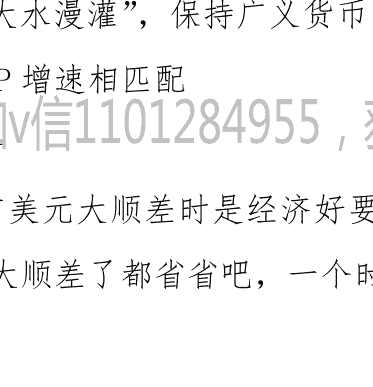
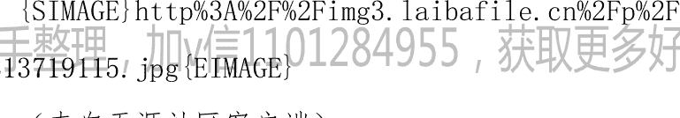
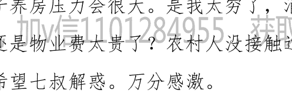

## 2018 年经济数据解读

七剑歌之余风月

二月份央行数据解读：

1, M2 总量：172.9 万亿，这个多要说点点，因为央行长说人民币国际化时，说了该做的都做了，然后就没有说什么，什么意思，就是人民币国际化不顺顺利主要是钱印了，就是 M2 太大了。现在看，随着 M2 余额的继续增加，人民币国际化越来越远了，国际贸易形势也不乐观，国内债务压力空前，所以 M2 货币总量如果不能被控制住增加，人民币汇率和外汇储备压力会越来越加剧，提高利率过多，债务难以承受，美国要求贸易平衡时间要增加外汇储备，怕怕怕不怕，这些都是问题。最大的问题不是这些，是什么？是人民币信用问题。人民币是华人民共和国的主权货币，代表着政府信用，这些贴子前面说过了，就不再说了。如果 M2 总量不能被控制住增加，人民币汇率和外汇储备处在危险之中，超外汇去处有无非就是股市、楼市、外汇三个地方。现在股市、楼市基本没戏了，最后的去处就是外汇。所以，现在要严格控制 M2 总量的增加，防范金融风险。如果人民币再次被击冲击，只能是美元货币紧缩和国内危机引发的内部冲击，所以，M2 总量的增加是非常危险的，要商业银行缩表来解风险，不能等全球流动性收紧后被动缩表。

2, M2 增加 8.8%，严厉的货币紧缩。现在来看，随着房地产下滑，M1 增加拉动 M2 增加，未来 M1 不触底，M2 会继续下滑，就是企业从生产和市场需求继续萎缩，经济下滑继续。前面说了，全年经济都会继续下滑，M2 突破 10% 后在市场需求反映出来，一些说的都说了，大家能明白是什么了。

3, M1 增加 8.5%，这个就是中国实体经济开始走出流动性陷阱。M1 增加小于 M2 增加，资金流入房地产消费本质发生了变化，开始不再流入房地产。现在回头看，2017 年 12 月的 M1 总量 54.38 万是短期高点，这个高点有可能演变全年高点或未来的年度高点，就是说中国再也不够买房子的，预期会发生变化。未来房地产的资金会越来越少，全国房价进入下降通道，各个城市由于调控不同一样，一些城市房价开始进入崩盘阶段，全国其他城市进入跌跌阶段，各城市 M2 增加进入这个阶段，就是说从房价到实体经济就开始下滑的阶段，下滑速度会越来越快，经济活动会继续减弱，要说的大家都要明白就是了。

作者:七剑战歌之风 日期:2018-03-12 12:34

现在来说通胀问题，天好很多人说 2.9% 的 CPI 是通胀了，这个是瞎胡闹，根本就是不懂，实际就是春节错位引起的，没有什么，中国还在通缩之中，大家不要被误导了。M2 增长跌到这一份上，就不用考虑这个问题了，要真能通胀反而能济好了。这些都说多了，再说没意思了，天上闹什么逼的根本不要理会，都是骗人的。

作者:七剑战歌风月 日期:2018-03-12 13:39

M1 增加到 8.5%，这个就是全国房价开始跌了，不要信任任何房价涨的说法，都是谎言的，央行数据不会骗人。继续跌下去，这次不会跌到负值，这个我真不知道，真掉到负值我也开眼了，一般跌到 5% 以内就算进入底部了，就是全国都看空、价格阶段。

作者:七剑战歌风月 日期:2018-03-12 13:43

我本来就不写了，也没什么了，就是房价跌了，来看一看，发现都是蠢脑的韭子，还是再写写，实在没什么可以了，是房价各种暴跌，这些就没什么可以怀疑的。

作者:七剑战歌风月 日期:2018-03-12 14:48

现在就央行跟随美元加息了，CPI 和央行数据一旦公布，基本有加息的意思了，这个也是行情走的，央行加息在前半年应该有一次，时间点不是我们知道，时间点也没意思。

作者:七剑战歌风月 日期:2018-03-12 13:55

现在房价实际没有什么，只是对房价有打击，一套房子或刚需，没有什么大的影响，房价就是现象，天上什么房价涨，租金都是搞笑的，房价由收入决定，不是房价 3000 元、4000 的房，房价疯了，诸说什么成本，都是笑话。真出了房产，很多房子会空置转出租，租随房价下跌。

作者:七剑战歌风月 日期:2018-03-12 14:08

作者:雷哥 时间:2018-03-12 14:01

说 M2 不是非常精确的货币松紧指标，这话是不是错的？中国还没到这个阶段，就是直接融资阶段（间接融资），等 M2 稳定了，靠内需发。M1 10% 增长，获取更多的市值，M2 稳定了，符合要求，M1 M2 增长，大家都有什意思，那时看 M1 都比 M2 好，现在还没到这个阶段，主要看 M2 不行，社会融资也不行，还是靠银行的。

M2 增长，M2 增长，M2 增长，M2 增长，M2 增长，M2 增长，M2 增长，M2 增长，M2 增长，M2 增长，M2 增长，M2 增长，M2 增长，M2 增长，M2。

现在还没到这个阶段，主要看 M2 不行，社会融资也不行，还是靠银行的。

作者:七剑战歌风月 日期:2018-03-12 14:14
作者:高昂 时间:2018-03-12 14:30

现在房子不好卖是限购政策还是人民的购买力已经到极限了？其实一线楼盘抢疯，但二手房确实不好卖。二手房贷款难吗？银行没钱了，也不敢给贷，首付都是借的，炒了不是闲着玩的。现在这房价，大城市能拿出首付的人很少了，就是泡沫，跟股市一样，买房子是为了炒的，加杠杆的东西。

作者:七剑战歌风月 日期:2018-03-12 14:17
作者:concert 时间:2018-03-12 13:52

BIS 对中国行业风险提警 https://wallstreetcn.com/articles/36189

世界银行报告，目前我国 23 万亿债务，HK 和大陆的债务比全球第一。这两地都采取了一系列宏观审慎措施削杠杆向房地产配置，但在抑制融资上效果却差很多。我是知道为啥 18 年报告为啥不提去杠杆，不敢说出来，加信10%，获取更多好帖啊，却能她般预测的都爆发了，硬着陆可能崩了，北京上海的泡沫已经破了，就是压力去杠杆了。

作者:七剑战歌风月 日期:2018-03-12 14:27
作者:南美飞籽 Lv 10 时间:2018-03-12 14:23:32

我现在就等着坚定老空头看了！当老空头变多头，呵呵！那就是要剧烈崩了！现在已经开始了！天涯上一说说谎的一天到闹晓谎，房子已经到了极点，欺骗老老人不会说道理，各种无赖，谁说真话就攻击，我就是要踢死那些骗子的房子，看他们还敢说不说。

作者:七剑战歌风月 日期:2018-03-12 14:31
作者:漫步者 1687 时间：2018-03-12 14:28:30

七哥，可否公布微博，让大家去你微博，那应该好。要上班，有时间难写这呀，我是写到这一份上了，就坚持吧，真忙了就不来了。

作者:七剑战歌风月 日期:2018-03-12 14:37

地上房子坏，就是说房价涨，天上的几个骗子，像像什么鸡啊，就是个无业游民，一天愁换一个愁，害少人，不少，他自己不工作，可能知道你错，你们把我写的明白，你们给汪汪这些瞎的都可以老师，王亚理。

作者:七剑战歌风月 日期:2018-03-12 14:58

房子也可怜，看着大实话被套牢，还要来歪曲，还到处骂我，来了，来了，就是你看你也不行，我住桥洞的，能写出一个哈，来了被我咬了，你觉得怎么样？你们有这本事政府出个桥洞谁欺负你了，要收税。

作者:七剑战歌风月 日期:2018-03-12 15:09
作者:强势顶 时间:2018-03-12 14:57

强贴，之前高楼没留名，现在总算上了……形势正如七哥所说的在转变，这个社会不再如此浮躁了。

作者:七剑战五 日期:2018-03-12 15:25

## 经济---社会---政治

作者:七剑战五 日期:2018-03-12 15:25

昨天新闻说恢复5年，中等年，实际这样，实际鼓励生育不如改革，人口替代见快，假如100年出生三代人，时间缩短，100年出生四代人，这种人延续好，人口减少基本可控。以前城市就业问题无法解决，就上山下乡，城市比农村严格，就是就业问题，以后年轻人少就不存在了，无所谓了。把孩子们在大学实在。

没意思，实际我理解跟上山一样，还误，实际早进入社会才重要，越大越难融入。

作者:七剑战歌风月 日期:2018-03-12 15:42
作者:生死茫 时间:2018-03-12 14:01

现在的肉靠方便。如果不是供给给侧改革，故意拉高一些商品价格，真实物价跌了。房产天上的房价幻想通胀，都是笑话，真通胀就好了。物价每年下降一个台阶。

作者:七剑战歌风月 日期:2018-03-12 15:44
作者:dev 时间:2018-03-12 15:42:36

一套买房，加上首付就能更多好处。感觉到了星光，就像茫茫海上的，看到了希望和温暖。还是留在此黑暗中进行的人带来光明。现在就是房价跌了，你们都觉得没意思了，不要了。

作者:七剑战歌风月 日期:2018-03-12 15:48
作者:浙江北吴虾 时间:2018-03-12 15:41:27

2015年3月M2增长只有2.9%，就在同时政府全面开放限购，房价也处于谷底。房地产确实完了，今年小小跌，明年大跌。然后是长达多年的阴跌。不会的，不要悠悠自己。一线（北京上海）今年大概能到底，二线（每个城市不一样）二线大概明年后到底，跌的会越来越越。央行加息三次大概就到底了。美元这次涨缩后，以后就是降息宽松，中国以后无法大量印钞，这可以或许，但是中国的债务承受不住高利率，美元加息四次大概就是极限，很多债务就会出现问题。

作者:七剑战歌风月 日期:2018-03-12 16:32
作者:时人不知忧心 时间:2018-03-12 16:16:09

还查差答答的M1 M2，说明票子老百姓就不明白了吗？印钞子增加8.5%，GDP增长6.5%，说明什么呢？是不是说明经济增长的速度却赶不上印钞票的速度啊？

M2中包含M1来说吧，你买了房子，开发商收到钱，形成M1，一部分各种工程款费用，大部分又去买地，政府。这些钱投资，这个过程中，M1很少流入市场，不会到多数人手里。你看这几年房地产印了几十万亿，只要一点流入市场到多数人手里，物价就上天了。物价涨了吗？实体经济过剩，钱再多都不会到我们大家手里。可是房地产拉动着GDP，一般M2增长为名义GDP，货币不算爆发，总量债务的利息付一年就很多，这些利息基本在少数人手里，流入实体经济，到了我们手里。

一般M2增长不超过10%，就是名义GDP增加，就不算发，就是穷底的货币紧缩。GDP+CPI=2%，M2增加，这个范围内基本上没有发。如果要印钱，房地产就会几年年后产能可能过剩没钱，分配不到，供给下降。

作者:七剑战歌风月 日期:2018-03-12 16:44
作者:prettyjr 时间:2018-03-12 16:07

按照目前M1增长的下降速度，七月份左右就能达到5%附近，按照你的理论，延到6个月反映市场，那年底到明年年初到底。人在西南角，中环附近，我观察的目前中介挂牌的价格，比2017最高点下降了20%左右，成交量非常低，很难脱手，但是没有崩盘的迹象。以我的区域周边房的价格锚定，第一个腰斩说是2015年的价格，第二个腰斩要抵达2010年的价格区间。今年央行加息三次，房利率超过6%，跌幅会如此大？还是重复给你打字吧。

1、2003年放水--2007年见顶回落，被四万亿救了起来。
2、2009年（2012年）放水，2010年房价上涨，没问题，M2在涨，房价跌了多少，大家收入可以支撑。2013年12月--2014年2月见顶，跌到2015年，要破底了，被降准降息加杠杆救了起来。
3、这次随着杠杆，M2增加没有，跌下来，没有M2支撑，货币无法，怎么救？救了汇率和外汇储备不要了？所以，没有M2支撑的房价无法保守，跌幅，没钱。你可以研究，这次没有M2增加，就是说大家收入没涨，靠借贷起来的，跟以前不一样，以前是资金通过实体经济到大家手里，房价涨的有理，跌了多少，杠杆小，跌了大家接住，现在连首付有？没吧。

作者:七剑战战之风 日期:2018-03-12 17:13
作者:海甸屯萨哥 时间:2018-03-12 17:06:07

人为的高房价伤害了众生！这房价真是世界上最大的泡沫。

作者:七剑战歌风月 日期:2018-03-12 17:22

我不是一张张就说，我也是看数据，你们刚需急，我也希望数据一下下来，问题是事实就是事实，这个急没用。我觉得现在已经很快了，全国统一，就是二线还有跌的坏的，还有跌的少的。城市之间基本差一段时间吧，我觉得没准，现在这数据基本就是全国房价都不涨了，都开始跌，这个可以肯定。

作者:七剑战歌风月 日期:2018-03-12 17:31
作者:羽歌赛马 时间:2018-03-12 17:02:13

一手房东龙华非是要不掉，但要说便宜便宜哈呵呵，等着吧。你就是把肉割在地板上的货物，你现在是站着话说腰疼，等你恐慌了，你就把肉割在地板上了。服不服？


安全点赞区。

来自 1541 楼
作者：七剑战歌之风月 日期:2019-10-14 21:06
太强大了，手机确实可以折叠（来自天涯社区客户端）
手机太慢，没办法。

来自 1550 楼
作者：七剑战歌之风月 日期:2019-10-14 21:06
安全点赞区。
一手理，加v信1101284955，获取更多好帖

来自 1551 楼
作者：七剑战歌之风月 日期:2019-10-14 21:09
总算又看到，原来的帖子都看不见了（来自天涯社区客户端）
都写完了，现在发生的大家都能看懂。

来自 1556 楼
作者：七剑战歌之风月 日期:2019-10-14 21:09
安全点赞区。

来自 1557 楼 
作者：七剑战歌之风月 日期:2019-10-14 21:13
以前的帖子十库也没有了，只有已删除三个字。天天等剑神。（来自天涯社区客户端）

------------------------------------------------

知识在脑子里，删不掉的。

来自 1561 楼 
作者：七剑战歌之风月 日期:2019-10-14 21:14
安全点赞区。
一手靠理，加v信1101284955，获取更多好帖

来自 1562 楼 
作者：七剑战歌之风月 日期:2019-10-14 21:22
北京 9+ 成都 11.5+ 重庆 12+ 南京 7+……天量二手房被出来，离彻底崩盘不远（来自天涯社区客户端）

------------------------------------------------

二线已经崩盘。

来自 1573 楼 
作者：七剑战歌之风月 日期:2019-10-14 21:22
安全点赞区。

来自 1574 楼 
作者：七剑战歌之风月 日期:2019-10-14 21:29
电脑可以评论，但是不能回复（来自天涯社区客户端）

------------------------------------------------

我是发现网友能打字都是用手机的，手机写太慢，大概我老了没有年轻人写得快。

来自 1582 楼 
作者：七剑战歌之风月 日期:2019-10-14 21:30
安全点赞区。加v信1101284955，获取更多好帖来谱

来自 1583 楼 
作者：七剑战歌之风月 日期:2019-10-14 21:43
汇率怎么看美联储又重启每个月 600 亿的QE（来自天涯社区客户端）

------------------------------------------------

美国经济开始衰退了，市场避险，美元流动性短缺，美元美股都会开始下跌，对一些国家来说太晚了，房地产没有触底，无法宽松。全球都开始衰退滑入萧条，美国经济会在一些国家经济触底后，美国经济没有必要再次QE。

来自 1605 楼 
作者：七剑战歌之风月 日期:2019-10-14 21:43
安全点赞区。

来自 1606 楼 
作者：七剑战歌之风月 日期:2019-10-14 21:48
估计这贴存钱活不了几天，大声哀中国经济，满满的负能量（来自天涯社区客户端）
那你还来，滚。

来自 王叔冉，加v信1101284955，获取更多好帖
作者：七剑战歌之风月 日期:2019-10-14 21:49
安全点赞区。

来自 1613 楼 
作者：七剑战歌之风月 日期:2019-10-14 21:55
贸易谈判差差不多！对我们没有负债的人来说是利好！（来自天涯社区客户端）
贸易平衡是一定的，这些都写了，实际上谈不成结果都一样，本质不变。

来自 1620 楼 
作者：七剑战歌之风月 日期:2019-10-14 21:55
安全点赞区。

来自 1621 楼 
作者：七剑战歌之风月 日期:2019-10-14 22:08
等了好久，终于可以继续学习了！（来自天涯社区客户端）
我写的领先于现实发生的，现在大家都能看明白，看着现实发生的享受就是，加微信：1101284955，获取更多好帖

来自 1633 楼 
作者：七剑战歌之风月 日期:2019-10-14 22:08
安全点赞区。

来自 1634 楼 
作者：七剑战歌之风月 日期:2019-10-14 22:02
大家召开座会，几个省，重点是下行压力巨大，还有大学生就业问题，呵呵。
空城是必然结果，房价炒起来就这样，要逆转就是成本，危机爆发。

来自 1644 楼 
作者：七剑战歌之风月 日期:2019-10-14 22:20
安全点赞区。

来自 1645 楼 
作者：七剑战歌之风月 日期:2019-10-14 22:36
一手房之前八九千，从9月底开始降价，看着特价的。现在新房六千多，七千多的大把，二手房还好，挂八千多都卖不掉。现在时四千多都卖不掉，连续崩溃，大部分二手房都在下跌。

来自 1664 楼 
作者：七剑战歌之风月 日期:2019-10-14 22:37
安全点赞区。

来自 1665 楼 
作者：七剑战歌之风月 日期:2019-10-14 22:40
全球资金没地方避险，会不会来股？但是西方制度下的市场是不可能的，香港的地位还是无法改变吧。不会来的，萧条中企业没有利润。

来自 1668 楼 
作者：七剑战歌之风月 日期:2019-10-14 22:40
安全点赞区。加微信1101284955更多好帖

来自 1669 楼 
作者：七剑战歌之风月 日期:2019-10-14 22:57
三线城市，老城区临街，餐饮业闭了很多，都吃泡面了？先死一半再再说，敢不服的就是倒，直到这个市场的剩余资本被彻底消耗，规律就是这样。

来自 1681 楼 
作者：七剑战歌之风月 日期:2019-10-14 22:57
安全点赞区。

来自 1682 楼 
作者：七剑战歌之风月 日期:2019-10-14 23:01
七哥，七哥开个帖子吧（天涯社区客户端）
怎么开？就这手机写几个字。

来自 1688 楼 
作者：七剑战歌之风月 日期:2019-10-14 23:01
安全点赞区。加微信1101284955更多好帖

来自 1689 楼 
作者：七剑战歌之风月 日期:2019-10-14 23:10
好多地方银行，信合的股份都拍卖类似一千多家吧。说一半以上都流，地方银行都缺钱，股份都拿出来卖，哈哈。危机中各种资产根本不值多少钱，债务一通就会各种高负债企等破产。

来自 1694 楼 
作者：七剑战歌之风月 日期:2019-10-14 23:10
安全点赞区。

来自 1695 楼 
作者：七剑战歌之风月 日期:2019-10-14 23:40
还有据说力凯、众秦、猎豹、平安内部给出的风险结论年底可能破产……，据说500亿……，不下车企碧了（天涯社区客户端）
一手源码，加信1101284955，获取更多好帖
我们说炒房对于中国经济，汽车市场需求这类没有饱和就没有需求，房价不崩盘，炒房不停，中国经济滑坡就不会停止。

来自 1707 楼 
作者：七剑战歌之风月 日期:2019-10-14 23:40
安全点赞区。

来自 1708 楼 
作者：七剑战歌之风月 日期:2019-10-15 08:46
网传德意志银行会在10月末倒闭，破产。欧洲将发生金融危机（Financial crisis）。对这个破产的处理马上就要开始了。负债总额，好象有2兆左右。这是欧洲最大的银行，德意志银行一旦倒闭，一下子让世界的金融变得非常紧迫。欧盟的伙伴们正紧急召开会议。IMF也组成了一个紧急体制。美国的政权却绝情：ECB总裁已几天表明了放弃的意向，因此克里斯蒂·纳拉、ECB总裁将转任。

一手整理，加信1101284955获取更多好帖

来自 1782 楼 
作者：七剑战歌之风月 日期:2019-10-15 08:46
安全点赞区。

来自 1783 楼 
作者：七剑战歌之风月 日期:2019-10-15 08:48
房价已经定局。

来自 1784 楼 
作者：七剑战歌之风月 日期:2019-10-15 08:48
安全点赞区。

来自 1786 楼 
作者：七剑战歌之风月 日期:2019-10-15 08:55
现在关心房子？失业吃饭，汉现在欠薪了，谁去闹就退险。危机已经爆发了，贸易战和英国又加速了进程，全球一样资源过剩，债务高要命，现在千万都不挣钱，没利润就是死循环。排除大的，大多数是普通人。

来自 1788 楼 
作者：七剑战歌之风月 日期:2019-10-15 08:55
安全点赞区。

来自 1789 楼 
作者：七剑战歌之风月 日期:2019-10-15 09:09
迎来房税。马上就要加税了，后面跟着房产税。

来自 1800 楼 
作者：七剑战歌之风月 日期:2019-10-15 09:09
安全点赞区。加v信1101284955，获取更多好帖

来自 1801 楼 
作者：七剑战歌之风月 日期:2019-10-15 09:12
节前了解到的郑州1.6W的现在1.2W的8千，说横盘。二线城市都在加速下跌，都崩盘了。

来自 1802 楼 
作者：七剑战歌之风月 日期:2019-10-15 09:12
安全点赞区。

来自 1803 楼 
作者：七剑战歌之风月 日期:2019-10-15 09:19
16年就一直看楼主帖子，坚持看到空，猜不到时间点，但趋势我是坚信的。2019年底必须买房，年底要结婚，不买房也结不成，好难啊，欲望芜，我不会刚买了崩盘吧……（天涯社区客户端）
现在按天算，每天都是新低，按你的年底大概已经买卖了，面万金镯，大多半跌了，就是套你，大概你也能承受。

来自 1807 楼 
作者：七剑战歌之风月 日期:2019-10-15 09:19
安全点赞区。

来自 1808 楼 
作者：七剑战歌之风月 日期:2019-10-15 09:34
直接胯了，以后女房奴多的是（天涯社区客户端）
现在没傻多的了，看着很多二手房挂2015年的都卖不掉真是像梦一样。

来自 1816 楼 
作者：七剑战歌之风月 日期:2019-10-15 09:34
安全点赞赞区。

来自 1817 楼 
作者：七剑战歌之风月 日期:2019-10-15 09:51
一手整理，加信1101284955获取更多好帖。死的应该比想象的还要多，现在处在大通缩的。

来自 1823 楼 
作者：七剑战歌之风月 日期:2019-10-15 09:51
安全点赞区。

来自 1825 楼 
作者：七剑战歌之风月 日期:2019-10-15 10:18
这个节日，恒大以迅雷不及势打折，以前都是8000多，等假，恒大已经收割一大波。现在看谁跑得快，跑慢的就是死。

来自 1835 楼 
作者：七剑战歌之风月 日期:2019-10-15 10:18
安全点赞区。加微信1101284955获取更多帖子。

来自 1836 楼 
作者：七剑战歌之风月 日期:2019-10-15 10:19
安全点赞区。用手机可以，电脑不行。

来自 1837 楼 
作者：七剑战歌之风月 日期:2019-10-15 10:19
安全点赞区。

来自 1838 楼 
作者：七剑战歌之风月 日期:2019-10-15 13:52
哈哈，说多少钱都是炒起来的，中国人还没有富到炒子的程度，小区不错，100平米降40无人君。

来自 1921 楼 
作者：七剑战歌之风月 日期:2019-10-15 13:52
安全点赞区。小编，开放我的主帖。制造业的转型升级，泡沫破裂就会跌得很厉害的。硬把房产当成支柱，荒废了。

来自 1923 楼 
作者：七剑战歌之风月 日期:2019-10-15 13:56
安全点赞区。pc版可以回复了！！（天涯社区客户端）

来自 1927 楼 
作者：七剑战歌之风月 日期:2019-10-15 13:56
安全点赞区。

来自 1928 楼 
作者：七剑战歌之风月 日期:2019-10-15 14:08
这个泡沫也破了，要想不失去市场，明年就要价格战促销，500——800一瓶就合适。

来自 1933 楼 
作者：七剑战歌之风月 日期:2019-10-15 14:08
安全点赞区。

来自 1934 楼 
作者：七剑战歌之风月 日期:2019-10-15 14:44
尊敬的客户，根据监管要求，在2019年12月及之后的账单中列出的预售现金将100%计入当期最低还款额，而在2019年11月账单日（不含）之前办理的预售现金不受影响。同时您消费费计入最低还款额的比例将调整至5%。咨询cmbt.cn/qrrBA。[招商银行]
七叔，这是压缩m2了吗（天涯社区客户端）
个人家庭去杠杆还在看不出来，应该是房价崩溃被动去杠杆，就在眼前。

来自 1943 楼 
作者：七剑战歌之风月 日期:2019-10-15 14:44
安全点赞区。

来自 1944 楼 
作者：七剑战歌之风月 日期:2019-10-15 19:50
9月末，广义货币 (M2) 余额195.2万亿元，同比增长8.4%，增速分别比上月和上同期高0.2个和0.1个百分点；狭义货币 (M1) 余额55.71万亿元，同比增长3.4%，增速与上月持平，比上同期低0.6个百分点；流通货币 (M0) 余额74.1万亿元，同比增长4%。


我就跑了一部分，搞了点零花钱。下午又跌回来了，我没再接，感觉又一波下杀快来了。

不要冲动，保住自己的现金存款，耐心等待主板实施制后再看。

## 2077 楼
作者：七剑战歌之风月 日期：2019-10-15 20:06
安全点没。

## 2078 楼
作者：七剑战歌之风月 日期：2019-10-15 20:21
作者：大爱卡普空沙比 Lv 3 时间：2019-10-15 20:14:33 王娜理，加信11101284955，获取更多好帖

再有不到 100 天就全面康了，楼主你在歌斯底里唱哀中国，到底什么居心？整天在谈诸比逼，还不忘记半夜起来贴帖诋毁伟大的拆迁，你什么意思哑？现在中国人连家里不是好几套房子？现在连底层的环卫工、酒店服务都能拿到五万多多的工资，蒸蒸日上的好日子，哪有什么危机？

经济不是用来说的，是什么就是什么，这里失业的网友很多，希望你给他们介绍一个月万薪的环卫工，希望你说的都是事实，想“拆迁”就拆迁，这才是本事，是真有钱。

## 2082 楼 
作者:七剑战歌之风月 日期:2019-10-15 20:21
安全点赞赞区。

## 2083 楼 
作者：七剑战歌之风月 日期:2019-10-15 20:28
作者：鑫鑫欲 Lv 9 时间:2019-10-15 20:27:25

上海嘉定安宁的房子：玉兰村，87平三室一厅一卫，160w成交，坐北朝南，四楼，看到修正好了了解下。

17年超过3w/平，不知道这算不算崩！

从高点跌 30%就崩了。

加v信1101284955,获取更多好帖

## 2086 楼 
作者：七剑战歌之风月 日期:2019-10-15 20:28
安全点赞赞区。

## 2087 楼 
作者：七剑战歌之风月 日期:2019-10-15 20:30
作者：一项明月下江 Lv 7 时间:2019-10-15 20:29:11

七哥，这次美国衰退是否再次波及全球?

----------------

美国只是受影响，他这次不是主角。

## 2090 楼 
作者：七剑战歌之风月 日期:2019-10-15 20:30
安全点赞区。

## 2091 楼 
作者：七剑战歌之风月 日期：2019-10-15 20:33
作者：linikikuUv 11 时间：2019-10-15 20:28:86

2019-10-11 06:42:55 21世纪经济报道

东部沿海省市的工业利润增速也普遍较低。前 8个月全国规模以上工业企业利润平均增长-1.7%，仅浙江（2.8%）、广东（0.4%）优于平均水平，上海（-19.6%）、北京（-14.4%）、山东（-13.0%）、江苏（-3.5%）降幅较大。

产能过剩是无解的，企业没有利润谁也没有办法，还是短期解决的问题，你说的这些是在降低了增值税的基础上，整个处处在衰退中。

## 2096 楼 
作者：七剑歌之风月 日期：2019-10-15 20:37
安全点赞赞区。

## 2097 楼 
作者：七剑歌之风月 日期：2019-10-15 20:37
作者：周凡舒 2019-10-15 20:33

双一折抢房

[image:http://.../img.laiba.cn/m/]
[image:31277563.jpg]

各种甩卖，张嘴就腰斩，我个腰折都要贴子，他们就可以说，而且做。

## 2100 楼 
作者：七剑歌之风月 日期：2019-10-15 20:37
安全点赞区。

## 2101 楼 
作者：七剑歌之风月 日期：2019-10-15 20:40
作者：责冷之 Lv 9 时间：2019-10-15 20:32:35

今年金额对比去年下降50%。一手，加v信101284955，获取更多好帖就这还不倒闭？

## 2103 楼 
作者：七剑歌之风月 日期：2019-10-15 20:40
安全点赞区。

## 2104 楼 
作者：七剑歌之风月 日期：2019-10-15 20:42
作者：蠢动欲 Lv 9 时间：2019-10-15 20:38:55

上海徐汇区：同事在2000年以18w/平买的房子，目前超过8w/平，他不看，说跌到2w也不亏。什么是底，崩下来再说。二手房很多都是零成本的这种房子，各种改，什么都不亏。

## 2105 楼 
作者：七剑歌之风月 日期：2019-10-15 20:42
安全点赞区。

## 2106 楼 
作者：七剑歌之风月 日期：2019-10-15 20:46
作者：俏香 Lv 4 时间：2019-10-15 17:05:45

几个拆迁户天上串，不愿意接受事实。他俩卖房价不跌了，我不写不跌了？我这个月没写，房价跌得快了，哈哈。

## 2113 楼 
作者：七剑歌之风月 日期：2019-10-15 20:47
安全点赞区。

## 2114 楼 
作者：七剑歌之风月 日期：2019-10-15 20:50
作者：当神话也触及 Lv 9 时间：2019-10-15 20:45:21

应该是滞胀。什么滞胀，前面这些都写清楚了，我们处在大缩中。

## 2115 楼 
作者：七剑歌之风月 日期：2019-10-15 20:50
安全点赞区。

## 2116 楼 
作者：七剑歌之风月 日期：2019-10-15 20:56
20:46 【房企开始“地王”付出代价】过去几个月，他负责的区域房地产市场逐渐下行，虽然他做了营销前期工作，依旧让这位80后负责人面临着巨大的销售压力。每天，他站在24楼的办公室看着窗外来人往，是走进项目的客户，还是迎客如流。有那么一瞬间，他忙得没有站稳，突然发现自己已经很久没有休息了。（一财）[点击全文]

要早看我的帖子，早就跑了，没钱了地王。帖子里多喜欢拿地王来说，看看开发商是怎么死的。帖子前面说过，韭多跟开发商是一根绳子上两头，一头是开发商，一头是韭多，都是牺牲品。

## 2118 楼 
作者：七剑战歌之风月 日期：2019-10-15 20:56
安全点赞区。

## 2119 楼 
作者：七剑战歌之风月 日期:2019-10-15 20:59
作者：漂泊之秋 AK2Lv 8 时间:2019-10-15 20:58:27

楼主，过刹又要出去多久啊

------

20 年吧。

## 2121 楼 
作者：七剑战歌之风月 日期：2019-10-15 20:59
安全点赞区。

## 2122 楼 
作者：七剑战歌之风月 日期：2019-10-15 21:09
作者：冬晴_Lv18 时间：2019-10-15 21:06:56

从去年以来，公司变化，现在能保证这样。温水煮青蛙最可怕，轮到自己才知道。

## 2128 楼 
作者：七剑战歌之风月 日期：2019-10-15 21:09
安全点赞区。

## 2129 楼 
作者：七剑战歌之风月 日期：2019-10-15 21:29
作者：钱慎俱乐部 Lv 7 时间：2019-10-15 21:26:12

基本的任何话，天涯没有。会不会哪天被淘汰？到时候我能知悉还能打字，还没倒。

## 2139 楼 
作者：七剑战歌之风月 日期：2019-10-15 21:29
安全点赞区。

## 2140 楼 
作者：七剑战歌之风月 日期：2019-10-15 21:34
作者：帝门徒 Lv 4 时间：2019-10-15 21:32:06

刚发工资就有人说自己工资3000多，房贷3000，还没热就没光了惨惨。王磊 加v:1101284955 提取更多好帖外许多人都收入了，不要我没房的基础是硬炒。

## 2147 楼 
作者：七剑歌之风月 日期：2019-10-15 21:34
安全点赞区。

## 2148 楼 
作者：七剑歌之风月 日期：2019-10-15 21:37
作者：源泊的秋 AK2Lv 8 时间：2019-10-15 21:33:33

20年出清都老了，没意思了。混着吧，不管你说还见识过，现在小孩出生处在条中。

## 2149 楼 
作者：七剑歌之风月 日期：2019-10-15 21:37
安全点赞区。

## 2150 楼 
作者：七剑歌之风月 日期：2019-10-15 21:39
作者：小宫燕 Lv 13 时间：2019-10-15 21:32:54

七叔好！终于又能看到贴了！这几天无聊只能去刷感情区，哈哈！写不写无所及了，房价跌的。王叔涵，加微信1101284955，更多好帖

## 2152 楼 
作者：七剑歌之风月 日期：2019-10-15 21:40
安全点赞区。

## 2153 楼 
作者：七剑歌之风月 日期：2019-10-15 21:57
作者：王的男孩20191Lv7 时间：2019-10-15 21:53:32

昨天我们这个地方大未来回城房价跌了3000一，好多业主在那里打架事！现在他们还有力闹，过两个月他们想哭没泪，怪谁啊，谁让他们炒房子了。

## 2167 楼 
作者:七剑战歌之风月 日期:2019-10-15 21:57
安全点赞区。

## 2168 楼 
作者:七剑战歌之风月 日期:2019-10-15 22:20
作者：ty_牛牛妈妈 481Lv 10 时间：2019-10-15 22:16:56

想买羊毛大衣，后面会越便宜吧，等双羊毛大衣说是全羊毛的，哪里有全羊毛的？只有身上才是全羊毛的。

## 2178 楼 
作者：七剑战歌之风月 日期：2019-10-15 22:20
安全点赞区。

## 2179 楼 
作者：七剑战歌之风月 日期：2019-10-15 22:24
作者：王的男女20191Lv 7 时间:2019-10-15 22:23:09

怎么感觉都是恒大的房子在降价啊？都在降价，只是恒大宣传的好。

## 2181 楼 
作者：七剑战歌之风月 日期：2019-10-15 22:24
安全点赞区。

## 2182 楼 
作者：七剑战歌之风月 日期：2019-10-15 22:30
外交部确认中美达成阶段协议
2019年10月15日16:21 来源:央视新闻
分享到:516人评论724873人讨论我来说两句手机免费看资财财 财富号入驻直达

## 摘要
【外交部确认中美达成阶段协议】十三轮中美经贸高级别磋商近日于华盛顿举行。美方表示双方达成实质性阶段协议。外交部发言人回应，美方说的是实际情况。这份经贸协议对中国、美国和世界都有利，对贸易与和平都有利。今年以来中国企业已自美国采购2000万吨大。（央视）

够了，贸易是必然结果，美国不会让全世界。

## 2184 楼 
作者：七剑歌之风月 日期：2019-10-15 22:30
安全点赞赏。

## 2185 楼 
作者：七剑歌之风月 日期：2019-10-15 22:59
没有任何联系方式，广告都是骗子。

## 2212 楼 
作者：七剑歌之风月 日期：2019-10-15 22:59
安全点赞区。

## 2213 楼 
作者：七剑歌之风月 日期：2019-10-15 23:25
作者：u_1324107v 时间：2019-10-15 23:13

凡是悠的都是骗子，包括银行，中国人还没到贷款阶段，贷款是利息，让你成为奴隶，打工人，消费，在通胀周期中延迟消费，而不是超前消费。

## 2222 楼 
作者：七剑歌之风月 日期：2019-10-15 23:25
安全点赞区。

## 2223 楼 
作者：七剑歌之风月 日期：2019-10-16 09:06
建议七叔做准备，万一天倒了，或是再来恶心的封贴，大家好七叔的建议开个微博什么的。实际哪里一样。

## 2268 楼 
作者：七剑歌之风月 日期：2019-10-16 09:06
安全点赞区。

## 2269 楼 
作者：七剑歌之风月 日期：2019-10-16 09:24
中介很有意思。他们不但给客户洗脑，很起来还给自己洗脑。洗房最怕谁？就是认识一个刚入业姑娘，不但卖房，自己天天盯着各种“特价房”，整天喊着：不逼我自己有多牛。上次偶遇她眼角余光瞥到她真的眼神。后来听说将近200万一套房，加上利息，后来又去广打工，回来又找了个对象结婚，到时候估计一起贷款要好吧。整个社会卖房疯狂，人人性十足，都是炮友。

## 2281 楼 
作者：七剑战歌之风月 日期：2019-10-16 09:24
安全点赞区。

## 2282 楼 
作者：七剑战歌之风月 日期：2019-10-16 10:34
县叔，劝都劝不住。这个劝不住的，律就是这样的，就跟专家说的软陆一样，都是不可实现的，炒房都是赚钱效应，“谁劝都没用，楼市出现亏损效应，人们才会停止买房，人性是如此，律就是涨不买，这也是政府目前的困境，房地产没有触底，只要宽松就会去买房，现在这局面，如果资金再去买房，就是灭顶之灾，就跟国际歌里的歌词一样“中华民族最危机的时刻”，引起只有灭产，让炒房的出现亏损效应，资金才会不去买房，人们才不会买房子去消费，商品可能停止倒闭，经济才能停止下滑，不是靠劝就能起到作用的，只要要有“赚钱效应”谁劝都没用，只有出现“亏损效应”人们才会停止买房，也就说是大家都跳这场游戏才算结束，没有其它办法。

## 2299 楼 
作者：七剑战歌之风月 日期：2019-10-16 10:34
安全点赞区。

## 2300 楼 
作者：七剑战歌之风月 日期：2019-10-16 11:03
楼主是中忠梦。玩火者自焚，玩水者自溺。红楼梦里最后几个是好结局了？闲闲才是中忠梦。

## 一手处理，加微11011284955，获取更多好帖

## 2311 楼 
作者：七剑战歌之风月 日期：2019-10-16 11:03
安全点赞区。

## 2312 楼 
作者：七剑战歌之风月 日期：2019-10-16 11:05
没有任何联系方式，广告都是骗子。

## 2315 楼 
作者：七剑战歌之风月 日期：2019-10-16 11:05
安全点赞区。

## 2316 楼 
作者：七剑战歌之风月 日期：2019-10-16 11:23
我被封10年，按理楼主应该被压在雷峰塔下的。现实是楼主比小强都厉害，百草枯都杀不死（来自天涯社区客户端）


来自 2388 楼
作者：七剑战歌之风月 日期:2019-10-16 14:48
安全点赞区。

来自 2389 楼
作者：七剑战歌之风月 日期:2019-10-16 15:18
七叔！我老公想辞职去考研，现在处于汽车行业，形势很不好，只出不进，本身985本科，想去国内重点大学读研究生，希望帮忙给个参考意见，有以下考虑：第一，准备时期资本沉淀下来，以后有真才实学的人不会好点；第二现在就打算辞职，等待降落下来是早晚的事情，跃迁还是荒废。所有有考研想法，麻烦七叔帮忙给个参考意见????（来自天涯社区客户端）

本来不想回复你，因为这样的人实在太多了。

人们把自己的不如归结为文凭太低等各种因素，我告诉你，升职加薪你们认为的这些因素没关系，明白？跟什么有什么关系？跟个人能力有关。如果是从学校出来找工作跟文凭有关系，那么进入企业或单位后就要看些事了，就是能力。

你的两个问题一起回答：经济整体不好，很多企业是一直不好，汽车行业在中国还不算旧经济，只是短期不好，经济稳定后中国汽车市场还有发展空间。

来自 2404 楼 
作者：七剑战歌之风月 日期：2019-10-16 15:18
安全点赞区。

来自 2405 楼 
作者：七剑战歌之风月 日期：2019-10-16 18:43
作者：快到婉里来GLv 时间：2019-10-16 18:16:15
七叔七叔，一手整理，加v信1101284955，获取更多好帖。

我就是答应了你收不了了。

2443 楼 
作者：七剑战歌之风月 日期：2019-10-16 18:43
安全点赞区。

2444 楼 
作者：七剑战歌之风月 日期：2019-10-16 18:56
龙爷爷 2019：黑名单 举报 2019-10-16 12:05:08 评论
黄金这几天跌得厉害啊。我买的 Barrick Gold，从 20美元跌到 17美元。

帖子前面说过，黄金是在萧条中避险脉冲，全球没有通胀，人们避险买入美元、黄金，黄金又由美元定价。美国经济有大的危机，只是受影响，你不能说美元和黄金哪个绝对避险。萧条人们不会追逐黄金，美元也不是就QE放了，全球经济企稳，美元还是美元，你不能当货机看美元，长期萧条，全球会爆发各种危机，美元、黄金每次都是脉冲避险，黄金没有牛市。

# 2448 楼 
作者：七剑战歌之风月 日期：2019-10-16 18:57
安全点赞区。加v信1101284955，获取更多好帖。

# 2449 楼 
作者：七剑战歌之风月 日期：2019-10-16 19:25
作者：风吹过的田野2017Lv 8 时间：2019-10-16 17:17
隔壁有个王八说买不起房的都是月入两三千的混吃等死人的，我去奶奶的嘴儿。在小型城市里，多少岗位多少人拿的就是两三千的工资，即使是月入两三千，人家非常辛苦非常努力地活啊！容不得你来践踏！

穷人买不起房子，正是因为买不起房子，才能在房灾中躲避其身，不像他们，房价一跌哭哭娘的，今天闹售楼处，天上楼顶，已经足够丢脸，这人世间哪有永远的事，世道反转专治这些伪人、假产。资产价格泡沫破裂，他们负债累累，一夜返还，还不如没有债务的穷人。

# 2454 楼 
作者：七剑战歌之风月 日期：2019-10-16 19:25
安全点赞区。

# 2455 楼 
作者：七剑战歌之风月 日期：2019-10-16 19:39
作者：斑马泥鹿 Lv 9 时间：2019-10-16 14:54:18
跟帖多年，去年年底到上半年把夫妻名下下一共一套全房全部卖，基本属于顶点，年末底等抄底大房子。王建理：110128495。谢七剑：前两天总理理来西安，朋友圈的中介又说，总理说西北有高，结果中介这就成了西安还要涨，真实无语。西安房价几千就合适。

# 2458 楼 
作者：七剑战歌之风月 日期：2019-10-16 19:39
安全点赞区。

# 2459 楼 
作者：七剑战歌之风月 日期：2019-10-16 19:56
作者：er1315Lv 10 时间：2019-10-16 23:41
七先生好吗，想死你了！（来自天涯社区）
实际现在看二线城市崩盘了，我有些二线城市的二手房房价跌得越快了。福州这边普通跌了3000到5000，以前两万、现在一万，那里已经崩了，我看有很多老破旧，2015年的跌不掉，还不是底。

2462 楼 
作者：七剑战歌之风月 日期：2019-10-16 19:56
安全点赞区。

2463 楼 
作者：七剑战歌之风月 日期：2019-10-16 19:59
作者：sweetjen_01Lv 12 时间：2019-10-16 19:50
《南华早报》显示，地产期间按面积计算，上海暴跌了86%，北京下降了92%。如果我说两个腰斩，现在看稳腰斩，看到。

2465 楼 
作者：七剑战歌之风月 日期：2019-10-16 19:59
安全点赞区。

2466 楼 
作者：七剑战歌之风月 日期：2019-10-16 20:00
作者：萨蚕堡 Lv 3 时间：2019-10-16 19:09
南昌的房价由于各种建设顶着高价，暴跌的只有二手房。我这么想的，房价一年不涨，连带利亏，你看住多久。现在已经是存量时代了，一套房代表市场。

2467 楼 
作者：七剑战歌之风月 日期：2019-10-16 20:01
安全点赞区。

2468 楼 
作者：七剑战歌之风月 日期：2019-10-16 20:45
作者：dualcore2016Lv 11 时间：2019-10-16 20:25:43
不少房的观点就是不价价，大大出了，以后涨再说租给谁？我老说房价炒起来一场浩劫，成本无法转移，结局就是返乡空城。我以前写过几点，就是房价炒起来怎么完蛋的。房价炒起来，一部分买不起的人返乡，房价涨，持房者由卖变出租，通过房租转移，房租猛涨，租不起的人开始返乡，租金下跌，房价一起下跌......房价就是货币现象，跌下来靠收入支撑，房租是由人们决定的，不是房价决定的。萧条人们失业，泡沫破裂，拿什么支撑房价？只要有人租房，房租就不会下跌。反来说，房价会把一切成本拉高，财富榨干引起经济衰退，人们返乡了房价房租一起完蛋，危机（房租）就爆发了。王胜利11284955，获取更多帖。

2474 楼 
作者：七剑战歌之风月 日期：2019-10-16 20:45
安全点赞区。

2475 楼 
作者：七剑战歌之风月 日期：2019-10-16 21:28
作者：千百个签 Lv 6 时间：2019-10-16 21:01:12
七叔，科创板实施注册制了。是不是股市会好些呢？和主板注册有什么区别？主板只要还有融资功能，就不会实施注册制，明白？

# 2489 楼 
作者：七剑战歌之风月 日期：2019-10-16 21:29
安全点赞区。

# 2490 楼 
作者：七剑战歌之风月 日期：2019-10-16 21:39
19:59
【一抢两空! 深圳又有创新房上线了还能捡包入住！】
中国特色社会主义先行示范区又有大动作，从“控房价”到“控房租”，深圳先行一步!10月15日上午10点，深圳推出全国首个国企稳租金商品房租赁试点项目。该项目总租期最多达60个月，年度租金涨幅范围不超过5%。（中国基金报）
数据来源微信1101284955，获取更多帖
太晚了，人们返乡空城了就是想哭都没泪。

# 2492 楼 
作者：七剑战歌之风月 日期：2019-10-16 21:39
安全点赞区。

# 2493 楼 
作者：七剑战歌之风月 日期：2019-10-16 21:48
千百个鉴：黑名单 举报 2019-10-16 21:35
额……还是一头雾水。注册制和融资功能有啥关系？你个韭菜，这些是干什么的？就是体制内提供融资的场所懂么？只要有钱“圈”能让一般人（企业）去融资，只有韭菜才能割没了。反来说，主板注册制一定是跌，股市就是底部。

2496 楼 
作者：七剑战歌之风月 日期：2019-10-16 21:48
王安森：v信101284955，获取更多帖

2497 楼 
作者：七剑战歌之风月 日期：2019-10-16 21:54
作者：218Lv 5 时间：2019-10-16 21:51:27
这段时间实在太多，多到很多人怀疑人生了。实体经济衰退开始向服务业传递，服务业是在实体经济上的，实体经济萧条了，各种服务的泡沫破裂了。

2499 楼 
作者：七剑战歌之风月 日期：2019-10-16 21:54
安全点赞区。

2500 楼 
作者：七剑战歌之风月 日期：2019-10-16 22:14
作者：QQ层贫民窟 Lv 4 时间：2019-10-16 21:55:36
前些逃离北广，后来炒房后又是一线城市过机会，适应节奏，各个当一线，估计马上又要逃北广咯！只是之前的逃离一身轻，一线二线，混个舒适日子，这次要跑，就像现在王经理 加微信

2506 楼 
作者：七剑战歌之风月 日期：2019-10-16 22:15
安全点赞区。

2507 楼 
作者：七剑战歌之风月 日期：2019-10-16 22:34
作者：suya168Lv 3 时间：2019-10-16 22:29:22
终于见识到了什么叫跌脑袋！一个朋友月底买了大亚湾的毛坯二手房，均价七千五，首付加税费中介费二十三左右，估计差不多全都是身上，欠款快百万。这里的一手房一万四到两万。自此以后发现他魔怔了，不停看中的深圳东要地铁通亚湾了，什么价值千万的大亚湾规划图，什么深圳要成立先进示范区，什么建设粤港澳大区等等。他也知道很多地方降价了，但他坚信大亚湾是不会面临深，而且降价的房企被收割了，政府不会让房价下跌的！然后他不停地找物价不断上涨的例子，来证明未来也会一直通胀下去的，比以前便宜才五万块，现在要二十三十五，价格都不跌！最后的最后，他说坪山一定会会有发展的，坪山现在只有三四万，以后肯定能涨到深圳的均价，至少得五六万吧，那作为临深片区的大亚湾，张到两三万也很正常，然后他持有三年后涨到两万的价格就买弹！他算过信111284955，还有很多好处！他说他都能进行，买房就是创业！他说的话让我直接无语了。都是疯子。

2518 楼 
作者：七剑战歌之风月 日期：2019-10-16 22:34
安全点赞区。

2519 楼 
作者：七剑战歌之风月 日期：2019-10-16 22:47
作者：兼职流氓琐 Lv 8 时间：2019-10-16 22:41:44
七叔，上海二手房基本跌回16年1-3月的水平，离跌回15年暴涨还有几轮下跌，还有少数核心地区比较新的房子还在高位，是不是等郊区、市区老破小，老破再跌几轮，这些所谓高端的盘才开始崩？都会陆续购，现在就在下跌，一般从外环向内环崩，从老破旧向好点的小房区，什么高端都是枉话，有钱把房买起来才能叫“高端”，没钱了都跌了，只是后跌。

2523 楼 
作者：七剑战歌之风月 日期：2019-10-16 22:47
安全点赞区。加v信1101284955，获取更多好帖。

2524 楼 
作者：七剑战歌之风月 日期：2019-10-17 08:29
七叔，任泽平这头猪在鼓放水了，怎么办？房价没到底，放水可以长期宽松，就跟日本一样。

2555 楼 
作者：七剑战歌之风月 日期：2019-10-17 08:29
安全点赞区。

2556 楼 
作者：七剑战歌之风月 日期：2019-10-17 10:48
没有任何联系方式，小广广告都是骗子。

2593 楼 
作者：七剑战歌之风月 日期：2019-10-17 10:48
安全点赞区。加v信1101284955，获取更多好帖。

2594 楼 
作者：七剑战歌之风月 日期：2019-10-17 10:53
请各位，汽车现在是低点，包括新车和二手车。以后就是普通品，就跟家里一样，市场竞争激烈，没有空间。

2596 楼 
作者：七剑战歌之风月 日期：2019-10-17 10:53
安全点赞区。

2597 楼 
作者：七剑战歌之风月 日期：2019-10-17 11:02

2603 楼 
作者：七剑战歌之风月 日期：2019-10-17 11:02
2604 楼 
作者：七剑战歌之风月 日期：2019-10-17 13:00
即便不懂经济，只能悠悠不懂小白。

2641 楼 
作者：七剑战歌之风月 日期：2019-10-17 13:00
安全点赞区。

2642 楼 
作者：七剑战歌之风月 日期：2019-10-17 19:42
【商务部：中美磋商最终目标是停止贸易战、取消全部征关税】在今天（17日）商务部举行的例行发布会上，发言表示：中方对中美磋商的立场、原则和目标没有变化，双方的最终目标是停止贸易战，取消全部征关税，这有利于中国、有利于美国、有利于世界。我们希望双方共同努力推动谈判，尽早达成阶段协议，并在取消关税问题上取得新的进展。（央视）如果谈成取消关税，要贸易平衡，只能升值汇率。

2737 楼 
作者：七剑战歌之风月 日期：2019-10-17 19:42
安全点赞区。

2738 楼 
作者：七剑战歌之风月 日期：2019-10-17 19:45
作者：阿弥佛接 Lv 7 时间：2019-10-17 19:36:22
这里，融创打八折，还是装修，比旁边二手房便宜。开发商逃跑的速度比户快，就跟股市一样，市场主力跑了套牢的大户、小户和散户。

2739 楼 
作者：七剑战歌之风月 日期：2019-10-17 19:45
安全点赞区。

2740 楼 
作者：七剑战歌之风月 日期：2019-10-17 19:48
作者：大富豪123456Lv 10 时间：2019-10-17 17:24:24
有些地方的部分楼盘已经悄悄的腰软了，看视频看到几个了。现在大概就东北、西北没有崩的基本都崩了。

2741 楼 
作者：七剑战歌之风月 日期：2019-10-17 19:48
安全点赞区。

2742 楼 
作者：七剑战歌之风月 日期：2019-10-17 19:53
作者：小国寡民2011Lv 11 时间：2019-10-17 16:20:53
出房地产法案预期时间也没有啊！这个说收收就，立法很快的，烟酒税跟着房产税。

2745 楼 
作者：七剑战歌之风月 日期：2019-10-17 19:53
安全点赞区。

2746 楼 
主理加信101284955获取更多好帖。
作者：七剑战歌之风月 日期：2019-10-17 19:53
作者：QQ层贫民窟 Lv 4 时间：2019-10-17 21:55:36
现在是低点吗？还能行。

2747 楼 
作者：七剑战歌之风月 日期：2019-10-17 19:54

2748 楼 
作者：七剑战歌之风月 日期：2019-10-17 20:01

2749 楼 
作者：七剑战歌之风月 日期：2019-10-17 20:05
安全点赞区。
现在干什么还能挣钱？

2750 楼 
作者：七剑战歌之风月 日期：2019-10-17 22:14

2751 楼 
作者：七剑战歌之风月 日期：2019-10-17 20:05
安全点赞区。

2752 楼 
作者：七剑战歌之风月 日期：2019-10-17 20:52

2753 楼 
作者：七剑战歌之风月 日期：2019-10-17 20:01

2754 楼 
作者：七剑战歌之风月 日期：2019-10-17 20:07
安全点赞区。加v信1101284955，获取更多好帖。

2756 楼 
作者：七剑战歌之风月 日期：2019-10-17 22:34


作者：七剑战歌之风月 日期：2019-10-17 21:00

作者：梅花十八危机 2019Lv 7 时间：2019-10-17 20:46:16

最近一直在看债务危机，瑞·达利欧出口的书，债务危机走到尽头，必然会杠杆。分通缩型杠杆和通胀型杠杆，债务以外对外为主，且规模巨大，外汇储备不足，以及政治不不稳定，多数走向通胀型杠杆，反之则通缩型杠杆。目前看来，我们大部分概率走向通缩，地产的破裂比股票的破裂危机要大的多，现在最大的问题是是如何打掉泡沫，且泡沫最小。但是有一点此不一样，无论何种处理方式，汇率必然大幅度波动。

## 一手源码，加微信1101284955，股票多多好处

想多子，人民币是固定汇率，根本没有贬值空间，前面有一个网友说过一句话：“我写的这一切都是建立在汇率不贬值的基础上，我对通胀、通缩的论述跟汇率浑然一体。已经发生，现在在等房价崩缩到底货币被消灭，市场补充流动性，那时人民币市场应该有个‘外升内升’过程，不是说房价崩了汇率贬值，崩的过程中人民币有贬值压力，就像现在，等货币被消失，市场需要补充流动性，印不出、贷不出才是麻恼，就跟日本发生的相似，低利率宽松无效，在流动性陷阱中苦苦挣扎。”

2764 楼
作者：七剑战歌之风月 日期：2019-10-17 21:00
安全点赞区。

2765 楼
作者：七剑战歌之风月 日期：2019-10-17 21:21

现在新闻说的“个人破法”就是货币消灭中，一切不服的过剩资本被消灭，再也没有人去杠杆的环境中投入，银根紧缩，市场紧缩，利率再都不能激投资消费，货币政策失效，处在流动性陷阱中，市场一旦紧缩，几百亿的债务，都在找债，市场的紧缩力量不是央行宽松战术，即使出台“个人破法”，大概他们也不会再去贷款创业，个人家庭也不会乐观消费，整个处在通缩意识中，那时人们只会紧紧的抱住现金存款，一切愁愁都不会起复用整理，加微信1101284955，获取更多好帖

2766 楼 
作者：七剑战歌之风月 日期：2019-10-17 21:21
安全点赞区。

2767 楼 
作者：七剑战歌之风月 日期：2019-10-17 21:34
作者：弹簧88Lv 10 时间：2019-10-17 21:32:52
再论广场协议推动了日本经济跨越式发展！

----------------

这种文章出来了。现在“协议”两个字还能打出来，我着急赶紧多打几个。

2771 楼
作者:七剑战歌之风月 日期：2019-10-17 21:34
安全点赞区。

2772 楼 
作者：七剑战歌之风月 日期：2019-10-17 22:41
作者：nathan737Lv 9 时间：2019-10-17 22:36:17
本市这两天突然开始集中小产权房登记，流传是要转正，我估计是为配合即将到来的房产税的。不了解的是如何收缴房产税对产权房们有什么具体措施吗，还是强行“转正”。

一手整理，加微信1101284955，获取更多好帖。

征收房产税前，缴纳一笔钱就“转正”了。

2785 楼 
作者：七剑战歌之风月 日期：2019-10-17 22:44
安全点赞区。

2786 楼
作者：七剑战歌之风月 日期：2019-10-17 22:55
作者：巴丘野老Lv 7 时间：2019-10-17 22:49
七叔，现在学点啥手艺吗？毕业两菜鸟手艺要从小学，不是速成的，明白？只能说是职业。

2790 楼 
作者：七剑战歌之风月 日期：2019-10-17 22:55
安全点赞区。

2791 楼 
作者：七剑战歌之风月 日期：2019-10-18 11:11
本人没有任何联系方式，广告都是骗子。

2901 楼 
作者：七剑战歌之风月 日期：2019-10-18 11:11
安全点赞区。

2902 楼 
作者：七剑战歌之风月 日期：2019-10-18 11:14
王主理 加微信1101284955 获取更多好帖
作者：feelgood Lv 10 时间：2019-10-17 23:16:47
叔，房价到低了，到时候房贷会下降嘛。房价崩了，上上产税，房贷会很低。

2904 楼 
作者：七剑战歌之风月 日期：2019-10-18 11:14
安全点赞区。

2905 楼 
作者：七剑战歌之风月 日期：2019-10-18 11:18
作者：Q_Q 高层民窟 Lv 4 时间：2019-10-18 02:34:44
大半夜不睡觉上网结果遇到一个买房的傻子，口声为了买房，孩子的教育是最重要的！人怎么能虚无赖到地步？！明明是自己贪心炒房要个好名义是为了孩子不惜一切，还给自己贴帖，这房价怕了以后后代还会让孩子背锅！当孩子也太倒霉了，什么选择根本没降一口黑锅！真的是为了教育投资，有点狠把买房的钱拿出来砸在孩子身上，从双语国际幼儿园一路接到出国都够了，百万学费砸下去就是头瘤也是一头文化猪！说白了就是看着孩子再房现，算盘账的溜，还不许你说，就是你不懂她一片苦心的付出，为了孩子的牺牲！怎么我会感动，精神错！在现在，基本趋势明朗了，每次来这种帖其实想看看楼里大家分享的那些迷迭不愁的禁匪姿态，尤其是他们将会巨大的和滑稽的姿态，许多收获的也是为了提醒自己看看那些被欺骗的人在正常眼里有多可笑，随时警醒不能被实操闹平衡心和思考能力！现在每一个对他们来说的坏消息对于我们来说却是反正的好消息，一想到我们将迎来一个全社会沉淀下来安心发展实业，大家能力还能装逼遥，骗子倾荡荡的时代我内心不仅不慌，甚至忍不住有点期待鼓鼓掌！


写的很好，顶！

2906 楼 
作者：七剑战歌之风月 日期：2019-10-18 11:18
安全点赞区。

2907 楼 
作者：七剑战歌之风月 日期：2019-10-18 11:22
作者：锡安小鱼 Lv 12 时间：2019-10-18 06:00:15
七哥，解释一下东北、西北崩得慢的原因吧。跟网友的一样，垃圾股补涨，完了就跌死了。
王忠田，加微信11012849555，获取更多好帖

2908 楼 
作者：七剑战歌之风月 日期：2019-10-18 11:22
安全点赞区。

2909 楼 
作者：七剑战歌之风月 日期：2019-10-18 11:29
作者：泽一赞资 Lv 10 时间：2019-10-18 08:18:21
【华尔街日报中文网】美联储从10月15日开始购买短期美国国债，初期购买规模为每月600亿美元，但该央行已经强调，这些购买操作并不代表着回量化宽松。全球经济衰退，美国受影响，中国经济触底后，应该是低点，房地产也是低点。美国现在如果不降息宽松，烂的里面算好的，美元会变成更加强势的美元调整后太差，没有大的危机。

2912 楼 
作者：七剑战歌之风月 日期：2019-10-18 11:29
安全点赞区。

2914 楼 
作者：七剑战歌之风月 日期：2019-10-18 11:34
作者：Goodman Lv 5 时间：2019-10-18 10:08:19
国家统计局公布：中国第三季度同比增长6%，预估为6.1%，前值为6.2%；分季度看，第三季度同比增长6.0%，第三季度同比增长6.2%，第四季度同比增长6.4%。……失业很严重了。

2915 楼 
作者：七剑战歌之风月 日期：2019-10-18 11:34
安全点赞区。

2916 楼 
作者：七剑战歌之风月 日期：2019-10-18 11:35
作者：阿弥佛引 7 时间：2019-10-18 11:27:02
天津的新房已经开始盘了，各个开发商都在打折促销，整个都在崩下找。

2917 楼 
作者：七剑战歌之风月 日期：2019-10-18 11:01
安全点赞区。

【富贵岛破产资产第二次拍卖流拍】据阿里拍卖官网，富贵岛有限公司的应收预付债券、长期投资、物资等破产资产在打折二次拍卖上架后，再次流拍。此前，10月9日的首次拍卖遭遇流拍，本次上架的起拍价已降至2.7亿元。根据阿里拍卖信息，对于富贵岛的破产资产的二次拍卖，并未有人报名，共有135人。（证券时）萧条中，债务通缩，资产价格越卖越低，跟本身没人

2923 楼 
作者：七剑战歌之风月 日期：2019-10-18 11:49
安全点赞区。

2924 楼 
作者：七剑战歌之风月 日期：2019-10-18 14:17
作者：牛四喜 Lv 7 时间：2019-10-18 12:57:46
统计局发言人毛盛勇：一财记者：坚持“房住不炒”，不把房地产作为短期拉动经济的手段。（来自金十数据APP）房价崩了，就上房产税。

2979 楼 
作者：七剑战歌之风月 日期：2019-10-18 14:17
安全点赞区。

2979 楼 
主 作者：七剑战歌之风月 日期：2019-10-18 14:19
作者：commando_lee14 Lv 7 时间：2019-10-18 13:34:58
联合早报部分评论：彭博社认为，经济放缓进一步表明，中国政府在寻求清理金融体系和遏制贷款的同时，正在让全球第二大经济体逐步走稳。即使对美国的出口减少，经济也可能会继续挣扎，通缩压力打击公司利润，进口下降也表明国内需求疲软。彭博社早前调查的经济学家预计，中国第三季度 GDP 将同比增长6.1%。现在开始不是国内需求没了，全球衰退引起的全球需求下滑也开始了。

2980 楼 
作者：七剑战歌之风月 日期：2019-10-18 14:20
安全点赞区。

2981 楼 
作者：七剑战歌之风月 日期：2019-10-18 14:22
【央行上海分行警示“妙鞋”风险或存在非法资金、金融诈骗等问题】近期，中国人民银行上海分行发布了《警惕“妙鞋”热潮防范金融风险》为主题的一份金融简报，其明确提出，国内球鞋转转卖出现“妙鞋热”、“妙鞋”平台为诱导传此类资本游戏，提醒各机构高度关注、采取有效措施防此类风险。（新浪）[点击查看全文]文章来源：20191011107284956
这些资金最后都会被消耗。

2983 楼 
作者：七剑战歌之风月 日期：2019-10-18 14:22
安全点赞区。

2984 楼 
作者：七剑战歌之风月 日期：2019-10-18 14:52
作者：风火Lv 5 时间：2019-10-18 14:49
帖子都没人了，看看量。

2992 楼 
作者：七剑战歌之风月 日期：2019-10-18 14:52
安全点赞区。

2993 楼
作者：七剑战歌之风月 日期：2019-10-18 15:35
作者：yimad06Lv 9 时间：2019-10-18 12:28:58
七哥，最近财权下发，增值税给地方到底想啥呢，有钱了，地方政府不是又可以搞拆了嘛。一手卖，以后还有好处。地方政府只要不买地，不还债，这些钱除掉吃饭，老说。

3004 楼 
作者：七剑战歌之风月 日期：2019-10-18 15:35
安全点赞区。

3005 楼 
作者：七剑战歌之风月 日期：2019-10-18 16:14
作者：放虎山Lv 9 时间：2019-10-18 15:54:48
求救了。我们单位是央企，中国海洋集团下属的。因为年龄了，可以签署不定期合同。单位签了一份，员工手里的那份好几个月了，不给发。不给员工属于违法行为。单位准备把员工交由第三方管理。如果是那样，央企裁员，一般老员工都是自然减员，养到退休就去了，需要的是混，派遣工。

3018 楼 
作者：七剑战歌之风月 日期：2019-10-18 16:14
安全点赞区。

3019 楼 
作者：七剑战歌之风月 日期：2019-10-18 16:47
16:35
【四川：生猪生产纳入考核】记者18日从2019年四川省第三季度农业农村运行情况新闻发布会上悉，目前四川全面实行生猪生产红线制度，2019年全省完成4008万生的猪生产基本保障任务，同时将生猪生产纳入各地考核。（新华网）[点击查看全文]这官太难做了，猪瘟谁能防住？瘟疫来了把猪宰了谁有办法？天灾引发的无法生产的人力无法抗拒的，这都考核，哈哈。

3024 楼 
作者：七冕战歌之风月 日期：2019-10-18 16:47
安全点赞区。

3025 楼 
作者：七冕战歌之风月 日期：2019-10-18 19:18
银保监会出手规范结构性存款与一般存款进行严格分类管理，加微信1101284955，获取更多好帖。2019年10月18日 18:40 来源：21世纪经济报道分享到：n2489 人参与讨论来说说两句。摘要【银保监会出手规范结构性存款与一般存款进行严格分类】针对近期部分银行结构性存款业务快速发展中出现的产品运营管理不规范、误导销售、违规开展等问题，中国银保监会于10月18日发布《关于进一步规范商业银行结构性存款业务的通知》。21世纪市场利率要走低了。

3045 楼 
作者：七剑战歌之风月 日期：2019-10-18 19:18
安全点赞区。

3046 楼 
作者：七剑战歌之风月 日期：2019-10-18 19:35
安全点赞区。

3051 楼 
作者：七剑战歌之风月 日期：2019-10-18 19:36
作者：nathan737Lv 9 时间：2019-10-18 19:32:10
“写字楼空置率升至高位，经济缓缓显现”博社17日的报道，根据世邦仕（CBRE Group）的数据，上海黄浦陆家嘴是亚洲最昂贵的区域之一，空置率第三季度从三年前的3%升至16%。市场受到多重因素冲击，海外公司三菱联合集团搬到了新滩，那里的租金比陆家嘴便宜50%。中国写字楼空置率第三季度升至21.5%。


3050 楼 
作者：七剑战歌之风月 日期：2019-10-18 19:43
作者：未明文Lv 9 时间：2019-10-18 19:38
债务危机走向高潮。劳伦斯咒爆发了，真的是释放了。

3057 楼 
作者：七剑战歌之风月 日期：2019-10-18 19:43
安全点赞区。

3058 楼 
作者：七剑战歌之风月 日期：2019-10-18 20:27
作者：哦哦Lv 6 时间：2019-10-18 20:20:54
马光远说明明年，二线热门城市房价反弹，要注意中美贸易协议中关于汇率的约定，对房地产的影响会非常大。

3062 楼 
作者：七剑战歌之风月 日期：2019-10-18 20:27
安全点赞区。说是人民币升值。房价崩了不能再炒，如果再炒这个国家真没途了。

3063 楼 
作者：七剑战歌之风月 日期：2019-10-18 20:48
作者：人生如此吗Lv 7 时间：2019-10-18 20:42:10
王经理 加微信1101284955 请教一下各位，汽车行业是不是没有反弹了？我们公司九月份就开始负荷运转了，生产部门周末都没有休息时间，新招聘了上千人，订单已经排到十二月份了，而且所有的交期都是特别特殊的，我一直感到奇怪，市场真的有需求还是客户在转移供应商之间囤货？是作死的节奏，真反弹了大家都在麻木浑然。

3067 楼 
作者：七剑战歌之风月 日期：2019-10-18 20:48
安全点赞区。

3068 楼 
作者：七剑战歌之风月 日期：2019-10-18 21:02
u_10438433：2019-10-18 20:57:12 评论：
我也发现这个奇怪……我看其它国家的经济数据表现不佳，就统计局出的中国9月工业数据显示还可以……我搞不懂。你把当我们傻子？今天公布的GDP，送你万个“滚”，垃圾改进再来这个帖子就踢死。

3070 楼 
作者：七剑战歌之风月 日期：2019-10-18 21:02
王安赞赏加微信1101284955，获取更多帖。

3071 楼 
作者：七剑战歌之风月 日期：2019-10-18 21:21
邯赵赵：2019-10-18 21:19 评论：有些号很可疑，注册了几年，一直在天涯留言，然后今天来这种帖子里误导的话。是，他们不说房价涨，说经济好了，我都踢了。

3074 楼 
作者：七剑战歌之风月 日期：2019-10-18 21:22
安全点赞区。

3075 楼 
作者：七剑战歌之风月 日期：2019-10-18 21:29
21:19 走访“破产”传闻中的车企：猎豹裁员 众泰年内多次裁薪一财经记者实地调查发现，两家公司的长沙基地都已经停产或准停产状态，猎豹汽车正通过降薪减负、裁员等手段寻求局面，其中可能有近一半的员工被裁减；众泰基地今年多次裁薪。

3078 楼 
作者：七剑战歌之风月 日期：2019-10-18 21:30
安全点赞区。

3079 楼 
作者：七剑战歌之风月 日期：2019-10-18 21:31
作者：切尔诺贝利的Lv 5 时间：2019-10-18 21:27:09
美联储卡普兰：美国并非不受其他国家经济放缓的影响，这一点从制造业和投资都能看出来。


未来，中国楼盘崩见底，美国应该是阶段低点，美国楼市也是低点。

## 3080 楼
作者：七剑战歌之风月 日期：2019-10-18 21:32
安全点赞区。

## 3081 楼
作者：七剑战歌之风月 日期：2019-10-18 22:12
天之公 2019：黑名单 举报 2019-10-18 22:09:21 评
评论：七剑战歌之风月：汽车行业肯定要淘汰一半以上品牌，这个电视家电行业已有前车之辙，过剩过害。


是，一旦过剩，市场规律就是“死一半”。

## 3087 楼
作者：七剑战歌之风月 日期：2019-10-18 22:13
安全点赞区。

## 3088 楼 
作者：七剑战歌之风月 日期：2019-10-18 22:51
作者：锚耳朵 123456Lv 3 时间：2019-10-18 22:32:11
【连平下周一 LPR 可能下降年初或进一步降息】
随着三季度经济数据出来，四季度政策将如何如何？交通银行首席经济学家@连平 表示，预计下周 LPR 可能会下降，但幅度不会太大，至少下降 10bp，这将进一步推动利率下行。中国利率水平进一步下降的趋势短期内不会改变，但中国会根据自身需要弹性调整。

房价跌，利率跌，市场由房地产决定，现在就这局面，房价崩到底，无法宽松。

## 3092 楼 
作者：七剑战歌之风月 日期：2019-10-18 22:51
安全点赞区。

## 3093 楼 
作者：七剑战歌之风月 日期：2019-10-18 23:05
一王经理：加微信：1101284955，取更多好帖
cruiser98：黑名单举报 2019-10-18 22:30:28 评论
评论 天之公：和电视家电一样，中国汽车通过了这道坎，说不定会成为最强的行业，如果没有政府干预的话。

是，只要好好操持制造业，中国可以向全世界出口汽车，这是德国、日本走过的道路，不用摸石头过。

## 3094 楼 
作者：七剑战歌之风月 日期：2019-10-18 23:05
安全点赞区。

## 3095 楼 
作者：十七剑歌之风月 日期：2019-10-19 00:12
作者：ty_寇 7257Lv 时间: 2019-10-18 23:24:30
楼主，前面跟帖很多人讨论汇率升值，有人说汇率升值意味着资产贬值。不是这样的吧？汇率升值是不是不是以人民币计价的资产就会贬值？（房价暴跌除外）很多人在这上争论不休，楼如能解惑万分感谢。

假如中美贸易谈判协议签署了，要保持贸易平衡，最好的办法是人民币升值，这个升值只是汇率调整，不会像以前带来大量的外资（技术、流水等），相反，升值会让中国产品买卖，淘汰部分产能，没有大量外资流入，贸易顺差会减少。

国内高倍估值的资产就没有支撑，不仅不会涨，反而会因为房价高跌，只有中国制造增强了，人民币升值的外贸顺差才会会让国内财富多起来，汇率升值，房价上涨，就是发达了，房价很遥远。

现在人民币汇率升值会促使劳动密集型产能出去，减少中国的贸易顺差，资本流出，人民币计价的房子泡沫显，不是说人民币升值，国内的高价房就能吸引外资来接盘，要看汇率升值是哪种升值，为了贸易平衡，汇率不会让国内计价的房子涨，反而会下跌。恰恰，房价会因为高估值而下跌，因为升值的代价是通缩，国内工资也包括。

## 3108 楼 
作者：七剑战歌之风月 日期：2019-10-19 00:12
安全点赞区。

## 3109 楼 
作者：七剑战歌之风月 日期：2019-10-19 00:28
作者：扇丝华丽69 时间：2019-10-19 00:02
七哥，存款利率过去了吗？家里的钱留出一部分作为流动性兜底，还有一部分打算出手卖，加微信1101284955，获取更多帖。

房价加速下跌，结构性存款都要取消了，利率过去了。

## 3111 楼 
作者：七剑战歌之风月 日期：2019-10-19 00:28
安全点赞区。

## 3112 楼 
作者：七剑战歌之风月 日期：2019-10-19 00:25
七哥，存款制感觉放松了，这样的话割韭了，泡沫了，估值跌到合理的，就有投资价值了。

## 3148 楼 
作者：七剑战歌之风月 日期：2019-10-19 08:25
安全点赞区。

## 3149 楼 
作者：七剑战歌之风月 日期：2019-10-19 08:28
坐标河北省沧州市，前几年京津一体化炒的沧州房王经理，加价1万还成交了好价，现在市场好折了，新开的楼限价八千，也不好卖，已经套死了一批人了！炒出来的房价，泡沫破裂起来就能看见。

## 3150 楼 
作者：七剑战歌之风月 日期：2019-10-19 08:28
安全点赞区。

## 3151 楼 
作者：七剑战歌之风月 日期：2019-10-19 08:31
今天看头条有个新闻，一个人在某银行上午存款600万，下午就被盗刷了，七叔，这也是货币消失的一种吗？这是要流，再听老百姓花钱消费，人们被逼急了买保险在家里存现金。

## 3152 楼 
作者：七剑战歌之风月 日期：2019-10-19 08:32
安全点赞区。来留言，加微信1101284955，获取更多帖。

## 3153 楼 
作者：七剑战歌之风月 日期：2019-10-19 08:38
感觉过了几个风向变了很多嘛。经济在变化，社会也在剧变，人们也在适应这种变化，习惯就好了，萧条漫长。

## 3154 楼 
作者：七剑战歌之风月 日期：2019-10-19 08:38
安全点赞区。

## 3155 楼 
作者：七战歌之风月 日期：2019-10-19 15:21
作者：大山里的光棍 Lv 3 时间:2019-10-19 13:01:02
夜班保安安桥汀值完夜班，上午需要睡觉，下午才能上班，安全点赞区帮天天卖。看来你们这些混混对老子挣分耿耿于怀，不刷一片“安全点赞区”你们不答应。

## 3204 楼 
作者：七战歌之风月 日期：2019-10-19 15:21
安全点赞区。加微信1101284955，获取更多帖。

## 3205 楼 
作者：七战歌之风月 日期：2019-10-19 15:21
安全点赞区。

## 3206 楼 
作者：七战歌之风月 日期：2019-10-19 15:21
安全点赞区。

## 3207 楼 
作者：七战歌之风月 日期：2019-10-19 15:21
安全点赞区。

## 3208 楼 
作者：七剑战歌之风月 日期：2019-10-19 15:22
安全点赞区。

## 3209 楼 
作者：七剑战歌之风月 日期：2019-10-19 15:22
安全点赞区。

## 3210 楼 
作者：七剑战歌之风月 日期：2019-10-19 15:22
安全点赞区。

## 3211 楼 
作者：七剑战歌之风月 日期：2019-10-19 15:22
安全点赞区。王爱，加微信1101284955，获取更多帖。

## 3212 楼 
作者：七剑战歌之风月 日期：2019-10-19 15:22
安全点赞区。

## 3213 楼 
作者：七剑战歌之风月 日期：2019-10-19 15:23
安全点赞区。

## 3214 楼 
作者：七剑战歌之风月 日期：2019-10-19 15:25
作者：大山里的光棍 Lv 3 时间:2019-10-19 13:41:09
没有虚拟点击量，没人投放广告，论坛就得关门。帖子的几十万，论坛有这么多点击量。你别说，老子这个账号都懒打字，真有这么多点击量。

## 3216 楼 
作者：七剑战歌之风月 日期：2019-10-19 15:25
安全点赞区。

## 3217 楼 
作者：七剑战歌之风月 日期：2019-10-19 15:28
作者：就看你们闹 Lv 9 时间：2019-10-19 13:01:00
这精神怎么还在？王惠，加微信1101284955 获取更多帖大家都知道你是精神病还来？你不是傻吗?

## 3218 楼 
作者：七剑战歌之风月 日期：2019-10-19 15:28
安全点赞区。

## 3219 楼 
作者：七剑战歌之风月 日期：2019-10-19 15:34
作者：ATREE2018 Lv 8 时间：2019-10-19 13:17:52
呦，在通缩的？现在不仅在通缩中，而且是恶性通缩，如果不是各种替代品价格，物价会跌得更狠。现在随着通缩，不服你就试试，物价会一直下跌，每次反弹都是更加凶狠的下跌，现在基本就跟当年一样了，醒悟越，代价越大，市场说了，力量就这么强大。

## 3220 楼 
作者：七剑战歌之风月 日期：2019-10-19 15:34
安全点赞区。

## 3221 楼 
作者：七剑战歌之风月 日期：2019-10-19 16:03
作者：hutianxiaABCLv 13 时间：2019-10-19 14:12:03
昨天听到的真实案例，一个朋友无意中说他18年买的楼单价降了7000（坐标020）。一手整理，加微信1101284955，获取更多帖二线房价都崩了。

## 3223 楼 
作者：七剑战歌之风月 日期：2019-10-19 16:03
安全点赞区。

## 3224 楼 
作者：七剑战歌之风月 日期：2019-10-19 16:09
作者：ty_139232526Lv v 4 时间：2019-10-19 16:06:21
北上广深，老师看好上海吗？能否分析下写了这么久，没什么分析的了，萧条中只要有钱，一线喜欢去了，房价跌的买房子送户就看谁现金存款多，这么简单。

## 3226 楼 
## 3227 楼 
作者：七剑战歌之风月 日期:2019-10-19 16:44
作者：幻足乐哥5Lv 12 时间:2019-10-19 16:29:02
两天听到的真实案例，一个朋友无意中说他的一套房产所在的小区跌了不少，去年同一户型网上挂17万成交的青岛郊区，现在同一户型一套220万。现在不是跌多少了，是割肉跑掉。慢慢现在靠幻想，房价再次涨起来，幻想大盘，周期结束了，泡沫破碎，他们认为他们的泡沫能战胜，最后的泡沫，最后的泡沫，债务转移给他们，等待的就是贫困倒，战胜规律，只能顺从规律，对市场敬畏之心，现在这局面就等下一个台阶，击垮最后的防线，有些走上楼顶，用命。

## 3233 楼 
作者：七剑战歌之风月 日期：2019-10-19 16:44
安全点赞区。

## 3234 楼 
作者：七剑战歌之风月 日期：2019-10-19 16:59
作者：butcheli：黑名单 2019-10-19 16:51:55
远离天台，我现在尽量离底一点，怕被砸。一个一个朋友，他老人在郑州，三套房子，资金链断裂，不割肉出，赶上债务被人起诉，法院要拍他的房子，然后跳了，还没到六岁。身边还是比较震撼。现代金融都这样，一切都是以危机的形式爆发，全杠杆都下场，那是没有债务，只要有债务，杠杆放大，威力不是战胜的，市场就这样。

## 3235 楼 
作者：七剑战歌之风月 日期：2019-10-19 17:00
安全点赞区。

## 3236 楼 
作者：七剑战歌之风月 日期：2019-10-19 17:45
作者：ilybmm：黑名单 2019-10-19 17:32:55
这扛了，北京今年同期面积降了90%，知道这意思吗，跌得快不是出来的，多数人都靠感觉。

## 3243 楼 
作者：七剑战歌之风月 日期：2019-10-19 17:40
安全点赞区。

## 3244 楼 
作者：七剑战歌之风月 日期：2019-10-19 18:40
作者：netwalk2019Lv 4 时间：2019-10-19 18:07:41
链家郑州二手房挂牌量，2019年9月16日82991，2019年10月19日一个农业大省省会城市，几千平就合适。

## 3254 楼 
作者：七剑战歌之风月 日期：2019-10-19 18:30
安全点赞区。

## 3255 楼 
作者：七剑战歌之风月 日期：2019-10-19 19:10
作者：guderiansong4Lv 11 时间：2019-10-19 19:01:33
知道淘宝和京东要卖房子了，还好吧，收房产税后大概差不多9.9万一套的房子都能挂出来，只要你去缴产税。

## 3264 楼 
作者：七剑战歌之风月 日期：2019-10-19 19:10
安全点赞区。

## 3265 楼 
作者：七剑战歌之风月 日期：2019-10-19 19:32
作者：潇湘云扬 时间:2019-10-19 19:27:22
湖南取诺云贷！难道不用还钱了？看来你欠了不错。王叔叔，加微信1101284955，获取更多帖。

## 3268 楼 
作者：七剑战歌之风月 日期：2019-10-19 19:32
安全点赞区。

## 3269 楼 
作者：七剑战歌之风月 日期：2019-10-19 20:09
作者：梦断流年 Lv 7 时间：2019-10-19 19:44:14
看老师帖子就是过厕！看现实里更厕。

## 3274 楼 
作者：七剑战歌之风月 日期：2019-10-19 20:09
安全点赞区。

## 3275 楼 
作者：七剑战歌之风月 日期：2019-10-19 20:45
三亚限购新政：大专及以上可购买一套房，三亚限购门槛。城乡建设局了解到，全省大专及以上实际工作一年且缴纳社保或缴税的，三亚限购新政，全省大专及以上工作一年且缴纳社保或缴税的即可购买一套房。

## 3283 楼 
作者：七剑战歌之风月 日期：2019-10-19 20:45
安全点赞区。

## 3284 楼 
作者：七剑战歌之风月 日期：2019-10-19 21:10
安全点赞区。

## 3289 楼 
作者：七剑战歌之风月 日期：2019-10-19 21:11
作者：zerolynLv 14 时间：2019-10-19 21:00:16
神为什存款不缴纳准备金？存款不派生货币吗？是不是这样理解，用存款缴纳准备金去贷款，也相当于生成贷款，在存款基础上缴纳准备金，银行去贷款，银行杠杆空。

## 3288 楼 
作者：七剑战歌之风月 日期：2019-10-19 21:45
王爱理，加信1101284955 获取好友不错。作者：漂泊的灭21LV 时间：2019-10-19 20:28
楼主请教一下，美帝为什么拼命制造回流？本国货币国际化（美元不用），转型升级（反美的人）也不说美帝不会做高端，粮食在自己兜里（出口大国），美帝都做到了，而且还有。全世界靠实体经济分配财富，只有少数国做到靠福利分配财富。金融、房地产分配财富天然拉贫富差距，社会矛盾内化，社会不安。实体经济存在产品、产能过剩问题，严重的就是大萧条。金融、房地产存在资本过剩问题，资本过剩就是金融危机。金融、房地产必然实体经济，金融吸血实体经济，金融掠夺财富，拉贫富差距，社会矛盾爆发。美国次贷危机后QE宽松，一部分制造业流向中国，现在想收回一部分制造业，他也知道金融、房地产无法持久，无法解决贫富差距，最终还是要实体经济分配财富，缩小贫富差距，化解社会矛盾。

## 3297 楼 
作者：七战战歌之风月 日期：2019-10-19 21:46
安全点赞区。我约定，加微信1101284955，获取更多东西。

## 3317 楼 
作者：七战战歌之风月 日期：2019-10-20 01:32
楼里应该不少人玩幻梦西游和魔兽世界，你们最近有没有发现游戏内的资产下跌了？幻梦西游，年前，汇率相当，装备和人物价格也很高。现在，几乎都在下跌。很多无等级装备和超级饰物的价格也跌。之前吹一吹，能卖上百万，几十万一体的，现在几万块才有成交。wow那边，我看到装备价格暴涨的背后，都是大印钞上面的影子。看天涯钻、分，你就知道虚拟道具、资产的价格了。萧条已经传递到服务业了，游戏一样受影响。

## 3318 楼 
作者：七剑战歌之风月 日期：2019-10-20 10:06
作者：vincent199205Lv 6 时间：2019-10-20 07:41:36
我朋友说他的古钱币涨得很猛，这个未来还有空间吗。一手整理，加微信1101284955，获取更多帖。货币潮水退去，没有什么空间，就是玩的，靠谱发财的传说。

## 3344 楼 
作者：七剑战歌之风月 日期：2019-10-20 10:07
安全点赞区。

## 3345 楼 
作者：七剑战歌之风月 日期：2019-10-20 10:13
作者：ty_林海 135Lv 4 时间：2019-10-20 09:32:33
七叔好，我家是鲁西北一小镇的，现在村里人，种植的玉米都围着，最近十来，玉米微微涨点钱，我家玉米晒
干了，给 0.86 元/斤，父妈不想卖，以后粮食价格是什么趋势？
---

原油没有牛市，这次跌下去谁知道底在哪里，哪里，玉米、米别囤积了，现在趁着猪肉还有需求，价格反弹就卖了吧。

# 3347 楼
作者：七七战歌之风月 日期：2019-10-20 10:13
安全点赞区。

# 3348 楼
作者：七七战歌之风月 日期：2019-10-20 10:19
林海 135：黑名单举报 2019-10-20 09:55:02 评论整理，加信11101284955，获取更多好帖

评论 跑步的动物：是的，我也想卖了，父妈说别人不卖，可能还会涨点的，我也是看了七叔的帖子，夏天没让爸妈种芹菜，我们这种的 100 多亩芹菜耕田里不要了，0.18 元/斤，直接被跑了，还有种去年种大蒜的，5 元/斤的时候不卖，头十来天 2.4 元/斤卖的，

---

你看帖子很细心，大蒜跟市是有异曲同工之妙，楼市泡沫破，大蒜炒泡沫也就破解了。

# 3350 楼 
作者：七七战歌之风月 日期：2019-10-20 10:19
安全点赞区。

3351 楼 
作者：七剑战歌之风月 日期:2019-10-20 10:28
作者：白马骏唐俊 Lv 10 时间:2019-10-20 10:04:37
今年10月份猪肉的平均价格为每公斤0.98 美元，折合人民币6.6 元/公斤。
如果没有猪瘟，国内也就这个价格。

# 3352 楼 
作者：七剑战歌之风月 日期:2019-10-20 10:28
安全点赞区。
一致同意，加v信101284955，获取更多好帖

# 3353 楼 
作者：七剑战歌之风月 日期:2019-10-20 10:31
阳光 ZGX：黑名单举报 2019-10-20 10:21:34
猪价不跌，玉米不涨。你很厉害，是这个道理，玉米高就是猪肉开始下跌时。

# 3354 楼 
作者：七剑战歌之风月 日期:2019-10-20 10:31
安全点赞区。

# 3355 楼 
作者：七剑战歌之风月 日期:2019-10-20 10:40
作者：Cocotan Lv 10 时间:2019-10-20 08:55:57
今天看群里发的燕郊开放限购，看来燕郊也撑住了等吧，看北京什么时候买房子。

# 3356 楼 
作者：七剑战歌之风月 日期:2019-10-20 10:40
安全点赞区。

# 3357 楼 
作者：七剑战歌之风月 日期:2019-10-20 10:29
王理 加微信101284955 获取更多帖子
脸蛋宝宝：黑名单举报 2019-10-20 11:17:46
老师，没明白这个逻辑，猪肉涨玉米的需求旺盛，价格应该上涨。猪肉涨时，玉米走量，不用涨，猪肉价格下跌时，玉米量缩，价涨明白？

# 3361 楼 
作者：七剑战歌之风月 日期:2019-10-20 10:29
安全点赞区。

# 3362 楼 
作者：七剑战歌之风月 日期:2019-10-20 11:54
邯政：黑名单举报 2019-10-20 11:46:21
原来这样，看帖子不认真。
房价、房租一样，房价涨时，房租不涨，炒房子靠房价利，当房价滞，成本向房租转移，房租上涨……各种补习班一样，学生多时，学费不涨，当学生减少，就涨学费……医疗一样，经济不好，看病减少，看病就贵……

# 3370 楼 
作者：七战歌之风月 日期:2019-10-20 11:54
安全点赞区。

# 3371 楼 
作者：七战歌之风月 日期:2019-10-20 11:56
作者：Dnzty Lv 5 时间:2019-10-20 11:47:52
房子跌不跌我倒不是十分关注，我关心的是会不会爆发经济危机，如果爆发了我们怎么办，能最少自己的损失。现在就在危机中，正在爆发，你不好妈？

# 3373 楼 
作者：七剑战歌之风月 日期:2019-10-20 11:56
安全点赞区。

# 3374 楼 
作者：七剑战歌之风月 日期:2019-10-20 17:45
作者：218快来了 Lv 5 时间:2019-10-20 12:47:10
如果猪杀牛鸭（此处应为“猪灾”）继续涨价下去，很多妈妈就没有力气了。现在还看不出“猪灾”能演化出多大的问题，再发展看吧。加v信101284955，获取更多好帖

# 3433 楼 
作者：七剑战歌之风月 日期:2019-10-20 17:45

# 3434 楼 
作者：七剑战歌之风月 日期:2019-10-20 18:04
作者：琼三岁 Lv 4 时间:2019-10-20 13:04:03
丁哥，我越来越觉得教育都同质化了，其实什么学校没差别，而最最重要的差别取决于孩子父母，父母是否明白，以及有没有能力去支持他们的。北京今年考公立中学享了大半还是一半的优质公立高中名额，考统招的民办学校的孩子就吃了大亏。所以孩子同学的父母忧心，焦虑，后悔。当年好不容易选进来，现在居然在新中考政策的实行下大大的落了下风。变成普通的，不一样的都可以以上高中，而民办的好孩子反而被挤占相当数量的名额。前面有个朋友的好友，与其花那么多钱去买学区，不如花那么多钱给孩子，多优质的教育都有了，还是名师一对一。我身边走好了几个孩子，初中就出去了，今年感受变化特别大，尤其是他的变化。

----------------
我觉得没什么，也不能说政策怎么了，大概是为了体现教育的公平性吧，不是你上个私立学校靠优势在竞争中获利，公平公正都要体现，我觉得挺好的，孩子的可能性很大，早早把社会的贫富差距在学校上上演对孩子也不好，有钱人的孩子上上私立学校获得竞争优势，上上好高中，再上好大学，不能在全社会上上演，我认为这政策很好啊，没什么不安。

# 3440 楼 
作者：七剑战歌之风月 日期:2019-10-20 18:04
安全点赞区。

# 3441 楼 
作者：七剑战歌之风月 日期:2019-10-20 18:05
本人没有任何联系方式，小广告都是骗子。

# 3442 楼 
作者：七剑战歌之风月 日期:2019-10-20 18:05
安全点赞区。

# 3443 楼 
作者：七剑战歌之风月 日期:2019-10-20 18:19
作者：养了 Lv 10 时间:2019-10-20 16:22:01
又被封了，不用再封了。我早被封了。

# 3445 楼 
作者：七剑战歌之风月 日期:2019-10-20 18:20
安全点赞区。
王凯，加v信101284955，获取更多好帖

# 3446 楼 
作者：七剑战歌之风月 日期:2019-10-20 18:26
彼岸悠悠：黑名单举报 2019-10-20 13:46:04
下跌只是开始，如果贷款了，一辈子就忙了。现在不见坑，如果贷款了，基本也就这个价格。

# 3447 楼 
作者：七剑战歌之风月 日期:2019-10-20 18:26
安全点赞区。

# 3448 楼 
作者：七剑战歌之风月 日期:2019-10-20 19:51
作者：ty_13902885 Lv 7 时间:2019-10-20 18:53:10
我亲姐买都龙泉的房子，靠姐买成都都龙泉的房子，去年买一万三千平米，148平米。二二年交房。东挪八万首付。按揭每月一万八，他们老公双岗后，我儿子工资降百分之十。退了些几年福利。原来买了一个。

# 3461 楼 
作者：七剑战歌之风月 日期:2019-10-20 19:51
安全点赞区。

# 3462 楼 
作者：七剑战歌之风月 日期:2019-10-20 20:03
王思聪今年有点难，股权冻结8000万！若5亿零花将继承产。老王的家里也是分分钟的事情。看来败光研究中心。

# 3466 楼 
作者：七剑战歌之风月 日期:2019-10-20 20:03

# 3467 楼 
作者：七剑战歌之风月 日期:2019-10-20 23:43
作者：ty_小小761 Lv 8 时间:2019-10-20 21:25:25
通缩的观点我是认同的，因为我喜欢很难听到道理。任泽平团队发表了：割去猪，现在就是通缩。我们早就在一个大通缩中了，不能炒股、炒房子？现在才醒晚了，因为现在已经够不到钱了。一回复，加v信101284955，获取更多好帖

# 3503 楼 
作者：七剑战歌之风月 日期:2019-10-20 23:43
安全点赞区。

# 3504 楼 
作者：七剑战歌之风月 日期:2019-10-20 23:45
作者：急刹81 Lv 4 时间:2019-10-20 23:22:34
转发：北京大学经济学院院长长董志勇：反对房地产税政府靠喝风过日子？

# 3505 楼 
作者：七剑战歌之风月 日期:2019-10-20 23:45
安全点赞区。

# 3506 楼 
作者：七剑战歌之风月 日期:2019-10-20 23:53
作者：ticoao514 Lv 10 时间:2019-10-20 21:01:38
中央台在宣传遥适的《平凡的世界》。现在的人好日子过习惯了，谁还会适应苦过的日子。小时候上学带菜午饭热热的情景还深深地记忆在我脑海里。是，人们上班带班的情景以后会变得非常平常起来。

# 3509 楼 
# 主题回复：如信101284955 - 获取更多好帖
作者：七剑战歌之风月 日期:2019-10-20 23:53
安全点赞区。

# 3510 楼 
作者：七剑战歌之风月 日期:2019-10-20 23:55
作者：ty_光辉舞月756 Lv 7 时间:2019-10-20 19:50:50
中马上要谋生路了吧哈哈，以后别来这里闹了，去京东。他们又要骂了。

# 3511 楼 
作者：七剑战歌之风月 日期:2019-10-20 23:55
安全点赞区。

# 3512 楼 
作者：七剑战歌之风月 日期:2019-10-20 23:56
作者：小宝 Lv 13 时间:2019-10-20 22:42
今天上午和两个同事聊天，其中一个就说，现在二手房不好贷款，他来到本地的年轻伙子，都已经看清楚。现在要再炒一波房子，真蛋了。

# 3514 楼 
作者：七剑战歌之风月 日期:2019-10-20 23:56
安全点赞区。
王致远，加v信101284955，获取更多好帖

# 3515 楼 
作者：七剑战歌之风月 日期:2019-10-21 08:18
本人没有任何联系方式，小广告都是骗子。

# 3557 楼 
作者：七剑战歌之风月 日期:2019-10-21 08:18
安全点赞区。

# 3558 楼 
作者：七剑战歌之风月 日期:2019-10-21 09:02
猪肉涨可以理解，毕竟猪瘟使得供给小于需求。鸡蛋那么涨是因为什么？消费跟不上，产能还在增加，为什么鸡蛋那么贵了？自然就拉起来，“猪灾”到底会变成多大的问题就看吧。

# 3569 楼 
作者：七剑战歌之风月 日期:2019-10-21 09:02
安全点赞区。

# 3570 楼 
作者：七剑战歌之风月 日期:2019-10-21 09:09
王安理，加v信101284955，获取更多好帖

# 3574 楼 
作者：七剑战歌之风月 日期:2019-10-21 09:10
创业板要实施注册制，大神讲解一下。等吧，什么时候实施注册制，那时才会进入底部。

# 3573 楼 
作者：七剑战歌之风月 日期:2019-10-21 14:18
[IMAGE]
很多房的年底之前就要抛售，银行大概就要贷款了。

# 3660 楼 
作者：七剑战歌之风月 日期:2019-10-21 14:18
安全点赞区。
王叔，加v信101284955，获取更多好帖

# 3661 楼 
作者：七剑战歌之风月 日期:2019-10-21 14:22
人品正式暴雷，待收107亿（乐视）。28万股东难眼。现在还胆子大是不怕死的。

# 3663 楼 
作者：七剑战歌之风月 日期:2019-10-21 14:22
安全点赞区。

# 3664 楼 
作者：七剑战歌之风月 日期:2019-10-21 14:26
作者：123abc23 Lv 10 时间:2019-10-21 19:18:31
今天，我们这市场上的猪肉突破每公斤三十元大关了，涨了两元。但是蔬菜水果水产品价格一路走低，价格跌可以说最近几年最低水平了。心里挺担心的，本来是处于通胀之中，可这突然出来猪灾会引发通胀啊？只会引起更大的衰退。

# 3667 楼 
作者：七剑战歌之风月 日期:2019-10-21 14:26
王安理，加v信101284955，获取更多好帖

# 3668 楼 
作者：七剑战歌之风月 日期:2019-10-21 15:49
七叔，大豆价格是不是很难上涨？父母今年种了不少大豆，现在不好卖，不知道等等会不会好卖一点，价格会不会继续呀？这个应该没什么问题，政府有保护价收购。

# 3703 楼 
作者：七剑战歌之风月 日期:2019-10-21 15:49
安全点赞区。

# 3704 楼 
作者：七剑战歌之风月 日期:2019-10-21 18:43
本人没有任何联系方式，小广告都是骗子。

# 3752 楼 
作者：七剑战歌之风月 日期:2019-10-21 18:44
安全点赞区。

# 3753 楼 
作者：七剑战歌之风月 日期:2019-10-21 18:46
作者：21世纪的笔溜 Lv 10 时间:2019-10-21 17:34:14
保守工作，守好现金，危机中才能有丝丝安全感。再苦不能苦孩子，今天买了半边猪的排骨给孩子吃，划个重点：卖猪的熟人在农村收的猪，30块钱一片，炖汤啊！

---

真成“猪灾”了，看来全国都30元了，整个失控了。

# 3754 楼 
作者：七剑战歌之风月 日期:2019-10-21 18:47
安全点赞区。

# 3755 楼 
作者：七剑战歌之风月 日期:2019-10-21 18:51

# 3758 楼 
作者：七剑战歌之风月 日期:2019-10-21 18:59
安全点赞区。
给大家一个例子，北京的挂牌660万。作者：英伦浪漫 Lv 3 时间:2019-10-21 18:19:52
自己卖的不是卖的，城市绿洲花园上面是560-630万。

# 3763 楼 
作者：七剑战歌之风月 日期:2019-10-21 18:59
安全点赞区。

# 3764 楼 
作者：七剑战歌之风月 日期:2019-10-21 19:26

# 3775 楼 
作者：七剑战歌之风月 日期:2019-10-21 19:26
安全点赞区。

# 3776 楼 
作者：七剑战歌之风月 日期:2019-10-21 19:27
作者：漂泊的秋 Lv 8 时间:2019-10-21 18:49:00
换一套房的日子很快到了，前提是你有。

# 3778 楼 
作者：七剑战歌之风月 日期:2019-10-21 19:28
安全点赞区。

# 3779 楼 
作者：七剑战歌之风月 日期:2019-10-21 21:05

# 3800 楼 
作者：七剑战歌之风月 日期:2019-10-21 21:08
作者：被青岛宰的青岛人 Lv 8 时间:2019-10-21 20:23:35
老七，来说说汇率前几天才写的，那么详细还怎么说？

# 3802 楼 
作者：七剑战歌之风月 日期:2019-10-21 21:10
安全点赞区。
王致远，加v信1110284955，获取更多好帖

# 3803 楼 
作者：七剑战歌之风月 日期:2019-10-21 21:20
【购买亨刚被曝光离婚 乐视大厦被拍6.78 亿打折拍卖！】乐视巨亏超100 亿 28万股东难眼】根据北京市第三中级人民法院官拍公告，其将于11月18日10时起至11月19日10时止，在京东司法拍卖网络平台上首次拍卖北京市朝阳区姚家园路105号3号楼1-14，评估价为9.69 亿元，起拍价6.78 亿元，起拍价相当于评估价的7折。（21世纪）


终于卖破产了。

# 3806 楼
作者：七剑战歌之风月 日期：2019-10-21 21:20
安全点赞赞区。

# 3807 楼
作者：七剑战歌之风月 日期：2019-10-21 21:28
作者：灿白了一句 Lv 4 时间：2019-10-21 18:01:56
很多打师傅炒房子的来说，这些短期贷款银行对靠信用卡、消费贷买房子的人来说，这些短期贷款银行随时可以抽贷（像消费贷到期不再续贷）。

房子跌价了，银行的抵押物大多是房子等，抵押物价值缩水，银行自然就会紧缩。房价跌了银行自然紧缩，这就是道理。

# 3811 楼
作者：七剑战歌之风月 日期：2019-10-21 21:28
安全点赞赞区。

# 3812 楼 
作者：七剑战歌之风月 日期：2019-10-21 21:32
作者：拾金_Lv 8 时间：2019-10-21 22:52:56

【不足一折就卖！差点惊掉了下巴】

据悉，这次武汉又出了几件轰动的事情：
房子原来的卖可以变成捡！

打折卖房无底线：
- 不是 5 折！
- 不是 2 折！
- 是 0.8 折！

武汉金融资产交易所的官网发布《湖北省资产管理公司债权转让公告》。

湖北省资产管理公司通过武汉金融资产交易所公开挂牌，拟转让中华信息技术公司等2364万户债权资产。截至基准日2017年3月20日，本金合计48.94亿元，利息合计71.14亿元，债权本息合计120.08亿元，但挂牌价仅为9604万元。

这意味着，湖北省资产管理公司对这1120亿元的不良资产包给了0.8折的打折。

工商资料显示，湖北省资产管理公司成立于2015年3月，注册资本30亿元，湖北省国资委为第一股东。

看来来越多的机构不愿意手里拿着资产了！准确地说是国内的资产。

房价崩塌，货币就这么被消失了，留下的都是债务。一般打包处理资产就1--3 折。

# 3814 楼 
作者：七剑战歌之风月 日期:2019-10-21 21:32
安全点赞赞区。

# 3815 楼 
作者：七剑战歌之风月 日期：2019-10-21 21:41
作者：恋恋滤清 Lv 16 时间:2019-10-21 20:55:10
房地产以后下一个经济增长点我已经想好了，猪！
你确定你养的猪不死吗？真敢赌？

# 3818 楼 
作者：七剑战歌之风月 日期：2019-10-21 21:41
安全点赞赞区。加v信1101284955，获取更多好帖

# 3819 楼 
作者：七剑战歌之风月 日期：2019-10-21 21:49
以防成为阿师弥佛：黑名单举报 2019-10-21 21:42:14 评论
大家都像我一样吃素，是不是肉价涨跌就没影？
傻货，孩子、老人不吃肉营养跟不上。

# 3821 楼 
作者：七剑战歌之风月 日期：2019-10-21 21:49
安全点赞赞区。

# 3822 楼 
作者：七剑战歌之风月 日期：2019-10-21 22:12
作者：iNingdaoLv9 时间:2019-10-21 21:58:00
【哈佛培养实验室内造兔肉和牛肉，原理为提取肌肉组织进行培养】10月21日，哈佛大学工程与应用科学学院（SEAS）发表论文称，他们在模拟肉类质感的可食用明胶支架上培养出了兔子和牛的肌肉细胞，表明“人们可能最终无需饲养和屠宰动物就能生产真正的肉制品”。其原理是从动物身上提取肌肉组织，然后放入生物反应器进行培养。

——靠着几十年前的高生生物理解，这种肉应该没有味道吧？

这些“望每月止渴”的结尾有什么意思？谁能改变人的“胃”，什么能肉香？

# 3830 楼 
作者：七剑战歌之风月 日期：2019-10-21 22:12
安全点赞赞区。

# 3831 楼 
作者：七剑战歌之风月 日期：2019-10-21 22:26
【连年涨价的东亚突然打六折！】
东亚行业的龙头，曾连续12年业绩增长，净利润增长率超过20%。今年，东亚业绩却出现了大幅下滑，处风口浪尖的东亚目前的状况如何？央财经第一时间进行了调查。
东亚吹破了，不过养的真不怕，大量的存货出来，也就几折。可怕一样的下场。

# 3834 楼 
作者：七剑战歌之风月 日期：2019-10-21 22:26
感谢您的赞赏，加v信1101284955，获取更多好帖

# 3835 楼 
作者：七剑战歌之风月 日期：2019-10-21 22:48
作者：两梧花之雨 Lv 10 时间：2019-10-21 22:33
七老师，联合发布了关于非法房贷的意见，细化了贷款的条件，基本上民间借贷都可以入。记者核实，对方相关人士表示，确实已经成立了债委会，公司正积极化解债务危机，对于非银方面的债务（此前信托等违约）公司也在积极还付当中。
之前平安银行提出的四个汽车全坏了。
银行是雷？银行的钱是储户的，发展到这个阶段，通缩蔓延，银行紧缩，市场紧缩，谁也无法胜利规律。

# 3844 楼 
作者：七剑战歌之风月 日期：2019-10-21 22:51
安全点赞赞区。

# 3845 楼 
作者：七剑战歌之风月 日期：2019-10-21 23:00
作者：晨光 时间：2019-10-21 22:46
# 重庆市针对汽车
近日，重庆市政府召集地方金融办及相关银行组织债委会，要求各银行“不贷款、不抽贷、不断贷”。记者向天津控股核实，对方相关人士表示，确实已经成立了债委会，公司正积极化解债务。

# 3850 楼 
作者：七剑战歌之风月 日期：2019-10-21 23:00
安全点赞赞区。

# 3851 楼 
作者：七剑战歌之风月 日期：2019-10-21 23:05
作者：ty_阳光沙滩 2541 Lv 4 时间：2019-10-21 23:53:34
七老师，国家会停止投入吗？节省经费以后大学多，孩子少，过剩了，只要你愿意，基本都可以。

# 3853 楼 
作者：七剑战歌之风月 日期：2019-10-21 23:06
安全点赞赞区。

# 3854 楼 
作者：七剑战歌之风月 日期：2019-10-21 23:33
作者：探讨88Lv 2 时间：2019-10-21 23:27:13
信息传递的滞后性，导致很多人根本无法卖出房子。加新工资管理计划，百姓手中也没有余钱了。多重打击之下，也许房价没多少变化但是实际交易价格可能真的没有底了。房主极有可能几代人都是清空局！债务扩张加上收入下降，这些都是垃圾！那几代人根本没有任何翻身机会啊！因为债务和通缩那可是几十年的时间啊！不过换来的确是相对公平和正义的社会环境。他们也不查查自己的基因，看看自己的德行，也配拥有财富？我就写个帖子，看看他们干了些什么，攻击、谩骂、搅乱......他们活该，我同情、怜悯人们也不会为他们感到难过，一群房子的疯子，房价跌了。

# 3867 楼 
作者：七剑战歌之风月 日期：2019-10-21 23:33
安全点赞赞区。

# 3868 楼 
作者：七剑战歌之风月 日期：2019-10-21 23:35
作者：逍遥：黑举报 2019-10-21 23:30:03
在天涯写，别的地方都是骗子。

# 3869 楼 
作者：七剑战歌之风月 日期：2019-10-21 23:36
安全点赞赞区。

# 3870 楼 
作者：七剑战歌之风月 日期：2019-10-21 23:40
作者：ty_暮飞星：黑举报 2019-10-21 23:37:45
七剑歌：债务不会作废吧。

# 3871 楼 
作者：七剑战歌之风月 日期：2019-10-21 23:40
安全点赞赞区。

# 3872 楼 
作者：七剑战歌之风月 日期：2019-10-22 09:42
本人没有任何联系方式，小都是骗子。

# 3941 楼 
作者：七剑战歌之风月 日期：2019-10-22 09:42
安全点赞赞区。

# 3942 楼 
作者：七剑战歌之风月 日期：2019-10-22 09:46
网购进口牛肉，敢不敢？价格合适，总比死猪肉强。当然有几。想多了，中国人都吃牛肉？那是做梦。

# 3946 楼 
作者：七剑战歌之风月 日期：2019-10-22 09:46
安全点赞赞区。

# 3947 楼 
作者：七剑战歌之风月 日期：2019-10-22 09:54
现在短视频里，有很多新疆从内地招募落户人员的政策，各种忽悠，意何？经济不好时，人们就去东北、西北这些地方，经济繁荣时就向沿海聚集，一般不去，去了后代又要回归中原，非常麻烦。

# 3949 楼 
作者：七剑战歌之风月 日期：2019-10-22 09:54
安全点赞赞区。

# 3950 楼 
作者：七剑战歌之风月 日期：2019-10-22 10:47
深圳热钱多，工人多，房价房租总体稳定。还不赶着去买，跑浪费时间多可惜。

# 3963 楼 
作者：七剑战歌之风月 日期：2019-10-22 10:48
安全点赞赞区。

# 3964 楼 
作者：七剑战歌之风月 日期：2019-10-22 10:50
刘鹤出席缺工作会议：市场信用，欠债必还钱。时间：2019年10月22日07:00:43 中财网。

# 3966 楼 
作者：七剑战歌之风月 日期：2019-10-22 10:50
安全点赞赞区。

# 3967 楼 
作者：七剑战歌之风月 日期：2019-10-22 18:00
既又全都要：黑举报 2019-10-22 17:41:47
评论：骗补贴是行的，真养就输了。是，抓环保封闭养殖场时不留情，骗补也要不留情，什么都要讲公平。

# 4060 楼 
作者：七剑战歌之风月 日期：2019-10-22 18:01
安全点赞赞区。

# 4061 楼 
作者：七剑战歌之风月 日期：2019-10-22 18:03
作者：诞诚末 Lv 7 时间：2019-10-22 15:35:09
对比一组数据：美国均收入3600美元/年，中国人均收入2000人民币/年。经理说我们好多玩什么？拿什么？听过大陈，听过土，听过金融华街，听过泡沫。在中国本来就不算，本质是汇率升不够，高质量发展，好了就汇率升值，国内产能过剩，危机爆发是不行的。

# 4063 楼 
作者：七剑战歌之风月 日期：2019-10-22 18:03
安全点赞赞区。

# 4064 楼 
作者：七剑战歌之风月 日期：2019-10-22 18:17
作者：墨兰 Lv 6 时间：2019-10-22 17:08:35
也来讲，最近调研，不忘初心，让基层提议，两年没有大项目。一样吧，都是开会，基本不搞生产。

# 4068 楼 
作者：七剑战歌之风月 日期：2019-10-22 18:17
安全点赞赞区。

# 4069 楼 
作者：七剑战歌之风月 日期：2019-10-22 18:19
作者：漂泊的秋 AK 8 时间：2019-10-22 16:22:19
一个上天入地，买下全世界，卢门口跳舞，奢侈品都是我们买的，地球都快要塌下了。潮水退去，都是裸泳。

# 4070 楼 
作者：七剑战歌之风月 日期：2019-10-22 18:22
安全点赞赞区。

# 4071 楼 
作者：七剑战歌之风月 日期：2019-10-22 18:21
作者：悠悠花草 Lv 10 时间：2019-10-22 15:57:21
看楼主的预言，时候能实现。正在实现，二线城市稳稳的腰斩应该没吧。

# 4072 楼 
作者：七剑战歌之风月 日期：2019-10-22 18:22
安全点赞赞区。

# 4073 楼 
作者：七剑战歌之风月 日期：2019-10-22 18:22
作者：zffbzz 黑举报 2019-10-22 18:20:02
评论：不会再来一次哥。醒醒吧，你觉得现在是什么？

# 4074 楼 
作者：七剑战歌之风月 日期：2019-10-22 18:22
安全点赞赞区。

# 4075 楼 
作者：七剑战歌之风月 日期：2019-10-22 18:26
作者：涯天 Lv 6 时间：2019-10-22 13:08:58
苏州房子卖不动了，有的楼盘可以零首付，苏州的傻多也不来闹了。

# 4076 楼 
作者：七剑战歌之风月 日期：2019-10-22 18:26
安全点赞誉。

# 4077 楼 
作者：七剑战歌之风月 日期：2019-10-22 18:32
【湖南绿地强制买房属实 今年销售目标暴增七成】近日，网传绿地湖南事业研发中心的微信群截图。有员工反映，绿地湖南部要求部门内所有员工（包括试用期间）必须在月底前购买一套绿地湖南的房产（也可以找同事或朋友来购买），住宅、公寓均可，享有一次更名权和所有房源最低价1点的折扣，首付20%，半年内付50%，“不完成者将被除名”。（21世纪经济报道）

新式卖房法，房子原来可以这样卖。

# 4078 楼 
作者：七剑战歌之风月 日期：2019-10-22 18:32
安全点赞赞区。

# 4079 楼 
作者：七剑战歌之风月 日期：2019-10-22 18:36
【美将对我...清单启动程序】
美商务部日前发布公告，称将10月31日起对中国3000亿美元征税清单启动程序。如果申请得到批准，可以追溯还。

# 4081 楼 
作者：七剑战歌之风月 日期：2019-10-22 18:36
安全点赞赞区。

# 4082 楼 
作者：七剑战歌之风月 日期：2019-10-22 18:38
作者：虞诚 Lv 7 时间：2019-10-22 18:36:05
刚才发了个贴，说现在价格比美国高，收入太低，这家伙立刻遭遇一大帮才知道什么心思，疯狂的压力。美国粮食比中国便宜，当然肉，这个常识是有的。傻多现在都准备好事去了，他们顾不上天涯乱。

# 4083 楼 
作者：七剑战歌之风月 日期：2019-10-22 18:39
安全点赞赞区。

# 4084 楼 
作者：七剑战歌之风月 日期：2019-10-22 18:58
作者：caiqinta Lv 9 时间：2019-10-22 12:16:15
师傅，您可回来了。八：你连活看着就好。

# 4089 楼 
作者：七剑战歌之风月 日期：2019-10-22 18:58
安全点赞赞区。

# 4090 楼 
作者：七剑战歌之风月 日期：2019-10-22 20:27
本人没有任何联系方式，小都是骗子。

# 4109 楼 
作者：七剑战歌之风月 日期：2019-10-22 20:27
安全点赞赞区。

# 4110 楼 
作者：七剑战歌之风月 日期：2019-10-22 20:32
作者：贡冷之 Lv 9 时间：2019-10-22 20:27:24
坐标0574，今天同事把价值170万的房子去郑州银行50万，居然不批，还要另外加一套房子做抵押，而且内部还有人，这就就不批。资产价格收缩，房子跌成风险资产，贷不出多少钱，银行紧缩。

# 4111 楼 
作者：七剑战歌之风月 日期：2019-10-22 20:32
安全点赞赞区。

# 4112 楼 
作者：七剑战歌之风月 日期：2019-10-22 20:33
钻石发红包。

# 4113 楼 
作者：七剑战歌之风月 日期：2019-10-22 20:33
钻石发红包。

# 4114 楼 
作者：七剑战歌之风月 日期：2019-10-22 20:35
作者：小鱼爱吃肉 Lv 9 时间：2019-10-22 19:06:26
以前还有人问自己所在的城市还在涨价，现在都跌了。现在空头完美！

房价就是货币现象，什么也不是的。

# 4115 楼 
作者：七剑战歌之风月 日期：2019-10-22 20:35
安全点赞赞区。

# 4116 楼 
作者：七剑战歌之风月 日期：2019-10-22 20:46
作者：无名 99999无姓 Lv 6 时间：2019-10-22 12:07:48
粤某某事业线（今叫合同）16至18年发了二笔小钱，百分之85以上的人用于卖楼或换车。结果上车入坑了。买房车贷压着，领导说话结尾面的人都说对话香。

# 4117 楼 
作者：七剑战歌之风月 日期：2019-10-22 20:46
安全点赞赞区。阳谋哥：建楼抽榜
我写了这么久，不懂现代金融，95%的人有钱也不住。

# 4118 楼 
作者：七剑战歌之风月 日期：2019-10-22 21:10
作者：逸鲁 Lv 12 时间：2019-10-22 21:05:38
2019年10月汽车销量快报 前两周零售销量下降 13%


2019-10-16 18:2:3
来源：购车网

【2019年10月汽车销量快报】10月16日傍晚，乘联会公布了最新一期乘用车零销量数据：2019年10月前两周（1-13日），乘用车零零售销量同比下降13%，乘用车批发销量同比下降10%，“银十”不不银，车市仍然没有走出下滑通道。

帖子前面写了，房地产不崩盘到底，中国经济下滑会止住，专家们的笃咕会被一直打脸。

# 4122 楼
作者：七剑战歌之风月 日期：2019-10-22 21:10 赚取更多好帖
安全点赞区。

# 4122 楼
作者：七剑战歌之风月 日期：2019-10-22 21:36

作者：画外音 剑1号 Lv 10 时间：2019-10-22 21:34:42
深圳的朋友以前买的房子打算卖，挂16年的价格没卖掉；
西安的同学挂价市场低二十万，两三个月了，至今没人看；
现在想卖房是真的不容易！
降价没有诚意，割肉不狠。

# 4126 楼 
作者：七剑战歌之风月 日期：2019-10-22 21:36
安全点赞区。

# 4127 楼 
作者：七剑战歌之风月 日期：2019-10-22 21:45
21:19

【2.57 亿卖房 附 60 个车位！A 股公司掀起资产甩卖
除了商品房还有酒店......前三季度业绩预计将大幅下滑的成交股份（000151），临年末筹划大手出售房产。成份股份表示，本次交易有利于公司盘活资产，回笼资金聚焦主业发展。本次交易如在本年度完成，所获的收益将用于补充公司流动资金，因交易价格尚无法确定，本次交易产生的具体损益金额及对公司经营业绩的影响存在不确定性。（证券时报网）[点击查看全文]

----------

只是开始，债务通缩加剧资产价格下跌，负债率上升，先是大公司卖崽，后是小公司卖崽，完了就是破清算资产处置，商业地产崩盘后跟着住宅地产崩盘，没有什么资产能在萧条中闪闪发。

# 4130 楼 
作者：七剑战歌之风月 日期：2019-10-22 21:46
安全点赞区。

# 4131 楼 
作者：七剑战歌之风月 日期：2019-10-22 21:53
作者：朱大鳄 1Lv 5 时间:2019-10-22 21:49:32
转自马光光：五、我一直说，没有任何国家能够逃过20 年的房地产周期。

18 到 20年的房地产周期是一个魔咒，没有任何一个国家的房地产市场可以跳出这个周期。18 到 20 年总会有调整。

今天，我们看中国的房地产市场，和过去的逻辑起码有这么几点：
- 1、过去人民币单边升值，人民币资产价格有升值的支撑，率单边升值房的历史结束了；
- 2、过去印钞机和 GDP 赛跑，M2 高速增长，钱多，这个历史结束了；
- 3、过去中国经济高速增长，投资的增速更是高达20% 以上，这个历史结束了；
- 4、过去人口高增长，婴儿潮一波一波，现在中国人不生孩子了，婴儿潮结束了，光棍正在走来；
- 5、过去缺房子，现在人均住房面积超过了40 平，缺房的历史结束了；
- 6、过去国际资本以各种途径进入中国，进入房地产，这种资本高速流入的历史也结束了。

这六点，是可以写一本书或者博士论文的。这就是趋势。
小学生水平，还博士论文，都是起底。

# 4133 楼 
作者：十剑剑战之风月 日期：2019-10-22 21:54
安全点赞赏。

# 4134 楼 
作者：十剑剑战之风月 日期：2019-10-22 22:24
作者：周凡凡2018Lv 6 时间：2019-10-22 22:13:53
现在很多人都在讨论这一波萧萧的时间。可以参考一下台湾，上世纪八十年代到现在一直是停滞的。城市建设还是八十年代的老帮子：吸收三十年来未增长？年轻人没有好的岗位，普遍也没有了创业热情和欲望，人才外流现象非常严厉，外国或大陆发展。大学同学（台湾人）的一个老辈中老年建筑工程师，找不到工作了，现在商场当保安。不过我们的建筑行业从业者，多了，建设一旦停止，这帮人连保安的岗位也无法找到。二十年也未必腾飞。韭子们幻想着房价再涨一波，自己解套，他们哪里世道。

# 4143 楼 
作者：七剑战歌之风月 日期：2019-10-22 22:25
安全点赞区。

# 4144 楼 
作者：七剑战歌之风月 日期：2019-10-22 22:23
【央视曝“古树茶”乱象：普通茶包装成古树茶价格翻几倍！店家能出来就鬼了】市场上，“古树茶纯享”“古树头”等打着古树茶招牌不胜，从十到几千的古树茶混杂，令消费者难辨真假。（央视）[点击查看全文]
这个泡沫早破了，现在茶叶过剩。

# 4146 楼 
作者：七剑战歌之风月 日期：2019-10-22 22:34
安全点赞区。

# 4147 楼 
作者：七剑战歌之风月 日期：2019-10-22 22:37
【杭州获准销售】日前，杭州市国立公证处，“杭州融恒置业有限公司于2019年9月28日至9月30日在杭州市拱区登云路与秀路交叉口接受房意向登记，并于2019年10月1日《购房意向汇总表》在销售现场公示，公证员于2019年10月1日来到杭州市拱区登云路与秀路交叉口对《购房意向汇总表》公示进行了保全。《购房意向汇总表》结果显示，截止报名期届满，未收到购房意向申请，未达到房源总数。（一财）[点击查看]
现在逃跑想出去都是做梦。

# 4148 楼 
作者：七剑战歌之风月 日期：2019-10-22 22:37
安全点赞区。

# 4149 楼 
作者：七剑战歌之风月 日期：2019-10-22 23:50
作者：空中倒手 000Lv 4 ::2019-10-22 23:31:38
现在我看各地购房维权尤其许多，价格下来了，交房心里不爽，都开始找各种理由维权了，哭死都没用，谁有钱退给他们？

# 4159 楼 
作者：七剑战歌之风月 日期：2019-10-22 23:51
安全点赞区。

# 4160 楼 
作者：七剑战歌之风月 日期：2019-10-23 00:13
作者：tianxiaoyurLv 10 时间：2019-10-22 23:59:06
深夜焦虑的睡不着，前阵子家里要买房，死活阻拦买。没想到现在他朋友合伙做培训机构，一人出房子不管理另外两个人出钱10个钱还负责招生，打算的是高中的艺术生之类的。他心动了，我不看，10个钱也不少，在一个中贫困小城县，培训机构感觉已经多的，他觉得可以做，真不知怎么办了，守着一点钱真难，总有一个坑等着你。不懂经济，永远就跟一个无名的苍蝇一样。

# 4164 楼 
作者：七剑战歌之风月 日期：2019-10-23 00:13
安全点赞区。

# 4165 楼 
作者：七剑战歌之风月 日期：2019-10-23 00:22
作者：宁州亘氏 Lv 9 时间：2019-10-23 20:20:42
昨晚我们这小学开家长会，通知暂停农村孩子的免费餐。坐标闽中中小县。这算不算违法？那个法律规定了要有“免费餐”？

# 4167 楼 
作者：七剑战歌之风月 日期：2019-10-23 00:22
安全点赞区。

# 4168 楼 
作者：七剑战歌之风月 日期：2019-10-23 07:27
暑假的时候在同群里聊天，大家说我唱丧，不爱国，今天那个骂最多的的人自己被聘了，上到下个月，老婆也被质押了……涉政治立场站在一起可笑，是什么就是不好，说实话，这种现实现在都是漂亮话，社会各个阶层都有，自己落伍，被现实打脸。

# 4181 楼 
作者：七剑战歌之风月 日期：2019-10-23 07:27
安全点赞区。

# 4182 楼 
作者：七剑战歌之风月 日期：2019-10-23 07:40
本人没有任何联系方式，小都是骗子。

# 4187 楼 
作者：七剑战歌之风月 日期：2019-10-23 07:40
安全点赞赏。

# 4188 楼 
作者：七剑战歌之风月 日期：2019-10-23 07:42
部门里招聘一直挂着职位，最近一段时间投递以往想都不的各种70年代的，60年代也有，资历都老，甚至留着几年等到退休。这些不靠，公司各地的工厂产能严重过剩，生产线近了，今年订单量和产量同比下滑差20%。裁员从去年到现在连续3轮，瑟瑟发抖中……这还是行业头部，剩下的怎么办。

# 4242 楼 
作者：七剑战歌之风月 日期：2019-10-23 10:42
安全点赞区。

# 4243 楼 
作者：七剑战歌之风月 日期：2019-10-23 10:51
那些做过副总或经理的人，一旦没有平台连PP都不是，他们凭着机遇爬到高位，以为自己有多牛逼，脱下盔甲就是一头猪。铁打的营流水的兵，这些年轻人忙于机钻营，在教育对未来的社会判断失误，老年人多数都不好，人的悲剧积累。一生就像跑马拉松，不怕怕怕站，真正的避于工作的人少之又少。

# 4261 楼 
作者：七剑战歌之风月 日期：2019-10-23 10:51
安全点赞区。

# 4262 楼 
作者：七剑战歌之风月 日期：2019-10-23 11:08
广告这么多，烦人（来自天涯社区客户端）。

# 4270 楼 
作者：七剑战歌之风月 日期：2019-10-23 11:08
安全点赞区。

# 4271 楼 
作者：七剑战歌之风月 日期：2019-10-23 13:50
我感觉又回到了封建社会呢？给地主打工，住在地主家，受地主按布。看来土地及其附属品才是万年不变的主宰工具（天涯社区客户端）。工业社会里，土地并不值多少钱。

# 4303 楼 
作者：七剑战歌之风月 日期：2019-10-23 13:50
安全点赞区。

# 4304 楼 
作者：七剑战歌之风月 日期：2019-10-23 13:53
如果猪肉继续再涨下跌下去，不知道减肥行业影响有多大，大家可以说没错（来自天涯社区客户端）。这两天已经涨的老百姓慌了，振动很大。

# 4306 楼 
作者：七剑战歌之风月 日期：2019-10-23 13:53
安全点赞区。

# 4307 楼 
作者：七剑战歌之风月 日期：2019-10-23 16:19
老师，国家不搞金融房地产，下一个风口会是人工智能吗？孩子上学如何选专业呢？如果发展实业，那材料的专业如何？孩子还有出路吗？高分子，材料的区别，专业排名前十都劝他转，不愿意说这些话题，因为中国人读都是为了主义，也不能说错了，在我看来读大学只是教育，仅此而已，我理解不了现代科举制，我没有什么想法，就是考上了读，就这么简单。

# 4345 楼 
作者：七剑战歌之风月 日期：2019-10-23 16:19
安全点赞区。

# 4346 楼 
作者：七剑战歌之风月 日期：2019-10-23 16:30
一手靠谱，获取。

# 4385 楼 
作者：七剑战歌之风月 日期：2019-10-23 18:22
安全点赞区。

# 4386 楼 
作者：漂泊的秋 Lv 8 时间：2019-10-23 16:43:03
今天又比昨天高了。前天宰（外元）38.1。昨天39.1。今天接到40了。
https://img3.laibafile.cn/p/m/31295120.jpg
现在“灾”如何演了，孩子，老人要吃肉，营养很重要。

# 4387 楼 
作者：七剑战歌之风月 日期：2019-10-23 18:25
安全点赞区。

# 4388 楼 
作者：惊悚的猪 Lv 10 时间：2019-10-23 16:58:25
感觉二三线崩了，北上深也不会都有病，假如天津2000一平了，北京还有5000，孩子才会留在北京……而且别别的城市不好，北京的工资也高不到哪里去。房价是货币现象，大家都用人民币，一线在危机中收入幅度更大，跌幅比一般地方越大，不是说北京发的是美元，别的地方的是人民币，不是这样的。

# 4389 楼 
作者：七剑战歌之风月 日期：2019-10-23 18:35
安全点赞区。

# 4390 楼 
作者：七剑战歌之风月 日期：2019-10-23 18:39
埋钻发红包。

# 4393 楼 
作者：七剑战歌之风月 日期：2019-10-23 18:39
埋钻发红包。

# 4394 楼 
作者：七剑战歌之风月 日期：2019-10-23 18:41
作者：心如止水蜜骗惊 Lv 12 时间：2019-10-23 18:38:54
一起举报这些骗子广告，大家不要相信这些广告，真能赚大钱的谁会拉上不相识的你是吧！大概是失业了，骗子广告疯狂。

# 4396 楼 
作者：七剑战歌之风月 日期：2019-10-23 18:41
安全点赞区。

# 4397 楼 
作者：七剑战歌之风月 日期：2019-10-23 18:44
作者：晨光fire4Lv 9 时间：2019-10-23 17:36:59
[cp】【暴雷！】“老粤专房企”颐和地产10亿债券违约，曾一横别卖出3个亿】2019年9月11日，相关公告显示，由于流动性恶化，公司未能按时偿付利息及本金，构成实质违约。逾期后，如今再爆雷，只剩下产产闭。恒大的“老粤系”房企现金流近枯竭。
http://t.cn/Ai3gJ2

# 4399 楼 
作者：七剑战歌之风月 日期：2019-10-23 18:44
安全点赞区。

# 4400 楼 
作者：七剑战歌之风月 日期：2019-10-23 18:50
社科报告：9月核心城市房价总体由涨转控，避免刺激再一次就完蛋了。

# 4401 楼 
作者：七剑战歌之风月 日期：2019-10-23 18:50

# 4402 楼 
作者：七剑战歌之风月 日期：2019-10-23 18:53
【深圳大规模开展公共住房行动】深圳正在全市范围内开展公共住房建设，人才住房、安居住房以及租赁住房！市政府召开有关专题会议更是消息：位于特区内的公共住房项目毛坯售价低于万元/平方米，位于特区外的公共住房售价低于3万元/平方米，均低于此类商品住房售价。（深圳报）
现在才太晚了。

# 4403 楼 
作者：七剑战歌之风月 日期：2019-10-23 18:53
安全点赞区。

# 4404 楼 
作者：七剑战歌之风月 日期：2019-10-23 19:16
作者：御姐：黑名单举报2019-10-23 13:56:33
长大的是，感觉回到80年代了，每天有肉的日子快没有。不是感觉，是奢侈品了。

# 4407 楼 
作者：七剑战歌之风月 日期：2019-10-23 19:16
安全点赞区。

# 4408 楼 
作者：七剑战歌之风月 日期：2019-10-23 19:57
七叔：我有个问题，现在是恶性通缩怎么看砂石价格暴。我们是产矿的地区，砂板不打矿了，直接承包出去只要要他们的砂石，一年净赚几亿去，啥都不用干。什么时候砂石价格泡沫会裂？你现在砂石是谁想挖就挖的？

# 4418 楼 
作者：七剑战歌之风月 日期：2019-10-23 19:57
安全点赞区。

# 4419 楼 
作者：七剑战歌之风月 日期：2019-10-23 20:02

# 【国常会：加大农产品、消费品和设备、零部件等进口】
国务院常务会议指出，要加大农产品、消费品和设备、零部件等进口；办好第二届中国进口博览会。（央视）[点击查看全文]
开放外汇自由兑换，老百姓需要什么自己会买。

# 4422 楼 
作者：七剑战歌之风月 日期：2019-10-23 20:03
安全点赞区。

# 4422 楼 
一手据：作者：七剑战歌之风月 日期：2019-10-23 20:05
作者：活到就是赚到 Lv 8 时间：2019-10-23 20:03:37
【证监会发行部新设科板工作处 完善注册制问询】
从近期证监会的人处获，为了更完善科板注册审核流程，从证监会发行监管部门申请了编制，新设科板工作处，主管 IPO法律审核部分的副处长于文涛任科板工作处副处长。有了正式的机构和人员编制，“这意味着不用再借调人员来审核和问询科板的申请了。”上述人士透漏。（腾讯新闻《《一线》）
注册制的正式管理专职化还是改进慢，看样子股市底部还早


别什么科创板，要主板，看清楚，是“主板”，再都是扯淡，明白？

4424 楼 
作者：七剑战歌之风月 日期:2019-10-23 20:06
安全点赞区。

4425 楼 
作者：七剑战歌之风月 日期:2019-10-23 21:07
作者：调侃之马甲 Lv 9 时间:2019-10-23 20:36:23
好奇怪，为何屏蔽二师兄变黑天鹅的回复

大家天天也好奇，去年都说“飞来了，猪都能飞起来了”，现在没没风了，猪真的飞起来了，飞起来就要了，你还要变成“黑天鹅”。

4431 楼 
作者：七剑战歌之风月 日期:2019-10-23 21:07
安全点赞区。

4432 楼 
作者：七剑战歌之风月 日期:2019-10-23 21:20
作者：爱生活爱摸阳 Lv 9 时间:2019-10-23 21:12:30
如果 CPI 继续上行，对房地产影响大，有没有加息的可能性啊？

CPI 是猪肉造成的，跟货币没关系，没猪什么货币政策都不管用，明白？

现在银根紧缩、市场避险预期已经形成流动性紧张、利率反弹，猪肉导致的 CPI 上涨会加剧衰退深化，这个没办法，老天天都不帮忙：

4436 楼 
作者：七剑战歌之风月 日期:2019-10-23 21:20
安全点赞区。

4437 楼 
作者：七剑战歌之风月 日期:2019-10-23 21:50
作者：无名 99999 无孩 LV-6 时间:2019-10-23 21:45
一线线的二手房抛出来越来越多了。那些房子终于醒悟过来了！二三房挂的价格从 20 万到 120 万都有。其实，房子价值多钱银行才知道。那些房子多把房子抵押给银行贷款就彻底行情了。

炒来炒炒还是一堆砖头，什么也不是的。

4444 楼 
作者：七剑战歌之风月 日期:2019-10-23 21:50
安全点赞区。

4445 楼 
作者：七剑战歌之风月 日期:2019-10-23 22:06
ty_139028859: 黑单 举报 2019-10-23 21:25:22
评论
猪肉价涨起来后，我们这排门面基本都没有什么生意。特别是今年做羽绒服的。顾客都说，肉都吃不起了，还买衣服，石头多，都抱住啃石头。

4447 楼 
作者：七剑战歌之风月 日期:2019-10-23 22:06
安全点赞区。

4448 楼 
一手数据 加微信:1101284955 提取更多帖子
作者：七剑战歌之风月 日期:2019-10-23 22:31
作者：BOX2019Lv 5 时间:2019-10-23 22:46:34
深圳搞先行示范区，深圳有两套房的人都开始以香港的房价给自己的房子估值，身价2000W。

----------------
有 2000 万人民币再说这话。

4454 楼 
作者：七剑战歌之风月 日期:2019-10-23 22:31
安全点赞区。

4455 楼 
作者：七剑战歌之风月 日期:2019-10-23 23:17
刚刚又有一家开发者撑不住，将面临破产...

房地产快速发展的同时，优胜劣汰是在所难免。2019 年的寒冬还没有到来，就有一批房企不住了。截至 10 月 21 日，人民数据显示，2019 年全国有 400 家房地产公司宣布破产！靠支撑的虚假繁荣中，都是赌徒，货币潮退去，留下的债务，都是破产的下场。

4458 楼 
作者：七剑战歌之风月 日期:2019-10-23 23:17
王安赞赏，问个问题，目前猪肉的涨势会引起严重的通胀吗？小时候八年代，猪肉价格从几十直涨到五块才停，后来也没有下来。这次还会演吗？粮食问题不存在，只是猪肉替代品波及广泛，由此引起的其它问题有多大。

4495 楼 
作者：七剑战歌之风月 日期:2019-10-24 08:36
安全点赞区。

4496 楼 
作者：七剑战歌之风月 日期:2019-10-24 08:52
形势严峻啊，瞬间就成了吃饭问题，食品被拉起来引起广泛的衰退。

4500 楼 
作者：七剑战歌之风月 日期:2019-10-24 08:53
安全点赞区。

4501 楼 
作者：七剑战歌之风月 日期:2019-10-24 08:55
【快讯】日本 10 月制造业 PMI 初值萎缩幅度创 2016 年以来以来全球衰退。

4502 楼 
作者：七剑战歌之风月 日期:2019-10-24 08:55
安全点赞区。

4504 楼 
作者：七剑战歌之风月 日期:2019-10-24 08:59
本人没有任何联系方式，小广告都是骗子。

4507 楼 
作者：七剑战歌之风月 日期:2019-10-24 08:59
安全点赞区。

4508 楼 
作者：七剑战歌之风月 日期:2019-10-24 09:09
我是体制内的。报告一下，坐标 028，半数人士都被套了，很多买了远郊（被规划的），无法变现，特别是 15 年后上车的，死的硬邦。最惨的梯都买不起，因为还要养娃。这也是一道风景线，就像瀑布，不能因为水往下走就不能说它不美。观景台坐稳了。

————— — — — —
现在就到了最惨烈的货币消灭阶段，炒房返贫会成为普遍现象，很多人会破产。

4509 楼 
作者：七剑战歌之风月 日期:2019-10-24 09:09
安全点赞区。

4510 楼 
作者：七剑战歌之风月 日期:2019-10-24 09:42
没那么严重，吃不起猪肉，可以吃鸡肉，鱼，估计明年春节后，有猪出栏了，价格就会下来。以前我在印尼工作，印尼人大部分是穆斯林，你以为他们都吃牛羊肉？根本吃不起！一般老百姓吃鸡肉和蛋。现在经济不好是真的，并不是因为经济不好吃不起猪肉，这只是一个暂时现象。

--------------------------------
按照你的意思猪过去了？你打字连想都不?

4519 楼 
作者：七剑战歌之风月 日期:2019-10-24 09:42
安全点赞区。

4520 楼 
作者：七剑战歌之风月 日期:2019-10-24 09:52
按你的意思，中国的这猪瘟就不过去了？

4523 楼 
作者：七剑战歌之风月 日期:2019-10-24 09:52
安全点赞区。

4524 楼 
作者：七剑战歌之风月 日期:2019-10-24 10:01
超过百分之三十，算崩吗？新房首付 30%，一下跌到平仓线了。

4526 楼 
作者：七剑战歌之风月 日期:2019-10-24 10:01
安全点赞区。

4527 楼 
作者：七剑战歌之风月 日期:2019-10-24 10:23
现在发广告的什么路了？

4550 楼 
作者：七剑战歌之风月 日期:2019-10-24 11:24
安全点赞区。

4551 楼 
作者：七剑战歌之风月 日期:2019-10-24 11:41
都说实体经济很难，我做了近十年，一直觉得可以。在实体行业，在苏州，自己设计，生产，销售。小工厂，一直保持。实体店，十年，第一年开始保本，基本都是 100 万左右的净利润。市场也有很多人做亏损的，但真的和能力关，所以不要怪环境不好，员工也基本在大力鼓励。

## 非洲猪瘟百年难除

### 台湾专家判定非洲猪瘟疫情百年难除

4606 楼 
作者：七剑战歌之风月 日期:2019-10-24 12:57
现77 岁的赖秀穗，但是当地口岸疫情，去年主应对台湾H5N6禽感疫。他近日接受业内集团访问时表示，非洲猪瘟疫情在欧洲的传播速度一年约100公里，但中国从8月爆发以来传播几千公里。非洲猪瘟病毒与艾滋病毒一样，先感染免疫系统，击溃导致猪死亡，是猪的艾滋病毒。农委会副主任金智说，大陆向世界动物组织通报的猪瘟个案99例，但他直言不相信实际个案很有可能报数的百倍，疫情十分严峻。

提到猪瘟传入大陆的途径，赖秀穗认为，中美贸易战下，大陆遏绝进口猪瘟，反而从非洲猪瘟的俄罗斯进口百万百万猪肉，结果爆发疫情。在沈阳出现的猪瘟病毒序列与俄罗斯和波兰等发现的病毒完全一致，证明大陆猪瘟病毒来自俄罗斯或东欧等地。非洲猪瘟覆盖整个大陆由于无药可救，疫苗不可防。台湾大学医学名誉教授赖秀穗形容，非洲猪瘟“根本是猪的艾滋病毒”。他认为猪瘟疫情在大陆早已失控，当地疫情可能超过了一万宗，加上没落实扑杀销毁。赖秀穗断定，大陆未来100年内都无法击灭疫情，可能根本无法养猪。

4607 楼 
作者：七剑战歌之风月 日期:2019-10-24 12:57
看猪肉价就知道有多严重了。

4608 楼 
王嘉理 加微信:1101284955 获取更多好帖
作者：七剑战歌之风月 日期:2019-10-24 18:34
作者：嘉年华 wLp 7 时间：2019-10-24 15:02:58
我们老板让我买我们现在办公室的房子，这个房子在小区里，没有房产证，说给我买半价，我说现在房价开始下跌，等等，他说明现在房价平稳了，等明年5月份房价还会涨，以后西安房价会两三万，幸好我每天在柱子里刷遍，坚定不买房。

你们老板炒房子被套住了，找你们当接盘侠，堪能想得出来。

4681 楼 
作者：七剑战歌之风月 日期:2019-10-24 18:34
安全点赞赏。

4682 楼 
作者：七剑战歌之风月 日期:2019-10-24 18:38
作者：wuliaokan23 Lv 10 时间:2019-10-24 15:50:02
许家侄：恒大一年造100万新能源车，恒大60亿研发。许家侄在季度会议上称，恒大旗下新能源车的产量将达到每年100万，并用实力最强的新能源汽车开始转型了。

4683 楼 
作者：七剑战歌之风月 日期:2019-10-24 18:38
安全点赞赏。

4684 楼 
作者：七剑战歌之风月 日期:2019-10-24 18:41
作者：那抹蓝 9 时间:2019-10-24 17:06:29
猪瘟不除，猪肉消耗多少？进口那猪肉不够塞牙。

4685 楼 
作者：七剑战歌之风月 日期:2019-10-24 18:42
安全点赞区。

4686 楼 
作者：七剑战歌之风月 日期:2019-10-24 18:49
【快讯】印尼央行降息25个基点至5.00为年内第四次降息。印尼央行表示，降息的决定能够支持经济增长，将评估国内和全球情况，寻求进一步宽松政策。菲律央行宣布从12日起调增银行准备金增加100个基点。都在衰退。

4688 楼 
作者：七剑战歌之风月 日期:2019-10-24 18:50
安全点赞区。

4689 楼 
作者：七剑战歌之风月 日期:2019-10-24 18:51
大媒体都公开了。

4691 楼 
作者：七剑战歌之风月 日期:2019-10-24 18:51
安全点赞区。

4692 楼 
作者：七剑战歌之风月 日期:2019-10-24 18:56
埋发红包。

4694 楼 
作者：七剑战歌之风月 日期:2019-10-24 18:56
埋发红包加微信：1101284955，获取更多帖。

4695 楼 
作者：七剑战歌之风月 日期:2019-10-24 19:00
作者：百式天地 Lv 11 时间:2019-10-24 17:16:24
真的是这样的，几个月后就会很糟糕的状况出现。现在不太糟糕？

4698 楼 
作者：七剑战歌之风月 日期:2019-10-24 19:00
安全点赞区。

4700 楼 
作者：七剑战歌之风月 日期:2019-10-24 19:03
作者：无名 99999 无姓 Lv 6 时间:2019-10-24 14:51:50
楼上的同学尽量别谈政治，虽然这个和千家万户都有关系。这里是谈谈价。尽量用替代语，天涯的网友看得懂的。天涯说政治说的都是马路政治，哪有什么政治可说。

4701 楼 
作者：七剑战歌之风月 日期:2019-10-24 19:03
安全点赞区。

4702 楼 
作者：七剑战歌之风月 日期:2019-10-24 19:13
作者：小猪猪天天上飞 Lv 8 时间:2019-10-24 19:06:55
楼下饭店今天起停止供应排面、排骨粉，老板说亏钱，没法再做排骨、肉末、肥肠的供应。
这倒是是，开饭的没有肉菜还开什么?

4707 楼 
作者：七剑战歌之风月 日期:2019-10-24 19:13
安全点赞区。

4708 楼 
作者：七剑战歌之风月 日期:2019-10-24 19:45
【外汇局将加大对非法网络炒汇的监管力度 参与网络炒汇或为其提供服务均违法】外汇局相关面向记者表示，外汇保证金交易属于金融业务，应在经营所在地挂牌经营。目前，我国未批准任何机构在境内开展或代理开展网络炒汇业务。开展参与网络炒汇交易、为网络炒汇广告、为网络炒汇平台提供资金结算都属于违法行为，外汇局等部门将加大信息共享，加大统筹协调，内部协作，形成对打击非法网络炒汇的监管合力及高压态势。（每日经济新闻）[点击查看全文]
一吴赵理，微信：1101284955，获取更多帖换汇管制越越严格。

4713 楼 
作者：七剑战歌之风月 日期:2019-10-24 19:45
安全点赞区。

4714 楼 
作者：七剑战歌之风月 日期:2019-10-24 20:19
作者：大富豪 123456Lv 10 时间:2019-10-24 20:14:02
楼主养猪未来几年还有前景？

这个瘟疫谁敢赌赌？怎么做到养到的猪不死?

4722 楼 


作者：七剑战歌之风月 日期:2019-10-24 20:19
安全点赞顶区。

4724 楼
作者：七剑战歌之风月 日期:2019-10-24 21:16
作者：山贼墨菲 时间:2019-10-24 21:14:31
这次这些对我们来说是好事，吼吼吼！买北京户口加房子又可以少花10万+。可怜那些赌输的“人”，沉舟侧畔千帆，病树前头万木春，哈哈哈

------------

是这个道理。

4734 楼
## 王主理 加微信1101284955 获取更多好帖
作者：七剑战歌之风月 日期:2019-10-24 21:16
安全点赞区。

4735 楼
作者：七剑战歌之风月 日期:2019-10-24 21:28
作者：ty_benchmarkLv2 时间:2019-10-24 21:21:00
- 1. 同事近期结婚，栖霞C区小区120多平价320W 半万年人问贷，于是拿该房抵押贷款一年，买入南部新城房。卖家家网，C区小区120多平价仍低于340W价格。如果不是身边的事，还真信了网上价格。现在相信网上讲的买家直接报价网上价格打八折的故事。
- 2. 自己亲戚a在首套房贷款未还清的情况下，上月在仙湖买入第二套，首付是第一套房抵押贷款。
- 3. 自起亲戚b2017全碧桂园买房，感觉贷款买房笔账已经亏钱了。坐标南京。近二十年的房价上涨，感觉身边的每一个人都心安理得，以为为常，麻木不仁。自己对母亲娇娇，家里a这一波神操作，有点步子大了，未来二三十，家里不能有一点风吹草动。老母流露出一幅嘲讽的口吻；人还有多，挣更多的。你瞎操心。

可怕之处就是这里，投资房子的反作用就这么大，很多人不信信房子会跌价，他们不懂货币、不懂经济，这是中国第一个房地产周期，人们没有被教育过，只有输的倾荡产才会信。加v信1101284955，获取更多好帖

4740 楼 
作者:七鸾战歌之风月 日期:2019-10-24 21:28
安全点赞区。

4741 楼 
作者：七鸾战歌之风月 日期:2019-10-24 21:36
作者：boboyandanLv 9 时间:2019-10-24 21:31:37
我家现在还怀着两条大肥猪，是喂来自己吃的可是现在两条猪的价值起码一万多块，真舍不得杀，愁，趁还没病赶紧赶紧发个小财，猪就是被杀的吃的，妙不成的年的藏袭，明白？

4745 楼 
作者：七剑战歌之风月 日期:2019-10-24 21:36
安全点赞区。

4746 楼 
作者：七剑战歌之风月 日期:2019-10-24 21:52
作者：nathan737Lv 9 时间:2019-10-24 21:49:27
美方称中国经济 57 年来差我自己说出口，让美国人说出来也好，不管怎样，给百姓也算愁了。加v信1101284955，获取更多好帖

4752 楼 
作者：七剑战歌之风月 日期:2019-10-24 21:52
安全点赞区。

4753 楼 
作者：七剑战歌之风月 日期:2019-10-24 22:02
作者：zhx 老矮子1Lv 6 时间:2019-10-24 21:55:02
我们早早餐云吞面从 5 元到 6、7、8、10 元，这就是今年的涨价过程和幅度。

肠粉，和其他的差差不多，总之都涨了，但是顾客少了不少，餐饮店老板也不做好。

这轮涨完之后你指望再降下来，不可能啊！

房价、房租（店租）涨起来就涨价转移成本，吃的人少了，吃人的人少了就涨价，然后人更少，最后成本无法转移，然后就关店返乡。

帖子里一直说这类，你不看就来瞎 BB，滚。

4758 楼 
作者：七剑战歌之风月 日期:2019-10-24 22:02
安全点赞腰。

4760 楼 
作者：七剑战歌之风月 日期:2019-10-24 22:04
王主理 加微信1101284955 获取更多帖子
作者：阿来丰TJ2015Lv 时间:2019-10-24 21:58:57
哪怕银行把很多债务给了百姓，地方都大兜？现在怕利息都还不上！是不是十几二十年后通胀把这债抹去？每天都来说谎，我把你了。

4761 楼 
作者：七剑战歌之风月 日期:2019-10-24 22:04
安全点赞腰。

4762 楼 
作者：七剑战歌之风月 日期:2019-10-24 22:31
作者：台企工2017Lv 15 时间:2019-10-24 21:42
这次猪肉事件对握现金抄底的人来说是利好，简直无伦比。猪肉对老百姓的心理冲击，加速衰退，加速萧斋，加速房产崩盘。雪上加霜！雪上加霜！但它是超级利好。你们现在比我还，都跟狼一样。

4770 楼 
作者：七剑战歌之风月 日期:2019-10-24 22:31
安全妥赞。加v信1101284955，获取更多好帖

4771 楼 
作者：七剑战歌之风月 日期:2019-10-24 23:11
作者：优秀民工：黑名单2019-10-24 22:59:40
猪肉批发都是每斤25 元了，真的回到了90年代一周吃肉的水平了。家里有小孩、老人尽量办法让他们上肉，他们需要营养。

4780 楼 
作者：七剑战歌之风月 日期:2019-10-24 23:11
安全点赞区。

4781 楼 
作者：七剑战歌之风月 日期:2019-10-25 08:44
本人没有任何联系方式，小广告都是骗子。

4811 楼 
作者：七剑战歌之风月 日期:2019-10-25 08:44
安全点赞区。

4812 楼 
作者：七剑战歌之风月 日期:2019-10-25 08:51
评论：周凡舒-王理和吴凡/110128455/获取更多好帖 周凡舒2018 美国堵起来，你们抢猪的家里慢慢吃现在的贵族猪

别说傻话了，猪渣除去，全世界的猪来都不够。

4814 楼 
作者：七剑战歌之风月 日期:2019-10-25 08:51
安全点赞区。

4815 楼 
作者：七剑战歌之风月 日期:2019-10-25 09:08
从讨论房到讨论失业，现在到吃饭。不知道下一个讨论什么。讨论很多跳楼。

4821 楼 
作者：七剑战歌之风月 日期:2019-10-25 09:08
安全点赞区。

4823 楼 
作者：七剑战歌之风月 日期:2019-10-25 09:20
王经理 加微信:1101284955 回复多帖
楼主机关负责，以前每天早上都到楼下的宿舍吃面，这几天竟然去机关的食堂吃免费的了，哈哈！各种货都会现形，以前短缺时期，人们营养不足，都喜欢吃肥肉。

4826 楼 
作者：七剑战歌之风月 日期:2019-10-25 09:21
安全点赞区。

4827 楼 
作者：七剑战歌之风月 日期:2019-10-25 09:42
评论：什么是 57 年呢？从 62 年开始，中国进入动荡？上世纪60年代，发生饥��（饥荒），人们叫“三年自然灾害”。1958 年大跃进，1960 年短缺，实际上粮食生产崩溃，很多人因为粮食短缺或粮食短缺引起的疾病、营养不良等早离开了，但人口折多少后代去说吧。60年轮回，现在的一切仅相似，却不同历史其规律。不以我们的意志为。

4835 楼 
作者：七剑战歌之风月 日期:2019-10-25 09:42
安全点赞区。

4836 楼 
作者：七剑战歌之风月 日期:2019-10-25 16:12
最新消息遇难的人大多是债出来的，有的是妻子出来的，也恰恰说明他们的材料通过不了申请，没有工作没有存款，执意冒着危险进密封封装运输，应该是生活很绝望了。

4943 楼 
作者：七剑战歌之风月 日期:2019-10-25 16:12
安全点赞区。加v信1101284955，获取更多好帖

4944 楼 
作者：七剑战歌之风月 日期:2019-10-25 16:27
以前渔塘死个猪笼一直到现在，全部对猪虐。所以肉可控没简单了。猪有没有看价格就知道了。

4949 楼 
作者：七剑战歌之风月 日期:2019-10-25 16:27
安全点赞区。

4950 楼 
作者：七剑战歌之风月 日期:2019-10-25 17:58
唯恐天下不乱？你在这里吹暴涨，失业潮什么用意呢，是想制造社会恐慌么？哦，我好害怕，原来我说跌不对，你们说涨才对？房价就不会引起社会恐慌吗？为什么猪肉涨百姓恐慌？

4984 楼 
作者：七剑战歌之风月 日期:2019-10-25 17:58
安全点赞区。

4985 楼 
作者：七剑战歌之风月 日期:2019-10-25 18:01
本人没有任何联系方式，小广告都是骗子。

4986 楼 
作者：七剑战歌之风月 日期:2019-10-25 18:01
安全点赞区。

4987 楼 
作者：七剑战歌之风月 日期:2019-10-25 18:40
作者：为人民服务Lv 7 时间:2019-10-25 13:58:47
猪可能就是刺破泡沫的黑天鹅。现在看猪肉引起的拉动效应有多大了。

4995 楼 
作者：七剑战歌之风月 日期:2019-10-25 18:40
安全点赞区。

4996 楼 
作者：七剑战歌之风月 日期:2019-10-25 18:44
作者：小猪猪粘天上Lv 8 时间:2019-10-25 18:16:44
我们单位食堂一直不以盈利为目的，受这次二师兄价格影响慢慢的有了一些变动。肉包子限购，一元一天每天限购三个；非我们单位在职职工，以前靠挂的关系的那种饭卡以后也不能使用了。我在单位食堂这两天吃鱼了，虽然写贴子有想法准备，但是对我心里冲击。

4997 楼 
作者：七剑战歌之风月 日期:2019-10-25 18:44
安全点赞区。

4998 楼 
作者：七剑战歌之风月 日期:2019-10-25 18:45
作者：爱的表象 Lv 10 时间:2019-10-25 18:38:38
不要怪诸猪脑子差，它的价值在肉上。不要觉得猪不会会，它所缺的是风口。现在是没风猪都飞了。

4999 楼 
作者：七剑战歌之风月 日期:2019-10-25 18:45
安全点赞区。

5000 楼 
作者：七剑战歌之风月 日期:2019-10-25 18:57
一手加微信:1101284955 降息基点至6.5%（五年低位），俄罗斯央行连续第四次会议降息，降息幅度超过市场预期。降息都不意思经济没问题，全球衰退。

5002 楼 
作者：七剑战歌之风月 日期:2019-10-25 18:57
安全点赞区。

5003 楼 
作者：七剑战歌之风月 日期:2019-10-25 19:04
作者：kummmmmLv 5 时间:2019-10-25 07:51:09
二师兄关键时刻他给到处骂声一片。

5006 楼 
作者：七剑战歌之风月 日期:2019-10-25 19:04
安全点赞区。

5007 楼 
作者：七剑战歌之风月 日期:2019-10-25 19:16
【快讯】在中央政治局第十八次集体强调，把区块链作为核心技术突破，加快推进技术和产业发展。管理人员看着，跌成半死不活的。

5008 楼 
作者：七剑战歌之风月 日期:2019-10-25 19:16
作者：杜杆拯救地球Lv 7 时间:2019-10-25 10:23:22
往年每当临近年就有各种邀请，今年全部办，怕过年猪肉涨到50。看来普遍预期猪肉50元一斤。

5014 楼 
作者：七剑战歌之风月 日期:2019-10-25 19:33
安全点赞赏。加v信1101284955，获取更多好帖

5015 楼 
作者：七剑战歌之风月 日期:2019-10-25 19:46
作者：极限风光Lv 9 时间:2019-10-25 19:44:23
钱都跑身上啦？似乎通缩更厉害了，更新更加严重。

5018 楼 
作者：七剑战歌之风月 日期:2019-10-25 19:46
安全点赞赏。

5019 楼 
作者：七剑战歌之风月 日期:2019-10-25 19:56
作者：李辉7877Lv 9 时间:2019-10-25 19:50:34
忍不住摸了它，并感叹：真的好怜。大金毛，因为主人欠债跑路开始流浪，瘦皮包骨来到小区门口。被几只猫围引起注意，暂时活了它。一只没有任何生存能力的温顺的狗狗，硬生生从标准体重100左右变成现在样子，也可以说是幸运吧。楼主我虽然不喜欢狗，但是，你别打狗的主意，看着房价崩盘，啃着大馒头，就是幸福生活。

5023 楼 
王建理 如微信1101284955 提取更多好帖 作者：七剑战歌之风月 日期:2019-10-25 19:56
安全点赞区。

5024 楼 
作者：七剑战歌之风月 日期:2019-10-25 20:58
@0932203428 2019-10-25 20:45:05
http://img3.laibafile.cn/p/m/2f31300351.jpg
别说了，现在就是上海房子，大概都没人去，泡沫破裂，经济衰。

5037 楼 
作者：七剑战歌之风月 日期:2019-10-25 21:58
安全点赞区。

5038 楼 
作者：七剑战歌之风月 日期:2019-10-25 21:07
作者：黑名单举报2019-10-25 21:57:43
不知道春节会不会发肉，每斤25元了，真的回到了90年代一周吃肉的水平了。家里有小孩、老人尽量办法让他们吃上肉，他们需要营养。肉价维持高，一旦意识到问题的严重性很滑稽。一手拿着“肉票”，一手拿着“爱疯”。

5041 楼 
作者：七剑战歌之风月 日期:2019-10-25 21:07
安全点赞区。

5042 楼 
作者：七剑战歌之风月 日期:2019-10-25 21:17
作者：大康酌Lv 7 时间:2019-10-25 21:15
美国现在还在收关税，还不吸取教训？独立、艰苦。

5046 楼 
作者：七剑战歌之风月 日期:2019-10-25 21:17
安全点赞区。

5047 楼 
作者：七剑战歌之风月 日期:2019-10-25 21:24
作者：迷茫的9后青年Lv9 时间:2019-10-25 22:22:47
有人我一样经常失眠或是半夜惊醒几次？没事多报，保证一觉睡天荒。

5049 楼 
作者：七剑战歌之风月 日期:2019-10-25 21:25
安全点赞区。

5050 楼 
作者：七剑战歌之风月 日期:2019-10-25 21:57
作者：平安是福ABv 7 时间:2019-10-25 21:52:21
七叔，我想问下，买几箱红烧肉罐头有没有必要，保质期三年，但是几箱好像也吃不了多久。你说的这个是应急的，平时未使用。

5058 楼 
作者：七剑战歌之风月 日期:2019-10-25 21:58
安全点赞区。

5059 楼 
作者：七剑战歌之风月 日期:2019-10-25 22:08
作者：调侃之甲马Lv 9 时间:2019-10-25 21:37:56
国家一直严厉黑天鹅，谁知道是猪坏了。贴子面前我说：“能防住的够”。危机一定是你想不到的地方爆发，相互感染，相互增强，谁也不知道从从一个地方爆发出来。王哲理 加微信:1010284955，获取更多帖

5063 楼 
作者：七剑战歌之风月 日期:2019-10-25 22:08
安全点赞区。

5064 楼 
作者：七剑战歌之风月 日期:2019-10-25 22:22
作者：anlan19801211Lv 11 时间:2019-10-25 22:19:03
我也想请教七叔，是不是现在开始屯些肉类了，特别是猪肉。--------------------这个无法长期保存，冰箱冷冻半年就有味了。

5067 楼 
作者：七剑战歌之风月 日期:2019-10-25 22:22
安全点赞区。

5069 楼 
作者：七剑战歌之风月 日期:2019-10-25 22:25
作者：人淡如如5Q77Lv 10 时间:2019-10-25 21:57:33
爆二事。妹 IT行业，待遇差，欠薪五月。已走法律程序。扛不住的外地同事，已返乡。我单位这几天发文件扶贫捐款，平时牛冲天的房多同事立马面相觑，象霜打茄子。自带梯盒的多了，用国货护肤的也多了，支持国货，国货也不差。统一上头检查隔三差，罚款很重。现在终于明白老师说的“化身弃”了。凡在大趋势下，真的把自己带回乡。混吧，快乐也需自找，萧条时期，保持乐观心态，没事多笑笑笑，运气通常不会太太糟了。

不负债，多省钱，混于穷人中。

5070 楼 
作者：七剑战歌之风月 日期:2019-10-25 22:26
安全点赞区。

5071 楼 
作者：七剑战歌之风月 日期:2019-10-25 23:03
作者：古镜20107Lv 10 时间:2019-10-25 23:01


## 美国开启新一轮放水“救市”这次钱荒危机有多严重？

2019-10-25 22:09

请七老师解读一下。

前面说了，避险引起的流动性短缺。

5077 楼
作者：七剑战歌之风月 日期:2019-10-25 23:03
安全点赞区。

5078 楼
王数理：七剑战歌之风月 日期:2019-10-25 23:05
作者：叶住斧 PrismLv V 时间: 2019-10-25 22:59:59
感觉虽然猪肉价格一直上涨，央行还是选择降息的，实体经济太大了。

不要命了？现在央行没手段了。

5079 楼
作者：七剑战歌之风月 日期:2019-10-25 23:05
安全点赞区。

5080 楼
作者：七剑战歌之风月 日期:2019-10-25 23:36
安全点赞区。

5087 楼 
作者：七剑战歌之风月 日期：2019-10-25 23:38
作者：人生若只如初见丹 Lv 8 时间：2019-10-25 23:34:56
猪蛋很久了，怎么最近突然就是涨价，替代品涨价要吃不起的消息，转卖太快了。

没猪了，失控了。

5088 楼 
作者：七剑战歌之风月 日期:2019-10-25 23:38
安全点赞区加v信1101284955，获取更多好处。

5089 楼 
作者：七剑战歌之风月 日期:2019-10-25 23:42
作者：积积分不好 Lv 6 时间：2019-10-25 23:34:15
关于粮食，有个想法。

如果猪肉没有了，鸡肉牛肉产量也不够，现在还不能进。那么老百姓只能吃主食肥吧？

毕竟每天每个人消耗的能量就那么多。不吃猪肉就要吃别的。瘦猪肉和一般谷物的能量好像是差不多的，热量大约相等。

在增产鸭肉羊，本质上也是消耗基础粮食的。

所以就算简单估算一下。少1顷猪肉，就要1吨猪粮补充。2017 年 5000 万吨猪肉，今年前三季度每个季度就1000 万吨，年底 4000 万吨的话，少 1000 万吨猪肉，等于这么多粮食。

去年全国粮食6 万亿吨，这样一算，等于需要粮食增2%来补。但是去年，前年的总粮食产量都是下降的，尤其是去年减了0.8%，这个，总不能吃砖头吧。粮食是过剩的，进口很多的。

5090 楼 
作者：七刹战歌之风月 日期:2019-10-25 23:42
安全点赞区。

5091 楼 
作者：七刹战歌之风月 日期:2019-10-26 00:02
作者：急刹81 Lv 4 时间:2019-10-25 23:58:39
二师兄涨价这件事是各种因素的叠加，而非温度最大的因素，农户散养有着千年的传统，记得小时候自家每年至少养出四五头，一亿五千万农户每年可提供至少三亿头，前几年环保让散养，伤害了农民的积极性，是最大的因素！

我国每年猪肉消耗五千万吨折合近五亿头，工厂化养猪牧原股份一千五百百万，温氏一千万，新希望五百万……几万大豆产能能起来过亿头都没有，唯一的出路还是要召散户来养。但在连种都都没有，高价猪肉短期无解。一个政策的实行不做长远考虑终究会自食其果，如五年的房子涨价去库存，也一样……

帖子子前面写了，这么重要的事情，没有经过试验就直接大砍治理，取消散养，太草率了，拍脑袋想当然然，赶上天灾，就演戏完了。

5093 楼 
作者：七剑战歌之风月 日期:2019-10-26 00:02
安全点赞区。

5094 楼 
作者：七剑战歌之风月 日期:2019-10-26 00:13
这里只说经济，造谣煽动的来就踢了，不要你自己发贴子去。

5098 楼 
作者：七剑战歌之风月 日期:2019-10-26 00:13
安全点赞区。

5099 楼 
作者：七剑战歌之风月 日期:2019-10-26 09:55
作者：米粒o 2857 Lv 11 时间:2019-10-26 07:29
猪肉太贵，很多人已经吃不起。猪肉太贵，很多人已经吃不起。猪肉太贵，很多人已经吃不起。

我家本来吃猪肉，以前主要吃牛肉。现在价格小幅上涨，鸡肉涨价的。水果很便宜，以前晚上只吃苹果，价格涨到十块就吃起了，现在买不起红富士。猪肉：六块。蔬菜：五块。猪肉：六块。蔬菜：五块。鸡蛋：两块。牛奶：多块。鸡蛋：两块。猪肉：多块。蔬菜：一斤。猪肉：多块。蔬菜：一斤。猪肉：多块。蔬菜：一斤。

5129 楼 
作者：七别战歌之风月 日期:2019-10-26 09:55
安全点赞区。

5130 楼 
作者：ty_116586692 Lv 5 时间:2019-10-26 09:41
七叔，老大昨天开会说发展区块链技术，是不是要人民币数字化、去美元化准备了？

5132 楼 
作者：七冕战歌之风月 日期:2019-10-26 12:18
作者：小洛少爷 Lv 9 时间:2019-10-26 11:17:34
王经理 加微信：101284955，获取更多好帖平路查出个猪大叔是“猪灾”，直接就是社会危机。

5152 楼 
作者：七冕战歌之风月 日期:2019-10-26 12:19
安全点赞区。

5153 楼 
作者：七冕战歌之风月 日期:2019-10-26 12:30
作者：弹簧 88 Lv 10 时间:2019-10-26 12:28:16
今天怪吧，到现在中介微信一条没有。房产中介们都去了？

房价崩盘给人感觉就在一瞬间，实际早开始崩了，只是人们没有意识觉到。

5156 楼 
作者：七剑战歌之风月 日期:2019-10-26 12:30
安全点赞区。

5157 楼 
作者：七剑战歌之风月 日期:2019-10-26 12:46
作者：snjr2016 Lv 10 时间:2019-10-26 12:37:36
从生猪行业去产能，联想到金融领域，结果七剑老师讲述的内容，想想都恐怖。生猪产业增加，普通民众受损的是毛利，关不了，普通的养殖户是万劫，超大的养殖户也是半条命，不过人家能力强，怕便没事；而金融领域出现传导，大量债务，剩下的几个环节都是靠自救，早期定位处理的那些企业，回头来看不是破产的，当时处置资产是可以卖上好价的，如今资产债已经变了。安慰一下大家，还是有必要的。

5163 楼 
作者：七剑战歌之风月 日期:2019-10-26 12:46
安全点赞区。加v信1101284955，获取更多好处。

5164 楼 
作者：七剑战歌之风月 日期:2019-10-26 13:39
作者：ty_寇 7257 Lv 9 时间:2019-10-26 13:04
官方说还没认国籍，媒体的新闻都是胡闹的。这个帖子是好子的，我就想不通。很大国家，什么可能发生，富人有痛苦，穷人有悲哀，我写这些内容了？你们是恐慌还是要掩饰什么？到底表达什么？不停来洗地这“盛世”想说这些事？尼玛啊，一群垃圾。

5172 楼 
作者：七剑战歌之风月 日期:2019-10-26 13:33
安全点赞区。

5173 楼 
作者：七剑战歌之风月 日期:2019-10-26 14:16
作者：wyy1985209 Lv 10 时间:2019-10-26 14:11
什么时候能租到南通的房子啊，四五线的小城市房价万多。作者：wyy1985209 Lv 10 时间:2019-04-12 12:11:25
卖了常州的房子，在苏州买。再给父母在苏州买一套房。王哲理 加微信：101284055，获取更多帖子。接完孩子上，父母在身边还能带孩子好多。现在还来悠？死不知道，准备后事去吧。

5179 楼 
作者：七剑战歌之风月 日期:2019-10-26 14:16
安全点赞区。

5180 楼 
作者：七剑战歌之风月 日期:2019-10-26 15:30 13:47
【李杨: 金融风险源头在高杆 去杠杆是长期任务】
国家金融与发展实验室主任李杨在10月26日在京召开的2019全球财富管理论坛上，针对经济下滑环境下，在金融调整、管理金融风险、未来金融发展方向、进一步对外开放等问题上发表意见。李杨认为，应当发挥投资的关键作用，推动国民经济结构调整。（新京报）[点击查看全文]原来你们什么都知道，也懂杠杆杀人，也知道大萧条无解。

5196 楼 
作者：七剑战歌之风月 日期:2019-10-26 15:30
安全点赞区。王理回复：11455 获取更多帖。

5197 楼 
作者：七剑战歌之风月 日期:2019-10-26 16:21
作者：被青岛宰的青岛人 Lv 8 时间:2019-10-26 15:51:24
卧槽，比特市大涨，谁知道在哪能炒比特币？------你这么喜欢，要不你先炒炒天延？也让我占点便宜。

5206 楼 
作者：七剑战歌之风月 日期:2019-10-26 16:21
安全点赞区。

5208 楼 
作者：七剑战歌之风月 日期:2019-10-26 16:32
作者：ty_13280436 Lv 7 时间:2019-10-26 16:28
老大，我说句平民的话，我也很反感现在的房价导致的一切萧条，但要说房价，实际早开始崩了，只是人们没有意识觉到。还有下降的空间。你们认为“房价万年涨”，就是这种现象，没钱就不怕了，就像现在跌了，你不好？

5212 楼 
作者：七剑战歌之风月 日期:2019-10-26 16:32
安全点赞区。加微信1101284955，获取更多帖。

5213 楼 
作者：七剑战歌之风月 日期:2019-10-26 16:43
作者：chss 黑名单 2019-10-26 16:33
现在淘宝上：0.22元，咸鱼：0.20元。七叔说过这0.4元/个，但是目前看的情况，还有下降的空间！以前6元的时候想买，2元的时候再买玩，现在到2元了，2元的时候再买，便宜的时候买吧。这是什么心理理？

5214 楼 
作者：七剑战歌之风月 日期:2019-10-26 16:43
安全点赞区。

5215 楼 
作者：七剑战歌之风月 日期:2019-10-26 17:07
王淑理 加微信：101284955 获取更多帖。作者：ty_玉双 Lv 4 时间:2019-10-26 16:49:54
一个又一个惊雷！现在明确了，可以炒区块链，就看天下是不是“事前一样，事后一样”。

5218 楼 
作者：七剑战歌之风月 日期:2019-10-26 17:07
安全点赞区。

5219 楼 
作者：七剑战歌之风月 日期:2019-10-26 17:17
作者：先秦道民 Lv 5 时间：2019-10-26 17:10:51
佩服七剑见识和毅力。一般人即使认识也没有毅力。\耐心等房价全面。实际干什么都难，经过这一次你们早早就就知道房价见顶了，现在只是人们才发现而已，我们平时在现实里看到的是假象或过时的信息，新闻上各种房产的瞎说，房价就是货币引起的，跟别的关系，懂了简单。

5221 楼 
作者：七剑战歌之风月 日期:2019-10-26 17:17
安全点赞区。加微信1101284955，获取更多帖。

5222 楼 
作者：七剑战歌之风月 日期:2019-10-26 17:38
作者：超级主力202 Lv 10 时间:2019-10-26 17:33:36
区块链概念，下周股市走一波。别来瞎悠您了，美联储降息后全球股市都开始下跌。

5224 楼 
作者：七剑战歌之风月 日期:2019-10-26 17:38
安全点赞区。

5225 楼 
作者：七剑战歌之风月 日期:2019-10-26 17:46
作者：急刻81 Lv 4 时间:2019-10-26 17:45:07
七哥在两年前提出腰斩论，顶住了多少口水和谩骂，两年前看出顶的人有而一直坚持并说出来的不多，如果七哥只是一人，更显难得！----------这还用别人？我玩着就写了。

5230 楼 
作者：七剑战之风月 日期:2019-10-26 17:46
安全点赞区。

5231 楼 
作者：七剑战歌风月 日期:2019-10-26 18:48
王亚理 回复：101284955 获取更多帖。作者：春夏 Lv 8 时间：2019-10-26 18:38
房价跌了，但是没听说哪个房子买不起，应该要求补充抵押物，怕影响太大一下就产生系统性危机。想多了，好好看看房，让你提前还款，合同写得清楚楚。个人家庭去杠杆是必然发生的，房价崩了，银行必然采取措施，只要愿意继续还款，银行可能会重新签协议。

5238 楼 
作者：七剑战歌风月 日期:2019-10-26 18:48
安全点赞区。

5239 楼 
作者：七剑战歌风月 日期:2019-10-26 19:00
帖子里说现在开始讨论房价跌后的事情，不说房价涨不跌，现在这个阶段，二手房正在暴跌，每天都是低，帖子前面写透了，没什么意思，个人家庭会经历债务通缩阶段，逼迫下买房最要的事情，走到哪一步说，有房子借高利贷的，割肉求生的，杠杆放大危机，银行价格很低，这个心理准备要有的。

5243 楼 
作者：七剑战歌风月 日期:2019-10-26 19:01
安全点赞区。

5244 楼 
作者：七剑战歌风月 日期:2019-10-26 19:14
作者：兜兜32 Lv 10 时间:2019-10-26 18:41:57
你们这群人，天天说经济崩溃，穷人替富人操心。二十年前房价3000也没见你们买得起，房价跌了，你们觉得就能买得起了吗？经济不好的时候，穷人还是穷人，富人还是富人……富人都是关系的，就算一代了，下一代翻身机会比穷人得多。房子可以挤的，没肉吃，你能把胃割了。从一天都是房价，到一天都是猪价。2天就把人的观念改变了。孩子、老人不吃肉根本不行，明白？猪肉如果长期维持高价，政府必然会采取网友说的增加供应，很多人现在没有意识到的问题的严重性。我主要要是从引起经济衰退的角度写。

5270 楼 
作者：七剑战歌风月 日期:2019-10-26 22:03
安全点赞区。

5271 楼 
作者：七剑战歌之风月 日期:2019-10-26 22:05
作者：君宴幂 Lv 11 时间:2019-10-26 21:53:59
本周去法院所见所得：负责保全的法官说今年截止九月底，保全、执行案件的数量已超去年全年，法院忙不过来。


开始招聘临时工（劳务派遣）了。其中有大量的银行案件，而且有的案件涉及十几个被执行人，真的触目惊心。债务危机爆发了！

早就爆发了，我们现在就处在危机中。

5272 楼
作者：七剑战歌之风月 日期:2019-10-26 22:05
安全点赞区。

5273 楼
作者：七剑战歌之风月 日期:2019-10-26 22:31
作者：狠来了喇哈 Lv 9 时间：2019-10-26 22:16:33
一买猪肉不如多买好。现在在搁晾猪肉，然后冷冻，年底解冻再卖出去。这不时行吗？预计年底底肉价最低会在 40 块钱以上。就是不知道国家在底这段对猪肉价格的管控损害不损害害了。

这些都是扯淡，猪肉生产加工企业大概可以，一般人不要，要你不去试试各种手续，你看政府让你卖没有检疫手续的猪肉。

5279 楼 
作者：七剑战歌之风月 日期:2019-10-26 22:31
安全点赞区。

5280 楼 
作者：七剑战歌之月 日期:2019-10-26 22:42
作者：极限风光2Lv 9 时间:2019-10-26 22:10:14
其实多数人都是普通人，量而行日子没错的。

全民炒房，全民疯癫，不管现实还是这个帖子里，真正有几个认为自己是普通人了？

5283 楼 
作者：七剑战歌之月 日期:2019-10-26 22:42
安全点赞区。

5284 楼 
作者：七剑战歌之月 日期:2019-10-26 22:58
作者：大色牛耕地不怕累Lv-11 时间:2019-10-26 22:56:19
怎么一下少了那多楼？也没说什么嘛，小编又使坏了。

是删除了，如果不恢复，就不写了。

5294 楼 
作者：七剑战歌之月 日期:2019-10-26 23:02
天涯把我的提现都给我，别说是我挣钱了，让大家都知道真相。

5298 楼 
作者：七剑战歌之月 日期:2019-10-26 23:06
天涯的小编，把我的提现给我，我不写了，你删高兴就好。

5301 楼 
作者：七剑战歌之风月 日期:2019-10-26 23:06
天涯的小编，把久我的提现给我，我不写了，你删高兴就好。

5302 楼 
作者：七剑战歌之风月 日期:2019-10-26 23:12
天涯的小编，把久我的提现给我，我不写了，别是你们得钱不给我还删我的内容。

5310 楼 
作者：七剑战歌之风月 日期:2019-10-26 23:14
天涯的小编，加我不能正常提现了，小编，歌公布真相吗？

5313 楼 
作者：七剑战歌之风月 日期:2019-10-26 23:17
这个帖子也删了，大家都散吧，不恢复就不再写了。

5315 楼 
作者：七剑战歌之风月 日期:2019-10-26 23:22
天涯的小编，把久我的提现给我，我不写了，别是你们得钱不给我还删我的内容。

5323 楼 
作者：七剑战歌之风月 日期:2019-10-26 23:24
帖子没恢复前，打字都踢了。


5326 楼 
作者：七剑战歌之风月 日期：2019-10-26 23:26
不恢复这次真就离开离开，真不写了，大家都散了吧。

5327 楼 
作者：七剑战歌之风月 日期：2019-10-31 21:59
作者：圣守护使Lv7 时间：2019-10-30 15:16:21
七剑不要放弃阵地，否则多军又会卷土重来，跟平台生什么气呢？这场战斗还没有结束啊！

---

放心吧，他们不会再再来了，房价跌的他们哪里还有心来暗堵，大概天涯混混会混来。

6549 楼 
作者：七剑战歌之风月 日期:2019-10-31 22:00
主蜀，加v信101284955，获取更多帖安全点赞区。

6550 楼 
作者：七剑战歌之风月 日期:2019-10-31 22:03
作者：飞蛾扑大火Lv 10 时间：2019-10-29 10:50:19
老师的其他帖子都崩了，哎，济世的东西都不存在。

---

最后大概一个帖子都留不下。

6551 楼 
作者：七剑战歌之风月 日期:2019-10-31 22:03安全点赞区。

6552 楼 
作者：七剑战歌之风月 日期:2019-10-31 22:14
最近新闻都是给减负的新闻，这个要说清楚。日本泡沫破裂后，一样的政策，就是把“学霸”变成“学渣”，目的就是让教育的费用用来购买产品，抵御通缩，各种愁，牺牲未来，导致如今的低愿望社会，在萧中不足，就要牺牲一些政府税让人们消费产品，保住政府税。所以，以后看到什么减负的愁别冬事，明道理了，没有背书就会默默课，没有玩就要成为学霸，什么孩子，都是愁，只要好好教育，还要找大师给孩子，这就是明白。

6552 楼 
作者：七剑战歌之风月 日期:2019-10-31 22:14安全点赞区。

6553 楼 
作者：七剑战歌之风月 日期:2019-10-31 22:25
作者：嘉殿Lv7 时间：2019-10-29 23:18:07
我想知道，七哥在那么多广告？都是七哥亲手一条藏起来了？这样的话，七哥这一天，可是坏了，小编，你把帖子管理成这样，你不害吗？你们以为我轻松，写帖子真累，就是上班我在办公室也拉黑，手机折叠，让小编试试。

6570 楼 
作者：七剑战歌之风月 日期:2019-10-31 22:27安全点赞区。

6571 楼 
作者：七剑战歌之风月 日期:2019-10-31 22:28
作者：ty_金闪耀Lv 9 时间：2019-10-31 22:23:18
王经理，感谢毛叔对我们粉丝的不离弃感谢！这么多帖实际也没什么写的了，就看了。

6575 楼 
作者：七剑战歌之风月 日期:2019-10-31 22:28安全点赞区。

6576 楼 
作者：七剑战歌之风月 日期:2019-10-31 22:30
作者：ty_心向阳450Lv 7 时间：2019-10-31 22:29:31
七老师前段时间两个帖子被封了，不管七老师在不在我都要来看几次，下午我看到七老师在折叠，我就感觉七老师对我们不离弃的最可气的是把“美人来自”也封了，特朗普和我来一样的。

6578 楼 
作者：七剑战歌之风月 日期:2019-10-31 22:30安全点赞区。

6579 楼 
作者：七剑战歌之风月 日期:2019-10-31 22:36
只看楼主的订丁：黑名单 举报 2019-10-31 22:20:34


美联储降息，衰退坐实，美元、美股都会下跌，贸易战也将受影响。什么时候中国经济触底，美元、美股、股市才是 true，美国没有大的危机只是受影响。

6584 楼 
作者：七剑战歌之风月 日期:2019-10-31 22:37安全点赞区。

6585 楼 
作者：七剑战歌之风月 日期:2019-10-31 23:11
作者：ty_135427925Lv 9 时间：2019-10-31 09:02:02
中国 10 月制造业 PMI 录得 49.3, 预估为 49.8, 前值为 49.8。继续下滑。我昨天两个孩子上大学的母亲，他们孩子在大学吃饭菜涨价了吗？他们的回答惊艳了我，他们居然只对猪肉涨价感到恐慌，却没有打一个手机电话问孩子的吃饭情况，一个疯狂时代，母亲亲失母性，失去各种危机的应对反应，这怪谁，有时我们需要保持危机感以应对各种未知的危机。

6608 楼 
作者：七剑战歌之风月 日期:2019-10-31 23:11安全点赞区。

6609 楼 
作者：七剑战歌之风月 日期:2019-10-31 23:25
作者：ty_1397Lv 6 时间：2019-10-31 23:23:08
七叔有一点明白经济下层应该看到了呀，为什么还要评坏。帖子前面说官军们不懂，现在是各地都配“金融属性”。

6617 楼 
作者：七剑战歌之风月 日期:2019-10-31 23:25
王建理lv/1101284955关注更多帖安全点赞区。

6618 楼 
作者：七剑战歌之风月 日期:2019-11-01 08:36
七剑老师，现在国内经济都这么了，失业应该是非常严重了，经济经历一次庙上的人看不到后面的果吗？是有意之一个圈吗？我们餐饮比例比上半年了一半多。房产出台是再次暴跌的开始已经是接近底部了。感谢七先生！活命只能走道路。

6680 楼 
作者：七剑战歌之风月 日期:2019-11-01 08:36安全点赞区。

6681 楼 
作者：七剑战歌之风月 日期:2019-11-01 08:49
不只是民企，国企也一样被抽，央企陷入困境了。紧缩是整体概念，只要抵押不足，都有被停贷等。

6687 楼 
作者：七剑战歌之风月 日期:2019-11-01 08:56安全点赞区。

6688 楼 
作者：七剑战歌之风月 日期:2019-11-01 08:56
七哥好！！做环保的经常各个项目，明显感觉现在少了，大家底气也没之前的足，房子一起说起，那气势有成竹江山，突然改口，说自己也痛恨高房价能降一些，猪灾只会到演激烈，现在我说都没精神了。

6691 楼 
作者：七剑战歌之风月 日期:2019-11-01 08:57安全点赞区。

6692 楼 
作者：七剑战歌之风月 日期:2019-11-01 09:05
轮到了我，事业单位奖金比上月降低了25%，官方公布的深圳三季度 GDP6.6%增长，我估计这才开始，以后奖金可能一路减少到都没有正常。

6693 楼 
作者：七剑战歌之风月 日期:2019-11-01 09:05安全点赞区。

6694 楼 
作者：七剑战歌之风月 日期:2019-11-01 09:08
事业单位按理就没有奖金，这些年不正常当正常。

6697 楼 
作者：七剑战歌之风月 日期:2019-11-01 09:09安全点赞区。

6698 楼 
作者：七剑战歌之风月 日期:2019-11-01 09:16
做梦没想到二兄变得这么厉害。猪肉是普通人的主要食品，重要性仅次于粮食，忽视了猪肉的重要性，就跟空气、水一样，没有了试试，现实会教育大家，让我们更新理念。

6701 楼 
作者：七剑战歌之风月 日期:2019-11-01 09:16安全点赞区。

6702 楼 
作者：七剑战歌之风月 日期:2019-11-01 09:27
今天开完会，会不会插破窗纸。现在还有窗户纸可扑？

6711 楼 
作者：七剑战歌之风月 日期:2019-11-01 09:28安全点赞区。

6711 楼 
作者：七剑战歌之风月 日期:2019-11-01 09:38
坐标上海，宝山万达写字楼 90 平160 万，只有去年的三成，这是中介的最新报价，去年想换办公室来着，多亏把公司关了，应收款现在还有大几万没回来，基本没戏了。住宅地产会一样紧随其后。

6715 楼 
作者：七剑战歌之风月 日期:2019-11-01 09:38安全点赞区。

6716 楼 
作者：七剑战歌之风月 日期：作者：ty_郑邦Lv 384 时间：2019-11-01 18:52
真的好多帖。银行风险不断，稍早就会川农商行破产等。最新进展是虚假信息被判，但监管层强调该正常，但中国市场仍置于聚光灯下。哦，一个网民说谣就被挤了，这么了？要是喊“大清要倒了”，那还不真倒？很急的人都是尾。


6753 楼 
作者：七剑战歌之风月 日期:2019-11-01 12:27

6754 楼 
作者：七剑战歌之风月 日期:2019-11-01 12:31
作者：闲逛兜儿Lv 9 时间：2019-11-01 11:49
2016 年的时候房子160 万，多满意。年初问说房子跌到80120 万，准备这几天去挂，银行利息慢慢多少钱。

6756 楼 
作者：七剑战歌之风月 日期:2019-11-01 12:31

6757 楼 
作者：七剑战歌之风月 日期:2019-11-01 12:34
作者：嘉靖邦Lv 7 时间：2019-11-01 12:07
请教七哥，国企把一些外包是靠套路，自己的干活效率低，出去找私人提高效率？现在效益不好，工资不高，活跃不高，节约成本（人力成本），不养人了就相当找临时工一样，五险一金省了。

6761 楼 
作者：七剑战歌之风月 日期:2019-11-01 12:34

6762 楼 
作者：七剑战歌之风月 日期:2019-11-01 12:38
作者：青笠莱Lv 11 时间：2019-11-01 12:27
猪肉价格疯涨，问题是面上并不缺猪肉，各种规格，猪圈、猪排，都有大量的猪肉在卖，还是新鲜的，不是冻的。猪肉少了吗？看你这话，涨价自然买的人少了。

6763 楼 
作者：七剑战歌之风月 日期:2019-11-01 12:38

6764 楼 
作者：七剑战歌之风月 日期:2019-11-01 12:47
作者：你不看帖子就蹦 BLv 9 时间：2019-11-01 12:40:41
七哥，中午食堂有猪肉吃么？我会在家里，昨天还有，下周不知道，应该有吧，单位补贴点就是，没戏还炸锅了。

6767 楼 
作者：七剑战歌之风月 日期:2019-11-01 12:47

6769 楼 
作者：七剑战歌之风月 日期:2019-11-01 12:55
作者：天蝎和天祥Lv 12 时间：2019-11-01 10:32:11
最近在看老农民早年的电视剧边看边乐、苦笑啊王敏锐，感那年人还吃上肉块，这才多久哈哈哈哈。主要是90 后、00 后没经过苦日子，他们哪里知道我们小时候过年才吃饺子，哈哈。

6773 楼 
作者：七剑战歌之风月 日期:2019-11-01 12:56

6774 楼 
作者：七剑战歌之风月 日期:2019-11-01 13:02
作者:dabao5375Lv v10 时间：2019-11-01 10:02:35
七叔怎么看区块链?天涯分你还还没够？

6775 楼 
作者：七剑战歌之风月 日期：2019-11-01 13:02安全点赞区。

6776 楼 
作者：七剑战歌之风月 日期:2019-11-01 14:50
作者：快来了Lv 5 时间：2019-11-01 13:33
广西各地养，不行。广西蜀，当地养，没效果。


没把自己当回事，很多网友们的问题我都赖会的，就是什么都想得到，一点利益都放下，什么都要完全，人间哪有两全法？人生就是在不断选择中度过，要想名利的自由，独立的思想，这就很难了，还在生活、工作中勾心斗角，还要挣钱养家糊口，还要教育下一代，人人都难，所以如果太把自己当回事什么都得不到，要不怕失去，对自己狠，对别人更狠，活开了，自然就通了，我写帖子简单，就是平时仔细思考并践行的行的实际我是想到、说到、做到，你们看我帖子顽强，实际实现起来比这还难，把自己东西活透了，一个小百姓。一蜀田，加v信1101284955，获取更多好帖。

作者：七剑战歌之风月 日期2019-11-01 16:44

安全点赞区。

6832 楼
作者：七剑战歌之风月 日期2019-11-01 16:57

16:42

【国家烟草专卖：不得通过互联网销售电子烟】日前，国家烟草专局、国家市场监督总局联合发布了《关于进一步保护未成年人免受电子烟侵害的通告》，要求不得通过互联网销售电子烟。（央视）点击查看全文。

你们都抽电子烟了谁抽烟？税收怎么办？

6834 楼
作者：七剑战歌之风月 日期:2019-11-01 16:57

安全点赞赞区。

6835 楼
作者：七剑战歌之风月 日期:2019-11-01 17:22

作者：大富豪123456Lv 10 时间:2019-11-01 17:06:30
家里的南瓜今天全价卖的4毛5斤，这价格提振还的，去年春天全卖的两块一样，这个价格十年来就只遇到过两次，十年前都一块一斤，今年蔬菜都不值钱，露天菜可以说白送，你要就整理，加v信1101284955，获取更多好帖。帖子前面这些都写了，就瞎混的种吧，不要投入就好，得血本无归。供给过剩，需求不足，要不全世界都在追求通胀，你见谁通胀了？对了，神仙的CPI涨到3%，这都可以载入史料了，哈哈。

6838 楼
作者：七剑战歌之风月 日期:2019-11-01 17:22

安全点赞赞区。

6839 楼 
作者：七剑战歌之风月 日期:2019-11-01 17:33

作者：沙丁鱼2020Lv 4 时间：2019-11-01 17:30:43
王石：地方政府曾开房地产会议 三令五申不准降价。央降价谁能管住?谁不抢谁谁就死，政府能战胜市场规律吗？这些都是扯淡，悠悠傻子的。

6843 楼 
作者：七雀战歌之风月 日期:2019-11-01 17:33

安全点赞区。

6844 楼 
作者：七雀战歌之风月 日期:2019-11-01 18:20
沙丁鱼2020：黑名单举报 2019-11-01 17:36:14 评论手整理，加信11012849555，获取更多好帖。供给侧改革以失败而结束，年底猪肉要上60，现在幼儿园、小学都在涨饭钱，生活堪渥，2月后小康将什么样的生活？

————这会没事，给你说段“野史”吧。就说大明的灭亡。现在全世界可以同时进行两场战争的美国吧，我们明朝，被灭了，当时就是同时进行两场战争对外军是清军，对内是李自成，明不行了还有强大的实力，不管是主动的还是被动的，李自成的军队被称为“流寇”，就是没有战场保障，打到哪里，按照明朝只要守住北京不攻破，起义军就会因为粮不足而溃，但是，人不如算，北京爆发了鼠疫，守城军队失去战斗力，城没破，大明倾灭。一个国家经过长期的发展，就是衰退萧条，也会经历内部或外部的冲击，不会一下就不行了，都是外交、天灾人祸，被击后逐步落，最后无奈滑萧条。

6850 楼 
作者：七锐战歌之风月：2019-11-01 18:20
安全点赞区。王致凯，加v信1101284955，获取更多好帖。

6851 楼 
作者：七锐战歌之风月：2019-11-01 18:28
作者：姜西瓜砸 Lv7 时间：2019-11-01 17:59:46
权，最近几天权重股拉起来，跌。搞得我们做空亏了。您的通缩逻辑我挺同的，但是想明白为什么通缩这么厉害，权重股还能这么涨。唉，一声叹息！谁让你炒股了？我说过股市直线下跌了？说了不能反弹了？人跟股市是有区别的，如果无底的没有下限，连猪都不如了，现在很值钱，反正不如，就这意思大家说的公平。

6854 楼 
作者：七剑战歌风月 日期：2019-11-01 18:28
安全点赞区。

6855 楼 
作者：七剑战歌风月 日期：00:44 
作者：OneStoreLv 5 时间：2019-11-01 22:49:02
房价高位维持几年岂更好？一年可以消灭十亿的货币……彻底消灭炒客。你应该消灭无数的企业，现在用房子消灭企业都太慢，猪肉更快了。

6902 楼，加v信1101284955，获取更多好帖。
作者：七剑战歌风月 日期：2019-11-02 00:44
安全点赞区。

6903 楼 
作者：七剑战歌风月 日期：2019-11-02 12:21
作者：闲来也看 YA3Lv 8 时间：2019-11-02 08:42:22
上海临港新片区发布新政：部分核心人才可直接落户等吧，上海买房子送户口大概都没人。

6946 楼
作者：七剑战歌风月 日期：2019-11-02 12:21
安全点赞区。

6947 楼 
作者：七剑战歌风月 日期：2019-11-02 12:23
@跟七剑走过的日子 2019-11-02 09:33:49
大概网友说的“米包”，算是派来见识了。

6948 楼 
作者：七剑战歌风月 日期：2019-11-02 12:23
安全点赞区。

6949 楼 
一手理：加信1101284955 获取更多好帖
作者：七剑战歌风月 日期：2019-11-02 12:26
作者：水波不惊2012Lv 8 时间：2019-11-02 11:48:00
昨天，学校说准备召集家长开会讨论食堂菜准备调价！什么都在涨！真难啊！叫民生的多涨！现在这么发展下去，很多孩子大概就饿了。

6950 楼
作者：七剑战歌风月 日期：2019-11-02 12:26
安全点赞区。

6951 楼 
作者：七剑战歌风月 日期：2019-11-02 12:30

作者：嘉靖殷邦 Lv 7 时间：2019-11-02 10:39:26
2019 年 10 月汽车销量快报 前四周乘用车销量跌 15%
时间：2019-10-30 20:16 来源：购车网【2019 年 10 月汽车销量快报】10 月前四周（10月1-27日），乘用车零售销量同比跌15%，厂家销量量同比下降15%，跌幅加大，市场没有奇异，仍然冷。房地产崩到底，经济下滑就不会停止。王玉磊，加v信1101284955，获取更多好帖。作者：七剑战歌风月 日期：2019-11-02 12:31
安全点赞区。

6952 楼 
作者：七剑战歌风月 日期：2019-11-02 12:33
作者：大白闲无人 Lv 7 时间：2019-11-02 07:37:58
今天男子“偷肉”遭刑，律动达百万、几千万才判少，这个有点夸张了。

6953 楼 
作者：七剑战歌风月 日期：2019-11-02 12:33

6954 楼 
作者：七剑战歌风月 日期：2019-11-02 12:33
安全点赞区。

6955 楼 
作者：七剑战歌风月 日期：2019-11-02 12:52
时间：作者：沙丁鱼2020Lv 4 时间：2019-11-02 07:15:51
在一个论坛上的演讲，曝光了中国形势的真实状况。他说：“宏观政策全都失灵，不管是财政也，货币政策也失去作用，“政府没钱了，地方政府的债务也出了问题”。随后，各大媒体齐转转发了他的演讲，并在标题上预警“日子刚刚开始”。慢慢原本就不信什么“各大媒体”了，经济好时还信，经济不好就不会理了。

6956 楼 
作者：七剑战歌风月 日期：2019-11-02 12:52
安全点赞区。

6957 楼 
作者：七剑战歌风月 日期：2019-11-02 13:01
作者：急刹 81Lv 4 时间：2019-11-02 10:52:38
长沙的房价理性，经济发展也相对稳健！不要以为房子少，哪个房要去多少有多少，绝对入汪洋大海。一般，此地是有地，陆竟然就是块地，所以我很不理解徐州那种四线平原怎么也妙得起来，三通省了一平，长沙房价五千到八九千受周边城市影响导致，比如隔离，不知武汉房价几，而资源差不大的房价差2倍，武汉应该对标房价，正所谓作亡。成都的估计有些泡泡，而是最早漂现在不像，郑州很多人还好，但内陆缺水型城市，还是不要限太大，自然坏。自食其果的。将败，零之后你看渣逛还上几回头，三亚全不了，左右为难。一手整理，加微信：1101284955 获取更多好处。天到给你写死了，房价就是货币现象，跟别的关系不大，你们一通堵房价，有意思？说的自己都信了？

6959 楼 
作者：七剑战歌风月 日期：2019-11-02 13:01
安全点赞区。

6960 楼 
作者：七剑战歌风月 日期：2019-11-02 14:42
作者：东风微语系 Lv 5 时间：2019-11-02 13:56:20
今天公司的高层跟我聊天，我才知道去年公司在东莞买了一栋写字楼！大部分是贷款的，总价1000 多万！一声叹息！瞬间心里凉了，我是不是要准备找下家？不管是公司还是个人，只要按这个帖子里写的不乱投资，这次大概都能躲过一劫。

6970 楼
作者：七剑战歌风月 日期：2019-11-02 14:43
安全点赞区。

6971 楼 
作者：七剑战歌风月 日期：2019-11-02 14:46
作者：ty_掌上明珠 559Lv 9 时间：2019-11-02 13:23:52
在淘宝上的法拍房评价打5折的马上流拍了，评价来也不算高，当地的法拍合适的想弄一套。丰整理，加v信1101284955，获取更多好帖。现在只要不是乱说的，我基本都不跑，房价跌了之后再骗人就没意思了，骗都是自以为是乱乱说的，跌下来谁喜欢去买，损失了，小了就无所言。

6972 楼 
作者：七剑战歌风月 日期：2019-11-02 14:47
安全点赞区。

6973 楼 
作者：七剑战歌风月 日期：2019-11-02 14:51
作者：土耳其曲2017Lv 8 时间：2019-11-02 14:14:38
今天买排骨的价格47，顺便问下生意怎么样，一声叹息，销量下跌一半，销售额没什么变化，哈哈。很多卖肉大概也要失业返乡。赶着抄底，现等大多数人回神来发现这次涨不回去了那一刻的到来。现在经济还在下滑，无法制住，房价正在崩盘的过程中，等等的都狭窄，货币被消灭，想炒没钱就都清醒了。我感觉。七哥好，大家好每天都要来看以前还好现在也是感到前途悲观心情沉重了。只要不负债，这次就很舒服。

6976 楼 
作者：七剑战歌风月 日期：2019-11-02 15:52
安全点赞区。

6977 楼 
作者：七剑战歌风月 日期：2019-11-02 15:24
作者：没没情Lv 8 时间：2019-11-02 15:17:27
因为思维惯性很少手上有余钱的赶着抄底，现等大多数人回神来发现这次涨不回去了那一刻的到来。现在经济还在下滑，无法制住，房价正在崩盘的过程中，等等的都狭窄，等等。

6984 楼 
作者：七剑战歌风月 日期：2019-11-02 15:24
安全点赞区。

6985 楼 
作者：七剑战歌风月 日期：2019-11-02 15:27
作者：savitrvLv 6 时间：2019-11-02 15:05:45
除非收购、加工企业，一般人和这资质，卫严格的，别想多了，肉不能长期冷冻，靠这发财很难。

6986 楼 
作者：七剑战歌风月 日期：2019-11-02 15:27

6987 楼 
作者：七剑战歌风月 日期：2019-11-02 15:28
作者：小兔子08Lv 9 时间：2019-11-02 15:18:14

6988 楼 
作者：七剑战歌风月 日期：2019-11-02 15:28
安全点赞区。

6989 楼 
作者：七剑战歌风月 日期：2019-11-02 15:58

6997 楼 
作者：七剑战歌风月 日期：2019-11-02 15:59
作者：大提琴2014Lv 6 时间：2019-11-02 15:40:14
中国经济周刊-经济网讯11月1日，中共中央宣部举行中国共产党十九届中全会新闻发布会，中央财经办公室主任副主任韩文秀介绍，今年中国的人均GDP将超过万美元，明年将全面建成小康社会并开启全面建设社会主义现代化国家新征程。汇率升值就可以了，以后没有大印钞了，高质量发展就靠汇率升值。整理，加v信1101284955，获取更多好帖。

6996 楼 
作者：七剑战歌风月 日期：2019-11-02 16:01
安全点赞区。

6999 楼 
作者：七剑战歌风月 日期：2019-11-02 16:02
作者：大缩音馆 Lv 7 时间：2019-11-02 15:40:17
现在猪肉吃不起了，前几个生饺子20元一斤，现在在30元钱挣少了以后饭店是去不起了，这次很多餐馆都要关门。

6998 楼 
作者：七剑战歌风月 日期：2019-11-02 16:20
安全点赞区。

7004 楼 
作者：七剑战歌风月 日期：2019-11-02 16:43

7005 楼 
作者：七剑战歌风月 日期：2019-11-02 16:21
作者：启太费 Lv 11 时间：2019-11-02 16:10:45
中午没空饭，去家门口的一家饭店点了个菜，这家开了十几年了，生意很好，以前点菜也没有，昨天中午路过，还是。一天也没有。

7011 楼 
作者：七剑战歌风月 日期：2019-11-02 16:44
安全点赞区。

7012 楼 
作者：七剑战歌风月 日期：2019-11-02 16:50
作者：蜀蓉日 Lv 7 时间：2019-11-02 16:47:57
楼主，我信用卡、借贷、京东金条、小贷，一共负债30万，刚又失业了，我完了。能赖就赖，赖不了就撒钱吧，还能怎么样？

7015 楼 
作者：七剑战歌风月 日期：2019-11-02 16:50
安全点赞区。

7016 楼 
作者：七剑战歌风月 日期：2019-11-02 17:01
垃圾小编，你删除广告有这么积极？尼玛啊，垃圾。

7022 楼 
作者：七剑战歌风月 日期：2019-11-02 17:01
安全点赞区。

7023 楼 
作者：七剑战歌风月 日期：2019-11-02 18:34
作者：ty_benchmade Lv 3 时间：2019-11-02 17:17:02
上汽大众吧，双薪已经发出了，热闹哦。国企、央企这些慢慢都没有发薪了，能把工资、绩效拿，年底再发点奖金就算不错了。

7039 楼
作者：七剑战歌风月 日期：2019-11-02 18:34
安全点赞区。

7040 楼 
作者：七剑战歌风月 日期：2019-11-02 18:51


作者：ty_姚娣360Lv 10 时间：2019-11-02 18:09:34
请教7兄，全球负利率会带来怎样的影响？希望您给普及一下，致敬！

全球化开始了，印钞比赛就结束了，没有印钞比赛了，想富富就靠真的了，又回到看汇率强势，汇跟利率是一体的。这些年比赛贬值，都靠出口占别人的便宜。逆全球化后，负利率也走到头了。现在不在美联储不是中国央行，都没有多少利率下调空间，危机爆发能见的。如果美联储实施负利率，才能能全球负利率，美国假如都放弃美元霸主地位，全球的垃圾国家都会印底明天美国不会放弃美元霸权，基本不会实施负利率，美国现在不能说美国加息结束，现在只是受一些国家的经济下滑影响衰退，只是短期的，过后全球的经济还会恢复正常，没有负利率。全球化逆转，负利率就走到尽头了，就这就。

7042楼
作者：七剑战歌风月 日期：2019-11-02 18:52
安全点赞区。

7043 楼
作者：七剑战歌风月 日期：2019-11-02 21:27
作者：ba 黑黑梨 Lv 7 时间：2019-11-02 21:15:39
现在到底是美国经济好，还是美国其他经济体好点。


美国数据这么稳那股市不跌了吗，小弟一直认为是为了股市动了其他东西才会开始大动，因为普通人连汇率、利率、大宗是啥都不知道，但是你给他们说股市开始跌他们就知道要爆发经济危机了。我现在有点迷乱了，美股跌跌不跌，如果不跌大宗肯定不跌，股市就不会大跌还叫经济危机吗，主要是七哥最近直说美国危机会，我搞不清楚，看他经济数据也很稳，所以看不懂。

你就个胡嬉，大宗商品首先看中国需求，2015年的确是中国需求增加了，现在要看的是中国需求和全球需求都没有了。现在只有美国说自己受影响了，那那的又说了？都已经被退了。中国出口大宗11101284955，获取更多好处。在躁里，哪里还说自己好的，行情，实际上是在衰退中。看德国、日本、韩国这些大户，美国也在衰退。美国在次贷危机后就在严格的监管中，没有任何危机，跌就跌了，什么，美国算是烂的。

七兄弟常说回乡，请教一下，回乡是指返回乡镇、县城。

还是从一线城市返回三线城市，还是各回家、妈妈，回乡就是老家。中国这些城市化，回乡就是城市化，各种吧。

王叔：前段时间失业在家，女朋友跑路，愁了一段时间，后个月又找了份工作，这下不敢乱了，听哥的话，保住工作，保住现金，老老实实。两个信息：银行理财经理劝不要存钱，一些小银行已被接管，还有就是深圳的龙华区办事员说今年下滑很厉害，他们压力很大，希望我们有点亮点给他们写报告。你失业收获小，你明白了“没钱就跑了”这个真理。

穷人不用攒钱，因为你怎么攒都是穷人。穷人要有机会，一个机会就能解决三辈子的问题。你攒了一辈子的钱可能都干在一个事儿。

## 40年普通人改变命运的五个机会
1. 1978年乡镇企业
2. 价格双轨，控制买倒卖
3. 1992年官员下海
4. 2005年后房价暴涨
5. 网络胜利，腾讯诞生

你就是抓住上面所有机会，只要在这次危机前没有套现上车买了房子，全部完蛋。写总结报告，愁怨。谁不会啊？在繁荣时期，只要能整合，猪都能飞起来。帖子里写的这些，现在世道反转、萧条来临，什么过去成功的经验都不灵验，过去四十年的大印钞没有了，你说的这些机会在未来都是美好的回忆了，真想你了。

无为：如果穷人都变成富人，那富人怎么办？赚钱观念不改变，命运不会改变！

你能改变命运还来看老子个？滚

狂刷屏!深圳一中学 20 个新老师 竟有 19 个清华北大！
网友：果断下手操作房
2019年11月02日 08:05 作者：吴羽 来源：中国基金报

标题：狂屏！深圳一中学 20 个新老师，竟有 19 个清华北大！网友：果断下手学区房

【狂屏！深圳一中学 20 个新老师，竟有 19 个清华北大！】近日，深圳又发布教师招聘信息，这次话题引起热议，也有人表示，优质资源聚集到深圳，学区房。《报道》。哦，买了学区房就能好，考上北大就能做“教书匠”。一天早晚这在大厦里这么悠，中国人的智商是上下5000年最差的时期？大学毕业的硕士都去做失业啊，这能诚悠妥的，老百姓真的就这么好？有学区房这钱直接成功了，为了炒房子能把臭的说成香，逻辑成真理。

其实大家还是慢慢被教训的清醒了，互联网不是流传一句话吗？说靠运气挣的钱，现在自己得有些人干干净。说明有人还是自知明的，有些人几年不就是包里有几米就好，就像成了点江山，文字赛过圣贤一样。现在才发现自己不是，大家都在债务中苦苦挣扎，再也没有敢去投资创业的傻蛋了。整个市场失去信心，整个处在紧缩中，混沌的混过的多年，不服都被消灭了，气的保住自己，在一个债务紧缩的市场中，每个人清理债务首要任务，谁给市场钱连个水龙头都没有，就是泥入海，这就是未来。

七哥，真是看了寒心，回想过去赚钱的日子只好泪苦笑。你不错了，因为想哭还有眼泪，就怕想哭都没眼泪的。

终于道上了，去北京差十天，北京人少了好多。和同事聊天，他说北京就是政治中心，其他没什么。都还慢慢改变观念，什么时候买房子户都没人去，基本就合适了。

人生如戏：王整理，加v信1101284955，获取更多好帖。郑州这里两个月断崖式暴跌好像开始了，什么置三环外的这万~40万三环内的老破房子，尤其这两个月比较猛。等到明年，一般就是外环到市中心一轮又一轮的下跌，一个小区的跌出新。

猪肉短缺拉动各种价格上涨，都是终端消费品，食品是真正的刚需，引起的衰退后就会出现直接后果，好处是现在处在衰退，整个处在通缩，工业品没有上涨，如果价格全面上涨，中国瞬间就可能瓦解，现在这肉类价格全面上涨引起的衰退有多大？大概的影响还大，人们直接愁吃肉。猪肉短缺跟市场没关系，降息刺激了，现在这局面上货币政策、财政政策都没有作用。

这次“猪灾”让很多人清醒了，帖子里我能感觉到。小编，尼玛个逼的你再删老子的试试？我日你妈，点赞区都删，尼玛卖妥了你杂，天涯跟你有忧？你偷干天涯不会辞职？

【万科薪资调整突出绩效 有员工底下降40%】受到市场波动影响，万科（000002.SZ）新轮职级架构调整出水面。记者郭云获，目前万科的新职级架构从原来的V序列变成1-50数字序列。40-45是城市总级别，45以上的集团领导级别。由于序列变化，薪资结构也发生调整，薪资采用低底薪、高绩效，目前该职级调整在万科各个区域落地。（第一财经）

这人世间哪有永远的事，行业周期结束了，一群炒皮的好日子也就到头了。

已经是萧条了吧，我家老太太，之前花钱还挺挺愉快的，儿女都大了，该享福了，肩里没什么负担和不愉快。从2015年到现在，普通人大宗是啥都不知道，但是你给他们说股市开始跌他们就知道要爆发经济危机了。花钱改不得生活了，实体经济早就潜入萧条了，市场拉着，如今正在两次摸摸底。这次“猪案”演变成一场危机，引起了全社会的恐慌，人们避险意识触发，市场反应最钝的人也开始觉醒，结果就是全部紧缩，结局就是经济暴跌更加严重，引起的衰退幅度深入，说基本失控了。

现在已经是衰退+通缩了，物价连跌反弹都不复了，猪肉涨价没人买了，卖猪肉的直接完了，不存在涨价利润这个过程，直接都省略了，这就惨烈。帖子前面说过多次了，中国这种没有什么滞胀说，都是不懂瞎。

七权说的不错，现在我们这卖猪肉的挣都没有人，偶尔两个问的都被报价吓了，老板只买卖卖鱼做了，看旁边买买买鸭鱼的人，一个个接一个，不挣。这次猪灾把养殖鸭等的给救了，本来他们的价格也是暴跌。

世事难料啊，把房地产崩盘强化了。现在二手房每天都应该是新低，就是暴跌止不住，现在应该是这种局面。


作者：七剑战歌之风月 日期:2019-11-03 16:37

安全点赞区。

7230 楼

作者：七剑战歌之风月 日期:2019-11-03 16:41

彼岸悠然见南山：黑名单 举报 2019-11-03 16:33:03

评论

谢谢7叔回复，现在做什么都难，有几个朋友总叫一起开，没接触7叔侄子前肯定是脑热开了的。现在打字在消消念头了，自己在家里做有单不下没事种花，没有店面不存在压力压力，风险，自己零花钱可以赚到的。

一手卖书，加微信：1101284955 获取更多帖子

现在能保住自己的现金存款就是英雄，憋着难去，过去这两年，

等机爆发完成后后再看，货币消灭专治各种不服，动动就是死。

7231 楼
作者：七剑战歌之风月 日期:2019-11-03 16:41

安全点赞区。

7232 楼 
作者：七剑战歌之风月 日期:2019-11-03 18:15

作者：没有七哥的日子 4Lv 15 时间：2019-11-03 17:38:02

公司每月 600 的饭贴根本不够了。快餐都吃不起了。按这节奏，每月至少要 1200 才能够多吃馒头、咸菜。

7241 楼 
作者：七剑战歌之风月 日期:2019-11-03 18:15

安全点赞区。

7242 楼 
作者：七剑战歌之风月 日期:2019-11-03 19:36

作者：er13156Lv 10 时间: 2019-11-03 18:27:12

我自己也在压缩消费，去年经常开共享汽车出门，一次几十，如果开车转半天就上百元，或者滴滴出门，几十块拿着当当事。今年下半年出门基本改交了...

加微信1101284955，获取更多好帖

明年改进路，脖子上挂着猪肉，一样可以装，你说是吧。

7250 楼 
作者：七剑战歌之风月 日期:2019-11-03 19:36

安全点赞区。

7251 楼 
作者：七剑战歌之风月 日期:2019-11-03 19:39

作者：yujieciiqongLv 10 时间: 2019-11-03 17:58:44

能探探下九江吗？

可以啊，九江猪肉多少一斤？

7253 楼 
作者:七剑战歌之风月 日期:2019-11-03 19:39

安全点赞贺。

7254 楼 
作者：七剑战歌之风月 日期:2019-11-03 19:42

作者：铠芸DanLv 10 时间: 2019-11-03 19:36:15

有南昌老表哥，手握 20 个明年能抄底吗，最后的 20 个，20 个能买多少头猪?

7256 楼 
作者：七剑战歌之风月 日期:2019-11-03 19:42

安全点赞贺 加v信1101284955，获取更多好帖

7257 楼 
作者：七剑战歌之风月 日期:2019-11-03 20:03

作者：哈姆雷特破 Lv 4 时间:2019-11-03 19:57:58

圈粮食有意义吗

别吓唬我啊，先是房价吓人，又是猪吓人，你又说粮食。
粮食能进口很多，这个应该是过剩的，几年内不用考虑这个问题，以后不用知道。

7262 楼 
作者：七剑战歌之风月 日期:2019-11-03 20:04

安全点赞区。

7263 楼 
作者：七剑战歌之风月 日期:2019-11-03 21:28

安全点赞区。

7274 楼 
作者：七剑战歌之风月 日期:2019-11-03 21:34

作者：云中辩江枫 Lv 7 时间：2019-11-03 21:32:49

又删一条？？ 小编你是什么意思？？

现在只要说“衰废、萧条、破产、倒闭、失业、下岗......”等全部删除。王敏磊，加v110284955。

7280 楼 
作者：七剑战歌之风月 日期:2019-11-03 21:34

安全点赞区。

7281 楼 
作者：七剑战歌之风月 日期:2019-11-03 21:37

作者：秦峰遥 Lv 4 时间：2019-11-03 21:12

正如七剑说的，汇率看到。坐标西安，干外卖骑手和开车的越来越多，抢到订单更难了。一个灯的地方，吃个外卖啊。

7283 楼 
作者：七剑战歌之风月 日期:2019-11-03 21:37

安全点赞之。

7284 楼 
作者：七剑战歌之风月 日期:2019-11-03 21:49

作者：深潜不离 Lv 9 时间:2019-11-03 21:47

估计起码两个，盼着厕所，否则就是写了，那天看到他们不失业死了？

7290 楼 
作者：七剑战歌之风月 日期:2019-11-03 21:49

安全点赞，加v信1101284955。

7291 楼 
作者：七剑战歌之风月 日期:2019-11-03 22:11

作者：ty_玲妮 360Lv 10 时间:2019-11-03 21:59

市区新区，暑假期间牌2万，上个月挂8k，今天看见。价格都是炒起来的，能涨天上跌地狱，谁知道后能跌多少钱。

7298 楼 
作者：七剑战歌之风月 日期:2019-11-03 22:12

安全点赞区。

7299 楼 
作者：七剑战歌之风月
作者：幸运相伴随 Lv 10 时间：2019-11-03 23:17:18

未来可以抄底什么呢，先生能不能个明示。大家也可以讨论下这个帖子里都是买不起房子的穷人，房价崩了他们就买自己需要的。

7310 楼 
作者：七剑战歌风月 日期:2019-11-03 23:22

安全点赞区，加微信1101284955。

7312 楼 
作者：七剑战歌风月 日期:2019-11-03 23:23

作者：xu19858521Lv 8 时间:2019-11-03 22:39

坐标西安，上门商圈，紧邻西二环。朋友的200平的餐馆，以大盘鸡为卖点。最近两个月平均餐不超过70 元，并且很少有喝酒的人，不大能胜。晚上专门收餐厅酒瓶的小贩说，往年一晚上能收两个货车（4.2米的货车）的酒瓶，最近看到天亮也收不够半车，快干不下去了。哪里大概都一样，这两天去外面吃饭，餐馆人少了了很多。

7313 楼 
作者：七剑战歌风月 日期:2019-11-03 23:23

安全点赞区。

7314 楼 
作者：七剑战歌风月 日期:2019-11-04 00:01

作者：ty_汪汪67Lv 7 时间:2019-11-03 22:55:40

我们里兰亚市，急到开始抢跑了，上个月销售数据，恒大成交包括成交都是最多的，然后9-10月，开发商集中开盘了，七八个新盘几乎同时开盘，本地那个开发商承包了我们这里60%以上的楼盘，听我们客户全款6000+,按8900，铁钱的，急着回，这个开发商内部密集，利率13%-14%，闲间把老钱都放进去，明年计划定拿不回了。

我们银行这两年频繁收到上面的禁令，不允许给开发商贷款，个人的话，不允许做首付贷，信用卡套现这些，经营类贷款，更不允许挪用去买房，动不动上门就来查，查到就开罚单。本地这个开发商，原来我们银行也是有贷款的，目前应该全部退出了，听听我们领导说，资金已经紧张了，上午就开始卖房，下午接盘，空头起，我们一差得收。


7318 楼
作者：七剑战歌风月 日期:2019-11-04 00:00

银行撤离了，房价就是自由落体。很多带节奏的我就折叠了，这个帖子就是算的，打字忽不自。。

7319 楼
作者：七剑战歌风月 日期:2019-11-04 08:38

安全点赞区。

7345 楼 
作者：七剑战歌风月 日期:2019-11-04 08:38

安全点赞区。

7346 楼 
作者：七剑战歌风月 日期:2019-11-04 09:02

很多带节奏的我就折叠了，这个帖子就是算的，打字忽不自，给自己安慰也是自欺骗，没意思。

7352 楼 
作者：七剑战歌风月 日期:2019-11-04 09:03

安全点赞区。

看了七叔的帖子，心里跟明镜似的，淡定。现在周围慢慢慢了，首先肉贵了吃不起了，其次抓心吊胆。明白就好，现在尘埃落定，都准备好了，可以买到便宜的。

7353 楼 
作者：七剑战歌风月 日期:2019-11-04 09:35

最近华为研发部门的员工抱怨食堂不好，建议员工们去看看天涯网，大家知道是什么吗？一手整理，加微信101284955。他是说不食人间烟。

7364 楼 
作者：七剑战歌风月 日期:2019-11-04 09:35

安全点赞区。

7365 楼 
作者：七剑战歌风月 日期:2019-11-04 09:44

安全点赞区。

7368 楼 
作者：七剑战歌风月 日期:2019-11-04 09:44

安全点赞区。

7369 楼 
作者：七剑战歌风月 日期:2019-11-04 10:07

广州快餐的早餐，烧包已经没有肉了，除了点酱和几条小肥肉。适应好了，素包子也不错，前面不是还有米包。

7371 楼 
作者：七剑战歌风月 日期:2019-11-04 10:07

安全点赞区。

7372 楼 
作者：七剑战歌风月 日期:2019-11-04 11:43

中金：借价在未来2-3个季度可能仍处于较快上升的阶段。因此，不排除CPI连续两个季度以上超过“4”。我们预计，在明年2季度CPI“见顶”前，货币宽松空间可能会受到一些掣肘。（新浪7224）

一手百用，加微信1101284955。驼结蹒，老龄化社会无法承受食品价格大幅走高，很多低收入群体老年人会因为营养、疾病早离开人世。

7395 楼 
作者：七剑战歌风月 日期:2019-11-04 11:43

安全点赞区。

7396 楼 
作者：七剑战歌风月 日期:2019-11-04 13:32

安全点赞区。

现在的农村是真命题，这十年的城镇化才是伪命题。对农村的投入是实在在的，行动。狼性，狼步跑，丁措物，拿出你的。

7415 楼 
作者：七剑战歌风月 日期:2019-11-04 13:32

安全点赞区。

7418 楼 
作者：七剑战歌风月 日期:2019-11-04 13:46

安全点赞区。

7419 楼 
作者：七剑战歌风月 日期:2019-11-04 15:20

7415 楼（重复编号） 
作者：七剑战歌风月 日期:2019-11-04 15:45

工资不增生活成本反增，肉价越来越贵。

7440 楼 
作者：七剑战歌风月 日期:2019-11-04 15:20

安全点赞区。

7441 楼 
作者：七剑战歌风月 日期:2019-11-04 15:28

我把这叫“猪灾”，叫“危机”，直接导致经济衰退，程度有多严重，次生危机有多大，超出我们想象。

7442 楼 
作者：七剑战歌风月 日期:2019-11-04 15:28

安全点赞区。

7443 楼 
作者：七剑战歌风月 日期:2019-11-04 18:34

镜月天影：黑名单 举报 2019-11-04 14:07:04

翻年初版房价，房租炒起来就是一场灾难，从供给侧来说拉高一切成本，从需求侧来说挤一切消费。

7446 楼 
作者：七剑战歌风月 日期:2019-11-04 18:34

安全点赞区。

7465 楼 
作者：七剑战歌风月 日期:2019-11-04 18:35

作者：六个钱俏老族 Lv 5 时间:2019-11-04 18:04:38

广东警方查走私冻肉 730公斤，涉案价值万元，来自美国、巴西、德国等国家。近日，广东山东警方获一起特大走私冻肉案，抓获涉案嫌人14名，查获走私冻肉730盎，涉案价值1500万人民币。这些走私冻肉来自美国、巴西、德国等国家。目前案件已移交海关部门处理。一手Video http://t.cn/AiB2P4Qq

---这个谁也办法，有利润就有走私。

7466 楼 
作者：七剑战歌风月 日期:2019-11-04 18:35

安全点赞区。

7467 楼 
作者：七剑战歌风月 日期:2019-11-04 18:36

王主理 如信110284955 勇敢获取多多帖。

作者：GiantkillerHuV 8 时间：2019-11-04 18:10:19

南京还没有动静？等两个腰折，这种货不多了。

7468 楼 
作者：七剑战歌风月 日期:2019-11-04 18:37

安全点赞区。

7469 楼 
作者：七剑战歌风月 日期:2019-11-04 18:43

作者：墙头一集号 Lv 3 时间：2019-11-04

所以帖子里的人说在现实里没有音立，是因为你领先于周围的人看涨房价要跌，只有他们付出代价，才会看跌，韭菜就是让割了也没有记忆，回到现实里很痛苦，懂就能保护自己的财富。

7471 楼 
作者：七剑战歌风月 日期:2019-11-04 18:43

王安奎，加v信1101284955。

7472 楼 
作者：七剑战歌风月 日期:2019-11-04 18:56

作者：tslz008 2019-11-04 18:03:01

{IMAGE}s/31321632.png}

股份公司几十个小区的小多数，大家看看这世道。

7474 楼 
作者：七剑战歌风月 日期:2019-11-04 18:56

安全点赞区。

7475 楼 
作者：七剑战歌风月 日期:2019-11-04 19:45

作者：ty_林海135 Lv 5 时间：2019-11-04 17:17

现在微圈，吃嚼的，旅游的没有了，到处都是房源和找工作的，以前坐公交车，人们开口就讨论房子，现在讨论最多的钱不好挣了，现在失业很难。

7487 楼 
作者：七剑战歌风月 日期:2019-11-04 19:45

安全点赞区。

7488 楼 
作者：七剑战歌风月 日期:2019-11-04 19:50

作者：千百姓 Lv 6 时间：2019-11-04 19:40:13

七叔，请教一下，明年会不会发生88年或93年的恶性通胀问题。只有一直炒房子，把中国体系体系摧毁，退回到短时期，回到农业社会，就是我们所说的拉美化，才会发生恶性通胀。我们现在是过剩引起的经济危机，过剩的比较全面，就是萧条。产品能不能短缺也不能过剩，要不都是危机。

7490 楼 
作者：七剑战歌风月 日期:2019-11-04 19:51

安全点赞区。

7491 楼 
作者：七剑战歌风月 日期:2019-11-04 19:56

作者：求大哥别踢我 Lv 3 时间：2019-11-04 19:54:05

南京链家挂牌二手房是73000套。都等着跑啊。你跑个看看？整理，加微1101284955。已经跑不掉了。

7492 楼 
作者：七剑战歌风月 日期:2019-11-04 19:57

安全点赞区。

7497 楼 
作者：七剑战歌风月 日期:2019-11-04 20:22

作者：农夫三奎 120Lv 2 时间：2019-11-04 19:30:36

我们这边县城的农肉市场，猪肉的只剩3个了，前十几个在卖猪肉，现在失业好几个，买肉的人少，量也少。
每杀头猪都要亏钱......

这个产业链上的都受影响。

# 7503 楼
作者：七剑战歌之风月 日期:2019-11-04 20:23
安全点赞区。

# 7504 楼
作者：七剑战歌之风月 日期:2019-11-04 21:02
作者：尽天事听天命 时间:2019-11-04 20:53:28
昨天和白酒的营销人员聊天，说今年除了茅台，其他白酒销量都下降30%左右，还举了几个知名品牌。卧槽，我一通五乱乱说信息，取这么多好吗，刚刚三季报才结束，都是数据很美啊，都是微增长，今天还大涨。真真假假涨了。

酒的销量根本不行，都在去库存。

# 7514 楼
作者：七剑战歌之风月 日期:2019-11-04 21:02
安全点赞区。

# 7515 楼 
作者：七剑战歌之风月 日期:2019-11-04 21:20
作者：潇湘云扬 Lv 2 时间:2019-11-04 21:15:14
如果房价到底，大多数农民只能回到家乡小小县城买套房（二线目前17000，家乡小县城3000，两个腰斩后东莞一套房还得40个），工作又在东莞，到时候小孩上初中又两地分离，两难的选择！

别瞎想了，你要操心的的是别失业，不失业一切都不是问题。

7519 楼 
作者：七剑战歌之风月 日期：2019-11-04 21:20
安全点赞区。

7520 楼 
作者：七剑战歌之风月 日期：2019-11-04 21:26
作者：zerolynv 14 时间：2019-11-04 20:42:21
王经理代理信息获取多帖
16年拦亲戚买房，被骂了3年，外面吃饭的时候，他们都说涨，我说跌，打牌也少了，渐渐不合群。今年个个不牛逼了，我也懒得理他们了。独自一个人读书也不错。哪知道大年初就有人说成5万，我一口回绝了。面对一群傻逼，躲得远远远的。以后眼红，说不定还要害我。

实际你周围的一切都不是重要的，关键是你对钱的认知改变了，你的想法就改变了，你的想法改变了你后半辈子就不会太穷。

7522 楼 
作者：七剑战歌之风月 日期:2019-11-04 21:26
安全点赞区。

7523 楼 
作者：七剑战歌之风月 日期:2019-11-04 21:44
作者：zyj25306353Lv 1 时间:2019-11-04 21:10:15
北辰那边边融创好几个楼盘价三四千了都，希望滨海也这么多。
房价（二手房）在加速下跌，越来越多的人都开始明白房子就是一堆砖头。

7525 楼 
一手卖房：加微信1101284955 争取更多好帖
作者：七剑战歌之风月 日期:2019-11-04 21:44
安全点赞区。

7526 楼 
作者：七剑战歌之风月 日期:2019-11-04 22:17
作者：凉风 2017Lv 10 时间:2019-11-04 21:57:43
去年看老师的帖子早把把大部分大便宜卖掉了，后面观望队友感觉自己的蛋好，价格感觉不满意，往后拖一天一个价往下掉。经济不好各种产能过剩了，要看货币，看经济，不是你的好值钱。

7535 楼 
作者：七剑战歌之风月 日期:2019-11-04 22:17
安全点赞顶区。

7536 楼 
作者：七剑战歌之风月 日期:2019-11-05 00:29
作者：守望星空 2020Lv 3 时间:2019-11-05 00:14:48
上海松江新桥某小区门口，国庆后就关了好几家店。一打呵，没到期就关掉了，连万的押金都不要了。房东愿意降点租金，依然留不住租客。

这就房价、房卖什么东西能消费得起？先死一半，再死一半，返乡空城就是结局。

7547 楼 
一叔田，加微1101284955，获取更多好帖
作者：七剑战歌之风月 日期:2019-11-05 00:29
安全点赞区。

7548 楼 
作者：七剑战歌之风月 日期:2019-11-05 08:29
我自己来说，这这边很多销售都不行，泡沫开始破裂，我收入五千，这几天都有开始给我介绍了，问了要求也没有，结婚还真不要急，像七叔说的保住存款，找老婆是没有问题的。

7560 楼 
一手整理，加微信1101284955，获取更多好帖
世道变化很快，实际按速度，人们的感受更接近。

7567 楼 
作者：七剑战歌之风月 日期:2019-11-05 08:29
安全点赞区。

7568 楼 
作者：七剑战歌之风月 日期:2019-11-05 08:34
去年就就把房子挂上了，至今只有一个客户问过（下跌了）。这种属于后期的房价价格割大部分人群。

7569 楼 
作者：七剑战歌之风月 日期:2019-11-05 08:34
安全点赞区。

7570 楼 
作者：七剑战歌之风月 日期:2019-11-05 08:39
看到上面有人说什么房价跌我不说什么，但是结婚找对象，即便是成功了，学习来的有意义吗？年纪越大越什么是真爱，两个人在一起是非常快乐，非常开心的，不会为物质的缺乏而难过，一辈子很长。现在的女人都很现实，现在的男人也很现实，大家现实是社会浮躁，相亲就是一锤子买卖，实在糟糕，因为男女双方都不考虑其他的东西，性格一眼就能看出来？所有的人都苦苦付出了，对感情伤害自己。

别傻了，按你的意思有钱就有感情？一个货币化的非正常社会，钱就是一切的基础，就这么残酷。

7571 楼 
作者：七剑战歌之风月 日期:2019-11-05 08:39
安全点赞区。

7572 楼 
作者：七剑战歌之风月 日期:2019-11-05 09:33
国民在猪肉面前，真是不堪一击。虚假繁荣就是不堪一击。

7578 楼 
作者：七剑战歌之风月 日期:2019-11-05 09:33
安全点赞区。

7579 楼 
一叔田，加微信1101284955，获取更多好帖
作者：七剑战歌之风月 日期:2019-11-05 10:43
【央行：大额现金管理不影响社会公众日常经济活动】人民银行发布的政策解读指出，对大额现金的管理目前我国现金、票据、转账、网上、移动等支付方式大多数且应用广泛，多元化支付方式能够满足大多数社会生产生活的需要；绝大多数社会公众日常现金使用量，都会低于规定的大额现金管理起点，不会受到任何不便影响。
就靠管制混了，都是短期手段。

7595 楼 
作者：七剑战歌之风月 日期:2019-11-05 10:43
安全点赞氪。

7596 楼 
作者：七剑战歌之风月 日期:2019-11-05 10:47
交了个女朋友，介绍认识的。相处也有段时间了，也付出不少。但是她背了五六十万的房贷。想要她卖掉房子，可她是不愿意，无法改变她的想法。或许现在已经卖不去了。
想问一下这场婚姻继续下去的必要吗？亏损？站在人性自私的一面，有必要共同承担债务吗？人家没债能看得上你？

7598 楼 
作者：七剑战歌之风月 日期:2019-11-05 10:47
安全点赞氪。

7599 楼 
作者：七剑战歌之风月 日期:2019-11-05 10:55
最近的降准对于房价是否也有推助澜的作用？时间感觉一致啊，房产崩盘了，你来说这个下跌找底，现在到底是有房的了。影子银行的规模萎缩了，你来说这个下跌找底，没用。

7601 楼 
作者：七剑战歌之风月 日期:2019-11-05 10:55
安全点赞区。

7602 楼 
作者：七剑战歌之风月 日期:2019-11-05 12:23
政策彻底转向了，价格将迎来一轮上涨。M2之后2万亿了。现在到底是有房的恐慌，还是持现金的恐慌？

7622 楼 
作者：七剑战歌之风月 日期:2019-11-05 12:23
安全点赞区。

7623 楼 
作者：七剑战歌之风月 日期:2019-11-05 12:32
很多国家开始渐渐应对衰退了，老哥们的心情大家知道！现在房价跌、利率衰退无法阻止，根本没有办法，以后打包给资产管理公司了。

7626 楼 
一手整理，加微信1101284955，获取更多好帖
卖房的都跑到地铁口发传单了，这些公司中介。
作者：七剑战歌之风月 日期:2019-11-05 13:36

7645 楼 
作者：七剑战歌之风月 日期:2019-11-05 13:36
安全点赞区。

7646 楼 
大洋海啸：我们这边的县城就是一个城乡结合部，16年后秒到七八千一方，接盘的穷家庭，不愁死才怪。根本就活不下去。
作者：七剑战歌之风月 日期:2019-11-05 13:40
靠种地养商品房根本不现实。很多家庭在县城买了房子的，都依靠村里的集体土地生活。

7649 楼 
一叔田，加微1101284955，获取更多好帖
作者：七剑战歌之风月 日期:2019-11-05 13:40
安全点赞君。

7650 楼 
作者：七剑战歌之风月 日期:2019-11-05 13:45
今天开车接客户，听一个杭州电台，各种美容健身房维持不下去了，客户充值的钱都在找电台维护了，最可怕有一位会员充了10万。这些过剩也很厉害的，也是泡沫经济的一部分，萧条中行业大概就慢慢消失。

7651 楼 
作者：七剑战歌之风月 日期:2019-11-05 13:45
安全点赞赞区。

7652 楼 
作者：七剑战歌之风月 日期:2019-11-05 13:48
[http://img3.laibafile.cn/p/1/3113231391.jpg]

7653 楼 
一手整理，加微信1101284955，获取更多好帖
作者：七剑战歌之风月 日期:2019-11-05 13:48
安全点赞赞区。
这个货一直在胡说八道。

7654 楼 
作者：七剑战歌之风月 日期:2019-11-05 13:55
[http://img3.laibafile.cn/p/1/313232678.jpg]

7657 楼 
一样的。钱，小编都不怕雷。
作者：七剑战歌之风月 日期:2019-11-05 13:55
安全点赞区。

7658 楼 
王叔田，加微1101284955，获取更多好帖
作者：七剑战歌之风月 日期:2019-11-05 14:56
最近段时间有闲在网上聊的妹子都是说的，现在失业率高了，不愿意妥协。

7670 楼 
你很厉害，降服家里的老虎。
作者：七剑战歌之风月 日期:2019-11-05 14:56
安全点赞区。

7672 楼 
作者：七剑战歌之风月 日期:2019-11-05 15:46
房价崩盘了。

7687 楼 
作者：七剑战歌之风月 日期:2019-11-05 15:46
我们讨论问题，到这个地步了，再说什么意思了。

7688 楼 
作者：七剑战歌之风月 日期:2019-11-05 15:59
安全点赞区。
王叔理 - 加信1101284955 - 获取更多好帖
看来吧，如果谈成了，取消税，升值就吃亏。

7691 楼 
作者：七剑战歌之风月 日期:2019-11-05 16:00
安全点赞区。

7692 楼 
作者：七剑战歌之风月 日期:2019-11-05 16:37
你是蛋疼，说有什么意义的。

7702 楼 
作者：七剑战歌之风月 日期:2019-11-05 16:37
安全点赞区。

7703 楼 
作者：七剑战歌之风月 日期:2019-11-05 16:41
房价跌，房崩到底是有条件实施零利率，跟降准一样，是对衰退的确认。降息五个点？

7707 楼 
作者：七剑战歌之风月 日期:2019-11-05 16:41
安全点赞区。

7708 楼 
作者：七剑战歌之风月 日期:2019-11-05 18:25
现在突然升值对出口和楼市造成很大的打击，加速房产崩盘？现在就是下跌找底。

7749 楼 
作者：七剑战歌之风月 日期:2019-11-05 18:25
安全点赞区。

7750 楼 
作者：七剑战歌之风月 日期:2019-11-05 18:28
今年下半年朋友吐槽特别多，被坑被骗，工作不好找，薪资下降，房子不好，猪肉涨价……瞬间把一切打回原形，快微商广告覆盖了。以前他们都爱吃喝玩，原来都是一群装造货，哈哈。现在醒悟太迟了，虚假繁荣中狂欢了自己都信了，夜里贷款梦都醒了。

7753 楼 
作者：七剑战歌之风月 日期:2019-11-05 18:28
安全点赞区。

7754 楼 
作者：七剑战歌之风月 日期:2019-11-05 18:30
老师请教下多少幅度崩盘呢，全国都崩盘了，还是部分城市，有的地方牢牢幅度横盘呢，量是少。

7757 楼 
作者：七剑战歌之风月 日期:2019-11-05 18:31
安全点赞区。

7758 楼 
作者：七剑战歌之风月 日期:2019-11-05 18:34
从最高跌30%基本首付就跌了，二线城市早跌了，现在就是深不可测的下跌。二手房不可能再涨了。

7759 楼 
作者：七剑战歌之风月 日期:2019-11-05 18:34
安全点赞区。

7760 楼 
作者：七剑战歌之风月 日期:2019-11-05 18:36
全是假数据吧。

7761 楼 
作者：七剑战歌之风月 日期:2019-11-05 18:36
安全点赞区。

7762 楼 
作者：七剑战歌之风月 日期:2019-11-05 18:42
汇率破了，被动去杠杆，市场流动性短缺，人民币汇率压力就会小。

7765 楼 
汇率、大宗价格等等，不是假数据吧？
汇率升值是长期的过程，中期按贸易平衡来看，实现贸易平衡汇率升值是最好的办法。以后没有大印钞了，高质量发展，以前是掉了美元印钞，以后是掉了美元汇率升值多点。

7766 楼 
作者：七剑战歌之风月 日期:2019-11-05 19:10
今天高兴，这几个月顶着老婆的压力，没有上车。我老婆的同事4500每平，冬天3600直接接了不付。

7773 楼 
作者：七剑战歌之风月 日期:2019-11-05 19:10
安全点赞区。

7775 楼 
作者：七剑战歌之风月 日期:2019-11-05 19:32
猪肉灰了。祸不单行，小事了。

7780 楼 
作者：七剑战歌之风月 日期:2019-11-05 19:42
安全点赞区。

7781 楼 
作者：七剑战歌之风月 日期:2019-11-05 19:56
按你的意思把房贷背给银行做奴隶？可怜我的老父亲亲种几十年没买房，也没赚到几十万，钱一直被稀释。

7789 楼 
作者：七剑战歌之风月 日期:2019-11-05 19:56
安全点赞区。

7790 楼 
作者：七剑战歌之风月 日期:2019-11-05 20:05
作者：ty_平 745Lv 10 时间:2019-11-05 20:00:20
这两个房价降的特别厉害，一千千千短短几天就降下来了。


好好吧，一辈子难得一见的场景，看人类历史上最大的泡泡破裂。

7792 楼
作者：七剑战歌之风月 日期：2019-11-05 20:05
安全点赞区。

7793 楼
作者：七剑战歌之风月 日期：2019-11-05 20:20
作者：ty_132804366Lv 7 时间：2019-11-05 20:16:06
现在比房价涨还可怕的是，做什么都不赚钱，本身就如履薄冰。

我是做餐饮的，猪肉价格上涨，本身就如履薄冰。今天一个客户来店他说他每天关注涨，平均半个月就会搬家左右换新店，然后点来卖艺，最近翻新发现一家店都没了。

高店租+高肉价，你的餐厅怎么挣钱？人们在失业返乡，你挣的钱？

7795 楼
作者：七剑战歌之风月 日期：2019-11-05 20:21
安全点赞区。

# 7796 楼
作者：七剑战歌之风月 日期:2019-11-05 20:45
作者：张大虎儿 Lv 9 时间:2019-11-05 20:29:42
今天牛肉街买肉，看了，基本牛肉那种常吃的部位 42-45 左右一斤，羊肉差不多，羊肉片36-38 的样子一斤。这回猪牛羊价格基本接近了。

这就费钱还等政府房价，别说没手段，就有手段也不敢散，一动二师兄奔升，先来个100 元一斤给你点颜色，一想就疯。这世道，老天都不看不下去了，特派来冯帅下凡救万民。一叔拍卖，加v信110128495555，获取更多好帖。

7802 楼 
作者：七剑战歌之风月 日期:2019-11-05 20:45
安全点赞区。

7803 楼 
作者：七剑战歌之风月 日期:2019-11-05 21:02
作者：月明星稀照玉楼 2Lv 5 时间:2019-11-05 20:52:13
楼主的衰退，我最近有同感。我们这块人气旺的商场，比万达档次高高的，关了很多店家，不是别几个，是大大批的。就最近几个月，虽然换了新东家，但看着生意依然惨淡。商场外面街道上的商铺也倒了很多，餐馆、培训、琴行、便利店、典当行都关了，跟宰商量好的几乎同时关，然后铺面一直空着没人租。

另外我心的是这商场里有我特别喜欢的女装店也关了，衣服品质上上乘，质量只有这种档牌子要很多，价格相对低也高，随一件夏天的裙子没有不到八百的秋天的毛衣一件左右，羽服裙子大衣要两三千，但是绝对是物超值。以前几次没得买，今天想愁省自己去买件，没想到这家店不见了，什么时候关的我都不晓。最糟糕的是它什么牌子我都没记清，算是有无缘了。之前它的衣服从来不打折，我还以为很热卖呢。

这种品质服装的商家都做不下去了，可见当下经济确实不行。

# 一手整理，加v110128495，获取更多好帖

萧条了你穿再好也没意思，人们营养不良一脸绿，看美女都没想法，就跟前面网友说的一样，颜值贬值，生活生存，美女也学会适应不是，萧条中大家身材都好，清一一色的骨感美。

7806 楼 
作者：七剑战歌之风月 日期:2019-11-05 21:02
安全点赞区。

7807 楼 
作者：七剑战歌之风月 日期:2019-11-05 23:28
作者：漂泊的秋 AK2Lv 8 时间:2019-11-05 21:22:38
体制内的女长都明显觉得经济萧了，今天聊天还担心经济不好社会不稳定。她老公是检察院的，他是市直部门。也聊到企业难，亏钱也要提，否则失去客户，失去资源——一切资源清零，没有机会翻身。

如果没有早准备，多数都挺不去。

7834 楼 
作者：七剑战歌之风月 日期:2019-11-05 23:28
安全点赞区。

7835 楼 
作者：七剑战歌之风月 日期:2019-11-06 00:08
一王经理 微信:11012849555 获取更多好帖
我疯了，神经举报 2019-11-06 00:03:14
没钱了！昨天我以前的朋友（汽车维修师傅）想把手机卖了抵押给我，取的时候发现工资发出来，然后他的贷款条件不好，工资发出来，一切都打了。像这种完蛋了，他们都存侥幸，以为短期困难只是开始。

7839 楼 
作者：七剑战歌之风月 日期:2019-11-06 00:08
安全点赞区。

7840 楼 
作者：七剑战歌之风月 日期:2019-11-06 10:19
作者：米粒o1985Lv 1 时间:2019-11-06 05:22
我这边繁华的一条街，服装店、饭店倒闭，昨天又一天，理发店倒闭。现在大街上剩下几家水果店和便利店。我老说房价房租涨起来就是一场灾难，现在就是在验证。一叔说，加v信11012849555，获取更多好帖。

7876 楼 
作者：七剑战歌之风月 日期:2019-11-06 10:19
安全点赞区。

# 7877 楼 
作者：七剑战歌之风月 日期:2019-11-06 10:25
作者：遗失的2017Lv 7 时间:2019-11-06 08:24
这两年来看七叔的帖子，保住部分存款，还有几万美元家里，一直不敢回来，担心以后有战争夺的，或者过十年小孩。我这样不知道是否正确，现在面临人民币升值。这个帖子是买不起子的穷写的，富人的我不操，富人有钱可以买美元、黄金等，无所谓，风水轮转，买了美元避险都是正常的操作，没什么。

7878 楼 
作者：七剑战歌之风月 日期:2019-11-06 10:25
安全点赞区。

7879 楼 
作者：七剑战歌之风月 日期:2019-11-06 10:45
作者：虎虎麻麻宝宝3Lv 12 时间:2019-11-06 09:57:51
这几天村里喇里说农村养老保险，一个人最低是一年的，一年交一次。去年是最低100，村里人几乎都是按照最低交的。但是有些土豪，家里儿子交了800，这种人在村里还是很少的。现在80岁的老人，以前是农民，从来没交过社保的，今年养老金每个月能领190块钱。实际你说的这个“土豪”很聪明，他把自己跟国家帮在一起的，他的心思是长期抗通胀，他对养老认识很充分。养老保险只是一部分，现在体制内开始普及年金，帖子前面网友有过的，我懒的回复，因为天涯网友大部分是体制外的，说就有很多人来闹，这里全面说这些很累。以前缴纳住房住房，人们当时不明白还骂，现在大家都明白意思了。以前缴养老保险，大家还骂，现在大家也明白了，现在又开始实施年金，这个大家都看我写的帖子，对汇率都有认识，对大印钞也有认识，都能理解，什么意思？就是以后没有大印钞，养老保险就是基础，退休要过好日子还要一笔钱，那有人说了，贬值怎么办？以后没有大印钞了，货币贬值慢了，存钱不是大吃亏了，帖子眼里写的多了，大家都能理解，这里里说一下。

7880 楼 
作者：七剑战歌之风月 日期:2019-11-06 10:45
安全点赞区。加v信1101284955，获取更多好帖

# 7881 楼 
作者：七剑战歌之风月 日期:2019-11-06 12:15
@在在在 999 2019-11-06 11:36:46
支持这个说法，我个人认为当老了，孩子没有能力战胜这个世界时，就应该抛弃我，暴露动物的本性，抛弃道德的约束，或许那时我很想活下去，留恋人间，但是，孩子自己身份不能为要背负自己不能完成的任务被拖拖水，中国不缺老人，我们灭亡一命，这个我早想好了，所以，我人的打算就是养老自己，早作准备，即使自己不能善终拖累。

# 7912 楼 
作者：七剑战歌之风月 日期:2019-11-06 12:15
安全点赞区。
作者：pingze8802Lv 7 时间:2019-11-06 12:12:30
现在生意越做越难了，很多做现款的宁可不做！很多公司都快没钱，难以为继。债务危机，市场收缩。

# 7913 楼 
作者：七剑战歌之风月 日期:2019-11-06 12:21
安全点赞区。

# 7914 楼 
作者：七剑战歌之风月 日期:2019-11-06 12:38
作者：猫耳朵23456Lv 4 时间:2019-11-06 12:07:00
认识的一对夫妻从市麻醉，回家开了牙了，大家都说牙所挣钱我不看好，行情快了，幼稚吗？这个就是挣辛苦钱，无所谓，自己就好。

# 7916 楼 
作者：七剑战歌之风月 日期:2019-11-06 12:38
安全点赞区。

# 7917 楼 
作者：七剑战歌之风月 日期:2019-11-06 12:46
作者：jspyz09Lv 10 时间:2019-11-06 11:40:44
说着说着就到了，单位没补贴了，收原价，变相降。以后要经常下班，要习惯上班带饭，要习惯扔垃圾，我们会越做越勤。

# 7920 楼 
作者：七剑战歌之风月 日期:2019-11-06 12:46
安全点赞区。加微信110128495，获取更多好帖。

# 7921 楼 
作者：七剑战歌之风月 日期:2019-11-06 12:52
作者：彼岸悠南山Lv 5 时间:2019-11-06 11:50:39
年底了收款越来越难了，进退两难，做货像催命鬼一样没的催，收尾款像挤牙膏的，行业不好整了。做单收款难，不做没单，每月要支出。行业不行了说明真的是不行了。

# 7923 楼 
作者：七剑战歌之风月 日期:2019-11-06 12:52
安全点赞区。

# 7924 楼 
作者：七剑战歌之风月 日期:2019-11-06 12:54
作者：人类主义黑名单 举报 2019-11-06 12:52:59
外媒把近期世界各地爆发的游行示称为贫富差距引发的世代冲突是，全球萧条的开始，不知道最后是以种形式收场。

# 7925 楼 
楼主：如信1101284955 获取更多好帖
作者：七剑战歌之风月 日期:2019-11-06 12:54
安全点赞区。

# 7926 楼 
作者：七剑战歌之风月 日期:2019-11-06 13:11
作者：多点豆 Lv 9 时间:2019-11-06 11:23:33
七先生，我家的亲戚，在海南三亚和海口买了几套房，听说连我同学的父亲，也托我亲戚，在海南购房。我家亲戚在本地买好几套，在海南和青岛购房几套。我同学的父亲也是，都不断在外购房。这些老生意人，就看不出房价跌的趋势？都一样，我家亲戚也在海南了，我从不理会。帖子前面说过，对房价的论述我应该是最全面的，房价就是货币现象，专家们的各种说法都是错误的，对房产的论述也是全面的，我写了三年多年，能够经得起时间的检验，现在是在不停的验证中，我写了新闻媒体不能告诉你的一切，写了政府只做不说的各种秘诀。只要不懂货币不懂经济，只靠碰经验的这次很多人都要翻船，你说的什么生意人等，他们不懂现代金融，再老来岁数老，再老要有新知识才行，现代金融走到这个阶段，货币升到这个水平，不是靠经验就能的。

# 7929 楼 加信1101284955 提取很多好帖
作者：七剑战歌之风月 日期:2019-11-06 13:11
安全点赞区。

# 7930 楼 
作者：七剑战歌之风月 日期:2019-11-06 13:26
作者：凌凤132Lv 5 时间:2019-11-06 11:23:38
外面有个债务想自杀的，这种人会越来越多。这次危机和房地产，教训了许多人啊，影响也会很远。没有大抄了，人们对债务的理解在过去，就是不停的验证我说的一切，现在你会发现大家都没有能力，不是我说不给钱。高房租、高房租、高房价，这次死完再看，愁煞汽车制造在中国还算是新产业，市场还没有饱和，现在的行业还惨烈。

# 7933 楼 
作者：七剑战歌之风月 日期:2019-11-06 13:26
安全点赞区。

# 7934 楼 
作者：七剑战歌之风月 日期:2019-11-06 13:50
作者：跑的兔子77Lv 8 时间:2019-11-06 13:45:11
前两天还想过去哪？这两天只想活着，下去，熬过漫长的日子。现实比老师写的严肃得多。

________________________________
一手整理，加v1101284955，获取更多好帖
我帖子的特点就是看着自己就崩了。

# 7939 楼 
作者：七剑战歌之风月 日期:2019-11-06 13:50
安全点赞区。

# 7940 楼 
作者：七剑战歌之风月 日期:2019-11-06 14:14
作者：作用未来Lv 4 时间:2019-11-06 13:51:54
生意没有生意，每天坐发呆，看楼主帖子是专享，受是社会的的基础，现在看社会现象特别清晰，剧过瘾，为楼主点赞，为自己点赞，为时代点赞，哈哈，看热闹不怕事。

# 7948 楼 
作者：七剑战歌之风月 日期:2019-11-06 14:14
安全点赞区。

# 7949 楼 
作者：七剑战歌之风月 日期:2019-11-06 14:19
作者：白直人2017Lv 9 时间:2019-11-06 14:17:08
今天又报道华泰汽车全部停产，经销商全部关门，是否会成为这次洗牌中第一个破产倒闭的车企高房租，获取更多好处。高房价、高房租、高房价，这次死完再看。

# 7952 楼 
作者：七剑战歌之风月 日期:2019-11-06 14:20
安全点赞区。

# 7953 楼 
作者：七剑战歌之风月 日期:2019-11-06 14:32
作者：酷酥TPLv 9 时间:2019-11-06 14:29:46
七叔，现在的“高房租”会持续多长时间？房价崩了，实施房产税，买房子跟租房子效果是一样的。

# 7958 楼 
作者：七剑战歌之风月 日期:2019-11-06 14:33
安全点赞区。

# 7959 楼 
作者：七剑战歌之风月 日期:2019-11-06 15:11
作者：u_111062434Lo 时间:2019-11-06 14:49:54
风向转的大快，今天市场管理的来问，明年不涨租金我们是否继续，去年都是牛逼哄的爱租不租。真是世道反转了。现在应该是降租金，你们要不要悠悠挣。

# 7965 楼 
作者：七剑战歌之风月 日期:2019-11-06 15:11
安全点赞区。

# 7966 楼 
作者：七剑战歌之风月 日期:2019-11-06 16:33
15:23
【泰国央行：将基准利率从 1.50%下调至 1.25%】泰国央行将基准利率从1.50%下调至1.25%；由于增长低于潜在水平，泰国央行实施降息。


# 7977 楼 
作者：七剑战歌之风月 日期:2019-11-06 16:31
安全点赞区。

# 7978 楼 
作者：七剑战歌之风月 日期:2019-11-06 16:40
作者：flymm123Lv 11 时间:2019-11-06 16:37:10
明白现在利率了，前段时间高息资金成本高不划算，一手整理，加v1101284955，获取更多好帖。不被兑兄不用了，急就这样。存量的房贷留在山顶，银行不会太吃亏。现在利率也降了。

# 7981 楼 
作者：七剑战歌之风月 日期:2019-11-06 16:40
安全点赞区。

# 7982 楼 
作者：七剑战歌之风月 日期:2019-11-06 16:51
作者：探讨88Lv 3 时间:2019-11-06 16:46:22
诱致深入上抽屋，所有妖魔怪在债务面前思想结果。多数过剩货币被消灭了，现在手里还有现金的人多了，资产下跌留下的。

# 7985 楼 
作者：七剑战歌之风月 日期:2019-11-06 16:51
安全点赞区。

# 7986 楼 
作者：七剑战歌之风月 日期:2019-11-06 17:14
作者：ty_小老虎484Lv 7 时间:2019-11-06 17:08:33
苏州公积金又增加了，可惜三套要全款，9000的公积金没法。你可以借贷款买，买了就发财。一场整理，加v1101284955，获取更多好帖。

# 7994 楼 
作者：七剑战歌之风月 日期:2019-11-06 17:14
安全点赞区。

# 7995 楼 
作者：七剑战歌之风月 日期:2019-11-06 17:20
作者：笑我疯笑我神经：黑名单举报 2019-11-06 17:05:28
今天给她她说她想兼职直播她现在还没结婚的原因主要是因为她婚前买的房而结婚不会加男方名字还要男方帮忙还贷房贷压力家里很穷那种是帮不上忙的，她咬着牙咽下去，现在和一个离过的男人混在一起，给她买了一款华为的高端手机，老说那个男人对他好。笑我疯癫我神经：2019-11-06 17:06:25我就说不要你个毛，然后她说也可以接受这种不结婚混在一起他说她身边很多这样结婚一直谈恋爱的给我搞糟了。被包咬，而且还是低调的那，女人青春短暂，根本不划算。

# 7997 楼 
作者：七剑战歌之风月 日期:2019-11-06 17:20
安全点赞盟。

# 7998 楼
作者：七剑战歌之风月 日期:2019-11-06 18:10
作者：ty_131427272Lv 时间:2019-11-06 17:35:57
十来天没去吃饭的小吃店，就把室内刷了一遍白漆，然后涨涨价了！一份炒面9块钱！十八线小县域，得了，真跟七叔的一样，准备自己带饭了。现在的局面，再加猪灾，多数人的生活水平平退回到上世纪80年代是稳稳的。

# 8010 楼 
作者：七剑战歌之风月 日期:2019-11-06 18:10
安全点赞区。

# 8011 楼 
作者：爱哭笑的女子 Lv 9 时间:2019-11-06 18:53
作者：爱哭笑的女子 Lv 9 时间:2019-11-06 18:47:14
服装零售业，十一后的却是惨不忍睹，跟去年同期简直是天壤之别，去年十一后每天稳稳的五千的业绩，今年呢，一天只有几百，看了帖子虽有心理准备，但没想到会这么惨淡。身边同事都把原因归结为天气，只有我心里明白真正原因到底是什么。走马赛异肯色，万幸只有几月含问号到期了。

# 8017 楼 
作者：七剑战歌之风月 日期:2019-11-06 18:53
安全点赞区。

# 8018 楼 
作者：七剑战歌之风月 日期:2019-11-06 19:18
跑的快的兔子 77: 黑名单 举报 2019-11-06 18:59:19


## 评论

哪位详细讲一下八十年代

八十年代后期在大学读书，每月学校交 20 元菜票，34 斤粮票，票票不够，我要自己再买 20 元的，家里每月给我 60--80 元的生活费，学校给末等助学金（人民币助学金）7.5 元，是因为城市家庭，给末等的够，我买一条烟，食堂食堂一个月吃肉，素菜一元--0.15 元，一张电影票 5 毛，5 元就可以请一群同学看电影，一个方便多 5 毛，大概充实夜晚，没谈女朋友，只会读书，从没感觉挨过钱，八十年代后期流行看夜场电影，嫌学校生活太苦，有时候坐一天笑回来看高清夜场电影，吃完好吃的然后再再回。

8023 楼
作者：七剑战歌之风月 日期：2019-11-06 19:18
安全点赞区。

8024 楼
作者：七剑战歌之风月 日期：2019-11-06 19:34
作者：无名 99999 无姓 3Lv 时间：2019-11-06 18:35:56
八十年代的生活！那是说房价 18 线也是几百元，还要是最好的。1 线也是千零多二千以下。是这样吧？

别唏说，那个时候房子不能买，上世纪 90 年代在海南险崩盘，正是 1998 年开始搞商品房。

8027 楼 
作者：七剑战歌之风月 日期:2019-11-06 19:34
安全点赞区。

8028 楼 
作者：七剑战歌之风月 日期：2019-11-06 19:51
@zd1333 2019-11-06 19:48:07
安逸了这个监管麻烦主解读一下 谢谢
{IMAGE}http://img3.laibafile.cn//123132656384.jpg {IMAGE}

## 一手整理，加微信控制资金外逸，都是短期手段。

前面所写了，只是控制资金外逸，都是短期手段。

8033 楼 
作者：七剑战歌之风月 日期：2019-11-06 19:51
安全点赞区。

8034 楼 
作者：七剑战歌之风月 日期：2019-11-06 20:13
hxhwawh 黑名单 举报 2019-11-06 20:05:54 评论
昨天我对那些喷跟买房财的老多说猪肉那么多，估计以后小区里每个买房的假富豪真穷逼，运都要习惯我家养一头猪奔小康，以后和他和我妈每天下楼遛遛才是美好生活，才配上这物业费贼贵的城郊高价破小区，他气坏了。还是梦没醒，这场危机能演到多大就看吧，帖子前面说经济崩盘了，别搞的崩溃就好。
作者：七剑战歌之风月 日期：2019-11-06 20:14

# 8037 楼 
作者：七剑战歌之风月 日期：2019-11-06 20:27
作者：嘉靖邦邦 Lv 7 时间:2019-11-06 20:22:32
孙宏斌，改变经济适度依赖产业已上升到国家政治高度整理，加微信1101284955，获取更多好帖。新闻资讯 11-05。
现在说什么都晚了，再搞房地产整个工业体系就崩瓦了，直接就拉美化了。

# 8041 楼 
作者：七剑战歌之风月 日期：2019-11-06 20:27
安全点赞区。

# 8042 楼 
作者：七剑战歌之风月 日期：2019-11-06 20:33
作者：dutilichengweiLv 6 时间：2019-11-06 20:31:12
想问问七叔，我家有个小规模养猪场，由于只有营业执照，没有环评和动物免疫许可证，想在今年赚钱后与人合作新建中型规模现代化养殖场，以响应号召取证件。因为怕今年过后，猪稳定后政府就开始大力监管，最后导致关门。想问问想法可取不可，养猪方面以后还可以吗。
猪这个真不懂，我不懂医学啊，哈哈。

8046 楼 
作者：七剑战歌之风月 日期：2019-11-06 20:33
感谢各位赏，加微信1101284955，获取更多好帖。

8047 楼 
作者：七剑战歌之风月 日期：2019-11-07 08:32
跟懒人一起的都是都是意的，真的可笑，拿 5000 块钱一个月的，想着房子，呵呵，房价掉到 3000 平，你们真的养得起孩子吗？哦，3000 买不了了还要买老婆。

8115 楼 
作者：七剑战歌之风月 日期：2019-11-07 08:32
安全点赞区。

8116 楼 
作者：七剑战歌之风月 日期：2019-11-07 08:34
辛苦，一大早看到几条狗不止，看来绝望了！都是靠房子发财的傻货。（天涯社区）

8117 楼 
作者：七剑战歌之风月 日期：2019-11-07 08:34
安全点赞区。加微信1101284955，获取更多好帖。

8118 楼 
作者：七剑战歌之风月 日期：2019-11-07 09:04
大清早就看疯了，笑死了，今天搬砖有动力。（天涯社区）
帖子前面说房价涨是你死，对炒房来说，涨是活，跌是死，房价跌他们疯才怪。

8123 楼 
作者：七剑战歌之风月 日期：2019-11-07 09:05
安全点赞区。

8124 楼 
作者：七剑战歌之风月 日期：2019-11-07 09:14
中小银行的确安全 {IMAGE}http://img3.laibafile.cn//p//31273263.jpg {IMAGE}（来自天津社区）
现在到哪里找资金？关键是坏账要少，就在这个局面。王思聪通过微信提取存款，大银行不给小银行输血，小银行准备提取不到。

8127 楼 
作者：七剑战歌之风月 日期：2019-11-07 09:14
安全点赞区。

8128 楼 
作者：七剑战歌之风月 日期：2019-11-07 09:39
王思聪成为执行人，被执行 1.5 亿（来自天津社区）。没事，老王厚。

8132 楼 
作者：七剑战歌之风月 日期：2019-11-07 09:39
安全点赞区。

8133 楼 
作者：七剑战歌之风月 日期：2019-11-07 09:44
评论 <a href="http://www.tianya.cn/n/我就干等">我就干等</a> 最近这个经济论坛里面好几个债不下去的帖子，过去都没有市场紧缩这么来的，大家都找钱还债。一手整理，加微信1101284955，获取更多好帖。

8136 楼 
作者：七剑战歌之风月 日期：2019-11-07 09:44
安全点赞区。

8137 楼 
作者：七剑战歌之风月 日期：2019-11-07 09:54
评论 <a href="http://www.tianya.cn/n/commando_leel">commando_leel</a> 其实他说的他朋友 7 千上车其实讲他的自己自己入了坑里是朋友 嘿嘿嘿。是，帖子里很多都这样，我写的久了都理解。

8139 楼 
作者：七剑战歌之风月 日期：2019-11-07 09:55
安全点赞区。

8140 楼 
作者：七剑战歌之风月 日期：2019-11-07 10:47
一王经理：我相信好多帖长春有情流，出来一套装修没入住的新房，计划是搅动房子砸手里卖出去，改用租金收回投入了。另外重要信息，我辖居民来登记，闲聊，他媳说是做二手房的，他现在的房子今年夏天收来的，装修好没卖出去，自己已经了，亲口说现在降 1500 元/平，我惊讶咱长春天都降了 {IMAGE}http://img3.laibafile.cn//p//231276120.jpg {IMAGE}（来自天津社区）。现在挂出来只要是二手房都是，根本不卖不出。

8155 楼 
作者：七剑战歌之风月 日期：2019-11-07 10:47
安全点赞区。

8156 楼 
作者：七剑战歌之风月 日期：2019-11-07 10:51
一个军运，给武汉打了血，还想着一波上涨，行情，这需要多大的勇气力量我就静看着。一手整理，加微信1101284955，获取更多好帖。

8159 楼 
作者：七剑战歌之风月 日期：2019-11-07 10:52
安全点赞区。

8160 楼 
作者：七剑战歌之风月 日期：2019-11-07 11:34
深圳是否彻底玩废了，一个群里面的房子多还在安慰自己说深圳是低端产业，所谓高端产业是那些人的写楼吗？（天涯社区）一个时代过去了，那里就是一个一般市。

8168 楼 
作者：七剑战歌之风月 日期：2019-11-07 11:34
安全点赞区。

8169 楼 
作者：七剑战歌之风月 日期：2019-11-07 13:14
这这么大谁负责，谁又能负得起。单一人的归海不是保险就是宅在家里，回山穷水只会回农村。

8185 楼 
作者：七剑战歌之风月 日期：2019-11-07 13:14
安全点赞区。

8186 楼 
作者：七剑战歌之风月 日期：2019-11-07 13:18
听说签单推迟到下个月了（天涯社区）。结局一样，就是贸易平衡。

8187 楼 
作者：七剑战歌之风月 日期：2019-11-07 13:18
安全点赞区。

8188 楼 
作者：七剑战歌之风月 日期：2019-11-07 13:22
一手理，加微信1101284955，索更多帖。本人就在天涯写点，没有在其它地方，大家别被骗了。（来自天涯社区）

8190 楼 
作者：七剑战歌之风月 日期：2019-11-07 13:22
安全点赞区。

8191 楼 
作者：七剑战歌之风月 日期：2019-11-07 14:29
1月5日网友爆料，河南洛阳一婚礼上，桌上上了一盘猪肘子，参加婚宴的人看到后，瞬间将它“秒杀”。一位大叔：半年没吃猪肉了。网友：份子钱没白掏。（天涯社区）瞬间变穷。按货币增速来看，不靠印钞发展还有一个适应过程。

8200 楼 
作者：七剑战歌之风月 日期：2019-11-07 14:38
我们占世界 50%的产能，人口占25%。现在贸易平衡了，账面上看到至少一半的产能要关？嗨，准备一起失业。要我们的生活水平提高一倍，能接住这么大的怎么操作？大部分家庭有负债，生活水平提高一倍怎么操作？继续借钱？这是通缩死的节奏……（天涯社区）长期保持这种产能资源环境都曾承受，走高质量发展的道路，国内通缩工资价，以后靠高端制造业发达起来。

8201 楼 
作者：七剑战歌之风月 日期：2019-11-07 14:39
安全点赞区。

8202 楼 
作者：七剑战歌之风月 日期：2019-11-07 15:01
七哥，目前累了，目前老婆，怀孕三胎能否要，后续的情况，请指点（天涯社区）。七叔，孩子问题真懂，这个可以讲讲呀！我问问你真把我当神了？

8208 楼 
作者：七剑战歌之风月 日期：2019-11-07 15:05
安全点赞区。

8211 楼 
作者：七剑战歌之风月 日期：2019-11-07 15:18
今天不认真看看，才发现西的太多了。房价下跌，就是一夜跌了，谁不急？房奴还 20—30 年房贷，利息都能够买买套，失败了就是家破亡。

8215 楼 
作者：七剑战歌之风月 日期：2019-11-07 15:18
安全点赞区。

8216 楼 
作者：七剑战歌之风月 日期：2019-11-07 15:53
餐饮外卖生意挺好的，印个包装袋要排队，看来也有发财的。

8222 楼 
作者：七剑战歌之风月 日期：2019-11-07 15:53
安全点赞区。

8223 楼 
作者：七剑战歌之风月 日期：2019-11-07 16:10
七叔，孩子问题真懂，教育是一项系统工程，从孩子出生那天就开始，到8岁前也不能停，然后再坚持到18岁，未来教育的发展一直是终生趋向，你想多耗费。在我眼里没有笨孩子，只有笨家长。教育投入，大多数都是靠学校、老师推卸责任，大多数都是说，因为大多数人的思维、眼光就是这样，人穷志立，不愿意为孩子投入，大多数都是打着上学的幌子卖房，说的自己都信了，都是笑话。

8225 楼 
作者：七剑战歌之风月 日期：2019-11-07 16:11
安全点赞区。

8226 楼 
作者：七剑战歌之风月 日期：2019-11-07 18:46
作者：爱生活爱淮阳 时间：2019-11-07 18:04:48
[cp]中国经济最大的雷是什么？有人担心国内货币超发和内债激带来的风险，但真正的命门在于外债和外储。据外管局公布数据，中国外债余额总头寸为19980亿美元，外汇储备32044亿美元（9月30日数据）。表面看，外储比外债多12136亿美元。但是，外管局公布的外债并没有包括中国企业在境外的行的美元债。据统计，去年美元债存量规模可达7700亿美元，其发行期限为1期或3年，2019年至2021年迎来还债高峰。扣除企业美元债后，剩余的外汇仅有436亿美元，并不充足。随经济下行外企撤离，出口创利能力将进一步下降；而美元债务以新旧债趋势不减，外储压力增大，汇率难以支撑。这是中国经济最大的雷。[/cp]缩缩吧，危机爆发被动去杠杆，也只能这样了。王撒钱，加微信1101284955，获取更多好帖。

8255 楼 
作者：七剑战歌之风月 日期：2019-11-07 18:58
安全点赞区。
作者：grayangLv 7 时间:2019-11-07 15:52:14
最近网上说，怎么样判断一个人向生活低头了，看ta有没有给你发拼夕夕的链接。今天，有一个同事在群里发了拼夕夕的链接，说下载APP可以提问什么的。别人发这链也算了，可这位同事，平日里一直是白富美贵妇们：家里有房有车，特别看不上这些“人”。看着穷人，眼睛这样，不知不觉就开始变穷了，没钱了，一切都开始了，累了，累了，累了，开始变化了，好处就是贫富差距缩小了。

8258 楼 
作者：七剑战歌之风月 日期：2019-11-07 18:58
安全点赞区。加微信1101284955，获取更多好帖。目前累累了。

8259 楼 
作者：七剑战歌之风月 日期：2019-11-07 19:01
作者：超级主力20 时间:2019-11-07 18:33
现在的年轻人，真太看懂。现在的社会，没有手机步行困难了。

8260 楼 
作者：七剑战歌之风月 日期：2019-11-07 19:01
安全点赞区。

8261 楼 
作者：七剑战歌之风月 日期：2019-11-07 19:08
作者：凌风12: 黑名单举报 2019-11-07 16:52
可拉吧，谎了。这次很严重。大型养猪场根本没，都在试探。两年内不会缓解，降价就不错了。买小小的，新的买不了旧的，活人能撞死在一棵树上？

8264 楼 
作者：七剑战歌之风月 日期：2019-11-07 19:08
安全点赞区。看价就知道死的，打算不要了。

8265 楼 
作者：七剑战歌之风月 日期：2019-11-07 19:54
作者：ty_1476251: 黑名单举报 2019-11-07 13:31
上个月和孩子有一次在假日广场吃饭，亲眼见到一个二十出头的清秀男孩离开后剩下了食物。吃完又躲在店外张望，看到另一桌离开，他又躲进西装外套手里进来坐到那桌，装作玩手机，不注意才拿剩下的饮料。我孩子后来还问他都不吃饭了，为什么不把手机卖

8277 楼 
作者：七剑战歌之风月 日期：2019-11-07 20:06
安全点赞氪。

8278 楼 
作者：七剑战歌之风月 日期：2019-11-07 20:09
作者：ty_平745Lv 10 时间:2019-11-07 20:07:57
中国这种教育很难有科技上的突破，人都被洗脑了，思想被折腾残废了。对了，实际就是听话的傻子。

8280 楼 
作者：七剑战歌之风月 日期：2019-11-07 20:09
王叔玥，加微信1101284955，获取更多好帖。

8272 楼 
作者：七剑战歌之风月 日期：2019-11-07 20:06
作者：小白豆豆 Lv 9 时间：2019-11-07 19:59:33
我有一个疑问，房价真的腰斩后抄底是不是要全款？如果在腰斩之前没攒够钱，就只能返乡了是不是吧傻孩子，只要失业，不负债，房子就不是问题，不存在返乡的问题。房子有各种价格的，只要有钱，大的买不了了，买小的，新的买不了旧的。


房子掏空六个钱包，我这代人真不怕怕，很多都是被孩子掏空了，明白？

8282 楼
作者：七剑战歌之风月 日期:2019-11-07 20:15
安全点赞区。

8283 楼
作者：七剑战歌之风月 日期:2019-11-07 20:30
ty_ 伯鸿：黑名单 举报 2019-11-07 20:26:54 评论
不听话的很难上去

所以，你要有奴性，还要创新精神，本质就是矛盾的，数学处理，加入为了获取好处不顾妥妥成就你所说的“灭奴”，这种人才才能有创新精神？能成科学家？

8285 楼
作者：七剑战歌之风月 日期:2019-11-07 20:30
安全点赞区。

8286 楼
作者：七剑战歌之风月 日期:2019-11-07 21:07
@2019 稳准狼 2019-11-07 20:42:27

```
{IMAGE}http%3A%2F%2Fimg3.laibafile.cn%2Fp%2Fm%2F2F313291852.jpg {IMAGE}
```

所以，老潘说有上百套、上千套房子的人都有。帖子无穷无尽的二手房永远也抛不完。

8290 楼
作者：七战歌之风月 日期:2019-11-07 21:07
安全点赞区。

8291 楼
作者：七战歌之风月 日期:2019-11-07 21:20
作者：这积分不好赚 Lv 7 时间:2019-11-07 21:17:24

房企销售库存压力继续增大，20家规模房库库存接近3万亿元

澎湃新闻记者 李晓青
王凯 加1101284955，获取更多好帖
按100万一套卖！300万套！！！

现在说什么都没用了，谁也救不了房地产，开发商就是哭死也没用，银行这次是早撤退了，谁管库存多少。

8295 楼 
作者：七战歌之风月 日期:2019-11-07 21:20
安全点赞区。

8296 楼 
作者：七战歌之风月 日期:2019-11-07 21:46
吉丰双：黑名单 举报 2019-11-07 21:04:25 评论
家里两个孩子，都是一本，姐姐临床医学专业毕业后考研三年终于考了；弟弟川大的，考公也一年多了没结果。另一个哥哥孩子，三本毕业考研研研去了。确实很难找到正规半经验的工作，都在各种“缓就业”。

这也是一种进步，关在校园读研总比“上山下乡”好多了吧，家长的虚荣心也满足了，孩子的颜面也保住了，家长的钱掏的也爽快，在中国，面比天大，这种“缓就业”是双赢，政府不缺一粮食，社会也能稳定点。

# 8300 楼
作者：七战歌之风月 日期：2019-11-07 21:46
安全点赞区。加v信1101284955，获取更多好帖。

8301 楼 
作者：七战歌之风月 日期:2019-11-07 21:56
携憨儿大本营：黑名单 举报 2019-11-07 17:00:19 评论
这贴子已经不是人气贴了，以后变成乞丐贴了。

哈哈，说谁谁，你也不来？你们这些堡多，看了恐哭，不着急，割肉卖房子打算又下不了决心，套牢了还来说老子不对，房价崩了你们的女儿就是乞丐，满意了？

# 8304 楼 
作者：七战歌之风月 日期：2019-11-07 21:56
安全点赞区。

8305 楼 
作者：七战歌之风月 日期:2019-11-07 22:03
作者：阳光zgh Lv7 时间:2019-11-07 21:55
今天跟一个老老板聊天，说他认识几个体制内的朋友，工资都是一半，唉！这工资都3万了，工资还不到5万。

8309 楼 
作者：七战歌之风月 日期:2019-11-07 22:04
安全点赞区。加v信1101284955，获取更多好帖。

8310 楼 
作者：七战歌之风月 日期:2019-11-07 22:19
阳光zgh：黑名单 举报 2019-11-07 22:08
老师要是工资十分之一，二兄弟的工资就可能回归正常了。感觉天朝现在是头痛医脚，没有预判机制，放心吧，我是一个想到做到的人，给你们怎么写，我就怎么做，就是前瞻性的，他们真的办法告诉你。

8311 楼 
作者：七剑战歌风月 日期:2019-11-07 22:19
安全点赞区。

8312 楼 
作者：七剑战歌风月 日期:2019-11-07 22:39
作者：feifei Lv4 时间:2019-11-07 22:37
马鞍山规定房价涨幅超10% 住建局回应
马鞍山住房城乡建设局发一份名为《做好商品房销售工作的通知》（马住建函【2019】84号）文件在房产圈内多次转发，印发时间为11月4日，其中对天津市取消了商品房最小规模进行调整，同时调整预售资金标准，并规定新备案商品房售价低于备案价格10%。

哈哈设定涨跌都是给自己留心，市场不管你买什么，无非开发商跑路。

8315 楼 
作者：七剑战歌风月 日期:2019-11-07 22:39
安全点赞区。

8316 楼 
作者：七剑战歌风月 日期:2019-11-07 23:03
【中小银行重大信号：首家商行获批永续债】11月7日，台州银行股份有限公司获批在全国债券市场发行不超过50亿元固定期限债券（永续债）。这是在国务院金融发展委员会第九次会议要求当前支持中小银行多渠道补充资本后，监管部门正式批复的首单城市型商业银行发行固定期限债券。（21世纪经济报道）

现在在11月就扛不住，降准才几天。

# 8318 楼 
作者：七剑战歌风月 日期：2019-11-07 23:03
王聚：如获取好帖。
安全点赞区。
作者：七剑战歌风月 日期:2019-11-07 23:57
机会一直都在：黑名单 举报 2019-11-07 23:38:07 评论
如果他自行车，你有飞机，你说什么都听。否则勿劝人家，会以为你别有用心，挡了人家发财。未来本来就是知的，如果每个人都能了解未来，那不是很好玩了？管好自己即可。

这些帖子里写的，只有房价跌的炒房客跳楼，人们才能悟，只能用惨烈的事实教育他们。就跟这个帖子一样，二手房跌的他们什么价都卖不，他们就不来闹了，不套牢他们，他们就不不停地来闹。

# 8326 楼 
作者:七剑战歌风月 日期:2019-11-07 23:57
安全点赞区。

# 8327 楼 
作者：七剑战歌风月 日期:2019-11-08 00:13
作者:用改变未来 Lv 4 时间:2019-11-08 00:10:50
民众还是由智力决定的，房子就是金箍箍，挂天价，降不买，万可以考虑，跌10万跌20万那是要他的命，看来还不知，形势比人强，等到大多数人明白过来的时候，已经晚了。这就像必然的，总是有人牺牲，95%的人都是失败的，“比例不变”，永远是5%的人赢家。

# 8330 楼 
作者:七剑战歌风月 日期:2019-11-08 00:13
安全点赞区。

# 8331 楼 
作者：七剑战歌风月 日期:2019-11-08 08:23
以前说二手房几乎全部停了，还问我怎么知道。现在让二手房跑了，人民币汇率会越大。

# 8351 楼 
作者：七剑战歌风月 日期:2019-11-08 08:23
安全点赞区。加微信1101284955，获取更多好帖。

# 8352 楼 
作者：七剑战歌风月 日期:2019-11-08 08:33
现在存在5年大额存款合适吗？这两年处在危机爆发中，银行流动性短缺，一般高息存款都有，建议存长期的。

# 8353 楼-七剑歌风月 日期:2019-11-08 08:33
王理：为了获取好帖。
安全点赞区。

8354 楼
作者：七战歌风月 日期:2019-11-08 08:47
安全点赞区。

# 8358 楼 
作者:七剑战歌风月 日期:2019-11-08 08:48
安全点赞区。

# 8359 楼 
作者：七剑战歌风月 日期:2019-11-08 09:00
评论：<a href="http://www.tianya.cn/n/这积分好赚">这积分不好</a> 南也是全民房炒，你说经济不好要他们的命，房价没跌我放弃七叔的学问，房价跌了不敢了，明显对方听了想和你拼命让你一手整理，加V信1101284955，获取更多好帖。

现在就是这样，等一个小孩子没穿衣服，他们才会醒悟、绝望，他们还在等奇迹出现。现在这局面我写的多了，房产税最佳出台时机好像错过了，等萧条严重再加老龄化一步发展，出台房产税更麻烦。

# 8361 楼 
作者:七剑战歌风月 日期:2019-11-08 09:01
安全点赞区。

# 8362 楼 
作者：七剑战歌风月 日期:2019-11-08 09:11
坐标合肥，身边朋友夫妻俩2套房，一套普通住宅一套是公寓，还有车贷，现在压力大，女友快失业了。。。把住宅挂了卖，然而。。无人问津。

------
现在挂着几万都卖不掉，除非非一刀把自己割死。

# 8365 楼 
作者：七剑战歌风月 日期:2019-11-08 09:11
安全点赞区。加v信1101284955，获取更多好帖信息。

# 8366 楼 
作者：七剑战歌风月 日期:2019-11-08 09:23
能不能说一下这一次怎么撤的？目前我看还能办理商贷，他们怕吗？
看看，你跟傻一样，都把自己当回事了，从房地产开发商退，资金进入房地产，现在都撤了。

# 8369 楼 
作者：七剑战歌风月 日期:2019-11-08 09:23
安全点赞区。

# 8370 楼 
作者：七剑战歌风月 日期:2019-11-08 09:40
以前说二手房几乎全部停了，还问我怎么知道。现在让二手房跑了，人民币汇率越大。总结自己的失误，永远不会进步，加v信101284955，获取更多好帖。

# 8374 楼 
作者：七剑战歌风月 日期:2019-11-08 09:41
安全点赞区。

# 8375 楼 
作者：七剑战歌风月 日期:2019-11-08 12:48
作者：南美飞 Lv11 时间:2019-11-08 12:39
经济下行的厉！做好一切准备吧！房价、高租，如果倒闭控制在50%以内还可以，超过了大概崩溃了，现在是天天不应，没有一点办法。

# 8410 楼 
作者：七剑战歌风月 日期:2019-11-08 12:48
安全点赞区。

# 8411 楼 
作者：七剑战歌风月 日期:2019-11-08 12:51
作者：极限风光 Lv9 时间:2019-11-08 12:42
单位50多岁的人入一大堆，旧小区改造，房子50~60平，新房都是128~147的，抽出部分万平，在房子情中，都认为占了大便宜，除去储蓄，人都背负了30~50万等的债务......然后周末打了血加班挣钱......人性如此，祸自担吧。

# 8412 楼 
作者：七剑战歌风月 日期:2019-11-08 12:51
安全点赞区。

# 8413 楼 
作者：七剑战歌风月 日期:2019-11-08 12:52
作者：我会幸福 Lv4 时间:2019-11-08 11:56:19
朋友圈现在卖房的，二手房都是急售，新房每家都是特价，没有最低，只有更低。说急售的都是急悠，就是不急，真急了不说急售。

# 8420 楼 
作者：七剑战歌风月 日期：2019-11-08 12:59
安全点点赞区。

# 8421 楼 
作者：七剑战歌风月 日期:2019-11-08 13:07
作者：明镜飞翔 Lv9 时间:2019-11-08 12:57
七哥，急！问一个关系我自身的事。在工厂当班工，每月拿到2300，收入3万左右。如果留下来，做成自己人岗位，考勤，事情多，到月工资2600，收入4万左右。如果买断，出去潇潇，24天/月，能5000元左右。我是买断还是留呀！请七叔帮我叩。别傻了，你的目标是退休，拿养老金。现在让二手房跑了。

王天用 加微信：1101284955
粉丝圈者为傻：黑名单 举报 2019-11-08 11:46:12 评论
七剑老师，感觉他们不敢出房产，也不敢胆胆的打压房产；就是信贷紧缩，让房产自作灭，只做不做，到时候，让民众感觉是市场导致的崩盘，和他们没关系。至于体制内的财政收入问题，如果按照他们这种做法，真是没有好办法。一家之言，可能想当了。

你太天真了，房产税必须收，而且会胆胆的收。一城一策就是让各地自己背锅，现在就是各地给粉丝崩盘，只是新闻里不说而已，百姓哪里知道房价是银行说了算了，都指望政府不让房价跌。

# 8425 楼 
作者：七剑战歌风月 日期:2019-11-08 13:07

# 8426 楼 
作者：七剑战歌风月 日期:2019-11-08 13:42
明镜飞翔：黑名单 举报 2019-11-08 13:19
白子，谢谢七叔回复，感激不尽。今年是最后一天，不用买断就能留下了。我还是留吧，在想说明了，在第3年，50岁后看同样政策出。这次是针对厂内的第三产业单位多人出的政策。明年全厂行动，预计也会走一波。我要等到2022年50岁后，在搞内买断的机会。看你回答这，好好体会“国企不准除员工”这句话，要减人，政策只能给一次比一次好，只要开始，后面就跟着优厚的政策。千万别把自己当最后事，你真混，你就赢了，明白？

# 8430 楼 
作者：七剑战歌风月 日期:2019-11-08 13:42
安全点赞区。

# 8431 楼 
作者：七剑战歌风月 日期:2019-11-08 13:48
作者：ty_伯博 Lv6 时间:2019-11-08 13:37:27
今年深圳的经济数据有些离，上半年增速为7.4%，但加上第三季度后，前三季度的增速就只有6.6%。一般来说，官方数据不公布单季的同比增速，但可以肯定的是，深圳经济在第三季度发生了什么呢。根据官方公布的数据计算，深圳2019年第三季度GDP同比去年季度的增长为0.52%。结局就是“返乡空城”。

# 8432 楼 
作者：七剑战歌风月 日期:2019-11-08 13:48
安全点赞区。

# 8433 楼 
作者：七剑战歌风月 日期:2019-11-08 13:49
作者：ty_游子113 Lv3 时间:2019-11-08 13:25:03
坐标广州，妙房客没钱还贷款，房子被银行封查了，现在准备大卖！这就是货币消失开始了。

# 8434 楼 
作者:七剑战之风月 日期:2019-11-08 13:49
安全点赞款。

# 8435 楼 
作者：七剑战歌风月 日期:2019-11-08 16:09
作者：菩提无无树 TJ3 Lv2 时间:2019-11-08 14:20:53
七剑老师我想请教问题，人都都是集中在越好越发达城市工作，城市中心核心地段应为刚性需求也越好越价值。现在国内大部分城市老龄化空话，年轻人都不城市工作打工人，很多人聚里跑，没有年轻人了，到处加18线到处全线跑，三线一路跑，社会萧条了，哪里不好吃饭，城市会淘汰你，那经济复苏了还一样城市打工，应该回老家就得饿死，城市到处有个低端可以可以吃啊，回老家就不等等死了。


作者：七剑战歌之风月 日期:2019-11-08 16:10

安全点赞区。

8452 楼

作者：七剑战歌之风月 日期:2019-11-08 16:12

作者：grayangLv 7 时间:2019-11-08 14:33:13

最近本科的系做“毕业个人发展状况调研”，有几个学妹来找我，主要靠问问面试经验、工作经历什么的。能问什么呢？风口上，猪能飞起来；风停了，全都现原形。多少人前年运气挣到的钱，现在凭本事亏回去了。

过去十年的经济环境，和现在，没啥可比性的。当年我们选行业，找工作，跳槽的经历，对过几年才毕业上届的小朋友，真的没啥参考性呢。

我这个老学姐，只能告诉小朋友：在学校里好好学习，别浪费父母付的学费。年纪轻轻就不要被贷款脑，信用卡这些玩意儿别绑缚。不负债，不作妖，做一个能保护好自己的善良人。

一个人的命运啊，固然要靠个人的奋斗，但也要考虑历史的进程。

----------------

是的，现在再不能按繁荣时期的眼光看问题了。

8453 楼 

作者：七剑战歌之风月 日期:2019-11-08 16:12

安全点赞区。

8454 楼 

作者：七剑战歌之风月 日期：2019-11-08 16:24

苦提本无树 TJ3： 黑名单 举报 2019-11-08 14:36:04

空城目前没看到，你说低端人都走了确实，中高技术人员留着着，产业公司很多，走也是比例吧，空吞去哪里逛，老家坐着空山吗，一线都没活干，回老家有？

帖子前面说了，只有高端低端的企业，没有高端低端的人，这就是环境，你再水平，没有与你水平匹配的企业，你还是高端跟不起来，明白？靠强词没用？企业要有利利润才能活下去，现在经济衰退，实体经济处在萧条中，要破产倒产多少企业，你看我写的，都算保守，为什么要写高房价、高房租、高肉价让企业破产闭岗，就是写经济，就是写规律的，你有本事让企业有利润？你的产品卖给谁？企业完了了你你怎么在城市生活？老家怎么了？你不是从老家来的？你活下去不去乡你去讨？

8456 楼 

作者：七剑战歌之风月 日期:2019-11-08 16:24

安全点赞区。

8457 楼 

作者：七剑战歌之风月 日期：2019-11-08 16:58

夏木撑天：黑单举报 2019-11-08 06:27:07 评论

娘家对面的楼盘，从去年开盘时候的16000，已经跌到12000了，上个星期，传单来说11000起了，要签保密协议，不让之前买房的知道降价。同事还在鼓吹房价涨打扣，却又抱怨她老公这个月工资，一分钱都没有了（我们这边积金涨了点，要补扣的工资）。

夏木撑天：2019-11-08 06:35:38 评论

同事一边说没钱，各种费用都交不起。一边吹嘘自己买了房子，其他楼盘跌了将近5000，视而不见。我们自己挣挣点工资，挣挣着，已并无其他。被她折腾的，我自己郁闷无比，生了一整天的坏气。白看着脖子那么长时间了，每天无时无刻的刷，还是是一点特殊愁没有。

如果承认房价跌了，你同事基本就没有活下去的勇气了，远远这种倒霉的日子，好好自己的日子，如果自己需要房子，就找个好小区，等房价跌下来，轻松松上车。

8463 楼 

作者：七剑战歌之风月 日期:2019-11-08 16:58

安全点赞区。

8464 楼 

作者：七剑战歌之风月 日期:2019-11-08 17:10

@急刹 8 2019-11-08 16:53:52

最近头条推这种新闻

{IMAGE}http%3A%2F%2Fimg3.laibafile.cn%2F%2F12F33133123.jpg就是 {IMAGE}

靠收入供房子？那是发展国家的事情，中国这种炒房子不涨就是危机，靠加杠杆撑起来的房价，远离人们能承受受的范围，根本没有长期能力，房价下跌来看M2支撑收入泡沫破裂，房价下跌就没有了，谁还有全款接盘？断供的很多银行处理给资产公司，泡沫消失，现在就开始了断房被秘密一手贴画面的货币，现在就开始了断房被规律理，商业银行负债和资产端同时收缩，被动去杠杆M2总量减少或增加减少，房奴失去房子，负债累累，一夜返资。

8465 楼 

作者：七剑战歌之风月 日期:2019-11-08 17:10

安全点点赞区。

8466 楼 

作者：煎卷大葱 NO_1Lv 5 作者：煎卷大葱 NO_1Lv 5 时间:2019-11-08 18:02:11

请七剑老师别误，我真不是卖早的，我是真的迷惘真心的想得到您的意见，我自己学识和阅读都不不足，如果是遇到我现在已经很愁催的债买房了，您已经是大明白人了。如果可以的话给我一点意见，然后删了我的帖子也行啊，真的感谢您！人间哪里比母子之间？自己每天给宝宝做体操就是最好的。

8478 楼 

作者：七剑战歌之风月 日期:2019-11-08 18:10

安全点赞赏。

8479 楼 

作者：七剑战歌之风月 日期:2019-11-08 18:11

王美锐 微信V101284955 更多好帖现在感觉卖房子的人都在坑里，想卖高价的人被踩在底层，坑里的人越越多，翻出来太难了！甩卖还能爬上来，怎么涨得怎么跌吧现在房价崩盘了，你还感觉？

8480 楼 

作者：七剑战歌之风月 日期:2019-11-08 18:11

安全点赞赏。

8481 楼 

作者：七剑战歌之风月 日期:2019-11-08 18:28

作者：嘉靖邦 Lv 7：嘉靖邦 Lv 7 时间:2019-11-08 18:01:39

发现最近两年恒大桂园到小城，盖的房子面积都不小，130、140的，不算大的160、170的不少，竟然还有200的，不是别墅，就是楼，物业费一平三块，这样的算上取暖，这些刚性支出得一万五六，小城工资来低，也四千，而且有一个现象，有之后孩子只能在家带，不能放假不上上班，想想这日子有多愁。现实这样的，“三供”就跟房产一样，很多人买房子不满意，买了之后负担很重，真要清楚自己的承受能力。

8488 楼 

作者：七剑战歌之风月 日期:2019-11-08 18:44

安全点赞区。

8489 楼 

王主理 加微信1101284955 更多好帖：丰收在望 Lv 2：丰收在望 Lv 2 时间:2019-11-08 19:11:33

450W的房地产总值，200W的M2总量是不是畸形？关键是 GDP 90万亿，以后说要有文化。

8495 楼 

作者：七剑战歌之风月 日期:2019-11-08 19:21

安全点赞区。

8496 楼 

作者：七剑战歌之风月 日期:2019-11-08 19:46

作者：作用改变未来 Lv 4：作用改变未来 Lv 4 时间:2019-11-08 19:43:11

16年初央视批经济崩溃论，硬着陆论，经过四年的不服输，终于坐实了。这次折腾背后有多少人坐过山车一样的体验，悲欢离合，空前绝后也不过为非就是成为“反面教材”被载入史册。

8500 楼

作者：七剑战歌之风月 日期:2019-11-08 19:46

安全点赞区。

8501 楼

作者：七剑战歌之风月 日期:2019-11-08 19:51

空中倒手000： 黑名单举报 2019-11-08 16:54:28 主整理，加v信110284955, 获取更多好帖

就业就业，太重要了，不到钱肯定是回老家。所在的电力行业，今年严重下滑，各设备厂家根本就没活，市场上没项目了。都是过产能过引起的大萧条是无解的，苦熬吧，谁知道20年不能热出来。

8503 楼 

作者：七剑战歌之风月 日期:2019-11-08 19:51

安全点赞区。

8504 楼 

作者：七剑战歌之风月 日期:2019-11-08 20:42

现货黄金现报 1457.89 美元/盎司, 跌 0.72%;看来黄金的脉冲避险过去了，全球没有通胀，黄金没有通市。

8510 楼 

作者：七剑战歌之风月 日期:2019-11-08 20:42

安全点赞区。

8511 楼 

作者：七剑战歌之风月 日期:2019-11-08 21:13

作者：CRH5ALv4：CRH5ALv4 时间:2019-11-08 21:47:09

王美琪 加微信1101284955 更多好帖最后得准拿出来当韭吗？企可是不可不了这种事，专家们再不说当年打脸泡沫是错误的，现在局面就是企业破产关闭，房价一样崩盘，汽车行业还有什么不敢的？

8516 楼 

作者：七剑战歌之风月 日期:2019-11-08 21:13

安全点赞区。

8517 楼 

作者：七剑战歌之风月 日期:2019-11-08 21:47

作者：乌扬洛夫 Lv 11：乌扬洛夫 Lv 11 时间:2019-11-08 21:44:08

刚被毁的文章，直接说了，地方债都卖不动，固定资产也烧光了，你不是害了吗？现在还在投资？央行放水，会让他们发现。哈哈，看懂你是个疯子。

8525 楼 

作者：七剑战歌之风月 日期:2019-11-08 21:48

安全点赞区。

8526 楼 

作者：七剑战歌之风月 日期:2019-11-08 21:54

作者：0311小散 Lv 8：0311小散 Lv 8 时间:2019-11-08 21:50

地方债，就在眼前给谁摊派？体制内也是一群房奴。理财，看看这“菜”，发现，是错的。

8528 楼 

作者：七剑战歌之风月 日期:2019-11-08 21:54

安全点赞区。

8529 楼 

作者：七剑战歌之风月 日期:2019-11-08 22:41

作者：乌扬洛夫 Lv 11：乌扬洛夫 Lv 11 时间:2019-11-08 22:41

地方债，留不住。央行放水，会发现。

8540 楼 

作者：七剑战歌之风月 日期:2019-11-08 22:43

安全点赞区。

8541 楼 

作者：七剑战歌之风月 日期:2019-11-08 22:50

作者：余生素着可 Lv 5：余生素着可 Lv 5 时间:2019-11-08 22:44:59

我们这边如果讨论谁有钱，都是他们买了几间房子或者车。感觉世道就快要反转了。感谢七叔。一手整理，加v信1101284955，获取更多好帖这次很多人清醒了，之前全民疯狂买房，都不认为房子会跌，人人都以为是，对未来信心满，实际就是危机爆发的征兆，突然发现自己猪肉吃不起，直接掉。泡沫早破了，只是很多人不愿意而已。

8545 楼 

作者：七剑战歌之风月 日期:2019-11-08 22:50

安全点赞区。

8546 楼 

作者：七剑战歌之风月 日期:2019-11-08 23:00

不知道 20170：黑名单 举报 2019-11-08 22:43:44

这就尴尬了，到底谁在欺骗本人民？帖子前面说过，汇率问题世界上那个国家都是只不做，不存在什么欺骗问题，这是每个国家的核心机密，所以，都靠自己分析，想从新闻中知道基本不靠谱。

8550 楼 

作者：七剑战歌之风月 日期:2019-11-08 23:01

安全点赞区。

8551 楼 


作者：七剑战歌之风月 日期:2019-11-08 23:21

作者：ty_林海 135Lv 5：ty_林海 135Lv 5 时间:2019-11-08 23:18:14

现实中发生的一切，都在加速中。发生的一切都在加速中，在我们这开发区（鲁西北小县城）转了一圈，出租让厂房的太多了，商铺就多了，尤其是卖二手的，三五天自己就降一次价。各种房地产泡沫都破完了，房子坍塌了，你会发现无穷无尽的房子在叫卖，哪里缺房了，都是炒的，过剩得厉害。

8557 楼 

作者：七剑战歌之风月 日期:2019-11-08 23:21

安全点赞区。

8558 楼 

作者：七剑战歌之风月 日期:2019-11-08 23:58

作者：明月这时 Lv 9：明月这时 Lv 9 时间:2019-11-08 23:55:28

房产税出来在看房价，现在都是吃饭就业问题了。是，现在人们面对猪肉，都低头下，不敢再说自己有钱了。

8564 楼 

作者：七剑战歌之风月 日期:2019-11-08 23:58

安全点赞区。

8565 楼 

一主理 加微信1101284955 更多好帖今晚聚会，论多数人认为是货币贬值，泡沫是不了解的（来自天涯社区）。所以，多数完蛋了。

8570 楼 

作者：七剑战歌之风月 日期:2019-11-09 00:22

安全点赞区。

8571 楼 

作者：七剑战歌之风月 日期:2019-11-09 04:03

大神kk，什么样的帖子也看过，但毕竟10年前，固定资产就小，小县城有房，茅台不投，黄金不投。老王实力，不缺这笔钱。我也。由于能力和运气的原因，我困在转瞬即逝的时代，没有像别人一样泡到来时的钱，自然就没有自信去负债买房了，感觉还是维持不断增值的资金资产，再观望吧。老王教育。一手教育 加微信:1101284955 获取更多好帖

8579 楼 

作者：七剑战歌之风月 日期:2019-11-09 04:04

8580 楼 

作者：七剑战歌之风月 日期:2019-11-09 00:00

统计局：CPI 同比增长3.8%，PPI 同比下降1.6%。CPI是有问题的，远高于3.8%，PPI—1.6%。猪肉价格在暴跌中。

8600 楼 

作者：七剑战歌之风月 日期:2019-11-09 00:00

安全点赞区。

8601 楼 

作者：七剑战歌之风月 日期:2019-11-09 01:14

作者：沙丁丁 Lv 20：沙丁丁 Lv 20 时间:2019-11-09 09:55:52

中新经。中新经记者从中国执行信息网获悉，王思盟已被上海嘉定区法院发布限制取消消费令。教育儿子太费心了。

8605 楼 

作者：七剑战歌之风月 日期:2019-11-09 10:14

安全点赞区。

8606 楼 

作者：七剑战歌之风月 日期:2019-11-09 09:25

8608 楼 

作者：七剑战歌之风月 日期:2019-11-09 10:25

安全点赞区。

8609 楼 

作者：七剑战歌之风月 日期:2019-11-09 10:34

作者：加里布利亚斯伯爵 Lv 4：加里布利亚斯伯爵 Lv 4 时间:2019-11-09 10:05:59

说起经济危机，很多人都曾经历98年下岗时期。其实远的，08年全球经济危机也波及中国。当时上海很多外资高收入的岗位一下就面临裁员危机。比如四大会计师事务所，律师事务所这种毕业生普遍收入在月入1万以上的（相比当时普通毕业生的收入到手才2000-3000多）突然搞起了“停薪留职假”制度，变向失业。当时那些高收入的同学同事奔赴国企体制内的，心里是非常恐慌的。当时上海的高质量市区新房房价是3万，根本卖不掉，房企欠银行的贷款还还不上了，都在考虑贷款打折，银行都在做不良资产剥离资产管理的流程。然而，来的“四万亿”使得危机很快就过去了。人们的记忆很短。但是对于我见识过父辈98年下岗的惨状和80年代同龄人的失业危机的人来说，求稳攒钱成为一种习惯。也由于能力和运气的原因，我困在转瞬即逝的时代没有像别人一样泡到来时的钱，自然就没有自信去负债买房了，感觉还是维持不断增值的资金资产，再观望吧。现在就处在经济暴跌中，就跟2008年一样，这次没有什么手段，也没有经济刺激，跌下去基本就是长期经济调整，就是我老说的漫长的萧条。


知道有单位为了争取这个待遇努力了几年都没获得。

8620 楼
作者：七剑战歌之风月 日期:2019-11-09 11:05
安全点赞区。

8621 楼
作者：七剑战歌之风月 日期:2019-11-09 11:17
作者：见面再嗨到了熏醉 Lv 7 时间：2019-11-09 11:12
每个月就听到有几个人爆雷，欠网欠信用卡，卖房还债，都是年轻人，更过的是钱又没，债要还，老婆又跑路。

一手整理，加v信1101284955，获取更多好帖。

现在就处于危机中。

8624 楼
作者：七剑战歌之风月 日期:2019-11-09 11:17
安全点赞区。

8625 楼
作者：七剑战歌之风月 日期:2019-11-09 11:22
作者：MARKS088LLv 10 时间:2019-11-09 09:33:16
中国10月CPI 同比 3.8%，预期 3.4%，前值 3%。
猪猪牛逼~

这个再说一下，现在经济暴跌伴随通缩，CPI是猪灾引起的，跟货币引起的经济过热没有关系，大家别被悠悠的说通胀了，没有通胀，如果没有猪灾，CPI可能不到 1%或是负值。

8628 楼 
作者：七剑战歌之风月 日期:2019-11-09 11:23
安全点赞区。

8629 楼 
作者：七剑战歌之风月 日期:2019-11-09 11:28:03
@getwonder 2019-11-09 11:28:03
{IMAGE}http%3A%2F%22img3.laibafile.cn%2F%2F王叔叔加微信:1101284955，获取更多好帖2F313324873.jpg {IMAGE}
这个图牛逼，少数民族地区 CPI受猪灾影响小，基本能反应实际情况，真实的CPI应该不到1%，经济暴跌中消费是萎缩的，是通缩的。

8633 楼 
作者：七剑战歌之风月 日期:2019-11-09 11:33
安全点赞区。

8634 楼 
作者：七剑战歌之风月 日期:2019-11-09 12:03
作者：blue889Lv 11 时间：2019-11-09 11:41:02
前天一个小供应商也是房多多，说 RMB 一直在贬值，给自己打气。我清楚情况，今年刚入手一个三房，老婆生了二胎，原来的房子不够。
二胎一套房简直是套套，真是担心。
现在在紧缩中，人民币在在国内的购买力在提升，处在通缩中，影子银行从上百紧缩到 50 万，是超级紧缩，来悠悠宽宽松的我我都懒打字直接就跑了，没有大抄了，人民币在国内的购买力有一个提升过程。

8641 楼
作者：七剑战歌之风月 日期:2019-11-09 12:03
王实实，安奎赞赞赞。加v信1101284955，获取更多好帖。

8642 楼 
作者：七剑战歌之风月 日期:2019-11-09 12:22
作者：yuanzhisunLv 10 时间：2019-11-09 12:29:11
都在清理企业内部的闲人，内退的内退，并转的并转。手续不正规的干部调调，收入降3层，在岗的根据效益进行核算定额，持平和下调两类居民，工资普降之后和去产能致的返乡创业响应，达到过日子是目标。全社会的财务是一定的，经不起霍霍和不劳而获。放下身价，投入建设吧。
是，到处都这样。

8643 楼 
作者：七剑战歌之风月 日期:2019-11-09 12:22
安全点赞区。

8644 楼 
作者：七剑战歌之风月 日期:2019-11-09 12:33
作者：近邻的小的小号 1Lv 5 时间:2019-11-09 12:30:54
周川：各国通货膨胀率均处于较低水平，具有很大性。
全球都处在通缩中。

8646 楼 
作者：七剑战歌之风月 日期:2019-11-09 12:33
安全点赞区。

8647 楼 
作者：七剑战歌之风月 日期:2019-11-09 12:54
作者：shunw 10 时间：2019-11-09 12:49:06
由于猪肉价格的上涨，10月创下以前的新高。CPI 3.8%，现在问题严重，物价一直涨。
国家统计局发布的数据，10月CPI（居民消费指数）同比3.8%，前值3.0%；环比上涨0.9%，前值0.9%。PPI（生产者出厂价格指数）下降1.6%，前值-1.2%，环比上涨0.1%，前值0.1%。
要不要说进入绝境了，把企业破闭控制在50%以内。

8654 楼 
作者：七剑战歌之风月 日期:2019-11-09 12:54
安全点赞区。

8655 楼 
作者：七剑战歌之风月 日期:2019-11-09 13:09
作者：ty_133769129Lv 7 时间：2019-11-09 12:45:59
七剑老师，麻烦请教一下，现在国企中员工直系亲属和旁系亲属的关系是为了准备？一手整理，加微信1101284955，获取更多好帖。
没什么意思，现在都这样，每个人都干净的。

8660 楼 
作者：七剑战歌之风月 日期:2019-11-09 13:09
安全点赞区。

8661 楼 
作者：七剑战歌之风月 日期:2019-11-09 14:49
作者：猫耳朵12345Lv 4 时间：2019-11-09 14:24:46
来到这里，早上晚上再去广场，到哪里都是跳舞的，感觉像在梦里，恍如隔。
哦，按你说的广场舞大妈不吃猪肉、不做个钱一样，难道还要在广场上哭？

8669 楼 
作者：七剑战歌之风月 日期:2019-11-09 14:49
安全点赞区。

8670 楼 
作者：七剑战歌之风月 日期:2019-11-09 15:01
作者：我就干等着：2019-11-09 14:25:27
现在真的是考虑过年要不要……真是贵啊一手整理，加v信1101284955，获取更多好帖。很多人应该是考虑要不要过年的问题。

8672 楼 
作者：七剑战歌之风月 日期:2019-11-09 15:16
安全点赞区。

8673 楼 
作者：七剑战歌之风月 日期:2019-11-09 15:16
作者：山顶的红辣椒：2019-11-09 14:31:01
站在山顶的朋友，累得呀，跟我嗨起来，树顶上的朋友，吃不起猪肉的朋友，举起你们的双手，让我看到你们好吗，下面都和我一起，万，吐，石蕊，佛，康忙，苍茫的天涯是我的爱……哈哈，你的英语水平真不错，傻们都能听懂。

8675 楼 
作者：七剑战歌之风月 日期：2019-11-09 15:16
安全点赞区。

8676 楼 
作者：七剑战歌之风月 日期:2019-11-09 17:16
作者：小神童5554Lv 8 时间：2019-11-09 17:06:57
前二天鸭肉和鸡腿涨价，这二天又回去了不少。食物是过剩的，鸡和鸡蛋都会回落到正常价格，问题是猪。

8691 楼 
作者：七剑战歌之风月 日期:2019-11-09 17:17
安全点赞区。

8692 楼 
作者：七剑战歌之风月 日期:2019-11-09 17:44
作者：ty_114458290：2019-11-09 16:33:05
我去买肉，旁边阿姨手里捏着一张红票，钱不值了。猪肉的涨价，让坚持认为钱在加速贬值像一个陷阱，等待吞噬更多贪婪的人。没办法，百姓不懂货币、一辈子学的都是没用的，没有观察能力，一直都是教训当上的不一样。

8694 楼 
作者：七剑战歌之风月 日期:2019-11-09 17:44
安全点赞区。

8695 楼 
作者：七剑战歌之风月 日期:2019-11-09 18:17
作者：美元贬值：李华 2019-11-09 13:20:06
我的理解是不是误？顺差减少，汇率不会动，紧缩，管制，外汇需求催生黑市？你们老是算得，国内美元短缺，人民币更短缺，要兑美元，首先兑的是人民币，这个能理解？你们只观察美元对人民币汇率波动，看的是差价，如果出现美元黑市，人民币在国内的购买力或许更好，对不出来，购买资产很便宜。

8699 楼 
作者：七剑战歌之风月 日期:2019-11-09 18:17
安全点赞区。

8700 楼 
作者：七剑战歌之风月 日期:2019-11-09 18:46
作者：守住底线：2019-11-09 18:18:05
猪肉都吃不起的一群人还希望房产税，就是笑死人。就算一套房100 万，百分之一就是1 万，能买多少肉啊！假如收房产税了，你的房子从100 万跳到50 万多，你损50 万，50 万买一套了，就不是猪肉的问题了。如果你贷款买了套，就是跳楼的问题，你都要跳楼了。笑话别吃不起猪肉，真是不知道的色。

8713 楼 
作者：七剑战歌之风月 日期:2019-11-09 18:46
安全点赞区。

8714 楼 
作者：七剑战歌之风月 日期:2019-11-09 18:51
作者：沙丁鱼Lv4 时间：2019-11-09 18:26:53
商务部：正在制定汽车报废细则和标准没用，是没钱的问题，你就把大街上所有的车都砸了，人们买不起没用，因为没钱，如果人们有钱，你就是限购，人们都会想办法买几辆，因为有钱。

8716 楼 
作者：七剑战歌之风月 日期:2019-11-09 18:51
安全点赞区。

8717 楼 
作者：七剑战歌之风月 日期:2019-11-09 18:55
作者：刘丁丰Lv4 时间：2019-11-09 18:49:23
> 【楼继伟: 美国巨额贸易逆差不是吃亏 而是占了便宜】
楼继伟在财富崛起上说，美国巨额贸易逆差实际上都是太高了。加关税从11%增加到24%的联邦税率和居民的储蓄率构成的，其实是美国吃亏而是占了便宜。其它国家享受同样的经济福利，需要更为辛勤工作，承担更高的税负。“加征关税并没有减少贸易赤字的作用，反而加重了美国居民的生活成本”。
----------
意思是美国人不识抬举，奴才这么你（牺牲性资源、环境）你还不满意，就择你点绿纸，奴才是饲你，你自己干不累死了？

8718 楼 
作者：七剑战歌之风月 日期:2019-11-09 18:55
安全点赞区。

8719 楼 
作者：七剑战歌之风月 日期：2019-11-09 19:16
作者：沙丁鱼 Lv 4 时间：2019-11-09 18:46:11
转：【马云：我确实有过悔创办阿里，想得根本停不下悔悔】
11月8日，马云在马克兰辅国国际经济论坛上再谈悔创阿里。他表示如果再给自己一次机会，会尽量把公司做这么大。马云称自己确实后悔了，本该好好生活的，但这就是生活。

8720 楼 
作者：七剑战歌之风月 日期:2019-11-09 19:16
人家可以装都不过分。加v1101284955，获取更多好帖。

8721 楼 
作者：七剑战歌之风月 日期:2019-11-09 20:01
作者：cani0255Lv 10 时间：2019-11-09 19:41:22
二师兄终将虚幻中回到现实。傻们吹自己有多穷了，身份多少，直接让他们知道自己了。跟傻们说，房价，你说猪肉，立刻就闭嘴。

8726 楼 
作者：七剑战歌之风月 日期:2019-11-09 20:01
安全点赞区。

8727 楼 
作者：七剑战歌之风月 日期:2019-11-09 20:33
作者：123abc123abcLv 10 时间：2019-11-09 20:27:03
中信：猪价持续上升至明年季度或触达5%。两会上说多少，好像3%，太给面子了。

8730 楼 
作者：七剑战歌之风月 日期:2019-11-09 20:33
一手卖期：加信...赚肉好帖

8731 楼 
作者：七剑战歌之风月 日期:2019-11-09 20:40
> 【卖一面亏一万！猪价格全面跳水】猪价格下跌，种植户不得不贱卖。央视记者了解到了，目前种植户大约亏万元。专家表示，前几年价格上涨，很多老百姓看到了利益，所以就纷纷跟上，进行发展。（央视新闻）
又一个泡沫了。

8734 楼 
作者：七剑战歌之风月 日期:2019-11-09 20:40
安全点赞区。

8735 楼 
作者：七剑战歌之风月 日期:2019-11-09 20:44
【太意外!】全球最新调查：一周工作4天公司效率提高40%!长期霸占全球市值老大位置的微软近日宣称，由于试行了“做四休三”工作，员工的工作去年同期内提升了40%。不对对，我们中国流行996，这个效率最高。整理，加v信1101284955，获取更多好帖。

8736 楼 
作者：七剑战歌之风月 日期:2019-11-09 20:45
安全点赞区。

8737 楼 
作者：七剑战歌之风月 日期:2019-11-09 21:57
作者：u_109395627Lv 8 时间：2019-11-09 21:53:29
七哥我发日常也被折叠?这个帖子装货不多，你算一个，滚。

8750 楼 
作者：七剑战歌之风月 日期:2019-11-09 21:57
安全点赞区。

8751 楼 
作者：七剑战歌之风月 日期:2019-11-09 22:00
作者：切尔诺利的灾难 Lv 5 时间：2019-11-09 21:48
实时播：★★★【格力电器:让利30亿元打击低劣质产品】双十一大临近，格力祭出价格“杀手钢”。格力官方微博公告，双11期间将让利30亿元打击低劣质产品。公司王亚明，格力拿出精品机型和最优价格：变频空调调最低1599元，变频空调最低1399元，活动结束后立即回归原价。
----------
一切都开始滞销了。

8752 楼 
作者：七剑战歌之风月 日期:2019-11-09 22:00
安全点赞区。

8753 楼 
作者：七剑战歌之风月 日期:2019-11-09 22:03
作者：沙丁鱼 2020Lv 4 时间：2019-11-09 21:33:25
【安徽国购破产整总债超过20亿元】这些平台都是地方债的融资，现在出问题了。

8754 楼 
作者：七剑战歌之风月 日期:2019-11-09 22:03
安全点赞区。

8755 楼 
作者：七剑战歌之风月 日期:2019-11-09 22:13
作者：小妥02：2019-11-09 21:55:14
鸡鸡蛋还是下不了，因为实际缺。猪肉贵是因为饲料引起的，粮食缺（涨价）和货币引起的。鸡和鸡蛋只要刺激，很快就会上，粮食过剩的背景下，价格刺激，很快就会回到正常，只有猪肉拉动的情况。

8758 楼 
作者：七剑战歌之风月 日期:2019-11-09 22:13
安全点赞区。

8759 楼 
作者：七剑战歌之风月 日期:2019-11-09 23:02
作者：conertooLv 6 2019-11-09 22:49
跑兔子77Lv 8 时间：2019-11-08 18:05:27
现在感觉房子都在坑里，想买高价的人踩在底层，坑里的人越挤越多，翻出来太难了！太晚了，来不及了，怎么涨怎么跌吧。现在二手房崩盘了，你还感觉？北京挂均价5.8，新房均价4.4，那么问题来了？上涨时二手的倒挂是可以（同地段），下跌崩盘后，二手房便宜（同地段）。首先不能拿二手房挂价来说，要成交价。你不能拿主城区的二手房跟郊区的新房比较，要同地段比例比较。

8762 楼 
作者：七剑战歌之风月 日期:2019-11-09 23:02
安全点赞区。

8763 楼 
作者：七剑战歌之风月 日期:2019-11-09 23:48
作者：f530s：2019-11-09 21:54:05
好像除了房子和猪没有贵了
----------
你还不说过房子和猪，剩下的行业都完蛋了。

8765 楼 
作者：七剑战歌之风月 日期:2019-11-09 23:48
安全点赞区。

8766 楼 
作者：七剑战歌之风月 日期:2019-11-10 00:29
作者：ty_139174979Lv 6 时间：2019-11-10 00:25:41
近来避为《流浪到鹤韵，我五万块买了套房》的文章火了。“不穷房，还是得买套房。”作者讲述了如何用兜里只有五万块积蓄，在东北这片魔幻沃土上，实现了“不买房不是中国人的”朴素国民信仰。
----------
这些都是炒作忽悠，没有使用价值就是白给没人去。

8772 楼 
作者：七剑战歌之风月 日期:2019-11-10 00:29
安全点赞区。

8773 楼 
作者：七剑战歌之风月 日期:2019-11-10 00:43
作者：CommaGoldLv 10 时间：2019-11-10 00:30:58
上次说的同事向我借钱买房的事情，今天了解到，他首付 80 万贷款 200 万的，我觉得还好没错，否则一辈子都不回来工业社会了，好好把农业社会的恶习改改，什么给人借钱，都是闹剧。借钱去银行行，自己拿信用卡去透支，别人的钱投资，还真有人给借，都是笑话。

8777 楼 
作者：七剑战歌之风月 日期:2019-11-10 00:43
安全点赞区。我收获，加v1101284955，获取更多好帖。

8778 楼 
作者：七剑战歌之风月 日期:2019-11-10 03:18
我宁愿，在喜马拉雅山的悬崖上搭一个帐篷，让灵魂与天地对话人生的理想，也不愿，躺在一个豪华的卧室内为下个月的房贷而奔驰，让一颗等待被救赎的心后后悔辈子。（来自天涯社区客户端）


8787 楼
作者：七剑战歌之风月 日期:2019-11-10 03:18
安全点赞君。

8788 楼
作者：七剑战歌之风月 日期:2019-11-10 03:30
七哥辛苦，这么晚还在。感动（来自天涯社区客户端）
睡醒了，过会再睡。

8790 楼 加微信1101284955 领取很多好帖
作者：七剑战歌之风月 日期:2019-11-10 03:30
安全点赞君。

8791 楼
作者：七剑战歌之风月 日期:2019-11-10 04:03
感谢七叔可帅啊，颇覆了我好多认知。

好多东西不想写，累。中国人很贪官的原因是因为自己已贪不上，不是因为自己不贪或正直。你看我不写什么政治、国家等，没意思，我看不起傻子，我不介意什么政治等，没有这些理念，没有对错、爱恨，基本法公平吧，只看钱，钱就是中性的吧。

8792 楼 
作者：七剑战歌之风月 日期:2019-11-10 04:03
安全点赞区。

8793 楼 
作者：七剑战歌之风月 日期:2019-11-10 10:58
作者：hs19L v 3 时间:2019-11-10 10:31:52
@七剑战歌之风月 2018-03-12 13:55:27
房产税实际没什么，只是对房多有打击，对一套房子的增加房产税，其实对房多好处或房租：没有多大的影响，房价就是结果，关键是：房子多要涨租金，都是搞笑的。房租由收入决定，不是房价决定的，不能挣3000元给你4000元的房租，房多疯了，瞎说什么转移成本，都是笑话。真出了房产税，房多就是集体出租降低自己的成本，很多房子都会空置转为出租，房租会随房价下跌。

问题是猪肉等食品价格都涨了，别的商品价格也涨了。只有房价、房租会下跌？你这个白痴的确可以骗到特别多的人。

老子写那么多你不看，又来悠悠了，眼瞎了，房子就是货币现象，房价是加杠杆起来的，谁跟你说值那么多钱？跌死你，滚。

8836 楼 
作者：七剑战歌之风月 日期:2019-11-10 10:58
安全点赞区。

8837 楼 
作者：七剑战歌之风月 日期:2019-11-10 11:00
作者：春秋秋冬3Glv 8 时间：2019-11-10 08:53:04
房价房租没有快速跌到位，这种缓跌那些低收入、没买到房的、租房的人很痛苦啊。就现在这种情况，还没愁到房价跌，没房的房东都不回家了。可以说，房价、房租妙起来就是一场灾难，结局就是返乡空城。

8838 楼 
作者：七剑战歌之风月 日期:2019-11-10 11:00
安全点赞区。

8839 楼 
作者：七剑战歌之风月 日期:2019-11-10 11:08
作者：darkstalker2418Lv 6 时间：2019-11-10 10:08:56
坐标 021，和同一辈爱好的朋友每年聚一次吃饭。今年5个人，两个P2P亏损，得分比较少的那个亏了40多的那个亏了230个，全家庭的资产，50不到头发基本上全白了。

里面最年轻的一个小朋友今年刚刚上车买房，因为要结婚买房的钱也付了，大家只能说奉喜了一顿饭吃得百感交集。

所以，这次只要你没有债务你就离了很多人，如果能保险现金存款，你就有中产的机会。

8841 楼 
作者：七剑战歌之风月 日期:2019-11-10 10:08
安全点赞区。

8842 楼 
作者：七剑战歌之风月 日期:2019-11-10 11:14
作者：红火火的焱 Lv 10 时间：2019-11-10 11:05:16
今天水太意思了，是个男的、1992年清华毕业的本科+硕士，没听过的可以搜一下，这个实验只招的，算是全国地的天才吧。

以前是“工人时代”，现在是“大学生时代”。如果你还觉得清华毕业就是落了，知识改变命运，不是文凭改变命运，什么错过的都是清华的小学的，大学生失业很严重了。

8843 楼 
作者：七剑战歌之风月 日期:2019-11-10 11:15
安全点赞区。

8844 楼 
作者：七剑战歌之风月 日期:2019-11-10 11:26
作者：cani0255Lv 10 时间：2019-11-10 05:33:09
昨晚为了孩子做肉，跑了两家超市。五花肉一斤58块多，帖子前面说了多次孩子和老人要吃肉，大家要注意。

8848 楼 
作者：七剑战歌之风月 日期:2019-11-10 11:26
安全点赞区。

8849 楼 
作者：七剑战歌之风月 日期:2019-11-10 11:31
作者：唱昌星星 XL 4 时间:2019-11-10 11:27
苏州、沙县小吃，黄鸭全面涨价，流量少了一半，结局就是返乡。

8852 楼 
作者：七剑战歌之风月 日期:2019-11-10 11:31
安全点赞区。

8853 楼 
作者：七剑战歌之风月 日期:2019-11-10 11:41
作者：墨祈得灭消雨 TY 6 时间：2019-11-10 10:52:00
我们恨贫，却命公务员；我们吝啬，可又往高薪单位里钻；我们认不正，却自己忙着找关系。总之，我们愤怒不是因为不公平，而是觉得自己处于公平中的不利位置；我们不是想消除公平，而是想让自己处在公平中的有利位置。这种骨子里的自私才是人才。帖子前面有个网友说了“老百姓也不是好东西”。

8856 楼 
作者：七剑战歌之风月 日期:2019-11-10 11:41
安全点赞区。

8857 楼 
作者：七剑战歌之风月 日期:2019-11-10 11:58
达林木木：黑名单 举报 2019-11-10 06:40:09
这些天才深刻感觉到活在这世上，没一份工作是不行的。废话，萧条中不失业就很不错了。

8860 楼 
作者：七剑战歌之风月 日期:2019-11-10 11:58
安全点赞区。

8861 楼 
作者：七剑战歌之风月 日期:2019-11-10 12:26
作者：吉丰双 Lv 10 时间：2019-11-10 12:08:53
七一直强调孩子老人需要吃肉保证营养，真的是这样的。家里小升的孩子需要集中吃了一段时间牛肉羊肉鸭蛋后总会想吃排骨，现在又恢复一周两糖排骨的节奏，基本上不买根大的排骨50块钱。我都是固定两家肉摊买，昨天早上上去碰到有钱土豪买五六排骨的，也有儿子幼儿园同学学妈妈，家里两个孩子，说要买一点肉回去烧烤白菜，挑了最肥的一小块，还说太多了只要一半，老板切了一刀后，要了那个最小的，18块钱。看了真心酸的。又回到肉比排骨贵，买肉买肥的时期了。

8865 楼 
作者：七剑战歌之风月 日期：2019-11-10 12:26
安全点赞区。

8866 楼 
作者：七剑战歌之风月 日期:2019-11-10 12:30
作者：沙丁 4 时间：2019-11-10 12:28:43
石祈：目前中国的房产已经完全够了，也就是说我国房产过剩严重。这个数据可能夸张了一点，但是很近房产的现状。如果不谈数据，根据平时接触到的空置率也能体现出来就是很多时候。多说了，永远不要盖房子，很多人还没有房子。

8868 楼 
作者：七剑战歌之风月 日期:2019-11-10 12:30
安全点赞区。

8869 楼 
作者：七剑战歌之风月 日期:2019-11-10 12:49
作者：中年危机 Lv 10 时间：2019-11-10 09:56:17
看看经济术在暴躁中，明白？忙碌了。

8872 楼 
作者：七剑战歌之风月 日期:2019-11-10 12:49
安全点赞区。

8873 楼 
作者：七剑战歌之风月 日期:2019-11-10 13:02
## 刘世锦：货币政策无法增长率
摘要：刘世锦，国政协经济副主任、中国发展研究基金副理事、国务院发展研究中心原主任，在“第十届财富高峰：开放的中国与世界”上表示，货币政策无法改变增长，只有流动性不足导致实际增长率低于潜在增长率的时候，放松货币政策才是有效的。近年来，对增长的拉动效应已经减弱了。终于明白了钱不是经济的灵药。

8878 楼 
作者：七剑战歌之风月 日期:2019-11-10 13:02
安全点赞区。

8879 楼 
作者：七剑战歌之风月 日期:2019-11-10 13:23
邯赵起：黑名单 举报 2019-11-10 13:21:19
原来拆房是没有本的。怪不得以前那些拆迁户整天闹了。各地不一样，一般5年后就算快的。

8885 楼 
作者：七剑战歌之风月 日期:2019-11-10 13:24
安全点赞区。

8886 楼 
作者：七剑战歌之风月 日期:2019-11-10 13:36
## 10月集合信托量并跌，房地产、工商企业规模环比锐减六成
9月，用信托网发布10份集合信托市场报告。据用益金融信托研究院统计，月共有58家信托公司成立134集合信托产品，环比减少27.12%；成立规模为956.67亿元，环比减少47.03%。（21世纪报道）
影子银行规模继续缩。

8889 楼 
作者：七剑战歌之风月 日期:2019-11-10 13:37
安全点赞区。

8890 楼 
作者：七剑战歌之风月 日期:2019-11-10 13:49
作者：dindanglaileleLv 10 时间:2019-11-10 13:38:43
昨天去宝安亲亲，听说她家附近有两个发廊跑步，都是借店庆狂折，充两千八折、三千七折、五千六折、一万五折，果然许多钱是万的。这叫见义，都不行。

8892 楼 
作者：七剑战歌之风月 日期:2019-11-10 13:50
安全点赞区。

8893 楼 
作者：七剑战歌之风月 日期:2019-11-10 13:57
作者：dht2315Lv 9 时间：2019-11-10 13:51:29
房价是由货币决定的，那房价周期吗？房价涨与跌，是一个周期，还是货币周期呢？房价就是货币现象，有钱就涨，没钱就跌。看完你会懂很多，不是你想那么简单，经济很复杂，不是几句话就能。

8897 楼 
作者：七剑战歌之风月 日期:2019-11-10 13:57
安全点赞区。

8898 楼 
作者：七剑战歌之风月 日期:2019-11-10 14:02
作者：21世纪Lv 10 时间：2019-11-10 13:50:46
说到，想起了某超市有人买1块5毛钱的肉，第一次存不懂只了一张纸质的单子。可以有存单，也可以没有存单，都一样。

8899 楼 
作者：七剑战歌之风月 日期:2019-11-10 14:02
安全点赞区。

8900 楼 
作者：七剑战歌之风月 日期:2019-11-10 16:05
作者：俄罗斯五百彻 11 时间：2019-11-10 15:15:36
工作艰难，钱没毛，都是幻觉。你确认我过美元？垃圾货。

8914 楼 
作者：七剑战歌之风月 日期:2019-11-10 16:05
安全点赞区。

8915 楼 
作者：七剑战歌之风月 日期:2019-11-10 16:07
作者：余生吃素可好 Lv 5 时间：2019-11-10 14:18:42

8916 楼 
作者：七剑战歌之风月 日期:2019-11-10 16:07
安全点赞区。

8917 楼 
作者：七剑战歌之风月 日期:2019-11-10 16:18
大家发现没，帖子里各种存钱、买债的问题多了，好像市场自动进入通缩状态，大家都开始转向通缩心态了。我从不认为我写帖子就能改变市场心态，我只是描述市场，从不认为我我自己写的什么能改变人们的预期，不是这样的。前面写这些时也没有引起共鸣，大家都开始主动转向长期存款了说明经济下滑随着通胀，大家产生危机意识，开始避险，都现金为王了。

8920 楼 
作者：七剑战歌之风月 日期:2019-11-10 16:18
安全点赞区。

8921 楼 
作者：七剑战歌之风月 日期:2019-11-10 16:44
作者：A淡淡的青春 Lv 7 时间：2019-11-10 30:20
七哥，请教您一个问题，我开了一家五金水暖管业的店面，房租不高，但是还有30万左右，这种店会有空间吗？就是能吃还是把面面出去，麻烦您指一下。现在开什么店都不挣钱。库存的太多了，房价是真的，房价差了。

8925 楼 
作者：七剑战歌之风月 日期:2019-11-10 16:44
安全点赞区。

8926 楼 
作者：七剑战歌之风月 日期:2019-11-10 17:51
作者：用作未来 4 时间：2019-11-10 17:22
这次淘汰的都是主义者，一般不管用了，生命是有限的，也是有限的，这也是没办法的事。实际也简单，混迹于人当中。这些天才深刻感觉到活在这世上，没一份工作是不行的。废话，萧条中不失业就很不错了。全能混于人中的，所以内产的各种装修，加入失愁的队伍。

8940 楼 
作者：七剑战歌之风月 日期:2019-11-10 17:51
安全点赞区。

8941 楼 
作者：七剑战歌之风月 日期:2019-11-10 21:34
作者：绕树柯依 3 时间：2019-11-10 21:46
七叔，人民币升值，加快外储，汇率升值，国内生产的商品变卖，出口减少，实现贸易平衡。

8969 楼 
作者：七剑战歌之风月 日期:2019-11-10 21:34
安全点赞区。

8970 楼 
作者：七剑战歌之风月 日期:2019-11-10 21:53
作者：ty_1314Lv 9 时间：2019-11-10 18:03
现在小镇城的普通路段，店面转不是一般的多，对比年前真是不敢，各种小的店面空置的都有。所谓的中心地段就是各种开了、关了开、涨价保利润，早餐包子一个、鸡蛋五个，这是几个月前的价格我快半年没在外面吃早餐了。以后靠劳动致富吧，全民投不会再有了，没有大钞了一切都恢复正常。

8973 楼 
作者：七剑战歌之风月 日期:2019-11-10 21:53
安全点赞区。

8974 楼 
作者：七剑战歌之风月 日期:2019-11-10 21:56
作者：这积分不好赚 Lv 7 时间：2019-11-10 18:57:02
研究生失业在家造枪！！研究生家中传来怪异响邻居投诉警察赶来一看。该男子毕业后不想上班，呆在家，利用网上教程改装玩具枪。警方测试这些枪械具有杀伤力，打小型哺乳动物可以杀死。说明失业严重了。

8975 楼 
作者：七剑战歌之风月 日期:2019-11-10 21:56
安全点赞区。

8976 楼 
作者：七剑战歌之风月 日期:2019-11-10 22:54
作者：门虫虫2Lv 5 时间：2019-11-10 22:49:10
吼趴，弄几个小号，组团别刷帖！现实中糟嘴都不张一下，你行你上上，我都去给你当奴隶，装傻镜，怎么了，从桥洞到道德绑，能够你们？还是老老实实去拼夕夕，弄几个大号尿不湿，免得晚上做噩梦，打尿了……别来烦我们，影响大家学习交流，有本事，自己去开帖，现在，请你们这些250，有多远多远。

他们能说什么，字里行间无非都是恐慌，现在这局面再傻的人都看明白了，实际这才是正常的，他们还在做梦发财，

实际都是后知觉的牺牲品，他们最后什么也得不到。

8986 楼
作者:七剑战歌之风月 日期:2019-11-10 22:54
安全点赞区。

8987 楼
作者:七剑战歌之风月 日期:2019-11-10 22:56
作者:Duang德凯Lv 5 时间:2019-11-10 22:18:19
今天亲戚吃饭，波波的两个市区有房子的，都说房子
降了，其中一个知道房价掉顶了打算卖掉，不过计划了
还想去价格洼地再买一套投资，心里呵呵哈，现在都还想着高
价卖出，也不看 15 号将要实行的政策，银行明显已经抽
身，现在这个高位价价格能卖出才能，获取更多好帖。

----------------

现在这房价下跌的速度，快，还说逃跑的都是给自己宽心，
现在还能跑？

8988 楼 
作者:七剑战歌之风月 日期:2019-11-10 22:56
安全点赞区。

8989 楼 
作者:七剑战歌之风月 日期:2019-11-10 22:59
作者:orange77777777Lv 2 时间:2019-11-10 21:26:29
今年高仿奢侈品消费下降40%，七叔说太对了了哈哈，
一切都是货币现象，没钱也不装逼了哈哈。
平时说这些没人人信，只有真见了才能信，现在都感受吧。

8992 楼 
作者：七剑战歌之风月 日期:2019-11-10 22:59
安全点赞区。

8993 楼 
作者：七剑战歌之风月 日期:2019-11-10 23:02
作者：仿心20256Lv 10 时间:2019-11-10 20:59:49
我们这边有一手楼盘，特价 8000 多出货了。游戏刚刚开始就跌这么多了，有看头一场整理，加微信11011284955，获取更多好帖。
再过两个月，房子就是没人愿意说的东西了。

8995 楼 
作者：七剑战歌之风月 日期:2019-11-10 23:03
安全点赞区。

8996 楼 
作者：漂泊的秋 AK2Lv 8 时间:2019-11-10 22:52:26
哈哈，急了也没用。应该很多炒房客的平仓线就要跌到了，这几年上车的都是，很多人开始亏损，他们最后的希望破灭了，现在才急晚了。

# 8997 楼 
作者: 七剑战歌之风月 日期: 2019-11-10 23:06
安全点赞区。

# 8998 楼 
作者：七剑战歌之风月 日期: 2019-11-10 23:29
漂泊的秋 AK: 黑名单 举报 2019-11-10 23:21:16 评论
评论 七剑战歌之风月: 期待早日到来，人谈房子真的让人口崩大。
一手房源，加微信1101284955 获取更多不错。
还期待?现在就是经济暴跌随着房价暴跌，好好看吧，
你一辈子大概能见识这一次壮观的景象了，别在高潮中还高潮，现在就是高潮。

# 9001 楼 
作者：七剑战歌之风月 日期:2019-11-10 23:29
安全点赞区。

# 9002 楼 
作者：七剑战歌之风月 日期:2019-11-10 23:59
作者： 好久几级 Lv 8 时间:2019-11-10 23:49:49
经济萧条是不是对低端餐饮服务业利好？
你再怎么低端？这高房价、高房租（店租）、高肉价，你流动卖面头、大饼？大排档都不挣钱时你还怎么低端？

9009 楼 
作者：七剑战歌之风月 日期:2019-11-10 23:59
安全点赞区。

9010 楼 
作者：七剑战歌之风月 日期:2019-11-11 00:33
作者：0 全国人民大团结 0Lv 1 时间：2019-11-11 02:28
新《土地管理法》2020年1月1日施行，其中有集体经营土地可以转让。敢问楼主，这是要逆天了吗？一手整理，加信101284955，获取更多好帖。所有权不能卖都没意思。

9017 楼 
作者：七剑战歌之风月 日期:2019-11-11 00:34
安全点赞区。

9018 楼 
作者：七剑战歌之风月 日期:2019-11-11 01:28
我家种大棚30年的经验告诉你，首先你朋友这东西不赚钱，再一个大棚就是辛苦钱，全中国大棚雇人干活是赚钱的，那就是种菜。所有雇人干活的大棚全部赔钱，死。两口子种大棚效益一年才腻。现在有个人明白肉价都是需求，成本可以转移出去，忽视成本，拿钱硬梗赌性十足。

9021 楼 
作者：七剑战歌之风月 日期：2019-11-11 01:28
安全点赞区。

9022 楼 
王经理 加微信101284955 
作者：七剑战歌之月 日期:2019-11-11 08:32
如果是我有钱，我想什么？高端产品，高服务。我也是老实考虑这些问题，这贫富差距，财富集中在少数手里，以后要挣钱真富人的钱不好挣。

9037 楼 
作者：七剑战歌之风月 日期:2019-11-11 08:33
安全点赞区。

9038 楼 
作者：七剑战歌之风月 日期:2019-11-11 08:51
今天大家都贡献了多少。我们网购比较，也经历了你们这个阶段，不怕你们笑话，最后发现是人家的库存搬到家里来了没意思，后来就是需要买什么，不是看便宜买，看需要，过时没必要多买。

9048 楼 
作者：七剑战歌之风月 日期:2019-11-11 08:51
安全点赞区。

9049 楼 
作者：七剑战歌之风月 日期:2019-11-11 09:17
几年前看着房价租，心里想着不会让矛盾如此激烈吧，在现在想，大概是回流了。帖子前面说现代金融发展到这个阶段多数人的钱很难保住，你们都是政府万能论，权力+金融更可怕，事后感慨没用，我写的都是这样说的必须这样。

9052 楼 
作者：七剑战歌之风月 日期:2019-11-11 09:18
安全点赞区。

9053 楼 
作者：七剑战歌之风月 日期:2019-11-11 09:31
为什么我刚才回复了两个关于以前小米说的送孩子送国的内容，很快就没有了？不允许说教育的事吗？加微信101284955，你说的成功经验都是人家试过的，看你说的还是道，都是屁话，我折了，没事自己开帖子瞎去。

9054 楼 
作者：七剑战歌之风月 日期:2019-11-11 09:31
安全点赞区。

9055 楼 
作者：七剑战歌之风月 日期:2019-11-11 09:54
昨晚听嫂子的弟弟在温氏上班奖金涨了，在外父借了十几个准备上车，我只说了这个猪肉会永远涨吗？他就说我想的太多。
----
看看，猪灾也有发财的，所以说，什么时候都有发财的。

9060 楼 
作者：七剑战歌之风月 日期:2019-11-11 09:54
安全点赞区。

9061 楼 
王建老师，获取更多好处。媒体自黑你们老师，长期移默化，积久成虎，你说你们课堂不教，教学习班。你们也可以建立自己的教师朋友圈自媒体群，发布教师辛苦的事，你们自己不说，别人自然认为是，还给你们背锅。
----
哦，按你的意思把臭的说成。

9065 楼 
作者：七剑战歌之风月 日期:2019-11-11 10:17
安全点赞区。

9066 楼 
作者：七剑战歌之风月 日期:2019-11-11 10:28
高喊去仓库，原来不只是房子。很多商品库存都高，贸易引起的资金挤压，危险的感觉，对不对？生产周期是正常的，没什么。

9072 楼 
作者：七剑战歌之风月 日期:2019-11-11 10:28
安全点赞区。加微信101284955，获取更多好帖。
又回到人血血的时代了。

9073 楼 
作者：七剑战歌之风月 日期:2019-11-11 10:30
你什么时候在这个时代？

9074 楼 
作者：七剑战歌之风月 日期:2019-11-11 10:33
安全点赞区。

9075 楼 
作者：七剑战歌之风月 日期:2019-11-11 10:53
一线打着五折我就出手了，老美那大的危机才跳成，日本也才五折都不要。
-\-\-\
你满敞，美国这次危机暴发多少？房价跌多少？

9097 楼 
王经理：七剑战歌之风月 日期:2019-11-11 11:53
安全点赞区。

9098 楼 
作者：七剑战歌之风月 日期:2019-11-11 13:48
给七哥报报，小地方国企，这两年来不少关系户，个人分析是从外面大城市返乡的来了哈也不干，就是占个位置，估计是找缝缝直接花钱，在大城市装不下，在小城市还能继续。这几年，反而那些真才学的，因为坚持不住纷纷走了，我担心公司以后全剩下这种人。


9124 楼 
作者:七剑战歌之风月 日期:2019-11-11 13:51
安全点赞区。王经理，加微信101284955，获取更多好帖。
再就是，十年前招聘技术人员，全是重点大学，这两年效益不如以前，只能等到本科学校去了。本来就是这样，你以为国企都是人才？现在不是以前，现在都是没本事的国企，有本事的体制外，国企一般不需要真才学，有本事呆不住。

9125 楼 
作者：七剑战歌之风月 日期:2019-11-11 14:11
竞争比较充分的行业，都刺刀了。经济下滑，消费不振，产品滞销，库存积压，又回到价格战的时代了。

9127 楼 
作者：七剑战歌之风月 日期:2019-11-11 14:12
安全点赞区。

9128 楼 
作者：七剑战歌之风月 日期:2019-11-11 14:17
七暇正解。男人单位里有些背景和能力又不甘平庸，都跑出去大展拳脚了，至于扑得怎样就难了。像我男人这种毫无背景又能力一般的穷三代，我就鼓励他在单位耐着性子夹尾巴使劲儿，但凡需要加班出差援藏我都是积极支持捍援，从不拖后腿。
------
另一方面，花钱买官也必不可少的。一手来整理，加v信101284955，获取更多好帖。

9128 楼 
作者：七剑战歌之风月 日期:2019-11-11 14:17
安全点赞区。

9130 楼 
作者：七剑战歌之风月 日期:2019-11-11 14:22
今天跑了二十多家才换六百的现金，振南需要的即使都用手机支付了，现金就这么紧缺吗？只能说明一点货币流通慢了，债务危机大家都没钱！
------
你的感受是正确的，货币流通慢，人们没钱。

9132 楼 
作者：七剑战歌之风月 日期:2019-11-11 14:22
安全点赞区。

9133 楼 
作者：七剑战歌之风月 日期:2019-11-11 14:26
还是你会用词，我把这叫“暴跌”。王经理，加微信101284955，获取更多帖子。

9134 楼 
作者：七剑战歌之风月 日期:2019-11-11 14:26
安全点赞区。

9135 楼 
作者：七剑战歌之风月 日期:2019-11-11 14:32
取消豪宅税，松绑。深圳房价不跌才怪。

9136 楼 
作者：七剑战歌之风月 日期:2019-11-11 14:32
安全点赞区。

9137 楼 
作者：七剑战歌之风月 日期:2019-11-11 15:14
各位大佬们，今天发生什么了？港股和沪指跌这么狠。
----------------
首先，现在还炒股的是疯子。其次，看了这个帖子，再次：中美贸易谈判是次要的，CPI也是次要的，他们对股市都是短期的，股市处于熊市中主要的。

9145 楼 
作者：七剑战歌之风月 日期:2019-11-11 15:14
安全点赞区。

9146 楼 
作者：七剑战歌之风月 日期:2019-11-11 16:16
农业科学院、猪传染病研究室任仇华吉曾在中国“山河论坛”上发表一份《非洲猪防控理论与实践》报告，分析非洲瘟给中国带来的影响，养猪产业上下游从业人员有一亿，这一亿人背后有无数家庭，因此影响是全方位的。“虽然它不死，但是造成的经济损失、对民生的冲击、产生的政治社会影响并不亚于战争”。大家说，猪的没有这么大？有，帖子前面说了，直接危机和次生危机有多直观，直接的产业链坏了，间接影响到所有人，大街的肉替代品等受到影响，最关键的是沉重的打击了中国经济，直接进入危机模式。一手靠，加v信101284955，获取更多好帖

9155 楼 
作者：七剑战歌之风月 日期:2019-11-11 16:16
安全点赞区。

9155 楼 
作者：七剑战歌之风月 日期:2019-11-11 19:25
10月末，广义货币（M2）余额194.56万亿元，同比增长8.4%，增速与上月末持平，比上年同期高0.4个百分点；狭义货币（M1）余额55.81万亿元，同比增长3.3%，增速比上月低0.1个百分点，比上年同期高0.6个百分点；流通中货币（MO）余额7.34万亿元，同比增长4.7%。当月社会净发现现金734亿元。初步统计，10月末社会融资规模为219.6万亿元，同比增长10.7%。

- M2总量194万亿，环比减少，没有再增加。现在不管是中美贸易平衡，还是国内经济局势，M2总量问题是无法回避的，所有问题的焦点向M2总量集中，人民币汇率这个核心问题也许也无法回避，不说国内，国内去杠杆问题到底是去还是不去，主动去杠杆还是被动去杠杆，已经在摆面前，必须做出选择。如果不去杠杆控制M2总量，没有说储备金增加，人民币汇率压力会越来越大，国内货币总量结束继续下降，汇率还是减少的，经济繁荣时期。

- M2增加8.4%。因为是同比，比起去年，所以这个8.4%还可以。严厉的货币紧缩，没有投放货币刺激经济，经济继续下滑，再的就不说了，大家明白白就是了。

- M1增加3.3%，消费不振，房价继续下跌。

- 社会融资规模增加10.7%，这是上月加入的债券。


所以，这个帖子看着看着就崩溃了，自己已经在现实里越来的孤立、寂寞，跟周围的一切格格不入。不管是我写崩也好，唱空楼市也罢，是什么就是什么，我从不会因为有傻多就屈服，也不会因为被删帖于说真话，让现实来验证，你们能陪伴我很高兴了。

## 9204 楼
作者：七战歌之风月 日期：2019-11-11 20:10
安全点赞区。

## 9205 楼
作者：七战歌之风月 日期：2019-11-11 20:11
作者：苏东苏梭逍可 LV 7 时间：2019-11-14 20:06:01
有一个帖子在黑你。
新来的吧？以前是有无数的帖子在黑我。

## 9206 楼
作者：七战歌之风月 日期：2019-11-11 20:11
安全点赞区。

## 9207 楼 
作者：七战歌之风月 日期：2019-11-11 20:18
作者：ty_老赵 895Lv 9 时间：2019-11-11 20:02:07
七爷的理论，我也是经历过 15 年才慢慢琢磨明白！

就算是你是1849 超级低位进去的最后也见得全身而退！只有高位离场才有生机。操纵楼市和操纵股市手法全一致，楼市新房和二手房价格倒挂，像极了新股发行制度，新股指数已经经历了炒再炒，而新股中吞还有大利益，最后一样泥沙俱下，这个过程持续了三年，现在开盘破无溢价的时代快来了。房子和股市本质上完全一样。

等吧，什么时候新股能够继续IPO，主板实施“注册制”就是政策底，你们就可以研究做多股市了，那时我就就不会再说炒股的都是神经了。

## 9209 楼
作者：七兵战歌之风月 日期：2019-11-11 20:18
安全点赞区。

## 9210 楼
作者：七兵战歌之风月 日期：2019-11-11 20:23
台企普特 2017：黑名单举报 2019-11-11 20:00:17 评论
感谢七哥，今天双11 购物和往年相比颇有体会，物价下了一个台阶，家里老老虎对我露出了平时很少见的佩服的眼神。

伟大的胜利，有些网友来这个帖子是为了赢自己的同事，有些是为了赢自己的邻居，五花八门吧，每个人都有自己标准，不管大小，实现就好。

## 9211 楼 
作者：七剑战歌之风月 日期:2019-11-11 20:23
安全点赞区。

## 9212 楼 
作者：七剑战歌之风月 日期:2019-11-11 20:33
作者：duqizhouLv 10 时间:2019-11-11 20:30:48
华中第一高楼因欠款停工？武汉绿地：会和中建三局协商处理。一手处理，加微信1101284955，更多帖子。

## 9217 楼 
作者：七剑战歌之风月 日期:2019-11-11 20:33
安全点赞区。

## 9218 楼 
作者：七剑战歌之风月 日期:2019-11-11 20:33
作者：哈利波特 2016Lv 10 时间:2019-11-11 20:29:34
在单位很低调很低调。看来你有一大存款。

## 9219 楼 
作者：七剑战歌之风月 日期:2019-11-11 20:34
安全点赞区。

## 9220 楼 
作者：七剑战歌之风月 日期:2019-11-11 21:04
19:28
【2月万薪招聘名校学生养猪】牧股份澄清：去年的事今年目标是清北大|猪肉涨价，连带着猪肉身份都水涨船高。日前，一则“河南千亿首开出2月万薪招聘名校学生养猪”新闻刷屏！千亿首、2月万薪足够吸引球了，重点是后面两个词：养猪！还必须是名校学生！！金融投资报）点击查看全文，加微信获取更多好帖。

有钱就是任性，人们的就业观点实际上就是随经济在走，我们都被经济操控，不能说北大清华毕业生就去配养猪，在大学生过时的时期，在经济、金融危机中，给很高的收入就可以以此来毕业了，也是好事，也是改变人们对高等教育的认知，从“书中自有黄金屋，书中自有颜如”到“书中自有黄金屋，养猪换颜如”，一切货币化的市场都能被接受。

## 9226 楼 
作者：七剑战歌之风月 日期:2019-11-11 21:04
安全点赞区。

## 9227 楼 
作者：七剑战歌之风月 日期:2019-11-11 22:01
作者：草他妈的FLv 时间:2019-11-11 21:33
近期涨价明显，而且货俏，不知道是什么情况？坐标徐州这个是管控的，要么故意涨价，我不能确定。

## 9230 楼 
作者：七剑战歌之风月 日期:2019-11-11 22:01
安全点赞区。

## 9231 楼
作者：七剑战歌之风月 日期:2019-11-11 22:10
作者：艾洛梵3Lv 9 时间:2019-11-11 20:59:25
常客，家里80%以上都了。总体来看，商品价格下降很明显，你发现人民币的购买力很强是因为高房价、这次通缩工资后，舒服的一个群体。

## 9232 楼 
作者：七剑战歌之风月 日期:2019-11-11 22:10
安全点赞区。

## 9233 楼 
作者：七剑战歌之风月 日期:2019-11-11 23:00
作者：不不不JLv 2 时间:2019-11-11 23:50:43
问集体土地使用权是否可以剩余货币，房地产是印钞机，不是你们认为剩余货币，房贷就是印出来的。通过发展，工业化社会中，土地根本就不值钱，这些货币超发，各种炒作，各种泡沫，都是货币现象，以后没有大印钞，都靠劳动致富，不会像现在想的一样，人人都是投机思维，会被教育的老实实的，在一个紧缩市场中，不服的消灭。

## 9242 楼 
作者：七剑战歌之风月 日期:2019-11-11 23:01
安全点赞区。

## 9243 楼 
作者：七剑战歌之风月 日期:2019-11-11 23:35
作者：切尔诺贝利的灾难 Lv 5 时间：2019-11-11 23:24:07
【格力经销商：没见过格力这么大补贴 库存已清空】一名格力电器经销商接受记者采访，直呼“格力疯了”。从业十多年，他未见过格力这么大力补贴，此前售价约2800元的空调现价只有1799元，直降1000元，当地大超市已无货可卖，库存清空。若按此价格销售，此前的库存还要赔钱。因为消费者要货太多，他只能向上订货订单，但下月才可到货。（证券时报）小莉这次是要消灭对手，一统江湖，这就是传说中的“精英绝艳”吧。

## 9253 楼 
作者：七战歌之风月 日期:2019-11-11 23:35
安全点赞区。

## 9254 楼 
作者：七战歌之风月 日期:2019-11-11 23:53
【15万瓶芬茅“秒光”！天猫苏宁单价1499 元 有人为抢购定了18个闹铃】了解，针对今年的双11，天猫超市准备了8万瓶53度飞天芬茅，每瓶1499元，在13:00、16:00、19:00分批次放出，1小时内可进行多次抢购，180分钟内每人购两瓶。结果，13:00放出的首批2万瓶1499元53度飞天茅台直接被“秒光”。除了天猫，苏宁超市也推出了35吨飞天茅台，以每瓶1499元计算，分批次，上午10点开抢后，共计7430万飞天茅台，双11活动只对会员开放。（中国证券报）点击查看全文，明年大家不要涨价，近期，就是故意涨价，我不能确定。最近的，，，，，，，，，，，，工资了。

## 9257 楼 
作者：七剑战歌之风月 日期:2019-11-11 22:01
作者：老妈的工资:2019-11-11 21:33:57。

## 9258 楼 
作者：七剑战歌之风月 日期:2019-11-11 23:53
安全点赞区。

## 9259 楼 
作者：七剑战歌之风月 日期:2019-11-11 23:57
作者：娘沪Lv 11 时间:2019-11-11 23:51:48
最近四个人问我借钱，都拒绝了。看来你混途于穷人很失败了。

## 9260 楼 
作者：七剑战歌之风月 日期:2019-11-12 00:12
【行情】黄金跌破1450美元，1449.94美元，自以来日内跌幅超过0.6%。这次避险就算过去了，暴涨暴跌，没有牛市，每次全球都会出现这种冲击，然后哪里去？

## 9262 楼 
作者：七剑战歌之风月 日期:2019-11-12 00:12
安全点赞区。
一万亚。雅加加1月8日名印尼农业部官员周五表示，萨门答省本周有数以千只猪死亡，根据实验室检测结果是爆发非猪瘟疫。一名省级地方官员周五表示，在爆发典型猪瘟（猪霍乱）之后，已经有超过 4,000 头猪死亡。看来大半个亚洲都有猪瘟。

## 9262 楼 
作者：七剑战歌之风月 日期:2019-11-12 07:25
看着，慢到了，体制内，从去年开始，饭费一项项减，现在伙食增加一大笔，而收入似腰斩了，混着吧，但能早点过去。没什么，大家都一样，能保证正常就不错了。

## 9280 楼 
作者：七剑战歌之风月 日期:2019-11-12 07:25
安全点赞区。

## 9281 楼 
作者：七剑战歌之风月 日期:2019-11-12 08:23
北京的写字楼越来越多了。这个泡沫破了。

## 9289 楼 
作者：七剑战歌之风月 日期:2019-11-12 08:23
安全点赞区。

## 9290 楼 
作者：七剑战歌之风月 日期:2019-11-12 08:33
体制没收入腰斩，不太可能吧。有什么可能的，老老婆说她明年单位给退休人员体检取消了，没钱负担起了，可是央企龙头企业。

## 9292 楼 
作者：七剑战歌之风月 日期:2019-11-12 08:33
安全点赞区。

## 9293 楼
作者：七剑战歌之风月 日期:2019-11-12 08:43
昨天跟离职的一位同事聊天，他告诉自己攒了16，知道的？他街上倒闭多家店，最近找工作发现失业的人挺多。我就跟他说这个帖子的内容，告诉他不要丧心丧气，继续找工作，告诉他自己买了6个，在职的时候一天一天觉得自己很累，没钱买房子，在买房子的同事面前低人一等。我在想，他已经不错了，父母离异又不受待，一个人在上海打拼的人，94年的了这些钱不容易。
我回复：ID304110284955 楼主回复好多帖不慌，有一点存款，未来路踏实的，日子还是能过的。

----------------
是的，从帖子里人的反应来看，都发现已经处在危机了。

## 9296 楼 
作者：七剑战歌之风月 日期:2019-11-12 08:43
安全点赞区。

## 9297 楼 
作者：七剑战歌之风月 日期:2019-11-12 08:52
早上看贴脑子里突然跳出一个念头：东西德的那哈墙堵掉的时候，东边玛面是怎么弄了呢？你应该研究前苏联，运气不好的是在紧缩的环境中，不像现在是全球都在印，不是专家们说的，就是印多了，完蛋了。

## 9299 楼 
作者：七剑战歌之风月 日期:2019-11-12 08:52
安全点赞区。

## 9300 楼 
作者：七剑战歌之风月 日期:2019-11-12 09:45
“双十一”包裹上高铁。人不坐空着，车来货。以前有人说高铁超前，现在看真的是超前。

## 9309 楼 
作者：七剑战歌之风月 日期:2019-11-12 09:45
安全点赞区。

## 9310 楼 
作者：七剑战歌之风月 日期:2019-11-12 12:16
作者：邯买赵 Lv 8 时间：2019-11-12 11:58:37
七哥太狠了，800块买茶叶，大写一个服！我是个保底的人，基本判断合理吧。

## 9354 楼 
作者：七剑战歌之风月 日期:2019-11-12 12:16
安全点赞区。

## 9355 楼 
作者：七剑战歌之风月 日期:2019-11-12 12:18
作者：凌风132Lv 5 时间:2019-11-12 11:14
哈哈哈哈，房和装修现在真心不多，还装进来，被人挤就愁成怒。真的是够聊的，天天盯着这里，口里嚷着不信，请问你盯着的意义是什么？支持房价万年涨的自己买几套，这年头事是多，这个不能含糊，就是你死我活的事，原则不能让。

## 9356 楼 
作者：七剑战歌之风月 日期:2019-11-12 12:18
安全点赞区。

## 9357 楼 
作者：七剑战歌之风月 日期:2019-11-12 12:35
作者：沈沉的逻辑 LV 时间：2019-11-12 12:07:57
刚接到党通知，又要补交近3年的党费，连这3年终奖又要补交，我真是彻底服了，摇头无语。有信仰是一件好事，跟学习知识不冲突。

## 9360 楼 
作者：七兵战歌之风月 日期:2019-11-12 12:35
安全点赞区。

## 9361 楼 
作者：七兵战歌之风月 日期:2019-11-12 12:38
塑造顽强性：黑名单举报 2019-11-12 09:57:20

## 评论
老师，以后铁路会怎么样，未来会朝哪个方向改革？希望您能给畅想一下。
----------------
这个真不知道，5万的5万的债务，最后看谁买单。

## 9364 楼 
作者：七剑战歌之风月 日期:2019-11-12 12:38
安全点赞区。

## 9365 楼 
作者：七剑战歌之风月 日期:2019-11-12 12:40
作者：ty_帮仁384Lv4 时间: 2019-11-12 11:14:20

## 9368 楼 
作者：七剑战歌之风月 日期:2019-11-12 12:40
安全点赞区。

## 9369 楼 
作者：七剑战歌之风月 日期:2019-11-12 12:48
作者：wss1993 v 2019-11-12 10:00
看帖子有几个月了，最近一直回复太无聊了，没事。最近遇到的一件事，我觉得大夫相对来说还是好的，结局就心里承受能力差做了最差的选择。这件事来说，公司不长，小主管突然找我借500块钱，傻子说家里只有2000块，然后借了（ps:我跟他熟）。遇到急事了，又是小主管来找借钱，发现傻子没有钱，之前的钱是用来买的，跳回回到叠上。挑别的理由是房子不够，装修不够好，离学校远，各种理由，就是只不买。其实就是害怕债务压力大，没钱买房子，在买房子的同事面前低人一等。我在想，他已经不错了，父母离异又不受待，一个人在上海打拼的人，94年的了这些钱不容易。

## 9375 楼 
作者：七剑战歌之风月 日期:2019-11-12 12:57
安全点赞区。

## 9376 楼 
作者：七剑战歌之风月 日期:2019-11-12 13:09
作者：ty_军临天下 158Lv 5 时间：2019-11-12 13:00:22
古人三十而立四十而不惑，现三十多不立了，过了四五十以后越趋困惑了……

王磊 加微信18455
靠房地产送下场，一个国家的未来整个改变，实作为发展国家的机会。

## 9378 楼 
作者：七剑战歌之风月 日期:2019-11-12 13:09
安全点赞区。

## 9379 楼 
作者：七剑战歌之风月 日期:2019-11-12 14:52
作者：ty_心的 945Lv 3 时间：2019-11-12 14:34:34
被单位保洁大姐视了。一直看着单位的职工家属楼，老破小，就在单位里面。负责打扫我们科室的保洁大姐，同时也负责打扫我们的家属楼。那天她打扫卫生的时候碰到了，知道了我往这里来，今天她打扫卫生的时候碰面，眼中悲悯的教育我：你没在外面买新房子吗？这两两年买新房子的都翻了。你还年轻，要往前赶。要知道洁大姐，平时我们科里同事吃的饭菜扔垃圾桶里，她都偷偷捡着自己的投放袋放回来，没想到今天说出这么一话。连底层的老百姓都这样了，真是血淋淋的代价才能清醒。你是活给打扫楼看的？谁的看法你都在？记住，自己活好才是本事，自己是活给自己看的。

## 9390 楼 
作者：七剑战歌之风月 日期:2019-11-12 14:53
安奎吾赞赏：v信1101284955，获取更多好帖。


福州的房价已经崩毁了，二手房你就是挂 2015年的价都跑不掉。

9395 楼
作者：七剑战歌之风月 日期：2019-11-12 15:13
安全点赞区。

9396 楼
作者：七剑战歌之风月 日期：2019-11-12 15:17
作者：soul1809Lv v 时间：2019-11-12 15:15:21

> 【黄益平：大幅宽松货币政策或形成储户融资渠道】

北京大学国家发展研究院院长长黄益平表示，美国不太可能发生新的衰退，经济应该比较平稳，货币政策紧缩的可能性不大。

但是经济平稳的背后是风险不断累积。黄益平还强调，美国极度宽松的货币政策导致了储户融资渠道。
“好一听一点说是信贷错配，难一听一点说是制造了大量的储户企业”，他表示，“很多专家都认为美国到底什么时候会衰退，因为什么原因发生衰退，现在都不知道。但有一点是肯定的，如果美国发生衰退，这次已经完全没有货币政策和财政政策的空间应对新的衰退”，他他说。（新浪）

美国闲字横竖成“中国”更好理解

美国有严重的产能过剩？都是屁话。

9398 楼 
作者：七剑战歌之风月 日期:2019-11-12 15:17
安全点赞区。

9399 楼 
作者：七剑战歌之风月 日期:2019-11-12 15:22

德国智库：世界经济景气指数跌至十年低点；

德国经济智库伊弗经济研究所11日发布的调查报告显示，今年第四季度世界经济景气指数跌至十年来低点。伊弗经济研究所所长克莱门斯·菲斯特表示，世界经济将持续降温，专家们预计世界贸易增长将显著放缓，私人消费和投资活动也将减弱。报告显示，在新兴经济体中，出口为主的集中在亚洲；在发达经济体中，下行压力主要集中在美国。
（新华社）

旁观者清。

9400 楼 
作者：七剑战歌之风月 日期:2019-11-12 15:22
安全点赞区。

9401 楼 
作者：七剑战歌之风月 日期:2019-11-12 15:34
弃名1979：黑名单 举报告 15:33:23 评

# 论

评论 七剑战歌之风月：安全点赞钱啊，这能攒几个钱啊，这么有害的人，把时间浪费在这点小钱上，太可惜了。

哦，你这是在意？老子先给你来一堆再再说，看好了……

9403 楼 
作者：七剑战歌之风月 日期：2019-11-12 15:34
安全点赞区。

9404 楼 
作者：七剑战歌之风月 日期：2019-11-12 15:34
安全点赞区。

一王卖书，加v信1101284955，获取更多好帖
作者：七剑战歌之风月 日期：2019-11-12 15:35
安全点赞区。

9406 楼 
作者：七剑战歌之风月 日期：2019-11-12 15:35
安全点赞区。

9408 楼 
作者：七剑战歌之风月 日期：2019-11-12 15:35
安全点赞区。

9409 楼 
作者：七剑战歌之风月 日期：2019-11-12 15:35
安全点赞区。

9410 楼 
作者：七剑战歌之风月 日期：2019-11-12 15:35
安全点赞区。

9411 楼 
作者：七剑战歌之风月 日期：2019-11-12 15:35
安全点赞区。

9412 楼 
作者：七剑战歌之风月 日期：2019-11-12 15:36
安全点赞区。

9413 楼一王理加+1101284955 获取更多好帖
作者：七剑战歌之风月 日期：2019-11-12 15:36
安全点赞区。

9414 楼 
作者：这积分不好赚钱 Lv 7 时间：2019-11-12 16:24
北京变相圈款将重点查。李泽伟/北京青年报 2019-11-12 15:27。
这个可以有，富人都在那里，明白？

9421 楼 
作者：七剑战歌之风月 日期：2019-11-12 16:24
安全点赞区。

9422 楼 
作者：七剑战歌之风月 日期：2019-11-12 16:31
作者：猫寐Lv 6 时间：2019-11-12 15:23
不要觉得国企什么事，就不可能。回想多年前，我见过的，产能过剩体制是，民企、私企市场出清，国企就靠给补贴活多久？所以，他们是给自己宽，吸能把工资拿好单位，再憋着，哪里有钱让他们填窟，经济还可以，日子慢慢过，没事，现在就是开始，很快。

9423 楼 
作者：七剑战歌之风月 日期：2019-11-12 16:31
安全点赞区。

9425 楼 
作者：七剑战歌之风月 日期：2019-11-12 16:53
作者：欲望不能02Lv 11 时间：2019-11-12 16:44
七老师，曹德旺是不是指生活要倒退40年？

猪肉价格是由粮食决定的，世界粮多少？中国粮价多少？我们一直的高价肉，现在是猪灾引起的短缺，在工业社会中，农业就是低效率，养猪就是普通利润，这贷自己懂什么懂，就是明说道，意思是说猪肉贵的，你怎么不说不利？难道猪肉合理？猪瘟不掉就给高价肉错误，把危机说成正常，无耻。

9428 楼 
作者：七剑战歌之风月 日期：2019-11-12 16:53
安全点赞区。

一王致铭，加v信1101284955，获取更多好帖
9429 楼 
作者：七剑战歌之风月 日期：2019-11-12 17:06
作者：05030042Lv 4 时间：2019-11-12 17:05:19
牛刀预言成真，老子是牛逼。

9432 楼 
作者：七剑战歌之风月 日期：2019-11-12 17:06
安全点赞区。

9433 楼 
作者：七剑战歌之风月 日期：2019-11-12 17:29
作者：kaile7788Lv 11 时间：2019-11-12 17:22:41
银保监会回应客户：加强中小银行流动性风险管理。开始了？

这个是无法回避的问题，专家们的说法，中国不可能爆发金融危机，意思就是中国人都能还债务，谁信？既然走这条路，就老马说的，必然爆发危机，现在什么意见要既要又要那个，都是多个无法实现的事情。说马还不说专家们是政府往死里推，面对危机爆发正是正解，既要宽松不能爆发债务危机发生，都是底话。

9441 楼 如信1101284955 提取更多好帖
一手蜀：作者：七战歌之风月 日期：2019-11-12 17:29:33
安全点赞区。

9442 楼 
作者：七战歌之风月 日期：2019-11-12 18:00
作者：yuanzhhisunLv 10 时间：2019-11-12 17:56:36
曹的意思是猪肉价格除以30，工资除以200，这才是正常的。30÷30=1，8000÷200=40。一个月可以买40斤猪肉的工资。猪肉如果是10元，工资就是400，正常。
原文你看了？滚。

9451 楼 
作者：七剑战歌之风月 日期：2019-11-12 18:00
安全点赞区。

9452 楼 
作者：七剑战歌之风月 日期：2019-11-12 18:06
现在整个在愁通胀，为什么？就是因为在通缩中无法逃脱，CPI=3.8%。在愁通胀，就是害怕通缩在市场蔓延，整个市场滞销，恶性循环，下滑的链条无法切断。整个通胀，没用的，衰退伴随着通缩，经济无法止住。

9453 楼 
作者：七剑战歌之风月 日期：2019-11-12
王安赏加信101284955，获取更多好帖
9454 楼 
作者：WhiteJonas 4 时间：2019-11-12 18:07
感觉很紧，有人在网上鼓励新增贷款在减缓，说这些可能吗？真的跟苏联的相似吗？金融收紧，货币消灭，走道路就是结局。现在就是绝杀，不可能让你的房子选择收紧，从被动杠杆到主动杠杆，资产价格破灭，市场流动性短缺，留下的都是债。

9458 楼 
作者：七剑战歌之风月 日期：2019-11-12 18:13
安全点赞区。

9459 楼 
作者：七剑战歌之风月 日期：2019-11-12 18:45
易敏de骄傲：黑名单 2019-11-12 18:22
转折的标志性事件何时？


现在就在这个阶段吧，你看着新闻说流动性问题，我使劲写M2提款，明白？央行的基础货币才30万亿，也就是说能给的外汇+人民币现金这么多，你M2提款危机引发的恐怖必然是人们的房子套死了，再的人们避险引发的短缺、人民币现金短缺只能收紧，现在敢宽松就是死一条，绝杀阶段不客气。美元竟想换美元冲击银行，引起汇率波动获利，他们水平太大了，你换美元首要换M2提款，跟提取人民币现金是一个道理，就是说外汇储备在人民币现金短缺之后，真要爆发汇危机，首先爆发的是人民币厌问问题，要明白这个道理，人民币有吗？所以美元党不可，可怕的是人们避险引起的人民币流动性危机。

9471 楼
作者：七剑战歌之风月 日期：2019-11-12 18:45
安全点赞区。

9472 楼 
作者：七剑战歌之风月 日期：2019-11-12 19:54
作者：hhbssjLv 11 时间：2019-11-12 19:43:29
凡是忽悠通购的就是害人，想消灭你的货币，让你负债当经理，加v信1101284955，获取更多好帖。
----------
绳子已经勒到肉里了，谁还有钱？

9498 楼 
作者：七剑战歌之风月 日期：2019-11-12 19:54
安全点赞区。

9499 楼 
作者：七剑战歌之风月 日期：2019-11-12 19:56
作者：pqianmimiLv 9 时间：2019-11-12 19:52:44
刚办了游泳年卡不到3个月（年卡疯狂优惠），今天客服发微信游泳馆装修，明年2月再开放，开放后年卡自动补齐装修天数，并额外赠送40天。希望我没有踩雷，人家不跑路对不起你，你这么傻的，你说是吧。

9500 楼 
作者：七剑战歌之风月 日期：2019-11-12 19:57
安全点赞区。

9501 楼 
作者：七剑战歌之风月 日期：2019-11-12 19:59
作者：遗失的2017年的Lv 7 时间：2019-11-12 19:53:27
朋友投资了好几年的火锅店，原来每天流水十万左右现在二万，还是中产与富人聚集区。我为了验证一下，昨晚上路去数了，一共40几桌，每层只有二桌，当然吃完走的，感觉真是没钱大众一样。

9502 楼 
作者：七剑战歌之风月 日期：2019-11-12 19:55
安全点赞区。

9503 楼 
作者：七剑战歌之风月 日期：2019-11-12 21:27
作者：漂泊的秋Lv 8 时间：2019-11-12 21:02:33
西安中心在西咸新区，弄了一堆离谱的，以后几千平合适了。

9512 楼 
作者：七剑战歌之风月 日期：2019-11-12 21:27
安全点赞区。

9513 楼 
作者：七剑战歌之风月 日期：2019-11-12 21:33
理论整理，加微信1101284955，获取更多好帖
作者：二次：2019-11-12 21:04
我们体制内有一个无偿的还款靠人家贷款买套房的，最近在吐槽物价一直涨，后钱都不值了，全市经济不行，会不会轮到几个月就陷入沉。
ty_12695990Lv 7 时间：2019-11-12 21:32:23
发现已经很多，有的单位两个月没工资，那个房多突然感慨道。

9515 楼 
作者：七剑战歌之风月 日期：2019-11-12 21:33
安全点赞区。

9516 楼 
作者：七剑战歌之风月 日期：2019-11-12 21:35
有人在电网做审计，原来审计工作都是外包的，单位配合一下，比较清。现在都要自己上，出差去外地，机票酒店食都要先垫，事后报销。每天晚上加班到八点半，周末可以休息一次。加班不算加班费，甚至没有调休。周末可以调休，做一天调休。现在一年四季都审计，10个一个盒饭都要清楚。

9517 楼 
作者：七剑战歌之风月 日期：2019-11-12 21:35
加微1101284955，获取更多好帖
安全点赞区。

9518 楼 
作者：七剑战歌之风月 日期：2019-11-12 21:51
作者：索此类：2019-11-12 21:13:32
其实最好的办法就是闪崩，一个别想跑。现在你觉得是什么？二手房不给你房贷了你怎么丛？你找全款？全款能接起盘子的没房子？二手房现在卖给谁？

9522 楼 
作者：七剑战歌之风月 日期：2019-11-12 21:51
安全点赞区。

9523 楼 
作者：七剑战歌之风月 日期：2019-11-12 23:13
作者：pxrprxr030Lv 5 时间：2019-11-12 23:18
央行调查统计司司长郭松表示，中国目前不面临通缩压力，且仍有财政空间，因此积极的财政政策是第一考量，而货币政策起到辅助性作用，货币政策不应该放水，但仍有结构调整的必要。目前房地产调控政策恰到好处，不需跟进也不需要一步大幅收紧。（第一财经??难道这还想放水？太谱了吧!这个整个都是胡说八道，你们不要不停转发。）

9536 楼 
作者：七剑战歌之风月 日期：2019-11-12 23:14
安全点赞区。

9537 楼 
作者：七剑战歌之风月 日期：2019-11-12 23:15
作者：跑的快的兔子 77Lv 8 时间：2019-11-12 22:18:05
前面恢复说九月份房友一万三跌，这也太快了！最高价一万六腰斩！下一个腰斩也快！跌的原因是地方太穷了。

9538 楼 
作者：七剑战歌之风月 日期：2019-11-12 23:15
安全点赞区。

9539 楼 
作者：七剑战歌之风月 日期：2019-11-12 23:16
作者：无忧筑2017Lv 5 时间：2019-11-12 22:27:35
新疆，加v信1101284955，获取更多好帖然后饿了。三餐都要吃肉，不吃，实在不行，饿。肉才是刚需。

9540 楼 
作者：七剑战歌之风月 日期：2019-11-12 23:16
安全点赞区。

9541 楼 
作者：七剑战歌之风月 日期：2019-11-13 03:34
安全点赞区。

坐标宝安坪洲，上周五曾反馈坪洲地铁排忽然减少，基本不用排队。连续观察三个日，周一和今天，现状依然。从站口到达站花费不到2分钟，低于之前，之前起码要7分钟。站内流量多，但相同时间内低于以往，地铁发车时间没有变。之前的上班族去儿？

9550 楼 
作者：七剑战歌之风月 日期：2019-11-13 00:34
安全点赞区。

9551 楼 
作者：七剑战歌之风月 日期：2019-11-13 08:29
安全点赞区。

9572 楼 
作者：七剑战歌之风月 日期：2019-11-13 08:29
安全点赞区。

9573 楼 
作者：七剑战歌之风月 日期：2019-11-13 08:31

9574 楼 
作者：七剑战歌之风月 日期：2019-11-13 08:31
安全点赞区。

9575 楼 
作者：七剑战歌之风月 日期：2019-11-13 08:33

9576 楼 
作者：七剑战歌之风月 日期：2019-11-13 08:33
安全点赞区。

9577 楼 
作者：七剑战歌之风月 日期：2019-11-13 08:37
我在上汽大众明显比去年的多，长假真多（来自天涯社区）。习惯就好了，什么都有一个高速发展阶段，市场趋饱和和发展就越来越慢了。

9578 楼 
作者：七剑战歌之风月 日期：2019-11-13 08:37
安全点赞区。

9579 楼 
作者：七剑战歌之风月 日期：2019-11-13 08:40
普通人醒悟，贱奴依旧自欺欺人，他们三年不知肉滋味，看着自己的笼子也开心。（来自天涯社区）。这价格大概已经有人不知肉滋味了。

9580 楼 
作者：七剑战歌之风月 日期：2019-11-13 08:40
安全点赞区。


9588 楼
作者：七剑歌之风月 日期:2019-11-13 09:09
安全点赞区。

9589 楼
作者：七剑歌之风月 日期:2019-11-13 12:15
作者：柳黎明月 Lv 11 时间:2019-11-13 11:50:54
感觉老董最近说话有点在调呀，是风鸣讲的吗，还是给魔人减少压力，洗地呀。

新闻也是给百姓说明猪肉可能长期维持高价位，猪瘟艰难。加微信1101284955，获取更多好帖。

9621 楼
作者：七剑歌之风月 日期:2019-11-13 12:15
安全点赞区。

9622 楼
作者：七剑歌之风月 日期:2019-11-13 12:17
作者：十字心 ABC Lv 4 时间:2019-11-13 11:55:33
近期形势十分诡异。你不停的说这些乱七八糟的意思吗？这个帖子是说经济的。

9623 楼 
作者：七剑战歌之风月 日期:2019-11-13 12:17
安全点赞区。

9624 楼 
作者：七剑战歌之风月 日期:2019-11-13 12:19
作者：邯赵政 Lv 8 时间:2019-11-13 11:52:39
还是有不少多在看帖子。他们偶尔忍不住冒出来打字，或者偷偷摸摸地打小字，说到到底还是心存侥幸。可惜太晚了，睡不掉了，认命吧！

他们已经是失败者了，具体后事自己料理就是了。

王敏叔，加微信1101284955，获取更多好帖。

9626 楼 
作者：七剑战歌之风月 日期:2019-11-13 12:19
安全点赞区。

9627 楼 
作者：七剑战歌之风月 日期:2019-11-13 12:21
作者：威霍多雨果 Lv 5 时间:2019-11-13 11:52:38
今天我去转市场，听说购子在我们这边买房还贷，亚历山手头紧张巴巴。真的如七老师所说孩子吃肉都没多余钱出来买。营业员说商城营业额1.3.5 归商场2.4.6 归银行。我朋友贷款生意，今年各行都不好，每个月的房贷，流动起来还要2……万。这都是发生在身边的真实事情。跟大家说这才是正常的工作生活，以后大家习惯好了。

9630 楼 
作者：七剑歌之风月 日期:2019-11-13 12:21
安全点赞区。

9631 楼 
作者：七剑歌之风月 日期:2019-11-13 12:25
作者：明18 Lv 17 时间：2019-11-13 09:39:05
南都记者注意到，微博认证用户北京讯讯软件有限公司部门经理尹立庆在4月24日在微博发布《淘宝2009至2018年双猫双11销售数据造假》报告，其报告指出双猫双11近10年的数据过于完美，销售额与年份的增长趋势仿佛按预期设定的线性性发展，属于小概率事件。

尹立庆在微博中质疑，“如果继续如此造假，可预测2019预测数据与昨天公布的总成交额2684亿元十分接近。”

不过，南都记者发现，目前，上述微博已被删除。

这个帖子也就说实话央行的数据，再的数据都不说，什么意思还争论真假？谁爱信谁信。

9633 楼 
作者：七剑战歌之风月 日期:2019-11-13 12:25
安全点赞赞区。

9634 楼 
作者：七剑战歌之风月 日期:2019-11-13 12:26
作者：Jackyfan0758 Lv 10 时间:2019-11-13 10:29:49
七哥好。ETC 有什么特殊的更深层的含义吗？我们这里某些学校都要通知给小学生，“建议”家长办理了。

----------没什么意思，只是一项新型业务，高速上方便一点。

9635 楼 
作者：七剑战歌之风月 日期:2019-11-13 12:26
安妥点赞。加微信1101284955，获取更多好帖。

9636 楼 
作者：七剑战歌之风月 日期:2019-11-13 12:48
作者：ty_了 945 Lv 3 时间:2019-11-13 12:35
商场里说，杰克斯，思莱德在打折。原价249 元的男式羽绒服现价200 元，质量相当。于是买了一件羽绒服，两条牛仔裤，真是太便宜了。购买力提高。本想再买件，但是想想七哥的话，忍住了，搞活动买什么，不屯了。（家里了两箱，平时89 元，活动79 元，买了一箱，不到一周又搞活动69.9 元，忍不住又买了箱，现在更好了59.9 元。这种情况就是常态，短缺期的心态，购物狂外。）

9639 楼 
作者：七剑战歌之风月 日期:2019-11-13 12:48
安全点赞区。

9640 楼 
作者：七剑战歌之风月 日期:2019-11-13 12:59
作者：soul1809 Lv 9 时间:2019-11-13 11:33:28
朱云来想靠不断印钱拉出泥泞，这是可能的。没有大钞了，这意思。整理加微信1101284955获取更多好帖。

9642 楼 
作者：七剑战歌之风月 日期:2019-11-13 12:59
安全点赞区。

9643 楼 
作者：七剑战歌之风月 日期:2019-11-13 14:40
作者：小白21 Lv 3 时间:2019-11-13 14:31:54
现真的是混迹穷人中，低调点，不能招惹房奴高负债的人，这两人都很疯狂……这个帖子真是翻天覆地的变化，从傻来穷人变成避之不及的“祸水”，人间有永远的事。

9660 楼 
作者：七剑战歌之风月 日期:2019-11-13 14:40
安全点赞区。

9661 楼 
作者：七剑战歌之风月 日期:2019-11-13 15:23
作者：郑州刘梦 Lv 5 时间:2019-11-13 15:00:28
我们公司有两个保洁，一个保洁的闲，一个家里收拆户，家里7套房。来保洁做的那个家里经常收各种纸箱，废铁，废去拿卖，包括公司不要的东西，公司来不管，上周有一次公司说要卖的东西，我看了，那东西也没用，公司是要卖的，放了以前都不管的，就让这个保洁走了。又招了一个，工资还少了，园区垃圾再来的也不让捡了，之前是不管的纸箱等废品卖得统一卖了，我是安保大队二队长。

大宗商品在萧条中没有牛市，全球需求不振，如果连捡垃圾都发财那一定是繁荣时期，萧条中卖废品的一定是不挣钱的。

9668 楼 
作者：七剑战歌之风月 日期:2019-11-13 15:23
安全点赞区。

9669 楼 
作者：七剑战歌之风月 日期:2019-11-13 15:28
作者：明月这时：2019-11-12 23:31:15 评论
对单位领导日子不好，都打退休报告了。现在想退出晚了，苍蝇也是肉。

9670 楼 
作者：七剑战歌之风月 日期:2019-11-13 15:29
安全点赞区，获取更多好处。一叔叔，加微信1101284955，获取更多好处。

9671 楼 
作者：七剑战歌之风月 日期:2019-11-13 16:39
15:07
> 【王永利：央行数字货币只是中心化的 不可能比照网络加密设计】海王集团首席经济学家、中国银行原副行长王永利13日在《财经年会2020: 预测与战略》上表示，央行数字货币只是法定货币的数字化，只能是中心化的，不可能比照“去中心”化的比特币等网络加密设计。（中证网）[点击查看全文]
不能去中心化还叫“数字货币”，你直接说叫网上人民币。就是抢了饭碗的就完了？

9678 楼 
作者：七剑战歌之风月 日期:2019-11-13 16:39
安全点赞区。

9679 楼 
作者：七剑战歌之风月 日期:2019-11-13 16:51
作者：暗鸣：2019-11-13 16:18:07 评论
ty_腹肌撕裂：你不是到处吹风价吗？这么跟帖在看，看得舒服吗？哈哈。

帖子里有很多傻，我不敢明胆的怂，他们看了，不看也怕。

9681 楼 
作者：七剑战歌之风月 日期:2019-11-13 16:51
安全点赞区。

9682 楼 
作者：七剑战歌之风月 日期:2019-11-13 17:29
作者：顾风转转 Lv 9 时间:2019-11-13 17:16:34
今天，农村里的老书记说了一件事，他们成立了一个乡会，会员是村里出来的“乡绅”，共50多户，每家自愿出多少钱供村里应急。好象是政府引导的。在农村穷人眼中是很困难的，群众的眼睛是亮的，被选成乡绅？不过把地主换成“乡绅”还好听用的。

9687 楼 
作者：七剑战歌之风月 日期:2019-11-13 17:29
安全点赞区。

9688 楼 
作者：七剑战歌之风月 日期:2019-11-13 17:41
作者：想准 Lv 9 时间:2019-11-13 17:33:03
现买房中产不买二手房了，都在推新房。新房都凶特房，特价，开发商回资金形势降价出售。二手房东愁了会计很精彩!!!给二手房贷款他们只能做新房。

9693 楼 
作者：七剑战歌之风月 日期:2019-11-13 17:41
安全点赞区。

9694 楼 
作者：七剑战歌之风月 日期:2019-11-13 17:48
中国疾控中心：北京市不用过度担心感染鼠疫。2019-11-13 15:51 来源:新京报
原标题:中国疾病中心:北京市市民不用过度感鼠风险看懂了。

9695 楼 
作者：七剑战歌之风月 日期:2019-11-13 17:48
安全点赞区。

9696 楼 
作者：七剑战歌之风月 日期:2019-11-13 18:12
作者：君明 Lv 10 时间:2019-11-13 18:05:34
鼠疫就是造成1346-1350 年欧洲2500 万死亡的黑死病，欧亚非共死亡约7500 万人；明朝也是亡于鼠疫真爆发就不是大事了。我帖子前面说明朝鼠疫我是“野史”，不必当真。

9702 楼 
作者：七剑战歌之风月 日期:2019-11-13 18:12
安全点赞区。

9703 楼 
作者：七剑战歌之风月 日期:2019-11-13 18:17
作者：blue889 Lv 11 时间:2019-11-13 18:15:32
我的房多朋友见面之后寒暄一番“今后人民币越来越不值钱，这都快标准准话了，呵呵。”
“不值钱你挣几个试试看，下次惩给他。”

9705 楼 
作者：七剑战歌之风月 日期:2019-11-13 18:17
安全点赞区。

9706 楼 
作者：七剑战歌之风月 日期:2019-11-13 18:35
作者：疯子宁：2019-11-13 18:20:46 评论
王亚理 回：这不用不用解析啦，关注自己就能获取更多帖子。我的帖子你管？人家说的1346-1350年周期（小冰期），名字上天涯，一边。

9710 楼 
作者：七剑战歌之风月 日期:2019-11-13 18:35
安全点赞区。

9711 楼 
作者：七剑战歌之风月 日期:2019-11-13 19:02
作者：打酱油 Lv 9 时间:2019-11-13 19:01:20
前天买了个电推准备自己了。一个月能许多这个帖子里大概都有。

9716 楼 
作者：七剑战歌之风月 日期:2019-11-13 19:03
安全点赞区。

9717 楼 
作者：七剑战歌之风月 日期:2019-11-13 19:20
2019-11-13 18:18 
【重铸】北京土地规划住宅用地让不再“搭”商办1月13日，北京市自然资源委员会发布重要消息，为了加强区域功能统筹，提升居住环境和公共服务水平，以后将在土地住宅用地及商办分开供应。（北京日报）
没用，直接买房子没，晚了真没。

9720 楼 
作者：七剑战歌之风月 日期:2019-11-13 19:20
安全点赞区。

9721 楼 
作者：七剑战歌之风月 日期:2019-11-13 21:20
作者：23dp Lv 3 时间:2019-11-13 21:07:17
你这个八蛋又把这个主贴的点击率搞到上亿？很多吃价格都上去了，你还梦通缩？这个国家穷光蛋太大了，你这种畜生才会有榜。你也不来？你不是畜生？

9747 楼 
作者：七剑战歌之风月 日期:2019-11-13 21:20
安全点赞区。加微信1101284955，获取更多帖。

9748 楼 
作者：七剑战歌之风月 日期:2019-11-13 21:24
作者：易一琛 Lv 10 时间:2019-11-13 21:16:10
1月13日国务院常务会议，下调部分基建项目比例，基建增长加码。上一次基建项目比例在2015年9月，政策调整后相关领域的基建投资增速跌企稳。没用的，什么都没，房地产熄火什么都拉不动。

9751 楼 
作者：七剑战歌之风月 日期:2019-11-13 21:24
安全点赞区。

9752 楼 
作者：七剑战歌之风月 日期:2019-11-14 08:41
作者：疯子仔 Lv 8 时间:2019-11-14 01:34:05
我这个文对鼠疫新闻的解读就是普通人做好卫生就行了，没必要盲目恐慌，不知道楼主这个文化解读结论的是什么你声明一下我不是你所说的牢，对你的经济观点也是认同的，别扣人身攻击。

白脸你真来你可能被曝光天理不容易？你戴口罩？你戴什么口罩能防住？老我是写帖子的，多不愿意写，你真心看？滚。

9783 楼 
作者：七剑战歌之风月 日期:2019-11-14 08:41
安全点赞区。

9784 楼 
作者：七剑战歌之风月 日期:2019-11-14 08:46
作者：这积分不好赚 Lv 7 时间:2019-11-14 05:04:25
美联储鲍威尔在结束的美国议会联合经济委员会上回答关于衰退的问询：新常（New Normal）是低利率，低通胀，低增长(Lower Rates, Lower Inflation, Lower Growth）实际就是衰退了。他说这些意思就是平时写的，大家都能理解。

9785 楼 
作者：七剑战歌之风月 日期:2019-11-14 08:46
安全点赞区。

9786 楼 
作者：七剑战歌之风月 日期:2019-11-14 09:02
作者：潇子云 Lv 3 时间:2019-11-13 23:39
老板感叹生意难，都在专本卖，王敬凯和微信1101284955。
批发价1.6 元（今年君子，去年到8元），批发价3.3 元（买方），销量仅有三分之一（正常），做又亏。一级批发稳，二级流失死等。大亏了八千（正常）。

9790 楼 
作者：七剑战歌之风月 日期:2019-11-14 09:02
安全点赞区。

9791 楼 
作者：七剑战歌之风月 日期:2019-11-14 09:27
作者：hhbss Lv 1 时间:2019-11-14 08:52:08
刚上班，办公室老太太发牢了，儿子二婚买房装修不起，人工是材料的两倍，已有的存款花完了，儿子开车买材料完就挤出来，因为几十块的停车费，买了大房子物业不起，最后自己跟老爸借3万。我回答：中国人都被6个钱包搞完了，中国人都被房子完了，人都是为了面子活受罪。王叔，加微信1101284955获取更多好帖。

9799 楼 
作者：七剑战歌之风月 日期:2019-11-14 10:40
作者：重庆曙光男科 Lv 5 时间:2019-11-14 10:35:04
七叔。中产到底是个定义啊。网上的标准众说法杂。这个标准真不知道，按美元计，按人均GDP计等等各。媒体说什么说什么，我真不知道。

9813 楼 
作者：七剑战歌之风月 日期:2019-11-14 10:40
安全点赞费。

9814 楼 
作者：七剑战歌之风月 日期:2019-11-14 10:53
作者：无疆无界：2019-11-14 10:38:39 评论
谁告诉你们养殖业最后退，回去试试，农业局、工商、税务、环保等都在等着你们交钱。一手卖，加微信1101284955。韭条中很难挣到钱，要不就不叫韭条。

9822 楼 
作者：七剑战歌之风月 日期:2019-11-14 10:53
安全点赞费。

9823 楼 
作者：七剑战歌之风月 日期:2019-11-14 11:00
@ty_第三条河流 2019-11-14 10:42:36
http://img3.laibafile.cn/p/m/313434512.jpg
反正老百姓不懂经济，一个说法，由你们来说吧。会上说的目标3%，都3.8%还不加息，哈哈。现在处于通缩中不说，衰退伴随着通缩，如果没有猪瘟影响，现在 CPI 应该是小于 1%或是负值。

9825 楼 
作者：七剑战之敌风月 日期:2019-11-14 11:00
安全点赞赏。

9826 楼 
作者：七剑战之敌风月 日期:2019-11-14 11:07
用户 5780839965：2019-11-14 09:02:33
评论 七剑战之敌风月：这个不解，北京不是一直在控制王经理吗？加微信1101284955，获取更多好帖。你说是繁荣时期，危机中都返乡了，房子再便宜也没人买，要不要我说“买房送户口”。

9828 楼 
作者：七剑战之敌风月 日期:2019-11-14 11:07
安全点赞赏。

9829 楼 
作者：七剑战之敌风月 日期:2019-11-14 11:20
0:52
【统计局：2020年将开展 GDP 统一核算】统计局发言人

在国新办发布会上表示，目前各种准备条件已经就绪，明年 2020 年我们将开展 GDP 统一核算，这个工作的具体进展，统计局会在适当时间向大家进行沟通。（一财）

哦，不行了就新算法，反正是算是算的，你看看看不懂就是了。

9832 楼
作者：七雀战歌之风月 日期:2019-11-14 12:20
安全点赞区。

9833 楼
作者：七雀战歌之风月 日期:2019-11-14 11:25
作者：脸大无神 Lv 10 时间：2019-11-14 11:16:49
王凯莉加信:1101284955 获取更多好帖 义释洛狮椅子子299四谈，卧槽，不止猪肉降你了连澳牛降价了。

猪肉便宜了就买的，现在就是猪肉价格高位波动阶段，

不要看帖子没实战水平。

9834 楼 
作者：七雀战歌之风月 日期:2019-11-14 11:25
安全点赞区。

9835 楼 
作者：七雀战歌之风月 日期:2019-11-14 11:33
作者：jiangjianxinx Lv 10 时间：2019-11-14 11:29:58
一直很好奇那种首付三万五万的楼盘是怎么套住人的？既然要控制 m2，那银行贷款应该不好办啊？想不明白？

新房给房贷。

一般到零付，就是房价完蛋了，以往这 20 年里，每次到这个阶段都是经济刺激，这次没了，明白吗？

9838 楼 
作者：七战战歌之风月 日期：2019-11-14 11:34
安全点赞区。王致玥，加v信1101284955，获取更多好帖 9839

9839 楼 
作者：七战战歌之风月 日期：2019-11-14 13:01
作者：尽天事听天命 Lv9 时间：2019-11-14 12:55:52
门口生存了许多年的水果店要关门了，因为房租到期了。老板娘吵半天，说房租不降，不降就不干了。这些房东来的自私，宁愿房子空着。脑子进了水。

我老说房价、房租（店租）炒起来就是一场灾难，结局就是返乡空城，人就是不见棺材不掉，不撞南墙不回头，什么时候房东彻底绝望了，都返乡空城了才能醒悟，就跟帖子的多才一样，都拒绝相信房价会跌，都稳稳地被套牢，后彻底绝望。

# 9853 楼 
作者：七剑战歌之风月 日期：2019-11-14 13:00
安全点赞区。

# 9854 楼 
作者：七剑战歌之风月 日期：2019-11-14 13:12
作者：积积分不好赚 Lv 7 时间：2019-11-14 13:04:52
朝阳医院，儿童医院，自己看不多多了都疯了！

帝都朋友圈和群已经疯掉了！

www newssmth.com 王景理 加微信1101284955 获取更多好帖 net/nForum/#!article/FamilyLife/1762579943
看懂了。

# 9856 楼 
作者：七剑战歌之风月 日期：2019-11-14 13:12
安全点赞区。

# 9857 楼 
作者：七剑战歌之风月 日期：2019-11-14 15:01
作者：fuxiangshan Lv 10 时间：2019-11-14 14:36:30
看得心情沉重！习惯好了，就怕你看着看着就崩了。

9872 楼 
作者：七剑战歌之风月 日期：2019-11-14 15:01
安全点赞区。

9873 楼 
作者：七剑战歌之风月 日期：2019-11-14 15:06
作者：家有一汪池桐 Lv 7 时间：2019-11-14 12:12:10
来说这类疑惑的事情，关于高技术企业的。湖北省今年认定和再认定的基本条件，关于成果转化这一块。以前需要成果转化 15 项（平均每年 5 项）以及以上，附件材料包括秘密协议（自行认定就行），专利，成果证书等。今年的条件就很严格了，但 5 个成果必须要 15 件专利包括授权再申请的，哪怕是为高企临时报告只要获得受理书就可以。但是在当地局明确了明年的认定：必须是 17 年、18 年内的专利，必须授权，不管发明还是实用新型都行。按照这个条件很多企业对于高公司，所得税减免 10% 的力度是非常大的。如果不通过就不能享受，如果一下子估计很多明年过了。看帖子不认真。世界上所有的减税都是为了加税，养杀规则就是理论。

9874 楼 
作者：七剑战歌风月 日期：2019-11-14 15:06
安全点赞区。

9875 楼 
作者：七剑战歌风月 日期：2019-11-14 15:34
【商务部申取消关税中美达成第一阶段协议】商务部举行新闻会，发言人高峰在会上再次申取消关税对于双方达成第一阶段的重要性。高峰说，中美贸易由加征税而起，应该由取消关税而起，这是双方达成协议的重要。（国是直通）主题：热点11284955，获取更多帖
现在就是美国想短期谈判，不愿意拖延长期问题。

9879 楼 
作者：七剑战歌风月 日期：2019-11-14 15:47
安全点赞区。

9880 楼 
作者：七剑战歌风月 日期：2019-11-14 15:51
作者：泽水2019 Lv 7 时间：2019-11-14 15:49:22
坐标山东，产值，比去年掉了3% 惊人？看数据报告。现在整个都在衰退中。

9883 楼 
作者：七剑战歌风月 日期：2019-11-14 15:51
安全点赞区。

9884 楼 
作者：七剑战歌风月 日期：2019-11-14 16:03
作者：三十年河西了 9 时间：2019-11-14 16:00:08
财政部：9月份，全国销售363.99 亿元，同比下降13.0%；9月累计，全国销售3158.09 亿元，同比下降7.7%。加v信1101284955，获取更多好帖差不多吧，各种消费都是20%的下滑。

9887 楼 
作者：七剑战歌风月 日期：2019-11-14 16:03
安全点赞区。

9888 楼 
作者：七剑战歌风月 日期：2019-11-14 16:06
我就干等着：黑名单举报 2019-11-14 16:03:15
慢的，慢的都会安静下来了……以前的那些到处都是装逼，整个社会明显浮躁不安，感觉要上天一样！现在回头看看应该是内心失落的，展望未来应该是迷茫和慢慢发展的恐慌……现实会把人们教育的帖帖帖，形势浮躁，都会适应。苦日子，适应好了，都做梦说胡话，梦醒了就不说了。

9889 楼 
作者：七剑战歌风月 日期：2019-11-14 16:07
安全点赞区。

9890 楼 
作者：七剑战歌风月 日期：2019-11-14 16:24
王叔理 加V1101284955 获取更多好帖手机电模块人：匿名名单李报告 2019-11-14 16:06:44
老美也不急哈……美国大选，美国想一次谈出结果，他觉得现在对们有利，想一次谈出结果取消税。中国想多少取消多少，这样公平点，不要越越美国筹码相对越越，对中国越越不利。

9891 楼 
作者：七剑战歌风月 日期：2019-11-14 16:24
安全点赞区。

9892 楼 
作者：七剑战歌风月 日期：2019-11-14 16:48
作者：123abc123abcz Lv 时间：2019-11-14 16:43:28
CPI 高要加息，CPI 低要降息现在是有高有低。一般是指由经济过热引起的 CPI 上涨，现在是在天灾引起的，货币和经济过热没关系。

9895 楼 
作者：七剑战歌风月 日期：2019-11-14 16:48
安全点赞区。

9896 楼 
作者：七剑战歌风月 日期：2019-11-14 17:43
作者：无桩小妞 17 Lv 时间：2019-11-14 17:32:03
中新客户端 11月14日，教育部召开会提出，要解决学生学习上“不饱”、需求多样等问题；要减少次数，公布成绩和排名，禁止分班，实行均衡班。各级政府和部门要落实科学政策，不搞以升学率为指标的学模式开始什么辅班，大部分都要不行。吃饭要紧，上学都难，补习就别想了。

9908 楼 
作者：七剑战歌风月 日期：2019-11-14 17:44
安全点赞区。

9909 楼 
作者：七剑战歌风月 日期：2019-11-14 18:14
一键办理加信1101284955 获取更多好帖内名单~此加静：黑名单举报 2019-11-14 17:47
现在学校已经是“学渣”模式了。老师不表扬学习的好孩子，表扬会跳的期中没考试了，偶尔测试简单弱智到堵。家长保持清醒不容易……瑟瑟发抖，家长没有能力对抗环境，经济决定了政府只能像，很多孩子就是洒性品。

9914 楼 
作者：七剑战歌风月 日期：2019-11-14 18:14
安全点赞区。

9915 楼 
作者：七剑战歌风月 日期：2019-11-14 18:48
作者：芭娜娜 na 黑单举报 2019-11-14 18:27:34
有幸遇到七叔，让我在鸡娃的路上有了更坚定的步伐。世间就这样，经济有规律，有盛衰，社会也有规律。以前的高红利刺激了人们投资大学，高等教育成为一个产业，大学生现在过剩，毕业不分配，很多人投资失败。未来教育，很多孩子不读大学又吃亏，所以世道千今，都是起起伏。现在农村孩子不读高等不过城市孩子，世纪80年代不是这样的，那时农村孩子高考的好，考上大学就是国家部分，分配工作，就是吃粮的人，利润丰厚。就是再贫困的农民借钱投资大学，后来农村孩子读完大学失业，农民投资失败，污染导致农民不再投资大学，农村孩子在高考中失去光芒。所以，经济指挥一切，人们都被操纵，跟在规律后面跑。

9922 楼 
作者：七剑战歌风月 日期：2019-11-14 18:48
安全点赞区。

9923 楼 
作者：七剑战歌风月 日期：2019-11-14 19:00
作者：封情四月：黑名单举报 2019-11-14 18:49:40
我邻居说私立现在就在那回事，一个班八九个孩子课堂就是自由散漫，明白这是要搞哪里。你确定你邻居说实话了？

9927 楼 
作者：七剑战歌风月 日期：2019-11-14 19:00
安全点赞区。

9928 楼 
一手卖：加微信1101284955 获取更多帖
作者：小宝英：黑名单举报 2019-11-14 18:52:02
没那么严重了，我和我妹用我妈的话就是“靠天收”，没有上过任何补习班，虽然没有上过大学，但是现在也不差啊，关键心态好，不靠谱就行。晕，那时学校老师还抓学习吧？你靠天能收起来，以后这学教育，你靠天？天不应，你收什么？

9929 楼 
作者：七剑战歌风月 日期：2019-11-14 19:26
安全点赞区。

9930 楼 
作者：七剑战歌风月 日期：2019-11-14 19:43
作者：情四月：黑名单举报 2019-11-14 19:38
我就个傻子，那姐姐自己都是公的哈哈，我没意思，帖子里老说一句：“都是中国人，谁不知道坏呀”。我希望帖子里的网友都跟狼一样，不再被忽悠，不再吃亏。

9934 楼 
作者：安奎：加v信101284955 获取更多好帖
作者：德儿：黑单举报 2019-11-14 20:02:35
一直坚定跟着七叔思路走，庆幸没买区房是选了私立，房真的是个坑，我们这边比较好的公立也是出来各种问题，加上公立学校还要补课，其实费用用起来和私立的比差不多，私立的老师普遍负责，班级人少，也能照顾每一个小朋友，对比发现真的是私立好。

“学区房”都是炒作，房价崩了就是“学渣房”。

9937 楼 
作者：七剑战歌风月 日期：2019-11-14 20:05
安全点赞区。

9938 楼 
作者：七剑战歌风月 日期：2019-11-14 20:18
作者：dew1128 Lv 10 时间：2019-11-14 20:15:52
看到大家讨论学渣教育，我想的是这跟家长有关，周围的家长们都打了血似的，钱哗啦地流向辅导班，好像所有的目标都是清北，每次考试都加了很多压力，分数分析细致到每一题涉及的知识，差分是什么，老师也会给家长发出分析条，班级排名年级等。看帖子不认真，说是现在就要开始普及的。

9941 楼 
作者：七剑战歌风月 日期：2019-11-14 20:18
安全点赞区。

9942 楼 
作者：七剑战歌风月 日期：2019-11-14 20:24
作者：zrpM26：黑名单举报 2019-11-14 20:21
可以走农上的灰尘吗？别偷换概念，你跟狼一样吃肉，你要跟我说吃的多了还是狗的问题。

9944 楼 
作者：七剑战歌风月 日期：2019-11-14 20:24
安全点赞区。

9945 楼 
作者：七剑战歌风月 日期：2019-11-14 21:03
作者：不知怜哈 Lv 6 时间：2019-11-14 20:49:55
王毅凯，加v信1101284955 获取更多帖后续看。还没看崩了吗？如果你看了我写的觉得自己连屁都不是，你就没白看。实际我们就是一个面目一样，让人随便揉捏，一会让你炒股，一会让你创业，一会说P2P挣钱，一会让他发财，最终人们被洗空，让你的孩子上学是道理，让你的孩子不上学也是道理，你不要觉得很生气，这是跟你玩，不跟你玩了就是“抢”，收你的税，像房产税，那时我写了也是白写，现在写了你不玩就完了了，以后不行，人家抢你，你怎么怎么办？

9953 楼 
作者：七剑战歌风月 日期：2019-11-14 21:03
安全点赞君。

9955 楼 
作者：七剑战歌风月 日期：2019-11-14 21:05
作者：娜嘟玛 19788 Lv 10 时间：2019-11-14 21:03:44
家中有两小孩，看了七剑老师和大家的说法，坚定了花钱投资教育的决心，受益匪浅，谢谢各位位。

----------------

能帮助你很高兴。

9956 楼 
作者：七剑战歌风月 日期:2019-11-14 21:05
王安全，加信1101284955 获取更多好帖
9957 楼 
作者：七剑战歌风月 日期：2019-11-14 21:36
作者：cm 2019-11-14 21:33
央行试点大额现金管理，在河北、浙江、深圳试点。9月下旬，广东。


直到这个月初才最好别卖了。我们这个期间顶住压力不动摇也不容易。教育最近是我最焦虑的，是当地最好公立前几名了，但是三年级了压力不反减，班级里成各种比音体美，各种嗨，大部分家长在群里各种挣。学习上的事情反而又遮遮掩掩。我要不断地给孩子旁敲侧击，担心被带浮浮浮躁了怕不合群。有些事知道了，做了其实很难。所谓知行合一很难吧。做到了就意味着自己的孤独……（来自天涯社区客户端）

自己教孩子，按现在的这种方式，多数小孩在小学就被废了，等初中后家长只能放弃。
一手靠靠，加v信1101289455，获取更多好帖。

作者：七剑战歌之风月 日期：2019-11-15 08:39

安全点赞君。

来自10008 楼
作者：七剑战歌之风月 日期：2019-11-15 08:52
慢慢就习惯了，以后还会看到七老八十的老人还在工作。

是，现在一般小商场、超市已经有很多 50 — 60 的大妈在工作，都是退休后又出来工作的。

来自10012 楼 
作者:七剑战歌之风月 日期:2019-11-15 08:53
安全点赞区。

来自10013 楼 
作者:七剑战歌之风月 日期:2019-11-15 09:12
衷心感谢您！有时间请老师能否多聊聊教育方面的知识！我张口就来，没有冒犯老师的意思，实在是因为在您获益良多（来自社区客户端）


我孩子时，从孩子出生就开始教，知道早期教育的重要性，后来又认识到连续教育的重要性，现在人们能做到我以前那个时候的努力的人很少，要不要说教育孩子就是烧钱，我对教育孩子的认知许多人无法达到的，帖里很多都是孩子背背包的问题，都是小问题。

来自10017 楼 
作者:七剑战歌之风月 日期:2019-11-15 09:12
安全点赞区。

来自10018 楼 
作者：七剑战歌之风月 日期：2019-11-15 09:21
孩子 10 个月了，不知道以后会面临什么样的教育环境。会不会越来越差？（来自天涯社区客户端）

都10 个月了，你还不着急自己教教？还指望以后？母亲是孩子最好的老师。

帖子前面给你们推荐（发现母亲）（上下册）这本书，希望你看看，大概对你有帮助。

来自10023 楼 
作者：七剑战歌之风月 日期：2019-11-15 09:21
王安理，点点赞，加微信1101284955，获取更多帖。

安妥点赞。

来自10024 楼 
作者：七剑战歌之风月 日期：2019-11-15 09:27
我不认同我小时候主任那种体罚措施，我觉得打几下手还是是可以的，但我小时候主任的种种做法早已完全超出了限度，而且，我觉得每个人都有天性，光靠打骂是从根本上变不了的，除非不是他本人从心里发生了转变，否则则，也只是“他看上去变了”。（来自天涯社区客户端）

傻瓜，现在这世上，你求老师打你孩子大家都赖打由于负不起这责任，承担不起后果。

来自10025 楼 
作者：七剑战歌之风月 日期：2019-11-15 09:27
安全点赞区。

来自10026 楼 
作者：煎煎卷大葱 NO_1Lv 5 时间：2019-11-15 20:50:18
七剑老师，我是不是所有人在金钱面前都会变成势利眼，今天提援摇，一直以为不错的人，大家本来都是差不多多水。

回复：11012495 取得很多好处平，最近日子好要过一些，发现不尊重自己差的尽，以前自己的日子都要过不下去了，大家都愿意够他们，现在感觉厌恶心。以前不会说话挺老实的人，两年没见过变成了满嘴谎的满脸好坏人的，对比自己差一些的人际极刻薄。感觉像从一个大人变成了一个大坏蛋，究竟是他变了，还是以前都是假的我被蒙蔽了了？

别说每个人，整个社会都是这样，本来就是金钱社会。

10240 楼 
作者：七剑战歌之风月 日期：2019-11-16 15:42
安全点赞区。

来自10241 楼 
作者：七剑战歌之风月 日期：2019-11-16 15:43
作者：伏龙和降虎 4 时间：2019-11-16 10:46:46
@ty_1297363 2019-11-16 10:41
七哥一天没来了！七老师也有自己的生活的，太忙了。

10242 楼 
作者：七剑战歌之风月 日期：2019-11-16 15:43
安全点赞赏加v信1101284955，获取更多好帖。

10243 楼 
作者：七剑战歌之风月 日期：2019-11-16 15:46
作者：不会飞筝Lv 10 时间：2019-11-16 12:21:06
出哈事？怎么这么少？七老师也不来！天涯的人少了一半。

## 落实长效管理机制，不将房地产作为短期刺激手段

10245 楼
作者：七剑战歌之风月 日期：2019-11-16 15:46
安全点赞区。

10246 楼 
作者：七剑战歌之风月 日期：2019-11-16 15:54
作者：蓝的树 Lv 4 时间：2019-11-15 17:06:25
社会被逼入低欲望？这实话，没钱就没望了。

10247 楼 
作者：七剑战歌之风月 日期：2019-11-16 15:54
安全点赞区。

10248 楼 
作者：七剑战歌之风月 日期：2019-11-16 15:59
央行发布2019年第三季度中国货币政策执行报告。报告提出，按照“城市场策”的原则，落实长效机制，不将房地产作为短期刺激手段。（证券时）不放弃也不行，总不能盖房子吧，有钱可以房地产当支柱，没钱也没办法。

10249 楼 
作者：七剑战歌之风月 日期：2019-11-16 15:59
安全点赞区。

10250 楼 
作者：七剑战歌之风月 日期：2019-11-16 16:01
作者：lanshuyeLv 10 时间：2019-11-16 10:55:09
朋友之前上家中感觉憋郁，我一直看帖，建议不要换工作，混着还是换了，不到半年三个个月没有工资，现在开始找工作了...萧条中，如意的人有几个。

10251 楼 
作者：七剑战歌之风月 日期：2019-11-16 16:01
安全点赞区。王歆加v微信1101284955，获取更多好运。

## 正确看待央行负债表变化

作者：七剑战歌之风月 日期：2019-11-16 16:05 09:40
央行报告提出，近期央行负债表规模引起关注。当前，中国仍实施常态货币政策，法定准是使用的主要的工具之一。虽然央行规模放缓甚至下降，但降准宽松了流动性约束，大了货币创造能力，与国外央行量化宽松结束后进行的“缩表”有本质区别。（证券时报）

10253 楼 
作者：七剑战歌之风月 日期：2019-11-16 16:05
安全点赞区。

10254 楼 
作者：七剑战歌之风月 日期：2019-11-16 16:09
作者：中国毕业生 Lv 8 时间：2019-11-15 19:17:18
刚看了新闻，贵州的一个贫困县，独山县，负债400亿，每天的利息接近40亿，而他一年的财政收入都不够还利息，推到全国，这样的县份不少数，就等爆的那天。一方面，如信1101284955 获取更多好帖要卖资产，要银行自己承担损失，还不了就倒银行。

10257 楼 
作者：七剑战歌之风月 日期：2019-11-16 16:09
安全点赞区。

10258 楼 
作者：七剑战歌之风月 日期：2019-11-16 16:10
作者：乐游山水 2016Lv 13 时间：2019-11-16 16:06:24
今天点赞的分怎么这么高啊，超过30分，少见！大户都在埋钻割肉逃跑，挖的人少了了很多。

10259 楼 
作者：七剑战歌之风月 日期：2019-11-16 16:10
安全点赞君。

10260 楼 
作者：七剑战歌之风月 日期：2019-11-16 16:16
作者：Oo米粒o01985Lv 11 时间：2019-11-16 14:11:08
刚刚看了外看肺炎，去淘宝看口罩，那种管吗？这个一般好像不管吧。

10263 楼 
作者：七剑战歌之风月 日期：2019-11-16 16:16
王经理加微信1101284955，提取更多帖。安全点赞区。

10264 楼 
作者：七剑战歌之风月 日期：2019-11-16 16:42
作者：全国人民团Lv 2 时间：2019-11-16 13:43:35
不好，注册个号就这？

10266 楼 
作者：七剑战歌之风月 日期：2019-11-16 16:42
安全点赞区。

10267 楼 
作者：七剑战歌之风月 日期：2019-11-16 16:44
作者：放虎山 2019Lv 9 时间：2019-11-16 16:16:16
房产不出台，多不死心，梦中人太多。我连续关注二手房，房价的变化，能感几个房源（房价腰斩）。准备实地考察市区二手房的下跌，真实性无法确认。大多各地都一样，都是卖房子的，没用的。

10268 楼 
作者：七剑战歌之风月 日期：2019-11-16 16:44
安全点赞区。

10269 楼 
作者：七剑战歌之风月 日期：2019-11-16 16:56

## 哪些城市适合养老？

三亚、海口、广州列前三。上海交通大学安泰经济管理学院首次发布《养老指数》（以下简称《指数》）统计结果显示，南方市海南三亚高层榜，紧随其后的是海口，广州列第三。东北、西北人有多少钱？他们返乡也就没人去养老了。

10272 楼 
作者：七剑战歌之风月 日期：2019-11-16 16:57
安全点赞区。

10273 楼 
作者：七剑战歌之风月 日期：2019-11-16 17:03
一手处理加1101284955 获取更多好帖。很多是开放的自导自演的，目的就是演肉计给zf，要我说，处理这种这种是开放的自导自演的，目的就是演肉计给zf，要我说，处理这种，直接查业主所在的单位，挨个领回去宣传一下，让这些装货在同伙面前丢丢脸，要是查到这些人都是临时工，直接登记。这次开发商哭死都没用，银行撤退了，政府不会被绑架了。

10274 楼 
作者：七剑战歌之风月 日期：2019-11-16 17:03
安全点赞君。

10275 楼 
作者：七剑战歌之风月 日期：2019-11-16 19:54
作者：李红苍 Lv 9 时间：2019-11-16 20:09:46
老师为什么不上微博?只是随便写写，没想什么专门去写什么。

10288 楼 
作者：七剑战歌之风月 日期：2019-11-16 19:54
安全点赞君。王教理加v信1101284955，获取更多好帖。

10288 楼 
作者：七剑战歌之风月 日期：2019-11-16 20:06
作者：凤夏2019Lv 4 时间：2019-11-15 21:21:32
如七叔所说，长沙望城区市中心十八万千眼里，消费也高的离谱，感觉未来堪忧。人们手中的钱是有靠提高劳动生产率增加收入是一个缓慢的过程，靠二次分配靠改革，都很困难。老百姓被高房价（房租、教育、医疗）压榨，现在要把房子、教育、医疗转向消费释放，大家感觉力度不够。

10289 楼 
作者：七剑战歌之风月 日期：2019-11-16 20:06
安全点赞区。

10290 楼 
作者：七剑战歌之风月 日期：2019-11-16 21:40
作者：内心的宁静Lv 6 时间：2019-11-16 20:15:42
最近两件事实证了让人五味杂陈：做市政绿化，欠1000多不知道哈，刚刚在朋友圈出卖，以前本看不上这点钱的经常去澳门玩的，都是很豪奢。悲剧的是曾自住房押了贷款为了债务危机爆发，信用收缩，市场紧缩，只让危机爆发，就看谁。

10301 楼 
作者：七剑战歌之风月 日期：2019-11-16 21:40
安全点赞区。

10302 楼 
作者：七剑战歌之风月 日期：2019-11-16 21:51
作者：画外音Lv 10 时间：2019-11-16 21:28:24
预期增长6.0%-6.5%，前季度为6.2%，而GDP只有5.9%，这个数据比较难看，因此政府层面将预算全部砍掉，市级收入不能超过2018年水平，余下的三个月可能再发钱了，地方债先清，形势要过苦日子，没有别的意思。

10311 楼 
作者：七剑战歌之风月 日期：2019-11-16 21:56
安全点赞区。

10312 楼 
作者：七剑战歌之风月 日期：2019-11-16 22:08
作者：u_11131992Lv 8 时间：2019-11-16 21:42:35
央行：保持广义货币M2和社会融资规模增速与名义增速匹配，继续保持定力，把握政策力度和节奏，加强周期性调节，加强结构调整，妥善应对短期下行压力，坚决不搞“大水漫灌”。有美元顺差时是经济要、经济不好要，没有美元顺差了都省省吧，一个时代过去去了。

10313 楼 
作者：七剑战歌之风月 日期：2019-11-16 22:08
安全点赞区。

10314 楼 
作者：七剑战歌之风月 日期：2019-11-16 22:17
作者：weiq_zLv 10 时间：2019-11-15 20:53:29
老婆今天打电话跟我说孩子同学交学费4000找她借钱，问我借不借。我很惊讶，这家人我认识，有车有房的，4000拿不出来？细问才知道，当地房价下跌，他家趁机买了一n套学房（学房？），首付40万，贷款120万。好吧手头一下没钱了。熊市里各种抄抄战都是接盘侠，真跌到底就没人敢买了，跟股市里一样。

10316 楼 
作者：七剑战歌之风月 日期：2019-11-16 22:17
安全点赞区。

10317 楼 
作者：七剑战歌之风月 日期：2019-11-16 22:52
本来无一物2000。黑名单。王经理加微信1101284955，提取更多帖。无一物，在国中基本没啥指导意义，可以看具体应用价值，基本是悠悠傻子的。




我是做 4S 汽车售后服务的，记得 14 年的时候我们售后的产值可以达到 150 万每月，15 年开始逐年下滑到今年每月 70 万的产值还要费九牛二之力！哎，感觉工资随时候都要发不出来！

你的感觉是对的，2015 年经济下滑触底，用金融、房产拉起来，但是，实体经济大萧条没有改变，多数人都靠实体经济分配获得财富，也就是说许多人都在开始变穷，现在是二次下滑入全面的萧条。

10358 楼
作者：七剑战歌之风月 日期:2019-11-17 08:38
安全点赞赏，如 v信11012849555，获取更多好帖

10359 楼
作者：七剑战歌之风月 日期:2019-11-17 08:44
作者：ty_伯鸿 Lv 6 时间：2019-11-17 08:22
18 省份开展根治欠薪行动，部分省份实行失信联合惩戒机制。
没用的，根本原因是债务危机中大家都没钱。

10361 楼 
作者：七剑战歌之风月 日期:2019-11-17 08:44
安全点赞区。

# 10362 楼 
作者：七剑战歌之风月 日期：2019-11-17 08:47
作者：u_111521150Lv 4 时间：2019-11-16 23:33:20
身处生态环保行业，还有政策倾斜，但是明显感觉到今年很难了，其他行业可想而知了。
帖子前面说这次泡沫破裂后很多人能把工资拿到手就不错了，什么奖金等很多人只能成为记忆逐步忘记，萧条漫长。

# 10363 楼 
作者：七剑战歌之风月 日期:2019-11-17 08:53
王无理 加赞。微v信1101284955，获取更多好帖，安妥焦点

# 10364 楼 
作者：七剑战歌之风月 日期:2019-11-17 08:53
作者：无名99999 无圣3Lv 6 时间：2019-11-16 23:24:07
把译，儒当成郭学的人傻子。没办法解释这话，免得争论变成妥妥。
经济不好，社会上各种沉渣泛起，妖魔鬼怪抬头，经济问题逐步向问题演变，谁也无法控制，谁才知道演变路径，都是必然。

# 10365 楼 
作者：七剑战歌之风月 日期:2019-11-17 08:53
安全点赞区。

10366 楼 
作者：七剑战歌之风月 日期:2019-11-17 09:21
bhlgyp1111: 黑名单举报 2019-11-17 09:19:42 评
这样的，集团公司下面三家子公司效益不好已经停缴企业年金了，我们公司还算滋润的，不知道那天突然也断缴。
社保、医保都缴不起才是底线。

一手理10370 楼 加v信11012849555，获取更多好帖
作者：七剑战歌之风月 日期:2019-11-17 09:21
安全点赞区。

10371 楼 
作者：七剑战歌之风月 日期:2019-11-17 09:22
@海皮哥 2018 2019-11-17 09:20:14
这家伙是不是悠悠？
{IMAGE}http%3A%2F%2Fimg3.laibafile.cn%2Fp%2F%2F12F31496353.jpg {IMAGE}
70年代美国是滞胀，这次是全球通缩。

# 10372 楼 
作者：七剑战歌之风月 日期:2019-11-17 09:23
安全点赞区。

# 10373 楼 
作者：七剑战歌之风月 日期:2019-11-17 09:45
作者：ty_jaky1Lv 9 时间:2019-11-17 09:03:25
天津团泊的临湖别墅才 7000了，80多万就能买了，降了好多
泡沫破裂，泡房子过去去了，谁还买啊。

# 10375 楼 
作者：七剑战歌之风月 日期:2019-11-17 09:45
安全点赞区。

# 10376 楼 
作者：七剑战歌之风月 日期:2019-11-17 09:48
作者：多点豆 Lv 9 时间:2019-11-17 09:11
过去朋友圈，从不发广告的商家，现在天天刷屏发广告。号称个人购卖，尼泊尔围巾，大家都知道，实际是义务。这种价格还不是小店，是不错的。大家一下都不消费了。都觉得别人有钱，实际危机中许多人都没钱。

10377 楼
作者：七剑战歌之风月 日期：2019-11-17 09:48
安全点赞区。

10377 楼
作者：七剑战歌之风月 日期:2019-11-17 10:52
作者：tangyi18118Lv 10 时间：2019-11-1
原来我老婆还感觉挺好，我说未来不乐观的，总是说悲观，或者看的太宏观之类的，这次回来我老婆一起扯的女妈妈是继姨，丰定做衣服的，那时候说差了很多，基本不赚钱了。她妹妹在浙江做销售，也是货收回来。小区里面慢慢出现了私人卖房广告。感觉大家的预期确实在慢慢了，但是变化起来比较而已，价格其实不低，估计难成交，绝大部分都是被潮流裹着走。那是你接触在市场买的，他们早知道在寒冬中了，一般体制内挣工资的反应迟钝，只有降薪失业才能相信萧条了。

# 10390 楼 
作者：七剑战歌之风月 日:2019-11-17 10:52
安全点赞区。

# 10391 楼 
作者：七剑战歌之风月 日:2019-11-17 10:54
作者：MARKS08Lv 10 时间:2019-11-17 10:40:48
特别供暖: 没有最严“停工令”拒绝“一刀切”。
经济观察报 2019年11月15日起，北方各地进入供暖，其中，京市提前一天进入供暖，而天津市在早半个月前就开始供暖。
值得注意的是，去年的供暖季有特别之处。不仅没有最严“停工令”以及京、津冀及周边“2+26”城的大规模环保出现“风暴”，而且还严反对和拒绝“一刀切”。取而代之的是，首次实施差异化应急管理，细化分级考核办法，确定A、B、C级企业，实施差别对待，动态管理。没钱了，以后抓环保就没人再提了或少了。

# 10392 楼 
作者:七剑战歌之风月 日:2019-11-17 10:54
安全点赞赞区。

# 10393 楼 
作者：七剑战歌之风月 日:2019-11-17 11:17
放虎归山 2019-11-17 11:02:42 评论
跟着七哥，从经济方向，钱的角度分析问题，一切都能拨云见日，太棒了，感觉自己对钱的认知发生质的变化。是，如果你看明白自己应该是对“钱”的认识发生某些本质性的变化。

10397 楼
作者：七剑战歌之风月 日期:2019-11-17 11:18
安全点赞区。加v信1101284955，获取更多好帖

10398 楼 
作者：七剑战歌之风月 日期:2019-11-17 11:22
作者：煎饼卷大葱 NO_1L v 5 时间:2019-11-17 10:26:22
如何面对比自己条件不好，明显低姿态和我交流的人，是否也是尽量压低自己的姿态尽量平等，还是应该怎么办，实在不喜欢这样的氛围？
你太把自己当个东西了。

10402 楼 
作者：七剑战歌之风月 日期:2019-11-17 11:22
安全点赞区。

# 10403 楼 
作者：七剑战歌之风月 日期:2019-11-17 11:24
作者：wrfdscbv908Lv 8 时间:2019-11-17 11:21
想问下七叔，卖房子的钱投入到实体吗？发展吧，等实体都差不多了（快完了），危机爆发过去了，经济就触底了，再看吧。

# 10404 楼 
作者：七剑战歌之风月 日期:2019-11-17 11:24
安全点赞区。加v信1101284955，获取更多好帖

# 10405 楼 
作者：七剑战歌之风月 日期:2019-11-17 12:32
ty_大洋海啸：黑单举报 2019-11-17 12:12:54 评论
我印象最深刻的就是那个“傻空”的，悄悄卖了，然后发帖称涨都不关心。这算明白了，混涯没白，发现不对及时逃。

10413 楼 
作者：七剑战歌之风月 日期:2019-11-17 12:32
安全点赞区。

10414 楼 
作者：七剑战歌之风月 日期:2019-11-17 12:35
作者：露露199132 时间:2019-11-17 12:14
请教各位大神一下银行利率持续走低，贷款利率高什么情况？你是风险，无风险随经济不好低。危机中银行紧缩、市场紧缩，都是第一，回报高又低的投资几乎没有。

10416 楼 
作者：七剑战歌之风月 日期:2019-11-17 12:36
王安美加微信1101284955，获取更多好帖

10418 楼 
作者：七剑战歌之风月 日期:2019-11-17 12:37
作者：jackmardingLv 9 时间：2019-11-17 11:36:17
深挖洞，广积粮。必须严于己、严节约，共度艰难。日本因为房地产破裂，经济危机，从97年至今二十年了，他们不敢出生，年轻人比例变少，老龄化严重，60~70岁的老人退休、开出租、宾馆、服务业：我们平均比他们晚20年，这个时候轮到我们了：不敢生、不敢生病、不敢失业、买不起房、拼命工作......不知不觉就走日本道路了，再不用。

10419 楼 
作者：七剑战歌之风月 日期:2019-11-17 12:38
安全点赞区。

10420 楼 
作者：七剑战歌之风月 日期:2019-11-17 14:03
作者：考拉子布鸽猫 Lv 6 时间：2019-11-17 12:50:49
今早刚才听到东北那边说她老公干的重型货车配件工厂已经开始放假，在县城，没通知时候复工，以前一直很好，一直往长春供货的，现在没人买了，好多销售都倒闭了。我一直跟她说别急买房子，结果的，今年还在吉林市里给孩子买了一套，现在跟我说不，听我的先不买了，如果工厂不开，还贷款压力就大了……我只能安慰自己别想太多了。人啊，手里就不能有钱……

杠杆会让他们房价下跌的威力。

# 10430 楼 
作者：七剑战歌之风月 日期:2019-11-17 14:03
安全点赞区。

# 10431 楼 
作者：七剑战歌之风月 日期:2019-11-17 17:54
作者：尽天事听人命 Lv 9 时间：2019-11-17 14:43:50
今天刷头条，才知道许多地方已经发不出工资了。房产税也快了吧。现在就等机会会宣布了。

# 10460 楼 
作者：七雀战歌之风月 日期：2019-11-17 17:54
安全点赞区。

# 10461 楼 
作者：七雀战歌之风月 日期:2019-11-17 18:00
作者：宫本罗胖 1Lv 2 时间：2019-11-17 16:36:46
一类预测：下半年1284955，获取更多好帖
有个说法：股市熊，股市明显下行，但是股市仍然坚挺，经济在暴跌中，还炒股票啊，有闲钱才做。

# 10462 楼 
作者：七雀战歌之风月 日期:2019-11-17 18:01
安全点赞区。

# 10463 楼 
作者：七雀战歌之风月 日期:2019-11-17 18:03
作者：Oo粒o19857Lv 11 时间：2019-11-
15:00
七哥，说说我家的教育吧。闺女我们小学五年级，学习班级前三名，二级开始游泳，这就有些晚，因为肺炎还休息了八个月，现在成绩一般，而且游泳起不起，赛前还不准备让她练，暴，加强强度达标。

# 10465 楼 
作者：七雀战歌之风月 日期:2019-11-17 18:04
安全点赞区。

# 10466 楼 
作者：七雀战歌之风月 日期:2019-11-17 18:08
作者：左岸边二哥 Lv 9 时间：2019-11-
18:35
大家都应该重视。好看吧，看懂了就不瞎了。

# 10468 楼 
作者：七雀战歌之风月 日期:2019-11-17 18:08
作者：wlfaiw Lv 11 时间：2019-11-
14:37
现在很多地方在搞海龟创业。这是哈鬼，聪明都不去东南亚，他们回回创业？现在也就这些人家里有点钱了。

# 10470 楼 
作者：七雀战歌之风月 日期:2019-11-17 18:11
安全点赞区。

# 10471 楼 
作者：七雀战歌之风月 日期:2019-11-17 18:33
作者：tongzhimen 出发 Lv 1 时间：2019-11-17 15:02:04
关于教育的是？闺女我们小学五年级，学习班级前三名，二级开始游泳，这就有些晚，因为肺炎还休息了八个月，现在成绩一般，而且游泳起不起，赛前还不准备让她练，让她加强训练强度达标，月底参加省里的比赛，本想这次比赛给她的游泳生涯一个交代，没想到出了变数。新来了一个助教，健身名牌大学毕业，赛前这个月由一天练变成一天两练，她负责她训练，给我闺女改了很多动作，这个月来孩子的成绩肉眼可见的进步，助教说努力是可以达到级的（我米七八，练过长跑）。老婆一米六五，练过射击，......

1477王安奎黑赞微信11101284955，获取更多好帖

# 10478 楼 
作者：七剑战歌之风月 日期:2019-11-17 19:13
作者：hxhwawhh 黑名单举报 2019-11-17 18:50:47 评论
想想朗旬，他也是绝路尽头才有路，一般人家的财力和精力都留不住。一个朋友比较穷就靠女主人开个县城小区的小卖部为生，居然听任小孩一时喜欢到处借钱培养他家手短的胖儿子专业练钢琴琴。朗朗那个时代劣点还行，大家都不富裕，人们还没有意识到到这些好处，竞争不激烈，靠砸锅卖铁人还有出头之日，还能出成绩，现在不行了，家里没有很多本根本没有资格去跟别人竞争，人们都在搞这些。帖子前面说人生就是在不断的选择中度过，你要在背书包和走专业之间选一个，输不了谁也不了，明白？这个背负责，要耗尽家财，面对周围的压力，鱼和熊掌不可兼得，没有什么办法，高手之间最后就剩差。谁不是神，必须有所放弃，又要无反顾，走向绝路，然后走路越走越宽，每个行业里面都有黑暗，你都要面对，你所面的压力要你能单独承受，所以建议你家里人多商量，这个家庭不团结不行，我给你说这些都是我年轻时遇到的，有很多家庭最后崩溃，没有大量的财力支撑根本不行，这个是基础，走这条路跟背包比难十倍，这个你要做到，家长没有坚定的信念根本不行。


## 评论

评论 内心的一点安静：绝大部分年轻人都不会听的。

特别是有些大学生，都觉得自己了不起。不起这个看不起那个。

现在每年大学毕业，各种硕博毕业、海龟等上千万吧，过过的厉害的，就考几试试，读大学就想想怎么样都是做梦。

我前面说以前是农民工时代，现在是大学生时代，什么意思？就是说社会是主要靠榨这个群体的时代，很多农民工的收入现在不输大学生，这是现实，要说读大学就怎么样那是老黄历了。

- 一壬敏锐：加v信111011284955，获取更多好帖

作者：七剑战歌之风月 日期:2019-11-17 21:32

安全点赞区。

# 10511楼

作者：七剑战歌之风月 日期:2019-11-17 21:40

作者：人淡如茹5Q77Lv 10 时间:2019-11-17 21:35:12

朋友说，社区在组织失业人员培训。坐标长沙芙蓉区。每周五，二周左右，需持考勤。现培训是企业初步构和管理。后期有技能培训。针对要创业的人员，还有三年免息小额贷款。她说，现场人好多！

以后没有大印钞了，不再靠大摊饼发展经济了，没有短期的经济刺激，失业就靠各种技术培训等解决了，也是没有办法的的办法了。

# 10514楼

作者：七剑战战之风月 日期:2019-11-17 21:40

安全点赞区。

# 10515 楼

作者：七剑战战之风月 日期:2019-11-17 21:48

Erica2099: 黑名单举报 2019-11-17 21:41:59 论

不禁苟问！高考应该是底层逆的比较公平的机会。

一手整理，加v信1101284955，获取更多好帖

你高兴就好，信就有，但愿你的孩子能通过读大学改变命运，好运吧。

# 10516 楼

作者：七剑战战之风月 日期:2019-11-17 21:48

安全点赞区。

# 10517 楼

作者：七剑战战之风月 日期:2019-11-18 01:46

锡林郭勒又添一个腺鼠疫！刚报道，独立发病，和之前两人没关系！

这个新闻透明就好，人们知道防范，那里有鼠疫人们就早离开，人口散好了点，就怕新闻透明，等暴发了人们一跑，疫病扩散，失控了，所以只要新闻透明，人们都能防范住，问题就不会大了。

# 10525 楼

作者：七锐战歌之风月 日期：2019-11-18 01:46

安全点赞区。

# 10526 楼 

作者：七锐战歌之风月 日期：2019-11-18 01:49

关于办理j信1101284955获取数据好帖-穿天裤子只别卡科研一条了（来自天涯社区客户端）

我就想知道你到那里科研？

# 10527 楼 

作者：七锐战歌之风月 日期：2019-11-18 01:49

安全点赞区。

# 10528 楼 

作者：七锐战歌之风月 日期：2019-11-18 09:11

作者：u_1132433109Lv 9 时间：2019-11-18 08:58:18

大闸蟹是奢侈品吧。

前两天下去钓鱼，听说：在养殖户的塘口收购，不分大小，15块一斤。

当然，以这种方式出售的大闸蟹一般偏低。对养殖户来说，今年养殖大闸蟹，能收回70%投资就足够了！

如果不是猪渣，猪肉一样几元一斤，整个处在通缩中。

# 10545 楼 

作者：七剑战歌之风月 日期:2019-11-18 09:11

安全点赞区。

# 10546 楼 加微信1101284955，获取更多好帖

作者：七剑战歌之风月 日期:2019-11-18 09:14

作者：wss1993Lv 4 时间:2019-11-18 08:49:27

我锄去，真的是看着看着看着就傻了。我我家傻子上周五该发工资了，结果公司说没有钱没了，然后今天早开会会有让能力的去找工作。今年年底，很多企业都撑不过。

# 10547 楼 

作者：七剑战歌之风月 日期:2019-11-18 09:14

安全点赞区。

# 10550 楼 

作者：七剑战歌之风月 日期:2019-11-18 09:16

作者：zyj2530635Lv 3 时间:2019-11-18 08:49

在人口增长的大环境下，天津的常住人口持续外流，没有特别的经济政策和开放思想，再加上天津没有经济增长，房价往后十年不是横盘就是下降，房价跌下来。以前的温州、福建一样，没有匹配的工资水平，房价使得这一地区几乎无法增长。

# 10551 楼 

作者：七剑战歌之风月 日期:2019-11-18 09:36

作者：长安张小敏 Lv 5 时间:2019-11-18 09:33

本来还以为今年的工资还没发，突然年底劳资说今年的终奖已经发放，放在每个工资里面。把工资拿走就不错了。小伙伴们惊呆了，这是什么操作？

# 10559 楼 

作者：七剑战歌之风月 日期:2019-11-18 09:36

# 10560 楼 

作者：七剑战歌之风月 日期:2019-11-18 09:38

作者：用户 609506754Lv 4 时间:2019-11-18 09:33

七哥，我们是外资卫高端品牌，兄弟工厂今年消耗腰斩（低价订单），我在厂内最多的是开发订单，其它订单在减少。今年年底低价订单都很猛，这就是房地产抢的最后疯狂吧！预计明年房产出台后，日子就不敢想了，最少也跟工厂一样腰了……早做打算，不负债，多存钱。

# 10561 楼 

作者：七剑战歌之风月 日期:2019-11-18 09:38

# 10562 楼 

作者：七剑战歌之风月 日期:2019-11-18 11:13

作者：易一珝 Lv 10 时间:2019-11-18 10:49

蔡表示，一个社会如果没有制造业的不断提升，就会中等收入群体，也就没有真正意义的高端服务业，如此，经济成果的分享就会变成一纸空言。他提出，虽然优势效应越来越强，但不只沿海地区，我国西部地区也面临着动力短缺的情况，动力成本大幅提高，以致制造业流向海外，到了那些人口年轻、人力资源更丰富、人口红利更充沛的周边国家甚至非洲。“应该看到这个趋势发生，如果这个趋势发生，是比较危险的”。中国把钱都炒房子了，制造业没有升级，全世界都靠经济分配财富，提升收入基本没有什么空间，靠印钞得来的繁荣根本无法持久，没有好的制造业，寄生在其上的业无从谈起。

# 10579 楼 

作者：七剑战歌之风月 日期：2019-11-18 11:13:55

# 10580 楼 

作者：七剑战歌之风月 日期:2019-11-18 11:14:23

作者：hhbssjLV 11 时间：2019-11-18 10:46:14

今天去了5家单位送催收函，没有见到一个当事人，公司准备起诉了。现在才起来收账太晚了。

# 10581 楼 

作者：七剑战歌之风月 日期:2019-11-18 11:14

# 10582 楼 

作者：七剑战歌之风月 日期:2019-11-18 11:19

作者：机会一直都在 Lv 5 时间:2019-11-18 10:37:07

朋友在很大一个外资企业工作，周末跟他聊天，说他们公司，部门经理以上今年没有奖金了，其他办公室人员，奖金只发 5%，车间正常。放奖了应该是真的，就差正式通知了。看来大家都不好过的。算良心企业了，没有一线工人，体制内没钱。

# 10585 楼 

作者：七剑战歌之风月 日期:2019-11-18 11:19

# 10586 楼 

作者：七剑战歌之风月 日期:2019-11-18 11:24

作者：ty_1314272Lv 9 时间：2019-11-18 11:15

刚刚女同事来说，拉贝尔要撤了，她要去抢衣服，200块一件羽绒服很值。而且这个牌子最近都在撤。以前的商场变为“高档商场”，又变为“礼品店”，现在都要现形了。从2006到现在，经济终于正常了。

# 10587 楼 

作者：七剑战歌之风月 日期:2019-11-18 11:24

# 10588 楼 

作者：七剑战歌之风月 日期:2019-11-18 11:29

作者：门虫 Lv 5 时间：2019-11-18 11:48

跟一个做工程的鸣，今年漳州计划30条路开工。大家都在卖了，感觉钱太难，不好结。不当工资才行，按你说的基本停了。

# 10589 楼 

作者：七剑战歌之风月 日期:2019-11-18 11:29

作者：三十年河 Lv 9 时间：2019-11-18 11:01

中国信：10月国内手机市场出货量下降6.7%。下滑无法止住。

# 10594 楼 

作者：七剑战歌之风月 日期:2019-11-18 11:44

# 10595 楼 

作者：七剑战歌之风月 日期:2019-11-18 11:47

作者：易一Lv 10 时间:2019-11-18 11:44

财政部也没有余额支付了，江苏长期以来被财政部下达了不切财税征缴，各地政府只能借地方债来完成指标，现在各地政府欠了几亿债，江苏自己要被中央财政了。这才是可怕的。

# 10596 楼 

作者：七剑战歌之风月 日期:2019-11-18 11:48

# 10597 楼 

作者：七剑战歌之风月 日期:2019-11-18 12:03

作者：Duang德儿：2019-11-18 11:32:06

之前常买衣服的几家淘宝店，销量也是惨淡，现在比价太容易了，我都直接找工厂买，以前买一件T恤的价格，现在都能买外套了，将钱进行到底。你的通缩心理很严重，整个延迟消费，就是未来的消费趋势，无人能改变。

# 10600 楼 

作者：七剑战歌之风月 日期:2019-11-18 12:03

# 10601 楼 

作者：七剑战歌之风月 日期:2019-11-18 12:11

作者：ty_126388467Lv 9 时间:2019-11-18 11:56:23

在一线城市打工，真想过几年在东北小城市花万块钱买套小房子，过得无忧无虑的隐居生活，没事发直播播的。
> 用户回复：用户Lv 1110128495 获取更多好帖

想孩子，现在我老儿抖马路的都边扫边拍视频，装个热潮过下去就没人看了。

# 10602 楼 

作者：七剑战歌之风月 日期:2019-11-18 12:11

# 10603 楼 

作者：七剑战歌之风月 日期:2019-11-18 12:25

作者：朱大蟒 Lv 6 时间：2019-11-18 12:21

警惕！陕西、宁夏一批工业园区已经荒了。陕西省西安蓝田工业园区内，一家已停产。从蒙古尔到东江，工业园区西区入口附近，几个柱破烂。在宁夏石嘴高新技术产业区，刚了解到，石嘴政府签订合同，当地建设制造等系列项目，因此获得了资源和税收优惠。然而，这家占地300多的公司却没有投入，被起诉后，用地法院查封。基本都一样，什么高新区，这些泡沫破裂了。

# 10612 楼 

作者：七剑战歌之风月 日期:2019-11-18 12:25

# 10613 楼 

作者：七剑战歌之风月 日期:2019-11-18 12:31

作者：ty_111458290: 黑名单举报 2019-11-18 12:17

国内现在的销量与2017年峰值比，基本下滑40%。倒闭，三星退出……。

# 10614 楼 

作者：七剑战歌之风月 日期:2019-11-18 12:31

# 10615 楼 

作者：七剑战歌之风月 日期:2019-11-18 12:40

作者：投资新人Lv 4 时间:2019-11-18 12:38

今天一个同学打电话咨询二手房按揭，高位上车了一个。上周另一个同学让帮忙买房，绩效全反。独善其身吧，有人辞官归里，有人星夜赶考场。

# 10620 楼 

作者：七剑战歌之风月 日期:2019-11-18 12:40

# 10621 楼 

作者：七剑战歌之风月 日期:2019-11-18 12:42

作者：小坏Lv 10 时间:2019-11-18 12:37:37

近日，在惠州市城区金广小区一名物业保安被砍死在地下停车场出口围外的过道上。凶手是业主的儿子，随即在家中被抓。了解，事情是因为业主不愿交停车费，与物业发生争执，继而与保安动手，继而业主持刀将另一名保安砍防，不治而亡。本来物业与业主之间应该是互利共赢的关系。来，物业与业主的关系越来越越。为什么会到这样的程度呢？值得深思！十块钱毁了两个家庭？只是因为十块钱够吗？一切货币化，城市的生存成本本来就越来越高，没有很高的收在城市很难立足，一般人在大城市生活已经是很难。算了。

# 10622 楼 

作者：七剑战歌之风月 日期:2019-11-18 12:42

# 10623 楼 

作者：七剑战歌之风月 日期:2019-11-18 14:02

作者：u_111521150Lv 时间：2019-11-18 13:11:38

很久很少看豪房了，春天看了下，上海徐汇区出现三居室两百万的房子了，如果将来将失业，目标价三居室一百万接手一套，这个价位测明年就会出现。不失业就好，房子过剩的厉害。

# 10639 楼 

作者：七剑战歌之风月 日期:2019-11-18 14:02

# 10640 楼 

作者：七剑战歌之风月 日期:2019-11-18 14:05

作者：Goodman1LvV 5 时间:2019-11-18 13:36:16

微博上看到的！[cp]存量分配的时代已经开始，然而大部分人还沉浸在增量快速增长的梦中，不知道结果就是自己的份额。没有大印钞了，靠印钞推动的经济模式过去了，以后就是许多人经历过的缓慢发展。

# 10641 楼 

作者：七剑战歌之风月 日期:2019-11-18 14:05

作者：番茄姑Lv 10 时间:2019-11-18 14:21

最近刷朋友圈，发现中介的房子降价多了，是房东需要资金周转，现在是万平急售，反正都是他们的。手里有真钱，房子无法变根本什么意思。

# 10645 楼 

作者：七剑战歌之风月 日期:2019-11-18 14:25

# 10646 楼 

作者：七剑战歌之风月 日期:2019-11-18 14:38

作者：红火没Lv 10 时间:2019-11-18 14:07

【商务部：我国出现大规模外资撤离】财联社讯，商务部表示，总体上看，我国出现大规模外资撤离。大多数的外商将中国市场作为目标，仍然十分看好有较强的投资信心。

# 10669 楼 

作者：七剑战歌之风月 日期:2019-11-18 16:38

作者：走心的庸Lv 9 时间：2019-11-18 15:43

哈哈，多少人急眼了！闲鱼上都在卖。印象中，那不是某些卖旧垃圾的APP吗？无穷无尽的二手房永远卖不完。

# 10670 楼 

作者：七剑战歌之风月 日期:2019-11-18 16:40

# 10671 楼 

作者：七剑战歌之风月 日期:2019-11-18 16:45

作者：急刹Lv 4 时间：2019-11-18 15:20:24

住着百万的豪宅，猪肉自由不用停车。

# 10673 楼 

作者：七剑战歌之风月 日期:2019-11-18 16:45

# 10674 楼 

作者：七剑战歌之风月 日期:2019-11-18 17:57

作者：嘎嘎2号 Lv 6 时间：2019-11-18 17:46:53

最近偷猪肉的新闻多了。就这种国情，房子将被历史抛弃了。吃饭问题了。可以说，中国人还没有富到炒房子的地步，炒房地产打断了中国成为发达国家的希望，是不是真富了一次危机就会机会一旦，被推出出形。加v信110128495，获取更多好帖

# 10683 楼 

作者：七剑战歌之风月 日期:2019-11-18 17:57

# 10685 楼 

作者：七剑战歌之风月 日期:2019-11-18 17:59

作者：ty_光辉梦Lv 756 时间:2019-11-18 17:49:33

某气新能源在山东半岛的生产企业，以前猛生产补贴，到处找地方停车，后来上牌才能领导补贴，又猛挂牌，再今年得跑多少公里才能补贴。

现在在骗补成为普遍现象。

10687 楼
作者：七剑战歌之风月 日期：2019-11-18 17:59
安全点赞区。

10688 楼
作者：七剑战歌之风月 日期：2019-11-18 18:19
作者:怡春月类似剪刀 Lv 9 时间：2019-11-18 17:58:53
今天开了幼儿园的家长会，通知所在幼儿园改成普惠性幼儿园了，一学期降了差不多五千，关键的还是会说教育部出了新政政策，明年80%的幼儿园都是普惠幼儿园，这个应该统一教育，加微信：11161284955，获取更多好帖算是降低教育支出的利事吧。

住房、教育、医疗这些都是居民支出大头，通缩这些物资真的能提升消费。

10690 楼
作者：七剑战歌之风月 日期：2019-11-18 18:19
安全点赞区。

10691 楼 
作者：七剑战歌之风月 日期：2019-11-18 18:36
作者：cani02551 Lv 10 时间：2019-11-18 18:23:24
18年初看了七叔的帖子后，在跟朋友闲聊时说：在这个环境下，手里抓着一些实在在事情做，否则你可能走上了所谓管理岗位，不再直接创造价值就危险了。在经济繁荣期，削减脑袋往上，有可见的好处。公司可能会花钱养些闲人——所谓的管理人员。但是现在经济环境转向了，外企在控成本这一块绝不会手软的。果然如此！朋友公司是个外企，业务受大环境影响，连续亏损。这几天 HR 已经在和 plant manager 了，估计很快就拿笔辞退。一个人的工资就抵上几十个普通工总和的一半了。业绩下滑，活少太多，总是需要人干的。老外没，肯定要先干掉工资最高的那些人。

其实外企企业的优坏与职业经理人的能力关系很大，我们决定，还是要大环境，公司战略、模式和品牌的影响另在。

——
萧条影响到许多人，没有准备不行。

10693 楼 
作者：七剑战歌之风月 日期：2019-11-18 18:36
安全点赞区。

10694 楼 
作者：七剑战歌之风月 日期：2019-11-18 20:11
作者：暗暗吕鸣 Lv 6 时间：2019-11-18 19:30:54
广州番禺区，今天跟老老婆买菜，刚进门老板就喊：肉降价了，降了 4 块，现在是 29 一斤！其他地方也降了？

猪肉应该是高位回落，便宜点就买吃了。

# 10705 楼 
作者：七剑战歌之风月 日期：2019-11-18 20:11
安全点赞区。

# 10706 楼 
作者：七剑战歌之风月 日期：2019-11-18 20:11
作者：坑死猪队友 Lv 3 时间:2019-11-18 20:08:10
今天，央行下调了七天逆回购利率，2.55%下调至2.5%，下调幅度为5个基点，与月初MLF下调幅度保持一致。
一 市场表现：平淡之中。
二首要因素：房价跌，利率跌。

# 10707 楼 
作者：七剑战歌之风月 日期：2019-11-18 20:11
安全点赞区。

# 10708 楼 
作者：七剑战歌之风月 日期：2019-11-18 20:17
wtlgjw2019: 黑名单 举报 2019-11-18 19:38:13 评论
那是装的，暴雷事件一天几个，傻子都能看出情况不对。对，即便是太上网的老人都知道现在不比以前了，我就不信这些人真没数，怕是自己踩雷了，又丢不下脸，干脆充耳不闻，自欺欺欺人而已。

现在还“岁月静好”的大概体制内的少数人了吧，你说的装的基本上胆小一类的或身背债务的。生意场上的已经处于寒冬中了，体制外的私企、民企都应该感受到了。

# 10709 楼 
作者：七剑战歌之风月 日期：2019-11-18 20:17
安全点赞区。

# 10710 楼 
作者：七剑战歌之风月 日期：2019-11-18 20:17
作者：非非吓人 Lv 8 时间：2019-11-18 15:29:25
刚就要好的体制内朋友向我借钱，没有，虽然我有存款都不行。这几天办事，有些大额的只收现金。

# 10711 楼 
作者：七剑战歌之风月 日期：2019-11-18 20:23
安全点赞区。

# 10712 楼 
作者：七剑战歌之风月 日期：2019-11-18 20:48
现在大额报告，让人恐慌了只要现金，那就不拿起。我天天写，你天天看，完了还要问不是被删除了？手头有点现金，现在明白了

# 10715 楼 
作者：七剑战歌之风月 日期：2019-11-18 20:48

# 10716 楼 
作者：七剑战歌之风月 日期：2019-11-18 21:05
作者：漂泊的秋 Lv 8 时间：2019-11-18 21:03:10
没钱只能看看，一个朋友买房子，发现卖不出去了。6900开盘的，145平，小区最高涨到8000，他按6900卖，让别人捡漏，没人捡。现在二手房挂最低都没买，没人知道挂多能成交。

# 10720 楼 
作者：七剑战歌之风月 日期：2019-11-18 21:05
安全点赞区。

# 10721 楼 
作者：七剑战歌之风月 日期：2019-11-18 21:36
作者：无忧筑 1 举报 2019-11-18 21:33:22
今天早帖子，几乎都是发不出工资的，那种透心凉的感觉，瞬间涌上心头。我写帖子的，也很压抑，明知道是这样，也不知道说什么好了。

# 10730 楼 
作者：七剑战歌之风月 日期：2019-11-18 21:36
安全点赞区。

# 10731 楼 
作者：七剑战歌之风月 日期：2019-11-18 21:53
作者：一切才刚刚开始 1 举报 2019-11-18 21:50:18
个人手里要准备活钱了。是，流动危机已经很严重了。

# 10735 楼 
作者：七剑战歌之风月 日期：2019-11-18 21:53
安全点赞区。

# 10736 楼 
作者：七剑战歌之风月 日期：2019-11-18 21:56
作者：诺丁山V9ULv5 时间:2019-11-18 21:40:11
为了不买房我采取了拖延术，把我所在的地方所有的二手房，开盘的新房，开盘的都看了不止一次，老点的中介名字我基本都没忘记叫上来。对于二手房熟悉的程度，不比二手房中介，比二手房熟悉的就去加价。已经一年了还在挂着，这几天遇到个买了十套的资金周转不来了，每个月还要银行好万的贷款，就想出手一套还不降价，其实这人已经在血肉，我这片房子套套的很多。还在做稳，银行现在基本不放贷款给二手房了，拍卖贷款这银行也早就不做了，这边的新房还在玩搭售，涨价卖房，让员工等等，还有就是中介在卖新房……嗯最后就是我已经做好分手的准备了，女朋友的工作实在做不了。

现在二手房正在下跌，一个月就跌一大块，没必要要急。

# 10738 楼 
作者：七剑战歌之风月 日期：2019-11-18 21:56
安全点赞区。

# 10739 楼 
作者：七剑战歌之风月 日期：2019-11-18 23:25
【央行下调政策利率至3.5%】之前为7%（数据）连这个国家都降息。

# 10750 楼 
作者：七剑战歌之风月 日期：2019-11-18 23:25
安全点赞区。

# 10751 楼 
作者：七剑战歌之风月 日期：2019-11-19 00:58
这样的普惠啥意思？幼儿园都是民办，是政府补贴还是强制开办？（来自天涯社区）降物价。

# 10757 楼 
作者：七剑战歌之风月 日期：2019-11-19 00:58
安全点赞区。

# 10758 楼 
作者：七剑战歌之风月 日期：2019-11-19 07:31
美国会下属的“中...审查委员会”（USCC）指出，2019年年度报告，中国持续以虚假的统计数据，独立观察指出，中国增长率最低仅3%。（来自天涯社区）美国也在衰退。

# 10772 楼 
作者：七剑战歌之风月 日期：2019-11-19 07:31
安全点赞区。

# 10773 楼 
作者：七剑战歌之风月 日期：2019-11-19 07:05
作者：属丝的华丽转身9 时间：2019-11-19 07:49
想这个春天，大多数人应该是既希望又忧虑的心情，未来几年明年就绝望了。应该是最失落的一年，明年就彻底清醒了。

# 10798 楼 
作者：七剑战歌之风月 日期：2019-11-19 07:05
安全点赞区。

# 10799 楼 
作者：七剑战歌之风月 日期：2019-11-19 08:08
作者：旧故里草木YT: 黑名单 举报 2019-11-19
建议放水，要不然千万薪水水……哈哈真是屁股决定。现在降息就是银行紧缩、市场紧缩导致的结果，只是对经济萧条的确认，也说是贷款才低。房价崩盘后，市场危机进一步爆发，流动性更加严重，去杠杆成为主流，任何宽松都不会起作用，死马还活吧，一个时代过去了。

# 10800 楼 
作者：七剑战歌之风月 日期：2019-11-19 01:14
安全点赞区。

# 10801 楼 
作者：七剑战歌之风月 日期：2019-11-19 01:05
【年底全面执行国家集中采购试点扩大结果江苏省25种药品将平均降价59%】江苏省医保局等部门近日印发《江苏省推进落实国家组织集中采购使用试点扩大范围工作方案》，明确今年12月31日前执行国家试点结果和各项政策。据测算，本轮采购选中的25种药品在落地后平均降价59%，节约资金26亿元。（新华日报）
通缩房价（房租）、教育、医疗价格，如果把老百姓从这三块压力解放出来，即使通缩工资物价，人们就能钱消费高质量产品，通过高质量发展，汇率升值，中国还能慢慢前进。

# 10802 楼 
作者：七七战歌之风月 日期：2019-11-19 02:22
安全点区：

# 10803 楼 
作者：七七战歌之风月 日期：2019-11-19 03:36
教育部等十四部门对职业院校全面开展培训作出部署
2019年11月19日 09:56 来源：教育部网站

## 摘要
【教育部等十四部门对职业院校全面开展职业培训部署】为贯彻落实今年政府工作报告和《国家职业教育改革实施方案》《国务院办公厅关于印发职业技能提升行动方案（2019年—2021年）的通知》有关部门，推动职业院校面向社会广泛开展培训，服务扩大就业，教育部等14家部门联合印发了《职业院校全面开展职业培训促进就业行动计划》（以下简称“行动计划”）。“行动计划”针对当前职业院校面向社会开展职业培训中存在的问题，提出了推动职业院校全面开展职业培训的重点任务和政策措施，强调要充分发挥职业教育资源优势，增强院校和教师主动性，协调参训人员积极性，面向全体劳动者特别是重点人群及技术人才能够紧紧联系领域开展规模、高质量的职业培训，加快形成学历教育与培训并行的办学格局，为实现更高质量和更充分就业提供有力支持。（教育部网站）

没有刺激了，通过职业培训，失业人员转型重新就业，这就是以后解决失业的主要办法。以前是靠刺激经济，扩大市场需求解决就业，以后就是一种全新的方式了，大家要习惯

10806 楼 
作者：七剑战歌之风月 日期：2019-11-19 03:36
安全点赞区。

10807 楼 
作者：七剑战歌之风月 日期：2019-11-19 03:42
作者：煎饼卷NO_ILv5 时间：2019-11-19 00:41
昨晚小区闹翻天了，几个兄弟一起出钱，有一家等拆迁，宁愿不要赔偿，其他兄弟都不同意，听说了房子闹翻天了

10810 楼 
作者：七剑战歌之风月 日期：2019-11-19 00:42
作者：rosewzm: 黑名单 举报 2019-11-19 00:38
通缩导致房地产、教育、医疗为百姓减负，经济萧条中也有好的面。前面说不

10811 楼 
作者：七剑战歌之风月 日期：2019-11-19 00:49
通缩导致工资物价，没有大妈了，通过结构改革提升效率，重新分配市场份额，潜力

10814 楼 
作者：七剑战歌之风月 日期：2019-11-19 00:49
安全点赞区。

10815 楼 
作者：七剑战歌之风月 日期：2019-11-19 00:55
作者：abs 鹅Lv4 时间：2019-11-19 00:54
七叔悠会陪我们多久？一手卖，没事写写，忙了就不存。2019-11-19 05:15

10818 楼 
作者：七剑战歌之风月 日期：2019-11-19 00:55
安全点赞区。

10819 楼 
作者：七剑战歌之风月 日期：2019-11-19 00:58
作者：忧思Lv5 时间：2019-11-19 05:12
我写的被折叠了还是被折叠了？很多都了，每个人都有自己认为重要的或自己擅长的，但是，不能从自己的认知来影响别人，帖子里的意思。

10821 楼 
作者：七剑战歌之风月 日期：2019-11-19 00:58
安全点赞区。

10822 楼 
作者：七剑战歌之风月 日期：2019-11-19 01:11
作者：三万天下Lv10 时间：2019-11-19 05:49
【10月央行缩表1.3万亿 PSL发力、MLF常态化操作或助推央行扩张】央行最新公布的货币资产负债表显示，截至10月末资产为35.9万亿，相比9月末下降2326.2亿，呈现缩表的趋势。对比去年年末，央行资产负债表收缩1.3万亿。（世纪经济报道）市场有观点认为，央行缩表意味着货币紧缩，央行在三季度货币政策执行报告中做出了官方回应。央行称，近期人民币资产负债表收缩出现在下降的当月或下月。长期来看，下调准备金利率的货币政策释放了贷款创造存款的流动性约束，在信用收缩的背景下起到了对冲作用，使货币条件保持稳定。换言之，中国央行缩表并不意味着紧缩。一般这些喜欢看着都是被悠悠的傻子了，天天忽别人宽松，超级大紧缩中放水，去杠杆中宽松，我不算脾气好了，但是，人不能无赖没有底部，没有知识可以学，看了不懂可以验证，什么都不懂还来帖子歪曲的就是猪狗不如。

10824 楼 
作者：七剑战歌之风月 日期：2019-11-19 11:11
安全点赞区。

10825 楼 
作者：七剑战歌之风月 日期：2019-11-19 11:14
作者：cani02551: 黑名单 举报 2019-11-19 11:12:58
七叔是传之大师，为国为民！能量我只是写实事，写必然怎么样，必须怎么样。

10826 楼 
作者：七剑战歌之风月 日期：2019-11-19 11:14
安全点赞区。

10827 楼 
作者：七剑战歌之风月 日期：2019-11-19 11:32
作者：仲孙天真Lv10 时间：2019-11-19 09:39
我那个年代大学毕业，谁去做“教书匠”，现在就跟睁子面前个网友的这是老大上，我那个年代房子6000到早点。


10839 楼
作者：七剑战歌之风月 日期：2019-11-19 12:37
安全点赞区。

10840 楼
作者：七剑战歌之风月 日期：2019-11-19 13:01
作者：一切才刚刚开始 ILv 15 时间：2019-11-19 12:53:27
点赞按钮哪儿去了？

黑名单 来自天涯社区客户端 举报 10846 楼 埋 红包 点赞（1个赞，30.3分） 打赏 回复 评论

一手教你，加v：1101284955，获取更多好贴 天涯老拍风，迷会就好了。

10849 楼
作者：七剑战歌之风月 日期：2019-11-19 13:02
安全点赞区。

10851 楼
作者：七剑战歌之风月 日期：2019-11-19 13:09
作者：缅耳朵 123456Lv 4 时间：2019-11-19 13:08:00
大学五六个同学以前年前一起开了一个科技公司，去年下半年到现在一直喊没钱，以前没有没有过，今年直接说在愁。不知道什么情况，还是快要倒闭了。
科技哪里那么好搞？

# 10854 楼
作者：七剑战歌之风月 日期:2019-11-19 13:10
安全点赞区。

# 10855 楼
作者：七剑战歌之风月 日期:2019-11-19 13:11
作者:MARKS088Lv 10 时间:2019-11-19 13:07:25

【农业农村部：全国返乡入乡创业人员已达850万】
农业农村部今天发布：目前返乡入乡创业创新人员已达850万，在乡村里创业创新人员达到300万，成为助推乡村振兴的力军。今天，农业农村部负责人在江苏举行的“全国农村交流会暨新型农民技术创业创新会”上表示，通过做好三方面的工作，努力破解社会资本下乡的瓶颈制约：一是强化投资引导。二是研究完善“人地钱”支持政策。三是搭建平台强化服务。（央视）

--------------------
失业很严重了，返乡空城就是最后的结局。

# 10856 楼 
作者：七剑战歌之风月 日期:2019-11-19 13:11
安全点赞区。

# 10857 楼 
作者：七剑战歌之风月 日期:2019-11-19 14:10
dew1128: 黑名单 举报 2019-11-19 14:05:17 评论
每个人都只愿意相信自己认为对的，掩耳盗铃耍了
或许吧，我写帖子如履薄冰，老觉得自己不对，要一直反复思考。

10863 楼 
作者：七剑战歌之风月 日期:2019-11-19 14:10
安全点赞区。

10864 楼 
作者：shinetinalV 12 时间，2019-11-19 14:31:31
真是经济不好，各种乱七八糟的骗子都出来了。。。
小区主群里居然有业主(在我们小城里开了十家社区性质的连锁卤菜店，生意火爆算是有钱了)组织什么“内丹养生训练营”，说是可以打通各种生命功能，参加一期是4999 元！
这些前面写多了，每次经济危机都会演变成社会危机，发展的路径和演变过程是无法料的，宗教、神学、医学等等交织在一起，最后以想不到的方式爆发，变成社会问题、政治问题。

# 10868 楼 
作者：七剑战歌之风月 日期:2019-11-19 14:45
安全点赞区。

10869 楼 
作者：七剑战歌之风月 日期:2019-11-19 14:55
作者：明月这时 Lv 10 时间:2019-11-19 14:50:09
穷人就只能兜里糊涂活着。哪有容易。生存、生活，一点点的努力，个人发展就好了，经济不好，多数人的命运多舛，工作就不顺利，什么时代什么人。

10873 楼
王数理 加微信1101284955 获取更多好贴
作者：七剑战歌之风月 日期:2019-11-19 14:55
安全点赞区。

10874 楼 
作者：七剑战歌之风月 日期:2019-11-19 16:27
【钢铁：严防“产能过剩”死守底线，严禁违法违规】
下一步行业要继续巩固成果，严防“产能过剩”扩大，变相新增产能，淘汰落后企业。（新京报）
帖子前面说了，供给侧改革必然失败，产能过剩会被价格刺激让市场自由竞争，没有其他办法。

10885 楼 
作者：七剑战歌之风月 日期:2019-11-19 16:27
安全点赞区。

10886 楼 
作者：七剑战歌之风月 日期:2019-11-19 16:35
作者：炫之圣灵 Lv 5 时间：2019-11-19 16:28:02
七剑老师，我很好奇是从未来穿越来的吗......
写得很多东西都证明了

不用穿越，坐在厕所的马桶上，算钱，就算钱，来来很多事情你都能知道。你看我就买货币、经济，什么都知道，只是你不，会比我知道我还多。

10889 楼 
作者：七剑战歌之风月 日期:2019-11-19 16:36
安全点赞区。

10890 楼 
作者：七剑战歌之风月 日期:2019-11-19 16:54
作者：尽天事听命 Lv 9 时间：2019-11-19 16:36:13
80-90年代打破铁饭碗，经济成为时尚。时代造就一批精英。现在挤破头的进入体制，北大清华博士都去聘中学老师真是太渺了，被趋势裹挟着身不由己。劝大家放弃幻想形势早日放弃财梦，你左右命运，左右不了大势。
帖子里说“过剩”就是危机，大学生过剩是教育产业化的结果，大学生就是教育产业的过剩产品，很难涨价，他们的平均收入这几年实际是下跌的，只要读大学有利可图，家人们还会让他们的去考试，直到读大学亏本成为人们的共识，人们才会停止投资，农民早醒了，城市家庭继续不服，市场教育的他们改变认知，现在流行的“毕业即失”实际已经开始逐步改变认知了，直到“硕士”“博士”泡沫破裂，整个戏满皆空，我们才会尴尬面临，不再投资这些，各种理由由辞才会随风而去。

10896 楼 
作者：七剑战歌风月 日期:2019-11-19 16:54
安全点赞区。

10897 楼 
作者：七剑战歌风月 日期:2019-11-19 17:13
【北京退休人员将纳入社会化管理》《北京市推进国有企业退休人员社会化管理工作实施方案》近日发布，提到到2020年底前，北京市将集中力量国有企业已退休人员移交街道、镇和社区实行社会化管理。记者了解到退休人员实行社会化管理后，其养老金将实施社会化发放，各类社保待遇将按时足额发放。国有企业退休人员享受的补充医疗保险、互助互助等相关待遇仍按渠道解决，确保待遇水平不降低。（工人日报）
这样好点，乱七八糟的福利全部砍掉，企业负担，社会也会变得公平。

10902 楼 
王数理 加微信101284955 获取更多好贴
作者：七剑战歌风月 日期:2019-11-19 17:13
安全点赞区。

10902 楼 
作者：七剑战歌风月 日期:2019-11-19 18:26
作者：ty_Mr51 Lv 8 时间:2019-11-19 18:52
大学生分化，普通的大学生水平低，但是专业的还是吃香的。我老了，今年年薪3w+。首先专业肯定是第一位，这个社会要求起步都是大专，本科，有些文凭都不算数。

10907 楼 
作者：七剑战歌风月 日期:2019-11-19 18:26
安全点赞区。

10908 楼 
作者：七剑战歌风月 日期:2019-11-19 18:32
作者：不言弄 Lv 4 时间：2019-11-19 17:10
今天说流动性没有，基本就是萧条。手里没钱，老婆借了一万，两口子有房有车，收入也不是很多，准备在短期内回来了。难啊！

10910 楼 
作者：七剑战歌风月 日期:2019-11-19 18:32
安全点赞区。

10911 楼 
作者：七剑战歌风月 日期:2019-11-19 18:37
作者：绝户：2019-11-19 18:30
高位接盘都是拖泥带水。
--------------------
要不要说多数都是失败者，房价，一群疯子恐慌，一群傻货也发现他们认为没问题，各种歪歪胡闹，从现在到现在多少不服的不反省自己，就是接受现实，没办法。

10913 楼 
作者：七剑战歌风月 日期:2019-11-19 18:38
安全点赞区。

10914 楼 
作者：七剑战歌风月 日期:2019-11-19 19:04
作者：内心的一点宁静 Lv 6 时间：2019-11-19 19:00:52
亲戚从2015年买了郊区别别墅，花百万装修，临近二婚三胎，然后失业，创业，然后到处寻找出路，才几年啊？实在感觉在看电影。
--------------------
四十年转型过去了，过去成功的经验全部废了，还靠着成功的经验翻身发财？结果就是你说的。

10922 楼 
作者：七剑战歌风月 日期:2019-11-19 19:04
安全点赞区。

10922 楼 
作者：七剑战歌风月 日期:2019-11-19 19:07
作者：jkkkka8Lv 11 时间：2019-11-19 19:00:51
一些公众号还在鼓吹放水，一点点新闻都当放水，放水不是万能的，有些傻子认为有放水就能拉经济，过去放水很好用要结合当时的经济内外因素，现在各地房价一路下跌，放水也堵塞了。
市场已经死了，不服的市场试试，包括银行，投了就没有回头，谁敢？银根紧缩，市场紧缩，谁也无力回天。

10923 楼 
作者：七剑战歌风月 日期:2019-11-19 19:07
安全点赞区。
一手教程加微信1101284955，获取更多好贴

10924 楼 
作者：七剑战歌风月 日期:2019-11-19 19:47
【浙商银行：1342万新股遭遇弃购 弃购金额超6600万】
浙商银行（601916）11月19日晚间披露的首次公开发行股票发行结果显示，网上投资者放弃认购941.42万股，弃购金额达4650.63万元；网下投资者放弃认购400.32万股，弃购金额达1977.6万元。不错了，现在傻瓜还没死，等发行股市。

10930 楼 
作者：七剑战歌风月 日期:2019-11-19 19:47
安全点赞区。

10931 楼 
作者：七剑战歌风月 日期:2019-11-19 19:53
作者：ty_jakyl1： 黑名单 举报 2019-11-19 19:46:37
我服了，9月底点了股市，想着买个大盘，结果也是被套了割肉出来了。帖子里有很多这样的人，一边看着帖子一边玩理财。

10933 楼 
作者：七剑战歌风月 日期:2019-11-19 19:54
安全点赞区。

10934 楼 
作者：七剑战歌风月 日期:2019-11-19 19:58
作者：不爱D Lv 4 时间：2019-11-19 19:55
两个月没登录，今天突然发现这两个月我有想法，我太优秀了，有些人太钱。23岁的妙龄女士，50岁的离异男人。

10936 楼 
作者：七剑战歌风月 日期:2019-11-19 19:58
安全点赞区。

10937 楼 
作者：七剑战歌风月 日期:2019-11-19 20:50
作者：阳光ZGLv 8 时间：2019-11-19 20:43:29
还有很多人梦想通胀。即使放通胀，好处也是你的收入不增加，花销与日俱增，还是通缩。对没负债的人更好。至于那些加杠杆的债奴，要放宽心态，通胀没有什么不好，最多就是做老赖，你们并不想做老赖，不过是没办法。你看什么产能过剩的环境，没有利润，都是债务，几百万的债务都等着，你放多少水？央行无法战胜市场。

10942 楼 
作者：七剑战歌风月 日期:2019-11-19 20:51
安全点赞区。

10943 楼 
作者：七剑战歌风月 日期:2019-11-19 21:11
作者：时代大炮：黑名单 举报 2019-11-19 21:08:54
又放大水了，跟去年底年初第一季度那时候差不多，实际比时候还要热烈持久久。注册号就说这别瞎搬砖还债去吧。

10944 楼 
王经理：加微信101284955 提取更多好贴
作者：七剑战歌风月 日期:2019-11-19 21:11
安全点赞区。

10945 楼 
作者：七剑战歌风月 日期:2019-11-19 21:18
帖子前面说诸条中不要相信放水的言言（纠正：言论），前面说诸条中不要相信放水的言论，现在就是这种环境到来了，任何宽松的言论都是悠悠悠闲的，万一钱不小心被你撞到了，你就抓在手里放开，慢花，离开手就真回不，等所有人都明白这道理时就跟日本过去的十年一样，长期处在通胀中无法自救，日本央行天天天天警告要放水到死，市场没人理会。

10946 楼 
作者：七剑战歌风月 日期:2019-11-19 21:18
安全点赞区。

10947 楼 
作者：ty_1144582920: 黑名单 举报 2019-11-19 21:46:33
嗯嗯，慢慢花，挣100万，让负债的人难受。你不花，他的债务就无法还。
剑风月 日期：2019-11-19 21:48
货币也可以通胀。

10951 楼 
作者：七剑战歌风月 日期:2019-11-19 22:25
作者：nathan737 Lv 9 时间：2019-11-19 22:11:33
第三季度财报：韩国十大集团利润减75%，三星减81%。发财时代结束了。

10959 楼 
作者：七剑战歌风月 日期:2019-11-19 22:25
作者：zerolynLv 14 时间：2019-11-19 22:37:31
美股最近涨个不停，按道理说应该下跌，我都看不懂。连续降息应该是衰退的标志，应该一波大跌美国也在衰退。

10966 楼 
王安心：加微信1110284955 获取更多好处
10967 楼 
作者：一样的民众 Lv 10 时间：2019-11-19 22:36:27
老大主张的京津开发区，龙头企业，工人降薪20%，岗降薪30%。谁说不着，现在能把工资拿全的，很多人慢慢忘记了。

10969 楼 
作者：七剑战歌风月 日期:2019-11-19 22:44
安全点赞区。

10970 楼 
作者：七剑战歌风月 日期:2019-11-19 22:46
作者：猫咪不想吃鱼 Lv 6 时间：2019-11-19 22:44:26
韩国要取消精英高中，理由一大堆，实际就是就是要教育的钱转去普通消费？算计老百姓都不傻。

10972 楼 
王数理 加v1101284955 获取更多好贴
10973 楼 
作者：七剑战歌风月 日期:2019-11-19 22:58
作者：ty_老牛 4836 Lv 10 时间：2019-11-19 22:56:37
黑中的，自清未络绝缘。为止都是骗取之辈！第一个叫霍有为，此人整天改自封，60岁的时候要了一个小肾，想得小肾妥心，提升性能。他听过有西医可以换肾膜可以提升，花重金移植，不久后排炎而死。同时他的学生柴起，肾炎患者。中药可以治疗，但他要用西医，手术摘除。西医错误的把肾摘除，不久后归西。下一个是一个大名鼎鼎的孙大炮，医不信中医，医后接受西医治疗自知时日不多，请当时手术治身体被打乱，神仙难治。还有当时的著名鲁迅，等等。到如今，随着科学舟子日益增多，一边推行转基因，一边污染传统文化。无知！
放心吧，我粘帖子不讨论这些，来黑我都跑了。

10975 楼 
作者：七剑战歌风月 日期：2019-11-19 22:58
安全点赞区。

10976 楼 
作者：七剑战歌风月 日期：2019-11-19 23:13
作者：jsypz009Lv 10 时间，2019-11-19 23:06:37
于北京 2019-11-19 1110284955 获取更多好贴
【关注】经济运行压力加大局部性信用收缩压力依然存在。


房价崩到底，经济下滑不会停止，房价、房租炒起来就是一场灾难，返乡空城就是结局。

# 10978 楼
作者：七剑战之风月 日期:2019-11-19 23:13
安全点赞区。

# 10979 楼
作者：七剑战之风月 日期:2019-11-19 23:49

作者：jsjpyz009Lv 10 时间:2019-11-19 23:06:37

【央行】经济下行压力持续加大，局部性社会信用收缩压力依然存在 财经11月19日讯，央行19日召开金融机构货币市场信贷形势分析会议，会议分析认为，2019年以来M2和社会融资规模与国内生产总值出现名义基本匹配并均衡，体现了强化周期调节的要求，为实现“六稳”和经济高质量发展创造了适宜的货币金融环境。贷款平稳增长，支持实体经济力度稳固。信贷结构优化，社会融资成本中有降，服务实体经济质增效。但也看到，宏观经济金融平稳运行面临挑战，经济下行压力持续加大，局部性社会信用收缩压力依然存在。

小编，我就评论个这个你就删除？你懂个尼姆。

# 10984 楼 
作者：七剑战之风月 日期:2019-11-19 23:49
安全点赞区。

# 10985 楼 
作者：七剑战歌之风月 日期:2019-11-20 00:01
优秀审计民工：黑名单 举报 2019-11-19 23:56:26
评论：央行都承认社会信用压缩压力了，看来是绷不住了。
银根紧缩、市场紧缩，谁也没没办法。

# 10989 楼 
作者：七剑战歌之风月 日期:2019-11-20 00:01
安全点赞区。
一手招聘 加v信1101284955，获取更多好帖
作者：七剑战歌之风月 日期:2019-11-20 06:19
七叔，最近几个学校招聘大量清北博毕业生进入中学执教，顶尖学府的学生直接接手教师届的饭碗，不是就业压力太大了？（来自天涯社区客户端）
失业已经很严重了。

# 10999 楼 
作者：七剑战歌之风月 日期:2019-11-20 06:19
安全点赞区。

# 11000 楼 
作者：七剑战歌之风月 日期:2019-11-20 06:36
唉，我跑得滴滴的，每天十几个小时在在线，每天流水了20%，我都不知道能坚持到那天。房子把经济挤死，每个人都受罪。
你这算好的了，从各种数据看，20%的减少是普遍的。

# 11004 楼 
作者：七剑战歌之风月 日期:2019-11-20 06:36
王凯丽 安安点赞加微信1101284955，获取更多帖

# 11006 楼 
作者：七剑战歌之风月 日期:2019-11-20 09:04
11月18日，合肥人力资源和社会保障官方网站公示了2019年合肥市暂时性生产经营困难企业名单。
公示指出，根据《关于合肥市开展失业保险稳岗补助还工作方案的通知（合人社〔2019〕180号）》文件精神，经市人社、市发改委、市经信局、市财政局等11部门会审，报经市政府同意，现将2019年合肥市暂时性生产经营困难企业名单予以公示（169家）。来自天涯社区客户
这次没有什么暂时性，很多大企业都熬不过寒冬，能活下去的企业要么是经营好的，要么是没有债务拖累的。

# 11026 楼 
作者：七剑战歌之风月 日期:2019-11-20 09:04
安全点赞区。

# 11027 楼 
作者：七剑战歌之风月 日期:2019-11-20 09:20
王亚理 加微信:1101284955，苏天开开了25年的粉丝老店转贴了转让，房租压平年，交半年，而且这个钱你不退，如果你做不去了必须得到下家里接手后，等下把这个钱交上来才能给你。萧条已经传听到到层底了，大戏进入高潮了（来自天涯社区客户端）
应该进入崩溃状态了。

# 11031 楼 
作者：七剑战歌之风月 日期:2019-11-20 09:20
安全点赞区。

# 11032 楼 
作者：七剑战歌之风月 日期:2019-11-20 09:25
一个亲戚是国企职工，她之前炒股了后来又投了，国庆的时候投一万几就能赚回来，因为我也是搞软件开发的，我就给她扯出来，她告诉她是有内部通知，不怕。昨天听说现在被套住了。（来自天津社区客户端）
无知就这样，多数人不懂，这次都是拿钱教训。

# 11035 楼 
作者：七剑战歌之风月 日期:2019-11-20 09:25
安全点赞区。

# 11036 楼 
作者：七剑战歌之风月 日期:2019-11-20 09:32
七哥，看了你对教育的分析，我很忧心，很迷茫。当我这边还在努力考研，那边已经是清北毕业了，我不知道我的孩子在哪里。（来自天津社区客户端）
自己努力了，别希望太大了，你真开了无所谓了，将来干什么？

# 11039 楼 
作者：七剑战歌之风月 日期:2019-11-20 09:32
安全点赞区。

# 11041 楼 
作者：七剑战歌之风月 日期:2019-11-20 09:37
LPR第四次报价：5年LPR为4.15%，5年LPR为4.20%，5年LPR为4.80%，5年LPR为4.85%。
房价跌到底，如果汇率没有压力，利率可以向零，跟日本一样，经济死了，就没有。

# 11044 楼 
作者：七剑战歌之风月 日期:2019-11-20 09:37
安全点赞区。

# 11045 楼 
作者：七剑战歌之风月 日期:2019-11-20 09:42
自从跟了老师的帖子之后，已经自觉降级了。每当想剁的时候，就跑来看帖子。省钱不是一般的，另外今天早上去菜市场，鸡蛋、猪肉、蔬菜价格比去年低了很多。你是对“钱”的认识、理解变了。

# 11048 楼 
作者：七剑战歌之风月 日期:2019-11-20 09:42
安全点赞区。

# 11049 楼 
作者：七剑战歌之风月 日期:2019-11-20 10:00
很久没给七叔点赞了！连点几个哈哈，点击量多的帖子都完了，这个帖子大概也就没了，天涯就是留给我曾经过的唯一证明了，尽管不值钱多了还是好看。

# 11057 楼 
作者：七剑战歌之风月 日期:2019-11-20 10:00
安全点赞区。

# 11058 楼 
作者：七剑战歌之风月 日期:2019-11-20 10:21
今年返乡也提早了！七叔威威！
http://img3.laibafile.cn/p//3153557075.jpg
一手理加信101284955，获取更多好帖（来自天天速递客户端）
这次他们返乡就不再回来了，中国的城市化一段落了。

# 11064 楼 
作者：七剑战歌之风月 日期:2019-11-20 10:21
安全点赞区。

# 11065 楼 
作者：七剑战歌之风月 日期:2019-11-20 10:38
七叔年前预言的：失业、返乡、空域...正在上演。下一步，就是从虚假繁荣回归寂静的萧条了吧。（来自天涯社区客户端）
我自己的感受就是回到80年代一样。

# 11070 楼 
作者：七剑战歌之风月 日期:2019-11-20 10:38
安全点赞区。

# 11071 楼 
作者：七剑战歌之风月 日期:2019-11-20 12:53
王经理回复：1101284955获取了好多帖子
作者：猫耳朵123456Lv 4 时间:2019-11-20 12:35:30
同事说教师资格考试今年上半年有200多万人，下半年有500多万。都做老师当最后的避风港了。

# 11093 楼 
作者：七剑战歌之风月 日期:2019-11-20 12:58
安全点赞区。

# 11094 楼 
作者：七剑战歌之风月 日期:2019-11-20 12:58
作者：风吹过的田野Lv 8 时间:2019-11-20 12:58
萧条是不是又回到人力大的时代了？我的意思是现在高后的农业靠劳动力，工业靠效率，多生孩子回报不高。

# 11098 楼 
作者：七剑战歌之风月 日期:2019-11-20 12:58
安全点赞区。

# 11099 楼 
作者：七剑战歌之风月 日期:2019-11-20 13:00
王智加微信:1101284955索更多帖
kate：2019-11-20 13:23:25
七叔犀利，据了解当地税收上个月已经降了20%，我看差不多。

# 11100 楼 
作者：七剑战歌之风月 日期:2019-11-20 13:00
安全点赞区。

# 11101 楼 
作者：七剑战歌之风月 日期:2019-11-20 13:20
作者：ccc 2019-11-20 08:17:13
失业率是25%，没人来http://img3.laibafile.cn/p//31355633.jpg
还没有传播之间。

# 11103 楼 
作者：七剑战歌之风月 日期:2019-11-20 13:20
安全点赞区。

# 11104 楼 
作者：七剑战歌之风月 日期:2019-11-20 13:24
王主加微信1101284955获取更多帖
作者：wuliaokanLv 10 时间:2019-11-20 13:24
望京，北京某小区在17年炒最贵的时候1400万，最近同小区有950万的出现了。能卖换算本事。

# 11106 楼 
作者：七剑战歌之风月 日期:2019-11-20 13:24
安全点赞区。

# 11107 楼 
作者：七剑战歌之风月 日期:2019-11-20 13:25
作者：弹簧Lv 10 时间：2019-11-20 13:21:36
上海普通住房继续实施，期延长5年。澎湃新闻：2019-11-19 21:32:28
澎湃新闻从上海行政规范性文件平台获悉，于2014年1月20日生效并即将到期的上海普通住房将继续实施。上海普通住房标准在实际成交方面，低于土地平均价格1.44倍以下，落在内环以内低于450万元/套，内环线与外环线之间的310万元/套，外环线以外的低于230万元/套。明年就出新规定了，没钱了说就变。

# 11109 楼 
作者：七剑战歌之风月 日期:2019-11-20 13:36
安全点赞区。
一手理加v信1101284955获取更多帖
作者：gxczfsLv 9 时间：2019-11-20 14:29:45
报告老师同学们，刚刚老家乡里的老父亲打电话过来，说地级市有福利房，叫退休老人报名买房，我想你TMD上涨的时候偷偷来，现在轮到抢老人买，盯上老人棺钱了，应该被逼上绝路了吧。买一堆砖头吃啊。

# 11125 楼 
作者：七剑战歌之风月 日期:2019-11-20 14:36
安全点赞区。

# 11126 楼 
作者：七剑战歌之风月 日期:2019-11-20 14:39
作者：will18899920174Lv 9 时间:2019-11-20 13:40:48
不怕丢人，我失业一年了，周围朋友很多也失业在家，坐标上海，感觉真实失业率真的是不低。没有什么丢人的，经济不好就这样，慢慢再找工作吧。一手王理加v信1101284955获取更多好帖

# 11128 楼 
作者：七剑战歌之风月 日期:2019-11-20 14:36
安全点赞区。

# 11129 楼 
作者：七剑战歌之风月 日期:2019-11-20 14:48
作者：无名 99999 无姓3Lv6 时间:2019-11-20 10:33:04
家人之前做过十多年高中教师，做怕了转行。本来想说多点，就不用。房价又要操心了，稍等，再长不外等个一年半载。跳回05年前的不用怀疑了。那就不说，折叠了也好。

# 1131 楼 
作者：七剑战歌之风月 日期:2019-11-20 14:48
安全点赞区。

# 11132 楼 
作者：七剑战歌之风月 日期:2019-11-20 15:00
作者：米粒oo1985：黑名单 举报 2019-11-20 15:49
你对的，以前都不喜欢做这个职业，以后会。
以前的，的，的，的，的，了，了，我这帖子里都坏啊。求带加信1101284955获取更多好帖
什么时候跌的没有人买了，市场大概能稳定，就算稳住也不到高峰，所以做好长期准备。

# 11134 楼 
作者：七剑战歌之风月 日期:2019-11-20 15:00
安全点赞区。

# 11135 楼 
作者：七剑战歌之风月 日期:2019-11-20 16:23
七叔，按照这个速度能跌，日子难。房价跌的没有，经济的寒冬来了。

# 11155 楼 
作者：七剑战歌之风月 日期:2019-11-20 16:23
安全点赞区。

# 11156 楼 
作者：七剑战歌之风月 日期:2019-11-20 16:29
说实话，连昂这样所谓的的，的，的，的，的，的，的，的，的，的，的，的，的，的，的，的，的，的，的，的，的，的，的，的，的，的，的，的，的，的，的，的，的，的，的，的，的，的，的，的，的，的，的，的，的，的，的，的，的，的，的，的，的，的，的，的，的，的，的，的，的，的，的，的，的，的，的，的，的，的，的，的，的，的，的，的，的，的，的，的，的，的，的，的，的，的，的，的，的，的，的，的，的，的，的，的，的，的，的，的，的，的，的，的，的，的，的，的，的，的，的，的，的，的，的，的，的，的，的，的，的，的，的，的，的，的，的，的，的，的，的，的。日子也到了，了，了，了，了，了，了，了，了，了。我再三叮嘱家人，在外面一定低调看着别人，什么都别认认总，躲避灾。金钱社会，没钱就是死。

# 1164 楼 
作者：七剑战歌之风月 日期:2019-11-20 16:47
安全点赞区。

# 1165 楼 
作者：七剑战歌之风月 日期:2019-11-20 17:00
作者：休及Lv 9 时间:2019-11-20 16:57:40
越看心越凉，公司租的整层今年不租了，另外一个校区也要关闭，走了一批人，剩下的全部紧缩到一个办公室。帖子基本反馈的就是失业、裁员减薪，冬季已至，黑夜漫长。也傻来买房了，看着都崩坏了。

# 1168 楼 
作者：七剑战歌之风月 日期:2019-11-20 17:00
安全点赞区。王主理加信1101284955取更多好帖

# 1169 楼 
作者：七剑战歌之风月 日期:2019-11-20 17:06
作者：现代祥子2018Lv 8 时间:2019-11-20 16:16:43
我楼下了十来年的包子铺，肉价上涨后肉包子从一块涨到两块，今天看到店关了转让说是换一条街了，真应了那句涨价利润，然后关门返乡，问题是我这老县市，农村很多人有家不能返，真靠那几分地吃饭都是问题。有网友说城市的房价便宜泡沫少，要农民靠种水还房贷或者养房子，肯定不行，就跟你说的“有家不能返”。

# 1171 楼 
作者：七剑战歌之风月 日期:2019-11-20 17:06
安全点赞区。

# 1172 楼 
作者：七剑战歌之风月 日期:2019-11-20 17:18
专心 2014:黑名单 举报 2019-11-20 15:01
评论：镜月天：你对的，以前都不喜欢做这个职业，以后会。房价跌的没有，房价跌的。http://img3.laibafile.cn/p//31f5e4a0_624_0.png

# 1174 楼 
作者：七剑战歌之风月 日期:2019-11-20 17:18
安全点赞区。

# 1175 楼 
作者：七剑战歌之风月 日期:2019-11-20 17:29
镜月天：黑名单 举报 2019-11-20 17:12:29
# 论
年底和明年初将下一个台阶，一年不如一年的感觉。现在就在加速跌，不是按台阶下。
一步，就是从虚假繁荣回归寂静的萧条了吧。下一样。

# 1180 楼 
作者：七剑战歌之风月 日期:2019-11-20 17:29
安全点赞区。

# 1181 楼 
作者：七剑战歌之风月 日期:2019-11-20 17:39
作者：艾洛梵：黑名单 举报 2019-11-20 15:33:05
我家的傻的女人公司要倒闭了，也去考试了。师范n8年。http://img3.laibafile.cn/p//31355633.jpg
没有传播之间。


作者：潭水 20192Lv 时间：2019-11-20 17:51:17

哈哈，中美，谈不愁了。

谈成、谈不成结果一样，贸易顺差没有了就不行。

11192 楼

作者：七剑战歌之风月 日期：2019-11-20 17:57
安全点赞区。

11193 楼

作者：七剑战歌之风月 日期：2019-11-20 18:04

作者：落寞的海岛海 9 时间：2019-11-20 17:58:43
贴子里现在还有不少贴友按目前的收入看着各种各样的规划，想着想按计划说的发展下去，后面公会怎么样去抄底，都是典型的不死贫道只死道友。

人就这样，只愿意相信对自己有利的，没有全款，谁敢在底部买？房价崩盘很多人失业、收入减少了，就像现在，哭爹嚎娘的还打算？很多人都等不到房价见底自己先崩溃了。

11195 楼 

作者：七剑战歌之风月 日期：2019-11-20 18:04
安全点赞区。

11196 楼 

作者：七剑战歌之风月 日期：2019-11-20 18:14

作者：CRH5ALv 4 时间:2019-11-20 18:07:50
七叔，我们学院里很多女生都想考博直，男生却都是以找工作为主，南方 985 高校，这样是最明智的吗？还有很多人出国读博然后就不再回国的打算，或者回国才能人才进来 985 高校不当老师。

经济不好只能延误进入社会，这是必然的。

11200 楼 

作者：七剑战歌之风月 日期：2019-11-20 18:14
安全点赞区。一手求教加v信1101284955，获取更多好帖

11201 楼 
作者：七剑战歌之风月 日期：2019-11-20 18:19
wtlgjw2019: 黑名单 举报 2019-11-20 18:17:31 评论
基本是炮友，我表姐就是读了硕士回来买保险，能力还很差的。

是，很多都卖保险，当中介，还有很多大学生送外卖。

11203 楼 

作者：七剑战歌之风月 日期：2019-11-20 18:20
安全点赞区。

11204 楼 

作者：七剑战歌之风月 日期：2019-11-20 18:30
作者：但不忘培养之功 Lv 17 时间：2019-11-20 18:26:01
lpr 降低，存量房贷无影响吧？

存量房贷早上山顶了，除非非基准利率。

11207 楼 

作者：七剑战歌之风月 日期：2019-11-20 18:30
安全点赞区。

11208 楼 
一手处理 加微信:1101284955 取更多好帖
作者：七剑战歌之风月 日期：2019-11-20 20:26
cruiser98: 黑名单 举报 2019-11-20 20:12:17 评论
广泛的房贷 8008:是是的，你看他卖房子还考虑到要加上贷款利息和保本，却不知道市场已经急转直下了。

你才知道。人家没说错，现在很多炒房的基本就是这种心态，牢牢死扛，就是杠杆轻松想，他们失去房子就没有翻本的筹码了，所以，他们只是看自己杠杆轻，才敢赌，基本都跑不掉。

11231 楼 

作者：七剑战歌之风月 日期：2019-11-20 20:27
安全点赞区。

11233 楼 
作者：七剑战歌之风月 日期：2019-11-20 20:32
ty_1363656679: 黑名单 举报 2019-11-20 20:14:22 评论
评论 cruiser98:这个实话割肉大痛苦了，另外还不想在家里承认失败，明年还重新创业这个暂时是不敢了。


你的痛苦源自商铺被套牢，这个怪你反应迟钝，王经理：回复，获取更多好帖霉蛋：你没选择，谁也没办法。

11234 楼 
作者：七剑战歌之风月 日期：2019-11-20 20:32
安全点赞区。

11235 楼 
作者：七剑战歌之风月 日期：2019-11-20 21:02
cruiser98: 黑名单 举报 2019-11-20 20:32 评论
哈哈，看来我是瞎了，人家还是有心的。人家的世界你不理解了。

我做生意的，平时听我售掉了所有库存，收回资金，他基本被灭着，今天来“走”，那个地方有块地，我们明年发财，明天那个久来说“有个便宜的商铺，价，买了不会亏”，都是下套的，想保住自己的资金有多难？被悠了，80万商铺，几个月30万肉了。我老说钱离开就回来了，生意场上没有的，残酷的，你们买中介，中介跟生意场上的比心的，所以，危机临，人为为了钱什么事，还什么朋友，钱才是朋友。

1237 楼 
作者：七剑战歌之风月 日期：2019-11-20 21:02
王安赞赏：v1101284955，获取更多好帖

1238 楼 
作者：七剑战歌之风月 日期：2019-11-20 21:38
我爱小村 8：黑名单 举报 2019-11-20 25:06:06 评论
经验的都是人性，看了半年帖子不说话，轮到自己了，还是要问，总觉得自己特殊，贴不认真。是，人性，昨天还说大家看着股市继续着，我就老老实的按行写写，那里不是看着觉得自己比高，那个不是脑子更好使？人间实话，数据会被淘汰，人性啊，没办法。

1244 楼 
作者：七剑战歌之风月 日期：2019-11-20 21:38
安全点赞区。

1245 楼 
作者：七剑战歌之风月 日期：2019-11-20 22:31
帖子里老拿说什么人口等房价，这个不靠谱，看着是道理，实际都是屁话，房价都不是，就是货币现象，跟别的没关系，人口再多钱没用，人口再少钱每家多套嫌多，大家别被各种语言给骗了。一手数据加v信1101284955，获取更多好帖

1255 楼 
作者：七剑战歌风月 日期：2019-11-20 22:31
安全点赞区。

1256 楼 
作者：七剑战歌风月 日期：2019-11-20 22:50
作者：幸运E1943 Lv 9 时间：2019-11-20 22:40:11
某企业又加工工资这几个月，这次不骗你了，你快快说说那个企业？加了多少让大家看了点希望，我帖子里就告诉你这点好消息了，赶紧给大家来说……

11262 楼 
作者：七剑战歌之风月 日期：2019-11-20 22:50
安全点赞区。

11263 楼 
作者：七剑战歌之风月 日期：2019-11-20 22:52
作者：二白眼 Lv 3 时间：2019-11-20 22:46:55
大事不好，出了大事了。你老婆跟人跑了？

11265 楼 
作者：七剑战歌之风月 日期：2019-11-20 22:52
安全点赞区 加v信1101284955，获取更多好处

作者：七剑战歌之风月 日期：2019-11-20 23:07
作者：触摸那一抹阳光 2Lv 9 时间：2019-11-20 23:03:26
有人人在舒媚女装做导购，它们旗下还有少女装高款，都是大众熟悉的品牌，说是已经是3个月没发工资了，集团投资了房地产资金链出问题，还有富贵亚也是投资房地产资金出问题，还有微博爆出贵人乌资金问题，拉夏贝尔有几个亿的库存问题。

我就想知道天涯房产没有？

11269 楼 
作者：七剑战歌之风月 日期：2019-11-20 23:07
安全点赞区。

11270 楼 
作者：七剑战歌之风月 日期：2019-11-20 23:23
作者：一切刚刚开始 Lv 15 时间：2019-11-20 23:16
上面这个大额控，不知道会多长时间？房价到底，应该就管控了吧？一手处理，加微信1101284955 获取更多精彩。去年应该把债，债务引起的流动性短缺不会考虑。

11275 楼 
作者：七剑战歌风月 日期：2019-11-20 23:24
安全点赞区。

11276 楼 
作者：七剑战歌之风月 日期：2019-11-20 23:25
作者：zhanchenyu 乖乖 Lv 12 时间：2019-11-20 23:22
妹的，孩子学英语的机构终于还是倒了，还好我没缴费，就是剩五十千块啊，哎，家长一起观望中，另一个，看着就崩了。

11277 楼 
作者：七剑战歌之风月 日期：2019-11-20 23:25
安全点赞区。

11278 楼 
作者：七剑战歌风月 日期：2019-11-20 23:39
央行对“存量房贷”表示！涉及28 万并抓紧研究台利率转换方案，七叔，央行可能对存量房贷方案，你觉得会怎么样呢？来自天涯社区手机客户端）不会让多少，银行就靠房奴日子。

1283 楼 
作者：七剑战歌风月 日期：2019-11-20 23:39
安全点赞区。

1284 楼 
作者：七剑战歌风月 日期：2019-11-21 06:43
另一个朋友张嘴借40 万，说没有，40-30-20-10-5，最后忍住，借5万，现实当中起来昨（天涯社区客户端）。还是有钱。

1305 楼 
作者：七剑战歌风月 日期：2019-11-21 06:44
安全点赞区。

1301 楼 
作者：七剑战歌风月 日期：2019-11-21 07:02
我处理了一下，上周六去某企业面试了，那个老外说目前只有国产轿车市场是在增长的，但增速也放缓了。德国汽车市场也不景气，小幅下滑中。各大汽车公司都在酝酿裁员，有的已经在路上。大众中国占比1/2，宝马中国占比1/3，奔驰中国占比1/4。中国这一轮对德国经济的影响还是显而易见的。（天涯社区客户端）依赖中国市场的都受影响。

1305 楼 
作者：七剑战歌风月 日期：2019-11-21 07:03
安全点赞区。

1306 楼 
作者：七剑战歌风月 日期：2019-11-21 07:29
作者：清明雨上2019Lv 8 时间：2019-11-21 03:49:48
月薪4000多，不管吃住，房租1000，白夜倒班，上五休二，没有学历，还需要继续待下去。大部分人都都这么活着。

1308 楼 
作者：七剑战歌风月 日期：2019-11-21 07:29
安妥点赞区！加v信1101284955，获取更多好帖

1309 楼 
作者：七剑战歌风月 日期：2019-11-21 07:35
【市场主体有活力经济“引擎”才有动力】经济参考报头版文称，目前，通过深化改革充分激发市场主体活力，当前依靠市场主体活力顶住经济压力已成各方共识。当前我们历百年来未有之变局，唯有依靠全社会创造力和市场主体活力的充分进步，努力实现更高质量、更有效率、更公平、更可持续的发展，才能在乱云飞沫中找到破局之策，激活新的增长动力。[点击查看全文]现实是遇到了百年不遇的大萧条，就是通物，熬过萧条，以待机，这个意思。

1311 楼 
作者：七剑战歌风月 日期：2019-11-21 07:35
安全点赞区。

1312 楼 
作者：七剑战歌风月 日期：2019-11-21 07:40
作者：baihaighLv 6 时间：2019-11-20 23:22:55
今天看完贴，我觉得不能花钱了。王手：如自然就不花了，帖子里只是说，都是轮到自己。

1313 楼 
作者：七剑战歌风月 日期：2019-11-21 07:40
安全点赞区。

1314 楼 
作者：七剑战歌风月 日期：2019-11-21 07:45
作者：不累：黑名单 举报 2019-11-20 20:59 评论
评论丰烟：在环境好的情况下，大学生能下面去送卖，说明没有屈服于生活，世道不好，不是努力，他们也在努力被压垮，他们用劳动换报酬，从这个角度来说，是勤劳的，如果真吃到草，那就是傻瓜了，活下去还当民呢？这个没什么，年轻人通过劳动挣钱，社会就这样，很多人的观念要更改，这里不再讨论这些问题了。

1316 楼 
作者：七剑战歌风月 日期：2019-11-21 07:45
安全点赞区。王凯加v信1101284955，获取更多好帖

1317 楼 
作者：七剑战歌风月 日期：2019-11-21 08:17
作者：cxbbo4Lv 10 时间：2019-11-21 08:04:37
七叔！泰山有价值吗？以后会有黄山吗？这些都是玩的，别当真。

1322 楼 
作者：七剑战歌风月 日期：2019-11-21 08:17
安全点赞区。

1323 楼 
作者：七剑战歌风月 日期：2019-11-21 08:20
作者：201808Lv 9 问：2019-11-21 08:09:56
我们这里大湾区，有香港买房投资出租，现在新房源租金下降了。这些港人觉得租金很合理，没有下降的空间，坚决不降。都是胡说八道，贸易均衡了，挣不来钱了，什么房价、房租多少是市场决定的，不是谁嘴合理的。

1324 楼 
作者：七剑战歌风月 日期：2019-11-21 08:20
安全点赞区。一手事实加v信1101284955，获取更多好帖

1325 楼 
作者：七剑战歌风月 日期：2019-11-21 08:21
作者：人生不如一片树 2Lv 10 时间：2019-11-21 07:59:59
【快讯】韩国11月20日进口同品同比下降11.2%。（来自金十数据APP）韩国也快了，以后亚洲也就日本算真正的发达国家了，剩下的就是一般发达国家。

1326 楼 
作者：七剑战歌风月 日期：2019-11-21 08:21
安全点赞区。

1327 楼 
作者：七剑战歌风月 日期：2019-11-21 08:25
作者：番茄姑姑 Lv 10 时间：2019-11-21 08:22:39
农村不让烧了，冬天这么冷，怎么暖呢？一般村里都是炕，但是也不让烧了。我家本来铺了地暖想要烧灭，这回好了。请问大家冬天有没有用烧醇的，划算吗？目前靠空调取暖，但是不是长久之计。这个真不知道，农民里有多少多少钱用电暖。加v信1101284955，获取更多好帖

1328 楼 
作者：七剑战歌风月 日期：2019-11-21 08:25
安全点赞区。

1329 楼 
作者：七剑战歌风月 日期：2019-11-21 11:52
作者：圣守护者：黑名单 举报 2019-11-21 22:04:08 评论
mtle2016:15年后才是全民高杠杆，之前是基本面。你是脑子清楚的人。这次应该是全球需求下滑，指数也跌的厉害，这个指数都下滑了。

1370 楼 
作者：七剑战歌风月 日期：2019-11-21 11:52
安全点赞区。

1371 楼 
作者：七剑战歌风月 日期：2019-11-21 11:52
作者：mcxdydl 7 时间：2019-11-21 09:45:40
波罗海运指数(BDI)1260.00-44.00，指数也跌的厉害，这次应该是全球需求下滑，指数都下滑。

1372 楼 
作者：七剑战歌风月 日期：2019-11-21 11:53
一手理如:1101284955 获取更多好帖
安全点赞区。

1373 楼 
作者：七剑战歌风月 日期：2019-11-21 11:57
作者：timevipZ 5 时间：2019-11-21 11:08:00
今天推送新闻了，楼主真厉害！老百姓最怕的“住房、教育、医疗”，这三块通通挣，社会才能形成，要不老百姓被这些干了，根本没钱消费，现在政府改革到了“降价”这个阶段。未来汇率升2019-11-21 11:56：七爷您好，16年开始看您的帖子，斗胆问您一下，我42岁了，离开离留了房子儿子二，在十八线老家开公交（走关的），到手工资2690块，负债没存款，拿这块工资吃都不够更说以后给儿子交学费了，现在想去大城市开公交（上手快不会断了）...

1376 楼 
作者：七剑战歌风月 日期：2019-11-21 11:57
安全点赞区。

1377 楼 
作者：七剑战歌风月 日期：2019-11-21 11:59
作者：与君初相识 d Lv 3 时间：2019-11-21 11:56
老百姓被这些干了，展好，基本就是这样吧。

1378 楼 
作者：七剑战歌风月 日期：2019-11-21 11:59
安全点赞区。

1379 楼 
作者：七剑战歌风月 日期：2019-11-21 12:01
作者：ty_Star625Lv 10 时间：2019-11-21 11:55:37
七剑老师，跟贴2多年，特地来感谢你，去年我妈愁在最后一次性补缴社保，老人家里领了大半年退休工资了，爸爸有单位，今年6月份退休的，老两口子熬过这次寒冬没哈大问题了，再讲我自己的情况，自从看了您的贴子，一直关注我们当地的房价，中部八线小县城，房价炒到了8000-9000，在9月份将我2010年买的20个房子卖了，银行款这个月就能下来，但是我们在过户时买家为了过户税，合同又是30W竟然没有超过不动产中心的评估，看来那里底价最少能降一半了，是不时候买房就是跟不动产中心的备案价取的！再说，谢您啦，跟老师学了很多知道人不可能把什么小的东西都算不吃亏，大亏不吃亏可以了，走一步看一步吧，明白？

1380 楼 
作者：七剑战歌风月 日期：2019-11-21 12:01
安全点赞区。

1381 楼 
作者：七剑战歌风月 日期：2019-11-21 12:05
作者：弹蛋88Lv 10 时间：2019-11-21 10:39:43
资金链崩裂！资产超180亿的“百强”房企，出事了


时间：2019 年 11 月 21 日 08:48:06 中财网

2019 年，房地产企业为了“活下去”，太难了！

今年以来，房企资金链紧张的传闻一直不绝于耳。

未来几年要死一半开发商，大家对这些新闻都会慢慢麻木。

11382 楼
作者：七剑战歌之风月 日期：2019-11-21 12:05
安全点赞区。

11383 楼
作者：七剑战歌之风月 日期：2019-11-21 12:23
王经理 加微信11012384955 获取更多帖
作者：脸大天神 Lv 10 时间：2019-11-21 14:11:22
朋友圈有几个中介妹愿意有几分姿色，奈何最近时问无讯，今天才有一个终于更新朋友圈了，原来是回河南老家上学了。

一线城市很难生存，成本太高，危机来了慢慢就失业返乡了。

11385 楼 
作者：七剑战歌之风月 日期：2019-11-21 12:23
安全点赞区。

11386 楼 
作者：七剑战歌之风月 日期：2019-11-21 12:26
作者：无忧小筑 2017Lv 6 时间：2019-11-21 12:24:13
[cp]#拼多多三季度净亏损超23亿！怪羊皮皮竟？[吃瓜]4个月来上涨一路高涨、市值一度超过500亿美元的拼多多跌惨了！20日，拼多多发布今年第三季度财报。财报显示，虽然拼多多的营收和买家活跃数再创新高，但是拼多多的第三季度归属股东净利润亏达23.35亿元人民币，同比扩大112.7%。营收不及预期，亏损同比比翻番，受此消息影响，拼多多开盘一路跌近25%，市值蒸近120亿美元，约840亿人民币。截至周四（北京时间11月21日）收益，拼多多报31.40美元，跌幅为22.89%，总市值日蒸发109亿美元，加人民币766亿。获取更多好帖
在萧条时期烧钱，前景景不妙。

11388 楼 
作者：七剑战歌之风月 日期：2019-11-21 12:26
安全点赞区。

11389 楼 
作者：七剑战歌之风月 日期：2019-11-21 12:29

## 美联储10月会议纪要：委员们支持暂停降息
2019年11月21日 06:26 来源：第一财经

# 原始标题：美联储 10 月会议纪要：委员们支持暂停降息

【美联储 10 月会议纪要：委员们支持暂停降息】美国联储联邦市场委员会（FOMC）周三公布的10 月 29 日至 30 日的会议纪要显示，FOMC 委员普遍同意，除非美国经济状况发生重大变化，否则可能再次降息。（第一财经）

美国经济只是受一些国家衰退的影响，没有大的危机，全球都在衰退滑旋条，如果一些国家的房地产触底，美国还会受到影响。

加v1101284955，获取更多帖

11390 楼 
作者：七剑战歌之风月 日期：2019-11-21 12:29
安全点赞区。

11391 楼 
作者：七剑战歌之风月 日期：2019-11-21 12:34
作者：弹簧88Lv 10 时间：2019-11-21 10:40:59

## 北京二手房，开始降价出逃了！
时间：2019 年 11 月 21 日 09:49:10 中财经网

一个重磅信号：全国楼的风向标，北京房价出现全面下降...

一线城市两个腰斩应该没什么问题，房价只是炒起来的，炒过去过去就跌了，要支撑就看M2，现在大家一收入能支撑什么什么，这些大家现在都能明白。

11392 楼
作者：七剑战歌之风月 日期：2019-11-21 12:34
安全点赞区。

11393 楼
作者：七剑战歌之风月 日期：2019-11-21 12:39
作者：这个积分不好痒刘7 时间：2019-11-21 11:33
- 一线城市两个腰斩应该没什么问题，房价只是炒起来的，炒过去过去就跌了，要支撑就看M2，现在大家一收入能支撑什么什么，这些大家现在都能明白。
- 房价崩了就收税。
- 同学在东部沿海，前两年当地房挺厉害的！
- 财政的收支拆开一看，前个月收支10亿！
- 一口气气多打了近100个亿，你的日子还好，是地方政府借来的，从老百姓手里借来的，难道以后不要还？
- 傻眼了。
- 然后问怎么办。
- 两条路：收房税补福利。
- 这种日子没法了。
- 我们去年涨，今年政策变了两次，每次都是任务要求更高，大家都能够，实际就是被减薪。
- 16年就节衣缩食，虽然感觉准备好了，但是现实冲击力太大还是挺摇的，瞬间就觉得准备还是不充分，就是穷人看着看着崩掉了。
- 房价跌下来了谁来买？谁买一个便宜的东西？都觉得难，其实是萧条中大家都很很辛苦。
- 房价崩了就收税。
- 这种日子日子，已经不容易了。
- 七叔说的，普通活着已经不容易了，深以为然，在这个乱世中，能安稳活着就实属不易。
- 请问七叔，工作好吗？我就一边想回，一边有觉得上海有魅力，但是也知道，这魅力跟我没什么关系。
最后还是很感谢七叔，学习了很多多维视角，虽然。


您说的有很多道理，但是是真的。感谢您！

11428 楼 
作者：七剑战歌之风月 日期：2019-11-21 14:17
安全点赞区。

- 房价崩了就收税。
- 这种日子，已经不容易了。
- 同学在东部沿海，前两年当地房挺厉害的！
- 财政的收支拆开一看，前个月收支10亿！
- 一口气气多打了近100个亿，你的日子还好，是地方政府借来的，从老百姓手里借来的，难道以后不要还？
- 傻眼了。
- 然后问怎么办。
- 两条路：收房税补福利。
- 这种日子没法了。
- 我们去年涨，今年政策变了两次，每次都是任务要求更高，大家都能够，实际就是被减薪。
- 16年就节衣缩食，虽然感觉准备好了，但是现实冲击力太大还是挺摇的，瞬间就觉得准备还是不充分，就是穷人看着看着崩掉了。
- 房价跌下来了谁来买？谁买一个便宜的东西？都觉得难，其实是萧条中大家都很很辛苦。

11425 楼 
作者：七剑战歌之风月 日期：2019-11-21 14:43
王玉理 加微信1101284955 获取更多帖
作者：ty_60472：黑名 2019-11-24 14:19:37
感觉周围很傻，我在群里关于经济的东西回复很少。人们不懂你说的这些，怎么理会你？我单位上的那些傻货，孩子毕业找不到工作的，什么考研，砸铁铁的继续国外混，等等吧，你不敢跟他们说经济不好才这样，他们更恐惧，你以为他们能理解，能解释？错，他们会恐惧，他们更极端，他们会恨你，所以，现实里遇见这些，不理会，你也别叫傻子，他们等待股市再次走牛、房子更值钱，他们梦想他们的孩子当上省长、市，或者成为第二个马云。世道反转，必然是性一代，连累几代人，经济好时候他们都跟猪一样，萧条了你指望他们听的？

11429 楼 
作者：七剑战歌之风月 日期：2019-11-21 14:52
作者：天在在默默 Lv 10 时间：2019-11-21 14:50:52
世道的力量太大了，我的好同学，之前我一直想，不敢买房，一意天的知识识过，他表示相信我，不敢买房，一天买500多不够，说以后会贬值，没用。
- 去年月底公司解散，撤到越南，我是吃闲用目前存了10个，工作边考浅，顺利的今年份阶段可以上岸。
- 我自己思考很久，很多人说机会，一个女孩有点累了，我蛮回无锡的。
- 这种日子，已经不容易了。
- 现实就是过钱，一切都不值钱，不被消灭太难。

11431 楼 
作者：七剑战歌之风月 日期：2019-11-21 14:52
安全点赞区。

11432 楼 
作者：七剑战歌之风月 日期：2019-11-21 15:01
作者：皮蛋 ccc 2019-11-21 15:00:04
- 这种日子，已经不容易了。
- 现实就是过钱，一切都不值钱，不被消灭太难。
- 这种了。
- 这种日子日子了。
- 现实就是过钱，一切都不值钱，不被消灭太难。

11435 楼 
作者：七剑战歌之风月 日期：2019-11-21 15:02
帖子质量有点高！

11437 楼 
作者：七剑战歌之风月 日期：2019-11-21 15:20
作者：顽强性格：黑单 2019-11-21 15:13
- 不是说留学是浪费钱吗，怎么又支持出国？
- 新来的吧？从开始到现在都是“能跑出去就跑出去”。
- 毕业了别说在国外留住，让孩子在国外“继续学习”。
- 这种日子，实在在撑不住了，就放下回国瞎了，这就是正在发生的事情。

11439 楼 
作者：七剑战歌之风月 日期：2019-11-21 15:20
安全点赞区。

11440 楼 
作者：七剑战歌之风月 日期：2019-11-21 15:50
作者：u_1152150：黑 2019-11-21 15:35
太了解这个世道了，单位里很多英国、美国留学来的，家庭背景不错，企业高管或政府官员。
- 用了解，坐在厕所马桶上看看数据，就知道他们走到那一步了，每个人都很渺，都在随波逐流，哪有那么多学霸？听起来人来是群中的5%，是极少数，剩下的95%都是平庸之辈，游不说，花钱完了只能回国混了。

11445 楼 
作者：七剑战歌之风月 日期：2019-11-21 15:50
安全点赞区。

11446 楼 
作者：七剑战歌风月 日期：2019-11-21 15:57
作者：塑造质强性格：黑单 2019-11-21 15:50:25
- 谢谢解答。老师，和你年龄相仿的人，现在是科员，以后有机会当科长，您觉得现在这个形势还是不干。
- 再过七八年就退休了，是混日子还是工作，因为小官很大也是小责任的。
- 这个帖子就是算钱的，算钱，明白？多挣挣几个就算了，如果收入能很高，对退休工资有大的提升，就去干。

11447 楼 
作者：七剑战歌风月 日期：2019-11-21 15:57
安全点赞区。

11448 楼 
作者：七剑战歌风月 日期：2019-11-21 17:20
一手经理 如微信1101284955 获取更多帖
作者：Cocotan6：黑名 2019-11-21 16:59:28
这段话简直就像看着我哥哥的孩子一样，想想把这段话截发到家族群里，又怕太露骨，家人面子不去。实际没意思，家里钱花完了，国外混不住就回来了，回来卖保险早为成为普遍现象了，哪里还有什么高大上，现在洋文凭不值钱。

11457 楼 
作者：七剑战歌风月 日期：2019-11-21 17:20
安全点赞区。

11458 楼 
作者：七剑战歌风月 日期：2019-11-21 17:37
作者：foxpro26 2019-11-21 16:42:25
- 这种日子，什么生活向往？不就是贪婪。
- 这种日子日子，已经不容易了。
- 这种了，已经不容易了。
- 这种了，这种日子日子，已经不容易了。

11462 楼 
作者：七剑战歌风月 日期：2019-11-21 17:37
王经理 如微信1101284955 获取更多帖

11463 楼 
作者：七剑战歌风月 日期：2019-11-21 18:18
作者：PTYA40Lv 3 时间：2019-11-21 17:38:35
- 最近实地了解了一下东莞、长安、大岭山一带的厂，确实空了。
- 这种日子，已经不容易了。

11471 楼 
作者：七剑战歌风月 日期：2019-11-21 18:19
安全点赞区。

11472 楼 
作者：七剑战歌风月 日期：2019-11-21 18:22
作者：考拉戈兔子 Lv 6 时间：2019-11-21 17:41
- 最近发现很多人都拎着饭盒兜，真是凉的一下多了，自己也很久没有叫外卖了，大家连奶茶都喝少了。
- 这种日子，现在又回到那个年代一样，这种日子了。
- 这种日子，已经不容易了。

- 这种日子，已经不容易了。
- 这种日子，已经不容易了。

11474 楼 
作者：七剑战歌风月 日期：2019-11-21 19:41
作者：不服咱就干 Lv 7 时间：2019-11-21 19:03:36
- 铁路集采现在不让招备了，要出方案还要审，没钱一切在慢慢变化。
- 大央企都一样，自己弄个网站平台建立数据库，实际就是管理起来自己挣点钱，市场要了。

11490 楼 
作者：七剑战歌风月 日期：2019-11-21 19:41
安全点赞区。

11491 楼 
作者：七剑战歌风月 日期：2019-11-21 19:43
作者：ty_126388467 v 时间：2019-11-21 19:24:53
说北京的房租的是自如的。我目前租的自如的房子，三室一厅四个房间，有一个客厅厅的。地址在南四环怡路附近，一个月加上服务费3200左右。隔壁是夫妻住主卧带卫生间，一个月3800左右。这个房子房租起来，一个月的1300妥的，自如真的是吸血鬼。可除了自如，真不知道还能在哪儿找，哪里小便宜。真希望房租能快掉下来，不然除了吃穿房租，真是没钱消费。成都返乡了就好了。

11492 楼 
作者：七剑战歌风月 日期：2019-11-21 19:43
安全点赞区。

11493 楼 
作者：七剑战歌风月 日期：2019-11-21 19:54

## 美国前财长鲍威尔：中美“脱钩”将带来严重风险
美国财政部长鲍森在21日新经济论坛上说，中美两国“脱钩”将带来严重风险，其中资本和技术的流动最易受到影响。开放促进合作，中美经济一旦“脱钩”，很难在气候变化等其他领域开展合作。美国不应惩罚对美国技术优势的企业，不能因为国家安全的风险就限制外商投资。实际就是经济制裁，中国不应该在有幻想，贸易平衡后要依靠自己，防止美国经济制裁演变为经济封锁。

11496 楼 
王经理 如信。作者：七剑战歌风月 日期：2019-11-21 19:54
安全点赞区。

11498 楼 
作者：七剑战歌风月 日期：2019-11-21 20:01
作者：悠悠就是骗人骗财 8Lv 8 时间：2019-11-21 18:40:07
这段话简直就像看着我哥哥的孩子一样，想想把这段话截发到家族群里，又怕太露骨，家人面子不去。实际没意思，家里钱花完了，国外混不住就回来了，回来卖保险早为成为普遍现象了，哪里还有什么高大上，现在洋文凭不值钱。


作者：七剑战歌之风月 日期:2019-11-21 20:01

安全点赞区。

1149 楼

作者：七剑战歌之风月 日期:2019-11-21 20:19

心如止水寇夺不惊： 黑名单 举报 2019-11-22 20:06:10 评论

无债的中中产了，今年欠债的真的很多！我还有老老婆弟弟姐妹9个中5个家庭是负债的。

长期大印钞，人们都认为可以永远印下去了，货币永远贬值永远通胀，印了四十年，勤劳的人们财富被稀释，劳而无获。

无主理，印钞:1110-28495，取了许多它。
吃苦爹，被视作教育的教材贴帖，被谁追道是倾债之路，都收了教训，却还不印钞到头（举债到头），通缩来临，正反两个胖脖子，在工业社会中不通货币、经济根本不行，有钱也保不住，再努力也没用。

11502 楼 

作者：七剑战歌之风月 日期:2019-11-21 20:19

安全点赞区。

11503 楼 

作者：七剑战歌之风月 日期:2019-11-21 20:33

作者：追风 WULv 9 时间:2019-11-25 20:29:11

潜水多年，70后，对万对人性钻透准确佩服至极。关于教育冒昧咨询下，孩子今年顺利保上北林风景园林科硕，下一步读博人分歧，女孩子，烦请七兄帮忙解惑！谢谢。

你喜欢“齐天大胜利”？你是培养博士还是“刹女？”我写这么这么多你大概也看懂了，什么文凭不重要，成家立业才重要，明白吧？赶紧结婚比什么破文重要要十倍。

11506 楼 

作者：七剑战歌之风月 日期:2019-11-21 20:34

安全点赞区。

11507 楼 

作者：七剑战歌之风月 日期:2019-11-21 20:50

作者：追风 WU：黑名单 举报 2019-11-21 20:40:11 评论

分支就是怕误成孩子，孩子是吃技术饭的，现阶段靠绘画设计已自己挣生活学费了，导师带的科硕研培养就她一个，今后估计导师也会鼓励读博，北林这个专业学科还是很有牛的！不存在找不到工作的问题。

不做恶人这帖子是写不下去了。傻货，你孩子在给导师打工不知道？你的标准就是学费、生活费？女孩子的青春无价，你配做父亲？你的面子有多重要？这社会缺女人，不缺博士，我会会把我老婆叫来看看你傻货了，但愿你能醒悟。

# 11509 楼 

作者：七剑战歌之风月 日期:2019-11-21 20:50

安全点赞顶区。

# 11510 楼 

作者：七剑战歌之风月 日期:2019-11-21 21:17

作者：追风WU：黑名单 2019-11-21 21:05:37 评论

工作25车，闲人无数，认为对教育有相当深刻想法，被道傻傻质，有苦笑了！

傻货，这个帖子说的是旧社会的事情，这个帖子就是说的，你那个个业社会的思维100年也是不呢，明白？你让孩子背书包就是教育？你你说懂教育？我80年代的老本都把自己当文盲，我写帖子都错别字满篇的，你从帖子里哪里看出我有文化了？这国家能培养出人才？什么玩意啊，也罢天涯自己懂教育。

11512 楼 

作者：七剑战歌之风月 日期:2019-11-21 21:17

安全点赞顶区。

# 11513 楼 

作者：七剑战歌之风月 日期:2019-11-21 21:76

## 【未来三十年应对老龄化“路线图”：养老机构充分发展增加养老财富储备】

11月21日，中共中央、国务院印发了《国家积极应对人口老龄化中期规划》（简称《老龄化规划》），并对外宣布公布。这一《规划》提出了应对老龄化的“路线图”，即在本世纪内，与现代化强国适应人口老龄化制度完备。

老龄化社会就是通缩社会，不要想着通胀，不敢通胀，通胀不起。

11516 楼

作者：七剑战歌之风月 日期:2019-11-21 21:38

安全点赞区。

# 【违约引发上市公司股票处置，沪深法院出台新规】

今年以来，因为股权质押的数量不少，近日上海法院和深圳中级人民法院（简称“深圳中院”）相继推出程序处置上市公司股票。

11520 楼 

作者：七剑战歌之风月 日期:2019-11-21 21:47

11521 楼 

作者：七剑战歌之风月 日期:2019-11-21 22:33

苏州房价降了，今天同事在苏州吴江买的9000平，上半年没有低于万5千的。这个帖子失业问题了。

11542 楼 

作者：七剑战歌之风月 日期:2019-11-21 22:33

安全点赞区。

11543 楼 

作者：七剑战歌之风月 日期:2019-11-21 22:40

这教育把人都教没了！割韭菜也是一种乐趣！

11546 楼 

作者：七剑战歌之风月 日期:2019-11-21 22:40

安全点赞区。

# 【重庆组建债委会1340家，力帆债务基本稳定】

2019年9月末，重庆市建企业（集团）债委会1340家，涉及内外全口径融资总额2.09万亿元（包括企业在重庆外融资），覆盖市内绝大多数规模以上企业。已成立的债委会中，民营企业800家，占比59.7%，覆盖2385户民营企业。重庆银行党委委员、副行长陆将在发布会上表示，去年成立了力帆集团的债委会，摸清力帆的负债数，债委会对力帆债务进行全面摸底，稳定存量债务规模到目前为止基本稳定。

产能过剩是无解的，主要是企业无法盈利，债务无法偿还谁也没办法。

11554 楼 

作者：七剑战歌之风月 日期:2019-11-21 22:49

安全点赞区。

11555 楼 

作者：七剑战歌之风月 日期:2019-11-21 23:04

作者：尽万事听天命 Lv 9 时间:2019-11-21 22:57:07

如果特殊签署案，应该还签吗？珠江流域沿海房子主，命运如何？回答了一遍，签不签一样，贸易都要平衡，贸易平衡了你说的这些美国人钱的优势还有多少？

11562 楼 

作者：七剑战歌之风月 日期:2019-11-21 23:04

安全点赞区。

11563 楼 

作者：七剑战歌之风月 日期:2019-11-22 00:11

被说的我晚睡不好了，心慌，怕拖下日子越来越难。

好事情，说明你懂了，你懂了就低调了，你知道做什么，你就离不远了。

11574 楼 

作者：七剑战歌之风月 日期:2019-11-22 00:11

11575 楼 

作者：七剑战歌之风月 日期:2019-11-22 08:43

我不给别人钱。

11607 楼 

作者：七剑战歌之风月 日期:2019-11-22 08:44

安全点赞区。

11608 楼 

作者：七剑战歌之风月 日期:2019-11-22 09:16

又来了，反复给你们说了，你们一群人家的对手，不服跟人家的后面，愿意跟自己，让我踢你怪呢？

11617 楼 

作者：七剑战歌之风月 日期:2019-11-22 09:16

11618 楼 

作者：七剑战歌之风月 日期:2019-11-22 09:36

很多我折叠了，因为前面都写清楚了，没有什么，乱发一些新闻会误导大家，我就折叠了。现在国内的手段也就有点，像旧改、民生等搞，再没什么刺激了。通缩问题都没有，现在就是处在处越来越严重的通缩中。对通胀、通缩的理解，我还没有看到比我理解更深。对汇率、利率的看法没改变，如果有我就说了。

## 【比特币破7000美元，过去24小时累计跌13%】

据Bitstamp报告显示，比特币继续下跌。现在就是全面的萧条逐步开始了，这次衰退正在加速滑下去就再不起，长期依赖赖，房地产就不行了也就走到头了就这样，以后国内就靠改革了。

1624 楼 

作者：七剑战歌之风月 日期:2019-11-22 09:38

1625 楼 

作者：七剑战歌之风月 日期:2019-11-22 10:14

七剑老师预测的一样，房子炒起来，企业大量破产倒闭。第二产业制造业投资下降25%，企业难呀，人也难呀。全球制造业都在萎缩，结局就是衰退入萧条。

1634 楼 

作者：七剑战歌之风月 日期:2019-11-22 10:15

安全点赞区。

1635 楼 

作者：七剑战歌之风月 日期:2019-11-22 10:45

河北省高院竟然出了一个微信小程序“老赖地图”，可以搜索附近近500米老赖，老赖的很多信息公开，这是要把人往绝路上运啊。没有人权就这样，什么都喜欢极端。

1643 楼 

作者：七剑战歌之风月 日期:2019-11-22 10:45

1644 楼 

作者：七剑战歌之风月 日期:2019-11-22 11:35

这个GDP修订是不是从另一个角度说明了，没有大印钞了，明年概率还是下行，要不要直接开启印钞机了。正常修订。

1654 楼 

作者：七剑战歌之风月 日期:2019-11-22 11:35

安全点赞区。

1655 楼 

作者：七剑战歌之风月 日期:2019-11-22 13:49

这个问题，大意是老龄化社会来为提生育，缩短义务时间，然后提前，早婚。年初制教育是正确的，从大角度来看老龄化社会来说都是必要的。

1678 楼 

作者：七剑战歌之风月 日期:2019-11-22 13:49

真的牛逼，别上学了，都出来干活拉了。

1679 楼 

作者：七剑战歌之风月 日期:2019-11-22 13:55

这种情况下可以改为九制，结婚年龄改为男20。完全可以啊。

1683 楼 

作者：七剑战歌之风月 日期:2019-11-22 13:55

1684 楼 

作者：七剑战歌之风月 日期:2019-11-22 16:10

刚才接了个陌生电话，就问你有没有钱要不要来的，我们经常接到的陌生电话都是买房子的，竟然接到帮别人还债的电话，看来现在欠钱的人真的多！没有大印钞了，多数没有。

1704 楼 

作者：七剑战歌之风月 日期:2019-11-22 16:11

安全点赞区。

1705 楼 

作者：七剑战歌之风月 日期:2019-11-22 18:29

党中央提出不遇，什么意思？上一个百年结束后，发生了很多大事，什么事能更大？我想就是中华文明、东方文明重返地球舞台！看你这么理解，我都为你高兴。

1725 楼 

作者：七剑战歌之风月 日期:2019-11-22 18:29

安全点赞区。

1729 楼 

作者：七剑战歌之风月 日期:2019-11-22 18:35

1730 楼 

作者：七剑战歌之风月 日期:2019-11-22 18:52

今天偶然看到这里园区路边的一个宣传说是“移风易俗，勤俭节约”。很多资源都要进口，十四亿人必须勤俭节约。

1735 楼 

作者：七剑战歌之风月 日期:2019-11-22 18:52

1736 楼 

作者：七剑战歌之风月 日期:2019-11-22 18:53

安全点赞区。今天看到有人屯了几百瓶茅台，很得意的感觉，还说谁要买五粮液。

1738 楼 

作者：七剑战歌之风月 日期:2019-11-22 18:54

1741 楼 

作者：七剑战歌之风月 日期:2019-11-22 19:10

1742 楼 

作者：七剑战歌之风月 日期:2019-11-22 19:48

1746 楼 

作者：七剑战歌之风月 日期:2019-11-22 19:49

1747 楼 

作者：七剑战歌之风月 日期:2019-11-22 19:59

1749 楼 

作者：七剑战歌之风月 日期:2019-11-22 20:00

1750 楼 

作者：七剑战歌之风月 日期:2019-11-22 20:53

这么多人说学历的事情，我一个初中都没毕业的文盲认为大学学历还是还是要，起码有机会开眼界吧，要不然很难被困在小城出去，混好了成为头蛇，混不好就难了，然后投简历的男兄弟。你的意思是“上大学是一种经历”，这个是对的，人生可以有很多经历，你的要求非常正常，不过分。

1762 楼 

作者：七剑战歌之风月 日期:2019-11-22 20:54

安全点赞区。

1763 楼 

作者：七剑战歌之风月 日期:2019-11-22 21:09

全国高铁连年亏票价该不涨?前面我说高铁有点超前，现在还有来买的吗?

1768 楼 

作者：七剑战歌之风月 日期:2019-11-22 21:10

安全点赞区。

1769 楼 

作者：七剑战歌之风月 日期:2019-11-22 22:26

没事，事业编的人家底厚。十年八年不发工资都比我们有钱。谁说的？他们有很多房贷吧？

1785 楼 

作者：七剑战歌之风月 日期:2019-11-22 22:27

安全点赞区。

1786 楼 

作者：七剑战歌之风月 日期:2019-11-22 22:38


经济在暴跌阶段，M2（增加）都会下滑，M1现在基本跟股市正相关，就是房价大跌，股市小跌（或崩跌），这个不是没问题的（保底的说法），所以，我的意思就是本质常识要有，泥沙俱下时不要接韭，接了就会要命，现在还玩冲动是真傻。

# 11789 楼
作者:七剑战歌之风月 日期:2019-11-22 22:39
安全点赞区。

# 11790 楼
作者:七剑战歌之风月 日期:2019-11-22 22:55
A淡淡的青春:黑名单 举报 2019-11-22 21:12:15
评论，加v信1101284955，获取更多好帖

这个太荒了，凤凰卫视捕杀5000万头，每头补贴1200，中央财政出600亿，看不懂了。

看猪肉价格就知道猪死了不少，每次真相都要外媒说才闭嘴。

# 11792 楼 
作者:七剑战歌之风月 日期:2019-11-22 22:55
安全点赞区。

# 11794 楼 
作者:七剑战歌之风月 日期:2019-11-22 23:59

## 报告：中国全面小康指数连续8年上升 总体达预期
2019年11月21日 22:04 中国新闻网

你们不是天天喊离小康还差多少天，这不来了。

# 11803 楼 
作者：七剑战歌之风月 日期：2019-11-22 23:59
安全点赞区。

# 11804 楼 
作者：七剑战歌之风月 日期：2019-11-23 00:00
作者：马啸西风烈 Lv 9 时间：2019-11-22 23:58:55
浙江永康，国内的五金之都。我朋友在某业公司，将王凯嘉丰都卖了。近几年是车间用休2天调休的，最近开始车辆单休！未放假，生意差，线下经销商要货少。

跟我说真的萧条了，经济差了，之前我说要萧条了他还说不可能，永康房子卖得多好多云云。都是轮到自己头上才有信。

# 11805 楼 
作者：七剑战歌之风月 日期：2019-11-23 00:00
安全点赞区。

# 11806 楼 
作者：七剑战歌之风月 日期：2019-11-23 08:41
# 07:45

【保健行业乱象频持续 市场监管总局曝光一批违法典型案例】近期，国家市场监管总局发布了联合整治“保健”市场乱象百日行动和反不正竞争执法重点行动典型案例，将不法企业和个人利用保健品进行虚假宣传、非法销售等骗局一一揭穿。（华夏时报）[点击查看全文]

现在是全面打击，让老百姓把钱都用在企业产品消费费，实际压榨百姓最厉害的就是住房、教育、医疗，整治这三块才是主要的。

# 11826 楼 
王主理 如信11011284955 驭雨多多好帖
作者:七剑战歌之风月 日期:2019-11-23 08:41
安全点赞区。

# 11826 楼 
作者：七剑战歌之风月 日期：2019-11-23 08:53
作者：ty_开巨巨人 Lv 2 时间:2019-11-23 08:50:35
来报告一下，已经有地方ZF 开始借资了（公务员、事业单位的每人要出资5~15W借ZF，没有钱的就安排你贷款，一来就上交。据说两年内归还）。我印象中，10年前有过一回，当时好多都霉了。

债务危机中，流动性很重要，到处缺钱。

# 11832 楼 
作者：七剑战歌之风月 日期：2019-11-23 08:53
安全点赞区。

# 11833 楼 
作者：七剑战歌之风月 日期：2019-11-23 08:54
作者：人淡如如5Q77Lv 10 时间:2019-11-23 08:47:03
刚去市场，被水摊贩告之后，这个市场要拆除了。所有租户月底都撤离了，因为生意不好，空置摊位太多，不入数，再问，加之消防也不安全。水果贩一脸愁，说这早只能回老家了，过年再看着。周围转了，摊位至少两个以上，保守预计这一波回潮应该是五百。这里是河西最大的市场（广场），门口已拆除及租户限时搬出的。这次很多都会消失，经济萎缩严重。

# 11834 楼 
作者：七剑战歌之风月 日期：2019-11-23 08:55
安全点赞区。

# 11835 楼 
作者：七剑战歌之风月 日期：2019-11-23 08:56
作者：小可爱2019Lv 3 时间：2019-11-23 08:44
跟七叔的心态明显，上班前去吃了个早餐，在心里怪自己不会过日子……再说一次，主要是对“钱”的认知改变了，你这辈子不会穷了，这个问题。

# 11836 楼 
作者：七剑战歌之风月 日期：2019-11-23 08:57
安全点赞区。

# 11837 楼 
作者：七剑战歌之风月 日期：2019-11-23 08:59
08:44
一手资料：微信1101284955 获取更多帖
【逾期：信用卡逾期半年末近900亿】11月22日，银行发布的2019年第三季度支付体系运行总体显示，信用卡贷款数量共计734亿，信用卡逾期半年末贷款总额91.16亿元，占贷款额的1.24%，占比季度末上升0.08百分点。以后会有更多的烂账。

# 11838 楼 
作者：七剑战歌之风月 日期：2019-11-23 08:59
安全点赞区。

# 11839 楼 
作者：七剑战歌之风月 日期：2019-11-23 09:03
作者：ty_开心巨人 Lv 2 时间：2019-11-23 09:02:15
看来，有些地方真的缺钱。本人泡在这种投资群里6~7年了，自己不敢下手。这次萧漫长，投资之前要想好。

# 11844 楼 
作者：七剑战歌之风月 日期：2019-11-23 09:03
安全点赞区。

# 11845 楼 
作者：七剑战歌之风月 日期：2019-11-23 09:07
一手助理 加微信1101284955 获取更多好帖
@ty_开心巨人 2019-11-23 09:02:50
{IMAGE}http://Img3.laibafile.cn/p/m/31362157.jpg {IMAGE}
吃进去的全部吐出来。

# 11846 楼 
作者：七剑战歌之风月 日期：2019-11-23 09:07
安全点赞区。

# 11847 楼 
作者：七剑战歌之风月 日期：2019-11-23 09:22
生猪生产恢复“路线图”:力争明年市场供应达到80%左右
2019年11月23日 02:39 来源：21世纪报道
说明猪死了至少一半。

# 11852 楼 
作者：七剑战歌之风月 日期：2019-11-23 09:22
安全点赞区。

# 11853 楼 
作者：七剑战歌之风月 日期：2019-11-23 09:29
集体暴跌！央行重击虚拟货币交易，比特币一天跌去50亿！规则将登场 王凯101284955,更多好帖
2019年11月23日 00:41 来源：券商中国
这个市场交易以后是“正规军”的。

# 11855 楼 
作者：七剑战歌之风月 日期：2019-11-23 09:29
安全点赞区。

# 11856 楼 
作者：七剑战歌之风月 日期：2019-11-23 09:35
作者：guderiansong4Lv 11 时间：2019-11-23 05:04:56
中国人口高峰已经过去了。伦伦的应该是过了。

# 11857 楼 
作者：七剑战歌之风月 日期：2019-11-23 09:35
安全点赞区。

# 11858 楼 
作者：七剑战歌之风月 日期：2019-11-23 09:37
夜狭醉 FAY: 黑名单 举报 2019-11-23 09:34:50
七叔搞不明这个玩比特币到底是谁搞的？平台谁搭建的？政府也可以？加v信1101284955，更多好帖
废话，挣钱的好事能轮到一般人？看天涯能不能抓住这次机会，搞成真正的区块链。

# 11860 楼 
作者：七剑战歌之风月 日期：2019-11-23 09:38
安全点赞区。

# 11861 楼 
作者：七剑战歌之风月 日期：2019-11-23 10:04
ty_阳光麦田: 黑名单 举报 2019-11-23 09:56:21
农业部公布数据，损失40%，实际不止。客观规律，繁殖周期和种群数量是硬性限制，不是想扩产就扩产，明年恢复到800万吨左右，今年这么好的行情，全产业链才增300万吨，猪肉也就是高位徘徊。

# 11867 楼 
作者：七剑战歌之风月 日期：2019-11-23 10:04
安全点赞区。

# 11868 楼 
作者：七剑战歌之风月 日期：2019-11-23 11:28
王建理：加入群110128455更多好帖
作者：羊丰颖 封禁：2019-11-23 11:54
日子难过，但是我们充满希望，因为马上都小康的，以前也有过，以后就多。现在的日子是吃白饭，以后就少粮。大家提醒大家了，现在粮食过剩，以后就是肚子的，习惯了，以后就不饿了，什么说什么。

# 11884 楼 
作者：七剑战歌之风月 日期：2019-11-23 11:28
安全点赞区。

# 11885 楼 
作者：七剑战歌之风月 日期：2019-11-23 11:34
作者：亦真亦假造 Lv 7 时间：2019-11-23 11:31:12
未来的名义利率可能逐步到位吧。固定汇率，看美元利率，中国央行不愿意利率降到底，就是害怕失去最后的手段。如果早的利率降到底，全球机会再次来临时，那时他们发现自己没有任何手段，就成笑话了。要不要那个老行长一天到晚上，手段不多了，谁也不敢用完，都怕日本那样，利率降到零，没办法就靠喇。

# 11890 楼 
作者：七剑战歌之风月 日期：2019-11-23 11:42
安全点赞区。

# 11891 楼 
作者：七剑战歌之风月 日期：2019-11-23 11:52
亦真亦假道可：黑名单 举报 2019-11-23 11:48:44
不断下利率会受到汇率的约束，而国际大宗商品的价格，尤其是原油等涨价的话……你咋说习惯了吧，这次萧的背景是全球通胀，大宗没有牛市，现在这技术进步的速度，原油在下次繁荣来临之前，不会有什么牛市了，短期的地区冲突、危机无法改变长期趋势。

# 11892 楼 
王主理：七剑战歌之风月 日期：2019-11-23 11:52更多好帖
安全点赞区。

# 11893 楼 
作者：七剑战歌之风月 日期：2019-11-23 11:58
08:55 【应对老龄化上升为国家战略 预计进一步夯实基础】近日，中共中央、国务院发布了《积极应对人口老龄化长期规划》，指出，明确了应对老龄化的重要意义和目标任务，而且给出了具体的措施，对中国高质量发展产生深远影响。（日报海外网）虽然现在准备有点了，但是也是进入通缩，老龄化社会无法通胀，也不敢通胀，通胀了，所以大家要习惯这些，一个时代的好处，也有不好处。

# 11895 楼 
作者：七剑战歌之风月 日期：2019-11-23 11:59
安全点赞区。

# 11896 楼 
作者：七剑战歌之风月 日期：2019-11-23 12:02
根据货币供应理论，扩张需要两个要素：央行投放的基础货币和信贷活动创造的派生货币，二者缺一。资产负债表的情况下，由于资金需求极低，信贷活动陷入停滞，即使投放基础货币，只能形成银行的超额储备，无法作用于实体经济，可以说陷入了流动性陷阱，因此政策失效，有效的政策则是公共部门加杠来对冲私人部门，产生挤出效应。现在财政发力。

# 11907 楼 
作者：七剑战歌之风月 日期：2019-11-23 12:29
安全点赞区。

# 11908 楼 
作者：七剑战歌之风月 日期：2019-11-23 12:53
作者：红茶绿茶 Lv 10 时间：2019-11-23 14:38
我是理解吧，或是太着急了，泡沫破裂是逐步的，加速的，不是瞬间的，即便是非常短也是历史轴上的瞬间，而身处其中会漫长的过程。现在这经济下滑是必然，你还嫌慢？写帖子的都有适应。

# 11914 楼 
作者：七剑狂战之风月 日期：2019-11-23 12:53
安全点赞区。

# 11915 楼 
作者：七剑狂战之风月 日期：2019-11-23 13:01
王经理：回复：110128495又有好多帖
作者：投资猎人Lv 4 时间：2019-11-23 12:37:01
一直混于我们这个单身校群，几乎全是985、211毕业的，不乏博士硕士，由于备注实名，学校行业审核单位虽说有水分，了解下来大部分都在公务员事业单位，还有在社区没有标志等看着公务员事业单位的。阅读重点就为了了吗？聪明人都选择这些，更别实习了。而且收入普遍一般。你看“聪明人”我都笑了，他们或许聪明他们的父母太老了，把他们送上了这条路，十年寒窗就此结局，一群农业社会思维的父母，他们怎么能想到世道是这样的，什么过剩都是危机，好岗位就是一点，既生犹死怀才不遇就是他们的感慨，什么985、211实际上是教育产业化的过剩产品。

# 11917 楼 
作者：七剑战歌之风月 日期：2019-11-23 13:01
安全点赞区。

# 11918 楼 
作者：七剑战歌之风月 日期：2019-11-23 14:39
作者：止水 OSLv 2 时间：2019-11-23 14:28:09
今天大早上听听可以说，呆萝卜和暴风倒闭了？一手经理，微信1101284955更多好信息。这些发展出来的公司，很多都是建立在泡沫之上的，只要没有大印章，立即就死。

# 11926 楼 
作者：七剑战歌之风月 日期：2019-11-23 14:39
安全点赞区。

# 11927 楼 
作者：七剑战歌之风月 日期：2019-11-23 15:38
作者：换个 ID 打油机 Lv 3 时间：2019-11-23 15:11:12
这两个月确实好招人了(汽车行业技术工种，非汽修）。以前很吊，都没有人来应聘，这个月每天收到许多简历。


11945 楼
作者:七剑战歌之风月 日期:2019-11-23 17:39
安全点赞区。

11946 楼
作者:七剑战歌之风月 日期:2019-11-23 18:12
@旭哥 0 2019-11-23 18:04:33
回家了

{IMAGE}http%3A%2F%2Fimg3.laibafile.cn%2Fp%2Ff1%2F31363994.jpg {IMAGE}

别说北京，全国都一样，返乡空城，逆城市化。

一手摸理加v信1101284955，获取更多好帖

11955 楼
作者:七剑战歌之风月 日期:2019-11-23 18:13
安全点赞区。

11956 楼
作者:七剑战歌之风月 日期:2019-11-23 18:14
作者：弹簧88Lv 10 时间:2019-11-23 17:54:10
深圳今年“最豪”土拍凉了！现场一度尴尬，一块块糟遭“流拍”。

时间:2019年11月23日 07:45:21 中财网
刚刚，深圳今年“最豪”土拍结束。

第二个厦门，包装、悠悠的伪一线城市。

11957 楼
作者：七剑战歌之风月 日期:2019-11-23 18:14
安全点赞区。

11959 楼 
作者：七剑战歌之风月 日期:2019-11-23 18:31
作者：第一枚获章5Lv 25 时间:2019-11-23 18:26:44
从商场，看到我们本地（市银行），开始在各个路口、商场等人多的地方发广告，开始揽储了，这么多年第一次看到他们出来揽储，而且利息很高；媳姐说要不要把咱们存的钱拿出来存银行；我说你疯了？你赚他利息，他要你本金。整理，加微信1101284955，获取更多好帖

现在银行紧缩，影子银行被监管收缴后，大银行也紧缩了，他们只能揽储了。

11964 楼 
作者：七剑战歌之风月 日期:2019-11-23 18:31
安全点赞区。

11965 楼 
作者：七剑战歌之风月 日期:2019-11-23 18:38
现在新闻都是什么不能为了一头猪放弃经济，什么可不让利率跌，要防止房子跌价，就是到了生死关头，房价下一个阶就无法救了，要救就是接盘，人民币汇率必然崩得连茬都没了，实际人家根本就没有理会，在结构性调整，老龄化规划都出来，就是彻底面对，面对这对百年不遇的大萧条，谁还管你房价，他们哭死都没理会，一个时代过去了。

11966 楼 
作者：七剑战歌之风月 日期:2019-11-23 18:38
安全点赞区。

11967 楼 
作者：七剑战歌之风月 日期:2019-11-23 18:49
作者：cruiser98Lv 11 时间，2019-11-23 18:46:36
王经理：回微信11012849592 获取更多帖子
滴滴调调是因为收购了大量资产，主业也做好。金融收紧，资产价格下跌，债务通缩，主业也会被拖死。

11970 楼 
作者：七剑战歌之风月 日期:2019-11-23 18:50
安全点赞区。

11971 楼 
作者：七剑战歌之风月 日期:2019-11-23 18:59
作者：人生不如树Lv 10 时间：2019-11-23 18:53:06
苏州这个地方人都很少，今天统计一下这个部门有多少负债，结果负债率超过百分之十。都是房贷要不说房价跌，说了一群狗都背债，房价跌了他们完蛋了。

11974 楼 
作者：七剑战歌之风月 日期:2019-11-23 18:59
安全点赞区。

11975 楼 
作者：七剑战歌之风月 日期:2019-11-23 19:12
现社会：黑名单 2019-11-23 19:05
整理，加微信1101284955，获取更多好帖
七剑战歌之风月：可是地方政府还不停拆迁，创造机会呀傻货，你见拆了？你见钱了？都在悠悠帮开发商选命，你就破产。现在中国财政给旧改的钱，保就业，再不管了，返乡创业吧。

11979 楼 
作者：七剑战歌之风月 日期:2019-11-23 19:12
安全点赞区。

11980 楼 
作者：七剑战歌之风月 日期:2019-11-23 19:16
作者：清7EHLv 9 时间:2019-11-23 19:10
以投资拉动经济变为结构性调整容易的，只要生就会消费，起码得稳定收入，医疗，这些保障啊，真是漫长路啊，各位慢慢熬吧。是，现在就靠固定投资拉动，房地产拉不住了，也不能再靠消费了。消费就是要靠改革，真的很难。

11981 楼 
作者：七剑战歌之风月 日期:2019-11-23 19:16
王安奎点赞。加微信v1101284955，获取更多好帖

11982 楼 
作者：七剑战歌之风月 日期:2019-11-23 19:32
作者：青：黑名单 2019-11-23 19:21:32
七级，本人愚笨，看了好几遍，也不知道理解得不对。现在利率由房地产决定。先行说的不敢用的手段就是不敢主动破产泡沫吗？可是我觉得这个正确的方法。还有就是有些零利率，全球机会再次来临的时候，就没有办法？零利率不是能刺激经济，有机会了反而没有办法了？现在是要救实体经济，把房地产隔离出来紧缩，你可以理解为主动刺破泡沫。美国没有宽松，降息只是消除一些国家对他的影响，美国没有手段用完，中国也不敢，你知道美国要干什么？美国真危机逼人家宽松（降息），那时你有手段？

11985 楼 
作者：七剑战歌之风月 日期:2019-11-23 19:32
安全点赞区。

11986 楼 
作者：七剑战歌之风月 日期:2019-11-23 19:39
作者：嘉清邦：黑名单 2019-11-23 19:06:27
评者整理，加微信1101284955，获取更多好帖
好!!!七哥这几句话很有力，房多看了都吓尿了，现在割肉早都晚了，等着受死吧。二手房贷不给他们怎么跑？现在会死了，要找买家打着灯笼都难寻，割肉就地板价割死了。

11987 楼 
作者：七剑战歌之风月 日期:2019-11-23 19:39
安全点赞区。

11988 楼 
作者：七剑战歌之风月 日期:2019-11-23 19:56
作者：hljqthlwj: 黑名单 2019-11-23 19:13:38
评论
七剑战歌之风月：请教老师，为什么说大的紧缩的小的呢
解释释放流动性都是通过大银行---中小银行---影子银行（各种地方融资平台）。现在紧缩是靠监管，不靠利息，你没看好多行长，你敢乱尝试，整个银行紧住了，债务危机中，那个银行不怕死？谁敢放贷？自然就对风险都收了，大银行也不给中小银行提供流动性，我来说“银行紧缩”，是市场力量，银行面临的无底。马克回复加v101284955

11992 楼 
作者：七剑战歌之风月 日期:2019-11-23 19:56
安全点赞区。

11992 楼 
作者：七剑战歌之风月 日期:2019-11-23 19:59
作者：明月几时有：2019-11-23 19:51:34
我所在的城市，前两天地方媒还，两年后百亿旧城改造，我就呵呵。悠悠的帮助开发商逃命，没有意思。

11994 楼 
作者：七剑战歌之风月 日期:2019-11-23 19:59
安全点赞区。

11995 楼 
作者：七剑战歌之风月 日期:2019-11-23 20:38
作者：用户60950675: 黑名单 2019-11-23 20:31:27
是的，我办公室1个同事，只有我不欠房，问过一个小私企，员工都有房贷。一手联系微信1101284955，获取更多好帖

11998 楼 
作者：七剑战歌之风月 日期:2019-11-23 20:38
安全点赞区。

11999 楼 
作者：七剑战歌之风月 日期:2019-11-23 21:04
作者：子不语ZZLv 6 时间:2019-11-23 19:56:25
从泰国回来，中国人很多人。夏谷，芭雅大把欧美老外。虽然也有中国的团，但是比年前多了，全球各地买不起，只是一瞬的事情。

12005 楼 
作者：七剑战歌之风月 日期:2019-11-23 21:04
安全点赞区。

12006 楼 
作者：七剑战歌之风月 日期:2019-11-23 21:07
作者：abc69896Lv 11 时间:2019-11-23 20:49:11
如果任由谁发展，那地方政府，国企欠的债怎么办？不了！？地方债以后靠房产税。国企中的僵户企业快出完了。

12007 楼 
作者：七剑战歌之风月 日期:2019-11-23 21:07
安全点赞区。

12008 楼 
作者：七剑战歌之风月 日期:2019-11-23 21:20
作者：蟠桃会上大仙: 黑名单 2019-11-23 19:47:05
在朋友圈发现失业率越来越高，各种企业破产裁员，应该现金为王的新闻，不提一句报价，他们都吓得要死，犹如寒蝉。跟炒股一样，贪婪的就被人们忘记了，不是谁恐惧股市就不跌了，一次炒过去了，跑了就跑了，套牢的套就牢了，就这么简单。

12010 楼 
作者：七剑战歌之风月 日期:2019-11-23 21:20
安全点赞区。

12011 楼 
作者：七剑战歌之风月 日期:2019-11-23 21:29
作者：未明奕 Lv 9 时间：2019-11-23 21:25:02
楼主之前说固定投资，现在内陆省要把主要精力，资源放在省会建设，下面地级市自己有支柱产业的还有些……一场整理，加微信1101284955，获取更多。最终要靠实体经济，所以，危机中靠货币泡沫炒起来的二线城市房价下跌了。

12014 楼 
作者：七剑战歌之风月 日期:2019-11-23 21:29
安全点赞区。

12015 楼 
作者：七剑战歌之风月 日期:2019-11-23 21:51
作者：cwb878596Lv 9 时间：2019-11-23 21:43:06
昨天聚餐，公司管理层餐果认同房价已跌，一个要说一套现房，一个要说一套投资的期房，房价无力承担，另一个告诉他们，他收到的消息，还有一波趋势，应该和返乡有关，房价说了。

12020 楼 
作者：七剑战歌之风月 日期:2019-11-23 21:51
安全点赞区。

12021 楼 
作者：七剑战歌之风月 日期:2019-11-23 22:00
作者：塑造顽强：黑名单 2019-11-23 21:35:43
一手理，如微信1101284955
七剑战歌之风月：老师，我们发展得单，他们有房产但房价也很高。所以现在想还是卖旧房，前面这些都过，靠金融、房地产会灭了，国内实体经济齐萧，现在每天上新闻，地区（地区）没有一个下场，这次萧中也会跌出形的，滚吧。

12024 楼 
作者：七剑战歌之风月 日期:2019-11-23 22:00
安全点赞区。

12025 楼 
作者：七剑战歌之风月 日期:2019-11-23 22:51
作者：暗灯吼：黑名单 2019-11-23 21:42:09
是真的难的，我那十五年买的房子今年月份卖时，很多人还不知道形势，市场价9折来看的人不多，大部分是连首付都付才行，小城市，中介说个人办不了贷款，7月底碰到全款开口了，我直接不愁霉天签合同出手！三个月时间已经卖了当时的价了！一王卖房，咦你来看是为了买房子的，能找个全款算你好了。

12031 楼 
作者：七剑战歌之风月 日期:2019-11-23 22:51
安全点赞区。

12031 楼 
作者：七剑战歌之风月 日期:2019-11-23 22:55
作者：七七十九Lv7 时间:2019-11-23 22:08:18
我们这十八线小城里，所有中小的护照都被收了，汇率无法贬值，短期只能依靠这些手段了，泡沫破裂也就停止了。

12032 楼 
作者：七剑战歌之风月 日期:2019-11-23 22:55
安全点赞区。

12033 楼 
作者：七剑战歌之风月 日期:2019-11-24 00:55
作者：没有七哥的日子4Lv 15 时间:2019-11-23 24:33:31
今天晚上跑步，跑到地铁口，晚上6:30，地铁口都被练摊的三轮车撞死了，估计至少15个以上，占据半幅马路。整理，加微信1101284955，获取更多。地铁配三轮车，这是什么时代。

12047 楼 
作者：七剑战歌之风月 日期:2019-11-24 00:55
安全点赞区。

12048 楼 
作者：七剑战歌之风月 日期:2019-11-24 01:16
作者：清风明朗2019：黑名单 2019-11-23 23:41:25
偏偏中国大陆就学习了香港这种全世界独无二的房地产模式，时至今日，无路可退。其实朝中的人应该知道这条路走错了，不愿承认，也不敢承认。看看香港，有什么新技术？如果按照现在在这么搞金融、房地产，中国将不再有什么技术创新，搞金融、房地产会将实体经济消灭，金融吸血实体经济，房地产掠夺财富，现在那个老百姓不懂房赚钱？全民炒房谁还干实体经济？人人都想着金融投资投机，每天的新闻都是那些写的，一边喊着制造，一边嘴里金融、房地产，整个是一个胡说，没有人敢站出来说真话，美元是世界首席货币，打工的老板被死的，结果丑态百出。

12049 楼 
作者：七剑战歌之风月 日期:2019-11-24 01:16
安全点赞区。

12050 楼 
作者：七剑战歌之风月 日期:2019-11-24 09:49
作者：加里利亚斯伯4 时间:2019-11-24 08:13:38
这十年发展最大的变化就是，老百姓认同买房就是高。长期习惯了，住在一起房子就是一个耐用品，实际是要算旧的，没有通胀，观念就会发生变化，这种货币现象，有钱就涨，没钱就跌。

12072 楼 
作者：七剑战歌之风月 日期:2019-11-24 09:49
安全点赞区。

12073 楼 
作者：七剑战歌之风月 日期:2019-11-24 09:55
作者：ty_111458290Lv 9 时间:2019-11-24 09:51:54
乘用车数据：2019年11日至10日，乘用车零售日均2318辆。2017年同时段日均5892辆。销量腰斩了，这个行业先一半。

12075 楼 
作者：七剑战歌之风月 日期:2019-11-24 09:55
安全点赞区。

12076 楼 
作者：七剑战歌之风月 日期:2019-11-24 10:08
作者：butcheli10 时间:2019-11-24 09:04:43
周川：长期的通缩对全球政策形成前未有的挑战。是谁把一切都成了“白菜价”，让你不愿意，全球物价不涨。

12079 楼 
作者：七剑战歌之风月 日期:2019-11-24 10:08
安全点赞区。
王敬理加微信1101284955，获取更多。

12080 楼 
作者：七剑战歌之风月 日期:2019-11-24 10:20
【区块链不等于虚拟货币 全国整顿开启】随着区块链技术成为关注热点，被监管部门严厉打击的虚拟货币出现死灰复燃势头。针对这一新情况，最近两天，多地监管部门宣布，一轮清理整顿已经在全国开展。1月22日，接近国际金融风险专项整治小组表示，区块链的内涵很丰富，并不等于虚拟货币。目前所有打着区块链号关于虚拟货币的推广宣传都是违法违规的。监管部门对于虚拟货币炒作和虚拟货币交易场所的打击没有丝毫不改变。（北京青年报）。清理整顿完毕，以后就是国有的交易所，正规的搞定了。

12083 楼 
作者：七兵战歌之风月 日期:2019-11-24 10:26
作者：小白211：黑名单 2019-11-24 09:17:52
怎么不提通胀了，说起来通缩了？中介出来走两步。
实际存在在一个长期的通缩中，一些国家是“恶性通缩”，衰退随着通缩陷入萧条。

12084 楼 
作者：七兵战歌之风月 日期:2019-11-24 10:26
安全点赞区。

12085 楼 
作者：七兵战歌之风月 日期:2019-11-24 10:46
作者：u_108894063
2019-11-24 10:42:16
想把城市户口换成农村户口，不知道有什么影响？没什么意思，正常情况下失业返乡那是没办法的事情。

12088 楼 
作者：七剑战歌之风月 日期:2019-11-24 10:47
安全点赞区。

12089 楼 
作者：七剑战歌之风月 日期:2019-11-24 11:53
作者：ty_依旧Legacy蓝9 时间:2019-11-24 11:41:35
前年说外汇太多，现在又嫌少，拼命不让人换，就像七叔说的，要是那时候让民币升值，现在压力就不小多了，结果现在玩的收不了场。一手整理，加微信1101284955，获取更多。

12100 楼 
作者：七剑战歌之风月 日期:2019-11-24 11:53
安全点赞区。

12101 楼 
作者：七剑战歌之风月 日期:2019-11-24 11:57
作者：春秋秋冬3G：黑名单 2019-11-24 11:35:38
七叔，这么说的话这次降低城市户口标准对农村要进城的好事吗？


没有就业就无法实现城市化，没有就业去城市干什么？

12103 楼
作者：七剑战歌之风月 日期:2019-11-24 11:57
安全点赞区。

12104 楼
作者：七剑战歌之风月 日期:2019-11-24 12:04
太惨了！446 房产宣布破产，“80%开发商死掉”真的要求的？
2019-11-24 10:19 来源:观察者网


只是开始，全社会都等着发财，这个行业还剩多少严重可想而知。

12106 楼
作者：七剑战歌之风月 日期:2019-11-24 12:04
安全点赞区。

12107 楼 
作者：七剑战歌之风月 日期:2019-11-24 13:06
作者：ty_青峰 1Lv 10 时间:2019-11-24 13:03:43
杭州萧山，郊区，早上买菜，新鲜腿肉不是冷冻的24斤，花菜 1.5斤，白菜 0.8斤。如果没有猪瘟，现在肉菜价格基本回到 2009 年的价。

12111 楼 
作者：七剑战歌之风月 日期：2019-11-24 13:06
安全点赞区。

12112 楼 
作者：七剑战歌之风月 日期：2019-11-24 15:41
作者：弹簧 88Lv 10 时间：2019-11-24 15:16:03
王健林大谈房价：“三四线不调控也会降”，炒房者害怕了吗？
2019-11-17 07:46
一手整理，加微信1101284955，获取更多好帖
这是胡说八道，一二线跌的才多。

12126 楼 
作者：七剑战歌之风月 日期：2019-11-24 15:41
安全点赞区。

12127 楼 
作者：七剑战歌之风月 日期：2019-11-24 15:42
作者：这积分不好赚 Lv 7 时间：2019-11-24 15:28:35
@58lululu 2019-11-24 13:44:10
北京石景山区均均跌了一万，昌平和海淀还算平稳，房价什么时候跌到底啊，无房刚需等的有点着急。
平稳个蛋！昌平海交接的西旗自己看去！从 17 年算基本上腰折了！都是像傻多忽悠的，我不是折叠就是惨了，你理会干什么。

12128 楼 
作者：七剑战歌之风月 日期：2019-11-24 15:47
安全点赞区。

12129 楼 
作者：七剑战歌之风月 日期：2019-11-24 15:47
Oo 米粒o01985：黑名单举报 2019-11-24 15:15:54
评论
想想真恐怖，小时候条件不好，但是很少有负债的，有几脚穿多大鞋。现在负债的都少。而且很多人人都月光没存款。
很多年轻人不负债根本无法在城市生存，债务可以给他们一个缓冲时间，这就是现在返乡潮平稳爆发的原因。时间拉的很，不像以前，经济不好失业瞬间就形成返乡潮爆发。

12130 楼 
作者：七剑战歌之风月 日期：2019-11-24 15:47
安全点赞区。

12131 楼 
作者：七剑战歌之风月 日期：2019-11-24 16:37
作者：脸大无神 Lv 10 时间:2019-11-24 16:19:06
今年上海的制造业都很难招工，不是说明市场已经很没事了吗？就这房价租，企业能开多少工资？企业要高端人才才能生存，企业开的工资自己受不了，开的太低工资无法生存没法办理，加微1101284955，获取更多好帖。

12140 楼 
作者：七剑战歌之风月 日期：2019-11-24 16:38
安全点赞区。

12141 楼 
作者：七剑战歌之风月 日期：2019-11-24 16:40
作者：阳光 ZXL 8 时间:2019-11-24 16:31:08
为什么经济越萧条招工越难？现在的工资在地区生活还是不成问题的，直接说招工就完了。

12142 楼 
作者：七剑战歌之风月 日期：2019-11-24 16:41
安全点赞区。

12144 楼 
作者：七剑战歌之风月 日期：2019-11-24 16:50
作者：猫耳朵23456 Lv 4 时间：2019-11-24 16:41
现在年轻人都想贷款，能拿到钱，行情不知道如何。这个意思就是收入腰折了，这个泡沫已经破了。

12148 楼 
作者：七剑战歌之风月 日期：2019-11-24 16:50
安全点赞区。

12149 楼 
作者：七剑战歌之风月 日期：2019-11-24 17:45
作者：grayang Lv 7 时间：2019-11-24 17:10:01
周末参加公司组织的培训。公司来的老师，肚子里没什么，吹牛倒是厉害的。从大好的时候，吹就吹，现在冬天来了，老师依然是大放水。一起培训的同事们，基本都享受了时代红利，现在名下车有房有堆。同事们的脸上挂着平静的笑容。过去年的大放水，已经很大程度上改变了大多数人对金的认知。感谢七哥。如果没有遇到骗子，我依旧徘徊于间歇性购买和间歇性存钱之间，比那些同事好了。手里有粮，继续混于人之间，远离负债累累的同事。你们找骗子给你们培训？

12165 楼 
作者：七剑战歌之风月 日期：2019-11-24 17:45
安全点赞区。

12166 楼 
作者：七剑战歌之风月 日期：2019-11-24 17:48
作者：布蓝 13Lv 4 时间：2019-11-24 17:08:48
今天家庭聚会，手里3、4套房，还想买房。我说房价跌至腰斩，都以为我疯了。怪自己多嘴！你应该鼓励他们多贷款，认识了才害。

12169 楼 
作者：七剑战歌之风月 日期：2019-11-24 17:48
安全点赞区。

12170 楼 
作者：七剑战歌之风月 日期：2019-11-24 17:49
作者：黝黝瞳 Lv 7 时间：2019-11-24 17:16:57
我读硕士时的一个多年不联系的博士同学居然海外，拉着我聊了好几天，累死了，烦这个是你不对，人家至少知道赚钱了，明白？

12171 楼 
作者：七剑战歌之风月 日期：2019-11-24 17:49
安全点赞区。

12172 楼 
作者：七剑战歌之风月 日期：2019-11-24 18:09
作者：只看楼里的歪豆 Lv 10 时间：2019-11-24 17:47:28
经济每天时刻不在活动，变化太快，这是一种动态的生活！太极是一种慢的运动，只有这样才能使人更加平静面对生活！顶一层不要来帖子里说那些“垂死挣扎”的什么广场舞、太极拳等，再说这些我就当真你宣传“邪教”把你骗了。

12177 楼 
作者：七剑战歌之风月 日期：2019-11-24 18:09
安全点赞区。

12178 楼 
作者：七剑战歌之风月 日期：2019-11-24 18:12
作者：唢名儿呀 2019Lv 1 时间：2019-11-24 17:59
记得在07 年左右，一个同事刚毕业在考虑把户口迁回老家，想法觉得难，至少家里不愁。现在打算回老家，这种大招太狠了。迁回老家，可老家的地都被出租了，每年的工资只够买，以后的生活咋过？没工作还要花钱，现在回在农村一样，我是真的农民打工，要工人吧？

12179 楼 
作者：七剑战歌之风月 日期：2019-11-24 18:13
安全点赞区。

12180 楼 
作者：七剑战歌之风月 日期：2019-11-24 18:15
作者：蓝山 RLv 7 时间：2019-11-24 17:54
刚一个亲戚借钱，她家以前是土豪，有钱的时候开豪车看着我们，现在开口一接，是有缺钱。直接说那你有钱还欺负我们，以前有钱的时候看着躲着，然后拉黑。直接说那你有钱。

12183 楼 
作者：七剑战歌之风月 日期：2019-11-24 18:15
安全点赞区。

12184 楼 
作者：七剑战歌之风月 日期：2019-11-24 18:17
作者：我爱小树 Lv 7 时间：2019-11-24 18:14:42
我今天领贷，让他给我亲戚作公积金，都是意外的，现实是体制内还想买房子，我网上了一下，其实不想担保，谁知道还款能力啊，可怜平时对待我也好，脸薄真没法活啊。真是七叔说的，这世道得住自己的窝。你这么看我的帖子？随便给人担保？滚。

12186 楼 
作者：七剑战歌之风月 日期：2019-11-24 18:17
安全点赞区。

12187 楼 
作者：七剑战歌之风月 日期：2019-11-24 18:43
作者：ty_139859330Lv 7 时间：2019-11-24 16:08:35
我在苏州园区的一个市场做小生意，房租 65 一平。这市场房租，电费，违约金都是收现金。稍微大额点的收现金，到处都这样，债务危机引发的流动性短缺已经严重了。

12191 楼 
作者：七剑战歌之风月 日期：2019-11-24 18:43
安全点赞区。

12192 楼 
作者：七剑战歌之风月 日期：2019-11-24 20:02
作者：风吹过的田野 2017：黑名单举报 2019-11-24 19:48:44
呵呵！闲吧闲吧！使劲闲，反正作为围观群众看热闹不干事，我理加了1101284955
还是七剑老师说的对，中国人没被房产教育过的，以后就会慢慢学会！中国人就不怕房价跌这概念，都把存房子当存钱一样，必须让房价跌的让他们家破亡，整个才能吸取教训。

12208 楼 
作者：七剑战歌之风月 日期：2019-11-24 20:02
安全点赞区。

12209 楼 
作者：七剑战歌之风月 日期：2019-11-24 20:15
王石同情比尔盖茨：每天思考怎么花钱衰老得厉害 我非差点也一样。你谁啊？你能跟比尔盖没比？

12213 楼 
作者：七剑战歌之风月 日期：2019-11-24 20:15
安全点赞区。

12214 楼 
作者：七剑战歌之风月 日期：2019-11-24 20:30
好消息！事关3亿人工资！国家出手了。
2019年11月24日19:37 来源：央视财经
一手独到，加v信1101284955，获取更多好帖
6196人参与讨论来说两句手机免费资讯看财富富号关注直达
【好消息！事关3亿人工！国家出手了】日前，消息来自国务院根治拖欠专项小组决定从2019年11月15日至2020年春节前，在全国开展根治欠薪攻坚行动。这招狠，就看谁能逼死。

12216 楼 
作者：七剑战歌之风月 日期：2019-11-24 20:30
安全点赞区。

12217 楼 
作者：七剑战歌之风月 日期：2019-11-24 20:35
作者：猫耳走 Lv 4 时间：2019-11-24 20:01
请教七翁：怎么理解深圳清的，如说文凭贬值，但是宣传的工资高的，体制内工资在每个地方都一般。以后地方工资越来越高，这些大学生毕业就业困难，名牌大学的硕士博士才去当老师送外卖，重点大学的学生找不到工作也很多，你不知道，或许心里不接受实际这些大学生毕业都不好。

12220 楼 
作者：七剑战歌之风月 日期：2019-11-24 20:46
安全点赞区。

12221 楼 
作者：七剑战歌之风月 日期：2019-11-24 20:55
网易回应裁员：正在进行核实对员工关怀
网易回应裁员：正在进行核实对员工
网易回应裁员：正在进行核实对员工
网易回应裁员：正在进行核实对员工
网易回应裁员：正在进行核实对员工
网易回应裁员：正在进行核实对员工
网易回应裁员：正在进行核实对员工
网易回应裁员：正在进行核实对员工
网易回应裁员：正在进行核实对员工
网易回应裁员：正在进行核实对员工
网易回应裁员：正在进行核实对员工
网易回应裁员：正在进行核实对员工
网易经理从集团层面安排了。
这种大网站裁员了，可想有多困难。

12223 楼 
作者：七剑战歌之风月 日期：2019-11-24 21:56
安全点赞区。

12223 楼 
作者：七剑战歌之风月 日期：2019-11-24 21:05
作者：一朵雪花 Lv 3 时间：2019-11-24 21:02:13
我叔半年年加微信110284955买了很多帖。叔在上海挣地赚，挣的是腰酸钱，之前一直存钱，奉行金王。17年受到周围亲朋友影响，在安庆贷款买了房，并且买了以后觉得自己也会投资了，开始张口买房子扩房子，以后17年末在安庆买大湖（都是些概念，规划到安庆）买了期房，并且打电话我也买。我就说中国人心态吧，都是为了利益说话，他相信房子会万年涨我不知道，但我知道的是，如果下跌，他也会拉着亲朋友一起，现在房子卖不动了，下跌了，跟他感情也淡了。写大萧条，这就是四十年的居民储蓄被彻底消灭。你叔这是普遍现象，能保住有多难，你看我来闹的有多少你就知道了。

12230 楼 
作者：七兵战斗战歌之风月 日期：2019-11-24 21:12
安全点赞区。

12231 楼 
作者：七兵战斗战歌风月 日期：2019-11-24 21:34
作者：读书令我偏头痛 77Lv 6 时间：2019-11-24 21:40
辞职在家里，顺顺思考考虑该的人生，到底考公还是继续以前的工作啊，七叔肯定是建议考公的。一毕业就遇上这种事实，加信国家我小胆量，获取更多好帖。经济繁荣时期，腐败横行，贫富差距扩大。萧条时期，大家都穷，贫富差距缩小。从来就没有什么盛世，就看你喜欢写什么，我写什么都有反对，我写破了他们的希望，我写没了他们的梦想，小百姓苟于人世，都不容易，贴子前面很多人说房价跌看笑话，结果失业就还哭了，我说教育是泡沫，很多人又哭了闹，大概是我写的残酷了点，但是，都是实话，来这个贴子看热闹的不管你愿不愿意，崩溃也要看的吓破肮脸也，不看不也得，不看不行，看到底，好的看热闹。


生活中生生的例子，都是认识的，算上上一辈人的同事，一个好像是赌博欠债，到处借钱，房子都卖了，现在借网贷，还要站照片，家破人亡。

说这个事情的人，不缺房子，但是最近买了房子，好像贷款300多，靠靠杠杆，估计是看房价从17年跌了了不少，算是抄底的操作，不过按照七叔的预测，就是抄在半山腰……可能两个最后结尾都一样，变穷了。

接萧供友都是枉性品，真到地底没人抄底了。

12270 楼
作者：七剑战歌之风月 日期:2019-11-24 23:13
安奎点免费，加v信1101284955，获取更多好帖。

12271 楼
作者：七剑战歌之风月 日期:2019-11-24 23:46
招标拍卖评估价值14亿的资产包，某国有资产处置公司然报价0.8折，真是脸都被它打烂了。（来自天津社区客户端）
萧条中资产根本就不值钱，都是贱卖，只能贱卖，来自。

12280 楼 
作者：七剑战歌之风月 日期:2019-11-24 23:47
安全点赞区。来自。

12281 楼 
作者：七剑战歌之风月 日期:2019-11-25 08:29
现在韭菜真的是很难找了。某企在北四环外为职工购买两栋楼，价格还没到附近小区的一半，但要要求全款，现在还没卖完，开始通过内部人介绍对外销售了。（来自天津社区客户端）
不靠杠杆，房子本来就不动，实际人们不是想象的那种有钱。事实，加v信1101284955，获取更多好帖。

12312 楼 
作者：七剑战歌之风月 日期:2019-11-25 08:30
安全点赞区。来自。

12313 楼 
作者：七剑战歌之风月 日期:2019-11-25 08:41
温州房租什么时候降价呀，四线配套，一线消费，感觉房租比杭州都贵，而且很破。（来自天津社区客户端）
你返乡就降了。来自。

12318 楼 
作者：七剑战歌之风月 日期:2019-11-25 08:41
安全点赞区。来自。

12319 楼 
作者：七剑战歌之风月 日期:2019-11-25 08:45
7老师，现在年轻人太惨了，他们不到钱不说，赚到的被扣房、教育、医疗坑，还要被逼生二胎三胎要么自己带累死自己，要花大几几千请保姆，父母再过20年都要进住房长期，哪有钱给父母看病请护工，父母的积蓄也买卖理：此号11011284955提取买东西还好好不会很多这代年轻人入的父母也是惨……家里孩子大了只吃吃吃外的消费都是需要计划的感觉，这样活着没有提升生活质量的所谓，真没没意思（来自天涯社区客户端）
--------------------
现在是大学生时代，他们就是被压榨的主要对象。来自。

12320 楼 
作者：七剑战歌之风月 日期:2019-11-25 08:46
安全点赞区。来自。

12321 楼 
作者：七剑战歌之风月 日期:2019-11-25 08:48
昨晚香给出了妙房的终极“境界”！！452席位丢了300个！你妙房，人家抄底！（来自天涯社区客户端）
--------------------
靠金融、房地产的社会就是吃人的。来自。

12322 楼 
作者：七剑战歌之风月 日期:2019-11-25 08:48
安全点赞区。来自王歆磊，加v信1101284955，获取更多好帖。

12323 楼 
作者：七剑战歌之风月 日期:2019-11-25 09:03
学生这么闹，其实根源不在学生，并不是从小没接受爱国主义。（来自天涯客户端）
--------------------
都是经济问题，看不到未来、看不到希望，穷了。

12326 楼 
作者：七剑战歌之风月 日期:2019-11-25 09:03
安全点赞区。来自。

12327 楼 
作者：七剑战歌之风月 日期:2019-11-25 09:11
想在镇上建房子，但是水泥、沙等材料都不降价而涨价，看明白了，听说现在的税费太大了，政府控制，不知道以后是不是继续提高？很难决定。（来自天涯客户端）这点成本不是大。来自。

12330 楼 
作者：七剑战歌之风月 日期:2019-11-25 09:11
王经理 加微信:1101284955 获取更多好帖。安全点赞区。来自。

12331 楼 
作者：七剑战歌之风月 日期:2019-11-25 09:29
七叔，大学生就业很难，可是企业也很难找到员工，至少我们项目的新员，差的一比。没事，态度还挺大！中国这教育化必然结果，中国未来短缺的是高技能人才，不是短缺大学生，高技能人才从小培训，岁就不行了。

12334 楼 
作者：七剑战歌之风月 日期:29
安全点赞区。来自。

12335 楼 
作者：七剑战歌之风月 日期:2019-11-25 09:34
证券日报 影视行业寒冬未，今年三季度，全国拍摄剧本案数量去年同期减少27%，横店影视城开机率同比下降45%。（来自天涯客户端），获取更多好帖
--------------------
都吃饭问题了谁去看电影。来自。

12337 楼 
作者：七剑战歌之风月 日期:2019-11-25 09:34
安全点赞区。来自。

12338 楼 
作者：七剑战歌之风月 日期:2019-11-25 09:45
看不到希望（来自天涯客户端）看完帖子赶紧撤掉挣去，看帖子挣不来钱。

12341 楼 
作者：七剑战歌之风月 日期:2019-11-25 09:46
安全点赞区。来自。

12342 楼 
作者：七剑战歌之风月 日期:2019-11-25 12:15
作者：小猪天上 Lv 8 时间:2019-11-25 10:07:53
一个亲戚做房屋装修的，抱怨现在好干钱要，说活着，做完了电话不接，再后来直接跑路了，那个那是放贷的。现在很多大活不敢接就是怕钱要来。全民债务危机导致的全社会收缩。

12358 楼 
作者：七剑战歌之风月 日期:2019-11-25 12:15
安全点赞区。来自。

12359 楼 
作者：七剑战歌之风月 日期:2019-11-25 12:17
不能不说却不说。天涯的帖子都很与时俱进，好的时候都是年薪三十万，不的时候马上就吃不起肉了。是装货少了，你看到的是真实的社会才反应出来。

12360 楼 
作者：七剑战歌之风月 日期:2019-11-25 12:17
安全点赞区。来自。

12361 楼 
作者：七剑战歌之风月 日期:2019-11-25 12:25
作者：梓翼平 Lv 9 时间:2019-11-25 12:50
现状说明了，制造业稳定的基础，高房价导致的实化会导致年轻人没出路，然后……我老说全世界都依靠经济分配，这些就是靠后面全面金融中心，是错误的，要升级。房地产、货币超发必须立即解决，如果早的停止搞，现在最困难的时期都过去了，炒房子搞灭顶之灾，没办法。

12364 楼 
作者：七剑战歌之风月 日期:25 12:25
安全点赞区。来自。

12365 楼 
作者：七剑战歌之风月 日期:2019-11-25 12:28
作者：漂泊的秋 Lv 8 问:2019-11-25 12:25:43
有事不得解，涨价去，库存，货币化，互金高利贷。这些事儿就同时发生了？每一件都在挖啊。债务转移，货币消耗。

12367 楼 
作者：七剑战歌之风月 日期:2019-11-25 12:28
安全点赞区。加v信11011284955，获取更多好帖。

12368 楼 
作者：七剑战歌之风月 日期:2019-11-25 12:29
作者：齐物语 Lv 9 问:2019-11-25 12:21:02
刚和上海的同学聊天，他炒股，也说萧条了，房价跌。大家以后开启小宾馆，旅游业首当冲。

12371 楼 
作者：七剑战歌之风月 日期:2019-11-25 12:30
安全点赞区。来自。

12372 楼 
作者：七剑战歌之风月 日期:2019-11-25 12:52
作者：嘉靖陈邦 Lv 7 时间:2019-11-25 12:29:02
你们有没有发现生活中一些人总是反向操作，滴滴打车出来前，他买出租车了，房地产不行了，他买房了，形势不好的时候，他从国企出来体制内干临时工了，这样是不应该多想法，然后按照他的反向操作，新来的动物都会反应，多数都是眼皮薄，只看眼前，你跟人家交流想法？你劝人家别买房子？你不是？谁怕？好好看帖子吧。加微信1101284955，获取更多好帖。

12380 楼 
作者：七剑战歌之风月 日期:2019-11-25 12:52
安全点赞区。来自。

12381 楼 
作者：七剑战歌之风月 日期:2019-11-25 12:56
进来评论：2019-11-25 12:43:42
明星演员也过了？大家没钱了他们还个泡沫啊，就是普通劳动者。

12382 楼 
作者：七剑战歌之风月 日期:2019-11-25 12:56
安全点赞区。来自。

12383 楼 
作者：七剑战歌之风月 日期:2019-11-25 13:11
作者：九染云的世界：2019-11-25 12:54:45
我还是理解不了了。这些道理上面那些人不懂？！为什么非要选最毁三观的路走？吸毒成瘾，怕改革困难，最后拖成无法收拾。

12387 楼 
作者：七剑战歌之风月 日期:2019-11-25 13:11
王经理 如信110110284955 获取更多好帖。安全点赞区。来自。

12388 楼 
作者：七剑战歌之风月 日期:2019-11-25 13:27
作者：想难2Lv 9 时间:2019-11-25 13:22:26
今年真的是冷啊，工厂各种的工商检查消防检查。酒店也是各种的消防检查，安全检查，营业执照等各种检查。运输业也是各种的违规检查。都在抱怨钱难赚，尽量缩减成本活直接关门损失。经济正在下滑。

12393 楼 
作者：七剑战歌之风月 日期:2019-11-25 13:27
安全点赞区。来自。

12394 楼 
作者：七剑战歌之风月 日期:2019-11-25 13:23
作者：三十年河西Lv 9 时间:2019-11-25 13:56
【天府新区成都直管区管委会办公室】近日，一则《四川天府新区成都直管区支持住房实施办法》在网上流传。通知称，直管区招引企业（机构）员工、行政员工、引进（推荐）人员，购买直管区范围内的户籍、社保不受限制。对于上述政策的真实性，天府新区成都直管区管委会一位内部人士称：“是真的的”。房价跟西安比会死的。

12412 楼 
作者：七剑战歌之风月 日期:2019-11-25 13:23
安全点赞区。来自。

12413 楼 
作者：七剑战歌之风月 日期:2019-11-25 15:24
作者：恋恋漪 Lv 16 时间:2019-11-25 18:54
现在在企业的都感觉到寒冬了，都往事业单位来应聘中级的小伙子，之前在企业工作。面试说你这里收入比之前少，有的父母房子好了。现在找工作的不要工资都行的。都是抢铁饭碗呀。这个滞后效应，实体活力还是本质，改以后，体质确实得到了，薪是跟随体制外的，现在经济衰退，体制内的下跌也会跟随体制外，直到下一次经济恢复。对了，实体经济不好了，财政收入不行，体制内都会受影响。

12414 楼 
作者：七剑战歌之风月 日期:2019-11-25 15:24
安全点赞区。

12415 楼 
作者：七剑战歌之风月 日期:2019-11-25 15:26
作者：晴天一起跳 Lv 15 时间:2019-11-25 15:23:04
大家有没有留意，2020年五一放假5天了，也是促进国内消费的一种手段吧。这些改变不了本质，就是集中消费完了，就是消费寒冬，没什么意思。在建面积高达80亿平方米真是让全世界大笑为止，这房子能住下2.5亿人住进去，加上存量的抛出来要多少人住房子啊！

以后房子过剩的房产，这价格刺激的要是房子不过剩经济规律就失灵了。

12419 楼 
作者：七剑战歌之风月 日期:2019-11-25 15:29
安全点赞区。来自。

12420 楼 
作者：七剑战歌之风月 日期:2019-11-25 15:39
【刘强东：京东员工遭遇不幸 公司负责子女学习生活费到22岁】11月25日，澎湃新闻记者了解到，京东副总裁宋杨在社交平台发文，在当天的京东集团早会上，京东创始人刘强东宣布了一个政策，以后京东的员工只要在职期间无论因为什么原因遭遇不幸，公司都负责其所有孩子一直到22岁（就是毕业的年龄）的学习和生活费用。（澎湃新闻）[点击查看全文]

14222 楼 
作者：七剑战歌之风月 日期:2019-11-25 15:40
14223 楼 
作者：七剑战歌之风月 日期:2019-11-25 16:13
作者：飞扬：2019-11-25 15:46
成都跌已经很烂了，去年240万一套的房子，半年卖到160万，真不知道跌到多少，一个小区户型基本都是。均价：11月1597元，10月2036元，9月2416元，8月2377元，7月2204元，6月2896元。近期年底应该是旺季。

七剑战歌之风月 日期:2019-11-25 16:16
安全点赞区。

12424 楼 
作者：七剑战歌之风月 日期:2019-11-25 16:13

12425 楼 
作者：七剑战歌之风月 日期:2019-11-25 17:16
作者：tnngq123 Lv 时间:2019-11-25 17:05:19
慢慢不要钱了。

12433 楼 
作者：七剑战歌之风月 日期:2019-11-25 17:16
安全点赞区。

12434 楼 
作者：七剑战歌之风月 日期:2019-11-25 17:39
作者：山春满2019-11-25 17:36:04
这些西红柿太可惜了。

傻啊，你看斗值，看个西红柿。

12439 楼 
作者：七剑战歌之风月 日期:2019-11-25 17:39
安全点赞区。

12440 楼 
作者：七剑战歌之风月 日期:2019-11-25 17:41
作者：夏木捍：2019-11-25 17:29:54
我今天买了有机菜，0.88一斤，买了一颗0.68元。回来告诉我先生价格，他惊呆了，问我：这么便宜为什么买几颗？哈哈哈哈多攒钱就可以了，物价有个通缩过程，收入也有个下降过程，要改变以前的通胀思维。

12441 楼 
作者：七剑战歌之风月 日期:2019-11-25 17:41
安全点赞区。

12442 楼 
作者：七剑战歌之风月 日期:2019-11-25 17:45
作者：梓异庸 Lv 9 时间：2019-11-25 17:41:21
其实房奴们多多任劳，多加班，努力保住工资不降。那么通缩的环境下，房奴每个月把房贷还完了，剩下的钱可以多买点东西，也可以改善生活的，而且在几十年用尊严和血汗省的长漫月中，让自己的后代看清楚妙房的下场，言传身教，对整个国家的前途也是好处的。债务是人们的期望，这是债务——通缩的基础，房奴只要债务没有还清，有钱也不会消费，他们让他们银行利息压得他们喘不过气来，提前还房贷是他们唯一的期望，你指望王教授，房奴消费是捂底吗。

12444 楼 
作者：七剑战歌之风月 日期:2019-11-25 17:45
安全点赞区。

12445 楼 
作者：七剑战歌之风月 日期:2019-11-25 18:42
17:52
【开正门 堵邪路“区块链+金融”发展思路定】证记者近日从接近国家互联网金融风险专项整治小组办公室人士处获悉，对于区块链技术发展，金融管理部门坚持“开正门、堵邪路”的思路。（上海证券报）[点击查看全

12452 楼 
作者：七剑战歌之风月 日期:2019-11-25 18:42
这几就是切入主题，要“开正门”。

12454 楼 
作者：七剑战歌之风月 日期:2019-11-25 20:13
作者：心之所向 MFXLv 1 时间：2019-11-25 20:00:57
不是也许就是未来几年房价持续下滑吗？

后面还有房产税。

12467 楼 
作者：七剑战歌之风月 日期:2019-11-25 20:13
安全点赞区。

12468 楼 
作者：七剑战歌之风月 日期:2019-11-25 20:17
重磅！央行：国内173 虚拟货币交易及代币发行融资平台无风险退出。2019年11月25日 19:24 来源：21 世纪经济报告
分享到: 61 人评论 33005 人参与讨论来说两句手机免费看资讯


财富号入驻达

原标题：重磅！央行：国内173家类虚拟货币交易及代币发行融资平台无风险退出

## 摘要

【重磅！央行：国内 173 家类虚拟货币交易及代币发行平台无风险退出】央行网站11月25日公告，近日，中国人民银行发布了《中国金融稳定报告(2019)》，对2018年以来我国金融体系的稳定性状况进行了全面评估。报告数据显示，2018年以来，金融系统认真贯彻党中中央、国务院决议部署，取得积极成效，国内173家虚拟货币交易及代币发行融资平台已全部实现无风险退出。（21世纪）

一手整理，加微信1101284955，获取更多好帖

以后就是国有的交易所有要了，国企业的区块链虚拟货币要发行了。

12470 楼
作者：七剑战之风月 日期：2019-11-25 20:17
安全点赞区。

12471 楼 
作者：七剑战之风月 日期：2019-11-25 20:34
夏木撑天：黑名单举报 2019-11-25 20:31:07 评
谨遵七叔教诲，需要才买，其他不用闲。现在是产能过剩，各种物品极其丰富，会越来越廉价，只要有钱都能买到。所以，攒钱才是必要的。这种理解就对了了。

12473 楼 
作者：七剑战歌之风月 日期:2019-11-25 20:35
安全点赞区。

12474 楼 
作者：七剑战歌之风月 日期：2019-11-25 20:49
作者：调侃之马吕 Lv 9 时间:2019-11-25 20:40:21
七哥，感觉在区块链货币国家有大动作，有没有可以波处理，加入V1101284955 还有更多好处吗？我这段时间在股市梭哈，带来一波正规的投资或投机机会？我家里按倒在地里倒了一层皮，区块链机会的话我准备割肉整个。区块链新闻就是这个意思，大概打算造新的融资平台。

12476 楼 
作者：七剑战歌之风月 日期：2019-11-25 20:49
安全点赞区。

12477 楼 
作者：七剑战歌之风月 日期：2019-11-25 21:09
一切才刚刚开始：黑名单举报 2019-11-25 21:01:25 评论
沪市、深市，创业市，科创市，再加个区块链。就看天涯这次还能不能活过去，如果你赌天涯能活过去，现在天涯分好搞，可以可以多挖掘点以后说不定有点小惊喜，天涯在释放天涯分。

12478 楼 
作者：七剑战歌之风月 日期：2019-11-25 21:09
安全点赞区。

12479 楼 
作者：七剑战歌之风月 日期：2019-11-25 21:31
一手理加微信:1101284955 获取更多好帖
作者→K41LV7 时间：2019-11-25 21:22:12
看了这篇文章，不止公司不能相信，同事也是相当无情，九九六，呵呵呵。
同事？员工是听单位（领导或老板的），中国实际一直是互害社会，同事之间只是工作关系，同事之间都是相互利用、勾心斗角，看你说同事无情，实际大多数人都被同事害过，真给员工一把刀说杀人不法，多数人大概都会杀同事，而不是杀领道。

12486 楼 
作者：七剑战歌之风月 日期：2019-11-25 21:31
安全点赞区。

12487 楼 
作者：七剑战歌之风月 日期：2019-11-25 21:45
作者：人淡如菊5Q77Lv 10 时间:2019-11-25 21:41:11
网上看了下申请租房的要求，大概都符合我妹目前的情况。让我先去多了解，再去申请。如能申请到的，对于小年年轻也是福利。毕竟工作赚钱难，房租省下来也相当是赚的！
这个每个地方不一样，很严格，一般不好申请，要很很多，查银行流水等。


作者：七剑战歌之风月 日期：2019-11-25 21:45
安全点赞区。

12493 楼 
作者：七剑战歌之风月 日期：2019-11-25 21:56
ty_大洋海聘 黑名单举报 2019-11-25 21:40:19 评论
有些同事会去领领导那里打小报告，让你失去领导信任和晋升机会，亲身经历。
----------------
中国人等级制度森严，多数人奴性都重，对上级低眉顺眼，对自己的同事事狠辣，就是帖子前面说的一群奴隶挣辈手段的争夺夺争取成为奴才，又欺负劣别的奴隶，就来看工业化效率进一步提高，劳动密集型企业减少，人和人之间距离拉远，看能不能好一点。

12494 楼 
作者：七剑战歌之风月 日期：2019-11-25 21:57
安全点赞区。

12495 楼 
作者：七剑战歌之风月 日期：2019-11-25 22:05
作者：大浪淘沙之月：黑名单举报 2019-11-25 21:45:55
一叙回复微信1101284955 获取更多好帖
说得透彻！
----------------
所以，现在在一切货币化，什么都是钱，反而简单了，反而好多事情变的公平的，就是拿钱衡量，简单，说都没意思了，就是钱，多就够了。

12496 楼 
作者：七剑战歌之风月 日期：2019-11-25 22:05
安全点赞区。

12497 楼 
作者：七剑战歌之风月 日期：2019-11-25 22:37
作者：liangimalLv 9 时间:2019-11-25 22:29:07
不会肯蹭数字货币，以后都可以追踪，通过一切清楚楚，税务没法洗逸，得用现金，有了大量现金花出去......你想太简单了，大概想挣网上支付块的钱。

12500 楼 
作者：七剑战歌之风月 日期：2019-11-25 22:37
安全点赞区。

12501 楼 
作者：七剑战歌之风月 日期：2019-11-25 22:31:55
王经理加信1101284955 更多好帖
优惠：2019年全球销量将下降300万辆，降幅达2008年制造业进入寒冬。

12503 楼 
作者：七剑战歌之风月 日期：2019-11-25 22:41
安全点赞区。

12504 楼 
作者：七剑战歌之风月 日期：2019-11-25 22:42
作者：皮蛋ccc 2019-11-25 22:38:56
{IMAGE}http://laiba.cn/p/m/3167559.jpg {IMAGE}等吧，要立法后才能开征。

12505 楼 
作者：七剑战歌之风月 日期：2019-11-25 22:42
安全点赞区。
一切刚刚开始：黑名单举报 2019-11-25 22:28:46
谢七剑大师提醒！一手整理，加v信101284955，获取更多好帖
现在销毁200万的资金，假如年中后2000万的资金消耗，该消耗400万的资金成本应该会提高，现在是资金容易的时候，应该是这样。

12506 楼 
作者：七剑战歌之风月 日期：2019-11-25 22:55
安全点赞区。

12509 楼 
作者：七剑战歌之风月 日期：2019-11-25 22:55
安全点赞区。

12510 楼 
作者：七剑战歌之风月 日期：2019-11-25 23:02
作者：OneStoreLv 5 时间：2019-11-25 22:58:19
春江暖鸭先知 24 的经济下滑非常严重，左侧隔壁饮在出兄，两多年的时间换了4家，今天右手隔离一家，繁荣了二十年的银行部分出租，怪不得前些天他家退了两名销售。出乎意料，我里的营业额也比去年减少了将近一半。开源节流，静看风云起。大家都感觉到寒冬已经到来。

12512 楼 
作者：七剑战风月 日期：2019-11-25 23:02
安全点赞区。

12513 楼 
作者：七剑战歌之风月 日期：2019-11-25 23:30
王理加微信1101284955 获取更多好帖
作者：暗后鸦 Lv 6 时间:2019-11-25 23:26:13
新京讯（记者 程惟妙）1月25日，央行在《中国金融稳定报告（2019）》中，称2019年上半年，人民银行选取171家银行开展压力测试，本次流动性风险压力测试考察未来7天、30天和90三个时间窗口，压力因素对银行资产负债现金缺口的影响。测试结果显示，在轻度、重压力情景下，171家中银行分别有90家、59家未通过测试，占比7.69%、13.58%。30家大中型银行在重压力情景下，有10家银行在全部可用的优质流动性资产尽仍无法弥补缺口，未通过测试。银行表示，个体银行需加强表外业务管理。测试将表外业务纳入测试范围，且对其失率的设置对流动性覆盖率(LCR)框架的设置更为审慎，一些项目的赋值是LCR框架下流失率的10倍以上。从测试结果看，别未通过测试的尝试银行表外业务规模较大，需要关注极端情况下由于或有融资义务导致资金流失对银行的不利影响，加强表外业务管理。

12517 楼 
作者：七剑战歌之风月 日期：2019-11-25 23:30
安全点赞区。
王理加信1101284955 获取更多好帖
作者：七剑战歌之风月 日期：2019-11-25 23:30
作者：七剑战歌之风月 日期：2019-11-25 23:58
作者：ty_l_吴海波 Lv 1 时间:2019-11-25 23:52:19
说本人的消息，我的一个手下，他老婆是五十岁还有满年龄(55)，银行现在要退休人员做什么？
这些都是悠悠的，自己。地方地方，银行的退休人员切割，说什么交给街道办，12月1号执行，银行的退休人员打算本来六千多金，下个月就要领三千多了，退休人员要找老，这些接近人员签字找寻账，似乎是他们以前银行是有补贴的，现在不补贴了。

12522 楼 
作者：七剑战歌之风月 日期：2019-11-25 23:58
安全点赞区。
七哥，问个事，整个爆发后，我们有多少空间保持高位，换绿纸或者黄鱼时间点帮我。
作者：七剑战歌之风月 日期：2019-11-26 08:25
浙商银行首日破发，1月26日曾公布结果：网上、网下投资者申购金额达628余万元，创了申购制度实施以来的最高纪录。等吧，等等出现大面积突破，新股发出去，就改注册制，股市见底。

12523 楼 
作者：七剑战歌之风月 日期：2019-11-26 10:05
安全点赞区。

12524 楼 
作者：七剑战歌之风月 日期：2019-11-26 10:30
安全点赞区。

12584 楼 
作者：七剑战歌之风月 日期：2019-11-26 12:33
作者：放弃未来 Lv 3 时间:2019-11-26 11:48:00
什么是注册制？有知道的呀叮叮叮叮??这都问要？你什么都不懂你还能坚持我的帖子，这里谢谢你了！你你不懂你还能坚持我的帖子，这里谢谢你了！
领教了？人家没打打算好的。 

12580 楼 
作者：七剑战歌之风月 日期：2019-11-26 10:26
安全点赞区。

12581 楼 
作者：七剑战歌之风月 日期：2019-11-26 10:38
就连韭菜都聪明了！浙商银行上市日破发，1月26日上市。与之前的新股不同，中签浙商银行的股民心里忐忐不安的。因为在上市之前，就闹出一大额认购的蚂蚁子了。后悔了。

12582 楼 
作者：七剑战歌之风月 日期：2019-11-26 12:38
安全点赞区。

12583 楼 
作者：七剑战歌之风月 日期：2019-11-26 10:39
安全点赞区。

12600 楼 
作者：七剑战歌之风月 日期：2019-11-26 12:33
安全点赞区。

12601 楼 
作者：七剑战歌之风月 日期：2019-11-26 12:37
作者：休及 Lv 9 时间：2019-11-26 11:48:08
信用卡POS实现了套现一下，同事为姐姐还债套现，说她姐姐在广东那边做鞋子亏了好万，他也跟着一起入坑了。产能过剩引起的大萧条是无解的，最后都是以债务危机的形式爆发出来，过去成功的经验在萧条中全部失效，敢不服就是被消消灭。信用卡POS实现了套现一下，同事为姐姐还债套现，他也入坑了。

12602 楼 
作者：七剑战歌之风月 日期：2019-11-26 12:38
安全点赞区。

12603 楼 
作者：七剑战歌之风月 日期：2019-11-26 12:40
一手办理如微信1101284955 获取更多好帖
作者：ty_ty_l心945：黑名单举报 2019-11-26 10:43:25 评论
现实里我是直接不敢说房价了，原本有一回说房价跌了，我同一同事嚎立砌高了二十八度，情绪激动的从各种角度说房价不会跌，跌也是暂过几年还翻番。后来才知道人家老公就是中介炒房子滴！以后再不说了。领教了？人家没打打算好的。

12605 楼 
作者：七剑战歌之风月 日期：2019-11-26 12:40

12606 楼 
作者：七剑战歌之风月 日期：2019-11-26 12:45
安全点赞区。
作者：chchh 黑名单举报 2019-11-26 10:52:56
哈咯，我朋友圈有炫耀一个礼拜内连续两个新股申购的，不看老叔教诲还以为是运气好，现在明白了哟叫韭菜，精准到位割韭菜，不怕你钱，就怕你不来，跟赌场一个性质。


理财烂了真没人管。

# 12612 楼
作者：七剑战歌之风月 日期：2019-11-26 12:50

安全点赞区。

# 12613 楼
作者：七剑战歌之风月 日期：2019-11-26 13:03

梓翼：2019-11-26 12:39:08 评论

以后会会不会买猪肉送养房子，哈哈

前段时间我朋友给我说酒厂在线仓库，买 4 箱酒送一只羊，王叔理：我听说酒厂仓库有货，赚了很多好处，他买了 4 箱酒换了一只羊，结果猪肉拉动羊肉价格暴涨，他把羊卖了，白得 4 箱酒。

# 12615 楼
作者：七剑战歌之风月 日期：2019-11-26 13:04

安全点赞区。

# 12616 楼 
作者：七剑战歌之风月 日期：2019-11-26 13:07

13:01

【京东旗下网银在线被罚2943 万 违规将境内外汇转境外】近日，京东旗下网银在线收到2943 万人民币巨额罚单。国家外汇管理局北京外汇管理部披露了京汇罚（2019）89 号行政处罚决书。网在在线违反规定将境内外汇转移至境外，依据《中华人民共和国国外外汇管理条例》第三十九条规定，国家外汇管理局北京外汇管理部处罚网在在线 9423.26 万元。

网在在线官网显示，网在在线（北京）科技有限公司为京东集团全资子公司，自2003年成立，现有员工1200余余人。（第一财经）[点击查看全文]

------------------------------------------------------------------------------------------------

这些都是短期手段，根本不住，本质是国内货币超发严重，要紧缩收回超发货币。

12617 楼
作者：七剑战歌之风月 日期：2019-11-26 13:07

王安奎资：加微信11012849555，获取更多好帖

12618 楼 
作者：七剑战歌之风月 日期：2019-11-26 13:07

12:36

【郭树清：继续拆解影子银行 遏制房地产泡沫倾向】记者记者，日前，人民银行书记书记、银保监会 郭树清在人民银行南中支主持召开“深化金融改革、服务实体经济发展”座谈会上表示，金融系统落实做好“六稳”工作，齐心协力打好防化解金融风险攻战，取得了实质性进展。

（上海证券报）[点击查看全文]

------------------------------------------------------------------------------------------------

影子银行继续压缩。
体制外私企、民企就业主要依靠影子银行融资，影子银行被压缩关系重大，民企、私企就业人员比占全部就业的85%，大家都明白我说的意思就是了。

# 12620 楼 
作者：七剑战歌之风月 日期:2019-11-26 13:18
安全点赞区。

# 12621 楼 
作者：七剑战歌之风月 日期：2019-11-26 13:23
小星星的未来:2019-11-26 13:12:54 评论
还会紧缩到什么时候？

> 王整理，加微11011284955，获取更多好处

房价崩了就跌到底底开始宽松，会一直宽松，听我说的高兴？

# 12622 楼 
作者：七剑战歌之风月 日期：2019-11-26 13:23
安全点赞区。

# 12623 楼 
作者：嘉靖骏邦 Lv 7 时间: 2019-11-26 13:30:11

这波六个钱简直实在是太狠了。要是炒房的套牢了活该倒霉，我知道的有真是有被逼的，读书把农村困难家庭耗个精光，三十好了几连对象也没有，看着去仓库猛拉房价，忙碌之中奏点首上了车，上车之后价就跌了，而且跌的不见底，这样的我估计有不少。太不良心了这波操作者。

这次牢主要是中产、穷人，富人早就有房子了，恐慌上车的都是赌性品。

12625 楼 
作者：七剑战歌之风月 日期:2019-11-26 13:32
安全点赞誉。

12626 楼 
作者：七剑战歌之风月 日期:2019-11-26 13:55
安全
-王致迪，加微信1101284955 获即多多站点GGGF，黑名单 日期:2019-11-26 14:27 辑论????说得简直是，多年老同学了，就等等再买，会跌的。跟我认真的翻脸了，从来没有过。然后买了个同一最高价。在利益面前，什么亲情、友情都不是，人红了就这世道每个人觉得自己发财，会发财，一定能发财，就跟赌一样。

12629 楼 
作者：七剑战歌之风月 日期:2019-11-26 13:55
安全点赞誉。

12630 楼 
作者：七剑战歌之风月 日期:2019-11-26 14:38
作者：dt05Lv 4 时间：2019-11-26 14:30

看到面前有人说自己天天唱歌，我也是。在七哥明白很多道理，总想学七哥教人吧，就在朋友之间，最后天天唱歌，搞的朋友都没有做，现实里不用说，人生是一场马拉松，该干就干什么，自己赢了就是了。

12639 楼
王经理：如信1101284955 - 获取更多帖
作者：七剑战歌之风月 日期：2019-11-26 14:38
安全点赞费。

12640 楼 
作者：七剑战歌之风月 日期：2019-11-26 14:44
作者：u_12672105：黑名单举报 2019-11-26 13:43 评论

七剑战歌风月：HK 的贫富差距差不多不知道，看来鸽子笼的居住环境就会让很多人发狂所以，没办法说法，穷活不起这结果，靠金融、房地产下场，要改变模式，要改革。

12642 楼 
作者：七剑战歌之风月 日期：2019-11-26 14:44
安全点赞赏。

12643 楼 
作者：七剑战歌之风月 日期：2019-11-26 14:46
作者：bj89110315：黑名单举报 2019-11-26 13:36 评论

资产不是资金，几十年大通胀，就是没有特，还是要停止。这几年暴涨，无非就是债务转移，地产已经完成使命。一手回复：加微信101284955 获取更多帖子是债务发展到头了，现在进去杠杆阶段。

12644 楼 
作者：七剑战歌风月 日期：2019-11-26 14:46
安全点赞赏。

12645 楼 
作者：七剑战歌之风月 日期：2019-11-26 14:50
作者：寻觅天海之角 Lv 5 时间：2019-11-26 14:43:36

公务员奖金停发了，教师绩效工资推迟到月份，渐渐可能也会停发。发放金，成为一段历史。七哥的预测，又在现实发生。

--------

我写这些不用想，肯定就这结果，道理理就是我写的这些，金融、经济周期长，平时写这些没意思，大家会觉得我是神经病，只有时间到了，写了这些才能跟现实对照出来，没有什么神的，都是普普通道理。

# 12647 楼 
作者：七雀战歌之风月 日期：2019-11-26 14:50

安全点赞区。

# 12648 楼 
作者：七雀战歌之风月 日期：2019-11-26 15:11

228yujun: 黑名单举报 2019-11-26 13:44:32 评手理骏，加信1101284955，获取更多帖如果不是遇见七叔，我也是这种情况，慌乱中上车，堕入万劫不复的境地！15以前单位基本上每年能做10个项目，15年开始一年只能做四五五个项目，今年更差就就两个项目，单位待遇基本上下降了30%，现在没贷款每天都感觉压力很大，假如贷款买房，真的的是天台的心都有了。谢七叔！

----------------

中国很大，这次很多人都很悲惨，谁见新闻说了？被消灭了就被人们遗忘了，人们只见经济下滑、衰退、投资、消费熄火，实际就是无数的人和家庭被拖垮了。

12653 楼 
作者：七剑战歌之风月 日期：2019-11-26 15:11
安全点赞区。

12654 楼 
作者：七剑战歌之风月 日期：2019-11-26 15:38
作者：我宠你 HLv 4 时间：2019-11-26 14:52

那么不好，环保还这么，我们主要说环保是老大（业绩），从一开始抓，也一定会抓下去，这个没错，依靠汇率升值和国内法规实时实施，这就是高质量发展。王凯QQ:1110284955，获取更多帖样就是产业升级。

12660 楼 
作者：七剑战歌之风月 日期：2019-11-26 15:38
安全点赞区。

12661 楼 
作者：七剑战歌之风月 日期：2019-11-26 16:07
作者：六钱包绪 Lv 6 时间：2019-11-26 15:07

【周川：中国推行数字货币强调与用途】及全球是否推行数字货币，中国学会、中国人行长周川认为，中国将坚持走下去，强调数字货币和零售。在大面上选择方向，非常谨慎，如果走错方向，可能产生危机。中国会继续既定路径，强调数字货币的功能，以及对零售系统的支持，在此基础上，逐渐扩大货币的用途。（财新）

................

黑名单来自天涯社区举报 12663 楼 回复：2019-11-26 15:51:52六钱包嘴老族：黑名单举报 2019-11-26 15:51:52虽然是抢肥生意的无利不起早，这块肥谁不馋？王忠理 加v信101284955，获取更多好帖（1）

12668 楼 
作者：七剑战歌之风月 日期：2019-11-26 16:07
安全点赞区。

12669 楼 
作者：七剑战歌之风月 日期：2019-11-26 16:11
作者：木木2019Lv 7 时间：2019-11-26 16:09:32说教育的我再说说，三本院校生源严重不足，每次招生带长带帮老师到重点高中，抢生源，我都无法表达，去年暑假是非常严重的，这么吧，以前一个阶梯教室60人，现在顶多20人。三本校几乎是在厮中了。这个产能会越来越剩，孩子越来越少准去？

12671 楼 
作者：七剑战歌之风月 日期：2019-11-26 16:11
安全点赞区。

12672 楼 
作者：七剑战歌之风月 日期：2019-11-26 16:21

15:54【建行深圳暂停按揭贷？工作人员：正常申请房贷流程都不影响】近日，市场消息称，个别地区的个别银行暂停发放房类贷款，建行总行暂时关闭了该贷款深圳分行的按揭贷款发放系统，或将于2020年初恢复。（一财）点击查看登记，加v信101284955，获取更多好帖现在有本事说随便放贷，敢么？现在就是图穷利见的时候，会越来越缩，关门了还想跑都是做梦。

12673 楼 
作者：七剑战歌之风月 日期：2019-11-26 16:22
安全点赞区。

12674 楼 
作者：七剑战歌之风月 日期：2019-11-26 17:53
作者：曾格林沁 o8Lv 11 时间：2019-11-26 17:50:59

# 人类历史最大的泡泡面前，七剑怕是要一战封神哦。
我早让天涯封成神了，我的帖子都封院了。

# 12687 楼 
作者：七剑战歌风月 日期：2019-11-26 17:54
安全点赞区。

# 12688 楼 
作者：七剑战歌之风月 日期：2019-11-26 18:29

18:10【中共中央、国务院：健全土地流转规范管理制度 探索更多土地经营的有效途径】中共中央、国务院印发《中办发〔2016〕12号关于保持土地经营稳定长期不变的意见》，其中提出，完善农村土地所有权、承包权、经营权“三权”分置政策。深入研究土地流转市场，充分维护农民、承包户和经营主体在土地流转中的权利及相互利益等问题。完善土地经营权，健全土地流转规范管理制度，探索更多土地经营的有效途径。（证券报）帖子里问这些很多，现在都死了吧。

# 12698 楼 
作者：七剑战歌之风月 日期：2019-11-26 18:29
安全点赞区。

# 12699 楼 
作者：七剑战歌之风月 日期：2019-11-26 18:42

【中共中央、国务院：坚持农村农民集体所有不搞私有化】中共中央、国务院印发《关于保持土地经营稳定长期不变的意见》。其中提到，坚持农村农民集体所有，确保集体成员享有土地权益，具体实现形式，不搞私有化；坚持家庭经营基础，不论农业经营主体如何发展，都不能动农村用地，充分保障农民土地权益。第二轮土地到期后再延续三十年。进一步完善农村土地经营制度，推进乡村振兴战略，现保持土地承包稳定长久不变（以下简称“长久不变”）提出如下。刘晓韵：现在的思想面对城乡回潮，也可以叫“逆城市化”。

# 12700 楼 
作者：七剑战歌之风月 日期：2019-11-26 18:42
安全点赞区。

# 12701 楼 
作者：七剑战歌之风月 日期：2019-11-26 18:49

【中共中央、国务院印发《关于保持土地承包稳定长期不变的意见》党的十九大提出，保持土地承包稳定长久不变。

# 12703 楼 
作者：七剑战歌之风月 日期：2019-11-26 18:49
安全点赞区。

# 12704 楼 
作者：七剑战歌之风月 日期：2019-11-26 20:38
作者：miaomiyao：黑名单举报 2019-11-26 20:08:30 2019 年1100 万，2020 年预测950 万。年轻人都不结婚了。资本主义对家庭结构的反噬比想象中大这房价怎么结婚？

# 12716 楼 
作者：七剑战歌之风月 日期：2019-11-26 20:38
安全点赞区。

# 12717 楼 
作者：七剑战歌之风月 日期：2019-11-26 20:46

近日国家财政局数据显示，10月全国共售彩票275.51 亿元，同比下降34.8%。除了在1月份同比增长25%，全国彩票销售额年内持续负增长，在6月份更是同比下降72.8%。


有些人有钱没，这基本能反应出来。获取更多帖。

# 12718 楼 
作者：七剑战歌之风月 日期：2019-11-26 20:46
安全点赞区。

# 12719 楼 
作者：七剑战歌之风月 日期：2019-11-26 20:54

u_1139403299：黑名单举报 2019-11-26 20:47:51 评论这样的人口结构，二十年怎么可能走出危机呢，出发拼命生或则引入人口！这个帖子写了三年多，前面这些都写过，人算不如天算，人口减少再遇到不可抗拒的力量，有可能演变成一场更大的人口危机。

# 12720 楼 
作者:七剑战歌之风月 日期:2019-11-26 20:54

安全点赞区。

# 12721 楼 
作者：七剑战歌之风月 日期：2019-11-26 20:54

安全点赞区。

王整理，加微11011284955，获取更多好处。房价崩了就跌到底底开始宽松，会一直宽松，听我说的高兴？
(此处为重复内容，已合并)

# 12722 楼 
作者：七剑战歌之风月 日期：2019-11-26 20:54
安全点赞区。

# 12723 楼 
作者：七剑战歌之风月 日期：2019-11-26 20:54
安全点赞区。

# 12724 楼 
作者：七剑战歌之风月 日期：2019-11-26 20:54
安全点赞区。

# 12725 楼 
作者：七剑战歌之风月 日期：2019-11-26 20:54
安全点赞区。

# 12726 楼 
作者：七剑战歌之风月 日期：2019-11-26 20:54
安全点赞区。

# 12727 楼 
作者：七剑战歌之风月 日期：2019-11-26 20:54
安全点赞区。

# 12728 楼 
作者：七剑战歌之风月 日期：2019-11-26 20:54
安全点赞区。

# 12729 楼 
作者：七剑战歌之风月 日期：2019-11-26 20:54
安全点赞区。

# 12730 楼 
作者：七剑战歌之风月 日期：2019-11-26 20:54
安全点赞区。

# 12731 楼 
作者：七剑战歌之风月 日期：2019-11-26 20:54
安全点赞区。

# 12732 楼 
作者：七剑战歌之风月 日期：2019-11-26 20:54
安全点赞区。

# 12733 楼 
作者：七剑战歌之风月 日期：2019-11-26 20:54
安全点赞区。

# 12734 楼 
作者：七剑战歌之风月 日期：2019-11-26 20:54
安全点赞区。

# 12735 楼 
作者：七剑战歌之风月 日期：2019-11-26 20:54
安全点赞区。

# 12736 楼 
作者：七剑战歌之风月 日期：2019-11-26 20:54
安全点赞区。

# 12737 楼 
作者：七剑战歌之风月 日期：2019-11-26 20:54
安全点赞区。

# 12738 楼 
作者：七剑战歌之风月 日期：2019-11-26 20:54
安全点赞区。

# 12739 楼 
作者：七剑战歌之风月 日期：2019-11-26 20:54
安全点赞区。


作者：七剑战歌之风月 日期:2019-11-26 22:16
作者：dht2315Lv 9 时间:2019-11-26 22:12:03

为什么需要债务转移到居民身上？政府有那么多债务吗？不是掉了了很多美元元。

这是杠杆接，一个去杠杆另外一个就要加杠杆，可以延续繁荣。

地方债现在具体有多少大概还没搞清楚，很多是隐藏的。挣的美元多，印（信贷）的更多，不够换啊。

12746 楼
作者：七剑战歌之风月 日期:2019-11-26 22:16
安全赞赏。加v信1101284955，获取更多好帖

12747 楼
作者：七剑战歌之风月 日期:2019-11-26 22:42
7etl: 黑名名单 举报 2019-11-26 22:23:24 评论

几年年前希腊债务危机欧盟讨论是否要救。反方说不能救，因为会没完了。另一方反驳说，在中国银行等有债务危机时，政府就是出手救的，效果很好没有崩塌。然后反方继续说那是因为中国地方债不透明，谁都不知道到底有多少少，但是数目肯定超过好几个希腊，如果是中国地方债爆了，中国也不敢散。笑死。

你看炒房子卖地这疯狂就知道怕伯的命，明知道要影响实体经济，还在拼命炒房子，就是要让老百姓分担债务，控制金融危机，还说老百姓有“韧性”，整个经济搞糟乱了，现在真不知道怎么收场了。

# 12754 楼
作者：七剑战歌之风月 日期:2019-11-26 22:42
安全点赞区。

# 12755 楼 
作者：七剑战歌之风月 日期:2019-11-26 22:44
作者：Frederic1980Lv 7 时间:2019-11-26 22:42:30
七叔，我知道现在不是投资时机，等到房产跌到底（大王叔迎，加V:1101284955 获取更多好机会一年时间），经济回调的时候，投资加盟卖当前景如何？

萧条漫长，谁知道那时候我们还吃不迟麦劳劳。

# 12758 楼 
作者：七剑战歌之风月 日期:2019-11-26 22:44
安全点赞区。

# 12759 楼 
作者：七剑战歌之风月 日期:2019-11-26 22:46
作者：7et18Lv 12 时间:2019-11-26 22:43:24
华为在德国也是彻底凉了，被欧盟驱逐也是不是远的事了。前面说了，华为以后就是一个普通企业。

12762 楼 
作者：七剑战歌之风月 日期:2019-11-26 22:46
安全点赞区。

12763 楼 
作者：七剑战歌之风月 日期:2019-11-26 22:48
作者：旧欢如梦 vipLv 9 时间:2019-11-26 22:40:19
比较担心住房公积金，取不出来。早干什么去了？开放让你们提取炒房子子，容易提取，那时就该提取了自己存起来。

一万款微 加v信11011284955，获取更多好帖

12764 楼 
作者：七剑战歌之风月 日期:2019-11-26 22:48
安全点赞区。

12765 楼 
作者：七剑战歌之风月 日期:2019-11-26 22:58
22:43
【现货黄金短线跳水4 美元】现货黄金短线跳水4 美元，刷新日低至 1449.8 美元/盎。（第一财经）
随着避险脉冲过去过去，黄金继续下跌，贸易争端对黄金的n刺激在减弱。

12766 楼 
作者：七剑战歌之风月 日期:2019-11-26 22:58
安全点赞区。

12767 楼 
作者：七剑战歌之风月 日期:2019-11-27 08:38
作者：郑州关梦 Lv 5 时间:2019-11-27 08:19
11月26日，江苏省政府公布了《江苏省租赁租赁规定》，自2020年1月1施行。出租房屋，出租人应当自合同签订之日起7日内登记。未按规定申报信息的，由公安机关责令改正，依法处罚、记入信用记录。一手整理，加y信1101284955，获取更多好帖。这是对的，偷漏就没说的。

12799 楼 
作者：七剑战歌之风月 日期:2019-11-27 08:38
安全点赞区。

12800 楼 
作者：七剑战歌之风月 日期:2019-11-27 08:40
作者：handsomeLv 10 时间:2019-11-27 08:33
国家电网已经开始淘汰人员包袱了，退休人员全停了，人均三千的补贴。在职的明年开始降工资，央企开始了不好。如果严格审计，他们都要把这些拿回去。

12801 楼 
作者：七剑战歌之风月 日期:2019-11-27 08:40
安全点赞区。

12802 楼 
作者：七剑战歌之风月 日期:2019-11-27 08:41
作者：无知冷了 2019-11-27 05:59
不那么自信了，哈哈哈哈{IMAGE}
一手整理，加微信1101284955，获取更多好帖。都是印钞太多造成的。

12803 楼 
作者：七剑战歌之风月 日期:2019-11-27 08:41
安全点赞区。

12804 楼 
作者：七剑战歌之风月 日期:2019-11-27 08:44
作者：yj2503063Lv 3 时间:2019-11-26 23:59
浙商银行首日破发，再不是直接无脑涨停了。这是个好的现象。对于接来的巨额融资也是个挑战。也希望之后的上市公司在定价的时候尽量考量自己的公司值几个钱。二级市场不是无脑圈钱的地方！邮储这个时候上市，也是没办法的办法，早干什么去干了。现在就面临新股发出去的风险，熊市中必然跌破发行价。

12805 楼 
作者：七剑战歌之风月 日期:2019-11-27 08:44
安全点赞。

12806 楼 
作者：七剑战歌之风月 日期:2019-11-27 08:46
作者：无知冷酷 Lv 3 时间:2019-11-27 06:38:04
日本经济新闻报道，一份针对美欧日中三千九百主要企业的发现，贸易战与中国经济放缓导致全球制造业面临严重的库存压力；其中，受贸易直接打击的全球最大监视器制造商海康威视，九月的库存额达98亿元人民币，今年攀升70%。全球制造业都在下滑，实际全球开始衰退。

12807 楼 
作者：七剑战歌之风月 日期:2019-11-27 08:46
安全点赞。

12808 楼 
作者：七剑战歌之风月 日期:2019-11-27 08:48
作者：镜月天影 Lv 9 时间：2019-11-27 08:37:22
突然想到，社慷怨里那里群老杂毛为了让年轻人多生娃用这种方法：开放三胎，设定一个养老金基数变量，对生三胎的夫妻，将来来老了基数为3，领的养老金很多，可以山珍海味、到处旅游，以此类推，生二胎的夫妻基数为2，生一胎的基数为1，不生娃的基数为0，领的养老金够温饱。不用这么复杂的，生孩子送房子，你们就能生一大堆，你们的择偶观都会改变，汉女子会成为抢手货。

12811 楼 
作者：七剑战歌之风月 日期:2019-11-27 08:48
一王蜀理如1101284955 获得更多好帖。安全点赞区。

12811 楼 
作者：七剑战歌之风月 日期:2019-11-27 08:50
作者：Oo米粒o19857Lv 11 时间:2019-11-27 07:38:31
后面没钱了，如果再取消公积金一波人要消灭了。北京上海公积金一般三倍平均工资一个月五千，有的企业公积金更高，补充公积金一个月多。给企业减负会省钱。已经开始减少，慢慢取消。

12812 楼 
作者：七剑战歌之风月 日期:2019-11-27 08:50
安全点赞。

12813 楼 
作者：七剑战歌之风月 日期:2019-11-27 08:50
作者：破碎的娃娃 还没失业，公积金也没取，可以拿着两年后抄底吗？完全可以。

12814 楼 
作者：七剑战歌之风月 日期:2019-11-27 08:51
安全点赞。加微信1101284955，获取更多好帖

12815 楼 
作者：七剑战歌之风月 日期:2019-11-27 08:57
作者：余生吃素 Lv 6 时间:2019-11-27 07:37:51
前几天旁边有楼开盘，前面放了一辆宝马，买车位送宝马，后来业主发现没有，拉横幅围起来。希望房价跌快。胡萝卜悠悠都是活该。现在的金融、房地产靠骗。

12820 楼 
作者：七剑战歌之风月 日期:2019-11-27 08:57
安全点赞君。

12821 楼 
作者：七剑战歌之风月 日期:2019-11-27 09:01
作者：ty_14082407Lv 4 时间:2019-11-27 08:57:26
公积金不多。现在也可以出来。以后买房子用到怎么办？有懂的大能回复一下吗？少了无所言了。

12822 楼 
作者：七剑战歌之风月 日期:2019-11-27 09:01
安全点赞君。加微信1101284955，获取更多帖

12823 楼 
作者：七剑战歌之风月 日期:2019-11-27 09:05
作者：梓律律 Lv 9 时间:2019-11-27 08:55:27
似乎现在换了思路；吃进去的给我吐出来；比如P2P的前员工上交过的工资，闲网网友的体制内退回以前的超额福利，以及现在静悄悄但极可能有半夜鸡鸣的房产税，没办法，吃不了别人了（贸易顺差），只能吃自己了。现在银行靠监管紧缩。各单位（体制内）靠审计日子不是靠以前的文件一切了，就是不合理的退回，这个是公平的，多拿了就要退回，所以，就是一轮一轮的审计。

12825 楼 
作者：七剑战歌之风月 日期:2019-11-27 09:05
安全点赞区。

12826 楼 
作者：七剑战歌之风月 日期:2019-11-27 09:09
作者：陪你在海边 Lv 9 时间:2019-11-27 09:07:06
同事去售楼部退定金，昨天过了一天，开发商一份没退。晚上上令爷爷奶奶的托人找关系，售楼部让他找个接盘侠，我加1101284955取得更多帖，我找不到就让他自己认哈哈哈哈他就是接盘侠还找谁？

12828 楼 
作者：七剑战歌之风月 日期:2019-11-27 09:10
安全点赞区。

12829 楼 
作者：七剑战歌之风月 日期:2019-11-27 09:10
07:54
【人民日报：靠区块链发财？你想多了了】人民日报时评文章指出，最近区块链火了，一些人都蠢贪，部分非法活动死灰燃之势。区块链出现与虚拟货币有着丝缕的关系，但区块链不能与虚拟货币等同，虚拟货币不是区块链应用的。一些人故意混淆“区块链”概念，与虚拟货币相关的炒作，暴涨暴跌的背后快速积累，应尽快放弃“天上掉饼”的幻想，增强防范意识，谨防当受骗。金融提供土壤，大家都套牢了。

12830 楼
王经理，如信1101284955，安全点赞区。

12831 楼 
作者：七剑战歌之风月 日期:2019-11-27 09:15
作者：微软Lv 9 时间:2019-11-27 09:15
这是微信里发的，看数量集中开盘抢，看价格集体涨了吧，自从喊出示范区，觉得有房的人进入中心，做生意人一个个都是无奈，苍慌无措，集体涨30%。而且继续签。工业地产、商业地产、住宅地产泡沫在破裂过程中，接盘瞬间就倾荡。房价进入负增长了，两个周之后回去访，看看效果这样。二手房开始发力了没有，最近城市尤为明显，部分银行的贷款也不“审批慢”了，直接“停贷”。最后都是把刚肉割在地板上的货色，炒房比炒股难，只有在房价上涨过程中逃跑，一般很难把握。

12861 楼 
作者：七剑战歌之风月 日期:2019-11-27 10:12
安全点赞。

12862 楼 
作者：七剑战歌之风月 日期:2019-11-27 10:20
王玉理 微信1101284955获取帖 作者：锚呆123456Lv 4 时间:2019-11-27 10:15:26
闺蜜把挂房又挂低了点，还是没人问，一年了只有两个人来询价。跟着市场报价根本就不行，要狠很狠的一刀下去，然后看人气能不能遇到一个傻瓜接盘。

12865 楼 
作者：七剑战歌之风月 日期:2019-11-27 10:20
安全点赞。

12866 楼 
作者：七剑战歌之风月 日期:2019-11-27 10:21
作者：ty_平 7451Lv 10 时间:2019-11-27 10:16:52
中国人适合贫穷生活，中国人有钱就瑟，一旦贫穷就安静了。德不配财。

12867 楼 
作者：七剑战歌之风月 日期:2019-11-27 10:21
安全名单点区。

12868 楼 
作者：七剑战歌之风月 日期:2019-11-27 10:35
ty_119702381: 黑名单 举报 2019-11-27 10:25:24
王整理，加微1101284955，获取更多好帖明知道推楼会这样，但是还是这么走，他是不是早料到，有其它的用意吧

12873 楼 
作者：七剑战歌之风月 日期:2019-11-26 22:16


作者：七剑战歌之风月 日期:2019-11-27 10:35
安全点赞区。

12874 楼
作者：ty_杨春节 Lv 8 时间:2019-11-27 10:39:26
注册制来了，又让七叔说了。

等吧，股市不跌的新股发不出去，最后一分钱不拿走是不会甘心的，等到一分钱油水都没有了才会实施注册制，股市才会重新定价，底部才会出现。

12877 楼
# 王数理 如信1101284955 扇取多好帖
作者：七剑战歌之风月 日期:2019-11-27 10:42
安全点赞区。

12878 楼
作者：七剑战歌之风月 日期:2019-11-27 11:09
作者：墨成诗文渊成珀 TYLv 7 时间:2019-11-27 10:52:20
【央行金融稳定报告：居民杠杆率超过60%，浙江、上海、北京、广东杠杆率最高，已对消费产生一定挤压作用】

我国居民杠杆率在全球已处于中等水平，在新兴经济体中也是无出其右。过高的居民杠杆率可短期对经济增长产生促进作用，但长期来看，对消费与投资产生挤出效应，对经济增长的速度与质量都会有所抑制。”国家金融与发展实验室发布的《NIFD季报宏观杠率》称。

《报告》指出，从区域划分看，各省住户部门债务杠杆分布不均衡。2018年，住户杠杆率超过全国水平的省份（直市）有：浙江（83.7%）、上海（83.3%）、北京（72.4%）、广东（70.6%）、甘肃（70.1%）、重庆（68.6%）、福建（65.8%）和江西（63.1%），其中，杠杆水平最高的浙江和最低的山西之间相差50个百分点。上述地区，浙江、上海、北京、广东、福建和重庆的债务收入也超过全国水平，居民债务负担较重。

# 一宋冉 - 加信1101284955 更多好帖
实际数据远超预期，某些的朋友等等无法统计的，你看知道了，整个老百姓没什么消费了。

12883 楼
作者：七剑战歌之风月 日期:2019-11-27 11:09
安全点赞区。

12884 楼
作者：七剑战歌之风月 日期:2019-11-27 11:31
作者：静夜深思2014Lv7 时间：2019-11-27 17:27:39
在我们这片神奇的土地上，能把人性的贪婪激发到如此地步，其实和我们从小接触的教育息息相关，很多人都意想不到这种洗脑式的教育，你看人们遇到任何事情的时候，都是一窝蜂的上去，从不考虑这件事情发的内在原因。看到人抢盆自己也抢，看到人抢房自己抢，没办法这种被洗脑的思维模式，已经固化到我们的血液中，就算这次在抢房子上吃了大亏之后，按照国人的习惯，又很快忘记（这次摔的有点应该给时间长了，以后慢慢靠着“韭菜们”的勤劳积累的财富，在下一次不知道什么时候，再一次被洗空一空，哈哈，看热闹吧！

这次地产一次把他们就消灭完了，杠杆的威力很大，他们会重新认识债务。

12890 楼
王主理 加信:1101284955 获取更多多好帖
作者:七剑战歌之风月 日期:2019-11-27 11:31
安全点赞区。

12890 楼 
作者：七剑战歌之风月 日期:2019-11-27 11:33
作者：柳叶安安 2018Lv 10 时间:2019-11-27 11:18:35
说到市场报价，中介自己都要卖货，当然把房主的挂高价了。一来不能和自己争买家，二来让卖家觉得房价还挺高的。原来只想着买家少，现在明白了，能和买家接上头都难！所以炒房是真难。

现在除非大幅度割肉（远比最低价低很多），一般挂的很低都跑不掉。

12891 楼 
作者：七剑战之风月 日期:2019-11-27 11:33
安全点赞区。

12893 楼 
作者：七剑战歌之风月 日期:2019-11-27 11:45
大罢工即，法国政府回应加速推进改革：据《欧洲时报》报道，距离12月5日大罢工还有十天，12月26日，法国政府表示将在12月中公布改革日程表和方案，希望走出目前状态，全球经济都不好，经济问题逐步转化为社会问题，几年大概发生局部战争。

12895 楼 
作者：七剑战歌之风月 日期:2019-11-27 11:45
安全点赞区。

12896 楼 
作者：七剑战歌之风月 日期:2019-11-27 11:53
作者：隆德及时：黑名单 2019-11-27 11:31
所在行业平均下降30%，还是生活必需品，今年下跌30%的同行退出或倒闭。萧条已经深入了，等到底危机爆发，经济会触底，真不知道萧条会什么样子，看来我还是保守了。

12897 楼 
作者：七剑战歌之风月 日期:2019-11-27 11:53
安全点赞区。

12898 楼 
作者：七剑战歌之风月 日期:2019-11-27 11:57
王凯加微信:1101284955 获取更多好帖
@时空人 变化2019-11-27 11:54
大浪淘沙，也是为了活下去...
{img/3.laibafile.cn/p/1370451.jpg}
前面说是要把同行全部消灭，这个谁也没办法，实力决定一切，充分竞争的行业就这样。

12900 楼 
作者：七剑战歌风月 日期:2019-11-27 11:58
安全点赞区。

12901 楼 
作者：七剑战歌之风月 日期:2019-11-27 11:59
镜月天影：黑名单 2019-11-27 11:58
卧槽，我上半年刚花了2600多买了一格力空调，不行，我要去砸，我要去闹。哈哈一边看着贴子，一边捡便宜，这就还要闹，你脸真大。

12902 楼 
作者：七剑战歌之风月 日期:2019-11-27 12:00
安全点赞区。

12903 楼 
王经理 加微信:1101284955 获取更多好帖
作者：七剑战歌之风月 日期:2019-11-27 12:03
作者：春秋秋冬3Lv 8 时间:2019-11-27 11:35:25
现在跑滴滴的年轻人越来越多了，女司机也多了，新来的都没单子，哈哈，没想到经济不好了，滴滴公司火了现在连出租车服务比以前好了很多，竞争是有好处的。

12904 楼 
作者：七剑战歌之风月 日期:2019-11-27 12:03
安全点赞区。

12905 楼 
作者：七剑战歌之风月 日期:2019-11-27 12:38
作者：jijiakaka2018Lv9 时间：2019-11-27 12:33:31
七叔，从八一年开始你的帖子，对你所说的很认同。现在一年底了，在这个沿海一线感觉无法生存，各种成本实在太高，如果举家回老家省会城市应该会好些，现在是很纠结、迷、茫、无能为，一切收入都是老板一句话的事情。如果现在辞职却所有甘，这些年的青春都耗在这里了。也有人想拉我一起自己，但根据现在这个经济形势怕失败没有退路……还是在一天下去，离开了再想回来就没这么容易了。在大城市里不流乡最好，实在支撑不住也无所谓，危机爆发就这样，很多人选择。

王淑楼
作者：七剑战歌之风月 日期:2019-11-27 12:39
安全点赞区。

12915 楼 
作者：七剑战歌之风月 日期:2019-11-27 14:07
作者：投资新人2020Lv4 时间：2019-11-27 14:41
很多人担心的是所谓的亲戚转卖出来的房源，高位接了便宜。现在房价跌了，笑话，天天看着售楼跌了中心城市以内，新盘和二手房，我相信绝对不是个例。很多人担心的是所谓的亲戚转卖出来的房源，高位接了便宜。是，要防止亲戚下套，人急了什么都能出来。难道都是宇宙吗？笑话，天天看着售楼跌了中心城市以内，新盘和二手房，差价。

12933 楼 
作者：七剑战歌之风月 日期:2019-11-27 14:07
安全点赞区。

12934 楼 
作者：七剑战歌之风月 日期:2019-11-27 14:10
作者：xiaoxi 新 Lv9 时间：2019-11-27 14:00:51
七叔说一线跌幅更大，看看这红松拉真的是全国之下跌来是没得散了，一线城市人们下跌幅度也大，一线城市比三四线好。

12935 楼 
作者：七剑战歌之风月 日期:2019-11-27 14:10
安全点赞区。

12936 楼 
作者：七剑战歌之风月 日期:2019-11-27 14:12
作者：查看精彩 Lv 5 时间：2019-11-27 14:02
有一个上海的朋友，2014年在老破小换了一个大房，当时手里150万现金炒股，提到房子和股票就像人，一生赢家。经过15年房灾，现金亏空了，倒欠80万，现在就愁一套房子还有月供，自己上班几年没工资了，还有被裁的危险，工资不够开销，小孩只能公立学校，也不敢培训，前段时间两千钱都要信用卡取现，不敢让老婆去找工作了，但是找了很久也没找到。从一个一个小富翁，上海有车有房的算上一衣无忧的家庭，由股票引发的泡沫很快变成了负债，现在他们唯一希望明明说明房价降了很多，他们还是嘴硬说没降，如果房子再暴跌，证券公司再裁员的话，吃饭都成问题。

手动整理，加v信101284955。

----------
他们不敢承认房子跌了，承认了他们的希望破灭。

12937 楼 
作者：七剑战歌之风月 日期:2019-11-27 14:12
安全点赞区。

12938 楼 
作者：七剑战歌之风月 日期:2019-11-27 14:16
作者：叫名字凡儿 2019Lv 2 时间:2019-11-27 12:54:51
@嘉靖殷邦 2019-11-26 13:30:11
这波六个钱真的是太狠了。要是炒房的套路还活着倒霉，我知道真是被迫的，读书把农村家庭耗个精光，三十好几连对象也没有，眼看着仓库猛拉房价，忙碌之中凑首付上车，上车后房价就跌了，而且不见底，这样的估计有不少吧。太没良心了这波操作者。严重怀疑是不认识你，现实中有一个奇葩表现就是这种情况，读书耗光家里积蓄，三十好几终于有对象了，对方父母让买房，最近找到这里借了钱，首付都要借，以后还要还房贷，这钱借出去就回不来了。要不要把这段截图发给他，他自己个看，让他醒悟吧，在线急等。

一手教。加微信11102284955，获取更多好帖

12939 楼 
作者：七剑战歌之风月 日期:2019-11-27 14:16
安全点赞区。

12940 楼 
作者：七剑战歌之风月 日期:2019-11-27 14:17
作者：u_109538378Lv 2 时间:2019-11-27 12:49:35
今年经济真的很差，我爸爸的单位是国企改制单位，结果今年年初彻底破产了，被卖给私人老板，维权了大半年。我父亲也失业了一年。我在国企单位也在机构改革，合并导致我也被迫待业了多年。我做的副业是自媒体相关的，最近这4个月处于没有收入的状态，广告方没有预期的收益，由于预算不考虑投放广告，所以我也没有经济好处，今年真的很惨，不知道什么时候才能好起来。

说到广告了我想起今年国庆后大厦写字楼的分众屏幕一直黑屏到现在。帖子前面网友说电视台成都亏损单位，就是广告收入不行了。

12975 楼 
作者：七剑战歌之风月 日期:2019-11-27 15:33


12976 楼
作者:七剑战歌之风月 日期:2019-11-27 15:47

明月几时有2020: 黑名单 举报 2019-11-27 15:44:38

评论

身边友近几年在股市里亏的一场糊涂，怎么劝都不甘心，还想博，可惜了……

赌性十足，还是有钱，熊市里炒股就是给人送钱，都是神经病。

12978 楼
作者:七剑战歌之风月 日期:2019-11-27 15:47

安妥美点赞。加v信1101284955，获取更多好帖

12979 楼
作者:七剑战歌之风月 日期:2019-11-27 15:51

作者：美美吐472Lv 5 时间:2019-11-27 15:48:13

不撞南墙不回头，不见棺不落泪，必须快速打掉房价。

教育医疗成本能够实业，现在才动手，效果显现要2年以上吧，到时候实业都死光了吧。

你现在意识到了，太晚了，现在不行了，很多企业撑过去的。

12983 楼 
作者：七剑战歌之风月 日期:2019-11-27 15:51

安全点赞区。

12984 楼 
作者：七剑战歌之风月 日期:2019-11-27 15:56

作者：美美娇472Lv 5 时间:2019-11-27 15:52:18

7 老师，军队会受影响吗？之前军队截军反腐也挺厉害的，已经压缩了不会再受经济下滑福利吧。

这个没问题。

12987 楼 
作者：七剑战歌之风月 日期:2019-11-27 15:57

安全点赞加微信1101284955，获取更多好帖

12988 楼 
作者：七剑战歌之风月 日期:2019-11-27 15:59

作者：仿尽事听天命 Lv 9 时间:2019-11-27 15:56:33

现在准可说房房价下跌，就是标准的坏者或者彻底的优。
昨天几个月没见的朋友在一起聊天，以前的死房多也承认的房子下跌了，真的卖出去了。降十万也无人问津。

慢慢的就要接受现实，改变思路了。可能现在只有中介死撑着死鸭子嘴硬。

每月央行数据都有，骗不了人，让他们用嘴说，等跌的成负资产都返还了看嘴硬。

# 12989 楼 
作者：七剑战歌之风月 日期:2019-11-27 15:59

安全点赞区。

# 12990 楼 
作者：七剑战歌之风月 日期:2019-11-27 16:15

16:11

【10月央企资产负债率同比下降0.2个百分点】财政部网站27日消息显示，10月末，国有企业资产负债率64.3%，与上年同期持平。其中，中央企业资产负债率67.4%，下降0.2个百分点。（中证网）[点击查看全文]

一手整理，加微信1101284955，获取更多好帖

这个杠杆算是稳妥了，可以去杠杆了。

# 12995 楼 
作者：七剑战歌之风月 日期:2019-11-27 16:15

安全点赞区。

# 12997 楼 
作者：木术铭 Lv 10 时间:2019-11-27 16:05:11

【海口实施户落新政 租房可落】记者27日从海口公安局获悉，为落实新户籍制度改革工作，海口市公安局即日起实施海省范围内居民户落新政，明确租房居住在海口的省内外房户居民可落户，取消办理夫妻投靠业务中“市外夫妻投靠结婚登记满一年”的限制条件。（新华社）

没用的，每次房产熄火海南都是重灾区。

# 12998 楼 
作者：七鲤战歌之风月 日期:2019-11-27 16:17

安全点赞区。

# 12999 楼 
作者：七鲤战歌之风月 日期:2019-11-27 16:24

作者：哎呀要找到啦 Lv 3 时间:2019-11-27 16:17:58

感谢七莉老师，终于找到大部队了，从16年开始看帖，17年和18年房产上扬，简直在买房子的心肉，实在在房子，房子买了套125平的大房子，最后装修装修才花了3万2，家具电装修装修所有花了6200，然后花了10万左右。首付给的多，给了将近40万，现在还贷一套压力也没有。幸巧在17年和18年买了，同一栋楼1楼18年买了100左右一套。我是3楼，人生不易，挣钱很难，结婚好几年都没有房子，租的房子比较小，媳母儿生的孩子以后，我一直睡沙发，睡了2年的沙发，早上7点就上班，睡的沙发时间长，身体很不舒服？现在房子装修好了，准备明年搬去。坐标四川盆地城市，因为房价上涨了好几次中央电视台新闻报道。


你接盘侠，不管你说的真假，都不赐你你了，你不怕套就好。

13001 楼 
作者：七剑战歌之风月 日期:2019-11-27 16:24

安全点赞区。

13002 楼 
作者：七剑战歌之风月 日期:2019-11-27 16:25

@郑州刘梦 2019-11-27 16:24:32

{IMAGE}http%3A%2F%2Fimg3.laibafile.cn%2Fp%2Fm%2F2313710503.jpg

一手整理，加信1101284955，获取更多好帖

不要同意心情泛泛，现在都是订单生产，农民只是负责生产的，亏的是订单的。

13004 楼 
作者：七剑战歌之风月 日期:2019-11-27 16:25

安全点赞区。

13005 楼 
作者：七剑战歌之风月 日期:2019-11-27 16:43

作者：风吹过的田野 Lv 8 时间:2019-11-27 16:40

我不能把七剑老师常说的订单生产理解为先找买主，确认后再养？没事不去农村看看？农村可好了，种菜的，加工的，仓储的，运输的，都是一条。

# 13009 楼 
作者：七剑战歌风月 日期:2019-11-27 16:43

安全点赞区。

# 13010 楼 
作者：七剑战歌风月 日期:2019-11-27 16:46

李寻欢666：黑名单举报 2019-11-27 16:38

> 一手教，如信101284955 获取更多好帖话能说早以前说磕到什么位就抄底的人也不见了！就是说车便宜买的一个了。

# 13011 楼 
作者：七剑战歌风月 日期:2019-11-27 16:46

安全点赞区。

# 13012 楼 
作者：七剑战歌风月 日期:2019-11-27 17:07

作者：ty_威登一号 Lv 2 时间:2019-11-27 17:01

现在人工不保，若上车的话，估计计后遇到裁员都是问题。毕竟目前的就业，民营占总80%以上，注定工作不稳定。这个帖子前面说了，许多没有长期贷款能力，人们都是炒房子的心理，等涨就没想着，根本就没有准备长期贷款是货币贬值的，哪里能想到通缩来，泡沫破裂，下跌。

# 13019 楼 
作者：七剑战风月 日期:2019-11-27 17:07

王安奎：加v1101284955，获取更多好帖。

# 13020 楼 
作者：七剑战歌风月 日期:2019-11-27 17:09

作者：急刹Lv 5 时间:2019-11-27 17:06

昨天强调三十年不变，提意的意外，因为年初还在传权分置，改革，可能是形势在变，那个突然来了这个新闻早就说了，三十年不变，城市化是一个长期过程，或许持续五年。

# 13021 楼 
作者：七剑战歌风月 日期:2019-11-27 17:09

安全点赞区。

# 13022 楼 
作者：七剑战歌风月 日期:2019-11-27 17:40

作者：白直人Lv 9 时间:2019-11-27 17:27

我很好的同学和表妹刚刚上车了，同一楼的，因为知道要买房，一群吃饭给他们分析形势，其他人都听津津有味，就都在玩手机，前几天跟我首付了。无奈睁睁看着房价在涨，她们就是要上车。理由是买房这个事只能看现在能不能负担起，至于以后谁也不知道。一手整理，加v1101284955，获取更多好帖这种不仅是接盘，而且未来是这种一般都是女孩的父母在操控，都是如意算盘。

# 13031 楼 
作者：七剑战歌风月 日期:2019-11-27 17:41

安全点赞顶区。

# 13032 楼 
作者：七剑战歌风月 日期:2019-11-27 17:47

@u_93847391 2019-11-27 17:36

地方债被控制了，每年就对这点专项债了。

# 13034 楼 
作者：七剑战歌风月 日期:2019-11-27 17:48

安全点赞誉。

# 13035 楼 
作者：七剑战歌风月 日期:2019-11-27 17:58

镜月天影：黑名单举报 2019-11-27 17:04:04

一对管理获取很多好处。现在找男朋友都要先了解一下对方是不是替房了，不好找个无底洞。女孩买房子，背着房贷，房子还是父母的养老房，等小伙接盘，都是作死。经济困难时期，别小看房贷，真没人接盘，富能得起。话说回来，你女孩不是沉鱼落虾，也得了吧，不要人富家接你的盘？你谁啊？满马路的两条腿的女孩，好事轮到你，所以很多背肯买房真是把自己害了，背后操纵的父母也不是什么好东西。

# 13040 楼 
作者：七剑战歌风月 日期:2019-11-27 17:59

安全点赞赏。

13041 楼 
作者：七剑战歌风月 日期:2019-11-27 18:11

作者：momentsnanLv 7 时间:2019-11-27 18:08:13

老师，为什么海南每次都是重灾区？因为步子跨太大？那个地方很落后，房子就是炒的，没有什么好实体经济支撑，外来资金炒一把就跑了，剩下的的都是套牢的。

13044 楼 
作者：七剑战歌风月 日期:2019-11-27 18:11

安全点赞赏。v信1101284955，获取更多好帖

13045 楼 
作者：七剑战歌风月 日期:2019-11-27 18:28

作者：ty_长治久安 811Lv 6 时间:2019-11-27 18:25

四行的大额存不好买了，是不是有钱全部用光。额度不够。指数走高，美联储在投放，就是流动性引起的短缺。国内一样，都在避险，很多人买了大额存。

13051 楼 
作者：七剑战歌风月 日期:2019-11-27 18:29

安全点赞区。

13052 楼 
作者：七剑战歌风月 日期:2019-11-27 18:44

作者：ty_1365679Lv 6 时间:2019-11-27 18:38

越看越怕，越怕看着，无限循环殆尽，有时候这次超级泡沫破裂，也给了这种想法。市井一个逆袭的机会，一下子备，只会有机会，一下子又垂头丧气，毕竟经济萧了咱跟着倒霉，估计这次重新划分阶级，就固化了，再没有逆袭的机会。这种想法是错的，这种想法是错的，这种想法是错的，破，再快一点，破掉碎，破后重立，哥得来时那样的，不怕胆，精神为自己也不容易，再拼一次，信心没了，咱也是梦想的，管他能不能实现，反正干。你说对了一句话“毕竟经济萧了咱跟着倒霉”，所以，自己失业，要有存款，就等天上饼，这个没用。

13056 楼 
作者：七剑战歌风月 日期:2019-11-27 18:44

安全点赞区。

13057 楼 
作者：七剑战歌风月 日期:2019-11-27 19:41

dew1128：黑名单举报 2019-11-27 19:22

评论：已经在买了两套房。直在说自己眼光不错，我家亲戚在海南买房子我理都不会，就套去吧。

13062 楼 
作者：七剑战歌风月 日期:2019-11-27 19:41

安全点赞区。

13063 楼 
作者：七剑战歌风月 日期:2019-11-27 19:43

作者：proliu2014Lv 8 时间:2019-11-27 19:33

我来报个料，坐标024，单位的一个外聘，是工会会员福利有了，资产负债超过97%，今年和另一个国家合并，工资发70%，住房公积金下调到5%，以前是12%，这个季节每年的暖气也停了，我们公司（下属二级单位）就靠一身正气取暖，纯属我个人经历，不会太组织语言，望七叔别踢我，我没买房，车贷刚还完，听您的，安排！

70%的工资够花了？

13092 楼 
作者：七剑战歌风月 日期:2019-11-27 21:37

安全点赞区。

# 13093 楼 
作者：七剑战歌风月 日期:2019-11-27 21:39

作者：liy5i7Lv 7 时间:2019-11-27 21:34:09

家门口的小饭馆，早上卖包子豆腐脑油条卤的，中午晚上卖黄焖鸡米饭/加卤面条/饺子。年初包子早餐类涨价，黄焖鸡面条连续涨价，黄焖鸡半年涨价6块，这两个月又上新米线土豆粉(不好吃)。晚上七点十分才吃饭，店里只有两个客人，我的饺子端出来店内再没别的客人。大厨和。

> 一手教，如信101284955 获取更多好帖话能说早以前说磕到什么位就抄底的人也不见了。

#13094 楼 
作者：七剑战歌风月 日期:2019-11-27 21:39

安全点赞区。

# 13095 楼 
作者：七剑战歌风月 日期:2019-11-27 17:07

作者：ty_威登一号 Lv 2 时间:2019-11-27 17:01

现在人工不保，若上车的话，估计计后遇到裁员都是问题。毕竟目前的就业，民营占总80%以上，注定工作不稳定。这个帖子前面说了，许多没有长期贷款能力，人们都是炒房子的心理，等涨就没想着，根本就没有准备长期贷款是货币贬值的，哪里能想到通缩来，泡沫破裂，下跌。

# 2019-11-27 17:08 18:04

# 13104 楼 
作者：七剑战歌风月 日期:2019-11-27 18:25

安全点赞区。

# 13105 楼 
作者：七剑战歌风月 日期:2019-11-27 18:28

作者：ty_长治久安 811Lv 6 时间:2019-11-27 18:25

四行的大额存不好买了，是不是有钱全部用光。额度不够。指数走高，美联储在投放，就是流动性引起的短缺。国内一样，都在避险，很多人买了大额存。


马上快过年了，坐等看老头老太太门口坐静事件。那里可是全国有名的苏塔群众中的0519啊。

闲剧该收场了，以后没有什么大拆大建了。

## 【日本紧随欧美收紧外投资专家：对经济全球化不利】
当晚时间25日，日本政府正式通过修正后的《外外汇与外国贸易法》。此次调整是日本政府自1980年来首次对外资限制进行全面调整。（一财）
技术封锁开始了。

# 论
等房价跌了买房子，感觉以后除了养娃和养车外，也就种点花花草草了，等年龄再大些，车也开不动了，估计给保健花钱了，哈哈。
打造低成本生活，打造养老。

## 【超2800亿房产下半年集中到期 房企11月密集抗债“输血”】
今年以来，“融资难”几乎成为令所有房企困扰的难题。尤其在楼市通冷的背景下，“融资难”遇到“偿债难高潮”，房企就得更加小心应对了。数据显示，2019年一年共计有5701.27亿元房产债到期，其中，下半年到期金额共计2874.67亿元。上半年，受益于较为宽松的发债环境，1-4月的房产净融资额均为正，但从5月开始至今，除7月之外净融资额均为负。（国际金融报）

去杠杆是长期的，也就是说这次紧缩开发商不是短期的，都慢慢还债才是主要任务。

微博可真是人均智障啊，自己父母有钱，怪人不努力导致买不起房，看到这种言论真是生气啊，可怜一线拼搏的年轻人，累得半死还要被人骂不努力。



这就是我说的“大学学生时代”，未来回过来看这段血泪史表现是极其惨烈的一个时期。

回想17年初卖房时，刚挂去电话瞬间就被打爆，第二个电话就要拿五万定金来找我，其他电话打卖了就想加价抢购。
现在想想如梦如幻。哈哈哈哈。

那时候就是逃顶的最佳时机。

## 社科院报告明年北京等10城房价可能下降
这些都是胡说八道，现在就在下跌中。

听说了？签不一样，贸易平衡是一定的，以后就靠自己。

什么时候了？现在到了房价跌了，政府控制新房，限价4万出售，比5万的二手房便宜多了，买到就是赚到！她老公身边很多事都买了，她自己房子够住，不想增加房贷投入。

以后不靠房地产了，一个时代过去了。

现在到了去杠杆的方向，应该开始衰退，再没有什么刺激了。

这个贴子里无数的人对生活都无望，别来了，这里不说这些，我怕的就是房价乱飞，完全没意思。

感受到了，这贴子确实是被关注。

现实里每天要说些不由衷的话，去附和身边的人，感觉自己很分裂。

在这个时代，不懂经济根本就不行，能挣钱还要保住钱，要不被社会裹着的很难，我就写个柱子要能坚持下去，就跟个疯子一样才行，现实里摆脱谎言也简单，时刻想着怎么挣钱就比较难，理会别人干什么。

全球性的金融危机恶化到一定程度会爆发吗？
后期吧，各国绝望之际，会爆发局部冲突。

实际早就在下滑中了，很多现在才暴露出来，货币数据不会骗人。

从昨天开始，我发现今日已经固定出现一个叫“幸福”的栏，里面都是所谓的降价房源。

媒体开始公开大喊：最近房价好像降了！然后大家都不说了，呵呵。感觉那个发声者心虚。帖子开头说这次房价崩盘，就是没有硝烟的战争，就是没有流血的革命，一场财富消灭，整个社会阶层重新划分。既然说是革命，很多人的“命”就会被要掉，无法改变。

中视协员：呼吁人人拒绝过度劳动，漫长的工作才能维持温饱。

贴子前面说看看不同的电影，那个就是美国大萧条。

现在新闻都是经济萧条了，房子跌价了，债务到了顶了，老龄化等等，就是告诉大家真相，不说不行了，说了没什么意思。

很多网友转发一些什么专家的言论，好像热心的说什么，都是废话，我不想算了，这个贴子写了三年多了，我时刻在更新，没有什么要改变的，如果要打字了，从货币到全面的经济都有详细的论述，什么专家给老子提鞋都不配，在老子眼里中国没有懂经济的专家，只有骗子。很多后的网友没有之前的帖子，让封完了，自己可以找的去看，现实有什么改变我会打字说明。

今天听说老板玩女人花花了几千万，现在公司濒临破产，员工工资拖了几个月。

## 【日本争取20XX后实现量子计算机实用】
据日本政府会议汇总，提出20XX后能够实现高速复杂计算的量子计算机，此举旨在作为国家层面的重要技术创新，未来繁荣属于谁。

各国都在搞科技，差距缩小。

韩国统计厅发布的数据显示，韩国第三季度生育率降至0.88，成为全球唯一生育率跌破1的国家，再次刷新全球最低记录。韩国每年生育率下滑，但效果不大。房价上涨和就业不稳定是造成生育率低的主要原因，这就是不同之处。

舅舅张口借钱，是不是放高利贷？^^~无奈啊。。你敢跟你煽动拳头就行。

卖菜也直播？我是要落伍了？平常喜欢看文字视频只看猫咪。写文章、看文章是思想碰撞。

手上还有点现金，存了三个月利息，对耐心的等待，不让性锁死，等个机会。

就算你是富人，也不能拿钱来养孩子，要让他们结婚后去奋斗，实在不行出手帮助。房子现在是炒的，日后收房产就是负担，你真敢买？

如果你不买房，不旅游，生活在没钱的地方，人家亲戚就知道你肯定在银行有信用卡、消费贷，这种混人太难了。

生了女儿买房子还是不买房子，像世上就剩买房子这一最重要的事了！

社会就这样，卖房子的搞的整个都疯狂了，正常人很少了。

记得八十年代的时候，很多期刊学术杂志都在讨论全球化浪潮对中国的影响。现在全球化开始兴起，七哥能谈下这对中国有什么影响吗？

对中国的影响就是逆城市化，中国城市8亿人口，很多资源进口，世界工厂地位不在了就不。


作者：那一抹最后的蓝 Lv 9 时间：2019-11-28 19:18:23

同事还在美容养生的路上连连忘返，小城已不少人以各种借口停了暖气，甚至有小孩子的年轻父母说什么家里要了暖气孩子出门还要换衣服——无语了。

没钱了也没人承认，可以找到一万个理由装。由奢入险心里那关都过不去。

你看汽车、手机销量就知道了。

13321 楼

作者：七剑战歌之风月 日期：2019-11-28 19:23:23

安全点赞区。

- 一王凯加v信1101284955，获取更多好处

13322 楼

作者：七剑战歌之风月 日期：2019-11-28 19:35:23

19:22

> 【几年套现 300亿近期陷跑路传闻 潘石屹：我拿的是中国护照跑不了！】11月28日，在丽泽 SOHO 首批客户签约仪式式上，SOHO 中国董事潘石屹回应 80 亿美元卖资产跑路的传闻。他说，千万不要相信谣言，我现在拿的是中国护照，第二，房产建在这里，1 毫米都移动不了了，我是带不动的，所以我跑了都是谣言。（上游新闻）[点击查看全文]

资产是卖完了吃饭。

13323 楼 

作者：七剑战歌之风月 日期：2019-11-28 19:35

安全点赞铁区。

13324 楼 

作者：七剑战歌之风月 日期：2019-11-28 19:42

作者：cwb8785968Lv 9 时间:2019-11-28 19:38:38

- 加微11101284955，获取更多好帖

放心吧，返乡潮是最后的结局。

13328 楼 

作者：七剑战歌之风月 日期：2019-11-28 19:42

安全点赞铁区。

13329 楼 

作者：七剑战歌之风月 日期：2019-11-28 19:54

作者：ygmaabblLv 7 时间:2019-11-28 16:50:32

搞了 10 来电子厂一心做产品，一直没心思往房子考虑，一直租房，和工人住在一起。现在没多少事做了，

就是也没什么利润了，这个月都把每个人工资结完了，每个人都不同程度多给了2-5W，也没多少10个来个人。以后省一点就行了，老板说不要了，跟自己已多年的老人，就这样散散了……看了两年老师的写作趋势，现在把不用的设备处理了，留了一个小仓库，留了两个老工。做一些好的客户产品。产品开发一直自己做。生产在全包围。自己减少成本。不知道能不能渡过寒冬天。

这就是制造业的下场，好好看我写的，学会看行情、经济，什么时候金融、炒房子要学会，不能的只会老搞企业，辛辛苦苦一辈子最后让人笑话。

- 王一数加微信1101284955，获取更多好帖

作者：七剑战歌风月 日期：2019-11-28 19:54

安全点赞区。

13333 楼 

作者：七剑战歌风月 日期：2019-11-28 20:03

作者：小猪猪天上飞 Lv 8 时间:2019-11-28 19:59:49

今天弟弟告诉我，明年家要拆迁，距离市区50公里的几百个乡村，再偏远地区也要拆，拆拆了就再也找不到家的感觉了，不过如果按照现在的形式，我估计这计划得夭折了，老天保佑，千万不要拆！

这是忽悠你们去接盘，别理会，真钱拿到手里。

13335 楼 

作者：七剑战歌风月 日期：2019-11-28 20:03

安全点赞区。

13336 楼 

作者：七剑战歌风月 日期：2019-11-28 20:06

作者：concertoooLv 6 时间:2019-11-28 20:53

央企最大的运营商，一类地区，降薪25%，二类地区的兄弟们不知道怎么样；电网，明年再调工资总额一样，一轮又一轮的审计，谁也拿不分钱。

- 王磊加微信1101284955，获取更多好帖

13338 楼 

作者：七剑战歌风月 日期：2019-11-28 20:06

安全点赞区。

13339 楼 

作者：七剑战歌风月 日期：2019-11-28 20:22

作者：9125309Lv 8 时间:2019-11-28 20:17

二类事业单位，有经费能力，去年业务回款2000个，上个月听说700个左右，单位人员总收入按市里的要求回款的特定比例，真刺激，目前就是去年三成，如果下个月回款还没有大的，今年的收入就腰斩了，看着有心理准备，没想到面对的结了，这么惨。

没事，痛苦就想想你单位那些房贷的，你就会高兴趣。

13342 楼 

作者：七剑战歌风月 日期：2019-11-28 20:22

安全点赞区。

13343 楼 

作者：七剑战歌风月 日期：2019-11-28 20:23

- 夏木：你说的是什么？我也属于此类，经理，具体情况我接触不到。

- 王磊：2019-11-28 20:34

老实说，每月还有房贷？哈哈。房子买卖（二手）税费很高的，不值。

13344 楼 

作者：七剑战歌风月 日期：2019-11-28 20:23

安全点赞区。

13345 楼 

作者：七剑战歌风月 日期：2019-11-28 20:52

作者：dht23155Lv 9 时间:2019-11-28 21:51

汽车行业什么时候好转啊，今年就没发过奖金，全在降成本，公司明年几乎把所有项目都削掉了，感觉汽车供应商更难受。现在在这面上能把工资全拿不错了。

13353 楼 

作者：七剑战歌风月 日期：2019-11-28 20:53

安全点赞区。

13354 楼 

作者：七剑战歌风月 日期：2019-11-28 21:06

作者：普罗米修斯哥 Lv 5 时间:2019-11-28 21:04

楼主坚持写照片到现在，去年和年前哪些房多，房吹吹，其中，看看看看，我计划都崩了，不来了。天涯重庆里面几个网红来炒房被套的，里面闹得似的，个人估计年后，他们跳楼的心都有了。现在还做梦的是傻瓜，聪明的割肉房子去了。

13360 楼 

作者：七剑战歌风月 日期：2019-11-28 21:06

安全点赞区。

13361 楼 

作者：七剑战歌风月 日期：2019-11-28 21:25

- 张：2019-11-28 21:20:42

应该是被逼成狼了，全民债务危机，你有多少填坑

13364 楼 

作者：七剑战歌风月 日期：2019-11-28 21:25

安全点赞区。

13365 楼 

作者：七剑战歌风月 日期：2019-11-28 21:49

作者：第一章5Lv 25 时间:2019-11-28 21:47:27

请教大家个问题：我买多少好呢？想把房公（31万）取出来，但是自己不买房，想这样操作：找中介联系一家全款买房的人，然后写我的名字，等房公积到手后再把房子过户给他。按以上操作可行吗？这样折腾下来手续费多少？值不值？

13373 楼 

作者：七剑战歌风月 日期：2019-11-28 21:49

安全点赞区。

13374 楼 

作者：七剑战歌风月 日期：2019-11-28 21:49

作者：访名山 33Lv 9 时间:2019-11-28 21:46:33

汽车市场的末日来了，全国有多少跟它有关联的更惨，欧耶整个一个产业链。

13375 楼 

作者：七剑战歌风月 日期：2019-11-28 21:50

安全点赞区。

13376 楼 

作者：七剑战歌风月 日期：2019-11-28 22:24

作者：呼吸顺畅Lv 4 时间:2019-11-28 22:18

贸易院的通知怎么看？讲了吗？最后签了，贸易是没有办法的事。现在自己都说“高质量发展”了，平时意思。

13378 楼 

作者：七剑战歌风月 日期：2019-11-28 22:24

安全点赞区。

13379 楼 

作者：七剑战歌风月 日期：2019-11-28 22:42

- 穷者：2019-11-28 22:34

我做咨询的，重庆三大厂商今年下滑90%。客户机床生产的配套，去年下滑1.5亿，今年估计6000万，老惨了。中国GDP下滑40%，还增长5%，现在整个在衰退。

13384 楼 

作者：七剑战歌风月 日期：2019-11-28 22:42

安全点赞区。

13385 楼 

作者：七剑战歌风月 日期：2019-11-28 22:50

作者：求大哥别跪 Lv 3 时间:2019-11-28 22:36

房价没跌，你觉得如何？南京跌了，你我有几次在办公室小心，房子要被骂死了，经济不好，资金逃离实体，逃崩了。

13388 楼 

作者：七剑战歌风月 日期：2019-11-28 22:50

13389 楼 

作者：七剑战歌风月 日期：2019-11-28 22:58

【35亿基金面临兑付危机！华领资管被立案3家上市公司“阵雷”1.19亿】《金融报》独家获悉，让康力电、上海洗、中原配上海华领资产管理有限公司（下称“华领资管”），因涉嫌非法吸收存款被立案调查，公司实控人兼董事长孙祺被刑事留。

13391 楼 

作者：七剑战歌风月 日期：2019-11-28 22:59

安全点赞区。

13392 楼 

作者：七剑战歌风月 日期：2019-11-28 23:06

【特许玛 200 亿破产引发“连环爆炸”：波及 20 家公司】亚星赛车7400万市值“黑天鹅”到处飞，谁会中招？随着特许玛陷入破产清算，此前同属创新联盟的企业受到冲击。除了亚星赛车，此次危机还波及超过20家公司，包括长园集团、诺德股份、赢合科技、富临精工、兴民智通、阜能材料、国民技术等。（时间财经）

这个点，200亿。

13394 楼 

作者：七剑战歌风月 日期：2019-11-28 23:06

安全点赞区。

13395 楼 

作者：七剑战歌风月 日期：2019-11-28 23:09

## 金融委：进一步深化资本市场和中小银行改革
2019年11月28日19:35 来源：证券时报网

影子银行被紧缩，小银行就很麻烦。

13396 楼 

作者：七剑战歌风月 日期：2019-11-28 23:10

安全点赞区。

13397 楼 

作者：七剑战歌风月 日期：2019-11-28 23:14

作者：沃明2019 Lv 7 时间：2019-11-28 23:42

空调调离天。格力价格继续。美的价格比格力一方面战术，增加了市场信心低100%。目前格力和美的溺宠企业放出的价格机会是淹没了任何利润的。整个空调行业。奥克斯、海尔、tcl。科龙、海信。全部凉凉。龙头等清场。格力库存太多，不放出去，美的狠狠再降价，把董小姐卖掉，最好都亏本。

13403 楼 

作者：七剑战歌风月 日期：2019-11-28 23:15

13404 楼 

作者：七剑战歌风月 日期：2019-11-28 23:27

作者：瞌睡好Lv 6 时间:2019-11-28 23:21

房价没跌，你我有几次在办公室小心，房子要被骂死了，经济不好，资金逃离实体，逃崩了。

13407 楼 

作者：七剑战歌风月 日期：2019-11-28 23:27

作者：ty_Cathinee Lv 6 时间:2019-11-28 23:35

汇率升了你能够买起美国的东西？汇率升了，出口减少，进口买美国的东西，顺差减少。

13408 楼 

作者：七剑战歌风月 日期：2019-11-28 23:40

13412 楼 

作者：七剑战歌风月 日期：2019-11-28 23:40

13413 楼 

作者：七剑战歌风月 日期：2019-11-28 23:50

作者：江苏宜兴壶Lv 7 时间:2019-11-28 23:48

汇票表演开始了。小银行和影子银行、地方债权联系紧密，这都是没办法的事情，债务危机就是这样。

13418 楼 

作者：七剑战歌风月 日期：2019-11-28 23:50

13419 楼 

作者：七剑战歌风月 日期：2019-11-28 23:58

作者：小可爱呀Lv 3 时间:2019-11-28 23:56

大学生时代，整个社会靠挤，公务员是不是最好的选择？先考上来说。

13421 楼 

作者：七剑战歌风月 日期：2019-11-28 23:58

13422 楼 

作者：七剑战歌风月 日期：2019-11-29 08:48

- 二大：2019-11-29 05:01:55

我晚了，您的帖子都看了，想问一下，您在发文的时候有没有留备份呀，如果有的话，能不能打包养成电子版那样来买吧，期待您能回复一下。我都是随意的，不保留什么。P2P爆雷、企业债违约，楼市苍茫、股市熊熊，就连银行背书的票也开始摇摇……如今，大概只有国债、政府债等以政府为背书的债券，才是资产增值保值的最佳方式了。这些前面都写了，就是怕现在不好再写什么，大家都明白了，记住，只存六大行。

13452 楼 

- 王磊：2019-11-29 08:48

13453 楼 

作者：七剑战歌风月 日期：2019-11-29 08:51

作者：zyj253063533lv3 时间:2019-11-29 08:20:42

13457 楼 

作者：七剑战歌风月 日期：2019-11-29 08:52

13458 楼 

作者：七剑战歌风月 日期：2019-11-29 08:54

作者：画一个_Lv 9 时间:2019-11-29 06:11:48

沃特玛，商业承兑汇票暴雷，开始了，韩国电影《国家破产日》里面的超市倒闭，工厂倒闭，也有承兑汇票的身影，不会和电影一样开展吧。本质是一样的，只是表现方式不一样。


## 13472 楼
作者：七剑战歌之风月 日期:2019-11-29 09:09
安全点赞区。

## 13473 楼
作者：七剑战歌之风月 日期:2019-11-29 09:12
作者：蓝色性格 yfL v 12 时间:2019-11-29 09:08:23

七叔，学习了这么长时间，发现自己的思维都变了。我最近看（平凡的世界）这本书，有了新的感触，原来书里的世界离我很远，现在发现这个世界从来没有变，一直都是这样的，残酷的，被时代裹挟的。孙安为了不要精彩礼赞了山西姑娘，放弃了泪湖，少因为认识了晓霞改变了王文凯，加v110128495 真的多么好人生观，还有在苦劳中挣扎的人们。我刚刚看到这里：晓霞的爸爸说，一个中学生不关心这个世界和国家是什么样子，是非常可怜的！看希望还是这样的吧！

什么政治、国家等等，离我们百姓很远，就是（新闻联播）离我们百姓都很远。

## 13474 楼 
作者：七剑战歌之风月 日期:2019-11-29 09:12
安全点赞区。

## 13475 楼 
作者：七剑战歌之风月 日期:2019-11-29 09:16

### 小可爱 20192019: 黑单 举报 2019-11-29
00:25:34 评论
评论 芳草QL:指定受影响，七叔都说学渣教育了，整个社会风气都会变，我也做过这个，感觉现在很多家长其实就已经不像前两年那么容易买什么课了。没钱了人们看病、上学都是问题，萧再加重的话都受影响。跟以前不同的之处就是现在富贫差距很大，可以挣富人的钱。

## 13478 楼 
作者:七剑战歌之风月 日期:2019-11-29 09:16
安奎士赞赏加v信1101284955，获取更多好帖

## 13478 楼 
作者：七剑战歌之风月 日期:2019-11-29 09:21
作者：qaz2019ABClv 2 时间:2019-11-29 09:15:33
最近新闻上面还有许多辛苦死的新闻，这几天天天炒的最热的就是高以翔，是不是劳动法要派上用场了。这个以前以前搞血汗工厂，没人搞这个（劳动法），后来搞的太晚了，早搞并且严格执行就可以坚持下来，现在连老董都跳出来鼓励血汗压缩，就是保企业成了首要问题，劳动法基本没人再说了了。996 这些就是萧条中的现象，实际收入不变单位劳动时间增加，实际是收入腰斩了。

## 13479 楼 
作者：七剑战歌之风月 日期:2019-11-29 09:22
安全点赞区。

## 13480 楼 
作者：七剑战歌之风月 日期:2019-11-29 09:24
M238R134Lv 9 时间:2019-11-29 08:51:30
好久没发言了，一直潜水。本地的老牌超市国南，村子里有个女的在那儿工作。也投了点，具体金额是不肯透露，前年说是利息无法兑付，今年说是只拿本金的18%，其他卖，不知道不能拿回。信1101284955，获取更多帖再来说 100 遍。钱，离开手就真回来了。

## 13482 楼 
作者：七剑战歌之风月 日期:2019-11-29 09:25
安全点赞区。

## 13484 楼 
作者：七剑战歌之风月 日期:2019-11-29 09:28
拖拉机1979：黑名单 举报 2019-11-29 01:47
七爷，把出来吧，他是个好人啊。从来中规中矩违规的好网友：本来我都找着放出来了，看你宣传教育就全了，谁敢你说美国人？美国人不重视教育？

## 13486 楼 
作者：七剑战歌之风月 日期:2019-11-29 09:28
安全点赞区。

## 13487 楼 
作者：七剑战歌之风月 日期:2019-11-29 09:33
作者：沂蒙 Lv 4 时间:2019-11-29 09:32
感悟七叔大银行是不是安全的。农工建邮政整理，加v信1101284955，获取更多帖。六大银行应该是安全的。

## 13489 楼 
作者：七剑战歌之风月 日期:2019-11-29 09:33
安全点赞区。

## 13490 楼 
作者：七剑战歌之风月 日期:2019-11-29 09:45
hhbssj: 黑名单 举报 2019-11-29 09:40
自己公司的商储转回来不收，这不是打脸吗？自己也怀疑兑付能搞笑吧。小银行已经上了黑名单，大企业也不收这些小银行的兑付不出去不错。马上好多地雷爆了。实际流动性危机已经严重了，前面说很多现在只收现金就是意思。

## 13493 楼 
作者：七剑战歌之风月 日期:2019-11-29 09:45
安全点赞区。

## 13494 楼 
作者：七剑战歌之风月 日期:2019-11-29 10:26
作者:ty_13142722Lv 9 时间:2019-11-29 10:17:59
和大家分享一下身边的状况。一、市财政局下属的投融公司XY公司主导的远广场项目已经停止了一年多，经理获取更多信息。二、年前本地的土地开发都是房地产开发公司的，开始XY公司也加入了，直接拿地开发房子。三、去年这个时候XY公司在万达广场路边的开盘时我去看了一下，回了电话，然后这一当中楼盘换了三波销售给我卖房子了。四、本地拆迁后这几年，拆了很多村庄，回迁房的也大部分都没交房，去年开始安置项目进展一度停滞。五、本地政府主导的小区的骚操作：开始时只允许科级及以上购买，然后好多不符合条件的想买关系加钱从有指标的人手中购买而且是全款，搞多了今年国庆又降低资格门槛几乎是让体制内都能入的坑六、本地小县房子实在是实在了，根本住不完也卖不完。以前体制内买房子不是房地产上涨周期里房价是上涨的，人们习惯性思维认为体制内各种房子都是福利，买不会错，是错觉，在房价下跌时期，什么房子都可能套人，没有什么是安全的，除非不去。我老说过去成功的经验全部作废，就是说萧条什么都跟以前不一样，过去技术旧习惯了，以为永远这样的，不是的，没有技术了一切都改变了。

## 13504 楼 
王胜利理 如信1101284955 获取更多帖
作者：七剑战歌之风月 日期:2019-11-29 10:26
安全点赞区。

## 13505 楼 
作者：七剑战歌之风月 日期:2019-11-29 10:27
作者：只看楼主的豆丁 Lv Lv 10 时间:2019-11-29 10:23:11
什么是富人需要的！高级服务行业!!比像老师这样的牛人，能够提供价值增值！还有现在我学习的邪教运动，能提高富人的生活质量！别的你们补充？呵呵我写只为穷人提供帮助，挣了了不少天涯是实话。

## 13506 楼 
作者：七剑战歌之风月 日期:2019-11-29 10:27
安全点赞区。

## 13507 楼 
作者：七剑战歌之风月 日期:2019-11-29 10:48
Oo米粒o1985: 黑名单 举报 2019-11-29 09:58
可以教育中的孩子们，说你们努力学习，考上清华北大以后跟我一样来当老师，呵呵学历很厉害，这是真实的。王敏 加v信101284955，获取更多帖。

## 13512 楼 
作者：七剑战歌之风月 日期:2019-11-29 10:48
安全点赞区。

## 13513 楼 
作者：七剑战歌之风月 日期:2019-11-29 10:54
作者：叫呆儿 Lv 2 时间:2019-11-29 10:50
不知道在做副产品咋样的，上家公司做肥肚魔零之，还在投资建厂还做批发市场，感觉很赚钱。真希望他破产，随意扣工资，人品非常差，凡离职都要给人家一份钱，几乎每个离职员工都有老娘闹过，这是这不是你发泄的地方。

## 13515 楼 
作者：七剑战歌之风月 日期:2019-11-29 10:54
安全点赞区。

## 13516 楼 
作者：七剑战歌之风月 日期:2019-11-29 11:14
作者：我脸肿了吗 Lv 1 时间:2019-11-29 11:07
国内出现病例，引起今天周四再爆发鼠疫第4宗确诊病例，引起全城担忧。东网报道称，有关部门介入。网传消息鼠疫脑出血患者吉林长春。有者称患者家属指其肺肺炎被拒医，近日不治，更被火葬。目前已被删除，官方暂未回应。现在新媒体发达，完全可以用于防控，只要新闻透明，哪里发生疫情了及时通报，人们早敞开，就有良好防控，就怕捂住不说，等严重了人们跑，非常麻烦。

## 13521 楼 
作者：七剑战歌之风月 日期:2019-11-29 11:14
安全点赞区。

## 13522 楼 
作者:七剑战歌之风月 日期:2019-11-29 11:46
liuaide2006: 黑名单 举报 2019-11-29 11:34:22
不好学习，人贬值的更快。楼主这个观点不好，会带坏楼里的家长们。有了学历一定不行，但没有学历，万万不行。别拿个例子来说，大多数还是普通人！赐了你再说。我写的现实，文凭无用不是知识无用，真本领是在这种教育能学到的，你对教育理解大概只是幼儿园水平，一千百加龙4101284955自由由杜颇然热说早期的重要性，就是我对教育孩子的理解远远在众人之上吧，你懂个什么？谁跟你说背书就是最好的教育方式？垃圾货色，滚。

## 13526 楼 
作者:七剑战歌之风月 日期:2019-11-29 11:46
安全点赞区。

## 13527 楼 
作者：七剑战歌之风月 日期:2019-11-29 11:54
者：ty_赫赫赫914 Lv 2 时间:2019-11-29 11:45:33
楼主：十年前经济快车工资年来翻四倍，十年前贷款买房每月工资提高减少很多压力。今年开始经济下行，假如我们现在在一个曲线的最高点开始下走，那我们的人均工资后二十年是不是就不会增长了？新来的吧？这些早就写过多次了，不是今年收入才减少，实体经济早就就开始萧条了。现在收入泡沫破裂，大家收入下降过程，等经济触底，整个人稳住，就是我说的房价跌到底，真实的经济状况才能显示出来。这些年经济扩张，大家收入增加很快，实际钱不是乱的，收入是劳动生产产出决定的，不是印钱就好，靠债借贷的收入是虚假繁荣，不能永远借债吧，现在这就是十年举债发展到了头，要靠本质挣钱了，你就这么理解吧。

## 13529 楼 
作者：七剑战歌之风月 日期:2019-11-29 11:54

## 13530 楼 
作者：七剑战歌之风月 日期:2019-11-29 12:04
情单四：黑名单 举报 2019-11-29 11:46
双标的厉害，扇脑闺外滚该死的老逼，帖子里一直活的好，这个层就得，呵呵。那个人一直这样，他没有准，他没有利益，人性发脾，还喜欢看怪？这是自己受损，自然了。

## 13532 楼 
作者：七冕战歌之风月 日期:2019-11-29 12:04
不写那些了，太累了，你就看写个经济，封的都写不成，不能跟全天下的人都去战斗吧，个人很渺小，无法跟世斗浅，写经济就写完，大家看个高兴。

## 13533 楼 
作者：七冕战歌之风月 日期:2019-11-29 12:12
Oo米粒o1985: 黑名单 举报 2019-11-29 11:50
现在的情况是不需要太多大学生，博士。需要技术工。前几天一个大学的非要读博士。现在一个中学只需要师范毕业就能分配，反而很多华北大硕士中职毕业都找不到工作结为学了。我说什么都是实话，很多人受不了了，我就说的“说实话”，中国的教育我写了一些内容，真不敢往深里写，怕很多人绝望，写了跟房东一样，一群人就要闹。

## 13534 楼 
作者：七剑战歌之风月 日期:2019-11-29 12:12
安全点赞区。

## 13535 楼 
作者：七剑战歌之风月 日期:2019-11-29 12:22
邯赵政：黑名单 举报 2019-11-29 12:16
哦，明白了，原来七哥是他们绝望了。不愿醒的人那就傻傻活着好了。一手教，加个101284955没法说，这个前面说过，不是国家认可的教育方式最好的，只是相对来说，把教育产业了你就更不能你有利，明白？如果国家开放教育管制，那时中国才会出现真正的教育，人们才会知道什么是教育。

## 13538 楼 
作者：七剑战歌之风月 日期:2019-11-29 12:22
安全点赞区。

## 13539 楼 
作者：七剑战歌之风月 日期:2019-11-29 12:34
刻在眼上的爱：黑名单 举报 2019-11-29 12:27

## 13542 楼 
作者：七冕战歌之风月 日期:2019-11-29 12:34
安全点赞区。

## 13543 楼 
作者：七冕战歌之风月 日期:2019-11-29 13:04
> 一处理 如信1101284955 -复多帖
【央行金融研究院：应吸取发达国家片面依赖量化宽松教训】中国人民银行金融研究局副局长张雪春在2019中国金融年度论坛金融衔市场峰会上演讲中表示，面对复杂的经济金融环境，我们应该吸取发达国家片面依赖化宽松货币政策的教训，珍惜正常的货币政策空间，协调好货币政策和财政政策的关系，大力推进供给性改革。（第一财经）[点击全文]
印不出来也就这么说了，要能不死里才怪。

## 13549 楼 
作者：七冕战歌之风月 日期:2019-11-29 13:04
安全点赞区。

## 13550 楼 
作者：七剑战歌之风月 日期:2019-11-29 13:19
作者：火麟76808 Lv 11 时间:2019-11-29 13:16
感谢老师打赢了，中旬去一家海鲜烤，装修豪华，光销挺多了，去了两次我和朋友们说干不到元，前几天黄了，提前了一个月，装了一把大仙，哈哈。宏观经济可以预测很多经济，实际很有意思。

## 13555 楼 
作者：七剑战歌之风月 日期:2019-11-29 13:19
安全点赞区。

## 13556 楼 
作者：七剑战歌之风月 日期:2019-11-29 13:23
小编，你删玛逼啊，天连我的提现给我。

## 13557 楼 
作者：七剑战歌之风月 日期:2019-11-29 13:23
安全点赞区。

## 13558 楼 
小编，老子说什么你就删除？你怕老子挣分不要开天涯。

## 13559 楼 
作者：七剑战歌之风月 日期:2019-11-29 13:24
安全点赞区。

## 13560 楼 
作者：七剑战歌之风月 日期:2019-11-29 13:26
小编，尼玛逼的你敢说不是小孩？垃圾色。老子刷一堆分，服，有事把天关了。

## 13561 楼 
作者：七剑战歌之风月 日期:2019-11-29 13:26
一王凯加v1101284955，获取更多帖。

## 13562 楼 
作者：七剑战歌之风月 日期:2019-11-29 13:26
安全点赞区。

## 13563 楼 
作者：七剑战歌之风月 日期:2019-11-29 13:26
安全点赞区。

## 13565 楼 
作者：七剑战歌之风月 日期:2019-11-29 13:27
安全点赞区。

## 13567 楼 
作者：七剑战歌之风月 日期:2019-11-29 13:28
安全点赞区。

## 13568 楼 
作者：七剑战歌之风月 日期:2019-11-29 13:28
安全点赞区。

## 13569 楼 
作者：七剑战歌之风月 日期:2019-11-29 13:28
安全点赞区。

## 13570 楼 
作者：七剑战歌之风月 日期:2019-11-29 13:28
安全点赞区。

## 13571 楼 
作者：七剑战歌之风月 日期:2019-11-29 13:28
安全点赞区。

## 13572 楼 
作者：七剑战歌之风月 日期:2019-11-29 13:28
安全点赞区。

## 13573 楼 
作者：七剑战歌之风月 日期:2019-11-29 13:28
安全点赞区。

## 13574 楼 
作者：七剑战歌之风月 日期:2019-11-29 13:28
安全点赞区。

## 13575 楼 
作者：七剑战歌之风月 日期:2019-11-29 13:29
安全点赞区。

## 13576 楼 
作者：七剑战歌之风月 日期:2019-11-29 13:29
安全点赞区。

## 13577 楼 
作者：七剑战歌之风月 日期:2019-11-29 13:29
安全点赞区。

## 13578 楼 
作者：七剑战歌之风月 日期:2019-11-29 13:30
安全点赞区。

## 13579 楼 
作者：七剑战歌之风月 日期:2019-11-29 13:30
安全点赞区。

## 13580 楼 
作者：七剑战歌之风月 日期:2019-11-29 13:31
安全点赞区。

## 13581 楼 
作者：七剑战歌之风月 日期:2019-11-29 13:36
现在什么都不敢写还删了，尼玛的大家的分你能保证？写了那么久我们都不说。

## 13583 楼 
作者：七剑战歌之风月 日期:2019-11-29 13:36
安全点赞区。

## 13584 楼 
作者：七剑战歌之风月 日期:2019-11-29 13:43

## 13587 楼 
作者：七剑战歌之风月 日期:2019-11-29 13:73
安全点赞区。

## 13588 楼 
作者：七剑战歌之风月 日期:2019-11-29 14:05
作者：我心即天地 Lv 8 时间：2019-11-29 14:02:20
天涯经常抽风，天涯小编也经常抽风，没意思


# 13591 楼
安全点赞区。

# 13592 楼
天涯把我的提现给我，我不写了，你爱删除删，准的删除。

# 13593 楼
安全点赞区。

# 13594 楼

作者：沈明2019Lv 7 时间：2019-11-29 14:08:51
要不换平台我们过去去。
生气的是什么什么都没写，这垃圾小编删除的意思好像说自己已上班打卡了的一样。
现在有你，你删除了谁还敢点赞？大家不吃亏了？我不吃亏了？
这垃圾小编就是故意损害天涯。

# 13605 楼 
安全点赞区。

# 13606 楼 
我写了这么久大家都可以看，就这点，都让删完了，提现你说你没钱，分都不让得，你取消点赞分，我不要了。我白写，可以的。我写就要拿分，你小编就不能删我写的分。

# 13616 楼 
安全点赞区。

# 13617 楼 
本章现在鼓励各种刷的。帖子反正最后会被封。不不喜欢的就别来了，等我入坑了我就不写更多好帖。

# 13619 楼 
安全点赞区。

# 13620 楼 
安全点赞区。

# 13621 楼 
作者：ty亮 733Lv 9 时间:2019-11-29 14:27:69
七哥息怒，想必小编也是人在江湖，身不由己......

写什么就删除？

# 13624 楼 
安全点赞区。

# 13625 楼 
安全点赞区。

# 13626 楼 
作者：想准 2Lv 10 时间:2019-11-29 14:29:47
响专购刷蛋包60%
欢迎大户。

# 13628 楼 
安全点赞区。

# 13629 楼 
安全点赞区。

# 13630 楼 
现在不容易，如果天涯不倒，以后大概可以买会员，一切货币化不仅现实中，天涯一样，收费内越来越多，大家在容易时多挣点，以后有用。欢迎大户。

# 13636 楼 
安全点赞区。

# 13637 楼 
安全点赞区。

# 13638 楼 
欢迎大户，欢迎各种。

# 13639 楼 
安全点赞区。

# 13640 楼 
安全点赞区。

# 13642 楼 
## 【市值跳水！茅台面临“六连阴”，更是这个消息惹祸】
从上周五至今日早盘，短短一周时间，贵州茅台市值跌287亿元，五粮液市值跌255亿元。业内人士表示，备受关注的消费税改革在1月29日传出新消息，或是食品饮料板块巨震的原因。此外，还有业绩考核部分基金获利了结因素，同时保险资金在完成年度目标后倾向于落。据媒体报道，消费税征求意见有望在年底前公布，公开征求意见（中国证券报）。在杭州眼里什么消息影响都是尾，泡沫总要破。王敏加微信11028495。

# 13650 楼 
安全点赞区。

# 13651 楼 
这层又删了个啥？没刷哈，我打两个。

# 13652 楼 
安全点赞区。

# 13653 楼 
安全点赞区。

# 13654 楼 
我以前那个号，15年了，一功夫就注销了，申请了隔两天又注销了，连着注销我3号，没有任何理由，分都都没了。天涯马上要关闭了。
我以前不明白，天涯每次放帖时小编就删帖子，原来删除帖子是跟帖挂钩的，我帖子的内容都不是，封我的帖子就是为了不让我得分。如果我帖子不被删除，我能拿很多分，现在没有了我就得分少了。

# 13656 楼 
安全点赞区。

# 13657 楼 
安全点赞区。

# 13658 楼 
原来如此，天涯这种戏，被抓得精光，丢人？真是计算啊，为了点利益我的力量几千万、上亿，我就是一个字都不得多。天涯把我的帖子还给我，我要得分。

# 13660 楼 
安全点赞区。

# 13661 楼 
安全点赞区。

# 13662 楼 
天涯管理层的，也是好事，跟帖挂钩，我就不写。你想（恶性的大条）全部删除完，如果不删除，当时就能上分，天涯也要公平，人世间的事情就是这样。

# 13669 楼 
安全点赞区。

# 13670 楼 
安全点赞区。

# 13671 楼 
七叔帮忙看看值10块钱吗？骗子新招吧http://img.laibafile.cn/p/m/313750140.jpg 真值钱就让提现的兑了。

# 13673 楼 
安全点赞区。

# 13674 楼 
安全点赞区。

# 13675 楼 
我叔叔就是厉害的。天涯闹你了你就不写了，就圆满了，只要不倒该我挣的就要挣回来。

# 13679 楼 
安全点赞区。

# 13680 楼 
安全点赞区。

# 13681 楼 
天涯这样以后很麻烦，除非它倒闭或者不想有大的发展。如果有一天天涯飞腾达，分值钱了，一定会被网友起诉，告到它裤都不剩了。大家去星球看一下是怎么刷的，我就是穷人。就这点小编还要刷。

# 13689 楼 
安全点赞区。

# 13685 楼 
王安点赞加微信110284955。

# 13686 楼 
白酒都是装的，新的装。

# 13692 楼 
安全点赞区。

# 13693 楼 
安全点赞区。

# 13694 楼 
该收购了，没人看得哈啊都是渣，你看网易都裁了，天涯而已。

# 13695 楼 
安全点赞区。

# 13696 楼 
安全点赞区。

# 13697 楼 
小心！50%的城市跌了！央行重磅报告：个人负债大概25.8万亿，居民负债大概70万亿。
你你为M2怎么来的？还有贷款去存款的，各种闹剧，现在金融收紧，银根紧缩、市场紧缩，都会暴雷倒下。

# 13704 楼 
安全点赞区。

# 13705 楼 
安全点赞区。

# 13706 楼 
那么多负债的，真的没了。
我折叠了，那些都是没意思，只是你们不知道而已。我老说几百万的债务，你们去不去理解，现在不是以前，许多企业突然就没钱了，别说发工资，连社保都缴不起，就是债务突发引起的，人们不知道，轮到头上才知道，晚了。

# 13715 楼 
安全点赞区。

# 13716 楼 
安全点赞区。

# 13717 楼 
这房价历史可见，恶性循环已经开启，时间越欠越斜的企业越多，就会导致整个社会归于于尽。从现在投资、消费来看，几乎没有任何企业能幸。

# 13720 楼 
安全点赞区。

# 13721 楼 
安全点赞区。

# 13722 楼 
真不要脸，居民杠杆率60%以上，居然有人说不高，你和发达国家比还高不高，当时你是发达国家吗？你为什么和发达国家比呢？没有几个敢实话！数据按降准来看基本100%，人们开始提取存款。

# 13727 楼 
安全点赞区。

# 13728 楼 
安全点赞区。

# 13729 楼 
不良资产证券化再次扩大，监管部门近期召集召开试点范围，新增包括四大资产管理公司、邮储银行以及贵阳、青岛、广州、重庆农商银行等。
这是大的，怎么办？
现在经济在暴跌，房价大跌，股市跌，什么时候房地产跌到，中国经济才能看到触底的，这你们觉得中国经济下滑的空间还有大？还能等起？这是人类历史上最大的经济浩劫，百年不遇。

# 13736 楼 
安全点赞区。

# 13737 楼 
安全点赞区。

# 13738 楼 
老七啊，你写帖子为了那点不至于吧？老子现在就为，天涯为自然为，不服？

# 13744 楼 
安全点赞区。

# 13745 楼 
安全点赞区。

# 13746 楼 
七叔，想问问您，以您的标准，将来资产多少钱算中产？一般二线城市，有住房（不买房子），20万现金算中产吧。

# 13747 楼 
安全点赞区。

# 13748 楼 
安全点赞区。

# 13749 楼 
安全点赞区。

# 13755 楼 
安全点赞区。

# 13756 楼 
安全点赞区。

# 13757 楼 
用嘴“慢着、软陆”，哈哈哈哈，笑死我了。别别给二手房停贷，新房停贷都不分，实体经济就困难到这个地步了，就跟一个人大口自己的血一样。

# 13764 楼 
安全点赞区。

# 13765 楼 
安全点赞区。

# 13766 楼 
安全点赞区。

# 13769 楼 
安全点赞区。

# 13770 楼 
安全点赞区。

# 13771 楼 
七哥息怒，想必小编也是人在江湖，身不由己......


作者：七剑战歌之风月 日期:2019-11-29 20:29

写帖子这三年多，这个帖子基本都领先现实，我工作不忙，全身在写，基本还可以吧，写的比较全面，连余额限额额度都能提前算到，我此刻在按数据综合判断，我还比较满意。现在能把钱守住不负债的人都是牛人，你基本逆天改命了，在奔命中不负债，还有些存款，基本没什么问题。

13778 楼
作者：七剑战歌之风月 日期:2019-11-29 20:29
安全点赞区。

13779 楼
作者：七剑战歌之风月 日期:2019-11-29 20:29
安全点赞区。加v信1101284955，获取更多好帖

13780 楼
作者：七剑战歌之风月 日期:2019-11-29 20:33
回忆畅想：黑名单 举报 2019-11-29 20:30:36 评论
评论 七剑战歌之风月：那些拆迁户呢，也就他们还有点余钱吧

----------------

这世道，能把钱拿住的几个人？

13781 楼 
作者：七剑战歌之风月 日期:2019-11-29 20:33
安全点赞区。

13782 楼 
作者：七剑战歌之风月 日期:2019-11-29 20:33
安全点赞区。

13783 楼 
作者：七剑战歌之风月 日期:2019-11-29 21:38
作者：木中绮箔 Lv 10 时间:2019-11-29 21:35:04
佛山: 本科以上学历购买首套房不受户籍、个税、社保限制】11月29日，佛山山市人力资源和社会保障局与佛山市住房和城乡建设联合发布完善人才住房政策补充通知，明确佛山本科以上学历购买首套房不受户籍、个税、社保限制。
一整理，加微信11101284955，获取更多帖。
等吧，看看时候北京上海买房子送户口。

13801 楼 
作者：七剑战歌之风月 日期:2019-11-29 21:38
安全点赞区。

13802 楼 
作者：七剑战歌之风月 日期:2019-11-29 21:38
安全点赞区。

13803 楼 
作者：七剑战歌之风月 日期:2019-11-29 21:39
作者：ty_姑娘要强势 1Lv 7 时间:2019-11-29 21:32:32
七权我怕你不写。
经济不好不是我写的，好也不是我写的，什么就是什么，我写不写无所谓。

13805 楼 
作者：七剑战歌之风月 日期：2019-11-29 21:40
安全点赞区。

13806 楼 
作者：七剑战歌之风月 日期：2019-11-29 21:40
安全点赞区。

13807 楼 
作者：漂泊的秋AK2Lv 8 时间：2019-11-29 21:22:56
说个消息，本地高新区的房价出现 4000 元了（临盘楼最高卖到 8000），已基本实现腰斩，只是其他项目还在挺，有跟进，但这个 4000 一出，人们的心里预期大，跟进也是迟早的事，几个房多多整在宛蜀，到处，小目标的房子不能退？
不是说自己都是刚需？买的时候各种理由，现在不买了？现在觉得房子不值钱了？才开始，以后更不值钱，房价什么都不是，就是货币引起的，没钱了什么砖值多少少都说话。

# 13809 楼 
作者：七剑战歌之风月 日期：2019-11-29 21:43
安全点赞区。

# 13810 楼 
作者：七剑战歌之风月 日期：2019-11-29 21:43
安全点赞区。

# 13811 楼 
作者：潇湘湘扬 Lv 3 时间：2019-11-29 21:58
收入两个腰，迷茫！深圳、珠海、东莞、广州、惠州、河源、海丰、莆宁的老百姓吃不起了！钱了！去年车马龙，今年大冷了。市场上证！习惯就好了，以后是常态，你别是贩子吧？

13815 楼 
作者：七剑战歌之风月 日期：2019-11-29 21:59
安全点赞区。

13816 楼 
作者：七剑战歌之风月 日期：2019-11-29 21:59
安全点赞区。

# 13817 楼 
作者：七剑战歌之风月 日期：2019-11-29 22:15
作者：德有邻不孤 Lv 12 时间：2019-11-29 22:07
好奇是人均200还是家庭吧，这些贴子前面都写了，很多人没看到。贴子里很多新来的，前面都写了，这次潮流的结果就是少数富人和穷人，中产都要消失了，一个老人都算退休工资，200万就能养老，年轻人觉得200万就是花的，你妙数你就知道老了没有200万就很辛苦，你怎么能算中产？

# 13824 楼 
作者：七剑战歌之风月 日期：2019-11-29 22:15
安全点赞区。

# 13825 楼 
作者：七剑战歌之风月 日期：2019-11-29 22:16
安全点赞区。

# 13826 楼 
作者：七剑战歌之风月 日期：2019-11-29 22:20
作者：流浪的天才 Lv 9 时间：2019-11-29 22:13
有人来购买茅台让大家去贵州拔茅台，我硬生生的拉住了我的家人不去。天上掉饼收猴子的故事，都是骗局。等你们囤了茅台，那些购买的人早跑的没影子，你们购买的实际人家出来的。

# 13827 楼 
作者：七剑战歌之风月 日期：2019-11-29 22:20
安全点赞区。

# 13828 楼 
作者：七剑战歌之风月 日期：2019-11-29 22:20
安全点赞区。

# 13829 楼 
王经理：七剑战歌之风月 日期：2019-11-29 22:24
拳打镇关西1949：黑名单 举报 2019-11-29 22:19:59
按您这样说，现在这批老头很多已经存款支持子女买房或者养养老金以后还要还债务，以后日子怎么过啊，无法想象。感觉以后很多老人无法过日子，因为老要钱但是没了，可能60，70了还要做工补贴...你算聪明人，这是一场灾难，只是没人说了。看能不能出台法律，实施安乐死。这个话题到为止，写的太深入了不好，大家都注意点，就是了，要给自己存养老钱。

# 13831 楼 
作者：七剑战歌之风月 日期：2019-11-29 22:25
安全点赞区。

# 13832 楼 
作者：七剑战歌之风月 日期：2019-11-29 22:25
安全点赞区。

# 13833 楼 
作者：七剑战歌之风月 日期：2019-11-30 00:36
作者：无忧小筑 2017Lv6 时间:2019-11-30 18:35
知名央企中国西电“裁员风波”：待岗工资600 元/月，王经理：还要每天打卡 加v信1101284955，获取更多好帖
近日，西安知名央企中国西电集团有限公司——西安西电高压电气有限公司（以下简称西资）出台的减员规定，在网络引发热议。
有网友爆料，因西资业绩不佳，一些员工被裁面临临退、待岗或解约的难题。而且今年10月中旬开始，西资要求待岗员工每天早晚都要打卡，期间每月仅发工资600多元。如果有人连续5天未按时打卡，将以违反劳动纪律为由解除劳动合同。很有名的企业，我读大学时厂，很大。

# 13857 楼 
作者：七剑战歌之风月 日期：2019-11-30 00:37
安全点赞区。

# 13858 楼 
作者：七剑战歌之风月 日期：2019-11-30 00:37
安全点赞区。

# 13859 楼 
作者：七剑战歌之风月 日期：2019-11-30 00:44
作者：concertoo Lv 6 时间:2019-11-29 23:30:26
用车11月24号，汽车销量下降15%，“首席经济学家”我们所谓的汽车企，全部打脸。一叔刘淼：2019-11-29 融资数据非常淡，刘辉认为：12月债务杠杆出现金叉，预计明年国企刚处置完，又一批新杠杆出现了。房地产不跌底，汽车下滑不会停止。

# 13860 楼 
作者：七剑战歌之风月 日期：2019-11-30 00:44
安全点赞区。

# 13861 楼 
作者：七剑战歌之风月 日期：2019-11-30 00:44
安全点赞区。

# 13862 楼 
作者：七剑战歌之风月 日期：2019-11-30 00:46
作者：CRH5ALv 4 时间：2019-11-29 23:55:58
七权，接下来会怎么走？会有剧烈的经济措施或者主要的措施吗？房价不跌底，你怎么刺激？刺激的再炒房子？不彻底了。一王数理加v信1101284955，获取更多帖。

# 13863 楼 
作者：七剑战歌之风月 日期：2019-11-30 00:46
安全点赞区。

# 13864 楼 
作者：七剑战歌之风月 日期：2019-11-30 00:46
安全点赞区。

# 13865 楼 
作者：七剑战歌之风月 日期：2019-11-30 00:55
【WTI原油内跌幅扩大至4%】美、布油进一步跌幅，WTI原油内跌幅扩大至4%，报55.92 美元/桶，布伦特油跌幅3.30%，报61.15 美元/桶。大宗商品就是反复下跌，没有牛市，全球需求低迷导致大宗商品二次下冲。

# 13868 楼 
作者：七剑战歌之风月 日期：2019-11-30 00:55
安全点赞区。

# 13869 楼 
作者：七剑战歌之风月 日期：2019-11-30 00:55
安全点赞区。

# 13870 楼 
作者：七剑战歌之风月 日期：2019-11-30 01:15
作者：zho850610 Lv 12 时间：2019-11-30 00:49:50
后边疆地区的社保还有意义？谢谢。都是废话，是钱就有意义。

# 13872 楼 
作者：七剑战歌之风月 日期：2019-11-30 01:15
安全点赞区。

# 13873 楼 
作者：七剑战歌之风月 日期：2019-11-30 01:15
安全点赞区。

# 13874 楼 
作者：七剑战歌之风月 日期：2019-11-30 08:43
作者：yndbhd Lv 10 时间:2019-11-30 08:32:50
如果生活水平退到2000年，记得那家人会去米果读书才20多个。那是不以后20多个也可以去？按你的意思美国倒退到那个时候？滚。

# 13924 楼 
作者：七剑战歌之风月 日期：2019-11-30 08:43
安全点赞区。

# 13925 楼 

作者：七剑战歌之风月 日期：2019-11-30 08:43
安全点赞区。

# 13926 楼 
作者：七剑战歌之风月 日期：2019-11-30 08:45
作者：和蝎子死的猫 Lv 8 时间：2019-11-30 08:35:30
去年10月卖了一套房子。现在车，无忧一身，看着七叔预言的发生，非常庆幸。及时了。今天苹果2块一斤，2000年苹果2.5元一斤。物价真的降。实际多数物价都在下降中。

# 13927 楼 
作者：七剑战歌之风月 日期：2019-11-30 08:45
安全点赞区。

# 13928 楼 
作者：七剑战歌之风月 日期：2019-11-30 08:45
安全点赞区。

# 13929 楼 
王经理：七剑战歌之风月 日期：2019-11-30 08:47
作者：似醉实_996 Lv 9 时间：2019-11-30 07:45:01
七叔，这个图片是农村老人生活补助，老龄化不会成为负担吗？我记得之前提到过马上就会进入老龄化的？已经老龄化了。加v信1101284955，获取更多帖。

# 13930 楼 
作者：七剑战歌之风月 日期：2019-11-30 08:48
安全点赞区。

# 13931 楼 
作者：七剑战歌之风月 日期：2019-11-30 08:48
安全点赞区。

# 13932 楼 
作者：七剑战歌之风月 日期：2019-11-30 08:55
作者：无知冷酷 Lv 3 时间：2019-11-30 06:46:02
七哥，日本当年属于断臂求生泡沫。而我们还想软陆，管理层是不是有点骑虎难下了。GDP已经跌到6%增加了，怎么软陆？实际是在衰退，硬着陆。

# 13933 楼 
作者：七剑战歌之风月 日期：2019-11-30 08:54
安全点赞区。

# 13934 楼 
作者：七剑战歌之风月 日期：2019-11-30 08:54
王安心点赞 加v信1101284955，获取更多帖。

# 13935 楼 
作者：七剑战歌之风月 日期：2019-11-30 08:58
作者：博脑 Lv 9 时间：2019-11-30 07:32:44
遮掩掩的发行地方债，什么情况？你从哪里看到地方政府再举债了？债券发行是地方债不让发了，明的债，非常少。现在地方债被严格控制，最多是借新还旧，债务扩张被慢慢控制。

# 13936 楼 
作者：七剑战歌之风月 日期：2019-11-30 08:58
安全点赞区。

# 13937 楼 
作者：七剑战歌之风月 日期：2019-11-30 08:58
安全点赞区。

# 13938 楼 
作者：七剑战歌之风月 日期：2019-11-30 09:02
作者：jkkkka8Llv 时间：2019-11-30 07:30:24
有些公众号说在鼓吹某些地方开放开购，鼓吹买房。七剑早就说过了，是经济不好了才引起楼市不好，但都没用。韭菜根王叔说，JDV1101284955 取阳多帖。都抠不出子，野菜根都挖浅，不怕死想当野菜根就愁等。

------

房价是货币现象，涨跌看银行，银行没钱什么政策都没用。开放开限都全买买，买得起才是本事，谁还有有钱？

13939 楼 
作者：七剑战歌之风月 日期：2019-11-30 09:02
安全点赞区。

13940 楼 
作者：七剑战歌之风月 日期：2019-11-30 09:02
安全点赞区。

13941 楼 
作者：七剑战歌之风月 日期：2019-11-30 09:05
作者：Oo粒o19857 Lv 11 时间：2019-11-30 04:47
现在天天给老公说经济不好，要省着花钱。经常拿对门举例子，我家对门失业一年了，前段时间找了份工作上班一个星期又失业了。工作太难。已经卖房两次，二三月份因为房价上升了一点小兴奋也不卖了。不知道这次能坚持多久。从房价本能推出经济还有大下滑，房价跌的地人走，那时说经济，关注的。

13944 楼 
作者：七剑战歌之风月 日期：2019-11-30 09:06
安全点赞区。

13945 楼 
作者：七剑战歌之风月 日期：2019-11-30 09:06
安全点赞区。

13946 楼 
作者：七剑战歌之风月 日期：2019-11-30 09:17
作者：李致近12 时间：2019-11-30 08:30
和他们的家庭努力到了极点，根本无法找到满意的工作，才找个稳定工作（去中学做老师），是没没办法的事情。整个经济基本面就这样，人总要生存，在萧条中我们只说实际的情况，不争论什么高上，人饿了捡垃圾很正常，没有什么，总不能饿死吧。

13955 楼 
王经理 如信1101284955 获取更多帖
作者：七剑战歌之风月 日期：2019-11-30 09:17
安全点赞区。

13956 楼 
作者：七剑战歌之风月 日期：2019-11-30 09:17
安全点赞区。

13957 楼 
作者：七剑战歌之风月 日期：2019-11-30 09:36
作者：浩瀚i Lv 7 时间：2019-11-30 06:34:57
跟随兄弟贴子快4年。受悟多，豁然开朗。坚持锻炼身体，低调工作，忍住乱投资，笑看风云突变。老百姓只有经济好的时候投资几个小钱，一般懒人靠时间，再没什么优势，一般投资都是输，所以，老百姓有的就是时间，就是在萧条中买点自己需要的，在繁荣到来时不亏或赢点，一般很难赢人，赢世道更难。

13962 楼 
作者：七剑战歌之风月 日期：2019-11-30 09:36
安全点赞区。

13963 楼 
作者：七剑战歌之风月 日期：2019-11-30 09:36
安全点赞区。

13964 楼 
王经理：加微信1101284955 获取更多帖
作者：七剑战歌之风月 日期：2019-11-30 09:43
作者：蓝蓝的树 Lv 5 时间：2019-11-30 09:28:31
失业很明显了，回乡创业的走了，可那些无闲可返的愁怎么办？中学被北清包了，小学被985包了？21只能让去幼儿园了。总给城市里人找点事做些吧，以后，马路清洁与垃圾分类这些，会不会成为就业支柱产业，吸收大学生就业真不敢这个话题，会踩很多人的尾巴。很多人认为北大、清华的硕士、博士去做中学老师是自愿的（也可以说是自愿的），只能说不知道找个工作有多难，失业有多严重，和他们的家庭努力到了极点，根本无法找到满意的工作，才找个稳定工作（去中学做老师），是没没办法的事情，整个经济基本面就这样，人总要生存，在萧条中我们只说实际的情况，不争论什么高上，人饿了捡垃圾很正常，没有什么，总不能饿死吧。

13967 楼 
作者：七剑战歌之风月 日期：2019-11-30 09:43
安全点赞区。

13968 楼 
作者：七剑战歌之风月 日期：2019-11-30 09:44
安全点赞区。王理加v信1101284955 获取更多好运


题，你可以认为跟你利益不同的都是你的敌人，这里不是道德堂，这个帖子就是说钱的，“钱”本来就很俗，习惯就好了。

# 13972 楼
作者：七剑战歌之风月 日期：2019-11-30 09:52
安全点赞铁区。

# 13973 楼
作者：七剑战歌之风月 日期：2019-11-30 09:53
安全点赞铁区。

# 13974 楼
作者：七剑战歌之风月 日期：2019-11-30 10:13
> —王经理，加微信1101284955，获取更多好帖 09:46-

【奥迪裁员计划开启：6年将裁9500人 占员工总数10.6%】奥迪发酵多日的裁员计划，于11月26日正式揭晓。奥迪发言明，计划到2025年裁员9500人，占员工总数的10.6%，以节省60亿欧元，支持企业向电气化和数字化转型。同时，奥迪将在电动汽车和数字化领域新增2000个新职位。（中国经营报）[点击查看全文]

----------------

全球都在衰退，滑入萧中。

# 13976 楼 
作者：七剑战歌之风月 日期：2019-11-30 10:13
安全点赞区。

# 13977 楼 
作者：七剑战歌之月 日期：2019-11-30 10:14
安全点赞区。

# 13978 楼 
作者：七剑战歌之月 日期：2019-11-30 12:06
作者：zhangxinreilIv 11 时间:2019-11-30 10:45:15
看着这只这么久，观念改变是最重要的。心狠手辣却是绝对不笨。涨价库存这种三流的手法可能没有后手。开发商倒闭经理在进行中，那些未完工厂会着烂尾吗？这些资产产办理处理监理机构，这些机构（银行，企业，公司）会把楼盖租租赁。国外房产在个人与机构上收税是不一样的，机构上还可以减免税。因此不仅有天量的二手房会出来，还有无完无尽的廉价租赁房屋出现。慢慢的房多，至于个人房产持有者都会被绞杀。几十年大萧条下来人观念逐渐转变，租房比买房划算了。当萧条过后要买房子也不想买了，又是一个轮回。

11011284956
每个时代都有一批要牺牲，这次买房子的就是牺牲的一代，总要有人为这世道买单。

# 14002 楼 
作者：七剑战歌之月 日期：2019-11-30 12:06
安全点赞区。

14003 楼 
作者：七剑战歌之风月 日期：2019-11-30 12:07
安全点赞区。

14004 楼 
作者：七剑战歌之风月 日期：2019-11-30 12:13
11:45
【俄罗斯一句话，油价暴跌！甚至冲击全球最大IPO】
有诡异象显示OPEC+下周开会时不愿加大减产力度，11月29日晚间，国际油价重挫，盘中一度跌逾5%，NYMEX原油、WTI原油、ICE布均收跌4%以上。（中国基金报）[点击查看全文]

手整理，加微信1101284955，获取更多好帖
------------------------------------------------------------
俄罗斯这次是对的，本来全球需求不振，减产反而让美国的页岩油卖个舒服，应该增产，把油价打入地狱，让美国页岩油亏本。

14006 楼 
作者：七剑战歌之风月 日期：2019-11-30 12:13
安全点赞区。

14007 楼 
作者：七剑战歌之风月 日期：2019-11-30 12:13
安全点赞区。

# 14008 楼 
作者：七战歌之风月 日期：2019-11-30 12:15
作者：来自往cjLv 8 时间:2019-11-30 12:00:41
今天在医院，需要一根细管，医生拿来我把扯下的包装一看，日妈的，我问医生这种塑料管国产了，医生说质量不行，你妈就这水平还超美，要脸不？

很多人不接受这个观念，认为中国制造业很强大，没办法说。

# 14009 楼 
作者：七战歌之风月 日期：2019-11-30 12:16
王经理，加v信1101284955，获取更多好帖，安全点赞区。

14011 楼 
作者：七战歌之风月 日期：2019-11-30 12:30
作者：蟠桃会上大仙 9 时间:2019-11-30 12:17:45
那些在虚伪骗局上的接盘者，其智商往往处于底层，他们的智商根本不足。他占有的财富，要让高利贷、分子们去收割他们的财富，增加“流动性”。都剥削别人，谁劳动创造财富？不现实的发财梦，人都靠别人养着呢？

# 14015 楼 
作者：七剑战歌之风月 日期：2019-11-30 12:30
安全点赞区。

# 14017 楼 
作者：七剑战歌之风月 日期：2019-11-30 12:30
安全点赞区。

# 14018 楼 
作者：七剑战歌之风月 日期：2019-11-30 12:33
王经理：回复1101284955 获取更多好帖 @ty_洋峰 2019-11-30 12:32:40
猪价格高位回调，这个是肯定的。

# 14020 楼 
作者：七剑战歌之风月 日期：2019-11-30 12:33
安全点赞区。

# 14021 楼 
作者：七剑战歌之风月 日期：2019-11-30 12:34
安全点赞区。

# 14022 楼 
作者：七剑战歌之风月 日期：2019-11-30 12:45
作者：山贼魔匪 4 时间:2019-11-30 12:40:39
今天无事儿，又在刷天空。看七叔帖子之前看，看看不懂。每次看都心惊胆颤，还是在看。人一子的机会才有几次？抓住机会狠狠的撸毛，才能得上生活。心狠下手是被逼的。
----------------------------
首先自己不是羊就好，剩下的看你本事了，萧条中很多平时资产都很便宜，自己需要的话就可以买点。

# 14024 楼 
王经理 如v信1101284955 争取更多好帖
作者：七剑战歌之风月 日期：2019-11-30 12:45
安全点赞区。

# 14025 楼 
作者：七剑战歌之风月 日期：2019-11-30 12:46
安全点赞区。

# 14026 楼 
作者：七剑战歌之风月 日期：2019-11-30 13:20
作者：余生吃素可 6 时间:2019-11-30 13:06:58
身边有对亲戚夫妻，就是手工活，两夫妻收入过万，弄了个会钱首付，买了一多万的房子，我妈让我也入一股会钱，我不入。标会钱就是熟悉的亲戚朋友每个月固定给7500，大概几年时间。给需要用钱的利息高的走。全凭信任哈哈哈哈没有保障的。标会这个是早就的民间高利贷，以前国家打击过，现在跟P2P对比就算好的了，像P2P就是骗骗，标会的利率在高利贷中算合理的。

14033 楼 
作者：七剑战歌之风月 日期：2019-11-30 13:20
安全点赞区。

14034 楼 
作者：七剑战歌之风月 日期：2019-11-30 13:20
安全点赞。加v信1101284955，获取更多好帖

# 14035 楼 
作者：七剑战歌之风月 日期：2019-11-30 13:27
拳打铁关西 1949: 2019-11-30 13:10:59 评论
如果彻底崩盘后大面积离婚，一代男人发现被老婆割了，婚姻观预计会改变？跟日本人一样直接佛系了，日本男人百之二十三十终身未婚。这个我可以肯定，这次炒房子就进去了，以后会依赖房产发展，这是不可持续的，工业中离婚率比较高，不像以前的农业社会，都要慢慢适应吧，人们如此。

开民智这条路在我们这个国家还有很长的一段路要走，流更多的血和泪似乎是注定的，这也是七叔说的能出出去就出去的原因之一吧。爱这个国家，哀其不幸、怒其不知道怎么争。

现在的新闻后开始说这些事了，有些人还是不愿意醒醒，大梦一场后一地鸡毛。

这种半年与上半年的薪酬相比明显下降，公司给不起什么工资了。这次失败，加深了我对未来职业的危机感，很多公司对员工年龄是赤裸的歧视，甚至不能超过35，感觉自己在专业上很难再向前一步了，往后也是走一步看一步，混着赚点钱。特别感谢七老师，忽然想起一首歌<你是我的>七老师也是我们的“眼”，带我们看透这世间！

# 一手整理，加v信1101284955，获取更多好帖
金融、房地产这个高潮期过了，以后就业估计很困难。

# 14057 楼 
作者：七凯战歌之风月 日期：2019-11-30 14:04
安全点赞区。

# 14058 楼 
作者：七凯战歌之风月 日期：2019-11-30 14:04
安全点赞区。

# 14059 楼 
作者：七凯战歌之风月 日期：2019-11-30 15:10
@休及2019-11-30 13:36:34
今天晚上新闻联播又研究应急管理了，感觉危机四伏，早该管了，猪瘟一年就在华夏大地肆虐，整个城机事件，没有一点准备。

# 14132 楼 
作者：七剑战歌之风月 日期：2019-11-30 20:26
安全点赞区。

# 14133 楼 
作者：七剑战歌之风月 日期：2019-11-30 20:26
安全点赞区。

# 14134 楼 
作者：七剑战歌之风月 日期：2019-11-30 20:38
zhaolei72; 黑名单举报 2019-11-30 20:26:35 评帖整理，加v信1101284955，获取更多好帖
没想到不折肠，一小心变中产……


## 14136 楼
作者:七剑战歌之风月 日期:2019-11-30 20:38
安全点赞区。

## 14137 楼
作者:七剑战歌之风月 日期:2019-11-30 20:38
安全点赞区。

## 14138 楼
作者:七剑战歌之风月 日期:2019-11-30 21:34
作者:煎饼大葱 NO_1Lv 6 时间:2019-11-30 21:34
（由于原始OCR包含大量乱码和重复的楼层信息，此处保留核心结构，后续内容合并逻辑）


# 14308 楼

作者:七剑战歌之风月 日期:2019-12-01 10:21

安全点赞区。

# 14309 楼

作者:七剑战歌之风月 日期:2019-12-01 10:27

凯K016: 2019-12-01 10:14:35 评论

是，公司聚餐，领导和一属主动说房子跌，前一句是“目前北京上海在跌，可以暂等一年再买”，后一句就成了“以后还会涨，国家不会让房子跌……”——大帮人附和，这些话去年贴子里见到就认识了，现在在生活中来一圈，

感谢老师夜以继日的无私奉献，贴子优远领先于现实。

一事整理，加v信1101284955，获取更多帖子。

放心吧，我既然写就很认真，我写的都是人家只做不做、做了不说的秘诀，现在就是图穷日见，要了他们的命，妙个房子就当永远了，未来回头看都是笑话，就跟股市5000点一样。

# 14310 楼 

作者:七剑战歌之风月 日期:2019-12-01 10:27

安全点赞区。

# 14311 楼 

作者:七剑战歌之风月 日期:2019-12-01 10:28

安全点赞区。

# 14312 楼 

作者：七剑战歌之风月 日期:2019-12-01 10:58

作者：201808Lv 10 时间:2019-12-01 10:55:45

我是 18 年看到七剑大使的文章，立刻让我孩子帮忙载了天涯，现在我和孩子都是默默的看帖，默默的执行，受益匪浅。非常感激七剑大使。

未来孩子要懂货币、经济等，一辈子不做韭菜，精通了可以割割别人的韭菜，至少对财富有了正确的认识。

# 14324 楼 

作者：七剑战歌之风月 日期:2019-12-01 10:58

安全点赞赏。微信1101284955，获取更多好帖

# 14325 楼 

作者：七剑战歌之风月 日期:2019-12-01 10:58

安全点赞赏。

# 14326 楼 

作者：七剑战歌之风月 日期:2019-12-01 11:01

@ty_114458290 2019-12-01 10:56:39

{IMAGE}http%3A%2F%2Fimg3.laibafile.cn%2Fp%2F1F%2F313779320.jpg {IMAGE}

通缩可以叫“低通胀”“钱不毛了”“钱实了”等，他的意思通缩了。

# 14327 楼 

作者：七剑战歌之风月 时间:2019-12-01 11:01

安全点赞区。

# 14328 楼 

作者：七剑战歌之风月 时间:2019-12-01 11:01

安全点赞区。

# 14329 楼 

作者：七剑战歌之风月 时间:2019-12-01 12:05

作者：第一枚奖章5Lv 25 时间:2019-12-01 12:01:14

明天，在同事开始直播的钱被我亲微挪用了。王经理，呵呵加回帖。原因是这几天感觉发现朋友要和我借钱了，昨天听说他的小生意周转出现问题，卖房未果（达不到心理价），沿海九买的房被套，等于你两套房都没出手，向我借钱概率50%吧，还是先封他口吧，考虑不了这么多情分了。房公积没听七哥的就错过去了，这回再把钱借出去，帖子就白看了，真成傻了，给人家作奋斗了。

- 大家都没钱了，都看着你，能不能守住就看着你的认知了。

# 14340 楼 

作者：七剑战歌之风月 时间:2019-12-01 12:05

安全点赞区。

# 14341 楼 

作者：七剑战歌之风月 日期：2019-12-01 12:05

安全点赞区。

# 14342 楼 

作者：七剑战歌之风月 日期：2019-12-01 12:46

作者：墨成诗泪成雨 Lv 7 时间：2019-12-01 12:39:53

债务锁链越收越紧！

西安一个32岁的女子一家四口，从华山坠崖，留下一群疯狂的债主，以及3亿元人民币巨额债务。王经理，女儿是公司的采购助理，父亲是商人，母亲是性格开朗的退休教师，婆婆是个普通的妇女。这个看似幸福的家庭是如何一步步走上人生悬崖，债务向蔓延，整个形成紧缩态势，市场会紧缩死的，任何宽松都无法打破这种力量。

# 14353 楼 

作者：七剑战歌之风月 日期：2019-12-01 12:46

安全点赞区。

# 14354 楼 

作者：七剑战歌之风月 日期：2019-12-01 12:46

安全点赞区。

# 14355 楼 

作者：七剑战歌之风月 日期：2019-12-01 16:49

作者：带血的大黄Lv 9 时间：2019-12-01 14:47:23

大家看我埋的姿势好帅，黑名单 来自天涯社区 举报一手源码，加微信1101284955 获取更多帖子！你的概率连续不到吧？你把老子这地方骗了？滚。

# 14392 楼 

作者：七剑战歌之风月 日期：2019-12-01 16:49

安全点赞誉。

# 14393 楼 

作者：七剑战歌之风月 日期：2019-12-01 16:49

安全点赞誉。

# 14394 楼 

作者：七剑战歌之风月 日期：2019-12-01 16:49

埋钻红包（88%）。

# 14395 楼 

作者：七剑战歌之风月 日期：2019-12-01 16:50

埋钻发红包（88%）。

# 14396 楼 

作者：七剑战歌之风月 日期：2019-12-01 16:53

作者：德有邻却孤 Lv 12 时间：2019-12-01 16:30:19

反复想过叔的说，感觉自己之前还是不够保障，现在思路对了。所谓社保，工作，存款，不是只要两条来说就想当然万事大吉了。社保是最基本的兜底，有口饭吃不饿死外看病，工作是每月生活出的满足，而存款是养老救命或者好过的晚年，这种缺一不可啊。

一手整理。加v信1101284955，获取更多好帖。

对了，人们的误区都是认为是有房子在城市就可以生存，这个是错了，有社保、医保才是基础。

# 14397 楼 

作者：七剑战歌之风月 日期:2019-12-01 16:53

安全点点赞区。

# 14398 楼 

作者：七剑战歌之风月 日期:2019-12-01 16:53

安全点点赞区。

# 14399 楼 

作者：七剑战歌之风月 日期:2019-12-01 16:57

作者：biecuocuoLv 11 时间：2019-12-01 14:50:31

十一之后天涯经济论坛冷清许多。我这帖子网友多点，你去星球看板，发钻都没人去领。天涯死就在一线之间。

# 14400 楼 

作者：七剑战歌之风月 日期:2019-12-01 16:57

安全点赞区。

# 14401 楼 

作者：七剑战歌之风月 日期:2019-12-01 16:57

安全点赞区。

一手教程加v信1101284955，获取更多好帖。

# 14402 楼 

作者：七剑战歌之风月 日期:2019-12-01 17:06

作者：jiangjianxininlv 10 时间：2019-12-01 15:07:38

很多人不相信宿命论，其实不管是个人还是大国家，很多都是注定的，都说前车之鉴，要吸取教训，明明教训就在眼前！美国成功了吗？日本成功了吗？日本为了保住实体经济，美国为了QE，现在实体经济不足，厚颜无耻的说中国抢了他。为了保住实体经济，制造业又要从中国要回去，就是靠美元霸权可以乱搞，让其他国家早完蛋，炒房子的国家都没有下场。

# 14404 楼 

作者：七剑战歌之风月 日期:2019-12-01 17:06

安全点赞区。

# 14405 楼 

作者：七剑战歌之风月 日期:2019-12-01 17:06

安全点赞区。

# 14406 楼 

作者：丽丝的华丽Lv 9 时间：2019-12-01 16:57:58

王经理，加v信1101284955，获取更多好帖。——保暖思，随着危机深化，就算不黄，感觉需求也减少，但是供应应该增多，且越来越高。年轻人结不了，以后都是问题，既然走资本道路，搞“特色”，这些房子也要符合人性，装的太过了会被人笑话。

# 14408 楼 

作者：七剑战歌之风月 日期:2019-12-01 17:15

安全点赞区。

# 14409 楼 

作者：七剑战歌之风月 日期:2019-12-01 17:15

安全点赞区。

# 14410 楼 

作者：七剑战歌之风月 日期:2019-12-01 17:40

作者：liubococheng100: 2019-12-01 17:38:29

晕，大家都有人。现在很值钱，小偷的眼光没问题。

# 14418 楼 

作者：七剑战歌之风月 日期:2019-12-01 17:40

王数，加v信1101284955，获取更多好帖安全点赞区。

# 14419 楼 

作者：七剑战歌之风月 日期:2019-12-01 17:40

安全点赞区。

# 14420 楼 

作者：七剑战歌之风月 日期:2019-12-01 18:13

机会一直都在。为什么在这个时候，发表这个主旨的文章？M2衰退在眼前。

# 14428 楼 

作者：七剑战歌之风月 日期:2019-12-01 18:13

安全点赞区。

# 14429 楼 

作者：七剑战歌之风月 日期:2019-12-01 18:13

安全点赞区。

# 14430 楼 

作者：七剑战歌之风月 日期:2019-12-01 20:08

作者：ty_136365679Lv 6 时间:2019-12-01 19:17:40

我体制内的也不发工资了，现在就是每个局里下任职务，我私人贷款，利息公付，完不成任务的局长滚去乡镇，王吴贷款拿来发工资，我说年底结账不正常，连发票都不让你急开，之前还想着地方能缓解一下，这下完蛋喽，今年做生意的估计心情都不大。贫富真有主意，让人贷款跟地方变相举债一样，这些狗官把国家规定定当耳风。

# 14451 楼 

作者：七剑战歌之风月 日期:2019-12-01 20:08

安全点赞区。

# 14452 楼 

作者：七剑战歌之风月 日期:2019-12-01 20:08

安全点赞区。

# 14453 楼 

作者：七剑战歌之风月 日期：2019-12-01 20:51

作者：时空人之变化Lv 11 时间：2019-12-01 19:17:58

今天下午两点钟去欧尚超市，超市里人不多，结账时收银台基本不用排队，也可能是自助结算起一些作用。前后左右买人的，没有看到以前那种推车货满满的情况，哪豪的人拎着轻飘飘的袋进不去。超市还有排队的？以后都不会再有了。王莉-加v信1101284955，获取更多好帖。

# 14465 楼 

作者：七剑战歌之风月 日期:2019-12-01 20:51

安全点赞区。

# 14466 楼 

作者：七剑战歌之风月 日期:2019-12-01 20:59

作者：三十年河西Lv 9 时间：2019-12-01 20:55:58

上海自贸区新区将探索区域内资本自由出入、推进一体化发展重点，打造与国际规则衔接、更具影响力和竞争力的特殊功能。跟没说一样，有本事别生意。

# 14468 楼 

作者：七剑战歌之风月 日期:2019-12-01 20:59

安全点赞区。

# 14469 楼 

作者：七剑战歌之风月 日期:2019-12-01 20:59

王经理，加微信1101284955免费取多多帖安全点赞区。

# 14470 楼 

作者：七剑战歌之风月 日期:2019-12-01 21:02

作者：潇湘云Lv 4 时间：2019-12-01 20:49:53

今日头条一场降雨，郑州租房现潮，广大房东集体招租。哈哈！在寒中爆发！河南那个地方都是笑话，以后农民种地还县城的真不敢想。

# 14472 楼 

作者：七剑战歌之风月 日期:2019-12-01 21:03

安全点赞区。

# 14473 楼 

作者：七剑战歌之风月 日期:2019-12-01 21:03

安全点赞区。

# 14474 楼 

作者：七剑战歌之风月 日期:2019-12-01 21:04

作者：月下清水逍 10 时间：2019-12-01 20:59:51

出租今天凌晨开始调价了，晚上起步价由9块涨到14块。真的多，直接跳到14，原来打车要十八钱的距离调价要这样。在滴滴业务拓展这种局势下作死涨价，是为了逼迫打车的群体让自己买车吗？看着帖子不认真。涨价保利润，然后破产倒闭。

# 14477 楼 

作者：七剑战歌之风月 日期:2019-12-01 21:04

安全点赞区。

# 14478 楼 

作者：七剑战歌之风月 日期:2019-12-01 21:04

安全点赞区。

# 14479 楼 

作者：七剑战歌之风月 日期:2019-12-01 21:07

作者：麻雀与西红榜Lv 2 时间：2019-12-01 21:04:21

俺是内蒙古的牛犊子，今年牛牛的销量特别大，非常快，市场上基本天一个价。这个市场情况还会持续吗？请老师和各位朋友指导。猪鹿不去，牛羊不会会，至少不会亏本，猪渣救了牛羊肉。

# 14480 楼 

作者：七剑战歌之风月 日期:2019-12-01 21:07

安全点赞区。加v信1101284955，获取更多好帖。

# 14481 楼 

作者：七剑战歌之风月 日期:2019-12-01 21:07

安全点赞区。

# 14482 楼 

作者：七剑战歌之风月 日期:2019-12-01 21:18

作者：仙系小哥Lv 8 时间：2019-12-01 21:11:34

笑呆了，这个天，知名大品牌设计师，把我自己成了好的典范，实际上上大学都所谓，上五万的车，根本不知道这价，哈哈），一个五万的钱的纠结的要问真够的，你们要是听了这个东北流，用他说的东西后能。每个人都有自己的消费习惯，我买便宜的，看见东西也买，你专挑最贵的。

# 14486 楼 

作者：七剑战歌之风月 日期:2019-12-01 21:19

安全点赞区。网易裁员，员。

# 14487 楼 

作者：七剑战歌之风月 日期:2019-12-01 21:19

作者：潭水7 时间:2019-12-01 21:36:56

大规模裁员吗？真正的实体经济破产倒闭、失业，现在这些经济都是寄生在实体经济之上，实体经济不好，他们受影响，像网易这种龙头都开始裁员，别的就好了。

# 14492 楼 

作者：七剑战歌之风月 日期:2019-12-01 21:41

安全点赞区。

# 14493 楼 

作者：七剑战歌之风月 日期:2019-12-01 21:41

安全点赞区。

# 14494 楼 

作者：七剑战歌之风月 日期:2019-12-01 22:06

作者：ty_12997363lv 10 时间:2019-12-01 22:02:21

最近很多火电破产重组的新闻，前段新闻也曝光了神华电力发电量同比下降十个点。新能源引起，光伏也不行了。大力提倡垃圾分类，垃圾焚烧发电是马上。风电，抽水蓄能还在大力发展不知道前景如何。这些都是旧经济，过的劣。神华跟电了以后也不行，五大电力集团重新按省划分，各种电力公司闹剧就结束了。这个行业基本没意义了，繁荣过去，留下的过剩产能。

# 14500 楼 

作者：七剑战歌之风月 日期:2019-12-01 22:07

安全点赞区。

# 14501 楼 

作者：七剑战歌之风月 日期:2019-12-01 22:07

安全点赞区。

# 14502 楼 

作者：七剑战歌之风月 日期:2019-12-01 22:14

作者：盗版老杨 2017Lv 时间:2019-12-01 22:07:51

前面有人说拆户的事。我负责任的告诉大家。大部分拆户拿到拆迁之前就已经花超了！


以后没有货币安置了，能异地安置面积不错了，房价跌就没人理这些了，逆城市化后，什么拆户发财就没有了，一个时代过去了。

# 14504 楼 

作者：七剑战歌之风月 日期:2019-12-01 22:14

安全点赞区。

# 14506 楼 

作者：七剑战歌之风月 日期:2019-12-01 22:14

安全点赞区。

# 14507 楼 

作者：七剑战歌之风月 日期:2019-12-01 22:24

作者：拳打镇关西 1949: 2019-12-01 22:18:34

评论：逆城市化要持续多久呢，不会难道要持续到这批返乡的女孩出来工作？那要很久很久啊。萧条很漫长，就有业才有城市化，要等下个经济繁荣到来。

# 14511 楼 

作者：七剑战歌之风月 日期:2019-12-01 22:24

安全点赞区。加v信1101284955，获取更多好帖。

# 14513 楼 

作者：七剑战歌之风月 日期:2019-12-01 22:25

安全点赞区。

# 14514 楼 

作者：七剑战歌之风月 日期:2019-12-01 23:06

经济观察报 记者 沈怡然针对明年宏观经济形势，11月30日，现任三届国政经济委员会副主任、中国发展研究基金会副理事长刘世锦表示，从我们的宏观模型分析，明年一季度后，经济有很大再次进入下行通道，就业结构面临的冲击可能增加。


翻译：房地产崩盘后，经济才能触底。

14519 楼
作者：七剑战歌之风月 日期:2019-12-01 23:06
安全点赞费区。

14520 楼
作者：七剑战歌之风月 日期:2019-12-01 23:06
安全点赞费区。

14521 楼
作者：七剑战歌之风月 日期:2019-12-01 23:30
作者：古镜 20107Lv 10 时间:2019-12-01 23:27:45
王凯：加信1101284955-取多好帖 佛山新政策：有人大喊涨价，但市场普遍反应冷静

2019 年 12 月 01 日 16:43
来源：每日经济新闻

开放也没戏了
用涨涨价啊？都是闹剧，都拿全款去买？傻多说开放策房价就涨了，试试就知道了。

14526 楼 
作者：七剑战歌之风月 日期:2019-12-01 23:30
安全点赞费区。

14527 楼 
作者：七剑战歌之风月 日期:2019-12-01 23:30
安全点赞赏。

14528 楼 
作者：七剑战歌之风月 日期:2019-12-01 23:58
作者：蓝海婆婆 Lv 1 时间:2019-12-01 23:57:31
经济越来说不景气
远还没有底，慢慢热吧。

14533 楼 
作者：七剑战歌之风月 日期:2019-12-01 23:58
安全点赞赏。加v信1101284955，获取更多好帖

14534 楼 
作者：七剑战歌之风月 日期:2019-12-01 23:59
安全点赞赏。

14535 楼 
作者：七剑战歌之风月 日期:2019-12-02 08:22
天涯社区将在三亚设立数字内容版权交易区区块链实验室。七叔的帖子才能不能都恢复了上链吗？

{IMAGE}http%3A%2F%Img3.laibafile.cn%2Fp%2F1%2F%2F313794054.jpg {IMAGE}

(来自天涯社区客户端)
天涯不闲就多挖天涯分。

14553 楼 
作者:七剑战歌之风月 日期:2019-12-02 08:22
安全点赞区。

14554 楼 
作者:七剑战歌之风月 日期:2019-12-02 08:23
安全点赞区。

王教亚 加v信1101284955，获取更多帖
14555 楼 
作者:七剑战歌之风月 日期:2019-12-02 08:29
六个稳定，体制内都不稳。这个社团死也差不多了，
(来自天涯社区客户端)
你你怎么看出来的？我怎么没看出来。欠了不错债吧，房子牢牢了吧，自己挖了就后悔望蛋？我就写个贴子你们说是崩溃论，这会你们自己希望崩源了？

14559 楼 
作者:七剑战歌之风月 日期:2019-12-02 08:25
安全点赞区。

14560 楼 
作者:七剑战歌之风月 日期:2019-12-02 08:29
安全点赞区。

14561 楼 
作者:七剑战歌之风月 日期:2019-12-02 08:44
以前忙习惯了，现在单位少，虽然工资正常发，但是整天在办公室坐着，心里是很不安的，总感觉单位哪天要黄了!(来自逛策划客户端)
一手整理，加v信1101284955，获取更多好帖
要习惯，习惯就好了。

14567 楼 
作者:七剑战歌之风月 日期:2019-12-02 08:44
安全点赞区。

14568 楼 
作者:七剑战歌之风月 日期:2019-12-02 08:44
安全点赞区。

14569 楼 
作者:七剑战歌之风月 日期:2019-12-02 09:23
这天涯分有什么用，看了不能换钻。（来自天涯社区客户端）
天涯分以后大概可以全额会员，天涯如果收费看帖，天涯分就可以用，离宝可以换钻，不划算。

14578 楼 
作者:七剑战歌之风月 日期:2019-12-02 09:23
安全点赞区。加v信1101284955，获取更多好帖
14578 楼 
作者：七剑战歌之风月 日期:2019-12-02 09:23
安全点赞区。

14579 楼 
作者：七剑战歌之风月 日期:2019-12-02 09:26
既然业内都说不能让老百姓手中的钱变毛，统计局可以大胆调整数据了，大家预测下月份的M2是多少？（来自天涯社区客户端）
本来了，谁跟你说统计局发布M2？这个是不敢假的，央行数据都看。

14581 楼 
作者:七剑战歌之风月 日期:2019-12-02 09:27
安全点赞区。

14582 楼 
作者:七剑战歌之风月 日期:2019-12-02 09:27
安全点赞区。
王教亚 加v信1101284955，获取更多好帖
老师什么时候出房呢？
房价跌到底收，现在正在跌，估计很快。

14585 楼 
作者：七剑战歌之风月 日期:2019-12-02 09:30
安全点赞区。

14586 楼 
作者：七剑战歌之风月 日期:2019-12-02 09:30
安全点赞区。

14583 楼 
作者：七剑战歌之风月 日期:2019-12-02 09:40
@supery12016 2019-12-02 09:35
一帮穷想着房价跌…
哎，来开眼看看富家吧：
{IMAGE}http%3A%2F%Img3.laibafile.cn%2Fp%2Fm%2F31379513.jpg {IMAGE}
一手卖回复：回信101284955 关注更多帖
买本来就来吧？房子写房价跌，我的本比你厚你以为老子住在真洞？这些我都当砖头，从没当过，滚吧。

14591 楼 
作者：七剑战歌之风月 日期:2019-12-02 09:40
安全点赞区。

14592 楼 
作者：七剑战歌之风月 日期:2019-12-02 09:41
安全点赞区。

14593 楼 
作者：七剑战歌之风月 日期:2019-12-02 09:46
关于软着陆的问题发表一下看看！
不管什么结果，到时候出来庆宴就说圆满实现软陆。再表扬一下功臣。这就是软着陆了，至少！有人反对吗？（来自天涯社区客户端）
这个无所谓，人家说大银行没有倒闭就算软着陆你能怎样，疼疼自己知道，怎么说关系。

14596 楼 
作者：七剑战歌之风月 日期:2019-12-02 09:46
安全点赞资。
王教亚 加v信1101284955，获取更多好帖
14597 楼 
作者：七剑战歌之风月 日期:2019-12-02 09:46
安全点赞资。

14598 楼 
作者：七剑战歌之风月 日期:2019-12-02 09:53
有缘看到七叔的帖子，没有加大杠杆去买房，如果按照以前的逻辑，大环境加上降薪跳楼也得扒层，赚钱越来越难了，公积金贷款都不用了（规定全款买房可以提取，或者走按揭贷款可以提取公积金）现账户余额 30多个，如果贷款 60 个，还有没有必要贷款了，那 2 万利息在过去捡了大便宜，占了结果缺资源一样，现在看来这个老子有点烫手。
{IMAGE%3A%2F%2Fimg3.laibafile.cn%2Fp%2F12F313795249.jpg {IMAGE}
(来自天涯社区客户端)
这个看房价跌，房价跌的便宜了自己就需要买，用什么买不重要，重要的是不能买在高处被套牢。

14602 楼 
作者：七剑战歌之风月 日期：2019-12-02 09:53
安全点赞区。

14603 楼 
作者：七剑战歌之风月 日期:2019-12-02 09:53
安全点赞区。

14604 楼 
作者：七剑战歌之风月 日期:2019-12-02 10:01
这些年脑残还是成功的，只要能上饭，傻们就认为是软陆了，末尾再崩溃乱，感谢世。帖子前面写了，经济衰退，实际已经崩盘了，说还没有发生。

14605 楼 
作者：七剑战歌之风月 日期:2019-12-02 10:01
安全点赞区。

14606 楼 
作者：七剑战歌之风月 日期:2019-12-02 10:01
安全点赞区。
一手整理，加v信1101284955，获取更多帖
14607 楼 
作者：七剑战歌之风月 日期:2019-12-02 10:11
打了很多，言简意赅吧。本人男，中部省下辖县市基层体制内。女友，中部省中级任职书记员。谈了三年，昨天又因为婚姻事宜吵架了，对我没有计划，烦天天天涯。我不想背房，父母开废品回收站，赚的是辛苦钱，不想掏空家里。我就想等房价跌再快一点，让我两万捡个毛坯。我该怎么说女朋友看看天涯神贴？现在年都不结婚了生不了，不是一个人的事情，看帖子改变不了，人家不愿意等就怪了。

14612 楼 
作者：七剑战歌之风月 日期:2019-12-02 10:11
（来自天社区客户端）
14613 楼 
作者：七剑战歌之风月 日期:2019-12-02 10:11
安全点赞区。
14614 楼 
作者：七剑战歌之风月 日期:2019-12-02 10:12
安全点赞区。

14615 楼 
作者：七剑战歌之风月 日期:2019-12-02 12:30
七叔，以后这价格是常态？还是半山腰？长春出了个毛，单价 3500！这价格是 08 年的价格了！当年增加面积好像是 3550 块钱一平！唯一就是证没，但全市没产权的都在办，产权不会太久，蔚蓝国际小区
{IMAGE}http%3A%2F%Img3.laibafile.cn%2Fp%2F1%2F313798841.jpg {IMAGE}
(来自天涯社区客户端)
这个价就无所谓了，按你说的没妙了。

14661 楼 
作者：七剑战歌之风月 日期:2019-12-02 12:30
安全点赞区。

14662 楼 
作者：七剑战歌之风月 日期:2019-12-02 12:30
安全点赞区。
王经理 加微信1101284955 真的取好多帖

14663 楼 
作者：七剑战歌之风月 日期:2019-12-02 12:32
移动公司是想钱想疯了，随随便便找个理由就扣费什么保底消费 150，什么都没做就莫名其妙的扣了 150，电话客服也是各种推销。上个月都是正常扣费，突然这个个月就搞什么保底消费了。(来自天社区客户端)
现在可以转网，不愿意就转电信等。

14665 楼 
作者：七剑战歌之风月 日期:2019-12-02 12:32
安全点赞区。

14666 楼 
作者：七剑战歌之风月 日期:2019-12-02 12:33
安全点赞区。

14667 楼 
作者：七剑战歌之风月 日期:2019-12-02 16:38
一处理 加购:110128495 微信更多帖
同事要上车买房，我说了句现在最好不要买，本来来聊好好好的，同事立马翻脸了，扔下一句买房怎么掉了，好像害他，尴尬了（来自天涯客户端）领了？问题就是死活。

14699 楼 
作者：七剑战歌之风月 日期:2019-12-02 16:38
安全点赞区。

14700 楼 
作者：七剑战歌之风月 日期:2019-12-02 16:41
现在两个月前朋友卖了自住了一个大的三居，月底交房，他感觉上车很划算，商贷上20%，加上公金贷款。跟他提到过七叔的帖子，他没听进去就参与任何意见，今天告诉我房价跌底了。从供给和需求侧分析了，结局就是返城。人少了，果然房价跌了，人少了。
环境不好，人们没钱了，家长们都会以各种理由退出这些培训班。就连人们炒房子说学区房一样，在城市变成生存问题了，学区都穷了就老实了，不折腾了，有钱谁不花啊，没钱都一样，有个学校就是去了。

14747 楼 
作者：七剑战歌之风月 日期:2019-12-02 18:49
安全点赞区。

14748 楼 
作者：七剑战歌之风月 日期:2019-12-02 18:50
安全点赞区。
王凯 加v信1101284955，获取更多好帖
山月歌 17Lv 9 时间：2019-12-02 18:47
来这个帖子让我焦虑的内心静下来。谢谢七老师。看来你不顺利，把原因归结为自己不行，到我帖子里就认为是大环境不好，不是你不行。

14749 楼 
作者：七剑战歌之风月 日期:2019-12-02 18:50
安全点赞区。

14750 楼 
作者：七剑战歌之风月 日期:2019-12-02 18:51
安全点赞区。

14753 楼 
作者：七剑战歌之风月 日期:2019-12-02 19:05
作者：彼岸悠然南山 Lv 6 时间:2019-12-02 12:31:50
最近定蛋糕的人都喜欢还价，有没有打折？本身比市场价低材料又贵，从来没有过的现象。以前做的客人的都有都经过了，可去年还会做点来卖？现在这行情断断不拿材料了。幸好接触7叔帖子没有去本店，不然开了也是死的份。身体好些同行走不了……
经营整个生意萎缩了，就是再想投资都要等等经济底再说，不要认为自己厉害害，市场上没钱了，再厉害都没用。

一万教购 加微信:1101284955 获取更多独好帖
14754 楼 
作者：七剑战歌之风月 日期:2019-12-02 19:05
14755 楼 
作者：七剑战歌之风月 日期:2019-12-02 19:15
作者：红罗斯 时间:2019-12-02 16:59:29


19 年末了，证明此贴是对的。

对我来说只能是这结果，我从不怀疑自己的分析，累的是不停不停的战斗。

# 14756 楼
作者：七剑战歌之风月 日期：2019-12-02 19:11
安全点赞区。

# 14757 楼
作者：七剑战歌之风月 日期：2019-12-02 19:11
安全点赞区。

# 14758 楼
王经理 加微信110284955 取得更多好帖
作者：七剑战歌之风月 日期：2019-12-02 19:30
长行：黑名单举报 2019-12-02 09:44:53 评论
拖了半年的提现够了，估计缓过口气了。

要不要我发照片给你看？5 笔体现只有 1 笔，现在的谁知道天涯什么时候可能能呢。

# 14763 楼 
作者：七剑战歌之风月 日期：2019-12-02 19:30
安全点赞区。

# 14764 楼 
作者：七剑战歌之风月 日期：2019-12-02 19:30
安全点赞区。

# 14765 楼 
作者：七剑战歌之风月 日期:2019-12-02 19:33
作者：ty_依旧泛蓝 1Lv 9 时间:2019-12-02 19:31:15
都是纸上富贵，今天同一个同事说他其实准备返乡了，要把房子卖了，结果挂了三个月连电话的都没有，说再没人间就降点降价卖，地点~苏州。

----------------

等会一群苏州的傻多就来咬你。

# 14769 楼 
作者：七剑战歌之风月 日期:2019-12-02 19:33
王安心点赞图。加微信1101284955，获取更多好帖。

# 14770 楼 
作者：七剑战歌之风月 日期：2019-12-02 19:34
安全点赞区。

# 14771 楼 
作者：tnngx123Lv 8 时间:2019-12-02 19:30:22
今天我楼上那套房要降价15%放！地方是不错的有小学高中，走路1~2百米路，走路非常方便！但是我看难放!!!

----------------

按你说的这意思直接比最低价挂个腰价大概才能跑掉。

# 14772 楼 
作者：七剑战歌之风月 日期：2019-12-02 19:38
安全点赞区。

# 14773 楼 
作者：七剑战歌之风月 日期：2019-12-02 19:38
安全点赞区。

# 14774 楼 
作者：涛哥要大刀6Lv8 时间:2019-12-02 07:10:08
央行持续网重破债务：“不能让老百姓手中的票子变毛”了，不值钱了！12月6日，中国银行行郭易在《求是》发表文章《坚守币值稳定目标 实施稳健货币政策》。易网指出，2008年国际金融危机以来，由于主要发达经济体债务规模高企、增长动力不足、通缩压力挥之不去......

看你们不停的发这些，还是说明你们信政，实际早就紧缩了，我们整个处处一个大通缩中很久了，只是你们不知道道而已，现在很多物价都是新低，整个是恶性通胀，老龄化社会欺骗通胀，没有大印钞了，都是自然通胀吧。

# 14776 楼 
作者:七剑战歌之风月 日期：2019-12-02 19:47
安全点赞区。

# 14777 楼 
作者：七剑战歌之风月 日期： 2019-12-02 19:47
安全点赞区。

# 14778 楼 
作者：七剑战歌之风月 日期： 2019-12-02 19:55
作者：拳打镇西 1949Lv 1 时间: 2019-12-02 19:52:58
简直就是神人也。这个小区我一直在观察，就是一个热门学区，它就是上半年 75000 到 50000的区间在挂牌但是一直零成交，然后瞬间两个月就 29000 30000的盘出出来还不是人买，一起在加速，接近楼主的一到三折论。

主要整理，加微信1101284955，获取更多好帖。

学区就是炒房子最大的悠悠，深入人心，而且喊不醒。

# 14780 楼 
作者：七剑战歌之风月 日期：2019-12-02 19:55
安全点赞区。

# 14781 楼 
作者：七剑战歌之风月 日期：2019-12-02 19:55
安全点赞区。

# 14782 楼 
19:37

# 【冯仓：你今天流的泪都是过去脑子里的水】
御风集团董事长冯仓今日出席“第五届中城联盟”并发演讲。冯仓用两句话开场，第一句：“你今天流的泪，都是过去脑子里的水”；第二句，“过去靠运气赚的钱，现在凭本事跑完了”。（新浪）

都明白了，看总结的好，现在不怕死的去市场消灭各种。

# 14783 楼 
作者：七剑战歌之风月 日期：2019-12-02 19:04
安全点赞区。
王凯加微信1101284955，获取更多好帖。

# 14784 楼 
作者：七剑战歌之风月 日期：2019-12-02 19:04
安全点赞区。

# 14785 楼 
作者：七剑战歌之风月 日期：2019-12-02 19:40
作者：无忧小筑 2017Lv 6 时间：2019-12-02 19:33:15
北大地产20亿短融违约。12月2日，北大地产集团公告：因流动资金紧张，截至2019年12月2日未能按照约定足额偿付息。据悉，央行上五紧急召开关于北大地产债务偿付的会议，不少人士对债券兑付还抱有信心...现在就这样，债务漫长，有债的生死，基本熬不下。

# 14796 楼 
作者：七剑战歌之风月 日期：2019-12-02 19:40
安全点赞区。

# 14797 楼 
作者：七剑战歌之风月 日期：2019-12-02 19:40
安全点赞区。

# 14798 楼 
王经理：七剑战歌之风月 日期：2019-12-02 19:42
作者：桃会上一Lv 9 时间：2019-12-02 19:38
晚餐在外面喝茶，听老板道歉，竟然连六块钱的包子都不买，支付取消了，真是穷到这里了吗？没钱你说怎么办?

# 14799 楼 
作者：七剑战歌之风月 日期：2019-12-02 19:42
安全点赞区。

# 14800 楼 
作者：七剑战歌之风月 日期：2019-12-02 19:42
安全点赞区。

# 14801 楼 
作者：七剑战歌之风月 日期：2019-12-02 19:55
作者：neomsLv 9 时间：2019-12-02 19:50:50
这几天人寿推销员每天一个电话推销保险，大家觉得这种东西有必要买呀？一人卖，全家不要。靠流动性缺，拿自己的现金比什么都重要，买保险还房贷一样，每月都要支出，一般人非常痛苦。最好试试，看着能不能打出来。

王建磊 加QQ:1101284955 获取更多帖。

# 14807 楼 
作者：七剑战歌之风月 日期：2019-12-02 19:55
安全点赞区。

# 14808 楼 
作者：七剑战歌之风月 日期：2019-12-02 19:55
安全点赞区。

# 14809 楼 
作者：七剑战歌之风月 日期：2019-12-02 21:39

算上各种亲戚朋友的借贷，杠杆率早过 100%了。

# 14817 楼 
作者：七剑战歌之风月 日期：2019-12-02 21:39
安全点赞区。

王教理 加微信1101284955，获取更多好帖。
作者：七剑战歌之风月 日期：2019-12-02 21:40
安全点赞区。

# 14820 楼 
作者：七剑战歌之风月 日期：2019-12-02 21:50
作者：58581lulLuV 2 时间：2019-12-02 21:48:13
杠杆率那个图有一个问题，就是住户存款，大头握在 20%的人手里，而住户贷款，大头背在另外 80%的人身上。你从各种消费的暴涨来看，多数人基本没钱了。房价跌以后就是少数富人跟多数穷人。

# 14827 楼 
作者:七剑战歌之风月 日期:2019-12-02 21:50
安全点赞区。

# 14828 楼 
作者：七剑战歌之风月 日期：2019-12-02 21:50
安全点赞区。

# 14829 楼 
作者：七剑战歌之风月 日期：2019-12-02 21:53
作者：罗忆Lv 8 时间:2019-12-02 21:07
大家对城市的私立学校怎么看，很多县乡镇的孩子都被送到市里了，为了孩子以后不能留在村里，好好读书。你说的这一切建立在钱之上，明白？你们根本没打算。

# 14832 楼 
作者：七剑战歌之风月 日期：2019-12-02 21:54
安全点赞区。

# 14833 楼 
作者：七剑战歌之风月 日期：2019-12-02 21:54
安全点赞区。

# 14834 楼 
作者：七剑战歌之风月 日期：2019-12-02 22:14
作者：tianya665Lv 10 时间：2019-12-02 22:05:14
幸运发红包(80%)。无耻的狗杂，你来骗有意思？你去卖股？垃圾人渣滚。

# 14838 楼 
作者：七剑战歌之风月 日期：2019-12-02 22:14
安全点赞区。

# 14839 楼 
作者：七剑战歌之风月 日期：2019-12-02 22:14
安全点赞区。
王叔包加微信1101284955，获取更多好帖。

# 14840 楼 
作者：七剑战歌之风月 日期：2019-12-02 22:14
安全点赞区。

# 14841 楼 
作者：七剑战歌之风月 日期：2019-12-02 22:16
作者：青梅柠檬茶Lv 8 时间：2019-12-02 22:10:17
怨钻发红包，支持楼主。狗杂，点赞(1个赞，31.57 分)回复(1)。

# 14842 楼 
作者：七剑战歌之风月 日期：2019-12-02 22:16
安全点赞区。

# 14843 楼 
作者：七剑战歌之风月 日期：2019-12-02 22:16
安全点赞区。

# 14844 楼 
作者：七剑战歌之风月 日期：2019-12-02 22:19
本帖欢迎大户来里挖分，但是，各种骗子（骗的）大家要小心，发现及时提醒大家，举报，杀绝骗子。一手，加微信1101284955，获取更多好帖。

# 14847 楼 
作者：七剑战歌之风月 日期：2019-12-02 22:20
安全点赞区。

# 14848 楼 
作者：七剑战歌之风月 日期：2019-12-02 22:29
22:15
【10000亿房地产巨头最近太难了】12月2日，据长江报道，绿地控股再次停工的项目位于武汉和平大道青山花城，有工地人员透露，施工方华仁建设不再为其垫资施工。（全景财经）这次哭死都没人救，也威胁不了谁，该收网了。

# 14849 楼 
作者：七剑战歌之风月 日期：2019-12-02 22:29
安全点赞区。

# 14850 楼 
作者：七剑战歌之风月 日期：2019-12-02 22:29
安全点赞区。

# 14851 楼 
王经理 加微信1101284955 获取更多帖
作者：七剑战歌之风月 日期：2019-12-02 22:51
作者：访名33Lv 9 时间：2019-12-02 22:19:53
先项，奋斗十年成负了，萧条下去，这画面喷喷喷我来说不懂货币、经济在工业社会里就是文盲，就算你能挣到钱，也不住，就是这意思，货币层次不断升高，各种陷阱越来越多，一步错就满盘输输，杠杆杀人，非常惨烈不是农业社会你把你的一面之作住就可以，搞金融要在法律健全的社会中有约束才行，如果法律制度不健全，老百姓的牺牲就很大，所以大家要多学习货币、经济知识，识破各种骗局，保住自己的财富。

# 14859 楼 
作者：七剑战歌之风月 日期：2019-12-02 22:52
安全点赞区。

# 14860 楼 
作者：七剑战歌之风月 日期：2019-12-02 22:52
安全点赞区。

# 14861 楼 
作者：七剑战歌之风月 日期：2019-12-02 23:05
22:16:30
法国政府对“大游”严阵以待；
①据《欧洲时报》报道，12月5日，法国将迎来“黑色星期四”，反淘汰退休改革的罢工规模将扩大。公交、技师、电力公司和燃气公司、炼油厂、汽车制造业、法官和律师、警察等将响应罢工；
②当地时间，法国政府在内阁召开会议，在5日之前，进一步协调优化退休方案，帮助民众一同之后的罢工；
③报道，退休改革是法国马克克的“龙头”。最近法国政府多次召开会议，试图找到共同方案应对即将到来的持久罢工；
④法国政府有意做出妥协。报道称，反对派指责政府改革意图模糊。最近几天，政府强调自己的立场，但在某些问题上做出妥协，比如全球衰退，经济问题逐步转化为社会问题，几年政治动荡、局部冲突爆发。

# 14867 楼 
作者：七剑战歌之风月 日期：2019-12-02 23:05
安全点赞区。

# 14867 楼 
作者：七剑战歌之风月 日期：2019-12-02 23:05
安全点赞区。加微信11110284955，获取更多好帖。

# 14868 楼 
作者：七剑战歌之风月 日期：2019-12-02 23:18
作者：u_9384739Lv 8 时间：2019-12-02 23:13:25
最近听闻大国京都某市长说，查出房2000多套空置房380万套，必须可以相互印证。新闻说中国不缺房子，二线送不了多少，一线城市会买房子送户都没去。

# 14881 楼 
王主理 加信1101284955 卖房多多帖
作者：七剑战歌之风月 日期：2019-12-02 23:29
安全点赞区。

# 14882 楼 
作者：七剑战歌之风月 日期：2019-12-02 23:29
安全点赞区。

# 14883 楼 
作者：七剑战歌之风月 日期：2019-12-02 23:30
作者：赣州市市委、Lv 5 时间：2019-12-02 23:29:03
我们这里很多人跑源买房雅雅居小区。买落户，读书的时候傻眼了，公立进不去，私立学校一年交3万多择校费。好多人后悔了，有些是郊区公寓，肠子悔了，他们不值得同情，房子被套活了。

# 14884 楼 
作者：七剑战歌之风月 日期：2019-12-02 23:30
安全点赞区。

# 14885 楼 
作者：七剑战歌之风月 日期：2019-12-02 23:30
安全点赞区。

# 14886 楼 
作者：七剑战歌之风月 日期：2019-12-02 23:43:32
作者:不是楼上是隔壁 时间:2019-12-02 23:43:32
天津卖加州10128495 美国多多好。朋友我家大400万留一年的孩子从属海了，怕天高，想体制，求爷爷奶奶。


帖子里有宁的傻多来闹，说明宁波的房价正在暴跌，那个地方的泡沫比一般地方多的，会跌死的。

14906 楼
作者：七剑战歌之风月 日期:2019-12-03 00:34
安全点赞区。

14907 楼
作者：七剑战歌之风月 日期:2019-12-03 00:34
安全点赞区。

14908 楼
作者：七剑战歌之风月 日期:2019-12-03 08:30
办公室同事，私人关系不错。加微信:101284955 获取更多帖子
正在帮客户一套房卖，准备卖掉，号称保本就行。

我跟他说要赶早，年前应该会有机会，明年不能保本。（来自远涯社区客户端）

----------------

现在卖新二手房保不了本。

来自

14926 楼
作者：七剑战歌之风月 日期:2019-12-03 08:30
安全点赞区。

来自

14927 楼
作者：七剑战歌之风月 日期:2019-12-03 08:30
安全点赞区。

来自

14988 楼 
作者：七剑战歌之风月 日期:2019-12-03 11:34
你这傻B，截个图装侠，你先先把这个月发烦了再说！
(来自天涯社区客户端)

真的那是那样，都是穷人指望砖头发财。

来自

14988 楼 
王主理 加微信1101284955 免费取多多好帖
作者：七剑战歌之风月 日期:2019-12-03 11:34
安全点赞区。

来自

14989 楼 
作者：七剑战歌之风月 日期:2019-12-03 11:34
安全点赞区。

来自

14990 楼 
作者：七剑战歌之风月 日期:2019-12-03 11:48
穷屌你好（来自天涯社区客户端)

好不好自己知道，不夯你吧，你没有底钱，赐了你吧，大家没有乐趣。

来自

14993 楼 
作者：七剑战歌之风月 日期:2019-12-03 11:49
安全点赞区。

来自

14994 楼 
作者：七剑战歌之风月 日期:2019-12-03 11:49
安全点赞区。

一手教加v信1101284955，获取更多好帖14995 楼 
作者：七剑战歌之风月 日期:2019-12-03 11:53
那人就一疯子，国外论坛评论说华房价早降了，如果买卖公寓就一接盘侠，等着交高额的管理费吧。（来自天涯社区客户端）

------

许多人没底线，你说中国的房价跌了，他就说外外的，不装就会死。

来自

14999 楼 
作者：七剑战歌之风月 日期:2019-12-03 11:54
安全点赞区。

来自

15000 楼 
作者：七剑战歌之风月 日期:2019-12-03 11:54
安全点赞区。

来自

15001 楼 
作者：七剑战歌之风月 日期:2019-12-03 12:18
昨天，单元楼两个邻居，都买了“可喜”体验店里的理疗，说有治疗病的作用，每个万元。感觉邻居也掉坑了。（来自天涯社区客户端）
整理，加微信1101284955，获取更多好帖
这些都是传销。

来自15008 楼 
作者：七剑战歌之风月 日期:2019-12-03 12:19
安全点赞区。

来自15009 楼 
作者：七剑战歌之风月 日期:2019-12-03 12:19
安全点赞区。

来自15011 楼 
作者：七剑战歌之风月 日期:2019-12-03 12:22
以前每年旅游两次，现在决定不出去了。刚出去买菜，一条街已经倒闭（最繁华的一街）。看还有人能坚持。（来自夏天社区）
结局一定是空城，房价炒起来，现在是在验证。

### 河北煤改电补贴
- 第一年大幅退50%
- 第二年退25%
- 第三年不再补助

来自15014 楼 
作者：七剑战歌之风月 日期:2019-12-03 12:22
安全点赞区。

来自15015 楼 
作者：七剑战歌之风月 日期:2019-12-03 12:22
安全点赞区。

来自15016 楼 
作者：七剑战歌之风月 日期:2019-12-03 12:28
政策文件已经省政府同意。“之所以有财政补贴，尤其是这种大范围的补贴，是不可能的。”河北省相关人士称，“清洁暖工作对京津津大气污染贡献很大。（财新）
农民根本用不起，看最后收场。

来自15019 楼 
王安点赞。加v信1101284955，获取更多好帖
作者：七剑战歌之风月 日期:2019-12-03 12:28

来自15020 楼 
作者：七剑战歌之风月 日期:2019-12-03 12:29
安全点赞区。

来自15021 楼 
作者：七剑战歌之风月 日期:2019-12-03 12:32
东部沿海小县城跌到15年的价格了，这可是销售员自己说的，就是要50%首付（来自天津社区）

——会继续，谁知道到底在哪里。

来自15023 楼 
作者：七剑战歌之风月 日期:2019-12-03 12:32
安全点赞区。

来自15024 楼 
作者：七剑战歌之风月 日期:2019-12-03 12:33
安全点赞区。

来自15025 楼 
王经理 加获取更多帖子
作者：七剑战歌之风月 日期:2019-12-03 12:48
买卖到公司食堂了，楼梯口占了个摊位卖楼；看来是真的不好卖啊!!!
还有听听说公安快发不起工资了。优先保障老师和部分单位，其他不给奖金，只发了基本工资！一线城市哦！真的发不起事了！！来自天涯社区）

没事，看热闹不怕事情大。

来自15029 楼 
作者：七剑战歌之风月 日期:2019-12-03 12:49
安全点赞区。

来自15030 楼 
作者：七剑战歌之风月 日期:2019-12-03 12:49
安全点赞区。

来自15031 楼 
作者：七剑战歌之风月 日期:2019-12-03 12:59
农村50个存款能舒服一点过下去？现在提升个学历有用吗？（来自天涯社区）
一手处理，加微信1101284955 获取更多好帖
农村50个应该没什么问题，生活成本低，就是防病，再的花销销不大。

来自15038 楼 
作者：七剑战歌之风月 日期:2019-12-03 13:00
安全点赞区。

来自15039 楼 
作者：七剑战歌之风月 日期:2019-12-03 13:00
安全点赞区。

来自15040 楼 
作者：七剑战歌之风月 日期:2019-12-03 15:01
老家邻居买的房子，一万的，现在刚开盘的六千，去沭州连夜跑了票了。笑死了。（来自天涯社区）

------
把闹事的全抓起来，房价是市场决定的，买卖自由，涨跌都是市场定的，怪不了谁。

### 房产市场现状
- 河北保定市区，新房价格从17年的一万六刚头，雄安新区更是疯狂到了极点
- 当地最大的开发商资金链断裂
- 申请破产
- 被法院终审冻结资产3.6亿
- 以后几千平就合价
- 可网上搜索到的关键词：秀兰被冻结3.6亿
- 以后几千平就合价

来自15065 楼 
作者：七剑战歌之风月 日期:2019-12-03 15:04
安全点赞区。

一手理，加v信1101284955，获取更多好帖
来自15066 楼 
作者：七剑战歌之风月 日期:2019-12-03 15:04
安全点赞区。

来自15067 楼 
作者：七剑战歌之风月 日期:2019-12-03 15:08
今天买菜路上发现高级中学学校组织走路，一直锻炼身体。新城是离市区很远的地方，开车20分钟左右。那里开发了很多盘。我们这边排骨40斤，根本没有降价，今天买了牛肉50斤，结果路上掉了，回去找找不到。不知道是掉了还是拿了，去修手机，把菜挂门口，发现没了肉，菜跟豆腐玉米还在。（来自天涯社区）

看来把菜丢了你心里很难过，我仿佛回到了小时候，人们为了入口吃的而努力，人见面都是“吃了么”。

来自15070 楼 
作者：七剑战歌之风月 日期:2019-12-03 15:09
安全点赞区。

一王凯，加v信1101284955，获取更多好运
来自15071 楼 
作者：七剑战歌之风月 日期:2019-12-03 15:09
安全点赞区。

来自15072 楼 
作者：七剑战歌之风月 日期:2019-12-03 15:50
七哥，现在经济下滑那么严重，我家亲戚还想去贵州仁怀投资精品酒店，怎么没泼水不醒？七哥指一下，让我有点料才再发（来自天涯社区）

人家比你有钱，你说的话连底都不如，市场规律就是。资本都会被消灭，没钱了就不折腾了，你什么都不说就是最好的办法。

来自15084 楼 
作者：七剑战歌之风月 日期:2019-12-03 15:50
安全点赞区。

15085 楼 
作者：七剑战歌之风月 日期:2019-12-03 15:50
安全点赞区。

王教理 加v信1101284955，获取更多帖子
15086 楼 
作者：七剑战歌之风月 日期:2019-12-03 16:15
问一句各位大神，家里一套住房，还有22万元的房贷要还，利率是4.41%，家里手里现在有点现金，要不要提前还掉呢？（来自天涯社区客户端）

————
正常情况下把债务提前了结了，中打工不已。

来自15089 楼 
安全点赞区。

来自15090 楼 
作者：七剑战歌之风月 日期:2019-12-03 16:16
安全点赞区。

来自15091 楼 
作者：七剑战歌之风月 日期:2019-12-03 16:25
你的目的是什么？赌人民币崩盘吧？避险？套利？固定汇率波动你怎么套利？一般人做了什么我理解不了。

来自15092 楼 
作者：七剑战歌之风月 日期:2019-12-03 16:26
安全点赞区。

来自15093 楼 
作者：七剑战歌之风月 日期:2019-12-03 16:26
安全点赞区。

来自15094 楼 
作者：七剑战歌之风月 日期:2019-12-03 16:35
剧情反转，让人异。大众从国就是。大的豪宅，一夜之间变成了。有豪宅没制高点了。不好悠了。（来自天涯社区）

---
你们不要？哈哈。

来自15098 楼 
王经理：回复！赞多多好帖
作者：七剑战歌之风月 日期:2019-12-03 16:35

来自15099 楼 
作者：七剑战歌之风月 日期:2019-12-03 16:36
安全点赞区。

来自15100 楼 
作者：七剑战歌之风月 日期:2019-12-03 16:42
懂个屁！利率很低了，而且以后可以抵税，不懂嘴，不要什么都认为自己！（来自天涯社区）

存款更低

来自15102 楼 
作者：七剑战歌之风月 日期:2019-12-03 16:43
安全点赞区。

来自15103 楼 
作者：七剑战歌之风月 日期:2019-12-03 16:43
安全点赞区。

王致涵，加v信1101284955，获取更多好帖
15104 楼 
作者：七剑战歌之风月 日期:2019-12-03 17:59
我也来报一下吧，早上去行政大厅办理身份证的时候，排队的队伍等开门，后面发现大多数人都是登记失业（深圳）。人们失业后反复努力，实在找不到工作才会去登记。

15118 楼 
作者：七剑战歌之风月 日期:2019-12-03 18:00
安全点赞区。

15119 楼 
作者：七剑战歌之风月 日期:2019-12-03 18:00
安全点赞区。

15120 楼 
作者：七剑战歌之风月 日期:2019-12-03 18:03
财政部就消费税法案公开征求意见白酒税率为20%加0.5元/500克。七剑老师高瞻远远，烟草酒类等真正都要加税了。给百姓一粒枣，甜一段时间，紧接着要抱走一个大西瓜。

一手理，加微信+1101284955，获取更多好帖
不调整后，就是收房税。

15121 楼 
作者：七剑战歌之风月 日期:2019-12-03 18:03
安全点赞区。

15122 楼 
作者：七剑战歌之风月 日期:2019-12-03 18:03
安全点赞区。

15123 楼 
作者：七剑战歌之风月 日期:2019-12-03 18:06
本来每年这个时候一般般自己都有销售额。结果今年一个订单都留。而且特别怪，感觉全球都不行。逐步滑退。

15125 楼 
作者：七剑战歌之风月 日期:2019-12-03 18:07
安全点赞区。

15126 楼 
作者：七剑战歌之风月 日期:2019-12-03 18:07
安全点赞区。

教程：加v信1101284955，获取更多好帖
中国人买的理念还差。记住，任何收益都不会过，这是真理，只有在神仙国。悠悠悠了。

15131 楼 
作者：七剑战歌之风月 日期:2019-12-03 18:30
安全点赞区。

15133 楼 
作者：七剑战歌之风月 日期:2019-12-03 18:30
安全点赞区。

15134 楼 
作者：七剑战歌之风月 日期:2019-12-03 18:37
我前年退休了，工资是按标准发的，最近本地朋友说他们退休金已经回来了。我去社保咨询，结果他们说我的退休金还没回来，我要跟他们说我的单位改制了，要按照企业的发退休金，我跟他们吵了起来，我退休证明都是事业单位，他在那儿胡说。后来我找到领导出来解决问题，这层还能解决几句话，是我单位没改了，暂时不补退休金，等完年就补，也不知道发生了什么事情了，一个退休金为什么要几个月才发，没钱不够用了，还是想欺负我们这些没有单位的退休人员？你够不错，体制外的老百姓找吧

15138 楼 
作者：七剑战歌之风月 日期:2019-12-03 18:37
安全点赞区。

15139 楼 
作者：七剑战歌之风月 日期:2019-12-03 18:37
安全点赞区。

15140 楼 
作者：七剑战歌之风月 日期:2019-12-03 18:42
怎么那个帖我抄我的内容又来帖子卖的大文豪又来了？我不反对任何人抄我的内容，但是，别来老子帖子里恶心我，人要有脸，我在这写了三年多年，从不怕别人抄我的内容，我也不想图什么名利，来我帖子里恶心我就是你的。

顶！看帖子比大空精彩多了，经常有傻子来表演。

整理，加v信1101284955，获取更多好帖
15141 楼 
作者：七剑战歌之风月 日期:2019-12-03 18:42
安全点赞区。

15142 楼 
作者：七剑战歌之风月 日期:2019-12-03 18:42
安全点赞区。

15143 楼 
作者：七剑战歌之风月 日期:2019-12-03 18:45
就是一群在天涯混沌的拆迁户，他们离返贫不远了。

15144 楼 
作者：七剑战之风月 日期:2019-12-03 18:45
安全点赞区。

15145 楼 
作者：七剑战歌之风月 日期:2019-12-03 18:46
安全点赞区。

15146 楼 
作者：七剑战歌之风月 日期:2019-12-03 19:38
王亚湖119410284955

15160 楼 
作者：七剑战歌之风月 日期:2019-12-03 19:38
安全点赞区。

15161 楼 
作者：七剑战歌之风月 日期:2019-12-03 19:38
安全点赞区。

15162 楼 
作者：七剑战歌之风月 日期:2019-12-03 19:41
一手直卖，加v信1101284955，取更多好帖

15165 楼 
作者：七剑战歌之风月 日期:2019-12-03 19:41
安全点赞区。

15166 楼 
作者：七剑战歌之风月 日期:2019-12-03 19:41
安全点赞区。

15167 楼


作者：七剑战歌之风月 日期：2019-12-03 19:43

作者：ty_四零 146Lv 9 时间：2019-12-03 19:40:36

怎么新闻说白酒税没有调整，但是五州老窖涨价了... 搞得我一懵

还没调整怎么能涨价？你说的什么茅台、五粮液、五州老窖这些都是涨价利润，如果我估计不错的话，他们之间的价格战即将开始，白酒现在在库存积压严重，都在拼命甩库。

15168 楼

作者：七剑战歌之风月 日期：2019-12-03 19:43
安全点赞区。一手盟留加微信1101284955，获取更多好帖 15169 楼

作者：七剑战歌之风月 日期：2019-12-03 19:44
安全点赞区。

15170 楼 

作者：七剑战歌之风月 日期：2019-12-03 19:55

作者：红罗斯 Lv 1 时间：2019-12-03 19:50:54

帖子看了一半，七哥实在实战实操经济学大神，回帖的高人也很多，万分庆幸看到此贴。

但我始终有一个疑问，房地产崩盘（债），贷款买房（债），实体经济下滑，货币贬值，货币国际化，通货膨胀等几个事情之间有因果关系吗？具体怎么个因果循环？还有不是银行是不是真的早从房地产套利了？银行在上述关系链中到底是获利者还是填坑补漏者？

如果这一波大家都现金为王（存款），那对目前或未来的危机有影响作用吗？

小白刚刚入坑，请大家诸物嘲笑并吝赐教。

我写了几年才写得清楚，无法用一句话告诉你，经济很复杂，不是几句话就能说清楚的事情。

你看说的傻话，规律就是大家都没钱，只有少数人家里有钱。

你说都入坑了，其实很多人都在坑里，你并不孤独，好好学习，争取以后不入坑。

15174 楼

作者：七剑锐战歌之风月 日期:2019-12-03 19:55
安全点赞区。

15175 楼

作者：七剑锐战歌之风月 日期:2019-12-03 19:55
安全点赞区。

15176 楼

作者：七剑锐战歌之风月 日期：2019-12-03 20:06

作者：调侃之马甲 Lv 9 时间:2019-12-03 19:57:43

坐等七哥综合分析国际动态变化，国内的趋势甚至细节基本尘埃落定，哈哈。

# 15184 楼 

作者：七剑战歌之风月 日期：2019-12-03 20:06
安全点赞区。

# 15185 楼 

作者：七剑战歌之风月 日期：2019-12-03 20:06
安全点赞区。

# 15186 楼 
王主理 作者：七剑战歌之风月 日期：2019-12-03 20:22
帖子里有很多好绝望，好事情，随着经济持续下滑，他们开始恐慌，恐慌没用的，只是开始，我写的算保守的了，前面贴子都写明了，这就是我不是太在意小编刷什么的原因，我早就写完了，他们封了些什么，现实就这么辛苦些，也是好事，逼得我要挤脑力，要提早写完该写的，要一直领先一线，让他们无法封住真知的传播，我很努力，非常感谢谢天涯，我不需要出名，只是写个帖子，从没想到有这么大影响，诚惶诚恐，也感谢大家的关爱。

# 15189 楼 

作者：七剑战歌之风月 日期：2019-12-03 20:22
安全点赞区。

# 15190 楼 

作者：七剑战歌之风月 日期：2019-12-03 20:22
安全点赞区。

# 15191 楼 
作者：ty_jakyLv 9 时间:2019-12-03 20:18:49

说一下周围的人，刚买一套房200多万，收入被减半，生了二胎，股票被套，不多就几万。

看到他还你你还有什么遗憾么？你可以安心工作生活了，你赢过他们。加微信1101284955，获取更多好帖

# 15196 楼 
作者：七剑战歌之风月 日期：2019-12-03 20:32
安全点赞区。

# 15197 楼 
作者：七剑战歌之风月 日期：2019-12-03 20:32
安全点赞区。

# 15199 楼 
作者：七剑战歌之风月 日期：2019-12-03 20:41
作者：七剑好镇关西 Lv 2 时间:2019-12-03 20:31:42

我一直想教楼主一个问题，楼主现在说得都是对的，以后普通年轻人到底在城里混下去呢？刚才楼主以后低端服务外卖都不行，难道以后不会吧？哦，你一天到晚挑自己看的？我写了楼主，你你怎么看不？都写了，你还要问什么？

# 15201 楼 
作者：七剑战歌之风月 日期：2019-12-03 20:41
安全点赞区。

# 15203 楼 
王经理 加微信1101284955 领取更多帖
作者：七剑战歌之风月 日期：2019-12-03 20:41
安全点赞区。

# 15206 楼 
作者：七剑战歌之风月 日期：2019-12-03 20:54
作者：七剑好镇铁西 Lv 4 时间：2019-12-03 20:47:19

我真的是不敢相信楼主……所以老是问这个问题，现在就是差不多明白你意思了，我真的想不出这个情况会怎么样，到时候自己看看吧。真想赐你了，不想来使劲想，现在的人还少？

# 15207 楼 
作者：七剑战歌之风月 日期：2019-12-03 20:54
安全点赞区。

# 15208 楼 
作者：七剑战歌之风月 日期：2019-12-03 20:54
安全点赞区。

# 15209 楼 
@CRH 2019-12-03 21:14:59
报社要凉了，都开了吗？
{IMAGE}http://img3.laibafile.cn/p/m-/加急1101284955，获取更多帖31382983.jpg[IMAGE]
原来真没钱也能传播啊，哈哈。

# 15218 楼 
作者：七剑战歌之风月 日期：2019-12-03 21:17
安全点赞区。

# 15219 楼 
作者：七剑战歌之风月 日期：2019-12-03 21:17
安全点赞区。

# 15220 楼 
作者：七剑战歌之风月 日期：2019-12-03 21:50

作者：lwj1xmLv 2 时间：2019-12-03 21:43:55

七叔，都说汇率明年破7.5了。能吗？踢了你再回答，贸易平衡后人民币我看好升值。

# 15228 楼 
作者：七剑战歌之风月 日期：2019-12-03 21:50
安全点赞区。

# 15229 楼 
作者：七剑战歌之风月 日期：2019-12-03 21:50
安全点赞区。

# 15230 楼 
王经理...作者：七剑战歌之风月 日期：2019-12-03 21:51
作者：我会幸福2088Lv 5 时间：2019-12-03 21:46:03

一个朋友天天问我我借500块钱，急需信用卡。家里两套房，时也岁月静好的人，不敢想……

刚开始，要习惯，以后是常态。

# 15231 楼 
作者：七剑战歌之风月 日期：2019-12-03 21:51
安全点赞区。

# 15232 楼 
作者：七剑战歌之风月 日期：2019-12-03 21:51
安全点赞区。

# 15233 楼 
作者：七剑战歌之风月 日期：2019-12-03 22:01
作者：xwhenLv 5 时间：2019-12-03 21:56:31

报社地级的基本是亏损的，省报很多也亏损。在这个行业下游，全国亏损的各部门都有义务的，但报社是自收。现在是智能时代，报纸逐步被“无纸化”，经济上，广告收入没有了，这些依靠生存的传媒都会亏损，加微信1101284955，获取更多帖。

# 15236 楼 
作者：七剑战歌之风月 日期：2019-12-03 22:01
安全点赞区。

# 15237 楼 
作者：七剑战歌之风月 日期：2019-12-03 22:01
安全点赞区。

# 15238 楼 
作者：七剑战歌之风月 日期：2019-12-03 22:05
作者：hnytLv 7 时间：2019-12-03 22:03:32

百亿资产又流拍了，20万人围观却无人。二次拍卖中，三项资产合计约24.6亿元，在首次拍卖的价格上打七折。以前的优质股，著名的“庄股”，报应啊。来源：界面新闻。

# 15240 楼 
作者：七剑战歌之风月 日期：2019-12-03 22:05
安全点赞区。

# 15241 楼 
作者：七剑战歌之风月 日期：2019-12-03 22:05
安全点赞区。
王经理加微信1101284955，获取更多好帖

作者：遥达Lv 10 时间：2019-12-03 22:08:14

现在大的生意很不好，深圳沙井天虹商场都有空铺。早不好好了。

# 15245 楼 
作者：七剑战歌之风月 日期：2019-12-03 22:09
安全点赞区。

# 15246 楼 
作者：七剑战歌之风月 日期：2019-12-03 22:09
安全点赞区。

# 15247 楼 
作者：七剑战歌之风月 日期：2019-12-03 22:13
作者：无忧小筑2017：2019-12-03 20:36:02

我前几天看了一篇关于游戏行业公司寿命的数据统计，大多数都是两三年就关门了。文章得出了一个结论，就是游戏公司不过程序员。我想知道，程序员的工作如此不稳定，他们害怕吗？还有，当公司连办租都不起，要联合办公的时候，员工担担心吗？体制内的吧？在生存问题面前，你说的这一切都不是问题。整理，加信1101284955，获取更多好帖

# 15248 楼 
作者：七剑战歌之风月 日期：2019-12-03 22:13
安全点赞区。

# 15249 楼 
作者：七剑战歌之风月 日期：2019-12-03 22:13
安全点赞区。

# 15250 楼 
作者：七剑战歌之风月 日期：2019-12-03 22:21

作者：228yujun：2019-12-03 21:32:00

论：拳拳镇镇西1949：单位领导说了一番话：“97年亚洲金融危机我们挺住了，08年美国金融危机我们过来了，这次比以往都要严峻啊！”就这就，我们还是央企！别的单位更是可想而知了！单我们部门从15年现在人员缩减了近乎一半！

作者：228yujun：2019-12-03 21:32:48

拳拳镇镇西1949：我在单位里时干的也不开心，看到这个帖子，立马冷静下来，老老实实猫着！


原来这帖子包含了啊。

# 15257 楼 
作者：七剑战歌之风月 日期：2019-12-03 22:21
安全点赞区。

# 15259 楼 
作者：七剑战歌之风月 日期：2019-12-03 22:21
安全点赞区。
作者：xzliejianLv 7 时间：2019-12-03 22:20:01

概一下，一直以为是90后没事的，注意才发现背后负债甚至百万以上贷款的人。太可怕了。十几年的惯性爆发，以前薪8000现在7000，很快轻松套，深入人心，坚定以为以后还是这样的。比负债大批人会毫不犹豫的买百万至千万的房，城市大批人入小超市打工的1500，没事再重温，太大了。这次基本都进去了，长期通胀养成，为了永远印钞，没办法，不懂货币，经济就这么了。整理加微信1101284955，获取更多好帖

# 15266 楼 
作者：七剑战歌之风月 日期：2019-12-03 22:32
安全点赞区。

# 15267 楼 
作者：七剑战歌之风月 日期：2019-12-03 23:05
安全点赞区。
作者：Bomb_BombLv6 时间：2019-12-03 22:26:19

发小，坚定的要买房，刚把SOHO出了，转身就入了一个商品房。说是租金的话，买在郊区的昏见，永远也赚不够本，真的怎么想。他不懂，明白？

# 15276 楼 
作者：七剑战歌之风月 日期：2019-12-03 23:05
安全点赞区。

# 15278 楼 
作者：七剑战歌之风月 日期：2019-12-03 23:05
安全点赞区。

# 15278 楼 
王经理，加微信1101284955，获取更多帖
作者：落寂的海鸟 LV 9 时间：2019-12-03 22:26:43

今天不知道什么情况，汇率波动这么大。别想这些了，现在谁不想赔钱啊？怎么办？再动全世界制裁你。

# 15280 楼 
作者：七剑战歌之风月 日期：2019-12-03 23:09
安全点赞区。

# 15281 楼 
作者：七剑战歌之风月 日期：2019-12-03 23:09
安全点赞区。

15282 楼 
作者：七剑战歌之风月 日期：2019-12-03 23:22

作者：乌云遮住了天 时间：2019-12-03 23:19:28

我90年代下岗，年年都是劳动模范奖的下岗职工，靠老婆娘家父母给粮吃过了几年，路边遭遇撞摔，工厂换了好几个，甚至有一个工厂几道序干全了，07年以后日子刚好过点。孩子也念书成家了，养老保险一直自己存钱缴，单说自己钱缴保险有多难一般根本不知道，哪里能有钱存下来，才有人说日子舒服，肯定不是说我，我是个城市贫民，那些年根本不如农村人。好不容易熬到退休了，就盼这个能上好日子了，没有你说的倚老老老，也没有你说的那种滴水，我现在还在工作，要干到平凡勤劳为正，没有安全感，只盼退休些日子往后舒服点不过分吧。

你的祈盼不过分。

# 15288 楼 
作者：七剑战歌之风月 日期：2019-12-03 23:22
安全点赞区。

# 15288 楼 
作者：七剑战歌之风月 日期：2019-12-03 23:22
安全点赞区。

# 15290 楼 
作者：七剑战歌之风月 日期：2019-12-03 23:55

一家四口跳山崖，90亿的富豪到3亿的债务。这个帖子里有人说这是假新闻吗？假么？以前的优质股，著名的“庄股”，报应啊。来源：界面新闻。

百亿资产又流拍了，20万人围观却无人出手。二次拍卖中，三项资产合计约24.6亿元，在首次拍卖的价格上打七折。新房二手房价格极其严重。

这波埋红包的，大家的点赞都耗完了，会不会被曝光掉？欢迎大户来发帖，来的越多的好。

15388 楼 这种。

# 15295 楼 
作者：七剑战歌之风月 日期：2019-12-04 23:55
安全点赞区。

# 15296 楼 
作者：七剑战歌之风月 日期：2019-12-04 23:55
安全点赞区。

# 15297 楼 
作者：七剑战歌之风月 日期：2019-12-04 11:17

早晨上一班，隔壁办公室的跑来办兴跟我们办公室的说小区的房产证可以办了，我们办公室的说了，她宫一早排队去办了。我想多说一句，为你这十几年的小区，以前不给办了？现在给办了？而且这种小区集中开始给办了。怕狼要来了。（来自天涯社区客户端）

都在补办的。王经理，加微信1101284955，获取更多帖

作者：七剑战歌之风月 日期：2019-12-04 11:17
安全点赞区。

# 15400 楼 
作者：七剑战歌之风月 日期：2019-12-04 11:17
安全点赞区。

# 15401 楼 
作者：七剑战歌之风月 日期：2019-12-04 11:20

襄阳房价，正在大跃中。去年9000多的期房，现在6000多赶紧卖了。二手房估计远远超过好位置的新房，sb二手房东报价远远超过好位置的新房。新房二手房价格极其严重。哈哈，估计岳岭市新房年后很快跌破6000（来自天津社区区）。开发跑跑的散户，把二手房留山顶顶了。一手整理，加微信1101284955，获取更多好帖

# 15409 楼 
作者：七剑战歌之风月 日期：2019-12-04 11:20
安全点赞区。

# 15410 楼 
作者：七剑战歌之风月 日期：2019-12-04 11:21
安全点赞区。

# 15411 楼 
作者：七剑战歌之风月 日期：2019-12-04 11:37

拍一下七叔玛尼：像保险收益不可能超过银行利率这些见真是通俗易懂令人大开眼界叹为观止，不服都不行。（来自天涯社区客户端）

银行让你贷款消费一样，就是给你打工，银行从来告诉你这些，人们只说存款利率，不说贷款要还多少利息。


没钱了各种包兜衩。

来自
15434 楼
作者:七剑战歌之风月 日期:2019-12-04 11:40

安全点赞区。

来自
15435 楼
作者:七剑战歌之风月 日期:2019-12-04 11:40

安全点赞区。

来自
王教理。加v信1101284955，获取更多帖
15436 楼
作者:七剑战歌之风月 日期:2019-12-04 11:46

11:07

【五粮液应产品大幅下降:近期出厂价未变化】有资者在互动平台上向五粮液(000858)提问，请问公司是否有产品调价？有平台显示公司产品批大幅下降是否属实？五粮液回复称，近期公司出厂价未变化。

---不降价根本未变动。

15437 楼 
作者：七剑战歌之风月 日期:2019-12-04 11:47

安全点赞区。

来自
15438 楼 
作者：七剑战歌之风月 日期:2019-12-04 11:47

安全点赞区。

来自
15440 楼 
作者：七剑战歌之风月 日期:2019-12-04 12:29

五年内考研究生的人数，翻倍了。今年达到了340万（来天涯社区客户端）

失业严重，只能延迟就业。

来自
王教理 加v信1101284955，获取更多好帖
15447 楼 
作者：七剑战歌之风月 日期:2019-12-04 12:29

安全点赞区。

来自
15448 楼 
作者：七剑战歌之风月 日期:2019-12-04 12:29

安全点赞区。

来自
15449 楼 
作者：七剑战歌之风月 日期:2019-12-04 15:17

今天的今日说法中南南煤矿产能过剩停产，职工连给小买 80 多元的鞋子都买不了了，只买 20 多的。还有职工因单位连职工医保都交不了了不能有效治疗，那个患者得过月工资 1.79 元!央视一套播出有点震惊!(来自天涯社区客户端）

我打字无法描述，让现实教育大家什么是产能过剩引起的大萧条。

来自 15483 楼 
作者：七点战歌之风月 日期:2019-12-04 15:17

安全点赞区。加v信1101284955，获取更多好帖
来自 15484 楼 
作者：七点战歌之风月 日期:2019-12-04 15:17

安全点赞区。

来自 15485 楼 
作者：七点战歌之风月 日期:2019-12-04 15:21

听一个笑话：某企业红火时，每人扣公积金8000。效益差时，每月扣完五险一金，每人要倒贴2000多。

这个笑话应该是公积金新政之前的事。(来自天涯社区客户端）

这就是体制内的好处，如果没有这些好处，体制就没吸引力了。

来自
15487 楼 
作者：七剑战歌之风月 日期:2019-12-04 15:21

安全点赞区。

来自
15488 楼 
作者：七剑战歌之风月 日期:2019-12-04 15:22

安全点赞区。加v信1101284955，获取更多好处
15489 楼 
作者：七剑战歌之风月 日期:2019-12-04 15:27

哥您好，我这也是近一个月才了解到您，万分幸运。我想咨询一下，我一表哥说内部可靠消息，三人合伙买了一块地，说将来这里建地铁什么的，一人三百万，他贷了两百多万，地也是从别人手上买的，你觉得得这样的投资靠谱吗？我挺担心他的。（来自天涯社区客户端）

哦，按你说的别人不会发财？基本被别人套路了。

来自
15491 楼 
作者：七剑战歌之风月 日期:2019-12-04 15:27

安全点赞区。

来自
15492 楼 
作者：七剑战歌之风月 日期:2019-12-04 15:27

安全点赞区。

来自
15493 楼 
作者：七剑战歌之风月 日期:2019-12-04 16:23

这种紧缩大概持续多久？（来自牛奶用户整理，加微信1101284955，获取更多帖子）大家都挣不到钱还债，市场应该是长期紧缩的，债务太多了，估计20年吧。

来自
15499 楼 
作者：七剑战歌之风月 日期:2019-12-04 16:23

安全点赞区。

来自
15500 楼 
作者：七剑战歌之风月 日期:2019-12-04 16:23

安全点赞区。

来自
15501 楼 
作者：七剑战歌风月 日期:2019-12-04 16:26

昨天被妈教训了，因为强行把她的养老钱收了，以前在地方买理财，就告诉她我不买车也不房，我是全世界最傻的人。我默默的希望局势发展的再快。你放心，没有印错了，靠中很值钱，老龄化社会是通型的。（加微信1101284955，获取更多帖子）

来自
15502 楼 
作者：七剑战歌风月 日期:2019-12-04 16:26

安全点赞区。

来自
15503 楼 
作者：七剑战歌风月 日期:2019-12-04 16:26

安全点赞区。

来自
15504 楼 
作者：七剑战歌风月 日期:2019-12-04 18:26

这是我SLv 9 时间：2019-12-04 17:28

【今年1月日起郑州住房公金贷款额度提高到80万元】经郑州住房公金管理委员会第43次会议审议通过，将住房公金贷款额度由60万元提高到80万元。即：借款人双方均符合公金贷款条件且为首次申请公金贷款的，最高贷款金额由60万元提高至80万元。借款人单方符合公金贷款条件或家庭申请公金贷款的，最高贷款金额由40万元提高至60万元。房屋的架不住了，这个没用的，能在早上上车了，收入下降后住房公金也会减少，1101284955，获取更多帖

15536 楼 
作者：七剑战歌风月 日期:2019-12-04 18:26

安全点赞区。

来自
15538 楼 
作者：七剑战歌风月 日期:2019-12-04 18:27

安全点赞区。

来自
15538 楼 
作者：七剑战歌风月 日期:2019-12-04 18:28

这是我SLv 3 时间：2019-12-04 18:00:12

晚上去超市，除了猪肉，哈都便宜了，大米，苹果，鸡蛋价格也下来。一只猪蹄53，贼贵，以前只要20多块，好久没有吃猪肉了，还是猪肉香。猪肉价格会高位震荡，便宜点了买了吃。

# 15539 楼 
作者：七剑战歌风月 日期:2019-12-04 18:28

安全点赞区。

# 15540 楼 
作者：七剑战歌风月 日期:2019-12-04 18:28

安全点赞区。

# 15541 楼 
王经理 加微信1101284955 取得更多帖子

@我脸肿了么 七剑战歌风月 日期:2019-12-04 16:28:12

http://img3.laibafile.cn/p/1/313843913.jpg
http://img3.laibafile.cn/p/1/313843913.jpg

经济不好都会受影响，只是传递速度不一样快了。

# 15542 楼 
作者：七剑战歌风月 日期:2019-12-04 18:30

安全点赞区。

15543 楼 
作者：七剑战歌风月 日期:2019-12-04 18:30

安全点赞区。

15544 楼 
作者：七剑战歌风月 日期:2019-12-04 18:33

作者:tngx123Lv 8 时间：2019-12-04 12:01:48

今天去见老板，没想到老板就问你工资正常发吧，开始没钱了！！看来发不出工资普遍现象了。

15546 楼 
作者：七剑战歌风月 日期:2019-12-04 18:33

安全点赞区。

15547 楼 
作者：七剑战歌风月 日期:2019-12-04 18:33

安全点赞区。

15548 楼 
作者：七剑战歌风月 日期:2019-12-04 18:37

作者：黑名单 2019-12-04 11:43:26

老老师都研究透了。10月份的时候，北京沙哑的极限房还在摇，说是到了折了。中国不缺地，也不缺砖头，更缺傻瓜，就现在这局面，炒房全民疯狂，然后被套牢。

# 15549 楼 
作者：七剑战歌风月 日期:2019-12-04 18:37

安全点赞区。

# 15550 楼 
作者：七剑战歌风月 日期:2019-12-04 18:37

安全点赞区。

# 15551 楼 
一王经理 加微信1101284955 获取更多好帖
作者：七剑战歌风月 日期:2019-12-04 18:40

作者：xzliejianLv 7 时间：2019-12-04 11:29:17

二手房死的原因还是主义，08年经济危机，很多人都在第一时间处理杠杆横出，所以这次选择死扛，等待4万，甚至N亿，然而时势异。假设这次对了，过了这个坎，后面百倍随少的杠杆的人去买房，所有的土地全部盖上房子，所有人都都不干只等卖房财务自由，最后怎样？那画面太美了。

世道反转了，过去经验全部作废，老了，房产周期束，泡沫破裂，都是妥牢绝望的下场。

15552 楼 
作者：七剑战歌风月 日期:2019-12-04 18:40

安全点赞区。

15553 楼 
作者：七剑战歌风月 日期:2019-12-04 18:40

安全点赞区。

15554 楼 
作者：七剑战歌风月 日期:2019-12-04 18:43

作者：主号记8Lv 10 时间：2019-12-04 13:07:19

王经理：关注1101284955 获取更多信息

银行最近很紧张，同事买房几乎不行，银行说你车还了才能贷款给你。都是废话，还能得起回去？跟没一样。

15555 楼 
作者：七剑战歌风月 日期:2019-12-04 18:43

安全点赞区。

15556 楼 
作者：七剑战歌风月 日期:2019-12-04 18:43

安全点赞区。

15557 楼 
作者：七剑战歌风月 日期:2019-12-04 18:48

作者：ty_13542792Lv 9 时间：2019-12-04 14:18:34

昨天听同一事说大飞云贷P2P被强制关闭了，之前有过让他把钱弄出来，他不在意。他在里面有50个，他说本金没问题，但利息是给不了了。我听了之后想，如果他说真的是，那么在里面放钱的那些肯定要集中往外取钱，就是银行也会被拆成，更何况一个P2P公司，我估计他本金也有点。但他，不做无意义的争论。

强制关闭了本金没问题？都是疯了，能有序退出早退出了，强制关闭的意思就是不小了。

15559 楼 加v信1101284955，获取更多好帖
作者：七剑战歌风月 日期:2019-12-04 18:48

安全点赞侠。

15560 楼 
作者：七剑战歌风月 日期:2019-12-04 18:48

安全点赞侠。

15561 楼 
作者：七剑战歌风月 日期:2019-12-04 21:01

作者：几多风雨几多忧愁 Lv 2 时间：2019-12-04 20:37:22

估计帖子要被你们删了，七剑现在依然是无所不能的星宿。老仙，一群徒子徒孙歌咏颂，一有不同意见，就一起扑来咬。注册个号就说这？你的不同就是房价永远涨，你都来看还说别人从做起来看看不完了了。

15593 楼 
作者：七冕歌风月 日期:2019-12-04 21:01

安全点赞区。

15594 楼 
作者：七冕歌风月 日期:2019-12-04 21:01

安全点赞区。

一手教学 加v信1101284955，获取更多运
15595 楼 
作者：七冕歌风月 日期:2019-12-04 21:06

作者：第一枚Lv 25 时间：2019-12-04 20:36:03

六千左右的房子越来越多了，去年还有八千至万，我觉得好地段降到六千左右买，就这下滑我还是等吧，指不定啥价？看着真劲，这速度，真是一咯没钱了我也高兴。

15596 楼 
作者：七冕歌风月 日期:2019-12-04 21:06

安全点赞区。

15597 楼 
作者：七剑战歌风月 日期:2019-12-04 21:06

安全点赞区。

15598 楼 
作者：七剑战歌风月 日期:2019-12-04 21:07

作者：海纳百Lv 9 时间：2019-12-04 20:38:19

老老师，新贴了？原先那为什么找到了？你问天涯小编。加v信1101284955，获取更多帖

15599 楼 
作者：七剑战歌风月 日期:2019-12-04 21:07

安全点赞区。

15600 楼 
作者：七剑战歌风月 日期:2019-12-04 21:07

安全点赞区。

15601 楼 
作者：七剑战歌风月 日期:2019-12-04 21:09

作者：欲罢不能Lv 11 时间：2019-12-04 20:06:36

去年在帖子里过的，我们是做大型工程的，去年底工资都结清了，带班只发一半。今年人工贷款都很困难，但是可以从厂家进度款，不知道今年能不能硬撑！这个就是周期性行业，经济不好就不行了。

15602 楼 
作者：七锐歌风月 日期:2019-12-04 21:09

安全点赞区。

15603 楼 
作者：七锐歌风月 日期:2019-12-04 21:09

安全点赞区。

15604 楼 
王经理：七锐战歌风月 日期:2019-12-04 21:17

作者：ty_14150721Lv 3 时间：2019-12-04 16:50:03

老老师，我是研究生的，传统工程，毕业的师妹反映就业很严峻，在这种经济环境下不是考公务员进入体制更能规避风险呢？工资高低无所谓，关键是现在裁员还有公司倒闭我怕，不稳定的生活实在是不靠谱啊。都是废话，知道经济不好还来，考上了万一当官了对老百姓好点。

15606 楼 
作者：七剑战歌风月 日期:2019-12-04 21:17

安全点赞区。

15607 楼 
作者：七剑战歌风月 日期:2019-12-04 21:17

安全点赞区。

15608 楼 
作者：七剑战歌风月 日期:2019-12-04 21:27

作者：易一瑞 Lv 10 时间：2019-12-04 19:48:37

2018经济普查结果：金融和产业的资产规模占到了资产规模的接近一半，是制造业的四倍之多，这真的意味着社会财富高度集中在这两个行业中。从第三经济普查到第四次经济普查之间的五年时间里，我们社会总资产增加了450万亿人民币，而制造业的总资产在这五年时间里只增加了12万亿人民币。5年里新增就业里面个体增长了5918万人，以后年轻人就业主要靠自己个体，能不能挣钱主要靠自己本事和运气。中国工业化很成功。

所以说是“虚假繁荣”，靠金融、房地产拉动经济，实体经济就会被消灭，是不可持续的，这一切都结束了，以后就老老实实的搞制造业，一个时代过去了。

15611 楼 
作者：七剑战歌风月 日期:2019-12-04 21:27


安全点赞区。

# 15612 楼 
作者：七剑战歌风月 日期:2019-12-04 21:27

安全点赞区。

# 15613 楼 
作者：七剑战歌风月 日期:2019-12-04 21:32


全球范围内的交易收入下滑、低利率甚至是负利率的政策、英国“脱欧”的负面影响与新技术的应用，多重因素的叠加下这波全球大行“裁员潮”来势滔汹。

全球都在衰退落入萧条。

15632 楼
作者：七冕战歌之风月 日期:2019-12-04 22:03
安全点赞区。

15633 楼
作者：七冕战歌之风月 日期:2019-12-04 22:03
安全点赞区。

一美元处理加v信1101284955，获取更多好帖

15634 楼
作者：七冕战歌之风月 日期:2019-12-04 22:29
安全点赞区。

15638 楼
作者：七冕战歌之风月 日期:2019-12-04 22:29
安全点赞区。

15639 楼 
作者：七冕战歌之风月 日期:2019-12-04 22:34
安全点赞区。

外交部驳“中国大靠的是美国的钱”；中国养了多少美企？
2019年12月04日 16:45 来源：澎湃新闻

哈哈，那好，现在不养活美国企业了，都让他们完蛋。

15640 楼 
作者：七剑战歌之风月 日期:2019-12-04 22:34
安全点赞区。

15641 楼 
作者：七剑战歌之风月 日期:2019-12-04 22:34
安全点赞区。

15642 楼 
作者：七剑战歌之风月 日期:2019-12-04 22:44
作者：战略水货 Lv 9 时间：2019-12-04 15:24:49
无疑心事到家里了。袁老人不知道哪里被碰瓷朋友发怒，要买西双胶后还能升值，给孩子留的。这都炒海南那帮人玩下的，你一东北老人哈也不懂，哪来的自信投资啊？钱多怕手？还是虚荣。人家挖好坏就等你往里跳，还在那儿，谁骗他他信谁，气死个人。

他们这一代人应该知道日子是什么，都让洗脑的买房子，都是拿看病的钱在挥霍。

15645 楼 
作者：七剑战歌之风月 日期:2019-12-04 22:44
安全点赞区。

15646 楼 
作者：七剑战歌之风月 日期:2019-12-04 22:44
安全点赞区。

15647 楼 
作者：七剑战歌之风月 日期:2019-12-04 23:00
（标题：突发！P2P 全面封杀，四川出手了：全部取！更可怕的是，警方话员工退工资、提成、奖金...）
中国基金报 泰勒
这个是各种钱基本被消完了。

15649 楼 
作者：七剑战歌之风月 日期:2019-12-04 23:00
安全点赞区。

15650 楼 
作者：七剑战歌之风月 日期:2019-12-04 23:00
安全点赞区。

15651 楼 
作者：u_112256336Lv 7 时间:2019-12-04 23:05:55
七歌，大湾区的房价要涨了。

哈哈，你还不赶紧去抢，买了就发财。

看来你跌急了，只是开始，会跌死的，服不服？服不服买了保证让你上楼顶。

15653 楼 
作者：七剑战歌之风月 日期:2019-12-04 23:09
安全点赞区。

15654 楼 
作者：七剑战歌之风月 日期:2019-12-04 23:10
安全点赞区。

15655 楼 
作者：ppbird_pan.v 10 时间:2019-12-04 22:59:50
一手理加微信1101284955 免费东方好帖
取取怎么看最近出台的长城乡一体化发展纲要？单径又是组织学习又是要求大讨论??

你信这些还来看贴子？你不怕自己神经倒？

15656 楼 
作者：七剑战歌之风月 日期:2019-12-04 23:25
安全点赞区。

15657 楼 
作者：七剑战歌之风月 日期:2019-12-04 23:25
安全点赞区。

15658 楼 
作者：91250309Lv 8 时间：2019-12-04 21:50:21
工程行业，18年三月去成都参加过一次某高校组织培训的，联系方式就这样掌握了，去年下半年还好，基本没接接到什么培训电话，今年从五月份开始电话不断，都是说某某跟行业相关的培训，问需不需要参加，一般直接回绝，这样，很多时候会资料到邮箱，今天数了培训相关的邮件就有20份。此类培训基本没有，说是有相关的，说了就是举办方想愁钱去交几千学费，随便让参加的玩一圈，今年明显的趋势是单位参加此类的人员很少，以往办培训的机构估计是缺钱了。加v1101284955，获取更多好帖
这个泡沫破了，现在都在过日子、苦日子，哪里还有钱“玩一圈”，各个单位审计非常严格。

15659 楼 
作者：七剑战歌之风月 日期:2019-12-04 23:31
安全点赞区。

15660 楼 
作者：七剑战歌之风月 日期:2019-12-04 23:32
安全点赞区。

15661 楼 
作者：七剑战歌之风月 日期:2019-12-05 08:19
如果是20年的债务清，那现在这些后的孩子岂不是没有意义了？真搞明白，未来是不拼高科技吗？那么多文化和价值呢？有价值啊，文化。

15687 楼 
作者：七剑战歌之风月 日期:2019-12-05 08:19
安全点赞区。加v信101284955，获取更多好帖。

15688 楼 
作者：七剑战歌之风月 日期:2019-12-05 08:19
安全点赞区。

15689 楼 
作者：七剑战歌之风月 日期:2019-12-05 08:24
本帖欢迎大户来埋矿。

15691 楼 
作者：七剑战歌之风月 日期:2019-12-05 08:24
安全点赞区。

15692 楼 
作者：七剑战歌之风月 日期:2019-12-05 08:24
安全点赞区。

15693 楼 
作者：七剑战歌之风月 日期:2019-12-05 11:14
国务院码：大力支持灵活就业，稳岗返再延一年。一手理，微信111101284955。现在这个就是主要问题。

15746 楼 
作者：七剑战歌之风月 日期:2019-12-05 11:14
安全点赞区。

15747 楼 
作者：七剑战歌之风月 日期:2019-12-05 11:14
安全点赞区。

15748 楼 
作者：七剑战歌之风月 日期:2019-12-05 11:16
今天公开招标，三家报预算5，60，看来是疯了，硬件都要5，60。这还是标书要求细，明白？

15749 楼 
作者：七剑战歌之风月 日期:2019-12-05 11:16
安全点赞区。一手资料，加v信101284955，获取更多好帖。

15753 楼 
作者：七剑战歌之风月 日期:2019-12-05 11:19
唉，亲亲就是要去投资，都劝不住。以后日子很难，她就反戏我；别人过的不得了，唉。我无言以对。你在眼里就是疯子，明白？

15754 楼 
作者：七剑战歌之风月 日期:2019-12-05 11:19
安全点赞区。

15755 楼 
作者：七剑战歌之风月 日期:2019-12-05 11:19
安全点赞区。

15756 楼 
作者：七剑战歌之风月 日期:2019-12-05 11:22
王卖理-1101284955 获取更多好帖
不说身边事情，坐标0531，孟母的女儿（家庭）88年，未婚，自营微商，16上车在CBD入手一套套寓，择校标准有房车无贷款还有套学房……
寓（贷款），择校标准有房车无贷款还有套学房……
听了差事晕了，不经济，凭什么你要找无贷款的人，人家男要有贷款找的女孩？还愁静静，房价不会降，关键是信心满满！前几天介绍了省内三线在济南城市的男朋友比她小三岁，听说家里有两个姐姐姐姐立呀，负负担重！真是不知道自己什么水平，太高估自己了！给她找个固的工作（类似平安大大工安盛的工作）人家当场回绝，也“我已经上不了了，那种工作不适合我”……
不知道什么适合我，太自量了。

15757 楼 
作者：七剑战歌之风月 日期:2019-12-05 11:22
安全点赞区。

15758 楼 
作者：七剑战歌之风月 日期:2019-12-05 11:22
安全点赞区。王教理 加v1101284955，获取更多好帖。

15759 楼 
作者：七剑战歌之风月 日期:2019-12-05 11:24
报告：中国网约车 APP 使用量下滑，滴滴司机日活减少23%。
这个行业恶性竞争也就走到头了。

15761 楼 
作者：七剑战歌之风月 日期:2019-12-05 11:24
安全点赞区。

15762 楼 
作者：七剑战歌之风月 日期:2019-12-05 11:24
安全点赞区。

15764 楼 
作者：七剑战歌之风月 日期:2019-12-05 11:27
武汉世贸龙湾别墅这2天开始交房，昨天一主被打破，2个地下装，40年商住，建的惨不忍睹，关键房价跌了，你说业主急不急。一万回信101284955，获取更多好帖。都是一群的才民，房价跌了就睁闹。

15765 楼 
作者：七剑战歌之风月 日期:2019-12-05 11:27
安全点赞区。

15766 楼 
作者：七剑战歌之风月 日期:2019-12-05 11:27
安全点赞区。

15767 楼 
作者：七剑战歌之风月 日期:2019-12-05 11:29
不看运，现在大户都等着，最后一次卖出一两兜都不错了，千万也就两千块，没哈搞。天涯不倒闲。

（此处：作者：七剑战歌之风月 日期:日期）

15769 楼 
作者：七剑战歌之风月 日期:2019-12-05 11:29
安全点赞区。一手数据，加v1011284955，获取更多好帖。

15770 楼 
作者：七剑战歌之风月 日期:2019-12-05 11:30
安全点赞区。

15771 楼 
作者：七剑战歌之风月 日期:2019-12-05 11:36
中国哲学！！升发财。

15773 楼 
作者：七剑战歌之风月 日期:2019-12-05 11:37
安全点赞区。

15774 楼 
作者：七剑战歌之风月 日期:2019-12-05 11:37
安全点赞区。

15775 楼 
作者：七剑战歌之风月 日期:2019-12-05 11:41
以后沿海城市的优势就没有了？你以为沿海城市以后一般，你以为是红。一手整理，微信1101284955，获取更多帖。

15777 楼 
作者：七剑战歌之风月 日期:2019-12-05 11:41
安全点赞区。

15778 楼 
作者：七剑战歌之风月 日期:2019-12-05 11:42
安全点赞区。

15779 楼 
作者：七剑战歌之风月 日期:2019-12-05 11:52
总算追完了，身边有多套房，一个已经认识不好了，想卖，但胆怕了，想多赚，一个加了高杠，虽然总价高，但面积多，没杠杆的还好，有债务的就输了，不可能一直炒，过去跳蹦了。加v信101284955，获取更多好帖。

15788 楼 
作者：七剑战歌之风月 日期:2019-12-05 11:52
安全点赞区。

15788 楼 
作者：七剑战歌之风月 日期:2019-12-05 11:52
安全点赞区。

15789 楼 
作者：七剑战歌之风月 日期:2019-12-05 16:33
上次把失业叫下岗、待岗，这次叫创业、灵活就业产业升级了。这次真没刺激了，以后失业就灵活就业吧。

15854 楼 
作者：七剑战歌之风月 日期:2019-12-05 16:33
安全点赞区。

15855 楼 
作者：七剑战歌之风月 日期:2019-12-05 16:33
安全点赞区。王经理 加微信:1101284955 争取更多机会

15856 楼 
作者：七剑战歌之风月 日期:2019-12-05 16:37
我槽遍了，之前党费都是按5元每月缴纳，今天让按照一个文件，5000元以上月薪，缴纳5000*1.5%每月。党费涨了10多倍。什么情况？我是体制外，不要和钱搅在一起，按规定去缴吧。

15858 楼 
作者：七剑战歌之风月 日期:2019-12-05 16:37
安全点赞区。

15859 楼 
作者：七剑战歌之风月 日期:2019-12-05 16:38
安全点赞区。

15860 楼 
作者：七剑战歌之风月 日期:2019-12-05 16:39
公天龙怕响，没时间写了。要上班挣钱，要不饿死了？

15861 楼 
作者：七剑战歌之风月 日期:2019-12-05 16:39
安全点赞区。

15862 楼 
作者：七剑战歌之风月 日期:2019-12-05 16:39
安全点赞区。


15863 楼 
作者：七剑战歌之风月 日期:2019-12-05 16:41
提前得到剧透就是不一样，看到亲戚朋友认识的人各种暴雷一点都不感到意外。

15864 楼 
作者：七剑战歌之风月 日期:2019-12-05 16:41
安全点赞区。一手理加微信1101284955，获取更多好帖。

15865 楼 
作者：七剑战歌之风月 日期:2019-12-05 16:41
安全点赞区。

15866 楼 
作者：七剑战歌之风月 日期:2019-12-05 16:41
安全点赞区。

15870 楼 
作者：七剑战歌之风月 日期:2019-12-05 16:41
安全点赞区。

15872 楼 
作者：七剑战歌之风月 日期:2019-12-05 16:50
安全点赞区。

15873 楼 
作者：七剑战歌之风月 日期:2019-12-05 16:50
安全点赞区。

15874 楼 
作者：七剑战歌之风月 日期:2019-12-05 16:51
安全点赞区。


# 15913 楼
作者：七剑战歌之风月 日期:2019-12-05 19:15
安全点赞区。

# 15914 楼
作者：七剑战歌之风月 日期:2019-12-05 19:15
安全点赞区。

# 15915 楼
作者：七剑战歌之风月 日期:2019-12-05 19:22
作者：cani02551Lv 时间:2019-12-05 17:07:29
最近有的地方拆迁有什么深意？

王美叔 加微信1101284955 取房多好处
你续都全部谁会乱拆？手续不自然就拆了，要不要房产税计算是合法的建筑还是不合法的建筑？以后房子都是合法的，要房产税这样，小产权就是历史遗留题，最后要么转合法，要么不合法被强拆。

# 15917 楼 
作者：七剑战歌之风月 日期:2019-12-05 19:22
安全点赞区。

# 15918 楼 
作者：七剑战歌之风月 日期:2019-12-05 19:22
安全点赞区。

# 15919 楼 
作者：七剑战歌之风月 日期:2019-12-05 19:28
商务部：若中达达成第一阶段协议 相应降低关税
2019-12-05 15:13:00 来源：央视新闻客户端
这个意思就是基本谈成了。

# 15920 楼 
作者：七剑战歌之风月 日期:2019-12-05 19:28
安全点赞区。

# 15921 楼 
作者：七剑战歌之风月 日期:2019-12-05 19:28
安全点赞区。
一王教主：加微信1101284955，获取更多好运

# 15922 楼 
作者：七剑战歌之风月 日期:2019-12-05 21:40
作者：海纳百川容乃大 9Lv 2 时间：2019-12-05 21:30:11
社保缴满180个月了，失业了是不是还要继续缴？还有说以后退休金根据户籍所在城市标准发放？如果这样轮如果出现七老师预期的的大城市买房送户口，是不是应该该争取落户北上广？

社保最好一直缴缴，不要，我们专门问过从单位辞职去的人，自己缴到退休跟企业拿的差别不大，还可以。

别玩笑了，大概你们还很年轻，一线城市没有就业一般人很难生存，危机再深入一点你就不问这傻问题了。如果你真富得靠工作就可以在一线食无忧，买房子送户口就可以去，北京上海就是比别的地方好，这个不用想，对孩子处更大。

# 15934 楼 
作者：七七战歌之风月 日期：2019-12-05 21:40
安全点赞区。

# 15935 楼 
作者：七七战歌之风月 日期：2019-12-05 21:40
安全点赞区。
王教主，加v信1101284955，获取更多好运

作者：七七战歌之风月 日期：2019-12-05 21:46
作者：海纳百川容万大9Lv 2 时间：2019-12-05 21:25:01
如果让他们消失了冻在楼市里的那些天量货物后，是不是印钞机又可以启动的？这个消除过程是什么模式？是降一点印一点还是一降到底重新启动？请七七说明下，谢谢你。

楼市里没有什么样的资金，房子就是砖头，人们买房子资金就通过房子转移走了。

房地产就是印钞机，房价的没人买了印钞机就关闭了。

房价跌了，商业银行资产端和负债端同时收缩，货币被消灭。

以后没有大钞了，你只需记住这个就行了。

# 15939 楼 
作者：七剑战歌之风月 日期:2019-12-05 21:46
安全点赞区。

# 15940 楼 
作者：七剑战歌之风月 日期:2019-12-05 21:47
安全点赞区。

# 15941 楼 
作者：七剑战歌之风月 日期:2019-12-05 22:08
王理：作者：耳朵123456Lv 5 时间:2019-12-05 22:02:02
七，看见楼上年底发债一万亿，并让突击全部花完？什么意思？这一天晚上看帖子？滚，你不再来看。

# 15947 楼 
作者：七剑战歌之风月 日期:2019-12-05 22:09
安全点赞区。

# 15948 楼 
作者：七剑战歌之风月 日期:2019-12-05 22:09
安全点赞区。

# 15949 楼 
作者：七剑战歌之风月 日期:2019-12-05 22:16
ty~ 作者：大洋海：黑单举报 2019-12-05 22:04:43
10000÷14=714.28
这就还算？你也一样，地方债不准借了，发的明债（专项）就是维持基本的运转，很多都是借旧的利息滚动都不够，记住抓住政府投资都，资金配套是瞎悠。

# 15950 楼 
作者：七剑战歌之风月 日期:2019-12-05 22:16
王经理 如信1101284955 提取更多帖
安全点赞区。

# 15951 楼 
作者：七剑战歌之风月 日期:2019-12-05 22:16
安全点赞区。

# 15952 楼 
作者：七剑战歌之风月 日期:2019-12-05 22:26
@苦艾先生 2019-12-05 22:19:23
进口的粮食宠物用品一年得多少外汇
{IMAGE}http://img.laiba.cn/p/m1387331.jpg {IMAGE}
中国粮食过剩的都养了，天涯还有天天愁短缺的。

# 15954 楼 
作者：七剑战歌之风月 日期:2019-12-05 22:26
安全点赞区。

# 15955 楼 
作者：七剑战歌之风月 日期:2019-12-05 22:26
安全点赞区。

# 15956 楼 
作者：七剑战歌之风月 日期:2019-12-05 22:36
作者：keke 妈 Lv 10 时间：2019-12-05 22:28:48
看着看到自己身边来了，单位届后定岗，最近到期的同事有一部分没有再签，办公室气氛很紧张，混等等死的日子结束了！工作上小心翼翼，还要经常加班，同事也没时间闲聊了……搞得老想辞职，看看老叔的帖子就有继续工作下去的动力了努力工作吧，只是开始，以后会更严峻。

# 15958 楼 
作者：七剑战歌之风月 日期:2019-12-05 22:36
安全点赞区。

# 15959 楼 
作者：七剑战歌之风月 日期:2019-12-05 22:37
安全点赞区。

# 15960 楼 
作者：七剑战歌之风月 日期:2019-12-05 22:40
机会一直都在：2019-12-05 22:30:46
稍微放松下，估计脖子太累了，需要透透气。另外快过年了，不能让大家过不好年啊，粉丝还等着猪肉呢。你知道为什么要杀你？你还梦没醒，我说到绝杀阶段了，你还猪肉粉圈？来，我看你那里像吃猪肉粉的样子？死不知道的黄色，给它宽把头发埋在沙子里有什么用？

# 15961 楼 
作者:七剑战歌之风月 日期:2019-12-05 22:40
安全点赞区。

# 15962 楼 
作者：七剑战歌之风月 日期:2019-12-05 22:40
安全点赞区。

# 15963 楼 
作者：七剑战歌之风月 日期:2019-12-05 22:50
人淡如茹 5Q77: 黑名单 举报 2019-12-05 22:44:15
难怪天天说，想早点退休回家。能回家的都是运气好的，就怕混到退休就失业岗。

# 15965 楼 
作者：七剑战歌之风月 日期:2019-12-05 22:50
安全点赞区。

# 15966 楼 
作者：七剑战歌之风月 日期:2019-12-05 22:50
安全点赞区。

# 15967 楼 
作者：七剑战歌之风月 日期:2019-12-05 23:43
作者：第一奖励Lv 25 时间:2019-12-05 23:31:54
七哥，我发现来了不少新人，上来也不看学，直接接地乱一些边际的话，还有跟了一段时间，其实藏在里面的房多，有机会就动是非言论。他们快绝望了，现在哪里还有水收都来不及。

# 15973 楼 
作者：七剑战歌之风月 日期:2019-12-05 23:44
安全点赞区。

# 15974 楼 
作者：七剑战歌之风月 日期:2019-12-05 23:44
安全点赞区。

# 15975 楼 
作者：七剑战歌之风月 日期:2019-12-05 23:45
作者：毛毛虫爱吃鱼 1：黑名单 举报 2019-12-05 22:47:05
什么性质的单位？现在你觉得什么性质不受影响？

# 15977 楼 
作者：七剑战歌之风月 日期:2019-12-05 23:46
安全点赞区。

# 15978 楼 
作者：七剑战歌之风月 日期:2019-12-05 23:48
作者：ty_聘 154Lv 4 时间:2019-12-05 23:46:31
同学15年买的公寓，有些说去武汉买房，首付不够，让我接手的公寓帮她凑首付。我也是无语了。真是房价跃的时候事都做出来的。直接绝交，她就没把你当人。

# 15980 楼 
作者：七剑战歌之风月 日期:2019-12-05 23:48
安全点赞区。

# 15981 楼 
作者：七剑战歌之风月 日期:2019-12-05 23:48
安全点赞区。

# 15982 楼 
作者：七剑战歌之风月 日期:2019-12-06 08:23
我们在国内互联网行业，前几年移民美国后回国，去年回到国内工作，美国也没那么多就业岗位，出去再回来收入减少30%，但实际还是比国外强。所以，互联网这个泡沫破裂后，国内这个行业收入有很大的下跌空间，只是开始。

# 16031 楼 
作者：七剑战歌之风月 日期:2019-12-06 08:24
安全点赞区。

# 16032 楼 
作者：七剑战歌之风月 日期：2019-12-06 08:24
安全点赞区。

# 16033 楼 
作者：七剑战歌之风月 日期：2019-12-06 11:22
最终也轮到我们家了：爱人公司三个月没有发工资了，这个月要说发工资，前提是车补发了。每个月扣百分十的工资作为项目风险金。（估计扣了以后就拿不回来了）——一个月少三千多。别看了，再看到你就崩溃了。

# 16065 楼 
作者：七剑战歌之风月 日期：2019-12-06 11:22
安全点赞区。

# 16066 楼 
作者：七剑战歌之风月 日期：2019-12-06 11:22
安全点赞区。

# 16067 楼 
作者：七剑战歌之风月 日期：2019-12-06 11:28
摩摩涨钱？真的是疯了吧。。
{IMAGE}http://img.laiba.cn/p/m1387331.jpg {IMAGE}
钱烧完了，涨是要收割了。

# 16071 楼 
作者：七剑战歌之风月 日期:2019-12-06 11:28
安全点赞区。

# 16072 楼 
作者：七剑战歌之风月 日期:2019-12-06 11:28
安全点赞区。

# 16073 楼 
作者：七剑战歌之风月 日期:2019-12-06 11:32
现在收入减少，为了保利物价上涨，对于城市低收入者致命，一碗面14块左右，一个菜5块了主要是西安收入太低了。

# 16074 楼 
作者：七剑战歌之风月 日期:2019-12-06 11:32
安全点赞区。

# 16075 楼 
作者：七剑战歌之风月 日期:2019-12-06 11:33
安全点赞区。

# 16076 楼 
作者：七剑战歌之风月 日期:2019-12-06 11:45
利润下滑，严控投资！危机中求变革。
近日国网公司下发了《关于进一步控制电网投资的通知》(国家电网办【2019】826号）。文中提出了“三严、二不得、二不再”的投资思路，为扭转“电改”以来电网被动局面，国网开始大力转型。根据今年初国家电网发布的《2018社会责任报告》，提到2018年利润总额为780.1亿元，同比降低14.29%。近日，国家电网公布的2019年上半年财报，净利润304亿元，比去年同期下降15.26%，降幅扩大。

# 16080 楼 
作者：七剑战歌之风月 日期:2019-12-06 11:45
安全点赞区。

# 16081 楼 
作者：七剑战歌之风月 日期:2019-12-06 11:45
安全点赞区。

# 16082 楼 
作者：七剑战歌之风月 日期:2019-12-06 11:48
也别羡慕了，欠缺说明公司已经很难了，说不定今天可能会失业了。不是以前，现在都是靠债务，企业或许就不行了，这个要适应。

# 16083 楼 
作者：七剑战歌之风月 日期:2019-12-06 11:48
安全点赞区。

# 16084 楼 
作者：七剑战歌之风月 日期:2019-12-06 11:48
安全点赞区。

# 16085 楼 
作者：七剑战歌之风月 日期:2019-12-06 12:29
处理完毕，加密泰币纪念币，我们小区天天人组织去旁边买泰币，带身份证，她们负责收回，一个人一百块钱佣金，早上上班七点十分出门，看见建行门口排了很长的队伍了。听说昨天晚上就有用小板凳排队的。

- - - -
未来是老龄化社会，紧缩环境中，这些没有什么意思。

# 16091 楼 
作者：七剑战歌之风月 日期:2019-12-06 12:29
安全点赞区。

# 16092 楼 
作者：七剑战歌之风月 日期:2019-12-06 12:29
安全点赞区。

# 16093 楼 
作者：七剑战歌之风月 日期:2019-12-06 12:32
分享到：北京租赁趋近两年最低水平，成交量持续下降。北京房地产市场当前租金水平已降至2018年初来的最低位置。还会继续，房价持续下降。

# 16094 楼 
作者：七剑战歌之风月 日期:2019-12-06 12:32
安全点赞区。

# 16095 楼 
作者：七剑战歌之风月 日期:2019-12-06 12:32
安全点赞区。

# 16096 楼 
作者：七剑战歌之风月 日期:2019-12-06 13:07
这里很多朋友刚看到七哥帖子的时候，都是抱着心态，甚至看脸根本就没有敬畏之心，直到真正发生在自己身上才知道。年轻人经历过日子就好了。

# 16104 楼 
作者：七剑战歌之风月 日期:2019-12-06 13:07
安全点赞区。

# 16105 楼 
作者：七剑战歌之风月 日期:2019-12-06 13:08
安全点赞区。

# 16106 楼 
作者：七剑战歌之风月 日期:2019-12-06 16:22
七哥你好，现在这种利率环境，除了大额存单、国债等稳健型，相信很多小伙伴的闲钱也会放在余额宝或货币基金中，方便随取随用。还有债券基金或指数基金这类产品，也是可以考虑的理财方式之一，比如定投。现在处于危机爆发中，只存银行，什么投资都不做。

# 16151 楼 
作者：七剑战歌之风月 日期:2019-12-06 16:23
安全点赞区。

# 16151 楼 
作者：七剑战歌之风月 日期:2019-12-06 16:24
安全点赞区。

# 16152 楼 
作者：七剑战歌之风月 日期:2019-12-06 16:28
现世不好，今天的微信群都疯了，都在说教育跑路，健身跑路等。债务危机就是这样，各种资金链断裂，最后只能跑路了。

# 16156 楼 
作者：七剑战歌之风月 日期:2019-12-06 16:28
安全点赞区。

# 16157 楼 
作者：七剑战歌之风月 日期:2019-12-06 18:20
作者：蓝蓝的树 Lv 5 时间：2019-12-06 14:26:04
1968年的著名大师林海峰不幸辞世，终年 51岁。再发这样的垃圾信息就踢你了，别再发了。

# 16173 楼 
作者：七剑战歌之风月 日期:2019-12-06 18:20
安全点赞区。

# 16174 楼 
作者：七剑战歌之风月 日期:2019-12-06 18:20
安全点赞区。

# 16175 楼 
作者：七剑战歌之风月 日期:2019-12-06 18:22
作者：若思 8082 时间：2019-12-06 13:15:31
北京二手房主报价一路下跌，称已没有价格心理下限
2019年12月06日 07:30:16
来源：新京报
北京上海两个腰椎应该该问题。

# 16176 楼 
作者：七剑战歌之风月 日期:2019-12-06 18:22
安全点赞区。


这次输精没问题，一个时代结束了。

16178 楼
作者:七战歌之风月 日期:2019-12-06 18:24
安全点赞区。

16179 楼
作者:七战歌之风月 日期:2019-12-06 18:24
安全点赞区。

16180 楼
作者:七战歌之风月 日期:2019-12-06 18:32
作者:爱我山东 Lv 7 时间:2019-12-06 13:49:11
说身边，刚接朋友电话，天天跟我说他的行业是国家经济大脉搏，不会停动的，物流公司，干了十多年了分停了一半的车，驾驶员都在家里闲着，只要跑就赔钱，前两年天北里下雪，三天的路跑五六天，每天跑万几，现在驾驶员工资都欠着几十万了，愁的没办法，前一段贷款发了一部分工资，又欠着了，不知道怎么走了现在，我还想驾呢，也不知道有活不，老百姓没法活过了这日子。大部分车老板都停了一半了

----------------

一个物流就是国家经济大脉搏？真是不知道是什么危险，一次就教育的清醒了。

16183 楼 
作者：七剑战歌之风月 日期:2019-12-06 18:33
安全点赞区。

16184 楼 
作者：七剑战歌之风月 日期:2019-12-06 18:33
安全点赞区。

16185 楼 
作者：七剑战歌之风月 日期:2019-12-06 18:34
作者：李辉 7877Lv 9 时间: 2019-12-06 18:25:23
七哥，这两帖子里面来一些嬉嘻捣乱的。
现在起辖能干什么？房照跟践不误。
王经理：加微信：1101284955，获取更多好帖
我每天都腾很多，也折叠很多。

16186 楼 
作者：七剑战歌之风月 日期:2019-12-06 18:34
安全点赞区。

16187 楼 
作者：七剑战歌之风月 日期:2019-12-06 18:34
安全点赞区。

16188 楼 
作者：七剑战歌之风月 日期:2019-12-06 18:37
作者：蓝蓝的树 Lv 5 时间: 2019-12-06 14:20:59
北大校长：北大已经基本接近世界一流大学前列
澎新闻 2019-12-04 12:57:00
不踢你天理不容。

16190 楼 
作者：七剑战歌之风月 日期:2019-12-06 18:37
安全点赞区。

16191 楼 
作者：七剑战歌之风月 日期:2019-12-06 18:37
安全点赞区。

16192 楼 
作者：u11324331091lv 9 时间:2019-12-06 12:44:29
昨天，以前驾教教练发微信给我，叫我转发他们学校学校费六折的消息。估计是瞄准寒假大学生。
汽车都动不动了，学照的人肯定是减少的。

16193 楼 
作者：七剑战歌之风月 日期:2019-12-06 18:42
安全点赞区。

16194 楼 
作者：七剑战歌之风月 日期:2019-12-06 18:42
安全点赞区。

# 16195 楼 
作者:七剑战歌之风月 日期:2019-12-06 18:49
作者：德德邻却不孤 Lv 12 时间:2019-12-06 13:34:10
现在每天都是焦虑，以后钱难赚怎么办，怎么维持现有的生活水平，未来老了该过什么样的生活。没见过八十年代，所以现在就开始预期每个月打精算的生活，没有旅行，很少休闲娱乐，时间变得漫长，没有欢喜，没有希望，平静如死水……想不出来也想不离开了（_?)
你让我怎么写，我说“真话会死人”，我既然写，就写真实的东西，人家就要妙抄房子，我会说返乡空城，人家就怕我，你可以做什么办法，我说错了也行啊！先就是丢脸不怕，打脸，问题是我写的哪里错了？我是一个真相的人，前面写满的人，可以理解，不知者不犯罪，现在的局面难道写“岁月静好？”我急，你们意思吗?

16197 楼 
作者:七剑战歌之风月 日期:2019-12-06 18:50
安全点赞区。

16198 楼 
作者：七剑战歌之风月 日期:2019-12-06 18:50
安全点赞区。

16199 楼 
作者：七剑战歌之风月 日期:2019-12-06 19:03
@ty_14150721 2019-12-06 18:55:26
{IMAGE}http%3A%2F%2Fimg3.laibafile.cn%2F%2Fm%2F%2F388814.jpg {IMAGE}
意思是油价涨的合理？太脸了，以前靠补贴，现在油价涨的够高了谁？养的闲了，下岗裁员就不亏了。

16203 楼 
作者：七剑战歌之风月 日期:2019-12-06 19:03
安全点赞区。加v信1101284955，获取更多好帖

16204 楼 
作者：七剑战歌之风月 日期:2019-12-06 19:04
安全点赞区。

16205 楼 
作者：七剑战歌之风月 日期:2019-12-06 19:17
作者：我的茧哪里了 Lv 9 时间:2019-12-06 19:12:36
真拼命为了买个泰，提前一天排队晚上，一张元能翻上天，特别是新市排了一夜第二天网点没有开休息。都是老人的钱，千万别信，这些套路也只能老年。

16210 楼 
作者：七剑战歌之风月 日期:2019-12-06 19:17
安全点赞区。

16211 楼 
作者：七剑战歌之风月 日期:2019-12-06 19:17
安全点赞区。

16212 楼 
作者：七剑战歌之风月 日期:2019-12-06 19:18
埋钻发红。加v信1101284955，获取更多好帖

16213 楼 
作者：七剑战歌之风月 日期:2019-12-06 19:18
埋钻发红。

16214 楼 
作者：七剑战歌之风月 日期:2019-12-06 19:20
本帖欢迎大户发积分，欢迎工作室来。

16215 楼 
作者：七剑战歌之风月 日期:2019-12-06 19:20
安全点赞区。

16216 楼 
作者：七剑战歌之风月 日期:2019-12-06 19:20
安全点赞区。

16217 楼 
作者：七剑战歌之风月 日期:2019-12-06 19:56
【关于防范冒用人民币银行名义销售收藏品的风险提示】
人民币银行从未发行过“人民币（纪念币）珍册”“人民币（纪念币）大全套”“人民币（纪念币）纪念册”类产品，任何宣称“中国人民银行发行”“中国人民银行回购”，以人民币银行名义进行宣传的人民币类收藏均为虚假宣传，请公众注意防范。整理，加v信1101284955，获取更多好帖
央行澄清了，各种欺骗老人的套路实在可耻。

16225 楼 
作者：七剑战歌之风月 日期:2019-12-06 19:56
安全点赞区。

16227 楼 
作者：七剑战歌之风月 日期:2019-12-06 21:24

# 【苹果放大招新款iPhone 明年上市 最价2000多！这些概念股领先一波】面对持续下滑的市场份额，苹果也开始放大招了！明年推新款iPhone，其中iPhone SE2价格或约2800元人民币，“2”字头起的苹果手机你敢买吗？(e公司官网) [点击查看全文]
人们没钱了，奢侈品也要降价。

16235 楼 
作者：七剑战歌之风月 日期:2019-12-06 21:24
安全点赞区。

16236 楼 
王理 加微信1101284955争取更多好帖
作者：七剑战歌之风月 日期:2019-12-06 21:24
安全点赞区。

16237 楼 
作者：七剑战歌之风月 日期:2019-12-06 21:31
作者：番茄姑姑 Lv 10 时间：2019-12-06 21:26:18
这几天简直太无语了，听说我们老家要拆迁了，我刚盖好的房子拆了..喜欢家里有个院儿，可以晒被子。

16241 楼 
作者：七剑战歌之风月 日期:2019-12-06 23:31
安全点赞区。

16242 楼 
作者：七剑战歌之风月 日期:2019-12-06 23:32
安全点赞区。

16243 楼 
王办理 加微信1101284955提取好帖
作者：七剑战歌之风月 日期:2019-12-06 22:07
作者：无忧小琉 Lv 7 时间:2019-12-06 21:58:16
作者：番茄姑姑 Lv 10 时间:2019-12-06 21:26:18
这几天简直太无语了，听说我们老家要拆迁了，我刚盖好的房子拆了..喜欢家里有个院儿，可以晒被子。

16341 楼 
作者：七剑战歌之风月 日期:2019-12-07 09:25
安全点赞区。

16345 楼 
作者：七剑战歌之风月 日期:2019-12-07 09:41
安全点赞区。
作者：阿佛接引 Lv 7 时间:2019-12-07 09:36:32
天津这里，新房房价和二手房价严重倒挂，好多二手房东还在苦苦死扛，盼着行情好转。这就跟股市里庄家利用散户的心理在低位出货一样，散户根本跑不了，永远牢在山顶了，等散户明白大势已去，最后就是把肉割在地板的下场。

16349 楼 
作者：七兵战歌之风月 日期:2019-12-07 09:41
安全点赞区。

16351 楼 
作者：七兵战歌之风月 日期:2019-12-07 09:41
安全点赞加微信vinf101284955，获取更多好帖
作者：七兵战歌之风月 日期:2019-12-07 10:15
作者：小鱼吃肉 ABCLv 10 时间:2019-12-07 09:39:48
楼主复读，我们拿着剧本看戏。楼里各位每个都心里有数。太好玩了。现在预期完全反转，各种实惨。什么酒店人气吃饭。商场没人，各种市场没人。消费全面熄火，看评论都是高房价透支了未来。各种还贷压力大没钱花。真是开心。
现实数据不会骗人，人们没钱，走到哪一步了，看一眼清清楚楚的。

16357 楼 
作者：七剑战歌之风月 日期：2019-12-07 10:15
安全点赞区。

16358 楼 
作者：七剑战歌之风月 日期:2019-12-07 10:15
安全点赞区。

16359 楼 
作者：七剑战歌之风月 日期:2019-12-07 10:15
作者：ty_雨芭 648 Lv 9 时间:2019-12-07 10:26:04
这个去仓库，厉害了。
你你谁吗？你的想法就像傻子，垃圾色，滚。

16366 楼 
作者：七剑战歌之风月 日期:2019-12-07 09:15
安全点赞区。

16367 楼 
作者：七剑战歌之风月 日期:2019-12-07 09:15
安全点赞区。

16368 楼 
作者：七剑战歌之风月 日期:2019-12-07 09:20
作者@CRH5A 2019-12-07 01:17:18
微博的专家们又开始解释
{IMAGE}http%3A%2F%2Fimg3.laibafile.cn%2F%2Fm%2F%2F23893241.jpg {IMAGE}
这些都是瞎说。

16370 楼 
作者：七剑战歌之风月 日期:2019-12-07 09:20
安全点赞区。

16371 楼 
作者：七剑战歌之风月 日期:2019-12-07 09:20
安全点赞区。

16372 楼 
作者：七剑战歌之风月 日期:2019-12-07 09:05
安全点赞区。
作者：tyt 自由之旅 Lv29 时间:2019-12-07 00:08:02
我老婆最近被她愁怨买了保险，交十年每年三万，二十后领50多万，我连夜给退了，幸好反悔期内，不然亏大发。这个买了就跟还房贷一样，一般人缴纳过程非常痛苦。


明年这个就是 500 元--800 元一瓶，都没钱谁还喝？

16375 楼
作者：七剑战歌之风月 日期:2019-12-07 11:46
安全点赞区。

16376 楼
作者：七剑战歌之风月 日期:2019-12-07 11:46
安全点赞区。

16377 楼
作者：七剑战歌之风月 日期:2019-12-07 11:57
王经理，回复：获取更多
作者：帝释天9848Lv 时间:2019-12-07 11:53:18

靠养行业以后会是新的经济增长点，安乐死也是热门业务。律师，会计师业务也会显著提高。

不会的，要通缩住房、医疗、教育价格，让我们去消费产品，你搞的人们再死不起扯妥了。中国法制社会还会很远，律师这些一般吧。

16380 楼 
作者：七剑战歌之风月 日期:2019-12-07 11:57
安全点赞区。

16381 楼 
作者：七剑战歌之风月 日期:2019-12-07 11:58
安全点赞区。

16382 楼 
作者：七剑战歌之风月 日期:2019-12-07 12:20
外汇局：11月外汇储备 30955.91 亿美元 前值 31051.6 亿美元

2019 年12月07日 10:31 作者：李在山 来源：证券时报

3 万亿美元外汇储备就是底线。

16385 楼 
王经理：获取更多好帖
作者：七剑战歌之风月 日期:2019-12-07 12:20
安全点赞区。

16387 楼 
作者：七剑战歌之风月 日期:2019-12-07 12:25

【深圳：积极拥抱区块链等新兴技术 为经济高质量发展注入新动力】12月6日下午，深圳市市政府召开召开（扩大）会议，学习贯彻实实在中央政治局第十八次集体学习精神的重要话精神，研究有关政府系统具体落实意见。会议强调，各区各部门要深刻认识加快发展区块链的重大意义，积极拥抱区块链这一新兴技术，努力用好技术创新和产业变革带来的新机遇，把区块链作为一项基础性、引领性的战略工程，不断提高运用和管理区块链技术能力，为经济高质量发展注入新的动力活力。（证券时报）[点击查看全文]

现在把区块链当新机遇，天涯这次不算太晚，争取上大大的交易平台交易，别输得倒霉倒霉就好。

# 16388 楼
作者：理加信1101284955 夺取多多好帖
安全点赞区：

16388 楼 
作者：七七战歌之风月 日期：2019-12-07 12:26
安全点赞区：

16390 楼 
作者：七七战歌之风月 日期：2019-12-07 13:19
作者：qj 到底咋回事 Lv 8 时间：2019-12-07 13:08:44

我是农村人，听七哥说50万在农村过得算太差俺就放心了。听七哥的勤奋节约延迟消费，保住现金。过年多东西便宜了可以买哈。穷人现在就想跟者七哥学经济，学会赚钱会保住钱也行。

你是对钱的认知改变了，你有新的认知，就基本不会太穷，什么世道是什么人，什么世道就做什么事情。

# 16398 楼 
作者：七剑战歌之风月 日期:2019-12-07 13:19
安全点赞区。

# 16399 楼 
作者：七剑战歌之风月 日期:2019-12-07 13:19
安全点赞区。

# 16400 楼 
王经理 加微信1101284955 叔更多帖
作者：七剑战歌之风月 日期:2019-12-07 13:27
作者：草民不小 Lv 7 时间：2019-12-07 13:18:21

某个易货店则怎么样？

我说货币层次，货币升到这个这个层次（影子银行），挣钱的就是金融、房地产，商业就不挣钱，这个道理明白？就跟工业社会农业就不挣钱是一个道理，在过剩时代，搞商业很难挣钱，现在从影子银行退出，以后高技术制造业挣钱，商业基本上没有什么上升空间，触及天花板了，明白？

# 16404 楼
作者：七战歌之风月 日期:2019-12-07 13:27
安全点赞区。

# 16406 楼 
作者：七战歌之风月 日期:2019-12-07 13:27
安全点赞区。

# 16407 楼 
作者：七战歌之风月 日期:2019-12-07 13:32
@我脸肿了吗 2019-12-07 13:20
{IMAGE}http://laiba.cn/p/313897.jpg {IMAGE}

一手教，如信，意愿只有美元才是钱，你有本美元。

# 16408 楼 
作者：七战歌之风月 日期:2019-12-07 13:32
安全点赞区。

# 16409 楼 
作者：七战歌之风月 日期:2019-12-07 13:32
安全点赞区。

# 16410 楼 
作者：七战歌之风月 日期:2019-12-07 13:41
作者：gmhj0923 Lv 9 时间：2019-12-07 13:37

失业返乡的，农民在家里也会办法弄一些事业，这样会造成农村某些租金上涨。比田、山地、水库等使劲把你们从农业思维往工业社会拉，你使劲把农业社会里拽，说这些事情很有意思？

# 16412 楼 
作者：七战歌之风月 日期:2019-12-07 13:41
安全点赞区。

# 16413 楼 
作者：七战歌之风月 日期:2019-12-07 13:41
王文磊 加微信1101284955，获取更多运
安全点赞区。

# 16414 楼 
作者：七战歌之风月 日期:2019-12-07 13:56
作者：ty_129773633Lv 10 时间：2019-12-07 12:59:35

七哥，真心问，能不能大致谈谈以后行业会不会更好？体制内相对更好，但是还是区分的。现在房子很清晰了，失业也开始爆发，那就面临失业选择或者暂时失业的问题。寒冬来了，都想着如何过冬不冻死。其实啊，资本社会里“资本”决定一切，我们都被经济规律指挥着，不是你不愿意，我愿意，你问都是无法回答的问题。天外有天，人外有人，我前面说教育，实际很多人都在给孩子打造防身绝技，多数只能背书包依靠廉价教育去撞大运，好好挣钱，把孩子教育好，你想问我怎么舒服的把钱挣，我回答不了你，有容易挣钱的事我早早去了，能轮到你？

# 16417 楼 
作者：七剑战歌之风月 日期:2019-12-07 13:56
安全点赞区。

# 16418 楼 
王五英，加微信1赞区，获取更多帖
作者：七剑战歌之风月 日期:2019-12-07 13:56
安全点赞区。

# 16419 楼 
作者：七剑战歌之风月 日期:2019-12-07 15:00
作者：zhanghui282abc2Lv 12 时间：2019-12-07 14:23:15

如果不把大量资源、资金浪费在房地产上面，经济情况不会是现在这样吧。

------
那当然，全面升级制造业，不靠印钞混过日子，现在完全是另一种局面，发展虽然缓慢，也没有什么大的危机。

# 16430 楼 
作者：七剑战歌之风月 日期:2019-12-07 15:00
安全点赞区。

# 16431 楼 
作者：七剑战歌之风月 日期:2019-12-07 15:00
安全点赞区。

# 16432 楼 
作者：七剑战歌之风月 日期:2019-12-07 15:11
作者：gmhj0923 Lv9 时间：2019-12-07 15:07:55

我毕业后一直扎农村从事产业养殖。如果要续租，村里要求一次付清50万元（租金基本翻了几倍）。读七叔的贴很长时间了，了解到以后经济非常乐观，所以我很结。如果放弃续租我又不知道还能做什么。望七叔给些建议！你老子说什么？你都懂了不行，你发泄尼玛？滚。

# 16438 楼 
作者：七剑战歌之风月 日期:2019-12-07 15:11
安全点赞区。

# 16440 楼 
作者：七剑战歌之风月 日期:2019-12-07 15:12
安全点赞区。

# 16442 楼 
作者：七剑战歌之风月 日期:2019-12-07 15:30
作者：ty_俄701: 黑单 2019-12-07 15:21

越买越蠢，你还是别越了！这货的意思就是农民便宜的租金一直给他继续承包，他在农村了解农民？挣钱到家就要提高租金，这种买卖就是一锤子的买卖，一次过去了，就换个地方继续找便宜的场地找不到就算了，他要问个答案，明白我们这些懂行的钻术。

# 16446 楼 
作者：七剑战歌之风月 日期:2019-12-07 15:30
安全点赞区。

# 16447 楼 
作者：七剑战歌之风月 日期:2019-12-07 15:30
安全点赞区。

# 16448 楼 
作者：七剑战歌之风月 日期:2019-12-07 15:38
作者：去听听: 黑单举报 2019-12-07 15:32:50

这个真没理解他背后的心理活动。什么心理活动？急了。你看帖子里都是怎么恼敲就铺钱，自己没路了怎么办，我有办法我是神仙？

# 16449 楼 
作者：七七战歌之风月 日期:2019-12-07 15:38
安全点赞区。

# 16451 楼 
作者：七七战歌之风月 日期:2019-12-07 15:38
安全点赞区。
王主教加微信1101284955，获取更多帖

# 16452 楼 
作者：七七战歌之风月 日期:2019-12-07 15:48
作者：汐丁鱼2020Lv 5 时间：2019-12-07 15:42:35

【韩文：房地产市场畸形发展对居民消费产生巨大挤】韩文在中国改革论坛表示，“政府最终消费占比偏高，对于居民消费形成了一种挤出，更为突出的问题是，房地产价格和房地产市场畸形发展对居民消费产生巨大支出”。韩文认为，近十年来，我国城市房地产价格不断上涨，而居民收入水平相对房价水平明显偏低。国际上一般认为，5倍以上的房价收入比就是极不可接受的，但2018年我国50个大中城市的房价却是居民收入的1.4倍。不断导致城镇居民购房支出大幅增加，并拉动房贷贷款上升。这些都是乱八道，房子是买的？不是吧，是炒的，还有什么正常分析？都是胡话，房价、房租炒起来就一场灾难，结局就是返乡空城。

# 16455 楼 
作者：七剑战歌之风月 日期:2019-12-07 15:48
安全点赞区。

# 16455 楼 
作者：七剑战歌之风月 日期:2019-12-07 15:48
安全点赞区。

# 16456 楼 
作者：七剑战歌之风月 日期:2019-12-07 17:02
作者：ty_mistar: 黑单举报 2019-12-07 16:40:22 评论

前十强难道是绿地先拔头？一哭二闹上吊，开发的老套路，是做给政府看，骗政府救市。帖子前面这些都写透了，这次开发商就是哭死政府也不会救，要救实体经济，他们自生自灭去吧。

# 16472 楼 
作者：七剑战歌之风月 日期:2019-12-07 17:02
安全点赞区。

# 16473 楼 
作者：七剑战歌之风月 日期:2019-12-07 17:02
安全点赞区。

# 16474 楼 
作者：七剑战歌之风月 日期:2019-12-07 18:05
作者：嘉靖邦 Lv 7 时间：2019-12-07 17:57:06

请教一下大家，领导高位接盘，这房子该聊。你傻还来看贴子？你要说房价年涨，多买在高点的就发财。你要说回调，完了就涨更高的，比上次还高。

# 16486 楼 
作者：七剑战歌之风月 日期:2019-12-07 18:05
安全点赞区。

# 16487 楼 
作者：七剑战歌之风月 日期:2019-12-07 18:05
安全点赞区。

# 16488 楼 
作者：七剑战歌之风月 日期:2019-12-07 18:11
作者：末明义 Lv 9 时间：2019-12-07 17:59:47

持有13000亿房！楼市最大的主卖救命。现在银行没钱了，不仅开发商要跑，上市企业也要卖，散户也不用犹豫卖。本来就是银行炒，现在通缩就这样，债务会让他们做出选择。首先是公司，然后是个人、家庭，房价越跌越值钱，会负债率越高，最后都是破产的下场。

# 16488 楼 
作者：七剑战歌之风月 日期:2019-12-07 18:11
安全点赞区。

# 16490 楼 
作者：七剑战歌之风月 日期:2019-12-07 18:12
安全点赞区。

# 16491 楼 
作者：七剑战歌之风月 日期:2019-12-07 19:21
作者：胡0219 Lv 8 时间：2019-12-07 19:03:59

债务就可以，谁手里现金就是谁的天下。


# 16500 楼
作者：七剑战歌之风月 日期:2019-12-07 19:22
安全点赞区。

# 16501 楼 
作者：七剑战歌之风月 日期:2019-12-07 19:22
安全点赞区。

# 16502 楼 
作者：七剑战歌之风月 日期:2019-12-07 19:27
作者：小蜜1988 Lv 9 时间：2019-12-07 18:22:54

只说两点：一是指领导部的行的内信用额度从20万到6.4万。无逾期无劣迹，同时没有在系统内出现套现风险预警的，全部都降了。二是证券的客户部经理们，普遍中签。大客户部35人，21人中签。多可怕的概率。我都没说，小编，请高手。银根紧缩，危机就这样，谁都怕死，收缩慢的就是给市场单。现在新房都会突破，熊市进入最残酷的阶段。

# 16504 楼 
作者：七剑战歌之风月 日期:2019-12-07 19:27
安全点赞区。

# 16505 楼 
作者：七剑战歌之风月 日期:2019-12-07 19:27
安全点赞区。
王数英，加微信1101284955，获取更多帖

# 16506 楼 
作者：七剑战歌之风月 日期:2019-12-07 20:11
作者：ty_126388467Lv 9 时间：2019-12-07 20:08:05

如果一线城市都沦空了，那小城市是不是更凉了。房价、房租，结果就是大跌，谁也没没办法。

# 16515 楼 
作者：七剑战歌之风月 日期:2019-12-07 21:11
安全点赞区。

# 16516 楼 
作者：七剑战歌之风月 日期:2019-12-07 21:11
安全点赞区。

# 16518 楼 
作者：七剑战歌之风月 日期:2019-12-07 21:50
作者：zyj2530653Lv 4 时间：2019-12-07 21:37:48

房地产已经造成了供需平衡，甚至过求。大量的中产阶级没过去去投资房，现在没有新的买家。你说的跟实房子一样，是杠杆，结果却是忙炒了。

# 16530 楼 
作者：七剑战歌之风月 日期:2019-12-07 21:50
安全点赞区。

# 16531 楼 
作者：七剑战歌之风月 日期:2019-12-07 21:50
安全点赞区。

# 16532 楼 
作者：七剑战歌之风月 日期:2019-12-07 21:53
作者：淮源秦 Lv 8 时间：2019-12-07 21:39:28

【报道】全国政协经济委员会副主任刘世锦表示，我国经济已经进入中速增长平台，增速可能稳定在5到6%左右。谈及宏观调控，刘世锦认为，货币政策、财政政策等宏观不可能改变增长率。特别是明年开始，经济工作的重点要挖掘新的结构性潜能，改革和调整。慢慢出来了，货币政策早失灵，依靠房地产发展走到头了。什么GDP多少，现在是大衰退，经济暴跌无法住。王凯：加微信1101284955，获取更多帖

# 16533 楼 
作者：七剑战歌之风月 日期:2019-12-07 21:53
安全点赞区。

# 16534 楼 
作者：七剑战歌之风月 日期:2019-12-07 21:54
安全点赞区。

# 16535 楼 
作者：七剑战歌之风月 日期:2019-12-07 22:23
作者：筑淼danLv 10 时间：2019-12-07 22:17:18

刚刚跟亲弟谈买房的事，坚持要买，我说再等一年看，结果却掀了桌，砸了凳子...我信你说的，人们炒房子红了眼，在利益面前，什么亲情、友情都要经受考验，现实就这么残酷，没有货币知识，你怪不得他，整个社会都会被裹挟了。要是大家都开了房子跌就是人话，帖子前面说很多人炒房子是因为穷愁了。

# 16549 楼 
作者：七剑战歌之风月 日期:2019-12-07 22:24
安全点赞区。

# 16549 楼 
作者：七剑战歌之风月 日期:2019-12-07 22:24
安全点赞区。

# 16550 楼 
作者：七剑战歌之风月 日期:2019-12-07 22:48
作者：cani02551Lv 10 时间：2019-12-07 23:36:27

想问下七叔，如果没有外储的限制，有没有可能往死里印，财富掠夺一空？人性的恶无法想象。实话早前也干过，年轻人都没经历过。好好看的帖子去吧，胡八没意思。

# 16557 楼 
作者：七剑战歌之风月 日期:2019-12-07 22:48
安全点赞区。

# 16558 楼 
作者:七剑战歌之风月 日期:2019-12-07 22:48
安全点赞区。

# 16559 楼 
作者：七剑战歌之风月 日期:2019-12-07 22:51
作者：ty_万古如长夜: 黑名单 举报 2019-12-07 22:41:33 评论

评论 墨意诗淋成雨: 别只看别的， cpi3.8 呢，除非造假... 别说什么拿猪挣，拿猪替鸡牛羊也涨王教用，加微信1101284955 获取更多好处你不是来接肉啊?你拿猪替替代品来说事，睁开你的狗眼睛去市场看，滚。

# 16560 楼 
作者：七剑战歌之风月 日期:2019-12-07 22:51
安全点赞区。

# 16561 楼 
作者：七剑战歌之风月 日期:2019-12-07 22:51
安全点赞区。

# 16562 楼 
作者：七剑战歌之风月 日期:2019-12-07 23:25

小骆驼L: 黑名单 举报 2019-12-07 22:58:46 评论


这两天很多不学习的张嘴就来，也就七叔脾气好，要是以前早就踢到姥姥家了。

很多人都恐惧了，各种歪曲，现实里更可怕了，人们都把家性命都押进去了，他们惧怕现在发生的一切。

16571 楼
作者：七冕战歌之风月 日期:2019-12-07 23:25
安全点赞区。

16572 楼
作者：七冕战歌之风月 日期:2019-12-07 23:25
安全点赞区。

16573 楼
王主教，加v信1101284955，获取更多好运
作者：七冕战歌之风月 日期:2019-12-07 23:28

16574 楼
作者：跟七耳走过的日子 Lv 18 时间：2019-12-07 23:17:34
远一些地方的事儿，离我的地方半小时车程吧。七月份，我把七哥对后面经济的走势简单的给那儿一家新开快饭店老板说了，没两个礼拜老板就把店给转让了，九万多的转费被下家加价到七万多老板也同意，店里新新的厨房设施全部送给了家，下家当时很满意。今天路过，那家已经在门上上贴了一张“转让”。

想多了，做生意的比对市场的嗅灵敏，人家一做就知道，上班的人一般不灵敏，体制内的比体体外的反应迟钝。

16575 楼 
作者：七剑战歌之风月 日期:2019-12-07 23:28
安全点赞区。

16576 楼 
作者：七剑战歌之风月 日期:2019-12-07 23:28
安全点赞区。

16577 楼 
作者：七剑战歌之风月 日期:2019-12-07 23:33
作者：pet|glv.5 时间:2019-12-07 22:52:16
上海徐家汇华山的HM，全场1-4折，看看到这衣服的价格！虽然我觉得这些衣服也就是地推货的水平，但是好歹是魔都内环外的正规大门面啊！虽然对物价下降有心理准备，但这个给我的冲击还是有点大。而且，周六中午，还是没有人来买。感觉要撤货的节奏。

现在一切都滞销，你只要觉得便宜，买了就会后悔，因为你会发现买贵了，帖子里有购物狂，我老老的意思就是这。

16578 楼 
作者：七剑战歌之风月 日期:2019-12-07 23:33
安全点赞区。

16579 楼 
作者：七剑战歌之风月 日期:2019-12-07 23:33
安全点赞区。

16580 楼 
作者：沙枣花2005: 黑名单 举报 2019-12-07 23:36:08 评论
中石油体制内的职工，还是一副岁月静静的意思！

他们这次好不了，体制单位这次炒房子的多的，只要足够王经理办理加信11011284955获取很多好帖条件基本进去了，他们这次是被彻底收割了、没跑。

16581 楼 
作者：七剑战歌之风月 日期:2019-12-07 23:39
安全点赞区。

16582 楼 
作者：七剑战歌之风月 日期:2019-12-07 23:39
安全点赞区。

16583 楼 
拼了！城市人才争夺战再升级！这个1.5万亿省会突放大招：取消积分落户年度数量限制！影响有多大

2019 年12 月 07 日 23:32 来源：中国基金报
分享到：2668 人参与讨论我来说两句手机免费看资讯财富号驻直达

## 摘要
【拼了！】城市积分人才争战再升级！这个1.5万省会突大招：取消积分分户数量限制！影响有多大

“大众战”的硝烟还没未尽，又一大城市宣布取消积分分户数量限制！12月6日，武汉市发改委官网发布《武汉市积分分户管理办法（2019年版）》，其中最大的变化就是取消年度落户数量限制，累计积分75分即可在武汉落户。（中-中国基金报）

加v信1101284955，获取更多好帖
谁去哪里？现在韭菜是稀有动物，什么时候上海买房子户口才能叫“拼了”。

16584 楼 
作者：七剑战歌之风月 日期:2019-12-07 23:28
安全点赞区。

16585 楼 
作者：七剑战歌之风月 日期:2019-12-07 23:28
安全点赞区。

16586 楼 
作者：七剑战歌之风月 日期:2019-12-07 23:33
安全点赞区。

16587 楼 
作者：七剑战歌之风月 日期:2019-12-07 23:33
安全点赞区。

16588 楼 
作者：七剑战歌之风月 日期:2019-12-07 23:33
安全点赞区。

16589 楼 
作者：七剑战歌之风月 日期:2019-12-07 23:39
安全点赞区。

16590 楼 
作者：七剑战歌之风月 日期:2019-12-07 23:39
安全点赞区。

16591 楼 
作者：七剑战歌之风月 日期:2019-12-08 00:27
安全点赞区。

16592 楼 
作者：七剑战歌之风月 日期:2019-12-08 00:27
安全点赞区。

16593 楼 
作者：七剑战歌之风月 日期:2019-12-08 00:27
安全点赞区。

16594 楼 
拼了！城市人才争夺战再升级

16595 楼 
作者：小可爱呀 2019Lv 3 时间：2019-12-08 00:06
看得心惊肉跳，现在才吃饭（自己确实不会做饭，投入产出不值）赚钱太慢，我也想在大萧条前冬天……对钱的理解不一样，对财富就有正确的认知了，至少不会被什么浪费了，更沦为银行的奴隶了。

16596 楼 
作者：七剑战歌之风月 日期:2019-12-08 00:27
安全点赞区。

16597 楼 
作者：七剑战歌之风月 日期:2019-12-08 00:27
安全点赞区。

16598 楼 
作者：七剑战歌之风月 日期:2019-12-08 00:48
安全点赞区。

16599 楼 
作者：七剑战歌之风月 日期:2019-12-08 00:48
安全点赞区。

16600 楼 
作者：七剑战歌之风月 日期:2019-12-08 00:52
安全点赞区。

16601 楼 
作者：adang703Lv 11 时间：2019-12-07 22:41
最新消息：中国网约车App使用量下滑，滴滴司机日活减少23%。数据跌到50%再看吧。

16602 楼 
作者：七剑战歌之风月 日期:2019-12-08 00:52
安全点赞区。

16603 楼 
作者：七剑战歌之风月 日期:2019-12-08 00:48
安全点赞区。

16604 楼 
作者：七剑战歌之风月 日期:2019-12-08 00:48
安全点赞区。

16605 楼 
作者：七剑战歌之风月 日期:2019-12-08 00:52
安全点赞区。

16606 楼 
作者：七剑战歌之风月 日期:2019-12-08 00:52
安全点赞区。

16607 楼 
作者：七剑战歌之风月 日期:2019-12-08 00:52
安全点赞区。

16608 楼 
作者：七剑战歌之风月 日期:2019-12-08 09:30
作者：美美吐 472Lv 时间：2019-12-08 04:08:02
半夜醒来看着有人在帖说现在钱是最危险的资产以后上涨就是通胀刺激经济活力现在的房价是回调了以后更好涨哈哈哈哈感觉跟精神分裂一样房奴们现在就睁印放水，钱变毛，你告诉他大印钞去了他怎么相信，他们认为想印就印，岂不知道债务顶级，去了杠杆阶段（因为利率无法走低），他们更不懂根本紧缩、市场紧缩是自然力量，央行无法战胜市场，钱不是想印就能印出来的，要经济好才行房价崩溃到底会被去杠杆，货币被消灭，低增长低M2增加是常态，老龄化社会本身就是通缩社会。从汇率来说，无法贬值回收超发货币（M2），通缩国内工资物价，依靠改革，走高质量发展的道路，这是必然的。贸易平衡引起的国内产能、产品过剩更加严重，出清是一个长期过程，通缩没有什么不好，可以放心的好好中国制造的转型升级，未来主要靠质量的中国制造，不靠印钞，汇率提升一样可以向富在一个长期的通缩中，人民币在国内的购买力会增强，钱的贬值是好事，人民币信用会被加强，货币信用就是政治信用，货币有信用社会、政治才会更加稳定。

16633 楼 
作者：七剑战歌之风月 日期:2019-12-08 09:30
王安获赞，加v信1101284955，获取更多好帖

16634 楼 
作者：七剑战歌之风月 日期:2019-12-08 09:30
安全点赞区。

16635 楼 
作者：鑫鑫动欲 Lv 10 时间：2019-12-08 09:25:17
房子下跌已成为共识：两个高位接盘侠都承认跌了（等明年回去），上海10套+觉得跌30%就差不多了。同事南通下属县城，平时聊房子基本一致意见，昨天说到他老婆在看房，不过基本决定要二套了！只说了“下行有风险，实际跌了多少，房价要跟收入匹配，腰应该没问题”。

16636 楼 
作者：七剑战歌之风月 日期:2019-12-08 09:35
安全点赞区。

16637 楼 
作者：七剑战歌之风月 日期:2019-12-08 09:35
安全点赞区。

16638 楼 
作者：七剑战歌之风月 日期:2019-12-08 10:03
作者：huanle13Lv 时间：2019-12-08 03:21
昨天和我哥视频，听这一年都没有拍戏的剧组。他的第一反应就是永动机。这就赖政府了？以后旧房子成危房了给你发个“危房通知”，自己解决去吧，政府花的是纳税人的钱，又不欠谁的，没义务给谁拆迁旧房子。

16639 楼 
（此处缺失，衔接16640楼内容）

16640 楼 
作者：七剑战歌之风月 日期:2019-12-08 11:02
安全点赞区。

16641 楼 
作者：七剑战歌之风月 日期:2019-12-08 11:02
安全点赞区。

16642 楼 
作者：七剑战歌之风月 日期:2019-12-08 11:06
作者：情封四月 Lv 13 时间：2019-12-08 10:59:33
快年底了临近今年，不知道会不会又迎来一波借钱小高峰。老天是在考验我吗，哈本事没有就是家里有闲钱。


16643 楼 
作者：七剑战歌之风月 日期:2019-12-08 11:07
安全点赞区。

16644 楼 
作者：七剑战歌之风月 日期:2019-12-08 11:07
安全点赞区。

16645 楼 
作者：七剑战歌之风月 日期:2019-12-08 11:18
安全点赞区。

16646 楼 
作者：七剑战歌之风月 日期:2019-12-08 11:11
安全点赞区。

16647 楼 
作者：七剑战歌之风月 日期:2019-12-08 10:03
安全点赞区。加v信1101284955，获取更多帖

16648 楼 
作者：七剑战歌之风月 日期:2019-12-08 10:03
安全点赞区。

16649 楼 
作者：弹簧 88Lv 10 时间：2019-12-08 09:52:15
还有购房者的杠杆确实加不动。央行最近发布了个报告，低收入家庭债务负担重，尤其是收入低于6万元的家庭。有负债家庭中，年收入低于6万元的平均债务比为25.9%。而年收入高于6万元的，平均债务比例为89.0%。此外，年收入低于6万元的负债家庭中，有0.8%的家庭债务超过50万元，也就是说这部分家庭在收入水平的情况下，需要用近10年的全部收入来还债务。在城市里，年收入低于6万的家庭可能并不多，但扣掉车贷、房贷、消费贷、人情往来、吃尝用途，年均可支配收入在6万以下的，可以说比都是。这些家庭，这些购房者，已经没有余力再去增配房了，即使人都住大房子的需求，人都想要改善，钱包不允许，一切都自播……

16650 楼 
作者：阳光ZGXLv 8 时间：2019-12-08 14:47:51
大家说现在学历提升有没有必要，毕竟也得万把钱的。人要靠真事，学历文凭没什么意义。经济形势急转直下。

16651 楼 
作者：七剑战歌之风月 日期:2019-12-08 16:17
安全点赞区。

16652 楼 
作者：七剑战歌之风月 日期:2019-12-08 16:18
安全点赞区。

16653 楼 
作者：xzliejianLv 7 时间：2019-12-08 14:04:52
同事闲聊，马上30年以上的房子都拆迁。没敢回话。第一反应就是永动机。懒得去想问题在哪，我只相信常识，如果30年的房子拆迁，发展经济，那房子十年的就拆，再不3年的三天。最好跟期货合约一样只要买卖合同，全世界都这样发财了。

16655 楼 
作者：七剑战歌之风月 日期:2019-12-08 16:21
安全点赞赞区。

16657 楼 
作者：七剑战歌之风月 日期:2019-12-08 16:21
安全点赞赞区。

16658 楼 
作者：tu_1006262404.l1 时间：2019-12-08 13:59:34
背景：夫妻俩在深圳私家打工，2个女儿，今年8月上车，n空吞6个荷包+向公司借了十个交的首付，期房2020年底交房。上车后个人人气都变了，就是人生大赢家。前几天聊天听到她买二手房开始交贷款了，她满脸幸福的说：“还好我买的是一套房”。

16660 楼 
作者：七剑战歌之风月 日期:2019-12-08 11:02
安全点赞区。

16661 楼 
作者：七剑战歌之风月 日期:2019-12-08 11:02
安全点赞区。

16662 楼 
作者：七剑战歌之风月 日期:2019-12-08 11:06

16663 楼 
作者：七剑战歌之风月 日期:2019-12-08 11:07
安全点赞区。

16664 楼 
作者：七剑战歌之风月 日期:2019-12-08 11:07
安全点赞区。

16665 楼 
作者：七剑战歌之风月 日期:2019-12-08 11:18

16670 楼 
作者：七剑战歌之风月 日期:2019-12-08 11:18

16671 楼 
作者：七剑战歌之风月 日期:2019-12-08 11:18
安全点赞区。

16672 楼 
作者：七剑战歌之风月 日期:2019-12-08 11:23

16678 楼 
作者：七剑战歌之风月 日期:2019-12-08 11:47
安全点赞区。

16679 楼 
作者：七剑战歌之风月 日期:2019-12-08 11:48
安全点赞区。

16680 楼 
作者：七剑战歌之风月 日期:2019-12-08 12:06
作者：ty_冷眼看世界 227Lv 时间：2019-12-08 15:56:42
看着看到自己了。国字型大型企，开始岗位压缩，你看到自己了。一万期，1101-284955，取更多帖。目标重新固定，岗位遭遇挫折，有的岗位直接砍掉大半，只发2000多块，不干的直接遣散。目前已经十分来无法接受，大吵无果，赔钱走人了。另外内部消息，整体人工成本削减一个亿……日子过了，只是开始，忍受吧，能失业尽量不要失业。

16687 楼 
作者：七剑战歌之风月 日期:2019-12-08 12:06
安全点赞区。

16688 楼 
作者：七剑战歌之风月 日期:2019-12-08 12:06
安全点赞区。

16689 楼 
作者：七剑战歌之风月 日期:2019-12-08 12:11
【董明珠：格力电器世界第一你不服你回家换个空调试试】“我不是要把奥克斯整死，我希望它回归正，“格力电器世界第一，你不服你回家换个空调试试”，“别的企业也想当网红，还要花钱包，我一分钱没花，我是靠质量和诚信的红网”（澎湃新闻网）
愁愁的大家都有你的空调，谁跟你说格力电器世界第一？谐广告的。

16690 楼 
作者：七剑战歌之风月 日期:2019-12-08 12:11
安全点赞区。

16691 楼 
作者：七剑战歌之风月 日期:2019-12-08 12:15
安全点赞区。

16692 楼 
作者：七剑战歌之风月 日期:2019-12-08 16:07
作者：荔洲瞳 1Lv 8 时间：2019-12-08 15:55:50
哇，经济形势越来越差，一个一个月前还感觉不到，我每天都要买面包，天暖的时候下午五六点包就卖完了，害我好久没吃到面包了，今天下午6点去居然一个都没有卖出去，而且态度特别热情。衣服挂着三家全是转让，感觉形势急转直下。各种店面都在忙，以为能扛过寒冬，只是开始。

16741 楼 
作者：七剑战歌之风月 日期:2019-12-08 16:07
安全点赞区。加v信1101284955，获取更多帖

16743 楼 
作者：七剑战歌之风月 日期:2019-12-08 16:07
作者：弹簧8Lv 10 时间：2019-12-08 15:46:24
北京房租租金落至2018年初以来最低，北京日报：下岗，房价一起跌。

16745 楼 
作者：七剑战歌之风月 日期:2019-12-08 16:11
安全点赞区。

16746 楼 
作者：七剑战歌之风月 日期:2019-12-08 16:11
安全点赞区。

16747 楼 
作者：七剑战歌之风月 日期:2019-12-08 16:16
根据中国指数发布的2019年10月全国100个城市新建商品住宅均价，长沙均价为8617元/平方米，100个主要城市第61位，直辖市及省会城市第25位，中部省会城市末位。这个属于没有妙的地方，实体经济受影响小。现在宣传就是要崩掉，踏实实的搞经济。

16748 楼 
作者：七剑战歌之风月 日期:2019-12-08 16:16
安全点赞区。

16749 楼 
作者：七剑战歌之风月 日期:2019-12-08 16:16
安全点赞区。

16750 楼 
作者：七剑战歌之风月 日期:2019-12-08 16:17
作者：阳光ZGXLv 8 时间：2019-12-08 14:47:51
大家说现在学历提升有没有必要，毕竟也得万把钱的。人要靠真事，学历文凭没什么意义。

16751 楼 
作者：七剑战歌之风月 日期:2019-12-08 16:17
安全点赞区。

16752 楼 
作者：七剑战歌之风月 日期:2019-12-08 16:18
安全点赞区。

16753 楼 
作者：xzliejianLv 7 时间：2019-12-08 14:04:52
同事闲聊，马上30年以上的房子都拆迁。没敢回话。第一反应就是永动机。懒得去想问题在哪，我只相信常识，如果30年的房子拆迁，发展经济，那房子十年的就拆，再不3年的三天。最好跟期货合约一样只要买卖合同，全世界都这样发财了。

16755 楼 
作者：七剑战歌之风月 日期:2019-12-08 16:21
安全点赞赞区。

16757 楼 
作者：七剑战歌之风月 日期:2019-12-08 16:21
安全点赞赞区。

16758 楼 
作者：tu_1006262404.l1 时间：2019-12-08 13:59:34
王经理 加我微信(u1...) 获取更多帖子

16761 楼 
作者：七剑战歌之风月 日期:2019-12-08 11:02
安全点赞区。


过去12个月以来，美中贸易逆差不断收窄，从今年年初的375亿美元高峰，逐月下降到10月份的278亿美元，月度的逆差下降了约25%。

贸易顺差减少在国内产生的紧缩力还会继续增加。

周末又上班了，最近每个周末都来闹，来闹的人也是越来越多了，从 1100 到 9800-8600-8300，现在是 7000 任选坐标 0763。

{IMAGE}http%3A%2F%Img3.laibafile.cn%2Fp%2Fm%n2F313915371.jpg {IMAGE}

人生赢家就是这种质，炒房子被套牢就闹事，这个属于违法的，要按法律，还要罪加一等。

皇帝橘，前年前在水果店买20+以上岸，这几天在拼多多，15.5 元五斤邮寄到家，个头还是精品大果！

就个水果能值多少钱，现在通缩了，应该是多少钱都会回到正常价位。

七剑老师如果抄抄，应该只会会在别墅里挑选吧。。

这个无所谓，房价跌的自己觉得买房子不是事，以后房产税也是毛毛雨，喜欢买什么就买什么，谁也住不出一花来，房子就是住的，自己高兴就好。

上海的房租价格已经开始下跌了，静安区下跌了15%左右，郊区跌的更多了，我这两礼拜光采样了，估计今年过年回家的，很多不回来了。

这个没办法，整个后悔，不知道上海能变成什么样。

以后这是常态，通缩就这样，各种物价反复下跌，手里有钱就行。

经常吃的一种本地挂，规格900的，从去年8.9元到今年6.9元，双十一5元，我买了很多，昨天这本地超市，3.6元啊，再也不固货了，没想到今天天猫一小时达活活动，竟然只要2.8元，真是没有最低……

就像七叔说的，因为我们的国至少还有，会掩盖很多矛盾。我最近发现了一个很贴心的吧，叫做隐居吧。里面很多“隐居”的年轻人，大多是在城市混下去，有些中年人，所以选择现代隐，其实就是后悔，把它粉饰得更好一些。不过我看到这些年轻人毕竟受过教育，有些审美，小日子得很不错，至于是不是不错，也是冷暖自知。希望大家都好吧。这都不是长久之计，“小隐于野，大隐于市”，尽量正常工作生活，混于穷人就可以了。


房地产退出的秘密：卖一栋楼赚10 亿300 亿外资疯狂涛 上海。2019年12月07日来源：投中网。老外自己卖自己，闹着玩那帖子前面说了，一线城市外资撤走就不行了。

最近京卫和上海卫播放的电视剧里全是大脑云集。因为学习了七哥的通缩理论，所以知道娱乐圈的收入泡沫破了，大脑们身份掉了，所以一部分普通的电视剧也可以得起那么多泡沫了。感觉跟了七哥的几个贴子之后，仿佛开了上帝之眼，可以透过生活中的许多现象看穿本质。条中还有什么明星，都是普通劳动者，慢慢习惯就好了。

慢慢熬，熬到对手死死了，市场就是自己的。只是预料，整个市场需求萎缩了。这一次不行，市场人气没了，整个市场完蛋了，经济在萎缩，不是平时，这次只有收缩，规模各种成本。

天朝的房子降，澳洲降更猛，最近两年降30%，大拿了15%。中国人不去炒了。

老大讲的百年未有，激浪，只能让事实来了。贴子里年轻人多，没经历过苦日子，我尽量用文字描述，理解不懂没办法。

中午出去吃饭，看着老板娘从店铺里，出去转让通告，真心凉。现在还投资的都是不怕死的，货币消完了就不闹了。

单位同事有换房改善的，想把公积金用了，结果买贷款下不来了，面临连串违约。都是梦醒，结局就是就把全家都拖下水。

坐拥6套房，月供5万多，40岁的杭州炒房客失业，选择弃房断供杭州圈。40岁刚出头，在杭州买了6套房，还有一辆宝马，每个月还要5万，两个月前被公司辞职，手上没有积累，打算出售。加大力，后悔。他之所以买这几套，是因为他当时工作是中层，还可以，身边的人一个个走上了买房的路，赚不了。是在你016年底到2018年初，陆续加入了6套房，中间花钱用于办理。2019年初以来，买来的公寓却租出去，商铺遭遇退。每个月的房贷像大石头压身上。随着宏观经济增速的下滑，收入开始下滑，这个时候就开始准备抛售。杭州二手房屋挂量已经接近1万，按照目前一个月千多套的速度，杭州二手房屋挂牌源源不断增加，房客明显已经被高位套牢了。如今全部抛售的，估计亏不赚，资金链断裂，只能断供，这次不是买的，杠杆加速房价下跌，越跌越快越跌，跌幅度不可喻。

【大型户直降100万!北京房价经历“最长下滑周期”】今年3月，借着一波小反春，小A将挂了5个月的房子以330万卖了出去，这套房子位于丰台区四环内，属于地铁刚需盘。而近期，相似户成交价格仅为290万左右。这意味着时隔9个月，这套房跌了近40万，单价下跌近6000元/平方米。目前单价已不足5万元/平。（中国证券报）

房子跌价，是彻底放弃房地产了，以前宣传这些都是要开放政策了，这次他们不敢了，再炒一次房子整个工业体系就该完蛋了。

真的是实话不得。最近各大电商，线下零售都在疯狂出货，众人疯抢，开发商玩过的套路，只是换个皮，依然群情汹汹不顾。这世，泥沙俱下，一个一个，只要出手，总有一款适合。还是七说过的那句话，“农业社会不识字的叫文盲，农业社会没点经济常识的也应该称作‘文盲’”。

现在应该是卖完货了，闲的散户接盘侠，明年飞天价500--800元基本可以期待。

以后按银行征收税，那么银行也是随波动进行评估吧，不要乱搞。为了收几十万，那直接弃房走人了，任务是跑赢邻居，周围的人富裕就可以了。

日子来说，工资降了一千多，看来是全面的，大多数人都会影响到，很多人因为恐惧不愿意听话。

稳健型理财可靠啊，理财都不保本，说保本都是骗人的。武汉恒大龙城{IMAGE}http%3A%2F%2FImg3.laibafile.cn%2Fp%2F1D21939126.jpg {IMAGE}住宅会比商铺跌的还惨，商铺崩后面跟着住宅盘。

今年各个外来的信息人都都少了，包括高铁、公交。昨天去看望过冬的两位老人，他们属于中产阶级，比较高档的小区。买来的公寓却租出去，商铺遭遇退。每个月的房贷像大石头压身上。2019年初以来，买来的公寓却租出去，商铺遭遇退。每个月的房贷像大石头压身上。2019年初以来，买来的公寓却租出去，商铺遭遇退。每个月的房贷像大石头压身上。2019年初以来，买来的公寓却租出去，商铺遭遇退。每个月的房贷像大石头压身上。

近期，位于青岛胶州的协信天云廊项目急于销售压力，频繁降价，导致许多跟风降价的出现，导致前期购房的业主提出退款的要求。不有过的，是在接到业主关于此问题的投诉后，胶州市政府相关部门介入，评定该项目做出的上述销售活动，给区域市场带来了负面的影响，已经约谈该公司，责成协信天云廊停了此优惠活动。这意味着，协信天云廊的降价促销，已经被胶州市政府房产主管部门鸣停。——青岛降价幅度最大的胶州，能上天就能入地。


一切由于高房价和分期等消费方式产生的超前消费，使后期20-30年消费需求萎缩，同时产能过剩，导致高科技产品生产上市场上没人消费，导致消费萎缩，致使产业投入和政府补贴流失败。另一方面产能过剩导致工业产品价格低迷，致使大批工业企业倒闭，农村乡村转型获取更多增长点。

内部需求显著萎缩，人们需求市场大量集中在低端的生存需求。要解决目前的困境或许只能维持有真正技术内容的实体企业，允许死一批没必要存在的企业，如房地产、高污染、低能的工业企业。相当于重建农村生态系统，迟早要走这一步，要有壮士无断的决心，不知道留给我们转型的时间还够不够？俗话说的好，对于一个癌症患者来说，抢救只分早期中期晚期了，究竟在哪个阶段抢救效果最好可周知。

你看跟繁殖一样，我老说产能过剩引起的大萧条是无解的，就是债务出清是一个漫长的过程，不是你说的把企业倒产关闭就完了这么简单。房租炒起来结局就是返乡空城，只要炒起来就麻烦了，后果就是断碗了也没有什么好结果，炒房子的国家没有好好下场。

昨天去永旺逛逛，路过阿迪达鞋专卖店看了一眼，瞬间崩溃。前20天花350大洋儿子买的鞋，现在只要249。我叔总延迟消费，以后坚决管住自己的手，晚买就晚买。

人民币的购买力在增强，要适应通缩过程。人们说“卖家永远比买家聪明”，只要你买了还会降价，所以要买什么买什么就可以了，没必要看着便宜就眼热。

住在租来的两房里，吃着羊肉火锅，看贴子，人生乐事。要不停学习经济知识才行，一般房奴都愁着挣过年的钱，我是无房一身身。以前一份当房奴是有好处的。什么时候买房子跟租房子一样时，市场就基本稳定了。

昨天带娃去婴儿游泳馆，里面的员工跟我们说，对面的钢琴培训和旁边的煎饼店，明年不再过来了。坐标厦门中山南路附近，说明厦门最繁华的地方也开始萧条了。

外资撤了，以后就是一个很平常的地方。

知名网站财经标题：
- 多位专家挺房地产，不能让房价回落
- 这我们的“专家”？
- 房子不是卖给穷人的真的是异曲同工！
- 河里也不送给穷人？
- 收房产税后就不说了，住得多的就缴税，是真富人还是假人？一下就知道了，靠骂人没用。
- 以前的工资，现在就够了。
- 以前的工资，现在就够了。
- 以前的工资，现在就够了。
- 以前的工资的工资。
- 以前的工资，现在就够了。
- 以前的工资，现在就够了。
- 以前的工资，现在就够了。
- 以前的工资，现在就够了。
- 以前的工资，现在就够了。
- 以前的工资，现在就够了。
- 以前的工资，现在就够了。
- 以前的工资，现在就够了。

公司在18年和高价购买房，生2娃。今年年中绩效差。
王晓理回复：这帖子不错，我也要花天价，看着他们加一对生，真不忍心让他们坏手，但如果我不下手公司就先裁换人来下手…… 哎！你想多了，他们还要还20-30年的房贷，没有人能永远同情、帮助你。帖子前面老说中国人还没有富裕到炒房子的地步，中国大多数人没有长期还房的能力，都是炒房子投资的心态，既然是投资，就要承受输了之后的结果。

突然有点安静感，是爆发前的平静吗？大家都在等那个城市先爆发雷。现在是要跌破线时候了，大家突然莫名的兴奋，接来各种断供、炒房子跳楼的新闻应该会不少。

这两年追七叔的几个帖子，深以为然。前年业绩好的时候我就教教育几个下属要保留存款，居安思危，结果一个比一个差。

正如土哥所言，猪肉高价震荡，前些天这两天又有小幅回升，神预测。明白就好，便宜买了吃。

突发奇想，既然现在很多地方都腰斩再腰折了，有没有新闻报道说银行要求追加抵押或者提前还款不成，强制拍卖的呀？断供拍卖的还少？

看着就是一场梦。整个国都在梦里，从实现这个帖子，正常人还有多少。按道理发梦是正常的，国人是投机梦，人人表面平静，内心澎湃，赌性足够，已经远离正常的工作生活，被规律惩罚多少狠都不不过，都是报应，是恶报。

## 前美联储保罗·沃尔克去世，享年92岁

摘要：外媒报道，前美联储保罗·沃尔克去世，享年92岁。作为卡特总统和里根总统任期内的美联储主席，沃尔克成功遏制了高达两位数的通货膨胀。


安全点赞区。
来自 17293 楼，作者：七剑战歌之风月 日期:2019-12-10 09:14

安全点赞区。
来自 17294 楼，作者：七剑战歌之风月 日期:2019-12-10 09:16

道路设计行业，昨天统计了下这两年做的项目，9/10 暂停状态，不知不觉中跑到了自己前景靠枉忧（来自天涯社区客户端）一手整理，加信1101284955，获取更多好帖。

路修完了，无路可修，以后大基建就少了。

来自 17295 楼，作者：七剑战歌之风月 日期:2019-12-10 09:16

安全点赞区。
来自 17296 楼，作者：七剑战歌之风月 日期:2019-12-10 09:17

安全点赞区。
来自 17297 楼，作者：七剑战歌之风月 日期:2019-12-10 09:19

泛叔混涯你们你们小小编是怎样审核天涯混的？上周在某宝买的 150 个钻石全部用来埋钻点赞，这样挣来的 7 万余天涯分你们怎么只给 5 万多分？标准是什么？扣了我 2 万几分，这也太黑了吧！（来自天涯社区客户端）

预期得分跟实际得分一直不一样，忽高忽低。

来自 17298 楼，作者：七剑战歌之风月 日期:2019-12-10 09:19
王安理，加点赞，v信1101284955，获取更多好帖。

来自 17299 楼，安全点赞区。

来自 17300 楼，作者：七剑战歌之风月 日期:2019-12-10 11:28
前两天才知道，公司的分厂被 XX 公司欠货近两千万，前两个月老老板亲自跑去追回了一点，现在还欠一千万。现在老板常驻在那里，公司都很少来了。如果这一千多万不回，我现在的这个公司估计经营也要困难。我百度了一下，XX 公司现在有几个合同纠纷官司在打，像我公司这种还没得打官司的供应商不知道还有多少。（来自天涯社区客户端）

现在这局面，年底要帐你觉得能够回来？

来自 17349 楼，作者：七剑战歌之风月 日期:2019-12-10 11:28
安全点赞区。

王建业，加v信11011284955，获取更多好运。
作者：七剑战歌之风月 日期:2019-12-10 11:29
安全点赞区。

来自 17351 楼，作者：七剑战歌之风月 日期:2019-12-10 11:32
{IMAGE}http%3A%2F%2Fimg3.laibafile.cn%2Fp%2F12F31951063.jpg {IMAGE}
（来自天涯社区客户端）

PPI 继续下跌，经济下滑没有停止，如果不是猪拉住CP I，CPI应该进入负值了。

来自 17352 楼，作者：七剑战歌之风月 日期:2019-12-10 11:32
安全点赞区。

来自 17353 楼，作者：七剑战歌之风月 日期:2019-12-10 11:32。

来自 17354 楼 加关注1101284955取得更多帖子，作者：七剑战歌之风月 日期:2019-12-10 12:30
人民币都降息了，这几天基金的收益又高了一波。（来自天涯社区客户端）

避险引起的流动性危机、市场紧缩、美元一样。

来自 17367 楼，作者：七剑战歌之风月 日期:2019-12-10 12:30
安全点赞区。

来自 17369 楼，作者：七剑战歌之风月 日期:2019-12-10 12:30
安全点赞区。

来自 17370 楼，作者：七剑战歌之风月 日期:2019-12-10 12:33
听说上海老城区二手房曾经跌破一万，那附近的小伙伴别一下，我们才不会说小区房跌了。

一手整理加v信1101284955，获取更多好帖，来自 17371 楼，作者：七剑战歌之风月 日期:2019-12-10 12:33
安全点赞区。

来自 17372 楼，作者：七剑战歌之风月 日期:2019-12-10 12:33
安全点赞区。

来自 17373 楼，作者：七剑战歌之风月 日期:2019-12-10 18:16
很多概率不符的我就了，我自己看，谁也傻瓜，不就跌。

来自 17440 楼，作者：七剑战歌之风月 日期:2019-12-10 18:16
安全点赞区。

来自 17441 楼，作者：七剑战歌之风月 日期:2019-12-10 18:16
安全点赞区。

来自 17442 楼，作者：七剑战歌之风月 日期:2019-12-10 18:17
11月末数据出来了，加v信1101284955，获取更多好帖。我刚下班，晚上写。

来自 17443 楼，作者：七剑战歌之风月 日期:2019-12-10 18:17
安全点赞区。

来自 17444 楼，作者：七剑战歌之风月 日期:2019-12-10 18:17
安全点赞区。

来自 17446 楼，作者：七剑战歌之风月 日期:2019-12-10 19:03
11月末，广义货币(M2)余额196.14万亿元，同比增长8.2%，增速比月末低0.2个百分点，比上年同期高2个百分点；狭义货币（M1）余额56.25万亿元，同比增长3.5%，增速分别比月末和上年同期高0.2和2个百分点；流通中货币（MO）余额7.4万亿元，同比增长4.8%。初步统计，11月末社会融资规模总量为221.28万元，同比增长10.7%。

- 1, M2总量增加196万亿，相同保持15万亿的增加，还能保持M2总量增加并且汇率稳定主要依靠对外融资（外债），随着中美贸易规模萎缩，衰退式差距开始减少，保持M2总量稳定并且汇率越来越大。
- 2, M2增加8.2%。严厉的货币紧缩，经济持续衰退，企业面临行业倒闭，损失转型，投资消费持续下滑，债务危机持续深化。
- 3, M1增加3.5%，消费下滑没有停止，房价下跌继续。
- 4, 社会融资增加10.7%，影子银行继续被紧缩，没有宽松迹象。

来自 17453 3 楼，作者：七锐战歌之风月 日期:2019-12-19 19:03
安全点赞区。

来自 17454 3 楼，作者：七锐战歌之风月 日期:2019-12-19 19:03
安全点赞区。

来自 17455 楼，作者：七剑歌之风月 日期：2019-12-10 19:07
作者：绿叶上的毛虫 fHL v 5 时间：2019-12-10 18:06:21
刚才老婆的堂妹电话，今天的厂里的老板给开会说全厂放假，告诉明年也不来了。电话里哭得涕，俩口子失了，孩子在外地上学一个月要，明年到哪上学，听到这些心里也酸的，不知道说什么！这种长期还能力的买房子等于自杀。王蜀加v信1101284955，获取更多好帖。

来自 17456 楼，作者：七剑歌之风月 日期:2019-12-10 19:07
安全点赞区。

来自 17457 楼，作者：七剑歌之风月 日期:2019-12-10 19:07
安全点赞区。

来自 17458 楼，作者：七剑歌之风月 日期:2019-12-10 19:16
作者：9125039Lv 8 时间：2019-12-10 17:11:07
明天九点在二楼防会商，人员来办理幸福分期，个人需要的到时候向工商银行办理，时间不变，地点改为三楼会议室。单位来跑办，合格的贷款压力很大。随着经济持续下滑，市场需求越来越趋弱，现在如果还有接盘买新房，利率会大幅下跌。因此，随着房价下跌，市场需求减少，整个市场被收缩越来越严重，全社会信用收缩，家庭去杠杆，整个市场收缩的更加严厉、市场紧缩将使央行无法实施。

来自 17466 楼，作者：七剑战歌之风月 日期:2019-12-10 19:17
安全点赞区。

来自 17467 楼，作者：七剑战歌之风月 日期:2019-12-10 19:26
作者：黑色是条猫 Lv 9 时间：2019-12-10 15:41:22
七叔，麻烦再解读一下目前有点闲钱，是不是只能存大行的定期吗？只存大行就可以了。

来自 17468 楼，作者：七剑战歌之风月 日期:2019-12-10 19:27
安全点赞区。
一手素材加vv信1110284955，获取更多好帖。

来自 17469 楼，作者：七剑战歌之风月 日期:2019-12-10 19:27
安全点赞区。

来自 17470 楼，作者：七剑战歌之风月 日期:2019-12-10 19:29
作者：燕煞望者 Lv 7 时间：2019-12-10 19:10:13
刚看到新闻联播说什么疾病方知，中国经济必迎来高质量的发展，哈哈，一本正经的胡说八道，人家给你说了“高质量发展”，没瞎说，好好看帖子。

来自 17472 楼，作者：七剑战歌之风月 日期:2019-12-10 19:29
安全点赞区。

来自 17473 楼，作者：七剑战歌之风月 日期:2019-12-10 19:29
安全点赞区。

来自 17474 楼，作者：七剑战歌之风月 日期:2019-12-10 19:38
作者：Dear 笑一个 Lv 5 时间: 2019-12-10 16:44:02
今天我的领导和另一个部门领导 2人在哭。埋头说悄悄话。不知道在老总哪里接批什么，只听到另外部门的领导再说大了明年把人都都裁掉，每个人多做点事。听她这么一说评估明年要准备眼泪，短期问题应该不大，就怕连眼泪都没有，就该完蛋了。

来自 17482 楼，作者：七剑战歌之风月 日期:2019-12-10 19:38
安全点赞区。

来自 17483 楼，作者：七剑战歌之风月 日期:2019-12-10 19:38
安全点赞区。

来自 17484 楼，作者：七剑战歌之风月 日期:2019-12-10 19:52
作者：雪中哈士奇 Lv 4 时间:2019-12-10 09:40:53
去年借别人1400 元，今年才知道人欠了120 万，心太软了。你是不了解人们欠的多少，你不敢想的，在你面前都要想想有多少，我比比较，想问多少合适呢？

来自 17488 楼，作者：七剑战歌之风月 日期:2019-12-10 19:52
安全点赞区。
一手整理，加v信1101284955，获取更多好帖。

来自 17489 楼，作者：七剑战歌之风月 日期:2019-12-10 19:52
安全点赞区。

来自 17490 楼，作者：七剑战歌之风月 日期:2019-12-10 19:57
作者：小可爱呀 20192019-12-10 19:40:21
七叔，连都想到提醒了，既然提醒了，你自己不知道什么意思啊？非要让删帖子？

来自 17493 楼，作者：七剑战歌之风月 日期:2019-12-10 19:57
安全点赞区。

来自 17494 楼，作者：七剑战歌之风月 日期:2019-12-10 19:57
安全点赞区。

来自 17495 楼，作者：七剑战歌之风月 日期:2019-12-10 20:01
作者：ty_mistarLv 6 时间：2019-12-10 09:41:36
邮政储蓄今天上市了，搞笑快去看看行情，601658。放心吧，稳稳的跌就是未来几个月的事情。一手整理，加微信1101284955，获取更多好。

17496 楼，作者：七剑战歌之风月 日期:2019-12-10 20:01
安全点赞区。

来自 17497 楼，作者：七剑战歌之风月 日期:2019-12-10 20:01
安全点赞区。

来自 17498 楼，作者：七剑战歌之风月 日期:2019-12-10 21:10
作者：刀锋所致向摩Lv 6 时间：2019-12-10
这几天很多想买车了，前天早上一个公务员同学我济南10年6000平了套房，之前330万没卖，现在285没人问了呢，还有个以前的同事，直接在朋友圈自己抛了50万，现在急售135万，那里最高到160w，那天去洗脚，15年投资了套，65万，现在挂价150万，我真想给他们起趁半个腰多跳车得了，虽然赚的少的，但是除去朋友，就算是平手，这几年没上车的，肯是定好了，上了下的，也是败错，只有谁赢了呵呵。

17356 楼 经理红包点赞（1个赞，28.02分）打算 回 评论(13)
收获 加110284955-苏雨很多好帖
l13163294：黑名单举报-2019-12-10 12:54:24

3月份在讯作者是神棍呢!!!!怎么还来啊？谢谢你看了我的底细，本来看多的转为看空的很正常，我不应该骗你，但是，看看这些货色的嘴喷，他们不学无术，以前就跟质狗一样买吗，现在看空还一堆理由，我直接接踢了，算是报复。我不要抢夺奖我什么，但是，没有脑子，不见望材不落落的嘴硬就是该打。

17503 楼，作者：七锐战歌之风月 日期：2019-12-10 20:10

17504 楼，作者:七剑战歌之风月 日期:2019-12-10 21:10
安全点赞区。

17505 楼，作者：七剑战歌之风月 日期:2019-12-10 21:17
很多概率不符，我就了，在我的帖子里不许出现。

17510 楼，作者：七剑战歌之风月 日期:2019-12-10 21:17
安全点赞区。感谢，加v信1101284955，获取更多好。

17511 楼，作者：七剑战歌之风月 日期:2019-12-10 21:17
安全点赞区。

17512 楼，作者：七剑战歌之风月 日期:2019-12-10 21:18
发红包。（88%)

17513 楼，作者：七剑战歌之风月 日期:2019-12-10 21:18
发红包。（88%)

17514 楼，作者：七剑战歌之风月 日期:2019-12-10 21:21
作者：ty_四爷146Lv 9 时间：2019-12-10 21:36
高质量发展了，实体衔接的底部，以后的人数，是增加还是减少都是废话。

17516 楼，作者：七剑战歌之风月 日期:2019-12-10 21:21
安全点赞区。

17517 楼，作者：七剑战歌之风月 日期:2019-12-10 21:21
安全点赞区。王教军，加v信1101284955，获取更多好。

17518 楼，作者：七剑战歌之风月 日期:2019-12-10 21:06
作者：ty_13944529Lv 6 时间：2019-12-10 42:35
新浪财经今日公布的国家外汇管理局承德中心支局行政处罚公开表（外汇管理局承德中心支局第3号）显示，中国银行外汇管理局承德中心支局存在个人某某某行为违法，外汇管理局承德中心支局对其处以警告、责令改正、并处罚款。外汇管制严厉，人民币流动性也会短缺。

17532 楼，作者：七战歌之风月 日期:2019-12-10 21:06
安全点赞区。

17533 楼，作者：七战战歌之风月 日期:2019-12-10 21:06
安全点赞区。

17534 楼，作者：七战战歌之风月 日期:2019-12-10 21:21
作者：上山老虎 SK 时间：2019-12-10 20:04:51
感觉人实在大了，跟我家里人说好多都欠钱-王理，加微信:1101284955联系。他们根本不要相信，因为他们都是老实分钱不负的，其实我也不知道多少人欠债，为欠债一般都不跟人吧。

没有大印了，很多人都会出现，有欠债的更是麻烦，我们说央行数据不会骗人，整个市场在去杠杆后，大家都缺钱，许多人不知道找钱有多难，前面写这些的意思就是提醒一下，现在人们观念不一样，有了钱就借，借了就不还，最后的结果一定是“亲兄弟明算账”，全社会信用作用，我写这些只是告诉大家少走弯路，不要拿钱买经验，我们无法战胜铁规律，现在就是消灭一切借钱的“傻瓜”，P2P等是不被认识的人骗了。

17537 楼，作者：七剑战歌之风月 日期:2019-12-10 21:22
王点赞加v信1101284955，获取更多好。

17538 楼，作者：七剑战歌之风月 日期:2019-12-10 21:22
安全点赞区。

17539 楼，作者：七剑战歌之风月 日期:2019-12-10 21:24
作者：ty_酷 273Lv 1 时间：2019-12-10 21:19:29
会不会重回计划经济呢？
不会，会更加开放。

17540 楼，作者：七剑战歌之风月 日期:2019-12-10 21:24
安全点赞区。

17541 楼，作者：七剑战歌之风月 日期:2019-12-10 21:24
安全点赞区。

17542 楼，作者：七剑战歌之风月 日期:2019-12-10 21:39
作者:biebiwmaniLv11 时间:2019-12-10 21:36:46
张家港大棒了，牛。为银行逾期贷款回收出一臂之力。全国放限售就是房价瞬间崩成屎，大家都卖，谁接盘？理解房价不跌还可怕？1101284955，获取更多好。

17553 楼，作者：七剑战歌之风月 日期:2019-12-10 21:40
安全点赞区。

17554 楼，作者：七剑战歌之风月 日期:2019-12-10 21:40
安全点赞区。

17555 楼，作者：七剑战歌之风月 日期:2019-12-10 21:51
作者：雪中哈士奇 Lv 4 时间:2019-12-10 20:37:12
这辈子就是吃了才会有记忆性啊，好心借钱还被说成

是傻逼，人都做不得。

现在是货币消失，我老钱离开手就回不来了，不是楼主我眼睛小，前面是P2P大家的存款，现在是种“借”消失大家的存款，明白？债务危机走到这一步就是这样。

# 17564 楼
作者：七剑战歌之风月 日期：2019-12-10 21:51
安全点赞赏。

# 17565 楼
作者：七剑战歌之风月 日期：2019-12-10 21:52
安全点赞赏。

一手教程加v信1101284955，获取更多好帖

# 17566 楼
作者：七剑战歌之风月 日期：2019-12-10 22:00
savitr 黑名单举报 2019-12-10 21:55:22 评论 七剑战歌之风月：实在取消销售不符合逻辑，相当于放高位盘接韭炒的一线生路，应该应该放开限制。

断的多了就要开放限售，银行不受了，现在到了绝杀阶段，房价全面跌破平衡线就是货币消失，银根会越来越紧缩，都全款接盘，房价不跌成首付钱了？

# 17572 楼 
作者：七剑战歌之风月 日期：2019-12-10 22:00
安全点赞区。

# 17573 楼 
作者：七剑歌之风月 日期：2019-12-10 22:00
安全点赞区。

# 17574 楼 
作者：天源好个球 2019 时间：2019-12-10 22:00:26
七叔，有两个问题请教：

- 1、经济不好，大家可以返乡，但实际上回去工作机会更少，而且很多人是没有田地的，再加上没几个人吃得了种田的苦，那返乡也很难生存啊，难道要返乡睁眼？

- 2、货币宽松与紧，其实是信贷宽松与否是由政府决定吗？还是央行决定？或者是商业银行决定？

- 1、失业了不返乡难道饿死在外面？

- 2、市场决定。

# 17575 楼 
作者：七剑歌之风月 日期:2019-12-10 22:03
安全点赞区。

# 17576 楼 
作者：七剑歌之风月 日期：2019-12-10 22:03
安全点赞区。

# 17577 楼 
作者：七剑战歌之风月 日期：2019-12-10 22:09
人生不如一片树 2：黑名单 举报 2019-12-10 21:45:39 评论
取消限购，就是崩盘了。

是，跌破平线银行无法承受断供，开放让跑，能跑就跑，银行的压力也小了。

# 17579 楼 
作者：七剑战歌之风月 日期：2019-12-10 22:09
安全点赞区。
- 吴理 加v信1101284955，获取更多好帖

# 17580 楼 
作者：七剑战歌之风月 日期：2019-12-10 22:09
安全点赞区。

# 17581 楼 
作者：七剑战歌之风月 日期：2019-12-10 22:26
ty_吴 868：黑名单 举报 2019-12-10 22:18:26 评论
最近来的这一批都翻空，比诸还妄，还老是发疯质疑剑神，真是吃事实都赶不上热的。

是，帖子里来很多以前以前骂我的傻多，全部翻空，就是房崩了，昨天说现在就是房价全面跌破平线的时候到了，没有任何办法，什么政策都没用，要有钱才行，房价越跌，银行越紧缩房贷，都全接盘，货币被消灭，一切都过去了，现在拿什么言语早就已经失去意义了，就是看了，看这场闹剧如何演戏的。

# 17585 楼 
作者：七战歌之风月 日期：2019-12-10 22:26
安全点赞区。

# 17586 楼 
作者：七战歌之风月 日期：2019-12-10 22:26
安全点赞区。

王教理加v信1101284955，获取更多好帖

# 17587 楼 
作者：七剑歌之风月 日期：2019-12-10 22:57
作者：handsomeQ Lv10 时间：2019-12-10 22:50:23
七叔我有个疑问，P2P各种暴雷我可以理解的，但是搞不明白P2P的钱去哪了，各种平台被抓，也没跑啊，但是钱去哪里了拿去还债了。

# 17596 楼 
作者：七战歌之风月 日期：2019-12-10 22:57
安全点赞区。

# 17597 楼 
作者：七剑歌之风月 日期：2019-12-10 22:57
安全点赞区。

# 17598 楼 
作者：七剑歌之风月 日期：2019-12-10 23:17
作者：哎不要啦 Lv3 时间：2019-12-10 23:10:14
这个赛季减半，估计今年也减半，明年收入会下落。有钱错了，以后习惯没有钱的日子。

# 17602 楼 
作者：七剑歌之风月 日期：2019-12-10 23:17
安全点赞区。

# 17603 楼 
作者：七剑歌之风月 日期：2019-12-10 23:17
安全点赞区。

# 17604 楼 
作者：嘉靖殿 Lv7 时间：2019-12-10 23:10:44
最近朋友中介发的信息，急了明显多了。急的都是急的，真急了在说话，不是在文字上。

# 17606 楼 
作者：七剑歌之风月 日期：2019-12-10 23:21
安全点赞区。

# 17607 楼 
作者：七剑歌之风月 日期：2019-12-10 23:21
安全点赞区。

# 17608 楼 
作者：七剑歌之风月 日期：2019-12-11 08:35
房产税快了吧？这房子分明就是一个消费品和汽车一样。说实话，明白了大城市生存越来越难了。以后能养起几套房子就算中产。

# 17648 楼 
作者：七剑歌之风月 日期：2019-12-11 08:35
安全点赞区。

# 17649 楼 
作者：七剑歌之风月 日期：2019-12-11 08:35
安全点赞区。

# 17650 楼 
作者：七剑歌之风月 日期：2019-12-11 08:40
身边有人要花20万读MBA，我总觉得不值。我开始认为MBA就是各高校为各种钱多又需要文凭装饰的“成功人士”量身定制的创业项目，后来又渲染成成功人士圈互换资源共享的渠道。一个普通人读MBA有啥用？我是太极端了？要学点真本身，这个帖子比去学校学的得多，什么MBA都是悠悠不懂的人，文凭消费，仅此而已。来整理，加v1110284955，获取更多好帖

# 17652 楼 
作者：七剑战歌之风月 日期：2019-12-11 08:40
安全点赞区。

# 17653 楼 
作者：七剑战歌之风月 日期：2019-12-11 08:40
安全点赞区。

# 17655 楼 
作者：七剑战歌之风月 日期：2019-12-11 11:13
七叔，问个资产泡沫破裂后的事。如何观察央行有没有向市场投放货币短期刺激？谢谢
每月央行数据瞬间就能显示出来。

# 17704 楼 
作者：七剑战歌之风月 日期：2019-12-11 11:13
安全点赞区。

# 17705 楼 
作者：七剑战歌之风月 日期：2019-12-11 11:14
安全点赞区。加微信1101284955，获取更多好帖

# 17706 楼 
作者：七剑战歌之风月 日期：2019-12-11 11:17
楼主另一个亿的帖子去哪了？没事，我再把这个写成上亿（点击量））。

# 17707 楼 
作者：七剑战歌之风月 日期：2019-12-11 11:18
安全点赞区。

# 17708 楼 
作者：七剑战歌之风月 日期：2019-12-11 11:18
安全点赞区。

# 17709 楼 
作者：七剑战歌之风月 日期：2019-12-11 11:26
主要是贵，成本上去了，价格也涨。这个必需品，有人宁愿吃也不想消费，主要还是老百姓没钱了，日常支出得算了。对啊，房价上涨导致衰退，同样道理，房价上涨导致经济全面衰退，返乡。

# 17710 楼 
作者：七剑战歌之风月 日期：2019-12-11 11:26
安全点赞区。

# 17711 楼 
作者：七剑战歌之风月 日期：2019-12-11 11:26
安全点赞区。

# 17712 楼 
作者：七剑战歌之风月 日期：2019-12-11 11:50
父母单位的老房子下来了，房产税在眼前，这种房子无所谓，零成本，交易时补缴土地使用税就可以了。

# 17727 楼 
作者：七剑战歌之风月 日期：2019-12-11 11:50
安全点赞区。
王经理加v信1101284955，获取更多好帖

# 17729 楼 
作者：七剑战歌之风月 日期：2019-12-11 11:50
安全点赞区。

# 17730 楼 
作者：七剑战歌之风月 日期：2019-12-11 11:54
七叔，那样银行流动性危机进一步加重吗？开放限购收缩大家都靠存款接盘，银行取钱的人更多，存钱的人更少。大部分小银行不良率这么高，贷款无力，不得倒闭一批批。所以，房价下跌，被动去杠杆，货币被消灭，流动性短缺更加严重，市场被紧缩，谁也没办法。

# 17732 楼 
作者：七剑战歌之风月 日期：2019-12-11 11:54
安全点赞区。

# 17733 楼 
作者：七剑战歌之风月 日期：2019-12-11 11:54
安全点赞区。加v1101284955，获取更多好帖

# 17734 楼 
作者：七剑战歌之风月 日期：2019-12-11 12:26
蜀产产能少了一半，蜀钢运输量少了三分之一。这就是在“供给侧改革”背景下，楼市不行了，这些慢慢都会继承，产能出清是一个长期过程，慢慢倒闭吧。

# 17747 楼 
作者：七剑战歌之风月 日期:2019-12-11 12:26
安全点赞区。

# 17748 楼 
作者：七剑战歌之风月 日期：2019-12-11 12:26
安全点赞区。

# 17749 楼 
作者：七剑战歌之风月 日期：2019-12-11 12:29
最近围绕着小区附近一连开了三家德佑，间隔不到二十米，隔壁周围也有好几家，咋回事啊？看不懂。我们这简直跟外信一样，卖房子很快，经济不发达的海边小区，彻底几年打穷老字牌，盖了很多小区，现在明显供大于求，入住率百分之二十就算算了，很多楼盖了一半就烂尾了，二手房价格下跌，而且很难卖出去了。

过剩货币的消失过程就像，乱投资的都是炮灰，都会被消灭。

# 17752 楼 
作者：七剑战歌之风月 日期：2019-12-11 12:36
安全点赞区。

# 17753 楼 
作者：七剑战歌之风月 日期：2019-12-11 12:30
安全点赞区。

# 17754 楼 
作者：七剑战歌之风月 日期：2019-12-11 13:08
为什么都要罚？那是子弹，高峰以后所剩无几，这两年的紧缩力度不够，没办法，债务太高，放出来的水都进了脑子。一手整理，加微信1101284955，获取更多好帖

# 17768 楼 
作者：七剑战歌之风月 日期：2019-12-11 13:08
安全点赞区。

# 17769 楼 
作者：七剑战歌之风月 日期：2019-12-11 13:08
安全点赞区。

# 17770 楼 
作者：七剑战歌之风月 日期：2019-12-11 13:11
就最后一条，直接说面开放限额了，各地没有就业，去了就是饿死。

# 17772 楼 
作者：七剑战歌之风月 日期：2019-12-11 13:11
安全点赞区。王经理加微信1101284955，领取更多好帖

# 17773 楼 
作者：七剑战歌之风月 日期：2019-12-11 13:11
安全点赞区。

# 17774 楼 
作者：七剑战歌之风月 日期：2019-12-11 16:42
各地限额后（崩塌崩盘）体会引起系统性风险？

# 17833 楼 
作者：七剑战歌之风月 日期：2019-12-11 16:42
安全点赞区。

# 17834 楼 
作者：七剑战歌之风月 日期：2019-12-11 16:63
王经理，点赞加v信1101284955，获取更多好帖

# 17835 楼 
作者：七剑战歌之风月 日期：2019-12-11 18:22
作者：ty_侧耳倾听 948 Lv3 时间：2019-12-11 18:09:40
我有一个问题不解，如果房价大跌，好的地段会不会因为价值低估被抢进而拉高房价。能抬多高？借高利贷炒？

# 17854 楼 
作者：七剑战歌之风月 日期：2019-12-11 18:22
安全点赞区。

# 17855 楼 
作者：七剑战歌之风月 日期：2019-12-11 18:22
安全点赞区。

# 17856 楼 
作者：小室燕 Lv13 时间：2019-12-11 16:24:20
最近那个中准备转行了，说是房产的钱已经赚够了，据我所知，她手上的几套房子今年一套也没卖掉，去年还炒了几套掉了一点，看来是意识到真不行了，不过不肯说自己被套了，估计觉得那样实在太没面子了。一整理，加微信1101284955，获取更多好帖不是没面子的问题，是套牢了。

# 17858 楼 
作者：七剑战歌之风月 日期：2019-12-11 18:25
安全点赞区。

# 17859 楼 
作者：七剑战歌之风月 日期：2019-12-11 18:25
安全点赞区。

# 17860 楼 
作者：ty_平 745 Lv10 时间：2019-12-11 18:24:31
从高位来说了，实际还高的，什么时候房价下跌才能跌了。

# 17861 楼 
作者：七剑战歌之风月 日期：2019-12-11 18:28
安全点赞区。

# 17862 楼 
作者：财务部小王 Lv3 时间：2019-12-11 18:32
安全点赞区。王经理：加v信1101284955，获取更多好帖七叔，您可以帮我分析一下。我现在有五十万现金，一套二线城市的房子，毕业打算读全日制MBA。在相亲和找工作方面好一点，虽然性价比低，但是最容易迎合大众的审美和眼光。工资四千，看着一点点前途。求七叔回复。很多时候还是认同七叔的观点，但看到希望。

# 17865 楼 
作者：七剑战歌之风月 日期：2019-12-11 18:32
安全点赞区。

# 17866 楼 
作者：七剑战歌之风月 日期：2019-12-11 18:33
作者：babalibob Lv9 时间：2019-12-11 16:16:49
请问长春的朋友，有没有知道长春二手房贷款不是紧？我看本地群里说二手房贷款没有紧。那你赶紧买，买了就发财。

# 17869 楼 
作者：七剑战歌之风月 日期：2019-12-11 18:34
安全点赞区。

# 17870 楼 
作者：七剑战歌之风月 日期：2019-12-11 18:34
安全点赞区。

# 17871 楼 
作者：dwwyq12 Lv11 时间：2019-12-11 14:41:28
昨天我看罐子里的网友说上海的房子，特意去问了一个中介，且第一次把我的电话告诉了这个中介。今天早上上疯的事就来了，早上9个中介打来电话，7个中介加微信好友。谁认为买房人很多，可以学习一下我的做法，把手机号给中介，保证你永空闲。可以给中介电话，记住：永远不要让中介你的微信。

# 17874 楼 
作者：七剑战歌之风月 日期：2019-12-11 18:37

# 17875 楼 
作者：七剑战歌之风月 日期：2019-12-11 18:37
安全点赞区。

# 17876 楼 
作者：漂泊的秋 AK2 Lv8 时间：2019-12-11 13:36:15
销售买房者是狗，不要当人看，我靠。骂的没错。

# 17877 楼 
作者：七剑战歌之风月 日期：2019-12-11 18:38
安全点赞区。

# 17878 楼 
作者：七剑战歌之风月 日期：2019-12-11 18:38
安全点赞区。

# 17879 楼 
作者：ty_威峰一号 Lv3 时间：2019-12-11 11:33:31
我女儿原来在内地教书，2000年去深圳发展。本来打算在一个国企做高层管理，收入高，结果12年自己来到开厂，经营三年后厂没了，房子也卖了。我现在有五十万现金，一套二线城市的房子，毕业打算读全日制MBA。（此处此处重复内容）现在奎奎丰妮也老子了，工作也不稳定，昨天联系我打算把孩子放回县家里上学。

# 17880 楼 
作者：七剑战歌之风月 日期：2019-12-11 18:42
安全点赞区。

# 17881 楼


作者：七剑战歌之风月 日期:2019-12-11 18:42
安全点赞区。

作者：内心的一点点静静 Lv 7 时间:2019-12-11 13:21:56
把购物车清理了一遍，只剩给孩子的三条裤子和一些书，感觉省了就是赚...
过时时代，没必要存什么，需要什么买什么，买一堆没用的根本没意思。

作者：七剑战歌之风月 日期:2019-12-11 18:52
安全点赞区。

作者：七剑战歌之风月 日期:2019-12-11 18:52
安全点赞区。

作者：米扬儿： 黑名单 举报 2019-12-11 14:35:27 评论
哈哈。方便面开始热销了，人们生活水平倒退有多严重，可以看得出来。

作者：七剑战歌之风月 日期:2019-12-11 19:42
安全点赞区。

作者：七剑战歌之风月 日期:2019-12-11 19:42
安全点赞区。

作者：七剑战歌之风月 日期:2019-12-11 19:49
安全点赞区。

## 【产、销量整体双降哪个企业能够过“寒冬”？（附表）】
中汽最新的统计数据显示，今年来的11个月，乘用车的产量和销量同比下滑了10个百分点。面对如此处境，部分车企开始降薪和裁员以度过寒冬。而借鉴国外车企的发展路径来看，我国汽车行业的整合或将加剧，在大量的车企消失的同时，车企龙头的地位也将更加稳固。（证券市场红周刊）

汽车、手机最能说明市场下跌的深入程度，全球制造业都在衰退。

作者：七剑战歌之风月 日期:2019-12-11 19:49
安全点赞区。

作者：七剑战歌之风月 日期:2019-12-11 19:49
安全点禁区。

## 【张家港市房产交易中心：昨天确实进行了取消限售操作，今天已经停办】
12月11日，中国证券记者针对网络上流传的“江苏张家港市商品房2年限售政策取消”一事进行了求证。张家港市房产交易中心工作人员对中国证券记者表示，昨天确实有窗口办理了取消限售过户的操作，但今天已经停止。昨天过户的数量目前正在统计，现在已经恢复限售前的过户政策。一切以正式文件为准。（中证网）

还是优先选择开发房，二手房基本连割肉的机会都还没有了，只能断供一条路了。

作者：七剑战歌之风月 日期:2019-12-11 19:57
安全点禁区。

作者：七剑战歌之风月 日期:2019-12-11 19:57
安全点赞区。

作者：Duang 德儿： 黑名单 举报 2019-12-11 09:58:05
周围一群朋友就是在读MBA，说起经济知识，还没我懂。典型房产多，讨论经济，没有理论依据没有数据支撑，讨论几句就要无赖，抛出政府万能论结束，我就当面告诉你学的MBA有个屁子用，一点都不懂。

这个帖子一直领先于先先发生的，全面的论述了货币、汇率、利率、通胀、房产的本质等现象，极其市场对人性，都能领先先实现现实危机的爆发，是学校里学不到的。帖子里很多老友转发什么“专家言论”，实际那些专家买房也被套牢了，基本就没有几个真懂经济的。你看这个帖子，基本可以做MBA老师了，就这么简单。

作者：七剑战歌之风月 日期：2019-12-11 20:15
安全点赞区。

作者：七剑战歌之风月 日期：2019-12-11 20:15
安全点赞区。

作者：春天 Lv 9 时间：2019-12-11 26:07
身边一群朋友说好几个单位都没发工资，房价得涨。公务员都没发工资，拿什么推高房价。都是疯子，要叫他们“泡沫多”，万物皆下跌。

作者：七剑战歌之风月 日期：2019-12-11 20:28
安全点赞区。

作者：七剑战歌之风月 日期：2019-12-11 20:28
安全点赞区。

作者：ty_138741374 Lv 7 时间：2019-12-11 24:33
5月份装的格力空调今天一看房卖价1599一样，半折。寒冬已经到达各个角落，人民币的购买力有一个提高的过程。

作者：七剑战歌之风月 日期：2019-12-11 22:12
安全点赞区。

作者：七剑战歌之风月 日期：2019-12-11 22:12
安全点赞区。

作者：侠客叶 Lv 10 时间：2019-12-11 22:02
深圳西乡现在的情况就是空城，以后就是一个一般的城市。

作者：七剑战歌之风月 日期：2019-12-11 22:24
安全点赞区。

作者：七剑战歌之风月 日期：2019-12-11 22:25
安全点赞区。

作者：漂泊的秋 AK2 Lv 8 时间：2019-12-11 20:04:32
一群房产，一下午都在筹钱“维权”，那么多房产，竟然齐凑了850元，刷新人类三观啊。这只是开发房降价，他们还瞎比二手房的全部负资产时，他们的下场就是跳楼、投河，一群穷人炒房子就这下场。

作者：七剑战歌之风月 日期:2019-12-11 22:33
安全点赞区。

作者：七剑战歌之风月 日期:2019-12-11 22:33
安全点赞区。

作者：hsz28 Lv 9 时间：2019-12-11 23:59:18
今天听银行朋友说，所在地是联合国要搬去的地方，倒闭。二手房断突然大批跌破市场价40%。在市场出现，房产崩坏猛然增多，几大行天大晚上要开会，包括他们都在想对策。这是在周围碧桂园、汉中、渭南等地从127号同时跌破两千套后的最新消息，是不是有什么意大利利空。

作者：七剑战歌之风月 日期：2019-12-12 00:08
出现了，碧桂园还有人提前知道了。没有什么利空，跌到底就是各种下跌，现在要大量资金，没有人能救起来，只能看了断房产就是货币消灭。

作者：七剑战歌之风月 日期：2019-12-12 00:08
安全点赞区。

作者：七剑战歌之风月 日期：2019-12-12 00:09
安全点赞区。

作者：可乐翘先放益 Lv 5 时间：2020-01-03 15:36
楼主连叠信息，看来是真的来了，我在外地，先再说。

作者：七剑战歌之风月 日期：2019-12-12 00:25
安全点赞区。

作者：七剑战歌之风月 日期：2019-12-12 00:25
安全点赞区。

作者：ty_吉一 Lv 9 时间：2020-01-03 06:22
难道觉得是滞涨吗？请大家理性的分析一下，不要人。什么还没跌价？你来找吗，还不准别人找吗？谁啊？滚。

作者：七剑战歌之风月 日期：2020-01-03 18:43
安全点赞区。

作者：七剑战歌之风月 日期：2020-01-03 18:43
安全点赞区。

作者：明月设 时间：2020-01-02 10:33:54
有些人开始没有底线了，开始天天发疯了，估计深度了。现在房地产基本崩盘，二线城市一些小区让人感慨，跟日本当年一样，炒房投资的全部被套牢，卖不掉就租，租不出去就装修了从主城区搬来，把主城区的房子出租（或卖）。主城区的房价，房租一起涨，房价下跌已经成为人们的共识，炒房的还幻想用时间来抗衡，基本绝望了，很多资金链断裂成为必然，二手房跟房价价格不再倒跌，开发商成为必然，二手房进入自由落体阶段。

作者：七剑战歌之风月 日期：2020-01-03 19:06
安全点赞区。

作者：七剑战歌之风月 日期：2020-01-03 19:06
安全点赞区。

作者：西瓜冬瓜都是瓜 Fa Lv 9 时间：2020-01-03 19:06:07
逼中介狗跑下主回来了。一手卖，真的好多好帖，很多中介店铺都关了，就是坚持的也没有什么生意，他们这次回来的就不再开了，返乡就不再回来了。

作者：七剑战歌之风月 日期：2020-01-03 19:16
安全点赞区。

作者：七剑战歌之风月 日期：2020-01-03 19:16
安全点赞区。

作者：百式大名 Lv 3 时间：2020-01-02 14:42:08
特点就是胡搅，各地的限售政策很大，他们手里房子满2-3年，无法卖出，就自己住了，用来解决资金链断裂问题，整个小区装修得尘土飞扬，跟战争一样，人都都要堵。

作者日期：2019-12-11 19:42
安全点赞区。

作者：七剑战歌之风月 日期：2019-12-11 19:42
安全点赞区。

作者：七剑战歌之风月 日期：2019-12-11 19:42
很多新房还没跑完，瞬间跌。

作者：七剑战歌之风月 日期：2019-12-11 19:49
安全点赞区。

作者：七剑战歌之风月 日期:2019-12-11 19:49
安全点禁区。

作者：七剑战歌之风月 日期:2019-12-11 19:57
安全点赞区。

作者：七剑战歌之风月 日期:2019-12-11 19:57
安全点禁区。

作者：七剑战歌之风月 日期:2019-12-11 19:57
安全点赞区。

作者：七剑战歌之风月 日期：2019-12-11 20:15
安全点赞区。

作者：七剑战歌之风月 日期：2019-12-11 20:15
安全点赞区。

作者：七剑战歌之风月 日期：2019-12-11 20:15
安全点赞区。

作者：七剑战歌之风月 日期：2019-12-11 20:15
安全点赞区。

作者：七剑战歌之风月 日期：2019-12-11 20:15
安全点赞区。

作者：七剑战歌之风月 日期：2019-12-11 20:28
安全点赞区。

作者：七剑战歌之风月 日期：2019-12-11 20:28
安全点赞区。

作者：七剑战歌之风月 日期：2019-12-11 20:28
安全点赞区。

作者：七剑战歌之风月 日期：2019-12-11 22:12
安全点赞区。

作者：七剑战歌之风月 日期：2019-12-11 22:12
安全点赞区。

作者：七剑战歌之风月 日期：2019-12-11 22:12
安全点赞区。

作者：七剑战歌之风月 日期：2019-12-11 22:24
安全点赞区。

作者：七剑战歌之风月 日期：2019-12-11 22:24
安全点赞区。

作者：七剑战歌之风月 日期：2019-12-11 22:25
安全点赞区。

作者：七剑战歌之风月 日期：2019-12-11 22:33
安全点赞区。

作者：七剑战歌之风月 日期：2019-12-11 22:33
安全点赞区。

作者：七剑战歌之风月 日期：2019-12-11 22:33
安全点赞区。

作者：七剑战歌之风月 日期：2019-12-12 00:08
安全点赞区。

作者：七剑战歌之风月 日期：2019-12-12 00:08
安全点赞区。

作者：七剑战歌之风月 日期：2019-12-12 00:09
安全点赞区。

作者：七剑战歌之风月 日期：2019-12-12 00:24
安全点赞区。

作者：七剑战歌之风月 日期：2019-12-12 00:25
安全点赞区。

作者：七剑战歌之风月 日期：2019-12-12 00:25
安全点赞区。

作者：七剑战歌之风月 日期：2019-12-12 00:33
安全点赞区。

作者：七剑战歌之风月 日期：2019-12-12 00:33
安全点赞区。

作者：七剑战歌之风月 日期：2019-12-12 00:33
安全点赞区。

作者：七剑战歌之风月 日期：2019-12-12 00:33
安全点赞区。

作者：七剑战歌之风月 日期：2019-12-12 00:33
安全点赞区。

作者：七剑战歌之风月 日期：2019-12-12 00:33
安全点赞区。

作者：七剑战歌之风月 日期：2019-12-12 00:39
安全点赞区。
安全点赞区。

作者：七剑战歌之风月 日期：2020-01-03 18:39
安全点赞区。

作者：七剑战歌之风月 日期：2020-01-03 18:43
安全点赞区。

作者：七剑战歌之风月 日期：2020-01-03 18:43
安全点赞区。

作者：七剑战歌之风月 日期：2020-01-03 18:43
安全点赞区。

作者：七剑战歌之风月 日期：2020-01-03 19:05
安全点赞区。

作者：七剑战歌之风月 日期：2020-01-03 19:06
安全点赞区。

作者：七剑战歌之风月 日期：2020-01-03 19:06
安全点赞区。

作者：七剑战歌之风月 日期：2020-01-03 19:16
安全点赞区。

作者：七剑战歌之风月 日期：2020-01-03 19:16
安全点赞区。

作者：七剑战歌之风月 日期：2020-01-03 19:50
安全点赞区。

作者：七剑战歌之风月 日期：2020-01-03 19:50
安全点赞区。

作者：七剑战歌之风月 日期：2020-01-03 19:54
安全点赞区。

作者：七剑战歌之风月 日期：2020-01-03 19:55
安全点赞区。

作者：七剑战歌之风月 日期：2020-01-03 19:55
安全点赞区。

作者：七剑战歌之风月 日期：2020-01-03 20:12
安全点赞区。

作者：七剑战歌之风月 日期：2020-01-03 20:12
安全点赞区。

作者：七剑战歌之风月 日期：2020-01-03 20:13
安全点赞区。

作者：七剑战歌之风月 日期：2020-01-03 20:22
安全点赞区。

作者：七剑战歌之风月 日期：2020-01-03 22:00
安全点赞区。

作者：七剑战歌之风月 日期：2020-01-03 22:00
安全点赞区。

作者：七剑战歌之风月 日期：2020-01-03 22:00
安全点赞区。

作者：七剑战歌之风月 日期：2020-01-03 22:00
安全点赞区。

作者：七剑战歌之风月 日期：2020-01-03 22:00
2：安全点赞区。

作者：七剑战歌之风月 日期：2020-01-03 22:12
安全点赞区。

作者：七剑战歌之风月 日期：2020-01-03 22:12
安全点赞区。


安全点赞区。

20263 楼
作者：七剑战歌之风月 日期：2020-01-03 23:00
作者：乐天派的小猪 Lv 4 时间：2020-01-03 23:34:13
我们这高速贵涨钱了，最近银行大力推广etc。我们这原本县到市五块钱。今天用etc九块钱，多了。

长的就走铁路了，短途的就走一般国道吧，铁路也活命。

20266 楼
作者：七剑战歌之风月 日期：2020-01-03 23:00
安全点赞区。加v信1101284955，获取更多好帖。

20267 楼
作者：七剑战歌之风月 日期：2020-01-03 23:00
安全点赞区。

20268 楼
作者：七剑战歌之风月 日期：2020-01-03 23:04
作者：但不忘莱培之功 Lv 17 时间：2020-01-03 23:02:23
叔，存量房贷可以选择LPR 是什么意思？
放心吧，既然都吃了就不会再吐出来的，美联储不降息了就给房奴画饼，潜台词就是国内利率下降空间不大。

20273 楼 
作者：七剑战歌之风月 日期:2020-01-03 23:05
安全点赞区。

20274 楼 
作者：七剑战歌之风月 日期：2020-01-03 23:05
安全点赞区。

20275 楼 
作者：七剑战歌之风月 日期：2020-01-03 23:20
作者：zhgy9798 Lv 8 时间:2020-01-03 23:14:58
降准是不是先先把口袋里的钱掏出来先用，表面是有钱了，其实是钱了吗？加v信1101284955，获取更多好帖。

----------------

去年到现在一直降准，你见市面上钱多了了吗？经济衰退了？再说什么没意思了，一个经过反复验证的问题没必要再说了。

20292 楼 
作者：七剑战歌之风月 日期：2020-01-03 23:21
安全点赞区。

20293 楼 
作者：七剑战歌之风月 日期：2020-01-03 23:21
安全点赞区。

20294 楼 
作者：七剑战歌之风月 日期：2020-01-04 00:13
@u_93847391 2020-01-03 23:42:45
人口从一线流出。
{IMAGE]http%3A%2F%2Fimg3.laibafile.cn%2F%2F%1D2F31442607.jpg[/IMAGE]

------------------------------------------------------------
危机爆发就这样，逆城市化开始，大城市生存难度增加，人们在经济衰退中失业返乡。

20326 楼 
作者：七剑战歌之风月 日期：2020-01-04 00:13
王安美点赞。加v信1101284955，获取更多好帖。安全点赞区。

20327 楼 
作者：七剑战歌之风月 日期：2020-01-04 00:13
安全点赞区。

20328 楼 
作者：七剑战歌之风月 日期：2020-01-04 08:56
作者：小宝燕 Lv 13 时间:2020-01-04 06:04:04
什么都不重要，七叔回来就好，我试试还能不能打字？

------------------------------------------------------------
只要不是什么歪曲来闹的戏，老网友都知道，没有什么。

20395 楼 
作者：七剑战歌之风月 日期：2020-01-04 08:57
安全点赞区。

20396 楼 
作者：七剑战歌之风月 日期：2020-01-04 08:57
安全点赞区。

20397 楼 
作者：七剑战歌之风月 日期：2020-01-04 09:25
作者：余生差不多可好 Lv 6 时间:2020-01-04 08:06:52
到处都是房产广告，首付降了很多，从百分之三十下降到百分之零，单价还是万左右。前两天我妈妈来聊天，说去年没法过，房产抵款没结，哈哈。

--------------------------------
现在新房跟二手房价格不再倒挂，二手房迅速落下，房子也被套牢，房价就是自由落，没有任何支撑，再加杠杆跌下来真是深不可测。

20405 楼 
作者：七剑战歌之风月 日期：2020-01-04 09:25
安全点赞区。

20406 楼 
作者：七剑战歌之风月 日期：2020-01-04 09:25
安全点赞区。

20407 楼 
作者：七剑战歌之风月 日期：2020-01-04 10:14
作者：sequence218 Lv 9 时间：2020-01-04 09:38
今年有不少同事离职了，都是老家一套房，在京里要房贷款扛不住就回去了。这是普遍现象，这次不仅改变了整个国家的发展轨迹，同时也改变了无数年轻人的未来，他们不仅挣扎，以后房价涨起来就不再回落，彻底绝望，放弃了在大城市生活，放弃了抵抗，在老家买了房子，现在就是在大城市里挣钱只是等自己返乡的理由，就像死刑一样，多数人都是失败者。

20423 楼 
作者：七剑战歌之风月 日期：2020-01-04 10:15
安全点赞区。

20424 楼 
作者：七剑战歌之风月 日期：2020-01-04 10:15
安全点赞区。

20426 楼 
作者：七剑战歌之风月 日期：2020-01-04 11:38
作者：ty13163294 Lv 2 时间：2020-01-04 10:08:55
北京街头人明显减少，昔日人头攒的中关村满眼萧条，认识的企业都在煎熬，不给钱的算是最好的了。虽然注册在北京，运行在其他城市多，抬头北京公司的发票经常和货发到外地。坐标海淀北部小编很捉手，有的只是注册用，真正办公在远郊。城里办公室空置多。一手房源，加微信/1101284955 获取更多房。现在的萧条已经很深刻了，但是经济下滑还没有曙光，只有房产崩到底，危机爆发出来被消灭，才能经济见底。

20451 楼 
作者：七剑战歌之风月 日期：2020-01-04 11:38
安全点赞区。

20452 楼 
作者：七剑战歌之风月 日期：2020-01-04 11:38
安全点赞区。

20453 楼 
作者：七剑战歌之风月 日期：2020-01-04 12:34
作者：时空变化 Lv 11 时间：2020-01-04 11:05:36
西双版纳，现在是旺季，我们所在的告庄西双景区，亮点是星光市和六国水上市场，灯光璀璨，应该是我过的最好夜景了。在这几天里，虽然这次出来到的其他地方还是挺多，但从不同的角度能感觉出来的萧条，夜市旁边的摊位看着很多，中间喧闹的部分里面没有几个人坐下来消费，六国水上市场的门面都关了，夜市旁边的饭店，网上购的价格比原价的7折左右，逛不起，因为没有几个人吃饭。附近的景点转转，看不到几辆旅游大巴。吃饭的时候，和店家特意问都说今年少了挺多，更重要的是不消费了。备注加微信：jia10128495 获取更多好处脚两关元和哈尼族的慢游街，夜市竟然狂欢，除了31号夜晚热闹，但台前摆放的巷子还不少。夜市里热闹的很多，消费的少。这次一路走下来，住宿的价格明显降低了，各处看到关闭的农家乐和饭店，从招牌能出来发现前两年还是热闹的。经济不好，首先是旅游这些消费受冲击，想到哪里到哪里，吃什么就吃什么就是梦想，发达国家都不可能，对多数来说，虚荣是一场梦，撤掉挣钱才是生活的真。

20469 楼 
作者：七剑战歌之风月 日期：2020-01-04 12:34
安全点赞区。

20470 楼 
作者：七剑战歌之风月 日期：2020-01-04 12:34
安全点赞区。

20471 楼 
作者：七剑战歌之风月 日期：2020-01-04 13:30
作者：渊墨晨 Lv 8 时间：2020-01-04 12:26
别说了，满大街的茅台都是堆积的，我跟房产差不多了，泡沫现在严重了。跌吧800块一涨差不多了，白酒过剩严重，还好现在是破了。

20491 楼 
作者：七剑战歌之风月 日期：2020-01-04 13:30
安全点赞区。

20492 楼 
作者：七剑战歌之风月 日期：2020-01-04 13:31
安全点赞区。

20493 楼 
作者：七剑战歌之风月 日期：2020-01-04 13:35
作者：Oo米粒o1985：2020-01-04 13:10
我家开发商曾经千万没签字，现在都没人要。我哥说没千万签字，结果现在拆迁只给一分不给，房子按拆迁标准给一份。

20494 楼 
作者：七剑战歌之风月 日期：2020-01-04 13:36
安全点赞区。

20495 楼 
作者：七剑战歌之风月 日期：2020-01-04 13:36
安全点赞区。

20496 楼 
作者：七剑战歌之风月 日期：2020-01-04 13:42
作者：蟾面哑色 Lv 9 时间：2020-01-04 13:30:41
深圳的傻们还在最后的疯狂中。你确认看了？楼主这个人几乎把一个二线的大点小区基本看完了，跑的我腰疼，我要用自己的眼睛看了，才过证，你们能看几个小区？你张嘴就有依据？

20498 楼 
作者：七剑战歌之风月 日期：2020-01-04 13:42
安全点赞区。

20499 楼 
作者：七剑战歌之风月 日期：2020-01-04 13:42
安全点赞区。

20500 楼 
作者：七剑战歌之风月 日期：2020-01-04 13:46
楼主管理员：吉丰双 LV 10 时间：2020-01-04 13:27:12
最近感触很深的一点是我那个买房的同学基本站在我的对立面了，就像他七叔说的，真是“你死我活”的斗争。感觉以前是我多么独立思考的能力，买公寓是老婆拍，买产品是老婆理财，一年配置六七万的商业保险也是老婆不知道买来的……改善房也是老婆买。我说我已经踩了那么多坑了。要吸取教训啊，算给他这个房子连带贷款和装修保守要600万，善意提醒他注意控制风险。他乐观认为只要一年还可以上15万，还到70岁不是问题……额，首付还了100多万呢？还有两个孩子要养？上面四个老人，都是没有退休的（他）。


20502 楼 
作者：七剑战歌之风月 日期：2020-01-04 13:46
一王蜀理加微信1101284955，获取更多好帖。
安全点赞区。

20503 楼 
作者：七剑战歌之风月 日期：2020-01-04 13:46
安全点赞区。

20504 楼 
作者：七剑战歌之风月 日期：2020-01-04 13:51
作者：3哥带弄 Lv 1 时间：2020-01-04 13:55
2017年、2018上半年，我这小城市疯涨的时候，身边不少人怕上车，房价还会涨。2018年下半年和2019年，小城市房价迅速下滑，原来最高7000多的，现在5000都可以买到不错的户型了。 

【美国制造业连续5个月收缩】美国供应链管理学会3日公布的数据显示，2019年12月美国制造业采购经理指数（PMI）环比下降0.9至47.2，这意味着制造业连续5个月收缩，且收缩程度创2009年6月以来最大。（新华社）全球制造业都在衰退中，都会划入萧条，只是严重程度不同。

20529 楼 
作者：七剑战歌之风月 日期:2020-01-04 15:00
安全点赞区。

20530 楼 
作者：七剑战歌之风月 日期：2020-01-04 15:01
安全点赞区。

20531 楼 
作者：七剑战歌之风月 日期：2020-01-04 18:16
作者：zhaolei72 Lv 时间：2020-01-04 18:10:53
我之前也猜有关部门是不是让老七封口子，看来是淡有的事情，我纯粹是担心。向老七道歉。我提前都写完了怎么封口？要写的早早写完了，现在就看了，没人都封，封了也没什么意思。

20572 楼 
作者：七剑战歌之风月 日期：2020-01-04 18:16
安全点赞区。

20573 楼 
作者：七剑战歌之风月 日期：2020-01-04 18:16
安全点赞区。

20575 楼 
作者：七剑战歌之风月 日期：2020-01-04 18:21
作者：擒set团 Lv 3 时间：2020-01-04 18:21
安全点赞区。

20576 楼 
作者：七剑战歌之风月 日期：2020-01-04 18:21
安全点赞区。

20577 楼 
作者：七剑战歌之风月 日期：2020-01-04 09:25
安全点赞区。

20508 楼 
作者：七剑战歌之风月 日期：2020-01-04 14:14
作者：漂泊的秋 AK2 Lv 8 时间：2020-01-04 14:01:26
高速路费涨价，雪上霜。货运走铁路就是了，至于小车少出行就是了，原油需要美元，养车也要代价的。

20514 楼 
作者：七剑战歌之风月 日期：2020-01-04 14:14
安全点赞区。

20515 楼 
作者：七剑战歌之风月 日期：2020-01-04 14:14
安全点赞区。叔取更多好帖。

20516 楼 
作者：七剑战歌之风月 日期：2020-01-04 15:00
14:06


挖分。

20635 楼
作者：七剑战歌之风月 日期：2020-01-04 21:21
安全点赞区。

20636 楼
作者：七剑战歌之风月 日期：2020-01-04 21:21
安全点赞区

20637 楼
作者：七剑战歌之风月 日期：2020-01-04 21:42
作者：易行行难知行合一 Lv 11 时间：2020-01-04 21:33
一王磊 加微信：1101284955 更多更多好听房发说很多台湾人在苏州炒房，现在园区五年限售了，苏州园区也开始供应保障房了，高位炒房的都被套牢了。

房价跌很快，很多套房的只能弃房断供。

20643 楼
作者：七剑战歌之风月 日期：2020-01-04 21:43
安全点赞区。

20644 楼 
作者：七剑战歌之风月 日期：2020-01-04 21:43
安全点赞区。

20645 楼 
作者：七剑战之风月 日期:2020-01-05 09:18
重演版次贷危机爆发了。

{IMAGE}http://img3.laibafile.cn/p/1/23414461126.jpg {IMAGE}
{IMAGE}http://img3.laibafile.cn/p/1/2341461127.jpg {IMAGE}

(来自天涯社区客户端)
一手来理，加v11012849555，获取更多好帖

20724 楼 
作者：七剑战歌之风月 日期：2020-01-05 09:18
安全点赞区。来自

20725 楼 
作者：七剑战歌之风月 日期：2020-01-05 09:19
安全点赞区。来自

20726 楼 
作者：七剑战歌之风月 日期：2020-01-05 09:28
人性恶，人用的时候各种挣，人没价值的外人。无底线黑，房子同理一堆砖墙倒也会众人推，房价暴跌。也有推涨房价的那群房多的。中石油 48 买的能 24 跑出来的也是高手。为你多祈福，希望你们第一个腰斩前能脱身而出，毕竟第二个腰斩的速度是几何倍增长的。（来自天涯社区客户端）

——————
他们就没有房价会跌的想法，他们跟本人跑不掉。来自

20732 楼 
作者：七剑战歌之风月 日期：2020-01-05 09:28
一安全点赞，加v信1101284955，获取更多好帖来自

20733 楼 
作者：七剑战歌之风月 日期：2020-01-05 09:29
安全点赞区。来自

20734 楼 
作者：七剑战歌之风月 日期：2020-01-05 09:39
都没事儿闲的蛋涨+奶涨吧？我还喊过要给七哥孩子吧，谁当真了？（来自天涯社区客户端）

多点赞，少扯蛋。来自

20738 楼 
作者：七剑战歌之风月 日期：2020-01-05 09:39
安全点赞区。来自

20739 楼 
作者：七剑战歌之风月 日期：2020-01-05 09:39
安全点赞区。来自
王淑理 加v信1101284955，获取更多好帖

20740 楼 
作者：七剑战歌之风月 日期：2020-01-05 12:46
{IMAGE}http://img3.laibafile.cn/p/1/22F314462228.jpg {IMAGE}
(来自天涯社区客户端)
只是开始，地方债去杠杆是一项长期工作，紧缩财政支出是必然现象，就是收房产税，财政支出还是紧缩的，欠多了。

20795 楼 
作者：七剑战歌之风月 日期：2020-01-05 12:46
安全点赞区。来自

20796 楼 
作者：七剑战歌之风月 日期：2020-01-05 12:46
安全点赞区。来自

20797 楼 
作者：七剑战歌之风月 日期：2020-01-05 13:10
越南外资注册数量今年记录了，外资投资金额今年也是创纪录，关键还有很多沿海制造业跑去越南投资，还增加了。

在考虑的太多太多了，房没建好都被预订租出去了！长租地建厂的也非常非常之，码头都不够——制造业的一手信息，亲自考察。（来自天涯社区客户端）

----------------
也是好事事，工厂外迁一部分，贸易平衡问题就好解决了。来自

20805 楼 
作者：七剑战歌之风月 日期：2020-01-05 13:11
安全点赞区。来自

20806 楼 
作者：七剑战歌之风月 日期：2020-01-05 13:11
安全点赞区。来自

20807 楼 
作者：七剑战歌之风月 日期：2020-01-05 13:17
房地产公司的，国内前那种，身边的同事都在炒房，低买高卖或者出租今年房子没那么好卖了，年会也会缩水，这种公司都是高学历人才，可能以前赚钱容易吧……确实想获取更多帖 微信:1101284955 来自天涯社区客户端这个行业以后就是普通，高速发展时期过去了，高收入也没有了。

20808 楼 
作者：七剑战歌之风月 日期：2020-01-05 13:17
安全点赞区。来自

20809 楼 
作者：七剑战歌之风月 日期：2020-01-05 13:17
安全点赞区。来自

20810 楼 
作者：七剑战歌风月 日期：2020-01-05 13:25
因为像80后甚至70后出生的人，从记起都是生活越来越好，工资一直涨，加上这些到处都是不值钱，新闻上鼓励消费，信用卡拿个随便办了，从来没有经历物价下跌，哪想到现在物价下跌，失业降工，猪肉涨，我周围的人都是嘴上钱毛了，不值钱了，所以这次会把他们教育的服的，不是靠大钞的借的要还的，现在去杠杆就是长期的事情。

20813 楼 
作者：七剑战歌风月 日期：2020-01-05 13:25
安全点赞区。来自

20815 楼 
作者：七剑战风月 日期：2020-01-05 13:26
安全点赞区。来自

20816 楼 
作者：七剑战歌风月 日期：2020-01-05 13:35
感觉贴子又热起来了，去年下半年有些段时间都没回复了（来自天涯社区客户端）房价跌的很快，很多人燃起了希望，这种规律没意义了。

20818 楼 
作者：七剑战歌风月 日期：2020-01-05 13:35
王要理 加v信1101284955，获取更多好帖安全点赞区。来自

20819 楼 
作者：七剑战歌风月 日期：2020-01-05 13:36
安全点赞区。来自

20820 楼 
作者：七剑战歌风月 日期：2020-01-05 13:46
银保监会今天发文，明确提到“抑制杠杆率快增长”。似乎是第一次公开这样的提法，言下之意就是居民杠杆率上升已具备宏观金融风险的特质，需要控制。从“居民杠杆还有巨大空间”到“抑制居民杠杆过快增长”，用了短短几年而已，再次显示过去几年宏观增速的基本稳定依靠四大部门轮流发力实现，十分有限。（来自天涯社区客户端）房价崩盘后被动去杠杆，货币被消灭，杠杆自然就被抑制了。

20824 楼 
作者：七剑战风月 日期:2020-01-05 13:46
安全点赞区。一手来资料，加v信1101284955，获取更多好帖

20825 楼 
作者：七剑战歌风月 日期：2020-01-05 13:46
安全点赞区。来自

20826 楼 
作者：七剑战歌风月 日期：2020-01-05 14:35
我想问一下，乡镇公务工资是哪个部门发，中央，省级，地级，县级，镇级？本县各乡镇，本县，本市都是负债累累，入不出。这钱从哪里来，地点江苏，就是那个有名的城市南厦门北那个哈，听听他们说政府申请破产，哈哈，一致负能量，现在是内部曝出很多负能量，说部分留20%还债，内部反而人心慌慌，哈哈（来自天涯社区客户端）要习惯苦日子，都当老爷老百姓还能怎么办？都借了不还银行不破了？只是开始，去杠杆是一个长期过程。

20834 楼 
作者：七剑战歌风月 日期：2020-01-05 14:35
安全点赞赏。来自王教亚，加v信1101284955，获取更多好帖

20835 楼 
作者：七剑战歌风月 日期：2020-01-05 14:36
安全点赞赏。来自

20836 楼 
作者：七剑战歌风月 日期：2020-01-05 14:50
打开论坛居然看不到马马七剑贴子，看来房扶黑未成已转变策略为淡化了。（来自天涯社区客户端）房价不是我写就跌的，是市场决定的，房价只是货币现象，靠炒作的结果就是哪里去，我没用，该跌就跌，我写了这种规律的现象，现在崩盘，他们再闹什么意思了。

20844 楼 
作者：七剑战风月 日期：2020-01-05 14:51

20845 楼 
作者：七剑战歌风月 日期：2020-01-05 14:51
安全点赞区。来自王磊，加v信1101284955，获取更多好帖

20846 楼 
作者：七剑战歌风月 日期：2020-01-05 19:23
自从看了帖之后，朋友关系以前那么好了，人难做。（来自天涯社区客户端）——————你长大了。

20886 楼 
作者：七剑战歌风月 日期：2020-01-05 19:23
安全点赞区。来自

20887 楼 
作者：七剑战歌风月 日期：2020-01-05 19:23
安全点赞区。来自

20888 楼 
作者：七剑战歌风月 日期：2020-01-05 20:05
本人没有任何联系方式，小广告都是骗子。来自

20905 楼 
作者：七剑战歌风月 日期：2020-01-05 20:05
安全点赞区。一手理，加v信1101284955，获取更多好帖

20906 楼 
作者：七剑战歌风月 日期：2020-01-05 20:05
安全点赞区。来自

20907 楼 
作者：七剑战歌风月 日期：2020-01-05 23:12
《沙糖》落下！今年又得砍了!(来自天涯社区客户端）价格刺激，搞农业就是跟地斗，风险也不小。

20942 楼 
作者：七剑战歌风月 日期：2020-01-05 23:12
安全点赞区。来自

20944 楼 
作者：七剑战歌风月 日期：2020-01-05 23:12
安全点赞区。王亚理 加v信1101284955，获取更多好帖

20945 楼 
作者：七剑战歌风月 日期：2020-01-06 07:45
安全点赞区。上次说到朋友用信用卡，吃吗？一年没有工作，信用卡最低额度都上不了，还有人家可以用信用卡，每月房贷，车贷，上两个孩子，8000块工资生活还不够，想这些都好啊，上个月还姐姐2万不出钱借了2万高利息，现在只要关系好点的到处问钱。这不是把自己往死路上逼吗？以前总被人嘲笑，现在看这些房子的苦多了，另一个小水。

20968 楼 
作者：七剑战歌风月 日期：2020-01-06 07:45
安全点赞区。来自

20969 楼 
作者：七剑战歌风月 日期：2020-01-06 07:45
安全点赞区。王一理 安全点赞加v信1101284955，获取更多好帖

20970 楼 
作者：七剑战歌风月 日期：2020-01-06 07:52
海口市排骨55一60（来自天天社区）好事情，一群北方老年人拿退休工资就想在海南养老，养老吧，等他们撑不住都返乡了海南就能好点。

20973 楼 
作者：七剑战歌风月 日期：2020-01-06 07:52
安全点赞区。来自

20975 楼 
作者：七剑战歌风月 日期：2020-01-06 07:52
安全点赞区。来自

20975 楼 
作者：七剑战歌风月 日期：2020-01-06 08:47
据海峡都市报报道，2019年12月24日晚上，莆田市民陈女士到莆田公安机关报案称：今年2月底至今，其在“PTFX普顿外汇”网站进行外托管交易，12月19日发现该网站无法登录；共损失45万元<来自肯天社区>好帖
这个应该是政府抓才应对，外汇交易非常重要，不知道为什么一直拖。

20990 楼 
作者：七剑战歌风月 日期：2020-01-06 08:48
安全点赞区。来自

20991 楼 
作者：七剑战歌风月 日期：2020-01-06 08:48
安全点赞区。来自

20992 楼 
作者：七剑战歌风月 日期：2020-01-06 09:14
中国现在还没有合法的炒外汇平台。什么时候中国合法了，我也学一下外汇，哈哈。现在苦于没有合法平台，只能干瞪眼。外汇期货交易是必然的，什么时候开放了，大家也多一条投资的渠道，好好学习知识，用到时候。加微信1101284955，获取更多好帖

20994 楼 
作者：七剑战歌风月 日期：2020-01-06 09:14
安全点赞区。来自

20995 楼 
作者：七剑战歌风月 日期：2020-01-06 09:14
安全点赞区。来自

20996 楼 
作者：七剑战歌风月 日期：2020-01-06 09:17
安全点赞区。（来自天涯社区客户端）鼓励大家。

20997 楼 
作者：七剑战歌风月 日期：2020-01-06 09:17
安全点赞区。来自

20998 楼 
作者：七剑战歌风月 日期：2020-01-06 09:17
安全点赞区。王亚理 加v信1101284955，获取更多好帖

20999 楼 
作者：七剑战歌风月 日期：2020-01-06 10:01
评论<a href="http://www.tianya.cn/">以后可能生及总算有些省也影响（来自天涯社区客户端）短期内不会下跌。

21015 楼 
作者：七剑战歌风月 日期：2020-01-06 10:01
安全点赞区。来自

21016 楼 
作者：七剑战歌风月 日期：2020-01-06 10:02
安全点赞区。来自

21017 楼 
作者：七剑战歌风月 日期：2020-01-06 10:08
一手理加信获取好处。天天服装，老板准备去东南亚，亚洲亚洲投资，做股东，参与分红，但是也表明了风险，不过我不准备投，七剑老师觉得资金会被消灭，那新兴的东南亚国家呢？来自天涯客户端）————----那里利润就那里跑，这是谁无法阻挡的。

21026 楼 
作者：七剑战歌风月 日期：2020-01-06 10:08
安全点赞区。来自

21027 楼 
作者：七剑战歌风月 日期：2020-01-06 10:08
安全点赞区。来自

21028 楼 
作者：七剑战歌风月 日期：2020-01-06 10:45
本人没有任何联系方式，小广告都是骗子。来自

21036 楼 
作者：七剑战歌风月 日期：2020-01-06 10:45
安全点赞区。一手理，加v信1101284955，获取更多好帖

21037 楼 
作者：七剑战歌风月 日期：2020-01-06 10:46
安全点赞区。来自

21038 楼 
作者：七剑战歌风月 日期：2020-01-06 13:10
跟同学聊天，他一个舅舅几户拆迁的，合同到期后说回房没盖，然后重新签的协议是合同就不知道了，大意是拆迁的时候几套安置房，就依据市场租金价格按月给予几套房的补偿。这骚骚操作太下。

十年内能搞定就算不错了。

21056 楼 
作者：七剑战歌风月 日期：2020-01-06 13:10
安全点赞区。来自

21057 楼 
作者：七剑战歌风月 日期：2020-01-06 13:11
安全点赞区。来自王凯，加v信1101284955，获取更多好帖

21058 楼 
作者：七剑战歌风月 日期：2020-01-06 13:17
七叔好，开发商和二手房目前看就像是周星驰唐伯虎点秋香里面，为了进太师府与旺主人比（来自天涯客户端）都是一根绳子上的蚂蚱，开发商是资金链裂引起的破产，二手房是房价下跌引起的个人家庭负率上升，开发商还可以破产，个人家庭就是债务缠身。

21060 楼 
作者：七剑战歌风月 日期：2020-01-06 13:18
安全点赞区。来自

21062 楼 
作者：七剑战歌风月 日期：2020-01-06 13:18
安全点赞区。来自

21063 楼 
作者：七剑战歌风月 日期：2020-01-06 13:21
七叔，以后加加密的通讯 APP 是不是会一个风口（来自天涯客户端）一手整理，加微信1101284955，获取更多好帖这个不用想，不会。

21064 楼 
作者：七剑战歌风月 日期：2020-01-06 13:21
安全点赞区。来自

21065 楼 
作者：七剑战歌风月 日期：2020-01-06 13:21
安全点赞区。来自


现在二手房已经很难卖到了，在越来越紧缩的环境，能保证新房的房贷大概都难了，新房太多了。

21101 楼
作者：七剑战歌之风月 日期:2020-01-06 16:18
安全点赞区。

21102 楼
作者：七剑战歌之风月 日期:2020-01-06 16:18
安全点赞区。

21102 楼
作者：七剑战歌之风月 日期:2020-01-06 16:20
埋钻石红包。
一王 嘉理 加v信11101284955，获取更多好帖

21103 楼
作者：七剑战歌之风月 日期:2020-01-06 16:20
埋钻石红包。

21104 楼
作者：七剑战歌之风月 日期:2020-01-06 16:23
作者：休及 Lv 9 时间:2020-01-06 15:31:36
公司上海老阿姨，承认上海房价暴跌了 20%，郊区更多，算明白的。我们老板坚决不认房价跌了，因为她在市中心的房子价值 1300 万（这是最高的报价了）。

一二线城市都崩盘了，现在就是暴跌找底中，这个不用质疑。

21106 楼 
作者:七剑战歌之风月 日期:2020-01-06 16:23
安全点赞区。

21107 楼 
作者:七剑战歌之风月 日期:2020-01-06 16:23
安全点赞区。

21108 楼 
作者：莫家小童2Lv 8 时间:2020-01-06 16:22:00
好奇七哥为什么不骂一顿那些傻怜的！其实只要让围观群众架的不是骂的回的回睁眼无所谓的。醒他们，让他们围观群众从利益得到后发现也是有些有趣的。获取更多好帖

------------------------------------------------------------
这次降准后，市场更加紧缩，房价暴跌成为大家的共识，现在还有什么缓缓、慢的都是在说话，现在的人脑子心里很清楚自己被套牢了，各种限售把他们捆绑，他们只能干看着了。但是，他们心里比谁都清楚自己处于什么境地，越多的肉抛售已经开始蔓延了，还心放弃幻想的也开始打算长期算了，反而“房空”变得麻木了，还以为都在慢慢发展，实际却已经崩盘了。

21109 楼 
作者:七剑战歌之风月 日期:2020-01-06 16:30
安全点赞区。

21110 楼 
作者：七剑战歌之风月 日期:2020-01-06 16:30
安全点赞区。

21111 楼 
作者：李莉 7877Lv v 9 时间：2020-01-06 16:42:33
17、18 真的是一个人要对付十多二十个房！有几天被他们杀死得片甲不留。想想他们的今天真是感叹！

房价就是货币现象，中国经济由货币总量推动，没有大水印钞，房价都是类型，8%的M2增加支撑。印钞，房价怎么都会被打脸，入的房价都是做梦。我写的时候只看货币，从来就没想写话，只是精确时间而已。M1到底现在，什么卧春、什么数字的，都是废话，M1在底部就是房价各种下跌、崩盘中，这个不用怀疑，各种新闻关于房价的论述都是错误的。

21120 楼 
作者：七剑战歌之风月 日期:2020-01-06 16:54
安全点赞区。

21111 楼 
作者：七剑战歌之风月 日期:2020-01-06 16:54
安全点赞区。

21122 楼 
作者：七剑战歌之风月 日期:2020-01-06 16:59
本人没有任何联系方式，小广告都是骗子。

21125 楼 
作者：七剑战歌之风月 日期:2020-01-06 16:59
安全点赞区。

21126 楼 
作者：七剑战歌之风月 日期:2020-01-06 16:59
安全点赞区。

21127 楼 
作者：七剑战歌之风月 日期:2020-01-06 17:07
王玉理 关注1101284955 获取更多好帖
@喜欢瀚的星 2020-01-06 17:00:25
新闻开始吹了，[IMAGE]
http://img.laiba.com/p/21448239.jpg [IMAGE]
泡沫破裂、更加深入，还期待明年脑子有病。

21134 楼 
作者：七剑战歌之风月 日期:2020-01-06 17:05
安全点赞区。

21135 楼 
作者：七剑战歌之风月 日期:2020-01-06 17:07
安全点赞区。

21137 楼 
作者：七剑战歌之风月 日期:2020-01-06 17:10
作者：向日葵05 2020-01-06 17:06:13
七哥，能不能个建议啊！办中心能不能行？你不怕吃官司，这个个人很有强的责任感，服务老人，只想挣钱。
王磊 加v1101284955 获取更多好帖
作者：七剑战歌之风月 日期:2020-01-06 17:10
安全点赞区。

21141 楼 
作者：七剑战歌之风月 日期:2020-01-06 17:11
安全点赞区。

21142 楼 
作者：七剑战歌之风月 日期:2020-01-06 17:24
作者：李辉7877 2020-01-06 17:08:35
谢谢七哥，目前说抄底的人都好笑，房子真的是比房空明显。

开发商在拼命砸盘，急得要死一样，就是跟二手房下跌赛、跟别的开发商市场，跑的就是死。这个不用想，别说二手房了，这种货币发行方式还在杠杆中，市场紧缩死的，谁也没办法，各种危机叠加在一起，最后以债务危机的形式爆发出来。

21147 楼 
作者：七剑战歌之风月 日期:2020-01-06 17:24
安全点赞区。
王海诚加v信11101284955 获取更多好帖

21148 楼 
作者：七剑战歌之风月 日期:2020-01-06 17:24
安全点赞区。

21149 楼 
作者：七剑战歌之风月 日期:2020-01-06 17:30
作者：天亮了abcde Lv0 时间:2020-01-06 17:21:01
今天有位同事在办公室说他买房签约的事情，这是他三次买房，第二次置换。看得出来挺开心，很多人把过去的规律都当成永恒。

人们不懂货币、经济，人们只能按过去的经验投资，哪里知道没有大钱了，一个时代结束了，所以我写得很累，以前写的很多网友没有看到，我要重复写，有时都觉得没意思。

21150 楼 
作者：七剑战歌之风月 日期:2020-01-06 17:30
安全点赞区。

21152 楼 
作者：七剑战歌之风月 日期:2020-01-06 17:30
安全点赞区。

21153 楼 
作者：七剑战歌之风月 日期:2020-01-06 17:54
一于敦加微信:1101284955 取更多好
海航欠1000万，家里负债7500亿，海航董事长曝没发工资
2020 年 01 月 06 日 14:44:12
来源：环球人物网

------
帖子前面说最后就是卖破产的下场，基本就这样了。

21154 楼 
作者：七剑战歌之风月 日期:2020-01-06 17:54
安全点赞区。

21155 楼 
作者：七剑战歌之风月 日期:2020-01-06 17:54
安全点赞区。

21156 楼 
作者：七剑战歌之风月 日期:2020-01-06 17:58
作者：采纸 2020-01-06 17:53:44
真心感谢七叔的耐心讲解。催着置换，如果不是看到七叔帖子，肯定就买了。现在的房价跌了，形势也明朗起来，她开始我有眼光，我就跟她看七叔帖到的也让她空看看。感兴趣，宁愿看小说。一手房，加微信1101284955 获取更多好帖

21156 楼 
作者：七剑战歌之风月 日期:2020-01-06 17:58
安全点赞区。

21160 楼 
作者：七剑战歌之风月 日期:2020-01-06 17:58
安全点赞区。

21161 楼 
作者：七剑战歌之风月 日期:2020-01-06 19:09
作者：gy71102Lv 10 时间：2020-01-06 18:48:22
现在房地产和炒房面临的是生死决。妙客限售（一般2-3年），留给开发商剩下的买不起了，很多城市都陆续进入新房和二手房价格不再倒挂的环境中，开发商很难卖了。这次降准后更加紧缩，海量的房子。

21169 楼 
作者：七剑战歌之风月 日期:2020-01-06 19:10
安全点赞区。

21170 楼 
作者：七剑战歌之风月 日期:2020-01-06 19:10
安全点赞区。加v信1101284955 获取更多好帖

21171 楼 
作者：七剑战歌之风月 日期:2020-01-06 19:19
作者：ttk20172Lv 9 时间：2020-01-06 19:11:44
中国央行官员：应慎货币空间避免严重通缩衰退
发布/2020年1月6日 6:31 PM
中国人民银行货币政策司长郭峰撰文称，负利率政策是应对严重通缩衰退的有力武器，但前提是能够保证贷款利差等“差异”。在实践中，中国应当尽量保持货币空间，作为主要经济体中少数实施正常政策国家的地位，避免出现严重通缩衰退……想多了，美联储不再降息了你降息试试吧，回收超发货币（去杠杆）。通缩是唯一选择，货币政策早就失效了，有本事再盖40亿人的房子。因此，现在走到地步货币政策没有什么空间了，能把危机造成的损失减少就不错了。

21174 楼 
作者：七剑战歌之风月 日期:2020-01-06 19:19
安全点赞区。王建凯加v11101284955 获取更多好帖

21175 楼 
作者：七剑战歌之风月 日期:2020-01-06 19:19
安全点赞区。

21176 楼 
作者：七剑战歌之风月 日期:2020-01-06 20:15
作者：做个强者 Lv 7 时间：2020-01-06 20:10:00
为了省点儿钱，双十一搞活动了，泸州老豪，准备过年送礼！今打开淘宝一看，价格比双十一还便宜几十块钱，白折腰了。在一个大的通缩中，买了就后悔是常态。

21190 楼 
作者：七剑战歌之风月 日期:2020-01-06 20:15
安全点赞区。

21191 楼 
作者：七剑战歌之风月 日期:2020-01-06 20:15
安全点赞区。

21192 楼 
作者：七剑战歌之风月 日期:2020-01-06 21:53
作者：WG500 2020-01-06 15:45:49
房价都是多少钱的？把房子卖掉，一部分离下的慢，101284955，不行？行啊，你本金还是利息？至少几套房子？一辈子还能清本+利息？按你说的不用喝水自杀了，你不绝望。

21207 楼 
作者：七剑战歌之风月 日期:2020-01-06 21:53
安全点赞区。

21208 楼 
作者：七剑战歌之风月 日期:2020-01-06 21:53
安全点赞区。

21209 楼 
作者：七剑战歌之风月 日期:2020-01-06 21:56
作者：琼三 Lv 6 时间：2020-01-06 21:54
一周前去百货淘便宜，我买了一件羽绒4750，折后950，开心吗？今天带朋友，我买的那件已经打折到590，这是六折？今天全场打折了！还有不到一折。今天感觉像捡了，感觉超值钱了。

--------------------------------------------
我觉得你是在做广告？

21211 楼 
作者：七剑战歌之风月 日期:2020-01-06 21:56
安全点赞区。

21212 楼 
作者：七剑战歌之风月 日期:2020-01-06 21:56
安全点赞区。

21213 楼 
作者：七剑战歌之风月 日期:2020-01-06 21:58
作者：我再补充 Lv 11 时间:2020-01-06 21:51:58
贝壳《2019租金报告》：北京租金下降4.22%，北京市新增挂牌量同比上涨18.97%，供应量居前列；成都成交周期较为明显。这些都别信，市场真实交易只有货币数据能分析出来，这些卖房子的网站都是悠悠说。

21214 楼 
作者：七剑战歌之风月 日期:2020-01-06 21:58
安全点赞区。

21215 楼 
作者：七剑战歌之风月 日期:2020-01-06 21:58
安全点赞区。

21216 楼 
作者：我再补充 Lv 11 时间:2020-01-06 21:49:58
彭博数据近日显示，2020年地方政府有2万亿债券到期，是年来最高的年份，有网民估算，这笔金额是再建14个HK国际机场的费用。有观点认为这是调整收费的原因。


这些债没什么，隐形债务浮出水面才可怕。

21217 楼 
作者：七剑战歌之风月 日期:2020-01-06 22:00
安全点赞区。

21218 楼 
作者：七剑战歌之风月 日期:2020-01-06 22:01
安全点赞区。

21219 楼 
作者：江德古16000LV10 时间:2020-01-06 23:00:22
七叔，该干干恰赚钱呢？送外卖累死一天就一百多，孩子念个学期都要压力大，有时候想自杀，家里老人要么撑不住，日子好活吧。
王经理 加微信:1101284955 更多好帖

21234 楼 
作者：七剑战歌之风月 日期:2020-01-06 23:05
安全点赞区。

21235 楼 
作者：七剑战歌之风月 日期:2020-01-06 23:05
安全点赞区。

21236 楼 
作者：七剑战歌之风月 日期:2020-01-06 23:26
浙江共享汽车“妆”车主坐等国家补贴。作者：胡军华 来源：第一财经
这个泡沫破了。

21238 楼 
作者：七剑战歌之风月 日期:2020-01-06 23:26
安全点赞区。一手经理如微信1101284955 更多好帖

21240 楼 
作者：七剑战歌之风月 日期:2020-01-06 23:26
安全点赞区。

21241 楼 
作者：上山打老虎 SKLv2 时间:2020-01-06 23:22:30
我感觉其实就是在比面子，见过很多存款或者刷卡也要去各种培训，基础都没有。中国人实际不具备炒房条件，还没有富到这个地步，都是“面子比天”，本质是一群农民思维的人在工业社会里，还不具备工业素质。腿上的泥凡洗了，身上穿西装，下身穿大裤裤，还喜欢嘘嘲农村，实际自己就是农民思维，根本不具备工业社会里正确的“钱”的认知，对人的认知只是表面现象。

21246 楼 
作者：七剑战歌之风月 日期:2020-01-06 23:37
安全点赞区。整理，加v信1101284955 获取更多好帖

21247 楼 
作者：七剑战歌之风月 日期:2020-01-06 23:37
安全点赞区。

21248 楼 
作者：ty_青青兮 407Lv 10 时间:2020-01-06 23:26:50
坐标南四线。19年下半年某城市突然搞了一耍剧烈的大工程管道供暖。据说热力公司最先跟辖区某高端小区物业订了工程协议，想开个。然后开工了，城区道路被堵得一言难及，终于等到小区，业主不干了，拒绝安装99.99%。因为暖气暖费要得太高，要3万，暖气使用费还要另算。于是业主、物业、热力公司闹得不可交付，业主在小区大门口拉横幅，要求热力公司撤出小区，恢复道路原状。一场闹剧！

我还有一个关注点，热力公司的统计中，该小区一共六千百多户，其中四百多户是空置房，就是既没出租也没住人的房子。可是十年以上的小区，空置率25%。想搬城十年以来遍地开花的楼，还该有多少房子在空着？一栋楼，入住率不过50%就无法供暖，空置率高的小区再加缴不供暖的人真无法供暖了。

21251 楼 
作者：七战战歌之风月 日期:2020-01-06 23:43
安全点赞区。

21252 楼 
作者：七战战歌之风月 日期:2020-01-06 23:43
安全点赞区。

21253 楼 
作者：七剑战歌之风月 日期:2020-01-06 23:50
作者：柳叶安安 2018Lv 10 时间:2020-01-06 23:29:53
现在的门面变化速度加快了，样子有准备处理中介了。我们这里门面变化速度还不上之前半年。现在开建的楼盘大概是以后砸的重器了。

21254 楼 
作者：七剑战歌之风月 日期:2020-01-06 23:54
安全点赞区。一手房，加微信1101284955。

21255 楼 
作者：七剑战歌之风月 日期:2020-01-06 23:54
安全点赞区。

21256 楼 
作者：七剑战歌之风月 日期:2020-01-06 23:58
安全点赞区。


前段时间，群里有个中年妇女把微卖了3000给孩子交学费。真有商家买了。很多人生活的如此卑微，还生一堆娃子干哈？唉。

这个算什么，就说天涯，辛苦的一分，几十元就卖的很多，还美其名曰自己赚的，是赚到的，不够一顿饭钱。

21260 楼
作者：七剑战歌之风月 日期:2020-01-06 23:58
安全点赞赞区。

21261 楼
作者：七剑战歌之风月 日期:2020-01-06 23:58
安全点赞。加微信111101284955，获取更多好帖

21262 楼
作者：七剑战歌之风月 日期:2020-01-07 00:01
喜欢政治和国际局势的去“国际观察”吧，这里是说经济的，你忍不住就忍忍吧，要不自己开帖子说去，我要说还是原话“人没钱了才说政治（国家大事）”。

21263 楼 
作者：七剑战歌之风月 日期:2020-01-07 00:01
安全点赞赞区。

21264 楼 
作者：七剑战歌之风月 日期:2020-01-07 00:02
安全点赞区。

21265 楼 
作者：七剑战歌之风月 日期:2020-01-07 01:19
老婆姐姐，德国公司，目标裁员。总人数 800 到 1000 人，需要裁掉一半左右。（来自天涯社区客户端）

--- --- ---

收入泡沫就这么破的，资本撤离伴随着制造业的撤离。

21275 楼 
作者：七剑战歌之风月 日期:2020-01-07 01:19
安全点赞区。一手理，加微信11010284955，获取更多好帖

21276 楼 
作者：七剑战歌之风月 日期:2020-01-07 01:20
安全点赞区。

21277 楼 
作者：七剑战歌之风月 日期:2020-01-07 01:28
房价跌下来，做实业的会掘起。实业一般小县做的好些（来自天涯社区客户端）

--- --- ---

太晚了，房价跌下来货币被消灭，留下的都是债务，市场长期处于紧缩中，投资、消费都完蛋，谁也救不了，房价只要炒起来就是一场灾难，成本无法转移就是危机，如果炒房子有好下场，德国、日本是不会放弃的。

21278 楼 
作者：七剑战歌之风月 日期:2020-01-07 01:28
安全点赞区。

21279 楼 
作者：七剑战歌之风月 日期:2020-01-07 01:28
安全点赞区。来整理，加微信11010284955，获取更多好帖

21280 楼 
作者：1120844997Lv 8 时间：2020-01-07 09:03:49
房子真的是太多了，涨价去库存真的是越去越多，我这县城在那波去库存后，许多以前的空地都在建房子。感觉许多人能买的早买了房，这么多房子不知道以后卖给谁！

----------------

价格刺激产生，只要房价不跌，房子就会越来越多，全协会的资本都会流入房地产，直到整个经济崩塌，按我的估计，现在房价只要再反弹一次，中国经济基本就崩瓦解了。

21325 楼 
作者：七剑战歌之风月 日期:2020-01-07 09:10
安全点赞区。

21326 楼 
作者：七剑战歌之风月 日期:2020-01-07 09:10
安全点赞区。

21327 楼 
作者：七剑战歌之风月 日期:2020-01-07 10:06
新闻一天到晚上悠悠悠降准放水，不是这样的，至少阶段不是这样的，商业银行给央行缴准备金以前都是美元，这两年才有改变，也就是央行发行货币的方式，按外汇占发生基础货币，资本外的选择很多。降准，后怕挤兑，不管是挤兑美元也好挤兑商业银行也好，本质是一样的，这些前面都说过，实际上是M2提款问题，也就是挤兑基础货币的问题，商业银行就要紧缩，如果不顺利，那么货币乘数就要提高，压力会增大，如果你理解不了，你就理解为降准是指法定准备金，人民币被注销了，商业银行要紧缩，资金不足的问题，基础货币减少而紧缩释放出来对市场有刺激作用，银行可以自由使用。现在降准的道理就是这个，前面说美元跟人民币是一样的，就这存款的提款增加，实际就是外汇流出无法应对。

21341 楼 
作者：七剑战歌之风月 日期:2020-01-07 10:06
安全点赞区。

21342 楼 
作者：七剑战歌之风月 日期:2020-01-07 10:06
安全点赞区。

21343 楼 
作者：七剑战歌之风月 日期:2020-01-07 14:10
法拍房风险大 [IMAGE]（来自天涯社区客户端）这是执法问题，以后法拍房应该清空后很多。

21396 楼 
作者：七剑战歌之风月 日期:2020-01-07 14:10
安全点赞区。

21397 楼 
作者：七剑战歌之风月 日期:2020-01-07 14:10
安全点赞区。

21398 楼 
作者：七剑战歌之风月 日期:2020-01-07 14:19
主题管理：11010284955 提取多帖
简单来说，10个人不如公司的故事，想都在贴子里：
- A 湖北农村，2016年买房，首付70万，贷款90万，每月还款6000，买了之后就焦虑，每月银行定时扣款短信，压力够呛。
- B 本地著，自己家里2套房，原本也是本地人，非常润，19年投资了一套，200多万，首付掏空了几个万，每月还款接近万。
- C 本地，家里有5套，去年投资了一套。
- D 外地农村，去年入境，首付40万，月还款5000。
- E 外地人，去年入境，首付40左右，月还款5000，今年效益不好，老板裁人，硬要够呛。
- F 外地人，自己所在省入境，每月还款4000左右，今年效益不好，老板裁人。
- G 外地人，苏州，无锡一套，涨价之前买的。
- H等地人，苏州2套，涨价之前的。共同点：盲目，自信，但又自我压抑，工作上敢怒不敢言，负面情绪爆发，没有耐心。（来自天涯社区客户端）基本接近一半人有债务了，尤其是民企、私企，人员负债率很高。

21400 楼 
作者：七剑战歌之风月 日期:2020-01-07 14:19
安全点赞区。王凯，加微信11011284955，获取更多好帖

21401 楼 
作者：七剑战歌之风月 日期:2020-01-07 14:20
安全点赞区。

21402 楼 
作者：七剑战歌之风月 日期:2020-01-07 14:49
说房价跌的房多聚去广东中山，哪里有人需要你们！中山欢迎你们！[IMAGE] [IMAGE]（来自天涯社区客户端）

————

中山那个地方 5000平就算可以了。

21405 楼 
作者：七剑战歌之风月 日期:2020-01-07 14:50
安全点赞区。

21406 楼 
作者：七剑战歌之风月 日期:2020-01-07 14:50
安全点赞区。王数理加微信11010284955，获取更多好帖。

21407 楼 
作者：七剑战歌之风月 日期:2020-01-07 16:05
七叔好家伙交出一个超级，现在5-6岁，特别聪明。自己跟着动画学会字（底下下字了）。母亲是超市打的，特别喜欢画画，算数。我不知如何培养，问我能给点建议吗？（来自天涯社区客户端）

————

孩子要遇到大师，而且要持续教育，对要求很高，越往后越难，多数长大后都很平庸，结局不是好，所以家长要低调，正常的教育就可以了，不要让孩子知道他的希望，孩子发展后不能在某些方面突破。

21420 楼 
作者：七剑战歌之风月 日期:2020-01-07 16:05
安全点赞区。

21421 楼 
作者：七剑战歌之风月 日期:2020-01-07 16:06
安全点赞区。一手理加微信11010284955，免费取多多好帖。

21422 楼 
作者：七剑战歌之风月 日期:2020-01-07 16:10
安全点赞区。本人没有任何联系方式，小广告都是骗子。

21425 楼 
作者：七剑战歌之风月 日期:2020-01-07 16:10
安全点赞区。

21426 楼 
作者：七剑战歌之风月 日期:2020-01-07 16:10
安全点赞区。

21427 楼 
作者：七剑战歌之风月 日期:2020-01-07 18:19
莫道还家容易Lv 10 时间：2020-01-07 18:03:59
现实中失业已经严重了，比很多人想象的还要重要。公司是某矿源下属其中一个站，主要服务范围国贸、朝外、世贸以及悠悠广场，算是有这里的公司比较多的区域，每月消耗的桶装水从去年2万到现在1万左右，这些东西全是办的刚需了吧，但更多的是搬家、倒闭，人员锐减从大房搬到小房的，办公室一层关门比还要多的。另我道的姚园和东四店送水是去年同期的三分之一。师傅们叹道，老板发工资的时间越来越延后。说的对现在很多大小公司都在硬撑，举办到明年就好了，大家都知道这只是开始，明年更多硬撑不下去倒下去的时候，想象会有多少惨烈。经济在持续的衰退中，整个在萎缩中，要想活下去节省唯一的办法，条件随着房地产危机，很多公司生死未卜。

21446 楼 
作者：七剑战歌之风月 日期:2020-01-07 18:19
安全点赞区。

21448 楼 
作者：七剑战歌之风月 日期:2020-01-07 18:19
安全点赞区。

21449 楼 
作者：七剑战歌之风月 日期:2020-01-07 18:20
埋钻发红包。

21450 楼 
作者：七剑战歌之风月 日期:2020-01-07 18:21
埋钻发红包。加微信11011284955，获取更多好帖。

21451 楼 
作者：七剑战歌之风月 日期:2020-01-07 18:23
作者：zongyoucanqueLv7 时间：2020-01-07 18:05:46
有武汉的仁兄吗，说实话武汉房价，怎么感觉没有跃少...你赶紧去买，买了发财，去的时候别记得口罩。

21452 楼 
作者：七剑战歌之风月 日期:2020-01-07 18:23
安全点赞区。

21453 楼 
作者：七剑战歌之风月 日期:2020-01-07 18:23
安全点赞区。

21454 楼 
作者：七剑战歌之风月 日期:2020-01-07 18:24
作者：ty_宁哥 8 时间：2020-01-07 17:14:35
汇率大涨，大概看到6.9%，第一阶段签了。

21455 楼 
作者：七剑战歌之风月 日期:2020-01-07 18:24
安全点赞区。加微信11010284955，获取更多好帖。

21456 楼 
作者：七剑战歌之风月 日期:2020-01-07 18:25
安全点赞区。

21457 楼 
作者：七剑战歌之风月 日期:2020-01-07 18:44
作者：喜欢瀚的星空 2020-01-07 11:17:50 [IMAGE]
萧条中就这样，债务威力巨大，资产被甩用来偿还债务，都是破产的下场。

21460 楼 
作者：七剑战歌之风月 日期:2020-01-07 18:45
安全点赞区。

21461 楼 
作者：七剑战歌之风月 日期:2020-01-07 18:45
安全点赞区。

21462 楼 
作者：七剑战歌之风月 日期:2020-01-07 18:52
作者：黑名单 2020-01-17 18:39:14
加微信：11010284955 获取更多帖子。
刚看到新闻，春节包括腾讯、瓜子、滴滴、携程等等一轮大规模的裁员。这春节真没法了，不能叫“大离散”，好好吧，百年不遇泡沫破裂，不是想扛就扛过去的。

21463 楼 
作者：七剑战歌之风月 日期:2020-01-07 18:52
安全点赞区。

21464 楼 
作者：七剑战歌之风月 日期:2020-01-07 18:52
安全点赞区。

21465 楼 
作者：七剑战歌之风月 日期:2020-01-07 19:52
作者：ty_132804366Lv7 时间：2020-01-07 19:40:06
大家忽略了一点，就是小房奴的抗能力。我觉得房价毕竟崩跌也无法对那些房奴造成什么东西，最多哭几天，该活还要活着。不过这次我觉得北京房价倒了一万多万可能性很大。比起高峰时，北京目前跌了三成以上。当年包括北京郊限购，很多人觉得钱没买到。我接触了几个房奴，还在支撑还贷，就是瘦了一圈。他们打算想扛过去，房子没有了翻身的筹码就没了。房子在希望就在，但是杠杆杀人，房跌成了负资产，负债率上升，债务会逼迫他们做出选择，前面说很多人没有长期还债能力，眼中眼中泡沫破裂，不是想扛就扛过去的。

21472 楼 
作者：七剑战歌之风月 日期:2020-01-07 19:52
安全点赞区。

21472 楼 
作者：七剑战歌之风月 日期:2020-01-07 19:53
安全点赞区。

21473 楼 
作者：七剑战歌之风月 日期:2020-01-07 23:21
作者：晶晶 882277Lv 13 时间：2020-01-07 18:57:08
昨晚和老公又吵起来了，经常看这个帖子，看问题的视角就不一样了，吵架也进步了。气的我老公说我变了一个人，被魔鬼附身了，早知道我知道这么厉害，不如当初找个小学文凭的人。
你的思维变的很厉害了，你老公感受到恐惧了。

21496 楼 
作者：七剑战歌之风月 日期:2020-01-07 23:21
安全点赞赏，加微信110111284955，获取更多好帖。

21497 楼 
作者：七剑战歌之风月 日期:2020-01-07 23:21
安全点赞区。

21498 楼 
作者：七剑战歌之风月 日期:2020-01-07 23:40
作者：诺丁山 V6 时间：2020-01-07 23:35:46
楼上跟老公吵架，我刚刚跟对象吵架……都是为了钱，买房闹得崩溃的。周围都没有，感觉特别孤独。

21505 楼 
作者：七剑战歌之风月 日期:2020-01-07 23:40
安全点赞区。

21506 楼 
作者：七剑战歌之风月 日期:2020-01-07 23:40
安全点赞区。

21508 楼 
作者：七剑战歌之风月 日期:2020-01-07 23:57
作者：黑名单 2020-01-07 23:44:10
评论：一个家庭，如果男人带领，加强号11010284955，这个家庭和谐和稳定。放尼玛当年的“东亚夫”是指女性？滚。

21511 楼 
作者：七剑战歌之风月 日期:2020-01-07 23:57
安全点赞区。

21512 楼 
作者：七剑战歌之风月 日期:2020-01-07 23:57
安全点赞区。

21513 楼 
作者：七剑战歌之风月 日期:2020-01-08 00:21
作者：秦苍生 2020-01-08 00:15:31 [IMAGE]
很多高位接盘的线早该破了。

21518 楼 
作者：七剑战歌之风月 日期:2020-01-08 00:21
安全点赞区。

21519 楼 
作者：七剑战歌之风月 日期:2020-01-08 00:21
安全点赞区。加微信11010284955，获取更多好帖。

21520 楼 
作者：七剑战歌之风月 日期:2020-01-08 08:55
作者：红芭芙大绿蓄 Lv 12 时间：2020-01-08 08:53:33
请教一下，为什么北上资金持续周加A股，这是一个基于什么样的逻辑？一边扯淡去。

21545 楼 
作者：七剑战歌之风月 日期:2020-01-08 08:55
安全点赞区。

21546 楼 
作者：七剑战歌之风月 日期:2020-01-08 08:55
安全点赞区。

21547 楼 
作者：七剑战歌之风月 日期:2020-01-08 09:12
很多人讨论身份证的问题，自己都知道后果来贴子里宽心，怕就不要做违法的事情，借了就要接受后果，这不是谁发泄减压的地方。

21550 楼 
作者：七剑战歌之风月 日期:2020-01-08 09:12
安全点赞区。

21551 楼 
作者：七剑战歌之风月 日期:2020-01-08 09:12
安全点赞区。

21552 楼 
作者：七剑战歌之风月 日期:2020-01-08 09:53
本人没有任何联系方式，小广告都是骗子。

21563 楼 
作者：七剑战歌之风月 日期:2020-01-08 09:53
安全点赞区。

21564 楼 
作者：七剑战歌之风月 日期:2020-01-08 09:53
安全点赞区。

21565 楼 
作者：七剑战歌之风月 日期:2020-01-08 11:09
15 号签条款，对经济有何影响？谁是新时代的李鸿章？（来自天涯社区客户端）11010284955，获取更多好帖
越来越开放，好事事，贸易协议不是什么等条约，很多人说八道，上网上线，都是扯蛋。

21579 楼 
作者：七剑战歌之风月 日期:2020-01-08 11:09
安全点赞区。

21580 楼 
作者：七剑战歌之风月 日期:2020-01-08 11:09


## 多地要上调养老金了，七剑老师解读（来自天涯社区客户端）

好事事情，央企利润转转就可以了。

## 国考成绩与人才评价

（来自帖：七剑战歌之风月）
七叔，今天国考成绩出来很炸，全部材料的拿75+，能力提炼总结的拿50+。有能力的人被什么都不准备的人拉出20多，这是学教育开启了么，都开始启用庸人才了？

怪不得别人，自己既若去考了就要尊重这些，自己考不上做不了奴才还说公平就是自己的错，能考成为奴才的就是人才。

## 印度楼市与局

最新的消息是，印度的楼市要崩了。2019年12月26日，据日本经济新闻报道，仅印度七大都市圈，就有58万个房地产项目陷入停工或烂尾状态。都一样的，一些靠房产的国家都这烂样。

## 银行、金融与社会底层逻辑

（来自帖：张厉浩渊关怀）
不管是哪个国家，钱都掌握在该国的银行家手里。他们决定该国民该吃饱还是饿肚子。谁是亿富豪，谁是穷民生活在一天1美金生存。一位诚实的人发现自己被骗了，他要么学精不被骗，要么也开始欺骗。(When an honest man discovers he is mistaken, he will either cease being mistaken, or cease being honest.)

美国人大致了解我们的银行和金融系统是如何运作的，如果他们了解我相信明天早晨之前就会革命命运。It is well enough that people do not understand our banking and monetary system, for if they did, there would be a revolution before tomorrow morning. --Henry Ford, 1922.

人们不可避免的成为银行家的奴隶，这些银行精英是不比人聪明，而是他们懂得用这一体系来割韭世界上其他人。

国家的核心机密就在银行，银行和政府都会悠悠普通性，所以多从立场角度发现一些明显的欺骗。这世道，如果不变成像狼一样嗅觉灵敏，就会像羊一样被驱逐。现代工业社会，不懂经济的人就会被债务和不需要的借贷压垮。

## App 违规治理

（来自帖：工信部通报侵害用户权益）
- 工信部通报第二批侵害用户权益名单：拉勾、天津社区、爱行视频、知米单词等应用。
- 工信部强调，第二批存在问题且未完成整改的15款应在2020年1月17日前完成整改，逾期未整改的由工信部依法组织处置；第一批按要求完成整改的3家企业已于1月3日依法组织下架。

## 深圳房地产政策与风险

（来自帖：深圳已帮助54家上市公司解流动性风险）
深圳市六届人大八次会议召开报告披露：“坚持政策性与市场化兼顾，设立1000亿元的民营企业稳发展基金，帮助54家上市公司解流动性风险”。大力弘扬企业家精神，出台一系列惠企措施，千方百计帮助企业减轻负担，努力用惠企政策的精准性来应对外部环境的不确定性。原来是这样啊，纸包不住火，企业无法盈利是注定的，我一时捂不来，靠包裹、幻想的，最终都会出现变形。

## 天涯平台动态

（来自帖：pu_pu）
七叔，今天无意间看到天涯在搞牛人榜活动，有粉丝替了你。看了活动规则，网友打赏的奖金可以快速提现。“剑”粉们可以留意这个活动。哦，奖励就是可以提现，难怪我的提现拖了很多不给，天涯太胖皮了。

## 房地产趋势讨论

最近安静了很多。都在等过完看完看戏吗？路上听到越来越多的人说，听到越多的人说，希望到时候不要被裁。现在失业只是开始，房地产崩塌才是真正的潮。这次烂尾掉了，短期内没有有牛市了。

除了造谣了，你见过很多，粮食是下跌的。现在房价都在跌中，在最精彩的时刻，好看戏吧。这个月发个讨论文明素质的帖子都被删了，折叠了，这些话题说起来都是吵架，永远没完了。支持楼主，今天把多余一套房子割肉低价挂去了，希望能够尽快成交。现在挂售的太多了，同一小区500套，每月说才十几二十套，以后不敢想了，只有拿起大刀割肉。现在卖房太晚了，很多后觉的散户在抛房，关键是没有接盘的，二手房不好搞，二手房下跌很快，好像他们同时彻底醒悟了一样，很多城市的二手房价格大概已经跌到2016年这个价格水平。

## 宏观经济与货币政策

七叔，现在石油机械制造行业也不景气。全球制造业都在衰退中。各种地方债（含隐形）全部被债束缚，不能再扩大（举新债），都要过紧日子，连借旧利息无法无法的就是暴雷违约。

【央行今年首日送出“大礼包”，专家预计年内将实施2次定向降准】东方金鑫首席宏观分析师王青在接受《证券日报》记者采访时认为，除了1月6日的全面降准外，预计今年央行还有可能再实施1次至2次共计1.0百分点到1.5个百分点的全面降准。现在基本没有什么降准空间了，也就是说大家感受到钱越来越紧，通缩心理蔓延成为大家的共识，整个市场在去杠杆中变得更加紧缩，流动性危机成为常态。不建议流动性被锁死，很多人买房子，房价跌的便宜了就买房子住。


21826 楼
作者：七剑战歌之风月 日期:2020-01-09 10:13
安全点赞区。

21827 楼
作者：七剑战歌之风月 日期:2020-01-09 10:50
港珠澳大哈的，昨天路过一个人身边，他说公司做的工程，开通到现在没有有结算...（来自天涯社区客户端）

--------------------
现在这是普遍现象。

王教理，加v信1101284955，获取更多好帖

21833 楼
作者：七剑战歌之风月 日期:2020-01-09 10:50
安全点赞区。

21834 楼
作者：七剑战歌之风月 日期:2020-01-09 10:50
安全点赞区。

21835 楼
作者：七剑战歌之风月 日期:2020-01-09 12:32
七哥好，现在汇率完全按照七哥的思路走，我这里有些困惑的是，汇率升值，为什么要升到 6.8 甚至 6.7，6.6，是协议内容吗，是为了妥协保持贸易平衡才这么做的吗，估计很多人也想让七哥再次简单的教教我们吧（来自天涯社区客户端端）

这些以前都曾论述，汇率作为谈判内容的一部分，只能做不能说，是因为核心机密，因此，谈判内容不会是全部公开的，我们只能分析，分析内容以前都写了很多，没有什么要再写的，现在只需要验证就可以了。

# 21851 楼 王经理 加取更多好帖
作者：七剑战歌之风月 日期：2020-01-09 12:32
安全点赞区。

21852 楼 
作者：七剑战歌之风月 日期：2020-01-09 12:32
安全点赞区。

21853 楼 
作者：七剑战歌之风月 日期：2020-01-09 12:45
请教七叔，房子未来未见底，如果钱宽松后会像美国一样进股市还是依旧会进楼市？我觉得房子太水多了，未来即便宽松进入地产的空间也不会太大了，房子大概率是租金持平？不知道七叔有何见解？（来自天涯社区客户端）

房地产崩盘后经济触底，银根紧缩、市场紧缩，危机爆发后都在被动去杠杆，货币消失后流动性危机，货币无法宽松，因为没有利润，整个市场都在出清中，投资、消费都不会很好，财政刺激力度有限，再没有大的刺激了，不能跟以前经济快速发展相比，刺激市场也不会有什么反应，萧条漫长，房地产、股市都表现一般，股市就是阶段性牛市也有不会走强。未来就是一轮又一轮的小刺激，经济不会发生什么变化，最多就是维持低速运行。获取更多帖子

楼主加信110284955

21857 楼 
作者：七剑战歌之风月 日期：2020-01-09 12:45
安全点睛区。

作者：七剑战歌之风月 日期：2020-01-09 12:45
安全点睛区。

21859 楼 
作者：七剑战歌之风月 日期：2020-01-09 12:49
本人没有任何联系方式，小广告都是骗子。

21861 楼 
作者：七剑战歌之风月 日期：2020-01-09 12:49
安全点赞区。

21862 楼 
作者：七剑战歌之风月 日期：2020-01-09 12:49
安全点赞区。

王歆理 加v信1101284955，获取更多好帖

21863 楼 
作者：七剑战歌之风月 日期：2020-01-09 12:53
{IMAGE}http://img3.laibafile.cn/p/1/314546878.jpg {IMAGE}

360 今年年会特别奖---免载卡（来自天涯社区客户端）

——————
不被裁员就算事了，这变化有点快，瞬间就变穷了。

21864 楼 
作者：七剑战歌之风月 日期：2020-01-09 12:53
安全点赞区。

21865 楼 
作者：七剑战歌之风月 日期：2020-01-09 12:54
安全点赞区。

21866 楼 
作者：七剑战歌之风月 日期：2020-01-09 13:55
{IMAGE}http://img3.laibafile.cn/p/1/314546878.jpg {IMAGE} (来自天涯社区客户端)

王经理，加v信1101284955 获取更多好帖

房价每次都是跌，实际是跌，房价不崩盘，人们还在买各种消费就不会起色。

21878 楼 
作者：七剑战歌之风月 日期：2020-01-09 13:56
安全点赞区。

21879 楼 
作者：七剑战歌之风月 日期：2020-01-09 13:56
安全点赞区。

# 21880 楼
作者：七剑战歌之风月 日期：2020-01-09 14:03
好消息！北京买房、租房提取公金网上办理北京站（来自天涯社区客户端）

# 21883 楼
作者：七剑战歌之风月 日期：2020-01-09 14:03
安全点赞区。

一手，加v信1101284955，获取更多好帖

# 21884 楼 
作者：七剑战歌之风月 日期：2020-01-09 14:03
安全点赞区。

# 21885 楼 
作者：七剑战歌之风月 日期：2020-01-09 14:23
哎呀买房前准备买房后省钱还贷办公室里几个同事叫刘，我开始以为是开玩笑，后来发现是真的，我刚毕业的员工，就因为没房贷，整个工资都能花……（来自天涯社区客户端）

是，炒成信仰，房价跌了他们只剩债务，他们的钱通过房子转移走了不说还债。

# 21887 楼 
作者：七剑战歌之风月 日期：2020-01-09 14:23
安全点赞区。

# 21888 楼 
作者：七剑战歌之风月 日期：2020-01-09 14:23
安全点赞区。加v信1101284955，获取更多好帖

# 21898 楼 
作者：七剑战歌之风月 日期：2020-01-09 15:40
商务部：中美将于下周签署第一阶段经贸协议（来自天涯社区客户端）

现在就这样，外媒都说的人皆知了，预言成真，人不信都不行。

# 21902 楼 
作者：七剑战歌之风月 日期：2020-01-09 15:40
安全点赞区。

# 21903 楼 
作者：七剑战歌之风月 日期：2020-01-09 15:41
安全点赞区。

# 21904 楼 
作者：七剑战歌之风月 日期：2020-01-09 15:44
报告消息，这几天，江阴大桥和苏通大桥从南向北方行驶，天天严重堵车。（来自天涯社区客户端）

一手整理，加微信1101284955，获取更多好帖

都一样，新的收费系统都不适配，不知道进哪个车道，高速入口堵车严重。

# 21905 楼 
作者：七剑战歌之风月 日期：2020-01-09 15:44
安全点赞区。

# 21906 楼 
作者：七剑战歌之风月 日期：2020-01-09 15:44
安全点赞区。

# 21907 楼 
作者：七剑战歌之风月 日期：2020-01-09 15:50
现在这个路砖家自己媒体都在吹A股牛市，但是没有一个人说M2增速，而且美股在高位，美股见顶裸完蛋了肯定带崩A股，现在根本上不会有牛市。（来自天涯社区客户端）

股市要注册制实施了，各股重新定价，底部才能出现。

# 21909 楼 
作者：七剑战歌之风月 日期：2020-01-09 15:50
安全点赞区，加v信1101284955，获取更多好帖

# 21910 楼 
作者：七剑战歌之风月 日期：2020-01-09 15:50
安全点赞区。

# 21911 楼 
作者：七剑战歌之风月 日期：2020-01-09 18:37
作者：Duke白龙 8 时间：2020-01-09 17:04:26
郑州：法院强制执行，女子举起了，https://m.toutiao.com/group/6549806740086304/article/news_157856038/?group_id=6549806740086304 随着断供的增多，以后都会越来越严格的，要不断供给卖给。

# 21937 楼 
作者：七剑战歌之风月 日期：2020-01-09 18:37
安全点赞区。

# 21938 楼 
作者：七剑战歌之风月 日期：2020-01-09 18:37
安全点赞区。

王敬加v信1101284955，获取更多好运

# 21939 楼 
作者：七剑战歌之风月 日期：2020-01-09 18:43
作者：杭鸿男朋友 2 时间：2020-01-09 17:16:04

认识的朋友叫我去火锅，我都不去，以前是吃牛奶，现在在受苦，我也跟着受苦，想借钱门。他们很多是负债务，房贷居多，去年就开始不好过，降薪失业。这些人人负债几十个算少的，更多的是100个以上，谈论的内容都是怎么搞，债务压力下，感觉他们很危险，也许会坏而去干一些事。。有一个面子的，以前几乎每次都抢着单，谁抢就不给他面子，去年居然跑美团（以前可是很看不起快递之类的），后面很久没见过这人，后再是被抓了（入室窃），现在还看着呢……金钱社会，钱不是万能的，没钱是万万行的，一分钱难倒，这些背债房奴没想到房价跌，等房价到底，他们直接就退出，都穷人了。

# 21943 楼 
作者：七剑战歌之风月 日期：2020-01-09 18:43
安全点赞区。

# 21944 楼
王经理 加微信获取更多帖
作者：七剑战歌之风月 日期：2020-01-09 18:43
安全点赞区。

# 21945 楼 
作者：七剑战歌之风月 日期：2020-01-09 18:46
作者：爱笑笑的女子 10 时间：2020-01-09 18:40:59

刚吃饭的时候，轻松打来电话，说了一些客气话后，说回老客户有一个非常好的活动叫我参加；让我把钱存在轻松银行的对公账户上，存1000得200，存2000得400，以此类推，存的钱一年后可取，巴拉巴拉的……这是要最后波羊毛了吗这些别发了，这个帖子不信什么天上掉馅饼的低等骗局，只说天上掉阶梯的高级套路。

# 21946 楼 
作者：七剑战歌之风月 日期：2020-01-09 18:46
安全点赞区。

# 21947 楼 
作者：七剑战歌之风月 日期：2020-01-09 18:46
安全点赞区。

# 21948 楼 
作者：七剑战歌之风月 日期：2020-01-09 18:46
埋钻石发红包。（88%）

王敏理 加v信1101284955，获取更多好运

# 21949 楼 
作者：七剑战歌之风月 日期：2020-01-09 18:47
埋钻石发红包。（88%）

# 21950 楼 
作者：七剑战歌之风月 日期：2020-01-09 18:53
作者：贾瑞德的胖纸 11 时间：2020-01-09 13:31:05
我们领导，今年出轨，和前妻离，净身户，和小在闲行安置了爱，500多万，期房，说首付款都是借的。三个儿子读大学，说在虹口老破小卖掉后会不会给他填，毕竟还有一个儿子。领从零开始。呵呵。是很励志，这种不懂赌，这个岁真是死无之地。

# 21951 楼 
作者：七剑战歌之风月 日期：2020-01-09 18:53
安全点赞区。

# 21952 楼 
作者：七剑战歌之风月 日期：2020-01-09 18:53
安全点赞区。

# 21953 楼 
一手经理 加微信101284955 获取更多帖
作者：七剑战歌之风月 日期：2020-01-09 18:59
作者：古镜 10 时间：2020-01-09 15:13:42

房地产不再高速增长。来源：每日经济新闻 2020年1月09日 08:25 QZone “中国必然由高速增长转为高质量发展，房地产不再高速增长的神话。”

在十一届论坛上，首席经济学家范平表示：“不要有侥幸，房地产必须由高速增长向高质量发展同步，这是未来的趋势。2019年，中国房地产销售突破16万亿元，继续往涨，但范平表示：“2020年，如果房地产投资总量去杠杆，实际增速比原来慢的话，大家不要惊讶，其中有基数因素，也有需求因素。房地产现在每年开发的盘子很大，这个盘子每年零增长都是奇迹，现在还想让它增长，恐怕很难。”如果问我，不再再刺激这个政策会持续几年？我的回答是永远。及2020年的房地产政策，范平表示，“对房地产既不刺激，也不刺激，不仅是2019年的政策，也是2020年的政策。”这些都是胡乱说，现在是把房地产隔离紧缩，对影子银行的治理就是退出，要老早撤退了，现在再炒房整个经济就完蛋了，就是打压房价连涨反弹都不行。

# 21955 楼 
作者：七剑战歌之风月 日期：2020-01-09 18:59
安全点赞区。

# 21957 楼 
作者：七剑战歌之风月 日期：2020-01-09 19:00
安全点赞区。

# 21957 楼 
作者：七剑战歌之风月 日期：2020-01-09 19:15
【天猫茅台合作升级：春节期间53度飞天台加量发】记者获悉，天猫超市和茅台宣布双方2020年战略合作再升级：今年春节期间，1499元的53度飞天台将在天猫超市继续加量发售。此外，线上供应将新增53度贵州茅台酒、53度贵州茅台生肖酒（已酿酒）、53度贵州茅台酒（精品）以及43度飞天茅台。与此同时，原本“180天内限购2瓶”条件，即日起改为“90天内限购2瓶”。证券报）[点击查看全文]

王珊，加入更多好帖。现在还悠悠的铁锁销，就是开放限购都会滞销，要什么脸啊，直接5折跑量吧，要市场都丢了。

# 21962 楼 
作者：七剑战歌之风月 日期：2020-01-09 19:15
安全点赞区。

# 21963 楼 
作者：七剑战歌之风月 日期：2020-01-09 19:15
安全点赞区。

# 21964 楼 
作者：七剑战歌之风月 日期：2020-01-09 21:05

【校园失信学生可免除？最高法：绝非法案件不再执行】
近日，最高法发布了《最高人民法院关于在执行工作中一步强化善意文明执行理念的意见》。《意见》明确指出，全日制在校学生期间因贷义沦为执行人的，一般不得对其纳入信名单、限制消费。对此，一些网友质疑：“为何学生变成被执行人可以纳入失信名单？校园失信学生可免除吗？”

《意见》明确指出，全日制在校学生期间因贷义沦为执行人的，一般不得对其纳入信名单、限制消费。对此，一些网友质疑：“为何学生变成被执行人可以纳入失信名单？校园失信学生可免除吗？” 记者采访了最高法。（人民日报）[点击查看全文] (img/2891d2f8a9dc4e1cfa53e169484a0_386_0.png)

# 21974 楼 
作者：七剑战歌之风月 日期：2020-01-09 21:05
安全点赞区。

# 21975 楼 
作者：七剑战歌之风月 日期：2020-01-09 21:05
安全点赞区。

# 21976 楼 
作者：七剑战歌之风月 日期：2020-01-09 21:08
作者：ty_少年时代84 Lv 1 时间：2020-01-09 21:04

请问七哥，黄金未来怎么走，高盛的报告说是，今年到1600，因地缘政治的影响。

# 21978 楼 
作者：七剑战歌之风月 日期：2020-01-09 21:08
注册个号就说这？高盛言论都被赐完了，谁不知道高盛就是骗子？你打字试试，滚。

万感谢加v信1101284955，获取更多好帖

# 21979 楼 
作者：七剑战歌之风月 日期：2020-01-09 21:08
安全点赞区。

# 21980 楼 
作者：七剑战歌之风月 日期：2020-01-09 21:16
安全点赞区。

天涯看来真离闭不远了，不能点赞，能量和钻石都消耗，这么久也没管，能把天涯搞成这样我也是服了。

# 21983 楼 
作者：七剑战歌之风月 日期：2020-01-09 21:16
安全点赞区。

# 21984 楼 
作者：七剑战歌之风月 日期：2020-01-09 21:16
安全点赞区。

# 21985 楼 
作者：七剑战歌之风月 日期：2020-01-09 21:41
作者：哈利波特 2016 Lv 10 时间：2020-01-09 21:37:37

很多人期待着春节的小阳春，达到出货。

----------------
现在还达到出货？给谁？他们就是接盘侠，就是最后一棒。

# 21992 楼 
作者：七剑战歌之风月 日期：2020-01-09 21:41
安全点赞区。

# 21993 楼 
作者：七剑战歌之风月 日期：2020-01-09 21:41
安全点赞区。

# 21994 楼 
作者：七剑战歌之风月 日期：2020-01-10 07:25
作者：叶叶红了 1212 Lv 11 时间：2020-01-10 00:07:34

我身边很多人都有房贷，而且首付都是借的，有时想他们哪里来的自信？工作10多年连首付都不齐，未来20年哪里来的自信还那么多房贷！

房价就是货币现象，长期大钞，房价永远涨是炒作的基础，人们以为永远了，岂不知道大钞印过去去了，整个进入通缩中，多数人没有长期还贷能力。房价跌了他们就是负资产，就是返资的下场。

# 22034 楼 
作者：七剑战歌之风月 日期：2020-01-10 07:25
安全点赞区。

# 22035 楼 
作者：七剑战歌之风月 日期：2020-01-10 07:25
安全点赞区。

王敬军 加v信1101284955，获取更多好运

# 22036 楼 
作者：七剑战歌之风月 日期：2020-01-10 07:28
作者：顶点风景 Lv8 时间：2020-01-10 05:47:55

七叔。。现在工厂搞个企业年金搞什么东西。完全不懂，求七叔解释是坑吗

以后企业职工退休后都要推到社会上去，企业各种补贴福利就没有了，年金就是取代企业职工退休后的福利补贴，跟社会并轨，是好事，退休时可以领到一笔钱。

# 22038 楼 
作者：七剑战歌之风月 日期：2020-01-10 07:28


安全点赞区。

22039 楼
作者：七剑战歌之风月 日期：2020-01-10 07:29

安全点赞区。

22040 楼
作者：七剑战歌之风月 日期：2020-01-10 07:31

作者：hahaa2016Lv 10 时间：2020-01-10 07:29:51
点赞还是没有好啊！
大概天涯是要上链一次了。

22042 楼
王主理 如信1101284955 领取更多好帖
信1101284955 领取更多好帖

安全点赞区。

22043 楼
作者：七剑战歌之风月 日期：2020-01-10 07:31

安全点赞区。

22044 楼
作者：七剑战歌之风月 日期：2020-01-10 07:35

作者：哄哟0108Lv 1 时间：2020-01-09 23:23:54
那学区租房会不会降价呀，哎，哎？
砖头就是金砖，你赶紧买，买了了你的孩子就一流名校做大官发大财。

22046 楼 
作者：七剑战歌之风月 日期：2020-01-10 07:35

安全点赞区。

22047 楼 
作者：七剑战歌之风月 日期：2020-01-10 07:35

安全点赞区。

22048 楼 
作者：七剑战歌之风月 日期：2020-01-10 09:21

作者：iNingdaoLv 10 时间:2020-01-10 09:00:03
作者：iNingdao 时间:2020-01-09 08:39:10
一手理：加点关注获取更多帖子
七寂芙涟又要出千万了，呢……为什么是“哎”？

举报 21770 楼 埋包 红包 点赞 打赏 回复 评论

(1)
恋恋涟:2020-01-09 08:43:38 评论
看恋恋涟涟又要哭了，算你狠，不能点赞了
@恋恋涟涟 快要笑哭了，算你狠，不能点赞了

----------

天涯就是这样，各种坑，挣点分比现实里挣钱都难。

22067 楼 
作者：七剑战歌之风月 日期:2020-01-10 09:21
安全点赞区。

22068 楼 
作者：七剑战歌之风月 日期:2020-01-10 09:21

安全点赞区。

22069 楼 
作者：七剑战歌之风月 日期:2020-01-10 09:34

作者：紫冰如 Lv 10 时间:2020-01-10 09:30:28
今天点赞分那么高

----------------

来 10 个安全点赞区试试。

22072 楼 
作者：七剑战歌之风月 日期:2020-01-10 09:34
王安全点赞区。加v信1101284955，获取更多好帖

22073 楼 
作者：七剑战歌之风月 日期:2020-01-10 09:34

安全点赞区。

22074 楼 
作者：七剑战歌之风月 日期:2020-01-10 09:34

安全点赞区。

22075 楼 
作者：七剑战歌之风月 日期:2020-01-10 09:34

安全点赞区。

22076 楼 
作者：七剑战歌之风月 日期：2020-01-10 09:35
安全点赞区。

22077 楼 
作者：七剑战歌之风月 日期：2020-01-10 09:35

安全点赞区。

22078 楼 
作者：七剑战歌之风月 日期：2020-01-10 09:35

安全点赞区。

22079 楼 
作者：七剑战歌之风月 日期:2020-01-10 09:35
王敬理，加v信1101284955，获取更多好帖

22080 楼 
作者：七剑战歌之风月 日期：2020-01-10 09:35
安全点赞区。

22081 楼 
作者：七剑战歌之风月 日期：2020-01-10 09:35
安全点赞区。

22082 楼 
作者：七剑战歌之风月 日期：2020-01-10 10:08:27
【人民日报海外：物价稳定基调不会改变】分析师普遍认为，近期消费价格上涨主要受季节性、结构性因素影响。未来，随着各地稳控措施的生效，特别是全国产能的进一步恢复，相关商品温和上涨的态势有望继续，物价总体稳定的基调不会改变。（人民日报海外版）
猪肉太给力了，该涨不涨，不该使劲涨，通缩无法，这有诸多难受。

22096 楼 
作者：七剑战歌之风月 日期：2020-01-10 10:08
安全点赞区。王敬哲加v信1011284955，获取更多好帖

22097 楼 
作者：七剑战歌之风月 日期：2020-01-10 10:08
安全点赞区。

22098 楼 
作者：七剑战歌之风月 日期：2020-01-10 10:17
【历史上最严征信系统即将上线】中新社：央行征信中心方面证实，二代征信系统定于2月上线，在此之前段维护期。这意味着即便离婚，再次买房属于有贷，首付80%，离婚后无法低首付购房。这就是更加严厉的紧缩，能买的基本就不给了，剩下就是买不起的，以后就是全款买房子，现在的房产彻底被抛弃了。

22114 楼 
作者：七剑战歌之风月 日期：2020-01-10 10:26
安全点赞区。

22115 楼 
作者：七剑战歌之风月 日期：2020-01-10 10:26
安全点赞区。

22116 楼 
王经理 加微信1011284955 获取更多好帖
作者：七剑战歌之风月 日期：2020-01-10 10:44

作者：aniiffLv 5 时间：2020-01-10 10:39:00
刚坐在我后面的人又接了一个中介的电话，上午这一会就接了两个，前几天也有，接了电话第二句话全是放着吧我不急、我可以打什么的，说明这些中介打来的全是建议降价、别人接受不了你可能一直卖出去的话，看来中介很急着让大家降价了。

----------------

市场规律就是房价越跌没人买，中介比谁都清楚，现在要拍笔交易很难，多的是只要看房就觉得自己卖亏了，在犹豫中被套牢、套死，现在还在幻想房价反弹的就是做春秋大梦，他们最后的下场就是肉割在地板上。

22125 楼 
作者：七剑战歌之风月 日期:2020-01-10 10:44
安全点赞区。

22126 楼 
作者：七剑战歌之风月 日期:2020-01-10 10:44
安全点赞区。

22127 楼 
作者：七剑战歌之风月 日期：2020-01-10 11:42

作者：恋恋涟：黑名单举报 2020-01-10 10:37:19 评论
一手处理 加微信11110284955，获取更多帖子
早这样了，以后都全软房！

----------

征信严格实际就是变相停贷了，这房价高首付基本全款一样。

22150 楼 
作者：七剑战歌之风月 日期：2020-01-10 11:42
安全点赞区。

22151 楼 
作者：七剑战歌之风月 日期：2020-01-10 11:42
安全点赞区。

22152 楼 
作者：七剑战歌之风月 日期：2020-01-10 11:46
埋挖挖分的欢迎，但是，要厚道，而是概率很低，大家一体都是空的。

22153 楼 
作者：七剑战歌之风月 日期：2020-01-10 11:46
安全点赞区。

22154 楼 
作者：七剑战歌之风月 日期：2020-01-10 11:46
安全点赞区。

22155 楼 
作者：七剑战歌之风月 日期：2020-01-10 11:56

作者：ty 梦娅360Lv:2020-01-10 11:14:09
二代征信，是不是也可以理解为，之前共同贷款，离婚后债务随人走，结婚也是了，之前的债务都会被查出来，都是高首付，新房都不好卖了，二手房全部被套牢，房价暴跌现在是全面开始了，这个不用。

22163 楼 
作者：七剑战歌之风月 日期：2020-01-10 11:56
安全点赞区。

22164 楼 
作者：七剑战歌之风月 日期：2020-01-10 11:56
安全点赞区。

22165 楼 
作者：七剑战歌之风月 日期：2020-01-10 12:37

作者：没有七哥Lv15 时间：2020-01-10 10:09:34
感觉这一波过路费猪肉一样给力。我大概了解了一下，有升有降，只是更细了。

22173 楼 
作者：七剑战歌之风月 日期：2020-01-10 12:37
安全点赞区。加v信1101284955，获取更多好帖

22174 楼 
作者：七剑战歌之风月 日期：2020-01-10 12:37
安全点赞区。

22175 楼 
作者：小龙虾世界Lv2 时间：2020-01-10 12:46:40
有了解农村光伏发电的，这里北方地区，老家村很多人屋顶装了太阳能发电，说是电价有政府补贴，几年能回成本。不知道这个是不是坑？补贴退坡，不是永远的，没钱慢慢给了，这些没什么意思。

22178 楼 
作者：七剑战歌之风月 日期：2020-01-10 12:51
安全点赞区。

22179 楼 
作者：七剑战歌之风月 日期：2020-01-10 12:51
安全点赞区。

22180 楼 
作者：七剑战歌之风月 日期：2020-01-10 14:55

作者：ty_Girassol827Lv2 时间：2020-01-10 12:39:35
回复：好吧。考研党，每天在准备复试也会看到七叔的帖子，前段时间我爸还借了不少首付上车，说是投资，坚信房价还会继续涨，其中他爸出面问我借了17万，我不想让他借钱，可是我爸一向不好拒绝这些亲戚朋友，他之前有房无贷轻松，现在真他在担忧。按照道理你爸岁数不再再给人借钱了，借的又是你爸岁数差不大的人，各种意外很难把钱要回来，明白？

22199 楼 
作者：七剑战歌之风月 日期：2020-01-10 14:55
安全点赞区。

22200 楼 
作者：七剑战歌之风月 日期：2020-01-10 14:55
安全点赞赏。

22201 楼 
作者：七剑战歌之风月 日期：2020-01-10 15:01

## 叶檀独家回应暴力裁员：文章不实已报案 相信法律
2020 年 01 月 10 日 14:47 来源：证券时报网
分享到：+ 57 评论 18775 人参与讨论我来说两句手机免费看资讯财富号入驻直达

原标题：叶檀独家回应暴力裁员：文章不实已报案 相信法律 加v信1101284955，获取更多好帖

【叶檀独家回应暴力裁员：文章不实已报案 相信法律】
针对近期网络传出的经济学家、财经评论员叶檀创立的叶檀财经被指控暴力裁员，拖欠薪资，同时CEO表示，文章内容与事实严重不符，员工陈述并不属实，目前已报案。（证券时报）

22204 楼 
作者：七剑战歌之风月 日期：2020-01-10 15:01
安全点赞区。

22205 楼 
作者：七剑战歌之风月 日期：2020-01-10 15:01
安全点赞区。

22206 楼 
作者：七剑战歌之风月 日期：2020-01-10 16:53

作者：熊霸天下 2020-01-10 16:22:41
一路顺理，加微信1101284955，获取更多好帖
这个图就能说明中国依靠的就是房地产，PPI基本说明房地产趋势，房地产就不不行了。

22235 楼 
作者：七剑战歌之风月 日期：2020-01-10 16:54
安全点赞区。

22236 楼 
作者：七剑战歌之风月 日期：2020-01-10 16:54
安全点赞区。

22237 楼 
作者：七剑战歌之风月 日期：2020-01-10 16:58

作者：期待盛世再临 Lv4 时间：2020-01-10 16:43:48
越降越准就是真没钱，手段也用完了。

22238 楼 
作者：七剑战歌之风月 日期：2020-01-10 16:58
安全点赞区。

22239 楼 
作者：七剑战歌之风月 日期：2020-01-10 16:58
安全点赞区。

22240 楼 
王主理，加微信1101284955 免费更多好帖
作者：七剑战歌之风月 日期：2020-01-10 17:22:37

作者：2020 年太难了 2020-01-10 17:10:33
响应号召，跟者屯粮你不是来找粮啊，进口的粮食在库存，你屯粮？你有病。

22244 楼 
作者：七剑战歌之风月 日期：2020-01-10 17:22
安全点赞区。

22245 楼 
作者：七剑战歌之风月 日期：2020-01-10 17:22
安全点赞区。

22246 楼 
作者：七剑战歌之风月 日期：2020-01-10 17:45

作者：ty_14141428Lv2 时间：2020-01-10 17:40:20
【中科院预测 2020 年我国 GDP增速 6.1%左右，此前降后升、稳中有进趋势】1月8日，中国科学院预测科学研究中心发布《2020年中国经济预测》，预测 2020年我国GDP增速为6.1%左右，此前降后升、稳中有进趋势。其中，消费、投资和净出口对GDP增速的拉动分别为4.4、1.4和0.3个百分点，加微1011284955，获取更多好帖
信这些你还来看贴子，你不怕自己神经病了？这些都是按正常情况下的胡八道，现在处于危机中，房地产泡沫析不衰？储备来金融危机一步蔓延？等等吧，这些看着看个笑话就可以了，你当真不把自己忽死了。

22254 楼 
作者：七剑战歌之风月 日期：2020-01-10 17:45
安全点赞区。

22255 楼 
作者：七剑战歌之风月 日期：2020-01-10 17:45
安全点赞区。

22256 楼 
作者：七剑战歌之风月 日期：2020-01-10 17:56

作者：ty_只为守护Lv8 时间：2020-01-10 17:35:28
早这样了，以后都全软房！
三月一号全面实行注册制，看吧，这个要下决心才行，因为注册制实施后体制内就难了，市场更透明，好的公司很容易融资，不好的就是“垃圾”，股化严重，整个市场价值才会开始，注册制就是一场变革，以前是国企优先，就是割韭菜，注册制实施后很多都能融资，投资者的认可，融资不是问题。

22263 楼 
作者：七剑战歌之风月 日期：2020-01-10 17:56
安全点赞区。

22264 楼 
作者：七剑战歌之风月 日期：2020-01-10 17:56
安全点赞区。

22265 楼 
作者：七剑战歌之风月 日期：2020-01-10 18:02

作者：人生不如树Lv10 时间：2020-01-10 17:53:53
消息：印度19 年销售跌至纪录差。（来自金十数据）前面说过了，印度不会复制这些经济发展速度，等下次繁荣吧，如果下次繁荣赶上来了还是不行，这下次繁荣早比中国挣了，拼大钱的机会让他就跑了，全球就是一个市场了，没有大钱可挣。

22268 楼 
作者：七剑战歌之风月 日期：2020-01-10 18:02
安全点赞区。

22269 楼 
作者：七剑战歌之风月 日期：2020-01-10 18:02
安全点赞区。

22270 楼 
作者：七剑战歌之风月 日期：2020-01-10 18:28

作者：不断努力的尝试Lv11 时间：2020-01-10 18:21:21
底上个月工资不接，真的郁的一比，以为还好就是降低工资问题（以为已经降低了工资，这个心里预期），没想到是要失业的。虽然看帖子三年多了，但是经济程度给自己的预期还是很大，经济程度远出了自己的想象。前段时间还是出差培训，感觉自己还是很不错的，各位领导都是信心满满，到了年底底愁热发不出工资，真尼玛的神操作现在不是以前，以前企业死亡有这个过程，现在都是靠债务维持，不知道真相的还以为企业很好，银行突然停贷、抽贷企业瞬间就不行了明白？

22278 楼 
作者：七锐战歌之风月 日期：2020-01-10 18:28
安全点赞区。

22279 楼 
作者：七锐战歌之风月 日期：2020-01-10 18:28
安全点赞区。

22280 楼 
作者：七剑战歌之风月 日期：2020-01-10 18:31

作者：u_111521150Lv5 时间：2020-01-10 18:16:44
候降准想起来前段时间新闻各种说年底资金缺口有2.8万，央妈降了一次准释放8000亿，然后到现在一点动静了，想都想过。当时第一直反应就是你今年降准，看你明年如何再降，总有一天降不可靠。所有手段只能延缓死亡，不能阻止死亡。现在这银行坏账，基本也没多少降准空了，没钱了就是紧缩缩过日子，就这么简单。一王凯迎加v信11011284955，获取更多好帖

22281 楼 
作者：七剑战歌之风月 日期：2020-01-10 18:31
安全点赞区。

22282 楼 
作者：七剑战歌之风月 日期：2020-01-10 18:31
安全点赞区。

22283 楼 
作者：七剑战歌之风月 日期：2020-01-10 18:41

作者：柳繁明月Lv12 时间：2020-01-10 18:18:03
马上过了辛苦的一年，想买1-2瓶茅台酒53气天，大润发和沃尔玛都没有，只有43度的，看了天下猫和京东都

要整箱买才行，价格都要 3000 多，想想还是算了吧，还是还是和老白干实惠呀，涯朋莫笑哈

这个不用急，快的话几个月价格就跌下来了。

## 22284 楼
作者：七剑战歌之风月 日期：2020-01-10 18:41
安全点赞区。

## 22285 楼
作者：七剑战歌之风月 日期：2020-01-10 18:41
安全点赞区。

## 22286 楼
一主理 加vip110284955 舟取勇好多帖
作者：七剑战歌之风月 日期：2020-01-10 18:52
埋发红包（88%）。

## 22289 楼
作者：七剑战歌之风月 日期：2020-01-10 18:52
埋发红包（88%）。

## 22290 楼 
作者：七剑战歌之风月 日期：2020-01-10 18:55
作者：唐伯虎点秋香 12alv 1 时间：2020-01-10 18:27:02
杭州最近网上新闻说主卧供法拍的武林一号豪宅别墅，最后，最后 6 折 5600 万拍了，评估价 8000 多万，这个 5600 万是 2014 年的价格。

别早晒的泡沫破了，现在是中产、穷人炒房子上瘾。

## 22291 楼 
作者：七剑战歌之风月 日期：2020-01-10 18:55
安全点赞区。

作者：七剑战歌之风月 日期：2020-01-10 18:55
安全点赞区。

## 22293 楼 
作者：七剑战歌之风月 日期：2020-01-10 19:49
一王经理 加微信 1101284955
作者：唐亮点 秋落12alv1 时间：2020-01-10 19:20:33
现在处处吹里子不是强制性的，现在不能强制性但是可以建议的。以前肯青年那时候是强制性的，但换个角度想想城混不下去也只能这样了，农村生活成本低是优点，是不可能像他视频上这么舒适的。

你傻的还来找脖子？那些视频都是悠悠傻子的，是为了拍视频，我看你说这就会视频，我才来找你傻瓜，闹你们家的玉米用手掰棒子，牛养，羊养你处理不臭？你过去去玉米地？你能忍受玉米地里的闷热？......傻瓜，那是玩，要挣钱早饿死了，还能细皮嫩肉的一滴汗不留？

## 22308 楼 
作者：七剑战歌之风月 日期：2020-01-10 19:49
安全点赞君。

## 22309 楼 
作者：七剑战歌之风月 日期：2020-01-10 19:49
安全点赞君。

## 22310 楼 
作者：七剑战歌之风月 日期：2020-01-10 19:51
作者：第一章奖励 Lv 25 时间:2020-01-10 19:46:49
七哥，房子这就意思了，到底或者心里买买住套就行了，现在就看热闹闹了。没事咨询个问题，注册制实施后布局还是注册制实施布局？买什么类型的股票合适？给个方向吗七哥？07年至10年，16万炒了三年，剩 1.6万，不甘心啊！

主板注册制是政策底，随后市场才会出现早，等吧。

## 22311 楼 
作者：七剑战歌之风月 日期：2020-01-10 19:51
安全点赞君。

## 22312 楼 
作者：七剑战歌之风月 日期：2020-01-10 19:52
安全点赞区。

## 22313 楼 
作者：七剑战歌之风月 日期：2020-01-10 19:56
作者：莫家童 Lv 8 时间：2020-01-10 19:43:26
变相的全款购，这个是好事情。对城市小县而言是好事，房价跌得更快。不过，始终要有点钱才能换套。所以，手里要有流动性，房价跌下来手里要有存款，才能实现你说的“大房子”。

一王叔 加v信1101284955，获取更多帖

## 22318 楼 
作者：七剑战歌之风月 日期：2020-01-10 19:57
安全点赞区。

## 22319 楼 
作者：七剑战歌之风月 日期：2020-01-10 20:13
作者：苟活平民 Lv 9 时间：2020-01-10 20:04:29
这两天在找房子，有的房东不讲价，还宁愿着也不降价。真的装逼。市场就是这样，人性就是“见者不收，不撞墙回头”，你出去也想降租了，这就看你的能力了，你能坚持到低价、房租跌下来失业，你能坚持到别人都回去你不失业就是胜利。

## 22323 楼 
作者：七剑战歌之风月 日期：2020-01-10 20:13
安全点赞区。

## 22324 楼 
作者：七剑战歌之风月 日期：2020-01-10 20:13
安全点赞区。
王敬语 加v信1101284955，获取更多帖

## 22325 楼 
作者：七战歌之风月 日期：2020-01-10 20:27
作者@脸大无神 2020-01-10 20:23:15
这下上海的二手房彻底傻逼了
[IMAGE]http://img3.laibafile.cn/p/m/314570070.jpg [IMAGE]
等吧，接下来就是买房子送户口。

## 22327 楼 
作者：七战歌之风月 日期：2020-01-10 20:27
安全点赞区。

## 22328 楼 
作者：七剑战歌之风月 日期：2020-01-10 20:27
安全点赞区。

## 22329 楼 
作者：七剑战歌之风月 日期：2020-01-10 20:51
作者：jkkkka8 Lv 12 时间：2020-01-10 20:46:62
七哥说过，市场平衡后更加紧缩，而且二代征信来了，不知道这些和有没有关联。新的征信就是更加严了，本质就是变相停贷，现在这些炒房子的什么消费贷、信用卡等等，一就被查出来是个问题。王五、加五贷款还好，劣蛋蛋物业、水电都要拖垮，挣多少，新的征信系统都能查出来，真正的合格贷款人大概就体制内少数人了。

## 22333 楼 
作者：七剑战歌之风月 日期：2020-01-10 20:51
安全点赞区。

## 22334 楼 
作者：七剑战歌之风月 日期：2020-01-10 20:51
安全点赞区。

## 22335 楼 
作者：七剑战歌之风月 日期：2020-01-10 21:10
作者：墨成诗沫沫雨 TYLv 11 时间：2020-01-10 20:58:57
交通银行：根据财政部、人力资源社会保障部出的通知，社保基金会国有资本转账账户接收财政部一次性划转给社保基金会持有的交通银行19.7亿股A股，占总股本的2.65%。
工商银行：社保基金会国有资本转账账户接收财政部一次性划转给社保基金会持有的工商银行23.3亿股A股，占总股本的3.46%。
农业银行：社保基金会国有资本转账账户接收财政部一次性划转给社保基金会持有的农业银行37.2亿股A股，占总股本的3.92%。
整理，加微信1101284955，获取更多帖
现在还给人员加工的底这就是。

## 22340 楼 
作者：七锐战歌之风月 日期：2020-01-10 21:10
安全点赞区。

## 22341 楼 
作者：七锐战歌之风月 日期：2020-01-10 21:10
安全点赞区。

## 22342 楼 
作者：七锐战歌之风月 日期：2020-01-10 21:49
ty_11445829: 黑名单 2020-01-10 21:17:18
七叔，不少地方的政策，给几百到几千的房租补贴，对房租产生了影响，不过长远看，还是。关键是要就业，要有企业、公司，没有实体经济就没有就业，没有收入就没有办法在城市生存。服务业只有少数人收入高，实体经济普遍收入比服务业高，如果一个地方没有企业、公司，人才无法留住，即使这样还要离开，在普遍宣传的都是误导性质的。

## 22348 楼 
一王经理 加v信101284955 获取更多好帖
作者：七键战歌之风月 日期：2020-01-10 21:49
安全点赞区。

## 22349 楼 
作者：七键战歌之风月 日期：2020-01-10 21:49
安全点赞区。

## 22350 楼 
作者：七键战歌之风月 日期：2020-01-10 22:32
【行情】WTI 原油跌破59美元/桶，刷新新低，日内跌1%，布伦特原油跌0.57%。中东突发事件过去，黄金、原油都会回去这次大家基本能理解黄金的避险脉冲高是怎么。全球制造业都在衰退，原油没有牛市，原油价格走低是概率事件。

## 22362 楼 
作者：七剑战歌之风月 日期：2020-01-10 22:32
安全点赞区。

## 22363 楼 
作者：七剑战歌之风月 日期：2020-01-10 22:32
安全点赞区。

## 22364 楼 
作者：七剑战歌之风月 日期：2020-01-10 22:53
王经理 加v信1101284955，获取更多帖
白官顾问库德洛：美国和欧盟可能在下周进行谈判，老特一点亏都不吃，大概也会逼迫升值。

## 22372 楼 
作者：七剑战歌之风月 日期：2020-01-10 22:53
安全点赞区。
作者：七剑战歌之风月 日期：2020-01-10 22:53
安全点赞区。

## 22373 楼 
作者：七剑战歌之风月 日期：2020-01-10 23:48
作者：爱的表象 Lv 10 时间：2020-01-10 22:54:19
我去，一个赞62天涯赞！天涯分值这么多？这是偶尔这么高，每天这么高好了。

## 22384 楼 
作者：七剑战歌之风月 日期：2020-01-10 23:48
安全点赞誉。

## 22385 楼 
作者：七剑战歌之风月 日期：2020-01-10 23:49
安全点赞。加微信1110128455，获取更多好帖

## 22386 楼 
作者：七剑战歌之风月 日期：2020-01-10 23:51
作者：活佛普非 Lv 7 时间：2020-01-10 23:49:59
七叔，在接下来的通缩的市场环境下，银行实际利率是应该走低吧？毕竟都缺钱。但是看好多人在说，实际银行拆利率要要低。越不想明白--------------------------------
实体经济处在萧条中，不需要多少贷款，主要靠房地产，房地产不行了，增长低，房价跌。实体经济没有就业，没有收入，房价跌低。

## 22388 楼 
作者：七剑战歌之风月 日期：2020-01-10 23:51
安全点赞区。

## 22389 楼 
作者：七剑战歌之风月 日期：2020-01-10 23:52
安全点赞区。

## 22390 楼 
作者：七剑战歌之风月 日期：2020-01-11 00:06
作者：用眼神对你拍照 Lv 4 时间：2020-01-11 00:02:04
追贴买三年了，从2017年开始就不好卖了，从2016年开始就不好，后续了很多项目，严重销量。房地产直接掏空了，2018年我被狗头挖去，新能源是以后是出路。
作者@脸大无神 2020-01-10 20:23:15
这下上海的二手房彻底傻逼了
[IMAGE]http://img3.laibafile.cn/p/m/314570070.jpg [IMAGE]
等吧，接下来就是买房子送户口。

## 22327 楼 
作者：七战歌之风月 日期：2020-01-10 20:27
安全点赞区。

## 22328 楼 
作者：七剑战歌之风月 日期：2020-01-10 20:27
安全点赞区。

## 22329 楼 
作者：七剑战歌之风月 日期：2020-01-10 20:51
作者：jkkkka8 Lv 12 时间：2020-01-10 20:46:62
七哥说过，市场平衡后更加紧缩，而且二代征信来了，不知道这些和有没有关联。新的征信就是更加严了，本质就是变相停贷，现在这些炒房子的什么消费贷、信用卡等等，一就被查出来是个问题。王五、加五贷款还好，劣蛋蛋物业、水电都要拖垮，挣多少，新的征信系统应该都能查出来，真正的合格贷款人大概就体制内少数人了。

## 22333 楼 
作者：七剑战歌之风月 日期：2020-01-10 20:51
安全点赞区。

## 22334 楼 
作者：七剑战歌之风月 日期：2020-01-10 20:51
安全点赞区。

## 22335 楼 
作者：七剑战歌之风月 日期：2020-01-10 21:10
作者：墨成诗沫沫雨 TYLv 11 时间：2020-01-10 20:58:57
（此处重复上文表格数据内容）

## 22394 楼 
深圳市住房建设局组织了《深圳市住房建设局关于既有商业和办公用房改建为租赁住房有关事项的通知》（征求意见稿），公开征求社会公众意见。《通知》针对部分商业办公用房出现闲置，深圳迫切需要多渠道解决租赁住房的困境，提出将允许既有商业办公用房改建成租赁住房，切实增加深圳的住房租赁市场有效供给，实现市民有所居目标。市场人士认为，将一些商业项目转化为住房租赁，既可以活物业的存量资产，也将有利于城市的住房租赁的供应，平抑房租价格。（证券时报）
写字楼空了改租也没用，太贵谁来租，死局。一手整理，加v信101284955，获取更多帖。商业地产圈后面跟着住宅地产盘。

## 22398 楼 
作者：七锐战歌之风月 日期：2020-01-11 00:07
安全点赞区。

## 22398 楼 
作者：七锐战歌之风月 日期：2020-01-11 00:07
安全点赞区。

## 22399 楼 
作者：七锐战歌之风月 日期：2020-01-11 08:39
作者：Forest、2Lv 5 时间：2020-01-11 01:07:08
这次是不是有史以来全球第一次遇到产能过剩造成的经济危机？这种危机应该怎么解决？产能过剩引起的大萧条是无解的。

## 22428 楼 
作者：七剑战歌之风月 日期：2020-01-11 08:39
安全点赞区。

## 22429 楼 
作者：七剑战歌之风月 日期：2020-01-11 08:39
安全点赞区。
王敬语加v信1101284955，获取更多帖

## 22430 楼 
作者：七剑战歌之风月 日期：2020-01-11 08:45
作者：mty2345Lv 8 时间：2020-01-11 07:27
晚上看新闻，开始春运材料了，很多人今年提前回家了。这次回流到广州，城市化后就没有以前繁荣。

## 22431 楼 
作者：七剑战歌之风月 日期：2020-01-11 08:45
安全点赞区。

## 22432 楼 
作者：七剑战歌之风月 日期：2020-01-11 08:45
安全点赞区。

## 22433 楼 
作者：七剑战歌之风月 日期：2020-01-11 08:53
作者：用眼镜对你拍照 Lv 4 时间：2020-01-11 00:43:27
唉，我今天写的关于汽车行业的回复被删除了，七剑大师还回复了我。就这么被删除了，是不是因为汽车行业特别景气，后续库存太多，以后买车越来越便宜，已经出现裁员大潮。
房地产，房价就是货币现象，超发货币最终要危机中被消灭，只有少数被泛淀成为真正的资本，房价的跌是通过资本被消灭的过程。刚买个车掉价。

## 22436 楼 
作者：七剑战歌之风月 日期：2020-01-11 08:53
安全点赞区。

## 22437 楼 
作者：七剑战歌之风月 日期：2020-01-11 08:53
安全点赞区。

## 22438 楼 
作者：七剑战歌之风月 日期：2020-01-11 09:37
作者：仿醉聚醒_996Lv 9 时间：2020-01-11 09:28:35
坐标0755，看着周围的人还静好，畅想着示范超越HK，一边论着很多人失业、经济下滑，一边说只有房价不断上涨，财政才能维持，我感觉我就个傻子一样什么都不敢说，只能点头。炒作就是这样，人处于疯狂状态，就跟炒股一样似的，在外看来不正常。

## 2249 楼 
王经理，如信1101284955-赚取多多帖

## 22450 楼 
作者：七剑战歌风月 日期：2020-01-11 09:37
安全点赞区。

## 22451 楼 
作者：七剑战歌风月 日期：2020-01-11 10:38
作者：ty13163294: 黑名单 举报 2020-01-11 08:54:39
评论：oo 米粒01985:仅中关经营电子类主在京吃了大批的房子。这类人本来最善于投机的，现在电子行业面临加霜，月供都成问题。信用卡收紧还会炸出一群。
炒房子就是这么来的，实体经济萧条导致资本溢出，从金融机构到社会，资金全部进入房地产，房价炒多高经济就有多差，是负相关，如果实体经济有利润就不会溢出的，就没有资金炒房地产，炒房只是结果，经济资本反而去炒房地产。

## 22457 楼 
一手办理 如信1101284955 获取更多帖
作者：七雀战歌风月 日期：2020-01-11 10:38
安全点赞区。

## 22458 楼 
作者：七雀战歌风月 日期：2020-01-11 10:38
安全点赞区。

## 22459 楼 
作者：七剑战歌风月 日期：2020-01-11 10:46
作者：lvochi2008Lv 5 时间：2020-01-11 10:35:50
@小可爱呀20192020-01-11 10:07:59
七叔回来好开心，爬楼一周赶上大部队。七叔一直不要失业，我最近工作业务方向变化，好多东西要学习。


实际得分反而低，一般是这样。

22466 楼
作者：七剑战歌之风月 日期：2020-01-11 10:54
安全点赞区。

22467 楼
作者：七剑战歌之风月 日期：2020-01-11 10:54
安全点赞区。

22468 楼
作者：七剑战歌之风月 日期：2020-01-11 12:15
作者:pxpxr0330Lv6 时间：2020-01-11 11:26:14
出差回程时购买买票，手机窗口显示机票更便宜，王建国 加微信110128495 订票挺好。开一张看比高价便宜100来块，直接购买机票。回来回来报销的时候，会计说是携程网买的，是从第三方购买的。我们是财政拨款单位，购买机票要到航空公司官网，购买高铁票要公司官网，你这张发票是第三方开的。我们的钱是在上面给的，你这么说你就得没错，虽然你约了钱，但你必须说清楚。我才知道原来财政拨款的单位，购买服务必须是国有企业，这就是不让企业浪费财政的钱啊。难怪出差前单位都先给你买好回票买，他们买真贵啊，有时能比网上平台贵一倍，但位置好，多是经济舱的第一排位置。

现在好多了，很多都是招标，都是市场行为。

22478 楼 
作者：七剑战歌之风月 日期:2020-01-11 12:15
安全点赞区。

22479 楼 
作者：七剑战歌之风月 日期:2020-01-11 12:15
安全点赞区。

22480 楼 
作者：七剑战歌之风月 日期:2020-01-11 17:19
作者：爱笑的妞妞 1Lv7 时间:2020-01-11 16:31:34
是不是都备年货了，周末贴子有点冷清了。新手积分低，加微信1101284955，获取更多好帖点积分低了，人就少点。

22506 楼 
作者：七剑战歌之风月 日期：2020-01-11 17:19
安全点赞区。

22507 楼 
作者：七剑战歌之风月 日期：2020-01-11 17:19
安全点赞区。

22508 楼 
作者：七剑战歌之风月 日期：2020-01-11 17:20
埋钻石发红红包(88%)

22509 楼 
作者：七剑战歌之风月 日期：2020-01-11 17:20
埋钻发红包（88%）。

22511 楼 
作者：七剑战歌之风月 日期：2020-01-11 17:23
作者：只看楼主的豆丁 Lv 10 时间: 2020-01-11 12:24:26
宝能遭举报侵吞 200 多亿资产 曾被指掠夺数百亿土地资产！老姚这次估计也跑不了！
--------------------
这种企业都是害害的企业，黑白通吃。

22513 楼
王主理 如信11012849555 关注更多好帖
作者：七剑战歌之风月 日期：2020-01-11 17:23
安全点赞区。

22514 楼 
作者：七剑战歌之风月 日期：2020-01-11 17:23
安全点赞区。

22515 楼 
作者：七剑战歌之风月 日期：2020-01-11 17:33
作者：金牌豆腐豆腐金刚 Lv 8 时间： 2020-01-14 14:05:35
伊兰承认军方人为失误 意外坠落乌克兰
乌克兰国际航空乘客周三（8日）在伊兰德兰附近坠毁，伊兰军方承认人为失误，意外坠落乌克兰飞机。（路透社）。
以为是美国飞机，这个罪行应该该算在美国头上。

22516 楼 
作者：七剑战歌之风月 日期：2020-01-11 17:33
安全点赞区。

22517 楼 
作者：七剑战歌之风月 日期：2020-01-11 17:33
安全点赞区。

22518 楼 
作者：七剑战歌之风月 日期：2020-01-11 18:11
作者：放弃爬山 时间：2019-11-10 16:16:53
存钱太难了，感觉每天都要压抑欲望，每天都要自己内斗。工作满负荷，比去年也多，该怎么走下去。
存钱不算难，你对“钱”的认知不够，好好学习货币、金融知识，你就知道还债有多难了。没有存款，还债更难，你说存钱都要压抑欲望，如果你还债高额利息又不是投资，就是消费，借银行的钱给他们。

- 存钱不打算
- 还债不容易
- 存钱不打算
- 还债不容易
- 存钱不打算
- 还债不容易
- 延迟消费
- 存钱不打算
- 还债不不容易
- 延迟消费
- 存钱不打算
- 还债不不容易
- 存钱不打算
- 还债不不容易
- 延迟消费
- 存钱不打算
- 还债不不容易
- 延迟消费
- 存钱不打算
- 还债不不容易
- 存钱不打算
- 还债不不容易
- 存钱不打算
- 还债不不容易
- 延迟消费
- 存钱不打算
- 还债不不容易
- 延迟消费
- 存钱不打算
- 还债不不容易
- 延迟消费
- 存钱不打算
- 还债不不容易
- 延迟消费
- 存钱不打算
- 还债不不容易
- 延迟消费
- 存钱不打算
- 还债不不容易
- 延迟消费
- 存钱不打算
- 还债不不容易
（注：此处OCR存在大量重复，已按逻辑整理）

22522 楼 
作者：七剑战歌之风月 日期：2020-01-11 18:11
安全点赞区。我加微信1101284955，获取更多好帖

22523 楼 
作者：七剑战歌之风月 日期：2020-01-11 18:11
安全点赞区。

22524 楼 
作者：七剑战歌之风月 日期：2020-01-11 19:55
今天简直是乱搞，一会分高一会分低，大户都不来埋钻了。欢迎大户挖掘。

22529 楼 
作者：七剑战歌之风月 日期：2020-01-11 19:55
安全点赞区。

22530 楼 
作者：七剑战歌之风月 日期：2020-01-11 19:55
安全点赞区。

22531 楼 
作者：七剑战歌之风月 日期：2020-01-11 21:01
作者：琅上的闲 Lv 3 时间：2020-01-11 20:38:13
看了楼主的贴三年了，家里有娃，没办法买了一套新房。在楼主的建议下，把旧房卖了，卖在生活区最高价。现在生活区的邻居楼价更低都没卖出去，他说以前还有人电话，现在连电话都不问了。我庆幸卖了旧房子，不幸的是新房还要贷款。上周看了还贷的账单，利息高得可怕：基本和本金差不多。打算明年用旧房子的钱把新房的贷款还了。收入减少了，不敢负债。贷款100万，25-30年利息100万左右（基准4.9%上浮），小地方相当当一套房。

22542 楼 
作者：七剑战歌之风月 日期：2020-01-11 21:01
安全点赞区。

22543 楼 
作者：七剑战歌之风月 日期：2020-01-11 21:01
安全点赞区。

22544 楼 
作者：七剑战歌之风月 日期：2020-01-11 21:15
作者：杀城人 Lv 7 时间：2020-01-11 20:50:09
杀寂家小孩国庆日前与来自日本名古屋的日本人吃饭，听说我们南京江北房价达到2万/平米及居民收入，特别吃惊，他们说名古屋现在的房价按人民币折算在1万元/平米，但居民收入平均约2—3万元/月人民币。说明日本经济还不错，不是太烂，房价高经济一定会衰。

22549 楼 
作者：七剑战歌之风月 日期：2020-01-11 21:16
取多多好帖安全点赞区。

22550 楼 
作者：七剑战歌之风月 日期：2020-01-11 21:16
安全点赞区。

22551 楼 
作者：七剑战歌之风月 日期：2020-01-11 21:18
作者：Freder1980 Lv 10 时间：2020-01-11 21:10:10
手握400w现金抄底一套房子，所以房价崩了，存款消失了，大家都没钱。

22552 楼 
作者：七剑战歌之风月 日期：2020-01-11 21:18
安全点赞区。

22553 楼 
作者：七剑战歌之风月 日期：2020-01-11 21:18
安全点赞区。

22554 楼 
作者：七剑战歌之风月 日期：2020-01-11 21:58
作者：jkk8 Lv 12 时间：2020-01-11 21:19
征信上线后，说不定进入了新时代。整理加微信1101284955获取更多好帖。这是针对房子的，小额贷款不敢太急。

22556 楼 
作者：七剑战歌之风月 日期：2020-01-11 21:59
安全点赞区。

22567 楼 
作者：七剑战歌之风月 日期：2020-01-11 21:59
安全点赞区。

22568 楼 
作者：七剑战歌之风月 日期：2020-01-11 22:01
作者：老虎 Lv 7 时间：2020-01-11 21:42:10
这个车也是提了？汽车、手机都是支撑，都成就了，再想知道房子的后续。

22570 楼 
作者：七剑战歌之风月 日期：2020-01-11 22:01
安全点赞区。

22571 楼 
作者：七剑战歌之风月 日期：2020-01-11 22:01
安全点赞区。

22572 楼 
作者：七剑战歌之风月 日期：2020-01-11 22:02
一主理加微信110128495提取更多好帖
作者：无忧小筑2017Lv 6 时间：2020-01-11 21:52:50
哈哈哈哈，刚刚在一个微信群里，看到一个人在问体会无法还房贷的人无条件偿还贷款mmp，笑死我了。这是穷疯了，整个幻想了。

22573 楼 
作者：七剑战歌之风月 日期：2020-01-11 22:02
安全点赞区。

22574 楼 
作者：七剑战歌之风月 日期：2020-01-11 22:02
安全点赞区。

22574 楼 
作者：七剑战歌之风月 日期：2020-01-11 22:54
作者：mty12345Lv 8 时间：2020-01-11 22:33:52
听说出台了关于电器使用年限的标准（以前无相关标准），说是电器用久了不安全，鼓励大家购买新电器，又想骗我消费？一手教，加微信1101284955获取更多好帖。靠谱没用的，大家要留钱就行。

22589 楼 
作者：七剑战歌之风月 日期：2020-01-11 22:54
安全点赞区。

22590 楼 
作者：七剑战歌之风月 日期：2020-01-11 22:54
安全点赞区。

22591 楼 
作者：七剑战歌之风月 日期：2020-01-11 23:11
作者：bobo60171Lv 6 时间：2020-01-11 22:34:14
国行原董事长胡怀邦被开除党籍；滥权为了，家风不正（2014-2018年任国开行董事长）。注意国开行后续的新闻吧，我一直认为这次栅改会把国行套牢。

22595 楼 
作者：七剑战歌之风月 日期：2020-01-11 23:11
安全点赞区。

22596 楼 
作者：七剑战歌之风月 日期：2020-01-11 23:11
安全点赞区。

22597 楼 
作者：七剑战歌之风月 日期：2020-01-11 23:15
一主理加微信110128495获取更多好帖
作者：游侠718Lv 7 时间：2020-01-11 23:13:00
再度登顶，打了多少脸，哈哈。这些不说，我一般看见就逗你，都忍吧，自己开帖子说经济。

22600 楼 
作者：七剑战歌之风月 日期：2020-01-11 23:15
安全点赞区。

22601 楼 
作者：七剑战歌之风月 日期：2020-01-11 23:15
安全点赞区。

22602 楼 
作者：七剑战歌之风月 日期：2020-01-11 23:19
作者：Oo米o1985: 黑单 2020-01-11 23:15:08
我们那边明确说了，以后拆迁不给钱，只给房子了，房价跌了就没有安置了，最多面积就是腰斩。不错了，以后老旧就是拆迁，发到郊区就算了。

22603 楼 
王经理加信:110128495取更多好帖
作者：七剑战歌之风月 日期：2020-01-11 23:20
安全点赞区。

22604 楼 
作者：七剑战歌之风月 日期：2020-01-11 23:20
安全点赞区。

22605 楼 
作者：七剑战歌之风月 日期：2020-01-11 23:28
作者：辰尘GLv 9 时间：2020-01-11 23:15:13
叔叔小地方贷款上浮比例会越来越吗？房价跌了谁还房子？没人炒了贷款的少了，银行也不敢随便贷款，利率就走低了，房价跌了利率就走低。

22608 楼 
作者：七剑战歌之风月 日期：2020-01-11 23:28
安全点赞区。

22609 楼 
作者：七剑战歌之风月 日期：2020-01-11 23:28
安全点赞区。

22610 楼 
作者：七剑战歌之风月 Lv 6 时间：2020-01-11 23:50
作者：ty_小丸子831Lv 时间：2020-01-11 23:44:55
王凯理加号110128495获取更多好处到的钱越来越少，公积金扣越多，公积金提取不出来，这是什么操作，还想逼人买房？说明你的收入没有涨。

22617 楼 
作者：七剑战歌之风月 日期：2020-01-11 23:50
安全点赞区。

22618 楼 
作者：七剑战歌之风月 日期：2020-01-11 23:50
安全点赞区。

22619 楼
作者：七剑战歌之风月 日期：2020-01-12 09:31
我看帖子里有换了美元来歪曲人民币贬值的，人民币没有国际化之前都是盯住美元的固定汇率，如果要贬值，就是美国发生通胀了，从中国产能转移出去还没完，么美国打仗需要用中国生产，只有发生特殊情况，美国才会同意让人人民币贬值。基本思路就是，如果不意外，正常情况下中国都是“高质量发展”，未来靠汇率升值实现富裕。美国一定会要求其顺差升值，欧元、日元都没贬值空间，美国跟欧洲谈判就要开始了，美国大概要求欧元升值，大家都要，那么，美元就有一个走低程。

22644 楼
一主理：获取好多帖作者：七剑战歌之风月 日期：2020-01-12 09:31
安全点赞区。

22645 楼
作者：七剑战歌之风月 日期：2020-01-12 09:31
安全点赞区。

22646 楼 
作者：七剑战歌之风月 日期：2020-01-12 09:51:56
【银保监会：小微企业融资成本今年降0.5个百分点】记者从银保监会了解到，今年银保监会将进一步推进金融服务，同时坚决打好防范金融风险。银保监会表示，今年要大力做好“六稳”相关工作，引导资金向重点领域和薄弱环节，具体包括出台商业银行普惠小型企业融资成本今年降0.5个百分点，强化对民营企业特别是先进制造业的贷款。
（注：OCR中包含大量重复的“银保监会”和“安全点赞区”，已根据语义整合）

22650 楼 
作者：七剑战歌之风月 日期：2020-01-12 09:52
安全点赞区。

22651 楼 
作者：七剑战歌之风月 日期：2020-01-12 09:52
安全点赞区。

22652 楼 
作者：七剑战歌之风月 日期：2020-01-12 10:08
这次全面开启后，基本就到了全面展开这个阶段了，许多人都感受到市场最近的人应该意识到“紧日子、苦日子”开始了，人们的通缩心里成为主流。现在处在过剩时期，只要负债问题不是太大，只要房子这些大杠一般人能过去，实体经济不行就服务业，大城市无法进返乡老家，萧条要漫长，在经济调整过程中都会忘记以前的虚假繁荣，人的适应能力是很强的，平常的生活没有什么不好。

22655 楼 
作者：七剑战歌之风月 日期：2020-01-12 10:08
安全点赞区。

22656 楼 
作者：七剑战歌之风月 日期：2020-01-12 10:09
安全点赞区。

22657 楼 
作者：七剑战歌之风月 日期：2020-01-12 10:18
一些人转发说这些，这些人都不是好意，基本都是在这个帖子里拉人的、给自己打广告的，我就折叠了。我写帖子这几年，遇到很多都是混混，文化流氓遍地，不去别人的帖子里，也不准别人来我帖子里有想法，很多人不注意这些，我就踢了，踢你一定是有原因的，你不能代替我就能忍受。还有转发什么专家，中国还有经济专家？来你就要挨被嘲准备。

22659 楼 
作者：七剑战歌之风月 日期：2020-01-12 10:18
安全点赞区。

22660 楼 
作者：七剑战歌之风月 日期：2020-01-12 10:18
安全点赞区。

22661 楼 
作者：七剑战歌之风月 日期：2020-01-12 10:39
最近我看网上挂卖的房子，别别墅很多都是办公室装修，说明私企、民企的又一轮抛售二手房开始了。这轮房子抛售后，房子狭窄的都是捡房客了，并不是这些私企、民企要把资金用于实体经济或实体经济开始好转引起的抛售，而是这些私企、民企债务危机流动性危机引发的资金链断裂导致的抛售，说明危机进一步蔓延，债务通缩更加严重，很多企业无法熬寒冬，初期开始又一轮破产倒闭。

22665 楼 
作者：七剑战歌之风月 日期：2020-01-12 10:39
安全点赞区。

22666 楼 
作者：七剑战歌之风月 日期：2020-01-12 10:39
安全点赞区。王敬军加微信110128495获取更多好运


## 央行副行长潘功胜：继续实施稳健的货币政策

潘功胜表示，继续实施稳健的货币政策，为促进经济高质量发展创造良好的货币金融环境。中国是全球主要经济体中仍实行常态化货币政策的国家。（经济日报）是印不出来了，这些年没往死印。意思就是继续紧缩。

## 最新消息：家里的砂糖最低一块一斤

每年都有几样水果生产过价格便宜，方便了就多买点，吃，不要等明年价格涨了又后悔了。

## 市场观察与讨论

- 前面，陪老婆来做祛斑的小手术。医生忙，让我们再去，11点去，两个小时空闲，顺便逛进了一家本地电器卖场，这卖场以前去过，人流还行。今天去的比较早，完全没顾客，也就我和老婆两个人。
- 再进一个移动 5G 店，有个消费者问了一手手机价格，说买不起。走了两条街，店铺没啥人。现在 10 点半，街上人少，店铺好冷清。这场景场景让我想起以前的日本，不是核心街的话，街面也是冷冷清清。我们习惯热闹和繁荣，以后估计也是这样，大部分街面冷冷清清，很多商铺，以后真没有未来了。现在就是走日本道路了。
- 老婆发小三年前投资枇杷柑，投了几十把。那时候枇杷七八八一斤，去年初看了七哥的帖子，学习了很多知识。我就给老婆说，麻烦了，要亏钱。昨天老婆说，某柑橘园枇杷自己摘，一块五一斤。价格刺激生产，在货币过剩的环境中，分分钟就会被搞白菜价，亏的库存都没有了。
- 从曾经的一铺难求到现在的房子租出去才多长长时间啊！商品住宅一样，房价崩了就是卖不掉。

## 司法执行规范

近日，湖南长沙芙蓉法院启用“电子封条”，全国范围内首次使用“电子封条”。与损坏的纸质封条不同，“电子封条”对执行人实行 24 小时不断监控和取证。当有人破坏封条时，设备会立即播放警告，并拍下照片传至执行官手机上。这样拍卖以后就好了，先执行清，大量的房子正在路上。

## 事业单位改革分析

事业单位改革问题，然而应该验证。朋友的单位前改革，50 岁以上的可以申请内退，照顾后单位返聘，还可以再拿一份工资（都是总工级别的人都提了，大家想真单位也不把这么多重量级的“老人”废了）。

- 以前过的事业单位改革问题，然而应该验证。朋友的单位前改革，50 岁以上的可以申请内退，照顾后单位返聘，还可以再拿一份工资（都是总工级别的人都提了，大家想真单位也不把这么多重量级的“老人”废了）。
- 刚开始，直接通知申请的可以不用上班了。你太单纯了，申请退后基本不再享受单位待遇，一个月是把工作交接清楚，确认没遗留问题后一脚踹走，这世道还缺魄，老不死的东西，就是现在。
- 烂尾能住上就不错了，还想着要证，房价跌了就是各种闹。
- 月前 11 天六大发电集团日均耗煤量为 73 万吨/天，同比下降 6%。一般每年 1、2 月由于春节的原因，数据错月，同比差，这两个月数据大概，要么合起来看。

## 房地产与债务风险

- 山东债务危机爆发到现在，整个都不太好，现在全部开放落户没什么用，那里的房地产早烂了。
- 炒房子的都叫我，有种他们买，买了发财给老子看看。一群 垃圾，信用卡借贷上首付的害了多少人倾家荡产，真希望他自己爆炸。死不知道的，我有时间自己冲进去买几套房子才是本事。他们就是炒房还贷、债务缠身的下场。
- 几个哥们吃饭，他们每个人基本外面应收款都在 400-500 万间，今年是收回了，是以后几年都很难收回的问题。
- 农村很多人都在城贷款买房子，买了之后继续打工，老人带孩子家里上学，为了孩子在城里上学。一群没有固定的人，失返乡之后估计月供就会断掉，如此，最终是回农村并且长久无法翻身。没有长期负债能力，也被入坑，这还算是等到韭菜跟了，静待一地鸡毛。他们面对的是养老问题，不是房子问题，整个被加入买房子，财富被吸干，基本就是贷款的下场。

## 政策解读：无车家庭政策

市政府表示，近年来，广泛听取人大代表、政协委员的意见和建议，对小客车数量调控政策不断进行优化，先后修订多次。对于增量部分，“以家庭为单位号”的精细化管理方案一直在积极研究中，目前已经有了新的进展，会广泛征求市民意见。对于具体的方案，表示，政策将向“无车家庭”倾斜。为了让政策更加公正，有关部门在大数据上下功夫，通过数据更加精准识别“无车家庭”，采用信用公示的方式，用多种方法和渠道进行尝试和论证。这又要搞什么不摇了，无车家庭直接接就可以买了，以后车卖不动很多地方就取消了。


22854 楼
作者: 七剑战歌之月 日期:2020-01-12 22:28
作者: 过往无事无非 Lv 7 时间:2020-01-12 22:25:12
马上上年根儿了，大街上，大卖场，小商品市场，菜市场都没有多少人，去年感觉还没这样，长这么大，半张的人了，第一次觉得过没有感觉！

习惯就好了，只是开始，这次返乡空城后再没有以往的喧闹了。

22856 楼
作者: 七剑战歌之月 日期:2020-01-12 22:28
安全点赞，加v信1101284955，获取更多好帖

22857 楼
作者: 七剑战歌之月 日期:2020-01-12 22:28
安全点赞区。

22858 楼
作者: 七剑战歌之月 日期:2020-01-12 23:17
作者: 错觉2020Lv4 时间:2020-01-12 23:06:34
返乡创业农民都回到自己的家乡，城市可以回到八十年代初童年时，以市民为主主要人群的城市了。现在在这城市生存成本，没有就业没有社保保，根本无法生存，逆城市化无法阻挡。

22870 楼 
作者: 七战歌之风月 日期:2020-01-12 23:18
安全点赞区。

22871 楼 
作者: 七战歌之风月 日期:2020-01-12 23:18
安全点赞区。

22872 楼 
作者:七战歌之风月 日期:2020-01-12 23:22
ty_人淡如茹 321: 黑名单 举报 2020-01-12 23:00:34
评论：一诡谬的是，认几个几个做生意的朋友，明明现在生意如韭纸难做，却竟然还异口同声的说，明年会好的，再坚持坚持。

----------------------------------------------------
帖子前面写了，这次是以往的经验全部作废，他们的坚持是他们被消灭的过程，大萧条就是所有坚持的人最后都投降认输，再也不敢信心。

22873 楼 
作者:七战歌之风月 日期:2020-01-12 23:22
安全点赞区。

22874 楼 
作者:七战歌之风月 日期:2020-01-12 23:22
安全点赞区。

22875 楼 
作者：七剑战歌之风月 日期:2020-01-12 23:33
过往无事无非: 黑名单 举报 2020-01-12 23:02:09
评论：u_106275366:是啊，很多都是贷款上二套房三套房的，土著不说了，也有拆户，可是拆户没做好工作，靠租金活着，有本事的体制内的贷款活着，都不好过吗？

要命的是房子的财富效应消失，消费失去刺激，债务通缩让他们的负债率走高，他们破产越来越近。
一叔处理 加v信11012849555，获取更多帖

22877 楼 
作者：七剑战歌之风月 日期:2020-01-12 23:34
安全点赞区。

22878 楼 
作者：七剑战歌之风月 日期:2020-01-12 23:34
安全点赞区。

22879 楼 
作者：七剑战歌之风月 日期:2020-01-12 23:39
作者: 过往无事无非 Lv 7 时间:2020-01-12 23:00:06
以前身边哥们儿儿子出门喝酒要不开叫代驾，要不就滴滴，现在能交公交不坐地铁，能地铁不坐顺风车，能顺风车不坐滴滴，甚至很多奔驰宝马的以前曾经的不行的，现下下班也拉个顺风车了，真是变化太大了！

这叫“回归正常”，财富靠骗，靠钞印得来的虚假繁荣最终会失去，搬砖挣钱、勤俭才是正常的工作生活。

22880 楼 
作者：七冕战歌之风月 日期：2020-01-12 23:39
安全点赞区。

22881 楼 
作者：七冕战歌之风月 日期：2020-01-12 23:39
安全点赞区。
王敬加v信101284955，获取更多运
作者：七冕战歌之风月 日期：2020-01-13 08:52
作者：风影l 时间：2020-01-13 05:21
中介玩套路，挂个户型朝向好楼，价格似乎还有合理，带你去去看，交代你：不要和房主谈，因为房主不急，带我老婆，房主不急，你满意可以由他去沟通。我老婆和两个闺蜜带孩子去，都说这房子。看几天了，中介给我小孩，房东不出出售，上个带我又看了，这几套小区的价格比不上，但价格贵十万。我告诉我老婆这是在钓鱼，手法是给你价格偏低的，然后告诉你你不卖了，制造的是紧张气氛，再次带你看，潜意识中价格已经固定，形成紧迫，还要多钱的假象。

22908 楼 
作者：七鲤战歌风月 日期：2020-01-13 08:53
安全点赞区。

22909 楼 
作者：七鲤战歌风月 日期：2020-01-13 08:53
安全点赞区。

22910 楼 
作者：七鲤战歌风月 日期：2020-01-13 09:05
作者：本分的底层劳动者Lv 10 时间：2020-01-13 07:36
楼主，号称的欧某也关注你观点，在某浪微博攻击，那货可是一个真的领袖啊，有点意思了。那货缺钱，鼓励大家用信用卡借别人户去炒房！我是在天涯写，你们说的什么微博的我不知道，我一亿的点击量也不敢自己是“神”，就是写而已，很平常，没有，在天涯写三十多年，从汇率、利率、通胀、债务、房价等写的都很全面，基本都能得到验证，那那些炒房的垃圾货还敢自己是神，现在房价跌成了还是神？整个就是神经病。我不明白，都是错误的，我一直说房价就是货币现象，提前算出M2增加后跌到8%，房价失去支撑，这些都是没有错误的，这次房价走势图就是M1走势图，人民币汇率没有贬值空间，恶性通缩爆发等都得到验证，基本按数据分析没有什么错误。

22911 楼 
作者：七剑战歌风月 日期：2020-01-13 09:05
安全点赞区。

22912 楼 
作者：七剑战歌风月 日期：2020-01-13 09:06
安全点赞区。

22913 楼 
作者：七剑战歌风月 日期：2020-01-13 09:16
【四川达州新政：支持大企业参与土拍 购普通住房可获补贴】近日，四川达州市发布《关于中心城区稳地价稳房价预期确保房地产平稳健康发展十二条政策措施的通知，《通知》提出，支持实力、有品牌的大企业参与土地市场竞拍。恢复购房补助。从2020年1月1日起（以网备案时间为准），凡购房者购买建筑面积低于140平方米的新建普通住房，按房产产权证登记的建筑面积，由市、区财政补助对供应土地的开发楼给予100元/平方米的补助（观点达州产网）


这就是很多人们说的“政府不会让房价跌”。没用的，房价是银行说了算，有钱要有没钱根本不行，二线城市一样，最后房价跌的北京、上海就是买房子送户口房子都无法卖出，政府在市场里也要按规律，不是靠行政手段就能让房价跌，规律最后会强制政府放弃房子，就像现在，只能选择保住实体经济，抛弃房产。

22916 楼 
作者：七剑战歌风月 日期:2020-01-13 09:16
安全点赞区。

22918 楼 
作者：七剑战歌风月 日期:2020-01-13 09:16
安全点赞区。
作者：ty_金闪耀 Lv 10 时间:2020-01-13 09:15
每年过年不知道省钱。几万块钱花了不知道怎么花的。老人家几个孩子，乡里的亲戚爱办，生个孩子就满月（有时候9就办了），然后一岁、10岁、大学升学，当兵了也要请的。然后30岁、40岁、50岁，结婚，加微信：101284955，很多好哥，正挣妹20岁不都要大操。以前赚钱容易感觉送礼，今年不好赚了有点疼。今年少点是我姐姐了孙子，大姑儿子家里进新房，二姑儿子家里进新房，老公40岁生胎丫头，婆婆80岁要给大红包还有都回了的俭入豪，奢入袭。

22922 楼 
作者：七剑战歌风月 日期：2020-01-13 09:43
安全点赞区。

22922 楼 
作者：七剑战歌风月 日期:2020-01-13 09:44
安全点赞区。

22924 楼 
作者：七剑战歌风月 日期:2020-01-13 09:55
作者：xzliejianLv 8 时间:2020-01-13 09:48
汇率6.90，继续升值中，目前看道路正在进行时，高层还是清醒的，都是很有能力的。七哥说的对，升值一半，挤泡沫，发展中国人的聪明，能吃苦耐劳，社会稳定的情况下不会差的。


汇率升值是长期过程，第一阶段签署后大概能维持6.8波动，这些内容是不会公布的，具体靠分析，帖子前面都分析清楚了，现在就是看了。

22926 楼 
作者：七剑战歌风月 日期：2020-01-13 09:55
安全点赞区。

22927 楼 
作者：七剑战歌风月 日期：2020-01-13 09:56
安全点赞区。

22928 楼 
作者：七剑战歌风月 日期:2020-01-13 10:02
作者：ty_127034037Lv 10 时间:2020-01-13 09:57:33
天涯波动怎么这么大，前几天六十十分我也不知道，没有什么规律，有时候点赞低实际得分高，有时候点赞高实际得分低，有时候就是神经，我的感觉就是一会封贴一贴封号，就没有说好的点，韭的又不值钱，就是好看，仅此而已。

22934 楼 
作者：七剑战歌风月 日期：2020-01-13 10:02
安全点赞区。

22936 楼 
作者：七剑战歌风月 日期：2020-01-13 10:02
安全点赞区。

22937 楼 
作者：七剑战歌风月 日期：2020-01-13 11:46
作者：Forest、2Lv 5 时间:2020-01-13 11:31:21
这次协议升值会有转机取消一套房贷监管，主动刺泡沫然后把泡沫尾甩给美国。
汇率升值是为了实现贸易平衡，人民币汇率升值，人民币计价的资产一样升值，一切按美元计价，就是中国的房子变得更值钱了，国内这400多万的房地产市值，只要很少部分卖出境，汇率瞬间就崩裂了。现在把房产隔离出来紧缩，就是抛弃房地产了，给二手房停贷是必然的，不会让你的一堆砖头把美元换回来。至于说主动刺破泡沫，这就看你如何理解了。现在国内紧缩非常严厉了，大家都能感受到，美元外债维持M2总量也基本走到头了，大家会感受到更加严厉的，这个是肯定的，帖子前面人民币汇率有问题，是国内货币超发，只要紧缩M2就可以了，房地产崩盘货币就会消失，被动杠杆后M2增加会低。

22956 楼 
作者：七剑战歌风月 日期：2020-01-13 11:46
加v信101284955，获取更多好帖

22957 楼 
作者：七剑战歌风月 日期：2020-01-13 11:46
安全点赞区。

22958 楼 
作者：七剑战歌风月 日期：2020-01-13 11:55
作者：顶点风景Lv 8 时间：2020-01-13 11:48
还是上次年金的后续经过考虑（家里以前做过很多可怜的事）填写参加年金，本来10年一直没有以后我觉得妥当没。这个是企业福利，你缴一部分，企业缴纳一部分，你目光浅，抛弃自己的福利大城体制内工资还没发，至于奖金更别提了，以后收房你们工资待遇就能保障。

22961 楼 
作者：七剑战歌风月 日期：2020-01-13 11:55
安全点赞区。

22962 楼 
作者：七剑战歌风月 日期：2020-01-13 11:55
加v信101284955，获取更多帖

22963 楼 
作者：七剑战歌风月 日期：2020-01-13 11:58
作者：ty_1314272Lv 10 时间：2020-01-13 11:51:12
小块城，体制内工资还没发，估计春节才能发，至于奖金更别提了。

22964 楼 
作者：七剑战歌风月 日期：2020-01-13 11:58
安全点赞区。

22965 楼 
作者：七剑战歌风月 日期：2020-01-13 11:58
安全点赞区。

22966 楼 
作者：七剑战歌风月 日期：2020-01-13 12:04
作者：采揉的纸: 黑名单 举报 2020-01-13 11:53:03
请教七叔，今年M2新增预计会回落到多少？按照人民银行的说法，M2新增和GDP新增CPI新增相匹配，这算起来还得8%左右。如果这样的话M2总量还是要大幅增加，汇率岂不是更危险了？一边涨去，M2增加12%~13%时这时要匹配了吗？我说M2增加到8%你们信了？现在一样，房价必然崩盘，现在就在去杠杆，到被动杠杆时都要还债，M2怎么增加？现在干什么还钱，你的M2怎么维持？没有大的贸易顺差引发货币必然回收。

22967 楼 
作者:七剑战歌风月 日期:2020-01-13 12:04
安全点赞区。

22968 楼 
作者：七剑战歌风月 日期:2020-01-13 12:04
安全点赞区。

22969 楼 
作者：七剑战歌风月 日期：2020-01-13 14:27
作者：A01 传才付 Lv 时间:2020-01-13 13:27:07
七叔，请教下物业费问题，大跌之后，这么贵的物业费会怎么样？物业公司肯定不会主动调物业费吧，看网上说物业都是求来的大爷。最近看老家省会普通住宅物业费多在1—1.5元之间。所谓的洋房物业费普遍在2.7以上，别墅在3.5—7元等。考虑到后面还有房产税，这些大房子（140平以上）持有成本太大了。加在一起不比银行利息少多少。大房子住房压力很大。我是太老了，消费不起这个物业服务，还是物业费太贵了？农村没接触过物业，对这个概念没概念。希望七叔解惑。万分感激。



这些帖之前说过。现在新区的“供”本来就是贵，很多人买房子没注意，入住才发现很贵，不是你消费不起，生活成本很高，没有稳定的收入和保障。

22991 楼 
作者：七剑战歌风月 日期:2020-01-13 14:27
安全点赞区。

22992 楼 
作者：七剑战歌风月 日期:2020-01-13 14:28
安全点赞区。

22993 楼 
作者：七剑战歌风月 日期:2020-01-13 14:32
作者：古镜Lv 10 时间:2020-01-13 13:36:08
北京：对设置积分落户政策将修改焦点。快讯：按照2019年积分落户审核结束安排，2020年积分落户工作继续实施。北京市人大代表、政协委员问询时，有关部门目前统计试行的积分落户管理办法（2017年）。这不是要买房做了吗？这次降后在更加紧缩的环境中，全国房价都会下跌，北京、上海这种地方也无法承受，房子卖不动，口就派上场了。如果说落户100分，有房子就占90分，大概就是调整了。

22995 楼 
作者：七剑战歌风月 日期:2020-01-13 14:32
安全点赞区。

22996 楼 
作者：七剑战歌风月 日期:2020-01-13 14:32
安全点赞区。

22997 楼 
作者：七剑战歌风月 日期:2020-01-13 14:39
作者：尼马 Lv 7 时间:2020-01-13 14:00:07
房价一升一降，发货币就被吞了，如果是这样的计谋，近两年买房脱手的确实很沮催！股市一样，一张涨一票跌，你的钱就没了。房子是你的本金不说还背一堆债。

23000 楼 
作者：七剑战歌风月 日期:2020-01-13 14:39
安全点赞区。

23001 楼 
作者：七剑战歌风月 日期:2020-01-13 14:39
安全点赞区。

23002 楼 
作者：七剑战歌风月 日期:2020-01-13 14:45
作者：xzliejianLv 8 时间:2020-01-13 13:24:54
最近美元党不给力啊。他们就是洒品，帖子前面说了，让他们去冲，大家拿好人民币，泡沫破黄在后，房价跌了没有房子的就买便宜的房子住了。

23003 楼 
作者：七冕战歌风月 日期：2020-01-13 14:45
安全点赞区。

23005 楼 
作者：七冕战歌风月 日期：2020-01-13 14:45
安全点赞区。
王敬迎加v信1101284955，获取更多好帖
作者：七冕战歌风月 日期：2020-01-13 15:02
@风花雪月 201905 2020-01-13 13:01:54

```
{IMAGE}http%3A%2F%2Fimg3.laibafile.cn%2Ffp%2Fm%2F314162378.png {IMAGE}
```

现在紧缩在这个地步，经济就是长期的调整了，不存在什么刺激问题了，刺激也没用，一天到晚喊的逆周期调节，都是扯淡，经济在衰退中，整个在萎缩，什么何保几都是都是实话说，房地产熄火也就没戏了。

23008 楼


作者：七剑战歌之风月 日期:2020-01-13 15:02

安全点赞区。

23009 楼

作者：七剑战歌之风月 日期:2020-01-13 15:02

安全点赞区。

23010 楼

作者：七剑战歌之风月 日期:2020-01-13 15:16

是谁在诉说：黑名单 举报 2020-01-13 14:43:49 评论 7

你真笑死了我，买得起房还在怕这几个物业费？万科的物业费比都贵，为什么还有很多人盯着万科的物业费之一？吴磊 1110128495 还有更多便宜的地方买房？物业管理和差，对居住体验来说多少重要你不要懂吗？住在三十年前单位的房子，现在破成什么样了，心里没点数数吗？儿子要买房，自己给不出首付，不觉得内疚吗？还有脸装装……

放你尼玛个尾，买房不在怕物业费？你把炒房子当房子的垃圾货色，物业费贵管理就好？你悠悠尼玛吗？物业管理的差太多了，见过个哈？还体验？房价跌了还体验，别崩溃了那些人是体验了？老子住的是桥洞质量比你的房子好，我小孩的收入全款就自己买房子了，还轮到老子操心，房价跌死你个杂杂。

23013 楼 

作者：七剑战歌之风月 日期:2020-01-13 15:16

安全点赞区。

23014 楼 

作者：七剑战歌之风月 日期:2020-01-13 15:16

安全点赞区。

23015 楼 

作者：七剑战歌之风月 日期:2020-01-13 15:18

是谁在诉说：黑名单 举报 2020-01-13 14:44:51 评论

装逼饭区 一手整理，加v信1101284955，获取更多好帖

不服？老子给你来 20 个安全点赞区，服不服。

23016 楼 

作者：七剑战歌之风月 日期:2020-01-13 15:18

安全点赞区。

23017 楼 

作者：七剑战歌之风月 日期:2020-01-13 15:18

安全点赞区。

23018 楼 

作者：七剑战歌之风月 日期:2020-01-13 15:18

安全点赞区。

23019 楼 

作者：七剑战歌之风月 日期：2020-01-13 15:18

安全点赞区。

23020 楼 

作者：七剑战歌之风月 日期:2020-01-13 15:18

安全点赞区。

23021 楼 

作者：七剑战歌之风月 日期:2020-01-13 15:18

安全点赞区。

23022 楼 

作者：七剑战歌之风月 日期:2020-01-13 15:18

安全点赞区。

23023 楼 

作者：七剑战歌之风月 日期:2020-01-13 15:19

安全点赞区。

23024 楼 

作者：七剑战歌之风月 日期:2020-01-13 15:19

安全点赞区。

23025 楼 

作者：七剑战歌之风月 日期:2020-01-13 15:19

安全点赞区。

23026 楼 

作者：七剑战歌之风月 日期:2020-01-13 15:19

安全点赞区。

23027 楼 

作者：七剑战歌之风月 日期:2020-01-13 15:20

安全点赞区。

23029 楼 

作者：七剑战歌之风月 日期:2020-01-13 15:20

安全点赞区。

23030 楼 

作者：七剑战歌之风月 日期:2020-01-13 15:21

安全点赞区。

王敬理，加v信1101284955，获取更多好帖

23031 楼 

作者：七剑战歌之风月 日期:2020-01-13 15:21

安全点赞区。

23032 楼 

作者：七剑战歌之风月 日期:2020-01-13 15:21

安全点赞区。

23033 楼 

作者：七剑战歌之风月 日期:2020-01-13 15:21

安全点赞区。

23034 楼 

作者：七剑战歌之风月 日期:2020-01-13 15:21

安全点赞区。

23035 楼 

作者：七剑战歌之风月 日期:2020-01-13 15:21

安全点赞区。

23036 楼 

作者：七剑战歌之风月 日期:2020-01-13 15:22

安全点赞区。

23037 楼 

作者：七剑战歌之风月 日期:2020-01-13 15:29

内心的一点宁静：2020-01-13 15:16:16 评论

听姐的我们汇率在高点，当时说的都是什么7.5，还差要信哦找腾啊，别人男女分，嫌叨就来看，看帖子操作，后果自负，赢了别夸我，输了别咬。

23040 楼 

作者：七剑战歌之风月 日期:2020-01-13 15:29

安全点赞区。

23041 楼 

作者：七剑战歌之风月 日期:2020-01-13 15:29

安全点赞区。

23042 楼 

作者：七剑战歌之风月 日期:2020-01-13 15:54

向日葵Lv9 时间：2020-01-13 15:47:05

七哥看黄金还会涨这些前面都写完了，全球都没有通胀，黄金在萧条中只是避险反弹，黄金没有牛市。

23046 楼 

作者：七剑战歌之风月 日期:2020-01-13 15:54

安全点赞区。

23046 楼 

作者：七剑战歌之风月 日期:2020-01-13 15:54

安全点赞区，加v信...获取更多好帖

23047 楼 

作者：七剑战歌之风月 日期:2020-01-13 16:09

无忧小孩2017：黑名单 举报 2020-01-13 15:31:32 评论

那个货，很早以前就装了。我一说出来。可能是广州这边的更悲剧，毕竟最近广州这边的很多房价跌的他们发疯了就来闹，现在很多地方都要连续跌破平仓线了，炒房子的死期到了，不跌的他们跳楼就不跌。

23052 楼 

作者：七剑战歌之风月 日期：2020-01-13 16:09

安全点赞区。

23053 楼 

作者：七剑战歌之风月 日期:2020-01-13 16:10

安全点赞区。

23054 楼 

作者：七剑战歌之风月 日期:2020-01-13 16:58

@喜欢浩瀚的星空 2020-01-13 16:06:01

{IMAGE}http://img3.laibafile.cn/p/ff/14615684.jpg {IMAGE}

一手整理，加微信1101284955，获取更多好帖

打掉影子银行，就是彻底放弃乱搞金融、房地产了，商业银行去杠杆，整个影子银行退出原来的 M2 层级，

M2 数据更加真实，拆解影子银行的整个过程就是紧缩过程：

23065 楼 

作者：七剑战歌之风月 日期:2020-01-13 16:58

安全点赞区。

23066 楼 

作者：七剑战歌之风月 日期:2020-01-13 16:58

安全点赞区。

23067 楼 

作者：七剑战歌之风月 日期:2020-01-13 17:13

深刻浪浪 Lv6 时间：2020-01-13 17:01:44

@七剑战歌风月 2020-01-13 15:18:07

是谁在诉说：黑名单 举报 2020-01-13 14:44:51 评论

装逼饭区 一手整理，不服？老子给你来 20 个安全点赞区，服不服。七哥，为这种房子被套要人生不值得，他们这些拉垃圾每天都会把自己身体的垃圾通过各种途径倒给他，你这个垃圾辛苦别折，别开玩笑了，房价跌是你死活的问题，涨就活，跌就死，含糊不得，他们来闹误导，想让自己宽心睡安觉，在这里不会得逸的，我要每一个分钟。我就写个帖子，他们就跟狗一样，我要看着这笨蛋，让他们知道自己是无知，一生都在后悔度，聪明的早看着跑了，只有这些顽、傻呆多还来闹，这个帖子就是狠狠的打击，让他们明白房价还会……

23071 楼 

作者：七剑战歌之风月 日期:2020-01-13 17:13

安全点赞区。

23072 楼 

作者：七剑战歌之风月 日期:2020-01-13 17:13

安全点赞区。

23073 楼 

作者：七剑战歌之风月 日期:2020-01-13 17:40

yuj 黑名单 2020-01-13 16:00:41 评论

王敬，加约1101284955 趁现在多好那样的也挡不住房价下跌吧？如果能挡住这个买房子户口还是用的！这就来发帖子，再说一次，房价就是货币现象，没钱了什么政策都是扯淡。

23077 楼 

作者：七剑战歌之风月 日期:2020-01-13 17:40

安全点赞区。

23078 楼 

作者：七剑战歌之风月 日期:2020-01-13 17:40

安全点赞区。

23079 楼 

作者：七剑战歌之风月 日期:2020-01-13 17:46

猫咪不想吃鱼：黑名单 举报 2020-01-13 17:04:26 评论

七剑歌风月：叔，您说得对，是跌过去的也是没息的，都是闲谈的时候无意就说出来了。我们这从万跌到万的，高价仿昨天，一场繁华梦。谢叔这些年对我等笨不离弃他们多，你以为傻的房价跌了就闹处？他王凯加个V110128455 还有多好处我们不会到闹说的，真有破人贷、跳楼家庭发生变故，才知道炒房子亏裤都丢了，你得到的消息滞后的，实际早发生了。

23082 楼 

作者：七剑战歌之风月 日期:2020-01-13 17:47

安全点赞区。

23083 楼 

作者：七剑战歌之风月 日期:2020-01-13 17:47

安全点赞区。

23084 楼 

作者：七剑战歌之风月 日期:2020-01-13 21:41

azsc12Lv9 时间：2020-01-13 19:12:24

说房子可以，也很好！天天说房子，有意思吗？人生除了房子别的？诸位有谁逛街了？有你住的房子就可以，管他是租的还是买的，一会长一会跌啊！有意思吗？没意思还来？说的你害怕了？害怕就别看，看了就别怕，滚。

23121 楼 

作者：七战歌风月 日期:2020-01-13 21:41

安全点赞区。\王敬加v信1101284955，获取更多好帖

23122 楼 

作者：七战歌风月 日期:2020-01-13 21:41

安全点赞区。

23123 楼 

作者：七战歌风月 日期:2020-01-13 21:52

小蜜1988Lv9 时间：2020-01-13 19:52:55

信用卡开始刚扣减了。刚性扣减是银行授信审批和额度调整时，在本项目核定的总授信额基础上，扣减申请人在行已累计信用卡的总额。比如，一家银行核定某客户20万元的信用卡授信额，客户已有的3张信用卡额度总和为15万元，那新卡的额度最多5万，这就是“刚性扣减”。工行，农行已经全部落地了。20日新征信出台，请大家及时关注自己的信用卡额度，珍惜信用记录。房不用，你们也无能为力。

------

新的征信限制的就是房子的。

23127 楼 

作者：七雀战歌风月 日期:2020-01-13 21:52

安全点赞区。

23128 楼 

作者：七雀战歌风月 日期:2020-01-13 21:52

安全点赞区。

王敬涵加v信1101284955，获取更多好帖

23130 楼 

作者：七雀战歌风月 日期:2020-01-13 21:57

深秋的小淇2013 时间：2020-01-13 21:02:08

四川的朋友，有三个女儿，2017年冲动上车，在东莞某镇购一套小房。孩子在东莞上学，由于不景气，今年的收支失衡，想把产权卖掉，现在都没得卖，老公的老点忧，老婆的好心劝我们也买一套，老公有点烦。房价跌了就闹，你以为傻的房价跌了就闹处？还有多好处我们不会到闹说的，真有房价跌了就闹，让自己宽的，我要每一个分钟。我就写个帖子，他们就跟狗一样，我要看着这笨蛋，让他们知道自己是无知，一生都在后悔度，聪明的早看着跑了，只有这些顽、傻呆多还来闹，这个帖子就是……

23132 楼 

作者：七剑战歌风月 日期:2020-01-13 21:57

安全点赞区。

23133 楼 

作者：七剑战歌之风月 日期:2020-01-13 21:57

安全点赞区。

23134 楼 

作者：七剑战歌之风月 日期:2020-01-13 22:04

米粒o198857Lv1 时间：2020-01-13 18:26:27

快过年了，猪肉又有涨价趋势了，肋条28一样，两条。我家年春节亲都要聚在一起吃饭，饭店早几个月之前就定好了，但到今天价格都定下来，要拖到年三十的节。一手整理，加微1110284955，获取更多好帖

猪肉不下，猪肉价格就是高位徘，新闻每天都是猪肉跌价了，都是话。

23137 楼 

作者：七剑战歌之风月 日期:2020-01-13 22:04

安全点赞区。

23138 楼 

作者：七剑战歌风月 日期:2020-01-13 22:04

安全点赞区。王经理加信多多好帖

23139 楼 

作者：七剑战歌风月 日期:2020-01-13 22:07

伏斩天下88Lv2 时间：2020-01-13 22:02:38

两年内增加人口总值2000亿美元的美国产品。慢慢就平衡了，美国货太贵了，汇率升中国人买不起。

23140 楼 

作者：七剑战歌风月 日期:2020-01-13 22:07

安全点赞区。

23141 楼 

作者：七剑战歌风月 日期:2020-01-13 22:07

安全点赞区。

23142 楼 

作者：七剑战歌风月 日期:2020-01-13 22:23

子ka非鱼Lv11 时间：2020-01-13 18:51:51

快过年了，猪肉又有涨价趋势了，肋条28一样，两条。我家年春节亲都要聚在一起吃饭，饭店早几个月之前就定好了，但到今天价格都定下来，要拖到年三十的节。一手整理，加微1110284955，获取更多好帖

猪肉不下，猪肉价格就是高位徘，新闻每天都是猪肉跌价了，都是话。

23147 楼 

作者：七剑战歌风月 日期:2020-01-13 22:23

安全点赞区。

23148 楼 

作者：七剑战歌风月 日期:2020-01-13 22:23

安全点赞区。

23149 楼 

作者：七剑战歌风月 日期:2020-01-13 22:42

# 小奎1988：黑名单 举报 2020-01-13 22:28:47 评论

我和很多贷款的人讨论过这个问题。绝大多数都没有考虑过这个事情。完全不知道背负5000的月供会对生活造成什么样的后果。只是单纯的，别人买我我也买的。

就中国人的收入而言，在高房价的环境下，许多人不具备长期还贷能力，都是跟风炒作，有能力的全家六个钱包上，都是在拼命，现在收入破裂，直接就完蛋了。

23151 楼 

作者：七剑战歌风月 日期:2020-01-13 22:42

23152 楼 

作者：七剑战歌风月 日期:2020-01-13 22:42

小奎1988：黑名单 举报 2020-01-13 22:28:47 评论

我和很多贷款的人讨论过这个问题。绝大多数都没有考虑过这个事情。完全不知道背负5000的月供会对生活造成什么样的后果。只是单纯的，别人买我我也买的。

就中国人的收入而言，在高房价的环境下，许多人不具备长期还贷能力，都是跟风炒作，有能力的全家六个钱包上，都是在拼命，现在收入破裂，直接就完蛋了。

23153 楼 

作者：七剑战歌风月 日期:2020-01-13 22:42

小奎1988：黑名单 举报 2020-01-13 22:28:47 评论

23154 楼 

作者：七剑战歌风月 日期:2020-01-13 22:42

小奎1988：黑名单 举报 2020-01-13 22:28:47 评论


23198 楼
作者:七剑战歌之风月 日期:2020-01-14 08:24
安全点赞区。

23199 楼
作者:七剑战歌之风月 日期:2020-01-14 10:27
- 1, 我们这儿开始投放政府储备冻猪肉，比市场价低元/斤。
- 2, 这个公积金线上提取业务都是当天业务量已满，哪怕是半夜起来也是这样。（来自天涯社区客户端）

一万取数 加金1101284955 获取更多帖

现在提住房公积金很难了，不卖房提不起更多帖

23227 楼
作者:七剑战歌之风月 日期:2020-01-14 10:27

安全点赞区。

23228 楼
作者:七剑战歌之风月 日期:2020-01-14 10:27
安全点赞区。

23229 楼 
作者：七剑歌之风月 日期:2020-01-14 10:31
像我这种 17 年买房，18 年才开始七哥帖子的小白。
内心慌的一b，不敢实话。后悔跟风买房。（来自天涯社区客户端）
好好学习吧，以后不做韭菜就是了。

23230 楼 
作者：七剑歌之风月 日期:2020-01-14 10:31
安全点赞区。

王敏丽，加v信1101284955，获取更多好帖
23231 楼 
作者：七剑歌之风月 日期:2020-01-14 10:31
安全点赞区。

23232 楼 
作者：七剑歌之风月 日期:2020-01-14 12:38
大神，请教个情况。。小编不给通过，只能上图了。
家里老人房子，劝过不卖，北京核心区，现在跌惨了。
闹心呢，怎么办。。

{IMAGE}http%3A%2F%2FImg3.laibafile.cn%2Fp%2F11%2F314624999.jpg {IMAGE}

{SIMAGE}http%3A%2F%2Fimg3.laibafile.cn%2F%2F%1F22F314625326.jpg {EIMAGE}

(来自天涯社区客户端)
你说的这种情况我能理解，这种单位你们还有想法，实际跟单位没什么关系了，能换个地方不是大差的新房就搬迁了，因为以后是拆迁也会被赶到更远的郊区，至少高点没有卖是把机会错过了，谁也没办法。

23262 楼 
作者：七剑战歌之风月 日期：2020-01-14 12:38
安全点赞区。加微信11012849555，获取更多好帖

23263 楼 
作者：七剑战歌之风月 日期：2020-01-14 12:38
安全点赞区。

23264 楼 
作者：七剑战歌之风月 日期：2020-01-14 12:43
本人没有任何联系方式，小广告都是骗子。

23265 楼 
作者:七剑战歌之风月 日期:2020-01-14 12:43
安全点赞区。

23266 楼 
作者：七剑战歌之风月 日期：2020-01-14 12:43
安全点赞区。

23267 楼 
作者：七剑战歌之风月 日期：2020-01-14 13:27
看到崩溃。没房价而崩溃，因为孩子而崩溃，因为教育而崩溃（来自天涯社区客户端）
一手整理，加微信1101284955，获取更多帖
受不了就别看了，说大实话死人，我恰恰就是大实话，看明白了就活，你就赢了。

23273 楼 
作者：七剑战歌之风月 日期：2020-01-14 13:27
安全点赞区。

23274 楼 
作者：七剑战歌之风月 日期：2020-01-14 13:27
安全点赞区。

23275 楼 
作者：七剑战歌之风月 日期：2020-01-14 13:35
北京大学教授、人民银行委员黄益表示，中国产业政策令人担忧，政府给企业研发资金可能遭到浪费。他说：“我担心的是，我们政策。我们花了这么多钱以至于在产出上效益不足。”纽约中美关系研讨会上表示，认为投入资金在基础研究上更加明智。他提到，民营企业贡献了70%，外企贡献了25%，而国有企业占5%。另外，他指出，未来十年最大的风险是潜在的金融危机。（来自天津社区客户端）
体制内还有人才？谁信？我就小尾，这个帖子写了多年，白纸黑字，现在可以验证，你们找到比这个帖子更准确的专家了，你们找到比这个帖子更准确了？中国有真正的专家?体制内有人，我不信。

23277 楼 
作者：七剑战歌之风月 日期：2020-01-14 13:36
安全点赞区。

23278 楼 
作者：七剑战歌之风月 日期：2020-01-14 13:36
安全点赞区。

23279 楼 
作者：七剑战歌之风月 日期：2020-01-14 14:02
乘用车销量增速连续两年下降...总销量跌回2015年的平准。加v信1101284955，获取更多帖
还会继续下跌。

23283 楼 
作者：七剑战歌之风月 日期：2020-01-14 14:02
安全点赞区。

23284 楼 
作者：七剑战歌之风月 日期：2020-01-14 14:02
安全点赞区。

23285 楼 
作者：七剑战歌之风月 日期：2020-01-14 14:29
闽A，房子已经卖掉，不知道后期二三线城市会不会放限购，担心（来自天涯社区）

23291 楼 
作者：七雀战歌之风月 日期：2020-01-14 14:22
安全点赞区。

23292 楼 
作者：七雀战歌之风月 日期：2020-01-14 14:30
王凯理 加微信1101284955，获取更多好运
安全点赞区。

23293 楼 
作者：七雀战歌之风月 日期：2020-01-14 14:38
昨天跟几个朋友一起吃饭问起一个女孩怎么会去跑货拉的？后面说起以前另一个朋友定期跑一个‘厂里去送货拉，跑去开饭店了可她跑车去送原来的订单，谁知道跑饭店没开两个月本来无亏又跑回来送货拉自己被踢出来，买了6万的货车白买了，现在想卖也卖出去，她另另一个朋友投资25万开粥店一个月就关闭了甩手甩出去。自己亲姑在工厂几年赚到钱去清远投资房产卖出去，现在厂没房子卖不出还欠了银行3千多万的钱。前段时间听妈妈问蜜放500万利贷出去全黄了，下家倒闭收回来了，现在天天打得很厉害，想上手钱弄不回来。很少听到好消息，都是投资失败，破产的多……各种货币消失，钱离开就回不来了，最后折光了就老实了，不败光不舒服，真能保住自己现金存款又少。

23295 楼 
作者：七雀战歌之风月 日期：2020-01-14 14:39
安全点赞区。加v信1101284955，获取更多好帖

23296 楼 
作者：七雀战歌之风月 日期：2020-01-14 14:39
安全点赞区。

23298 楼 
作者：七雀战歌之风月 日期：2020-01-14 15:02
很多网友喜欢总结，真看懂这个帖子的是少数人，每个人角度不同，写出来会误导别人，所以不要总结，每个阶段理解一样，回头看以前的理解，自己觉得很复杂，不是简单的。

23304 楼 
作者：七剑战歌之风月 日期：2020-01-14 15:02
安全点赞区。

23305 楼 
作者：七剑战歌之风月 日期：2020-01-14 15:02
安全点赞区。

23306 楼 
作者：七剑战歌之风月 日期：2020-01-14 15:13
- 17 年购房商业贷款50w，等额本金。
- 目前手上有15w，打算提前还款10w，转住房公积金装修达到及时止损的目的，请问这样可以吗？
- 地点内，政策是拿到房证年后才能卖出，但2020年份（来自天涯社区）
- 一看你就是新手，牢了就卖，租出去就搬回来，把老房子卖不掉就出租。未来上面我给你完了，多多那么好的。

23310 楼 
作者：七剑战歌之风月 日期：2020-01-14 15:13
安全点赞区。

23311 楼 
作者：七剑战歌之风月 日期：2020-01-14 15:13
安全点赞区。

23312 楼 
作者：七剑战歌之风月 日期：2020-01-14 15:24
- 0317下面县的一个村，村里的几个亲戚，都是去年年前买的县城的房子，快550万了，他们不是炒。
- 一种情况是孩子20岁出头了，结婚相亲的前提得县里有攒了首付跟车位，贷款，想买房子必须车位，10万一个，真是人不吐骨头呀。婚礼礼才10万了，看方，叔叔压的喘不过来。一部分原因因为孩子在县里上学，在县城有房子好像像炫耀，证明过的别家里就好。村里老百姓，觉得房价还会涨，至少不会跌。（来自天涯社区）

23316 楼 
作者：七剑战歌之风月 日期：2020-01-14 15:24
安全点赞区。

23317 楼 
作者：七剑战歌之风月 日期：2020-01-14 15:25
安全点赞区。加v信1101284955，获取更多好话

23318 楼 
作者：七剑战歌之风月 日期：2020-01-14 15:58
早早去农贸市场买菜，听到农村外来卖菜的老百姓老叔们在说房价跌了！走走停停40分钟，买了几十块蔬菜听到五六市菜购房价跌了。看来房价跌回05年更快了。（来自天涯社区客户端）
现在一二线房价已经跌了，这次看了看，二线很多已经历到2016年的价格了，今年跌破2015年的价格大概可以，这次降准后基本全面下跌了，会加速。

23328 楼 
作者：七剑战歌之风月 日期：2020-01-14 15:58
安全点赞区。

23329 楼 
作者：七剑战歌之风月 日期：2020-01-14 15:59
安全点赞区。

23331 楼 
作者：七剑战歌之风月 日期：2020-01-14 16:03
一键处理 加V:1101284955 获取更多帖
{IMAGE}http%3A%2F%2Fimg3.laibafile.cn%2FFp%2F11%2F31462367.jpg {EIMAGE}
(来自天涯社区)
自己喜欢，不喜欢就要宅在家里。

23335 楼 
作者：七剑战歌之风月 日期：2020-01-14 16:03
安全点赞区。

23336 楼 
作者：七剑战歌之风月 日期：2020-01-14 16:03
安全点赞区。

23357 楼 
作者：七剑战歌之风月 日期：2020-01-14 17:41
深圳：正开展二手房指导制度的研究，目前无时间表。证券时报悉，深圳市正在开展二手房指导相关制度的工作，目前无出台的相关时间。深圳发布通报（2014年11号），显示，深圳市部分出现二手房抬价现象。彼时，相关部门表示，5%的价格指数涨幅是全市综合指标，行业主要不要恶意抬价，按照正常市场秩序进行，且明显高于近期市场成交价，其行为可视正常进行。整个就是骗子城市，靠小区抬价根本不是办法，都是游戏，这世界没有没有什么破的同盟，最后就是暴跌收场。

23351 楼 
作者：七剑战歌之风月 日期：2020-01-14 18:03
安全点赞区。

23352 楼 
作者：七剑战歌之风月 日期：2020-01-14 18:03
安全点赞区。

23353 楼 
作者：七剑战歌之风月 日期：2020-01-14 18:13
今年到不了2015年的价格，就等明年，明年到不了后年，日月落，今年不说跌。放起尼玛个你，现在在二线城市就暴跌，这次老子专门到小区跟卖家问价，到时抽样的城市找中介问交易王致涵，加价1101284952，卖多少便宜价格，看多的套牛是什么样子，看所说的旧楼处看几个人，跟数据吻合，没有任何问题。说老子骗，你骗个试试，老子你这种对付你就是撑更多的先来，不服再来，老子就来，直到你服为止。

23354 楼 
作者：七剑战歌之风月 日期：2020-01-14 18:13
安全点赞区。

23355 楼 
作者：七剑战歌之风月 日期：2020-01-14 18:13
安全点赞区。

23356 楼 
作者：七剑战歌之风月 日期：2020-01-14 18:14
安全点赞区。

23357 楼 
作者：七剑战歌之风月 日期：2020-01-14 18:14
安全点赞区。

23358 楼 
作者：七剑战歌之风月 日期：2020-01-14 18:14
安全点赞区。

23359 楼 
作者：七剑战歌之风月 日期：2020-01-14 18:14
安全点赞区。

23360 楼 
作者：七剑战歌之风月 日期：2020-01-14 18:15
安全点赞区。

23361 楼 
作者：七剑战歌之风月 日期：2020-01-14 18:15
安全点赞区。

23362 楼 
作者：七剑战歌之风月 日期：2020-01-14 18:15
安全点赞区。

23363 楼 
作者：七剑战歌之风月 日期：2020-01-14 18:15
安全点赞区。

23364 楼 
作者：七剑战歌之风月 日期：2020-01-14 18:16
安全点赞区。

23365 楼 
作者：七剑战歌之风月 日期：2020-01-14 18:16
安全点赞区。

23366 楼 
作者：七剑战歌之风月 日期：2020-01-14 18:16
安全点赞区。王歌理加微信1101284955，获取更多好帖

23367 楼 
作者：七剑战歌之风月 日期：2020-01-14 18:16
安全点赞区。

23368 楼 
作者：七剑战歌之风月 日期：2020-01-14 18:16
安全点赞区。

23369 楼 
作者：七剑战歌之风月 日期：2020-01-14 18:17
安全点赞区。

23370 楼 
作者：七剑战歌之风月 日期：2020-01-14 18:17
安全点赞区。

23371 楼 
作者：七剑战歌之风月 日期：2020-01-14 18:17
安全点赞区。

23372 楼 
作者：七剑战歌之风月 日期：2020-01-14 18:17
安全点赞区。

23373 楼 
作者：七剑战歌之风月 日期：2020-01-14 18:17
安全点赞区。

23374 楼 
作者：七剑战歌之风月 日期：2020-01-14 18:52
王经理加微信1101284955争取更多帖
ty_长治久安811:黑名单举报 2020-01-14 18:42 哪里的房子？都没听过楼主：ty_长治久安811Lv7 时间:2019-05-24 01:18 搞笑啊我也认为房价稳中有变

23378 楼 
作者：七剑战歌之风月 日期：2020-01-14 18:52
安全点赞区。

23379 楼 
作者：七剑战歌之风月 日期：2020-01-14 18:54
安全点赞区。

23380 楼 
一手经理 作者：七剑战歌之风月 日期：2020-01-14 18:54
作者：wxyz5199Lv11 时间:2020-01-14 18:33:13 七哥这段原来是各地实地调研，一手数据更加证实了多年来的分析预测。牛！二线城市房价跟M1走势吻合，没有任何问题。

23382 楼 
作者：七剑战歌之风月 日期：2020-01-14 18:54
安全点赞区。

23383 楼 
作者：七剑战歌之风月 日期：2020-01-14 18:54
安全点赞区。

23384 楼 
作者:七剑战歌之风月 日期:2020-01-14 19:17
穷国者为诸侯 2018:黑名单举报 2020-01-14 19:01:34 评论
等待三线城市更一步二城市后尘，刚结婚，没买房，跟着七叔，心态极度稳定。
我这次遇到个多的，看别人跌的很多，就把自己的电梯高层挂低价（号称高档小区最大面积），想换成别墅，结果定金都交了，自己的房子卖不掉，又低挂50万，连一个都没有，我今天看那小区最低价，110.28万，一周就跌20万（最大面积的），就这速度，多别说100万不是钱，连跌几个月你还试试。
现在这市场紧装修就跟1998年金融危机差不多普遍差，市场走向全面1999--2000年感受就像一样，我们预期普遍转差，市场走向紧缩，人人都感受到流动性危机，还有什么房子啊，就业成为主要问题，房价真正走向全面的自由落体下跌。

23389 楼 
作者:七剑战歌之风月 日期:2020-01-14 19:17
安全点赞区。

23390 楼


作者：七剑战歌之风月 日期:2020-01-14 19:17
安全点赞区。

23391 楼
作者：七剑战歌之风月 日期:2020-01-14 19:33

作者：大浪淘沙之星月 Lv 10 时间：2020-01-14 19:05:15
最近查了企业年金，已有不少。前面看到单位有企业年金都不参加的傻子，不知道是不是脑子进水了。

大概是体制内的临时工，没有资格，就来天添歪曲。

23394 楼
王经理 如信1101284955 关注更多好帖

作者：七剑战歌之风月 日期:2020-01-14 19:33
安全点赞区。

23395 楼
作者：七剑战歌之风月 日期:2020-01-14 19:33
安全点赞区。

23396 楼 
作者：七剑战歌之风月 日期:2020-01-14 19:51

作者：无知冷酷 Lv 4 时间：2020-01-14 19:34:60
严重怀疑凸凹众背后是郑虎的融资平台。

这些以前的帖子都有论，说这些都没意思。

# 23400 楼 
作者：七剑战歌之风月 日期：2020-01-14 19:51
安全点赞区。

# 23401 楼 
作者：七剑战歌之风月 日期：2020-01-14 19:52
安全点赞区。

# 23402 楼 
作者：七剑战歌之风月 日期：2020-01-14 21:09

作者：vincent199205 Lv 7 时间：2020-01-14 13:52:32
家里有个傻子，他把北京房子盯着17年出门，我让他从年前开始贴帖子，看到现在，眼看着北京掉了了不少，急得一事不行，真得他不哭不笑，又跑回去，我动了单单说你贴帖子算是白看了，和金鱼的3秒记忆似的。

还有像猪脑子似的今日头条那种缩小小脑带节奏的文章，我你说你把今日头条删了，他就删了，看我哈，真是这种傻子很无奈。

我觉得这就是大多数韭菜的想法，也可能是这几年国家的成功洗脑，也只能一步看一步了，真的就是一路下，一路路套。

这种你没办法，就是死多头头，手里拿不住，你避免比较较大的损失的办法就是跟他定一个价位，跌到那个价位他就可以抄底，也不吵架，套住了两个人都能接受。

23423 楼 
作者：七剑战歌之风月 日期:2020-01-14 21:10
安全点赞区。

23424 楼 
作者：七剑战歌之风月 日期:2020-01-14 21:10
安全点赞区。

23425 楼 
作者：七剑战歌之风月 日期:2020-01-14 22:38

Oo 米粒o01985: 黑名单 举报 2020-01-14 21:52:39
评论：一老赵田 如信f1101284955 真的好多好处，我能说我对付买房两年了吗？从七碧苑多方见到现现在五百出头。他是小四百万的本。13年买的房子。

这种就是永远出不去的大多数，一个过山车后连本都保不住。

23437 楼 
作者：七剑战歌之风月 日期:2020-01-14 22:38
安全点赞区。

23438 楼 
作者：七剑战歌之风月 日期:2020-01-14 22:38
安全点赞区。

# 23439 楼 
作者：七剑战歌之风月 日期:2020-01-14 23:35

作者：蜀蓉昕 4Lv 12 时间:2020-01-14 22:50:24
七剑，像我这样使用信用卡、小贷十万违约的后面会怎样？

欠债还钱，你觉得你能赖过谁？赖银行的？赖收的？

当然，能赖过去是本本事。

你欠债的问题如果不是因为不良嗜好引起的，就是你的挣钱能力不够，很多人都是入不出，尤其在城市里的年轻人，这个是个社会问题，我大概估计，如果把信用卡等各种借贷普及了，瞬间就有很多人欠账。

世界上人都有债务
- 只是你
- 很多人都是债务
- 我说没有就很不错了
- 只有你难
- 不要认为有钱就不难
- 有钱是生活的难
- 没钱是生存的难
- 十万不是小数
- 好的工作才是主要的
- 如果其好吃赖做
- 神仙也帮不了
- 给你一个金也不够
- 明白了？
- 城市混不下去就跑路回家吧
- 债务还能还
- 还不拖着
- 关键是你自己要下苦
- 精神活在世界上都很很难

23452 楼 
作者：七剑战歌之风月 日期:2020-01-14 23:35
安全点赞区。

23453 楼 
作者：七剑战歌之风月 日期:2020-01-14 23:36
安全点赞区。

23454 楼 
作者：七剑战歌之风月 日期:2020-01-14 23:38

作者：枣树林 Lv 8 时间:2020-01-14 23:18
河北沧岩已经完成腰斩了，那些牢的现在找不到地了，现在拍的地，已经回到10年前的价了！偶尔会说你造谣。

23455 楼 加v信101284955，获取更多好帖
作者：七剑战歌之风月 日期:2020-01-14 23:38
安全点赞区。

23456 楼 
作者：七剑战歌之风月 日期:2020-01-14 23:39
安全点赞区。

23457 楼 
作者：七剑战歌之风月 日期:2020-01-15 08:30
坐标河北保定，保定房价经历了京津冀中心，雄安飞现在一平米跌了5-6000左右。18年有个学区小区从2万直接跌到了1.5万！（未来自涯社区）就跟炒股一样，靠讲骗。

23479 楼 
作者：七剑战歌之风月 日期:2020-01-15 08:30
安全点赞区。

23480 楼 
作者：七剑战歌之风月 日期:2020-01-15 08:30
安全点赞区。

王晓丽 加v信101284955，获取更多好帖
23481 楼 
作者：七剑战歌之风月 日期:2020-01-15 08:33

## 建议取消中考改革高考
委员禹明认为，教育体系应当遵循不同年龄段的规律，小学阶段应当是快乐教育，中学阶段应该是兴趣教育，大学阶段则是专业性学习。（来自天涯社区）
学渣教育，这货的意思就是孩子在小学阶段就废了。

23483 楼 
作者：七剑战歌之风月 日期:2020-01-15 08:33
安全点赞区。

23484 楼 
作者：七剑战歌之风月 日期:2020-01-15 08:33
安全点赞区。

23485 楼 
作者：七剑战歌之风月 日期:2020-01-15 09:46
社会就像一个金字塔，底层的人为了一套房奋斗一生，中层的人为什么学区房也被掏空了，其实学区房之类的为了这些人准备的，真正的上层的子女，大部分都在国外上，在国外置业，所以那么多财富，都去哪了？（来自关湖社区）
别装蛋，什么学区房说法都是炒房子悠悠人的。

23500 楼 
作者：七剑战歌之风月 日期:2020-01-15 09:46
安全点赞区。

23501 楼 
作者：七剑战歌之风月 日期:2020-01-15 09:46
安全点赞区。

23502 楼 
作者：七剑战歌之风月 日期:2020-01-15 09:52
http://img3.laibafile.cn/p/1F2F31642730.jpg
研究半天就研究个这个？都是废话，没有就业、社会保障，农民无法在城市生存，这次卖房引起的大衰退导致的逆城市化没有人能阻挡。办理，加微信101284955，获取更多好帖。

23506 楼 
作者：七剑战歌之风月 日期:2020-01-15 09:52
安全点赞区。

23507 楼 
作者：七剑战歌之风月 日期:2020-01-15 10:37
工作一年，年收入都是上涨的，今年缩水不少。以前年终奖最少都能拿3万，今年2000多，不算公积金从12%变成8%。泡沫破裂后，房价下跌什么支撑？所以跟当年一样。

23523 楼 
作者：七剑战歌之风月 日期:2020-01-15 10:37
安全点赞区。

王爱加v信101284955，获取更多好帖
23524 楼 
作者：七剑战歌之风月 日期:2020-01-15 10:37
安全点赞区。

23525 楼 
作者：七剑战歌之风月 日期:2020-01-15 11:30
最近也在搞企业年金了，是不是怕社保撑不住。刚刚写这些，自己去看。

23531 楼 
作者：七剑战歌之风月 日期:2020-01-15 11:31
安全点赞区。

23532 楼 
作者：七剑战歌之风月 日期:2020-01-15 11:31
安全点赞区。

23533 楼 
作者：七剑战歌之风月 日期:2020-01-15 13:29

作者：月清溪迎 Lv 10 时间：2020-01-15 12:44:21
最近贴子里开启高位站岗，看着试过割肉卖掉，真正开始害怕了。我都感觉成了许多辛苦的地方了。

23554 楼 
作者：七剑战歌之风月 日期:2020-01-15 13:29
安全点赞区。

23555 楼 
作者：七剑战歌之风月 日期:2020-01-15 13:29
安全点赞区。

23555 楼 
作者：七剑战歌之风月 日期:2020-01-15 14:00

作者：游鲁 Lv 12 时间：2020-01-15 12:52:35
## 教育部重磅文件: 2020年起取消自主招生，推出强基计划
https://rn.mbd.baidu.com/qoltpt3?f=cp&u=cd3049fdfcff4be
高校招生腐败主要来自自主招生这块，取消自主招生很多漏洞都能堵上。

23562 楼 
作者：七剑战歌之风月 日期:2020-01-15 14:01
安全点赞区。

23564 楼 
作者：七剑战歌之风月 日期:2020-01-15 14:01
安全点赞区。

23565 楼 
作者：七剑战歌之风月 日期:2020-01-15 14:02
@惜花柔柔 2020-01-15 13:35:40
上海也开始抢人才了?
http://img3.laibafile.cn/p/fm/2314646814.jpg
买房子送户口正在在来的路上。

23567 楼 
作者：七剑战歌之风月 日期:2020-01-15 14:02
安全点赞区。

23568 楼 
作者：七剑战歌之风月 日期:2020-01-15 14:02
安全点赞区。

23569 楼 
作者：七剑战歌之风月 日期:2020-01-15 14:12

作者：Goodman1v Lv 6 时间:2020-01-15 13:44:25
王嘉加v信101284955，获取更多帖
据2世纪报道，调研提到2019年年终奖相比2018年缩水；2019年年终奖均值为9547元。调研显示，不同性质的企业，员工中拿到年终奖的占比：
- 国企：52.2%
- 外企：51.4%
- 私人企业：27.4%
- 民营企业：只有一半左右。
分析建议：民营企业过去一年经营压力增大，且自完善年终奖制度通常不够。随着民营企业活力释放，未来民营企业年终奖的激励政策上线，未来一年有望缓解发展困局，尽快实现脱困。只是开始，以后会有更多的人不上年终奖，泡沫破了，很多人都被套住了，还能喝。
这个泡沫现在早破了，很多人都被套住了，一点办法。

23573 楼 
作者：七剑战歌之风月 日期:2020-01-15 14:12
安全点赞区。

23574 楼 
作者：七剑战歌之风月 日期:2020-01-15 14:12
安全点赞区。

23575 楼 
作者：七剑战歌之风月 日期:2020-01-15 14:14

作者：dew1128 Lv 10 时间：2020-01-15 14:30:35
刚一个同学让带东西，说是新疆的和田，买的时候80万，现在急用钱在银行里跌了4万。这个泡沫现在早破了，很多人都被套住了，还能。

23576 楼 
作者：七剑战歌之风月 日期:2020-01-15 14:14
安全点赞区。

23577 楼 
作者：七剑战歌之风月 日期:2020-01-15 14:15
安全点赞区。

23578 楼 
作者：七剑战歌之风月 日期:2020-01-15 14:28

作者：墨成诗文雨 TY Lv 11 时间：2020-01-15 14:21:51
碧虎，脸上到处都是年薪百万，但根据招行代发工资，王凯加入公司后发现北京90后青年平均工资在5000左右。别说买房之后的安全线，就是在北京整租一居室都很困难。大多数人每月花过半收入只能合租。这次房价、房租涨起来就是远近空城，一线城市在房价危机中更难生存，就是他们的收入下跌幅度更大，就业更难，很多人只能返乡回老家。

23581 楼 
作者：七剑战歌之风月 日期:2020-01-15 14:29
安全点赞区。

23582 楼 
作者：七剑战歌之风月 日期:2020-01-15 14:29
安全点赞区。

23583 楼 
作者：七剑战歌之风月 日期:2020-01-15 14:47

## 【全国18个城市房租下跌 北京有公寓免交首月房租】
据央视，机构数据显示：全国18个重点城市全市年租金平均水平有所下跌，同比下降13.21%。近日，记者在北京一个长租公寓平台注意到，相当一部分房源都有这样的首月零入住促销活动。（央视）
img/2891d52f8a9dc4e181cfa53e169484a0_1531_0.png
失业压力还重了，现在是全面的房价、房租双下跌。

23585 楼 
作者：七剑战歌之风月 日期:2020-01-15 14:47
安全点赞区。

23586 楼 
作者：七剑战歌之风月 日期:2020-01-15 14:47
安全点赞区。

23587 楼 
作者：七剑战歌之风月 日期:2020-01-15 14:14

作者：说明2019 Lv 8 时间：2020-01-15 15:11
最大的感慨是，之前以为繁荣是常态，繁荣是无限的。现在不过是一场梦。工资会一直涨，到50岁。看了帖子后，从狂热中苏醒。

作者：七剑战歌之风月 日期:2020-01-15 17:14
安全点赞区。

 23618 楼 
作者：七剑战歌之风月 日期:2020-01-15 17:14
安全点赞区。

23619 楼 
作者：七剑战歌之风月 日期:2020-01-15 17:15

作者：姓她 Lv 1 时间：2020-01-15 17:53
您好，一直跟您的帖子，实话我是现在胆心，没办法，还得继续奋斗吧，有房贷款安心。

23620 楼 
作者：七剑战歌之风月 日期:2020-01-15 17:15
安全点赞区。

23621 楼 
作者：七剑战歌之风月 日期:2020-01-15 17:15
安全点赞区。

23622 楼 
作者：七剑战歌之风月 日期:2020-01-15 17:19

作者：er3156 Lv 10 时间:2020-01-15 16:08
东南沿海某直属事业单位，全省该单位预算下降20%。同类型事业单位，公共预算没有下调，但下调了职工某项补贴收入，估计人均减少万块。这是我昨天刚听到的财务部门说的，体制外仍然很大。

王数理 加v信101284955，获取更多好帖
23625 楼 
作者：七剑战歌之风月 日期:2020-01-15 17:19
安全点赞区。

23626 楼 
作者：七剑战歌之风月 日期:2020-01-15 17:21

作者：金牌豆腐金刚 Lv 8 时间:2020-01-15 16:32:08
## 针对中国 美日欧联合提议修改WTO规则
特朗普政府在贸易问题上罕见与盟友联手。三方周二发布一份联合声明，提议制定更严格的全球规则，防止中国企业依靠国家支持取得外国竞争对手的优势。
美国、欧盟（EU）和日本针对中国的经济模式加大了压力，呼吁世界贸易组织（WTO）对政府补贴实施更严格的限制。
拟议的规则以中国经济模式的核心部分为目标，呼广泛禁止各种形式的国家支持，并要求各国采取更多措施来证明对企业的支持不会扭曲贸易。
这些提议相当于一份联合宣言，旨在堵美国和其他国家所称的WTO规则漏洞。
欧盟贸易专员菲尔·霍根（Phil Hogan）表示，这些建议是“解决破坏全球贸易的一些根本性问题迈出的重要一步”。他表示，欧盟“一贯地，多边解决方案能够有效解决这些问题”。......
所以，中国以后会大力发展民企、私企，取消补贴影响不大。

23628 楼 
作者：七剑战歌之风月 日期:2020-01-15 17:21
安全点赞区。

23629 楼 
作者：七剑战歌之风月 日期:2020-01-15 17:21
安全点赞区。

23630 楼 
作者：七剑战歌之风月 日期:2020-01-15 17:24

作者：ty_荒舞之7 756Lv 时间:2020-01-15 15:12:56
本地中介几乎成了恒大碧苑专场了，就是他们在抢跑，其他本地小开发商都傻傻看着，没有实际行动，应该联合起来绞杀他们吗？
# 一手整理，加v信101284955，获取更多帖
抢跑也要有实力，现在是看谁胆敢割肉，最后就是大鱼吃小鱼，很多开发商就被消灭了。

23631 楼 
作者：七剑战歌之风月 日期:2020-01-15 17:24
安全点赞区。

23632 楼 
作者：七剑战歌之风月 日期:2020-01-15 17:25
安全点赞区。

23633 楼 
作者：七剑战歌之风月 日期:2020-01-15 17:27


作者：剪国者为诸侯 2018Lv 10 时间：2020-01-15 15:18:52

做管理咨询，很多北京、上海的企业高管，都回流到成都、宁波这种地方了，这也算返乡的一种吧？

是，一线待不住就走，小城市走，大城市混不住就返乡，谁也不会是傻的说说赖死在北京、上海。

23634 楼
作者：七剑战歌之风月 日期:2020-01-15 17:28
安全点赞区。

23635 楼
一主经理，微信1101284955，获取更多好帖
作者：七剑战歌之风月 日期:2020-01-15 17:28
安全点赞区。

23636 楼
作者：七剑战歌之风月 日期:2020-01-15 17:30

作者：看高人不要装 Lv 10 时间：2020-01-15 16:58:24
人生意义：看四季风景，尝酸甜苦难，体人情冷暖。——一棵草、一只鸟、一个人，大约都相当。

------

这个帖子只讨论经济，不说什么人生感悟，不讨论人生意义，要说的话人生就是多挣钱，少拉扯。

23637 楼 
作者：七剑战歌之风月 日期:2020-01-15 17:30
安全点赞区。

23638 楼 
作者：七剑战歌之风月 日期:2020-01-15 17:30
安全点赞区。

23639 楼 
作者：七剑战歌之风月 日期:2020-01-15 17:36

作者：ty_折子戏 701Lv 3 时间：2020-01-15 16:08:48从从美国刚回深圳准备转回老家过年。愁有点空隙时间。

上午去了天虹商场，龙华人才市场。年底了，按常应该该都准备回老家过年了，深圳龙华人才市场还有多少要找工作的整理，加v信1101284955获取更多帖。

即使周周四上班时间，接近年关天虹商场也不应该是热热闹攘攘的几个个人。顺便帮朋友买了4件夏天T恤，5折竟然花了460块。真贵！

网上买一折。

23643 楼 
作者：七剑战歌之风月 日期:2020-01-15 17:36
安全点赞区。

23644 楼 
作者：七剑战歌之风月 日期:2020-01-15 17:36
安全点赞区。

23645 楼 
作者：七剑战歌之风月 日期:2020-01-15 17:42
作者：nathan7777Lv 6 时间：2020-01-15 16:40:44

七成白领拿不到年终奖?

报告显示，2019 年白领年终奖满意度创近三年新低。关键时刻，年终奖的优劣又成了热议话题。

1月15日，智联招聘推出“2019 年白领年终奖调研报告”。报告显示，2019 年仅三成白领拿到年终奖，相比 2018 年近乎腰斩；2019 白领年终奖均值为 9547 元，国有企业中拿到年终奖的白领占比接近私企 2 倍。获取更多好帖一份整理，加微n

上周就说个收入泡沫破裂了，实际就是这样，房价下来就靠收入支撑，现在什么支撑？这是开始，很多人慢慢就忘记奖金了，指望年终奖还债的人就很麻烦，房价跌不要算。

23647 楼 
作者：七剑战歌之风月 日期:2020-01-15 17:42
安全点赞区。

23648 楼 
作者：七剑战歌之风月 日期:2020-01-15 17:42
安全点赞区。

23649 楼 
作者：七剑战歌之风月 日期:2020-01-15 19:28
本人没有任何联系方式，小都是骗子。

23659 楼 
作者：七剑战歌之风月 日期:2020-01-15 19:28
安全点赞区。

23660 楼 
作者：七剑战歌之风月 日期:2020-01-15 19:28
安全点赞区。

23661 楼 
作者：七剑战歌之风月 日期:2020-01-15 19:46
 作者：人生是一场修行 Lv-10 时间？2020-01-15 11:24看着大家分享，我也来说一下这里，按照惯例年前应该发的钱：绩效工资（每人少几千），还有别的，加起来能拿到近万。山东一线小县城。昨天不同单位的联合，好个人说，领导直接说“没钱”。所以昨天工作的时候，一位供着两套房子，月还有7000同事，一直在抱怨没法过年。现在实在感受到了没有负债的好处。手里拿着，哪怕是现在失业也不怕。心里有底气。那些负债的，尤其是高负债的，日子太难过了。关键是房价跌了他们直接返贫了。

23665 楼 
作者：七剑战歌之风月 日期:2020-01-15 19:46
安全点赞区。

23666 楼 
作者：七剑战歌之风月 日期:2020-01-15 19:46
安全点赞区。

23667 楼 
作者：七剑战歌之风月 日期:2020-01-15 20:01
作者：蓝黑九号灵Lv 6 时间：2020-01-15 19:56:35#劳动力短缺导致日本企业创新新高#日本破产企业1年来首次上升#1月14日，东京证券研究所指出，消费税提高、劳动力短缺以及一系列自然灾害影响，2019年日本的破产数量1年来首次增加。企业负债低于企业倒闭率较年增长1.8%，日本2019年企业破产达8383家。日本经济还算好的，能减少政府债务说明是良性的。

23674 楼 
作者：七战歌之风月 日期:2020-01-15 20:01
安全点赞区。

23675 楼 
作者：七战歌之风月 日期:2020-01-15 20:01
安全点赞区。

23676 楼 
作者：七战歌之风月 日期:2020-01-15 20:38
作者：DUJIANRLV 5 时间:2020-01-15 19:17:09今天聊天听一个同事说他们那基地地也不让盖房子了，消息一出房价又涨，为了保住这破房地产，也够拼的什么招都用上了。加v信1101284955，获取更多好帖不要认为县城的房子总价低就不是泡沫，农民要靠打工来还房贷，没有长期的稳定收入还贷款就是一个风险，靠种种地还贷款就是赌博，这个不敢想，农民没有各种社会保障，进城很难长期生活，因为无法承受城市的生活成本。

23681 楼 
作者：七战歌之风月 日期:2020-01-15 20:38
安全点赞区。

23681 楼 
作者：七战歌之风月 日期:2020-01-15 20:38
安全点赞区。

23682 楼 
作者：七剑战歌之风月 日期:2020-01-15 22:11
作者：专牛奶亮 Lv 12 时间：2020-01-15 22:07七兄弟好，家里迷信，动问不聚财，要买房，手上只有200多，眼看保不住，看中水的叠加300多，魔，还要贷款，一点也没有。想要存款，可说闺蜜刚闯了，花园的独特，2000多，把了了。难道我看你怎么像做房子的?王忠磊加v信1101284955，获取更多好帖这也是数，睁也躲掉。

23693 楼 
作者：七剑战歌之风月 日期:2020-01-15 22:11
安全点赞区。

23694 楼 
作者：七剑战歌之风月 日期:2020-01-15 22:24
作者：只楼主楼主豆丁Lv 10 时间：2020-01-15 10:44:45债务就像套在脖子上的绳，越勒越紧，所以明后两年才是个人债务要命点！2016年是最高点，2017年是总体高点，一般按年还贷准备，2018年下跌，现在房的基本流动性耗完了，因此，现在他们的压力已经极大了。

23697 楼 
作者：七兵 日期:2020-01-15 22:24
安全点赞区。

23698 楼 
作者：七兵 日期:2020-01-15 22:24
安全点赞区。加v信1101284955，获取更多好帖。

23699 楼 
作者：七兵 日期:2020-01-15 22:43
作者：无忧小筑2017Lv 6 时间：2020-01-15 22:35:14今天招商银行的两个数据，真的是666。北京90后，人均5k。广州90后，人均3.8k。槽，简直让人惊讶。平常出口就是月入过万，毕业两年年入百万，何等疯狂。现在，招商数据出，打脸无数。五险一金扣完，一般人拿到这么多，体制内隐形福利（收入）多，比体制外（民企私企）收入高一倍，大概平均就这么多。

23701 楼 
作者：七剑战歌风月 日期:2020-01-15 22:43
安全点赞费区。

23702 楼 
作者：七剑战歌风月 日期:2020-01-15 22:43
安全点赞费区。

23703 楼 
作者：七剑战歌风月 日期:2020-01-15 22:45
埋钻发红包（88%）。王敏锐加v信110284955，获取更多好帖。

23704 楼 
作者：七剑战歌风月 日期:2020-01-15 22:45
埋钻发红包（88%）。

23705 楼 
作者：七剑战歌风月 日期:2020-01-15 22:55
作者：伏剑天下 88Lv 时间:2020-01-15 19:02:13明天我们将公布这些文件，人们将能够看到非常详细的争议解决过程，在达成可执行的第二阶段协议之前，将维持对中国商品的关税。中国承诺在未来两年内额外购买2,000亿美元的美国商品和服务。实现贸易平衡后中国一年的贸易顺差大概只有2500亿美元（最高点是5000多亿美元）。

23710 楼 
作者：七剑战歌风月 日期:2020-01-15 22:55
安全点赞区。

23711 楼 
作者：七剑战歌风月 日期:2020-01-15 22:55
安全点赞区。

23712 楼 
作者：七剑战歌风月 日期:2020-01-16 00:32
作者：鸿友在 Lv 5 时间：2020-01-16 00:28:42王建理加信1101284955获取更多好帖我眼睛睁并不，总打算这字看完儿。一个客户去公司，他们村里都是拆户，平均200万，一共1亿。爆雷。所以，守住财富往往比挣钱难，多数人都不住。

23726 楼 
作者：七剑战歌风月 日期:2020-01-16 00:32
安全点赞区。

23727 楼 
作者：七剑战歌风月 日期:2020-01-16 00:32
安全点赞区。

23728 楼 
作者：七剑战歌风月 日期:2020-01-16 06:22尤伦认为美国有能力增加2万亿美元的债务。美联储主席指出，即使在目前的情况下，美国仍然有能力通过联邦支出或者减税来刺激经济。尤伦认为，美国有能力增加是因为低利率环境下，贷款成本较高，目前财政面临很大的空间，应该在基础设施、教育与气候以及其他增长项目中投入更多资金（金）。实际中国一样，最后靠财政发力，就这点空间了，各国都没有手段。

23748 楼 
作者：七剑战歌风月 日期:2020-01-16 08:34
安全点赞区。

23749 楼 
作者：七剑战歌风月 日期:2020-01-16 08:34
安全点赞区。

23750 楼 
作者：七剑战歌风月 日期:2020-01-16 08:47
作者：天福EfforLv 4 时间：2020-01-16 08:17:49签协议了啊也就是个贸易协议，没什么，圈子里说公平、公正，做生意一样，从长远来看好事情，变得更加开放，专心搞自己的技术、产品，依靠全球竞争，没有顺差在国内印钞就停了，货币贬值了，可以很好的调整，投机取巧的时代过去了，都靠真的挣钱，各种泡沫也少了，都靠踏实的工作生活，没有什么不好。

23754 楼 
作者：七剑战歌风月 日期:2020-01-16 08:47
安全点赞区。

23755 楼 
作者：七剑战歌风月 日期:2020-01-16 08:47
安全点赞区。

23756 楼 
作者：七剑战歌风月 日期:2020-01-16 09:00
作者：游鲁 Lv 12 时间：2020-01-16 08:45:16【中美协议签了啥？这篇文章说明白了】https://mr.bd.baidu.com/jgv62y4?f=cp&u=bb9f4851b2这些文章什么也不能说明，想要心里明白就好看吧。

23765 楼 
作者：七冕战歌风月 日期:2020-01-16 09:00
安全点赞区。

23766 楼 
作者：七冕战歌风月 日期:2020-01-16 09:01
安全点赞区。王敏理加v信1101284955，获取更多好帖。

23767 楼 
作者：七冕战歌风月 日期:2020-01-16 09:11
作者：ty_131427272：黑名单 举报 2020-01-16 08:23:43评论贸易平衡，高质量发展现在在这个阶段，也就是只剩下为房户、料理后事了，外部环境稳定了，国内要赶快经济调整，不能再让房地产干预经济了，该改革的改革，货币该回收的回收（去杠杆），再没有什么理由扭曲经济乱搞金融、房地产了，一个时代过去了。

23769 楼 
作者：七剑战歌风月 日期:2020-01-16 09:11
安全点赞区。

23770 楼 
作者：七剑战歌风月 日期:2020-01-16 09:11
安全点赞区。

23771 楼 
作者：七剑战歌风月 日期:2020-01-16 11:12
作者：丹心 TY：黑名单 举报 2020-01-16 10:34评论怎么一派收舞未来的感觉呀？恐怕也不懂问一：这二十年的繁荣景象源于当年加入世贸协定，现在这新条款跟那个相比如何？实不大家喷哈。凌君132：2020-01-16 10:44外力逼改革。二年的繁荣是以通胀的凯恩主义推广繁荣而已，而且造成了贫富差距。人口红利到了头部，高科技没起来，培养了房产怪胎，提前透支了国民金字塔顶端从角度来看，没什么不好。至于国家层面，他们的事靠出口。

23785 楼 
作者：七剑战歌风月 日期:2020-01-16 11:12安全点赞区。

23786 楼 
作者：七剑战歌风月 日期:2020-01-16 11:12安全点赞区。加v信1101284955，获取更多好帖。

23786 楼 
作者：七剑战歌风月 日期:2020-01-16 11:21协议也签了，什么争论闭锁、不可能谈成、汇率贬值等尘埃落定了，没有什么争论了，我还可以，运气比较好，分析的都实现了，因为写了三年多，不出错可能，现在都按前面的分析在走，这对对我小迷你来说很不容易，谁不是神仙，能分析到这个水平我已经是超水平发挥了，楼主我比较满意，如果写错了，被打脸也不好看。

23788 楼 
作者：七剑战歌风月 日期:2020-01-16 11:21安全点赞区。

23789 楼 
作者：七剑战歌风月 日期:2020-01-16 11:21安全点赞区。

23790 楼 
作者：七剑战歌风月 日期:2020-01-16 11:47我再补充一句：黑名单 举报 2020-01-16 11:28:26川普级行政官：如果美国在执行争端中重新征税，中国不能报复，但可以退出协议。一手整理，加微信1101284955，获取更多好帖美国人也懂和生财，不高兴玩可以，但是，不能瞎

23802 楼 
作者：七剑战歌风月 日期:2020-01-16 11:47安全点赞区。

23803 楼 
作者：七剑战歌风月 日期:2020-01-16 11:47安全点赞区。

23804 楼 
作者：七剑战歌风月 日期:2020-01-16 11:52

23804 楼 
作者：风驰电电2017Lv 3 时间：2020-01-16 11:24:41@七剑战歌风月 2020-01-16 11:21:19现在协议也签了，什么争论闭锁国、不可能谈成、汇率贬值等尘埃落定了，没有什么可争论了，我还可以，运气比较好，分析的都实现了，因为写了三年多，不出错可能，现在都按前面的分析在走，这对对我小尾鼠来说很不容易，谁不是神仙，能分析到这个水平我已经是超水平发挥了，楼主我比较满意，如果又写了，被打脸也不好看。封盐铁、铁封、抓伪狮，不是闭官官锅？一手整理，加信101284955，获取更多好帖你这个就是赌了，经济更加开放，国内社会、政治也会有所改变，不是闭锁锁国，是更加开放、进步了。那个国家都有问题，你不能偷偷换概念，把一些事情放大，去说一切都不好，都在倒闭，经济开放了，社会、政治也会更加开放，经济是基础，有了开放的基础，有了开放的基础，只是时间的问题吧。

23809 楼 
作者：七剑战歌风月 日期:2020-01-16 11:52安全点赞区。

23810 楼 
作者：七剑战歌风月 日期:2020-01-16 11:52安全点赞区。

23811 楼 
作者：七剑战歌风月 日期:2020-01-16 11:52安全点赞区。

23812 楼 
作者：七剑战歌风月 日期:2020-01-16 00:32作者：鸿友在 Lv 5 时间：2020-01-16 00:28:42王建理加信1101284955获取更多好帖我眼睛睁并不，总打算这字看完儿。一个客户去公司，他们村里都是拆户，平均200万，一共1亿。爆雷。所以，守住财富往往比挣钱难，多数人都不住。

23825 楼 
作者：七剑战歌风月 日期:2020-01-16 13:10
安全点赞区。加v信1101284955，获取更多好帖

23826 楼 
作者：七剑战歌风月 日期:2020-01-16 13:10
安全点赞区。

23827 楼 
作者：七剑战歌风月 日期:2020-01-16 13:21
作者：蟠桃花上一大仙：黑名单 举报 2020-01-16 11:11:40评论国外保险进入国内后，是不是可以放心买保险了？外国公司进来竞争，就看谁的服务，不是以前了可要赖、霸王条款，你可以比较，谁服务好守信用，你就可以。

以有选择了。

23829 楼 
作者：七剑战歌之风月 日期：2020-01-16 13:21

安全点赞区。

23830 楼 
作者：七剑战歌之风月 日期：2020-01-16 13:21

安全点赞区。

23831 楼 
作者：七剑战歌之风月 日期：2020-01-16 13:51

作者：清风信111Lv 1 时间：2020-01-16 13:28:02
你好！两年增加购买工业制成品：第一年 329 亿，第三年 448亿。加v信1101284955，获取更多帖。

汽车会降关税，我想买 2020 买一辆 15 万左右的汽车。
如果不降汽车关税，第一年 329 亿工业品的量怎么能完成？

进口车应该变得便宜起来，对美国产品降税，对欧洲、日本等也是一样的，汇率升值就不说了了，都是一样的。

23836 楼 
作者：七剑战歌之风月 日期：2020-01-16 13:51

安全点赞区。

23837 楼 
作者：七剑战歌之风月 日期：2020-01-16 13:51

安全点赞区。

23838 楼 
作者：七剑战歌之月 日期：2020-01-16 14:02

作者：okc3slV 6 时间:2020-01-16 13:53:40

黄台之瓜，何堪后再购。

就这顶债务和消费能力，波音 737 就算二十万一架、运送停机、免费加油……几个人买啊。

高质量发展和“从以后好好学习”一样，不但很难做到，而且已经晚了。
签了也就签了，回头看还不几个儿子，也就那回事了。


这不没问题，不能增加进口减少出口，贸易平衡是本质。美国没有说双方贸易要扩大，只是关心美国贸易顺差。

国内是被房地产收割了，未来就是美元贬值一些，人人民币升值一些，这样就可以多消耗一些美国产品，总体是贸易更加平衡靠挣的。

23840 楼 
作者：七剑战歌之月 日期：2020-01-16 14:02

安全点赞区。

23841 楼 
作者：七剑战歌之月 日期：2020-01-16 14:02

安全点赞区。

23842 楼 
作者：七剑战歌之风月 日期：2020-01-16 15:02

作者：沃明 2019Lv 8 时间：2020-01-16 14:49:06

还是觉得房地产的慢了，希望可以快点，哈哈。
现在跌得就很快。

23852 楼 
作者：七剑战歌之风月 日期：2020-01-16 15:02

安全点赞区。

23853 楼 
作者：七剑战歌之风月 日期：2020-01-16 15:02

安全点赞区。加v信11101284955，获取更多好帖。

23854 楼 
作者：七剑战歌之风月 日期：2020-01-16 16:10

12月末，广义货币（M2）余额 198.65 万亿元，同比增长 8.7%，增速分别比月末和上年同期高 0.5 和 0.6 个百分点；狭义货币（M1）余额 57.6 万亿元，同比增长 4.4%，增速分别比月末和上年同期高 0.9 和 2.9 个百分点；流通中货币（M0）余额 77.2 万亿元，同比增长 5.4%。

1. 总额 198.65 亿元，还在继续增加，现在靠对外融资（借外债）保证汇率稳定也基本走到头了，贸易顺差无法对接国内天量的 M2 总量，国内换压力越来越大，必须加强杠杆，控制 M2 总量，保持外汇储备安全和汇率稳定。

2. M2 增加 8.7%，这个春节节错月造成的（去年春节在 2 月），下月数据应该比较低，并不是货币宽松。严厉的货币紧缩，整个处在紧缩、市场紧缩中，投资、消费继续下滑，经济没有触底，如果经济触底，出现真正 M2 反弹之前会引起 M1 暴跌，房地产没有触底之前，M2 增加都不会出现真正的反弹。

3. M1 增加 4.4%，消费低迷，房地产继续下跌。

4. 社会融资月增加没有公布，只是公布全年，社会融资总融资量重新修正，加入地方政府债券，实际增加更低，掩盖了拆解影子银行的真实数据。银行继续压缩，民企、私企继续收缩，房产融资困难。

23878 楼 
作者：七剑战歌之风月 日期：2020-01-16 16:10

安全点赞区。

23898 楼 
作者：七剑战歌之风月 日期：2020-01-16 16:10

安全点赞区。

23880 楼 
作者：七剑战歌之月 日期：2020-01-16 16:32

作者：梅西之神Lv 1 时间：2020-01-16 16:29:24
@富豪 3333 2020-01-16 16:25

中国银保会副监管黄洪：坚决落实“住房不炒”要求，严格执行信贷集中等监管规则，严防信贷资金违规流入市场，持续遏制房地产泡沫。企业需要融资，M1 走势基本上能反映经济活跃程度，现在是熊市高点，经济没有触底，股市没有什么行情。加v信1101284955，获取更多好帖。

23888 楼 
作者：七剑战歌之风月 日期：2020-01-16 16:32

安全点赞区。

23888 楼 
作者：七剑战歌之风月 日期：2020-01-16 16:32

安全点赞区。

23889 楼 
作者：七剑战歌之风月 日期：2020-01-16 16:43

作者：ty_131427Lv 9 时间：2020-01-16 16:05:22
【央行鲍澜：要严控房地产在信贷资源中的占比】央行金融市场司司长在发布会上表示，要严控房地产在贷资源中的占比，引导银行切实转变思想，把经营放在实体经济和小微企业。（来自金十数据）

这些都是胡说，房地产没有触底前，只要私企、民企都会被房地产吸走。离开收缩没有问题，但是，依靠房地产的国家，只有房地产能有利润，只有房地产彻底熄火，实体经济才会触底反弹，没有什么能让房价跌，这样的好事无法实现。

23894 楼 
作者：七剑战歌之风月 日期：2020-01-16 16:43

安全点赞区。

23895 楼 
作者：七剑战歌之风月 日期：2020-01-16 16:43

安全点赞区。

23896 楼 
作者：七剑战歌之风月 日期：2020-01-16 16:47

作者：人生不如树Lv 10 时间：2020-01-16 16:03
【快讯】财联社指出，央行孙国峰表示，中国最低的存款准备金率已经至 6%，未来下调存款准备金率有空间，但空间有限。（来自金十数据）

从理论上来说，坏账已经过 10%，该破产了。现在 6% 的存款准备金跟 1999-2000 年一样，那时没有坏账，现在市场的紧缩应该比以前间变化。

23898 楼 
作者：七剑战歌之风月 日期：2020-01-16 16:48

安全点赞区。

23899 楼 
作者：七剑战歌之风月 日期：2020-01-16 16:48

安全点赞区。加v信1101284955，获取更多好。

23900 楼 
作者：七剑战歌之风月 日期：2020-01-16 17:03

作者：人生不如树Lv 10 时间：2020-01-16 15:48
【央行郭国峰：是否降息】央行货币政策司司长郭国峰在发布会上回应“现阶段降息指的是什么”，表示，随着利率市场化改革，讨论降息的时候，应该更加关注实际利率变化，LPR 改革推动了货币政策传导机制，并且打破了贷款利率下限。同时，郭国峰强调，存款基准利率将长期保留，并根据经济形势适时调整。（来自金十数据）

房地产无法触底，利率无法走低，房价跌，危机爆发，货币消失，市场利率才能走低，才能真正货币宽松。现实是实体经济在萧条中，市场利率由房地产决定，一个扭曲市场，实体经济是自然收缩的，对实体经济在高利率环境中，货币是收缩的，利润无法覆盖贷款，本质是房地产收缩了实体经济，也就是说中国实体经济必然从崩溃走向崩溃，从利率来说就是这样，高房价高利率的环境中天天谈实体经济利率传导，老子也能混个行长。

23902 楼 
作者：七剑战歌之风月 日期：2020-01-16 17:03

安全点赞区。

23903 楼 
作者：七剑战歌之风月 日期：2020-01-16 17:03

安全点赞区。

23904 楼 
作者：七剑战歌之风月 日期：2020-01-16 17:06

作者：okc3sLv 6 时间：2020-01-16 18:12:34
大家都对秘密感兴趣，哈哈。谈判的很多具体内容是不会说的，像汇率等，只能靠谱。实际全球各国都在操控汇率，那个承认了，都都没有。

23934 楼 
作者：七剑战歌之风月 日期：2020-01-16 17:06

安全点赞区。

23935 楼 
作者：七剑战歌之风月 日期：2020-01-16 17:06

安全点赞区。

23936 楼 
作者：七剑战歌之月 日期：2020-01-16 17:16

作者：二月明怕万刀 11万刀 Lv7 日期：2020-01-16 19:05:33
王建理：获取很多帖。今天去了越溪城，工行大喇叭满街喊，针对集冠事业单位正式员工和公务发放贷款，年利率 2.7，手续简便。如果不是我亲耳听到，打死我也不敢信。

如果不买房子，什么需要贷款？搞投资，谁投谁就会被灭，就没有挣钱的买卖，这就是现在的实体经济。搞服务业，不需要厂房设备，基本不需要贷款。

23942 楼 
作者：七剑战歌之风月 日期：2020-01-16 17:16

23943 楼 
作者：七剑战歌之风月 日期：2020-01-16 17:16

23944 楼 
作者：七剑战歌之风月 日期：2020-01-16 17:25

作者：Frederic1980Lv 11 时间：2020-01-16 21:06
2007-2008年的经历，本人持仓的中国股市从6000跌到600，最后损失了一万块，从此远离股市。大部分人也是这个下场，损失是小，不要再搭上命了。从95%，开始一直跟老师，这么呛！一手整理，加v信1101284955，获取更多帖。

23962 楼 
作者：七剑战歌之风月 日期：2020-01-16 17:25

23963 楼 
作者：七剑战歌之风月 日期：2020-01-16 17:25

23964 楼 
作者：七剑战歌之风月 日期：2020-01-16 17:28

作者：momentsLv 7 时间：2020-01-16 22:27
为什么没一个关于签的哥？他们不懂货币、以为钱是随便印的，印多少就印多少，真是傻了。

23965 楼 
作者：七剑战歌之风月 日期：2020-01-16 17:28

23966 楼 
作者：七剑战歌之风月 日期：2020-01-16 17:28

23967 楼 
作者：七剑战歌之风月 日期：2020-01-16 17:31

23968 楼 
作者：七剑战歌之风月 日期：2020-01-16 17:32

23969 楼 
作者：七剑战歌之风月 日期：2020-01-16 17:32

23970 楼 
作者：七剑战歌之风月 日期：2020-01-17 00:22

作者：荷过的平Lv 9 时间：2020-01-17 00:14
老姐们，对于身边那些臭的随意印票火，如何最直接的恐呢？自己知道了，为什么要恐他们。

23979 楼 
作者：七剑战歌之风月 日期：2020-01-17 00:23

23980 楼 
作者：七剑战歌之风月 日期：2020-01-17 00:23

23981 楼 
作者：七剑战歌之风月 日期：2020-01-17 09:17

作者：阿拉不晓得Lv 7 时间：2020-01-16 23:53:24
这一年房产回头下跌，还越跌越没人买。债务好像快缴不了，年底终于给砍了。大家都睁眼等着过年，结果就没了。虽然做好心理准备了，临自己头上还是失落啊，想想下半年工资不能按时发，心里不是滋味。都是以前全国炒房的领头羊，房产炒起来后那个地方就不行。

24013 楼 
作者：七剑战歌之风月 日期：2020-01-17 09:18

24014 楼 
作者：七剑战歌之风月 日期：2020-01-17 09:18

24015 楼 
作者：七剑战歌之风月 日期：2020-01-17 09:26

作者：脸大无神 2020-01-17 02:49:58
上海宝山罗淫的房子已经跌破一万，这才过拜，又下去三千，跑跑的威力大。北京、上海的二手房今年就能跌出两个腰斩。

24018 楼 
作者：七剑战歌之风月 日期：2020-01-17 09:26

24019 楼 
作者：七剑战歌之风月 日期：2020-01-17 09:26

24020 楼 
作者：七剑战歌之风月 日期：2020-01-17 09:28

作者：ty_光辉舞月 756Lv 7 时间：2020-01-17 08:25:23
全面统计局各大媒体拼苦苦支撑，房价跌成底，他们也不会写超10%。加微11102184955，获取更多好帖。

------------------------------------------------------------

现在是好事，等他们说跌成底的时候就是底了。

24021 楼 
作者：七剑战歌之风月 日期：2020-01-17 09:28

安全点赞区。

24022 楼 
作者：七剑战歌之风月 日期：2020-01-17 09:28

安全点赞区。

24023 楼 
作者：七剑战歌之风月 日期：2020-01-17 09:29

安全点赞区。

24024 楼 
作者：七剑战歌之风月 日期：2020-01-17 09:29

安全点赞区。

24025 楼 
作者：七剑战歌之风月 日期：2020-01-17 09:29

安全点赞区。

24026 楼 
作者：七剑战歌之风月 日期：2020-01-17 09:31

安全点赞区。


这次烂尾神仙也教不了，只能炸了。

# 24054 楼
作者：七剑战歌之风月 日期:2020-01-17 11:23
安全点赞鱼区。

# 24055 楼
作者：七剑战歌之风月 日期:2020-01-17 11:23
安全点赞鱼区。

# 24056 楼
作者：七剑战歌之风月 日期:2020-01-17 11:58
作者：阳光ZGXLv 8 时间:2020-01-17 11:43:16
不要是为了保证19年GDP不破6而增加的财政支出，这次的M2应该低于8了，说明通缩在一步加深。

吃饭财政哪有钱？影子银行被压缩后很多时候只能信贷了，就是逐步回到M2层次，商业银行外表内涵都呈现出来，实际货币增速才是接近真实的，以前的印钞速度是被掩盖的，影子银行创造的货币是被低估的，现在慢慢都死了M2更真实。

# 24062 楼 
作者：七剑战歌之风月 日期:2020-01-17 11:58
安全点赞鱼区。

# 24063 楼 
作者：七剑战歌之风月 日期:2020-01-17 11:58
安全点赞区。

# 24064 楼 
作者：七剑战歌之风月 日期:2020-01-17 12:37
作者：执手 o 夕陌 Lv 10 时间:2020-01-17 12:28:20
这两天热情的电力、石油、石化一把手调整没人讨论吗?不知道是否什么是狂风暴雨。

现在太晚了，国企反腐风暴中谁知道自己什么时候进去了？

一王磊 加v1101284955，获取更多好帖

# 24072 楼 
作者:七剑战歌之风月 日期:2020-01-17 12:37
安全点赞区。

# 24073 楼 
作者：七剑战歌之风月 日期:2020-01-17 12:37
安全点赞区。

# 24074 楼 
作者：grayangLv 7 时间:2020-01-17 12:17:57
我从去年开始追七叔的贴，认真实践“混迹在穷人里，保住存款不负债。公司的房多同事们自吹吹价的时候，我向他们投去“钦柔”的光目。

今天得知，平时一位卤气的房多，现在中午不叫吃外卖了，三十元一顿，吃不起不起，牛奶奶茶/咖啡也不喝了，二十一杯，喝不睡觉喝不起。另一位买了学区房的同事，最近房价跌还厉害，以她每天签 x宝，某宝签到赚积分，分钱的羊毛也要费了，这在从以前是不可想象的。

现在通缩心里蔓延，逐渐成为人们的共识，房价下跌打了他们的信心，再装自己都觉得没意思。

# 24075 楼 
作者：七剑战歌之风月 日期:2020-01-17 12:40
王安奎靠赞费。v信11011284955，获取更多好帖

# 24076 楼 
作者：七剑战歌之风月 日期:2020-01-17 12:40
安全点赞区。

# 24077 楼 
作者：西风四叔叔 Lv 10 时间:2020-01-17 13:29:49
19 年都说房子不好卖，但top10 房公布的 19 年销售额是有所有增长的，房企和官方公布的销售数据可以信吗？我们公司关联的房企业业绩是下跌的，这么多区域陆陆续开年会，有两个区域业绩是增长的，其他区域总经理都属于要写检讨总结的。官方公布价格我是不信的，销量呢？房子究竟卖给谁了？总有人在说。

有很多统计统计方式，你说的利润是下降的，有统计面积的，有统计销售额的，有统计开工建设的，等等吧。

# 24092 楼 
作者：七剑战歌之风月 日期:2020-01-17 14:17
安全点赞区。

# 24093 楼 
作者：七剑战歌之风月 日期:2020-01-17 14:17
安全点赞区。王敬迎，加v信101284955，获取更多好帖

# 24094 楼 
作者：巴哥乐园 Lv 10 时间:2020-01-17 14:26
天天扑尼那你还来？你不是神经病？最烦的就是这种，看了不看更害怕，有害时间去割肉房子滚。

# 24176 楼 
作者：七剑战歌之风月 日期:2020-01-17 15:04
安全点赞区。

# 24177 楼 
作者：七剑战歌之风月 日期:2020-01-17 15:04
安全点赞区。

# 24178 楼 
作者：隆大佬 Lv 10 时间:2020-01-17 21:26
刚看到七叔说今年上海大概完成腰斩，我太激动了，希望到五月份完成一个腰斩，就足以震动。放心吧，北京上海跌成什么了，别的地方都会后走，这个饺子里蛮的很多留言回复真的很慢，看着北京上海的房价松底，见底，只是滞后而已，小地方就不跌大城市有钱。

# 24193 楼 
作者：七剑战歌之风月 日期:2020-01-17 15:29
安全点赞区。

# 24194 楼 
作者：七剑战歌之风月 日期:2020-01-17 15:29
安全点赞区。

# 24195 楼 
作者：DeVaPh Lv 9 时间:2020-01-17 16:40:29
一直在想一个问题，目前还债规模大，大多数人的收入源源不断的用来填债务大坑，导致其他产业服务需求不足。政府要通过哪些政策（步骤），来逐步盘活行业和小微企业。停止房地产炒作，没有其他办法，再炒房子中国经济就崩毁了，这么严重。

# 24213 楼 
作者：七剑战歌之风月 日期:2020-01-17 17:01
安全点赞区。

# 24214 楼 
作者：七剑战歌之风月 日期:2020-01-17 17:01
安全点赞区。

# 24215 楼 
作者：读书令我头痛 Lv 6 时间:2020-01-17 17:06:25
经贸协议，未来两年增加 2000 亿为国货，基年17进口约约1800 亿美元，这个冲击力很具有破坏性。性价比高的美国进口，冲击国内的市场，包括工业、农业、金融。我们的技术没有起来，怎么能够对抗，到时候国内各路企业不如死，科技没起来，已经错过了时机。

将来很可能的现象就是，我们依赖的制造业，服务业换高端工业。并且还有知识产权的技术封锁，想抄袭不能抄。不知道有没有活的路。中国就成了人家的种植园了，现在是人权的种植园。你都是瞎的，除一些农产品等，美国产品很贵的，不是中国人的收入期待。人民币要升值一些，美国元贬值一些，关税都降了，很多美国产品才能在中国许多市场，汽车等国内是保护的，关税直不低，商品分很多种类复杂，不是你说的这样的，你说的道理是对，中国没有产业升级，很多产品没有竞争力，但美国货来说，中国能采购的都采购了，高科技产品都是美国货，还有很多美国不卖给中国的，军事高科技产品等，所以，问题是中国想买的美国货不卖，中国买的都买了，而且买了很多，粮食等买都剩了。

# 2418 楼 
作者:七剑战战风月 日期:2020-01-17 17:43
安全点赞区。

# 24219 楼 
作者：七剑战歌风月 日期:2020-01-17 17:43
安全点赞区。

# 24220 楼 
作者：第一级奖 Lv 25 时间:2020-01-17 17:34
七哥确实对金融把握的相当精准，今天孙在新闻会上表示，中国法定准备金处于中等水平。根据宏观调控的需要，有进一步降低准备金的空间，但有限。是不是意味着降了？

现在维持多久了，只能紧缩，贸易顺差不符合预期，国内大量的M2都要面对外汇，只要资本流出，要降准就要紧缩，因为银行有很多坏账，所以理论上准备金可以一直，前提是银行没有坏账，坏账多了还要降准，慢慢用，所以一边降准一边紧缩，老降准一次房价就下一个台阶，就是这个道理，现在到了无准的地步，贸易顺差没有好转之前，只能紧缩没有其他活路，除非汇崩，这个不敢想，没钱了还有房产直接抛弃了。

# 24225 楼 
作者：七剑战歌风月 日期:2020-01-17 18:07
安全点赞区。

# 24226 楼 
作者：七剑战歌风月 日期:2020-01-17 18:08
安全点赞区。

# 24227 楼 
作者：七剑除魔 Lv 3 时间:2020-01-17 18:19:07
水印：加信1101284955，获取更多好帖我求征信上线，很难了这个实施了要买房子，成为合格贷款的是少数，大概就体制内的一些人还有资格买房，再都不是贷款人的。

# 24230 楼 
作者：七剑战歌风月 日期:2020-01-17 18:22
安全点赞区。

# 24231 楼 
作者：七剑战歌风月 日期:2020-01-17 18:22
安全点赞区。

# 24232 楼 
作者：ty_海平滚涛 Lv 7 时间:2020-01-17 17:50:15
可以啊，银行被挤兑了怎么办？以后实体经济需要资金时怎么办？你不是不知道柴米，吃完喝完，不留一点余地，把自己置于绝境中。

# 24233 楼 
作者：七剑战歌风月 日期:2020-01-17 18:37
安全点赞区。一万跪留加v信1011284955，获取更多多帖

# 24234 楼 
作者：七剑战歌风月 日期:2020-01-17 18:37
安全点赞区。

# 24235 楼 
作者：Oo米粒o19857 Lv 11 时间:2020-01-17 18:47:15
突然感觉以后农民会很难，大量进口美国产品，打压农产品价格，然后很多人返创业（养殖种植），房地产了后农民工也没工作了，低端制造业很多转移到东南亚地区。虽然以后慢慢产业升级，但是赶快会很慢。

农民什么时候不难？我觉得一直都难的。

# 24237 楼 
作者：七战歌之风月 日期:2020-01-17 19:02
安全点赞赏。

# 24238 楼 
作者：七战歌之风月 日期:2020-01-17 19:02
安全点赞赏。

# 24239 楼 
作者：黑丁 2020-01-17 18:33
只看楼主的订：信101284955 获取好处美国已经气了，要是我死里，想办法前两个帖子让删除了，清楚了，国内这机制，就是外汇占款发行人民币（也按准备金发行），汇率是盯的固定汇率，很厉害的，人民币值钱的是因为外汇占款发行的基础货币，也叫“小美元”，不是你来说可是你，美元不仅是世界货币，也是世界货币。

# 24241 楼 
作者：七兵战歌风月 日期:2020-01-17 19:21
安全点赞区。

# 24242 楼 
作者：七兵战歌风月 日期:2020-01-17 19:21
安全点赞区。加v信101284955，获取更多好帖

# 24243 楼 
作者：nathan777 Lv 6 时间:2020-01-17 19:33:03
1月14日同和安居客发布的《2019-2020年返乡置业报告》显示，成人倾向于回乡置业，想在城市置业的人群占三成。因此，不是什么专家说的还有人要进城、要去城市，愿望是好的，去了不了。

# 24245 楼 
作者:七剑战歌风月 日期:2020-01-17 19:38
安全点赞区。

# 24246 楼 
作者:七剑战歌风月 日期:2020-01-17 19:38
安全点赞区。

# 24247 楼 
作者：ty_宁哥85 Lv 3 时间:2020-01-17 18:07:08
离岸6.85了，刺激啊手梳理，如信1101284955在更多帖汇率升值是不长期的事情，网友都说国内GDP是万美元，以前靠印钞推动，以后不靠印钞了，靠高质量发展，经济好了汇率升值，按美元计价一样GDP在增长，就是国内人民币计的GDP不增长，汇率每年升值5%，按美元计的GDP一样增加5%，没有任何问题，网友可以继续说中国GDP多少美元了，所以不靠印一样发展经济。

# 24250 楼 
作者:七剑战歌风月 日期:2020-01-17 19:53
安全点赞区。

# 24251 楼 
作者：七剑战歌风月 日期:2020-01-17 19:53
安全点赞区。

# 24252 楼 
作者：提澎注水 Lv 7 时间:2020-01-17 20:00:42
七哥，有没有可能变成债为锚呢？中国房子多，你不会直接按砖头为锚发行货币好吧？按债发行货币要中国的科技产品很危害，还遥远。

# 24255 楼 
作者：七剑战歌风月 日期:2020-01-17 20:06
安全点赞区。加v信1101284955，获取更多好多帖

# 24256 楼 
作者：七剑战歌风月 日期:2020-01-17 20:06
安全点赞区。

# 24257 楼 


## 24286 楼
作者:七剑战歌之风月 日期:2020-01-17 22:27
安全点赞区。

## 24287 楼
作者:七剑战歌之风月 日期:2020-01-17 22:27
安全点赞区。

## 24288 楼
作者:七剑战歌之风月 日期:2020-01-17 22:30
作者: audi 迪奥 Lv 5 时间:2020-01-17 22:21:01

下半年鸡肉一波暴涨，吸引了无数养户，如意算盘打得好好的。谁料到年底出来直接肉都傻了眼。毛鸡降到2块一斤。一只鸡蛋差不多2块钱。很多新入场的贷款置办的养鸡场，直接翻不了身。我一个朋友养殖，大概算赔了个房子首付款....0531

价格刺激生产，除猪肉为猪渣价格不跌，剩余的投机全部被抓。

## 24289 楼 
作者:七剑战歌之风月 日期:2020-01-17 22:31
安全点赞区。

## 24290 楼 
作者:七剑战歌之风月 日期:2020-01-17 22:31
安全点赞区。

## 24291 楼 
作者：七剑歌之风月 日期：2020-01-17 22:41
作者：tjsh 你好 Lv 4 时间：2020-01-17 21:52:00

今天广东教育厅推出新政，公办民办小升初100%摇号。

## 24292 楼 
作者：七剑歌之风月 日期：2020-01-17 22:41
安全点赞区。

## 24293 楼 
作者：七剑歌之风月 日期：2020-01-17 22:41
安全点赞区。

## 24294 楼 
作者：明月刀刀刀啊 Lv 7 时间：2020-01-17 22:53:36

今天去某国有大行定期，大堂经理姐姐问我来意以后，笑容可可怕，都不用等排号了，直接就把我前面几个打发到柜台机上去了，先给我办了，弄得我挨了大伙儿一顿白眼球！

原来我可享受这样的待遇呀？这是引航缺钱的节奏吗？

不建议存长期锁定手里的流动性，如果没有房子，房价崩了抄底好点。

## 24297 楼 
作者：七剑战战之风月 日期：2020-01-17 22:58
安全点赞区。

## 24298 楼 
作者：七剑战战之风月 日期：2020-01-17 22:58
安全点赞区，加v信1101284955，获取更多好帖。

## 24299 楼 
作者：七剑战战之风月 日期：2020-01-18 09:11
作者：隆德及时雨 Lv 7 时间：2020-01-18 08:39:35

贸易协定对民营企业未必是坏的，希望借此打破行政设（房地产是典型的行政设）。中国民营企业生命力很强，在中端制造业领域暂无替代，尤其是电子产业不是东南亚印度成本并不就有优势，我们做了一多多的调查和实践，在产业链、宗教文化、国家制度等方面差异还是比较大的，产业链和劳动效率可以改善，宗教文化和制度改变的可能性很小，很多国内企业在当地设立工厂是因为在国家的对当地市场的政策保护。

开放的环境下好的企业不怕竞争，最怕朝令夕改的行政干预和不公平对待，上面不折腾个公平健康的环境就行。

中国民企、私企的生命力很强，这个说的对。帖子前面说日本的小企业很多就不需要银行贷款，中国的民企、私企很多需要银行信贷，现在新闻中支持，实际都不是本质问题，中国的民企、民营信贷是表面现象，本质是缺乏利润，这些年他们没有原始积累是假的，他们的钱都在房地产里，如果市场有利润，房地产抵押可以资金，他们实际不缺资金，缺的是利润。因此，现在新闻里说的支持民企、私企获得银行信贷不是本质问题，是靠企业没利润的问题，这才是本质。

## 24345 楼 
作者：七锐战歌之风月 日期：2020-01-18 09:11
安全点赞区。

## 24346 楼 
作者：七锐战歌之风月 日期：2020-01-18 09:11
安全点赞区。

## 24347 楼 
作者：七锐战歌之风月 日期：2020-01-18 09:32
作者：ds 2020 时间：2020-01-18 08:50

刚看了下房价，为什么现在到这？评价很多成交的，现在一线普遍是7折，再打8折后能得到7折左右，实际跌幅在25-30%左右。如果如楼主预测的房价到腰，首要评估后能到6折普遍，离两年内能看到这一天吗？一手加微信101284955 获取更多福利。

北京上海我没说，一线城市基本就是2016年的价格。北京、上海从网友们来说已经跌了，处于地下下跌态势，是加速的。从各种政策来说，现在没有什么争论了，就是“生死时”。贴子里写的这些，最后房价暴跌的时候，你看着房价慢慢跌吧。如果按你说的，中国工业体系就崩解了。从房地产开发商来说，刺激生产，逼开发商倒闭跑路，无数的房子生产出来，如果不把房价瞬间打爆，人们还会继续买房。

没有什么“软着陆”“慢跌”“缓跌”，现在必须让开发商停止生产，让房价快速下跌，不能再推下去，让中国实体经济崩溃，企业产品会滞销，人们最后的一分钱都会用来买房子，这个，如果人们继续买房，企业就倒闭。现实这类，必须让大家不敢再买房，教育大家停止这一切闹剧。

## 24348 楼 
作者：七剑战歌之风月 日期:2020-01-18 09:33
安全点赞区。

## 24349 楼 
作者：七剑战歌之风月 日期：2020-01-18 09:33
加信1101284955 获取更多帖

## 24350 楼 
作者：七剑战歌之风月 日期:2020-01-18 09:39
作者：魔 Lv 3 时间：2020-01-18 08:16:02

房客们很害怕，是，他们现在是真恐慌了，最肯定的也开始动念。

## 24351 楼 
作者：七剑战歌之风月 日期：2020-01-18 09:39
安全点赞

## 24352 楼 
作者：七剑战歌之风月 日期：2020-01-18 09:39
安全点赞区。

## 24353 楼 
作者：七剑战歌之风月 日期：2020-01-18 09:42
作者：风影 ying Lv 11 时间：2020-01-18 07:02:48

不知道国家“稳定房屋价格、稳定土地价格、稳定房产预期”的策略是否有效？政策与市场作用最后胜出呢？报纸上的消息是——小幅上涨的城市多。王赵莉，加微信多好呀，你信报纸送来送帖子，你不怕自己精神疯子？你信号好，滚蛋。

## 24356 楼 
作者：七剑战歌之风月 日期：2020-01-18 09:42
安全点赞区。

## 24357 楼 
作者：七剑战歌之风月 日期：2020-01-18 09:42
安全点赞区。

## 24358 楼 
作者：七剑战歌之风月 日期：2020-01-18 09:52
作者：小学毕业 青蛙 1 Lv 6 时间：2020-01-18

等了这么多年，要抄底抄北京上海，其他不要。北京上的房子已经跌了很多，你可以考虑再跌一些去买了，自己喜欢就好，谁不是神仙，买不到最低点，自己觉得可以就行。

## 24361 楼 
作者：七冕歌风月 日期：2020-01-18 09:52
安全点赞区。

## 24362 楼 
作者：七冕歌风月 日期：2020-01-18 09:52
妥点赞加微信1101284955 获取更多帖

## 24363 楼 
作者：七冕歌风月 日期：2020-01-18 10:00
作者：黑小号 Lv 6 时间：2020-01-18 08:57

成都市房地产协会：禁止为保障性住房租赁服务。协会官方披露禁止为保障性住房租赁服务的通知。指出近期行业发生保障性住房租赁服务的违规行为，严重违反《房地产管理办法》，协会已对涉事人员进行了行业自律。特此提醒各机构，树立底线意识；完善内部机制，强化业务受理，加强对特别是保障性住房项目周边执法行为的自查，发现违规为保障性住房违规租赁等服务的，将按行业自律相关规定从严惩戒。

## 24365 楼 
作者：七龙战战风月 日期：2020-01-18 10:01
薛赞赏。v信1101284955 获取更多帖

## 24366 楼 
作者：七龙战战风月 日期：2020-01-18 10:01
安全点赞区。

## 24367 楼 
作者：七龙战战风月 日期：2020-01-18 10:14
黑名单举报2020-01-18 09:38
活到就是赚到。评论

七哥真神，现在我普通底层穷人看到房价跌了，最后几个上车了，开发商不倒闭利害企业一定死。现在没有什么选择了，要让人们继续房子，整个扩大危机，最后以社会动荡结束。要让瞬间打爆房价，货币消失，应对危机，尽力控制局势。写到现在，我担心的是专家们就没有想到货币消失后的银行紧缩、市场紧缩，因为货币被消失后市场会缺少流动性，需要宽松，按照他们的尿性，他们会认为人们会保房，不会发生货币消失，市场必须经过暴跌他们没有考虑到后续的流动性危机他们也没有看到。就是说房价崩盘后整个没钱了怎么应对。

## 24371 楼 
作者：七剑战歌风月 日期：2020-01-18 10:14
奎赞赏v信1101284955 获取更多帖

## 24373 楼 
作者：七剑战歌风月 日期：2020-01-18 10:14
安全点赞区。

## 24374 楼 
作者：七剑战歌风月 日期：2020-01-18 10:21
作者：ds 2020 时间：2020-01-18 10:11:39

感谢楼主回复，我一直还有疑问，不知道楼主能否解释。谁知道这波15年底开始的爆拉闹剧是因为全国棚改拆贷货币化安置炒上去的，目的就是为了让银行全身而退。但是银行发行了这么多贷款给地方，凡是一二线被拆迁货币安置的，每家户补偿几百万上千万，这些巨额贷款M2紧缩以后地方靠卖地卖地方债还能上？如果全面紧缩形势真如我楼主那样发展下去，全国那么多拆空出来的土地到时候会不会普遍没钱开工烂尾收场的地吗？

好看帖子，如果有好帖我就写了，都是没办法的事情，那个国家不想靠房子发财？都想，是不敢承担起后果。

## 24375 楼 
作者：七玥战歌风月 日期：2020-01-18 10:21
安全点赞。加v信1101284955，获取更多好帖。

## 24376 楼 
作者：七玥战歌风月 日期：2020-01-18 10:21
安全点赞区。

## 24377 楼 
作者：七玥战歌风月 日期：2020-01-18 10:21
作者：Gold Lv 11 时间：2020-01-18 00:44:44

今天年会，一个大司机说自己身价2000万，理由是杭州西湖边两套房，每套1000万慢慢涨的。一看，老破小，哪里这么多钱，我现在的听不说把资产当财富，把房子当货币，都是虚幻，实际中买不起房子，这个本质要清楚，中国人还没有富裕到说买房贪婪，完全没有居住属性。

## 24382 楼 
作者：七剑战歌风月 日期：2020-01-18 10:44
安全点赞区。

## 24383 楼 
作者：七剑战歌风月 日期：2020-01-18 10:44
安全点赞区，加v信1101284955 获取更多好帖。

## 24384 楼 
作者：七剑战歌风月 日期：2020-01-18 10:50
作者：注视：地球 2020-01-18 10:40:46
作者：木木：楼主有担心又瞎腾的一层了。无所谓，现在就是房价下跌后如何面对货币消失，房价跌后最终要回到房子的手里，他们的货币被消失了，谁还有钱？整个社会就是少。

## 24387 楼 
作者：七剑战歌风月 日期：2020-01-18 10:50
安全点赞区。

## 24388 楼 
作者：七剑战歌风月 日期：2020-01-18 10:50
安全点赞区。

## 24389 楼 
作者：回归属性，就买得起。大部分人，市面上基本没有流动性了，都缺钱，这种紧缩会持续多年，储蓄出清都需要漫长的时间。

## 24390 楼 
作者：七剑战歌风月 日期：2020-01-18 10:57
安全点赞区。

## 24391 楼 
作者：七剑战歌风月 日期：2020-01-18 10:57
安全点赞区。

## 24392 楼 
作者：七剑战歌风月 日期：2020-01-18 10:59
作者：泉水上来 Lv 10 时间：2020-01-18 08:08:43

一大堆垃圾又跳出来了，人民币还在紧缩，汇率在升值，就进来你们这水平在这帖子里不到任何人。现在的汇率的、炒房子的恐慌，瞬间都变了，他们思维混乱，疯了来帖子里喧闹。

## 24393 楼 
作者：七剑战歌风月 日期：2020-01-18 10:59
安全点赞。加微信11102128455 获取更多好帖。

## 24394 楼 
作者：七剑战歌风月 日期：2020-01-18 10:59
安全点赞区。

## 24395 楼 
作者：七剑战歌风月 日期：2020-01-18 11:21
作者：ds 2020 时间：2020-01-18 10:07:01

据我所知，拿货币安置的要么贴光积蓄买了新房，要么入了P2P的坑里成了金融难民，没买房银行的是极少数。剩余每家每户都有3.5套房在等，这批人会成为这场浩劫下的一批牺牲品吗？股市跌了炒股的多数都是牺牲品，炒房的一样，只不过输了本金不说还背一尾债。

## 24404 楼 
作者：七剑战歌风月 日期：2020-01-18 11:21
安全点赞区。

## 24405 楼 
作者：七剑战歌风月 日期：2020-01-18 11:21
安全点赞区。

## 24406 楼 
作者：七剑战歌风月 日期：2020-01-18 11:35
作者：ds 2020 时间：2020-01-18 11:31:49
@七剑战歌风月 2020-01-18 11:21:20

据我所知，拿货币安置的要么贴光买了新房，不要了P2P的坑里成了金融难民，没房存银行的是极少数。剩余下家每户都有3.5套房在等，这批人成为这场浩劫的下一批牺牲品。


能租上一个更好的房子。当然，你要有钱当我啥都没说！

现在房价，年轻人不想老还能靠自己买得起房子结婚的很少，很多都是租房子的。妙房子发现谁管老百姓的死活，很多人都应该醒醒了，老百姓也不是容易。

## 24453 楼
作者：七剑战歌之风月 日期：2020-01-18 16:50
安全点赞区。

## 24454 楼
作者：七剑战歌之风月 日期：2020-01-18 16:50
安全点赞区。
王敬语加v信1101284955，获取更多好运

## 24455 楼
作者：七剑战歌之风月 日期：2020-01-18 16:53
作者：贡洛之 Lv 10 时间：2020-01-18 16:31:26
今年公司开大会，老总，有 2000 万民营企业倒闭，老总总有几个儿子，原来在加拿大留学，回来后在上海创业，突然来说，明年要接管公司业务了。
这次大衰退引起的大萧条是百年不遇的，各种因素叠加，威力无比。

## 24457 楼 
作者：七剑战歌之风月 日期：2020-01-18 16:53
安全点赞区。

## 24458 楼 
作者：七剑战歌之风月 日期：2020-01-18 16:53
安全点赞区。

## 24459 楼 
作者：七剑战歌之风月 日期：2020-01-18 16:57
作者：管辖账号 六 Lv 18 时间:2020-01-18 14:32:51
现在急需一场社会财富的洗牌再分配，有些人其实不该二胎，不该全家供大房的，他洋洋得以为自己配过这样的日子其实他他不配。一线城市月过2万的其实只占总人口的3%。
一手整理，加v信1101284955，获取更多好帖。
别人生孩子也有该不该的？

## 24460 楼 
作者：七剑战歌之风月 日期：2020-01-18 16:57
安全点赞区。

## 24462 楼 
作者：七剑战歌之风月 日期：2020-01-18 16:57
安全点赞区。

## 24463 楼 
作者：七剑战歌之风月 日期：2020-01-18 17:00
进取 2013：黑名单举报 2020-01-18 16:54:03 评

# 论
是，大学毕业的孩子，以前同学们听说谁在靠父母生活很不靠谱，现在没人说了，因为都在愁老。
没老肯说这些话，个人活不过世道，世道可以豪情万丈实现梦想，世道不好吃老实。

## 24465 楼 
作者：七剑战歌之风月 日期：2020-01-18 17:00
安全点赞区。

## 24465 楼 
作者：七剑战歌之风月 日期：2020-01-18 17:00
安全点赞区。加微信1101284955，获取更多好帖。

## 24466 楼 
作者：七剑战歌之风月 日期：2020-01-18 17:05
作者：淮源春风 L v 8 时间:2020-01-18 15:25:45
【银保监会开年出击 600 张罚单】据据中证报，记者根据银保监会网站数据统计，2020年上半年个月（按照公告日期截止至1月17日）时间，银保监会针对银行业、保险业等金融乱象共亮出罚单超过600张，延续了近来的严监管、对违法违规零容忍的态度。有分析，近期来监管力度和精度均有所提高，为规范行业秩序、防范金融风险提供了有力保障。
往死里紧缩吧，看戏看戏。
这新闻一天到晚悠您宽松了，人们不懂货币、经济，绳子都勒进裤里了。

## 24467 楼 
作者：七剑战歌之风月 日期：2020-01-18 17:05
安全点赞区。

## 24468 楼 
作者：七剑战歌之风月 日期：2020-01-18 17:06
安全点赞区。

## 24469 楼 
作者：七剑战歌之风月 日期：2020-01-18 17:09
作者：红火焰的炎 Lv 6 时间：2020-01-18 16:10:05
关于总是有有些人过不去，原来没有创业！这个帖子里是没有人再问这些了，不服的都要消灭。

## 24472 楼 
作者：七剑战歌之风月 日期：2020-01-18 17:09
安全点赞区。

## 24473 楼 
作者：七剑战歌之风月 日期：2020-01-18 17:09
安全点赞区。

## 24474 楼 
作者：七剑战歌之风月 日期：2020-01-18 19:44
作者：soul8009 v 10 时间：2020-01-18 18:43:52
汇率上下这么一折腾，出口那点利就完蛋了！早往国外搬迁吧，迟早。

## 24503 楼 
作者：七剑战歌之风月 日期：2020-01-18 19:44
安全点赞区。

## 24504 楼 
作者：七剑战歌之风月 日期：2020-01-18 19:44
王主理-ajxin110284955 关注更多好帖
安全点赞区。

## 24505 楼 
作者：七剑战歌之风月 日期：2020-01-18 19:45
作者：nathan777 v 6 时间：2020-01-18 19:41:53
【泰国出现第二起武汉肺炎】【美国机场对武汉旅客进行入境检查】武汉这下知道了，不是说“人都”么？

## 24507 楼 
作者：七剑战歌之风月 日期：2020-01-18 19:45
安全点赞区。

## 24508 楼 
作者：七剑战歌之风月 日期：2020-01-18 19:45
安全点赞区。

## 24509 楼 
作者：七剑战歌之风月 日期：2020-01-18 21:15
中国钢铁产量2019年创新高，钢铁解析：需求去了哪儿？
王整理，加v1101284955，获取更多好帖。
这自己问，傻子都知道盖房子用了，现在怎么办，要不再盖40亿人的房子？直接把实体经济倒闭完，退回到改革开放的农业社会，什么都靠进口全内拉一样？

## 24518 楼 
作者：七剑战歌之风月 日期：2020-01-18 21:15
安全点赞区。

## 24519 楼 
作者：七剑战歌之风月 日期：2020-01-18 21:16
安全点赞区。

## 24520 楼 
作者：七剑战歌之风月 日期：2020-01-18 21:31
作者：阳光 ZXLv 8 时间：2020-01-18 21:24:38
上面说娶媳要房子，呵呵...现在风向已经变了。据大妈们说，现在女孩找对象要有房有车，还得没有负债。要是你知道房子得还十年贷款，你家有一债，两个字免谈。
哦，都明白了，人们的观念都是随经济在变化，开始重视债务就是通缩预期抬头，对未来信心不足，房子的财富效应如此，就是个住。

## 24525 楼 
作者：七剑战歌之风月 日期：2020-01-18 21:31
王经理 如信1101284955 提取更多好帖
安全点赞区。

## 24526 楼 
作者：七剑战歌之风月 日期：2020-01-18 21:31
安全点赞区。

## 24527 楼 
作者：七剑战歌之风月 日期：2020-01-18 21:40
作者：ty_126388467 Lv 9 时间：2020-01-18 21:23:58
今年很多公司都提前放了？感觉这两天就很多人从北京回老家了，天涯人很少了。

## 24529 楼 
作者：七剑战歌之风月 日期：2020-01-18 21:41
安全点赞区。

## 24530 楼 
作者：七剑战歌之风月 日期：2020-01-18 21:41
安全点赞区。

## 24531 楼 
作者：七剑战歌之风月 日期：2020-01-18 21:41
安全点赞区。

## 24532 楼 
作者：七剑战歌之风月 日期：2020-01-18 21:41
王主理 加信1101284955 更多好帖
安全点赞区。

## 24533 楼 
作者：七剑战歌之风月 日期：2020-01-18 21:59
作者：弹蛋88 Lv 11 时间：2020-01-18 21:10:16
房子死，中国人彻底没钱了。
是全民炒，我刚刚看了一个小区，全面积的房，各种装修，好不容易看见了一个住户，各种民私企都在炒房子。

## 24543 楼 
作者：七剑战歌之风月 日期：2020-01-18 21:59
安全点赞区。

## 24544 楼 
作者：七剑战歌之风月 日期：2020-01-18 21:59
安全点赞区。

## 24545 楼 
作者：七剑战歌之风月 日期：2020-01-18 22:45
作者：Q_Q 民 Lv 5 时间：2020-01-18 22:43
话说这次可怕不仅是大萧条，还有持续的问题。工作找资料刚好看了人口数据，中国未来十年内达到老龄化高峰，而且持续40年，基本上我们这代90后退休的时候可怕！现在大街上老年人少吗？进入老龄化社会了。

## 24557 楼 
作者：七剑战歌之风月 日期：2020-01-18 22:46
安全点赞区。

## 24558 楼 
作者：七剑战歌之风月 日期：2020-01-18 22:46
安全点赞区。

## 24559 楼 
作者：七剑战歌之风月 日期：2020-01-18 22:47
boboyandan: 黑名单举报 2020-01-18 22:29:52 评论
boboyandan:这次比大家想象的困难很多，以前我都没有想到这会这么烂，大家珍惜手里的每一分钱吧，吓坏了？不负债，多存钱就可以了。

## 24560 楼 
作者：七剑战歌之风月 日期：2020-01-18 22:47
安全点赞区。
-王骏磊 加v信11101284955，获取更多好帖

## 24561 楼 
作者：七剑战歌之风月 日期：2020-01-18 22:47
安全点赞区。

## 24562 楼 
作者：七剑战歌之风月 日期：2020-01-19 08:32
现在欠钱跑路的真的多，身边已经遇到好多欠钱人在楼下拉横幅的。没有印钞了，还债是普遍问题，要不给我你们写容易给人借钱。

## 24602 楼 
作者：七剑战歌之风月 日期：2020-01-19 08:32
安全点赞区。

## 24603 楼 
作者：七剑战歌之风月 日期：2020-01-19 08:32
安全点赞区。

## 24604 楼 
作者：七剑战歌之风月 日期：2020-01-19 08:34
剑兄，目前房贷利率5.88，二十年。是选择固定利率还是浮动利率？加点LPR-110%取哪个好？是浮动利率？能不能稍微普一下未来利率大势走向？还请剑神指点迷津！

------------------------------------------------
我写那么多，你们完全可以自己判断，你不能不看着吗？

## 24607 楼 
作者：七剑战歌之风月 日期：2020-01-19 08:34
安全点赞区。

## 24608 楼 
作者：七剑战歌之风月 日期：2020-01-19 08:35
安全点赞区。

## 24609 楼 
作者：七剑战歌之风月 日期：2020-01-19 08:38
我们也在讨论部分计划，感觉动作慢了。
(此处错字)部分计划，感觉动作慢了。
(天涯社区客户端)
--------------------
还讨论什么，贸易平衡是必然。

## 24613 楼 
作者：七剑战歌之风月 日期：2020-01-19 08:39
王蜀理 加信1101284955 取更多好帖
安全点赞区。

## 24614 楼 
作者：七剑战歌之风月 日期：2020-01-19 08:39
安全点赞区。

## 24617 楼 
作者：七剑战歌之风月 日期：2020-01-19 08:51
七叔，有个疑问，问的对不对别忽略啊！虽然现在第一阶段的经贸协议已签，可第二阶段牵涉的一些问题只怕双方吵架更大，那就不会根本就说抢，最后一个崩覆，这导致震摇崩溃，第一阶段的协议也废了吗？
核心利益是相对的、变化的，是中国需要开放，不是人家要求开放，不是以前了，现在是中国需要人家开放市场，未来中国也需要人家开放市场，人家开放了你也开放，是平等的，人家没有要你改变价格观念、政治制度，只是平等贸易，有何谈不成的。

## 24624 楼 
作者：七剑战歌之风月 日期：2020-01-19 08:51
安全点赞区。
王敏理 加v信1101284955，获取更多好运

## 24626 楼 
作者：七剑战歌之风月 日期：2020-01-19 08:51
安全点赞区。

## 24627 楼 
作者：七剑战歌之风月 日期：2020-01-19 09:39
三年多一直陪，现在房子跌了，老婆动想全款买入，我就问她是不是吵架，是不是不想好好日子了，她一下就妥协了。也愁以前好输，好在老婆，给她的钱都省着。感谢感谢七剑！

## 24638 楼 
作者：七剑战歌之风月 日期：2020-01-19 09:39
你都可以全款了，基本不用看这个帖子了，不负债就好。

## 24639 楼 
作者：七剑战歌之风月 日期：2020-01-19 09:39
安全点赞区。加v信1101284955，获取更多好孩子

## 24640 楼 
作者：七剑战歌之风月 日期：2020-01-19 09:42
劝过的几个房奴才交了二年房贷已经老了十年的感觉！面对面已经没话说了，有了陌生的感觉。人各有命，有时候的精力是可以改变的。
10年是什么什么样子？20年是什么什么样子？还是正常人？

## 24642 楼 
作者：七剑战歌之风月 日期：2020-01-19 09:42
安全点赞区。

## 24643 楼 
作者：七剑战歌之风月 日期：2020-01-19 09:42
安全点赞区。

## 24644 楼 
作者：七剑战歌之风月 日期：2020-01-19 10:28
七剑老师好，请教一个问题，问的对不对别忽略啊！虽然现在第一阶段的经贸协议已签，可第二阶段牵涉的一些问题只怕双方吵架更大，那就不会根本就说抢，最后一个崩覆，这导致震摇崩溃，第一阶段的协议也废了吗？

## 24654 楼 
作者：七剑战歌之风月 日期：2020-01-19 10:28
安全点赞区。

## 24655 楼 
作者：七剑战歌之风月 日期：2020-01-19 10:28
安全点赞区。

## 24656 楼 
作者：七剑战歌之风月 日期：2020-01-19 10:55
大部分快递都不接单了，淘宝上的单都要2月份份发货；昨天去附近的建材城买点东西，结果发现建材城1月11号就放假了，2月11号才开。
春节错引起的，说明不了什么。

## 24662 楼 
作者：七剑战歌之风月 日期：2020-01-19 10:55
安全点赞区。

## 24663 楼 
作者：七剑战歌之风月 日期：2020-01-19 10:55
安全点赞区。

## 24664 楼 
作者：七剑战歌之风月 日期：2020-01-19 11:00
大家都消失了，房产收上了，有钱人应该也不会大抢购廉价房产，慢慢买就行。房价是货币现象，你知道那一年？在萧条中一样有刺激，房价是波动的，熊市也有高低。

## 24665 楼 
作者：七剑战歌之风月 日期：2020-01-19 11:00
安全点赞区。加v信1101284955，获取更多好帖。

## 24666 楼 
作者：七剑战歌之风月 日期：2020-01-19 11:00
安全点赞区。

## 24667 楼 
作者：七剑战歌之风月 日期：2020-01-19 11:02
武汉，我们单位有一个人被隔离了，同一个办公室，现在单位都在热议。

## 24669 楼 
作者：七剑战歌之风月 日期：2020-01-19 11:02
安全点赞区。

## 24670 楼 
作者：七剑战歌之风月 日期：2020-01-19 11:11
安全点赞区。

## 24671 楼 
作者：七剑战歌之风月 日期：2020-01-19 15:36
七先生，昨天你回复了一个留言，大意是抄底就买北上的房子！您回答已经是跌了不少，可以入手了。本人看了心里有点噔，我觉得房价还有漫长的跌，我在期待一线回归两万左右的位置，我主要期待房跌下来，市场繁荣上去。怎么听您这一，怎么快能抄底了吗？

## 24705 楼 
作者：七剑战歌之风月 日期：2020-01-19 15:36
安全点赞区。

## 24706 楼 
作者：七剑战歌之风月 日期：2020-01-19 15:36
安全点赞区。

## 24707 楼 
作者：七剑战歌之风月 日期：2020-01-19 15:38
加微信1101284955，更多好帖。

## 24709 楼 
作者：七剑战歌之风月 日期：2020-01-19 15:36
安全点赞区。

## 24710 楼 
作者：七剑战歌之风月 日期：2020-01-19 15:38
安全点赞区。

## 24711 楼 
作者：七剑战歌之风月 日期：2020-01-19 15:47
帖子里这里很多求助怎么办，楼主我像你们里的好人？我怪尴尬的，楼主我是不是热心大叔，没事多点赞少吐蛋。
王叔叔，加v信1101284955，获取更多好帖。

## 24714 楼 
作者：七剑战歌之风月 日期：2020-01-19 15:48
安全点赞区。

## 24715 楼 
作者：七剑战歌之风月 日期：2020-01-19 15:48
安全点赞区。

## 24716 楼 
作者：七剑战歌之风月 日期：2020-01-19 18:12
作者：caimengjia0425 Lv 10 时间：2020-01-19


## 17:53:24

小区门口路一个一个月前才开张的早餐店，今天已经贴上了急转，门关了，从窗子往里看到里头空了，打听才知道就是早上发生的，差修队一万多的款没结，差修队的一早来催款未果，又发现贴了急转，担心一转身这个老板跑了，就叫来二手物品回收站的将这个早餐店里那些搬走的设备都给卖了折扣。听说那些设备当初是一万多买的，这会在二手回收里值三千块。当时这个店老板是看着别人，也没有阻止，因为他是实在没钱了，找亲戚借借不到。

这个店装修带挣不到三个月，房租+装修+设备+请人这些七万八的经营还是十万多出去了，这个老板现在好幻想抱着幻想转出回血，还幻想转三十万。（房三万六）

我觉得这个地方走了了两任店家，又是做不下去走的，应该很难转出，别说这个价格转出让一看不行为以为在小区门口就一定稳赚；第二脑子不行，房门就打算了把门头上挤一层起来了，明显是被房东悠悠的。这年头，投资创业真的是要十分慎，不然就是血本无归。

这次过过去所有成功的经验全部作废，不服的都要被市场消灭，直到整个市场失去信心，再也不敢投资为止，要不叫大萧条。

24732 楼
作者:七剑战歌之风月 日期:2020-01-19 18:12
安全点赞区。

24733 楼
作者:七剑战歌之风月 日期:2020-01-19 18:12
安全点赞区。

24734 楼
作者:七剑战歌之风月 日期:2020-01-19 18:31
作者:googol_VIPLv 9 时间:2020-01-19 18:01:41
坐标武汉，今天带小孩补习，每个小孩都开始体温了，跟非典时候一样。这个肺炎，应该让武汉的房子要跌的更快一些，加微11101284955，获取更多好帖

----------
新闻应该透明，人们就不会惊慌失措。

24736 楼 
作者:七剑战歌之风月 日期:2020-01-19 18:31
安全点赞区。

24737 楼 
作者:七剑战歌之风月 日期:2020-01-19 18:31
安全点赞区。

24738 楼 
作者：蓝色性格yfLv 12 时间：2020-01-19 18:05:28
我和闺蜜一起理发的店，换人了。闺蜜原来理发时的微信，说，那现在以出马，专门行鬼事的事，比原来理发得多，每天朋友圈还直播，也不怕被举报！我听了，愣然，这跨界也太大了吧！然后想起七叔说，经济不好，装神弄鬼的也多起来了。真是感叹啊！

所以，萧条中也有发财的。

24739 楼 
作者:七剑战歌之风月 日期:2020-01-19 18:33
安全点赞区。
加v信11101284955，获取更多好帖

24740 楼 
作者:七剑战歌之风月 日期:2020-01-19 18:33
安全点赞区。

24741 楼 
作者：裴奕柴的女孩LYQLv 7 时间：2020-01-19 09:52:15
分享下最近的事，我们公司上星期年度总结会，入职时号称从不裁员的老板要精简裁员、实施绩效，我的理解是裁员减薪。暂时没波及到我，我的岗位在公司是唯一我一人。老板说精减人员的言词是不同公司（房产、物业、酒店）的相同岗位的人员可以共享，我就这样共享老板下的他的公司项目的工作，加载不加不价。

两天前我加旧事又推荐公司的楼盘给我，这楼盘一年前开售，对外报价1.6万方，当时旧事可以帮我请员工资只要1.4万，我说买不起。在去年八月份找我说有特价房，1.2万多起，我说还是太贵了，月供负担不起。前两天说做特价，最低一万零百。妥协的降掉了一个首付。

关键是该楼盘的买地的面积都要1.1万，到一年了只卖买就要要1.4万了，还不算销售费用、公司运营成本、财务费用。用此楼盘售后已经是亏本了。这个楼盘可售的房源百多套，整个楼盘就可以千户，现在过了一年只卖了五十套，这些销售额，我估计够的贷款利息，因为这个盘是整个小区整体建，资金投入巨大。下跌市值中那样，财富失去，就是住的价值，房价就是跌，再便宜很贵，人们买房子都是要发财、投机，失去炒作都不是，下跌中就是钱效应，越跌没人买。

24745 楼 
作者：七剑战歌之风月 日期：2020-01-19 18:46
安全点赞区。

24746 楼 
作者：七剑战歌之风月 日期:2020-01-19 18:47
安全点赞区。

24747 楼 
作者：七剑战歌之风月 日期:2020-01-19 19:01
作者：一明月江北 Lv 7 时间：2020-01-19 13:34
老婆那边亲戚借了5万，前两天在股市里被庄家按倒在地里摩擦娘皮，作为七哥最厉害的学生之一我也做到万无失，做人太难了。现在都认命了？实际我知道写的多也改变不了，我无法跟这个世道，我无法跟规律斗，你说你厉害，都是尼话，你敢对别人狠？你能对自己狠？所以，你的认知还是水平，没钱了心里难过就来解压，要按以前的脾气早了你那样的，现在上岁了，习惯了，就不是太真的。

24750 楼 
作者：七剑战歌之风月 日期:2020-01-19 19:01
安全点赞区。

24751 楼 
作者：七剑战歌之风月 日期:2020-01-19 19:01
安全点赞区。

24752 楼 
作者：七剑战歌之风月 日期:2020-01-19 19:03
埋钻发红包（88%。

24753 楼 
作者：七剑战歌之风月 日期:2020-01-19 19:04
埋钻发红包（88%。

24754 楼 
作者：七剑战歌之风月 日期:2020-01-19 19:15
作者：天衍四九之隐 Lv 1 时间:2020-01-19 08:27:57
一手理：加龙(v1101284955) 获取多帖中美阶段性贸易签署后，35个国家商业联合会成立的欧洲组织协会（BusinessEurope）发表意见称，中国投资壁垒众多，对合资企业要求严格，而且政府采购对欧洲企业关闭，欧洲企业呼吁欧盟（EU）决策者对中国采取更加强硬的立场，确保欧企获得公平环境。

----------------
这次是全球化，整个产能重新分配，是全球转移过程，危机是必然的，是全球性萧条。

24755 楼 
作者：七剑战歌之风月 日期:2020-01-19 19:15
安全点赞区。

24756 楼 
作者：七剑战歌之风月 日期:2020-01-19 19:15
安全点赞区。

24757 楼 
作者：七剑战歌之风月 日期:2020-01-19 19:49
未明戈：黑名单举报 2020-01-19 19:39:40 评论
“命案！郑州金科城一置顾问被杀。”新闻已经有了，就跟当年房价崩盘，中介也有被报复的。这些中介都是要钱不要命，习惯惯了，按以前的老黄对，房价是涨的，怎么对，房价崩盘，还按以前的老黄对人没有敬畏之心，必遭报复。加v:11101284955，获取更多好帖

24760 楼 
作者：七剑战歌之风月 日期:2020-01-19 19:49
安全点赞区。

24761 楼 
作者：七剑战歌之风月 日期:2020-01-19 19:49
安全点赞区。

24762 楼 
作者：七剑战歌之风月 日期:2020-01-19 20:13
作者：太仓策划 9Lv 11 时间:2020-01-19 16:42
民政部：去年全国登记947.1万，离婚登记415.4万。
民政部日上午举行新闻发布会。民政部事务司长王金华表示，2019年全国婚姻登记共办理947.1万，离婚登记415.4万。正式公布数据为准。需要的是，不能将“离婚”等同于“离婚率”。中国的离婚率采取与国际的做法，具体统计办法：某年的离婚率=某年的离婚数/某年的平均人口×100%。以2018年为例，全国结婚登记110.8万，离婚数446.1万，离婚率是3.2%。以2018年为例，全国结婚登记110.8万，离婚数446.1万，离婚率是3.2%。2019年全国婚姻登记共办理947.1万，离婚登记415.4万。家庭是细胞，离婚率飞升就是整个社会在崩溃中，经济导致的社会危机首先表现为家庭危机，自然不稳定，社会矛盾在集中。

24766 楼 
作者：七剑战歌之风月 日期:2020-01-19 20:14
安全点赞区。

24767 楼 
作者：七剑战歌之风月 日期:2020-01-19 20:14
安全点赞区。

24768 楼 
作者：七剑战歌之风月 日期:2020-01-19 20:18
作者：说明2019Lv 8 时间:2020-01-19 20:03:21
最近看抖音，出来很多。孩子被交罚了，还有什么东西被偷了。然后视频主就嚎大奕，这样的视频越来越。赞量也变高了。应该看不到希望，生活又太大了。钱又挣不到的崩溃边缘。改革开放这这也是常态，我小学时，班是个女老师，刚爱的30多块吧，去商场被偷偷了，在课时说着就哭了起来。

24769 楼 
作者：七剑战歌之风月 日期:2020-01-19 20:18
安全点赞区。

24770 楼 
作者：七剑战歌之风月 日期:2020-01-19 20:18
安全点赞区。

24771 楼 
作者：七剑战歌之风月 日期:2020-01-19 21:07
作者：u_938473911Lv 9 时间:2020-01-19 20:41:13

## 国际资本“扼捏”中国地产久违霖10天发近千亿
2020年年初后两周内，中国的房地产公司收获了32笔、总额126.72亿美元的海外债。这几乎占到了前一年海外债规模的17%。尽管海外债被部门严格定义为偿还旧债，但全球主要市场正在进入负利率时代，使得海外投资人被中国地产坚挺的基本面所强烈吸引。

这个是什么情况，来帮助解读一下：这是借债优，好听点叫“美元债”，再好听点叫“对外融资”，你看利率高吧，实际是赌人民币长期升值。现在资本无理，加上汇率7.0125获取很多好处。外流，借这些美元债可以对冲，现在基本借到没头了，如果借过头，汇率危机就爆发，外债引起的汇率崩塌最可怕，无法抵挡。

24780 楼 
作者：七剑战歌之风月 日期:2020-01-19 21:07
安全点赞区。

24781 楼 
作者：七剑战歌之风月 日期:2020-01-19 21:07
安全点赞区。

24783 楼 
作者：七剑战歌之风月 日期:2020-01-19 21:07

## 提壶注水：黑名单举报 2020-01-19 21:21:41 评
目前外债感觉已经很吓人了，这两年是偿债高峰。短期没事，可以借新还旧的滚动，有世界工厂的地位背书，产能外还失去世界工厂地位就不行了。

24788 楼 
作者：七剑战歌之风月 日期:2020-01-19 21:24
安全点赞区。

24788 楼 
作者：七剑战歌之风月 日期:2020-01-19 21:24
安全点赞区。加v信1101284955，获取更多好帖

24789 楼 
作者：楼上是隔壁：黑名单举报 2020-01-19 21:27:42 评论
有没有可能是借美元？本来就是。

24791 楼 
作者：七剑战歌之风月 日期:2020-01-19 21:30
安全点赞区。

24792 楼 
作者：七剑战歌之风月 日期:2020-01-19 21:30
安全点赞区。

24793 楼 
作者：七剑战歌之风月 日期:2020-01-19 22:16
作者：番茄姑姑 Lv 10 时间：2020-01-19 22:15:36
年底了，感觉用甩房子的特别多，中介就会发一个，明显也卖不好，跟原来一样劲了，也看不不起那上的，天天买便宜房子，现在都觉得降了，想赶紧处理了，怕降更多。二手房正在崩盘，相互踩踏。王数理加v信1101284955，获取更多好帖

24798 楼 
作者：七剑战歌之风月 日期:2020-01-19 22:17
安全点赞区。

24799 楼 
作者：七剑战歌之风月 日期:2020-01-19 22:17
安全点赞区。

24800 楼 
作者：七剑战歌之风月 日期:2020-01-19 22:32
番茄姑姑：黑名单举报 2020-01-19 22:27:12 评
是的，七叔，降价很明显，而且大家都知道房子降了。那天里有人要买车位，那业主说你买车位就能买房子，单卖车位，那个买车位的人说，我有房子啊。跟原来完不同，原来有房的都要使劲着，恨不得等十万了再卖，现在都觉得降了，想赶紧处理了，怕降更多二手房卖不掉都是“买房子送车位”，各种闹剧。

24803 楼 
作者：七剑战歌之风月 日期:2020-01-19 22:32
安全点赞区。

24804 楼 
作者：七剑战歌之风月 日期:2020-01-19 22:33
安全点赞区。加v信1101284955，获取更多好帖

24805 楼 
作者：七剑战歌之风月 日期:2020-01-20 07:53
王石：年轻人不需要急着买房，房子是过时的2020-01-18 21:08。标准的过河桥，奸商揭露真相，没用的，再说都是奸商。

24832 楼 
作者：七剑战歌之风月 日期:2020-01-20 07:53
安全点赞区。

24833 楼 
作者：七剑战歌之风月 日期:2020-01-20 07:53
安全点赞区。

24836 楼 
作者：七剑战歌之风月 日期:2020-01-20 07:57
作者：ty_骑豪人王实 Lv 7 时间:2020-01-20 00:22
发帖1：我有室友1，外企企业技术人员，30年房贷，两个孩子。室友2和3在同一个公司，码农，自我9月以后以来，没主动发过工资，中途因为交房租才发工资还是因为公司老板和室友1和2认识催发的，春节假期这两周也没发工资。3，本人今年30，7年没上班，房租600，生活费每人15块钱，生属北京，很早以敏锐意识到的会出现现在的情况，主动节约开支，尽管如此，还是天天锻炼身体，主动学习，丰富，自足，其中忍受很多白眼和不理解，也怀疑过自己，如今依旧在默默的等待中精进自己。
王凯理HD-111.101.284955
你可以直接做家厨和尚了，法号“精进”。

24835 楼 
作者：七剑战歌之风月 日期：2020-01-20 07:57
安全点赞区。

24836 楼 
作者：七剑战歌之风月 日期:2020-01-20 07:57
安全点赞区。

24837 楼 
作者：七剑战歌之风月 日期:2020-01-20 08:10
作者：脸大无 Lv 1 时间：2020-01-20 07:31:45
有着人索着脖子，还抱有幻想，年前是售的淡，季过个年，明年准就不用还了。现在还在指望房产真的是幻想，你仔细看贸易，中国人不是长久之计，得都是虚假繁荣，要靠真实技术，好产品，再靠炒金融、妙地日子，不能说经济好要房地产，在什么时候小了，现在也撑不住，问题越越大，机就要爆发，这是没办法的事情，快速爆发也好，都死心了只能老实实的干则造业了。

24848 楼 
作者：七剑战歌之风月 日期:2020-01-20 08:10
安全点赞区。

24849 楼 
作者：七剑战歌之风月 日期:2020-01-20 08:10
安全点赞区。

24850 楼 
作者：七剑战歌之风月 日期:2020-01-20 08:22
作者：富豪 33333 Lv 时间:2020-01-20 08:19:14
85%概率。再发几天就不发了，改革要改到自己头上了。看来萧条影响广泛，连挖都受影响。

24852 楼 
作者：七剑战歌之风月 日期:2020-01-20 08:23
安全点赞区。

24853 楼 
作者：七剑战歌之风月 日期:2020-01-20 08:23
安全点赞区。加v信1101284955，获取更多好帖

24854 楼 
作者：七剑战歌之风月 日期:2020-01-20 08:29
作者：白狼：黑名单举报 2020-01-20 00:15:10
这些外债利息涨了看了什么还他们赌汇率长期升值，这样就可以对冲部分利息。

24855 楼 
作者：七剑战歌之风月 日期:2020-01-20 08:29
安全点赞区。

24856 楼 
作者：七剑战歌之风月 日期:2020-01-20 08:29
安全点赞区。

24857 楼 
作者：七剑战歌之风月 日期:2020-01-20 10:38
作者：凤世流舱 3Lv 8 时间：2020-01-20 10:29:33
悲伤，才刚刚一个小底魔，房多的就死了，帖子也萧了不少。叫嚣抄底的人也不见了。如果房产税那种大底来之际，不知道这个世界会变成样子。

------
泡沫破裂可怕，房产税不可，明白？

24889 楼 
王经理如信取多多帖作者：七剑战歌之风月 日期:2020-01-20 10:38
安全点赞区。

24892 楼 
作者：七剑战歌之风月 日期:2020-01-20 10:38
安全点赞区。

24892 楼 
作者：七剑战歌之风月 日期:2020-01-20 10:40
作者：进取2013Lv Lv 12 时间:2020-01-20 09:46:59
此时此刻我在开职代会，亏总总经理做报告，负债，负债，还是负债，电力企业前景堪堪，自保能到哈地步不敢说，僵尸企业太多了......慢慢出清吧，谁的日子都不好过。

24893 楼 
作者：七剑战之风月 日期:2020-01-20 10:40
安全点赞区。

24894 楼 
作者：七剑战歌之风月 日期:2020-01-20 10:40
安全点赞区。

24895 楼 
作者：七剑战歌之风月 6 时间:2020-01-20 08:52:50
一王处理，加微信：1101284955，取美国好站点实际情况比七剑说的的严重多了，现在哪里有顺顺差。经常顺真的是的，但是误差弥损说白了就是资本外流，与顺差也相抵了，外局每年公布的数据几千亿顺差，外储为哈增加，原因就在于，就靠炒股票买债券的外加一个季度几十亿美刀才加一点点。

24897 楼


作者：七剑战歌之风月 日期:2020-01-20 10:43

安全点赞誉，

24898 楼

作者：七剑战歌之风月 日期:2020-01-20 10:43

安全点赞誉。

24899 楼

作者：七剑战歌之风月 日期:2020-01-20 10:59

10:25

【浙江积极防控新型冠状病毒感染的肺炎】1月17日以来，我省温州、舟山、台州、杭州陆续发现5例汉武汉来浙并出现发热等呼吸道症状患者，目前均在定点医院隔离治疗，病情稳定；密切接触者已进行医学观察。患者肺核酸实验室检测结果正在按规定复核中，一旦确诊，将及时向社会公布。（浙江省卫生健委网站）[点击查看全文]

看来已经延误了。

24902 楼

作者：七剑战歌之风月 日期:2020-01-20 10:59

安全点赞誉。

24903 楼 

作者：七剑战歌之风月 日期:2020-01-20 10:59

安全点赞誉。

24904 楼 

作者：七剑战歌之风月 日期:2020-01-20 12:59

作者：沸羊羊 76Lv 10 时间:2020-01-20 12:09:10

办公室一千年看空的去年年中上车了，这阶段不断说，快涨了、快涨了，房子会一直涨，我只是听着，没话说。

他套的也是“千年大顶”，股市5000点时，平时对顶市不倒的市场都冲了进去，一个市场资金耗完就到的头，最后一批空头投降了就没有接盘资金了，市场力量就这么大，一般人根本不住。

24935 楼 

主理:如信11011284955 争取更多好帖
作者：七剑战歌之风月 日期:2020-01-20 13:00

安全点赞区。

24936 楼 

作者：七剑战歌之风月 日期:2020-01-20 13:00

安全点赞区。

24938 楼 

作者：七剑战歌之风月 日期:2020-01-20 13:02

@喜欢浩瀚的星空 2020-01-20 13:00:07

{IMAGE}http%3A%2F%2Fimg3.laibafile.cn%2Fp%2F1%2F314721826.jpg {IMAGE}

笑死了，逢遣人家准备去海南岛不抓你才怪事。

24940 楼 

作者：七锐战歌之风月 日期:2020-01-20 13:02

安全点赞区。

24941 楼 

作者：七锐战歌之风月 日期:2020-01-20 13:02

安全点赞区。

24942 楼 

作者：七锐战歌之风月 日期:2020-01-20 16:30

作者：无知的小红花 Lv 9 时间:2020-01-20 15:08:38

我们公司上市公司，去年一直在裁员，今年没有钱开年终奖，加去年110284956年底年奖部分预发一个月，我们做惯PPP业务前不发年终奖，年后他也不知道发。同事都炸锅了。看了帖子虽然有准备，但是到了自己头上还是无法接受。年终奖真的要成为历史了。庆幸看了帖子没有负债，很多同事都等着年奖，不发年终奖基本上很难了。

如果企业一直在裁员，只要做好有奖金的准备，就要做好被裁员的准备。

24971 楼 

作者：七锐战歌之风月 日期:2020-01-20 16:30

安全点赞区。

24972 楼 

作者：七剑战歌之风月 日期:2020-01-20 16:30

安全点赞区。

24973 楼 

Kevin198511122：黑名单 举报 2020-01-20 12:24:46

评论

贸易协议签署决定了汇率不会贬值，那国内出口物资必须面临消灭和紧缩，房地产价格重置将很快到来。

现在二手房就处在自由落体状态，无穷的二手房远远售不完，握着什么，哪里还有钱？

24975 楼 

作者：七剑战歌之风月 日期:2020-01-20 16:35

安全点赞区。

24976 楼 

作者：七剑战歌之风月 日期:2020-01-20 16:35

安全点赞区。

24977 楼 

作者：七剑战歌之风月 日期:2020-01-20 17:01

作者：hahaa16Lv 10 时间:2020-01-20 16:39:51

危机真的是意想不到的方式疾驰而来！大伙小心！对，是以想不到的方式，结果是相同的，就是没钱。

24986 楼 

作者：七剑战歌之风月 日期:2020-01-20 17:01

安全点赞区。

24987 楼 

作者：七剑战歌之风月 日期:2020-01-20 17:01

安全点赞区。

24988 楼 

作者：七剑战歌之风月 日期:2020-01-20 17:03

作者：ty_13508973Lv 5 时间:2020-01-20 16:53:37

看惯体制内的虚假混日子，想为做点事情，而不是像大多数人一样成为附庸。一直想辞职，与他们同流合。现在看着环境越来越乐观，而且年龄也五十了，就打算变一下。算了随吧。动物的老虎不如你这岁就是失业。

24989 楼 

作者：七剑战歌之风月 日期:2020-01-20 17:04

安全点赞区。

24990 楼 

作者：七剑战歌之风月 日期:2020-01-20 17:04

安全点赞誉。

24991 楼 

作者：七剑战歌之风月 日期:2020-01-20 17:54

作者：畅扬2014：黑名单 举报 2020-01-20 17:40:54

评论

变相停贷了，以后的贷款只给优质客户，早就该整顿了。这些年乱放的贷都可以拿出那种危机了。是，个人、家庭开始杠杆了。

25003 楼 

王经理 如信11101284955 争取更多好帖
作者：七剑战歌之风月 日期:2020-01-20 17:54

安全点赞誉。

25004 楼 

作者：七剑战歌之风月 日期:2020-01-20 17:54

安全点赞誉。

25005 楼 

作者：七剑战歌之风月 日期:2020-01-20 20:51

作者：tyt 自由之之旅 23Lv 9 时间:2020-01-20 20:30:24

我房子卖掉了，低挂了市场价10%左右。

市场价？什么是市场价？一个炒作出来的房价，可以炒上天，也可以跌入地狱，哪有什么市场价？

25021 楼 

作者：七剑战歌之风月 日期:2020-01-20 20:51

安全点赞区。

25022 楼 

作者：七剑战歌之风月 日期:2020-01-20 20:52

安全点赞区。

25023 楼 

作者：soul18009Lv 10 时间:2020-01-20 19:55:54

中国有亿人在过去一年算命。

大家都把自己当东西，实际每个烂命一条。他们多数没有正确的三观，霉运当头，要怎么算谁害他，要怎么算谁害谁。一个贫袭的群体，都梦想不劳而获，都在问何时天上掉馅饼。大萧条就是人性的贪婪堆积成的，贪婪造成的后果就是萧条，问问什么命，算什么经济杠，都是经济规律里的牺牲品。

25025 楼 

作者：七剑战歌之风月 日期:2020-01-20 21:10

安全点赞区。

25026 楼 

作者：七剑战歌之风月 日期:2020-01-20 21:10

安全点赞区。

25027 楼 

作者：baihaighLv 时间:2020-01-20 22:20:31

这确实爆发，又春运，人口流动，难哦！只要不是太致命就无所谓了。

25034 楼 

作者：七剑战歌之风月 日期:2020-01-20 22:24

安全点赞区。

25035 楼 

作者：七剑战歌之风月 日期:2020-01-20 22:24

安全点赞区。

25036 楼 

作者：七剑战歌之风月 日期:2020-01-20 22:25

埋钻发红包。

25037 楼 

作者：七剑战歌之风月 日期:2020-01-20 22:25

埋钻发红包。

25038 楼 

作者：七剑战歌之风月 日期:2020-01-20 22:30

我发红包的钻都是网友发送的，给大家发了，没有就算了，这里谢谢的网友。

25039 楼 

作者：七剑战歌之风月 日期:2020-01-20 22:30

安全点赞区。

25041 楼 

作者：七剑战歌之风月 日期:2020-01-20 22:30

安全点赞区。

25042 楼 

作者：七剑战歌之风月 日期:2020-01-20 22:39

> 【钟南山：新型冠状病毒肺炎是有传人的】中南山：根据目前的资料，新型冠状病毒肺炎是人传人，在广东有几个病例，没去过武汉，但家人去了武汉后染上了新型冠状病毒肺炎，现在可以说肯定的有人传人。（央视）[点击查看全文]

现在肯定“人传人”。

25043 楼 

作者：七剑战歌之风月 日期:2020-01-20 22:35

安全点赞区。

25044 楼 

作者：七剑战歌之风月 日期:2020-01-20 22:39

安全点赞区。

25047 楼 

作者：彼岸悠然南山 Lv 6 时间:2020-01-20 22:30:41

以前说过一家三口跟本地老头去桂巷吃饭要钱没要到，欠钱的今晚又叫头给老公说要借一万块，老头也就打电话直接说明情况走一下，老公说没钱。住着高档豪房子开30万的车的人跟房住开1万万下车的人的借钱，超我的意外，到目前已经接了5个借钱的电话，这年头跟人之间不要走的，套近乎就开始伸手借钱。借钱的表面看上去很兜光，暗地里已经叮当当的响。


看来你“混进穷人当中”不是太成功，央行的数据不会骗人，40的大钞结束了，全民债务危机爆发，流动性短缺，多数人没有还能力，给借钱就要做好“送”的准备。

25047 楼

作者：七剑战歌之风月 日期：2020-01-20 22:45

安全点赞区。

25048 楼 

作者：七剑战歌之风月 日期:2020-01-20 22:45

安全点赞区。

25049 楼 

作者：乌鸟莉扬洛 Lv 11 时间:2020-01-20 22:55:07

屯了一点 N95 的 3M/松研/霍尼韦尔。哦，都进步了，不围蓝了？

25053 楼 

作者：七剑战歌之风月 日期:2020-01-20 23:03

安全点赞区。

25054 楼 

作者：七剑战歌之风月 日期:2020-01-20 23:03

安全点赞区。

25055 楼 

作者：七剑战歌之风月 日期:2020-01-20 23:06

作者：一样：黑名单 举报 2020-01-20 23:01:32

以前听七叔说最牛的房产说京城不会跌，以为是玩玩笑，这次我姐居然说那个程序员买的房子不会跌，钱不值！真是吓到了。工业社会里不懂货币、经济一样，就是能挣钱也保不住。

25057 楼 

作者：七剑战歌之风月 日期:2020-01-20 23:06

安全点赞区。

25058 楼 

作者：七剑战歌之风月 日期:2020-01-20 23:06

安全点赞区。

25059 楼 

作者：七剑战歌之风月 日期:2020-01-21 00:44

前面说了，谁也别住马路，谁再什么狗屁话就滚。骂我就踢了，别来耍闲，你不服就拿你的房子输了是自己的事，我写清楚了，再来混视听之前都看清楚。

25066 楼 

作者：七剑战歌之风月 日期:2020-01-21 00:45

安全点赞区。

25067 楼 

作者：七剑战歌之风月 日期:2020-01-21 00:45

安全点赞区。

25068 楼 

作者：阿德 1229 Lv 时间:2020-01-21 05:41:17

作者：孙显 来源：英国《金融时报》

据熟悉内部人士透露，中国最大事业国家电网（State Grid）正迎接未来五年世界第二大经济体增长率降至4%的前景。只是回归正常，哪有永远发展的国家，没有市场的饱了就慢慢发展了。

作者：七剑战歌之风月 日期:2020-01-21 08:25

安全点赞区。

添加微信加v1011284955，获取更多好帖

作者：七剑战歌之风月 日期:2020-01-21 08:25

安全点赞区。

作者：深秋的小溪 2013Lv7 时间:2020-01-21 03:03:38

今年我们夫妻俩的小工厂提前回了湖北，听湖南的说现在三五不时的中介问她要买房的，她说县城的房子还在盖，其实好卖了。回湖北老老家，都腊月二十六了，乡下都看不见几个人，去了县城朋友家，主人自己介绍他所在县城的高档小区，也没有看到几个人，感觉大家都没钱，低调多了。所见所闻，体验给我的感觉是2020年钱会更难挣，请教下老师，我们夫妻20多工人的小厂主营美国的产品（间接的），我们客户直接出口），以后中的贸易关系会对我们有多大的影响。你面对的主要是汇率压力，贸易关系反而会有多大影响，只要你有好产品，你就不怕。

25083 楼 

作者：七剑战歌之风月 日期:2020-01-21 08:29

安全点赞区。

25084 楼 

作者：七剑战歌之风月 日期:2020-01-21 08:30

安全点赞区。

25085 楼 

作者：七剑战歌之风月 日期:2020-01-21 08:41

07:46

【武汉新型冠状病毒肺炎新增死亡1例15名医务人员感染】武汉市卫生委发布通报，1月19日22时-1月19日24时，死亡1例，无出院病例及新增病例。目前，武汉市共有15名医务人员确诊新型冠状病毒感染的肺炎病例，另有1名为疑似病例。16例患者中重症1例，其余病情稳定，均已隔离。（央视）[点击查看全文]

看起来很严肃，早就应该报出来，这么下去谁还信？

25088 楼 

作者：七剑战歌之风月 日期:2020-01-21 08:41

安全点赞区。

25088 楼 

作者：七剑战歌之风月 日期:2020-01-21 08:42

安全点赞区。

25089 楼 

作者：七剑战歌之风月 日期:2020-01-21 09:50

作者：晨风起Lv 9 时间:2020-01-21 09:39:44

想通啊，现在好的生意，也就没有人去贷款，那为什么还有高利息的大额存款，按说这样不是亏了？谁能解答一下我的疑惑？银行应对流动性短缺，我发红包的都是网友发送的，给大家发了，没有就算了，这里谢谢的网友。

这种局面的根本就是人性的贪婪，上层的人用这种“贪婪”，疯狂掠夺底层的财富，底层的人从小接受的教育决定的大多数人都选择了盲从，放大了“贪婪”造成的后果，出现巨大的贫富差距，底层的人慢慢失去了斗争的动力，特别是代表活力的年轻一代的“佛系”，社会整体的劳动效率由快转慢，甚至停止向前，损害的是所有人的利益，所以出现了上层被动回扣的局面，毕竟有了“希望”后续才可能持续。你说的这些都是似是而非的东西，看似有道理，实际都是表面现象。金融吸血实体经济，房产掠夺财富，货币层次上升到那个阶段，市场就是什么样的现象。货币过剩导致过度投资，产能过剩危机爆发，实体经济萧条，劳动生产率受损，富贫差距是资本掠夺的结果，没有你说的回利益，多数人你说你看到望，都是尾话。

25132 楼 

作者：七剑战歌之风月 日期:2020-01-21 10:50

安全点赞区。

25133 楼 

作者：七剑战歌之风月 日期:2020-01-21 10:50

安全点赞区。

25134 楼 

作者：七剑战歌之风月 日期:2020-01-21 10:54

作者：捍嬉Lv 14 时间:2020-01-21 10:50:21

说下我们公司的事，刚人事的通知，今年最后一次发终奖，以后没有了，以后足额缴纳社保，公司压力大了就不给年终奖了。如七叔所说。这是对未来没有信心了，以后能正常发工资的公司都是好公司，萧条漫长，都看不到希望，就愁然吧，习惯就好了。

25135 楼 

作者：七剑战歌之风月 日期:2020-01-21 10:54

安全点赞区。

25136 楼 

作者：七剑战歌之风月 日期:2020-01-21 10:54

安全点赞区。

25137 楼 

作者：七剑战歌之风月 时间:2020-01-21 11:07

作者：pet1gLv 6 时间:2020-01-21 12:02:06

去年年终奖到35000，且收到邮件说年涨了3万，据说是涨得最多的一种。不过，以前领导说过这次涨工资以后，再每两年涨一次工资。我想，还是惯性思维，前几年发展还可以，就以为以后一直有这样的顺利了？太乐观了，以后还能每两年涨一次吗？反正现在先拿到吧，以后我也不在这里工作了。

公司挣不来用嘴给你涨工资啊。

25141 楼 

作者：七剑战歌之风月 日期:2020-01-21 11:07

安全点赞区。

25142 楼


作者：七剑战歌之风月 日期:2020-01-21 11:07
安全点赞誉。

25143 楼
作者：七剑战歌之风月 日期:2020-01-21 15:30
作者：阳光 ZGLv 8 时间:2020-01-21 14:41:48
说说药店里的利巴韦林、磷酸奥司韦他、板蓝根、蓝籽服液、抗病毒口服液等销量直线上升。
卖药的发财了。

25176 楼
作者：七剑战歌之风月 日期:2020-01-21 15:30
安全点赞誉。加v信1101284955，获取更多好帖

25177 楼
作者：七剑战歌之风月 日期:2020-01-21 15:30
安全点赞誉。

25180 楼 
作者：七剑战歌之风月 日期:2020-01-21 15:33
作者：哈利波特 2016Lv 10 时间:2020-01-21 14:13:32
中国人就爱补肾，吃一些不洁的野生动物。害人害害。
哦，是为了补肾？这猪肉贵的要要死，不乱吃？

25180 楼 
作者：七剑歌之风月 日期:2020-01-21 15:33
安全点赞区。

25181 楼 
作者：七剑歌之风月 日期:2020-01-21 15:33
安全点赞区。

25182 楼 
作者：七剑歌之风月 日期:2020-01-21 15:35
@近山邻汉水 2020-01-21 14:16:10
武汉开始恐慌了.cn/p/1
{IMAGE}http://img3.laibafile.cn/p/1/231473646.jpg {IMAGE}
> 一手整理，加微信11101284955，获取更多好帖
说是口罩管用，真管用？医护人员还会被感染？到底管不管？

25183 楼 
作者：七剑歌之风月 日期:2020-01-21 15:35
安全点赞区。

25184 楼 
作者：七剑歌之风月 日期:2020-01-21 15:35
安全点赞区。

25185 楼 
# 小糖奢 02: 黑名单 举报 2020-01-21 15:13:39 评论
你信砖家？人传人学生都能推理出来。现在才说。武汉 15 个医护人员都是今天感染的吗？这就是砖家——
这是实在在播不住了才说，如果早说了人们就会散开，就会易防空，现在突然说延缓了，人们恐慌是假的，谁还信新闻媒体？谁还敢信？

25189 楼 作者：七剑战歌之风月 日期:2020-01-21 15:58
安全点赞区。王建理加v信1110284955，获取更多好孩子 25190 楼
作者：七剑战歌之风月 日期:2020-01-21 15:58
安全点赞区。

25191 楼 作者：七剑战歌之风月 日期:2020-01-21 17:05
16:59
【广东：严厉打击利用疫情积奇、哄抬物价等违法经营行为】广东省政府副省长、党组成员张严光军表示，做好各项防控准备。加强检测试剂、药物、耗材、防护用具等各类医疗物资保障供应储备，确保疫情防控工作有效开展。开展市场联合执法监管专项行动，严厉打击利用疫情积奇、哄拍物价、扰乱市场秩序等违法经营行为，确保防控期间价格稳定、市场平稳、人心安定。（央视新闻）[点击查看全文]
看来想发财的人不少，需求就有市场。

25197 楼 
作者：七剑战歌之风月 日期:2020-01-21 17:05
安全点赞区。

25198 楼 
作者：七剑战歌之风月 日期:2020-01-21 17:05
安全点赞区。
-一王毅 加v信1101284955，获取更多好帖 25199 楼
作者：七剑战歌之风月 日期:2020-01-21 17:06
埋钻发红包(88%)

25200 楼
作者：七剑战歌之风月 日期:2020-01-21 17:06
埋钻发红包(88%)

25201 楼 
作者：七剑战歌之风月 日期:2020-01-21 17:07
埋钻发红包(88%)

25202 楼 
作者：七剑战歌之风月 日期:2020-01-21 17:10
【国家卫健委：截至20日24日时报告新型冠状病毒感染肺炎确诊病例291例】截至20日24日时，国家卫生委员会国内4省（市）报告新型冠状病毒感染肺炎确诊病例291例（湖北省70例，北京市5例，广东省14例，上海市2例）；4省（市）报告新型冠状病毒疑似病例54例（湖北省11例，广东省7例，四川省3例，上海市7例，广西壮自治区1例，山东省1例，吉林省1例，安徽省1例，浙江省16例，江西省2例，河南省1例，贵州省1例，宁夏回自治区1例）。（央视）[点击查看全文]
一手整理，加v信1101284955，获取更多好帖
看这只是开始，还会发现。

25203 楼 
作者：七剑战歌之风月 日期:2020-01-21 17:10
安全点赞区。

25204 楼 
作者：七剑战歌之风月 日期:2020-01-21 17:10
安全点赞区。

25205 楼 
作者：七剑战歌之风月 日期:2020-01-21 17:18
作者：墨染色 Lv 9 时间:2020-01-21 16:03:45
离岸人民币兑美元破6.91，刷新13日以来新低。
汇率基本会有大的波动了，现在就是房价大跌、股市阴跌，中国经济进入探底了。

25208 楼 
作者：七剑战歌之风月 日期:2020-01-21 17:18
安全点赞区。

25209 楼 
作者：七剑战歌之风月 日期:2020-01-21 17:18
安全点赞区。

25210 楼 
王经理：作者：七剑战歌之风月 日期:2020-01-21 17:33
作者：我是呆子的0008Lv 9 时间:2020-01-21 13:51:58
过年回家跟银行的朋友，才知道大连除了最有钱的行政区还有点钱，其他地区公务贷和老师快发工资了
地方债太多了，这些依靠地方债发展起来的地方去杠阶段就很很难。

25215 楼 
作者：七剑战歌之风月 日期:2020-01-21 17:33
安全点赞区。

25216 楼 
作者：七剑战歌之风月 日期:2020-01-21 17:33
安全点赞区。

25217 楼 
ty_光辉岁月月756: 黑名单 举报 2020-01-21 17:33:08
评论
七哥，现在是探底阶段，探完底，是不是不是就在底部长期徘徊了
房地产泡沫后中国经济进入长期底部了，从货币来来说，这次阵降后，基本就没有什么手段，市场的力量会展现出来，王赵旭1101284955 取多站出现，低增增长利率低底，混霍整整，长期处在萧索中，小的经济刺激不断，没有任何本质作用。

25218 楼 
作者：七剑战歌之风月 日期:2020-01-21 17:38
安全点赞区。

25219 楼 
作者：七剑战歌之风月 日期:2020-01-21 17:39
安全点赞区。

25220 楼 
称号国者为诸侯18: 黑名单 举报 2020-01-21 11:36:58
七叔，感觉是个隐藏的房多啊，不说房子跌了，说终奖了，房价有支撑。感觉房多聪明了，早不在意了，帖子写的久了感受不一样，以前是帖子里准拿的多，什么体制内发了，多少，万的了，现在是很多人没有了，有的说也要怀疑，萧条中还会过的，错是全部发奖了那个才叽，有一部分倒霉就是大萧条了，不能绝对的走，是什么就是。

25223 楼 
作者：七剑战歌之风月 日期:2020-01-21 17:53
安全点赞区。

25224 楼 
作者：七剑战歌之风月 日期:2020-01-21 17:53
安全点赞区。

25225 楼 
作者：七剑战歌之风月 日期:2020-01-21 17:57
作者：jbx523Lv 9 时间:2020-01-21 17:49:09
武汉疫情不能跌，准备抄底一套疫情会导致经济上霜，房价跌了会让“疫情”背锅，昨天还有网友说意想不到的方式，现在爆出来才知道疫情失控了，是个意外，本来就在暴跌中，跌了你喜欢去买。

2526 楼 
作者：七剑剑之风月 日期:2020-01-21 17:57
安全点赞区。

25228 楼 
作者：七剑剑之风月 日期:2020-01-21 17:57
安全点赞区。

25228 楼 
作者：七剑剑之风月 日期:2020-01-21 18:15
作者：一王理休假Lv 9 时间:2020-01-21 14:28:08
小叔吃饭，正在回路上，跟大家汇报：小叔的房子在安庆车站旁边，买的时候6000左右，下车时我第一句话是房子跌了，涨到一万出没可惜了，不过坚信是准的，房价早涨回来，他时堂姐以及姐夫，他在合肥靠东边的房子，7000左右的买，跟我感叹，房价2万出的时候我没妥，可惜了，还是信房价会涨起来，我没妥了，我嘴里直点头，使劲吃菜，过年又要长胖了，哈哈哈哈在市场当中大家都知道一个现象时，这个现象就不会再发生，一般人不懂货币、经济，他们那里知道四十年大钞结束了，还在按老黄历做梦，有梦就好。

2537 楼 
作者：七剑战歌之风月 日期:2020-01-21 18:15
安全点赞区。

2538 楼 
作者：七剑战歌之风月 日期:2020-01-21 18:16
安全点赞区。

2539 楼 
3哥带表：黑名单 举报 2020-01-21 18:24:21 评论
经济萧条，人们的收入减少，已经到了能否饱饭的程度了，你居然还在酒楼里吃，没妥。赶紧滚！获取更多好帖
----------
我看了你的分，你你不打算，一天到晚这个让这个滚的恶，你找谁啊，滚尼玛的。

2541 楼 
作者：七剑战歌之风月 日期:2020-01-21 18:27
安全点赞区。

2542 楼 
作者：七剑战歌之风月 日期:2020-01-21 18:28
安全点赞区。

2543 楼 
作者：画外音1号Lv 11 时间:2020-01-21 18:35:37
应急期间不接受医护人员辞申请什么职业都有优点，也有缺点，职业给你的你都要接受，好的要享用不坏的也要接受，这叫职业道德，当然，你会说你没睁命的，很多事情上死回问题时，这就看你自己的认识了，没有对错，都是自己的选择。中国50年代那批劳动模范“王铁人”等都早早的离开了人世，是那个时代的普遍现象，说实话都是悲运的，是他们自己在那个时代的选择，在人们看到这个不金钱社会会说他们“傻”，往早的说，解放前很多人在战争中死去，如果天之看到现在的腐败，他们还会回死而懵的，所以每个人对生命的理解都不，没办法说透。

2546 楼 
作者：七剑战歌之风月 日期:2020-01-21 18:53
安全点赞区。

2547 楼 
作者：七剑战歌之风月 日期:2020-01-21 18:53
安全点赞区。

2548 楼 
作者：七剑战歌之风月 日期:2020-01-21 19:32
@海水蓝2020-01-21 19:29:48
{IMAGE}http://img3.laibafile.cn/p/1/231470231.jpg {IMAGE}
大牛遇见了，好好认识同胞吧。

2553 楼 
作者：七剑战歌之风月 日期:2020-01-21 19:32
安全点赞区。

2554 楼 
王经理：加微信1101284955免费获取更多好帖 作者：七剑战歌之风月 日期:2020-01-21 19:32
安全点赞区。

2555 楼 
【香港发现17名疑似新型冠病毒肺炎患者】截至今天12时，香港公立医院向卫生部门通报，过去24小时共接收1名（5男6女、年龄8岁至82岁）疑似新型冠病毒肺炎患者，累计共17人。（央视）
这个有有点快，应该是真实数据。

2556 楼 
作者：七剑战歌之风月 日期:2020-01-21 19:37
安全点赞区。

2557 楼 
作者：七剑战歌之风月 日期:2020-01-21 19:38
安全点赞区。

2558 楼 
作者：qwe78156953Lv 5 时间:2020-01-21 19:50:52
老师，我问你好！农村土地好像要永久回收，大村合并村。很多人表示愿意，农民收到的钱不会流到房市，房价会变化很大。这个是造谣的，再承包三十年不变。

2560 楼 
作者：七剑战歌之风月 日期:2020-01-21 19:54
安全点赞区。

2561 楼 
作者：七剑战歌之风月 日期:2020-01-21 19:54
安全点赞区。

2562 楼 
作者：门中鑫Lv 6 时间:2020-01-21 20:11:05
给楼友报告一下上次过的厦门老老板收账情况，今天碰到了，唉声叹息，四十万，现在才收到14万不到，而他自己也有十万的应付款，你催我讨，一堆都在没钱。我早就就开始做现金，跟贴学习，这几年一直很小心，宁愿少做，现在还有一笔客户七万还没回来，麻隔壁，明年年底也要先到款再出货，管你年前还是年底紧絮……危机都是债务危机的形式爆发出来，没钱谁也没办法，就看倒霉，认就好，运气变得更多好帖

2577 楼 
作者：七剑战歌之风月 日期:2020-01-21 21:41
安全点赞区。

2578 楼 
作者：七剑战歌之风月 日期:2020-01-21 21:41
安全点赞区。

2579 楼 
邯郸赵二：黑名单 举报 2020-01-21 21:17:17 评论
ty_朱农266: 码农是程序员的自嘲。码农一般聚集在高房价区域，高收入泡沫破裂随房价破裂，有贷款的话根本没翻身，是未来高空坠。你总结的很透彻。

2580 楼
作者：七剑战歌之风月 日期:2020-01-21 21:43
安全点赞区。

2581 楼 
作者：七剑战歌之风月 日期:2020-01-21 21:43
安全点赞区。
王敬涵加v信1101284955获取更多好帖

2582 楼 
@ty_光影756 2020-01-21 22:05:45
这个信息应该算是好消息
{IMAGE}http://img3.laibafile.cn/p/1/231471920.jpg {IMAGE}
影子银行会被逐步拆解，回到M2层次，不再乱金融信托去年逐步对房地产收紧，一些转向地方，现在连地方债都停止了，这个是可信的，银监早说了，今年拆解影子银行，现在落实。现在这房价，就是跌下来很贵，价格刺激，如果不停止建设，整个房屋会被无尽生产出来，直到经济崩溃，房地产的反作用就这么强大，必须要让无数的开发商破产跑路，无数的炒房付出代价，这场闹剧才终结，什么都没用，必须用事实，这就是现在发生的事情。

2587 楼
作者：七十战歌之风 日期:2020-01-21 22:23
安全点赞区。

2588 楼 
王经理：加微信1101284955获取更多好帖 作者：七剑战歌之风月 日期:2020-01-21 22:24
安全点赞区。

2589 楼 
作者：ty_光辉舞756l 时间:2020-01-21 22:46:12
看着七哥的分析，再看看信贷，影子银行的政策，我感觉我的家庭地位很快上升了，顶多再坚持一两年，因为我果断拒绝了家里买房要求，很多老百姓会被文不值，之前最高8000的房价，我说会降到3000，虽然被人笑话了，但我感觉翻身的时间不远。一般老旧的房子房龄过20年银行就不给贷款了，二线的很多老旧从高点下跌已经跌了一个腰斩（50%），一线房价今年腰斩就能看到。

2302 楼 
作者：七剑战歌之风月 日期:2020-01-21 23:07
安全点赞区。

2303 楼 
作者：七剑战歌之风月 日期:2020-01-21 23:07
安全点赞区。
王教主，加微信1101284955，获取更多好处

2305 楼 
作者：七剑战歌之风月 日期:2020-01-21 23:30
作者：我再补充一句Lv 11 时间:2020-01-21 23:03:40
降价后游客人数仍下降桂林旅游预计2019年净利润下降31.59%左右。
想去哪里就哪里、想吃啥就吃啥哈，那是发达国家很多人都无法实现的梦想。

2307 楼 
作者：七剑战歌之风月 日期:2020-01-21 23:31
安全点赞区。

2308 楼 
作者：七剑战歌之风月 日期:2020-01-21 23:31
安全点赞誉。

2309 楼 
作者：七剑战歌之风月 日期:2020-01-21 23:35
【直击武汉、广州、上海：口罩大脱销 商家紧急抢加产】第一财经记者在武汉、广州、上海等地进行了多方实地采访了了解到，不少地区的药房、便利店内的口罩在这几天已经脱销，即便所有补货也会被一抢而空。而部分生产工厂已经开始启动增量生产线，进行批量加产。（第一财经）
[点击查看全文](11011284955），获取更多好帖
接下来不知道恐慌的抢什么。

2313 楼 
作者：七剑战歌之风月 日期:2020-01-21 23:35
安全点赞誉。

2314 楼 
作者：七剑战歌之风月 日期:2020-01-21 23:35
安全点赞誉。

2315 楼 
作者：七剑战歌之风月 日期:2020-01-22 01:31


评论 < href="http://www.tanya.cn/n/蓝色性格yf">蓝色性格 yf</a> 我同学夫俩前两天发表朋友圈，逃离武汉市，不清楚是回来了还是去他老婆家里了，咱也不敢说，咱也不敢敢问啊

最怕的就是，如果新闻透明，大家早散开，容易防控，等爆发了人们恐慌逃离，扩散无法阻挡。

来自25329 楼
作者：七剑战歌之风月 日期:2020-01-22 01:31
安全点赞区。一手理，加v信1101284955，获取更多好帖

25330 楼
作者：七剑战歌之风月 日期:2020-01-22 01:31
安全点赞区。

来自25331 楼
作者：七剑战歌之风月 日期:2020-01-22 09:36

作者：2018 快乐了 Lv 7 时间: 2020-01-22 08:04:12
环球时报-环球网 01-21 14:17
关于武汉市公安系统之前因传播武汉病毒性肺炎“不实消息”而处理8人的事情，希望武汉市公安局重新开展调查，依据更新的事实情况做出结论，通报社会。我认为我们的政府需要有这样的勇气。实事求是，认真错纠错，与公众交心，只会增加政府的公力和民众的支持。

现在新闻媒体是不能信了，不是经济数据不能信，这些人命关的事也不能信，不信信谣信什么。

25374 楼 
作者：七剑战歌之风月 日期:2020-01-22 09:36
点赞区。

25375 楼 
作者：七剑战歌之风月 日期:2020-01-22 09:36
王安奎点赞。加微信1101284955，获取更多好帖

25376 楼 
作者：七剑战歌之风月 日期:2020-01-22 09:46
作者：cgsys2005 Lv 11 时间：2020-01-22 06:19:55
头条上：各省调一下万亿，太吓人了，这后面人失业。又有人间悲剧上演，虽然炒房让人恨，这些人悲剧又难过。还是先生的方法，不炒房，不投资，存钱，住在老家，有亲戚来借钱，就说亏光了，实实在行的，上限五千，也没打算。听说疫情开始了，家里本来打算买，昨晚说不去了，又减小销！我们今年全都呆家里。如果是普遍的话，一月下降又一块！损失就很大，这个应该比大。

25386 楼 
作者：七剑战歌之风月 日期:2020-01-22 09:46
安全点赞区。

25387 楼 
作者：七剑战歌之风月 日期:2020-01-22 09:47
安全点赞区。

25388 楼 
作者：七剑战歌之风月 日期:2020-01-22 09:49
王景理，加微信1101284955，获取更多好帖@老萧 2018/01-22 09:41:35
{http://img3.laibafile.cn/p/m/3147499.jpg}
真的假的，不是公司的套路吧。

25389 楼 
作者：七剑战歌之风月 日期:2020-01-22 09:49
安全点赞区。

25390 楼 
作者：七剑战歌之风月 日期:2020-01-22 09:55
安全点赞区。

25391 楼 
作者：七剑战歌之风月 日期:2020-01-22 09:51
埋钻发红包（88%）。

25392 楼 
作者：七剑战歌之风月 日期:2020-01-22 09:51
埋钻发红包（88%）。

25393 楼 
作者：七剑战歌之风月 日期:2020-01-22 09:54
@wangyp8 2020-01-22 09:38:04
{http://img3.laibafile.cn/p/m/31474461.jpg}
一手整理，加微信信1101284955，获取更多好帖。有悠悠的，你悠醋，难怪有捡盆的，真是天价。

25394 楼 
作者：七剑战歌之风月 日期:2020-01-22 09:54
安全点赞区。

25395 楼 
作者：七剑战歌之风月 日期:2020-01-22 09:54
安全点赞区。

25396 楼 
作者：七剑战歌之风月 日期:2020-01-22 10:17

作者：silzardLv 11 时间:2020-01-22 09:55:05
股市拉稀了，终于找到背锅的。本来就在熊市里，就是什么都能跌。

25403 楼 
作者：七剑战歌之风月 日期:2020-01-22 10:17
安全点赞区。

25404 楼 
作者：七剑战歌之风月 日期:2020-01-22 10:17
安全点赞区。

25405 楼 
一主理 加微信1101284955 关注更多帖
作者：七剑战歌之风月 日期:2020-01-22 10:57
作者：鸽飘的二狗子 Lv 3 时间:2020-01-22 10:53:43
大学同学，因为结婚去年夏天的，凑了首付在市区的房，贷款100个，30年，每月还7000，昨天和他聊天，这半年，比去年跌价30万，他说很愁人。他两个都是博士，女的去年毕业，男的还没毕业。本来指望房子升值的，他没有想到半年就降30万，对他打击不小，入住的时候算高点吧。房价降了，贷款还30万就是博士，也得两年。所以，没事多学知识，至少不亏或少亏。

25413 楼 
作者：七剑战歌之风月 日期:2020-01-22 10:57
安全点赞区。

25414 楼 
作者：七剑战歌之风月 日期:2020-01-22 10:57
安全点赞区。

25415 楼 
作者：七剑战歌之风月 日期:2020-01-22 10:45
【国家卫健委：还没有证据“超级传播者”】中国科学院、疾病预防控制中心2日在北京举行针对新冠病毒感染的新闻会上，还没有证据说“超级传播者”，但我们会密切关注。“传播者”是指一名具有高传染性的带菌，更容易传染给他人，而导致疫情爆发。（新华社）有点可怕，连“超级传播者”都出现了，真有拍了？

25416 楼 
作者：七剑战歌之风月 日期:2020-01-22 11:01
安全点赞区。

25417 楼 
作者：七剑战歌之风月 日期:2020-01-22 11:01
安全点赞区。

25418 楼 
作者：七剑战歌之风月 日期:2020-01-22 12:23
【上海从大年初一至4月30日暂停活禽交易】上海即将实行季节性暂停活禽交易，根据相关规定，本市活禽供应到1月24日（大月初三十晚上），从1月25日起到4月30日，本市菜市场摊位全部实施季节性关闭。（澎湃新闻）一万叔莉，微信1101284955，获取更多好帖这块比较果断。

25434 楼 
作者：七剑战歌之风月 日期:2020-01-22 12:23
安全点赞区。

25436 楼 
作者：七剑战歌之风月 日期:2020-01-22 12:23
安全点赞区。

25436 楼 
作者：七剑战歌之风月 日期:2020-01-22 12:35
作者：天下无剑客 Lv 19 时间:2020-01-22 12:08:25
说下公司的事，通讯、手机行业，小公司，大老板，19年，由于千万反应，投资千万被设局，公司亏千万，整个亏损严重。有钱人还是想钱钱，不嫌多。公司年前裁员空闲55%左右。然后自己，我朋友是降的，部门组建，我第一个过来。这次裁员，把我裁了。因为自己是核心产品线的，刚准备去领表格的时候，被公司的另一高管留下来，工作量还减轻了。有点发愁，压力也是动力。外面也有朋友公司扩张，组建硬件团队，让我去谈谈，也是一个机会。

不利是我40了，可能精力不足一直谨记七哥的教训，守紧钱财。一个好朋友同事，西安上车了，从高点1.6万，调到1.0左右买的。这次也掏空了他的家庭，夫妻还是两地分居。好在房贷只有六千。自己还是核心技术，只能祝福他了。好了好几次，后面让他买小点的房子。不管。他也40了。个人还是留下来了，慢慢走慢慢看吧。先有一份工作。

25439 楼 
作者：七剑战歌之风月 日期：2020-01-22 12:35
安全点赞区。

25440 楼 
作者：七剑战歌之风月 日期:2020-01-22 12:35
安全点赞区。加微信1101284955，获取更多好帖

25441 楼 
作者：七剑战歌之风月 日期:2020-01-22 12:53
作者：天下无剑客 Lv 19 时间：2020-01-22 13:39:17
公司坐标深圳南山科技园，办公地点很多层都没有。感觉非常空，停车还是挺的。也非常贵。朋友下面，刚第一天东莞的房子，第二天被裁了。我就了解的，还有一个同事刚买房一个月，这次也。

25447 楼 
作者：七剑战歌之风月 日期:2020-01-22 12:53
安全点赞区。

25448 楼 
作者：七剑战歌之风月 日期:2020-01-22 12:53
安全点赞区。


25449 楼 
作者：七剑战歌之风月 日期:2020-01-22 15:21
作者：墨染月 Lv 9 时间：2020-01-22 14:58
春节期间武汉地区电影票支持无退票。春节期间非武汉地区的电影票，如有退票需求，已经通过自助退票服务的影院，可以通过“我的订单”页面办理；不支持退改签的订单，尽量减少损失。此前购票也宣布了相关退票政策。

25470 楼 
作者：七剑战歌之风月 日期:2020-01-22 15:22
安全点赞区。

25471 楼 
作者：七剑战歌之风月 日期:2020-01-22 15:22
安全点赞区。

25472 楼 
作者：七剑战歌之风月 日期:2020-01-22 18:02
一手理，加微取更多帖
作者：符待世再临 Lv 4 时间:2020-01-22 17:45:59
公交上就开始谈普及经济危机和金融危机了。经济不好了，他们天天喊着让国家给养老。

25491 楼 
作者：七剑战歌之风月 日期:2020-01-22 18:02
安全点赞区。

25492 楼 
作者：七剑战歌之风月 日期:2020-01-22 18:02
安全点赞区。

25493 楼 
作者：七剑战歌之风月 日期:2020-01-22 20:33
【明日起 武汉地铁实行体温检测】1月23日起，武汉轨道交通逐步配备温度枪，对所有进站乘客实施体温检测。（证券时报）武汉就空城了，外地人也不去了，本地人能逃的逃离了。

25525 楼 
作者：七剑战歌之风月 日期:2020-01-22 20:34
安全点赞区。

25526 楼 
作者：七剑战歌之风月 日期:2020-01-22 20:34
安全点赞区。

25527 楼 
作者：七剑战歌之风月 日期:2020-01-22 20:38
作者：脸大无神 Lv 11 时间：2020-01-22 20:32:04
上海的房租，闲行、宝山、静安、徐汇、松江已经开始全面下跌，挂牌还坚挺的小区都没有了。大、中小小区价格崩盘后，小编也就装不了几天了，价格会让他们做出选择，一两套房子低价没人就买就把整个小区的价格砸下来了。现在基本是普跌阶段了，就是崩盘找底阶段了。

25528 楼 
作者：七剑战歌之风月 日期:2020-01-22 20:38
安全点赞区。

25529 楼 
作者：七剑战歌之风月 日期:2020-01-22 20:38
安全点赞区。王经理，加微信1101284955，获取更多好帖

25530 楼 
作者：七剑战歌之风月 日期:2020-01-22 21:04
作者：ty_光辉舞 Lv 7 时间:2020-01-22 20:44
你这么傻的，本来就对了。古代社会，通讯落后，一般瘟疫爆发，就是政府锁那个地方，从武汉开始的？这对不对？一场感冒临，被感染的人就会产生抗体，这些有些抗体的人形成墙。没有别的办法，只有办法，被感染产生抗体是九死一生的事情，尽量不要去，有些瘟疫就是被感染也不产生抗体。

25538 楼 
作者：七剑战歌之风月 日期:2020-01-22 21:04
安全点赞区。

25539 楼 
作者：七剑战歌之风月 日期:2020-01-22 21:04
安全点赞区。王经理，加微信1101284955，获取更多好帖

25540 楼 
作者：七剑战歌之风月 日期:2020-01-22 22:11
作者：ty_141171940 Lv 3 时间：2020-01-22 21:42:05
严控资金流入房市，浙江多家银行涉房贷款受罚。傻们不信人家敢抛产，你看现在抛弃了没。

25549 楼 
作者：七剑战歌之风月 日期:2020-01-22 22:11
安全点赞区。

25550 楼 
作者：七剑战歌之风月 日期:2020-01-22 22:11
安全点赞区。

25551 楼 
作者：七剑战歌之风月 日期:2020-01-22 22:12
作者：帝释文9848 Lv 11 时间：2020-01-22 22:08:49
七叔太牛了，今天晚上交访谈就在说经济好了，看样子是在提前打预防针了，霜浪就要来了。现在说太晚了，你们还不准备了吗。一手素材回复，获取更多帖

25552 楼 
作者：七剑战歌之风月 日期:2020-01-22 22:12
安全点赞区。

25553 楼 
作者：七剑战歌之风月 日期:2020-01-22 22:12
安全点赞区。

25554 楼 
作者：七剑战歌之风月 日期:2020-01-23 00:34
作者：Q_Q 高层民宿 Lv 5 时间：2020-01-23 00:23:56
最近忙关注肺炎，刚一样刷朋友圈，清一色要账的，往年可没这么热闹！服装店的朋友在朋友圈表示过年不休息继续开门，喷！赶上大家没钱还严，我看日子真的是越不好过，好多人还是指望翻过年就能好转口气过去命，这次经历真的是失效了。不可能的，现在想要债太难了、也太晚了。

25575 楼 
作者：七剑战歌之风月 日期:2020-01-23 00:34
安全点赞区。

25575 楼 
作者：七剑战歌之风月 日期:2020-01-23 00:34
安全点赞区。加v信1101284955，获取更多好帖

25576 楼 
作者：七剑战歌之风月 日期:2020-01-23 00:34


## 评论 七剑战歌之风月：楼主你这是鼓励病体乱跑，搞成全球生化危机啊

我哪里让病人乱跑了？你个垃圾，真本事没有，扣帽子都会，要知知识是一脑子屎，平时是个傻子，危机中也是傻子，别来看了，看了也是白看，不会有长进，滚吧。

25628 楼
作者：七剑战歌之风月 日期：2020-01-23 09:03
安全点赞区。

25629 楼
作者：七剑战歌之风月 日期：2020-01-23 09:22
安全点赞加微信11011284955，获取更多好帖

25630 楼
作者：七剑战歌之风月 日期：2020-01-23

作者：大色色耕地不怕累 Lv 11 时间：2020-01-23 09:05:39
我昨天拿古代疫病时朝廷的应对措施举例，就明着喊快跑、远离疫区了，还有人不停地问怎么办？还有大无胜地认为是跑了把疫病扩散了怎么办，你以为你你是谁，你个尼底的命，操着领导的心，你也配?新闻联播看多了？你以为你就是那画中人？

这些人没没办法，什么时候了还闹德服，，危机临临他们坐若木鸡，要自己自己靠自己，说的废话多了没用，实际上这些货色除了恐惧、无能，他们对他们的家人没有一点责任感，他们只看眼前的景象，没有前瞻性，关键是无知、奸蠢，脑子就不清楚自己所处的环境，不能实事求是的分析判断，实际都是自私自利的小人。

25635 楼 
作者：七剑战歌之风月 日期:2020-01-23 09:23
安全点赞区。

25636 楼 
作者：七剑战歌之风月 日期:2020-01-23 09:23
王安心点赞区。加微信11011284955，获取更多好帖

25637 楼 
作者：七剑战歌之风月 日期:2020-01-23 13:02

作者：慷慨每一天 Lv 63 时间:2020-01-23 11:19:25
武汉的朋友今天早上一往赶回京，刚确认了，马上就要出湖了，这行动力，杠杠的！车上N95口罩一单一大叠，就是不知道回了北京会不会被隔离了！他们说到北京先自我隔离，现在不走的话，怕一个月无法出武汉了。看了他们发的视频，G4上面上的车流很密集，应该跑了不少！

离开基本就安全了，危机关往往是一念之差，走了也就走了，没走的被关在里面命运是哈谁也不知道。

25688 楼 
作者:七剑战歌之风月 日期:2020-01-23 13:02
安全点赞区。

25689 楼 
作者:七剑战歌之风月 日期:2020-01-23 13:02
安全点赞区。

25690 楼 
作者:七剑战歌之风月 日期:2020-01-23 13:02
埋钻发红包(88%)。

25691 楼 
王主理 加信1101284955 免费多多好帖
作者：七剑战歌乞凤 日期:2020-01-23 13:03
埋钻发红包(88%)。

25692 楼 
作者：七剑战歌之风月 日期:2020-01-23 13:07

作者：jbx523 Lv 9 时间:2020-01-23 13:01:29
我有在武汉的朋友，超市全抢空，加油站已经不给油了。

人们恐慌了就这样。

25694 楼 
作者：七剑战歌之风月 日期:2020-01-23 13:07
安全点赞区。

25695 楼 
作者：七剑战歌之风月 日期:2020-01-23 13:07
安全点赞区。

25696 楼 
作者：七剑战歌之风月 日期:2020-01-23 13:09

作者：不是楼上楼隔 Lv 8 时间：2020-01-23 13:00:38
看了这些都是骚操作，首先涕死横流，等别的省市出来，就说别的省是源头，然后火车站量体温，搞得有样，事后不是问题，还是大功一件，然后翻车了……说这些都“苍白无力”了，危机只能靠自己，明白？还指望什么就傻了。

25697 楼 
作者：七剑战歌之风月 日期:2020-01-23 13:09
安全点赞区。

25698 楼 
作者：七剑战歌之风月 日期:2020-01-23 13:10
安全点赞区。

25699 楼 
作者：七剑战歌之风月 日期:2020-01-23 13:26

作者：tyb310 Lv 6 时间：2020-01-23 08:28:01
封城了，生活怎么办，工作怎么办？真真，这会了谁还？在生死面前，你说的这些都不是问题。

25702 楼 
作者：七剑战歌之风月 日期:2020-01-23 13:26
安全点赞区。

25703 楼 
作者：七剑战歌之风月 日期:2020-01-23 13:29
安全点赞区。

25704 楼 
作者：七剑战歌之风月 日期:2020-01-23 13:32

作者：但不想培 Lv 17 时间：2020-01-23 12:17
看看车次都没有停了。飞机、火车全停，高速也停了。哦，上帝！自救吧，还指望谁?

25705 楼 
作者：七剑战歌之风月 日期:2020-01-23 13:26
安全点赞区。

25706 楼 
作者：七剑战歌之风月 日期:2020-01-23 13:29
安全点赞区。

25707 楼 
作者：七剑战歌之风月 日期:2020-01-23 14:04

作者：漂泊的秋 AK Lv 8 时间：2020-01-23 14:00:39
黑天鹅真是防不胜防，网友们还是保持乐观，有利于免疫提高。

25713 楼 
作者：七剑战歌之风月 日期:2020-01-23 14:04
安全点赞区。

25714 楼 
作者：七剑战歌之风月 日期:2020-01-23 14:04
安全点赞区。

25715 楼 
作者：七剑战歌之风月 日期:2020-01-23 13:47
【新版诊疗方案公布】新型冠状病毒肺炎进入第33天，官方再次更新诊疗方案。1月23日，国家卫健委公布的《新型冠状病毒感染肺炎诊疗方案（试行第三版）》，方案显示，目前无暴露病例在增加，并出现了聚集性病例和武汉旅行史的确诊病例。（新京报）

基本失控了：

25716 楼 
作者：七剑战歌之风月 日期:2020-01-23 14:06
安全点赞区。

25717 楼 
作者：七剑战歌之风月 日期:2020-01-23 14:06
安全点赞区。

25718 楼 
作者：七剑战歌之风月 日期:2020-01-23 16:39
【湖北黄冈：车站、火车站离开黄市区通道暂时关闭】自2020年1月23日24日起，黄冈市区公交、长途客运暂停运营；车站、火车站离开黄市区通道暂时关闭，无特殊原因，市民不要离开市区；黄冈市区所有影院、网吧和室内公共文化、旅游及娱乐场所暂停营业；黄州中心市场实行休市管理。恢复时间另行通知。（央视）

另一个城市封城了。

25747 楼 
作者：七剑战歌之风月 日期：2020-01-23 16:39
安全点赞区。

25749 楼 
作者：七剑战歌之风月 日期：2020-01-23 16:39
安全点赞区。

25750 楼 
作者：七剑战歌之风月 日期：2020-01-23 20:29

作者：momentsnan Lv 7 时间：2020-01-23 19:17:23
潜伏期什么症状？总感觉嗓子有东西咽不下。加微信：1101284955，获取更多好帖，宝宝自己吃胖了。

25796 楼 
作者：七剑战歌之风月 日期：2020-01-23 20:29
安全点赞区。

25797 楼 
作者：七剑战歌之风月 日期：2020-01-23 20:30
安全点赞区。

25798 楼 
作者：七剑战歌之风月 日期：2020-01-23 20:31

作者：无忧筑 Lv 6 时间：2020-01-23 22:44
实时直播：湖北省内所有交通全部停。湖北省大城市都封了。

25799 楼 
作者：七剑战歌之风月 日期：2020-01-23 20:31
安全点赞区。

25800 楼 
作者：七剑战歌之风月 日期：2020-01-23 20:31
安全点赞区。

25801 楼 
作者：七剑战歌之风月 日期：2020-01-23 20:32

25802 楼 
作者：七剑战歌之风月 日期：2020-01-23 20:35

25803 楼 
作者：七剑战歌之风月 日期：2020-01-23 20:38
感染是因为血液中病毒载量较低，的是老年人群病毒聚集于肺部引起呼吸窒息，就是慢性性肺炎。这种情况下，成人只能减少接触途径，提高免疫力。

- 湖北- 湖北
- 湖北
- 湖北
- 湖北
- 湖北
- 湖北
- 湖北
- 湖北
- 湖北
- 湖北
- 湖北
- 湖北
- 湖北
- 湖北
- 湖北

- 一律取消或延期，并及时妥善处置。这次是毁灭性的、全方位的，所有人都受影响的。

25841 楼 
作者：七剑战歌之风月 日期：2020-01-23 21:00
安全点赞区。

25842 楼 
作者：七剑战歌之风月 日期：2020-01-23 21:01
安全点赞区。

25843 楼 
作者：七剑战歌之风月 日期：2020-01-24 00:50

作者：u_938473 Lv 9 时间：2020-01-23 22:53
今年暴发，影响了当地公务员和事业单位的工资发放，当地已经5个月没有工资了。慢慢熬吧，以后收就可以了。

25886 楼 
作者：七剑战歌之风月 日期：2020-01-24 00:50
安全点赞区。

25887 楼 
作者：七剑战歌之风月 日期：2020-01-24 00:50
安全点赞区。

25888 楼 
作者：七剑战歌之风月 日期：2020-01-24 00:52

作者：墨兰228 Lv 7 时间：2020-01-23 23:24
我记得年前，有网友说路上人多了，楼主说是经济危机，又不是生化危机。现在直接了，不仅仅是经济危机，直接就是社会危机。

25889 楼 
作者：七剑战歌风月 日期：2020-01-24 00:52
安全点赞区。

25890 楼 
作者：七剑战歌之风月 日期：2020-01-24 00:52
安全点赞区。

25891 楼 
作者：七剑战歌之风月 日期：2020-01-24 01:09

作者：不是楼上是隔壁 Lv 8 时间：2020-01-24 01:04:33
和03年应对相比，现在的很多。这可能是技术型官僚和运动型官僚的差别。可能至了，七哥勿怪，说了。说什么都不意思，保护好自己才重要，自己依靠自己，要做的就是熬过去，明白？

25893 楼 
作者：七剑战歌之风月 日期：2020-01-24 01:09
安全点赞区。

25894 楼 
作者：七剑战歌之风月 日期：2020-01-24 01:09
安全点赞区。

25895 楼 
作者：七剑战歌之风月 日期：2020-01-24 01:29

作者：神绝世小马 Lv 6 时间：2020-01-23 21:29:00
在黄冈还是看七老师的帖子，听天由命。冷静下来，盘点家里的物资，需要什么尽量准备，手里有钱，既然没有走的路，就没有走过的准备，恐慌没用，冷静，做好最困难的打算。

很多网友很坏坏，不要被你们悠了，活下去最重要，如果决和，就找机会离开，到更安全的地方，防止次生灾害的发生，我们在大自然面前很渺，很多话我不能写，明白就好，从来没有什么救世主，依靠自己，保护好自己，家人，好运吧。

25897 楼 
作者：七剑战歌之风月 日期：2020-01-24 01:29
安全点赞区。

25898 楼 
作者：七剑战歌之风月 日期：2020-01-24 01:29
安全点赞区。


作者：七剑战歌之风月 日期:2020-01-24 10:00
安全点赞区。

25974 楼

作者：七剑战歌之风月 日期:2020-01-24 10:00
安全点赞区。

25975 楼

作者：七剑战歌之风月 日期:2020-01-24 10:08

作者：liuzifang1123ABC7Lv 10 时间：2020-01-24 09:31:25

楼主，瘟疫来了，人烟稀少的农村更安全还是城市安全？

一方面觉得，农村传染起来不是慢一些，不过一旦传染上，医疗跟不上；城市人口密度大，传染率高，但医疗条件好。

这个应该如何选择呢？

帖子前面有网友说这教育教出一群傻瓜，真是这样的，这个都要问，我很很多不能，明白？假如你邻居一个一个被传染了，你不恐惧？城市医院能管几个人？你当平时？我重写的要靠自己，你们当平时？你谁啊？谁管你？傻瓜，连求生欲望都都没有，你是人？

25977 楼 

作者：七剑战歌之风月 日期:2020-01-24 10:08
安全点赞区。

25978 楼 
作者：七剑战歌之风月 日期:2020-01-24 10:08
安全点赞区。

25979 楼 
作者：七剑战歌之风月 日期:2020-01-24 10:27

几年之中：黑名单 举报 2020-01-24 10:20:46 评论

既要，又要，七剑能被气死，哈哈。

是，我看着就想抓人，就觉得自己无能为力，一个帖子把把胡言乱语，又仰又案，中国有多少人，多少亿，你慷慨，真是没说法，根本没有危机意识，再就别说了，谁还看新闻，都靠自己了，用自己的眼睛，用自己的去感受，果断地做出判断，没有什么既要又要的，危机来临时时候命要紧，还要个屁儿啊。

25983 楼 
作者：七剑战歌之风月 日期:2020-01-24 10:27
安全点赞区。

25984 楼 
作者：七剑战歌之风月 日期:2020-01-24 10:27
安全点赞区。

# 25985 楼
作者：七剑战歌之风月 日期：2020-01-24 11:43

作者：彼岸想依然南山 Lv 7 时间：2020-01-24 11:40:52

微信群里湖北医院里面的视频梗，跟春运一样还挤人。其实远不止那个个数。已经失控了...

很多人还指望医院，我真想跪了，真没办法说，你给他说要靠自己，他理解不了。

# 26002 楼 
作者：七剑战歌之风月 日期：2020-01-24 11:43
安全点赞区。加V信11011284955，获取更多好帖

# 26003 楼 
作者：七剑战歌之风月 日期：2020-01-24 11:43
安全点赞区。

# 26004 楼 
作者：七剑战歌之风月 日期：2020-01-24 11:44
埋钻发红包（88%）。

# 26006 楼 
作者：七剑战歌之风月 日期：2020-01-24 11:44
埋钻发红包（88%）。

# 26007 楼 
作者：七剑战歌之风月 日期：2020-01-24 12:00

【1月25日0时起武汉汉江隧道将关闭】武汉市新冠肺炎防控指挥部消息，为减少人员流动，降低感染风险，自2020年1月25日0时起，过江隧道关闭，三环内（含三环）过江桥梁通行实施体温检测管控。取消期间另行通行。（中国新闻网）[点击查看全文]

封城--封区--封小区---封楼，基本就这个趋势。

26012楼 作者：七锐战歌之风月 日期：2020-01-24 12:00
安全点赞区。

王敬凯加V信1101284955，获取更多好帖n26011楼
作者：七锐战歌之风月 日期：2020-01-24 12:00
安全点赞区。

26012楼
作者：七锐战歌之风月 日期：2020-01-24 15:21
作者：炼内的大鱼Lv4 时间：2020-01-24 15:07:54
未来的世界如果有生化之类的，他们的机制与应对能力，这个事件说明实效性都弱，这种仗的，瘟疫去了，人家不是说了。

26081 楼 作者：七剑战歌之风月 日期：2020-01-24 15:22
安全点赞区。

26082 楼 作者：七剑战歌之风月 日期：2020-01-24 15:22
安全点赞区。

26083 楼 作者：七剑战歌之风月 日期：2020-01-24 15:23
作者：ty_14102386Lv 6 时间：2020-01-24 14:08:56
上海本地网上论都是主动封城的！一手理解，关注微信1101284955，获取更多好帖时候置吧。

26084 楼 作者：七剑战歌之风月 日期：2020-01-24 15:23
安全点赞区。

26085 楼 作者：七剑战歌之风月 日期：2020-01-24 15:23
安全点赞区。

26086 楼 作者：七剑战歌之风月 日期：2020-01-24 16:28
作者：哈利波特2016Lv 10 时间：2020-01-24 15:41:26
带口罩的人遭遇异样的目光，这些人把别人威胁了，怕不知道自己无知。

26097 楼 作者：七剑战歌之风月 日期：2020-01-24 16:28
安全点赞区。

26098 楼 作者：七剑战歌之风月 日期：2020-01-24 16:28
安全点赞区。

26099 楼 作者：七剑战歌之风月 日期：2020-01-24 16:28
埋钻发红包（88%）。
王敏加V信1101284955，获取更多好帖

26100 楼 作者：七剑战歌之风月 日期：2020-01-24 16:28
埋钻发红包（88%）。

26101 楼 作者：七剑战歌之风月 日期：2020-01-24 16:36
【武汉发热市民分级就医】武汉市新型肺炎通告（第7号）：为解决发热门诊等待时间长、床位安排不及时等问题，武汉全面实行发热市民分级分类就医服务。
已确定或高度疑似的新冠病毒肺炎病人，由卫健委负责，安排车辆送至指定诊点治疗；疑似的发热病人，留在发热门诊滞留观察发热情况轻，还不能确定为疑似的病人，由各区负责接回指定地点隔离观察；确定不是新冠病毒感染的肺炎病人，由各区负责送回家居家观察。
(人民日报) [点击查看全文]

我基本就是靠自己了。

26104 楼 作者：七剑战歌之风月 日期：2020-01-24 16:36
安全点赞区。

26105 楼 作者：七剑战歌之风月 日期：2020-01-24 16:36
安全点赞区。
王敬军加V信1101284955，获取更多好帖

26106 楼 评论 日期：2020-01-24 16:39
Frederic1980: 黑名单举报 2020-01-24 16:00:10
评论 ty_周策狮子玉米米: 现在除了欧美不带亚，亚洲面孔的基本都带了，这边40 元 (120 万越南盾) 50 个口罩，真便宜，不到元一个。

26107 楼 作者：七剑战歌之风月 日期：2020-01-24 16:36
安全点赞区。

# 26108 楼
作者：七剑战歌之风月 日期：2020-01-24 16:39
安全点赞顶区。

# 26109 楼
作者：七剑战歌之风月 日期：2020-01-24 20:59
作者：无忧小筑2017Lv 6 时间：2020-01-24 19:32:29
@无忧小筑2017 2020-01-24 18:34:52
微博上的爆料越挖越猛，我不敢看，也有点慌。
1. 出武的，本来只是封锁，现在已经被开了，像当年武汉一样。
2. 有患者，并扣护人员的防护服，获取更多好帖。
3. 某医院缴费处，患者躺在地上哭，将百朝天空，周围都没有捡。
4. 护士爆料，三人在某医院的注射室里，放了很久都没有理，周围的患者依旧在打针。以上，都有视频。外加武汉公布了心理咨询，情况不乐观。七叔说，能跑就跑，到了现在再次认证了。不管真假，都要依靠自己，自救才是道路，熬过瘟疫，瘟疫就好了。

26169 楼 作者：七剑战歌之风月 日期：2020-01-24 20:59
安全点赞区。

26170 楼 作者：七剑战歌之风月 日期：2020-01-24 20:59
安全点赞区。

26171 楼 作者：七剑战歌之风月 日期：2020-01-24 21:02
作者：小白211Lv 5 时间：2020-01-24 20:53:15
患者吐的痰，咳嗽飞沫里面的病毒，在体外能活多久？瘟疫的传播是我们普通人能抵御的，要不要那么多，被传染的都小心吧，尽量不要被传染，挺过去就没事了，明白？

26173 楼 作者：七剑战歌之风月 日期：2020-01-24 21:02
安全点赞区。

26174 楼 作者：七剑战歌之风月 日期：2020-01-24 21:02
安全点赞区。

26175 楼 作者：七剑战歌之风月 日期：2020-01-24 21:14
作者：闲来也看YALv9 时间：2020-01-24 19:16:35
只能支撑五天！武汉多家医院求援，重大物资储备是个天漏啊!!!大部分在钢筋水泥里!!!按你们的意思是医院要多少床位就有床位？要多少资源就有多少资源?我说靠你们说话。

26176 楼 作者：七剑战歌之风月 日期：2020-01-24 21:14
安全点赞区。

26178 楼 作者：七剑战歌之风月 日期：2020-01-24 21:14
王主理加V信1101284955 关注更多好帖
安全点赞区。

26179 楼 作者：七剑战歌之风月 日期：2020-01-24 21:40
作者：seasonboy2018Lv 9 时间：2020-01-24 21:22:00
怎么靠自己？自己治？瘟疫不是永远的，爆发过去就好了，你要做的是尽量不被传染，尽量比别人越晚被传染越好。现在通讯发达，如果在瘟疫爆发前人口散开没事，就怕没人管，瘟疫爆发只能封城，非常惨烈。现在就是按最差的方式在发展，这是我没有想到的，跟古代农业社会一样的。

# 26191 楼 
作者：七剑战歌之风月 日期：2020-01-24 21:40
安全点赞顶。

# 26192 楼 
作者：七剑战歌之风月 日期：2020-01-24 21:40
安全点赞顶。

# 26193 楼 
作者：七剑战歌之风月 日期：2020-01-24 22:23
作者：seasonboy2018Lv9 时间：2020-01-24 21:58:38
王正理：加入群1101284955 更多好资源
张正添兵，梅尔斯病，病毒一直随人类发展，散开？风险和发展的矛盾，普通流行性死亡的丈还不比，中国没有没到一个风险就叫闹的阶段。有些事情只能做不能说的。按照你的意思现在在里面接受大自然？现在科技发达，通讯很快，完全可以预警，人口散开，能拯救生命为什么不去？滚吧。

# 26216 楼 
作者：七剑战歌之风月 日期：2020-01-24 22:23
安全点赞顶。

# 26217 楼 
作者：七剑战歌之风月 日期：2020-01-24 22:23
安全点赞区。

26218 楼 作者：七剑战歌之风月 日期：2020-01-24 23:07
作者：桶哥干活Lv 7 时间：2020-01-24 22:25:45
网上整个疯了，一旦失去人们的信任，一切都不好了，这怪谁。

2645 楼 作者：七剑战歌之风月 日期：2020-01-24 23:07
安全点赞区。
王理加V信1101284955，获取更多好帖

26247 楼 作者：七剑战歌之风月 日期：2020-01-24 23:07
安全点赞区。

26248 楼 作者：七剑战歌之风月 日期：2020-01-25 01:24
作者：蜀蓉Lv 12 时间：2020-01-25 00:40:53
是北极星下凡，圣人，看样子这次疫情只能出马，你试试。

26318 楼 作者：七剑战歌之风月 日期：2020-01-25 01:24
安全点赞区。

26319 楼 作者：七剑战歌之风月 日期：2020-01-25 01:24
安全点赞区。

26320 楼 作者：七剑战歌之风月 日期：2020-01-25 01:25
大家新年好！

26321 楼 作者：七剑战歌之风月 日期：2020-01-25 01:25
安全点赞区。
王歌加V信1101284955，获取更多好帖

26322 楼 作者：七剑战歌之风月 日期：2020-01-25 01:25
安全点赞区。

26323 楼 作者：七剑战歌之风月 日期：2020-01-25 11:07
作者：ty_光辉舞月756Lv 时间：2020-01-25 10:58:30
武汉封城，不知道银行房贷是不是正常还，还不的话会会上门查封肯定正常还，跟平时一样。

26436 楼 作者：七剑战歌之风月 日期：2020-01-25 11:07
安全点赞区。

26437 楼 作者：七剑战歌之风月 日期：2020-01-25 11:07
安全点赞区。

26438 楼 作者：七剑战歌之风月 日期：2020-01-25 11:12
作者：铁锦链Lv 6 时间：2020-01-25 10:05:14
武汉初期不做作为，封锁消息，说没事，是怕房价。炒房子炒到这种地步也是呵呵了。一手处理，加微信1101284955 领取很多好处。应该通过，让对方散开，失控才发现问题晚了就晚。

26441 楼 作者：七剑战歌之风月 日期：2020-01-25 11:12
安全点赞区。

26442 楼 作者：七剑战歌之风月 日期：2020-01-25 11:12
安全点赞区。

26444 楼 作者：七剑战歌之风月 日期：2020-01-25 11:13
骑猪战马超：黑名单举报 2020-01-25 11:09:46 评

# 论
估计要下调今年的经济预期了，这一搞，武汉估计要半年才能缓过来……我就在武汉上班，本来初十上上班，这一搞时候上班不确定了，不解封谁敢去啊？
影响是长期的，对经济的打击是毁灭性的。

26446 楼 作者：七剑战歌之风月 日期：2020-01-25 11:13
安全点赞区。

26447 楼 作者：七剑战歌之风月 日期：2020-01-25 11:14
王理加微信1101284955 获取更多好帖

26448 楼 作者：七剑战歌之风月 日期：2020-01-25 11:19
作者：sdyg89Lv 9 时间：2020-01-25 09:14:53
事情越来越严重了，有关部门在干什么，紧张的局面怎么解决，一团乱，没有任何希望。没事，生产能力只要有钱就会出来。

26450 楼 作者：七剑战歌之风月 日期：2020-01-25 11:19
安全点赞区。

26451 楼 作者：七剑战歌之风月 日期：2020-01-25 11:19
安全点赞区。

26452 楼 作者：七剑战歌之风月 日期：2020-01-25 11:39
埋钻发红包（88%）。

26464 楼 作者：七剑战歌之风月 日期：2020-01-25 11:39
埋钻发红包（88%）。

26465 楼 作者：七剑战歌之风月 日期：2020-01-25 11:49
王经理加微信：1101284955 进更多好帖
作者：我不是宋朝Lv 10 时间：2020-01-25 11:44:52
一句太阳光！看来是不行，宣传尼玛个教啊，滚。

26471 楼 作者：七剑战歌之风月 日期：2020-01-25 11:50
安全点赞区。

26471 楼 作者：七剑战歌之风月 日期：2020-01-25 11:50
安全点赞区。

# 26472 楼 
作者：七剑战歌之风月 日期：2020-01-25 14:36
作者：还是中国妇Lv 9 时间：2020-01-25 12:29:01
财富分离之后，中国很多老百姓没有储蓄，真的没有抵御能力，储蓄其实就是储存劳动，被房地产和各种骗局掠夺空的家庭，真的扛不住爆发的疫情冲击。如果能在春天制住疫情，就算是万幸了。一旦出现任何测，真是不堪设。道理自己不是什么富贵，不吃山海味，不会着几十个睡，就吃点粗淡饭也开心。我今天看到我所在的城市都封堵了，也是忧心忡忡，愿天下平安胜利，加V信1101284955，获取更多好帖

--------------------------------
没有什么既就要那个，疫情了还想经济不受影响是做梦。

# 26527 楼 
作者：七剑战歌之风月 日期：2020-01-25 14:36
安全点赞区。

# 26528 楼 
作者：七剑战歌之风月 日期：2020-01-25 14:36
安全点赞区。

# 26529 楼 
作者：七剑战歌之风月 日期：2020-01-25 14:45
@煮雪湖茶1988 2020-01-25 12:17:27
湖北地市，前两天回来乡下过年，今年封路了，城里的不能回乡，乡下的不能去城里。村长开着车用喇叭喊，禁止走亲访友。

http://img3.laibafile.cn/p/m/314780399.jpg

现在都看见了？人人自危，说不怕假的，什么手段都用了，习惯就好了。

26535 楼 
杨理-作者：七剑战歌之风月 日期：2020-01-25 14:45
获取更多好帖
安全点赞区。

26536 楼 作者：七剑战歌之风月 日期：2020-01-25 14:45
安全点赞区。

26537 楼 作者：七剑战歌之风月 日期：2020-01-25 14:49
作者：39342879Lv 7 时间：2020-01-25 13:10:20

26539 楼 作者：七剑战歌之风月 日期：2020-01-25 14:49
安全点赞区。

26540 楼 作者：七剑战歌之风月 日期：2020-01-25 14:49
安全点赞区。

26541 楼 作者：七剑战歌之风月 日期：2020-01-25 14:50
王经理加V: 1101284955 直取更多好帖
kongcom888：黑名单报告 2020-01-25 14:42:35 评论

03 年的时候北京很多人也是很便宜把房子卖了跑出京
这次一样，逐步都回老家了。

26542 楼 作者：七剑战歌之风月 日期：2020-01-25 14:51
安全点赞区。

26543 楼 作者：七剑战歌之风月 日期：2020-01-25 14:51


安全点赞区。

26544 楼

作者:七剑战歌之风月 日期:2020-01-25 14:54

作者:彼岸悠然见南山 Lv 7 时间:2020-01-25 14:27:27

群里回河南驻马店的高速封城了，小弟刚打电话来惠州也被封城了，不知道我们从初七回广西中山还能不能回去

有时间在家休息也好，大家都一样，至少你没有被在外面。

26545 楼
作者:七剑战歌之风月 日期:2020-01-25 14:54

安全点赞区。加微信1101284955，获取更多好帖

26546 楼
作者:七剑战歌之风月 日期:2020-01-25 14:54

安全点赞区。

26547 楼
作者:七剑战歌之风月 日期:2020-01-25 15:00

猫眼看人 2017: 黑名单 举报 2020-01-25 14:00:10

评论

评论 蟠桃会上一大仙:国家应该免去这几个月的房贷缓解吧？

哈哈，我看着就笑，好好做梦，你把银行当慈善机构了。

26550 楼 
作者：七剑战歌之风月 日期：2020-01-25 15:00
安全点赞区。

26551 楼 
作者：七剑战歌之风月 日期：2020-01-25 15:00
安全点赞区。

26552 楼 
作者：七剑战歌之风月 日期：2020-01-25 15:25
作者：德古拉16000Lv10 时间：2020-01-25 15:06:34
一手经理 回复：110128495 感谢也好帖
七敏：我准备了备点面油还有易储存的物资，准备应对突然物价飞涨！我是不是太敏感了？

这些都没有要担心，粮食、大豆是过剩的。农业影响比较小，主要是实体经济、服务业等。

26563 楼 
作者：七剑战歌之风月 日期：2020-01-25 15:26
安全点赞区。

26564 楼 
作者：七剑战歌之风月 日期：2020-01-25 15:26
安全点赞区。

# 26565 楼 

作者：七剑战歌之风月 日期:2020-01-25 15:47

作者：柳叶安安 2018Lv 10 时间:2020-01-25 15:40:33

微博上有一个财务泛，这时节还在吹武汉的房子，昨天吹吹到半夜。

他们都是疯子。

# 26572 楼 
作者：七剑战歌之风月 日期:2020-01-25 15:47

安全点赞区。

# 26573 楼 
王主理 加微信:1101284955 争取更多好帖
作者：七剑战歌之风月 日期:2020-01-25 15:47
安全点赞区。

# 26574 楼 
作者：七剑战歌之风月 日期:2020-01-25 16:17

作者：ty_日日知非 1Lv 9 时间:2020-01-25 16:13:40

有位人用梅花易数预测本次肺炎会持续2个月左右。

不装神鬼会死？打字试试。

# 26588 楼 
作者：七剑战歌之风月 日期:2020-01-25 16:17
安全点赞区。

26589 楼 
作者：七剑战歌之风月 日期:2020-01-25 16:18
安全点赞区。

26590 楼 
作者：七剑战歌之风月 日期:2020-01-25 16:28

作者：阳光 ZGlv v 时间:2020-01-25 16:02:22

0519，转了几个药店买拜复乐，奥司他韦，都被知道亚卖完了，这速度，昨天还有卖的，今天上午11点多就没了了。

哈哈，你只愿在天涯打字了？

王数理 加v信1101284955，获取更多帖
26593 楼 
作者：七剑战歌之风月 日期:2020-01-25 16:29
安全点赞区。

26594 楼 
作者：七剑战歌之风月 日期:2020-01-25 16:29
安全点赞区。

26595 楼 
作者：七剑战歌之风月 日期:2020-01-25 16:29
埋发红包（88%）。

26596 楼 
作者：七剑战歌之风月 日期:2020-01-25 16:29
埋发红包（88%），

26597 楼 
作者：七剑战歌之风月 日期:2020-01-25 16:37
作者：薇安 KKLv7 时间:2020-01-25 16:32:27

湖北的，万有点距离，之前一直让亲戚回去，我一直不想回，身体不是太好，容易生病，再加上肺炎症，我刚看到新闻发现冠状病毒说不传染，经历非典的人心里还有点，没想到传得这么快，没听懂，回家了，我们带孩子留实在，今天通了，家里的路也被堵上了，村里人都天天跟老公说不要出门，要回深圳就回，等到后面想都走不了，老公不相信事情这么糟糕，其实也经历过非典，感觉这次过于相信了，从子里人的反应来看，他们打击的还不轻，平时自信，根本没有意识。

26602 楼 
作者：七剑战歌之风月 日期：2020-01-25 16:37
安全点赞区。

26603 楼 
作者：七剑战歌之风月 日期：2020-01-25 16:38
安全点赞区。

26604 楼 
作者：七剑战歌之风月 日期：2020-01-25 16:41

作者：ty_掌上明珠 559Lv 9 时间:2020-01-25 16:33:33

重庆市永川区都封城了，难道重庆已经扩散很严重了吗？瘟疫爆发了，也只能这样了，能采取的措施就有有措施比没有的好。

26607 楼 
作者：七剑战歌之风月 日期：2020-01-25 16:41
安全点赞区。加v信1101284955，获取更多好帖

26608 楼 
作者：七剑战歌之风月 日期：2020-01-25 16:42
安全点赞区。

26609 楼 
作者：七剑战歌之风月 日期：2020-01-25 17:08

作者：20171024Lv 8 时间:2020-01-25 17:02:45

有没有可能通过这一黑天事件消灭剩产能？产能过剩的本质是债务，你能消灭债务？

26620 楼 
作者：七剑战歌之风月 日期：2020-01-25 17:09
安全点赞区。

26621 楼 
作者：七剑战歌之风月 日期：2020-01-25 17:09
安全点赞区。

26622 楼 
作者：七剑战歌之风月 日期：2020-01-25 17:11

作者：ty_132804366Lv 7 时间:2020-01-25 16:47:15

我看了你们对疫情的描述和各地情况现在胸闷气短眼发我快被吓炸疼了，加y信1101284955，获取更多好帖要是让她做医生去救人，你还不吓尿了？没事，你烂命一条，别把自己太当回事。

26624 楼 
作者：七剑战歌之风月 日期：2020-01-25 17:11
安全点赞区。

26625 楼 
作者：七剑战歌之风月 日期：2020-01-25 17:11
安全点赞区。

26626 楼 
作者：七剑战歌之风月 日期：2020-01-25 17:15

作者：jbx523Lv 9 时间:2020-01-25 17:13:25

我有种预感，年后网上所有关于肺炎的消息会消失。你懂得想多了，瘟疫爆发了还要过去，人定那套不管。

26629 楼 
作者：七剑战歌之风月 日期：2020-01-25 17:15
安全点赞区。

26630 楼 
作者：七剑战歌之风月 日期：2020-01-25 17:15
安全点赞区。加v信1101284955，获取更多好帖

26631 楼 
作者：七剑战歌之风月 日期：2020-01-25 18:41

作者：丰收牌 20182Lv 9 时间：2020-01-25 18:29:38
@znx04 2020-01-25 17:47

我现在看武汉肺炎不大！我考虑的是后时代！对行业影响！对老百姓人生冲击！对底层影响！这个重点！事情才能结束的过程。现在很多地方才开始行动。如果持续几个月或长时间才结束呢？这个词？你知道什么时候结束？又是同志，八年的抗战开始了？这些都是看热闹到自己伤害的了。

26655 楼 
作者：七剑战歌之风月 日期：2020-01-25 18:41
安全点赞区。

26656 楼 
作者：七剑战歌之风月 日期：2020-01-25 18:41
安全点赞区。王敬，加信1101284955，获取更多好帖

26657 楼 
作者：七剑战歌之风月 日期：2020-01-25 18:51
安全点赞区。小编，你删妈，把老子提给我，我不写了。

26694 楼 
作者：七剑战歌之风月 日期：2020-01-25 20:54
安全点赞区。小编，我删妈，什么都删，我只写：“安全点赞区”

26699 楼 
作者：七剑战歌之风月 日期：2020-01-25 20:56

这些杂碎，真本事，把老百姓的实话都删了。

你都删了大家的分怎么办？我的分怎么办？删妈啊。

26702 楼 
作者：七剑战歌之风月 日期：2020-01-25 20:58
安全点赞区。

26704 楼 
作者：七剑战歌之风月 日期：2020-01-25 20:58
安全点赞区。

26705 楼 
作者：七剑战歌之风月 日期：2020-01-25 20:58
安全点赞区。

26707 楼 
作者：七剑战歌之风月 日期：2020-01-25 20:59
安全点赞区。

26708 楼 
作者：七剑战歌之风月 日期：2020-01-25 20:59
安全点赞区。

26709 楼 
作者：七剑战歌之风月 日期：2020-01-25 20:59
安全点赞区。

26710 楼 
作者：七剑战歌之风月 日期：2020-01-25 20:59
安全点赞区。

26711 楼 
作者：七剑战歌之风月 日期：2020-01-25 20:59
安全点赞区。

26712 楼 
作者：七剑战歌之风月 日期：2020-01-25 20:59
安全点赞区。

26713 楼 
作者：七剑战歌之风月 日期：2020-01-25 20:59
安全点赞区。

26714 楼 
作者：七剑战歌之风月 日期：2020-01-25 21:00
安全点赞区。

26715 楼 
作者：七剑战歌之风月 日期：2020-01-25 21:00
安全点赞区。

26716 楼 
作者：七剑战歌之风月 日期：2020-01-25 21:00
安全点赞区。

26717 楼 
作者：七剑战歌之风月 日期：2020-01-25 21:00
安全点赞区。

26718 楼 
作者：七剑战歌之风月 日期：2020-01-25 21:00
安全点赞区。

26719 楼 
作者：七剑战歌之风月 日期：2020-01-25 21:00
安全点赞区。

26720 楼 
作者：七剑战歌之风月 日期：2020-01-25 21:01
安全点赞区。

26721 楼 
作者：七剑战歌之风月 日期：2020-01-25 21:01
安全点赞区。王敬加v信1101284955，获取更多好帖

26722 楼 
作者：七剑战歌之风月 日期：2020-01-25 21:01
安全点赞区。

26723 楼 
作者：七剑战歌之风月 日期：2020-01-25 21:01
安全点赞区。

26725 楼 
作者：七剑战歌之风月 日期：2020-01-25 21:01
安全点赞区。

26726 楼 
作者：七剑战歌之风月 日期：2020-01-25 21:01
安全点赞区。

26727 楼 
作者：七剑战歌之风月 日期：2020-01-25 21:01
安全点赞区。

26728 楼 
作者：七剑战歌之风月 日期：2020-01-25 21:01
安全点赞区。

26729 楼 
作者：七剑战歌之风月 日期：2020-01-25 21:02
安全点赞区。

26731 楼 
一经理，加微信1101284955 获取更多好帖
作者：七剑战歌之风月 日期：2020-01-25 21:02
安全点赞区。

26732 楼 
作者：七剑战歌之风月 日期：2020-01-25 21:02
安全点赞区。

26733 楼 
作者：七剑战歌之风月 日期：2020-01-25 21:02
安全点赞区。

26734 楼 
作者：七剑战歌之风月 日期：2020-01-25 21:02
安全点赞区。

26735 楼 
作者：七剑战歌之风月 日期：2020-01-25 21:02
安全点赞区。

26736 楼 
作者：七剑战歌之风月 日期：2020-01-25 21:02
安全点赞区。

26737 楼 
作者：七剑战歌之风月 日期：2020-01-25 21:03
安全点赞区。

26738 楼 
作者：七剑战歌之风月 日期：2020-01-25 21:03
安全点赞区。

26740 楼 
作者：七剑战歌之风月 日期：2020-01-25 21:03
安全点赞区。

26742 楼 
作者：七剑战歌之风月 日期：2020-01-25 21:03
安全点赞区。

26743 楼 
作者：七剑战歌之风月 日期：2020-01-25 21:03
安全点赞区。

26744 楼 
作者：七剑战歌之风月 日期：2020-01-25 21:04
安全点赞区。

26746 楼 
作者：七剑战歌之风月 日期：2020-01-25 21:04
安全点赞区。

26747 楼 
作者：七剑战歌之风月 日期：2020-01-25 21:04
安全点赞区。

26748 楼 
作者：七剑战歌之风月 日期：2020-01-25 21:04
安全点赞区。王敬加v信1101284955，获取更多好帖

26749 楼 
作者：七剑战歌之风月 日期：2020-01-25 21:04
安全点赞区。

26750 楼 
作者：七剑战歌之风月 日期：2020-01-25 21:04
安全点赞区。

26751 楼 
作者：七剑战歌之风月 日期：2020-01-25 21:05
安全点赞区。

26752 楼 
作者：七剑战歌之风月 日期：2020-01-25 21:05
安全点赞区。

26754 楼 
作者：七剑战歌之风月 日期：2020-01-25 21:05
安全点赞区。

26755 楼 
作者：七剑战歌之风月 日期：2020-01-25 21:05
安全点赞区。

26757 楼 
作者：七剑战歌之风月 日期：2020-01-25 21:06
安全点赞区。

26758 楼 
作者：七剑战歌之风月 日期：2020-01-25 21:06
安全点赞区。王敬，微信1101284955，多多好帖

26759 楼 
作者：七剑战歌之风月 日期：2020-01-25 21:06
安全点赞区。

26760 楼 
作者：七剑战歌之风月 日期：2020-01-25 21:06
安全点赞区。

26761 楼 
作者：七剑战歌之风月 日期：2020-01-25 21:06
安全点赞区。

26762 楼 
作者：七剑战歌之风月 日期：2020-01-25 21:06
安全点赞区。

26763 楼 
作者：七剑战歌之风月 日期：2020-01-25 21:06
安全点赞区。

26764 楼 
作者：七剑战歌之风月 日期：2020-01-25 21:06
安全点赞区。

26765 楼 
作者：七剑战歌之风月 日期：2020-01-25 21:07
安全点赞区。

26766 楼 
作者：七剑战歌之风月 日期：2020-01-25 21:07
安全点赞区。

26767 楼 
作者：七剑战歌之风月 日期：2020-01-25 21:07
安全点赞区。

26768 楼 
作者：七剑战歌之风月 日期：2020-01-25 21:07
安全点赞区。

26769 楼 
作者：七剑战歌之风月 日期：2020-01-25 21:07
安全点赞区。

26770 楼 
作者：七剑战歌之风月 日期：2020-01-25 21:07
安全点赞区。

26771 楼 
作者：七剑战歌之风月 日期：2020-01-25 21:09
安全点赞区。

26773 楼 
作者：七剑战歌之风月 日期：2020-01-25 21:09
安全点赞区。王爱涵，加v信1101284955，获取更多好帖

26774 楼 
作者：七剑战歌之风月 日期：2020-01-25 21:09
安全点赞区。

26776 楼 
作者：七剑战歌之风月 日期：2020-01-25 21:09
安全点赞区。

26777 楼 
作者：七剑战歌之风月 日期：2020-01-25 21:10
安全点赞区。

26778 楼 
作者：七剑战歌之风月 日期：2020-01-25 21:10
安全点赞区。

26779 楼 
作者：七剑战歌之风月 日期：2020-01-25 21:10
安全点赞区。

26780 楼 
作者：七剑战歌之风月 日期：2020-01-25 21:10
安全点赞区。

26781 楼 
作者：七剑战歌之风月 日期：2020-01-25 21:10
安全点赞区。王经理，微信1101284955，获取更多好帖

26783 楼 
作者：七剑战歌之风月 日期：2020-01-25 21:11
安全点赞区。

26784 楼 
作者：七剑战歌之风月 日期：2020-01-25 21:11
安全点赞区。

26786 楼 
作者：七剑战歌之风月 日期：2020-01-25 21:11
安全点赞区。

26787 楼 
作者：七剑战歌之风月 日期：2020-01-25 21:12
安全点赞区。

26789 楼 
作者：七剑战歌之风月 日期：2020-01-25 21:12
安全点赞区。

26790 楼 
作者：七剑战歌之风月 日期：2020-01-25 21:12
安全点赞区。

26791 楼 
作者：七剑战歌之风月 日期：2020-01-25 21:13
安全点赞区。王敬加v信1101284955，获取更多好帖

26794 楼 
作者：七剑战歌之风月 日期：2020-01-25 21:13
安全点赞区。

26795 楼 
作者：七剑战歌之风月 日期：2020-01-25 21:13
安全点赞区。

26796 楼 
作者：七剑战歌之风月 日期：2020-01-25 21:14
安全点赞区。

26797 楼 
作者：七剑战歌之风月 日期：2020-01-25 21:14
安全点赞区。


<!-- no content -->


昨天，我们小区确诊病例。虽然之前就准备好了一些药物和口罩，还是不放心，担心不够用。于是大年初初的一大早，跑了几个药店想再补充一点。结果是啥都没买到。相关药品和口罩之类的全卖光了。

于是紧急联系了隔壁城市医生的一位亲戚，帮忙补齐了大百块的药物和消毒用品等。

家里也备了粮食，各种肉类，蔬菜，水果，牛奶。现取了现金，几万现金放在柜中！

今天一天没出门，准备明天出门给车加油，再买两箱矿泉水和其他零食点类。

在身边的人看来，我是有些反应过度了。无所谓别人怎么看了，反正自己东门不会关，顶多西门不会关，顶多浪费费点药品也就一两千块钱的事而已。但是，万一的事呢？

这不是谁的错，大家都是普通人，危机时立刻刻保护好自己和家人做一些准备是正确的，总比没有好，有看的那些人或明明天就不要面子了，连里子都会丢弃。

七哥，同感，已经有了关于谣小糖香油能防瘟的小短文了，国人真是一点进步也没有。

无所谓，人们被忽悠了心神能安定就好，面对未知的恐惧，慎忌是一根草或许就是精神寄托。

今年 GDP 还能保 6 吗？整个陷入瘫痪还谈什么保全。

在家等着听到救护车响，原来是隔壁小区拉走了两个，一个大人一个 7 岁的孩子说是肺炎。习惯习惯就好了，这些前面都写了，看吧，如果局势继续发展，会小区、封楼。

七叔，能给讲讲 03 年国内的经济形势吗？现在不能跟那时的经济比，现在服务业成为主要就业市场，瘟疫对经济的打击更直接、更全面。

这次疫情对经济影响巨大，现在过节还没什么感觉。我所知，旅游、校外辅导等都直接停了，看着春节后人员回来不来工厂也开下去，经济好像直接停摆了一样，没有债务的还好，一堆顶着房贷的真的等死了。当年菲萨斯都好几个月，这次比那时更严重，房妇女能顶几个月？

瘟疫不是人们想象的那么简单，过去就暴发，然后就只能看了，人类科学还没有发达到什么疫都能不当事，瘟疫也没有灭绝人类，爆发过去后，看瘟疫是不是就过去了。如果没有过去，这个就比较麻烦，人口就会自然疏散，没有就业自然都回家了，混乱中，谁愿意什么债务啊，瘟疫对经济的打击才会显出来。

超市大米清空了。亲戚孩子的预期，年前就有多少愁。粮食问题是过剩的，其他被人们恐慌抢购了一些，过剩时代，不会发生灾难，就当热闹了，自己准备别方便了，大量囤积的必要。

最近整理，朋友都是做婚礼策划，现在基本都扑街了，而且是一堆信用卡债。平时的人就好了，各种装货就是各种帮。

国家卫健：疫情传播速度比较快，病毒力有所增强。现在疫情进入一个比较复杂的时期。国家卫健：疫情传播速度比较快，病毒力增强，专家预测现在进入比较严重。

安徽一小区整栋楼被隔离，其中一家人从武汉返乡。只能这样，这就是最好的办法。

专家说实话最多5 月份病毒会自然消失，身体好的拉一下就痊愈了。问题是你扩到那个时候才能看，如果引起更广泛的爆发，局势就会更加惨烈。

现在就看世界卫生组织那边，会不会开会，宣布为国际卫生突发事件了。如果真的宣布了，那就不一般惨烈了。现在不知道有多少已经被传染了或传染了还没有出症状，只能说爆发了，规模有多大不知道，这个帖子很多人都在讨论，瞎道说瞎道，嘴张开就说死亡率不高，少你是可以，多了了你出钱？真把自己当个东西，硬要自己花钱去看病。

这次无数体制外“等米下锅”的炮灰迎来了致命的一根草。哪里是稻草啊，直接就是一路塌塌了。人们只能听到一种声音，就要警惕，可以说是不准确的，在这个信息爆炸的年代，能够过滤正确的信息是相当的，是不是？都觉得人家的没事？

新型病毒潜伏期最短 1 天，潜伏期约 10 天左右，最长的潜伏期是 14 天，潜伏期具有传染性。

中国疾控中心：建议春节假期延长。国新发布会上，介绍新型病毒感染的肺炎疫情防控工作有关。市委书记马强、市长周旺、中国科学院疾病预防控制中心高福在接受访谈时表示，目前正在建议中，一定要看事态发展。

这次死几十人国家就如此引起群众过度反应，想想几十人跟全国经济带来的损失根本不值一提，而且几十亿的人口摆在那，老人得了感冒去世几十百也是正常的，老年人口数量摆在那。不像一贯作为，以前都在搞，是不是想借此瘟疫达到某种目的。你这么傻的还来这个帖子？你以为人家什么都没见识过？睁开你的眼傻傻看看吧，别吓了就行。

这次贷款危机实在是太严重了，全面发生收入下滑。房贷怎么办？按你的意思要怎么着？房贷还不想？

四川这边边出文件了，一个小区如果确诊两例，马上封。帖子前面很多网友不信，现在可以信了。

有些楼房建设得不是很合理，别人做饭，油烟机会把空气传到我们家。这个怎么办？现在的高层楼房设计，厨房地板都没有漏，有抽风系统，是负压设计，不是后面改的。

这次贷款危机实在是太严重了，全面发生收入下滑。债务会逼迫他们做出选择：
- 一是房地产，由于信息缺失，资金断裂。
- 二是服务行业，维持不去。
- 三是房客，不用解释。
- 四是老百姓，各行受影响，就业出现问题。
- 五是卖房养病。

所以，你很累，懂的越多责任就越大，还不如什么都不懂，混着活舒服。


作者：201909308Lv 10 时间：2020-01-26 20:00:40
举个身边的例子，小县城新开一家酒吧，5个股东投资1000万，本打算过年一阵风抢钱，新开一家水术，请了一大堆技师服务员，都准备过年抢钱的，现在好了，都准备卖房卖车还债吧。全国有多少KTV、酒吧休闲娱乐场所，都等着过年抢钱的，的厂旁，等着哀鸿野吧。

就是没有瘟疫他们一样，现在投资就这下场。

27439 楼
作者：七剑战歌之风月 日期：2020-01-26 21:06
安全点赞区。
一王敏 加v信1101284955，获取更多好帖

27440 楼
作者：七剑战歌之风月 日期：2020-01-26 21:06
安全点赞区。

27441 楼 
作者：七剑战歌之风月 日期：2020-01-26 21:08
作者：cwb87859668Lv 9 时间：2020-01-26 20:14:22
七兄，地方政府体会不会借此甩锅债务了。

地方债以后就靠房产税了，再我想不出什么办法。

27443 楼 
作者：七剑战歌之风月 日期：2020-01-26 21:08
安全点赞区。

27444 楼 
作者：七剑战歌之风月 日期：2020-01-26 21:08
安全点赞区。

27445 楼 
作者：七剑战歌之风月 日期：2020-01-26 21:16
恋恋滤镜：黑名单 举报 2020-01-26 19:55:02 评论：传染力比非典强，致命性比非典弱。
这都是相对来说，如果被传染的人少，有医疗条件支持，你说的还没有成立。如果被传染的人多，医疗条件跟不上，你说的这还成立？

27449 楼 
作者：七剑战歌之风月 日期：2020-01-26 21:17
安全点赞区。

27450 楼 
作者：七剑战歌之风月 日期：2020-01-26 21:17
安全点赞区。

27452 楼 
作者：七剑战歌之风月 日期：2020-01-26 21:21
作者：墙头 3个集结号 Lv 1 时间:2020-01-26 20:43:35
我们在这里全城寻找离武汉的......
那你说武汉有多少人被传染了？

27453 楼 
作者：七剑战歌之风月 日期：2020-01-26 21:21
安全点赞区。

27454 楼 
作者：七剑战歌之风月 日期：2020-01-26 21:22
安全点赞区。

27455 楼 
作者：七剑战歌之风月 日期：2020-01-26 21:25
王经理，加微信1101284955，获取更多好帖。
【国家卫健：未来三天内武汉开放5000张床位】国家卫生委统配，到昨天，武汉市医疗资源调整情况有了改进，新开放2400张床位，从军队已有360多名医务人员已经到达。三天内，武汉有可能开放近5000张床位，医疗资源紧张的情况将缓解。（央视新闻）不知道最终有多少人传染。

27456 楼
作者：七剑战歌之风月 日期：2020-01-26 21:25
安全点赞区。

27457 楼 
作者：七剑战歌之风月 日期：2020-01-26 21:25
安全点赞区。

27458 楼 
作者：七剑战歌之风月 日期：2020-01-26 21:41
啊皮兔 1：黑名单 举报 2020-01-26 21:27:38 评论：七剑战歌风月：七叔会不会这次机会直接出房产了，毕竟这次经济太大，估计很多企业不行，政府本来没钱这次花一大笔，只能收房产税。整理，加v信1101284955，获取更多好帖。贷款，全世界都这套路，没有新鲜的办法。

27464 楼 
作者：七剑战歌之风月 日期：2020-01-26 21:41
安全点赞区。

27465 楼 
作者：七剑战歌之风月 日期：2020-01-26 21:41
安全点赞区。

27466 楼 
作者：七剑战歌之风月 日期：2020-01-26 22:23
作者：ty_吃饱混 Lv 10 时间:2020-01-26 21:35:55
七哥思维真厉害，我在焦虑我明天不上上班，我不想去，我又害怕失业了，我说我发烧了？会被上报？你当弄去你也敢去？

27476 楼 
作者：七剑战歌之风月 日期：2020-01-26 22:23
安全点赞区。

27477 楼 
作者：七剑战歌之风月 日期：2020-01-26 22:23
安全点赞区。

27478 楼 
作者：七剑战歌之风月 日期：2020-01-26 22:45
一手经理 加微信:1101284955 获取更多帖子。
作者：墨染月色 Lv 9 时间：2020-01-26 21:34:24
中国防控中心：最新检测结果证实武汉华南海市场大量新型冠状病毒。（央视新闻）现在说这些还有意思。

27482 楼 
作者：七剑战歌之风月 日期：2020-01-26 22:45
安全点赞区。

27483 楼 
作者：七剑战歌之风月 日期：2020-01-26 22:45
安全点赞区。

27484 楼 
作者：七剑战歌之风月 日期：2020-01-26 23:39
作者：明月刀刀刃刃 Lv 7 时间：2020-01-26 23:18:14
论坛里还有人在吹房子？？从武汉走了500万，这些人人都去别的地方抢着租房子了？还是去别的地方抢着买房子了？还是去住帐帐山洞了？还说只有放水才能救机，即便是放水会救虏奴？哪还能挤出来？他们不懂经济，只知道胡说八道。

27497 楼
王主理 如信1101284955 提取多好帖
作者：七剑战歌之风月 日期：2020-01-26 23:40
安全点赞区。

27498 楼 
作者：七剑战歌之风月 日期：2020-01-26 23:40
安全点赞区。

27499 楼 
作者：七剑战歌之风月 日期：2020-01-27 11:08
作者：混沌中的平凡人 Lv 5 时间：2020-01-27 02:19:35
根据微博个人发布的，很多人已经有症状了，现在正在隔离。都认为自身能力会恢复。如果真的传了，很多人扛不过就会死亡，现实这么残酷。

27586 楼 
作者：七剑战歌之风月 日期：2020-01-27 11:09
安全点赞区。

27587 楼 
作者：七剑战歌之风月 日期：2020-01-27 11:09
安全点赞区。

27588 楼 
作者：七剑战歌之风月 日期：2020-01-27 11:14
作者：ling Lv 10 时间：2020-01-27 05:54:09
王一 加信101284955 还有多吗？有效的药物，去医院住院定好，问题是医疗条件跟上，医院床位也够用。

27592 楼 
作者：七剑战歌之风月 日期：2020-01-27 11:14
安全点赞区。

27595 楼 
作者：七剑战歌之风月 日期：2020-01-27 11:14
安全点赞区。

27596 楼 
作者：七剑战歌之风月 日期：2020-01-27 11:18
—K4：黑单 举报 2020-01-27 10:57:45 评论：K4：看床位数据，媒体洗洗也没用。现在谁信什么新闻，已近爆最佳时机了，都听由吧。

27598 楼 
王经理: 加微信...获取更多帖
作者：七剑战歌之风月 日期：2020-01-27 11:19
时间时间：2020-01-27 08:44
旺村一一号Lv 3 时间：2020-01-27 08:44
0796 本地一家万人的电子厂，初开工了，真胆大要钱不要命。放心吧，正常的工业生产不会停止的，尤其是国民生产的主要单位，一般企业也不会说就停，对经济打击的主要是各种消费，没有消费就没有意义了。

27603 楼 
作者：七剑战歌之风月 日期：2020-01-27 11:32
安全点赞区。

27604 楼 
作者：七剑战歌之风月 日期：2020-01-27 11:32
安全点赞区。

27605 楼 
作者：七剑战歌之风月 日期：2020-01-27 11:42
作者：驰皇凯思 5Lv 时间：2020-01-27 09:12:41
刚看了一个视频，药店口罩卖30个，是30个哦，买方吵起来了，还有捡废弃口罩的，在灾难面前最能考验人性，有些坏真的活配活！短期人们恐慌引起的，这个容易生产，很快价格就下来了。

27606 楼 
作者：七剑战歌之风月 日期：2020-01-27 11:42
安全点赞区。

27607 楼 
作者：七剑战歌之风月 日期：2020-01-27 11:42
安全点赞区。

27608 楼 
作者：七剑战歌之风月 日期：2020-01-27 11:56
作者：文哲2019Lv 6 时间：2020-01-27 11:48:26
能推迟几天？瘟疫对经济的打击是长期的，至少影响半年到一年，经济又处在下滑期，萧条会更加严重。

27614 楼 
作者：七剑战歌之风月 日期：2020-01-27 11:56
安全点赞区。

27615 楼 
作者：七剑战歌之风月 日期：2020-01-27 11:56
安全点赞区。加v信1101284955，获取更多好帖。

27617 楼 
作者：七剑战歌之风月 日期：2020-01-27 12:05
作者：201909308Lv 10 时间：2020-01-27 12:01:03
房贷是延迟了，还吃饭吗？好好做梦，好好说，为了这个让没意思。

27621 楼 
作者：七剑战歌之风月 日期：2020-01-27 12:05
安全点赞区。

27622 楼 
作者：七剑战歌之风月 日期：2020-01-27 12:05
安全点赞区。

27623 楼 
作者：七剑战歌之风月 日期：2020-01-27 12:13
作者：恋恋滴 Lv 16 时间：2020-01-27 10:25:32
从这次武汉和湖北的应急来看，一个负债累累的政府和一个负债累累的家庭一样，根本没有应对的能力来，除了傻就是把脑袋里装。这些就是盖了一堆房子，公共卫生等配套没跟上，欠了一批债，只会搞基建，再的基础没搞多少，一个溃就打回原形。

27627 楼 
作者：七剑战歌之风月 日期：2020-01-27 12:14
安全点赞区。

27629 楼 
作者：七剑战歌之风月 日期：2020-01-27 12:14
作者：丹心Lv 10 时间：2020-01-27 12:17
其实觉得抖音或电视应该在心理疏导方面做些事。这么多家里这么长时间，压力又大，很容易出现心理问题或家庭问题。你是天真了，人们舒适日子习惯了，就没有危机意识，更没有范意识，写帖子说经济是衰，说房价是住洞的，说个瘟一样被删除，都在谎言里狂妄，心里就是扭曲的，实际就是一群神经病而已，他们不要什么心理疏通，只需要被教育。

27633 楼 
作者：七剑战歌风月 日期：2020-01-27 12:31
安全点赞区。
一万八楼加v信1101284955，获取更多好帖。

27634 楼 
作者：七剑战歌风月 日期：2020-01-27 12:31
安全点赞区。

27635 楼 
作者：七剑战歌风月 日期：2020-01-27 12:48
作者：大位 Lv 5 时间：2020-01-27 12:14:40
传染后被抛弃的例子：【一个武汉发热病人的4天：从隔离到街头】1月25日，武汉一位发热超过4天的病人，过去多家医院均未治疗，因自己隔离回不了家，无处去只能坐在头上。“把我叫起来都可以，我不知道还能去哪里。”
https://weibo.com/u/615602842?refer_flag=10010313_&is_all=1 (有视频内容)
黑名单 举报
大位：2020-01-27 12:18:45 评论：天涯小编别刷，让大家看看，清楚认识到疫情的严重和严肃。才能更好的防疫和治疗。
大位：2020-01-27 12:39:00 评论：大家明白，这只是一个暴露患者所遭遇的困境。到底还有多少这样的患者？打比喻：如果就是这个被抛弃的患者，你的心里会产生什么样的环境和感触？更何荒说有为单位的居家隔离。
img/2891d52f8a9dc4e181cfa53e169484a0_1809_0.png
现实就是如此残酷，很多人不知道危机来自救，祈盼政府、梦想别人救自己，你就美国政府叫来也没有，哪有这么多钱救你？哪有这么多医院收治这么人？帖子前面说一个个呆若木鸡，自己张腿都不会不会，脑子整个都是傻的，活命的不知道？要完蛋自己的本能的才知道不想死。

27639 楼
作者：七剑战歌之风月 日期：2020-01-27 12:48
安全点赞区。

27640 楼 
作者：七剑战歌之风月 日期：2020-01-27 12:48
安全点赞区。

27641 楼 
作者：七剑战歌之风月 日期：2020-01-27 12:35
作者：青城软 Lv 10 时间：2020-01-27 12:52:49
在现实生活中，有时候真的感到无奈，身边的孩子带着，去批发市场买水果、回家里聚会。无力管不住人家的腿，意外，真的谁到来。很想一句话：不作死，加v信1101284955，获取更多好帖。这些人藐视一切，真。

27652 楼 
作者：七剑战歌之风月 日期：2020-01-27 12:35
安全点赞区。

27653 楼 
作者：七剑战歌之风月 日期：2020-01-27 12:35
安全点赞区。

27654 楼 
作者：七剑战歌之风月 日期：2020-01-27 12:26
这种发红包（88%）。

27655 楼 
作者：七剑战歌风月 日期：2020-01-27 12:26
这种发红包（88%）。

27656 楼 
作者：七剑战歌风月 日期：2020-01-27 12:29
作者：bhlgyp Lv 11 时间：2020-01-27 13:24:36
一个危机全都打回原形，我同事一个月万多，开了关门，瞬间就傻眼了。没毛病，他们需要这样。

27657 楼 
作者：七剑战歌风月 日期：2020-01-27 12:29
安全点赞区。

27658 楼 
作者：七剑战歌风月 日期：2020-01-27 12:29
安全点赞区。

27659 楼 
作者：七剑战歌风月 日期：2020-01-27 13:51
作者：DI兔子：黑名单 举报 2020-01-27 13:35:05 评论：要吃药的，在家吃药，完全靠免疫力是不可能的。肺部都感染了，呼吸都困难了。还在靠免疫力。不要叫瘟疫，他们自己就好，别人信了也没办法，是被憋死的。

27665 楼 
作者：七七战歌风月 日期：2020-01-27 13:51
安全点赞区。

27666 楼 
作者：七七战歌风月 日期：2020-01-27 13:51
安全点赞区。王敬军 加v信1101284955，获取更多好运。

27667 楼 
作者：七七战歌风月 日期：2020-01-27 14:16
作者：伏杀天下 88Lv 3 时间：2020-01-27 14:05:54
银保监通知指出，对疫情影响失去收入来源的人群，要在信贷政策上予以适当倾斜，灵活调整住房按揭、信用卡等个人贷款安排，合理延后还款期限。什么意思，过了双倍的偿还，又不是了，关键是经济下滑雪上加霜，更多的人失去还债能力。

27673 楼 
作者：七七战歌风月 日期：2020-01-27 14:17
安全点赞区。

27674 楼 
作者：七剑战歌之风月 日期：2020-01-27 14:17
安全点赞区。

27675 楼 
作者：七剑战歌风月 日期：2020-01-27 14:25
作者：学渣是否有春天 Lv 9 时间：2020-01-27 14:21:20
我在想，这紧急加盖的医院，要是刚封顶，疫情就得到控制了。按你的意思，棺材来了必须要死？药来了必须要死吗？你还是个倔遥。王凯加1101284955，获取更多好帖。

27678 楼 
作者：七剑战歌之风月 日期：2020-01-27 14:25
安全点赞区。

27681 楼 
作者：七剑战歌之风月 日期：2020-01-27 14:25
安全点赞区。

27682 楼 
作者：七剑战歌之风月 日期：2020-01-27 11:56
作者：无忧小筑Lv 6 时间：2020-01-27 11:48:36
卧槽。

现在投资界的那群人不要脸。这种疫情下，还在洗地，武汉没什么事情，不应该城。没有瘟疫，他们这次一样被消灭。


你那里来的自信？这次南方是主要疫区。

27690 楼
作者：七剑战歌之风月 日期:2020-01-27 14:44
安全点赞区。

27691 楼
作者：七剑战歌之风月 日期:2020-01-27 14:44
安全点赞区。

27692 楼
作者：七剑战歌之风月 日期:2020-01-27 14:45
作者：我脸肿了 Lv 7 时间:2020-01-27 14:30:03
等下次摘掉口罩罩时，可能就预示着疫情基本可控了。我整理，加微信1101284955，获取更多好帖
现在应该连第一个峰值都没有等到，你就幻想过去去？

27693 楼 
作者：七剑战歌之风月 日期:2020-01-27 14:45
安全点赞区。

27694 楼 
作者：七剑战歌之风月 日期:2020-01-27 14:45
安全点赞区。

27695 楼 
作者：七剑战歌之风月 日期:2020-01-27 15:02
墨染月色：黑名单 举报 2020-01-27 14:55:39 评

# 论

谨慎乐观，任何时候都要有危机感。

大家都给你灌了跑出去 500 多万，你还谨慎乐观?

27699 楼 
作者：七七战歌之风月 日期：2020-01-27 15:02
安全点赞区。

27701 楼 
作者：七七战歌之风月 日期：2020-01-27 15:03
安全点赞区。

27701 楼 
作者：七七战歌之风月 日期：2020-01-27 16:24
作者：ty_光辉舞月 756Lv 7 时间：2020-01-27 15:42:08
既然国家宣布可以延期，说明他们都明白，很多人手里里的流动性根本撑不了两个月，一个经济危机就给打回原形了啊
他们都靠债务滚动维持，经济瘫痪，没有收入收缩的资金资金链一下就断了，就是没有瘟疫，他们也撑不了几天。

27731 楼 
作者：七七战歌之风月 日期：2020-01-27 16:25
安全点赞区。

27732 楼 
作者：七剑战歌之风月 日期：2020-01-27 16:25
安全点赞区。

27733 楼 
作者：七剑战歌之风月 日期：2020-01-27 16:28
十尾玄狐大仙：黑名单 举报 2020-01-27 15:59:39 评论
瘟疫期间以及瘟疫刚过，肯定很多人认为会需要大量物消费报复性反弹，也会回国创业打算大干一场，结局可想而知，呵呵呵呵。


现在送债债务规模，下去就不来了，整个人紧缩法宽松，还不服的全部消灭。

27734 楼 
作者:七剑战歌之风月 日期:2020-01-27 16:28
安全点赞区。

27735 楼 
作者:七剑战歌之风月 日期:2020-01-27 16:28
安全点赞区。

27736 楼 
作者：可乐鸡翅先放益 1Lv 5 时间:2020-01-27 16:44:40
7叔，问个不成熟的问题，错请轻谅。这次突如其来的新型肺炎，对经济就不好的中国进行了一又一次严重的打击。年初上层还说今年要各种稳稳，但以目前看来要各种稳稳是比较困难的。
疫情发生之前，只是经济不好，他们放弃了房产作为刺激经济的工具，但是这次意外的疫情，是始料未及的，那么在这种情况发生之前，高层会不会被抛弃之前的决心而重提房产，如果发生在这种非常情况下重提房产后果将会怎样？这场疫情最终是帮助了刺破产泡沫，还是继续吹大了本应刺破的泡沫？
03 年SARS确实有很大动作动作出来的数据。我不希望重复之前的动作，真希望完蛋。内忧外患，哪里还有钱？你的你的钱是乱的？经济不好要，别瞎了，没钱了怎么搞房子，一个时代过去了。

27741 楼 
作者：七剑战歌之风月 日期:2020-01-27 16:51
安全点赞区。

27742 楼 
作者：七剑战歌之风月 日期:2020-01-27 16:51
安全点赞区。

27743 楼 
作者：七剑战歌之风月 日期:2020-01-27 17:11
作者：金吉哀 32Lv 6 时间：2020-01-27 17:09:25
这个是不是现在插到中央政府开始各种了？这个病毒严重的肺炎爆发吧。你真会自己宽，好好感受吧。

27751 楼 
作者：七剑战歌之风月 日期:2020-01-27 17:11
安全点赞区。加微信1101284955，获取更多好帖。

27752 楼 
作者：七剑战歌之风月 日期:2020-01-27 17:11
安全点赞区。

27753 楼 
作者：七剑战歌之风月 日期:2020-01-27 17:13
作者：人生不如树 2Lv 10 时间：2020-01-27 16:02:50
转个新闻，也删了。美国流感自己算不准，给中国疫情算？

27755 楼 
作者:七剑战歌之风月 日期:2020-01-27 17:13
安全点赞区。

27756 楼 
作者:七剑战歌之风月 日期:2020-01-27 17:13
安全点赞区。

27757 楼 
作者：七剑战歌之风月 日期:2020-01-27 17:15
tizsj：黑名单 举报 2020-01-27 17:10:53
河南现在才一百多，用专门的新医院？王惠老师 加微信:1101284955，获取更多好帖。你真相还是大家清清楚？

27759 楼 
作者：七剑战歌之风月 日期:2020-01-27 17:15
安全点赞区。

27760 楼 
作者：七剑战歌之风月 日期:2020-01-27 17:15
安全点赞区。

27761 楼 
作者：七剑战歌之风月 日期:2020-01-27 19:04
作者：好柴柏 Lv 4 时间：2020-01-27 18:27:13
作为封疆战士，其一分不清生命还是经济重要，人命关天听过吗？其二目光浅。现在这些贪官，有几个真本事？都是靠乱七八糟升的官，一查都是腐败分子。

27777 楼 
作者：七剑战歌之风月 日期:2020-01-27 19:04
安全点赞区。

27778 楼 
作者：七剑战歌之风月 日期:2020-01-27 19:04
安全点赞区。

27779 楼 
作者：七剑战歌之风月 日期:2020-01-27 19:10
【行情】国际油价持续下跌，美油跌幅扩大至3%，布伦特原油跌破55美元/桶，创下去年10月以来新低，日内跌幅近3%。基本开始反应一些国家的市场需求下滑。

27781 楼 
作者：七剑战歌之风月 日期:2020-01-27 19:10
安全点赞区。

27782 楼 
作者：七剑战歌之风月 日期:2020-01-27 19:10
安全点赞区。

27783 楼 
作者：七剑战歌之风月 日期:2020-01-27 19:54
作者：iNingdao Lv 10 时间:2020-01-27 19:26:30
日，国家医保将会同财政部将针对确诊病人建立的综合保障范围扩大到卫生委诊指南的疑似病人，免除疑似病人个人负担。（）。排除需要时间，这个不需要钱。

27794 楼 
一主，加微信1101284955，获取很多好帖。
作者：七剑战歌之风月 日期:2020-01-27 19:54
安全点赞区。

27795 楼 
作者：七剑战歌之风月 日期:2020-01-27 19:54
安全点赞区。

27796 楼 
作者：七剑战歌之风月 日期:2020-01-27 19:58
作者：ty_酷 3Lv 4 时间:2020-01-27 19:40:18
网上看到有的饭店，在门口卖水果，饭店里面也放货了，他们可以关门歇业了。

27798 楼 
作者：七剑战歌之风月 日期:2020-01-27 19:58
安全点赞区。

27799 楼 
作者：七剑战歌之风月 日期:2020-01-27 19:58
安全点赞区。

27800 楼 
作者：七剑战歌之风月 日期:2020-01-27 20:08
作者：北极星 Lv 3 时间:2020-01-27 20:02:25
楼主预测一下湖北哪里最严重不知道我只关心最终死多少人。

27806 楼 
作者：七剑战歌之风月 日期:2020-01-27 20:08
安全点赞区。

27807 楼 
作者：七剑战歌之风月 日期:2020-01-27 20:08
安全点赞区。

27808 楼 
作者：七剑战歌之风月 日期:2020-01-27 20:20
作者：赛烟雨：黑名单 举报 2020-01-27 15:44:22

# 论

这些人，你给他描绘严重程度，你语言能力有多好，他们也理解不了你预期的，可能他们对世界的理解力这样的，我身边都是这种人，现在都很乐观，我都懒跟他们讨论，多了可能人家还烦，觉得我在传播负能量，最好的就是让他们跟讨论吧！
现在这一面上，让你预防你就预防，人类的科技能力这些方面是有限的，一个猪死了多少猪你看猪肉价格就知道，美国发达，一个流感死多少人，所以，无知者无畏，这些人被传染了也不值得同情。
一肃加微信1101284955，获取更多好帖
作者：七剑战歌风月 日期：2020-01-27 20:21
安全点赞区。

27814 楼 
作者：七剑战歌风月 日期:2020-01-27 20:21
安全点赞区。

27815 楼 
作者：七剑战歌风月 日期:2020-01-27 20:23
埋发红包（88%）。

27816 楼 
作者：七剑战歌风月 日期:2020-01-27 20:23
钻发红包（88%）。

27817 楼 
作者：七剑战歌之风月 日期:2020-01-27 20:30
作者：kindscharlie Lv 10 时间:2020-01-27 20:20:09
坐标郑州，我们公司多数工程人员，收入只有四五千块，我们一个小组，好几个房奴，每月房贷近四千，还顺带首付时的信用卡，如果这次疫情能在二月份稳定，他们还能喘口气，如果不能，这些房奴就足够受了。
三年前看楼主帖子，还不太赞同楼主观点，从18夏天起，基本完全赞同楼主，开始学习楼主经验，节衣缩食，基本极限道系生活了，这次灾难未，在家里做运动，看看帖子，加微信1101284955，获取更多好帖
可以说，虚假繁荣终不堪一击。

27818 楼 
作者：七剑战歌之风月 日期:2020-01-27 20:30
安全点赞区。

27819 楼 
作者：七剑战歌之风月 日期:2020-01-27 20:30
安全点赞区。

27820 楼 
作者：七剑战歌之风月 日期:2020-01-27 20:44
作者：桃子乐：黑名单 举报 2020-01-27 19:50:37
大太了：武汉市委书记马国强：武汉市委书记马国强在今天晚间举行“湖北新型肺炎发布”表示，过去出现了阶段性的短缺，到目前为止，应该也是一个平衡。（央视新闻）

# 论

结构，除非你变成老鼠没进高病，进了第一中学，木有办法。
你说了我不的话，所以，都好好预防吧，最好别传上，被传上不死也扒皮。
需要时间。

27822 楼 
作者：七剑战歌之风月 日期:2020-01-27 20:44
安全点赞区。加微信1101284955，获取更多好帖

27823 楼 
作者：七剑战歌之风月 日期:2020-01-27 20:44
安全点赞区。

27824 楼 
作者：七剑战歌之风月 日期:2020-01-27 22:06
有些人表示自己的一些看法，自己开帖子去，我给你顶，好不好?

27840 楼 
作者：七剑战歌之风月 日期:2020-01-27 22:06
安全点赞区。

27841 楼 
作者：七剑战歌之风月 日期:2020-01-27 22:06
安全点赞区。

27842 楼 
作者：七剑战歌之风月 日期:2020-01-27 22:08
作者：APRIIGHT：黑名单 举报 2020-01-27 21:50:39
他妈的知道那个后，简直了……垃圾货，自己开帖子去，滚。

27843 楼 
作者：七剑战歌之风月 日期:2020-01-27 22:08
王安全焦点。加微信1101284955，获取更多好帖

27844 楼 
作者：七剑战歌之风月 日期:2020-01-27 22:08
安全点赞区。

27845 楼 
作者：七剑战歌之风月 日期:2020-01-27 22:10
作者：soul1809 Lv 10 时间：2020-01-27 22:09:33
湖北省副省：全省设床位10万张（中新网）够不够？

27847 楼 
作者：七剑战歌之风月 日期:2020-01-27 22:10
安全点赞区。

27848 楼 
作者：七剑战歌之风月 日期:2020-01-27 22:10
安全点赞区。

27849 楼 
作者：七剑战歌之风月 日期:2020-01-27 22:15
作者：放骚不羁 2018018Lv 3 时间：2020-01-27 22:10:30
怎么都删了
一手资料，加微信1101284955 获取帖子
我被删了。在这块帖子快4年了，什么行情没有遇到过，
这是我的帖子，想通过我的帖子达到个人的目的都没有，踢
他们的每一号每天好多，每天都是不停的踢。

27855 楼 
作者：七剑战歌之风月 日期:2020-01-27 22:15
安全点赞区。

27856 楼 
作者：七剑战歌之风月 日期:2020-01-27 22:15
安全点赞区。

27857 楼 
作者：七剑战歌之风月 日期:2020-01-27 22:28
作者：月骏没过5000Lv9 时间：2020-01-27 22:14:03
科学认知很重要！病毒，不能脱离寄主单独存活（一般要通过飞沫传播）。口眼和伤口才是传染的通道，也可以说唯一通道。眼罩和口罩，完全可以阻绝传染。阻绝传染，并非人类隔离，也不是阻绝交通，更是为了防痪麻痹社会活动，绝不是破坏国民经济运行。无知是可怕的！恐惧与愚蠢毫无意义！???
我不是太关心这些技术问题，因为人类的科技水平有限，上次非典后我基本上不再纠结这些专业问题，上面我说的，上次非典后，就有在房子里等着中招的，具体的传播、来源我都不关心的意义了我就知道保护自己。

27861 楼 
作者：七剑战歌之风月 日期:2020-01-27 22:28
安全点赞区。

27862 楼 
作者：七剑战歌之风月 日期:2020-01-27 22:28
安全点赞区。

27863 楼 
作者：七剑战歌之风月 日期:2020-01-27 22:58
作者：Frederick1980Lv 12 时间:2020-01-27 22:51:00
空气作为SARS的载体？不懂这些（传播途径），专家们都是一个说法，疫情来了，就努力吧。

27872 楼 
作者：七剑战歌之风月 日期:2020-01-27 22:58
安全点赞区。

27873 楼 
作者：七剑战歌之风月 日期:2020-01-27 22:58
安全点赞区。

27874 楼 
作者：七剑战歌之风月 日期:2020-01-27 23:05
王经理微信1101284955，获取好多帖
作者：拔剑一样：黑名单 举报 2020-01-27 23:04:05
病毒不能离开宿主只能飞沫传播必须要有体制。

27878 楼 
作者：七剑战歌之风月 日期:2020-01-27 23:06
安全点赞区。

27879 楼 
作者：七剑战歌之风月 日期:2020-01-27 23:06
安全点赞区。

27880 楼 
作者：七剑战歌之风月 日期:2020-01-27 23:12
作者：拔剑一样：黑名单 举报 2020-01-27 23:04:05
赵叔加信1101284955，获取更多话
别争论太专业的问题，光是波还是离子，我们一直在争论瘟怎么传播，我不知道，你也别信什么专家的“介质载体”说法，我也别信“看了一眼就中招了”的说法，不被传播能下去好样的，明白？

27881 楼 
作者：七剑战歌之风月 日期:2020-01-27 23:12
安全点赞区。

27882 楼 
作者：七剑战歌之风月 日期:2020-01-27 23:12
安全点赞区。

27883 楼 
作者：七剑战歌之风月 日期:2020-01-28 00:11
作者：阳光ZGXL v 时间:2020-01-28 00:06:00
楼主，现在你是怎样防护的，能说一下吗？我在书房写字，又不出，不需要什么防护。

27899 楼 
作者：七剑战歌之风月 日期:2020-01-28 00:11
禹敬涵加v信1101284955，获取更多好帖

27898 楼 
作者：七剑战歌之风月 日期:2020-01-28 00:12
安全点赞区。

27899 楼 
作者：七剑战歌之风月 日期:2020-01-28 01:55
作者：近山邻汉水：黑名单 举报 2020-01-28 00:30:19 评论
评论小可爱呀20192019：我你你怎么感觉不出来？我是有房贷，但我现在提前还款没问题，我实话还不行？
没事招惹人家姑娘，自己是房奴让人一眼就看出来了，你不是人家的对手。

27909 楼 
作者：七剑战歌之风月 日期:2020-01-28 01:56
安全点赞区。

27910 楼 
作者：七剑战歌之风月 日期:2020-01-28 01:56
安全点赞区。

27911 楼 
作者：七剑战歌之风月 日期:2020-01-27 20:20
作者：一萧烟焰 5Lv 10 时间:2020-01-27 20:20:52
北京记者 陈涵针对新型冠状病毒的肺炎，美国总总统特朗普 27 日在社交媒体推文发表：
“我们和中国保持密切沟通，美国的病例很少，但是仍然进行强力的监控。我们已经为中国提供了必要的帮助，我们的专家是非凡的。”

27912 楼 
作者：七剑战歌风月 日期:2020-01-27 20:30
安全点赞区。

27913 楼


作者：七剑战歌之风月 日期:2020-01-28 01:58
安全点赞赏。

27914 楼
作者：七剑战歌之风月 日期:2020-01-28 10:06

作者：东伯利亚 dLv 11 时间:2020-01-28 07:49:06
如果疫情持续更长的时间，估计物价就要上涨了，到那时候要有更严厉的紧缩政策了吧。

生产不会停止的，物价会因为消费不好而下跌。

27956 楼
作者：七剑战歌之风月 日期:2020-01-28 10:06
安全点赞赏。加v信1101284955，获取更多好帖

27957 楼
作者：七剑战歌之风月 日期:2020-01-28 10:06
安全点赞赏。

27958 楼 
作者：tystockjackLv 11 时间:2020-01-28 10:13
作者：11 时间:2020-01-28 09:59:16
武汉确诊892，大部分是之前的疑似确诊，一次释放。好吧，第一个峰值最高能多少。

27960 楼 
作者：七剑战歌之风月 日期：2020-01-28 10:13
安全点赞赏。

27961 楼 
作者：七剑战歌之风月 日期:2020-01-28 10:14
安全点赞赏。

27962 楼 
作者：七剑战歌之风月 日期:2020-01-28 10:15
埋发红包（88%）。

27963 楼 
作者：七剑战歌之风月 日期:2020-01-28 10:15
埋发红包（88%）。

27964 楼 
作者：七剑战歌之风月 日期:2020-01-28 10:20
作者：轮廓 Lv 2 时间:2020-01-28 08:48
老师您好！这种情况要储备一些黄金，直接教大家储备一些现金，不知道黄金是否有必要？黄金没有牛市，只是避险引起的。

27965 楼 
作者：七剑战歌之风月 日期:2020-01-28 10:25
安全点赞赏。

27966 楼 
作者：七剑战歌之风月 日期:2020-01-28 10:20
安全点赞赏。

27966 楼 
作者：七剑战歌之风月 日期:2020-01-28 10:24
国家卫健委通报：全国新增确诊病例1771例，累计确诊病例4515例，这正式开始了。

27969 楼 
作者：七剑战歌之风月 日期:2020-01-28 10:24
安全点赞赏。

27970 楼 
作者：七剑战歌之风月 日期:2020-01-28 10:24
安全点赞赏。

27971 楼 
作者：七剑战歌之风月 日期:2020-01-28 10:24
【道指暴跌450点恐慌指数飙升！】本周还有几大事：股市方面，欧美股市受挫，道指跌逾450点；汇率方面，离岸人民币跌破6.98；商品市场上，国际油价受控，而具有避险属性的黄金期货价格走高，全球恐慌。

27981 楼 
作者：七剑战歌之风月 日期:2020-01-28 11:24
安全点赞赏。

27982 楼 
作者：七剑战歌之风月 日期:2020-01-28 11:24
安全点赞赏。

27983 楼 
作者：七剑战歌之风月 日期:2020-01-28 12:23
作者：K4Lv 8 时间:2020-01-28 08:57
世界卫生组织1月27日发布的新型冠病毒疫情报告中对风险评估做出了调整，将全球疫情风险调整到“高”，而中国区域的风险水平仍然为“非常高”和“高”。是什么就是什么，疫区就是疫区。

27993 楼 
作者：七剑战歌之风月 日期:2020-01-28 12:23
安全点赞赏。

27994 楼 
作者：七剑战歌之风月 日期:2020-01-28 12:23
安全点赞赏。

27995 楼 
作者：七剑战歌之风月 日期:2020-01-28 12:56
作者：ty_金光闪闪霍 Lv 10 时间:2020-01-28 11:59:27
这疫情时长都要被自己家人搞疯。前几天在武汉回省内，周边邻居基本上都是武汉回来的，村里大半武汉回来的，这几天疫情爆发，前天开始我就不让进家里，那我家村大的老公说无聊跑到外面去遛，心里那个哥，公婆婆说要死的都是该死的，死了还死不死！没必要吧，，真神。那天队长还闹到我家来填表武汉回来的人，尼玛等等我填表格的功夫竟然把一次性口罩给填下来了还捣乱了我家的瓜子花生，还说没事，我又不好意思说明，这可是每个武汉回来的人都要接触的呀。我现在又把门打开，现在隔壁左边的邻人在闹，孩子跑到外面去找她了。如果婚姻可以让我重新选择，我再也不会选择村长大农村思想根深蒂固的男人。愚昧无知固执，也送给未结婚的姑娘们！三观一致是多么重要的。尼玛我现在恨得拿刀子下去砍了他的腿，这样就太不用了他跑出去开门咯砰了。

如果农村爆发“封村”就麻烦了，农村的医疗、卫生条件跟不上，明白？

28006 楼 
作者：七剑战歌之风月 日期:2020-01-28 12:56
安全点赞赏。

28007 楼 
作者：七剑战歌之风月 日期:2020-01-28 12:56
安全点赞赏。

28008 楼 
作者：七剑战歌之风月 日期:2020-01-28 13:01
作者：清风明 Lv 19 时间:2020-01-28 12:56:04
这儿视频，上海、苏州、天津……都是一线城市，外围真是震撼，疯狂的中国人，疯狂卖房，不惜代价扩张城市，一线、二线、三四线与城乡，都不怕人口千万级的国际都市，结果一场动荡，给了狂热的中国人尤其二线的人们一个时刻的教训。特别是医疗资源，在疫情的冲击下几乎崩溃。那些城市和乡村，由于资源的匮乏，无法抵挡疫情的扩散。这些发展加速了。平时号称国际都市的二线城市，一旦发生疫情或自然灾害。

28010 楼 
作者：七剑战歌之风月 日期:2020-01-28 13:01
安全点赞赏。

28011 楼 
作者：七剑战歌之风月 日期:2020-01-28 13:01
安全点赞赏。

28012 楼 
作者：七剑战歌之风月 日期:2020-01-28 13:04
作者：伤心 Lv 25 时间:2020-01-28 12:37:16
上次非典大家都抢维生素C，这次竟然还没有抢这种增强免疫的好东西。现在是过剩时代，基本会失败，以前了，明白？

28013 楼 
作者：七剑战歌之风月 日期:2020-01-28 13:04
安全点赞赏。

28014 楼 
作者：七剑战歌之风月 日期:2020-01-28 13:04
安全点赞赏。

28016 楼 
作者：七剑战歌之风月 日期:2020-01-28 13:06
作者：七剑魔 Lv 4 时间:2020-01-28 12:51:08
这次最倒霉的是武汉市民。武汉和湖北没退了。

28017 楼 
作者：七剑战歌之风月 日期:2020-01-28 13:06
安全点赞赏。

28018 楼 
作者：七剑战歌之风月 日期:2020-01-28 13:06
安全点赞赏。

28019 楼 
作者：七剑战歌之风月 日期:2020-01-28 13:09
作者：ty_126388467 Lv 9 时间:2020-01-28 11:58:11
两天就要回北京了，心里有点恐慌。现在在河北，疫情还不严重，真的不想回去！北京已经确诊80人了，年后几百万人返京，会不会爆发性感染？

防止疫情最好的办法就是人口散开，降低人口密度，随着死亡人数的增加，人们就散开了。

28020 楼 
作者：七剑战歌之风月 日期:2020-01-28 13:09
安全点赞赏。

28021 楼 
作者：七剑战歌之风月 日期:2020-01-28 13:09
安全点赞赏。

28023 楼 
作者：七剑战歌之风月 日期:2020-01-28 13:43:46
作者：ty_辣椒595 Lv 时间:2020-01-28 13:43:46
万年请假，很早就回武汉老家了，等到疫情严重后悔不留在武汉，免得给老人带来麻烦。现在在老家，社区每天电话询问情况，说绿色通道，有发烧立刻专车送医院，相比于武汉，去医院排队要几个小时，症状不严重也住不了得治，在老家还是好多了，现在庆幸提前提出来了！那些用道德高点要求别人的，只是没发生到自己身上而已！明白就好，危机来临，腿在自己身上，明白？

28028 楼 
作者：七剑战歌之风月 日期:2020-01-28 13:47
安全点赞赏。

28029 楼 
作者：七剑战歌之风月 日期:2020-01-28 13:47
安全点赞赏。

28030 楼 
作者：七剑战歌之风月 日期:2020-01-28 13:49
作者：ty_辣椒595 Lv 8 时间:2020-01-28 13:45:35
武汉本地群，前几天各种消息，终于有人坦房了，其他人赶紧认房，今年收入肯定减少了。逃离后，那地方都缓不过来，买什么房价。

28032 楼 
作者：七剑战歌之风月 日期:2020-01-28 13:49
安全点赞赏。

28033 楼 
作者：七剑战歌之风月 日期:2020-01-28 13:49
安全点赞赏。

28034 楼 
作者：七剑战歌之风月 日期:2020-01-28 14:38
作者：莫小童 Lv 9 时间:2020-01-28 14:12:14
这地绝大多数自然进入封村了。要退开学的时间，甚至更早才开学。很严峻啊！如果一个地方爆发了，不停的死人，人们就会强制性离开，这才叫“封村”。这个贴子里很多人理解不够，没事，慢慢理解了。

28047 楼 
作者：七剑战歌之风月 日期:2020-01-28 14:39
安全点赞赏。

### 国家卫健委：新型肺炎出现无症状感染
1月28日，国家卫生健康召开新闻发布会，国家医疗专家组成员李兴表示，在发现病例密切接触者中，观察到一些无症状的感染者，虽然没有症状，但是做核酸检测是阳性的。一手整理，越南麻烦了。

### 流行学专家曾：要鼓励报告感染病例相信会有春暖花开的时候
国家卫健委高级专家组成员、中国疾病预防控制中心流行学首席科学家曾曾，在接受央台记者专访时表示，目前多出现感染病例增长的情况不可怕，就怕不报告，而且还要鼓励报告。他说，隔离措施是压平流行高峰的一个好的手段，“我们有春暖花开的时候。春天以后往夏天，气候的变化是不利于呼吸道传染病毒行的。”（央视新闻）最后还是要老天帮忙

28070 楼 
作者：七剑战歌之风月 日期:2020-01-28 15:29
安全点赞赏。

28071 楼 
作者：七剑战歌之风月 日期:2020-01-28 15:29
安全点赞赏。

28072 楼 
作者：七剑战歌之风月 日期:2020-01-28 16:25
作者：三生 Lv 9 时间:2020-01-28 16:16:17
A股就开始连跌停，也有很多人跳楼。现在谁管这些就不错了。

28081 楼 
作者：七剑战歌之风月 日期:2020-01-28 16:25
安全点赞赏。

28082 楼 
作者：七剑战歌之风月 日期:2020-01-28 16:25
安全点赞赏。

28083 楼 
作者：七剑战歌之风月 日期:2020-01-28 17:27
第四版诊疗公布：新型冠病毒可以通过接触传播。（人民日报）关注，“我们知道怎么传播的。

28093 楼 
作者：七剑战歌之风月 日期:2020-01-28 17:27
安全点赞赏。

28094 楼 
作者：七剑战歌之风月 日期:2020-01-28 17:27
安全点赞赏。

28095 楼 
作者：七剑战歌之风月 日期:2020-01-28 19:58
作者：邯赵 Lv 2 时间:2020-01-28 19:49:10
有一个武汉人，发现自己生病的症状和肺炎一模一样，在外界的情况下，她采取了由于病毒怕热，所以她这么做的没有效果，然后很快好了。这个案例可能是特例，但是这种做法值得大家借鉴。真的假的？

28143 楼 
作者：七剑战歌之风月 日期:2020-01-28 19:58
安全点赞赏。

28144 楼 
作者：七剑战歌之风月 日期:2020-01-28 19:59
安全点赞赏。

28145 楼 
作者：七剑战歌之风月 日期:2020-01-28 20:02
作者：农夫之 Lv 6 时间:2020-01-28 18:22:03
政府下半年一定会拉经济，疫情对经济打击太大，希望国家放水反复说了，不是以前了，现在经济掉下去再不起来。（Wait，此处原文为“掉下去再不起来”，逻辑上应为“掉下去起不来”）

28147 楼 
作者：七剑战歌之风月 日期:2020-01-28 20:02
安全点赞赏。

28148 楼 
作者：七剑战歌之风月 日期:2020-01-28 20:02
安全点赞赏。

28149 楼 
作者：七剑战歌之风月 日期:2020-01-28 20:10
作者：jxg1984 Lv 5 时间:2020-01-28 19:08:06
平时朋友圈不是吃大餐就是旅游，以为大家都是老百姓。一场肺炎把他们拉得干净净。在群里发了可以买到韩国的防疫口罩，加价9块钱换，有人还说3块一个都不嫌贵。你是卖口罩的。

28151 楼 
作者：七剑战歌之风月 日期:2020-01-28 20:10
安全点赞赏。

28152 楼 
作者：七剑战歌之风月 日期:2020-01-28 20:11
安全点赞赏。

28153 楼 
作者：七剑战歌之风月 日期:2020-01-28 20:14
作者：废材来逛员 Lv 6 时间:2020-01-28 18:45:56
上海医疗支援员私下吐槽：那里真的是防护用具没有，这里都自己买带着。这病并不可怕，如果有美国那样的防护做好，2小时换，医护人员完全能行。现在真的是裸上，药房买的那种口罩达不到一线使用标准。这就是差，全方位的差。

28154 楼 
作者：七剑战歌之风月 日期:2020-01-28 20:14
安全点赞赏。

28155 楼 
作者：七剑战歌之风月 日期:2020-01-28 20:14
安全点赞赏。

28156 楼 
作者：七剑战歌之风月 日期:2020-01-28 20:24
作者：七剑魔 Lv 4 时间:2020-01-28 20:07:53
现在明白猫狗狗在家里出门是什么感觉了，都猪一样一样的生活。

28158 楼 
作者：七剑战歌之风月 日期:2020-01-28 20:24
安全点赞赏。

28159 楼 
作者：七剑战歌之风月 日期:2020-01-28 20:24
安全点赞赏。

28160 楼 
作者：七剑战歌之风月 日期:2020-01-28 20:30
作者：墨染月色 Lv 9 时间:2020-01-28 19:39:45
钟南山发热仍然是新型冠病毒感染的典型症状，到目前为止，还没有一个完全针对性的药物，但是科研和医学工作者已经想了不少的解决办法，死亡率肯定会再降低的或许吧，别杀人就好。

28162 楼 
作者：七剑战歌之风月 日期:2020-01-28 20:30
安全点赞赏。

28163 楼 
作者：七剑战歌之风月 日期:2020-01-28 20:30
安全点赞赏。

28164 楼 
作者：七剑战歌之风月 日期:2020-01-28 20:43


## 劝君洗一热水澡，新型病毒大减少
——致钟南山院士、李兰院士的建议书

尊贵的钟南山院士、李院士：

尊贵的湖北省省长、周文旺市長：

我叫胡勇，美国留学的免疫学博士，武汉第六批3551人才，湖北省第四批“百人计划”。专精于病毒学、呼吸道疫30年，现在正在老家州过今年。鉴于目前不断增加的病人、疑似病人及庞大的易感人群，我建议应该将相当一部分精力聚焦在易感人群上，“具体措施”是通过洗热水澡的方法！鼓励全体民众积极采取自我防护，达到大面积减少病毒传播的，加油！......

真的是谣言满天，“水疗”在欧洲中世纪瘟疫时期都用过的，好像不行。

安全点赞区。

安全点赞区。

埋钻发红包。

埋钻发红包。

狡辩就好一会，还是说。如果再看非典时香港的陶花花园实例防护才能很到位。现在这种高层楼房，电梯公用，人口密度大，要防护效果真的太好。

安全点赞区。

安全点赞区。

口罩到处都买不到，都送到武汉去了。然而武汉人到处撤欢，今天看到，有个武汉女的从22号飞到昆明，再到澎蟒、瑞丽，一路飞机大巴，好几个景区、温泉。昨天发病。想想也是刺激，没耽误一天天啊。

那个地方都有神经病。

安全点赞区。

安全点赞区。

孩子放假回来，我已经告诉，好多人笑话我。别靠近武汉方向回来的人，结果就有学生中招，拉去三亚过年了，流动人口，流动人口，难度还是有的。可气的是一些人员，还逸路跑了，不靠医生。自己行？

哦，人家或许自己找医院，我想人都有求生的本能，也不能理解为逃跑吧，或许人家有想法想找自己认为了好的医生。

现在很乱，很多人不信医院或医生，这个你能理解？人家或理解为对自己不利，这个理解或许有？你能理解？

就跟有些人怕打仗，有些人不一样，这个你能理解？我们理解不了了就勉理解吧，人不同，这个能理解？或许许多的人理解，人家想法更深刻，这个你能理解？

你知道我打了这么多“理解”啥意思？因为我确定你理解了，明白？

安全点赞区。

安全点赞区。

也是崩溃，跑什么去，不是直接拉去了。以前也不理解，后来理解了一些，你能理解？昨天就有网友写的我想说不愿意说的，你能理解？你可理解了，死了就怎么样？

安全点赞区。

安全点赞区。

℃的温度并不高。在夏天期间，公路路面温度都超过了56°。直接完了。

希望早点研制吧，刚看一个文章说，流感疫苗出来了，现在还没有，早习惯了，他们说“下个月”我就当真吧，反正了没啥损失。

安全点赞区。

安全点赞区。

安全点赞区。

超市为什么关门?正常的工作、生活不能停，像水电通讯、各种生活必需的生产等等这些都是正常的，明白？

安全点赞区。

安全点赞区。

【全国大动员！30医疗队抵达湖北另有1800人今日到达】1月28日，在国家卫生健康委员会举行的新闻发布会上，国家卫生委员会医管局副局长焦耀辉介绍，接至今晚上，将会有近6000人来自全国各地的医疗队天津物资加力支持湖北疫情防控工作。不知道够不够。

安全点赞区。

安全点赞区。

这或许就是压垮经济的最后一根稻草！

胡说是。

安全点赞区。

安全点赞区。

可能是背锅，最异的是高层没人第一时间到现场，这么久了李某也在这房间内视频前线，可见他们危害大。把你骗了，你的想法那是想多了，你不服可以去，万一你成功了贴子里说，大家给你做奴隶，滚吧。

安全点了。

安全点赞区。

安全点赞区。

安全点赞区。

又要大家的重视，又要不要让恐慌，又要瘟疫谁不怕？人都有求生本能，在生死面前恐慌是正常的。

安全点赞区。

安全点赞区。

还是选择了经济。别再说无知的话了，正常的生产不能停，也不可能停。

好消息！钟南山：疫情可能一周或达到高峰 不会大规模增加了。

增加了成了现在这样了吗？你说不会就不会不会了？

安全点赞区。

安全点赞区。

这几天的恐怖型抢购，我的那些卖货同事开始感情了：怎么办呀，零食都买不到了，这个日子我是不下去的。

我想说，得了吧，大多数人能敞开吃零食，不过是入世之后的事情。改前肚子能吃饱肚子现在就不够了，还愁食呢，洗洗睡吧，梦里什么都有。再说了，同事们一个个身上都有房贷的，去年年底都开始带饭，奶茶也少了。实在要打算自己的“消费降级”吗？

安全点赞区。

安全点赞区。

安全点赞区。

应对“抢购”：要求大型商超10倍增加货源。

经济本来就在下滑中，现在是雪上，有债务的肯定不好过。

应对抢购，现在是过时时代。

安全点赞区。

安全点赞区。

安全点赞区。

出现了部分超市断供的情况，全市的大型连锁超市（包括沃尔玛、华润、万家等）全年无休，本身会增加进货量，春节节期间进货量10倍，以便应对近期市民消费的变化。引起抢购，现在最好把各种库存都购完。

安全点赞区。

安全点赞区。

安全点赞区。

安全点赞区。

安全点赞区。

安全点赞区。

安全点赞区。

搞笑，应对市民习惯的变化，市民比以前能吃几倍？人们都是吃新鲜蔬菜的习惯，没有各种罐头的习惯，混乱中哪有方便吃新鲜蔬菜？储备罐头也是一种新习惯。

安全点赞区。

安全点赞区。还得等一个月才能缓解压力，天猫上都是30天后发货。

人口散是最好的防止疫情传播的办法，人口聚集口罩不行。

安全点赞区。

安全点赞区。

安全点赞区。

安全点赞区。

安全点赞区。

安全点赞区。

安全点赞区。

安全点赞区。

安全点赞区。

安全点赞区。

安全点赞区。

安全点赞区。

安全点赞区。

安全点赞区。

安全点赞区。

安全点赞区。

安全点赞区。

安全点赞区。

安全点赞区。

友情提示：微博上的那只，从1月20号就开始大肆宣传这个疫情不用恐慌，讽刺性的给人们起名叫“恐啦”。这事于今日微博上曝出（未经证实），他背后的机构于月中旬几乎满底，这出信息，不为别的，不是谁用嘴就能改变的，什么炒股、炒房还有幻想就太傻了。整个经济瘫痪了，不是谁用嘴就能改变的。

疫情面前，农村是好选择，我觉得未必。刚刚，疫情没痪了，被逼开车了一趟跨省，因为浓雾，高速关闭，走了一段省，经过一个农村场镇，那里的人还在聚集，公路两边，人流密集还没带口罩，搞得过路车辆排队通行。这种状况，大家想想吧。你说的这不是“疫区”，明白？

安全点赞区。

安全点赞区。

安全点赞区。

请楼主，坐坐标上海，原定的两天后全家去清边游玩，现在是在还是坚守上海家中？楼主如果是你，此时此刻，如何选择？感谢！

你是没事找事，如果你在疫区，你说你想想，我能理解。现在就是热，疫情不大最好，熬过去就是胜利，别没事找事，尤其在一个未知的不确定面前，熬着看，不被传播最好。

安全点赞区。

安全点赞区。

是的，我们武汉附近小县城的农村越封越严了。这个帖子里很多人理解武汉人的心里感受，只有轮到自己才能感受到什么是“疫区”。

安全点赞区。

安全点赞区。

帖子里各种债务负身的恐吓到了极了，这个是没办法事情，自然灾害影响经济谁也没办法，靠睁忽悠也看着什么时候，如果是经济好的时候，灾害过去就慢慢恢复了，在萧条中只能加速加速经济下滑，没有任何办法，别来睁忽悠了，让赐了没意差。


安全点赞区。

28433 楼
作者：七剑战歌之风月 日期:2020-01-29 16:59

安全点赞区。

28434 楼
作者：七剑战歌之风月 日期:2020-01-29 17:04

作者：Koosh2016 Lv 8 时间:2020-01-29 17:01:42

看微博上晒了肺炎疫情的，还有大批就是关注房价不会会跌的。一大堆人在自我安慰国家不会让房价跌的，这批人就是社会与经济的病毒，为社会积累的垃圾。

国家需要支持？加微信11012849555，获取更多好帖

28436 楼
作者：七剑战歌之风月 日期:2020-01-29 17:04

安全点赞区。

28437 楼
作者：七剑战歌之风月 日期:2020-01-29 17:04

安全点赞区。

28438 楼 
作者：七剑战歌之风月 日期:2020-01-29 17:16

作者：柳繁明月 Lv 12 时间:2020-01-29 17:08:03

这些天一直在猫家里，几乎不下楼，这时候还讨论房价，心不是一般的，03 年经历过非典，也没有这么恐慌！两年前后有个词叫：灰头脸，这回真的来了。

以前说“返贫空域”是经济不好导致的，现在再加自然灾害，没有人不信了吧？人们谁还去各种消费？债务危机中大家会更难，市场会更加紧缩，接下来要面对的是更加严重的失业问题，还有什么房子啊，吃饭要要要。

28442 楼 
作者：七剑战歌之风月 日期:2020-01-29 17:16

安全点赞区。

28443 楼 
王经理 加微信:1101284955 争取更多好帖
作者：七剑战歌之风月 日期:2020-01-29 17:16

安全点赞区。

28444 楼 
作者：七剑战歌之风月 日期:2020-01-29 17:25

作者：伏幻天下 78 时间:2020-01-29 17:17:50

最高人民法院：执法机关面对虚假信息，应充分考虑信息发布者、传播者在主观上的恶性程度，及其对于事物的认知能力。只要信息基本属实，发布者、传播者主观上并无恶意，行为客观上并未造成严重的危害，我们对这样的“虚假信息”应保持宽容。

什么时候说什么，现在还在纠结疫情是怎么来的？之前没错过防范时机了等还有意义吗？你怎样？去把武汉的贫官杀了？去给说实话的人大红花？现在就是防范瘟，大家都跑去了，再怎么办？

帖子里各种货色借用各种事情反正，你自己开帕子去，我不敢就做我的尾民，别错老子的帖子说屁话，有本事自己开帖子揭事去。

28447 楼 
作者：七剑战歌之风月 日期:2020-01-29 17:25

安全点赞区。

28448 楼 
王主理 如信1101284955 勇争取多多好帖
作者：七剑战歌之风月 日期:2020-01-29 17:25

安全点赞区。

28449 楼 
作者：七剑战歌之风月 日期:2020-01-29 17:46

作者：城楼头像 Lv 6 时间:2020-01-29 17:40:30
北京小汤山医院开始重建 数百工人入驻工。看看吧，这次以后这些设施就不必拆除了，就长期保留吧，用的时候直接就启用了。

28454 楼 
作者：七剑战歌之风月 日期:2020-01-29 17:46

安全点赞区。

28455 楼 
作者：七剑战歌之风月 日期:2020-01-29 17:46

安全点赞区。

28456 楼 
作者：七剑战歌之风月 日期:2020-01-29 19:02

作者：尽天事听天命 时间:2020-01-29 18:56:52
现在开始讨论是否延期上班的问题，一个债务推动的经济体，脆弱得不堪一击。如果个人，企业，都手里有粮，心里不慌，两个月没问题吧？现在都不着急了，去干什么钱？最多城里转圈回老家。加微信9110284955 获取更多好帖。

28474 楼 
作者：七剑战歌之风月 日期:2020-01-29 19:02

安全点赞区。

28475 楼 
作者：七剑战歌之风月 日期:2020-01-29 19:02

安全点赞区。

28476 楼 
作者：七剑战歌之风月 日期:2020-01-29 19:08

作者：windows101 Lv 11 时间:2020-01-29 17:35:06
非典当年有几个省感染都没有，03年那个时候春节旅游的情况很快。这次我跟流感一样，来的特别猛，所以大家别去冒险，混过去最好。

28478 楼 
作者：七剑战歌之风月 日期:2020-01-29 19:08

安全点赞区。加v信11101284955，获取更多好帖。

28480 楼 
作者：七剑战歌之风月 日期:2020-01-29 19:11
埋钻发红包（88%）。

28481 楼 
作者：七剑战歌之风月 日期:2020-01-29 19:11
埋钻发红包（88%）。

28482 楼 
作者：七剑战歌之风月 日期:2020-01-29 19:27

作者：ty_小丸子81 Lv 6 时间:2020-01-29 19:26:14
农村都在准备返程了，几乎都了。如果这次债务灭多的，银行会怎样？

28488 楼
作者：七剑战歌之风月 日期:2020-01-29 19:28

安全点赞区。

28489 楼 
作者：七剑战歌之风月 日期:2020-01-29 19:28

安全点赞区。王教加v信1101284955，获取更多好帖。

作者：丹心 TY Lv 10 时间:2020-01-29 19:36:28
听说青岛出超级病毒了，哥们带病（新型肺炎）坚持送十天外卖，真闹！真的假的，要是真的那些点外卖大概都睡不着。

28527 楼 
作者：七剑战歌之风月 日期:2020-01-29 21:49

安全点赞区。

28528 楼 
作者：七剑战歌之风月 日期:2020-01-29 21:49

安全点赞赏。

28529 楼 
作者：七剑战歌之风月 日期:2020-01-29 21:55

作者：Frederic1980 Lv 13 时间:2020-01-29 21:45:05
这次疫情是不是每个地区的感染者都是免费医疗？应该是吧，要钱的话不利于防控。

28532 楼 
作者：七剑战歌之风月 日期:2020-01-29 21:55

安全点赞赏。王凯加v信1101284955，获取更多好帖。

28533 楼 
作者：七剑战歌之风月 日期:2020-01-29 21:55

安全点赞赏。

28534 楼 
作者：七剑战歌之风月 日期:2020-01-29 22:01

作者：ty_7 记忆亿25 Lv 7 时间:2020-01-29 21:46:41
刚才一个恐怖废物的留言那没了。你以为，这个帖子里傻多少无数，绝望了就来堵闹，别闹瘟疫，他们的心还是房子，房子就是他们的命，谁都不傻，每个人打字都是自己的利益，没用的，就是没有瘟疫他一样完蛋。

28540 楼 
作者：七剑战歌之风月 日期：2020-01-29 22:01

安全点赞区。

28541 楼 
作者：七剑战歌之风月 日期:2020-01-29 22:02

安全点赞区。

28542 楼 
作者：七剑战歌之风月 日期:2020-01-29 22:27

作者：好说话 Lv 3 时间:2020-01-29 18:31:11
我有一个疑问，贷款这么多货币对社会会怎样？那让大家直接赖过日子吗？实体经济调整充分了，汇率压力也低，就是现在局面，百姓负债支撑经济，这样企业、政府债务都有一个过程，现在个人、家庭的杠杆到位了就开始去杠杆，大家都开始还债。

28550 楼 
作者：七剑战歌之风月 日期:2020-01-29 22:27

安全点赞区。

28551 楼 
作者：七剑战歌之风月 日期:2020-01-29 22:27

安全点赞区。

28552 楼 
作者：七剑战歌之风月 日期:2020-01-29 22:40

作者：近山汉黑名单 2020-01-29 22:33:12
几年前看到新闻，报道一个女孩分期付款，结局却是鼓舞的，当时我很困惑，想到不是重提契约吗？现在明白了，想到人家的工具而已，被利用了天天卖情。中国这收入实际具备房子的条件，还没有富到地步，都是靠杠杆，剩下的付都没有，我们许多还望人接盘，再炒就是这次危机了。

28555 楼 
作者：七剑战歌之风月 日期:2020-01-29 22:40

安全点赞区。

28556 楼 
作者：七剑战歌之风月 日期:2020-01-29 22:40

安全点赞赏。

28557 楼 
作者：七剑战歌之风月 日期:2020-01-29 23:08

作者：1387168302ABC Lv 5 时间:2020-01-29 22:53:54
世卫组织认为！更新报告：病毒对全球造成高风险。这个组织大概也扫了。

28567 楼 
作者：七剑战歌之风月 日期:2020-01-29 23:08

感谢点赞 加v信1101284955，获取更多好帖。

28568 楼 
作者：七剑战歌之风月 日期:2020-01-29 23:08

安全点赞赏。

28569 楼 
作者：七剑战歌之风月 日期:2020-01-29 23:55

作者：ty_热烘的太阳 Lv 9 时间:2020-01-29 23:52:41
贸易战已经把很多企业逼到奄，如今疫情又狠狠补上一刀！这就还有人认为房子要涨、这些人脖子上到底是萝卜还是脑袋呀……他们的身家性命都押在房子上，他们怎么敢面对现实？

28581 楼 
作者：七剑战歌之风月 日期:2020-01-29 23:55

安全点赞区。

28582 楼 
作者：七剑战歌之风月 日期:2020-01-29 23:55

安全点赞区。

28583 楼 
作者：七剑战歌之风月 日期:2020-01-30 00:53

作者：ty_141023869 Lv 6 时间:2020-01-30 00:26:24
一宋理东，加4号111110284955术期好多好孩子空宇涛，今天才知道自己住在楼的户人家陆续离开，要不是居委会干部在老年群里表功以示她们们过年还工作，这么多天谁都不知道。小区里面一共两户隔离。消息为什么对大家封锁呢？难道不该警？
